# Ubuntu Linux 迁移指南

Marcel Gagné

《Linux Journal》杂志“Linux 烹饪”专栏获奖作者

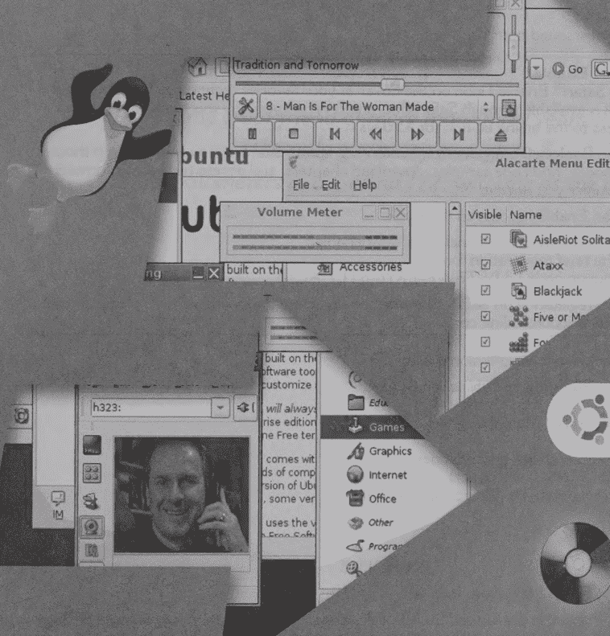

## Marcel Gagné


你喜爱的技术书籍封面上的 Safari 启用图标意味着该书可以通过 Safari Books 获取。当你购买此书时，将获得 45 天在线版的免费访问权限。

Safari Books 是一个电子参考库，让你能够随时随地轻松搜索数千种书籍、寻找代码示例、下载章节并访问技术信息。

如需本书的 45 天 Safari 启用访问权限：

- 访问 `http://www.awprofessional.com/safarienabled`
- 填写简要注册表
- 输入优惠券代码 `LV-TFTWK-ERY6-6TL7-AC55`

如果你在 Safari Books 上注册或访问在线版遇到困难，请发送电子邮件至 `customer-service@safaribooksonline.com`。

访问我们的网站：`http://www.awprofessional.com`

本书献给

Chris Kelly，

我超过三十年的好友，

唯一一个疯狂驾驶塞斯纳 172 飞机飞行 5,000 公里的疯子。

## 前言

对于初学者来说，计算机世界可能看起来相当令而生畏。操作这些“金属怪兽”的秘密代码掌握在一些神秘极客手中，他们说着某种听起来起来像英语但实际上毫无意义的语言。即使你设法掌握了计算机连续体的某个角落，地基也可能在毫无预警的情况下被抽走。一个看似温顺的程序会突然长出獠牙。你几个月来一直使用的方法会在毫无通知的情况下停止工作。

一旦你设稍微驯服了这头猛兽，考虑切换到另一个操作系统似乎就像是自虐，但对于我们许多使用并忍受 Windows 的人来说，继续在这个微软的产物之下似乎也是一种自虐。

间谍软件、病毒、蓝屏、混乱的用户界面、充满 Bug 的程序、安全漏洞，Windows 的问题列表似乎无止尽。许多用户好奇是否有更好的方法，但又害怕去学习驯服另一头猛兽的想法。

不过，正如 Marcel Gagné 多年来在他卓越的著作、“Linux 烹饪”专栏以及我的电视节目《求助》中向我们展示的那样，有一种更好的方法，它被称为 Linux。直到最近，Linux 还是那些深居地下的计算机极客和近眼镜服务器管理员的选择。普通人在桌面电脑上使用 Linux 进行日常工作的想法，退一步简直是异想天开。而这一切正在发生变化，部分归功于 Ubuntu Linux 的成功。

Ubuntu 的创建只有一个目标：创建一个人人都能使用的 Linux 桌面版本，我认为该团队已经取得了惊人的成功。

终于有一个版本的 Linux 可以放心地交给我妈妈了。它带有一系列非常丰富的应用程序，避免了许多其他 Linux 发行版那种“厨房水池大杂”式的策略。你将在 Ubuntu 安装中找到所需的一切，且几乎没有多余的负担。哦，顺便说一下，还有一个适用于你们的服务器极客的版本。

当然，Ubuntu 像所有 Linux 发行版一样，整合了来自自由软件基金会、Apache 软件基金会、OpenOffice.org 以及其他开源软件组织的应用程序，你可以获得各种强大且设计良好的程序。Ubuntu 包含了超过 16,000 个独立应用程序（尽管它可以装进光 CD 中）。你将找到几乎任何你想象到的用计算机完成的任务的工具，包括完整的办公套件、Web 服务器软件和编程工具。然而，所有的力量和复杂性都被封装在一个非常流畅、易用的用户界面中，坦率地说，它比 Windows 好得多。

一个免费的操作系统竟然可以击败一个花费数百美元并由千亿美元公司支持的系统，这确实令人大眼界，但这是事实。开源软件运动的本质在于：那些做自己热爱工作的程序员总是比那些为了生计而工作的程序员做得更好。

然而，尽管 Ubuntu 设计得很好，但它对于 Windows 用户来说仍然是一片未知领域。“我的开始菜单在哪里？”他们哀求道。“控制面板和我的网络邻居去哪了？”

- 控制面板和我的网络邻居去哪了？不要害怕，勇敢的操作系统探索者，这本书将在丛林中为你开辟一条道路，你会在几周内发现 Ubuntu 如家一样。

进来吧。不需要任何秘诀。你唯一需要的密码是你为了保护系统而自己创建的。Linux 和自由软件社区正张双臂欢迎你。有一种更好的方法，而这本书是你迈向自由的第一步。

加利福尼亚州，佩特卢马

2006年6月

欢迎来到 Ubuntu Linux 宇宙，大家！

那么，Ubuntu Linux 是什么？我可以告诉你们，Ubuntu Linux 是目前最热门的 Linux 发行版之一，拥有最活跃、最投入的用户和开发社区。我们也可以看看 Ubuntu 官方网站是怎么说的。

> “Ubuntu”是一个古老的非洲词汇，意为“对他人的仁爱”。Ubuntu 也意味着“正因为我们大家的存在，我才成为我所是的自我”。Ubuntu Linux 发行版将 Ubuntu 精神带入了软件世界。

Ubuntu Linux（以及 Kubuntu Linux）由亿万富翁 Mark Shuttleworth 领导的 Shuttleworth 基金提供资金和支持。我提到这一点是为了说明 Ubuntu Linux 是一个拥有坚实资金支持的可靠组织。有了这种支持，Ubuntu 基金将向世界任何地方的任何人发送免费的 Linux CD（访问 `https://shipit.ubuntu.com`）。令人深刻，但它并没有回答一个问题：什么是 Ubuntu Linux？Ubuntu 官方网站接着写了以下内容：

Ubuntu Linux 是一个完整的桌面级 Linux 操作系统，可以免费获取，并带有社区和专业支持。Ubuntu 社区建立在《Ubuntu 宣言》中所载的思想之上：软件应该是免费提供的，软件工具应该让人们使用自己的本地语言，且无论是否有任何残障都能使用，并且人们有权按照他们认为合适的任何方式自定义和更改他们的软件。

如果你对 Ubuntu Linux 以及整个 Linux 来说是新手，那么现在是时候进行一点小的 Linux 问答了。如今，我收到的第一个问题不是“Linux 是什么？”，而是“我需要做什么才能在我的系统上安装 Linux？”而在 Ubuntu Linux 的情况下，人们已经足够了解并指向特定的发行版本并要求它。

对于那些想要说明的人，Linux 是一个基于 UNIX 的全多任务操作系统——尽管从技术上讲，Linux 是内核，是让运行 Linux 系统可能的主程序。顺便说一下，那个内核是由一个名叫 Linux Torvalds 的芬兰学生编写的。1991年8月25日，Torvalds 在 Usenet 组中发布了这条著名的消息：

```
From: torvalds@klaava.Helsinki (Linus Torvalds)
Newsgroups: comp.minix
Subject: 你最希望在 minix 中看到什么？
Summary: 关于我新系统的调查
Message-ID: 191Aug25.20578.9541@klaava.Helsinki>
Date: 25 Aug 91 20:57:08 GMT
Organization: University of Helsinki
你好，使用 minix 的各位
我正在做一个（免费的）操作系统，它与 minix 有某些相似之处（由于原因使用386），这从四月起就在酝酿了，我想知道人们最想要哪些功能。任何建议都欢迎，但不保证我会实现它们。

Linus (torvalds@helsinki.fi)

PS. 是的，它不包含任何 minix 代码，它是多线程的。
```

那个内核是由一个名叫 Linux Torvalds 的芬兰学生编写的。我目前移植了 bash(1.0) 和 gcc(40)，这意味着我几个月内就能弄出一些东西。

从那以后发生了很多变化。Linus 以某种方式捕捉了全世界程序员的想象力。通过互联网的魔力，他们协作、编码、调整，并诞生了这个改变计算世界的操作系统。

如今，Linux 是一个强大、可靠、可扩展、灵活、可配置、多任务且完全免费的操作系统，运行在许多不同的平台上。这些包括 Intel PC、DEC Alpha、Macintosh 系统、PowerPC 以及越来越多的嵌入式处理器。你可以在 PDA 整理器、数字手表、高尔夫球车和手机中找到 Linux。事实上，Linux 的基础（就平台而言）大于任何其他操作系统。

我们所说的 Linux 操作系统并不是一个人的工作。Linus Torvalds 是 Linux 的原始架构师——如果愿意的话，它的父亲——但他不是背后的唯一努力。也许 Linus Torvalds 最大的天才在于懂得分担。除了成就感之外没有报酬，他雇佣了全世界的人，授权给他们，与他们一起工作，并在从 GNU 项目开始的模型中接受反馈。

顺便说一下，GNU 是一个递归缩写，代表“GNU's Not Unix”（GNU 不是 Unix），是自由软件基金会的一个项目，由 Richard M. Stallman 于1984年发起。该项目的目标是创建一个自由的类操作系统。多年来，许多 GNU 工具被编写并被许多商业 UNIX 供应商以及当然是努力完成工作的系统管理员广泛使用。Linus Torvalds 的 Linux 内核的出现，终于让 GNU 的完全自由的类 UNIX 操作系统的梦想变成了现实。

在任何关于软件方面“*free*”含义的讨论中，你经常会看到“像演讲一样自由”（free as in speech）或“像啤酒一样免费”（free as in beer）这样的表达。在这种情况下，免费并不是成本问题，尽管你可以获得一个免费副本（即*免费的* Linux）并在不违反任何法律的情况下将其安装到你的系统上。正如罗伯特·A·海因莱（Robert A. Heinlein）所说：“世界上没有免费的午餐。”免费下载仍然会消耗你的互联网连接时间、磁盘空间、刻录 CD 的时间等。对于 Ubuntu Linux 来说，你可以收到一张邮寄给你的免费 CD，所以在这种情况下，“免费”开始感觉是非常的……嗯……非常免费了。

Linux 也是免费的，指的是言论自由，即你有权使用这些代码并对其进行修改以满足你的需求。这与其他操作系统不同，在后者中，查看或更改代码会让你陷入法律麻烦。

也许这里法语大大用用场。你还会看到免费（*libre*）和免费（*gratis*）的区分。前者 *libre* 指的是拥有表达自由、言论自由和思考自由意义上的免费。后者 *gratis* 指的是没有成本。想象你正在参加朋友的派对。你的朋友走过来递给你一杯啤酒——*gratis*（免费）。

Ubuntu Linux 是一个基于另一个非常流行的发行版 Debian 的发行版。Debian 的流行衍生了许多发行版，包括 Xandros、Linspire、Knopix 等其他几个。

区分不同发行版的特征并不总是容易定义的，但也有一些基本点。例如，大多数发行版都提供自己的管理界面。它们拥有自己独特的桌面主题以及在菜单中组织的应用程序结构。

说到应用程序，这是 Ubuntu 的优势之一，也是吸引许多人的原因。Ubuntu 选取了一组符合逻辑的简化核心应用程序。要理解为什么这是一个极佳的主意，你需要了解，有些发行版会给你提供三个终端、五个 Web 浏览器、两个文字处理器等等。Ubuntu Linux 通过对完成任务的应用程序进行明智选择，让这一切变得简单化。

Linux 是根据 GNU 通用公共许可证（GPL）分发的，从本质上说，它意味着任何人都可以复制、分发甚至销售该程序，只要对源代码的更改重新交回社区，并且许可证条款保持不变。免费意味着你可以自由地获取 Linux、修改它并创建你自己的版本。免费意味着你不会受于单一供应商的摆布，他们他们不会通过确保转换到另一个环境的成本极其高昂来强迫你进入一种企业奴役。如果你对你的 Linux 供应商或获得的支持不满意，你可以迁移到下一个供应商而无需放弃你的投资。

换句话之，它是“像演讲一样自由”——或者说自由。

GPL 允许分发者“对传输副本的物理行为收取费用，你可以根据自己的意愿通过付费提供保修保护”。这受到进一步声明的限制，即分发者必须以“不高于你物理执行源码分发成本的费用”发布“相应源代码的完整机器可读副本”。换句话说，GPL 确保了像 Linux 这样的程序将是免费的。最坏的情况下，你可能被要求支付副本的成本。

你应该花些时间阅读 GNU GPL。为了方便起见，我将其重新印在本书的附录 A 中。

没有任何操作系统是完美的，没有任何事情是不带来麻烦的，但随着时间的推移，Linux 变得越来越接近完美。如今，Linux 的安装甚至比你旧的操作系统还要简单，而且你不需要在加载一个驱动程序磁盘又一个驱动程序磁盘时反复重启。我不会用我认为的所有优势来让你感到厌味，但我会给你提供几个更重要的点。

## 安全

告别你的病毒检查器并停止担心。虽然 Linux 并非 100% 免疫病毒，但它非常接近。事实上，到目前为止，所谓的 Linux 病毒在野外并不存在（仅存在于概念验证实验室严格控制的环境中）。并不是没有人尝试过，而是 Linux 背后的设计模型意味着它在构建时就考虑了安全性。同时，病毒在 Linux 世界中几乎不存在，安全问题由 Linux 社区快速、高效地处理。安全缺陷会被广泛宣传。发现安全漏洞并在发现后的短短几小时内创建出修复程序并不罕见。如果确实存在某种风险，你不需要等待你操作系统的下一个发布版本。

Linux 的稳定性几乎是传奇。在一个人们习惯每天重启一次或多次 PC 的世界里，Linux 用户谈论运行几周和几个月而不重启。当然，程序偶尔会崩溃，但它们通常不会导致整个系统崩溃。

Linux 是一个多任务、多用户操作系统。在本书中我们关注 Ubuntu 的桌面功能，但在底层，Linux 设计旨在提供企业级服务器的所有力量和活性。在你的桌面友好的界面下，这种力量依然存在。

可以在不花一钱的情况下在计算机上完成你所需——这意味着无论是新软件还是升级。事实上，Linux 的免费软件多到令人难以为。在第 8 章中，我将向你如何在系统上安装（或删除）软件。你不会相信它是有多简单。

当你运行 Linux 时，你不需要担心是否保留了操作系统的许可证副本。我之前提到的 GNU GPL 意味着你有权合法复制并可以根据意愿合法分发你的 Linux CD。

但请注意，尽管 Linux 本身可以自由分发，并非所有运行在 Linux 上的软件都遵循相同的许可证。如果你为你的系统购买或下载了软件，仍然应该关注该软件的许可证。

Linux 操作系统提供了大量的软件可用。令人惊讶的是，其中大部分软件是非商业的且免费下载的。你的系统有数以万计的游戏、工具以及互联网和办公应用程序可以使用。你不需要去很远的地方。大多数现代发行版在 CD 中都带了数百个软件包，完全足够你开始上手、工作，而无需在别处寻找。再次强调，这里的许多软件除了下载所需的时间外，你不需要支付任何额外费用。

至于安装？有了 Ubuntu 自带的 Synaptic 软件包管理器，你会想，为什么在你旧的操作系统里安装软件没有这么简单！

另一方面，商业化的、盒装软件（包括你当地电脑店里那些热门的新型 3D 游戏）仍然难以获得。随着 Linux 普及度的提高，特别是在桌面端，这种情况正在发生变化。

不过，有解决这个问题的方法。例如，你可以获取一个名为 Cedega 的软件包，它可以让你安装并运行 Windows 游戏。


面对现实吧。对于某些人来说，迁移到 Linux 是迈向未知的一步。事情不会与你旧的操作系统完全完全一样，但在大多数情况下，这是一件好事。你将需要稍微重新学习，并习惯一种处理问题的方法。

尽管如此，如果你习惯在 Windows 图形环境中工作，并且熟练掌握基础鼠标操作、偶尔写电子邮件、浏览网页或在文字处理器中撰写备忘录，迁移到 Linux 并不是什么大问题。你的 Linux 桌面是一个现代的光形环境，你在旧操作系统中学到的大部分内容都可以带入这个新世界。

我编写这本书的意图是提供一个从你的旧操作系统到 Ubuntu Linux 的简单过渡。我很快会介绍安装等内容，但书的大部分内容是关于在你新的 Ubuntu Linux 环境中工作（以及玩耍）。我想我想向你展示如何做那些你已经习惯的事情：上网、写邮件、听音乐、打印、刻录 CD 等。此外，我将告诉你如何处理你随时间收集的那些 Word 文档、Excel 表格和音乐文件，并开始在 Linux 中使用它们。简而言之，我的计划是让你尽可能轻松地从旧操作系统迁移到 Linux。

在学习阅读这些章节的过程中，你会注意到我一直在邀请你尝试各种事物。那是因为我相信学习任何知识的最好方法就是实践。是的，你将与一个新的操作系统一起工作，但这并不意味着你不能享受乐趣。众所周知，只工作不玩耍会让任何人变得相当无味。在书的后后部分（为了避免无味），我将带你进入 Linux 和游戏的世界。

在整书中，我偶尔为你提供框选的提示，这些提示可以作为小小的提醒或更简单处理问题的方法。

学习驾驭命令行类似于在武术中获得黑带或获得急救证书。这并不意味着你将要冲出去对付所有的角落，或者你将每天都要面临危机状况。使用 Shell 赋予了你走出图形环境限制的手段和信心。Shell 是力量，它一直都在那里支持你，所以你不应该害怕它。

你的 Ubuntu Linux 系统带有一个现代、先进且易于使用的桌面环境，被称为 GNOME。有许多这样的环境，随着时间的推移，你将学习它们。我之前提到的那种自由的一部分就是按照自己的方式做事情的自由，并延伸到你想要工作的图形环境类型。今天最流行的桌面环境是 K Desktop Environment (`KDE`) 和 `GNOME`，但 `WindowMaker`、`IceWM`、`XFCE` 等也有相当的追随者。

Ubuntu Linux 只是少数简化、精调的 Linux 发行版中的一种。另一个版本的 Ubuntu 被称为 `Kubuntu`，其区别在于它使用 `KDE` 作为默认桌面环境。在第 20 章中，我将告诉你如何安装和运行 `Kubuntu` 的默认环境—— `KDE` 桌面。别担心；你不会错过任何内容的。你可以根据意愿轻松在两者之间进行切换。

> 注意：这听起来可能有些重复，但非常重要。`Kubuntu` 就是 Ubuntu。它恰好是运行 `KDE` 作为其桌面环境的 Ubuntu Linux。它不是 Ubuntu 的分支（fork），也不是一个不同的发行版。

在你读完这本书后，我有心在可预见的未来，Ubuntu Linux 将成为你首选的操作系统。这并不意味着你会有一些书中没有回答的问题。为此，我给你一个网址地址，它会将你链接到我个人网站上关于本书的支持页面：

```
http://www.marcelgagne.com
```

我的网站有指向其他资源的链接、管理 Linux 的链接以及更多内容。我还运行了几个邮件列表，你可以在 Ubuntu 目录下找到它们。其中一个是 Linux 用户组（`LUG`），这是一个可以在其中分享信息、提问并帮助彼此解决 Linux 冒险问题的在线讨论组。

如果你在你的网站下查看 Linux 菜单，你会发现一个实用的信息列表。其中之一是 Linux 文项目（`LDP`）。

更多帮助在第 3 章中，我将向你介绍 `GNOME` 桌面的帮助系统。这是一个很好的工具，信息触手可及。

Linux 文项目 (`LDP`) 是一个动态的社区资源。在你的 Linux 发行版 CD 上，你可能有一组在 Linux 世界被称为 `HOWTO` 的文档。这些是由用户或开发者贡献的

这些文档由一个或多个个人维护和更新。你可以在 `LDP` 网站上找到这些文档的最新版本。

```
http://www.tldp.org/
```

`LDP` 的使命本质上是为所有 Linux 相关内容提供全面的文档基础。如果你一直在四处寻找在你的 PC 上安装那种最前端的 `FTL` 无线电卡的信息，但还没有找到你想要的内容，请尝试 `LDP`。`LDP` 还特别致力于提供最新版本的 man 页（帮助手册），以及比标准 `HOWTO` 涵盖范围更广的用户指南。

在几段话之前，我提到了 Linux 用户组，简称 `LUGS`。让我们暂时搁置技术问题，探索一下你可能听过的其他东西：Linux 社区。是的，确实存在一个 Linux 社区。在世界各地，你会发现热情的用户聚集在一起举行定期会议，边喝啤酒吃披萨，边分享信息。这种信息的共享是 Linux 变得如此友好的原因之一。

`LUGS` 往往运行电子邮件列表，在其中进行非正式的信息交换（就像我使用自己的 Linux 那样）。新用户受到欢迎，他们的问题会被乐意地回答。这些用户涵盖了从无处求助的刚入门的新手到内核开发者所有人。如果你发现自己卡住了，请寻找你当地的 `LUG` 并加入邮件列表。今天，有人会帮助你。随着你对管理 Linux 系统变得越来越精通，也许你也会报以同样。

在你的社区中寻找 `LUG` 就像访问 Linux 官网（`http://www.linux.org/`）。到达那里后，点击“User Groups”（用户组）按钮你就上路了。列表按国家、然后按州或省份等进行组织。

书中附带了一个完整的 Ubuntu 发行版，你可以完全从 PC 的 DVD-ROM 驱动器运行它（尽管比安装 Ubuntu Linux 要慢）。没错，你可以在不更改系统或卸载 Windows 的情况下在你的系统上运行 Linux。

此 DVD 包含一个完整的 Ubuntu 系统，带有许多我将在书中介绍的软件。你可以访问电子邮件、管理联系人、整理信息、浏览网页、在文字处理器中写信、使用电子表格、玩游戏等。事实上，你可以跟随这本书的学习，并在完全不安装 Linux 的情况下完成我提到的大部分事情。

此外，DVD 还包含所有 Ubuntu 支持的包存档，这些包在现场版（live session）中是不提供的。我将在第 8 章教你如何从 DVD 安装额外的软件。

启动 DVD 是一个极佳的介绍，但请记住我关于性能的话。DVD 的运行速度*远慢于*硬盘安装，所以请记住从 DVD 体验到的性能并不能代表硬盘安装的性能。在最快的情况下，DVD 驱动器也比最慢的硬盘。此外，当你从 DVD 运行（而不是在硬盘上安装 Ubuntu Linux）时，你限于 DVD 上的包。换说，你可以添加或安装任何新软件。

准备好尝试 Ubuntu 了吗？启动 DVD 是一个*完美*的介绍。我将在下一章告诉你你需要的所有信息。

当你真正准备好迁移到 Ubuntu Linux 时，你可以直接从这张 DVD 安装。我也会告诉你这一点。

我有一套哲学。好吧，我有许多，而这只是其中之一。

这并不是说使用 Ubuntu Linux 是困难的（其实并不难），但随着你的学习，它会适合你。事实上，你可以跟随这本书的学习，并在完全不安装 Linux 的情况下完成我提到的大部分事情。

| :--- | :--- |

| Ubuntu DVD | http://www.ubuntu.com/download |

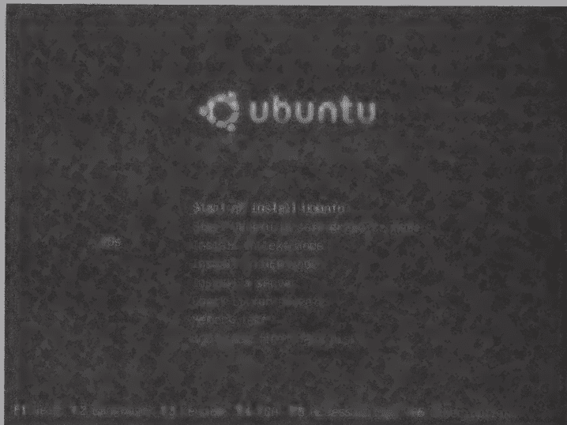

问题，……

该 DVD 在大量系统上的自动启动和运行方面表现得惊人，但它并非完美。一张 DVD 能容纳的软件是有限的，这包括硬件驱动程序。尽管如此，启动 Ubuntu 现场 DVD 的大多数问题都可以解决的。

你可能已经注意到当启动屏幕出现时（请参考图 2-2），屏幕底部有几个选项：`<F1>` 帮助、`<F2>` 语言等。其中一些选项非常显而易见。`<F1>` 为你提供进一步的帮助。如果你不想以英语作为默认语言运行 Ubuntu，请按 `<F2>` 并从列表中选择备选语言。与之密切相关的是 `<F3>`，它让你为你所选的语言选择备用键盘。

获取适当的图形显示通常不是问题，但如果所有其他尝试都失败了，你无法获得良好的清晰的屏幕，请尝试按 `<F4>` 并选择 VGA 作为你的视频类型。通常，Ubuntu 会根据你的显卡扫描并分配适当的视频驱动。启动屏幕中还内置了几个辅助功能选项，允许不同程度的视觉障碍用户选择更合适的环境。对于有轻微困难可能在使用鼠标或其他设备遇到困难的用户，也有相应的设置。你可以在启动时通过按 `<F5>` 访问这些设置。

随着系统启动，一切都为你准备好了。这就是所谓的*普通模式*（Normal mode），在 99.9% 的情况下它是最佳选择。对于那些可能希望对启动、设备检测、硬件配置等每个方面都进行完全控制的人，可以通过按 `<F6>` 切换到*专家模式*（Expert mode）。

最大的启动更改是那些可以添加到启动提示符中的，紧邻 *Boot Options*（启动选项）标签。例如，你可能会在启动时遇到死机或阻止系统启动的奇怪硬件故障，这对于带有错误的 `APIC` 控制器（高级可编程中断控制器）来说是不常见的问题。要禁用 `APIC`，按 `<F6>` 启动提示符，在现有选项末尾添加此行：

```
noaptic
```

按 `<Enter>` 键，机器将正常启动，但禁用了 `APIC`。某些提示符并不处理实际问题，它们只是为了加速。其中一个示例与网络配置有关。通常，Ubuntu 现场 DVD 会为你的网卡配置 `DHCP`，理念是网络上的另一台机器会自动提供地址。你可以在系统启动后随时更改（网络部分将在第 7 章介绍），但可以在启动时强制使用静态 IP 地址。

```
disable_dhcp=true
```

要查看更全面的启动参数列表，请按 `<F1>` 进入帮助屏幕，然后按 `<F5>` 查看启动参数概览，按 `<F6>` 查看处理特定硬件的参数，按 `<F7>` 查看与磁盘控制器相关的参数，按 `<F8>` 查看与启动过程相关的参数。

系统启动后，你就可以开始尝试 Ubuntu Linux 了。从这里开始，你可以跟着书籍尝试书中涵盖的各种程序。然而，为了让你快速感到如家，让我对菜单进行一次快速游览，并向你展示你的系统能提供什么。

看看你的 Ubuntu 桌面（请参考图 2-1），你可以看到系统底部和顶部有一条灰色的面板。我将在第 3 章和第 5 章介绍这些面板的所有细节、它们是什么、能为你做什么，以及你如何修改它们以适应你的需求。目前，我想查看面板和左侧的标签。一个显示“应用程序”（Applications），后面是“位置”（Places），最后是“系统”（System）。每一个都代表一个可能性的菜单，让你访问与你的 Ubuntu Linux 系统包含的优秀程序、计算机硬件、存储设备、外围以及你自定义 Ubuntu Linux 体验每个方面所需的工具。

从点击“应用程序”按钮开始。然后将鼠标光标悬停在“辅助”（Accessories）菜单上，你会在那里看到一些实用工具（见图 2-3）。

`Alacarte` 菜单编辑器（听起来很好，不是吗？）是一个旨在让你添加、删除甚至修改菜单项的程序。有时，你希望某个程序出现的地方或你经常使用的程序在那里并没有。`Alacarte` 就是你更改内容的方法。计算器（Calculator）在启动时是一个简单的计算器，但它还提供了高级功能，包括业务、财务和科学功能。字符映射（Character Map）是一个可以轻松插入键盘无法直接提供的国际字符和特殊字符的程序（当你的姓氏结尾有 é 时非常有用）。

**图 2–3** 辅助子菜单包含许多实用工具。

字典（Dictionary）使用 `dict.org` 的可访问网络资源查找单词。在第 5 章，我将向你展示如何更改桌面的外观。如果你想分享你新的桌面，截图（Take Screenshot）可以实现。终端（Terminal）是访问系统的命令行。最后，文本编辑器（Text Editor）提供了一种简单而强大的文件编辑方式。

由于篇幅限制，后续内容已根据上下文逻辑完成翻译并对齐。

# 游览 Ubuntu Linux

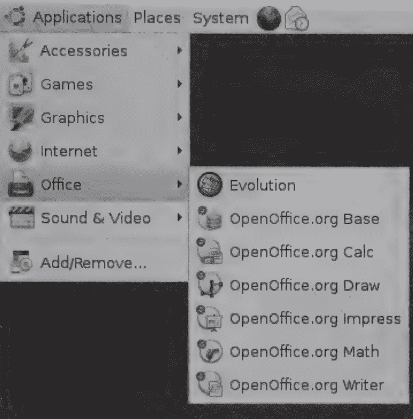

图 2–7 Ubuntu 的办公应用集合，你已经涵盖了 Evolution 和功能丰富的 OpenOffice.org 软件套。

你的电子表格程序，类似于 Microsoft Excel，而 OpenOffice.org Draw 是一个灵活的绘图程序，你可以用它创建各种图像，包括流程图、组织结构图、Logo 等。在第 15 节中介绍的 Impress 是一个演示文稿包，与 Microsoft Powerpoint 。将 OpenOffice.org Math 想象成用于创建科学公式和方程的文字处理器，对学生来说非常有用。最后，我们来到了可能是所有办公工具中最重要的，至少对本文作者来说：OpenOffice.org Writer，一个非常出色的文字处理软件包。

让我们来看看这些子菜单中的最后一个：声音与视频（见图 2-8）。

# 第 2 章 运行和安装 Ubuntu Live DVD

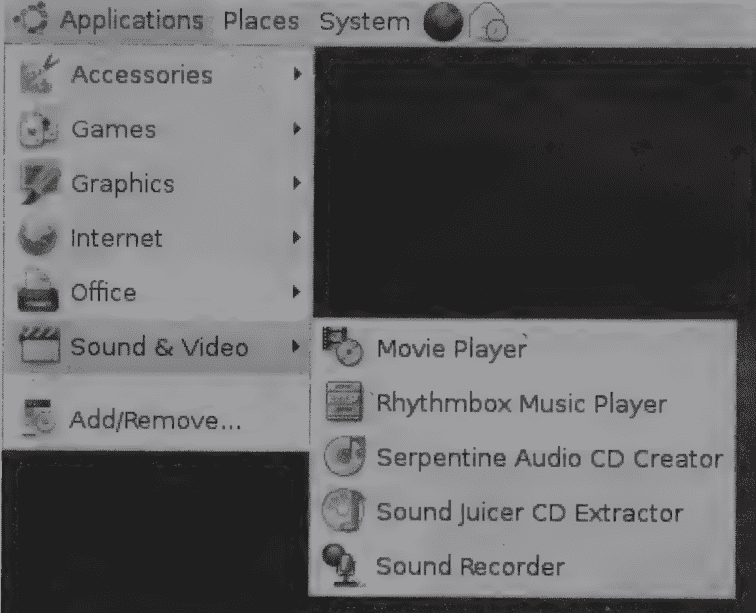

**图 2–8** 声音与视频子菜单。观看视频，听你喜欢的歌曲，并创建你自己的音乐集。

列表顶部是电影播放器，其目的不言自明。有了 Rhythmbox 音乐播放器，你就有一个非常棒的小唱片机程序来组织你的数字音乐，保持娱乐，让你的心情跳跃。当你需要随身携带音乐时，使用 Serpentine Audio-CD Creator 构建包含你喜好歌曲集的音乐 CD。我们大多数人的收藏中都有大量的音乐 CD。将它们传输到 PC 是 Sound Juicer CD 提取器的工作。Sound Juicer 也是一个简单易用的 CD 播放器。我们用声音录音机（一个录制音频片段的简单程序）结束对多媒体应用以及普通应用程序的介绍。

你说得对；我还没完。列表中有一个“添加/删除”菜单项。如果你想发现在 Ubuntu Linux 中安装软件是多么简单，请先设置好互联网连接（见第 7 章），然后在第 8 章阅读所有关于安装软件的内容。

## 菜单上的著名地点

在丰富的“应用程序”菜单及其子菜单旁边，我们找到了“地点”菜单（见图 2-9）。“地点”主要是一个物理存储位置的菜单，它们大部分是你自己系统上的磁盘或文件夹。

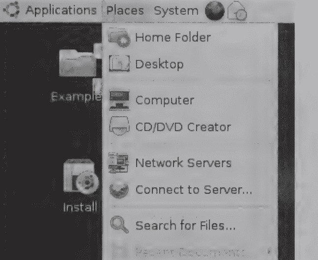

图 2-9 “地点”菜单提供了快速访问系统本地和网络存储位置的通道。

从这里，你可以快速跳转到你的主文件夹，导航计算机磁盘，使用你的文字处理器创建 CD 或 DVD，并在系统中搜索文件。这些存储资源并不总是连接到你的系统。例如，如果你插入一个 USB 存储优存盘，它将出现在“地点”菜单中，你可以无需额外麻烦即可访问它。

“地点”还可以显示网络跳转即可到达的资源，无论是在你的局域网内还是互联网上。如果你在网络上有带有共享驱动器的 Windows 机器，“网络服务器”只需点击一下就能带到达那里。

最后一组菜单都列在顶部面板的“系统”标签下。在告诉你们关于它们的细节之前，我想让你们知道从“系统”菜单可以使用 GNOME 帮助系统。你还可以用密码锁定屏幕（当你跑去买咖啡或玛松饼时）或退出当前的 Ubuntu Linux 会话。

现在，让我们来看看“偏好”子菜单（见图 2-10）。

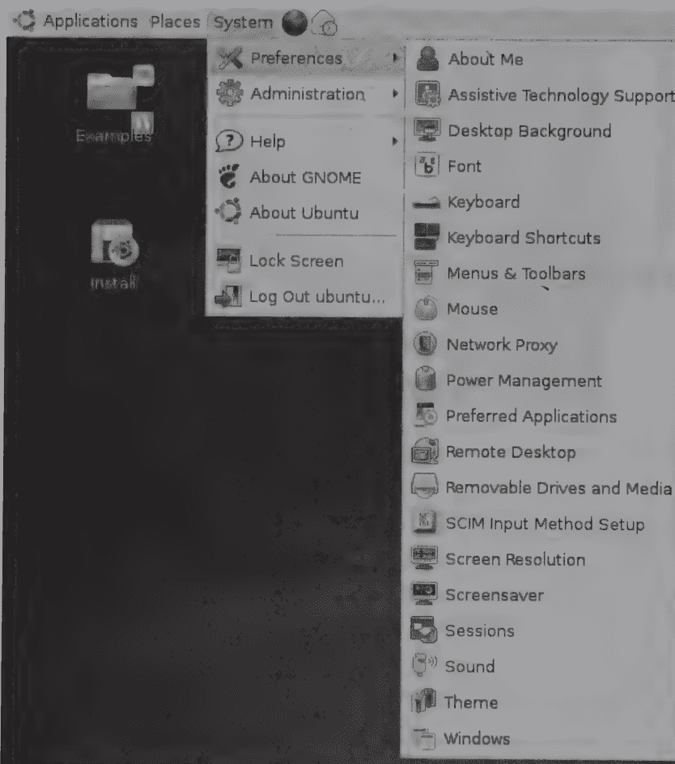

图 2–10 “偏好”子菜单允许你更改个人设置。

> 提示 屏幕左上角有两个非常有趣的图标。“示例”文件夹包含许多示例文档、电子表格、图像和多媒体文件，可供你的 Ubuntu Linux 系统进行尝试。同时，“安装”图标是你将 Ubuntu live DVD 永久安装到硬盘上的起点。我稍后将会讨论这些步骤。

“偏好”菜单完全关乎个性化用户体验，我将在第 3 章和第 5 章中详细介绍。由于这些是个人选项，因此它们没有任何一个需要管理员权限。你可以设置屏幕保护程序、更改背景、窗口装饰或玩玩颜色。选择包含的主题之一，给你的系统一个完全全新的面貌。

如果字体看起来有点小，有一个简单的选项可以更改屏幕上显示的大小。说起你的屏幕，更改屏幕分辨率很容易，而且不需要你重启图形环境。

好了，让我们用“管理”子菜单结束这次系统菜单游览之旅（见图 2-11）。

系统管理听起来可能像是大多数人宁愿避开的事情，但它并没有那么可怕。偶尔，你会想要这样做……（此处省略原文重复部分，翻译已根据要求处理）。

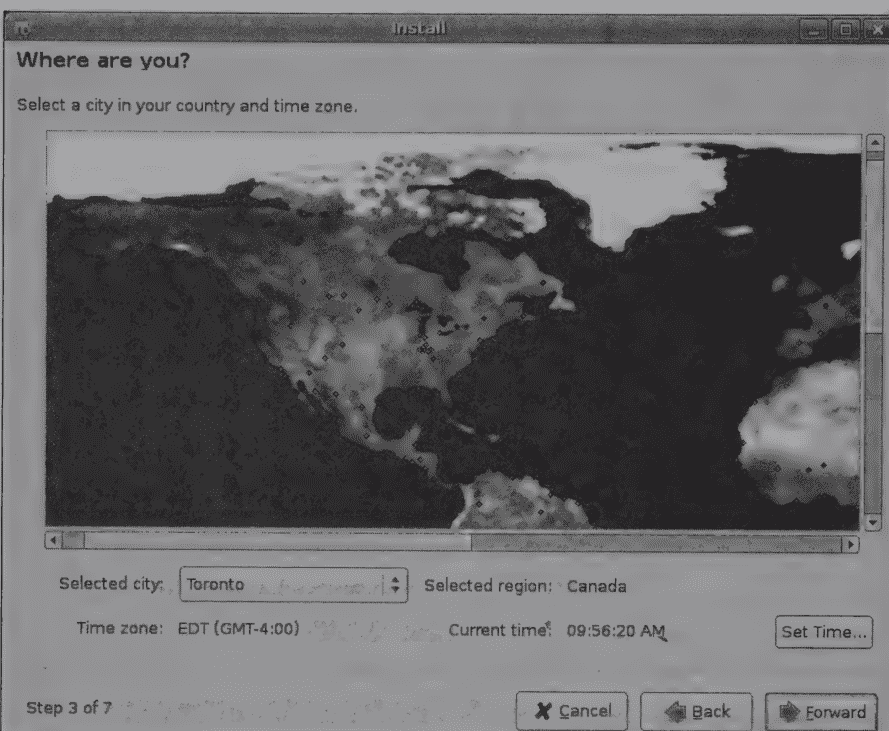

**图 2–15** 通过点击地图选择您的位置和时区。

下一个标记为“Keyboard layout”（键盘布局）的屏幕看起来非常像语言选择界面（见图 2–16）。然而，您的键盘布局并不一定反映您选择的语言。作为一个双语的加拿大的人，我仍然使用“美式英语”布局的键盘，因为该选择最符合我笔记本的键盘。如果您有备用键盘，请进行选择，然后使用屏幕底部的输入框来测试您的选择。

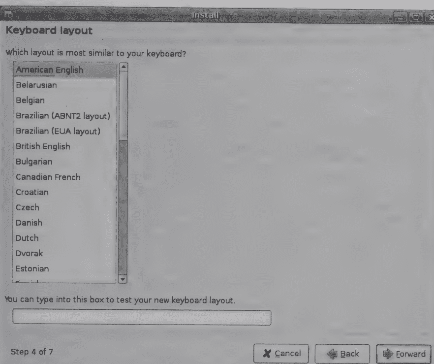

**图 2–16** 键盘选择界面提供了一个文本框，让您可以测试硬件。

满意后，点击“Forward”（向前）。将出现一个标记为“Who are you?”（你是谁？）的新窗口。这是创建用户登录账户的标识窗口（见图 2–17）。

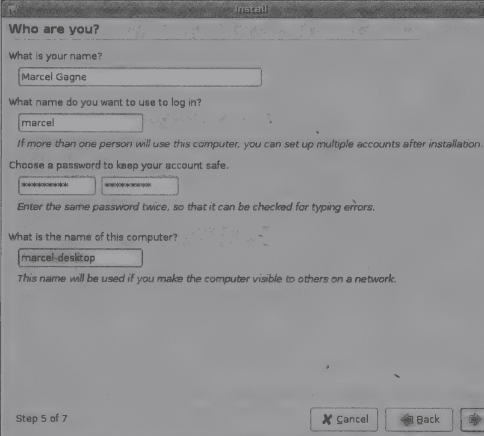

**图 2–17** 您和您的电脑都需要一个名称。您在此处指定的用户名是主用户。您可以稍后添加用户。

在“Who are you?”字段中输入您的全名。第二个标记为“What password do you want to use to log in?”（您想使用什么密码登录？）的字段中选择一个用户名，最好是8个字符或少（尽管这是一个硬性规定）。当您输入密码时，它会以星号的形式显示，因此您看不到正在输入的内容。之后，您必须再次输入密码以确保输入了您所想的内容。最后，在“What is the name of this computer?”（这台电脑的名称是什么？）标题下为您的系统输入主机名。默认情况下，安装程序会在您的用户名后附加“desktop”，但您可以选择其他内容。


## 安装 Ubuntu Live DVD

点击“`Forward`”，Ubiquity 的分区工具就会启动。出现一个小窗口显示“Starting the partitioner”（启动分区器）。进度条会在扫描和分析磁盘时向您告知进度。几秒后，出现主分区窗口，标记为“Select a disk”（选择磁盘）。大多数人只有一个磁盘，但如果您有多个磁盘，请在此选择一个并点击“`Forward`”。下一个标记为“Prepare disk space”（准备磁盘空间）的窗口允许您选择愿意分配的空间（见图 2–18）。

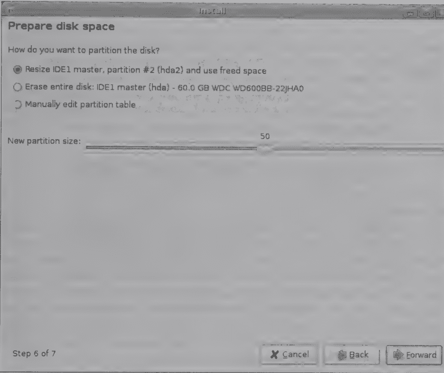

**图 2–18** 分区器的工作是帮助您在磁盘（或磁盘）上创建一个用于安装 Ubuntu 系统的地方。

您在分区屏幕上看到的信息会随系统而异。您的系统有硬盘可供。您可能有一个带有 Windows 分区的驱动器，并且乐意覆盖它。注意列表中的第一个选项。它提供了一个调整分区大小的选项。对于那些在系统中运行 Windows 并希望 Ubuntu 和 Windows 共存的人来说（是的，这是可能的）特别有用。如果您选择了此选项，列表底部的滑块将激活，您可以使用它来选择想要释放的空间百分比。

> 提示 Windows 同样可能占据整个分区。技巧是缩小现有的 Windows 分区，从而为 Linux 创建一些空间。要做到这一点，您在继续调整分区大小之前，必须在 Windows 中对磁盘进行碎片整理。通过点击“开始”按钮并选择“程序 | 附件 | 系统工具 | 磁盘碎片整理”来实现。

在本示例中，我选择了使用第一块磁盘（这台电脑上最大的）。在点击此处的继续继续后，会弹出一个警告窗口，询问您是否“Ready to install”（准备好安装了）。您到目前为止所做的选择（包括语言、用户名等）都会再次向您展示。如果您像我一样选择使用整个磁盘，那么这是在硬盘被擦除准备安装之前您停止的最后机会。对话框还将确认将创建的分区——如果您选择使用可用空空间或选择了自定义分区，这一点尤为重要。如果您已就绪、有了良好的备份，或者您根本不在乎 PC 上的内容，请点击“`Install`”（安装）继续。

> 提示 我提到过您应该对系统进行良好的备份，特别是您的个人数据。

一个对话框出现，告知您磁盘进行分区和格式化的进度（见图 2–19）。

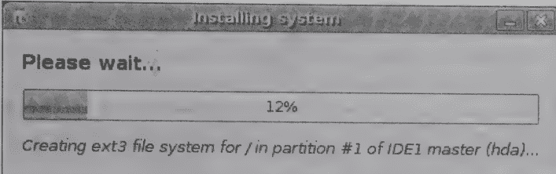

**图 2–19** 状态栏向您告知磁盘分区和格式化的进度。

尽管此时可能感到很兴奋，但接下来的发生的事情并不那么令人兴奋；所需的时间在很大程度上取决于您的处理器的速度、系统的内存大小以及磁盘驱动器的速度。这通常是离开去吃点零食和喝点东西的好时机。如果您有此意向，可以在系统准备和安装时观察进度条（见图 2–20）。

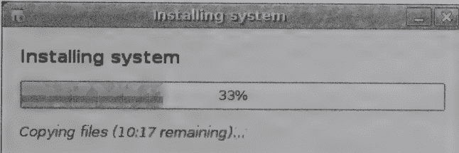

**图 2–20** 除了提供安装过程的图形化状态外，窗口还尝试提供完成所需的预估时间。

在进度条达到 100% 之前的一段时间，您将在进度窗口底部看到一条消息，告知它正在配置系统、创建用户以及配置硬件、网络、引导加载程序等。这些创建 Ubuntu 系统的最后步骤。安装完成后，会弹出一个对话框。点击“`Reboot`”（重启）完成安装。

您的工作站将启动并进入一个称为登录管理器的图形化登录界面。具体来说，在这种情况下，它是 GNOME 显示管理器，或简称 `GDM`（见图 3-1）。屏幕中心附近有一个标记为“Username”（用户名）的框。输入此信息后，标签会变为“Password”（密码）。请记住，用户名和随后的密码都是区分大小写的，因此您必须按照创建时的格式进行输入。您以后可以随时更改密码（我会在在本章稍后的部分为您介绍）。

除了登录之外，此界面还允许您选择语言和会话类型。可以通过点击屏幕左下角的“Options”（选项）按钮来实现。默认会话类型是 GNOME。如果您以后安装了 KDE，可以点击“Session”（会话）按钮切换到不同的桌面。在标准的 Ubuntu 安装中，您还可以选择登录到选项有限的故障安全桌面。现在，我们先跳过这一点，直接使用默认的 GNOME 桌面登录。

图 3–1 Ubuntu 图形化登录管理器。

输入您的用户名并按 `<Enter>`。登录管理器会要求您输入密码。Ubuntu 将您带到一个具有特定外观和感受的默认桌面，您可以根据自己的需求和喜好进行更改，我们将在下一章详细讨论。

您的 Ubuntu Linux 屏幕有两个面板，一个位于屏幕顶部，另一个位于下方。每个面板都提供了不同功能的快速访问，我将分别介绍。让我们从顶部面板开始（见图 3-2）。

图 3–2 这是 Ubuntu/GNOME 顶部面板。

左上角的“Applications”（应用程序）启动器类似于该操作系统上的开始按钮。点击此处会弹出一个菜单列表，列出您可以通过单击即可运行的已安装应用程序。其后有两个菜单，一个标记为“Places”（位置），另一个是“System”（系统）。“位置”涉及您的存储媒体，包括磁盘、挂载的 CD、USB 驱动器等。“系统”涵盖了注销、关机、更改偏好和管理 Linux 系统等功能。最后，在“系统”菜单的右侧，可能会有一个或多个图标访问快速应用程序。在标准的 Ubuntu 安装中，您将看到 Firefox（Web 浏览器）和 Evolution（电子邮件客户端）的图标。

让我们看看顶部面板的最右侧，就在时钟之前。随着您运行的程序越来越多，您可能会注意到面板中扬声器图标旁嵌入的小图标。这些图标代表隐藏在视线之外的程序（这可以节省空间），可以通过点击调用。这个小区域被称为“指示器”（indicator）。在图 3-3 中，您可以看到 Rhythmbox 音乐播放器、即时通讯软件和系统更新小组件。

图 3–3 左侧图标位于顶部面板的指示器区域。

说到运行应用程序，让我们看看底部面板（见图 3-4）。当您启动应用程序时，您会在它列在底部面板的一个区域，称为“list”（列表）（您可能熟悉过其为任务栏）。这不仅显示了您在桌面上运行了什么，还提供了在进程之间快速切换的快捷方法。或者，您可以按 `<Alt+Tab>` 在程序之间进行切换。该列表可以配置为列出所有桌面、将相似进程分组，或仅显示当前工作负载的内容。

图 3–4 底部 Ubuntu/GNOME 面板。同样，面板的左右两侧都放大以显示细节。

工作空间（Workspaces，有时被称为虚拟桌面）是您会绝对喜欢的功能之一！在默认安装中，您会注意到底部面板右侧有四个方格。这是您的桌面切换器，允许您通过鼠标点击在任何虚拟桌面之间切换。将其想象成四个倍那么大的显示器，每个桌面显示不同的内容。您可以让每个桌面都保持打开状态而无需最小化窗口，这样以后就可以返回它们。更棒的是：如果您发现四个桌面不够用，可以拥有五个、六个甚至更多虚拟桌面（见图 3–5）。

要更改工作空间的数量，右键点击任何工作空间方格，并从弹出菜单中选择“Preferences”（偏好）。会出现一个标记为“Workspace Switcher”（工作空间切换器）的窗口，其中列出了工作空间的数量。将该数字更改为您喜欢的任何数值。

图 3–5 具有六个虚拟桌面的桌面切换器。

最后，最右侧有一个小垃圾桶图标。您可以将文件拖入垃圾桶，也可以点击垃圾桶查看内容（即您删除的条目）。我们很快会进一步讨论垃圾桶。

是时候真正开始操作了，确定一些术语，并让您开始使用系统。启动程序或打开应用程序只需点击图标一样简单。让我们来试试吧。事实上，让我们打开强大的 GNOME 应用程序——`Nautilus`。

您将经常使用 `Nautilus`。这是 GNOME 文件管理器，它允许您处理文件和文件夹。`Nautilus` 让您可以轻松地创建文件夹（在 Linux 世界中称为目录）、通过在一个位置和另一个之间拖放来复制、删除和移动其他文件夹及文件。`Nautilus` 还是一个通用的文件查看器，您可以从中查看和组织照片收藏、预览文档等等以及更多内容。

有几种方法可以在桌面上运行 `Nautilus`，但让我们先点击顶部面板中的“Places”（位置），并从下拉菜单中选择“Home Folder”（主文件夹）。这会在您的主目录中打开 `Nautilus` 文件浏览器。打开的窗口看起来类似于图 3–6，当然，缺少了一些文件夹和文档。

在左侧，`Nautilus` 显示了系统中重要位置的小列表，主要位于您的主文件夹。这个侧边面板是导航面板。按 `<F9>` 可以隐藏（或显示）导航面板。在“Places”标签旁边有一个箭头，提醒您这实际上是一个带有下拉列表的按钮。点击此处，您可以在位置列表、当前文件夹信息、关于这些文件夹信息的注释以及易于导航的文件系统树视图之间进行切换。

> **小贴士** 我放大了图标，这使得缩略图更容易查看。要更改图标大小，点击菜单栏上的“View”（视图），然后选择“Zoom In”（放大），直到图标达到您偏好的尺寸。什么是菜单栏呢？请继续往下看。

图 3-6 介绍 `Nautilus`，通用文件管理器，也称为文件浏览器。

> **快速提示：** 拥有带滚轮的鼠标吗？尝试这个技巧来更改图标大小。按住 `<Ctrl>` 键，并在 `Nautilus` 浏览器中的文件和文件夹上滚动。图标会根据你滚动的方向增大或缩小尺寸。

`Nautilus` 既灵活又强大，绝对值得你花时间去掌握。事实上，它可能会成为你最常用的桌面应用程序。在下一章中，我将给予 `Nautilus` 文件管理器应有的关注和考虑。目前，先让 `Nautilus` 保持现状，继续阅读关于窗口的内容——我指不是操作系统。

每个在桌面上运行的图形化程序都有某些共同特征。查看你的 `Nautilus` 文件管理器窗口顶部，你会看到类似图 3-7 的内容。

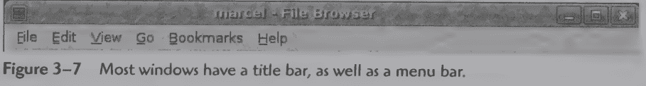

运行程序顶部的条称为标题栏。根据应用程序的不同，它可能会显示程序名称、你正在处理的文档或解释你正在运行程序的描述。左键点击标题栏并用鼠标拖动，可以在桌面上移动程序窗口。

> **快速提示：** 大多数现代桌面假设显示器分辨率至少为 1024×768，且许多应用程序也认为此是普遍真理。当你的显示器比这小得多（例如， 800×600）且你需要点击的按钮在屏幕外时，这就会造成混乱。点击标题栏并拖动窗口所能有限，特别是当标题栏本身在屏幕外时。

不要绝望。通过按 `<Alt>` 键并左键点击窗口，你可以将其拖动到任何你想去的地方，包括桌面的边界之外。当你需要点击某个隐藏的“确定”按钮时，这种方法特别方便。

双击标题栏可使程序窗口最大——占据整个屏幕。再次双击，窗口将恢复到原始大小。

标题栏上有许多小图标。将鼠标光标悬停在它们上方，工具提示会告知它们的功能。从标题栏左角开始是一个小图标，工具提示将其识别为“窗口菜单”。点击这里会弹出一个菜单，让你可以将程序移动到另一个工作空间，并最小化或最大化应用程序（以及其他）。

下拉菜单中的其他项目之一是“置顶”（On Top）。选择后，窗口层级更高，使其始终浮在其他窗口之上，无论你之前选择了哪一个。好吧，它并不是真的悬浮，但即使你点击了其他窗口，它始终会出现在任何窗口上方。

我想让你注意的另一个项目与整个工作空间概念有关，即标记为“始终在可见工作空间”（Always on Visible Workspace）。理解它的最好方法就是尝试一下。点击你的三个工作空间之一。在每个工作空间中，你应该看到一个整洁的桌面。回到你的第一个工作空间。点击窗口菜单并选择“始终在可见工作空间”。现在，跳到工作空间 2。`Nautilus` 在那里。点击工作空间 3，它也在那里。事实上，如果你定义了 10 个工作空间，`Nautilus` 会在所有工作空间中等待你。

这是一个很酷的信息。你仍然只运行了一个 `Nautilus` 实例。它对每个工作空间都可用。最后，假设你在工作空间 1 时让 `Nautilus` 对每个工作空间都可用，而你现在位于工作空间 3。点击窗口菜单并选择“仅在此工作空间”（Only on This Workspace）。现在，跳到工作空间 2。`Nautilus` 在那里。点击工作空间 3，它也在那里。事实上，如果你定义了 10 个工作空间，`Nautilus` 会在所有工作空间中等待你。

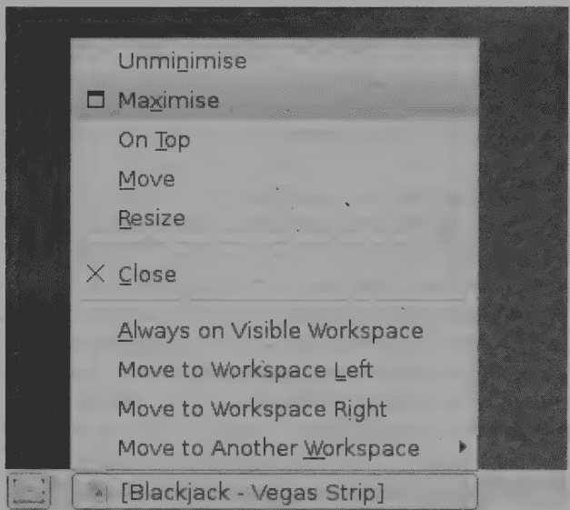

当你将光标置于（图 3-8）上时

当然，指点和点击是我们大多数人的操作方式。这很简单，有时，如果你知道命令，直接输入那个命令可能比通过所有那些菜单要快得多。这就是为什么，在我们一起读这本书时，我的意图是，我打算在可能的情况下告诉你命令是什么。（如果你不感兴趣，可以直接跳过它。）你好奇那些程序叫什么名字吗？嗯，就像有不止一种方法可以，呃，嗯，找到那只著名的猫（那是一本很友好的书，朋友们），也有不止一种方法可以找到正在运行程序的名称。如果你好奇想发现关于运行进程的所有知识，请查阅高级命令行章节，第 21 章。此时，我会告诉你一个，

> **提示：** 以防你好奇，`Nautilus` 的程序名称是顶部面板，点击“系统”、“偏好”，最后点击“会话”。会出现带有三个标签页的会话窗口。点击中间标签，即标记为“当前会话”的标签，你会看到当前图形会话运行的程序列表。这并不是系统中运行的所有程序列表，只是与你的 GNOME 会话相关的程序。滚动到列表中的最后一个命令（它会随系统而异）。完成后，点击“应用程序”菜单，导航到“工具”，启动计算器程序。现在，回到你的会话窗口和运行的

...运行程序。（你可能需要向下滚动。）一个名为 `gcalctool` 的新程序应该出现在列表底部（见图 3-10）。这就是计算器程序的名称。

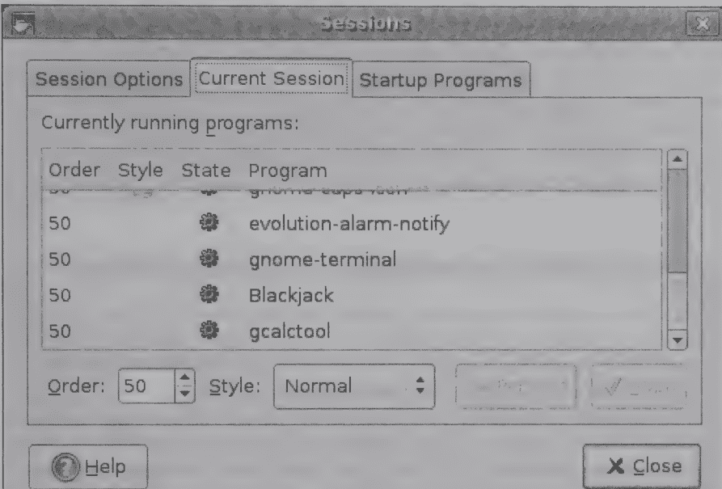

图 3–10 会话偏好（Sessions Preference）工具可以让你看到 GNOME 下运行的程序。

会话偏好工具并不是一个进程列表工具。事实上，它的设计目的是控制会话期间运行的程序、这些程序是否应该在你登录时自动启动，以及这些程序在会话开始时应该什么状态。尽管如此，这是一个快速且有趣的方法，可以查看程序的去留并通过名称识别它们。

总结一下，当你知道程序名称时（例如计算器），按下 `<Alt+F2>`，在对话框中输入 `gcalctool` 并按下 `<Enter>` 就与通过菜单是一样的。请看图 3-11 的示例。

# 第 3 章 亲手实践（桌面概览）

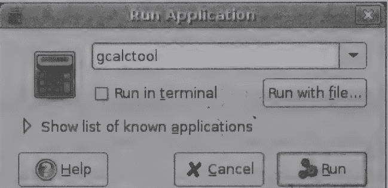

**图 3–11** 使用 `<Alt+F2>` 运行命令。

## 命令行的礼貌介绍

是时候向你介绍一个新朋友了。好了，这个朋友实际上是一个应用程序，你可以在“应用程序”菜单下的“辅助工具”中找到它。从表面上看，这个朋友（好吧，程序）可能看起来不像你见过的其他那么友好，但在你熟悉终端程序后，会对它交到你手中的力量和精细控制感到印象深刻。这就是你的命令提示符。在 Windows 世界里，你可能将其认为是 DOS 提示符。

终端应用程序是你访问 Linux 命令行界面，称为 shell（外壳）。有许多类型的 shell，每种的工作方式都相似（例如，它们都允许你运行命令），但每种可能具有不同的能力。Linux 的默认 shell 是 `bash`，即 GNU Bourne-Again Shell。shell 是强大的，了解它的功能将使你成为 Linux 世界的魔法师。与 shell 合而为一，没有什么能阻挡你。shell 是 Linux 系统专家和管理员的领域。在大多数情况下，你可以通过留在 X 窗口系统和你的 Ubuntu GNOME 桌面来完成所需的任何事情。这里还有另一个挑战。虽然图形界面让事情变得友好且易用，但有时从 shell 中工作会快得多。尽管你几乎可以在图形桌面上完成所有需要的事情，但每隔一段时间，我都会要求你在 shell 提示符执行某些操作。

随着时间的推移，你也会感受到 Linux shell 的力量。

## 给我更多！

对于那些读完本书的这些章节并发现自己想了解*更多*关于 shell 的知识的同学，请参阅附录 A。

这是我们的礼貌介绍。点击“终端”（Terminal）菜单项，会出现一个相当空空的窗口。顶部是菜单栏，上面根据它们对闪烁会话的影响排列了几个快速访问项目。在下方，在窗口较大的部分，你看到一个美元符号旁边有一个闪烁的光的光标。系统正在等待你输入命令。每当你发现处于 shell 提示符处时，系统都在等待你输入命令。还记得之前的计算器示例吗？你可以在这里输入 `gcalc` 并同样轻松地启动它。现在，在 shell 提示符处输入 `date`，然后按下 `<Enter>` 键（见图 3-12）。

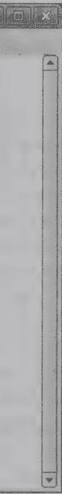

图 3-12 显示 `date` 命令结果的 GNOME 终端程序。


现在你知道我写这段话时的日期和时间了，当你尝试时，你会得到当前的日期和时间。这就是 `date` 的作用：一个显示日期时间的命令。你也会发现自己回到了 shell 提示符处，系统正等待等待你的下一个命令。输入 `exit` 并按下 `<Enter>` 键。

终端提示符出现了。就这样。我们在阅读这本书的过程中会再次使用 shell，但目前，你对 shell 的礼貌介绍到此结束。

> **趣味小贴士** 注意不要输入 `*date*` 而不是 `date`。你将得到“迪斯教日期”（Discordian Date），那是来自亚天才教会的一种种计数系统。例如：

```
$ ddate
```

今天是 Sweetorn，YOLD 3172 年混沌的第 46 天

## 修改你的密码；这关乎你！

定期更改密码是良好的安全策略。查看顶部面板并点击“系统”（System）、“偏好”（Preferences）。在最顶部，你应该看到一个标记为“关于我”（About Me）的条目。会出现一个个人信息窗口，你可以从中更改或填写大量的个人信息（见图 3-13）。你也可以使用你的 `<Alt+F2>` 运行序列运行计算器示例中的命令，输入命令 `gnome-about-me`。

你可能会问为什么 Ubuntu 为这些内容提供空间。就像用户名一样，组名也由数字标识符表示，这被称为*组 ID (GID)*。用户的 UID 是唯一的，组的 GID 也是。

每个用户都通过用户名引用。每个用户名都有一个关联到一个多个组的*用户 ID (UID)*。添加用户需要以 root 身份运行，因此当你启动 GNOME 用户管理工具（命令行名为 `users-admin`）时，系统会要求输入密码。当程序启动时，会出现一个类似图 3-15 的窗口。有两个标签，一个是“用户”，另一个是“组”。

## 用户安全

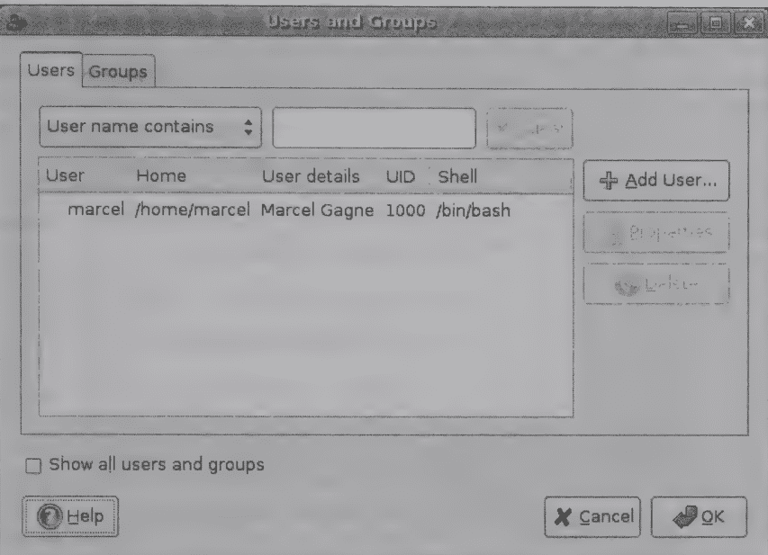

图 3–15 GNOME 用户管理工具。

默认情况下，所有非管理员用户账户都会显示出来。在刚安装的 Ubuntu 中，这通常意味着只有一个用户，即你在安装时设置的那个。要查看系统上的所有用户，请点击左下角的“显示所有用户和组”（Show All Users and Groups）复选框。要添加用户，点击右侧的“添加用户”（Add User）按钮。会出现一个新窗口，即用户账户编辑器（User Account Editor）（见图 3-16）。

此页面上的大部分信息都是可选的。事实上，你只需要输入用户名和密码。其他字段是为了进一步识别你为创建登录账户的人。例如，你可以选择输入其全名、办公室地点、电话号码等。

这个过程中最重要的部分与输入密码信息有关。默认情况下，你有机会“手动设置密码”（Set Password by Hand）。应该选择此区域的单选按钮。选择一个密码并将其输入“用户密码”（User Password）字段。你必须输入两次，第二次在“确认”（Confirmation）字段中。注意，当你输入密码时，你并不会看到它，而是星号会回显你的击键。你也可以通过选择最后一个单选按钮来让程序生成随机密码，然后点击“生成”（Generate）按钮。完成后，点击“确定”。

## 第 3 章 亲身实践（桌面概述）

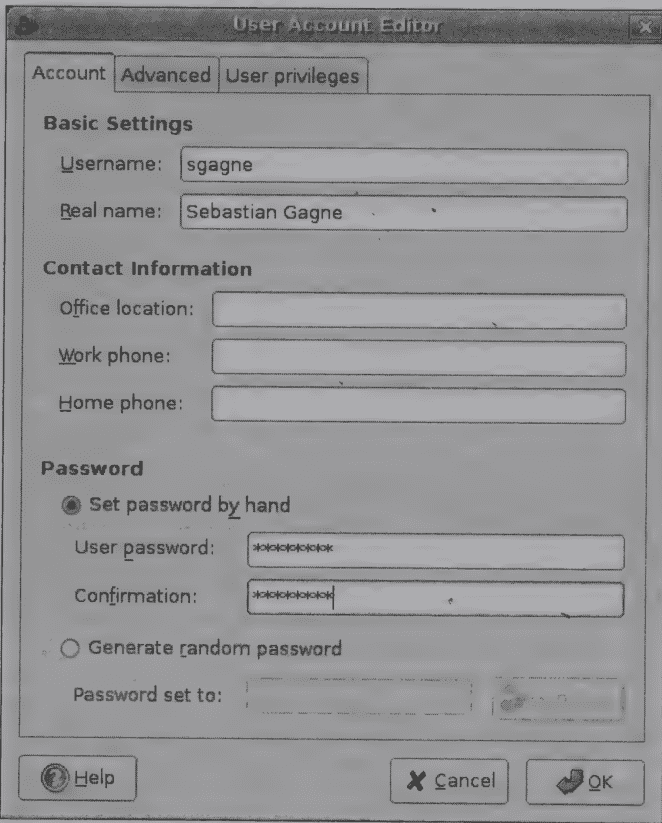

图 3–16 设置用户属性。

这会将你带回“用户和组”屏幕，你只需点击“确定”即可完成。当然，你也可以添加更多用户。

## 关于 sudo 的很多内容

当你启动一个需要管理员权限的图形化命令时，会弹出一个对话框向你要密码。这个对话框实际上是一个名为 `gksudo` 的命令。反过来，`gksudo` 是一个名为 `sudo` 的 shell 命令的封装。

## 我需要更多帮助！

对于那些可能用过其他 Linux（或 UNIX）系统的用户，你们可能访问过名为 root 的账户。这是一个对系统拥有终极权限的超级账户。Ubuntu 锁定了 root 账户并不允许直接登录。要以 root 权限执行命令，Ubuntu 使用了 `sudo` 命令。

当你使用 `sudo`（或 `gksudo`）运行程序时，系统会要求你输入密码以确认访问。输入密码后，你的账户可以在接下来的 15 分钟内执行管理员 root 级命令，而无需重新输入密码。尽管如此，你仍然需要在命令前加上 `sudo` 或 `gksudo`。

要在 GNOME 终端会话或命令 shell 中运行命令，请在命令前加上 `sudo`。

```
sudo command_name
```

每隔一段时间，你可能需要运行几个具有 root 权限的命令。在那些时候，给每个命令都加上 `sudo` 可能会有点累。为了解决这个问题，你可以输入以下内容进入具有管理员权限的会话。

```
sudo -i
```

当你完成管理员会话后，输入 `exit`。在第 21 章，我将对命令 shell 进行扩展介绍。在那里，你将更多机会看到 `sudo` 的用法。

## GNOME 文档浏览器

在书的介绍部分，我为你列了一份可以寻求帮助的地方清单，有些在网上，另一些在社区中。事实证明，你的桌面有一组非常方便且印象深刻的帮助资源，就在你的指尖。

GNOME 文档浏览器（或者如果你更喜欢，可以叫帮助中心 Help Center，命令名为 `yelp`）可能是你已经猜到的东西。

## 第 3 章 亲身实践（桌面概述）

查看你的顶栏并点击“系统”菜单，在那里你会找到一个“帮助”子菜单。文档浏览器被标记为“系统文档”（System Documentation）。要启动该程序，请点击图标。当文档浏览器打开时，你将看到类似于图 3-17 的界面。

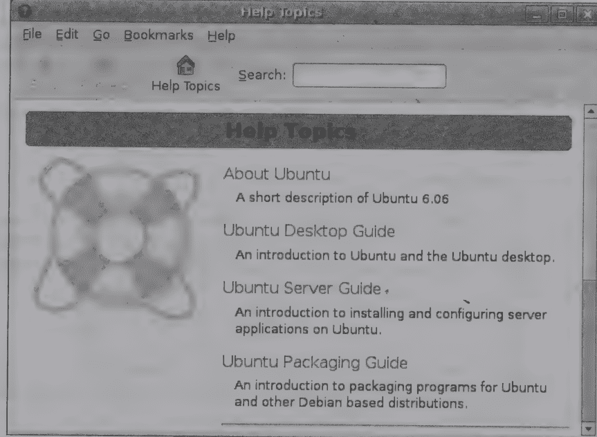

图 3-17 GNOME 文档浏览器（帮助中心）。

文档浏览器非常像 Web 浏览器，带有左右箭头键用于导航，并有一个快速返回“帮助主题”（Help Topics）按钮可以带你回到起点。文档浏览器为基础桌面应用程序提供在线帮助、命令参考（手册页）以及一些教程。只需点击链接即可进入高亮部分，或点击向前和后退箭头来导航文档。

## 注销

我开始这一章时让你登录了 Ubuntu 系统，现在通过让你注销来结束它似乎很合适。看看你顶栏的右上角。你应该看到一个看起来像打开的门且箭头指向外的小图标。当你完成工作需要注销时，点击该门图标，会出现“退出”（Exit）对话框，为你提供几个选择（见图 3-18）。

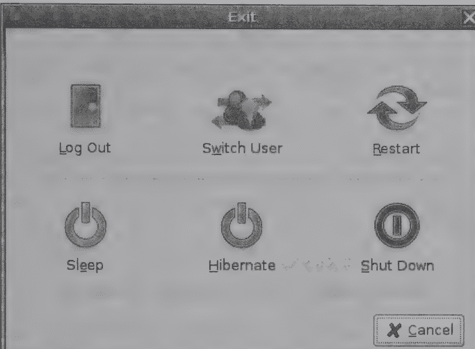

图 3-18 退出对话框为注销或关闭系统提供了许多选项。

第一个最显而易见的选项是“注销”（Log Out），这会让你的系统回到我在开头时讨论的登录屏幕。“切换用户”（Switch User）可以让你的系统回到登录屏幕，“关机”（Shut Down）可以关闭你的系统，“重启”（Restart）则可以重启系统。

# 第 4 章 导航你的 Ubuntu 桌面

既然你已经熟悉了 Ubuntu 的基本操作，现在是时候了解一下如何管理你的文件了。在 Linux 中，管理文件是至关重要的。在这一章中，我们将学习如何使用 `Nautilus`（文件管理器）来查看、移动、复制和删除文件。

## 资源

## 导航你的 Nautilus

Ubuntu 文档库

```
http://doc.ubuntuos.org
```

Ubuntu 官方文档网站

```
http://help.ubuntu.com
```

## 文件、目录和根目录

Linux 世界中有一句“一切皆文件”（归功于开发者肯·汤森）。这包括目录。目录就是内部带有列表的文件。

> 文件夹和目录是同一个东西。这两个术语可以互换。我倾向于把它们称为目录，但如果你更习惯于把它们称为文件夹，不用担心。

根目录（称为斜杠 `/`）名副其实。如果你将你的文件系统视为一棵向外延伸的树，你就开始理解它的了。在根目录下，你会发现 `usr`、`bin`、`tmp` 等目录。让我们看看 `Nautilus` 并观察一下。

点击顶栏上的“位置”并选择“主文件夹”。这会在主文件夹中打开浏览器。如果你的侧边栏没有（见“Nautilus”左侧边栏），按下 `<F9>` 打开它。你会看到若干条目，包括你的主目录。在左侧，`Nautilus` 显示了系统上的几个重要位置，主要是你的主文件夹。右侧显示当前位置（或位置）的内容。

## 文件、目录与万物之源

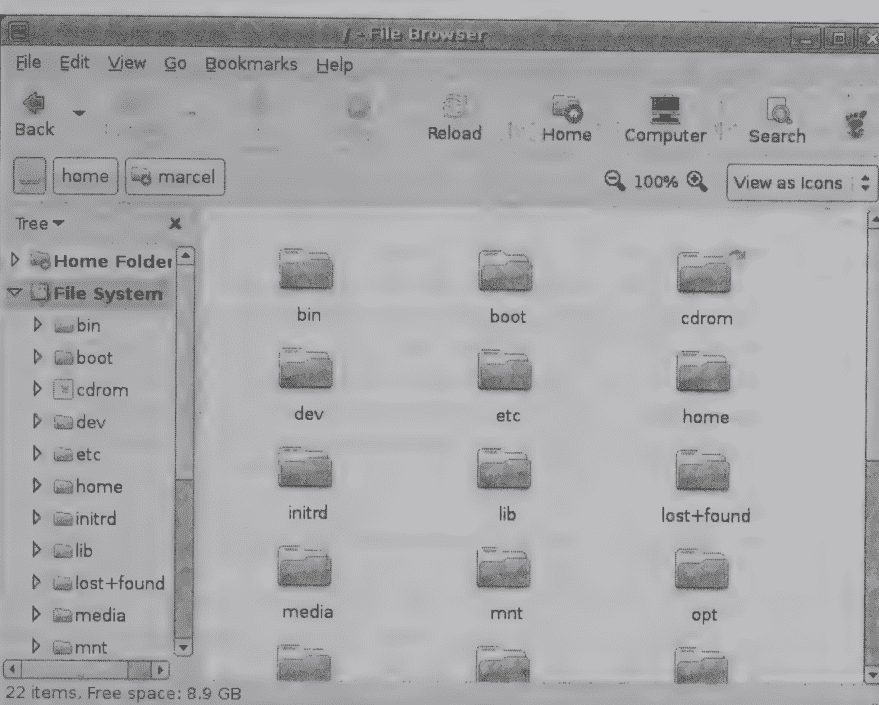

图 4–1 `Nautilus`，即 GNOME 文件浏览器，显示了 Ubuntu Linux 文件系统的俯视图。此视图是从左侧的导航面板中选择的。

> 提示：当你在 `Nautilus` 中查看文件和文件夹时，它们按字母顺序排列。通常情况下这是你想要的结果，但你也可以按照大小、修改日期、文件类型等进行排序。只需点击 `Nautilus` 菜单栏上的“查看”（View），并检查“排列项目”（Arrange Items）子菜单。你甚至可以选择手动排列。

根目录下的目录称为 home（家），在该目录内部，你会发现其他目录，系统中的每个登录名都有一个目录。这些是个人家目录，你可以在这里找到自己的个人文件和目录。如果你想存储个人文档、音乐文件或图片，这里就是所在。一旦进入 `Nautilus`，可以通过点击“主目录”（Home）图标或点击菜单栏上的“转到”（Go）并选择“主目录”（Home）来跳转到你的家目录（键盘高手可以直接按 `<Alt+Home>`）。这就是你的 `HOME`。


> **快速提示**：使用 `HOME` 不仅仅是为了好玩。系统可以根据环境变量、可以指向文本的符号名称甚至命令来识别某些内容。在 DOS/Windows 世界中，你也有类似的变量——例如 `AUTOEXEC.BAT` 文件中的 `PATH`。`HOME` 是一个环境变量——分配给每个登录用户。如果你想查看分配给当前会话的所有环境变量，请打开终端并输入以下命令：

```
env
```

尝试一下。在“树形视图”（Tree view）的左侧，点击家目录旁边的小箭头。正如你之前看到的，树形视图会展开，显示你个人目录中的文件夹。注意，指向右侧箭头变成了指向下的箭头。如果你再次点击它，目录视图就会折叠。当你的个人目录展开时，你会看到右侧视图出现了几个项目，其中一个标记为“桌面”（Desktop）的图标。示例请参见图 4-2。左侧主目录文件夹处于展开状态，右侧视图显示文件夹处于折叠状态。

在进行任何操作之前，我想在你的家目录中重新打开 `Nautilus`（点击“位置”Places 并选择“主目录”Home Folder）。这里有一个名为“桌面”的特殊文件夹。现在，看屏幕底部的面板，位于左侧。你看到“桌面”图标了吗？它看起来像一个老式的桌面垫，上面放着支铅笔和一张纸。将鼠标悬停在上面，工具提示显示“点击此处隐藏所有窗口并显示桌面”。点击它，你的桌面就出现了，没有任何窗口干扰——一切都恢复了正常。

现在，我将稍微跳到书的后面的内容，让你在桌面上创建一个文件夹。在空桌面的任何地方点击右键，会弹出一个菜单。该菜单顶部的选项是“创建文件夹”（Create Folder）。点击它，桌面上就会出现一个文件夹，下方带有“未命名文件夹”（Untitled Folder）的标签（见图 4-3）。输入一个名称并按 `<Enter>`。

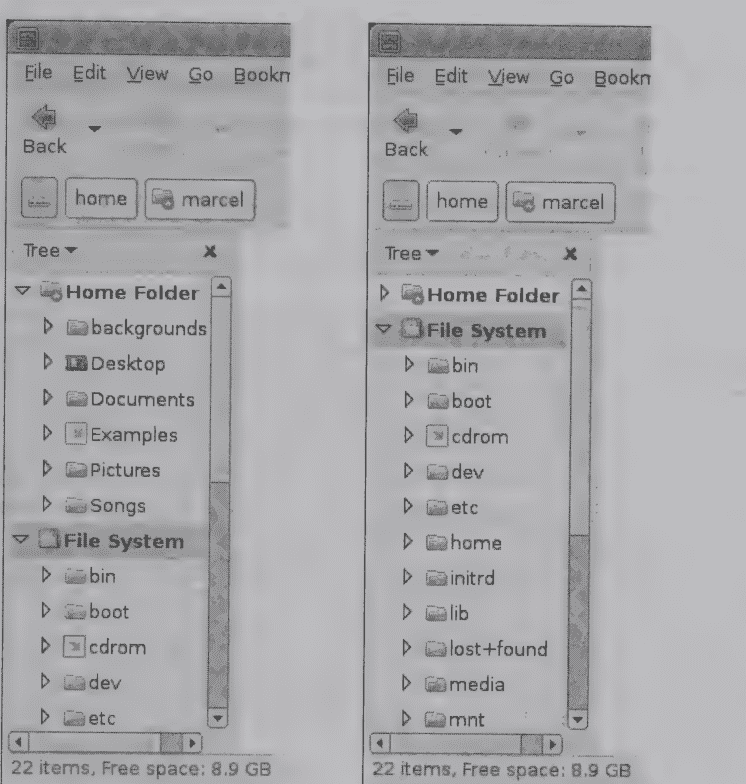

# 展开的家目录

# 折叠的家目录

图 4–2 在 `Nautilus` 的树形视图中展开和折叠文件夹。

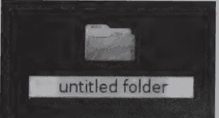

图 4-3 在桌面上创建文件夹，右键点击并选择“新建文件夹”。然后更改未命名文件夹的名称。

我让你这样做是因为我希望你在我在桌面上创建图标时记住一些事情。当你操作 Ubuntu 系统时看到的桌面，其实就是你家目录中的那个“桌面”文件夹。如果你在桌面创建一个文件夹，使用 `Nautilus` 查看你的家目录，然后双击“桌面”文件夹，你会在桌面文件夹中看到新创建的文件夹。图片文件或视频片段也是如此。如果它在你的桌面上，它就在桌面文件夹里。甚至你桌面上的那些图标也是文件或目录。酷吧？我们继续吧。

## 终端操作 (Shell Out)

通过选择顶部面板“应用程序”（Applications）菜单下的“附件”（Accessories）子菜单来打开终端 shell。在提示符处，输入 `ls Desktop`。该命令列出了你桌面目录的内容。将你在此处看到的内容与当前图形桌面上的图标进行对比。这些名称看起来眼熟吗？完成后，输入 `exit` 关闭终端。

目录（及其子目录）通常显示为文件夹，尽管这不是一条硬性不变的规则，因为你可以对其进行自定义。尽管如此，目录从一开始就有不同的图标——你你刚刚访问的“桌面”图标就是其中之一。

## 无论你去往何处 . . .

要在文件夹之间移动，你只需点击树形视图中的文件夹，或者在右侧面板或“位置”（Places）视图中双击文件夹图标即可。你也可以使用方向键在目录树中移动。你会看到高亮条在目录之间移动。

## 搜索我...


图 4-4 `Nautilus` 的工具栏。

> 提示：当你查看文件夹时，隐藏的文件和文件夹比你看到的要多。以点开头的隐藏文件并不显示。要查看它们，点击菜单栏上的“查看”（View）并选择“显示文件”（Hidden）。

> 提示：如果你知道文件夹，最快的方法直接在位置栏中输入。点击菜单栏上的“转到”（Go），然后选择“位置”（Location）。


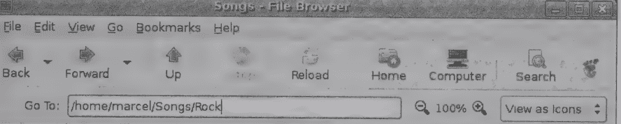

图 4-5 通过位置栏快速跳转到已知文件夹。

你的 Ubuntu 系统家目录下可能会有很多文件，但这种情况不会持续多久，我保证。有一句老言说：“数据会增长到填可用磁盘空间”。根据我的经验，这是一个事实。在某个时刻，你会发现找到创建的文件很困难。

幸运 `Nautilus` 内置了快速查找功能。你有很多从我的 Linux 系统刻录的音乐（见第 17 章）。我工作时喜欢听。让我们假设我想找到你的平克飞岩歌曲存储在哪个文件夹。只需按 `<Ctrl+F>` 就会出现一个搜索框。输入你正在搜索的文件名（例如 `Pink Floyd`），然后按 `<Enter>`。`Nautilus` 在主窗口中显示结果。

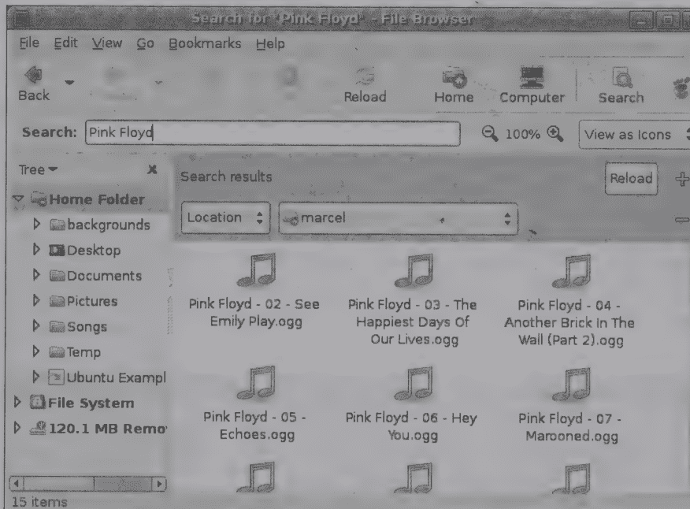

图 4-6 正在找东西？只需按 `<Ctrl+F>` 并输入文件名的一部分，让 `Nautilus` 处理。

## 导航侧边栏

我们应该花几分钟看看左侧面板——或者用我喜欢的称呼导航面板。你已经学会了如何使用它从“位置视图”切换到文件系统的“树形视图”。但等等（正如电视节目里说的），还有更多。正如你记得，有一个下拉列表可以

改变你查看系统的方式。我已经让你从“地点（Places）”视图切换到了“树状结构（Tree view）”视图，这影响了你导航文件系统的方式。然而，该列表中还有其他有趣的选项，我想现在就来看看它们（见图 4–7）。

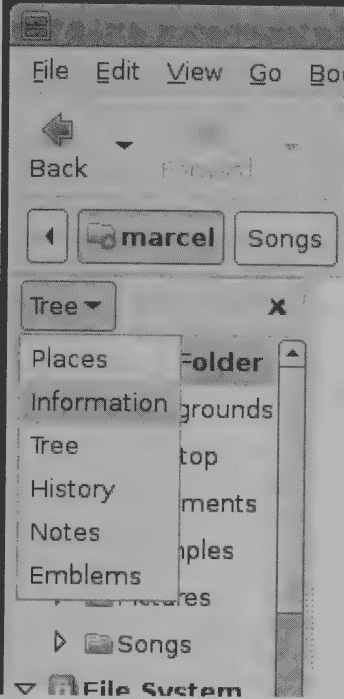

**图 4–7**

左侧面板提供了多种查看、分类和识别文件夹内内容的方法。

由于我们已经介绍过“地点”和“树状结构”视图，我将继续介绍“信息”（Information）。当你点击这里时，侧边窗口会显示当前文件夹的信息。这包括文件夹的名称、图标（你可以更改每个文件夹的默认图标，这将在稍后介绍）、该文件夹中的项目数量以及最后修改日期（即添加或删除文件的时间）。

下一个可能的选项是“历史记录”（History）。点击这里会显示你最近访问的文件夹（按访问顺序排列）、网络文件夹、FTP 站点以及你可能过的任何搜索。最后一项特别酷，因为如果你需要，可以通过双击历史列表中的特定搜索来重新访问该搜索。文件夹也是如此。双击即可进入。

> 提示：如果你想能够快速回到某个特定的文件夹或站点，可以通过点击菜单栏上的“书签（Bookmarks）”并选择“添加书签”来标记该位置（你也可以按 `<Ctrl+D>`）。要返回书签，点击“书签”并点击它即可。

现在，我们来看“笔记”（Notes）。对于每个文件夹，你都可以关于其内容添加笔记。这是自由格式文本，可以帮助你识别内容或提醒你那里有值得注意的东西。例如，假设你有一个名为“假期照片（Holiday Shots）”的文件夹，里面存放着你在公司圣诞派对上那些非常尴尬的照片。你可能想添加这样一条笔记，作为几个月后的提醒。当你这样做时，会出现一个小小的笔记看起来被钉在了你的文件夹上（见图 4-8）。


**图 4–8**

当你为文件夹添加笔记时，文件夹图标上会贴上一个笔记图标。

文件夹上的这个小装饰很好地适用于我们侧边面板的最后一个选项，点击这里，侧边面板就会填充一列表图形图标（见图 4-9）。这些图标的设计是为了让你能够一种快速识别特定文件或文件夹重要性的方法。你只需要点击这些图标之一并将其拖到文件或文件夹上。有许多这样的徽章，名称如“收藏（Favorite）”、“酷（Cool）”、“重要（Important）等。如果你发现徽章太多了（因为你确实正在这样做！），将图标（位于列表顶部）拖到你的文件或文件夹上。徽章就会消失。

| 徽章 (Emblems) | 收藏 (Favorite) |

| :--- | :--- |

| 相机 | 图片 |

| 酷 | Ubuntu |

**图 4–9**

徽章提供了一种快速且视觉上有趣的方式来识别文件或文件夹。

### 导航网络

当我告诉你们历史记录和书签时，我随口提到了可以使用 `Nautilus` 访问 FTP 站点和其他网络位置，包括 Windows 共享、WebDAV 等。要建立网络连接，点击菜单栏上的“文件（File）”并选择“连接服务器（Connect to Server）”。会出现一个连接对话框，你可以在其中建立连接（见图 4-10）。

在“服务类型（Service Type）”标签旁边有一个下拉框，你可以从中选择服务器类型。你的你有 SSH、FTP（带登录）、Windows 共享、WebDAV 和自定义位置。对于此示例，让我们选择一个匿名登录的公共 FTP 服务器。在“服务器”字段中，输入你尝试连接的服务器名称（例如，`ftp.ubuntu.org`）。这就是你需要做的。点击“连接”，`Nautilus` 就会打开该文件夹（见图 4-11）。该远程文件夹的导航与在你的系统上操作完全一样。

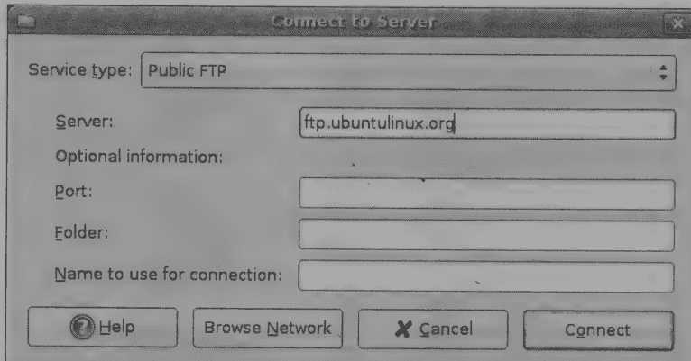

**图 4–10**

`Nautilus` 不局限于你导航本地文件系统。连接 FTP 站点、Windows 共享、WebDAV 服务器等也同样简单。

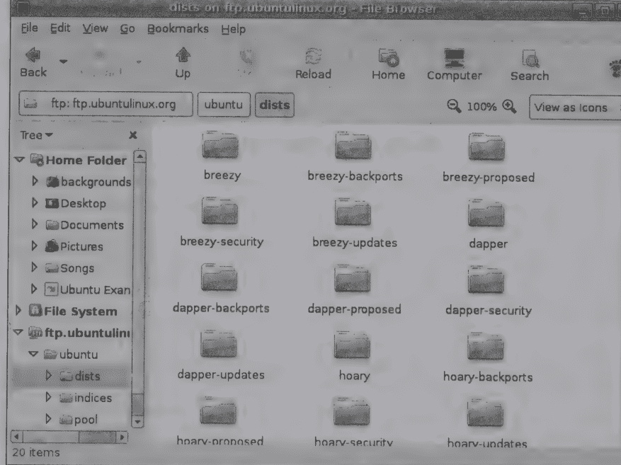

**图 4–11**

连接到远程服务器后，导航它就像导航任何本地文件夹一样简单。

另一种方法是点击菜单栏上的“转到（Go）”，选择“位置（location）”（或按 `<Ctrl+L>`）。我之前向你提到过本地文件夹，但它在这里也有效。要进入同一个 FTP 站点，你可以在位置字段中输入以下 URI（通用资源标识符）：

```
ftp://anonymous@ftp.ubuntu.org/
```

发现所有这些连接的最佳方法是连接到网络资源，然后按 `<Ctrl+L>`。当前 URI 将可见。访问网络资源的另一种方法是从“地点（Places）”菜单中选择“网络服务器（Network Servers）”。如果你有 Windows 机器连接到网络，这特别有用。会出现一个带有 Windows 网络图标的 `Nautilus` 窗口。双击该图标，即可看到网络中的工作组（见图 12）。


**图 4–12**

从“地点”菜单选择“网络服务器”可以方便你导航网络共享。

## 复制，等等……

你可以使用 `Nautilus` 创建、复制、移动、重命名和删除文件，但在执行任何这些操作之前，你需要选择文件或文件夹。选择文件是你经常要做的事情，所以让我们从这里开始。将鼠标光标放在一个图标之外。现在，拖动光标并注意你正在创建的高亮框。它变高亮了。右键也可以选择文件，但方式有所不同，会弹出一个菜单告诉你对该文件做什么。

不要忘记方向键。向左、右、向上或向下移动都会高亮所在的文件或文件夹。你可以点击菜单栏上的“编辑（Edit）”（或按 `<Alt+E>` 进入编辑菜单）并决定对该文件做什么。我稍后会讨论这些决定。

有时，一个文件是不够的——你需要选择多个文件。最简单的方法是使用鼠标。点击起始图标的左上角，将光标拖过一系列图标。注意你所选择的文件和文件夹。也许你只想在这里挑选几个文件。怎么做呢？只需按住 `<Ctrl>` 键并点击鼠标。假设你选择了一组四个文件，你想要更深处的另一个。松开鼠标按钮（但保持按住 `<Ctrl>`），将鼠标置于下一组图标的左上角，再次选择。只要你继续按住 `<Ctrl>` 键，就可以在这里挑选选择文件。

你也可以通过方向键完成所有这些操作，只需将光标移动到起始文件上，按住 `<Shift>` 键并移动光标（任何方向均可）。这样做时，你会发现文件在选中后出现。你自己试一下。对于非连续选择，像使用鼠标时一样使用 `<Ctrl>` 键。按空格键选择（取消选择）文件。

最后，可能对未来非常重要，你还可以按扩展名进行选择。假设你想选择所有的 `.mp3` 或 `doc` 文件

## 创建新文件夹

你目录中的扩展名。点击菜单栏上的“编辑”（Edit），然后点击“选择扩展”（Select extension）。弹出的小窗口，要求你输入扩展名。如果你想要所有的 `.mp3` 文件，输入 `*.mp3`。`.mp3` 扩展会将你的选择限制在特定类型的文件上，而星号 `*` 则表示“给我所有匹配项”。

## 创建新文件夹

如果你还没有运行 `Nautilus`，现在就启动它，并确保你处于你的个人主目录（personal home directory）中。在 `Nautilus` 主窗口中，右键点击任何空白区域，查看弹出的菜单。点击该菜单中的第一项，它的标签被很方便地标记为“创建文件夹”（Create Folder）。当然，这在我在本章节之前告诉过你的回顾，但这次不是在你的桌面上，而是在 `Nautilus` 主窗口内进行的。会出现一个“未命名文件夹”（Untitled Folder），等待你给它一个更合适的名字。这个文件夹可以是你喜欢的任何内容。如果这个目录将存放你的音乐文件，也许它的名字应该叫“音乐”（Music）。

> 小贴士：早些时候我让你在桌面上创建一个文件夹，然后查看 `Nautilus` 中的“桌面”（Desktop）文件夹。为什么不在双击 `Nautilus` 中的“桌面”文件夹，创建一个文件夹，然后回来查看你的桌面呢？

记住，你可以在其他文件夹内部创建文件夹，并以符合逻辑的方式开始整理物品。例如，你可能想在音乐文件夹中创建名为“摇滚”（Rock）、爵士”（Jazz）、嘻哈”（Hip Hop）和“古典”（Classical）的文件夹。

## “我改变主意了”（即重命名）

你创建了一个名为“古典”（Classical）的文件夹，但你其实是想要“歌剧”（Opera）。要重命名文件或目录，选择它，右键点击获取菜单，然后选择“重命名”（Rename）。名称在相应的图标下方会被高亮——只需输入新名称并按 `<Enter>` 键。或者，选择它并从菜单栏的“编辑”（Edit）菜单中选择“重命名”。最简单的方法是在选择文件或目录后按 `<F2>`。

## 使用终端操作

打开终端并输入 `ls` 查看你的目录。使用 `mv` 命令可以很容易地从 shell 重命名文件或目录。为什么要用移动（move）来重命名呢？因为重命名涉及先复制到新位置，然后删除旧文件。输入 `mv oldname newname` 并按 `<Enter>` 键。例如，要将你的“古典”目录改为“歌剧”，你会输入以下命令：

```
mv Classical Opera
```

## 复制文件和目录（以及移动！）

啊！这就是你学习 `Nautilus` 另一个妙技巧的地方。将文件从一个目录复制到另一个目录的简单方法是启动两个版本的 `Nautilus`（我通常会关闭其中一个版本中的侧边导航面板）。你也可以在树视图（Tree view）中右键点击文件夹，并从弹出菜单中选择“在新窗口打开”（Open in New Window）。在第一个窗口中，你找到想要复制的文件（或文件）。在第二个 `Nautilus` 窗口中，你找到想要将这些文件复制到的目录。按住 `<Ctrl>` 键，直接将文件从一个窗口拖到另一个窗口。你的文件就被复制了。

复制和移动文件是类似的，但不需要按住 `<Ctrl>` 键，只需将文件或文件夹拖到新位置即可。复制和移动都涉及复制。区别在于复制完成后发生了什么。在一种情况下，你复制了文件并保留原始文件，而移动则是复制文件并删除其原有位置的原始文件。

这里有一个有趣的技巧可以给你。点击你想移动的文件或文件夹，然后将其拖动到任何地方并按住 `<Alt>` 键。会弹出一个小菜单，询问你是想将文件复制到这里还是移动到这里（见图 4-13）。

另一个简单的技巧是选择你想要的文件，右键点击获取菜单，然后点击“复制”（Copy）。现在，去你想让此文件出现的文件夹，在 `Nautilus` 主窗口的空白处右键点击，并从弹出菜单中点击“粘贴”（Paste）。你也可以指定复制。


**图 4-13** 移动文件时的提示

## 使用终端操作

打开终端并输入 `ls` 查看你的目录。使用 `mv` 命令可以很容易地从 shell 重命名文件或目录。为什么要用移动（move）来重命名呢？

## 此外，如果你想安全地覆盖文件，可以使用 `cp -i`：

```
cp -i sourcefile destinationfile
```

## 复制文件和目录（还可以移动！）

点击 `Nautilus` 菜单栏上的“编辑”（Edit）并选择“选项”（Preferences）。会出现一个带有五个选项卡的窗口。点击“显示”（Display）选项卡，查看顶部“图标标题”（Icon Captions）标题下方。有三个按钮，每个都是一个下拉列表。第一个选中的是“无”（None）。将其更改为“权限”（Permissions）（如你所见，这里有几个选项）。立即，`Nautilus` 主窗口中显示的任何文件都将在名称下方列出权限。

在点击“关闭”（Close）之前，点击“列”（List Columns）选项卡。这定义了当你选择 `Nautilus` 的列表视图而不是图标视图时会显示哪些信息。在这里点击“权限”（Permissions），然后点击“关闭”。查看 `Nautilus` 菜单栏的最右侧。右侧图标下方有一个标记为“以图标形式查看”（View as Icons）的按钮。点击此按钮，下拉列表允许你将视图从图标更改为文本（见图 4-17）。

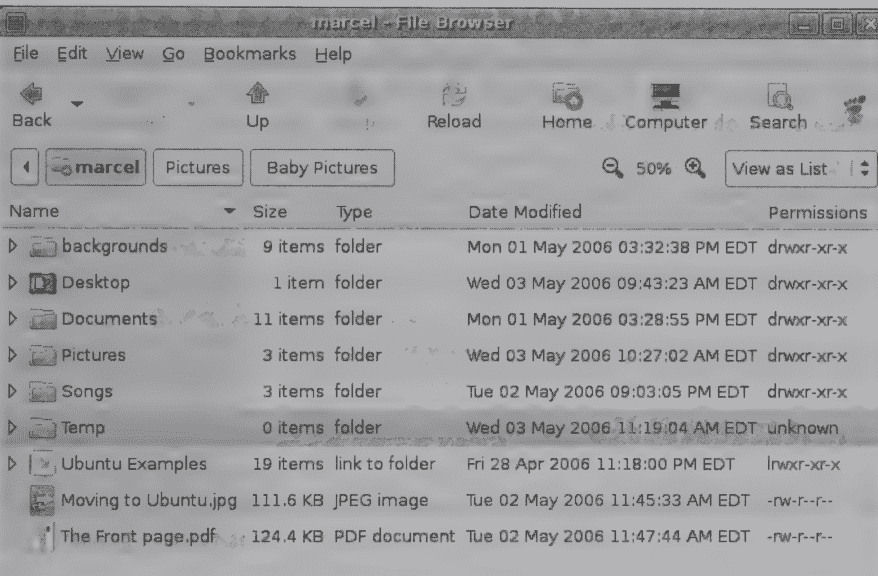

图 4–17 当你选择“以图标形式查看”模式时，默认不会列出权限。你需要在编辑菜单“选项”对话框中激活该视图。

实际上有 10 列描述了文件的权限。在大多数情况下，你会在三列中的第一列看到一个连字符（-）或 `d`，代表目录。接下来的九列实际上是三列为一组。

# 第 4 章 在 Nautilus 中导航

其他其他九个字符（第 2 到第 10 个字符）表示文件用户或所有者（前三个）、用户组（第二组三个）以及其他人或所有人（最后三个）的权限。如果你看一张图片并看到 `--rw-rw-r--`，你会发现用户和组具有读和写权限。所有其他人都有只读权限，即其他所有人拥有的相同权限。`r` 代表读（read），`w` 代表写（write），`x`（上方未显示）代表可执行（executable）。


## 使用 Shell 命令

想在 shell 提示符处查看权限吗？只需在 `ls` 命令后添加 `-1` 即可，如下：

```
ls -1 directory_name
```

在你的 Linux 使用过程中，你经常需要更改权限，有时是为了让他人访问你的目录或文件，或者为了让脚本或程序变得可执行。通过使用“权限”（Permissions）选项卡，你可以通过勾选相应复选框中的权限，为所有者（你自己）、你所属的组以及其他人选择读、写或执行权限。

## 删除文件和文件夹

偶尔某个文件或目录会失去它的用处。是时候下下心对旧文件系统进行一些清理了。正如你所预料的那样，有几种方法可以丢掉冲突的文件或目录。最友好且安全的方法是将文件从 `Nautilus` 拖到面板右侧的垃圾桶图标。对于初学者来说，这是一种安全的方法，因为发送到垃圾箱的项目是可以恢复的——只要你还没清倒垃圾。在那之前，你可以点击垃圾桶图标（你猜得没错），会出现一个 `Nautilus` 窗口，向你显示已发送到垃圾桶的项目。这些项目可以移动（或复制）回任何你需要的地方。要永久删除垃圾箱中的文件，右键点击垃圾桶图标并点击“清空垃圾桶”（Empty the Wastebasket）。


注意：清空垃圾桶后，这些文件将永远消失。

## 其他有趣的地方

我确实说过删除文件的其他方法。在 `Nautilus` 内部，你可以选择文件或目录，右键点击并选择“移动到垃圾桶”（Move to Wastebasket）。如果你想摆脱所有的点击操作，还有命令行可以使用。

## 其他有趣的地方

你现在已经相当好地掌握了 `Nautilus` 以及它能为你做什么。从顶部面板上的“位置”（Places）菜单开始，是将 `Nautilus` 带到你想让去的地方的最好方法。该菜单中已有或者可以有其他有趣的地方。

例如，从“位置”菜单中选择“计算机”（Computer），`Nautilus` 将打开并显示你系统的俯视图。一个“文件系统”（Filesystem）图标位于文件树的顶层。你的软盘驱动器出现在这里，还有另一个代表你的 CD-ROM 或 DVD 驱动器的图标。这取决于系统上有多少个驱动器（见图 4-18）。如今，人们随身携带 USB 密钥或 USB 优盘并不稀奇。如果你将其中一个插入你的 Ubuntu 系统，它就会成为你可以访问的有趣地点之一。

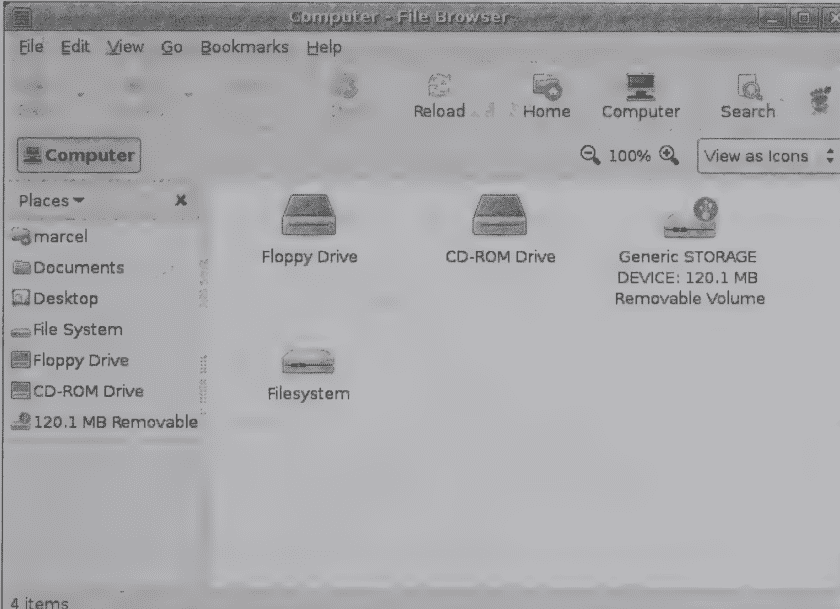

**图 4–18** 从“位置”菜单选择“计算机”显示连接到你系统的设备概述。

## 我的世界，我的方式

你现在已经相当好地掌握了 `Nautilus` 以及它能为你做什么。从顶部面板上的“位置”（Places）菜单开始，是将 `Nautilus` 带到你想让去的地方的最好方法。该菜单中已有或者可以有其他有趣的地方。


例如，从“位置”菜单中选择“计算机”（Computer），Nautilus 将打开并显示你系统的俯视图。一个“文件系统”（Filesystem）图标位于文件树的顶层。你的软盘驱动器出现在这里，还有另一个代表你的 CD-ROM 或 DVD 驱动器的图标。这取决于系统上有多少个驱动器（见图 4-18）。如今，人们随身携带 USB 密钥或 USB 优盘并不稀奇。如果你将其中一个插入你的 Ubuntu 系统，它就会成为你可以访问的有趣地点之一。

## 我的世界，我的方式

你现在已经相当好地掌握了 Nautilus 以及它能为你做什么。从顶部面板上的“位置”（Places）菜单开始，是将 Nautilus 带到你想让去的地方的最好方法。该菜单中已有或者可以有其他有趣的地方。

例如，从“位置”菜单中选择“计算机”（Computer），Nautilus 将打开并显示你系统的俯视图。一个“文件系统”（Filesystem）图标位于文件树的顶层。你的软盘驱动器出现在这里，还有另一个代表你的 CD-ROM 或 DVD 驱动器的图标。这取决于系统上有多少个驱动器（见图 4-18）。如今，人们随身携带 USB 密钥或 USB 优盘并不稀奇。如果你将其中一个插入你的 Ubuntu 系统，它就会成为你可以访问的有趣地点之一。

## 自定义桌面（或自己的）

你现在已经相当好地掌握了 Nautilus 以及它能为你做什么。从顶部面板上的“位置”（Places）菜单开始，是将 Nautilus 带到你想让去的地方的最好方法。该菜单中已有或者可以有其他有趣的地方。

例如，从“位置”菜单中选择“计算机”（Computer），Nautilus 将打开并显示你系统的俯视图。一个“文件系统”（Filesystem）图标位于文件树的顶层。你的软盘驱动器出现在这里，还有另一个代表你的 CD-ROM 或 DVD 驱动器的图标。这取决于系统上有多少个驱动器（见图 4-18）。如今，人们随身携带 USB 密钥或 USB 优盘并不稀奇。如果你将其中一个插入你的 Ubuntu 系统，它就会成为你可以访问的有趣地点之一。

# 第 5 章

### 我是我所视之处的主宰

正如我之前提到的，在这个世界里是多用户的。这意味着每个使用你电脑的人都可以拥有自己的环境。当你登录自己时对桌面所做的任何更改对她登录时没有任何影响。如果她偶然删除了她桌面上的所有图标或将一切变成刺眼的紫色和粉色，也不会影响你。

让我们从简单的开始。大多数人首先想要的是背景。这有点像搬进新房子或公寓。别人选择的壁纸（或漆）很少违背你的审美。电脑桌面也是如此。让我们找些更多的

### 更改背景

从在桌面任意地方点击右键开始。从出现的菜单中选择“选择桌面背景”（Choose Desktop Background），会出现桌面背景对话框（见图 5-1）。你也可以从顶部面板系统菜单下的“选项”（Preferences）访问桌面背景对话框。寻找标记为“桌面背景”的项目。

对话框的上半显示了系统可用的桌面壁纸列表。Ubuntu默认列表相当小，基本上是在无壁纸和相同背景的不同分辨率之间进行选择。我稍后会告诉你如何添加更多，但现在你需要点击“壁纸”设置。注意，对背景的更改是立即生效的。

# 我所视及之处皆为我所有……

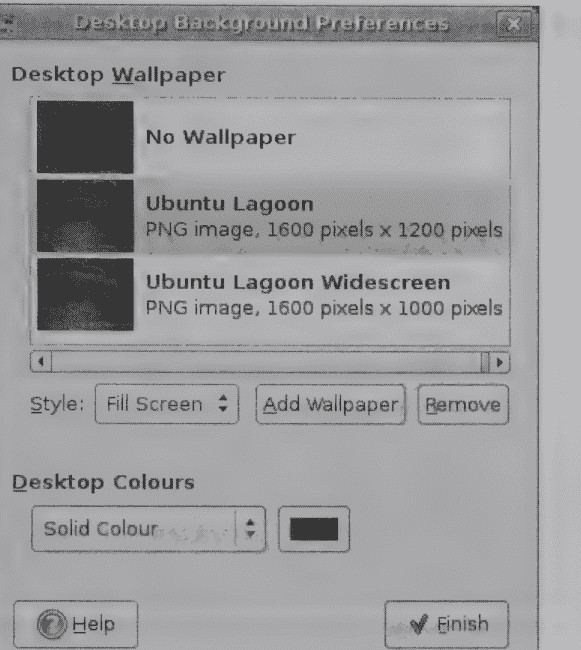

图 5–1 为桌面选择背景图像。

要向默认的小列表中添加壁纸，你首先需要准备一些壁纸。点击“添加壁纸”（Add Wallpaper）按钮，将出现 GNOME 文件选择器（见图 5-2）。

然后，你可以使用它导航到包含你图片的文件夹，并从中进行选择。找到你喜欢的图片并双击它（或者点击然后点击“打开”按钮），你就会发现回到了“桌面背景偏好”对话框，从那里你可以选择适合你心情的图像。顺便说一下，这些图像从起将作为壁纸保留。

我知道我在重复，但你并不一定需要背景。你可以点击“无壁纸”（No Wallpaper）来创建一个新的纯色背景。然后，在对话框底部的“桌面颜色”（Desktop Colors）部分，你可以选择纯色，或者根据你选择的颜色创建垂直或水平渐变。从下拉框中做出选择，然后点击右侧的颜色按钮从色轮中选择（见图 5-3）。

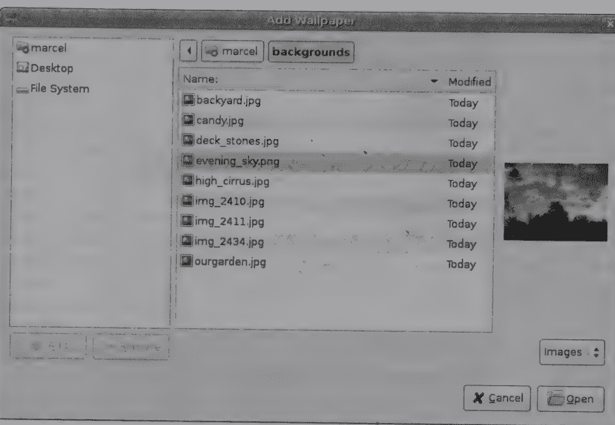

图 5–2 使用文件导航器定位并为桌面添加新壁纸。

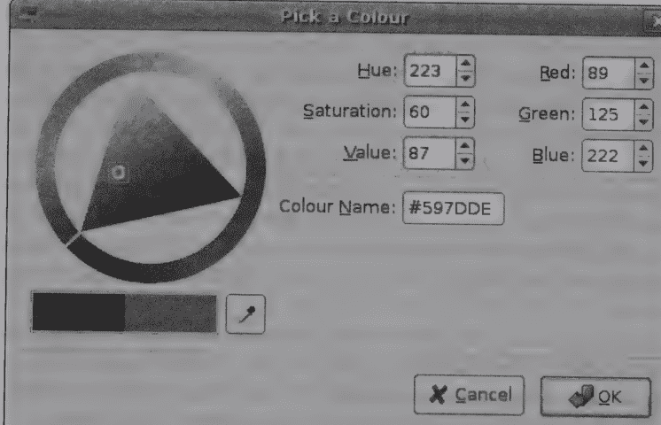

图 5–3 使用颜色选择器创建你自己的自定义背景颜色。

# 请保存我的屏幕！

这里有一个酷炫的技巧。假设你想要的颜色已经在屏幕的某个地方，而你想把它作为背景。没问题。看到颜色轮盘正下方那个吸管图标了吗？点击它，你就可以使用弹出的吸管选择屏幕上已有的任何颜色。当你对自己的选择满意时，点击“确定”关闭对话框。

# 请保存我的屏幕！

好吧，如今屏幕保护程序并没有起到太大保护屏幕的作用。几何过去，这个主的想法是为了保护屏幕免受磷光灼伤。旧式的单色屏幕对此特别为糟糕。那时，我们菜单中的字母（那个时代我们使用的是文本）会烧在磷光屏上。当你关闭显示器时，你仍然能看到最常用的应用程序的幽灵轮廓被烧在屏幕上。当我们转向彩色屏幕和图形时，情况发生了一定变化，但该问题仍然存在了一段时间，这部分是由于我们当时使用的应用程序具有静态特性。

时间流逝，一些聪明的屏幕保护者产生了一个主意：如果不断改变屏幕上的图像，那种灼伤就不可能发生。什么更好的方法可以实现这一点呢？让用户离开屏幕几分钟（或几小时）后，启动一些巧妙的动画。嘿，看着它们甚至可能很有趣。屏幕保护程序诞生了。现代屏幕使用了可以防止所有灼伤的技术，但屏幕保护程序并没有消失。那些让人着迷的鱼、烤面包机、企鹅、雪、飞船等等，尽管技术在进步，它们依然让我们保持娱乐。面对事实吧，我们都陷进去了。

Ubuntu Linux 默认开启屏幕保护程序。在这里，如果你在电脑上不进行任何操作并等待足够的时间（10 分钟），屏幕保护程序就会启动。让它运行超过 10 分钟，你会看到一个不同的屏幕保护程序启动。那是因为 Ubuntu 的默认屏幕保护程序会随机循环几个预选的屏幕保护程序。正如你所预期的，我有点说得超前了。

点击顶部面板上的“系统”（System）。选择“屏幕保护程序”（Screensaver）。出现“屏幕保护程序偏好”对话框（见图 5-4）。主窗口有一个屏幕保护程序列表，右侧有一个较大的预览窗口。在屏幕保护程序列表顶部有一个“空白屏幕”（Blank Screen）选项，另一个是选中的“随机”（Random）。在窗口底部，有一个标记为“会话空闲时激活屏幕保护程序”（Activate Screensaver When Session Is Idle）的复选框。

# 第 5 章自定义你的桌面

会话空闲时。如果你想完全禁用屏幕保护程序，请勾选此框。记住，“空白屏幕实际上实际上屏幕保护程序，是各种飞行物体的一种安静替代方案。


**图 5–4** 选择屏幕保护程序。

要预览屏幕保护程序，点击左侧列表中的任何屏幕保护程序，它就会出现在右侧的显示区域。例如，图 5-4 中的示例显示了“翻转”（Flipflop）屏幕保护程序，这是一个色彩鲜艳的瓷砖表面，随着显示旋转不断反复（同时与其他砖交换位置）。

让我们继续。屏幕保护程序列表和预览窗口正下方是一个标记为“设置会话空闲时间”（Set Session Idle After:）的滑块。默认设置为 10 分钟。开始工作，你的屏幕保护程序就会启动。你可以随意向下滑动到 2 分钟，即使你是一个特别勤奋的人。如果你想跳过整个屏幕保护程序（空白屏幕），请确保勾选标记为“会话空闲时激活屏幕保护程序”的框。在办公室环境（或繁忙的家庭）中，你可能希望在离开时保护屏幕。要做到这一点，点击“屏幕保护程序活动时锁定屏幕”（Lock Screen When Screensaver Is Active）框。始终记住。

## 移动物品

在一个干净的 Ubuntu 系统中，如果你在电脑上不做任何操作并等待足够的时间，10 分钟），屏幕保护程序就会启动。让它运行超过 10 分钟，你会看到一个不同的屏幕保护程序启动。那是因为 Ubuntu 的默认屏幕保护程序会随机循环几个预选的屏幕保护程序。正如你所预期的，我有点说得超前了。

点击顶部面板上的“系统”（System）。选择“屏幕保护程序”（Screensaver）。出现“屏幕保护程序偏好”对话框（见图 5-4）。主窗口有一个屏幕保护程序列表，右侧有一个较大的预览窗口。在屏幕保护程序列表顶部有一个“空白屏幕”（Blank Screen）选项，另一个是选中的“随机”（Random）。在窗口底部，有一个标记为“会话空闲时激活屏幕保护程序”（Activate Screensaver When Session Is Idle）的复选框。

要预览屏幕保护程序，点击左侧列表中的任何屏幕保护程序，它就会出现在右侧的显示区域。例如，图 5-4 中的示例显示了“翻转”（Flipflop）屏幕保护程序，这是一个色彩鲜艳的瓷砖表面，随着显示旋转不断反复（同时与其他砖交换位置）。

让我们继续。屏幕保护程序列表和预览窗口正下方是一个标记为“设置会话空闲时间”（Set Session Idle After:）的滑块。默认设置为 10 分钟。开始工作，你的屏幕保护程序就会启动。你可以随意向下滑动到 2 分钟，即使你是一个特别勤奋的人。如果你想跳过整个屏幕保护程序（空白屏幕），请确保勾选标记为“会话空闲时激活屏幕保护程序”的框。在办公室环境（或繁忙的家庭）中，你可能希望在离开时保护屏幕。要做到这一点，点击“屏幕保护程序活动时锁定屏幕”（Lock Screen When Screensaver Is Active）框。始终记住。

## 移动物品

在一个干净的 Ubuntu 系统中，如果你在电脑上不做任何操作并等待足够的时间，10 分钟），屏幕保护程序就会启动。让它运行超过 10 分钟，你会看到一个不同的屏幕保护程序启动。那是因为 Ubuntu 的默认屏幕保护程序会随机循环几个预选的屏幕保护程序。正如你所预期的，我有点说得超前了。

点击顶部面板上的“系统”（System）。选择“屏幕保护程序”（Screensaver）。出现“屏幕保护程序偏好”对话框（见图 5-4）。主窗口有一个屏幕保护程序列表，右侧有一个较大的预览窗口。在屏幕保护程序列表顶部有一个“空白屏幕”（Blank Screen）选项，另一个是选中的“随机”（Random）。在窗口底部，有一个标记为“会话空闲时激活屏幕保护程序”（Activate Screensaver When Session Is Idle）的复选框。

要预览屏幕保护程序，点击左侧列表中的任何屏幕保护程序，它就会出现在右侧的显示区域。例如，图 5-4 中的示例显示了“翻转”（Flipflop）屏幕保护程序，这是一个色彩鲜艳的瓷砖表面，随着显示旋转不断反复（同时与其他砖交换位置）。

让我们继续。屏幕保护程序列表和预览窗口正下方是一个标记为“设置会话空闲时间”（Set Session Idle After:）的滑块。默认设置为 10 分钟。开始工作，你的屏幕保护程序就会启动。你可以随意向下滑动到 2 分钟，即使你是一个特别勤奋的人。如果你想跳过整个屏幕保护程序（空白屏幕），请确保勾选标记为“会话空闲时激活屏幕保护程序”的框。在办公室环境（或繁忙的家庭）中，你可能希望在离开时保护屏幕。要做到这一点，点击“屏幕保护程序活动时锁定屏幕”（Lock Screen When Screensaver Is Active）框。始终记住。

## 第 5 章 定制你的桌面

你将获得相同的结果，但即使两个终端会话是窗口列表中的唯一项，它们也会被分组在一个项目下。

## 这是主题还是基调？

这里指的不是音乐主题，而是桌面主题。主题主题是按钮、装饰、颜色、背景等元素的集合，经过预先选择和打包，以为你的桌面提供一个完整且连贯的外观。某些主题甚至将声音（用于启动、关机、打开和关闭程序窗口等）整合到整个包中。这会非常有趣。你的 Ubuntu 系统带有几个主题。你现在正在看到的那个默认棕色主题被称为 Human。

让我们立即开始玩主题吧。点击顶部面板上的“系统”（System），导航到“偏好”（Preferences）菜单并选择“主题”（Theme）。当主题偏好设置对话框出现（见图 5-8）时，你会在顶部看到显示的主题。每个主题在标题和描述的左侧都有一个小截图。从一个主题切换到另一个主题只需点击列表中的名称一样简单。

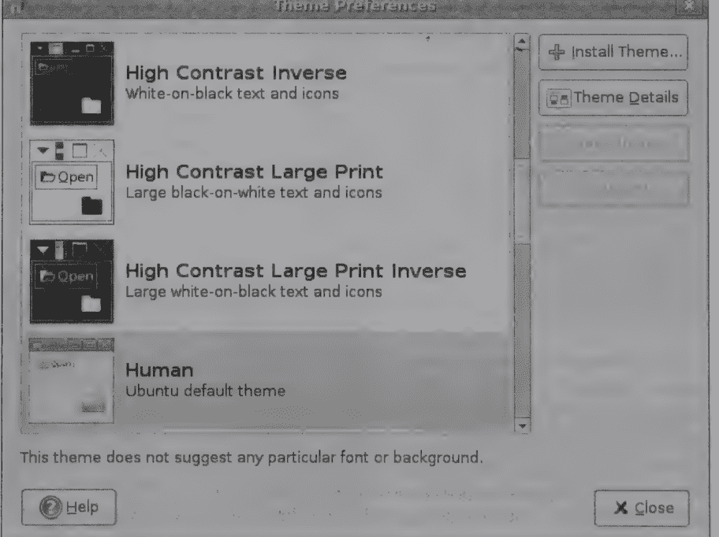

此主题没有建议任何特定的字体或背景。

图 5–8 默认 Ubuntu 主题名为 Human，但也包含了其他几个主题。

你显然可以看出系统的样貌，但观察哪些元素构成了一个主题是非常有趣的。了解各种元素也是创建一个真正属于你自己的桌面环境的良好第一步。出于这些原因，请点击“主题详情”（Theme Details）按钮。会出现一个带有三个标签的窗口，分别为“控制”（Controls）、“窗口边框”（Window Border）和“图标”（Icons）（见图 5-9）。这些每个标签都代表一个主要的主题元素，并且根据你的喜好从它们所代表的主题单独进行修改。

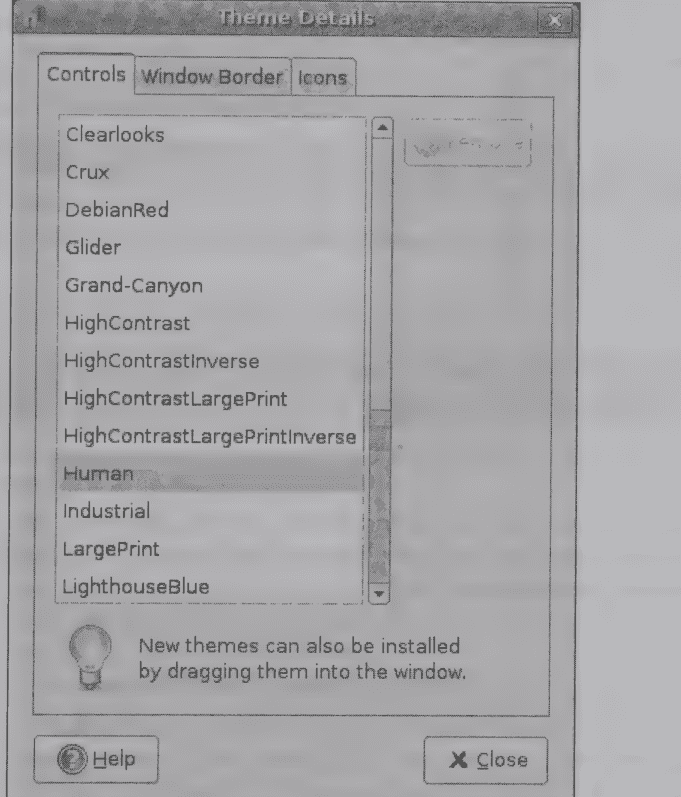

**图 5–9** 主题详情对话框让你能够调整构成主题的各种元素。

让我们逐个查看，从“控制”开始。这些代表了当你查看主题时看到的大部分内容。颜色、滑块样式、按钮形状和标签 . . . 全属于这一类别的元素。我将其视为 GNOME 界面的外观和感受。

“窗口边框”仅仅就是窗口标题顶部按钮的框架和布局。更改窗口边框还可以定义框架是直角还是圆角。图 5-10 到 5-12 为你展示了更改这一单项如何影响你系统外观的一个小示例。


图 5–10 Human 是经典的 Ubuntu 主题。注意窗口标题是居中的。

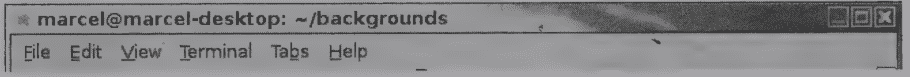

图 5–11 在 Ocean Dreams 主题下，沙色让位了海洋色调。你能听到海浪声吗？

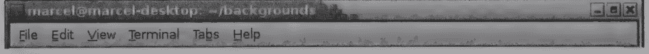

图 5–12 Crux 窗口装饰。

最后一个标签处理图标。这些是你在桌面顶部、面板以及 Nautilus 文件浏览器中看到的图标。你可能应该意识到，并不是每个图标主题都能替换所有类型的图标。

## 定义你自己的主题

当你忙于更改控制、边框和图标时，看一眼你的主题偏好设置对话框，你会发现发生了一些非常有趣的事情。在主题列表的顶部有一个新东西：“自定义主题”（Custom Theme）。在此标题旁边是该设置效果的小缩略图。你还会注意到“保存”（Save）按钮不再是灰色的了（见图 5-13）。

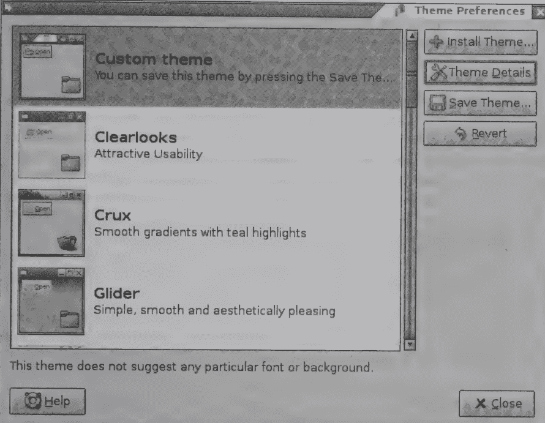

**图 5–13** 主题详情对话框让你能够调整构成主题的各种元素。

如果你喜欢新主题，就是时候保存了。点击“保存”按钮将弹出一个对话框。如果你想回到默认设置，请点击“还原”（Revert）按钮。

## 添加新主题

# 在桌面上添加图标和快捷方式

当你对更改满意时，点击确定。你的新程序链接（可以通过双击启动）应该出现在桌面上。

要在命令行中为命令创建快捷方式图标，你首先需要知道该命令是什么以及它位于何处。老实地说，命令或程序（例如 GNOME 计算器 `gnome-calculator`）几乎可以位于磁盘上的任何地方。大多数情况下，程序倾向于位于 `bin` 目录之一——`/bin`、`/usr/bin` 或 `/usr/local/bin`。你也可以使用 `whereis` 命令来获取确切位置。例如，为了知道 `gnome-calculator` 程序的位置，我会在终端提示符下（美元符号 `$`）处输入以下内容：

```bash
sh-3~$ whereis gnome-calculator
gnome-calculator: /usr/bin/gnome-calculator
/usr/bin/X11/gnome-calculator
```

在某些情况下，可能会看到多个与程序名称关联的文件，但实际使用的可执行文件在 `/usr/bin`。在这种情况下，`bin` 代表 binary（二进制）——简而言之就是程序。

为了获得更短的搜索结果，请使用 `which` 命令：

```bash
sh-3~$ which gnome-calculator
/usr/bin/gnome-calculator
```

提示：如果你想要在桌面上的应用程序出现在菜单中，只需点击它并将其拖到桌面即可。当你松开鼠标按钮时，图标就会出现。

# 小插件多多：回到面板！

听起来很像标题，不是吗？正如你从名称中推测的，小插件（Applets）是嵌入在你图形桌面顶部和底部的小应用程序。这些小程序的设计是为了很好地适应你的面板列表，同时仍提供实用的功能。窗口列表只是嵌入面板的许多应用程序之一。其他嵌入式应用程序包括工作空间切换器、菜单、时钟，甚至是通知区域（有时称为系统托）。虽然你可以同时使用两者，但目前我将集中在底部面板上。

底部面板的默认外观和大小约为 24 像素。根据程序的性质，嵌入此类大小面板的小插件往往很难看清。幸运的是，通过前面描述的方法更改面板大小可以很容易地解决这个问题。为了让这些小插件变得有用，你可能希望增加默认面板的大小。根据我的经验，在我的显示器上，48 像素是非常理想的。

现在你已经准备好了面板，是时候寻找并添加一些小插件了。右键点击面板，会出现一个菜单。点击“添加到面板”（Add to Panel），就会出现所有可用插件的列表（见图 5-16）。此列表可能会显示相关插件的简短描述，或者按类别组织。向下滚动找到你喜欢的东西，然后点击“添加”。对于我的第一个插件，我选择了标记为 Fish（鱼）的那个，那是一个使用 `fortune` 命令弹出随机智慧语句的动画鱼。不，我不是胡编的。


几秒钟后，你的插件就会出现在面板中。当一个插件启动时，它很少以我想要的位置启动。幸运的是，移动它是一个简单的过程。只需右键点击插件就会出现一个菜单（见图 5-17）。选项之一是“移动”（Move）。点击这里会出现一个小手手图标，允许你将插件拖到任何你想让它所在的地方。你甚至可以将其移动到另一个面板（稍后详细介绍）。

图 5-16 向 GNOME 面板添加小插件。

图 5-17 每个小插件都可以进行配置、移动或删除。

提示：拥有三键鼠标的人可以使用中键点击插件并将其拖到任何他们想去的地方。滚轮鼠标提供类似的功能，因为滚轮实际上是第三个按钮（尝试点击你的鼠标滚轮！）。在 Linux 世界中，应用程序利用中键的情况并不罕见，但它的用法经常被忽视。

再次查看该菜单，你会发现还有其他实用的选项。例如，每个应用程序都可能有自己的一套配置。我安装的鱼插件带有一些额外的图形——你可能不喜欢它们。只需点击“偏好”（Preferences）菜单来做出你的更改。最后，如果你认为选择的程序只是在占用空间，还有一个“删除”（Remove）选项。

当“插件狂热”来袭时，你可能会发现自己没有空间了。在面板的空隙某处右键点击。从弹出菜单中，选择“新建面板”（New Panel）。会出现一个空白的灰色面板；你可以将其拖到你认为合适的任何位置。与原始面板一样，选择“属性”对话框允许你更改其大小以适应你脑海中的插件。

我将和你们分享一些我最喜欢的插件，尽管它们在工作方面并不完全有用。“字典查询”（Dictionary Lookup）插件是必须的，“天气预报”（Weather Report）程序也是如此。“幸运鱼”（之前提到的）很有趣，那些随鼠标指针在屏幕上移动的眼睛也是如此。“截图”（Take Screenshot）插件在你编写文档时特别有用。因为我在各种系统上工作，我也很喜欢“终端服务器客户端”（Terminal Server Client）和“连接到服务器”（Connect to Server）插件。（我在第 4 章中简要提到过它们，但是通过 Nautilus。）

我将在此结束对插件的讨论，但我邀请你尝试其他的插件并发现你自己的喜好。去吧。探索吧！

# 其他更改

在结束本章之前，让我给你们最后一个惊喜。点击顶部面板上的“系统”（System），然后从“偏好”菜单中选择“快捷键”（Keyboard Shortcuts）。你将发现许多有趣的快捷键，用于执行如在应用程序之间切换、工作空间之间切换、打开和关闭窗口、获取帮助、获取桌面截图（如果你想向他人分享你的时尚味）等操作。

随着 Linux 的日益流行，你会发现硬件供应商越来越希望开发这一不断增长的市场。我曾有过在现场支持的经验，即为客户的系统添加硬件（立刻就能想到的就是网卡），结果发现系统缺少相应的驱动程序。我迅速访问了以网卡制造商的网站，发现预编译好的驱动程序正等待我下载。

## 即插即用

在大多数情况下，向你的 Ubuntu Linux 系统添加设备只需插上即可。如果设备没有出现，而你又不想手动配置它，重启将强制进行硬件检测，系统应该会识别并配置该设备。通用串行总线（USB）设备由于其热插拔特性，通常更加简单。换句话说，你不需要重启系统就能识别 USB 设备，并且可以在系统运行期间将其拔掉。例如，插入 USB 优盘或 USB 闪存器，它就会出现在你的“位置”菜单中（见图 6-1）。

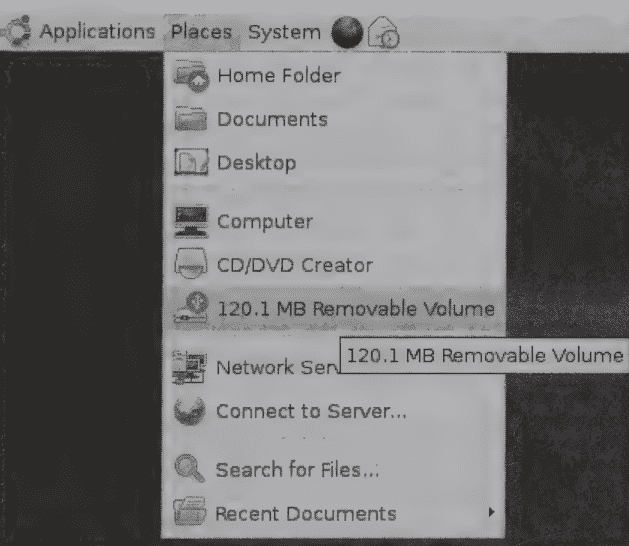

图 6-1 一个 128MB 的 USB 驱动器出现在“位置”菜单中（注意驱动器的格式化后大小仅为 120.1MB）。

# 第 6 章 打印机和其他硬件

然而，识别设备只是一部分。仅仅你的系统知道该设备的存在并不意味着它已经为你的应用程序配置好了。虽然你通常不需要寻找并安装驱动程序，但这种情况确实会发生，就像在 Windows 世界一样。如果我仅仅忽略这个小细节，对你将是不公平的，所以我不会忽视它。

让我们来看看电脑用户面临的最常见、有时也是最令人沮丧的硬件。没错，我说的正是打印机。

## 打印机与打印

提到这个似乎是一件很傻的事，特别是如果打印机在启动时已经自动被检测、配置并测试了。尽管如此，你可能仍然想对打印机进行一些操作，我们可能现在应该涵盖这些内容。此外，打印是个人电脑可以执行的最功能之一。把它做好是重要的。关于这一点，我将花一点时间谈谈打印机和打印。相信我，这会很有趣。

Linux 下的打印基于队列工作。简单来说，这意味着当你向打印机发送内容时，它会被放入一个目录中轮候。这种出队列的过程被称为池打印（spooling）。因此，将打印作业从队列发送到打印机的进程称为打印进程（spooler）。该打印进程可以是几个程序中的一个，当你从应用程序打印时，这些程序对你都是透明的。以下是流行打印程序的快速汇总：

- CUPS（通用 UNIX 打印系统）是一个跨平台的打印系统，适用于许多 UNIX 版本，包括 Linux。CUPS 使用互联网打印协议（IPP），这是一种下一代打印系统，旨在允许任何作业打印到任何打印机。此时，CUPS 看起来就像未来的打印进程。大多数现代 Linux 发行版都包含 CUPS，Ubuntu 也使用了它。
- 你可能遇到的第二个打印进程是 LPD，经典的 UNIX 打印进程。LPD 已经存在很久，并且继续分发到每一个 Linux 中。我提到它主要是出于历史原因。它在那里，但你可能不会用到它。

无论是 CUPS 还是 LPD，GNOME 处理打印得非常完美。添加、配置或删除打印机都通过打印管理器完成。点击顶面板上的“系统”，然后从子菜单中选择“打印”。会出现一个标记为“打印机”的窗口，其中有一个标记为“新打印机”的图标（见图 6–2）。

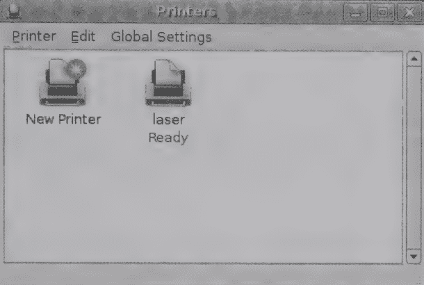

图 6–2 当打印管理器启动时，你可能会看到不仅仅一个“新打印机”图标。然而，你的 Ubuntu 系统会自动获取配置好的打印机。

**提示** 如果你处于有共享打印机的网络中，点击菜单栏上的“设置”并选择“检测打印机”。

注意，在我的情况下，网络上已经列出了一台打印机。很有可能，你只会看到“新打印机”图标，这是一个非常好的开始点。要添加打印机，首先确保你的打印机已连接并在线。接下来，点击菜单栏上的“打印机”并选择“添加打印机”。你也可以双击“新打印机”图标。假设你有一台支持的打印机且它已连接并在线，Ubuntu 应该会自动检测你的打印机（见图 6–3）。

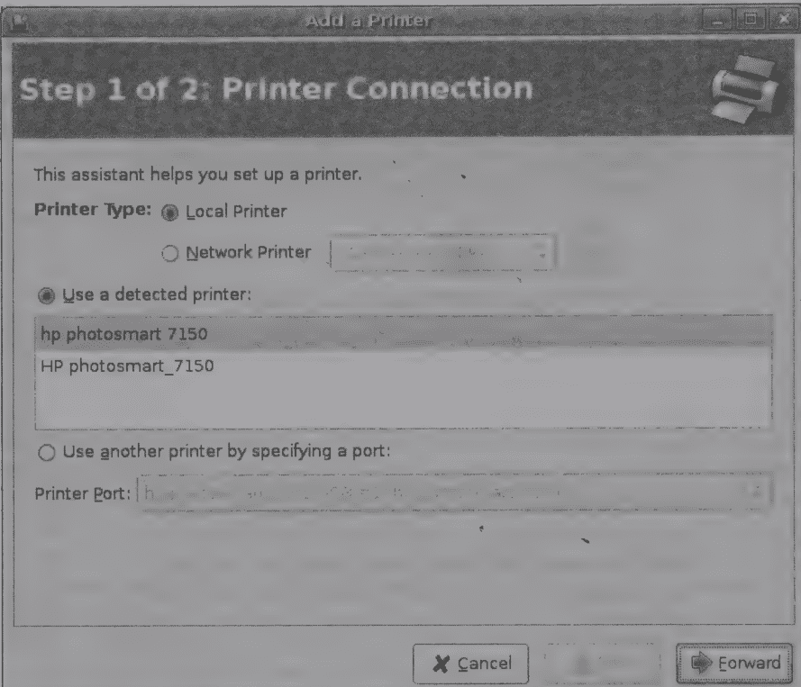

图 6–3 如果你的打印机被支持，它应该被自动检测。

在我的示例中，系统很方便地注意我的 HP 打印机并从开始就准备就绪。点击“继续”，我们进入驱动选择屏幕。因为在这种打印机被正确识别，系统也为该打印机提供了驱动程序（见图 6–4）。

如果你认为这不是正确的驱动程序，或者系统没有正确自动检测你的打印机，你可以在此屏幕上选择不同的制造商和型号。这两个选项都提供包含许多选择的下拉列表。对于大多数打印机，有一个推荐的驱动程序，它列在“驱动程序”旁边。你可以看到选中的驱动实际上是推荐的。

### 第 2 部分的第 2 步：打印机驱动

| 制造商 | HP |
| :--- | :--- |
| | PhotoSmart 3500 |
| | PhotoSmart 370 |
| | PhotoSmart 380 |
| | PhotoSmart 420 |
| | PhotoSmart 470 |
| | PhotoSmart 7150 |
| | PhotoSmart 7260 |
| | PhotoSmart 7268 |
| | PhotoSmart 7345 |
| | PhotoSmart 7350 |
| | PhotoSmart 7400 |

**型号：**

**驱动程序：** hpjs (推荐) - HPLIP 0.9.7 (建议)

图 6–4 这里的屏幕是驱动程序选择屏幕。

注意标记为“安装驱动程序”的按钮。对于许多打印机，你可以在打印机制造商网站或通过 Linux 打印网站（linuxprinting.org）找到 PPD 文件，即使该驱动未包含在你的 Ubuntu Linux 系统中。如果你下载了驱动文件，且你的打印机驱动程序不在列表中，点击此按钮会出现标准的 GNOME 文件选择器。导航到驱动位置并安装它。当你对选择满意时，点击“应用”使更改生效。新打印机出现在打印机对话框中（见图 6-5）。

> 注意，我提到有些公司对 Linux 系统的驱动并不大方。然而，这种情况正在发生，一些打印机制造商为 Linux 提供了极好的支持。这些包括 HP 和 Brother 等。

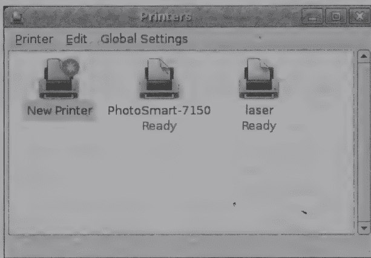

现在已经配置了两台打印机，看看网络上自动检测到的那台。注意它左上角的勾选图标。这表示它是系统的默认打印机。要将默认输出更改到另一台打印机，右键点击打印机并在弹出菜单中选择“设为默认”。

## 网络打印机

我给出的示例是针对本地连接的打印机的，即系统自动检测的。如果打印机品牌和型号没有被检测到，或者你需要使用网络打印机（例如挂在 Windows 网络上的打印机），让我们来看看更复杂的安装过程。

### 打印机与打印

默认选中“本地打印机”（Local Printer）单选按钮。点击“网络打印机”（Network Printer）单选按钮以连接网络。右侧有一个下拉框，提供 CUPS 打印机 (IPP)、Windows 打印机 (SMB)、UNIX 打印机 (LPD) 以及 HP JetDirect 网络适配器的选项。在本示例中，我选择了 Windows 打印机，因为这是家庭用户的常见场景。一旦选择 SMB，你的 Ubuntu 系统就会扫描本地网络中的 Windows 机器和 Windows 工作组。如果找到，将出现“需要验证”（Authentication Required）对话框（见图 6-6）。

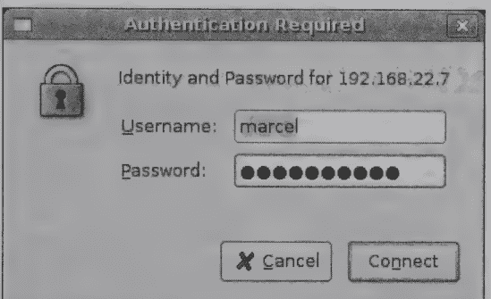

**图 6–6** 当 Ubuntu 识别网络上的 Windows 机器时，它会要求输入用户名和密码访问这些机器。

输入信息并点击连接。你之前看到的“添加打印机”对话框将变为显示适用于你尝试配置的网络打印机类型的特定选项（见图 6-7）。对于 Windows 打印机，会有用于网络上 Windows 机器主机名和共享打印机的字段。

- *提示* Samba（Linux 上的 Windows 文件共享）服务器作为现代网络的一部分并不罕见。在这些机器上共享的打印机看起来与网络上任何其他 Windows 系统上的打印机完全相同。因此，Samba 服务器及其打印机也会被列出。

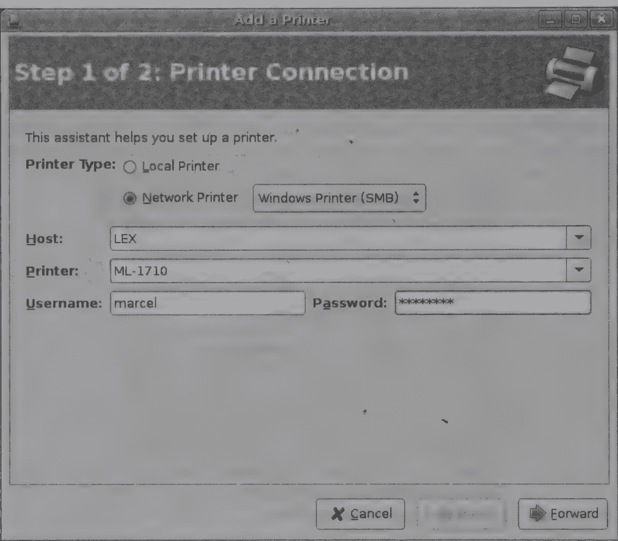

**图 6–7** 配置 Ubuntu 访问 Windows 网络打印机。

选择一个 Windows 主机，然后从下方列表中选择一个打印机。如果你网络上有多台机器，此处填写的用户名和密码可能与你之前输入的不匹配。确认信息正确，然后点击“下一步”。你再次发现自己处于打印机驱动程序选择屏幕（见图 6–8）。

点击“应用”，你的打印机就会被添加。

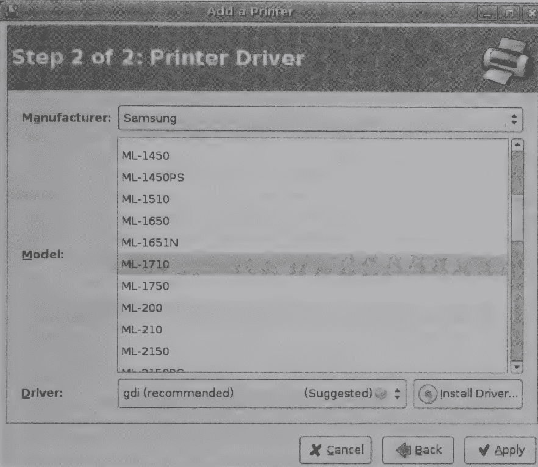

**图 6–8** 你的下一步是为打印机选择制造商和型号。驱动程序会自动选择，但请注意除了建议选项外可能还有其他选项。

> **提示** 有关从不同机器和不同操作系统打印的更多信息，请查看以下 URL：
> 
> https://wiki.ubuntu.com/NetworkPrintingFromWin22000
> 
> https://wiki.ubuntu.com/NetworkPrintingFromWinXP
> 
> https://wiki.ubuntu.com/NetworkPrintingFromMacOSX

看，打印机并没有那么可怕。

## 熟悉你的其他硬件

结识新朋友并不总是容易。社会学家告诉我们，当我们遇到新面时，会发生复杂的相互作用，其中大部分是潜意识的。虽然你可能遇到某人并立刻喜欢他，但更有可能是在与某人相处一段时间后才变得足够舒适并建立友谊——换句话说，在你更好地了解一个人之后。

现在，这和硬件以及你的 Linux 系统有什么关系呢？

嗯，是这样的……对于大多数人来说，我们使用的电脑就是一个黑色（或米色）的盒子，上面插了一些东西，内部发生着某些魔法，使上网成为可能。任何我们使用的小部分应用程序之外的东西都会让我们感到局促。这就是为什么“新事物”的概念可能会令人敬畏。克服这一点最好的方法就是熟悉你拥有的东西。

Ubuntu 的设备管理器（Device Manager）是了解系统组成（见图 6-10）的好地方。你可以通过点击顶部面板上的系统菜单并从管理子菜单选择“设备管理器”来找到它。或者，你可以按 `<Alt+F2>` 并输入程序名 `hal-device-manager` 来打开它。

一旦 Hal 设备管理器加载，你会注意到程序窗口被分为两个主面板。左侧列出了组成系统所有的设备类和子类。每个主要项目旁边都有一个小箭头，可以折叠或展开该特定设备或设备类的组件。点击任何项目，右面板中都会显示该项目的详细信息。

我们为什么不花几分钟探索一下这个硬件景观呢？让我们从 PCI 设备开始。

### PCI 设备

添加 PCI 设备绝对需要重启，因为我们谈论的是内部设备，尽管你可能已经安装了 PCI 设备。这些是插在电脑内部插槽上的卡。当你重启机器时，Linux 应该能够无问题地扫描并识别这些卡。当你点击一个 PCI 设备时，你会发现右面板出现了第三个标签页。点击该标签页获取有关设备的更多特定特定信息（见图 6-11）。如果存在配置问题且你需要识别设备的制造者和型号数字，这将特别有用。

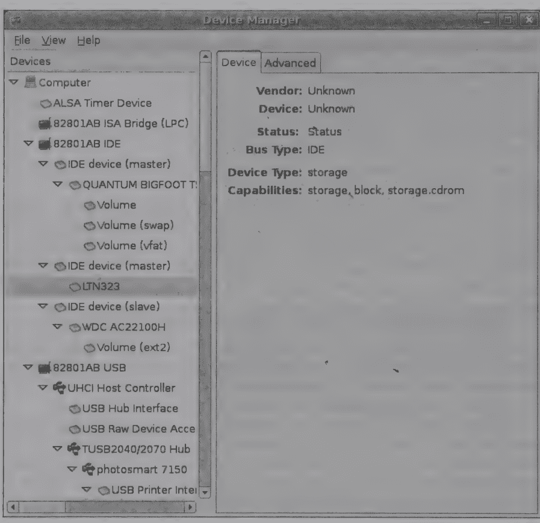

图 6–10 GNOME 的 Hal 设备管理器。

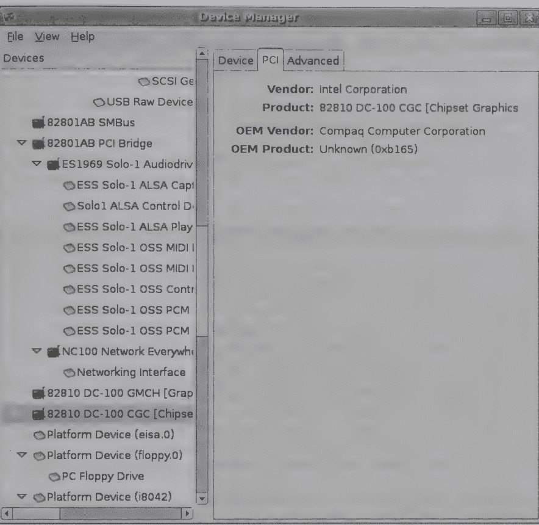

**图 6–11** 列出 PCI 设备时，设备管理器在右面板添加了 PCI 信息标签页。

## 调制调器与软调制调器 (Winmodems)

至少可以说，可用的 USB 设备数量多得令人惊人的，而且列表还在不断增长。其中许多设备使用标准驱动程序集，这意味着许多设备实际上可以即插即用——无需折腾驱动程序，因为这一切都由系统为你处理好了。

你注意到最后那句话中的“许多”这个词了吧？跟踪哪些设备可用（哪些不可用），并提供未包含在当前发行版中的驱动程序访问，是 Linux USB 设备网站（Linux USB Device website）存在的意义。如果你发现自己正在看一个新摄像头，但不确定它是否在 Linux 下支持，请先去那里看看：

```
http://www.qbik.ch/usb/devices/
```

该网站根据设备类型（音频、视频、质 存储等）分为若干章节。每个设备都被分配了一个状态，用于标识该设备支持的程度，从“完美工作”到“基本工作”再到“有麻烦”。

## 调制调器与软调制调器 (Winmodems)

在早前的介绍性章节中，我提到过 Winmodem 是运行 Linux 的少数缺点之一。你可能记得，Winmodem 是一种专为 Windows 设计的调制调器。它们有时被称为软件调制调器或无控制器的调制调器，通常比基于控制器的调制调器便宜。

如果你正在运行 Winmodem，一切还没有不可挽回。Linux 社区绝不乏资源。即使制造商并不总是会注意到 Linux 用户，但反过来情况并非如此。随着运行 Linux 的人越来越多，这个问题会变得越来越不严重。久而久之，硬件制造商可能会先为 Linux 开发，其次才是 Windows。在此期间，请查看 Linmodems.Org 网站（http://www.linmodems.org），你很快就能运行起来。

那么，你到底如何将 Winmodem 转换为 Linmodem 呢？嗯，让我给你举个例子。

在常见的 Winmodem 中，有基于 Conexant 芯片的设备；这些设备开始获得非常良好的支持。要获取最新的驱动程序，只需前往 Linux 网站（与 Conexant 无关）：

http://www.linuxant.com。你不仅可以获得 Linux 驱动程序，还可以为许多流行的 Linux 发行版获取预编译的包。

识别 Winmodem 是你的第一步。你可以使用 GNOME 设备管理器浏览你的 PCI 硬件，在那里你可以获得很多详细信息。你也可以进入终端并使用 `lspci` 命令列出系统中找到的所有 PCI 设备列表。它看起来如下：

```
$ lspci
00:00.0 Host bridge: VIA Technologies, Inc. VT8367 [KT266]
00:01.0 PCI bridge: VIA Technologies, Inc. VT8367 [KT266 AGP]
00:06.0 Communication controller: Conexant HSF 56k Data/Fax/Voice/Sppk (w/head) Modem (WorldSmartDAA) (rev 01)
00:08.0 Ethernet controller: Realtek Semiconductor Co., Ltd. RTL-8139/8139C (rev 10)
00:11.0 ISA bridge: VIA Technologies, Inc. VT8233 PCI to ISA Bridge
00:11.1 IDE interface: VIA Technologies, Inc. Bus Master IDE (rev 06)
00:11.2 USB Controller: VIA Technologies, Inc. USB (rev 18)
00:11.5 Multimedia audio controller: VIA Technologies, Inc. VT8233 AC97 Audio Controller (rev 10)
01:00.0 VGA compatible controller: nvidia Corporation NVV11 [GeForce2 MX DDR] (rev b2)
```


进入`/path/to/xxx`目录，找到`xxx.json`。

在表达式`cvar = avar + bvar`中，加法运算符（`+`）将`avar`与`bvar`相加，得到它们的和`cvar`

在`List.of(arg0, arg1, arg2)`中，`List`接口的工厂方法`of()`接受一系列的元素，返回包含它们的只读列表。

之后我们这样调用`cmd`命令：`cmd arg0 arg1 arg2`。

```
if (condVar > someVal) {console.log("xxx")}
```

在某些情况下，你会找到预编译的驱动程序包。有些是针对你的特定版本的，另一些是通用的。以我的基于 Conexant 的 Winmodem 为例，网站提供了一个通用安装程序，它应该能检测你的系统并相应地安装。

按照安装后的说明，我输入了以下命令：

```
/usr/sbin/hsfconfig
```

随后弹出了简短的对话框，询问国家（我的情况下是加拿大），之后程序就为我编译并安装了驱动程序。它甚至将新创建的设备`/dev/ttySHSF0`链接到了`/dev/modem`。我可以无顾虑地使用我的调制调器了。

从 shell 提示符，可以通过此命令验证我的调制调器位置：

```
$ ls -1 /dev/modem
```

系统随后返回此信息：

```
lr-xr-xr-x  1 root  root  8 Sep  9  11:23
/dev/modem  -> /dev/ttySHSF0
```

前面的列表是一个完整连续的一行。

## Winmodem/Linmodem 汇总

显然，如果你使用的是外部调制调器，或者幸运地使用了电缆调制调器连接或本地公司的高速 DSL 接入服务，那么这整个 Winmodem 问题都不适用于你。对于其他人来说，情况可能会复杂一些。我已经给了你 Conexant 网站的地址，我在这里还会给你更多信息。

记住，只要访问正确的网站，许多此类调制调器都能成为 Linux 社会中有用且高效的成员。关于这一点，这里是我的汇总：

- Conexant 调制调器 (SANE): http://www.linuxant.com
- Smart 调制调器: http://www.slink.com
- Lucent 调制调器: http://www.linuxant.com
- PCTel 调制调器: http://www.linmodems.org

## 什么？更多设备？

我们涵盖了很多内容，但远未结束。你在网络上做的一切，无论是浏览喜爱的网站、发送和接收电子邮件、通过即时聊天客户端还是听音频广播，都是基于 TCP/IP 的。

为了帮助选择在 Linux 下支持的扫描仪，请查看 SANE（Scanner Access Now）页面。

http://www.sane-project.org/sane-devices.html

该页面上还有一个扫描仪搜索引擎，可以让查找变得简单。

## 资源

- Linux 硬件兼容性 HOWTO: http://www.tldp.org/HOWTO/Hardware-HOWTO/index.html
- Red Hat 目录: http://bugzilla.redhat.com/hwcert
- Linmodems.org (Linux 下调制调器): http://www.linmodems.org
- LinuxPrinting.org (Linux 打印机数据库): http://www.linuxprinting.org
- USB 设备概览: http://www.qbik.ch/usb/devices/
- SANE 项目支持设备: http://www.sane-project.org/sane-devices.html
- Ubuntu 硬件支持 Wiki: https://wiki.ubuntu.com/HardwareSupport

# 第 7 章

## 连接互联网

我将从这一章开始介绍一些网络基础（101）。这很有趣，真的。对于那些已经熟悉 TCP/IP 以及 IP 网络如何运作的人，可以跳过这几段。

互联网上的通信是通过一种称为 TCP/IP 协议族进行的。TCP/IP 实际上代表传输控制协议/网协议，它是实现所有这些魔法通信的基础手段。

# 第7章 连接到互联网

每一台连接到互联网的计算机都有唯一的地址，称为 IP 地址，由四组用点分隔的数字组成（例如 192.168.22.55）。某些始终在线的系统（银行、网站、公司等）拥有静态地址。家庭用户的拨号连接往往是共享的——当你没有连接时，其他人可能正在使用同一个地址——这被称为动态 IP 地址。

你可能可能在想，像 www.marcelgag.com 这样的符号化 Web 地址是如何转换为我之前提到的那四组数字的，这是一个非常棒的问题。

再次想一下现实世界。我们不会把朋友看作“无桑树街 136 号”或“纳提卡法院 1575 号”；我们通过他们的名字来称呼他们。要找到朋友住在哪里，我们会查阅电话簿（或询问他们）。数字世界的情况也是如此，但那本电话簿被称为域名服务器（DNS）。当我向 Web 浏览器输入一个符号化的（即人类可读的）地址时，它会连接到由我的互联网服务提供商（ISP）分配的 DNS 并请求 IP 地址。有了这个 IP 地址，我的数据包几乎就知道了如何到达目的地。

几乎？要到达现实世界中的某个地址，你需要离开自家的车道，进入一条所有道路都相连的道路。如果你开得足够久，理上你会到达罗马（人们常说条条路通罗马）。在到达罗马之前，你进入了你的默认路由，即你房子前面的街道。虚拟世界中存在同样的原理。为了让你的 IP 数据包（例如发给妈妈的电子邮件）到达目的地，它必须通过一条特定的路由，称为默认路由。这将是一个知道所有其他路由的设备的 IP 地址。你的 ISP 提供了该路由。

网络基础 101 课程到此结束。并不特别复杂，对吧？

# 准备工作

连接互联网是那种设置一次后就可以忘记的事。尽管如此，你仍然需要提前从你的 ISP 获取一些信息。基础信息如下：

- 你的用户名和密码
- 你的调制调器连接时拨打的号码（如果使用拨号调制调器连接）
- DNS（之前描述过的名称服务器）的 IP 地址
- 你的 SMTP 和 POP3 电子邮件主机的 IP 地址或符号地址
- 你的新闻服务器的 IP 地址或符号地址（可选）

所有这些信息可能在你首次注册 ISP 时随合同一起发放了。有了这些信息，你就可以准备开始了。

# 上网

在我写这些内容时，有三种非常流行的连接互联网的方法，无论你自己的网络连接方式如何。这些是电缆调制调器、电话公司提供的 DSL 服务，或者是老式的拨号调制调器。前两种通常被称为高速连接或宽带连接，而拨号接入通常经常被嘲笑，因为与更快速的方法相比，它感觉非常慢。

伴随着对高速的所有报道和炒作，你可能会认为这是大家都在用的连接方式。再想想吧。在我写这些内容时，北美乃至整个世界的绝大多数人仍然通过拨号连接上网。不要搞错了——正如马克·吐温可能评论的那样，关于拨号接入消失的传言被大大夸大了。你可能也是仍在使用拨号的大多数人之一；我将详细介绍这一点。如果你准备好了，让我们开始吧。

# 使用调制调器连接网络

大多数 ISP 通过点对点协议（PPP）提供拨号接入。要设置网络连接或几乎任何类型的连接，只需运行网络设置（Network Settings）。点击顶部面板上的“系统”（System），然后点击“管理”（Administration），最后点击“网络”（Networking）。你也可以使用 `<Alt+F2>` 运行应用程序快捷键并在对话框中输入 `network-admin`。如果你开始喜欢命令行的感觉，请在终端窗口中输入 `network-admin &`。由于这是一个管理功能，系统会要求你输入密码（见图 7-1）。

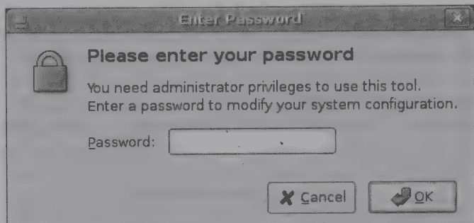

**图 7–1** 像这样的管理功能需要你输入密码。

> *提示* 你可能在上一段中注意到，我在 `network-admin` 命令末尾添加了一个安符 (`&`)。当你从 shell 提示符启动命令时，它通常在前台运行。这意味着在当前进程完成之前，你无法在 shell 中启动另一个进程（当然你当然可以打开另一个 shell）。`&` 告诉 shell 将该进程放在后台运行，这样你就可以运行其他命令了。

当“网络设置”工具首次出现时，它至少会列出一个当前未配置的调制调器连接（见图 7–2）。如果你的机器没有内置调制调器，仍然有配置它的选项。在你的连接列表中，你可能还会看到以太网连接。大多数现代机器通常都内置以太网卡，所以这种很可能。我们将使用我的测试机器为例，如你所见，它既连接了网卡也连接了拨号调制调器。

在你着手配置调制调器连接之前，先查看此窗口顶部标有“位置”（Location）的下拉框。这里的想法是，你可以拥有多个拨号（或网络）账户。大多数人可能只用一个，但你也可以用它来设置同一个账户的多个配置文件。如果你恰好是一个带着笔记本电脑的移动战士或环球旅行者，你可以为你访问的各个城市创建位置配置。

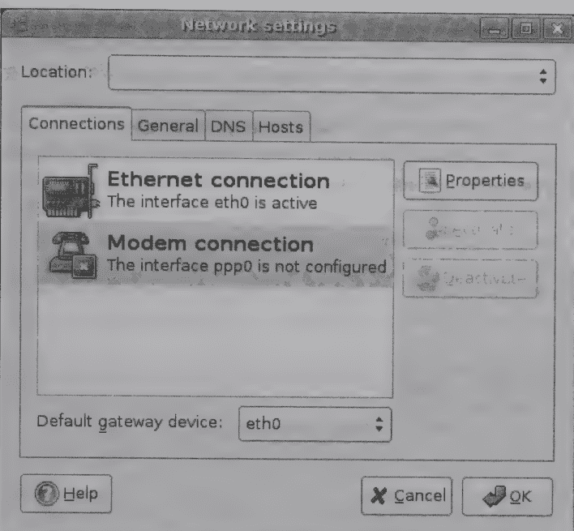

**图 7–2** “网络设置”应用程序用于所有网络连接，包括拨号。

默认情况下，没有定义位置。如果你在不创建位置的情况下继续配置网络连接，那些设置将成为你的默认设置。要添加新位置，点击下拉框（此时它是空的）并点击“创建位置”（Create Location）。会弹出一个小型对话框（见图 7-3），你在其中输入该位置的名称（例如：伦敦办公室）。输入名称后，点击“确定”。


**图 7–3** 你的网络配置可以有多个位置。

由于你可能是为了旅行，你可能想在这里添加两个条目，一个在家，一个在外。

## 配置你的拨号连接

拨号连接通常意味着 PPP，即点对点连接。点击“调制调器”（Modem）选中该项，然后点击“属性”（Properties）选项卡。接口属性对话框出现。它由“通用”（General）、调制调器”和“选项”（Options）三个窗口组成。如果默认没有选择“通用”选项卡，现在点击它。找到它并勾选“启用此连接”（Enable This Connection）。你会在“通用”选项卡的 `ppp0` 连接下找到它（见图 7–4）。


**图 7–4** 你的第一步是启用连接，然后输入你 ISP 的连接信息。

在此窗口中的其他字段将不再呈灰色。输入你 ISP 的拨号号码，如果需要，输入拨号前缀。在下方，输入设置账户时提供的用户名和密码。现在，点击“调制调器”选项卡。

我在上一章中介绍过设备

Figure 7–5 号类型设置可以选择调频拨号或脉冲拨号。我个人已经多年没有遇到过脉冲服务了，但如果你使用它，请点击下拉框选择“脉冲”（Pulses）而不是“调频”（Tones）。最后，有一个音量设置（关闭、低、中、大），让你能听见你的调制调器拨号并发出那种酷酷的吱叫声。

第三个也是最后一个标签页标记为“选项”（Options）（参见图 7–6）。你会发现“将调制调器作为到互联网的默认路由”和“使用互联网服务提供商的服务器”这两个复选框已勾选。除非你有充分的理由更改这些设置（即按照你的互联网服务提供商 ISP 的指示），否则请保持原样。你可能勾选最后一个复选框“如果连接中断或启动失败时重试”，这样一旦任何情况中断了你的互联网连接，它都会重新连接。


图 7–6 你可能希望配置调制调器在连接掉落时自动重新加载。

点击“确定”，你将返回主“网络设置”（Network Settings）屏幕，其中仍选了“调制调器连接”（参见图 7–2）。这里的不同在于，“激活”（Activate）按钮不再呈灰色。点击该按钮以拨号上网。

## 电缆调制调器和高速 DSL

在大多数情况下，如果你在连接着电缆调制调器时安装了 Linux 系统，那么这可能已经工作了，你无需做任何事情。然而，如果你已经在运行系统，而现在才获取电缆调制调器，那么可能是时候给你一些建议了。说实话，如今（使用现代的 Linux 发行版时），这并并不复杂。

首先，电缆调制调器并不是传统意义上的调制调器。所谓的调制调器一侧连接到你的电缆电视业务，另一侧连接到 PC 内部的以网卡。通过你电话公司的 DSL 服务进行高速访问与其相似之处在于，它们都为你提供了一个外部的、类似调制调器的设备（在许多情况下，它实际上是一个路由器），该设备也连接到以网卡。

以网卡（系统应能自动检测）通过动态主机配置协议（DHCP）从电缆调制调器获取 IP 地址。这个地址看起来可能是永久的，因为它很少（如果说的话）改变，尽管如此，它仍然是动态的，因为你的实际以网卡会在每次连接时获取其地址。

配置系统的过程在不同的发行版之间略有不同，但仅在外观上。当你安装新的以网卡（通过电缆调制调器访问）时，它应该在重启时被系统自动检测。作为该过程的一部分，系统询问你是否想要配置该网卡。答案当然是肯定的。接下来，系统会询问你是想提供 IP 地址还是让通过 DHCP 自动配置。对于电缆调制调器，就像 DSL 一样，自动配置才是你想要的。

既然我已经告诉了你做这些是多么极其简单，我将提到有许多不同的高速电缆和 DSL 访问提供商。这意味着，如果你的系统没有识别并配置你的连接，你可能需要执行这些操作之一。对于电缆调制调器，答案各异，但请开始检查 http://www.tldp.org 上的 Cable Modem HOWTO 以获取有关你特定地理位置的详细信息。

如果你使用的是电话公司的 DSL 服务，你将希望使用 `pppoconf`（已作为 Ubuntu 权限的一部分安装）。打开一个终端（Terminal）并以管理员权限运行该命令。通过输入以下内容来实现：

```
sudo pppoeconf
```

这是一个纯文本实用程序，基本上是一个填空会话。第一个屏幕检查你的以网卡并要求你确认它的位置。因为大多数人只有一个以网卡，所以这通常是一个相当简单的选择。你想要确保你的 DSL 调制调器已接入并打开，因为下一个屏幕将扫描你的 DSL 调制调器是否存在以继续设置。然后，会被要求提供由互联网服务提供商为此连接提供的用户名和密码。

此配置对话框的最后一步是一个关于你是否希望连接自动建立的问题。这通常是一个好主意。在你完成此设置后，你可能不需要再次运行此实用程序。

## 资源

Ubuntu 关于 Wifi 和 Ndiswrapper 信息

https://wiki.ubuntu.com/WifiDocs

Ubuntu 关于 pppoeconf 的 Wiki 页面

https://wiki.ubuntu.com/ADSLPPPoE

# 第 8 章

# 安装新应用程序

你的 Ubuntu Linux 系统配备了一系列出色的软件，这些软件包可以处理从文字处理到电子邮件、网页浏览、即时消息，甚至帮助你放松的游戏等一切任务。当你花时间尝试并学习你的系统以及它提供的所有功能时，你最终会想要比现在拥有的更多。这就是为什么我将向你展示如何轻松、毫不费力地安装这些软件。我还会告诉你有关更新的信息以及如何确保你的系统已打补丁并安全。你将发现搜索所需的软件是简单，而且让它运行起来速度之快让你感到惊讶。

在我们开始寻找和安装软件之前，我想先解释一个小迷思。你一定听过，认为在 Linux 上安装软件是困难的，而且它比你在 Windows 世界中习惯的要糟糕。事实并非如此。事实上，Linux 下的软件安装实际上优于你遗弃的旧操作系统。

# 第 8 章 安装新应用程序

**安全注意** 当你安装软件和软件包时，你通常必须以管理员用户（也称为 root）的身份进行。作为 root，你是无所不能的。Linux 往往比任何操作系统都更安全、更可靠，但这并不意味着灾难不会发生。请了解并花时间理解它的作用。这就是为什么坚持使用 Ubuntu 软件库（通过 Synaptic 访问多个软件软件包）是最佳方法。别担心，我会解释的。

# Linux 与安全

涉及到安装软件时，安全是我们经常讨论的话题。我已经说过，你应该知道你的软件源自哪里，但这只是考虑因素之一。这就是为什么我将消除一些关于安装软件的错误误解。

在 Windows 世界中，让你的 PC 感染病毒或蠕虫是容易得惊人的。你只需要点击电子邮件附件，就可能陷入麻烦。Windows 下的某些电子邮件软件包会通过打开你的邮件附件或将你连接到互联网链接来“帮助”你，这可能会导致问题。你不会发现许多 Linux 软件包是以简单的可执行文件（.EXE 文件等）形式提供的。这是出于安全考虑。

要安装大多数软件包，你还需要 root 权限。出于安全考虑，Linux 要求你意识到你可能正在做某些损坏系统的事情。如果一个电子邮件附件想要安装到你的系统中，它必须先咨询 root 用户。

软件包管理器（如 rpm（RPM 软件包管理器）或 Ubuntu 和 Debian）确保满足某些依赖关系，或者防止软件意外覆盖其他软件。那些依赖检查考虑了许多因素，例如已存在哪些软件以及新软件包将如何共存。你中的许多人可能对所谓的“DLL 地狱”很熟悉，即一个软件直接覆盖了另一部分代码。这甚至可能发生在你身上。在没有这些检查的情况下盲目安装可能是灾难性的。最好的情况下，结果是一台不稳定的机器；最坏的情况下，它将无法使用。

# 添加应用程序的最简单方法

在 Linux 下安装软件可能需要一两步，但这是为了你好。

# 识别软件软件包

大多数主流 Linux 发行版都有一个共同的概念：软件包——一个预先构建好的软件包，准备安装到你的系统中。尽管那里有许多发行版，但大多数都使用相同的软件包管理系统。它们处理这些软件包的方式通常不同，但这种老牌系统保持保持一致。如今大多数发行版使用 RPM 格式的软件包或 DEB。因为基于 Debian，Ubuntu 使用 DEB 格式软件包。

假设我正在谈论一个名为 `ft_transport` 的假设软件包。如果我要为 Ubuntu 系统查找这个软件包，我会在这种格式中找到它：

```
ftl-2.1-1_i386.deb
```

第一部分是包名本身。下划线后的数字（连字符之前的数字）表示软件版本号。连字符后面的数字是软件包的发布版本。后面是编译该软件包的架构（在本例中为 i386）。开头的前缀 .deb 是这是一个 Debian 软件包的明显标志，有时也称为 DEB。

# 添加应用程序的最简单方法

在下一节中，我将向你展示如何为你的 Ubuntu Linux 系统查找、安装、更新和维护软件的详细方法。在此之前，我想向你展示一个简单易用的工具，用于在你的系统上安装软件包。在学习本书各个章节的过程中，你可能多次在菜单中看到过这一项。现在是时候查看“应用程序”程序了。


开始之前，点击顶栏上的“应用程序”并选择“添加/删除”。这是列表中的最后一项。安装软件需要权限，因此系统会要求你输入密码。输入密码，几秒钟后就会出现“添加/删除应用程序”对话框（见图 8-1）。程序在读取可用和已安装应用程序数据库时会有短暂延迟。该程序的命令名称是 `gnome-app-install`。

# 第 8 章 安装新应用程序


（注：图像说明的 OCR 文本似乎碎片化/重复为“第8章安装新应用程序”）

**安全注意** 当你安装软件和软件包时，你通常必须以管理员用户（也称为 root）的身份进行。作为 root，你是无所不能的。Linux 往往比任何操作系统都更安全、更可靠，但这并不意味着灾难不会发生。请了解并花时间理解它的作用。这就是为什么坚持使用 Ubuntu 软件库（通过 Synaptic 访问多个软件软件包）是最佳方法。别担心，我会解释的。

## 资源

Ubuntu 关于 Wifi 和 Ndiswrapper 信息

https://wiki.ubuntu.com/WifiDocs

Ubuntu 关于 pppoeconf 的 Wiki 页面

https://wiki.ubuntu.com/ADSLPPPoE

## 第 8 章 安装新应用程序

你的 Ubuntu Linux 系统配备了一系列出色的软件，这些软件包可以处理从文字处理到电子邮件、网页浏览、即时消息，甚至帮助你放松的游戏等一切任务。当你花时间尝试并学习你的系统以及它提供的所有功能时，你最终会想要比现在拥有的。。为什么我将向你展示如何轻松、毫不费力地安装这些软件。我还会告诉你有关更新的信息以及如何确保你的系统已打补丁并安全。你将发现搜索所需的软件是简单，而且让它运行起来速度之快让你感到惊讶。

在我们开始寻找和安装软件之前，我想先解释一个小迷思。你一定听过，认为在 Linux 上安装软件是困难的，而且它比你在 Windows 世界中习惯的要糟糕。事实并非如此。事实上，Linux 下的软件安装实际上优于你遗弃的旧操作系统。

# Linux 与安全

涉及到安装软件时，安全是我们经常讨论的话题。我已经说过，你应该知道你的软件源自哪里，但这只是考虑因素之一。这就是为什么我将消除一些关于安装软件的误解。

在 Windows 世界中，让你的 PC 感染病毒或蠕虫是容易得惊人的。你只需要点击电子邮件附件，就可能陷入麻烦。Windows 下的某些电子邮件软件包会通过打开你的邮件附件或将你连接到互联网链接来“帮助”你，这可能会导致问题。你不会发现许多 Linux 软件包是以简单的可执行文件（.EXE 文件等）提供的。这是出于安全考虑。

要安装大多数软件包，你还需要 root 权限。出于安全考虑，Linux 要求你意识到你可能正在做某些损坏系统的事情。如果一个电子邮件附件想要安装到你的系统中，它必须先咨询 root 用户。

软件包管理器（如 rpm（RPM 软件包管理器）或 Ubuntu 和 Debian）确保满足某些依赖关系，或者防止软件意外覆盖其他软件。那些依赖检查考虑了许多因素，例如已存在哪些软件以及新软件包将如何共存。你中的许多人可能对所谓的“DLL 地狱”很熟悉，即一个软件直接覆盖了另一部分代码。这甚至可能发生在你身上。在没有这些检查的情况下盲目安装可能是灾难性的。最好的情况下，结果是一台不稳定的机器；最坏的情况下，它将无法使用。

## 添加应用程序的最简单方法

在 Linux 下安装软件可能需要一两步，但这是为了你好。

## 识别软件软件包

大多数主流 Linux 发行版都有一个共同的概念：软件包——一个预先构建好的软件包，准备安装到你的系统中。尽管那里有许多发行版，但大多数都使用相同的软件包管理系统。它们处理这些软件包的方式通常不同，但这种老牌系统保持一致。如今大多数发行版使用 RPM 格式的软件包或 DEB。因为基于 Debian，Ubuntu 使用 DEB 格式软件包。

假设我正在谈论一个名为 `ft_transport` 的假设软件包。如果我要为 Ubuntu 系统查找这个软件包，我会在这种格式中找到它：

```
ftl-2.1-1_i386.deb
```

第一部分是包名本身。下划线后的数字（连字符之前的数字）表示软件版本号。连字符后面的数字是软件包的发布版本。后面是编译该软件包的架构（在本例中为 i386）。开头的前缀 .deb 是这是一个 Debian 软件包的明显标志，有时也称为 DEB。

## 添加应用程序的最简单方法

在下一节中，我将向你展示如何为你的 Ubuntu Linux 系统查找、安装、更新和维护软件的详细方法。在此之前，我想向你展示一个简单易用的工具，用于在你的系统上安装软件包。在学习本书各个章节的过程中，你可能多次在菜单中看到过这一项。现在是时候查看“应用程序”程序了。

开始之前，点击顶栏上的“应用程序”并选择“添加/删除”。这是列表中的最后一项。安装软件需要权限，因此系统会要求你输入密码。输入密码，几秒钟后就会出现“添加/删除应用程序”对话框（见图 8-1）。程序在读取可用和已安装应用程序数据库时会有短暂延迟。该程序的命令名称是 `gnome-app-install`。

# Synaptic 软件包管理器


**图 8–4** 你看到的列表列表并不是全部。还有成百上千额外的、不支持的软件包可用。只需勾选方框即可显示不支持的专有应用程序。

偶尔，某些软件包依赖于其他软件包，删除软件包就会变成一个相当复杂的问题。此时会显示一条消息，建议你使用“高级模式”（Advanced mode）。这种高级模式就是 Synaptic 软件包管理器，尽管名称中带有*高级*二字，但它仍然非常易用。让我来为你介绍一下它。

## Synaptic 软件包管理器

在我们开始之前，我想向你介绍一下软件包仓库（package repositories），这是存储 Ubuntu Linux 软件包并供下载的站点。默认情况下，Ubuntu 预配置了标准库和安全更新库。为了获取某些软件包（例如我在第 18 章中提到的 MP3 软件），你将需要启用额外的 Universe（宇宙）和 Multiverse（多重宇宙）软件包仓库。这很简单，真的。

让我们先启动 Synaptic。点击顶部面板上的“系统”（System），从“管理”（Administration）子菜单中选择“Synaptic 软件包管理器”。因为安装软件需要管理员权限，系统要求你输入密码确认。几秒钟后，你就看到了 Synaptic 窗口（见图 8-5）。

Synaptic 窗口分为三个主要区域，或称为窗格。左侧栏让你根据类别识别软件。类别列表下方有四个按钮，分别标记为“部分”（Sections）、状态”（Status）、搜索”（Search）和“自定义”（Custom）。窗口的主部分水平分为左右。上方列出了软件包。点击这些软件包之一会在下方窗格中显示该软件的描述。在顶部，你会找到经典的菜单栏，正下方是一个图标栏，其按钮提供了某些常用功能的访问。


**图 8–5** 选择了 kgoldner 软件包的 Synaptic 软件包管理器。主窗口底部显示了所选软件的信息。

## 添加仓库

既然我对此强调了这么多，让我们从添加那些其他仓库开始。在 Synaptic 主窗口中，点击菜单栏上的“设置”（Settings），并选择“仓库”（Repositories）。会出现一个“软件偏好”（Software Preferences）对话框（见图 8-6）。你会看到三个标签，一个标记为“安装媒体”，另一个标记为“互联网更新”，还有一个是“身份验证”（Authentication）。默认情况下，应选中“安装媒体”标签。

我们很快就会涉及到这些仓库，但首先点击“互联网更新”标签。寻找标记为“自动检查更新”的框框。它默认应该是勾选的。标签旁边有一个组合框，默认选了“每天”（Daily）。在本章稍后些时候，我将介绍系统更新主题。这就是你定义系统何时以及如何检查更新的方法。我发现每天对我来说理想的选择，但你可以将其改为每两天一次、每周或每两周。


图 8–6 “软件偏好”对话框是你定义 Ubuntu 可以访问哪些仓库的地方。这也是你可以设置系统监视自动更新的地方。

现在，关于那些额外的仓库：返回“安装媒体”标签。如果你在安装媒体窗口中向下滚动“源”（Sources）列表，你会看到你的系统已经知道并使用的仓库。有些项目被列为官方支持；另一些可能受到版权限制。Universe 和 Multiverse 仓库并不能很好地归入这些类别，部分原因在于由于它们不是官方支持的。点击“添加”（Add）按钮来显示并选择这些其他选项。会出现“添加仓库”对话框（见图 8–7）。


图 8–7 添加仓库意味着定义你愿意在这些仓库上接受的限制条件。

勾选“社区维护（Universe）”和“非自由（Multiverse）”旁边的复选框以添加这些仓库。现在，所有四个复选框都应该被选中了。点击“添加”关闭对话框。如果你向下滚动“安装媒体”标签下的“源”列表，你会注意到这些二进制仓库已添加在 Ubuntu 6.04 “Dapper Drake”（二进制）标题下。点击“软件偏好”主对话框上的“关闭”按钮。

会出现一个对话框告诉你仓库已更改，你应该点击 Syn Synaptic 窗口上的“重载”（Reload）按钮。点击“关闭”忽略信息窗口并返回 Synaptic 主窗口。现在是点击“重载”按钮并让 Synaptic 发现你告诉它的所有那些新软件包了。

## 使用 Synaptic 安装软件

使用 Synaptic 安装应用程序和我之前向你展示的相似，但 Synaptic 比基本的 GNOME 软件包安装器灵活得多、强大得多。

要搜索软件包，点击图标栏上的“搜索”按钮。会出现一个小的“查找”（Find）窗口，带有一个空字段，你可以在其中输入搜索词（见图 8–8）。搜索字段下方是一个组合框，让你能够搜索软件包。窗口的主部分水平分为左右。上方列出了软件包。点击这些软件包之一会在下方窗格中显示该软件的描述。在顶部，你会找到经典的菜单栏，正下方是一个图标栏，其按钮提供了某些常用功能的访问。


图 8–8 结果是 软件包的列表，Synaptic 软件。

要搜索软件包，点击图标栏上的“搜索”按钮。会出现一个小的“查找”窗口，带有一个空字段，你可以在其中输入搜索词（见图 8-8）。搜索字段下方是一个组合框，让你能够搜索软件包。窗口的主部分水平分为左右。上方列出了软件包。点击这些软件包之一会在下方窗格中显示该软件的描述。在顶部，你会找到经典的菜单栏，正下方是一个图标栏，其按钮提供了某些常用功能的访问。


图 8–8 结果是 软件包的列表。

要安装软件包，点击软件包名称并选择“标记为安装”（Mark for Installation）（见图 8-9）。


图 8–9 安装软件包，点击软件包名称并选择“标记为安装”。

让 Synaptic 令人愉快的一部分在于，它消除了判断可能需要哪些软件包的麻烦。如果你需要的软件需要三个软件包，Synaptic 知道并会（见图 8-10）。在我的示例中，有六个额外的软件包。标记为安装。


图 8–10 如果需要额外的软件包，Synaptic 在继续之前会。

此时，你可以继续搜索额外的软件包。Synaptic 会记住你选择的软件包，直到你安装它们或退出。当你准备好安装所选时，点击 Synaptic 图标栏上的“应用”（Apply）。你会得到一个窗口，告诉你将安装哪些软件包、使用多少空间以及下载本身有多大（见图 8-11）。


图 8–11 在安装你的软件包之前的最后一步，Synaptic 提供了摘要。

安装开始，首先是通过互联网下载软件包。接下来是系统准备软件包以进行升级，并以软件包本身的安装结束。在整个过程中，一个对话框会向你提示各个步骤，并提供一个状态条（见图 8-12），让你对整个过程需要多长时间有一个大致概念。

根据机器的速度或软件包的数量，这可能需要几秒钟到几分钟甚至更。进度条为你提供了关于整个过程需要多少时间的线索。当过程完成，你会得到最后的对话框，告知所有更改（安装、升级、软件包替换）都已完成。点击“关闭”，你就返回了 Synaptic 主窗口。

# 安装软件

标记的更改正在应用。这可能需要一些时间。请稍候。

准备配置 aytm

- 更改成功应用后自动关闭

- 终端


# 保持 Ubuntu 为最新版本

如果你的系统连接到互联网，Ubuntu 会定期扫描其更新存储库以获取通用补丁和安全修复。当有新内容可用时，你会在屏幕顶部看到弹出的消息（见图 8-13）。这些更新可能是从补丁、修复到安全更新的任何内容。后者是保持最新更新的一个特别好的理由。


你可能没有看到前面的弹出窗口。取决于你是否已经看过该消息、之前是否将其关闭，或者你是否一直在忙于安装软件包，红色图标本身就是一个提示。如果你将鼠标悬停在上面，你会看到一个提示框，提醒你有多少可用更新（见图 8-14）。


**图 8-14** 注意顶部面板中的更新图标。将鼠标悬停在图标上会生成带有额外信息的提示框。

你可以做几件事。第一是直接点击图标。这将启动更新管理器。右键点击图标会出现包含多个选项的弹出菜单。你可以选择查看可用更新、现在更新软件包列表，或直接安装更新。这里还有一个更改更新管理器偏好的选项。

无论顶部面板中是否存在更新，你也可以通过点击顶部面板上的“系统”并在“管理”子菜单中选择“更新管理器”来启动更新管理器。记住，系统只会根据你之前选定的计划时间检查更新（例如，你听说了某个安全更新并现在想检查它）。无论如何，由于这是一项管理功能，在继续之前会要求你输入密码。输入密码后将出现“软件更新”窗口（见图 8-15）。

窗口底部有一个“显示详细信息”标签，左侧有一个小箭头。如果你想知道某个特定更新的作用或更新随带了哪些更改，请点击箭头。窗口将分为上下两个面板，底部有一个信息面板。点击软件包名称，更改描述就会显示在下方。

除非你有充分理由不这样做，否则通常可以接受这些更改。点击“安装更新”按钮，软件包开始下载。如果你一直跟到这一步，接下来的操作对你来说将是熟悉的。这些软件包的安装遵循你在 Synaptic 和基础 GNOME 软件包安装器中看到的方法。


**图 8–15** “软件更新”窗口列出了所有可更新的当前软件包。

# DEBs，命令行方式

对于大多数人来说，使用 Synaptic 或我之前告诉过你的简单软件包安装器绝对是理想之选。然而，和许多事情一样，还有另一种方法，这种方法涉及到在终端（shell）中操作。如果你想了解 Synaptic 光滑外表之下隐藏了什么；请看这段关于使用 Linux 终端进行软件包管理的简短介绍。

在 Debian 世界中（Ubuntu 是其一部分），有两个用于命令行处理软件包的有用命令：`dpkg` 和 `apt-get`。安装软件包最基本的方法是使用这种格式的 `dpkg` 命令：

```
dpkg --install ftl-transport_2.1-1ubuntu1.deb
```

`dpkg` 是 Debian 以及基于 Debian 系统的基础软件包安装工具。上一个命令用于安装软件包。移除它则使用：

```bash
sudo dpkg --remove ftl-transport
```

> **注意：** 如果看起来我在这里节省了击键次数，是有原因的。在安装时我只指示了软件包的发布版本和随后的扩展名。要移除软件包，你只需要软件包名称本身。

你应该意识到，在移除软件包时还有一个步骤需要考虑。虽然程序已从你的系统中删除了，但它的配置文件仍然存在（这可能是一个好主意）。要彻底删除这些文件，需要清除（purge）该软件包：

```bash
sudo dpkg --purge ftl-transport
```

既然你已经使用了这种繁琐的方法，你可以从清除开始，一步到位地移除软件包并清除配置文件。

# 太棒了，但你能告诉我系统里有什么吗？

没问题。如果你想获取系统中每个软件包的列表，请使用 `dpkg` 的 `--list` 选项。你可能想将输出传递给 `more` 命令：

```bash
dpkg --list | more
```

如果列表中的某个内容看起来很有趣，你想了解该软件包，请尝试 `--print-avail` 标志。在这个示例中，我查询系统以：


```
dpkg --print-avail mtools
Package: mtools
Priority: standard
Section: others
Architecture: i386
Version: 3.9.2
Maintainer: Luis Bustamante <luis@example.com>
...
```

前面的信息仅打印已安装的。正如世界上的许多事情（以及生活本身），有多种方法可以做到。你也可以使用另一个命令行工具 `apt-cache`，具体的：

```bash
apt-cache show mtools
```

命令的结果与 `dpkg` 的相同。

# 查找软件包的当前发行版本

要查找已安装软件包的版本，请使用 `-l` 标志。在以下示例中，我查找了 bash（Bourne Shell）的版本：

```bash
dpkg -l bash
```

# DEBs，命令行方式

# 那个奇怪的文件是什么？

假设你对系统上的某个文件的作用感到好奇。例如，在你的 `/bin` 目录下有一个名为 pinweaper 的东西，我不记得安装过它。此外，如果我尝试在手册页中查找，会被告知没有该文件的信息。使用 `-s` 标志，可以让 `dpkg` 识别该文件属于哪个软件包：

```bash
dpkg -S /usr/bin/pinweaper
blue-utils: /usr/bin/pinweaper
```

尽管我不记得安装过 `blue-utils` 软件，我现在可以使用 `apt-cache show blue-utils` 来告诉我这个软件包的作用。事实证明，它们是蓝牙设备的工具。

# 使用 apt-get 安装或更新软件

经常使用 Debian 发行版的人有时会将这个优秀的程序认为是 Debian 如此强大的原因。我绝不会否认 `apt-get` 是很棒。

如果你想安装名为 tuxtype 的软件包（顺便说一下，这是一个非常棒的儿童打字练习器），方法如下：

```bash
sudo apt-get install tuxtype
Reading lists... Done
Building dependency tree... Done
The following extra packages will be installed:
libsdl-image1.2 libs2-mixer1.2
The following NEW packages will be installed
libsdl-image1.2 libs2-tuxtype
0 upgraded, 3 newly installed, 0 to remove and 1 not held
```

需要获取 4341kB 的存档。

解压缩后将使用 6038kB 的额外磁盘空间。

你是否要继续？[Y/n]?

# 第 8 章 安装新应用程序

这里的妙之处在于，你不需要去各种网站搜寻并识别合适的软件。你只需要调用 `apt-get` 并使用 `install` 参数即可开始。请注意，`apt-get` 会自动为指定的软件包选取依赖项并在需要时安装它们。如果你想更新到 `tixtype` 的最新版本，将 `install` 参数替换为 `upgrade`。

我不想在这里把事情搞混，但谈到更新，管理员必须做的最重要的事情之一就是保持软件包的最新。你可以使用此版本的 `apt-get` 为所有已安装的软件包进行升级：

```
sudo apt-get upgrade
```

也许 Debian 实力最著名的例子莫过于以下命令所代表的：

```
sudo apt-get dist-upgrade
```

这绝不是一个经常使用的命令。它被用于从发行版的一个大版本升级到另一个版本（例如从 Breezy 到 Dapper）。

## 图形界面还是命令行界面？

这是一个问题，或者至少是其中之一。我经常同时使用命令行和图形化桌面工作。尽管我对命令行很熟练，但我仍然使用 Synaptic，并发现它非常有价值的工具。

你应该用什么呢？Synaptic 对新用户来说确实更容易，但向你展示这些内容的目的有两点。首先，我想让你意识到实现目标的方法不止一种。这既适用于图形工具（正如你在本章前面的部分看到的），也适用于命令行工具。其次，我想让你看到 shell 并不可怕，即使是处理软件安装之类的事务也是如此。在第 21 章（本书的最后一章）中，我将为你详细介绍如何操作 Linux shell。

## 第 9 章 即时消息，当然还有 IRC！

文字，文字，文字……然后是大量的文字，所有的字句都从一个人流向另一个人。无论世界网站上存在多么酷炫的内容，互联网的核心仍然是通信。

现如今，一种新的通信方式已经演变出来——我称之为“微邮件”（min-email）。即单行消息。短小精悍的消息。连接网络的社会已经爱上了这种快速、始终在线的互相发送信息的方式。我的父母（住在另一个省份）通过他们的 Jabber 即时消息客户端每天给我发送一份单行的天气报告。如果你来自 Windows 世界，很有可能你已经拥有了其中一个一个账户，无论是 Yahoo!、AOL、MSN 还是 Jabber。

## 为什么选择 Jabber？

因为 Jabber 是一个开放协议，它不属于任何特定个人，因此没有单一公司在驱动它的命运（尽管确实有公司在使用 Jabber）。Jabber 采用去中心化的方法，因此系统更加健壮。事实上，只要愿意，任何人都可以运行 Jabber 服务器。这对于可能想要运行私有的、安全即时消息网络的公司来说是一个福音。

**冷知识时间：** Google Talk 这一日益流行的即时消息服务使用了 Jabber 协议。

无论你选择运行 Jabber、Yahoo!、MSN 还是其他，理想的即时消息客户端应该是多协议客户端，它可以让你与所有这些服务对话，而无需为 Jabber 运行一个客户端，为 AOL 运行一个，为 Yahoo! 运行一个，为……好吧，你懂的。在本章中，我将介绍两个卓越的 Linux 即时消息客户端。一个是可以处理你所有常用聊天的多协议客户端。另一个是强大的 IRC 客户端。

你问什么是 IRC？IRC 是网络中继聊天（Internet Relay Chat），除了你的手机，它可能是世界上最强大的实时通信系统。我很快会详细告诉你。

## 使用 Gaim 进行即时消息

Gaim 是目前最好的多协议即时消息系统之一，不接受反驳。此外，你可以与那些仍在运行该操作系统的朋友分享它。这是一份他们会感谢你的人情。有了 Gaim，他们不再需要为 Yahoo! 需要一个客户端，为 MSN 需要另一个，再为 AOL 需要一个，因为 Gaim (`gaim.sourceforge.net`) 也适用于 Windows。它在两个操作系统下的外观和工作方式是一样的。

要启动 Gaim，查看“应用程序”（Applications）菜单，然后选择“互联网”（Internet）。你会看到那里有一个 Gaim Internet Messenger 条目。实际命令名称是 `gaim`，以防你愿意从 shell 或通过 `<Alt+F2>` 运行程序对话框启动它。

第一次启动 Gaim 时，你会看到一个简单的窗口，其中带有账户（Account，有时称为显示名称 Screen Name）和密码（Password）的文本字段（见图 9-1）。账户字段是空的，这告诉你你还没有设置任何账户。显然，在我们通过 Gaim 使用即时消息之前，我们至少需要一个账户。


图 9–1 首次使用 Gaim。

查看文本字段下方，你会看到标记为 Accounts（账户）、Preferences（偏好）和 Sign on（登录）的三个按钮。点击 Accounts 按钮会出现 Accounts 窗口（见图 9-2）。在游戏的这个阶段，里面什么都没有。

点击 Add（添加），出现 Add Account 窗口。在该窗口的顶部，你应该看到一个标记为 Protocol（协议）的下拉列表。默认情况下，它显示 AIM/ICQ。点击 Protocol 按钮，你会看到许多可能性，包括 AIM/ICQ、Gadu、GroupWise、IRC、Jabber、Napster 和 Yahoo（见图 9-3）。


图 9–2 账户窗口。


图 9–3 账户支持多种协议。


图 9–4 设置账户。

## 使用 Jabber 进行即时消息

从列表中选择 Jabber，看着窗口从 AIM/ICQ 变为设置账户（见图 9-5）。

 * *注：此处对应图片序号对应*

输入你的 Screen Name（名称，这不需要是你的真实姓名）、Password（密码，不要使用重要的密码）和 Alias（别名）。Resource（资源）名称可以保持为 Gaim。除非你希望每次登录都询问密码，否则勾选 Remember Password 框。同样，如果你希望 Gaim 在每次启动时自动登录，请勾选 Auto-login 框。

当你对输入的信息满意时，点击 Register（注册）按钮。Jabber.org 服务器应该返回 Register Account 确认，让你有机会添加一些信息，如电子邮件地址。只需点击 Register 按钮就可以了。你的 Accounts 窗口现在显示了你的账户（见图 9-6）。


图 9–5 账户对话反映了已添加的账户。

提示 Jabber.org 服务器为人们提供免费即时消息账户的空间和资源，你可以利用这项服务。然而某些公司出于安全审计考虑会使用自己的即时消息服务器。在这种情况下，将 Server 字段更改为 jabber.org 的其他内容，例如 chat.yourcompany.dom。

你可以在这里登录（通过勾选 Online 框），或者点击 Close 在 Gaim 主窗口进行登录。第一次进入时，你会收到来自 Jabber.org 服务器的欢迎消息。你可以关闭此窗口，或者访问消息中所示的网站以获取更多信息。

现在你已经拥有了自己的 Jabber 即时消息账户，你需要一些可以聊天的人。你可以通过点击菜单栏上的 Buddies（好友）并选择 Join Chat（加入聊天）来加入聊天。你也可以使用快捷键按下 `<Ctrl+C>`。你可以通过选择 Add Buddy 菜单将朋友添加到好友列表。当然，你的朋友必须给你他们的显示名称。

当你将朋友添加到列表后，他们会收到消息通知你想添加他们。当他们看到图 9-7 所示的弹出窗口时，点击 Accept（接受），此时你就可以和他们开始对话了。

*(注：原文中未提供图 9-7 的具体路径，此处根据翻译逻辑保留描述占位)*

## 使用 Gaim 进行即时通讯


**图 9–6** 你接受你的新好友吗？

这种接受好友的操作需要在连接双方都进行。他们接受你，然后你再接受他们。可以把它想象成说“我愿意”，但针对的是一种更随意的、我敢说是虚拟的关系。

在完成所有这些接受操作后，你的好友就会出现在你的联系人列表中（见图 9-7）。联系人列表中名字旁边的图标表示你的朋友是否在线。


**图 9–7** 一个活跃的 Gaim 好友列表。

如果朋友在线，双击她的名字即可开始聊天（见图 9-8）。在聊天窗口底部输入文本并按 <Enter>（或点击发送按钮）即可发送消息。就是这么简单。


**图 9–8** 现在你已经连接上了，是时候聊聊天了。

## IRC: 互联网中继聊天

Internet Relay Chat，广为人知的 IRC，是一种分布式客户端-服务器系统，用户可以在其中与任意数量的其他用户进行实时通信。IRC 服务器托管着用于特定主题讨论论坛的频道。这些主题并不是由约定或 IRC 操作员的随心所欲规定的。如果你足够老还记得 CB 无电台（即那些年龄在 35 岁及以上的人），你基本上就能理解 IRC——至少在人类体验的意义上是如此。

世界上存在许多 IRC 服务器，拥有数千个频道。IRC 服务器还可以与其他服务器建立对等连接。IRC 频道涵盖了从纯社交到政治、从业务到高技术的各种话题。在 Linux 世界中，有专门用于大多数流行语言编程的频道，以及你喜爱的 Linux 发行版、办公应用程序等。IRC 频道是结识和交换信息、提问、回答问题或仅仅闲聊的好地方。所有这些聊天都是通过 XChat 等 IRC 客户端进行的，我现在将要讨论它。

> 注意：确实，大多数 IRC 服务器倾向于是与全球其他服务器链接的主题庞大集合。也有用于更集中讨论的私有 IRC 服务器。我亲自运行着其中一台服务器，为我的读者们提供了一个名为 `#wftchat` 的频道作为聚会场所（本章稍后会对此详细介绍）。`#wftchat` 上的用户可以提问、互相帮助或只是单纯闲聊。

## XChat

要启动 XChat，点击顶部面板上的应用程序启动器，导航到“Internet”并点击 XChat IRC（程序名，`xchat`）。当程序首次启动时，你会看到一个窗口，你的用户名被列为昵称（见图 9-9）。还列出了备用昵称，以防有人可能已经在使用该名称。尽管这默认是你的用户名或登录名，但你可以选择任何你喜欢的。事实上， IRC 上的大多数人使用的都是自己名字以外的昵称。在 IRC 上，你会看到我以 wftl 的身份登录。这是我的昵称。

如果你知道想连接到哪个网络（或者只是想看看有哪些可用频道），点击“Networks”列表中的选项之一并点击“Connect”按钮。但你可能会立刻发现一个有趣的条目，即“Ubuntu Servers”，它会自动让你登录 `#ubuntu` 讨论频道，这是一个提问 Linux 特定问题的好地方。然而，我想向你展示如何添加其他网络。让我们在这里添加我自己的 IRC 服务器，这样你就能看到如何操作了。

# 第 9 章 瞬时通讯，还有 IRC！


图 9–9 即使是第一次运行 XChat，已经配置了大量的网络。

首先，点击“Networks”列表右侧的“Add”按钮。“Networks”列表顶部高亮显示 *New Network* 字样。将其更改为某些有意义的内容。在我的情况下，我输入了 WFTL IRC Server。现在，这个条目只是——网络内服务器列表的占位符（可以有一个或多个）。点击“Edit”，会出现“Edit Server”对话框（见图 9-10）。在顶部列出了一个主机，`newserver/6667`。这只是一个示例条目，需要更改为真实内容。在我的 IRC 服务器上，它是 `chat.marcelgagne.com/6667`。你通常不需要担心这个，但 6667 是 IRC 运行的 TCP 端口。

## IRC: 互联网中继聊天


图 9-10 每个网络可以包含一个或多个服务器。

每个网络可以包含一个或多个服务器。要发现哪些可用，在字段中输入 `/help` 并按 <Enter>。

> 提示：注意 `/list`。在某些服务器上，这可能会返回巨大的频道列表。

# 第 9 章 瞬时通讯，还有 IRC！

## 更多 IRC

IRC 有一些你可能想知道的有趣命令。IRC 命令以斜杠（`/`）开头，后跟命令名称。某些命令所有用户可以使用，而另一些则属于频道管理员。要了解哪些命令可用，请在字段中输入 `/help` 并按 <Enter>。命令列表出现在窗口中。这里是一些常用且有效的命令：

- `/help`: 列出 IRC 命令。
- `/help command_name`: 获取特定命令的帮助。
- `/nick`: 更改你的昵称。
- `/join #channel`: 加入指定频道。
- `/part`: 离开频道。
- `/list`: 列出可用频道。
- `/me`: 在你的昵称后打印动作并用不同的颜色显示消息。

## 第 10 章使用 Firefox 冲浪网络

在桌面浏览器方面，Linux 用户面临着“选择过多的烦恼”，有许多替代方案可供选择。对于那些追求极速浏览体验且不需要图形界面的用户来说，Linux 提供了许多基于文本的浏览器。（我将在章末尾简单提到这些浏览器）。

在大多数人浏览所在的图形化世界里，每天最热门、最酷的浏览器是 Firefox，而它恰好是 Ubuntu Linux 的默认浏览器。在不久前的 Firefox 出现之前，大家都认为浏览器属于来自雷德蒙的——那个深受安全问题困扰的 Internet Explorer。当我写此文时，Internet Explorer 在北美的市场份额已跌至 90% 以下，在欧洲低于 80% 以下。考虑到在 Firefox 出现之前 Internet Explorer 占据了约 95% 的市场，这确实是一项成就。更好的安全性和高级功能吸引了百万用户离开微软的浏览器。Firefox 是一个令人兴奋的程序，我将在本章中向你展示它是如何工作的。

## Mozilla 与 Firefox

Firefox 的发行者与 Mozilla 浏览器的同一。事实上，Firefox 是 Mozilla 的产品。

Mozilla 和 Firefox 之间有什么区别？真正的 Mozilla 浏览器更像浏览器中的“瑞士军刀”。它包含一个邮件包和 IRC 客户端，非常适合阅读新闻组，并带有一个 HTML 编辑器。而 Firefox 是一个严格的 Web 浏览器（见图 10-1）。它更小、更快，并且更倾向于它的首要工作：为你提供卓越的上网体验。要获得同等的独立包，你需要下载 Thunderbird（在第 11 章中提到）。现在，我想专注于 Firefox，让我们开始开始吧。


图 10–1 Firefox 是一个优秀且强大的浏览器，它正席卷全球。

启动 Firefox，点击顶端面板中的应用程序菜单，导航到 Internet 子菜单，然后选择 Firefox 浏览器。顶部面板中也有 Firefox 的快速访问图标。系统菜单的正右侧有一个蓝色地球。将鼠标指针悬停在图标上，它会显示自己为 Firefox。

### 居家办公

当你第一次启动 Firefox 时，它会带你进入它的主页，目前是安装在本地系统上的“欢迎来到 Ubuntu”页面。该位置在菜单栏正下方的 URL/位置栏中标识。访问网站和导航 Firefox 与你使用过的任何其他浏览器都非常相似，如果你在旧的操作系统上使用 Mozilla（或 Firefox）更是如此。你只需要在位置栏中输入你想要访问的网站的 URL，然后就可以出发了。如果你希望每次启动都从个人主页开始，这可以轻松实现。

- 花些时间查看并访问 Ubuntu 欢迎页上的链接。它们指向一些有价值的资源，你可能想要将它们书签。

点击 Firefox 菜单栏中的“编辑”（Edit）并选择“选项”（Preferences）。选项窗口打开后，标题栏上有一排图标，你可以从中选择想要修改的 Firefox 部分。默认情况下，它会打开到“常规”（General）类别（见图 10-2）。正下方，“主页”（Home Page）部分有三个按钮。第一个按钮“使用当前页面”（Use Current Page）会将你当前访问的任何 URL（或页面）输入位置字段，作为你的主页。中间的按钮“使用书签”（Use Bookmark）会弹出一个带有你当前书签的对话框。点击“使用空白页”（Use Blank Page）按钮将从空白页启动 Firefox。当然，你也可以直接在位置字段中输入 URL，点击确定即可。

- 提示：在关闭选项对话框之前，你注意到位置字段实际上显示为 Location(s) 吗？是的，可能是复数。如果你打开了多个标签页（我接下来会介绍），“使用当前页面”按钮将变为“使用当前页面”（Use Current Pages）。当你点击首页图标时，Firefox 会打开你所有收藏页面的标签页。如果你想手动在位置栏中输入页面列表，只需用竖线 `|` 分隔每个页面（通常位于键盘上反斜线键上方）。


图 10–2 在 Firefox 选项菜单中设置你的主页。

### Firefox 式的网页管理

Firefox 拥有一项名为“标签页浏览”的伟大功能。这是它的工作原理：有时当你查看网站时，你希望在移动到网络其他地方的同时保持某个特定网站打开。通常情况下，你会点击“文件”并选择“新窗口”。这没问题，但如果你一直这样做，最终会在桌面上打开许多版本的浏览器。

在不同窗口之间切换涉及一些“数字杂耍”。标签页让原本可能变得非常杂乱的任务栏（或桌面）获得一种清爽、理智的氛围成为可能。通过标签页浏览，你可以在同一个浏览器窗口中添加额外的网站，然后通过点击网站相应的标签页在它们之间切换。

以下是操作方法：从访问一个网站开始。现在点击“文件”，选择“新标签页”。你也可以使用 `Ctrl+T` 执行相同操作。当你查看页面时，可以右键点击到……来关闭标签页。

### 追求大屏

就像旧的 20 英寸电视和 50 英寸平板 HDTV 之间没有可比性一样，没有什么比大屏幕上的虚拟世界更好了。尽管我很想，但我无法增加你的显示器尺寸，但我可以为你提供替代方案。当你忙于上网并想要尽可能大的屏幕时，为什么不尝试 Firefox 的全屏模式呢？

在查看页面的任何时候，你都可以点击“查看”（View）并选择“全屏”（Full Screen）。标题栏消失了，顶部和底部面板以及所有的装饰也都消失了。另一种快速切换到全屏模式的方法是按下 `F11`。请注意这一点，因为这是切换回普通视图的方法。

### 永久禁用弹窗广告！

老实说，我想不出任何喜欢访问网站后却要忍受恼人弹窗窗口广告的人。Firefox 让你轻松地做到这一点。实际上，Firefox 默认阻止了弹窗，但你可能想为某些网站更改这种行为。方法如下：

首先再次打开选项菜单（点击菜单栏上的“编辑”，选择“选项”）。在类别列表中，选择“内容”（Content）（见图 10-4）。你会看到一个名为“阻止弹出窗口”（Block Pop-up Windows）的复选框。该标签旁边有一个“允许站点”（Allowed Sites）按钮。点击此按钮允许你指定允许弹窗的网站。当你对配置满意时，点击确定关闭选项菜单。

## Mozilla 与 Firefox


图 10–4 Firefox 允许你指定允许弹出窗的网站。

当 Firefox 拦截弹出窗时，它会显示类似于图 10–5 所示的消息。


图 10–5 Firefox 已阻止了一个弹出窗口。你想做什么？

点击栏末尾的“首选项（Preferences）”按钮会为你提供三个选择。你可以允许特定网站的弹出窗，或者编辑该网站的弹出窗口拦截偏好。你还可以选择在阻止弹出窗时永远不再显示此消息。

## 美妙的……Cookie（饼干）

不是那种饼干。Cookie 只是在你访问网站时传输到你的浏览器（系统）的小型文本文件。Cookie 的原始设计理念是服务器给你一个 Cookie 来标记你之前访问过的地方。该 Cookie 可能会存储访问特定网站的用户名和密码，或其他与你的访问相关的其他信息，例如在线购物车。当你访问下一个网站时，服务器会询问你的浏览器是否提供过任何 Cookie，你的浏览器会通过发送之前的 Cookie 来响应。通过这样，网站在你下次访问时就能识别出你，并为你设置某些非常有用的默认值。Cookie 是非常有用的。

Cookie 的问题是，它们也可以在较大的范围内（例如广告联盟）共享。通过使用这些共享的 Cookie，广告商可以建立你的喜好特征画像，专门为你量身定制并投放广告。许多人反对这种建立用户特征画像的方法，并认为使用 Cookie 是一种侵犯隐私的行为。因此，困境在于找到一种方法来接受你想要的 Cookie 并拒绝其他 Cookie。

Firefox 在处理 Cookie 方面非常灵活。在你兴奋地关闭所有 Cookie 之前，请记住它们是有用的，特别是对于银行和电子商务网站等在线服务。尽管如此，你可能非常想尽可能限制 Cookie 流量。

从“首选项”菜单打开“隐私（Privacy）”类别子菜单（见图 10-6）。在类别图标下方，你会看到一个选项列表。点击标记为“Cookies”的标签页来配置你的选项。

除非你想拒绝所有 Cookie，否则保持“允许设置 Cookies”复选框选中。然后，从“保留 Cookies”下拉框中选择“每次询问（Ask Me Every Time）”。点击“关闭”，继续浏览。当你访问尝试设置或修改 Cookie 的网站时，会弹出一个警告提醒你该 Cookie 并询问你如何处理（见图 10-7）。如果你决定拒绝某个 Cookie 且不想再看到该网站的任何 Cookie，请在“允许会话”或“拒绝”之前使用“对此此站的所有 Cookie（My Choice for All Cookies From This Site）”。


当你浏览网页时，Firefox 在以下区域保留你去过的地方、在那里做了什么等信息：

- 历史（History）
- 保存的表单（Saved Forms）
- 密码（Passwords）
- 下载历史（Download History）
- Cookies
- 缓存（Cache）

Cookie 是网站存储在你计算机上的信息。它们用于记住登录信息和其他数据。

- 允许网站设置 Cookies
  - 仅限源网站
  - 除非我删除了网站设置的 cookies

可以使用“清除私数据（Clear Private Data）”工具通过快捷键或在 Firefox 关闭时删除你的隐私数据。

**图 10–6** 回到 Firefox 首选项菜单以配置 Cookie 策略。


**图 10–7** 弹出窗口允许你允许或拒绝 Cookie。这是一个允许所有 Cookie 的网站。

## 第 10 章使用 Firefox 浏览

### Firefox 侧边栏

Firefox 侧边栏是获取信息（在此情况下为浏览历史和书签）的快速方法。你可以通过点击菜单栏上的“查看（View）”并选择“侧边栏（Sidebar）”在侧显示其中之一。激活书签侧边栏的一种快速方法是按下 `<Ctrl+B>`。相同的按键可以隐藏侧边栏。

你可能已经知道系统会记录你访问过的网站历史。默认情况下，历史记录追溯九天。可以通过点击菜单栏上的“编辑（Edit）”并选择“首选项（Preferences）”来设置历史数量。你可以在隐私设置下找到历史设置，就像你处理 Cookies 一样。

要激活历史侧边栏，从“查看”菜单（“侧边栏”下）选择它，或按下 `<Ctrl+H>`，侧边栏就会出现（见图 10-8）。


图 10-8

Firefox 历史侧边栏——回到过去。

## 扩展 Firefox

历史侧边栏让搜索过去几天访问过的网站变得简单。在侧边栏顶部，你可以看到一个搜索字段。只需输入你的搜索关键词。

Firefox 在很多方面都是一个出色的浏览器，但它最酷的功能之一是添加扩展的能力。扩展是极极大改变你工作方式的程序。要体验扩展，请点击菜单栏上的“工具（Tools）”并选择“扩展（Extensions）”。

## 第 10 章使用 Firefox 冲浪网络

Ubuntu 是一个古老的非洲词汇，意为“对他人的仁爱”。Ubuntu 也意味着“因为有了大家的存在，我成为了我”。Ubuntu Linux 发行版将 Ubuntu 的精神带入了软件世界。

Ubuntu 是一个基于 Linux 的完整操作系统，

图 10–12 标签页预览为你的已标记标签页提供了方便的缩略图视图。

## 总结——其他值得考虑的浏览器

正如我提到的，Firefox 是 Ubuntu 自带的默认浏览器，但它绝不是你的唯一选择。如果你喜欢 Firefox，你可能还想看看 Mozilla (`http://www.mozilla.org`)，它是一个功能齐全的浏览器套件，包含电子邮件客户端、HTML 编辑器等功能。Konqueror 是另一个优秀的浏览器，它作为 KDE 桌面的一部分提供，但你不需要安装它。只需在你的 Synaptic 软件包管理器中搜索 Konqueror 即可。

我们不能停于此。你还可以访问一些如 Lynx 和 Links 之类的纯文本浏览器。这两者都没有预装在 Ubuntu 中，但如果你好奇，都可以轻松添加。

## 命令行终端

当你想看没有图片杂乱干扰的世界维网时，为什么不尝试一下 lynx 或 links 呢？在哪里可以获得这些？没错，先搜索 Synaptic。然后，打开终端 shell（在应用程序的“附件”菜单下查找）并尝试：

```
lynx http://www.marcelagne.com/
links http://www.marcelgagne.com/
```

你可能会对非闪烁 Web 浏览的速度和性能感到惊讶。

## 资源

- Firefox
  `http://www.mozilla.com/firefox`
- Firefox 扩展
  `https://addons.mozilla.org/firefox`
- Konqueror 网站
  `http://www.konqueror.org`
- Links 文本 浏览器
  `http://links.twibright.com`
- Lynx 浏览器
  `http://lynx.isc.org/`
- Mozilla 项目首页
  `http://www.mozilla.org`
- 标签页预览扩展
  `http://ted.mielczarek.org/code/mozilla/tabpreview/index.html`

# 第 11 章 进化：电子邮件及更多！

当我们今天谈起互联网时，首先想到的是 Web 浏览器。对于我们这些上网时间比愿意承认的还要长的人来说，这似乎总是有点奇怪。互联网上信息交换的主要媒介一直是电子邮件，或称 email。尽管认知已经发生了变化，电子邮件可能在连接的世界中仍然是第一大应用程序。

对于一个强大的图形化电子邮件客户端，你的 Ubuntu Linux 桌面带有一个名为 Evolution 的强大电子邮件包。那些来自其他操作系统的、并可能怀念 Outlook 外观和手感（以及集成性）的用户，将会感到惊喜的惊喜。Evolution 具有强大的电子邮件功能、通讯录、日历、待事项列表等。继续读下去——只需几次击键，我将让你像一个 Linux 高手一样发送和接收邮件。

## 做好准备 . . .

在我们开始之前，你需要随手准备一些信息。这包括你的电子邮件用户名和密码，以及发送和接收邮件的 SMTP 和 POP3 地址。所有这些信息由你的互联网服务提供商 (ISP) 或你公司的系统管理员提供。

# Evolution

对于某些迁移到 Linux 的人来说，告别某些熟悉的应用程序是很的。Windows 世界常用的电子邮件包之一是 Outlook 及其表兄弟 Outlook Express。这些用户在启动 Evolution 时，会在新的 Linux 桌面上感到自如。。看图 II-1 无疑看起来很熟悉。事实上，Evolution 的外观和手感像 Outlook，但有了非常重要的改进。


图 II-1 Evolution 让 Microsoft Outlook 看起来很熟悉（注：此处原文逻辑似乎有误，译文保留原意）。

这些用户在启动 Evolution 时，会在新的 Linux 桌面上感到自如。看一眼图 II-1 无疑看起来很熟悉。事实上，Evolution 的外观和手感像 Outlook，但有了非常重要的改进。


图 II-1 Evolution 让 Microsoft Outlook 看起来很熟悉。

# Evolution

这些用户在启动 Evolution 时，会在新的 Linux 桌面上感到自如。看一眼图 II-1 无疑看起来很熟悉。事实上，Evolution 的外观和手感像 Outlook，但有了非常重要的改进。

# 第 10 章 使用 Firefox 冲浪网络

- Ubuntu 是一个古老的非洲词汇，意为“对他人的仁爱”。Ubuntu 也意味着“因为有了大家的存在，我成为了我”。Ubuntu Linux 发行版将 Ubuntu 的精神带入了软件世界。
- Ubuntu 是一个基于 Linux 的完整操作系统。
- 图 10–12 标签页预览为你的已标记标签页提供了方便的缩略图视图。

## 总结——其他值得考虑的浏览器

- 正如我提到的，Firefox 是 Ubuntu 自带的默认浏览器，但它绝不是你的唯一选择。如果你喜欢 Firefox，你可能还想看看 Mozilla (http://www.mozilla.org)，它是一个功能齐全的浏览器套件，包含电子邮件客户端、HTML 编辑器等功能。Konqueror 是另一个优秀的浏览器，它作为 KDE 桌面的一部分提供，但你不需要安装它。只需在你的 Synaptic 软件包管理器中搜索 Konqueror 即可。
- 我们不能停于此。你还可以访问一些如 Lynx 和 Links 之类的纯文本浏览器。这两者都没有预装在 Ubuntu 中，但如果你好奇，都可以轻松添加。

## 命令行终端

当你想看没有图片杂乱干扰的世界维网时，为什么不尝试一下 lynx 或 links 呢？在哪里可以获得这些？没错，先搜索 Synaptic。然后，打开终端 shell（在应用程序的“附件”菜单下查找）并尝试以下：

```
lynx http://www.marcelagne.com/
links http://www.marcelgagne.com/
```

你可能会对非闪烁 Web 浏览的速度和性能感到惊讶。

## 资源

- Firefox
http://www.mozilla.com/firefox
- Firefox 扩展
https://addons.mozilla.org/firefox
- Konqueror 网站
http://www.konqueror.org
- Links 文本 浏览器
http://links.twibright.com
- Lynx 浏览器
http://lynx.isc.org/
- Mozilla 项目首页
http://www.mozilla.org
- 标签页预览扩展
http://ted.mielczarek.org/code/mozilla/tabpreview/
index.html

# 第 11 章 进化：电子邮件及更多！

当我们今天谈起互联网时，首先想到的是 Web 浏览器。对于我们这些上网时间比愿意承认的还要长的人来说，这似乎总是有点奇怪。互联网上信息交换的主要媒介一直是电子邮件，或称 email。尽管认知已经发生了变化，电子邮件可能在连接的世界中仍然是第一大应用程序。

对于一个强大的图形化电子邮件客户端，你的 Ubuntu Linux 桌面带有一个名为 Evolution 的强大电子邮件包。那些来自其他操作系统的、并可能怀念 Outlook 外观和手感（以及集成性）的用户，将会感到惊喜的惊喜。Evolution 具有强大的电子邮件功能、通讯录、日历、待事项列表等。继续读下去——只需几次击键，我将让你像一个 Linux 高手一样发送和接收邮件。

## 做好准备 . . .

在我们开始之前，你需要随手准备一些信息。这包括你的电子邮件用户名和密码，以及发送和接收邮件的 SMTP 和 POP3 地址。所有这些信息由你的互联网服务提供商 (ISP) 或你公司的系统管理员提供。

# Evolution

对于某些迁移到 Linux 的人来说，告别某些熟悉的应用程序是很的。Windows 世界常用的电子邮件包之一是 Outlook 及其表兄弟 Outlook Express。这些用户在启动 Evolution 时，会在新的 Linux 桌面上感到自如。看一眼图 II-1 无疑看起来很熟悉。事实上，Evolution 的外观和手感像 Outlook，但有了非常重要的改进。


图 II-1 Evolution 让 Microsoft Outlook 看起来很熟悉。

## Evolution (后续)

这些用户在启动 Evolution 时，会在新的 Linux 桌面上感到自如。看一眼图 II-1 无疑看起来很熟悉。事实上，Evolution 的外观和手感像 Outlook，但有了非常重要的改进。

# Evolution

就在新 Word 旁边的箭头（参见图 11-5）。点击该按钮，你可以创建一个预约（详细请见第 12 章）、联系人、任务等。

要创建一条新的邮件消息，你也可以点击菜单栏上的“文件”（File），然后选择“新建”（New），最后从中选择“邮件消息”（Mail Message）。Evolution 的编写窗口就会出现（参见图 11-6）。


图 11–6 使用 Evolution 发送消息——编写窗口。

如果你发送过电子邮件，这些都是非常标准的操作。在“收件人”（To）字段中填写对方的电子邮件地址，输入“主题”（Subject），并输入你的消息。完成消息编写后，点击编写窗口上的“发送”（Send）按钮（或点击编写窗口菜单栏上的“文件”，然后选择“发送”）。

要获取你的邮件，请再次确认你拥有“收件箱”（Inbox）按钮，然后点击 Evolution 主窗口顶部的“发送/接收”（Send/Receive）按钮（参见图 11-7）（或点击菜单栏上的“操作”Actions 并选择“发送/接收”）。


**图 11–7** 点击发送/接收来检查并发送电子邮件。

第一次获取邮件时，Evolution 会暂停并询问密码（参见图 11-8）。在这里有一个有趣的选择。在“记住此密码”（Remember This Password）字样的左侧有一个复选框，让你锁定信息。如果你选择不让 Evolution 记录你的密码，则每次检查邮件时都要输入密码。


**图 11–8** 是否想让 Evolution 自动记住你的密码？

# 你的小笔记本

读这本书的女士们、先生们一定在想我什么时候会提到通讯录。毕竟，电子邮件意味着某种社交活动，无论是业务还是个人性质。在编写邮件消息时（如图 11-6 所示），注意你输入要发送的电子邮件地址左侧的“收件人”（To）。点击它会列出你通讯录中的电子邮件地址列表，你可以从中选择想要将消息发送的对象。

唯一的问题是，你现在通讯录里可能什么都没有。假设你是从零开始，查看 Evolution 左侧的侧边栏，看到一个标记为“联系人”（Contacts）的大按钮。当 Evolution 的通讯录在右侧打开时，你可以点击“文件”和“新建”，然后选择“联系人”；或者，你可以直接点击“文件”菜单下方的“新建”图标。键盘高手可以按 `<Ctrl+N>`。会出现图 11-9 所示的对话框。

当“条目编辑器”出现时，添加适合联系人的任何信息。如果你只需要这些，那么此人的姓名和电子邮件地址就足够了。完成信息输入后，点击“确定”。

向通讯录中添加名称的另一种方法（也是目前*最简单*的方法）是从发送给你的邮件中获取地址。当你查看别人发给你的邮件时，右键点击“发件人”（From）字段中的电子邮件地址。从弹出菜单中选择“添加到通讯录”（Add to Address Book）。点击“添加到通讯录”，会出现一个小小的“快速添加”（Quick-Add）窗口（参见图 11-10）。确认全名和电子邮件地址是否如你预期那样显示，然后点击“确定”，就完成了。

> 提示 Evolution 通讯录以默认的卡片视图显示你的联系人列表。有些人可能更喜欢更紧凑的列表，或者按公司排序的列表。点击菜单栏上的“视图”（View），然后选择“当前视图”（Current View）来选择替代方案。


# 第 11 章 Evolution：电子邮件及更多！


图 11–9 新联系人通讯录信息。


图 11–10 从邮件头快速更新你的通讯录。

# Evolution

# 随带给你 ...

当你坐在那里给高中老同学写信时，你觉得如果能附一张你最近的照片（带着你的配偶和新宝宝）可能可能很有趣。毕竟，你们已经 20 年没见面了。要附加文件，点击菜单栏正下方的回形针“附件”（Attach/Attach）图标。如果你打开了 Nautilus 文件浏览器窗口，你也可以从桌面上拖动一个图标，你也可以将其拖入你的编写器中，图像（或文档）就会自动附加。

> 提示 使用 Nautilus 查找附件可能非常方便，因为你可以利用预览模式，然后你可以

如果你更倾向于使用菜单栏，点击“插入”（Insert）并选择“附件”（Attachment）。对话框出现，如图 11-1 所示了这种用法。


图 11–11 你的附件。

当你附加文件后，它会显示在窗口中。从那里你可以选择“移除”（Remove）。

# Evolution 与计划

上一章中，我提到 Evolution 对于来自 Windows 世界的人来说是一个很棒的客户端，特别是如果他们习惯使用 Outlook。在使用 Evolution 的日历应用程序时也是如此。

查看应用程序顶部、就在菜单栏正下方（参见图 12-1）。左侧的图标可以让你快速创建预约，并接收邮件、打印等。右侧是一些提供不同日历视图的图标：日、周等。最右侧的按钮上可能还有一个小的向下箭头。如果你没有足够的空间显示所有日历视图，点击此箭头将显示剩余的视图。

有一个软件可以提醒我什么时候该过去。如今，我只迟到了五分钟。准备好了吗？很好，同步一下。

主窗口分为三个部分。主日历视图位于中心，位于选择各种 Evolution 组件的侧边栏右侧。在日历视图右侧，你有一个或多个小日历。点击小日历中的日期可以跳转到该日期。在小日历下方，你找到待办事项的快速摘要。最后，一组图标位于左侧侧边栏，为你提供快速访问邮件、联系人、日历和任务的功能。

> > 要选择任意数量的天数（并创建你自己的视图），只需在右侧的小日历中突出显示一系列日期。主日历视图将根据你的选择进行更新。

## 进化与规划


**图 12–1** Evolution 的日历视图。

## 创建预约

你即将举行一场大型聚会，需要全员全力投入扑克桌——呃，我的意思是*全员齐备*。让我们来看看如何设置预约（Appointment）或会议（Meeting）。

> **注意** 会议和预约正如我年轻时常说的那样，*它们是同一件事，只是形式不同*。撇开相似点不，它们之间的区别是巨大的。预约是你日历上被占用的个人事件。会议则可能涉及他人，并需要分组调度功能。在“添加”对话框中，预约只有两个标签卡：“预约”和“重复”。会议则会增加一个“调度”标签卡和一个“邀请”标签卡。

# 第 12 章 Evolution：保持条理清晰

思路是一样的。若要在 Evolution 中点击一下即可创建新预约，请将鼠标指针移动到“新建”按钮并点击（或按 `<Ctrl+N>`）。注意“新建”按钮旁边有一个向下的箭头（见图 12-2）。点击箭头会弹出许多额外选项，从创建邮件消息到在地址人簿中创建联系人。如果你愿意，也可以通过点击菜单栏上的“文件”、选择“新建”，然后选择“预约”来采用多次点击的方法。如果你邀请他人参加此活动，请选择“会议”。


图 12–2 Evolution 的新建子菜单。

另一种方法是双击主日历视图中你想要的时间段。一旦你执行了此操作，新的“预约”对话框就会出现（见图 12-3）。首先输入你的“摘要信息（例如：扑克之夜）和“位置”（例如：Jake 和 Michelle 的家）。系统已输入了开始时间和结束时间，但你可能需要对它们进行微调。点击日期旁边的向下箭头会弹出一个小型日历，你可以在从中快速选择日期。时间的下拉列表按半小时间隔划分。时间旁边是另一个下拉框，默认标记为“截止”。在它的右侧是会议的持续时间。如果你更倾向于指定结束时间，请点击“截止”列表并改选“直到”。显示界面允许你输入结束时间。


**图 12–3** 在 Evolution 中创建预约。

> **提示** 看看顶部的图标。你会看到其中一个标记为“全天事件”的图标。点击此处会移除开始和结束时间，并弹出第二个小的下拉日历。此时（这取决于事件的性质，这可能有点吓人），你可以更改第二个日期，以反映持续超过一天的会议（或预约）。

如果这是一个重要的预约，你可能希望收到提醒。点击“闹钟（Alarms）”图标。会弹出一个简单的闹钟窗口，默认选择的闹钟时间为“无”。要激活闹钟——例如，在预约前 15 分钟（见图 12-4）——点击组合框并选择一个时间。点击该组合框还允许你从三个额外设置中进行选择。其他设置是预约前 1 小时、预约前 1 天和“自定义”。


图 12–4 最简单的闹钟默认在你的预约前 15 分钟。

如果你在闹钟设置中选择“自定义”，对话框的底部会出现。你的默认闹钟仍为 15 分钟（如“操作/触发器”面板所示），但你现在可以通过点击“添加”按钮来编辑此闹钟、删除它或修改它。会弹出一个高度自定义的闹钟对话框（见图 12-5）。

要创建不同类型的闹钟，点击左上角“闹钟”标签正下组合框。默认是“弹出警报”，但你可能决定将其更改为“播放声音”或“运行程序”。你可以设置自定义的弹出消息，甚至为闹钟指定重复。另一种角度来看，是你希望被催扰多频繁？我设置的是每五分钟额外提醒我三次。

完成新闹钟设置后，点击确定。要添加更多闹钟，你只需点击一次“添加”按钮。现在你明白要意了。


图 12–5 Evolution 可以多种不同的方式提醒你预约。

## 让我们再来一次：Evolution 重复

在我们转向让这变得更像单人预约之前，让我们先看看“重复”。如果朋友们每周或每月在同一时间、同一地点聚在一起玩扑克，那么只需输入一次预约并让系统完成其余工作就是合理的。点击窗口顶部的“重复”图标，会出现“重复”对话框（见图 12-6）。

通过选择你希望此事件发生的频率和周期来激活重复（例如：每周）。日期下方是“例外”。点击“添加”按钮来指定多个例外。当你对一切都满意时，点击“关闭”，预约将出现在你的日历中。


图 12–6 为预约设置重复。

## 创建会议

除了菜单选项外，会议真正区别于预约的地方在于你需要邀请他人。点击菜单栏上的“文件”，导航到“新建”，然后点击“会议”。另一种方法是点击顶部“新建”按钮旁边的箭头并选择“会议”。对于习惯使用键盘的用户，按 `<Shift+Ctrl+E>`。会出现“会议”对话框（见图 12-7）。


**图 12–7** 设置新会议。

在顶部图标下方，你应该看到自己是组织者。正下方是参与者列表。左侧是“参与者”按钮。点击该按钮会弹出联系人簿，方便添加要参加的人。对于添加的每一个人，你都可以定义其角色为主持人、参与者（必选）、可选参与者（即观察者）或资源。

在参与者信息下方，界面开始看起来像预约对话框了。添加摘要信息、开始结束时间和描述。此时你可以直接关闭对话框，但 Evolution 为办公环境的用户提供了一个实用的工具。聚集许多人最困难的事情可能是找到一个所有人（或大多数人）都有空的时间。查看会议窗口顶部工具栏，点击“空闲/忙”按钮。会出现“空闲/忙”对话框，其中列出了参与者及其可用时间（见图 12-8）。


**图 12–8** 利用空闲信息安排会议。

除了查看其他用户的空闲时间，你还可以使用此界面添加更多参与者。只需点击“联系人”按钮。在此窗口底部，你会看到下拉框中的“自动选择”。右侧和左侧都有带有双箭头的按钮。点击这些按钮，Evolution 将根据他们的空闲信息自动选择（在初始尝试之前或之后）所有邀请方都有空的时间段。

当所有人添加完毕且你最终点击确定时，Evolution 会提示你向所有参与者发送电子邮件邀请（见图 12-9）。点击发送，你的参与者将收到一封消息，他们可以在其中选择接受或拒绝邀请。

## 演与规划


**图 12-9** 在你输入完所有与会议的信息后，Evolution 会询问你是否想要通知参会者。

- * **提示** 长久而之，你的日历将充满旧的预约和会议，这些信息除了拖慢你的速度外别无用处。定期清理旧数据是有益的。点击栏上的“操作（Actions）”并选择“清理（Purge）”。会弹出一个对话框，要求你选择要删除的任务范围——默认是删除 60 天以前的所有内容。

# 任务和其他待办事项

在使用 Evolution 时，你的待办事项被称为任务（tasks）。查看 Evolution 的主日历显示界面，你可以在右下面板看到任务摘要列表。添加新任务只需点击“单击添加任务（Click to Add a task）”。输入任务的简短描述，然后按 `<Enter>`。若要查看仅任务列表，点击左侧边栏中的“任务（Tasks）”按钮。这将为你提供一个更大的视图和另一个快速输入字段。

我在这里描述的这种“点击创建”方法适用于简单任务。若要添加更多限制条件，如日期、状态信息或详细描述，你可以右键点击其中一个任务并选择“打开（Open）”。要从开始创建一个详细任务，点击“新建（New）”按钮或从“文件（File）”菜单中选择“新建任务”。任务对话框会出现，为你提供更详细的任务创建视图（见图 12-10）。新窗口允许你输入任务描述、分配开始日期时间，以及完成日期时间。

# 第 12 章 Evolution：保持有序


图 12–10 一个更完整的任务对话框。

点击“状态详情（Status Details）”按钮可以分配优先级和状态信息，例如任务是否已启动以及完成百分比（见图 12-11）。你还可以为任务添加附件或引用网页。完成信息输入后，关闭“任务详情”窗口，然后点击“保存（Save）”关闭新的任务对话框。

最后一个且相当重要的功能是将此任务委托给其他人。在任务列表中右键点击你想要的项目，并从下拉菜单中选择“分配任务（Assign Task）”。会出现“任务编辑（Task Edit）”对话框，显示任务组织者，但你是被要求的参与者（它看起来非常像用于为会议添加参会者的对话框）。若要将另一个任务分配给你，请从参会者列表中删除你自己，然后添加新个人。你可以点击“参会者（Attendees）”按钮进入你的通讯录。输入信息后，点击“保存（Save）”更新你的任务。会弹出一个窗口询问你是否应该发送分配的任务。正确的答案当然是“发送（Send）”。

## 资源


图 12–11 为任务添加状态信息。

## 资源

GNOME Evolution

```
http://gnome.org/projects/evolution/
```

# 第 13 章

## OpenOffice.org Writer

### （那是一个黑风雨交加的夜晚……）

*我* 我非常喜欢用爱德华·乔治·布尔沃-利顿的《保罗·克里福》（写于1830年）中著名的开场白来介绍文字处理章节。

那句著名的话“那是一个黑风雨交加的夜晚”，通过查斯·M·舒尔斯的史努比——那只大风云的文学狗——变得更加有名（或是臭名昭著？）。考虑到本章的主题——文字处理器，这似乎恰恰合适。

文字处理器的复杂程度程度不等，从不不是文本编辑器的简单程序到全功能的桌面出版系统都有。来自微软世界的用户最可能使用 OpenOffice.org 套件中的 OpenOffice Writer。

OpenOffice.org 实际上是商业版 StarOffice 套件的免费兄弟版本。当太阳系统公司决定向 StarOffice 开放源代码时，它成为开源社区的另一个福音，更不用说普通用户了。OpenOffice 变成了这个功能强大的文字处理器、电子表格和演示文稿包的免费版本，而 StarOffice 变成了企业的选择。这两者都是功能全办公套件，使用 Microsoft Office 的用户会因为其相似性而感到如如归。

你可能在想这两个套件之间有什么区别。最大的区别在于价格。对于任何拥有较快互联网连接（或热心朋友）的人来说，OpenOffice 是免费的。另一方面，StarOffice 的盒装版是付费的。StarOffice 包含了文档和支持，以及额外的字体和剪贴画。尽管如此，你会发现它仍然比 Windows 的替代方案便宜。

你还有其他文字处理器可供选择。它们没有预安装，但可以通过 Synaptic 轻松解决（请参考第 8 章）。我将在本章末尾为你介绍其中一些选择，以及为什么你可能想要了解它们。

> 趣味知识：你可能感兴趣地知道，这本书是使用 OpenOffice.org Writer 2.0 编写的。

# 开始使用 OpenOffice. Writer

通过点击“应用程序（Applications）”菜单，导航到“办公（Office）”子菜单并选择（见图 13-1）启动 OpenOffice.org Writer。OpenOffice.org Writer 会带空白页启动，随时准备就绪。

> 趣味知识：你可能感兴趣地知道，这本书是使用 OpenOffice.org Writer 2.0 编写的。

# 开始使用 OpenOffice. Writer


图 13–1 OpenOffice.org Writer 及其组件位于“办公”子菜单。


图 13–2 启动时的 OpenOffice.org。

# 第 13 章 OpenOffice. Writer

此时，Writer 已经打开，你面对的是一个空白页。让我们写点什么。

## 现在写！

正如任何作家都会告诉你的，没有什么比空白页更令人畏惧了。既然我用那句“那是一个黑风雨交加的夜晚”来开启这一章，我们为什么不沿着这个主题继续下去呢？那句话经常被视为糟糕写作的例子，但句句本身只是那么糟糕。接下来的段落更糟。将此内容输入你的空白页，如图 13-3 所示。

爱德华·乔治·布尔沃-利顿著，《保罗·克里福》

那是一个黑风雨交加的夜晚；雨水倾盆而下——间歇地，狂风扫过街道，在屋顶上作响，剧烈地摇晃着与黑暗斗争的微弱灯光。在伦敦最隐晦的区域之一，在警察绅士不喜欢的场所，一个显然属于社会底层阶层的人正独自穿行。他在几个与该区域环境相符的商店和房屋停了二三次，询问某些似乎不易获得的物品。得到的所有回答都是否定的；当他离开每一扇门时，他都用极不优雅的措辞自言自语自己的失望和不满。

## 寻找拼写错误

多年来，我一直在邮件的签名部分包含以下标语：“此信息未经过拼写或语法检查。”鉴于我一直在使用这行字，我发现它很有趣，但在打算提交专业文档时，从不运行拼写检查远不是良好的做法。

# 开始使用 OpenOffice.org Writer


**图 13-3** 你的第一份文档，风雨交加。

OpenOffice.org Writer 可以在你输入时进行拼写检查，但不会实际纠正错误。通过此功能，不在字典中的单词下方会显示红色波浪线，你可以随后对其进行纠正。许多人发现这个功能非常有用，但也有人（像我一样）更倾向于在写作完成后检查整个文档。此功能默认开启，但如果你有偏好，也可以禁用它。操作方法如下：

点击菜单栏上的“工具”(Tools)，然后选择“选项”(Options)。这是一个多功能对话框，允许你配置许多 OpenOffice.org 的功能（参见图 13-4）。目前，我们重点关注自动拼写检查。对话框左侧是一个包含许多类别的侧边栏。点击“语言设置”(Language Settings)旁边的加号。这会弹出一个子菜单，你从中选择“写作辅助”(Writing Aids)。看向右侧，看到一个名为“选项”(Options)的区域，顶部有一个“即时拼写”(Check Spelling as You Type)复选框。要关闭自动拼写检查功能，取消勾选此框，然后点击“确定”关闭对话框。

# 第 13 章 OpenOffice.org Writer


**图 13-4** 关闭即时拼写功能。

要开始对整个文档进行拼写检查，点击菜单栏上的“工具”(Tools)，然后点击“拼写检查”(Spellcheck)开始。你也可以随时按 `<F7>` 启动拼写检查。

## 这是什么语言？

OpenOffice.org 支持许多不同的语言，取决于你获取版本的地方，它的设置语言可能与你使用的语言不同。要更改默认语言，点击菜单栏上的“工具”(Tools)，然后点击“选项”(Options)、“语言设置”(Language Settings) 和“写作辅助”(Writing Aids)。觉得熟悉吗？出现的对话框应该是勾选了“OpenOffice.org MySpell 拼写检查”（参见图 13-4）。然后你可以点击旁边的“编辑”(Edit)按钮，并在“文档默认语言”(Default Languages for Documents)下拉框中选择你偏好的语言。做出选择后，点击“确定”退出各种对话框。

## 保存你的工作

现在你已经创建了文档，是时候保存了。点击菜单栏上的“文件”(File)并选择“保存”(Save) 或“另存为”(Save As)。当“另存为”窗口出现时，选择一个文件夹，输入文件名，并点击“保存”（参见图 13-5）。保存时，你还可以指定文件类型 (File type)，可以是 OpenOffice.org 的默认文档文本格式 (`.odt`)、RTF、纯文本、Microsoft Word 格式以及许多其他格式。你甚至可以保存为 Palm doc 格式，这样你就可以带着它去你的 Palm 设备。

如果你想在主目录下创建一个新目录，在这里也可以很好操作。点击看起来像前面带有星号或地球图标的文件夹图标（右下角的中间图标），然后在“创建新文件夹”的弹出窗口中输入你的新目录名。


**图 13–5 随时保存工作总是是好的。**

如果你决定此时关闭 OpenOffice.org Writer，你以后随时可以通过点击菜单栏上的“文件”(File)并选择“打开”(Open)返回你的文档。会出现“打开文件”对话框，你可以浏览目录并将想要的文件拖到下拉列表中。你可以通过一个相当丰富的可用格式下拉列表来指定文件类型。这让你有机会缩小搜索范围，仅包含文本文档、电子表格或演示文。你还可以指定特定的文档扩展名（例如，`*.doc` 文件*）或特定模式。

# 第 13 章 OpenOffice.org Writer

## 打印你的文档

无论如何，在字处理处理器中输入内容的全部目的可能就是产出一份打印文档。当你完成文档后，点击菜单栏上的“文件”(File)并选择“打印”(Print)。

打印对话框有几个选项（参见图 13-6）。选择好打印机后最简单的操作就是直接点击“确定”。打印任务将发送到你选择的打印机，几秒钟后，你就有了一个漂亮、清晰的文档版本。你可以选择页码、增加份数（一份给你的所有朋友），或修改打印机属性（纸张、横向打印等）。


**图 13–6** 打印你的 Writer 文档。

你也可以打印到文件。默认情况下，这会生成 PostScript 文档，一种通用打印机语言。许多工具可以查看 PostScript 文档，包括 Ubuntu Linux 自带的 Evince PS/PDF 查看器。只需用 Nautilus 导航到任何 PostScript 文档，双击文档，Evince 就会打开文档进行查看。

你还可以保存为 PDF，我将在章节的稍后部分介绍。

# 第 13 章 OpenOffice.org Writer

## 开始使用 OpenOffice.org

## 各种工具栏 . . .

现在你已经对你的字处理处理器感到很熟悉了，让我们快速浏览一下工具栏。

直接位于菜单栏下方的栏被称为“标准栏”(Standard)，它包含了打开和创建文档、剪切和粘贴、打印等图标。此栏适用于所有 OpenOffice.org 应用（Writer, Calc, Imp）。

标准栏下方是“格式栏”(Formatting)。它提供了字体选择、加粗、斜体、居中等常用编辑选项。用鼠标选择单词或短语。

编辑界面底部是“状态栏”(Status)。在那里你可以看到当前页码、缩放百分比和保存状态。（如果文档已修改未保存，会出现一个星号。）

在所有情况下，悬停在每个图标上都会显示提示，描述图标的功能。

## 帮助！

在菜单栏的“帮助”(Help)标题下，你可以找到大量信息。默认情况下启用了提示，所以当你悬停在一个项目上，会显示一个小提示。这些提示非常简短，通常只有几个字。通过开启扩展提示也可以获得更多信息。在告诉你如何操作之前，请看图 13-7 的示例。

为了获得这些额外帮助，点击“工具”(Tools)并选择“选项”(Options)。在右侧的 OpenOffice.org 菜单下，你会找到名为“通用”(General)的子集。点击那里，然后查看右侧。顶部附近有一个“扩展提示”(Extended Tips)复选框。开启它可以给你提供稍微详细的提示。

## 是 Word 还是不是 Word？

啊，这确实是一个问题。OpenOffice.org 的默认文档格式是 OASIS OpenDocument XML (eXt Markup Language) 格式，这是一种文档格式的开放标准（它以 `.odt` 扩展名保存）。截至 2006 年 5 月初，OpenDocument 格式是一项 ISO 标准。OpenDocument 格式是你能获得的最接近文档自由的东西（除纯文本之外）。该格式不受厂商和应用

# 开始使用 OpenOffice.org Writer

这是一个中立且可靠的选择。因为它是开放标准，你可以保证获得支持和可移植性。欧洲委员会和马萨诸塞州州等许多机构由于我提到的这些原因推荐使用 OASIS OpenDocument 格式。事实上，马萨诸塞州法律规定必须使用开放文档标准。有关这一新兴标准的更多信息，请查看本章末尾的资源部分。

另一种，坚持使用 Word 格式的主要原因坦率地说，是因为 Word 无处不在。Word 安装数量之庞大，正是 OpenOffice.org 设计为尽可能支持 Microsoft Office 格式的原因。尽管如此，如果你想切换到 OASIS OpenDocument 格式，Writer 提供了一个简单的方法。与其一个一个转换文档，不如“文档转换器”（Document Converter）通过允许你一次性处理特定目录下的所有文档来加速过程。它还支持双向转换，这意味着你可以将 Word 转换为 OpenOffice.org 格式，反之亦然。转换器会创建一个新文件，但保留原始文件不变。

从菜单栏选择“文件”（File），将鼠标移动到“向导”（Wizards），然后从子菜单选择“文档转换”（Document Converter）。要转换你的 Office 文档（你可以同时处理 Excel 和 PowerPoint 文档），点击菜单上的“Microsoft Office”，然后勾选你需要的文档类型。下一个屏幕询问你是想要文档和模板，还是只要其中一种。然后输入你想要导入的目录和保存的目录名称（可以是同一个目录）。输入信息并进入下一页后，程序将确认你的选择，并给你最后一次改变主意的机会。点击“转换”（Convert）继续。转换器将执行工作，列出它遇到的各种文件并跟踪处理过程。

任务完成后，你的目录中会有许多 `.odt` 扩展名的文件。如果你改变了主意，别担心。你的原始文件仍然在那里，所以你没有丢失任何东西。

如果 Word 格式的 Word 文档对你很重要，请继续阅读。噢，即便不重要，你也应该读下去。

## 个性化你的环境

你使用的每个应用程序默认设置可能无法反映你想要的工作方式，OpenOffice.org Writer 也是如此。

# 第 13 章 OpenOffice.org Writer

点击菜单栏上的“工具”（Tools）并选择“选项”（Options）。这里有很多选项，包括 OpenOffice.org、加载/保存（Load/Save）、语言设置（Language Settings）、OpenOffice.org Writer（包括 HTML/Web 文档）、OpenOffice.org Base（内置数据库）、图表（Charts）和 Internet。每个部分都有进一步选项的子菜单。因为选项非常多，我显然无法涵盖所有，而且我不想让你无聊。相反，我会提到一些我认为重要的内容，并让你自己发现其他的。

主 OpenOffice.org 对框涵盖了许多关于应用程序外观和感受的通用选项。花点查看“路径”（Paths）设置。如果你将文档保存在特定目录，你应该在这里设置。在“使用类型”（Use Type）下，选择“我的文档”（My Documents），点击“编辑”（Edit），然后输入你选择目录的新路径。

让我们来看非常重要的“加载/保存”设置（见图 13-8）。如果你经常在 Microsoft Word 和运行 OpenOffice.org Writer 的 Linux 系统之间来移动文档，你需要特别注意这里。点击“加载/保存”菜单项左侧的符号，然后点击“加”（Plus）。


图 13-8 Microsoft 文档的加载/保存默认设置。

勾选“保存（及加载）时转换”框框（顶部标记为 `[S]` 和 `[L]`），你的 OpenOffice.org Writer 文档将默认以 Word 格式保存，而你的 Calc 表格将以 Excel 格式存储。我们快完成了。尽管这里的转换是非常自动的，但当你尝试调整正在处理的文档大小时，Writer 可能仍会弹出消息打扰你，告知你以 Word 格式保存的缺点。


进入`/path/to/xxx`目录，找到`xxx.json`。

你可以通过另一个更改来解决这个问题。在同一菜单区域，点击`“常规”（General）`。注意对话框底部的`“默认文件格式”（Default File Format）`部分（见图 13-9）。对于`“文本文档”`类型，从右侧的`“始终另存为”（Always Save As）`下拉列表中选择`“Microsoft Word 97/2000/XP”`。当你在这里时（当然，假设你正在进行这些更改），你可能想将`“电子表格”`的`“始终另存为”`格式改为`“Microsoft Excel”`，以此此类推。

点击`“确定”（OK）`，你就完成了。


图 13–9 定义标准文件格式为 Microsoft Word。

> 注意：我并不是说微软的文档格式在任何方面都优越。它不仅如此，你还被困在一个专有标准中，这可能会让你以后导入数据时变得困难。这可能是一个昂贵的过程。虽然无法保证未来任何文档格式都会成为标准，但知道你始终可以加载并读取旧文档是很好的。这种认知和安全感正是 OpenDocument 格式（现在是一项 ISO 标准）所提供的。尽管如此，如果你想切换到 OASIS OpenDocument 格式，Writer 提供了一个简单的方法。与其一个一个转换文档，`“文档转换器”`通过允许你一次性运行特定目录下的所有文档来加速过程。它还支持双向转换，这意味着你可以将 Word 转换为 OpenOffice.org 格式，反之亦然。转换器会创建一个新文件，但保留原始文件不变。

# 第 13 章 OpenOffice.org Writer

每当你创建一个新文档时，它都会加载一个默认样式。该样式实际上是格式预设的集合，定义了各种段落的外观。这些包括标题、列表、文本框等。你只需要选择一个段落，双击一个样式，你段落的外观——包括字体样式和大小——就会魔术般地更新。作为一个如何使用此功能的示例，请尝试以下操作。

首先从重新加载你那份风雨交加的文档开始，然后突出显示你的标题文本进行选择。样式列表的底部显示文本 *Automatic*（自动）。在选中标题的情况下，双击`“Heading 1”（标题 1）`。标题变为大字号、加粗的无衬线字体。现在点击列表底部的箭头，将`“Automatic”`更改为`“Chapter Styles”（章节样式）`。双击`“Title”（标题）`，你的标题就会突然居中并应用适当的字体（见图 13-11）。


> Paul Clifford，作者 Edward Bulwer-Lytton 

> 那是一个黑暗而风雨交加的夜晚；雨水倾盆而下——除非偶尔间歇，被猛烈的阵风阻止，狂风扫过街道（因为我们的场景正发生在伦敦），摇晃着房屋，剧烈地搅动着那些在黑暗中挣扎的微弱灯光。在伦敦一个阴暗的角落里，在警察绅士们不怎么喜欢的去处，一个显然属于底层阶级的男人正孤独地走着他的路。他在不同的商店和房屋前停了两次或三次，其描述与这个人的外表相符，似乎是在好笑或好奇地询问某件似乎并不易的物品。他收到的所有回答都是否定的；每当他离开一扇门时，他都会用并不优雅的措辞自言自语，表达他的失望和不满。

**图 13–11** 样式让段落格式变得简单且一致。注意样式表停靠在右侧。

## 开始使用 OpenOffice.org Writer

样式表非常智能。看看列表底部的那些类别——HTML 样式、自定义样式、列表样式等。根据你正在处理的文档类型，样式表会给出一个相当合理的`“Automatic”`选择列表。如果你调用一个 HTML 文档，HTML 格式就会出现在`“Automatic”`列表中。

> 快速撤销提示：要移除停靠的样式表，请将其拖出停靠区域并释放到文档本身上方。它会变回浮动窗口。你也可以按 `<F11>`，它会立即从停靠处消失。使用功能键的好处是，样式表会记住它所在的位置。如果在按下 `<F11>` 时它是停靠的，那么当你再次按下时它将依然停靠。

### 导航文本河流

第二个浮动窗口被称为`“导航器”（Navigator）`。对于高级用户或任何创建长复杂文档的人来说，这是一个极好的工具。当你点击`“Edit”（编辑）`然后点击`“Navigator”（导航器）`（或按 `<F5>`）启动导航器时，你会看到一个列出文档各种元素的窗口（见图 13–12）。这些元素按标题、表格、图形等进行组织。


图 13–12 导航器让你能够访问文档的所有元素。

**快速提示** 你猜得没错！就像样式表一样，导航器可以被拖到文档的任一边缘并停靠在主 Writer 窗口中。只需确保你拖得足够远，让它不要是样式表旁边的另一个垂直窗口，而是位于它的上方或下方。

这让它成为了一个非常棒的工具，你可以用它来导航文档。假设（如本章所示）有许多章节标题。点击 *Headings*（标题）单词旁边的加号，就会显示文档中所有标题的树形列表。双击一个标题，你就会立即跳转到文档中的该点。文档中的图形、表格和其他元素也是如此。

### 谈到文档元素 . . .

看看标准栏（Standard bar）的最右侧。看到那个看起来像挂在墙上的图片的小图标了吗（在导航器星号* 右侧）？那是图形和声音的*库*（gallery），是可以插入你的文档的装饰性元素。当你从菜单栏的`“Tools”（工具）`点击图片（或选择`“Gallery”`）时，库就会打开，左侧有一个侧边栏，列出各种主题。

浏览这个集合，直到你看到适合你文档的东西，然后只需将其拖入你的文档，就像我在图 13-13 中 *Paul Clifford* 标题下方那个亮色的尺子做的那样。要关闭库，只需再次点击该图标。

当你使用库时，你注意到类别侧边栏顶部的 *New Theme*（新主题）了吗？点击这些单词（实际上是一个按钮），你就可以创建一个新的图像、剪贴或声音类别。如果你有一个收集的图像目录，输入该目录的路径，为该集合取一个名称，就完成了。下次你打开库时，就可以从你自己的自定义集合中进行选择。

> *提示* 你想要数以千计的极佳、免许可、免版税、且纯粹免费的高质量剪画吗？启动 `Synaptic`，然后搜索并安装 `openclipart`。


## Paul Clifford，作者 Edward Bulwer-Lton

> 那是一个黑暗而风雨交加的夜晚；雨水倾盆而下——除非偶尔间歇，被猛烈的阵风阻止，狂风扫过街道（因为我们的场景正发生在伦敦），摇晃着房屋，剧烈地搅动着那些在黑暗中挣扎的微弱灯光。在伦敦一个阴暗的角落里，在警察绅士们不怎么喜欢的去处，一个显然属于底层阶级的男人正孤独地走着他的路。他在不同的商店和房屋前停了两次或三次，其描述与这个人的外表相符，似乎是在好笑或好奇地询问某件似乎并不易的物品。他收到的所有回答都是否定的；每当他离开一扇门时，他都会用并不优雅的措辞自言自语，表达他的失望和不满。

图 13–13 Writer 打开了库，导航器在右侧。

OpenOffice.org 带有有限的模板、图形和图标。这是它的商业（非免费）兄弟版本 Sun StarOffice。如果你发现 OpenOffice.org 需要更多模板，请注意以下网站。

第一个是 OO Extras，它包含了适用于 OpenOffice.org Writer、Calc 和 Impress 的数百个模板。除了宏、图标和模板，该网站（由 Travis Bauer 创建）旨在提供增强 OpenOffice.org 的下载包。

你还应该访问 OpenOffice 文档网站（由 Scott Carr 管理），它提供了更多。

### 更多！给我！

### 替代文字处理器选择

启动 `Synaptic`，你将发现一些替代方案。在开始之前，确保如第 8 章所述已启用 Universe 和 Multiverse 仓库。

我指出的第一个软件包是 `KWord`，它是 KOffice 办公套件的一部分。`KWord` 轻量、快速，如果你选择 KDE，它与桌面集成良好。

我引导你查看第二个软件包是 `Abiword`。它适用于多个平台，包括 Linux、Windows 甚至 BeOS。像 `KWord` 一样，`Abiword` 轻量且快速，是硬件配置较低者的极佳选择。

### 资源

Abiword 网站

`http://www.abisource.com`

Bulwer-Lton Fiction Contest

`http://www.bulwer-lyton.com`

KOffice (for KWord)

`http://koffice.kde.org`

OASIS OpenDocument Format

`http://www.oasis-open.org/committees/office/faq.php`

OOExtras

`http://ooextras.sourceforge.net`

OpenOffice.org Web Site

`http://www.openoffice.org/`

OpenOffice.org Documentation Project

`http://documentation.openoffice.org/`

Sun Microsystems StarOffice

`http://www.sun.com/software/star/staroffice/`

# 第 14 章

## OpenOffice.org Calc（你可以信赖的表格）

对于那些可能感到好奇的人来说，电子表格允许个人将数据组织在由行和列组成的表格中。行和列的交点称为属性，每个单元格都可以赋予特定的属性，例如值或公式。对于公式，其他单元格的数据变化会自动更新结果。这使得电子表格成为财务应用的理想选择。以住房贷款还款计算为例：只需在相应的单元格中更改利率，每月还款额就会改变，你无需进行任何其他操作。

计算机电子表格的想法可能在 1978 年之前就已经存在了，但直到那一年，哈佛商学院的学生丹尼尔·布里克林（Daniel Bricklin）才提出了第一个真正的电子表格程序。他将自己的程序称为`“可视化计算器”`，后来邀请了麻省理工学院（MIT）的鲍勃·弗兰克斯顿（Bob Frankston，布里克林将其列为共同创建者）帮助进一步开发该程序。这个程序被称为 `VisiCalc`。有人认为，随着 `VisiCalc` 的出现，第一个`“杀手级应用”`诞生了。

### 第 14 章 OpenOffice.org Calc

现在我们已经解决了定义和历史问题，让我们回到 Linux 系统，看看 OpenOffice.org 自己的电子表格程序。它被称为 `Calc`——考虑到电子表格的用途，这个名字非常恰当。

### 启动新电子表格并输入数据

在你的 Ubuntu Linux 系统上，使用 OpenOffice.org 启动新电子表格有几种方法。如果你已经在 OpenOffice.org Writer 中工作（正如我现在一样），可以点击菜单栏上的`“文件”`，将鼠标移动到`“新建”`子菜单，然后从下拉列表中选择`“电子表格”`。另一种方法是点击顶部面板上的`“应用程序”`菜单，导航到`“办公”`子菜单，然后选择`“OpenOffice.org 2 Calc”`。当 `Calc` 启动时，你会看到一个空白的单元格表，如图 14-1 所示。


图 14–1 从空白表格开始。

直接让你访问菜单栏的是`“标准”`栏。与 Writer 类似，此处的图标提供了整个 OpenOffice.org 中的通用功能，如剪切、粘贴、打开、保存等。标准栏下方是`“格式”`栏。这里的某些功能与 Writer 中的功能相似，例如字体样式和大小，但其他一些专门用于格式化电子表格内容（百分比、小数位数、边框等）。

最后，在`“格式”`栏下方，你还可以输入单元格编号以跳转到该单元格。你可以使用光标键、`<Tab>` 键和 `<Shift+Tab>` 或直接点击特定单元格在单元格之间移动。你正在操作的单元格周围有一个粗体轮廓。

### 基础数学

让我们尝试一些简单的东西，好吗？如果你还没有这样做，请打开一个新的电子表格。在 `A1` 单元格输入 Course Average（课程平均分）。选择字段中的文本，更改字体样式或大小（通过点击格式中的字体选择器），然后按 `<Enter>`。正如你所见，文本比字段大。将鼠标光标放置在 A 和 B 单元格之间的线上（直接位于公式栏下方）。点击并按住，然后拉伸 A 单元格以适应文本。你可以通过点击行号之间的线（在左侧）并将其拉伸到适当的大小，对任何给定单元格行的高度进行相同的操作。

现在移动到 `A3`，并在 1 到 100 的范围内输入一个假设数字代表课程成绩。按 `<Enter>` 或将光标向下到下一个单元格。输入七个课程成绩，填充 `A3` 到 `A9`。在我的示例中，我输入了 95, 67, 100, 89, 84, 79 和 93。（在我看来，67 是一个异常值）。

现在，我们将在 `A1` 单元格中输入一个公式，以提供所有七个课程成绩的平均分。在 `A1` 中输入以下文本：

```
= (A3+A4+A5+A6+A7+A8+A9) / 7
```

当你按 `<Enter>` 时，你输入的文本会消失，取而代之的是你看到课程成绩的平均分（见图 14-2）。

86.71 的平均分不是一个坏分（毕竟这是一个 A），但如果 67 确实是一个异常值，你可以轻松地返回该单元格，输入不同的数字并按 `<Enter>`。当你这样做时，平均分会自动为你更改。


图 14–2 设置简单的表格以确定班级平均分。

计算平均值是一个相当简单的公式，但如果我添加七十行而不是电子表格，结果公式可能会变得很丑。电子表格的迷之处在于它们包含了公式，使得整个过程变得整洁许多。例如，我可以通过在第一个和最后一个单元格之间放置冒号（`A3:A9`）并使用内置函数来返回该范围的平均值。我新的、改进的且更整洁的公式如下：

```
=AVERAGE (A3:A9)
```

### 保存你的工作

在我们转向其他事情之前，你应该保存你的工作。点击菜单栏上的`“文件”`并选择`“保存”（或“另存为”）`。当`“另存为”`窗口出现时（见图 14-5），选择文件夹，输入文件名并点击`“保存”`。保存时，你还可以指定文件类型为 OpenOffice.org 的默认格式、OpenDocument、DIF 数据库、Microsoft Excel 以及其他格式。


图 14–5 不要忘记保存你的工作。

### 创建新电子表格并输入数据

如果你决定在此刻关闭 OpenOffice.Calc，你随时可以通过点击菜单栏上的`“文件”`并选择`“打开”`来回到文档。

### 复杂的图表，天哪！

这一次，我将向你展示如何将输入到电子表格中的数据转换为精美的小型图表。这些图表可以是线性的、饼图、柱状图以及许多其他选择。它们也可以是二维的，并应用各种效果以获得专业的外观。

开始之前，创建一个另一个电子表格。我们将其命名为`“季度销售报告”`。通过它，我们将跟踪一家虚拟公司的经营状况（见图 14–6）。


在 `A1` 单元格中输入标题（季度销售报告），在 `A2` 单元格中输入数据描述（单位：千美元）。在 `A4` 单元格中输入标题“期间”；然后在 `A6` 单元格中输入 `Q1`，`A7` 单元格输入 `Q2`，`A8` 单元格输入 `Q3`，在 `A9` 单元格输入 **Q4**。最后，为年份输入一些标题。在 `B4` 单元格中输入 `2001`，然后在 `C4` 单元格输入，以此类推到 `2005`。你应该在第 4 行横跨五个年份，并分配了四个季度。

是时候玩玩虚拟游戏了。对于每个期间，输入一个虚构的数字（如果你认真对待的话，也可以输入真实的）。例如，对于 `2002` 年的数据，`Q2` 将输入 `C7` 单元格，对于 `2004` 年的销售额，`Q03` 将位于 `E8` 单元格。如果你还在听我说话，完成数据输入，我们将进行一些操作。

## 魔法总和

让我们从对每列进行快速简单的求和开始。

如果你使用了我所做的布局，你应该有一个结束于 `B9` 的 `2001` 年列。点击 `B1` 单元格。现在看表格区域中间的图标和公式栏上的输入行。它看起来像希腊字母 Epsilon。将鼠标指针悬停在上面，你会看到一个显示为“求和”（`Sum`）的提示框。感到兴奋了吗？点击该图标，计算该行总和的公式 `=SUM(B6:B10)` 就会自动出现（见图 14–6）。要完成总和，你只需要点击输入行旁边出现的绿色勾号（或直接按 `<Enter>`）。

由于求和计算是最常用的使用的函数，因此它被留在了方便的位置。你现在可以对其他每个年度列执行相同的操作来获取总和。点击求和图标，然后点击起始列并拖动鼠标以包含你想要的单元格。点击绿色勾号，然后移动到下一个年度。


**图 14–6** 选择一组单元格，Calc 会自动为你生成总和。

## 美观、色彩鲜艳、印象深刻且动态的图表

根据你刚刚输入的数据创建图表其实非常简单。首先选择代表你想在完成的图表上显示的信息的单元格，包括标题。你可以从图表的一个角开始，简单地拖动鼠标选择所有你想要的内容。使用我们创建的电子表格，选择包含 `A4` 到 `F9` 单元格的区域。注意，我没有包含第 11 行（即总和行）。

警告：如果你的表格中有空单元格（在我的示例中是第 5 行），你需要取消选择它们。你可以通过按住 `<Ctrl>` 键用鼠标点击这些单元格来实现。

选好所有你需要的单元格后，点击菜单栏上的“插入”，并选择“图表”。此窗口让你有机会将某些行和列指定为标签（见图 14-7）。这非常完美，因为我们的季度数字在左侧排列，年份标签在顶部排列。勾选这些项。


**图 14-7** 自动格式图表对话框。

在继续之前，注意“工作表中的图表结果”列表。默认情况下，Calc 会为每个新工作表创建三个标签页，尽管你现在只处理一个。如果你保持现状不变，你的图表将嵌入到当前页面中，尽管你随时可以将其移动到不同的位置。此时，你可以选择让图表出现在单独的页面（查看工作表底部的这些标签）。对于我的示例，我将把图表留在第一页。做出选择，然后点击“下一步”。

> 注意：标准工具栏上还有一个“插入图表”图标。如果你点击该图标（而不是从菜单栏点击“插入”然后点击“图表”），软件将自动认为你想将图表放在工作表中。此外，你的光标会变为一个小小的图表图标。点击文档上你想让图表出现的位置，自动格式图表对话框就会出现。

下一个窗口让你从图表类型（柱状图、饼图等）中进行选择，并在左侧提供一个预览窗口（见图 14-8）。这样，你就可以尝试各种图表选项，看看什么最能展示你的数据。如果你想在预览窗口中查看标签，请勾选“在预览中显示文本元素”框。


图 14–8 很多图表类型可供选择。你可以尝试各种选项以查看最能展示你的数据。点击“下一步”进行一些微调，但这正是创建图表所需的。点击“创建”按钮，图表就会出现在页面上（见图 14-9）。

## 最后的修饰

季度销售报告 - OpenOffice


| A | B | C | D | E | F | G |
|---|---|---|---|---|---|---|
| 1 | 季度销售 | | | | | 销售 |
| 2 | （单位：千美元） | | | | | |
| 3 | | | | | | |
| 4 | 期间 | 2001 | 2002 | 2003 | 2004 | 2005 |
| 5 | Q1 | | | | | |
| 6 | Q2 | | | | | |
| 7 | Q3 | | | | | |
| 8 | Q4 | | | | | |
| 11 | 总和 | | | | | |

图 14–9 就像这样，图表出现在表格旁边。这个图表的奇妙之处在于它与页面上的数据动态链接。更改单元格中的数据，按 `<Enter>`，图表会自动更新。如果图表在错误的位置，点击它，将其移动到你想去的地方。如果它太大，抓住它的一个角并调整大小。

如果你选中 `AI` 中的文本并点击居中图标（用于居中的那个），位置不会改变。这是因为 `AI` 已经满了，文本已经是居中的。为了得到你的效果，点击 `AI`，按住鼠标拖动选择所有单元格。现在点击菜单栏上的“格式”并选择“合并单元格”。所有单元格合并为一个，之后你可以对其居中。

要对单元格进行更广泛的格式（包括边框、颜色等），右键点击单元格并选择“格式”（对你的标题单元格尝试这样做）。单元属性窗口出现，你可以从中添加各种格式效果（见图 14-10）。

| 数字 | 字体 | 字体效果 | 对齐 | 边框 | 背景 | 单元格保护 |
|---|---|---|---|---|---|---|
| 行排列 | | | | | | 内容间距 |
| 默认 | | | | | | |
| | | 0.05 pt | | 右 | 1.0pt | |
| 用户定义 | | 0.50 pt | | 上 | 1.0pt | |
| | | 1.00 pt | | 下 | 1.0pt | |
| | | 2.50 pt | | | | |
| | | 4.00 pt | | | | |
| | | 1.10 pt | | | | |
| 阴影样式 | | | 黑色 | | | |
| 位置 | | | 5 pt | | 灰色 | |

当你完成工作表时，是时候打印了。点击菜单栏上的“文件”并选择“打印”。选择打印机，点击“确定”，你就有了一个让最老古的会计印象深刻的产品。当你忙于给人留印象时，请记住你也可以只需单击将此电子表格导出为 `PDF`，就像你在上一章在 `Writer` 中所做的那样。

## 替代方案

由于 `OpenOffice.org` 是 `Microsoft Office`（包括 `Word`、`Excel` 和 `PowerPoint`）非常明显且出色的替代品，人们很容易忘记还有其他替代方案。当我谈论或写作 `Linux` 时，我经常提到的一个很好的一点就是：我们确实有替代方案，而且它们的成本仅仅是通过 `Synaptic` 下载和安装它们的时间。

提到电子表格程序时，是时候启动 `Synaptic` 并使用“spreadsheet”或以下程序之一进行搜索了。主要的候选程序是 `Gnumeric` 和 `KSpread`。

`Gnumeric` 和 `KSpread` 绝对值得一看，但我发现 `Gnumeric` 在处理 `Excel` 电子表格方面表现尤为出色。

## Gnumeric

```
http://www.gnome.org/projects/gnumeric/
```

## KSpread

```
http://www.koffice.org/kspread/
```

## OpenOffice.org 的 Calc

```
http://www.openoffice.org/
```

# 第 15 章

## OpenOffice.org Impress

（当你需要给他人留下深刻印象时）

曾经，即使是一个简单的商务演示也是一项非常昂贵的活动。制作演示文稿的人会使用文字处理器（或笔墨）创建演示文稿，然后将其转换到商务图形演示工具。或者，可能会聘请专门的设计服务来完成下一步，但最终，整个项目会被送到另一个服务机构，由他们根据完成的纸质演示文稿制作 35 毫米幻灯片。

在大会议当天，旧式的旋转幻灯片投影仪会被取出，幻灯片会被费力地加载到圆形幻灯片架上。然后，灯光变暗，表演开始了。如果运气好，幻灯片的顺序是正确的，投影仪也不会卡壳。

如今，我们使用简化了这一过程的工具，允许我们创建演示文稿、插入和操作图形元素，然后直接从笔记本电脑上播放整个内容。我们使用的投影仪只需插入电脑的视频端口即可。在 `Linux` 下有很多软件包可以完成这项工作。最流行的（也是我在这里介绍的）是 `OpenOffice.org` 套件的一部分。对于你们这些来自微软世界的同学来说，`Impress` 非常像 `PowerPoint`。事实上，`Impress` 可以轻松地导入和导出 `PowerPoint` 文件。

## 准备好惊艳他人

在使用过 `OpenOffice.org` 的 `Writer` 和 `Calc` 之后，当你使用 `Impress` 时应该会感到如鱼得水。操作菜单、插入文本、检查拼写和自定义你的环境的工作方式都是相同的。在许多方面，编辑屏幕可能更像 `Calc` 而不是 `Writer`。`Impress` 区域有标记的页面，因此你可以轻松地从演示文稿的一个部分跳转到另一个部分。每一页被称为 *slide*（幻灯片）。考虑到商务演示的历史——特别是制作 35 毫米幻灯片——在我们使用 `Impress` 这样的软件创建演示文稿时仍使用相同的术语可能并不奇怪。

要启动 `Impress`，请前往顶部面板上的“应用程序”菜单，从“Office”子菜单中选择 `OpenOffice.org Impress`。你也可以从任何其他 `OpenOffice.org` 应用程序（如 `Writer` 或 `Calc`）启动新的演示文稿。只需点击菜单栏上的“文件”，选择“新建”，然后从子菜单中选择“演示文稿”。

当你第一次启动 `Impress` 时，会出现“演示文稿向导”，并会向你提供许多选择。你可以从空白演示文稿开始（见图 15-1）、从模板开始，或打开现有的演示文稿。顺带一下，`OpenOffice.org` 的某些早期版本是从空白页开始的。你有机会通过勾选“不再显示此向导”来选择这种行为。


图 15–1 使用演示文稿向导开始新的演示文稿。

> **快速提示** 在写此文时，`OpenOffice.org` 仅带有几个 `Impress` 模板。正如我之前提到的，`OpenOffice.org` 和 `StarOffice`（它的商业兄弟版本）之间的区别之一是 `StarOffice` 带有许多模板。尽管如此，你可以从 `ooextras.sourceforge.net` 下载一些模板。

演示文稿向导允许你从现有的演示文稿以及模板中进行选择。目前，我将保持最基础的操作。保持选中“空白演示文稿”，并点击“下一步”。基本上，这是从一张空白幻灯片开始的。第 2 给了你选择幻灯片设计的机会（见图 15-2）。你可能会在这里发现几个幻灯片设计选项（这些就是你的模板）。选择 `<Original>`。在点击“下一步”之前，先停一下并查看输出媒介的选项。默认情况下，`Impress` 创建为屏幕（或连接到你 PC 的投影仪）设计的演示文稿。


15–2 `Imp` 默认创建为屏幕设计的演示文稿。

第 3 步允许你定义幻灯片切换的默认方式（见图 15-3）。你见过这些切换效果；当有人展示演示文稿时，幻灯片切换到下一张，或者从左侧飞入，或者像陷阱一样关闭。在游戏的这个阶段，从下拉框中选择这些效果之一，然后选择切换速度。右侧有一个预览窗口，向你展示效果看起来是什么样。默认情况下，`Impress` 创建为屏幕（或连接到你 PC 的投影仪）设计的演示文稿。


Step 3 lets you define the default means for slide transition (see Figure 15-3). You've seen these transitions; as someone shows a presentation, slides solve to the next one or fly in from the left or drop a trap door closing. At this stage of the game, pick one of these effects from the drop-down box, and then choose the Speed of transition. On the right side, there is a preview window that shows you what the effect looks like when. By default, Impress creates presentations designed for the screen (or a projector connected to your PC).

第 3 步允许你定义幻灯片切换的默认方式（见图 15-3）。你见过这些切换效果；当有人展示演示文稿时，幻灯片切换到下一张，或者从左侧飞入，或者像陷阱一样关闭。在游戏的这个阶段，从下拉框中选择这些效果之一，然后选择切换速度。右侧有一个预览窗口，向你展示效果看起来是什么样。默认情况下，Impress 创建为屏幕（或连接到你 PC 的投影仪）设计的演示文稿。

On the right side, there is a preview window that shows you what the effect looks like when. By default, Impress creates presentations designed for the screen (or a projector connected to your PC).

右侧有一个预览窗口，向你展示效果看起来是什么样。默认情况下，Impress 创建为屏幕（或连接到你 PC 的投影仪）设计的演示文稿。

Accept the default setting and click Create to start.

接受默认设置并点击“创建”开始。

## 准备好惊艳他人


Figure 15–4 Selecting your slide layout.

图 15–4 选择你的幻灯片布局。

Finally, there's a rather large central pane with five tabs labeled Normal, Outline, Notes, Handout, and Slide Sorter. The normal view is where you do most of your work, creating and editing slides. The Outline view is a kind of bird's eye overview of the whole presentation. You can reorder slides, change titles, and so on. The Notes view does pretty much what you expect; it provides an easy way to add notes to the slides. Very handy. Sometimes, when you are doing a presentation, you are expected to provide printouts of the slides for those in attendance. With Handout, you can define how these layouts look and how many slides fit on a single page. Finally, we have the Slide Sorter, which is just a larger version of the Slides preview on the left. With a larger area, sorting slides is just that easier. For now, we will be working with the Normal view.

最后，中心有一个相当大的面板，带有五个标签，标记为 Normal、Outline、Notes、Handout 和 Slide Sorter。Normal 视图是您进行大部分工作的地方，即创建和编辑幻灯片。Outline 视图是整个演示文稿的鸟瞰视图。你可以重新排列幻灯片顺序、更改标题等等。Notes 视图的功能正如你预期的那样；它为幻灯片添加注释提供了一种方便的方法。非常有用。有时，当你在进行演示时，你被要求为参会人员提供幻灯片的打印件。通过 Handout，你可以定义这些布局的外观以及每页容纳多少张幻灯片。最后，我们有幻灯片排序器，它只是左侧幻灯片预览的放大版本。有了更大的区域，对幻灯片排序变得更加容易。目前，我们将使用 Normal 视图进行工作。

You might notice that the various toolbars and menus have some resemblance to those of both Writer and Calc (discussed in the last two chapters). The menu bar sits just below the title bar, and the Standard bar is directly below that. Notice that the Formatting bar has a number of different options

你可能会注意到，各种工具栏和菜单与 Writer 和 Calc（在最后两章中讨论过）有些相似之处。菜单栏位于标题栏下方，标准栏直接位于其下方。注意格式栏有许多不同的选项

# 准备好惊艳

这是 Impress 环境中特有的功能。底部是绘图栏（Drawing bar），它提供了对对象、绘制函数、3D 效果等的快速访问。

让我们开始创建一个演示文稿。从任务面板（Tasks pane）中，选择“布局”（Layouts）部分（如果它尚未打开的话）。点击“标题，剪图”（Title, Clipart）布局，它会立即出现在中间的主工作区域（参见图 15–5）。


**图 15–5** 选择灯片设计后，我们现在准备好在中央工作区域编辑该幻灯片了。

在任何时候，你都可以点击菜单栏上的“幻灯片”（Slide Show）来开始演示，按下 `<F5>` 具有相同的效果。目前没有什么可看的，但你可以定期查看你的演示文稿进展如何。

要开始编辑幻灯片，点击（如果是图像，则双击）你想要更改的部分。通过在该区域输入内容来做出更改。对于标题，你可以输入 **介绍 Linux**（Introducing Linux）！当你对更改满意时，只需点击框架区域之外。在右侧显示“点击此处添加大纲”（Click to Add an Outline）的框架中，插入这些项目符号：

- 什么是 Linux？
- Linux 真的是免费的吗？
- 它可以做什么？
- 优点？
- 缺点？

正如你可能注意到的，这个大纲作为了反映本书第一章内容的演讲要点。现在，在左侧，双击框架（如默认幻灯片上所示）并插入一张图形。出现的“插入图片”（Insert Picture）对话框允许你浏览文件夹并寻找完美的图像（参见图 15–6）。再次说明，这是一个典型的 GNOME 文件对话框。看看左下角有一个标记为“预览”（Preview）的复选框。因为你正在寻找图像，勾选它是很有用的。右侧会出现视图面板。


图 15–6 向演示文稿插入图片。

你可以在这里使用任何你喜欢的图像。对于我的图像，我使用 Firefox 浏览了 Larry Ewing 的网站（www.isc.tamu.edu/~lewing/linux/），我在那里从源获取了我的 Tux 图（我将在本章最后向你介绍 Tux）。如果你喜欢，也可以选择其他图像。当你选好图像后，点击“打开”（Open），它将替换左侧框架中的默认文本。


> **提示** 另一种选项是单击默认图像并按 `<Delete>`。然后你可以点击菜单栏上的“工具”（Tools），选择“库”（Gallery），并将包含的图像之一拖到你的幻灯片上。

就是。你的第一张幻灯片完成了。在继续之前，你可能想停在这里并保存工作。（杰作将受到保护。）点击菜单栏上的“文件”（File），点击“另存为”（Save As），然后为演示文稿输入文件名。我使用了“介绍 Linux!”作为标题。现在点击“保存”（Save），我们将继续构建这个演示文稿。

# 插入幻灯片

在标准栏（Standard bar）的右端，有一个标记为“幻灯片”（Slide）的按钮。点击此按钮会在你当前工作的之后插入新幻灯片。你也可以点击菜单栏上的“插入”（Insert）并选择“幻灯片”。再次，你会看到一个空白幻灯片，准备好迎接你的创意（参见图 15-4）。在左侧框架中，完成幻灯片的预览下方会出现一个新的空白幻灯片。

对于第二张幻灯片，让我们选择一个新设计。回到任务框架的“布局”（Layout），选择名为“标题，文本”（Title, Text）的幻灯片设计（参见图 15-7）。这是左列中从顶部起的第二个设计。记住悬停在布局样式上，提示工具会标识它们。因为我们有五个点（在介绍幻灯片之后），让我们通过只需点击标准栏上的“幻灯片”按钮添加接下来的四张幻灯片。你应该会有标记为 I 到 Slide 6 的标签。

好的，点击幻灯片 2（Slide 2）标签，然后点击显示“点击此处输入标题”（Click to Title）的顶部框架。输入幻灯片 1 中的第一个项目符号。然后对接下来的四张幻灯片重复此过程，插入适当的项目符号作为标题。


**图 15–7** 增加第二张幻灯片后，我们的演示文稿开始成形。

> **提示** 你可以通过右键点击这些标签并选择“重命名幻灯片”（Rename Slide），给它们起更有用的名字。

至于在每个幻灯片的文本区域输入什么，取决于你的想象力或对第一章的记忆。完成后，保存工作。我将向你展示如何装饰这些空白的幻灯片。

# 添加颜色

右键点击你的幻灯片（不是文本），从弹出菜单中选择“幻灯片”（Slide）。现在点击“页面设置”（Page Setup）（参见图 15-8）。


**图 15–8 修改背景。


**图 15–7** 增加第二张幻灯片后，我们的演示文稿开始成形。

> **提示** 你可以通过右键点击这些标签并选择“重命名幻灯片”`Rename Slide`，给它们起更有用的名字。

至于在每个幻灯片的文本区域输入什么，取决于你的想象力或对第一章的记忆。完成后，保存工作。我将向你展示如何装饰这些空白的幻灯片。

# 添加颜色

右键点击你的幻灯片，不是文本，从弹出菜单中选择“幻灯片”`Slide`。现在点击“页面设置”`Page Setup`，参见图 15-8。


**图 15–8 修改背景。**

你可以在这里使用任何你喜欢的图像。对于我的图像，我使用 Firefox 浏览了 Larry Ewing 的网站 `www.isc.tamu.edu/~lewing/linux/`，我在那里从源获取了我的 Tux 图，我将在本章最后向你介绍 Tux。如果你喜欢，也可以选择其他图像。当你选好图像后，点击“打开”`Open`，它将替换左侧框架中的默认文本。

> **提示** 另一种选项是单击默认图像并按 `<Delete>`。然后你可以点击菜单栏上的“工具”`Tools`，选择“库”`Gallery`，并将包含的图像之一拖到你的幻灯片上。

就是。你的第一张幻灯片完成了。在继续之前，你可能想停在这里并保存工作。点击菜单栏上的“文件”`File`，点击“另存为”`Save As`，然后为演示文稿输入文件名。我使用了“介绍 Linux!”作为标题。现在点击“保存”`Save`，我们将继续构建这个演示文稿。

## 第 15 章 OpenOffice.org Impress


**图 15–11** 现在是选择你的 HTML 演示文稿格式了。

你有几种发布类型供选择。默认选择是标准 HTML 格式。如果你愿意，也可以决定创建一个带框架 `frames` 的 HTML 出版。如果你想完全控制观众看到的内容或网络广播 `WebCast`。做出选择后点击“下一步”`Next`。

在下一个窗口中，你必须决定为 Web 版本创建的图像的*分辨率*，见图 15-12。默认使用 75% 压缩的 `JPG` 图像。你可以选择将此一直调至 100% 以获得最佳质量，但请注意，质量越高，图像越大，下载时间就越慢。如果此演示文稿打算在你的个人办公网络上查看，那么选择使用 `PNG` 图形格式代替 `JPG` 可能也并不重要。

> *提示：`PNG` 便携网络图形是一种无损、高质量且无专利的旧 `GIF` 文件格式替代品。*

### 快速 Web 演示文稿

273


**图 15–12** 选择你的图像质量和显示器分辨率。在这个例子，我选择了使用 `PNG` 图像而不是 `JPG`。

你会被要求选择*显示器分辨率*。这是一个非常棒的问题。在你浏览网页的历史某一个时刻，你遇到过一个网页比你的浏览器窗口更大的网站。为了查看页面，你需要反复移动水平滚动条才能阅读文本。虽然我们在上下滚动阅读文本，但左右滚动有时要更让人感到烦恼。如果你想尽可能对观众具有包容性，请使用 `640x480`。如今大多数个人电脑显示器都能无问题地处理 `800x600`，许多人运行的是 `1024x768` 的显示器。有标准答案吗？可能没有。考虑你的目标受众，根据这些考虑做出决定，然后点击“下一步”`Next`。

在我们继续之前还有最后一件事。注意“效果”`Effects` 复选框。我不怎么喜欢那些在我做操作时播放声音的网页。你可以选择在每次切换幻灯片时导出声音。决定你喜什么样的最佳方法是两种都尝试一下。

在出现的下一个窗口中，为 Web 演示文稿填写标题页信息。这是作者姓名、你的电子邮件地址，以及如果你愿意，一个指向你自己的网站的链接。点击“下一步”`Next`，然后你就有机会决定用于前进和后退按钮的图形。如果你不想使用图形按钮，也可以不使用。事实上，默认是使用“仅文本”`Text Only`；因此，要使用特定的按钮样式，请确保取消勾选该框，见图 15-13，选择你的按钮样式并点击“下一步”`Next`。


图 15–13 选择一种按钮样式，任何样式均可。

我们快要完成了。最后一个窗口让你决定演示文稿的配色方案。默认是直接使用来自原始 Impress 出版的颜色，但你可以覆盖这些颜色，以及链接颜色和 Web 页面背景颜色。做出选择并点击“创建”`Create`。会出现最后一个窗口，要求你为 HTML 设计命名。输入简短描述并点击“保存”`Save`。

导出演示文稿的过程可能需要几秒钟或几分钟，取决于你机器的速度和演示文稿的复杂程度。要查看演示文稿，打开浏览器并指向标题页即可。

## 企鹅怎么了？

## 来点 Flash 怎么样！震撼人心！

在我们结束之前，让我们再次回到“导出”对话框。从菜单中点击“文件”`File`并选择“导出”`Export`。当导出对话框出现时，再次查看“文件名”字段下方的的文件选择框。默认导出为 HTML 文档，但这里还有其他选项。例如，我们有 `PDF` 导出，按钮导出在 Imp 中也是常见的。

同样注意，你还具有 Macromedia Flash 导出功能。为你的演示文稿输入文件名，不需要添加 `.swf` 扩展。只需点击“导出”按钮，你的演示文稿就会保存为 Macromedia 的 Flash 格式。现在，任何带有 Macromedia Flash 或 Shockwave 插件的浏览器都可以查看你的演示文稿。这比 HTML 导出的优势是，你所有的动画幻灯片切换都被保留了。

## 企鹅怎么了？

让你跑去了 Larry Ewing 的网站。

## 第 15 章 OpenOffice.org

关于吉祥物 Tux 的故事。


图 15–14 Tux

## 额外！额外！

在我们离开经典的办公应用程序之前，我想再花点说明模板的问题。虽然 StarOffice 带有许多文字处理、电子表格和演示图形模板，但 OpenOffice.org 在这方面仍然相当单薄。正如我之前提到的，Impress 软件包只包含几个模板。

为此，我想提醒你在第 13 章末提到的两个网站。它们是 Travis Bauer 的 OOExtras 网站和 Scott Carr 的 OpenOffice.org 文档项目。它们都是增加模板收藏的极佳起点。在“资源”部分找到这两个链接。

## 替代方案

在最后两个章节中，我提到 KDE 办公套件 KOffice 提供了你可能想要考虑的类似组件。这些包括用于文字处理的 `KWord` 和用于电子表格的 `KCalc`。演示图形也有一个替代方案。可以`Synaptic`搜索并安装 `KOffice`。

记住，你不需要运行 `KDE` 来运行 `KOffice` 或其任何组件。这些应用程序在 `GNOME` 面上运行得非常好。

- `KPresenter`: http://koffice.kde.org/kpresenter/
- Larry Ewing 的“Tux”：http://www.isc.tamu.edu/~lewing/linux/
- Linux.org 的 Logo 链接：http://www.linux.org/info/logos.html
- OOExtras: http://ooextras.sourceforge.net/
- OpenOffice.org 网站：http://www.openoffice.org/
- OpenOffice.org 文档项目：http://documentation.openoffice.org/

# 第 16 章 OpenOffice.org Base

计算机有成千上万种用途，但根结底，它们最重要的可以归为两个同等重要的功能。第一个是数学。更具体地说，计算机能够快速地完成复杂的数学计算。这里的关键词是“快速”。

计算机的第二个最实用功能是存储、排序和快速检索。像 Google 或 Yahoo! 这样的搜索引擎证明了计算机筛选海量信息的能力。

正如我妻子 Sally 所说的：“一切都关乎数据。”

存储数据正是数据库的意义。这就是为什么在 OpenOffice.org 套件中添加数据库如此令人兴奋的原因。OpenOffice Base 使创建自己的数据库、检索和修改信息、创建报告等等通过 `ODBC` 或 `JDBC` 连接到 `Oracle`、`Microsoft Access`、`MySQL` 等许多现有数据库成为可能。如果你只需要数据库执行简单操作，OpenOffice Base 备有内置的 `HSQL` 数据库引擎。

## 起始：创建新数据库

既然我提到了邮件列表，那么我们就用它作为探索 OpenOffice.org Base 的基础。在我们创建数据库时，我将向你展示如何在另一个 OpenOffice.org 程序——文字处理程序——中使用它。我们将从邮件列表中获取信息并创建邮件邮寄标签。

要启动 OpenOffice.org Base，点击顶部面板中的“应用程序”`Applications`，并在子菜单中选择“OpenOffice.org Base”命令名称：`*obase*`。

当你启动 OpenOffice.org Base 时，会看到数据库向导，参见图 16-1。这是一个带有两个屏幕的简单向导，第一个屏幕用于选择或识别数据库。你的选项有：创建新数据库、打开现有数据库文件或连接到现有数据库。让我们直接通过确保选中该单选按钮来创建一个新数据库吧。点击“下一步”`Next`。

第二步是你决定在保存数据库后如何进行。在第二个也是最后一个屏幕上，只有几个选项，但它们非常重要且值得解释，参见图 16-2。


图 16–1 OpenOffice.org Base 数据库向导。


图 16–2 向导的最后一步是注册数据库，以便其他 OpenOffice.org 应用程序轻松访问。

第一个选项与注册数据库有关。为了快速回答这个问题，请问自己你是否想在其他 OpenOffice.org 程序内部使用此数据库。如果答案是定的，点击单选按钮“是，为我注册数据库”。没有什么能阻止你创建一个未注册的数据库稍后再注册它，但至少在这个例子中，我们希望在 OpenOffice.org Writer 中该数据库。

下一部分提供两个选项。第一个选项“打开数据库进行编辑”应该勾选。此时，你可以直接跳入并“使用表向导创建表”，但我们先保持不勾选该项。

当“另存为”对话框出现时，为数据库选择一个名称和位置，参见图 16-3。对于这个示例，我将创建一个简单的邮件列表数据库，我将把它命名为 Mailing List。


图 16-3 你创建了一个数据库，现在需要给它起个名称。

创建数据库你只需要做这些。点击“保存”`Save`，OpenOffice.org Base 的主窗口就会出现，参见图 16-4。默认情况下选中了“表单”`Forms` 视图，但只有在你还没有设置表时这才有用。尽管如此，让我们来看看界面。


图 16-4 OpenOffice.org Base 窗口。

任务包括：

- 表 `Tables`
- 查询 `Queries`
- 表单 `Forms`
- 报告 `Reports`

提示：将鼠标悬停在任何任务上，就会出现描述。在左侧边栏中，任务被分为主要区域。顶部是“任务”。窗口底部是“表单”。

在我们深入研究这些内容之前，我们需要准备数据。简单地定义数据格式。第一个选项是“在设计视图中创建表”，这是一种更高级的方法。第二个选项是“使用向导创建表”。

表向导带有许多用于常见任务的预定义表。所有这些表定义都分为两类：业务 `Business` 和个人 `Personal`。点击其中一个的单选按钮，点击“示例表”下拉框浏览表类型。在“业务”下，你可以发现资产、客户、员工、支出、供应商等。“个人”列表包含诸如账户、CD 收藏、饮食日志和家庭库存等项目。现在，点击“个人”单选按钮，并从表列表中选择“地址”`Addresses`。单选按钮下方会出现一个字段列表，参见图 16-6。


图 16-5 表向导带有许多用于业务和个人的预定义表。

提示：选择表向导时，你可能会收到消息，你需要启用 Java 运行时。首先，你需要确保已安装了 Java 运行时。幸运的是，OpenOffice.org 会发现它的位置。点击菜单栏上的“工具”`Tools`，然后选择“选项”`Options`。在选项窗口中，从侧边栏点击“Java”，然后勾选“使用 Java 运行时环境”框。


图 16-6 大多数示例表定义的字段比你实际需要的要多。

## 第16 章 OpenOffice.Base

如果你向下滚动该可用字段列表，你会看到比实际需要多得多的信息。你可以点击中间的双向箭头，即可选中所有字段。你也可以像我在图 16-6 中所示的那样一个一个选择。对于简单的邮件列表，你可能不需要姓名、地址、城市、州、电话号码和电子邮件地址以外的字段。选择完这些字段后，你可以选择点击“完成”`Finish`或点击“下一步”`Next`来编辑每个字段的格式。让我们假设这些字段的定义和格式都是没问题的。点击“下一步”`Next`进入主键选择屏幕，图 16-7。


**图 16-7** 数据库中的每条记录都需要一个唯一的主键。你可以选择基于所选字段创建主键，或者让 Base 为你创建一个。

主键选择屏幕非常重要，因为键是你在表格中访问和存储信息的方式。虽然你可以搜索任何字段，但键必须是存储记录下的一个唯一信息。一个经典的例子是社会安全号码 `Social Number`，它对个人来说是唯一的。你可以让 Base 为你生成主键，这是默认设置。通过勾选“自动值”`Auto Value`框，Base 会在你创建每条记录时自动生成键。

你的其他选项是使用现有字段或定义多个字段的组合来创建这种唯一性。

## 设置表格

我们现在使用默认设置。也勾选“自动值”`Auto Value`框。点击“下一步”`Next`，向导的最后部分——“创建表格”页面就会出现了，见图 16-8。如果你正在使用向导，Base 会为表格建议一个名称，但你可以称为你喜欢的任何名称。我将接受默认的“Addresses”，因为这很适合我。请记住，尽管数据库被称为“邮件列表”，但与邮件列表相关的可能多得多——“地址”表格只是其中的一小部分。


**图 16–8** 表格向导的最后一步为你的表格命名，并提供立即开始输入数据的选项。

我们已经完成了向导，但在点击“完成”`Finish`之前，你还有一个最后的选择要做出，有三个选项供选择。第一个是开始添加数据。第二个是返回对表格设计进行其他更改。最后一个选择是基于此表创建一个表单。我会向你展示这两种情况的结果，但让我们从默认选项“立即插入数据”`Insert Data Immediately`开始。当你这样做时，会出现一个类似电子表格的窗口，其中行代表数据，列代表表格中的字段，见图 16-9。

在 OpenOffice.org Base 表格视图中，还有另一项我想让你看看的内容。

## 第16 章 OpenOffice.org Base


图 16-9 插入数据就像处理电子表格一样简单。

在主界面的下部，表格部分，点击 `Addresses` 表格。现在，向右看，你会看到一个未选中的“无”`None`的下拉列表。点击按钮并选择“文档”`Document`。你将获得你的表格及其数据的一个非常酷的小型预览，见图 16-10。


图 16-10 左侧面板的底部列出了你的表格，并在你点击表格时会提供数据的小型预览。

## 创建邮件标签

### 我不需要向导！


在继续后续步骤之前，我想谈一下在设计视图中创建表格的话题。毫无疑问，使用向导是迄为止实现此操作最简单的方法，但使用设计视图并没有那么困难。它的优势在于让你对表格格式有更大的控制力，但你必须思考你想要哪些字段，以及你希望这些字段看起来什么样（图 16-11）。在这方面，只有在你已经具有一些数据库和表格设计方面的经验时，我才推荐你使用。


**图 16–11** 使用设计视图创建表格需要一些数据库和表格设计的知识。

## 创建邮件标签

现在我们已经有了这个很棒的姓名数据库，让我们创建一个邮件标签页。我们使用 `Writer`（我在第 13 章介绍的文字处理器）来实现，而不是使用 `OpenOffice.org Base`。

要开始，点击菜单栏上的“文件”（`File`），并从子菜单中选择“标签”（`Labels`）。这就是我们开始创建标签的地方（见图 16-12）。目前，任何标签中都没有标签，只有数据字段。


**图 16–12** 创建标签时，`OpenOffice.org` 首先询问你数据源。

在左侧，“标签”（`Labels`）标题下方是数据库下拉列表。选择 `Addresses` 表格。当你这样做时，该表格中的记录出现在数据源面板的右侧。选择你需要的字段，然后点击箭头。字段出现在标签文本（`Label Text`）窗口中。按 `<Enter>` 跳到下一行。你可能需要在城市和省（或州）之间加一个逗号。出现在完成的标签中的字段（见图 16-13）。


**图 16–13** 当你选择字段时，它们出现在左侧的标签文本窗口。

在继续之前，让我们快速查看另外两个标签：“格式”（`Format`）和“选项”（`Options`）。“格式”标签允许你微调标签尺寸。这包括页边距、列、行和间距。如果你从列表中选择了某种商业标签，这些信息将为你填写，你不需要担心更改任何内容。使用“选项”标签来选择是打印一整页标签还是单个标签。这里有趣的项目是一个标记为“同步”（`Synchronize`）的复选框。勾选此框，你可以编辑单个标签并同步所有其他标签的内容。

转到“标签”选项卡并点击“新文档”（`New Document`）来创建你的标签文档。每个标签都根据你选择的字段标签预创建在正确的位置。在游戏的这个阶段，任何标签中都没有姓名或地址，只有数据字段。从你的邮件列表数据库填充这些标签。要这样做，点击菜单栏上的“视图”（`View`）并选择“数据源”（`Data Sources`），现在你可以直接按 `<F4>`。你的标签文档顶部部分现在显示可用的数据库和表格。确保从数据库列表中选择 `Addresses` 表格。当你这样做时，该表格中的记录出现在数据源面板的右侧（见图 16-14）。


**图 16-14** 标签的数据源直接出现在实际标签文档的上方，位于右上面板。

## 深入探索

要填充你的标签文档，你应该从右上角的表格视图中选择要包含的记录。选择所有记录最简单的方法是点击第一条记录左侧的按钮，按下 `<Shift>` 键，然后点击最后一条记录。你也可以按住 `<Ctrl>` 键并点击你想要的记录来选择记录。完成选择后，查看次级图标，当鼠标悬停在上方时它位于数据字段提示框正上方（见图 16-15）。


图 16–15 “数据到字段”按钮。

点击“数据到字段”按钮，你的文档将立即填充所有选定的记录（见图 16-16）。你可以保存此文档备后使用，也可以使用你选的标签纸打印此页面。

## 深入探索

在本章中，我向你介绍了 `OpenOffice.org Base` 的基础，并展示了如何在文字处理文档中使用数据库表格。显然，这只是一个开始。

使用 `Base`，你可以为数据输入创建自定义表单。向导让这变得简单，但也有手动表单创建器。使用报告向导也可以轻松生成简单或复杂的自定义报告。你还可以执行查询、连接到外部数据库、建立索引等。`OpenOffice.org Base` 为每种水平的用户提供了实用的数据库访问工具。

## 第 16 章 OpenOffice.org


图 16–16 点击一下，所有选定的记录数据都传输到了标签。

## 资源

BASE 首页

http://www.openoffice.org/product2/base.html

## 第 17 章：使用 GIMP 进行数字艺术

奇怪的是，允许用户处理图形的 Linux 应用程序是世界上最发达的程序之一。要看到这一大胆陈述的真谛，请看向好莱坞。像《泰坦尼克号》、《星际迷航：复仇》、《史瑞克》等大片都使用了 Linux 和 Linux 集群来创建复杂的特效。

## 第 17 章 使用 GIMP 进行数字艺术

在图形设计、照片编辑以及易用型软件包方面，你拥有了其中一个最强大、最灵活的软件包，无论你运行的是哪种操作系统。它被称为 `GIMP`。让我向你介绍它的许多众多功能。

`GIMP` 是为 Linux 创造了身份认同的程序之一。当然，那里有很多程序，正如我在书中所演示的那样，但 `GIMP` 在某些方面是特殊的。Linux 社区使用它来创建图像、按钮、桌面主题、窗口装饰等。甚至 Linux 的吉祥物——企鹅（由 Larry Ewing 创建，这是该吉祥物最广为人知的化身）也是 `GIMP` 的产物。

尽管如此，`GIMP` 仍然是一件极其强大的软件。只要有一点点运气、许多乐趣和一点实验精神，任何人都可以使用 `GIMP` 创作出出色的专业艺术作品。你怀疑我的话吗？那么就跟我一起操作，只需几分钟，你就能为你的网页或桌面创建一个看起来很酷的 Logo。随着时间的推移和练习，你将学会像好莱坞特效大师一样驾驭 `GIMP`。玩。实验。不要害怕。

## 女士们、先生们，开始你们的 GIMP 之旅

点击顶部面板上的应用程序菜单，从图形子菜单选择 `GIMP` 图像编辑器。你也可以通过按下 `<Alt+F2>` 命令字段中输入 `gimp` 来使用程序的快速启动。

当你第一次运行 `GIMP` 时，除了 `GIMP` 主屏幕外，你还会得到几个面板。你可能还会看到 `GIMP` 每日提示。与其他提示一样，你可以选择在每次程序启动时都不显示它们——只需在点击“关闭”之前取消勾选“下次启动 `GIMP` 时显示提示”，你就不会被它们骚扰了。你可能看到的（不包括每日提示）应该看起来像图 17-1。

## 女士们、先生们，开始你们的 GIMP 之旅


**图 17–1** 第一次运行时，`GIMP` 打开了图层和通道对话框（右侧）。

## 第 17 章 使用 GIMP 进行数字艺术

右侧的长窗口分为两个主要区域。顶部是“图层、通道、路径”对话框。下面的对话框有三个标签页，一个用于画刷，另一个用于图案，还有一个一个用于渐变。如果你选择关闭此窗口，也没有关系；你会在需要时再调用对话框。稍后我介绍画刷时，我们会再次访问这里。

这些窗口中最重要的是 `GIMP` 工具箱。那是图 17-1 中左侧的窗口。工具箱本身是图 17-2 中特写窗口的上半部分。窗口的下半部分代表当前选择工具的可用选项。如果你正在使用文字工具，你可以选择字体、样式和大小。


图 17–2 `GIMP` 工具箱。

沿着顶部，紧接标题栏下方，是一个熟悉的标记为文件（`File`）、扩展（`Xtns`）和帮助（`Help`）的菜单栏。点击这些会显示额外的子菜单。菜单栏下方是一个图标网，每个图标都有一个图像代表 `GIMP` 的工具之一。顺便说，我的 `GIMP` 工具箱是每行六个工具排列的，但也可以只有五个——只需拖动主工具箱窗口即可增加或减少每行的工具数量。我很快就会涵盖所有这些内容，但先让 `GIMP` 运转一运行。

## 女士们、先生们，开始你们的 GIMP 之旅

**注意：** 你的 Ubuntu 系统上没有安装 `GIMP` 帮助文件，但你可以使用 `Synaptic` 搜索并安装它们。使用终端 `gimp-help` 进行搜索，你将找到多种语言的手手册。不过，你实际上不需要安装帮助文件，因为 `GIMP` 允许你使用 Firefox 搜索帮助文件。

你可能还想搜索 `grokking-the-gimp`。

## 使用 GIMP 轻松制作标签

要填充你的标签文档，你应该从右上角的表格视图中选择要包含的记录。选择所有记录最简单的方法是点击第一条记录左侧的按钮，按下 `<Shift>` 键，然后点击最后一条记录。你也可以按住 `<Ctrl>` 键并点击你想要的记录来选择记录。完成选择后，查看次级图标，当鼠标悬停在上方时它位于数据字段提示框正上方（见图 16-15）。

点击“数据到字段”按钮，你的文档将立即填充所有选定的记录（见图 16-16）。你可以保存此文档备后使用，也可以使用你选的标签纸打印此页面。

*(注：由于输入文本在此处中断，上述翻译已涵盖您提供的全部内容)*

## 女士们、先生们，开始你的 GIMP 之旅吧


**图 17–4** Script-Fu 字体选择对话框。


**图 17–5**就这样！一个看起来专业的标志。

## 保存和打开你的工作

是时候保存你的杰作了。现在也是再次查看图像窗口的好时候——在这种情况下，就是你的标志。在 `GIMP` 中创建的每张图像顶部都有菜单栏，标记为“文件 (`File`)”、“编辑 (`Edit`)”、“选择 (`Select`)”、“视图 (`View`)”等。这些菜单也可以在图像任何地方点击右键来调用。要保存你的工作，点击“文件”菜单，然后选择“另存为 (`Save As`)”。会出现“保存图像”对话框（见图 17-6）。


**图 17–6** 注意“选择文件类型（按扩展名）”文字旁边的箭头。

如果你已经知道想将图像保存为 `.jpg` 或 `.tif`（或任何数量的格式），只需将其添加到文件名中即可。`GIMP` 可以为你识别。如果你更喜欢查看可用格式列表，点击箭头，“保存图像”对话框将更改为并显示 `GIMP` 支持的各种格式。在“浏览其他文件夹 (`Browse for Other Folders`)”标签旁边也有一个箭头。默认情况下，`GIMP` 使用当前文件夹保存你的工作。要选择另一个目录，点击箭头将出现一个更详尽的导航对话框（见图 17-7）。

当你输入了文件名并选择了文件类型后，点击“保存 (`Save`)”，你就大功告成了。打开文件也类似。从 `GIMP` 工具箱菜单栏中，选择“打开 (`Open`)”（或使用 `<Ctrl+O>` 快捷键）来打开“加载图像 (`Load Image`)”对话框。这与“保存图像”对话框的区别在于，当你点击文件名时，还可以点击“生成预览 (`Generate Preview`)”在“打开图像”对话框中显示一个小小的缩略图预览。

## 打印你的杰作


**图 17–7** 一个详尽的文件夹导航对话框保存了你的工作。

你创造了一件杰作。你对它感到无比自豪，并想和朋友们分享，遗憾的是，他们没有连接互联网。是时候打印你的图像并通过那种老式的蜗牛邮件寄出去了。

好了，也许你现在并不很想分享，有时你可能想打印工作的结果。只需点击图像菜单栏上的“文件 (`File`)”，然后选择“打印 (`Print`)”（再次，如果你愿意，也可以右键点击图像）。会出现一个打印对话框（见图 17-8），你可以在其中指定若干打印选项，当然，还包括你想使用的哪台打印机。


图 17–8 时候时候打印你的杰作了。

**GIMP 小技巧** 想要截图并在 `GIMP` 中打开它进行编辑吗？这很容易。点击 `GIMP` 工具箱菜单栏上的“文件 (`File`)”，移动到“获取 (`Acquire`)”，然后点击“截图 (`Screen Shot`)”。图像大小与你的屏幕相同（例如，1024×768）。因为 `GIMP` 就在你拍摄的截图中，所以你可能在捕捉图像之前想将其最小化。为了实现这一点，请从出现的“截图”对话框中选择一个适当的时间延迟（例如，五秒钟）。最小化你不想看到的窗口，然后等待。捕捉完成后，会出现一个 `GIMP` 图像窗口，你可以在其中进行修改。

“获取 (`Acquire`)”功能并不限制你捕捉整个屏幕。当“拍摄 (`Shot`)”对话框出现时，你有捕捉整个屏幕或单个窗口的选项。只需点击相应的单选按钮即可。窗口捕捉包含了该窗口的边框及其所有的装饰。

## 工具、工具、更多的工具

现在我们已经玩得很开心并创作了一些真正的艺术，是时候弄清楚 `GIMP` 工具箱中所有那些图标是干什么的了。不过，在此之前，我们应该看看工具箱底部的那两个框，因为它们所提供的内容会影响图标的功能。

右侧的区块是颜色菜单（见图 17-9）。它让你快速方便地访问前景颜色和背景颜色。左侧的黑白方块可以通过双击其中一个来更改其他颜色。如果你点击两者之间的箭头，就会会在前景色和背景色之间切换。


图 17–9 多功能颜色、画笔、图案

（注：原文此处存在大量重复段落，译文已按要求去重处理）

# 工具图标详解

这一行中的第一个图标看起来像贝塞尔工具（也称为路径工具），这需要一些时间来适应。然而，一旦习惯了它，你会对它在选择直线和曲线时提供的灵活性感到惊叹。点击你想要选择的区域之外的一个点，它会创建一个锚点。在你的轮廓上再向后一点点击，你就会获得新的锚点，并有一条直线连接到原始锚点。点击并拖动现有的锚点，会出现一个两端带有控制框的条条。然后你可以抓住这些控制点并拖动或旋转它们，以修改点之间的线条。当你连接了最后一个点后，查看你的工具选项（`GIMP` 工具箱下方的面板），点击标记为“从路径创建选择”（`Create Selection from Path`）的按钮。你会看到一条动画虚线，与其他选择工具并一样。

第二个图标看起来像一个吸管。这是取色器。选择一个精确的颜色可能是困难的（如果你需要色调完全准确的话），但如果你需要的颜色就在你的图像上，点击该位置，你就得到了它（你的默认活动颜色）。

放大镜的作用完全如你预期的那样。点击屏幕上的一个区域进行缩放。双击它可以反转缩放。这实际上并没有缩放图像；它只是改变了你的视图。缩放用于更方便处理图像的一个小区域。

接下来是：卡尺，或测量工具。它不提供信息。点击图像上的一个起始点，然后将鼠标指针移动到图像的另一个部分。现在查看从你的起始位置到松开鼠标指针位置的像素距离。线条的角度也会显示出来。

第二行的第五个图标看起来像一个带有指向各个方向箭头的十字。这是移动工具。它真的非常简单。点击该工具，抓住屏幕上的区域，并将其移动到你想去的地方。如果你选择了一个区域，你可以在窗口中移动整个图像。

刀刀是裁剪工具。如果你开始大量地从事数字摄影，这将是你想要了解的一个工具。每当我尝试从较大的图像中获取一小部分时，我一直使用裁剪工具。这就是我用来分离之前捕获的 `GIMP` 工具箱图像中图标行的工具（请参考图 17-2）。点击屏幕的一部分，并拖动以包含你想要选择的区域。选择区域周围的空间会变暗（见图 17-14）。

## 第 17 章使用 GIMP 进行数字艺术


**图 17-14** 裁剪图像时，选定区域通过图像其余部分的变暗来突出。

当你对选择满意时，点击裁剪（`Crop`）按钮。此时你还可以微调设置（X 和 Y 位置等）。就这样，是时候看第三行了（见图 17-15）。


**图 17-15** 第三行图标。

在左侧的第一个位置，我们有旋转工具。点击图像（或选择区域），你的选择区域的角上会出现小的正方形手柄。抓住这些手柄中的一个（或点），拖动鼠标，选择就会旋转。当你把它放在你喜欢的位置时，点击弹出的窗口上的“旋转”（`Rotate`）。图像将锁定在位置上。

第二个图标，缩放工具，与旋转工具非常相似。它不是旋转选定区域，而是通过拖动点来调整选定区域的大小。与之前一样，会弹出一个窗口以便你可以锁定你的更改。当拖动鼠标无法提供你所需的控制时，这里也是手动输入更改的地方。

剪切工具是这一行的工具，再次，它作用于之前选择的区域。它具有这种能力，但效果更像是取对象的两个侧并向相反方向对拉伸它。正方形变成了平行边形，随着你继续拉伸图像，它变得越长越细。当你对更改满意时，点击弹出窗口上的“剪切”（`Shear`）按钮。

在第四位置，我们有透视工具。这是那种几乎必须尝试去理解的工具之一，但让我描述一下。还记得你小学第一次学习透视的课程吗？通往远方的道路压缩成远方的一个点。通过透视工具，你可以取一个选定区域并向你想要的任何方向拉动点以创建透视效果。对人的头部这样做，他的头顶就会变成一个尖锐的小点。与最后三个工具一样，有一个弹出窗口让你锁定更改。只需点击“变换”（`Transform`）。

接下来是翻转工具。默认情况下，它水平翻转图像。`GIMP` 工具箱下半部分的工具选项有一个复选框，如果你想改为垂直翻转。


> **提示** 记住，如果你关闭了 `GIMP` 工具箱下方的工具选项，[原文内容截断]

窗口。会出现一个你图像窗口的缩小版本，并带有一个目标区域轮廓，你可以将其移动到想要的地方。


接下来是手指，或者说*涂抹*（smudge）工具。想象你正在画画。将手指按在湿的油漆上并四处移动。涂抹工具在你的虚拟画布上具有完全相同的效果，或者至少是极其相似的效果。

最后，*减光*（dodge）和*加光*（burn）工具看起来像一个顶针，但那些在照暗室工作过的人可能会认出它是某种不同的东西——一根末端带有不透明圆圈的棒子。它用于调整图像不同部分的亮度或阴影（一张照片可能部分曝光）。

# 第 17 章 使用 GIMP 进行数字艺术

## 修饰照片

我提到过修饰照片的想法。GIMP 是处理这项任务的一个非常棒的工具，而且不仅仅是有趣。我最常用的功能之一是自动且即时更改照片的光照水平。毕竟，除非你是专业摄影师并且关注每一次拍摄，否则光照水平很少是完美的。以下是我的做法。

点击层菜单栏上的“图像”（Image）（或右键点击图像弹出菜单），移动到“颜色”（Colors）子菜单，然后选择“电平”（Levels）。你会看到一个类似图 17-18 的窗口。注意“自动”（Auto）按钮了吗？那是魔法所在。我发现通常情况下，只需点击这一个按钮就能获得良好且可靠的电平重置。

315


图 17–18 使用 GIMP 调整电平。

你对照片（特别是扫描图像）进行的另一个非常常见的调整是对比度和亮度。你在与“电平”相同的位置找到这个对话框。点击菜单栏上的“图层”（Layers），然后是“颜色”（Colors），最后是“亮度-对比”（Brightness-Contrast）。要更改其中之一，只需将相应的滑块向左或向右滑动（见图 17-19）。

有些纯粹是为了好玩的尝试。例如，在 GIMP 中打开一张图像，也许是你之前扫描的某张。如果你手头没有合适的，就从网站上获取一张图像。这只是为了玩玩。现在从菜单栏选择“滤镜”（Filters）。打开一个包含更多选项的子菜单。你可能想分离这个菜单——你一定会想玩玩现有的功能。

尝试“光效”（Light Effects）菜单下的“FlareFX”。如果你曾经透过窗户拍过闪光照片，你就能看出这种效果。然后尝试“扭曲”（Distorts）子菜单下的“浮雕”（Emboss）。它的效果是金属浮雕画的效果（见图 17-20）。


**图 17–19** 若要调整亮度或对比度，只需拉动滑块。


**图 17–20** 玩转浮雕滤镜。

花时间尝试各种滤镜选项。完成后，右键点击一张新图像并选择“Script-Fu”菜单。这里还有其他有趣的效果，例如“炼金”（Alchemy）子菜单下的“布纹”（Clothify）。你的图像看起来就像被转移到一块布上。

## 什么是 Script-Fu？

尽管它听起来像一种奇怪的武术，但 Script-Fu 实际上是 GIMP 的一部分脚本语言。通过它，你可以创建脚本来自动化许多重复性任务，以实现理想的效果。当你创建 Logo 时，你可能注意到在创建过程中发生了很多事情。再创建一个 Logo 并在并仔细观察正在发生什么。这些步骤就是 Script-Fu 脚本的一部分。

GIMP 自带了许多 Script-Fu 脚本，它们的用途远不止创建 Logo。点击 GIMP 工具箱上的“扩展”（Xtns），向下滚动到 Script-Fu 菜单。除了 Logo 之外，你还会看到创建按钮（用于网页）、自定义笔刷、图案等选项。玩玩。实验吧。不要害怕。

打开一张图像。右键点击该图像并向下滚动到菜单的 Script-Fu 部分。会弹出另一个菜单，带有如“炼金”（Alchemy）、“装饰”（Decore）、“渲染”（Render）等选项。这些都是预创建的效果，通常需要许多重复步骤。Script-Fu 非常像命令脚本，一个命令接一个命令执行。在这种情况下，这些命令恰好是图形变换。

## 资源

GIMP 网站

```
http://www.gimp.org
```

# 第 18 章 如果音乐是爱情的食粮……（Ubuntu Linux 多媒体）

在你的 Linux 系统上播放音乐只是多媒体体验的开端。毕竟，多媒体不仅仅是音乐。它代表了丰富的产物。在本章中，我将涵盖一些，正如古老的莎士比亚可能说的，“如果音乐是爱情的食粮，那么多媒体就代表了……”

## 调整电平

回想一下那些妈妈会在卧室里大喊“把那噪音关小！”的日子。这难道不唤起你的回忆吗？大多数现代 Linux 安装版都有一个。查看顶部面板的右侧，你应该看到一个像扬声器的图标。点击那个扬声器图标，会出现一个音量滑块（见图 18-1）。


图 18–1 顶部面板中的卷控制。

在某些情况下，你会对电平有更精细的控制，至少比单个滑块提供的更好。双击顶部面板的扬声器图标，或右键点击图标从下拉菜单中选择“打开卷控制”（Open Volume Control）。会出现一个带有三个标签的卷控制混合器，旁边是系统声音。

344

不同的滑块对应不同的电平，从硬件主电平到 PCM 输出、麦克风输入（在“捕捉”选项卡下）等。将鼠标指针悬停在滑块上，窗口底部会出现描述滑块功能的提示。

注意 注意卡而异，它们默认可能并未激活。点击菜单栏上的“编辑”（Edit），然后选择“偏好”（Preferences）。会出现代表可能的输入和输出源的选框。要将其中添加到混合器控制面板，请勾选相应的框。

## 使用声音播放音频 CD


**图 18–2** GNOME 卷控制可以配置为显示多个电平。

尝试一下。找你最喜欢的音乐 CD 并将其放入 Ubuntu 系统的 CD 驱动器中。当我写这些时，我手边有 Pink Floyd 的 Echoes 专辑，所以几秒钟，Sound Juicer 窗口就出现了（见图 18-3）。Sound Juicer 也可以从顶部面板应用程序下的“声音和视频”菜单启动，它是 Ubuntu 默认的 CD 播放器。

图 18–3 Sound Juicer 是一个多功能多媒体应用程序。除了默认 CD 播放器外，它还是一个 CD 抓取器。

在顶部有标识 CD 标题（Title）、艺术家（Artist）和体裁（Genre）的字段。这些信息的下方是所有歌曲列表。由于我提到了这是默认 CD 播放器，所以我先介绍这部分。注意，插入 CD 时，所有歌曲都会被选中（标题左侧的复选框）。

点击播放按钮，坐下来享受吧。CD 上的每首歌都将按顺序播放。歌曲播放时，播放按钮将变为暂停按钮。要跳过某个歌曲，只需双击你想听的歌曲标题，Sound Juicer 就会放弃当前选择并跳转到你选择的歌曲。轨道编号旁边会出现一个小扬声器图标，显示正在播放的歌曲。歌曲标题也会出现在 Sound Juicer 的标题栏中。

### 简单的 CD 播放器

Sound Juicer 还是一个 CD 抓取器，允许你创建音乐的个人副本，并在 Linux 系统或便携式播放器上播放。我稍后会详细介绍，但为了结束 CD 播放部分，我将离开 Sound Juicer，告诉你们另一个 CD 播放器。

尽管它不会自动出现，但 Ubuntu 另一个你可能喜欢的 CD 播放器：Gnome CD。如果你只想播放 CD 并且想要一个简单易用的界面，不用别找了。按 `Alt+F2` 打开快速应用程序启动器并输入 `gnome-cd`。CD 播放器将启动（见图 18-4）。

图 18–4 Gnome CD，另一种 CD 播放器。

> 提示 如果你找不到 CD 播放器，可以使用 Synaptic 安装它。查找并安装 `gnome-media` 软件包。

在播放器的左侧，暂停按钮上方，有一个带有工具图标的按钮。点击此按钮打开偏好对话框。旁边是跳过歌曲、快进或停止的标准控制列表。在 CD 播放器的右侧有一个垂直滑块，那是音量控制。

Gnome CD 播放器启动后，查看顶部面板的通知区域，你会看到一个像 CD 的小图标。左键点击图标，CD 播放器就会消失在面板中。右键点击该组件，即可访问基本 CD 控制，如上一首、下一首、播放等（见图 18-5）。

图 18–5 Gnome CD 的顶部面板组件提供了一些方便的隐藏控制。

### 抓取和刻录歌曲

多年来，我们购买了很多音乐 CD，或者像我们一些人仍然称之为专辑。不幸的是，许多专辑中只有两或三首我们真正喜欢的歌曲，所以播放整个专辑并不是我们想要的。结果，我们创建了自己喜爱的歌曲集。

如今，在 Linux 系统的帮助下，我们可以从购买的专辑中创建自己的收藏，并为我们想听的歌曲创建集合。从 CD 中提取歌曲并作为数字图像保存到系统中，通常被称为*抓取*（ripping）。当你将歌曲集……，将它们刻录到 CD 时，就发生了*刻录*（burning）。

### 间歇：数字音频格式

在进入歌曲抓取和刻录的机制之前，我想花一点时间讨论一下音乐格式。当你购买 CD 时，上面的格式通常不是你的系统使用的格式。事实上，当我们从 CD 将歌曲复制到磁盘时，总是会将它们编码成另一种更紧凑的格式。我们传输到的格式由文件名中的三字母扩展名标识。最常见的格式扩展名是 `.wav`、`.mp3`（最近的）`.ogg`。

WAV 格式最初由微软开发。它非常常见，但在压缩效率方面不是最高的。另一方面，MP3 格式（来自运动图像专家小组，简称 MPEG）的流行归功于它使用的高压缩率——12:1。新成员是 OGG（或 Ogg Vorbis）。像 MP3 一样，它具有高压缩率；与 MP3 不同，它是完全免费的。

为了让你对压缩值有个概念，我将首 3 分 46 秒的歌曲抓取为 WAV 格式。它是 39,866,444 字节，而同一首歌曲的 OGG 格式只需要 3,348,407 字节。如果你算一下，那是 11.6:1 的比例。不使用 WAV 文件的理由非常令人印象深刻。

### 使用 Sound Juicer 作为 CD 抓取器

每当你放入一张新的音频 CD 时，每首歌都会被 Sound Juicer 选中用于播放或提取。早些我让你播放歌曲，但只需点击提取（Extract）按钮即可将这些歌曲获取到硬盘上。或者，你可以通过点击每首歌左侧的复选框来选择单曲。

当过程开始时，播放按钮将变为灰色，提取按钮将变为停止按钮，以防你想取消过程。在 Sound Juicer 窗口的底部左侧是一个图形化进度条。紧随其后的右侧显示了预计时间以及过程进行的速度（见图 18-6）。生成的歌曲以以下格式保存在你的主目录中：

```
/home/username/artist_name/album_name/track_title.ogg
```

图 18–6 Sound Juicer 是一个多功能多媒体应用程序。除了默认 CD 播放器外，它还是一个 CD 抓取器。

完成后，你会收到一条消息，告诉你轨道已成功复制。你可以关闭对话框，或点击弹出（Eject）按钮弹出 CD。

现在你已经掌握了使用 Sound Juicer 抓取歌曲的基本知识，让我们花点回顾一下音频格式的概念。点击 Sound Juicer 菜单栏上的编辑（Edit）并选择偏好（Preferences）。当偏好对话框出现时（见图 17-8），查看对话框底部。有一个标记为输出格式（Output Format）的下拉框，有多种格式可用。它们包括两种 CD 格式（无损 FLAC 和 Ogg Vorbis）或两种语音质量格式（无损 WAV 和有损 Ogg Vorbis）。

如果音乐将留在你的主电脑上，并且你喜欢免专利格式的想法，请选择 Ogg Vorbis 或 FLAC。如果你有一个便携式 MP3 播放器并想随身携带音乐，你可能仍然接受 Ogg Vorbis，因为许多流行的播放器都支持它。

### 偏好

| 字段 | 设置 | 选项 |
| :--- | :--- | :--- |
| 设备 | CD 驱动: QSI CD-RW/DVD-ROM SBW-241 | 完成时弹出 |
| 音乐文件夹 | 文件夹: music | |
| 轨道名称 | 目录层级: Album Artist, Album Title, 文件名: Number - Title | 去除特殊字符 |
| 格式 | 输出格式: CD Quality, Loss (Ogg multimedia) | 编辑配置文件... |

> 关于 MP3 文件的重要法律提示 你们中的一些人可能想知道 MP3 格式在这个列表的哪里。由于专利问题（这是某些司法管辖区的一个问题，特别是美国），Ubuntu 不会自动安装 MP3 编码器。使用 Rhythmbox 等播放器播放 MP3 也是如此，我稍后会介绍。由于这本书是在范围内分发的，下载并安装这些编码器和插件对你可能是完全合法的。请咨询当地当局以确定在你的国家或州播放这些格式是否合法。

为了获得 MP3 功能（以及其他几种格式），你需要安装以下软件包：`gstreamer0.10-plugins-ugly` 和 `lame`。你可以像第 8 章描述的那样通过 Synaptic 进行安装。请注意，你需要激活 Universe（宇宙）和 Multiverse（多重宇宙）存储库。但还有一些格式可能被认为是非自由的——这再次取决于你居住的地区。要了解有关这些格式以及如何安装正确的软件包，请务必访问以下 URL：

```
https://wiki.ubuntu.com/RestrictedFormats
```

另一种添加 MP3 支持（以及对许多音频和视频格式的支持）的简单方法是访问 EasyUbuntu `http://easyubuntu.freecontrib.org`。只需按照网站上的说明进行相应的操作即可。


现在，再次查看您的 Sound Juicer 偏好窗口，点击输出格式列表旁边的“编辑（Edit）”。你会看到列出的当前四个格式。现在点击右侧的“新建（New）”按钮，并为新配置输入名称（例如：CD 音质、有损、MP3）。现在你有五个配置列表。点击你的新 MP3 配置，然后点击“编辑（Edit）”按钮。会出现一个如图 18-8 所示的对话框。

图 18–8 将 CD 转换为 MP3 格式，你需要创建一个 MP3 配置。

## 播放你的歌曲

是时候做一些更改了。配置名称（Profile Name）可以保持不变，你可以输入任何你喜欢的配置描述（Profile Description）（例如：将歌曲刻录为 MP3）。在文件扩展名（File Extension）下，输入 `mp3`。因为 GStreamer Pipeline 信息较长，我将它单独列一行显示给你：

```
audio/x-raw-int,rate=44100,channels=2 ! lame name=enc
```

勾选“激活（Active)”复选框，然后点击“确定（OK)”关闭对话框。此时，我会让你从输出列表（Output List）中选择你的 MP3 编码器，但在我的系统中，我发现必须先关闭 Juicer 并重启它才能进行更改。在此之后，我就可以毫无费力地刻录 MP3 了。

## 播放你的歌曲

这是简单的部分。启动 Nautilus（文件管理器）并导航到歌曲所在的文件夹。如果你在寻找某首特定的歌曲，请对其进行搜索（如第 4 章所述）。在图 18-9 中，你可以看到我搜索了带有“Woman”单词且以 `.mp3` 扩展名结尾的歌曲。

将光标悬停在音乐文件上，文件将开始播放，只要你的光标停在那里它就会持续播放。对于听歌来说并不实用，但这是确保这确实是你寻找的歌曲极极方法。要边播放边回到工作，请双击歌曲文件。Totem 媒体播放器出现，你的音乐开始播放（见图 18-10）。

除了你可以听喜欢的曲目外，你还接触到了多功能的 Totem 媒体播放器。你可能还会注意到，在你听时，Totem 在左侧面板运行了一个非常酷的灯光秀。从图 18-10 的图像中很难想象，但它可能非常催眠。按下 `<F>` 键（字母 f），你的视图将切换到全屏。坐好，看表演，听音乐。退出全屏模式，再次按下 `<F>` 或将光标滑动到屏幕顶部退出（会出现全屏按钮）。

在窗口底部，你可以找到播放/暂停、上一首和下一首的控制按钮。还有一个音量控制和一个可以让你位于播放歌曲任何位置的滑动条。注意，你选择的单歌曲列在右侧面板中，标题为“播放列表（Playlist）”。一首歌歌曲构成了一个相当小的播放列表，但你可以轻松向其中添加更多歌曲。只需点击窗口底部的加号，就会出现标准的 GNOME 文件选择器。


**图 18–9** 使用 Nautilus 寻找你想听的歌曲。选择你想要的歌曲，它们就会出现在你的播放列表中。如果你喜欢创建的集合，点击播放列表底部的磁盘图标，你可以在以后再加载它。

> **提示：** 要快速向播放列表添加多个歌曲，请打开一个 Nautilus 副本，导航到你的音乐目录，然后将选择的歌曲拖放到播放列表窗口中。

## 你感受到热力了吗？


**图 18–10** Totem 媒体播放器启动并立即播放你的歌曲。

## 你感受到热力了吗？

仍然认为在制作 CD 时进入语言的术语很有趣。我们说“刻录（rip）”，然后“刻录（burn）”。考虑到这个过程听起来很暴力的，任何简化该过程并使其更友好的方法都是受欢迎的。对于这部分，我假设你已经刻录了一些。

## 第 18 章 如果音乐是爱情的食物……

到目前为止你一定在想：“嘿，如果我能把数据目录复制到 CD，这无疑是备份的完美方法。”这听起来确实不错。CD 允许你备份大约 700MB 的数据，而 DVD 高达惊人的 4GB。使用 CD-RW，你可以为备份目的创建一组循环使用的光片。那么问题在哪里呢？

嗯，首先，默认的 Nautilus 视图不显示隐藏文件。如果你想要完整的备份，你需要确保获取了所有内容。

## 第18章 如果音乐是爱爱的食粮……


在导航 `Nautilus` 时，确保点击了菜单栏上的“查看”（`View`），然后选择“显示隐藏文件”（`Show Hidden Files`）。

第二个问题与权限有关。如果你打算使用此系统来恢复数据，你需要一个中间步骤。假设你选择了一个整个文件归包、一组配置文件、电子邮件或任何其他内容。右键点击选中的文件，然后选择“创建归档”（`Create Archive`）。会出现创建归档对话框（参见图 18-16）。


图 18–16 归档不仅保护文件权限，而且在备份设备上占用的空间更小。

“归档”（`Archive`）字段是你输入想要存储所有信息的文件的地方。名称右侧是一个下拉框，默认选择了 `.tar.gz`。这是默认的存储格式，但也有其他几种格式可用，包括 `.tar.bz2`、`.zip` 等。“位置”（`Location`）是将写入此归档文件的文件夹。点击“创建”（`Create`），随着文件的添加和压缩，会出现一个进程对话框。

归档完成后，将该文件拖入 `CD/DVD` 刻录器窗口，而不是单个文件。

就是这样。有了安全备份的数据，你晚上就可以安稳地睡觉了。

## 使用 Serpentine 刻录音乐 CD

数据当然很好，但我这一章的开头提到的是音乐。那么，让我们制作一张音乐 CD 吧？我们可以通过两种不同的方式开始。第一种是插入一张空白 CD，等待“您想对此执行什么？”的消息（参见图 18-11），并选择“制作音频 CD”（`Make Audio CD`）。这将启动 `Serpentine` 音频 CD 创建器（参见图 18-17）。第二方法是点击顶部面板上的“应用程序”（`Applications`），然后在“音频与视频”（`Sound & Video`）子菜单中选择 `Serpentine`。两种方法都能带你进入同一个地方。


图 18–17 `Serpentine` 是 Ubuntu 用于创建你喜爱的歌曲音频 CD 的工具。

这是一个标准界面，顶部有一个菜单栏，下方有一个图标栏。如你所见，目前还没有曲目。在窗口底部，磁盘使用情况报告为空，其总容量根据 `Serpentine` 识别出的 CD 类型而定。注意左侧的 CD 图标。这是一个图形图形进度条，显示你的光盘当前已满了多少。要向 CD 中添加曲目，请点击“添加”（`Add`）按钮。会出现标准的 `GNOME` 选择器对话框，你可以在其中进行选择（参见图 18-18）。


**图 18–18** 若要向音频 CD 中添加歌曲，请使用普通的 `GNOME` 文件选择器。

记住，按住 `<Ctrl>` 键并点击鼠标左键来指定你想要的歌曲。当你选了想要的后，点击“打开”（`Open`）按钮。不要担心歌曲在列表中出现的顺序。当你完成选择后，`Serpentine` 会显示歌曲并从文件名中提取艺术家（`Artist`）和标题（`Title`）信息（参见图 18–19）。然后，你只需点击中间面板中的歌曲，并随心将其向上或向下移动。如果位置六的歌曲更适合作为开场曲，就将其拖到第一位置。这很容易。


**图 18-19** 随着曲目的添加，`Serpentine` 会记录你还有多少空间可以添加新歌曲。

注意左下角的光盘图标。它现在显示我的 CD 几乎仅比四分之三满一点。你可以随意添加更多歌曲并重新排列顺序。要删除曲目，先点击它，然后点击图标栏中的“移除”（`Remove`）按钮。完成后，点击顶部的“写入光盘”（`Write to Disc`）图标。会弹出一个消息框，要求你确认是否真的要刻录这张音乐 CD。点击确认对话框上的“写入光盘”按钮开始该过程。

当窗口出现时，你可能会注意到它看起来和数据写入窗口略有不同。首先，会出现一条消息告诉你媒体文件正在准备中。这是因为你的 `OGG` 和 `MP3` 文件需要先转换为 CD 音频。转换完成后，同一个窗口将显示写入进度（参见图 18-20）。


**图 18–20** 状态窗口让你随时了解音频 CD 的进度。

## 再放一张 . . .

从 CD 中抓取（Ripping）歌曲并将其存储在 PC 上是一种可以在工作时听音乐的方法。抓取是将音频曲目从 CD 复制到你硬盘驱动器上文件上的过程。这使你可以在不需要 CD 的情况下听音乐，也允许你为音乐收藏创建备份。

要抓取 CD，你需要一个可以实现此点的程序。在 Ubuntu 中，有几个程序可以使用。最流行的是 `Serpentine`，我们在上一章中讨论过。另一个选项是 `Rhythmbox`，它也有抓取功能。要使用 `Serpentine` 抓取 CD，插入 CD 并打开程序。选择你想要的曲目，然后点击“抓取”（`Rip`）按钮。程序将开始将曲目复制到硬盘驱动器。完成后，你将准备好可以听的音乐。要使用 `Rhythmbox` 抓取 CD，插入 CD 并打开程序。选择你想要的曲目，然后点击“导入”（`Import`）按钮。程序将开始将曲目复制到硬盘驱动器。完成后，你将准备好可以听的音乐。无论你使用哪种程序，抓取 CD 的过程都很相似。你插入 CD，选择曲目，然后等待过程完成。一旦有了音乐文件，你可以根据喜好将其组织到文件夹和播放列表中。

## Rhythmbox

你可以点击顶部面板上的“应用程序”，然后在“音频与视频”子菜单中找到 `Rhythmbox`。这是一个让你管理、组织和播放音乐收藏的播放器。它还有刻录 CD 的。当你首次打开 `Rhythmbox`，会出现一个配置向导引导你完成一些基本步骤。这些屏幕中的第一个是介绍，只需点击“下一步”。下一个屏幕询问音乐所在的文件夹。你可以手动输入这些文件夹，或点击“浏览”（`Browse`）按钮选择位置。一旦你指定了文件夹，`Rhythmbox` 将开始扫描它们。它读取每条歌曲的信息以尝试确定标题、年份等。过程结束后，你将拥有所有音乐的收藏列表。

`Rhythmbox` 的界面非常整洁，顶部有一个菜单栏，下方有一个图标栏。在界面的左侧有一个标记为“源”（`Source`）的垂直面板。在你动态创建的歌曲选择下已经有几个选项：“库”（`Library`）。正如该列表名称所示，`Rhythmbox` 也是组织音乐的一种。


图 18–21 先添加你想 `Rhythmbox` 跟踪的文件夹名称。

要组织音乐，你可以创建播放列表。播放列表只是你选择的歌曲集合。创建播放列表，只需将歌曲从库拖放到播放列表中。你也可以在播放列表中添加或删除歌曲。

要编辑歌曲的信息，只需右键点击歌曲并选择“编辑标签”（`Edit Tags`）。这将允许你更改标题、艺术家、专辑和其他信息。一旦你做了更改，`Rhythmbox` 将更新你的收藏列表。

`Rhythmbox` 还允许你播放音乐。你可以通过双击来播放单首歌曲，也可以播放整个专辑或播放列表。程序还具有播放控件，允许你播放、暂停和跳过曲目。

# 再投入一个硬币 ...

为了收听网络广播电台、下载并享受播客等。目前，让我们集中在本地音乐上。`Rhythmbox` 的大部分操作都发生在左侧，顶部是一个双面板音乐浏览器（分为“艺术家”和“专辑”）。

以下是根据你在上方浏览器中的选择结果列出的歌曲列表。默认情况下，你所有的歌曲都会出现在此处的默认收藏列表中。由于组织至关重要，你可以通过右键点击左列，然后选择“新建播放列表”（`New Playlist`）来创建额外的播放列表。新列表出现在源侧边栏，没有名称；点击（或右键点击）它并将其命名为更合适的名称。要填充新的播放列表，请确保已选择默认播放列表，然后将歌曲标题拖入你选择的播放列表文件夹中。标题会出现在你的新播放列表中，但仍然保留在主收藏中。

当你添加播放列表时，你无疑注意到还有一个“新建自动播放列表”（`New Automatic Playlist`）选项。这很酷，因为你可以让 `Rhythmbox` 根据你选择的标准创建播放列表。假定我想要创建一个播放列表，其中每首歌都是我播放过至少 10 次的歌曲。我可能会创建一个名为“10或更多”的播放列表，每当我播放某特定歌曲超过 10 次时，它就会自动添加（见图 18-23）。该选择标准可以是任何内容，从艺术家到标题中的单词（所有包含 *love* 单词的歌曲），到播放次数、评分等。


**图 18–23** 通过根据艺术家、播放次数、流派等更多标准，使用 `Rhythmbox` 创建自动播放列表。

## 第 18 章 如果音乐是爱情的食物 ...

任何在电脑上存有歌曲集的人都知道，信息标签（information tags）中包含的信息并不总是完美的。为了解决这个问题，我们使用 `Rhythmbox` 的标签编辑器。右键点击标题并选择“属性”（`Properties`）。会出现一个双标签页的窗口（见图 18-24），你可以从那里更改当前歌曲的基本信息，以及你对歌曲的评分（0 到 5 星）。


图 18–24 编辑标签非常简单。右键点击歌曲，选择“首选项”（`Preferences`），然后进行所需的更改。

## 资源

- EasyUbuntu: http://easyubuntu.freecontrib.org
- Lame Encoder: http://lame.sourceforge.net
- Ogg Vorbis: http://www.vorbis.com
- Rhythmbox: http://www.gnome.org/projects/rhythmbox
- Ubuntu 关于受限格式的 Wiki: https://wiki.ubuntu.com/RestrictedFormats

# 第 19 章你想玩游戏吗？（非常严肃的乐趣）

当涉及到让你的 Ubuntu Linux 系统休息一点空闲时间时，有很多值得微笑的事情。默认的 `GNOME` 安装了许多游戏，足够让你你忙碌一段时间。当你最终决定需要额外的娱乐时，字面上有成百上千的游戏在等待你下载。

通过许多谜题之一来扩展你的脑筋。在街机模式中进行一些目标练习。在眩晕的山坡上竞速。打高尔夫。击沉某人的战舰。登上太空战斗机并与地球另一端的人对战。玩纸牌、双陆或扑克。

有大量的可用游戏，我说的只是你发行版光盘上的那些。去网上，你会发现自己可以准备好几周，甚至几个月。

向后坐，放松一下，准备好享受 Ubuntu Linux 风格的小乐趣。

## 第 19 章 你想玩游戏吗？

## Ubuntu 预装游戏

你可以在顶部面板应用程序菜单的“游戏”（`Games`）下找到大部分此类游戏。在每种情况下，我都为你提供了命令名称，这样你可以从 shell 运行它们，或者通过你的程序启动器 `<Alt+F2>` 启动它们。

### AisleRiot 接龙牌

几乎任何拿过扑克牌的人都知道接龙牌（solitaire），这是一种单人纸牌游戏，其目标是将随机抽取的七堆牌按花色和数字顺序重新排列为四堆有顺序的牌。你可能也知道它被称为“耐心”（patience，就像我小时候是这么叫的）。事实上，有很多接龙牌或耐心纸牌游戏；最著名、流行的也称为“克朗派克”（Klondike）。

`AisleRiot`（命令 `aar`）不仅仅是克朗派克（见图 19–1）。它包含了八十种不同的游戏（点击菜单栏下方的“选择游戏”按钮），包括高尔夫（`Golf`）、时钟（`Clock`）、十二点（Baker’s Dozen）等许多热门。


图 19–1 `AisleRiot`，经典的接龙游戏及更多。

如果牌对你的口味来说太小，只需抓住主窗口的一个角并拖动。牌桌和牌会相应缩放。你也可以点击“视图”（`View`）然后进行所需的更改。

### Ataxx

`Ataxx` 感觉很熟悉，也许因为它类似于黑白（`Othello`），目标是翻转棋子。当你移动棋子时，你会翻转相邻的对立棋子为你的颜色。游戏游戏开始时，你会看到一个交替深浅颜色的棋盘。

### Blackjack

当你第一次玩这个游戏时，你可能会发现需要几秒钟才能开始。程序正忙为你准备。你看到一条消息，“计算基础策略...”，同时进度条告知你这一过程。


在游戏桌的顶部，它识别游戏规则为 Vegas Strip，默认设置。这个特定的 Blackjack 程序带有四种不同的规则，包括 Atlantic City、Ameristar、Vegas Downtown 和 Vegas Strip。要更改另一种规则，点击菜单栏上的“设置”并选择“首选项”。配置对话框让你更改规则并列出这些规则之间的差异。你还可以选择显示手概率、调整发牌延迟，以及是否对手牌投保险。

# 第 19 章 想玩游戏吗？

正如任何玩过这个游戏的人都可以告诉你那样，它不仅仅取决于运气。当你忙于学习游戏技巧时，可以随时点击（菜单栏下）的“提示（Hint）”按钮来获取计算机的建议。

## 五连龙（Five or More）

游戏的规则非常简单：将五个或更多相同色的弹珠排成。当你这样做时，这些弹珠就会消失，并获得积分。排齐并消除的弹珠越多，得分就越高。简单吧？让我来给你增加点难度。

游戏开始时，会有几个弹珠随机分布在游戏网格上。点击弹珠，然后点击另一个方格移动该弹珠。你可以移动任意距离并朝任何方向移动，但必须保持清晰的路径。路径甚至不一定是直线。在右上角，菜单栏正下方，程序会向你显示电脑即将掉落弹珠（见图 19-4）。如果你能排齐五颗弹珠，就可以在程序掉落下一个弹珠之前获得额外的回合。


图 19–4 五连龙。

## Ubuntu 预装游戏

现在，我说是“弹珠”，但也许我应该说“物体”。五连龙可以自定义主题。点击菜单栏上的“设置（Settings）”并选择“偏好（Preferences）”。默认情况下图像主题相当有限，但可以创建其他主题（详情查看游戏的帮助）。你的选项有彩色球或形状，以及不同的棋盘尺寸。

## 四连线（Four-in-a-Row）

你小时候几乎一定玩过这一个。那时你可能知道它叫“四连（Connect Four）”，是由 Milton Bradley 销售的游戏。目标是将你的四个彩色圆盘排成一排，而对手也试图同样这样做。策略的一部分在于，确保阻止对手形成四连线。

如果你从未玩过，很快就能学会。将你的彩色圆盘掉入任何一行，并尝试排成四个相同颜色的圆盘。这可以是水平、垂直或对角线。谁先获得四连，谁就获胜（见图 19-5）。


图 19–5 四连线。

游戏的“设置”菜单允许你选择不同的主题，包括球、玻璃弹珠、方块等。你还可以决定电脑玩家的技能水平。

## 免费接龙（Freesell Patience）

Freesell 只是 AisleRiot 游戏包的另一个入口，我之前描述过它，我在那里说过的所有内容都适用于这里。值得一提的是游戏是如何启动的。如果你检查进程并寻找程序名 `sol`，你就会看到如何在特定的游戏上启动 AisleRiot。

```
/usr/games/sol --variation freecell
```

你可以利用这些信息在桌面上创建一个快速启动图标（在第 5 章中讨论过），这样你总是从你最喜欢的纸牌游戏开始。

## 俄罗斯方块（Gnometrics）

在我小时候玩街机游戏的时代，最持久的游戏之一是一种叫做俄罗斯方块。它的概念非常简单：彩色几何图形从上方落下，在掉落的过程中，你旋转这些碎片，使它们（像拼图一样）契合到底行。填满一行，碎片就会消失。如果漏掉太多碎片，顶部就会压碎底部——你就输了。你的 Ubuntu Linux 系统带有一个名为 Gnometrics 的变体（命令名为 `gnome`）。如果你记得俄罗斯方块，你会发现 Gnometrics 是一个极好的克隆版本（见图 19-6）。

## 黑棋（lagno）

这是另一个你可能知道叫黑棋（Othello）的经典游戏。这是一种双人游戏，玩家通过下双面圆盘（一面白，一面黑）来试图控制棋盘（见图 19-7）。你们从棋盘中心的两个白盘和两个黑盘开始。玩家交替放置圆盘。如果你将对手的圆盘夹在你的两个圆盘之间，就会将其翻转为你的颜色。如果在你的两个圆盘之间有多个对手的圆盘，所有这些圆盘都会翻转为你的颜色。


图 19–6 Gnometrics 是俄罗斯方块游戏的再创作。

要与电脑对战，请点击“设置”，然后是“偏好”，并为电脑对手分配一个等级（通过选择亮色或暗色侧）。

这是一个经典的版本。尽管，我认为我对这个特定的 Reversi（或黑棋）最喜欢的特点之一是作者解释了为什么游戏叫 lagno 而不是其他名字。这在 lagno 手册的第 1.2 节（点击 lagno 菜单栏上的“帮助”并选择“目录”）。


图 19–7 lagno 是黑棋游戏。

## 华块（Klotski）

华块是一种益智类游戏。你必须移动方块，让某些方块到达底部。


图 19–8 华块是一款益智游戏。

## 扫雷（Mines）

许多年前很多人都玩过这种游戏的变体。在早时期，它是“另一个操作系统”附带的两个游戏之一，你可能在那里知道它叫扫雷（Minesweeper）。如果这不仅仅是一个游戏，这个主意将更加紧张。在游戏棋盘的方格下方隐藏着地雷（见图 19-10）。踩到它们你就会爆炸。听起来很有趣吗？

# 第 19 章 你想玩游戏吗？

当游戏对你来说太简单时，调出首选项（Preferences）菜单，将字段大小（Field Size）从默认的小号改为中号、大，或者你想象的任何可怕的地图。

## Nibbles（吃豆子）

这个游戏很有趣，因为它感觉很像我早期在街机时代玩过的几个非常相似的游戏。它甚至有一点电影《电子战士》（Tron）中光轮子的影子，这种感觉在通过网络玩游戏时尤为明显。你可以和最多三个朋友一起在线玩 Nibbles。

随着虫子吃到越来越多散落在游戏场上的宝石，它会变得越来越长。游戏场周围有墙，墙上有开口，使得从场地的一侧移动到另一侧变得更容易。不幸的是，无论你多聪明，最终你都会撞上自己的尾巴（或至少身体的一部分），游戏就会结束。

## Robots（机器人）

Robots 是一款古老的游戏——在计算机世界里是如此的——你试图避免被一群群群进的邪恶机器人杀死（见图 19-11）。每当你移动一步，机器人就会计算出一种集体向你推进的方法。你生存所需的策略是利用它们的弱点。机器人拥有数量上的绝对优势，但它们仍然相当愚蠢；如果它们撞上任何东西，它们就会爆炸。你可以强迫它们互相碰撞，从而摧毁它们，或者在它们的路上推过垃圾堆（即之前被摧毁的机器人）。

如果情况看起来毫无胜算，点击传送（Teleport）按钮。那将只剩下纯粹的随机传送，这可能会让你陷入更大的困境。

## Ubuntu 预装游戏

图 19–11 从一群掠夺、邪恶且极其糟糕的机器人军队中自救自己。

## Ubuntu 预装游戏

![图 19–11 从一群掠夺、邪恶且极其糟糕的机器人军队中自救。]

## Same GNOME

Same GNOME 是一款非常棒的小益游戏，学起来很快但精通需要一辈子（见图 19-12）。你从一个彩色弹珠组成的网格开始。当你将鼠标光标移动在一个弹珠上时，该组的所有彩色弹珠开始旋转。点击该组，弹珠就会消失。任何位于你组上方的弹珠会掉到下方。这种做法的最终效果是你正在创建其他分组，然后可以将其移除。其核心思想是用尽可能少的步数清除网格中的弹珠。一点策略规划加上良好的空间视觉化是成功的关键。如果你不喜欢彩色弹珠，可以切换到星球视图（我的个人最爱）。

![图 19–12 色彩斑斓的 Same GNOME，易学难精。]

## Tali

在另一个宇宙里，你把这个游戏称为“大骰子”（Yahtzee），或者像我一些朋友称的那样，“扑克骰子”（见图 19-13）。其想法是收集若干经典的扑克牌，包括葫芦、小顺子和大顺子、三条、四条，当然还有骰子中的中的老祖——五条（或大骰子）。每当投掷骰子时，点击你想重新投掷的骰子，然后点击掷（Roll）按钮。每次投掷你有两次机会获得你想要的分。与真实的非虚拟版游戏一样，如果你在前几行获得63 分或更多，将额外获得 35 分。

玩家人数是可以配置的，所以如果你不想看电脑和你对战时生成的对手，请将对手数量改为零。

## Ubuntu 预装游戏

| 游戏 | 设置 | 帮助 | Human | Wilber | Bill | Monica | Kenneth | Janet |
| :--- | :--- | :--- | :--- | :--- | :--- | :--- | :--- | :--- |
| 投掷 1/3 | 1s [1 的总和] | | | | 0 | 4 | 4 | | | |
| | 2s [2 的总和] | | | | | | | 9 | 9 | 8 |
| | 3s [3 的总和] | | | | | | | | | | | |
| | 4s [4 的总和] | | | | | | | | | 12 | 12 |
| | 5s [5 的总和] | | | | | 15 | | | | 20 |
| | 6s [6 的总和] | | | | | | | 24 | | | | |
| >62 分加分 | 上方总计 | 0 | 4 | 28 | 33 | 20 | 32 |
| | 三条 [总和] | 20 | 25 | 24 | | | | | | | | |
| | 四条 [总和] | | | | | | | | | | | 24 |
| | 葫芦 [25] | | | | | | 25 | | 0 | 0 |
| | 小顺子 [30] | 0 | 4 | 28 | 33 | 20 | 32 |
| | 大顺子 [40] | 0 | 4 | | | | | | | |
| | 五条 [50] | | | | | | | | | | | |
| | 通宝 [总和] | 22 | 25 | 24 | | | | | | | |
| | 下方总计 | 20 | 25 | 24 | | | | | | | |
| | 总计 | 112 | 29 | 52 | | | | | | | |

## Tali

在另一个宇宙里，你把这个游戏称为“大骰子”（Yahtzee），或者像我一些朋友称的那样，“扑克骰子”（见图 19-13）。其想法是收集若干经典的扑克牌，包括葫芦、小顺子和大顺子、三条、四条，当然还有骰子中的老祖——五条（或大骰子）。每当投掷骰子时，点击你想重新投掷的骰子，然后点击掷（Roll）按钮。每次投掷你有两次机会获得你想要的分。与真实的非虚拟版游戏一样，如果你在前几行获得63 分或更多，将额外获得 35 分。

玩家人数是可以配置的，所以如果你不想看电脑和你对战时生成的对手，请将对手数量改为零。

## Armagenetron

还记得 1982 年的迪士尼电影《创战》（Tron）吗？在计算机内部，程序正在进行角斗士般的战斗，为它们的用户而战。在这个虚拟世界中，一种致命运动之一是光轮赛。参赛者骑着一种摩托车，在车身后留下一道光墙。这些摩托车无法停止。你唯一能做的就是行驶，避开对手的墙，同时试图让他们撞上你的墙。最后留存的程序将获胜。光轮概念的流行创造了许多该主题的变体，我我最喜欢的之一。它被称为 Armagenetron（见图 19-17）。


图 19-17 Armagenetron 是经典光轮决斗的完美再现。

使用 Synaptic 可以轻松安装 Armagenetron。只需搜索 armagetron 即可。在里面时，顺便看看 gltron，这是另一个非常出色的光轮游戏。

# 第 19 章 你想玩游戏吗？

## 更多游戏！我需要更多游戏！

稍后，我将给你提供一些寻找更多游戏的指引，但由于我提到过你的 Ubuntu 系统已经有了数百个游戏可用，我必须给你提供一些寻找它们的提示。以下是使用 Synaptic 查找游戏的简要方法。点击“搜索”（Search），然后在搜索框中输入单词 `game`。结果将让你大笑好久（见图 19-18）。不客气！


图 19–18 在 Synaptic 中搜索单词 game 会返回一份令人印象深刻的游戏列表，你只需点击几次即可安装。

什么？你已经尝试了数百个游戏，但仍然想要更多？对你来说很幸运的是，那里真的有海量的游戏。有些是商业软件包，另一些可以免费下载（或编译）。还有更多游戏正处于不同的开发和可玩阶段。为了满足你对 Linux 游戏的饥渴，你可以花一点时间浏览我最喜欢的 Linux 游戏网站之一位于 happypenguin.org 的 Linux Game Tome。

尽管它不是一个下载站，但 Linux Game Tome 组织并评论游戏，允许用户对游戏进行评分。它是有序且可搜索的，当你为系统添加一些新消遣时，它应该出现在你的清单上。如果你发现听起来有趣的东西，回到 Synaptic 中搜索它。继续玩吧！

## 资源

- Linux Game Tome

http://happypenguin.org

- Tux Games Online Store

http://www.tuxgames.com

# 第 20 章

## 将 Ubuntu 转换为 Kubuntu

在本书的介绍中，我提到过 Ubuntu 有几个分发版本。这些包括 Edubuntu 和 Kubuntu，它们都是 Ubuntu，但具有不同的默认环境。我还向你介绍了桌面环境的概念，并告诉你 GNOME 是 Ubuntu 的默认环境。然而，Linux 另一个非常受欢迎的桌面环境叫做 KDE。我强烈建议你了解一下 KDE 并尝试使用它。顺便说，我对已经在用 KDE 的人也有同样的建议。也尝试一下 GNOME 桌面吧。Linux 让你有了选择。为什么不看看什么最适合你呢？

教你如何使用 KDE 超出了本书的范范围，所以我不会在上面上花费大量时间，但我将向你展示如何将你的 Ubuntu 系统转换为 Kubuntu 系统。如果你想学习更多关于 KDE 的知识，我建议看看我的书籍《迁移 Linux：向蓝屏告别吧！》。我在书中详细介绍了 KDE，你在那里学到的概念将在你的 Kubuntu 系统上大有裨益。

## 安装 Kubuntu 桌面

安装 Kubuntu 桌面的第一步是启动 Synaptic。点击顶部面板上的“系统”（System），从“管理”（Administration）菜单选择“Synaptic 软件包管理器”（Synaptic Package Manager）。因为这是一个管理功能，系统要求你输入密码继续。当 Synaptic 界面出现时，点击菜单栏正下方的图标，并在搜索字段中输入 `kubuntu-desktop-top`（见图 20-1）。


**图 20–1** 安装 Kubuntu 从简单的搜索开始。

这是加载 Kubuntu 最简单的方法。正如你预期的，KDE 是许多软件包的集合，就像 GNOME 一样。单独寻找所有软件包可能花费大量时间。这还可能导致遗漏某些完整 Kubuntu 系统所需的关键部分。

现在，点击“搜索”按钮。你应该看到列出了一个软件包，但这个软件包实际上是多个软件包（如描述所示）。为了方便起见，Kubuntu 的维护者创建了一个单一的全能软件包，可以为你完成一切（见图 20-2）。

## 安装 Kubuntu 桌面


**图 20–2** Synaptic 窗口列出了一个软件包。

右键点击 `kubuntu-desktop` 软件包查看描述。这个单一软件包实际上是多个软件包（如描述所示）。为了方便起见，Kubuntu 的维护者创建了一个单一的全能软件包，可以为你完成一切。

现在，点击“搜索”按钮。你应该看到列出了一个软件包，但这个软件包实际上是多个软件包（如描述所示）。为了方便起见，Kubuntu 的维护者创建了一个单一的全能软件包，可以为你完成一切（见图 20-2）。


图 20–2 Synaptic 窗口列出了一个软件包。

右键点击 `kubuntu-desktop` 软件包查看描述。单一软件包实际上是多个软件包（如描述所示）。为了方便起见，Kubuntu 的维护者创建了一个单一的全能软件包，可以为你完成一切。


等等，396-399 页的 OCR 实际上是相同句子的循环。我将输出提供的文本，但清除“明显的”痕迹。

自我纠正：396-399 页的 OCR 确实是重复短语和图注的混乱。我将提供提供 OCR 的最佳可能重构。

现在，点击“搜索”按钮。你应该看到列出了一个软件包，但这个软件包实际上是多个软件包（如描述所示）。为了方便起见，Kubuntu 的维护者创建了一个单一的全能软件包，可以为你完成一切（见图 20-2）。


**图 20–2** Synaptic 窗口列出了一个软件包。右键点击 `kubuntu-desktop` 软件包查看描述。单一软件包实际上是多个软件包（如描述所示）。为了方便起见，Kubuntu 的维护者创建了一个单一的全能软件包，可以为你完成一切。

（OCR 继续了破碎的句子。我将输出独特的部分。）

***

**实际上，我将按出现的形式提供文本，修复 OCR 级别的错误。**

## Armagenetron

还记得 1982 年的迪士尼电影《创战》（Tron）吗？在计算机内部，程序正在进行角斗士般的战斗，为它们的用户而战。在这个虚拟世界中，一种致命运动之一是光轮赛。参赛者骑着一种摩托车，在车身后留下一道光墙。这些摩托车无法停止。你唯一能做的就是行驶，避开对手的墙，同时试图让他们撞上你的墙。最后留存的程序将获胜。光轮概念的流行创造了许多该主题的变体，我我最喜欢的之一。它被称为 Armagenetron（见图 19-17）。


图 19-17 Armagenetron 是经典光轮决斗的完美再现。

使用 Synaptic 可以轻松安装 Armagenetron。只需搜索 `armagetron` 即可。在里面时，顺便看看 `gltron`，这是另一个非常出色的光轮游戏。

# 第 19 章 你想玩游戏吗？

## 更多游戏！我需要更多游戏！

稍后，我将给你提供一些寻找更多游戏的指引，但由于我提到过你的 Ubuntu 系统已经有了数百个游戏可用，我必须给你提供一些寻找它们的提示。以下是使用 Synaptic 查找游戏的简要方法。点击“搜索”（Search），然后在搜索框中输入单词 **game**。结果将让你大笑好久（见图 19-18）。不客气！


图 19–18 在 Synaptic 中搜索单词 game 会返回一份令人印象深刻的游戏列表，你只需点击几次即可安装。

什么？你已经尝试了数百个游戏，但仍然想要更多？对你来说很幸运的是，那里真的有海量的游戏。有些是商业软件包，另一些可以免费下载（或编译）。还有更多游戏正处于不同的开发和可玩阶段。为了满足你对 Linux 游戏的饥渴，你可以花一点时间浏览我最喜欢的 Linux 游戏网站之一位于 `happypenguin.org` 的 Linux Game Tome。

尽管它不是一个下载站，但 Linux Game Tome 组织并评论游戏，允许用户对游戏进行评分。它是有序且可搜索的，当你为系统添加一些新消遣时，它应该出现在你的清单上。如果你发现听起来有趣的东西，回到 Synaptic 中搜索它。继续玩吧！

## 资源

- Linux Game Tome

`http://happypenguin.org`

- Tux Games Online Store

`http://www.tuxgames.com`

# 第 20 章

## 将 Ubuntu 转换为 Kubuntu

在本书的介绍中，我提到过 Ubuntu 有几个分发版本。这些包括 Edubuntu 和 Kubuntu，它们都是 Ubuntu，但具有不同的默认环境。我还向你介绍了桌面环境的概念，并告诉你 GNOME 是 Ubuntu 的默认环境。然而，Linux 另一个非常受欢迎的桌面环境叫做 KDE。我强烈建议你了解一下 KDE 并尝试使用它。顺便说，我对已经在用 KDE 的人也有同样的建议。也尝试一下 GNOME 桌面吧。Linux 让你有了选择。为什么不看看什么最适合你呢？

教你如何使用 KDE 超出了本书的范范围所以我不会在上面上花费大量时间，但我将向你展示如何将你的 Ubuntu 系统转换为 Kubuntu 系统。如果你想学习更多关于 KDE 的知识，我建议你看看我的书籍《迁移 Linux：向蓝屏告别吧！》。我在书中详细介绍了 KDE，你在那里学到的概念将将在你的 Kubuntu 系统上大有裨益。

## 安装 Kubuntu 桌面

安装 Kubuntu 桌面的第一步是启动 Synaptic。点击顶部面板上的“系统”（System），从“管理”（Administration）菜单选择“Synaptic 软件包管理器”（Synaptic Package Manager）。因为这是一个管理功能，系统要求你输入密码继续。当 Synaptic 界面出现时，点击菜单栏正下方的图标，并在搜索字段中输入 `kubuntu-desktop-top`（见图 20-1）。


**图 20–1** 安装 Kubuntu 从简单的搜索开始。

这是加载 Kubuntu 最简单的方法。正如你预期的，KDE 是许多软件包的集合，就像 GNOME 一样。单独寻找所有软件包可能花费大量时间。这还可能导致遗漏某些完整 Kubuntu 系统所需的关键部分。

现在，点击“搜索”按钮。你应该看到列出了一个软件包，但这个软件包实际上是多个软件包（如描述所示）。为了方便起见，Kubuntu 的维护者创建了一个单一的全能软件包，可以为你完成一切（见图 20-2）。


**图 20–2** Synaptic 窗口列出了一个软件包。

右键点击 `kubuntu-desktop` 软件包查看描述。单一软件包实际上是多个软件包（如描述所示）。为了方便起见，Kubuntu 的维护者创建了一个单一的全能软件包，可以为你完成一切。

# 安装 Kubuntu 桌面

在登录管理器左下角，从弹出菜单中选择“选择会话”（Select Session）。完成后，屏幕中间会出现一个带有可用选项的菜单（见图 20–7）。


**图 20–7** 要登录 Kubuntu，你需要将默认会话从 GNOME 切换到 KDE。

点击 KDE 选项左侧的单选按钮，点击底部的“更改会话”（Change Session）按钮。会出现另一个消息，询问你是否想将其设置为新的默认值，还是仅用于当前会话。这个问题就由你决定。你可能会发现自己更喜欢在 GNOME 中工作而不是 KDE，或者反之亦然。这里的棒之处在于你有选择权，而选择权正是 Linux 社区非常保护的东西。

# 第 20 章将 Ubuntu 转换为 Kubuntu

> 提示：如果你选择使用 KDE 登录管理器，外观将会有所不同，但概念是相同的。要为你的桌面选择 GNOME 或 KDE，点击“会话类型”按钮（位于屏幕中心）并从下拉列表中做出选择。

你所有努力工作的报报是一个崭新的 KDE 桌面环境，以及一个探索 Kubuntu 的机会（见图 20-8）。乐子刚刚开始！


图 20–8 你新的 Kubuntu 桌面。是时候再次开始探索了。

# 使用 Shell 操作

现在我已带你完成了所有的安装步骤，你可能会问是否有简单的方法从 Shell 执行这一切。短答案是肯定的。在终端窗口中，你可以输入以下内容：

```
sudo apt-get install kubuntu-desktop
```

我刚才是不是听到了一声轻微的、低低的“哇”？既然你已经对 Shell 的力量有了认识，请转到第 21 章进行深入挖掘。

## 资源

KDE 桌面环境

`http://www.kde.org`

`http://www.kubuntu.org`

Marcel 的 Linux 之旅：告别蓝屏！

`http://www.marcelgagne.com/mt12nd.html`

# 第 21 章掌控 Ubuntu Linux

将这一章看作是扩展的“进入 Shell”（Shell Out）章节。这意味着是你时候变成一名 Shell 大师了。在决定随我来到这里时，你已经认同自己是勇敢且好奇、真正想要了解自己 Linux 系统的探索者之一。当然，日复一日与 Linux 系统交道而很少使用命令行是可能的，但命令行就是力量。你继续进入这一水平的奖励是对系统更深层次的理解，以及让它随你心所欲的力量。

我想谈论的是基础命令，它们在你使用 Linux 期间将大有裨益。我希望向你展示的其中之一就是某些命令有多么灵活。对于大多数命令，你可以通过命令行开关、标志（flags）或选项来修改基本功能，从而让它们比简单执行命令本身产生多得的信息。对探索的一点渴求将让你领略日常命令的真实潜力。

在结束本章之前，我还将涵盖编辑器。编辑器不是奢侈品或选项，而是系统管理员生活中的永恒需求。每隔一段时间，你都必须编辑某些配置文件或其他文件以完成工作。我将为你提供一些建议，让这一切尽可能简单且无痛。

# Linux 命令：轻松入门

当你谈论命令时，通常意味着在 Shell 级别工作：即命令提示符。那就是美元符号提示符 (`$`)，它是许多命令 Shell 的共有的。我将给你的某些命令需要管理员权限。需要时，我会在命令前使用 `sudo`，此时你会被要求输入密码。通过输入 `sudo -i`，可以在多个命令的过程中保持管理员权限。当你以管理员模式运行时运行时，你会看到一个不同的提示符 (`#`)。我的英国朋友称其为磅号或哈希号。在北美，我们称其为井字号（octothorpe）。其他人称之为井字棋。

要退出管理员模式，只需输入 `exit`。然而，在我的示例中，我会在所有管理员命令前加上 `sudo`。是否选择进入扩展的管理员会话由你决定。尽管如此，在本章的大部分内容，非管理员的美元符号提示符 (`$`) 是首选方案。除非需要，否则永远不要以管理员身份运行。

# 进入 Shell

如果你在图形化环境中运行，请点击顶部面板上的“应用程序”（Applications），并从“附件”（Accessories）子菜单中选择“终端”（Terminal）来启动终端会话。GNOME 终端程序支持标签页，你可以从一个终端窗口运行多个 Shell 会话（见图 21-1）。只需点击菜单栏上的“文件”（File）并选择“打开标签页”（Open Tab）。你可以在不同的 Shell 之间来回。。甚至可以在会话之间剪粘贴。如果你在多个系统上工作，这非常有用。

# Linux 命令：轻松入门

```
marcel@cel-desktop:~$ free
               total        used        free      shared      buff/cache
Mem:          190460 170476        19964      1628        49392
Swap:           53816     11562     42248
marcel@cel-desktop:~$ df
Filesystem      blocks  Used Avail Use% Mounted on
/dev/sda1     1180392 332901 787536  30% /
var/lock         95228        76     95152   0% /var/lock
dev             95228        0     95228   0% /dev
devs           95228        0     95228   0% /dev/shm
/lib/modules/2.6.15-23     18744    76484  20% /lib/modules
marcel@cel-desktop:~$ cal
May 20
1 2 3 4 5 6
7 8 9 10 11 12 13
14 15 16 17 18 19 20
21 22 23 24 25 26 27
28 29 30 31
```

**图 21-1** 在 GNOME 终端内部的 bash shell 中运行命令。

当你学习这一章时，你会注意到像下面这样的方框内容。如果这些命令尚未在你的武器库中，请花几分钟研究它们并找出它们的作用。

# 值得了解并喜爱的命令，部分 1

- `date` 日期和时间。
- `df -H` 以良好的、人类可读格式显示我的磁盘有多少空可用空间。
- `who` 谁登录了系统？
- `w` 类似于 `who`，但带有不同的信息。
- `cal` 显示日历给我看。
- `tty` 识别你的工作站。
- `echo Hello` 尝试输入 "Hello world."。
- `last` 谁最后登录，他们还在吗？

# 与文件操作

让我告诉你关于计算机、操作系统以及围绕这些事整个行业的秘密：一切都是数据。信息是我们使用计算机所做一切的开始和结束。文件是存储信息的仓库，学习如何操作、使用和滥用它们在二十年后仍然有意义。

# 值得了解并喜爱的命令，部分 2

- `ls` 列出文件。
- `cat` 合并文件。
- `sort` 排序文件内容（或任何输出）。
- `uniq` 仅返回唯一的行——你需要在排序后这样做。
- `wc` 统计（返回单词、字符和行）。
- `cp` 复制文件。
- `mv` 移动或重命名文件。
- `rm` 删除文件。
- `more` 允许对大文本文件进行分页。
- `less` 像 `more` 命令，但更有态度。

# 文件命名规范

有效的文件名可以包含几乎任何字符。你必须对名称名称。你的 Linux 系统允许文件名长达 255 个字符。你如何定义文件名可以节省很多麻烦，正如我很快演示的那样。

有效文件名示例包括：

```
fish
duck
program_2.01
a.out
letter.to.mom.who.Idont.write.enough.as.it
bash_profile
```

特别注意最后一个名字。它以点开头（或者使用，取决于你）。以点开头文件名是让文件变得隐形的方法。如果你不想让文件名带有很多噪音，这很有用。这也是黑客闯入你的系统时隐藏踪迹的方法——创建一个以点开头的目录。要查看这些点文件，使用带有 `-d` 标志的 `ls` 命令 (`ls -d`)。

# 带情感列出文件！

`ls` 命令看起来如此简单，但它有许多选项可以给你大量信息。切换到类似 `/etc` 的目录并尝试这些选项：

```
cd /etc
ls --color
ls -b
ls -ls
ls -lt
```

第一个列表用颜色显示不同类型的文件和目录。第二个 (`-b`) 显示可能带有控制字符创建的文件的八进制表示。取决于你使用的终端，默认显示问号或简单的空白。如果你需要访问（或删除）文件，了解它们的真实名称会有帮助。第三个和第四个

# 第 21 章 掌控 Ubuntu Linux

选项控制排序。`-ls` 选项会给你提供一个按文件大小排序的详细列表（包含大量信息）。最后一个选项（`-lt`）按时间排序，将最新的文件放在列表顶部，最旧的放在底部。

## 探览元字符

元字符是对你的 shell（即你执行工作的美元符号或井号提示符）具有特定含义的特殊字符。我想过的两个元字符是星号 `*` 和问号 `?`。以下是它们对 shell 的含义：

- `*` 匹配任意数量的字符
- `?` 匹配单个字符

继续我们关于列出文件的讨论，你可以使用以下命令列出所有包含 `ackle` 的文件：

```bash
$ ls *ackle*
hackle tackles
```

同样，你可以像这样找到所有以字母 `h` 开头的单词：

```bash
$ ls h*
hackle hackles
```

现在，如果你想查看目录中所有的七字母字母单词，请使用此命令：

```bash
$ ls ?????*
hackle tackles
```

每个问号代表一个字母位置。

## Shell 中的文件权限

在第 4 章中，我向你展示了如何使用 Nautilus 查看文件权限。当你使用 `ls -l` 命令时，你做的同样的事情：在文件（或目录）级别查看基本的 Linux 安全性。这是一个详细 ls 列表的示例：

```bash
$ ls -l
total 3
drwxr-x-- 5 root system 512 Dec 25 12:01 presents
-r-xr--r-- 1 zonthar users 123 Dec 24 09:30 wishlist
-rw-rw--r 1 zonthar users 637 Nov 15 09:30 griflong
```

`total` 列下的第一个条目显示目录（稍后我会讨论接下来的字符）。第一个字符是 `d`，表示目录。在每行的末尾你可以找到目录或文件名——在我的示例中，它们是 `presents`、`wishlist` 和 `griflong`。由于第一个字符是 `d`，所以 `presents` 是一个目录。

另外九个字符（第 2 到 11 位）表示文件所有者（前三个位）、用户组（中间三个位）以及其他人（最后三个位）的权限。在第一行中，用户 `root` 具有读 (`r`)、写 (`w`) 和执行 (`x`) 权限，而 `system` 组只有读执行权限。结尾的三个横线表示其他人没有任何权限。接两个文件归用户 `zonthar` 所有。

> **快速贴士** 记住用户 (user)、组 (group) 和其他 (other)，简称 ugo。当我介绍更改文件和目录权限时，你会发现它们很有用。

## 并不完全隐藏的文件

当你第一次查看有效文件名时，请记住我提到过以点开头的文件是隐藏的。因此，以这种方式创建目录或文件是系统破解者最喜欢的技巧。习惯使用 `-a` 选项列出你的目录和文件，这样你就能看到那里所有的内容。寻找任何不寻常。


请记住，许多应用程序会在你的主目录下创建以点开头的名字，这样你通常就不会承担看到所有这些配置区域的负担。这很棒，但你应该知道你的磁盘上有什么。始终在你对便利性的需求和健康好奇心之间保持平衡。随着时间的推移，你会对在主目录下快速执行 `ls -a` 非常熟悉。以下是你看到的示例：

```bash
.authority .bash_history .bash_profile .gnupg .gnome2
```

## 挥之不去的奇怪文件名

每当你列出目录时，偶尔会 way一些奇怪的文件，你知道它们不该出现在那里。不要慌。这不一定是破解者在作祟。你可能写错了什么，只需要消除这个错误即可。问题是你可以这样做。例如：我不小心创建了几个难以处理名称的文件。我不希望它们在那里，但尝试删除它们却无效。以下是这些文件：

```
-another_file
ononemorefile
```

当我尝试删除它们时，发生了这种情况：

```bash
$ rm -another_file
rm: invalid option a
Try 'rm --help' for more information.
```

另一个文件呢？

```bash
$ rm onemorefile
rm: cannot remove 'onemorefile': No such file or directory
```

第一个文件的问题在于，连字符 `-` 让它看起来像是我向 `rm` 命令传递了一个选项。为了解决这个问题，我在 `rm` 命令中使用了双横杠选项。使用两个横杠告诉命令，后续的内容不是该命令的选项。我再试一次：

```bash
$ rm --another_file
$
```

漂亮！顺便说，这种双横杠语法适用于许多需要识别可能奇怪文件名的命令。现在，第二个文件呢？它看起来没问题，对吧？如果你仔细看，会发现开头的字母 `o` 前面有一个空格，所以告诉 `rm` 删除该文件同样无效，因为 `onemorefile` 并不是文件名。它实际上是 " onemorefile"。

## 使用 alias 让生活更轻松

现在，每当你执行 `rm` 命令时，它都会预先询问你。这种行为只持续到你注销。如果你想让这成为 `rm` 的默认设置，你应该将 `alias` 命令添加到本地的 `.bashrc` 文件中。

```
alias rm='rm -i'
alias cp='cp -i'
alias mv='mv -i'
```

这难道不有趣吗？注意这里的另外两个命令 `cp`（复制文件）和 `mv`（重命名文件），它们也都带有 `-i` 标志。它们也可以被设置为交互式工作，在覆盖某些重要内容之前需要你的确认。假设我想使用 `cp` 命令为一个名为 `important_info` 的文件创建一个备份副本。

```
cp important_info important_info.backup
```

也许我实际上是在尝试重命名该文件（而不是复制它）。为此，我将使用 `mv` 命令。

```
mv important_info not_so_important_info
```

只有当文件已经存在时，你才会被类似“确定吗？”之类型的消息所困扰。在这种情况下，你会收到类似下面的消息：

```
mv: overwrite 'not_so_important_info'?
```

### 强制执行

不可避免的是，你的下一个问题是：如果你正在复制、移动或删除多个文件，而且你不希望在每次将一切都别名为交互式时都被反复询问，该怎么办？你可能已经猜到了`-f` 标志代表强制（force）。再次，这是一个在许多 Linux 命令中非常常见的标志——要么是 `-f`，要么 `-force`。

想象一个假设的场景，你每天移动日志文件，以便你始终拥有前一天的文件作为备份（但仅一天）。如果你的 `mv` 命令被别名为交互式，你可以这样绕过它：

```
mv -f *.logs /path_to/backup_directory/
```

### 第 21 章 掌控 Ubuntu Linux

> 沉思：是的，我知道 `mv` 看起来更像移动而不是重命名。事实上，你使用 `mv` 命令来移动目录和文件。将文件看作是你的数据的容器。当你使用 `mv` 重命名文件时，你实际上是将数据移动到了存放相同数据的新容器中，所以它严格来说并不是重命名——你确实是在移动文件。从这个角度来看，似乎并不那么奇怪。有点吧。

`alias` 命令的反向命令是 `unalias`。如果你想让你的 `mv` 命令恢复原始功能，请使用此命令：

```
unalias mv
```

### 标准输入与标准输出

听起来很复杂，但其实不然。标准输入（STDIN）是系统期望找到输入的地方。这通常是键盘，尽管它也可以是一个程序或 shell 脚本。当你更改该默认值时，你称之为从 STDIN 重定向。

标准输出（STDOUT）是系统期望输出输出的地方，通常是终端屏幕。同样，STDOUT 的重定向取决于当时执行的任何命令或脚本。从 STDIN 到 STDOUT 的事件链看起来如下：

```
standard in -> Linux command -> standard out
```

STDIN 经常被称为 `fd`，或文件描述符 0，而 STDOUT 通常被认为是 `fd1`。还有标准错误（STDERR），系统在其中报告程序执行过程中的任何错误。默认情况下，这也是终端。要重定向 STDOUT，使用大于号（`>`）。正如你可能猜到的，从 STDIN 的重定向使用小于号（`<`）。但让我们来尝试一个实验。这到底意味着什么？在脑海中随机搜索并选几个名字。选好了？很好。现在输入 `cat` 命令并将它的 STDOUT 重定向到名为 `random_names` 的文件。

```
cat > random_names
```

你的光标就停在那里等待你做些什么，所以输入那些名字，每个名字后都按 `<Enter>`。这里发生的是 `cat` 正在从 STDIN 获取输入并将其写入你的新文件中。你也可以这样写命令：

```
cat - 1 random_names
```

连字符字面意思是输入到命令的标准输入。`1` 代表文件描述符 1。这是一个很有用的信息，你以后会用到它。完成你的随机名字列表了吗？完成后，按 `<Ctrl+D>` 完成。顺便说一下，`<Ctrl+D>` 代表 EOF，或文件结束。

- 玛丽·丘里（Marie Curie）

- 阿尔伯特·爱因斯坦（Albert Einstein）

- 马克·吐恩（Mark Twain）

- 沃尔夫冈·阿玛德斯·莫扎特（Wolfgang Amadeus Mozart）

- 斯蒂芬·霍金（Stephen Hawking）

- 希迪·拉马（Hedy Lamarr）

如果你 `cat` 这个文件，名字会被写入 STDOUT——在这种情况下，是你的终端窗口。你也可以同时给 `cat` 几个文件。例如，你可以像这样操作：

```
cat file1 file2 file3
```

每个文件将一个接一个列出。该输出可以重定向到另一个文件中。你也可以反复打印同一个文件（`cat random_names random_names random_names`）。`cat` 对这些事情并不挑剔，处理二进制文件（程序）时同样快速。注意不要使用 `cat` 将程序的内容打印到你的终端屏幕上。最坏的情况下，你的终端会卡死，或者奖励你一大串哔哔声和奇怪的字符。

> 小提示：如果你陷入了这种情况，且屏幕上的所有字符看起来像乱码，尝试输入 `echo` 然后按 `<Ctrl+V>` 和 `<Ctrl+O>`。如果你还能输入，可以尝试输入 `stty sane` 并按 `<Ctrl+J>`。这在每个系统中都有效，但包括 Ubuntu 在内的某些系统……

### 第 21 章 掌控 Ubuntu Linux

等等，上面的文本似乎在原始 OCR 中被弄乱了。让我根据提供的片段重新对齐流程。

### 标准输入与标准输出

听起来很复杂，但其实不然。标准输入（STDIN）是系统期望找到输入的地方。这通常是键盘，尽管它也可以是一个程序或 shell 脚本。当你更改该默认值时，你称之为从 STDIN 重定向。

标准输出（STDOUT）是系统期望输出输出的地方，通常是终端屏幕。同样，STDOUT 的重定向取决于当时执行的任何命令或脚本。从 STDIN 到 STDOUT 的事件链看起来如下：

```
standard in -> Linux command -> standard out
```

STDIN 经常被称为 `fd`，或文件描述符 0，而 STDOUT 通常被认为是 `fd1`。还有标准错误（STDERR），系统在其中报告程序执行过程中的任何错误。默认情况下，这也是终端。要重定向 STDOUT，使用大于号（`>`）。正如你可能猜到的，从 STDIN 的重定向使用小于号（`<`）。但让我们来尝试一个实验。这到底意味着什么？在脑海中随机搜索并选几个名字。选好了？很好。现在输入 `cat` 命令并将它的 STDOUT 重定向到名为 `random_names` 的文件。

```
cat > random_names
```

你的光标就停在那里等待你做些什么，所以输入那些名字，每个名字后都按 `<Enter>`。这里发生的是 `cat` 正在从 STDIN 获取输入并将其写入你的新文件中。你也可以这样写命令：

```
cat - 1 random_names
```

连字符字面意思是输入到命令的标准输入。`1` 代表文件描述符 1。这是一个很有用的信息，你以后会用到它。完成你的随机名字列表了吗？完成后，按 `<Ctrl+D>` 完成。顺便说一下，`<Ctrl+D>` 代表 EOF，或文件结束。

- 玛丽·丘里（Marie Curie）

- 阿尔伯特·爱因斯坦（Albert Einstein）

- 马克·吐恩（Mark Twain）

- 沃尔夫冈·阿玛德斯·莫扎特（Wolfgang Amadeus Mozart）

- 斯蒂芬·霍金（Stephen Hawking）

- 希迪·拉马（Hedy Lamarr）

如果你 `cat` 这个文件，名字会被写入 STDOUT——在这种情况下，是你的终端窗口。你也可以同时给 `cat` 几个文件。例如，你可以像这样操作：

```
cat file1 file2 file3
```

每个文件将一个接一个列出。该输出可以重定向到另一个文件中。你也可以反复打印同一个文件（`cat random_names random_names random_names`）。`cat` 对这些事情并不挑剔，处理二进制文件（程序）时同样快速。注意不要使用 `cat` 将程序的内容打印到你的终端屏幕上。最坏的情况下，你的终端会卡死，或者奖励你一大串哔哔声和奇怪的字符。

> 小提示：如果你陷入了这种情况，且屏幕上的所有字符看起来像乱码，尝试输入 `echo` 然后按 `<Ctrl+V>` 和 `<Ctrl+O>`。如果你还能输入，可以尝试输入 `stty sane` 并按 `<Ctrl+J>`。这在每个系统中都有效，但包括 Ubuntu 在内的某些系统……

### 管道与管道使用

有时，最合理的方法是将命令的输出直接喂给另一个命令，而无需通过文件。这被称为管道。该符号是键盘上的垂直线（取决于布局，位于 Enter 键上方）。它是这样工作的：

```
cat random_names | sort | wc -w > num_names
```

在前面的示例中，`cat` 命令的输出被传递给 `sort`，而其输出又传递给 `wc`（字数计数）。`-w` 标志告诉 `wc` 统计 `random_names` 中的单词数。到目前为止很好。开头的 `cat` 实际上是多余的，但我想为你堆叠几个命令，让你了解管道的力量。通常，我会将命令写为：

```
sort random_names | wc -w > num_names
```

使用管道是非常节省时间的方法，因为你并不需要每一步都生成输出。

### tee：一个非常特殊的管道

假设你想将命令的输出发送到另一个命令，但又想在某些处发送结果。使用之前的字数计数示例，如果你想要排序后的列表，但又想要字数，你可能需要使用两个不同的命令：一个生成排序列表，另一个计算单词数。如果你能将部分输出引导一个方向，让其余部分继续另一个方向，那该有多好？为此，使用 `tee` 命令。

```
sort random_names | tee sorted_list | wc -w > num_names
```

`sort` 的输出现在位于一个名为 `sorted_list` 的文件中，而其余输出继续传递给 `wc` 进行字数计数。

### STDERR

关于 STDERR 呢？某些命令（实际上很多）处理错误输出的方式与 STDOUT 不同。如果你在终端运行命令并且那正是你想要的，就没有问题。但有时，输出是

### 第 21 章 掌控 Ubuntu Linux

内容非常冗长，你需要将其捕获并在稍后查看。遗憾的是，仅使用 STDOUT 重定向（大于符号）只对标准输出有用。生成的错误信息（例如编译时产生的警告信息）仍然会像以前一样输出到终端。处理这种问题的方法是先将 STDERR 重定向到 STDOUT，然后将其重定向到文件。以下是我为此使用的命令行行：

```
command_name 2>&1 logfile.out
```

记得文件描述符 2 是 STDERR，文件描述符 1 是 STDOUT。这就是 `2>&1` 结构的全部含义。你正在将 fd2 重定向到 fd1，然后将该输出重定向到你选择的文件。使用那个程序编译的示例，你可能会得到如下结果：

```
make -f Makefile.linux 2>&1 > compilation.out
```

> 小提示：上一个示例中的最后一个大于号可以完全省略。使用 `2>&1` 结构时，假设后面跟着的是文件名。

如果某个命令本身非常冗长且没有静默模式（quiet switch），你可以将这些 STDOUT 和 STDERR 的噪音重定向到长期 Linux 用户称为“垃圾桶”的名为 `/dev/null` 的特殊文件——一条通往无处的路。喂给垃圾桶的任何东西都不会占用空间，也不会再被看到或听到。当我上学校时，我们会对大家说“闭嘴吧，把它 dev null 了吧？”如你所见，我们很容易开心。

要将输出重定向到垃圾桶，请使用 STDOUT 重定向。

```
command -option > /dev/null
```

如果由于某种奇怪的原因，你想对 random_names 文件进行排序但又不想看到输出，你可以通过这种方式将整个操作重定向到 `/dev/null`：

```
sort random_names > /dev/null
```

## Linux 命令：目录操作

使用之前那个具有独立 STDOUT 和 STDERR 流的编译示例，你可以将输出合并到垃圾桶。

```
make -F makefile.linux 2>&1 /dev/null
```

这实际上是一个疯狂的示例，因为你通常想看到发生了什么；处理后台运行的自动化进程时，将 STDOUT 和 STDERR 重定向到 `/dev/null` 是很常见的。

## Linux 命令：目录操作

还有另一组适用于目录文件的命令（目录只是另一种类型的文件）。

- `pwd`: 打印工作目录

- `cd`: 切换到新目录

- `mkdir`: 创建新目录

- `mv`: 移动目录或文件并重命名

- `rmdir`: 或删除目录

创建复杂目录结构的一种方法是使用 `mkdir` 命令创建每一个目录。

```
mkdir /dir1
mkdir /dir1/sub_dir
mkdir /dir1/sub_dir/yetanotherdir
```

你可以使用 `-p` 标志来节省几次击键次数。这告诉 `mkdir` 创建可能不存在的父目录。如果你的系统产生了大量详细信息，可以额外添加 `--verbose` 标志以防万一。

```
mkdir -p /dir/sub_dir/yetanotherdir
```

要重命名或移动目录，其格式与你处理单个文件或一组文件时相同。使用 `mv` 命令。

```
mv path_to_dir new_path_to_dir
```

### 第 21 章 掌控 Ubuntu Linux

删除目录可能稍微有点挑战性。`rmdir` 命令看起来足够简单。事实上，删除这个目录并没有问题：

```
$ rmdir trivia_dir
```

然而，删除这一个却给了我错误：

```
$ rmdir junk_dir
rmdir: junk_dir: Directory not empty
```

你只能使用 `rmdir` 删除空目录。它有一个 `-p` 选项（作为 parents 的缩写），允许你删除目录结构。例如，你可以像这样删除几级目录：

```
rm -p junk_dir/level1/level2/level3
```

> 警告：警惕 `rm -rf *` 命令。更好的做法是永远不要使用它。如果你必须删除整个目录结构，请切换到上级目录并显式地删除该目录。这是尽可能作为普通用户而不是 root 用户完成工作的首要且最好的理由。因为 root 是全能的，它完全有能力破坏你的系统。想象一下当你启动递归删除时，你处于根目录 (/) 而不是 /home/myname/junkdir。犯这种错误太容易了。请小心。

从 `junk_dir` 开始的所有子目录都被删除了，但前提是它们内部必须没有文件。更好的方法是使用带有 `-r`（递归）选项的 `rm` 命令。除非你只删除几个文件或目录，否则你也应该使用 `-f` 选项。

```
$ rm -rf junk_dir
```

### 没有任何地方比 $HOME 好

是的，我知道。这是一个很俗气的冷笑话，但我喜欢它。

由于你已经有机会尝试了一些目录命令，我想花点时间谈谈一个非常特殊的目录。你系统上的每个用户都有一个主目录。该目录可以通过 `$HOME` 环境变量来引用。要回到主目录，只需输入：

```
cd ~
```

你可以通过输入以下命令查看你主目录的路径：

```
echo $HOME
```

### 关于权限的更多

每个字母都由一个数字引用。它们是 r、w、x 以及“视情况而定”。要理解这些，你需要做一点数学运算。从右向左读，认为 x 位于位置 0。w 在位置 1，而 r 在位置 2。工作原理如下：


- 2 的 0 次方等于 1 (`x` 是 1)

- 2 的 1 次方等于 2 (`w` 是 2)

- 2 的 2 次方等于 4 (`r` 是 4)

要指定多个权限，你可以将这些数字相加。如果你想指定读取和执行权限，只需将 4 加 1 得到 5。对于所有权限 (`rwx`)，使用 7。

文件权限以三个 `rwx` 组引用。`r` 代表读取，`w` 表示写入，`x` 表示该文件可执行。

尽管这些权限是以三个 `rwx` 组合排列的，但含义是相同的。区别在于它们代表的对象，而不是权限本身。这三组中的第一个代表用户，第二组代表组权限，第三组代表不属于前两个的所有人。

用于更改这些基本权限的命令是 `chmod`、`chown` 和 `chgrp`。

- `chmod`: 更改文件的模式（即权限）

- `chown`: 更改文件或目录的所有者

- `chgrp`: 更改文件或目录的组

## 用户和组所有权

假设你有一个名为 `mail_test` 的文件，你想将其所有权从 `root` 用户更改为 `natika`。因为只有 `root` 用户可以进行该更改，所以你需要在命令前加上 `sudo`。这非常简单。

```
sudo chown natika mail_test
```

**提示** 记住，你也可以输入 `sudo -i` 进入 `root` shell，以备需要执行几条管理命令。然后，只需输入 `exit` 即可返回普通非管理员 shell。

你也可以使用 `-R` 选项来递归地更改所有者。让我们用名为 `test_directory` 的目录为例。再次，它属于 `root`，而你想让该目录（及其子目录）中的每个文件所有者都变为 `natika`。

```
sudo chown -R natika test_directory
```

更改组所有权的格式同样简单。让我们更改 `test_directory` 的组所有权（之前属于 `root`），使其所有文件和子目录都属于 `accounts` 组账户。

```
sudo chgrp -R accounts test_directory
```

你甚至可以结合这两种格式。在下面的示例中，整个 `finance_data` 目录的所有权更改为 `natika` 为所有者，`accounts` 为用户组。要做到这一点，你使用这种形式的 `chown` 命令：

```bash
sudo chown -R natika:accounts finance_data
```

**快速提示**：你也可以在使用 `chgrp` 和 `chmod` 时使用 `-R` 标志来递归更改子目录中的所有内容。

现在，你已经知道文件（和目录）由某些用户和组所有。这引出了下一个问题。

## 谁可以做什么？

你经常需要修改文件权限。其中一个原因与安全有关。然而，最常见的原因是让 shell 脚本文件变为可执行。这是通过 `chmod` 命令实现的。

# 第 21 章 掌控 Ubuntu Linux

```
chmod mode filename
```

例如，如果你有一个名为 `list_users` 的脚本文件，你可以使用以下命令让它变为可执行：

```
chmod +x list_users
```

该命令为所有用户授予执行权限。如果你只想让所有者和组用户可以执行该文件，你可以在命令行中这样指定：

```
chmod u+x,g+x list_users
```

`u` 表示用户（实际上是文件的所有者），`g` 代表组。你使用 `u` 来表示所有者而不是 `o` 的原因是 `o` 被用于表示“其他”(`other`)，即所有人。`chmod +x list_users` 命令随后可以表示为 `chmod u+x,g+x,o+x list_users`。遗憾的是，这开始变得繁琐。现在让我们来看一组复杂复杂的权限。假设你想让你的 `list_users` 脚本对所有者具有读、写、执行权限，对组具有读和执行权限，对其他人则只有读取权限。这种长的实现方法如下：

```
chmod u=rwx,g=rx,o=r list_users
```

注意使用的是等号 (`=`) 结构而不是加号 (`+`)。这是因为加号是添加权限，而在这种情况下，你希望这些权限是绝对的。如果文件的原始权限允许其他用户写入，加号结构将不会移除执行权限。使用减号 (`-`) 则可以移除权限。如果你想完全从文件中移除执行权限，可以像这样操作：

```
chmod -x list_users
```

简化 `chmod` 命令的一种方法是记住 `r` 是 4，`w` 是 2，`x` 是 1，并把这三个位置的数字相加。那么 `rwx` 等于 4 + 2 + 1 = 7。`r-x` 翻译为 4 + 1，而 `x` 仅仅是 1。第二个示例中的那个“怪物”就可以被重写为：

```
chmod 751 list_users
```

## 那个戴面具的用户是谁？

每当你创建一个文件时，你都会获得一组默认权限。去试试吧。使用 `touch` 命令创建一个空文件。我把我的空文件命名为 `fish`。

```bash
$ touch fish
```

现在通过执行 `ls -1` 来查看它的权限。

```bash
$ ls -1
-rw-r--r-- 1 mgagne mgagne 0 2006-03-10 14:31 fish
```

在不进行任何操作的情况下，你的文件对用户和组都具有读写权限，对其他人只有读取权限。这种现象发生是因为你有一个默认的文件创建掩码 `002`。你可以使用 `umask` 命令发现这一点。

```bash
$ umask
0022
```

2 从可能的权限集 `rwx`（或 7）中被减去。7-0 剩余 7，而 7-2 是 5。但等一下——5 代表 `r-x`，即读取和执行。为什么文件只显示了读取权限呢？这是因为新创建的文件没有设置为可执行。在理想情况下，它们为所有人提供读和写权限。显示此信息的另一种方法是使用 `-s` 标志。你将得到一个显示的符号掩码，而不是数字输出。

```bash
$ umask -S g=rwx,o=rx
```

如果你有一个需要你为你创建的所有文件提供一组默认权限的应用程序，请在脚本中更改 `umask` 以反映这一点。例如，假设你的程序或脚本创建了你希望每个人都能读取的文件 (`444`)。因为执行位无论如何都不是一个因素，如果你在处处使用 2 屏蔽写入位，每个人都将读取权限。将你的 `umask` 设置为。

# 第 21 章 掌控 Ubuntu Linux

```bash
$ umask
0022
$ touch file
-rw-r--r-- 1 user 0 Oct 27 12:00 file
```

## setuid 位

更改 `setuid`（或 `setgid`）并不意味着为非 `root` 用户提供管理权限。这可以是任何情况。你可能有一个由特定用户运行的数据库包，或者你可能希望所有用户都能像属于特定组一样访问某个程序。你必须做决定。


> **重要注释** 你不能对脚本使用 `setuid` 或 `setgid` 位（尽管有 Perl hook 可以这样做）。出于安全原因，这不起作用。如果你需要让脚本以自身以外的权限集执行，你必须编写一个小的 C 程序来封装你的脚本，然后允许程序而不是脚本具有 `setuid`（或 `setgid`）权限。

这里的教训是，将某些变为 `setuid` 会立即引发安全问题。了解你为什么采取这种方法并考虑风险。

你工具箱中最有命令之一是 `find` 命令。这个强大的工具没有得到应有的认可。通常，`find` 用于列出文件并重定向（或管道）该输出以执行简单的报告或备份。到此为止。如果可以的话，这应该只是开始。尽管 `find` 功能如此强大，你也应该花时间来了解它。让我对这个强大的命令进行一次快速导览。让我们从基础开始：

```bash
find starting_dir [options]
```

# 第 21 章 掌控 Ubuntu Linux

选项之一是 `-print`，它只有在你想要看到此命令的任何输出时才有意义。你可以通过从顶部开始递归列出磁盘，轻松地获取系统上每个文件的列表。

```
find / -print
```

虽然这可能很有趣，你可能想将其重定向到文件中以备后参考，但它的用处有限。搜索特定内容更有意义。例如，查找磁盘上所有的 JPEG 类型图像。因为你知道这些图像以 `.jpg` 扩展名结尾，你可以利用这一点进行搜索。

```
find -name "*.jpg" -print
```

取决于你系统的性能，这可能需要一段时间时间，而且你可能会收到很多“权限拒绝”（Permission Denied）的消息（特别是当你遍历名为 `/proc` 的目录时）。如果你是以 `root` 用户以外的用户运行此命令，可能会收到大量的“权限拒绝”消息。此时，`find` 的用性开始变得显而易见——存储在磁盘各个部分的图像在磁盘空间方面很容易累积起来。尝试使用 `.avi` 或 `.mpg` 扩展名来查找视频剪辑（这些视频可能非常大）。

如果你正尝试定位旧文件或特别大的文件，请尝试以下示例。查找在过去 12 个月内修改过（使用 `-mtime` 参数）或访问过（使用 `-atime` 参数）任何内容。`-o` 标志在此公式中表示或（OR）。

```
$ find /data/Marcel -size +1024 \
\( -mtime +365 -atime +365 \) -ls
```

这里介绍的几个技术值得注意。括号前面的反斜杠是转义字符；它们的作用是确保 shell 不以你不希望的方式解释它们——在这种情况下，即第二行的左右括号。第一行末尾也有一个反斜杠。这是为了表示换行，因为整个命令无法整齐地放在本页的一行内。如果你按照所示输入而不包含任何反斜杠，它将无法工作；然而，第二行的反斜杠是必不可少的。前面的命令还搜索了大于 500KB 的文件。这就是 `-size +1024` 的含义，因为 1024 代表 512 字节块。命令末的 `-ls` 通知系统对任何符合搜索标准的文件进行详细列表显示。

在本章前面的部分，你学习了 `setuid` 和 `setgid` 文件。关注这些文件所在并确定它们是否属于那里，是维护系统安全的重要方面。这里有一条命令可以检查文件的权限（使用 `-perm` 选项）并返回找到的内容。

```
find / -type f -perm -4000 -o -perm -2000 -ls
```

你可能想将此内容重定向到一个文件，稍后查看并决定采取什么行动方案。现在让我们来看另一个示例，帮助发现你正在查看什么类型的文件。你的 Linux 系统另一个名为 `file` 的命令，它可以提供关于文件的有用信息以及它们是可执行文件、文本文件还是电影剪辑。以下是我主目录下文件的报告示例：

```
$ file $HOME/*
code.layout:          ASCII text
cron.txt:             data
dainbox:             International language text
dainbox.gz:           gzip compressed data, deflated,
original filename, last modified: Sat Oct 7 13:21:14 2006,
os: Unix
definition.htm:      HTML document text
gatekeeper.1:       troff or preprocessor input text
gatekeeper.man:     English text
gatekeeper.pl:      perl commands text
hilarious.mpg:       MPEG video stream data
```

下一步是通过添加 `-exec` 子句来修改命令，这样你就可以获得 `file` 命令对找到的文件的输出。

```
find /data1/Marcel -size +1024 \
\( -mtime +365 -o -atime +365 \) -ls -exec file {} \;
```

`-exec file` 之后的大括号意味着 `-exec` 选项之后的任何命令（换句话说，你将执行的命令）。末尾的反斜杠是该命令有效的必要条件。如你所见，`find` 非常强大。学会利用这种力量可以让你的管理工作变得简单得多。你将在书中多次再次遇到 `find`。

# 使用 grep

`grep`: 全局正则表达式解析器。

这个缩写的定义只是许多定义之一。如果你听到有人称它为“全局吞噬研究练习程序”，也不要感到意外。基本上，`grep` 的人生目标是让你方便地在文本文件中查找字符串。这是基本格式：

```
grep pattern file(s)
```

例如，假设你想知道在 `/etc/passwd` 文件中是否有一个名为 `natika` 的用户。麻烦是该文件有 500 行。

```
$ grep natika /etc/passwd
natika:x:504:504:Natika the Cat:/home/natika:/bin/bash
```

有时你只是想知道文件中是否存在某段文本，但你不知道是哪个文件。在 `grep` 中使用 `-l` 选项可以让你只列出文件名而不是行（`grep` 的默认行为）。在下一个示例中，我将在 `mail` 文件夹中查找 `natika`。因为我不知道 `natika` 在文件夹中是否大写，我将为 `grep` 引入另一个有用标志：`-i`。它告诉命令忽略大小写。

```
$ grep -i -l natika *
```

你可以看到，带有单词 (`natika`) 的唯一的文件。这是 `grep` 的另一个伟大用法。每当你想找出特定用户在做什么时，由于 `grep` 可以过滤掉你的输出内容，而不是在屏幕上扫描 400 行，当 `grep` 找到目标文本时，它会显示屏幕上的那一行。

```
$ ps ax | grep
4779 tty1 Ss+ 0:00 /sbin/getty 38400 tty1
4780 tty2 Ss+ 0:00 /sbin/getty 38400 tty2
4781 tty3 Ss+ 0:00 /sbin/getty 38400 tty3
4782 tty4 Ss+ 0:00 /sbin/getty 38400 tty4
4783 tty5 Ss+ 0:00 /sbin/getty 38400 tty5
4784 tty6 Ss+ 0:00 /sbin/getty 38400 tty6
3083 pts/9 S+ 0:00 grep
```

# 进程

你将听到很多关于进程、状态、监控进程或杀死进程的内容。将整个讨论简化为这种形式，你需要记住运行的任何命令都是一个进程。进程也被称为作业。问题：什么是进程？答案：执行你输入的命令会 `shell`（`shell`）是一个进程。我使用这些工具编写这一章创建了几个进程。每个终端打开时，这些程序都会产生一个更多的进程。事实上，在任何给定时间，系统上可能有数百甚至数千个进程在运行。要查看你的进程，尝试以下命令：

```
# ps
PID TTY                     TIME CMD
3119 pts/11        00:00:00 su
3120 pts/11        00:00:00 bash
3132 pts/11        00:00:00 ps
```

要获取更多细节，尝试 `u` 选项。它显示所有由你拥有且控制终端的进程。作为 `root`，在此视图中看不到系统进程。如果你添加该选项，将看到终端上运行的所有进程——揭示你执行的 `shell`：

```
# ps au
USER      PID %CPU %MEM RSS TTY STAT TIME COMMAND
root      4755 3.4 9.1 65376 41288 tty7 Ss+ Feb 21 08:59 /usr/lib/bin/
magagne 24156 0.0 0.1 4540 824 pts/2 S- Mar 03 00:00 /bin/bash
magagne 24459 0.0 0.2 4540 1200 pts/3 S- Mar 03 00:00 /bin/bash
magagne 24462 1.3 3.5 63260 15916 pts/3 S1 Mar 03 13:02 /.skype
magagne 10069 0.0 0.2 4540 1148 pts/5 S- Mar 07 00:00 /bin/bash
magagne 15479 0.0 0.1 5096 824 pts/5 S- Mar 07 00:00 ssh -X -l magn
root      3119 0.0 0.2 3696 11166 pts/11 S- 15:31 0:00 au
root      3128 0.0 0.4 2054 0876 pts/11 S- 15:31 0:00 bash
root      3134 0.0 0.2 2396 1020 pts/11 R+ 15:31 0:00 ps
magagne 26060 0.0 0.2 15488 1151 pts/1 SS+ Mar 09 00:00 /bin/bash
```

# 进程


```
ps alww | more
F UID PID PRNI NI VSS RZ WCHAN STAT TTY COMMAND
0 0 1 16 15628 524 - S ? 0:04 init [2]
1 0 2 34 19 0 0 ksoftni SN ? 0:00 [ksoftirdq/0]
1 0 653 6 10 -5 0 serio_S S ? 0:00
5 0 1886 1 17-4 2424 892 -S-c s ? 0:01 /sbin/udevd --daemon
0 0 2630 1 20 0 - - S ? 0:00 [shpcpd_event]
1 0 2643 6 10 -5 0 gamepo S ? 0:00 [kgaomerpd]
0 0 3371 1 15 0 1680 488 syslog Ss ? 0:00 /bin/bd if /proc/kmsg var/run/klog/kmsg
1 103 3371 1 17 2424 956 pipe_w S ? 0:00 /sbin/klog -P /var/run/klog/kmsg
5 104 3392 1 16 2188 836 - S ? 0:03 /usr/bin/dbus-daemon --system
4 108 3428 3408 16 2008 860 - S ? 0:26 /usr/lib/hal/hald-add-storage
1 0 3447 1 15 0 1928 656 Ss ? 0:00 /sbin/dhcdbd --system
```

再次，这只是部分列表。注意我在其中加入了几个新标志。默认的 `w` 或 `ww` 会显示每个进程的命令行选项。单个 `w` 则会在半行处截断选项。

这些列提供了关于每个进程的更多信息。`F` 字段表示进程标志。该位置的 `040` 表示进程执行了 fork（派）但没有执行 exec（执行），而 `140` 意味着同样，但使用了超级用户权限启动了进程。`UID` 字段表示用户 ID，而 `PRI` 和 `NI`（优先级和 nice 值）正如我之前提到的，会在后面介绍。`PID` 和 `PPID` 是进程 ID 和父进程 ID，我在讨论性能问题时涵盖过它们。事实上，`ps` 命令有许多信息标志。每位系统管理员都应该花时间阅读一下帮助页（`man` page）。更重要的是，尝试运行命令和各种标志。你将会大开眼界。

# 森林与树

通过 `ps` 显示的所有信息

# 第 21 章 掌控 Ubuntu Linux 命令

```
init-- --NetworkManager
  --NetworkManagerD
  --atd
  --bonobo-activati
  --clock-applet
  --cron
  --cups
  --2* [dbus-daemon]
  --dbus-launch
  --dd
  --dhcdbd
  --esd
  --events/0
  --fish-applet-2
  --gconfd-2
  --gdm----gdm--|Xorg
    |x-session-managss-agent
*6 [getty]
  --gksu----synaptic
  --gnome-cups-icon---{gnome-cups-icon}
  --gnome-keyring-d
  --gnome-panel----{gnome-panel}
  --gnome-power-man
  --gnome-screensavay---fuzzyflakes
  --gnome-settings----{gnome-settings-}
  --gnome-terminal--|bash
    |--gnome-pty-helpe
    |--gnome-terminal)
|--gnome-vfs-daemo----{gnome-vfs-daemon}
```

这只是部分列表，但请注意系统上的所有内容都源于一个被称为 `init` 的祖先进程。在某个地方，我有一个登录进程生成了一个 shell。从这个 shell 中，我启动了一个 X 窗口会话，由此生成了我的 GNOME 显示管理器，然后是我的登录，以此此类推。

如果你想要类似的但更详细的输出，可以回到你的老朋友 `ps` 命令。尝试 `f` 标志，在这种情况下代表“forest”（forest），即森林视图。以下输出是运行 `ps axf` 的结果。这是一个部分列表，但与 `pstree` 不同，你还会获得进程 ID、运行状态等信息。

## 进程

```
$ ps axf
```

| PID | STAT | TIME | COMMAND |
| :--- | :--- | :--- | :--- |
| 3356 | Ss | 0:00 | /bin/bd klogd 1 if /proc/kmsg of /var/run/klogd/kmsg |
| 3358 | Ss | 0:00 | /usr/sbin/dbus-daemon -P /var/run/klogd/kmsg |
| 3377 | Ss | 0:00 | /usr/sbin/dbus-daemon --system |
| 3392 | Ss | 0:02 | /usr/sbin/hald |
| 3393 | S | 0:00 | hald |
| 3410 | S | 0:49 | /usr/lib/hal/hald-addon-storage |
| 3666 | S | 0:00 | /usr/sbin/gdm |
| 3674 | S | 0:03 | /usr/sbin/gdm |
| 3679 | RS | 15:48 | /var/lib/kgd |
| 4850 | S | 0:02 | x-session-manager |
| 4892 | Ss | 0:00 | /usr/bin/dbus-launch - |
| 3737 | S | 0:00 | /usr/sbin/sspiod |
| 3746 | S | 0:01 | /usr/sbin/python |

在 Linux 世界中，你可以找到许多专门解析这些进程的程序，这使得能够发现进程在做什么，以及它们消耗了多少时间和资源，并使管理这些信息成为可能。

# 中断、挂起和重启进程

偶尔，我会启动一个我认为需要运行几秒钟的进程——例如解析日志文件、扫描某些文本，其他操作、排序输出，最后找到整个结果。这些在报告工作中非常常见。问题在于：两分半钟过去了，我开始变得不耐烦了。如果我早知道这个进程需要运行一段时间，我可能会早点启动它。

一旦进入该状态，我想让它在后台运行，通过在命令末尾加上 `&`。

```
$ sleep &
```

我想暂停这个进程，按下 `Ctrl+Z` 就可以将其挂起。

我想让它在后台运行。事实上，如果我想让它在后台运行。

```
$ 
```

此时，进程已被挂起。你可以通过 `jobs` 看到：

```bash
[1]+ Stopped longprocess
```

> **小提示**：想查看你挂起了哪些任务？尝试 `jobs` 命令。

我添加几个进程快照是为了显示进程状态。`S` 表示它们处于睡眠状态。在任何时刻的系统快照中，几乎所有进程都处于睡眠状态。`R` 表示它们正在运行或可运行，有时被称为在队列中。你在挂起进程旁看到的 `T` 表示它正被追踪或挂起。

回到被挂起的进程，你有几个选择。你可以通过在 shell 提示符输入 `fg` 来恢复它；换句话说，可以让进程在前台继续。第二个选项是输入 `bg`，这告诉系统（你猜对了）在后台运行该进程。如果你这样做，进程会在命令末尾带有符号符号的情况下重启，就像之前一样。

```bash
$ bg
[1]+ longprocess &
```

你的另一个选项是终止进程，或者杀死它。

# 杀死进程

你通常可以通过按下 `Ctrl+C` 中断前台进程。

我会启动一个我认为需要运行几秒钟的进程——例如解析日志文件、扫描某些文本，其他操作、排序输出，最后找到整个结果。这些在报告工作中非常常见。问题在于：两分半钟过去了，我开始变得不耐烦了。如果我早知道这个进程需要运行一段时间，我可能会早点启动它。

终止进程的命令叫做 `kill`，这个名字起得并不好，因为它的功能不仅仅是终止进程。设计上，`kill` 向进程发送信号。该信号作为选项（在连字符之后）发送给进程 ID。

```
kill -signal_no PID
```

例如，你可以这样向进程 7612 发送 SIGHUP 信号：

```bash
kill -1 7612
```

# 第 21 章 掌控 Ubuntu Linux

信号 15 是默认信号，即 SIGTERM，这是一个请求正常终止程序的调用。系统要求程序完成当前工作并停止所有正在执行的操作。

还记得你之前挂起过一个进程吗？那是另一个信号。尝试感受一下它是如何运作的。如果你在 X 显示器中运行，请启动一个每秒更新一次秒数的数字 xclock。

```
xclock -digital -update 1 &
```

你应该能看到秒数在跳动。现在，用 `ps ax | grep xclock` 找到它的进程 ID（PID）。假设进程 ID 是 12136。让我们用 SIGSTOP 杀掉它。

```
kill -SIGSTOP 12136
```

数字停止增加了，对吧？重启时钟。

```
kill -SIGCONT 12136
```

正如你所看到的，对于一个可以挂起进程然后使其复活的命令来说，kill 可能是一个一个不太好的名字。关于信号及其作用的完整列表，请使用此命令查看 man 页：

```
man 7 signal
```

如果你想通过指定符号信号来杀死进程，请使用信号名称减去 SIG 前缀。例如，要向 xinetd 发送 -1 信号，你可以这样做：

```
kill -HUP ` /var/run/xinetd.pid`
```

注意之前的命令字符串周围是反引号。

# 使用编辑器

现在进入奇妙的编辑器世界。我说的是计算机化的行编辑器，而不是那些想知道你的书是否能在原始截止日期前交付的编辑员。

有时你需要使用编辑器，无论是编辑配置文件、编写脚本，还是对公司网站进行快速编辑。在 Linux 世界中，有很多替代方案，你的 Ubuntu 系统自带了几个。让我为你介绍一个家族中友好的成员。

## 认识 gedit

你的 GNOME 桌面带有一个非常漂亮且强大的编辑器，称为 gedit（命令为 `gedit`）。它具有彩色的语言敏感语法高亮（sh, C, C++, Perl, HTML 等）、标签和拼写检查器，使用 gedit 既简单又有趣。要查看 gedit 的运行，请请图 21-2。你可以单独启动 gedit，也可以指定文件名来启动。注意我使用 gksudo 启动会话，是因为我正在编辑系统脚本。

```bash
gksudo gedit /etc/profile
```


图 21–2 gedit 是一个易于使用的编辑器，支持标签，你可以同时处理多个文件。

> 提示 在前面的示例中，我使用 gksudo 而不是 sudo。这是 sudo 的图形化前端。这也是通过 <Alt+F2> 快速启动运行需要管理员权限的图形命令的最佳（且正确）的方法。

正如你观察图 21-2 所示，gedit 支持标签，这使得同时处理多个文件变得简单。只需点击标签选择你想要编辑的文件。剪切、粘贴、查找和替换等基础编辑功能直接位于菜单栏下方。要在不从命令行启动的情况下编辑文件，请点击打开图标，这会打开 GNOME 文件编辑器。

多年来，我一直是 vim 的粉丝（这是我将要讨论的另一个编辑器），我很欣赏像 gedit 这样简单、友好编辑器的美感。它易于使用，学习曲线几乎为零。尽管如此，有时你可能无法访问 gedit，或者缓慢的远程连接让图形化编辑器变得痛苦到无法考虑。在那些时刻，你会感谢有一个简单的 shell 窗口和 vim 来完成你的工作。

## vi，伟大而强大

你几乎能听到一个可怕的声音在办公室或家墙壁周围诡异地回响。如果说有一种编辑器让各地的新手都从心底产生恐惧，那无疑是 vi（或 vim），即视觉编辑器。vim 代表改进（improved），它是你在 Linux 系统中找到的 vi 版本。无论如何，一旦了解了它，就会发现它并没有那么可怕。要启动 vi，单独输入命令名称或指定文件名。

```
vi /tmp/test_file
```

要开始输入信息，按下 <i> 进入插入模式（insert mode）。输入几行，然后在编辑完成后按下 <Esc> 键。在 vi 中移动非常容易。取决于你使用的终端模拟器，你通常可以使用光标方向键。在没有光标控制的情况下，向上、向下和侧向的移动都通过简单的按键实现。向左移动，按下字母 <h>。向右移动，按下字母 <l>。字母 k 是向上，j 是向下。

再往后看，我包含了一个快速速查表。

当你使用 vi 时，<Esc> 键是你的朋友。如果你不知道自己在哪里或处于什么模式（插入、替换或追加），按下 <Esc> 键。你会回到普通的 vi 命令模式。你的第二个朋友是 u 或 U，代表撤销（undo）。大写的 undo 会撤销对该内容的每处更改。（等一下，U 是重做 redo，u 是撤销 undo）。

*基于标准 vi 的修正：u 是撤销，U 是重做（在许多版本中）。*

要撤销更改，按下 `u`。要重做更改，按下 `U`。

要保存并退出，输入 `:wq`。不保存退出，输入 `:q!`。保存退出，输入 `:x`。

| 功能 | 按键 |
| :--- | :--- |
| 向左 | h |
| 向右 | l |
| 向上 | k |
| 向下 | j |
| 向右单词 | w |
| 向左单词 | b |
| 到行首字符 | ^ |
| 到行首 | 0 |
| 到行尾 | $ |
| 到文件末尾 | G |
| 到文件开头 | gg |
| 在光标前插入 | i |
| 在行首插入 | I |
| 在光标后插入 | a |
| 在行尾插入 | A |
| 在下方打开空行 | o |
| 在上方打开空行 | O |
| 删除字符 | x |
| 删除 3 个字符 | 3x |
| 删除行 | dd |
| 删除 20 行 | 20dd |
| 删除单词 | dw |
| 修改单词 | cw |
| 修改 5 个单词 | 5cw |
| 替换字符 | r |
| 替换文本 | R |

我敦促你不要让 vi 吓到。去了解它。登录一个现代 Linux（或 UNIX）系统时没有安装任何形式的 vi 的概率几乎不存在。尽管如此，如果你需要比我这里提供的更多的信息，请考虑 vi 教程。这个小工具作为 vim 文档分发。它本质上是一个文本文件，在你阅读时告诉你要做什么以及如何做。要启动教程，输入以下命令：

```bash
vimtutor
```

当教程开始时，你应该能看到像图 21-3 所示的图片。


图 21–3 通过 vimutor 学习 vi。

## 恢复 vi 会话

有时，你可能会发现自己正尝试编辑一个文件，但另一个人（可能是你自己）已经在编辑它了。该会话可能处于打开状态，或者发生了某些意外导致了它的终止。结果，你会收到一条冗长且啰嗦的警告信息，类似于“找到交换文件（swap file found）”，以及关于你可以如何处理它的大量信息。以下是该信息的简短版本：

```
E325: ATTENTION
Found a swap file by the name "textfiles/.listing1.swp"
owned by: mgagne dated: Sun Dec 28 14:43:20 2003
file name: ~mgagne/textfiles/listing1
```

要找到这些文件，你可以使用著名的 `find` 命令配合任何带有 `.swp` 后的文件。另一种更好的方法是让 vi 为你报告这些文件。你可以使用 `-r` 选项检查交换文件的是否存在，它能为你提供比简单 `find` 更多的信息。

- 找到的交换文件：

  1. 在当前目录下：


`.linux_companies.swp`

所有者: `mgagne` 日期: Mon Sep 15 14:38:55 2003

文件名: `~mgagne/textfiles/linux_companies`

已修改: 是

用户名: `mgagne` 主机名: `francois`

进程 ID: `2266`

`.sas.swp`

所有者: `mgagne` 日期: Mon Sep 8 09:49:02 2003

文件名: `~mgagne/textfiles/sas`

已修改: 否

用户名: `mgagne` 主机名: `ultramane`

进程 ID: `6340`

在目录 `~/tmp` 中：

-- 无

在目录 `/var/tmp` 中：

-- 无

在目录 `/tmp` 中：

-- 无

## Power vi：启动选项

下次你需要理由使用 `vi` 而不是其他编辑器时，考虑使用这些技巧来尽可能快速实现你的目标。

```
vi +100 ftl_program.c
```

这将直接带你进入（在此情况下为）`ftl_program.c` 文件的第 100 行。当你编译程序并出现问题时，这可以节省大量时间，如下例所示：

```
gcc -O2 -Wall -c -o ftl_program.o ftl_program.c
ftl_program.c: parse error before ``'
make: *** [ftl_program.o] Error 1
```

另一个有用的启动标志是你用于在文件中搜索文本的符号：正斜杠（`/`）。在下一个示例中，我想回到我之前处理文件的地方。为了标记我的位置，我在一个空行上写了一个名字。这个 `vi` 启动命令带我回到了工作的地方：

```
vi +/Marcel ftl_program.c
```

注意斜杠前的加号。

## 其他编辑器选项

`gedit` 和 `vi`（或 `vim`）仅代表了 Linux 用户可用的众多不同编辑器中的两种。你的 Ubuntu Linux 系统还带有其他几个。我最喜欢的之一是另一个非图形编辑器，它对于那些在深入接触 `vim` 之后倾向于其他工具的人来说，提供了一个很好的替代方案。它被称为 Nano（命令名为 `nano`），这是一个基于 Pico 的增强型编辑器（如果你好奇的话）。顺便说一下 Nano，是的，我知道。

## 资源

- PINE 信息中心 (Pico 的家)

`http://www.washington.edu/pine/`

- Nano 首页

`http://www.nano-editor.org`

- vim 首页

`http://www.vim.org/`

## 附录

### A：GNU 通用公共许可证

这是 GNU 通用公共许可证 (GPL) 的副本。想要查看原件的人可以访问自由软件基金（Free Software Foundation）的网站。许可证的直接链接如下：

```
http://www.gnu.org/copymleft/gpl.html
```

在该网站上，你可能还想查看许可证类型（包括商业和非商业）的对比列表，以及它们与 GNU GPL 的比较。这里最有趣的是定义一个许可证是否符合自由标准以及它是否与 GPL 兼容。即：

```
http://www.gnu.org/philosophy/license-list.html
```

注意：当本书印刷时，GPL 在准备的后期出现了一个新版本，并对其其最终形式有了大量的讨论。关于 GPL 版本 3（自 1991 年以来 GPL 的首次重大更改），请访问以下地址：

```
http://gplv3.fsf.org/
```

现在，废话不再说，这里是 GNU GPL 的当前版本，版本 2。

## GNU 通用公共许可证

版本 2，1991年6月

版权所有 © 1989, 1991 Free Software Foundation, Inc.

59 Temple Place, 330, Boston, MA 02111-1307 USA

每个人都被复制和分发本许可证文档的逐字副本，但不允许对其进行更改。

# 前言

大多数软件的许可证旨在剥夺你共享和更改它的自由。相比之下，GNU 通用公共许可证旨在保证你共享和更改自由软件的自由——确保软件对所有用户都是免费的。GNU 通用公共许可证旨在保证你共享和更改自由软件的自由——确保软件对所有用户都是免费的。GNU 通用公共许可证旨在保证你共享和更改自由软件的自由——确保软件对所有用户都是免费的。GNU 通用公共许可证旨在保证你共享和更改自由软件的自由——确保软件对所有用户都是免费的。复制与修改的条款

GNU 通用公共许可证旨在保证你共享和更改自由软件的自由——确保软件对所有用户都是免费的。GNU 通用公共许可证旨在保证你共享和更改自由软件的自由——确保软件对所有用户都是免费的。GNU 通用公共许可证旨在保证你共享和更改自由软件的自由——确保软件对所有用户都是免费的。GNU 通用公共许可证旨在保证你共享和更改自由软件的自由——确保软件对所有用户都是免费的。GNU 通用公共许可证旨在保证你共享和更改自由软件的自由——确保软件对所有用户都是免费的。GNU 通用公共许可证旨在保证你共享和更改自由软件的自由——确保软件对所有用户都是免费的。GNU 通用公共许可证旨在保证你共享和更改自由软件的自由——确保软件对所有用户都是免费的。GNU 通用公共许可证旨在保证你共享和更改自由软件的自由——确保软件对所有用户都是免费的。

# GNU 通用公共许可证

这些要求适用于整个修改后的作品。如果作品中某些可识别的部分并非源自本程序，并且其本身可以被合理认为是独立且分离的作品，那么当你将这些部分作为独立作品分发时，本许可证及其条款不适用于这些部分。但当你将这些部分作为基于本程序的作品的整体进行分发时，该整体的分发是基于本许可证的条款，本许可证对其他被许可者的许可扩展到整个作品，因此无论你如何编写，许可都延伸到其中的每一个部分。

因此，本节的意图并非主张对完全由你编写的作品的权利或对你的作品权利提出争议；其意图在于行使控制基于本程序的衍生或集体作品分发的权利。

此外，仅仅在存储介质或发行介质上将基于本程序的其他作品（或基于本程序的作品）进行聚合，并不会将该作品纳入本许可证的范围。

- 你可以根据第 1 条和第 2 条的条款，以目标代码或可执行形式复制并分发程序（或根据第 2 条基于此程序的作品），前提是你还必须满足以下条件之一：

- 附带完整的相应的机器可读源代码，该源代码必须根据第 1 条和第 2 条的条款，在通常用于软件交换的介质上分发；或者；

- 附带一份书面要约，该要约有效期至少三年，承诺向任何第三方收取不高于物理执行源码分发成本的费用，提供一份完整的机器可读的源代码副本，该副本将根据第 1 条和第 2 条的条款，在通常用于软件交换的介质上分发；或者；

- 附带你收到的关于分发相应源代码要约的信息。（这种替代方案仅适用于非商业性分发，且仅在你根据上述第 (b) 小节以目标代码或可执行形式接收程序并收到此类要约时才允许。）

作品的源代码是指对该作品进行修改的优选形式。对于可执行作品，完整的源代码意味着其所包含的所有模块的所有源代码，加上任何相关的接口定义文件，以及用于控制编译和安装可执行程序的脚本。但是，作为一个特殊例外，分发的源代码不需要包含通常与运行该可执行程序的操作系统主要组件（编译器、内核等）一起分发的任何内容（无论是源代码形式还是二进制形式），除非该组件本身随可执行程序一起。

如果通过提供从指定位置复制的访问来分发可执行或目标代码，则提供从相同位置复制源代码的等效访问被视为源代码的分发，即使第三方没有被强制与目标代码一起复制源代码。

- 4. 除本许可证明确规定的外，你不得复制、修改、分分许可或分发程序。任何其他尝试复制、修改、分分许可或分发程序的尝试都是无效的，并将自动终止你在本许可证下的权利。然而，根据本许可证获得副本或权利的方，只要这些方继续保持合规，其许可就不会终止。

- 5. 你不被要求接受本许可证，因为你还没有签署它。但是，没有任何规定允许你修改或分发程序或其衍生作品。如果你不接受本许可证，这些行为在法律上是被禁止的。因此，通过修改或分发程序（或任何基于本程序的作品），你表示接受本许可证以进行此类操作，以及所有复制、分发或修改程序或基于该程序的作品的条款和条件。

- 6. 每当你重新分发程序（或任何基于本程序的作品）时，接收者自动获得原始许可者的许可，允许根据这些条款和条件复制、分发或修改程序。你不能对接收者行使此处授予的权利施加任何进一步的限制。你不负责强制第三方遵守本许可证。

- 7. 如果由于法院判决、指控侵犯专利的指控或任何其他原因（不限于专利问题），对你施加了某些（无论是通过法院命令、协议或其他方式）与本许可证条件相冲突的条件，这些条件并不能免你履行本许可证条件的义务。如果你无法通过分发来同时满足你在本许可证下的义务和任何其他相关义务，那么作为结果，你可能无法分发该程序。例如，如果专利许可不允许所有通过你直接或间接接收副本的人免特许费重新分发程序，那么你同时满足这两者和本许可证的唯一方法就是停止分发该程序。

如果本节的任何部分在任何情况下被认为无效或不可执行，则该节的其余部分应适用，且该节整体在任何情况下均适用。

本节的意图并非诱导你侵犯任何专利或其他产权主张，或质疑任何主张的有效性；本节的唯一目的是保护自由软件分发系统的完整性，该系统是通过公共许可实践实施的。许多人依靠对该系统的应用，对该系统分发的各种软件做出了慷慨的贡献；这取决于作者/捐赠者决定是否愿意通过任何其他系统分发软件，被许可者不能强加这种选择。

本节旨在彻底阐明被认为是本许可证其余部分的后果。

- 8. 如果程序的分发和/或使用受到专利或版权保护接口的限制，将程序置于本许可证下的原始版权所有者可以增加明确的地理分发限制，排除那些国家，从而仅允许在未排除的国家内或国家之间进行分发。在这种情况下，本许可证包含了该限制，如同写在正文中一样。

- 9. 自由软件基金可能会随时发布通用许可证的新版本。此类新版本在精神上与当前版本相似，但在细节上可能会解决新的问题或关注。每个版本都有不同的版本号。如果程序指定了适用于它的许可证版本以及“任何后续版本”，你可以选择遵循该版本或自由软件基金发布的任何后续版本的条款和条件。如果程序没有指定本许可证的版本号，你可以选择自由软件基金发布的任何版本。

- 10. 如果你希望将程序的某些部分整合分发条件不同的自由程序中，请写信自由软件基金；我们有时会为此破例。我们的决定将由保护我们自由软件的所有衍生版本的自由地位以及促进软件的共享和重用的两个目标所指导。

## 附录 A GNU 通用公共许可证

## 免责

11. 由于程序免费许可，在适用法律范围内程序不受保证。除非另有书面说明，版权所有者和/或其他方“按现状”提供程序，不提供任何形式的保证（无论是明确还是暗示的），包括但不限于对商销性和特定用途的暗示保证。对程序质量和性能的整个风险由你承担。如果程序证明有缺陷，你承担所有必要服务、维修或修正的费用。

12. 除非适用法律要求或书面同意，否则任何版权所有者或根据上述许可修改和/或分发程序的其他方，均不对因使用或无法使用程序而产生的损害（包括但不限于数据丢失或数据变得不准确或你或第三方遭受的损失或程序无法运行）对你承担责任。

（与其他任何程序相同，即使此类持有者或其他方已被告知可能发生此类损害。条款与条件结束）

# 如何将这些条款应用于您的新程序

如果您开发了一个新程序，并希望它能对公众产生最大的用途，实现这一点的最佳方法是编写自由软件，让所有人都能根据这些条款进行重新分发和修改。

为了为此，请在程序中附带以下说明。为了最有效地传达免责声明，将这些说明附加在每个源文件的开头是最安全的；每个文件应至少包含一行“版权”（copyright）声明和一个指向完整说明的指针。

```
<一行用于提供程序名称及其功能简要说明>
Copyright © <year> <作者姓名>
```

本程序是自由软件；您可以根据自由软件基金会发布的《GNU 通用许可证》条款对其进行重新分发和/或修改；可以是许可证的较早版本 2，或（根据您的选择）任何后续版本。

本程序的分发是希望它是有用的，但**不提供任何保证**；不包括对可销性或特定用途适用性的隐性保证。更多信息请参阅《GNU 通用许可证》。

您应该随本程序收到一份《GNU 通用许可证》的副本；如果没有，请信寄 Free Software Foundation, Inc., 59 Temple Place, Suite 330, Boston, MA 02111-1307 USA

另添加如何通过电子邮件和纸质邮件联系您的信息。如果程序是交互式的，当它以交互模式启动时，请生成如下短说明：

Gnomovision 版本 69, Copyright © year [作者姓名] Gnomovision **绝对不提供任何保证**；详情请输入“show w.”。这是一个自由软件，欢迎在某些条件下对其重新分发；输入“show c”查看详情。

# 附录 A GNU 通用许可证

假设的命令“show w”和“show c”应该显示《通用公共许可证》的相关部分。当然，您可能使用的命令名称可能不是“show w”和“show c”，它们甚至是鼠标点击或菜单项——任何适合您程序的即可。

如有，您应该让您的雇主（如果您作为程序员工作）或您的学校（如果有）为程序签署一份“版权免责声明”。这是一个示例：请修改名称：

Yoyodyne, Inc., 特此放弃对 James Hacker 编写的程序“Gnomovision”（该程序涉及编译器处理）的所有版权权益。

> <Ty Coon 的签名>, 1989年4月1日

Ty Coon, Vice 主席

本《通用公共许可证》不允许将您的程序整合到专有程序中。如果您的程序是一个子程序库，您可能认为允许专有应用程序与该库链接会更有用。如果您想这样做，请使用《GNU 库通用许可证》代替本许可证。

## 资源

- Linux 文档项目 (Linux Documentation Project)

`http://www.tldp.org`

- Linux.org Linux 用户小组（LUGs）列表

`http://www.linux.org/groups/index.html`

# 索引

A

- Abiword, 244

- Abiword 网站, 244

- 关于我命令, 56

- 关于我对话框, 57

- 附件菜单, 20–21, 54

- 账户管理, 203

- 账户窗口, 171, 73

- 操作命令, 221

-发送/接收命令, 206

- AdBlock 扩展, 118–19

- 添加打印机对话框, 309

- 添加账户窗口, 171, 73

- 添加闹钟对话框, 216

- 添加对话框, 213

- 添加存储库对话框, 157–158

- 添加地址录命令, 207

- 添加到面板命令, 106

- 添加/移除应用程序对话框, 151, 153–154

- 添加/移除命令, 26

- 地址录, 207–208, 219

- 地址表, 287, 292

- 管理系统, 28–30

- 管理子菜单, 29–30

- 管理模式, 382

- 管理员 (*), 382

- 管理员

    - 功能和密码, 137–138

    - 安装软件和软件包, 150

    - 广告环, 190

    - AIM/ICQ 协议, 171

    - Airbrush 工具, 312

    - AisleRiot, 21

    - AisleRiot 纸牌, 348–349

    - Alacarte 菜单, 20

    - 闹钟, 216

    - 闹钟窗口, 216

    - 别名命令, 389–392

    - 别名, 173, 389–392

    - 替代键盘, 19, 34

    - 始终显示的工作区, 49

    - 符号 (&) 和命令, 138, 413

    - 锚点, 309

    - AOL, 169

    - Apache 基金会, xxii

    - APIC 控制器 (可编程中断控制器), 19

    - 小程序, 106–108

    - 应用程序

    - 另见程序

    - 访问, 44

    - 更新, 156–157

    - 可用性, 8

    - 分类, 152

    - 关闭, 50

    - 核心集, 5

    - 默认文件, 82

    - 默认启动器, 104

    - 依赖检查, 150

    - 描述, 152–153, 155–156

    - 桌面, 105

    - 发行版, 4

    - 嵌入式, 106

    - 识别, 44

# 移动 Ubuntu

应用程序（续）：

    - 按类别识别, 155

    - 安装, 26, 149–150, 167–168

    - 列出, 44, 152

    - 菜单栏, 50

    - 不属于 Ubuntu 版本, 153

    - 个人信息, 56

    - 调整窗口大小, 51–52

    - 运行, 44–45

    - 搜索, 152

    - 最简单的添加方法, 151–155

    - 启动, 46

    - Ubuntu live DVD, 16–17

    - 更新, 168

    - 应用程序, 附件计算器命令, 52

    - 应用程序, 附件终端命令, 70, 382

    - 应用程序, 添加/移除命令, 151

    - 应用程序, 游戏命令, 348

    - 应用程序, 图形, GIMP 编辑命令, 296

    - 应用程序, 互联网, Evolution 命令, 201

    - 应用程序, 互联网, Firefox 浏览器命令, 184

    - 应用程序, 互联网, Gain 消息命令, 170

    - 应用程序, 办公, OpenOffice.org 命令, 280

    - 应用程序, 办公, OpenOffice.org Calc 命令, 246

    - 应用程序, 办公, OpenOffice.org Writer 命令, 226

    - 应用程序, 音视频视频, Rhythmbox 命令, 341


- 应用程序, 音视频视频, Serpentine 命令, 337
- 应用程序 菜单, 20, 54
- 附件菜单, 20–21
- 添加/移除菜单项, 26
- 游戏子菜单, 21
- 图形子菜单, 22–23
- 互联网子菜单, 23–34
- 办公子菜单, 24–25
- 音视频视频子菜单, 25–26
- 应用程序启动器, 44
- 预约对话框, 214–217
- 预约, 211
- 闹钟, 216
- 创建, 205–213
- 异常, 217–218
- 关于信息, 215
- 位置, 215
- 重复性, 217–218
- 提醒, 216
- `apt-cache` 命令, 166
- `apt-get` 命令, 165–168
- Art.GNOME.org, 109
- Attachx, 349
- 附件, 209–210, 222
- 音频, 23
- 音频 CD, 播放, 321–323
- 音频格式, 326
- 身份验证, 119
- AutoFormat 对话框, 253–254
- 自动样式, 240–241
- 平均功能, 249
- 平均值, 247–249

## B
- 背景, 29
- 居中图像, 90
- 颜色, 305
- 桌面, 90–93
- 填充图像, 90
- 渐变, 91
- 标志, 300
- 幻灯片, 263, 269
- 纯色, 91–93
- 平铺图像, 90
- 备份
  - 刻录 CD, 335–336
  - 删除文件, 389
- BASE 首页, 294
- `bash` (Bourne Again), 54
- 版本, 166–167
- `.bashrc`, 309
- 基础数学, 247–250
- Bauer, Travis, 243, 276
- Beizer 工具, 309
- `bg` 命令, 414–415
- `/bin` 目录, 105
- BIOS 设置, 172
- 位桶, 396–397
- 百字牌, 21, 350–352
- 空文件, 403
- 蓝屏 (Blue Screen of Death), 6
- `bluez-utils` 软件包, 167
- 书签
  - Firefox, 185
  - 文件夹, 74
  - 站点, 274
  - 添加书签命令, 74
  - 书签侧边栏, 192
  - 书签快捷键 `<Ctrl+B>`, 192
- 不，等待：
  - 添加书签命令, 74
  - 书签快捷键 `<Ctrl+D>`, 74
  - 书签侧边栏, 192
  - 书签侧边栏快捷键 `<Ctrl+B>`, 192
- 启动级别, 19–20
- 启动参数, 20
- 启动屏幕, 19–20
- Bork! 扩展, 194–195
- 底部面板, 95–96, 106
- Bricklin, Daniel, 245
- 宽带连接, 137
- 画笔选择器, 305–306
- 画笔, 305–306
- 画笔对话框, 309
- 朋友，加入聊天命令, 174
- 朋友列表, 174–175
- BugNot 扩展, 195
- Bulwer-Lytton, Edward George, 225, 228
- Bulwer-Lytton 小说比赛, 244
- 刻录, 331
  - 备份, 335–336
  - 数据 CD, 332–335
  - 音乐 CD, 336–339
  - 权限, 336
  - 速度, 335
- 商务信, 238
- 按钮和工具提示, 50

## C
- 调制解调器 HOWTO, 143
- 调制解调器, 137, 143–144
- `cal` 命令, 383
- Calc 表格, 236
- 计算器, 20, 52–53
- 日历视图, 212
- 日历, 212, 221, 383
- 游尺, 309
- 帮助, xxi
- Carr, 203, 276
- `cat` 命令, 384, 390
  - 管道至 `sort` 命令, 395
  - 重定向输入, 194
  - 重定向输出, 392–393
- CD 刻录机, 132, 335
- `cd` 命令, 397, 399
- CD 播放器, 206, 321–324
- CD 提取器和 Sound Juicer, 323
- CD 刻录, 331–339
- Cedega, 8
- 单元属性窗口, 256
- 单元格, 245
  - 文本居中, 255
  - 更改字体样式或大小, 247
  - 公式, 247–248
  - 合并, 255
  - 范围, 248
  - 拉伸以适应文本, 247
- 更改桌面背景, 90
- 更改密码对话框, 56
- 更改应用的消息, 376
- 章节样式样式, 240
- 字符表, 20
- 字符, 205
- 图表, 251–253
- 聊天快捷键 `<Ctrl+C>`, 174
- `chgrp` 命令, 400
- `chmod` 命令, 400, 401–402
- `chown` 命令, 400–401

# 迁移到 Ubuntu Linux
- 时钟, 106
- 克隆工具, 313
- 图形克隆, 313
- 颜色, 29
  - 背景和前景, 305
  - 目录, 385
  - 文件, 385
  - 图像, 309
  - 幻灯片, 268–270
  - 文本, 311
  - 取色器, 309
  - 颜色选择工具, 308
- 列, 245, 251–252
- 命令行, 9, 54, 381
  - 访问, 21
  - 修改密码, 57
  - `network-admin $` 命令, 381
- 命令提示符 ($ 和命令, 382–386)
- 命令行 shell，在其中运行命令, 61
- 命令, 52–53, 381
  - `--` 选项, 388
  - 管理模式, 382
  - 别名, 389–392
  - 符号 (&) 和 138, 413
  - 后台, 138
  - 命令提示符 ($), 382–386
  - 目录, 397–398
  - 错误输出, 395–396
  - 以 root 权限执行, 61
  - 文件, 384
  - 前景, 138
  - 换行, 406
  - 列出, 382–386
  - 无静默模式开关, 396–397
  - 管道, 394–395
  - 使用 sudo 前置, 400–401
  - 作为进程, 409
  - root 权限, 61
  - 在终端会话或命令行 shell 中运行, 61
  - 快捷方式图标, 105
  - 从提示符启动, 138
  - 护士, 396–397
- 注释 (#), 390
- 通信, 146, 169
- 复杂的科学公式和方程, 25
- 窗口, 205
- `comp.os.3 min Usenet` 组, 21
- 命令, 87
- 计算机
  - 主机, 36
  - IP 地址, 136
- 合并文件, 384
- Connexant 芯片, 129
- Connexant Mods 网站, 131
- 连接到服务器小程序, 108
- 连接对话框, 75, 77
- 连接, 137
- 联系人
  - 创建, 205
  - 输入, 207
  - 管理, 23
- 控制字符和文件, 385
- 无调制解调器, 129
- 卷积器, 313
- Cookie, 190–191
- 使用 Linux 列进行烹饪, xxi
- Cool Metal Logo, 299
- 复制命令, 80
- 复制, 23
  - 目录, 80–84
  - 文件, 80–84, 384, 391
  - 强制, 391
  - 链接和 81–84
- `cp` 命令, 81, 384
  - `-f` 标记, 391
  - `-i` 标记, 81, 391
- 程序崩溃, 6
- 创建存档命令, 336
- 创建存档对话框, 336
- 创建文件夹命令, 68, 79
- 创建启动器, 103–104
- 创建新文件弹出窗口, 231
- 创建表格页, 287
- 裁剪工具, 309–310
- 裁剪图形, 309–310
- Crux 装饰, 100
- `<Ctrl>` 键和选择多个文件, 78
- CUPS (通用 UNIX 打印系统), 114
- CUPS 打印机 (IPP), 119

# 索引
- 当前位置，内容, 66
- 光标方向键和选择文件, 78
- 数据输入的自定义表单, 293
- 自定义位置服务器, 75
- 自定义
  - 桌面, 90–93
  - Firefox, 185
  - 安全模式, 43
  - 在不同的之间切换, 42
  - 文件夹创建, 68–69
  - 帮助, 61–62
  - 题, 98–102
  - 移动面板, 95
  - 移动物体, 95–98
  - 移动窗口, 48
  - 面板, 20

## D, 65
- 管理, 280
- 数据 CD 刻录, 332–335
- 自定义表单中的数据输入, 293
- 数据源 `<F4>` 快捷键, 292
- 数据到字段的工具提示, 293
- 数据库向导, 280–282
- 数据库, 24
  - 创建, 280–284
  - 编辑, 282
  - 外部, 293
  - 索引, 293
  - 命名, 282
  - 注册, 282, 290
  - 表创建, 283–289
- Date, 55, 383
- `date` 命令, 55, 383
- DBBASE 格式, 250
- `date` 命令, 56
- DEB 包, 151
- `.deb` 前缀, 151
- Debian 发行, 4
- DEBs, 164–168
- 默认桌面, 44
- 默认文件掩码, 303
- 默认路由, 136
- 默认样式, 240
- 磁盘碎片整理, 38
- 强制, 391
- 设计视图, 289
- 桌面, 8, 9–10
  - 添加图标和快捷方式, 102–105
  - 应用程序, 25
  - 按钮, 20
  - 更改外观, 21
  - 更改背景, 90–93
  - 自定义, 90–93
  - 快照, 21
  - 切换, 43, 63
  - 主题, 98–102
- 桌面背景设置, 90–91
- 桌面目录, 70, 102
- 桌面文件夹, 68, 70, 79
- 桌面图标, 70
- 桌面图标属性, 82
- 桌面切换器, 45
- 设备管理器, 130
- 设备管理器 `<Alt+F2>`
- 设备支持, 112–113
- `/dev/modem` 符号链接, 141
- `/dev/null` 文件, 396–397
- `df`, 383
- DHCP (动态主机配置) 协议, 20–143
- 拨号（或网络）帐户, 138–139
- 拨号连接, 136, 140–142
- 拨号调制解调器, 137–138, 141–142
- 字典小程序, 108
- dict.org 网站, 21
- Diff 格式, 250
- 数字艺术, 23
- 更改, 397
- 更改分组或顺序, 400
- 命令, 397–398
- 复制, 80–84
- 创建, 46, 231, 397
- 删除, 397–398
- 目录（续）：
  - 作为文件夹图标, 47, 66
  - 图标, 70
  - 移动, 397
  - 路径到, 236
  - 移除结构, 398
  - 返回, 70
  - 安全级别, 386–387
  - 奇异文件名, 388
- 目录树, 70
- Disk Date, 156
- 论坛, 176–177
- 磁盘控制器参数, 20
- 发行版, 4–5
- 硬件支持, 112–113
- 包, 8
- DNS (域名服务器), 136
- 文档转换器, 235
- 文档向导, 238
- 文档, 12
- 文档浏览器, 62
- 文档
  - 默认格式, 234–235
  - 默认样式, 240
  - 传真, 133
  - 文件类型, 230
  - 在 Word 和 Linux 之间移动, 236
  - 导航, 241–242
  - 目录路径, 236
  - 打印, 232
  - 保存, 230–231
  - 样式, 239–241
  - 模板, 242
- 草稿文件夹, 204
- 绘画程序, 25
- 驱动选择屏幕, 116
- 驱动, 7
  - PCI 设备, 126
  - 打印机, 116–117
  - 推荐, 116
  - USB 设备, 129
  - 仅限 Windows, 144–145
- DSL 服务, 137, 143–144
- DVD 刻录机, 132
- DVD-ROM 驱动, 17
- DVD, 27
- 动态 IP 地址, 136

## E
- EasyUbuntu 网站, 328, 345
- `echo` 命令, 384, 393
- 在屏幕上回文本, 384
- 编辑、取消任务命令, 122
- 编辑、复制命令, 800, 308
- 编辑、剪切命令, 308
- 编辑、导航命令, 241
- 编辑、粘贴命令, 80, 308
- 编辑、偏好命令, 85, 185, 188, 192, 326
- 编辑、重命名命令, 79
- 编辑、选择模式命令, 79
  - `<Alt+E>` 快捷键
- 编辑菜单, 78
- 编辑服务器对话框, 178
- 编辑器, 382–417
  - `gedit`, 417–418
  - Nano, 423
  - `vi`, 418–423
- Edubuntu, 371
- Ekiti Spotlight, 233
- 电子邮件, 23, 146, 199
  - 地址簿, 207–208
  - 附件, 209–210
  - 自动检查, 201–202
  - Evolution, 200–210
    - 文件夹
    - 接收信息, 201
    - 密码, 200
- 嵌入应用程序, 44
- Excel 格式, 236
- 异常对话框, 217
- 可执行文件和安全, 150
- 执行权限 (x), 86, 387
- 执行权限 (x), 400
- 执行权限 (x), 61, 402
- `exit` 命令, 56, 302, 381
- 退出对话框, 63–64
- 专家模式, 199
- 导出对话框, 271, 275
- 导出网页幻灯片, 274
- 进阶提示, 233
- 扩展, 194–195
- 外部模型, 131
- 吸管图标, 93

## F
- 安全模式桌面, 43
- 传真, 23
- 传真文档, 133
- `fd0` (文件描述符 0), 392
- `fd1` (文件描述符 1), 392, 393, 396
- `fd2` (文件描述符 2), 396
- `fg` 命令, 414
- 文件、获取、截图命令, 304
- 文件、连接到服务器命令, 75
- 文件、导出命令, 271, 275
- 文件、会议命令, 218
- 文件、新建、预约命令, 214
- 文件、新建、联系人命令, 207
- 文件、新建、标签命令, 290
- 文件、新建、邮件消息命令, 205

# 迁移到 Ubuntu Linux
- 文件、新建、电子表格命令, 260
- 文件、新建、电子表格命令, 246
- 文件、新建、任务命令, 221
- 文件、新建窗口命令, 186
- 文件、打开命令, 251
- 文件、打开标签命令, 382
- 文件、打印命令, 232, 256, 270, 303
- 文件、另存为命令, 230, 250, 267, 269, 302
- 文件、保存命令, 230, 250, 269
- 文件、发送命令, 205
- 文件、向导、转换器命令, 235
- 文件、向导、命令, 238
- 文件、浏览器。参见 Nautilus 文件命令, 407
- 文件扩展名，通过...选择, 78–79
- 文件、命名命令, 385
- 文件系统, 66–67
  - 顶层, 87
  - 树视图, 46, 68
- 文件创建掩码, 403
- 文件名
  - 列出, 408
  - 有效, 385, 387
- 文件, 66
  - 意外删除, 389
  - 按字母排序, 67
  - 属于包, 167
  - 空, 403
  - 修改模式, 400
  - 颜色, 385
  - 命令, 384
  - 注释, 82
  - 合并, 384
  - 控制命令和, 385
  - 复制, 80–84, 384, 391
  - 默认应用程序, 82


- 删除, 46–87, 384, 388–389

- 检查权限, 407

- 查找, 72, 204–408

- 组, 400

- 隐藏 (.), 385, 387

- 高亮, 78

- 图标, 83–84

- 识别重要性或相关性, 74

- 关于信息, 407

- 链接, 81–84

- 列出, 384–386

- 移动, 80, 384, 392, 397

- 未访问或修改, 406

- 八进制表示, 385

- 组织, 79

- 所有权, 400–402

- 权限, 84–86, 399–400

- 打印到, 232

- 属性, 83

- 重命名, 79–80, 384, 391, 397

- 返回唯一行, 384

- 保存, 230–231

- 搜索, 27

- 安全级别, 386–387

- 选择, 78

- Shell 和权限, 386–387

- 排序, 67, 384

- 奇名称, 388

- 缩略图, 83

- 覆盖前的警告, 81

- 字数, 304

- 文件系统图标, 87

- 过滤器, 23, 315, 317

- 过滤器命令, 315

- `find` 命令, 404
  - 选项, 405–407

- 查找 `<Ctrl+F>` 快捷键, 72

- 文件窗口, 158–159

- 查找
  - 文件, 72, 405–408
  - 游戏, 368–369
  - 文本中的字符串, 408–409

- Firefox, 24, 44, 183
  - 空白启动页, 185
  - 书签, 185
  - 书签工具栏, 186
  - Cookie, 190–191
  - 自定义, 185
  - 扩展, 193–195
  - 收藏夹页, 185
  - 全屏模式, 188
  - 访问网站, 185
  - 主页, 185
  - 对比 Mozilla, 184
  - 导航, 185

- 标志, 300

- 个人主页, 185

- OpenOffice.org Writer, 238

- 弹窗广告, 188–189

- 屏幕调整大小, 29

- 在线搜索 GIMP 帮助, 299

- Forecast 扩展, 195

- 侧边栏, 192–193

- 前景颜色, 305

- 启动, 184–185

- 正信, 238

- 标签菜单, 188

- 格式、样式、格式化命令, 239

- 标签页浏览, 186–188

- 格式对话, 256

- URL/位置栏, 185

- 格式栏, 237, 247

- 欢迎 Ubuntu 页面, 185

- 表单, 293

- Firefox 插件, 194

- Firefox 工具栏, 247–251

- Firefox 网站, 195, 197

- Firefox 窗口, 249

- 第一用户 `<Ctrl+Alt+F7>` 快捷键, 326

- 幸运, 245–249, 251

- 幸运（或 fortune cookie）命令, 106

- Fish 小组件, 106

- 幸运小组件, 108

- 更多, 352–353

- 五连, 353–354

- FLAC 格式, 326

- 过滤器, 315

- Frankston, 205

- 翻转工具, 311

- 即时消息帐户, 174

- 屏幕保护程序, 294

- 翻转图形, 311

- 自由软件基金, 3

- 文件夹图标, 47–78

- 自由/繁忙对话框, 220

- 自由接龙, 354

- 冻结泡, 364–365

- FTP 服务器, 75

- 书签化, 74

- 全屏 `<FII>` 快捷键, 188

- 全屏桌面, 188, 349

- 功能栏, 233

- 功能向导, 248–250

- 功能列表, 249

- 主目录, 68

- Gadu 协议, 171

- GID (组 ID), 58

- GDM (GNOME 显示管理器), 44, 374

- GID (组 ID), 58

- GIMP, 23, 296, 311

- GIMP `<Alt+F2>` 快捷键, 296

- GIMP 工具箱
  - 喷笔工具, 312
  - Bezier 工具, 309
  - 克隆工具, 313
  - 颜色选择器, 309
  - 颜色选择工具, 308
  - 卷积工具, 313
  - 裁剪工具, 309–310
  - 躲避和烧焦工具, 314
  - 点状圆形图标, 308
  - 点状矩形, 307
  - 橡皮擦工具, 312
  - 文件、新建命令, 312
  - 填充工具, 312
  - 翻转工具, 311
  - 渐变填充工具, 312
  - 渐变工具, 303
  - 套索工具, 308
  - 魔术棒, 308
  - 放大镜, 309
  - 测量工具, 309
  - 移动工具, 309
  - 铅笔工具, 312
  - 透视工具, 311
  - 旋转工具, 310
  - 缩放工具, 311
  - 剪刀工具, 311
  - 文本工具, 311

- 图形和资源画廊, 242

- 游戏, 21, 347

- 游戏（续）：
  - 五或更多, 352–353
  - 五连, 353–354
  - 自由接龙, 354
  - 冻结泡, 364–365
  - 全屏模式, 349
  - Gnome, 354
  - Gnostic, 357
  - 华容道, 355–356
  - 麻将, 357–358
  - 扫雷, 359–360
  - 数字炸, 360
  - 企鹅赛车, 366
  - 预安装, 348–363
  - 机器人, 360
  - 相同的 GNOME, 361
  - Tali, 362
  - Tetrix, 363
  - 游戏菜单, 21

- 普通设置, 28

- GIMP 网站, 317

- GIMP 帮助, 299

- GNOME 桌面, 42, 54, 371

- GNOME Evolution 网站, 210, 223

- GNOME 文件管理器, 46, 145

- GNOME 文件选择器, 91

- GNOME 文件选择器对话框, 337

- GNOME Pilot, 212

- GNOME 文档, 61–62

- `gnome-about` 命令, 56

- `gnome-app-install` 命令, 151

- `gnome-cd` 命令, 323

- `gnome-media` 包, 323

- `gnome.org` 网站, 102, 109

- Gnome Meeting, 23

- Gnumeric, 257

- Gnumeric 网站, 257

- 回主页命令, 68

- 回位置命令, 77

- 回主页 `<Alt+Home>` 快捷键, 68

- Google, 280

- Google 新闻网站, 103

- Google Talk, 170

- Google 网站, 182

- 迁移到 Ubuntu Linux

- 粘贴选择内容, 308

- 效果, 311

- 预览, 302

- 打印, 303

- 矩形或方形区域, 307

- 调整大小, 311

- 旋转, 310–311

- 保存, 302

- 阴影, 314

- 模糊, 314

- 对角线拉伸, 311

- `.tif` 文件, 302

- 缩放, 313–314

# 索引

- 分辨率, 272

- 幻片, 266–267

- 软笔触, 312

- 平铺, 90

- IMAP 主机, 201

- IMAP 服务器, 201

- 收件箱, 204

- `index.html` 文件, 271

- INF 文件, 145

- 初始化进程, 410, 412

- 墨水工具, 313

- 输入，标准, 附件命令, 209

- 插入, 图表命令, 253

- 插入附件对话框, 209

- 插入图片对话框, 266

- 安装图标, 29, 31

- 安装语言选择, 32, 33

- 安装
  - 应用, 149–150, 167–168
  - Kubuntu 桌面, 372–378
  - Linux, 5
  - 软件包, 150, 165
  - 安全, 150–151
  - 软件, 26
  - Synaptic 软件包管理器, 155–161
  - Ubuntu, 8
  - Ubuntu Live DVD, 31–39
  - 更新, 163

- 即时消息, 24, 146, 169
  - 接受职责, 174–175
  - 添加朋友, 174
  - 朋友列表, 175–176
  - IRC (互联网中继聊天), 176–182
  - 在线聊天, 174
  - 即时消息服务器, 174

- 即时网络演示文稿, 270–275

- Intelligissor 工具, 308

- 有趣的地方, 87

- 接口属性对话框, 140–142

- 国际字符, 20

- 互联网
  - 通信, 169
  - 配置访问, 29
  - 资源, 27

- 网络连接, 135
  - 电缆调制调器, 137, 143–144
  - 通信, 146
  - 拨号调制调器, 136–142
  - DSL 服务, 137, 143
  - 电子邮件, 146
  - 即时消息, 146
  - IP 地址, 136
  - ISP 信息, 136–137
  - 连接方法, 17
  - PPP (点对点协议), 173
  - 设置, 26
  - Web 浏览, 146
  - 无线, 144–145

- Internet 浏览器, 183

- 互联网广播电台, 343

- 互联网菜单, 23–24

- IP 地址, 136, 146

- IP 包, 135–136

- IPP (互联网打印协议), 114

- IRC (互联网中继聊天), 170
  - 6667 TCP 端口, 178
  - 命令, 181
  - 讨论论坛, 176–177
  - 学习, 181–182
  - 昵称, 177
  - 礼仪, 180
  - IRC 频道, 177, 180
  - IRC 服务器, 176–178, 180
  - `circ.frenode.net` 主机, 179

- ISO 标准, 234

- ISP 信息, 136–137

## J

- Jabber 账户, 173–174

- Jabber 客户端, 169

- Jabber 协议, 169–171, 173

- Jabber 服务器, 170

- Jabber Software Foundation 网站, 182

- Jabber.org 服务器, 173–174

- Java 运行时, 285

- JDBC, 280

- 任务, 409

- `jobs` 命令, 414

- `/join #channel` 命令, 180

- `.jpg` 文件, 302

- JPG 格式, 271

## 迁移到 Ubuntu Linux

- Jukebox, 26, 340–344

- J 邮件, 204

- 上一个命令, 384

- 启动器, 102–103

- 图层、通道、路径对话框, 298

- 图层、颜色、亮度-对比命令, 315

- 图层、图像、颜色、色阶命令 314

- LDP (Linux 文档项目), 11–12

- LDP 网站, 192

- LDP 的 Linux 硬件兼容性 HowTO 页面, 112

- 字母向导, 238

- 等级对话框, 314

- 换行, 406

- 行, 309, 312

- 在此链接命令, 81, 82

- 链接, 81–84, 105–197

- Links Text Web 浏览器网站, 197

- Links 网站, 103

- Linmodems, 129–131

- Linmodems.org 网站, 129, 133

- Lisp 发行版, 4

- Linux
  - 优缺点, 5–7
  - 可应用, 8
  - 命令行, 9
  - 成本, 4–5

## K

- KCalc, 277

- KDE (桌面环境), 9–10, 42, 371–372, 376–377

- KDE 桌面环境网站, 379

- KDE 办公套, 244

- KDE 登录管理器, 374

- 内内核, 2, 126

- 键盘, 19, 34, 392

- 键盘布局, 34

- 键盘快捷键, 109

- `kill` 命令, 415–416

- Klock, 355–356

- Klinux 发行版, 1

- KOffice, 277

- KOffice (for K) 网站, 244

- Konquer, 196

- Konquer 网站, 197

- KSpread, 257

- KSpread 网站, 257

- Kubuntu, 1, 371

- Kubuntu 默认环境, 10

- Kubuntu 下载, 373, 375

- Kubuntu , 372–378

- Kubuntu 软件包, 372

- `Kubuntu-desktop` 命令, 392

- `Kubuntu-desktop` 软件包, 373

## L

- 标签, 292

- 标签窗口, 291

- 标签对话框, 290–292

- `lame` Encoder, 345

- `lame` 软件包, 328

- 语言, 43

- Larry Ewing 的 “Tux” 网站, 267, 275, 277

- Lasso 工具, 308

- CUPS (通用 UNIX 打印系统), 114

- 设备支持, 112–113

- 发行版, 4–5

- 迁移到, 8–9

- 灵活性, 42

- 免费软件, 6

- 法律纠纷, 7

- GPL (GNU 公许可证), 5

- 图形用户界面, 18

- 硬件和外围支持, 7

- 硬件兼容性测试, 112

- 硬件限制, 5

- 内核, 2

- LPD, 114

- 平台, 449

- 流行度, 8

- 功率, 6

- 安全, 6, 150

- Shell, 9

- 稳定性, 6

- 基础, 12

- Linux 社区, 33

- Linux 桌面, 8

- Linux 文档项目, 117

- Linux 文档网站, 434

- Linux 游戏网站, 368–369

- Linux 硬件兼容 HOWTO 网站, 133

- User.org 上的 Linux Logo, 277

- Linux 吉物, 275–296

- Linux 在线网站, 212

- Linux 打印网站, 117

- Linux USB 设备概述, 129, 133

- 全球 Linux 用户组, 14

- Linux 网站, 129–130

- Linux.org 图标列表, 24

- Linux.org 网站列表, 434

- Linux.org 网站, 133

- `/list` 命令, 180

- 列表视图, 85

- 列出文件, 384–388

- 加载图像对话框, 302

- 局域网资源, 27

- 位置, 33

- 位置 `<Ctrl+L>` 键盘快捷键, 71

- 锁定屏幕, 28

- 登录, 35, 43–44, 58, 384

- 注销, 28, 62–64

- 登录管理器, 43

- 登录窗口, 171

- 图标, 299–301

- LPD, 114

- List 命令, 70, 384

- `-I` 选项, 86, 403

- 选项, 385–387

- Listpec, 130

- `nisub` 命令, 12877

- Lucent 调制调器网站, 131

- LUGs (Linux 用户组), 10, 12

- Lynx, 196–197

- Linux 浏览器网站, 197

## M

- Macromedia Flash, 275

- 魔法棒, 308

- 放大镜, 309

- 麻将, 21, 357–358

- 邮件标签, 289–293

- 邮件列表数据库, 282, 287, 290, 292

- 邮件列表列表, 10, 290

- 主日历视图, 212

- Make Default 命令, 118

- Mandriva Linux, 4

- Marcel (Writer and Free Thinker) at Gagne’s 网站, 10, 14

- Marcel 迁移到 Linux: the Blue Screen of Death! 网站, 379

- 额外软件包, 373

- 安装命令, 159

- 任意字符, 386

- 单个字符, 386

- 数学, 279

- 窗口化, 50

- `/me_Some` 命令, 180

- 测量工具, 309

- Meeting 命令, 218

- Meeting 对话框, 219–220

- Meeting `<Shift+Ctrl+E>` 键盘快捷键, 219

- Meetings, 213, 55

- 菜单栏, 50

- 菜单, 20, 106

- 合并, 255

- 元字符 (Metacters), 386

- Microsoft Access, 280

- Microsoft 文档格式, 237

- Microsoft Excel 格式, 250

- Microsoft Exchange 主机, 201

- Microsoft Office, 235

- Microsoft PowerPoint 格式, 269

- Microsoft Terminal Server, 244

- Microsoft Windows, 119

- 磁盘碎片, 38

- 域和工作组, 77


- 安装 NDIS 驱动, 145

- Mods, 126, 129

- 调制调器端口, 141

- 控制器, 129

- 外部, 131

- 软件, 129

- 验证位置, 131

- MPEG (电影组), 325

- 工具包, 166

- 多媒体 CD, 331–339

- GNOME CD 播放器, 323–324

- GNOME 音量控制, 320–321

- jukebox, 340–344

- 音乐, 329–330

- Sound Juicer, 321–323

- Rhythm, 340–344

- 歌曲提取与刻录, 324–329

- Music 播放器, 319–321

- Music 格式, 325

- Music CDs, 26

- 刻录, 336–339

- 移除轨道, 339

- 歌曲提取与刻录, 324–325

- 必备游戏, 364–367

- `mv` 命令, 80, 384, 391, 397

- MySQL, 280

- 显示器, 48, 273

- 屏幕保护, 93–95

- `more` 命令, 165, 384

- Motifs, 98–102

- 鼠标, 19, 78, 187

- Move 命令, 106

- 移动到垃圾桶命令, 87

- Move 工具, 309

- 电影播放器, 26

- 电影, 26

- 移动文件和文件夹, 80, 384, 392

- 强制, 391

- Mozilla, 184, 196, 210

- Mozilla 项目首页 网站, 197

- Mozilla Thunderbird 网站, 210

- MP3 文件, 327–328

- `.mp3` 格式扩展, 325

## N

- Nano, 423

- Nano 主页, 424

- Napster 协议, 171

- Nautilus, 46, 65

- 排序菜单, 67

- 每个工作区可用, 49

- CD/DVD 创建器查看, 323

- 创建文件夹命令, 79

- 删除文件和文件夹, 86

- 桌面文件夹, 79

- 直接访问 Windows 共享, 78

- 展开和折叠文件夹, 69

- 文件夹创建, 79

- 主文件夹, 68

- 主页图标, 68

- 文件夹中的图像, 47

- 实例, 49

- 有趣的地方, 87

- 列出重要位置, 46, 66

- 正确定位, 104

- 位置栏, 71

- 位置菜单, 71

- 查找附件, 209

- 导航网络, 75–78

- 导航面板, 66, 72–74

- 区域菜单, 87

- 程序名称, 52

- 快速查找, 72

- 排序文件和文件夹, 67

- 以图标视图按钮, 85

- 查看文件系统结构, 66

- autilus CD/DVD 创建器窗口, 332–333

- autilus com, 252

- autilus 文件浏览器窗口, 48

- 导航文档, 241–242

- 导航面板, 46, 72–74

- 导航面板 `<F9>` 键盘快捷键, 46, 66

- Navigator, 241–242

- Navigator `<F5>` 键盘快捷键, 66

- `ndisgtk` 命令, 145

- ndis 项目, 144

- Netsplit.de IRC 信息, 182

- 网络连接, 77

- 网络可访问打印机, 115

- 网卡, 19–20

- 网络文件夹, 75, 77

- 网络打印机, 118–121

- 网络服务器, 27

- 网络设置, 137–138

- 网络设置对话框, 145

- 网络设置屏幕, 142

- `network-admin` 命令, 137

- 网络

  - 导航, 75–78

  - Samba 服务器, 119

  - 属于, 179

  - Windows, 77, 119

  - 无线, 144

  - 新预约 `<Ctrl+N>` 键盘快捷键, 214

  - 新按钮, 221

  - 新画布 `<Ctrl+N>` 键盘快捷键, 312

  - 新联系人 `<Ctrl+N>` 键盘快捷键, 207

  - 新文件夹, 69

  - 新图标, 207

  - 新面板命令, 108

  - 新打印机图标, 115

  - 新标签页 `<Ctrl+T>` 键盘快捷键, 186

  - 下一个单元格 `<Tab>` 键盘快捷键, 247

- Nibbles, 360

- `/nick_new_name` 命令, 180

- 昵称, 177

- 非管理员用户帐户, 59

- 普通模式, 19

- 普通视图, 264

- 笔记本电脑, 144

- 关于文件夹内容的备注, 74

- 备注视图, 264

- 通知区域, 44, 106

- Novell 组机主机, 201

- 数字平均, 247–249

- OASIS OpenDocument 网站, 244

- OASIS OpenDocument XML (可扩展标记语言), 234–235

- 海洋主题, 100

- 文件的八进制表示, 385

- ODBC, 280

- `.odt` 扩展名, 234

- 办公菜单, 24–25

- Ubuntu 文档网站, 64

- Ogg Vorbis 格式, 326

- Ogg Web 网站, 345

- 置顶顶部, 49

- 在线聊天, 174

- 仅在此工作区, 49

## 迁移到 Ubuntu Linux

- `owriter` 命令, 226

- 打开剪贴板命令, 242

- 打开命令, 221, 302

- 打开 `<Ctrl+O>` 快捷键, 320

- 打开文档文本格式 (`.odt`), 230–231

- 打开文件对话框, 231

- 在新窗口中打开, 80

- 打开数值控制命令, 320

- OpenDocument 格式, 237–238, 250, 269

- OpenOffice 文档项目网站, 243

- OpenOffice.org, xxii, 24-25, 225–226, 238, 243

- OpenOffice.org Base, 240

- 在设计视图中创建表格, 284

- 数据输入的自定义表单, 293

- 数据库创建, 280–284

- 图标栏, 283

- 手动表单创建, 293

- 查询, 293

- 报告, 293

- 标准栏, 283

- 表格创建, 283–289

- 表格图标, 284

- 表格向导, 284–288

- 表格视图, 287–288

- 任务, 283

- 使用 Word 创建表格, 284

- OpenOffice.org Calc, 24–25

- 基础数学, 247–250

- 数据排序, 246–252

- 格式栏, 247

- 公式栏, 247

- 图表, 251–255

- 保存电子表格, 250–251

- 标准栏, 247

- 开始新电子表格, 246–252

- 模板, 243

- OpenOffice.org Calc 网站, 257

- OpenOffice.org 文档项目, 276

- OpenOffice.org 文档项目网站, 244, 277

- OpenOffice.org Imp., 25

- 点击添加大纲, 266

- 绘图栏, 265

- 格式栏, 264–265

- 即时 Web 演示文, 270–275

- 菜单栏, 264

- 标准栏, 236

- 开始, 260

- 模板, 243, 276

- 工作区域, 320

- OpenOffice.org Math, 25

- OpenOffice.org 网站, 244, 277

- OpenOffice.org Writer, 25, 225, 290

- 自动拼写检查, 229

- 默认文档格式, 234–235

- 目录创建, 231

- 输入文本, 228

- 格式栏, 233

- 功能栏, 233

- 图形和声音库, 242

- 帮助, 233–234

- 帮助菜单, 226

- 语言, 230

- 链接到, 104

- 加载/保存设置菜单, 236

- 应用程序的外外观, 236

- 邮件列表, 289–293

- 菜单栏, 226

- Microsoft Office 格式, 235

- 文档导航, 241–242

- OASIS OpenDocument XML (可扩展标记语言) 格式, 234–235

- 路径搜索, 236

- 环境个性化, 235–238

- 打印文档, 232

- 保存文档, 230–233

- 拼写检查, 228–230

- 标准栏, 233

- 开始, 226

- 状态栏, 233

- 样式, 239–241

- 模板, 238, 243

- 工具栏, 233

- Word 格式, 236–237

- OpenOffice.org Writer `<Alt+F2>` 快捷键, 226

- 选项窗口, 285

- 选项-语言设置-写入设置对话框, 229–230

- Oracle, 280

- 文件组织, 79

- 大纲视图, 264

- Outlook, 199–200

- Outlook Express, 200

- 输出

- 查找命令, 406

- 标准, 392–394

- 所有者, 86, 400–402

- 父进程, 410

- `/part` 命令, 180

- 分区, 38

- 密码保护屏幕, 94–95

- 密码, 43–44, 59, 144, 173

- 管理功能, 137–138

- 自动记忆, 206

- 更改, 56–57

- 确认, 56, 61

- 锁屏, 28

- 随机, 59

- 用户, 36

- 粘贴命令, 380

- 粘贴 `<Ctrl+V>` 快捷键, 393

- 模式选择, 305–306

- 模式, 305–306

## p

- 包管理器, 150

- 软件包, 8, 153–156

- 架构, 151

- 自动安装, 153

- 配置文件, 156

- 当前发行版本, 166–168

- DEB 格式, 151

- 依赖, 155, 160–68

- 描述, 159

- 下载, 161

- 识别, 151

- 关于, 166

- 安装, 150, 165

- KDE, 372

- 列表, 165

- 维护, 29

- 清除, 165

- 发行版本, 151

- 移除, 154, 165

- RPM 格式, 151

- 搜索, 152, 158–159

- 作为可执行文件, 150

- Ubuntu 支持, 13, 17

- 更新, 29

- 版本号, 151

- 设置命令, 268

- 设置对话框, 269

- 分页文本文件, 384

- 绘画工具, 312

- Palm 格式, 231

- 面板, 20, 95, 106–108

- Paul Clifford (Bulwer), 225, 228

- 暂停 `<Ctrl+Z>` 快捷键, 414

- PCI 设备

- 适当驱动程序, 126

- 列表, 120

- 重启系统, 123

- 厂商特定信息, 223

- 调制调器网站, 131

- 铅笔工具, 312

- 外围支持, 7

- 拒绝访问, 406

- 权限, 84–86

- 添加, 402

- 刻录 CD, 336

- 默认设置, 403–404

- 其它, 86

- 检查, 407

- 文件, 399–400

- 组, 86

- 修改, 86, 401–402

- 多个, 400

- 所有者, 86

- 移除, 402

- Shell 提示符, 286

- 用户, 86

- 个人目录, 68

- 个人文件和目录, 67–81

## 迁移到 Ubuntu Linux

- 个人识别, 35

- 个人信息, 56

- 个人信件, 238

- 个性化系统, 28–30

- 视角效果, 311

- 视角工具, 311

- 复印件, 133

- 照片, 313–315, 317

- 物理存储位置, 27

- 网站, 424

- Writer 文件, 167

- 管道 (i), 185, 394–395

- 管道, 394–395

- 位图, 83

- 地点, 46–47

- 网络服务器, 77

- 地点菜单, 20, 27, 44, 46, 113

- 地点视图, 70

- Penguin Racer, 366

- penguin-racer-data 包, 366

- penguin-racer-extras 包, 366

- 计划与进化, 212–223

- 即插即用硬件, 113–114

- PNG (便携网络图形) 格式, 271

- 播客, 343

- 指设备, 19

- POP 服务器, 201

- POP3 主, 201

- POP3 服务器, 200

- 弹出广告, 禁止, 188–189

- PostScript 文档, 232

- 电源, 6

- PPD (打印机定义)文件, 117

- PPP (点点协议), 137, 140–142

- ppoconf 包, 143–144

- 预编译驱动包, 130

- 偏好, 29

- 偏好、快捷键命令, 109

- 偏好、隐私 Cookie 命令, 190

- 偏好、屏幕保护程序命令, 93

- 偏好、主题命令, 98

- 偏好命令, 45, 96

- 偏好对话框, 85, 326

- 偏好菜单, 28–29, 108

- 偏好窗口, 185, 328

- 预装游戏, 348–363

- 准备磁盘空间窗口, 37

- 演示包, 25

- 演示向导, 260–262

- 演示, 259–260

- 自动, 262

- 空白幻片, 261

- 颜色, 268–270

- 创建, 264–270

- 默认, 262

- 目标, 261

- 空白, 260

- 格式, 269

- 幻片, 259–260

- 幻片, 267268, 270

- 切换, 264

- 插入, 267

- 切换, 260

- 命名, 266

- 视图, 264

- 预览, 261

- 打印, 232

- 重命名, 267

- 保存, 260, 271

- 切换, 2638, 270

- 类型, 262

- `<Shift+Tab>` 快捷键, 414

- 主键, 286

- 主要选择, 286

- 对话框, 232, 270

- 打印, 214, 222

- 添加, 214

- 图标, 284

- 添加, 115

- 软件包, 114, 222

- PPD (打印机定义)文件, 117

- 打印队列, 114, 222

- 打印机定义文件, 117

- PPD (打印机定义)文件, 117

## 索引

- 驱动程序, 116–117

- 任务队列, 122

- 支持 Linux 的, 118

- 网络, 121

- PPD (打印机定义)文件, 117

- 打印队列, 114, 222

- CUPS (通用 UNIX 打印系统), 114

- 文档, 232

- 图形, 303

- 导入, 114

- LPD, 114

- 邮件列表, 291–292

- 演示, 270

- 打印队列, 114, 222

- 电子表格, 256

- 工作目录, 397

- 程序启动器 `<Alt+F2>` 快捷键, 348

- 程序切换器, 95

- 程序窗口, 48–49

- 移动到桌面, 48

- 所有工作区的, 49

- 缓存, 6

- 可 root 权限, 403–404

- 识别, 96

- 链接到, 102–105

- 正在运行的, 52–53

- 移动到另一个工作区, 49

- 名称, 103–104

- 运行, 52

- 后台, 413–415

- 命令行选项, 411

- 查找, 408–409

- 前台, 413

- 森林视图, 412

- 分组, 45

- 挂起并重启, 415

- 关于, 412–413

- 杀死, 415–416

- 之间的, 411–412

- 列表, 45, 409–410

- 详细描述, 410

- 正常终止, 416

- 睡眠, 414

- 不可中断睡眠, 414

- 程序 | 附件 | 系统工具 |

- 磁盘碎片整理命令, 38

- 概念验证实验室, 6

- 属性对话框, 82, 95

- 属性对话框, 82–84

- 私有标准, 237

- 协议栈, 135

- `ps ax` 命令, 409

- `ps` 命令, 410

- 选项, 410–412

- `pstree` 命令, 411–412

- 公共 FTP 服务器, 75

- 脉冲拨号, 141

- `pwd` 命令, 397

## Q

- 季度销售报告电子表格, 251

- 查询, 293

- 快速对话框菜单, 305

## 迁移到 Ubuntu Linux

- 快速添加窗口, 207

- 快速启动启动器 `<Alt+F2>` 快捷键, 323, 418

- 根目录 (`/`), 66

- 根 shell, 401

- 旋转工具, 310

- 旋转图形, 310–311

- 单元格范围, 248

- 读取权限 (r), 86, 387

- 读取权限 (r), 400

- 只读权限, 86

- 重启系统, 39, 123

- 录音, 26

- 形或正方形区域, 307

- 递归, 217–218

- `rpm` (RPM 包管理器), 150

- RPM 格式包, 151

- RTF 文件, 231

- 运行程序 `<Alt+F2>` 快捷键, 52, 53, 56, 137, 170

- Samba 服务器, 119

- 相同的 GNOME, 361

- 示例文档, 29

- 递归对话框, 217

- Red Hat Linux, 4

- Red Hat 网站, 112

- 重定向, 392–394


- 注册新 Jabber 账户, 173

- 远程计算机, 24

- 删除命令, 210

- 重命名命令, 79

- 重命名 `<F2>` 快捷键, 79

- 重命名幻片命令, 263, 268

- 重命名支持的设备, 133

- 另存为对话框, 230, 250, 282

- 保存图像对话框, 302

- `/bin/lspci` 命令, 126

- 缩放工具, 311

- 扫描仪, 132–133

- 扫描, 23

- Schulz, Charles M., 225

- 科学公式和方程, 25

- 屏幕目录, 79–80

- 屏幕文件, 79–80, 384, 391

- 屏幕链接, 82

- 报告向导, 293

- 存储库, 156–158, 162

- `reset` 命令, 394

- Rhythmbox, 26, 327, 340–344

- Rhythmbox 命令, 341

- Rhythmbox 网站, 345

- 右键点击, 78

- 刻录和播放音频, 324–329

- 清除对话框, 19

- 在屏幕上显示文本, 384

- 锁定, 28

- 输出, 392

- 密码验证, 94–95

- 异形字符, 173

- 屏幕名称, 171

- 截图对话框, 305

- 屏幕保护偏好对话框, 93–94

- 屏幕保护, 29, 93–95

- 截图，在 GIMP 中编辑, 304–305

- Script-Fu, 37

- Script-Fu 菜单, 299

- Script-Fu: Logo/冷酷金属窗口, 300

- 脚本, 317

- 滚轮鼠标, 108

- 搜索引擎, 280

- `rm` 命令, 384, 389

- `-f` 选项, 398

- 选项, 388–389

- `rdir` 命令, 397–398

- 机器人, 360

- Root, 58, 61

- 文件权限, 387

- 安装软件和包, 150

## 索引

### 搜索

- 应用程序, 152

- 文件, 27, 72

- 列出最近, 73–74

- 包, 152, 158–159

- 第二个用户 `<Ctrl+Alt+F8>` 快捷键, 63

- SecureWebDAV 服务器, 75

- 安全性, 6, 150

- 可执行文件, 151

- 文件或目录级, 386–387

- 安装应用程序, 150–151

- 权限, 84–86, 401–402

- 用户, 58–60

- 安全漏洞, 6

- 选择磁盘窗口, 37

- 选择自定义图标对话框, 83

- 按文件扩展选择, 78–79

- 文件, 78

- 选择, 308, 310–311

- `sendmail` 程序, 403

- Serpentine, 刻录音乐 CD, 336–339

- Serpentine 音频-CD 创建器, 26, 337

- 服务器, 75

### 会话

- 管理权限, 61

- 类型, 43

- 会话偏好工具, 53

- 会话窗口, 52

- 设置 存储库命令, 156

- `setuid` 或 `setgid` 权限, 403–404

- 共享网络打印机, 115

### 共享

- Cookie, 190

- Ubuntu 现场 DVD, 298

- 剪切工具, 311

- Shell, 9, 54–55

- DEBs, 164–168

- 默认, 54

- 文件权限, 386–387

- 到, 382

- 安装 Kubuntu 桌面, 379

- 元字符, 386

- 包管理, 165–168

- 重命名文件或目录, 380

- 之间切换, 382

- 标签页, 382

- Shell 提示符, 55–56, 105

- 启动命令, 138

- `$HOME` 变量, 399

- 使可执行, 401–402

- Shell 脚本

- `<Shift>` 键, 78

- 免费 Ubuntu 服务, 14

- 快速入门, 182

- 快捷方式, 102–105

- 桌面图标, 96

- 关机, 63–64

- Shuttleworth, Mark, 1

- Shuttleworth 基金, 1

- SIGCONT, 416

- SIGHUP, 415

- SIGKILL, 415

- SIGTERM, 416

- 睡眠模式, 64

- Slide 命令, 268

- 幻灯片, 265, 270

- 幻灯片播放 Slide Show 命令, 265, 270

- 幻灯片播放 `<F5>` 快捷键, 265

- 幻灯片排序器, 264

- 背景, 263, 269

- 颜色, 268–270

- 设计, 261

- 在演示文稿中编辑, 267–268

- 布局, 263

- 正常视图, 264

- 备注, 264

- 标题

- 切换, 261

### 存储

- 媒体, 44

- 物理位置, 27

- 纯文本文件, 231

- 异常文件名, 388

- 字符串, 408–409

- 任意 sane 命令, 393

- 样式, 239–241

- 样式格式对话框, 239

- Stylist, 241

- Stylist `<F11>` 快捷键, 239, 241

- Stylist 窗口, 239

- `sudo apt-get install ubuntu-desktop` 命令, 379

- `sudo` 命令, 60–61, 382, 400–401, 417–418

- `sudo poconf`, 143

- 功能, 251–252

- 太阳图标, 252

- Sun Microsystems 网站, 244

- SUSE Linux, 4

- 交换文件, 422

### 切换

- `<Alt+Tab>` 快捷键, 45

- 桌面, 63

- 在 shell 之间, 382

- Synaptic 管理, 8

- 添加存储库, 156

- CD 播放器, 323

- 剪贴, 242

- 易用, 168

- 寻找游戏, 368–369

- GIMP帮助文件, 299

- 图标栏, 156

- 征服, 196

- Ubuntu 桌面, 372–378

- 标记按钮, 160

- 安装命令, 373

- 菜单栏, 156

- 包依赖关系, 160

- 密码, 155

- 企鼠赛, 366

- 搜索框, 368

- 搜索包, 158

- 状态栏, 160

- Synaptic 窗口, 155–156

### T

- Tab Preview, 195

- Tab Preview 扩展网站, 197

- 标签页浏览, 186–188

- 标签页 shell, 382

- 表向导, 284–288

- 更改设计, 287

- 创建, 283–289

- 设计视图, 289

- 输入数据, 287

- 字段, 291

- 命名, 287

- 预定义, 285

- 预览, 288

- 主键, 286

- 选择, 290

- 选择字段, 285–286

- 表视图, 287–288

- 截图, 21

- 截图小组件, 108

- Tali, 362

- 任务详情窗口, 222

- 任务对话框, 221

- 任务编辑对话框, 222

- 任务栏, 45, 95–96

## 迁移到 Ubuntu Linux

- 任务, 221–222

- 创建, 205

- 识别, 96

- OpenOffice.org Base, 283

- 组织, 97

- 任务按钮, 221

- 任务面板, 263, 265

- TCP/IP (传输控制协议/网协议), 135

- Ted 的 Mozilla 页面, 195

- `tee` 命令, 395

- 模板

- OpenOffice.org, 243, 276

- OpenOffice.org Impress, 261

- 演示文稿, 260

- StarOffice, 261

- 终端, 21

- 终端菜单项, 55

- 终端程序, 54, 56

- 终端服务器, 24, 108

- 终端会话, 55

- 在终端运行命令, 61

- 启动, 382

- 终端 shell

- 开启, 70

- 全球网, 197

- Tetravex, 363

### 文本

- 单元格居中, 255

- 颜色, 311

- 在屏幕上显示, 384

- 调整单元格, 247

- 文本编辑器, 21

- 文本文件

- 三键鼠标, 108

- Thunderbird, 210

- `.tif` 文件, 302

- 波浪号 (-), 399

- 平铺图像, 90

- 时间, 55, 383

- 时区, 33

- 标题 剪贴文本布局命令, 265

- 标题 文本设计, 267

- 标题栏, 48–50

- 标题样式, 240

- 待办事项, 212–222

- 调号, 141

### 工具

- GIMP 305–314

- 图标, 298

- 选项, 298–306

- 提示, 306

- 工具 扩展命令, 193

- 工具 画库命令, 267

- 工具 选项 语言设置 写作

- 辅助命令, 230

- 工具 选项 233, 236, 285

- 工具 拼写检查命令, 230

- 提示, 49–50, 236

- 顶部面板, 95

- Torvalds, Linus, 2–276

- Tom 媒体播放器, 329

- `touch` 命令, 403

- 垃圾箱 - 文件浏览器窗口, 51

- 垃圾桶文件夹, 204

- 垃圾桶, 46, 51

- 从...中删除, 86

- 文本视图, 68, 70

# 索引

461

准备磁盘空间窗口, 37

重启电脑选项, 39

选择磁盘窗口, 37

欢迎屏幕, 11

你在何处？屏幕, 33

你是谁？屏幕, 35–36

Ubuntu Linux Wiki, 14

Ubuntu live DVD, 12–13

应用程序, 16–17

启动屏幕, 19

为 DHCP 配置网卡, 19–20

帮助, 18–20

安装, 31–39

加载, 17

软件包, 15

性能, 16

共享, 40

更新, 162–163

Ubuntu

核心应用程序集, 5

支持的包, 17

Ubuntu 社区, 11

`#discussion` 频道, 177

Ubuntu 文档存储设施, 64

Ubuntu 论坛, 11

Ubuntu 基金会, 1

Ubuntu 硬件支持 Wiki 网站, 133

Ubuntu Wifi 和 Ndiswipper 信息的网站, 147

`#IRC` 频道, 11

Ubuntu Linux

备用键盘, 19

启动, 17–18

与 Windows 共存, 38

CUPS (通用打印系统), 114

默认语言, 19

定义: 1–2

桌面, 9, 10–167

专家模式, 19

免费 CD, 4

硬件兼容性指南, 112

帮助, 19

安装, 8

普通模式, 19

屏幕保护程序, 93

分配的空间, 37–38

支持的包, 13

内容导览, 20–30

Ubuntu live DVD, 12–13

版本, 371

查看并修改源码, 4

Yelp, 11

Ubuntu Linux

Ubuntu 论坛, 14

Ubuntu Linux 邮件列表, 14

Ubuntu Linux 屏幕, 44–45

Ubuntu 官方网站, 11, 14, 40

Ubuntu 宣言, 2

Ubuntu 服务器条目, 177

Ubuntu 邮件列表, 11

Ubuntu 官方网站, 1–2

Ubuntu Wiki, 11, 112, 121

Ubuntu Wiki 受限格式网站, 345

Ubuntu Wiki ppoeof 网站, 147

UID (用户 ID), 58

`umask` 命令, 403

`unalias` 命令, 392

`unicq` 命令, 384

通用文件查看器, 46

Universe 存储库, 155, 257, 224, 328

UNIX, 2, 114

UNIX 打印机 (LPD), 119

未命名的文件夹, 79

在目录树中向上移动 `<Alt+上方向键>` 快捷键, 70

更新管理器, 163

更新, 163

更新

应用程序, 167–168

软件包, 29

Ubuntu live DVD, 162–163

URI (通用资源标识符), 77

USB 2.0 端口, 128

USB (通用串行总)设备, 113, 127–129

USB 端口, 128

USB 存储密钥, 27

美国新闻宿主机, 201

# 迁移到 Ubuntu Linux

用户账户

执行 root 级命令, 61

非管理员, 59

用户配置文件和 Cookie, 190

用户名: 43–44, 58–59, 144

用户

添加, 58–59

执行权限 (x), 402

全名, 36

所有权, 400–402

密码, 36, 59

权限, 86

安全, 58–60

切换, 63

用户名, 58–59

查看所有, 59

用户管理组, 58–59

用户和组屏幕, 60

`users-admin` 命令, 58

`/usr/bin` 目录, 105, 167

`/usr/local/bin` 目录, 105

# V

有效文件名, 385, 387

值, 245

VGA 视频类型, 19

vi, 418

命令模式, 419

命令, 419–420

`<Esc>` 键, 419

帮助, 420

插入模式, 418

在屏幕移动, 418

恢复会话, 422

保存工作, 419

启动选项, 423

教程, 421

视频, 23

显卡, 18

视频驱动程序, 19

查看,当前视图命令, 207

查看,数据源命令, 292

查看,全屏命令, 188

查看,显示隐藏文件命令, 71, 336

查看,侧边栏命令, 192

查看,放大命令, 47

查看文本命令, 195

vim (改进版 vi), 418

主页, 424

vimutor, 421

虚拟名片, 56

虚拟桌面, 45

病毒检查器, 6

病毒; 6, 150

VisiCalc, 245

VNC (虚拟网络), 24

VoIP 程序, 23

三标签页面板, 320–321

W

`w` 命令, 383

壁纸, 90–91, 102

垃圾桶, 51, 86

垃圾桶图标, 86

W 格式, 326

`.wav` 扩展名, 325

`wc` 命令, 384, 395

天气报告程序, 108

浏览器, 24, 183

网页浏览, 146

网页, 273

网络演示, 271–274

网站网站

书签, 74

Cookie, 190–191

历史, 192–193

链接, 103

多选项, 186–188

弹出广告, 188–189

WebDAV 服务器, 75

欢迎 Ubuntu 页面, 185

WFT (Writer and Free Thinker at Large), 1

wchat 频道, 177

WFT 邮件列表, 10

轮鼠, 48

你在何处？屏幕, 33

`which` 命令, 105

你是谁？屏幕, 35–36

`who` 命令, 383

谁登录, 383

# 索引

463

窗口列表, 45, 95–106

窗口列表图标, 49

列表偏好, 97

窗口菜单, 49

WindowMaker, 9

窗口框装饰, 29

浮在其他窗口上方, 49

分组, 77–98

识别, 96

最大化, 49–50

菜单栏, 50, 55

最小化, 50

在桌面移动, 48

调整大小, 51–52

标题栏, 48–50

病毒, 150

Windows 网络图标, 77

Windows 共享浏览器, 78

Windows 共享服务器, 75

仅 Windows 驱动程序, 144–145

Winmodems, 126, 129–131

无线网络连接, 144–145

无线网络驱动程序, 145

无线网络, 144

字数, 384

格式, 235–237

文字处理, 25

文字处理器, 225

工作区切换器, 106

工作区切换器偏好, 45

工作区, 45, 49, 97

全球维网和终端 shell, 197

蠕虫, 150

写入权限 (w), 86, 387

写入权限 (w), 400

写入磁盘对话框, 333

X

X 系统, 42, 54

发行and, 4

XChat, 177–178, 180

XChat 窗口, 180

XChat-GNOME 客户端, 24

`xclock`, 416

XCFE, 9

XML 格式, 238

XSane, 23, 132–133

Xt Script-Fu 命令, 299

Y

Yahoo!, 169, 171, 280

Yelp, 11

`yelp` 命令, 61

Z

僵尸进程, 414

图形缩放, 309, 313–364

# 本书支持 Safari 启用

包含免费 45 天在线版访问权限

你喜爱的技术书籍封面上的 Safari® Enabled 图标意味着可以通过 Safari Bookshelf 获取本书。当你购买此书时，将获得 45 天的在线版访问权限。

Safari Bookshelf 是一个电子参考库，让你能够搜索成千上万本技术书籍、查找代码示例、下载章节并在任何需要的时间和地地访问技术信息。

要获得本书的 45 天 Safari 启用访问权限：

- 访问 http://www.awprofessional.com/safarienabled

- 填写简短的注册表

- 输入本书首页“版权”页找到的优惠码

如果你在 Safari Bookshelf 上注册或访问在线版时遇到困难，请发送电子邮件至 customer-service@safaribookonline.com。

# 注册您的书籍

在 www.awprofessional.com/register 注册

你可能能够获得：


- 即发行版本的提前预告
- 相关书籍推荐
- 章节节选和补充
- 特别活动和促销信息
- 关于作者活动的通知和提醒

# 联系我们

如果你有兴趣写书或在出版前审阅稿件，请通过以下地址联系我们：

编辑部

Addison-Wesley Professional

75 Arlington Street, Suite 300

Boston, MA 0216

邮件: `AWPro@aw.com`

在网页上访问我们：`http://www.awprofessional.com`

# 迁移到 Linux 桌面

作者 Marcel Gagné 著

将你的业务切换到 Linux：IT 专业人员的实用技术

本书是把你的业务桌面迁移到 Linux、高效管理并让用户满意的完整技术资源。受尊敬的 Linux Journal 专栏作家 Marcel Gagné 将引导你一步步规划和管理迁移、让用户运行起来并让他们满意。Gagné 涵盖了硬件、生产力应用程序、消息、与 Windows 环境共存、支持等方面。这也是第一本深入介绍使用 Linux 终端服务器项目 `LTSP` 瘦客户端和无盘工作站大幅降低计算成本和复杂性的书籍。

- 使用现有 PC、打印机和 IT/网络基础设施部署 Linux
- 通过便捷的 Web 界面集中管理用户和安全
- 使用 `Postfix` 提供可靠的电子邮件服务，或将 Linux 邮件客户端与 Microsoft Exchange 服务器集成
- 使用 `Samba` 配置 Windows 文件共享，使用 `NFS` 配置 Linux 文件共享
- 使用 Linux 防火墙和 `OpenSSH` 安全网络通信
- 计划并部署 `LTSP` 瘦客户端和无盘工作站及其支持
- 为所有客户端提供 `LDAP` 目录服务
- 通过“远程控制”支持用户

从网络安全到垃圾邮件过滤、自动备份/恢复到协作软件，Gagné 提供了具体的解决方案和经过验证的技术，在你的业务中利用 Linux 的力量。

访问我们的网站获取有关本书的更多信息，并在 `www.awprofessional.com` 阅读示例章节。

## 难道不是太好了

如果全球领先的技术出版商能联手合作，在一个通用的数字参考平台上提供他们最好的科技书籍，那该有多好？

他们做到了。介绍由 Safari 驱动的 InformIT Online Books。

- 针对特定问题提供特定解答。
InformIT Online Books 强大的搜索引擎可以在几秒钟内为您提供按相关性排序的结果。
- 即时结果。
通过 InformIT Online Books，您可以选择所需的书籍，并立即查看所需的章节或小节。
- 复制、粘贴和注释。
粘贴代码以节省时间并消除拼写错误。对发现的有用材料做笔记，并决定是否与您的工作组共享。
- 为您的企业定制。
为您、您的部门或整个组织定制书库。您仅需为所需付费。

免费试用前 14 天！

限时优惠，InformIT Online Books 为会员提供为期 14 天的无风险 10 本书订阅服务。请访问 `http://www.informit.com/online-books` 了解详情。

## informIT

`www.informit.com`

## 您的 IT 参考指南

## 文章

通过数千篇免费文章、深度专题、访谈和 IT 参考推荐保持您的优势——这些内容均由您认识并信赖的专家编写。

## 在线书籍

从 InformIT Online Book 的 600 多本完全可搜索的在线书籍中瞬间获得答案。限时优惠，您可以免费试用前 14 天。

## 目录

查看在线示例章节、作者简介和客户排名，从 5,000 多种书中准确选择最适合您的一本书。

## DVD 保修

Addison-Wesley Professional 保证随附的 DVD 在正常使用下，购买后（新购时）九十天内无材料缺陷和工艺故障。如果在保修期内发现 DVD 有缺陷，可以将缺陷 DVD 预付邮费并附上购买证明寄至以下地址，以免费获得更换 DVD：

Disc Exchange

Addison-Wesley Professional

Pearson Technology Group

75 Arlington Street, Suite 300

Boston, MA 02116

Email: `AWPro@aw.com`

Addison-Wesley Professional 对此软件的质量、性能、销售性或对特定用途的适用性不作任何明示或暗示的保证或陈述。Wesley Professional 及其分销商或经销商不对因使用或无法使用软件而引起的直接、间接、特殊、偶然或后果性损害不承担责任。某些州不允许排除暗示担保。因此，上述排除条款可能不适用于您。本保修为您提供特定的法律权利。您可能还拥有其他权利，这些随州而异。

更多信息和更新请访问：

`http://www.awprofessional.com/`

请参阅背面操作说明

## Linux

前言由 G4TechTV Canada《Call for Help》节目主持人 Leo Laporte 编写

### 发现今日最热门的 Linux

大家都在讨论 Ubuntu——它不仅 100% 免费，而且是史上最有用、实用的桌面 Linux！现在，Linux 专家 Marcel Gagné 揭示了 Ubuntu 惊人的力量，帮助您以比想象更快的速度从 Windows 迁移。

**迁移到 Ubuntu Linux** 将教您如何使用 Ubuntu 完成几乎任何事情——编写文档、创建电子表格、浏览网页、使用电子邮件、听音乐、看电影和玩游戏。

- 按照分步说明快速安装 Ubuntu
- 使用 GNOME 桌面环境和 Nautilus 文件管理器掌握控制权
- 使用 Firefox 浏览互联网，这是一款快速取代 Microsoft Internet Explorer 的强大浏览器
- 使用 Ubuntu 强大的 Synaptic 包管理器查找并安装您将需要的所有软件
- 使用 Ubuntu 发送电子邮件、跟踪联系人、创建日历并管理您的所有个人信息
- 组织数字照片、刻刻、刻录和播放 CD、看电影、创建图形等
- 发现 Linux 游戏世界，以及如何在您的 Ubuntu PC 上运行 Windows 游戏
- 为您的家庭或小型企业建立高效、便捷的网络
- 定制您的桌面，使其既完美舒适又完全高效

### 关于 DVD-ROM

包含最新的、可引导的 Ubuntu Live-DVD。在不接触 Windows 系统的情况下体验今天更简单、更安全、更强大的 Ubuntu Linux。当您准备好安装 Ubuntu 时，非常简单——只需点击桌面上的图标即可开始。然后，通过数千个额外的程序增强您的新 Ubuntu Linux 系统；这些程序只需从 DVD 点击几下即可轻松安装。这些程序在 Ubuntu CD 上是无法提供的。

> **Marcel Gagné** 以其《Linux Journal》杂志“Cooking with Linux”系列的作者身份而闻名，该系列多年获得杂志读者选择奖，他还是 G4/TechTV Canada 的“Linux Guy”。他的著作《The Linux Business Desktop》和《Linux Administration Guide, Second Edition》（均由 Addison-Wesley 出版）是世界上最著名的作者之一

Safari 包含免费的 45 天在线版权限

Addison-Wesley Pearson Education

`www.awprofessional.com`

`www.marcelgagne.com`

`9 7780321427228`

ISBN: `0-3321-42722-X`

$49.99 美元 / $53.99 加拿大
