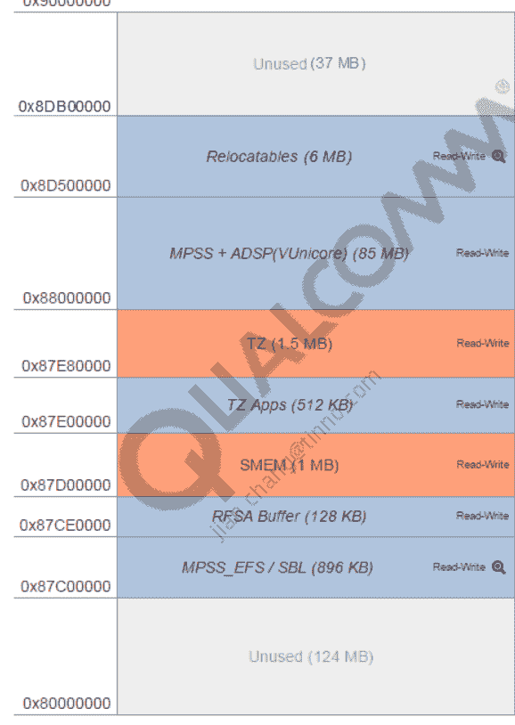
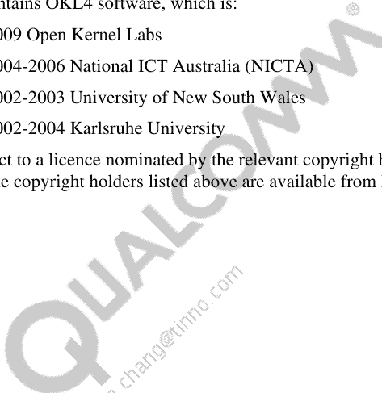

# MS8909.LA.1.1 Linux Android 版本 1.1.23 用于 MSM8909 设备发布说明


# 修订历史

| 修订 | 日期 | 说明 |
| --- | --- | --- |
| A | 2015年2月 | 适用于 MSM8909 设备的 MSM8909.LA.1.1 Linux Android 版本 1.1.23 (MSM8909_LA_1_1-01123) 文档初始发布。 |


4.1 新................................................................................ 20
4.1.1 进行中........................................................................ 20
4.2 已解决........................................................................... 20

# 1 入门

注意：这是一个预发布版本。

## 1.1 从 ChipCode 下载 QTI 私有软件

可以从 ChipCode 网站下载 QTI 软件。您组织中的指定联系人可以下载这些软件。软件被由子系统镜像组成的分发版（distros）。每个分发版都有一个对应的 Git 树。Git 树包含了允许您查看版本之间差异的修订。

1. 如果您初次使用 ChipCode，请查看以下链接以获取更新文档和视频：[https://code.qualcom.com](https://code.qualcom.com)

2. 创建顶级目录并解压子系统镜像到以下结构：

```
<target_root>
/common/
/boot_images/
/modem_proc/
/rpm_proc/
/trustzone_images/
/cnss_proc/
/linux/
```

3. 确保 `contents.xml` 文件位于上方。

## 1.2 下载开源 HLOS

Linux 支持包（BSP）通过两个部分获取：来自 ChipCode 的私有发布和来自 Aurora 的开源发布。

1. 打开从 ChipCode 下载的 `contents.xml` 文件并搜索 `<name>` 标签。

2. 下方的标签标识了开源 HLOS 构建：

```
<build_id>
```

3. 参考 [https://codeaurora.org/](https://codeaurora.org/) 的说明以查找分支。

4. 在空目录中，使用正确的分支和清单进行 `repo init`：

```bash
$ repo init -u git://codeaurora.org/platform/manifest.git -b release -m <manifest> git://codeaurora.org/tools/repo
```

5. 输入 `repo sync` 命令：

```bash
$ repo sync
```

6. `repo` 完成后，将私有的 `vendor/qcom/` 目录复制到开源 HLOS 树：

```bash
$ cp -r <target_location>/build_id>/android/
```

# 构建组件和命令

下表列出了每个组件的构建命令和命令。

| 构建组件 | 支持的构建环境 | 工具版本 | 命令 |
| --- | --- | --- | --- |
| MPSS | * Linux<br>* Windows | * Hexagon 工具集 6.4.0<br>* Python 版本 2.7<br>* Peripheral 版本 5.14 | 构建镜像 `./build.sh 8909.prod -c` 对于 Windows，使用 `build.cmd`。 |

| 构建组件 | 支持的构建环境 | 工具版本 | 命令 |
| --- | --- | --- | --- |
| BOOT | * Linux<br>* Windows | ARM 编译器工具 5.01 更新 3 (build 94) | **Windows**<br>**构建镜像** `boot_images/build/ms/build.cmd`<br>TARGET_FAMILY=8909-prod<br>**清理构建** `boot_images/build/ms/build.cmd -c`<br>TARGET_FAMILY=8909-prod<br>**Linux**<br>**构建镜像** `boot_images/build/ms/build.sh`<br>TARGET_FAMILY=8909-prod<br>**清理构建** `boot_images/build/ms/build.sh -c`<br>TARGET_FAMILY=8909-prod<br>根据配置，编辑脚本 `boot_images/build/ms/build_8909.sh` 以更改 `if [ -e "setenv" ]; then`<br>* `source setenv`<br>* `source /setenv` |

| RPM | * Linux<br>* Windows | （同上） | **Windows**<br>**构建镜像** `rpm_proc/build/build_8909.bat`<br>**清理构建** `rpm_proc/build/build_8909.bat -c`<br>**Linux**<br>**构建镜像** `rpm_proc/build/build_8909.sh`<br>**清理构建** `rpm_proc/build/build_8909.sh -c` |

| CNSS | 仅二进制文件 | - | - |

## 入门指南

| 构建组件 | 支持的构建环境 | 所需工具版本 | 构建命令 |
| --- | --- | --- | --- |
| TZ | - Linux<br>- Windows | ARM Compiler Tools 5.01 update 3 (build 94) | Linux<br>**构建镜像** --build.sh CHIPSET=msm8909 tz sampleapp tbsp_no_xpu playready widevine isdbmmm aostim securitytest keymaster commonlib<br>**清理构建** ..build.sh CHIPSET=msm8909 tz sampleapp tbsp_no_xpu playready widevine isdbmmm aostim securitytest keymaster commonlib -c<br>Windows<br>**构建镜像** --build.cmd CHIPSET=msm8909 tz sampleapp tbsp_no_xpu playready widevine isdbmmm aostim securitytest keymaster commonlib<br>**清理构建** --build.cmd CHIPSET=msm8909 tz sampleapp tbsp_no_xpu playready widevine isdbmmm aostim securitytest keymaster commonlib -c |

| APSS | 仅限 Linux | - Ubuntu 12.04<br>- arm-linux-android-gcc (GCC) 4.7 | Linux<br>**构建镜像**<br>1. 在 BASH shell 中，导航到 Android 源码根目录。<br>`cd <build id>/LINUX/android`<br>2. 输入以下命令配置构建环境 shell 设置。<br>`source build/envset.sh`<br>必须使用 `source` 命令，以便环境设置定义在当前 shell 中。<br>3. 输入 `lunch` 命令选择构建配置，或不带任何参数输入以查看交互式菜单进行选择。<br>`lunch msm8909-userdebug`<br>4. 运行 **make** 开始构建（显示 -j16 选项以便在多核构建上运行并行构建以加快构建速度）。<br>`make -j4` |

有关完整的构建说明，请参阅 MSM8909 Linux Android 软件用户手册手册 [SP80-NR964-4]。

有关构建组件和 ID，请参阅 Qualcomm ChipCode 上仓库根目录下的 `about.html` 文件。

表 1-1 显示了此版本的 Android 构建信息。还提供了 CAF 网站。

## 表 1-1 Android 构建信息

| 日期 | Tag/Build ID | 芯片组 | Android 版本 |


## 入门指南

| 构建组件 | 支持的构建环境 | 所需工具版本 | 构建命令 |
| --- | --- | --- | --- |
| `TZ` | - Linux<br>- Windows | `ARM Compiler Tools 5.01 update 3 (build 94)` | Linux<br>**构建镜像** `--build.sh CHIPSET=msm8909 tz sampleapp tbsp_no_xpu playready widevine isdbmmm aostim securitytest keymaster commonlib`<br>**清理构建** `..build.sh CHIPSET=msm8909 tz sampleapp tbsp_no_xpu playready widevine isdbmmm aostim securitytest keymaster commonlib -c`<br>Windows<br>**构建镜像** `--build.cmd CHIPSET=msm8909 tz sampleapp tbsp_no_xpu playready widevine isdbmmm aostim securitytest keymaster commonlib`<br>**清理构建** `--build.cmd CHIPSET=msm8909 tz sampleapp tbsp_no_xpu playready widevine isdbmmm aostim securitytest keymaster commonlib -c` |
| `APSS` | 仅限 Linux | - Ubuntu 12.04<br>- `arm-linux-android-gcc (GCC) 4.7` | Linux<br>**构建镜像**<br>1. 在 BASH shell 中，导航到 Android 源码根目录。<br>`cd <build id>/LINUX/android`<br>2. 输入以下命令配置构建环境 shell 设置。<br>`source build/envset.sh`<br>必须使用 `source` 命令，以便环境设置定义在当前 shell 中。<br>3. 输入 `lunch` 命令选择构建配置，或不带任何参数输入以查看交互式菜单进行选择。<br>`lunch msm8909-userdebug`<br>4. 运行 `make` 开始构建（显示 `-j16` 选项以便在多核构建上运行并行构建以加快构建速度）。<br>`make -j4` |

有关完整的构建说明，请参阅 MSM8909 Linux Android 软件用户手册 `[SP80-NR964-4]`。

有关构建组件和 ID，请参阅 Qualcomm ChipCode 上仓库根目录下的 `about.html` 文件。

表 1-1 显示了此版本的 Android 构建信息。还提供了 CAF 网站。

## 表 1-1 Android 构建信息

| 日期 | Tag/Build ID | 芯片组 | Android 版本 |
| --- | --- | --- | --- |


| 02/26/2015 | LA.BR.1.2.3-03110-89x.0 | MSM8909 | LA.BR.1.2.3-03110-89x.0.xml | Lollipop 05.00.02 |

此版本的 CAF 网站：

https://codeaurora.com/cgit/quia/la/platform/tag/?id=LA.BR.1.2.3-03110-89x.0

注意：请查找适用于 MSM8909 的下一个平台名称 `/vendor/qcom/terrum-git`。

## QMSS 软件剥离程序

要关闭 QMSS 软件，AMSS 客户在开始编译之前必须运行以下命令：

- `rm -rf vendor/qcom/proprietary/ndplus`

- `rm -rf packages/apps/FastPowerOn`

注意：TD-CDMA 启用了段加载 - 请参阅 MSM8909 Chip组软件概述 [80-NG94-2] 获取 NV 设置。

- 对于 TD-CDMA 驻留 - NV 72542（启用特定段的位图）应设置为 1（段）

- 对于 WCDMA 驻留 - NV 72542（启用特定段的位图）应设置为 2（段）

图 2-1（内存映射）中 MPSS + ADSP (VLicore) 镜像的大小为 85 MB。由于根据支持的无线电技术和/或优化有不同的解调器版本，请参考表 1-2 以确定正在使用的构建变体的可重定位部分起始地址的 MPSS 镜像实际大小。

### 表 1-2 Meta flavor 描述

| Contents.xml | MPSS 构建 ID | 支持的 RAT | MPSS 镜像大小 | 可重定位部分的起始地址 | MPSS Linux 编译命令（Windows 使用 use_cmd） | META 编译程序 |释释 |
| :--- | :--- | :--- | :--- | :--- | :--- | :--- | :--- |
| Contents.xml | EAAAA NVZ | W/T+C+G | 79 MB | 0x8E00000 | `.build.sh 8909.gen.prod-k` | 1. CD `<target root>common/build` 2. 运行 python update.com_info.py | 此构建包含所有 RAT。启用 W/T 段加载。支持 PM8916 请替换 rpm.mnb 路径 `/rpm/proc/msn/bin/8909/m8909/rpm/build/msn/bin/8909/meta` |

#### 1.3.1 修改 MPSS map

- 要达到优化的 (W/T) 大小，必须在 MPSS（带有 Flavor 的构建 - MSM8909EAAA）`cust_config.xml` 文件中进行更改：在 `<pool name="DEFAULT_POOL">` 第 68 行：`base="0x880000" size="0x4F000"` />

#### 1.3.1.2 APSS 更改

- 为了减少 APSS 端的解调器大小，需要对 `arm/arch/dts/qcom/ms8909.dts` 进行更改。下方提供的示例适用于 Kitchen flavor (79 MB)：

```
modem_adsp_mem: modem_adsp_region (linux, contiguous-region) reg = 0x0 880000 0x4F000;
```

注意：对于 QTI 参考平台，此支持通过 CDT 平台信息进行配置，并程序到 CDP 和 MTP 平台的 EEPROM 中，且必须与硬件配置匹配。

# 支持的 RF 卡

此版本支持 MSM8909 的以下 RF 卡片。

| 卡片名称 | 备注 |
| --- | --- |
| WTR4905 | |

注意：此版本仅支持 CHILE SRL RF 卡。

# 支持的 RF 频段

在 FC 质量下支持以下频段。

| RF 配置 | MPSS | GSM | CDMA | WCDMA | TD-SMA | TD-LTE | FD-LTE | WLAN |
| --- | --- | --- | --- | --- | --- | --- | --- | --- |
| WTR4905 | JO 1.0 | Quad-1 | BC0, 6 | B1, 2, 4, 5, 8 | B34, 39 | B38, 40, 41 | B1, 2, 3, 4, 5, 7, 18, 20, 26, 28 |   |
| WCN3610 | | G900 G180 0 G190 0 | | | | B34, B39 | B38, B40, B41 | 2.4G |
| WTR4905 5_CHINA_CU_4M | G900 G180 0 G190 0 | | | | B1, B8 | | B3, B40, B41 |   |
| WTR4905 5_CHINA_CT_4M | G900 G180 0 G190 0 | | BC0 | | | B1, B3, B41 | | | |
| WTR4905 5_AMX | G850, G900, G180, 0, G190 0 | | | B1, B2, B5 | | B2, B3, B4, B7, B17, B20, B28 |   |
| WTR4905 5_OM | G850, G900, G180, 0, G190 0 | | | B1, B5, B8 | | B1, B3, B7, B20, B38, B40 | |

保密和专有 - 高通技术公司有限公司

# 内存配置与使用

图 2-1 显示了 MSM8909 ASIC 的内存映射。图 2-2 显示了 MSM8994 内存映射中可移动分区的详情。图 2-3 显示了 MSM8994 内存映射中 MPSS_EFS/SBL (BOOT) 分区的详情。



图 2-1 MSM8909 内存映射图

支持的 ASICs 和内存配置

| 0x8DB00000 | |
| | WCNSS (6 MB) 读写 |
| 0x8D500000 | |

## 图 2-2 MSM8909 内存映射的可移动分区

| 0x87CE0000 | |
| | SBL (BOOT) (696 KB) 读写 |
| 0x87C00000 | |

## 图 2-3 MSM8909 内存映射的 MPSS_EFS/SBL (BOOT) 分区

| MSM8909 LA 1GB (720P 屏幕) | | | | |
| | 调制调器 | ADSP | | |
| 非 HLOS | 95 MB | WCNSS 等 | | |
| HLOS 静态 | 25 MB | 内核 | | |
| HLOS Android | 904 MB | Apps + FW MB 422 MB / 空闲内存 462 MB | | |

## 图 2-4 MSM8909 1GB 示例内存映射图

支持的 ASICs 和内存配置

这是一个初步的内存映射，将在未来的版本中发生更改，仅供此版本参考。不应用于内存优化。

性能优化 DDR 频率计划见表 2-1。针对以下性能参数进行了优化：

- 避免已知 RF 频率
- 最大吞吐量
- 最小功耗

注意：对发布的 DDR 频率进行修改可能会影响性能。

### 表 2-1 性能优化 DDR 频率计划

| DDR 频率计划 (MHz) |
| 9.60 |
| 50.00 |
| 100.00 |
| 200.00 |
| 400.00 |
| 533.00 |

### 表 2-2 GPU 频率

| GPU 频率 (MHz) |
| 19.200 |
| 50.000 |
| 100.000 |
| 160.000 |
| 177.780 |
| 200.000 |
| 266.670 |
| 409.600 |

# 3 新功能

此版本未引入新功能。之前版本引入的功能完整列表请参见附录 A。

# 4 Bug 和限制

本章列出了该产品的 Bug 和限制：

- 新 - 新报告的 Bug 和限制
- 进行中 - 之前报告的 Bug 和限制
- 已解决 - 之前报告的已解决的 Bug

注意：软件未正确配置 EBI 数据、GPIO 引脚的有效电压以确保进入睡眠期间的漏电流最小。这适用于与 GPIO 复用的数字引脚（例如 AUX_JTAG），以及任何其他 CMOS 引脚。更多细节请参见“睡眠期间的引脚”。

## 4.1 新

此节不适用于此版本。

## 4.1.1 进行中

原生传感器无法工作 (`CR7416`)。在多拨场景下观察到测试失败 (`CR7814`, `CR7947`)。

## 4.2 已解决

所有已完成请求的列表请参考根目录下的 `fixed.xls` 文件。

# 5 测试报告

## 5.1 CTS 测试报告

### 构建详情

| 分支 | |
| --- | --- |
| Apps ID | LA.BR.1.2 |


| Meta ID | 05.0002.034.151_HY11 |

| | MSM8909.LA.1-22011G,PM8909.SLE.1XGW.INT-2 |

### 统计

| | |

| --- | --- |

| 覆盖 | 98790/98790 |

| 通过 | 98764/98790 |

| 失败 | 3/98790 |

| 记录失败 | 23/98790 |

| CTS 版本 | CTS_5.0_r2_32Bit |

### CTS 失败结果

| CTS 包 | 测试用例 | |

| --- | --- | --- |

| CtsMediaTests | android.media.cts | test_S5P0001 |

| CtsOsTestCases | android.os.cts | testSeccomNo64 |

### 记录失败

| CTS 包 | 测试用例 | |

| --- | --- | --- |

| android.core.tests.libcore.package | libcore.java.util.zip | testZipManifesttestAllFilesJarCertificates |

| CtsAdbTests | com.android.cts.aadb | testSyncFiles_normalFileSync_extStorageVariable |

| CtsHardwareTestCases | android.hardware.camera2.cts | testDualCameraPreview |

| CtsOsTestCases | android.os.cts | testOpenCameraOpenAllCamerasdebuggingBuildFingerprinttestUserBuild |

| CTS 包 | 测试用例 | |

| --- | --- | --- |

| CtsPermissionTestCases | android.permission2.cts | testTextMessage |

| CtsPermissionTestCases | android.permission.cts | testNoDebuggable |

| CtsSecurityTestCases | android.security.cts | testAllEnforcing |

| CtsSecurityTestCases | android.security.cts | testToCrashVoid |

| | | testPackageSignatures |

| | | testNoConfig |

| | | testNoInPath |

| | | testNoSetUidcdump |

| | | testDevDiag |

| CtsTelephonyTestCases | android.telephony.cts | testGetDeviceId |

| | android.telephony.gsm.cts | testSendMessages |

## 5.2 新

8909 + PM916 仪表板

| 类别 | 用例 | 测量值 |

| --- | --- | --- |

| Apps | 飞行模式 | 19.200 |

| | GPRS | 50.000 |

| | CDMA | 100.000 |

| | 待机 | 160.000 |

| | WCDMA | 177.780 |

| | EVDO | 200.000 |

| | FDD LTE | 266.670 |

| | HSDPA | 307.200 |

| | TDD LTE | 409.600 |

| | | |

| Modem | 飞行模式 | 9.60 |

| | GPRS | 50.00 |

| | CDMA | 100.00 |

| | 待机 | 200.00 |

| | WCDMA | 400.00 |

| | EVDO | 533.00 |

| | | |

## 5.3 进行中

8909 + PM916 仪表板

| 类别 | 用例 | 测量值 |

| --- | --- | --- |

| Apps | 飞行模式 | 19.200 |

| | GPRS | 50.000 |

| | CDMA | 100.000 |

| | 待机 | 160.000 |

| | WCDMA | 177.780 |

| | EVDO | 200.000 |

| | FDD LTE | 266.670 |

| | HSDPA | 307.200 |

| | TDD LTE | 409.600 |

| | | |

# MSM8909 + PM8900 调制调器功耗仪表

| 类别 | 用用场景 | 2004-1G 02/11 测量值 |

| :--- | :--- | :--- |

| 睡眠 | 无 SIM 卡飞行模式 | 1.84 |

| 调制调器（待机） | WCDMA 睡眠 | 1.94 |

| | WCDMA 待机 [2.5 s] | 2.22 |

| | GPRS 待机 [1.17 s] | 2.46 |

| | CDMA QPQ 待机 [5.12 s] | 2.13 |

| | EVDO 待机 [5.12 s] | 2.30 |

| | FDD LTE 待机 2.56 s [离线 DRX] | 2.56 |

| | TDD LTE 待机 2.56 s [离线 DRX] | 2.67 |

| | TD-SCDMA 待机 1.28 s | 2.48 |

| | DSDS G+G: (0.47-0.47) | 4.81 |

| | DSDS W+G: (0.64-0.47) | 4.65 |

| | DSDS TDDLTE + G : (1.28-0.47) | 4.74 |

| | DSDS TDCDMA + G : (0.64-0.47) | 4.49 |

| 调制调器（通话） | WCDMA AMR 语音通话 [0 dBm] | 126.80 |

| | CDMA EVRC 语音通话 [0 dBm] | 111.00 |

| | GSM FR 语音通话 [+5 dBm, 无 DTX] | 83.00 |

| | TDSCDMA 通话 @ 0 dBm | 61.65 |

| 调制调器（数据） | 嵌入式 HSDPA 7.2 Mbps 下行 @ 0 dBm 开启 RxD | 174.00 |

| | 嵌入式 DC HSPA+ 42 Mbps 下行 @ 0 dBm, 关闭 RxD | 187.00 |

| | 嵌入式 FDD LTE Cat 3 下/上行 (68/23 Mbps) 0 dBm | 0.00 |

| | 嵌入式 FDD LTE CAT4 (20 MHz, 150/50 Mbps) 频段1 | 0.00 |

| | 嵌入式 TDD LTE CAT3 (20 MHz, 80/20 Mbps) DLUL1 SS7 频段38 | 0.00 |

| | 嵌入式 TDCDMA HSDPA 2.8 Mbps 0 dbm 关闭 RXD | 116.00 |

| GPS | W GPS 独立 1 Hz 追踪 [DPO] | 11.61 |

| | W GNSS 独立 1 Hz 追踪 [非 DPO] | 46.78 |

表 5-4 MSM8909 + PM8909 多媒体功耗仪表

| 类别 | 用用场景 | 2014-1G 02/11 调整值 |

| :--- | :--- | :--- |

| 多媒体 | MP3 播放 128 kbps TM | 23.58 |

| 听音(SVA) 100% 静音 | 14.76 |

| 听音(SVA) 100% 语音 | 18.19 |

| H.264 720p 解码, 30fps | 132.42 |

| H.264 1080p 解码, 30fps | 160.00 |

| HEVC 720p 解码, 30fps | 136.17 |

| H.264 720p 编码, 30fps | 278.53 |

| 3D UI 30fps (图形, powerlift ) | 144.78 |

| 3D Gtx 效果 60fps | 340.71 |

| 网络应用 | 静态图像 | 40.66 |

| 通过 Wi-Fi 浏览器 | 61.67 |

| 通过 Wi-Fi 视频流 720P | 163.48 |

| 连接性 | W 待机时的蓝牙 SNIFF/扫描 | 0.00 |

| W 待机时的 WLAN DTIM1 | 0.00 |

# A 累积特性

本附录描述了该产品线的累积特性。

| 子系统 | 区域 | 特性 |

| :--- | :--- | :--- |


| CBSP | RPM | 启用开环 CPR<br>- BSP 驱动程序<br>- LPDDR2 @ 533 MHz<br>- 完整启动链,<br>- USB, UART, SD卡, 安全启动, QDSS<br>- SMMU, XPUs 已完全验证<br>- 安全: TZ 冷/热启动, MBA, 加密, MBA<br>- 支持 eMMC 下载<br>- 支持 QIRT, DAL<br>- 服务: 访问控制-调制调器, SSM 支持<br>- 总线 – Bus PM APPS Linux<br>- 功耗 – 启用开环 CPR<br>- CX 热缓解 |

| 调制调器 | 调制调器 | LTE<br>- LTE OTA/PRS |

| | LTE | 基础数据<br>- LTE – 10 MHz – TM6 发布 8, 9, 10 信号<br>- 扫描<br>- 基础 TDD 通话<br>- LTE (降低速率) 在 15 MHz<br>- LTE 释放, RLF<br>- 带聚合 CA<br>- LTE 切换<br>- FDD/TDD 20 MHz TM7,8 CSI (特殊配置)) |

| 子系统 | 区域 | 特性 |

| :--- | :--- | :--- |

| WCDMA | WCDMA | 语音/数据通话<br>- WCDMA 内部/频率<br>- WCDMA 压缩模式<br>- 扫描<br>- 基础数据<br>- WCDMA 外部 RAB<br>- 连接 RxD<br>- CM: 内部频率<br>- HSDPA, HSUPA<br>- DCHHSDPA<br>- R99 释放 (小区), HSDPA 功耗<br>- 切换 - HHO, SHO<br>- 内部/频率<br>- DRX<br>- 高级接收器<br>- CSG/BPLMN<br>- HSDPA+QICE+RXD<br>- 空闲, 频率<br>- 语音通话, 高级<br>- SMS<br>- 时隙模式<br>- 高级 ADV<br>- 1X/DO + HDR 混合<br>- 4x-16 |

| 1X/DO | | |

| TDS | | R4 语音/数据<br>- TDS HSDPA 通话<br>- TDS HSUPA 通话<br>- TDS 空闲/睡眠操作<br>- TDS MRAB (R4+HS)<br>- SDSS |

| 子系统 | 区域 | 特性 |

| :--- | :--- | :--- |

| | CRAT | * 1xSRLTE<br>* 双 SIM<br>◦ C+G<br>◦ DO+G<br>◦ W/G+G<br>◦ T/G+G<br>◦ L/W/G/T+G(CSFB)<br>◦ 1xSRLTE+G<br>* DSDS L+G LTE |

| | RFA | * EPT 校准<br>* RF 非信号<br>* RF FTM |

| | IMS | * IMS/SMS 通过 eHRDP<br>* IMS/SMS 通过 LTE<br>* VoLTE (信号)<br>* VoLTE - 媒体<br>* VT (信号)<br>* IMS - (CD, 时消息, 文件共享, 图像共享)<br>* IMS - E911 |

| 连接性 | | WLAN<br>* WLAN STA, SAP, P2P<br>* WLAN 安全/WPA2<br>* 802.11 b/n<br>蓝牙<br>* 与 WLAN/蓝牙 共存<br>* 多蓝牙配置共存<br>* 蓝牙 A2DP, HFP, SAP, DUN, AVRCP, PAN, SDP, FTP, OPP |

| 多媒体 | 视频 | 视频<br>* NFC - 标签, 卡片模拟<br>* 所有解码器的端到端播放<br>* 带 H264 的摄像机<br>* 硬件编码器 H264<br>* VP8, HeVC<br>* 1080p @ 30 fps<br>* 错误隐藏<br>* 支持 MP4, DivX, XVID, AAC, MP3, flac, pcm, ogg, evc, OLCF, AMR-NB 和 AMR-WB。 |

| | 相机 | - 前置 2 万像素和后置 8 万像素摄像头预览<br>- 数字缩放, 3-AWB, AEC, AF, 自动帧率, 实时快照, 红眼矫正,微笑检测, 视线检测, 呼吸检测<br>- 闪光支持<br>- MTP 快照上调节 80% 的摄像头传感器 |

| GPU | | - 具有完整 Android 端到显示的 A304 驱动程序<br>- Turbo @ 409 MHz<br>- OpenGL 1.1, 2.0 和 3.0<br>- 硬件渲染<br>- C2D |

| 显示 | - qHD<br>- 后处理 – CABL/SVI<br>- 重启期间的屏幕<br>- 旋转<br>- 720p<br>- MDP3, 4 通道,<br>- 2 层绕过合成 |

| 图形 | - EGL1.4, Rendercript |

| 音频 | - SVA (听音) – 内部编码器<br>- WB 解码器的语音通话<br>- Fluance<br>- 杜比编码器<br>- 音频和媒体并发支持<br>- 用于 CDMA/GMA/UMTS 的 TTY<br>- 所有代码的音频播放和录制<br>- AAC, MP3, flac, pcm, ogg, evc, OLCF, AMR-NB 和 AMR-WB。<br>- FTM (基础), 音频蓝牙, 低功耗音频 (隧道模式), FM, 立体耳机<br>- 语音编码 (AMR-NB, AMR-WB) – 端到端语音通话<br>- PP, SRS, Audio+,br>- 外部 I2S 接口桥接在 MTP 上的音频优化 |

# 累计特性

| 子系统 | 区域 | 特性 |

|---|---|---|

| GPS | | - 离线 GNSS RF 开发 4.0<br>- 低功耗模式 (LPM) 端到端独立 GNSS<br>- 支持 XTRA3.0 的独立 GNSS 2.0（包含北斗）<br>- 与 GSM, LTE, CDMA, WCDMA 和 TD-CDMA 并行的独立 GNSS<br>- DPO 2.1<br>- 粗略位置注入和实时定位<br>- GSM, LTE, CDMA, WCDMA 和 TD-CDMA 上的用户面 A/GNSS<br>- GSM, LTE, CDMA 和 WCDMA 上的控制面 A/GPS<br>- 全球地面定位 (GTP) - Wi-Fi 1.5<br>- 全球地面定位 (GTP) - Cell 1.6<br>- 零功率定位 (ZPP) 2.0<br>- OTA-LTE 测量 2.0<br>- 组合网络位置提供程序<br>- 地理围栏 3.1<br>- 位置批处理 1.0<br>- 多位置 ID 2.0, SUPL (V2.0) |

| UI | | 融合 UI |

| Debug | | RAM dump 收集<br>- GSM - 语音/数据/SMS<br>- WCDMA - 语音/数据/SMS<br>- 1X - 语音/1X 进级/数据(DO Rev 0/A)<br>- SMS/EV-DO 非时隙模式<br>- TD-SCDMA - 语音/数据/SMS<br>- 基础 LTE 数据通话<br>- LTE-FD - 数据 10 MHz:TM1-M6<br>- LTE release 8, 9, 10 信令<br>- LTE 频率扫描<br>- UIM1, UIM2 和 SIM 热插拔<br>- 全偏置 RF 话 |

| Thermal | | 所有热管理功能已通过验证 |

# 累计特性

| 子系统 | 区域 | 特性 |

| --- | --- | --- |

| 区域 | - | - 区域：针对新触发器和配置的框架增强<br>- 区域：使用区域框架根据 SIM 锁应用首次 SIM 插入<br>- 区域：主线销售跟踪器和 ESN 跟踪器 APK<br>- 区域：针对拉丁美洲 (LatAm) 市场的特定清除代码<br>- 区域：支持阿拉伯语的从右向左 (RTL) 更改支持<br>- 区域：在各种模块中配置参数以支持运行时动态切换<br>- 从云端更新区域包 (Regional pack)<br>- 跟进 FR1652 的后续更新：根据组合触发器更新配置<br>- Smartteren (印度尼西亚) 区域包<br>- iMobile (泰国) 区域包<br>- Cherry Mobile (菲律宾) 区域包<br>- Cherry Mobile (泰国) 区域包<br>- Cherry Mobile (缅甸) 区域包<br>- Fly (俄罗斯，乌克兰) 区域包<br>- MTN (南非) 区域包<br>- 印度开放市场区域包<br>- 巴西开放市场区域包<br>- 载波聚合已启用。 |

| 子系统 | 区域 | 特性 |

| --- | --- | --- |


| APSS | - | - FR25450 - 相机应用 – 屏幕方向问题<br>- FR25130 - 添加了针对 2.0 到 CMCC 测试的电源设置<br>- FR17799 – IMEI – 评估了 2.0set的用户体验<br>- FR25642 – 启用了 CT 运营商名称<br>- FR27474 – AMX – 全球架构合规性<br>- FR27455 – AMX – 进行了平台增强<br>- FR27456 – AMX – 更新了语言需求<br>- FR27458 – AMX – 添加了针对 Telcis 的定制化<br>- FR27459 – AMX – 添加了针对（智利、哥伦比亚和秘鲁）的定制<br>- FR27460 – AMX – 添加了针对 Telcel 包的调制解调器<br>- FR27461 – AMX – 进行了电话增强<br>- FR27462 – AMX – 启用了新的电话和通话功能<br>- FR27463 – AMX – 进行了通话增强<br>- FR27465 – AMX – 启用了 DRM 2.0阶段 |


| 子系统 | 区域 | 特性 |
|---|---|---|

| APSS (续) | – | - FR24767 – AMX – 进行了消息增强<br>- FR24768 – AMX – 进行了新的消息增强<br>- FR24769 – AMX – 进行了浏览器增强<br>- FR25408 – AMX – Telcel 账户<br>- FR25409 – AMX – 启用了区域数据配置<br>- FR25410 – AMX CP.1 和 OMA DL<br>- FR25412 – AMX – 启用了终端服务需求 |

在对受 Apache 许可证第 2.0 版许可的文件应用补丁时，请注意该许可的第 4(b) 条，该条款规定：
b. 你必须使任何修改过的文件带有显眼的通知，说明你更改了这些文件；并且本发布说明中的任何内容都不会改变你与高通技术公司签署的任何协议的条款和条件。

本次发布分发的软件部分受 OZPLA 许可限制，内容如下：
使用、复制、修改、适配、合并、发布、分发、向公众传播、分许可和/或出售、借出或出租软件副本的权利，以及允许提供软件的人员执行这些操作，由 NICTA 免费授予，但须满足以下条件：
- 源代码的分发必须保留上述版权声明、条件列表和后续声明
- 源代码的分发必须保留上述版权声明、条件列表和后续声明
- 源代码的分发必须保留上述版权声明、条件列表和后续声明
- 源代码的分发必须保留上述版权声明、条件列表和后续声明
- 源代码的分发必须保留上述版权声明、条件列表和后续声明
-
保留所有权利。开发者：Embedded, Real-Time Systems (ERTOS)
NICTA
http://ertos.nicta.com
除非本许可证中明确规定的，否则软件按“原样”提供。在适用法律允许的最大范围内，NICTA 和其贡献者不对内容提供任何形式的明确或暗示的陈述或保证，包括但不限于对内容的准确性、特定用途的适用性、不侵权、是否存在或其他缺陷，或是否存在或不存在可发现错误的保证。
在适用法律允许的最大范围内，在任何情况下，NICTA 或其贡献者均不对基于任何法律理论（包括但不限于合同诉讼、过失或其他）而提出的任何索赔、损失、损害或其他责任负责，包括不限于生产或运行时间的损失、数据或记录的丢失或损坏；或预期节省、机会、收入、利润或声誉的损失；或其他经济损失；或由于本许可证、软件的使用或软件的其他处理而引起的任何特殊、间接、后果性、惩罚性或示例性损害，即使 NICTA 或其贡献者已被告知此类索赔、损失或损害。
如果适用法律对 NICTA 或其某位贡献者就软件规定了无法完全排除、限制或修改的陈述、保证、条件或义务，则 NICTA 或该贡献者的责任在法律允许的范围内，由其选择：
a. 对于货物，以下一项或多项：
i. 替换货物或提供等货物；
ii. 修复货物；
iii. 替换货物或获取等同物的费用；
iv. 修复货物的费用；或
b. 对于服务的修复：
i. 重新提供服务，或
ii. 重新提供服务的费用。（许可证在下一页继续...）

本产品包含 OKL4 软件，版权所有：
Copyright(C) 2009 Open Kernel Labs
Copyright(C) 2004-2006 National ICT Australia (NICTA)
Copyright(C) 2002-2003 University of New South Wales
Copyright(C) 2002-2004 Karlsruhe University
OKL4 受相关版权所有者指定的许可协议约束。上述版权所有者指定的许可条款可通过 http://ok-labs.com/licenses 获取。



# E 参考文献

### E.1 相关文档

| 文档 | |
| Qualcomm Technologies, Inc. | |
| 设备睡眠期间的输入引脚配置 | 80-VN499-7 |
| MSM8909 Linux Android 用户手册软件产品文档 | 80-NR964-4 |
| MSM8909 Linux Android 调试软件产品文档 | SP80-NR964-5 |
| MSM8909 Linux Android 移植手册软件产品文档 | 80-NR964-6 |
| 演示稿：MSM8x09 启动架构概述 | 80-NR964-3 |
| MSM8x09 MSM8x09 系统电源概述 | 80-NR964-5 |
| 演示稿：MSM8x09 PMIC 驱动概述 | 80-NR964-6 |
| 演示稿：MSM8916/MSM8909 Linux Android 调试 | 80-DL239-7 |
| MSM8x09 资源电源管理 (RPM) 调试手册 | 80-NR964-9 |
| 演示稿：MSM8x09 散热管理概述 | 80-NR964-10 |
| 演示稿：MSM8x09 调制解调器软件概述 | 80-NR964-11 |
| 演示稿：MSM8x09 RF软件概述 | 80-NR964-12 |
| 演示稿：MSM8x09 Linux Android 音频概述 | 80-NR964-14 |
| 演示稿：MSM8x09 Linux Android 摄像头概述 | 80-NR964-15 |
| 演示稿：MSM8x09 Linux Android 显示概述 | 80-NR964-16 |
| 演示稿：MSM8x09 Linux 图形概述 | 80-NR964-17 |
| 演示稿：双载波-高速上行数据包接入 (DC-HSUPA) | 80-NK352-1 |
| LTE 传输模式 9 (TM9) 特性概述 | 80-NM107-1 |
| Rel 10 UE 的强制性功能支持 | 80-NM005-1 |
| 演示稿：VAMOS 概述 | 80-NH874-1 |
| MSM8909 512 MB 范围内的调制解调器稳定性调试概述 | 80-NR964-8 |
| 应用笔记：在 MSM8909 上启用音频/语音存根功能 | 80-NR964-31 |
