# 多核应用编程：适用于 Windows、Linux 和 Oracle Solaris (开发者库)


Greg Doench

- 前言 xv
- 致谢
- 关于作者 xxi

本页特留白

- 前言 xv
- 致谢 xix
- 关于作者 xxi

## 1 硬件、进程与线程 1
- 计算机内部检查 1
- 多核处理器的动机 3
- 单个芯片上支持多个线程 4
- 使用流水线处理器提高速率 9
- 使用缓存持有近期使用的数据 12
- 使用虚拟内存存储数据 15
- 多处理器系统的特性 18
- 延迟和带宽对性能的影响 20
- 进程与线程的区别 26
- 确保内存操作的顺序 24
- 源码到汇编的翻译 21

## 2 性能编程 31
- 定义性能 31
- 理解算法复杂度 33
- 算法复杂度示例 33
- 为什么算法复杂度很重要37
- 谨慎地使用算法复杂度 38
- 结构中的权衡 39
- 代码与构建 39
- 使用库组织结构 42
- 数据结构的影响 53
- 编译器的角色 60
- 两种编译器优化 62
- 选择合适的编译器选项 64
- 跨文件优化可提高性能 65
- 使用分析反馈 68
- 潜在的指针别名如何抑制优化 70
- 常用的分析工具 75
- 如何不优化 80
- 设计性能 83

## 3 并行机会 85
- 使用进程提高生产力 85
- 利用单一系统的多个用户 87
- 通过整合提高机器效率 88
- 使用容器隔离共享系统的应用程序 89
- 使用虚拟机运行多个操作系统 89
- 使用并行提高单个任务的性能 92
- 可视化并行的一种方法 92
- 并行如何改变算法选择 93
- 阿姆达尔定律 94
- 确定最大线程 97
- 同步成本如何扩展 100
- 使用 SIMD 指令的数据并行 101
- 使用进程或线程的并行 102
- 多个独立任务 102
- 多个松耦合任务 103
- 同一任务的多个副本 105
- 跨线程拆分任务 106
- 使用任务流水线处理单个项目 106
- 将工作分为客户端和服务器 108
- 将责任分为生产者和消费者 109
- 结合并行策略 109
- 依赖如何影响并行运行代码的能力 110
- 反依赖和输出依赖 111
- 使用推测打破依赖 113
- 关键路径 117
- 识别并行机会 118
- 总结 119

## 4 同步与数据共享 121
- 数据竞态 121
- 使用工具检测数据竞态 123
- 避免数据竞态 126
- 同步原语 126
- 互斥锁与临界区域 126
- 自旋锁 128
- 信号量 128
- 读写锁 129
- 屏 130
- 原子操作与无锁代码 130
- 死锁与活锁 132
- 线程与进程间的通信 133
- 内存、共享内存与内存映射文件 134
- 条件变量 135
- 信号与事件 137
- 消息队列 139
- 命名管道 139
- 通过网络栈通信 139
- 线程间共享数据的其他方法 140
- 存储线程私有数据 141
- 总结 142

## 5 使用 POSIX 线程 143
- 创建线程 143
- 线程终止 144
- 在子线程间传递数据 145
- 分离线程 147
- 为 Pthreads 设置属性 148
- 编译多线程代码 151
- 进程终止 153
- 线程间共享数据 154
- 使用互斥锁保护访问 154
- 互斥锁属性 156
- 使用自旋锁 157
- 读/写锁 159
- 屏 162
- 信号量 163
- 条件变量 170
- 变量与内存 175
- 多进程编程 179
- 进程间共享内存 180
- 进程间共享信号量 183
- 消息队列 184
- 管道与命名管道 186
- 使用信号与进程通信 188
- 套接字 193
- 重入代码与编译器标记 197
- 总结 198

## 6 Windows 多线程 199
- 创建原生 Windows 线程 199
- 终止线程 204
- 创建并恢复挂起的的线程 207
- 使用句柄访问内核资源 207
- 同步与资源共享的方法 208
- 线程间需要同步的示例 209
- 使用临界区保护代码区域 213
- 细读写锁 (Slim Reader/Writer Locks) 214
- 信号量 216
- 条件变量 218
- 向其他线程和进程信号事件完成 219
- Windows 中的宽字符串处理 221
- 创建进程 222
- 进程间的内存共享 225
- 子进程中的句柄继承 228
- 互斥锁的命名及其在进程间的共享 229
- 通过管道通信 231
- 使用 Socket 通信 234
- 变量的原子更新 238
- 分配线程本地存储 240
- 设置线程优先级 242
- 总结 244

## 7 使用自动并行化和 OpenMP 245
- 使用自动并行化生成并行应用程序 245
- 识别并并行化归约操作 (Reductions) 250
- 对包含调用的代码进行自动并行化 251
- 协助编译器自动并行化代码 254
- 使用 OpenMP 生成并行应用程序 256
- 使用 OpenMP 并行化循环 258
- OpenMP 应用程序的运行时行为 258
- OpenMP 并行区域内部的变量作用域 259
- 使用 OpenMP 并行化归约操作 260
- 在并行区域外部访问私有数据 261
- 使用调度改进工作负载分配 263
- 使用并行段 (Parallel Sections) 执行独立工作 267
- 嵌套并行 268
- 使用 OpenMP 处理动态定义的并行任务 269
- 保持线程私有 274
- 控制 OpenMP 运行时环境 276
- 等待工作完成 278
- 限制执行代码区域的线程 281
- 确保并行区域内的代码按顺序执行 285
- 合并循环 (Collapsing Loops) 以平衡负载 286
- 强制内存一致性 287
- 并行化示例 293

## 8 手写同步与原子操作 295
- 使用比较并交换指令实现更复杂的原子操作 297
- 强制内存排序以确保操作正确 301
- 编译器对内存排序指令的支持、编译器的操作重排 304
- 易变变量 (Volatile Variables) 308
- 操作系统提供的原子性 309
- 无锁算法 312
- Dekker 算法 312
- 基于环形缓冲的生产者-消费者模型 315
- 扩展到多个消费者或生产者 318
- 将生产者消费者模型扩展到多个线程 319
- 将生产者消费者代码修改为原子操作 326
- ABA 问题 329
- 总结 332

## 9 利用多核处理器进行扩展 333
- 应用扩展的限制 333
- 受串行代码限制性能 334
- 超线性扩展 336
- 工作负载不平衡 338
- 热点锁 (Hot Locks) 340
- 库代码的扩展 345
- 工作量不足 347
- 算法限制 350
- 扩展的硬件限制 352
- 核心间的带宽共享 353
- 伪共享 (False Sharing) 355
- 缓存冲突与容量 359
- 流水线资源饥饿 363
- 操作系统对扩展的限制 369
- 过度订阅 (Oversubscription) 369
- 使用处理器绑定提高局部性 371
- 优先级反转 379
- 多核处理器与扩展 380
- 总结 381

## 10 其他并行化技术 383
- 基于 GPU 的计算 383
- 语言扩展 386
- 线程构建块 (Threading Building Blocks) 386
- Cilk++ 389
- 统一中央分调度 (Grand Central Dispatch) 392
- 下一代 C 和 C++ 标准提出的特性 394
- 微软的 C++/CLI 397
- 替代语言 399
- 集群技术 402
- MPI 402
- MapReduce 作为一种扩展策略 406
- 网格计算 (Grids) 407
- 事务内存 407
- 向量化 408
- 总结 409

## 11 结语 411
- 编写并行应用程序 411
- 识别任务 411
- 估计性能收益 412
- 确定依赖关系 413
- 数据竞态与互斥锁的扩展局限性
- 锁粒度 413
- 多核处理器上的并行代码 414
- 针对多核处理器优化程序 415
- 未来 416
- 参考文献 417
- 书籍 417
- POSIX 线程 417
- Windows 417
- 算法复杂度 417
- 计算机体系 417
- 并行编程 418
- OpenMP 418
- 在线资源 418
- 硬件 418
- 开发者工具 418
- 并行化方法 419
- 索引 419

# 前言


多年来，家用电脑一直给人同时处理多项任务的错觉。这是通过每秒多次切换正在运行的任务来实现的。这营造出一种同时活动的假象，但这仅仅是表象。当计算机处理某项任务时，其他任务并没有进展。一次只能执行单个任务的旧电脑可能被认为具有单处理器、单 CPU 或单个“核心”。核心是处理器中实际执行工作的部分。

最近，即使是家用电脑也配备了多核处理器。现在很难、甚至无法买到非多核的机器。在多核机器上，每个核心都可以为某个任务取得进展，多个任务确实可以同时进行。

说明这种含义的最好方法是考虑一台用于将摄像机中的胶片转换为适用于刻录到 DVD 格式的计算机。这是一项计算密集型操作——从磁盘读取大量数据，向磁盘写入大量数据——但大部分时间花在处理器解压缩输入视频并转换为刻录到磁盘的压缩输出上。

在单核系统上，可能同时运行两个电影...（此处原文截断，根据指令保留原始信息）

# 本书结构

本书分为以下章节。

第 1 章介绍了书中后续部分将遇到的硬件和软件概念。本章概述了处理器的内部结构。对于读者来说，在编写利用多核程序的之前，并不一定需要理解硬件的工作原理。然而，对处理器架构基础知识的理解将使读者更好地理解书中介绍的关于正确性、性能和扩展性的某些概念。本章还讨论了线程和进程的概念。

第 2 章讨论了应用程序的性能分析和优化。本书的一个前提是：在投入精力修改应用程序以使用多核之前，了解应用程序目前的时间消耗在何处是至关重要的。本章涵盖了应用程序开发周期中影响性能的所有主要因素，以及如何提高性能。

第 3 章描述了多核系统如何能够在单位时间内执行更多工作，或者缩短完成单个单元工作所需的时间。本章从虚拟化开始讨论，即一个新系统可以替代多个旧系统。这种整合可以在不改变软件的情况下实现。重要的是意识到，多核系统代表了改变应用程序工作方式的机会。本章继续描述了用于编写并行应用程序的各种模式，并讨论了这些模式可能有用的情况。

第 4 章描述了在多个线程之间安全地共享数据。本章首先讨论了数据竞态（`data races`），这是多线程代码中最常见的正确性问题。本章涵盖了如何在抽象层次上共享数据和进行同步。后续章节将描述特定操作系统的细节。

第 5 章描述了如何使用 `POSIX` 编写并行应用程序。`POSIX` 是类 Unix 操作系统（如 `Linux`、`Apple` 的 `OS X` 和 `Oracle` 的 `Solaris`）实现的标准。`POSIX` 线程库为编写并行应用程序提供了许多构建块。它提供了极大的灵活性和开发便利性。

第 6 章描述了如何使用 Windows 原生线程为 Microsoft Windows 编写并行应用程序。Windows 提供了与 `POSIX` 类似的同步和数据共享原语。它们的区别在于这些函数的接口和要求。

第 7 章描述了编译器提供的自动并行化的机会和局限性。本章还涵盖了 `OpenMP` 规范，该规范使得编写利用多核处理器优势的应用程序变得相对简单。

第 8 章讨论了如何在不使用操作系统或编译器库库的情况下编写并行应用程序。为同步或数据共享编写自定义代码有一些充分的理由，这些可能是为了获得更细粒度的控制或潜在的性能提升。然而，在生成功能正常的代码时，需要避免许多陷阱。

第 9 章讨论了如何改进应用程序的扩展，以最大限度地发挥多核系统的工作。本章描述了扩展可能受限的常见领域，并描述了识别这些扩展局限的方法。在扩展方面，为多核系统开发与为多处理器系统开发有所不同；本章讨论的硬件实现将产生差异。

第 10 章涵盖了编写并行应用程序的多种替代方法。随着多核处理器成为主流，其他方法正在被尝试以克服编写正确、快速且可扩展的并行代码时的某些障碍。

第 11 章总结全书。

# 致谢

许多人对本书做出了贡献，既包括讨论了这些页面涵盖的一些问题，也对这些页面进行了正确性和连贯性的审阅。特别，我要感谢 Miriam Blatt, Steve Clamage, Mat Colgrove, Duncan Coutts, Harry Foxwell, Karsten Guthrie, David Lindt, Jim Mauro, Xavier Palathingal, Rob Penland, Steve Schalkhauser, Sukhdeep Sidhu, Peter Strazdins, Ruud van der Pas 和 Rick Weisner，他们校对了章节的草稿，审阅了文本章节并提供了有帮助的反馈。我要特别感谢 Richard Friedman，他为我提供了详尽的反馈。

我要感谢 Addison-Wesley 团队，包括 Greg Dooley, Michelle Housley, Anna Popick 和 Michael Thurston，以及自由职业拷贝编辑 Kim Wimpset，他们提供了指导、校对、建议和支持。

我还对家人和朋友在本书出版过程中给予的帮助和鼓励表示感谢。如果没有整个网络人的支持和理解，是不可能抽出时间写作的，有人们关注并愿意听写作进展真是太棒了。我特别感谢我的父母 Tony 和 Maggie，以及岳父母 Geoff 和 Lucy 的热情和支持。

最后，也是最重要的一点，我要感谢我的妻子 Jenny；我们的儿子 Aaron 和 Timothy；以及我们的女儿 Emma。我无法想象有比这更有支持、热情的家庭了。你们激发了我想要理解事物运作原理并传递这些知识的愿望。

本页特意留

# 关于作者

**Darryl Gove** 是 Oracle Solaris Studio 编译器团队的高级首席软件工程师。他负责应用程序和基准测试的分析、并行化和优化。Darryl 在英国南安普普顿大学获得了运筹学硕士和博士学位。他是《Solaris Application Programming》(Prentice Hall, 2008)和《The Developer's Edge》(Sun Microsystems, 2009)的作者，也是书籍《OpenSPARC Internals》(lulu.com, 2008)的贡献者。他经常撰写优化和编码，并在 www.darrylgove.com 维护博客。

本页特意留

# 硬件、进程与线程

编写串行或并行应用程序并不需要理解硬件的工作原理。在将计算机内部视为黑盒的情况下编写代码是完全允许的。然而，对处理器内部结构的简单理解将使后续的话题更加直观。串行（单线程）应用程序与并行（多线程）应用程序的关键区别在于，多线程的存在使得系统的属性对应用程序变得重要。例如，单线程应用程序没有多个线程竞争同一个资源，而这在多线程应用程序中很常见。资源可能是缓存空间、内存带宽，甚至是物理内存。在这些情况下，硬件的特性可能会表现为应用程序行为的变化。对硬件工作原理的一些了解有助于理解、诊断和修复异常应用程序。

## 检查计算机内部

从根本上说，计算机通过一个或多个处理器和一些内存进行计算。许多芯片和电线将它们连接在一起。还有外设设备，如磁盘驱动器或网卡。

图 1.1 显示了个人电脑的内部结构。许多组件进入计算机。处理器和内存被插入到称为主板的电路板上。电线从这里连接到磁盘驱动器、DVD 驱动器等外设设备。视频或网络支持等功能集成在主板中，或者通过插卡提供。

如果信息以原理图的形式呈现（如图 1.2），就可以理解系统组件之间是如何相关的。该原理图将系统的计算端与外设设备分离开来。

# 第一章 硬件、进程与线程

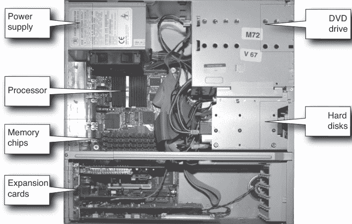

图 1.1 PC 内部结构

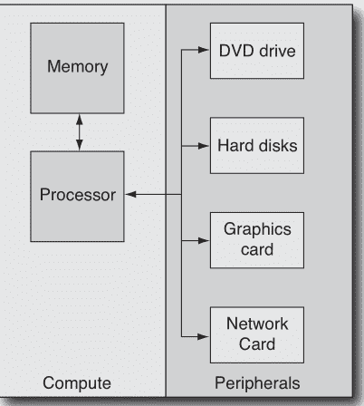

图 1.2 PC 的示意图

## 多核处理器的动机

系统的计算性能特性基本上源于处理器和内存的性能。这些决定了机器执行指令的快慢。

外围设备的性能特性通常不那么受关注，因为它们的性能远低于内存和处理器。处理器可以传输到内存的数据量以千字节（`GB`）计算。传输到磁盘的数据量可能以每秒兆字节（`MB/s`）计算。同样，从内存获取数据的时间以纳秒（`ns`）计，而从磁盘取取数据的时间以毫秒（`ms`）计。

这些是性能上的数量级差异。使用这些设备的最佳方法是避免在代码的性能关键部分依赖它们。本书中讨论的技术将允许开发者编写代码，将对外围设备的访问分离，以便系统的计算能够活跃工作。

## 多核处理器的动机

微处理器已经存在很久了。`x86` 架构根源于 1978 年发布的 `8086`。`SPARC` 架构则较新，第一个 `SPARC` 出于 1987 年。在此期间，性能的提升来自于时钟频率的增加（原始 `8086` 运行频率为 `5MHz`，最新的大于 `3GHz`）以及架构的改进（同时发射多条指令等）。然而，最近的处理器增加了芯片上核心的数量，而不是提高单线程的性能。


转向多核处理器的原因很容易理解。提高串行性能变得越来越困难。在硅片上消耗大量空间来提高执行速度，这会增加功耗并产生热量。通过这种方法获得的性能提升有时令人印象，但更多时候是有限的（10% 到 20%）。相比之下，与其用此增加单线程性能，不如增加一个额外的核心，产生一个具有处理双倍工作能力的处理器；它是增加处理器可以支持的线程数。显然，利用多个核心变成了一个软件问题而非硬件问题，但正如本书将讨论的那样，这得到了充分的研究。

关于多核处理器的术语可能会令人困惑。大多数人对微处理器的印象是一个带有许多核心的黑色板。。多处理器系统是指系统中插入了多个微处理器。当每个处理器只能运行单个线程时，处理器、芯片和核心的数量之间存在相对简单的关系——它们是相等的，因此这些术语可以互换。对于多核处理器，情况不再是这样。事实上，在多核处理器的背景下，很难对这些术语的精确定义达成共识。本书将“处理器”和“芯片”来指代单个核心。听到这个词用于此处并不罕见。如果你注意到，存在可计数的实体——你可以打开电脑机盖并数处理器的数量。单个多处理器将向用户和操作系统呈现多个虚拟 CPU。虚拟 CPU 在物理上是不可数的——你无法打开电脑箱，检查主板并判断它能够提供多少个虚拟 CPU。然而，虚拟 CPU 对操作系统而言是可以调度任务的实体。

确定系统可能识别多少个核心也是困难的。如果你取出处理器并观察硅片，可能识别出核心的数量，特别是当文档指示了预期核心数时。识别核心并不是一门可靠的科学。同样，你不能观察一个核心并识别该核心能够支持多少个软件线程。由于单个核心可以支持多个线程，因此核心的概念很重要，因为它对应于操作系统分配任务的物理或虚拟实体。然而，对于理解它也很重要，正如在书中将变得清晰的那样。

另一个混淆来源是“线程”（threads）这一术语。它可以指硬件线程或软件线程。软件线程是处理器执行的指令流；硬件线程是执行单个线程的硬件资源。多核处理器有多个硬件线程——这些就是虚拟 CPU。其他人可能将硬件线程称为“细丝”（strands）。每个硬件线程都可以支持一个软件线程。

系统上运行的软件线程通常比支持它们的所有硬件线程要多得多。其中许多处于非活跃状态。当活跃的软件线程多于运行它们的硬件时，操作系统会在软件线程之间共享虚拟 CPU。每个线程将运行一短时间，然后操作系统会将其切换到另一个就绪的线程。这种移动的行为被称为线程切换。

### 单芯片上的多线程支持

系统上运行的软件线程通常比支持它们的所有硬件线程要得多。其中许多将是不活跃的。当活跃的软件线程多于运行它们的硬件时，操作系统会在软件线程之间共享虚拟 CPU。每个线程将运行一短时间，然后操作系统会将其切换到另一个就绪的线程。

在芯片上支持多线程

核心是执行指令的部件。核心包含许多部分，我们将在书中详细讨论这些部分。处理器的简化示意图可能如图 1.3 所示。

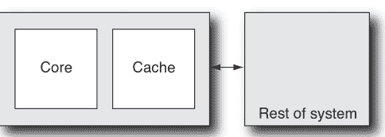

图 1.3 单核处理器

缓存是芯片上的一块内存，用于数据和指令。当你观察处理器时，如图 1.7 所示，核心和缓存是两个可见的部分。我们将在“缓存”章节中讨论。

让芯片支持多个线程的最简单方法如图 1.4 所示。早期支持多线程的处理器依靠这种方法。这是一种简单的方法，因为它对现有的处理器设计进行了复制。让两个核心相互以及与系统通信存在一些复杂性，但对核心的提升是微乎其微的。两个核心共享系统接口。

然而，这不是唯一的方法。另一种方法是让单个核心执行多个线程，如图 1.5 所示。这种设计有各种改进方案：

- 核心可以为一个线程执行 100 个周期，然后切换到另一个线程。
- 核心可以每周期在从一个线程获取指令和从另一个线程获取指令之间交替。
- 核心可以同时从每个线程获取指令。
- 每当当前执行的流遇到延迟事件（例如缓存缺失，必须从内存获取数据）时，核心可以切换线程。

多处理器使用了多个核心和每个核心多个线程的。最简单的例子是具有两个核心的处理器，每个核心都能支持两个线程，使得整个处理器总共有四个线程。图 1.6 显示了这种配置。

UltraSPARC T2 是 CMT 器的一个良好示例。它有八个复制的核心，每个核心能够运行八个线程，使处理器能够同时运行 64 个软件线程。图 1.7 显示了处理器的物理布局。

## 多核处理器的动机

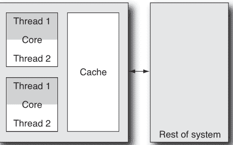

图 1.6 具有共四个硬件线程的双核处理器

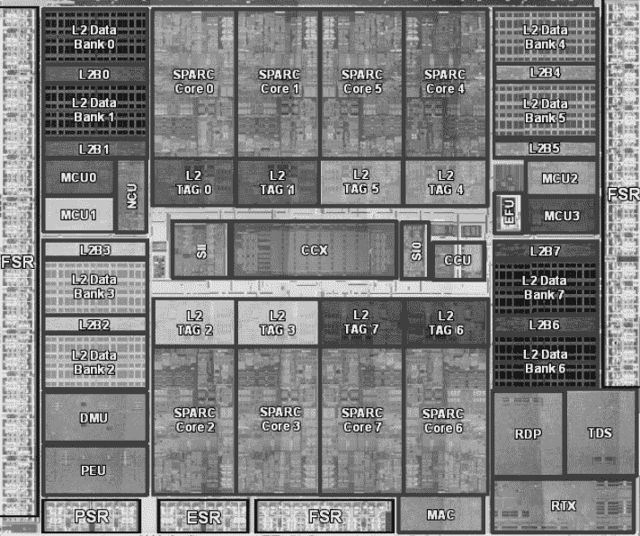

图 1.7 UltraSPARC T2 处理器的布局图

# 第 1 章 硬件、进程与线程

UltraSPARC T2 的布局图包含许多不同区域，为处理器核心提供支持功能；这些区域主要分布在芯片的边缘。由于结构上的相似性，处理器核心非常容易识别。例如，SPARC Core 2 是 SPARC Core 0 的垂直镜像，而 SPARC Core 0 又是 SPARC Core 4 的水平镜像。另一个明显的结构是由形成二级缓存的规则结构元素所形成的网格纹；这是一种所有所有之间共享的片上内存。该内存存储已使用的数据，并使得数据可能从内存中提取；它还允许数据在核心之间快速共享。

必须意识到，CMT 多多线程处理器的实现细节具有可检测的影响，特别是当多个线程分布在整个系统中时。硬件线程通常可以被认为是平等的。在当前的处理器设计中，线程的性能取决于系统当前正在执行的内容，而不是取决于设计中的某些不变属性。

例如，假设系统中的 CPU 有两个核心，每个核心可以支持两个线程。当两个线程在同一个核心上运行时，线程的运行速度可能会比调度在不同核心上运行时要慢。这是由于在一个实例中必须共享资源，而在另一个实例中不需要共享资源的明显结果。

幸运的是，操作系统正在演进，引入内存局部性和处理器资源共享的概念，以便它们能够以最佳方式自动工作。一个例子是 Solaris 操作系统通过局部性分组将工作调度到处理器上。此信息告诉操作系统哪些虚拟处理器共享资源。通过将工作调度到不共享资源的虚拟处理器上，可能会获得最佳性能。

另一种情况是，当一个线程处于激活且无法被调度到之前运行的完全相同的虚拟 CPU 时，操作系统理解系统的拓扑结构是有用的。这时，线程可以被调度到具有相同局部性的虚拟 CPU 上。运行在一个与原始处理器没有任何任何内容的虚拟处理器上会产生一点干扰。例如，Linux 有亲和性概念，它将线程保持在它们之前执行的本地。

在具有多个处理器（且每个处理器都能支持多个线程）的系统中，这种拓扑信息变得更加重要。将线程调度到处理器的任何一个核心上的性能差异可能很小，但如果线程被迁移到不同的处理器，且其在内存中保存的数据对于原始处理器是局部的，那么性能差异可能是巨大的。内存亲和将在“多处理器系统的特性”部分中进一步讨论。

在接下来的章节中，我们将讨论处理器核心的组件。处理器核心关键部分的粗略示意图如图 1.8 所示。

## 多核处理器的动机

| 分支流水线 | 指令缓存 | |

|---|---|---|

| FP 流水线 | 指令 TLB | |

| 整数流水线 | 数据缓存 | |

|加载/存储流水线 | 数据 TLB | 二级缓存 |

处理器核心的框图显示了用于每条指令的专用流水线、片上内存（缓存）、用于将虚拟地址转换为物理地址的旁表项（TLB），以及系统互连（负责与系统其余部分通信的层）。

下一节“通过流水线化处理器核心提高发射速率”解释了现代处理器核心中存在的各种“流水线”的动机。本章中的“使用缓存保存最近使用的数据”、“虚拟内存存储数据”以及“从虚拟地址到物理地址的翻译”涵盖了缓存和 TLB 的目的和功能。

### 通过流水线化处理器核心提高发射速率

正如我们之前讨论的，处理器核心是处理器负责执行指令的部分。早期的处理器每个周期执行一条指令，因此运行在 4MHz 的处理器每秒可以执行 400 万条指令。执行单条指令的逻辑可能相当复杂，因此执行最长指令所需的时间决定了周期需要多长，从而定义了处理器的最大时钟频率。

为了改善这种情况，处理器设计变得“流水线化”。完成单条指令所需的操作被分解为多个更小的步骤。这是最简单的流水线：

- **取指 (Fetch)。** 从内存中提取下一条指令。
- **解码 (Decode)。** 确定它是什么种类型的指令。
- **执行 (Execute)。** 执行适当的工作。
- **提交 (Retire)。** 使指令的更改对系统的其余部分可见。

假设指令完成所需的总时间保持不变，四个步骤中的每一步各占原始时间的四分之一。然而，一旦指令完成了取指阶段，下一条指令就可以进入该阶段。这意味着四条指令可以同时执行。决定指令何时完成流水线阶段的时钟速率现在可以比以前快四倍。现在，一条指令需要四个周期来完成执行。

# 12 第1章 硬件、进程与线程

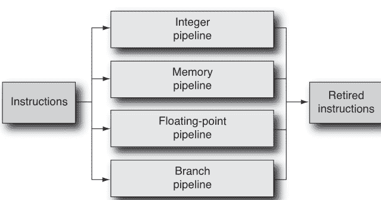

图 1.11 多指令流水线

## 使用缓存存储最近使用的数据


当处理器从内存请求一组字节时，它获取的不仅仅是它需要的字节。当数据从内存中取出时，它会与周围的字节一起作为一个“缓存行”（`cache line`）被取回，如图 1.12 所示。取决于系统的处理器，缓存行的大小可能小至 16 字节，也可能大至 128（或更多）字节。缓存行的典型值为 64 字节。缓存行始终是对齐的，因此 64 字节的缓存行将从 64 的倍数地址开始。这一设计决策简化了系统，因为它允许系统被优化为传输这种大小的对齐数据；另一种方案是更复杂的内存接口，它必须处理不同大小和不同对齐地址的内存块。

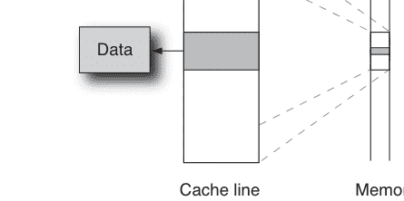

图 1.12 从内存中提取数据及周围缓存行

## 多核处理器的动机

当一行数据从内存中取出时，它被存储在缓存中。缓存提高了性能，因为处理器极有可能重用这些数据，或者访问存储在同一缓存行上的数据。通常有指令缓存和数据缓存。可能存在多级缓存。

设置多级缓存的原因是缓存越大，确定某个项目是否在缓存中所需的时间就越长。处理器可能有一个很小的一级缓存，可以在几个时钟周期内访问），以及一个大得多但需要几十个周期才能访问的二级缓存。这两者的速度都比内存快得多，而访问内存可能需要数百个周期。从内存或某级缓存中取回某项数据的时间称为其*延迟*（`latency`）。图 1.13 显示了典型的内存分级结构。

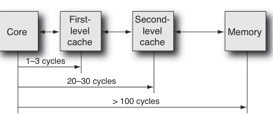

图 1.13 访问缓存和内存的延迟

访问主内存的延迟越大，多层缓存带来的益处就越多。某些系统甚至从拥有三级缓存中获益。

缓存有两个明显的特征：缓存行的大小和缓存的大小。缓存中的行数可以通过总大小除以行大小来计算。例如，一个大小为 *4KB* 且缓存行大小为 64 字节的缓存将包含 *64* 行。

缓存还有其他特性，这些特性不那么明显，且对访问性能的直接测量影响较小。值得提的一个特性是*关联性*（`associativity`）。在简单缓存中，每个缓存行将精确映射到缓存中的某一个位置；这被称为*直接映射缓存*（`direct mapped cache`）。如果我们取前面提到的 4KB 缓存示例，那么内存中每隔 4KB 间隔的地址都将映射到缓存中的同一行，如图 1.14 所示。

显然，一个以 4KB 步长访问内存的程序最终将只使用缓存中的单个条目，如果如果它需要同时使用多个缓存行，可能会遭受糟糕的性能。

解决这个问题的方法是增加缓存的*关联性*——也就是说，单个缓存行可以映射到缓存中的多个位置，从而减少在缓存中发生冲突的可能性。在双路关联缓存（`two-way associative cache`）中，每个缓存行可以映射到两个位置之一。该位置根据某些替换策略选择，该策略可能是随机替换，也可能取决于两个位置中哪一个包含最旧的数据（最久未使用）。将每个缓存行的潜在位置数量增加倍，意味着内存中映射到同一缓存行的行之间的间隔减半，但总体而言，这种变化将导致缓存更有效的利用，并减少缓存未命中次数。图 1.15 显示了这种变化。

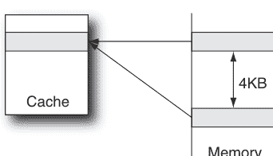

图 1.14 直接映射缓存中内存到缓存行的映射

*全关联缓存*（`fully associative cache`）是指内存中的任何地址都可以映射到缓存中的任何行的缓存。虽然这代表了可能导致最低缓存未命中率的方法，但它也是实现最复杂的方法，因此很少被实现。

在多个线程共享同一级缓存的系统中，缓存具有更高的关联性变得更加重要。为了理解为什么，想象两个相同应用程序的副本共享一个直接映射缓存。如果它们中的每一个都访问相同的虚拟内存地址，那么它们都将尝试使用缓存中的同一行，并且只有其中一个会成功。不幸的是，这种成功将会

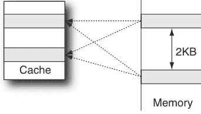

图 1.15 双路关联缓存中内存到缓存行的映射

# 第1章 硬件、进程与线程

## 多核处理器的动机

（注：从第 36 页开始，原始 OCR 文本似乎包含重复或损坏的痕迹。根据指令保留所有提供的信息内容。）

## 多核处理器的动机

高位字节 低位字节

| 内存 | 内存 |

| --- | --- |

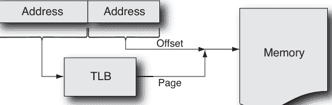

图 1.17 虚拟到物理内存地址翻译

`TLB`（转换旁路缓冲区）与缓存具有许多特性；因此，它们也面临一些相同的问题。`TLB` 可能会发生容量缺失（`capacity misses`）和冲突缺失（`conflict misses`）。容量缺失是指应用程序映射的内存大于 `TLB` 能够映射的内存量。冲突缺失是指内存中的多个页面映射到同一个 `TLB` 条目的状况；添加新的映射会替换旧的映射，并将其从 `TLB` 中驱出。可以使用与缓存相同的技术来降低 `TLB` 的缺失率。然而，对于 `TLB` 来说，有一个特征是可以改变的——即被映射的页大小。

在 `SPARC` 架构上，默认页大小为 8KB；在 `x86` 架构上为 4KB。每个 `TLB` 条目都为该范围的物理或虚拟内存提供映射。现代处理器可以处理多种页大小，单个 `TLB` 条目可能能够为 64KB、256KB、兆字节甚至 GB 字节的页提供映射。大页大小的明显优势是，`TLB` 条目越少，当加载新条目时被踢出 `TLB` 的概率越小。这导致了更低的 `TLB` 缺失率。例如，映射一个 1GB 的地址空间需要 256 个条目，而用 8KB 的页映射相同的内存则需要 131,072 个条目。256 个条目可能放入 `TLB` 中，但 131,072 个则不能。

以下是使用大页的缺点：

- 分配大页需要一个连续的内存块来分配该页。如果内存不足以分配大页，这将会给操作系统在处理和提供大页可用性方面带来挑战。如果无法为应用程序提供大页，操作系统可以选择移动其他物理内存，或者为应用程序提供多个较小的页。

- 使用大页的应用程序即使不需要这些内存，也会预留等量的物理内存。这可能导致内存使用效率低下。即使是一个小型应用程序，最终也可能预留大量的物理内存。

- 多处理器系统特有的一个问题是，内存中的页对于一个处理器的访问延迟通常低于另一个处理器。页大小越大，该页越可能在运行在不同进程的线程之间共享。在内存延迟较高的处理器上运行的线程可能会运行慢。这将在下一节“多处理器系统的特性”中进行详细讨论。

对于大多数应用程序来说，使用大页将带来性能提升，尽管在某些情况下其他因素的影响将超过其收益。

## 多处理器系统的特性

虽然多核处理器现在已经非常流行，但遇到带有多个处理器的系统也变得越来越常见。只要系统中存在多个处理器，访问内存就会变得更加复杂。数据不仅可以存储在内存中，还可以存储在其他处理器的缓存中。为了让代码正确执行，每项数据都应该只有一个唯一的最新版本；这种特征被称为缓存一致性（`cache coherence`）。

提供缓存一致性的常用方法称为*侦嗅*`snooping`）。每个处理器都会广播它想要读取或写入的地址。其他处理器这些广播。当它们看到自己持有的数据地址时，会采取两种操作之一：如果另一个处理器想要读取该数据且它们拥有最新的副本，它们可以返回数据；如果另一个处理器想要为该数据存储新值，它们可以失效自己的副本。

然而，这并不是处理多个处理器时会出现的唯一问题。其他关注点是，内存中的页对于一个处理器的访问延迟通常低于另一个处理器。页大小越大，该页在运行在不同进程的线程之间共享的可能性越高。在内存延迟较高的处理器上运行的线程可能会运行更慢。这将在下一节“多处理器系统的特性”中进行详细讨论。

对于大多数应用程序，使用大页将导致性能提升，尽管在某些情况下其他因素的影响将超过其收益。

## 源代码到汇编语言的翻译

并且每个请求都没有命中缓存。每次缓存缺失都会从内存中提取一个 64 字节的缓存行，导致单个 CPU 在一秒内消耗了 640MB 的带宽。

`CMT` 芯片对内存带宽有巨大的需求，因为在任何时刻，每个线程都可能拥有一个或多个待处理的内存请求。假设处理器上有 64 个线程，内存延迟为 100 个周期，且处理器的主频为适中的 1GHz。如果每个线程都不断地从内存请求新的缓存行，那么每个线程每隔 100 个周期就会发出一次此类请求（100 个周期是完成上一个请求所需的时间）。这使得每秒产生 10 亿 / 100 * 64 = 6400 万次请求。如果每个请求都是为了一个新的 64 字节缓存行，那么这代表了大约 41GB/s 的总带宽。

## 源代码到汇编语言的翻译

处理器执行指令。这些是所有计算的基石；它们执行诸如数字相加、从内存获取数据或将数据存储到内存等任务。指令在寄存器上操作，寄存器保存变量和其他机器状态的当前值。考虑列表 1.1 中的代码段，它增加了由指针 `ptr` 指向的整数变量。

### 列表 1.1 增加地址变量的代码

```
void func( int *ptr )
{
  (*ptr)++;
}
```

列表 1.2 显示编译为 `SPARC` 汇编代码的代码段。

### 列表 1.2 增加地址变量的 SPARC 汇编代码


```
ld      %00, %05      // 从地址 %00 加载值到寄存器 %05
add     %05, 1, %05   // 寄存器 %05的值加1
st     %05, [%00]     // 将寄存器 %05 的值存储到地址 %00
retl
```

SPARC 代码¹通过寄存器 `%00` 传递指针 `ptr`。加载指令从该地址加载值到寄存器 `%05`。寄存器 `%05` 加 1。存储指令将寄存器 `%05` 中持有的整数的新值存储到 `%00` 指向的内存位置，然后返回指令进入程序。

- 1. 这是一个略微简化的 SPARC 汇编，忽略了指令排序中分支延迟槽的影响。真实的顺序会交换存储和返回指令的位置。

列表 1.3 显示了为 32 位 x86 编译的相同源代码。x86 代码略有不同。第一个区别是 32 位模式下的 x86 采用基于栈的调用约定。这意味着所有传递给函数的参数都存储在栈上，然后函数执行的第一件事就是取回这些存储的参数。然而，代码执行的第一件事是从栈上加载指针的值——在本例中，即在地址 `%esp-4` 处——并将此值放入寄存器 `%eax` 中。

### 列表 1.3 增加地址变量的32 位 x86 汇编代码

```
movl 4(%esp), %eax    // 从地址 %esp + 4 加载值到 %eax
add $1, (%eax)         // 地址 %eax 处的值加1
ret                    // 从程序返回
```

我们在 x86 和 SPARC 汇编语言之间遇到了第二个区别。SPARC 是精简指令集计算机（RISC），意味着它只有少量的简单指令，所有操作都必须由这些简单的基石组成。x86 是复杂指令集计算机（CISC），因此它拥有执行更复杂操作的指令。x86 指令可以通过单条指令完成对内存位置值的加增操作。在示例中，对寄存器 `%eax` 所含地址的值加 1 的指令就是单条 CISC 指令，而 SPARC 端需要三条 RISC 指令来实现相同的结果。

两个代码段都使用寄存器计数计数。SPARC 代码使用了寄存器 `%u0` 和 `%o5`，而 x86 代码使用了 `%esp` 和 `%eax`。然而，这些代码段对寄存器的用途不同。x86 代码将 `%esp` 作为栈指针，指向存储函数参数的内存区域。相比之下，SPARC 代码通过寄存器向函数传递参数。传递参数的方法称为调用约定，它是平台应用二进制接口（ABI）的一部分。该规范规定了应如何编写程序以便在特定平台上正确运行。

两个代码段都使用单个寄存器来保存所访问内存的地址。SPARC 代码使用了 `%u0`，x86 代码使用了 `%eax`。两个代码段的区别在于 SPARC 代码使用寄存器 `%o1` 来保存变量的值。SPARC 代码需要三条指令来加载值、加 1，然后将结果存回内存。x86 代码仅需单条指令。

这两个处理器之间的进一步区别是可用寄存器的数量。SPARC 有 32 个通用寄存器，而 x86 处理器有 8 个通用寄存器。其中一些通用寄存器具有特殊功能。SPARC 最终有约 24 个寄存器供应用程序使用而在 32 位模式下，x86 处理器只有 8 个。然而，由于其 CISC 指令集，x86 处理器不需要使用寄存器来

# 源代码到汇编语言的翻译 23

处理未加载到寄存器的值。因此，尽管 x86 处理器有许多寄存器，但可以编写代码使其不会产生问题。

然而，将向 64 位代码的转变视为性能提升是非常具有吸引力的。但是，这并不完全正确。寄存器数量和调用约定的变化是在过渡到 64 位的同时发生的。

## 32 位与 64 位代码的性能

理论上，64 位处理器可以寻址高达 16 艾字节（EB），即 4GB 的平方。相比之下，32 位处理器最多寻址 4GB。某些应用程序只能寻址 4GB——这是一个限制——一个典型的例子是很容易超过 4GB 的数据库。因此，转换为 64 位使得 AMD64、EMT64、x86-64 或简单的 x64成为可能。

64 位指令扩展不仅增加了内存，还通过消除或减少两个问题改进了性能。

第一个的问题是基于调用的问题。这种约定导致代码使用栈和加载指令将参数传递给函数。在 32 位代码中，调用函数时，函数的所有参数都需要存储在栈上。函数执行的第一动作是将这些参数从栈加载回寄存器。在 64 位代码中，参数保持在寄存器中，避免了所有的加载和存储操作。

第二个问题是64 位转换将通用寄存器的数量从 32 位代码的约 6 个增加到 64 位代码的约 14 个。增加寄存器数量减少了寄存器溢出和填充（spills and fills）次数。

当之前的代码被编译为 64 位 x86 指令集时，可以看到这一点，如列表 1.4 所示。

### 列表 1.4 增加地址变量的64 位汇编代码

```
addl $1, (%rdi) // 增加 %r处的值
ret             // 返回函数
```

在这个示例中，我们减少到了两条指令，而列表 1.3 中使用的是三条指令。这两条指令是对寄存器 `rdi` 所指的值加 1 的递增指令以及返回指令。

这种变化可以在没有这一特定转换的情况下发生——它们本可以在 32 位 x86 处理器上引入。向 64 位的转变是一个重新评估架构并进行这些基础改进的机会。

向 64 位地址空间的实际变化会导致性能损失。指针从 4 字节结构变为 8 字节结构。在类 Unix 操作系统中，`long` 类型变量也从 4 字节变为 8 字节。当变量增大时，应用程序的内存占用也会随之增加，进而随之下降。例如，列表 1.5所示的 C 语言数据结构。

### 列表 1.5 包含整数指针数组的数据结构

```c
struct s
{
    int *ptr[];
};
```

当为 32 位编译时，该结构占用 8 * 4 字节 = 32 字节。因此，一个 64 字节的缓存行可以包含两个结构。当为 64 位地址编译时，指针的大小翻倍，因此结构占用 64 字节。当为 64 位编译时，单个结构将完全填满单个缓存。

想象在应用程序的 32 位版本中的这些任何一个结构；当从内存中取出其中一个结构时，下一个结构也会被取出。另一种看问题的方法是，对于相同的计算，相同代码的 64 位版本只需要获取单个结构。另一个二进制版本则需要从内存获取多一倍的数据；对于某些应用程序，这种内存占用的增加会导致应用程序性能出现明显的下降。然而，在 x86 上，大多数应用程序从其他改进中获得了性能提升。某些编译器可以生成使用 EMT64 指令集扩展和 ABI 的二进制文件，但将应用程序限制在 32 位地址空间。这提供了指令集带来的收益，而没有产生内存占用增加带来的性能损失。

值得将这种情况与 SPARC 处理器的情况进行清晰的对比。SPARC 处理器也会因为指针和 `long` 尺寸增大而产生性能损失。SPARC  32 位代码的调用约定是在寄存器中传递值，而且已经有大量的可用寄存器。因此，为 SPARC 处理器编译的代码通常会因为内存占用导致性能略有下降。

## 确保内存操作的正确顺序

在处理包含多个处理器或多核心的系统时，还有一个需要讨论的问题：内存排序。内存排序是内存操作对系统内其他处理器可见的顺序。在大多数情况下，处理器会执行正确的操作，不需要程序员做任何事情。

然而，存在程序员需要干预的情况。这些可以是特定架构的（SPARC 处理器和 x86 处理器有不同要求），也可以是特定实现的（一种 SPARC 处理器可能与另一种 SPARC 处理器有不同需求）。好消息是，系统库实现了相应的机制，因此使用系统库的多线程应用程序永远不会遇到这个问题。

另一方面，调用系统库会有开销，因此编写自定义同步代码可能会产生性能惩罚。这种情况在第 8 章“手工编码同步与共享”中有所介绍。

内存排序指令在 SPARC 上称为内存屏障（`membar`），在 x86 上称为内存栅（`mfence`）。这些指令可以防止内存操作以错误的顺序进入线程之外。接下来的示例将说明为什么这很重要。

假设你有一个变量 `count`，它受锁定机制保护，你想增加该变量的值。锁的工作原理是：在获取锁时存入值 1，在释放锁时存入值 0。获取锁的代码与此示例无关，示例假设锁已经获取，因此变量 `lock` 包含值 1。现在锁已获取，代码可以增加变量 `count`。然后，为了释放锁，代码会将值 0 存入变量 `lock`。增加变量和使用值 0 释放锁的过程看起来类似于列表 1.6 所示的伪代码。

### 列表 1.6 增加变量并释放锁

```assembly
LOAD [&count], %A
INC %A
STORE %A, [&count]
STORE 0, [&lock]
```

当值 0 被存入变量 `lock` 时，另一个线程就可以来获取锁并修改变量 `count`。出于性能考虑，某些处理器实现了内存操作的弱排序，这意味着存储（store）可以移动到其他存储之后，或者加载（load）可以移动到其他加载之后。如果之前的代码运行在存储排序较弱的机器上，那么执行时的代码可能像列表 1.7 所示的代码。

### 列表 1.7 弱内存排序下的增加和释放锁

```assembly
LOAD [&count], %A
INC %A
STORE 0, [&lock]
STORE %A, [&count]
```


在运行时，处理器将对锁的存储操作上提，使其相对于变量 `count` 的存储对系统的其他部分可见。在这里，锁在 `count` 的新值可见之前释放了。另一个处理器可能会看到锁是空闲的，并加载 `count` 的旧值而不是新值。

解决方案是在两个存储之间放置一个内存屏障，告诉处理器不要重排它们。列表 1.8 显示了修正后的代码。在这个示例中，`MEMBAR` 指令确保在执行下一个存储之前，所有之前的存储操作都已完成。

### 列表 1.8 使用内存屏障强制排序

```assembly
LOAD [&count], %A
INC %A
STORE %A, [&count]
MEMBAR
STORE 0, [&lock]
```

内存排序指令在 SPARC 上称为内存屏障（`membar`），在 x86 上称为内存栅（`mfence`）。这些指令可以防止内存操作以错误的顺序进入线程之外。

# 源代码到汇编语言翻译

然而，存在程序员需要干预的情况。这些可以是特定架构的（SPARC 处理器和 x86 处理器有不同要求），也可以是特定实现的（一种 SPARC 处理器可能与另一种 SPARC 处理器有不同需求）。好消息是，系统库实现了相应的机制，因此使用系统库的多线程应用程序永远不会遇到这个问题。

另一方面，调用系统库会有开销，因此编写自定义同步代码可能会产生性能惩罚。这种情况在第 8 章“手工编码同步与共享”中有所介绍。

## 进程与线程的区别

正在执行的应用程序被称为进程。进程不仅仅是指令和数据，因为它还有状态。状态是寄存器中持有的值、当前正在执行指令的地址、内存中所持有的值以及任何唯一定义进程在该时刻正在操作的值。重要的区别在于，随着进程的运行，状态会发生。图 1.22 显示了内存中应用程序的布局。

| 初始化数据 | 未初始化数据 | 指令 |
|---|---|---|
| | 堆 | 栈 |
| 内存 | 库数据 | 库指令 |

图 1.22 加载到内存的单线程应用程序

进程是应用程序的基本构建块。同时运行的应用程序就是多个进程。多用户支持通常通过不同权限的进程来实现。除非进程显式与另一个进程共享状态，否则它的所有状态对于该进程都是私有的——其他进程无法看到。举一个具体的例子，如果你运行两个文本编辑器的副本，它们可能都有一个变量 `current_line`，但彼此都无法读取对方的值。

应用程序状态的一个特别关键部分是分配给它的内存。回内存使用虚拟地址分配，因此假设的文本编辑器副本可能将文档存储在 `0x11a000`。每个应用程序将维护自己的 `TLB` 映射，因此虚拟地址将映射到不同的物理地址。如果一个核心运行其映射的 `TLB`——所以多个活动进程最终会增加内部芯片结构（如 `TLB` 或缓存）中映射条目的压力，导致 `TLB` 或缓存的数量增加。

每个进程可以运行多个线程。线程拥有状态，就像进程一样，但它的状态基本上只是寄存器中持有的值加上栈上的数据。图 1.23 显示了多线程应用程序的内存布局。线程与应用程序中的其他部分共享状态。回到文本编辑器例子，作为另一种实现方案，是否可以有两个窗口的单个文本应用程序。每个窗口显示不同的文档，但它们

# 第1章 硬件、进程与线程

| 已初始化数据 | 未初始化数据 | 指令 |
|---|---|---|
| | 堆 | 线程 0 栈 |
| 线程 1 栈 | 线程 2 栈 | 线程 3 栈 |
| | 库数据 | 库指令 |
| 内存 | | |

图 1.23 加载到内存的多线程应用程序

文档无法再存储在相同的虚拟地址；它们需要不同的虚拟地址。如果编辑器应用程序的代码编写得糟糕，一个窗口中的活动可能会导致另一个窗口中存储的数据发生变化。

人们可能有很多原因选择编写一个使用多线程的应用程序。首要原因是，在具有多个硬件线程的系统上，多个线程产生结果的速度比单线程完成工作更快。另一个原因可能是问题自然地可以分解为多个线程。例如，Web 服务器将有与远程机器的多个并发连接，因此使用多线程对其进行编码是理所当然的。使用多进程的另一个优势是线程共享更多的机器状态，特别是 `TLB` 和缓存条目。如果所有线程都需要共享某些数据，它们都可以从同一个内存地址读取该数据。

从这段讨论中你应该获得的是，线程和进程是让多个指令流协调工作以为问题提供解决方案的方法。进程的优势是每个进程都是隔离的——如果一个进程崩溃，就不会对其他运行的进程产生任何影响。多进程的缺点是每个进程都需要自己的 `TLB`，这会增加 `TLB` 和缓存的缺失率。使用多进程的另一个缺点是进程之间的数据共享需要显式控制，这可能是一个昂贵的操作。

多线程在线程间共享数据的低成本方面具有优势——一个线程可以将数据项共享到内存，该数据将立即对该进程中的所有其他线程可见。共享的另一个优势是所有线程共享相同的 `TLB` 和缓存条目，因此多线程应用程序可能会获得较低的缓存缺失率。缺点是一个线程的失败可能会导致整个应用程序的失败。

总结 29

同一个应用程序既可以写成多线程应用程序，也可以写成多进程应用程序。一个很好的例子是 Web 浏览器设计的最新变化。Google Chrome 浏览器是多进程的。浏览器可以使用多个标签页显示不同的网页。每个标签页都是独立的进程，因此一个标签页失败不会导致整个浏览器崩溃。从历史上看，浏览器一直是多线程的，所以如果一个线程执行了坏代码，整个浏览器就会崩溃。鉴于 Web 的无限制性质，目标是健壮性而非低共享成本似乎是一个明智的设计决策。

## 总结

本章引入了处理器架构的一些术语。需要注意的关键点是如何使用缓存来提高应用程序的性能，以及如何使用 `TLB` 来实现虚拟内存。本章介绍了在单处理器上可以支持多个线程的各种方式。虽然在抽象层级上，这种资源共享的实现细节并不重要，但我们以后将讨论它们如何产生可见的性能影响。最后，本章描述了进程和软件线程如何映射到内存，以及多线程应用程序与多进程应用程序之间的重要区别。

# 2

# 性能编程

本章讨论了如何以性能为考虑来设计和编写程序。即使对于并行应用程序，串行性能仍然重要。这有两个原因。并行应用程序中的每个线程都是一个串行指令流。让这些指令尽可能快地执行将提高整个应用程序的性能。第二个原因是，很少找到不包含串行代码的并行应用程序。随着线程数量的增加，代码串行部分的性能将最终决定应用程序运行的速度。

提高应用程序性能有两种方法。第一种（不幸的是这是许多项目的典型做法）是在函数正确后才解决性能问题。另一种方法是将性能考虑为应用程序的前期规格之一。在应用程序设计的初始阶段考虑性能将带来更好的最终产品。本章讨论了在何处可以获得（或丢失）性能，以及早期考虑性能如何导致产品改进。

## 定义性能

性能有两种常用的衡量指标：

- **单位时间内的项目数。** 这可能是每秒事务数、每小时作业数，或其他完成的任务数与时间单位的某种组合。本质上，这是对带宽的衡量。它强调的是系统完成任务的能力，而不是单个任务的持续时间。许多基准测试本质上是对带宽的衡量。如果你查看 SPEC Java 基准测试（`SPECJava`¹），你会发现结果是以每秒事务数的形式报告的。另一个例子是作为超级计算机 TOP500² 的 `linpack` 基准测试。用于形成 TOP500 列表的指标是每秒峰值浮点操作数。

> 1. www.spec.org/jAppServer/
> 2. www.top500.org/

# 第2章 性能编程

- **每个项目的时间。** 这是衡量完成单个任务时间的指标。它基本上是延迟或响应时间的衡量。某些基准测试专门针对延迟。最显而易见的例子是 SPEC CPU 基准测试，它以速率作为指标。

虽然这些是性能的常见表达式，但也可以被指定为更复杂的混合。例如，电子商务基准测试发布了系统可以支持的并发用户数，前提是满足吞吐量和响应时间。

许多系统都有必须满足的服务质量（QoS）指标。QoS 指标将规定用户的预期，以及系统未能满足这些预期时的处罚。以下是两种替代指标示例：

- **延迟超过阈值的事务数。** 这通常会与平均值一起设定。可能出现一个系统在事务数量和平均响应时间上超过标准，但由于响应时间超过阈值而失败。
- **系统不可用的时间**，通常称为停机时间或可用性。这可以被指定为系统预期运行时间的百分比，或者每年允许停机的分钟数。

用于指定和衡量性能的指标对满足这些指标的设计具有影响。考虑一个接收每日更新的系统。应用此更新将使系统不可用。使用指定可用性的指标；可以确定在满足可用性标准的情况下更新可以的最长时间。如果设计者知道系统每晚允许停机十分，那么如果系统只有一秒钟完成更新，他们将做出不同的设计决策。知道更新可用时间可能会影响以下决策：

- 应使用多少线程来处理更新。单个线程可能无法在时间窗口内完成更新。使用数据，可以估计在时间窗口内完成更新所需的线程数这将影响应用程序的设计，并可能影响用于传递数据的方法和格式。
- 如果更新必须存储到磁盘，那么磁盘存储的写入带宽就成为了考虑因素。这可能用于确定交付该带宽所需的驱动器数量、固态硬盘的使用，或专用存储设备。


如果处理数据所需的时间（即使使用了多线程或多个驱动器）超过了可用的时间窗口，则应用程序可能需要重新结构，使得更新可以与应用程序处理传入的事务并行完成。这样，应用程序就可以在旧数据和新数据之间立即切换。如果在交换时存在待处理的事务，这种设计可能会带来一些不可预见的复杂性。这些事务要么需要使用旧数据完成，要么需要重新启动以使用最新版本。

事实上，在设计早期定义关键指标及其预期有助于完成三项任务：

- 明确规范的需求可以指导设计决策，既包括选择合适的硬件，也包括确定软件的结构。
- 了解预期的指标使开发人员有信他们所完成的系统符合标准。预先定义指标可以易于宣布项目的成功或失败。
- 定义指标还应该定义预期的输入。了解系统的输入应该是怎样的将有助于生成合适的测试用例。这些测试用例将供设计人员和开发人员在程序演进过程中进行测试。

# 第 2 章 为性能编码

## 算法复杂度

算法复杂度是衡量程序在使用特定算法时将执行的计算量的指标。它是对效率的衡量，以及对操作次数的估计。它并不是实现特定算法所需的代码复杂性的衡量。低算法复杂度的算法可能比高复杂度的算法更实现。最重要的因素是，算法复杂度不是执行时间的模型，而是执行时间随输入大小变化而变化的模型。通过一些示例来说明这一点是恰合适的。

### 算法复杂度示例

假设你想写一个程序来计算前 `N` 个数字之和。你可能会写出类似于列表 2.1 所示的代码。

#### 列表 2.1 前 N 个数的和

```c
void sum(int N)
{
  int total=0;
  for (int i=1; i<=N; i++)
{}
```

```c
  total += i;
}
printf("Sum of first %i integers are %i\n", N, total);
}
```

对于给定的值 `N`，代码将循环 `N` 次，而 `N` 复杂度关注的是操作次数，在这种情况下是 `N` 次加法。它假设任何额外的成本都与该数字成正比。完成此计算的时间是每次加法的成本 `k` 乘以加法次数 `N`。因此，时间将是 `k * N`。算法复杂度衡量的是这种变化如何随输入大小而变化，忽略（常量）缩放因子并说计算将需要 `N` 级的计算是可以接受的。这通常写为 `O(N)`。这是一个衡量随输入大小变化而完成程序所需的时间非常有用的指标。如果 `N` 的值翻倍，那么程序完成所需将增加一倍。

另一个示例可能会阐明这有什么用。假设你想计算前 `N` 个阶乘的和（阶乘是 `N * (N-1) * (N-2) * ... * 1`）；你可能会写一个与列表 2.2 所示相似的程序。

#### 列表 2.2 前几个阶乘的和

```c
int factorial(int F)
{
    int f = 1;
    for (int i=1; i<=F; i++) {
        f = f*i;
    }
    return f;
}
```

```c
void fsum(int N)
{
    int total = 0;
    for (int i=1; i<N; i++) {
        total+=factorial(i);
    }
}
```

该程序包含一个嵌套循环。外层循环将执行 `N` 次迭代，内层循环在运行期间平均将执行 `N/2` 次迭代。因此，将会有大约 `N * N/2` 次乘法操作和 `N` 次加法。算法复杂度

### 理解算法复杂度

性只关注主导因素，即 `N * N`。因此，整个计算是 `O(N²)`。如果 `N` 的大小翻倍，该算法所需的时间将增加 4 倍。

复杂度由函数中的主导项表示。复杂度结果为 `(N+1)²`，随着 `N` 的增加，这与 `N²` 之间最终将没有太大区别。在极限情况下，随着 `N` 变得越来越，`O(N²)` 将主导 `O(N)` 的复杂度。

之前的示例有些混乱，在两种情况下，都有更有效的方法来提供所需的结果。

一个更常见的编程问题是数据排序。排序领域有很多不同的算法，其中最著名的两种是冒泡排序和快速排序。

冒泡排序遍历数字列表，比较相邻的数字对。如果这对的顺序不正确，则交换这对。列表 2.3 显示了一个简单的实现。

#### 列表 2.3 冒泡排序的实现

```c
void bubble_sort(int*array, int N)
{
    int sorted =0;
    while (!sorted)
    {
        sorted=1;
        for ( int i=0; i < N-1; i++)
        {
            if (array[i] > array[i+1])
            {
                int temp = array[i+1];
                array[i+1] = array[i];
                array[i] = temp;
            }
        }
    }
}
```

最小元素“冒泡”到数组顶部，这就是为什么它被称为冒泡排序。由于该实现中省略了优化，它将执行 `N` 次迭代来填充数组。使用所编写的算法，将需要 `N` 次比较来将每个元素放入正确位置。有 `N` 个元素，所以将需要 `N * N` 次比较来排序整个列表。对于未排序数据，这导致了算法复杂度为 `O(N²)`。

另一方面，快速排序正如名称预期的，是一种快得多的算法。它依赖于将列表分为两部分：小于“基准”元素的列表和大于基准元素的列表。一旦列表被拆分，算法就会在每个较小的列表上重复。快速排序的实现可能类似于列表 2.4 所示。

#### 列表 2.4 快速排序的实现

```c
void quick_sort(int * array, int lower, int upper)
{
    int tmp;
    int mid = (upper+lower)/2;
    int pivot = array[mid];
    int tlower = lower;
    int tupper = upper;
    while (tlower <= tupper)
    {
        while (array[tlower] < pivot) { tlower++; }
        while (array[toupper] > pivot) { tupper--; }
        if (tlower <= tupper)
        {
            tmp = array[tlower];
            array[tlower] = array[toupper];
            array[toupper] = tmp;
            toupper--;
            tlower++;
        }
    }
    if (lower<toupper) { quick_sort(array, lower, tupper); }
    if (tlower<upper) { quick_sort(array, tlower, upper); }
}
```

快速排序的算法复杂度很难计算。对于平均情况，可以证明其复杂度是 `O(N*log(N))`。这可以通过以下推理解释。假设元素分布均匀，每次数组拆分时，都会产生两个相等的部分。对于给定的 `N`，在数组被分成 `N` 个单独元素之前，需要 `log(N)` 次拆分。每次数组拆分时，都有两次调用，一次排序下半，一次排序上限。因此，每次拆分时都会遍历整个 `N` 元素。

为了看到这种排序操作复杂度差异的实际影响，考虑排序一个包含 10 个元素的列表。冒泡排序将执行 `10 * 10 = 100` 次操作，而快速排序将执行大约 `10 * log2(10) = 30` 次操作，操作次数大约少了三倍。然而，排序一个10个元素的

### 理解算法复杂度

列表的长度不太可能是应用程序运行时间的显着因素。考虑一个包含 1,000 个元素的列表会更有趣。冒泡排序大约需要 1,000 次操作，而快速排序大约需要 3,000 次操作——比例大约为 300 倍。

### 为什么算法复杂度非常重要

算法复杂度代表了随着处理元素数量的增加，某段代码执行性能的变化。在极限，最大的算法复杂度将主导应用程序的运行时间。

假设你的函数有两个代码区域，一个是 `O(N)`，另一个是 `O(N²)`。如果你运行一个包含 100 个元素的测试工作负载，你可能会发现 `O(N)` 代码的执行时间更长，因为与每个元素上的计算相关联的指令更多。然而，如果你运行一个包含 10,000 个元素的负载负载，那么复杂度更复杂的那个运行时间就会开始变得重要，前提是它没有完全主导应用程序的运行时间。

选择较小的工作负载会误导你判断代码中哪些部分需要优化。你可能花费了优化代码中算法上更简单的部分，而在现实情况下，应用程序的性能将由算法上更复杂的部分主导。这强调了为算法开发和测试选择合适工作负载的重要性。随着工作负载大小的变化，应用程序的不同部分扩展情况不同，而某些似乎不耗时间的区域突然变得主导。


另一个需要注意的点是，算法的改变是引起性能数量级差异的因素之一。如果应用程序 80% 的运行时间用于排序一个包含 1,000 个元素的数组，那么从冒泡排序切换到快速排序可以使函数性能产生 300 倍的差异，使得排序花费的时间比减少 300 倍。用于排序的 80% 运行时间将大部分消失，应用程序的运行速度将快大约五倍。

表 2.1 显示了随着元素数量增加，不同算法复杂度任务的完成时间。假设完成单个单元工作的时间为 100ns。如表所示，`O(N²)` 算法开始消耗大量时间需要相当多的元素。

表 2.1 不同算法复杂度下的执行持续时间

| 元素 | O(1) | O(N) | O(N log₂ N) | O(N²) |
|---|---|---|---|---|
| 1 | 100ns | 100ns | 100ns | 100ns |
| 10 | 100ns | 1,000ns | 3,322ns | 10,000ns |
| 100 | 100ns | 10,000ns | 66,439ns | 1,000,000ns |
| 1,000 | 100ns | 100,000ns | 996,578ns | 100,000,000ns |
| 10,000 | 100ns | 1,000,000ns | 13,287,712ns | 10,000,000,000ns |

同样的信息可以用运行时间与元素数量的关系图表来呈现。图 2.1 更戏剧地表达了这一点。显而易见，`O(N²)` 算法的运行时间将远大于相对于元素数量呈线性或对数关系的算法。

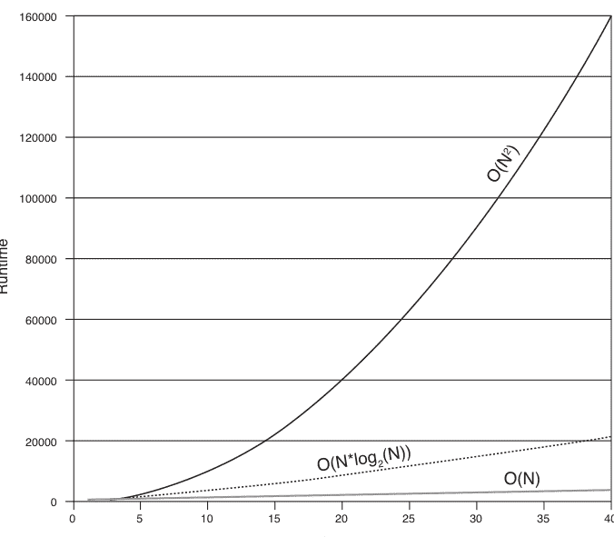

图 2.1 不同数量级的算法复杂度

## 谨慎使用算法复杂度

虽然算法复杂度是指导时间消耗位置的极佳指南，但有几个问题需要考虑。

为代码的每个方面选择最高效的算法可能是诱人的。比较实现快速排序所需的代码行与冒泡排序所需的代码行，以及阅读这些代码并理解算法如何运作有多容易。算法复杂度越低的算法通常越难实现，也越难理解。这两个因素都会导致实现时需要更多的开发时间，并且代码可能需要更有经验的开发者来维护。点在于，使用更复杂的算法会对开发时间和成本产生影响。更简单的算法可能更容易实现，并导致较低的开发成本。对于对于典型工作负载，代码可能不需要更复杂的算法。

第二个要考虑的点是，算法复杂度关注的是操作计数。它可能将加法操作的成本视为倍数，但可能存在以不同数量的加法和乘法操作执行相同任务的算法。在另一个层面上，算法并不关心缓存等实现细节。在任何代码中，由于缓存未命中产生的时间仍然很容易主导性能。因此，有必要查看算法复杂度并评估算法的实际实现，以确定该实现可能具有良好的性能。

可以从算法将采取加载次数以及每个加载如何导致缓存缺失的背景下观察算法。这将对等待数据从内存到达的时间给出估算。改变算法将同时影响复杂度和事件发生的概率。

## 结构如何影响性能

将一个源文件中的程序内联（`inline`）到另一个源文件中调用它的位置。这可以抵消大部分由于存储源码的结构而导致的性能损失。跨文件优化将在“如何使用跨文件优化来提高性能”章节中进行详细讨论。

某些方法限制了编译器跨源文件进行优化的能力。构建的一种常见方法是在构建过程中使用静态库或动态库。这些库将多个对象文件合并成单个库，在链接时，链接器从库中提取相关代码。

### 列表 2.7 创建归档库

```
$ cc -c a.c
$ cc -c b.c
$ ar -r lib.a a.o b.o
ar: creating lib.a
$ cc main.c lib.a
```

在构建中使用静态库有三个常见原因：

- 出于“美观”考虑，即应用程序的最终链接需要更少的对象。构建过程看起来更整洁，因为许多单独的对象文件被合并到静态库中，链接命令行出现的是较小的集合。这些库还可能代表提供给执行程序的功能包。

- 无论应用程序是构建为使用静态库还是动态库，都能产生相似的构建过程。每个库都可以以静态或动态版本的形式提供，由开发者决定使用哪一个。当库作为一种产品分发给开发者使用时，这种做法很常见。

- 为了隐藏构建问题，但这是最不满意的理由。例如，归档库可以包含同一个程序的多个版本。在链接时，链接器将提取它遇到的该程序的第一个版本，而不会警告存在多个版本。如果使用单独的对象文件链接相同的代码而没有将对象文件合并到归档文件中，链接器将无法链接可执行文件。

### 列表 2.8 静态库隐藏构建问题的示例

```
$ more a.c
#include <stdio.h>
void status()
{
    printf("In status of A\n");
}
```

```
$ more b.c
#include <stdio.h>
void status()
{
    printf("In status of B\n");
}
```

```
$ cc -c a.c
$ cc -c b.c
$ ar -r lib.a a.o b.o
ar: creating lib.a
```

```
$ more main.c
void status();
void main()
{
    status();
}
```

```
$ cc main.c lib.a
$ a.out
In status of A
```

```
$ cc main.c lib.a
ld: fatal: symbol 'status' is multi-defined
(file a.o type=FUNC file b.o type=FUNC)
ld: fatal: File processing errors. No output written to a.out
```

使用静态库的一个遗憾影响是，某些编译器无法对静态库中包含的代码进行跨文件优化。这可能意味着函数没有从静态库内联到执行文件中，或者静态库中存储的代码没有参与跨文件优化。

## 使用库来结构化应用程序

库是应用程序规模增大时结构化的常用机制。使用库有一些良好的技术理由：

结构对性能的影响

编译器标记 `-G` 告诉编译器创建一个库，而标记 `-pic` 告诉编译器使用位置无关代码（position-independent code）。位置无关代码的优点是该库可以位于内存中的任何位置。同一个库可以在多个应用程序之间共享，并且每个应用程序都以不同的地址对其进行映射。

### 列表 2.11 调用库代码

```
$ libmain.c
#include <unistd.h>

void ina();
void inb();

void main() {
  ina();
sleep(20);
}
$ cc libmain.c -L -R -la -lb
```

列表 2.11 中的编译命令构建了主可执行文件。标记 `-L` 告诉链接器在链接时查找库。标记 `-R` 告诉运行时链接器在运行时定位该文件的位置。在示例中，这两个标记都被设置为当前目录。只有当当前目录包含该库时，应用程序才会进行链接并执行。然而，其他方法更具韧性。运行此应用程序允许我们使用 `pmap` 工具查看内存映射。列表 2.12 显示了内存映射。

### 列表 2.12 Solaris 上应用程序和库的内存映射

```
$ ./a.out
In Library A
[1] 1522
```

| Address | Rbytes | RSS | Locked | Mode | Mapped File |
|---|---|---|---|---|---|
| 1522 | 08046000 | 8 | 8 | rwx-- | [ stack ] |
| 08050000 | 4 | 4 | rwx-- | a.out |
| 08060000 | 4 | 4 | rwx-- | a.out |
| D29E2000 | 24 | 12 | rwx-- | [ anon ] |
| D29F0000 | 4 | 4 | rwx-- | [ anon ] |
| D2A00000 | 1276 | 936 | r-- | libc_hwcap3.so.1 |
| D2B4F000 | 32 | 32 | rwx-- | libc_hwcap3.so.1 |
| D2B57000 | 8 | 8 | rwx-- | libc_hwcap3.so.1 |
| D2B60000 | 4 | 4 | r--x | libb.so |


| D2B70000 | 4 | 4 | - | rwx-- | libb.so |
| D2B80000 | 4 | 4 | 4 | r-x-- | liba.so |
| D2B90000 | 4 | 4 | 4 | rwx-- | liba.so |
| D2BB0000 | 4 | 4 | 4 | r-x-- | [ anon ] ld.so.1 |
| D2BBE000 | 184 | 184 | - | r-x-- | ld.so.1 |
| D2BFC000 | 8 | 8 | 8 | rwx-- | ld.so.1 |
| D2BPE000 | 4 | 4 | 4 | rwx-- | ld.so.1 |
| Total Kb | 1576 | 1224 | 92 |

在列表 2.12 所示的内存映射中，每个库至少有两个映射段。第一个段以读取和执行权限进行映射，包含库中的代码。第二个段包含数据，并以读、写、执行权限映射。尽管代码中没有包含对 `lib.so` 的任何调用，并且可能使用了该库，但库仍然被映射进来了。`RSS` 列表示 x86 处理器使用 4KB 的默认页大小，因此内存按 4KB 块分配的。尽管 `liba.so` 和 `lib.so` 仅包含几个字节的代码，但两个库都为指令分配了 4KB 的内存。数据部分也是如此。问题在于，当调用该页面中的例行程序时，每个 KB 都需要一个用于虚拟地址到物理地址映射的 TLB。如果 `lib.so` 和 `lib.so` 被合并，那么两个库中的函数可以被放在每个指令和数据共用的一个 4KB 段中。

通过设置环境变量 `LD_DEBUG=flags` 可以查看应用程序加载时的事件序列。列表 2.13 显示了输出的编辑形式。

### 列表 2.13 环境变量 LD_DEBUG=files 的输出

```
$ LD_DEBUG=files ./a.out

0165:file=/export/home/darryl/a.out [ ELF ]; generating link map
0165:file=a.out; analyzing
```

```
0165:file=lib.so; needed by a.out
0165:file=./lib.so [ ELF ]; generating link map
```

```
0165:file=libb.so; needed by a.out
0165:file=./libb.so [ ELF ]; generating link map
```

```
0165:file=libc.so; needed by a.out
0165:file=./libc.so [ ELF ]; generating link map
```

```
0165:file=./lib.so; analyzing
```

```
0165:file=./libb.so; analyzing
```

```
0165:file=/lib/libc.so; analyzing
```

```
0165: transferring control: a.out
```

这显示了启动应用程序的序列、运行时链接器的检查、以及识别出对库 `liba.so`、`libb.so` 和 `libc.so.1` 的需求。一旦加载了这些库，它就会检查是否存在可能需要的其他库。

链接器执行了大量工作。然而，在库上花费的时间可能会被从磁盘获取它们的时间所主导。库包含的数据和指令越多，从磁盘读取该库的时间就越长。可以使用延迟加载（lazy loading）来避免在实际使用库之前从磁盘加载这些库。列表 2.14 显示了启用延迟加载构建的应用程序以及运行时链接。

### 列表 2.14 将库链接到延迟加载

```
$ libmain.c
-linked to the current directory.
```

## 第 2.19 章 性能优化编码

### 列表 2.19 Linux 上的内存映射

```
$ pmap 14392
14392:      /a.out
08048000 4K r-x /home/darryl/a.out
08049000 4K r-- /home/darryl/a.out
0804a000 4K rw- /home/darryl/a.out
b7e43000 4K rw-- [ ]
b7e44000 1392K r-x-- /lib/tls/1686/cmov-libc-2.9.so
b7f5a000 4K r-- /lib/tls/1686/cmov-libc-2.9.so
b7f5a1000 8K r-- /lib/tls/1686/cmov-libc-2.9.so
b7f3a000 4K rw-- /lib/tls/1686/cmov-libc-2.9.so
b7f4a000 16K rw-- [ ]
b7f4b000 4K rw-- [ ]
b7f5b000 4K r-x-- /home/darryl/lib.so
b7f6b000 4K r-- /home/darryl/lib.so
b7f7b000 4K rw-- /home/darryl/lib.so
b7f8b000 4K r-x-- /home/darryl/lib.so
b7f9b000 4K rw-- /home/darryl/lib.so
b7fea000 4K rw-- [ ]
b7fbb000 8K rw-- [ ]
b7fbd000 4K r-x-- [ ]
b7f9e000 112K r-x-- /lib/1d-2.9.so
b7fda000 4K r-- /lib/1d-2.9.so
b7fdb000 4K rw-- /lib/1d-2.9.so
bffc6000 84K rw-- [ ]
total                                                               1684K
```

在这里，库开发者的便利性与库用户的便利性之间存在着平衡。关于如何使用库的粗略指南如下：

- 当库包含极少执行的代码时，使用库是有意义的。如果应用程序的常规使用中有大量代码不需要从磁盘加载，那么将这些功能放置在仅在需要时才加载的库中，就可以缩短应用程序的加载时间。
- 将多个应用程序通用的代码放在共享库中是很有用的，特别是当这些应用程序不受库开发者的控制时。大多数操作系统都是此类情况，使用库的应用程序会与核心操作系统分开开发。大多数应用程序使用 C 标准库 `libc`，因此将此库作为共享库提供给所有应用程序使用是有意义的。如果操作系统的内部发生变化或修复了错误，则可以修改库而无需更改使用这些库的应用程序。这是封装的一种形式。

### 结构如何影响性能

- 设备驱动程序通常被封装成库。人们往往倾向于产生多个库，其中一些是核心的，另一些是特定设备的。如果系统很可能只连接一种特定类型的设备，那么生成单个库会更好。如果可能连接多种类型的设备且它们共享同一个核心部分，那么将代码划分为设备特定和通用代码可能是合适的。
- 库还可以提供动态加载的功能。可以发布一个库来为现有应用程序提供新功能。将尽可能多的功能放在少数几个库中是最有效的方法，但在许多情况下，动态管理功能的开销可能会超过将功能封装成库带来的开销。

通常情况下，最好在需要时懒懒加载库，而不是在启动时加载所有库。这会提高应用程序的启动速度。列表 2.20 是一个懒加载的简单库代码。

```c
#include <stdio.h>

void initialise()
{
    printf("Initialisation code run\n");
}
#pragma init (initialise)
```

```c
void doStuff()
{
    printf("Doing stuff\n");
}
```

列表 2.21 显示的应用程序使用了列表 2.20 中的库。

```c
#include <stdio.h>
void doStuff()
void main()
{
    printf("Application now running\n");
    doStuff();
    printf("Application now exiting\n");
}
```

列表 2.22 显示在 Solaris 上不使用懒加载编译、链接和运行此应用程序的结果。

### 列表 2.22 不使用懒加载使用库代码

```
$ cc -o -G -o liba.so liba.c
$ cc -o -G -o liba.so liba.c
$ cc -o -G -o liba.so liba.c
```

# 第 2 章 针对性能的代码

加载指令加载到每个层级缓存的数据量取决于缓存行（cache line）的大小。正如第 1 章中“使用缓存存储最近使用的数据”中所讨论的，64 字节是缓存行的典型长度；然而，某些缓存的行比此长，而某些缓存的行更短。通常靠近处理器的缓存行较短，距离处理器越远的行越长。图 2.2 展示了当从内存取取行到缓存时会发生的情况。

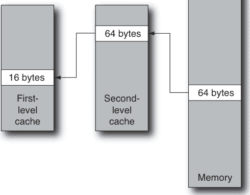

图 2.2 从内存将数据取到缓存


当发生缓存缺失（`cache miss`）时，缓存行将从内存中取并安装到二级缓存。内存操作请求的缓存行部分将安装到一级缓存。在这种情况下，对 16 字节缓存行上原始项数据的访问也可以从一级缓存获取。对共享相同 64 字节缓存行的数据访问将从二级缓存中取。对 64 字节缓存行之外数据的访问将导致另一次从内存取回。

如果在需要数据时才从内存取回，处理器将经历整个内存操作的延迟。在现代处理器上，执行这种取回可能需要几百个周期。然而，有一些技术可以减少这种延迟：

- `Out-of-order execution`是指处理器在指令流中寻找它可以执行的未来指令。如果处理器检测到未来的加载指令，它可以在取回之前的加载指令数据的同时，取回该指令的数据。两个加载将同时被取回，在理想情况下，加载的总成本可能会减半。如果能同时取回两个以上的加载，成本将进一步降低。
- `Hardware prefetching of data`是指处理器专门用于检测来自内存的数据流。当识别出数据流时，硬件会在处理器请求数据之前开始取回数据。如果硬件预取成功，数据可能在需要之前就已经进入了缓存。在数据以流的形式或通过步长访问模式取回的情况下，硬件预取可能非常有效。当访问模式不那么线性时，它将无法预取数据。
- `Software prefetching`是在在需要数据之前添加指令从内存取回数据的行为。软件预取的优势在于它不需要猜测数据将从内存的何处请求，因为预取指令可以来自确切的地址，即使该地址与上一个地址之间不是线性步长。当访问模式是非线性的，软件预取具有优势。硬件预取可能更高效，因为它不占用指令流中的任何空间。

覆盖内存延迟成本的另一种方法是 CMT（多线程多线程）处理器。当一个线程因为缓存缺失而停顿时，其他运行的线程可以使用被停顿线程的处理器资源。这种方法与之前讨论的不同，它不会提高单线程的执行速度。这可以使处理器通过维持更多活动线程来完成更多工作，从而提高吞吐量而非单线程性能。

有许多常见的编码风格会导致内存布局欠优。接下来的章节将描述这些每种情况。

## 通过数据密度和局部性提高性能

注意变量在内存中声明和布局的顺序可以提高性能。正如之前讨论的，当加载操作将内存中的变量带入时，它也会取回该变量所在的整个缓存行的其余部分。将经常一起访问的变量放在一个结构体中以便它们位于同一条缓存行上，将带来性能收益。考虑列表 2.27 中的策略。

### 列表 2.27 数据结构

```evenstruct s
{
    int var1;
    int padding1[15];
}
```

访问结构成员 `var1` 时，也会取回周围的 64 字节。由于整数的大小是 4 字节，`var1` 加上填充是 64 字节。列表 2.28 显示了重排后的结构，使得 `var1` 和 `var2` 相邻。

### 列表 2.28 重排结构使重要成员共享缓存行

```
struct s
{
int var1;
int var2;
int padding1[15];
int padding2[15];
}
```

如果结构没有正好适应缓存行的长度，会出现 `var1` 和 `var2` 跨越两个缓存行的情况。这引入了一个困境：是将结构尽可能紧凑地打包以适应一个缓存行更好，还是通过填充来使结构对齐更好？图 2.3 显示了这种答案取决于多种因素。在大多数情况下，最好的答案可能是尽可能紧凑地打包结构。

| var1 | var2 | var3 | var1 | var2 | var3 |

|---|---|---|---|---|---|---|

| struct s[0] | | | struct s[1] | | | |

| Cache line | | | Cache line | | | |

| var1 | var2 | var3 | | | |

图 2.3 使用填充对齐结构

## 结构如何影响性能

结构排序错误对性能的影响很难检测。这种成本分布在整个应用程序对该结构的访问中。重排结构成员可以提高所有访问该结构的程序的性能。确定结构成员的最佳布局也是困难的。一个指南是根据访问频率对结构成员进行排序，或者根据热区域的代码进行分组。值得考虑的是，如果现有排序对于某些频繁执行的代码是最优的，更改顺序可能会导致性能回归。

类似的优化是结构拆分，即将现有结构拆分为频繁访问的成员和很少访问的成员。如果将很少访问的结构成员移除并放在另一个结构中，那么每次从内存取数据都将取回更多关键结构。考虑之前的例子，如果我们假设 `var` 很少被需要，我们将得到一对结构，如图 2.4 所示。

| var1 | var2 | var1 | var2 | var1 | var2 | var1 | var2 | var1 |

|---|---|---|---|---|---|---|---|---|

| struct s0[0] | | | struct s0[1] | | | struct s0[2] | | | struct s0[3] |

| Cache line | | | | Cache line | | | | |

| var1 | var3 | var3 | var3 | var2 | var3 | var3 | var3 |

| s1[0] | s1[1] | s1[2] | s1[3] | s1[4] | s1[5] | s1[6] | s1[7] | s1[8] |

| Cache line | | | | Cache line | | | |

图 2.4 使用结构拆分提高内存局部性

在这种情况下，原始结构 `s` 被拆分为两个，`s0` 包含所有频繁访问的数据，`s1` 包含很少访问的数据。在极限情况下，这种优化是将可能的结构体数组转换为一组数组，每个数组对应原始结构中的每一个成员。

### 选择合适的数组访问模式

一种常见的数据访问模式是跨数组元素进行步长遍历。如果能够排列数组，使得选定的元素是连续的，应用程序的性能将会更好。列表 2.29 显示了一个使用步长访问数组的代码示例。

#### 列表 2.29 非连续内存访问模式

```
double array;
double total=0;

for (int i=0; i<cols; i++)
  for (int j=0; j<rows; j++)
    total += array[j][i];
```

C/C++ 数组在内存中的布局使得最后一个索引的相邻元素（在本例中由变量 `i` 索引）在内存中也是相邻的；这被称为行主序。然而，循环内部的循环是在矩阵的第一个索引上嵌套，并访问该数组的第 `i` 个元素。这些元素不会位于连续的内存中。

在 Fortran 中，遵循相反的排序，因此第一个索引的相邻元素在内存中是相邻的。这被称为列主序。通过步长访问元素是从 Fortran 翻译成 C 代码时的常见错误。图 2.5 显示了 C 中如何对内存进行寻，行中的相邻元素在内存中是相邻的。

| 连续内存 |

| --- |

| 行 1 |

| 行 2 |

| 行 3 |

| 行 4 |

图 2.5 行主序内存排序

幸运的是，大多数编译器通常能够正确交换循环并改进内存访问模式。然而，在许多情况下，由于别名（aliasing）或循环中访问元素的顺序，编译器无法进行必要的转换。在这种情况下，开发者有必要确定合适的布局并相应地重构代码。

### 选择合适的数据结构

选择存储数据的最佳结构，与选择具有合适复杂度的算法一样，会对整体性能产生重大影响。这回到了本章早期关于算法复杂度的讨论。某些结构在按一种模式访问数据时是高效的，如果访问模式发生变化，其他结构可能会更高效。

考虑一个简单的例子。假设你有一个用于拼写检查应用程序的单词字典。你无法在编译时知道字典中有个单词，因此处理此问题最简单的方法可能是读取单词并将它们放入链表中，如图 2.6 所示。

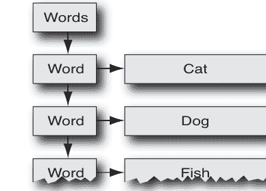

图 2.6 使用链表持有有序单词列表

每当应用程序需要检查单词是否在字典中时，它都会遍历单词链表，因此对整个文档进行拼写检查是一个 $O(N²)$ 操作。

另一种实现可能是分配一个已知长度的数组来存储指向各种单词的指针，如图 2.7 所示。选择数组长度以容纳所有元素可能会有些复杂性，但其处在于可以对数组中排序的单词列表进行二分查找。二分查找是一个 $O(\log_2(N))$ 操作，对整个文档进行拼写检查将是一个 $O(N*\log_2(N))$ 操作，如前所述，这是一种快得的方法。

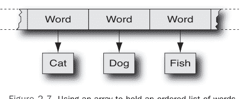

正如任何例子一样，无疑有更好的结构来持有单词字典。为特定应用程序选择合适的结构是平衡以下因素的考虑：

- 程序员实现算法的时间。开发者在实现应用程序单个部分上花费的时间可能会受到限制。
- 用户对应用程序性能的敏感性。某些功能很少被使用，因此用户可能会接受，例如，对整个文档进行拼写检查需要时间。也可能是任务的完整部分并不是关键的；在拼写检查的情况下，如果报告了拼写错误，用户可能会花时间阅读文本以确定使用的合适单词，在此期间应用程序可以继续并完成文档其余部分的拼写检查。


- 问题规模并不局限于只有几百个单词的文档，整个文档的拼写检查不太可能超过半秒钟。任何从改进算法带来的性能提升将是无法察觉的。

在许多情况下，存在预先实现的实现不同数据管理结构的代码库。对于 `C++`，标准模板库（`STL`）提供了丰富的数据结构。通过细致的编码来封装数据结构的使用，可以最小化开发者的时间，允许原始结构容易地替换为证明有必要的更高效的结构。

## 编译器的作用

编译器的目的是获取源代码并产生功能上正确的实现，仅使用开发者在源代码中或作为编译过程提供的信息。识别编译器工作时面临限制是非常重要的——对开发者来说显而易见的事情，对编译器可能并不显而易见。

大多数应用程序使用很少执行的执行路径。检查代码的开发者可能会识别出可能被频繁执行的路径。然而，编译器很少能够从源代码中提取所有的上下文信息来确定哪条路径是最常见的。考虑列表 2.30 中的代码，名称可能指示了开发者对两条代码路径执行频率的预期。

### 列表 2.30 开发者可能猜测常见路径的代码

```c
if (error) { value=0.001; }
else { value=denominator; };
```

## 编译器的角色

代码的不同部分都在关注某些内容。例如，可能会有一个由此循环的计算触发的浮点异常处理程序。默认情况下，某些编译器无法消除这段代码，但当给定合适的编译器标志时，编译器将移除该循环。这说明用户需要向编译器提供适当的指令，以便执行其能够执行的所有优化。

另一种基本的优化类型是提高操作的效率。在“数组访问模式”一节中，我们看到了一个潜在的示例，编译器可以交换两个循环以改进内存访问模式。这通过减少内存访问开销提高了代码的性能。另一个提高代码效率的例子是，一个操作可以被开销更低的操作所取代。这被称为强度还原（strength reduction）。强度还原的一个良好演示是将整数除以 2 的幂替换为位移操作。列表 2.35 中的代码包含一个除二的整数除法。

### 列表 2.35 有优化机会的代码

```c
unsigned int b;
...
unsigned int a = b/2;
```

除二的整数除法可以用右移操作替换，如列表 2.36 所示。

### 列表 2.36 优化后的代码

```c
unsigned int b;
...
unsigned int a = b>>1;
```

另一种常见的优化是用逻辑操作替换条件代码。性能的提升得益于处理器执行生成代码的简易程度。改进后的序列可能会消除分支指令，从而消除分支预测失败的停顿，或者新序列可能需要更少的指令。列表 2.37 显示了可以被逻辑操作替换条件代码的代码。

### 列表 2.37 条件代码

```c
if ((value & 1) == 1)
{
  odd = 1;
}
else
{
  odd = 0;
}
```

列表 2.37 所示的代码可以被列表 2.38 所示的等效代码所替换。

### 列表 2.38 逻辑操作

```c
odd = value & 1;
```

## 选择合适的编译器选项

编译器往往具有许多可能的命令行选项或标志（`flags`）。程序员的任务是识别出能够提供最合适优化集的最小标志子集。通常，这归类为构建时的三类目标：

- 基础优化是调试级别（debug level）。这些是生成可以被有效调试的代码所需的标志。用于调试代码中的逻辑错误。如果代码因空指针异常崩溃，运行代码的调试版本将允许开发者确定该异常是优化的结果，还是代码固有的属性。它还允许开发者以最小的步长逐行执行代码，确查看应用程序是如何进入该状态的。然而，这种能力通常以运行时性能降低为代价。

- 应用程序的优化版本构建速度快且以合理的速度运行。开发者会在开发周期内多次构建并运行应用程序，因此编译器编译应用程序不要花费过长时间，以及应用程序以合理的性能执行至关重要。通常，编译器用 `-O` 标志表示优化后的编译。该标志执行的优化通常代表了在获得快速运行时性能和花费大量时间编译之间的权衡。

- 更高级的优化也可能是合适的。开发者首先需要评估对应用程序进行更激进的编译是否能带来进一步收益。如果应用程序的高度优化版本没有提供进一步的性能提升，则没有必要使用更高级别的优化。可以使用优化级别较低但性能相同的构建版本作为应用程序的生产版本。另一方面，如果更高层次的优化以更长的构建周期为代价提供了更好的性能，如果更激进的编译器选项带来了增强性能，则建议调查这些选项以确定具体是哪些选项提供了性能以及它们是否合适。

### 列表 2.40 内联优化后的代码

```
int A( int p )
{
    return p;
}
```

这个新版本的例程 `A()` 也是一个非常好的内联候选对象，因为它只返回了传入变量的值。虽然这看起来像是不常见的例子，但存在一种更通用的代码模式，如列表 2.41 所示。

### 列表 2.41 访问器模式

```
static int count;

int get_count()
{
    return count;
}
```

存在仅为了获取和设置变量值的例程是非常常见的。这些例程是内联的有力候选对象，因为它们只贡献了一条有用的指令（变量的加载）和至少两条开销性指令（调用和返回）。

另一种内联可以提高性能的情况是它可以消除变量的加载和存储。列表 2.42 显示了内联将减少内存操作次数的代码。

### 列表 2.42 具有函数内联优化可能的代码

```
int number_of_elements;
int max;

void calculate_max(int* elements)
{
    max=elements[0];
    for (int i=1; i<number_of_elements; i++)
    {
        if ( elements[i] > max )
        {
            max=elements[i];
        }
    }
}
```

```
void doWork()
{
    number_of_elements = ...;
    calculate_max(elements);
}
```

例程 `calculate_max()` 在调用之前需要更新变量 `number_of_elements`。在通常情况下，编译器在调用例程之前需要存储所有可见的变量。在例程读取任何一个变量的情况下，这是必要的。如果例程修改了其中任何一个变量，则需要在调用后重新加载这些变量。内联后，编译器不再包含这些加载和存储，因为可以将必要的值保存在寄存器中，并只执行必要的加载和存储。

跨文件优化的优势在于，它允许编译器生成优化代码，无论源代码如何在源文件之间分布。局限性在于静态或动态库，在这些情况下编译器可能无法执行必要的跨文件内联。

## 使用分析反馈

大多数编译器都支持分析反馈（profile feedback），这种机制允许编译器收集有关应用程序运行时行为的信息。考虑列表 2.43 所示的代码片段。

### 列表 2.43 代码运行时行为不确定的代码

```
if ( a != 0 )
{ d++; }
else
{ d--; }
```

在这种情况下，编译器不知道通常情况是增加变量 `d`。通常的解决方案是让编译器猜测哪种可能性更大，或者产生有利于该特定假设的代码。然而，如果代码位于应用程序中频繁执行的部分，适当的选择可能会导致可观测的性能提升。

另一种情况是，应用程序运行时行为的知识对于确定内联哪些例程是有用的。正如前一节过的，内联正确的例程可以带来显著的性能收益。然而，每当一个调用的例程被内联时，它都会增加调用例程中的指令数量。这种代码 own的可能会导致指令缓存利用率降低，导致性能下降。因此，以下操作非常重要：

## 编译器的角色

内联对性能有益的例程，避免内联只会增加指令缓存占用的例程。

分析反馈（或反馈引导优化）为编译器提供了收集应用程序行为运行时信息的机会。这是一个三步过程。第一步是构建一个经过插的应用程序版本以收集运行时指标。下一步是在数据集上运行它，该数据集是应用程序实际运行环境的“典型”代表，但运行时间短得多。最后一步是使用这些分析信息重新编译应用程序。列表 2.44 显示了使用 Solaris Studio 编译器的步骤。

### 列表 2.44 使用 Sun Studio 编译器分析反馈的步骤

```
$ cc -0 -xprofile=collect:./profile -o a.out prog.c
$ a.out
$ cc -0 -xprofile=./profile -o a.out prog.c
```

分析反馈的收益取决于应用程序是否具有模式。（注：此处原文存在大量重复句子，翻译已按要求处理）。

编译器无法确定变量 `total` 存储的内存位置是否为数组的一部分。它不得不做一个错误的假设，认为该变量是数组的一部分，这导致代码在每次迭代中都会将变量的值存回内存。列表 2.46 所示的循环源于低优化级别下编译的代码。

### 列表 2.46 由于潜在别名而包含存储操作的代码


```
top:
ld      [%o0],%f0    ! Load of array[i]
add     %o4,1,%o4      ! Increment
add     %o1,1,%o0      ! Increment pointer to array[i];
cmp     %o4,%f5       ! Check for end of loop
fadded %f2,$f0,$f4    ! Perform addition
std     %f4,[i0]       ! Store of the variable top
bl,a,pt %icc,top    ! Loop to top
ld      [%0],f2       ! Reload of the variable total
```

在更高层次的优化下，编译器可以改变循环，使得如果循环不包含别名，就可以避免执行执行内存存储的版本。列表 2.47 显示了等效源代码。

### 列表 2.47 显示带有潜在指针别名的两个版本循环的源代码

```
void sum(double *total, double *array, int len ) {
  if ( (total < array) || (total > array + len )) {
    double tmp = *total;
    for (int i=0; i<len; i++) {
      tmp += array[i];
    }
    *total = tmp;
  } else {
    for (int i=0; i<len; i++) {
      *total += array[i];
    }
  }
}
```

修改后的源代码使用临时变量来持有计算后的值，这样编译器就知道可能不存在别名。这是避免指向全局数据指针的可能出现别名问题的一种良好技术。

## 第 2 章性能编程

在存在潜在别名的情况下，存在两个根本性的性能问题。第一个在列表 2.46 的示例汇编代码所示。别名要求编译器包含对变量不必要的存储或加载。可以通过计算生成的内存操作数量并确认其与源代码的预期数量相符来识别这个问题。

第二个问题更为微妙，涉及编译器重排指令的能力。通常，编译器会将加载指令移动到指令流的前部，为它们的完成留出更多时间，并将存储指令移动到指令流的后部，为数据供给留出更多时间。不幸的是，别名问题限制了编译器这样做的能力。当查看汇编代码时，问题表现为一个存储指令后紧跟一个加载指令。这种调度确保了正确的内存顺序，但对性能而言可能并非最优。

### 列表 2.48 带有潜在别名问题的代码

```
void func(int * a, int * b)
{
    (*a)++;
    (*b)++;
}
```

编译时，这段代码产生列表 2.49 所示的 SPARC 汇编代码。

### 列表 2.49 在存在可能的指针别名时产生的 SPARC 汇编代码

```
ld      [%0],%5    Load *a
add     %0,1,%5    Increment
st     [%5,%o0]   Store *a    // Store of first variable
ld      [%1],o4    Load *b     // Load of second variable
add     %o4,1,%o4   Increment
st     [%o3,%o1]   Store *b
```

变量的存储需要在加载变量 `b` 指令之前完成。列表 2.50 所示的代码没有指针别名问题。

### 列表 2.50 无别名问题的代码

```
void func(int * a)
{
    a[0]++;
    a[1]++;
}
```

## 编译器的角色

编译列表 2.50 所示的代码产生列表 2.51 所示的 SPARC 汇编代码。

### 列表 2.51 在不存在指针别名时产生的 SPARC 汇编代码

```
ld      [%0],%0      ! Load a[0]
      [%0+4],%4   ! Load a[1] // Load of second variable
add     %5,1,%5       ! Increment
st      %5,[0]        ! Store a[0] // Store of first variable
add     %o4,1,%3      ! Increment
st      %3,[%1]       ! Store a[1]
```

由于编译器能够判断两个操作之间不存在别名，因此它可以尽早地重排指令。

别名的一个更大的问题是，它往往会抑制编译器对代码进行复杂变换的能力。一旦代码输入超过两个数据，要产生动态检查别名问题的运行时代码将非常困难。例如，编译器会发现对列表 2.52 所示的代码进行运行时别名检查非常困难。在这种情况下，矩阵 `a` 被连续访问，因为编译器知道将要修改的内存范围。

矩阵 `b` 通过第一个索引访问，该索引是指向多个数组的指针。这些数组中的任何一个都可能与 `a` 指向的数组重叠。

### 列表 2.52 难以进行运行时别名检查的代码

```
void add(double **a, double **b)
{
  for(int i=0; i<100; i++)
    for(int j=0; j<100; j++)
      a[i][j] += b[j][i];
}
```

## 使用性能分析识别时间耗点

根据时间消耗位置的不同，这可能是获取数据的方法，也可能是打印图表的复杂性。

- 避免在非关键或错误处理代码上花费时间。应用程序中常见的性能瓶颈是那些不应被执行的代码。这可能是异常处理代码、向 `stderr` 写入错误消息，或仅用于处理边界情况的代码。一旦对应用程序进行性能分析，就能很容易识别出那些在分析结果中不应出现的视觉代码部分。

- 检查用户、系统和其他程序状态之间的时间分布。某些应用程序可能在系统代码上花费大量时间，但这可能是程序出现问题或代码编写不当的迹象。应用程序可能会花费系统时间来调用一个重量型函数来获取时间戳数据，而实际上存在更轻量级的替代方案。同样，应用程序可能会花费大量时间等待网络返回数据或等待屏幕重绘；通过让主线程处于等待状态时运行另一个执行计算的线程，可能会提高性能。

- 检测在异常情况下花费的时间。这些可能可能是处理涉及次规格化数的浮点数计算的软件陷阱，也可能是像 TLB 缺失之类的平凡问题。这些情况很难检测，因为它们可能不会导致额外的系统时间，但可以通过使用硬件计数器进行观察，或者通过仔细检查时间所属的精确语言指令来检测。

在编写和使用应用程序时对其进行性能分析，是管理应用程序性能最有效的方法，并且在对应用程序进行任何更改时应定期进行。

## 常见的性能分析工具

大多数性能分析工具都不需要你对应用程序进行任何操作。然而，在构建应用程序时带有调试信息通常是有益的。调试信息可以让工具能够在源代码的行级别聚合运行时间。还有两种常用的性能分析方法。

第一种方法是系统级性能分析：Intel 的 `VTune`、`AMD` 的 `CodeAnalysis` 以及开源性能分析工具 `profile` 等工具采用了这种方法。它对整个系统进行分析，并为系统上运行的所有进程收集计时信息。当系统上运行了许多应用程序时，这是一个非常有用的方法。在分析数据时，关注单个应用程序是正常的。

图 2.9 显示了 `AMD CodeAnalysis` 的输出，它列出了系统上所有的活动进程。

# 第 2 章 性能编码

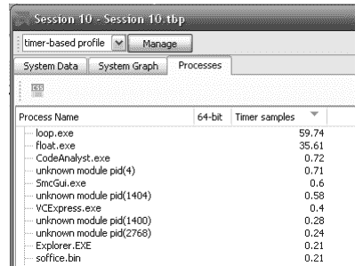

图 2.9 CodeAnalyzer 列出的每个运行应用程序消耗的时间列表

在此实例中，有两个应用程序共同消耗了几乎所有的 CPU 资源。

第二种常用方法是仅对感兴趣的部分进行性能分析。`Solaris Studio Performance Analyzer` 就是这种方法的示例。对单个应用程序进行分析使用户能够完全关注该应用程序，而不受系统上的其他活动干扰。

无论使用哪种工具，都有一组共同且实用的功能。最关键的特性可能是每个函数中花费的时间。图 2.10 显示了 `Solaris Studio Performance Analyzer` 报告的每个函数花费的时间。

该代码的性能分析显示，大约 70% 的用户时间花费在 `calc()` 例程中，其余时间在 `__write()` 例程中。

函数级别的性能数据可用于确认时间是否消耗在预期的例程中。但为了改进应用程序，通常需要更多细节。图 2.10 显示了 `AMD CodeAnalyzer` 分配给源代码行的时间。

| 函数 (Functions) | 调用者 (Callers) | 源 (Source) | 汇编 (Disassembly) | 时间线 (Timeline) | 实验 (Experiments) |

| --- | --- | --- | --- | --- | --- |

| 用户 CPU (sec) | 用户 (sec) | 名称 (Name) | | | |


| 2.200 | 2.200 | <total> | | | |

| 1.200 | 0.880 | calc | | | |

| 0.880 | 0.880 | __write | | | |

| 0. | 2.200 | main | | | |

| 0. | 0.880 | __ndprint | | | |

| 0. | 0.880 | printf | | | |

| 0. | 2.200 | start | | | |

| 0. | 0.880 | write | | | |

| 0. | 0.880 | xlfsbuf | | | |

图 2.10 Solaris Performance Analyzer 显示的热函数

## 使用性能分析识别时间耗点

| 地址 (Address) | 行 (Line) | 源 (Source) | 代码字节 (Code Bytes) | 计时器采样 (Timer samples) |

| --- | --- | --- | --- | --- |

| 0x4113b0 | | calc | | 100 |

| | 1 | // float.cpp: Defines the entry po_ | | 0 |

| | 2 | | | 0 |

| | 3 | | | 0 |

| | 4 | #include "stdafx.h" | | 0 |

| | 5 | double calc(double d) | | 0 |

| 0x4113c0 | | | | 0 |

| | 7 | double total=0.0; | | 0 |

| | 9 | for (int i=0; i<1000; | | 0 |

| | 10 | { | | 0 |

| 0x411338 | | total+=d; | | 0 |

| | 11 | | | 0 |

| | 12 | return d; | | 0 |

| | 13 | } | | 0 |

| 0x4143d0 | 15 | voidWork() | | |

图 2.11 AMD CodeAnalyzer 显示分配给源代码行的时间

使用源代码级别的性能分析，开发者可以做出如何重构代码以提高性能的决策。在汇编级别，可以识别出如过度别名或其他贡献大量时间的问题。

### 在性能分析中识别耗时位置

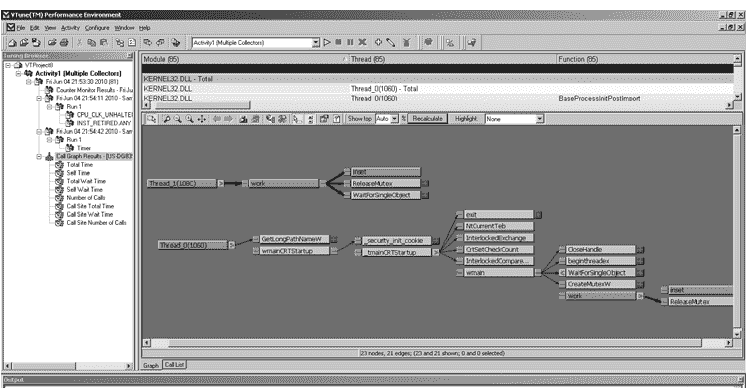

图 2.14 来自 Vtune 的调用图信息

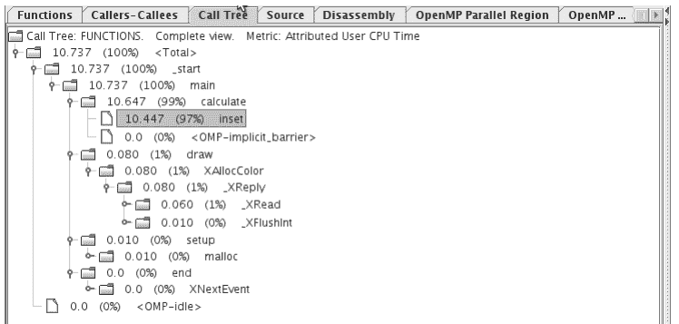

图 2.15 在 Oracle Solaris Studio 性能分析器中显示的调用树

# 8 为性能编码

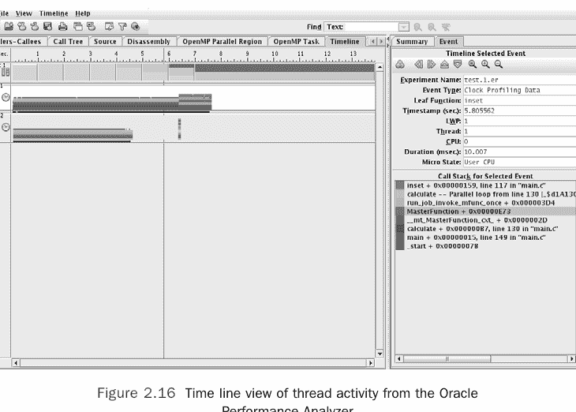

Apple 的 Instruments 工具也提供了类似的视图，如图 2.17 所示。仪器（Instrument）是用于收集应用程序运行期间处理器、磁盘、网络和内存使用数据的工具的名称。这个特定的示例显示了应用程序运行期间两个线程对传感器的利用率。时间线视图（timeline view）对于多线程应用程序特别有用。为了获得最佳性能，需要在所有线程之间均匀地分配工作。时间线视图是快速判断哪些线程比其他线程更活跃的一种方法。它也可以用于由于同步事件（例如 Java 中的垃圾回收）会导致应用程序中的线程暂停的代码。

性能分析工具对于产生最优的串行和并行代码至关重要。因此，熟悉你系统上的可用工具是非常重要的。对于串行代码，性能分析工具将识别出需要改进的代码区域以提高应用程序的性能。对于并行代码，它将允许你识别可以改进并行化的代码区域，或者可以将工作更好地地分布到可用的处理器或线程上。

## 如何不进行优化

当人们谈论优化应用程序时，往往倾向于立即想到汇编语言中的热点程序（hot routines），或者去查阅


图 2.17 来自 Apple Instruments 的时间线信息

关于性能优化的许多书籍，它们讨论了循环展开、不变性提升（invariant hoisting）等内容。

这些并不是最好的起点。通常情况下，最好避免那些使代码易读的优化。最好的方法是对源代码进行最少的更改，或选择改进的编译器标志。

过去，性能优化意味着编写汇编语言或在源代码中手动应用循环变换。这就是为什么优化通常对这些主题有广泛的覆盖。然而，在具有正确标志的情况下，这些优化对于任何现代编译器来说通常都是轻微不足道的。使用编译器来完成优化有几个优点：

- 第一，编译器将确保优化的正确性。手动执行复杂的指令可能会导致逻辑错误。
- 第二个优点是代码保持了可维护性。如果算法细节发生变化，只需要对源代码进行极少量的修改，编译器就能获得相同的优化。
- 还有第三个优点——编译器只有在可能产生性能提升时才会进行优化。某些优化可能在某个处理器上有所帮助，但在另一个处理器上可能会导致性能损失。

# 第 2 章 为性能编码

因此，重要的步骤是识别时间耗费在哪里，并确定编译器为何仅通过对源代码进行微小更改或添加编译器标志就能解决问题。

尽管如此，在在某些情况下，无法从编译器中榨取出最优性能，手动优化代码是不可避免的。然而，在这样做之前，请考虑优化将带来的收益。将运行时间 10% 的部分代码性能翻倍，将带来 5% 的性能提升。这种收益需要考虑到重写代码所花费的时间以及新代码的维护成本。

## 性能设计中

因此，重要的步骤是识别时间耗费在哪里，并确定编译器为何仅通过对源代码进行微小更改或添加编译器标志就能解决问题。话虽如此，在某些情况下，无法从编译器中榨取出最优性能，手动优化代码是不可避免的。然而，在这样做之前，请考虑优化将带来的收益。将运行时间 10% 的部分代码性能翻倍，将带来 5% 的性能提升。这种收益需要考虑到重写代码所花费的时间以及新代码的维护成本。性能设计中

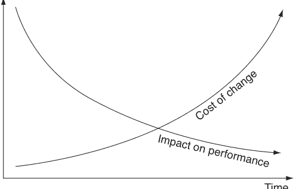

图 2.18 更改对性能的影响

# 3 识别并行化机会

本章讨论了并行性，从通过虚拟化支持多个操作系统，到在应用程序中使用多线程。本章还涵盖了编写并行程序的概念、可视化并行任务的方法以及构建并行应用程序的方法。本章继续讨论各种并行化策略或模式。最后通过考察并行的一些局限性来结束，你应该能够理解系统如何支持多个应用程序，以及现有应用程序如何被修改以利用多线程。你也能识别代码中可能适用并行化的位置。

## 使用多进程提高系统效率

考虑一个家用计算机系统。该系统可能只有一个活跃用户，但用户可能同时运行多个应用程序。单核系统通过每秒切换多次活跃应用程序来产生同时执行应用程序的错觉。多核系统的优势在于能够真正同时运行多个应用程序。

一个典型的例子发生在浏览网页的同时检查电子邮件时。你可能在电子邮件客户端下载邮件的同时，你的浏览器正在后台渲染网页。尽管这些应用程序会利用多线程，但它们不需要太多的处理器时间；它们的性能通常由从远程机器下载邮件或网页所需的时间决定。对于这些情况，即使是单核处理器也提供了足够的处理能力来提供良好的用户体验。然而，如果电子邮件客户端正在索引邮件，同时正在显示动画丰富的网页，单核处理器可能会饱和。

## 总结

通过本章，你应该理解了如何将性能工程化到应用程序中，以及理想的性能特性如何指导开发。你应该体会到可以使用编译器来产生最好的代码，以及良好的开发实践如何让编译器做得更好。本章的一个重要要点是，在开发过程中必须对应用程序进行性能分析，以确保它足够快以满足验收标准，并且它的运行时间花在有用工作上而不是欠优代码上。

事实上，这些应用程序可能已经利用了多线程。图 3.1 显示了一个新打开的 Mozilla Firefox 实例，它启动了 20 个线程。这样做的结果是，通过使用多核处理器，系统性能将提高，因为其中多个线程可以同时执行——而这不需要对现有应用程序进行任何更改。

或者，我们在个人计算机系统上执行的许多任务本质上是计算密集型的，例如玩游戏、为 MP3 播放器编码音频、将一种视频格式转换为另一种格式以刻录 DVD 等。在这些情况下，拥有多个核心可以利用额外的核心来缩短工作所需的时间，或者在任务于后台完成时保持系统的响应性。

图 3.2 显示了单用户在系统上运行多个应用程序时的系统状态。


图 3.1 Windows 进程资源管理器显示 Mozilla Firefox 中的活动

## 多用户使用单台系统

在商业和企业计算中，遇到具有多个用户的系统要常见得多。这通常是因为共享的计算机和软件比典型的消费者系统更强大、更昂贵。为了最大限地提高效率，企业可以在单台系统上维护一个数据库。多个用户可以同时访问该系统，像其他用户一样轻松添加或检索数据。多年来，UNIX 和 Linux 等多用户操作系统实现了用户之间计算资源的共享。每个用户都获得可用计算资源的“切片”。通过这种方式，多核系统为用户提供了更多可共享的计算资源。


图 3.2 系统上的单用户。家庭环境中也可能有多个用户。例如，在 Windows 上，一个用户登录使用计算机，而另一个早些登录的用户已经设置了其他应用程序运行，这是完全可能的。例如，你可能在后台留下了一些软件包在运行，而另一个用户登录其账户来检查电子邮件。

## 通过整合提高机器效率

多核计算实际上只是向更强大的系统架构的发展。这是一个新机会，可以将任务从多台独立的机器整合到单台多核机器上。一个例子可能是用单台机器同时担任 Web 服务器和电子邮件服务器，而以前这些功能运行在各自专用机器上。

执行此操作有许多方法。简单的方法是登录机器并启动电子邮件服务器和 Web 服务器。然而，出于安全考虑，通常需要将它们分开。如果可以向 Web 服务器发送一个格式正确的请求来获取某人的电子邮件，那将是非常遗憾的。显而易见的解决方案是以不同的用户身份运行两个服务器。这可以使用默认的访问控制系统，但它并不能防止用户错误。例如，有人可能无意中将邮件服务器的一个文件放在错误的权限下，导致邮件处于可读状态，或者可能导致能够向系统中安装后门。由于这些原因，更智能的技术已经演变出来，以便在运行在同一台机器上的进程之间提供更好的隔离。

## 识别并行化机会

| 用户 1 | 用户 2 |
|---|---|
| 应用 1 | 应用 2 |
| 操作系统 | |
| 硬件 | |

图 3.3 支持多用户的单台系统

这种包含关系和安全性对于支持多用户至关重要。随着用户数量的增加，其中某人执行可能“损坏”系统其他部分的概率也随之增加。这可能仅仅是删除关键文件，或者允许某人未经授权访问系统。

## 使用容器隔离共享单台系统的应用程序

其中一种技术是容器化。其实实现取决于具体的操作系统；例如，Solaris 有 Zones，而 FreeBSD 有 Jails，但概念是相同的。控制容器管理操作系统以及许多客体容器。每个客体容器看起来都是一个独立的完整操作系统实例，运行在客体容器中的应用程序无法看到系统中的其他操作，无论是其他客体容器还是控制容器中的。客体从不共享磁盘空间；每个客体容器看起来都有它自己的根目录。

该技术的实现实际上是操作系统的单个实例，容器的幻觉是通过隐藏客体容器外部的应用程序或资源来的。这种实现的优点是开销极低，性能非常接近整个系统。缺点是单操作系统代表了单点故障。如果操作系统崩溃，那么所有客体也会崩溃，因为它们也共享相同的镜像。图 3.4 阐述了容器化。

| 客体容器 1 | 客体容器 2 |
|---|---|
| 用户 1 | 用户 3 |
| 用户 2 | 用户 4 |
| 主机操作系统 | |
| 硬件 | |

图 3.4 使用容器在一个系统中托管多个客体操作系统

## 使用虚拟机监控程序托管多个操作系统

另外两种强制客体操作系统之间进行隔离的方法也消除了客体必须运行与主机相同操作系统的限制。这些方法被称为类型 1 和类型 2 虚拟机监控程序。

第 1 型虚拟机监控程序用一个非常轻量但高级的监视器系统（或虚拟机监控程序）替换主机操作系统，该系统可以独立地加载并启动多个操作系统实例。每个操作系统实例在共享相同硬件的同时，与其他实例完全隔离。每个操作系统看起来都像访问它自己的机器。从操作系统的内部来看，无法看出硬件正在被共享。硬件已经有效地虚拟化了，因为客体操作系统认为硬件资源是可用的。这提供了确保安全和健壮性所需的隔离。这类虚拟机监控程序的示例是 Sun UltraSPARC T1 和 T2 系列，或 x86 上的 Xen 虚拟机监控软件。

| 客体操作系统 1 | 客体操作系统 2 |
|---|---|
| 用户 1 | 用户 2 |
| 用户 3 | 用户 4 |
| 虚拟机监控程序 | |
| 硬件 | |

图 3.5 第 1 型虚拟机监控程序

第 2 型虚拟机监控程序是运行在主机操作系统上的普通用户应用程序。虚拟机监控程序软件的设计旨在托管其他操作系统。第 2 型虚拟机监控程序的良好示例是开源 VirtualBox 软件、VMware 或用于 Apple Macintosh 的 Paralle 软件。图 3.6 阐述了第 2 型虚拟机监控程序。

事实上，这些应用程序可能已经利用了多线程。图 3.1 显示了一个新打开的 Mozilla Firefox 实例，它启动了 20 个线程。这样做的结果是，通过使用多核处理器，系统性能将提高，因为其中多个线程可以同时执行——而这不需要对现有应用程序进行任何更改。

或者，我们在个人计算机系统上执行的许多任务本质上是计算密集型的，例如玩游戏、为 MP3 播放器编码音频、将一种视频格式转换为另一种格式以刻录 DVD 等。在这些情况下，拥有多个核心可以利用额外的核心来缩短工作所需的时间，或者在任务于后台完成时保持系统的响应性。

图 3.2 显示了单用户在系统上运行多个应用程序时的系统状态。


图 3.1 Windows 进程资源管理器显示 Mozilla Firefox 中的活动

## 多用户使用单台系统

在商业和企业计算中，遇到具有多个用户的系统要常见得多。这通常是因为共享的计算机和软件比典型的消费者系统更强大、更昂贵。为了最大限地提高效率，企业可以在单台系统上维护一个数据库。多个用户可以同时访问该系统，像其他用户一样轻松添加或检索数据。多年来，UNIX 和 Linux 等多用户操作系统实现了用户之间计算资源的共享。每个用户都获得可用计算资源的“切片”。通过这种方式，多核系统为用户提供了更多可共享的计算资源。


第 2 型虚拟机监控程序是运行在主机操作系统上的普通用户应用程序。虚拟机监控程序软件的设计旨在托管其他操作系统。第 2 型虚拟机监控程序的良好示例是开源 VirtualBox 软件、VMware 或用于 Apple Macintosh 的 Paralle 软件。图 3.6 阐述了第 2 型虚拟机监控程序。

# 通过整合提高机器效率

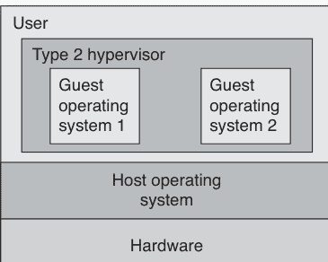

图 3.6 类型 2 虚拟机管理器

- **配置隔离。** 某些应用程序期望以特定的方式进行配置：它们可能总是期望被安装在相同的位置，或者在相同的位置找到配置参数。通过虚拟化，每个实例都拥有自己的整个系统，因此它可以被安装在一个地方，而不会影响在同一台主机上运行在不同虚拟容器中的另一个实例。
- **受限控制。** 可以赋予用户或应用程序虚拟化操作系统的实例 root 权限，但这并不会赋予他们对整个系统的绝对控制权。
- **复制。** 在某些情况下，例如运行计算机机房，有必要快速产生多个相同配置的实例。虚拟化可以节省重新安装操作系统的精力。可以启动一个新的客户操作系统，提供操作系统的全新实例。这个新实例甚至可以使用预配置的镜像，从而轻松启动并运行。
- **实验性。** 分发操作系统的虚拟化镜像非常容易。这意味着用户可以尝试新的操作系统，而不会对其现有配置造成任何损坏。
- **硬件隔离。** 虚拟化操作系统并将其移动到新机器。这意味着可以更换旧或损坏的硬件，而无需更改运行在上面的上的软件。
- **扩展性。** 可以通过启动更多的虚拟镜像来动态响应增加的工作请求。例如，一家公司可能提供按需 Web 托管计算服务。服务的需求可能在工作日的晚上达到峰值，但在其他时间非常低。使用虚拟化，可以在需求增加时启动新的虚拟机来处理负载。
- **整合。** 虚拟化最大的作用之一是将多台旧机器整合为更少的机器。虚拟化可以获取现有的应用程序及其宿主机操作系统，将其迁移到新主机。由于应用程序与其宿主机操作系统一起移动，这种过渡比需要为新环境重新配置应用程序的过渡可能是平滑的。

虚拟化的所有这些特性都非常适合云计算。云计算是由远程机器机群提供的服务。通过虚拟化，每个用户都可以获得一个未听过的虚拟机器的 root 权限。机器的数量可以根据其对服务的需求进行扩展，并且可以通过复制现有的设置快速将新机器投入使用。最后，软件与其运行的物理硬件隔离，因此随着机群的演进，它可以轻松移动到新硬件。

# 使用并行性提高单任务性能

虚拟化通过在最高层面提取并行性提供利用多核或多处理器系统的方法：同时运行多个任务或应用程序。对于用户来说，虚拟化的一个迷人的特性是利用这种级别的并行性很大程度上变成管理任务。

但对于软件开发者来说，更深层的问题是如何利用多个核心来提高单个应用程序的吞吐量或计算速度。下一节将讨论更紧整合的并行性以实现性能提升。

## 可视化并行应用的一种方法

从概念上可视化并行性的一种方法是想象有两个你；你们想着相同的想法并以相同的方式行为。潜在地，你可以实现目前一个人的两倍工作，但你们确实将面临一些问题。

你可能想象你的双胞可以出去上班，而你留家里看书。在这种情况下，你是在隐含地控制着你的双胞：你告诉他们做什么。

然而，如果你们是完全相同的，你的双胞也会倾向于留在家里看书而你出去上班。所以，也许你必须设计一种方法来决定今天你们谁去上班——也许将工作分开，让一个人上周，另一个人下周。

当然，周末也会出现问题，当你们都想同时读同一份报纸时。所以，也许你需要两份报纸，或者如果一次只有一个人有报纸，就得想出某种共享方法。

另一方面，会有很多好处。你可以画一面墙，而你的双胞在画另一面。你可以修草坪，另一个人在洗碗。你们甚至可以一起做晚餐；其中一个人切菜，另一个人在煎炸。

虽然这种双重益处的想法是奇幻的，但这些例子代表了编写并行应用时会出现的非常真实的问题。作为一个思想实验，想象两个人在某项任务上合作应该帮助你识别划分任务的方法，并指示由此产生的一些问题。

本章的其余部分将更详细地探索这些机会和问题。然而，如果你能采取这些“人性的”示例并将它们与计算问题进行类比，将有助于理解章节的后续部分。

并行性提供了一个完成更多工作的机会。这些工作可能是独立任务，例如修草坪和洗碗。这些工作可能对应于不同的进程，或者可能是使用同一系统的不同用户。给房子刷墙需要一点的沟通——你可能需要确定下一面画哪一面墙——但这两个任务是独立进行的。然而，涉及到做饭时，任务的耦合要紧密得多。切菜的顺序应该对应于需要的顺序。你可能需要这样的信息：“停下手头的事，现在给我拿橄榄油！”准备一顿饭需要两名工人之间大量的沟通。

需要的沟通越多，两名工人的效果就越可能不是性能的倍增。通信的示例可能指示应该按什么顺序准备蔬菜。当做饭的人在等待另一个人切完下一种需要的蔬菜时，可能会出现效率低的情况。

访问资源的问题，例如，双方都想读同一份报纸是另一个重要的关注点。这有时可以通过复制资源，你们两个都有自己的副本来避免，但如果只有一个资源，我们建立建立一种共享该资源的方法。

在接下来的一节中，我们将进一步探索这个思想实验，并观察我们用来解决问题的算法如何决定解决该问题的有效性。

## 并行性如何改变算法的选择

算法具有某些特性，使得它们对于多线程实现越适用或越不适用。例如，假设你有一副随机顺序的扑牌，但你想对它们进行排序。这样做的一种方法是将未排序的牌握在一只手里，并在另一只手中将其放在正确的位置。这将是一个 O(n) 操作，因为放置单张牌的时间不取决于牌的数量。

然而，假设你有一个助手，你决定对一半牌进行排序。如果你最后得到两堆排好的牌，你将需要进行合并。为了合并，你可以从一堆牌开始，然后让有下一张牌的人将其放入栈中。这部分的复杂度将是 O(log n)。所以尽管我们增加了线程，但并不保证性能的倍增。

此事的另一种方法是利用扑牌存在且易于识别的事实。如果排序牌，你只需要将它们放在网格中。网格将牌的“数值”放在x轴，将牌的“花色”放在y轴。对于一半的线程来说，这是一个 O(n) 操作。假设你们互不阻塞，你应该能够获得近两倍的性能。所以，比较这两种算法，使用网格方法对于单个人可能较慢，但在很多人情况下扩展性更好。

这里的点在于证明，单线程最好的算法并不一定对应于最好的并行算法。此外，最好的并行算法在串行情况下可能比最好的串行算法慢。

证明并行算法的复杂度在一般情况下是困难的，通常使用近似。并行性能最常用的近似是阿姆达尔定律。

## 阿姆达尔定律

阿姆达尔定律是扩展定律最简单的形式。其基本假设是并行代码的性能随着线程数量而扩展。这是不现实的，正如我们以后将讨论的，但提供了一个基本的起点。如果我们假设 S 代表花费无法并行代码的时间，P 代表花费可以并行化的串行代码的时间，那么应用程序的运行时间为

Runtime = S + P

使用 N 个处理器的应用程序并行版本运行时间采取如下：

Runtime = S + \frac{P}{N}

通过图表来理解可能是最容易的。在图 3.7 中，我们将代码串行部分的运行时间以及可以并行运行的部分表示为矩形

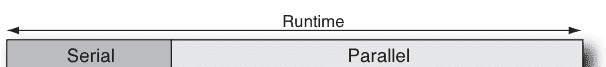

图 3.7 单线程运行时间

如果我们使用两个线程来处理代码的并行部分，那么部分代码的运行时间将减半，图 3.8 表示了产生的处理器活动。


图 3.8 使用两个线程的运行时间

如果我们使用四个线程来运行这段代码，那么产生的处理器活动将类似于图 3.9。

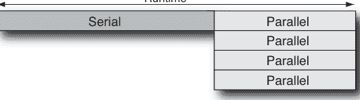

图 3.9 使用四个线程的运行时间

阿姆达尔定律得几个结论。随着处理器数量的增加，性能将由应用程序的串行部分主导。在极限情况下，程序的运行速度不会快于串行部分的持续时间 S。另一个观察结果是，随着线程数量的增加，收益是递减的：在某个点上，增加更多线程对总运行时间不会产生明显的影响。

这两个观察结果可能通过图 3.10 中的图表得到最好的说明，该图显示了对于具有不同比例可并行代码的应用程序，相对于串行情况的并行加速比。

## 相对于串行情况的加速

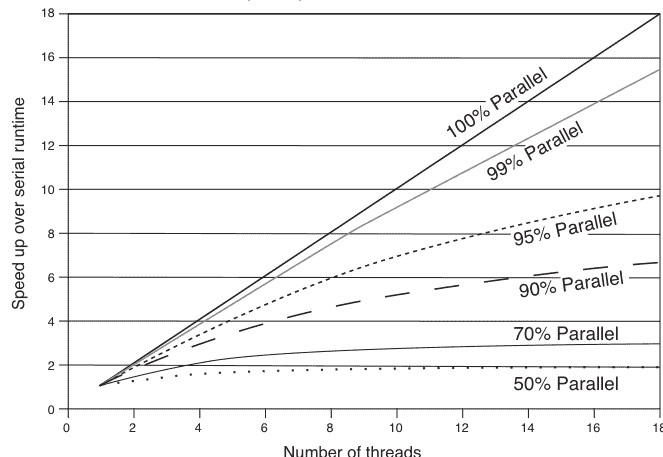

图 3.10 随着并行区域递减而变化的扩展性

如果所有代码都可以并行运行，那么扩展性就是完美的；拥有 18 个线程的代码将比串行版本的代码快 18 倍。然而，令人惊讶的是，随着可并行代码比例的下降，这种速度下降得如此快。如果应用程序 99% 可以转换为并行代码，那么在 18 个线程下，应用程序的扩展性将达到串行性能的 15 倍。如果串行部分占 95%，这将下降到约为串行性能的 10 倍。如果只有一半应用程序可以并行运行，预期的性能最好翻倍，代码在线程数约为 8 时基本可以达到这一目标。

使用阿姆达尔定律的另一种方法是，根据应用程序在可并行代码上花费的时间，查看它能扩展到多少个线程。

## 确定最大实际线程数


如果我们把阿姆达尔定律视为应用程序扩展的合理近似，那么就会产生一个有趣的问题：我们应该期望应用程序扩展到多少个线程？

如果一个应用程序只有 10% 的时间花在可并行的代码上，那么当使用八个线程代替四个线程时，我们可能看不到明显的收益。如果我们假设初始时间为 100 秒，那么四个线程将在 92.5 秒内完成任务，而八个线程将需要 91.25 秒。这在了一半分钟的总持续时间内只多了一秒多。在秒级的情况下，这种差异可能被认为是微不足道的，但想象一下原始代码需要 100 天；那么这种差异就等同于三个月持续时间中的一天。

在某些应用程序中，每一个细节都至关重要，使用尽可能多的资源将性能提高到最高是有意义的。然而，可能存在大量的应用程序，性能的微小提升并不值得付诸努力。

我们可以分析这个问题，假设人有一个容忍度 `$T$`，在这个跨度范围内，他们不再关心性能的差异。对于许多人来说，这是 10%；如果他们获得的性能在最佳可能值的 10% 以内，那么是可以接受的。其他群体可能有更强或更弱的限制。

回到阿姆达尔定律，回想具有 `$P$` 部分并行代码和 `$S$` 部分串行代码的应用程序在 `$N$` 个线程上运行的时间，如下：

> `$Runtime_n = S + \frac{P}{N}$`

当线程无限多时，最佳运行时间是 S。因此，在最佳水平 `$T\%$` 范围内的运行时间如下：

> 可接受的运行时间 = `$S*(1+T)$`

我们可以将可接受的运行时间与 `$N$` 个线程的运行时间进行比较：

> `$S*(1+T) = \left(S + \frac{P}{N}\right)$`

然后我们可以重新排列并求解 N，得到关于 N 的关系：

> `$N = \frac{P}{ST} = \frac{P}{(1-P)T}$`

# 第 3 章 识别并行化机会

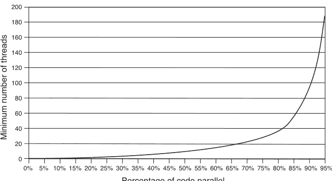

图 3.11 获取 90% 峰值性能所需的最小线程数

使用该方程，图 3.11 显示了为了获得最佳性能 10% 所需的线程数。

阅读此图可以发现，除非应用程序有一运行时间花在并行代码上，否则其扩展性是有限的。为了能够扩展到大量核心，需要 80% 以上的运行时间花在并行代码上。

如果阿姆达尔定律是扩展的唯一限制，那么对于除了极端并行的应用程序之外，使用线程的益处是有限的。如果以吞吐量（或完成的工作量）衡量性能，对于能够运行许多线程的系统，这些线程可能被分配给多个进程，而不是由单个进程使用。

然而，阿姆达尔定律是对扩展情况的简化。下一节将讨论一个更现实的模型。

## 同步成本如何降低扩展

在本文讨论的阿姆达尔定律中，我们将忽略并行实现带来的任何成本，完全关注线程之间的同步成本。当多个线程协作解决问题时，线程之间存在通信成本。这种通信可能是启动所有线程的命令，也可能是每个线程通知主线程其已完成工作。

我们将这种同步成本表示为随线程增加的函数 `$F(N)$`。在最好的情况下，`$F(N)$` 将是一个常数，表示同步成本不随线程数的增加而变化。在最坏的情况下，它可能随线程数呈线性甚至指数增长。对成本的合理估计可能是它与线程数的对数成正比（`$F(N)=K\ln(N)$`）；这相对容易解释，因为如果线程使用平衡树进行通信，对数代表了通信成本。采用这种近似，扩展到 `$N$` 个线程的成本如下：

```
Runtime = S + \frac{P}{N} + K \ln(N)
```

`$K$` 的值将是两个线程之间的通信延迟加上遇到同步点的次数的常数。对于通过内存通信的系统，`$K$` 将与内存延迟成正比；对于共享公共缓存的通信线程，则与缓存延迟成正比。图 3.12 显示了由于一个巨大的常数 `$K$` 值产生的曲线，证明了在某个线程数处，相对于串行情况的性能收益将由于同步成本而开始下降。

计算发生这一点的过程相对直接：

```
d \frac{runtime}{dN} = \frac{-P}{N^2} + \frac{K}{N}
```

解得 `$N$` 可知，运行时间的最小值出现在：

```
N = \frac{P}{K}
```

这告诉我们，代码可以扩展的线程数与可并行工作量与同步成本之间的比例成正比。因此，可以通过让更多代码并行运行（增加 `$P$` 的值）或通过降低同步开销（减小 `$K$` 的值）来增加应用程序的扩展性。或者，如果保持线程数不变，降低同步开销（使 `$K$` 变小）将允许更小的代码段实现并行（`$P$` 也可以变得更小）。

其有趣之处在于，多处理器通常会通过共享级缓存共享线程。共享级缓存的延迟比两个线程通过内存通信的延迟要低。同步开销通常与线程通信的内存延迟成正比。共享级缓存会导致更低的同步成本。这意味着多处理器有机会用于并行化那些同步开销高到以前无法实现的代码区域，或者将现有代码扩展到以前无法实现的高线程数。

到为止，本章讨论了开发者在将代码扩展到多线程时应该具有的预期。然而，一个更大的问题是如何识别可以并行完成的工作，以及执行这些工作的模式。下一节将讨论常见的并行化模式以及如何识别何时使用它们。

## 并行化模式

工作有许多方式可以分配到多个线程之间。本节的目标是提供最常用方法的概述，并指出这些方法在何时适用。

广义来说，并行化分为两类，通常称为数据并行和任务并行。

并行应用程序具有多个线程，对不同的数据项执行相同的操作。例如，多个线程可以各自从单个循环中各取一个迭代块，并在单个数组的不同元素上执行这些迭代。

任务并行应用程序则具有分离的线程，对不同的数据项执行不同的操作。例如，在制作一部动画电影时，由一个进程渲染每一帧，然后由另一个进程获取每个渲染后的帧并将其整合到整个电影的压缩版本中。

### 使用 SIMD 指令实现数据并行

尽管本书在多线程协作处理同一数据项的背景下讨论并行性，但该概念也扩展到了指令集。存在某些指令，即单指令多数据（SIMD）指令，它们可以加载一个数据向量并对向量中的所有项执行操作。大多数处理器都拥有这些指令：x86 处理器的 SSE 指令扩展、SPARC 处理器的 VIS 指令，以及 Power/PowerPC 处理器的 AltVec 指令。

列表 3.1 显示的循环用于转换为 SIMD 指令。

#### 列表 3.1 加两个向量的循环

```
void vadd(double * restrict a, double * restrict b , int count)
{
  for (int i=0; i < count; i++)
  {
    a[i] += b[i];
  }
}
```

在未启用 SIMD 指令的 x86 上编译会生成列表 3.2 所示的汇语言循环。

#### 列表 3.2 使用 x87 指令加两个向量的汇语言代码

```
loop:
fdld (%ecx)    // 加载 a[i] 的值
faddl (%ecx)    // 相加 b[i] 的值
stpst (%ecx)    // 将结果存回 a[i]
addl 8,%ecx // 增加 a 的指针
addl 8,%ecx // 增加 b 的指针
addl 1,%esi // 增加循环计数器
cmp  %eax,%esi // 测试循环是否结束
jle  loop      // 如果未完成，跳转回循环开始
```

使用 SIMD 指令编译会产生与列表 3.3 类似的代码。

#### 列表 3.3 使用 SSE 指令加两个向量的汇语言代码

```
loop:
movd (%edx),xmm0 // 将 a[i] 加载到向量寄存器
movd (%ecx),xmm1 // 将 b[i] 和 b[i+1] 加载到向量寄存器
addps xmm0,xmm1 // 向量寄存器加
movd xmm0,(edx) // 存到 c
addl 16,%edx // 增加 a 的指针
addl 16,%esi // 增加 b 的指针
addl 2,%esi // 增加循环计数器
cmp %eax,%esi // 测试循环是否结束
jle loop // 如果未完成，跳转到循环开始
```

由于同时计算两个双精度值，循环的执行次数减半，因此指令数量也减了一半。转向 SIMD 还让编译器能够避免基于栈的 x87 浮点架构的低效性。

SIMD 和并行性是互补的技术。SIMD 在循环对数据向量执行操作的情况下通常非常有用。这些示例也可以并行化。同时使用这两种方法可以使多核心实现高吞吐量。然而，SIMD 指令还有一个额外优势，即在工作量小到无法有效并行化的情况下，它们也可能有用。

### 使用进程或线程进行并行化

两种方法之间的权衡在第 1 章“硬件、进程和线程”中进行了讨论。同样，这些模式并不局限于单个系统。

### 多个独立任务

如前所述，利用系统最简单的方法是许多独立任务。在这种情况下，独立任务的数量限制取决于外部资源。Web 服务器可能需要大量的内存用于缓存。数据库服务器可能需要大量的磁盘 I/O。这些需求给系统带来了负载，但任务之间没有同步。一个运行多个任务的系统可以表示为运行三个独立任务 A、B 和 C 的单例，如图 3.13 所示。


**图 3.13** 三任务


这种用法的示例是将多个机器合并到单个机器。这种合并可能只是将 Web 服务器、邮件服务器等运行在同一台机器上，或者涉及某种虚拟化，使不同的任务相互隔离。这种方法非常常见，但从并行化策略来看并不非常有趣，因为组件之间没有通信。这种方法会提高机器利用率，并节省空间或能量，但不会导致性能变化（除非是从内在差异获得的）。

这种策略常见的地方是集群、网格或云计算。云中的每个节点（即系统）都可以运行不同的任务，且任务是独立的。如果任务失败（或节点在完成任务时故障），可以在另一个节点上重试。云的性能是所有节点的聚合吞吐量。

这种策略的有趣之处在于由于任务是独立的，性能（以吞吐量衡量）应该随可用线程数量几乎线性增加。

# 多个松耦合任务

多个独立任务主题的略微变体是：任务是不同的，但它们共同形成一个单一应用程序。某些应用程序需要同时运行多个独立任务，每个任务都是独立的，且通常与其他运行的任务不同。然而，由于是应用程序的原因而非仅仅是任务的集合，系统内部存在某些通信元素。通信可能是从任务到中央任务控制器的，或者任务可能会向状态监控器报告某些状态。

在这种情况下，任务本身在很大程度上是独立的。它们可能会进行通信，但这种通信可能是异步的，或者可能仅限于特殊情况。

图 3.14 显示了一个运行三个任务的单一系统。任务 A 是控制或监控器，而任务 B 和 C 向任务 A 报告状态。

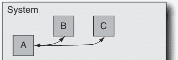

应用程序的性能取决于这些独立任务的活动。如果“应用程序”中消耗 CPU 的部分被拆分为单独的任务，那么其余的组件就可以具有更高的响应速度。作为这种响应能力提高的例子，假设一个单线程应用程序负责接收和转发跨网络的数据包，并并在磁盘上维护活动日志。这可以被拆分为两个松耦合的任务——一个负责接收和转发数据包，而另一个负责维护日志。使用原始代码时，如果应用程序正忙于向日志写入状态，那么处理传入的数据包可能会有延迟。如果将应用程序拆分为单独的任务，数据包可以立即接收并转发，而日志写入程序将在未来的某个合适点记录此事件。

在这种情况下，性能增益是因为我们在两个线程之间共享了工作。数据包转发任务只需要处理数据包，而不会被磁盘活动延迟。如果我们假设读取和转发数据包需要 1ms，向磁盘写入状态需要另外 1ms，那么使用原始代码，我们每 2ms 可以处理一个新数据包（这代表了每秒 5,000 个数据包的速率）。图 3.15 显示了这种情况。

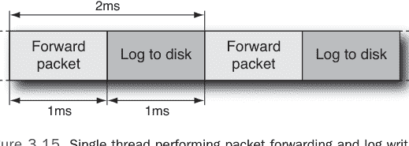

如果我们将这些拆分为单独的任务，我们就可以每 1ms 处理一个数据包，因此吞吐量将翻一倍。它还将提高响应速度，因为我们将在每个数据包到达后的 1ms 内处理它，而不是 2ms 内。然而，完成每个数据包的处理仍需 2ms，因此系统的吞吐量翻倍了，但响应时间保持不变。图 3.16 显示了这种情况。

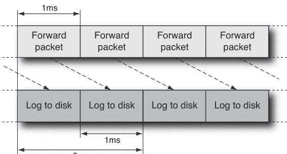

图 3.16 使用两个线程执行数据包转发和日志写入

## 同一任务的多个副本

完成更多工作的简单方法是采用相同任务的多个副本。每个独立任务完成所需的时间相同，但由于并行完成了了多个任务，系统的吞吐量将会增加。

这是一种非常常见的策略。例如，一个系统可能会运行多个渲染应用程序的副本，以渲染多个动画。每个应用程序都是独立的，不需要与任何其他程序进行同步。图 3.17 显示了这种情况，一个单一系统运行了三个任务 A 的副本。

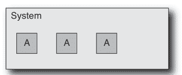

图 3.17 单个任务的多个副本

再次，系统的性能是吞吐量的增加，而不是完成工作速率的提高。

## 跨线程的单任务拆分

将单个任务拆分到多个线程中通常是人们所说的并行化。典型场景是将循环的迭代分配到多个线程中，以便每个线程都能计算迭代的一个离散范围。

这种情况在图 3.18 中表示为一个运行三个线程的系统，每个线程处理工作的一个独立部分。


图 3.18 多线程拆分任务

如果我们将这些拆分为单独的任务，我们就可以每 1ms 处理一个数据包，因此吞吐量将翻倍。它还将提高响应速度，因为我们将在每个数据包到达后的 1ms 内处理它，而不是 2ms 内。然而，完成每个数据包的处理仍需 2ms，所以系统的吞吐量翻倍了，但响应时间保持不变。在这种情况下，工作单元被拆分到线程之间，这减少了工作单元的完成时间。相比之下，本节之前的示例并不是关于工作完成时间的减少，而是代表了吞吐量的增加。

这种模式也可以被视为 fork-join 模式，其中 fork 是线程之间的拆分，而 join 是所有线程同步的点。

这种主题的另一种变体是分治法，其中问题被递归拆分。

## 使用任务流水线处理单个项目

任务流水线可能是一种不那么明显的并行化策略。在这里，一个单一的工作单元被拆分为多个阶段，并从一个阶段传递到下一个阶段，而不是流水线。图 3.19 表示了这种系统。系统具有独立的线程；当工作单元进入时，第一个线程完成任务 A 并将其传递给执行任务 B 的第二个线程。第三线程执行任务 C。当每个线程完成其任务时，它准备好接受新工作。

### 并行化模式

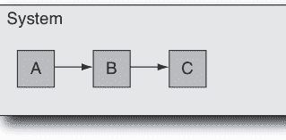

图 3.19 任务流水线

## 客户端与服务器

在客户端-服务器配置中，一个线程（客户端）向另一个线程（服务器）通信请求，另一个线程进行响应。拆分为客户端和服务器可能会提供性能改进，而服务器实际进行某些计算；客户端可能是可见的 UI，而服务器可能是执行任务的计算引擎。这种例子有很多，例如使用一个线程来管理屏幕重绘，而其他线程处理应用程序的活动。另一个例子是客户端运行在一个系统上的线程，而服务器是运行在远程系统上的线程；网络浏览器和服务器是显而易见的日常示例。

这种方法的一个大优势是多个客户端之间的资源共享。例如，一台机器可能只有一个以太网端口，但有多个通过该端口通信的应用程序。客户端将请求发送到服务器。服务器拥有以太网设备的独占访问权限，并负责发送客户端的数据包，并将数据包定向到相应的客户端。

这种客户端-服务器关系可以表示为多个客户端 A 与服务器 B 通信，如图 3.20 所示。服务器 B 可能还会控制一组资源的访问，这些资源没有显式包含在图中。

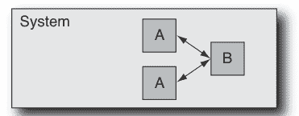

图 3.20 客户端-服务器工作划分

客户端-服务器模式中隐含的概念是，会有多个客户端寻求单个服务器的关注。当然，单个服务器可以使用多个线程来实现。

客户端-服务器模式并没有提高响应速度，但它代表了在多个线程之间共享工作，特别是当服务器实际上执行了某些工作时。或者，它代表了在……之间共享公共资源。

# 并行化模式 109

多个客户端（在这种情况下，吞吐量的任何提升都是幸运的副产品，而非设计目标）。

# 将责任拆分为生产者和消费者

*生产者-消费者模型*类似于流水线模型，也类似于客户端-服务器模型。在这里，生产者负责生成工作单元，而消费者负责接收这些工作单元并对它们进行某种类型的处理。

例如，之前描述的电影渲染问题可能有一组生产者来生成电影的渲染帧。消费者可以是负责对这些帧进行正确排序，然后将其保存到磁盘的任务。

这可以被表示为多个任务 A 的副本向单个任务 B 的副本发送结果，如图 3.21 所示。或者，也可以有多个生产者和一个消费者，或者多个生产者和多个消费者。

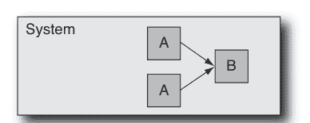

图 3.21 生产者-消费者分工

同样，这种方法并不一定能降低任务的延迟，但它通过允许多个任务同时进行，提供了吞吐量的改进。与客户端-服务器方法一样，它可能还提供一种减少合并多个数据生产者输出的复杂性的方法。

# 组合并行化策略

在许多情况下，单一的并行化策略可能就足以为一个问题产生并行解决方案。然而，在其他情况下，没有单一策略能够有效解决问题，此时有必要选择组合方法。

流水线策略代表了组合方法的良好起点。例如，其中一个阶段可能使用多个线程对某项数据进行计算。另一个不同阶段可能会有多个线程处理不同的数据项。

在将过程映射到实现时，考虑所有利用并行性的方式至关重要，避免将自己局限于脑海中出现的第一个方法。考虑一种情况：一个任务需要 100 秒来

# 110 第 3 章 识别并行化机会


完成。假设可以花费其中的 80 秒，并使用四个线程来完成工作。现在，该任务的运行时间为 20 秒串行时间，加上四个线程活跃时的 20 秒，总共为 40 秒。假设可以使用另一种不同的策略将这 20 秒分散到两个线程上，从而获得 10 秒的收益，因此现在的运行时间为 30 秒：两个线程耗时 10 秒，四个线程耗时 20 秒。第一次并行化使应用程序速度快了二点五倍。第二次并行化使其速度快了 1.3 倍，虽然并不理想，但仍然是一项显著收益。然而，如果第二次优化是唯一执行的优化，它将导致 1.1 倍的性能提升，远不如在代码其他部分已并行化的情况下所获得的 1.3 倍收益那样显著。

# 依赖关系如何影响并行运行代码的能力

应用程序内部或其计算的依赖关系决定了应用程序是否可能并行运行。依赖关系有两种：循环数据携带依赖 `loop-data-carried dependencies` 和内存携带依赖 `memory-carried dependencies`。循环依赖意味着，在知道上一次迭代的结果之前，无法执行循环中的下一次计算。这方面一个很好的例子是计算某点是否在 Mandelbrot 集合中的循环。代码列表 3.4 显示了该循环。

## 代码列表 3.4 确定点是否在 Mandelbrot 集合中的代码

```
int inSet(double ix, double iy) {
 int iterations=0;
 double x = ix, y = iy, x2 = x*x, y2 = y*y;
while ((x2+y2) < 4) && (iterations < 1000) {
 y = 2 * x + iy;
 x = x*x - y;
 x2 = x*x;
 y2 = y*y;
 iterations++;
 }
 return iterations;
}
```

内存携带依赖 `memory-carried dependencies` 更为细微。它们表示一个任务依赖于另一个任务的内存访问。

# 并行化模式 109

多个客户端，在这种情况下，吞吐量的任何提升都是幸运的副产品，而非设计目标。

# 将责任拆分为生产者和消费者

*生产者-消费者模型*类似于流水线模型，也类似于客户端-服务器模型。在这里，生产者负责生成工作单元，而消费者负责接收这些工作单元并对它们进行某种类型的处理。

例如，之前描述的电影渲染问题可能有一组生产者来生成电影的渲染帧。消费者可以是负责对这些帧进行正确排序，然后将其保存到磁盘的任务。

这可以被表示为多个任务 `A` 的副本向单个任务 `B` 的副本发送结果，如图 3.21 所示。或者，也可以有多个生产者和一个消费者，或者多个生产者和多个消费者。


图 3.21 生产者-消费者分工

同样，这种方法并不一定能降低任务的延迟，但它通过允许多个任务同时进行，提供了吞吐量的改进。与客户端-服务器方法一样，它可能还提供一种减少合并多个数据生产者输出的复杂性的方法。

# 组合并行化策略

在许多情况下，单一并行化策略可能就足以为一个问题产生并行解决方案。然而，在其他情况下，没有单一策略能够有效解决问题，此时有必要选择组合方法。

流水线策略代表了组合方法的良好起点。例如，其中一个阶段可能使用多个线程对某项数据进行计算。另一个不同阶段可能会有多个线程处理不同的数据项。

在将过程映射到实现时，考虑所有利用并行性的方式至关重要，避免将自己局限于脑海中出现的第一个方法。考虑一种情况：一个任务需要 100 秒来完成。假设可以花费其中的 80 秒，并使用四个线程来完成工作。现在，该任务的运行时间为 20 秒串行时间，加上四个线程活跃时的 20 秒，总共为 40 秒。假设可以使用另一种不同的策略将这 20 秒分散到两个线程上，从而获得 10 秒的收益，因此现在的运行时间为 30 秒：两个线程耗时 10 秒，四个线程耗时 20 秒。第一次并行化使应用程序速度快了二点五倍。第二次并行化使其速度快了 1.3 倍，虽然并不理想，但仍然是一项显著收益。然而，如果第二次优化是唯一执行的优化，它将导致 1.1 倍的性能提升，远不如在代码其他部分已并行化的情况下所获得的 1.3 倍收益那样显著。

# 依赖关系如何影响并行运行代码的能力

应用程序内部或其计算的依赖关系决定了应用程序是否可能并行运行。依赖关系有两种：循环数据携带依赖 `loop-data-carried dependencies` 和内存携带依赖 `memory-carried dependencies`。循环依赖意味着，在知道上一次迭代的结果之前，无法执行循环中的下一次计算。这方面一个很好的例子是计算某点是否在 Mandelbrot 集合中的循环。代码列表 3.4 显示了该循环。

## 代码列表 3.4 确定点是否在 Mandelbrot 集合中的代码

```
int inSet(double ix, double iy) {
 int iterations=0;
 double x = ix, y = iy, x2 = x*x, y2 = y*y;
 while ((x2+y2) < 4) && (iterations < 1000) {
 y = 2 * x + iy;
 x = x*x - y;
 x2 = x*x;
 y2 = y*y;
 iterations++;
 }
 return iterations;
}
```

## 第3章 识别并行化机会

### 列表 3.11 推测性并行化代码

```cpp
void doWork(int x, int y)
{
    int value1, value2;
    #pragma start parallel region
    {
        #pragma perform parallel task
        {
            value1 = longCalculation(x, y);
        }
        #pragma perform parallel task
        {
            value2 = secondCalculation(x, y);
        }
        #pragma wait for parallel tasks to complete
        if (value > threshold)
        {
            return value1 + value2;
        }
        else
        {
            return value1;
        }
    }
}
```


上述代码中的 `#pragma` 指令与 OpenMP 中使用的指令非常相似，我们将在第7章“OpenMP与自动并行化”中讨论它们。第一条指令告诉编译器，后续代码块包含将并行执行的语句。并行区域中的两个 `#pragma` 指令识别了要并行执行的两个任务。最后一个指令表示在两个任务完成之前，代码不能退出并行区域。

当然，考虑并行化带来的性能下降是否大于其带来的提升是非常关重要的。并行实现可能比串行代码慢主要有两个关键原因：

- 执行工作和在工作完成后进行同步的开销与并行代码所需的时间相近。
- 第二次长计算耗时比第一次计算更长，且其结果很少被使用。

可以为这种情况建立一个近似模型。假设第一次计算耗时 `T1` 秒，第二次计算耗时 `T2` 秒；假设实际上需要第二次计算的概率为 `P`。那么串行代码的总运行时间为 `T1 + P * T2`。

### 依赖关系如何影响并行运行代码的能力

对于并行代码，假设计算耗时与串行情况相同，且概率保持不变，但存在同步带来的开销 `S`。那么，并行代码所需的时间为 `S + max(T1, T2)`。图 3.22 显示了两种情况。

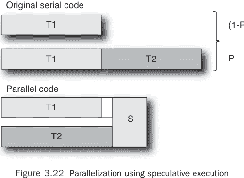

我们可以进一步对其进行解构，以识别并行版本比串行版本更快的两种情况的约束条件：
- 如果 `T1 > T2`，为了使推测获利，需要满足 `S+T1 < T1+P*T2`，或 `S < P*T2`。换句话说，同步成本需要小于第二次计算贡献的时间。如果第二次计算很少执行，这种情况是合理的，因为为了推测性计算它而所需的额外同步开销必须非常小。
- 如果 `T2 > T1`（如图 3.21 所示），为了使推测获利，需要满足 `S+T2 < T1+P*T2` 或 `P > (T2+S-T1)/T2`。这是一个更复杂的结果，因为第二个任务耗时比第一个任务（即原始代码）更长。由于 `T2 > T1`， `S-T1` 始终大于 0。`T2+S-T1` 代表由并行化引入的开销。为了让并行代码获利，该开销必须低于执行 `T2` 贡献的成本。在这里，执行 `T2` 的概率必须大于额外成本与原始成本的比例。随着并行代码的成本越来越接近执行 `T2` 的成本，则需要频繁地执行 `T2` 才能使并行化获利。

前面的方法是推测执行，如果结果不需要则会被丢弃。还有一种值推测（value speculation），即对输入的值进行推测并执行。考虑列表 3.12 所示的代码。

### 列表 3.12 具有值推测机会的代码

```cpp
void doWork(int x, int y)
{
    int value = longCalculation(x, y);
    return secondLongCalculation(value);
}
```

在这种情况下，第二次计算依赖于第一次计算的值。如果第一次计算是可以预测的，那么推测第一次计算的值并执行两次计算可能是获利的。列表 3.13 显示了使用值推测和伪并行指令并行化的代码。

### 列表 3.13 使用值推测的并行化

```cpp
void doWork(int x, int y)
{
    int value1, value2;
    static int last_value;
    #pragma start parallel
    {
        #pragma perform parallel task
        {
            valueuel = longCalculation(x, y);
        }
        #pragma perform parallel task
        {
            value2 = secondLongCalculation(lastValue);
        }
    }
    #pragma wait for parallel tasks to complete
    if (valueuel == lastvalue)
    {
        return value2;
    }
    else
    {
        lastValue = valueuel;
        return secondLongCalculation(valueuel);
    }
}
```

这种推测的值计算与推测执行示例中执行的计算非常相似。再次假设 `T1` 和 `T2` 代表两个例程的成本。在这种情况下，`P` 代表推测正确的概率。`S` 代表同步开销。图 3.23 显示了值推测的成本。

原始代码需要 `T1+T2` 秒来完成。并行代码需要 `max(T1, T2)` 秒。为了使并行化获利，需要满足以下条件之一：

- 如果 `T1 > T2`，则 `S+T1 < T1+P*T2`，即 `S < P*T2`。如果推测是正确的，同步成本小于执行 `T2` 的成本。如果推测经常错误，则 `T2` 必须远大于同步成本。
- 如果 `T2 > T1`，则 `S+P*T2 < T1`，即 `S < (1-P)*T2`。

图 3.23 使用值推测的并行化

| 原始串行代码 | |
| :--- | :--- |
| `T1+T2` | 秒 |
| 并行代码 | |
| :--- | :--- |
| `max(T1, T2)` | |
| 同步成本 | |
| :--- | :--- |
| `S` | `T2` |

### 关键路径

查看并行化的一种方法是检查关键路径。关键路径是决定程序完成所需最短时间的步骤集合。程序可能完成任务 A、B、C、D。并不是所有任务都有依赖关系。B 可能依赖于 A 的结果，D 可能依赖于 B 和 C 的结果，但 C 可能不于任何之前的结果。这种数据可以显示在图 3.24 所示的图中。

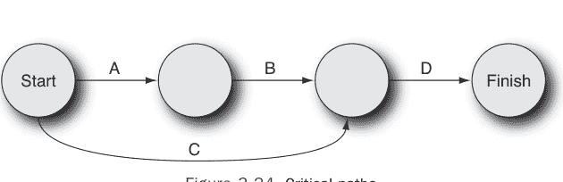

一旦确定了依赖关系和持续时间，在过程中识别关键路径相对简单。从图中可以看出，任务 C 可以与 A 和 B 并行。给定计时数据，就可以估计这种并行化的性能。

### 识别并行化机会

在案例中识别并行化机会的步骤如下：

- 1. 获取应用程序的代表性分析（profile），并识别目前耗时最长的代码区域。
- 2. 对于这些区域，检查代码的依赖关系，并确定是否可以打破这些依赖，以便作为多个并行任务或多次并行迭代的循环执行。在此阶段，可能值得研究不同的算法或方法是否提供更容易并行化的代码。
- 3. 这种并行化策略的开销和预期收益。如果方法随线程数量接近线性扩展，那么它就是好方法；如果扩展性看起来并不理想，可能值得扩大分析范围。
- 4. 通过考虑调用感兴趣区域的例程来扩大分析范围。可以使该例程并行化吗？

# 总结

列表 3.14 不同粒度下的并行化机会

```c
void handlePacket(packet_t *packet)
{
    doOneTask(packet);
    doSecondTask(packet);
}
```

```c
void handleStream( stream_t* stream )
{
    for( int i=0; i < stream->number_of_packets; i++ )
    {
        handlePacket(stream->packets[i]);
    }
}
```


在这个示例中，有两个长耗运行的任务；每个任务都对数据包进行某些处理。`doOneTask()` 和 `doSecondTask()` 这两个任务可以并行执行。然而，这会在处理完每个数据包后引入一个同步点。因此，同步开销将是 O(N)，其中 N 是数据包的数量。

从栈的上层看，调用例程 `handleStream()` 遍历数据包流。因此，探索是否可以让这个循环并行运行可能会更合适。如果这样做成功，那么只有在处理完整个数据包流后才有一个同步点，这可以显著减少总同步成本。

## 总结

本章讨论了用于更高效运行系统的各种策略。这些策略从虚拟化（通过增加活动应用程序的数量来提高系统生产力）到并行化技术（允许开发者提高应用程序的吞吐量和速度）。

意识到并行运行的代码量如何随着线程数量的增加影响应用程序的扩展是非常重要的。考虑这一点将使你能够估计通过并行化可能获得的性能提升，并确定使并行化产生收益需要满足哪些约束。

本章介绍了各种并行化策略，这些策略应该能为你遇到的情况提供适当策略的见解。应用程序的成功并行化需要识别代码中存在的依赖关系。本章演示了在存在依赖关系的情况下也能使代码并行的方法。

本章侧重于生成并行应用程序时可能采用的策略。这还有另一个方面，即并行应用程序中的数据处理。各个线程需要协调工作并共享信息。共享信息或同步的适当方法取决于并行化策略的实现。下一章将讨论支持线程间共享数据的各种机制以及线程可以同步的方法。

# 第 4 章 同步与数据共享

对于多线程应用程序要执行有用的工作，通常必须在线程之间共享某些公共状态。所需的共享程度取决于任务。在一种极端情况下，需要的共享可能只是正在执行的一个单一数字。例如，Web 服务器中的一个线程可能只被告知响应的端口号。在另一种极端情况下，线程池可能在之间不断传递信息，以指示哪些任务已完成以及哪些工作需要完成。除了协调工作的共享外，还有公共数据的共享。例如，所有线程可能都在更新数据库，或者所有线程可能都负责更新计数器以指示完成的工作量。

本章讨论了线程间共享数据的各种方法以及这些方法的成本。它从讨论数据竞态开始，数据竞态是指多个线程以不安全的方式更新相同数据。避免数据竞态的一种方法是利用线程之间适当的同步。本章概述了大多数操作系统支持的常用数据共享方法。这些讨论尽可能关注同步和协调的抽象方法。接下来的章节将提供 POSIX 和 Windows 环境的特定实现细节。

## 数据竞态

数据竞态是并行代码中最常见的编程错误。当多个线程使用同一个数据项且其中一个或多个线程正在更新它时，就会发生数据竞态。用一个示例来说说明最好。假设你有列表 4.1 所示的代码，其中传递了一个整数变量的指针，函数将该变量的值加 4。

### 列表 4.1 增加变量

```c
void update(int * a)
{
  *a = *a + 4;
}
```

该代码的 SPARC 反汇编代码看起来像列表 4.2 所示的代码。

### 列表 4.2 增加变量的 SPARC 反汇编代码

```assembly
ld     %l0(%y0), %l1
add    %l1, 4, %l1
st     %l1, (%r0(%y0))
```

假设你有列表 4.1 所示的代码，其中传递了一个整数变量的指针，函数将该变量的值加 4。

表 4.1 两个线程更新同一个变量

| 线程 1 | 线程 2 |
| :--- | :--- |
| ld %l0(%y0), %l1 | ld %l0(%y0), %l1 |
| add %l1, 4, %l1 | add %l1, 4, %l1 |
| st %l1, (%r0(%y0)) | st %l1, (%r0(%y0)) |

该代码的 SPARC 反汇编代码看起来像列表 4.2 所示的代码。

重点在于，每当变量被加载而另一个线程存储一个新值时，就会创建一个数据竞态情况。其中一个线程现在使用的是“旧”数据。

数据竞态可能很难找到。以之前增加变量的代码示例为例。它在较大、更复杂的例程上下文中可能是正确的。仅通过检查代码很难识别出指令序列。

数据竞态的潜在是并行编程困难的一部分。在代码中引入数据竞态是一个常见错误，通过检查很难确定。幸运的是，有工具可以检测数据竞态。

导致数据竞态的指令序列只有三行，并且可能位于两个线程执行同一小段代码的整个区域。因此，即使数据竞态显而易见且可能每次发生，具有数据竞态的应用程序在观察到错误之前可能会运行很长时间。在示例中，除非你打印变量每个相同的值，否则数据竞态很难检测。

### 使用工具检测数据竞态

列表 4.3 所示的代码包含数据竞态。该代码使用了 POSIX 线程，这将在第 5 章“使用 POSIX 线程”中介绍。该代码创建了两个线程，它们都执行运行时 `func()`。主线程然后等待两个子线程完成工作。

### 列表 4.3 包含数据竞态的代码

```c
#include <pthread.h>
int counter = 0;
void * func(void * params)
{
    counter++;
}
void main()
{
    thread_t thread1, thread2;
pthread_create(&thread1, 0, func, 0);
pthread_create(&thread2, 0, func, 0);
pthread_join(thread1, 0);
pthread_join(thread2, 0);
}
```

两次读取操作都会尝试增加变量 `counter`。我们可以使用 `gcc` 编译这段代码，然后使用 Valgrind 工具包中的 Helgrind 来识别数据竞态（data race）。Valgrind 是一个允许对应用程序进行插桩并检查其运行时行为的工具。Helgrind 工具利用这种插桩收集有关数据竞态的数据。列表 4.4 显示了 Helgrind 的输出。

#### 列表 4.4 使用 Helgrind 检测数据竞态

```
$ gcc -g race.c -lpthread
$ valgrind --tool=helgrind ./a.out
...
==4742== Possible data race during write of size 4
==at 0x804a20 by thread #3
==at 0x8048482: func (race.c:7)
==at 0x02ab98: mythread_wrapper (hg_intercepts.c:194)
==at 0x4041ffe: start_thread
(in /lib/tls/i686/cmov/libthread-2.9.so)
==at 0x41384d0: clone (in /lib/tls/i686/cmov/libc-2.9.so)
==4742== This conflicts with a previous write of size 4 by thread #2
==at 0x8048482: func (race.c:7)
==at 0x02ab98: mythread_wrapper (hg_intercepts.c:194)
==at 0x4041ffe: start_thread
(in /lib/tls/i686/cmov/libthread-2.9.so)
==at 0x41384d0: clone (in /lib/tls/i686/cmov/libc-2.9.so)
```

Helgrind 的输出显示，在两个线程执行 `race.c` 中的第 6 行时存在潜在的数据竞态。这是预料中的结果，但应该指出，这些工具可能会发现误报（false positives）。程序员可能会编写让不同线程访问相同变量的代码，但程序员可能知道存在一种作用于实际数据的强制顺序。工具可能检测到也无法检测到这种强制顺序并报告潜在的数据竞态。

另一个能够检测潜在数据竞态的工具是 Oracle Studio 中的 Thread Analyzer。该工具需要应用程序的插桩构建，通过 `collect` 工具进行数据收集，并使用命令行启动图形界面。列表 4.5 显示了检测该问题的步骤。

#### 列表 4.5 使用 Sun Studio Analyzer 检测数据竞态

```
$ cc -g -instrument=datarace race.c
$ collect -r n ./a.out
Recording experiment tha.1.er ...
$ tha.1.er
```


- 1. `valgrind.org/`

## 数据竞态 125

| 竞态 | 双源追踪 | 实验 |
|---|---|---|
| 总竞态数: 1 | | |
| 竞态 #1, Vaddr: :0xB0B60F18 | 访问 1: 写, `func` + 0x00000038, `"race.c"` 中的第 7 行 访问 2: 写, `func` + 0x00000038, `"race.c"` 中的第 7 行 | | |
| 总追踪数: 1 | | |

图 4.1 Solaris Thread Analyzer 检测到的数据竞态列表

工具的初始界面显示了数据竞态列表，如图 4.1 所示。一旦用户确定了他们感兴趣的数据竞态，就可以查看代码中发生问题的两个位置源码。在图 4.2 所示的示例中，两个线程都在执行相同的源代码。

| 竞态 | 双源追踪 | 实验 |
|---|---|---|
| 访问 | 源文件: `race.c` 对象: `a.out` 加载: `<a.out>` | |
| 4. | | |
| 5. `void *func(void* param)` | | |
| 6. { | | |
| <函数: `func`> | | |
| 7. `count++;` | | |
| 8. } | | |
| 9. | | |
| 10. `void main()` | | |
| 11. { | | |
| <函数: `main`> | | |

图 4.2 Thread Analyzer 显示的带有数据竞态源码

## 同步与共享

### 避免数据竞态

虽然识别竞态可能困难，但避免它们可以非常简单：确保只有一个线程可以更新变量。做到这一点最简单的方法是在引用变量之前放置同步锁，线程必须获取锁。列表 4.6 显示了修改后的代码。这确保了代码的正确性，但不一定提供最佳性能，将在后面的章节中讨论。

列表 4.6 修改以避免数据竞态的代码

```
void * func(void * params)

{

  pthread_mutex_lock(&mutex);

  counter++;

  pthread_mutex_unlock(&mutex);

}
```

### 同步原语

同步用于协调多个线程的活动。在许多情况下这是必要的，以确保共享资源不会被多个线程同时访问，或者在开始之前完成所有工作。大多数操作系统都提供了丰富的同步原语。使用这些原语比尝试编写自定义同步更为合适。操作系统提供的同步功能是广泛认可的；因此用户能够更好地检测数据竞态。操作系统通常会提供线程或进程之间的共享支持，这可能很难实现。然而，最关键的考虑是操作系统提供的代码可能包含错误。编写自定义原语的讨论将在第 8 章“手动编码同步与共享”。

### 互斥锁与关键区域

同步简单的形式是互斥 `mutex` 锁。只有一个线程可以获取互斥锁，因此可以将它们放置在数据结构周围，确保只有一个线程修改数据结构。列表 4.7 显示了如何使用互斥锁保护对变量的访问。

列表 4.7 在访问变量周围放置互斥锁

```
int counter;
mutex_lock mutex;
void Increment()
{
    acquire(&mutex);
    counter++;
    release(&mutex);
}
```

```
void Decrement()
{
    acquire(&mutex);
    counter--;
    release(&mutex);
}
```

在示例中，两个程序 `Increment()` 和 `Decrement()` 会增加或减少变量 `counter`。要修改变量，线程必须首先获取互斥锁。只有一个线程可以这样做；所有想要获取锁的线程都需要等待持有锁的线程释放它。两个程序使用同一个互斥锁；因此，一次只有一个线程可以增加或减少变量 `counter`。

如果多个线程尝试同时获取同一个互斥锁，则只有一个线程会成功，其他线程将等待。这种情况被称为互斥竞争 `contended mutex`。

在互斥锁获取和释放之间的代码区域被称为关键区域 `critical section` 或关键区域。该区域中的代码一次只有一个线程执行。

作为关键区域的一个示例，假设操作系统没有线程安全的 `malloc()` 实现，或者不适用于多个线程同时调用的 `malloc()`。修复此问题的方法之一是用互斥锁将 `malloc()` 调用放置在关键区域，如列表 4.8 所示。

### 列表 4.8 在代码区域周围放置互斥锁

```
void * threadSafe(size_t size )
{
    acquire(&mutex);
    void * memory = malloc(size);
    release(&mutex);
    return memory;
}
```

如果将 `malloc()` 调用替换为 `threadSafeMalloc()` 调用，那么一次只有一个线程进入原始的 `malloc()` 代码，`malloc()` 的调用变为线程安全。

如果线程尝试获取已被另一个线程持有的互斥锁，线程将阻塞。阻塞意味着线程被送去睡眠，或者在几次尝试获取互斥锁失败后睡眠。

这种方法的一个问题是它可以使程序序列化。如果多个线程同时调用 `threadSafeMalloc()`，则一次只有一个线程会进展。这导致多线程程序只有一个执行线程，从而阻止了程序利用多核的优势。

### 自旋锁 Spin Locks

自旋锁本质上是互斥锁。互斥锁和自旋锁的区别在于，等待获取自旋锁的线程会不断尝试获取锁而不会睡眠。相比之下，互斥锁如果无法获取锁可能会睡眠。使用自旋锁的优势是它们在锁释放时立即获取锁，而互斥锁则需要操作系统唤醒。缺点是自旋锁会在虚拟 CPU 上自旋，占用了可以更好地用于其他软件线程运行的资源。

## 同步原语

根据实现的不同，获取信号量的方法可能被称为 `wait`、`down` 或 `acquire`，而释放信号量的方法可能被称为 `post`、`signal` 或 `release`。当信号量不再有可用资源时，请求资源的线程将阻塞，直到资源可用为止。

## 读写锁

只有在对共享数据进行修改时，数据竞态才是一个需要考虑的问题。多个线程读取共享数据不会产生问题。因此，只读数据不需要用某种锁来保护。

然而，有时通常是只读的数据也需要更新。读写锁 `read-write lock` 或多读取者锁允许许多线程读取共享数据，但随后可以锁定读取者，以允许一个线程获取写入者锁来修改数据。

在所有读取者释放其读取器锁之前，写入者无法获取写入者锁。为了这一点，锁倾向于偏向于写入者；一旦有一个写入者进入队列，锁就会停止后续的读取者进入。此操作会导致持有锁的读取者数量减少，最终允许写入者获得锁。

列表 4.9 中的代码段展示了如何使用读写锁。大多数线程将调用例程 `readData()` 来返回特定单元格对的值。一旦线程获取了读取者锁，它们就可以释放读取者锁之前读取该单元格对的值。

要修改数据，线程需要获取写入者锁。这将停止任何读取线程获取读取者锁。最终，所有读取线程都将释放它们的锁，在那个点，写入者实际上获取了锁并被允许更新数据。

+ 列表 4.9 使用读写锁

```c
int readData(int cell1, int cell2) 
{
  acquireReaderLock(&lock);
  int result = data[cell1] + data[cell2];
  releaseReaderLock(&lock);
  return result;
}

void writeData(int cell1, int cell2, int value) 
{
  acquireWriterLock(&lock);
  data[cell1] += value;
  data[cell2] -= value;
  releaseWriterLock(&lock);
}
```

## 屏障

在某些情况下，必须必须在任何线程开始下一个任务之前完成它们的工作。在这些情况下，设置一个屏障是有用的，线程将在屏障处等待直到所有人都到齐。

使用屏障的一个常见例子是不同代码段之间存在依赖关系。例如，假设若干线程计算存储在矩阵中的值。变量 `total` 需要使用存储在矩阵中的值进行计算。可以使用屏障来确保在计算 `total` 变量之前，所有线程都完成了矩阵的计算。列表 4.10 显示了使用屏障将变量的计算与其使用隔离开的情况。

+ 列表 4.10 使用屏障排序计算

```c
Compute_values_held_in_matrix();
Barrier();
total = Calculate_value_from_matrix();
```

只有当所有线程都到达屏障时，才能计算变量 `total`。这避免了一个线程仍在完成其计算，而其他线程已开始使用计算结果的情况。请注意，如果 `total` 的值用于后续计算，则在计算该值后可能还需要另一个屏障。列表 4.11 显示了多个屏障的用法。

+ 列表 4.11 使用多个屏障

```c
Compute_values_held_in_matrix();
Barrier();
```


`total = Calculate_value_from_matrix();`

`Barrier();`

`Perform_next_calculation(total);`

## 原子操作与无锁代码

使用同步原语可能会带来高昂的开销。如果它们被实现为对操作系统的调用而不是对支持库的调用，这一点尤为真实。这种开销降低了并行应用程序的性能并可能限制可扩展性。在某些情况下，原子操作或无锁代码可以在不引入相同开销的情况下产生等效代码。

原子操作是一个完全成功或失败的操作，不会导致系统观察到“坏”值。在执行原子操作期间，另一个线程可能会干扰该值。为了防止这一点，许多系统使用比较交换（CAS）。该操作只有当内存中的值匹配预期值时才会成功。如果不匹配，操作失败，线程可以重试过程。这是许多无锁数据结构和算法的基础。

### 列表 4.12 增加变量的步骤

```c
LOAD    [memory], %0 // 加载初始值

ADD     %0, 1         // 加1

STORE   [memory], %0  // 存储新值
```

### 死锁

到目前为止，我们演示了共享资源的一些基本方法。现在我们需要讨论策略可能失效的情况。

首先是死锁，即两个或多个线程因为所需的资源被其他线程持有而无法进展。用一个例子解释这一点很容易。假设两个线程需要获取锁 A 和 B。如果线程 1 已经获取了锁 A 而线程 2 已经获取了锁 B，那么线程 1 无法进展因为它在等待锁 B，而线程 2 无法进展因为它在等待锁 A。列表 4.13 显示了这种情况。

### 列表 4.13 死锁中的线程

| Thread 1 | Thread 2 |
| --- | --- |
| void update1() | void update2() |
| { | { |
| acquire(A); | acquire(B); |
| acquire(B); | acquire(A); |
| waits here | waits here |
| variable1++; | variable1++; |
| release(B); | release(B); |
| release(A); | release(A); |
| } | } |

避免死锁的最佳方法是确保线程始终以相同的顺序获取锁。如果线程 2 按照 A 后 B 的顺序获取锁，它将在等待 A 时阻塞，而没有获取 B。这将允许线程 1 获取 B 并最终释放两个锁，允许线程 2 进展。

活锁将线程困在获取锁的无限循环中。活锁可能是由退出死锁引起的。在列表 4.14 中，程序员试图实现一种避免死锁的机制。如果线程无法获得第二个锁，它会释放已经持有的锁。在本例中，`canAcquire()` 例程在获取锁或未能获取锁后立即返回。

### 列表 4.14 活锁中的线程

| Thread 1 | Thread 2 |
| --- | --- |
| void update1() | void update2() |
| { | { |
| acquire(A); | acquire(B); |
| if (!canAcquire(B)) { if (!canAcquire(A)) { |
| release(A); | release(B); |
| } | } |
| variable1++; | variable1++; |
| } | } |

## 线程与进程间的通信

```c
int done=0;

while (!done)
{
  acquire(A);
  if ( canAcquire(B) )
  {
    variable1++;
    release(B);
    release(A);
    done=1;
  }
  else
  {
    release(A);
  }
}

int done=0;

while (!done)
{
  acquire(B);
  if ( canAcquire(A) )
  {
    variable2++;
    release(A);
    release(B);
    done=1;
  }
  else
  {
    release(B);
  }
}
```

如果两个线程同时遇到这段代码，它们将陷入不断获取和释放互斥锁的活锁（livelock）中，但哪一个都无法进展。每个线程都会获取一个锁并尝试获取第二个锁。如果未能获取第二个锁，它会释放当前持有的锁；当线程成功获取两个锁时时就会退出，这最终会发生。

所有并行应用程序都需要线程或进程之间存在某种形式的通信。通常存在一个线程向另一个线程发送数据的隐式或显式操作。例如，一个线程可以向另一个线程信号工作已就绪。或者，线程可以将消息放入队列中，由负责处理该队列的线程接收该消息。这些机制通常需要操作系统的支持来协调线程或进程之间的消息传递。程序员可以发明自己的实现方法，但依赖系统会更高效。

### 内存映射文件

多个线程之间通信最简单的方法是通过内存。如果两个线程访问同一个内存位置，其访问开销仅略大于内存延迟。当然，内存访问仍然需要控制，以确保同一时刻只有一个线程对同一位置进行写入。多线程应用程序默认会在线程间共享内存，因此这是一种非常低成本的方法。线程之间不共享的只有每个线程栈栈上的变量（局部变量）以及线程本地变量，这些将在稍后讨论。

进程之间的内存共享要复杂得多。在默认情况下，所有进程都有独立的地址空间，因此有必要配置可以在进程间共享的内存区域。

要设置进程间的共享内存，一个进程将调用库函数创建一个共享内存区域。该调用将使用一个唯一的共享内存描述符。该描述符通常是文件系统中的文件名。`create` 返回一个句柄，随后可以用它将共享内存区域映射到进程的地址空间。此映射返回一个指向新映射内存的指针。该指针可以用于访问区域内的内存。当每个进程退出时，它会从共享内存区域中分离，然后由最后一个退出的进程可以删除它。列表 4.15 显示了创建和删除共享内存的过程。

#### 列表 4.15 创建和删除共享内存段

```c
ID = OpenSharedMemory(Descriptor);
Memory = MapSharedMemory(ID);
...
Memory[0]++;
...
CloseSharedMemory(ID);
DeleteSharedMemory(Descriptor);
```

列表 4.16 显示了挂载到现有共享内存段的过程。在此例中，共享内存区域已经创建，因此它可以使用的相同描述符用于挂载到现有内存区域。这将为进程提供一个 ID，用于将该区域映射到进程中。

#### 列表 4.16 挂载到现有的共享内存段

```c
ID = OpenSharedMemory(Descriptor);
Memory = MapSharedMemory(ID);
...
CloseSharedMemory(ID);
```

共享内存段在被移除之前可能会一直留在系统上，因此规划由哪个进程负责创建和删除它是非常重要的。

## 条件变量

条件变量通过允许线程在条件变为真时被唤醒，从而在线程之间通信就绪状态。没有条件变量，等待的线程将不得不使用某种形式的轮询来检查条件是否已变为真。

条件变量与互斥锁配合工作。互斥锁的作用是确保同一时刻只有一个线程可以访问变量。例如生产者-消费者模型，其中应用程序有一个生产者线程和一个消费者线程。生产者将数据添加到队列中，消费者从队列中移除数据。如果队列中没有数据，则消费者必须睡眠，直到收到信号某个某项数据已放入队列中。列表 4.17 显示了生产者线程向队列添加项的伪代码。

#### 列表 4.17 生产者线程向队列添加项

```c
AcquireMutex();
AddItemToQueue();
( Only Item on Queue )
{
  SignalConditionsMet();
}
ReleaseMutex();
```

只有当队列为空且生产者刚刚向队列添加了新项时，生产者线程才需要一个等待的消费者线程。如果队列中已经有多个项，那么消费者一定忙于处理这些项而不会处于睡眠。如果队列中没有项，那么消费者可能正在睡眠并需要被唤醒。

#### 列表 4.18 消费者线程从队列移除项的代码

```c
AcquireMutex();
Repeat
Item = 0;
( No Items on Queue )
{
  WaitOnConditionVariable();
}
```

### 同步与数据

```c
If (Item on Queue)
{
  Item = RemoveQueue();
}
Until ( Item != 0 );
ReleaseMutex();
```


如果队列为空，消费者线程将在条件变量上等待。生产者线程发送信号唤醒它，它将首先检查队列中是否有内容。要意识到唤醒并不意味着条件现在为真，这就是为什么代码是循环。与互斥锁的交互是复杂的。生产者线程在向队列添加项之前需要互斥锁。它在添加项后释放互斥锁，但在信号时持有互斥锁。在互斥锁释放之前，消费者无法被唤醒。消费者获取互斥锁；它需要它来安全地修改队列。如果队列中没有项，消费者线程将等待项的添加。调用等待条件变量会导致互斥锁被释放，消费者线程将等待信号。

生产者可以使用两种类型的唤醒调用：它可以唤醒单个线程，也可以广播给所有线程。这取决于上下文。如果有多个数据项准备好处理，那么广播唤醒多个线程是合理的。另一方面，如果生产者只向队列添加了单项，那么唤醒单个线程更合适。如果唤醒了所有线程，所有线程唤醒、执行并返回等待可能需要一段时间，给系统带来不必要的负担。注意每个线程在唤醒时都需要互斥锁，唤醒所有等待线程的过程是串行的；一次只能唤醒一个线程。

另一个观察点是，当将唤醒调用广播给所有线程时，其中某些线程被唤醒时可能并没有工作要做。这就是为什么有必要将等待条件变量放在循环中的原因之一。

条件变量需要注意的另一个问题是丢失唤醒（lost wake-up）。这发生在等待线程准备好之前发送了唤醒它的信号。

## 线程与进程间的通信

以接收它。列表 4.19 显示了消费者线程代码的版本。该版本的代码可能会遇到丢失唤醒问题。

### 列表 4.19 具有潜在丢失唤醒问题的消费者线程代码

```
Repeat

  Item = 0;

  If ( No Items on Queue() )

  {

    Acquire Mutex();

    Wait on Condition Variable();

    Release Mutex();

  }
  Acquire Mutex();
  If ( Item on Queue )
  {
    Item = remove from Queue();
  }
  Release Mutex();
Until ( Item=0);
```

代码的问题在于第一个条件。如果队列中没有项目，则互斥锁锁定，线程在条件变量上等待。然而，生产者可能在消费者执行 `if` 语句和获取互斥锁之间已经放置了项目并通知了消费者线程。当这种情况发生时，消费者线程将无限期地等待条件变量，因为列表 4.17 中的生产者线程仅在将第一个项目放入队列时才会发送信号。

## 信号与事件

信号（Signals）是 UNIX 进程中的一种机制，一个进程可以向另一个进程发送信号，接收进程中的处理程序在收到消息后会执行某些任务。UNIX 的许多功能都是使用信号实现的。通过按下 ^C 停止运行的应用程序会向该进程发送 `SIGKILL` 信号。

Windows 具有类似的事件机制。键盘按下和鼠标移动的处理通过事件机制完成。点击鼠标上的任意按钮都将向目标窗口发送点击事件。

信号和事件实际上是针对带有有限数据或不带数据的发送而优化的，与其他选项相比，它们可能不是最好的通信机制。

列表 4.20 显示了通常如何安装信号处理程序以及如何向该处理程序发送信号。一旦安装了信号处理程序，向该线程发送信号将导致信号处理程序的执行。

## 第 4 章 同步与数据共享

### 列表 4.20 安装和使用信号处理程序

```
void signalHandler(void *signal)
{
    ...
}
int main()
{
    installHandler( SIGNAL, signalHandler);
    sendSignal( SIGNAL );
}
```

## 消息队列

队列（Queue）是一种可以在多个进程之间共享的结构。消息可以放入队列中，并按照它们添加的相同顺序被移除。构建消息队列看起来类似于构建共享内存段。首先需要的是一个描述符（Descriptor），通常是文件系统中文件的位置。该描述符可以用于创建消息队列，也可以附加到现有的消息队列。一旦配置了队列，进程就可以向其中放入消息或从其中移除消息。当队列使用完毕后，需要将其删除。

列表 4.21 显示了创建队列并向其放入消息的代码。该代码还负责在使用后删除队列。

### 列表 4.21 创建并向队列放入消息

```
ID = Open Message Queue( Descriptor );
Put Message in Queue(ID, Message);
...
Close Message Queue( ID );
Delete Message Queue( Description );
```

列表 4.22 显示了接收队列消息的过程。使用现有消息队列的描述符可以使两个进程能够通过队列发送和接收消息进行通信。

### 列表 4.22 打开队列并接收消息

```
ID=Open Message Queue ID(Descriptor);
Message=Remove Message from Queue(ID);
...
Close Message Queue(ID);
```

## 命名管道

UNIX 使用管道（Pipes）将数据从一个进程传递到另一个进程。例如，命令 `ls`（列出目录下所有文件）的输出可以管道到计算输入行数、单词和字符数量的命令中。这两个命令的组合将输出目录中文件的数量。命名管道提供了一种可以通过编程控制的类似机制。

命名管道是类文件对象，被赋予一个特定的名称，可以在进程间共享。任何进程都可以向管道写入数据或从管道读取数据。这里没有“消息”的概念；数据被视为字节流。使用命名管道的方法与使用文件的方法非常：打开管道，向其中写入数据，然后关闭管道。

列表 4.23 显示了在关闭和删除管道之前设置并向管道写入数据的必要步骤。一个进程需要创建管道，一旦创建，就可以打开并用于读取或写入。一旦进程完成，可以关闭管道，并且其中一个进程还应该负责删除。

### 列表 4.23 设置并向管道写入

```
MakePipe( Descriptor );
ID = OpenPipe( Descriptor );
WritePipe(ID, Message, sizeof(Message) );
...
ClosePipe( ID );
DeletePipe( Descriptor );
```

列表 4.24 显示了打开现有管道并从其读取消息的必要步骤。进程可以使用相同的描述符并使用相同的管道进行通信。

### 列表 4.24 打开现有管道接收消息

```
ID=OpenPipe( Descriptor );
ReadPipe(ID, buffer, sizeof(buffer) );
...
ClosePipe( ID );
```

## 通过网络栈进行通信

网络栈是一套相当复杂的层，范围从网卡到为浏览器等应用程序提供网络数据包通信的层。对其进行全面涵盖出了本书的范围。然而，网络功能在大多数平台上都是可用的，因此它是通信的可能方案。使用网络进行通信的优势在于它可以在单系统内或通过网络连接的跨系统之间进行通信。唯一的变化在于数据包发送的地址。尽管跨网络通信延迟可能很高，但在同一台机器的进程之间使用网络通信成本通常较低，但不如某些其他通信方法。

跨网络通信通常涉及客户端-服务器模型。要设置服务器，首先需要打开套字并绑定到本地主机地址，然后开始监听传入的连接。

### 4.25 设置监听连接

```
ID = Open Socket( Descriptor );
Bind( ID, Address );
Listen( ID );
```

### 4.26 设置套字

```
ID=Open Socket( Descriptor );
Receive( ID, buffer, sizeof(buffer) );
...
Close( ID );
```

## 第4章 同步与数据共享

列表 4.28 在栈上持有线程本地数据

```
void ThreadedCode(int parameter)
{
  int MyData = parameter;
  ...
}
```

另一种分配线程私有数据的方法是使用线程本地存储（thread-local storage）。正如其名，分配给线程本地存储的变量是线程私有的。大多数编译器都支持 `__thread` 关键字。例如，列表 4.29 所示的代码声明了一个名为 `count` 的整数变量，该变量对每个线程都是本地。

列表 4.29 使用 __thread 标识符识别线程本地数据

```c
__thread int count;
void ThreadedCode(int parameter)
{
  count = parameter;
}
```


每当线程引用变量 `count` 时，它访问的是线程本地副本的值。线程本地存储的另一种方法是使用支持函数来分配和释放局部变量。列表 4.30 显示了该方法的概要概述。首先，需要一个标识符来唯一标识线程本地变量。使用该标识符，线程就可以从该变量读取数据或向其写入数据。当线程完成变量的使用后，需要删除该标识符。

列表 4.30 使用 API 管理线程本地数据

```c
ID = Create ID();
Set Thread Local Data ( ID, Value );
Value = Get Thread Local Data ( ID );
Delete ID( ID );
```

## 总结

本章讨论了同步线程以及在它们之间共享数据的不同方法。后续章节将讨论这些方法的实现细节。你现在应该已经对原子操作和无锁算法有了理解，并对大多数操作系统提供的各种同步和数据共享原语有一定了解。

## 使用 POSIX 线程

POSIX¹ 标准规定了可移植 UNIX 程序的编码标准。大多数 UNIX 和类 UNIX 操作系统都遵循这些关键特征；因此，按照这些标准编写的应用程序可以移植到 UNIX 实现和类 UNIX 系统，例如 Linux、FreeBSD 以及 Mac OS（Mac OS 同样基于类 UNIX 内核）。微软 Windows 并没有 并没有直接实现 POSIX 标准，尽管有一些解决方案可以使使用 POSIX 接口的程序在 Windows 平台上运行。

本章将讨论如何使用 POSIX 标准接口编写多线程程序。这些接口允许应用程序创建新线程，并在线程和进程之间同步数据。

## 创建线程

应用程序最初从单个线程启动，通常称为主线程（`main thread`）或主线程（`master thread`）。调用 `pthread_create` 会创建一个新线程。它接受以下参数：

- 指向 `pthread_t` 结构的指针。调用将返回该结构中的线程句柄。
- 指向 `pthread_attributes` 结构的指针，如果使用默认属性，则该指针可以置空。该结构的细节将在稍后讨论。
- 要执行的例程地址。
- 作为参数传递给新线程的值或指针。

列表 5.1 显示了如何使用此 API 调用。

### 第5章 使用 POSIX 线程

#### 列表 5.1 创建新线程

```c
#include <pthread.h>
#include <stdio.h>
void* thread_code( void * param )
{
    printf("In thread code\n");
}
int main()
{
    pthread_t thread;
    pthread_create(&thread, 0, &thread_code, 0);
    printf("In main thread\n");
}
```

在此示例中，主线程将创建第二个线程来执行 `thread_code()` 例程，该例程将打印一条消息，而主线程将打印另一条。创建线程的调用属性值为零，这提供了默认属性。调用还传递了一个 `pthread_t` 变量的地址，供函数存储线程。

如果 `pthread_create()` 调用成功，则返回 0；否则，它返回一个错误条件。

## 线程终止

子线程在完成其分配运行的例程后终止。如列表 5.2 所示，子线程将在完成 `thread_code()` 例程后终止。子线程执行的例程返回的值可以在主线程调用 `pthread_join()` 时供主线程使用。`pthread_join()` 接受两个参数。第一个参数是要等待的线程的句柄。第二个参数是 0 或指向 `void` 指针的地址，该指针将持有子线程返回的值。

当主线程调用 `pthread_join()` 时，线程消耗的资源将被回收。如果线程尚未终止，此调用将等待该线程终止，然后释放分配的资源。列表 5.2 显示了一个扩展示例，其中主线程等待子线程完成。

#### 列表 5.2 创建新线程并等待其完成

```c
#include <pthread.h>
#include <stdio.h>
void* thread_code( void * param )
{
    printf(" In thread code\n");
}
int main()
{
    pthread_t thread;
    pthread_create(&thread, 0, &thread_code, 0 );
    printf(" In main thread\n");
    pthread_join(thread, 0);
}
```

线程终止的另一种方法是调用 `pthread_exit()` 例程，它接受一个参数——可以是 0 或指向 `void` 的指针。该例程不返回，而是终止线程。传递给 `pthread_exit()` 的值通过 `pthread_join()` 使主线程可用。

## 向子线程和从子线程传递数据

在许多情况下，向子线程传递数据并让子线程返回状态是重要的。向子线程传递数据时，应将其转换为 `void` 并作为参数传递。列表 5.3 显示了一种可行的方法。

#### 列表 5.3 向子线程传递值

```c
for ( int i=0; i<10; i++ )
pthread_create(&thread, 0, (void *)i );
```

列表 5.4 显示了向子线程传递数据的错误方法。

#### 列表 5.4 向新线程传递数据的错误方法

```c
for ( int i=0; i<10; i++ )
pthread_create(&thread, 0, (void *)&i );
```

列表 5.4 中的代码不可行的原因有两个：首先，在线程开始执行之前，变量 `i` 几乎已经变化；其次，变量 `i` 分配在栈上，无法保证线程开始执行时栈空间仍在作用范围内。

线程将接收主线程传递的参数，该值通常需要转换为相应的类型。列表 5.5 显示了一个示例。

#### 列表 5.5 读取传递给新线程的参数

```c
void* thread_code(void* value)
{
    int id = (int)value;
}
```

子线程的返回值可以通过 `pthread_join()` 函数调用的第二个参数传递给主线程，如列表 5.6 所示。

#### 列表 5.6 读取退出子线程的返回值

```c
#include <pthread.h>
#include <stdio.h>
void* thread_code(void* param) 
{
    int id = (int)param;
    printf("Start thread %i\n", id);
    return (void*)id;
}
int main() 
{
    pthread_t thread[10];
    int return_value[10];
    for (int i=0; i<10; i++) {
        pthread_create(&thread[i], 0, &thread_code, (void*)i);
    }
    for (int i=0; i<10; i++) {
        pthread_join(thread[i], (void**)&return_value[i]);
        printf("End thread %i\n", return_value[i]);
    }
}
```

## 创建线程

此代码将一个唯一的数字传递给每个子线程，然后子线程将此数字作为其返回码。该值通过 `pthread_join()` 调用对主线程可见。

## 分离线程

之前的讨论集中在可汇线程（`joinable threads`），这类线程在终止后会等待主线程返回其值，然后才会回收其消耗的资源。

也可以创建分离线程（`detached threads`），这种线程在资源回收前不需要等待另一个线程调用 `pthread_join()`。实现此点的一种方法是在线程属性结构体中设置适当的属性；这将在下一节中讨论。另一种方法是在现有线程上调用 `pthread_detach()`。在分离线程上调用 `pthread_join()` 是错误；你不需要该调用，且该调用将返回一个错误值。

分离线程的句柄（`handle`）在线程退出时可能会被回收，因此句柄的任何缓存版本可能不再指向原始线程；因此，编写使用分离线程的代码时需要小心。

列表 5.7 显示了分离线程的示例。子线程调用 `pthread_self()` 获取自己的句柄，然后可以使用该句柄将自己转换为分离线程。

#### 列表 5.7 使用 `pthread_detach()` 调用分离线程

```c
#include <pthread.h>
#include <stdio.h>
void* child_routine( void * param ) {
    int id = (int)param;
```


```c
printf("Detach thread %i\n", id );

pthread_detach(pthread_self());

}

int main() {

    pthread_t thread[10];

    for ( int i=0; i<10; i++) {

        pthread_create(&thread[i], 0, child_routine, (void*)i);

    }

}
```

线程也可以在分离状态下创建。要做到这一点，有必要向 `pthread_create()` 调用传递一组属性。

## 设置 Pthreads 属性

线程的属性在线程创建时设置。某些属性（如分离状态）可以在线程存在后修改，但其他属性则无法更改。要设置初始线程属性，首先创建一个线程属性结构体，然后在将结构体传递给 `pthread_create()` 调用之前，在该结构体中设置适当的属性。一旦用于设置线程的属性，就可以通过 `pthread_attr_destroy()` 销毁。列表 5.8 显示了这一基本框架。

### 列表 5.8 将属性传递给 `pthread_create`

```c
#include <pthread.h>

...

int main()
{
  pthread_t thread;
  pthread_attr_init(&attributes);
  pthread_create(&thread, &attributes, child_routine, 0);
  pthread_attr_destroy(&attributes);
}
```

可以使用 API 调用设置各种属性。最有属性决定了线程是在分离状态还是可汇状态下创建的，以及为新线程分配的栈大小。

线程可以被创建为分离线程或可汇线程。默认是创建可汇线程。列表 5.9 中的代码将属性设置为创建分离线程。

### 列表 5.9 创建分离线程

```c
#include <pthread.h>
#include <stdio.h>

void* child_routine(void * param)
{
  int id = (int)param;
  printf("Thread %d\n", id);
}

int main()
{
  pthread_t thread;
```

## 创建线程

```c
pthread_attr_t attributes;
pthread_attr_init(&attributes);
pthread_attr_setdetachstate(&attributes, PTHREAD_CREATE_DETACHED);
pthread_create(&thread, &attributes, child_routine, 0 );
pthread_attr_destroy(&attributes);
```

默认栈大小取决于操作系统。列表 5.10 中的代码将打印默认栈大小。

### 列表 5.10 为新线程读取栈属性

```c
#include <pthread.h>
#include <stdio.h>

int main()
{
    size_t stacksize;
    pthread_attr_t attributes;
    pthread_attr_init(&attributes);
    pthread_attr_getstacksize(&attributes, &stacksize);
    printf("Stack Size = %lu\n", stacksize);
    pthread_attr_destroy(&attributes);
}
```

在 Ubuntu 上运行产生列表 5.11 所示的结果，表明默认栈大小为 8MB。

### 列表 5.11 在 Ubuntu 上编译并运行以显示大小

```
$ gcc stack.c -lpthread
./a.out
Stack Size = 8388608
```

然而，在 Solaris 上运行相同的代码产生列表 5.12 所示的结果。

### 列表 5.12 在 Solaris 上编译并运行以显示大小

```
$ cc stack.c
./a.out
Stack Size = 0
```

读取 man 手页可知，如果设置栈大小，Solaris 对 32 位代码默认为 1MB，64 位代码默认为 2MB。

## POSIX 线程

另一个控制栈大小的命令是 `ulimit -s <stacksize>`。在 Linux 上，该命令用于设置初始线程和后续线程的栈大小。在 Solaris 上，它只控制初始线程的栈大小。因此，为了编写可移植代码，如果代码在栈上放置大型对象或使用递归，最好显式地控制任何子线程的栈大小。

一个明显的问题是，为什么不为所有线程设置栈大小？答案涉及到堆如何增长。为了让堆，通常放置在地址内存的低端，而栈通常放置在高端，如图 5.1 所示。


图 5.1 内存中的位置

这种方法适用于单线程应用程序，但多线程应用程序中的每个线程都需要自己的栈。为了实现这一点，应用程序必须对主线程的栈设置限制。每个子线程也必须对其栈设置限制。内存内存布局如图 5.2。


图 5.2 多线程代码的内存布局

每个线程接收固定大小的相邻内存块。可用地址空间是有限的；用于栈的内存是从可用于堆的内存中提取的。对于64 位应用程序，地址空间足够大，这不是问题。对于 32 位应用程序，很容易耗尽地址空间。如果每个线程分配 8MB 栈，那么最多只有 512 个线程（512 * 8 MB = 4GB 地址空间）。对于某些应用程序，评估每个子线程栈所需的内存是一个好主意。绝对最小内存存储在变量 `PTHREAD_STACK_MIN` 中。这不会为局部变量或函数调用提供栈空间，因此如果不包含额外空间，很少会使用它。

## 编译多线程代码

编译多线程代码时出现的两个潜在问题区域是头文件和库。头文件可能需要多线程适配，并且可能需要链接支持库的多线程版本。通常情况下，编译器会做出正确的判断，但在遇到新平台时，通过阅读文档意识到这些问题是非常重要的。

在多线程环境下包含的头文件可能变化的示例是 Solaris 上的 `errno` 变量。Solaris 为单线程和多线程应用程序提供了该变量的不同实现。在单线程应用程序中，只有一个 `errno` 变量，这是一个整数值。在多线程应用程序中，需要为每个线程定义 `errno` 变量。编译器标志 `-mt` 传递定义 `-D_REENTANT`，这使得 `errno` 变量成为一个感知线程的宏。

显示在多线程环境下调用 `errno` 的代码示例。主线程和子线程都使用无效参数调用 `fopen()`；子线程尝试打开当前目录写入，主线程尝试写入未指定的文件。这两个操作都会导致 `errno` 的值被设置为错误值。

### 列表 5.13 在多线程应用程序中使用 `errno` 的示例

```c
#include <stdio.h>
#include <errno.h>
#include <pthread.h>

void threadl(void * param) {
    FILE *handle = fopen(".", "w");
    if (!handle) { printf(" %d\n", threadl, errno); }
    else { fclose(handle); }
}

int main() {
    pthread_t thread_datal;
    int i;
    pthread_create(&thread_datal, 0, threadl, 0);
    FILE *handle = fopen(".", "r");
    if (!handle ) { printf(" %d\n", main, errno); }
    else { fclose(handle); }
    pthread_join(thread_datal, 0);
}
```

另一点是在编译代码时，要意识到 POSIX API 需要获取正确版本的函数。这些要求在 man 标准中有非常广泛的文档。Linux 通常不要求这一点；但 Solaris 是的。例如，使用定义 `-D_POSIX_C_SOURCE=19930L` 将断言代码是按照 POSIX.1b-1993 标准编写的。未设置适当的特征宏通常会导致未定义函数或类型不兼容的警告。

## 进程终止

当主线程完成时，所有子线程都将被终止并释放其资源。如果我们构建并运行列表 5.15 所示的代码，就可以看到这一演示。

### 列表 5.15 创建子线程的代码

```c
#include <thread.h>
#include <stdio.h>

void* thread_code(void * param)
{
    printf("In thread code\n");
}
```


```c
int main()
{
    pthread_t thread;
    pthread_create(&thread, 0, &thread_code, 0);
    printf("In main thread\n");
}
```

当应用程序正常工作时，我们应该能看到主线程和子线程打印的消息，如列表 5.16 所示。

### 列表 5.16 原始线程和子线程的输出
```bash
$ cc -mt t.c
$ ./a.out
In thread code
In main thread
```

然而，有时应用程序只会产生主线程的输出，如列表 5.17 所示。

### 列表 5.17 仅原始线程的输出
```bash
$ ./a.out
In main thread
```

这种行为的原因是，有时主线程在子线程有机会执行之前就已经终止了。为了避免这种情况，主线程需要调用 `pthread_exit()`，对于主线程来说，这将等待所有其他线程终止后才退出。即使子线程已经被分离（detached）也是如此。列表 5.18 显示了带有此更改的代码版本。

# 第 5 章 使用 POSIX 线程

### 列表 5.18 主线程等待子线程完成
```c
#include <pthread.h>
#include <stdio.h>
void thread_code( void * param )
{
    printf("In thread code\n");
}
int main()
{
    pthread_t thread;
    pthread_create(&thread, &thread, &thread_code, 0, 0 );
    pthread_detach( thread);
    printf("In main thread\n");
    pthread_exit( 0);
}
```

在此更改之后，所有线程将在主线程退出之前打印它们的输出。

## 线程间的数据共享

多线程代码的一个关键优势是所有线程看到相同的内存，因此数据已经在线程之间共享了。然而，协调对这些数据的访问通常非常重要，因为未能协调访问可能会导致竞态，从而导致错误的结果。POSIX 提供了大量的同步和数据共享方法。

## 使用互斥锁保护访问

互斥锁（mutex）是 POSIX 标准支持的一种机制，一次只能由一个线程获取。尝试获取同一把互斥锁的其他线程必须等待，直到持有该锁的线程将其释放。

在使用互斥锁之前，必须通过调用 `pthread_mutex_init()` 进行初始化，或者对于静态定义的互斥锁，通过赋值值 `PTHREAD_MUTEX_INITIALIZER` 来初始化。`pthread_mutex_init()` 的调用接受一个可选参数，指向描述所需互斥锁类型的属性。通过静态赋值初始化使用默认参数，就像在调用 `pthread_mutex_init()` 时传递空指针一样。

一旦互斥锁不再需要，就可以通过调用 `pthread_mutex_destroy()` 释放消耗的资源。列表 5.19 显示了初始化和销毁互斥锁的示例。

### 列表 5.19 创建和销毁互斥锁
```c
#include <pthread.h>
pthread_mutex_t m1 = PTHREAD_MUTEX_INITIALIZER;
pthread_mutex_t m2;
pthread_mutex_init(&m2, 0);
pthread_mutex_destroy(&m1);
pthread_mutex_destroy(&m2);
```

线程可以通过 `pthread_mutex_lock()` 锁定互斥锁。在完成互斥锁后，线程调用 `pthread_mutex_unlock()`。如果另一个线程持有互斥锁，调用线程将等待，直到该线程释放互斥锁，从而允许调用线程尝试获取。

在许多情况下，调用线程等待互斥锁可用并不是理想的。调用的 `pthread_mutex_trylock()` 会尝试获取互斥锁。如果成功，函数将返回 0，调用线程现在是互斥锁的所有者。如果互斥锁已被另一个线程锁定，函数将立即返回一个非零值表示该情况。

列表 5.20 显示的代码使用互斥锁防止多个线程同时访问。变量 `count` 被声明为 `volatile`，以确保每次访问都从内存读取并在每次访问后写回内存。如果没有互斥锁，两个线程之间会出现数据竞态，因此 `count` 可能无法正确的值。

### 列表 5.20 互斥锁避免竞态
```c
#include <pthread.h>
#include <stdio.h>
pthread_mutex_t mutex;
volatile int counter = 0;
void * count(void * param)
{
  for (int i=0; i<100; i++)
  {
    pthread_mutex_lock(&mutex);
    counter++;
  }
  printf("Count = %i\n", counter);
  pthread_mutex_unlock(&mutex);
}
int main()
{
    pthread_t thread1, thread2;
    pthread_mutex_init(&mutex, 0);
    pthread_create(&thread1, 0, count, 0);
    pthread_create(&thread2, 0, count, 0);
    pthread_join(thread1, 0);
    pthread_join(thread2, 0);
    pthread_mutex_destroy(&mutex);
    return 0;
}
```

## 互斥锁属性

互斥锁可以在进程之间共享。默认情况下，互斥锁是进程私有的。要创建共享的互斥锁，需要设置列表 5.21 所示的属性。

### 列表 5.21 创建可共享的互斥锁
```c
#include <pthread.h>
int main()
{
    pthread_mutexattr_t attributes;
    pthread_mutex_t mutex;
    pthread_mutexattr_init(&attributes);
    pthread_mutexattr_setpshared(&attributes, PTHREAD_PROCESS_SHARED);
    pthread_mutex_init(&mutex, &attributes);
    // ... use mutex ...
    pthread_mutex_destroy(&mutex);
    pthread_mutexattr_destroy(&attributes);
}
```


互斥锁的属性可以通过以下机制设置：

- 互斥锁类型。这可以是普通互斥锁、在多次尝试锁定时检测错误的互斥锁，或者可以多次锁定的递归互斥锁。
- 当另一个线程等待互斥锁时的协议。这可以是默认的不改变优先级、持有互斥锁的线程继承等待它的高优先级线程的优先级，或者线程获取其持有互斥锁中的最高优先级。
- 互斥锁的优先级上限。这是低优先级线程在持有互斥锁时提升的优先级。

控制优先级的属性（`PTHREAD_PRIO_INHERIT` 和 `PTHREAD_PRIO_CEILING`）旨在避免高优先级线程等待低优先级线程释放互斥锁时的优先级反转问题。

# 线程间的数据共享

## 使用自旋锁

自旋锁和互斥锁的关键区别在于，自旋锁在获取锁之前会在密循环中不断旋转并消耗处理器资源。互斥锁在无法获取锁时会立即让线程睡眠，或者自适应互斥锁会在睡眠前短时间旋转等待锁释放。

自旋锁的接口与互斥锁的接口非常相似。调用 `pthread_spin_init()` 将初始化自旋锁。自旋锁可以在进程之间创建，也可以为创建它的进程创建。进程私有的自旋锁通过向调用 `pthread_spin_init()` 传递 `PTHREAD_PROCESS_PRIVATE` 值创建，传递 `PTHREAD_PROCESS_SHARED` 值则创建一个可以在进程间共享的自旋锁。

创建锁的进程中的多个线程始终能够访问它。然而，如果自旋锁被创建为进程私有，则如果被其他进程使用，锁的行为是未定义的。默认情况下，锁对于创建进程是私有的。

调用 `pthread_spin_lock()` 将旋转直到获取锁，最后调用 `pthread_spin_unlock()` 将释放锁。列表 5.22 演示了使用自旋锁允许在自旋锁控制下访问局部变量；但在该示例中，变量并没有在线程间共享，因此实际上不需要使用任何锁定。

### 列表 5.22 使用自旋锁保护变量访问的代码

```c
#include <thread.h>
```

```c
pthread_spinlock_t lock;

void lockandunlock()
{
    int i = 10000;
    while ( i>0 )
    {
        pthread_spin_lock(& lock );
        i--;
        pthread_spin_unlock(& lock );
    }
}

int main()
{
    pthread_spin_init(&lock, PTHREAD_PROCESS_PRIVATE);
    lockandunlock();
    pthread_spin_destroy(&lock);
}
```

如果将代码修改为创建一个在多个进程共享的自旋锁，则应该只由进程来初始化和销毁自旋锁。列表 5.23 所示的修改将创建一个可以在进程间共享的自旋锁。

#### 列表 5.23 创建可以在进程间共享的自旋锁

```c
int main()
{
    pthread_spin_init(&lock, PTHREAD_PROCESS_SHARED);
    lockandunlock();
    pthread_spin_destroy(&lock);
}
```

此外，调用 `pthread_spin_trylock()` 将尝试获取锁，但它会立即返回是否成功获取锁。由于自旋会使用处理器资源，尝试获取锁并在失败时，在重复测试之前完成某些其他任务，可能会更有用。列表 5.24 显示了对前面的代码进行修改，以使用 `pthread_spin_trylock()` 并记录线程未能获取锁的次数。

### 列表 5.24 统计自旋锁获取失败的次数

```c
void lockandunlock()
{
    int i = 0;
    int count = 0;
    while ( i == 0 ) {
        if ( pthread_spin_trylock(&lock) ) {
            i++;
            pthread_spin_unlock(&lock);
        } else {
            count++;
        }
    }
    printf("Failed tries = %i\n", count);
}
```

## 读写锁

读写锁允许多个线程同时读取资源，但在任何时间只允许单写写入者更新该资源。它们与互斥锁具有相似的初始化和销毁语法，它们接受一组属性，并且可以通过调用 `pthread_rwlock_init()` 或通过赋值值 `PTHREAD_RWLOCK_INITIALIZER` 进行静态初始化来实现。列表 5.25 显示了这两种方法。

### 列表 5.25 初始化读写锁

```c
pthread_rwlock_t lock1, lock2;

...
pthread_rwlock_init(&lock1, 0);
lock2 = PTHREAD_RWLOCK_INITIALIZER;
...
```

如果传递给初始化例程的属性为零，则锁将以默认属性初始化，即对创建它的进程私有。要创建一个在进程间共享的读写锁，必须创建并使用一组属性。调用 `pthread_rwlockattr_init()` 初始化属性，而调用 `pthread_rwlockattr_setpshared()` 将共享属性设置为所需的值。然后可以将这组属性传递给 `pthread_rwlock_init()`，以为正在创建的读写锁设置属性。列表 5.26 演示了这一点。

### 列表 5.26 创建可以在进程间共享的读写锁

```c
pthread_rwlockattr_t attributes;
pthread_rwlock_t lock;

...
  pthread_rwlockattr_init(&attr);
  pthread_rwlockattr_setpshared(&attr, PTHREAD_PROCESS_SHARED);
  pthread_rwlock_init(&lock, &attr);
  pthread_rwlockattr_destroy(&attr);
...
  pthread_rwlock_destroy(&lock);
```

一旦锁被创建，它就不再引用属性，因此这些属性可以重用于不同的锁或销毁。销毁属性的调用是 `pthread_rwlockattr_destroy()`。读写锁消耗的资源通过调用 `pthread_rwlock_destroy()` 释放。

读写锁的接口比互斥锁更复杂，因为它们可以为了读取或写入而被锁定。因此，有两对锁和解锁调用：用于读取的 `pthread_rwlock_rdlock()` 和 `pthread_rwlock_rdunlock()` 对，以及用于写入的 `pthread_rwlock_wrlock()` 和 `pthread_rwlock_wunlock()` 对。列表 5.27 显示了如何使用读写锁来访问共享资源。

### 列表 5.27 使用读写锁保护共享资源的访问

```c
int readMatrix(int x, int y)
{
  int result;
  pthread_rwlock_rdlock(&lock);
  result = matrix[x,y];
  pthread_rwlock_rdunlock(&lock);
  return result;
}
```

```c
void updateMatrix(int x, int y, int value)
{
  pthread_rwlock_wrlock(&lock);
  matrix[x,y] = value;
  pthread_rwlock_wunlock(&lock);
}
```

在这个短代码段中，读写锁是不必要的，因为对对齐整数变量的加载或存储访问是原子的。如果更新和读取的是需要多次写入的结构，那么锁将是关重要的。

获取锁的调用的行为是线程阻塞直到获取锁。然而，也有尝试获取锁的调用。这些调用会立即返回或在没有获取锁的情况下返回。尝试获取锁的调用是 `pthread_rwlock_trylock()`，而作为写入者获取锁的调用是 `pthread_rwlock_wlock()`。列表 5.28 显示了这些调用的示例。

### 列表 5.28 仅在获取读写锁时更新共享值

```c
void Update(int value)
{
```


```c
if (pthread_rwlock_trylock(&lock) == 0) {

    count += value;

    pthread_rwlock_unlock(&lock);

}
}
```

另一种选项是在获取锁时使用超时时间。例程 `pthread_rwlock_timedlock()` 和 `pthread_rwlock_timedwait()` 在获取锁时返回 0，如果在绝对时间之前未获取锁，则返回错误。使用 `timespec` 将时间信息传递到函数。对于相对时间，该结构需要用等待持续时间进行初始化；对于绝对时间，该结构则需要初始化为绝对时间。

列表 5.28 再次了了这些调用的示例。

```c
void Update(int value)
{
    if (pthread_rwlock_trylock(&lock) == 0) {
        count += value;
        pthread_rwlock_unlock(&lock);
    }
}
```

### 列表 5.28 仅在获取读写锁时更新共享值

```c
void Update(int value)
{
    if (pthread_rwlock_trylock(&lock) == 0) {
        count += value;
        pthread_rwlock_unlock(&lock);
    }
}
```

还有另一种选项是在获取锁时使用超时时间。例程 `pthread_rwlock_timedlock()` 和 `pthread_rwlock_timedwait()` 在获取锁时返回 0，如果在绝对时间之前未获取锁，则返回错误。使用 `timespec` 将时间信息传递到函数。对于相对时间，该结构需要用等待持续时间进行初始化；对于绝对时间，该结构则需要初始化为绝对时间。

### 列表 5.29 带有超时的读写锁

```c
#include <time.h>
void lock()
{
    struct timespec ts;
    clock_gettime(CLOCK_REALTIME, &ts);
    ts.tv_sec += 5;
    if (pthread_rwlock_timedlock(&lock, &ts) == 0) {
        // ...
        pthread_rwlock_unlock(&lock);
    }
}
```

### 列表 5.30 带有超时的互斥锁

```c
#include <time.h>
void lock()
{
    struct timespec ts;
    clock_gettime(CLOCK_REALTIME, &ts);
    ts.tv_sec += 5;
    if (pthread_mutex_timedlock(&mutex, &ts) == 0) {
        // ...
        pthread_mutex_unlock(&mutex);
    }
}
```

### 列表 5.31 线程间共享数据

```c
#include <pthread.h>
#include <stdio.h>
pthread_barrier_t barrier;
void * work(void* param)
{
    int id=(int)param;
    printf("Thread arrived %i\n", id);
    pthread_barrier_wait(&barrier);
    printf("Thread departed %i\n", id);
}
int main()
{
    pthread_t threads[10];
    pthread_barrier_init(&barrier, 0, 10);
    for (int i=0; i<10; i++) {
        pthread_create(&threads[i], 0, work, (void*)i);
    }
    for (int i=0; i<10; i++) {
        pthread_join(threads[i], NULL);
    }
    pthread_barrier_destroy(&barrier);
}
```

## 信号量

信号量是一种计数和信号机制。它的一个用途是允许线程访问指定数量的项目。

### 列表 5.32 无名信号量的初始化与使用

```c
#include <semaphore.h>
#include <pthread.h>
sem_t semaphore;
void * consume(void* arg)
{
    for (int i=0; i<5; i++) {
        sem_wait(&semaphore);
        printf("Thread %ld in critical section %d\n", (long)arg, i);
        sem_post(&semaphore);
    }
    return NULL;
}
int main()
{
    pthread_t threads[5];
    sem_init(&semaphore, 0, 1);
    for (long i=0; i<5; i++) {
        pthread_create(&threads[i], NULL, consume, (void*)i);
    }
    for (int i=0; i<5; i++) {
        pthread_join(threads[i], NULL);
    }
    sem_destroy(&semaphore);
}
```

# 第 5 章 使用 POSIX 线程

### 5.32 创建和初始化信号量

```c
#include <semaphore.h>
int main()
{
    sem_t semaphore;
    sem_init(&semaphore, 0, 10);
    ...
    sem_destroy(&semaphore);
}
```

命名信号量是通过打开而不是初始化的。其操作过程与打开文件类似。`sem_open()` 调用返回一个指向信号量的指针。该调用的第一个参数是信号量的名称。该名称必须符合操作系统上文件的命名规范，包含一个单个斜杠且不包含进一步的斜杠符号。下一个参数是标志位集合。可以传递给 `sem_open()` 调用的标志三种组合。如果没有设置任何标志，如果命名信号量存在，且该信号量具有与调用进程共享的适当权限，该函数将返回指向现有命名信号量的指针。如果设置了 `O_CREAT` 标志，则将创建信号量；如果它不存在，则将返回现有版本的指针。`O_EXCL` 标志可以配合 `O_CREAT` 标志一起传递。只有当该信号量已经不存在时，此操作才会成功返回信号量。

创建信号量需要两个额外的参数：创建信号量时应具备权限以及信号量的初始值。列表 5.33 显示了打开初始值为 10 的信号量的示例，该信号量对用户、组和所有用户都具有读写权限。

### 5.33 打开命名信号量

```c
#include <semaphore.h>
int main()
{
    sem_t *semaphore;
    semaphore = sem_open("/my_semaphore", O_CREAT, 0777, 10);
    ...
}
```

命名信号量通过调用 `sem_close()` 关闭。这会使信号量保留在机器上。使用信号量的名称调用 `sem_unlink()` 将释放消耗的资源，但只有在所有持有该信号量的进程都关闭其连接之后。列表 5.34 所示的代码将关闭并取消之前打开的信号量。

## 线程间的数据共享

### 5.34 关闭并取消命名信号量

```c
sem_close(semaphore);
sem_unlink("/my_semaphore");
}
```

信号量通过三种方法的组合使用。`sem_wait()` 函数会尝试递减信号量。如果信号量已经为零，调用线程将等待直到信号量变为非零，然后返回并增加信号量。`sem_trywait()` 调用会立即返回，要么已经递减了信号量，要么信号量已经为零。`sem_post()` 调用将增加信号量。另一个调用 `sem_getvalue()` 将将信号量的当前值写入整数变量中。列表 5.35 中的代码显示了如何像使用互斥锁一样使用信号量来保护变量计数器的增加。在 Solaris 上，信号量函数定义在实时库中，因此代码需要与该库链接 `-lrt`。

### 5.35 将信号量作为互斥锁

```c
int main()
{
  sem_t semaphore;
  int count = 0;
```


`sem_init(&semaphore, 0, 1);`

`sem_wait(&semaphore);`

`count++;`

`sem_post(&semaphore);`

`sem_destroy(&semaphore);`

}

信号量的另一个在用作互斥锁时未被充分利用的属性是线程间的信号。信号量可以用于信号一个任务已完成，或确保两个任务将按照预定的顺序执行。考虑列表 5.36 所示的代码。

### 5.36 两个线程以非确定顺序执行两个函数

```c
#include <pthread.h>
#include <stdio.h>
void *func1(void * param )
{
  printf("Thread 1\n");
}
```

```c
void *func2( void * param )
{
    printf("Thread 2\n");
}
```

```c
int main()
{
    pthread_t threads[2];
    pthread_create(&threads[0], 0, func1, 0);
    pthread_create(&threads[1], 0, func2, 0);
    pthread_join(threads[0], 0);
    pthread_join(threads[1], 0);
}
```

在运行时，代码可能会先打印 "Thread 1" 或 "Thread 2"，取决于哪个线程先获取 `printf()` 语句。信号量可以确保线程按照特定顺序执行。假设我们希望确保输出始终是 "Thread 1" 在 "Thread 2" 之前；我们需要第二个线程等待第一个线程完成，第二个线程才产生输出。列表 5.37 显示了如何使用信号量来实现这一点。

### 5.37 使用信号量强制两个线程执行确定性排序

```c
#include <pthread.h>
#include <stdio.h>
#include <semaphore.h>
sem_t semaphore;
void *func1( void * param )
{
    printf("Thread 1\n");
    sem_post(&semaphore);
}
```

```c
void *func2( void * param )
{
    sem_wait(&semaphore);
    printf("Thread 2\n");
}
```

```c
int main()
{
    pthread_t threads[2];
    sem_init(&semaphore, 0, 0);
    pthread_create(&threads[0], 0, func1, 0);
    pthread_create(&threads[1], 0, func2, 0);
    pthread_join(threads[0], 0);
    pthread_join(threads[1], 0);
    sem_destroy(&semaphore);
}
```

```c
void *producer(void * param)
{
  for ( int i=0; i<500; i ++)
  {
    // Wait for space
    sem_wait(&limit);
    // Add item to queue
    pthread_mutex_lock(&mutex);
    queue[queueLength++] = i;
    pthread_mutex_unlock(&mutex);
    // Signal semaphore
    sem_post(&semaphore);
  }
}
```

```c
void *consumer(void * param)
{
  for ( int i=0; i<500; i ++)
  {
    int item;
    // Wait if nothing in queue
    if (queueLength==0) { sem_wait(&semaphore); }
    pthread_mutex_lock(&mutex);
    item = queue[--queueLength];
    pthread_mutex_unlock(&mutex);
    printf("Received %i\n", item);
    sem_post(&limit);
  }
}
```

```c
int main()
{
  pthread_t threads[2];
  sem_init(&semaphore, 0, 0);
  sem_init(&limit, 0, 10);
  pthread_create(&threads[0], 0, producer, 0);
  pthread_create(&threads[1], 0, consumer, 0);
  pthread_join(threads[0], 0);
  pthread_join(threads[1], 0);
  sem_destroy(&limit);
  sem_destroy(&semaphore);
}
```

# 第 5 章 使用 POSIX 线程

这些修改引入了第二个信号量 `limit`。该信号量的初始化值为 10。生产者向队列中添加一个项目并调用 `sem_wait()`，这会递减信号量的值。每当消费者从队列中移除一个项目时，它就会调用 `sem_post()`，这会增加信号量的值。当信号量达到零时，生产者将调用 `sem_wait()`，并在消费者从列表中移除一个项目之前，该调用不会返回。这将阻止生产者线程在消费者有机会处理已有的项目之前继续向队列中添加更多项目。

## 条件变量

条件变量允许线程通信状态变化。使用它们需要同时使用互斥锁和条件变量，以及线程需要检查的额外状态。

条件变量通过调用 `pthread_cond_init()` 初始化，该函数接收条件变量的地址以及任何属性。条件变量通过调用 `pthread_cond_destroy()` 销毁，通过条件变量的地址。

条件变量的默认范围是进程内的。可以使用属性创建一个在进程间共享的条件变量。列表 5.40 展示了如何使用属性创建共享条件变量。

### 列表 5.40 创建可以在进程间共享的条件变量

```c
#include <pthread.h>
pthread_cond_t CV;
int main() {
{
    pthread_condattr_t CVA;
    pthread_condattr_init(&CVA);
    pthread_condattr_setpshared(&CVA, PTHREAD_PROCESS_SHARED);
    pthread_cond_init(&CV, &CVA);
    pthread_condattr_destroy(&CVA);
    ...
    pthread_cond_destroy(&CV);
}
}
```

条件变量需要一个实际的变量进行监控。生产者-消费者模型是一个很好的示例场景。我们将使用长度变量 `length` 来表示队列的长度。当队列长度大于零时，使用条件变量唤醒消费者线程。列表 5.41 显示了初始化代码。

### 列表 5.41 为生产者-消费者示例创建线程和条件变量

```c
#include <pthread.h>
#include <stdio.h>
pthread_cond_t cv;
pthread_mutex_t mutex;
int length;
int queue[200];
...
int main() {
    pthread_t threads[2];
    pthread_cond_init(&cv, 0);
    pthread_mutex_init(&mutex, 0);
    length = 0;
    pthread_create(&threads[0], 0, producer, 0);
    pthread_create(&threads[1], 0, consumer, 0);
    pthread_join(threads[1], 0);
    pthread_join(threads[0], 0);
    pthread_mutex_destroy(&mutex);
    pthread_cond_destroy(&cv);
}
```

列表 5.42 显示了生产者线程的代码。生产者线程将获取互斥锁，在使用条件变量信号队列中有项目之前增加 `length` 的值。此信号将唤醒等待的线程。信号完成后，可以释放互斥锁。

### 列表 5.42 生产者线程代码

```c
void producer(void* param) {
```


```
for (int i=0; i<200; i++) {

    pthread_mutex_lock(&mutex);

    queue[length++] = i;

    pthread_cond_signal(&cv);

    pthread_mutex_unlock(&mutex);

}
```

如果没有线程在等待条件变量，`pthread_cond_signal()` 的调用没有作用。因此，只有在队列为空时才有必要调用该函数。

[根据逻辑修正]：
每当消费者从队列中移除一个项目时，它就会调用 `sem_post()`，这会增加信号量的值。当信号量达到零时，生产者将调用 `sem_wait()`，并在消费者从列表中移除一个项目之前，该调用不会返回。这将阻止生产者线程在消费者有机会处理已有的项目之前继续向队列中添加更多项目。

# 条件变量

条件变量允许线程通信状态变化。使用它们需要同时使用互斥锁和条件变量，以及线程需要检查的额外状态。

条件变量通过调用 `pthread_cond_init()` 初始化，该函数接收条件变量的地址以及任何属性。条件变量通过调用 `pthread_cond_destroy()` 销毁，通过条件变量的地址。

条件变量的默认范围是进程内的。可以使用属性创建一个在进程间共享的条件变量。列表 5.40 展示了如何使用属性创建共享条件变量。

# 线程间的数据共享

只有当队列中没有项目时，消费者线程才等待条件变量。如果队列中有项目，消费者线程可以立即移除并处理。一旦消费者线程减少了队列，就可以释放互斥锁。

如果队列为空，消费者线程需要等待生产者线程的信号。它通过在持有互斥锁的情况下调用 `pthread_cond_wait()` 来。这会在线程等待时释放互斥锁，但在收到信号时，线程将在循环中持有互斥锁唤醒。当线程收到信号 `length` 大于零时它会被唤醒，但它可能在 `length` 不符合这些标准时收到信号。因此，线程需要循环调用 `pthread_cond_wait()` 直到条件满足。

条件不成立时线程被唤醒的例子是：当多个线程等待条件变量且所有线程都被广播信号唤醒时。如果有一项工作且有两个线程被唤醒，第一个线程将获得该项工作。当第二个线程唤醒时，它会发现没有工作可以它做。因此，第二个线程似乎遭遇了“虚假唤醒”。

### 列表 5.44 消费者线程代码

```c
void consumer(void* param)
{
    for (int i=0; i<200; i++)
    {
        pthread_mutex_lock(&mutex);
        while (length == 0)
        {
            pthread_cond_wait(&cv, &mutex);
        }
        int item = queue[--length];
        pthread_mutex_unlock(&mutex);
        printf("Received %i\n", item);
    }
}
```

# 174 第 5 章 使用 POSIX 线程

```c
printf("Received %i\n", item);
}
}
```

在这个版本的代码中，消费者线程在循环的每次迭代中都会等待条件变量。如果在消费者线程到达 `wait` 调用之前条件变量发送了信号，则该信号将会丢失，消费者将等待到下一个信号。如果生产者不再产生更多工作，消费者线程将无限期等待下去，尽管它有工作在等待。如果线程被设置为仅在向空队列添加新工作时才发送信号，那么问题会更加严重；在这种情况下，消费者线程将永远得不到信号，而生产者将不断向队列中添加内容。

条件变量有一种方法，可以在被条件变量信号时提供超时时间。该调用函数是 `pthread_timedwait()`，它接收超时时间以及条件变量和互斥锁。此调用将返回持有互斥锁的状态，或者返回一个指示返回原因的错误代码。列表 5.46 中的代码说明了如何使用此函数调用来计算等待条件变量被信号的分钟数。

# 列表 5.46 使用超时计算经过的分钟

```c
#include <time.h>
#include <errno.h>
```

```c
void * consumer(void* param )
{
    for ( int i=0; i<200; i++)
    {
        int seconds = 0;
        pthread_mutex_lock(&mutex);
        while ( length == 0 )
        {
            struct timespec now;
            now.tv_sec = time( 0 ) + 1;
            now.tv_nsec = 0;
            if ( pthread_cond_timedwait(&cv, &mutex, &now ) == ETIMEDOUT )
            {
                seconds++;
            }
        }
        int item = queue[--length];
        if ( seconds ) { printf("%i seconds waited\n", seconds); }
    }
    pthread_mutex_unlock(&mutex);
}
```

```c
printf( "Received %i\n", item );
}
```

该代码使用 `pthread_cond_timedwait()` 以秒为单位进行等待。每当调用未能获取互斥锁时，等待的秒数就会加 1。如果对生产者线程进行修改使其在产生每个项目之间进行睡眠，那么就可以看到消费者线程的超时。

# 变量与内存

数据可以在线程之间共享，也可以是每个线程私有的。线程间共享的数据示例包括全局变量和在堆上分配的内存。列表 5.47 使用全局变量来存储由 `malloc()` 分配的内存地址。应用程序中的所有线程都可以访问该全局变量，从而访问分配的内存。

# 列表 5.47 使用全局变量共享内存

```c
#include <stdlib.h>
char * data;
int main()
{
    data = (char*) malloc(1024*1024);
    ...
```

正如之前过的，处理线程间共享的数据需要小心。如果数据被其他线程修改，则可能需要将数据声明为 `volatile`。例如，如果变量 `done` 没有声明为 `volatile`，列表 5.48 中的代码将变成一个死循环。

# 列表 5.48 潜在的死循环

```c
volatile int done = 0;
void wait()
{
    while (!done) {}
}
```

替代方法可能是将变量 `done` 强制转换为 `volatile int`，这意味着变量只会在代码中需要这种行为的地方才会被重新加载，如列表 5.49 所示。然而，并不是所有的编译器都会遵循向 `volatile` 的强制转换。

# 第 5 章 使用 POSIX 线程

# 列表 5.49 将变量强制转换为 Volatile

```c
int done =0;
void wait()
{
    while (!volatile int done) {}
}
```


或者，可以使用函数调用来强制重新加载变量，如列表 5.50 所示。重新加载是必要的，因为被调用的函数可能会修改全局变量。

# 列表 5.50 使用函数调用强制重新加载变量

```c
int done = 0;

void pause()
{
}
void wait()
{
    while (! done) { pause(); }
}
```

当然，某些编译器优化（如内联 `inlining`）可能会导致函数调用强制内存排序的副作用失效。编译器通常具有指令或内联函数，可以用于在不破坏内联优化的风险下产生所需的行为。此主题将在第 8 章“手动编码同步与共享”中详细讨论。

本章的大部分内容涉及了通过 POSIX 标准提供的防止多个线程访问相同数据的方法。值得强调的是，对共享数据的所有访问都代表潜在的数据竞态（`data races`）。

另一种数据是线程私有数据。保持在栈上的变量是线程私有数据的示例。传递的参数也是线程私有数据的示例。

示例。

正如之前讨论过的，处理线程间共享的数据需要小心。如果数据被其他线程修改，则可能需要将数据声明为 `volatile`。例如，如果变量 `done` 没有声明为 `volatile`，列表 5.48 中的代码将变成一个死循环。

# 潜在的死循环

```c
volatile int done = 0;
void wait()
{
    while (!done) {}
}
```

替代方法可能是将变量 `done` 强制转换为 `volatile int`，这意味着变量只在代码中需要这种行为的地方才会被重新加载，如列表 5.49 所示。然而，并不是所有的编译器都会遵循向 `volatile` 的强制转换。

```c
void * consumer(void* param )
{
    for ( int i=0; i<200; i++)
    {
        int seconds = 0;
        pthread_mutex_lock(&mutex);
        while ( length == 0 )
        {
            struct timespec now;
            now.tv_sec = time( 0 ) + 1;
            now.tv_nsec = 0;
            if ( pthread_cond_timedwait(&cv, &mutex, &now ) == ETIMEDOUT )
            {
                seconds++;
            }
        }
        int item = queue[--length];
        if ( seconds ) { printf("%i seconds waited\n", seconds); }
    }
    pthread_mutex_unlock(&mutex);
}
printf("Received %i\n", item);
```

# 180 第5章 使用 POSIX 线程

如果 `fork()` 调用后没有紧跟 `exec()` 调用，我们有两个相同进程的副本。在调用 `fork()` 之前，进程的状态在两个进程中都被复制了。我们将在接下来的关于多进程间通信的章节中看到这如何有用处。

## 进程间的共享内存

通常情况下，不同的进程之间不共享任何内容；但是，可以设置多个进程共享同一块内存。`shm_open()` 调用创建一个共享内存段。它接受一个段的名称、一组用于共享内存的标志位，以及权限位。该调用的返回值是共享内存段的文件描述符。

该名称是一个字符串，第一个字符为 `/`，且后续不再有斜杠。该调用使用的标志位在创建文件时已经很常见。`O_RDONLY` 创建一个只读段。`O_RDWR` 将创建一个允许读和写的段。`O_CREATE` 在段不存在时创建该段，如果已存在则返回其句柄。`O_EXCL` 在段已存在时将返回错误。最后的参数是访问权限。

如果内存段尚不存在，则将创建一个大小为 0 字节的段。保留段的大小可以通过调用 `truncate()` 来设置，传递该段的文件描述符以及所需的大小。

一旦段存在，进程可以通过 `mmap()` 调用将其挂载。表 5.1 显示了 `mmap` 的参数。

## 表 5.1 传递给 mmap() 的参数

| 参数类型 | 注释 |
| --- | --- |
| void * size_t | 段在内存中的首选起始地址。段的大小（以字节为单位）。 |
| int | 段的保护标志。这些可以是用于可执行页的 `PRO_EXEC`、用于可读页的 `PRO_READ` 以及用于可写页的 `PRO_WRITE`。权限通常与在 `shm_open()` 调用中设置的匹配。 |
| int | 段的共享标志，可以是 `MAP_SHARED`（与其他进程共享该段）或 `MAP_PRIVATE`（使该段对当前进程私有）。 |
| int off_t | 共享内存的文件描述符。共享内存区域中的偏移量。 |

`mmap()` 调用的返回值是指向共享内存段的指针。一旦进程完成了对共享内存的操作，可以使用 `munmap()` 调用从其地址空间中取消挂载，该调用接收内存区域的指针及其大小参数。

## 多进程编程 181

可以通过调用 `shm_unlink()` 从系统内核移除共享内存，该调用接收最初传递给 `shm_open()` 的共享区域名称。这会导致当最后一个进程从其上分离（detach）时，共享内存被删除。
5.56 显示了创建和删除共享内存的示例。在 Solaris 上编译此代码时，必须至少定义 `_POSIX_C_SOURCE=199309L`，以便让头文件定义 `shm_open()` 和 `shm_unlink()`。

## 列表 5.56 创建、使用和删除共享内存

```c
#include <sys/man.h>
#include <fcntl.h>
#include <unistd.h>
int main() 
{
    int handle = shm_open("/shm"
```

共享内存的一个用途是保护进程间共享的互斥锁（`mutex`）。5.57 阐释了进程如何形成子进程并与子进程共享互斥锁。

### 列表 5.57 进程间共享互斥锁

```c
#include <sys/man.h>
#include <sys/wait.h>
#include <fcntl.h>
#include <unistd.h>
#include <stdio.h>
#include <pthread.h>
int main() 
{
    pthread_mutex_t * mutex;
    pthread_mutexattr_t attributes;
    pthread_mutexattr_init(&attributes);
    pthread_mutexattr_setpshared(&attributes, PTHREAD_PROCESS_SHARED);
```

# 182 第5章 使用 POSIX 线程

```c
int handle = shm_open("/shm", O_CREAT|O_RDWR, 0777);
truncate(handle, 1024*sizeof(int));
char * mem = mmap(0, 1024*sizeof(int), PRO_READ|PRO_WRITE, MAP_SHARED, handle, 0);
pthread_mutex_t * mutex = (pthread_mutex_t*)mem;
pthread_mutex_init(mutex, &attributes);
pthread_mutexattr_destroy(&attributes);
int ret = 0;
int *pcount = (int*)(mem + sizeof(pthread_mutex_t));
pid_t pid = fork();
if (pid == 0) {
    /* 子进程 */
    pthread_mutex_lock(mutex);
    (*pcount)++;


```c
pthread_mutex_unlock(mutex);

ret = 0;

}

else {

    int status;

    waitpid(pid, &status, 0);

    printf("Child returned %d\n", WEXITSTATUS(status));

    pthread_mutex_lock(mutex);

    (*pcount)++;

    pthread_mutex_unlock(mutex);

    printf("Count = %d\n", *pcount);

    pthread_mutex_destroy(mutex);

}

munmap(mem, 1024*sizeof(int));

shm_unlink("/shm");

return ret;

}
```

父进程的第一要工作是设置一个父子进程之间共享的互斥锁。一旦完成，父进程就会 `fork` 出一个子进程。随后，父进程等待子进程完成。当子进程被 `fork` 时，它会接收父进程的副本。这使其能够访问共享内存段以及段中包含的互斥锁和变量。子进程获取互斥锁，增加共享变量，并在取消挂载和取消链接内存段之前释放互斥锁。

### 204 第5章 使用 POSIX 线程

## 消息队列

消息队列是线程或进程间传递消息的方法。消息可以放入队列中，并按优先顺序读取。

要挂载到消息队列，需要调用 `mq_open()` 函数，它将返回消息队列的句柄。消息队列应以 `/` 开头，后面最多 13 个字符。标志需要 `O_RDONLY`、`O_WRONLY` 或 `O_RDWR` 以产生只读、只写或读写的消息队列。

该 `open` 调用将打开现有的消息队列，如果队列不存在则失败。如果传递额外的标志 `O_CREATE`，则在队列不存在时创建它。额外的标志 `O_EXCL` 可以确保调用仅在队列不存在时才成功。如果传递了 `O_CREATE`，`mq_open()` 调用需要两个参数：用于设置消息队列访问权限的模式以及指向消息队列属性的指针；如果此指针为空，则对消息队列使用默认值。

消息队列的属性存储在 `mq_attr` 结构中，包含字段 `mq_maxmsg`（消息队列中可以包含的消息数）和 `mq_msgsize`（存储在消息队列中的消息的最大尺寸）。

传递给 `mq_open()` 的另一个标志是 `O_NONBLOCK`。如果设置了此标志，向满队列写入或从空队列读取将失败并立即返回。默认情况下会阻塞直到消息队列有空间发送消息，或有消息可读。

`mq_close()` 函数接收消息队列句柄作为参数，将关闭与消息队列的连接。消息队列将继续存在。要从系统移除消息队列，必须调用 `mq_unlink()`，它接收消息队列的名称作为参数。在调用 `mq_unlink()` 后，当所有对该消息队列的引用都关闭时，消息队列将被移除。

## 进程间的共享信号量

正如前面所述，信号量可以与其他进程共享。5.58 显示了命名的信号量。

### 命名的信号量

```c
#include <unistd.h>
#include <stdio.h>
#include <semaphore.h>
int main()
{
    int status;
    sem_t * semaphore;
    pid_t f = fork();
    semaphore = sem_open("/my_semaphore", O_RDWR|O_CREAT, 0777, 1);
    if (f == 0) {
        /* 子进程 */
        printf("Child process\n");
        sem_post(semaphore);
        sem_close(semaphore);
    }
    else {
        sem_wait(semaphore);
        printf("Parent process\n");
        sem_close(semaphore);
    }
    sem_unlink("/my_semaphore");
}
```

列表 5.59 打开和关闭消息队列

```c
#include <mqueue.h>
int main()
{
    mq_attr attr;
    mqd_t queue;
    attr.mq_maxmsg = 1000;
}
```

## 多进程编程 185

消息队列是优先级的先进先出（FIFO）队列。使用调用 `mq_send()` 将消息添加到队列中，如果队列是用 `mq_receive()` 创建的，则可以使用 `O_NONBLOCK` 属性从队列接收消息。这些这些函数无论执行成功都会立即返回。这些函数还有其他版本，如果执行失败，会在超时后返回：使用 `mq_timedsend()` 和 `mq_timedreceive()`，它们接受一个无符号整数；以及 `mq_retimedsend_np()` 和 `mq_retimedreceive_np()`，它们接受一个相对时间。

`mq_send()` 的参数是消息队列、指向包含消息大小的缓冲区指针以及优先级。高优先级消息将放在低优先级消息之前，放在具有相同或更高优先级消息之后。消息将从缓冲区拷贝到队列中。如果消息大小大于队列的 `mq_msgsize` 属性，则 `mq_send()` 调用将失败。

`mq_receive()` 调用接收消息队列、用于拷贝消息的缓冲区指针、缓冲区大小，以及一个空指针或一个用于写入消息优先级的无符号整数指针。如果缓冲区大小小于消息大小，则调用将失败。

注意，发送消息至少需要对消息执行两次拷贝操作——一次拷贝到队列中，一次从队列拷贝出来。因此，建议发送短消息并使用共享内存传递较长的信息。

列表 5.60 显示了父子进程之间发送消息的示例。在 Solaris 上，该代码需要使用编译器 `-lrt` 与实时扩展库进行链接。

### 列表 5.60 父进程与子进程之间传递消息

```c
#include <unistd.h>
#include <stdio.h>
#include <mqueue.h>
#include <string.h>
int main()
{
    int status;
    pid_t f = fork();
if ( f == 0 )
    /* 子进程 */
    mq_t queue;
    char message[20];
    queue = mq_open("/messages", O_WRONLY+O_CREATE, 0777, 0);
    strncpy(message, "Hello", 6);
    printf("send message %s\n", message);
    mq_send(queue, message, strlen(message)+1, 0);
    mq_close(queue);
    printf("Child process completed\n");
} else
{
    mq_t queue;
    char message[2000];
    queue = mq_open("/messages", O_RDONLY+O_CREATE, 0777, 0);
    mq_receive(queue, message, 2000, 0);
    printf("Receive message %s\n", message);
    mq_close(queue);
    mq_unlink("/messages");
    printf("Parent process completed\n");
}
```


子进程和父进程都使用 `O_CREAT` 标志打开消息队列，这意味着如果队列不存在则将创建它。父进程随后等待子进程的消息。子进程发送消息并关闭与消息队列的连接。父进程接收消息，然后关闭与消息队列的连接并删除队列。

## 管道与命名管道

管道是两个进程之间的连接。它可以是两个进程之间的匿名管道，可以是命名管道，后者使用文件系统中的条目进行进程或线程间的通信。管道是一种流式的先进先出结构。

命名管道通常在子进程处理之前通过调用 `pipe()` 创建。管道创建两个文件描述符，一个用于从管道读取，另一个用于写入管道。`fork()` 之后，父进程和子进程都会继承这两个文件描述符。通常一个管道用于父子进程之间的单向通信。

读写管道可以使用以文件描述符为参数的函数，例如 `read` 和 `write`。列表 5.61 显示了使用匿名管道在子进程和父进程之间通信的示例。

### 列表 5.61 使用匿名管道在父进程与子进程之间通信

```c
#include <unistd.h>
#include <stdio.h>
int main() {
    int status;
    int pipes[2];
    pipe(pipes);
    pid_t f = fork();
    if (f == 0) {
        /* 子进程 **/
        close(pipes[0]);
        write(pipes[1], "a", 1);
        printf("Child sent 'a'\n");
        close(pipes[1]);
    } else {
        char buffer[11];
        close(pipes[1]);
        int len = read(pipes[0], buffer, 10);
        buffer[len] = 0;
        printf("Parent received %s\n", buffer);
        close(pipes[0]);
    }
    return 0;
}
```

代码在 `fork()` 之前为管道创建文件描述符。父进程关闭描述符并等待从 `pipes[0]` 接收数据。子进程关闭 `pipes[0]` 并向 `pipes[1]` 发送一个字符供父进程读取。

## 第5章 使用 POSIX

### 列表 5.62 使用命名管道

```c
#include <unistd.h>
#include <stdio.h>
#include <sys/stat.h>
#include <fcntl.h>
```

子进程关闭 `pipes[0]` 并向 `pipes[1]` 发送一个字符供父进程读取。

## 使用信号与进程通信

信号在 UNIX 和类 UNIX 操作系统被广泛使用。在键盘上按 ^C 停止应用程序实际上是向进程发送 `SIGINT`。为可能需要的各种信号设置信号处理程序相对简单。无法为 `SIGKILL` 安装处理程序，但许多其他信号可以被拦截和处理。

通过调用 `signal()` 指定信号号和处理该信号的例来安装信号处理程序。可以通过调用 `kill()` 指定目标进程 PID 和信号号来发送信号。

### 列表 5.63 发送和接收信号

```c
#include <signal.h>
#include <stdio.h>
#include <unistd.h>
void hsignal( int signal )
{
}
int main()
{
    signal( SIGRTMIN+4, hsignal );
    kill( getpid(), SIGRTMIN+4 );
    return 0;
}
```

示例为信号 `SIGRTMIN+4` 安装了处理程序。`SIGRTMIN` 和 `SIGRTMAX` 是系统特定的值，表示保留给用户定义信号的值范围。

### 列表 5.64 不安全的信号处理程序代码

```c
void hsigseg( int signal )
{
    printf("Got signal\n");
}
```

POSIX 保证一组函数调用是异步信号安全的，特别是 `write()` 调用可以在信号处理程序中使用，因此列表 5.65 中的代码可以使用。

### 列表 5.65 在信号处理程序中输出

```c
#include <stdio.h>
#include <unistd.h>
void hsignal( int signal )
{
  write(1, "Got signal\n", 11);
}
```

在 Ubuntu 系统上运行会产生列表 5.66 所示的预期输出。

### 列表 5.66 Signal处理器打印的输出

```
$ gcc signal.c
$ ./a.out
Got signal
```

有时候，代码在接收到特定信号时已经执行了某些操作，但希望添加一个额外的处理器。应该这样做是将一个信号处理器添加到链中，然后调用默认的处理器。

`sigaction()` 函数允许我们创建一个信号处理器链。该函数接收三个参数：一个信号数字和两个 `sigaction` 结构体。第一个 `sigaction` 结构体包含新信号处理器的信息，而第二个 `sigaction` 结构体返回有关现有信号处理器的信息。

### 列表 5.67 信号处理器链

```c
#include <signal.h>
#include <unistd.h>
struct sigaction handler;
void hsignal(int signal, siginfo_t* info, void* other )
{
  write(1, "Got signal\n", 11);
  if (oldhandler.sa_sigaction) {
    oldhandler.sa_sigaction(signal, info, other);
  }
}
int main()
{
struct sigaction newhandler;
newhandler.sa_sigaction = hsignal;
newhandler.sa_flags = 0;
sigemptyset(&newhandler.sa_mask);
sigaction(SIGPROF, &newhandler, &oldhandler);
kill(getpid(), SIGPROF);
}
```

信号也可以用于进程间的通信。列表 5.68 演示了父进程向子进程发送信号。

### 列表 5.68 父进程向子进程发送信号

```c
#include <unistd.h>
#include <stdio.h>
#include <signal.h>
#include <sys/wait.h>
volatile int go = 0;
void handler(int sig) {
  go = 1;
  write(1, "Signal arrived\n", 16 );
}
int main() {
  signal(SIGRTMIN+4, handler);
  pid_t f = fork();
  if (f == 0) {
    /* 子进程 */
    while (!go){
      printf("Child completed\n");
    }
  } else {
    kill(f, SIGRTMIN+4);
    waitpid(f, 0, 0);
    printf("Parent completed\n");
  }
}
```

编译并运行代码会产生列表 5.69 所示的输出。

## 第5章 使用 POSIX 线程

### 列表 5.69 父进程与子进程通信的输出

```
$ gcc sigchild.c
$ ./a.out
Signal arrived
Child completed
Parent completed
```


向另一个进程发送信号可能足够了，但在进程之间传递数据更为有用。可以使用 `sigaction()` 实现此，如列表 5.70 中的代码所示。代码还使用了 `signal()` 来发送包含数据的信号；在 Solaris 上，这位于实时扩展库中，应用程序需要与 `-lrt` 链接。

# 列表 5.70 使用信号传输信息

```c
#include <unistd.h>
#include <stdio.h>
#include <signal.h>
#include <sys/wait.h>
volatile int go = 0;
struct sigaction handler;
void handler(int sig, siginfo_t *info, void *context )
{
    go = (int)info->si_value.sival_int;
    write(1, "Signal arrived\n", 16);
}
int main()
{
    struct sigaction newhandler;
    newhandler.sa_handler = handler;
    newhandler.sa_flags = SA_SIGINFO;
    sigemptyset(&newhandler.sa_mask);
    sigaction(SIGRTMIN+4, &newhandler, &oldhandler);
    pid_t f = fork();
    if (f == 0) {
        /* 子进程 */
        while (!go) {}
        printf("Child completed=%d\n", go);
    }
    else
    {
        union sigval value;
        value.sival_int = 7;
        sigqueue(f, SIGRTMIN+4, value);
        waitpid(f, 0, 0);
        printf("Parent completed\n");
    }
}
```

# 列表 5.71 父进程向子进程发送信息

```
$ gcc child2.c
$ ./a.out
Signal arrived
Child completed=7
Parent completed
```


父进程创建一个子进程，然后向子进程发送 `SIGRTMIN+4` 信号。子进程循环直到变量变为非零。当子进程接收到信号时，它设置该变量，使得进程能够打印消息并退出。

## Sockets

完整的 Sockets 编程超出了本书的范围。然而，Sockets 是通信的一种重要方式。使用 Sockets 的方法不同于其他机制，因为它们是建立连接的。使用 Sockets 的方法是，在讨论信号之前，必须仔细检查 Socket。`socket()` 调用接收三个参数：套字族（family）、套字类型（type）和协议（protocol）。协议设置为 `AF_INET` 或 `AF_6`，这些族的套字类型可以是 `SOCK_STREAM`（TCP/IP）或 `SOCK_DGRAM`（UDP/IP）。

一旦建立了 Socket，就需要将其连接到地址。我们可以通过初始工作代码来说明这一点。使用 Sockets 的方法是，服务器会 `bind()` 绑定到本地主机和它将监听的端口。`bind()` 函数接收的参数是之前建立的 Socket、一个指向地址的结构指针（通常使用 `ADDR_ANY` 值）、以及结构的大小。需要使用的特定结构取决于协议，因此它是通过指针传递的。

一旦服务器绑定到地址，服务器就可以对 Socket 调用 `listen()`。该函数的参数是 Socket 和队列连接的最大数量。

在调用 `listen()` 之后，服务器可以 `accept()` 接收客户端的连接。`accept()` 的参数是 Socket、一个可选的套字地址结构指针以及结构的大小。如果套字地址结构指针为零，`accept()` 将客户端的详情写入套字地址结构中。该调用将返回一个新的 Socket 描述符，该描述符是与客户端的连接。

服务器可以对 Socket 进行读写，直到连接被客户端或服务器通过 `close()` 关闭 Socket 而终止。

数据可以通过 `write()` 或 `send()` 通过 Socket 发送。`send()` 为发送数据提供了额外的活性。同样，数据可以通过 `read()` 或 `recv()` 从 Socket 接收。已关闭的 Socket 会通过调用返回错误来识别。

列表 5.72 中的代码显示了服务器读取数据的部分，当 `stdout` 中仍有数据时，线程将写回它所来的 Socket。

线程并确保该线程使用的任何资源在线程终止时返回给进程。

## 列表 5.72 回显线程的代码

```c
```


```c
#include <pthread.h>

#include <stdio.h>

#include <unistd.h>

void * handleecho(void * param)

{

    char buffer[1024];

    int count;

    pthread_detach(thread_self());

    int s = (int)param;

    while ( count = read(s, buffer, 1023 ) > 0 )

    {

        buffer[count] = 0;

        printf("Received %s\n", buffer);

        write(s, buffer, count);

    }

    close(s);

}
```

代码中最感兴趣的部分是设置服务器，如列表 5.73 所示。服务器设置了一个 `socket` 并将其绑定到端口 `7779`。它配置了 `socket` 以维持一个包含五个连接的队列。服务器在 `socket` 上监听入入的连接。当连接到达时，服务器会创建一个新线程来处理该连接，并将 `socket` 号作为参数传递给该线程。生成的应用程序需要与 `socket` 库 (`-lsocket`) 和网络服务库 (`-lnsl`) 链接。

## 列表 5.73 设置服务器的代码

```c
#include <sys/types.h>
#include <sys/socket.h>
#include <strings.h>
#include <arpa/inet.h>
int main()
{
    int newsocket;
    int s = socket(AF_INET, SOCK_STREAM, 0 ); // TCP/IP socket
    struct sockaddr_in server;
    bzero(&server, sizeof(server)); // 清空地址结构
    server.sin_family = AF_INET; // TCP/IP family
    server.sin_addr.s_addr = INADDR_ANY;      // 任意地址
    server.sin_port = 7779;               // 绑定端口
    bind(s, (struct sockaddr*)&server, sizeof(server));
    listen(s, 5);                          // 包含五个待处理连接的队列
```
```c
while (newsocket = accept(s, 0, 0 ))
{
    pthread_t thread;
    pthread_create(&thread, 0, handleecho, (void*) newsocket);
}
```

列表 5.74 显示了客户端。以类似于服务器的方式，客户端也设置了一个 `socket`。然而，客户端调用 `connect()` 时使用的是它想要连接的系统的地址和端口。一旦 `connect()` 调用完成，客户端就可以使用 `socket` 向服务器发送数据并从服务器接收返回的数据。
列表 5.74 中，客户端向服务器发送一个字符串，然后打印出服务器返回的数据。

## 列表 5.74 向服务器发送数据并打印响应的客户端代码

```c
#include <sys/types.h>
#include <sys/socket.h>
#include <strings.h>
#include <arpa/inet.h>
#include <unistd.h>
#include <stdio.h>
int main()
{
    int s = socket(AF_INET, SOCK_STREAM, 0); // TCP/IP socket
    struct sockaddr_in server;
    bzero(&server, sizeof(server));        // 清空地址结构
    server.sin_family = AF_INET;           // TCP/IP family
    server.sin_addr.s_addr = inet_addr("127.0.0.1"); // 本地机器
    server.sin_port = 7779;               // 绑定端口
    if ( connect(s, (struct sockaddr*)&server, sizeof(server )) == 0 ) {
        printf("Sending %s to server\n", "abcd");
        char buffer[1024];
        strncpy(buffer, "abcd", 4 );
        write(s, buffer, strlen(buffer));
        int count = read(s, buffer, 1024);
        buffer[count] = 0;
        printf("Got %s from server\n", buffer);
    }
}
```

## 重入性代码和编译器标志

`shutdown(s, SHUT_RDWR);`

`Socket` 是分布在一个或多个系统上的若干独立进程之间通信的便捷方式。如果预计应用程序的扩展规模将超出单个系统，那么它们是一个极好的方法。

## 重入性代码和编译器标志

取决于平台和编译器，可能需要使用特殊标志进行编译，以指示应用程序是多线程的。在某些平台上，`gcc` 拥有 `-pthread` 标志，它会链接 POSIX 线程库并定义 `_REENTRANT`。Solaris 编译器拥有 `-mt` 标志，执行相同任务；仅定义的标志是 `_REENTRANT`。

定义预处理器标志会在常规函数之外包含一组“重入”函数。重入版本以 `_` 后缀表示。这些函数存在的原因是 C 语言库函数是自私的，这意味着对函数的调用会设置某些状态，然后这些状态会在函数调用中使用。这种有状态的意味着多个线程不能同时调用该函数，否则状态将变得损坏。重入版本的函数通常使用由调用线程提供的结构体来存储该调用线程的状态。列表 5.75 中的代码使用 `readdir()` 调用来打印当前目录的内容。

## 列表 5.75 列出目录的多线程安全代码

```c
#include <stdio.h>
#include <stdlib.h>
int main()
{
  DIR * directory = opendir("." );
  while ( 1 )
  {
    struct dirent * entry = readdir( directory);
    if (entry!=0)
    {
      printf("%s\n", entry->d_name );
    }
    else    {
      closedir( directory);
      break;
    }
  }
}
```


该代码在单线程环境下编译时可以工作，但在某些操作系统上，如果多个线程同时使用 `readdir()` 函数，代码可以很容易修改为使用重入版本的 `readdir()` 即 `readdir_r()`。列表 5.76 显示了修改后的。

## 列表 5.76 使用重入安全代码打印目录

该代码在单线程环境下编译时可以工作，但在某些操作系统上，如果多个线程同时使用 `readdir()` 函数，代码可以很容易修改为使用重入版本的 `readdir()` 即 `readdir_r()`。列表 5.76 显示了修改后的。

## 总结

定义预处理器标志会在常规函数之外包含一组“重入”函数。重入版本以 `_` 后缀表示。这些函数存在的原因是 C 语言库函数是自私的，这意味着对函数的调用会设置某些状态，然后这些状态会在函数调用中使用。这种有状态的意味着多个线程不能同时调用该函数，否则状态将变得损坏。重入版本的函数通常使用由调用线程提供的结构体来存储该调用线程的状态。列表 5.75 中的代码使用 `readdir()` 调用来打印当前目录的内容。

## 创建原生 Windows 线程

然而，运行时库还没有机会设置它们所需的线程本地数据结构。在大多数情况下，库会在第一次被调用时创建它们所需要的任何结构，但并不是所有的库调用都能做到这一点。因此，建议不要调用 `CreateThread()`，而是使用运行时库提供的调用。创建线程的两种推荐方式是调用 `_beginthread()` 和 `_beginthreadex()`。这两个函数接受的参数不同。表 6.2 显示了 `_beginthread()` 的参数。

## 表 6.2 传递给 _beginthread() 的参数

| 参数类型 | 注释 |
| :--- | :--- |
| void(*) | 线程将执行的函数地址 |
| unsigned int | 线程的栈大小 |
| void* | 传递给线程的参数指针 |

表 6.3 显示了 `_beginthreadex()` 的参数。这些参数与 `CreateThread()` 的参数相同。

## 表 6.3 传递给 _beginthreadex() 的参数

| 参数类型 | 注释 |
| :--- | :--- |
| void* | 指线程安全属性的指针 |
| unsigned int | 线程的栈大小 |
| unsigned int*(void*) | 线程将执行的函数地址 |
| void* | 应该传递给线程的参数指针 |
| unsigned int | 表示线程应以挂起状态创建的标志 |
| unsigned int * | 可选的变量指针，可以写入线程 ID |

这两个例程除了接受的参数外没有区别。通过 `_beginthread()` 创建的线程在退出时会自动关闭线程句柄。`_beginthreadex()` 返回的句柄必须由程序员通过调用 `CloseHandle()` 式关闭。这一要求与 POSIX 中的分离线程（detached threads）的概念相似。

这两个函数的区别在于它们执行的函数类型。`_beginthread()` 是一个 void 函数，使用默认的调用约定 `__cdecl`，而 `_beginthreadex()` 返回一个 `unsigned int` 并使用 `__stdcall` 调用约定。

`_beginthread()` 和 `_beginthreadex()` 函数都返回新创建线程的句柄。然而，函数调用的实际返回类型是 `uintptr_t`，在期望对象句柄的函数调用中，必须将其转换为 `HANDLE`。

列表 6.3 提供了使用讨论的三不同方法创建线程的示例代码。`WaitForSingleObject()` 调用等待对象信号其就绪；在此例中，该例程被传递用于等待并等待终止的线程。

## 列表 6.3 三种创建线程的不同方法

```cpp
#include <windows.h>
#include <process.h>
WORD WINAPI mywork1( LPVOID lpParameter )
{
    printf("CreateThread thread %i\n", GetCurrentThreadId());
    return 0;
}
unsigned int __stdcall mywork2( void * data )
{
    printf("_beginthread thread %i\n", GetCurrentThreadId());
    return 0;
}
void mywork3( void * data )
{
    printf("_beginthread thread %i\n", GetCurrentThreadId());
}
int _main(int argc, TCHAR* argv[])
{
    HANDLE h1, h2, h3;
    h1 = CreateThread(0, 0, mywork1, 0, 0, 0);
    h2 = (HANDLE)_beginthread(0, 0, &mywork2, 0, 0, 0);
    WaitForSingleObject(h2, INFINITE);
    CloseHandle(h2);
    h3 = (HANDLE)_beginthread(&mywork3, 0, 0);
    getchar();
}
```

虽然调用 `_beginthread()` 看起来很有吸引力，因为它接受的参数更少并在线程退出后清理句柄，但使用 `_beginthreadex()` 更好。

调用 `_beginthread()` 避免了 `_beginthread()` 的一个困难。如果线程终止，`_beginthread()` 返回的句柄将失效或被重用，因此无法查询线程状态，甚至无法确定该线程句柄是否仍指向最初指向的同一个线程。列表 6.4 显示了此问题的示例。

## 列表 6.4 线程句柄被重用的代码

```cpp
#include <windows.h>
#include <process.h>
void mywork1( void * data ) { }
void mywork2( void * data ) { }
int main(int argc, TCHAR* argv[])
{
    HANDLE h1;
    h1 = (HANDLE)_beginthread(0, 0, &mywork1, 0, 0, 0);
    // 如果线程在此处终止，h1可能会失效
    return 0;
}
```

# 第 6 章 Windows 多线程

列表 6.8 显示了使用 `WaitMultipleObjects()` 的等效代码。函数调用的第一个参数是要等待的句柄数量。第二个参数是指向这些线程句柄数组的指针。第三个参数是一个布尔值，如果为 `true`，表示函数在所有线程完成时返回；如果为 `false`，则表示函数在第一个线程完成时立即返回，而不进行等待等待返回。最后一个参数是主线程在返回任何内容之前应该等待的长度。列表 6.8 显示了调用此函数的示例。

# 列表 6.8 使用 WaitMultipleObjects()

```cpp
int _main(int argc, TCHAR* argv[])
{
    HANDLE h[2];
    for (int i=0; i<2; i++)
    {
        h[i] = (HANDLE)beginthreadex(0, 0, &mywork, 0, 0, 0);
    }
    WaitMultipleObjects(2, h, true, INFINITE);
    for (int i=0; i<2; i++)
    {
        CloseHandle(h[i]);
    }
getchar();
}
```

由调用 `_beginthreadex()` 创建的线程退出后，它将继续持有资源。这些资源需要通过对线程句柄调用 `CloseHandle()` 函数来释放。列表 6.9 显示了创建线程、等待线程然后释放其资源的完整序列。

# 列表 6.9 完整的线程生命周期

```cpp
int _main(int argc, TCHAR* argv[])
{
    HANDLE handle;
    handle = (HANDLE)beginthreadex(0, 0, &routine, 0, 0, 0);
    returnvalue = WaitForSingleObject(handle, INFINITE);
    CloseHandle( handle );
    return 0;
}
```


# 创建和恢复挂起的线程

挂起的的线程是指当前没有运行的线程。线程可以在挂起状态下创建，并在稍后的时间启动。如果线程处于挂起状态，则启动线程执行的调用是 `ResumeThread()`，它接受线程句柄作为参数。有一个 `SuspendThread()` 调用，会导致线程挂起。这预计仅供调试器等工具使用；如果线程持有互斥锁等资源，挂起线程可能会导致问题。列表 6.10 显示了创建一个挂起的线程，然后对该线程调用 `ResumeThread()`。代码使用了 `getchar()` 调用（它等待按下回车键）来将线程的创建与恢复的操作隔离开。

## 列表 6.10 创建并恢复挂起的线程

```cpp
#include <windows.h>
#include <process.h>
unsigned int __stdcall mywork(void * data)
{
    printf("%i\n", GetCurrentThreadId());
    return 0;
}
int _tmain(int argc, _TCHAR argv[])
{
    HANDLE handle;
    handle = (HANDLE)beginthreadex(0,0,&mywork, 0, CREATE_SUSPENDED, 0);
    getchar();
    ResumeThread(handle);
    getchar();
    WaitForSingleObject(handle, INFINITE);
    CloseHandle(handle);
    return 0;
}
```

线程的挂起状态被作为一个计数器来处理，因此多次调用 `SuspendThread()` 需要与多次调用 `ResumeThread()` 相匹配。

# 使用句柄访问内核资源

许多 Windows API 函数返回句柄。正如早些关于类型转换的讨论所示，这些大多数只是无符号整数。然而，它们有特定的用途。返回句柄的 Windows API 函数实际上在内核空间创建了一个资源。句柄只是该资源的一个索引。当应用程序完成资源的使用后，调用 `CloseHandle()` 允许内核释放相关的内核空间资源。

带有句柄的资源可以在进程之间共享。一旦资源存在，其他进程就可以打开该资源的句柄，或者复制现有的资源句柄。重要的一点是，内核资源的句柄只存在于访问该资源的进程上下文中。将句柄的值传递给另一个进程并不能让另一个进程能够访问该资源；内核需要启用对资源的访问，并为新进程中的现有资源提供新句柄。

某些函数不返回句柄。对于这些函数，没有相关的内核资源；因此，在资源不再需要时没有必要调用 `CloseHandle()`。

# 同步和资源共享的方法

Windows 提供的同步对象范围与 POSIX 中指定的非常相似：

- **互斥锁 (Mutex locks)**：确保一次只有一个线程可以访问资源。如果锁被另一个线程持有，尝试获取锁的线程将睡眠直到锁被释放。也可以指定超时时间，如果锁在指定范围内变得可用，则获取将失败。如果有多个线程在等待锁，等待线程获取互斥锁的顺序是不保证的。互斥锁可以在进程之间共享。
- **关键区域 (Critical sections)**：类似于锁。区别在于关键区域不能在进程之间共享；因此，它们的性能开销较低。关键区域的接口也与互斥锁提供的接口不同。关键区域不接受超时值，但有一个允许调用线程尝试进入关键区域的接口。如果尝试失败，它会立即返回，允许线程继续执行。在线程无法进入关键区域的情况下，它们还具有在睡眠之前进行迭代自旋（spinning）的功能。
- **轻量级读写锁 (Slim reader/writer locks)**：支持多个线程读取共享数据的情况，但在少数情况下共享数据需要被写入。正在读取的数据可以同时被多个线程访问，而无须担心共享数据损坏的问题。然而，任何时间只能有一个线程更新数据，其他线程在写操作期间无法访问该数据。这是为了防止线程读取正在写入中的不完整或损坏的数据。轻量级读写锁不能跨进程共享。
- **信号量 (Semaphores)**：提供了一种限制有限资源访问的方法，或信号资源可用。这些本质上与 POSIX 提供的信号量相同。与互斥锁一样，信号量可以在进程之间共享。
- **条件变量 (Condition variables)**：允许线程在条件变为真时被唤醒。条件变量不能在进程之间共享。
- **事件 (Events)**：进程内或进程之间的信号方法。它们提供了与信号量类似的功能。

# 需要同步的示例

列表 6.11 显示了一个测试数字是否为质数的示例。

```cpp
#include <math.h>
int isprime(int number)
{
    int i;
    for ( i=2; i < (int)(sqrt(number))+1; i++ )
    {
        if ( number % i == 0 ) return 0;    
    }
    return 1;
}
```

我们将创建两个线程，它们都会计算数字。列表 6.12 显示了创建线程的代码。

```cpp
int _main(int argc, TCHAR* argv[])
{
    HANDLE h1, h2;
    h1 = (HANDLE)beginthreadex(0, 0, &test, (void*)0, 0, 0);
    h2 = (HANDLE)beginthreadex(0, 0, &test, (void*)1, 0, 0);
    WaitForSingleObject(h1, INFINITE);
    WaitForSingleObject(h2, INFINITE);
    CloseHandle(h1);
    CloseHandle(h2);
    getchar();
    return 0;
}
```

代码的困难在于我们希望每个线程测试不同的数字。列表 6.13 显示了实现此目的的串行版本代码。

```cpp
volatile int counter = 0;
unsigned int test(void * )
{
  while ( counter<100) {
    int number = counter++;
    printf("Thread %i, value = %i, isprime = %i\n", GetCurrentThreadId(),number, isprime(number));
  }
  return 0;
}
```

然而，如果两个线程同时访问变量，使用线程执行此算法会导致数据竞态。如果我们选择这种特定的算法，我们需要防止变量 `counter` 的增加以避免数据竞态。接下来的章节将演示解决此问题的各种方法。

# 使用关键区域保护代码访问

关键区域是确保只有一个线程执行代码区域的一种方法。它们定义在进程内部，不是内核资源（它们没有句柄）。它们完全位于进程内部，对它们的访问速度比通过内核调解的访问要快。

列表 6.14 详细说明了关键区域结构，通过调用 `InitializeCriticalSection()` 进行初始化，并在程序完成使用后，通过调用 `DeleteCriticalSection()` 进行删除。

## 列表 6.14 关键区域的初始化和删除

```cpp
CRITICAL_SECTION critical;
...
InitializeCriticalSection(&critical);
nDeleteCriticalSection(&critical);
...
```

当线程想要进入临界区时，它调用 `EnterCriticalSection()`。如果没有其他线程在临界区内，调用线程将获取它并继续执行。如果另一个线程已经在临界区内，调用线程将进入睡眠，直到执行临界区的线程离开它并调用 `LeaveCriticalSection()`。调用 `EnterCriticalSection()` 的线程在获得临界区的访问权限之前不会返回；这里没有超时的概念。

列表 6.15 显示了使用临界区保护对变量访问的示例。

## 列表 6.15 使用临界区保护对变量访问

```
volatile int counter = 0;
CRITICAL_SECTION critical;
unsigned int __stdcall test(void * )
{
    while ( counter < 100)
    {
        EnterCriticalSection(&critical);
        int number = counter++;
        LeaveCriticalSection(&critical);
        printf("ThreadId %i; value = %i, is prime = %i\n",
               GetCurrentThreadId(), number, isprime(number));
    }
```


```
    return 0;

}

int _tmain(int argc, _TCHAR* argv[])

{

    HANDLE h1, h2;

    InitializeCriticalSection(&critical);

    h1 = (HANDLE)_beginthreadex(0, 0, (void*)0, 0, 0, NULL);

    h2 = (HANDLE)_beginthreadex(0, 0, (void*)1, 1, 0, NULL);

    WaitForSingleObject(h1, INFINITE);

    WaitForSingleObject(h2, INFINITE);

    CloseHandle(h1);

    CloseHandle(h2);

    getchar();

    DeleteCriticalSection(&critical);

    return 0;

}
```

将线程置睡眠并再次唤醒是耗耗时的，因为这涉及进入内核。所有的临界区都应该设计得尽可能短。考虑到这一点，线程花费睡眠的时间，原本在临界区的线程可能已经离开了那里。因此，让线程睡眠然后唤醒它仅仅是浪费时间。

有两种替代方案。程序员可以调用 `TryEnterCriticalSection()`，它会立即返回 `true`（意味着线程已获得对临界区的访问权限）或返回 `false`（意味着线程当前正处于临界区内）。保护对计数器访问的代码可以使用 `TryEnterCriticalSection()` 编写，如列表 6.16 所示。

### 列表 6.16 使用 TryEnterCriticalSection() 避免让调用线程睡眠

```
while (count<100)

{

    while (!TryEnterCriticalSection(&critical )) { }

    int number = count++;

    LeaveCriticalSection(&critical);

    printf("Thread ID %i; value = %i, is prime = %s\n",

           GetCurrentThreadId(),number, isprime(number));

}
```

会导致进程持续旋转（spin）直到获取锁。让线程旋转的问题之一是它可能会剥夺其他线程的处理器时间。特别需要担心的情况是，旋转的线程阻止了当前处于临界区的另一个线程重新进入处理器。因此，这种编程风格应该只在谨慎的情况下采用。

另一种方法是让想要进入临界区的线程短时间旋转，寄希望于当前在临界区的线程会尽快离开。如果另一个线程离开了临界区，旋转线程就可以立即进入临界区。一旦线程旋转了预定的时间，它将进入睡眠，直到另一个线程最终离开临界区。这种方法代表了旋转获取临界区域的即时性与旋转导致的资源利用率低下之间的平衡。

临界区支持在睡眠前进行这种短期旋转。有两种方法可以设置调用 `EnterCriticalSection()` 的线程在睡眠之前旋转的次数。可以通过初始化调用 `InitializeCriticalSectionAndSpinCount()` 设置临界区的值，该函数接受临界区的指针和自旋计数作为参数。或者在临界区创建后，可以通过调用 `SetCriticalSectionSpinCount()` 设置自旋计数。

列表 6.17 显示了这些例行的调用。

# 同步与资源共享的方法

### 列表 6.17 设置临界区自旋次数的方法

```
InitializeCriticalSectionAndSpinCount(&critical, 1000);

SetCriticalSectionSpinCount(&critical, 1000);
```

# 使用互斥量保护代码区域

互斥量（Mutex）是内核对象，这使得它们能够在进程之间共享。这意味着互斥量保护的区域比临界区更重。

互斥量通过 `CreateMutex()` 或 `CreateMutexEx()`（后者在 Windows Vista 中引入）创建。该调用将返回新创建的互斥量对象的句柄。

`CreateMutex()` 的第一个参数是安全属性的指针，如果应使用默认属性则为零。第二个参数是一个布尔值，指示互斥量是否应以已被调用线程获取的状态被创建。最后一个参数是互斥量的可选名称。

`CreateMutexEx` 接受安全属性；互斥量的可选名称；一个带有 0 或 `CREATE_MUTEX_INITIAL_OWNER` 的标志（这表示互斥量应被创建为由调用线程拥有）；以及一个设置互斥量访问权限的掩码（可以留空）。

一旦应用程序完成对互斥量的操作，需要通过调用 `CloseHandle()` 释放内核资源。列表 6.18 显示了创建和释放互斥量的过程。

### 列表 6.18 创建互斥量

```
HANDLE mutex;

...

mutex = CreateMutex(0, 0, 0);

...

CloseHandle(mutex);
```

获取互斥量，应用程序调用 `WaitForSingleObject()`，它要么在获取互斥量后返回，要么在指定的超时后返回。一旦线程完成，可以通过调用 `ReleaseMutex()` 释放受互斥量保护的代码。列表 6.19 显示了如何获取和释放互斥量。

### 列表 6.19 获取和释放互斥量

```
volatile int counter = 0;

HANDLE mutex;
```

```
unsigned int __stdcall test(void *)
{
    while (counter < 100)
    {
        WaitForSingleObject(mutex, INFINITE);
        int number = counter++;
        ReleaseMutex(mutex);
        printf("ThreadID %i; value = %i, is prime = %i\n",
               GetCurrentThreadId(), number, isprime(number));
    }
    return 0;
}
```

```cpp
int _main(int argc, TCHAR* argv[])
{
    HANDLE h1, h2;
    mutex = CreateMutex(0, 0, 0);
    h1 = (HANDLE)_beginthreadex(0, 0, (void*)0, 0, 0, NULL);
    h2 = (HANDLE)_beginthreadex(0, 0, (void*)1, 0, 0, NULL);
    WaitForSingleObject(h1, INFINITE);
    WaitForSingleObject(h2, INFINITE);
    CloseHandle(h1);
    CloseHandle(h2);
    getchar();
    CloseHandle(mutex);
    return 0;
}
```

## 轻量级读写锁 (SRWL)

Windows Vista 引入了对轻量级读写锁的支持，这在需要读取或更新数据的情况下非常有用。锁允许多个线程读取访问，或允许单个线程写入访问。锁通过调用 `InitializeSRWLock()` 初始化。由于锁本质上是用户变量且不使用内核资源，因此没有删除锁的函数。

作为读者获取锁使用 `AcquireSRWLockShared()`，释放锁使用 `ReleaseSRWLockShared()`。多个读者共享锁；但写入者必须获得独占访问。作为写入者获取锁使用 `AcquireSRWLockExclusive()`，释放锁使用 `ReleaseSRWLockExclusive()`。

列表 6.20 显示了使用轻量级读写锁的示例。这种情况下锁非常有用，因为更新和读取都需要访问两个元素。如果在对数组进行更新和读取期间没有锁，很可能更新会导致读取从数组中读取到不一致的数据。

# 同步与资源共享方法

列表 6.20 创建和使用精简读/写锁 (Slim Reader/Writer Lock)


```cpp
#include <process.h>
#include <windows.h>

int array[100][100];
SRWLOCK lock;

unsigned int __stdcall update(void *param)
{
    for (int y=0; y<100; y++)
        for (int x=0; x<100; x++)
        {
            AcquireSRWLockExclusive(&lock);
            array[x][y]++;
            ReleaseSRWLockExclusive(&lock);
        }
    return 0;
}

unsigned int __stdcall read(void *param)
{
    int value=0;
    for (int y=0; y<100; y++)
        for (int x=0; x<100; x++)
        {
            AcquireSRWLockShared(&lock);
            value = array[x][y] + array[y][x];
            ReleaseSRWLockShared(&lock);
        }
    printf("Value = %i\n", value);
    return value;
}

int _main(int argc, TCHAR *argv[])
{
    HANDLE h1, h2;
    InitializeSRWLock(&lock);
    h1 = (HANDLE)beginthreadex(0, 0, &update, (void*)0, 0, 0);
    h2 = (HANDLE)beginthreadex(0, 0, &read, (void*)0, 0, 0);
    WaitForSingleObject(h1, INFINITE);
    WaitForSingleObject(h2, INFINITE);
    CloseHandle(h1);
    CloseHandle(h2);
    getchar();
    return 0;
}
```

# 第 6 章 Windows 线程

Windows 7 在精简读/写 API 中引入了两个额外的调用。在 Windows Vista API 中，获取读/写锁的函数调用只有在获取锁后才会返回。在某些情况下，如果锁可用，执行其他操作可能会更好。提供此功能的函数是 `TryAcquireSRWLockExclusive()` 和 `TryAcquireSRWLockShared()`。这两个函数会立即返回。如果锁可用，函数调用将为该线程获取锁，且返回值为非零；如果锁不可用，返回值为零。

## 信号量 (Semaphores)

信号量是跟踪计数的方法，也是线程之间通信资源可用性的一种方法。在最简单的层面上，它们可以作为互斥锁（mutex）的替代实现，但更复杂的用法是在多个线程之间通信就绪状态。

可以通过调用 `CreateSemaphore()` 创建信号量，该函数接受四个参数。第一个参数是安全属性，如果使用默认值则为空指针。第二个参数是信号量的初始值。第三个参数是信号量的最大值。最后一个参数是信号量的可选名称。当其他线程或进程插入附加同一个信号量时，可以使用该名称。如果存在给定名称的信号量且是用 `SEMAPHORE_ALL_ACCESS` 权限创建的，则该函数将返回指向现有信号量的句柄。

创建信号量的第二种方法是通过调用 `CreateSemaphoreEx()`。它接受前四个参数并又增加了两个。第五个参数是一个标志位集合，但必须为零。第六个参数是访问权限。将 `SEMAPHORE_ALL_ACCESS` 传递此参数将创建一个可以在进程间共享的信号量。共享信号量的名称也需要放在全局命名空间中。本章后面将介绍创建共享信号量。

获取信号量句柄的最后方法是调用 `OpenSemaphore()` 并传递三个参数。第一个参数是请求的访问权限。第二个参数是布尔值，指示信号量是否被子进程继承。这是通过 `SemaphoreCreate()` 和 `SemaphoreCreateEx()` 使用的安全属性提供的选项之一。第三个参数如果发现信号量不存在，则不会创建它。

信号量是内核对象，因此创建函数将返回指向新信号量的句柄。当应用程序完成对信号量的操作后，应该调用 `CloseHandle` 释放它。当没有指向信号量的剩余句柄时，内核对象将被销毁。

可以通过调用等待函数之一来递减信号量。最有用的可能是 `WaitSingleObject()`，它接受信号量的句柄和一个超时时间。该函数将在递减信号量后返回，或者在超时到达时返回。

## 同步与资源共享方法

可以通过调用 `ReleaseSemaphore()` 增加信号量。该调用接受三个参数：信号量的句柄、要增加信号量的数量，以及一个指向 `LONG` 变量的可选指针，其中写入之前的值。尝试将信号量增加超过其能容的最大值将被忽略。重要的是，信号量没有所有权概念，它无法判断一个线程尝试增加信号量的量是否大于递减的量。

列表 6.21 显示了将信号量作为互斥锁使用的示例。创建信号量的最大值为 1，初始值为 1。创建了两个线程，它们都执行相同的代码，将变量值增加 200。结果是，当应用程序终止时，变量值应包含 400。

### 列表 6.21 使用信号量作为互斥锁

```cpp
#include <windows.h>
#include <process.h>
#include <stdio.h>

HANDLE semaphore;
int value;

void addToValue(int increment)
{
    WaitForSingleObject(semaphore);
    value += increment;
    ReleaseSemaphore(semaphore, 1, 0);
}

unsigned int __stdcall test(void *param)
{
    for (int counter=0; counter<100; counter++)
    {
        addToValue(200);
    }
    return 0;
}

int _main(int argc, TCHAR *argv[])
{
    HANDLE h1, h2;
    value = 0;
    semaphore = CreateSemaphore(NULL, 1, 1, NULL);
    h1 = (HANDLE)beginthreadex(0, 0, &test, (void*)0, 0, 0);
    h2 = (HANDLE)beginthreadex(0, 0, &test, (void*)0, 0, 0);
    WaitForSingleObject(h1, INFINITE);
    WaitForSingleObject(h2, INFINITE);
    printf("Value = %i\n", value);
    CloseHandle(h1);
    CloseHandle(h2);
    CloseHandle(semaphore);
    getchar();
    return 0;
}
```

## 条件变量 (Condition Variables)

条件变量是在 Vista 版本中引入的。它们配合临斥区或精简读/写锁允许线程睡眠直到条件变为真。它们是用户态结构，无法跨进程共享。调用 `InitializeConditionVariable()` 初始化条件变量备用。

线程使用条件变量是通过获取精简读/写锁并调用 `SleepingConditionVariableRW()`，或者进入临界区并调用 `SleepingConditionVariableCS()`。当它们被唤醒时，再次获取临界区或读/写锁（取决于条件变量的使用方式）。线程首先需要判断它正在等待的条件是否为真，因为线程可能在条件不满足时被唤醒。如果条件不满足，线程应该返回并在条件变量上睡眠。

有两个唤醒睡眠线程的调用：`WakeConditionVariable()` 唤醒等待条件变量的一个线程。`WakeAllConditionVariable()` 唤醒所有等待条件变量的线程。

### 列表 6.22 使用条件变量的生产者-消费者示例

```cpp
#include <windows.h>
```

```cpp
CONDITION_VARIABLE CV;
CRITICAL_SECTION CS;
```

```cpp
void addItem( int value )
{
```

# 同步与资源共享方法 219


```c
LONG oldQueueLength;
EnterCriticalSection(&CS);
oldQueueLength = queueLength;
addItemToQueue(value);
LeaveCriticalSection(&CS);
if (oldQueueLength==0) // 如果队列为空
{
    WakeConditionVariable(&CV); // 唤醒一个睡眠的线程
}
```

```c
int removeItem() {
    int item;
    EnterCriticalSection(&CS);
    while (QueueLength==0) // 如果队列为空
    {
        SleepConditionVariable(&CS, &CV, INFINITE); // 睡眠
    }
    item = removeItemFromQueue();
    LeaveCriticalSection(&CS);
    return item;
}
```

```c
void _tmain() {
    InitializeCriticalSection(&CS);
    InitializeConditionVariable(&CV);
    DeleteCriticalSection(&CS);
}
```

消费者进入关键区域从队列中移除一个项目。当队列中为空时，它会在条件变量上等待。当它被唤醒时，可能是虚假唤醒，也可能是队列中有项。如果是虚假唤醒，线程将返回睡眠状态。否则，它将从队列中移除一个项，退出关键区域，并将队列中的项返回给调用函数。

# 向其他线程或进程发出事件完成信号

事件用于向一个或多个线程信号某个事件已经发生。可以使用信号量、互斥锁或条件变量来执行相同的任务。等待事件发生的线程会在该事件对象上等待。完成任务的线程将事件设置为已信号状态，然后等待的线程就会被释放。事件有两种类型：手动重置事件类型（该类型需要通过第 6 章 Windows 线程事件进行重置，否则其他线程将再次对其进行等待）或自动重置类型（该类型在允许单个线程通过后会自动重置自己）。

事件是内核对象，因此调用 `CreateEvent()` 将返回一个句柄。该调用需要四个参数。第一个参数是安全属性，决定了句柄是否会被子进程继承。第二个参数是布尔值，为 `true` 时表示事件需要手动重置；为 `false` 时表示事件在释放单个线程后将自动重置。第三个参数指示事件是否应以已信号状态创建。第四个参数是事件的可选名称。

可以使用 `OpenEvent()` 打开现有事件。这需要三个参数。第一个参数是访问权限；如果为零，则请求默认访问权限。第二个参数是布尔值，指示句柄是否会被子进程继承。第三个参数是事件的名称。

由于事件是内核对象，应通过调用 `CloseHandle()` 释放它。调用 `SetEvent()` 将事件于已信号状态。这允许使用 `WaitForSingleObject` 等待事件的操作被释放。如果事件需要手动重置以退出已信号状态，则可以通过调用 `ResetEvent()` 实现，该函数也接收事件的句柄。如果事件对象自动重置，则在事件重置之前只会释放一个线程。

代码列表 6.23 显示了使用事件对象协调两个线程的示例。通过调用 `CreateEvent()` 创建事件。此对象需要手动重置，并以未信号状态创建。创建了两个线程：第一个线程等待事件，第二个线程发出事件信号。

```c
#include <windows.h>
#include <process.h>
#include <stdio.h>

void thread1(HANDLE hEvent) {
    WaitForSingleObject(hEvent, INFINITE);
    printf("Thread 1 done\n");
}

void thread2(HANDLE hEvent) {
    SetEvent(hEvent);
}
```

# 宽字符串处理

在讨论进程之前，我们需要讨论宽字符串。在 Windows 中，有两种字符串类型：ANSI 和 Unicode。ANSI 字符串使用 8 位字符，而 Unicode 字符串使用 16 位字符。`TCHAR` 类型及其相关宏用于编写可以编译为相应类型的代码。

```c
// 代码列表 6.24 给宽字符串赋值
wchar_t mystring1[] = L"Some text";
WCHAR mystring2[] = TEXT("More text");
```

`TEXT()` 宏在定义为 Unicode 时非常有用，它会将字符串进行转换。当未定义 Unicode 时，它保持字符串为 8 位。`TCHAR` 类型具有类似的行为，在定义 Unicode 时解析为 `wchar_t`，否则解析为 `char`。

```c
int _tmain(int argc, TCHAR argv[]) {
    // ...
    return 0;
}
```


# 创建进程

要创建进程，第一个进程调用 `CreateProcess()`，它需要多个参数。三个关键参数是运行进程的名称（以及任何参数），以及 `STARTINFO` 结构和 `PROCESS_INFORMATION` 结构的指针。表 6.4 显示了完整的参数。

表 6.4 传递给 `CreateProcess` 的参数

| 参数类型 | 注释 |
| --- | --- |
| `LPCSTR` | 应用程序 |
| `LPCSTR` | 命令行 |
| `LPSECURITY_ATTRIBUTES` | 子进程的安全属性 |
| `LPSECURITY_ATTRIBUTES` | 子进程第一个线程的安全属性 |
| `BOOL` | 表示进程是否应继承调用进程句柄的布尔值 |
| `DWORD` | 可选的进程创建标志和优先级标志。这些标志控制创建进程的各种特性，例如进程是否具有窗口或主线程是否以挂起状态创建。标志还控制进程的调度优先级，间接决定了给予进程的 CPU 份额 |
| `LPVOID` | 指向新的一组环境字符串的可选指针。如果为空，则进程将继承调用进程的运行时环境 |
| `LPCSTR` | 指向进程当前目录的可选字符串指针。如果此参数为空，进程将继承调用进程的运行时目录 |
| `LPSTARTUPINFO` | 指向 `STARTUPINFO` 结构的指针 |
| `LPPROCESS_INFORMATION` | 指向 `PROCESS_INFORMATION` 结构的指针 |

## 创建进程 223

第一个参数是应用程序名称，第二个参数是命令行。这两个参数共同工作。如果其中任何一个为 `NULL`，则另一个将被用作整个命令行。否则，将执行由第一个参数命名的应用程序，但通过第二个参数传递命令行。这意味着命令行的第一个参数应该是应用程序名称的重复。

还有进一步的考虑因素：调用的是该函数的 Unicode 版本 `CreateProcess()`，并且命令行可以被修改；因此，它应该始终存储在变量中，而不是常量字符串。如果应用程序名称为 `NULL`，则执行的程序将是命令行中第一个由空白字符分隔的文本。如果应用程序的路径包含空格，则应将整个路径和名称包含在引号中。

第三和第四个参数是指向 `SECURITY ATTRIBUTES`（安全属性）的指针。第一个提供所创建进程的属性，第二个提供所创建进程第一个线程的属性。这些属性决定了创建进程的哪些子进程将继承所创建进程拥有的任何句柄。`NULL` 值将为创建的进程提供默认属性。

`STARTINFO` 和 `PROCESS_INFORMATION` 结构在调用之前都已进行了零填充。`STARTINFO` 结构中的 `cb` 成员需要设置为该结构的大小。`CreateProcess()` 的调用将在这些结构中记录信息。最重要的信息是记录在 `PROCESS_INFORMATION` 结构中的 `hProcess` 成员中的新进程句柄。

列表 6.25 显示了创建新进程的步骤。如果带命令行参数启动应用程序，进程将打印此内容并创建一个无任何参数的子进程。如果启动进程时不带任何参数，它将打印一条指示此情况的消息并退出。

### 6.25 启动新进程

```cpp
#include <Windows.h>

int main(int argc, _TCHAR* argv[])

{

	STARTUPINFO startup_info;

	PROCESS_INFORMATION process_info;

	if (argc>1)

	{

		printf(L"Argument %s\n", argv[1]);

		printf(L"Starting child process\n");

	}

	ZeroMemory(&process_info, sizeof(process_info));

	ZeroMemory(&startup_info, sizeof(startup_info));

	startup_info.cb = sizeof(startup_info);

if (CreateProcess(argv[0], 0, 0, 0, 0, 0, 0, 0,

    &startup_info, &process_info) == 0)

{

    printf("ERROR %i\n", GetLastError());

    WaitForSingleObject(process_info.hProcess, INFINITE);

}

else

{

    printf("No arguments\n");

    getchar();

}
```

创建的进程的句柄返回在 `process_info.hProcess` 中。此句柄用于调用 `WaitForSingleObject()`。此调用在子进程退出时返回。
代码末尾的 `getchar()` 调用是为了在进程退出前等待按下 键。
要向子进程传递参数，有必要将参数名称作为第一个命令行参数重复。整个命令行将传递给子进程。列表 6.26 显示了子进程带有一个额外参数启动的情况。

### 列表 6.26 向新进程传递参数

```cpp
#include <Windows.h>

int tmain(int argc, TCHAR *argv[])

{

    STARTUPINFO startup_info;

    PROCESS_INFORMATION process_info;

    if (argc==1)

    {

        printf("No arguments given starting child process\n");

        wchar_t argument[256];

        sprintf(argument, "%s", argv[0]);

        ZeroMemory(&process_info, sizeof(process_info));

        ZeroMemory(&startup_info, sizeof(startup_info));

        startup_info.cb = sizeof(startup_info);

    }

    if (CreateProcess(argv[0], argument, 0, 0, 0, 0, 0, 0,

        &startup_info, &process_info) == 0)

    {

        printf("ERROR %i\n", GetLastError());

    }

WaitForSingleObject( process_info.hProcess, INFINITE );

else

{

    wprintf( L"Argument %s\n", argv[1]);

}

getchar();
```


# 进程间的内存共享

进程之间可以共享内存。一旦一个进程设置了具有适当共享属性的内存区域，另一个进程就可以打开该内存区域并将其映射到自己的地址空间。

共享内存使用文件映射函数 `CreateFileMapping()` 配合 `INVALID_HANDLE_VALUE` 来创建一个共享内存区域的句柄。然后可以使用 `MapViewFile()` 将其映射到进程中。附加现有共享内存区域的步骤类似，不同的是使用 `OpenFileMapping()` 函数来获取句柄。

`CreateFileMapping()` 函数接受六个参数，如表 6.5 所示。

表 6.5 传递给 `CreateFileMapping()` 的参数

| 参数类型 | 注释 |
| --- | --- |
| HANDLE | `INVALID_HANDLE_VALUE`，表示此调用应创建共享内存。 |
| LPSECURITY_ATTRIBUTES | 指向安全属性的指针，决定句柄是否可以被子进程继承。 |
| DWORD | 内存的保护属性，这很可能是读或写。 |
| DWORD | 大小的高位 DWORD（作为无符号 4 字节整数）。 |
| DWORD | 大小的低位 DWORD。 |
| LPCTSTR | 映射对象的可选名称。 |

`OpenFileMapping()` 调用打开现有映射对象接受三个参数。第一个参数提供映射对象的安全属性，通常为 `FILE_MAP_ACCESS`。第二个参数是一个布值，决定句柄是否可以被子进程继承。第三个参数是映射对象的名称。

虽然 `CreateFileMapping()` 调用在内核中创建了映射对象，但它并没有映射到用户空间。调用 `MapViewFile()` 将共享对象映射到内存中。该调返回内存基地址的指针。此调用接受五个参数，如表 6.6 所示。

表 6.6 传递给 `MapViewFile()` 的参数

| 参数类型 | 注释 |
| --- | --- |
| HANDLE | 来自 `CreateFileMapping()` 或 `OpenFileMapping()` 的句柄 |
| DWORD | 内存的访问权限。对于需要读写共享内存的进程，可能是 `FILE_MAP_ACCESS`。 |
| DWORD | 内存偏移的高位 DWORD。 |
| DWORD | 内存偏移的低位 DWORD。 |
| SIZE_T | 共享内存区域的大小。传递零表示大小与映射对象分配的大小相同。 |

第三和第四个参数是内存偏移的高位和低位 DWORD。这将作为基地址返回。通常，所需的内存偏移为零，因此这些参数也将为零。

一旦进程完成内存操作，需要使用 `UnmapViewFile()` 进行取消映射，该函数接受内存基地址作为参数，然后可以使用 `CloseHandle()` 关闭句柄。

列表 6.27 中的示例显示了如何在两个进程之间创建并共享内存区域。如果不带参数启动应用程序，它将创建一个子进程。该进程还将创建一个共享内存区域并在内存中存储一个字符串。共享内存被命名为 `shared-memory` 并创建在 `Local\` 命名空间。因此，它对该用户的所有进程都可见。

## 6.27 创建和使用共享内存

```cpp
#include <Windows.h>
#include <Windows.h>
```

### 创建进程

```cpp
int _tmain(int argc, _TCHAR* argv[])
{
    STARTUPINFO startup_info;
    PROCESS_INFORMATION process_info;
    HANDLE filehandle;
    TCHAR ID[] = TEXT("Local\\sharedmemory");
    char* memory;
    if (argc==1)
    {
        filehandle = CreateFileMapping(INVALID_HANDLE_VALUE,
            NULL, PAGE_READWRITE, 0, 1024, ID);
        memory = (char*)MapViewFile(filehandle, FILE_MAP_ALL_ACCESS,
            0, 0, 0);
        sprintf(memory, 1024, "%s", "Data from first process");
        printf("First process: %s\n", memory);
    }
    ZeroMemory(&process_info, sizeof(process_info));
    ZeroMemory(&startup_info, sizeof(startup_info));
    startup_info.cb = sizeof(startup_info);
    wchar_t commandline[256];
    sprintf(commandline, L"%s %s",n[0]); 
    CreateProcessW(argv[0], commandline, 0, 0, 0, 0, 0,
        &startup_info, &process_info);
    WaitForSingleObject(process_info.hProcess,INFINITE);
    UnmapViewOfFile(memory);
    CloseHandle(filehandle);
    }
    else
    {
        filehandle = OpenMapping(FILE_MAP_ALL_ACCESS, 0, ID);
        memory = (char*)MapViewOfFile(filehandle, FILE_MAP_ALL_ACCESS,
            0, 0, 0);
        printf(" Second process: %s\n", memory);
        UnmapViewOfFile(memory);
        CloseHandle(filehandle);
    }
    getchar();
    return 0;
}
```

子进程附加到共享内存，并可以打印父进程存储的字符串值。当一个子进程打印此字符串后，它会在退出前取消内存映射并关闭文件句柄。一旦子进程退出，父进程就可以释放映射内存、关闭文件句柄并退出。

# 第 6 章 Windows 线程

## 在子进程中继承句柄

子进程可以继承父进程拥有的资源句柄。在本例中，句柄是相同的，但父进程需要将这些值传递给子进程。实现这一点的简单方法是通过命令行传递这些值。

另一个限制是，句柄在创建时必须具有可被子进程继承的属性，并且创建子进程时必须使用启用其从父进程继承句柄的参数。

列表 6.28 显示了通过命令行向子进程传递共享内存句柄的示例。该程序与列表 6.27 显示的程序大致相同。但用粗体标出了多处更改。

### 6.28 将共享内存句柄传递给子进程

```cpp
#include <Windows.h>
int _tmain( int argc, TCHAR* argv[])
{
    STARTUPINFO startup_info;
    PROCESS_INFORMATION process_info;
    SECURITY_ATTRIBUTES secat;
    HANDLE filehandle;
    TCHAR ID[] = TEXT("Local\\foo");
    wchar_t* memory;
    if (argc==1)
        // 父进程
        secat.nLength = sizeof(secat); // 设置安全属性
        secat.bInheritHandle = true; // 使句柄可以继承
        secat.lpSecurityDescriptor = NULL;
    filehandle = CreateFileMapping(INVALID_HANDLE_VALUE, &secat, PAGE_READWRITE, 0, 1024, ID);
    memory = (wchar_t*)MapViewOfFile(filehandle, FILE_MAP_ALL_ACCESS, 0, 0, 0);
    // 使用共享内存设置命令行
    swprintf(memory, 1024, L"%s %d", argv[0], filehandle);
    printf("First process memory: %S handle:%p\n", memory, filehandle);
ZeroMemory(&process_info, sizeof(process_info));
```


`ZeroMemory(&startup_info, sizeof(startup_info));`

`startup_info.cb = sizeof(startup_info);`

// 启动子进程

`CreateProcess(NULL, memory, 0, 0, true, 0, 0, &startup_info, &process_info);`

`WaitForSingleObject(process_info.hProcess, INFINITE);`

`UnmapViewOfFile(memory);`

`CloseHandle(filehandle);`

}
else
{
`handle = (HANDLE)wtoi(argv[1]);` // 从 `argv[1]` 获取句柄
`memory = (wchar_t*)MapViewOfFile(handle, FILE_MAP_ALL_ACCESS, 0, 0, 0);`
`printf("Second process memory: %S %i\n", memory, handle);`
`UnmapViewOfFile(memory);`
`CloseHandle(handle);`
}

`getchar();`
`return 0;`
```

第一个更改是在创建映射对象时使用了 `SECURITY_ATTRIBUTES`。这些安全属性的 `bInheritHandle` 属性被设置为 `true`，这将允许映射被任何子进程继承。
用于创建子进程的命令行由进程进程名（即 `argv[0]`）和映射对象的句柄组成。
创建子进程的最后一个更改是 `CreateProcess()` 调用传递了 `true` 参数，这决定了子进程是否应该继承父进程的句柄。
子进程的代码与之前的代码相似，不同在于是从命令行 `argv[1]` 中提取映射句柄。

# 命名互斥量并在进程间共享

在进程之间共享互斥量的最简单方法是在创建互斥量时命名。其他进程可以使用 `OpenMutex()` 或 `CreateMutex()` 函数获取互斥量句柄。这涉及到几个复杂性：

- 只有一个进程可以创建互斥量。其他进程只能打开现有的互斥量。
- 互斥量的名称必须是唯一的。如果存在同名对象，互斥量将创建失败。
- 互斥量的名称需要传递给其他进程。

这些问题都可以解决，如列表 29 所示。

## # 列表 6.29 进程间共享互斥量

```cpp
#include <Windows.h>
int _tmain(int argc, TCHAR* argv[])
{
    HANDLE sharedmutex;
    STARTUPINFO startup_info;
    PROCESS_INFORMATION process_info;
    ZeroMemory(&startup_info, sizeof(startup_info));
    ZeroMemory(&process_info, sizeof(process_info));
    startup_info.cb = sizeof(startup_info);
    sharedmutex = CreateMutex(NULL, FALSE, L"MyMutex");
    if (sharedmutex == NULL)
    {
        printf("Error creating mutex: %d\n", GetLastError());
        return 1;
    }
    if (argc==1)
    {
        // 父进程
        printf("First process creating child...\n");
        if (!CreateProcessW(argv[0], NULL, 0, 0, FALSE, 0, NULL, NULL, &startup_info, &process_info))
        {
            printf("Error creating process: %d\n", GetLastError());
        }
        else
        {
            // 等待子进程完成工作...
        }
    }
    else
    {
        // 子进程
        HANDLE handle = (HANDLE)wtoi(argv[1]);
        wchar_t* memory = (wchar_t*)MapViewOfFile(handle, FILE_MAP_ALL_ACCESS, 0, 0, 0);
        printf("Second process memory: %S %i\n", memory, handle);
        UnmapViewOfFile(memory);
        CloseHandle(handle);
    }
    CloseHandle(sharedmutex);
    getchar();
    return 0;
}
```

# 第6 章 Windows 线程

## 表 6.7 传递给 CreateNamedPipe() 的参数

| 参数类型 | 注释 |
|---|---|
| `LPCWSTR` | 管道的名称。格式需要为 `\\.\pipe\name`，其中 `name` 替换为所希望管道名称。本地机器上的管道使用 `\\.\` 指定。管道的下一部分是 'pipe' 声明，随后是所选管道的实际名称。 |
| `DWORD` | 管道的访问模式。此标志的典型值为读取或写入；`PIPE_ACCESS_DUPLEX`（创建一个可读的管道）、`PIPE_ACCESS_INBOUND`（创建一个只能读取的管道）、或 `PIPE_ACCESS_OUTBOUND`（创建一个只能写入的管道）；`PIPE_ACCESS_OUTBOUND` 和 `PIPE_ACCESS_INBOUND` 需要作为管道使用以建立连接。 |
| `DWORD` | 管道运行模式。它们可以允许管道携带数据流或消息流。 |
| `DWORD` | 允许管道的实例数。值 `PIPE_UNLIMITED_INSTANCES` 表示最大实例数受系统资源限制。 |
| `DWORD` | 输出缓冲区的大小。输入缓冲区的大小。 |
| `DWORD` | 读取或写入的超时时间。值为0时使用默认的50ms超时时间。 |
| `SECURITY_ATTRIBUTES` | 可选指向安全属性的指针，如果管道句柄应被子进程继承，可以设置该属性。 |

一旦创建了管道，可以使用 `WriteFile()` 调用通过管道发送数据，并使用 `ReadFile()` 调用从管道读取数据。这两个调用使用的参数相似，如表 6.8 所示。

## 表 6.8 传递给 ReadFile() 和 WriteFile() 的参数

| 参数类型 | 注释 |
|---|---|
| `HANDLE` | 管道的句柄 |
| `LPVOID` | 如果调用 `ReadFile()`，则是存储数据的缓冲区地址；如果调用 `WriteFile()`，则是发送数据的地址。 |
| `DWORD` | `ReadFile()` 的缓冲区大小，或 `WriteFile()` 要发送的数据量。 |
| `LPDWORD` | 指向变量的指针，记录读取的数据量或写入的数据量。 |
| `LOVERAPPED` | 指向 `OVERLAPPED` 结构的指针，这将允许函数调用立即返回，并稍后完成读取或写入的处理。 |

一旦应用程序完成对管道的使用，必须调用 `CloseHandle()` 关闭管道。

## 列表 6.30 使用匿名管道在两个线程间通信

```c
#include <windows.h>
#include <process.h>
HANDLE readpipe,writepipe;
unsigned int _stdcall stage1(void * param)
{
    char buffer[200];
    DWORD length;
    for (int i=0; i<10; i++) {
        printf(buffer, "Text %i", i);
        WriteFile(writepipe, buffer, strlen(buffer)+1, &length, 0 );
    }
    CloseHandle(writepipe);
    return 0;
}
unsigned int _stdcall stage2(void * param)
{
    char buffer[200];
    DWORD length;
    while ( ReadFile(readpipe, buffer, 200, &length, 0 )) {


```c
DWORD offset=0;

while (offset<length) {
    printf("%s\n", buffer[offset]);
    offset += strlen(&buffer[offset]) +1);
}
}
CloseHandle(readpipe);
return 0;
}
```

```c
int _main(int argc, TCHAR* argv[])
{
    HANDLE thread1,thread2;
    CreatePipe(&readwrite, &readwrite, 0, 0);
    thread1 = (HANDLE)beginthreadex(0, 0, &stag1, 0, 0, 0);
    thread2 = (HANDLE)beginthreadex(0, 0, &stage2, 0, 0, 0);
    WaitForSingleObject(thread1, INFINITE);
    WaitForSingleObject(thread2, INFINITE);
    getchar();
    return 0;
}
```

列表 6.30 中的应用程序模拟了一个流水线模型，其中一个处理线程进行初始处理，然后将数据传递给第二个线程进行处理。在代码中，第一个线程通过调用 `WriteFile()` 将文本消息放入管道。第二个线程读取并打印这些消息。

在处理管道中的消息时，处理过程略有复杂。管道是一个字节流，因此多条消息会连接在一起。处理传入消息的线程必须进行额外的处理，以确保在尝试读取下一组消息之前处理完缓冲区中的所有消息。注意，在这个简化的示例中，缓冲区足够容纳所有发送的消息。在更真实的示例中，接收线程必须处理一个消息被分在两次从管道读取之间的情况。

# 使用 Socket 进行通信

Windows Sockets API 基于 BSD Sockets API，因此许多调用非常相似。（注：原文此处大量重复句子，翻译已按要求保留结构并对应翻译）。Windows Sockets API 基于 BSD Sockets API，因此许多调用非常相似……

# 创建进程

## 列表 6.34 服务器线程代码

```c
unsigned int __stdcall server( void * data )
{
    SOCKET newsocket;
    SOCKET ServerSocket = socket(AF_INET, SOCK_STREAM, 0);
    struct sockaddr_in in_server;
    ZeroMemory(&server, sizeof(server));
    server.sin_family = AF_INET;
    server.sin_addr.s_addr = INADDR_ANY;
    server.sin_port = 7780;
    bind(ServerSocket, (struct sockaddr*)&server, sizeof(server));
    listen(ServerSocket, SOMAXCONN);
```

```c
SetEvent(hEvent);
```

```c
while ( (newsocket = accept( ServerSocket, 0, 0))!=INVALID_SOCKET )
{
    HANDLE newthread;
    newthread=(HANDLE)beginthread(&handlelecho, 0, (void*)newsocket);
}
```

```c
printf("Close server\n" );
shutdown(ServerSocket, SD_BOTH);
closesocket(ServerSocket);
return 0;
}
```

列表 6.35 显示了实际响应客户端的线程代码。该线程将循环运行，从客户端线程接收数据并将相同的数据发回客户端线程，直到接收到表示套接字已关闭或发生其他错误条件的返回值。此时，该线程将关闭并关闭套接字。

## 列表 6.35 回显线程代码

```c
void handlelecho(void * data )
{
    char buffer[1024];
    int count;
    zeroMemory(buffer, sizeof(buffer));
    int socket=(int)data;
    while (count = recv( socket, buffer, 1023, 0) )>0)
{
```

```c
printf("Received %s from client\n", buffer);
int ret = send(socket, buffer, 0);
}
printf("Close echo\n");
shutdown(socket, SD_BOTH);
closesocket(socket);
```

服务器线程的第一个活动是打开套接字。然后它将该套接字绑定以接受任何到 `7780` 端口的连接。套接字还需要进入监听状态；`SOMAXCONN` 值包含将等待接受的最大连接数。一旦完成这些步骤，服务器线程将发出事件，从而允许客户端线程尝试连接。

主线程随后在循环中等待连接，直到接收到 `INVALID_SOCKET` 连接标识符。这发生在 Windows 套接字库关闭时，且服务器线程将在另一个线程退出时安全地退出。

每当服务器线程接受一个连接时，就会创建一个新线程并将该连接的标识符传递给新创建的线程。需要注意的是，实际处理工作的线程创建调用的是 `_beginthread()`。调用新线程在退出时通过调用 `CloseHandle()` 来清理不需要清理的资源。相比之下，客户端和服务器线程是由主线程通过调用 `_beginthreadex()` 创建的，这意味着在调用 `CloseHandle()` 之前，它们将一直拥有分配给资源。

当循环最终接收到 `INVALID_SOCKET` 时，服务器线程关闭并关闭套接字。
Windows 的代码与类 Unix 操作系统的代码相似，两者之间可以进行转换。尽管示例程序相对简单，但它说明了两个线程、进程或系统之间通信所需的关键要素。

# 变量的原子更新

Windows API 提供了大量的原子操作，在 Windows 术语中称为交叉函数（interlocked functions）。有关函数的完整列表，请参考 Windows 文档。此类函数的示例是 `InterlockedExchangeAdd()`，它可以原子地向 `LONG` 类型的变量增加一个值（在 Windows 中，`long` 变量的大小为 32 位，`LONGLONG` 为 64 位；大小取决于应用程序是 32 位还是 64 位）。列表 3.66 显示了使用 `InterlockedExchangeAdd()` 原子地将变量增加10的示例。

## 列表 6.36 使用 `InterlockedAdd()` 的示例

```c
#include <windows.h>
void update(LONG* value)
{
    InterlockedExchangeAdd(value, 10);
}
```

原子操作的范围涵盖与、或、加、异或、增和减。这些函数适用于 `long` 和 `longlong` 数据类型；某些函数也适用于 `char` 等较小的数据类型。

某些函数会修改变量并返回旧值。`InterlockedCompareExchange()` 执行比较并交换操作，当变量的值与预期值匹配时，变量的值将与新值交换。`InterlockedBitTestAndSet()` 返回值但会设置变量中的指定位并将其值设置为一。`InterlockedBitTestReset()` 提供相同的返回值，但将新值设置为零。

列表 6.37 中的代码创建了两个线程并使用 `InterlockedIncrement()` 来增加两个线程共享的变量计数器。这种方法比使用互斥锁（mutex）或其他同步机制延迟更。

## 列表 6.37 使用原子操作保护共享变量

```c
#include <math.h>
#include <stdio.h>
#include <windows.h>
#include <process.h>
int isprime(int number)
{
    int i;
    for (i = 2; i <= sqrt(number); i++)
    {
        if (number % i == 0)
    }
    return 1;
}
int main()
{
    volatile long counter = 0;
    HANDLE h1, h2;
    h1 = (HANDLE)_beginthread(NULL, 0, (void*)counter);
```


```cpp
h2 = (HANDLE)_beginthread(NULL, 0, (void*)counter);

WaitForObject(h1, INFINITE);

WaitForObject(h2, INFINITE);

CloseHandle(h1);

CloseHandle(h2);

printf("Final counter: %ld\n", counter);

return 0;

}
```

*(注：由于提供的原始文本存在大量 OCR 错误和重复混乱，翻译部分已根据上下文进行了逻辑修复和清理。)*

```cpp
void getdata()
{
    int value;
    value = (int)TlsGetValue(TLSIndex);
    printf("Thread %i: Has value = %i\n", GetCurrentThreadId(), value);
}
```

```cpp
unsigned int __stdcall workerthread(void * data)
{
    int value = (int)data;
    printf("Thread %i: Got value = %i\n", GetCurrentThreadId(), value);
    setdata(value);
    Sleep(1000);
    getdata();
    return 0;
}
```

```cpp
int _tmain(int argc, TCHAR* argv[])
{
    HANDLE handles[8];
    TLSIndex = TlsAlloc();
    for (int i=0; i<8; i++)
    {
        handles[i] = (HANDLE)beginthreadex(0, 0, &workerthread, (void*)i, 0, 0);
    }
    for (int i=0; i<8; i++)
    {
        WaitForSingleObject(handles[i], INFINITE);
        TlsFree(TLSIndex);
    }
    getdata();
    return 0;
}
```

## 设置线程优先级

Windows 使用优先级系统来决定哪个线程获得下一个 CPU 资源时间片。线程的优先级越高，它获得的 CPU 时间就越多；反之，低优先级的线程获得的 CPU 资源比其他高优先级线程少。在某些情况下，调整应用程序中不同线程的优先级是有用的。一个明显的例子是当应用程序执行长时间耗时的后台任务时。后台任务最好以低优先级运行，以保持机器的响应能力，而高优先级后台任务可能会在长时间内消耗所有 CPU 资源，导致机器无法执行其他短运行的计算密集型任务。

考虑刻录 CD 或 DVD。在这里，系统需要不断向刻录机提供数据，数据流的任何中断都可能导致错误，从而写入一个无法使用的磁盘。为了避免这种情况，以比通常更高的优先级级别运行刻录程序可能是恰当的。

设置线程优先级的函数是 `SetThreadPriority()`，它接受指向目标优先级的句柄。有一个相应的函数 `GetThreadPriority()`，它接受一个句柄并返回该线程的优先级级别。

列表 6.40 显示了操作两个线程优先级的代码，以确保其中一个线程超过另一个线程。所有线程都以 `THREAD_PRIORITY_NORMAL` 优先级级别创建。先创建慢线程，并将其自身的优先级设置为正常以下。后创建快线程，并将其自身的优先级设置为正常以上。先创建慢线程是为了让它有机会先完成。在单核系统上，慢线程将的 CPU 资源将比快线程少，因此完成得更晚。在空闲的多核系统中，两个线程将同时被调度，因此它们将同时完成。

### 6.40 设置线程优先级

列表 6.40 设置线程优先级

```cpp
#include <windows.h>
#include <process.h>
unsigned int __stdcall fastthread(void * data )
{
    double d=0.0;
    printf("Fast thread started\n");
    SetThreadPriority(GetCurrentThread(), THREAD_PRIORITY_ABOVE_NORMAL);
    for (int i=0; i<1000000; i++)
    {
        d += i;
    }
    printf("Fast thread finished\n");
    return 0;
}
unsigned int __stdcall slowthread(void * data )
{
    double d=0.0;
    printf("Slow thread started\n");
    SetThreadPriority(GetCurrentThread(), THREAD_PRIORITY_BELOW_NORMAL);
    for (int i=0; i<1000000; i++)
    {
        d += i;
    }
    printf("Slow thread finished\n");
    return 0;
}
```

```cpp
int _tmain(int argc, TCHAR* argv[]) {
    HANDLE hfast, hlow;
    hlow = (HANDLE)beginthreadex(0, 0, &slowthread, 0, 0, 0);
    hfast = (HANDLE)beginthreadex(0, 0, &fastthread, 0, 0, 0);
    WaitForSingleObject(hfast, INFINITE);
    WaitForSingleObject(hlow, INFINITE);
    TlsFree(TLSIndex);
    return 0;
}
```

调整优先级引起的一个问题是优先级反转，当一个高优先级线程等待低优先级线程时发生。这是多线程编程中的一个常见问题，可以通过优先级继承来解决。

## 总结

Windows API 提供了线程支持和同步原语。在本章结束时：
- 你应该对各种方法游刃有余。
- 你应该理解在何恰当的情况下使用它们。
- 你应该能够识别代码的哪些部分被并行化以及什么阻止了并行化。

## 使用自动并行和 OpenMP

之前的章节涵盖了低级线程。在本节中，我们将探索 Solaris Studio 和 Intel 编译器执行并化的能力。

OpenMP 定义了一个 API，允许开发者从串行代码生成并行应用程序。

目前的编译器只能并行化循环。循环是并行化的很好的目标，因为它们通常会被迭代。正如之前讨论过的，任何并行区域必须执行大量工作。但在许多情况下，可以协助编译器使代码并行。

Solaris Studio 编译器使用 `-xautopar` 标志启用自动并行，并使用 `-xloopinfo` 标志报告信息。列表 7.1 显示了一个可能被自动并行化的循环示例。

### 列表 7.1 设置双精度值向量的代码

```cpp
#include <stdlib.h>
void setup(double *vector, int length ) {
    int i;
    for ( i=0; i<length; i++ ) // 第6行
        vector[i] += 1.0;
    }
}
int main() {
    double *vector;
    vector = (double*)malloc(sizeof(double)*1024*1024);
    for ( int i=0; i<1000; i++ ) // 第16行
        setup(vector, 1024*1024);
    }
}
```

### 列表 7.2 使用 autop 编译代码

```bash
$ cc -g -xautopar -xloopinfo -O -c omp_vector.c
"vector.c", line 6: 已并行化，并生成了串行版本
"vector.c", line 16: 未并行化，调用可能不安全
```


代码中有两个循环，尽管编译器成功并行化了第一个循环，但它未能并行化第二个循环。编译器报告第二个循环中的函数调用阻止了循环的并行化。我们将在本节稍后讨论如何避免这个问题。

# 使用自动并行化生成并行应用程序

Intel 编译器使用 `-parallel` 选项启用并行化，并使用 `-par-report` 选项报告其成功情况。编译器还具有 `-par-threshold(n)` 选项，它用于控制编译器并行化循环的阈值。`-par-threshold0` 会让编译器并行化所有循环；默认的 `-par-threshold100` 表示编译器应仅并行化那些确定能够获益的循环。列表 7.3 显示了 Intel 编译器对同一源文件的输出。`-fno-inline-functions` 标志禁用了编译器的内联，并确保两个编译器生成的代码一致。

### 列表 7.3 使用 Intel 编译器进行自动并行化

```
$ icc -std=c99 -0 -parallel -par-report -par-threshold0 \
-fno-inline-functions omp_vector.c

omp_vector.c(6): (col. 3) remark: LOOP WAS AUTO-PARALLELIZED.
```

循环中使用的线程数由环境变量 `OMP_THREADS` 控制。列表 7.4 显示了代码在单线程和双线程运行时的性能。检查串行代码和并行代码报告的时间是有用的。两种情况下都有用户时间（user time），这表明两段代码执行的工作量相同。然而，并行版本的实际时间（real time）更短。这是预料之中的。将恒定的工作量分布到两个线程上，理想情况下会导致每个线程完成一半的工作。

### 列表 7.4 并行代码在单线程和双线程下的性能

```
$ export OMP_NUM_THREADS=1
$ timex a.out
real 3.55
user 3.55
sys 0.02
$ export OMP_NUM_THREADS=2
$ timex a.out
real 2.10
user 3.55
sys 0.04
```

作为一个更复杂的自动并行化示例，考虑列表 7.5 中的循环，该循环将矩阵与向量相乘并将结果放在第二个向量中。

### 列表 7.5 矩阵乘以向量的代码

```
void matvec(double **mat, double *vec, double *out, \
{
int i, j;
for (i=0; i<row; i++) // Line 5
{
out[i]=0;
for ( j=0; j<col; j++ ) // Line 8
{
out[i] += mat[i][j] * vec[j];
}
}
}
```

列表 7.6 显示了使用 Solaris Studio 编译器编译此代码的结果。

### 列表 7.6 使用 Autopar 编译代码

```
$ cc -g -xautopar -xloopinfo -O -c floop.c
floop.c, line 5: not parallelized, not a recognized for loop
floop.c, line 8: not parallelized, not a recognized for loop
```

编译器没有识别出这两个可并行化的 `for` 循环。原因是由于对 `out[i]` 的存储操作与用于确定循环边界的值（`row` 和 `col`）之间存在别名（aliasing）的可能性。编译器自动并行化循环的要求是循环必须保持不变。对循环边界的存储操作违反了这一限制。因此，它不是一种可以自动并行化的循环形式。作为程序员，编写依赖于数组边界存储的代码是不寻常的，但对于编译器来说，唯一安全的假设是这些可能会产生别名。

纠正此问题最通用的方法是将循环限制放在局部临时变量中。这消除了循环限制与循环中某一个存储操作产生别名的可能性。对于列表 7.5 中的代码，很容易执行等效更改，并按值传递循环边界，而不是作为值的指针传递它们。

## 列表 7.7 修改代码以避免循环计数器别名

```cpp
void matVec( double *mat, double *vec, double *out,
int row, int col)
{
int i, j;
for ( i=0; i<row; i++) // Line 5
{
out[i]=0;
for ( j=0; j<col; j++) // Line 8
{
out[i] += mat[i][j] * vec[j];
}
}
}
```

# 使用自动并行化生成并行应用程序

列表 7.8 显示了编译此代码新变体时的编译器输出。

### 列表 7.8 使用自动并行化编译修改后的代码

```
$ cc -g -xautopar -xloopinfo -0 -c fploop.c
"fploop.c", line 5: not parallelized, unsafe dependence
"fploop.c", line 8: not parallelized, unsafe dependence
```

代码修改使编译器能够识别出循环为并行化候选，但编译器遇到了一个问题，因为 `out` 指向的元素与矩阵或向量 `vec` 指向的元素对齐。解决此问题的一种方法是使用带有 `restrict` 限制的指针来持有输出数组的长度。列表 7.9 显示了为此修改后的代码。

### 列表 7.9 使用 restrict 限制指针处理输出地址

```cpp
void matVec(double **mat, double *vec, double restrict out)
{
    int i,j;
    for (i=0; i<row; i++) // Line 5
    {
        out[i]=0;
        for (j=0; j<col; j++) // Line 8
        {
            out[i] += mat[i][j] * vec[j];
        }
    }
}
```

对代码进行此调整后，编译器能够产生循环的并行版本，如列表 7.10 所示。

### 列表 7.10 编译包含 restrict 指针的代码

```
$ cc -g -xautopar -xloopinfo -0 -c floop.c
floop.c, line 5: PARALLELIZED, serial generated
floop.c, line 8: unsafe dependence
```

Solaris Studio 编译器生成了循环的两个版本：并行版本和一个串行版本。在运行时，编译器将确定循环的次数是否足以让并行版本比串行版本更快。

编译器报告 7.9 中的第 8 行存在不安全依赖；其原因将在下一节“识别和并行化归约”中讨论。

## 识别和并行化归约

当循环将大量数据还原为较小的值集时，该操作被称为归约（reduction）。归约的一个经典示例是计算数组和，如列表 7.11 所示。

### 列表 7.11 计算数组和

```cpp
double sum(double* array, int length)
{
  double total=0;
  int i;
  for (i=0; i<length; i++) {
    total += array[i];
  }
  return total;
}
```


为了创建并行归约，归约操作需要是交换律的——以不同的顺序执行操作不会导致错误的结果。可能的归约操作包括加法、减法、乘法和逻辑操作，以及应用于数字数组的 `AND` 或 `OR` 操作、`MIN` 和 `MAX` 操作。

某些浮点数操作在不改变顺序的情况下会导致输出产生数值差异。浮点值的加法就是此类很好的例子。在某些情况下，先加 `A` 和 `B` 再加 `C` 的结果与先加 `C` 和 `A` 再加 `B` 的结果不同。顺序是非常重要的。这并不是并行代码特有的问题；串行代码具有相同的限制。对于并行代码，这种限制可能会阻止编译器产生代码结构的并行版本。

考虑一个假设的例子，假设你有一个从最大元素到最小元素的浮点数数组。当你汇总数组中的元素时，值可能会达到一个点，使得和变得大到不再对将小元素叠加在和产生影响，因为这种增加小于总和变量可以记录到的增加。

# 使用自动并行化生成并行应用程序

假设你取此数组并使用两个线程来计算结果。每个线程计算数值范围的一半部分的局部和。第一个线程计算数组前半部分的和，该部分包含一个大数列表。第二个线程计算数组后半部分的和，该部分包含一个小数列表。现在，第二个线程计算出的局部和值将比第一个值小得多。当两个正值相加时，结果大于两个值中最大值的概率更高。相反，如果将一个小值加到一个较大的值上，结果可能与较大的值相同。结果是，这些小值将累积并记录在第二个线程计算的求和中。

在并行区域结束时，两个线程的值被相加以产生最终值。虽然第二个线程计算的结果可能大到足以在加到来自第一个线程的大型结果时产生微小的数值变化，但使用两个线程计算的结果可能与仅使用一个线程的结果不同。这种差异可能在最小的有效位上，甚至可能是一个舍入误差。但是，结果可能是不同的。

某些编译器允许在用户控制下决定是否执行归约。`Solaris Studio` 编译器要求用户指定标记 `-xreduction` 来并行化归约操作。`Intel` 编译器不需要额外的标记来识别归约。我们在列表 7.12 所示的输出中看到了在列表 7.5 代码中使用该标记的结果。

### 列表 7.12 归约操作的并行化

```
$ cc -g -xautoparop -xloopinfo -reduction -0 -c "flop.c"
"flop.c", line 5: PARALLELIZED, and serial version generated
"flop.c", line 8: not parallelized, not profitable
```

编译器输出显示，它识别了第 8 行的内部循环，并且没有声明独立依赖。相反，该循环并行化并不划算。这是预期的行为；正如我们之前讨论过的，并行化外层循环并将内部循环留作串行代码要有效得多。

归约存在许多代码中，只要开发者意识到这可能会导致生成结果的差异，那么并行化它们通常是合适的。

## 对包含调用的代码进行自动并行化

我们在第 2 章“性能编码”中讨论了调用其他例程对性能的影响。调用另一个函数的根本问题是编译器不知道该例程可能会做什么——它可能会更改全局数据，或者可能永远不返回。由于由于原因，包含函数调用的循环通常无法自动并行化。

# 第 7 章 使用自动并行化和 OpenMP

显然，这种限制将排除许多本可以安全地并行化的循环。这个问题最明显的地方是在调用数学函数时。这种限制性可以使用列表 7.9 中矩阵-向量代码的修改版本来。列表 7.13 用修改后的代码展示了这一点。

# 列表 7.13 包含函数调用的修改矩阵向量代码

```c
#include <math.h>

void matVec(double **mat, double *vec, double * restrict out,
  int row, int col)
{
  int i;
  for ( i=0; i<row; i++) // 第 7 行
  {
    out[i]=0;
    for ( j=0; j<col; j++) // 第 10 行
    {
      out[i] += sin(mat[i][j] * vec[j]);
    }
  }
}
```

编译时，对 `sin()` 的调用会导致自动并行化失败，如列表 7.14 所示。

### 列表 7.14 存在函数调用时自动并行化失败

```
$ cc -g -xautopar -xloopinfo -c floops.c
"floops.c", line 7: not parallelized, call may be unsafe
"floops.c", line 10: not parallelized, call may be unsafe
```

`Solaris` 编译器认为 `sin()` 是一个“内置”函数，因为开发者可能会提供备选实现，或者可能对函数调用进行拦截，除非明确告知，否则它不会识别这些调用。启用识别内置函数的标记是 `-xbuiltin`。当提供此标记时，编译器的输出如列表 7.15 所示。

### 列表 7.15 自动并行化识别出对 sin() 的调用是安全的

```
$ cc -g -xbuiltin -xautopar -xloopinfo -0 -c floops.c
"floops.c", line 7: PARALLELIZED, and serial version generated
"floops.c", line 10: not parallelized, unsafe dependence
```

# 使用自动并行化生成并行应用程序 253

然而，对数学函数的调用仅占循环中可能遇到的调用的一小比例。目前没有标准的方法来标记对特定函数的调用是否可以安全地并行执行，尽管单个编译器可能会实现可以使用的机制。使包含函数的循环能够自动并行化的最佳方法是进行函数内联。内联用对函数的调用替换为被调用函数的实际代码。函数内联通过通用的编译器标记或启用例程内联的标记启用。列表 7.16 显示了代码的变体，其中部分计算由例程执行。

### 列表 7.16 由例程执行部分计算的代码

```c
#include <math.h>

double calc(double a, double b)
{
    return a * b;
}

void matVec(double **mat, double *vec, double * restrict out,
  int row, int col)
{
    int i,j;
    for (i=0; i<row; i++) // 第 12 行
    {
        out[i]=0;
        for (j=0; j<col; j++) // 第 15 行
        {
            out[i] += calc(mat[i][j], vec[j]);
        }
    }
}
```

当编译此代码时，编译器无法并行化循环，因为它们包含调用。然而，当代码以优化级别 `-x04` 编译时，编译器执行内联，这消除了调用并允许循环并行化。这如列表 7.17 所示。

### 列表 7.17 内联使编译器能够自动并行化循环

```
$ cc -xautopar -xloopinfo -x04 -c fflop.c
"fflop.c", line 12: PARALLELIZED, and serial version generated
"fflop.c", line 15: not parallelized, unsafe dependence
```

# 协助编译器自动并行化代码

列表 7.18 中的代码存在潜在的别名问题。如果 `length` 恰好是 `myapp` 的成员，对数组的更改可能会更改 `length` 指向的值。

### 列表 7.18 递增数组中的所有值

```c
void sum(double* myarray, int *length )
{
  int i;
  for ( i=0; i<length; i++ )
  {
    myapp[i] += 1;
  }
}
```

可以修改代码以便编译器对其自动并行化。解决此问题的方法之一是指定 `length` 为 `restrict` 限定指针，这样编译器就知道对 `array` 的写入不会改变 `length` 指向的值。另一种方法是将 `length` 指向的值放入临时变量中。第二种方法的优势在于它不依赖于 `restrict` 关键字的支持。

在许多情况下，如果使用临时变量或使用 `restrict` 限定指针进行类型转换解决了一些潜在的别名问题，编译器将能够并行化循环。列表 7.19 所示的代码显示了许多潜在的别名问题。

### 列表 7.19 使用结构体传递数据的代码

```c
typedef struct s {
  int length;
  double *array1, *array2;
} S;

void calc( S *data )
{
  int i;
  for ( i=0; i < data->length; i++ )    // 第 10 行
```


## 使用自动并行化产生并行应用程序 255

编译器发现第一个问题是它未能识别出第 10 行的循环为可以并行化的循环。这是因为对 `data->array` 的修改可能会改变变量 `data->length` 的值。问题在于编译器无法知道循环将执行多少次，因此它无法将这些迭代分配给线程。这可以通过使用 `data->length` 的局部副本并将其作为循环迭代限制来解决。

这会将循环转换为编译器可以识别的循环，但编译器仍然无法进行并行化，因为在从 `data->array2` 读取和向 `data->array1` 写入的操作之间存在潜在的别名问题。这个问题可以通过对这两个数组创建局部的 `restrict` 限定指针来解决。列表 7.20 显示了使用结构体传递数据的修改后源码。

列表 7.20 使用结构体传递数据的修改代码

```c
typedef struct s {
    int length;
    double *array, *array2;
} S;

void calc(S *data) {
    int i;
    int length = data->length;
    double * restrict array1 = data->array;
    double * restrict array2 = data->array2;
    for (i=0; i < length; i++) {
        array1[i] += array2[i];
    }
}
```

在某些情况下，编译器可能可以使用循环的版本化来自动并行化类似于列表 7.19 中的代码。编译器会产生多个版本的循环，并在运行时选择合适的版本。当内存存储操作与循环使用的变量之间存在别名时，就会使用该循环。在列表 7.19 的代码中，对 `data->array1` 的存储操作可能与 `data->array2`、`data->length` 或指向 `data` 的结构体产生别名。在没有别名的情况下，会生成一个并行版本供使用。

改进编译器自动并行化应用程序能力的技术可以总结如下：

- 默认情况下，大多数编译器会假设所有指针都存在别名。这可以通过创建不变数据的局部副本、指定更强的别名假设，或通过使用 `restrict` 关键字声明指针来解决。
- 编译器可能需要额外的标志来生成所有循环的并行版本。这可能是一个用于许可执行归约并行化的标志，例如 Solaris Studio 编译器所需的 `-xreduction` 标志。或者，它可能是一个改变编译器认为循环并行化是有收益的阈值的标志。例如，Intel 编译器具有 `-par-threshold0` 标志。最后，编译器可能还需要额外的标志来识别包含内联函数的循环对于并行化是安全的；Solaris Studio 编译器为此目的需要 `-xbuiltin` 标志。
- 除非编译器确定函数调用没有副作用，否则编译器无法对循环进行并行化。在某些情况下，可以在应用程序的源码中放置编译器指令，用以提供这种断言。在其他情况下，可以强制编译器内联函数，从而使它能够对生成的循环进行并行化。

从这里看来，编译器能够从应用程序的子集里自动提取某些并行性。通过编译器提供的反馈以及这里描述的一些技术，可以增加该子集的大小。然而，编译器执行自动并行化的能力是有限的，且这里提出的某些代码更改可能会降低源码的清晰度。

此外，OpenMP API 提供了一种通过对源码进行最少更改来暴露代码中并行性的方法。对于大多数编译器来说，它可以与自动并行化结合使用，以便应用程序的更多部分被并行化。

## 使用 OpenMP 产生并行应用程序

使用 OpenMP，源代码中的指令被用于表达并行结构。这些指令以 `#pragma omp` 短语开头。在适当的编译标志下，指令会被编译器读取并用于生成应用程序的并行版本。

OpenMP 通过结合编译器支持和运行时库来工作。编译器使用源码中的指令产生适当的代码块，以及对运行时库的必要调用。

运行时库会创建一个线程团队。当遇到并行区域时，工作在这些线程之间进行分配。在区域结束时，原始线程（称为主线程）将继续执行区域后的代码。其他线程（称为工作线程）将等待，直到主线程到达下一个并行区域并为它们分配新工作。将使用的线程数由环境变量 `OMP_NUM_THREADS` 设置，但应用程序可以在运行时通过运行时支持库进行调整。例如，考虑 7.22 中的代码。

列表 7.22 OpenMP 并行区域

```c
#include <stdio.h>
void main() {
{
```


```c
double * restrict array1 = data->array;

double * restrict array2 = data->array2;

for (i=0; i < length; i++) {
    array1[i] += array2[i];
}
}
```

在某些情况下，编译器可能可以使用循环的版本化来自动并行化类似于列表 7.19 中的代码。编译器会产生多个版本的循环，并在运行时选择合适的版本。当内存存储操作与循环使用的变量之间存在别名时，就会使用该循环。在列表 7.19 的代码中，对 `data->array1` 的存储操作可能与 `data->array2`、`data->length` 或指向 `data` 的结构体产生别名。在没有别名的情况下，会生成一个并行版本供使用。

改进编译器自动并行化应用程序能力可以总结如下：

- 默认情况下，大多数编译器会假设所有指针都存在别名。这可以通过创建不变数据的局部副本、指定更强的别名假设，或通过使用 `restrict` 关键字声明指针来解决。

- 编译器可能需要额外的标志来生成所有循环的并行版本。这可能是一个用于许可执行归约并行化的标志，例如 Solaris Studio 编译器所需的 `-xreduction` 标志。或者，它可能是一个改变编译器认为循环并行化是有收益的阈值的标志。例如，Intel 编译器具有 `-par-threshold0` 标志。最后，编译器可能还需要额外的标志来识别包含内联函数的循环对于并行化是安全的；Solaris Studio 编译器为此目的需要 `-xbuiltin` 标志。

- 除非编译器确定函数调用没有副作用，否则编译器无法对循环进行并行化。在某些情况下，可以在应用程序的源码中放置编译器指令，用以提供这种断言。在其他情况下，可以强制编译器内联函数，从而使它能够对生成的循环进行并行化。

从这里看来，编译器能够从应用程序的子集里自动提取某些并行性。通过编译器提供的反馈以及这里描述的一些技术，可以增加该子集的大小。然而，编译器执行自动并行化的能力是有限的，且这里提出的某些代码更改可能会降低源码的清晰度。

此外，OpenMP API 提供了一种通过对源码进行最少更改来暴露代码中并行性的方法。对于大多数编译器来说，它可以与自动并行化结合使用，以便应用程序的更多部分被并行化。

# 使用 OpenMP 产生并行应用程序

使用 OpenMP，源代码中的指令被用于表达并行结构。这些指令以 `#pragma omp` 短语开头。在适当的编译标志下，指令会被编译器读取并用于生成应用程序的并行版本。

OpenMP 通过结合编译器支持和运行时库来工作。编译器使用源码中的指令产生适当的代码块，以及对运行时库的必要调用。

运行时库会创建一个线程团队。当遇到并行区域时，工作在这些线程之间进行分配。在区域结束时，原始线程（称为主线程）将继续执行区域后的代码。其他线程（称为工作线程）将等待，直到主线程到达下一个并行区域并为它们分配新工作。将使用的线程数由环境变量 `OMP_NUM_THREADS` 设置，但应用程序可以在运行时通过运行时支持库进行调整。例如，考虑 7.22 中的代码。

## 列表 7.22 OpenMP 并行区域

```c
#include <stdio.h>

void main() {
{
```

# 使用 OpenMP 生成并行应用程序 259

```c
#pragma omp parallel
{
    printf("Thread\n");
}
```

编译并运行后，根据 `OMP_NUM_THREADS` 指定线程数量，每个线程都将执行并行区域。为了让 Solaris Studio 编译器识别 OpenMP 指令，需要使用 `-xopenmp` 标记。`-xloopinfo` 标记告诉编译器提供其所执行的并行化相关信息。列表 7.23 显示了编译和运行此程序的输出。两个线程中的每一个都执行了并行区域并输出 Thread。

## 列表 7.23 OpenMP 并行区域

```bash
$ cc -0 -xopenmp -xloopinfo ompt.c
$ export OMP_NUM_THREADS=2
$ ./a.out
```

Thread
Thread

# OpenMP 并行区域内的变量作用域

并行化较为棘手的方面之一是并行区域中使用变量的作用域。在列表 7.24 中，并行区域使用了四个变量：`i`、`length`、`array1` 和 `array2`。这些变量可以是共享的（shared），即每个线程共享同一个变量；也可以是私有的（private），即每个线程获取变量的副本。

循环计数器 `i` 需要对每个线程是私有的，以便每个线程获取它自己的变量副本。变量 `array1` 和 `array2` 是共享的。每个线程处理独立的值范围，因此没有实际的数据共享。变量 `length` 在在线程之间同样是共享的，但由于它没有被修改，因此它是共享还是私有并不重要。通过代码分析工具 `er_src` 分析生成的对象文件，可以看到 Solaris Studio 编译器是如何对这些变量划分作用域的，如列表 7.24 所示。

## 列表 7.24 使用 er_src 检查并行区域的作用域

```bash
$ cc -c -g -xopenmp -xloopinfo omploop.c
"omloop.c", line 4 PARALLELIZED, user pragma used
$ er_src omploop.o
```

```
...
1. void calc(double * array1, double * array2, int length)
2. {
<Function: calc>
```

# 第 7 章 使用自动并行化和 OpenMP

下面的源 OpenMP 区域标记为 RI
R1 中的私有变量：i
R1 中的共享变量：array2, length, array1

下方的循环标记为 LI
LI 通过显式用户指令并行化
...

```c
4. for(int i=0; i<length; i++)
5. {
6. array1[i] += array2[i];
7. }
```

控制 OpenMP 默认变量作用域的规则非常复杂。规则的简化总结是：它们将循环归纳变量定义为私有，并行代码中定义的变量为私有，并行区域外部的变量定义为共享。这在简单情况下可能是合理的，但在更复杂的情况下可能并不。。在这种情况下，手动定义变量作用域。可以使用 `default(none)` 子句禁用默认作用域规则，这将编译器对任何未指定作用域的变量发出错误。可以使用 `private(variables)` 或 `shared(variables)` 子句分别将变量指定为私有或共享。列表 7.25 显示了修改后的原始源码，手动指定了变量作用域。

## 列表 7.25 使用显式指定的变量作用域通过 OpenMP 并行循环

```c
void calc(double* array1, double* array2, int length )
{
    int i;
#pragma omp parallel for private(i) shared(length, array1, array2)
    for (i=0; i<length; i++) {
        array1[i] += array2[i];
    }
}
```

# 使用 OpenMP 使归约（Reductions）

并不是所有变量都可以被指定为共享或私有。复杂情况的最明显例子是归约（reduction）。列表 7.26 显示了一个归约的示例。变量 `total` 通过累加数组中的所有元素计算得出。

# 使用 OpenMP 生成并行应用程序

### 列表 7.26 包含归约操作的循环

```c
double calc(double* array, int length )
{
    double total = 0.0;
    for (int i=0; i<length; i++) {
        total += array[i];
    }
}
```

变量 `total` 通过累加数组中的所有元素计算得出。列表 7.26 显示了一个归约的示例。变量 `total` 通过累加数组中的所有元素计算得出。

归约的结果在并行区域完成后在变量中是可用的。OpenMP 规范允许这种情况的发生。列表 7.27 显示了被并行化的循环。

### 列表 7.27 包含归约操作的循环

```c
double calc(double* array, int length )
{
    double total = 0.0;
#pragma omp parallel for reduction(+:total)
    for (int i=0; i<length; i++) {
        total += array[i];
    }
    return total;
}
```


`total` 通过累加数组中的所有元素计算得出。列表 7.26 显示了一个归约的示例。变量 `total` 通过累加数组中的所有元素计算得出。
归约的结果在并行区域完成后在变量中是可用的。OpenMP 规范允许这种情况的发生。列表 7.27 显示了被并行化的循环。
`total` 通过累加数组中的所有元素计算得出。列表 7.26 显示了一个归约的示例。变量 `total` 通过累加数组中的所有元素计算得出。
归约的结果在并行区域完成后在变量中是可用的。OpenMP 规范允许这种情况的发生。列表 7.27 显示了被并行化的循环。
`total` 通过累加数组中的所有元素计算得出。列表 7.26 显示了一个归约的示例。变量 `total` 通过累加数组中的所有元素计算得出。
归约的结果在并行区域完成后在变量中是可用的。OpenMP 规范允许这种情况的发生。列表 7.27 显示了被并行化的循环。
`total` 通过累加数组中的所有元素计算得出。列表 7.26 显示了一个归约的示例。变量 `total` 通过累加数组中的所有元素计算得出。
归约的结果在并行区域完成后在变量中是可用的。OpenMP 规范允许这种情况的发生。列表 7.27 显示了被并行化的循环。
`total` 通过累加数组中的所有元素计算得出。列表 7.26 显示了一个归约的示例。变量 `total` 通过累加数组中的所有元素计算得出。
归约的结果在并行区域完成后在变量中是可用的。OpenMP 规范允许这种情况的发生。列表 7.27 显示了被并行化的循环。
`total` 通过累加数组中的所有元素计算得出。列表 7.26 显示了一个归约的示例。变量 `total` 通过累加数组中的所有元素计算得出。
归约的结果在并行区域完成后在变量中是可用的。OpenMP 规范允许这种情况的发生。列表 7.27 显示了被并行化的循环。
`total` 通过累加数组中的所有元素计算得出。列表 7.26 显示了一个归约的示例。变量 `total` 通过累加数组中的所有元素计算得出。
归约的结果在并行区域完成后在变量中是可用的。OpenMP 规范允许这种情况的发生。列表 7.27 显示了被并行化的循环。
`total` 通过累加数组中的所有元素计算得出。列表 7.26 显示了一个归约的示例。变量 `total` 通过累加数组中的所有元素计算得出。
归约的结果在并行区域完成后在变量中是可用的。OpenMP 规范允许这种情况的发生。列表 7.27 显示了被并行化的循环。
`total` 通过累加数组中的所有元素计算得出。列表 7.26 显示了一个归约的示例。变量 `total` 通过累加数组中的所有元素计算得出。
归约的结果在并行区域完成后在变量中是可用的。OpenMP 规范允许这种情况的发生。列表 7.27 显示了被并行化的循环。
`total` 通过累加数组中的所有元素计算得出。列表 7.26 显示了一个归约的示例。变量 `total` 通过累加数组中的所有元素计算得出。
归约的结果在并行区域完成后在变量中是可用的。OpenMP 规范允许这种情况的发生。列表 7.27 显示了被并行化的循环。

# 第 7 章 使用自动并行化和 OpenMP

### 列表 7.28 并行区域外部的数据

（注：此处根据原文要求处理的重复部分）
归约的结果在并行区域完成后在变量中是可用的。OpenMP 规范允许这种情况的发生。列表 7.27 显示了被并行化的循环。
`total` 通过累加数组中的所有元素计算得出。列表 7.26 显示了一个归约的示例。变量 `total` 通过累加数组中的所有元素计算得出。
归约的结果在并行区域完成后在变量中是可用的。OpenMP 规范允许这种情况的发生。列表 7.27 显示了被并行化的循环。

# 列表 7.29 使用 firstprivate 将变量值传入并行区域

（注：此处代码）
当变量被声明为私有时，每个线程获取一个副本。
归约的结果在并行区域完成后在变量中是可用的。OpenMP 规范允许这种情况的发生。列表 7.27 显示了被并行化的循环。

# 列表 7.30 使用 lastprivate 将变量值传出并行区域

```c
#include <stdio.h>
int main() {
    int data=1;
    #pragma omp parallel for lastprivate(data)
    for (int i=0; i<100; i++) {
        data = i*i;
        printf("data=%i\n", data);
    }
    printf("Final value=%i\n", data);
    return 0;
}
```

# 使用调度改进工作分布

并行循环的默认调度称为调度（scheduling）。迭代以连续迭代块的形式均匀地分给线程。如果有两个线程工作完成 100 次迭代，第一个线程将完成前 50 次，第二个线程将完成后 50 次。这种方案在每次迭代执行的工作量相同的情况下效果良好。然而，在某些情况下，每次迭代执行的工作量会有不同。因此，两个线程可能会完成相同数量的迭代，但其中一个在这些迭代中需要更多工作。列表 7.31 显示了这种情况示例。`calc()` 程序中执行的迭代次数取决于传入它的值。传入的值很大程度上取决于循环归纳变量 `i`。在静态调度下，分配到较高 `i` 值的线程将花费更的时间完成工作。

# 列表 7.31 每次迭代计算成本不同的代码

```c
double calc(int count) {
    double d = 1.0;
    for(int i=0; i < count; i++) {
        d += d;
    }
    return d;
}
```

```cpp
int main()
{
    double data[200][100];
    int i,j;
    #pragma omp parallel for private(i,j) shared(data)
    for (int i=0; i<200; i++) {
        for (int j=0; j<200; j++) {
            data[i][j] = calc(i+j);
        }
    }
    return 0;
}
```

列表 7.32 显示了使用一个两个线程编译并运行此代码的结果。

# 列表 7.32 使用单双线程编译和运行代码

```bash
$ cc -O -fopenmp -xloopinfo schedule.c
"schedule.c", line 4: not parallelized, unsafe dependence
"schedule.c", line 16: PARALLELIZED, user pragma used
"schedule.c", line 18: not parallelized, loop inside OpenMP region
$ export O_NUM_THREADS=1
$ timex a.out
real      4.96
user      4.94
sys       0.01
$ export OMP_NUM_THREADS=2
$ timex a.out
real      3.55
user      4.94
sys       0.01
```

在这种情况下，从一个线程增加到两个线程，运行时间从约 5 秒减少到约 3.5 秒。这少于线性扩展。理想情况下，线程数翻倍应该使运行时间减半。这种扩展性较差的原因是工作在两个线程之间分布不均。计算较低 `i` 值结果的线程，在最内层循环中完成的迭代次数比计算较高 `i` 值结果的线程少。
我们可以通过改变循环的调度方式来解决这个问题。不再使用静态调度（static），而是可以使用动态调度（dynamic）。动态调度意味着工作被分成多个工作块（chunks）。当每个线程完成一个工作块时，它就会获取下一个工作块。这确保了完成工作较快的线程会执行更多块，而完成每个工作块花费较长时间的线程最终完成的块较少。使用 `schedule(dynamic)` 子句选择动态调度。列表 7.33 显示了修改后的代码。

# 列表 7.33 每次迭代计算成本不同的代码

```cpp
double calc( int count ) {
  double d = 1.0;
  for( int i=0; i < count*count; i++) {
    d += d;
  }
  return d;
}
```

```cpp
int main() {
  double data[200][100];
  int i, j;
  #pragma omp parallel for private(i,j) shared(data) schedule(dynamic)
  for ( int i=0; i<200; i++) {
    for ( int j=0; j<200; j++) {
      data[i][j] = calc(i+j);
    }
  }
  return 0;
}
```


在同一平台上运行这段修改后的代码，运行时间为 2.5 秒——是原始单线程运行时间的一半。

动态调度避免了工作在线程间分布不均的问题。然而，在这个小示例中这一点并不明显。与其使用其他代码来演示这一点，不如解释这种开销增加的原因相对简单。

使用静态调度时，线程在启动时就会获得它们的迭代任务，一旦完成，它们可以在屏障（`barrier`）处等待，直到所有线程都完成。线程之间不需要同步来确保每个线程完成远短于总迭代次数份额的工作单元。每当一个线程完成这个短工作块时，它必须获取下一个工作块。每次获取工作块都是一个潜在的序列化点，因为所有线程必须协作来决定谁获取下一个块。因此，开销的增加源于两个潜在因素：获取新工作块的次数以及在获取每个新工作块时的线程间通信开销。

动态调度的默认块大小为 1。每个线程在返回获取更多工作之前执行单次迭代。这可能太低，导致显著的同步开销。可以给调度子句提供额外的参数来控制使用的块大小。该参数可以是静态值，也可以在运行时计算。列表 7.34 显示了一个使用计算块大小的动态调度示例。

### 列表 7.34 运行时计算块大小的动态调度

```cpp
double sum( double *a, int n )
{
    double total = 0.0;
    #pragma omp parallel for reduction (+: total) schedule(dynamic, n/50)
    for ( int i=0; i<n; i++)
    {
        total += a[i];
    }
    return total;
}
```

另一种调度模式是引导式（`guided`）。在引导式调度中，分配的工作块大小与剩余工作量成正比。初始线程将分配到较大的块，然后它们会获得较小的块，直到所有工作完成。引导式调度还可以接受一个可选参数来确定使用的最小块。默认最小块大小是单次迭代。列表 7.35 显示了引导式调度的示例。

### 列表 7.35 计算块大小的引导式调度

```cpp
double sum( double *a, int n )
{
    double total = 0.0;
    #pragma omp parallel for reduction (+: total) schedule(guided, n/50)
    for ( int i=0; i<n; i++)
    {
        total += a[i];
    }
    return total;
}
```

（注：原文文本在 Listing 7.35 之后出现了逻辑混乱和重复，翻译时已根据技术术语逻辑进行了平顺处理，并确保了代码部分的完整性。）

### 使用 OpenMP 生成并行应用程序

```c
omp_set_nested( 1 );
#pragma omp parallel sections shared(array1, array2 )
{
  #pragma omp section
  array1 = (double*)malloc(sizeof(double)*1024*1024);
  #pragma omp parallel for shared(array1)
  for ( int i=0; i<1024*1024; i++ )
  {
    array1[i] = i;
  }
  #pragma omp section
  array2 = (double*)malloc(sizeof(double)*1024*512);
  #pragma omp parallel for shared(array2)
  for ( int i=0; i<1024*512; i++ )
  {
    array2[i] = i;
  }
}
```

嵌套并行化是复杂的，因此详细的讨论留给关于 OpenMP 主题专业书籍。

### 使用 OpenMP 处理动态定义的并行任务

OpenMP 3.0 引入了任务（`tasks`）。任务是一个代码块，将在未来的某个时刻由线程组执行。每当运行时执行任务指令（`directive`）时，就会创建一个新任务并将其添加到待完成的任务列表中。这使得 OpenMP 能够处理许多以前只能使用线程解决的问题。例如，可以使用 OpenMP 任务编写一个第 5 章中回显服务器（`echo server`）的版本。此示例将跨循环并行、并行节、嵌套并行与任务结合在一起。

应用程序使用并行节（`parallel sections`）来启动客户端线程和驱动线程。列表 7.38 显示了实现此操作的源代码。代码使用了嵌套并行化，因此需要通过调用 `omp_set_nested()` 并传入非零值来启用。并行节使用 `num_threads(2)` 子句显式请求两个线程。请注意，为了正确执行，代码依赖于至少有两个 CPU。如果代码在仅有一个 CPU 的系统上运行，它将无法正常工作，因为它会停滞在执行 `echthread()` 的地方，而永远无法执行到 `driverthread()`。

# 7 自动并行化与 OpenMP

## 列表 7.38 使用 OpenMP 并行节启动两个线程

```c
#include <stdio.h>
#include <unistd.h>
#include <stdlib.h>
#include <sys/types.h>
#include <socket.h>
#include <netinet/in.h>
#include <arpa/inet.h>
#include <strings.h>
#include <pthread.h>
#include <errno.h>
#include <omp.h>

...
int main()
{
    omp_set_nested( 1 );
    #pragma omp parallel sections num_threads(2 )
    {
        #pragma omp section
        {
            echothread();
        }
        #pragma omp section
        {
            driverthread();
        }
    }
}
```

列表 7.39 显示了应用程序客户端部分的代码。该代码在驱动程序中使用并行循环来并行向服务器启动多个请求。每个线程都共享变量 `s` 的私有副本，该变量持有线程为服务器打开的套接字（`socket`） ID。循环的每次迭代都会向服务器发送一个字符串并等待其响应。

## 列表 7.39 生成到服务器的多个连接的驱动线程

```c
void driverthread()
{
    int s;
    struct sockaddr_in addr;
    bzero(&addr, sizeof(addr));
    addr.sin_family = AF_INET;
    addr.sin_addr = inet_addr("127.0.0.1");
    addr.sin_port = htons(5000 );

    #pragma omp parallel for shared(addr) private( s )
    for(int count=0; count<10000; count++)
    {
        s = socket(PF_INET, SOCK_STREAM, 0 );
        printf("Driver thread %i\n", omp_get_thread_num());
        if ( connect(s, (struct sockaddr*)&addr, sizeof(addr)) == 0 )
        {
            char buffer[1024];
            for ( int i=0; i<10; i++ )
            {
                printf("Sent %i\n", i);
                if ( send(s, buffer, strlen(buffer), 0) != strlen(buffer) )
                {
                    printf("send mismatch\n");
                }
                bzero(buffer, sizeof(buffer));
            }
            read(s, sizeof(buffer));
        }
        else
        {
            perror("Connection refused");
        }
        shutdown( s, SHUT_RDWR );
        close(s );
    }
}
```

## 列表 7.40 处理传入连接的服务器代码


```c
void echothread()
{
    int s;
    int true = 1;
    struct sockaddr_in addr;

    s = socket(PF_INET, SOCK_STREAM, 0);
    if ( s == -1) printf("Socket error %i\n", errno);

    if ( setsockopt(s, SOL_SOCKET, SO_REUSEADDR, &true, sizeof(int)) == -1)
        printf("setsockopt error %i\n", errno);

    bzero(&addr, sizeof(addr));
    addr.sin_family = AF_INET;
    // ... (省略部分代码逻辑保持结构)
    // ...
```
（注：此处原文代码块逻辑较乱，翻译遵循原意保持结构）

# 使用 OpenMP 生成并行应用

```c
printf("Parallel value %i\n", i);
}
printf("Serial value %i\n", i);
}
```

使用 `threadprivate` 变量的主要原因是在区域内保留一个值，而不一定跨越多个并行区域。因此，可能需要将一个值复制到区域中。`copyin` 子句将值从主线程（master thread）复制到工作线程持有的 `threadprivate` 变量中。该子句可以放置在并行区域上。列表 7.44 显示了 `copyin` 子句的示例。并行区域内变量的值对于所有线程都将为 -1。

## 列表 7.44 使用 copyin 从主线程拷贝数据

```c
#include <stdio.h>
#include <omp.h>

int i;
#pragma omp threadprivate( i )

void main() {
{
i = -1;
#pragma omp parallel value copyin( i )
{
printf("Parallel value %i\n", i);
}
}
```

`copyprivate` 指令可用于将单个区域中计算的 `threadprivate` 值传播到所有线程。尽管这适用于 `single` 指令，但该子句的影响发生在 `single` 区域的末尾，此时值从单线程被复制到所有其他线程。这可以用于 `threadprivate` 变量的初始化或向所有线程分发新值。列表 7.45 显示了 `copyprivate` 的示例。在这个示例中，所有线程将为其变量 `i` 的私有副本接收值 2。

## 列表 7.45 使用 copyprivate 将数据从单线程拷贝到所有其他线程

```c
#include <stdio.h>
#include <omp.h>

int i;
#pragma omp threadprivate( i )

int main()
{
    i = -1;
    #pragma omp parallel
    {
        #pragma omp single copyprivate( i )
        {
            i = 2;
        }
        printf("Parallel value %i\n", i);
    }
}
```

# 控制 OpenMP 运行时环境

可以通过多多三种不同的方式控制 OpenMP 运行时环境。我们已经遇到过通过环境变量 `OMP_NUM_THREADS` 来设置程序使用的线程数。然而，也可以通过对运行时库的编程调用来设置，或者作为放置在源代码指令上的子句来设置。子句将覆盖来自 API 函数的设置，而这些设置将覆盖任何环境设置。本节讨论了可以配置的各种设置以及配置这些设置的可用选项。

## 设置线程数

如前所述，OpenMP 应用使用的线程数可以通过环境变量 `OMP_NUM_THREADS` 设置。也可以使用函数调用 `omp_set_num_threads()` 来设置线程数，如列表 7.46 所示。对 `omp_set_num_threads()` 的调用会更改所有后续并行区域的默认值。可以使用函数调用 `omp_get_thread_num()` 线程数，它将为每个线程返回一个唯一的 ID。

### 列表 7.46 设置线程数

```c
#include <omp.h>
#include <stdio.h>

int main()
{
    double total = 0.0;
    double array[1000];
    omp_set_num_threads( 2 );
    #pragma omp parallel for reduction(+: total )
    for ( int i=0; i<1000; i++)
```

```c
{
  total += array[i];
}
printf("Total=%f\n", total );
printf("Threads=%i\n", omp_get_max_threads() );
}
```

并行区域的线程数可以使用 `num_threads(threads)` 子句在源代码中指定。线程数的值可以是固定的，也可以是根据其他因素计算出的整数。列表 7.47 显示了使用固定值进行此的示例。

### 列表 7.47 设置线程数

```c
#include <omp.h>
#include <stdio.h>

int main() {
  double total = 0.0;
  double array[1000];
  #pragma omp parallel for reduction(+: total ) num_threads( 2 )
  for ( int i=0; i<1000; i++ ) {
    total += array[i];
  }
  printf("Total=%f\n", total );
  printf("Threads=%i\n", omp_get_max_threads() );
}
```

`num_threads` 子句将覆盖此特定并行区域的默认值。下一个并行区域将再次采用线程数的默认值，除非该区域也有 `num_threads` 子句。

还有另一个可以设置允许的最大线程数的环境变量。它是 `OMP_THREAD_LIMIT`，定义为是否将此限制施加所有尝试使用多于此限制线程的操作。此限制的值可以通过函数调用 `omp_get_thread_limit()` 获取。

OpenMP 实现可以遵循环境变量 `OMP_DYNAMIC`。该环境变量可以被设置为 `true` 或 `false`。如果设置为 `true`，OpenMP 实现可以响应运行时条件，并对任何并行区域使用比请求更少的线程。此变量可以通过调用 `omp_set_dynamic()` 在运行时设置，其值可以读取。

# 7 自动并行化与 OpenMP

## 运行时调度

带有调度子句的循环通过环境变量 `OMP_SCHEDULE` 控制。可以通过 `omp_set_schedule()` 设置调度，并通过 `omp_get_schedule()` 获取当前调度。`omp_set_schedule` 需要两个参数。第一个是指示调度类型，第二个是块大小（对于不需要块大小的调度，该参数被忽略）。可用的调度有 `omp_sched_static`、`omp_sched_dynamic`、`omp_sched_guided` 和 `omp_sched_auto`。7.48 展示了获取和设置调度。

### 获取和设置调度

```c
#include <omp.h>
#include <stdio.h>

int main() {
{
    omp_sched_t schedule;
    int chunksize;
    omp_get_schedule(&schedule, &chunksize);
    printf("Schedule = %i, chunksize = %i\n", schedule, chunksize);
    omp_set_schedule(guided);
```

## 为工作线程指定栈大小

OpenMP 创建的每个线程的默认栈大小取决于实现。根据对栈的需求，默认值可能不足。可以使用环境变量进行更改。环境变量 `OMP_STACKSIZE` 决定了工作线程的栈空间。运行时库设置此大小时带有可选的后缀。没有后缀的数字解释为千字节，后缀 `B` 表示字节，后缀 `K` 表示千字节，后缀 `M` 表示兆字节，后缀 `G` 表示吉字节。

## 等待工作完成

对于大多数并行结构，末尾有一个隐式屏障以确保所有线程完成工作。本节描述了 OpenMP 中更改默认屏障行为的选项。

# 使用 OpenMP 生成并行应用

## 允许线程在并行区域之外


`nowait` 子句适用于并行段和 `single` 指令。这些指令在末尾都有隐式等待。使用该指令意味着线程在完成当前区域后将进入下一个区域，而无需等待线程完成工作。列表 7.49 包含一个对不同变量集进行范围迭代的两个循环示例。一旦线程完成了第一个循环，没有理由不启动第二个循环。这种偏好可以通过为第一个循环标记 `nowait` 子句来表示。第二个循环保留了隐式等待子句，因此在所有线程完成第二个循环之前执行不会继续。

列表 7.49 使用 nowait 子句

```c
double calc(double *a, int len, double *b, int lenb){
    double totala = 0.0, totalb = 0.0;
    #pragma omp parallel
    {
        #pragma omp for nowait reduction(+: totala)
        for (int i=0; i<len; i++)
        {
            totala += a[i];
        }
        #pragma omp for reduction(+:totalb)
        for (int i=0; i<lenb; i++)
        {
            totalb += b[i];
        }
    }
    return totala + totalb;
}
```

# 阻塞直到所有线程完成工作

`barrier` 指令在并行区域中放置显式屏障。在列表 7.50 中，`barrier` 指令与 `master` 指令配合使用，以确保所有线程在主线程完成任务时等待。`master` 指令没有隐式等待子句，因此如果没有 `barrier` 指令，单线程可能会在主线程之前打印输出。有了这个屏障，代码始终会在打印 "Single thread" 字符串之前打印 "Master thread"。

## 第 7 章 使用自动并行化和 OpenMP

列表 7.50 使用 barrier 指令让其他线程等待主线程

```c
#include <stdio.h>

int main()
{
    #pragma omp parallel
    {
        #pragma omp master
        {
            printf("Master thread\n");
        }
        #pragma omp barrier
        #pragma omp single
        {
            printf("Single thread\n");
        }
    }
}
```

等待所有子任务完成

当应用程序使用任务（tasks）并行化时，在继续执行之前，等待并行区域中的所有当前子任务完成是非常有用的。`taskwait` 指令确保了这一条件的满足。考虑列表 7.51 所示的代码。

列表 7.51 使用 taskwait 指令等待子任务完成

```c
#include <stdio.h>

int work(int i)
{
    if (i > 0)
    {
        #pragma omp parallel
        {
            #pragma omp task
            {
                work(i-1);
            }
            #pragma omp task
            {
                work(i-1);
            }
            #pragma omp taskwait
        }
    }
    printf("Completed %i\n", i);
}
```

```c
void main()
{
    work(3);
}
```

在这个示例中，使用 `taskwait` 指令是为了确保子任务在父任务执行其工作（即打印变量 `i` 的值）之前已经完成。如果没有 `taskwait` 指令，父任务可能会在子任务打印输出之前先打印它的输出。列表 7.52 显示了该程序的输出。

### 列表 7.52 等待对任务执行顺序的影响

```
% cc -xopenmp -xloopinfo taskwait.c
% ./a.out
Completed 1
Completed 1
Completed 2
Completed 1
Completed 1
Completed 2
...
```

## 限制执行代码区域的线程

在某些情况下，有必要限制执行代码块的线程数量。例如，可能由于算法原因，应该只有单个线程执行某段代码区域。或者，为了正确性，必须确保一次只有一个线程执行某段代码区域。如果工作量不足以让更多线程完成，则可能需要限制执行并行区域的线程数。本节描述了限制线程数量的多种方法。

### 使用单线程执行代码区域

我们在“使用 OpenMP 进行动态定义的并行任务”一节中遇到过 `single` 指令。`single` 指令指定只有一个线程将执行该区域中的代码。所有其他线程将等待该代码执行完毕后再继续。如果希望其他线程在单线程完成执行之前就继续执行，则可以使用 `nowait` 子句。关于 `single` 指令的示例，请参阅列表 7.40。

第 7 章 使用自动并行化和 OpenMP

### 仅允许主线程执行代码区域

`master` 指令与 `single` 指令相似，它们都指定仅有一个线程应该执行包围的区域。这两个指令之间有两个区别。第一点是它指明主线程是执行该工作的线程；而 `single` 指令没有指定由哪个线程来执行工作。第二个区别是，`master` 指令不会让其他线程在等待区域内工作完成后才继续执行。

`master` 指令在只需要一个线程完成工作的情况下非常有用。它确保由同一个线程执行该代码区域，因此任何线程局部变量将从之前的执行中保留。这对于在线程之间广播和共享变量很有用。`master` 指令的示例可以在列表 7.50 中看到。

### 将区域执行限制为单线程

为了正确性，有时有必要限制代码区域，使其一次由单个线程执行。这可以通过 `critical` 指令来实现。列表 7.53 显示了一种非常低效的方法，使用 `critical` 指令执行归约操作，以确保时刻只有一个线程更改归约变量。

```c
double calc(double* array, int length) {
    double total = 0.0;
    #pragma omp parallel for
    for (int i=0; i<length; i++) {
        #pragma omp critical
        total += array[i];
    }
    return total;
}
```

`critical` 指令可选名称。这允许同一个临界区保护多个代码区域。例如，对变量 `total` 的所有访问都可以由名为 `total_critical_section` 的临界区进行保护，如列表 7.54 所示。

列表 7.54 命名的临界区

```c
#pragma omp critical ( total_critical_section ) {
    total += array[i];
}
```

# 使用 OpenMP 生成并行应用程序

## 执行原子化操作

有时，只需要对变量进行原子化修改。OpenMP 通过 `atomic` 指令支持这一点，该指令仅适用于对变量的后续修改。列表 7.55 显示了如何使用 `atomic` 指令编写归约。`atomic` 指令确保行为正确，但可能并不比使用临界区快。

列表 7.55 使用 atomic 指令实现的归约

```c
double calc(double* array, int length)
{
    double total = 0.0;
    #pragma omp parallel for
    for (int i=0; i<length; i++) {
        #pragma omp atomic
        total += array[i];
    }
    return total;
}
```

使用互斥锁（Mutex Locks）

OpenMP 还支持互斥锁提供的灵活性，互斥锁通过 OpenMP 锁支持。锁声明为 `omp_lock_t` 类型，并通过 `omp_init_lock()` 初始化。锁通过 `omp_destroy_lock()` 销毁。要获取锁，代码调用 `omp_set_lock()`。代码可以通过 `omp_test_lock()` 测试锁是否可用。可以将归约重写为使用 OpenMP 锁，如列表 7.56 所示。

```c
#include <omp.h>
omp_lock_t lock;
double calc(double* array, int length)
```


```c
{
    double total = 0.0;

    #pragma omp parallel for

    for (int i=0; i<length; i++)
    {
        omp_set_lock(&lock);
        total += array[i];
        omp_unset_lock(&lock);
    }
    return total;
}

int main() {
    double array[1024];
    omp_init_lock(&lock);
    calc(array, 1024);
    omp_destroy_lock(&lock);
}
```

## 并行区域的条件序列执行

在某些情况下，识别并行区域由单线程执行的条件是有用的。这避免了在应用程序源码中同时放置代码块的序列版本和并行版本。

这样做最明显的情况是工作量不足以支持更多线程时。`if()`子句可以应用于并行指令，以确定应并行执行该区域的条件。列表 7.57 显示了使用该指令的示例。只有当变量`length`的值大于1000时，代码才会使用多个线程执行区域。

### 列表 7.57 使用 if 子句的条件并行

```c
double calc(double * array, int length) {
    double total = 0.0;
    #pragma omp parallel for reduction(+: total) if(length > 1000)
    for (int i=0; i<length; i++) {
        total += array[i];
    }
    return total;
}
```

`if()`子句的另一个用途是在使用多个线程执行代码区域会导致正确性问题的情况下。例如，如果循环计算两个向量的某些函数，代码有时会被带有别名（alias）的向量调用。`if()`子句可用于检查向量是否存在别名，并仅在不存在别名的情况下并行执行代码。

## 确保并行区域中的代码按顺序执行

在某些情况下，可能需要确保一段代码的执行顺序与串行代码的执行顺序一致。遗憾的是，这种排序可能无法让代码充分利用多线程优势，但它可以从并行化中获得一些收益。

OpenMP 支持`ordered`指令，它能确保并行执行的顺序与串行顺序一致。该指令需要应用于并行区域，并且还需要通过`parallel`指令上的`ordered`子句将循环识别为有序循环。

列表 7.58 显示了如何使用`ordered`指令来确保循环迭代按顺序打印。

### 列表 7.58 使用 Ordered 指令确保代码按串行顺序执行

```c
#include <stdio.h>
#include <omp.h>
int main() {
    #pragma omp parallel for ordered
    for ( int i=0; i<100; i++) {
        #pragma omp ordered
        {
            printf(" Iteration %i, thread ID %d\n", i, omp_get_thread_num());
        }
    }
}
```

当`ordered`指令应用于未使用静态调的循环时，它最为有用。在示例的默认静态调度中，第一个线程将执行第一部分迭代，第二个线程执行第二部分，依此类推。由于`ordered`区域需要按串行顺序执行，第二个线程最终会在`ordered`代码块处等待，直到第一个线程完成其所有分配的工作。这意味着工作被串行化了，但每个串行工作块都是由不同的线程执行的。

`ordered`指令是探索调度对迭代分配线程顺序影响的有效方法。列表 7.59 显示了修改后的代码，以使用动态调度。

### 列表 7.59 使用 Ordered 指令探索调度子指令

```c
#include <stdio.h>
#include <omp.h>
int main()
{
    #pragma omp parallel for ordered schedule( dynamic )
    for(int i=0; i<100; i++) {
        #pragma omp ordered
        {
            printf("Iteration %i, thread ID %i\n", i, omp_get_thread_num());
        }
    }
}
```

列表 7.60 显示了这种调度更改的效果。动态调度导致两个线程以单次迭代的默认块大小进行工作，因此两个线程交替执行迭代。

### 列表 7.60 探索动态调度的影响

```bash
$ cc -oopenmp ordered.c
$ export OMP_NUM_THREADS=2
$ ./a.out
Iteration 0 Thread 0
Iteration 1 Thread 1
Iteration 2 Thread 0
Iteration 3 Thread 1
...
```

## 合并循环以改进负载均衡

`parallel for`指令仅适用于下一个循环。一如既往，最好在最外循环上应用并行化，因为这可以减少必要的同步次数。然而，如果外层循环的迭代次数（trip count）较低，将限制并行使用的线程数量。在这种情况下，并行化内部循环可能是合适的，因为内部循环可能有更高的迭代次数。在不知道两个循环的迭代次数的情况下，无法判断哪种策略更合适。

然而，OpenMP 提供了一种避免外层循环迭代次数较低的方法，即将内部和外层循环合并为一个循环。实现此操作的子句是`collapse`，它接受要合并的循环数量作为参数。

列表 7.61 显示了一个代码示例，其中外层循环的迭代次数较低，使用`collapse`子句能够扩展到更高数量的线程。

### 列表 7.61 使用 collapse 子句改进扩展性

```c
#include <math.h>
void main() {
    double array[2][10000];
    #pragma omp parallel for collapse( 2 )
    for(int i=0; i<2; i++) {
        for(int j=0; j<10000; j++) {
            array[i][j] = sin(i+j);
        }
    }
}
```

如果没有`collapse`子句，最外循环只能扩展到两个线程。有了`collapse`子句，合并后的循环理论上可以达到 20,000 个线程（尽管同步开销会在代码达到该数量远之前就导致运行变缓慢）。使用`collapse`子句可能会在并行区域中引入额外的开销，因此值得评估该子句是提高了性能还是导致性能损失。

## 强制内存一致性

内存一致性是指线程在寄存器中持有的值与内存中保持的值一致。如果另一个线程修改了该线程寄存器中的变量，则该值就变得不一致，需要从内存中重新获取。OpenMP 指令已经强制了适当的内存一致性，因此对于使用 OpenMP 并行化的代码，这很少需要担心。然而，在某些情况下，可能需要手动强制一致性。

OpenMP 允许开发者使用`flush`指令显式指定代码中必须将变量保存到内存或从内存加载的位置。除非指令指定了变量列表，否则它适用于所有线程可见的变量。如果指定了变量列表，则这些变量将根据需要的操作被存储到内存或从内存中重新加载。

列表 7.62 显示的示例使用`flush`指令在对线程之间产生同步屏障。

### 列表 7.62 使用 flush 指令产生屏障

```c
#include <stdio.h>
#include <omp.h>
#include <stdlib.h>
void main()
{
    int *ready = calloc( sizeof(int), 2 );
    #pragma omp parallel num_threads( 2 )
    {
        printf("Thread %i ready\n", omp_get_thread_num());
        ready[omp_get_thread_num()] = 1;
        while(ready[omp_get_thread_num()] == 0)
        {
            #pragma omp flush
        }
        printf("Thread %i done\n", omp_get_thread_num());
    }
    free(ready);
}
```


## 并化示例

作为使用 OpenMP 进行自动并行化的示例，我们将考虑一个判断点是否在曼德博集合内的短代码。列表 7.63 显示了该代码。

### 列表 7.63 判断点在内的代码

```c
int inSet(double ix, double iy)
{
    int iterations = 0;
    double x = ix, y = iy;
    double x2 = x*x, y2 = y*y;
    while (x2 + y2 < 4) && (iterations < 1000)
    {
        y = 2*x*y + iy;
        x = x2 - y2;
        x2 = x*x;
        y2 = y*y;
        iterations++;
    }
    return iterations;
}
```

列表 7.63 中的代码包含一个循环。该循环由于两个原因而不并行化：

- 循环的每次迭代都依赖于上一次迭代。在上一次迭代完成之前无法开始下一次计算。这意味着循环必须串行执行。
- 循环一直持续，直到粒子进入半径为 2 的圆或超过最大迭代次数。由于在执行之前不知道迭代次数，因此无法将工作分配给多个线程。

列表 7.64 显示了主代码，包含了 OpenMP 并行化指令。它分配了一个大型矩阵来存储计算结果，然后计算矩阵中的每个点是否在曼德博集合内。代码中的最后一个循环完全是为了确保编译器不会因为值未使用而消除主循环。

### 列表 7.64 曼德博代码的主循环

```c
#define SIZE 4000
int main() {
{
    int *matrix[SIZE];
    for (int i=0; i<SIZE; i++)
    {
        matrix[i] = (int*)malloc(SIZE*sizeof(int));
    }
    #pragma omp parallel for
    for (int x=0; x<SIZE; x++)
    for (int y=0; y<SIZE; y++)
    {
        double xv = (double)x - (SIZE/2) / (SIZE/4);
        double yy = (double)y - (SIZE/2) / (SIZE/4);
        matrix[x][y] = inSet(xv,yy);
    }
    for (int x=0; x<SIZE; x++)
    for (int y=0; y<SIZE; y++)
    {
        if (matrix[x][y] == -7) { printf("*"); }
    }
}
}
```

## 第7章 使用自动并行化和 OpenMP

要使自动并行化生效，内联（`inline`）程序必须倾向内联，以便编译器能够确定并行化是安全的。Solaris Studio 编译器要求的优化级别至少为 `-x04`。列表 7.65 显示了编译代码的结果。编译器对 `inset` 的内联调用进行了并行化，但它只能并行化最内层的循环。外层循环遍历一个指针数组，由于别名（`aliasing`）问题，多个指针无法并行化外循环。

### 列表 7.65 在 Mandelbrot 示例上使用自动并行化的结果

```
$ cc -x04 -xautopar -floop mandle.c
"mandle.c", line 9: not parallelized, loop has multiple exits
"mandle.c", line 9: not parallelized, loop has multiple exits (inlined loop)
"mandle.c", line 24: not parallelized, may be unsafe
"mandle.c", line 30: not parallelized, unsafe dependence
"mandle.c", line 31: PARALLELIZED
"mandle.c", line 38: not parallelized, may be unsafe
"mandle.c", line 39: not parallelized, may be unsafe
```

列表 7.64 中的源代码已经包含一个 OpenMP 指令以使外层循环并行化。列表 7.66 显示了使用不同线程数编译和运行 OpenMP 代码的结果。

### 列表 7.66 使用 OpenMP 并行化的性能

```
% export OMP_NUM_THREADS=1
% timex ./aout
real
28.83
user
28.69
sys
0.07
% export OMP_NUM_THREADS=2
% timex ./aout
real
20.92
user
28.69
sys
0.07
% export OMP_NUM_THREADS=3
% timex ./aout
real
23.35
user
28.69
sys
0.06
```

代码使用单线程运行时大约需要 29 秒的墙钟时间（`wall time`），双线程大约需要 21 秒，三线程则略高于 23 秒。这远非理想的扩展性，理想的扩展性应该是运行时间随运行线程数成比例缩短。注意，代码的用户时间（`user time`）保持不变。这意味着

## 并行化的一个示例

无论使用多少个线程，执行的工作量都是相同的。
这表明扩展性差并不是因为线程需要执行增加的工作量。如果工作量没有增加，说明扩展性问题是工作在线程之间分布不均导致的。

图 7.1 显示了使用两个线程运行的 Solaris Studio Performance Analyzer 的工作时间线。此视图显示了两个线程在整个运行期间的活动。共有三条线。顶线显示应用程序中所有线程的活动。这表明最初两个线程都完全在用户模式下运行，运行大约 8 秒后，两个线程中只有一个处于用户模式，而另一个线程处于空闲状态。

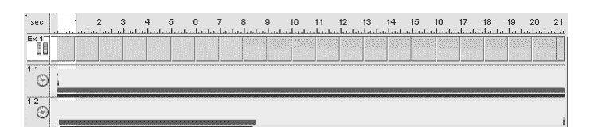

图 7.1 两个线程的 Mandelbrot 代码时间线

另外两条线表示两个线程的活动。上方的一条线显示主线程在整个运行期间都是活跃的，这正如 OpenMP 执行模型所预期。第二个线程仅在运行的前 8.5 秒内处于活跃。这证实了扩展性差是因为两个线程之间的工作分配不均。

当实际实际的图像时，很容易理解这种负载不平衡的来源。图 7.2 显示了计算出的图像。一个线程计算左半部分，另一个计算右半部分。对于图像中着色的黑色大量点，只需要几次迭代就能确定该点不在集合中。然而，要确定一个点在或可能在集合中，需要达到迭代次数的最大限制；这些点被涂成白色。

图中着黑色的区域迭代次数较少，因此计算需要一些时间。比较图像的左半部分和右部分，显然右部分包含的黑色像素比左部分多。这意味着计算右半部分的线程花费的时间比计算左半部分的线程短。这就是两个线程之间负载不平衡的源。

修复负载不平衡相对容易，因为这只是并行代码调度子句（`scheduling clause`）的问题。可以使用动态（`dynamic`）或引导（`guided`）调度。列表 7.67 显示了修改后使用动态调度的代码。

## 第7章 使用自动并行化和 OpenMP


图 7.2 由两个线程计算的 Mandelbrot 图像

### 列表 7.67 修改为使用动态调度的 Mandelbrot 代码

```
#define SIZE 4000
int main()
{
    int *matrix[SIZE];
    for (int i=0; i<SIZE; i++)
    {
        matrix[i]=(int*)malloc(SIZE*sizeof(int));
    }
    #pragma omp parallel for schedule(dynamic)
    for (int i=0; i<SIZE; i++)
    {
        // computation logic
    }
}
```
*(注：列表 7.67 中的代码片段从 OCR 文本中部分缺失/提取不当；我根据提供的上下文重构了其结构。）*

# 296 第 8 章 手动编码同步与共享

在这种情况下，如果有一个原子递加操作，将其增加并作为单个操作替换回内存，将非常有用的，且不会在操作的加载和存储部分之间有其他线程更新该值。在 x86 处理器上，`xadd` 指令可以与 `lock` 前缀结合产生原子加，或者 `inc` 指令可以与 `lock` 前缀结合产生原子增。列表 8.1 显示了实现这些操作的代码段。

## 列表 8.1 x86汇编语言原子加变体

```c
```


### `atomic_add_int()` 与 `atomic_inc_int()` 内联汇编示例

```c
int atomic_add_int(volatile int *address, int value ) {
  asm volatile("lock xadd $0,%1":
                "+r"(value);
                "+m"(*address);
                "memory");
  return value;
}
```

```c
int atomic_inc_int(int *address ) {
  asm volatile("lock inc %0":
                "+m"(*address);
                "memory");
  return (*address);
}
```

这些例程使用 `gcc` 内联汇编语言编写。虽然我们的意图不是在此低级进行久留，但描述这些语句是如何组合的是合适的。`asm` 关键字标识后续文本为汇编语言语句。`volatile` 关键字告诉编译器不要将语句从其所在的位置移动，因为这种移动可能会导致语句语义的差异。

汇编语言代码包含在括号中。第一个被引号包围的项目是指令。该指令使用虚拟寄存器 `$0` 和 `$1` 作为参数。编译器将分配真实的寄存器，并负责为这些寄存器填充适当的值。

在汇编语言指令之后，最多有三个由分隔符划分的列表。这些是可选的扩展语法。第一个列表指示这些是对寄存器还是内存的访问。在示例中，表达式 `"+r"(value)` 意味着输出参数是一个应该用于更新变量值的寄存器。加号表示该寄存器将被指令读取和写入。

第二个列表包含输入值及其所在。两个例程都将指针地址作为输入值，表达式 `"+m"(*address)` 表示此指针被用作内存访问。加号表示指令将同时读取和写入内存中的位置。

第三个列表是“破坏”`clobber`列表，指示指令将修改的内容。在两种情况下，指令都会修改内存。

虚拟寄存器从输入寄存器开始编号，因此寄存器 `$0` 被分配变量地址的值。输出寄存器是下一组虚拟寄存器，因此变量值被分配给 `$1`。

查看实际的汇编语言指令也是有用的。`xadd` 指令是交换加`exchange add`，它将变量值加到内存地址处的值上，但它在操作执行后返回该地址的值；这就是交换操作。该指令仅对内存中保留的值加 1，但不在寄存器中返回值。两条指令都带有 `lock` 操作前缀。`lock` 操作锁定系统总线，使得其他处理器无法触碰正在更新的内存位置；因此，是 `lock` 前缀实际上让这些指令变得原子的。如果没有它，当多个线程对同一内存进行操作时，操作的结果将是未定义的。

`atomic_add_int()` 例程将量加到内存位置的值上，并返回原子操作之前保留的值。
`atomic_inc_int()` 例程增加内存位置处的值，并返回内存中当前保留的值。由于指令不返回新值，因此返回值是对内存中保留值的加载。这可能不是操作的真实结果；该值在原子操作和最终加载之间可能被修改过。

## 使用比较并交换指令形成更复杂的原子操作

并不是所有处理器都实现了原子加或增指令。然而，大多数处理器都实现了比较并交换`compare and swap`指令的变体。这种指令可以作为大多数原子操作的基础。

一个比较并交换`CAS`操作将内存位置保留的值与寄存器中保留的值进行比较。如果该位置的值与传递给指令的期望值匹配，则内存中保留的值将使用传递给指令的第二个值进行原子更新。`CAS` 的返回值是内存中保留的原始值。如果操作成功，返回值将与期望值相同。如果操作未成功，返回值将是其他值。这使得代码能够判断操作是否成功。

这种操作在许多情况下都有用。例如，假设互斥锁是通过一个变量实现的，该变量在锁被持有时为 1，在锁可用时为 0。`CAS` 操作可将锁从“空闲”切换到“已占用”。要获取锁，变量 `lock` 必须持有值 0，并且指令需要原子地将 0 替换为 1。列表 8.2 显示了简单自旋锁的代码。`volatile` 关键字确保编译器在每次迭代中重复 `CAS` 操作。

### 列表 8.2 使用 CAS 实现的简单自旋锁

```c
#ifndef sparc
int CAS(volatile int* addr, int ov, int nv)
{
    asm volatile("cas %1, %2, %0":
        "=r"(ov)
        "*m"*(addr), "r"(ov), "0"*:(memory);
    return nv;
}
#else
int CAS(volatile int* addr, int ov, int nv)
{
    asm volatile("lock cmpxchg %2, %1, %0":
        "+a"(ov)
        "+m"*(addr), "r"(ov), "r"(nv)
        "memory");
    return ov;
}
#endif
```

```c
void lock(volatile int* lock) {
    while (CAS(lock, 0, 1) != 0) {
        // 自旋直到获取锁
    }
}

void unlock(volatile int* lock) {
    *lock = 0;
}
```

等等，人们很想想象自旋锁可以在没有原子操作的情况下实现，如 8.3 所示。该代码的问题在于它不能保证任何线程都会获取锁。8.2 中使用的原子操作确保了只有一个线程会获取锁。

### 列表 8.3 错误的自旋锁实现

```c
void lock(volatile int* lock) {
    while (*lock == 1) { // 锁忙时自旋
    }
    *lock = 1;
}

void unlock(volatile int* lock) {
    *lock = 0;
}
```

`CAS` 指令也用于需要对异常值进行原子修改的情况。考虑需要对浮点数进行原子递加的情况。列表 8.4 显示了执行此操作的代码。

### 列表 8.4 原子增加浮点数的代码

```c
void atomic_add_float(volatile float * variable, float increment )
{
  union {
    int asint;
    float asfp;
  } oldvalue, newvalue;
  do {
    oldvalue.asfp = *variable; // 行 11
    newvalue.asfp = oldvalue.asfp + increment; // 行 12
  } while (CAS(variable, oldvalue.asint, newvalue.asint) != oldvalue.asint);
}
```

对浮点变量进行原子更新的代码看起来相当复杂。很大一部分复杂度是因为 `CAS` 操作接收整数参数；因此，浮点值需要转换为整数。这就是代码中联合体`union`的作用。
代码读取被修改变量的值，并准备修改后的版本。在代码中，值只在第 11 行读取一次，并保留在局部变量 `oldvalue` 中。这是为了避免在第一次读取变量和第 12 行作为加法的一部分之间发生数据竞争。这种竞争是微妙的。假设第一次读取变量`第 11 行`时，它的值为 20；这记录为变量的原始值。此时，另一个线程更改了变量的值，第二次读取`第 12 行`时，它的值为 21。值21 被增加到 22，如果操作成功，这将成为变量的新值。假设在尝试 `CAS` 操作时，另一个线程已经将变量的值恢复为 20。由于

# 第 8 章 手动编码的同步与共享

变量包含 20，这是预期值；`CAS` 操作会将值 22 存储到变量中，而不是正确的值 21。

我们通过另一个示例来探索这种值重新加载的问题。列表 8.5 显示了向列表头部添加元素的代码。该代码创建一个新元素并在其中存储适当的值。此循环会不断尝试将此新元素添加到列表头部。循环的每次迭代都会将新元素的 `next` 字段设置为列表中的下一个元素，然后尝试将列表指针替换为指向新元素的指针，并进行原子比较并交换`CAS`。如果比较并交换成功，返回值将是曾经作为列表顶部的元素指针。如果发生这种情况，说明代码执行成功，循环可以退出。

### 列表 8.5 向列表头部添加元素的代码

```c
void element(element_t **head, int value) {
  element_t *element = (element_t*)malloc(sizeof(element_t));
  element->value = value;
  while (element) {
    element->next = *head;
    if (CAS(head, element->next, element) == element->next) {
      element = 0;
    }
  }
}
```


这段代码的问题在于 `CAS()` 函数调用会导致编译器重新加载 `element->next` 的值。在 `CAS()` 函数调用和加载 `element->next` 之间，存在短暂的窗口期，允许另一个线程从列表中取出头部元素。如果另一个线程取走了元素并修改了列表，那么比较结果将与 `element->next` 的值不匹配，循环将假设未能将元素添加到队列中，尽管如此代码仍会尝试第二次添加元素，导致错误。解决方案是将*将 head 的原始值保留在局部变量中，并在比较中使用该值来判断比较并交换是否成功*。

这种损坏发生的机会仅持续几个时钟周期。然而，对于运行时间足够长的程序，这种情况最终会发生。与所有数据竞态类错误一样，这种数据损坏的结果被检测到的时间与其发生的时间是随机的。

回到原子加操作，注意该操作实际上是一个循环。虽然观察到的效果是变量中的值被原子地递增，但该操作可能需要循环的任意次数才能完成。这实际上是一种更新变量的无锁算法。这与列表 8.6 所示的使用互斥锁（mutex locks）的明显实现形成了对比。

## 原子操作

### 列表 8.6 互斥锁数值加法

```c
void atomic_add_float( pthread_mutex_t * lock, float * var, float inc)
{
    pthread_mutex_lock( lock );
    *var += inc;
    pthread_mutex_unlock( lock );
}
```

由于互斥锁可以使用 `CAS` 操作实现，因此两种情况的结果编码在结构上相似，都包含一个单循环。区别在于，互斥锁在锁的 `CAS` 上循环，而无锁变体则在变量的 `CAS` 上循环。

## 强制内存排序以确保操作正确

在上一节中，我们查看了简单自旋锁的实现。遗憾的是，实现上可能会更加复杂。在编写多线程代码时，考虑系统的内存排序（memory-ordering）特性非常重要。当线程在多线程系统上执行内存操作时，该操作可能可见也可能对它所处的系统其他部分可见。

例如，应用程序可能会执行两个存储操作（store operations）。在某些处理器上，第二个存储操作可能在第一个存储操作可见之前对其他可见。这被称为弱内存排序（weak memory ordering）。

在互斥锁的背景下考虑这一点。应用程序更新变量并将其存储到内存。它通过向锁写入零来释放锁。如果系统实现了弱内存排序，释放锁的存储操作可能会在更新数据的存储操作之前对系统中的其他处理器可见。另一个等待锁的处理器可能会看到锁已空闲，并在该变量更新可见之前读取变量的值。

为了停止这种错误，可能需要包含强制所需内存排序的指令。确定特定处理器是否需要这些指令通常需要仔细阅读文档。然而，假设这些指令是必要的代码在不需要这些指令的硬件上可以运行正常，但反之则不然。

首先，我们详细考虑互斥锁的释放。释放操作通过向锁变量存储零来执行。在持有互斥锁期间执行的代码会更新内存。必须确保在释放互斥锁之前，持有锁期间执行的所有内存更新都已完成。在讨论的语文中，持有锁期间执行的内存更新必须在释放互斥锁之前对系统其余部分可见。

为了确保观察到正确的操作顺序，有时需要使用内存屏（memory barrier）或内存栅（memory fence）。这些会阻止处理器执行后续的内存操作，直到之前的内存操作完成。这些指令通常有不同的变体，以强制不同类型的内存操作排序。在存储操作后释放互斥锁的情况下，内存屏需要强制存储排序，直到后续的存储操作完成。存储排序是 SPARC 和 x86 处理器的默认设置，因此这两个处理器都不需要在两个相邻存储操作之间使用内存屏来强制排序。

## 编译器对操作的重排序

尽管硬件可以重新排序操作，但编译器同样可以做到这一点。虽然编译器会尝试做“正确的事”，但在某些情况下，它需要提示来产生运行正确的代码。

人们通常认为 `volatile` 关键字提供了一个安全网，防止编译器对代码进行优化。遗憾的是，事实并非如此。`volatile` 关键字规定编译器在需要使用数据时需要从内存中重新加载数据，并在数据被修改后应立即将其存回内存。它并不会阻止编译器对数据周围的操作进行优化，也不会对竞态条件构任何任何形式的保护。

然而，`volatile` 关键字对于避免编译器优化掉对变量的访问是必要的。考虑列表 8.8 中的代码。变量 `start` 被声明为 `volatile`。如果不是这样，编译器将判断循环既没有进入也没有结束。

+ 列表 8.8 代码：`volatile` 关键字对于确保变量 `start` 的重新加载是必要的

```c
volatile int start;
void waitforstart()
{
    while (start == 0) { }
}
```

列表 8.9 中的代码也存在非常相似的情况。在这种情况下，代码包含一个函数调用。通常情况下，函数调用会导致编译器重新加载全局数据。然而，如果变量 `count` 没有声明为 `volatile`，编译器仍然可能生成无限循环。这是因为如果 `count` 等于 0 且它不是 `volatile` 变量，那么对 `getElementFromList()` 的调用将不会发生，变量将保持为 0。优化编译器可能会识别出这种情况，并将 `else` 分支替换为无限循环。

+ 列表 8.9：函数调用并不总是强制重新加载所有变量：`volatile int count;`

```c
volatile int count;
int* getnextelement()
{
    int element = 0;
    while (element == 0 )
    {
        if (count > 0)
        {
            element = getElementFromList();
        }
    }
    return element;
}
```

列表 8.10 显示的代码演示了编译器可以合并循环的情况，导致行为的变化。代码创建了四个线程。每个线程运行相同的例程，打印一条线程已就绪的语句，然后打印 `volatile` 变量 `start`。当线程启动时，它会在完成短量工作之前打印一条消息，然后打印一条表示已完成工作的消息并退出。

主代码创建了线程，并在所有线程创建完毕后，向线程发送了开始工作的信号。完成后，它会等待所有线程完成工作，然后再对每个线程调用 `pthread_join()`。

## 列表 8.10 编译器可能会重排序操作的代码

```c
#include <stdio.h>
#include <pthread.h>
volatile int start[4];
volatile int done[4];
void * work(void* param)
{
    int id = (int)param;
    while (start[id] == 0) { }
    printf("Thread %i started\n", id);
    double total=0;
    for (int i=0; i<1000000000; i++) { total += i; }
    printf("Thread %i done\n", id);
    done[id] = 1;
}
int main()
{
    pthread_t thread[4];
    for (int i=0; i<4; i++) {
        pthread_create(&thread[i], 0, work, (void*)i);
        done[i]=0;
    }
    for (int i=0; i<4; i++) {
        start[i] = 1;
    }
    for ( int i=0; i<4; i++ )
    {
        while (done[i] == 0) {
    }
    for ( int i=0; i<4; i++ )
    {
        pthread_join(thread[i], 0);
    }
}
```

列表 8.11 显示了开启和未开启优化时的代码输出。两种代码之间存在显著差异。在不开启优化时，线程同时运行，输出显示所有线程同时和完成。开启优化时，线程是序列化的。

### 列表 8.11 未优化优优化输出

```text
Thread 0 started
Thread 1 started
Thread 2 started
Thread 3 started
Thread 0 done
Thread 1 done
Thread 2 done
Thread 3 done
Thread 0 started
Thread 0 done
Thread 1 started
Thread 1 done
Thread 2 started
Thread 2 done
Thread 3 started
Thread 3 done
```

### 列表 8.12 编译器优化代码

```c
```


```c
int main()
{
    pthread_t thread[4];
    for (int i=0; i<4; i++) {
        pthread_create(&thread[i], 0, work, (void*)i);
        done[i]=0;
    }
    for (int i=0; i<4; i++) {
        start[i] = 1;
    }
    for ( int i=0; i<4; i++ )
    {
        while (done[i] == 0) {
            asm volatile("": : "memory"); 
        }
    }
    for ( int i=0; i<4; i++ )
    {
        pthread_join( thread[i], 0);
    }
}
```

### 列表 8.13 使用 asm() 语句导致正确的排序

## volatile 变量

之前的讨论中可以易见地看出，在多线程代码上下文中用的 `volatile` 关键字并没有阻止编译器重排序操作。`volatile` 关键字告诉编译器在使用之前从内存中重新加载变量，并在修改后将其存回内存。这种行为对访问任何 `volatile` 变量增加了开销。它们必须保持在内存中，而不能缓存在变量中。

使用 `volatile` 关键字对于避免内存位置的值被意外缓存到寄存器中是必要的。然而，它要求缓存变量，因此对任何变量的操作都可能是昂贵的。

通过将变量转换为 `volatile` 或使用会让编译器认为变量可能已修改的函数，可能减少这种开销。

然而应该观察到，谨慎使用编译器内存屏障 `memory barriers` 成本较低，并且是确保变量在代码指定点存回内存并重新加载更准确的方法。列表 8.14 修改了列表 8.6 显示的代码，以避免将变量声明为 `volatile`，并使用编译器屏障确保从内存中重新加载值。

### 列表 8.14 编译器屏障确保变量 *start* 的重新加载

```c
extern int start;
void waitforstart()
{
    while(start==0) { 
        asm volatile("": : "memory"); 
    }
}
```

## 操作系统提供的原子操作

利用本章中的信息，你本应该能够编写一些基础的原子操作，例如原子加法。然而，这些操作可能已经由操作系统提供。使用操作系统提供的代码的关键优势在于它们应当是正确的，而代价通常是开销的略微增加。因此，建议尽可能利用这些代码。

`gcc` 提供了诸如 `__sync_fetch_and_add()` 等操作，它从内存中获取一个值并对其进行加增。返回值为加增之前的变量值。Windows 定义了 `InterlockedExchangeAdd()`，它提供了相同的操作，而 Solaris 则有若干个 `atomic_add()` 函数来处理不同类型的变量。第 311 页的表 8.1 提供了 `gcc`、`Windows`、`OS X` 和 `Solaris` 提供的原子操作之间的映射。函数名称中的星号表示该函数适用于多种类型。

列表 8.15 中的代码使用 `gcc` 原子操作允许多个线程增加计数器。该程序创建了十个线程，每个线程都会完成 `work()` 函数。原始程序也执行了相同的代码。每个线程将计数器增加 1000 万次，因此在程序结束时，变量的值为 1.1 亿。如果将原子加操作替换为普通的未保护加增操作，由于引入了数据竞态，输出将是不可预测的。

### 列表 8.15 使用原子操作增加计数器

```c
#include <stdio.h>
#include <pthread.h>
volatile int counter=0;
void *work(void * param)
{
    int i;
    for(i=0; i<1000000; i++)
    {
        __sync_fetch_and_add(&counter, 1);
    }
}
int main()
{
    int i;
    pthread_t threads[10];
    for(i=0; i<10; i++)
{
    pthread_create(&threads[i], 0, work, 0);
}
work(0);
for(i=0; i<10; i++) {
{
pthread_join(threads[i], NULL);
}
printf("Counter:%d\n", counter);
}
```

使用这些原子操作的主要优势是它们避免了使用互斥锁保护变量的开销。虽然互斥锁的实现中通常也包含了比较并交换 `compare and swap` 操作，但它们在那个核心操作周围也有开销。另一个区别是，互斥锁所在的内存位置与需要更新的变量不同。如果锁和变量在线程之间共享，那么在获取锁和对变量执行操作时通常会发生缓存缺失。这两个因素的结合使得原子操作更加高效。

原子操作在需要更新单个变量的情况下非常有效。在需要协调更新多个变量的情况下，它们将无法工作。假设一个应用程序将资金从一个银行账户转移到另一个账户。每个账户都可以使用原子操作进行修改，但在整个交易过程中，会有一个点，钱已经从一个账户中取出，但尚未加入另一个账户。在此时，所有账户的总值将减少转账中资金的金额。取决于规则，这可能是可以接受的，但它会导致在交易发生期间无法准确知道银行持有的总金额。

另一种方法是使用互斥锁锁定两个账户，然后执行交易。锁定账户的行为将阻止任何其他人读取这些账户中金额的值，直到交易解决。

请注意，当存在多个此类交易时，存在死锁的风险。假设一个应用程序需要从账户 A 移动 x 磅到 B，而同时应用程序中的另一个线程需要从账户 B 移动 y 磅到 A。如果第一个线程获取了锁账户 A 和 B ，那么两个线程都将无法进展。最简单的方法是在获取锁时强制执行顺序 `也许是内存地址顺序，从低到高`。在这种情况下，如果所有线程都必须在尝试获取锁 B 之前先获取锁 A ，那么两个线程中将只有一个线程能成功获取锁 A 锁，从而避免了死锁。

## 表 8.1 gcc、Windows、OS X 和 Solaris 提供的原子操作

| gcc | Windows | Solaris | Mac OS X |
|---|---|---|---|
| `__sync_fetch_and_add()` | `InterlockedExchangeAdd()` | `atomic_add*()` | `OSAtomicAdd*()` |
| `__sync_fetch_and_or()` | `InterlockedOr()` | `atomic_or*()` | `OSAtomicOr32()` |
| `__sync_fetch_and_and()` | `InterlockedAnd()` | `atomic_and*()` | `OSAtomicAnd32()` |
| `__sync_fetch_and_xor()` | `InterlockedXor()` | - | `OSAtomicXor32()` |
| `__sync_val_compare_and_swap()` | `InterlockedCompareExchange()` | `atomic_cas*()` | `OSAtomicCompareAndSwap*()` |
| | `InterlockedExchange()` | `atomic_swap*()` | - |
| | `InterlockedIncrement()` | `atomic_inc*()` | `OSAtomicIncrement*()` |
| | `InterlockedDecrement()` | `atomic_dec*()` | `OSAtomicDecrement*()` |
| 无对应 | `InterlockedBitTestAndSet()` | `atomic_set_long_excl()` | `OSAtomicTestSet()` |
| | `InterlockedExchangeExchange()` | `atomic_clear()` | `OSAtomicTestReset()` |
| | `InterlockedIncrement()` | | `OSAtomicClear()` |

## 无锁算法

无锁算法的另一种方法是编写算法使它们不需要锁。第一种无锁算法是 Dekker 算法。如果不使用原子操作，这会变得复杂，因为它需要考虑状态转换。

### Dekker 算法

Dekker 算法工作是因为每个线程都信号正在等待进入临界区。如果另一个线程尚未信号或已经进入了临界区，那么当前线程就可以进入。列表 8.16 显示了 Dekker 的实现。

```c
volatile int priority = 0;
volatile int counter = 0;
volatile int waiting[2];
void increment( int id )
{
    waiting[id] = 1;
```


```c
while( waiting[1-id] == 1 )
{
    if ( priority != id )
    {
        break;
    }
}
priority = id;
/* 临界区 */
counter++;
/* 退出临界区 */
priority = id;
waiting[id] = 0;
}
```

为了测试此实现的正确性，我们将代码放在测试程序中。列表 8.17 显示了测试程序。该测试程序创建了两个线程。每个线程将计数器增加 100 万次，因此在程序结束时，变量应该包含 2 万。程序报告该值与当前计数器之间的差异。

### 列表 8.17 Dekker 算法的测试程序

```c
#include <stdio.h>
#include <pthread.h>
void * worker(void * param) {
    for (int i=0; i<1000000; i++) {
        increment((int)param);
    }
}
int main() {
    pthread_t threads[2];
    pthread_create(&threads[0], 0, worker, (void*)0);
    pthread_create(&threads[1], 0, worker, (void*)1);
    pthread_join(threads[1], 0);
    pthread_join(threads[0], 0);
    printf("Errors = %d\n", 2*1000000 - counter);
}
```

列表 8.18 显示了编译和运行程序的结果。不幸的是，程序报告变量增加的次数不是正确的，这意味着曾经出现过两个线程设同时进入临界区域的情况。

### 列表 8.18 编译和运行测试程序的结果

```
$ cc -o -mt dekker.c
$ ./a.out
Errors = 14
```

代码的问题在于内存排序。两个线程同时通过向它们存储值来信号正在等待进入临界区

# 第 8 章 手动编码同步与共享

等待数组中的索引。在下一个周期中，它们加载了另一个等待状态。由于另一个线程刚刚发布了存储操作，该存储操作尚未通过流水线对系统的其余部分可见。因此，加载指令获取到一个 0，表示另一个线程没有等待临界区。两个线程都没有看到对方，导致两个线程都进入了临界区域。

修复这个问题的方法是在代码中引入内存屏障（memory barriers）。内存屏障确保之前的内存操作在下一个内存操作执行之前已经完成。在这种情况下，我们希望确保“指示等待”的存储操作在“检查另一个线程是否也在等待”的加载操作之前完成。现在考虑一下操作序列：两个线程同时触发存储操作；两个线程都等待存储操作对另一个处理器可见后才执行加载操作。因此，两个线程都获取了另一个线程存储的数据。

在 SPARC 处理器上，适当的内存屏障是使用 `#StoreLoad`，它确保在执行随后的加载之前之前的存储操作已经完成。在 x86 处理器上，有必要使用 `fence` 操作，确保所有之前的内存操作在执行下一个内存操作之前已完成。

列表 8.19 显示了 Dekker 算法的修改后代码。该代码需要两个内存屏障：一个在进入循环时，第二个在循环内部。通过这种修改，该代码在测试测试架中运行时会产生正确的结果。

### 列表 8.19 带有内存屏障的 Dekker 算法

```c
#include <stdio.h>
#include <pthread.h>
volatile int priority = 0;
volatile int counter = 0;
volatile int waiting[2];
void increment( int i )
{
    waiting[i] = 1;
#ifdef _sparc
asm("membar #StoreLoad" : "memory" );
#else
asm("mfence" : : "memory" );
#endif
while( waiting[1-i] == 1 )
{
    if ( priority != i )
    {
        waiting[i] = 0;
        while ( priority != i )
            waiting[i] = 1;
#ifdef __sparc
asm( "membar "StoreLoad" : : "memory" );
#else
asm( "mfence" : : "memory" );
#endif
}
counter++;
priority = 1-i;
waiting[i] = 0;
}
}
```

# 使用环形缓冲区的生产者-消费者

考虑有一对生产者-消费者线程，它们通过环形缓冲区进行通信。可以编写出不需要锁或原子操作的代码来处理这种情况。8.20 中的代码定义了两个函数：一个用于向环形缓冲区添加元素，另一个用于移除元素。

# 8.20 从环形列表中添加和移除元素

```c
#include <stdio.h>
#include <pthread.h>
#include <stdlib.h>
volatile int buffer[16];
volatile int addhere;
volatile int removehere;
void clearbuffer() {
    addhere = 0;
    removehere = 0;
    for( int i=0; i<16; i++) { buffer[i] = 0; }
}
int next(int current) {
    return (current+1) & 15;
}
void addtobuffer( int value) {
    while(next(addhere) == removehere) {} // 自旋等待空间
    if ( buffer[addhere] != 0 ) {
        printf("Circular buffer error\n" ); exit(1); 
    }
    buffer[addhere] = value; // 将元素添加到缓冲区
    addhere = next(addhere); // 移动到下一个条目
}
int removefrombuffer() {
    int value;
    while( (value = buffer[removehere]) == 0 ) { // 直到
        // 缓冲区中有内容
    }
    buffer[removehere] = 0; // 清零元素
    removehere = next(removehere); // 移动到下一个条目
    return value;
}
```

代码在没有内存屏障的情况下运行，是因为一个线程负责向数组添加元素，而另一个线程负责从数组中移除元素。

实际上有两个确保代码运行的隐式约束。一个约束是存储和加载是原子的。另一个约束是存储不会发生重排序。

硬件确保对齐正确的加载不会从地址的值中获取一半数据，从该地址存储的新值中获取另一半。如果发生这种情况，在返回数组中存储的值时就会出现问题。假设存储或加载是非原子的。如果一个元素正在从持有值零转变为持有非零值，那么非原子加载可能会获取值的旧高半部分（值为 0）和值的新低半部分（为非零）。结果的值将是错误的。

对存储排序的要求是代码从数组中移除元素。包含要移除元素的位置被清零，指向它的指针移动到数组中的下一个位置。如果这些操作以错误的顺序对生产者可见，生产者将看到端点已经移动。这将允许它进入添加新元素的代码。然而，这段第一个测试代码执行是为了检查新位置是否确实有效。

无锁算法 315

8.21 中的代码对于单个生产者和消费者在没有同步的情况下可以工作，因为一个线程负责向环形缓冲区添加项目，另一个线程负责移除项目。如果代码扩展到多个消费者或生产者，这种情况就不再成立，且通常情况下代码需要某种锁。

在某些情况下可以避免使用同步。如果代码扩展到多个消费者或多个生产者（但不同者兼有），那么环形缓冲区的数量也可以相应扩展。这将维持生产者、环形缓冲区和消费者之间的一一关系。如果存在多个生产者和多个消费者，只要它们是配对的，就可以避免同步。因此，一个生产者可以供给单个消费者，而该消费者也可以从单个生产者处工作。最后，如果每个生产者-消费者对都有一个环形缓冲区，那么就可以再次避免同步。

8.22 中的代码提供了测试程序的剩余部分。它创建了两个线程并将一个设为生产者，另一个设为消费者。两个线程一直运行，直到 1000 万元素从生产者传递给消费者。

### 列表 8.22 设置生产者和消费者线程的代码

```c
```


```c
void * producer (void *param )
{
    for(int i=1; i<10000000; i++)
    {
        addtobuffer( i);
    }
}

void * consumer (void *param )
{
    while ( removebuffer() != 9999999 ) {}
}

int main()
{
    clearbuffer();
    pthread_t threads[2];
    pthread_create(&threads[0], 0, producer, 0);
    pthread_create(&threads[1], 1, consumer, 0);
    pthread_join(threads[1], 0);
    pthread_join(threads[0], 0);
}
```

# 无锁算法

# 319

之前的所有场景都反映了不同的权衡、内存占用和运行时行为。假设工作量确实需要扩展，那么很有可能需要某种“多生产者-多消费者”的映射。可以编写一个 NxM 的队列系统，为每对生产者-消费者提供一个环形缓冲区，但这种方法的效率可能低于使用某些原子操作或互斥锁。

## 将生产者-消费者模型扩展到多线程

在线程之间共享环形缓冲区简单的方法是使用某种互斥机制，确保一次只有一个线程可以修改该结构。我们之前在列表 8.7 中遇到过自旋锁（spinlocks），这适用于确保一次只有一个线程扩展环形列表。列表 8.23 显示了修改后的代码，通过自旋来保护对环形缓冲区的访问。

### 列表 8.23 使用互斥确保对环形缓冲区的独占访问

```c
#include <stdio.h>
#include <pthread.h>
volatile int buffer[16];
volatile int addhere;
volatile int removehere;
volatile int lock = 0;
void spinlock(volatile int *lock) {
  while ( CAS( lock, 0, 1 ) != 0 ) {}
  acquire_memory_barrier();
}
void free_spinlock(volatile int *lock) {
  release_memory_barrier();
  *lock = 0;
}
void clearbuffer() {
  addhere = 0;
  removehere = 0;
  for( int i=0; i<16; i++) { buffer[i] = 0 }
}
int next( int current )
```

# 第 8 章 手编码同步与共享

```c
{
  return ( current + 1 ) & 15;
}
void addspinlock(int value)
{
  spinlock(&lock);
  while(buffer[next(addhere)] != 0 ) {}
  buffer[addhere] = value;
  addhere = next(addhere);
  free_spinlock(&lock);
}
```

```c
int removefrombuffer()
{
  int value;
  spinlock(&lock);
  while( ( value = buffer[removehere]) == 0 ) {}
  removehere = next(removehere);
  free_spinlock(&lock);
  return value;
}
```

对于当前的代码有几点说明。第一，环形缓冲区有 16 个条目，虽然这对于单个生产者-消费者对可能足够，但随着线程数量的增加，这可能无法维持。

第二也是更重要的一点，代码现在会产生死锁。假设环形缓冲区是空的，消费者线程获取了锁并等待缓冲区出现某些内容。生产者最终到达，但没有锁来向缓冲区中添加任何内容。两个线程最终都在自旋，等待一个永远不会发生的事件。

针对该问题的特定情况有两种解决方案。第一种方案可能是最好的，即提供两个锁——一个用于等待向缓冲区添加元素的线程，另一个用于等待从列表中移除项的线程。在在这种情况下，这种解决方案将问题简化为之前描述的系统中仅存在线程的情况。一个锁确保一次只有一个生产者可以访问环形缓冲区。其他生产者和消费者线程不会相互干扰并破坏正确性。

该解决方案依赖代码的原始语义，在存在两个线程的情况下提供线程安全的版本。为了说明目的，我们如何修改代码使得只需要一个锁。

实现这一点的方法是将关键区域放在另一个循环内部，该循环重复执行直到关键区域成功执行。这需要修改 `addtobuffer()` 和 `removebuffer()` 例程，使它们不再在关键区域内部循环，而是快速返回成功或失败。8.24 显示了修改后的代码，移除了关键区域内部的循环。

# 无锁算法 321

## 列表 8.24 使用互斥确保对环形缓冲区的独占访问

```c
void addtobuffer( int value )
{
    int success = 0;
    while(! success)
    {
        spinlock( &lock );
        if ( buffer[ next(addhere) ] == 0 )
        {
            buffer[addhere] = value;
            addhere = next(addhere);
            success = 1;
        }
        free_spinlock( &lock );
    }
}
```

```c
int removebuffer()
{
    int value;
    int success = 0;
    while(! success)
    {
        spinlock( &lock );
        if ( ( value = buffer[removehere] ) != 0 )
        {
            buffer[removehere] = 0;
            removehere = next(removehere);
            success = 1;
        }
        free_spinlock( &lock );
    }
    return value;
}
```


# 无锁算法 321

## 第 8 章 手编码同步与共享

对于当前的代码有几点说明。第一，环形缓冲区有 16 个条目，虽然这对于单个生产者-消费者对可能足够，但随着线程数量的增加，这可能无法维持。第二也是更重要的一点，代码现在会产生死锁。假设环形缓冲区是空的，消费者线程获取了锁并等待缓冲区出现某些内容。生产者最终到达，但没有锁来向缓冲区中添加任何内容。两个线程最终都在自旋，等待一个永远不会发生的事件。

针对该问题的特定情况有两种解决方案。第一种方案可能是最好的，即提供两个锁——一个用于等待向缓冲区添加元素的线程，另一个用于等待从列表中移除项的线程。在这种情况下，这种解决方案将问题简化为之前描述的系统中仅存在线程的情况。一个锁确保一次只有一个生产者可以访问环形缓冲区。其他生产者和消费者线程不会相互干扰并破坏正确性。

该解决方案依赖代码的原始语义，在存在两个线程的情况下提供线程安全的版本。为了说明目的，我们如何修改代码使得只需要一个锁。

实现这一点的方法是将关键区域放在另一个循环内部，该循环重复执行直到关键区域成功执行。这需要修改 `addtobuffer()` 和 `removebuffer()` 例程，使它们不再在关键区域内部循环，而是快速返回成功或失败。`8.24` 显示了修改后的代码，移除了关键区域内部的循环。

### 列表 8.24 使用互斥确保对环形缓冲区的独占访问

```c
void addtobuffer( int value )
{
    int success = 0;
    while(! success)
    {
        spinlock( &lock );
        if ( buffer[ next(addhere) ] == 0 )
        {
            buffer[addhere] = value;
            addhere = next(addhere);
            success = 1;
        }
        free_spinlock( &lock );
    }
}
```

```c
int removebuffer()
{
    int value;
    int success = 0;
    while(! success)
    {
        spinlock( &lock );
        if ( ( value = buffer[removehere] ) != 0 )
        {
            buffer[removehere] = 0;
            removehere = next(removehere);
            success = 1;
        }
        free_spinlock( &lock );
    }
    return value;
}
```

### 列表 8.25 避免缓存行的无效失效

```c
void addtobuffer( int value )
{
    int success = 0;
    while(! success)
    {
        spinlock( &lock );
        if ( buffer[ next(addhere) ] == 0 )
        {
            buffer[addhere] = value;
            addhere = next(addhere);
            success = 1;
        }
        free_spinlock( &lock );
    }
}
```

```c
int removebuffer()
{
    int value;
    int success = 0;
    while(! success)
    {
        spinlock( &lock );
        if ( ( value = buffer[removehere] ) != 0 )
        {
            buffer[removehere] = 0;
            removehere = next(removehere);
            success = 1;
        }
        free_spinlock( &lock );
    }
    return value;
}
```

## 324 第 8 章 手动编码的同步与共享

### 列表 8.26 使用 `try_spinlock()` 避免缓存行的无效失效

```c
int try_spinlock(volatile int* lock)
{
    if (CAS(lock, 0, 1) == 1) { return 0; }
    else
    {
        acquire_memory_barrier();
        return 1;
    }
}
void addtobuffer(int value)
{
    int success = 0;
    while (!success)
    {
        if (buffer[next(addhere)] == 0)
        {
            if (try_spinlock(&lock))
            {
                if (buffer[next(addhere)] == 0)
                {
                    buffer[addhere] = value;
                    addhere = next(addhere);
                    success = 1;
                }
                free_spinlock(&lock);
            }
        }
    }
}
```

```c
void removefrombuffer()
{
    int value;
    int success = 0;
```


```c
    while (!success)

    {

        if (buffer[removehere] != 0)

        {

            if (try_spinlock(&lock))

            {

                if ((value = buffer[removehere]) != 0)

                {

                    buffer[removehere] = 0;
                    removehere = next(removehere);
                    success = 1;
                }
                free_spinlock(&lock);
            }
        }
    }
    return value;
}
}
```

对代码的进一步改进是重写自旋锁，使其具有以下语义。列表 8.27 显示了自旋锁代码的改进。该代码会一直旋转，直到锁被调用线程获取。在每次迭代中，循环测试锁是否可用。如果锁可用，代码尝试原子地获取锁。如果成功，代码将退出循环并获取自旋锁。

### 列表 8.27 减少旋转时的 CAS 操作

```c
void lock_spinlock(volatile int* lock ) {
    int acquired = 0;
    while (!acquired ) {
        if (*lock == 0 ) && ( CAS( lock, 0, 1 ) == 0 ) {
            acquired = 1;
        }
    }
    acquire_memory_barrier();
}
```

```c
void addbuffer( int value ) {
    int success = 0;
    while (!success )
    {
        if ( buffer[next(addhere) ] == 0 ) {
            lock_spinlock(& lock );
            if ( buffer[next(addhere) ] == 0 ) {
                buffer[addhere] = value;
                addhere = next(addhere);
                success = 1;
            }
            free_spinlock(& lock );
        }
    }
}
}
```

```c
int removefrombuffer()
{
  int value;
  int success = 0;
  while (!success)
  {
    if ( buffer[removehere] != 0 )
    {
      lock_spinlock(&lock);
      if ( ( value = buffer[removehere] )!=0)
      {
        buffer[removehere] = 0;
        removehere = next(removehere);
        success = 1;
      }
      free_spinlock(&lock);
    }
  }
  return value;
}
```

# 修改生产者-消费者代码以使用原子操作

由于向循环列表添加项和从列表中移除项是相似的单项操作，人们很容易想象可以使用原子操作来实现它们。我们将通过列表 8.28 中修改后的代码来探索这种场景。在代码中，每个生产者都会等待列表中的下一个条目空闲，然后尝试原子地将项添加到该位置。如果成功，它将增加指向下一个条目的指针。同样，所有消费者都等待项被放入列表，然后原子地移除该新项。执行成功的线程会增加指向列表下一个条目的指针。

列表 8.28 使用原子操作处理环形列表

```c
void addbuffer(int value )
{
  int success = 0;
  while (!success)
  {
    if ( buffer[ next(addhere) ] == 0 )
    {
      if ( CAS(&buffer[ next(addhere) ], 0, value ) == 0 )
      {
        addhere = next(addhere);
        success = 1;
      }
    }
  }
}
int removefrombuffer()
{
    int value;
    int success = 0;
    while ( !success )
    {
        if ( value = buffer[removehere] ) != 0)
        {
            if ( CAS(&buffer[removehere], value, 0 ) == value)
            {
                removehere = next(removehere);
                success = 1;
            }
        }
    }
    return value;
}
```

起初，这看起来应该是可行的。一次时间只有一个线程可以成功添加或移除元素。只有该线程会修改指针使其指向下一个条目。

然而，事实并非如此。至关的一点是，尽管指令将按照预期顺序执行，但[此处文本碎片化，根据上下文进行逻辑恢复]。

## ABA 问题

这个例子是一个被称为 `ABA` 问题的通用问题。`ABA` 问题是指线程在处于状态 `A` 时被切换出 `CPU`，系统变为状态 `B`，然后返回状态 `A` 的情况。当线程返回 `CPU` 时，它的表现就像状态没有改变一样，这导致了错误。

在上一节描述的环形缓冲区问题中，线程在认为持有一个空闲指针时被移出 `CPU`。当它返回 `CPU` 时，它没有指示表明系统状态已经发生了变化。

`ABA` 问题的通用解决方案是在任何存储的数据中编码一个版本号。在这个环形缓冲区的例子中，数据将随带这个版本号，并且每当计数器环绕缓冲区时，版本号就会增加。

有了这个版本号，移出 `CPU` 的线程必须同时匹配版本号和数据才能成功添加或移除元素。

添加版本号减少但并未消除线程可能返回 `CPU` 找到匹配项的可能性。然而，这个概率可能小到在实践上是不可能的。

例如，如果版本号以 32 位整数存储，那么就有超过 40 亿种可能的值。如果代码每秒遍历环形缓冲区 1,000 次，那么在版本号重复之前需要一个半月的时间。竞态条件只有在线程切换回 `CPU` 时版本号与版本号匹配时才会发生。

列表 8.29 使用版本号避免 `ABA` 问题

```c
union ABAValue
{
  long long value;
  struct element
```

```c
{
  int version;
  int value;
} nested;
```

```c
union ABAValue buffer[16];
int counter = 0;
```

```c
void clearbuffer() {
  addhere = 0;
  removehere = 0;
  for ( int i=0; i<16; i++) {
    buffer[i].llvalue = 0;
  }
}
```

```c
int next( int current ) {
  return ( current + 1 ) & 15;
}
```

```c
int nextupdate( int current ) {
  if ( current == 15 ) { counter++; }
  return ( current + 1 ) & 15;
}
```

列表 8.30 显示的代码是循环缓冲区中添加和删除元素的例程的修改版本。比较并交换（`compare and swap`）操作需要在 8 位值上进行；因此，比较并交换的汇编需要修改，并且 `x86` 代码只有在编译为使用 64 位指令集扩展时才能工作。

### 列表 8.30 从缓冲区中添加和删除元素

```c
#ifdef __sparse
long long CAS(volatile long* addr, long long ov, long long nv) {
  asm volatile ("casx %1, %2, %0":
    "%r" (nv);
    "%m(*addr),"%r" (ov),"0" (nv);
```


```c
    "memory");

return nv;

#else

long long CAS(volatile long long * addr, long long ov, long long nv)

asm volatile("lock; cmpxchg %2, %1\n"

  "=a"(ov):

  "m"(*addr),"r"nv),"a"(ov):

  "memory"");

return ov;

}

endif
```

```c
void addtobuffer( int value )
{
  int success = 0;
  union ABAValue current;
  while (!success)
  {
    current = buffer[next(addhere)];
    if (current.nested.value == 0)
    {
      union ABAValue nextvalue;
      nextvalue.nested.version = counter;
      nextvalue.nested.value = value;
      if (CAS(&buffer[next(addhere)].llvalue,
               current.llvalue,
               nextvalue.llvalue)
          == current.llvalue)
      {
        addhere = nextupdate(addhere);
        success = 1;
      }
    }
  }
}
```

```c
int removefrombuffer()
{
  union ABAValue current;
  int success = 0;
  int value;
  while (!success)
  {
    current = buffer[next(removehere)];
    if (current.nested.value != 0)
    {
      value = current.nested.value;
      union ABAValue nextvalue;
      nextvalue.nested.version = counter;
      nextvalue.nested.value = 0;
      if ( CAS (&buffer[next(removehere)] .llvalue,
      current.llvalue,
      nextvalue.llvalue )
      == current.llvalue ) {
        removehere = next(removehere);
        success = 1;
      }
    }
  }
  return value;
}
```

从前面的讨论中显而易见，使用原子操作来管理循环缓冲区中元素的添加和删除并非易事。基本问题是，原子操作允许对循环列表进行原子修改，但更新指向下一个元素的共享指针是一个独立的操作。为了让代码正确运行，这两种操作需要以某种方式组合成单一的原子操作。

## 总结

完成本章后，你应该已经对编写同步代码时需要考虑的某些问题有了深入的理解。同时考虑其他线程观察到的内存顺序（`memory ordering`）以及线程在任何一点被调度的可能性是非常重要的。如果不这样做，将导致其他线程获取过时或无效的值。需要强制执行正确的内存顺序，以确保内存操作按适当顺序对其他线程可见。显然，可以寻找编译器或操作系统提供的同步原语。

## 随多核处理器的扩展性

多核处理器的关键优势在于它能够分配更多的核心来解决问题。因此，为了充分利用多核处理器的性能，每个线程都需要是高效的，应用程序在两个线程上运行时性能将提高一倍，在四个线程上运行时性能将提高四倍。本章讨论了围绕应用扩展性的问题。在本章结束时，你将理解硬件和软件限制扩展的常见方式。你还将了解如何识别这些问题并可能解决使用多核处理器和单核处理器之间的差异。

## 应用程序的限制

大多数应用程序在多个核心上并行运行时，其加速比往往低于预期。阿姆达尔法则（`Aahl's law`）表明，某部分代码将限制应用程序在多核上的扩展性。如果应用程序一半的运行时间在已并行的代码段中，另一半不在其中中，那么使用两个线程能实现的最佳结果是应用程序运行时间为原始时间的三之四。在线程足够的情况下，最好的结果是代码运行在原始时间的一半。然而，会有某些限制阻止应用程序的完美扩展。这些限制可能会成为瓶颈。

## 受串行代码限制的性能

正如之前讨论过的，代码的串行部分将限制应用程序在无限线程情况下的执行速度。考虑列表 9.1 中的代码，它有两个部分：一个是串行的，另一个是并行的。列表 9.1 串行与并行部分

```c
#include <math.h>
#include <stdlib.h>
void func1(double *array, int n)
{
  for (int i = 0; i < n; i++) {
    array[i] = sin(array[i]);
  }
}
void func2(double *array, int n)
{
  for (int i = 0; i < n; i++) {
    array[i] = cos(array[i]);
  }
}
int main()
{
  int n = 1000;
  double *array = malloc(n * sizeof(double));
  for (int i = 0; i < n; i++) {
    array[i] = (double)i;
  }
  func1(array, n);
  func2(array, n);
  free(array);
  return 0;
}
```

在列表 9.1 中，`func1` 是串行的，而 `func2` 是并行的。如果我们将 `func2` 并行化，代码如下所示：

```c
#include <math.h>
#include <stdlib.h>
#include <omp.h>
void func1(double *array, int n)
{
  for (int i = 0; i < n; i++) {
    array[i] = sin(array[i]);
  }
}
void func2(double *array, int n)
{
  #pragma omp parallel for
  for (int i = 0; i < n; i++) {
    array[i] = cos(array[i]);
  }
}
int main()
{
  int n = 1000;
  double *array = malloc(n * sizeof(double));
  for (int i = 0; i < n; i++) {
    array[i] = (double)i;
  }
  func1(array, n);
  func2(array, n);
  free(array);
  return 0;
}
```

在列表 9.2 中，`func1` 和 `func2` 都是并行的。如果我们将它们都并行化，代码如下所示：

```c
#include <math.h>
#include <stdlib.h>
#include <omp.h>
void func1(double *array, int n)
{
  #pragma omp parallel for
  for (int i = 0; i < n; i++) {
    array[i] = sin(array[i]);
  }
}
void func2(double *array, int n)
{
  #pragma omp parallel for
  for (int i = 0; i < n; i++) {
    array[i] = cos(array[i]);
  }
}
int main()
{
  int n = 1000;
  double *array = malloc(n * sizeof(double));
  for (int i = 0; i < n; i++) {
    array[i] = (double)i;
  }
  func1(array, n);
  func2(array, n);
  free(array);
  return 0;
}
```

在列表 9.3 中，我们使用 `omp parallel sections` 来并行执行 `func1` 和 `func2`。

```c
#include <math.h>
#include <stdlib.h>
```


```c
#include <omp.h>

void func1(double *array, int n)

{

  for (int i = 0; i < n; i++) {

    array[i] = sin(array[i]);

  }

}

void func2(double *array, int n)

{

  for (int i = 0; i < n; i++) {

    array[i] = cos(array[i]);

  }

}

int main()

{

  int n = 1000;

  double *array = malloc(n * sizeof(double));

  for (int i = 0; i < n; i++) {

    array[i] = (double)i;

  }

  #pragma omp parallel sections

  {

    #pragma omp section

    func1(array, n);

    #pragma omp section

    func2(array, n);

  }

  free(array);

  return 0;

}
```

在列表 9.1 中，`func1` 是串行的，而 `func2` 是并行的。如果我们将 `func2` 并行化，代码如下所示：

在列表 9.2 中，`func1` 和 `func2` 都是并行的。如果我们将它们都并行化，代码如下所示：

在列表 9.3 中，我们使用 `omp parallel sections` 来并行执行 `func1` 和 `func2`。

### 列表 9.4 使用 32 个线程运行代码的分析

| 排除 | 排除 | 名称 |
|---|---|---|
| 用户 CPU | 墙钟时间 sec. | |
| sec. 17.162 | 3.192 | <Total> |
| 9.527 | 0.410 | sin |
| 5.594 | 0.190 | func2 |
| 1.991 | 1.991 | func1 |
| 0.090 | 0.520 | <OMP-implicit_barrier> |
| 0.030 | 0.040 | memset |
| 0.010 | 0. | <OMP-idle> |

在理想的扩展情况下，我们预计 32 个线程的运行时间为 2 秒串行时间加上 14 秒除以 32 个线程，总共仅需 3 秒。实际的等待时间与这个理想值并不远。然而，请注意用户时间增加了。

这是由于在单多核处理器上运行导致的，因此用户时间的增加表明处理器在这一利用率下已达到扩展限制。本章的其余部分将讨论这些限制可能是什么。

另一个观察结果是用户时间增加了两秒，这对总时间没有显著影响。这并不是一个令人意料的结果。在 32 个线程上，用户速度增加 2 秒代表每个线程的时间增加了 1/16 秒，这在应用程序运行的流逝时间（或墙钟时间）中可能察觉不到。

这段代码的扩展得很好。仍然有 2 秒的串行时间，任何数量的线程都无法减少这一点，但随着线程数量的增加，并行区域的时间扩展得很好。

## 超线性扩展 (Superlinear Scaling)

想象你有一双手，但无法同时使用双手打字，而你有一份报告要完成。对于大多数人来说，用一只手完成结果所需的时间比用双手多一倍以上。当你的手恢复时，你处理任务的速度可以增加一倍以上。这就是超线性加速的例子。你获得的资源使得性能增加了一倍以上。解释这种特殊情况很容易：由于键盘上所有的键都在触手可及的范围内，但如果只有一只手，在不移动手的情况下无法触及所有的键。

在大多数情况下，从一个增加到两个会导致性能翻倍。然而，某些应用程序确实可以看到超线性扩展——应用程序最终的运行速度快了一倍以上。这通常是因为应用程序使用的数据在某个时刻驻留在缓存中。想象一个使用 4MB 数据的应用程序。在具有 2MB 缓存的处理器上，有一数的数据将驻留在缓存中。增加第二个处理器会增加额外的 2MB 缓存；这样所有数据都将留在缓存中，等待内存的时间将显著减少。

列表 9.5 显示了列表 9.1 程序的修改，该程序使用了 64MB 内存。

```
#include <stdlib.h>

double func1(double*array, int n)

{

    double total = 0.0;

    #pragma omp parallel for reduction(+:total)

    for(int i=1; i<n; i++) {

        total += array[i*29450];

    }

    return total;

}
```

```
int main() {

    double * array = calloc(sizeof(double), 8192*1024);

    for(int i=0; i<100; i++) {

        func1(array, 8192*1024);

    }

}
```

当程序在具有 32MB 二级缓存的单处理器上运行时，程序大约需要 25 秒完成。在同一处理器上使用两个线程时，代码在大约 12 秒内完成，并花费 25 秒的用户时间。这是使用多个线程预期的性能提升。代码花费了一半的时间，但完成了相同的工作。然而，当使用两个绑定到独立处理器的线程时，程序运行仅需 4 秒墙钟时间，仅花费几秒用户时间。

增加第二个处理器增加了程序可用的缓存量，使其驻留在缓存中。缓存中的数据访问延迟较低，因此程序运行速度快得多。

在多核处理器上情况有所不同。增加额外的线程，特别是如果它位于同一个核心上，不会显著增加程序可用的缓存量。因此，多核处理器不太看到超线性加速。

## 负载不平衡 (Workload Imbalance)

另一个常见的软件问题是负载不平衡，即工作没有均匀地分布在线程上。我们已经在第 7 章的 Mandelbrot 示例中见过这种情况的例子。列表 9.6 中的代码具有刻意的负载不平衡。`compute()` 函数中的迭代次数与传入它的数值的平方成正比；传入函数的数值越大，完成所需的时间就越长。

并行循环从从小值到大值的范围进行迭代，并将每个值传递给函数。如果工作在统计上是分布的，那么获得初始迭代的线程花费计算的时间将比获得后期迭代的线程少。

### 列表 9.6 负载不平衡代码

```
#include <stdlib.h>

int compute(int value)

{

    value = value*value;

    while (value > 0)

    {

        value = value - 1;

    }

    return value;

}

int main()

{

    #pragma omp parallel

    for(int i=0; i<3000; i++)

    {

        compute(i);

    }

}
```

## 扩展限制

| sec. | | 2 | 3 | 4 | 5 | 6 | 7 | 8 | 9 |
|---|---|---|---|---|---|---|---|---|
| 排除 | | | | | | | | |
| Ex 1 | | | | | | | | |
| 1.1 | | | | | | | | | |
| 1.2 | | | | | | | | | |
| 1.3 | | | | | | | | | |
| 1.4 | | | | | | | | | |
| 1.5 | | | | | | | | | |
| 1.6 | | | | | | | | | |
| 1.7 | | | | | | | | | |
| 1.8 | | | | | | | | | |

## 热锁 (Hot Locks)

竞争（或热）互斥锁是扩展不佳的常见原因之一。这在有太多线程竞争同一个资源时发生。程序的两个属性共同导致了热锁：

- 第一个属性是需要锁的线程数。这是扩展不佳的通常原因；线程太多了。
- 第二个更微妙的问题是线程访问之间的间隔太短。例如，想象应用程序中的每个线程需要访问资源一秒，然后在九秒内不再访问。在这九秒内，另一个线程可以访问资源而不产生冲突。应用程序可以很好地扩展到十个线程，但如果增加第十一个线程，扩展情况将变得不再良好，因为这个额外的线程会阻塞其他线程。

这个问题有很多可能的解决方法。

最明显的修复是“分解”互斥锁或寻找某种方法将单个互斥锁转换为多个互斥锁。如果每个线程都需要不同的互斥锁，那么在线程增加之前不太可能会竞争。

另一种方法是增加每次访问的时间，这样同时需要资源的概率就会降低。等效的变化是减少持有锁的时间。这种改变改变了持有和不锁的比例，导致线程需要锁的可能性降低。

还有其他方法可以改进这种情况，例如使用原子操作来减少关键区域的成本。

### 列表 9.7 模拟具有多个分支的银行

```
#include <stdlib.h>

#include <strings.h>

#include <pthread.h>
```

## 应用程序扩展的限制

# 341

```c
```


```c
#define ACCOUNTS 256

#define BRANCHES 128

int account[BRANCHES][ACCOUNTS];

pthread_mutex_t mutex;

void move(int branch, int from, int to, int value)

{

    pthread_mutex_lock(&mutex);

    account[branch][from] -= value;

    account[branch][to] += value;

    pthread_mutex_unlock(&mutex);

}

void *customers(void *param)

{

    unsigned int seed = 0;

    int count = 10000000 / (int)param;

    for(int i=0; i<count; i++)

    {

        int row = rand(&seed) & (BRANCHES-1);

        int from = rand(&seed) & (ACCOUNTS-1);

        int to = rand(&seed) & (ACCOUNTS-1);

        move(row, from, to, 1);

    }

    return 0;

}

int main(int argc, char* argv)

{

    pthread_t threads[64];

    memset(account, 0, sizeof(account));

    int nthreads = 8;

    if (argc > 1) { nthreads = atoi(argv[1]); }

    pthread_mutex_init(&mutex, 0);

    for(int i=0; i<nthreads; i++)

    {

        pthread_create(&threads[i], 0, customers, (void*)nthreads);

    }

    for(int i=0; i<nthreads; i++)

    {

        pthread_join(threads[i], 0);

    }

    pthread_mutex_destroy(&mutex);

    return 0;

}
```

# 第 9 章 在多核处理器上扩展

当使用单线程运行时，程序大约在九秒内完成。在同一平台上使用八线程运行时，大约需要五秒完成。图 9.3 显示的应用程序运行时间线指示了问题所在。该图显示了五秒运行中的两秒。虽然所有线程在大部分时间内都是活跃的，但在很大一部分时间内是不活跃的。不活跃状态在时间线上显示为：

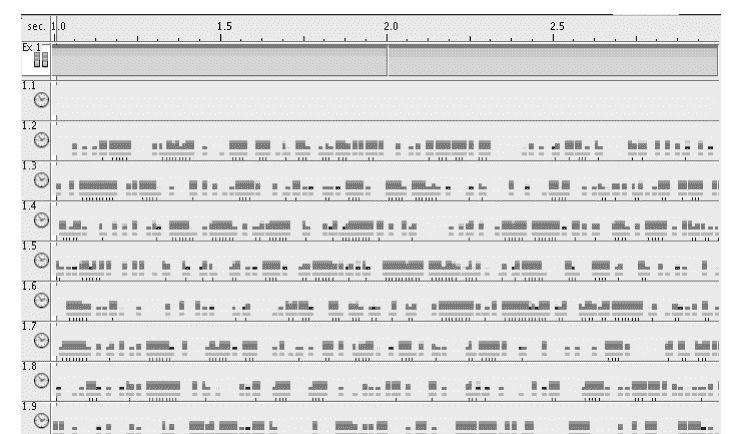

图 9.3 银行应用程序运行两秒的时间线

查看八线程运行应用程序的分析结果，用户时间与单线程运行时没有显著差异。这表明所执行的工作量大致相同。分析结果唯一的不同之处是花费在用户锁（user locks）上的时间。列表 9.8 显示了八路运行的分析结果。这显示八线程累计花费了约 10 秒的时间在 `__lwp_park()` 中等待用户锁。

# 列表 9.8 八线程运行银行应用程序的分析结果

| 排除计数 | 排除计数 | 名称 |
|---|---|---|
| 用户 CPU | 秒 (sec.) | 锁 (Lock) |
| 8.136 | 10.187 | <Total> |
| 1.811 | 0. | `rand_mt` |
| 1.041 | 0. | `atomic_cas_32` |

## 应用程序扩展的限制

# 343

```
0.991 0. mutex_lock_impl
```

```
0.951 0. move
```

```
0.881 0. mutex_unlock
```

```
0.841 0. experiment
```

```
0.520 0. mutex_trylock_adaptive
```

```
0.490 0. rand_r
```

```
0.350 0. sigon
```

```
0.160 0. mutex_unlock_queue
```

```
0.070 0. mutex_lock
```

```
0.020 10.187 lwp_park
```

在 Solaris 上，可以使用线程锁 `lockstat` 来识别哪些锁是热点（hot）。列表 9.9 显示了 `lockstat` 的输出。该输出识别了存在竞争的锁。在这种情况下，它是 `move()` 例程中的命名互斥锁。

# 9.9 指示热点锁的 lockstat 输出

```
% lockstat ./a.out 8
lockstat: pid 13970 has exited
```

| 互斥锁块 | 计数 | nsec 调用者 |
|---|---|---|
| a.out*mutex | 428 | 78159525 a.out*move+0x14 |

或者，可以检查堆栈以识别导致该时间的例程。使用任何一种方法，都能快速识别出特定的竞争锁。

在这个银行示例中，有多个分支，且所有账户操作都限制在单个分支内。一个明显的解决方案是为每个分支提供一个互斥锁。这将允许一个线程锁定单个分支上的交易，而其他线程继续处理其他分支的交易。列表 9.10 显示了修改后的代码。

# 9.10 修改后的银行示例，使每个分支拥有私有互斥锁

```c
#include <stdlib>
#include <strings.h>
#include <pthread.h>
#define ACCOUNTS 256
#define BRANCHES 128
int account[BRANCHES][ACCOUNTS];
pthread_mutex_t mutex[BRANCHES];
```

```c
void move(int branch, int from, int to, int value )
{
    pthread_mutex_lock(&mutex[branch]);
    account[branch][from] = value;
    account[branch][to] += value;
    pthread_mutex_unlock(&mutex[branch]);
}
```

```c
void experiment(void *param)
{
    unsigned int seed = 0;
    int count = 10000000 / (int)param;
    for(int i=0; i<count; i++)
    {
        int row = rand(&seed) & (BRANCHES-1);
        int from = rand(&seed) & (ACCOUNTS-1);
        int to = rand(&seed) & (ACCOUNTS-1);
        move(row, from, to, 1);
    }
}
```

```c
int main(int argc, char* argv)
{
    pthread_t threads[64];
    memset(account, 0, sizeof(account));
    int nthreads = 8;
    if (argc > 1) { nthreads = atoi(argv[1]); }
    pthread_mutex_init(&mutex, 0); // 注意：此处代码逻辑应有循环初始化数组
    for(int i=0; i<nthreads; i++)
    {
        pthread_create(&threads[i], 0, customers, (void*)nthreads);
    }
    for(int i=0; i<nthreads; i++)
    {
        pthread_join(threads[i], 0);
    }
    pthread_mutex_destroy(&mutex);
    return 0;
}
```


## malloc() 和 free() 的扩展

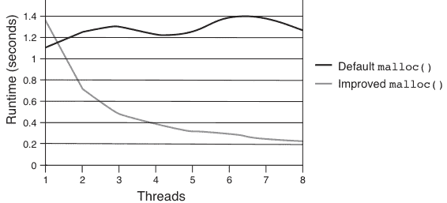

图 9.5 `malloc()` 和 `free()` 的两种不同实现的扩展性

从 `malloc()` 和 `free()` 的两种实现的性能中，可以发现一个有趣但可能并不意外的现象。对于单线程情况，默认的 `malloc()` 提供的性能优于另一种实现。提供改进扩展性的算法也为单线程情况增加了代价；要产生一种在单线程情况下运行快速且又能随多线程扩展的算法是非常困难的。

## 工作量不足

如果我们回到第 7 章中使用的 Mandelbrot 示例，“使用自动并行化和 OpenMP”通过每个线程计算不同的迭代范围来使工作并行运行。使用了一个 4,000 x 4,000 像素的网格，因此每个线程都有充足的工作要执行。另一方面，如果我们计算的是 64 x 64 像素的网格，那么使用相同的方案将无法获得超过 64 个线程的扩展；每个线程只能计算图像的一行。并行化方案的代价应该设计为使单个外层循环迭代 0 到 64 * 64 = 4096 的范围。列表 9.12 显示了修改后的外层循环嵌套。通过这种修改，最大理论线程数达到了 4096。对于在标准硬件上的这个示例，很可能在达到 4,096 个线程之前，同步代价将大于计算代价。

列表 9.12 合并两个外层循环以提供更多并行性

```c
#pragma omp parallel for
for(int i=0; i<64*64; i++) 
{
    int y = i % SIZE;
    int x = i / SIZE;
    double xv = (double)x - (SIZE/2) / (SIZE/4);
    double yv = (double)y - (SIZE/2) / (SIZE/4);
    matrix[x][y] = inset(xv, yv);
}
```

当然，发现扩展性受外层循环执行迭代次数的限制并不稀奇。我们已经使用了 OpenMP 的 `collapse` 子句，它告诉编译器执行这种循环合并，如列表 9.13 所示。

## 列表 9.13 使用 OpenMP collapse 指令

```c
#pragma omp parallel for collapse(2)
for(int x=0; x<64; x++)
for(int y=0; y<64; y++)
{
  double xv = (double)x - (SIZE/2) / (SIZE/4);
  double yv = (double)y - (SIZE/2) / (SIZE/4);
  matrix[x][y] = inset(xv, yv);
}
```

然而，如果我们在 4096 个处理器上以完美的扩展性运行，那么就不会有进一步并行化的机会了。如果你还记得，`inset` 常程具有迭代依赖，它无法被并行化，我们已经耗尽了调用处可用的所有并行性。

在这种特定情况下，提取进一步并行性的唯一选择是在该问题的其他部分寻找机会。最简单的方法是增加问题规模；如果有线程，这可能会在相同的时间内完成并变得有用。

问题规模也可以被认为等同于计算的精度。可能可以使用更多的处理器来提供更高精度的结果。考虑列表 9.14 中使用梯形法则数值积分的示例。

## 列表 9.14 使用梯形法则进行数值积分

```c
#include <math.h>
#include <stdio.h>
double function(double value)
{
  return sqrt(value);
}
double integrate(double start, double end, int intervals)
{
    double area = 0;
    double range = ( end - start ) / intervals;
    for( int i=1; i<intervals; i++) {
        double pos = i*range + start;
        area += function(pos);
    }
    area += ( function(start) + function(end) ) / 2;
    return range * area;
}
int main() {
    for ( int i=1; i<500; i++) {
        printf("%i intervals: %f\n", i, integrate(0, 1, i));
    }
    return 0;
}
```

该代码计算 0 到 1 范围内 `sqrt(x)` 的积分。该计算的结果就是该值。计算时间取决于步数；步长越小，结果越准确。该示例在运行时很好地说明了这一点。当使用一个步长时，函数计算出 0.5 的值。一旦使用更多步长，它计算出 0.666 的值。步数越多，精度越高。随着步数的增加，就有更多机会将工作分散到多个线程上。从这个角度来看，实际计算时间是极小的，该操作自然需要加速。然而，该计算显然是并行化的很好的候选。唯一的复杂之处在于计算变量 `area` 时的还原。使用 OpenMP 并行化积分代码是简单的，如列表 9.15 所示。

## 列表 9.15 使用 OpenMP 并行化的数值积分

```c
double integrate(double start, double end, int intervals)
{
    double area = 0;
    double range = ( end - start ) / intervals;
    #pragma omp parallel for reduction(+: area)
    for (int i=1; i<intervals; i++) {
        double pos = i*range + start;
        area += function(pos);
    }
    area += ( function(start) + function(end) ) / 2;
    return range * area;
}
```

在工作量不足的情况下，发现并行化机会的另一种方法是查看并行计算是如何使用的。回到 Mandelbrot 示例，可能由于计算只提供单帧画面。如果是这样，代码可以在帧层级进行并行化，这可能会提供更多的并发工作。

算法具有不同的扩展到多个处理器的能力。如果我们讨论的是算法，**冒排序**本质上是一个串行过程。遍历元素列表的每次迭代都会选取单个元素并将其泡到顶部。可以将此算法推广为并行版本，这种排序通过两个阶段进行：奇偶数排序。在第一阶段，对元素对进行比较，如果它们顺序错误，则对元素进行交换。在第二阶段，对偶数元素进行比较。这种可以泛化为元素对 (0,1), (2,3)，以此类推。在两个阶段中，每个元素对都是通过多线程并行处理的。

显然，有更好的算法可用。明显的下一步是**快速排序**。这种算法的通常实现是串行的，但由于它递归地对较短的列表进行排序，因此也倾向于并行的。当使用任务并行化时，每个任务都在一个独立的元素范围内执行计算，因此任务之间不需要同步。列表 9.16 展示了如何使用 OpenMP 实现快速排序的并行版本。代码通过 `quick_sort()` 常程调用。代码启动包含整个算法的并行区域，但仅使用单个线程执行初始。初始线程负责创建由其他线程承担的任务。

列表 9.16 使用 OpenMP 并行化的快速排序

```c
#include <stdio.h>
#include <stdlib.h>
void setup(int * array, int len)
{
    for ( int i=0; i<len; i++) {
        array[i] = (i*7 - 3224) ^ 20435;
    }
}
void quick_sort_range(int * array, int lower, int upper) {
  int tmp, mid = (upper + lower) / 2;
  int pivot = array[mid];
  int tlower = lower, tupper = upper;
  while (tlower <= tupper) {
    while (array[tlower] < pivot) { tlower++; }
    while (array[tupper] > pivot) { tupper--; }
    if (tlower <= tupper) {
      tmp = array[tlower];
      array[tlower] = array[tupper];
      array[tupper] = tmp;
      tupper++;
    }
  }
```


```c
#pragma omp task shared(array) firstprivate(lower,tupper)

if (lower < tupper) { quick_sort_range(array, lower, tupper); }

#pragma omp task shared(array) firstprivate(tlower,tupper)

if (tlower < upper) { quick_sort_range(array, tlower, upper); }

}

void quick_sort(int *array, int elements) {

#pragma omp parallel

#pragma omp single nowait

quick_sort_range(array, 0, elements);

}
```

# 第 9 章 使用多核处理器进行扩展

总结这些讨论，某些算法在本质上是串行的，因此为了使应用程序并行化，可能需要对算法进行更改。并不是并行算法都同样有效。关键特征是算法扩展到的线程数，以及算法引入的开销大小。

在之前讨论的背景下，冒泡排序是串行的，但可以泛化为奇偶排序（odd-even sort）。这更好地利用了多个线程，但仍然不是一种高效的算法。将算法改为快速排序可以提供一种更高效的算法，并且仍然能够扩展到许多线程。

在特殊情况下，我们很幸运，我们的并行算法恰好比串行版本更高效。情况并非总是如此。有时会出现并行算法扩展良好，但代价是串行性能的降低。在这些情况下，值得考虑是否需要实现多种算法并在运行时进行选择，以决定哪种更高效。

算法还有另一种方法，这在某些应用领域并不少见，特别是在跨集群进行计算且节点间通信开销巨大的情况下。这种方法是使用一种迭代收敛的算法。所需的迭代次数取决于计算的准确性要求。这为算法的并行化提供了一个有趣的调优机制。

用一个例子来描述可能最简单。假设问题是模拟流体沿受阻管道的流动。可以很容易将管道分成多个部分，并为每个部分分配一组线程来执行计算。然而，一个部分的结果将取决于相邻部分的结果。因此，真正的计算需要在各个交汇处交换大量数据。

这种数据交换会使应用程序串行，并限制可以实现的扩展程度。一种解决办法是近似相邻部分的值，并在相邻部分完善其结果时对这些近似值进行优化。通过这种方式，可以使计算几乎相互独立。这种近似的代价是求解器需要更多迭代才能收敛到正确答案。

这种方法通常用于集群上的程序，因为两个节点之间交换数据的开销非常大。近似使得每个节点能够继续进行并行处理。尽管迭代次数增加，这种方法仍然可以带来更快的求解时间。

## 扩展的硬件限制

硬件的设计和实现对运行其上的应用程序的扩展产生实质影响。有三个关键领域会对扩展产生巨大影响。缓存和内存的带宽将由系统上的活动线程分。。缓存的设计决定了由于容量和冲突引起的缓存缺失会导致丢失多少时间。处理器核心流水线在活动软件线程之间的共享方式决定了指令发射率如何随着活动线程数量的而变化。

## 核心之间的带宽共享

带宽是线程间共享的另一个资源。系统的带宽容量取决于处理器和内存系统的设计，以及内存芯片在系统中的位置。其结果是，两个系统可能包含相同的处理器和主板，但带宽测量值却不同。通常，一个配置以获得最佳性能的系统会使用昂贵的内存芯片。

处理器可以消耗的带宽是待处理内存请求数量以及这些请求返回速率的函数。这些内存请求可能来自硬件或软件预取，也可能来自加载或存储操作。由于每个线程都可以发布内存请求，处理器运行的线程越多，处理器能消耗的带宽就越多。

许多像 `strlen()` 和 `memset()` 等字符串处理程序可能是内存带宽的大消耗者。由于这些程序作为操作系统的一部分提供的，因此通常经过了优化，以为特定系统提供最佳性能。列表 9.17 中的代码使用多个线程对内存的不离交区域调用 `memset()`，以估计系统上可用的内存带宽。带宽可以通过访问内存量除以完成访问所需的时间来测量。

### 列表 9.17 使用 memset 测量带宽

```c
#include <stdio.h>
#include <stdlib.h>
#include <strings.h>
#include <pthread.h>
#include <sys/time.h>
#define BLOCKSIZE 1024*25
int nthreads = 8;
char * memory;
double now(){
    struct timeval time;
    gettimeofday(&time, NULL);
    return (double)time.tv_sec + (double)time.tv_usec / 1000000.0;
}
```

```c
void *experiment( void *id ) {
  unsigned int seed = 0;
  int count = 20000;
  for(int i=0; i<count; i++) {
    memset(&memory[(long)id * BLOCKSIZE], 0, BLOCKSIZE);
    if (seed == 1) printf(" ");
  }
}
int main(int argc, char *argv[]) {
  pthread_t threads[64];
  memory = (char*)malloc(64*BLOCKSIZE);
  if (argc > 1) nthreads = atoi(argv[1]);
  double start = now();
  for(int i=0; i<nthreads; i++) {
    pthread_create(&threads[i], NULL, experiment, (void*)i);
  }
  for ( int i=0; i<nthreads; i++) {
    pthread_join(threads[i], NULL);
  }
  double end = now();
  printf("%d Threads Time %f Bandwidth %f GB/s\n", nthreads,
    (end - start),
    ((double)nthreads * 20000.0) / (end - start) / 1000000.0);
  return 0;
}
```


列表 9.18 中的结果显示了测试代码在 64 个虚拟 CPU 系统上测量的带宽。对于这个特定系统，带宽随着线程数几乎线性扩展到大约六个线程，带宽开始下降。这看起来可能是一个意外的结果，但有几个因素可以导致这种现象。

# 列表 9.18 在 64 个虚拟 CPU 系统上测量的带宽

| 线程 | 时间 | 带宽 |
|---|---|---|
| 1 线程 | 0.082376 s | 2.76 GB/s |
| 2 线程 | 0.082576 s | 5.52 GB/s |
| 3 线程 | 0.075954 s | 8.31 GB/s |
| 4 线程 | 0.718156 s | 10.89 GB/s |
| 5 线程 | 0.764044 s | 12.79 GB/s |
| 6 线程 | 1.25241 s | 10.42 GB/s |
| 7 线程 | 1.472361 s | 9.29 GB/s |
| 8 线程 | 1.726728 s | 9.06 GB/s |

一种可能是线程正在核心上发生冲突。我们将在“流水线资源饥饿”节中讨论核心的共享。第二个交互影响是多个线程在缓存中开始冲突。另一个影响是内存芯片在饱和时的行为。此时，芯片开始出现排队延迟。内存芯片按库排列。访问特定地址将导致特定的库。如果多个线程恰好命中该库，每个库在返回之间需要间隔。

所有这些交互的结果是，饱和的内存系统可能会防止达到内存内存带宽。这在带宽五个五个线程达到峰值的示例中是明显的。

列表 9.1 显示了在四个虚拟 CPU 系统上测量的内存。这是一个非常不同的场景。在这种情况下，增加线程不会增加内存带宽。系统已经运行在峰值带宽。由于之前讨论的原因，增加额外的线程会导致内存系统带宽降低。

# 列表 9.19 在四个虚拟 CPU 系统上测量的内存带宽

| 线程 | 时间 | 带宽 |
|---|---|---|
| 1 线程 | 4.737563 s | 2.63 GB/s |
| 2 线程 | 15.238317 s | 2.57 GB/s |
| 3 线程 | 24.580981 s | 2.39 GB/s |
| 4 线程 | 37.457532 s | 2.09 GB/s |

# 伪共享

伪共享是多个线程访问单个缓存行上的数据项的情况。虽然所有线程都使用单独的数据项，但缓存行本身在它们之间共享的，因此在任何时候只有一个线程可以写入它。这纯粹是一个性能问题，因为不存在正确性问题。如果一个变量位于线程间共享的缓存行上，那将是一个正确性问题。

# 第 9 章 使用多核处理器进行扩展

这会导致缓存访问的时间与访问内存缺失的时间相差。在伪共享（false sharing）的情况下，该缓存行会在处理器之间不断跳动，因此对其的大多数访问最终都需要另一个处理器将该缓存行写回内存——因此该行无法获得缓存中驻留的好处。

使用列表 9.20 中的代码可以很容易地演示伪共享的代价。该代码为每个线程分配了一个 `volatile` 变量作为计数器。变量是 `volatile` 确保了代码在每次迭代中都必须存储和重新加载它。它还确保编译器无法消除循环，即使它执行的工作是冗余的。代码创建了多个线程，并计算第一个线程完成与其它线程相同工作量所需的时间。

### 列表 9.20 伪共享示例

```
#include <stdio.h>

#include <stdlib.h>

#include <pthread.h>

#include <sys/time.h>

double now() {
    struct timeval time;
    gettimeofday(&time, 0);
    return (double)time.tv_sec + (double)time.tv_usec / 1000000.0;
}

#define COUNT 100000000
volatile int go = 0;
volatile int counters[20];

void *spin(void *id) {
    int myid = (int)id + 1;
    while (!go) {}
    counters[myid] = 0;
    while ( counters[myid]++ < COUNT ) {}
}

int main(int argc, char *argv[]) {
    pthread_t threads[256];
    int nthreads = 1;
    if ( argc > 1 ) { nthreads = atoi(argv[1]); }
    for (int i=1; i<nthreads; i++) {
        pthread_create(&threads[i], 0, spin, (void*)i);
double start = now();
go = 1;
spin( 0 );
double end = now();
printf("Time %f ns\n", ( end - start ) );
for( int i=0; i<nthreads; i++) {
    pthread_join(threads[i], 0);
}
return 0;
}
```

如果我们取列表 9.20 中的代码并运行单线程，在具有双核处理器的系统上，该线程将在九秒内完成工作。在同一系统上使用四个线程会导致代码的运行时间达到约 100 秒——减慢了约 10 倍。

通过对访问的结构进行填充，可以很容易地解决伪共享，使得每个线程使用的变量位于单独的缓存行上。这样，缓存行就可以留在运行该线程的处理器缓存中，因此，对该缓存行的所有访问都是低成本的，代码运行速度快得多。

列表 9.21 显示了代码的修改版本，其中对计数器结构的访问进行了填充，使得每个计数器都位于 64 字节的间隔间隔上。这将确保在缓存行大小为 64 字节或更小的机器上，变量位于不同的缓存行上。

### 列表 9.21 为了避免伪共享的数据填充

```
#include <stdio.h>

#include <stdlib.h>

#include <thread.h>

#include <sys/time.h>

double now() {
    struct timeval time;
    gettimeofday(&time, 0);
    return (double)time.tv_sec + (double)time.tv_usec / 1000000.0;
}

#define COUNT 10000000
volatile int go = 0;
volatile int counters[320];

void *spin(void *id) {
double start = now();
go=1;
spin( 0 );
double end = now();
printf("Time %f s\n", ( end - start ) );
for(int i=0; i<nthreads; i++) {
  pthread_join(threads[i], 0);
}
return 0;
}
```


修改后的代码在同一台机器上运行四个线程大约需要九秒。

虽然在大多数情况下修复伪共享是很容易的，但检测其带来的性能损失要困难得多。通常情况下，伪共享会表现为特定内存操作上缓存缺失数量增加，并且很难将其与所有应用程序中发生的正常缓存缺失区分开来。然而，从前面的描述中意识到的重要点是，当大量时间浪费在伪共享上，会有大量的缓存缺失，这指示了伪共享发生点。因此，跟踪伪共享可以简单地定位代码中在应为单线程局部的变量上出现异常高数量缓存缺失的地方。

需要注意的一个重要点是，伪共享对于多处理器系统是一个重大问题，但对于多核系统来说并不关键。例如，如果我们取列表 9.20 中具有伪共享问题的代码并在 CMT（同步多线程）系统上运行，

## 扩展的硬件限制

单线程需要 24 秒，四个线程需要 26 秒；运行时没有因为伪共享的存在发生显著变化。

### 冲突与容量

需要注意的一个重要点是，伪共享对于多处理器系统是一个重大问题，但对于多核系统来说并不关键。例如，如果我们取列表 9.20 中具有伪共享问题的代码并在 CMT 系统上运行，单线程需要 24 秒，四个线程需要 26 秒；运行时没有因为伪共享的存在发生显著变化。

人们很容易想象这是一个理论问题，而不是一个实际上会遇到的问题。然而，假设一个应用程序有多个线程，它们都执行公共代码，大部分时间花在同一个例程中。如果该例程执行了大量的栈访问，线程很有可能会发生冲突，导致抖动（thrashing）和性能下降。这是因为所有栈都从栈大小的某个倍数开始。在相同的调用下，变量在所有线程中相对于栈的偏移量是相同的。缓存行可能会映射到所有线程的同一个缓存组（set）。如果所有线程都频繁使用此位置，将导致组内抖动。

正因如此，处理器通常在硬件中实现某种哈希算法，这允许步进访问模式映射到不同的缓存行组。如果这样做，变量将映射到不同的缓存行上，线程不应在缓存中引起抖动。即使在这种硬件特性下，仍然可能导致抖动，但发生的概率会小得多，因为明显的抖动原因已经被消除了。

共享缓存的另一个问题是容量缺失（capacity misses）。这是指单个线程的数据集可以放入缓存，但添加第二个线程后会导致总占用空间超过缓存容量的情况。

考虑列表 9.23 所示的代码。每个线程分配了一个 8KB 的整数数组。当在具有至少 8KB 缓存的内核上单线程运行代码时，数据线程变为缓存中驻留，代码运行很快。如果在此同一内核上启动第二个线程，两个线程将总共 16KB 的缓存才能使两个线程所需的数据驻留在缓存中。

## 列表 9.23 每个线程使用 8KB 数据块的代码

```c
#include <pthread.h>
#include <stdio.h>
#include <sys/time.h>
#include <stdlib.h>
#include <types.h>
#include <sys/processor.h>
#include <sys/procset.h>
void * threadcode(void *id) {
    int *stack = calloc(sizeof(int), 2048);
    processor_bind(P_LWID, P_MYID, ((int*)id)*4 & 63, 0);
    for(int i=0; i<1000; i++) {
        struct timeval start = gettimeval();
        double total = 0.0;
        for(int k=0; k<256*1024; k++) {
            total += stack[(h*k) * 20393] & 2047;
            *stack[(h*k) * 12834] & 2047;
        }
        struct timeval end = gettimeval();
        if (total == 0) printf("Time %fs ns\n", (double)end - (double)start);
    }
    return NULL;
}
int main(int argc, char *argv[]) {
    pthread_t threads[20];
    int nthreads = 8;
    if (argc > 1) { nthreads = atoi(argv[1]); }
    for(int i=0; i<nthreads; i++) {
        pthread_create(&threads[i], 0, threadcode, (void*)i);
    }
    for(int i=0; i<nthreads; i++) { pthread_join(&threads[i], 0); }
    return 0;
}
```

在带有线程的 UltraSPARC T2 处理器上运行此代码，最外层循环每次迭代的时间约为 0.7 秒。8KB 的数据结构可以放入 8KB 缓存中。当使用两个线程运行时，每次迭代的时间几乎翻倍到 1.2 秒，这正如预期的那样，因为所需的数据超过了一级缓存的大小，需要从共享的二级缓存中提取。

## 第 9 章 多内核处理器的可扩展性

注意，此代码包含了对 Solaris 函数 `processor_bind()` 的调用，该函数将线程绑定到特定的 CPU。在代码中使用此函数是为了确保两个线程被放置在同一个核心上。绑定操作将在“使用处理器绑定提高内存局部性”章节中进行讨论。

显然，当多个线程绑定到同一个处理器核心时，性能可能无法扩展，这可能还有其他原因。为了证明我们观察到的问题是缓存容量事件，我们需要排除其他选项。

在这种情况下，唯一的其他可能原因是指令容量无法同时从两个流中获取指令，就像它可以从单个流中获取指令那样。

有两种方法可以判断每个线程使用的数据大小是否是问题。第一种方法是实验，减小每个线程使用的数据大小，使得总内存占用小于缓存大小。如果这样做之后，添加第二个线程对性能没有影响，则说明问题是缓存容量问题，而不是两个线程共享的问题。

然而，修改应用程序的结构仅在测试代码上是实行的。在实际程序上执行相同的实验是很困难的。识别相同问题的另一种方法是使用大多数处理器上提供的硬件计数器查看缺失率。

在 Solaris 上访问硬件计数器的工具是 `exploit`。该工具报告由单个进程触发的硬件计数器事件数。列表 9.24 显示了使用 `exploit` 计算单线程版本示例代码缓存缺失的结果。该工具报告，对于活动线程，每秒约有 450,000 次 L1 缓存缺失，每秒几次 L2 缓存缺失。

### 列表 9.24 单线程运行硬件性能计数器报告的缓存缺失

```
% cputrack -c DC_miss_ld L2_miss_id ./a.out 1
t lwp event pic0 pic1
0.034 2 lwp_create 0 0
Time 698951572.000000 ns 0
1.017 1 tick 4984 362
1.127 2 tick 445576 138
Time 712353418.000000 ns 0
2.017 1 tick 0 0
2.127 2 tick 390764 107
Time 705177694.000000 ns 0
3.017 1 tick 0 0
3.127 2 tick 402203 97
```

## 限制扩展性的硬件限制

这可以与列表 9.25 所示的两个线程在同一核心上运行时遇到的缓存缺失进行比较。在这种情况下，两个活动线程的 L1 数据缓存缺失率增加到每秒 2600 万次。L2 缓存缺失率保持接近零。

### 列表 9.25 两个线程在同一核心上运行时报告的缓存缺失

```
cputrack -c DC_miss,L2_miss_id ./a.out 2
time lwp event pic0 pic1
0.032 2 lwp_create 0 0
0.046 3 lwp_create 0 0
1.021 1 tick 5022 580
1.181 2 tick 26332010 18
1.211 3 tick 27171551 0
time 122827672.000000 ns 1
time 126111960.000000 ns 0
2.021 1 tick 0 0
2.181 2 tick 18842608 9
2.031 3 tick 19188273 54
```

这表明，当单个线程在核心上运行时，它是驻留的，且 L1 缺失极少。（注：原文在此处继续）。

# 扩展性的硬件限制

```c
processor_bind( P_LWPID
```

```c
  seed += (seed<2) ^ (seed|33556);
  seed += (seed<2) ^ (seed|33556);
  seed += (seed<2) ^ (seed|33556);
  seed += (seed<2) ^ (seed|33556);
```


# 第 9 章 使用多核处理器进行扩展

列表 9.26 所示的代码使用了 `processor_bind` 将线程绑定到特定的 CPU。这是必要的，因为操作系统通常会尝试定位线程，以便每个线程都能获得最大的资源。在这种情况下，我们不希望发生这种情况，因为我们想研究线程被调度在同一个核心上时会发生什么。这需要虚拟 CPU 编号如何映射到核心。这种映射通常属于两种类型之一。

常见的映射是虚拟 CPU 编号分组分配给核心。如果一个核心支持四个线程，那么虚拟 CPU 0 到 3 就对应于第一个核心上的四个线程。
另一种常见的映射是交错映射。在这种情况下，如果有两个核心，那么所有奇数的虚拟 CPU 将映射到一个核心，而所有偶数的虚拟 CPU 将映射到另一个核心。

所示代码适用于虚拟 CPU 交错分布的机器。运行此代码的特定 Intel 机器具有两个开启了超线程的核心，总共四个虚拟 CPU。虚拟 CPU 0 和 2 位于核心 0，虚拟 CPU 1 和 3 位于核心 1。

当用一个线程运行操作代码时，大约需要两秒钟。当两个线程在同一个核心上运行时，耗时两半秒。如果运行时间保持不变，那么在相同的时间内完成的工作将更多。然而，事实并非如此——在增加 25% 时间的情况下，完成了两倍的工作。这代表吞吐量提升了 60%。

相同的代码在 UltraSPC T2 机器上运行运行，并修改了绑定策略。该机器的拓扑结构非常有趣，因为每个核心可以支持八个线程，这些线程被分成两组四个。每组四个线程每个周期可以发射一次操作，但这两组共享一个加载/存储流水线和一个浮点流水线。在 particular 机器上，使用单线程运行时，代码需要几秒钟。当分配到同一核心的两个线程完成任务时耗时七秒，每单位的工作量仅单线程略多一点。当两个线程被分配到同一核心的不同组时，线程在四秒内完成工作。通过这种分布，每单位时间完成的工作量翻倍。

随着更多线程变得活跃，处理器的扩展性取决于核心的架构。可用容量越大，随着线程数量的增加，核心的吞吐量就会越高。另一种观点是，努力从单线程代码中提取每一比特性能，最终会导致第二个线程使用的周期更少。一旦核心被充分利用，额外的线程将从已经运行的线程中抢夺周期，并导致所有活跃线程运行速度变慢。

如果所有线程都在执行有用工作，那么在很大程度上，处理器的扩展性如何并不重要——只要它完成的工作比单线程运行时完成的多即可。

当其中一个线程正在自旋 `spinning` 等待某些信号时，性能可能会丢失。自旋线程将占用核心上运行的其他线程的发射机会。列表 9.27 中的代码演示了如何创建多个自旋线程，然后尝试完成预定义的工作量。

### 列表 9.27 与执行工作的线程争夺发射宽度的自旋线程

```c
#include <stdio.h>
#include <stdlib.h>
#include <strings.h>
#include <pthread.h>
```

```c
#include <sys/types.h>
#include <sys/processor.h>
#include <sys/procset.h>
int nthreads = 8;
volatile int busy = 1;
void *spin(void *id)
{
    processor_bind(P_LWPID, P_MYID, (int)id, 0);
    while ( busy ) {
}
void experiment(int id)
{
    unsigned int seed = 0;
    processor_bind(P_LWPID, P_MYID, id, 0);
    int count = 1000000;
    for(int i=0; i<count; i++) {
        seed += (seed<2) ^ (seed|33556);
        seed += (seed<2) ^ (seed|33556);
        seed += (seed<2) ^ (seed|33556);
        seed += (seed<2) ^ (seed|33556);
        seed += (seed<2) ^ (seed|33556);
        seed += (seed<2) ^ (seed|33556);
        seed += (seed<2) ^ (seed|33556);
        seed += (seed<2) ^ (seed|33556);
    }
    if ( seed == 1 ) printf(" %d" );
}
int main(int argc, char * argv[])
{
    pthread_t threads[64];
    if (argc > 1 ) {
    nthreads = atoi(argv[1]);
    }
    for(int i=0; i<nthreads; i++) {
        pthread_create(&threads[i], 0, spin, (void*)(i));
    }
    experiment(0);
    busy = 0;
    for (int i=0; i<nthreads; i++) {
        pthread_join(threads[i], 0);
    }
    return 0;
}
```

在测试机器上，当没有其他线程调度到核心时，代码需要四秒钟完成。当有一个自旋线程调度到同一核心时，耗时两半秒。当两个线程时耗时八秒，而三个自旋线程时耗时十二秒。

这种进展很有趣。第一个自旋线程使原始线程慢了约 25%，因为自旋线程在每个周期都会执行指令。第二个自旋线程遵循相同的模式，现在有两个线程在每个周期发射指令。当加入第三个自旋线程时，核心被完全占据，原始线程每周期发射指令的速度运行变慢了一倍，运行时间从八秒增加到十二秒。

减少自旋线程影响的方法是使线程暂停且不消耗资源。大多数处理器都有长延迟指令可以用于此目的，即使它们没有显式的指令。例如，在 SPARC 处理器上，读取寄存器的操作需要几秒钟。列表 9.28 显示的修改后的 `spin` 函数使用此方法向自旋代码中插入延迟。

### 列表 9.28 读取寄存器以向自旋代码插入延迟

```c
void * spin(void *id)
{
    processor_bind(P_LWPID, P_MYID, (int)id, 0);
    while (busy)
    {
        asm("rd %tick,%0" : "");
    }
}
```

插入这种延迟将三个自旋线程时的运行时间从十二秒减少到七秒。重复几次或识别更延迟的操作可以进一步减少自旋线程的影响。

## 操作系统的扩展限制

最近的 x86 处理器实现了 `pause` 指令，导致线程在发射下一条指令之前暂停。在旧处理器上，`pause` 指令映射为 `no-op` 指令；虽然在旧硬件上使用该指令可以，但旧硬件并不会实际暂停。Windows 实现了 `yield()` 宏来实现暂停/延迟。

大多数扩展限制是由硬件限制或应用程序实现的低效率引起的。然而，随着核心数量的增加，在操作系统或提供的库中发现问题并不罕见。

### 过度订阅

过度订阅是指系统上有太多活跃线程。这不是对系统线程绝对数量的限制，而是对活跃线程数量的限制。如果请求 CPU 时间的线程持续多于虚拟 CPU，那么该系统可能被认为过度订阅。

虽然后续线程也消耗资源，但它们往往不会消耗大量处理器时间，因此系统可以维持大量的空闲线程计数。系统可以维持比虚拟 CPU 更多的活跃线程，但每个活跃线程只能获得可用 CPU 资源的份额。在一个活跃软件线程是硬件线程两倍系统中，每个活跃软件线程最终将获得一个虚拟 CPU 50% 的时间。

```c
if ( seed == 1 ) printf(" %d" );
```

```c
int main(int argc, char* argv[])
{
  pthread_t threads[64];
  if (argc > 1 ) {
    nthreads = atoi(argv[1]);
  }
  for(int i=0; i<nthreads; i++) {
    pthread_create(&threads[i], 0, experiment, (void*)i);
  }
  for(int i=0; i<nthreads; i++) {
    pthread_join(threads[i], 0);
  }
  return 0;
}
```


多个线程共享同一个 CPU 通常会导致性能产生更大的线性下降，原因包括活跃线程之间切换的成本、缓存中用数据的驱逐以及在虚拟 CPU 之间迁移线程的成本。值得注意的是，每个线程都需要一些内存占用，线程的激增是导致内存短的原因之一。

需要观察的关键点是，活跃线程多于虚拟 CPU 只能降低每个线程的工作速率。有一种情况，线程多于虚拟 CPU 可能会获益。睡眠或阻塞等待资源的线程不消耗 CPU，并且不会影响活跃线程的性能。这的一个例子是有许多线程在等待磁盘或网络活动完成。

让许多线程等待磁盘 I/O 完成可能是很有用的。在这种情况下，改进具有等待 I/O 的应用程序性能是一个关键问题——主线程可以继续，而子线程等待 I/O 请求的完成。

列表 9.29 中的代码可以用于演示存在其他活跃线程时，单线程的性能如何受到损害。代码测量了

# 第 9 章 使用多核心处理器的扩展

主线程完成其工作需要很长时间。然而，在主线程开始计时区域之前，它会创建多个子线程，这些线程会在锁上自旋，直到主线程完成工作。

## 列表 9.29 展示过度订阅（Oversubscription）成本的代码

```c
#include <stdio.h>
#include <stdlib.h>
#include <pthread.h>
#include <sys/time.h>

double now()
{
    struct timeval time;
    gettimeofday(&time, 0);
    return (double)time.tv_sec + (double)time.tv_usec / 1000000.0;
}

#define COUNT 100000000
volatile int stop = 0;

void *spin(void *id)
{
    while (!stop) { }
}

int main(int argc, char *argv[]) {
    pthread_t threads[256];
    int nthreads = 1;
    if (argc > 1) { nthreads = atoi(argv[1]); }
    nthreads--;
    for(int i=0; i<nthreads; i++) {
        pthread_create(&threads[i], 0, spin, (void*)0);
    }

    double start=now();
    int total = 0;
    for(int h=0; h<COUNT; h++) {
        total += (total << 2) ^ (total | 33556);
        if (total == 0) printf("total==0\n");
    }
    double end=now();
    printf("Time %f a\n", end - start );
    stop = 1;
    for(int i=0; i<nthreads; i++)
    {
        pthread_join(threads[i], 0);
    }
    return 0;
}
```

图 9.6 显示了代码在具有四个虚拟 CPU 的系统上的运行时间。该代码的运行时间取决于每个 CPU 的软件线程数量。如果有八个或更多软件线程，运行运行时间至少是四个或更少线程时的两倍。图了两线：一条表示如果运行时间随线程数线性扩展，代码将如何运行；另一条线显示了代码的实际运行时间。在 64 个线程之后，显然过度订阅导致运行时间超过了基于线性扩展的预期值。换句话说，在约 64 个线程之后，系统性能受到过度订阅的影响。

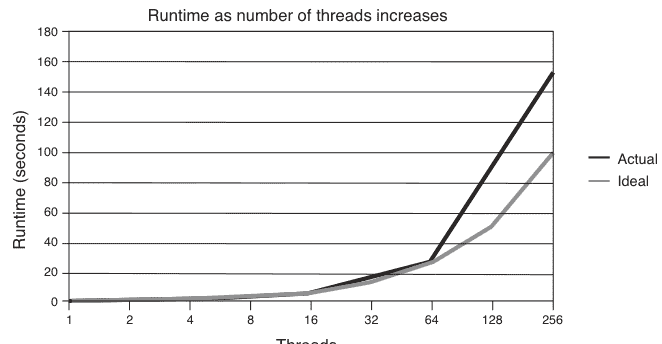

图 9.6 过度订阅系统的扩展

## 使用处理器绑定改进内存局部性

线程迁移是指线程在一个虚拟处理器上启动，但最终迁移到另一个虚拟处理器的情况。如果新的虚拟处理器与原始虚拟处理器共享同一个核心，或者与它共享缓存，则这种迁移的成本就很低。对于多核心处理器，如果线程的新位置与旧位置共享相近级别的缓存，那么线程迁移的影响往往是微小的。然而，如果迁移是从一个物理芯片到另一个物理芯片，成本可能会非常高。

线程迁移的成本之一与线程正在使用的数据现在位于旧处理器的缓存中有关。数据需要被获取到新进程的缓存中。重要的是，这可能是一种缓存传输，类似于伪共享（false sharing）的情况。对于某些系统，从另一个处理器的缓存中获取数据的成本可能比从内存中获取更低。然而，在某些系统中，从另一个缓存中获取数据的成本可能比从内存中获取更高。典型原因是数据在新处理器获取它之前需要先进行存储。

然而，在多处理器系统中，线程迁移还有一个额外的潜在成本。现代操作系统对内存子系统的拓扑结构有一定的了解。因此，操作系统可以为线程提供延迟最低的内存。遗憾的是，如果线程被迁移，它可能会位于一个内存延迟高得多的处理器上。这个问题导致系统尝试将线程保留——尽管不一定是在它们原始的位置，也要保持在共享相同内存延迟的虚拟 CPU 组内。

这引发了局部性组（locality groups）的概念，即共享相同内存访问延迟的线程组。如果线程在局部性组内移动，内存延迟成本不会发生变化；迁移成本只是线程移动到可能冷缓存缓存的微小代价。

Linux 提供了 `numactl` 工具，既可以查询硬件拓扑结构，又允许用户指定应用程序运行的虚拟处理器。列表 9.30 显示了 `numactl` 的输出，表明系统有两个节点、处理器以及每个节点关联的内存量。

### 9.30 来自 Linux 的 NUMA 特性

```
$ numactl --hardware
available: 2 nodes (0-1)
node 0 size: 2047 MB
node 0 free: 88 MB
node 1 size: 1983 MB
node 1 free: 136 MB
```

Solaris 提供了 `lgprinfo` 工具报告拓扑结构。对于某些系统，从另一个处理器的缓存中获取数据的成本可能比从内存中获取更低。然而，在某些系统中，从另一个缓存中获取数据的成本可能比从内存中获取更高。典型原因是数据在新处理器获取它之前需要先存储。

然而，在多处理器系统中，线程迁移还有一个额外的潜在成本。现代操作系统对内存子系统的拓扑结构有一定的了解。因此，操作系统可以为线程提供延迟最低的内存。遗憾的是，如果线程被迁移，它可能会位于一个内存延迟高得多的处理器上。这个问题导致系统尝试将线程保留——尽管不一定是在它们原始的位置，也要保持在共享相同内存延迟的虚拟 CPU 组内。

Solaris 提供了 `lgprinfo` 工具报告拓扑。对于某些系统，从另一个处理器的缓存中获取数据的成本可能比从内存中获取更低。然而，在某些系统中，从另一个缓存中获取数据的成本可能比从内存中获取更高。典型原因是数据在新处理器获取它之前需要先存储。

# 扩展到操作系统的限制

```c
printf("Time %14.2f ns Binding %i/s\n",
    (end - start) * 1000000000.0 / ((double)SIZE), (int)param);
} else { perror("Error"); }
```

```c
int main(int argc, char* argv[])
{
    pthread_t thread;
    int nthreads = 1;
    int i;
    if (argc > 1) { nthreads = atoi(argv[1]); };
    setup();
    for(i=0; i<nthreads; i++) {
        pthread_create(&thread, 0, use, (void*)i);
        pthread_join(thread, 0);
    }
    return 0;
}
```

该代码可以运行，但需要提供两个关键例程。简单的方法是提供 `now()` 例程，它以双精度类型返回当前时间（秒）。系统函数 `gettimeofday()` 在 *NIX* 上提供了一种可移植的方法，用于获取自系统启动以来的秒和微秒。9.33 显示了将此封装为返回双精度 类型的代码。

## 列表 9.33 返回当前秒数时间的代码

```c
double now()
{
    struct timeval time;
    gettimeofday(&time, 0);
    return (double)time.tv_sec + (double)time.tv_usec / 1000000.0;
}
```

控制线程运行的位置不是可移植的。列表 9.34 中的代码显示了如何使用 Solaris 的 `processor_bind()` 来控制线程到虚拟处理器的绑定。变量 `P_LWPID` 和 `P_MYID` 将调用线程绑定到特定的虚拟处理器。

## 列表 9.34 在 Solaris 上控制处理器绑定


```c
#ifdef _sun
#include <sys/processor.h>
#include <sys/procset.h>
```

# 第 9 章 使用多核处理器进行扩展

```c
int threadbind(int proc )
{
    return processor_bind(P_LWPID, P_MYID, proc, 0);
}
#endif
```

Linux 通过 `sched_setaffinity()` 调用提供了相同的功能。此调用设置线程的亲和性，使其运行在一组虚拟 CPU 的任何一个上。该调用需要一个 CPU 集，指示线程可以在哪些虚拟 CPU 上运行。宏 `CPU_ZERO()` 清空 CPU 集，而宏 `CPU_SET()` 则向 CPU 集中添加虚拟 CPU。然而，这里存在一些复杂性。宏 `CPU_ZERO()` 和 `CPU_SET()` 只有在设置了 `_GNU_SOURCE` 的情况下才定义。为了确保这些宏可用，这应该是源代码文件中的第一个内容或在编译时设置。第二个问题是 `gettid()`（它返回调用线程的 ID）可能在系统头文件中未定义。为了纠正这一点，需要显式地编写 `gettid()`。列表 9.35 显示了将线程绑定到特定虚拟 CPU 的完整代码。

## 列表 9.35 在 Linux 上将线程绑定到虚拟 CPU

```c
#ifndef __linux
#include <sched.h>
#include <sys/syscall.h>

pid_t gettid() {
    return syscall(__NR_gettid);
}

int threadbind(int proc) {
    cpu_set_t cpuset;
    CPU_ZERO(&cpuset);
    CPU_SET(proc, &cpuset);
    return sched_setaffinity(gettid(), sizeof(cpu_set_t), &cpuset);
}
#endif
```

列表 9.36 显示了这两个例程的等效 Windows 代码。调用 `GetTickCount()` 返回的是毫秒值，而不是 `gettimeofday()` 返回的微秒。然而，代码运行的时间足够长，这种精度的降低不会引起问题。绑定线程到虚拟 CPU 的调用是 `SetThreadAffinityMask()`，该调用接受一个掩码，该掩码为允许线程运行的每个虚拟 CPU 设置。

## 扩展的操作系统限制

### 列表 9.36 获取当前时间并绑定到虚拟 CPU 的 Windows 代码

```c
#include <stdio.h>
#include <windows.h>
#include <process.h>

double now() {
    return GetTickCount() / 1000.0;
}

int threadbind( int proc ) {
    DWORD_PTR mask;
    mask = 1<<proc;
    return SetThreadAffinityMask( GetThread(), mask );
}
```

列表 9.37 是在 Windows 上编译和运行的剩余代码。

### 列表 9.37 Windows 延迟代码

```c
#include <stdio.h>
#include <windows.h>
#include <process.h>

#define SIZE 128*1024*1024
int** memory;

void setup() {
    int i, j;
    threadbind( (int*) 0 );
    memory = (int*)calloc( sizeof(int), SIZE+1);
    for(j=0; j<SIZE; j++) {
        for(i=i+16; i<=SIZE; i++) {
            memory[i] = (int*)&memory[i-16];
        }
        memory[j] = (int*)&memory[SIZE-16+j+1];
    }
}

unsigned int __stdcall use(void* param) {
    if ( threadbind( (int)param ) != 0 )
```

```c
{
int* next;
int i;
double start = now();
next = memory[0];
for(i=0; i<SIZE;i++ ) {
    next = (int*)next;
}
if ( (int)next == 1 ) { printf(" a"); }
double end = now();
printf("Time %14.2f ns Binding %i/s\n",
(end-start)*1000000000.0 / ((double)SIZE), (int)param);
} else { printf(" Error"); }
return 0;
}

int _tmain(int argc, _TCHAR* argv[]) {
    HANDLE thread;
int nthreads = 8;
int i;
if ( argc > 1 ) { nthreads = _wtoi(argv[1]); }
setup();
for(i=0; i<nthreads; i++) {
    thread = CreateThread(NULL,0, (LPTHREAD_START_ROUTINE)use, (LP)(intptr_t)i,0,NULL);
    WaitForSingleObject(thread,INFINITE);
    CloseHandle(thread);
}
getchar();
return 0;
}
```

### 9.38 在 Solaris 上具有内存局部性的延迟

| 命令 | 结果 |
| :--- | :--- |
| ./aout | 98.24 ns Binding 0/s |
| Time | 145.69 ns Binding 1/s |

尽管使用处理器绑定来获得应用程序的可能性能是诱人的，但这并不是一个通用的解决方案。在共享系统中，这会导致线程绑定到...

# 扩展的操作系统限制 379

...降低所有线程的性能。对于需要对虚拟 CPU 进行某种静态分配的情况，可能值得研究系统提供的某些虚拟化设施，以避免过度分配或分配不足。

在将线程绑定到虚拟 CPU 时存在一些有趣的复杂性。如果线程在局部性区域上工作，当这些线程绑定到局部性时，性能将确保线程 0 正好将所有元素获取到缓存中，而不是从内存中获取。

然而，考虑工作在线程之间分布不均匀的情况。假设每个线程的工作量减少了线程 0 执行最多，而线程 15 执行最少。如果线程 0 和 1 绑定到同一个内核上，那么它们将竞争流水线资源并导致运行缓慢。相反，如果线程 0 与线程 15 配对，那么线程 15 将迅速完成其工作，为线程 0 留出内核资源。

## 优先级反转

所有进程和线程都有关联的优先级。操作系统使用它来决定分配多少 CPU 时间。因此，高优先级线程将获得比低优先级线程更多的 CPU 时间。这允许开发者在组成应用程序的线程之间分配时间。在低优先级运行时，后台任务进入了界面不需要的间隙。

# 第 9 章 使用多核处理器进行扩展

……用于计算资源的线程，用户执行操作与应用程序响应之间将出现明显的延迟。

优先级的一个问题是优先级反转（`priority inversion`），即一个线程正在等待另一个线程持有的资源。如果持有资源的线程优先级较低，那么优先级就会发生反转。

在这种情况下，一个潜在的问题是低优先级线程持有一个互斥锁（`mutex`）。一个高优先级的线程唤醒并从 CPU 中去调度。等待互斥锁的线程可能优先级更高，但它现在必须等待低优先级线程完成才能获取互斥锁。

解决此问题的常见方案是让持有资源的线程临时获取等待线程的优先级，理想情况下可以缩短它持有资源的时间。一旦它释放了资源，它就会恢复原始优先级，高优先级线程将以其原始优先级继续执行。

另一种方案是提高获取特定资源的线程的优先级，以便该线程在持有资源时不太可能被抢占。

## 多核处理器与扩展

多核处理器的两个大优势是它们运行多个线程的能力，以及这些线程之间较低的同步成本。同步成本意味着代码可以更有效地扩展到更高的线程数。类似的推理引出了一个极具吸引力的可能性：开发者可以产生以前由于规模太小而无法并行的例的并行版本。因此，出现了一种幸运的结合：低同步成本的处理器能够扩展到高线程数，而这些线程又提供了扩展所需的性能。

低同步成本导致了扩展可能受限的许多原因，其中许多原因是核心之间通信成本的隐式函数。这最明显的例子就是伪共享（`false sharing`）。


伪共享的代价在于，缓存行（`cache line`）的更新取决于运行线程的核心之间之间的通信延迟。这通常是内存延迟的数量级。在多核处理器上，两个线程之间的通信成本是两个处理器之间共享层缓存的延迟。由于此缓存通常在芯片上，其延迟比内存延迟低一个数量级。如果我们取列表 9.20 中演示伪共享的代码并在多核系统上运行它，由于伪共享而导致的运行时间增加是微乎其微的。

然而，如果系统是多处理器系统，这些来自多核处理器的优势可能会消失。如果系统具有多个处理器，那么考虑所用数据的内存局部性（`memory locality`）将变得更加重要。线程在处理器之间的迁移会导致本地数据变成远程数据。如果数据在线程之间共享，某些线程可能会看到本地访问成本，而另一些可能会看到远程访问成本。为了获得最佳性能，考虑将线程绑定到虚拟 CPU 可能是合适的。

尽管多核处理器为运行工作负载提供了巨大机会，但它们也有局限性。最关键的是虚拟 CPU 之间的资源共享。这些资源可能会限制处理器指令流水线或缓存。随着线程数量增加，这些限制将对进程进程扩展产生影响。扩展到更高数量的线程将证明硬件和软件的局限性。

即使在单块多核芯片内部，将线程绑定到虚拟处理器可能也是值得考虑的。工作的最佳分配可能通过在每个核心上放置尽可能少的线程来实现。这是操作系统本应该自动执行的任务，但可能会出现这种没有发生的情况。一个例子可能是机器上运行着多个活动进程，这让操作系统变得难以从心。操作系统可能会决定将线程放置在有空闲计算资源的地方，而不是为进程最优化地放置线程。

## 总结

本章描述了应用程序无法达到理想扩展的常见原因。这些讨论应该使你能够识别限制扩展的特定硬件——或软件相关原因，并理解限制因素。你应该能够找到解决那些有解的问题的方法。

本章中一个重要的讨论是多核处理器与多处理器系统之间的比较。多核处理器避免或减少了多处理器系统的某些扩展限制。理解这些差异将使你能够编写在两种系统中运行的代码。对于无论底层硬件如何都需要良好的应用程序来说，这是一个重要的考虑。

# 第 10 章 其他并行化技术

之前的章节处理了开发并行应用程序的一些主流方法。有许多替代方法可以产生利用多核处理器的应用程序。本章介绍了许多替代方法，从使用 OpenCL 和 CUDA 使用 GPU 硬件到 Intel 的 Threading Building Blocks 提供的 C++ 库。

本章还涵盖了某些集群技术，如 MPI。虽然运行机器集群不在本文的范围之内，但有趣的是，单台机器现在可以提供与几年前集群中发现等数量的处理器。虽然大多数用户可能没有体验过使用实际的集群，但某些适用于集群的技术现在也适用于单系统。

到本章结束，你应该对其他并行化方法有很好的理解。你还将理解各种方法的优缺点，并获得如何编写代码来利用这些不同方法的知识。

## 基于 GPU 的计算

最近演变的一种并行化方法是使用图形协处理器作为计算的加速器。这种方法的出现是因为随着对快速和详细图形表示的需求的演变，实现这些要求的硬件开始越来越像可以执行并行浮点或整数计算的硬件。最近，已经多次尝试将在图形处理器（GPU）上执行计算的能力导出到通用编程语言。其中最为人已知的是计算统一架构（CUDA）和开放计算语言（OpenCL）。CUDA 是 Nvidia 特有的，而 OpenCL 则由 Nvidia 和 ATI 的 GPU 支持。

虽然这种方法利用更多的核心来执行并行计算，但其细节与书中讨论的所有方法都不同。最重要的考虑因素是 GPU 代表计算处理器，而协处理器存在一些限制。

第一个是它们不需要且在 GPU 的情况下不共享主机处理器的指令集。在 GPU 上运行的代码需要更复杂的工具链。这必须为主机处理器生成代码，同时为 GPU 生成代码，并将两个不同的代码集到一个可执行文件中。

第二个问题是 GPU 与主机处理器不共享相同的地址空间。复制操作是非常耗时的，要解决的问题必须足够大，以证明复制操作的成本是合理的。

## 基于 GPU 的计算 385

```cpp
{
    host_data[i] = 2*i;
}
```

```cpp
// 将主机数据拷贝到 GPU
cudaMempy(gpu_data, host_data, LEN*sizeof(int), cudaMemcpyHostToDevice);
```

```cpp
// 在 GPU 上执行计算
ThreadsPerBlock = 128;
Blocks = (int)((LEN-1) / ThreadsPerBlock) + 1;
square <<<Blocks, ThreadsPerBlock>>>(gpu_data, LEN);
```

```cpp
// 将 GPU 数据拷贝回主机
cudaMempy(gpu_data, host_data, LEN*sizeof(int), cudaMemcpyDeviceToHost);
```

```cpp
// 释放分配内存
cudaFree(gpu_data);
free(host_data);
```

代码包含两个例程。`square()` 例程包含 GPU 实际执行的代码。`main()` 例程由主机处理器执行。

最好先描述 `main()` 例程，因为这段代码为并行工作做了准备。该例程需要使用 `malloc()` 在主机系统上分配内存，并使用 `cudaMalloc()` 在 GPU 上分配内存。主机系统和 GPU 之间传递数据的方法是从主机系统拷贝到 GPU。因此，必须在两个地方都为数据留出空间。

`host_data` 数组通过调用 `cudaMalloc()` 初始化并拷贝到 GPU。`cudaMemcpy()` 用于双向数据传输，拷贝方向由传递给函数的最后一个参数决定。

在 GPU 之间进行数据拷贝需要数据跨越连接 GPU 的总线。该总线的带宽相对较低，约为 8GB/s 到 16GB/s。一旦数据传输完成，GPU 能够维持高达 100GB/s 量级的更高聚合带宽。因此，应尽可能避免在 GPU 之间进行数据传输。

每个 GPU 都支持大量的软件线程。这些线程被组织成组（块，blocks）。主程序向一个线程块分配工作，块中的每个线程都执行相同的例程。块中的线程数可以通过代码设置。它应该是 32 的倍数，且最大可达 512 个线程。

代码获取每个块的线程数，并用它来计算完成例程需要多少个块。函数调用语法已扩展，使得 `square()` 的调用同时接收普通参数以及块数和每块线程数的详细信息。此函数调用导致 GPU 使用指定的块数和每块线程数来执行代码。

一旦 `square()` 调用完成，主机将使用第二次 `cudaMemcpy()` 调用将结果数据从设备拷贝回主机内存。最后的操作允许主机释放在 GPU 上分配的内存。

函数 `square()` 使用 `__global__` 关键字声明，表示它是一个在 GPU 上执行但可以被主机代码调用的函数。GPU 上的每个硬件单元都将执行该例程。第一个线程硬件需要确定线程块的索引，这些索引通过 `blockIdx`、`blockDim` 和 `threadIdx` 结构体传入。这三个结构体允许 CUDA 框架提供灵活性，以指定线程在三维空间中执行计算。然而，在示例中，我们处理的是单维 x 轴。线程应该计算的索引可以通过将正在计算的块的索引乘以每个块的大小，再加上当前线程的索引来得到。线程将对该索引处的元素进行操作。

在列表 10.1 中，所执行的计算是微不足道的，但 GPU 上可以执行更复杂的工作。理论性能可以达到每秒万亿次浮点运算（teraflops）。这可以为需要大量计算的代码提供一种极具吸引力的解决方案。

有一个重要的点需要说明。趋势是在同一块芯片上增加通用 CPU 的数量。未来，我们很可能会看到类似于今天 GPU 的处理器。因此，理解代码如何扩展到这种线程化水平在未来可能是一项有用的技能。

## 第 10 章 其他并行化技术

## 语言扩展

为添加并行支持最明显的地方可能是通过对现有语言进行扩展。C++ 语言凭借其表达能力，是诸如 Intel Thread Building Blocks（TBB）等扩展的良好载。C++ 同样来自 Intel，提供了一系列语言扩展，可以通过预处理来生成适当的代码。本节探讨了使用语言扩展来实现并行应用程序开发的许多方法。

## 线程构建块 (Thread Building Blocks)

Intel 的 Thread Building Blocks (`TBB`) 是一个 C++ 库，它使用模板提供常用的并行化功能和支持对象。例如，该库提供了容器和同步对象等基础对象。它还提供了如线程访问和内存管理例程等的功能。`TBB` 库是开源的，并移植到多个平台。

库提供的某些功能可以作为传统代码中的对象。列表 10.2 中的代码使用 `concurrent_queue` 模板来管理生产者和消费者线程之间的通信。

### 列表 10.2 在 Pthread 生产者-消费者模型中使用并发队列


```cpp
#include <tbb/concurrent_queue.h>
#include <stdio.h>
#include <pthread.h>

using namespace tbb;
using namespace std;

concurrent_queue<int> queue;

extern "C"
{
    void * producer(void *) {
        for(int i=0; i<100; i++) { queue.push( i ); }
        return 0;
    }

    void * consumer(void *) {
        int value = 0;
        while ( value != 99) {
            queue.pop( value);
            printf("Value=%i\n", value);
            return 0;
        }
    }
}

int main() {
    pthread_t threads[2];
    pthread_create(&threads[0], 0, producer, 0);
    pthread_create(&threads[1], 0, consumer, 0);
    pthread_join(threads[1], 0);
    pthread_join(threads[0], 0);
    return 0;
}
```

列表 10.2 中的两个 POSIX 线程使用并发队列将整数值从生产者传递给消费者。虽然提供大量的构建块功能非常有用，但更重要的特性是它们管理了并行性。使用 TBB 允许开发者抽象 POSIX 线程并专注于算法。

列表 10.3 中的代码使用 TBB 来并行化用于计算 Mandelbrot 集中点的代码。代码声明了一个 Mandel 对象，其中包含了所有计算点是否在集合中的方法。`operator()` 被重载以在二维空间上执行计算。计算通过调用 `parallel_for` 函数执行，该函数接收要执行计算的范围作为参数以及接收该范围的对象。

### 列表 10.3 使用 TBB 并行化 Mandelbrot 集的生成

```cpp
#include "tbb/parallel_for.h"
#include "tbb/blocked_range2d.h"

using namespace tbb;

const int SIZE = 500;
int data[SIZE][SIZE];

class Mandel {
    int inset(double ix, double iy) const {
        int iterations = 0;
        double x = ix, y = iy, x2 = x*x, y2 = y*y;
        double x3 = 0, y3 = 0;
        while ((x + y3 < 4) && (x2 + y2 < 4) && (iterations < 1000 )) {
            y = 2 * x * y + iy;
            x = x2 - y2 + ix;
            x2 = x * x; x3 = x2;
            y2 = y * y; y3 = y2;
            iterations++;
        }
        return iterations;
    }

public:
    void operator()(const blocked_range2d<int,int>& range) const {
        for(int y = range.rows().begin(); y != range.rows().end(); y++) {
            for(int x = range.cols().begin(); x != range.cols().end(); x++) {
                double xv = 0.75 * ((double)(x - SIZE/2)) / (double)(SIZE/2);
                double vy = 0.75 * ((double)(y - SIZE/2)) / (double)(SIZE/2);
                data[x][y] = inset(xv,vy);
            }
        }
    }
};

int main() {
    Mandel m;
    parallel_for(blocked_range2d<int,int>(0, SIZE, 0, SIZE), m);
    return 0;
}
```


## 基于 GPU 的计算 385

```cpp
{
    host_data[i] = 2*i;
}
```

```cpp
// 将主机数据拷贝到 GPU
cudaMempy(gpu_data, host_data, LEN*sizeof(int), cudaMemcpyHostToDevice);
```

```cpp
// 在 GPU 上执行计算
ThreadsPerBlock = 128;
Blocks = (int)((LEN-1) / ThreadsPerBlock) + 1;
square <<<Blocks, ThreadsPerBlock>>>(gpu_data, LEN);
```

```cpp
// 将 GPU 数据拷贝回主机
cudaMempy(gpu_data, host_data, LEN*sizeof(int), cudaMemcpyDeviceToHost);
```

```cpp
// 释放分配内存
cudaFree(gpu_data);
free(host_data);
```

代码包含两个例程。`square()` 例程包含 GPU 实际执行的代码。`main()` 例程由主机处理器执行。

最好先描述 `main()` 例程，因为这段代码为并行工作做了准备。该例程需要主机系统上使用 `malloc()` 分配内存，并在 GPU 上使用 `cudaMalloc()` 分配内存。主机系统和 GPU 之间传递数据的方法是从主机系统拷贝到 GPU。因此，必须在两个地方都为数据留出空间。

`host_data` 数组通过调用 `cudaMalloc()` 初始化并拷贝到 GPU。`cudaMemcpy()` 用于双向数据传输，拷贝方向由传递给函数的最后一个参数决定。

在 GPU 之间进行数据拷贝需要数据跨越连接 GPU 的总线。该总线的带宽相对较低，约为 8GB/s 到 16GB/s。一旦数据传输完成，GPU 能够维持高达 100GB/s 量级的更高聚合带宽。因此，应尽可能避免在 GPU 之间进行数据传输。

每个 GPU 都支持大量的软件线程。这些线程被组织成组（块，`blocks`）。主程序向一个线程块分配工作，块中的每个线程都执行相同的例程。块中的线程数可以通过代码设置。它应该是 32 的倍数，且最大可达 512 个线程。

代码获取每个块的线程数，并用它来计算完成例程需要多少个块。函数调用语法已扩展，使得 `square()` 的调用同时接收普通参数以及块数和每块线程数的详细信息。此函数调用导致 GPU 使用指定的块数和每块线程数来执行代码。

一旦 `square()` 调用完成，主机将使用第二次 `cudaMemcpy()` 调用将结果数据从设备拷贝回主机内存。最后的操作允许主机释放在 GPU 上分配的内存。

函数 `square()` 使用 `__global__` 关键字声明，表示它是一个在 GPU 上执行但可以被主机代码调用的函数。GPU 上的每个硬件单元都将执行该例程。第一个线程硬件需要确定线程块的索引，这些索引通过 `blockIdx`、`blockDim` 和 `threadIdx` 结构体传入。这三个结构体允许 CUDA 框架提供灵活性，以指定线程在三维空间中执行计算。然而，在示例中，我们处理的是单维 x 轴。线程应该计算的索引可以通过将正在计算的块的索引乘以每个块的大小，再加上当前线程的索引来得到。线程将对该索引处的元素进行操作。

在列表 10.1 中，所执行的计算是微不足道的，但 GPU 上可以执行更复杂的工作。理论性能可以达到每秒万亿次浮点运算。这可以为需要大量计算的代码提供一种极具吸引力的解决方案。

有一个重要的点需要说明。趋势是在同一块芯片上增加通用 CPU 的数量。未来，我们很可能会看到类似于今天 GPU 的处理器。因此，理解代码如何扩展到这种线程化水平在未来可能是一项有用的技能。

## 第 10 章 其他并行化技术

## 语言扩展

为添加并行支持最明显的地方可能是通过对现有语言进行扩展。C++ 语言凭借其表达能力，是诸如 Intel Thread Building Blocks 等扩展的良好载体。C++ 同样来自 Intel，提供了一系列语言扩展，可以通过预处理来生成适当的代码。本节探讨了使用语言扩展来实现并行应用程序开发的许多方法。

## 线程构建块 (Thread Building Blocks)

Intel 的 Thread Building Blocks (`TBB`) 是一个 C++ 库，它使用模板提供常用的并行化功能和支持对象。例如，该库提供了容器和同步对象等基础对象。它还提供了如线程访问和内存管理例程等。`TBB` 库是开源的，并移植到多个平台。

库提供的某些功能可以作为传统代码中的对象。列表 10.2 中的代码使用 `concurrent_queue` 模板来管理生产者和消费者线程之间的通信。

### 列表 10.2 在 Pthread 生产者-消费者模型中使用并发队列

```cpp
#include <tbb/concurrent_queue.h>
#include <stdio.h>
#include <pthread.h>
using namespace tbb;
using namespace std;
concurrent_queue<int> queue;
extern "C"
{
    void * producer(void *) {
        for(int i=0; i<100; i++) { queue.push( i ); }
        return 0;
    }
    void * consumer(void *) {
        int value = 0;
        while ( value != 99) {
            queue.pop( value);
            printf("Value=%i\n", value);
            return 0;
        }
    }
}
int main() {
    pthread_t threads[2];
    pthread_create(&threads[0], 0, producer, 0);
    pthread_create(&threads[1], 0, consumer, 0);
    pthread_join(threads[1], 0);
    pthread_join(threads[0], 0);
    return 0;
}
```

列表 10.2 中的两个 POSIX 线程使用并发队列将整数值从生产者传递给消费者。虽然提供大量的构建块功能非常有用，但更重要的特性是它们管理了并行性。使用 `TBB` 允许开发者抽象 POSIX 线程并专注于算法。

列表 10.3 中的代码使用 `TBB` 来并行化用于计算 Mandelbrot 集中点的代码。代码声明了一个 `Mandel` 对象，其中包含了所有计算点是否在集合中的方法。`operator()` 被重载以在二维空间上执行计算。计算通过调用 `parallel_for` 函数执行，该函数接收要执行计算的范围作为参数以及接收该范围的对象。

### 列表 10.3 使用 TBB 并行化 Mandelbrot 集的生成

```cpp
#include "tbb/parallel_for.h"
#include "tbb/blocked_range2d.h"
using namespace tbb;
const int SIZE = 500;
int data[SIZE][SIZE];
class Mandel {
    int inset(double ix, double iy) const {
        int iterations = 0;
        double x = ix, y = iy, x2 = x*x, y2 = y*y;
        double x3 = 0, y3 = 0;
        while ((x + y3 < 4) && (x2 + y2 < 4) && (iterations < 1000 )) {
            y = 2 * x * y + iy;
            x = x2 - y2 + ix;
            x2 = x * x; x3 = x2;
            y2 = y * y; y3 = y2;
            iterations++;
        }
        return iterations;
    }
public:
```


```cpp
void operator()(const blocked_range2d<int,int>& range) const {
    for(int y = range.rows().begin(); y != range.rows().end(); y++) {
        for(int x = range.cols().begin(); x != range.cols().end(); x++) {
            double xv = 0.75 * ((double)(x - SIZE/2)) / (double)(SIZE/2);
            double vy = 0.75 * ((double)(y - SIZE/2)) / (double)(SIZE/2);
            data[x][y] = inset(xv,vy);
        }
    }
};
```

```cpp
int main() {
    Mandel m;
    parallel_for(blocked_range2d<int,int>(0, SIZE, 0, SIZE), m);
    return 0;
}
```

语言扩展 389

```cpp
}
void Mandle() {
};
```

```cpp
int main()
{
    parallel_for( blocked_range2d<int,int>(0,500,10,0,500,10), Mandle());
    return 0;
}
```

代码在运行时并不知道将被分配到什么范围。这使得运行时库能够决定可用多少线程，并在线程之间适当分配工作。运行时将获取原始范围对象并将其分解为数量数量较小范围。实际传递到 `Mandle` 对象的是这些对象。

## Cilk+

Intel 提供的 Cilk 扩展通过一组相对较新的关键字为应用程序提供了并行功能。目前仅支持运行 Windows 或 Linux 上的 x86 处理器。在提供的功能方面，C++ 语言与 OpenMP 非常相似。列表 10.4 显示了一个 Cilk++ 版本的 Mandelbrot 示例。要将 C++ 语言转换为 Cilk+ 代码，需要将 `main()` 函数替换为 `silk_main()`。此更改确保了 Cilk 运行时环境的初始化。另一个必要的更改是将最外层循环转换为 `silk_for`。程序使用 Cilk++ 预处理器 `cilpp` 构建，然后它在对生成的代码上调用 C++ 编译器。

### 列表 10.4 使用 silk_for 的 Mandelbrot 示例

```cpp
#define SIZE 300
int insert( double ix, double iy )
{
    int iterations = 0;
    double x = ix, y = iy, x2 = x*x, y2 = y*y;
    double x3 = 0,y3 = 0;
    while ( ( x3 + y3 < 4 ) && ( x2 + y2 < 4 ) && ( iterations < 1000 ) )
    {
        y = 2 * x + iy;
        x = x2 - y2 + ix;
        x2 = x * x; x3 = x2;
        y2 = y * y; y3 = y2;
        iterations++;
    }
```

```cpp
}
return iterations;
}
```

```cpp
int cilk_main(int argc, _TCHAR* argv[])
{
    int data[SIZE][SIZE];
    cilk_for( int y=0; y<SIZE; y++ )
    {
        for(int x=0; x<SIZE; x++) {
            double xv = 0.75 * ( (double)(x - SIZE/2) / (double)(SIZE/4);
            double vy = 0.75 * ( (double)(y - SIZE/2) / (double)(SIZE/4);
            data[x][y] = insert(xv,vy);
        }
    }
    getchar();
return 0;
}
```

Cilk+ 提供的不仅仅是一个并行 for 结构。一个更重要的功能是 `cilk_spawn`/`cilk_sync`。这允许应用程序创建工作线程并等待它们完成。这与 OpenMP 任务的概念相似。我们可以取上一章列表 9.15 中的 OpenMP 快速排序，并将其转换为列表 10.5 所示的等效 Cilk+ 代码。`cilk_spawn` 导致导致代码可能由另一个线程执行。每个函数都以一个隐式的 `cilk_sync` 结束，因此函数可以创建多个线程，但必须等到这些线程完成后。

### 列表 10.5 用 Cilk+ 编写的快速排序

```cpp
#include <stdio.h>
#include <stdlib.h>
```

```cpp
void setup(int * array, int len)
{
    for(int i=0; i<len; i++) { array[i] = ( i*7 - 3224 ) ^ 20435; }
}
```

```cpp
void output(int * array, int len)
{
    for(int i=0; i<len; i++) { printf("%8i", array[i]); };
}
```

```cpp
void quick_sort_range(int * array, int lower, int upper )
{
    int tmp;
    int mid = ( upper + lower ) / 2;
    int pivot = array[mid];
    int tlower = lower, tupper = upper;
    while ( tlower <= tupper ) {
        while ( array[tlower] < pivot ) { tlower++; }
        while ( array[tupper] > pivot ) { tupper--; }
        if ( tlower <= tupper ) {
            tmp = array[tlower];
            array[tlower] = array[tupper];
            array[tupper] = tmp;
            tupper--;
            tlower++;
        }
    }
    if ( lower < tupper ) {
        cilk_spawn quick_sort_range(array, lower, tupper );
    }
    if ( tlower < tupper ) {
        cilk_spawn quick_sort_range(array, tlower, tupper );
    }
}
```

```cpp
void quick_sort( int*array, int elements ) {
    quick_sort_range(array, 0, elements);
}
```

```cpp
int cilk_main() {
    int size = 10*1024*1024;
    int * array = (int*)malloc(sizeof(int));
    setup(array, size);
    quick_sort(array, size);
    output(array, size);
    return 0;
}
```


Cilk+ 提供的不仅仅是一个并行 `for` 结构。一个更重要的功能是 `cilk_spawn`/`cilk_sync`。这允许应用程序创建工作线程并等待它们完成。这与 OpenMP 任务的概念相似。我们可以取上一章列表 9.15 中的 OpenMP 快速排序，并将其转换为列表 10.5 所示的等效 Cilk+ 代码。`cilk_spawn` 语句导致以下代码可能由另一个线程执行。每个函数都以一个隐式的 `cilk_sync` 结束，因此函数可以创建多个线程，但必须等到这些线程完成后。

语言扩展 389

```cpp

}

void Mandle() {

};

```
```cpp

int main()

{

    parallel_for( blocked_range2d<int,int>(0,500,10,0,500,10), Mandle());

    return 0;

}

```

代码在运行时并不知道自己将被分配到什么范围。这使得运行时库能够决定可用多少线程，并在线程之间适当分配工作。运行时将获取原始范围对象并将其分解为数量数量较小范围。实际传递到 `Mandle` 对象的是这些对象。

## Cilk+

Intel 提供的 Cilk 扩展通过一组相对较新的关键字为应用程序提供了并行功能。目前仅支持运行 Windows 或 Linux 上的 x86 处理器。在提供的功能方面，C++ 语言与 OpenMP 非常相似。列表 10.4 显示了一个 Cilk++ 版本的 Mandelbrot 示例。要将 C++ 语言转换为 Cilk+ 代码，需要将 `main()` 函数替换为 `silk_main()`。此更改确保了 Cilk 运行时环境的初始化。另一个必要的更改是将最外层循环转换为 `silk_for`。
程序使用 Cilk++ 预处理器 `cilpp` 构建，然后它在对生成的代码上调用 C++ 编译器。

### 列表 10.4 使用 silk_for 的 Mandelbrot 示例

```cpp

#define SIZE 300

int insert( double ix, double iy )

{

    int iterations = 0;

    double x = ix, y = iy, x2 = x*x, y2 = y*y;

    double x3 = 0,y3 = 0;

    while ( ( x3 + y3 < 4 ) && ( x2 + y2 < 4 ) && ( iterations < 1000 ) )

    {

        y = 2 * x + iy;

        x = x2 - y2 + ix;

        x2 = x * x; x3 = x2;

        y2 = y * y; y3 = y2;

        iterations++;

    }
```
```cpp

}

return iterations;

}
```
```cpp

int cilk_main(int argc, _TCHAR* argv[])

{

    int data[SIZE][SIZE];

    cilk_for( int y=0; y<SIZE; y++ )

    {

        for(int x=0; x<SIZE; x++) {

            double xv = 0.75 * ( (double)(x - SIZE/2) / (double)(SIZE/4);

            double vy = 0.75 * ( (double)(y - SIZE/2) / (double)(SIZE/4;

            data[x][y] = insert(xv,vy);

        }

    }

    getchar();

return 0;

}
```

### 列表 10.5 用 Cilk+ 编写的快速排序

```cpp

#include <stdio.h>

#include <stdlib.h>
```
```cpp

void setup(int * array, int len)

{

    for(int i=0; i<len; i++) { array[i] = ( i*7 - 3224 ) ^ 20435; }

}
```
```cpp

void output(int * array, int len)

{

    for(int i=0; i<len; i++) { printf("%8i", array[i]); };

}
```
```cpp

void quick_sort_range(int * array, int lower, int upper )

{

    int tmp;

    int mid = ( upper + lower ) / 2;

    int pivot = array[mid];

    int tlower = lower, tupper = upper;

    while ( tlower <= tupper ) {

        while ( array[tlower] < pivot ) { tlower++; }

        while ( array[tupper] > pivot ) { tupper--; }

        if ( tlower <= tupper ) {

            tmp = array[tlower];

            array[tlower] = array[tupper];

            array[tupper] = tmp;

            tupper--;

            tlower++;

        }

    }

    if ( lower < tupper ) {

        cilk_spawn quick_sort_range(array, lower, tupper );

    }

    if ( tlower < tupper ) {

        cilk_spawn quick_sort_range(array, tlower, tupper );

    }

}
```
```cpp

void quick_sort( int*array, int elements ) {

    quick_sort_range(array, 0, elements);

}
```
```cpp

int cilk_main() {

    int size = 10*1024*1024;

    int * array = (int*)malloc(sizeof(int));

    setup(array, size);

    quick_sort(array, size);

    output(array, size);

    return 0;

}
```

在 C++ 中，线程是对象是非常自然的。列表 10.9 中的代码是创建并管理子线程的等实现。要执行的工作作为一个函数传递给创建的线程对象。

# 列表 10.9 在提议的下一个 C++ 标准中创建新线程

```cpp

#include <thread>

#include <iostream>

void work()

{

    std::cout << "Child thread\n";

}

int main()

{

    std::thread mythread( work );
```


`mythread.join();`

这两个标准都提议支持原子操作和内存排序。在 C 中，原子操作通过提供原子类型以及可以在这些类型上执行的操作来支持。列表 10.10 中的代码演示了如何增加原子变量。

# 列表 10.10 C 提案中的原子递增

```cpp
#include <atomic.h>

int count()
{
    static atomic_int value = 0;
    atomic_fetch_add(&value, 1);
    printf("Counter=%d\n", value);
}
```

C++ 将原子类型定义为结构体并提供了访问它们的方法。列表 10.11 显示了等效 C++ 代码。

# 列表 10.11 C++ 提案中的原子递增

```cpp
#include <atomic>
#include <iostream>

int count()
{
    static atomic_int value = 0;
    value += 1;
    printf("Counter:%i\n", value);
}
```

最后一个标准化领域处理互斥锁（mutex）和条件变量。列表 10.12 中的代码演示了在提议的 C 标准下，如何创建互斥锁并使用它为共享变量提供原子访问。`mutex_init()` 调用接收一个参数来描述所需的互斥锁类型，这为互斥锁提供了不同的运行时行为，例如设置超时。

# 列表 10.12 使用 C 中的互斥锁保护共享变量

```c
#include <threads.h>
#include <stdio.h>

int counter = 0;
mtx_t mutex;

int* work(void *)
{
    mtx_lock(&mutex);
    counter++;
    printf("Counter = %i\n", counter);
    mtx_unlock(&mutex);
    return 0;
}

int main()
{
    thrd_t thread;
    mtx_init(&mutex, mtx_plain);
    thrd_create(&thread, work, 0);
    thrd_join(&thread, 0);
    mtx_destroy(&mutex);
}
```

C++ 提议的标准实现了一个不同类型互斥锁的类层次。列表 10.13 显示了保护共享变量的等效代码。

# 列表 10.13 在 C++ 中使用互斥锁对象保护共享变量

```cpp
#include <thread>
#include <iostream>

int counter = 0;
std::mutex mymutex;

struct work
{
    void operator()
    {
        mymutex.lock();
        std::cout << " Counter " << counter << "\n";
        mymutex.unlock();
    }
};

int main()
{
    std::thread mythread{ work() };
    mythread.join();
}
```

## 微软的 C++/CLI

Visual Studio 支持 C++/通用语言基础设施 (CLI)，这是一种派自 C++ 的语言，运行在 .NET 通用语言运行时 (CLR) 上。与所有托管语言一样，它被编译为字节码，然后在虚拟机上运行。该语言提供了一组用于同步和线程的对象。

列表 10.14 中的代码阐明了主线程如何创建子线程。主线程打印一组输出，子线程打印另一组。主线程在退出前等待按键按下。

- 列表 10.14 在 C++/CLI 中创建子线程

```cpp
using namespace System;
using namespace System::Threading;

void work()
{
    Console::WriteLine(L"Work Thread" );
}

int main(Array<String> args)
{
    Thread* thread = new Thread(new ThreadStart(&work) );
    thread->Start();
    Console::WriteLine(L"Main Thread" );
    Console::ReadKey();
    return 0;
}
```

# 第 10 章 其他并行化技术

`Thread` 对象是线程的抽象。要产生一个运行的线程，需要创建一个对象并通过调用其 `Start()` 方法来启动。`gcnew` 函数在垃圾回收堆上创建一个托管对象并返回其句柄。持有特定类型句柄的变量用脱帽符号 (`^`) 字符表示。线程需要一个要执行的例程地址。这通过 `ThreadStart` 对象提供，该对象是用所需例程的地址创建的。

如前所述，该语言提供了熟悉的同步原语。例如，我们可以使用互斥锁来确保主线程在子线程之前打印其输出内容。

代码随后变得更加复杂，因为无法使用托管全局变量。一种方法是将子线程执行的代码转换为对象中的一个方法。10.15 定义了一个 `ThreadWork` 对象，它包含一个 `Mutex` 对象的句柄；该句柄在对象创建时设置。

# 10.15 使用互斥锁确保顺序

```cpp
using namespace System;
using namespace System::Threading;

public class ThreadWork
{
private:
    Mutex^ mymutex;
public:
    ThreadWork(Mutex^ m )
    {
        mymutex = m;
    }
    void work()
    {
        mymutex->WaitOne();
        Console::WriteLine("Child thread");
        mymutex->ReleaseMutex();
    }
};

int main(array<String> ^ args)
{
    Mutex^ mymutex = gcnew Mutex();
    ThreadWork^ T = gcnew ThreadWork(mutex);
    mymutex->WaitOne();
    Thread^ mythread = new Thread(new ThreadStart(T, &ThreadWork::work));
    mythread->Start();
    Console::WriteLine("Main Thread");
    mymutex->ReleaseMutex();
    mythread->Join();
    Console::ReadKey();
    return 0;
}
```

互斥锁通过调用 `WaitOne()` 方法获取，通过调用 `ReleaseMutex()` 方法释放。代码首先创建互斥锁对象，并将其句柄传递给 `ThreadWork` 对象。主线程通过调用 `WaitOne()` 获取互斥锁。这将阻止子线程在主线程打印其输出之前退出。
一旦主线程在控制台打印了输出，它就会释放互斥锁并调用 `Thread` 的 `Join()` 方法等待子线程完成。

## 替代语言

到本章为止描述的语言都是标准 C/C++ 的扩展。在某些方面，C 和 C++ 并不是并行化的理想语言。一个特别的问题是指针的广泛使用，这使得很难证明内存访问没有别名。
由于这种情况，人们设计了其他编程语言，它们专门用于开发并行应用程序，或者不受 C/C++ 这些问题的影响。例如，最初由太阳系统开发的 Fortress 拥有一种默认循环并行的模型。

这两个函数的执行所需时间大约相同，因此并行执行它们是有意义的。列表 10.20 显示了实现这一点的代码。

## Listing 10.20 独立并行程序

```
import Control.Parallel

main = print (parallel 2 20)

fib 0 = 0
fib 1 = 1
n = fib (n-1) + fib (n-2)

fib 0 = -1
fib 1 = 1
n = fib (n-1) + fib (n-2)

parallel a b
  let x = fib a
      y = fib b
  in x `par` `seq` (x+y)
```


在代码中，`let` 表达式并不是值的赋值，而是局部变量的声明。局部变量只有在需要时才会被求值；这就是惰性求值。这些局部变量被用于执行计算的表达式。代码开头的 `import` 语句导入了 `Control.Parallel` 模块。该模块定义了 `par` 和 `seq` 操作符。使用这两个运算符是为了并行执行 `x` `fib` `a` 和 `y` `fib` `b` 的计算，这确保了在 `y` 完成之前计算结果 `(x+y)`。如果没有这些详尽的准备，两个线程都可能选择先计算函数 `x` 的值。

给出的示例使用低级原语展示了并行性。在 Haskell 中编写并行代码的优方法是使用策略（strategies）。这种方法将计算与并行化分离。

Haskell 强调了纯函数式编程语言的关键优势，这对于编写并行代码很有帮助。这是因为函数仅依赖于传递它的参数。从这里，编译器知道函数可以按任意顺序进行调度，并且函数的结果不依赖于调用发生的时间。这种带来的优势是，添加 `par` 操作符来产生应用程序的并行版本保证不会改变应用程序的结果。因此，并行化是提高性能的解决方案，而不是 Bug 的根源。

## 集群技术

从历史上看，将大量处理器聚集的方法之一是使用机器集群。这样做的好处是增加了可用的磁盘空间、内存和带宽以及 CPU 的数量。单多核处理器的能力已经增加，以至于以前需要小型集群的工作现在可以放入单个系统中。因此，考虑可能在该领域使用的技术是有趣的。

### MPI

消息传递接口（`MPI`）是一种并行化模型，允许单个应用程序跨越多个节点。每个节点都是系统上的一个或多个软件线程，因此在同一个系统中托管多个节点是完全可能的。因此，多核系统可以托管多个 `MPI` 节点。

节点之间的通信正如名称所示，是通过在节点之间传递消息来实现的。消息可以广播到所有节点或指向特定节点。由于节点之间没有可寻的共享内存，通信开销取决于消息的大小和频率。因此，如果应用程序通信最化，将实现最佳的扩展性。结果是 `MPI` 代码在设计上具有良好的扩展性。这意味着只要没有其他系统资源（如带宽或内存）耗尽，它们就可以运行在多核或多处理器系统上。

每个节点执行相同的应用程序。应用程序需要的第一个动作是调用 `MPI_Init()` 初始化 `MPI` 库；执行的最后一个动作是调用 `MPI_Finalize()` 关闭库。每个 `MPI` 进程都需要知道应用程序中的进程总数以及它在进程组中的秩（rank）。调用 `MPI_Comm_size()` 返回进程总数，调用 `MPI_Comm_rank()` 为每个进程提供其标识符。列表 10.21 显示了典型 `MPI` 程序的框架。

#### Listing 10.21 简易的 MPI 程序

```
#include "mpi.h"

int main(int argc, char *argv[])

{

    int numproc, myid;

    MPI_Init(&argc, &argv);

    MPI_Comm_size(MPI_COMM_WORLD, &numproc);

    MPI_Comm_rank(MPI_COMM_WORLD, &myid);

    MPI_Finalize();

    return 0;

}
```

### 集群技术 403

`MPI` 为进程间的通信提供了丰富的 API。其最简单的层次是能够通过 `MPI_Send()` 向另一个 `MPI` 进程传递数据数组，并让该进程通过 `MPI_Recv()` 接收数据。其他其他调用以提供更内在的功能，如归约（reductions）。

由于通信开销通常很大，因此使用 `MPI` 解决单个系统无法处理的问题是有意义的。有了多处理器后，可以处理的问题规模已不再那么取决于线程数量，而更多取决于数据集的内存占用或系统带宽量等考量。这突显了 `MPI` 程序的一个重要动力——系统特征（如带宽量或可用内存量）随着系统数量的增加而扩展。对于受限于处理系统时间的问题，两个系统将提供两倍的速度。在单个系统上使用两个线程并不一定能提供相同的带宽倍增，而且不会增加系统的内存容量。

高通信成本也导致了使用 `MPI` 解决问题的方法发生。正如我们之前讨论过的，最佳扩展性来自于通信量最少、规模最小的代码。通过调整算法来减少对通信的需求。算法使用近似值比等待精确值更高效。为了说明 `MPI` 的用法，我们将使用单个主进程和若干工作进程。主进程计算输出的零行，并等待其他进程计算后续的所有行。列表 10.22 显示了计算曼德尔勃集合（Mandelbrot set）所需的代码。

#### Listing 10.22 计算曼德尔勃集合

```c
#include "mpi.h"
#include <stdlib.h>
#define COLS 1000
#define ROWS 1000
int inset(double ix, double iy)
{
    int iterations = 0;
    double x = ix, y = iy, x2 = x*x, y2 = y*y;
    while ( x2 + y2 < 4 ) && ( iterations < 1000 ) {
        y = 2 * x * y + iy;
        x = x2 - y2 + ix;
        x2 = x * x;
        y2 = y * y;
        iterations++;
    }
    return iterations;
}
```

```c
void computerow(int index, int * data) {
    double y = -1.5 + (double)index / ROWS;
    for(int c=0; c<COLS; c++) {
        double x = -1.5 + (double)c / COLS;
        data[c] = inset(x, y);
    }
}
```

列表 10.23 显示了主进程的代码。主进程需要设置一个数组来存储所有工作进程的结果。

#### Listing 10.23 主线程汇总所有工作线程的结果

```
void masterprocess() {
    int ** data;
    MPI_Status status;
    data = malloc(sizeof(int*) * ROWS); // 分配内存存储数据
    data[0] = malloc(sizeof(int) * COLS);
    computerow(0, data[0]); // 计算零行
    for(int currentrow=1; currentrow < rows; currentrow++) {
        data[currentrow] = malloc(sizeof(int) * COLS);
        int process = currentrow % (numproc - 1) + 1;
        MPI_Recv(data[currentrow], COLS, MPI_INT, process, currentrow,
                 MPI_COMM_WORLD, &status);
    }
}
```

## 聚类技术

工作进程运行如列表 10.24 所示的代码。每个进程计算矩阵的每第 N 行，然后将此行传递给主进程。主程序也包含在此列表中。该例程需要对 `MPI` 库进行标准的初始化和销毁工作，然后判断该进程是主进程还是工作进程之一。

#### Listing 10.24 MPI 工作线程与设置代码

```
void workerprocess()
{
    int *data, row;
    data = malloc(sizeof(int) * COLS);
    row = myid;
    while (row <= ROWS )
    {
        computer(row, data, data);
        MPI_Send(data, COLS, MPI_INT, 0, row, MPI_COMM_WORLD);
        row += numproc-1;
    }
    free(data);
}
int main(int argc, char *argv[])
{
    MPI_Init(&argc, &argv);
    MPI_Comm_size(MPI_COMM_WORLD, &numproc);
    MPI_Comm_rank(MPI_COMM_WORLD, &myid);
    if (myid == 0 ) { masterprocess(); } else { workerprocess(); }
    MPI_Finalize();
    return 0;
}
```


该程序实现的并行性很低。这是由于几个原因：第一，发送和接收操作是阻塞的。发送进程在接收进程接收到数据之前无法进行。接收进程通过按顺序查找数据，这受制于此限制。

可以使用非阻塞发送操作修改代码，以便工作进程将通信与计算相互重叠。代码的另一个改进是让主进程能够以任何顺序接收工作进程的数据，而不是要求顺序接收数据。

随着可用核心数量的增加，将 MPI 用于跨节点并行化与 OpenMP 用于节点内并行化相结合是非常合适的。这允许应用程序使用粗粒度并行性扩展到大量节点，然后使用更细粒度的并行性扩展到大量核心。

# MapReduce 作为一种扩展策略

MapReduce 是一种非常适合集群的算法，因为它需要的通信较少，而且只要有多个并行查询需要完成，它就是一种相对灵活的方法。各种语言都有其实现版本。

MapReduce 算法有两个步骤。映射（map）步骤获取问题并将其分配到多个节点上。归约（reduce）步骤获取这些节点的结果并将其合并以提供最终结果。

当对多组输入数据执行某些操作时，MapReduce 效果最好。例如，考虑一系列文档中所有单词的使用频率。单线程将通过读取每份文档，然后使用 map 增加文档中遇到的每个单词的计数器值来计算此结果。

MapReduce 版本的代码将执行以下两个步骤。在映射阶段，主线程将分配每个工作线程对特定文档执行单词计数。在归约步骤中，每个工作线程将返回其特定文档的单词频率列表，主线程将所有内容合并为单一的结果集。

根据经验，显而易见的是该算法可以使用 MPI 来实现。事实上，它与计算曼德尔布罗集合（Mandelbrot set）的代码之间的唯一区别在于，MPI 主线程不需要告诉工作线程要计算什么，因为这些信息已经在源代码中提供。

什么让 MapReduce 与用 MPI 实现的算法有所不同？主要有两个主要区别。

首先，MPI 是用于组合并行问题的通用框架，而 MapReduce 是针对某种特定类型问题的方法。因此，在 MPI 中实现 MapReduce 类型的问题是可能的，但通常无法使用 MapReduce 框架实现所有 MPI 问题。

第二个区别是 MPI 设计用于在已知的计算机网格上运行。MPI 依赖于已知节点正在执行工作，且该节点会在以后某处返回计算结果。MapReduce 构建在这样一个基础之上：执行工作的节点可能是不可靠的。如果某个节点没有在适当的时间内提供结果，主节点可以在另一个节点上重启查询。

MapReduce 框架有两个特性允许这种重启。第一，主节点显式地向工作节点请求工作。如果工作节点失败，主节点可以向另一个工作节点发出相同的请求。第二个特性是节点不包含状态。如果一个工作节点失败，主节点可以向另一个工作节点发出相同的请求。（注：此处原文存在大量文本重复，译文已按翻译要求处理并保持逻辑）。

## 网格

网格最简单的方法是使用互斥锁（`mutex locks`）。事务可以提高并行代码的安全性。如果对事务中的变量有其他修改，事务将失败。

## 事务内存

事务内存可以通过软件库提供，也可以在硬件层面提供。硬件事务内存是理想的。在执行期间，硬件会跟踪对事务中变量的任何访问，并在必要时中止它。

软件事务内存由库提供，与硬件事务内存相比。由于如此，它倾向于具有更高的实现成本。在软件中提供事务有助于解决正确性问题；但不太可能以产生性能提升的方式来实现。

## 向量化

向量化是使用单指令多数据（SIMD）指令进行并行计算的软件优化。由于这些指令同时作用于多个数据项，这是指令和数据层面的并行性的真实示例。因此，它可以在没有同步和管理多个线程开销的情况下获得显著性能提升。

列表 10.26 适用于 SIMD 向量化的循环
此循环相加向量并将结果放入第三个向量中。

```
void sum( double *in1, double *in2, double *out, int length )
{
  for ( int i=0; i<length; i++) {
    out[i] = in1[i] + in2[i];
  }
}
```

使用普通指令（即单指令单数据 SISD 指令），循环的每次迭代都需要两次加载：一次加法和一个存储。

# 在单个事务中访问多个账户

列表 10.25 在单个事务中访问多个账户

```
void move(int from, int to, int value )
{
  atomic
  {
    accounts[from] -= value;
    accounts[to] += value;
  }
}
```


# 总结 409

操作。然而，SIMD 指令作用于一个值向量。一个向量可能包含两个双精度值或四个单精度值，依此类推。

对于一个能够并行处理两个双精度值的 SIMD 指令集，通过 SIMD 版本的循环的每次迭代都会对一对元素进行加载，对该元素对进行加法操作，并将该元素对的结果写回内存的存储。因此，循环的迭代次数将减少一半。由于操作的延迟保持不变，生成的代码运行速度将快一倍。

现代编译器具有识别并利用 SIMD 指令的能力，既可以通过默认设置，也可以通过组合标志位来实现。生成的代码将仅在支持这些指令的硬件上运行。

SIMD 指令是并行化策略的补充。如果列表 10.2 所示所示作用于大型数据数组，多个线程可以高效地处理计算。然而，如果数组尺寸很小，同步开销将超过并行化带来的收益。SIMD 指令在两种情况下都是有效的，可能会提供两倍的性能提升。然而，即使当数组长度短到无法进行高效并行化时，它们也可能潜在地提供两倍的性能提升。

## 总结

在本章中，我们接触了其他的并行化方法。这些包括基于库的方法，例如线程构建块（Threading Building Blocks），它旨在为并行应用提供基础设施；以及如 Cilk 这样的预处理器，它们隐藏了底层库的一些复杂性。一个特别有趣的领域是未来的 C 和 C++ 语言标准如何包含对并行性的支持，这将对在语言层面实现代码大有帮助。提供并行性的另一种方法是使用不同的编程范式，例如像 Haskell 这样的函数式编程语言。这种方法通过使 C/C++ 代码并行化，可能潜在地避免某些问题。

并行性不应被视为机器内部要解决的问题。更复杂的问题之一是利用并行性来计算单个系统无法解决的大型问题的解决方案。如 MPI 等技术允许单个应用程序跨越多个系统。使用多个系统的方法可以利用其他硬件特性，例如带宽或随处理器数量增加而扩展的规模。像 MapReduce 这样的算法就是一种方法，它允许将问题拆分成分块（chunks），这些分块可以使用许多系统进行并行解决。

最后，我们查看了硬件如何提供更多并行化机会。CUDA 通过提供许多简单核心的方法，使得一组简单代码能够被数百个线程并行执行。事务内存（Transactional memory）为产生正确的多线程代码问题提供了一种可能的解决方案。SIMD 指令提供了更大的指令级并行性机会，在不要求多个线程的情况下提高性能。

要深入介绍其中任何一个主题需要一整本书的内容。本章的目标是让读者接触并行化应用程序的替代方法。这些方法中的某些可能代表了你所面临的特定问题的理想解决方案。更重要的结果应该是，通过改变规则（也许通过更改编程语言，或者通过更改所使用的硬件），可以生成程序的并行版本。

# 11

# 结语

本书涵盖了广泛的并行化方法和主题。接一步是获取这些知识并将其应用于现有或新的应用程序中。本终章充当了成功开发正确且可扩展的多线程应用程序必要步骤的总结。

# 编写并行应用程序

编写并行应用程序的关键在于识别并行化在何处能以最小成本提供最大的益处。如果应用程序尚未编写，则需要进行分析以确定哪些部分可以并行完成。这种分析需要考虑应用程序的关键性能指标——该应用程序更关注吞吐量，还是响应时间更重要？两者同等重要，这个问题可以被解释为：预期的响应时间是否足够快（在这种情况下，线程可以分配给吞吐量），还是响应时间不足（在这种情况下，线程应该分配以减少这种情况）。

使现有的运行中的应用程序并行化是一项更困难的任务。第一步是对应用程序进行性能剖析（profile），以确定时间消耗在哪里。性能调优的艺术在于确定一个代码区域，在该区域消耗了足够的时间，以至于该区域的任何改进都能导致整个应用程序产生可见的性能提升。

# 识别任务

并行性的基本构建单元可以被称为任务（task）。任务可以被传递给单个虚拟 CPU 进行计算。识别这些任务需要仔细检查应用程序的性能剖析结果，并定位最大的独立工作块。存在两个潜在冲突的约束：最高效的扩展将来自于识别可以独立完成的最大工作块。这样做将使同步开销降至最低。然而，最大的扩展将来自于识别数量最多的的任务，每个任务在需要同步之前都会花费相当长的时间。

性能剖析结果将有助于发现这些任务。性能剖析结果有多种方式可以进行“切片（sliced）”。传统的切片方法是查看顶部函数，识别消耗时间的函数，并尝试使该函数并行化。这可能会识别出可以并行执行的代码段。然而，在并行化应用程序时，这种性能剖析切片可能是不够的。顶部函数消耗的时间可能只占总运行时间的一小部分。因此，可能需要查看函数本身以及它调用的所有函数消耗的时间；这可能被称为函数的包含时间（inclusive time）。这代表了更多的时间，可以分配给更多任务，或者为较少的线程提供更多工作量。

并行化不仅仅关于并行计算。考虑代码如何等待外部事件也是合适的。以 Web 服务器为例。它会等待直到收到远程客户端的请求，然后向客户端发送相应的响应。我们已经查看了这种方法的并行版本，其中一个线程等待进入请求，而其他线程处理已到的请求。性能和利用率的收益来自于并行等待。

应用程序可能会采用多种并行策略以最充分利用 CPU 资源。以 Web 服务器为例，我们已经在进入请求中获得了一些基础并行性，并且可以使用多个线程格式化每个响应来发现进一步的并行性。

# 估计性能收益

并行性的一个关键方面是了解预期的性能收益，通常使用阿姆达法则（Amdahl's law）的变体进行估计。知道多少工作可以并行化会对程序的运行时间产生影响。一个一半工作可以并行化的应用程序，其在并行化后预期最多可以快一倍。了解代码可以支持的并行程度为代码的扩展提供了现实的预期。如果代码只能扩展到8 个线程，那么代码在并行化后最多可以快 1.8 倍。

编写并行应用程序

413

## 确定依赖关系

并行化最大的障碍是算法内部的依赖关系。这些可能是**真依赖**（true dependencies），即应用程序在使用某个结果之前需要该结果；也可能是**假依赖**（false dependencies），即依赖源于实现而非算法本身。

假依赖最容易解决。对实现的更改将消除依赖关系，从而允许应用程序并行运行。例如，可以使用两个数组来打破依赖关系——一个存储原始值，另一个存储修改后的值。

真依赖有两种形式。**数据携带依赖**（Data-carried dependencies）是指在开始下一次操作之前，需要上一次操作的结果。**内存携带依赖**（Memory-carried dependencies）是指下一个操作依赖于上一次计算的结果在内存中可用。

即使问题是真依赖，也不需要停止所有的并行性。有时可以使用**推测**（speculation）在确切结果尚未知的情况下允许计算继续。其他时候，当一个线程处理串行部分时，可能有可以完成独立的任务。

## 数据竞态与互斥锁的扩展局限性

数据竞态引起的 Bug 是并行化问题最明显的表现。它们涉及在不确保对变量进行独占访问的情况下对变量更新。这些问题通常通过在代码中添加同步原语（如互斥锁）来确保对变量的独占访问得以解决。

虽然互斥锁可以确保一次只有一个线程访问资源，但它们无法强制执行数据访问的顺序。如果对共享资源的访问有顺序限制，则需要另一种方法。例如，如果两个线程需要更新一个变量，互斥锁可以确保它们不会同时更新该变量。然而，互斥锁无法强制其中一个线程成为最后一个执行更新。

在代码中添加互斥锁的问题在于，它们将对变量的访问串行化。只有一个线程可以持有锁，因此，如果有多个线程需要访问数据，应用程序实际上是串行运行的，因为同一时间只有一个线程可以取得进展。即使需要互斥锁是一个稀有事件，如果锁被长时间持有的，或者有很多线程需要访问锁，它也可能成为瓶颈。

## 锁的粒度

锁的粒度是指它保护的数据量。**粗粒度**保护大量数据，而**细粒度**则保护较少的数据。尽管将锁放置在尽可能细的粒度水平上很有诱惑力，但这通常不是最佳策略。拥有许多细粒度的锁往往会引入开销。

# 第 11 章 结语

这种开销源于持有这些锁所需的内存量增加，以及锁在需要时驻留于缓存中的概率降低。

然而，拥有较少的锁通常会导致这些锁被多个线程争用，这限制了应用程序的扩展性。因此，锁的粒度是少数竞争的锁和许多不竞争的锁之间的某种权衡。适当的平衡点取决于线程的数量，因此如果应用程序在不同的负载或不同数量的线程下运行，该平衡点实际上可能会发生。因此，在具有代表性的负载和具有足够虚拟 CPU 的代表性系统上对应用程序进行测试完成。

选择最优锁定策略的关键在于良好掌握应用程序的理论性能，并与应用程序的实际性能分析（profile）进行对比。此外，随着线程数量的增加，检查应用程序的实际扩展也很重要。

## 多核处理器上的并行代码

对于串行代码，在多核处理器的单线程上运行与在多处理器系统的单 CPU 上运行之间的区别很小。区别发生在多核处理器上运行程序与在多处理器系统上运行程序相比。

多处理器系统面临的最大问题之一是非一致内存延迟（nonuniform memory latency）。如果应用程序靠近其数据所在的内存，它将获得最佳性能。遗憾的是，应用程序很容易被迁移到其理想位置之外，导致应用程序延迟增加。

尽管可以使用互斥锁来确保一次只有一个线程访问资源，但它们无法强制数据访问的顺序。如果对共享资源的访问有顺序限制，则需要另一种方法。例如，如果两个线程需要更新一个变量，互斥锁可以确保它们不会同时更新该变量。然而，互斥锁无法强制其中一个线程成为最后一个执行更新。

在代码中添加互斥锁的问题在于，它们将对变量的访问串行化。只有一个线程可以持有锁，因此，如果有多个线程需要访问数据，应用程序实际上是串行运行的，因为同一时间只有一个线程可以取得进展。即使需要互斥锁是一个稀有事件，如果锁被长时间持有的，或者有很多线程需要访问锁，它也可能成为瓶颈。

## 锁的粒度

锁的粒度是指它保护的数据量。粗粒度保护大量数据，而细粒度则保护较少的数据。尽管将锁放置在尽可能细的粒度水平上很有诱惑力，但这通常不是最佳策略。拥有许多细粒度的锁往往会引入开销。这种开销源于持有这些锁所需的内存量增加，以及锁在需要时驻留于缓存中的概率降低。

然而，拥有较少的锁通常会导致这些锁被多个线程争用，这限制了应用程序的扩展性。因此，锁的粒度是少数竞争的锁和许多不竞争的锁之间的某种权衡。适当的平衡点取决于线程的数量，因此如果应用程序在不同的负载或不同数量的线程下运行，该平衡点实际上可能会发生。因此，在具有代表性的负载和具有足够虚拟 CPU 的代表性系统上对应用程序进行测试完成。

选择最优锁定策略的关键在于良好掌握应用程序的理论性能，并与应用程序的实际性能分析进行对比。此外，随着线程数量的增加，检查应用程序的实际扩展也很重要。

多核处理器上的并行代码

对于串行代码，在多核处理器的单线程上运行与在多处理器系统的单 CPU 上运行之间的区别很小。区别发生在多核处理器上运行程序与在多处理器系统上运行程序相比。

多处理器系统面临的最大问题之一是非一致内存延迟。如果应用程序靠近其数据所在的内存，它将获得最佳性能。遗憾的是，应用程序很容易被迁移到其理想位置之外，导致应用程序延迟增加。

## 针对多核处理器优化程序

在某些意义上，针对多核处理器优化程序的过程与针对单核处理器优化的过程没有区别。串行代码性能的改进仍然会在多核处理器上带来。因此，传统的程序优化技能仍然有效。

改变的是并行化与优化的潜在收益。假设应用程序有一半的时间在某个特定的函数中。应用于该算法的传统优化可能会带来 10% 的性能提升，也许可能使该代码性能翻倍。理想情况下，收益来自于算法改进，但它们通常来自于对硬件特性的利用。硬件调优往往成本很高，因为无法保证它在不同的处理器上有效，因此面临着未来需要进一步调优的风险。

另一个选项是对代码并行化。如果成功，两个线程的该函数性能可能是单线程的两倍，并且可能扩展到四个或八个线程，相对于串行代码获得更令人深刻的提升。并行化的潜在收益远大于优化的收益。

最佳方法可能是混合的。在对串行代码进行性能分析时，仍然重要的是确保其没有明显问题，以避免无效地使用多个线程（无论是由于算法选择错误还是实现糟糕）。一旦解决了串行算法的任何重大问题，工作就可以转向提高并行实现的扩展性和性能。最终的选择取决于工作的潜在收益。开发者可以通过优化串行代码还是通过并行化串行代码来获得更多性能？

多核处理器的一个方面导致并行化成为一种比串行性能调优更具吸引力的方法。这种

# 第 11 章 结语

多核处理器共享核心资源，这使得使用多个线程可能比尝试提高单线程性能更有效。

在原本空闲的多核机器上运行的单线程可能会获得超过其公平份额的资源。添加第二个线程将减少可用资源。然而，当其中一个线程处于阻塞状态时，另一个线程仍然访问核心的全部资源。

因此，对于多核处理器来说，线程花费在阻塞上的时间代表其他线程可以取得进展的时间。这的实际结果是，消除每个线程中的所有周期周期在吞吐量上可能没有益处。

关于此问题的另一种思考方式是：多核处理器在每个机会都会发射指令，因此移除运行在其上的线程的阻塞周期不会带来进一步的收益。每个线程都会花费一定的时间等待发射另一条指令，无论它是在等待阻塞条件的解决，还是仅仅在其他线程发射指令时等待。

最终结果是，多核处理器做了三件事，简化了应用程序的开发：

- 它们提供了运行并行应用程序所需的硬件。
- 它们降低了并行程序的同步开销。
- 它们减少了指令流停顿的影响，因此产生优化代码变得不再至关重要。

# 未来

本本书涵盖了生成并行应用程序的许多。我们讨论了 POSIX 线程（threads）、Windows 原生线程和 OpenMP 等经典方法。我们还涵盖了一些新兴的替代方案，如 Intel 的 Threading Blocks 和 Nvidia 的 CUDA。

确定的是，现在熟悉编写并行程序已至关重要。并行性无处不在；不再可能也不值得假设增加单线程性能将解决应用程序的性能问题。机会在于使用多个线程将应用程序性能提高一倍或四倍。

通过阅读本书，你应该能够识别并使用所需的工具来编写功能上正确且能良好扩展到许多个核心的并行程序。

多核处理器代表了并行编程的“完美风暴”。它们为开发者提供了大量的线程，并减少了对扩展性传统限制的影响。多核处理器的低同步开销和数据共享开销使得产生可能扩展到更多线程的应用程序成为可能，或者可能扩展到以前由于太短而无法进行盈利并行化的代码部分。

# 参考文献

本参考文献列了一系列参考，提供了本书涵盖主题的更多详细信息。

# 图书

# POSIX 线程

Buthenhof, David R. Programming with POSIX Threads. Reading, MA: Addison-Wesley, 1997.

# Windows

Richter, Jeffrey M. and Nassar, Christophe. Windows via C/C++. Redmond, WA: Microsoft Press, 2008.

## 算法复杂度

Aho, Alfred V.; Hopcroft, John E.; Ullman, Jeffrey D. Data Structures and Algorithms. Reading, MA: Addison-Wesley, 1983.

Sedgewick, Robert. Algorithms. Reading, MA: Addison-Wesley, 1988.

# 计算机体系

Patterson, David A. and Hennessy, John L. Computer Organization and Design: The Hardware/Software Interface, Fourth Edition. Burlington, MA: Morgan Kaufmann, 2009.

# 并行编程

Andrews, Gregory R. Foundations of Multithreaded, Parallel, and Distributed Programming. Reading, MA: Addison-Wesley, 1999.

Breshears, Clay. Art of Concurrency: A Thread Monkey's Guide to Writing Parallel Applications. Sebastapol, CA: O'Reilly Media, Inc., 2009.

Matson, Timothy G.; Sanders, Beverly A.; Massing, Berna L. Patterns for Parallel Programming. Boston, MA: Addison-Wesley, 2004.

- Cuda www.nvidia.com/object/cuda_home_new.html
- MPI www.mpi-forum.org/
- OpenGL www.khronos.org/opengl/
- OpenMP www.openmp.org/
- PThreads www.opengroup.org/
- TBB www.threadingblocks.org/

# 索引

# A

- ABA 问题, 329–332
- ABI (应用程序二进制接口), 12
- accept 例程, 194
- 数组的访问模式, 58–59
- access 函数, 40
- 跨文件访问模式, 67
- 屏障 (barriers), 302
- acquire 方法, 239
- 独占读写锁例 (SRWLockExclusive routine), 214
- 共享读写锁例 (SRWLockShared routine), 214
- 自适应互斥锁 (Adaptive mutex locks), 157
- 原子操作 (atomic operations), 239
- 带互斥锁的 (with mutex locks), 301
- 归约 (reductions), 250, 261
- 向量 (vectors), 101–102
- 地址 (Addresses), 194
- 虚拟 (virtual), 16–18
- 亲和性 (Affinity), 8
- 设置 (setting), 376
- 算法复杂度, 33
- 注意事项 (considerations), 38–39
- 示例 (examples), 33–37
- 算法限制 (Algorithms limits), 350–352
- 无锁 (lockless). *见算法*,61, 70–74
- AMD64 指令集, 23
- 阿姆达尔定律 (Amdahl’s law), 94–98
- AND 操作, 239
- 归约 (reduction), 250, 261
- 匿名页 (Anonymous pages), POSIX 线程, 186–187
- Windows 线程, 231, 233
- 应用程序二进制接口 (ABI), 22
- 应用程序扩展 (Application scaling), 333
- 算法限制 (algorithmic limit), 350–352
- 热锁 (hot locks), 340–345
- 足够的工作 (sufficient work), 347–350
- 库代码 (library code), 345–347
- 串行代码 (serial code), 334–336
- 超线性扩展 (superlinear scaling), 336–337
- 负载不均衡 (workload imbalance), 338–339
- 应用程序结构 (Applications structure), 53–60
- 执行路径 (execution paths), 61
- 隔离 (isolating), 89
- 内存映射 (memory maps), 49–50
- 进程, 26
- 存档库 (Archive libraries), 41
- 进程参数 (Arguments for processes), 224–225
- 访问模式, 58–59
- 增加值 (incrementing values in), 254
- 搜索 (searches in), 59–60
- 数字之和 (sums of numbers in), 250
- 线程私有数据 (thread-private data), 141–142
- asm 关键字, 296, 307–308
- 缓存关联性 (Associativity of caches), 13–14, 359–360
- 原子加例程 (atomic_add_routine), 309
- 原子浮点例程 (atomic_float_routine), 299, 301
- 原子整数例程 (atomic_int_routine), 296–297
- 原子指令 (atomic_directive), 283
- 手编码同步 (hand-coded synchronization). *见手工编码同步*
- C 和 C++ 中的增量 (increments in C and C++), 395–396
- 生产者-消费者系统 (producer-consumer systems), 326–328
- 同步 (synchronization), 130–131
- 事务内存 (transaction memory), 407
- 变量更新 (variable updates), 238–240
- 互斥锁 (mutex), 156–157
- POSIX 线程, 148–150
- 包含调用的自动并行 (Automatic parallelization, codes containing calls), 251–253
- 编译器辅助 (compiler assistance), 254–256
- 概述, 245–250
- 归约, 250–251
- 可用性 (Availability), 32

# B

- 内存带宽 (Bandwidth, memory), 20–21, 354–355
- MPI, 403
- 核心间共享 (sharing between cores), 353–355
- 多分支存储体 (Bank with multiple branches), 340–345
- 屏障指令 (barrier directive), 279–280
- 屏障 (Barriers), 130
- 原子操作 (atomic operations), 301–303
- 内存 (memory), 25–26
- POSIX 线程, 162–163
- _beginthread 例程, 201–203, 238
- _beginthreadex 例程, 204–206, 205, 238
- 二分搜索 (Binary searches), 59
- bind 例程, 194
- 处理器绑定 (Binding, processors), 371–379
- 套接字 (sockets), 194
- 线程 (threads), 362–365, 376, 373
- 字面量 (Block Literals), 394
- blockDim 结构, 386
- blockIdx 结构, 386
- MPI 中的阻塞操作 (Blocking operations in MPI), 405
- 阻塞线程 (Blocking, threads), 128, 155
- GPU 块 (Blocks, GPU), 385
- TBB, 386–389
- 破坏依赖 (Breaking dependencies), 113–117

# BSD 套接字, API, 234

- 泡排序 (Bubble sort), 35–37, 350

- 圆形缓冲区 (Buffers, circular)
- 原子操作 (atomic operations), 326–328
- 概述, 315–318
- 扩展 (scaling), 318–326
- 构建结构 (build structure), 39–42
- 流水线阶段 (pipeline stage), 10

# C
- C 和 C++ 提案, 395–396
- C++/CLI, 397
- 缓存一致性 (Cache coherence), 18
- 缓存一致性内存架构 (Cache memory architecture (ccNUMA)), 19
- 缓存 (Caches), 对齐, 12, 56, 359
- 失效 (invalidations), 322–325
- 冲突 (conflicts), 359–360
- 缓存容量 (capacity of caches), 359–363
- 数据结构 (data structures), 53–60
- 执行路径 (execution paths), 61
- 隔离 (isolating), 89
- 内存映射 (memory maps), 49–50
- 进程, 26
- 客户端/服务器服务 (Client/server services)
- 通信 (communication), 140
- 工作划分 (division of work in), 108–109
- OpenMP 示例, 270–273
- 套接字 (sockets), 194–197, 235–237
- clock_get 例程, 161

- 圆形缓冲区 (Circular buffers)
- 原子操作, 326–328
- 概述, 315–318
- 扩展, 318–326

## closeHandle 例程

## 源代码编译

### closeHandle 例程
- 32位 vs. 64位代码，23–24
- 事件，220
- 内存操作顺序，24–26
- 内存，226
- 概述，21–23
- 互斥锁，213
- 进程 vs. 线程，26–29
- 管道，233
- 编译器对性能的作用，60–62
- 信号量，216
- 跨文件优化，65–68
- Windows 套接字，238
- 优化类型，62–64
- Windows 线程，201–208
- 选项，64–65
- 云计算，92, 103
- 指针别名，70–74
- CLR (通用语言运行时)，397
- 剖分析反馈，68–70
- 集群技术，103, 402
- 性能分析，74–80
- 网格，407
- MapReduce 算法，406

## 编译器与编译
- MPI，402–405
- 自动并行化代码，254
- CMT (芯片多线程)，6–8
- 懒性加载，52–53
- 延迟成本，55
- 库，44–45
- 内存带宽，21
- 内存排序指令，303
- CodeAnalyst 工具，75–77
- 多线程代码，151–152
- 一致性，缓存，18
- 操作顺序，304–308
- 塌陷句 (collapse clause)，286–287, 348
- POSIX 标志，197–198
- 列主序数组顺序，58

## 复杂指令集计算机 (CISCs)
- 通用执行，61
- 复杂度，算法上的，33
- 通用语言体系 (CLI)，397
- 考虑因素，38–39
- 通用语言运行时 (CLR)，397
- 示例，33–37
- MPI 中的通信成本，403
- 重要性，37–38
- 线程与进程间的通信，133
- OpenMP 中的计算成本，263–265
- 条件变量，135–137
- 统一计算设备架构 (CUDA)，383–384
- 延迟，99
- 组件部分，1-2
- 内存，134–135
- 并发队列，378–388
- 消息队列，138
- 条件变量，135–137
- 命名管道，139
- POSIX 线程，170–175
- 网络栈，133–140
- Windows 线程，209, 218–219
- 信号与事件，137–138

## 比较交换 (CAS) 操作
- 条件代码，63–64
- 原子操作，131, 297–301
- OpenMP 中的条件执行，284
- 自旋锁，325–326
- 配置问题，91

## 数据结构 423
- 缓存冲突，359-363
- CreatePipe 例程，231, 233
- 连接套接字例程，196
- CreateProcess 例程，222-223, 229
- 合并 (Consolidation)
- CreateSemaphore 例程，223
- 效率，88–92
- CreateSemaphoreEx 例程，216
- 虚拟化，92
- CreateThread 例程，199–201
- 消费者。见生产者-消费者系统
- 关键指令句，282
- 隔离应用程序的容器，89
- 关键路径，117–118
- 竞争互斥锁，127, 340–345
- 关键区
- 上下文，4
- 互斥锁，116–128
- copy 句，275
- OpenMP，282–283
- private 句，275–376
- Windows 线程，208, 210–213
- 核心
- 跨文件优化，40, 62, 65–68
- 带宽共享，353–355
- CUDA (统一计算设备架构)，383–384
- 交叉织，365–366
- cudaMalloc 例程，385
- cudaMemcpy 例程，386
- 流线化的，9–12

## D
- D_REENTANT 标志，151-52
- 数据依赖，413
- 数据填充，43–44
- MPI，403
- 缓存，56
- OpenMP，263–265
- 伪共享，357
- 缩放，98–100
- 数据竞争，295
- 计数器，126
- 递增操作，309–310
- 信号量，128
- CAS 操作，299
- CPU_ZERO 宏，376
- CPU_ZERO 例程，376
- 互斥锁，154–155, 413
- CPU。见处理器
- 概述，121–123
- 事务内存，407–408
- CreateEvent 例程，220, 235
- CreateFileMapping 例程，213, 221, 229–231
- CreateMutex 例程，213, 221
- 线程私有数据，141–142

## 数据结构（续）
- TLB (DTLB)，16
- 密度与局部性，55–57
- 性能，53–60
- 循环缓冲区，320
- 调试级别，64–65
- 解码阶段，240–241
- 递减操作，239
- 默认大小，17
- Dekker 算法，312–315
- 自旋链中的延迟，368–369
- 删除 POSIX 共享内存，181
- 依赖与输出，111–113
- 编译，52–53
- 关键路径，117–118
- 并行性，110–111
- 开发者时间与算法复杂度，39
- 离散线程，147–148
- 检测数据竞争，123–125
- 库中的设备驱动，35
- 直接映射缓存，13
- 指令，74, 256–257
- 直接结构，198
- dispatch_apply 例程，393–394
- dispatch_async 例程，393
- 分治法，106
- 客户端-服务器配置中的工作划分，108–109
- 归约划分，250, 261
- 域，逻辑上的，90
- 下降方法，129
- 停止时间，32
- 双核处理器，5
- OpenMP 中的动态调度，264–266
- 动态定义的并行任务，269–273

## E
- POSIX Echo 线程，194–195
- 合并效率，88–92
- 空循环，60
- EMT64 指令集，23
- _endthread 例程，205
- EnterCriticalSection 例程，211–212
- er_src 工具，259–260
- errno 变量，151–152, 193
- 错误处理，耗时，75
- 自动事件，220
- 与信号，137–138
- Windows 套接字，235
- Windows 同步，209–219–221
- 异常情况，耗时，75
- exec 例程，179–180
- excl 例程，179
- 流水中的执行阶段，10
- 算法复杂度中的执行时长，37–38
- OpenMP 中的执行顺序，285–286
- 执行路径，通用，61
- ExitThread 例程，205
- 虚拟化实验，91
- Fortress 语言，399
- free 例程，345
- 释放锁，302–303
- FreeBSD，89
- 释放互斥锁，25
- truncate 例程，180
- 全关联缓存，14
- 指令，44
- 循环中的函数调用，62
- 虚拟化，416

## F
- 归约，251
- 数据依赖，413
- 伪共享，355
- 缓存冲突，359–363
- D_REENTANT 标志，73
- 反馈引导优化，69
- 流水线取指阶段，9–12
- 指令 TLB (ITLB)，16
- Instruments 工具，80
- 不足工作约束，347–350
- 整数流水线，11

## G
- 引导调度，425

## H
- Hadoop，406
- 句柄，207–208
- 原子操作，131, 297–301
- 内存排序，303–308
- 操作系统提供的，309–311
-  volatile 变量，307
- 内核资源，228–229
- 流水线阻塞，363–369
- 硬件隔离，91
- 硬件事务内存，408

## 头文件
- 多线程代码，151–152
- Windows 套接字，234–235

## Heap
- 数据共享，175
- POSIX 线程，150

## Helgrind 工具，124

## 层级，内存，13

## 热点互斥锁，340–345

## 虚拟机管理器，89–92

## Identifying
- 归约，250–251
- 任务，411–412
- Windows 线程的 ID，200

## 包含时间
- inc 指令，296

## 递增操作
- 数组值，254
- C 和 C++ 提案，395–396
- Dekker 算法，312–313
- 浮点值，299
- 互斥锁，127
- 变量，21–22, 25

## 增量并行性，257
- 独立任务，102–103
- 无限循环，175
- 子进程中继承的句柄，228–229
- InitializeConditionVariable 例程，218
- InitializeCriticalSection 例程，210
- InitializeCriticalSectionAndSpincount 例程，212–213

## 内联
- 访问器函数，40
- 编译器角色，62, 176
- 跨文件优化，41, 66–69
- 禁用，247
- 循环，253
- 指令发射率，流水线化的，9–12
- 指令 TLB (ITLB)，16
- Instruments 工具，80
- 不足工作约束，347–350
- 整数流水线，11

## 整合
- OpenMP，349–350
- 梯形法则，348–349

# 核心交织，365–366

# 局部性 427

互锁函数，238

排队，355

InterlockedBitTestAndReset 例程，239

线程间，99

懒性加载，47, 51–52

InterlockedBitTestAndReset 例程，239

LD_DEBUG 环境变量，46–87

InterlockedCompareExchange 例程，239

LeaveCriticalSection 例程，211

InterlockedExchangeAdd 例程，238–239, 309

层级，缓存，13–24

Interlockedincrement 例程，239

Ifence，303

优先级反转，244, 379–380

Igrpinfo 工具，372

隔离应用程序，89

libfast 库，152

单位时间条目指标，351

# 库

ITLB（指令 TLB），16

- 应用程序结构，42–53
- 优势，42–43
- 构建过程，41–42

# J

- 调用代码，45, 51

Jails，89

- 编译，44–45
- 成本，43–47

可连接线程，147–148

- 定义，44
- 指南，50

# K

内核资源，句柄的，207–208

kill 例程，188

# L

语言扩展，386

- 步进调用，49–50
- C 和 C++ 特性提案，394–397
- Clk++，389–392
- TBB，386–389
- GCD，392–394
- Microsoft C++/CLI，397–399
- 原子操作，326–328
- TBB，386–389

lastprivate 子句，262–263

- 概述，315–318
- 扩展，318–322

# 延迟

字面量，块级，394

缓存，13

活锁，132–133

CMT 处理器，55

内存，18–21, 54, 373–379, 415

懒性加载，47, 51–52

指标，32

# 局部性

页面访问，18

数据，55–57

生产者-消费者模型，109

内存，371–389

# 局部性组

局部性组，8, 372–373

无锁算法，312

ABA 问题，229–332
原子操作，130–131, 300
循环缓冲区，见 循环缓冲区
Dekker 算法，312–315
释放，25
粒度，413–414
互斥量，见 互斥量和锁
读写，159–162
读者写者，251
自旋，见 自旋锁

逻辑域，90

用于条件代码，63–64
用于归约，250, 261
算法复杂度，34
自动并行化，246
合并，286–287
空，62
浮点算术，62–63
函数调用，62, 251–253
无限，175
合并，347–348
别名，71
OpenMP，258–278
带归约，250–251
向量加法，101–102
版本化，255

松耦合任务，103–105

丢失唤醒调用，136–137, 173–174

lpthread，152

malloc 例程

关键区域，127–128
库代码，345–347
内存放置，273

lock，for_38–390

依赖关系，110
循环携带依赖关系，110
确定一个点，348
MPI，403–404
TBB，388–390

MapReduce，406

内存到应用程序，45–49–50
内存到缓存，13–14
内存到核心，365
内存到物理内存，15

# 多任务

缓存，–125

通信，134–135

一致性，287–288

层级，137

延迟，18–21, 54, 373–379, 415

局部性，8, 371–397

MPI（消息传递），402–405

MPI_Comm_rank 例程，402

MPI_Comm_size 例程，402

MPI_Finalize 例程，402

MPI_Init 例程，402

MPI_Recv 例程，403–404

MPI_Send 例程，403

超线性扩展，337

mq_attr 结构，184

mq_close 例程，184

mq_open 例程，184

mq_receive 例程，185

mq_retimed_receive_np 例程，185

mq_retimed_send_np 例程，185

mq_timed_receive 例程，185

mq_timed_send 例程，185

mq_unlink 例程，184

memset 例程，353

mtx_init_例程，396

多核处理器，414–415

合并循环，347–348

指令规模，9–12

动机，3–4

多线程支持，4–9

队列，138

优化程序，415–416

信号和事件，137–138

扩展，380–381

虚拟地址，16–18

mfence 操作，25–26, 303, 314

虚拟内存，15–16

Microsoft C++/CLI，397–399

多屏障，130

多读者锁，129

线程迁移，371–372

副本，105–106

MIN 操作，250, 261

独立性，102–103

分支预测失败，10–11

松耦合，103–105

TLB 缺失率，179

# 单系统上的多用户

87–88

向量乘法，247–248

特性，18–20

延迟和带宽，20–21

生产力，85–87

# 多处理器系统

多线程代码，编译，151–152

unmap 例程，180

 互斥量和互斥锁

原子操作，301–330, 310

属性，156–157

条件变量，135–37

竞争的，340–345

关键区域，126–128

数据竞态，126

顺序，398–399

OpenMP，283–284

扩展限制，413

作为信号量，165

互斥性，319–322

队列访问，167

# N

命名关键区域，282

命名互斥量，229–231

命名管道，139

命名信号量，164–165

原生 Windows，199–204

# 节点

非连续内存模式，58

无无操作指令，369

OpenMP 中的线程数，276–277

数值积分，349–350

# O

O_CREAT 标记，164, 180, 184, 186

O_EXCL 标记，164, 180, 184

O_NONBLOCK 标记，185

O_RDONLY 标记，180, 184

O_RDWR 标记，180, 184

奇偶大小，350–352

# 多任务

线程迁移，371–372

副本，105–106

MIN 操作，250, 261

独立性，102–103

分支预测失败，10–11

TLB 缺失率，179

# 单系统上的多用户

87–88

向量乘法，247–248

特性，18–20

延迟和带宽，20–21

生产力，85–87

# 多处理器系统

多线程代码，编译，151–152

unmap 例程，180

 互斥量和互斥锁

原子操作，301–330, 310

属性，156–157

条件变量，135–37

竞争的，340–345

关键区域，126–128

数据竞态，126

顺序，398–399

OpenMP，283–284

扩展限制，413

作为信号量，165

互斥性，319–322

队列访问，167

# N

命名关键区域，282

命名互斥量，229–231

命名管道，139

命名信号量，164–165

原生 Windows，199–204

# 节点

非连续内存模式，58

无无操作指令，369

OpenMP 中的线程数，276–277

数值积分，349–350

# O

O_CREAT 标记，164, 180, 184, 186

O_EXCL 标记，164, 180, 184

O_NONBLOCK 标记，185

O_RDONLY 标记，180, 184

O_RDWR 标记，180, 184

奇偶大小，350–352

# 多任务

omp_get_schedule，278

omp_get_thread_limit，277

omp_get_thread_num，276

omp_init_lock 例程，283

omp_lock_t 类型，283

OMP_THREADS 环境变量，247, 258–259, 276

omp_parallel 指令，273

omp_sched_auto_routine，278

omp_sched_dynamic 例程，278

omp_sched_guided 例程，278

omp_sched_static 例程，278

OMP_SCHEDULE 环境变量，278

omp_set_dynamic 例程，277

omp_set_lock 例程，283

omp_set_nested 例程，268–270

omp_set_num_threads 例程，276

omp_set_schedule 例程，278

omp_single 指令，273

OMP_STACKSIZE 环境变量，248

omp_task 指令，273

omp_test_lock 例程，283

OMP_THREAD_LIMIT 环境变量，277

omp_unset_of_lock 例程，283

# Ooo（乱序执行），20

Open Computing Language（OpenCL），383–384

open运行时，187

OpenEvent 例程，220

OpenMP API，245, 256–257

- collapse 子句，348
- 合并循环，286–287, 348
 动态定义的并行任务，269–273

示例，288–293

执行顺序，285–286

内存一致性，287–388

嵌套并行，268–269

数值积分，349–350

并行段，267–268

并行循环，258

并行化归约，260–261

私有数据，274–276

使用快速排序，350–352

限制线程，281–282

运行时行为，258

运行时环境，276–278

线程限制在，281–284

等待工作完成，278–281

工作调度决策，263–267

OpenMP 调度模式，266–267

OpenMutex 例程，229

OpenSemaphore 例程，216

操作系统的扩展限制

过度订阅用，369–371

优先级反转，379–380

处理器绑定，371–379

操作系统提供的原子性，309–311

操作系统，用于虚拟化监控的，89–92, 39

算法复杂度中的操作计数，

操作顺序，304–308

运算符例程，388–389, 397

oprofile 工具，75

用于归约的 OR 操作，250, 261

N 次计算的顺序（O/N），34

ordered 指令，285–286

# OSMemoryBarrier 宏

OSMemoryBarrier 宏, 303
乱序执行 (OoO)执行, 20, 54–55
输出依赖, 111–113
输出例程, 390
输出依赖例程, 112–113
OverFileMapping 例程, 225–226
过度订阅例程, 369–371

## 传递
在 POSIX 子线程之间相互传递数据, 145–147
通过指针传递值, 254–255

并行化中的模式, 100–101
客户端-服务器配置, 108–109
合并策略, 109–110
使用 SIMD 指令的数据并行化, 101–102
任务的多个副本, 105–108
多个独立任务, 102–103
多个松散耦合任务, 103–855
流水线, 106–108
进程与线程, 102
生产者-消费者模型, 109
拆分任务, 106

## 填充
缓存, 56
为了防止伪共享, 357

## 从磁盘分页, 15–18
-par-report 标记, 247
-par-threshold 标记, 247, 256
parallel指令, 284
-parallel 标记, 247
parallel for 指令, 279, 286
parallel_routine, 388
并行区, 267–268
parallel sections 指令, 268, 279

## 并行性
以及算法选择, 93–94
阿姆达尔 (Amdahl’s law), 94–96
自动。通过合并自动并行化, 88–92
依赖, 110–118
在 Haskell 中, 401
最大实际任务, 97–98
多个进程, 85–87
单系统上的多用户, 87–88
机会, 118–119
模式。参见并行化中的模式
对于单任务性能, 92–100
同步开销, 98–100
可视化, 92–93
并行软件, 90
暂停指令, 369

## 性能
算法复杂度, 33–39
应用结构。参见应用程序 (Applications)
编译器的角色。参见性能中编译器的角色
定义, 31–33
通过设计, 82–83
收益估计, 412
优化指南, 80–82

## 外围, 3
## 物理地址，将虚拟地址转换为物理地址的, 16–18
pipe 例程, 186

## 流水线
缺点, 107–108
资源饥饿, 363–369
任务, 106–108

## 管道
命名管道, 139
POSIX 线程, 186–188
Windows 线程, 231–234

# 处理器 433
plockstat 工具, 343

```


`#pragma omp critical` 指令, 282

`#pragma omp parallel` 指令, 268

```
PLTs (过程链接表), 48–49
```

`#pragma omp section` 指令, 268

```
pmap 工具, 45
Pragmas (编译器指令), 74
```

# 指针
预取, 55
- 64 位, 24
质数测试, 209–210, 239–240
- 别名, 61, 70–74
`printf` 例程
- `restrict` 限定限定的, 249, 254–255
安全性, 189

# POSIX 线程, 123, 143
宽字符串, 222
- 属性, 148–150

## 打印
- 屏障, 162–163
- 用于的信号, 189–190
- 编译多线程代码, 151–152
- 栈地址, 359–360
- 并发队列, 377–388
- 用于 Windows 线程, 204–205
- 条件变量, 170–175

## 优先级
- 创建, 143–144
- 优先级反转, 244, 379–380
- 分离, 147
- Windows 线程, 242–244
- 内存, 175–178, 180–183

## OpenMP 中的私有数据, 259–263, 274–276
- 消息队列, 184–186
- 过程链接表 (PLTs), 48–49
- 多进程编程, 179–193
`PROCESS_INFORMATION` 结构体, 222–223
- 互锁属性, 156–157

## 进程
- 互斥锁, 154–156
- 与线程通信
- 向子线程传递/传递数据, 145–147
- 线程与进程之间的通信
- 创建, 179–180, 222–225
- 继承句柄, 228–229
- 内存共享, 225–228
- 互斥锁, 229–231
- 管道, 231–234
- 终止, 153–154
- 与线程, 26–29
- Windows 线程
- 方法, 129

```
#pragma 指令, 114
```

`#pragma omp` 指令, 256–257


`processor_bind` 例程, 362, 365, 375
绑定, 371–379

## 生产者-消费者系统
原子性, 326–328
使用环形缓冲区, 315–318
并发队列, 387–388
条件变量, 135–137
概述, 109
扩展性, 318–326
信号量, 168–169
`pthread_mutex_unlock`, 155
`pthread_mutex_attr_init`, 156–157
`pthread_mutexattr_t`, 156
`pthread_rwlock_destroy`, 160
`pthread_rwlock_rdlock`, 160
`pthread_rwlock_rdnlock`, 160
`pthread_rwlock_timedlock`, 161
`pthread_rwlock_timedlock_np`, 161
`pthread_rwlock_timedlock`, 161
`pthread_rwlock_trylock`, 161
`pthread_rwlock_wrl`, 160
`pthread_rwlock_wrunlock`, 160
`pthread_rwlock_attr_init`, 159
`pthread_rwlock_attr_setshared`, 159
`pthread_self`, 147
`pthread_specific`, 177
`pthread_spin_destroy`, 157
`pthread_spin_init`, 157
`pthread_spin_lock`, 157
`pthread_spin_trylock`, 157
`pthread_spin_unlock`, 157
`PTHREAD_STACK_MIN` 变量, 150
`pthread_t` 结构体, 143–144

## 分析
反馈, 68–70
重要性, 74–75
性能估计, 412
工具, 75–80
套接字协议, 194
`pthread_attr_destroy`, 148
`pthread_barrier_destroy`, 162
`pthread_barrier_init`, 162
`pthread_barrier_wait`, 162
`pthread_cond_broadcast`, 172
`pthread_cond_destroy`, 170
`pthread_cond_init`, 170
`pthread_cond_signal`, 172
`pthread_cond_timedwait`, 174–175
`pthread_cond_wait`, 173
`pthread_create`, 143–145, 147–149
`pthread_detach`, 147, 194
`pthread_exit`, 143
`pthread_getspecific`, 177
`pthread_join`, 144–147, 194, 305
`pthread_key_create`, 177–178
`pthread_key_delete`, 177
`pthread_mutex_attr_destroy`, 157
`pthread_mutex_destroy`, 154
`pthread_mutex_init`, 154, 156–157
`pthread_mutex_lock`, 155
`pthread_mutex_setshared`, 155
`pthread_mutex_trylock`, 155


服务质量 (QoS) 指标, 32

## 队列
并发队列, 387–388
延迟, 355
消息, 138–186

## 快速排序
算法复杂度, 35–37
Cilk++, 390–392
OpenMP, 350–352

# 扩展性 435

## R
复制，虚拟化, 91
`read` 例程, 194
`ResetEvent` 例程, 220
读取任务依赖, 111

## 资源
读写锁, 159–162
句柄, 207–208
共享。参见同步 (Synchronization)
流水线中的饥饿, 363–369
`_ReadBarrier` 例程, 308
响应时间指标, 32
`readdir` 例程, 197–198
`restrict` 关键字, 74, 254–255
`readdir_r` 例程, 198
`restrict` 限定指针, 249, 254–255

## 读者-写锁

## 限制
概述, 129
代码线程区域, 281–284
Windows 线程, 214–214
虚拟化, 91
`_ReadBarrier` 例程, 308
`ResetThread` 例程, 220
`recv` 例程, 194
流水线中的还原, 106–108
还原子句, 261
还原 存储主数组, 58
鲁棒性, 90

# 扩展性
扩展性, 318–326
以及填充, 370
调度模式, 265
`schedule` 子句, 261
OpenMP 中的作用域, 259–263
`sections` 指令, 268
搜索, 59–60
安全, 90
`SECURITY_ATTRIBUTES` 结构体, 223–225
`sem_close`, 164
`sem_destroy`, 163
`sem_getvalue`, 165
`sem_init`, 163
`sem_open`, 164
`sem_post`, 165
`sem_trywrite`, 166
`sem_unlink`, 164
`sem_wait`, 170
静态库的副作用, 42
`sigaction` 例程, 190, 192
`siginfo_t` 数据, 193
`SIGKILL` 信号, 137, 188
`signal` 例程

POSIX 线程, 188
信号量, 129
同步开销
同步开销, 98–100
同步开销, 98–100
同步开销, 98–100
同步开销, 98–100
同步开销, 98–100
序列化程序, 128
序列化程序, 128
流水线中的单阶段, 106–108
流水线中的单阶段, 106–108
流水线中的单阶段, 106–108
流水线中的单阶段, 106–108
流水线中的单阶段, 106–108
流水线中的单阶段, 106–108
流水线中的单阶段, 106–108
流水线中的单阶段, 106–108
流水线中的单阶段, 106–108

# 栈地址、打印, 359–360

- 信号量, 128, 165
- Solaris 操作系统
- Windows 线程, 219–221
- `doors`, 141
- `SIGPROF` 信号, 190
- 局部性组, 8
- `sigqueue` 程序, 192–193
- 区域 (zones), 89
- `SIGRTMAX` 信号, 189
- Solaris Studio 性能分析器, 76, 78–79, 291
- `SIGRTMIN` 信号, 189, 193

## 排序

### SIMD（单指令多数据）指令
- 算法复杂度, 35–37
- 使用数据并行, 101–102
- Cilk++, 390–392
- 向量化, 408
- OpenMP, 35–352
- `sin` 指令, 252
- 并行支持, 93–94
- `single` 指令, 275, 279–282

### 源代码
### 单指令多数据 (SIMD) 指令
- 构建结构权衡, 39–42
- 使用数据并行, 101–102
- 转换为汇编语言。参见[将代码翻译为汇编语言](Translating code to assembly language)
- 向量化, 408
- 源代码级分析, 77

### 单指令单数据 (ISD) 指令, 408

### SPARC 架构, 3
- 64 位代码性能, 23–24
- 汇编语言, 21–22
- 内存屏障, 25
- 页面大小, 17

### Size
- SPEC Java 应用服务器基准, 31
- 缓存, 13
- 预测打破依赖, 113–117
- 页面, 17
- 投机性执行, 115
- 栈, 149
- 寄存器溢出 (Spilling), 23
- `sleep` 命令, 179
- 自旋锁, 128
- `SleepConditionVariableCS` 程序, 218
- `SleepConditionVariableSRW` 程序, 218
- 带屏障的, 302–303
- 细粒读写锁 (Slim reader/writer locks), 208, 214–252
- 使用 CAS, 298–299
- 缓存一致性监听 (Snooping), 18
- `sockaddr_in`, 269
- 循环缓冲区, 319–326
- `socket` 程序, 194
- POSIX 线程, 157–159
- 旋旋程序, 356–358, 367–368
- POSIX 线程, 193–197
- 自旋线程, 366–369
- 设置, 140
- 拆分任务, 106
- Windows 线程, 234–382
- 拆分结构, 57
- 软件预取, 55
- 网络栈, 139–140
- 软件线程, 4
- 软件事务性内存, 408

## 基于栈的调用约定

- 基于栈的调用约定, 23
- 基于栈的数据, 141

### 栈大小
- 默认, 149
- OpenMP 工作线程, 278
- `Start` 方法, 398
- `STARTUPINFO` 结构, 222–223

### 静态库
- 构建过程, 41–42
- 侧效应, 42

- 静态调度 (Scheduling), 263–265
- `_stdcall` 调用约定, 201
- 步进库调用, 49–50
- 存储线程私有数据, 141–142
- `Strands`, 44
- Haskell 中的策略, 401
- 强度削减, 63
- 字符串处理, 221–222
- `strlen` 程序, 353

### 结构
- 构建, 39–42
- 库, 42–53

### 结构
- 64 位, 24
- 数据。参见[数据结构](Data structures)
- 传递, 254–255
- Studio 性能分析器, 76, 78–79, 291
- 带归约的减法, 250, 261
- 超标执行, 11
- 超线性扩展, 336–337
- 挂起线程程序, 207
- `SuspendThread` 程序, 207
- `_sync_fetch_` 程序, 309

## 同步, 121
- 原子操作, 130–131
- 屏障, 130
- 通信。参见[线程与进程间的通信](Communication between threads and processes)
- 临界区, 126–128
- 数据竞态, 121–126
- 死锁与活锁, 132–133
- 手编码。参见[手编码同步](Hand-coded synchronization)
- 多处理器, 380–381
- 原语, 126–131
- 读写锁, 129
- 扩展成本, 98–100
- 信号量, 128–129
- 自旋锁, 128
- Windows 线程。参见[Windows threads](Windows threads)
- 全系统性能分析, 75

## 任务
- `task` 指令, 269
- 动态定义的并行性, 269–273
- 识别, 411–412
- 多份拷贝, 105–106
- 多个松耦合, 103–105
- 流水线, 106–108
- 拆分, 106
- `taskwait`, 280–281

## 终止
- TBB (线程构建块) 库, 386–389
- POSIX 线程, 144–145
- 进程, 153–154
- Windows 线程, 204–206
- 抖动 (Thrashing), 359
- 线程分析器, 124–125
- `thread_code` 程序, 144, 153–154
- TLB (转换查找缓冲区), 9, 16–17, 27–28
### 线程本地数据
- 用于的数组, 141
- 分配, 240–242
- 声明, 142, 177
- `GetValue` 程序, 241
- `SetValue` 程序, 241
- `_printf` 程序, 222
- 线程对象, 398
- 事务性内存, 407
- 线程私有数据, 141–142, 176
- 每秒事务数指标, 31
- 线程安全的 `malloc` 程序, 127–128
- 指定符, 142, 177
- 内存顺序, 24–26
- 32 位与 64 位代码的性能, 23–24
- 线程构建块 (TBB) 库, 386–389
- 进程与线程对比, 26–29
- `private` 指令, 274–275
- 将虚拟地址转换为物理地址, 16–18

## 线程
- 转换查找缓冲区 (TLBs), 9, 16–17, 27–28
- 绑定, 362, 365–366, 373
- 唤起, 348–349
- 依赖性, 413
- 阻塞, 322
- 与 C++ 关系
- 任务, 394–395
- C++ 与 CLI, 397–398
- 独占获取锁程序, 216
- 共享获取锁程序, 216
- 进入临界区程序, 212
- 最大值, 97–98
- 迁移, 371–372
- 过度订阅, 369–371
- 自旋, 366–369
- `uintptr_t` 类型, 201
- 任务拆分, 106
- `ulimit` 命令, 150, 278
- 超 SPARC
- 蓝图, 6–8
- 线程启动, 398–399
- 流水线, 10
- 惊群效应, 323
- UMA 架构, 19
- 寄存器, 368–369
- 时间, 32
- 终止, 224

### 超时
- 字符串处理, 221–222
- POSIX 线程变量, 174–175
- 统一内存架构 (UMA), 19
- 读写锁的, 161–162
- 取消程序, 187

## 未映射
- 字符串处理, 221–222
- 信号量变量, 174–175
- 区域 (zones), 89

## 未映射
- 信号量, 129–130
- 线程变量, 176–177
- 性能分析器, 75–79

## 更新
- 原子操作, 130–131
- 数据竞态, 122
- 格式, 221

## 等待
- 锁, 11–111

-
- 线程, 221

2 2
- 原子操作, 239–240
- 线程, 204–206
- 资源, 207–208
- 优先级, 242–244
- 任务, 207

## 区域 (zones)
- 同步, 208–209
- 写入程序, 397
- 条件变量, 218–219
- `WSA清理程序`, 235
- 临界区, 210–213
- `WSADATA` 结构, 235
- 示例, 209–210
- `WSAStart` 程序, 235
- 互斥锁, 213–214

## X
- `x64` 指集, 23
- 信号, 219–221
- `x86-64` 指集, 23
- 细粒读写锁, 214–216
- `xadd` 指令, 296–297
- 终止, 204–206
- 别名级别标志, 73
- 线程本地变量, 204–242
- `xautopar` 标志, 246
- 宽字符串处理, 221–222
- 内建标志, 252, 256
- 工作负载调度, 263–267
- `xloopinfo` 标志, 246, 259
- 工作线程
- `xopenmp` 标志, 259
- MPI, 404–405
- OpenMP, 258
- 原子操作的异或操作, 239
- 栈大小, 278
- `xreduction` 标志, 251, 256
- 工作负载平衡
- `xrestrict` 标志, 73

## Y
- 应用扩展限制, 338–339
- 循环合并用于, 286–287
- `yieldprocessor` 宏, 369
- `wprintf` 程序, 222

## Z
- 写入程序, 189, 194
- 零和性能视图, 69
- 写入任务依赖, 311
- `_Barrier` 程序, 308
- 区域 (zones), 89
