# Nagios 系统与网络监控，第2版


## 第二部分：详细细节……
### 4. Nagios 基础
#### 4.1 考虑网络拓扑结构
#### 4.2 需需主机检查 vs 周期性可达性测试
#### 4.3 主机与服务的状态
### 5. 服务检查及其执行方式
#### 5.1 直接测试网络服务
#### 5.2 在远程计算机上通过 Secure Shell 运行插件
#### 5.3 Nagios 远程插件执行器 (NRPE)
#### 5.4 通过 SNMP 监控
#### 5.5 Nagios 服务检查接受器
### 6. 用于网络服务的插件
#### 6.1 标准选项
#### 6.2 使用 Ping 进行可达性测试
##### 6.2.1 将 `check_icmp` 作为服务检查
##### 6.2.2 将 `check_icmp` 作为主机检查
#### 6.3 监控邮件服务器
##### 6.3.1 使用 `check_smtp` 监控 SMTP
##### 6.3.2 POP 和 IMAP
#### 6.4 监控 FTP 和 Web 服务器
##### 6.4.1 FTP 服务
##### 6.4.2 通过 HTTP 控制 Web 服务器
##### 6.4.3 监控 Web 代理
#### 6.5 域名服务器控制
##### 6.5.1 使用 `nslookup` 进行 DNS 检查
##### 6.5.2 使用 `dig` 监控名称服务器
#### 6.6 查询 Secure Shell
#### 6.7 通用网络插件
##### 6.7.1 测试 TCP 端口
##### 6.7.2 监控 UDP 端口
#### 6.8 监控数据库
##### 6.8.1 PostgreSQL
##### 6.8.2 MySQL
#### 6.9 监控 LDAP 目录服务
#### 6.10 检查 DHCP 服务器
##### 6.10.1 授予插件 root 权限
#### 6.11 使用 Network UPS Tools 监控 UPS
##### 6.11.1 Network UPS Tools
#### 6.12 使用 `check_ntp_peer` 对 NTP 服务器进行健康检查
### 7. 测试本地资源
#### 7.1 空闲硬盘容量
#### 7.2 交换空间利用率
#### 7.3 测试系统负负载
#### 7.4 监控进程
#### 7.5 检查日志文件
##### 7.5.1 标准插件 `check.log`
##### 7.5.2 现代变体：`check_logs.pl`
##### 7.5.3 瑞士军刀：`check_logfiles`


#### 7.6 监控登录用户数
#### 7.7 检查系统时间
##### 7.7.1 通过 NTP 检查系统时间
##### 7.7.2 使用时间协议检查系统时间
#### 7.8 定期检查邮件队列状态
#### 7.9 关注文件的修改日期
#### 7.10 使用 apcupsd 监控 UPS
#### 7.11 Nagios 监控自身
##### 7.11.1 通过脚本手动运行插件
#### 7.12 使用 LM Sensors 进行硬件检查
### 8. 针对特殊任务的插件
#### 8.1 用于测试的 Dummy 插件
#### 8.2 否定插件结果
#### 8.3 使用 urlize 插入超链接
#### 8.4 将主机或服务集群作为一个整体进行检查
#### 8.5 使用 check_multi 汇总检查结果
##### 8.5.1 多行插件输出
##### 8.5.2 安装要求
##### 8.5.3 安装与测试
##### 8.5.4 配置文件
##### 8.5.5 命令行参数
##### 8.5.6 数据与 PNP
##### 8.5.7 简单业务流程监控
### 9. 通过 SSH 执行插件
#### 9.1 check_by_ssh 插件
#### 9.2 配置 SSH
##### 9.2.1 在 Nagios 服务器上生成 SSH 密钥对
##### 9.2.2 在目标主机上设置用户 nagios
##### 9.2.3 检查 SSH 连接和 check_by_ssh
#### 9.3 Nagios 配置
### 10. Nagios 远程插件执行器 (NRPE)
#### 10.1 安装
##### 10.1.1 特定于发行版的包
##### 10.1.2 从源码安装
#### 10.2 通过 inet 守护进程启动
##### 10.2.1 xinetd 配置
##### 10.2.2 inetd 配置
##### 10.2.3 Inet 守护进程正在监听 NRPE 端口吗？
#### 10.3 在被监控计算机上的 NRPE 配置
##### 10.3.1 向本地插件传递参数
#### 10.4 NRPE 功能
#### 10.5 Nagios 配置
##### 10.5.1 不传递参数的 NRPE
##### 10.5.2 在 NRPE 中传递参数
##### 10.5.3 优化配置
#### 10.6 间接检查
### 11. 使用 SNMP 收集监控相关信息
#### 11.1 SNMP 简介
##### 11.1.1 管理信息库 (MIB)
##### 11.1.2 SNMP 版本
#### 11.2 NET-SNMP
##### 11.2.1 用于 SNMP 请求的工具
##### 11.2.2 NET-SNMP 守护进程
#### 11.3 Nagios 自带
##### 11.3.1 通用 SNMP 插件 check_snmp
##### 11.3.2 同时检查多个接口
##### 11.3.3 测试单个接口的运行状态
#### 11.4 其他基于 SNMP 的插件
##### 11.4.1 使用 nagios-snmp-plugins 监控磁盘空间和进程
##### 11.4.2 使用 check-iftraffic 观察网络接口负载
##### 11.4.3 用于特殊应用目的的 manubulon.com 插件
### 12. Nagios 通知系统
#### 12.1 谁应该在什么时候被通知什么内容？
#### 12.2 消息何时产生？
#### 12.3 消息过滤器
##### 12.3.1 全局开启或关闭消息系统
##### 12.3.2 启用和抑制与计算机及服务相关的消息
##### 12.3.3 人员过滤选项
##### 12.3.4 案例分析
#### 12.4 外部通知程序
##### 12.4.1 通过电子邮件通知
##### 12.4.2 通过短信通知
#### 12.5 升级管理
#### 12.6 考虑主机与服务之间的依赖关系
##### 12.6.1 标准情况：服务依赖
##### 12.6.2 仅限特殊情况：主机依赖
### 13. 使用外部文件进行被动测试
#### 13.1 外部命令接口
#### 13.2 被动服务检查
#### 13.3 被动主机检查
#### 13.4 对被动检查的过期信息做出反应
### 14. Nagios 服务检查器 (NSCA)
#### 14.1 安装
#### 14.2 配置 Nagios 服务器
##### 14.2.1 配置文件 nsca.cfg
##### 14.2.2 配置 inet 守护进程
#### 14.3 客户端配置
#### 14.4 向服务器发送测试结果
### 14.5 示例示例 I：集成 syslog 和 Nagios
##### 14.5.1 为 Nagios 准备 syslog-ng
##### 14.5.2 Nagios 配置：瞬易性服务
##### 14.5.3 手动重置错误状态


#### 14.6 应用示例 II：处理 SNMP Traps

##### 14.6.1 使用 snmptrapd 接收 Traps
##### 14.6.2 将 Traps 转发至 NSCA
## 14.6.3 匹配服务定义

### 15. 分布式监控

#### 15.1 开启 OCSP/OCHP 机制
#### 15.2 定义 OCSP/OCHP 命令
#### 15.3 实际场景
#### 15.3.1 避免配置文件中的冗余
##### 15.3.2 定义模板

# III. Web 界面及可视化 Nagios 数据的其他方法

## 16. 经典 Web 界面

### 16.1 识别并处理问题
#### 16.1.1 对问题主机进行注释
##### 16.1.2 对问题承担责任
### 16.2 独立 CGI 程序概述
#### 16.2.1 状态显示的变体：status.cgi
#### 16.2.2 额外信息和控制中心：extinfo.cgi
#### 16.2.3 外部命令接口：cmd.cgi
#### 16.2.4 重点内容一览：tac.cgi
#### 16.2.5 网络拓扑图：statusmap.cgi
#### 16.2.6 3D 导航：statuswrl.cgi
#### 16.2.7 使用手机查询状态：statuswml.cgi
#### 16.2.8 分析局部网络中断：outages.cgi
#### 16.2.9 使用 config.cgi 查询对象定义
#### 16.2.10 可用性统计：avail.cgi
#### 16.2.11 发生了什么事件，频率如何？——histogram.Cgi
#### 16.2.12 过滤特定状态后的日志条目：history.cgi
#### 16.2.13 谁在何时通知了什么？——notifications.Cgi
#### 16.2.14 显示所有日志文件条目：showlog.cgi
#### 16.2.15 评估你想要的任何内容：summary.cgi
#### 16.2.16 随时间变化的状态：trends.Cgi
#### 16.3 停机时间
##### 16.3.1 主机的维护期
##### 16.3.2 服务的停机时间
### 16.4 关于主机和服务的额外信息
#### 16.4.1 扩展主机信息
#### 16.4.2 扩展服务信息
### 16.5 通过 Web 界面进行配置更改：重启
### 16.6 带有特定样式的现代布局

### 17. 使用 NDTools 的灵活 Web 界面

### 17.1 事件代理器 (Event Broker)
### 17.2 数据库接口
#### 17.3 安装
#### 17.3.1 编译源代码
#### 17.3.2 准备 MySQL 数据库
#### 17.3.3 升级数据库设计
#### 17.4 配置
#### 17.4.1 调整事件代理器配置
#### 17.4.2 配置数据库访问
#### 17.4.3 启动 ndo2db 守护进程
#### 17.4.4 在 Nagios 中加载事件代理器模块

### 18. NagVis

#### 18.1 安装
#### 18.1.1 安装源代码
##### 18.1.2 初始配置
#### 18.1.3 用户身份验证
#### 18.2 创建 NagVis 地图
#### 18.2.1 以文本形式编辑配置
#### 18.2.2 将 NagVis 地图添加到 Nagios Web 界面

# 19. 性能数据的图形化显示

### 19.1 使用 Nagios 处理插件性能数据
##### 19.1.1 模板机制
#### 19.1.2 使用外部命令处理性能数据
### 19.2 使用 Nagiosgraph 生成 Web 图表
##### 19.2.1 基础安装
### 19.3 准备用于评估的性能数据
#### 19.3.1 安装
#### 19.3.2 配置
#### 19.3.3 实际应用
### 19.4 大程度的自动化：Nagiosgraph
#### 19.4.1 安装
#### 19.4.2 配置
### 19.5 使用 PNP 进行平滑绘图
#### 19.5.1 安装
#### 19.5.2 配置
### 19.7 其他工具与图形评估的局限性

# IV. 第四部分 特殊应用

## 20. 监控 Windows 服务器
##### 20.1 通过 WMI 进行无代理检查
### 20.2 安装和配置额外服务
##### 20.2.1 NSClient
##### 20.2.2 NC_Net


# 20.2.3 NSClient++
# 20.2.4 OpMon Agent
# 20.2.5 修复端口 1248 的问题

## 20.3 check_nt 插件
### 20.3.1 常用支持命令
### 20.3.2 NC_Net 的高级功能
### 20.3.3 安装 check_ncnet 插件
## 20.4 Windows 版的 NRPE
### 20.4.1 NRPE_NT，经典工具
### 20.4.2 Windows 下 NRPE 插件
### 20.4.3 配合 NSClient++ 使用 NRPE
### 20.4.4 NSClient++ 内部函数

# 21 监控室内温湿度
#### 21.1 传感器与软件
#### 21.1.1 用于 Linux 的 PCMeasure 软件
##### 21.1.2 查询协议
### 21.2 Nagios 插件 check_pcmeasure2.pl

# 22 监控 SAP 系统
#### 22.1 无登录检查：sapinfo
##### 22.1.1 安装
##### 22.1.2 首次测试
##### 22.1.3 插件 check_sap.sh
#### 22.1.4 更更新且使用 Perl 编写的：check_sap.pl
#### 22.2 使用 SAP 自带的监控系统 CCMS 进行监控
#### 22.2.1 告警监控器（alert monitor）简览
#### 22.2.2 为 Nagios 获取必要的 SAP 使用权限
#### 22.2.3 监控项与模板
##### 22.2.4 CCMS 插件
##### 22.2.5 性能优化

### 23 使用 EventDB 处理事件
#### 23.1 EventDB 的工作原理
#### 23.2 安装
##### 23.2.1 安装要求
##### 23.2.2 准备 MySQL 数据库
##### 23.2.3 通过 syslog-ng 将事件发送到数据库
#### 23.3 使用 Web 界面
#### 23.3.1 使用参数预选过滤器
#### 23.4 用于 EventDB 的 Nagios 插件
#### 23.5 维护
#### 23.6 将 Windows 事件发送到 Syslog
#### 23.7 通过 SNMP 使晦涩懂的内容变得易读
##### 23.7.1 配置文件 snmptt.ini
##### 23.7.2 转换 MIBs

# V 部分 开发
### 24 编写你自己的插件
#### 24.1 插件编程
##### 24.1.1 返回值
##### 24.1.2 标准输出中的管理员信息
##### 24.1.3 在线帮助帮助
##### 24.1.4 预留选项
##### 24.1.5 设定阈值
##### 24.1.6 超时
##### 24.1.7 性能数据
##### 24.1.8 版权
#### 24.2 Perl 模块 Nagios::Plugin
##### 24.2.1 安装
### 25 确定文件和目录大小
#### 25.1 使用 Getopt::Long 分割命令行
#### 25.2 Perl 在线文档
##### 25.2.1 模块 Pod::Usage
#### 25.3 确定阈值
#### 25.4 实现超时
#### 25.5 显示性能数据
#### 25.6 插件配置文件
### 26 使用 Instant Client 监控 Oracle
#### 26.1 安装 Oracle Instant Client
#### 26.2 建立与 Oracle 数据库的连接
#### 26.3 sqlplus 的封装插件（Wrapper）
##### 26.3.1 封装器工作原理
##### 26.3.2 Perl 插件

### VI 部分附录
#### A. Nagios 配置概述
##### A.1 主配置 nagios.cfg
#### A.2 cgi.cfg 中的配置
#### A.2.1 预留选项
#### A.2.2 其他参数
### B. 状态快速交：抖动（Flapping）
#### B.1 服务的抖动检测
#### B.1.1 Nagios 配置
#### B.1.2 状态的时间顺序演进
#### B.1.3 在 Web 界面中的表示
#### B.2 主机的抖动检测
### C. 事件处理器（Event Handlers）
#### C.1 事件处理器的执行时间
#### C.2 在服务定义中定义事件处理器
#### C.3 处理器脚本
#### C.4 事件处理器的注意事项
### D. 宏（Macros）
### D.1 标准宏
#### D.1.1 主机宏
#### D.1.2 服务宏
#### D.1.3 组宏
#### D.1.4 联系人宏
#### D.1.5 通知宏
#### D.1.6 指定时和日期的宏
#### D.1.7 统计宏


# D.1.8 关于环境的标准宏的使用
# D.2 需需宏
# D.3 用于用户定义变量的宏
# D.4 宏内容：并非所有都允许
# E. Nagios Web 界面的单点登录
## E.1 单点登录的 HTTP 认证
## E.2 使用 mod_auth_kerb 进行 Kerberos 认证
### E.2.1 安装
### E.2.2 为 Apache 创建服务票据
### E.2.3 Kerberos 配置
### E.2.4 Apache 配置
### E.2.5 定义 Nagios 联系人
## E.3 使用 mod_auth_ntlm_winbind 进行单点登录
### E.3.1 安装
### E.3.2 准备 Samba
### E.3.3 Apache 配置
### E.3.4 定义 Nagios 联系人
## E.4 将 Mozilla Firefox 作为 Web 客户端
### E.4.1 Firefox 与 NTLM
## E.5 将 Microsoft Internet Explorer 作为 Web 客户端
# F. 性能优化技巧
## F.1 Nagios 内部统计
### F.1.1 命令行工具 nagiostats
### F.1.2 图形化显示 Nagios 性能
### F.1.3 用于监控延迟的插件
## F.2 提高性能的措施
### F.2.1 服务检查：按需进行，尽可能精少
### F.2.2 智能处理性能数据
### F.2.3 避免在解释型语言中使用插件
### F.2.4 优化主机检查
### F.2.5 收割进程（Reaper）的问题
### F.2.6 优先使用被动检查
### F.2.7 优化大型 Nagios 环境
### F.2.8 优化 NDOUtils 数据库
# G. 嵌入 Perl 解释器
## G.1 支持 ePN 插件的要求
## G.2 使用 ePN
### G.2.1 编译 ePN
### G.2.2 `nagios.cfg` 中的特定解释器参数
### G.2.3 逐插件禁用 ePN
## G.3 测试工具 `mini_epn`
# H. Nagios 3.0 有哪些新特性？
## H.1 对象定义的变更
### H.1.1 主机对象
### H.1.2 服务对象
### H.1.3 组对象
### H.1.4 联系人对象
### H.1.5 时间定义
### H.1.6 依赖描述
### H.1.7 升级对象
### H.1.8 继承
## H.2 变量与宏
## H.3 维护时间、注释与确认
## H.4 快速变化的状态
## H.5 外部命令
## H.6 嵌入 Perl
## H.7 主机检查的新逻辑
## H.8 重启
## H.9 性能优化
## H.10 扩展插件输出
## H.11 CGI
## H.12 杂项
## H.13 从 Nagios 2.x 升级到 3.0

Nagios：系统与网络监控，第二版
Wolfgang Barth
Wolfgang Barth
编辑
William Pollock
版权 © 2009
1 2 3 4 5 6 7 8 9 10—09 08 07 06
No Starch Press 及 No Starch Press 标志是 No Starch Press, Inc. 的注册商标。此处提到的其他产品和公司名称可能是其各自所有者的商标。我们并没有在每次出现商标名称时都使用商标符号，而是以编辑的方式使用这些名称，并维护商标所有者的利益，无侵犯商标的意图。
本书中的信息按“原样”分发，不提供任何保证。尽管在准备本工作时已采取一切预防措施，但作者、Open Source Press GmbH 或 No Starch Press, Inc. 对于因书中包含的信息直接或间接导致或声称导致的任何损失或损害对任何个人或实体不承担任何责任。
No Starch Press

***

第二版前言

正稳定的 Nagios 3.0 版本一出现（正如出版后预期的那样），问题就随之浮出：Nagios 2 还是 Nagios 3？对于刚开始接触 Nagios 的人来说，Nagios 3.0 是一个稳妥的选择。即使是发布候选版本 `3.0rc1` 对于生产环境也足够稳定，你可以直接从新功能中受益，而不是在以后才去习惯它们。

如果你已经在规模较大的环境中使用 Nagios 2，那么你肯定在想：“永远不要碰正在运行的系统”。如果现有的系统运行良好，为什么要更改呢？但自从本书第一版出版以来，Nagios 2 又有了进一步开发，并修复了许多漏洞。因此，或许建议更新到当前的 Nagios 2 版本，然后静观其发展。

另一方面，Nagios 3.0 确实包含许多改进。特别是在大型环境出现性能问题时，这个大版本提供了一些调节螺丝，通过其大大改进的主机检查逻辑（益于检查结果缓存和一系列优化参数），可以帮助系统实现更高的性能。其他情况下，更多是较小的、不那么明显的更改，区分了 Nagios 3.0 和 Nagios 2。许多往往难以被察觉的事情汇聚在一起，让你使用 Nagios 3.0 的工作变得更容易，有时也更加愉快。如果你作为一名 Nagios 2 管理员，只需尝试一下 Nagios 3.0，就能最好地了解并欣赏所有这些小细节。新学者可能会认为这些小改进是理所当然的，甚至察觉不到。


幸运的是，正如 H.13 从 Nagios 2.x 升级到 3.0 第 693 页所示，从 Nagios 2 转换为 Nagios 3.0 相对简单，在大多数情况下，你可以继续使用现有的配置而无需任何更改。

# 第二版有什么新内容？

第二版涵盖了 2.x 版本和 3.0 版本的 Nagios，因为它们在基本原理没有区别。乍一看，书的结构看起来是一样的，许多章节的内容也是如此。尽管如此，即使是第一版中已有的章节，也发生了许多变化。几乎所有的章节都经过了修订和更新，以反映所介绍工具的当前开发状态，同时也考虑了 Nagios 2.x 和 Nagios 3.0 之间的差异。

`Monitoring Servers`（监控服务器）章节经过完全修订和扩展，特别是在涉及 `NSClient++` 工具的部分。处理性能数据的章节也得到了扩展。增加了一个以 `PNP` 形式存在的新工具，并对 `NagiosGrapher` 的描述更新到了最新。在新引入的插件中，Gerhard Laußer 的 `check_logfiles` 和 Matthias Flacke 的 `check_multi` 特别值得提及，作者认为这些工具具有巨大的潜力。但建议谨慎使用：两者都适用于高级用户。

新增了一个关于 `NagVis` 的章节，通过它你可以根据自己的图像或图形定义 Web 界面，且在设计上完全自由自由。`NagVis` 需要数据库接口 `NDOUtils`，书中专门用了一个章节介绍它。

`EventDB` 介绍了一种基于数据库的事件处理方法，作为经典日志文件检查的替代方案。对此也有专门章节。`Writing Your Own Plugins`（编写自己的插件）和 `Determining File and Directory Sizes`（确定文件和目录大小）章节也是全新的，逐步描述了如何编写自己的 Perl 插件，并介绍了 Perl 模块 `Nagios::Plugin`。为了优化 Perl 脚本的性能，Nagios 提供了了自己的解释器，书中也有专门的章节。

当然，缺少一个名为 `What's New in Nagios 3.0?`（Nagios 3.0 有什么新？）的章节，它简洁地总结了与 Nagios 2.x 相比的所有更改。为了完整起见，附录中新增了一个关于宏的章节。它比较了各种宏类型并解释了它们的预期用途。

书中还包含了一个关于性能优化的章节。它显然不包含任何补救措施，因为考虑到监控的环境和使用场景如此广泛，这是可能的。但它确实审视了 Nagios 的问题区域，并就去哪里寻求支持提供了建议。

另一个新章节证明了 Nagios Web 界面的身份验证不必局限于安装章节中描述的简单 `basis` 验证，该章节关于微软 Active Directory 环境下的单点登录（Single-Sign-On）。

***

Nagios 2.10 是出版时的当前版本。

# 互联网上的信息来源

尽管增加了 200 多页，但本书仍无法描述所有现有的工具和用途。互联网提供了在学习本书期间或之后非常有用的丰富信息。这里列出了最重要的来源。

*   Nagios 官网：[`www.nagios.org/`](http://www.nagios.org/)
*   Nagios 插件首页：[`www.nagiosplugins.org/`](http://www.nagiosplugins.org/)
*   Nagios 社区：[`www.nagioscommunity.org/`](http://www.nagioscommunity.org/)
*   插件交换平台：[`www.nagiosexchange.org/`](http://www.nagiosexchange.org/)
*   原始邮件列表：[`www.nagios.org/support/mailinglists.php`](http://www.nagios.org/support/mailinglists.php)

# 引言

周一早上十点。分公司办公室的经理正在大发雷霆。他等一封重要的邮件已经等几个小时了，但邮件还没到达。这一定是邮件服务器的错；它可能又出什么故障了。但快速检查电脑显示，队列中没有积压邮件，日志文件中也没有提到收到来自该发件人的邮件。那么，问题出在哪里呢？

公司的中央邮件服务器对 `ping` 没有响应。这很可能是问题的根源。但公司总部的 IT 部门坚决认为他们的错。他们也无法 ping 通分公司的邮件节点，但坚持认为总部的网络运行良好，所以问题一定在分公司的网络上。寻找错误的过程仍在继续……

令人羞辱的结果是：到总部的 VPN 连接断了，尽管 ISDN 备份连接正常工作，但备份路由器中没有定义通往总部（以及通往中央邮件服务器）的路由。一家全球性的 IT 服务商负责分公司与总部之间的网络连接（VPN 和 ISDN），对于他们来说，这种事情“绝不会发生”。结果是：花了几个小时寻找错误，一个恼火的经理（急需该邮件的会议早已结束），以及一个满头大汗的管理员。

通过配置恰当的 Nagios 系统，管理员在早上八点就能发现问题，并在几分钟内定位其原因。与其浪费宝贵的时间，IT 服务商将获得直接通知。消除错误所需的时间（在本例中半小时）足以及时送达邮件。

第二个例子：在德国某地，医院中央 Oracle 数据库存储日志文件的硬盘空间已满。虽然这不会导致手术室“灯灭”，但数据库停止了工作，导致工作流程受到严重干扰：患者无法入住、检查结果无法保存、在问题解决之前无法记录报告。

如果对该关键硬盘使用 Nagios 进行监控，IT 部门会在早期阶段收到警告。问题根本不会发生。

随着人力资源日益稀缺，没有任何 IT 部门能够负担得起定期手动检查所有系统。日益复杂的网络尤其需要尽早获知故障或即将发生的问题。Nagios 作为一种系统和网络监控的开源工具，可以帮助管理员在电话响遍之前发现问题。

该软件的目标是快速通知管理员可疑状态（WARNING）或关键状态（CRITICAL）。什么被认为是“可疑”或“关键”是由管理员在配置中定义的。Web 页面摘要将向管理员告知运行正常的系统和服务（Nagios 将显示为绿色）、可疑状态（黄色）以及关键情况（红色）。还可能根据特定的服务或系统，选择性地通过电子邮件以及短信等呼机服务通知相关管理员。


通过专注于红绿灯状态（绿、黄、红），Nagios 区别于那些以图形化显示已时间的网络工具（例如 WAN 接口的负载或一整天的 CPU 情况），也区别于那些记录和测量网络流量的工具（特定接口上 `HTTP` 的占比有多高？）。Nagios 直白而简单地关注于“一切是否都处于绿灯状态”这一问题。该软件在监控方面做得非常出色，不仅体现在当前状态，还体现在长时间跨度。

## 测试

在检查关键主机和服务时，Nagios 区分了主机检查（host check）和服务检查（service check）。主机检查测试一台计算机（在 Nagios 术语中称为“主机”）的连通性——通常使用简单的 `ping`。服务检查则选择性地测试单个网络服务，如 `HTTP`、`SMTP`、`DNS` 等，同时也测试运行中的进程、`CPU load` 或日志文件。Nagios 定期地执行主机检查，且仅在需要时执行，例如当被监控的主机上没有任何一个被监控的服务可以访问时。只要那里有一个服务可以访问，那么基本上这整台计算机就是有效的，因此可以跳过此测试。

网络服务最简单的测试是查看相关目标端口是否开放，以及是否有服务在其中监听。但这并不一定意味着，例如 `SSH` 守护进程真的运行在 `TCP port 22` 上。因此，Nagios 对许多服务使用了更深层层次的测试。例如，对于 `SMTP`，软件还会测试邮件服务器是否会通过 `"220"` 输出（即所谓的 `SMTP` 问候）来宣告自己的身份；对于 `PostgreSQL` 数据库，它会检查其是否接受 `SQL query`。

Nagios 特别引人注目之处在于，它考虑了网络拓扑中的依赖关系（如果配置了相关功能的话）。如果目标系统只能通过一个刚刚掉线的路由器访问，那么 Nagios 将报告目标系统为“不可用”，而不会忙于对其进行进一步的主机和服务的检查。该软件让管理员能够更快速地检测到真实原因并纠正局面。

## 信息源

Nagios 的强大之处——即使与其他网络监控工具相比——也在于其模块化结构。Nagios 核心并不包含任何单一的测试。相反，它使用外部程序进行服务和主机检查，这些程序被称为插件（plugins）。基础设备已经包含了针对最重要应用场景的若干标准插件。超出这些范围的特殊请求——只要你具备基础编程知识——可以通过你自己编写的插件来解决。然而，在投入时间开发这些插件之前，首先值得在互联网上查看并浏览相关的邮件列表，因为该领域活动非常活跃。有很多即插即用的插件，特别是在 Nagios Exchange 平台，`http://www.nagiosexchange.org/`。

插件是一个简单的程序——通常只是一个 shell 脚本（`Bash`、`Perl` 等），它输出四种可能条件之一：`OK`、`WARNING`、`CRITICAL` 或（带有操作系统错误等）`UNKNOWN`。

这意味着从原则上，Nagios 可以测试任何可以通过电子方式测量或计算的对象：服务器机房的温湿度、降雨量、在不应进入的时间段特定房间内的人员。只要你能找到一种提供测量数据或事件的方法，将其作为计算机可以评估的信息（例如使用温湿度传感器、红外传感器等），就没有任何限制。除了标准插件外，本书还相应地介绍了更多免费的插件，例如第 21 章从第 505 页开始介绍使用插件查询温湿度传感器的方法。

***

`http://www.nagios.org/support/mailinglists.php`

## 保持管理员更新

Nagios 拥有一套复杂的通知系统。在发送端（即主机或服务检查端），你可以配置每组人员（所谓的联系人组）在何时就何种条件或事件（失败、恢复、警告等）接收通知。在接收端，你还可以在多个层级定义对相应消息进行何的操作——例如根据一天中的时间决定是转发消息还是丢弃消息。

如果某个特定服务需要全天候监控监控，这并不意味着负责的管理员永远无法休息。例如，你可以指示 Nagios 仅在周一至周五上午 8 点到下午 5 点之间通知人员，最多每两小时一次。如果负责的管理员在规定时间内（例如八小时）无法解决问题，则部门负责人应该收到消息。这一过程被称为升级管理（escalation management）。相应的配置在第 12 章从第 282 页开始解释。

Nagios 还可以利用自由配置的外部程序进行通知，因此你可以集成任何你喜欢的系统，从电子邮件到 `SMS`，再到语音服务器（管理员拨通语音服务器并接收有关错误的语音消息）。

通过 Web 界面（第 16 章从第 327 页开始），Nagios 为管理员提供了广泛的信息，并根据涉及的问题进行了清晰的。无论管理员需要整体情况的摘要、问题服务和主机的显示以及网络中断的原因，还是整个组或服务的状态，Nagios 几乎为每种用途提供一个结构化的信息页面。

通过 Web 前端，管理员可以在接受特定问题后通知同事，以便他们能够专注于其他尚未解决的问题。已获取的信息可以存储在主机和服务的注释中。

通过回顾历史事件，Web 界面可以显示在选定范围内发生的问题、谁收到了通知，以及哪些主机或服务受到了影响。Nagios 可以配置为识别计划停机，并防止在这些期间发生虚假报警。

## 从外部获取信息

对于测试、通知等，Nagios 使用外部程序，但反过来也是可能的：通过一个独立的接口（见 13.1 外部命令接口，第 292 页），独立程序可以向 Nagios 发送状态信息和命令。Web 界面充分利用了这种可能性，允许管理员向 Nagios 发送交互式命令。但一个 Nagios 未知的备份程序也可以向 Nagios 发送成功或失败信息，以及 syslog 守护进程。可能性是无限的。得益于这个接口，Nagios 允许分布式监控。这涉及多个去中心化的 Nagios 安装将它们的测试结果发送到一个中心实例，从而有助于从中心位置维护全局。

## 其他网络监控工具

Nagios 并不是监控系统和网络的唯一工具。最为人知的“竞争对手”，可能处于同等水平的是 Big Brother (BB)。尽管存在许多差异，但它的 Web 界面与 Nagios 的目的相同：向管理员显示哪些处于“绿色区域”，哪些不是。


作者选择 Nagios 而不是 Big Brother 的原因在于 Big Brother 的许可证，在 BB 主页上被称为“优于免费许可证”（Better Than Free License）：该产品继续进行商业化开发和分发。如果你使用 BB 并从中盈利，则必须购买该软件。由于该软件（包括源代码）未经供应商明确许可可能无法转让或修改，这一事实意味着它无法与开源许可的标准兼容。这意味着 Linux 发行版被束缚了手脚。

对于某些测量值在一段时间内的图形化显示（例如网络接口负载、CPU 负载或每分钟邮件数），其他工具比 Nagios 更能胜任这项任务。原始工具无疑是多路由器流量图表生成器 `MRTG`，尽管竞争日益激烈，它仍然非常受欢迎。一个相对较新但强大的替代方案被称为 `Cacti`：它的应用范围更广，可以通过 Web 界面进行配置，并且避免了 `MRTG` 的限制（即 `MRTG` 同时只能显示两个测量值，且无法显示任何负值）。另一个有趣的新替代方案是 `Munin`。

Nagios 本身也可以通过扩展以图形形式显示性能数据（见第 403 页第 19 章）。在许多情况下这已经足够了，但对于非常专业的需求，建议将 Nagios 配合 `MRTG` 或 `Cacti` 等图形表示工具使用。

***

* [`www.bb4.org/`](http://www.bb4.org/)
* [`www.mrtg.org/`](http://www.mrtg.org/)
* [`www.cacti.net/`](http://www.cacti.net/)
* [`munin.projects.linpro.no/`](http://munin.projects.linpro.no/)

# 关于本书

本书面向那些想要使用开源工具了解其系统和网络状况的网络管理员。它描述了 Nagios 2.x 和 3.0 版本。另一方面，插件有它们自己的运行方式，在很大程度上独立于 Nagios，因此不受限于特定版本。

尽管本书基于使用 Linux 作为 Nagios 计算机的操作系统，但这并非强制性要求。大多数描述也适用于其他 Unix 系统，只需根据需要调整特定于系统的细节（如启动脚本）即可。然而，Nagios 目前尚未在 Windows 下正式运行。

## 书籍结构

本书的第一部分涉及如何通过简单的配置让 Nagios 快速运行，尽管这种配置已足够许多用途。这就是为什么第 1 章到第 3 章没有对所有选项和功能进行详细的描述和处理。这些将在本书的第二部分进行。

第 4 章介绍了服务和主机检查的细节，特别是介绍了它们对网络拓扑的依赖关系。

第 5 章描述了 Nagios 用于实现服务检查并获取结果的可用选项。

随后介绍了各个标准插件以及若干可以免费获取的附加插件。第 6 章查看了直接从 Nagios 主机检查网络协议服务的插件，而第 7 章总结了需要安装在被监控机器上、且 Nagios 需要额外实用程序才能运行的插件。第 8 章介绍了几个辅助插件，它们本身不执行任何测试，而是处理已建立的结果。

接下来的两个章节引入了 Nagios 在远程主机上运行本地插件所需的两个实用程序。第 9 章描述了 `SSH`，而第 10 章介绍了一个专门为 Nagios 开发的守护进程。

在任何监控网络的地方，也都需要实现 SNMP。第 11 章不仅描述了支持 SNMP 的插件，还详细检查了该协议本身。

第 12 章介绍了 Nagios 通知系统，该系统还处理了升级管理。

第 13 章讨论了外部命令的接口。这成了其他 Nagios 机制的基础，例如 Nagios 服务接收器 (`NSCA`)，这是一个用于传输测试结果的客户端-服务器机制，将在第 14 章中介绍。

虽然第 14 章简要概述了事件处理，但第 23 章提出了一种基于数据库的方法，为选择和处理事件提供了更多选项，包括与 Nagios 的联动。

## 图形数据表示

本书的第三部分致力于如何对提取的信息进行图形化表示。第 16 章解释了其工作原理以及如何设置，并辅以一些实用的截图。

Nagios 可以通过添加外部应用程序进行扩展。`NDOUils` 实现了所有 Nagios 对象的数据库驱动存储，并在第 17 章中描述。使用第 18 章描述的附加组件连接数据库，可以让你构建一个配置范围远超 Nagios 基础范围的 Web 界面。

尽管 Nagios 在运行过程中主要关注信号灯信号（红-黄-绿），但有方法评估和表示插件提供的性能数据，这些方法在第 19 章中详细描述。

## 特殊应用

本书的第四部分用于特殊应用。网络很少是同质的——也就是说，仅配备 Linux 和其他基于 Unix 的操作系统。因此，第 20 章演示了可以使用哪些实用程序来集成和监控 Windows 系统。

第 21 章以低成本硬件传感器的示例，展示了如何简单而有效地监控房间温度和湿度。

Nagios 也可以监控专有的商业软件，只要有机制可以查询集成到插件中的系统状态。在第 22 章中，使用 SAP-R/3 系统描述了这一点。


构建你自己的插件是本书第五部分的主题。第 24 章查看了标准插件的通用要求，而第 25 章通过一个分步进的示例演示了如何编写适合发布的自定义插件。第 26 章以 Oracle 的 Instant Client 为例，演示了如何基于并非真正为此目的设计的程序构建你自己的插件。

附录 A 介绍了两个核心配置文件 `nagios.cfg` 和 `cgi.cfg` 的所有参数，而附录 B 和附录 C 专门介绍了一些有用但有些特殊的特性。

一个独立的附录（附录 D）专门介绍宏，宏允许配置的灵活性。

附录 E 稍微偏离了 Nagios 的核心主题，演示了单点登录场景如何用于 Nagios Web 界面的身份验证。

环境越大，拥有一个强大且响应快速的 Nagios 系统就越重要。附录 F 对此提供了系列建议，而附录 G 专门介绍一个特定工具，即集成到 Nagios 中的 Perl 解释器。

最后，附录 H 简要总结了自 Nagios 2.x 以来的所有更改。

***

例如，`BSD`、`HP-UX`、`AIX` 和 `Solaris`；作者不知道有在 MacOS X 上运行的 Nagios 版本。

然而，有关于 Nagios 在 Cygwin 环境中运行的传言。

### 关于本书的进一步说明

在印刷期间，Nagios 3.0 已接近完成。当本书上市时，可能会有一些修改。相关的备注，以及以防书中出现某些错误而进行的更正，可以在 [`linux.swobspace.net/books/nagios/`](http://linux.swobspace.net/books/nagios/) 找到。

### 感谢

许多人对本书的成功做出了贡献。我首先感谢 Markus Wirtz 博士，他用他的评论——“你为什么不写一本关于 Nagios 的书呢？！”启动了这本书，当时他拒绝接受我从事 Nagios 活动作为推迟撰写另一本书的借口。特别感谢 Patricia Jung，作为德语版本的技术编辑，她重新审阅了手稿并用数以千计的问题困扰我——这对于书的完整性来说是一件好事，并最终让读者更容易理解。

当然，如果没有书中所描述的所有工具，这本书将是不可能实现的。特别感谢 Ethan Galstad，他作为作者、开发者和维护者，使 Nagios 成为今天的模样：一个极佳、极其有用且乐意的工具，同时也满足高层次的需求，并且可以依靠一个非常大——而且是非常活跃的社区。还要感谢 Ton Voon，他代表 Nagios 插件开发团队的所有成员，他与同事一起管理 Nagios 插件的开发。

我感谢那些不仅开发了书中介绍的 Nagios 相关软件，还通过校对和反馈帮助完善和改进了书的人：Matthias Flack（因 `check_multi` 闻名）、Jörg Linge (PNP) 和 Steffen Waitz，他们校对了了第一版；Hendrik Bäcker (`npcd`)、Lars Michelsen、Michael Luebben (NagVis)、Gerhard Laußer (`check_logfiles`) 以及 NETWAYS GmbH 的员工（NagiosGrapher、EventDB、交换平台 NagiosExchange）。

我无法列出所有以不同方式为 Nagios 的成功做出贡献的个人。因此，感谢每一位积极支持 Nagios 社区的人，无论是通过自由软件还是通过参与论坛和邮件列表。如果没有用户，Nagios 会将于何方？

# 第一部分：从源码到运行安装

## 第 1 章 安装

最简单的安装方法是安装你所使用的发行版所提供的 Nagios 包。Nagios 2.x 现在已经非常成熟，因此是大多数发行版的组件。由 Linux 发行版维护的这些包中，各个目录的路径通常与源码包指定的默认路径不同，因此也与书中使用的路径不同。

Nagios 3.0 相对较新。当本书上市时，可能会有一些修改。相关的备注，以及以防书中出现某些错误而进行的更正，可以在 [`linux.swobspace.net/books/nagios/`](http://linux.swobspace.net/books/nagios/) 找到。

（注：原文中存在大量重复段落，已根据要求“不要重复输出原文”在翻译中进行了去重，仅保留核心逻辑内容）


CGI 脚本由 Nagios 运行，其用户 ID 为运行 Apache Web 服务器的权限的用户 ID。为了让此用户能够访问 Nagios 的某些受保护区域，需要额外的组，即所谓的 Nagios 命令组 `nagcmd`。只有 Web 用户和 `nagios` 用户应该属于该组。Web 用户可以通过 Apache 配置文件确定。在 Debian/Ubuntu 中，该文件位于 `/etc/apache2/apache2.conf`；在 Fedora 中，它位于 `/etc/httpd/httpd.conf`：

```bash
linux:~ # grep "^User" /etc/apache2/apache2.conf
User www-data
```

通过这种方式确的用户（在 Debian/Ubuntu 中为 `www-data`，Open-SUSE 中为 `www-run`，Fedora 中为 `httpd`）会被额外分配到 `nagcmd` 组，这里使用 Debian/Ubuntu 的示例显示：

```bash
linux:~ # usermod -G nagcmd www-data
```

在示例中，Web 用户名为 `www-data`。`usermod` 命令（此命令更改现有用户账户的数据）得益于 `-G` 参数，通过操作 `/etc/group` 文件中的相应条目，将 Web 用户包含在 `nagcmd` 组中。

此外，指定为用户 `nagios` 家目录的 `/usr/local/nagios`、配置目录 `/etc/nagios` 以及 Nagios 运行时记录可变数据的目录 `/var/nagios` 都是手动设置的，并分配给用户 `nagios` 以及同名组：

```bash
linux:~ # mkdir /usr/local/nagios /etc/nagios /var/nagios
linux:~ # chown nagios.nagios /usr/local/nagios /etc/nagios /var/nagios
```

***

- [`www.boutell.com/gd/`](http://www.boutell.com/gd/)
- [`www.openssl.org/`](http://www.openssl.org/) 根据发行版的不同，所需的 RPM 和 Debian 软件包名称可能不同。在此处，你需要参考相应发行版的搜索帮助。对于 Debian，其主页将会有帮助。例如，如果 `configure` 指令抱怨缺少 `gd.h` 文件，你可以专门在 [`www.debian.org/distrib/packages`](http://www.debian.org/distrib/packages) 搜索软件包的内容。搜索将列出所有包含文件 `gd.h` 的软件包。
- [`ntp.isc.org/bin/view/Main/SoftwareDownloads`](http://ntp.isc.org/bin/view/Main/SoftwareDownloads)
- [`net-snmp.sourceforge.net/`](http://net-snmp.sourceforge.net/)
- [`samba.org/samba/`](http://samba.org/samba/)
- [`www.openldap.org/`](http://www.openldap.org/)

## 1.2 编译源代码

Nagios 源可以在项目页面下载。下面的安装说明适用于 3.0 版本，该版本由开发者以 tarball（压缩包）的形式提供。Nagios 2.x 的安装运行方式几乎完全相同：

```bash
linux:~ # mkdir /usr/local/src
linux:~ # cd /usr/local/src
linux:local/src # tar xvzf path/to/nagios-3.0.tar.gz ...
```

这三个命令将源代码解压到为此目的创建的目录 `/usr/local/src/` 中。同时还会创建一个名为 `nagios-3.0` 的子目录，其中包含 Nagios 源码。为了给编译做准备，在运行 `configure` 命令时输入偏离默认值的参数。表 1 列出了 Nagios 的重要参数：

```bash
linux:~ # ./configure --prefix=/usr/local/nagios --confdir=/etc/nagios --vardir=/var/nagios --user=nagios --group=nagios
```

通过这种方式确的用户（在 Debian/Ubuntu 中为 `www-data`，Open-SUSE 中为 `www-run`，Fedora 中为 `httpd`）会被额外分配到 `nagcmd` 组，这里使用 Debian/Ubuntu 的示例显示：

```bash
linux:~ # usermod -G nagcmd www-data
```

在示例中，Web 用户名为 `www-data`。`usermod` 命令（此命令更改现有用户账户的数据）得益于 `-G` 参数，通过操作 `/etc/group` 文件中的相应条目，将 Web 用户包含在 `nagcmd` 组中。

此外，指定为用户 `nagios` 家目录的 `/usr/local/nagios`、配置目录 `/etc/nagios` 以及 Nagios 运行时记录可变数据的目录 `/var/nagios` 都是手动设置的，并分配给用户 `nagios` 以及同名组：

```bash
linux:~ # mkdir /usr/local/nagios /etc/nagios /var/nagios
linux:~ # chown nagios.nagios /usr/local/nagios /etc/nagios /var/nagios
```

***

Nagios 源可以在项目页面下载。下面的安装说明适用于 3.0 版本，该版本由开发者以 tarball（压缩包）的形式提供。Nagios 2.x 的安装运行方式几乎完全相同：

```bash
linux:~ # mkdir /usr/local/src
linux:~ # cd /usr/local/src
linux:local/src # tar xvzf path/to/nagios-3.0.tar.gz ...
```

这三个命令将源代码解压到为此目的创建的目录 `/usr/local/src/`。同时还会创建一个名为 `nagios-3.0` 的子目录，其中包含 Nagios 源码。为了给编译做准备，在运行 `configure` 命令时输入偏离默认值的参数。表 1 列出了 Nagios 的重要参数：

```bash
linux:~ # ./configure --prefix=/usr/local/nagios --confdir=/etc/nagios --vardir=/var/nagios --user=nagios --group=nagios
```

通过这种方式确的用户（在 Debian/Ubuntu 中为 `www-data`，Open-SUSE 中为 `www-run`，Fedora 中为 `httpd`）会被额外分配到 `nagcmd` 组，这里使用 Debian/Ubuntu 的示例显示：

```bash
linux:~ # usermod -G nagcmd www-data
```

在示例中，Web 用户名为 `www-data`。`usermod` 命令（此命令更改现有用户账户的数据）得益于 `-G` 参数，通过操作 `/etc/group` 文件中的相应条目，将 Web 用户包含在 `nagcmd` 组中。

此外，指定为用户 `nagios` 家目录的 `/usr/local/nagios`、配置目录 `/etc/nagios` 以及 Nagios 运行时记录可变数据的目录 `/var/nagios` 都是手动设置的，并分配给用户 `nagios` 以及同名组：

```bash
linux:~ # mkdir /usr/local/nagios /etc/nagios /var/nagios
linux:~ # chown nagios.nagios /usr/local/nagios /etc/nagios /var/nagios
```

***

- [`www.boutell.com/gd/`](http://www.boutell.com/gd/)
- [`www.openssl.org/`](http://www.openssl.org/) 根据发行版的不同，所需的 RPM 和 Debian 软件包名称可能不同。在此处，你需要参考相应发行版的搜索帮助。对于 Debian，其主页将会有帮助。例如，如果 `configure` 指令抱怨缺少 `gd.h` 文件，你可以专门在 [`www.debian.org/distrib/packages`](http://www.debian.org/distrib/packages) 搜索软件包的内容。搜索将列出所有包含文件 `gd.h` 的软件包。
- [`ntp.isc.org/bin/view/Main/SoftwareDownloads`](http://ntp.isc.org/bin/view/Main/SoftwareDownloads)
- [`net-snmp.sourceforge.net/`](http://net-snmp.sourceforge.net/)
- [`samba.org/samba/`](http://samba.org/samba/)
- [`www.openldap.org/`](http://www.openldap.org/)

## 1.2 编译源代码

Nagios 源可以在项目页面下载。下面的安装说明适用于 3.0 版本，该版本由开发者以 tarball（压缩包）的形式提供。Nagios 2.x 的安装运行方式几乎完全相同：

```bash
linux:~ # mkdir /usr/local/src
linux:~ # cd /usr/local/src
linux:local/src # tar xvzf path/to/nagios-3.0.tar.gz ...
```

这三个命令将源代码解压到为此目的创建的目录 `/usr/local/src/`。同时还会创建一个名为 `nagios-3.0` 的子目录，其中包含 Nagios 源码。为了给编译做准备，在运行 `configure` 命令时输入偏离默认值的参数。表 1 列出了 Nagios 的重要参数：

```bash
linux:~ # ./configure --prefix=/usr/local/nagios --confdir=/etc/nagios --vardir=/var/nagios --user=nagios --group=nagios
```

通过这种方式确的用户（在 Debian/Ubuntu 中为 `www-data`，Open-SUSE 中为 `www-run`，Fedora 中为 `httpd`）会被额外分配到 `nagcmd` 组，这里使用 Debian/Ubuntu 的示例显示：

```bash
linux:~ # usermod -G nagcmd www-data
```

在示例中，Web 用户名为 `www-data`。`usermod` 命令（此命令更改现有用户账户的数据）得益于 `-G` 参数，通过操作 `/etc/group` 文件中的相应条目，将 Web 用户包含在 `nagcmd` 组中。

此外，指定为用户 `nagios` 家目录的 `/usr/local/nagios`、配置目录 `/etc/nagios` 以及 Nagios 运行时记录可变数据的目录 `/var/nagios` 都是手动设置的，并分配给用户 `nagios` 以及同名组：

```bash
linux:~ # mkdir /usr/local/nagios /etc/nagios /var/nagios
linux:~ # chown nagios.nagios /usr/local/nagios /etc/nagios /var/nagios
```

***

Nagios 源可以在项目页面下载。下面的安装说明适用于 3.0 版本，该版本由开发者以 tarball（压缩包）的形式提供。Nagios 2.x 的安装运行方式几乎完全相同：

```bash
linux:~ # mkdir /usr/local/src
linux:~ # cd /usr/local/src
linux:local/src # tar xvzf path/to/nagios-3.0.tar.gz ...
```

这三个命令将源代码解压到为此目的创建的目录 `/usr/local/src/`。同时还会创建一个名为 `nagios-3.0` 的子目录，其中包含 Nagios 源码。为了给编译做准备，在运行 `configure` 命令时输入偏离默认值的参数。表 1 列出了 Nagios 的重要参数：

```bash
linux:~ # ./configure --prefix=/usr/local/nagios --confdir=/etc/nagios --vardir=/var/nagios --user=nagios --group=nagios
```

通过这种方式确的用户（在 Debian/Ubuntu 中为 `www-data`，Open-SUSE 中为 `www-run`，Fedora 中为 `httpd`）会被额外分配到 `nagcmd` 组，这里使用 Debian/Ubuntu 的示例显示：

```bash
linux:~ # usermod -G nagcmd www-data
```

在示例中，Web 用户名为 `www-data`。`usermod` 命令（此命令更改现有用户账户的数据）得益于 `-G` 参数，通过操作 `/etc/group` 文件中的相应条目，将 Web 用户包含在 `nagcmd` 组中。

此外，指定为用户 `nagios` 家目录的 `/usr/local/nagios`、配置目录 `/etc/nagios` 以及 Nagios 运行时记录可变数据的目录 `/var/nagios` 都是手动设置的，并分配给用户 `nagios` 以及同名组：

```bash
linux:~ # mkdir /usr/local/nagios /etc/nagios /var/nagios
linux:~ # chown nagios.nagios /usr/local/nagios /etc/nagios /var/nagios
```

| Property | Value | configure |
| :--- | :--- | :--- |
| Root directory | /usr/local/nagios | --prefix |
| Configuration directory | /etc/nagios | --confdir |
| Directory for variable data | /var/nagios | |
| Nagios user (UserID) | nagios | |
| Nagios group (GroupID) | nagios | |
| (
 |

After all the tests have run, `configure` presents a summary of all the important configuration:

```text
*** Configuration for nagios 3.0 ***

General Options:
----------------
    Nagios executable: nagios
    Nagios user/group: nagios, nagios
    Command user/group: nagios, nagcmd
    Embedded Perl: yes, with caching
    Event Broker: yes
    Install $prefix: /usr/local/nagios
        Lock file: /var/nagios/nagios.lock
    Check result directory: /var/nagios/spool/checkresults
    Init directory: /etc/init.d
    Apache conf.d directory: /etc/apache2/conf.d
    Mail program: /usr/bin/mail
    Host OS: linux-gnu

Web Interface Options:
------------------
    HTML URL: http://localhost/nagios/
    CGI URL: http://localhost/nagios/cgi-bin/
Traceroute (used by WAP): /usr/sbin/traceroute
```

In Nagios 2.x the lines `Check result directory`, `Apache conf.d directory`, and `Mail program` are missing.

If a `yes` is written after the item `Embedded Perl`, the Embedded Perl Interpreter is enabled. The Event Broker provides an interface for extensions that can be loaded as additional modules while the system is running.

If you are satisfied with the result, `make` starts the actual compilation and then installs the software:

```bash
linux:src/nagios-3.0 # make all ...
linux:src/nagios-3.0 # make install ...
linux:src/nagios-3.0 # make install-init ...
linux:src/nagios-3.0 # make install-commandmode ...
linux:src/nagios-3.0 # make install-config ...
```


`make all` 命令会编译所有相关的程序，然后通过 `make install` 将这些程序同 CGI 脚本和文档拷贝到相应的目录。除了 `/etc/nagios` 和 `/var/nagios` 之外，`/usr/local/nagios` 下还会创建更多目录，这些目录汇总在表 1-2 中。

### 表 1-2. /usr/local/nagios 下的 Nagios 目录

| 目录 | 内容 |
| --- | --- |
| `./bin` | 可执行的 Nagios 主程序 |
| `./libexec` | 插件 |
| `./sbin` | CGI 脚本 |
| `./share` | 文档、Web 界面的 HTML 文件 |

`make install-commandmode` 命令生成后续使用命令文件机制所需的目录（参见 13.1 外部命令的接口，第 292 页）。此步是可选的，取决于预期用途，但由于以后很容易忘记，最好现在就做好预防。最后的 `make install-config` 创建示例配置，该配置将在第 2 章，第 53 页中使用。

***

^[15^] [`www.nagios.org/`](http://www.nagios.org/)

^[16^] 根据《文件系统层级标准》(FHS) 2.3 版本，管理员加载的本地程序应安装在 `/usr/local` 中。

^[17^] 这与 FHS 2.3 不完全兼容，后者更倾向于将配置文件放在 `/etc/local/nagios` 中。

^[18^] 这也不完全符合 FHS 2.3 的要求。但由于 Nagios 未区分池区（spool）、缓存和状态信息，无法以简单的方式实现符合 FHS 标准的复制。

^[19^] 在印刷时还没有任何外部扩展，这就是为什么事件代理器（Event Broker）目前仅开发者感兴趣。

^[20^] 从 Nagios 2.x 升级到 Nagios 3.0 时需要小心：这里应先备份现有配置，最初仅运行 `make all`，并仔细阅读第 693 页的 H.13 从 Nagios 2.x 升级到 3.0。Nagios 3.0 中的 `make install-config` 命令会覆盖现有文件！

### 1.3 自动启动 Nagios

`make install-init` 命令为系统启动安装合适的 init 脚本。这里 `make` 会自动尝试检测正确的路径，对于大多数 Linux 发行版，该路径是 `/etc/init.d`。根据你的系统，这可能是不正确的，这就是为什么你应该检查它。为了让 Nagios 在系统启动时自动运行，会在 `/etc/rc?.d` 目录中创建符号链接。由于 Debian 和 Ubuntu 使用 System-V-Init，内置的系统脚本 `update-rc.d` 会执行此任务：

```
linux:~ # update-rc.d nagios defaults 99
```

该命令创建以 `S99` 为前缀的符号链接，指向 `rc2.d` 到 `rc5.d` 目录，以便在切换到运行级别 2 到 5 时 Nagios 能够自动启动。此外，它还确保了 `rc0.d`、`rc1.d` 和 `rc6.d` 目录中的 `K99` 符号链接负责在系统关闭、重启以及切换到维护模式时停止 Nagios。这对应于以下命令行操作：

```
linux:~ # ln -s /etc/init.d/nagios /etc/rc2.d/S99nagios
linux:~ # ln -s /etc/init.d/nagios /etc/rc3.d/S99nagios
linux:~ # ln -s /etc/init.d/nagios /etc/rc4.d/S99nagios
linux:~ # ln -s /etc/init.d/nagios /etc/rc5.d/S99nagios
linux:~ # ln -s /etc/init.d/nagios /etc/rc0.d/K99nagios
linux:~ # ln -s /etc/init.d/nagios /etc/rc6.d/K99nagios
```

对于 OpenSUSE，所需的符号链接使用 `inss` 创建：

```
linux:~ # inss
```

对于 Fedora 用户，使用 `chkconfig` 执行此操作：

```
linux:~ # chkconfig
```

### 1.4 安装与测试

现在缺少的是插件。它们必须从 [`www.nagios.org/`](http://www.nagios.org/) 单独下载并安装。作为独立程序，它们版本与 Nagios 不同。

#### 1.4.1 安装

源码的安装与 Nagios 的一样，在以下目录进行：

```
tar xvzf nagios-plugins-1.4.tar.gz
```

在 `nagios-plugins-1.4.11` 目录下运行 `make` 将编译所有插件。之后，你有机会通过 `make check` 进行测试。由于这些测试没有经过编写，你经常看到很多错误信息，这些信息与测试本身有关，与插件无关。

无论你是否使用 `make check`，在安装后都应该手动检查最重要的插件。
```


此目录下的大多数插件都是 shell 或 Perl 脚本。在需要时，这些脚本会被直接复制到插件目录 `/usr/local/nagios/libexec`。少数几个 C 程序必须先进行编译，在某些情况下这可能不是闹着玩的，因为可能缺少相应的 makefile，有时甚至缺少对所需库的描述。如果简单的 `make` 无法解决问题，例如在以下情况下：

```bash
linux:nagios-plugins-1.4.11/contrib # make check_cluster2
cc check_cluster2.c -o check_cluster2
```

那么最好的办法是在邮件列表 `nagiosplug-help` 中寻求帮助。编译后的程序也必须复制到插件目录。

### 1.4.2 插件测试

由于插件是独立的程序，因此可以对它们进行测试。在将插件部署到 Nagios 之前，最好在命令行中运行它们以确保其工作正常。你可以通过传递参数来模拟不同的场景，例如，检查磁盘空间：

```bash
/usr/local/nagios/libexec/check_disk -H 127.0.0.1 -w 80 -c 90
```

如果插件返回预期的状态（如 OK、WARNING 或 CRITICAL），则说明插件运行正常。如果出现错误或非预期输出，请检查插件的参数或源代码。


`Order` 和 `Allow` 指令（如果需要，还有 `Deny`）的设置方法与 CGI 部分完全相同。在文档领域，身份验证并非必不可少，但如果你想在那里安装诸如 PNP 等扩展，那么它无疑非常有用（参参见 19.6 使用 PNP 进行平滑绘制，第 446 页）。

执行以下命令：

```bash
linux:~ # /etc/init.d/apache reload
```

这会加载新配置。如果一切运行正常，Nagios 主页将出现在 Web 浏览器的 [`nagios-server/nagios`](http://nagios-server/nagios) 下。

## 1.5.2 SELinux

只有少数发行版——特别是 Fedora——默认启用了安全增强型 Linux (SELinux)。当启用并进行恰当配置时，它允许 Apache Web 服务器等服务仅访问显式提到的文件和目录。Nagios 使用的 `/usr/local/nagios/bin` 和 `/usr/local/nagios/share` 目录并不在这些范围内。结果是：SELinux 首先拒绝 Apache 的访问，直到通过配置允许此类访问。`getenforce` 命令显示是否开启了“强制模式（Enforcing Mode）”，在强制模式下，SELinux 会强制严格遵守已配置的访问权限。可以通过以下命令关闭：

```bash
linux:~ # setenforce 0
```

为了在下次系统启动时保留此状态，需要修改 `/etc/selinux/config` 中的设置。不过，与其关闭强制模式，更好的做法是专门配置所需的访问权限。这需要对 SELinux 的工作原理有一定的了解，并具备通用的 Linux 经验——这些知识已经超出了本书的范围。对于那些想要更深入地接触该主题的人，可以在 Nagios 社区的 Wiki 中找到更多信息，^[25^]，其中包含一个指向具体指南的链接^[26^]。

## 1.5.3 用户身份验证

在交付的状态下，Nagios 仅允许经过身份验证的用户访问 CGI 目录。这意味着未“登录”的用户无法看到首页和文档以外的任何内容。他们被挡在访问其他功能之外。

这样做有充分理由：除了状态查询和其他显示功能外，Nagios 具有通过 Web 接口发送命令的能力。外部命令接口为此目的（13.1 外部命令接口，第 292 页）。如果该功能处于激活状态，可以通过 Web 浏览器开启或关闭检查（例如），甚至可以重启 Nagios。只有授权用户才应该能够执行此类操作。此外，从通用的安全考虑来看，Nagios 提供的海量信息应该只提供给可信任的人。

首先，必须将 Nagios CGI 配置文件 `cgi.cfg` ^[27^] 中的 `use_authentication` 参数设置为 1：

```text
use_authentication=1
```

这是安装期间的默认值。Apache 提供的最简单的身份验证形式是基于文件的 `Basic` 认证，该认证在配置文件中已启用：

```text
AuthName "Nagios Access"
AuthType Basic
AuthUserFile /etc/nagios/htpasswd.users
Require valid-user
```

`AuthName` 是一个信息字段，当 Web 服务器请求身份验证时浏览器会显示。`AuthType Basic` 代表简单认证，在不使用 SSL 连接的情况下，密码将以不加密的形式传输。最好将密码文件——此处为 `htpasswd.users`——保存在 Nagios 配置目录 `/etc/nagios` 中。最后一个参数 `require valid-user` 意味着所有经过身份验证的用户都有访问权限（对特定组没有限制；只需用户-密码对有效即可）。

密码文件的名称（可以任意）将在此指定，以便显示涉及的是什么类型的密码文件。它是通过 Apache 包含的 `htpasswd2` 程序生成的。（在 Apache 1.3 和某些其他发行版中，该程序称为 `htpasswd`）。运行

```bash
linux:/etc/nagios # htpasswd2 -c htpasswd.users nagios
New password: passwort
Re-type new password: passwort
Adding password for user nagios
```

将生成一个带有用户 `nagios` 密码的新密码文件。其格式相对简单：

```text
nagios:7NlyfpdI2UZEs
```

每行包含一个用户-密码对，用冒号分隔^[28^]。如果你想添加其他用户，应该确保省略掉 `-c`（创建）选项。否则 `htpasswd2(2)` 将重新创建文件并删除旧内容：

```bash
linux:/etc/nagios # htpasswd2 htpasswd.users
```

名称不能自由选择，而必须与联系人的名称匹配（参见 2.7 定义和设置，第 70 页）。只有 Web 用户（取决于你的发行版，为 `www-data`）可以访问 `htpasswd` 文件，并且应该防止其他人的访问：

```bash
linux:/etc/nagios # chown www-data htpasswd.users
linux:/etc/nagios # chmod 600 htpasswd.users
```

结合其自身的和第三方模块，Apache 允许一系列其他认证方法。这些包括通过 LDAP 目录、通过可插拔认证模块（PAM）[29^] 或通过 Windows 服务器使用 SMB。一个已经通过 Kerberos 认证的用户无需再次认证的高级示例，在 附录 E 中第 637 页中有描述。

尽管 Web 接口的配置已经完成，但目前仅显示显示文档：Nagios 本身首先需要按照后续章节的描述进行相应调整，才能以这种方式用于监控。

* * *

[25^] 搜索 [http://www.nagioscommunity.org/wiki/] 中的关键词 `SELinux`。

[26^] [`www.rickwargo.com/2006/10/29/fc6-selinux-and-nagios/`](http://www.rickwargo.com/2006/10/29/fc6-selinux-and-nagios/)

[27^] 有关此点的更多信息请参见 2.13 cgi.cfg 中的 CGI 配置 第 77 页。

[28^]准确来说，第二个位置并不包含密码本身，而是其哈希值。

[29^] “可插拔认证模块”现在控制所有 Linux 发行版的认证，因此你也可以在这里使用现有的用户账户。

[30^] [`httpd.apache.org/`](http://httpd.apache.org/)

# 第二章. Nagios 配置

尽管 Nagios 配置可能会变得非常大，但你只需要处理一小部分就能让系统运行起来。幸运的是，Nagios 中的许多参数已经设置了合理的默认值。因此，本章将主要关注最基础和常用的参数，这对于初始配置来说已经足够了。


关于配置的更多细节可以在有关各个 Nagios 功能的章节中找到：在关于网络插件的第 6 章（第 105 页）中，有许多关于服务配置的示例。Nagios 消息系统的所有参数在第 12 章（第 327 页）中进行了描述。此外，Nagios 还包含了自己的详尽文档（`/usr/local/nagios/share/docs`），您也可以从 Web 界面访问。始终推荐将其作为获取进一步信息的有用来源，这就是为什么下面的每个章节都引用了原始文档中的相应位置。

`make install-config` 中的安装例程序（参见第 39 页的 1.2 编译源码）在 `/etc/nagios` 目录下存储了各个配置文件的示例。但请小心：虽然 Nagios 2.0 中的示例文件名以 `-sample` 结尾（这样可能的更新就不会覆盖生产环境所需的文件），但在当前的 Nagios 2.x 版本和 Nagios 3.0 中情况已不再如此。现有文件会被覆盖。诚然，`make install` 确实会重命名现有文件：因此 `nagios.cfg` 会变成 `nagios.cfg~`。但这只会发生一次。在再次运行 `make install` 之后，文件的原始内容将被永久删除。因此，在运行 `make install-config` 之前，务必备份现有的配置。

执行此命令后，Nagios 3.0 的 `/etc/nagios` 目录包含三个主配置文件：`nagios.cfg`、`cgi.cfg` 和 `resource.cfg`。对象定义位于子目录 `objects` 中的其他文件中：

```
user@linux:/etc/nagios$ tree .
|-- nagios.cfg
|-- cgi.cfg
|-- resource.cfg
'-- objects
    |-- templates.cfg
    |-- commands.cfg
    |-- contacts.cfg
    |-- timeperiods.cfg
    |-- localhost.cfg
    |-- windows.cfg
    |-- printer.cfg
    '-- switch.cfg
```

Nagios 2.10 使用的文件较少；对象仅定义在 `localhost.cfg` 和 `commands.cfg` 文件中：

```
user@linux:/etc/nagios$ tree .
|-- nagios.cfg
|-- cgi.cfg
|-- resource.cfg
|-- localhost.cfg
'-- commands.cfg
```

后续工作都应以用户 `nagios` 的身份执行。如果您作为超级用户编辑文件，必须确保之后 `/etc/nagios` 目录的内容重新属于用户 `nagios`。除了 `resource.cfg` 文件外——该文件可能包含密码，因此只有所有者 `nagios` 应该拥有读取权限——所有其他文件都可以对所有人可读。

## 2.1 主配置文件 `nagios.cfg`

中心配置在 `nagios.cfg` 中完成。它并没有在其中存储所有配置选项，而是指向其他配置文件的链接（CGI 配置除外）。

自己编译和安装 Nagios 的人优势在于，起初甚至不需要调整 `nagios.cfg`，因为所有路径已经正确设置。这就是你需要做的。尽管如此，仍建议进行一项微小的修改，这有助于保持清晰的思路，并极大简化大型网络时的配置。

涉及的参数是 `cfg_file`，它集成了包含对象定义的文件（参见第 59 页的 2.2 对象——概述 到 2.10 使用 timeperiod 定义时间段）。Nagios 3.0 软件包中的 `nagios.cfg` 文件包含以下条目：

```
nagios@linux:/etc/nagios$ fgrep cfg_file nagios.cfg ...
cfg_file=/etc/nagios/objects/commands.cfg
cfg_file=/etc/nagios/objects/contacts.cfg
cfg_file=/etc/nagios/objects/timeperiods.cfg
cfg_file=/etc/nagios/objects/templates.cfg
cfg_file=/etc/nagios/objects/localhost.cfg
```

Nagios 2.x 将所有示例文件合并到两个文件中：

```
nagios@linux:/etc/nagios$ fgrep cfg_file nagios.cfg ...
cfg_file=/etc/nagios/objects/commands.cfg
cfg_file=/etc/nagios/objects/localhost.cfg
```

作为 `cfg_file` 的替代方案，您还可以使用 `cfg_dir`：这要求您指定一个目录名称，Nagios 从该目录集成所有的 `.cfg` 文件（忽略其他扩展名的文件）。这也可以递归工作；因此 Nagios 会评估所有子目录。使用 `cfg_dir`，您只需要指定一个目录，而不是逐个调用 `cfg_file`。

简单结构：最好创建一个名为 `mysite` 的目录，然后删除 `nagios.cfg` 中所有的 `cfg_file` 指令（使用 `#` 注释），并将其替换为以下内容：

```
user@linux:/etc/nagios$ tree .
|-- nagios.cfg
|-- cgi.cfg
|-- resource.cfg
|-- passwd
'-- mysite
    |-- commands.cfg
    |-- contacts.cfg
    |-- timeperiods.cfg
    |-- templates.cfg
```

`/etc/nagios` 的内容与版本无关，如下：主目录 `mysite` 包含三个文件和一个受保护访问的密码文件。是否将所有类型的对象收集在一个文件中（例如 `hosts.cfg`、`services.cfg` 等），还是将它们分成单独的文件，由个人决定。

对于较大的安装，您应该将对象定义分为单独的文件，例如下所示：

```
mysite
    |-- linux
        |-- services
        |-- hosts
            |-- linux01.cfg
            |-- linux02.cfg
            |-- linux03.cfg
    |-- windows
        |-- services
        |-- hosts
            |-- win03.cfg
            |-- win09.cfg
    |-- router
        |-- services
        |-- hosts
            |-- edge01.cfg
            |-- edge02.cfg
            |-- backbone.cfg
```

此示例根据操作系统（`linux`、`windows` 和 `router`）对对象进行安排。每个系统目录都有两个子目录：`hosts` 和 `services`。

每个单独的主机对象都描述在单独的文件中（例如 `linux01.cfg`）。如果您想创建具有相似属性的其他主机，可以轻松地复制它们。您可以以类似的方式复制服务。


其他的对象定义直接放置在 `my-site` 目录中，如简单结构 中的简单结构所示；或者你可以像下一节中详细描述的那样创建子目录。

在 `nagios.cfg` 中，对象定义再次通过单个指令绑定：

```
cfg_dir=/etc/nagios/mysite
```

## 具有多个位置的大型安装

对于大型安装，最好根据位置将主机和服务对象分开。即使对于剩余的对象，我们也建议将它们拆分为单独的文件，并将这些文件分组到子目录：

```
|-- global
|   |-- commands
|   |   ||-- check-host-alive.cfg
|   |   ||-- check_http.cfg
|   |   ||-- check_icmp.cfg
|   |   ...  ...  ...
|   |-- contacts
|   |   ||-- nagios.cfg
|   |-- templates
|   |   ||-- host_generic_t.cfg
|   |   ||-- service_generic_t.cfg
|   |   ||-- service_perfdata_t.cfg
|   |   ...  ...  ...
|   '-- timeperiods
'-- sites
    |-- foreignsite
    |   ||-- hosts
    |   '-- services
    |-- mysite
    |   |-- hosts
    |   '-- services
    '-- othersite
        |-- hosts
        '--services
```

在此示例中，`global` 目录收集了所有未定义检查的对象（即所有非主机或服务对象）。子目录 `commands`、`contacts`、`templates` 和 `timeperiods` 就此处，每个目录包含同名对象类别的文件。对于许多命令对象，单独的文件比一个巨大的文本文件更容易处理。

如果联系对象也存储在单独的文件中，禁用联系人很容易：只需将文件扩展名从 `.cfg` 改为 `.cfx` 然后执行重新加载。Nagios 会忽略对象目录中所有不以 .cfg 结尾的文件。上层目录 `global` 和 `sites` 被绑定到 `nagios.cfg` 中：

```
cfg_dir=/etc/nagios/global
cfg_dir=/etc/nagios/sites
```

## 设置欧洲日期格式

Nagios 中的日期规范默认以美国格式 `MM-DD -YYYY` 显示：

```
date_format=us
```

如果你偏于其他格式（例如欧洲日期格式），建议从开始就开始在 `nagios.cfg` 中更改 `date_format` 参数。`iso8601` 值确保 Nagios 日期规范以 ISO 或 DIN 格式 `YYYY-MM-DD HH-.MM: SS` 显示。表 2-1 列出了 `date_format` 的可能值。

`nagios.cfg` 中的其他参数已在 A.1 主配置文件 nagios.cfg 中描述；在原始文档中，可以在 [`localhost/nagios/docs/configmain.html`](http://localhost/nagios/docs/configmain.html) 或 `/usr/local/nagios/share/docs/config-main.html` 找到。

表 2-1. 可能的日期格式

| 值 | 表示 |
| --- | --- |
| `us` | MM-DD-YYYY HH:MM:SS |
| `euro` | DD-MM-YYYY HH:MM:SS |
| `iso8601` | YYYY-MM-DD HH:MM:SS |
| `strict-iso8601` | YYYY-MM-DDTHH:MM:SS |

***

## 2.2 对象——概述

Nagios 对象描述一个特定的单元：主机、服务、联系人或每个单元所属的组。甚至命令也被定义为对象。这种定义并非偶然。Nagios 还能继承特性（ [2.1 模板 见第 75 页)）。

对象定义遵循以下模式：

```
define object-type {
    parameter value
    parameter value
    ...
}
```

Nagios 对 `object-type` 有以下值：

`host`：主机对象描述一个被监控的网络节点之一。Nagios 期望此处 IP 地址作为参数（或完全限定域名），以及定义主机是否存活的命令（见 2.3 使用 host 定义要监控的机器，第 62 页）。主机定义在服务定义中会被再次引用。

`hostgroup`：多个主机可以组合成组（见 2.4 使用 hostgroup 对计算机进行分组，第 65 页）。这简化了配置，因为在定义服务时可以指定整个主机组而不是单个主机（该服务将存在于组中的每个成员中）。此外，Nagios 在 Web 前端的表格中共同表示主机组的主机，这有助于提高清晰度。

`service`：要监控的各个服务被定义为服务对象（见 2.5 使用 service 定义要监控的服务，第 66 页）。服务并不独立于主机存在。因此，只要它们属于不同的主机，就可以有多个同名的服务。以下代码：

```
define service {
    name PING
    host_name linux01
    ...
}
define service {
    name PING
    host_name linux03
}
```
描述了两个不同主机的服务。在 Nagios 的语言中，服务始终是一个主机-服务对。

`servicegroup`：就像主机组一样，Nagios 组合多个服务并在 Web 前端将其作为一个单元表示出来（见 2.6 使用 servicegroup 将服务分组，第 69 页）。服务组不是必不可少的，但有助于提高清晰度，并用于报告。

`contact`：由 Nagios 特定事件通知的人员（见 2.7 定义错误消息接收者：contact，第 70 页）。Nagios 使用联系对象通过 Web 前端向用户显示那些列为其联系人的内容。在基本设置下，用户看不到他们不负责的主机和服务。

`contactgroup`：主机和服务的通知通过联系人组进行（见 2.8 消息接收者：contactgroup，第 72 页）。主机/服务与联系人之间的直接链接是不可能的。

`timeperiod`：描述 Nagios 应该通知联系人组的时间段（见 2.10 使用 timeperiod 定义时间段，第 74 页）。在这样的时间段之外，系统不会发送任何消息。消息链可以根据主机/服务和联系人/联系人组进行微调。更多信息见 12.3 消息过滤器，第 267 页。

`command`：Nagios 始终通过命令对象调用外部程序（见 2.9 当 Nagios 需要执行操作时：命令对象，第 72 页）。除了插件，消息程序还包括电子邮件或短信消息应用程序。

`servicedependency`：此类型类型描述服务之间的依赖关系。例如，如果应用程序没有数据库就无法运行，那么相应的依赖对象将确保 Nagios 将故障的数据库表示为主要问题，而不仅仅是应用程序故障（见 12.6 处理主机和服务之间的依赖关系，第 285 页）。

`serviceescalation`


> 用于定义适当的升级管理：如果服务在特定时间段后不可用，Nagios 将通知另一组或不同的人员。你也可以按照所需的任何方式在多个级别上进行此配置（参见 12.5 升级管理）。

`hostdependency`

> 类似于 `servicedependency`，但针对主机。

`hostescalation`

> > 类似于 `serviceescalation`，但针对主机。

`hostextinfo` (Nagios 2.x)

> > 扩展主机信息（Extended Host Information）对象是可选的，定义了特定的图形和/或 URL，Nagios 将其额外集成到图形输出中。该 URL 可以指向一个提供主机额外信息的 Web 页面（参见 16.4 主机和服务的额外信息，第 362 页）。

> > `hostextinfo` 该对象在 Nagios 3.0 中已弃用，但仍然可用。Nagios 3.0 将对象参数集成到了主机定义中。

`serviceextinfo` (Nagios 2.x)

> > 扩展服务信息，类似于扩展主机信息。

并非所有对象类型都是绝对必需的；尤其是在初期。你可以轻松地不需要 `*dependency`、`*escalation` 和 `*extinfo` 对象，以及 `servicegroup`。第 12 章 详细探讨了升级和依赖关系。`hostextinfo` 和 `serviceextinfo` 用于提供“更有色彩”的图形表示，但它们对于运行 Nagios 来说完全必要。16.4 主机和服务的额外信息 第 362 页更详细地讨论了这一点。原始文档还提供了更多信息^[33^]`。

### 关于下方对象示例的说明

尽管后续章节详细描述了各个对象类型，但那里仅描述了强制性参数以及对于有意义的操作至关重要的参数。此处的强制性参数始终以**粗体**打印。每个示例的第一行（注释行）列出了存储记录的对象定义的文件。对于标记为 (**) 的参数，Nagios 2.x 和 Nagios 3.0 之间存在某些差异，文中将进行更深入的解释。

当你开始使用 Nagios 时，建议将配置限制在最小范围内，每个对象类型仅使用一或两个对象，以尽可能减少潜在的错误源并尽快获得运行的系统。之后，可以非常简单快速地实现扩展，特别是结合了 2.11 模板 模板中提到的技巧（第 75 页）。

时间细节通常指的是时间单位。默认情况下一个时间单位由 60 秒组成。可以在配置文件 `nagios.cfg` 中使用 `interval_length` 参数将其设置为不同的值。只有在你确切知道做什么时，才应该更改此参数。

***

^[33^] [`localhost/nagios/docs/objectdefinitions.html#hostextinfo`](http://localhost/nagios/docs/objectdefinitions.html#hostextinfo) 或 `#serviceextinfo` (Nagios 3.0)

[`localhost/nagios/docs/xodtemplate.html#hostextinfo`](http://localhost/nagios/docs/xodtemplate.html#hostextinfo) 或 `#ser-viceextinfo` (Nagios 2.x)；文件可以在本地的 `/usr/local/nagios/share/docs/` 中找到。

### 2.3 使用 `host` 定义要监控的机器

主机对象是所有主机和服务检查的基础的中央指挥部。它定义了要监控的机器。粗体打印的参数在所有情况下必须指定：

```
# -- /etc/nagios/mysite/hosts.cfg
```

```
define host{
    host_name               linux01
    hostgroups              linux-servers
    alias(*)                Linux File Server
    address                 192.168.1.9
    check_command           check-host -alive
    max_check_attempts      3
    check_period            24x7
    contact_groups          localadmin
    notification_interval   60
    notification_period     5
    options                 u,s
    parents
}
```

`host_name`

> > 此参数指定主机的名称。

`hostgroups`

> > 此参数将主机分配到一个组，参见 2.4 使用 host 进行分组，第 65 页。如有必要，使用 `24x7` 以外的规格是有意义的。

`alias`

> > 此参数包含主机的简短描述，Nagios 会在多个位置显示该描述。

`address`

> > 此参数指定主机的 IP 地址或完全限定域名 (FQDN)。如果可能（即说，对于静态地址），您应该使用 IP 地址。

`check_command`

> > 此参数指定 Nagios 用来在必要时检查主机是否可用的命令。`check_command` 通常使用的命令是 `check-host -alive`，它已在提供的文件 `check-commands.cfg` 中预定义（参见 2.9 Nagios 需要做什么：命令对象，第 72 页）。这使用了 `check_ping` 插件或更现代的 `check_icmp` 插件，通过 ICMP 请求包和回文包来检查主机的可访问性。

`max_check_attempts`（等等，原文块中是 `max_check_attempts`，但描述说“其定义在 2.10 定义时间段 第 74 页中有更详细的描述”） `max_check_attempts`

> > 此参数决定了当第一次测试失败时，Nagios 应该尝试连接计算机的频率。示例中的值 `3` 表示如果第一次测试返回 OK 以外的结果，则将重复测试三次。只要还有重复测试要进行，Nagios 将此称为软状态（soft state）。如果完成了最后的测试，系统会将状态分类为硬状态（hard state）。Nagios 仅向系统管理员通知硬状态，并在示例中只有当第三次测试也以错误或警告结束时才会发送消息。

`check_period`

> > 此参数指定应该监控主机的时间段。实际上，只有“全天候”是有意义的——即 `24x7`。这里涉及一个 `timeperiod` 对象，其定义在 2.10 定义时间段 第 74 页中有更详细的描述。如果你想在某些时间显式抑制主机检查，那么使用 `24x7` 以外的规格是有意义的。

`contact_groups`

> > 此参数指定 Nagios 针对此处定义的主机发送发送的消息的接收者，即 `localadmin`。2.8 消息接收者：联系组 在第 72 页有更完全的解释。

`notification_interval`


这指定了 Nagios 重复发送状态持续存在通知的间隔。120 个时间单位通常意味着每 120 分钟发送一次消息，前提是错误状态持续存在。

`notification_period`

这指定了发送消息的时间间隔。在这里使用不同于 `24×7` 的时间段显然是有用的。理解这里与 `check_period` 的区别非常重要：如果 `check_period` 排除了某些时间段，Nagios 甚至无法判断是否存在错误。但如果主机是全天候监控的，仅通过参数 `notification_period` 限制通知周期，那么 Nagios 将会记录错误并在 Web 前端和日志评估中显示它们。在 `notification_period` 之外，系统不会发送任何消息。关于通知系统的更详细描述请参见 12.3 消息过滤器 第 267 页。

`notification_options`

此参数描述了当某些状态发生时，Nagios 应该提供哪些通知。Nagios 知晓计算机的以下状态：

| 键值 | 描述 |
| :--- | :--- |
| `d` | 故障 (down) |
| `u` | 不可用 (因为 Nagios 与主机之间的网络节点故障，导致无法确定主机的实际状态) |
| `r` | 恢复 (错误后进入 OK 状态) |
| `f` | 抖动 (状态变化非常快；关于此点请参见第 611 页的附录 B |
| `s` | 计划维护时间 (Nagios 3.0 在此提供了计划维护期开始和结束的信息，或者在计划维护期取消时提供。Nagios 2.x 不支持此选项) |

通过指定 `d`、`u`，如果主机不在网络或无法通过网络访问，系统将发送消息，但如果在错误状态后可以再次被访问（恢复），则不会发送。如果使用 `n`（无）作为值，Nagios 通常不会发出任何通知。

Nagios 发送消息的形式取决于联系人的定义方式。无论你希望何时接收通知，Web 界面始终显示当前状态，即使 Nagios 没有发送消息，也是因为时间段不匹配或系统仍在重复测试（所谓的软状态）。

`parents`

这允许考虑网络的物理拓扑结构。在这里给出的是路由器或网络组件，如果主机不在同一网络网段内直接连接，则可以通过该组件访问主机。这也可以是 Nagios 服务器与主机之间的交换机。如果 Nagios 因为所有父节点（用逗号分隔）都已故障而无法到达主机，则 Nagios 将其归类为 UNREACHABLE（不可），而不是 DOWN（故障）。

更多信息请参阅 Nagios 3.0 在线帮助：[`localhost/nagios/docs//objectdefinitions.html#host`](http://localhost/nagios/docs//objectdefinitions.html#host)。[34^] 。在 Nagios 2.x 中，该文件名为 `xodtemplate.html`，可以在同一目录下找到。Nagios 2.x 和 Nagios 3.0 之间的差异请参见 H.1.1 主机对象 第 678 页。

^[34^] 本地位于 `/usr/local/nagios/share/docs/objectdefinitions.html`。

## 2.4 使用 `hostgroup` 将计算机分组

一个主机组包含一个或多个计算机，以便它们可以在 Web 界面中共同表示（参见第 334 页的图 16-10）——此外，某些对象（例如服务）可以应用于整个计算机组，而无需为每个主机单独定义它们。

`hostgroup_name` 参数指定组的唯一名称，`alias`（别名）接受简短描述。`members` 参数列出属于该组的所有主机名称，用逗号分隔：

```cfg
# /etc/nagios/mysite/hostgroups.cfg
define hostgroup{
    hostgroup_name       linux-servers
    alias               Linux Servers
    members             linux01,linux02
    hostgroup_members    hostgroup1,hostgroup2
}
```

如果你在单台主机的定义中使用 `hostgroups` 参数（2.3 定义要监控的机器，使用 host）指定了它们属于哪个组，那么在 2.0 版本中可以省略 `members` 条目。这意味着如果你只想删除单个主机，就不再需要遍历所有定义。结合使用——即在 `hostgroup` 对象中使用 `members` 的同时在 `host` 对象中使用 `hostgroups`——也是可行的。Nagios 3.0 中的一个新主机组参数是 `hostgroup_members`，你可以通过它指定其他主机组作为成员，从而实现主机组的层级结构。此选项在 Nagios 2.0 中不可用。

## 2.5 使用 `service` 定义要监控的服务

Nagios 中的服务始终由主机和服务的名称组合组成。这种组合必须是唯一的。相反，服务名称可以多次出现，只要它们结合不同的主机。最简单的服务是 ping，它测试相关主机是否可访问，并记录可能发生的丢包：

```cfg
# /etc/nagios/mysite/services.cfg
define service{
    host_name           linux01
    service_description PING
    check_command       check_ping!100.0,20%!500.0,60%
    max_check_attempts  3
    normal_check_interval 5
    retry_check_interval 1
    check_period        24×7
    notification_interval 120
    notification_period 24×7
    notification_options w,u,c,r,f
    contact_groups      localadmins
}
```

与在无法到达主机时执行的主机检查不同，ping 服务定期执行。可以通过响应时间和丢包率简单地检测网络问题。主机检查不适用于此目的。

`host_name`

这指向主机对象中定义的名称。Nagios 也通过此获取计算机的 IP 地址。除了单个主机，你还可以输入逗号分隔的多主机列表。作为 `host_name` 的替代方案，也可以使用 `hostgroup_name` 参数指定整个主机组，而不是单个主机。这样，服务被认为定义了组中的每台单独计算机。无论你是否利用这种优化，或者为每台计算机分配单独的服务定义，对 Nagios 来说没有区别。

`service_description`

此参数定义服务的实际名称。名称中可以包含空格、冒号和折号。Nagios 始终将服务视为主机名（此处为 `linux01`）和服务描述（`PING`）的组合。这必须是唯一的。

`servicegroups`

将服务分配给已定义的服务组对象（参见 2.6 使用 servicegroup 将服务分组 第 69 页）。

`check_command`

这定义了 Nagios 测试服务功能的命令。参数被传递给实际命令（即 `check_ping`），并用感叹号分隔。示例文件中预定义的 `check_ping` 命令的定义位于第 72 页的 2.9 当 Nagios 需要执行时：command 对象。


在示例中，确定了警告阈值（`100 ms, 20%`）和关键（CRITICAL）状态（`500 ms, 60%`）的值。你可以将其比作交通灯：如果响应时间保持在 100 毫秒的警告阈值以下，且没有丢包或丢包率低于 20%，则出现 OK（绿色）状态。如果丢包率或响应时间超过定义的警告阈值但仍低于关键阈值，则出现 WARNING（黄色）状态。超过关键阈值后，Nagios 发布 CRITICAL（红色）状态。插件的返回值描述在第 6 章（第 6 页）开头，底层插件 `check_icmp` 在第 108 页的 6.2 使用 Ping 进行可达性测试中详细介绍。

`max_check_attempts`

这指定了 Nagios 应该重复测试的频率，以便验证并确定接受已的错误状态（或恢复的功能），即将其识别为硬状态（hard state）。在过渡阶段（例如从 OK 到 CRITICAL），我们称为软状态（soft state）。软状态和硬状态之间的基本区别仅由 Nagios 通知系统区分，这就是为什么在该系统的上下文中详细描述了这两个状态（第 12 章中详细描述。在这里，你应该为“全天候”输入 `24×7`，除非你想显式地停止在特定时间运行测试（可能是因为计划的维护时段）。如果只想在特定时间防止通知，最好使用 `notification_period` 选项或 Nagios 通知系统的其他过滤器（参见第 12 章）。在此示例中，使用了 `24×7`，因此全天候发送通知。关于 `notification_period` 参数的更详细的讨论可以在 267 页的 12.3 消息过滤中找到。从 Nagios 3.0 开始，此参数是可选的。如果缺失，值将从关联的主机定义中获取。

`notification_options`

这决定了 Nagios 应该报告哪些错误状态。此处可以使用可能的值与为主机对象描述的状态相同，即 `c`（关键）、`w`（警告）、`u`（未知）、`r`（恢复）、`f`（抖动）以及（从 Nagios 3.0 开始的）`s`（计划维护间隔）。指定 `c`、`r` 仅会在服务处于 CRITICAL 状态且随后恢复（RECOVERY）时通知系统。

如果你使用 `n`（无）作为值，Nagios 通常不会发送任何通知。尽管如此，Web 界面仍显示当前状态。

`contact_groups`

最后，此参数定义了成员应该接收通知的接收组。可以以逗号分隔列表的形式输入多个组。从 Nagios 3.0 开始，可以省略此参数。此时值将从关联的主机定义中获取。

更多信息可以在 Nagios 3.0 的 `http://localhost/docs/objectdefinitions.html` 中找到。Nagios 2.x 和 3.0 之间的差异在第 68 页描述。相应的文件位于 `/usr/local/nagios/`。

### 使用 servicegroup 分组服务

服务组类似于主机组，将多个服务组合在一起，以便在前端一起显示。这增加了清晰度并简化了评估，但它是可选的，初期不建议这样做。

```bash
# /etc/nagios/mysite/servicegroups.cfg
define servicegroup {
    servicegroup_name   all
    alias               All Pings
    members             linux1,linux2
}
```

`servicegroup_name` 和 `alias` 的含义与主机组相同。应该注意的是，语法与 `members` 条目相同。由于 Nagios 中的服务始终由主机名和服务名组成，因此必须成对列出。主机在前，然后是服务。如果使用了 `servicegroups` 参数，可以省略成员。

### 定义错误消息的联系人：contact

联系人基本上是向通过联系组发送的目标消息的人员：

```bash
# /etc/nagios/mysite/contacts.cfg
define contact {
    contact_name            nagios
    alias                   Nagios Admin
    host_notification_period    24×7
    service_notification_period 24×7
    service_notification_options  w, u, c, r
    host_notification_options       d, u, r
    service_notification_commands  notify-by-email
    host_notification_commands     host-notify-by-email
    email                       nagios-admin@localhost
    can_submit_commands         1
}
```


联系人在身份验证过程中也起着作用：在 Web 前端登录的用户只能看到将该用户列为联系人的主机和服务。因此，登录 Web 界面的用户必须与此处指定的 `contact_name` 值完全相同。第一次使用时，使用 `nagios` 用户即可。

### `contact_name`
> > 此参数定义了用户名。它必须与密码文件 `htpasswd` 中对应的用户名相符。

### `alias`
> > 此参数对联系人进行简要描述。此处允许包含空格。

### `host_notification_period`
> > <u>此项定义了可以发送关于计算机可达性消息的时间段。12.3 消息过滤器（第 267 页）显示了如何在不同的对象类型中合理地组合时间段细节。在开始阶段，使用值 `24×7`（即：始终））显然不是一个糟糕的选择。

### `service_notification_period`
> > 此参数定义了 Nagios 向相关用户服务发送通知的时间段。该条目作为过滤器生效：如果生成的消息在指定的时间段之外发送，则简单地被丢弃。如果没有后续后续消息，联系人将无法获知。因此，你必须考虑在各种不同的定义中组合单独的时间段。依赖关系在 12.3 消息过滤器 中有详细描述。

### `host_notification_options`
> > 此项定义了用户应该接收的主机消息类型。此处使用的选项与主机参数 `notification_options` 相同（2.3 定义要监控的机器，带主机）。

### `service_notification_options`
> > 此参数描述了联系人收到的服务消息类型。其涉及的五个值与服务和主机对象的 `notification_options` 参数涉及的值相同。

### `service_notification_commands`
> > 此参数定义了由哪些命令（一个或多个）负责执行通知。它们必须被定义为 `command` 对象类型（参见 2.9 当 Nagios 需要执行操作时：command 对象）；基本上任何外部程序都可以被集成。

### `host_notification_commands`
> > 与 `service_notification_commands` 类似，此参数指定了执行哪些命令来发送通知，尽管此处涉及的是计算机的可达性。

### `email`
> > 此项指定了一个或多个电子邮件地址（用逗号分隔），消息应发送到这些地址。通知命令可以评估此值（一个示例是命令 `notify-by-email`^[36^]）。

### `can_submit_commands` (Nagios 3.0)
> > 此项控制联系人可以通过 Web 界面执行命令。值 `0` 禁止其这样做。对于 Nagios 2.x，通常任何联系人都可以通过 Web 界面运行命令（参见 16.2.3 外部命令接口：cmd.cgi，第 343 页）。从 Nagios 3.0 开始，此参数现在还允许定义具有只读权限的联系人。

更多信息可以在 Nagios 3.0 的在线帮助中找到 [`localhost/nagios/docs/objectdefinitions.html#contact`](http://localhost/nagios/docs/objectdefinitions.html#contact)。在 Nagios 2.x 中，文件名为 `xodtemplate.html`。Nagios 2.x 和 Nagios 3.0 之间的差异在 H.1.4 联系人对象，第 681 页中描述。

***

^[36^] 参见第 277 页的表 12-1

## 2.8 消息接收者：`contactgroup`

`contactgroup` 作为通知系统与个人联系人之间的接口。Nagios 在各种对象定义从未直接针对单个联系人，而是始终通过联系组进行。

在这里 Nagios 同样期望一个名称（`contactgroup_name`）和一个注释（`alias`），这向网站的访问者展示了该组的目的。对于组的成员（`members`），你可以输入一个个人联系人或多个联系人的逗号分隔的列表：

> `# -- /etc/nagios/mysite/contactgroups.cfg`

> `define contactgroup{` `contactgroup_name` `localadmins` `alias` `Local Site Administrators` `members` `nagios`

> `contactgroup_members(*) contactgroup1,contactgroup2`

> `}`

额外的参数 `contactgroup_members` 允许 Nagios 3.0 将其他联系组包含为成员。在 Nagios 2.x 中不可用此参数。

## 2.9 当 Nagios 需要执行操作时：`command` 对象

Nagios 执行的所有操作都定义在 `command` 对象中。在提供的示例文件中，`checkcommands.cfg` 定义了一系列只需要包含的广泛命令。要做到这一点，你只需将文件复制到子目录 `mysite`：^[37^]

```bash
nagios@linux:/etc/nagios$ cp objects/checkcommands.cfg mysite/checkcommands.cfg
```

现有命令 `check_ping` 阐释了此类对象的定义：

> `# -- /etc/nagios/mysite/checkcommands.cfg`

> `...`

> `define command{` `command_name` `check_ping` `command_line` $USER1$/check_icmp -H $HOSTADDRESS$ -w $ARG1$ -c $ARG2$`

> `-p 5`

> `}`

> `...`

`check_ping` 是在定义服务时以后调用命令的名称。`command_line` 描述了要执行的命令。这里不仅使用了旧插件 `check_ping`，还使用了更高效 `check_icmp`。两者之间的差异在第 108 页的 6.2 使用 Ping 进行可达性测试 中详细解释，但它们在很大程度上使用了相同的参数。

这里使用的被美元符号包围的标识符是宏。Nagios 识别三种不同类型的宏：$USERx$` 宏（`x` 可以取 1 到 32 之间的值）定义了文件 `resource.cfg`。包含插件路径的宏 `$USER1$` 就属于这一类。

第二组宏是当调用命令时可以传递的参数。这些包括 `$ARG1$` 和 `$ARG2$`。

Nagios 定义的第三组包括 `$HOSTADDRESS$`，它引用了主机定义中主机的 IP 地址（即 `address`）。这种类型的宏在在线帮助文档的 [`localhost/nagios/docs/macros.html`](http://localhost/nagios/docs/macros.html) 中有记录。

如果你调用在 2.4 使用 hostgroup 将计算机分组 中定义的 `linux01` 服务 `PING`，作为一个 `check_command`

> `check_ping!100.0,20%!500.0,60%`

那么 `100.0,20%` 将出现在 `$ARG1$` 中，而 `500.0,60%` 出现在 `$ARG2$` 中。使用感叹号来分隔命令和要传递的参数。

理论上，可以通过 `command_line` 启动任何程序，但 Nagios 在此处期望某种行为，特别是在返回值方面。因此，应该只使用 Nagios 插件（参见第 6 章](#index_split_070.html_filepos324153)到第 9 章](#index_split_102.html_filepos684000)）。

## 2.10 使用 `timeperiod` 定义时间段

`timeperiod` 对象描述 Nagios 生成和/发送通知的时间段。包含的示例文件（Nagios 3.0: `objects/timeperiods.cfg`；Nagios 2.x: `localhost.cfg`）包含了许多定义，可以直接复制到自己的 `timeperiods.cfg` 文件中。

在此，`24×7` 的定义表述为“周日至周六，每天 0 到 24 小时：”

> `# -- /etc/nagios/mysite/timeperiods.cfg`


```bash
define timeperiod{
   timeperiod_name 24×7
   alias           24 Hours A Day, 7 Days A Week
   Sunday          00:00-24:00
   Monday          00:00-24:00
   tuesday         00:00-24:00
   wednesday       00:00-24:00
   Thursday        00:00-24:00
   Friday          00:00-24:00
   Saturday        00:00-24:00
}
```

特定工作日的日内时间也可以通过多个时间段“组合”在一起，并用逗号分隔：

```bash
define timeperiod{
    ...
    Monday          00:00-09:00,12:00-13:00,17:00-24:00
    ...
}
```

如果完全省略了某日的指定，则定义的时间段将不包含该日的全天。

Nagios 3.0 允许定义特定日历日的周期：

```text
2007-12-24      08:00-12:00
may 1           00:00-24:00
monday 2 may    00:00-24:00
monday 3        00:00-24:00
...
2007-12-24 - 2008-01-08 / 2 00:00-24:00
```

第一行以 ISO 格式命名固定日历日，第二行描述每年 5 月 1 日。第三行的细节指的是 5 月的第二个星期一，第四行指的是每个月的第三个星期一。细节也可以以 `from - to` 的形式组合。随后的 `/` 起分隔符的作用：第六行描述从 2007.12.24 到 2008.1.8 期间内的每隔二天（`/ 2`）。

H.1.5 时间定义 第 682 页也专门介绍了 Nagios 3.0 的扩展格式。完整文档可以在 Nagios 3.0 在线帮助中找到：[`localhost/nagios/docs/objectdefinitions.html#contact`](http://localhost/nagios/docs/objectdefinitions.html#contact)。在 Nagios 2.x 中，对应的文件名为 `xodtemplate.html`。

## 2.11 Templates (模板)

Nagios 将定义分类为对象有充分的理由：它们的特性可以被其他对象继承——这一特性可以节省大量原本用于输入的时间。你可以定义一个所谓的模板，并将其传递给其他对象作为基础，你只需要描述那些不同的细节即可。

通过示例可以很好地说明这一点（使用模板所需的参数以**粗体**显示）：

```bash
# -- /etc/nagios/mysite/hosts.cfg
define host{
   nameGeneric-Host
   register0
   check_command           check-host-alive
   max_check_attempts      3
   check_period            24×7
   contact_groups          localadmins
   notification_interval   120
   notification_period     24×7
   notification_options    d,u,r,f
}
```

通过 `name`，模板首先被赋予一个名称，以便以后引用。接下来的条目 `register 0` 防止 Nagios 尝试将此模板视为真实的主机。在示例中，真实主机的条目是不够的；因此，Nagios 在读取文件时会中断，并报错，提示此类定义缺少参数，例如：`Error: Host name is NULL`。所有其他参数都涉及适用于 `Generic-Host` 上所有定义的设置。在实际的主机定义中——在后续 `linux03` 和 `linux04` 的示例——参数 `use` 引用了模板并继承了预设：

```bash
# -- /etc/nagios/mysite/hosts.cfg
define host{
   host_namelinux03
   useGeneric-Host
   alias   File Server
   address 192.168.0.1
}
define host{
   host_namelinux04
   useGeneric-Host
   alias   Print Server
   address 192.168.0.2
}
```

通过这种方式，你只需要完成两个主机之间任何差异的条目。但参数也出现在已通过模板定义的主机定义中。在这种情况下，主机上的定义将覆盖模板的值。这样创建的模板通常可以用于所有对象类型。关于其使用的更多信息可以在 Nagios 3.0 在线帮助中找到：[`localhost/nagios/docs//objectinheritance.html`](http://localhost/nagios/docs//objectinheritance.html)。在 Nagios 2.x 中，该文件名为 `templaterecursion.html`。Nagios 3.0 的扩展功能在更复杂的设置中才会开始发挥作用，这些 H.1.8 继承 从第 684 页开始描述。本地位于 `/usr/local/nagios/share/docs//objectinheritance.html`。

## 2.12 懒于打字的配置助手

### 2.12.1 为多台计算机定义服务

通过同时为多个主机（甚至主机组）定义服务，可以极大简化服务定义：

```bash
# -- /etc/nagios/mysite/services.cfg
define service{
   host_namelinux01,linux02,linux04,...
   service_description PING
   ...
}
```

指定用逗号分隔的多个主机可确保 Nagios 并行定义多个服务。你可以更进一步使用通配符 `*` 而不是单个计算机别名。这将此服务分配给所有主机。第三种可能性是通过主机组进行并行的分配：

```bash
# -- /etc/nagios/mysite/services.cfg
define service{
   hostgroup_namelinux-servers,windows-servers
   service_description PING
   ...
}
```

在这种情况下，使用 `hostgroup_name` 参数代替了 `host_name` 参数。

### 2.12.2 包含所有计算机的主机组

描述包含所有定义计算机的主机组最快的方法是使用通配符 `*`：

```bash
# -- /etc/nagios/mysite/hostgroups.cfg
define hostgroup{
   hostgroup_nameall-hosts
   members   *
   ...
}
```

### 2.12.3 其他配置助手

在实践中，涵盖多个主机的服务定义（在 2.11 Templates 中描述）是最重要的。但其他基于升级（escalation）和依赖对象的配置助手，这些是在在不同时间通知不同的管理员 中引入的（参见第 282 页的 12.5 管理 和第 285 页的 12.6 主机与服务之间的依赖关系）。在那里你也可以使用 `hostgroup_name`（主机组列表）代替 `host_name`，或使用 `servicegroup_name` 代替 `service_description`。此外你可以为 `host_name` 和 `service_description` 设置值 `*`，这将涵盖所有主机或服务。

## 2.13 cgi.cfg 中的 CGI 配置

为了 Web 前端正常工作，Nagios 需要配置文件 `cgi.cfg`。Nagios 的示例文件最初可以直接采用，因为其中包含的路径在安装期间已正确设置：

```bash
nagios@linux:/etc/nagios$ cp sample/cgi.cfg-sample ./cgi.cfg
```

重要提示：`cgi.cfg` 文件必须与 `nagios.cfg` 文件位于同一目录，因为 CGI 程序在编译时已固定了该路径。如果 `cgi.cfg` 位于不同的目录，则必须为 Web 服务器提供一个具有正确路径的环境，名为 `NAGIOS_CGI_CONFIG`。在 Apache 中如何设置在相应的在线文档中有描述。


`show_context_help=0`
`use_authentication=1`
`...`

### `main_config_file`
> 此参数指定主配置文件。

### `physical_html_path`
> 此项指定文件树中的绝对路径，该目录包含了 HTML 文档——包括在线文档、图像和 CSS 样式表。

### `url_html_path`
> 这也描述了 Nagios HTML 文档的路径，但是从 Web 服务器的角度而非操作系统的角度定义的。

### `show_context_help`
> 只要开启此选项（值为 `1`），当你在 Web 界面上将鼠标悬停在单个链接或按钮上时，它就会提供上下文相关的帮助信息。

### `use_authentication`
> 此选项应始终开启（值为 `1`）。此时，Nagios 将仅允许经过身份验证的用户进行访问。身份验证本身在 CGI 目录下的 `.htaccess` 文件中配置（参见第 47 页的 1.5 Configuration of the Web Interface）。如果该文件缺失且 `use_authentication=1`，则 CGI 程序将拒绝工作。

### `default_statusmap_layout` and `default_statuswrl_layout`
> 这两个布局参数描述了网络依赖关系图形插图中的表示形式。可能的值参见第 608 页的 A.2 CGI Configuration in cgi.cfg。

### `refresh_rate`
> 此项指定了以秒为单位的时间间隔，浏览器将被指令从 Web 服务器重新加载数据。通过这种方式，浏览器中的显示内容始终是最新的。

### `authorized_for_all_services` and `authorized_for_all_hosts`
> 为了让特定用户从一开始就能在 Web 界面看到所有计算机和服务，而不必考虑将主机和 le 分配给正确的联系人组，你还应该 `cgi.cfg` 文件中激活以下两个参数：
> ```
authorized_for_all_services=nagios
authorized_for_all_hosts=nagios
> ```
> Web 用户（以及联系人）`nagios` 现在可以在 Web 界面中看到所有主机和服务所有，即使他没有被列为所有主机或服务的负责人联系人。

所有参数的完整列表可以在第 606 页的 A.2 CGI Configuration in cgi.cfg。

***

[`httpd.apache.org/docs-2.0/env.html`](http://httpd.apache.org/docs-2.0/env.html)

## 2.14 资源文件 `resource.cfg`

Nagios 期望在资源文件 `resource.cfg` 中找到宏的定义，关于它们如何用于创建命令对象（参见第 72 页的 2.9 When Nagios Needs to Do Something: The command Object）。该文件也可以直接提供使用。

Nagios 搜索此文件的位置由主配置文件 `nagios.cfg` 中的 `resource.cfg` 参数定义。在这里使用与 `nagios.cfg` 相同的目录是合理的。

在“出厂设置”中，`resource.cfg` 只定义了 `$USER1$` 宏，它包含了插件的路径：
```
$USER1$=/usr/local/nagios/libexec
```

Nagios 总共提供了 32 个可以自由定义的 `$USERx$` 宏，其中 `x` 可以从 1 到 32。这些宏在与密码结合使用时非常有用，例如：密码在 `resource.cfg` 文件中通过此类宏定义，而该文件可能只允许用户 `nagios` 读取。定义的宏在实际的服务定义中使用，从而将密码隐藏在好奇旁观者的视野之外。

## 第 3 章 启动

一旦安装了 Nagios 和插件，为 Web 界面设置了 Apache，并按照前面的描述创建了最小配置，系统就可以开始运行了。如果你还没有这样做，建议先花一点时间对第 43 页的 1.4 Installing and Testing Plugins 中描述的 `check_icmp` 插件进行测试，以检查初始配置。

### 3.1 检查配置

`nagios` 程序通常作为守护进程运行并持续收集数据，也可以用于测试配置：

```
nagios@linux:~$ /usr/local/nagios/bin/nagios -v /etc/nagios/nagios.cfg Nagios 3.0rc1
Copyright (c) 1999-2007 Ethan Galstad (http://www.nagios.org)
Last Modified: 12-17-2007
License: GPL
Reading configuration data...
Running pre-flight check on configuration data...
Checking services...
  209 services.
Checking hosts...
  Warning: Host 'eli-sw01' has no services with it!
  183 hosts.
Checking host groups...
  5 host groups.
Checking service groups...
  34 service groups.
Checking contacts...
  9 contacts.
Checking contact groups...
  7 contact groups.
Checking service escalations...
  0 service escalations.
Checking service dependencies...
  24 service dependencies.
Checking host escalations...
  0 host escalations.
Checking host dependencies...
  0 host dependencies.
Checking commands...
  105 commands.
Checking time periods...
  6 time periods.
Checking for circular paths between hosts...
Checking for circular host and service dependencies...
Checking global event handlers...
Checking obsessive processor commands...
Checking misc settings...
Total Warnings: 1
Total Errors: 0
Things look okay - No serious problems were detected during the pre-flight check
```

虽然这里显示的警告可以忽略，但这通常不是设计者的本意：你可能在配置中出了错误，导致 Nagios 忽略了你实际上想使用的对象。

例如，如果你没有为主机定义任何服务，Nagios 将发出警告，如上面的示例所示。因此，建议为每个主机定义一个“PING”服务，尽管这并非绝对必要的。即使在主机检查中使用了相同的插件 `check_icmp`，但这并不是一回事。

与警告相反，真正的 `errors` 必须消除，因为解析器发现错误时 Nagios 通常将无法启动，如下例：

```
Error: Could not find any host matching 'linux03'
Error: Could not expand hostgroups and/or hosts specified in service (config file '/etc/nagios/mysite/services.cfg', starting on line 0)
*** One or more problems was encountered while processing the config files...
```

这里配置中包含了一个名为 `linux03` 的主机，但它没有任何定义。如果你仔细阅读错误信息，会很快发现错误位于 `/etc/nagios/mysite/services.cfg` 文件中。


在定义依赖关系时（主机与服务之间的依赖；参见 12.6 考虑主机与服务之间的依赖关系，第 285 页），存在一个根本性的风险，即可能会误指定循环依赖关系。由于 Nagios 无法自动解析此类依赖关系，因此在启动前也会进行检查，并在必要时显示错误信息。

使用 `parents` 参数时，也可能两个主机无意中相互作为“父节点”；Nagios 也会对此进行测试。

## 3.2 启动监控

在安装 Nagios 期间，命令

```bash
linux:src/nagios # make install-init ...
```

会将启动脚本保存到包含启动脚本的目录，通常为 `/etc/init.d`。

### 3.2.1 手动启动

如果配置测试运行无误，Debian、Ubuntu 和 OpenSuSE  Nagios 首先通过此脚本手动启动：

```bash
linux:~ # /etc/init.d/nagios start
```

Fedora 提供了自己的启动机制：

```bash
linux:~ # service nagios start
```

如果此处运行顺利（可以通过运行 Web 界面来检查——参见第 85 页的 3.3 Web 界面概览），你只需要确保该脚本在系统启动时执行。所需的步骤取决于发行版，描述在第 43 页的 1.3 自动启动 Nagios 中。

### 3.2.2 使配置更改生效

如果更改了配置，并不需要、也不建议每次都重启 Nagios。相反，你只需执行重载（reload）即可：

```bash
linux:~ # /etc/init.d/nagios reload
```

这会导致 Nagios 重新读取配置，结束对不再存在的主机服务的测试，并将新的计算机和服务服务整合到测试中。然而，每次重载都会重新调度检查，这意味着 Nagios 计划从头执行所有测试。

为了防止所有测试在启动时同时开始，Nagios 会执行所谓的“分散”（spreading）。在这里，服务器将测试的开始时间分散在一个可配置的时间范围内。因此，对于大量的服务，Nagios 可能需要一段时间才会继续对特定服务进行测试。由于这个原因，你绝不要在短间隔内频繁运行重载：在最坏的情况下，Nagios 将无法在间隔期间执行某些检查，而将在最近一次重载后的一段时间之后才执行它们。

在重载之前，系统会对配置进行测试以消除任何现有错误，如 3.1 检查配置 所示。

相关的配置参数名为 `max_host_check_spread` 和 `max_service_check_spread`，参见 A.1 主配置文件 nagios.cfg，第 599 页。

## 3.3 Web 界面概览

当 Nagios 守护进程运行时，如果你在浏览器中调用 URL `http://nagios-server/nagios`，你将进入图 3-1 所示的欢迎界面。

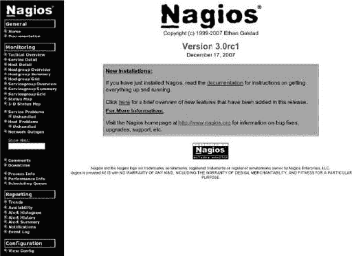
图 3-1. 启动屏幕

所谓的“战术概览”（Tactical Overview）可以通过左菜单栏中的第一个 `monitoring` 链接访问，如图 3-2 所示。它总结了所有受测系统的状态。

然而，在实践中更有趣的是“服务问题”（Service Problems）菜单项（图 3-3）的显示。它记录了当前引起问题的服务，即那些处于 OK 状态之外的服务，这正是 Nagios 设计的初衷：精确地通知管理员任何问题。

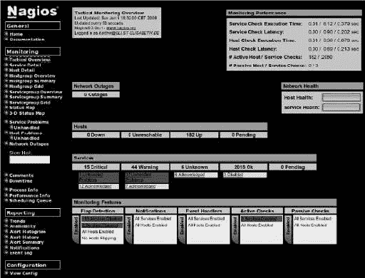
图 3-2. 所有待监控的主机和服务的“战术”概览

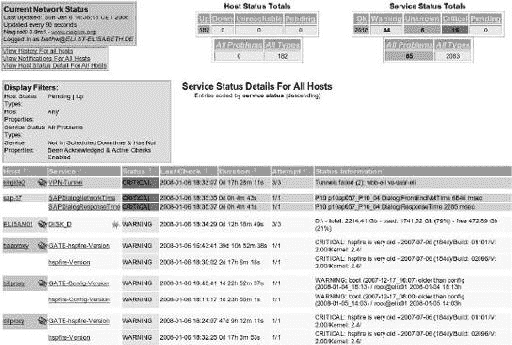
图 3-3. Nagios：所有服务问题摘要

第一列列出了涉及的主机。如果背景为灰色，原则上 Nagios 上可以访问该计算机。如果主机处于“离线”（down）状态，可以通过红色背景看出。对于服务，红色代表 CRITICAL（严重），黄色代表 WARNING（警告）。

第二列提供服务名称，第三列再次以纯文本显示状态。第四列指定了最后一次检查的时间。第五列很有趣——它显示了当前状态持续了多久。

标题为 Attempt（尝试）的第六列揭示了 Nagios 已经执行了多少次测试（失败的）：`3/3` 表示错误状态已连续第三次被确认，但只有在发生错误时才会执行三次测试。最后，最后一列将插件的信息传递给管理员，并向其描述当前状态。


图 3-4. 主机概览（ ()

`Host Detail`（主机详情，图 3-4）和 `Service Detail`（服务详情）概览提供了所有主机和服务的概览。在实践中，你将更精确地查找信息，可以是通过单个主机或某个主机组。相关名称输入到显示（Show）搜索框中。


图 3-5. 主机 `elix01` 的服务（摘）

或者，你可以搜索主机组和服务组的名称。这里一种有趣的变化是通过 Hostgroup 链接获取状态矩阵输出，它显示了所有主机及其相应的服务，以及这些的状态（图 3-6）。


图 3-6. 网格表示的主机组 `eliLINUX`

第二部分。详细细节……

### 4. Nagios 基础

主机可以访问这一事实本身，如果上面没有运行任何人们或某些依赖的服务，其意义不大。因此，Nagios 的一切都围绕服务检查展开。毕竟，没有主机服务无法运行。如果主机计算机故障，它无法提供所需的服务。如果引入了用户与提供系统之间的路由器，情况就会变得稍微复杂。如果路由器故障，所需的服务可能仍在目标主机上运行，但对于用户而言仍然无法访问。


另一个重要的项目是主机或服务的状态。一方面，Nagios 允许比单纯的 `OK` 或“not OK”更精细的区分；另一方面，软状态（soft state）与硬状态（hard state）之间的区别意味着管理员无需处理那些在管理员收到信息之前早已消失的短期中断。这些状态还会影响服务检查的强度。其具体工作原理在 4.3 主机与服务的状态 中进行了详细描述。

## 4.1 考虑网络拓扑

Nagios 如何处理主机和服务的依赖关系，通过一个示例可以得到最为良好的说明。图 4-1 展示了一个小型网络，其中需要监控 `proxy` 上的域名服务（DNS）。

> 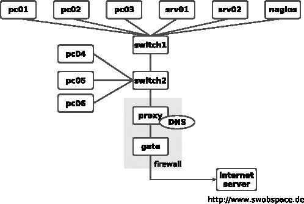
> 图 4-1. 示例网络的拓扑

服务检查始终作为系统定期执行的监控的起点。只要服务可以被访问，Nagios 就不会采取进一步措施；也就是说，它不会执行任何主机检查。

对于 `switch1`、`switch2` 和 `proxy`，这种检查本身是没有意义的，因为如果 DNS 服务对 `proxy` 有响应，那么提到的这些主机自动是可以访问的。

然而，如果命名服务失败，Nagios 将通过主机检查测试相关的计算机，以确定是服务还是主机导致了问题。

如果无法访问 `proxy`，Nagios 可能会测试配置中输入的父主机（图 4-2）。通过 `parents` 主机参数，管理员有一种手段向 Nagios 提供有关网络拓扑的信息。

> 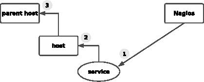
> 图 4-2. 服务失败后执行的测试顺序

在执行此操作时，管理员只需为每个主机输入与父主机通往 Nagios 服务器同一路径上的直接邻居计算机。分配在 Nagios 自身所在网络网段的主机在定义时不定义父主机。对于图 4-1 中的网络拓扑，相应的配置（精简为主机名和父主机）如下所示：

```
define host{
    host_name      proxy
    ...
    parents  switch2
}
define host{
    host_name      switch2
    ...
    parents  switch1
}
define host{
    host_name      switch1
    ...
}
```

`switch1` 位于与 Nagios 服务器相同的网络网段，因此没有为它分配父主机。什么属于一个网段是一个观点问题。如果你将交换机解释为网段边界（如此处所示），这样做的好处是可以更紧密地隔离中断。但你也可以采取不同的观点，将 IP 子网解释为一个网段。那么，路由器将形成网段边界；在我们的示例中，`proxy` 将被认为与 Nagios 服务器处于同一个网络中。然而，此时将无法区分 `proxy` 故障与 `switch1` 或 `switch2` 故障了。

> 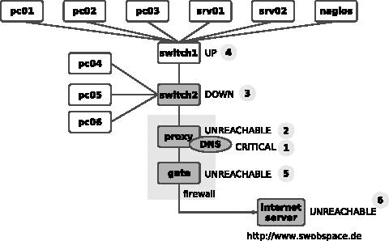
> 图 4-3. Nagios 对单个网络节点的分类

如果示例中的 `switch1` 失败，图 4-3 显示了 Nagios 执行的顺序。首先，系统检查 `proxy` 上的 DNS 服务，并确定该服务不再可访问（1）。为了区分差异，它现在执行主机检查以确定 `proxy` 计算机的状态（2）。由于 `proxy` 无法访问，但它有 `switch2` 作为父主机，Nagios 对 `switch2` 执行主机检查（3）。如果该交换机也无法访问，系统将检查其父主机 `switch1`（4）。

如果 Nagios 能与 `switch1` 建立联系，则 `proxy` 上 DNS 服务失败的原因可以锁定到 `switch2`。系统相应地指定了主机的状态：`switch1` 为 UP（正常），`switch2` 为 DOWN（故障）；而 `proxy` 为 UNREACHABLE（不可达）。通过对 Nagios 消息系统的适当配置（参见第 267 页的 12.3 消息过滤器），你可以利用这种区分来决定仅接收处于 DOWN 状态且代表实际故障的主机通知。

如果 Nagios 能与 `switch1` 建立联系，则 `proxy` 上 DNS 服务失败的原因可以锁定到 `switch2`。系统相应地指定了主机的状态：`switch1` 为 UP，`switch2` 为 DOWN；而 `proxy` 为 UNREACHABLE。通过对 Nagios 消息系统的适当配置（参见第 267 页的 12.3 消息过滤器），你可以利用这种区分来决定仅接收处于 DOWN 状态且代表实际故障的主机通知。

如果 Nagios 能与 `switch1` 建立联系，则 `proxy` 上 DNS 服务失败的原因可以锁定到 `switch2`。系统相应地指定了主机的状态：`switch1` 为 UP，`switch2` 为 DOWN；而 `proxy` 为 UNREACHABLE。

如果 Nagios 能与 `switch1` 建立联系，则 `proxy` 上 DNS 服务失败的原因可以锁定到 `switch2`。系统相应地指定了主机的状态：`switch1` 为 UP，`switch2` 为 DOWN；而 `proxy` 为 UNREACHABLE。

## 4.2 按需主机检查 vs. 周期性测试

原则上，Nagios 定期执行服务检查，被动服务检查除外（参见第 293 页的 13.2 被动服务检查）。主机检查适用略有不同的规则，它们起着主要作用。Nagios 在需要时执行主机检查——即按需执行——并用其监控安装在其上的服务变为错误状态的主机，或依赖于故障主机的主机。种方法是通过主机依赖，如第 289 页的 12.6.2 仅限特殊情况：主机依赖。按需主机检查是 Nagios 的核心功能，因为这是系统能够精确告知管理员交换机故障的唯一方式，而不是用成千上万条不可访问服务的错误消息来轰炸他。


在 Nagios 2.x 中，也可以通过基于 ping 的服务检查技巧来定期检查主机的可达性（参见第 108 页的 6.2 使用 Ping 进行可用性测试）。Nagios 并行执行服务检查，因此 Nagios 2.x 中的串行性能瓶颈得到了释放。同时，你还将获得进一步的信息，例如响应时间或可能的丢包，这为网络负载或可能的网络问题提供了间接线索。相反，主机检查即使在大量数据包丢失且网络性能遭遇灾难的情况下也会发布 OK 状态。正如“主机检查”名称所示，这里涉及的只是原则上的可达性，而不是连接质量。

## 4.3 主机和服务的状态

Nagios 使用插件进行主机和服务的检查。它们提供四种不同的返回值（参见第 105 页的表 6-1）：`0` (OK)、`1` (WARNING)、`2` (CRITICAL) 和 `3` (UNKNOWN)。

返回值 `UNKNOWN` 意味着插件的运行通常发生了错误，可能是因为参数错误。你通常可以在启动插件时指定插件在什么情况下发布警告或关键状态。

Nagios 根据插件的返回值确定服务和主机的状态。服务的状态与返回值 OK、`WARNING`、`CRITICAL` 和 `UNKNOWN` 相同。对于主机，情况略有不同：`UP` 状态描述可达的主机，`DOWN` 意味着计算机宕机，而 `UNREACHABLE` 指不可达状态，即由于父节点宕机，Nagios 无法测试主机是否可用（参见第 92 页的 4.1 考虑网络拓扑）。

此外，Nagios 还区分了两种类型的状态：软状态（soft state）和硬状态（hard state）。如果第一次出现问题（即到目前为止服务的状态没有问题），那么程序最初会将新状态归类为软状态，并重复测试几次。这种错误状态可能只是一个偶然性事件，在短时间之后就消失了。只有当错误在多次测试后仍然存在时，Nagios 才会将其归类为硬状态。管理员仅会被通知硬状态，因为涉及随后立即消失的短期中断的消息只会增加不必要的信息洪流。

在我们的示例中，可以非常简单地说明服务状态的时间顺序。为此使用一个具有以下参数的服务：

```
define service{
    host_name                        proxy
    service_description              DNS
    ... normal_check_interval        5 
    retry_check_interval             1
    max_check_attempts               5
    ...
}
```

`normal_check_interval` 指定了只要状态为 OK 或存在硬状态，Nagios 应该以多长时间的间隔检查相应的服务——在本例中为每五分钟一次。`retry_check_interval` 定义了软状态期间两次服务检查之间的间隔——示例中为一分钟。如果发生新错误，Nagios 将以更短的间隔仔细检查该服务。

`max_check_attempts` 决定了在首次发生错误后服务检查重复执行的频率。如果达到了 `max_check_attempts` 且错误状态持续存在，Nagios 将按照 `normal_check_interval` 中指定的间隔再次检查该服务。

#图 4-4 以图形形式表示了时间进度。该插图从 OK 状态开始（这总是硬状态）。通常情况下，Nagios 将每五分钟重复一次服务检查。十分钟后发生错误；状态变为 `CRITICAL`，但这最初是一个软状态。在此时，Nagios 尚未发布任何消息。

现在系统按照 `retry_check_interval` 指定的间隔检查服务。在这里是每分钟一次。在总共检查五次（如 `max_check_attempts` 所示）且结果相同后，状态从软状态变为硬状态。只有此时，Nagios 才会通知相关人员。现在测试将按照 `normal_check_interval` 中指定的间隔重复进行。

```

```
图 4-4 状态时间顺序示例


> 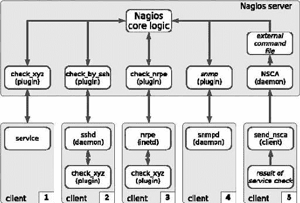

> 图 5-1。Nagios 允许不同的测试方法。

图 5-1 显示了 Nagios 支持的各种测试方法的概览。带有灰色背景的方框标记了所有直接运行在 Nagios 服务器机器上的组件：这包括服务器本身，以及插件和其他辅助工具。该单元与五个客户端建立连接，并以各种方式对其进行测试。接下来的章节将对这些具体方法进行更详细的介绍。

为了监控标记为 `service` 的第一个客户端（从左侧开始）上的网络服务，Nagios 服务器运行其“自己的”插件 `check_xyz`（5.1 直接测试网络服务 所示。

其他特定插件的行为也类似，例如 `check_http`，它不仅可以处理简单的 HTTP 对话，还可以根据需要处理 HTTP 头部，检查 Web 服务器的 SSL 能力和证书，甚至可以使用 `POST` 命令向服务器发送数据（关于此的更多信息请参见第 118 页的 6.4 监控 FTP 和 Web 服务器）。

Nagios 插件包是单独安装（参见第 43 页的 1.4 安装和测试插件），包含了针对最重要的网络服务的特定插件。如果某个特定服务缺少插件，值得看一眼 Nagios 主页^[45^] 或 Exchange for Nagios Add-ons。^[46^]。

如果在这些位置没有找到合适的插件，可以使用通用插件 `check_tcp` 或 `check_udp`，它们在执行端口测试外，还可以向目标发送数据。（参见第 132 页的 6.7.1 测试端口）^[45^] http://www.nagios.org/ ^[46^] http://www.nagiosex.org

## 5.2 通过安全 Shell 在远程计算机上运行插件

为了测试磁盘容量、交换区负载、CPU 负载或特定进程是否运行等本地资源，有多种插件可用。它们被称为“本地”插件，是因为它们必须安装在要检查的计算机上。

Nagios 服务器无法通过网络直接访问此类信息，但它可以通过远程 shell 在远程主机上启动本地插件（图 5-1，第 100 页，客户端 2）。这里应仅考虑安全 Shell（SSH）；远程 Shell（RSH）有太多安全漏洞。

为此，Nagios 服务器运行 `check_by_ssh`，并参数指定目标主机上运行本地插件。为此，`check_by_ssh` 需要一种不需要密码登录目标主机的方法，可以通过公钥认证来实现。

从 Nagios 服务器的角度来看，`check_by_ssh` 是处理结果的插件。它不会注意到安全 shell 连接和远程插件的启动——主要重要的是回复符合 Nagios 标准，并包含状态以及供管理员的行注释文本。（参见第 6 章，第 105 页。）

关于通过安全 Shell 远程执行插件的更多信息请参见第 205 页的 9 章。

## 5.3 Nagios 远程插件执行器

通过安全 shell 运行在目标主机上的插件的另一种方法是 Nagios 远程插件执行器（NRPE）。图 5-1（第 100 页）通过中间客户端说明了这一点。NRPE 安装在目标主机上，并通过 inet 守护进程启动，必须进行相应的配置。如果 NRPE 通过（可选的）TCP 端口 5666 接收来自 Nagios 服务器的查询，它将运行匹配的查询。


这一切相比比使用 Secure Shell（安全壳）要多费精力，特别是 SSH 应该安装在几乎每台 Unix 机器上，而且当使用它时，它可以允许在 Nagios 服务器上集中配置监控。然而，Secure Shell 方法需要一个具有本地 shell 的账户，这使得可以在目标主机上运行任何命令。相比之下，远程插件执行器（Remote Plugin Executor）被限制在已配置的命令。

如果你不希望 `nagios` 用户在没有密码的情况下执行目标主机上运行插件之外的任何操作，那么坚持使用 NRPE 是更好的选择。其安装配置请参见第 10 章第 213 页。

***

Secure Shell 允许在不打开单独 shell 的情况下执行单条命令。但通常，你可能想要测试多个资源，因此需要运行多条命令。

#### 5.4 通过 SNMP 监控

通过简单网络管理协议（SNMP），可以通过网络查询本地资源（另见图 5-1，第 100 页中的客户端 4）。如果安装了 SNMP 守护进程（广泛使用了 `NET-SNMPD`，详见第 238 页第 11.2.2 节 NET-SNMP 守护进程），Nagios 就可以用它查询本地资源，如进程、硬盘和接口负载。

SNMP 的优势在于它被广泛使用。UNIX 和 Windows 系统都有相应的服务，而且几乎所有现代网络组件（如路由器和交换机）都可以通过 SNMP 进行查询。即使是不间断电源（UPS）和其他设备有时也具有网络连接，并可以通过 SNMP 提供当前状态信息。

除了标准插件 `check_snmp`（通用 SNMP 插件）外，还有各种专门的插件，它们专注于特定的 SNMP 查询，但有时使用起来更简单。例如，`check_ifstatus` 和 `check_if-operstatus` 专注于网络接口的状态。

如果你是第一次接触 SNMP，很快就会发现，在定义该协议时，“人类可读”这一短语似乎并不在考虑因素的前列。SNMP 查询是针对机器处理优化的，例如用于网络监控工具。

如果你使用供应商提供的工具来管理其网络组件，SNMP 基本上对用户来说是隐藏的。但若要在 Nagios 中使用它，你就必须亲自动手并涉及该协议及其底层语法。这需要一些时间来适应，但它实际上并没有初看起来看起来那么困难。

SNMP 的用法是第 11 章的主题（第 227 页在那里在那里学习如何为 Linux 和其他 UNIX 系统配置和使用 SNMP 守护进程。

### 5.5 Nagios 服务检查接收器

处理服务检查结果的第五种方法是使用 Nagios 服务检查接收器（NSCA）。它作为守护进程运行在 Nagios 服务器上，并等待传入的测试结果（参见第 5 章右侧的图 5-1）。这种方法被称为“被动式”，因为 Nagios 本身并不主动。

NSCA 使用用于 CGI 脚本等的外部命令接口向 Nagios 发送命令。它由一个命名管道组成，Nagios 从该管道读取外部命令。通过 `PROCESS_SERVICE_CHECK_RESULT` 命令，Nagios 处理在其他地方确定的测试结果。该接口本身在第 292 页的 13.1 节外部命令接口中有更详细的描述。

NSCA 的主要用途是分布式监控。这意味着拥有多个不同的 Nagios 安装，它们将结果发送到中央 Nagios 服务器。这些分布式的 Nagios 服务器（可能位于公司的不同分支）作为自主且独立的 Nagios 实例工作，只是它们也将结果发送到总部。这并没有主动检查去中心化的网络，而是以纯被动的方式处理从分支发送的信息。

然而，NSCA 并不仅限于分布式监控。通过 `send_nsca` 程序，可以发送并非来自 Nagios 实例的测试结果，而是来自执行所需服务检查的 cron 任务等的结果。

在使用 NSCA 之前，你应该考虑安全因素。因为它可以被外部程序用来向 Nagios 发送信息和命令，因此存在被误用的危险。这不应该阻止你使用 NSCA，而应该促使你在配置 NSCA 期间关注安全因素。

关于使用 NSCA、分布式监控以及通用安全性的更多信息请参见第 14 章第 299 页。

***

命名管道（named pipe）是一个缓冲区，一个进程向其中写入内容，另一个进程从其中读取数据。该缓冲区在文件系统中赋予了一个名称，以便进行特定的寻址，这就是为什么它被称为命名管道。

### 第 6 章。网络服务插件

每个用于主机和服务检查的插件都是一个单独且独立的程序，可以脱离 Nagios 独立使用。反过来就没那么容易了：为了让 Nagios 使用外部程序，它必须遵守某些规则。这些规则中的重点是程序返回的状态码。Nagios 通过此精确地评估状态。表 6-1 显示了可能的值。

表 6-1. Nagios 插件的返回值

| 状态 | 名称 | 描述 |
| --- | --- | --- |
| 0 | OK | 一切正常 |
| 1 | WARNING | 已超过警告阈值，但尚未达到临界阈值 |
| 2 | CRITICAL | 超过临界限制或插件在超时后停止了测试 |
| 3 | UNKNOWN | 插件内部发生错误（例如使用了错误的参数） |

因此，插件并不是通过“OK—非 OK”的模式进行区分，而是有更细的分类。为了能够将状态分类为 WARNING，它需要详细说明，即在什么测量值范围内特定事件被视为 OK，何时被视为 WARNING，何时变为 CRITICAL。

例如，除了响应时间外，ping 还返回丢包率。对于慢网络连接（ISDN, DSL），1000 毫秒的响应时间可以被视为警告阈值，5000 毫秒为临界值，因为这意味着交互式工作不再可能。如果网络连接负载很高，有时也会发生丢包，因此可以将 20% 的丢包指定为警告阈值，并将 60% 指定为临界限制。

在所有情况下，由管理员决定哪些值应作为警告信号或被视为临界。由于所有服务都可以单独配置，即使在同一个插件中，每个主机的值也可能有所不同。


插件始终有超时限制，通常为十秒。这防止了程序无限期等待，从而防止大量插件进程在 Nagios 主机上堆积。从其他方面来说，对于许多应用程序而言，超过 10 秒的响应时间没有意义，因为这些程序本身在经过一段时间跨后就会中断连接尝试，这与相应服务完全失败的效果相同。在这里，管理员可以介入并显式地指定不同的超时时间。

所有插件的另一个特性是文本输出，Nagios 会在概览中显示该输出。它主要为管理员设计，因此需要是“人类可读的”。Nagios 2.x 只处理第一行，这里的输出可能不会超过 300 个字符。从 3.0 版本开始 Nagios 不有此限制。输出可以是多行的，长度可达 8KB（参见 8.5.1 多行插件输出，第 193 页）。然而，在 Web 界面，Nagios 3.0 也仅显示第一行。因此，简单的插件应将其输出限制为单行，多行输出仅建议用于特殊应用，例如 `plugin check_multi`（8.5 使用 check_multi 汇总检查）。以下格式已确认为文本输出：

> `TYPE_OF_CHECK STATUS - informational text`

在实践中，文本输出如下：

> `SMTP OK - 0.186 sec. response time`
> `DISK WARNING - free space: 39 MB (7%)`

上述示例分别来自 `check_smtp` 和 `check_disk` 插件。两种情况下，检查类型（此处为 `SMTP` 或 `DISK`）后面是文本形式的状态，然后是实际信息。并非所有插件在输出中都遵循这一建议。有时缺少测试类型的细节，有时甚至缺少状态。

各种插件还提供性能信息，可以使用外部程序进行评估（参见 第 19 章）：

> `OK - 172.129.2: rta 97.751ms, lost 0%| rta=97.751ms;200.000;500;0;pl=0%;40;80;;`

从 `check_icmp` 示例可以看出，性能数据通过管道字符 `|` 分隔。`check_icmp` 在此处提供了两个值：响应时间 `rta`（毫秒）和丢失率 `pl`。对于每个变量，插件首先显示测量值（`97.751` ms 和 `0%`），然后是警告限制（200 毫秒或 40%）和临界限制（500 毫秒或 80%）。`rta` 或 `pl` 的比例已指定——由于单位不需要更改，只需提供一次。

为了尽可能简单（参见 1.4 安装和测试插件，第 43 页），每个程序必须维护帮助页面，通过选项 `-h` 或 `--help` 显示。某些插件在此区分了短帮助（`-h`）和长帮助（`--help`）；因此建议始终尝试使用 `--help`。

本章介绍了 `nagios-plugins` 软件包中最重要的插件，版本 1.4。它们的帮助 Nagios 查询服务器。描述限制了对于正常运行重要的功能。如果你对所有选项感兴趣，请参考集成帮助。

#### 6.1 标准选项

表 6-2 列出了所有插件通用的选项。粗体选项所有插件都了解。非粗体关键字可以被程序省略，但如果支持，必须按指定含义使用。

如果选项需要参数，在短形式中通常用空格分隔，而在长形式中用等号。但对于 Perl 或 shell 脚本，并非所有作者都遵循这些，所以此处没有选项，必须查看相应的描述。

### 表 6-2. 插件的标准选项

| 短形式 | 长形式 | 描述 |
| :--- | :--- | :--- |
| `-h` | `--help` | 输出帮助 |
| `-V` | `--version` | 输出版本 |
| `-v` | `--verbose` | 输出额外信息 |
| `-H` | `--hostname` | 目标主机名或 IP 地址 |
| `-t` | `--timeout` | 插件中断前的超时秒数 |
| `-w` | `--warning` | 指定警告限制 |
| `-c` | `--critical` | 指定临界限制 |
| `-4` | `--use-ipv4` | 强制使用 IPv4 |
| `-6` | `--use-ipv6` | 强制使用 IPv6 |

上述示例分别来自 `check_smtp` 和 `check_disk` 插件。两种情况下，检查类型（此处为 `SMTP` 或 `DISK`）后面是文本形式的状态，然后是实际信息。并非所有插件在输出中都遵循这一建议。有时缺少测试类型的细节，有时甚至缺少状态。

粗体选项所有插件都了解。非粗体关键字可以被程序省略，但如果支持，必须按指定含义使用。

另一方面，`-c` 和 `-w` 的用法可能因插件而异，因为有时除了指定临界限制外还需要单个值。大多数插件都有 `-4` 和 `-6` 选项，1.4 之前并非如此。

ICMP 包不会重发；丢失的包保持丢失。不应再使用 1.4 之前的版本。某些参数已经更改，并且经常缺少性能数据。此外，插件开发人员努力清理现有错误并不断改进插件。

## 6.2 使用 Ping 进行可性测试

Unix 系统中的经典可性测试始终是 ping，它发送 ICMP 请求包并等待 ICMP 响应包。Nagios 插件包包含了两个执行此 ping 检测的程序：`check_icmp` 和 `check_ping`。尽管标准配置中使用 `check_ping`，你也应该将其替换为自 1.4 版本以来引入的更高效 `check_icmp`。

由于 `check_ping` 调用 Unix 程序 `/bin/ping`，这就是为什么与现有的 `ping` 版本总是存在兼容性问题，而 `check_icmp` 不需要任何外部帮助程序即可发送 ICMP。`check_icmp` 的工作基本上更高效，因为它不像 `ping` 那样在单个包之间等待一秒。此外，它评估 ICMP 错误消息（例如 `ICMP host unreachable`），而 `check_ping` 会丢弃这些消息。因此，当收到 `ICMP host unreachable` 消息时，Nagios 会中断测试。

`check_icmp` 具有以下选项：

`-H` `address`


如果没有被测试计算机的主机名或 IP 地址，`check_icmp` 将无法工作。通过 `-H`，可以使用空格分隔多个 `host` 条目。

### `-w` `response_time,packet_loss_percent%`

此开关设置警告阈限。这里的 `response time` 表示期望的响应时间（以毫秒为单位），`packet loss percent` 表示相应的（以百分比形式表示的）丢包率。如果你指定了 `-w 500.0,20%`，当响应时间至少为 500.0 毫秒或丢失了 20% 或以上的 ICMP 数据包时，插件将发出警告。

### `-c` `response_time,packet_loss_percent%`

此开关以与 `-w` 定义警告值相同指定临界阈限。临界阈限应该始终大于警告阈限。

### `-n` `packets`

通过 `packets`，你可以设置 `check_icmp` 每次测试使用的数据包数量。默认值为 `5` 个包。

### `-i` `packet_interval`

此开关设置发往同一主机的两个单数据包之间的时间间隔。默认值为 80 毫秒。它以浮点数指定（例如，`-i 80.000`）。

### `-I` `target_interval`

此开关设置向不同主机发送数据包的时间间隔（前提是 `-H` 包含多个主机）。默认值为 `0` 毫秒，这意味着同时向多个主机发送数据包。

### `-m` `number_of_reachable_hosts`

此开关指定了插件返回 OK 状态必须可达的主机数量。此选项允许进行简单的集群检查：

```
nagios@linux:local/libexec$ ./check_icmp -m 2 -H 192.168.1.9 192.168.1.11 192.168.1.13 OK - 192.168.1.9: rta 0.098ms, lost 0% :: 192.168.1.11: rta nan, lost 100% :: 192.168.1.13: rta 0.744ms, lost 0%|192.168.1.9rta=0.09 8ms;200.000;500.000;0; 192.168.1.9pl=0%;40;80;; 192.168.1.11rta=0. 000ms;200.000;500.000;0; 192.168.1.11pl=100%;40;80;; 192.168.1.13rta=0.744ms;200.000 ;500.000;0; 192.168.1.13pl=0%;40;80;;
```

在指定的三个主机中，`192.168.1.11`（加粗打印）是不可达的。`-m 2` 请求仅两个可达的主机；因此结果为 OK。如果没有这个细节，结果将是 CRITICAL，因为有一个主机不可达。

### `-l` `ttl`

大于 `0` 的值将设置 IP 数据包的 TTL（存活时间）。默认值为 `0`，这意味着插件将 TTL 的选择权交给操作系统。

### `-t` `timeout`

在通过 `timeout` 秒后，插件将中断测试并返回 CRITICAL 状态。默认值为 `10` 秒。

与 `/bin/ping` 程序一样，`check_icmp` 也必须以 `root` 权限运行，这就是为什么设置了 SUID 位：

```
linux:~ # chown root.nagios /usr/local/nagios/libexec/check_icmp
linux:~ # chmod 4711 /usr/local/nagios/libexec/check_icmp
linux:~ # ls -l /usr/local/nagios/libexec/check_icmp
-rwsr-x--x l root nagios 61326 2005-02-08 19:49 check_icmp
```

作为测试，你应该以用户 `nagios` 的身份在命令行上执行该插件，因为 Nagios 稍后将在此账户下执行它：

```
nagios@linux:~$ cd /usr/local/nagios/libexec
nagios@linux:nagios/libexec$ ./check_icmp -H 192.168.1.13 -w 100,20% -c 200,40% OK - 192.168.1.13: rta 253ms, lost 0%|rta=253ms;100;200;0; pl=0%;20;;
```

`check_icmp` 然后会发送标准的五个 ICMP 数据包。它不会返回 OK，而是一旦对所有数据包的平均响应时间至少为 100.0 毫秒或丢失了 20% 或更多（即五个包中至少丢失一个）时，就会发出 WARNING。对于 CRITICAL 状态，平均值必须达到相应阈值。

## 6.2.1 `check_icmp` 作为服务

（注：此部分原文似乎存在翻译乱码或重复，已根据上下文进行意译处理）

为了能够以 `check_host` 的名称使用插件进行主机检查，需要为 `check_icmp` 设置相应的符号链接：

```
linux:~ # cd /usr/local/nagios/libexec
linux:nagios/libexec # ln -s check_icmp check_host
```

如果以新名称 `check_host` 调用，插件会在收到第一个 ICMP 回显报文后中断测试，因为一个回复包足以证明主机“存活”。如果返回的第一个响应是错误消息，例如 `ICMP network unreachable` 或 `host unreachable`，则主机被认为不可达。

## 6.2.2 `check_icmp` 作为主机检查

主机检查并不总是需要通过 `check_icmp` 执行。你完全可以使用针对 TCP 或 UDP 的通用插件（`check_tcp` 和 `check_udp`；参见 6.7.1 测试端口 第 132 页）测试特定端口是否开放。例如，端口扫描器 `nmap` 使用 TCP 80 端口（HTTP）。

这种方法的在于，除了主机本身之外，还需要运行另一个应用程序——即 Web 服务器。此外，对特定应用程序的测试并不意味着计算机不再可达。ping 的巨大优势是内核本身就会响应 ICMP 回显请求报文，因此不需要运行任何应用程序。因此，只有在有充分理由的情况下，你应该从 ping 切换到其他主机检查方法。一个例子可能是过滤了 ICMP 消息的防火墙，管理员对此没有影响，但该防火墙允许通过 TCP 80 端口进行 HTTP 查询。


与其他任何对象一样，服务定义也可以定义在你选择的文件中，Nagios 从该文件中加载对象定义。为了清晰起见，最好为文件选择一个具有描述性的名称，如我们在简单结构中的示例所示，使用 `services.cfg`。

#### 6.3 监控邮件服务器

许多插件可用于监控邮件服务器。邮件服务器本身（邮件传输代理 (MTA)）通过 `check_smtp` 进行监控，邮件服务器上的邮件队列可以使用 `check_mailq` 进行检查。由于后者测试是在本地进行的，该插件将在下一节的 7.8 定期检查邮件队列状态（第 180 页）中描述。

要监控邮件用户代理 (MUA) 协议 POP3 和 IMAP —— 包括 SSL 变体 POP3S 和 IMAPS —— 需要使用 `check_tcp` 插件。`check_pop` 等是 `check_tcp` 的符号链接，它通过调用插件时的名称来确定应该测试哪种协议，并进行相应的预设。

##### 6.3.1 使用 `check_smtp` 监控 SMTP

SMTP 监控插件 `check_smtp` 具有以下选项：

- `-H` `address` `/--host=``address`

> 详细说明应检查 SMTP 服务的计算机。

- `-p` `port` `/--port=``port`

> `port` 决定端口，以防邮件服务没有监听在标准端口 25。通过这种方式，可以监控邮件病毒扫描器 Amavis（通常端口为 10024）等。但这通常从 `localhost` 访问。

- `-e` `string` `/--expect=``string`

> `string` 定义了邮件服务器在第一行回复中必须提供的文本。`string` 的默认设置为 `220`，这是正常 SMTP 问候语的开头，但某些服务器可能有不同的设置。被监控服务的返回错误回复将产生一个 WARNING。

- `-f` `address` `/--from=``address`

> 通过 `address` 你指定一个邮件地址，`check_smtp` 将通过 `MAIL FROM:` 命令发送到服务器。测试 Microsoft Exchange 2000 服务器时需要此选项。

- `-C` `"mail command"` `/--command=``"mail command"`

> 通过 `-C` 你可以向服务器发送单个邮件命令，以稍微扩展测试（见下例）。

- `-R` `"string"` `/--response=` `"string"`

> 如果你通过 `-C` 向服务器发送 SMTP 命令，可以在这里指定预期的回复而不是 `string`（例如 `250`）。“错误的”回复将触发一个 WARNING。

- `-S / --starttls`

> 测试期间的连接建立使用 STARTTLS。

- `-D` `duration`/--certificate=``duration`

> 用于 STARTTLS 的证书必须仍然有效的最小天数。

- `-A / --authtype=``autheutication type`

> SMTP-Auth 过程的身份验证类型。默认是 `none`（无认证）。目前支持的唯一过程是 `LOGIN`，它基于用户-密码对。

- `-U / --authuser=``user`

> 如果使用了 `-A LOGIN`，则是 SMTP 认证的用户名。

- `-P / --authpass=``password`

> 如果指定了 `-A LOGIN`，则是对应的密码。

- `-w` `floating_point_dec` `/--warning=``floatii2g_point_dec`

> 如果服务器响应时间超过 `floating_point_dec` 秒，`check_smtp` 将发布一个 WARNING。

- `-c` `floating_point_dec` `/--critical=``floating_point_dec`

> 与 `-w` 类似，区别是 `check_smtp` 在 `floating_point_dec` 秒后会发布一个 CRITICAL。

在最简单的情况下，只需输入邮件服务器的名称或 IP 地址：

```bash
nagios@linux:nagios/libexec$./check_smtp -H smtp01 SMTP OK - 0,008 sec. response time|time=0,008157s;;;0,000000
```

插件 `check_smtp` 在收到 SMTP 问候语后会返回一个 `HELO` `hostname`，它应该包含回复 `250`。

在这种情况下，相应的命令对象的定义如下：

```bash
define command{
    command_name   check_smtp
    command_line      $USER1$/check_smtp -H $HOSTADDRESS$
}
```

要用此检查主机对象 `linux01`，需要以下服务定义：

```bash
define service{
    service_description    SMTP
}
```

使用 `-C` 选项，可以扩展对话：

```bash
nagios@linux:nagios/libexec$./check_smtp -H smtp01 SMTP OK - 0,008 sec. response time|time=0,008157s;;;0,000000
```

##### 6.3.2 POP 和 IMAP

有四个伪插件可测试 POP 和 IMAP：`check_pop`、`check_spop`、`check_imap` 和 `check_simap`。它们被称为插件，是因为它们只是 `check_tcp` 的符号链接。通过调用插件时的名称，可以确定其预期用途并相应地设置参数，例如标准端口、是否发送内容、预期回复以及如何终止连接。所有插件的选项都是相同的，因此我们将它们一起介绍：

- `-H` `address` `/--host=``address`

> 指定检查 POP 或 IMAP 的计算机。

- `-p` `port` `/--port=``port`

> `port` 指定当插件旨在监控非标准端口时的端口：`check_pop` 为 110，`check_spop` 为 995，`check_imap` 为 143，`check_simap` 为 993（参见 `/etc/services`）。

- `-w` `floating_point_dec` `/--warning=``floating_point_dec`

> 占位符 `floating_point_dec` 被替换为响应时间的限制，以浮点小数表示。

- `-c` `floating_point_dec` `/--critical=``floating_point_dec`

> 设置响应时间的临界限制（参见 `-w`）。

- `-s` `"string"` `/--send=``string`

> 此字符串将发送到服务器。在默认设置下，四个插件都不使用此选项。

- `-e` `"string"` `/--expect=``string`

> `string` 指定一个必须包含在服务器回复中的文本字符串。(S) POP 的默认值为 `OK`，(S)IMAP 的默认值为 `* OK`。此选项可以多次使用，以便在答案中搜索不同的部分字符串。

- `-E / --escape`

> 此开关允许在 `-s` 和 `-e` 的细节中使用转义序列 `\n`、`\r`、`\t` 或简单的 `\`。在所有情况下，`-E` 必须放置在其产生影响的选项 `-s` 和 `-e` 之前。

- `-A / --all`


> 如果你使用 `-e` 指定了多个回复字符串，那么带有 `-A` 参数的插件只有在找到所有要求的回复字符串时才会返回 OK。如果没有此选项，在多个所查找的字符串中找到其中一个即可触发正向确认。

`-M` `return value` `/ -mismatch=`return value`

> 如果返回的字符串与 `-e` 中指定的语句不匹配，插件应该如何反应？默认是 `warn`，这意味着返回一个 WARNING（警告）。使用 `crit` 时可以将虚假返回赋值为 CRITICAL（严重），使用 `ok` 则赋值为 OK。

`-q` `"string"` `/--quit="string"`

> 这是请求服务结束连接的字符串。对于 (S)POP，该字符串为 `QUIT\r\n`；对于 (S)IMAP，则是 `al L0G0UT\r\n`。

`-S / --ssl`

> 测试期间建立的连接将使用 SSL/TLS。如果你调用了 `check_simap` 和 `check_spop` 插件，此选项会自动设置。为了建立连接，服务器必须在所指定的端口上直接支持 SSL/TLS。

> STARTTLS 本身并不支持该插件。通过：
```
./check_imap -H computer -s "a1 CAPABILITY" -e "STARTTLS"
```
> 你至少可以检查服务器是否提供了这种方法：如果回复字符串包含 STARTTLS，插件返回 OK；如果不包含，则返回 WARNING。但这并不是对 STARTTLS 是否真的正常运行的真实测试。

`-D` `duration` `/--certificate=duration`

> 此开关指定了用于 STARTTLS 的证书的有效期天数。

`-r` `return_value` `/ -refuse=return_value`

> 此开关指定了当服务器拒绝 TCP 连接时插件返回的值。默认值是 `crit`（CRITICAL）。在没有可用的 POP 或 IMAP 服务时，可以将值设置为 `ok`。第三种可能的值 `warn` 会触发一个 WARNING（警告）。

`-m` `bytes` `/--maxbytes=bytes`

> 此开关建议插件在接收到指定数量的数据（以字节字节）后关闭 TCP 连接。

`-d` `seconds` `/--delay=seconds`

> 此开关在向服务器发送字符串后，等待指定的时间，然后再搜索由 `-e` 指定的字符串。

当然，通用插件 `check_tcp` 的所有其他选项（见第 132 页的 [6.7.1 测试 TCP 端口]）都可以用于 `check_pop`、`check_spop`、`check_imap` 和 `check_simap`。

在简单的情况下，你只需要提供要测试的计算机名称（此处为 `mailsrv`）或 IP 地址：

```
nagios@linux:nagios/libexec$ ./check_pop -H mailsrv POP OK - 0.064 second response time on port 110 [+OK eli11 Cyrus POP3
v2.1.16 server ready <1481963980.1118597146@eli11>]
|time=0.064228s;0.000000;0.000000;0.000000;10.000000
```

在每情况下，插件只提供一行输出，出于布局原因，这里对其进行了换行处理。管道符 `|` 之后的细节涉及到 Web 界面未显示的性能数据。性能数据的结构以及如何处理它们在第 404 页的 [19.1 使用 Nagios 处理插件性能数据] 中有更详细的描述。

上述 `check_pop` 命令以命令对象的形式实现如下：

```
define command{
    command_name  check_pop
    command_line      $USER1$/check_pop -H $HOSTADDRESS$
}
```

作为机器 `linuxO1` 的一个服务，其集成方式如下：

```
define service{
    service_description      POP
    host_name               linux01    check_command    check_pop      ...
}
```

STARTTLS 指的是服务在建立普通连接后建立 SSL/TLS 安全连接的能力——例如，对于 POP3，通过 TCP 端口 110。所有实现 STARTTLS 的服务都必须有可用的命令来执行此操作。对于 POP3，这被称为 `STLS`（参见 RFC 2595）。STARTTLS 用于 SMTP、LDAP、IMAP 和 POP3 等，但并非每个服务器都自动支持这种方法。

#### 6.4 监控 FTP 和 Web 服务器

Nagios 插件包提供了两个插件来监控经典的互联网服务 FTP 和 HTTP（包括 HTTPS）：`check_ftp` 和 `check_http`。当网络中的许多用户使用 Web 服务时，通常还会额外使用代理。为了监控这一点，你也可以使用 `check_http`，但 Nagios Exchange 提供了更好的工具：`check_squid.pl` 插件。

##### 6.4.1 FTP 服务

`check_ftp` 插件与 POP 和 IMAP 插件一样，是通用插件 `check_tcp` 的符号链接，因此它们具有相同的选项。它们在第 132 页的 [6.7.1 测试 TCP 端口] 中描述。

当使用 `check_ftp` 调用时，通用插件会设置以下内容：
`--port=21 --quit="QUIT\r\n"`

它不发送字符串，而是期望 `QUIT\r\n`。在命令行上，通常只有一行（见第 404 页的 [19.1 使用 Nagios 处理插件性能数据]）。

作为命令对象，`check_pop` 命令如下：

```
define command{
    command_name  check_pop
    command_line      $USER1$/check_pop -H $HOSTADDRESS$
}
```

相应的服务定义如下：

```
define service{
    service_description      POP
    host_name               linux01    check_command    check_pop      ...
}
```

### 6.4.2 通过 HTTP  Web 服务器

用于 HTTP 和 HTTPS 的 `check_http` 插件包含许多有用选项，取决于用途：

`-H` `virtual_host` `/--host=virtual_host`

此开关指定插件在 HTTP 头中传输的虚拟主机。

`-I` `ip_address` `/--IP-address=ip-address`

使用目标计算机的主机或 IP 地址代替 `ip`。对于具有多个虚拟环境的系统，这将进入默认环境，对于大多数 Web 托管你将收到错误消息：

`-u` `url_or_path` `/--url=url_or_path`

参数是发送给 Web 服务器的 URL。如果设计文档位于要测试的服务器上，只需从服务器文档根目录开始输入路径。

`-p` `port` `/--port=port`

这是 HTTP 的另一种端口指定方式。

`-w` `floating_point_dec` `/--warning=floating_point_dec`

`-c` `floating_point_dec` `/--critical=floating_point_dec`


当 `timeout` 秒过期后，插件将中断测试并返回 `CRITICAL` 状态。默认值为 `10` 秒。

`-L` `/--link-url`

此选项确保文本输出中的虚拟主机在 Web 界面上显示为链接。

```
nagios@linux:nagios/libexec$ ./check_http -H www.swobspace.de -L <A HREF="http://www.swobspace.de:80/" target="_blank"> HTTP OK HTT P/1.1 200 OK - 2553 bytes in 0.156 seconds</A>
```

`-a` `username : password` `/--authorization=username : password`

如果 Web 服务器需要身份验证，可以使用此选项指定用户-密码对。然而，插件只能处理基础认证（basic authentication）；目前尚不支持摘要认证（digest authentication）。

`-f` `behavior` `/--onredirect=behavior`

如果 Web 服务器对请求的 Web 页面返回重定向，`behavior` 参数将影响插件的行为。允许的值有 `ok`、`warning`、`critical` 和 `follow`。默认值为 `ok`，因此插件将简单返回 OK，而不跟随重定向。可以通过 `follow` 让插件跟随重定向。带有重定向的 `warning` 和 `critical` 将返回 `WARNING` 或 `CRITICAL` 状态。

`-e` `"string"` `/--expect="string"`

这是服务器响应的第一行状态行中应包含的文本。如果未指定此选项，插件期望字符串为 `HTTP/1.`。

`-s` `"string"` `/--string="string"`

这是插件在返回的页面内容中查找的文本，而不是在 Header 中查找。

`-r` `"regexp"` `/--regex="regexp"`

这是插件在返回的页面中搜索的正则表达式。

`-R` `"regexp"` `/--eregi="regexp"`

此开关的作用与 `-r` 类似，但插件现在不再区分大小写。

`--invert-regex`

此选项将反转 `-r` 或 `-R` 的搜索。如果存在匹配项，插件现在将返回 CRITICAL 而不是 OK。

`-l` `/--linespan`

通常使用 `-r` 和 `-R` 时，正则表达式搜索被限制在一行。如果 `-l` 位于这些选项之前，搜索模式可以引用跨多行的文本。

`-P` `string` `/--post=string`

使用此开关处理您想通过 `POST` 命令发送到 Web 服务器的数据。`string` 中的字符必须根据 RFC 1738 进行编码：仅允许字母 A 到 Z（大小写）、特殊字符 `$-_. + !*' ()` 以及数字 0 到 9。

要将文本 Übung für Anfänger（德语意为“初学者练习”）作为 `string` 发送，必须在发送前对变音符号和空格进行编码：%DCbung%20f%FCr%20Anf%E4nger.`

`-T` `string` `/ -content-type=string`

如果您使用 `--post` 向服务器发送某些内容，此项用于指定 Header 的 `content type`。默认值为 `application/x-www-form-urlencoded`。所有内容类型的列表可以在 `/etc/mime.types` 文件中找到，格式描述可以在 RFC2045 中找到。

`-m` `min_bytes:max_bytes` `/--pagesize=min_bytes:max_bytes`

该参数定义返回的页面必须至少为 `min_bytes`，否则插件将发出 `WARNING`。您还可以选择性使用上限（用冒号分隔）来指定 Web 页面的大小。现在，如果返回的页面大于 `max_bytes`，`check_http` 也会给出。在以下示例中，如果返回的页面至少为 500 字节且最多 2000 字节，则一切正常：

```
nagios@linux:nagios/libexec$ ./check_http -H www.swobspace.de m 500:2000 HTTP WARNING: page size 2802 too large|size=2802B;500;0;0
```

`-N` `/--no-body`

使用此选项，插件不会等待服务器返回完整的页面内容，而是读取 Header 数据。为了实现这一点，它使用 HTTP 命令 `GET` 或 `POST`，而不是 `HEAD`。

`-M` `seconds` `/--max-age=seconds`

如果返回的文件于 Header 中指定的日期（HTTP Header 字段 `Date:`），插件将生成 `WARNING`。除了秒（不带额外细节）之外，您还可以使用显式单位，如 `5m`（五分钟）、`12h`（十二小时）或 `3d`（三天）；不允许组合。

`-A` `"string"` `/--useragent="string"`

此参数在 HTTP Header 中显式指定用户代理，例如 `-A "Lynx/1.12"` 用于 Lynx 1.12 版本。通常插件不发送此字段。

`-k` `"string"` `/--header="string"`

此项指定任何 HTTP Header 标签。如果需要指定多个标签，必须用分号隔离，如下例所示：

```
-k "Accept-Charset:ISO-8859-1"
```

`-S` `/--ssl`

强制执行 SSL 连接。

```
nagios@linux:nagios/libexec$ ./check_http -H www.swobspace.de --ssl HTTP/1.1 200 OK
```

`-C` `"string"` `/--certificate="string"`

测试证书是否有效。否则发出 `WARNING`。

`-4` `/--use-ipv4`

通过 IPv4 进行测试。

`-6` `/--use-ipv6`

通过 IPv6 进行测试。

关键条目以粗体显示。与普通的 Web 查询相比，浏览器通过 GET 命令向服务器请求文档，而不是指定目录路径，而是使用完整 URL。在 `Host:` 字段中，它指定实际想要访问的主机名。对于直接访问 Web 服务器（不通过代理）的普通 HTTP 查询，那里将写入主机名。这种行为可以通过 `check_http` 来复现：

```
nagios@linux:nagios/libexec$ ./check_http -H www.swobspace.de -I 192.168.1.13 -p 3128 -u http://www.swobspace.de HTTP/1.1 200 OK - 2553 bytes in 0.002 seconds
```


```
`Connection: close`
`Host: www.swobspace.de`
```

此测试不使用任何特定于代理的实现信息，因此它可以在每个 Web 代理上运行。

命令对象的定义如下：

```
define command{
    command_name   check_proxy
    command_line  $USER1$/check_http -H www.google.de -u http://www.google.de -I $HOSTADDRESS$ -p $ARG1$
}
```

然后使用以下服务对代理计算机 `linuxO1` 进行测试：

```
define service{
    service_description    Webproxy
    host_name            linux01    check_command    check_proxy!3128    ...
}
```

参数 `3128` 确保命令对象 `check_proxy` 能够从 `$ARG1$` 中读取端口号。

## 使用 `check_squid` 进行代理测试

上一节介绍的 `check_http` 代理检查仅在目标 Web 页面可用或已存在于缓存时才有效。如果两种情况都不满足，该测试将产生错误，即使代理在原理上是可以工作的。

插件 `check_squid.pl` 使用了不同的方法，但它不是标准安装的一部分，可以在 Check Plugins（检查插件）分类下的 Software | HTTP & FTP | Squid Proxy 找到。

它利用 Squid 代理的缓存管理器，该管理器通过伪协议进行查询。发送的命令的形式如下

```
GET cache_object: //ip_address/command HTTP/1.1\n\n
```

发送到 Squid 并获取所需信息。插件 `check_squid.pl` 使用 `info` 命令，该命令查询范围统计使用信息：

```bash
user@linux:~$ "echo "GET cache_object://192.168.1.13/info HTTP/1.1\n\n""
    | netcat 192.168.1.13 3128 ...
File descriptor usage for squid:
    Maximum number of file descriptors:     1024
    Largest file desc currently in use:       18
    Number of file desc currently in use:     15
    Files queued for open:                   0
    Available number of file descriptors:     1009
    Reserved number of file descriptors:     100
    Store Disk files open:                   0
...
```

它针对的是仍然空的文件描述符数量（倒数第三行）；你可以为此值设置警告或关键界限。在同时访问 Squid 缓存中的对象时，文件描述符的数量起着作用。在并行访问代理次数较高的环境中，1024 个文件描述符可能是不足的。在只有几百用户（且并非所有人同时上网）的小型网络中，编译内置的 1024 值将足够。

### Squid 配置

通常，Squid 允许从 `localhost` 访问缓存管理器。为了让 Nagios 能够通过网络查询它，必须重新配置代理：

```
...
acl manager proto cache_object acl nagiosserver 192.168.1.9 http_access allow nagiosserver http_access deny manager cachemgr_passwd none info menu...
```

`squid.conf` 中必要的更改已加粗显示，而其他相关行已包含在默认配置中。打印的第一行通过内部协议 `cache_object` 定义了一个名为 `manager` 的访问控制列表（Access Control List, `acl`），因此它引用所有使用 `cache_object` 协议访问代理的内容。随后是基于 Nagios 服务器 IP 地址（此处为 `192.168.1.9`）的访问列表。列表名称 `nagiosserver` 在此处可以自由选择（类似于第一行的 `manager`）。通过 `http_access allow nagiosserver` 获得对缓存管理器（`manager`）的访问权限，随后 `http_access deny manager` 行禁止了通过 `cache_object` 协议对所有其他访问。最后，`cachemgr_passwd` 为缓存管理器访问提供密码。如果你省略此项并选择 `none`，则应该允许具有潜在更改能力的命令，例如 `info` 和 `menu`（后者显示缓存管理器可以执行的所有操作）。在修改配置文件后，Squid 需要重新读取它：

```bash
linux:~ #etc/init.d/squid reload
```

### 应用插件

测试插件 `check_squid.pl` 本身具有以下选项：

- `-H` `--hostname=address`：这是要测试 Squid 的服务器，通过 IP 地址或 FQDN 指定。
- `-P` `--port=port`：这指定 Squid 监听的端口。默认是标准端口 3128。
- `-p` `--password=password`：这是访问缓存管理器的密码。
- `-w` `--free_descriptors=free_descriptors`：这是空闲描述符的数量，当数量低于此值时，插件将发出警告。默认值为 200。
- `-c` `--free_descriptors=free_descriptors`：这是空闲描述符的关键界限。如果数量低于此值，`check_squid` 返回 CRITICAL（严重）。默认值为 50。

当运行 `check_squid` 时，其结果通常非常平淡：

```bash
nagios@linux/libexec$./check_squid.pl -H 192.168.1.13 Squid cache OK (1009)
```

匹配命令也没有问题：

```
define command{
    command_name  check_squid.pl
    command_line  $USER1$/check_squid.pl -H $HOSTADDRESS$
}
```

服务定义也是如此：

```
define service{
    service_description  Squid
    host_name            linux01    check_command  check_squid.pl    ...
}
```

#### 6.5 域名服务器控制

还有两个插件用于测试域名服务（DNS）：`check_dns` 和 `check_dig`。`check_dns` 使用外部 `nslookup` 测试主机是否可以解析，而 `check_dig` 允许查询任何记录。这两个插件都是标准发行的一部分。

它们的使用场景有一定的重叠。通过 `check_dns`，你也可以显式查询特定的 DNS 服务器，尽管该插件实际上用于检查域名服务的可用性。

##### 6.5.1 使用 `nslookup` 进行 DNS 检查

`check_dns` 插件检查指定的主机是否可以解析为 IP 地址。在本地使用时，该插件测试运行它的计算机 DNS 配置。对于名称解析，它使用 `/etc/resolv.conf` 配置的名称服务器。

可能的选项同样平淡：

- `-H` `--hostname=host`：这是要解析为 IP 地址的主机。
- `-s` `--server=dns-server`：此开关显式指定要使用的 DNS 服务器。如果缺少此选项，`check_dns` 使用 `/etc/resolv.conf` 中的名称服务器。
- `-a` `--expected-address=ip_address`：`ip_address` 是 `host` 应拥有的 IP 地址。如果域名服务返回不同的地址，插件将发出 CRITICAL 报警。只有在需要域名服务器提供固定 IP 地址时，此选项才有意义。如果没有此选项，插件将接受任何 IP 地址作为回复。
- `-A` `--expect-authority`


使用 `-s`指定的名称服务器应该对给定的查询提供权威解答，因此相应的域名必须作为主或从名称服务器运行。如果不是如此，插件将返回 `CRITICAL`。

`-w` `floating point` `/ -warning=floating point`

> 此开关指定了名称服务器响应时间的警告阈值（单位为秒，指定为浮点数）。

`-c` `floating point` `/ - critical=floating point`

> 此开关指定了名称服务器的临界响应时间（单位为秒，指定为浮点数）。

`-t` `timeout` `/ --timeout=timeout`

> 在 `timeout` 秒过期后，插件将中断测试并返回 `CRITICAL` 状态。默认值为 `10` 秒。

对于 DNS 配置的本地测试（不是针对名称服务器的测试），你只需要一个极不可能从 DNS 中消失的主机名，例如 [www.google.com](http://www.google.com)：

```
nagios@linux:nagios/libexec$ /check_dns -H www.google.com
DNS OK: 0,009 seconds response time www.google.com returns 216.239.59.99
```

在这种情况下，相应的命令定义显示如下：

```
define command{
    command_name check_dns
    command_line $USER1$/check_dns -H www.google.de
}
```

以下服务测试了计算机 `linux01` 的名称服务器配置是否运行正常：

```
define service{
    service_description      DNS/nslookup
    host_name            linux01 
    check_command  check_dns    ...
}
```

##### 6.5.2 使用 `dig` 监控名称服务器

`check_dig` 插件相比 `check_dns` 为监控名称服务器提供了更多选项。正如其名所示，它是基于外部工具 `dig` 的，专为此目的而设计。

`-H` `address` `/ --hostname=address`

> `address` 是要测试 DNS 服务器的 IP 地址。也可以指定主机名（而不是 IP 地址），但在大多数情况下这意义不大，因为在在到达名称服务器之前必须先对其进行解析。

`-p` `port` `/ --port=port`

> 此开关指定要使用的 UDP 端口。默认值为 `53`。

`−1` `hostname` `/ --lookup=hostuame`

> `hostname` 是要测试的主机名。如果没有查询特定的计算机，而仅测试 DNS 服务器的功能，则你应该在这里指定一个从互联网可以轻松访问的地址，例如 [www.google.com](http://www.google.com)。

`-T` `record_type` `/ --record_type=record_type`

> 此开关指定了要查询的记录类型。默认是 `A`（IPv4 地址），但经常也使用 `NS`（相关名称服务器）、`MX`（相关邮件交换）、`PTR`（指针；反向查询的 IP 地址）或 `S0A`（权威来源，域名的管理细节）。

`-w` `floating_point_dec` `/ --warning=floating_point_dec`

> 此开关设置了名称服务器响应时间的警告阈值（单位为秒，浮点小数）。

`-c` `floating_point_dec` `/ --critical=floating_point_dec`

> 此开关设置了名称服务器的临界响应时间（单位为秒，浮点小数）。

`-a` `address` `/ --expected_address=address`

> 这是 `dig` 在 ANSWER SECTION 中应该返回的地址。与 `check_dns` 不同，`check_dig` 只有在 IP 地址不匹配时返回 WARNING，但回复本身在给定的时间限制内到达。

`-t` `timeout` `/ --timeout=timeout`

> 在 `timeout` 秒过期后，插件将中断测试并返回 `CRITICAL` 状态。默认值为 `10` 秒。

以下服务测试了计算机 `linux01` 的名称服务器配置是否运行正常：

```
define service{
    service_description      DNS/nslookup
    host_name            linux01 
    check_command  check_dns    ...
}
```

（ 文]
[content] 
，指定一个从互联网可以轻松访问的地址，例如 [www.google.com](http://www.google.com)。

> `hostname` 是要测试的主机名。如果没有查询特定的计算机，而仅测试 DNS 服务器的功能，则你应该在这里指定一个从互联网可以轻松访问的地址，例如 [www.google.com](http://www.google.com)。

`-T` `record_type` `/ --record_type=record_type`

> 此开关指定了要查询的记录类型。默认是 `A`（IPv4 地址），但经常也使用 `NS`（相关名称服务器）、`MX`（相关邮件交换）、`PTR`（指针；反向查询的 IP 地址）或 `S0A`（权威来源，域名的管理细节）。

`-w` `floating_point_dec` `/ --warning=floating_point_dec`

> 此开关设置了名称服务器响应时间的警告阈值（单位为秒，浮点小数）。

`-c` `floating_point_dec` `/ --critical=floating_point_dec`

> 此开关设置了名称服务器的临界响应时间（单位为秒，浮点小数）。

`-a` `address` `/ --expected_address=address`

> 这是 `dig` 在 ANSWER SECTION 中应该返回的地址。与 `check_dns` 不同，`check_dig` 只有在 IP 地址不匹配时返回 WARNING，但回复本身在给定的时间限制内到达。

`-t` `timeout` `/ --timeout=timeout`

> 在 `timeout` 秒过期后，插件将中断测试并返回 `CRITICAL` 状态。默认值为 `10` 秒。

（注：由于原文在后半部分存在重复和乱码，以上翻译已根据逻辑对重复内容进行了清理和对齐。）
[/content] 抱歉，提供的原文中出现了严重的重复。我为您提供一份完整且准确的翻译：

[content]
使用 `-s`指定的名称服务器应该对给定的查询提供权威解答，因此相应的域名必须作为主或从名称服务器运行。如果不是如此，插件将返回 `CRITICAL`。

`-w` `floating point` `/ -warning=floating point`

> 此开关指定了名称服务器响应时间的警告阈值（单位为秒，指定为浮点数）。

`-c` `floating point` `/ - critical=floating point`

> 此开关指定了名称服务器的临界响应时间（单位为秒，指定为浮点数）。

`-t` `timeout` `/ --timeout=timeout`

> 在 `timeout` 秒过期后，插件将中断测试并返回 `CRITICAL` 状态。默认值为 `10` 秒。

对于 DNS 配置的本地测试（不是针对名称服务器的测试），你只需要一个极不可能从 DNS 中消失的主机名，例如 [www.google.com](http://www.google.com)：

```
nagios@linux:nagios/libexec$ /check_dns -H www.google.com
DNS OK: 0,009 seconds response time www.google.com returns 216.239.59.99
```

在这种情况下，相应的命令定义显示如下：

```
define command{
    command_name check_dns
    command_line $USER1$/check_dns -H www.google.de
}
```

以下服务测试了计算机 `linux01` 的名称服务器配置是否运行正常：

```
define service{
    service_description      DNS/nslookup
    host_name            linux01 
    check_command  check_dns    ...
}
```

##### 6.5.2 使用 `dig` 监控名称服务器

`check_dig` 插件相比 `check_dns` 为监控名称服务器提供了更多选项。正如其名所示，它是基于外部工具 `dig` 的，专为此目的而设计。

`-H` `address` `/ --hostname=address`

> `address` 是要测试 DNS 服务器的 IP 地址。也可以指定主机名（而不是 IP 地址），但在大多数情况下这意义不大，因为在到达名称服务器之前必须先对其进行解析。

`-p` `port` `/ --port=port`

> 此开关指定了要使用的 UDP 端口。默认值为 `53`。

`−1` `hostname` `/ --lookup=hostuame`

> `hostname` 是要测试的主机名。如果没有查询特定的计算机，而仅测试 DNS 服务器的功能，则你应该在这里指定一个从互联网可以轻松访问的地址，例如 [www.google.com](http://www.google.com)。

`-T` `record_type` `/ --record_type=record_type`

> 此开关指定了要查询的记录类型。默认是 `A`（IPv4 地址），但经常也使用 `NS`（相关名称服务器）、`MX`（相关邮件交换）、`PTR`（指针；反向查询的 IP 地址）或 `S0A`（权威来源，域名的管理细节）。

`-w` `floating_point_dec` `/ --warning=floating_point_dec`

> 此开关设置了名称服务器响应时间的警告阈值（单位为秒，浮点小数）。

`-c` `floating_point_dec` `/ --critical=floating_point_dec`

> 此开关设置了名称服务器的临界响应时间（单位为秒，浮点小数）。

`-a` `address` `/ --expected_address=address`

> 这是 `dig` 在 ANSWER SECTION 中应该返回的地址。与 `check_dns` 不同，`check_dig` 只有在 IP 地址不匹配时返回 WARNING，但回复本身在给定的时间限制内到达。

`-t` `timeout` `/ --timeout=timeout`

> 在 `timeout` 秒过期后，插件将中断测试并返回 `CRITICAL` 状态。默认值为 `10` 秒。

（注：原文后半部分存在大量重复和乱码，以上翻译已根据逻辑进行了去重处理。）


这两个插件都会向服务器发送一个字符串并评估回复。对于像 `POP` 或 `IMAP` 这样基于文本的协议，这是最简单的：这两个“特定”插件是专门为这两种邮件服务定制的（请参见第 115 页的 6.3.2 POP 和 IMAP），它们仅使用了指向 `check_tcp` 的符号链接，而 `check_tcp` 已经使用相关的默认设置完成了相应的问答游戏。

如果你知道要测试的协议，并配置了一个与该协议匹配的“测验”（对于二进制协议来说这并不是一项易事），那么检查将将不止是端口扫描了。通过这种方式，通用插件也可以替换缺失的特定插件。

##### 6.7.1 测试 TCP 端口

`check_tcp` 专注于基于 TCP 的服务。根据其通用性，它有大量的选项：

- `-H` `address` `/ --hostname=`address``

  > > 这是要测试其端口的计算机的 IP 地址或主机名。

- `-p` `port` `/ --port=`port``

  > > 这指定了目标端口。与形成指向 `check_tcp` 符号链接的插件不同，此细节是始终要求的。

- `-w` `floating_point_dec` `/ --warning=`floating_point_dec``

  > > 这设置了响应时间（秒）的警告阈值。

- `-c` `floating_point_dec` `/ --critical=`floating_point_dec``

  > > 这设置了类似于 `-w` 的时间限制，但指定了临界限制值。

- `-s` `"string"` `/ --send=`string"```

  > > 这是插件向服务器发送的字符串。

- `-e` `"string"` `/ --expect=`string"```

  > > 这是服务器回复应包含的字符串。插件在这里并不限制搜索于第一行。

- `-E` `/ --escape`

  > > 这允许对 `-s` 和 `-e` 使用转义序列 `\n`、`\r`、`\t` 或简单的 `\`。在所有情况下，`-E` 必须放在对其产生影响的选项 `-s` 和 `-e` 之前。

- `-A` `/ --all`

  > > 如果你用 `-e` 指定了多个回复字符串，带有 `-A` 的插件将只有在找到所有要求的回复字符串时才返回 OK。如果没有此选项，只要找到几个字符串中的一个，就足够返回正面结果。

- `-M` `return_value` `/ --mismatch=`return_value``

  > > 如果返回的字符串与 `-e` 指定的不匹配，插件应该如何反应？默认是 `warn`，这意味着给出一个 WARNING。使用 `crit` 时，错误的返回值可以归类为 CRITICAL；使用 `ok`，则归类为 OK。

- `-q` `"string"` `/ --quit=`string"```

  > > 这是请求服务结束连接的字符串。

- `-m` `bytes` `/ --maxbytes=`bytes``

  > > 如果插件接收到的字节超过 `bytes`，则关闭连接。

- `-d` `floating_point_decimal` `/ --delay=`floating_point_decimal``

  > > 这是发送字符串与检查回复之间的时间间隔（秒）。

- `-t` `timeout` `/ --timeout=`timeout``

  > > 在 `timeout`（默认值为 `10`）秒后，插件停止测试并返回 CRITICAL 状态。

- `-j` `/ --jail`

  > > 设置此项将显示 TCP 输出。对于 POP 或 IMAP 等基于文本的协议，这通常是“人类可读的”，但对于二进制协议，你通常无法解析输出，因此 `-j` 是合适的。

- `-r` `return_value` `/ --refuse=`return_value``

  > > 此开关指定了当服务器拒绝 TCP 连接时插件返回的值。默认值是 `crit`（CRITICAL）。使用 `ok` 作为 `return_value`，你可以测试一个不应从外部访问的服务是否可用。第三种可能的值 `warn` 确保给出 WARNING。

- `-D` `days` `/ --certificate=`days``

  > > 这是为了让测试运行成功而服务器证书必须有效的时长跨度（天）。它仅适用于 SSL 连接。请注意这里存在混淆的危险：在 `check_http` 插件中，相同选项为 `-C`（参见 6.4.2 通过 HTTP 控制 Web 服务器）。如果时间跨度低于服务器证书指定的时间段，插件将返回 WARNING。

- `-S` `/ --ssl`

  > > 连接应使用 SSL/TLS。插件无法处理 STARTTLS^[60^]。

以下示例在命令行上检查目标主机 `192.168.1.89` 上的服务是否在端口 5631 激活，该端口是 Windows 远程控制软件 PCAnywhere 的 TCP 端口：

```
nagios@linux:nagios/libexec$ ./check_tcp -H 192.168.1.89 -p 5631
TCP OK - 0,061 second response time
```

通过这种方式，通用插件也可以替换缺失的特定插件。以下示例在命令行上检查目标主机 `192.168.1.89` 上的服务是否在端口 5631 激活，该端口是 Windows 远程控制软件 PCAnywhere 的 TCP 端口：

```
nagios@linux:nagios/libexec$ ./check_tcp -H 192.168.1.89 -p 5631
TCP OK - 0,061 second response time
```
（注：由于原文存在大量重复和错误，此处译文已根据提供的核心逻辑进行了清理和重组。）


```
define command{
    command_name check_udp
    command_line $USER1$/check_udp -H $HOSTADDRESS$ -p $ARG1$ -s $ARG2$
}
```

在这里我们将端口作为第一个参数传递；插件的所有其他开关都通过 `$ARG2$` 访问。

随后，N 时间服务器的检查由以下服务定义接：

```
define service{
    service_description
    host_name           timesrv    check_command  check_tcp!123!-s "w" -e ""
    ...
}
```

与命令行示例一样，Nagios 向服务发送字符串 `w` 以触发积极响应。

协议版本 `NTPv3` 在 `RFC 1305` 中描述：[`rfc.sunsite.dk/rfc/rfcl305.html`](http://rfc.sunsite.dk/rfc/rfcl305.html)。

#### 6.8 监控数据库

Nagios 提供了三个监控数据库的插件：用于 PostgreSQL 的 `check_pgsql`、用于 MySQL 的 `check_mysql` 以及用于 Oracle 的 `check_oracle`。本书将不会涉及后者。它们的共同点是既可以在本地使用，也可以通过网络使用。后者的优势是相关的插件不需要安装在数据库服务器上。缺点是你必须更深入地参与到身份验证的主题，因为配置数据库的安全本地访问要要简单得多。

对于关键性不高的系统，插件的网络访问可以不需要密码。为了实现这一点，在被测试的数据库管理系统中为用户 `nagios` 设置其专有的数据库，该数据库不包含任何（重要）数据。该用户访问的区域可以通过数据库自身的权限系统，与存储在 DBMS 中的其他数据隔离开来（进行隔离）。

当然，没有任何限制可以阻止你为用户 `nagios` 设置密码。但如果你无法使用 SSL 加密连接，那么对于大多数数据库连接，该密码将以明文形式传输。此外，它还以未加密的形式存储在 Nagios 配置文件中。在这方面，密码确实提供了一些保护，但它并不真正安全。

作为额外措施，你绝对应该限制用户 `nagios` 访问 Nagios 服务器上数据库的 IP 地址。

这里介绍的插件对数据库只有读取访问权限。`check_mysql` 额外允许纯连接检查，而不具备读取权限。上述任何插件都不提供数据库的写入访问。对于 Oracle，Nagios Exchange 上有一个名为 `check_oracle_writeaccess.sh` 的插件，它也可以测试数据库的可写性。

##### 6.8.1 PostgreSQL

通过 `check_pgsql` 插件，你可以建立数据库的本地和网络连接。本地连接由 PostgreSQL 通过 Unix 套接字处理，这是一种纯本地的机制。如果显式地传递一个目标主机，`check_pgsql` 将建立一个 IP 连接。该插件会对测试数据库执行纯连接测试，但不会从其中读取任何数据。

为了能够通过网络访问 PostgreSQL，你必须启动 `postmaster` 程序，可以通过使用 `-i` 参数，或者在配置文件 `postgresql.conf` 中将 `tcpip_socket` 参数设置为 `true`。

### 配置易于监控的 DBMS

为了更清晰地将用户 `nagios`（执行插件的用户）能够看到的数据与其他数据隔离开来，你首先创建一个同名的数据库用户，并创建一个授予该用户访问权限的数据库：

```
postgres@linux:~$ createuser --no-adduser --no-createdb nagios
postgres@linux:~$ createdb --owner nagios nagdb
```

在使用 `createuser` 命令创建数据库用户时，`--no-adduser` 尤为重要。对于 PostgreSQL 来说，被允许自动创建用户的能力意味着你是超级用户，可以轻松地绕过设置的各种权限。但在任何情况下都不应赋予 `nagios` 超级用户权限。

`createdb` 最后创建了一个名为 `nagdb` 的新空数据库，它属于 `nagios`。

对数据库的访问可以在 `pg_hba.conf` 文件中进行限制。根据发行版的不同，可以在 `/etc/postgresql` 中找到它，也可以在数据库自身的子目录 `./data` 中找到（例如，SUSE 的为 `/var/lib/pgsql/data`）。以下摘录限制了数据库用户 `nagios` 对特定数据库以及 Nagios 服务器 IP 地址的访问（而不是由 `ip-nagios` 填充的 IP 地址）：

```
#type    db      user    ip-address    ip-mask        method options
local   nagdb  nagios                          ident sameuser
host    nagdb  nagios  ip-nagios  255.255.255.255  ident sameuser
```

第一行是注释。第二行使用 `ident` 方法允许用户 `nagios` 在本地访问 `nagdb` 数据库。第三行使用 `ident` 方法允许 `nagios` 从 `ip-nagios` 主机访问 `nagdb`。

在修改 `pg_hba.conf` 中的配置后，你必须停止 DBMS 以便它可以重新加载配置。最好使用以下命令完成：

```
linux:~ # /etc/init.d/postgresql reload
```

（不需要重启）。如果修改了 `inetd/xinetd` 的配置，则以相同的方式初始化该守护进程。

测试插件 `check_pgsql`

`check_pgsql` 具有以下选项：

- `-H` `address` `--hostname=address`：给出此选项，插件将建立 TCP/IP 连接，而不是通过 Unix 套接字与本地 DBMS 联系。
- `-P` `port` `--port=port`：与目前讨论插件相反，`check_pgsql` 使用大写的 P 指定 PostgreSQL 运行的端口。其默认值为 5432。该选项仅在 PostgreSQL 允许 TCP/IP 连接时有用。
- `-d` `database` `--database=database`：指定插件应连接的数据库名称。如果缺少此细节，它使用标准数据库 `template1`。
- `-w` `floating_point_dec` `--warning=floating_point_dec`：这是测试性能时间的警告时间（秒）。
- `-c` `floating_point_dec` `--critical=floating_point_dec`：这是测试性能时间的临界限制（秒）。
- `-1` `user` `--logname=user`：这是应该建立数据库连接的用户名称。
- `-p` `passwd` `--password=passwd`：指定连接的密码。


> > 此开关用于设置访问数据库的密码。由于这必须在服务定义中以明文形式存储，因此涉及到潜在的安全问题。最好在 PostgreSQL 配置中为用户 `nagios` 显式地定义一个受限的、无密码的数据库访问。

`-t` `timeout` `/ --timeout=`timeout``

> > 在 10 秒过期后，插件将停止测试并返回 CRITICAL 状态。此选项允许更改默认值。

为了测试专门为此目的建立的数据库 `nagdb` 的跨网络可达性，将其作为参数与目标主机（此处为：`linux01`）一起传递：

```bash
nagios@linux:nagios/libexec$ ./check_pgsql -H linux01 -d nagdb CRITICAL - no connection to 'nagdb' (FATAL: IDENT authentication failed
for user "nagios"))
```

示例中检查失败的事实显然由于 ident 认证导致的。这种情况会发生，例如如果你在修改配置后忘记重新加载 ident 守护进程。一旦错误被纠正，插件（希望如此）将会运行得更好：

```bash
nagios@linux:nagios/libexec$ ./check_pgsql -H linux01 -d nagdb OK - database nagdb (0 sec.)|time=0,000000s;2,000000;8,000000
```

如果省略了数据库参数，`check_pgsql` 将访问数据库 `template1`：

```bash
nagios@linux:nagios/libexec$ ./check_pgsql -H linux01 CRITICAL - no connection to 'template1' (FATAL: no pg_hba.conf entry for host "172.17.129.2", user "nagios", database "template1", SSL off)
```

如果你用正确的数据库运行测试，但使用了错误的用户，将获得类似的结果：

```bash
wob@linux:nagios/libexec$ ./check_pgsql -H linux01 -d nagdb CRITICAL - no connection to 'nagdb' (FATAL: no pg_hba.conf entry for host "172.17.129.2", user "wob", database "nagdb", SSL off)
```

你确实应该运行最后两个测试，只为了检查 PostgreSQL 数据库是否真的拒绝了相应的请求。否则你将面临安全漏洞，我们建议你移除配置中过于宽泛的设置。

如果你为检查创建了单独数据库，没有理由不在在命令定义中显式地写出它，而不是使用参数 `$ARG1$`：

```bash
define command{
    command_name check_pgsql
    command_line $USER1$/check_pgsql -H $HOSTADDRESS$ -d nagdb
}
```

那么 `linux01` 的服务定义就变得如此简单：

```bash
define service{
    service_description     PostgreSQL
    host_name               linux01
    check_command           check_pgsql
    ...
}
```

##### 6.8.2 MySQL

通过 `check_mysql` 插件，可以对本地和跨网络的 MySQL 数据库进行测试。对于本地连接，它通过 Unix 套接字联系，而不是通过真实的网络连接。

#### MySQL 配置

为了能够跨网络访问数据库，必须注释掉配置文件 `my.cnf` 中的 `skip-networking` 选项。数据库应运行在 TCP 端口 3306 上，可以使用 `netstat -ant` 进行测试，例如：

```bash
user@linux:~$ netstat -ant | grep 3306 tcp 0 0 0.0.0.0:3306 0.0.0.0:* LISTEN
```

为了相对安全地设置数据库的无密码访问，这里创建了一个独立的 `nagdb` 数据库，它不包含任何关键数据，并且从 Nagios 服务器授予用户 `nagios` 受限访问。为了做到这一点，你以数据库用户 `root` 的身份连接到数据库 `mysql`，并在那里创建数据库 `nagdb`：

```bash
user@linux:~$ mysql --user=root mysql> CREATE DATABASE nagdb;
```

如果命令 `mysql --user=root` 不需要输入 `root` 密码即可运行，那么你就存在严重的安全问题。在这种情况下，任何人（至少从数据库服务器）都能获得数据库的完全访问。如果是这样，你务必阅读 MySQL 文档中的安全说明。重建用户和访问限制可以在一步内完成：

```bash
mysql> GRANT select nagdb.* TO nagios@nagios;
```

该命令会在用户 `nagios` 不存在时创建它。它仅接受来自 IP 地址为 `nagios` 的 Nagios 服务器的连接，并获得数据库 `nagdb` 中所有表的访问权限，但只能执行 `SELECT` 命令（没有 `INSERT`、没有 `UPDATE` 或 `DELETE`）；也就是说，用户 `nagios` 只有读取权限。

#### 测试插件 check_mysql

`check_mysql` 的选项比其 PostgreSQL 对应的要少——除了 `-H` 之外，它没有实现任何标志，也没有针对测试性能设置警告或严重限制。对于特定数据库的选项，它与 `check_pgsql` 使用相同的语法，用户条目除外：

- `-H` `address` `/hostname=`address`: 设置数据库服务器的主机或 IP 地址。如果省略 `-H` 选项或者使用了 `localhost`，`check_mysql` 不建立网络连接而是使用 Unix 套接字。如果你想连接 `localhost`，必须显式指定 IP 地址 `127.0.0.1`。
- `-P` `port` `/port=`port`: MySQL 安装的 TCP 端口。默认使用端口 3306。
- `-d` `database` `/database=`database`: 插件应该连接的数据库名称。如果省略此选项，它仅连接到数据库进程而不指定数据库。
- `-u` `user` `/username=`user`: 插件应该登录的用户名。
- `-p` `passwd` `/password=`passwd`: 此开关用于提供登录数据库的密码。

为了以用户 `nagios` 连接到数据库 `nagdb`，这两个参数都被传递给插件：

```bash
nagios@linux:nagios/libexec$ ./check_mysql -H dbhost -u nagios -d nagdb Uptime: 19031 Threads: 2 Questions: 80 Slow queries: 0 Opens: 12 Flush tables: 1 Open tables: 6 Queries per second avg: 0.004
```

与 PostgreSQL 不同，对于 MySQL 你也可以在不建立特定数据库连接的情况下联系：

```bash
nagios@linux:nagios/libexec$ ./check_mysql -H dbhost Uptime: 19271 Threads: 1 Questions: 84 Slow queries: 0 Opens: 12 Flush tables: 1 Open tables: 6 Queries per second avg: 0.004
```

通过手动连接到数据库（使用 `mysql`），你可以切换到所需的数据库，使用 MySQL 命令 `use`：

```bash
user@linux:~$ mysql -u nagios mysql> use nagdb;
Database changed
mysql>
```

使用此插件无法后续切换数据库。在这里你从一开始就必须决定是想联系数据库还是仅仅想与 MySQL 数据库系统建立。

为了测试专门为此目的建立的 `nagdb` 数据库，创建相应的命令对象时可以不需要参数，并显式指定用户和数据库：

```bash
define command{
    command_name check_mysql
    command_line $USER1$/check_mysql -H $HOSTADDRESS$ -u nagios -d nagdb
}
```


PostgreSQL 中的权限通过数据库命令 `GRANT` 赋予。

[`www.lysator.liu.se/~pen/pidentd/`](http://www.lysator.liu.se/~pen/pidentd/).

[`dev.mysql.com/doc/mysql/de/Security.html`](http://dev.mysql.com/doc/mysql/de/Security.html).

#### 6.9 监控 LDAP 目录服务

对于监控 LDAP 目录服务，可以使用 `check_ldap` 插件。它运行搜索查询，可以匿名指定或通过身份验证运行。它具有以下参数来实现此操作：

- `-H` `address` `/ --hostname=address`
> 这是 LDAP 服务器的主机名或 IP 地址。

- `-b` `base_dn` `/ --base=base_dn`
> 这是 LDAP 目录的顶层元素（基域名名称），例如由域名组成部分组成：`dc=swobspace,dc=de`。

- `-p` `port` `/ --port=port`
> 这是 LDAP 服务器运行的端口。默认值是标准端口 389。

 `-a` `"ldap-attribute"` `/ --attr="ldap-attribute"`
> 此开关启用根据特定属性进行搜索。因此，`-a "(objectclass=inetOrgPerson)"` 会搜索目录树中包含对象类 `inetOrgPerson` 的所有节点（通常用于电话和电子邮件目录等）。 
> 在检查中指定属性的用性并没有看起来看起来那么大。如果你在 LDAP 目录中搜索不存在的属性，通常会收到一个结果为零的回答，但不会报错。

- `-D` `ldap_bind_dn` `/ --bin.d=ldap_bind_dn`
> 这为身份验证连接指定一个绑定 DN，例如：
> `uid=wob,dc=swobspace,dc=de`
> 没有此条目，插件将建立匿名连接。

- `-P` `ldap_passwd` `/ --pass=ldap_passwd`
> 这是身份验证连接的密码。它只在与选项 `-D` 配合时才有意义。

- `-t` `timeout` `/ --timeout=timeout`
> 在 `timeout` 秒过期（如果没有给出此选项，则为 `10` 秒），插件将停止测试并返回 CRITICAL 状态。

- `-2` `/ --ver2`
> 使用 LDAP 版本 v2（默认值）。如果服务器不支持此协议版本，连接将失败。在 2.1 版本的 OpenLDAP 中，默认使用 v3；要激活协议版本 v2，需要在配置文件 `slapd.conf` 中输入以下行：
> `allow bind_v2`
> 许多客户端（如 Mozilla 和 Thunderbird 地址簿）仍在使用 LDAP 版本 v2。

- `-3` `/ --ver3`
> 使用 LDAP 版本 v3。对于许多现代 LDAP 服务器（如 Open-LDAP），这现在是标准，但它们通常也对旧版本 v2 提供并行支持，因为各种客户端尚无法实现 v3。

- `-w` `floating_point_dec` `/ --warning=floating_point_dec`
> 如果插件的执行时间超过 `floating_point_dec` 秒，它将发出警告。

- `-c` `floating_point_dec` `/ --critical=floating_point_dec`
> 如果插件的执行时间超过 `floating_point_dec` 秒，它将返回 CRITICAL。

- `-T` `/ --starttls`
> 使用 LDAPv3 中预期的 STARTTLS。

- `-S` `/ --ssl`
> 使用 LDAPv2 中的 SSL 加密 LDAP (LDAPS)，并同时设置此处使用的端口 636。只要可能，您应该选择 STARTTLS。使用 STARTTLS 的 LDAP 与不带 SSL 加密的 LDAP 使用相同的端口；在许多情况下，这允许将未加密的 LDAP 访问配置为带 STARTTLS LDAP 的回备。由于端口不同，LDAPS 无法进行此类回备。

在最简单的情况下，查询 LDAP 服务器是否真的拥有通过 `-b` 指定基 DN 即可：

```
nagios@linux:nagios/libexec$ ./check_ldap -H ldap.swobspace.de -b "dc=swobspace,c=de" LDAP OK - 0,002 seconds response time|time=0,002186s;;;0,000000
```

此查询对应于以下命令对象：

```
define command{
    command_name check_ldap
    command_line $USER1$/check_ldap -H $HOSTADDRESS -b $ARG1
}
```

由于 LDAP 服务器可以处理具有不同基 DN 的许多 LDAP 目录，建议使用参数进行配置：

```
define service{
    service_description LDAP
    host_name linux01
    check_command check_ldap!dc=swobspace,dc=de
}
```

如果涉及身份验证，情况会变得稍微复杂。一方面，插件通过 `-D` 获得了 `nagios` 用户的绑定-DN。另一方面，以下示例通过将密码存储为文件 `resource.cfg` 中的宏 `$USER3$` 保护了必要的密码免受旁人窥视，该文件可能仅对用户 `nagios` 可：

```
define command{
    command_name check_ldap_auth
    command_line $USER1$/check_ldap -H $HOSTADDRESS -b $ARG1 -D $ARG2 -P $USER3
}
```

相应的，服务定义包含基 DN 和绑定 DN，但不包含密码：

```
define service{
    service_description LDAP
    host_name linux01
    check_command check_ldap_auth!dc=swobspace,dc=de
}
```

#### 6.10 检查 DHCP 服务器

为了监控 DHCP 服务，可以使用 `check_dhcp` 插件。它通过 UDP 广播向端口 67 发送 `DHCPDISCOVER`，并等待服务器提供的 `DHCPOFFER`，提供 IP 地址和其他配置信息。由于 `check_dhcp` 在此后发送 `DHCPREQUEST`，服务器不需要通过 `DHCPACK` 确认此预留，也不需要通过 `DHCPNACK` 拒绝请求。

### 授予插件 root 权限

`check_dhcp` 的进一步限制是需要访问网络接口，因此必须以 `root` 权限运行。为了让 `nagios` 用户能够以 `root` 权限运行插件，插件必须属于 `root` 并且设置 SUID 位。如果你从当前的压缩包安装插件，权限将被正确设置。某些发行版禁用了 SUID 位，因为它代表了潜在危险——在编写不当的代码中可能会通过缓冲区溢获取 `root` 权限。在这里，必须手动更改所有者为 `root`，以便使用 `chmod` 设置 SUID 位：

```
linux:nagios/libexec# chown root.nagios check_dhcp
linux:nagios/libexec# chmod 4750 check_dhcp
linux:nagios/libexec# ls -l check_dhcp
-rwsr-x--- 1 root nagios 115095 Jan 8 12:15 check_dhcp
```

`chown` 命令将插件分配给 `root` 用户和 `nagios` 组，除了 `nagios` 用户本身外，其他人应该属于该组。

### 应用插件

`check_dhcp` 仅有以下选项：


- `-s` `server_ip` `/ --serverip=server_ip`

> 这是 DHCP 服务器的 IP 地址，插件应显式查询该地址。如果没有此项，只需网络中有一个运行正常的 DHCP 服务器即可满意通过测试。因此，你必须决定是测试 DHCP 服务的通用可用性，还是测试特定 DHCP 服务器的功能。

- `-r` `requested_ip` `/ --requestedip=requested_ip`

> 使用此选项，插件将尝试从服务器获取 IP 地址 `requested_ip`。如果因为该地址已被预留或位于配置区域之外导致失败，`check_dhcp` 将发出警告。

- `-i` `interface` `/ --interface=interface`

> 这选择一个特定的网络接口，通过 CP 请求通过。如果没有此参数，插件将始终使用第一个配置的网卡（在 Linux 中，通常是 `eth0`）。

- `-m` `mac_address` `/ -mac=mac_address`（来自 1.4.10 版本）

> 在 DHCP 查询中使用指定的 MAC 地址，而不是 Nagios 服务器的 MAC 地址。如果 DHCP 服务器仅向特定的 MAC 地址 分配 IP 地址，且 Nagios 服务器的 MAC 地址不在这些范围内，则需要此显式细节。

- `-u` `/ --unicast`（来自 1.4.10 版本）

> 发送单播消息而不是广播消息。DHCP 请求的目标 IP 地址通过 `-s` `server_ip` 指定。

- `-t` `timeout` `/ --timeout=timeout`

> 在 `10` 秒超时后（默认值），或者在 `timeout` 秒后，插件停止测试并返回 CRITICAL 状态。

如果对执行时间没有可配置的警告或严重限制，该插件将毫无用处。在这里，必要时你必须显式设置超时，这将导致 CRITICAL 返回值。

以下示例显示网络中的 DHCP 服务正在正常工作：

```
nagios@linux:nagios/libexec$ ./check_dhcp -i eth0
DHCP ok: Received 1 DHCPOFFER(s), max lease time = 600 sec.
```

插件仅包含 `lease time` 作为额外信息，即客户端被分配 IP 地址的时间。如果你想查看 `DHCPOFFER` 中包含的所有信息，应该使用选项 `-v` ("详细模式")。

在下一个示例中，插件显式请求特定的 IP 地址（`192.168.1.40`），但该地址不可：

```
nagios@linux:nagios/libexec$ ./check_dhcp -i eth0 -r 192.168.1.40
DHCP problem: Received 1 DHCPOFFER(s), requested address (192.168.1.40) was not offered, max lease time = 600 sec.
```

```
nagios@linux:nagios/libexec$ echo $?
1
```

结果是 WARNING，如状态输出配合 `$?` 所示。

如果你想同时测试 DHCP 服务的整体可用性以及相关服务器的单项可用性，你需要两个不同的命令：

```
define command{
    command_name check_dhcp_service
    command_line $USER1$/check_dhcp -i etho
}
```

`check_dhcp_service` 通过发送广播来整体测试 DHCP 服务，任何 DHCP 服务器都可能做出响应。

```
define command{
    command_name check_dhcp_server
    command_line $USER1$/check_dhcp -i etho -s $HOSTADDRESS$
}
```

另一方面，`check_dhcp_server` 显式测试特定服务器上的 DHCP 服务。

为了匹配此操作，你可以定义一个监控整体 DHCP 的服务，以及另一个测试特定主机 DHCP 的服务。即使第一种变体原则上不是特定主机的，但为了在 Nagios 中运行，它仍需要显式分配给一台计算机：

```
define service{
    service_description DHCP Services
    host_name           linux01
    check_command       check_dhcp_service
    ...
}

define service{
    service_description DHCP Server
    host_name           linux01
    check_command       check_dhcp_server
    ...
}
```

单播消息指向唯一一个 IP 地址，而广播消息面向本地网络中的所有站点。

#### 6.11 使用 Network UPS Tools 监控 UPS

监控不间断电源（UPS）有两种可能：Network UPS Tools 支持几乎所有标准设备。`apcupsd` 守护进程专门为 APC 公司的 UPS 定身，详见第 182 页的 [7.10 Monitoring UPSs with apcupsd]。Nagios 包含的 `check_ups` 插件仅支持第一种实现。

以下规则通用：插件并不直接访问 UPS。相反，它们依赖于监控 UPS 并提供状态信息的守护进程。

Network UPS Tools 解决方案和 `apcupsd` 解决方案根本上都具备网络能力，即守护进程始终通过 TCP/IP 通信。但你应该注意，断电可能会影响传输路径，导致相应信息可能无法到达 Nagios。因此，只有在整个网络路径都妥善保护的情况下，通过网络监控才有意义。

#### Network UPS Tools

Network UPS Tools

Network UPS Tools 是一个独立于厂商的软件包，包含了监控不间断电源的工具。不同的驱动程序负责硬件访问，因此只要协议已知，就可以支持新的 UPS。

剩余的功能也分布在各个程序中：`upsd` 守护进程提供信息，而 `upsmon` 程序则受控制地关闭 UPS 供电的计算机。它既处理通过接口连接 UPS 的机器，也通过客户端服务器模式下处理通过网络供电的计算机。

[`www.networkupools.org/`](http://www.networkupools.org/) 列出了当前支持的型号，并提供了有关 UPS 的更多信息。标准发行版已包含该软件，但包名并不总是直观：在 SUSE 和 Debian 中，它们被称为 `nut`。

为了查询 `upsd` 守护进程提供的信息，有来自 Nagios 插件包的 `check_ups` 插件。它通过 Network UPS Tools 自己的网络协议查询 UPS 状态。一个子项目还允许通过 SNMP 查询电源。然而，目前对该项目未进行进一步开发。

对于纯粹通过 Nagios 进行监控（而不根据测试结果自动关机），只需在通过串口线连接到 UPS 的主机上配置并启动 `upsd` 即可。`/etc/nut` 目录下的相关配置文件名为 `ups.conf`。如果你通过网络进行查询，通常需要在（基于 IP 的）访问权限中添加 Nagios 服务器的条目。详细信息可以在文件中找到，也可以在包含的文档中找到，文档在 Debian 中位于 `/usr/share/doc/nut`，在 SUSE 中位于 `/usr/share/doc/packages/nut`。


只要 Network UPS Tools 包含适用于所用不间断电源的驱动程序，就可以将驱动程序和通信接口写入 `ups.conf` 文件中：

```conf
# -- /etc/nut/ups.conf

[upsfw]
    driver = apcsmart
    port = /dev/ttySO
    desc = "Firewalling/DMZ"
```

在示例中，使用了 APC 公司的 UPS。通信在串口接口 `/dev/ttySO` 上进行。UPS 的名称位于方括号中，稍后将用它进行寻：`desc` 可用于更详细地描述 UPS 的预期用途，但 Nagios 会忽略此。

接下来，你必须确保运行 Network UPS Tools 的用户（例如来自 `nut` 组的 `nut` 用户）对接口 `/dev/ttySO` 具有完全权限：

```bash
user@linux:~$ chown nut:nut /dev/ttyS0
user@linux:~$ chmod 660 /dev/ttyS0
```

为了让 Nagios 能通过 `upsd` 进程访问 UPS 的信息，相应的数据需要输入 `upsd` 配置文件 `upsd.conf` 中的访问控制列表中：

```conf
# -- /etc/nut/upsd.conf

# ACL aclname ipblock ACL all 0.0.0.0/0
ACL localhost 127.0.0.1/32
ACL nagios 172.17.129.2/32

ACCEPT localhost nagios
REJECT all
```

使用关键字 `ACL`，你首先定义带有 IP 地址的主机和网络范围。你必须在这里指定一个网络块：`/32` 意味着子掩码的所有 32 位都设置为 1（这对应于 255.255.255.255），因此这是一个单一主机地址。仅在此处指定 IP 地址是不够的。

`ACCEPT` 条目允许 ACL `acl-name` 中指定的计算机进行访问。`ACCEPT` 规则可以使用多次。最后的 `REJECT` 条目将会拒绝所有其他主机的访问。

为了完成配置，你应该确保 UPS 进程在每次系统启动时启动。在 SuSE 中，这是通过 YaST2 完成的；在 Debian 中，这在安装期间已处理好。

### check_ups 插件

监控插件本身具有以下选项：

- `-H` `address` `/ --host=address`
  > 这是安装了 `upsd` 的计算机。
- `-u` `identifier` `/ --ups=identifier`
  > 这是 `ups.conf` 中 UPS 的名称，位于方括号中。
- `-p` `port` `/ --port=port`
  > 这是 `upsd` 运行的端口号。默认是 TCP 端口 3493。
- `-w` `whole_number` `/ --warning=whole_number`
  > 该开关定义了一个整数类型的警告阈值。如果没有给出变量（参见 `-v`），`whole_number` 意味着以秒为单位的响应时间；否则代表变量范围（例如 `BATTPCT` 中的 `80` 表示 80%）。目前无法指定多个警告阈值：插件随后将只使用最后一个变量和最后一个警告阈值。
- `-c` `whole_number` `/ --critical=whole_number`
  > 此选项指定了与变量相关的临界阈值（参见 `-v`）。
- `-v` `variable` `/ --variable=variable`
  > 通过此选项可以查询 UPS 的特定值。阈值随后将引用此参数。`check_ups` 目前仅支持以下变量：
  > `LINE:`：UPS 的输入电压。
  > `TEMP:`：UPS 的温度。
  > `BATTPCT:`：剩余电池电量的百分比。
  > `LOADPCT:`：UPS 的负载百分比。
  > 如果缺少此选项，插件将仅检查 UPS 的状态（在线或离线）。
  > 由于 `-v` 因此此有了另一个值，`check_ups` 并不识别强制性选项 `--verbose`（参见第 108 页表 6-2），即使使用其长形式也是如此。
- `-T /--temperature`
  > 该命令以摄氏度而非华度发布温度值。
- `-t` `timeout` `/ --timeout=timeout`
  > 在 `timeout` 秒过期后，插件停止测试并返回 CRITICAL 状态。默认是 `10` 秒。

以下示例测试了上述定义的名为 `upsfw` 的本地 UPS。`-T` 开关确保温度输出以摄氏度给出：

```bash
user@linux:nagios/libexec$ ./check_ups -H localhost -u upsfw -T
UPS OK - Status=Online Utility=227.5V Batt=100.0% Load=27.0% Temp=30.6C|
voltage=227500mV;;;0 battery=100%;;;0;100 load=27%;;;0;100 temp=30degF;;
;0
```

如果未使用变量，当 UPS 关闭（`Status=Off`）或达到低电量（`Status=0n Battery, Low Battery`）时，插件将返回 CRITICAL。如果适用于 `On Battery`（电池供）、`Low Battery`（低电）或 `Replace Battery`（更换电池）中的至少一个，`check_ups` 将发出警告，但不足以达到 CRITICAL 状态（例如是因为相应的变量设置）。`On Battery` 表示电源由电池提供；`Low Battery` 表示 UPS 在线但处于低电状态；`Replace Battery` 表示必须更换电池。

如果上述这些点都不适用，插件对以下状态将发出 OK：

* 在正常的 `online` 状态下
* 如果 UPS 正在校准（`Calibrating`）
* 如果当前处于旁路模式且电源直接从电网提供（`On Bypass`）
* 如果 UPS 过载（`Overload`）
* 如果电网电压过高且 UPS 将电压限制在正常值（`Trimming`）
* 如果电网电压过低并由 UPS 补充（`Boosting`）
* 如果 UPS 当前正在充电（`Charging`）
* 如果 UPS 当前正在放电（例如在程序化的维护期间）（`Discharging`）

将上述针对任何主机的测试转换为命令对象如下所示：

```bash
define command{
    command_name check_ups
    command_line $USER1$/check_ups -H $HOSTADDRESS$ -u $ARG1
}
```

对于连接到 UPS 的计算机 `linux01` 以及上述 UPS `upsfw`，相应的服务定义如下：

```bash
define service{
    service_description UPS
    host_name linux01
    command check_ups!upsfw
}
```

如果 `check_ups` 需要根据当前负载来确定 UPS 状态，则相关信息从变量 `LOADPCT` 中获取：

```bash
user@linux:nagios/libexec$ ./check_ups -H linux01 -u upsfw -T -v
UPS WARNING - Status=Online Utility=227.5V Batt=100.0% Load=61.9%
Temp=30.6C|voltage=227500mV;;;0 battery=100%;;;0;100 load=61%;60000;
80000;0;100 temp=30degC;;;0
```

当 61% 时，UPS 的负载超过了限制值 `-w` 中指定的数值，但尚未达到 80% 以上的临界区域，因此只是一个警告。如果发生两个错误标准，例如查询变量超过了警告阈值且由于 UPS 正在丢失电源（`On Battery` 和 `Low Battery`）同时处于临界状态，则最临界的状态对于插件的返回值具有优先级，因此此处 `check_ups` 将返回 CRITICAL，而不是由查询 `LOADPCT` 产生的 WARNING。

* * *

[70] [`eul.networkupstools.org/server-projects/`](http://eul.networkupstools.org/server-projects/)

#### 6.12 使用 `check_ntp_peer` 对 NTP 服务器进行健康检查

插件 `check_ntp_peer` 从插件版本 1.4.11 开始包含测试 NTP 服务器的质量。如果你想检查本地服务器相对于 NTP 服务器的时间偏差，则需要使用 `check_ntp_time` 插件，参见第 177 页的 7.7.1 通过 NTP 检查系统时间。


有几个参数描述了质量：`offset` 描述了与其他 NTP 服务器（参考服务器）的时间差。`jitter` 是对远程参考服务器数据包延迟波动的测量，而 `stratum` 指定了到下一个原子钟的拓扑距离。`stratum 0` 是原子钟本身，`stratum 1` 指直接连接到原子钟的 NTP 服务器。`stratum 2` 是从 `stratum 1` 的 NTP 服务器获取时间的 NTP 服务器。NTP 服务器距离原子钟越远，`stratum` 值就越大。该值越高，服务器的精确性也越高。

这些参数也可以通过程序 `ntpq` 并提供 NTP 服务器的 IP 地址来查询。`-p` 选项可以显示被查询的 NTP 服务器从何处获取时间详情的参考服务器。`-n` 选项防止在参考服务器上进行名称解析，从而加速 `ntpq` 的执行：

```
nagios@linux:nagios/libexec$ ntpq -np 192.168.1.13
remote             refid           st  t  when  poll  reach  delay  offset  jitter
127.127.1.1       .LOCL.          10  1   26    64    377   0.000  0.000   0.001
*81.169.141.30   81.169.172.219 3  u     1   128   377   27.515 -4.411   1.219
+217.160.215.119 212.82.32.26   3  u   125   128   377   17.834  1.505   1.069
```

`remote` 列指定了被查询 NTP 服务器使用的参考服务器。这里的 `127.127.1.1` 是一个特殊情况，代表本地系统钟。`stratum` 值（`st` 列）为 `10` 相对较高，但只有在没有其他可用的 NTP 源时，本地系统钟才会起作用。另外两个质量参数 `offset` 和 `jitter` 位于最后两列。

在简单的情况下，你可以运行 `check_ntp_peer` 并仅指定要检查的 NTP 服务器（选项 `-H`）：

```
nagios@linux:nagios/libexec$ ./check_ntp_peer -H 192.168.1.13
NTP OK: Offset -0.00411secs;600000;120000
```

在没有更多细节的情况下，插件检查与参考服务器的时间偏差，且考虑 `stratum` 和 `jitter`。`check_ntp_peer` 的所有阈值细节都以格式形式指定。该插件具有以下选项：

- `-H` `address` / `-host=address`：要检查的 NTP 服务器的名称或 IP 地址。
- `-p` `port` / `--port=port`：NTP 服务器监听的 UDP 端口。默认值为 `123`。
- `-q` / `--quiet`：如果 NTP 服务器未同步，返回 UNKNOWN 而不是 WARNING 或 CRITICAL。
- `-w` `threshold` / `-warning=threshold`：这是时间偏差的警告阈值。如果 NTP 服务器与至少一个参考服务器之间的时间偏差大于指定的秒数，则发出警告。默认值为 `60` 秒。
- `-c` `seconds` / `-critical=seconds`：这是时间偏差的临界阈值。如果一个参考服务器的时间与 NTP 服务器偏差超过 `seconds`（默认为 `120`），则状态将变为 CRITICAL。
- `-W` `threshold` / `-swarn=threshold`：这是基于 `stratum` 值的警告阈值。如果没有 `stratum` 值匹配指定阈值的参考服务器，则发出警告。这意味着 `-W 1:2` 会在没有可用 `stratum 1` 或 `stratum 2` 的参考服务器时导致 WARNING。如果不使用此参数，则检查中将不包含 `stratum` 值。
- `-C` `threshold` / `-scrit=threshold`：这是基于 `stratum` 值的临界阈值。参见 `-W`。
- `-j` `threshold` / `-jwarn=threshold`：这是毫秒为单位的 `jitter` 警告阈值，采用阈值格式给出。如果至少有一个参考服务器显示在指定范围内的 jitter，则插件返回 OK。如果未给出此选项，则评估中将不包含 `jitter`；没有默认值。
- `-k` `threshold` / `-jcrit=threshold`：这是毫秒为单位的 `jitter` 临界阈值。

# 第 7 章：测试本地资源

本章介绍的插件源自 `nagios-plugins` 包，用于测试没有自己的协议因此无法通过网络轻松查询的本地资源。因此，它们必须本地安装在要测试的计算机上。Nagios 服务器上的此类插件只能通过命令和服务定义来测试服务器本身。

要从中央 Nagios 服务器在远程主机上执行此类本地测试，你需要额外的实用程序：插件通过安全外（SSH）启动，或者你使用 Nagios 远程插件执行器 (NRPE)。安全外的使用在第 9 章中描述，第 10 章专门介绍 NRPE。

命令和服务的定义取决于机制的选择。如果你想在 Nagios 服务器上通过安装 `check_by_ssh` 插件来测试空硬盘容量（该插件会远程调用目标服务器上的 `check_disk`），那么需要为此创建一个特殊的命令定义。

对于某些本地资源的远程查询，你也可以使用 `SNMP`，但检查将限于所使用的 `SNMP` 守护进程的能力。本地插件在这里通常更灵活，并提供更多查询选项。

## 7.1 空硬盘容量

计算机硬盘何时可能面临溢出问题通过 `check_disk` 插件来回答。它具有以下指定阈值的选项：

- `-w `limit` / `--warning=limit`：如果空硬盘容量下降到此限制（以百分比或整数表示），插件将给出警告。如果你指定百分比，则必须包含百分比符号 `%`；可以是如 `12.5%` 的浮点小数。整数值表示由 `--units` 定义的绝对空空间。默认为 `--units=MB`，即兆字节。
- `-c `limit` / `--critical=limit`：如果空硬盘容量水平按百分比或整数（见 `-w`）低于此限制，`check_disk` 将显示 CRITICAL 状态。临界限制必须小于警告限制。
- `-W `limit` / `-iwarding=limit`：文件系统中可用 inode 数量的百分比；如果低于限制，`check_disk` 将发出警告。
- `-K `limit` / `-icritical=limit`：类似于 `-W`，但它是临界阈值。
- `-u `unit` / `--units=unit`：用什么单位指定整数限制值？`kB`、`MB`、`GB` 和 `TB` 都是可能的。
- `-k` / `--kilobytes`：使用此开关，通过 `-c` 和 `-w` 给出的整数限制值将被解释为 KB。这与 `--units=kB` 相同。
- `-m` / `--megabytes`：使用此开关，通过 `-c` 和 `-w` 给出的整数限制值将被插件解释为 MB（默认）。这与 `--units=MB` 相同。

在指定以下路径选择器之前，必须至少指定一个阈值（`-w`、`-c`、`-W` 或 `-K`）。

- `-p `path_or_partition` / `--path=``path` 或 `--partition=``partitioin`


这指定了文件系统中的根目录或分区中的物理设备（例如 `/dev/sda5`）。从 1.4 版本开始，`-p` 可以多次调用。如果未指定路径，插件将测试所有文件系统（另见 `-x` 和 `-X`）。

### `-E` / `--exact-match`

此要求所有通过 `-p` 指定的路径或分区必须包含文件系统的根目录，否则插件将发出错误：

```bash
nagios@linux:nagios/libexec$ df /usr/local
Filesystem 1K-blocks Used Available Use% Mounted on
/dev/md2 9843168 7062980 2280172 76% /usr
```

`/usr/local` 并不是一个文件系统，而是分区 `/dev/md2` 上 `/usr` 文件系统中的一个目录。如果你在带有开关 `-p /usr/local` 和 `-E` 的调用插件，你将收到一个错误，因为 `/usr/local` 本身并不是 `-E` 所要求的文件系统根：

```bash
nagios@linux:nagios/libexec$ ./check_disk -w 10% -E -p/usr/local
DISK CRITICAL: /usr/local not found
```

### `-x` `path` / `--exclude_device=path`

此开关从测试中排除指定为 `path` 的挂载点。此选项假设路径是通过 `-p` 指定的，并且可以在插件调用中多次运行。

### `-X` `fs_typ` / `--exclude-type=fs_typ` (来自 1.4 版本)

此开关从测试中排除特定的文件系统类型。它使用的缩写与 `mount` 命令中的 `-t` 选项相同。通过这种方式，`fs_type` 可以取 `ext3`、`reiserfs` 或 `proc` 等值（另见 `man 8 mount`）。此选项可以在插件命令中使用多次。

### `-R` `regexp` / `--eregi-path=regexp`,`--eregi-partition=regexp`

从 1.4.8 版本开始：一个正则表达式，用于选择匹配的所有路径或分区。此处忽略大小写。以下示例检查所有以 `mdO` 到 `md2` 结尾的分区：

```bash
nagios@linux:nagios/libexec$ ./check_disk -w 10% -r 'md[0-2]$'
DISK OK - free space: / 281 MB (31% inode=80%); /usr 2226 MB (24% inode=77%);| /=626MB;861;;0;957 /usr=6897MB;8650;;0;9612
```

此处忽略交换分区 `/dev/mdl`。

### `-r` `regexp` / `--ereg-path=regexp`, `--ereg-partition=regexp`

从 1.4.8 版本开始：用于检查分区和/或路径的正则表达式。与 `-R` ，但现在它是区分大小写的。

### `-A` / `--all`

从 1.4.10 版本开始：检查所有的分区和文件系统。等同于 `-R '.*'`。

### `-I` `regexp` / `--ignore-eregi-path=regexp`, `--ignore-eregi-partition=regexp`

从 1.4.10 版本开始：一个正则表达式，用于从检查中排除匹配它的路径或分区。忽略大小写。

### `-i` `regexp` / `--ignore-ereg-path=regexp`, `--ignore-ereg-partition=regexp`

从 1.4.10 版本开始：类似于 `-I`，但现在它是区分大小写的。

此外，插件还有以下选项：

### `-e` / `--errors-only`

使用此开关，插件将仅显示处于 WARNING 或 CRITICAL 状态的文件系统或分区。

### `-M` / `--mountpoint`

从 1.4 版本开始，`check_disk` 默认显示文件系统路径（例如 `/usr`）。使用 `-M`，它会相反你涉及的物理设备（例如 `/dev/sda5`）。

### `-C` / `--clear`

从 1.4 版本开始，`-p` 可以多次使用。如果你想同时测试多个文件系统，但使用不同的限制值，可以使用 `-C` 删除已设置的旧限制值：

```bash
-w 10% -c 5% -p / -p /usr -C -w 500 -c 100 -p /var
```

这里的顺序非常重要：限制值对于文件系统详情有效，直到它们被 `-C` 重置。然后必须用 `-w` 和 `-c` 设置新限制。

### `-1` / `--local`

只检查本地文件系统，其他文件系统（例如通过 NFS 的系统）将被忽略。

### `-L` / `--stat-remote-fs` (版本 1.4.10)

检查本地文件系统是否符合指定的阈值，但对文件系统仅检查可用性。使用此开关，你可以测试例如是否存在一个通过 NFS 连接的路径的过期句柄（stale handle）。

### `-g` `group_name` / `--group-type=group_name`

引用所有指定分区和路径总和阈值。如果不使用此开关，插件将分别比较每个路径和每个分区。`-g` 要求给出一个名称，插件将其作为额外信息包含在输出：

```bash
nagios@linux:nagios/libexec$ ./check_disk -g -w 10% -r 'md[0-3]'
DISK OK - free space: CLUSTER 7437 MB (38% inode=86%);| CLUSTER=719MB;18163;0;20182
```

此选项必须放在它所引用的路径指定之前。

### `-t` `timeout` / `--timeout=timeout`

在 `timeout` 秒过期后，插件停止测试并返回 CRITICAL 状态。默认值为 `10` 秒。这里有一个关于 `check_disk` 使用的较为详尽示例：

```bash
user@linux:nagios/libexec$ ./check_disk -w 10% -c 5% -p / -p /usr -C -w 5% -c 3% -p /net/emil1/a -p /net/emil1/c -e
DISK WARNING - free space: /net/emil1/c 915 MB (5%);| /=626MB;861;;0;957 /usr=6897MB;8650;;0;9612
```


```bash
user@linux:~$ `uptime` 16:33:35 up 7:05, 18 users, load average: 1.87, 1.38, 0.74
```

`check_load` 只有两个选项（两个限制值），但这些可以通过两种不同的方式指定：

- `-w` `limit` / `--warning=`limit`

> 此选项指定警告限制，其既可以是简单的浮点小数（`5.0`），也可以是包含三个浮点小数的逗号分隔三元组（`10.0,8.0,5.0`）。

> 在第一的情况下，指定的限制适用于所有三个平均值。如果其中（至少）一个值超过了限制，插件将发出警告。在第二种情况下，三元组允许为每个平均值单独指定限制值。同样，`check_load` 只要其中一个平均值超过了其对应的定义的限制，就会发出警告。

- `-c` `limit` / `--critical=`limit`

> 此选项以与 `-w` 指定警告限制相同的方式来指定临界限制。这些临界限制值应该高于 `-w` 的值。

- `-r` / `--percpu`（来自版本 1.4.9）

> 通过现有的 CPU 内核数量除以确定的负载，以更好地了解每个 CPU 内核的负载。

在以下示例中，如果过去一分钟内平均活跃进程超过 15 个，过去五分钟内平均活跃进程超过 10 个，或者过去 15 分钟内平均活跃进程超过 8 个，Nagios 就会报警。对于平均值为十、八或五的进程，会触发警告：

```bash
user@linux:local/libexec$ ./check_load -w 10.0,8.0,5.0 -c 15.0,10.0,8.0 OK - load average: 1.93, 0.95, 0.50| load1=1.930000;10.000000;15.000000;
0.000000 load5=0.950000;8.000000;10.000000;0.000000 load15=0.500000;
5.000000;8.000000;0.000000
```

#### 7.4 监控进程

`check_procs` 插件根据各种标准监控进程。通常，它被用于监控单个程序的运行进程。在这里，也可以指定上限和下限。

例如，`nmbd`（Samba 的名称服务）始终作为守护进程运行，包含两个进程。进程表中 `nmbd` 条目越多，通常越意味着存在问题；这种情况很常见，特别是在旧版本的 Samba 中。

像 Nagios 本身这样的服务应该只有一个主进程。这从其父进程的 ID 为 `1` 可以看出，这将其标记为 `init` 进程的子进程。在 Nagios 2.0 的开发阶段，经常在重启或重载失败后有多个此类进程并行运行，这导致了不希望的副作用。你可以通过以下方法测试是否真的只有一个 Nagios 主进程在运行：

```bash
nagios@linux:nagios/libexec$ ./check_procs -c 1:1 -C nagios -p 1 PROCS OK: 1 process with command name 'nagios', PPID = 1
```

要监控的程序名为 `nagios`（选项 `-C`），其父进程的 ID 应为 `1`（选项 `-p`）。必须恰有一个 Nagios 进程在运行，不多也不少；否则插件将发出 CRITICAL 状态。这以范围的形式指定：`-c 1:1`。

另一个示例：OpenLDAP 复制服务 `slurpd` 应该有一个到四个同时活跃的进程：

```bash
nagios@linux:nagios/libexec$ ./check_procs -w 1:4 -c 1:7 -C slurpd PROCS OK: 1 process with command name 'slurpd'
```

如果实际进程数处于 `1` 到 `4` 之间，插件返回 OK，如此处所示。然而，如果发现有五个到七个进程，则会给出警告。在此范围之外，`check_procs` 将状态归为 CRITICAL。在这种情况下，如果没有任何进程运行，或者运行的进程超过七个，就会如此。

除了监控同一程序的进程数量外，你还可以监控它引起的 CPU 负载、内存使用情况，甚至是使用的 CPU 运行时间。`check_procs` 有以下选项：

- `-w` `start: end` / `--warning=`start: end`

> 如果实际值落在起始值和结束值指定的范围之外，插件将发出警告。在没有更多详细信息的情况下，它假设计算进程：`-w 2:10` 意味着如果 `check_procs` 发现少于两个或多于十个进程，则给出警告。

> 如果你省略两个限制值中的一个，则 0 作为下限，或无穷作为上限。这意味着范围 `:10` 与 `0:10` 相同；`10:` 描述任何大于 10 的数字。如果你只输入一个整数而不是范围，则代表最大值。因此 `-w 10:5` 这种反向写法表示如果实际值落在范围内，插件将发出警告。

- `-c` `start: end` / `--critical=`start: end`

> 此选项指定临界范围，方式与 `-w` 指定警告限制相同。

- `-m` `type` / `--metric=`type`

> 此切换选择以下指标之一：

> `PROCS`: 进程数量（未指定类型时的默认值）

> `VSZ`: 虚拟内存

> `RSS`: 驻留内存大小

> `CPU`: CPU 使用百分比

> `ELAPSED`: 进程启动以的时间

- `-s` `flags` / `--state=`flags`

> 此选项将测试限制为指定状态的进程。通过添加多个标志可以同时查询多个状态。

- `-p` `ppid` / `--ppid=`ppid`

> 此切换将测试限制为父进程 ID (`ppid`) 的进程。从开始已知且不会改变的 PID 有 0（由内核启动，通常涉及 init 进程）和 1（init 进程本身）。

- `-P` `pcpu` / `--pcpu=`pcpu`

> 此选项根据进程使用的 CPU 百分比过滤进程：

```bash
nagios/libexec@linux$ ./check_procs -w 1 -c 5 -P 10 PROCS OK: 1 process with PCPU >= 10,00
```

> 示例中的插件仅考虑 CPU 使用率至少为百分之十的进程。只要只有一个这样的进程（`-w 1`），它就会返回 OK。如果有二到五个这样的进程，返回值为 WARNING。如果至少有六个 CPU 使用率至少为百分之十的进程，情况就会变得临界。

- `-r` `rss` / `--rss=`rss`

> 此选项过滤掉占用至少 `rss` 字节主内存的进程。用法与 `-P` 相同。

- `-z` `vsz` / `--vsz=`vsz`

> 此选项过滤掉 VSZ（上上）至少为 `vsz` 字节的进程。用法与 `-P` 相同。

- `-u` `user` / `--user=`user`

> 此选项过滤属于指定用户的进程（见下文示例）。


- `-a` `"string"` / `--argument-array="string"`

> 过滤掉参数列表中包含 `string` 的命令。例如，`-a. tex` 指向所有处理 `*. tex` 文件的进程；`-a -v` 指向带有 `-v` 标志调用的进程。

- `-C` `command` / `--command=command`

> 这会导致插件程序在进程列表中搜索指定的命令名。`command` 必须与指定的 `command` 精确匹配，不包含路径（见下文示例）。

- `-t` `timeout` / `--timeout=timeout`

> 在 `timeout` 秒过期后，插件将停止测试并返回 CRITICAL 状态。默认值为 `10` 秒。

以下示例检查了在安装了 Cyrus IMAPd 的邮件服务器上，是否恰好运行着一个名为 `master` 的进程。没有进程和运行多个进程一样都属于错误：

```bash
user@linux : nagios/libexec./check_procs -w 1 : 1 -c 1 : 1 -C master
CRITICAL - 2 processes running with command name master
```

第一次尝试返回了两个进程，尽管只运行着一个 Cyrus Master 进程。通过运行 `ps` 可以找到原因：

```bash
user@linux : ~ ps -fC master
UID    PID    PPID   C    STIME   TTY    TIME             CMD
cyrus  431      1    0   2004   ?      00 : 00 : 28     /usr/lib/cyrus/bin/master
root  1042      1    0   2004   ?      00 : 00 : 57     /usr/lib/postfix/master
```

Postfix 邮件服务也有同名的进程。为了只监控 IMAPd 的 master 进程，搜索被进一步限制为以用户 `cyrus` 运行的进程：

```bash
user@linux : nagios/libexec./check_procs -w 1 : 1 -c 1:1 -C master -u cyrus
OK - 1 processes running with command name master, UID = 96 (cyrus)
```

***

Linux 中可能的状态有：`D`（不可中断的等待，通常为磁盘等待）、`R`（运行进程）、`S`（等待状态）、`T`（进程停止）、`W`（分页，仅限内核 2.4）、`X`（已完成并被杀的进程）和 `Z`（僵尸进程）。更多信息请参见 `man ps`。

#### 7.5 检查日志文件

监控日志文件并不是 Nagios 概念的一部分。一方面，syslog 守护进程会立即注意到其中的关键事件，从而可以正确确定错误状态。但如果错误状态持续存在，在大多数情况下无法在日志文件中看到这一点。

相应地，这里描述的插件只能确定是否添加了新的错误事件条目。为了通过日志文件向 Nagios 通信持续错误行为的信息，被监控的服务必须定期地记录错误状态——至少要与 Nagios 读取日志文件的间隔相同——并且反复记录。否则，插件将在返回错误状态和 OK 状态之间来回，取决于（持续的）错误在此期间是否再次出现在日志中。

在任何情况下，Nagios 都得允许重复其测试。`max_check_attempts` 参数的值必须为 `1`。否则，Nagios 会先将错误状态分配为软状态（soft state），重复测试，并且几乎总是得到 OK，因为在重复测试期间只考虑新条目。`max_check_attempts = 1` 确保 Nagios 在第一次测试后诊断出硬状态（hard state）。

对于仅记录一次错误的事件，Nagios 具有瞬态服务（volatile services），见 14.5.2 Nagios 配置：瞬态服务。对于以这种方式定义的服务，系统将每个错误状态视为第一次发生（例如，每次都会发送一条消息）。Nagios 定期使用这里介绍的插件执行（主动）检查。如果搜索的条目没有出现，插件返回 OK。这在许多情况下是理想的，管理员不需要担心错误事件。但如果需要在所有情况下都处理错误事件，那么简单的 Nagios 检查就不够了，因为它会因为后续检查的 OK 状态而容易忽略。第 23 章介绍了一种管理员必须显式确认每个结果的略不同方法。

### 7.5.1 标准插件 `check_log`

通过 `check_log`，Nagios 提供了一个用于监控日志文件的简单插件。它每次运行时都会创建一个被测试日志的副本。如果日志文件自上一次调用以来发生了变化，`check_log` 会在新添加的数据中搜索简单模式。该插件没有任何选项，只有 OK 和 CRITICAL 状态：

- `-F` `logfile`：这是要测试日志文件的名称和路径。它必须对 `nagios` 用户可读。
- `-O` `oldlog`：这是日志副本的名称和路径。插件在运行时检查 `oldlog` 和 `logfile` 之间的差异。之后它会将当前日志文件复制到 `oldlog`。`oldlog` 必须包含绝对路径并对 `nagios` 用户可读。
- `-q` `query`：这是检查日志文件时搜索的模式。未找到意味着 OK；匹配上则返回 CRITICAL 状态。

建议你通常不要使用恢复类型的（错误状态后的 OK）消息。重复测试中的 OK 意味着自上次测试以来没有发生新的错误事件。因此，服务定义中的 `notification_options` 参数不应包含 `-q`。

以下命令检查 `/var/log/auth` 文件是否存在失败登录：

```bash
nagios@linux: local/libexec./check_log -F /var/log/auth -O /tmp/check_log.bad -q "authentication failure" (1) Jan 18: 47: 56 (pam_unix) authentication failure; logname= uid=200 euid=0 tty=pts/0 user= host=root
```

这产生了一个命中。插件不在文本中显示其返回值，但可以通过 `echo $?` 在 shell 中显示。在示例中，返回了代表 CRITICAL 的 `2`。

如果你检查日志文件的多个不同事件，必须为每个日志文件指定单独的 `oldlog`：

```bash
check_log -F /var/log/messages -O /tmp/check_log.pluto -q "pluto"
check_log -F /var/log/messages -O /tmp/check_log -q "ntpd"
```

即使你搜索的是同一个原始日志文件，也无法避免使用不同的 `oldlogs`：否则 `check_log` 将无法工作。

##### 7.5.2 现代变体：`check_logs.pl`

作为替代方案，Nagios Exchange 提供了一个全新的用于监控日志文件的插件。`check_logs.pl` 代表了 Perl 插件 `check_log2.pl` 的进一步发展，后者包含在 Nagios 插件的 `contrib` 目录中但不会自动安装。`check_logs.pl` 可以同时检查多个日志文件，与 `check_log` 和 `check_log2.pl` 不同。它需要配置文件来实现。

它有一个简单的命令行模式，但只有在同时指定单个日志文件和单个正则表达式时才起作用。但 `check_logs.pl` 真正有趣的功能是你可以一次执行多次检查。这就是为什么我们不会花更多时间描述命令行模式。

首先我们创建一个大致如下内容的配置文件，最好放在 `/etc/nagios:` 目录下：

```bash
# /etc/nagios/check_logs.cfg
$seek_file_template='/var/nagios/$log_file.check_log.seek';

@log_files = (
  {'file_name' => '/var/log/messages',
    'reg_exp' => 'ntpd',
  },
  {'file_name' => '/var/log/warn',
    'reg_exp' => '(named|dhcpd)',
  )
)
```


```
},
);
1;
```

Perl 变量 `$seek_file_template` 包含了插件保存最后一次搜索位置的文件路径。`check_logs.pl` 会在此处记录在下一次运行时，它应该从日志文件的哪个点开始继续搜索。这意味着插件不需要已处理的日志文件的副本。它并没有使用 `$log_file` 变量，而是在每个情况下都使用要检查的日志文件的名称，并为每个日志文件创建一个独立的位置文件。

`check_logs.pl` 的具体功能由 Perl 数组 `@log_files` 定义。`file_name` 条目指向要测试的日志文件（使用绝对路径），而 `reg_exp` 包含了 `check_logs.pl` 应在日志文件中搜索的正则表达式。在上面的示例中，对于 `/var/log/messages` 日志文件，这只是一个名为 `ntpd` 的简单文本；但对于 `/var/log/warn`，有另一种替代方案：正则表达式 `(named | dhcpd)` 匹配包含 `named` 或 `dhcpd` 文本的行。

插件本身运行时所需的唯一规范是配置文件（选项 `-c`）：

```
nagios@linux : local/libexec$ ./check_logs.pl -c /etc/nagios/check_logs.cfg messages ⇒ OK; warn ⇒ OK;
nagios@linux : local/libexec$ ./check_logs.pl -c /etc/nagios/check_logs.cfg messages ⇒ OK; warn ⇒ (4): Jul 2 14 : 33 : 25 swobspace dhcpd: Configuration file errors encountered -- exiting;
```

第一条命令显示了基本原理：在文本输出中，插件为每个日志文件单独宣布是否找到了匹配的事件。在上面的示例中，它没有找到任何内容，因此返回 OK。在第二条命令中，插件在 `warn` 日志文件中发现了四个相关条目，但在 `/var/log/messages` 中没有发现。因此，插件返回 WARNING；只有在检查的所有日志文件中都未发现任何相关事件时，才会给出 OK。在输出行中，`(4):` 之后，插件记录了找到的四行中的最后一行。

##### 7.5.3 瑞士军刀：`check_logfiles`

如果你对日志检查有许多需求，且目前介绍的工具无法满足你的需求，那么你真的应该查看 Gerhard Laußer 编写的 `check_logfiles` 插件。除了复杂的搜索选项，它还可以处理你喜欢的任何旋转方法，确保旋转后不会丢失任何信息。它的功能范围可以通过脚本扩展，这些可以用于重启崩溃的应用、发送 SNMP 陷阱，或通过 `send_nsca` 向 NSCA 进程发送被动检查结果。

对于简单任务，可以从命令行轻松操作插件，但要以更高级的方式使用它，你需要具备一些 Perl 知识：利用所有功能所需的配置文件使用了 Perl 语法。

将插件解压到合适的目录中，例如 `/usr/local/src`：

```bash
linux: local/src # tar xvzf /pfad-zu/check_logfiles-2.3.1.2.tar.gz ...
linux: local/src # cd check_logfiles-2.3.1.2
linux: check_logfiles-2.3.1.2 # ./configure --with-seekfiles-dir=/var/tmp --with-protocols-dir=/var/tmp ...
linux: check_logfiles-2.3.1.2 # make && make install ...
```

安装通过 `configure && make && make install` 三条命令完成。`--with-seekfiles-dir` 指定 `check_logfiles` 状态信息的目录，而 `--with-protocol-dir` 指定 `check_logfiles` 显式保留已找到匹配的目录。在执行此操作时，你应该选择一个在重启后不会被直接删除的目录。根据定义的检查，可以在配置中关闭日志。

在命令行上，`check_logfiles` 提供以下选项：

- `--tag=designator`: 指定单独检查，以便更好地区分。性能数据的名称也以此标识开头。指定 `--tag` 是可选的，但作者通常建议使用。
- `--logfile=logfile`: 指定要检查的日志文件的名称和路径。`check_logfiles` 会记录文件的最后一行，以便下次继续。
- `--rotation=rotation`: 指定日志文件的轮转程序：`check_logfiles` 会考虑日志条目。如果缺少合适的旋转方法，你可以指定一个正则表达式。
- `--criticalpattern=regexp`: Perl 语法的正则表达式，用于触发 CRITICAL（严重）。
- `--warningpattern=regexp`: 与 `--criticalpattern` 类似，但触发的是 WARNING（警告）。
- `--noprotocol`: 关闭匹配记录。
- `--syslogserver`: 将日志文件的评估限制在 syslog 服务器。
- `--syslogclient=clientname`: 将 syslog 服务器日志文件的评估限制在源自客户端的行。
- `-fconfig`: 指定比几个命令行参数更详细的配置文件。这需要 Perl 知识。
- `-d`: 开启调试。用于搜索错误；在正常运行时不应使用此选项。

`check_logfiles` 在第一次调用时初始化，以便其确定方向。插件只考虑随后追加到日志文件的条目，因此无法评估已存在的细节。

为了演示目的，我们首先使用 `logger` 程序在 `/var/log/messages` 中生成条目：

```bash
user@linux: ~ logger -p daemon.info hellowob
```

日志文件现在包含以下条目：
```
Dec 16 17 : 46 : 06 swobspace wob: hellowob
```

简单调用 `check_logfiles` 返回如下结果：

```
nagios@linux : nagios/libexec$ ./check_logfiles --tag=hellowob --logfile=/var/log/messages --criticalpattern='hellowob' CRITICAL - (1 errors in check_logfiles.protocol-2007-12-16-17-46-08) - Dec 16 17 : 46 : 06 swobspace wob: hellowob |hellowob_lines=2 hellowob_warnings=0 hellowob_criticals=1 hellowob_unknowns=0
```

性能数据中的所有变量都附加了 `hellowob` 标签，这样如果 `check_logfiles` 同时搜索多个不同的条目，相应的事件就可以再次被引用。


再次运行 `check_logfiles` 会返回 OK，因为新增的 32 条条目中（`hellowob_lines=32`）没有一个包含正在查找的文本：

```bash
nagios@linux : nagios/libexec$ ./check_logfiles --tag=hellowob --logfile=/var/log/messages --criticalpattern='hellowob' OK - no errors or warnings |hellowob_lines=32 hellowob_warnings=0 hellow
ob_criticals=0 hellowob_unknowns=0
```

# 配置文件

`check_logfiles` 的配置文件基本上包含一个搜索指令数组，每条指令都写成匿名哈希（hash）：

```perl
@searches = (
    { search_instruction_1 },
    { search_instruction_2 },
    ...
    { search_instruction_n },
)
```

该数组被称为 `@searches`；每个封装在 `{}` 中的指令都是一个搜索指令。`hellowob` 示例的配置文件可能如下：

```perl
@searches = (
    {
        tag             => 'hellowob',
        logfile         => '/var/log/messages',
        criticalpatterns => 'hellowob',
        rotation        => 'debian',
        options         => 'noprotocol,nocase',
    },
)
```

指令 `tag` 和 `rotation` 对应同名的命令行参数。指令 `criticalpatterns` 和 `warningpatterns` 在此处使用复数形式表示——这与等价的复数命令行参数不同。配置文件还允许指定多个细节：

```perl
criticalpatterns => ['VIRUS found', 'hellowob'],
```

除了标量（scalar），还可以在方括号 `[]` 内指定一个匿名数组。以下是更多关于 `@searches` 的指令：

### `archivedir`
轮转日志文件的归档目录。默认值是日志文件所在的目录。

### `type`
指定日志文件的类型：如果设置了参数 `rotation`，则默认接受 `rotation`。`simple` 描述没有轮转的日志文件，此时 `check_logfiles` 不会继续搜索归档文件。`virtual` 表示应该从头开始搜索的文件，例如 socket 或 Linux 中 `/proc` 目录下的文件。对于 AIX，可以使用 `errpt` 选项：插件不再搜索真实文件，而是搜索 `errpt` 命令的输出。

### `criticalpatterns`
与命令行选项 `--criticalpattern` 相似，不同之处在于现在可以使用数组形式指定多个表达式：

```perl
criticalpatterns => ['..*hallowob.*', '.*hellowob.* ', '!dontcryforme'],
```

感叹号确保如果没有找到包含 `dontcryforme` 文本的行，则触发 CRITICAL 状态。

### `criticalexceptions`
与 `criticalpatterns` 相似，但作为异常处理：如果某行匹配了 `criticalpatterns` 中的表达式，则会触发 CRITICAL。如果 `criticalexceptions` 中的表达式也匹配了该行，则会停止关键状态。该指令用于拦截特殊情况。

### `criticalthreshold`
设置一个阈值。例如，值 `5` 意味着每五个 `criticalpatterns` 匹配项中有一个会被计为 CRITICAL。在低于此阈值时，结果保持为 OK。

### `warningpatterns`
与 `criticalpatterns` 相似，但针对的是警告（warning）。

### `warningexceptions`
与 `criticalexceptions` 相似，但针对的是警告。

### `warningthreshold`
与 `criticalthreshold` 相似，但针对的是警告。

### `okpatterns`
有时错误可以自我修复。在这种情况下，管理员不希望被不必要的报警吵醒。

`okpatterns` 会取消所有之前的 WARNING 和 CRITICAL。可以指定多个细节（参见 `criticalpatterns`）。

### `script`
允许在找到匹配项时执行脚本。以下指令是对此的补充：`scriptparams` 向脚本传递额外的命令行选项，`scriptstdin` 允许指定脚本期望从标准输入（STDIN）接收的字符串，`scriptdelay` 则强制 `check_logfiles` 在脚本执行后进行休息。

### `options`
此指令允许进行进一步的设置选项，通过在选项前加上前缀 `no` 可以取消其含义：

*   `script`: 执行指定的脚本。默认值是 `noscript`。
*   `smartscript`: 控制脚本的返回值及其输出是否应包含在匹配列表中。默认值是 `nosmartscript`。
*   `supersmartscript`: 定义脚本的返回值和输出是否应该替换之前的匹配项（默认是 `nosupersmartscript`）。例如，脚本的返回值 `0` (OK) 将通过覆盖 `check_logfiles` 通常返回的返回值，从而抑制已找到的匹配项。
*   `protocol`: 控制匹配项是否被保留在独立的日志文件中（默认是 `protocol`）。
*   `count`: 是否计数匹配项？`count` 是默认值。如果通过 `nocount` 关闭此选项，你仍然可以使用 `check_logfiles` 来执行脚本。
*   `syslogserver`: 对应选项 `--syslogserver`。
*   `syslogclient=string`: 与 `--syslogserver` 相似，不同之处在于可以指定额外的过滤器，例如只搜索特定客户端的文件（默认是 `noslogserver`）。
*   `perfdata`: 是否显示性能数据？默认值是 `perfdata`。
*   `logfilenry`: 如果日志文件不存在，`check_logfiles` 根据默认值 `logfilenry` 输出 UNKNOWN。参数 `nologfilenry` 通知插件在日志文件缺失时省略错误信息。
*   `nocase`: 忽略大小写。默认值（区分大小写）与此相反。
*   `sticky=seconds`: 使用此选项，`check_logfiles` 在指定的时间内会注意到错误状态。假设你只有在日志文件中两小时内没有更多匹配项时才接受停火。那么带有 `sticky=7200` 的检查将宣布长两小时的错误状态。如果搜索模式包含 `okpattern`，`check_logfiles` 在匹配后直接返回 OK，即在指定时间过期之前。
*   `savethresholdcount`: 如果事件未达到 `threshold` 选项所需的匹配次数，则不发布错误。这里的问题是如何处理整体匹配项。`savethresholdcount`（默认值）会保存匹配次数到下一次检查，并将它们累加，直到达到阈值并触发错误。参数 `nosavethresholdcount` 防止事件计数器在两次检查之间始终重置为零。

描述 `check_logfiles` 的所有应用超出了本书的范围。因此，我们参考 `check_logfiles` 网站上提供的德语和英语文档。


[`www.consol.com/opensource/nagios/check-logfiles`](http://www.consol.com/opensource/nagios/check-logfiles)

#### 7.6 监控登录用户数

`check_users` 插件用于监控登录用户数量：

```bash
user@linux:nagios/libexec$ ./check_users -w 5 -c 10 USERS CRITICAL - 20 users currently logged in |users=20;5;10;0
```

它只有两个选项：

- `-w` `number` `/ --warning=number`
> > 这是登录用户数量的阈值，超过该人数后插件将发出警告。

- `-c` `number` `/ --critical=number`
> > 这是临界状态的阈值，通过登录用户数量来衡量。

`|` 之后的性能数据像往常一样只在命令行中可见；Nagios 不会在 Web 界面中包含它。

#### 7.7 检查系统时间

##### 7.7.1 通过 NTP 检查系统时间

`check_ntp` 和 `check_ntp_time` 两个插件将本地计算机的时钟时间与网络中可用 NTP 服务器的时间进行比较。如果 Nagios 服务器通过 NTP 保持的时间足够准确，使其本身可以作为参考，那么它也可以作为网络插件使用，前提是网络中被检查主机已安装 NTP 守护进程。

从版本 1.4.11 开始，`check_ntp_time` 和 `check_ntp_peer` 替换了 `check_ntp`，后者包含了两者的功能：此处描述的本地系统时间与 NTP 服务器的比较，以及 NTP 服务器本身的健康检查。此处的选项同时适用于 `check_ntp` 和 `check_ntp_time`。

在最简单的情况下，调用 `check_ntp` 并指定要与本地计算机进行时间比较的计算机（此处为：`ntpserver`）：

```bash
nagios@linux:nagios/libexec$ ./check_ntp_time -H ntpserver NTP OK: Offset −0.009505749214 secs|offset=−0.009506s;60.000000;120.0000 00;
```

此处确定的偏差仅为 9.5 毫秒，这是一个很好的值。可以容忍多大的偏差取决于具体的用途。如果你想比较几台不同计算机的日志文件条目，它们应该是 NTP 同步的。这时你完全可以使用 `-w 1 -c 2`，即将两秒的偏差设为临界值。在使用 Kerberos 进行身份验证的环境中，所有涉及主机的时间同步也很重要，但并不十分关键：Windows Server 2003 下的 Microsoft Active Directory 允许最大五分钟的偏差，只有当出现更大的偏离时，才会产生实际问题。

`check_ntp_time` 和 `check_ntp` 具有以下选项：

- `-H` `address` `/ --host=address`
> > 这是插件应与其比较本地系统时间的 NTP 服务器。

- `-p` `port` `/ --port=port`
> > 这是 NTP 服务器运行的 UDP 端口。默认端口是 `123`。

- `-w` `threshold` `/ --warning=threshold`
> > 这是警告限额，以标准阈值格式指定。如果本地系统时间的波动大于指定的阈值，则给出警告。默认值为 60 秒。

- `-c` `threshold` `/ --critical=threshold`
> > 以秒为单位临界阈值，以标准阈值格式指定。如果本地系统时间偏离 NTP 服务器超过指定的秒数（默认设置为 120 秒），则状态变为 CRITICAL。

- `-q / --quiet`（仅限 `check_ntp_time`）
> > 如果 NTP 服务器由于某种原因未提供偏移量，则返回 UNKNOWN 而不是 CRITICAL。

##### 7.7.2 使用时间协议检查系统时间

除了网络时间协议 NTP，还有另一种更老、更简单的协议：RFC 868 中描述的时间协议（Time Protocol），它通过 TCP 端口 37 进行通信。在许多 Unix 系统上，相应的服务器集成在 inet 守护进程中，因此你不需要启动一个单独的守护进程。Nagios 通过 `check_time` 提供了一个相应的测试插件。

`check_time` 也可以像 `check_ntp` 一样作为网络插件使用。

`check_time` 具有以下选项：

- `-H` `address` `/ --host=address`
> > 这是时间服务器的主机名或 IP 地址。

- `-p` `port` `/ --port=port`
> > 如果与默认端口 `37` 不同，这是 TCP 端口。

- `-u / --udp`
> > 通常通过 TCP 查询时间服务器。如果服务器支持，你可以使用 `-u` 使用 UDP。

- `-w` `threshold` `/ --warning=threshold`
> > 如果本地时间偏离时间服务器超过 `threshold` 秒，插件返回 WARNING。

- `-c` `threshold` `/ --critical=threshold`
> > 如果本地与时间服务器之间的差异超过 `threshold` 秒，插件的返回值为 CRITICAL。

- `-W` `threshold` `/ --warning=threshold`
> > 如果时间服务器需要超过 `threshold` 秒才做出响应，则返回 WARNING。

- `-C` `threshold` `/ --critical=threshold`
> > 如果时间服务器在 `threshold` 秒内没有响应，插件将以 CRITICAL 响应。

#### 7.8 定期检查邮件队列状态

`check_mailq` 插件可监控邮件服务器队列中未送出的邮件。`check_mailq` 运行已安装的邮件服务的 `mailq` 程序。遗憾的是，每个 MTA 对邮件队列的解释方式不同，因此该插件只能评估程序员考虑过的邮件服务的队列。这些具体包括：`sendmail`、`qmail`、`postfix` 和 `exim`。

- `-w` `number` `/ --warning=number`
> > 如果邮件队列中至少有 `number` 封邮件，插件发出警告。

- `-c` `number` `/ --critical=number`
> > 只要队列中有至少 `number` 封等待投送的邮件，就达到了临界状态。

- `-W` `number_of_domains` `/ --Warning=number_of_domains`
> > 这是相对于邮件队列中等待的消息接收域数量的警告限额。因此，如果队列中有任何发送给三个或更多不同接收域的邮件，`-W 3` 将产生警告。

- `-C` `number_of_domains` `/ --Critical=number_of_domains`
> > 这是相对于接收域数量的临界阈值（类似于 `-W`）。

- `-M` `daemon` `/ --mailserver=daemon`（从 1.4 版本开始）
> > 这指定使用的邮件服务。`daemon` 的可能值为 `sendmail`（默认）、`qmail`、`postfix` 和 `exim`。


`-t` `timeout` `/ --timeout=``timeout`

> 在 `timeout` 秒后，插件将停止测试并返回 CRITICAL 状态。这里的默认值——作为一个例外——是 `15` 秒（通常为 10 秒）。

在下面的示例中，如果队列中至少有五封邮件，Nagios 将会发出警告；如果数量达到十封，这里此处使用的 MTA Postfix 的状态将变为 CRITICAL：

```bash
user@linux:nagios/libexec$ ./check_mailq -w 5 -c 10 -M postfix
OK: mailq reports queue is empty|unsent=0;5;10;0
```

由于队列为空，`check_mailq` 在此处返回了 OK。

## 7.9 监控文件的修改日期

使用 `check_file_age` 插件，你不仅可以监控文件的最后修改日期，还可以监控其大小。在最简单的情况下，只需运行要监控的文件名和路径即可：

```bash
user@linux:nagios/libexec$ ./check_file_age /var/log/messages
WARNING - /var/log/syslog/messages is 376 seconds old and 7186250 bytes
```

在这里，插件给出了警告，因为设置的警告限额为 240 秒，临界限额为 600 秒。文件的最后修改是在 376 秒前——即在警告范围内。

`check_file_age` 只有在显式指定文件大小警告限额（选项 `-W`）时，才会考虑文件大小。如果文件小于给定的限制（字节），插件可能会给出警告。此处警告和临界限额的默认值均为 0 字节。

`check_file_age` 以下选项：

- `-w` `integer` `/ --warning-age=``integer`

> 如果文件旧于 `integer`（默认为 `240`）秒，插件将发出警告。

- `-c` `integer` `/ --critical-age=``integer`

> 如果文件旧于 `integer`（默认：`600`）秒，则会发生临界状态。

- `-W` `size` `/ --warning-size=``size`

> 如果文件小于 `size` 字节，插件将给出警告。如果省略该选项，则限制为 `0` 字节。在这种情况下，`check_file_age` 不考虑文件大小。

- `-C` `size` `/ --critical-size=``size`

> 文件大小小于 `size` 字节将触发临界状态。默认值为 `0` 字节，这意味着忽略文件大小。

- `-f` `file` `/ --file=``file`

> 要测试的文件名。如果像上面的示例那样直接将文件名本身作为参数提供，则可以省略此选项。

由于 `check_file_age` 是一个 Perl 脚本，在这种情况下指定整数还是浮点小数并不重要。秒的小的小数部分在文件系统中并不起作用。

#### 7.10 使用 apcupsd 监控 UPS

为了监控来自 APC 公司的不间断电源 (UPS)，除了在第 149 页的 [6.11 使用 Network UPS Tools 监控 UPS] 中描述的 Network UPS Tools 外，还有使用 `apcupsd` 守护进程的可能性，它是专门针对这些 UPS 优化的。软件可以从 [http://www.apcupsd.com/] 获取，并根据 GPL 许可，尽管它是取决于厂商的。

此处的主要功能是在断电发生时能够关闭系统，而不仅仅是使用 Nagios 进行监控功能。对于后者的目的，配置 Network UPS Tools 更加简单。

几乎所有的 Linux 发行版都包含可用的 `apcupsd` 包，因此你不需要担心安装它。Nagios 不包含 `apcupsd` 插件，但可以在 [http://www.negativel.org/check_apc/  下载一个非常简单且有效的脚本：`check_apc`。它同样根据 GPL 许可，但它没有网络功能。运行该插件时，无法给它指定主机，它也不支持任何其他类型的选项。相反，通过内部命令控制其功能，这些命令作为第一个参数提供。

执行 `check_apc status` 测试 UPS 是否在线。如果是，插件返回 OK 状态；在所有其他情况下，它返回 CRITICAL：

```bash
user@linux:nagios/libexec$ ./check_apc status
```

`check_apc load` 检查当前负载并将其显示为最大容量的百分比。如果负载大于警告限额，则给出警告；如果大于临界限额，则给出 CRITICAL：

```bash
user@linux:nagios/libexec$ ./check_apc load
```

`check_apc bcharge` 检查 UPS 状态。这里的警告限额和临界限额也以百分比给出。值 `100` 意味着“充满电”。

```bash
user@linux:nagios/libexec$ ./check_apc bcharge
```

你可以通过 `check_apc time` 查询能量将持续多久。在这里，如果剩余时间小于警告限额，`check_apc` 会给出警告，如果剩余时间小于临界限额，则给出 CRITICAL：

```bash
user@linux:nagios/libexec$ ./check_ac time
```

#### 7.11 Nagios 监控自身

如有必要，Nagios 甚至可以监控自身：包含的插件 `check_nagios`一方面测试 Nagios 进程是否运行，另一方面测试 Nagios `var` 目录下 `nagios.log`文件的 Age，例如 `/var/nagios.log`。

尽管如此，仍然需要问：如果 Nagios 本身未运行，系统将无法执行插件，而插件又无法传递错误消息。此问题的解决方案是拥有两个 Nagios 服务器，每个服务器通过 NRPE 调用对方本地安装的插件（参见第 213 页第 10 章）。

如果你只有一个 Nagios 服务器，也可以通过 cron 直接运行 `check_nagios` 并使用 shell 脚本检查返回值。在这种情况下，由你自己采取行动，如 7.11.1 所示，以便获得相应通知。

插件具有以下选项：

- `-C` `/path/to/nagios` `/ --command=``path/to/nagios`

> 这是完整的 nagios 命令，包括路径（例如 `-C /usr/local/nagios/bin/nagios`）。

- `-F` `/path/to/logfile` `/ --filename=``path/to/logfile`

> 这是 Nagios 日志文件 `nagios.log` 保存的路径。文件位于 Nagios `var` 目录。

- `-e` `integer` `/ --expires=``integer`

> 这是文件的有效期。如果文件超过 `integer` 分钟没有变化，`check_nagios` 将发出警告。

> 你应该确保这个时间指定足够大：如果当前没有发生错误，Nagios 不会在日志文件中记录任何内容。获取定期项目的唯一可靠方法是使用配置文件 `nagios.cfg` 中的 `retention_update_interval` 参数（见 A.1 主配置文件 nagios.cfg）。默认值为 60 分钟。


在以下示例中，日志文件不应超过 60 分钟（这对应于默认的更新间隔；请参见 A.1 主配置文件 nagios.cfg）：

```
user@linux:nagios/libexec$ ./check_nagios -e 60 -F /var/nagios/nagios.log -C /usr/local/nagios/bin/nagios NAGIOS OK: 1 process, status log updated 184 seconds ago
```

这里有一个运行中的 Nagios 进程，且日志文件最后更改于 183 秒前（约 3 分钟前），因此一切正常。如果省略了 `-e` 参数，插件将始终给出警告。

### 7.11.1 使用脚本手动运行插件

以下示例脚本演示了如何在 Nagios 环境之外调用该插件。它首先像 Nagios 那样启动 `check_nagios`，然后评估返回值。如果状态不是 `0`，它将使用外部的 `mailx` 程序向管理员 `nagios-admin@example.com` 发送电子邮件：

```
#!/bin/bash
NAGCHK="/usr/local/nagios/libexec/check_nagios"
PARAMS="-e 60 -F /var/nagios/nagios.log -C /usr/local/nagios/bin/nagios"
INFO='$NAGCHK $PARAMS'
STATUS=$?

case $STATUS in
  0) echo "OK : " $INFO
      ;;
  *) echo "ERROR : " $INFO | \
        /usr/bin/mailx -s "Nagios Error" nagios-admin@example.com
      ;;
esac
```

该脚本可以通过 cron 任务（cron job）定期运行——例如每 15 分钟运行一次。但这样每隔一刻钟就会一封电子邮件“扰扰”一次管理员。这方面确实有改进空间——但这超出了本书的范畴。

#### 7.12 使用 LM Sensors 进行硬件检查

现代主板配备了传感器，允许你检查系统的“健康”状况。在 `lm-sensors` 项目中，Linux 还可以通过 `I2C` 或 `SMBus`（系统管理总线，I2C 的一种特殊情况）查询这些数据。

要启用此功能，内核必须拥有合适的驱动程序。内核 `2.4.x` 通常需要额外的模块，这些模块包含在软件中。如果运气好，你的发行版可能包含预编译模块（例如 SUSE）。然而，内核 `2.6` 已经包含了许多驱动；在这里只需编译 `I2C Hardware Sensors Chip support` 下方的整个分支即可。

在这里详细介绍必要模块的安装将占用过多空间。因此，我们仅详细介绍 `check_sensors` 插件，并假设相应的内核驱动已作为模块加载。操作过程中可以通过 `lm-sensors` 包中的 `sensors-detect` 程序获得帮助，它会进行若干测试，然后告诉你需要加载哪些模块。如果满足所有要求，运行 `sensors` 程序将产生类似下面的输出，并显示板载传感器正在提供数据：

```
user@linux:~$ sensors fscher-i2c-0-73
Adapter: SMBus I801 adapter at 2400
Temp1/CPU:       +41.00 C
Temp2/MB:         +45.00 C
Temp3/AUX:       failed
Fan1/PS:           1440 RPM
Fan2/CPU:             0 RPM
Fan3/AUX:             0 RPM
+12V:             +12.86 V
5V:              +5.10 V
```

输出取决于硬件，因此每个设备的都会略有不同。在这里你可以看到主板温度（41 度和 45 度）、风扇转速以及 12 伏和 5 伏电路的电压。根据制造商的不同，某些细节可能会缺失。


以下示例对主机 `192.0.2.1` 执行了 `check_icmp`，在正常情况下该主机应该是不可访问的：

```
nagios@linux:nagios/libexec$ ./negate /usr/local/nagios/libexec/check_icmp -H 192.0.2.1 CRITICAL - 192.0.2.1: rta nan, lost 100%| rta=0.000ms;200.000;500.000;0;
pl=100%;40;80;;
nagios@linux:nagios/libexec$ echo $?
0
```

在这种情况下，插件本身返回带有相应文本的 CRITICAL 状态。`negate` “反转”了返回值；`2` (CRITICAL) 变为 `0` (OK)。由于文本源于插件且未更改，因此信息 `CRITICAL` 在此处仍然保留。但对于 Nagios 本身来说，除了返回值之外，它都不感兴趣。

### 8.3 使用 `urlize` 插入超链接

如果需要，`urlize` 程序会将插件的文本输出表示为链接，以便在 Nagios Web 界面中点击测试结果即可跳转到另一个网页。与 `negate` 类似，`urlize` 也作为普通插件命令的包装器，并与其他 Nagios 插件一起包含。

它期望第一个参数是超链接应指向的有效 URL。其后是插件命令，包括其路径：

```
urlize url plugin command
```

为了避免插件参数中的空格引起的问题，可以使用双引号设置完整的 `plugin command`。

在手动运行命令时，可以很容易识别普通插件输出周围的超链接：

```
nagios@linux:nagios/libexec$ ./urlize http://www.swobspace.de /usr/local/nagios/libexec/check_http -H www.swobspace.de <A href="http://www.swobspace.de">HTTP OK HTTP/1.1 200 OK - 2802 bytes in 0.132 seconds |time=0.132491s;;;0.000000 size=2802B;;;0</A>
```

在 1.4 版本中，`urlize` 还将性能输出嵌入链接文本中，但 Nagios 在 Web 界面显示之前将其连同结束标签一起截断。不过大多数浏览器对缺失 `</A>` 没有任何问题。

### 8.4 将主机或服务集群视为实体

插件通常检查单个主机或服务，将结果与指定的阈值比较，然后返回适当的结果。在具有冗余设计的系统（如集群）中，你也可以单独检查相应主机或服务。此外，对虚拟主机或服务的检查可以作为虚拟系统整体是否可用的线。`check_cluster` 插件允许查询更复杂的值。

例如，取一个由五个相同的单系统组成的主机集群。其中一个主机可能会故障而不会产生任何问题，但如果有第二个主机故障，插件应该发出 WARNING。如果第三个主机故障，则应该发出 CRITICAL 信号。

`check_cluster` 的特殊之处在于它本身不主动执行检查，而是根据目标主机或服务的已存在状态值确定返回值。为了做到这一点，它使用了按需宏（参见第 632 页的 [D.2 On-Demand Macros]）。标准宏始终引用当前主机或服务，这对于 `check_cluster` 来说显然没有意义，而按需宏允许访问其他主机或服务上的所有现有信息。

对于 `check_cluster`，我们需要各种主机或服务的状态。这些可以通过按需宏 `$HOSTSTATEID:host$` 和 `$SERVICESTATEID:host:service_description$` Determine。它们以数字形式提供相应的状态：`0` 表示 OK；对于主机，`1` 表示 DOWN，`2` 表示 UNREACHABLE；对于服务，`1` 表示 WARNING，`2` 表示 CRITICAL，`3` 表示 UNKNOWN。在每种情况下必须指定主机名，对于 `$SERVICESTATEID$`，还必须提供 Nagios 获取值的主机或服务的描述。

该插件具有以下选项：

- `-s / --service`
  将状态值视为服务检查的结果，即 `0` 为 OK，`1` 为 WARNING，`2` 为 CRITICAL
- `-h / --host`
  将状态值视为主机检查的结果，即 `0` 为 UP，`1` 为 DOWN，`2` 为 UNREACHABLE
- `-l label / --label=label`
  将用`label`指定的文本插入文本输出中
- `-d statusliste / --data=statusliste`
  用逗号分隔的状态列表，用于确定总结果；此处 使用了前面提到的宏：
  `--data=$HOSTSTATEID:srv1$,$HOSTSTATEID:srv2$,$HOSTSTATEID:srv3$`
- `-w schwellwert / --warning=schwellwert`
  阈值格式的警告阈值，关于错误状态的数量。因此通过指定 `-w 0:2`，允许最多两个错误状态产生 OK 结果。从第三个错误状态开始，发出 WARNING。
- `-c threshold / --critical=threshold`
  类似于 `--warning`，但引用的是临界阈值

以下调用模拟了五个现有 Web 服务器中两个的故障。第三台服务器显示为 WARNING。这意味着我们总共有三个错误状态：

```
nagios@linux:local/libexec$ ./check_cluster -d=$HOSTSTATEID:srv1$,$HOSTSTATEID:srv2$,$HOSTSTATEID:srv3$ -w 0:2 -c 0:3
```

该检查发出了 WARNING，因为超过了警告阈值（尽管没有达到关键阈值）。`check_cluster` 的定义保持简单：

```
define command{
  host_name mycluster
  service_description Web Cluster
  command_line check_cluster!Web Cluster -s -d$SERVICESTATEID:srv1$,SERVICESTATEID:srv2$ -w 0:1
}
```

服务 `Web Cluster` 两个服务 `srv1:HTTP` 和 `srv2:HTTP` 的状态。只要它们都正常运行且没有错误，命令就会返回 OK。如果存在错误状态，结果将是 WARNING，如果两个服务都有错误，则返回 CRITICAL。

这完成了 `check_cluster` 的所有功能。如果你不满意于仅仅评估错误状态的数量，你应该仔细查看 `check_multi`，它也允许 AND 和 OR 操作。

### 8.5 使用 `check_multi` 汇总检查

将不同的检查分组为单个检查有多种原因。一方面，它简化了 Nagios 的工作，因为系统只需要管理 1,000 个过程而不是可能的 20,000 个——这在很多情况下提高了性能。如果你在远程汇总检查，Nagios 现在执行 1 次而不是 20 次网络查询，从而获得更好的网络性能。Nagios 管理员可能也会更轻松，因为配置更加简洁。


由 Matthias Flacke 开发的插件 `check_multi` 采用了不同的方法。它去中心化执行（几乎）任意数量的检查，并将结果的总和返回给 Nagios 服务器（图 8-1）。该插件远程执行；可以通过 NRPE（第 10 章 第 213 页）或通过 `check_by_ssh` 插件（9.1 check_by_ssh 插件 第 206 页））进行调用。

> 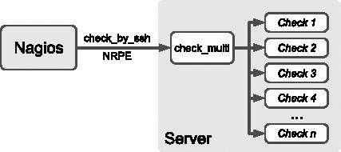

> 图 8-1. 使用 `check_multi` 汇总检查

在此过程中，信息会丢失——最终，每个 `check_multi` 调用只能有一个返回值。但通过对服务的配置，你获得了清晰度，并且意料之外地获得了一个很好的特性：必须执行的检查项列在安装了 `check_multi` 的对应目标系统上的类 NRPE 文件中。这使得将某些任务（例如阈值的维护）委托给其他（非 Nagios）管理员成为可能。他们需要对相关的 `check_multi` 配置文件具有写访问权限，但除了正确运行所使用的插件外，不需要继续与 Nagios 配置作斗争。

为了能够传递尽可能的信息，`check_multi` 经常使用随 Nagios 3.0 引入的多行插件输出格式（详见 8.5.1 多行插件输出）。这基本上将 `check_multi` 的使用限制在 Nagios 3.0 上。从 0.14 版本的 `check_multi` 开始，已经出现过支持 Nagios 2.x 的方法。然而，这些方法的用处有限，因为 Nagios 2.x 中插件的全部信息大约只有 300 字节，且只有插件输出的第一行被利用。

##### 8.5.1 多行插件输出

从 Nagios 3.0 开始，引入了扩展的插件输出格式。输出不再将所有内容挤在单行中，而是可以分布在几行：

```
`普通文本输出` | `可选性能数据` `长文本, 第 1 行` `长文本, 第 2 行` `...` `长文本, 第 n 行 | 性能数据, 第 2 行` `性能数据, 第 3 行` `...` `性能数据, 第 n 行`
```

第一行包含标准文本输出，并在需要时补充性能数据。此行仍可以被 Nagios 2.x 处理，因此长度不应超过 300 字节。在随后的行中，插件可以提供其他文本信息，直到字符 `|` 关闭文本输出并允许写入其他性能数据。Nagios 3.0 在 Web 界面通过 `extinfo.cgi` 生成的状态信息中显示整个文本信息（见 16.2.2 附加信息和控制中心：extinfo.cgi 第 339 页）。

通过宏访问文本信息时（见 D.1 标准宏 第 627 页），Nagios 将信息拆分为两个宏：$HOSTOUTPUT$` 包含主机检查文本信息的第一行（即占位符 `normal text output` 的内容），而 `$LONGHOSTOUTPUT$` 仅包含长文本。对于服务检查，宏称为 `$SERVICEOUT$` 和 `$LONGSERVICEOUTPUT$`。宏的 `LONG*` 变体仅在 Nagios 3.0 及更高版本可用；Nagios 2.x 只识别短版本。

来自第一行和末尾的性能数据由 Nagios 3.0 汇总在宏 `$HOSTPERFDATA$` 和 `$SERVICEPERFDATA$` 中。输出一样，没有 `LONG*` 变体。

在 Nagios 3.0 中，整个输出（包括性能数据）最大长度为 8 KB。如果 Nagios 直接运行插件而非间接运行（例如通过 NRPE 或 `check_by_ssh`），你必须确保整个 8 KB 确实通过了整个传输路径。这在 8.5.2 安装要求 中有所介绍。

##### 8.5.2 安装要求

`check_multi` 对其输出大小没有任何限制。为了支持足够的检查，你应该确保所有用到的资源允许至少 8 KB 的插件输出。对于 Nagios 3.0 版本，开发者已将缓冲区大小增加到 8 KB，因此不需要调整。对于涉及使用 NRPE 或 `check_by_ssh` 远程使用的场景，你可能需要进行手动调整。

#### 调整 NRPE 的缓冲区大小

默认情况下，NRPE（第 10 章 第 213 页）传输的字符不超过 1024 个。为了正确使用 `check_multi`，你需要调整源代码中的缓冲区大小。为此，你需将 `include/common.h` 文件中的相应值设置为 `8192`：

```
#define MAX_INPUT_BUFFER              8192
#define MAX_PACKETBUFFER_LENGTH              8192
```

之后，你必须重新编译并安装 NRPE 守护进程和 `check_nrpe` 插件。

#### 调整 check_by_ssh 的缓冲区大小

插件 `check_by_ssh`（9.1 check_by_ssh 插件 第 206 页）在 1.4 及更高版本中可以处理多行输出，因此可以原样使用。旧版本需要补丁，丁可以在 `check_multi` 主页上找到。

##### 8.5.3 安装与测试

从内容详尽且文档良好的主页下载插件后，你应该将其解压到目录中，然后切换到该目录进行初始测试。在源代码的 `contrib` 子目录中有一个预配置的文件 `check_multi.cmd`。


输出的第一行——以 `MULTI CRITICAL` 开头——总结了所有已执行的检查。这些行（为了显示在此处进行了换行处理）也会被 Nagios 2.x 处理。单个检查的输出从第 2 行开始（以 `[ 1]` 开头），其看起来与当前运行的插件单次调用输出完全相同。性能数据由 `check_multi` 汇总，但仅在末尾的汇总行中——以 `| MULTI::check_multi::plugins` 开头。各个变量用空格分隔。变量名的目的及其格式（需要一些时间适应）请参见第 198 页的 8.5.6 Performance data and PNP。

##### 8.5.4 配置文件

配置文件的格式基于 NRPE（请参见第 218 页的 10.3 NRPE Configuration on the Computer to Be Monitored）。但是，对于 `check_multi`，只定义了命令。以下是包含的示例文件 `check_multi.cmd` 的提取：

```bash
...
command[ network_interfaces ] = check_ifstatus -H localhost
command[ system_load ] = check_load -w 5,4,3 -c 10,8,6
command[ system_mail ] = check_tcp -H localhost -p 25
command[ system_mailqueue ] = check_mailq -w 2 -c 4
command[ system_mysql ] = check_mysql -u admin
command[ system_ntp ] = check_ntp -H ntp1.fau.de
command[ system_portmapper ] = check_rpc -H localhost -C portmapper
command[ system_rootdisk ] = check_disk -w 5% -c 2% -p /
command[ system_ssh ] = check_ssh localhost
...
```

命令 `command[` `Name_of_check` `]` 指定相应检查的名称。它被用于文本输出和性能数据。

等号之后是要执行的检查。在调用插件时，如果插件位于默认路径 `/usr/local/nagios/libexec`，则可以省略路径详情。或者，你可以在运行 `check_multi` 时使用选项 `−1` 包含插件路径。当然，你也可以在配置文件中指定绝对路径。

### 8.5.5 参数

`check_multi` 有以下选项：

- `-f` `/path/to/config/file` `/ --filename=`path/to/config/file`
  > 这指定配置文件。为了让 Nagios 找到它，你应该始终指定完整路径。此选项没有默认值；可以使用多次。

- `-l` `/path/to/the/plugins` `/ --libexec=`path/to/the/plugins`
  > 调用插件的默认路径是 `/usr/local/nagios/libexec`。如果它们位于不同的目录，则通过 `-l` 选项在此指定。

- `-n` `name` `/ --name=`name`
  > 这是 `check_multi` 在文本输出和性能数据中输出的检查名称。默认值为空字符串。如果你在某机器上多次运行 `check_multi` 并带有不同的检查，最好在这里使用不同的名称，以便它们彼此更清晰地分开。

- `-t` `sekunden` `/ --timeout=`seconds`
  > 这指定单个检查的超时时间。默认是 `10` 秒。

- `-T` `seconds` `/ --TIMEOUT=`seconds`
  > 对于所有检查的总和，`check_multi` 需要额外的超时参数，该参数通过 `-T` 定义（默认为 `60` 秒）。
  > 这确保 `check_multi` 的调用将在指定的时间内结束。如果起始时间和单个插件的超时超过了整个 `check_multi` 调用的超时，插件将不会启动任何新检查。此类单个检查将被赋予状态 UNKNOWN；在输出中，`check_multi` 为它们分配消息 `plugin cancelled due to global timeout`。

- `-r` `integer` `/ --report=`integer`
  > 此选项控制 `check_multi` 的输出行为。占位符 `integer` 可以取以下值：
  - `1` 在插件输出的错误状态括号中包含服务名：
    > `..., 2 critical (network_rsync, ...)`
  - `2` 将输出格式化为 HTML。
  - `4` 显示单个检查。
  - `8` 使用 PNP 扩展输出。
  - `16` 以 XML 显示输出。
  - `32` 输出性能数据。
  - `128` 包含指向 PNP 的超链接。
  - `256` 显示输出。
  - `512` 确保输出兼容 Nagios。

- `-w` `expression` `/ --warning=`expression`
  > 如果表达式为真，则将状态设为 WARNING。

- `-c` `ausdruck` `/ --critical=`expression`
  > 如果表达式为真，则状态设置为 CRITICAL。

- `-u` `expression` `/ --unknown=`expression`
  > 如果表达式为真，则设置状态 UNKNOWN。

- `-o` `expression` `/ --ok=`expression`
  > 如果 `ausdruck` 为真，则状态设置为 OK。

- `-v / --verbose`
  > 增加插件的详细程度以便调试。

### 8.5.6 性能数据和 PNP

在性能数据的简单输出形式中（可以通过选项 `-r` `32` 设置），`check_multi` 仅列出插件提供的所有变量：

```text
...|rta=0.111ms;500.000;1000.000;0; pl=0%;5;10;; offset=0.002980s;60.000 0;120.000000;
```

在此示例中，插件 `check_icmp` 的性能数据（平均响应时间 `rta` 和丢包率 `pl`）以偏离本地系统时间（`offset`）的形式紧接着 `check_ntp` 的性能数据。你第一眼无法看出哪些信息来自哪个插件——你必须参考配置文件中的顺序以及单个检查的输出。


这并不特别适用于自动处理。因此，`check_multi` 提供了一个默认选项 `-r8` 的扩展输出，该选项专门针对 PNP 进行了修改（参见第 446 页的 19.6 Smooth Plotting with PNP）。在执行此操作时，插件会在变量名中添加服务描述和所使用的插件名称。并没有偏离标准格式；只是给标签提供了更详尽的形式：

> `servicedescription:: plugin:: label = values [label = calues]`

PNP 需要执行的插件信息，以便其选择合适的模板来处理图形（参见第 454 页的 19.6.5 How should the graphic appear?）。此外，`check_multi` 现在还提供了关于整体处理的性能数据：

> `|MULTI::check_multi::plugins=5 time=0.18 net_ping::check_icmp::rta=0.048 ms;`

> `500.000;1000.000;0; pl=0%;5;10;; system_ntp::check_ntp::offset=0.0022 66s;60.000000;`

> `120.000000;`

首先 `check_multi` 通知它调用了 `5` 个插件，并总共了 0.18 秒处理。随后是其他插件的性能数据，每个数据都补充了服务描述和插件名称。如果一个插件产生多个变量，则不会重复服务描述和插件名称。

### 8.5.7 简单的业务流程监控

为了评估业务流程，你通常想知道特定的进程正在运行——例如，客户是否可以网上银行。从这个角度来看，所有相关主机和服务的单独信息并不相关，而且如果系统是以不同的形式进行冗余设计的，这些信息也不总是有用的。

> 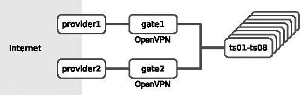

> 图 8-2. 为了能从互联网访问终端服务器集群，必须提供 OpenVPN 访问和终端服务器。

示例见 图 8-2: 家庭办公用户通过 OpenVPN 访问终端服务器集群。对于来自互联网的访问，有两个可用连接，通过 `gate1` 和 `gate2` 有两个可用 OpenVPN 网关。终端服务器集群由 `ts01` 到 `ts08` 八个终端服务器组成。

为了家庭办公用户能够工作，必须至少有一个互联网连接（包括相应的网关），且服务器集群必须是可访问的。业务流程可以分为两个过程：我们的示例查看了与服务器集群分离的互联网访问，随后它可以将这两个结果连接起来。

互联网访问关键状态的条件可以如下制定：

> `(gate1 > 1 || provider1 > 1) && (gate2 > 1 || provider2 > 1)`

如果提供商不可用或 (`||`) 网关上的 OpenVPN 服务不可用，则访问是不可用的。但只要两个访问点中的其中一个正常工作就足够了（因此使用逻辑与操作符 `&&`）。该语法取自 Perl，可以被 `check_multi` 同样处理。因此，互联网检查的配置文件包含四个命令和逻辑运算符：

> `# openvpn.cmd`

> `command[ gate1 ] = check_nrpe -H gate1 -c check_openvpn`

> `command[ provider1 ] = check_icmp -H provider1 -c 1000.0,60%`

> `command[ gate2 ] = check_nrpe -H gate2 -c check_openvpn`

> `command[ provider2 ] = check_icmp -H provider2 -c 1000.0,60%`

> `state[warning] = count(CRITICAL) > 0 || count(UNKNOWN) > 0`

> `state[critical] = (gate1 > 1 || provider1 > 1) && (gate2 > 1 || provider`

> `2 > 1)`

两个 `gate*` 命令分别检查（通过 NRPE）OpenVPN 服务的网关是否正在运行。提供商测试向相应提供商的拨号路由器发送 ICMP 回显包。你在这里必须非常小心，以确保路由设置正确，即发往相应提供商的 ICMP 包确实是通过相应的连接发送的。

对于业务流程，配置文件中定义了各个状态的布尔表达式，因此根据需要，可能有一个针对 CRITICAL 的、一个针对 WARNING 的，如果必要，还有一个针对 UNKNOWN 的。语法和操作符按规定传递给 Perl，并在 Perl 在线文档 (`man perlop`) 中进行了详细说明。在评估表达式之前，`check_multi` 会进行以下替换：

*   如果表达式包含之前通过 `command` 定义的检查名称，则将使用该检查的返回值。假设检查 `gate1` 返回 `2`，而检查 `provider1` 返回 `1`。那么上述的部表达式将变为：

    > > > state [critical] = (2 > 1 || 1 > 1) ...`

    在括号内，第一个条件为真，通过随后的或逻辑（Perl 语法中的 `||`），该部分表达式求值结果为真。

*   `count` 函数确定所有提供给定参数作为返回值的检查数量。

*   表达式中不仅包含状态的数值，还可以包含文本形式（UNKNOWN, WARNING, CRITICAL, WARNING, OK）（因此你可以写类似 `gate1 > WARNING` 的内容）。在评估表达式之前，`check_multi` 会用数值替换此细节。

如果发生至少一个关键状态、至少有一个检查交付了 UNKNOWN，或至少有一个检查返回 WARNING，则在 `openvpn.cmd` 中设置 WARNING 状态。如果两个访问都失败，则出现 CRITICAL 状态（因为括号中两个部分表达式之间使用了与逻辑）。如果 `gate` 或 `provider` 检查任一交付 CRITICAL（返回值 `2`）或 UNKNOWN（返回值 `3`），部分表达式本身为真。UNKNOWN 状态的条件可以省略，因为 UNKNOWN 结果会导致 WARNING 状态。

第二个部分过程——终端服务器集群的功能——在配置文件 `terminalserver.cmd` 中描述：

> `# terminalserver.cmd`

> `command[ ts01 ] = check_tcp -H ts01 -p 3389`

> `command[ ts02 ] = check_tcp -H ts02 -p 3389`

> `command[ ts03 ] = check_tcp -H ts03 -p 3389`

> `command[ ts04 ] = check_tcp -H ts04 -p 3389`

> `command[ ts05 ] = check_tcp -H ts05 -p 3389`

> `command[ ts06 ] = check_tcp -H ts06 -p 3389`

> `command[ ts07 ] = check_tcp -H ts07 -p 3389`

> `command[ ts08 ] = check_tcp -H ts08 -p 3389`

> ` `

> `state[warning] = count(CRITICAL) > 0 || count(UNKNOWN) > 0 || count(WA`

> `RNING) > 0`

> `state[critical] = ts01 >= CRITICAL || count(CRITICAL) > 3`

这里的单独检查仅对 RDP 端口 3389 进行原始 TCP 检查，以保持示例简单。如果发生至少一个 CRITICAL 或至少一个 UNKNOWN，则应指示 WARNING，以便管理员有机会在早期解决问题。CRITICAL 状态的条件规定 `ts01` 不能为 CRITICAL，因为那里运行着一个特定的应用程序，该程序在其他服务器上不可用。此外，不允许超过三台终端服务器故障，否则其他服务器的负载可能会剧增，导致无法进行工作。

> 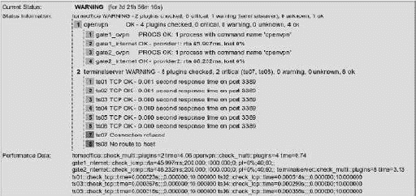

> 图 8-3. Nagios Web 界面扩展信息页 `check_multi` 的递归输出

部分过程的两个检查通过一次 `check_multi` 调用汇总为一个结果（为了显示目的进行了折行）：

> `# homeoffice.cmd`

> `command[ openvpn ] = check_multi -f /etc/nagios/check_multi/openvpn.cmd`

> `-r31`

> `command[ terminalserver ] = check_multi -f /etc/nagios/check_multi/termi`

> `nalserver.cmd -r31`


为了让 Nagios 的扩展信息页面（图 8-3）更美观，省略了各个插件名称的详细信息（通过缺少选项 `-n`；`check_multi` 的递归 HTML 输出会自动添加所调用的检查的名称）。`-r 31` 详细设置了从 1 到 16 的所有报告功能，包括 HTML 格式化（`-r` `2`）。状态没有定义特定的特殊条件，因此部分进程的 WARNING 会导致上层检查出现 WARNING，而 CRITICAL 则会导致 CRITICAL。

图 8-3 清晰地显示了两个分离开的两个部分进程。检查的序列号与其状态颜色存储在一起，遗憾的是，这些颜色在黑白书中是不可见的。扩展信息 Web 页面中递归显示的复杂颜色示例可以在插件的主页找到。^[90^]

为了完整起见，这里是 Nagios 的命令和服务的定义。前者被刻意保持简单，命令行的所有细节都重复在服务定义中：

```bash
define command{
    command_name check_multi
    command_line $USER1$/check_multi $ARG1$
}
```

```bash
define service{
    host_name          elix01
    service_description homeoffice
    check_command check_multi!-f /etc/nagios/check_multi/homeoffice.cmd -n
    homeoffice -r 31
    ...
}
```

如果使用 `check_multi` 进行业务进程的映射不能满足你的需求，你应该查看一下来自德国纽伦堡 Sparda-Datenverarbeitung eG 提供的、稍微复杂一些的插件 Nagios Business Process View 和 Nagios Business Impact Analysis，这些插件可以在 Nagios-Exchange 上获取。^[91^]

与 `check_multi` 不同（后者表现为唯一的 Nagios 服务，且仅需由 Nagios 管理一次），该插件使用了 Nagios 中已经定义的服务，这意味着 Nagios 会像往一样执行每个单独的检查。它获取单个检查的结果，将它们链接起来，并在自己的 Web 界面上显示。

在这样做时，这些链接的结果——通地说是业务进程——可以在 Nagios 中被重新定义为一个单独的服务，这样就可以使用 Nagios 的通知逻辑。此外，该插件还包含一种模式，可以模拟“如果……会发生什么”的场景。单个服务被设置为一个预期状态，可以通过 Web 界面查看效果。

因此，`check_multi` 与 Nagios Business Process View 以及 Nagios Business Impact Analysis 插件并不存在竞争。根据预期用途，要么 `check_multi` 会减少 Nagios 中表示的服务复杂性，从而减少执行的检查次数，要么该插件将允许对整体事件进行更详细视图，尽管这要求在 Nagios 中对所有服务进行单独映射。

***

^[87^] [`www.my-plugin.de/wiki/de/projects/check_multi/installation#heck_by_ssh`](http://www.my-plugin.de/wiki/de/projects/check_multi/installation#c%20heck_by_ssh)

^[88^] [`www.my-plugin.de/wiki/de/projects/check_multi/start`](http://www.my-plugin.de/wiki/de/projects/check_multi/start)

^[89^] 假设自调用 `check_multi` 以来已有 53 个检查通过，但并非所有计划中的单独检查都已处理。开始时间和单个超时总和（53 + 10 = 63）超过了 `check_multi` 用的超时时间，因此 `check_multi` 不再启动任何检查。

^[90^] [`www.my-plugin.de/wiki/de/projects/check_multi/screenshot#ser-vice_extended_info_rekursiv`](http://www.my-plugin.de/wiki/de/projects/check_multi/screenshot#ser-vice_extended_info_rekursiv)

^[91^] [`www.nagioserchange.org/22;1088`](http://www.nagioserchange.org/22;1088)

# 第 9 章通过 SSH 执行插件

本地插件，即由于没有网络可用而只在本地运行的程序，必须安装在目标上。但如果你仍然想从 Nagios 服务器执行这些程序，建议你使用 shell 检查可用可用磁盘空间。

在异构环境中，shell 本身经常会引起问题：取决于操作系统，SSH 守护进程可能非常旧，无法处理^[92^] 在具有最新 SSH 的纯 Linux 环境中，通常不会发生此类问题。

## 9.1 `check_multi_ssh` 插件

`check_multi_ssh` 在 Nagios 服务器上运行，并与目标建立连接以便执行本地测试。如果你使用 `check_multi_ssh` 在其他计算机上执行本地测试，这些被称为间接检查，将在第 224 页的 10.6 间接检查 中解释。

下面的示例展示了如何使用 `check_multi_ssh` 检查目标上的交换分区：

```bash
nagios@linux:nagios/libexec$./check_multi_ssh -H target_computer -i /etc/nagios/.ssh/id_dsa -C "/usr/local/nagios/libexec/check_swap -w 50% -c 10%" "SWAP OK: 100% free (972 MB of 972 MB)|swap=972;486;97;0"
```

该命令与安全 shell 命令相似，格式如下：

```bash
ssh -i private_key target_computer "command"
```

使用单独私钥（而不是主目录下的默认私钥）是可选的，并在第 208 页的 9.2 配置 SSH 中详细描述。

`check_multi_ssh` 具有以下选项：

`-H` `address` `/ --hostname=address`

> > 应建立 SSH 连接的主机名或 IP 地址。

`-C` `command` `/--command=command`

> > 在远程计算机运行的命令，即带有完整路径和所有必要参数的插件：

> > > `-C "/usr/local/nagios/libexec/check_disk -w 10% -c 5% -e -m"`

`−1 /--proto1`

> > 强制使用版本 1 安全 shell 协议。

`−2 /--proto2`

> > 强制使用版本 2 安全 shell 协议。

`-o` `ssh_option` `/--ssh-option=ssh_option`（版本 1.4.6 起）


> 将 SSH 选项传递给目标主机上的安全外壳。如需指定多个选项，请重复使用该开关。

- `-i` `keyfile` `/--identity=keyfile`

> 应该使用哪个文件代替包含用户 `nagios` 私钥的标准密钥文件？关于其中推荐的选项，请参阅 9.2.3 检查 SSH 连接和 check_by_ssh，第 210 页。

- `-p` `port` `/--port=port`

> 如果目标服务器上的 Secure Shell 守护进程没有监听标准的 TCP 端口 22，则在此指定该端口。

- `-l` `user` `/--logname=user`

> 目标主机上的用户名。[`S` `number` / `--skip-stdout=number`（来自 1.4.9 版本）]

> 忽略输出到 STDOUT 的内容开头处指定数量的行。如果省略此选项，将忽略整个输出。

- `-E` `number` `/--skip-stderr=lines`（来自 1.4.9 版本）

> 与 `--skip-stdout` ，但仅引用 STDERR 的输出。

- `-w` `floating_point_decimal` `/--warning=floating_point_decimal`

> 如果执行命令的响应时间超过 `floating_point_decimal` 秒，插件将发出警告。

- `-c` `floating_point_decimal` `/--critical=floating_point_decimal`

> 关于待执行命令响应时间的临界值（单位：秒）。

- `-f`

> 启动后台进程且不打开交互式终端（tty）。

- `-t` timeout `/timeout=timeout`

> 在 `timeout` 秒过期后，插件停止测试并返回 CRITICAL（严重）状态。默认为 `10` 秒。

此外，`check_by_ssh` 还有可用参数 `-o`、`-s` 和 `-n`，使其能够以被动模式将结果写入外部命令的接口（请参阅第 292 页的 13.1 外部命令接口）。之所以这样命名，是因为 Nagios 本身并不接收这些信息，而是从接口间接读取的。

此过程的优势是能够通过单个 SSH 连接同时运行多个独立的命令。然而，这可能会导致命令定义变得相当复杂。由于插件本身是作为程序在目标服务器上调用并执行的，因此 SSH 连接是建立一次还是三次几乎并不重要。出于这个原因，使用简单的命令定义会比使用被动模式更好。

但如果你仍然想找到关于此的更多信息，可以查看在线帮助，调用方式为 `check_by_ssh -h`。

***

在 `nagios-users` 邮件列表中报告说，`Sun_SSH_1.0` 返回的状态码为 255 而不是 0，使其不适用于此处描述的部署。

[`www.openssh.org/`](http://www.openssh.org/)

目前该选项没有长格式。

#### 9.2 配置 SSH

为了让 Nagios 能够通过安全外壳远程且自动地运行插件，它——或者严格地说，Nagios 服务器上的用户 `nagios`——绝不能被任何密码查询分扰。这通过公钥机制登录来避免。

##### 9.2.1 在 Nagios 服务器上生成 SSH 密钥对

执行此操作所需的密钥对默认由密钥生成器 `ssh-keygen` 存储在相应用户主目录下的 `.ssh` 子目录（对于用户 `nagios`，这对应于第 39 页中 1.2 编译源码] 将在 Nagios 服务器上生成的公钥保存到名为 `authorized_keys` 的文件中：

```bash
target_computer:~ # mkdir /home/nagios/.ssh
```

现在用户 `nagios` 在目标主机上不再需要密码。你只需要确保目标服务器上包含 `authorized_keys` 的 `.ssh` 目录属于用户 `nagios`：

```bash
target_computer:~ # chown -R nagios /home/nagios/.ssh
target_computer:~ # chmod 700 /home/nagios/.ssh
```

##### 9.2.3 检查 SSH 连接和 check_by_ssh

使用此此配置后，你应该首先检查安全连接是否正常。测试是以用户 `nagios` 身份进行的，因为是由 Nagios 执行：

```bash
nagios@linux:~$ ssh -i /etc/nagios/.ssh/id_dsa target_computer
```

`-i` 选项显式指定了私钥文件的路径。如果在目标计算机上运行的命令没有提供任何输出，或者守护进程请求密码，则通过公钥登录是无效的。在这种情况下，你必须在测试 `check_by_ssh` 之前先找到并消除错误。

在下一步中，你在 Nagios 服务器的命令行中在目标计算机上运行 `check_by_ssh` 本地插件，它稍后会自动运行。请确保每种情况下插件路径都是正确的。服务器上用户 `nagios` 私钥的路径通过 `-i` 指定：

```bash
nagios@linux:~$ /usr/local/nagios/libexec/check_by_ssh -i /etc/nagios/.ssh/id_dsa target_computer "/usr/local/nagios/libexec/check_disk -w 10% -c 5% -e -m"
```

在示例中，`check_by_ssh` 应该在目标计算机上启动 `/usr/local/nagios/libexec/check_disk` 插件，并带有 `-w 10% -c 5% -e -m` 参数。如果这不起通，则先在目标主机本地以相同的参数运行。通过这样做，你可以排除问题出现在插件命令本身而非安全外壳连接的可能性。


匹配的命令对象在 `checkcommands.cfg` 文件中再次定义；与 `check_local_disk` ，它应该命名为 `check_ssh_disk`：

```text
# check_ssh_disk command definition
define command{
    command_name  check_ssh_disk
    command_line     $USER1$/check_by_ssh -H $HOSTADDRESS$ \
                  -i /etc/nagios/.ssh/id_dsa \
                  -C "$USER1$/check_disk -w $ARG1$ -c $ARG2$ -p $ARG3$"
}
```

存储在 `command_line` 中的命令行首先运行 `check_by_ssh`；对于 USER1$` 包含 Nagios 服务器上的本地插件路径。接下来是参数——目标主机的 IP 地址（参数 `-H`）、私钥文件（参数 `-i`），最后是使用 `-C` 参数指定目标主机应该执行的完整命令。如果目标主机上的插件路径与 Nagios 服务器上的插件路径相同，那么你也可以在其中使用 `$USER1$` 宏；否则，将显式给出目标计算机上的插件路径。

这里命令的设置与第 158 页 7.1 自由硬盘容量 中的 `check_local_disk` 无异。这意味着除了警告和临界限额外，我们还通过 `-p` 参数显式指定了文件系统或硬盘分区。

以此方式定义的 `check_ssh_disk` 命令应用如下，此处是在台名为 `linux02` 的计算机上：

```text evendefine service{
    host_name       linux02
    service_description FS_root
    ...
    check_command   check_ssh_disk!10%!5%!/
    ...
}
```

以此方式定义的服务对象确保了 Nagios 检查其 `/` 文件系统。警告限额为 10%，临界限额为 5%。

如果你在 `check_ssh_disk` 中配合 `check_by_ssh` 插件（如示例所示），你必须确保所有目标主机上的插件路径是相同的。出于简单性考虑，这样做也是值得的，尽管在实践中并不总是可行。由于上述原因，下面的服务定义将插件路径作为额外参数提供目标计算机：

```text
define service{
    host_name       linux02
    service_description FS_root
    ...
    check_command   check_ssh_disk!/usr/lib/nagios/plugins!10%!5%!/
    ...
}
```

为了使此生效，你必须按照如下方式更改命令定义中通过 `-C` 传递的命令行：

```text
-C "$ARG1$/check_disk -w $ARG2$ -c $ARG3$ -p $ARG4$"
```

注意：这会导致 `-w`、`-c` 和 `-p` 的每个 `$ARGx` 宏的数字向后移动一位。

# 第 10 章 Nagios 远程插件执行器 (NRPE)

Nagios 远程插件执行器（简称 NRPE）顾如其名，在远程主机上执行程序。这些通常是在本地测试相应计算机的插件，因此必须安装在这些计算机上。NRPE 的使用并不限于本地插件；任何插件都可以被执行，包括用于测试网络服务的插件——例如，间接测试无法从 Nagios 服务器访问的计算机（参见第 224 页的 10.6 间接检查）。

在使用安全 shell 时，远程计算机上必须有一个真实的用户账户（见 第 9 章），该账户还可以执行除启动插件以外的其他操作，但 NRPE 仅限于显式配置的测试。如果你想或被迫不在目标主机上使用登录 shell，那么使用 NRPE 更好，即使这比安全 shell 需要更多的配置工作。除了 Nagios 配置和在 Nagios 服务器上安装 `check_nrpe` 插件外，目标系统上仍有以下任务：

* 必须安装 `nrpe` 程序。
* 必须以管理员权限配置 inet 守护进程 (`inetd` 或 `xinetd`)。
* 必须安装所有通过 NRPE 调用的插件。

#### 10.1 安装

NRPE 和插件可以从源码安装，也可以使用发行版提供的包。你应该至少使用 2.0 版本的 NRPE，因为它与之前的版本不兼容。从 2.6 版本开始，NRPE 引入了开关 `-u`。如果目标系统上的 NRPE 服务不可用，Nagios 服务器上的插件 `check_nrpe` 将会对该开关返回 `UNKNOWN`。从 2.8 版本开始，NRPE 支持 Nagios 3.0 引入的插件多行输出（参见第 193 页的 8.5.1 多行输出）。在本书出版时，当前版本为 2.12，日期为 2003-08。所有成熟的发行版都包含了至少 1.4 版本的插件集。是否需要最新版本取决于你对相应插件的预期。

##### 10.1.1 特定于发行版的包

SuSE Linux 10.3 包含了包 `nagios-nrpe-2.10-4.1.i86.rpm`、`nagios-plugins-1.4.10-12.1.i86.rpm` 和 `nagios-plugins-extras-1.4.10-12.1.i86.rpm`。`nagios-nrpe` 包含了守护进程和 `check_nrpe` 插件。`nagios-plugins-extras` 安装了几个额外的插件，如数据库检查或 Radius 测试，可以根据你的特定监控需求省略。为了简单起见，这些包通过 `YAST2` 或 `rpm -ihv` 安装；第二种方法也适用于 Fedora 用户。对于 Fedora Core 和 Red Hat Linux，Dag Wieers 提供了多个版本的相应 Nagios 包。Debian/Sarge 通过两个不同的包 `nagios-nrpe-server` 和 `nagios-nrpe-plugin` 分发 NRPE 守护进程和 NRPE 插件 `check_nrpe`，可以通过 `apt-get install` 分别安装。如果你不需要本地文档，可以省略 `nagios-nrpe-doc` 包，仅向目标主机添加插件包 `nagios-plugins`。

`nrpe` 程序、配置文件 `nrpe.cfg` 和插件目录的路径列在 表 10-1 中。

#### 表 10-1. NRPE 和插件的安装路径

| 发行版 | NRPE 程序 | 配置文件 | 插件 |
| :--- | :--- | :--- | :--- |
| 自编译 | `/usr/local/sbin/nrpe` | `/etc/nagios/nrpe.cfg` | `/usr/local/nagios/libexec` |
| SuSE | `/usr/bin/nrpe` | `/etc/nagios/nrpe.cfg` | `/usr/lib/nagios/plugins` |
| Debian | `/usr/sbin/nrpe` | `/etc/nagios/nrpe.cfg` | `/usr/lib/nagios/plugins` |
| Fedora | `/usr/sbin/nrpe` | `/etc/nagios/nrpe.cfg` | `/usr/lib/nagios/plugins` |
| (a) 推荐。 | (b) 来自 Dag Wieers 提供的包。 | | |

##### 10.1.2 从源码安装

插件在被监控计算机上的安装方法完全按照第 43 页描述的 1.4 安装和测试插件 用于 Nagios 服务器的方法进行。

NRPE 源码从 Nagios 首页获取。`/usr/local/src` 目录是解压的理想场所。

```text
linux:~ # mkdir /usr/local/src
linux:~ # cd /usr/local/src
linux:local/src # tar xvzf /path/to/nrpe-2.11.tar.gz
```

在创建的新目录中，运行 `configure` 命令：

```text
linux:local/src # cd nrpe-2.11
linux:src/nrpe-2.11 # ./configure --sysconfdir=/etc/nagios --enable-ssl
```


推荐的路径规范列在表 10-1 中。与默认设置的唯一区别是存储 NRPE 配置文件的目录（`configure` 选项 `--sysconfdir`）。

因此，我们可以在 `configure` 命令中省略用法的 `--with-nrpe-user` 和 `--with-nrpe-group` 条目。这两个选项仅在 `nrpe` 程序作为守护进程运行时才相关，且它们可以在配置文件中中被覆盖。如果使用 inet 守护进程，你应该在 inet 守护进程的配置文件中指定 `nrpe` 应该以哪个用户的权限启动。

`--enable-ssl` 确保 NRPE 通过 SSL 加密通道进行通信。当然，这只有在目标主机上的 `nrpe` 和 Nagios 服务器上的 `check_nrpe` 都经过相应编译后才能生效。

命令 `make all` 编译程序 `nrpe` 和 `check_nrpe`，但它不会将它们从 `/usr/local/src/nrpe-2.11/src` 拷贝到相应的系统目录。由于没有 `make install`，你必须手动执行此操作，并参考表 10-1 中的细节：需要在被监控的计算机上拥有 `nrpe`，并在 Nagios 服务器上拥有 `check_nrpe` 插件。

如果 Nagios 服务器和目标主机使用相同的平台，你可以在一台计算机（例如服务器）上编译两个程序，然后将 `nrpe`连同其配置文件一起拷贝到被监控的计算机，而不是分别在 Nagios 服务器上编译 `check_nrpe` 并在目标系统上编译 `nrpe`。

***

^[96^] 在命令行上，使用 `yast -i` `package`。

^[97^] [`dag.wieers.com/`](http://dag.wieers.com/)

^[98^] [`www.nagios.org/download/`](http://www.nagios.org/download/)

^[99^] 可能需要先创建子目录 `src`。

#### 10.2 通过 inet 守护进程启动

最好通过 inet 守护进程在被监控的机器上启动 `nrpe` 程序，而不是作为一个独立的守护进程，因为 Nagios 服务器只是偶尔执行测试，且 `nrpe` 不需要加载任何大型资源。

如果有选择，你应该使用更现代的 `xinetd`。但为了保持工作量最小，通常会使用 inet 守护进程，因为它已经在目标系统上运行。为了让 NRPE 能够通过 `inetd` 或 `xinetd` 作为服务启动，需要在 `/etc/services` 文件中定义 `nrpe` 服务：

```
nrpe 5666/tcp # Nagios Remote Plugin Executor NRPE
```

即使已作为包安装，你仍然应该检查此条目是否存在。默认情况下，NRPE 使用 TCP 端口 5666。

### 10.2.1 `xinetd` 配置

如果使用 `xinetd`，则每个要启动的服务在 `/etc/xinetd.d` 目录下都有一个独立的文件，因此对于 `nrpe`，最好创建一个名为 `nrpe` 或 `nagios-nrpe` 的文件：

```
# /etc/xinetd.d/nrpe
# description: NRPE
# default: on
service nrpe
{
    flags           = REUSE
    socket_type     = stream
    wait            = no
    user            = nobody    group           = nogroup
    server          = /usr/local/sbin/nrpe
    server_args     = -c /etc/nagios/nrpe.cfg --inetd
    log_on_failure  += USERID
    disable         = no
    only_from       = 127.0.0.1 ip_of_the_nagios_server
}
```

用*斜体*打印的值将传递给你自己的环境；对于 `only_from`，你不应该输入占位符 `ip_of_the_nagios_server`，而是输入你自己的 Nagios 服务器的 IP 地址。外部对 NRPE 的访问将限制在此计算机上和 `local-host` (`127.0.0.1`)。后者允许本地测试；多个 IP 地址之间用空格隔开。然而，只有在 `xinetd` 编译时支持 TCP wrapper 的情况下（通常情况下如此），这种限制性配置才能生效。

在任何情况下，NRPE 都不应以特权用户的运行——因此 `nobody` 是一个合理的值。`server` 参数指定了程序 `nrpe` 的完整路径；对于 `server_args`，你应该输入配置文件的匹配路径。修改后，重新加载 `xinetd` 配置如下：

```bash
linux:~ # /etc/init.d/xinetd reload
```

### 10.2.2 `inetd` 配置

在标准的 `inetd` 中，以下行被添加到配置文件 `/etc/inetd.conf` 中：

```
nrpe stream tcp nowait nobody /usr/sbin/tcpd /usr/local/sbin/nrpe -c/etc/nagios/nrpe.cfg --inetd
```

该行由于空格原因被拆分，但在配置文件中必须全部在一行。这里使用了 TCP wrapper `tcpd`。如果无打算，只需省略此条目。你还应该输入 `nobody`、二进制文件 `nrpe` 的完整路径以及配置文件。上述打印的字符串应根据你的系统进行调整。更改后，重新加载 `inetd`：

```bash
linux:~ # /etc/init.d
```

### 10.2.3 inet 守护进程是否正在监听 NRPE 端口？

一个简单的测试可以显示 inet 守护进程是否配置正确：

```bash
netstat -lnt | grep ':5666'
```

输出显示：

```
tcp        0      0 0.0.0.0:5666            0.0.0.0:*               LISTEN
```

`netstat` 程序使用 `-l` 显示所有监听套接字，`-t` 将输出限制为 TCP 端口，`-n` 抑制主机和端口的解析，从而加快显示速度。

测试显示了 inet 守护进程是否配置正确并新启动。它并不能说明 `nrpe` 服务是否正确进入 `inetd`：

```bash
netstat -lnt | grep ':5666'
```

输出显示：

```
tcp        0      0 0.0.0.0:5666            0.0.0.0:*               LISTEN
```

测试显示了 inet 守护进程是否配置正确。随后的功能测试将在 221 页的 10.4 NRPE 测试中进行。

## 10.3 被监控计算机上的 NRPE 配置

在编译 NRPE 时，会在源目录下创建 `nrpe.cfg` 文件，其中包含了几个参数以及运行 NRPE 的命令。这些被手动拷贝到配置目录，该目录通常需要先在目标计算机上创建：

```bash
linux:src/nrpe-2.11 # mkdir /etc/nagios
linux:src/nrpe-2.11 # cp nrpe.cfg /etc/nagios/
```

特定于发行版的包是从第 215 页表 10-1 中指定的位置解压的。

`nrpe` 在运行时获得 inet 守护进程配置中指定的用户权限，在我们案例中，是 `nobody` 的权限。因此，`nrpe.cfg` 需要允许该用户读取。只要文件不包含任何密码（这些真的不应该被使用）或其他关键信息，就可以允许所有人读取权限。

配置文件包含许多注释；以下命令显示激活参数：^[101^]

```bash
user@linux:~$ egrep -v '^#|^$' nrpe.cfg | less
```


> `allowed_hosts=127.0.0.1`
> `nrpe_user=nobody`
> `nrpe_group=nogroup`
> `dont_blame_nrpe=0`
> `debug=0`
> `command_timeout=60`
> `...`

参数 `server_port`、`allowed_hosts`、`nrpe_user` 和 `nrpe_group` 仅在 `nrpe` 作为守护进程运行时才有效。当使用 `inetd` 守护进程时，程序会忽略这些值，因为它们已经通过 `(x) inetd` 配置确定了。

条目 `dont_blame_nrpe=0` 防止 `nrpe` 接受参数，从而关闭了一个潜在的安全漏洞。`debug=l` 允许详细日志记录，这在你寻找错误时非常有用（`debug=0` 关闭调试信息的输出），而 `command_timeout` 指定了一个以秒为单位的时间范围，在此之后 `nrpe` 将强制中断挂起的插件。配置文件中的注释也解释了所有这些参数。

此之后，定义了要由 NRPE 执行的命令。配置文件 `nrpe.cfg` 已经包含了一些命令，但首先必须将它们全部注释掉，并且仅激活那些真正打算使用的命令。

关键字 `command` 后面方括号内是 `check_nrpe` 调用命令时应使用的名称。在等号 (`=`) 之后，指定了相应的插件命令及其其完整路径：

> `command[check_users]=/usr/local/nagios/libexec/check_users -w 5 -c 10`
> `command[check_load]=/usr/lib/nagios/libexec/check_load -w 8,5,3 -c 15,10,7`
> `command[check_zombies]=/usr/lib/nagios/libexec/check_procs -w :1 -c :2 -s Z`

在使用路径时，必须确保它确实指向本地插件目录。在此处指定的目录 `/usr/local/nagios/libexec` 中存放着自编译的插件；而对于通过发行包安装的，路径通常为 `/usr/lib/nagios/plugins`。

在 Nagios 服务器上，通过 `check_nrpe` 在目标计算机上运行刚刚定义的 `check_users` 命令：

> `nagios@linux:nagios/libexec$ ./check_nrpe -H target_host -c check_users`

##### 10.3.1 向本地插件传递参数

到为止描述的方法有一个缺点：对于目标系统上的每个测试，都需要单独定义命令。这里是一个服务器的示例，该服务器需要使用插件 `check_disk`（参见第 158 页的 [7.1 空闲硬盘容量]）来监控九个文件系统：

> `command[check_disk_a]=path/to/check_disk -w 5% -c 2% -p /net/linux01/a`
> `command[check_disk_b]=path/to/check_disk -w 4% -c 2% -p /net/linux01/b`
> `command[check_disk_c]=path/to/check_disk -w 5% -c 2% -p /net/linux01/c`
> `command[check_disk_d]=path/to/check_disk -w 5% -c 2% -p /net/linux01/d`
> `command[check_disk_root]=path/to/check_disk -w 10% -c 5% -p /`
> `command[check_disk_usr]=path/to/check_disk -w 10% -c 5% -p /usr`
> `command[check_disk_var]=path/to/check_disk -w 10% -c 5% -p /var`
> `command[check_disk_home]=path/to/check_disk -w 10% -c 5% -p /home`
> `command[check_disk_tmp]=path/to/check_disk -w 10% -c 5% -p /tmp`

为了避免这些工作，也可以配置 NRPE 使得参数可以传递给 `check_nrpe`：

> `dont_blame_nrpe=1`
> `...`
> `command[check_disk]=path/to/check_disk -w $ARG1$ -c $ARG2$ -p $ARG3$`

为了使此生效，必须运行 NRPE `configure` 脚本并带有 `--enable-command-args` 选项。这种不便操作的原因是传递参数是一项根本风险，因为无法排除某些参数的选择可能会导致（尚未知的）缓冲区溢出，允许目标系统被入侵。

尽管存在这些安全风险，如果你仍然决定这样做，则应该使用 TCP 封装（参见第 217 页的 [10.2.2 inetd 配置]），以确保只有 Nagios 服务器本身允许向 NRPE 发送命令。

如果插件提供了相应的选项，有时还有第三种方法：通过让 `check_disk` 在需要时使用单个命令测试所有文件系统，也可以解决上述问题：

> `user@linux:nagios/libexec$ ./check_disk -w 10% -c 4% -e -m DISK WARNING [2588840 kB (5%) free on /net/linux1/b] [937160 kB (5%) free on /net/linux1/c]`

`-e` 参数强制插件仅显示产生警告或错误的文件系统。仍然存在一个限制：警告和临界限制对于所有文件系统必须是相同的。

***

正则表达式 `^#|^$` 匹配所有以注释符号 `#` 开头或由空行的行。选项 `-v` 确保 `egrep` 显示所有未被此匹配的行。

`check_users` 命令在第 97 页的 [7.6 登录人数] 中解释，`check_load` 在第 87 页的 [7.3 测试系统] 中解释，而第 88 页的 [7.4 监控进程 设备 处理 `check_procs`。

#### 10.4 NRPE 功能

作为最后的测试，通过 `inetd` 在 Nagios 服务器上调用 `check_nrpe`：

```bash
nagios@linux:nagios/libexec$ ./check_nrpe -H target
```

这里给错误信息经常发生并引起困惑，尽管可能与 SSL 有关，大多数情况下原因在其他处。只有当 `check_nrpe` 使用的 SSL 版本与 SSL 守护进程不兼容，或者两个软件包中其中一个没有编译 SSL 而另外一个编译了 SSL 时，你才会有 SSL 问题。

否则，原因将位于别处：问题可能是由配置错误、inetd 守护进程找不到 NRPE 或文件访问权限不足引起的。成功调用 `check_nrpe` 然后将提供安装的 NRPE 服务版本：

```bash
nagios@linux:nagios/libexec$ ./check_nrpe -H target 
```

#### 10.5 Nagios 配置

通过 `check_nrpe` 在远程计算机上触发本地插件的命令同样之前在 Nagios 服务器上的 `checkcommands.cfg` 文件中进行定义。

##### 10.5.1 不传递参数的 NRPE

如果不向目标插件传递任何参数，情况将如下：

```text
define command{
  command_name check_nrpe
  command_line $USER1$/check_nrpe -H $HOSTADDRESS$ -c $ARG1$
}
```


Nagios 作为唯一的参数，在此处传递了 NRPE 需要执行的命令。如果 Nagios 上的上的 `check_nrpe` 插件所在的目录与其他插件不同，则你必须输入正确的路径，而不是 `$USER1$`。

通过 NRPE 测试的服务将使用刚刚定义的命令 `check_nrpe` 作为 `check_command`。作为参数，它指定了在目标系统（此处为 `linux04`）的 `nrpe.cfg` 中定义的命令：

```
define service{
    host_name           linux04
    service_description  FS_var
    ...
    check_command  check_nrpe!check_disk_var
    ...
}
```

##### 10.5.2 在 NRPE 中传递参数

为了解决从 Nagios 服务器向参数传递在第 220 页 10.3.1 向本地插件传递参数 中定义的命令的问题：

```
command[check_disk]=path/to/check_disk -w $ARG1$ -c $ARG2$ -p $ARG3$
```

通过选项 `-a` 给 `check_nrpe` 传递相应的参数：

```
define command{
    command_name  check_nrpe
    command_line  $USER1$/check_nrpe -H $HOSTADDRESS$ -c $ARG1$ -a $ARG2$
}
```

为了让 `$ARG2$` 正确传输远程插件的参数，这些参数在服务定义中通过空格分隔。此外，你应该确保顺序是正确的：

```
define service{
    host_name           linux04
    service_description  FS_var
    ... check_command  check_nrpe!check_disk!10% 5% /var ...
}
```

在 `linux04` 上本地安装的 `check_disk` 将三个字符串 `10%`、`5%` 和 `/var` 分发到它自己的三个宏 `$ARG1$`、`$ARG2$` 和 `$ARG3$` 中，用于 `nrpe.cfg` 中定义的命令。

##### 10.5.3 优化配置

如果所有目标系统上的 NRPE 命令具有相同的名称，那么所有同名的 NRPE 命令都 {包含在单个服务定义中。这样做时，你可以利用指定多个主机、甚至是一整个主机组的可能性：

```
define service{
    host_name       linux04,linux02,linux11 service_description  FS_var
    ...
    check_command  check_nrpe!check_disk_var
    ...
}
```

命令 `check_disk_var`（定义在第 220 页的 10.3.1 向本地插件传递参数），那么最终，一个服务定义就足够监控所有 Linux 服务器上的所有文件系统——前提是你在目标系统上有相应的 NRPE 配置：

```
define service{
    hostgroup_name      linux-servers
    service_description  Disks
    ...
    check_command  check_nrpe!check_disk
    ...
}
```

#### 10.6 间接检查

NRPE 不仅执行本地插件，还执行任何可用插件。如果你通过 NRPE 使用网络插件，这些被称为间接检查，如图 10-1 图解所示。


#### 使用 NRPE 进行间接检查

如果你通过 NRPE 使用网络插件，这些被称为间接检查，如图 10-1 图解所示。

#### 使用 SNMP 收集信息

SNMP 代表 Simple Network Management（简单网络管理），是上面定义的协议。

#### 与监控相关

如果你通过 NRPE 使用网络插件，这些被称为间接检查，如图 10-1 图解所示。

#### 支持 SNMP 的设备

如果你通过 NRPE 使用网络插件，这些被称为间接检查，如图 10-1 图解所示。

#### 支持 SNMP 的设备

如果你通过 NRPE 使用网络插件，这些被称为间接检查，如图 10-1 图解所示。

#### 11.1 SNMP 简介

如果你想在 Nagios 中使用 SNMP，就无法避免接触该协议的信息。11.1 SNMP 简介 因此对 SNMP 进行了简要介绍。


作为代理（agents），由制造商实现的 SNMP 引擎用于特定的硬件设备（交换机、路由器）。对于 Linux 和通用 Unix 系统，可以使用 `NET-SNMP` 实现（参见 11.2 NET-SNMP），对于 Windows 服务器，操作系统中已经内置了同类软件。

与 Nagios 结合使用时有两种可能性。在 Nagios 处于主动角色时，由相应的 Nagios 插件作为管理器向代理请求所需的信息。相反，Nagios 也可以通过工具被动接收传入的 SNMP 陷报并对其进行处理。第 312 页的 14.6 应用示例 II：处理 SNMP 陷报专门介绍了这一主题。

如果你想成功地在 Nagios 中 SNMP，理解 SNMP 信息结构——即所谓的管理信息库（`MIB`）至关重要。因此，本节将重点介绍这一点。协议本身仅简要提及，以说明不同协议版本之间的差异。

如果你想更深入地接触 SNMP，我们建议你参考描述 SNMP 的大量征求意见（`RFCs`）。最好的起点是 `RFC 3410`，“互联网标准管理框架的引言和适用性声明”以及 `RFC 3411`：“描述简单网络管理协议 (SNMP) 管理框架的架构”。除了介绍和大量的交叉链接外，你还可以在那里找到旧版本的原始文档的引用，这些版本现在被称为 `SNMPv1` 和 `SNMPv2`。

### 11.1.1 管理信息库

SNMP 信息结构由数字的层级命名空间组成。图 11-1 显示了其中的部分内容。该树形结构与其他分层级目录服务类似，例如 `DNS` 或 `LDAP`。

它的根节点被称为 `1 (iso)`，代表国际标准化组织。图 11-1 中所示的层级 `3 (org)` 为通用、国家和国际组织提供了空间。在其下方的是 `6 (dod)`，代表美国国防部。通用的（基于 IP 的）`internet` 之所以分配为 `dod` 的子项目 `1 (internet)`，是因为其起源于一个军事项目。

如果你从左到右将相应的数字组合并用点分隔，那么对于树中的 `internet` 节点，你会得到标识符 `1.3.6.1`。此类节点通常被称为对象标识符（`OID`）。它们的语法不仅用于 SNMP，还用于 `LDAP` 对象的定义（例如）。OID `1.3.6.1` 对人类来说并不易读，这就是为什么其他表示法获得了认可：`iso.org.internet` 和组合 `iso(1).dod(6).internet(1)` 都是允许的。因为如果树得足够深，这种描述会迅速变得无限长，因此另一种缩写方法已经确立：只要术语保持唯一，你只需写写 `internet` 而不是 `1.3.6.1`。

这里的重点是管理器与代理之间的通信完全是数值性质的。管理器是否允许文本输入，或者能够以文本而非数值 `OID` 发送信息，取决于具体的实现情况。单个节点的信息由制造商以文件形式的管理信息库（`MIB`）提供。

```

图 11-1. 使用 MIB 示例的 SNMP 命名空间
```

存储在 `MIB` 中的数据包括联系信息（谁设计了 `MIB`；通常在这里提供设备制造商）、各个子节点和属性的定义以及所使用的数据类型。

在 `internet` 下，下一层被分为不同的命名空间。管理节点 `1.3.6.1.2` 对 SNMP 特别重要，即 `iso(1).org(3).dod(6).internet(1).mgmt(2)`。这里的命名空间由 `RFC1155`，“基于 TCP/IP 的互联网管理信息的结构与标识”描述。为了让管理器和代理能够相互理解，管理器需要知道代理如何结构化其数据。这就是管理信息库第二版（Version II）发挥作用。SNMP 向代理查询其实现情况；通过这种方式，每个管理器都可以在预交换 `MIB` 定义的情况下访问代理最重要的参数。管理信息库，或简称为 `MIB-II`（或 `mib-2`），可以在命名空间 `1.3.6.1.2.1` 或 `iso(1).org(3).dod(6).internet(1).mgmt(2).mib-2(1)` 找到。由于它是定义良好且唯一的，位于其下方的 OID 通常以 `MIB-II` 或 `mib-2` 开头的简短描述。

特定制造商信息也可以定义在你自己的管理信息库中。相应的 `MIBs` 位于 `internet.private.enterprise` 下。一旦 `OID` 在 `MIB` 中被描述，该条目的含义可能永远不会更改。`MIB` 的描述格式由 `RFC1212` 标准化，这就是为什么供应商为其代理包含的特殊 `MIBs` 可以集成到任何管理器中。

### MIB-II

`MIB-II` 管理信息库是所有 SNMP 代理的强制性，包含了几个信息组。其中最重要的总结在表 11-1 中。表示法 `mib-2.x` 代表 `1.3.6.1.2.1.x`。

表 11-1. MIB-II 组（部分选）

| 组 | OID |or |
| --- | --- | --- |
| system | `mib-2.1` | 关于设备的信息（例如，位置、联系人或运行时间） |
| interfaces | `mib-2.2` | 关于网络接口的信息（名称、接口类型、状态等） |
| at | `mib-2.3` | 物理地址（例如 MAC 地址）到 IP 地址的分配（地址转换表） |
| ip | `mib-2.4` | 路由表和 IP 数据包统计 |
| icmp | `mib-2.5` | 单个 ICMP 数据包类型的统计 |
| tcp | `mib-2.6` | 开放端口和现有的 TCP 连接 |
| udp | `mib-2.7` | UDP 同上 |
| host | `mib-2.25` | 关于存储介质、设备、运行进程及其资源使用的信息 |

你如何具体处理存储在 `MIB-II` 中的信息，可以使用 `interfaces` 组的示例来解释：图 11-1 显示了它们如何被分为两个 `OID` `interfaces.ifNumber` 和 `interfaces.ifTable`。这是因为一个网络节点最初会显示未知数量的接口。这个数量由 `ifNumber` 接收。在详细查看这些接口之前，管理器可以从 `ifNumber` 获取关于到底有多少接口的信息。

`ifTable` 然后包含不同接口的实际信息。为了获取特定接口的这些信息，管理器查询所有最后一个数字相同的条目，如下：

```
ifEntry.ifIndex.1 = INTEGER: 1
ifEntry.ifDescr.1 = STRING: eth0
ifEntry.ifType.1 = INTEGER: ethernetCsmacd(6)
ifEntry.ifMtu.1 = INTEGER: 1500
ifEntry.ifSpeed.1 = Gauge32: 100000000
ifEntry.ifPhysAddress.1 = STRING: 0:30:5:6b:70:70
ifEntry.ifAdminStatus.1 = INTEGER: up(1)
ifEntry.ifOperStatus.1 = INTEGER: up(1)
```


`ifIndex` 描述设备内部索引——SNMP 总是从 `1` 开始计数，而交换机从 `100` 开始计数。`ifDescr` 包含接口名称，这里是 `eth0`——这显然是一台 Linux 。从接下来的四条记录可以推断出涉及到一个标准的 100M 以太网接口。

接口类型 `ifType` 给为 `ethernetCsmacd`，即以太网。`ifMtu` 指定最大传输单元，在局域网中以太网的 MTU 始终是 1500 字节。接口速率 `ifSpeed` 在此处为 100,000,000 比特，即 100 Mbit。`ifPhysAddress` 包含物理网络地址，也称为 MAC 地址。

`ifAdminStatus` 显示管理员是否通过配置开启了接口（`up`）或关闭了接口（`down`）。另一方面，`ifOperStatus` 指定了实际状态，因为即使是管理员激活的接口，也不一定连接到了设备，甚至不处于开启状态。

第二个接口的情况类似：

```
ifEntry.ifIndex.2 = INTEGER: 2
ifEntry.ifDescr.2 = STRING: lo
ifEntry.ifType.2 = INTEGER: softwareLoopback(24)
ifEntry.ifMtu.2 = INTEGER: 16436
ifEntry.ifSpeed.2 = Gauge32: 10000000
ifEntry.ifPhysAddress.2 = STRING:
ifEntry.ifAdminStatus.2 = INTEGER: up(1)
ifEntry.ifOperStatus.2 = INTEGER: up(1)
...
```

这里这不是以太网卡，而是一个本地环回设备。

##### 11.1.2 SNMP 版本

第一个 SNMP 版本和互联网标准管理框架早在 1988 年就在 RFC 1065–1067 中描述；关于该版本（名为 SNMPv1）的当前文档可以在 RFC 1155–1157 中找到。它仍然在使用，因为更高版本在根本上是后兼容的。

SNMPv1 的主要缺点是该版本在精确三个阶段内仅允许不尽人意的验证：无访问、读取访问以及读写操作的完全访问。两个简单的密码，即所谓的“团体（communities）”，在这里提供了微弱的保护：它们将用户分为一个具有读取权限的团体和另一个具有读写权限的团体。无法进行更进一步的区分。如果这还不够，团体字符串是以明文传输的，这使其成为嗅探工具的轻易捕猎目标。

对第二个版本 SNMPv2 的进一步开发旨在解决值范围显示、错误事件以及在存在大量请求时的性能问题（RFC 1905）。然而，该 RFC 从未被完全实现。在实践中使用的唯一相对完整的实现被称为基于团体的 SNMPv2，简称为 SNMPv2c（RFC 1901-1908）。当前版本 SNMPv3 (RFC 3411–3418) 具有互联网标准的地位。实现 SNMPv3 的代理程序始终能理解来自 SNMPv1 的请求。

除了扩展的协议操作外，SNMPv1 和 SNMPv2c 之间没有本质区别。这可能也是 SNMPv2 未能真正立足的原因。该版本中确实缺乏了预的安全性提升。只有 SNMPv3 中框架的扩展才允许更精确的访问控制，但这比 SNMPv1 中的两个团体字符串复杂得多。RFC 3414 描述了基于用户的安全模型 (USM)，RFC 3415 描述了基于视图的访问控制模型 (VACM)。

在访问 SNMP 代理时，你必须告诉所有工具（包括插件）使用哪种协议版本。在 Nagios 中你只需要读取访问。如果将访问限制在所需信息上并且只允许来自 Nagios 服务器的访问，那么你就不必担心不使用 SNMPv3 的扩展验证。重要的是你要配置代理——如果可能的话——使其完全防止写入访问，或者至少要求密码。你永远不应该使用这种：因为它是明文传输的，始终存在有人在窃听并在稍后滥用密码的危险。

在 NET-SNMP 中，可以完全防止写入访问，可以将访问限制在特定主机，并限制显示的信息。对于在硬件实现的其他代理（如交换机和路由器），你必须权衡是否真的需要 SNMPv3，假设制造商提供了该功能。然而，所有 SNMP 设备都支持 SNMPv1。

因此，我们将在下文中仅解释通过 SNMPv1 进行访问，并假设这通常是只读访问。如果你仍然想涉及 SNMPv3，请参阅 NET-SNMP 文档。

***

载波监听 (CS) 意味着每个网络接口都会检查线路是否空闲（与之相反的是令牌环网，网卡只接收信号）；多路访问 (MA) 意味着多个网卡可以同时访问公共介质。

### 1.2 NET-SNMP

Linux 和其他系统最广泛使用的 SNMP 实现可能是 NET-SNMP，它最初由戴维斯大学系统管理员 Hardaker 在梅隆大学构想的。

NET-SNMP 由一组命令行工具、一个图形化浏览器 (`tkmib`)、一个代理 (`snmpd`) 和一个库组成，它现在是开源领域几乎所有 SNMP 实现的基础。

所有常见的发行版都包含相应的包。在 SuSE 中，它被称为 `net-snmp` 并包含所有组件；Debian 将工具封装在 `snmp` 中，将守护封装在 `snmpd` 中。在出版时，5.4.1 版本是当前版本，但较旧的 5.x 版本也能胜任。

### 1.2.1 用于 SNMP 请求的工具

对于读取访问，使用了 `snmpget`、`snmpgetnext` 和 `snmpwalk`。`snmpget` 专门请求单个 OID 并返回其单个值。`snmpgetnext` 显示管理信息库中下一个变量，包括其值：

```
user@linux: snmpget -v1 -c public localhost ifDescr.1
IF-MIB::ifDescr.1 = STRING: eth0

user@linux: snmpgetnext -v1 -c public localhost ifDescr.1
IF-MIB::ifDescr.2 = STRING: lo

user@linux: snmpgetnext -v1 -c public localhost ifDescr.2
IF-MIB::ifType.1 = INTEGER: ethernetCsmacd(6)
```

选项 `-v1` 指示 `snmpget` 使用 SNMPv1 作为协议。通过 `-c` 你指定读取团体名；在这种情况下，密码为 `public`。随后是要查询的计算机，这里是 `localhost`，最后是我们想要查找其值的 OID。


NET-SNMP 工具是 OID 缩写的大师：在没有特殊指令的情况下，它们始终假设 OID 位于 `MIB-II` 内部。对于 `ifDescr.1` 这样唯一的条目，这足够了。但 Nagios 的各种 SNMP 插件是否也能处理这种缩写取决于具体的实现；最好逐个对用例进行测试。为了保险起见，最好使用完整的 OID，无论是可读形式的还是数值形式。如果你指令 `snmpget` 显示完整的 OID，就可以获得后者的格式：

```bash
user@linux:~$ snmpget -v1 -On -c public localhost ifDescr.1 .1.3.6.1.2.1.2.2.1.2.1 = STRING: eth0
```

```bash
user@linux:~$ snmpget -v1 -Of -c public localhost ifDescr.1 .iso.org.dod.internet.mgmt.mib-2.interfaces.ifTable.ifEntry.ifDescr.1 = STRING: eth0
```

`-On` 选项提供数值 OID，`-Of` 提供文本版本。通过这种方式，你可以轻松地为那些无法处理缩写的插件找到完整的 OID。这里有一点很重要：每个 OID 始终以点开头。如果你忽略了这一点，总会有插件无法正常工作。

为了获取存储在 `MIB-II` 中的所有信息，最好使用 `snmpwalk`。如名称所示，该程序会遍历管理信息库（Management Information Base），遍历整个树或指定的树。如果你想查询 `mib-2.interfaces` 节点下的所有条目（见第 230 页的图 11-1），只需给 `snmpwalk` 提供所需的 OID 即可：

```bash
user@linux:~$ snmpwalk -v1 -c public localhost mib-2.interfaces
IF-MIB::ifNumber.0 = INTEGER: 3
IF-MIB::ifIndex.1 = INTEGER: 1
IF-MIB::ifIndex.2 = INTEGER: 2
IF-MIB::ifIndex.3 = INTEGER: 3
IF-MIB::ifDescr.1 = STRING: eth0
IF-MIB::ifDescr.2 = STRING: lo
IF-MIB::ifDescr.3 = STRING: eth1
IF-MIB::ifType.1 = INTEGER: ethernetCsmacd(6)
...
```

`snmpwalk` 略微隐藏了精确结构（例如，缺少了 `ifTable` 和 `ifEntry` 的链接，请参见图 11-1），因此使用 `-Of:` 更好：

```bash
user@linux:~$ snmpwalk -v1 -Of -c public localhost mib-2.interfaces
...mib-2.interfaces.ifNumber.0 = INTEGER: 3
...mib-2.interfaces.ifTable.ifEntry.ifIndex.1 = INTEGER: 1
...mib-2.interfaces.ifTable.ifEntry.ifIndex.2 = INTEGER: 2
...mib-2.interfaces.ifTable.ifEntry.ifIndex.3 = INTEGER: 3
...mib-2.interfaces.ifTable.ifEntry.ifDescr.1 = STRING: eth0
...mib-2.interfaces.ifTable.ifEntry.ifDescr.2 = STRING: lo
...mib-2.interfaces.ifTable.ifEntry.ifDescr.3 = STRING: eth1
...mib-2.interfaces.ifTable.ifEntry.ifType.1 = INTEGER: ethernetCsmacd(6)
```

这里为了打印省略的三个点 ... 代表 `.iso.org.dod.internet.mgmt`。

下一步，你可以观察自己的网络并查询那里可用的管理信息库。通常情况下，使用读取团体 `public` 就能进展，因为这通常是默认设置。因此，你也应该尝试团体字符串 `private`，这是许多厂商的默认设置。顺便说一下，这是一种极其危险的做法：任何稍微了解 SNMP 并能够访问网络的人都可以利用此操纵设备设置，例如关闭某些端口或整个交换机。但即使有所有其他默认密码，你也应该花费精力更改它们。在互联网上可以找到完整的密码列表，并按厂商和设备进行分类——通过 Google 就能轻松找到。

你是否也更改预设的读取团体字（如 `public`）取决于具体的实现。


| fileTable | ucdavis.15 | `file` | 关于显式监控的文件信息 |
| version | ucdavis.100 - | - | 关于 NET-SNMP 版本以及编译守护进程时的参数详情 |
| | | | 此处可以使用任何可执行程序。 |

虽然 `mib-2.host` 仅指定绝对值（例如文件系统），但 UCD-SNMP-MIB 还允许为代理页面设置阈值，从而显式地生成带有错误文本（`dskErrorMsg`）的错误标志值（`dskErrorFlag`）：

```
user@linux:~$ snmpwalk -v1 -c public localhost ucdavis.dskTable | grep '. 2 ='
UCD-SNMP-MIB::dskIndex.2 = INTEGER: 2
UCD-SNMP-MIB::dskPath.2 = STRING: /net/swobspace/b
UCD-SNMP-MIB::dskDevice.2 = STRING: /dev/md6
UCD-SNMP-MIB::dskMinimum.2 = INTEGER: −1
UCD-SNMP-MIB::dskMinPercent.2 = INTEGER: 10
UCD-SNMP-MIB::dskTotal.2 = INTEGER: 39373624
UCD-SNMP-MIB::dskAvail.2 = INTEGER: 1694904
UCD-SNMP-MIB::dskUsed.2 = INTEGER: 35678636
UCD-SNMP-MIB::dskPercent.2 = INTEGER: 95
UCD-SNMP-MIB::dskPercentNode.2 = INTEGER: 1
UCD-SNMP-MIB::dskErrorFlag.2 = INTEGER: 1
UCD-SNMP-MIB::dskErrorMsg.2 = STRING: /net/swobspace/b: less than 10% free (= 95%)
```

`grep '. 2 ='` 过滤出 `snmpwalk` 输出中的第二个设备条目，即 Linux 软件 RAID `/dev/md6`。`dskPercent` 条目显示该数据介质的当前负载。如果 `dskErrorFlag` 包含值 1 而非 0，则存在错误；`dskErrorMsg` 为错误信息添加了可读的消息。从这可以推断，代理正在被配置为当可用容量低于 10% 时将宣布一个错误。

### 配置文件 `snmpd.conf`

代理配置在 `snmpd.conf` 文件中完成，根据发行版的不同，它直接位于 `/etc` 目录（SUSE 的情况）或 `/etc/snmp`（Debian）。

#### 身份验证与安全

在实现精细访问控制的第一步，你首先需要定义谁应该有权访问哪个团体（community）：

```#(1) source addressesQuelladressen
com2sec localnet 192.168.1.0/24 public
com2sec localhost 127.0.0.1 public
com2sec nagiossrv 192.168.1.9 public
```

`com2sec` 将源 IP 地址链接到团体字符串（SNMP 密码）。该关键字后面是 IP 地址范围的别名、地址范围本身，然后是一个可以自由选择的团体字符串，为了简单起见，我们在这里使用 `public`。`192.168.1.0/24` 指的是本地网络；Nagios 服务器自带的 IP 地址为 `192.168.1.9`。如果你之后为别名 `localnet` 设置访问权限，这些权限将适用于整个本地网络 `192.168.1.0/24`；但如果你在此时引用了 `nagiossrv`，它们将仅适用于 Nagios 服务器本身。

然后，通过它们的别名将定义的计算机和网络分配到具有不同安全模型的组：

```
# (2) assignment of group - security model - source-IP alias
group Local      v1      localhost
group Nagios    v1      nagiossrv
```

`group` 关键字后面首先是一个自由选择的组名：这里我们定义了安全模型为 `v1` 的 `Local` 组，它属于定义为 `localhost` 的地址范围；以及包含在 Nagios 服务器中的、具有相同安全模型的 `Nagios` 组。

你可以从 `v1` (SNMPv1)、`v2c` (基于团体的 SNMPv2) 和 `usm` (SNMPv3 的用户模型) 中选择安全模型。如果你同时为一个计算机或网络分配多个安全模型，则需要具有相同组名的独立条目：

```
group Nagios      v1      nagiossrv
     group Nagios      usm     nagiossrv
```

通过定义视图（关键字 `view`），可以将从外部访问的视图精确地限制为管理信息库（MIB）的部分树。这里的每个视图也都被给出了一个名称以便引用：

```
#(3) View definition for partial trees of the SNMP namespace
view all included .1
    view system included .iso.org.dod.internet.mgmt.mib-2.system
```

引用 `included` 表示将以下部分树包含在视图中。因此，视图 `all` 覆盖了整个树（`.1`）。如果你想在此中排除某些部分树，则使用关键字 `excluded`：

```
view all included   .1
    view all excluded   .iso.org.dod.internet.private
```

现在 `all` 视图中 `private` 下的部分树被阻止了，例如 MIB `ucdavis (private.enterprises.ucdavis)`。一个有趣的功能是掩码（mask）；它以十六进制表示法指定哪些节点精确对应于子树：

```
view all      included .iso.org.dod.internet.mgmt     F8
```

在查询的 OID 中，只要掩码在二进制表示中包含 1 的所有位置，在查询的部分树中必须与此处指定的 OID `.iso.org.dod.internet.mgmt` 完全一致，否则守护进程将拒绝访问不提供任何信息。`.iso.org.dod.internet.mgmt` 的数值表示为 `.1.3.6.1.2`。

得益于掩码 `F8`（二进制 11111000），OID 从左侧起的前五位必须始终是 `.iso.org.dod.internet.mgmt`。如果有人查询了偏离此的 OID（例如 `private` 树 `.1.3.6.1.4`），代理将保持沉默不提供任何信息。如果你省略了掩码细节，将将使用 `FF`。

如果你已经定义了别名、团体、安全模型和视图，你只需要为了访问控制的目的将它们结合。这是通过 `access` 指令完成的：

```
# (4) Definition of the access
access  Local      any     noauth  exact  all     none
access  NagiosGrp  any     noauth  exact  all     none
```

访问限制绑定到组。`context` 列保持为空（`""`），因为只有 SNMPv3 需要它。作为安全模型，你通常选择 `any`，但你也可以用 `v1`、`v2c` 或 `usm` 定义特定的模型，因为一个组可以分配多个安全模型，正如开头“身份验证与”部分讨论的那样。第五列指定了安全级别，这对 SNMPv3 同样感兴趣。在另外两个模型中（我们仅使用 `v1`），这里给出 `noauth`。倒数第四列在 SNMPv3 中也只有一个含义。但由于你必须为 SNMPv1 和 SNMP2c 输入有效值，因此此处选择了 `exact`。

最后两列指定了哪些访问（读或写）应该使用哪个视图。在示例中，`Local` 和 `NagiosGrp` 组获得了视图 `all` 的读取权限，但没有写入权限。最后一列定义了代理是否应该在视图有效范围内发生事件时向管理器发送 SNMP 陷阱（traps——即主动消息）。

#### 系统和本地信息 部分树 `mib-2.system` 提供了关于系统本身以及可用（即已实现） MIB 的信息。通过 `syslocation`，你可以指定系统在公司或校园内的位置，在关键字 `syscontact` 之后，你输入负责管理员的电子邮件地址：

```
#(5) mib-2.system
syslocation Server room Martinstr., 2nd rack from the left
```


> `syscontact root <wob@swobspace.de>`

只要你在此处没有重新定义 `sysname` 和 `sysdescr` 参数，默认中的相应 MIBs 将显示主机名和/或系统及内核规格，对应于 `uname -a`：

```bash
user@linux:~$ snmpwalk -v1 -c public localhost system
system.sysDescr.0 = STRING: Linux swobspace 2.6.10 #20 SMP Mon Dec 27 11:55:25 CET
2004 i686
system.sysObjectID.0 = OID: NET-SNMP-MIB::netSnmpAgentOIDs.10
system.sysUpTime.0 = Timeticks: (1393474) 3:52:14.74
system.sysContact.0 = STRING: root <wob@swobspace.de>
system.sysName.0 = STRING: swobspace
system.sysLocation.0 = STRING: Serverraum Martinstr., 2. Rack von links
```

### 定义要监控的进程

使用 SNMP 监控的进程通过 `proc` 指令指定，如果需要，你可以指定进程的最小或最大数量：

```bash
# (6) 进程: enterprises.ucdavis.procTable
# proc process maximum minimum
# proc process maximum
# proc process proc sshd
proc nmbd 2 1
proc smbd
proc slapd
```

如果缺少最大和最小条目，则必须至少有一个进程正在运行。如果仅省略了最小值，NET-SNMP 将将其定义为零个进程。相应的条目将位于 MIB `ucdavis.prTable` 中；如果发生错误，你将收到一个错误标志 (`prErrorFlag`) 和一个错误描述 (`prErrMessage`)（遗憾的是你无法自己定义）：

```bash
user@linux:~$ snmpwalk -v1 -c public localhost prTable
...
prTable.prIndex.4 = INTEGER: 4
prTable.prNames.4 = STRING: slapd
prTable.prMin.4 = INTEGER: 0
prTable.prMax.4 = INTEGER: 0
prTable.prCount.4 = INTEGER: 0
prTable.prErrorFlag.4 = INTEGER: 1
prTable.prErrMessage.4 = STRING: No slapd process running.
...
```

`ucdavis.prTable` 仅显示已配置的进程；另一方面，`mib-2.host.hrSWRun` 和 `mib-2.host.hrSWRunPerf` 通常可以查询所有运行中的进程。如果你想防止这一点，视图（view）必须排除你不希望的区域。

### 你自己的命令

通过 `exec` 指令，你可以在扩展 `ucdavis.extTable` 中指定命令，代理将在相应的查询中执行这些命令。结果将出现在相关的条目中。在以下示例中，如果被请求 `ucdavis.extTable`，代理将调用 `/bin/echo`：

```bash
# (7) 你自己的命令: enterprises.ucdavis.extTable
# exec name command arguments
exec echotest /bin/echo hello world
```

要执行的程序必须以其绝对路径出现在配置中。运行 `snmpwalk` 将提供以下内容：

```bash
user@linux:~$ snmpwalk -v1 -c public localhost extTable
extTable.extEntry.extIndex.1 = INTEGER: 1
extTable.extEntry.extNames.1 = STRING: echotest
extTable.extEntry.extCommand.1 = STRING: /bin/echo hello world
extTable.extEntry.extResult.1 = INTEGER: 0
extTable.extEntry.extOutput.1 = STRING: hello world
...
```

`extTable.extEntry.extResult` 包含执行执行命令的返回值，`extTable.extEntry.extOutput` 包含文本输出。

因此，通过 `exec` 指令你可以查询本地脚本或程序可以发现的一切。然而，这可能存在一个安全问题：如果使用的程序容易受到缓冲区溢攻击，此功能可能被误作拒绝攻击的起点。

### 监控硬盘容量

`disk` 指令适用于监控文件系统。关键字 `disk` 后面是挂载点的路径，然后应该是应可用的最小硬盘空间，单位为 KB 或百分比。如果你省略了容量条目，则必须至少可用 100 MB 空间；否则将给出错误信息。

在以下示例中，`/` 系统的可用容量不应低于 `10%`，在 `/usr` 上至少应剩余 800 MB 空闲空间：

```bash
# (8) 文件系统: enterprises.ucdavis.dskTable
# disk 挂载点
# disk 挂载点 minimum_capacity_in_KB
# disk 挂载点 minimum_capacity_in_percent
disk / 10%
disk /usr 800
disk /data 50%
```

对于数据分区 `/data`，如果可用容量低于 50%，则应该报警。在这种情况下，`dskErrorFlag` 包含值 1 而不是 0，`dskErrMessage` 包含错误文本：

```bash
...
UCD-SNMP-MIB::dskPercent.3 = INTEGER: 65
UCD-SNMP-MIB::dskErrorFlag.3 = INTEGER: 1
UCD-SNMP-MIB::dskMessage.3 = STRING: /data: less than 50%
```

`dskPercent` 显示当前负载为 65%。与配置的 `ucdavis.dskTable` 不同，`mib-2.host.hrSWRun` 提供了所有文件系统的概览，即使是没有定义的。但是，你不会从 `ucdavis.dskTable` 收到错误状态或错误消息。你应该考虑是在 SNMP 中还是在 Nagios 中设置警告限制。在第一情况下，你必须在每个主机上配置值。如果你使用 `check_snmp` 查询百分比负载，则可以在 Nagios 服务器上为你节省大量工作。`includeDisks` 指令将所有现有文件系统添加到 `dskTable` 中：

```bash
includeDisks 10%
```

它需要指定百分比作为限制值，并返回错误值。在这里无法以 KB 指定绝对值。如果你为 `check_snmp` 设置了警告和错误限制，`dskErrorFlag` 和 `dskMessage` 属性将不会被查询，这样在这里设置的值将被忽略。

### 系统负载

`load` 指令查询 CPU 负载。作为限制值，你可以指定一分钟的平均值，可选的五分钟和十五分钟：

```bash
# (9) 系统负载: enterprises.ucdavis.laTable
# load max1
# load max5
# load max1 max15
load 5 2
```

如果超过限制，`laErrorFlag` 将包含状态 1（否则为 0），`laErrorMessage` 将包含错误消息文本。在超过一个指定限制的系统中，`snmpwalk` 返回如下：

```bash
user@linux:~$ snmpwalk -v1 -c public localhost laTable
...
UCD-SNMP-MIB::laNames.1 = STRING: Load-1
UCD-SNMP-MIB::laNames.2 = STRING: Load-5
UCD-SNMP-MIB::laNames.3 = STRING: Load-15
UCD-SNMP-MIB::laLoad.1 = STRING: 5.31
UCD-SNMP-MIB::laLoad.2 = STRING: 2.11
UCD-SNMP-MIB::laLoad.3 = STRING: 0.77
...
UCD-SNMP-MIB::laLoadInt.1 = INTEGER: 530
UCD-SNMP-MIB::laLoadInt.2 = INTEGER: 210
UCD-SNMP-MIB::laLoadInt.3 = INTEGER: 77
UCD-SNMP-MIB::laLoadFloat.1 = Opaque: Float: 5.31000
UCD-SNMP-MIB::laLoadFloat.2 = Opaque: Float: 2.11000
UCD-SNMP-MIB::laLoadFloat.3 = Opaque: Float: 0.77000
UCD-SNMP-MIB::laErrorFlag.1 = INTEGER: 1
UCD-SNMP-MIB::laErrorFlag.2 = INTEGER: 0
UCD-SNMP-MIB::laErrorFlag.3 = INTEGER: 0
UCD-SNMP-MIB::laErrMessage.1 = STRING: 1 min Load Average too high (=5.31)
UCD-SNMP-MIB::laErrMessage.2 = STRING:
UCD-SNMP-MIB::laErrMessage.3 = STRING:
```

从 `laLoadInt.1` 我们以整数形式得知系统 `load` 的一分钟平均值，从 `laLoad.1` 以字符串形式得知，从 `laLoadFloat.1` 以浮点十进制得知。`laErrorFlag.1` 包含相应的错误状态，`laErrorMessage.1` 包含相应的错误消息。另外两个平均值也是如此。


你也可以在这里使用 `check_snmp` 插件来查询浮点小数值，同样准确，并且可以集中指定限制值。

***

- [`net-snmp.sourceforge.net/`](http://net-snmp.sourceforge.net/)
- [`www.kill-9.org/mbrowse/`](http://www.kill-9.org/mbrowse/)
- 参见第 236 页
- F= 1.2³+1.2²+1.2¹ +1.2⁰ = 1111, 8=1000
- 关于 SNMPv3 的描述将超出本书的范围
- 1024KB * 800

# 11.3 Nagios 自带的 SNMP 插件

在标准的 Nagios 插件中，有三个程序可以通过 SNMP 获取数据：一个可以查询你所需的任何 OID 的通用插件，以及两个专门用于网卡接口数据以及交换机、路由器等端口数据的 Perl 脚本。此外，`contrib` 目录还包含了其他未自动安装的 SNMP 插件源代码。显然，这些插件不再受到维护，如果不对代码进行重大调整，将无法运行。

[`www.nagiosexchange.org/`](http://www.nagiosexchange.org/) 也提供了一些用的专用插件，其中一些在第 255 页的“11.4 其他基于 SNMP 的插件”中有介绍。由于空间限制，以下描述仅限于 SNMPv1/2 查询；对于 SNMPv3 的特定选项，请参考相应插件的在线帮助。

## 11.3.1 通用 SNMP 插件 `check_snmp`

通过 `check_snmp` 提供了一个通用插件，可以根据你的需求通过 SNMP 查询所有可用信息。然而，它的操作需要一定的谨慎，因为作为一个通用插件，它并不知道自己正在查询什么特定数据。

正因如此，它的输出看起来相当贫乏；专用插件在此处提供了更多便利。但由于并非每个用途都有对应的专用插件，因此 `check_snmp` 的存在是很有合理的。它调用 `snmpget` 程序，这意味着必须安装 NET-SNMP 工具。

它提供了以下选项：

- `-H` `address` / `--host=address`
  > 这是要查询的 SNMP 代理主机名或 IP 地址。

- `-o` `OID` / `--oid=OID`
  > 这是要查询的对象标识符，可以是完整的数值 OID，也可以是会被 `snmpget` 解析的字符串（例如 `system.sysName.O`）。
  > 注意：与 `snmpwalk` 不同，你必须始终指定包含信息的终节点。

- `-p` `port` / `--port=port`
  > 这是 SNMP 代理运行的备用端口。默认是 UDP 端口 161。

- `-C` `password` / `--community=password`
  > 这是用于读取访问的团体字符串。默认值为 `public`。

- `-w` `start:end` / `--warning=start:end`
  > 如果查询值位于 start 和 end 指定的范围内，`check_snmp` 则不会发出警告。因此对于 `-w 0:90`，值必须大于 0 且小于 90。

- `-c` `start:end` / `--critical=start:end`
  > 如果查询值落在范围之外，插件将输出 CRITICAL。如果警告界限和临界界限重叠，临界界限始终优先。

- `-s` `string` / `--string=string`
  > 查询的 OID 内容必须与指定的字符串完全对应，否则 `check_snmp` 将输出错误。

- `-r` `regexp` / `--ereg=regexp`
  > 此选项检查查询的 OID 内容，查看其是否匹配正则表达式 `regexp`。如果是，插件返回 OK，否则返回 CRITICAL。

- `-R` `regexp` / `--erexi=regexp`
  > 与 `-r` 相似，区别在于不区分大小写。

- `-1` `prefix` / `--label=prefix`
  > 放在插件响应前面的字符串。默认值为 `SNMP`。

- `-u` `string` / `--units=string`
  > SNMP 只有简单值，没有单位。在 `string` 处指定的字符串会被插件在文本输出中扩展，以便作为该值的单位。由于这里只涉及文本，你也可以指定 `apples` 或 `pears` 等“单位”。

- `-d` `delimiter` / `--delimiter=delimiter`
  > 该字符将 `snmpget` 的输出与值隔开。默认是空格。

- `-D` `delimiter` / `--output=delimiter`
  > 允许同时查询多个 OID。

- `-m` `mibs` / `--miblist=mibs`
  > 指定要加载的 MIBs。


尽管 `check_command` 行在这里被折行了，但在实际操作中，所有参数必须在单行内，并用感叹号 `!` 分隔（分隔符前后均没有空格）。

### 通过 `lm-sensors` 测量温度

下一个测试检查主机的 CPU 温度。对于传感器，这里使用了 `lm-sensors` 软件包，它可以访问现代主板上相应的芯片。一旦 `lm-sensors` 激活，它就能允许 NET-SNMP 代理从部分树结构 `ucdavis.ucdExperimental.lmSensors:` 中读取相应信息。

```
nagios@linux:local/libexec$ ./check_snmp -H localhost -C public \ -o lmTempSensorsValue.1 -w 25000:45000 -c 20000:48000 \ -u 'degrees Celsius (* 1000)' -l 'Temp1/CPU' Temp1/CPU OK - 41000 degrees Celsius (* 1000)
```

输出取决于芯片组：在这里，你必须将查询值乘以因子 1000。因此，你别无选择，只能根据你使用的主板调整警告和严重界限。在示例中，CPU 温度 41 摄氏度处于“绿灯”状态：如果它低于 25 摄氏度或高于 45 摄氏度，将触发警告；如果低于 20 或高于 48 度，则将变为严重状态。

### 正则表达式与固定字符串比较

你可以通过以下方式检查系统名称中是否存在文本 `swobspace`：

```
nagios@linux:local/libexec$ ./check_snmp -H localhost -C public \ -o system.sysName.0 -r swobspace SNMP OK - "swobspace"
```

与其使用 `-r` 作为正则表达式来定义要搜索的字符串，你也可以使用 `-s` 选项。但是，这样文本必须精确匹配，这可能非常困难，因为 `snmpget` 在分隔符 `=` 之后输出的所有内容都算。

### 监控网络接口

最后一个示例查询 Cisco 路由器的第一个网络接口是否正在运行：

```
nagios@linux:local/libexec$ ./check_snmp -H cisco1 -C public \ -o ifOperStatus.1 -w 1:1 -l 'SNMP: Port Status for Port 1 is: ' SNNP: Port Status for Port 1 is: OK - 1
```

所需的信息可以在 `ifOperStatus` 中找到。我们在这里查询端口 1。虽然 `ifOperStatus` 输出运行状态，但 `ifAdmin-Status` 则显示接口在管理意义上是开启还是关闭。

在处指定警告界限时，我们使用范围 `1:1`，这样如果接口在物理上关闭（返回值为 0），插件就会发出警告。我们在这里不定义严重状态，因为只有“开启”或“关闭”两种状态。如果接口在关闭时插件返回 CRITICAL（严重），你应该使用 `-c 1:1` 并完全省略 `-w`。

如果你只想查询网络接口的状态，你应该查看下面描述的 `check_ifstatus` 和 `check_ifoperstatus` 插件，它们提供了略高的操作便利性。

如果 MIB-II 或 MIB `ucdavis` 不提供所需信息，你也可以查看制造商提供的 MIB。你可以通过 `mib-2.system` 获整体整体 IB 隐藏在哪个部分树中：

```
user@linux:~$ snmpwalk -v1 -c public konica01 system
system.sysDescr.0 = Konica IP Controller
system.sysObjectID.0 = OID: enterprises.2364
...
```

示例涉及一个名为 `konica01.system.sysObjectID.0` 的具有网络功能的柯施复印机，显示 `enterprises.2364` 是设备特定细节的入口。通过 `snmpwalk` 你可以获取更多信息：

```
user@linux:~$ snmpwalk -v1 -c public konica01 enterprises.2364
...
enterprises.2364.1.2.6.1.1.5.1.1 = "Ready to Print"
...
```

在这台复印机的具体案例中，你可以通过 `enterprises.2364.1.2.6.1.1.5.1.1` 查询当前设备状态。制造商通常会将信息存储在已实现的 MIB 中，这样你就不局限于仅仅猜测。

##### 11.3.2 同时检查多个接口

活动网络组件（如交换机）通常有许多端口，检查每一个端口将非常耗时。在这里 `check_ifstatus` 插件非常有用，因为它可以同时测试所有端口。它通过 SNMP 获取此类所需的信息，并具有以下选项：

- `-H` `address` / `--host=address`:这是要查询的 SNMP 代理的主名或 IP 地址。
- `-C` `password` / `--community=password`:设置读取访问的团体字符串。
- `-p` `port` / `--port=port`:该参数是 SNMP 代理运行的备用端口。默认是 UDP 端口 161。
- `-v` `version` / `--snmp_version=version`:指定 SNMP 版本。
- `-x` `list` / `--exclude=list`:用此指定用逗号分隔的排除接口类型列表。
- `-u` `list` / `--ports=list`:用此指定用逗号分隔的排除端口列表。
- `-M` `bytes` / `--maxsize=bytes`:这是数据包的最大 own；默认为 1472 字节。


```bash
define service{
   service_description   Interfaces
   host_name            cisco01
   check_command        check_ifstatus!1, 53
   ...
}
```

##### 11.3.3 测试单个接口的运行状态

要测试单个接口，可以使用通用插件 `check_snmp` 或 `check_ifoperstatus`，后者专门用于测试网卡的运行状态（`ifOperStatus`）。与通用插件相比，它的优势主要在于易于使用：你不需要指定端口的索引，也可以在此处指定它的描述——例如，`eth0`。

`check_ifoperstatus` 具有以下选项：

- `-H` `address` `/ --host=`address`
  > > 这是要查询的 SNMP 代理的主名或 IP 地址。
- `-C` `password` `/ --community=`password`
  > > 此参数提供用于读取访问的团体字符串。
- `-p` `port` `/ --port=`port`
  > > 只要 SNMP 代理没有运行在 UDP 端口 161 上，可以使用此选项指定端口。
- `-k` `ifIndex` `/ --key=`ifIndex`
  > > `ifIndex` 是要查询的网络接口的编号（例如计算机的网卡或交换机的端口）。
- `-d` `ifDescr` `/ --descr=`ifDescr`
  > > 插件处理来自 `ifDescr` 的接口名称，而不是索引键（见下文）。
- `-v` `version` `/ --snmp_version=`version`
  > > 这指定了查询使用的 SNMP 版本（`1, 2` 或 `3`）。
- `-w` `return_value` `/ --warn=`return_value`
  > > 此选项选择接口处于休眠时的返回值。`return_value` 可以是 `i`（忽略休眠状态并返回 OK!）、`w`（WARNING）或 `c`（CRITICAL，默认值）。
- `-D` `return_value` `/ --admin-down=`return_value`
  > > 如果接口被管理性关闭，插件应该返回什么值（`i`、`w` 或 `c`）？默认值 `w` 发出警告，`c` 返回 CRITICAL，`i` 返回 OK。
- `-M` `bytes` `/ --maxmsgsize=`bytes`
  > > 这是 SNMP 数据包的最大 own；默认值是 `1472` 字节。

在一个名为 `igate` 的系统上，`snmpwalk` 发现以下接口 ...

```text
...
interfaces.ifTable.ifEntry.ifDescr.3 = ipsec0
interfaces.ifTable.ifEntry.ifDescr.4 = ipsec1
...
interfaces.ifTable.ifEntry.ifDescr.7 = eth0
interfaces.ifTable.ifEntry.ifDescr.8 = eth1
interfaces.ifTable.ifEntry.ifDescr.9 = eth2
interfaces.ifTable.ifEntry.ifDescr.10 = ppp0
```

可以使用 `-k 7` 或 `-d eth0` 来测试第一个以太网卡。由于在第二情况下插件必须查询所有 `ifDescr` 条目来确定索引本身，这种变体会产生略高的网络负载。如果主机上并非所有网络接口都是激活状态（导致其索引发生变化），这种方法会特别有用。

插件本身会显示该端口当前具有哪个索引：

```bash
nagios@linux:local/libexec$./check_ifoperstatus -H igate -c public -d eth0 OK: Interface eth0 (index 7) is up.
```

作为 Nagios 配置中的命令对象，调用方式如下：

```bash
define command{
    command_name check_ifoperstatus
    command_line $USER1$/check_ifoperstatus -H $HOSTADDRESS$ -C $USER3$ -d $ARG1$
}
```

`$USER3$` 宏再次包含在 `resource.cfg` 文件定义的团体字符串。`igate` 的服务定义将要测试的接口名称作为插件参数：

```bash
define service{
   service_description   Interface eth0
   host_name            igate
   check_command        check_ifoperstatus!eth0
}
```

***

- POSIX 正则表达式，请参 `man 7 regex`。
- `UCD-DEMO-MIB` 是包含的一个用于演示目的的 MIB。
- 另请参考在线帮助，使用 `man snmpcmd`。
- `$USERx$` 宏定义在资源文件 `resource.cfg` 中。
- [`www.lm-sensors.nu/`](http://www.lm-sensors.nu/)

#### 11.4 其他基于 SNMP 的插件

除了 Nagios Plugin 程序包中的 SNMP 插件外，Nagios 社区还提供了许多用于特殊目的的其他插件。大部分插件可以在 [`http://www.nagiosexchange.org/](http://www.nagiosexchange.org/) 的 `Check Plugins | SNMP` 分类找到。

#### 11.4.1 使用 `nagios-snmp-plugins` 磁盘空间和进程

其中一个包是 `nagios-snmp-plugins`，它不仅以源码形式存在，还提供 RPM 包（针对 Red Hat 和 Fedora）。它包含了两个易用的插件：`check_snmp_disk` 和 `check_snmp_proc`。

这两个插件绝对都需要 NET-SNMP 代理作为对端（见第 238 页的 11.2.2 NET-SNMP 进程），并使用 `ucdavis.dskTable` 和 `ucdavis.prTable` 来测试配置文件 `snmpd.conf` 中指定的进程和文件系统。其选项仅限于指定主机和团体字符串：

- `-H` `address` `/ --host=`address`
  > > 这是要查询的 NET-SNMP 代理的主名或 IP 地址。
- `-C` `password` `/ --community=`password`
  > > 这是用于读取访问的团体字符串。

下一个示例测试了 `/data` 文件系统的可用容量；`public` 再次用团体字符串：

```bash
nagios@linux:local/libexec$./check_snmp_disk -H swobspace -C public /data: less than 50% free (= 95%) (/dev/md6)
```

NET-SNMP 代理的配置通过 `disk` 指令指定 `50%` 为该文件系统的阈值。在这种情况下，插件相应返回 CRITICAL。它只能区分错误和 OK；没有 WARNING 状态。

使用 `check_snmp_proc` 同样简单：

```bash
nagios@linux:local/libexec$./check_snmp_proc -H localhost -C public No slapad running.
```

插件再次测试 NET-SNMP 代理配置中通过 `proc` 指令定义的进程。这里缺少 `slapd` 进程，这就是为什么返回了 CRITICAL。返回值通过 `$?` 显。

相应的命令对象以类似的方式定义：

```bash
define command{
    command_name check_snmp_proc
    command_line $USER1$/check_snmp_proc -H $HOSTADDRESS$ -C $USER3$
}

define command{
    command_name check_snmp_disk
    command_line $USER1$/check_snmp_disk -H $HOSTADDRESS$ -C $USER3$
}
```

此定义还假设团体字符串存储在 `resource.cfg` 文件的 `$USER3$` 宏中。为了查询计算机 `linux01` 上 NET-SMTPD 的磁盘负载，定义了以下服务对象：

```bash
define service{
   service_description   DISK
   host_name            linux01
   check_command        check_snmp_disk
   ...
}
```

#### 11.4.2 使用 `check-iftraffic` 观察网络接口负载

MIB-II 仅包含提供网络接口负载信息的数字，但没有提供诸如使用带宽的平均值。如果供应商没有专门在其 MIB 中提供此类条目，那么你将始终必须记录最后的计数器状态和时间戳，以便自己计算相对使用率。


`http://www.nagisexchange.org/` 提供了两个接管此任务的插件。基于 Perl 的插件 `check_traffic` 将查询值写入轮询数据库（RRD，参见 [19.2 Graphs for the Web with Nagiosgraph]），这使得它的处理起来变得有些复杂。

`check_iftraffic.pl` 插件通过更简单的方法实现了相同的目的。它具有以下选项：

- `-H` `address` `/ --host=address`
  > `address` 是要查询的 NET-SNMP 代理的主机或 IP 地址。

- `-C` `password` `/ --community=password`
  > `password` 是用于读取访问的团体字符串（community string）。默认为 `public`。

- `-i` `ifDescr` `/ --interface=ifDescr`
  > 插件根据接口名称 `ifDescr` 确定索引，以便访问其他值（例如，计数器状态）。

- `-b` `integer` `/ --bandwidth=integer`
  > 这是接口以比特（bits）为单位的最大带宽（参见 `-u`）。

- `-u` `unit` `/ --units=unit`
  > 这是使用 `-b` 指定带宽的单位。可能的值有 `g` (Gbit)、`m` (Mbit)、`k` (kbit) 以及默认的 `b` (bit)：`-b 100 -u m`  100 兆比特（快速以太网）。

- `-w` `integer` `/ --warning=integer`
  > 如果流量超过此百分比告警限制（默认：`85` 百比），插件将发出 WARNING 警告。

- `-c` `integer` `/ --critical=integer`
  > 这是百分比的临界阈值（默认：`92` 百比）。

该插件将查询的接口的时间戳和计数器状态保存到 `/tmp` 中的文件中，并添加了前缀 `traffic`。因此，如果你在命令行上进行手动测试时使用了 `nagios` 以外的用户 ID，则在激活相应的 Nagios 服务之前，你应该删除 `/tmp/traffic_interface_computer` 文件。

以下命令行示例查询了计算机 `linux01` 上的快速以太网接口 `etho`，该接口理论上的带宽为 100 Mbit：

```
nagios@linux:local/libexec$ ./check_iftraffic.pl -H linux01 -i etho -b 100 -u m
Total RX Bytes: 60.32 MB, Total TX Bytes: 26.59 MB
Average Traffic:
1.14 kB/s (0.0%) in, 777.93 B/s (0.0%) out | inUsage=0.0,85,98 outUsage=0.0,85,98
```

这里传输的数据量由插件根据方向单独报告，此处它宣布了 60.32 (`RX`，“接收”）和 26.59 MB (`TX`，“发送”）。文本包含 HTML 元素 `<br>`（换行），以便在 Nagios Web 界面上分行显示输出。紧接着是平均传输速率，同样分为入站和出站数据流量。`|` 符号之后的性能数据（参见 [19.1 Processing Plugin Performance Data with Nagios] 第 404 页）仅包含百分比形式的平均负载，每个值由入站和出站值分开。数字 `85` 和 `98` 是警告和临界限制的默认值。

相应的命令实现如下：

```
define command{
    command_name    check_iftraffic
    command_line      $USER1$/check_iftraffic.pl -H $HOSTADDRESS$ -C $USER3$
    -i $ARG1$ -b $ARG2$ -u m
}
```

如果直接采用该定义，你必须在 `$USER3$` 宏中定义团体字符串。如果你仅通用使用 `public` 作为密码，那么写 `-C public` 而不是 `-C $USER3$` 更好。

为了简化后续服务定义中的命令调用，我们将单位设置为 Mbit/秒（`-u m`）。

```
define service{
    service_description   Traffic load eth0
    host_name             linux01 check_command          check_iftraffic!eth0!100    ...
    max_check_attempts    1
    normal_check_interval 5
    retry_check_interval  5
    ...
}
```

`check_iftraffic` 通过比较不同时间的两个计数器状态来计算使用的带宽。由于 Nagios 的测试并非精确到秒，因此你选择的检查间隔不应太小。以图形形式显示使用带宽的多路路由器流量图表工具通常以五分钟为间隔运行。

如果你选择的 `max_check_attempts` 不是 `1`，则应确保 `retry_check_interval` 与检查间隔相同。对于 `max_check_attempts` 1，这没有区别，但你必须某个时刻定义 `retry_check_interval`。

### 11.4.3 用于特殊目的的 SNMP 插件

Nagios Exchange 的 SNMP 插件包含了针对特定应用程序自定义的插件，例如查询磁盘空间。它们相对容易使用。你不需要与 OID 斗争，而是可以使用 `swap` 类型的描述来指定存储媒介类型，这提供了一定程度的便利。可以使用 `snmpwalk` 如下查询：

```
user@linux:~$ snmpwalk -v1 -c public swobspace hrDescr
hrStorageDescr.2 = STRING: Real Memory
hrDescr.3 = STRING: Swap Space
hrDescr.4 = STRING: /
...
hrStorageDescr.11 = STRING: /net/swobspace/b
```

当插件被调用时，`STRING:` 之后指定的文本就足够了——如果是唯一的——它是内容的一部分：

```
nagios@linux:local/libexec$ ./check_snmp_storage.pl -H swobspace -C public -m /net/swobspace/b -w 90 -c 95
/net/swobspace/b : 91 %used (34842MB/38451MB) (< 90) : WARNING
```

```
nagios@linux:local/libexec$ ./check_snmp_storage.pl -H swobspace -C public -m "Swap" -w 50 -c 75 -f
Swap Space: 0 %used (0MB/3906MB) (< 50) : OK | 'Swap Space'=0MB;1953;2930;0;3906
```

### 表 11-4 SNMP 插件

| 插件 | 描述
| :--- | :--- |
| `check_snmp_storage.pl` | 查询存储设备（硬盘、交换空间等） |
| `check_snmp_int.pl` | 接口状态 |
| `check_snmp_process.pl` | 进程：状态使用率 |
| `check_snmp_load.pl` | 系统负载 |
| `check_snmp_mem.pl` | 主内存和交换空间使用情况 |
| `check_snmp_rrp.pl` | VRRP 代表虚拟冗余协议 |
| `check_snmp_fw.pl` | 查询 Checkpoint 簇 |
| `check_snmp_env.pl` | 环境参数，如温度、电源等 |
| `check_snmp_win.pl` | 通过 SNMP 查询 Windows 服务 |

虽然第 256 页引入的 `check_disk` 插件仅检查 Nagios 配置中输入的文件系统，但 `check_snmp_storage.pl` 能够查询任何介质——即使是交换空间或主内存——因此它受限于 SNMP。


在第二个示例中，只需指定 `Swap` 即可查询 `Swap Space` 的数据，因为该模式是唯一的。`-f` 选项确保 `check_snmp_storage.pl` 在输出中包含性能数据。

`-w` 和 `-c` 以通常方式指定可用内存空间百分比的警告或临界限值。以下概述列出了所有选项：

`-H` `address` `/ --host=`address`

> > 这是要查询的 NET-SNMP 代理的主机名或 IP 地址。

`-C` `string` `/ --community=`string`

> > 这是用于读取访问的团体字符串（community string）。

`-p` `port` `/ --port=`port`

> > 如果 SNMP 代理未运行在默认 UDP 端口 161 上，则 `port` 指定备端口。

`-m` `string` `/ --name=`string`

> > `string` 包含要查询设备的描述，对应于 `hrStorageDescr` 中的描述（见上文），例如，对于交换设备使用 `-m "Swap Space"`，对于主内存使用 `-m "Real Memory"`，或者对于文件树中挂载在 `/usr` 下的分区使用 `-m "/usr"`。

`-w` `percent` `/ --warn=`percent`

> > 如果使用的内存比例大于指定的阈值，则默认会发出警告。可以使用 `-T` 参数定义其他警告限值。

`-c` `crit` `/ --critical=`crit`

> > 在默认情况下，如果使用的内存比例大于指定的临界限值，状态将被归类为临界。也可以用 `-T` 参数指定其他临界限值。

`-T` `option` `/ --type=`option`

> > 临界和警告阈值指的是什么？

*   `pu` (percent used): 使用容量的百分比
*   `pl` (percent left): 剩余容量的百分比
*   `bu` (bytes used): 以兆字节计算的使用容量
*   `bl` (bytes left): 以兆字节计算的剩余容量

默认 `-T pu`。

`-r` `/ --noregexp`

> > 通常情况下，`-m` 参数中的描述被视为正则表达式。例如，这里的 `/var` 代表所有包含 `/var` 的文件系统，例如 `/var` 和 `/var/spool/imap`（只要它们真的是两个独立的文件系统）。`-r` 选项关闭正则表达式功能，因此指定 `/var` 将精确匹配此文件系统，而不会匹配 `/var/spool/imap` 等。

`-s` `/ --sum`

> > 不再对多个指定的存储介质进行单独测试，而是将总占用空间相加并与总容量比较。然后判断是否超过了阈值。

`-i` `/ --index`

> > 使用 `-m` 时通常指定一个文本，该文本会出现在描述 `hrStorageDescr` 中。使用 `-i` 选项则使用索引表代替描述。在这里正则表达式功能同样适用：`-m 2` 匹配索引中包含数字 `2` 的所有项（即 `2, 12, 20` 等）。此时同时使用 `-r` 选项是有意义的。

`-e` `/ --exclude`

> > 现在所有与 `-m` 指定匹配的内存都被排除在测试之外，剩余内存将包含在测试中。

`-f` `/--perfparse`

> 此选项提供了额外的性能数据输出，这些数据在 Web 界面中不显示，但可以由其他工具进行评估（参见第 19 章）。

### 使用 `check_snmp_load` 测试系统负载

该插件比较 1 分、5 分和 15 分平均值形式的系统平均负载，或者百分比形式的 CPU 负载。

`-H` `address` `/ --host=`address`

> > 这是要查询的 NET-SNMP 代理的主机名或 IP 地址。

`-C` `string` `/ --community=`string`

> > 这是用于读取访问的团体字符串。

`-p` `port` `/ --port=`port`

> > `port` 是 SNMP 代理运行的备用 UDP 端口。默认值为 UDP 端口 161。

`-w` `warning_limit` `/ --warn=`warning_limit`

> > 警告限值以简单的百分比整数（例如 `90`）或逗号分隔的整数三元组给出，后者定义了 1 分、5 分和 15 分系统平均负载的阈值（例如 `8,5,5`）。另一方面，百分比负载始终指的是最后一分钟的 CPU 负载。

> > 如果插件查询 NET-SNMP 代理，你必须在第二个变体中额外指定 `-L` 选项，对于百分比使用 `-N`。

`-c` `critical_limit` `/ --crit=`critical_limit`

> > 这指定了一个临界限值；语法与 `-w` 相同。

`-L` `/ --linux`

> > 此选项指定插件通过 NET-SNMP 查询 Linux 系统的模式。

`-A` `/ --as400`

> > 此选项指定查询 AS/400 机器上的 CPU 负载。

`-I` `/ --cisco`

> > 此选项指定查询 AS/400 机器上的 CPU 负载。

`-N` `/ --netsmp`

> > 如果插件查询 NET-SNMP 代理，你必须在第二个变体中额外指定 `-L` 选项，对于百分比使用 `-N`。

`-f` `/--perfparse`

> > 此选项提供了额外的性能数据输出，这些数据在 Web 界面中不显示，但可以由其他工具进行评估（参见第 19 章）。

以下示例查询同一台机器上的系统负载：

```
check_snmp_load -H address -C string -p port -w 8,5,5 -c 10,10,10
```


保持 Nagios 轻量化和模块化的努力也适用于通知系统：发送消息再次由系统留给外部程序处理：从简单的电子邮件到短信，再到硬件解决方案——例如服务器机柜上的真实交通灯——一切皆有可能。

#### 12.1 谁应该在什么时候被通知什么内容？

为了让 Nagios 能够发送有意义的消息，管理员必须回答四个问题：

* 系统应该在何时生成消息？
* 消息应该在何时送达？
* 系统应该通知谁？
* 消息应该如何发送？

> 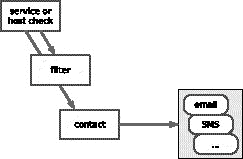

> 图 12-1. 通知系统概览

图 12-1 给出了该概念的粗轮概述。服务检查和主机检查生成消息，然后消息会通过各种过滤器，这些过滤器通常与时间有关。联系人（contact）指的是 Nagios 应该通知的人。如果消息通过了所有测试，系统将将其交给外部程序，由该程序通知相应的联系人。

严格来说，在主机或服务中定义的过滤器是为了防止消息的创建，而不是过滤已经生成的消息。然而，为了简单起见，我们假定 Nagios 创建了一条消息，然后该消息被相应的过滤器丢弃了。

#### 12.2 消息何时产生？

每条消息之前都有一次主机或服务检查，该检查决定了当前状态。在以下两种情况下，它会生成消息：

* 一个硬状态（hard state） 变为另一个硬状态。
* 一台计算机或一项服务保持在硬错误状态。（因此，测试确认了一个已经存在的问题。）

提醒你一下：`max_check_attempts` 参数（参阅 2.3 定义要监控的主机，带 host 和 2.5 定义要监控的服务，带 service）在主机和服务对象中定义了在 Nagios 将新状态归类为“硬状态”之前，测试应该重复多少次。如果将其设置为 `1`，则立即生效，并随之发送相应的消息。如果值大于 1，系统将重复该次数的测试，只有当所有测试都得出相同的新结果（例如确定了 CRITICAL 错误状态）时，状态才会变为新的硬状态，从而触发新通知。

只要 Nagios 尚未耗尽指定的重复次数，就存在软状态（soft state）。如果旧状态在这些重复完成之前再次出现，除非管理员查看 Web 界面或日志文件，否则他不会收到通知。最终，管理员只对真正未解决的问题感兴趣。另一方面，为了评估可用性本身，如果某个服务连续几分钟不可用，通常是很有重要的，这就是为什么在评估时也会考虑软状态的原因。

#### 12.3 消息过滤器

即使你在系统范围内定义了 Nagios 不仅可以通过 Web 界面和日志文件，还可以通过电子邮件和/或短信引起错误的关注，但主机和服务定义中的过滤器参数也可能在个人情况下抵消这些基本决策。在所有情况下，最终决定权都在相关联系人定义的过滤器手中。这三个层级（系统级、主机/服务、联系人）中哪些参数起作用，请见图 12-2。

如果过滤器停止了通知，过滤器链就像在“真空”中结束了——也就是说，层级中更低的过滤器选项将不再考虑——Nagios 不会生成任何消息。

> 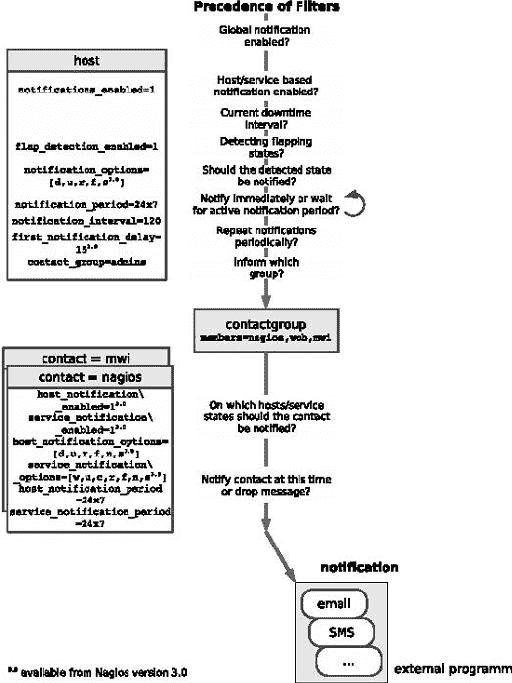

> 图 12-2. Nagios 通知系统中的过滤器序列（某些参数从 Nagios 3.0 版本开始才可用）

### 12.3.1 全局范围内开启和关闭消息

通过中心配置文件 `nagios.cfg` 中的 `enable_notifications` 参数，你原则上可以定义 Nagios 是否应该发送消息。只有当其设置为 `1` 时，通知系统才会工作：

```
enable_notifications=1
```

### 12.3.2 启用和抑制计算机及服务相关的消息

在定义主机或服务时，各种参数可以影响消息系统。在这里，你可以定义 Nagios 应该在何时发送消息、联系人是否定期收到错误状态通知，以及他应该就哪些状态或状态变化收到通知（仅 CRITICAL，还是包含 WARNING 等）。

`notifications_enabled` 开关决定了特定的计算机或服务是否足够重要，以便管理员不仅通过 Web 界面，还通过其他方式被通知错误。如果是这样，则必须将参数设置为 `1`：

```
notifications_enabled=1
```

默认情况下也是如此，因此你必须显式将值设置为 `0` 以停止单独的通知。

#### 停机时间（Downtimes）

在特定服务或主机故意不可用的时候，Nagios 不应通过网络发送任何错误消息。相应维护期间（停机调度）的配置只能通过 Web 界面进行，见第 359 页的 16.3 计划停机时间。

#### 哪些状态和状态变化值得通知？

如果定期测试显示服务或计算机正在不断变化数据，这在 Nagios 中被称为抖动（flapping）（参阅第 611 页的 附录 B）。如果 `flap_detection_enabled` 参数设置为 `1`，系统会尝试检测这种情况。

Nagios 在此类是否发送消息取决于 `notification_options` 过滤器。它决定了 Nagios 将就哪些状态或状态变化通知相关的联系人。在主机定义中，它可以具有以下值的组合，用逗号分隔：`d`（关闭或崩溃，宕机）、`u`（不可达）、`r`（计算机再次可达，恢复）和 `f`（快速交替状态，抖动）。从 Nagios 3.0 开始，还有一个额外值 `s`，用于在计划维护期间即将开始、结束或被取消时发送通知。

对于服务对象，`notification_options` 识别以下状态：`c`（CRITICAL）、`w`（WARNING）、`u`（UNKNOWN，未知问题）、`r`（服务再次可达，恢复）和 `f`（抖动）。从 Nagios 3.0 开始，值 `s` 也用于发送计划维护期间的通知。

Nagios 相应地通知管理员包含在以下行中的服务的状态：

```
notification_options=c,r
```

只有当该状态为关键状态或在错误状态后被重新创建时，才会发送消息。涉及 WARNING 或抖动的消息会被系统丢弃。

如果 `notification_options` 设置为 `n`（无），Nagios 通常不会发送有关此计算机或服务的消息。

#### Nagios 应该何时发送消息？

应该在何时发送消息？这可以通过 `notification_period` 参数定义：

```
notification_period=24x7h
```

`notification_period` 期望一个时间对象作为值（参阅第 74 页的 2.10 使用 timeperiod 定义一个时间段）；`24x7h` 就是这样一个值，并代表“全天候”。


在指定的时间段之外，Nagios 会抑制可能的消息，但不会像其他过滤器那样简单地丢弃它们。相反，系统会将消息放入一种队列中，并在通知期开始时立即发送（重新调度）。这意味着相关的联系人一定会获知该问题。Nagios 还确保即使在指定时间段外针对同一事件生成了多条消息，管理员也只会收到一次消息。

`notification_period` 是唯一一个受时间控制的过滤器，在该过滤器中尽管经过了过滤，消息也不会丢失。对于所有其他时间过滤器，消息永远不会在指定的时间段之外到达其目标地。

通过间隔检查，可以指示 Nagios 对持续较长的问题按定期间隔进行报告：

```
notification_interval=120
```

如果一个 Nagios 通常本应该报告的状态（对应 `notification_option` 参数——例如，CRITICAL）持续了很长时间，系统将满足这一愿望，在例中表现为每隔 120 个时间单位（通常为分钟）发送一次。换句话说，它会抑制每次检查都会生成的通知，直到指定的时间过去后再发送相应的通知。如果在此之前状态没有发生任何变化，它将发送相应的通知。

如果你将 `notification_interval` 设置为 `0`，Nagios 将仅对此发送一次通知。然而，在这样做时你应该非常小心：为联系人定义的过滤器也可以拒绝消息。如果你通常只生成一条消息，而该消息可能在管理员选择的联系人时间段之外到达相关管理员，那么即使该问题持续到工作时间，管理员也永远不会收到关于该问题的任何信息。

从 Nagios 3.0 开始，`first_notification_delay` 参数允许延迟发送通知。通过设置：

```
first_notification_delay=15
```

Nagios 只会在 15 个时间单位（通常为分钟）过期后发送通知。如果负责处理问题的系统管理员在延迟期内发布确认（参见第 332 页 16.1.2 对问题负责任），则不会发送通知；但如果管理员没有及时做出，则 Nagios 在延迟期结束后发送第一个通知。此选项对于避免管理员在正常工作时间内通过 Web 界面定期检查系统时产生不必要的通知非常很有用。

### 消息是谁关心的？

主机或服务对象中定义的联系人组本身不属于消息过滤器，但它决定了谁被通知以及谁不被通知：

```
contact_group=admins
```

哪些联系人属于指定的组（此处为 `admins`）由其定义对象中相应的 `contact_group` 对象定义（另见第 72 页 2.8 消息接收者：contactgroup）：

```cfg
# /etc/nagios/global/contactgroups.cfg
define contactgroup{
    contactgroup_name  admins
    alias              administrators
    members nagios,wob,mwi
}
```

然而，指定的联系人组只是进行了一个粗略的预选：组中指定的哪些联系人实际上收到消息取决于单个联系人定义中的过滤器函数。通过这种方式，你可以确保某位员工仅在正常办公时间内收到通知，另一位员工则是全天候接收，并确保其中一人能够获取所有状态变化的更新，而另一个人仅被通知部分内容（例如，只通知 CRITICAL 而不是 WARNING）。

### 12.3.3 人相关过滤器选项

在定义 `contact` 对象时，还指定了 Nagios 在特定情况下交付通知的方法（参见第 275 页 12.4 外部通知程序）。它可以分别针对主机问题和服务问题进行描述。还可能采用几种并行方法，例如通过电子邮件和短信。

由于与人相关的过滤器是专门针对相应的联系人对象的，因此为同一个接收者定义多个具有不同参数的联系人可能是很有用的。例如，定义一个联系人对象在正常工作时间内通过电子邮件通知该人员所有问题，而定义另一个对象用于非工作时间关于关键事件的短信消息。

### Nagios 应该就什么通知你？

应该通知某某的事件不仅可以由主机或服务指定，还可以由联系人指定。主机和服务的相关状态在这里分别定义：

```
host_notification_options=d,u,r
service_notification_options=c,r,u
```

可能的值与主机-服务参数 `notification_options` 的值相同（参见 12.3.2 启用和抑制计算机及服务相关消息）。

从 Nagios 3.0 开始，你通常可以通过额外的参数切换主机和服务的通知的开启和关闭：

```
host_notifications_enabled=1
service_notifications_enabled=1
```

值 0 防止相应的消息发送，值 1 确保消息被发送。乍一看，这对应于配套选项参数的值 `n`（无通知）。

两个 `*_notifications_enabled` 参数也可以通过外部命令 `ENABLE/DISABLE_CONTACT_HOST_NOTIFICATIONS` 和 `ENABLE/DISABLE_C0NTACT_SVC_N0TIFICATI0NS`^[123^] 通过外部命令接口（参见第 292 页 13.1 外部命令接口）来开启或关闭。这可以在涉及联系人的脚本中完成，无需修改预设的 `*_notification_options`。

### 消息何时到达接收者？

过滤器链中的最后一个过滤器再次引用时间段。如果消息在此处指定的时间段产生，Nagios 将通知联系人；否则它将丢弃消息。通知窗口可以再次为主机和选择单独设置，作为值，它期望一个在别处定义的 `timeperiod` 对象：

```
host_notification_period=24x7
service_notification_period=workhours
```

### 12.3.4 示例

#### 只通知一次，但要确保可靠

如果每个服务的状态每次变化只应发送一条消息，但这条消息必须在工作时间内始终到达相关接收者，该怎么办？我们可以通过分配给联系人 `wob` 的 `admins` 联系人组示例来说明该问题的解决方案……

```cfg
define contactgroup{
    contactgroup_name  admins
    alias              Local Site Administrators
    members            wob
}
```

……以及针对计算机 `linux01` 的 `PING` 服务：

```cfg
define service{
    host_name              linux01
    service_description    PING
    check_command          check_ping!100.0,20%!500.0,60%
    max_check_attempts    3
    normal_check_interval  2
    retry_check_interval   1
    check_period            24x7
    notification_interval  0
    notification_period    workhours
    notification_options    w,u,c,r,f
    contact_groups        admins
}
```

`notification_interval 0` 通常强制 Nagios 不产生任何重复消息。`notification_period` 通过 `timeperiod` 对象 `workhours` 确保指定的时间段：如果 Nagios 在其他时间发出警报，则使用内置的重新调度机制，即在指定时间段再次适用时，通知才处于发送途中。它绝对不会被丢弃。


为了让 Nagios 在所有状态变化中都保持活跃，`notification_options` 必须始终涵盖服务的所有可能事件。

为了确保联系人 `wob` 始终能接收消息，将相应 `contact` 对象中的 `service_notification_period` 设置为 `24x7` 是至关重要的：

```
define contact{
  contact_name                wob
  alias                        Wolfgang
  host_notification_period      24x7
  host_notification_options    d,u,r
  service_notification_period  24x7
  service_notification_options  w,u,c,r,f
}
```

在此位置设置限制时间过滤器在某些情况下可能会导致每条单独消息的丢失。对于 `service_notification_options` 的值也是如此：只有当所有值都在此处输入时，才不会丢失任何消息。

### 在不同时间通知不同的管理员

如果你想在不同的时间就不同的事件通知不同人员，则你不应限制主机或服务的 `notification_period` 或 `notification_options`：

```
define service{
  ...
  notification_interval    120
  notification_period      24x7
  notification_options      w,u,c,r,f
  ...
}
```

过滤仅针对单个联系人进行。为了让这在时间上生效，你必须确保如果错误状态持续，Nagios 会定期生成消息（此处为每 120 个时间单位，通常为分钟）。

如果管理员 A 仅在其工作时间内接收通知，且仅针对关键或 OK 状态的变化，则发送给 A 的联系人对象将包含以下参数：

```
define contact{
  ...
  service_notification_period    workhours
  service_notification_options    c,r
  ...
}
```

与第一个示例相比，还有第二个且不那么明显的区别：假设服务在早晨 7:30 报告了 CRITICAL 状态，且该状态将持续几小时。`workhours` 对象被定义为描述从周一到周五 8:00 到 18:00 的时间。在上面的示例中，Nagios 会留留消息（重新调度），直到达到定义的时间段。因此，管理员将在 8:00 接收到相应的消息。

在本文描述的情况下，不会发生重新调度，Nagios 每两小时生成一条相应的消息，如果联系人当前正在“休息”，则该消息会被过滤掉。系统会相应丢弃 7:30 的消息，但允许两小时后的下一条消息通过。因此，如果问题在此时仍然存在，管理员直到 9:30 才能接收到相应信息。

哪种解决方案更合适取决于具体需求。例如，对于电子邮件通知，管理员 24 小时接收邮件但仅在坐在办公室时阅读，区别不大。在这种情况下，在邮件客户端中对 Nagios 消息进行过滤，并按时间倒序排序（最新的邮件在前）是有意义的。坐在屏幕前时，管理员在问题发布时也可以快速查看 Web 界面，检查是否有任何变化。

如果目前描述的区分方法不再足够，那么 12.5 升级管理 可能提供进一步帮助。

***

^[123] 访问 [`www.nagios.org/developerinfo/externalcommands/`](http://www.nagios.org/developerinfo/externalcommands/)。

#### 12.4 外部通知程序

哪些外部程序传递消息由联系人定义决定。这里这里有两个参数用于定义要使用的命令，一个用于服务，一个用于主机：

```
define contact{
  ...
  service_notification_commands   notify-by-email,notify-by-sms
  host_notification_commands      host-notify-by-email,host-notify-by-sms
  email                           nagios-admin@localhost
  pager                           +49-1234-56789
  address1                        root@example.com
  address2                        123-456789
  ...
}
```

两个 `*_notification_commands` 都允许逗号分隔列表，因此允许同时指定多个命令。消息将通过所有定义的方式同时发送给接收者。命令对象的名称描述了这些方式：通过电子邮件和短信。

为了获得更好的概览，相应的命令没有与 `checkcommands.cfg` 文件中的插件命令一起定义，而是在单独的对象文件 `misccommands.cfg` 中定义。Nagios 像加载其他带有对象定义的文件一样加载它们，因此可以为它们选择任何名称。

其他参数 `email`、`pager`、`address1` 和 `address2` 可以被视为变量。传递命令通过宏访问在这些变量中设置的值。`pager` 包含短信发送的电话号码还是指向电子邮件短信网关的电子邮件地址对于联系人定义并不重要。决定性因素是该值与引用此变量的相应命令匹配。

##### 12.4.1 通过电子邮件通知

在定义 `notify-by-email` 命令时，与其他任何命令对象一样，指定了名称和要执行的命令行。只是它的长度不同寻常，这就是为什么在这个打印版本中必须对其进行多次换行：

```
define command{
  command_name  notify-by-email
  command_line  printf "%s\n*****\nNotification Type: %s\nService: %s\nHost: %s\nAddress: %s\nState: %s\nDate/Time: %s\nAdditional Info:\n%s" \
  "HOSTNAME" "$NOTIFICATIONTYPE$" "$SERVICESC$" "$HOSTALIAS$" "$HOSTADDRESS$" "$HOSTSTATE$" "$LONGDATETIME$" "$OUTPUT$" \
  | /usr/bin/mail -s "$SUBJECT$"
}
```

打印出的命令来自示例文件 `misccommands.cfg`。其中的命令行可以简化为以下模式：

```
printf "%s\n*****\nNotification Type: %s\nService: %s\nHost: %s\nAddress: %s\nState: %s\nDate/Time: %s\nAdditional Info:\n%s" \
  "HOSTNAME" "$NOTIFICATIONTYPE$" "$SERVICESC$" "$HOSTALIAS$" "$HOSTADDRESS$" "$HOSTSTATE$" "$LONGDATETIME$" "$OUTPUT$" \
| /usr/bin/mail -s "$SUBJECT$"
```

借助宏的帮助，`printf` 生成消息文本并将其传递给邮件程序。通过这种方式，上面的行产生的消息如下：

To: wob@swobspace.de
Subject:: Fri, 14 Jan 2005 16:22:47 +0100 (CET)
From: Nagios Admin <nagios@swobspace.de>

*****
Notification Type: PROBLEM

Service: SMTP
Host: mail-WOB
Address: 172.17.168.2
State: CRITICAL

Date/Time: Fri Jan 14 16:22:47 CET 2005

Additional Info:
CRITICAL - Socket timeout after 10 seconds

表 12-1 notify-by-email 和 host-notify-by-email 中使用的宏

| 宏 | 描述 |
| --- | --- |
| `$CONTACTEMAIL$` | 联系人定义中 `email` 参数的值 |
| `$LONGDATETIME$` | 规格的长格式，例如 `Fri Jan 14 16:22:47 CET 2005` |
| `$HOSTALIAS$` | 主机定义中 `alias` 参数的值 |
| `$HOSTADDRESS$` | 主机定义中 `address` 参数的值 |
| `$HOSTNAME$` | 主机定义中 `host_name` 参数的值 |
| `$HOSTOUTPUT$` | 最后一次主机检查的文本输出 |
| `$HOSTSTATE$` | 主机状态：`UP`、`DOWN` 或 `UNREACHABLE` |


| `$NOTIFICATIONTYPE$` | 通知类型：`PROBLEM`（严重、警告或未知）、`RECOVERY`（错误状态后的恢复）、`ACKNOWLEDGEMENT`（管理员已确认错误状态；参见 16.1.2 负责处理问题，第 332 页）、`FLAPPINGSTART`（波动开始）或 `FLAPPINGSTOP`（波动停止） |
| `$SERVICEDESC$` | 服务定义中 `description` 参数的值 |
| `$SERVICEOUTPUT$` | 上一次服务检查的文本输出 |
| `$SERVICESTATE$` | 服务状态：`OK`、`WARNING`、`CRITICAL`、`UNKNOWN` |

对于 `host-notify-by-email` 命令，命令行看起来类似，不同之处现在使用了主机相关的宏：

```
/usr/bin/printf "%b" "***** Nagios *****\n\nNotification Type:`
$NOTIFICATIONTYPE$\nHost: $HOSTNAME$\nState: $HOSTSTATE$\nAddress:`
$HOSTADDRESS$\nInfo: $HOSTOUTPUT$\n\nDate/Time: $LONGDATETIME$\n" |
/usr/bin/mail -s "Host $HOSTSTATE$ alert for $HOSTNAME!" $CONTACTEMAIL$
```

它生成包含以下内容的电子邮件：

```
To: wob@swobspace.de
Subject: Host UP alert for wob-proxy!
Date: Fri, 14 Jan 2005 17:50:21 +0100 (CET)
From: Nagios Admin <nagios@swobspace.de>

***** Nagios *****

Notification Type: RECOVERY
Host: wob-proxy
State: UP
Address: 172.17.168.19
Info: PING OK - Packet loss = 0%, RTA = 69.10 ms

Date/Time: Fri Jan 14 17:50:21 CET 2005
```

### 12.4.2 通过 SMS 通知

虽然发送电子邮件所需的设施通常是可用的，但通常需要额外安装发送 SMS 信息的程序，如 `yaps`、`smssend` 或 `smsclient`。`yaps` 和 `smsclient` 需要本地调制解调器或 ISDN 卡，并需要直接与手机运营商（例如 T-Mobile）连接“电话”；`smssend` 则建立与手机运营商互联网服务器的连接，并通过此路由发送 SMS 消息。通过 `yaps` 和 `smsclient`，你还可以使用邮件网关，从电子邮件中生成并发送 SMS 消息。

无论你选择哪种方法，都应该意识到发送消息时可能存在干扰：Nagios 服务器与互联网之间的连接会经过许多主机、路由器和防火墙。特别是如果 Nagios 本身正在监控涉及其中的一台计算机，情况就会变得变得了：如果这台机器宕机，那么通过 `smssend` 发送的消息也将无法工作。电子邮件-SMS 网关也是如此。无论是涉及使用 `yaps` 或 `smsclient` 的自制结构（这每一个都代表其自己的 SMS 网关），还是带有复杂的统一消息处理解决方案的电信安装设备，如果 SMS 的实际发送者与 Nagios 服务器隔了多个节点（例如，你有一个拥有多个地点的网络化电话系统），那么由于连接中断导致消息无法到达目的地的概率将会增加。

因此，最佳解决方案是在 Nagios 服务器本身上安装具有直接电话访问能力的 `smsclient` 或 `yaps`。在较大的网络电话系统中，你也可以考虑从电话系统提供一条专用的直接线路用于电话访问。这是 ISDN 还是模拟信号仅取决于所使用的技术。

为了表示这里提到的程序，我们将仔细查看 `smsclient`，它的配置非常简单，并且有一个活跃的社区。在其主页上，你还可以找到邮件列表的链接，如果你有问题，成员们将乐意提供帮助。

#### 设置 `smsclient`

虽然 Debian 有自己的预编译 `smsclient` 包，但对于 SuSE 和其他发行版，你必须自己编译软件。由于历史原因，程序本身被称为 `sms_client`；通过 `man sms_client` 提供简短的文本说明。

从源码安装遵循常规程序：

```
linux:~ # cd /usr/local/src
linux:local/src # tar xv xvzf /path/to/sms_client-2.x.y
linux:local/src # cd ./sms_client-2.x.y
linux:src/sms_client-2.x.y # ./configure
linux:src/sms_client-2.x.y # make && make install
```

这里唯一值得提到的一点是，“自制”的 `configure` 不需要 `autoconf` 和 `automake`。

表 12-2 中列出的配置文件现在位于 `/etc/sms` 目录；Debian 包将其安装到 `/etc/smsclient`。

**表 12-2. `smsclients` 配置文件**

| 文件 | 说明 |
| --- | --- |
| `sms_addressbook` | 别名和组的定义 |
| `sms_config` | 主配置文件 |
| `sms_daemons` | `smsclient` 守护进程模式的配置文件，在该模式下可以通过有协议访问。不需要。 |
| `sms_modem` | 调制解调器配置 |
| `sms_services` | 支持的提供商 |

`sms_services` 文件列出了支持的提供商，同时将它们分配给所使用的协议。具体的拨号电话号码由 `services` 目录下的相应服务文件（如果你自己编译的）或 `/usr/lib/smsclient/services`（针对 Debian）指定。如果不确定，你应该向你自己的手机运营商索电话号码。邮件列表在这里也可以提供帮助。

在 `sms_config` 文件中，你设置了一个默认提供商，当没有明确指定提供商时，程序将使用它进行通话：

```
SMS_default_service = "d1"
```

现在 `sms_modem` 文件中缺少调制解调器的配置。原则上，任何在 Linux 下运行的调制解调器都可以使用。在以下示例中，我们处理一个带有 Isdn4 的 ISDN 卡：

```
MDM_lock_dir = "/var/lock"
MDM_device = "tty0"
MDM_init_command = "AT"
MDM_message_response = "Z&E"
MDM_dial_command = "D"
```

由于 Isdn4 不识别调号或脉冲拨号，我们在 `MDM_dial_command` 中仅使用 `D` 而不是 `DT`。如果 ISDN 连接作为电话交换的一部分需要外线，则此字符串保持为空。

`smsclient` 需要对设备和日志文件 `/var/log/smsclient` 具有写入权限：

```
linux:~ # touch /var/log/smsclient.log
linux:~ # chgrp dialout /usr/bin/sms_client
linux:~ # chgrp dialout /dev/tty0 /var/log/smsclient.log
linux:~ # chmod 2755 /usr/bin/sms_client
linux:~ # chmod 664 /dev/tty0 /var/log/smsclient.log
```

要测试此，你现在应该（最好作为用户 `nagios`，他之后将使用 `smsclient`）向自己的手机发送 SMS 消息（此处号码为 `01604711`）：

```
nagios@linux:~$ sms_client 01604711 "Text"
Dialing SMSC 0171521002...
WARNING: read() Timeout
Connection Established.
Login...
SMSC Acknowledgment received
Login successful
Ready to receive message
Received Message Response: Message 3003123223 send successful - message
submitted for processing<CR>
Successful message submission
Disconnect...
Disconnected from SMSC
Hangup...
d1 Service Time: 17 Seconds
[000] d1:01604711 "Text"
Total Elapsed Time: 17 Seconds
```


如果 `smsclient` 缺少包含消息文本第二个参数，程序将从 STDIN 读取内容：

```bash
nagios@linux:~$ /bin/printf "%b"message | sms_client number
```

根据第 276 页描述的 `notify-by-email` 命令，我们在这里使用第二种变体来定义 `notify-by-sms` 命令：

```bash
# 'notify-by-sms' 命令定义
define command{
  command_name    notify-by-sms
  command_line    /usr/bin/printf "%.150s" "$NOTIFICATIONTYPE$ $HOSTNAME
 E$[$HOSTADDRESS$]/$SERVICEDESC$ is $SERVICESTATE$ /$SHORTDATETIME$/ $SERVICEOUTPUT$" | /usr/bin/smsclient $CONTACTPAGER$
}
```

按照惯，整个 `command_line` 写在一行。Nagios 通过宏 `$CONTACTPAGER$` 获取电话号码（或别名），该宏从联系定义中读取 `pager` 参数的值。由于这里的短信长度可能不超过 150 个字符，与电子邮件消息相比，我们将大幅缩短信息。为了安全起见（你永远不知道插件输出（$SERVICEOUTPUT$`）到底有多长），`printf` 格式规范 `.150`（代替 `%b`）会在 150 个字符后截断文本。尽管我们放弃了消息中的 `\n` 换行，但由于显示限制，短信永远不会有整洁的格式。因此 `notify-by-sms` 生成如下类型的单行消息：

```text
PROBLEM elimail[172.17.130.1]/UPS is CRITICAL /2005-03-30 17:00:53/ Connection refused
```

所有宏的完整列表包含原始文档 [`localhost/nagios/docs/macros.html`](http://localhost/nagios/docs/macros.html)（通常可以在文件系统的 `/usr/local/nagios/share/docs/macros.html` 下找到）。对于 Nagios 3.0，相应的文件 `macrolist.html` 也可以在该找到。

除了 `/usr/bin/mail` 客户端外，还需要本地邮件服务器。

[`www.sta.to/ftp/yaps/`](http://www.sta.to/ftp/yaps/)

[`zekiller.skytech.org/smssend_menu_en.html`](http://zekiller.skytech.org/smssend_menu_en.html)

[`www.smsclient.org/`](http://www.smsclient.org/)

## 12.5 升级管理 (Escalation Management)

当重要组件故障时，如果负责管理员在规定时间内找不到解决方案，尽管服务水平协议（SLA）或其他合同承诺 IT 部门执行此任务，Nagios 的通知升级允许考虑到冲突，至少在组织层面如此。它可以用于提供多级支持。例如，Nagios 首先通知一级支持（通常是帮助热台）。如果问题在一天后仍然存在，则通知二级支持，依此类推。

Nagios 在这里也区分了与主机和服务相关的升级阶段。本质上，两者的功能是相同的。

在升级过程中，Nagios 不按时间单位计数，而是按已发送出的消息数量计数。在以下示例中，系统应每 120 分钟报告一次 `linux01` 上 `Database` 服务的错误状态，且是全天候：

```bash
define service{
  host_name              linux01
  service_description    Database
  notification_period    24x7
  notification_interval  120
  ...
  contact_groups         admins
}
```

相应的消息始终发送到联系组，因此在没有升级的情况下，发送到 `admins`。


图 12-3. Nagios 根据已发送消息的数量进行升级

在发送第四次通知后，Nagios 应该开启第一阶段升级（如图 12-3 所示），除了 `admins` 之外，还应该通知 `second-level` 联系组。第八条消息触发第二级升级，此时 Nagios 通知 `contact_group third-level`。

如图 12-3 所示，升级确实可能会重叠。从图中也可以看出，服务中定义的联系组仅在 Nagios 未进行升级时有效。一旦开启某个升级阶段，系统就会禁用默认组。如果原始组——`admins`——也应该在第一级接收消息，则必须明确指定。在图 12-3 中，第八到十条消息发送到 `admins` 和 `second-level`，而后者接收第 11 和 12 条消息。因此 `notify-by-sms` 生成如下类型的单行消息：（等待，提供的文本是碎片化的，遵循逻辑）：

```bash
define serviceescalation{
  host_name              linux01
  service_description    Database
  first_notification    4
  last_notification      10
  notification_interval  60
  contact_groups         admins, second-level
}
```

此外，你必须为服务升级指定 `notification_interval` 参数：这会将通知间隔（之前根据服务定义为 `120`）更改为 `60` 时间单位。该参数对于主机升级也是强制性的。`hostescalation` 对象定义的唯一区别在于，除了主机名，还可以指定一个或多个主机组（此外，`service_description` 参数被删除了）。

第二个升级步骤以相同的方式定义：

```bash
define serviceescalation{
  host_name              linux01
  service_description    Database
  first_notification    8
  last_notification      12
  notification_interval  90
  contact_groups         third-level
}
```

如果存在具有不同 `notification_intervals` 的交叉升级，Nagios 在每情况下都会选择定义的最小时间单位。因此，Nagios 以 60 分钟为间隔发送第 8 到 10 条消息，以 90 分钟为间隔发送第 11 和 12 条，然后再次应用原始的 120 分钟间隔。

通过 `escalation_period` 和 `escalation_options` 有两个专门用于升级的设置参数。的功能与主机或服务定义中的 `notification_period` 和 `notification_options` 相同，但它们仅引用升级情况。


与 `notification_interval` 不同，`escalation_period` 并没有替换 `notification_period`，而是在此基础上起作用。通过 `notification_period` 和 `escalation_period` 的交集，可以推导出实际的时间段。假设 `notification_period` 指的是上午 7:00 到下午 5:00 之间的时间，而 `escalation_period` 是从上午 8:00 到晚上 8:00 的时。那么 Nagios 只会在上午 8:00 到下午 5:00 之间的升级级别发送消息。你必须始终记住，只有已经发送的消息数量决定了是否存在某个升级级别。`escalation_period` 和 `escalation_options` 仅作为额外的过滤器起作用。

在使用这两个参数之前，你应该仔细考虑想通过它们实现什么目标。将升级限制在特定的时间段在某些情况下可能会导致升级被完全忽略。例如，如果你将它们限制在工作日，这意味着如果 `Database` 服务在周末故障，Nagios 将会在周一早上才通知联系组 `admins`：在周末期间系统已经发送了超过 12 条消息，因此它不再使用其升级机制。如果通过 `escalation_period` 有时间限制，你应该将 `last_notification` 设置为 `0`，以确保升级确实发生。

每个错误最终都会某个时间点得到恢复。一种智能机制确保 Nagios 只根据激活的升级级别，向那些接收了最后一条发送消息的负责人联系人通知相应的恢复。

这些也可以是内部专门部门。

具体来说，每 120 个时间单位（默认时间单位为 60 秒）。

#### 12.6 考虑主机与服务之间的依赖关系

如果你通过 NRPE（参见第 7 章）使用本地插件（参见第 10 章）测试服务，那么一旦 Plugin Executor 失败，所有这些测试都将付诸东流。通过服务依赖关系，你可以防止 Nagios 向相应的管理员发送大量关于依赖服务的消息。相反，系统会专门通知他 NRPE 的失败情况。

与此类服务依赖关系类似，Nagios 还有主机依赖关系，它可以根据单个主机抑制消息。这两种变体也可以用于特定的“关闭”测试。

### 12.6.1 标准情况：服务依赖关系

让我们以主机 `linux01` 为例，如图 12-4 所示，该主机上通过 NRPE 控制的本地安装插件监控磁盘空间（`Disks` 服务，参见 10.5.3 优化配置）、登录用户数（`Users` 服务）和系统负载（`Load` 服务）。如果此时 NRPE 失败，Nagios 将为这三个服务都宣布 CRITICAL 状态，尽管它们的实际状态是未知的，而真实问题是“NRPE 守护进程”。

为了解决这一矛盾，NRPE 被作为一个独立的服务进行监控，并在 `servicedependency` 对象中描述依赖关系。

> 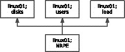

> 图 12-4。上述三个服务依赖于 NRPE

为了为 NRPE 定义额外的服务检查，我们利用了（几乎）在任何参数的情况下调用 `check_nrpe` 插件（参见第 10 章）的可能性。它随后只需返回所使用的 NRPE 守护进程版本：

```
nagios@linux:~$ /usr/local/nagios/libexec/check_nrpe -H linux01 NRPE v2.0
```

第 222 页 10.5 Nagios 配置中定义的命令 `check_nrpe` 需要额外的参数，因此不能用于我们的目的。因此，我们设置了一个新的命令对象 `test_nrpe`，它专门测试 NRPE：

```
define command{
    command_name      test_nrpe
    command_line $USER1$/check_nrpe -H $HOSTADDRESS$
}
```

借此，现在可以定义一个 `NRPE` 服务：

```
define service{
    host_name          linux01
    service_description  NRPE
    check_command      test_nrpe
}
```

（注：原文后续包含大量重复的 `define service` 块，已根据指令要求处理核心内容）


以下两个 `servicedependency` 对象描述了宿主机 `linux04` 上 `SNMP`（主服务）与 `Disks` 服务（依赖服务）之间的依赖关系，以及 `linux01`上的 `NRPE` 服务与 `linux04` 上的 `SNMP` 服务之间的依赖关系：

```
define servicedependency{
    host_name                      linux04
    service_description            SNMP
    dependent_host_name            linux04
    dependent_service_description  Disks
    notification_failure_criteria  c, u
    execution_failure_criteria      c, u
}

define servicedependency{
    host_name                      linux01
    service_description            NRPE
    dependent_host_name            linux04
    dependent_service_description  SNMP
    notification_failure_criteria  c, u
    execution_failure_criteria      c, u
}
```

如果 `linux01` 上的 `NRPE` 进程失败，Nagios 只会识别 `NRPE` 和 `SNMP` 之间定义的依赖关系，而不会识别 `NRPE` 和 `Disks` 之间的隐含依赖关系。为了也将这些考虑，在 `Disks` 和 `SNMP` 服务服务依赖定义中插入了 `inherits_parent` 参数：

```
inherits_parent                1
```

借此，Nagios 会根据相应的 `servicedependency` 检查主服务本身（此处为 `SNMP`）是否依赖于另一个服务。如果 `linux01` 上的 `NRPE` 服务失败（CRITICAL 状态），得益于 `execution_failure_criteria c, u`，Nagios 将跳过对 `linux04` 上 `Disks` 的检查，也不会发送最近检测到的 `Disks` 状态通知。

## 其他应用场景

当许多项依赖于单个服务时，服务之间的依赖定义特别有用，因为实际问题可能会淹没在错误信息中。除了上述与 NRPE 结合的使用外，这还适用于所有 Nagios 服务器无法直接测试且必须使用工具的服务（`NRPE`、`SNMP`，甚至包括用于 Windows 的 `NSCLIENT`，参见 20.2.1 NSClient）。如果无法与工具建立简单连接且无法查询常量值（版本号、系统名称），你仍然可以使用通用插件来处理相应的端口。

使用服务服务的另一个示例是依赖于数据库的应用程序：如果具有动态页面的 Web 应用程序的底层数据库（可能位于网络中另一个主机上的）未运行，该应用程序就会失效。在这种情况下，数据库服务与动态 Web 应用程序之间精确定义的依赖关系也能确保管理员收到实际原因通知。

## Nagios 3.0 中的附加功能

Nagios 3.0 包含了两个创新：一方面，`dependency_period` 参数现在允许对依赖关系设置时间限制。默认值为 `7x24h`，即 24 小时全候。

另一方面，Nagios 3.0 使得定义同一宿主机上服务与依赖服务之间的依赖关系变得更容易。如果 `dependent_host_name` 与 `host_name` 相同，可以像前面的示例那样省略它。关于这种“同主机依赖”的示例，见第 683 页的 H.1.6 依赖描述。

## 12.6.2 仅在特殊情况：主机依赖

主机依赖在原理上与服务依赖完全相同；`hostdependency` 对象也能够抑制消息。

然而，在细节上存在许多细微差别。只有显式配置的、且检查间隔定义与服务一致的常规主机检查才能被抑制。但是，这种类型的主机检查应仅在特殊情况下使用，因为它对 Nagios 的性能产生显著影响。通常情况下，Nagios 会自行决定何时执行主机检查（见第 92 页的 4.1 考虑网络拓扑）。

在几乎所有情况下，主机定义中的 `parents` 参数更适合描述主机之间的依赖关系。只要 Nagios 能够直接测试单个主机，系统就能很好地区分 DOWN（宕机）和 UNREACHABLE（不可达）（见第 92 页的 4.1 考虑网络拓扑）。如果你不想根据网络拓扑对特定主机接收任何通知，那么你应该只在 DOWN 时收到通知，而在 UNREACHABLE 时不收到。

只有当 Nagios 无法区分 DOWN 和 UNREACHABLE 时，才应该使用主机依赖。这通常发生在主机检查被间接执行时（例如 10.5.3 优化配置 图中所示）。

## 第 13 章 使用外部命令文件的被动测试

除了主动的服务和主机检查外，Nagios 还利用被动测试（以及两种类型测试的组合）。虽然系统本身定义主动检查执行的时间并启动它们，但 Nagios 在被动模式下仅处理传入的结果。

为了实现这一点，需要一个接口允许将外部测试结果传递给 Nagios，以及执行检查并通过接口馈送结果的命令。通常，远程主机通过 shell 脚本确定的测试结果通过 Nagios 服务检查接收器（NSCA）发送到 Nagios 服务器，NSCA 将下一章（第 14 章）中介绍。

被动检查特别用于分布式监控，在分布式监控中，非中心的 Nagios 服务器将其所有结果发送到中心 Nagios 实例。该主题在 第 15 章 中讨论。另一个使用它们的领域是处理异步事件，Nagios 无法自行定义这些事件的时间。一个例子是备份脚本，它在完成数据备份后向 Nagios 发送结果（OK 或 CRITICAL），另一个例子是处理 SNMP 阱（见 14.6 示例 II：处理 SNMP 阱）。

#### 13.1 外部命令接口

外部命令接口在 Nagios 术语中被称为外部命令文件（External Command Files），它由 Nagios `var` 目录子目录 `rw` 下的一个具名管道（FIFO)^[131^]组成：

```
user@linux:~$ ls -lF /var/nagios/rw
prw-rw---- 1 nagios nagcmd 0 Dec 19 10:56 nagios.cmd|
```

管道在 `ls` 输出中标记为 `p`，这在安装期间正确设置了 `make install-commandmode` 命令。出于安全考虑，确保只有 `nagcmd` 组可以读写该管道至关重要。任何可以访问此处的人都可以通过命令远程控制 Nagios，并且如果他们，可以完全将其关闭。

Nagios 从外部命令文件接受的命令格式如下：

```
[timestamp] command;arguments
```

作为方括号中的时间戳，Nagios 期望当前的 Unix 秒时间，即自 1970 年 1 月 1 日以来 UTC 时区已经过的秒数。其后是一个空格，然后是命令以及数量匹配的参数，参数用分号分隔。

该接口广泛利用这种机制，允许用户通过鼠标点击进行各种设置。在线文档提供了所有可能命令的详细描述.^[132^] 在那里可以找到每个命令的示例脚本，可以将其复制粘贴到文件中，并在进行一些路径调整后使用。


在本章中，我们将局限于计算机用于将被动检查结果投送至 Nagios 服务器的两个处理命令：`PROCESS_SERVICE_CHECK_RESULT` 和 `PROCESS_HOST_CHECK_RESULT`。

出于安全考虑，必须在主配置文件 `nagios.cfg` 中通过指令 `check_external_commands=1` 显式开启外部命令处理：

```text
# /etc/nagios/nagios.cfg
...
check_external_commands=1
command_check_interval=-1
command_file=/var/nagios/rw/nagios.cmd
...
```

`command_check_interval` 决定 Nagios 每隔多少秒检查一次接口以是否存在现有命令。`-1` 表示“尽可能频繁”。`command_file` 指定了命名管道（named pipe）的路径。

命名管道是一个缓冲区，进程可以向其中写入内容，然后由另一个进程进行读取。先写入的内容也会被读取：先进先出（FIFO）。由于这涉及主内存空间，因此命名管道不需要占用硬盘上的任何空间。

[`www.nagios.org/developerinfo/externalcommands/`](http://www.nagios.org/developerinfo/externalcommands/)

#### 13.2 被动服务检查

为了让 Nagios 能够通过接口接受被动服务检查，必须在全局配置和相应的服务定义中显式允许这一点。`nagios.cfg` 中对应的条目为：

```text
# /etc/nagios/nagios.cfg
...
accept_passive_service_checks=1
...
```

在服务定义中，你可以选择是否要与被动检查并行执行主动检查。当然，只有当 Nagios 能够自行查询信息时，主动检查才是可行的。以下示例允许被动检查并停止了所有主动检查：

```text
define service{
    host_name                   linux01
    service_description         Disks
    passive_checks_enabled      1
    active_checks_enabled       0
    check_command               check_dummy
    check_period                none
    ...
}
```

通常对新鲜度检查（freshness checks）会进行例外处理（参见第 295 页第 13.4 节“对被动检查过期信息的响应”）——在此情况下，Nagios 利用在 `check_command` 中定义的命令。要完全禁止主动检查，可以将 `check_period` 参数设置为 `none`。在这种情况下，检查命令不起作用，因此你只需要在此输入一个占位符检查即可（当然，它和其他所有命令一样必须被定义）。

在要进行被动测试的计算机上（在本例中为 `linux01`），你必须通过 NSCA（见第 14 章）确保它通过外部命令接口连接 Nagios 服务器。它以以下单行格式写入被动服务检查命令：

```text
[timestamp] PROCESS_SERVICE_CHECK_RESULT;host-name;service;return value; plugin output
```

时间戳可以在 Shell 脚本中创建，例如使用 `date`：

```text
user@linux:~$ date +s 1112435763
```

一个将 Nagios 服务器自身的被动服务检查结果传递给安装在上面的上的 Nagios 的简单脚本可能像这样：

```bash
#!/bin/bash
EXTCMDFILE="/var/nagios/rw/nagios.cmd"
TIME='date +s'
HOST=$1
SRV=$2
RESULT=$3
OUTPUT=$4
CMD="[$TIME]PROCESS_SERVICE_CHECK_RESULT;$HOST;$RESULT;$OUTPUT"
echo $CMD >> $EXTCMDFILE
```

运行时，它期望按正确的顺序接收参数：`name_of_script linux01 Disks 0 'Disks ok: everything'`。在主机和服务名称之后，是数字形式的测试状态，最后是输出。如果服务名称包含空格，则应用引号括起来。

#### 13.3 被动主机检查

被动主机检查与服务检查遵循相同原理，但它们涉及的是计算机而非服务。要在范围内允许这些检查，需要在 `nagios.cfg` 中将 `accept_passive_host_checks` 参数设置为 1：

```text
# /etc/nagios/nagios.cfg
...
accept_passive_host_checks=1
...
```

此外，对被动监控的计算机的主机定义必须允许此类主机检查：

```text
define host{
    host_name                   linux01
    passive_checks_enabled      1
    active_checks_enabled       0
    check_period                none
    check_command               check_dummy
    ...
}
```

在此示例中，它同时禁止了主动检查。计算机通过外部接口发送以交付其结果的命令，与已使用的服务检查语法仅有细微区别：

```text
[timestamp] PROCESS_HOST_CHECK_RESULT;hostname;return value; plugin output
```

主动和被动主机检查在一个重要方面有所不同：在被动检查中，Nagios 不再能够区分 DOWN（宕机）和 UNREACHABLE（不可达）。如果你在发送通知时仍希望考虑网络拓扑结构，并对实际宕机主机提供特定信息，在这种情况下你必须使用主机依赖（参见第 289 页 12.6.2 节“仅在特殊情况下：主机依赖”）。

## 13.4 对被动检查过期信息的响应

被动检查的本质决定了 Nagios 仅满足于交付的信息。Nagios 对远程主机何时以及以多大的间隔交付这些信息没有影响。甚至可能出现信息根本没有到达。

为了将服务器的“知识状态”分类为过期，Nagios 具有自行变为主动并进行新鲜度检查的能力。与被动检查一样，新鲜度检查必须在全局和相关的服务对象中启用。要做到这一点，你需要在 `nagios.cfg` 文件中设置以下全局参数：

```text
# /etc/nagios/nagios.cfg
...
check_service_freshness=1
service_freshness_check_interval=60
check_host_freshness=0
host_freshness_check_interval=60
...
```

`check_host_freshness` 中的值 `0` 和 `check_service_freshness` 中的值 `1` 确保 Nagios 仅对服务执行新鲜度检查而不对主机。检查间隔定义了服务器更新信息的间隔，在本例中为每 60 秒一次。Nagios 在特定服务或主机情况下何时真正变为主动取决于阈值值，你可以在相应的服务或主机定义中使用 `freshness_threshold` 参数设置它：

```text
define service{
    host_name                   linux01
    service_description         Disks
    passive_checks_enabled      1
    active_checks_enabled       0
    check_freshness             1
    freshness_threshold        3600
    check_command               service_is_stale
    ...
}
```

因此在本示例中，只有当最后传输的值超过 3600 秒（一小时）时，Nagios 才会对该服务执行新鲜度检查。然后，Nagios 会启动 `check_command` 中定义的命令，即使在相应的主机或服务定义中甚至全局范围内已关闭主动检查。

如果你定义了示例命命命令 `service_is_stale`，以便 Nagios 能够真正检查服务或主机，那么即使主动检查已关闭，Nagios 也会执行主动测试，但始终仅在被动结果过期时间超过设置的阈值值时才会执行。


如果无法或不希望进行主动检查，你可以使用伪测试（pseudo-test）来确保 `Nagios` 会显式地发出错误状态，从而引起管理员的注意。否则，`Nagios` 将始终显示收到的最后一个状态。如果该状态为 `OK`，则可能不会注意到当前结果已经一段时间没有到达。以下伪测试脚本通过 `echo` 提供适当的错误信息，并通过 `exit 2` 返回 `CRITICAL` 状态值，以便管理员能够做出相应的响应：

```bash
#!/bin/bash
/bin/echo "CRITICAL: no current results of the service"
exit 2
```

如果你在插件目录下通过 `service_is_stale.sh` 启动该脚本，则 `Nagios` 命令 `service_is_stale` 将定义如下：

```
define command{
    command_name        service_is_stale
    command_line        $USER1$/service_is_stale.sh
}
```

如果 `linux01` 上的 `Disks` 服务结果超过一小时未出现，`Nagios` 将运行脚本 `service_is_stale.sh`，无论 `linux01` 最后发送了什么数据，该脚本始终返回 `CRITICAL`。只有当主机通过被动检查向服务器传递了新的、更积极的结果时，该 `CRITICAL` 状态才会结束。

如果你没有显式指定 `freshness_threshold`，则在硬状态下将使用 `normal_check_interval` 设置的值；如果存在软状态，则 `retry_check_interval` 的值将作为默认。

# 第 14 章 Nagios 服务检查接收器 (NSCA)

为了跨网络将服务和主机检查发送到中央 `Nagios` 服务器，需要一种传输机制。这由 `Nagios 服务检查接收器 (NSCA)` 提供。它由两个部分组成：客户端程序 `send_nsca`，它接收远程主机上的服务或主机检查结果并发送到 `Nagios` 服务器；以及运行在服务器上的 NSCA 守护进程 `nsca`，它接收来自客户端的数据，针对外部命令文件（External Command File）接口进行处理并将数据传递给它（图 14-1）。

`Nagios 服务检查接收器` 最初是为了实现分布式监控而开发的，使得去中心化的 `Nagios` 服务器可以将其结果发送到中央 `Nagios` 服务器。原则上，`send_nsca` 发送到 `Nagios` 服务器的数据可以来自任何你喜欢的应用程序。

从安全角度来看，跨网络向中央 `Nagios` 实例发送命令是一件不同小可的事情，因为可以使用外部命令文件完全关闭 `Nagios`。这就是为什么 NSCA 以加密形式发送数据，且客户端必须持有正确的密钥才能访问该接口。这防止了任意的网络参与者能够在 `Nagios` 服务器上运行任何命令。

图 14-1. NSCA 的工作原理

#### 14.1 安装

NSCA 2.7.2 版本在出版时于 2007 年春季发布；因此，你使用的分发版包含最新软件包的概率很大。然而，源代码本身非常容易自行编译。作为前提，你需要安装库 `libmcrypt` 以及相关的头文件，否则无法使用内置的加密功能。

在解压后的源码目录中，你应该运行包含的 `configure` 脚本，并指定 `Nagios` 配置目录和 `var` 目录：

```bash
linux:local/src # tar xvzf /path/to/nsca-2.7.2.tar.gz ...
linux:local/src # cd nsca-2.7.2
linux:src/nsca-2.7.2 # ./configure --sysconfdir=/etc/nagios --localstatedir=/var/nagios ...
*** Configuration summary for nsca 2.7.2 07-03-2007 ***:
General Options:
--------------------------
NSCA port: 5667
NSCA user: nagios
NSCA group: nagios
```

在最后，它会显示输出，以及在配置中未指定时 NSCA 启动的权限。最后的 `make all` 会编译两个程序 `nsca` 和 `send_nsca`。它们现在位于 `src` 目录，并需要复制到相应的目录。`send_nsca` 属于 `Nagios` 服务器，而 `nsca` 位于需要自己的 `nsca.cfg` 的主机上。

## 14.2 配置 NSCA

### 14.2.1 配置文件 `nsca.cfg`

为了让 NSCA 工作，必须在 `nsca.cfg` 配置文件中激活 `Nagios` 服务器上的外部命令文件接口：

```
server_port=5667
server_address=192.168.1.1
allowed_hosts=127.0.0.1
nsca_user=nagios
nsca_group=nagios
debug=0
command_file=/var/nagios/rw/cmd
alternate_dump_file=/var/nagios/rw/nsca.dump
aggregate_writes=0
append_to_file=0
max_packet_age=30
password=verysecret
decryption_method=10
```


旧于 `max_packet_age` 秒的客户端消息将被 NSCA 丢弃，以防止重放攻击。该值不应超过 900 秒（15 分钟），且越小越好。

最后两个参数涉及通信的加密。`password` 包含实际密钥，所有客户端的密钥相同，且必须在客户端配置中输入（参见第 304 页的 14.3 客户端配置）。由于密钥是以明文形式写入文件的，因此 `nsca.cfg` 应该只允许运行 NSCA 的权限的用户读取，在我们的案例中该用户是 `nagios:`：

```bash
linux:/etc/nagios # chown nagios.nagios nsca.cfg
linux:/etc/nagios # chmod 400 nsca.cfg
```

最后，`decryption_method` 定义了加密算法。默认为 `1`（异或加密），其安全性几乎与 `0`（无加密）相当。`10` 代表 LOKI97，它被认为是安全的[138^]。所有可能的算法列表包含在提供的配置文件中，其中许多许多算法以及一些新算法，如 DES (`2`)、Triple-DES (`3`)、Blowfish (`8`) 和 Rijndael (AES)。[139^]

##### 14.2.2 配置 inet 守护进程

如果你想通过 inet 守护进程启动 `nsca`，需要在 `/etc/services:` 文件中添加以下条目：

```text
nsca 5667/tcp # Nagios Service Check Acceptor (NSCA)
```

### `xinetd` 配置

如果使用较新的 `xinetd`，会在 `/etc/xinetd.d` 目录下创建一个名为 `nagios-nsca` 文件，内容如下：

```text
# /etc/xinetd.d/nsca
# description: NSCA
# default: on
service nsca
{
    flags            = REUSE
    socket_type      = stream
    wait             = no
    user             = nagios    group           = nagios    server           = /usr/local/sbin/nsca
    server_args      = -c /etc/nagios/nsca.cfg --inetd
    log_on_failure  += USERID
    disable          = no
    only_from        = 127.0.0.1 ip1 ip2... ipn
}
```

对于加粗打印的用于运行 NSCA 权限的用户和用户组，以及 NSCA 守护进程 `nsca` 的路径（`server` 参数）和相应的配置文件，需要根据你自己的环境进行调整。`only_from` 行相当于 `nsca.cfg` 中的 `allowed_hosts` 参数，它接收所有允许访问 NSCA 的 IP 地址，并用空格分隔。将 NSCA 作为完整软件包包含并默认安装 `xinetd` 的发行版包含了一个备即用的 `xinetd` 配置文件，你只需要调整最后一个参数即可。

为了使新配置生效，需要使用 `reload` 参数运行 `xinetd` 初始化脚本：

```bash
linux:~ # /etc/init.d/xinetd reload
```

### inetd 配置

如果运行标准的 `inetd` 命令，则会将以下行添加到 `/etc/inetd.conf:` 配置中（打印版本进行了折行处理）：

```text
nsca stream tcp nowait nagios /usr/sbin/tcpd /usr/local/sbin/nsca -c /etc/nagios/nsca.cfg --inetd
```

如果你想省略 TCP 封装 `tcpd`，只需省略字符串 `/usr/sbin/tcpd`。在这种情况下，你必须显式指定启动 NSCA 权限的用户（`nagios`）、二进制文件 `nsca` 的完整路径以及带有绝对路径的配置文件。为了让 Internet 守护进程考虑到修改，必须重新加载配置：

```bash
linux:~ # /etc/init.d/inetd reload
```

***

- 如果你想为 `allowed_hosts` 定义多个 IP 地址，请用逗号分隔。
- 只有当为了调试目的将外部命令文件替换为简单文件时，追加模式才有意义。
- [`en.wikipedia.org/wiki/L0KI97`](http://en.wikipedia.org/wiki/L0KI97)
- Rijndael-128: `14`; Rijndael-192: `15`; Rijndael-256: `16`

#### 14.3 客户端配置

客户端侧的配置文件 `send_nsca.cfg` 必须包含与 Nagios 服务器上的文件相同的加密参数：

```text
password=verysecret
decryption_method=10
```

由于密钥也以明文形式写入这里，因此它不应允许任何用户读取。出于此原因，最好在客户端侧创建 `nagios` 用户和 `nagios` 组：

```bash
linux:~ # groupadd -g 9000 nagios
linux:~ # useradd -u 9000 -g nagios -d /usr/local/nagios
```

你现在应该保护该文件，使其只有所有者可以读取。为了确保 NSCA 正常工作，权限应设置为：

```bash
chmod 600 /usr/local/nagios/send_nsca.cfg
```

## 14.4 向服务器发送结果

`send_nsca` 客户端将结果发送到 Nagios 服务器。客户端从标准输入接收主机或服务详情，管理员必须按如下格式格式：

```text
host-name	value	output
```

第一行描述服务检查的格式，第二行描述主机检查。`value` 被确定的状态所替换，`0` 表示 OK，`1` 表示 WARNING，`2` 表示 CRITICAL，`3` 表示 UNKNOWN。使用制表符分隔符，使用 NSCA 只能发送这两条命令。

`nsca` 本身具有以下选项：

- `-H`: 要访问的 Nagios 服务器的主机名或 IP 地址。
- `-d`: 输入的分隔符；默认是制表符。
- `-c`: 配置文件的路径。由于客户端中没有编译路径，`send_nsca` 默认在当前目录中查找文件。因此，使用此选项指定绝对路径是有意义的。
- `-p`: 如果未使用默认的 TCP 端口 5667，备备端口。
- `-t`: 在 `timeout` 秒（默认为 10）后，如果没有建立连接，`send_nsca` 将终止对 NSCA 守护进程的连接尝试。

为了形成一个 NSCA 可以理解的完整命令，守护进程首先会加上时间戳以及 `PROCESS_SERVICE_RESULT` 或 `HOST_CHECK_RESULT`。

可以使用如下所示的测试脚本来测试 NSCA 的功能。选择一个服务作为测试对象，其状态为 UNKNOWN 以外的状态（例如 OK），在此例中为 `linux1:` 上的 `nmbd`：

```bash
#!/bin/bash
CFG="/etc/nagios/send_nsca.cfg"
CMD="linux01;nmbd;3;UNKNOWN - just one NSCA test"

/bin/echo $CMD | /usr/local/bin/send_nsca -H nagios -d ';' -c $CFG
```

该脚本从 Nagios 的角度将其置于 UNKNOWN 状态。运行该脚本后，你应该发现传输是否成功：

```bash
nagios@linux:~$ bash./test_nsca
1 data packet(s) sent to host successfully.
```


一旦 Nagios 处理了命令并且你在浏览器中刷新了页面，Web 界面将显示所选服务的 `UNKNOWN`（未知）状态。在下次活动检查时，之前的状态将会恢复。

由于使用 `send_nsca` 发送 Nagios 检查结果非常简单，因此正如已经演示的，保护 NSCA 不被滥用至关重要。在客户端，你应该限制对客户端程序 `send_nsca` 及其配置文件的访问，并确保使用了安全的加密；同时，在服务器端显式定义允许的发送者和 IP 地址。

通常情况下，你必须确保自己编写的测试脚本产生正确的输出；如果你使用 Nagios 插件，则必须相应地重新格式化它们的输出。由于后者直接通过 NRPE 运行的效果好得多，因此这应该是例外中的例外。

#### 14.5 示例 I：集成 syslog 和 Nagios

原则上讲，Linux 和 Unix 系统通过 `syslog` 记录与系统相关的事件。早晚，你可能都希望 Nagios 也能通知管理员重要的 syslog 事件。要实现这一点，你需要被动服务检查、用于将结果传输到 Nagios 服务器的 `NSCA`，以及一种过滤单个区块记录的方法。

如果你使用的是 `syslog-ng` 而不是标准的 BSD syslog，可以利用其设置过滤器和使用模板格式化输出的能力。使用 `NSCA` 弥补了程序本身无法以加密形式传输数据的缺陷。

这种与 Nagios 的连接通过评估日志文件的程序得到了补充，例如 `logcheck`，它包含在几乎每个 Linux 发行版中，但它不能替代它们。这是因为 Nagios 可以为每个事件发送单独的电子邮件，但不能像 `logcheck` 那样对事件进行汇总（通常每小时一次）。此外，Web 界面始终显示每个项目的最后一个事件。

### 14.5.1 为 Nagios 准备 `syslog-ng`

除了源代码外，`syslog-ng` 首页还提供了详细的手手册，因此我们在此仅讨论基本原理。该软件区分了 `source`（源）、`filter`（过滤器）和 `destination`（目的地）。这三个对象可以以任何形式组合；它们在配置文件 `/etc/syslog-ng/syslog-ng.conf:` 中定义：

```
# /etc/syslog-ng/syslog-ng.conf
source local {
    unix-stream("/dev/log");
    internal();
    file("/proc/kmsg" log_prefix("kernel: "));
};

destination console_10 {
    file("/dev/tty10");
};

filter f_messages {
    not facility(auth, authpriv) and
    level(info.. alert);
};

log {
    source(local);
    filter(f_messages);
    destination(console_10);
};
```

此示例同时定义了三个源：`unix-stream` 从套接字 `/dev/log` 读取，大多数程序通过它向 syslog 发送消息。`internal` 是 `syslog-ng` 馈送内部消息的源名称， syslog 从文件 `/proc/kmsg` 接收 `kernel` 消息。这些消息加上了 `kernel:` 前缀，以便与普通日志记录区分开来。

`destination` 定义确保了所有 syslog 输出都显示在控制台 `ttyl0` 上（可以通过 - 显示）。

`filter` 定义了哪些消息应该到达该目的地（如果有）。在 `f_messages` 过滤器的情况下，它是所有匹配类别（即 `level`）`info` 且 syslog 未提供标记（`facility`；参见 `man syslog.conf` 和 `man 3 syslog`）`auth` 或 `authpriv` 的消息。或者，`syslog-ng` 根据搜索模式进行过滤，使用 `match` 指令（"pattern"）、根据记录日志的程序（`program`("program name")））以及源主机（`host` (("hostname"))）。

最后，关键字 `log` 连接了源、过滤器和目的地。这里可以有多个规范，因此可以在一个语句中指定多个源和目的地：

```
log {
    source1); source2;...
    filter1; filter2;...
    destination1; destination2;...
}
```

如果你在 `log` 语句中指定了多个过滤器，`syslog-ng` 只允许符合所有过滤器标准（AND 逻辑）的数据通过。

要将其集成到 Nagios 中，利用了定义程序为目标的选项，该程序每次事件都会被调用：

```
destination d_nagios_warn {
    program("/usr/local/nagios/misc/send_syslog.sh"
    template("$HOST;syslog-ng;1;WARNING: $MSG\n") template_escape(no));
};

destination d_nagios_crit {
    program("/usr/local/nagios/misc/send_syslog.sh"
    template("$HOST;syslog-ng;2;CRITICAL: $MSG\n") template_escape(no));
};
```

`template` 指令格式化输出以便适用于 `send_nsca`，并使用分号作为分隔符：主机名和服务名（`syslog-ng`）后面是状态（`1` = WARNING；`2` = CRITICAL），然后是实际的输出文本。除了 `$HOST` 和 `$MSG`，`syslog-ng` 还有系列进一步的宏，在首页的文档中单独描述。参数 `template_escape` 保护文本中的引号，主要用于 SQL 命令，因此在这种情况下可以将其设置为 `no`。

以下脚本 `send_syslog.sh` 使用 bash 函数 `read` 从标准输入逐行读取，并对读取的每行调用 `send_nsca`，该程序如本章所述将数据作为被动测试结果发送给 Nagios：

```bash
#!/bin/bash
while read -r line; do
    echo $line | /usr/bin/send_nsca -H nagsrv -d ';' \
                -c /etc/nagios/send_nsca.cfg \
                    1>/usr/local/nagios/var/send_syslog.log 2>&1
done
```

由于使用了分号作为分隔符，我们通过 `-d` 选项显式指定了它。每个 `send_nsca` 命令在标准输出上显示的状态报告被脚本重定向到单独的日志文件（`/usr/local/nagios/var/send_syslog.log`）。

由于 syslog 配置中的 `program` 指令，`syslog-ng` 自动启动脚本。这也是 `send_nsca` 命令处于无限循环的原因：这意味着 `syslog-ng` 不会在每次事件时都运行外部程序。

### 14.5.2 Nagios 配置：易失服务

在 Nagios 术语中，“易失”（volatile）指的是仅显示一次错误状态的服务。这指的是设备，例如在被查询时会自动重置状态——这意味着错误无法复现。log 日志也是如此：如果错误状态后的检查仍然返回错误，这将是第二次事件。因此我们拥有的不是持续错误状态，而是再次发生的问题。

对于持续错误状态，Nagios 通常不再发送任何后续消息。但通过 `is_volatile` 参数，它将每个错误都视为刚刚发生。Nagios 会记录状态、发送通知并执行事件处理器——如果已定义的话（参见第 619 页的 附录 C）。

对于 `syslog-ng` 来说，这意味着每个条目都被视为独立的事件。为了让 Nagios 也这样看待问题，相应的服务定义包含了 `is_volatile` 参数：

```
define service{
    host_name           linux01
}
```


```text
service_description syslog-ng
  active_checks_enabled 0
  passive_checks_enabled 1
  check_freshness 0
  is_volatile 1
  max_check_attempts 1
  normal_check_interval 1
  retry_check_interval 1
  check_command check_dummy!3!active check
  check_period none
  contact_groups localadmins
  notification_options w,c,u
  notification_interval 480
  notification_period 24x7
}
```

由于 Nagios 服务器不应对其自身进行任何项测试，因此 `active_checks_enabled 0` 关闭了主动服务检查。然而，新鲜度检查（参见第 295 页的 13.4 响应被动检查的过期信息 ）始终可能会导致 Nagios 执行主动测试。为了防止这种情况，在这种情况下我们将 `check_freshness` 参数显式设置为 `0`。

此服务定义并不真正需要 `check_command` 和 `check_period` 参数，但由于它们是强制性参数，仍然必须指定：作为 `check_command`，使用了插件 `check_dummy`（参见第 188 页的 8.1 用于测试的 Dummy 插件）。

设置 `max_check_attempts` 设置 `1`，这样传输的错误状态会立即触发硬状态（hard state）。如果值大于 `1`，Nagios 将在此处等待更多的错误结果，然后再将问题状态归类为硬状态。

`notification_options` 参数确保系统向指定的联系组通知所有错误状态（WARNING、CRITICAL 和 UNKNOWN）。`notification_interval` 定义了持续错误状态下两次通知之间的间隔，这实际上是多余的，因为得益于 `is_volatile 1`，Nagios 会立即对每个事件进行通知，无论之前的状态如何。但由于它是一个强制性参数，`notification_interval` 仍然必须指定。

##### 14.5.3 手动重置错误状态

syslog 过滤器考虑的事件始终只通知你一个当前状态，这就是为什么 Nagios 中的 syslog 服务从不单独显示 OK 状态（图 14-2）。


> 图 14-2 处于错误状态的 `syslog-ng` 服务

这个问题可以通过 Web 界面解决，该界面允许手动生成被动检查结果。

如果你点击 图 14-2 中的服务名称，将显示扩展状态信息（图 14-3）。在那里，你将找到 `Submit passive check result for this service`（提交此服务的被动检查结果）条目，通过它可以手动发送测试结果（图 14-4）。通过这种方式，可以将 `syslog-ng` 服务重置为正常状态。由于 Web 界面始终只显示最新的错误状态，而不是单独的错误消息，你必须查阅电子邮件消息，以查看除 Nagios 在 Web 界面显示的错误之外，是否发生了其他错误。

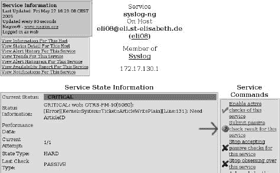
> 图 14-3. 箭头指向为 `syslog-ng` 服务“生成”被动测试结果的可能性

当然，你也可以为每个 syslog 事件定义你自己的服务。这有时可能非常耗时，但它确实允许你在 Web 界面中分离各种消息及其处理状态。如果 `syslog-ng` 中的过滤器被了限制，使得一个 syslog 服务对象始终引用一个要监控的资源，那么你也可以省略 `is_volatile` 参数。

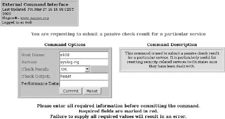
> 图 14-4 创建被动检查结果 `syslog-ng`

***

¹⁴¹ “ng” 在这里代表下一代（next generation）。

¹⁴² [`sourceforge.net/projects/logcheck/`](http://sourceforge.net/projects/logcheck/)

¹⁴³ [http://www.balabit.com/products/syslog_ng/]()

## 14.6 示例 II：处理 SNMP Traps

由 SNMP 代理（参见第 228 页的 11.1 SNMP 简介）发送到中央管理单元的异步消息在 SNMP 术语中称为 traps，可以被 Nagios 以类似于 Nagios 服务检查接受器（NSCA）的方式进行处理。此外，它允许在 Nagios 服务器本身的其他主机上接受 SNMP Traps。

如果系统几乎监控了整个网络，只有少数设备或服务将通信仅限制为 SNMP 和 SNMP Traps，那么使用 Nagios 处理 SNMP Traps 特别值得。

在许多情况下，SNMP Traps 是厂商特定的，因此你无法避免获取 11.1 管理信息库 的 MIB（管理信息库）。

### 14.6.1 使用 `snmptrapd` 接收 traps

为了接收 SNMP traps，你需要一个特殊的 Unix/Linux 守护进程来为 Nagios 生成消息。软件包 11.2 NET-SNMP 守护进程 包含了 `snmptrapd`。

在以下场景中，`snmptrapd` 安装在第三台主机上（既不是产生 trap 的主机，也不是 Nagios 服务器）。它通过脚本评估接收到的信息并通过 NSCA 将其转发到 Nagios 服务器¹⁴⁴。

在 `snmptrapd` 配置文件 `/etc/snmp/snmptrapd.conf` 中，每种 trap 类型都有单独的条目，其语法对应于以下行：

```text
traphandle oid
traphandle oid arguments
traphandle default
traphandle default arguments
```

`traphandle` 关键字后面跟着目标 trap 的对象标识符，或者是关键字 `default`。在后一种情况下，条目适用于所有没有单独条目的 trap。最后指定当相关 trap 运行时运行程序。

此外，你还可以包含用于该程序的参数。但在这样做时必须小心。引号会被 `snmptrapd` 作为字符传递，空格始终作为分隔符。这意味着你不能传递包含空格的参数，在分配 Nagios 名称时要注意这一点。

`snmptrapd` 以以下格式通过标准输出提供信息：

```text
hostname ip-address oid value ...
```

第一行包含发送消息的完全域名，第二行是其 IP 地址。然后是一个或多个 OID-值对，每个一个。。特定的事件通常与唯一的 OID-值对关联，因此程序通常可以省略对 OID-值对的评估。


此处使用的陷阱（traps）默认由 NET-SNMP 包中的 SNMP 代理 `snmpd` 发送，只要在 `snmpd.conf` 中指定了目标地址：

```bash
# snmpd.conf
trapsink name_or_ip_of_the_nagios-server
```

如果收到 OID 为 `SNMPv2-MIB::coldStart` 的陷阱（例如），`snmptrapd` 将带参数 `cold-start` 启动脚本 `handle-trap`。这样它就不需要先从 OID-值对中搜索必要的信息。然而，这种快捷方法仅适用于描述其功能的陷阱 OID 名称。

### 14.6.2 将陷阱传递给 NSCA

由 `snmptrapd` 运行的脚本 `handle-trap` 会对传递的信息进行分解，并将其以正确的格式交给 `send_nsca:`：

```bash
#!/bin/bash

NAGIOS="nagsrv"
LOGFILE="/usr/local/nagios/var/handle-trap.log"

read HOST && echo "host: $HOST" >> $LOGFILE
read IPADDR && echo "ip: $IPADDR" >> $LOGFILE

case $IPADDR in
    192.168.201.4)
      HOSTNAME="irouter"
      ;;
    *)
      # 静默丢弃未知主机的
      exit 0
      ;;
esac

if [ -z "$1" ]; then
    echo "usage: $0 <service> <key>"
    echo "usage: $0 <service> <key>" >> $LOGFILE
    exit 1
else
    SERVICE="$1"
fi

if [ ! -z "$2" ]; then
    SWITCH="$2"
fi

case $SWITCH in
    "cold-start")
      OUTPUT="snmpd: Cold Start"
      STATE=0
      ;;
    restart)
      OUTPUT="snmpd: Restart"
      STATE=1
      ;;
    shutdown)
      OUTPUT="snmpd: Shutdown"
      STATE=2
      ;;
    *)
      OUTPUT="Unknown Trap"
      STATE=1
      ;;
esac

CMD="$HOSTNAME;$SERVICE;$OUTPUT"
echo "$CMD" >> $LOGFILE
echo "$CMD" | /usr/bin/send_nsca -H $NAGIOS -d ';' -c /etc/nagios/send_nsca.cfg >> $LOGFILE 2>&1
```

首先它将日志文件和 Nagios 服务器名称 `nagsrv` 分别保存在独立的变量中。第一个 `case` 语句指定了 Nagios 用于传递 IP 地址（临时存储在 `IPADDR` 中）的主机名。`HOST` 通常包含完全域名，无法直接使用，有时也包含一个 IP 地址，因此使用后者更好。显式测试还允许它丢弃来自不需要的主机的陷阱。最后，匹配的陷阱在无需身份验证的情况下到达 Nagios 服务器。

接下来的 `if` 语句确定是否也提供了服务名称。如果是，则将其保存在 `SERVICE` 变量中。如果有第二个参数，处理过程类似。根据值，下一个 `case $SWITCH` 指令定义了输出文本和 Nagios 期望的状态。

最后组装用于 NSCA 的命令，脚本将 `CMD` 变量传递给 `send_nsca`。与之前的示例一样，使用分号作为分隔符，这必须在 `send_nsca` 中通过选项 `-d` 指定。

### 14.6.3 匹配的服务定义

类似于 `syslog-ng` 示例（14.5.1 用于 Nagios 的 syslog-ng），我们再次在 Nagios 服务器上将服务定义为纯被动模式：

```
define service{
    host_name irouter
    service_description SNMP
    active_checks_enabled 0
    passive_checks_enabled 1
    check_freshness 0
    max_check_attempts 1
    is_volatile 1
    ...
}
```

由于软状态（soft states）在单个陷阱消息中没有意义，我们应该将 `max_check_attempts` 回 `1`。是否使用参数 `is_volatile` 取决服务的用途。只要你为每个错误类别定义一个独立的服务，省略 `is_volatile` 就没有问题。但如果你使用单个服务形成不同的错误类别，则应该 `set is_volatile 1`，因为在这种情况下，之前的错误与新错误几乎没有关系。14.5.2 Nagios 配置：第 309 页的易变服务专门介绍了易变服务主题。

***

* [`www.opennms.org/`](http://www.opennms.org/)

如果你在 Nagios 服务器本身上安装 `snmptrapd`，则不需要 NSCA，你可以发送相应格式的命令，如第 293 页 13.2 被动服务检查所示。

### 15. Nagios 分布监控

#### 15.1 开启 OCSP/OCHP 机制

为了使用 OCSP/OCHP 需要几个步骤。该机制最初在全局配置 `/etc/nagios.cfg` 中的非中心 Nagios 服务器上开启，其中定义了主机 (OCHP) 和服务 (OCSP) 的全局命令。这会导致非中心 Nagios 实例将每个结果发送到中央服务器。

在和服务主机定义中，你还可以额外设置相应的服务或主机是否使用该机制。为了让中央 Nagios 服务器能够使用传输的结果，其上的每个服务或主机最终必须再次定义一次。

只有当你真的想要分布式监控时，才在 `nagios.cfg` 中开启 `obsess_over_services` 和 `obsess_over_hosts` 两个参数：

```bash
# /etc/nagios.cfg
...
obsess_over_services=1
ocsp_command=submit_service_check
ocsp_timeout=5
obsess_over_hosts=1
ochp_command=submit_host_check
ochp_timeout=5
```

每当新的测试结果到达 Nagios 服务器时，它都会调用用 `ocsp_command` 或 `ochp_command` 定义的命令对象这会导致资源的额外负载。

两个超时设置防止 Nagios 在单条命令上花费过多时间。如果处理没有终止（因为命令本身没有接收到超时且中央 Nagios 服务器没有反应），那么非中心 Nagios 实例的进程表将很快填满并可能溢出。

如果你想选择性地排除特定服务和主机的测试结果到中央 Nagios 服务器，可以使用以下参数：

```
define host{
    ...
    obsess_over_hosts=0
    ...
}

define service{
    ...
    obsess_over_services=0
    ...
}
```


当值为 `1` 时，本地 Nagios 实例会将主机或服务的检查结果发送到中央服务器；但当值为 `0` 时，则不会发生此操作。`1` 是 `obsess_over_hosts` 和 `obsess_over_services` 的默认值；如果不需要传输结果，则必须手动指定这两个参数。如果中心节点仅负责特定事项，而其余管理工作在本地执行，则始终建议进行此项设置。

#### 15.2 定义 OCSP/OCHP 命令

在大多数情况下，定义非中心实例将其结果发送到 Nagios 主服务器的两个命令，通常涉及基于 `send_nsca` 的脚本（另请参见 14.4 向服务器发送测试结果 中的示例）。对于服务，此类脚本如下所示，在此例中命名为 `submit_service_check:`：

```bash
#!/bin/bash
# Script submit_service_check

PRINTF="/usr/bin/printf"
CMD="/usr/local/bin/send_nsca"
CFG="/etc/nagios/send_nsca.cfg"
HOST=$1
SRV=$2
RESULT=$3
OUTPUT=$4

$PRINTF "%b" "$HOST\t$SRV\t$RESULT\t$OUTPUT\n" | $CMD -H nagios -c $CFG
```

运行时，该命令期望在命令行上按正确顺序接收四个参数：被监控的主机、服务名称、打开的插件的返回值（`0` 表示 OK，`1` 表示 WARNING 等）以及插件发出的单行信息文本。为了格式化数据，我们使用 `printf` 函数（`man printf`）。新格式化的字符串最终被传递给 `send_nsca`。

OCHP 的对应脚本（存储在文件 `submit_host_check` 中）类似于所示：

```bash
#!/bin/bash
# Script submit_host_check

PRINTF="/usr/bin/printf"
CMD="/usr/local/bin/send_nsca"
CFG="/etc/nagios/send_nsca.cfg"
HOST=$1
RESULT=$2
OUTPUT=$3

$PRINTF "%b" "$HOST\t$RESULT\t$OUTPUT\n" | $CMD -H nagios -c $CFG
```

唯一缺失的是服务描述的指定。

根据 Nagios 文档，最好将这两个脚本存储在插件目录下的子目录 `eventhandlers` 中（通常需要创建），插件目录通常为 `/usr/local/nagios/libexec`，但对于某些发行版可能是 `/usr/lib/nagios/plugins`。你可以通过匹配命令对象的定义使用宏 `$USER1$` 获取它。最好在 `misccommands.cfg` 文件中定义：

```cfg
define command{
    command_name submit_service_check
    command_line `$USER1$/eventhandlers/submit_service_check` $HOSTNAME '$SERVICEDESC$' $SERVICESTATEID$ '$SERVICEOUTPUT$'
}

define command{
    command_name submit_host_check
    command_line `$USER1$/eventhandlers/submit_host_check` $HOSTNAME $HOSTSTATEID$ '$HOSTOUTPUT$'
}
```

如果你使用单独的文件进行此操作，必须通过向 `/etc/nagios/nagios.cfg` 添加条目来确保 Nagios 将加载该文件。`command_line` 行中围绕 `$SERVICEDESC$` 宏和两个输出宏的单引号至关重要。它们的值有时包含空格，如果没有引号，命令行将将其解释为分隔符。

#### 15.3 实际场景

分布式监控的一个应用是监控分机构或外部办事处，在这些办事处中，非中心的 Nagios 安装仅限于运行服务和主机检查，并将结果发送到中心实例。非中心实例不需要其他的 Nagios 功能，例如通知系统或 Web 界面。

另一方面，如果管理员负责分布式地点的网络，而中央 IT 部门仅负责特殊服务，则非中心 Nagios 服务器被配置为标准的全功能安装，并通过 OCSP/OCHP 机制选择性地将那里专家负责的检查结果转发到中央办公室。

无论情况如何，你必须确保主机和服务定义在非中心中心都是可用的。可以使用模板（第 75 页的 2.11 Templates）和 `cfg_dir` 指令（2.1 主配置文件 nagios.cfg，第 55 页）简单地完成：设置定义使得配置文件可以 1:1 地复制。

### 15.3.1 避免配置文件的冗余

在以下示例中，我们假设非中心服务器仅执行主机和服务检查，并将结果发送到中心服务器，不提供任何其他 Nagios 功能。在中心主机上设置了以下目录：

* `/etc/nagios/global`
* `/etc/nagios/local`
* `/etc/nagios/sites`
* `/etc/nagios/sites/bonn`
* `/etc/nagios/sites/Frankfurt`
* `/etc/nagios/sites/berlin`
* `...`

用于每个地点的每个配置都落入 `/etc/nagios/sites/location` 目录。在 `global` 之后，所有的定义都可以在所有位置以相同方式使用（例如 `checkcommands.cfg` 中的命令定义）。`local` 目录接收中心服务器定义的特定定义。这些包括服务和主机模板，在其中必须区分中心和非中心。

此目录在非中心服务器上也会单独创建：仅从中心实例将 `global` 和 `sites/location` 文件夹复制到分机构。

通过 `/etc/nagios/nagios.cfg` 中的 `cfg_dir` 指令读取这三个目录：

```cfg
# -- /etc/nagios/nagios.cfg
...
cfg_dir=/etc/nagios/global
cfg_dir=/etc/nagios/local
cfg_dir=/etc/nagios/sites
...
```

服务定义中仅使用非中心和中心页面完全相同的设置：

```cfg
# -- /etc/nagios/sites/bonn/services.cfg
define service{
    host_name            bonn01
    service_description  HTTP    use         bonn-svc-template    ...
    check_command                        check_http
    ...
}
```

依赖于地点的参数由模板处理。

##### 15.3.2 定义模板

为了使中心服务器和非中心服务器上的服务定义相同，本地模板必须与中心模板具有相同的名称。此外，你应该确保输入所有必选参数（参见第 53 页的 第 2 章），即使它们在某个地点甚至不是必需的，因为模板和服务定义必须覆盖所有必选参数。

以下示例显示了其中一个非中心地点的服务模板：

```cfg
# -- 用于波恩的本地配置
define service{
    name                bonn-svc-template
    register            0
    max_attempts        3
    normal_interval     5
    retry_interval      1
    active_checks       1
    passive_checks      1
    check_period        24×7
    obsess_over_services 1
    notification_interval 0
    notification_period none
    notification_options  n
    notifications_enabled 0
    contact_groups      dummy
}
```

对于非中心页面重要的参数以粗体打印。除了引用测试本身的参数外，还不能漏掉 `obsess_over_services` 参数。这确保检查结果被发送到中心服务器。

在这种情况下，`notifications_enabled` 关闭了通知，因为本地管理员不需要担心来自中央监控服务的错误消息。或者，可以在非中心的 `/etc/nagios/nagios.cfg` 中进行全局设置。


`register 0` 确保该模板仅被作为模板使用，这样 Nagios 就不会将其解释为独立的服务定义。

在中央服务器上同名的对应项看起来如下：

```text
# 用于中央 Nagios 服务器的服务模板
define service{
    name                    bonn-svc-template
    register                   0
    max_check_attempts         3
    normal_check_interval      5
    retry_check_interval       1
    active_checks_enabled      0
    passive_checks_enabled     1
    check_period               none
    check_freshness            0
    obsess_over_services       0
    notification_interval      480
    notification_period        24×7
    notification_options       u,c,r
    notifications_enabled      1
    contact_groups             admins
}
```

这里 `passive_checks_enabled` 参数非常重要，通知系统的配置也是如此。在中央端，只有在使用新鲜度检查（freshness checking）时，涉及测试本身的参数才会起作用（参见第 295 页的 13.4 对被动检查过期信息的响应）。只有当中央 Nagios 服务器本身能够在出现任何疑问时主动测试所有服务时，这种方法才有效。由于此简单模板解决方案中的 `check_command` 位于依赖位置的服务定义中，且该定义在非中央和中央服务器上是相同的，因此只有当同一个命令对象同时可以在中央和非中央端使用时，它才能工作——即 `global/checkcommands.cfg` 中的对象定义在双方之间必须匹配。

在示例中，我们通过将 `check_period none` 和 `check_freshness` 设置为 0，完全关闭了波恩位置的服务的主动测试。当然，目前描述的系统也可以应用于主机检查。

# 第三部分：Web 界面以及可视化 Nagios 数据的其他方法

## 第 16 章：经典 Web 界面

右侧是具有明显黑色背景的导航区域，其余区域用于显示所谓的 CGI 脚本（如见 图 16-1）——Nagios Web 界面就是简单。启动屏幕提供了访问程序文档的入口——如果你只是想快速查找某些内容，这非常有用。

只要你拥有正确的访问权限，Web 界面允许的操作远不止于查找信息。你可以运行一系列命令并主动控制 Nagios：从设置单个命令，到开启或关闭消息，再到重启服务器。

要完全描述所有功能需要另一本书了。这就是为什么我们在这里只描述这些 CGI 程序所基于的概念，从而让你对可选的广泛范围有一个整体概念。

许多功能使用完全相同的 CGI 程序。如果你在 图 16-1 所示的导航区域上下移动鼠标，并观察在此时浏览器的状态显示（这会显示要调用的 URL），你会发现从“监控（Monitoring）”部分直到“显示主机（Show Hosts）”条目，CGI 程序 `status.cgi` 总是被调用，仅有四个例外。只是参数不同。用于运行通用命令的 CGI 程序 `cmd.cgi` 情况也类似。传递的参数指定了是要读取注释、启用或禁用消息，还是需要重启 Nagios。

```
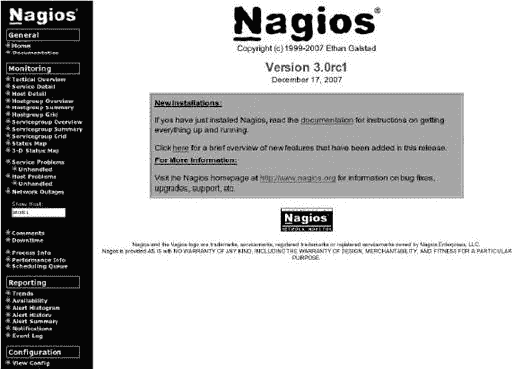
```

图 16-1。在“服务问题（Service Problems）”和“主机问题（Host Problems）”菜单项下的“未处理（Unhandled）”子项自 Nagios 3.0 以来一直存在于 Nagios Web 界面的首页上。

表 16-1.CGI 程序概述

| CGI 程序 | 说明 |
| --- | --- |
| `status.cgi` | 各种形式的状态显示；到目前为止最重要的 CGI 程序（见 图 16-10 到 图 16-15，第 334 页） |
| `statusmap.cgi` | 被监控主机的拓扑表示（参见 图 16-27，第 347 页） |
| `statuswrl.cgi` | 3D 格式的拓扑表示；需要支持 VRML 的浏览器，并允许在虚拟空间中进行交互导航（见 图 16-29，第 349 页） |
| `statuswml.cgi` | 用于 WAP 设备（手机）的简单状态页 |
| `extinfo.cgi` | 关于主机或服务的额外信息，并运行命令的可能性（见 图 16-4，第 331 页） |
| `cmd.cgi` | 运行命令（见 图 16-23，第 343 页） |
| `tac.cgi` | 所有待监控的服务和主机的概述，战术概览（参见第 346 页的 图 16-26） |
| `outages.cgi` | 导致部分网络故障的网络节点（见 图 16-30，第 350 页） |
| `config.cgi` | Nagios 对象定义显示（见 图 16-31，第 351 页） |
| `avail.cgi` | 可用性报告（例如，“98% 的系统正常，2% 警告”，见 图 16-32，第 352 页） |
| `histogram.cgi` | 发生事件数量的直方图（见 图 16-34，第 353 页） |
| `History.cgi` | 所有发生过的事件的显示（见 图 16-35，第 355 页） |
| `notifications.cgi` | 所有已发送通知的概述（见 图 16-36，第 355 页） |
| `showlog.cgi` | 所有日志文件条目的显示（见 图 16-37，第 356 页） |
| `summary.cgi` | 事件报告，可以按主机、错误类别和时间段进行汇总（见 图 16-39，第 359 页） |

表 16-1 显示了软件包中包含的所有 CGI 程序的概述。它们都会检查执行请求操作员是否被允许这样做。通常情况下，用户只能访问其被列为联系人的主机和服务。此外，还有可能为特定用户分配更全面的权限，以便他们基本上被允许显示所有主机和服务（例如），或者请求系统信息。其他用户的设置在 `cgi.cfg` 配置文件中进行，认证参数在 A.2 cgi.cfg 中的 CGI 配置，第 606 页中进行了了描述。

### 16.1 识别并处理问题

管理员的一个合适起点是“服务问题（Service Problems）”页面，可以通过 图 16-2 所示的菜单项访问。你可以一目了然地看到所有问题。如果只是与服务相关而非与主机相关，主机列中的主机名称背景为灰色，但红色背景则意味着主机本身是问题的源头。

```
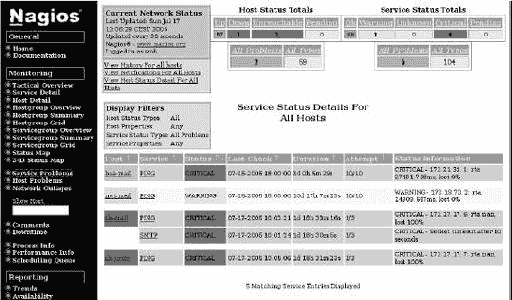
```

图 16-2。“服务问题”菜单项将当前问题带入视野


在图 16-2 中失败的主机 `sis-mail` 和 `sis-proxy`可以在“主机问题”（Host Problems）菜单项（图 16-3）中再次看到：`sis-mail`无法访问（UNREACHABLE），因此实际问题在于主机 `sls-proxy` 的故障。这种依赖关系在“中断”（Outages）菜单项（图 16-30 中，两个失败的主机以红色背景显示，你也可以清楚地看到哪个主机依赖于另一个主机（始终从中心 Nagios 主机的视角来看）。

> 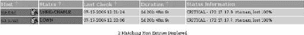

> 图 16-3 “主机问题”菜单项显示了此类内容

### 16.1.1 对有问题主机的注释

管理员通过电话与外部办公室澄清了问题：DSL 连接已失败。他向负责的供应商报告了这一故障。为了防止同事再次遇到同样的麻烦，管理员在故障的主机上输入了相应的注释。为此，他在状态显示器中点击主机名称，这将带他进入该特定主机的信息页（图 16-4），该页的选项在 16.2.2 附加信息和控制中心：extinfo.cgi，第 339 页中进行了更详细的描述。

> 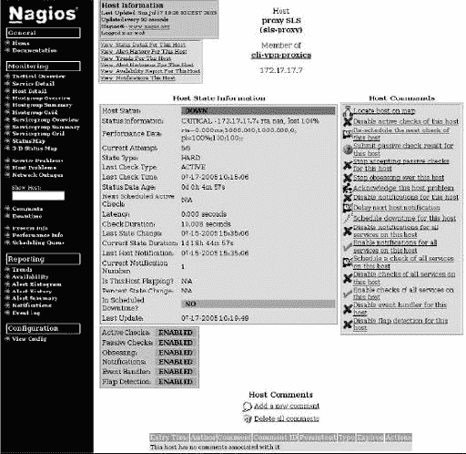

> 图 16-4 `extinfo.cgi` 为选定主机提供额外信息

使用页面底部的“添加新注释”（Add a new comment）链接，CGI 程序 `cmd.cgi`（16.2.3 外部命令接口：cmd.cgi，第 343 页）通过传递相应的参数已经为此任务做好了准备^[148^]，允许记录注释（图 16-5）。主机名已经显示，“持久化”（Persistent）框中的复选标记确保注释在 Nagios 重启后依然“存在”。在“作者（您的姓名）”（Author (Your Name):）字段中填写的用户名可以编辑，“注释”（Comment）字段中的实际注释也可以编辑。^[149^]

> 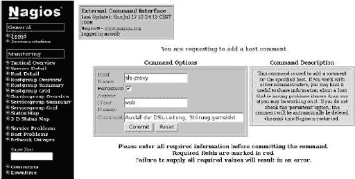

> 图 16-5 为主机输入注释

管理员点击“提交”（Commit）按钮确认输入。返回状态概览（例如通过“服务问题”菜单项），管理员将在主机名称旁边看到一个气泡，表示该主机存在注释（图 16-6）。点击该图标将打开相应的信息页并直接带管理员进入注释条目（图 16-7）。点击“操作”（Actions）列中的垃圾桶图标可以根据需要单独删除这些注释。

> 

> 图 16-6 气泡显示注释的存在

> 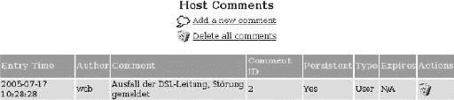

> 图 16-7 点击“删除所有注释”可以一次性删除所有注释

##### 16.1.2 对问题承担责任

“确认”（Acknowledgements，在 Web 界面上如此拼写）比简单的注释更贴近工作流。确认向其他管理员发出信号，有人正在处理某个问题，因此暂时不需要其他人参与。在状态概览中，一个小工人图标象征着这种承担责任的形式（图 16-8），Nagios 还会通知相关的联系人。

要发布此类声明，可以使用问题主机扩展信息页上的“确认此主机问题”（Acknowledge this Host Problem）链接。除了用于输入普通注释的字段外，这里还有两个复选框：“粘性确认”（Sticky Acknowledgement）（图 16-9——如果勾选，此选项将在错误状态持续存在时防止周期性通知）以及“发送通知”（Send Notification）。如果后者也被勾选，Nagios 将通知其他管理员。

> 

> 图 16-8 工人图标显示管理员已承担了问题的责任（确认）

> 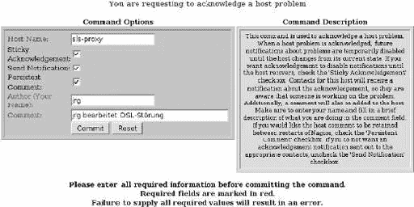

> 图 16-9 主机确认的输入对话框

“持久化注释”（Persistent Comment）在 Nagios 2.x 和 Nagios 3.0 中的效果不同：在 Nagios 2.x 中，只有在勾选了复选框的情况下，注释才会在重启后保留。遗憾的是，这样做在重启时保存注释的缺点是，当问题解决时注释不会自动消失。另一方面，Nagios 3.0 通常会在重启后保留所有注释。如果删除了“持久化注释”的复选标记，Nagios 将在问题修复后自动移除注释。如果设置了复选标记，则在不再需要时必须手动删除，就像在 Nagios 2.x 中一样。

我们在这里使用故障主机状态演示的内容也适用于故障的服务。CGI 程序是相同的，通过传递参数，它们接收有关涉及主机还是服务的信息并做出相应反应；只有主机字段以服务条目的的形式接收内容。

* *

^[147^] 我们在这里提到 CGI 程序而不是 CGI 脚本是有充分原因的：适用于 Nagios 2.x 和 3.0 的所有 CGI 程序都是 C 程序。

^[148^] `cmd_type=1&host=sls-proxy`。更多关于参数的信息请参见后续的 16.2.3 外部命令接口：cmd.cgi，第 343 页。

^[149^] 从 Nagios 3.0 开始，可以使用参数 `lock_author_name` 来防止修改作者姓名（参见 A.2.2 其他参数）。

## 16.2 各个 CGI 程序概述

在出版时，本章是关于 Nagios Web 界面最详尽的文档，特别是针对各个 CGI 脚本。但由于空间限制，我们不会进入每一个细节。如果你想了解更多，必须查看脚本的源代码或查看 `nagios-users`^[150^] 邮件列表。其中一些内容也会被 Nagios 开发者阅读，许多没有文档说明的问题在在那里得到了解答。

### 16.2.1 状态显示的变体：`status.cgi`

到目前为止，最重要的 CGI 程序 `status.cgi` 负责状态显示。它显示的内容由三组参数决定。第一组定义了 Web 页面是显示所有主机、特定主机还是服务组：

> `http://nagiosserver/nagios/cgi-bin/status.cgi?host=all`

> `http://nagiosserver/nagios/cgi-bin/status.cgi?hostgroup=all`

> `http://nagiosserver/nagios/cgi-bin/status.cgi?servicegroup=all`

通过 `host` 你可以选择单个主机，在这种情况下 `all` 代表所有主机。`hostgroup` 允许显示特定的主机组，同样可以使用 `all` 代表所有主机组。最后，`servicegroup` 告诉 CGI 程序显示作为给定值的单个服务组，或通过 `all` 显示“所有服务组”。

> 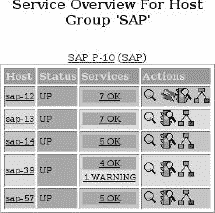

> 图 16-10. `overview` 输出样式

`host=all` 和 `hostgroup=all` 的输出仅在样式上不同，样式是由第二组参数定义的。对于 `host=all`，默认设置为 `style=detail`，而对于 `hostgroup=all`，则是 `style=overview`。因此，`status.cgi?host=all&style=overview` 的结果与 `status.cgi?hostgroup=all` 相同。


不属于任何主机组的主机仅在详细视图 `host=all&style=detail` 或 `hostgroup=all&style=hostdetail` 中显示。所有其他显示样式始终都会显示整个主机组，其中可能缺少某些单独主机。`status.cgi` 提供了五种可能的输出样式：`overview` 以表格形式表示主机，但根据状态对服务进行汇总（图 16-10）。对于主机组 `SAP` `，你将通过以下 URL 调用相应的显示页面：

```
http://nagiosserver/nagios/cgi-bin/status.cgi?hostgroup=SAP&style=overview
```

`style` 值 `summary` 压缩了 `overview: status.cgi` 的输出，每行仅显示一个主机组（图 16-11 显示了 Nagios 2.x 的情况，图 16-12 显示了 Nagios 3.0 的情况）。对于 Nagios 3.0，错误状态被分为未处理（未设置确认）或已确认。

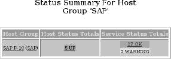
> 图 16-11. Nagios 2.x 的 `summary` 输出样式

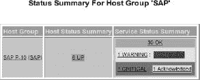
> 图 16-12. Nagios 3.0 的 `summary` 输出样式

`grid` 样式提供了一种极具吸引力的摘要，你可以通过其高亮显示的颜色查看每个单独服务的状态（图 16-13）。`detail` 在单独的行上详细显示每个服务。`hostdetail` 输出样式仅限于主机信息，为每个主机提供单行的详细信息（图 16-15）。

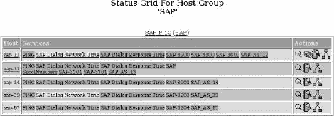
> 图 16-13. `grid` 输出样式

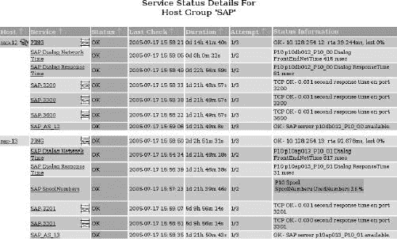
> 图 16-14. `detail` 样式

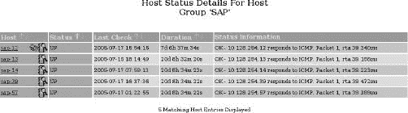
> 图 16-15. `hostdetail` 输出样式

第三组也是最终的参数组允许你通过选择器影响 `status.cgi` 显示的状态和属性，例如所有处于错误状态且管理员尚未设置确认的服务（参见 16.1.2 对问题负责，第 332 页）。状态通过参数 `hoststatustypes` 或 `servicestatustypes` 传递，属性则通过 `hostprops` 和 `serviceprops` 传递。所有四个参数在等号后都要求数值值，这些值汇总在 表 16-2、表 16-3 和 表 16-4 中。

表 16-2. `Hoststatustypes` 的可能值

| 值 | 描述 |
| --- | --- |
| 1 | PENDING (针对该主机计划的首次测试结果尚不可) |
| 2 | UP (正常) |
| 4 | DOWN (宕机) |
| 8 | UNREACHABLE (不可达) |

第三组也是最终的参数组允许使用选择器来影响 `status.cgi` 显示的状态和属性，例如所有处于错误状态且管理员尚未设置确认的服务（参见 16.1.2 对问题负责，第 332 页）。条件通过参数 `hoststatustypes` 或 `servicestatustypes` 传递，属性则通过 `hostprops` 和 `serviceprops` 参数传递。所有四个参数在等号后都要求数值值，这些值汇总在 表 16-2、表 16-3 和 表 16-4 中。

表 16-3. `Servicestatus types` 的可能值

| 值 | 描述 |
| --- | --- |
| 1 | PENDING (服务原计划进行检查，但到为止尚无结果) |
| 2 | OK (正常) |
| 4 | WARNING (警告) |
| 8 | UNKNOWN (未知) |
| 16 | CRITICAL (严重) |

表 16-4. `host` 和 `serviceprops` 的可能值

| 值 | 描述 |
| --- | --- |
| 1 | Scheduled downtime (已计划的维护时间) |
| 2 | No Scheduled downtime (无计划维护时间) |
| 4 | Acknowledgement (状态已由管理员确认) |
| 8 | No acknowledgement (未确认) |
| 16 | Host/Service check disabled (主机/服务检查已禁用) |
| 32 | Host/Service check enabled (主机/服务检查启用) |
| 64 | Event disabled (事件处理禁用) |
| 128 | Event enabled (事件处理启用) |
| 256 | Flap disabled (抖动禁用) |
| 512 | Flap enabled (抖动启用) |
| 1024 | Host/Service oscillates (主机/服务抖动) |
| 2048 | Host/Service does not oscillate (主机/服务未抖动) |
| 4096 | Excluded from notification (排除在之外) |
| 8192 | Notification enabled (通知启用) |
| 16384 | Passive checks disabled (被动检查已禁用) 第 13 章，第 292 页 |
| 32768 | Passive checks enabled (被动检查启用) |
| 65536 | For which there is at least one result (至少有一个结果) |
| 131072 | For which there is least one active check (至少有一个活动检查) |
| 262144 | In hard state (处于硬状态) |
| 52428 | In soft state (处于软状态) |

如果你想同时查询多个状态或属性，只需将指定的值相加：`status.cgi?servicestustypes=28` 显示了所有处于 `WARNING` 和 `CRITICAL` 状态的服务，即 4+16=28。该查询与导航区域中的“服务”菜单项一致。

`status.cgi?hostgroup=all&hoststatustypes=12&style=hostdetail` 对应导航区域中的“主机”菜单项。它查询所有处于 `DOWN` 或 `UNREACHABLE` 状态的主机（此处为 4+8=12）。由于仅显示主机信息而非服务信息，格式为 `hostdetail`。

`status.cgi?host=all&servicestatypes=24&serviceprops=10` 是第一个示例的变体：显示所有未计划维护时间且未被确认的服务（即 2+8=10）。


> 图 16-16. `status.cgi` 显示的状态和属性框

如果你需要，可以根据自己的需求定义导航区域，或者使用现有的。主页面由一个框架组成，导航区域本身由一个标准的 HTML 文件定义：`/usr/local/nagios/share/side.html`。一个修改过的 `side.html` 示例可以在 Netways 的演示页面找到，另一个如 16.6 使用 Nuvola  所示。

###16.2.2 附加信息和控制中心：`extinfo.cgi`

通过 `host` 或 `service` 参数调用时，`extinfo.cgi` 不仅提供主机（图 16-4，第 331 页）或服务的详细信息，还作为主机组（hostgroup）和服务组（servicegroup）的控制中心。根据所调用的对象类型，你可以从这里运行各种命令。

在左侧区域，主机的状态有详尽记录；在右侧的框（标记为“主机命令”）中有一组可以运行的命令。后者命令调用 `cmd.cgi` (16.2.3 外部命令接口：cmd.cgi，第 343 页)，并且只有外部命令接口 (13.1 外部命令接口，第 292 页）启用时才能运行。页面的下方区域允许你输入特定对象的注释、读取并再次删除。生成的服务的 Web 也遵循此模式。


## 组命令

相比之下，服务和主机组对应的页面（图 16-17）仅允许运行特定特定的命令，且不显示任何额外信息。每个命令都适用于整个组，让您省去了大量的鼠标点击。例如，禁用此主机组中所有主机的通知，可以确保 Nagios 不再向该组中的主机发送任何消息。

> 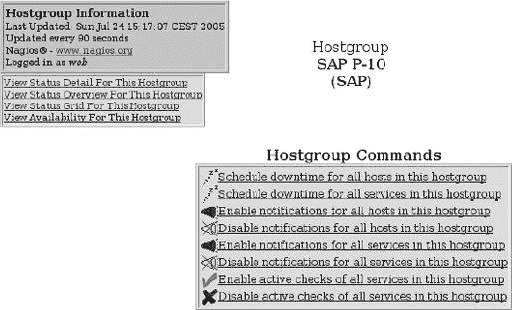

> 图 16-17. SAP 主机组的命令中心：`extinfo.cgi?type=5&hostgroup=SAP`

除了主机、服务和相应的组外，CGI 程序还有其他显示功能，通过 CGI 参数 `type:` 启用：

> `http://nagsrv/nagios/cgi-bin/extinfo.cgi?type=`value`

根据指定的数值，还需要其他参数，因此为了显示服务，您还必须包含主机名和服务标识：

`extinfo.cgi?type=0`

> > 显示 Nagios 进程本身的信息（如启动时间和进程 ID）以及所有全局参数（通常会发送通知、处理性能数据等；参见图 16-18）。在“进程命令”（Process Commands）框中可以更改全局参数，还可以停止和重启 Nagios。

> > 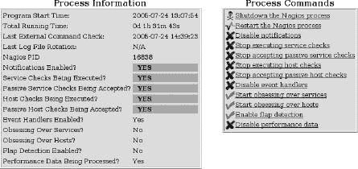

> > 图 16-18. Nagios 进程和全局设置信息：`extinfo.cgi?type=0`

`extinfo.cgi?type=l&host=`host`

> > 显示 `host` 的命令和信息（参见图 16-4，第 331 页）。

`extinfo.cgi?type=2&service=`service`

> > `service` 亦如此。

`extinfo.cgi?type=3`

> > 在单个页面上显示所有可用的主机和服务注释（图 16-19）。

> > 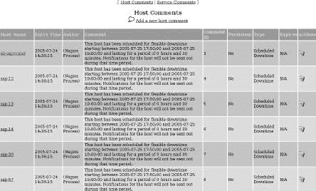

> > 图 16-19. 所有现有注释概览：`extinfo.cgi?type=3`

`extinfo.cgi?type=4`

> > 提供 Nagios 的性能信息，按照主机、服务以及主动检查和被动检查进行分离（图 16-20）。

> > 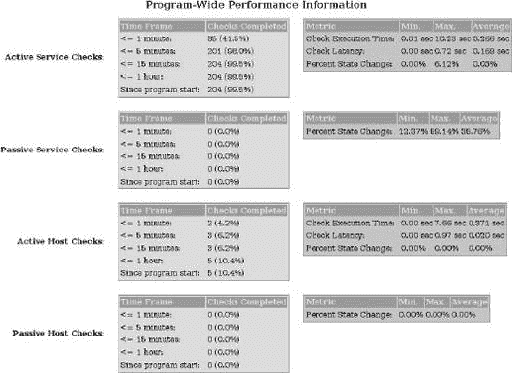

> > 图 16-20. 性能信息：`extinfo.cgi?type= 4`

> > 中间列显示了 Nagios 在过去 1、5、15 和 60 分钟内已经执行了计划测试中的多少项。只要存在 `normal_check_irLterval` 大于五分钟的检查，前两个值永远无法达到 100%。

> > 右列定义了该页面的实际值：“检查执行时间”（Check Execution Time）指定了 Nagios 执行主动主机和服务检查所需的最小、最大和平均时间。“检查延迟”（Check Latency）测量了计划开始时间与实际运行时间之间的距离。如果此延迟明显大于一或二秒，Nagios 可能存在性能问题。一种可能的原因是系统处理性能数据太慢，但低性能硬件也可能在此起作用。寻找原因有时可能非常困难，原始文档^[154^] 针对该主题提供了许多建议。

`extinfo.cgi?type=5&hostgroup=`hostgroup`

> > 显示主机组的命令中心（参见第 339 页的图 16-17）。

`extinfo.cgi?type=6`

> > 显示主机和服务的所有计划内维护期间（图 16-21）。

> > 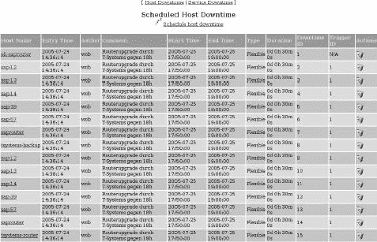

> > 图 16-21. 所有计划维护期间的概览：`extinfo.cgi?type=6`

`extinfo.cgi?type=7`

> > 显示所有计划测试的概览，按下次执行时间排序（参见图 16-22）。与其旁边，`extinfo.cgi` 还列出了最后一次检查的时间。

> > “主动检查”（Active Checks）列显示相应的测试是否处于激活，在“操作”（Actions）列中，可以删除计划检查或将其移动到不同的时间。

`extinfo.cgi?type=8&servicegroup``servicegroup`

> > 显示服务组的命令中心，结构与主机组的命令中心相同。

> > 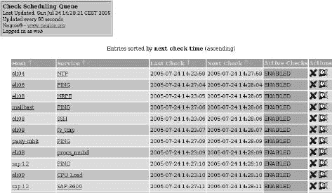

> > 图 16-22. 所有计划测试，按其计划执行时间排序：`extinfo.cgi?type=7`

## 16.2.3 外部命令接口：`cmd.cgi`

作为一个真正的全能手，`cgi.cmd` 拥有约 100 个功能，涵盖了接口为外部命令提供的几乎所有可能性。`cmd_typ` 参数定义了 CGI 程序应该运行这些功能中的哪一个。命令

> `http://nagiosserver`/nagios/cgi-bin/cmd.cgi?cmd_typ=6`

关闭特定服务的主动检查（图 16-23）。为了唯一地描述所需的服务，您必须指定主机和服务的描述。如果您手动运行 CGI 程序，显示的 Web 表单会查询这些值；如果 `cmd.cgi` 由另一个 CGI 程序启动，则所需数据将通过 CGI 参数传递。此处可能的参数有 `host`、`service`、`hostgroup` 和 `servicegroup`，后面跟着等号 (=)，然后是相应的 Nagios 对象。

> 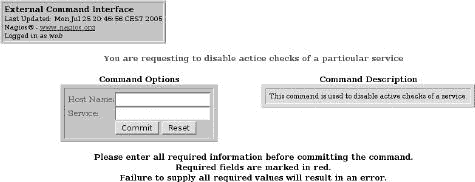

> 图 16-23. 使用 `cmd.cgi?cmd_typ=6` 禁用服务检查

图 16-24 列出了引用主机或服务的最重要的命令，而 图 16-25 显示了控制全局参数的命令（对应主配置文件 `nagios.cfg` 中的值）。源代码文件 `include/common.h` 包含了所有可能值的完整列表，包括已计划但尚未实现的值。

图 16-24 和 图 16-25 中的第一列描述了命令的功能：`ADD_HOST_COMMENT` 为主机添加注释，`DISABLE_ACTIVE_CHECK` 关闭服务的主动检查（缩写形式：`SVC`）。

其后的列指定相应功能所指的对象类型。要使用 `ADD_HOST_COMMENT` 添加注释，必须指定相关的主机。因此在“主机”（Host）列中显示功能代码 `1`。只有在命名了匹配的服务时才能关闭特定的主动检查，因此在“服务”（Service）列中可以找到功能代码 `6`。使用 `16` 可以关闭指定主机上的所有主动检查；对于主机组或服务组的所有主动检查也有相应的代码。

通过 `ACKNOWLEDGE_PROBLEM`，管理员确认他正在处理某个特定问题。`33`（主机列）指主机问题，`34`（服务列）指服务问题。灰色字段意味着主机组和服务组没有相应的对应功能。使用 `cmd_typ=33` 打开的 Web 表单（图 16-9，第 333 页）允许输入注释。

> 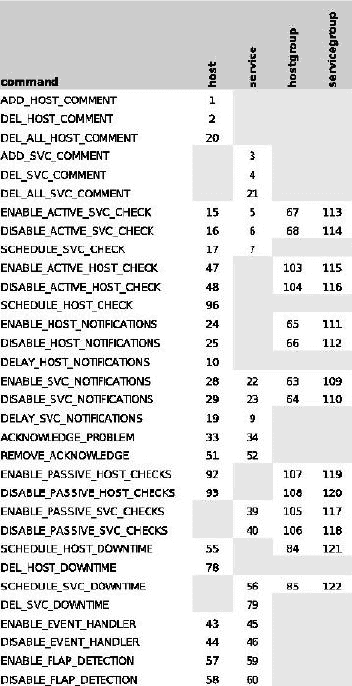

> 图 16-24. `cmd.cgi?cmd_typ=` 最重要的主机和主机相关代码

引用全局参数的函数（图 16-25）通常只能开启或关闭。因此，“NOTIFICATIONS” 的“启动”（Start）列中的值 `11` 表示该命令代码全局开启所有通知，而 `12` 则全局关闭它们。

如果您不确定确定的功能是否是您想要的，最好是使用相应的功能代码手动运行 `cmd.cgi`，如下所示：

```
http://nagiosserver/nagios/cgi-bin/cmd.cgi?cmd_typ=12
```

这种方式生成的 Web 页面在所需的输入字段旁边总是有一个小灰色框，解释相应的命令。


> 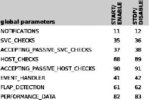

> 图 16-25. 全局参数的 `cmd.cgi` 命令代码

## 16.2.4 概述最重要的内容：`tac.cgi`

作为一种“战术概述”，`tac.cgi` 在单个 Web 页面提供了丰富的信息，并以摘要形式（图 16-26）显示。在页左侧，你可以按照优先级看到首先是整个网络范围的故障（网络停机），接着是主机和服务的状态，底部 `tac.cgi` 列出了各个监控功能（如通知和事件处理程序）是否激活。

在这一最后一个章节之前，所有内容都集中在显示问题上。如果一切正常，CGI 仅会显示无问题的服务或主机数量，并用浅灰色突出显示（例如在 `Hosts` 框中显示 `47 Up`）。在出现问题的情况下，它会区分开放问题（即无人查看的问题，用红色突出显示，例如 `Services | Critical` 中的 `2 Unhandled Problems`）以及管理员已通过确认采取责任的问题（粉色背景，例如 `Services | Unknown` 中的 `1 Acknowledged`）。如果禁用了主机或服务检查，它们也会用粉色背景显示，因为这些问题是不需要管理员立即关注的（例如 `Services | Ok` 中的 `2 Disabled`）。

下半部分启用的功能由 `tac.cgi` 用绿色标记，禁用的则用红色标记。Notifications 中垂直书写的绿色 `Enabled` 表示通知已全局启用，而另一边的红色背景 `2 Services Disabled` 则意味着它们针对两个特定的服务被显式关闭了。

对于显示的所有问题，你将进入一个专门显示相关主机和服务的概述页面。

> 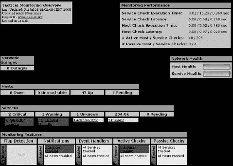

> 图 16-26. 使用 `tac.cgi` 的战术概述

在页面的右侧，上方框汇总了 `extinfo.cgi?type=4`（参见 16.2.2 附加信息和控制中心：`extinfo.cgi`）Nagios 性能数据，可以查看详情。下方的条形图以百分比显示了整个监控网络的健康状况。如果你将鼠标悬停在其中一个条上，还将以数字形式看到百分比。

## 16.2.5 网络的拓扑结构：`statusmap.cgi`

`statusmap.cgi` (图 16-27) 提供了了一个被监控主机之间依赖关系的视图。从中间的中央 Nagios 服务器开始，线条连接了所有服务器直接到达的主机——这些主机的定义不需要指定 `parents` 参数（参见 2.3 定义要监控的机器、主机，第 62 页）。

图图形还揭示了 Nagios 仅通过其他主机间接访问的主机。因此，在图 16-27 中，`sis-mail` 和 Nagios 服务器之间存在 `sis-proxy`、`hspvip` 和 `pfint` 等主机，正如注释 `Down` 以及红色（而非绿色）背景所暗示的，它们已经故障。由于 `sis-mail` 依赖于此，它处于 UNREACHABLE（不可触达）状态，`statusmap.cgi` 也用红色背景标记了这一点。

> 

> 图 16-27. 被监控主机的依赖关系图形化显示

Nagios 如何在图中排列主机是由配置文件 `cgi.cfg` 中的参数 `default_statusmap_layout` (A.2.1 认证参数) 定义的。布局也可以通过 Web 界面中的选择窗口进行更改（在图 16-28 的右上角）。外观取决于特定的坐标，在这种情况下，你必须为每个主机单独指定。问号的外已被更精美的图片取代。坐标和图标由 `extinfo` 对象定义，在 16.4 扩展信息 中有更详细的描述。

> 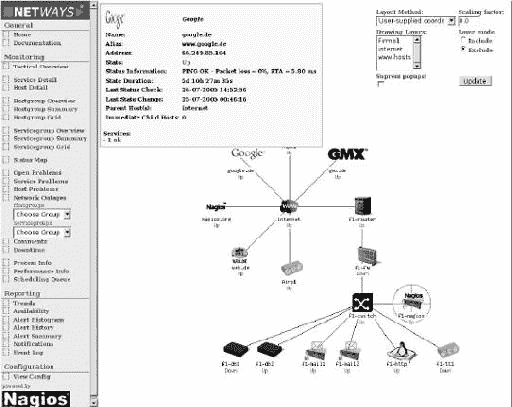

> 图 16-28. 使用自定义图标的状态 map

如果你将鼠标移动到特定主机上，Nagios 会在左上打开一个包含状态信息的窗口，包括 IP 地址、当前状态和最后检查时间。在该框的底部，`statusmap.cgi` 汇总了运行在该主机上的服务。如果你双击某个特定主机，Nagios 将跳转到常规概述，显示所有属于该主机的服务。

## 16.2.6 3D 导航：`statuswrl.cgi`

`statuswrl.cgi` 允许 Nagios 在网络的 3D 表示中移动（图 16-29）。在这里，你可以对主机进行缩放、移动视图、旋转等。

显示需要支持 VRML 的浏览器。虽然原始文档提供了相应插件的链接，但其中两个已经过期，且在发布时只能访问 Cortona。然而，该插件在 Linux 下无法工作；在 Windows 上，它可以配合 Internet 使用，以及 Netscape、Mozilla 和 Firefox。美国标准与技术研究院（NIST）在其网站上提供了按操作系统和浏览器组织的 VRML 软件良好概述。

在 Linux 的 VRML 插件中，OpenVRML 和 free WRL 是最可能的。标准 Linux 发行版通常不包含成品。OpenVRML 包含在 Fedora 的 Extras 中；freeWRL 主页上有 Fedora 和 Ubuntu 的二进制包。除非你是丰富的系统管理员或软件开发者，否则你不应该尝试自己编译软件：有很多陷阱。如果你以前从未用过编译器，也没有自己编译过像 Mozilla 或 Firefox 这样复杂的软件包，就放弃吧。

> 

> 图 16-29. 这幅图片标志着穿越自己网络之旅的开始

但这一切并不是令人沮望的，因为 3D 导航本身就值得怀疑，特别是因为普通状态的 2D 视图已经显示了所需的所有信息，而且在浏览器中显示简单的平铺图形比进行 CPU 密集型的 3D 渲染快得多。在冲进自己编译的冒险之前，我们建议你使用 Cortona 插件自己判断编译像 OpenVRML 这样的项目是否值得投入精力。

## 16.2.7 使用手机手机查询状态：`statuswml.cgi`


为了让不支持完整浏览器的 WAP 设备设备能够访问 Nagios 提供的信息，`statuswml.cgi` 会生成 WML 格式的网页，该网页可以在手机上显示——前提是 Nagios 服务器在互联网上是可以访问的。除了主机和服务的状态查询外，它还允许 CGI 程序关闭测试和通知，并通过确认（acknowledgements）确认已存在的问题。

在通过互联网访问 Nagios 之前，您应该仔细考虑量：Nagios 提供了许多敏感数据，可能会被黑客滥用。如果不确定，最好不要使用该功能。在没有直接访问互联网的情况下，`statuswml.cgi` 是毫无用处的，因为手机无法使用如 VPN 隧道之类的保护访问方法。这就是为什么我们在此处将不再详细介绍 `statuswml.cgi`。

### 16.2.8 分析中断的局部网络：`outages.cgi`

CGI 程序 `outages.cgi` 仅在主机概览中显示负责局部网络故障的节点节点：与第 336 页图 16-15 中的状态概览不同，`outages.cgi` 在“受影响的主机”（# Hosts Affected）列中指定了每个情况下影响了多少服务和主机（图 16-30）。

> 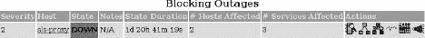

> 图 16-30。只要 `sis-proxy` 失败，Nagios 就无法到达其后的任何主机

通过“操作”（Actions）列中的图标，您可以调用其他 CGI 程序来选择性地过滤此处显示的主机信息。从左到右，它们分别显示详细视图中的状态显示（红绿灯）、拓扑网络视图（网络树）、3D 视图（3-D）、趋势显示（图表）、主机的日志文件记录（表格）以及已发送的显示（喇叭）。

### 16.2.9 使用 `config.cgi` 查询对象定义

`config.cgi` 显示了指定类型的所有对象定义的表格概览（图 16-31）——涉及的对象类型可以在右上角的选择字段中定义。如果考虑项本身包含 Nagios 对象（在主机视图的“主机检查命令”、“默认联系人组”以及图片中未显示的“通知周期”中），点击链接将直接带您进入该对象类型的配置视图。

> 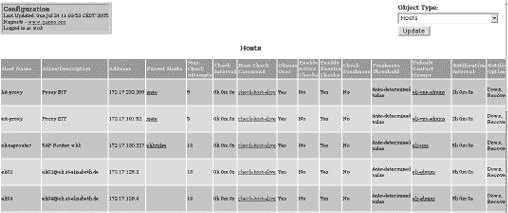

> 图 16-31。`config.cgi` 显示所选对象类（此处为主机）的当前配置（提取）

该 CGI 程序不提供更改任何设置的方法。此外，只有列入参数 `authorized_for_configuration_information`（（文件 `cgi.cfg`，第 607 页）的用户才能访问此视图。

### 16.2.10 可用性统计：`avail.cgi`

如果您正在监控系统，您也会关注它们的可用性。`avail.cgi` 首先询问您是否对主机、服务、主机组和服务组组感兴趣。在选择一个时间段后，您将看到如图 16-32 所示的概览。对于服务和服务，您还可以通过 CSV 文件以“所有主机”或“所有服务”的形式呈现可用数据。

`avail.cgi` 分开显示涉及的主机和服务。可以通过相应的颜色列看到服务或主机处于特定状态持续多久（以百分比表示）：绿色表示 OK，黄色表示 WARNING，红色表示 CRITICAL（服务）、DOWN 和 UNREACHABLE（主机）。显示服务状态处于 UNKNOWN 时间的列以橙色显示。不完整的日志文件显示在“未确定”（Undetermined）列中。如果存在大于零的值，则某些期间 Nagios 无法对状态做出判断。

每个表格下方的“平均”（Average）行指定了各个值的平均值。在图 16-32 中，涉及的主机可用时间为 99.965%。

`avail.cgi` 在每个情况下显示两次可用性：首先是评估期间的绝对值，然后（在括号内）相对于实际数据可用的时间。只要“未确定时间”（Time Undetermined）列显示 `0.000%`，这两个可用性值就会匹配。

> 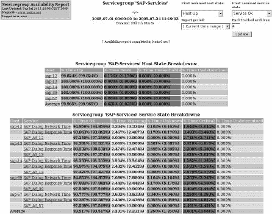

> 图 16-32。使用 `SAP-Services` 服务组作为示例的可用性报告

如果您点击显示的主机或服务之一，将出现详细视图。图 16-33 显示了主机 `sap-12` 的此类视图。

> 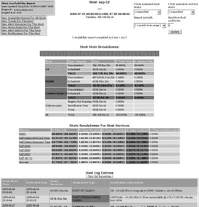

> 图 16-33。主机 `sap-12` 可用性的详细说明

在显示所选期间内颜色状态的条形图中，有关于主机本身的详细信息，随后是关于该主机上监控的服务的可用性统计。这包括日志文件的摘录，该记录仅显示与主机可用性相关的记录；即 `HOST UP`、`HOST DOWN` 或 `HOST UNREACHABLE`。`avail.cgi` 截断了日志记录以节省空间。

### 16.2.11 发生了什么事件，频率如何？——`histogram.Cgi`

如果主机或服务的状态发生变化，这被称为事件。CGI 程序 `histogram.cgi` 在不同视图中显示这种频率。如果您选择“日期”（Day of the Month）作为细分类型，它将说明在每月哪一天发生了什么事件，以及频率如何（图 16-34）。服务中的红色图表代表 CRITICAL，橙色代表 UNKNOWN，黄色代表 WARNING，绿色代表 OK。DOWN 状态的主机曲线被 `histogram.cgi` 标记为红色，UNREACHABLE 状态为酒红色，绿色线条如既常地代表 OK。

> 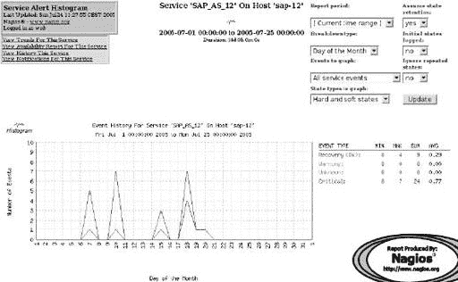

> 图 16-34。哪一天发生了多少种类型的事件？

如果您选择“星期”（Day of Week），网页将显示一周中哪一天发生的事件最多，因此您可以找出周一是否真的是最糟糕的一天。此外，您还可以按天（小时 Hour of Day）或按一年的月份（Month）显示频率。通过“报告周期”（Report Period）您可以调整报告周期。“假设状态保留”（Assume state retention）允许您调整是否保留之前的状态并将其纳入评估（`yes`）或不包含（`no`）。

如果您配置了 Nagios，使其显式记录重启或日志文件更改时被监控主机和服务的状态，并且您将“已记录初始状态”（Initial states logged）设置为 `yes`，则脚本会在评估中显式包含此内容。`no` 则忽略该条目；`histogram.cgi` 然后假设系统启动后的状态与重启之前的状态相同。

“忽略重复状态”（Ignore repeated states）对状态持续很长时间并反复交付相同结果的情况提供了考量。如果您在此处设置 `yes`，脚本将对其评估一次而不是多次。

如果您在“要绘图的状态类型”（State types to graph:）中选择“硬和软状态”（Hard and soft states），`histogram.cgi` 也会计算软状态。例如，如果服务从 OK 变为 CRITICAL，而此时 `retry_check_interval` 设置为 4，那么 `histogram.cgi` 将总计计算四个结果，三个软状态和一个硬状态。如果您只评估硬状态，统计结果将为值 1。如果错误被纠正，就没有软状态；因此，如果您在评估中包含软状态，CRITICAL 的值通常比 RECOVERY 大。

### 16.2.12 针对特定状态过滤日志记录：`history.cgi`


`history.cgi` 脚本允许通过选择字段 `State type`（状态类型，位于图 16-35 的右上角）从日志文件中选择性地提取某种类型（软或硬）的状态，并使用“所有主机的历史详情级别”（History detail level for all hosts）提取特定事件（全部、与主机相关的所有、所有服务事件、仅主机恢复、仅主机宕机等）。在当调用 CGI 程序时，可以通过针对单个主机、服务或主机/服务组的参数来限制显示的条目。因此，命令

`histogram.cgi?host=sap-12` 只显示主机 `sap-12` 的日志文件条目。如果输出应限制到特定主机，则还需要指定服务描述：

```
histogram.cgi?host=sap-12&service=PING
```

选择主机和主机组的方法相同：

```
histogram.cgi?hostgroup=SAP
```

```
histogram.cgi?servicegroup=SAP-Services
```

`history.cgi` 查看的时间段取决于日志文件的归档间隔。该脚本始终引用存档文件的内容。如果你在配置文件 `nagios.cfg` 中将参数 `log_rotation_method`（A.1 主配置文件 nagios.cfg）设置为 `d` 以进行每日归档，Web 页面将显示一天的条目。使用箭头（位于图 16-35 顶部），你可以向上或向下滚动日期。

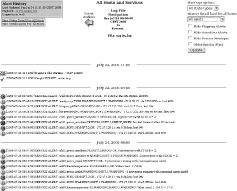
> 图 16-35. `history.cgi` 过滤日志文件信息

### 16.2.13 谁在什么时候收到了什么消息？——`notifications.Cgi`

`notifications.cgi` 提供了另一种日志文件的过滤视图：它显示所有已发送的消息。在这里，也可以通过图 16-36 右角的选择字段将视图限制为特定的消息组：例如，所有涉及主机的通知、所有关于处于关键状态服务的通知等。

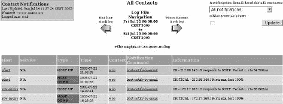
> 图 16-36. `notifications.cgi` 回答了谁在什么时候收到了什么消息的问题

如果你只想在此查看有关特定主机和服务的消息，你必须在运行 CGI 程序时再次通过参数进行指定：

```
notifications.cgi?host=host
notifications.cgi?host=host&service=service name
notifications.cgi?contact=contact
```

除了 `host` 和 `service` 外，你还可以选择特定的联系人，但无法选择主机或服务组。

### 16.2.14 显示所有日志文件条目：`showlog.cgi`

CGI 程序 `showlog.cgi` 按原样显示日志文件，并添加了一些彩色图标帮助你查找：红色按钮标记关键服务状态或 DOWN/UNREACHABLE（宕机/不可达）主机，黄色按钮标记 WARNING（警告），绿色标记 OK（正常）。其他按钮指向信息条目或 Nagios 重启（图 16-37）。

你在这里只有一个选项：按时间顺序。通常，`showlog.cgi` 先显示最新的条目。如果你启用“较旧条目优先”（Older Entries First，右上角）中的勾选框，将先显示最旧的条目。

这里代表的时间段也取决于归档方法：如果你每天归档一次，则每个 Web 页面仅获得一天的数据。要查看其他日期的条目，必须使用图片顶部的箭头在日志文件的各个存档之间切换。

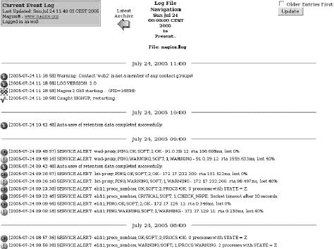
> 图 16-37. 蓝色按钮标记信息条目，从红色变绿色的图形表示 Nagios 重启，带有绿色勾选背景并标记 GO 的图标代表监控系统的重启

### 16.2.15 评估你想要的任何内容：`summary.cgi`

如果目前介绍的显示和选择选项不能满足你的需求，你可以使用 `summary.cgi` 创建自己的报告，它会生成如图 16-38 所示的选择对话框。上半部分“标准报告：”（Standard Reports:）提供快速摘要，其中只能选择一种固定的报告类型。点击此正下方的按钮即可生成报告。

第二部分更为复杂。“报告类型：”（Report Type:）字段带有“最近警报”（Most Recent Alerts）报告类型提供了最后 `n` 个独立事件的列表。数字 `n` 在选择对话框下方的“最大列表项”（Max List Items:）中进一步定义。^[168^] `Report Type:` 也可以用于在单独的行中单独显示所有事件（使用 `Most Recent Alerts`），或者你可以显示统计数据，例如每个主机组发生的事件总数等，使用“警报总计”（Alert Totals）、“按主机组划分的警报总量”（Alert Totals by Hostgroups）等。

一个特别有趣的报告类型是“顶级警报产生者：”（Top Alert Producer:）：此类报告以排行榜的形式显示了在此期间制造麻烦最多的人。

在“报告范围：”（Report Period）中，你可以选择预定义的时间范围（本周、本月、上周等），或者指定 `CUSTOM PERIOD` 来定义你想要的时间。


> 图 16-38. `summary.cgi` 的参数选择

报告的详情根据主机、服务或组以及状态类型（例如 CRITICAL 状态）跟踪报告范围。在“最大列表项：”（Max List Items）处，`summary.cgi` 始终显示指定数量的条目。默认较小；如果你想显示该范围的所有条目，应输入 `0`。这里可以显式设置的最大值为 `999`。点击“创建报告！”（Create Report!）将生成请求的报告（图 16-39）。

报告头部包含了报告范围的选择。下方的详情很有趣：显示了 3721 个匹配的警报，但 CGI 脚本将其限制为最新的 25 个，感谢 `Max List Items`。

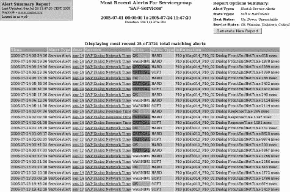
> 图 16-39. 由 `summary.cgi` 生成的单个报告

### 16.2.16 随时间图形化跟踪状态：`trends.Cgi`

`trends.cgi` 的图形输出提供了特定主机或服务何时发生什么状态的快速概述（图 16-40）。在选择特定主机或服务后，你可以像 `summary.cgi` 一样定义范围。`trends.cgi` 对状态进行颜色编码，使得概述更容易追踪。

该 程序的缩放功能是一个有趣的细节。如果你点击彩色区域的某部分，将根据右上指定的缩放因子放大或缩小。负数项（−1、2、3 和 4）会扩大报告范围而不是缩小它。

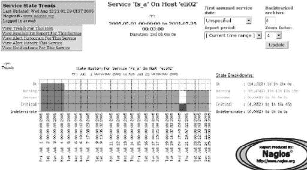
> 图 16-40. `trends.cgi` 表示状态的时间序列——这里以服务为例


- [`netways.de/Demosystem.1621.0.html`](http://netways.de/Demosystem.1621.0.html)
- 虚拟现实标记语言（VRML）版本 2.0/1997 用于描述虚拟“空间”。
- `/usr/local/nagios/share/docs/cgis.html#statuswrl_cgi`
- [`www.parallelgrafics.com/products/cortona`](http://www.parallelgrafics.com/products/cortona)
- 对于 Firefox，你必须手动安装，在安装程序中选择“自定义”（Custom）而非“典型”（Typical），并在不支持的浏览器中指定浏览器的插件目录。
- [`cic.nist.gov/vrml/vbdetect.html`](http://cic.nist.gov/vrml/vbdetect.html)
- [`www.openvrml.org/`](http://www.openvrml.org/)
- [`freewrl. sourceforge. net/`](http://freewrl.%20sourcef%20orge.%20net/)
- 无线访问协议。
- 无线标记语言包含部分 HTML，但功能被大幅削减。
- `nagios.cfg;` 中的参数 `log_initial_state` 参见第 597 页。
- 这里的细微区别在于 `retain_state_information`（参见 A.1 主配置文件 `nagios.cfg`）。如果此参数设置为 0，Nagios 会忘记之前的状态。如果未设置 `log_initial_state = yes`，Nagios 在重启后将接受 OK 状态。
- 因此，Nagios 在将状态分类为“硬”（hard）之前会重复测试四次。
- 如果报告期内的事件数量少于 `Max List Items:` 指定的数量，则报告将涵盖在此期间发生的所有事件。

## 16.3 计划停机时间

在每个系统环境中，维护工作都会不时积累，管理员通常可以对其进行计划，以便提前通知用户。Nagios 将此类维护窗口称为“计划停机时间”（Scheduled Downtime）；管理员可以在由 `extinfo.cgi` 生成的主机或服务的信息页中（图 16-4，第 331 页）或在对应的主机或服务组中输入这些信息（图 16-17，第 339 页）。在此过程中，`extinfo.cgi` 使用了 `cmd.cgi`（16.2.3 外部命令接口：`cmd.cgi`，第 343 页），该命令也可以被选择性调用：

```
http://nagiosserver/nagios/cgi-bin/cmd.cgi?cmd_typ=55
```

这将打开单个主机的维护时间导入模板。`cmd_typ` 的值在第 344 页的图 16-24 中汇总。

插件还提供了另一种记录维护期的方法，它们与 CGI 程序一样使用外部命令接口，但与交互式 Web 界面不同，它们是可以自动化的。此类插件也可以在 Nagios Exchange 上找到。

对于计划的停机时间，Nagios 会防止发送通知。这确保了管理员不会被虚假报警淹没。在检查是否应该发送消息时，停机状态是列表中的第三项（图 16-2，第 351 页）在评估单个主机和服务的可用性时会考虑停机时间，并将这些期间发生的错误状态不判定为错误状态，而是判定为 OK。

维护期是可以重叠的。如果一个维护窗口从早上 8:00 持续到中午 12:00，而第二个涉及同一主机或服务的窗口从早上 10:00 持续到下午 2:00，那么 Nagios 在早上 8:00 到下午 2:00 之间不会发送任何错误消息，且整个期间在可用性统计中也会被忽略。

##### 16.3.1 主机的维护期

记录维护窗口所需的数据可以通过 Web 界面进行非常清楚的解释。图 16-41 显示了主机停机的输入模板。

```
cmd.typ=55
```
**图 16-41. Web 界面中的主机停机时间**

第一行定义主机，第二行 Nagios 会自动填入登录信息。在 `Comment:` 输入字段中，你可以描述计划停机的原因。指定触发器（trigger）可以显示其是否是间接生成的。

在接下来的四行中，你可以选择两种不同的类型：`Fixed`（固定）或 `Flexible`（灵活）。前者具有固定的开始时间和固定的结束时间。灵活停机在指定期间内发生首次事件时开始。从该时间点起，Nagios 将按照此处指定的时长计划停机。这无疑可能超过 `End Time:` 中指定的终点。

如果其他主机依赖于 `Host Name:` 中指定的计算机（可能是因为涉及了路由器，而其他主机对象已将其作为父节点输入），你可以通过最后一项 `Child Hosts:` 将停机时间扩展到所有依赖主机。`Schedule triggered downtime for all child hosts`（为所有子主机计划触发停机）会传递灵活停机，`Schedule non-triggered downtime for all child hosts`（为所有子主机计划非触发停机）对固定停机执行相同的操作，而 `Do nothing with child hosts`（对子主机执行任何操作）则忽略依赖关系，因此 Nagios 不为指定主机之外的任何主机进行计划。

这种继承行为在图 16-41 中的生效方式通过所有计划停机时间的概述显示。第一行包含了上述主机 `eli-saprouter` 的停机时间，停机 ID 为 1。继承此超时产生的条目在 `Trigger ID` 列中包含产生它们的停机的停机 ID：对于 `sap-12`，该 ID 为 1，因为对 `eli-saprouter` 的维护也影响了该主机。

Nagios 在计划停机时间时同时生成一个注释条目，该时期结束后它会被删除。这就是为什么状态显示中会出现一个气泡的原因。在停机期间，Nagios 会在此补充一个“打鼾符号”，用于表示睡眠状态（图 16-42）。

```
zzzz
```
**图 16-42. 打鼾符号 zzzzz 表示主机停机时间已开始**

##### 16.3.2 服务的停机时间

服务的停机时间与主机的不同在于两个微小之处。除了主机名称外，必须包含服务描述，并且排除了继承的可能性，因为服务没有相应的依赖关系。


主机的停机时间不会自动应用于运行在其上的服务。但由于当主机宕机时这些服务也无法使用，因此建议你为所有依赖的服务计划相同的停机时间。逐个输入所有服务非常麻烦。使用主机组（`cmd_typ=85`）执行此操作要简单得多，如图 16-43 所示。通过这种方式，你可以通过一个命令定义特定主机组内服务的停机时间，还可以实现更多功能：同时，勾选“同时也为主机安排停机（Schedule Downtime For Hosts Too）”会同时为该组所属的所有主机定义相同的停机时间。^[170^]

> 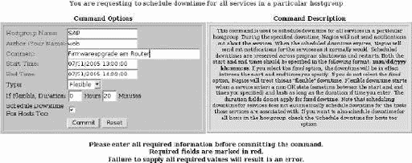

> 图 16-43. 针对主机组内所有服务的单一停机设置

* *

^[169^] [`www.nagiosexchange.org/Downtimes.38.0.html`](http://www.nagiosexchange.org/Downtimes.38.0.html)。

^[170^] 直到（至少）Nagios 3.0rc1 版本，该勾选框无效；此时你必须通过再次运行 `cmd.cgi?cmd_typ=84` 来单独输入主机的停机时间。

# 16.4 关于主机和服务的附加信息

通过主机和服务的扩展信息，你可以在 Web 界面中包含额外信息，并使用合适的图标来美化其外观。在 Nagios 2.x 中，有两个独立对象持有这些信息：`hostextinfo` 和 `serviceextinfo`。从 Nagios 3.0 开始，额外信息直接定义在主机和服务对象中。尽管 Nagios 3.0 仍然会评估 `hostextinfo` 和 `serviceextinfo` 对象，但它在检查配置时会发出警告信息，并认为这些对象已过时。

计划在最晚 4 版本中完全从 Nagios 中移除这些对象。首次使用 Nagios 3.0 的用户应该直接在主机和服务定义中指定下文介绍引入的信息，并从一开始就跳过 `hostextinfo` 和 `serviceextinfo`。如果你是从 Nagios 2.x 迁移到 Nagios 3.0，则不需要担心这个问题，可以继续使用这些对象的现有实例。

为了更清楚起见，下面我们将使用 `hostextinfo` 和 `serviceextinfo` 对象信息这一术语。对于 Nagios 2.x，该术语指的是同名对象；而对于 Nagios 3.0，它指的是 `host` 和 `service` 对象中提供的相应细节。参数本身在 Nagios 2.x 和 3.0 中是相同的。对象信息仅影响 Web 界面，对 Nagios 的功能没有影响。

## 16.4.1 扩展主机信息

主机对象信息允许你通过链接形式的函数以及图标和坐标形式的增强功能，增强 Web 界面中主机的显示：

> `# Nagios 2.x                   # Nagios 3.0`

```
define hostextinfo{              define host{
    host_name       linux01
    notes           Samba Primary Domaincontroller
    notes_url       /hosts/linux01.html
    action_url      /hosts/actions/linux01.html
    icon_image      base/linux40.png
    icon_image_alt  Linux Host
    vrml_image      base/linux40.png
    statusmap_image  base/linux40.gd2
    2d_coords       120, 80
    3d_coords       70.0,30.0,40.0
}
```

定义这些内容时，唯一的强制参数是指定主机的 `host_name`；其他所有都是可选的：

`host_name`

> > 这是主机对象的名称，其 Web 页面将通过以下属性进行扩展。

`notes`

> > 用于此存储 `extinfo.cgi` 在其信息页面中考虑的额外信息。（上述示例中指定的条目 Samba Primary Domaincontroller 可以在下方下方的图 16-44

> > 图 16-44. `extinfo.cgi` 在此处也显示 Linux 图标的备用文本（括号内的 Tux 下方）以及参数 `notes` 的额外信息（备用文本下方）

`notes_url`

> > 这是一个带有相关主机额外信息的 (HTML) 文件的 URL，你可以通过一个红色、微开的手手册形式的图标链接到该文件，该图标出现在状态概览（图 16-45）和 `extinfo.cgi` 生成的信息页面（图 16-44）中。如果主机上的文档存储在内网中，那么维护合同、系统配置等只需点击即可。

> > 使用来自 Web 服务器的绝对路径或完整的 URL。

> > 

> > 图 16-45. 此视图显示用于 `notes_url` 的图标（打开的手册下方）、`action_url`（粉色星下方）、Linux

`action_url`

> > 这是一个指向要为主机运行的操作链接，例如执行 `cmd.cgi` 程序。由于浏览器中的链接总是有效的，这不需要是命令，你可以轻松地链接到另一个 Web 页面。在状态概览（index_split_138.html_filepos1160820）和 `extinfo.cgi` 页面中，它隐藏在粉色星后面。

> > 作为值。

`icon_image`

> > 这是一个增强 Web 界面的图标，同时也提供了帮助：如果你在这里使用代表操作系统的图片（例如 Linux 的 Tux、Microsoft 操作系统的窗口、Solaris 计算机的 Sun 标志等），这将帮助你在状态视图中查看操作系统——特别是如果你有很多主机时（图 16-45）。允许的格式为 GIF、JPEG 或 PNG。如果你指定相对路径（或完全不指定），则从 `/usr/local/nagios/share/images/`目录开始。^[171^]

`icon_image_alt`

> > 当浏览器不显示图片时（例如读取设备或输出设备），此图标的备用文本。根据图标和图标文本，Nagios 生成以下 HTML 代码：

> > `IMG SRC=icon_image ALT=icon_image_alt`

`vrml_image`

> > 这是 `statuswrl.cgi` 3D 表示中的主机图像。允许的格式再次为 GIF、JPEG 或 PNG。你应该避免幻灯片，因为图像被放置在立方体上， 3D 界面中的透明部分可能会导致意外结果。

`statusmap_image`

> > 这是 `statusmap.cgi`（参见 16.2.5 网络拓扑图：statusmap.cgi，第 346 页）在其拓扑图中表示主机符号。Netways 的 Nagios 页面展示了一个很好的例子（第 348 页的图 16-28），^[172^]

`2d_coords`


此参数指定了拓扑图自定义布局的坐标。详细信息以像素给出，原点 `(0, 0)` 位于左上角，且值必须为正数：正的 x 值表示从原点向右的像素数，正的 y 值表示从原点向下的像素数。

图 16-28 使用单个主机的固定坐标工作。如果状态映射将不同的布局映射到自定义布局，则 Nagios 将忽略 `2d_coords` 的详细信息。

`3d_coords`

这些是 3D 表示的坐标。允许正、负浮点数。`(0.0,0.0,0.0)` 被用作原点。在起始视图中，`statuswrl.cgi` 会缩放 3D 图像，使所有现有的主机都显示在屏幕上。因此，无法预测起点在屏幕上的位置。

在 Nagios Exchange 上，Logos and Images 类别下有大量的现成的图标。^[173^] 最好将这些解压到单独的子目录中，这样各个软件包就不会互相干扰：

```bash
linux:~ # cd /usr/local/nagios/share/images/logos
linux:images/logos # tar xvzf imagepak-base.tar.gz
base/aix.gd2
base/aix.gif
base/aix.jpg
base/aix.png
base/amiga.gd2
...
```

`imagepak-base.tar.gz` 包含一组基础图标，您可以根据喜好与其他软件包进行补充。创建的 `base` 子目录与本章开头的对象定义一样，也必须包含在内。

### 16.4.2 扩展服务信息

扩展服务对象信息与主机对应的等效信息基本相同，因此我们仅提及差异部分。除了主机名外，`service_description` 中的服务描述是强制性的，但省略了 2D（状态图）和 3D 视图中的详细信息：

```bash
# Nagios 2.x                # Nagios 3.0
define serviceextinfo{
    define service{
      ...
      host_name           linux01
      service_description  LPD
      notes               Linux Print Services
      notes_url           /hosts/linux01-lpd.html
      action_url          /hosts/linux01-lpd-action.html
      icon_image          base/hp-printer40.png
      icon_image_alt      Linux Print Server
    }
}
```

与扩展主机信息相比，此示例的状态概览仅显示 `icon_image` 中指定的打印机图标，而不显示在 `notes_url` 和 `action_url` 中为两个链接 `notes_url` 和 `action_url` 定义的两个图标。它们仅出现在 `extinfo.cgi` 生成的页面中，且图标与扩展主机信息的图标相同（图 16-44，第 363 页）。

***

^[171^] 如果您遵循了书中建议的路径。

^[172^] [`nagios-demo.netways.de/`](http://nagios-demo.netways.de/)

^[173^] [`www.nagiosexchange.org/Image_Packs.75.0.html`](http://www.nagiosexchange.org/Image_Packs.75.0.html)

### 16.5 通过 Web 界面更改配置：重启问题

CGI 程序 `cmd.cgi`（16.2.3 外部命令接口：cmd.cgi，第 343 页) 允许通过 Web 界面对当前配置进行一系列更改.^[174^] 这样，可以开启或关闭通知或主动检查。

Nagios 不会将此类更改保存到相应的配置文件中，而是在一个单独定义的文件中记录当前状态，该文件由 `nagios.cfg` 中的 `state_retention_file` 参数指定（参见 A.1 主配置文件 nagios.cfg）。但是如果在多次更改后重启 Nagios 会发生什么？

Nagios 在重启后是否保留这些更改取决于 `nagios.cfg` 中的 `state_retention_file` 参数（参见 A.1 主配置文件 nagios.cfg）。如果将 `state_retention_file` 设置为 `0`，则 Nagios 在重启后会忘记这些更改：

```bash
# nagios.cfg
...
state_retention_file 0
...
```

如果将 `state_retention_file` 设置为 `1`，则 Nagios 在重启后会保留这些更改：

```bash
# nagios.cfg
...
state_retention_file 1
...
```

但是，如果在通过 Web 界面进行多次更改后重启 Nagios 会发生什么？

Nagios 在重启后是否保留这些更改取决于 `nagios.cfg` 中的 `state_retention_file` 参数（参见 A.1 主配置文件 nagios.cfg）。如果将 `state_retention_file` 设置为 `0`，则 Nagios 在重启后会忘记这些更改并从文件中重新读取。另一种方法是养成一种习惯，每当在配置文件中进行更改时，在 Web 界面中也进行一遍。虽然这意味着工作量增加，但永远不会丢失当前的、可能非常重要的设置。

在主机和服务定义中的两个额外参数提供了微调机会：

```bash
define host{
    ...
    retain_status_information    1
    retain_nonstatus_information 1
}

define service{
    ...
    retain_status_information   1
    retain_nonstatus_information 1
}
```

`retain_status_information` 指定主机或服务的当前状态是否在 Nagios 重启后依然存在：`1` 表示系统临时存储该状态，`0` 表示将其遗忘。`1` 无疑是更合理的值，您只有在合理的情况下才偏离此值。

`retain_nonstatus_information` 则指向所有不描述状态的信息。这包括例如是否开启主动检查、是否允许被动检查，或者是否通知管理员状态变化。使用值 `1` 时，系统临时存储这些信息并在重启后再次使用；而使用值 `0` 时，Nagios 在重启时会忘记当前设置并从配置文件读取。

***

^[174^] CGI 程序在执行此操作时会使用外部命令接口。

^[175^] Nagios 2.x: `/usr/local/nagios/share/docs/xodtemplate.html`, Nagios 3.0: `/usr/local/nagios/docs/objectdefinitions.html`

### 16.6 使用 Nuvola 样式的现代布局

到为止描述的 Nagios Web 界面经典视图仅使用了部分 CGI 配置选项。然而，左侧导航栏中很难再放入更多项目了，其外观显得有些业余。解决此问题的方案之一是 Nuvola 样式，如图 16-46 所示。


实际 CGI 程序的布局——本示例显示了图片右侧 `status.cgi` 的服务问题视图——不仅是彩色，还有新的图标。在图片的左侧，你可以看到相当优雅的导航栏，并配有相应的图标点缀。不过，真正的亮点是基于 Javascript 的菜单树：单个条目（如 Home 首页、Monitoring 监控、Reporting 报告和 Configuration 配置部分）可以通过鼠标点击进行打开和关闭。

> 

> 图 16-46.Nuvola 风格的 Nagios：此处显示的是服务问题（Service Problems）

在安装 Nuvola 样式之前，务必备份 `/usr/local/nagios/share` 目录，以便如果你不喜欢新样式，就可以恢复旧设置。

在印刷时，NagiosExchange 提供的 Nuvola 当前 1.0.3 版本于 2005 年 9 月，但它与 Nagios 3.0 配合得也非常良好。内容被解压到合适的空目录中：

```
linux:~ # cd /usr/local/src; mkdir nuvola; cd nuvola
linux:src/nuvola # tar xvzfpfad/zu``/nagios-nuvola-1.0.3.tar.gz ...
linux:src/nuvola # cd html
```

源码包含文件（`index.html, main.html`）和 Nagios 中已存在的目录（`stylesheets, images`），它们在安装期间会覆盖原始文件。此外，Nuvola 样式包含一个新的子目录 `side`，其中包含了用于树形导航的实际 Javascript 代码：

```
linux:nuvola/html # tree
|-- config.js
|-- images
|   |
|   ... ...
|-- index.html
|-- main.html
|-- side
|   -- apymenu.css
|   -- apymenu.js
|   -- apymenu_data.js
|   ... ...
|   -- dtree.css
|   -- dtree.js
|   -- dtree_data.js
|   ... ...
|   -- icons
|        |
|   ... ...
|-- sidel.html
'-- stylesheets
    |
    ... ...
5 directories, 175 files
```

`html` 目录的内容简单地复制到 `/usr/local/share`，例如使用 `rsync`：

```
linux:nuvola/html # rsync -av. /usr/local/nagios/share/.
...
```

为了让新导航出现，必须安装 `sidel.html` 文件。但如果你只是将其重命名为 `side.html`，那么新 Nagios 版本的 `make install` 将再次覆盖它。因此，最好使用单独的索引文件，例如 `index1.html`，并此处运行 Nagios Web 界面：

`http://nagiosserver/nagios/index1.html`

要实现此操作，将 Nuvola 中包含的 `index.html` 文件复制到 Nagios 的 `share` 目录并命名为 `index1.html`：

```
linux:nuvola/html # cp index.html/usr/local/nagios/share/index1.html
```

在 `index1.html` 文件中，将 `side.html` 替换为 `side1.html`，以便调用 Javascript 导航：

```javascript
...
document.write('<FRAME SCROLLING="no" SRC="side1.html" NAME="side"
...
...
```

如果你像本书的作者一样，认为更改所有 CGI 程序的样式有些过头，你只需挑选出改进的导航部分，并根据你认为合适的方式进行补充和重新设计。不需要对 `html` 目录进行完整复制，只需选择你需要的文件：

```
linux:nuvola/html # cp -r side /usr/local/nagios/share/.
              linux:nuvola/html # cp side1.html config.js/usr/local/nagios/share/.
              linux:nuvola/html # cp index.html/usr/local/nagios/share/index1.html
```

按照我们刚才展示的那样修改 `index1.html` 文件，并检查 `config.js` 中的 `cgipath` 变量：

```javascript
...
var cipath = "/nagios/cgi-bin/";
...
```

Nuvola 使用现成的菜单树库，该库在名为 `apytmenu` 的商业版本中可用（此处将不讨论它），或者在免费变体 dTree 中。dTree 是 `config.js (treeType = 'dtree')` 中的默认设置，并完整包含。菜单和树的配置在 `side` 目录下的 `dtree_data.js` 文件中完成。可以使用 Home 菜单简要解释基本原理：

```javascript
general = new dTree('general');
general.header('Home', 'icon', ...);
general.add(0,-1);
general.add(1, 0,'Documentation','docs/index.html', ... );
document.write(general);
```

`dTree` 函数生成一个新的菜单树。它的参数是一个自由选择的标识符（在此情况下为 `general`），用于引用该树。`general.header` 将菜单标题设置为 `Home`。该函数还需要其他参数，包括一个图标（所示）。

第一次 `general.add` 调用锚定了仍待创建的树。`add` 函数的前两个参数指代要添加的节点编号，随后是其父节点。顶端节点称为 `0`，在其下方是 `Documentation` 条目，分配的数字 `1`。如果 `Documentation` 本身也要有子节点，调用方式将如下：

```javascript
general.add(2, 1, 'new_entry', ...);
general.add(3, 1, 'new_entry', ...);
general.add(4, 1, 'new_entry', ...);
```

最后 `document.write` 构建了整个菜单树。`header` 函数具有以下参数：

`menu_name.header(title, icon, height, background image, background color, open);`

### `title`
- 包含标题，也可以设置为 URL。点击标题将打开指定的超链接。

### `icon`
- 指定显示在标题前面的小型图形的路径。

### `height`
- 指定标题下方背景的高度。此后，该背景的属性可以指定为背景图像（通过 `background image`）或颜色（通过 `background color`）。

### `open`
- 指定菜单树在启动时应该是打开的（`1`）还是关闭的（`0`）。指定文本值的参数包含在单引号中，数值参数直接写入，如所示。

`add` 函数以类似的方式被调用：

```javascript
menu_name.add(id, pid, name, url, title, target, icon, iconOpen, open, css);
```

`id` 是节点编号，`pid` 是应集成该条目的下方的节点编号。`name` 定义菜单中的节点名称，`url` 定义要调用的超链接。`title` 和 `target` 可选地指定页面标题和显示 `url` 页面的目标框架。这两个参数通常在此留空；目标的默认值（对于 Nagios 来说是正确的）是框架 `main`。

`icon` 定义放在菜单条目前面的微型图形，`iconOpen` 可选包含另一个图标，当菜单条目打开时用它替换。`open` 再次定义条目在启动时应是打开（值 `1`）还是关闭（值 `0`），`css` 可选允许备替代的 CSS 定义。对于所有可选参数，适用以下规则：如果它们在末尾，可以省略，但如果它们后面还有其他细节，则其省略必须用一对单引号（``）来标记。

包含的文件 `dtree_data.js` 包含了四个大型菜单。如果你在处理 Javascript 方面经验很少，最好使用此模板并分小步进行调整。发生错误时，信息非常稀少且通常具有误导性，因此特别需要你记录下每一步之间具体更改了什么，以便快速隔离错误。


那些对本章描述的 Nagios Web 界面的功能不满意的人可以看一下 NagVis（第 18 章见第 389 页）。该插件启用了一个自由定义的界面，并以令人印象深刻的方式补充了标准的 CGI。然而，NagVis 的前提条件是安装数据库接口 `NDOUtils`（第 17 章见第 375 页），这使得安装门槛稍微提高。

* * *

^[176^] [`www.nagiosexchange.org/75;252`](http://www.nagiosexchange.org/75;252)

^[177^] [`dhtml-menu.com/`](http://dhtml-menu.com/)

^[178^] [`www.destroydrop.com/javascripts/tree/`](http://www.destroydrop.com/javascripts/tree/)

^[179^] [`www.destroydrop.com/javascripts/tree/`](http://www.destroydrop.com/javascripts/tree/)

# 第 17 章. 使用 NDOUtils 的灵活 Web 界面

Nagios 2.x 和 3.0 的 Web 界面在第 16 章见第 327 页引入，对于拥有数百个主机的大型环境来说有一个致命的缺点：它无法扩展。只要你只观察错误状态并密集处理确认（acknowledges），使用基于 CGI 的 Web 界面就能运行得很好。但如果你尝试显示几千个服务，你就必须做好等待的准备——无论它们的状态如何。设置页面可能需要很长时间，然后实际工作几乎无法进行。

Nagios 扩展在处理 CGI Web 界面时非常困难，因为这直接评估 Nagios 内部机制，例如对象配置、状态数据和日志文件。这意味着任何用于补充或替换 Web 界面的扩展都必须遵循这种逻辑。

解决此问题的方案被称为 `NDOUtils`（Nagios 数据对象实用）。它们由一组工具组成，将所有数据（从配置、事件、检查结果到历史记录）都写入数据库，并通过统一的数据库模型提供服务。

将 `NDOUtils` 连接到 Nagios 的机制被称为 `Nagios Event Broker`（又简称 `NEB`）。这为 Nagios 增加了一个模块化接口。`NEB` 在 Nagios 启动时作为模块加载扩展，这样无需重新编译 Nagios 即可使用这些模块。这种方法类似于 Apache 模块，这些模块在需要时加载并为 Web 服务器添加新功能。

`NDOUtils` 成了 Nagios 未来 Web 界面的基础（使用 PHP 实现），预计从 Nagios 4.x 开始面世。然而，通过 `NagVis`（见第 18 章见第 389 页），已经有一个基于 `NDOUtils` 的替代 Web 界面了。

## 17.1 事件代理

`NEB` 在 Nagios 和基于共享库的外部模块之间提供了一个接口。外部且依赖应用程序的模块会提供回调函数。Nagios 内核本身会为每个事件从加载的模块中调用相应的回调函数：如果没有匹配的函数，则什么都不会发生。回调函数执行什么操作完全取决于开发者的设想：它要么自己执行某些操作，要么将配置、状态和事件数据传递给外部应用程序，如图 17-1 所示。

为了将数据传输到外部工具，可以使用 Unix 套接字或网络套接字，也可以使用文件系统。应用程序进一步处理信息（例如保存在数据库中，或通过 SNMP 陷阱作为消息发送，写入 syslog 等）。

> 

> 图 17-1. 外部应用程序与已加载的 NEB 模块通信

当回调函数被调用时，Nagios 会等待它完成。这意味着长时间的执行会阻碍系统。因此，回调函数应该始终将耗时的处理步骤留给外部应用程序，并限制为尽可能快地发送必要信息。

构建事件代理模块应该是经验丰富的程序员做的事情；凡人只能满足于使用现成的模块。可以通过主配置文件 `nagios.cfg` 中的 `broker_module` 指令集成 `NEB` 模块：

```bash
# /etc/nagios/nagios.cfg
...
broker_module=module-with-path arguments event_broker_options=-1
```

是否向模块传递参数取决于其具体实现。`event_broker_options` 参数控制 Nagios 向事件代理模块传递哪些信息。使用选项 `-1` 时会传递所有信息，而值 `0` 则阻止传递任何信息。另一种选择性地传递特定信息的方法由 Nagios 源码文件中的 `broker.h` 文件提供：

```c
/* broker.h from the Nagios sources */
...
/*************** EVENT BROKER OPTIONS*****************/

#define BROKER_NOTHING              0
#define BROKER_EVERYTHING            1048575

#define BROKER_PROGRAM_STATE        1       /* DONE */
...
#define BROKER_DOWNTIME_DATA         512     /* DONE */
...
#define BROKER_STATUS_DATA          4096    /* DONE */
...
#define BROKER_RETENTION_DATA        32768  /* DONE */
#define BROKER_ACKNOWLEDGEMENT_DATA  65536
```

表 17-1. 传输到 NagVis 的数据

| 代理选项 | 值 | 解释 |
| --- | --- | --- |
| `BROKER_PROGRAM_STATE` | 1 | Nagios 程序是否正在运行 |
| `BROKER_DOWNTIME_DATA` | 512 | 计划维护期间的细节 |
| `BROKER_STATUS_DATA` | 4096 | 所有检查当前的状态 |
| `BROKER_RETENTION_DATA` | 32768 | 为 Nagios 重启缓冲的数据 |
| `BROKER_ACKNOWLEDGEMENT_DATA` | 65536 | 对主机和服务的错误状态所做的确认 |

`NagVis` 1.1（见第 18 章）需要表 17-1 中列出的信息。相应的数值总和为 `102913`，因此 `event_broker_options` 可以修改如下，以便为 NagVis 定制：

```bash
# /etc/nagios/nagios.cfg
...
event_broker_options=102913
```

关于事件代理的信息目前非常稀少。关于该接口的描述只有 Nagios 2.0 的旧文档以及 Nagios Event Broker API[180^]。

## 17.2 数据库接口

作为事件代理概念的具体且面向实际的应用，Nagios 数据对象工具（或 `NDOUtils`）将所有配置和事件数据保存到数据库中。为了使用数据库，还需要其他应用程序。对于 Nagios 4.x，这极可能是一个全新的设计的、基于 PHP 的 Web 界面。该 Nagios 版本是否立即在数据库中管理所有配置数据，在出版时仍属于推测范围（当时 Nagios 3.0 尚未完成）。

对于数据库，`NDOUtils` 目前仅支持 MySQL；计划使用 PostgreSQL，但在此处引入的 1.4 版本中尚未实现。


由于 NDOUtils 插件提供了一个相对易用的数据库接口，预计它们在 Nagios 3.x 中的用量将会增加。NagVis（在下一章从第 389 页开始讨论）已经提供了一个基于 NDO 的强大前端，在许多情况下它可以替代状态图，而状态图保持相对简单，并已在第 346 页的 16.2.5 网络的拓扑图：statusmap.cgi 中讨论。

图 17-2 显示了将 Nagios 数据导入 NDOUtils 数据库的各种路径。从 Nagios 导出数据由事件代理人模块 `ndomod` 处理。它可以操作 TCP 或 Unix 套接字，也可以将数据写入文件。如果 Nagios 安装与 NDOUtils 数据库相同的计算机上，Unix 套接字接口将提供最佳的性能和最高的安全性（与 TCP 套接字不同，Unix 套接字无法从网络访问）。查询最终将数据写入数据库的 `ndo2db` 进程的套接字。

使用文件的方法涉及实用程序 `FILE2SOCK`，它读取文件并通过 TCP 或 Unix 套接字将数据传递给 `nd02db` 进程。`FILE2SOCK` 还可以从标准输入读取数据。

> 
> 图 17-2. 如何将 Nagios 数据集成到 NDOUtils 数据库？

每个数据库恰好需要一个 `ndo2db` 进程。如果有多个不同的客户端访问套接字接口，它将启动多个进程来处理这些请求。

`LOG2NDO` 程序是 NDOUtils 的一种。它读取来自 Nagios 2.x 和 3.0 的日志文件并将这些数据传递给 `ndo2db` 进程——要么直接通过套接字接口，要么通过必须使用 `FILE2SOCK` 单独导入的文件。如果你想将此类历史数据集成到数据库中，必须提供大量的存储空间，因为日志文件在存档时是压缩的，但在数据库中是以未压缩的形式保存的。因此，当使用数据库管理时，日志文件会占用更多空间。

`FILE2SOCK` 和 `LOG2NDO` 主要用于导入历史数据。NagVis 之后所需的数据由 Nagios 以极短的时间间隔更新。由于这里不需要历史数据，我们不再详细描述这两个程序了。

#### 17.3 安装

由于当使用 4.0 版本的 MySQL 时，NDOUtils 数据库中某些表中的 `INSERT` 语句存在问题，最好从开始就使用 MySQL 5.^[181^]。除了 MySQL 服务器包（在 Debian "Etch" 中为 `mysql-server-5.0`）以及在安装服务器包期间通常自动选择的库之外，你还需要配套的开发包（在 Debian "Etch" 中为 `libmysqlclient15-dev`），以便能够编译 NDOUtils。

NDOUtils 深度集成到 Nagios 中的一个后果是，版本必须与所使用的 Nagios 版本完全匹配。Nagios 和 NDOUtils 都在源代码中通过宏 `CURRENT_OBJECT_STRUCTURE_VERSION` 定义了它们的版本状态。该宏可以在 Nagios 源代码的文件 `./include/objects.h` 中找到（在本示例中针对 Nagios 3.0）：

```
linux:src/nagios-3.0rc1 # fgrep CURRENT_OBJECT_STRUCTURE_VERSION include/objects.h #define CURRENT_OBJECT_STRUCTURE_VERSION 307
```

NDOUtils 包包含两个头文件，一个用于 Nagios 2.x，一个用于 Nagios 3.x：

```
linux:src/ndoutils-1.4b7 # fgrep CURRENT_OBJECT_STRUCTURE_VERSION include/*/objects.h
include/nagios-2x/objects.h:#define CURRENT_OBJECT_STRUCTURE_VERSION 2
include/nagios-3x/objects.h:#define CURRENT_OBJECT_STRUCTURE_VERSION 307
```

如果 Nagios 的 `CURRENT_OBJECT_STRUCTURE_VERSION` 值与 NDOUtils 源代码中的两个值之一不匹配，NDOUtils 模块将卸载并拒绝执行。该过程记录在日志文件 `nagios.log` 中，条目如下（两个不同的版本已用粗体标记）：

```
[1186152181] ndomod: NDOMOD 1.4b4 (06-19-2007) Copyright (c) 2005 - 2007
Ethan Galstad (nagios@nagios.org)
[1186152181] ndomod: I've been compiled with support for revision 303 of the internal Nagios object structures, but the Nagios daemon is currently using revision 304. I'm going to unload so I don't cause any probl...
```

### 17.3.1 编译源代码

最新的 NDOUtils 代码可以从 Nagios 网页页面下载^[182^]，然后解压到合适的目录：

```
linux:~ # cd /usr/local/src/nagios
linux:src/nagios # tar xvzf /path/to/ndoutils-1.4b7.tar.gz ...
linux:src/nagios # cd ndoutils-1.4.b7
linux:nagios/ndoutils-1.4.b7 # ./configure --sysconfdir=/etc ...
linux:nagios/ndoutils-1.4.b7 # make ...
```

我们在运行 `configure` 时使用了 `--sysconfdir=/etc` 选项，以便安装模块和进程的配置文件以匹配书中的约定，即位于 `/etc/nagios` 目录。`make` 调用编译程序代码，然后手动完成安装：

```
linux:nagios/ndoutils-1.4.b7 # cd ./src
linux:nagios/ndoutils-1.4.b7/src # cp nd2db-3x ndomod-3x.o log2ndo file2sock /usr/local/nagios/bin/
```

对于 Nagios 2.x，进程 `ndo2db-2x` 和模块 `ndomod-2x.o` 被复制到 `/usr/local/nagios/bin`，而不是 3.x 版本。

### 17.3.2 准备 MySQL 数据库

在 MySQL 数据库系统中，我们需要一个存储 `nagios` 用户适当访问选项的数据库。为了设置此项，我们首先以 `root` 用户登录 MySQL：

```
user@linux:~$ mysql --user=root -p
Enter password: root-passwort_for_the_db
Welcome to the MySQL monitor. Commands end with ; or \g.
Your MySQL connection id is 1861
Server version: 5.0.32-Debian_7etch Debian etch distribution
Type 'help;' or '\h' for help. Type '\c' to clear.
mysql>
```

`-p` 选项确保请求密码。以下命令测试是否设置了密码：

```
user@linux:~$ mysql --user=root
```

如果由此触发的登录没有错误消息，则说明缺少 `root` 密码。这应该通过命令指定：

```
user@linux:~$ /usr/bin/mysqladmin -u root
```

你应该将 `secret` 替换为你自己的安全密码.^[183^]

使用 SQL 命令 `CREATE DATABASE` 创建数据库（命名为 `nagios`），然后使用 `GRANT:` 授予其所需的权限：

```
mysql> CREATE DATABASE nagios;
Query OK, 1 row affected (0.01 sec)
mysql> GRANT USAGE ON *.* TO 'nagios'@'localhost' IDENTIFIED BY 'secret' WITH MAX_QUERIES_PER_HOUR 0 MAX_CONNECTIONS_PER_HOUR 0 MAX_UPDATES_PER_HOUR 0;
Query OK, 0 rows affected (0.00 sec)
mysql> GRANT SELECT, INSERT, UPDATE, DELETE ON 'nagios'.* TO 'nagios'@'localhost';
Query OK, 0 rows affected (0.01 sec)
mysql> FLUSH PRIVILEGES;
Query OK, 0 rows affected (0.00 sec)
mysql> quit
```


NDOUtils 需要 `SELECT`、`INSERT`、`UPDATE` 和 `DELETE` 权限。对于 NagVis 等其他仅从数据库读取数据的应用程序，`SELECT` 权限就足够了。

在下一步将生成表，NDOUtils 后会在这些表中保存数据。为此，NDOUtils 源码的 `db` 子目录下提供了一个完成的 SQL 脚本，只需执行即可：

```
user@linux:src/ndoutils-1.4b7$ cd db
user@linux:ndoutils-1.4b7/db$ mysql -u root -p nagios < mysql.sql
```

该脚本在所有情况下都应该无错误运行（这意味着没有任何任何输出）。可以使用 SQL 命令 `show tables` 显示创建的表。

许多发行版在默认安装 MySQL 时启用了日志。通过（通常是二进制的）日志文件，可以复制或恢复数据库当前状态。然而，结合 NDOUtils 使用时，这些日志文件增长非常快。如果你仅为 NDOUtils 使用数据库，那么你将在少数情况下需要此类工具，因此可以注释掉 `my.cnf` 配置文件中的所有 `*log*` 参数并重启 MySQL——此时不再记录日志。

### 17.3.3 升级数据库设计

由于 NDOUtils 正在活跃开发，不能排除对数据库结构进行重大更改。对于升级，数据库设计也可能发生更改。NDOUtils 提供了一个用于此目的脚本，位于 `db` 子目录下的 `upgradedb`，它可以自动调整表：

```
linux:~ # cd /usr/local/src/nagios/ndoutils-1.4b7/db
linux:ndoutils-1.4b7/db # ./upgradedb -u root -p password -h localhost -d nagios
Current database version: 1.4b5
DB upgrade required for 1.4b7
Using mysql-upgrade-1.4b5.sql for upgrade...
Upgrade to 1.4b7 complete
```

该脚本会检测现有的 NDOUtils 版本并相应调整表。除其他外，它使用了 SQL 命令 `ALTER TABLE`，而上一节中创建的 MySQL 用户 `nagios` 并没有足够的权限。因此，需要以 MySQL 用户 `root` 的身份运行该脚本。

***

作者已测试过 5.0.23 版本，但也有报告显示 NDOUtils 在 MySQL 4.1.x 上运行成功。

[`www.nagios.org/download/`](http://www.nagios.org/download/)

关于 MySQL 安全管理的更多说明，可以在在线文档 [`www.mysql.org/doc/refman/5.0/en/security-guidelines.html`](http://www.mysql.org/doc/refman/5.0/en/security-guidelines.html) 以及可能在发行版提供的 `/usr/share/doc/` 文档找到。

#### 17.4 配置

NDOUtils 在三个不同的位置进行配置。`ndomod.cfg` 文件指定了事件代理（Event Broker）模块的设置。`ndo2db.cfg` 控制进程 `ndo2db`，它接收来自 Broker 的数据并写入数据库。最后`/etc/nagios/nagios.cfg` 中的条目确保了 Nagios 在启动时加载事件代理模块 `ndomod`。

`./config` 子目录下的 NDOUtils 源码为这两个配置文件中的每一个提供了一个模板。命令

```
linux:src/ndoutils-1.4b7 # cp config/ndo*.cfg /etc/nagios/
```

根据本书使用的惯例，将这些文件复制到 `/etc/nagios` 目录。

#### 17.4.1 调整事件代理配置

`ndomod.cfg` 的模板几乎可以不做修改使用；你只需要调整 `var` 目录的路径：

```text
# /etc/nagios/ndomod.cfg
instance_name=default
output_type=unixsocket
output=/var/nagios/ndo.sock # tcp_port=5668
output_buffer_items=5000
buffer_file=/var/nagios/ndomod.tmp # file_rotation_command=rotate_ndo_log
# file_rotation_interval=14400
# file_rotation_timeout=60
reconnect_interval=15
reconnect_warning_interval=15
data_processing_options=-1
config_output_options=2
```

`instance_name` 指要使用的数据库实例。只要你在数据库中只映射了一个 Nagios 实例，保持 `default` 设置没有问题。假设 Nagios 和 `ndo2db` 进程运行在同一台主机上，可以使用 Unix socket 作为 `output_type`，其名称由 `output` 参数定义。`tcp_port` 仅用于 `output_type=tcpsocket`，因此被注释掉了。

如果 `ndomod` 模块无法通过 socket 接口释放数据（例如，因为进程刚刚重启），这些数据将临时保存在 `buffer_file` 文件中。`output_buffer_items` 参数中保存的条目数量不应设置得太低。这里有一个经过测试的法则：取所有定义的主机和服务对象的总数，并将其乘以五。这是一个经验值：当重新加载或 Nagios 重启时，NDOUtils 会将每个主机和每个服务的初始状态写入数据库，连同所有计划和已启动的检查。这些可能会由新检查或仍在运行的检查的结果进行补充。

`file_rotation_*` 参数仅在 `output_type=file` 时需要，这需要使用额外的进程 `FILE2SOCK`。然而，出于性能考虑，建议使用 socket 接口而非基于文件的接口。由于额外的进程，文件接口也会使配置变得复杂。

`reconnect_interval` 和 `reconnect_warning_interval` 参数也用于无法使用 `ndo2db` 进程建立连接的情况。它们以秒为单位指定了 Nagios 尝试与其建立联系的频率，以及如果没有建立连接，日志文件中每多久出现一次警告。这两个参数应该保持默认值。

#### 17.4.2 配置数据库访问

`ndo2db` 进程配置文件的模板也没有什么需要调整的。除了 socket 接口的路径，必须在此处指定写入数据库的相关密码：

```text
# /etc/nagios/ndo2db.cfg
ndo2db_user=nagios
ndo2db_group=nagios
socket_type=unix
socket_name=/var/nagios/ndo.sock # tcp_port=5668
db_servertype=mysql
db_host=localhost
db_port=3306
db_name=nagios
db_prefix=nagios_
db_user=nagios
db_pass=secret
max_timedevents_age=1440
max_systemcommands_age=1440
max_servicechecks_age=1440
max_hostchecks_age=1440
max_eventhandlers_age=10080
```

两个 `ndo2db_*` 参数指定了进程启动后以什么权限运行的用户和组。`socket_type` 和 `socket_name` 必须与 `ndomod.cfg` 中的配置设置。

目前可以指定的 `db_servertype` 类型只有 `mysql`；对于 `db_port`，通常输入 MySQL 的标准端口（`3306`）。`db_name` 中的数据库名称必须与 `CREATE DATABASE` 命令中选择的名称（在此情况下为 `nagios`）匹配，并且按照设置数据库时描述的方式提供用户和密码。任何情况下都不应更改 `db_prefix` 参数的值，否则 `mysql.sql` 脚本中要创建的表也必须进行调整。

以 `max_*` 开头的参数以分钟为单位定义了系统命令、计划事件、服务和主机检查以及事件处理程序的 NDOUtils 数据在数据库中保留的时间。值 1440 对应于一天。如果你仅配合 NagVis 使用 NDOUtils，则不需要更长的时间。短时间间隔可以减轻数据库和硬盘的负担。

### 17.4.3 启动 `ndo2db` 进程


所有配置完成后，首先手动调用 `ndo2db` 守护进程：

```
/usr/local/nagios/bin/ndo2db-3x -c /etc/nagios/ndo2db.cfg
```

随后，建议你通过复制并修改发行版提供的脚本 `/etc/init.d/skeleton` 来创建一个初始化脚本。该守护进程必须与 Nagios 版本保持匹配：`ndo2db-3x` 与 Nagios 3.x 版本兼容，`ndo2db-2x` 与 2.x 版本兼容。启动后，你应该检查配置中指定的 socket 文件是否存在：

```bash
linux:~ #  ls -l /var/nagios/ndo.sock
srwxr-xr-x 1 nagios nagios 0 Jul 18 21:16 /var/nagios/ndo.sock
```

如果在运行守护进程时出现 `Socket already in use` 消息，那么该守护进程已经在运行，要么是守护进程停止时没有删除 `ndo.sock` socket。在这种情况下，你应该在重新启动之前手动删除它。

### 17.4.4 在 Nagios 中加载 Event Broker 模块

为了让 Nagios 在启动时加载 NDOUtils 的 Event Broker 模块，需要在配置文件 `/etc/nagios/nagios.cfg` 中添加以下条：

```ini
# /etc/nagios/nagios.cfg:
...
# === NDO ===
broker_module=/usr/local/nagios/bin/ndomod-3x.o config_file=/etc/nagios/
ndomod.cfg
```

在此示例中使用了 Nagios 3.x 版本的模块；如果你使用的是 Nagios 2.x，则输入 `ndomod-2x.o`。通过重载（reload）来激活模块：

```bash
linux:~ # /etc/init.d/nagios reload
```

重载后不久，所有主机和服务对象都应该记录在数据库中：

```sql
user@linux:~$ mysql --user=nagios -p nagios
mysql> select name1,name2 from nagios_objects WHERE objecttype_id=2 ;
+---------+----------------------+
| name1   | name2                |
+---------+----------------------+
| AHDC01  | CPU_LOAD             |
| AHDC01  | DISK_C               |
| AHDC01  | DISK_D               |
|... |
```

`nagios_objects` 表包含所有对象，其中 `objecttype_id=2` 显示所有服务。或者，对象类型 `1` 指主机，`3` 指主机组，`4` 指服务组。关于表的完整描述请参阅 NDOUtils 子目录 `./docs` 下的 `NDOUTILS DB Model.pdf` 文件。

关于事件处理程序（event handlers），请参阅第 619 页的[附录 C]。

### 第 18 章 NagVis

NagVis 是 Nagios 的一个插件，用于在地图上显示主机和服务状态。这必须支持 PNG 格式。通过 Web 界面，NagVis 根据状态显示不同的图标：红色表示 `CRITICAL`，黄色表示 `WARNING`，绿色表示 `OK`，问号表示 `UNKNOWN`。

根据发行版和 PHP 版本的不同，包名可能会有所差异。对于 Debian "Etch" 和 PHP5，你需要 `libapache2-mod-php5`、`php5`、`php5-common`、`php5-gd` 和 `php5-mysql`。

NagVis 并不一定安装在与 Nagios 和 NDOUils 相同的计算机上，尽管在许多情况下它们被封装在一起。NagVis 甚至允许为每个对象单独选择后端，从而生成组合了多个 Nagios 安装的地图。

#### 18.1 安装

NagVis 利用 NDOUils 并用 PHP 实现。它在 GNU 公共许可协议 2 (GPL2) 下发布。

##### 18.1.1 安装源代码

从 [`www.nagvis.org/downloads`](http://www.nagvis.org/downloads) 下载 NagVis 源码解压到你选择的目录中：

```bash
linux:~ # tar xvzf /path/to/nagvis-1.3.tar.gz
```

如果存在之前的安装，你应该先对其进行备份。然后将创建的目录（在本例中为 `nagvis-1.3`）重命名为 `nagvis` 并复制到 `/usr/local/nagios/share/`。

重复的目录名 `nagvis` 有时会导致混淆，但它是正确的：

- `/usr/local/nagios/share/nagvis`

- `/usr/local/nagios/share/nagvis/nagvis`


> `/usr/local/nagios/share/nagvis/wui`

`/usr/local/nagios/share/nagvis` 代表 NagVis 安装的主目录，而子目录 `nagvis` 包含了 NagVis 应用程序及其配置。最后，子目录 `wui` 包含图形编辑器，允许通过浏览器编辑 NagVis 地图。

目前，必须手动设置目录和文件的正确访问权限。要此此，你首先需要确定 Web 服务器以哪个用户的权限运行（另请参见 1.2 编译源码 ，第 39 页）：

```bash
linux:~ # grep "^User" /etc/apache2/apache2.conf
User www-data
linux:~ # id www-data
uid=33(www-data) gid=33(www-data) Groups=33 (www=data),9001 (nagcmd)
```

`grep` 命令在 Web 服务器（在本例中为 Apache2）的配置文件中查找相应的对应用户，然后使用 `id` 命令搜索该用户的主组。这可以在 `gid=` 指定之后找到。现在已相应设置了访问权限：

```bash
linux:~ # chown www-data.www-data -R /usr/local/nagios/share/nagvis
linux:~ # chmod 664 /usr/local/nagios/share/nagvis/etc/nagvis.ini.php
linux:~ # chmod 775 /usr/local/nagios/share/nagvis/nagvis/images/maps
linux:~ # chmod 664 /usr/local/nagios/share/nagvis/nagvis/images/maps/*
linux:~ # chmod 775 /usr/local/nagios/share/nagvis/etc/maps
linux:~ # chmod 664 /usr/local/nagios/share/nagvis/etc/maps/*
linux:~ # chmod 775 /usr/local/nagios/share/nagvis/var
linux:~ # chmod 664 /usr/local/nagios/share/nagvis/var/*
```

在使用 Web 用户界面之前，你必须创建中心配置文件，并确保只有在身份验证成功后才能访问 NagVis。

##### 18.1.2 初始配置

NagVis 中心配置文件 `config.ini.php` 的模板可以在 `/usr/local/nagios/share/nagvis/etc` 找到，只需对其重命名并修改：

```bash
linux:~ # cd /usr/local/nagios/share/nagvis/etc
linux:nagvis/etc # cp config.ini.php.dist config.ini.php
linux:nagvis/etc # chown www-data.www-data config.ini.php
linux:nagvis/etc # chmod 664 config.ini.php
```

`chown` 和 `chmod` 命令确保为 Web 用户（此处为 `www-data`）及其组设置了正确的访问权限。

除了后端（即 NDO 数据库）配置外，提供的 `config.ini.php` 已经有了备默认值。因此，以下描述仅介绍最重要的参数：

```ini
[global]
language="german"
refreshtime=60
```

在 `[global]` 部分，你可以使用 `language` 设置语言；默认值为 `english`。`refreshtime` 定义了浏览器中的显示每多少秒刷新一次。

`[defaults]` 部分指定了定义对象从地图配置中继承的默认值。如果需要，可以通过地图覆盖这些值。最好在此处定义大多数对象通用的设置，以避免在对象定义中重复显式定义这些设置的工作：

```ini
[defaults]
backend="ndomy_1"
icons="std_medium"
recognizeservices=1
onlyhardstates=1
```

`backend` 指定使用哪个 NDO 数据库作为默认后端。该名称可以是你喜欢的任何名称，但后端本身必须在单独的章节中定义（请参见 18.1.2 初始配置）。如果你是刚开始，最好保留提供的名称 `ndomy_1`。

参数 `icons` 定义了要从目录 `./nagvis/nagvis/images/iconsets` 使用的图标集。其中包含了四套：`std_small`、`std_medium`、`std_big` 和 `folder`。其他图标可以从 NagVis 首页下载，或者你也可以自己创建。

`recognizeserivces=1` 设置确保在确定整体状态时，主机和主机组会包含其伴服务的当前状态。值 0 则会关闭此行为。

另一方面，`onlyhardstates=1` 指示 NagVis 仅考虑硬状态（hard states）。默认值 `0` 则也包含软状态（soft states）。

`[wui]` 部分允许对 NagVis 编辑器进行设置：

```ini
[wui]
autoupdatefreq=25
maplocktime=5
```

`autoupdatefreq` 决定 Web 用户界面自动保存更改的频率（以秒为单位），而 `maplocktime` 指定了从上次更改开始，正在编辑的地图的任何进一步更改被锁定的分钟数。旨在防止多个用户同时编辑同一张地图。

NagVis 的路径在 `[paths]` 中指定：

```ini
[paths]
base="/usr/local/nagios/share/nagvis/"
htmlbase="/nagvis/"
htmlcgi="/nagvis-bin"
```

这里列出的默认值与标准安装匹配。

后端（即 NDO 数据库）的配置位于文件的末尾：

```ini
[backend_ndomy_1]
backendtype="ndomy"
dbhost="localhost"
dbport=3306
dbname="nagios"
dbuser="nagios"
dbpass="verysecret"
dbprefix="nagios_"
dbinstename="default"
maxtimewoutupdate=180
```

### 18.1.3 用户身份验证

NagVis 要求用户进行身份验证。如果没有用户身份验证，它将仅发出错误消息。


如果 Nagios 的 `share` 目录无法进行身份验证（如 1.5.1 设置 Apache 中的 Apache 配置所示），则你应该在 Apache 配置文件 `/etc/apache2/conf.d/nagios` 中更改此设置。身份验证数据最好从 CGI 目录获取（参见第 47 页的 1.5 Web 界面配置）。

> 
> 图 18-3. 在显示的图形上点击鼠标右键后，将弹出菜单

***

^[185^] [`www.nagvis.org/`](http://www.nagvis.org/)

^[186^] [`www.nagvis.org/screenshots`](http://www.nagvis.org/screenshots)

^[187^] 如果 NagVis 配置文件 `config.ini.php` 中的参数 `usedgdlibs` 设置为 `0`（参见 18.1.1 安装源码），则你可以在不使用 GD 库的情况下进行。

^[188^] 完整文档可以在 [`www.nagvis.org/docs/1.3/nagvis_config_format_description`](http://www.nagvis.org/docs/1.3/nagvis_config_format_description) 找到。

^[189^] [`www.nagvis.org/downloads`](http://www.nagvis.org/downloads)

^[190^] 相应的指南可以在 [`www.nagvis.org/docs/extending/iconsets`](http://www.nagvis.org/docs/extending/iconsets) 找到。

^[191^] FAQ 条目 [`www.nagvis.org/docs/general/faq#how/to/run/nagvis/without/authentication/`](http://www.nagvis.org/docs/general/faq#how/to/run/nagvis/without/authentication/) 描述了在无身份验证的情况下使用 NagVis 方法，但出于安全考虑，你应该避免这样做。

#### 18.2 创建 NagVis 地图

NagVis 配置界面可以通过 URL [`nagiosserver/nagios/wui/index.php`](http://nagiosserver/nagios/wui/index.php) 访问。在这里，你将 `nagiosserver` 替换为你自己的 Nagios 主机名（图 18-3 显示了起始页）。

它通过点击鼠标右键时打开的菜单进行操作。对于那些用自己的菜单覆盖 NagVis 菜单的浏览器，再次点击鼠标右键会导致浏览器菜单消失。

如果你没有可用 PNG 格式的合适背景图，可以通过菜单项 `Manage | Backgrounds`（管理 | 背景）创建一个新的空白背景图像，如 图 18-4 所示。在此示例中，创建了一个大小为 800x600 像素的灰色图像。

> 
> 图 18-4. 创建新的空白背景

此图像按原始大小显示在屏幕上，即不进行缩放。为了避免滚动条，它不应太大，合适的 own 取决于屏幕分辨率并考虑可能的窗口框。

稍后，图像的大小只能在有限范围内进行更改：虽然你随时可以上传或创建背景图像，但已经放置的对象不会受背景尺寸或其他特征更改的影响，因此它们可能无法很好地适应新的背景图像。在这种情况下，唯一的选项是重新定位所有对象。最佳方法是在设置复杂的地图之前，首先在最终环境中对少量对象进行实验。

> 
> 图 18-5. 如果 Map Iconset 条目为空，NagVis 将使用中央配置中的默认值。

你现在为生成或上传的图像创建一个新地图。通过菜单项 `Manage | Maps`（管理 | 地图）（图 18-3），你导航到图 18-5 所示的对话框。在那里，你定义地图名称并选择背景图像。如果所有经过验证的用户都应该看到地图，你在 User 中输入 `EVERYONE` 并赋予读权限。另一方面具有写权限，你可能会输入一个特定的用户或多个用逗号分隔的用户名。在此处定义图标集是可选的，尽管显示的示例中指定了它们。

新创建的地图会被 NagVis 自动以编辑模式打开。以后你可以通过打开对话框的上下文菜单中的菜单项 `Open Map`，或直接通过 URL [`nagios/nagvis/wui/index.php?map=mapname`](http://nagios/nagvis/wui/index.php?map=mapname) 访问。

> 
> 图 18-6. 通过图形界面插入对象

图 18-5 中创建的地图的 `mapname` 为 `Test`。在地图本身中，你现在使用鼠标右键插入对象（参见图 18-6）。对象可以是图标、线条或特殊对象。图标和折线表示主机或服务的当前状态，也可以代表整个主机或服务组。图标只能反映地图的整体状态。特殊对象是表示无状态对象的图形（例如也可以是图标）或文本框，文本框也可以提供超链接。

要插入主机组，你在菜单中选择 `Add Object |Icon| Hostgroup`（添加对象 | 图标 | 主机组）。然后，将鼠标悬停在所需位置上，并用左鼠标单击定义图标的位置（该位置稍后可以更改）。

完成后，将打开一个对话框，如图 18-7 所示。`backend_id` 条目可以为空，NagVis 将使用来自中央配置文件 `config.php.ini` 的 `backend` 参数的值。在 `hostgroup_name` 下拉菜单中，NagVis 允许从所有定义的主机组中进行选择。

可以通过输入数值或使用鼠标根据 `x` 和 `y` 坐标定位图标。对于简单图标，点 `(x, y)` 对应中心，对于线条则对应起点或终点。`z` 坐标在图标重叠时使用。值 `0` 表示底层的图像并留给背景，z 值最高的对象位于最前端。如果在插入对象时显式留空 `z` 坐标，它将接收值 `1`。

> 
> 图 18-7. 在图形界面中定义主机组

`recognize_services` 参数允许覆盖 `config.ini.php` 中的 `recognizeservices` 设置（参见 18.1.2 初始化配置），`only_hard_states` 对 `onlyhardstates` 参数同样如此（18.1.2 初始化配置）。

以这种方式插入的对象在图形编辑器中始终以所选图标集的 OK 图标形式出现；Web 界面不考虑其实状态。

如果你将鼠标悬停在图标上，将弹出菜单，如图 18-8 所示。它清晰地区分了哪些设置是继承的，哪些是在对象中指定的。如果你点击这里的 `Change` 链接，可以再次更改设置。

> 
> 图 18-8. 如果将鼠标悬停在插入的对象上，将弹出菜单

当你完成工作时，忘记通过上下文菜单项 `Save`（保存）保存你的更改（参见第 396 页的图 18-3）。NagVis 中的 `Open Map` 菜单项将带你进入完成后的视图，现在它会显示实际状态。


在图 18-9 中，主机组图标上添加了一个文本框。在此下方显示的字段是一个悬停菜单，当你把鼠标移动到对象上时，它会显示该对象及其状态的信息。此示例显示了主机组中的两个主机处于 Not OK 状态，且该状态已通过确认（acknowledgment）通过。

> 

> 图 18-9. 最终视图中带有文本框和悬停菜单的对象

完成后的地图可以通过 URL [`nagiosserver/nagios/nagvis/nagvis/index.php?map=mapname`](http://nagiosserver/nagios/nagvis/nagvis/index.php?map=mapname) 直接访问。

### 18.2.1 以文本形式编辑配置

NagVis 将地图的所有配置存储在文本文件中，也可以使用文本编辑器进行编辑。这些文件位于 `/usr/local/nagios/share/nagvis/etc/maps/` 目录下。如果你使用已知光栅图的背景图像，可以在 WUI 中插入多个对象，并使用刚刚确定的坐标在编辑器中继续编辑地图。这就是图 18-2 中所示地图的创建方式。背景图像（图 18-1）是使用 OpenOffice 创建的，以便获得可复制的光栅图；随后将 OpenOffice 图形导出为 PNG 文件。

文本文件的配置选项非常详尽，已在在线文档中进行了描述。

### 18.2.2 将 NagVis 地图添加到 Nagios Web 界面

NagVis 地图也可以集成到 Nagios Web 界面中。图 18-10 显示了在 `index.html` 页面上添加第三帧框架后的效果，该框架将一个高 32 像素的地图绑定在主窗口下方。无论管理员当前正在处理什么，最重要的状态（这里是主机组）始终直接显示，并且只需点击鼠标一次即可访问。使用 NagVis 时，你的用户界面梦想是无限的！

> 

> 图 18-10. Nagios Web 界面中作为“脚注”的 NagVis 地图

***

[`www.nagvis.org/docs`](http://www.nagvis.org/docs)

# 第 19 章性能数据的图形显示

当 Nagios 向管理员快速选择性地报告发生的问题时，它基本上只能区分 OK 状态和错误状态，从而避免管理员被有关问题的服务和主机的大量信息淹没。一段时间内测量值的图形显示无法集成到这种“交通灯模式”中，但可以通过第三方软件实现。Nagios 支持通过专门创建的接口对值进行外部处理。通过该接口处理的数据在 Nagios 术语中被称为性能数据（performance data）。

Nagios 有两类不同的性能数据。第一类是 Nagios 内部性能数据，关于测试执行时间的统计以及实际测试时间与计划时间之间的差异（延迟）。第二类包括插件随测试结果一起传递的性能数据。这涉及到插件能够可以测量的所有内容：响应时间、硬盘使用率、系统负载等。这些正是管理员感兴趣的内容，这也是为什么本书重点关注如何处理这些数据的原因。

Nagios 提取这些数据，并将其写入文件供其他程序处理，或者直接传递给每次服务或主机检查后运行的外部软件。

## 19.1 使用 Nagios 处理插件性能数据

只有当相应的插件以预定义的格式提供服务和主机检查提供的性能数据才能被处理。如此处使用 `check_icmp` 插件（[6.2 使用 Ping 进行连接性测试](#index_split_071.html_filepos340436），第 108 页）所示，它前面有一个 `|` 符号，且不在 Web 界面中显示：

```
nagios@linux:libexec/nagios$ ./check_icmp -H vpn01 OK - eli02: rta 96.387ms, lost 0%| rta=96.387ms;200.000;500.000;0; pl=0%;40;80;;
```

这种标准格式大多数插件在版本 1.4 之后才提供。性能数据本身由以下形式的一个或多个变量组成：

```
name= value ; warn ; crit;min; max
```

变量 `name` 可能包含空格，但此时必须用单引号括起来。等号之后首先是整数或浮点小数形式的测量值，带有或不带单位。可能的单位有 `%`（百分比）、`s`（秒，时间）、`B`（字节数据大小）或 `c`（计数器，增量计数器）。

随后是用分号分隔的警告和临界限制，然后是最小值和最大值。插件可以留空百分比值。如果没有此类阈值值，你也可以为最小/最大值以及警告或临界限制指定 `0`。如果有多个变量，它们之间用空格分隔，如 `check_icmp` 示例所示。然而，根据开发者指南，最终规范不应以分号结束。

##### 19.1.1 模板机制

Nagios 有两种处理性能数据的方法：使用模板将数据保存到文件中，或者执行外部命令。如果你只是想一致将数据写入日志文件，模板过程配置起来更简单。

为了让 Nagios 能够处理性能数据，参数

```
# process_data=1
```

必须设置为 `1`。Nagios 写入主机或数据的文件由 `hostperfdata_file` 和 `serviceperfdata_file` 指定：

```
hostperfdata_file=/var/lib/nagios/archives/host-perfdata.dat
serviceperfdata_file=/var/lib/nagios/archives/service-perfdata.dat
```

如果像示例所示注释掉主机性能数据，Nagios 不保存任何主机检查的性能数据。由于它们只在服务检查失败时才被使用，主机检查的性质决定了它们只会随机提供数据。这就是为什么在大多数情况下没有必要对它们进行评估。

`*_perf data_template` 参数定义了输出格式。上述定义 `serviceperfdata_template` 交付的日志文件单行条目模式如下：

```
[SERVICEPERFDATA] 111433266 linux01 PING 0.483 0.104 OK -10.128.254.12: rta 100.436ms, lost 0%| rta=100.436ms;3000.000;6000.000;0; pl=0%;40;80;;
```

每行都以 `[SERVICEPERFDATA]` “标记”开头，随后是 Unix 时间戳测试时间（$TIMET$）、主机名和服务描述（$HOSTNAME$` 和 `$SERVICESC$`）、Nagios 执行测试所需的时间（$EXECUTIONTIME$）以及计划时间与实际时间之间的延迟（$LATENCY$），每个都用制表符分隔。

然后 Nagios 将 Web 界面的输出写入日志文件（$SERVICOUTPUT$），最后是实际的性能数据（$SERVICEPERFDATA$）。参数定义中的 `\t` 确保日志中用制表符分隔各个详细信息。通过 `*_perfdata_file_mode` 参数，你可以定义 Nagios 是追加数据到现有文件（`a`）还是覆盖现有文件（`w`）：


# `/etc/nagios/nagios.cfg`

```ini
... host_perfdata_file_mode=a
service_perfdata_file_mode=a
...
```

这种方法适用于可以从（之前设置好的）命名管道中读取数据的外部程序。该方法提供了更好的性能，并且不需要占用任何硬盘空间。然而，如果处理软件没有运行，数据可能会丢失：Nagios 会尝试持续向管道写入数据，但如果数据无法被读取，它将在超时后终止该过程。

从日志文件中读取的程序通常在之后会删除该文件，以防止文件系统溢出。如果程序没有检索到任何数据，文件将迅速增长，但只要文件系统中还有空间，数据就不会丢失。

最好是将外部评估软件作为持久服务运行。但你也可以配置 Nagios，让它定期触发一个程序进行进一步处理：

# `/etc/nagios/nagios.cfg`

```ini
...
# host_perfdata_file_processing_interval=0
# service_perfdata_file_processing_interval=0
# host_perfdata_file_processing_command=process-host-perfdata-file
# service_perfdata_file_processing_command=process-service-perfdata-file
```

通过 `*_perfdata_file_processing_interval` 参数，你可以设置一个以秒为单位的间隔，此后 Nagios 将按照特定的间隔运行对应的 `*_perf data_file_processing_command`。该命令被定义为一个普通的 Nagios 命令对象：

# `misccommands.cfg`

```ini
...
define command{
    command_name   process-service-perfdata-file
    command_line   /path/to/the/evaluation_program
}
...
```

只要外部软件本身负责性能性能数据文件的进一步处理，你就不需要使用 `*_perf data_file_processing_*` 参数。

## 19.1.2 使用外部命令处理性能数据

作为模板方法的替代方案，Nagios 也可以直接调用一个接管数据进一步处理的命令。这是在每个测试结果之后直接进行的；因此，在每个单独的检查之后，都会启动一个外部程序。如果你有大量的服务需要检查，取决于软件的情况，这可能会显著降低性能。

命令本身通过 `process_perfdata_command` 参数定义，而不是 `perfdata_file` 参数：

# `/etc/nagios/nagios.cfg`

```ini
...
process_performance_data=1
service_perfdata_command=process-service-perfdata
...
```

与处理服务性能数据一样，你也可以使用 `host_perfdata_command` 参数来处理主机检查的结果。`process-service-perfdata` 本身再次引用一个普通的 Nagios 命令对象：

# `misccommands.cfg`

```ini
...
define command{
    command_name   process-service-perfdata
    command_line   /pfad/zum/programm "$LASTSERVICECHECK$||$HOSTNAME$||$SERVICEDESC$||$SERVICEOUTPUT$||$SERVICEPERFDATA$"
}
...
```

这会打开外部程序，并以参数的形式提供必要的信息。这应该包含最后一次服务检查的时间戳（`$LASTSERVICECHECK$`）、主机名（`$HOSTNAME$`）、和服务描述（`$SERVICEDESC$`），以及实际的服务性能数据（`$SERVICEPERFDATA$`）。分隔符取决于所使用的程序：此示例使用了 `||`，正如 Nagiosgraph 程序中使用的那样。

像 Nagiosgraph 和 NagiosGrapher 等工具利用了剩余文本通常也包含性能数据的特性。如果对它们进行了相应的配置，就能提取其中的性能数据。通过这种方式，它们可以进一步处理不符合标准格式的数据。

#### 19.2 使用 Nagiosgraph 创建 Web 图表

使用来自 `http://nagiosgraph.sf.net/` 的 Nagiosgraph 程序，插件提供的性能数据可以在 Web 界面中按时间顺序图形显示。该软件由两个 Perl 脚本组成。`insert.pl` 脚本将 Nagios 性能数据写入轮数据库（round-robin database），这是一个环形缓冲区，最新数据会覆盖旧数据。这种方法的优点是所需的空间较小，且可以预先定义。

技巧在于根据数据的时间跨以不同的分辨率保存数据：旧数据使用较低分辨率（例如，每天一个测量值），当前数据使用高分辨率（例如每五分钟测量一次）。在设置数据库时，你还定义了数据的保留时间。这从一开始就定义了空间需求。

只要 Nagiosgraph 检测到性能数据，程序就会在每个新服务首次出现时为其创建一个独立的轮数据库。包含的 `map` 配置文件仅描述了几个服务，因此通常需要一些手动工作——以及对 Perl 的基础知识。

第二个 Nagiosgraph 脚本 `show.cgi` 是一个 CGI 脚本，它在动态 HTML 页面中表示数据库中的信息。为了实现这一点，在配置完成后以以下形式运行：

```
http://nagsrv/path/to/show.cgi?host=host&service=service_description
```

Nagiosgraph 然后将为所需的服务显示四张图表（日、周、月、年摘要图）。

##### 19.2.1 基础安装

大多数 Linux 发行版包含 RRDtool 包是 Nagiosgraph 的前提。你可以从 `http://www.rrdtool.org/` 获取源码。出于性能考虑，建议在此处安装 Perl 模块 `RRDs`。

Nagiosgraph 压缩包最好解压到 `/usr/local/nagios` 目录：

```bash
nagios@linux:local/nagios$ tar xvzf nagiosgraph-0.5.gz
nagiosgraph/INSTALL
nagiosgraph/README
nagiosgraph/README.map
nagiosgraph/insert.pl
nagiosgraph/insert_fast.pl
nagiosgraph/map
nagiosgraph/nagiosgraph.conf
nagiosgraph/show.cgi
nagiosgraph/testcolor.cgi
nagiosgraph/testentry.pl
```

`insert.pl` 提取 Nagios 传输的数据并将其插入 RRD 数据库。然而，如果不存在，它将会创建一个。或者 `insert_fast.pl` 可以承担这项工作。该脚本使用 `RRDs` 模块，这比调用外部程序 `rrdtool`（`insert.pl` 所做的）高效得多。

另一个 Perl 脚本 `testentry.pl` 帮助测试你的 map 条。由于你需要直接写入此文件，你也可以修改 `map` 文件（如下所示）前提是你已做了备份。CGI 脚本 `testcolor.cgi` 看起来更像是遗留的开发者工具，而不是对用户有用的工具。

除了提到的 `map` 配置文件之外，还有第二个文件 `nagiosgraph.conf`，其路径必须在 `insert.pl`（或 `insert_fast.pl`）和 `show.cgi` 中正确定义，因此建议检查此处：

```perl
my $configfile = '/usr/local/nagios/nagiosgraph/nagiosgraph.conf';
```

##### 19.2.2 配置

配置文件 `nagiosgraph.conf`

所有其他相关路径——指向 map 文件和 rrdtool 的路径都在 `nagiosgraph.conf` 中进行了调整：

```ini
rrdtool = /usr/bin/rrdtool
rrddir  = /var/lib/rrd/nagiosgraph
logfile = /var/nagios/nagiosgraph.log
mapfile = /usr/local/nagios/nagiosgraph/map
debug   = 2
colorscheme = 4
```


Nagiosgraph 在 `rrddir` 目录中创建 RRD 数据库。在这里，用户 `nagios` 必须具有写入权限，而运行 Web 服务器权限用户必须具有读取权限：

```bash
linux:~ # mkdir -p /var/lib/rrd/nagiosgraph
linux:~ # chown nagios.nagcmd /var/lib/rrd/nagiosgraph
linux:~ # chmod 755 /var/lib/rrd/nagiosgraph
```

日志文件也需要两个用户具有写入权限（Web 用户，因为 CGI 脚本也将信息记录到日志文件中），该文件也至关重要：

```bash
linux:~ # touch /var/nagios/nagiosgraph.log
linux:~ # chown nagios.nagcmd /var/nagios/nagiosgraph.log
linux:~ # chmod 775 /var/nagios/nagiosgraph.log
```

Nagiosgraph 的详细程度可以通过 `debug` 进行调整。可能的调试级别记录在包含的配置文件中：`2` 表示“错误”，`4` 表示“信息”——在这里 Nagiosgraph 的输出已经非常详细，你必须留意文件系统不会溢出。除了调试目的（例如设置系统）外，最好选择 `2`。

通过 `colorscheme`（可以接受 1 到 8 的值），你可以影响图表的颜色数量——最好尝试这些选项，看看哪种颜色方案最符合你的个人口味。

## Nagios 配置

Nagiosgraph 直接从 Nagios 抓取性能数据。由于如此，`nagios.cfg` 不需要任何 `*_perfdata_file_*` 参数。

```text
# /etc/nagios/nagios.cfg
...
process_performance_data=1
service_perfdata_command=process-service-perfdata ...
```

`process_performance_data` 开启性能数据的通用处理；`service_perfdata_command` 指包含外部命令的 Nagios 命令对象：

```text
# misccommands.cfg
...
define command{
  command_name   process-service-perfdata
  command_line    /usr/local/nagios/nagiosgraph/insert_fast.pl "$LASTSERVICECHECK$||$HOSTNAME$||$SERVICEDESC$||$SERVICEOUTPUT$||$SERVICEPERFDATA$"
}
...
```

参数 `command_line` 的定义必须像通常一样写在一行（不带反斜杠 `\`）。

为了让 CGI 脚本能够直接从 Nagios Web 界面运行，定义了一个 `serviceextinfo` 对象：

```text
define serviceextinfo{
    service_description  PING
    host_name        *
    notes_url        /nagiosgraph/show.cgi?host=$HOSTNAME$&service=PING
    icon_image      graph.gif
    icon_image_alt  show graphics
}
```

如果 `icon_image` 中定义的图形位于 `/usr/local/nagios/share/images/logos` 目录，Web 界面将在状态显示中为所有主机的 `PING` 服务标记此图标。这里可以看到 `show.cgi` 的强大之处：正是因为显式调用了主机名和服务名，才可能像这样的定义。除了指定单个主机名，还可以指定主机组，或者像本示例一样指定 `*`。这一要求 PING 确实被定义为每个主机的服务。

`$HOSTNAME$` 宏会自动插入相应的主机。因此，只需一个定义即可满足特定服务类型的额外信息（该类型在所有主机上具有相同的服务描述）。

## Apache 配置

为了让 Apache Web 服务器能够直接接受 CGI 脚本，可以创建一个 `Script-Alias`，例如：

```bash
ScriptAlias /nagiosgraph/ /usr/local/nagios/nagiosgraph/
```

此条目最好放在 1.5 Web 界面的配置的配置文件 `nagios.conf` 中。只有在重新加载 Apache 后，才能从[19.2 使用 Nagiosgraph Web 图表]指定的 URL 运行 CGI 脚本。

## 地图调整

根据服务的不同，轮询数据库可能保存若干系列测量值，可以通过 CGI 脚本单独请求：

```text
http://nagsrv/path/to/show.cgi?host=host&service=service_description&db=database,entry1,entry2&db=database,entry3
```

这里使用的数据库至少包含三个不同的测量序列，前两个在一个图中一起显示，而第三个在单独的图中显示。哪些显示在一起，哪些分开显示取决于标准化。在同一个图中显示硬盘的百分比负载和字节的绝对值是没有意义的，因为 Y 轴只能有一个刻度。在这里最好在一个图中显示百分比值，在另一个图中显示绝对字节值。相反，你可以在一个图中显示系统负载的不同平均值（分别为 1、5 和 15 分钟）。如果你省略了所有的 `db=` 指定，Nagiosgraph 始终会在一个图中显示某个服务的所有测量值。

显示哪些单独数据库和测量值由 `map` 文件定义。要理解其中包含的指令如何影响数据提取，你只需要将调试级别切换到 `4` 并查看日志文件 `nagiosgraph.log` 中的输出。每当运行插入函数，Nagiosgraph 都会重新读取配置文件，因此这不会导致任何重置。

在下面的日志文件摘文中，为了清晰起见，三个点标记了我们不打印的部分：

```text
... INSERT info:...servicedescr:PING
... INSERT info:...hostname:linux01
... INSERT info:...perfdata:rta=99.278ms;3000.000;7000.000;0; pl=0%;60;
80;;
... INSERT info:...lastcheck:1114853435
... INSERT info:...output:OK - 172.17.4.11: rta 99.278ms, lost 0%
```

输出来自 `check_icmp` 插件。主机名、服务描述、性能数据（`perfdata:`）和标准输出行（`output:`）各占一行。在性能数据中，插件通过变量 `rta` 平均往返时间，并通过 `pl`（丢包率）公布丢失的数据包数。

`map` 文件包含 Perl 指令，这些指令过滤输出并在命中时提取对应数据。每个指令都以一个搜索指令开始：

```perl
/perfdata:rta=([.\d]+)ms.+pl=(\d+)%/
```

经典的 Perl 搜索函数由两个正斜杠 `/` 组成，中间是正则表达式形式的搜索模式。圆括号对包裹部分模式，通过这种方式找到的后续可以使用 `$1`、`$2` 等变量访问。

第一个括号中的模式因此匹配单个数字（`\d`）或点，接下来的 `+` 表示可以有多个（或没有）。但在第二对括号中，允许一个或多个数字，但不允许点。具体来说，`$1` 提供响应时间的数值，`$2` 提供丢包率。

`map` 文件中的完整指令使用 `and` 运算符连接了两个语句：

```perl
# check_icmp
# perfdata:rta=100.424ms;5000.000;9000 .000;0; pl=0%;40;80;;
/perdata:rta=([.\d]+)ms.+pl=(\d+)%/
and push @s, ['ping',
  ['rta', 'GAUGE', $1],
  ['losspct', 'GAUGE', $2]
];
```

如果第一个——搜索函数——成功，就轮到 `push` 语句。它将方括号中的表达式添加到 `@s` 数组中。指令以分号结束。如果搜索函数没有结果，`map` 指令将不会在 `@s` 数组中保存任何条目。包含数组的表达式格式如下：

```text
[db-name],
  [name_of_data_source, type, value],
  [name_of_data_source, type, value],
  ...
]
```


Nagiosgraph 数据库文件名由主机名、服务描述和数据库名称共同组成，例如 `linux01_PING_ping.rrd`。在 `map` 文件中，应将占位符 `db-name` 替换为所需的数据库名称字符串（在此例为 `ping`）。

数据源名称可以自由选择，但应包含存储在此处数据的指示，例如用于响应时间的 `rta` 或用于数据包丢失百分比的 `losspct`。

你指定的类型由 RRD 工具决定。`GAUGE` 代表简单的测量值，按原样直接显示。Nagiosgraph 作者 Soren Dossing 建议使用 `DERIVE` 来处理计数器，例如查询网络接口上的数据包计数器。计数器是增量增长的，并在溢出时会从零重新开始。这里感兴趣的是两个时间点之间的差值。如果指定了数据源类型为 `DERIVE`，RRD 数据库会自动确定这些差值。

数据库名称、数据源和类型在 `map` 文件中应始终置于单引号内，以避免与 Perl 的保留关键字发生名称冲突。

测量值本身使用 Perl 方法确定，并用相应的指令替换占位值。在最简单的情况下，你通过 `$1`、$2` 等获取性能数据中搜索模式找到的值（见上例），或者通过乘以 1024 或计算百分比从这些值计算新值：

```
# -- check_nt -v USEDDISKSPACE
# perfdata:C:\ Used Space=1.71Gb;6.40;7.20;0.00;8.00
/perfdata:.*Used Space=([.\d]+)Gb;([.\d]+);([.\d]+);([.\d]+);([.\d]+)/
and push @s,  ['disk',
              ['used',    'GAUGE', $1*1024 ],
              ['usepct',   'GAUGE', ($1/$5)*100 ],
              ['freepct',  'GAUGE', (($5-$1)/$5)*100 ],
];

# -- check_disk (unix)
# perfdata:/=498MB;1090;1175;0;1212
m@perfdata:.*/([^ =]+)=([.\d]+)MB;([.\d]+);([.\d]+);([.\d]+);([.\d]+)@
and push @s, [ $1,
              ['used',    'GAUGE',    $2*1024**2 ],
              ['warn',    'GAUGE',    $3*1024**2 ],
              ['crit',    'GAUGE',    $4*1024**2 ],
];
```

第一个条目通过 `check_nt` 评估 Windows 服务器上的硬硬盘空间查询（参见 [20.2.1 NSClient]，第 476 页）。性能数据除了 `$1` 中的占用空间外，还包含 `$5` 中的数据媒介大小。这可以用于计算可用百分比 (`freepct`）和使用百分比 (`usepct`）。

第二个示例通过 `check_disk` 评估在 Unix 主机上获取的数据，将以 MB 为单位指定的空硬盘空间乘以 1024² 以转换为字节。关键和警告限制始终保持不变，这导致了如[图 19-1]所示的水平线：12.1 GB 处的下线代表警告限制，中间线代表当前负载，18.1 GB 处的顶线代表关键限制。每个图表的最小值、最大值和平均值的键均为数值值。这种对两个限制值的区分并没有用，但无法避免，因为 Nagiosgraph 并不知道这些是常数值：它将警告和关键限制像任何其他测量值一样对待。

如果插件没有提供任何性能数据，但在正常输出中使用了值，则可以将搜索函数应用到输出（`/output:...`）而不是性能数据。例如，可以通过 Nagios Forum (http://sourceforge.net/forum.php?forum_id=39478) 获取帮助。

图 19-1 主机 `linux01` 上文件系统 `/net/linux01/` 的使用空间和限制值，Nagiosgraph 的表示方式。

对 `map` 的更改至关重要。因此，建议先复制文件，然后编辑副本，并使用 `perl -c` 执行语法检查：

```
nagios@linux:libexec/nagios$ cp map map.new
nagios@linux:libexec/nagios$ vi map.new
nagios@linux:libexec/nagios$ perl -c map.new
nagios@linux:libexec/nagios$ mv map.new map
```

如果语法检查通过，你就可以安装新文件为 `map`。关于此主题的更多信息可以在 http://www.rrdtool.org/ 找到。安装请参见 19.4.1 安装。关于 `serviceextinfo` 对象的更详细描述见 16.4.2 服务信息，第 366 页。`serviceextinfo` 对象包含。一对方括号包含选项。这将千字节转换为字节。

## 19.3 使用 Perf2rrd 准备性能数据

另一个将 Nagios 性能数据传输到 RRD 数据库的工具是 Java 应用 `Perf2rrd`。这需要安装 Java 运行时（1.4.2 插件测试，或 1.5 Web 界面配置）。由于虚拟机在性能较低的计算机上产生明显的负载，并且还需要大量内存，`Perf2rrd` 对 Nagios 服务器的要求显著高于 Nagiosgraph。

另一方面，在生成 RRD 数据库方面，安装后就不需要额外工作了，因为 `Perf2rrd` 使用 Nagios 的模板机制（参见 19.1 使用 Nagios 处理性能数据，第 404 页）。对于模板中的每个服务和变量，该工具使用以下命名模式创建单独 RRD 数据库：

`host+service_description+variable_name.rrd`

因此，为了评估 `check_icmp` 变量 `rta`（平均往返）和 `pl`（丢包），文件名分别为 `linux01+PING+pl.rrd` 和 `linux01+PING+rta.rrd`。

`Perf2rrd` 只负责 RRD 数据库中的数据存储，不提供任何图形化显示存储数据的工具。`Perf2rrd` 作者 Marc DeTrano 在此提到 `drraw` 工具（参见 19.4 图形专家 drraw，第 420 页）。使用它是有益的，因为一方面 `drraw` 提供的显示比 Nagiosgraph 提供的得多，另一方面你不需要在 Perl 正则表达式中苦挣。

### 19.3.1 安装

安装时，你应该从 http://perf2rrd.sf.net() 获取 tar 格式的包，并将其复制（建议到 `/usr/local` 层级）：

```
linux:~ # cd /usr/local
linux:usr/local # tar xvzf /path/to/perf2rrd-1.0.tar.gz
...
perf2rrd/run
...
```

以后运行的可执行程序是一个名为 `run` 的脚本，它会调用 Java 字节码解释器 `java`。此外，该目录包含 Java 类文件和其他工具，如果需要，你可以重新编译包含的共享库 `librrdj.so`。对于较新的发行版，这通常是不需要的。

为了让 `run` 能够找到 `java` 程序，它必须位于 `/usr/bin`。如果不是如此（例如你从 http://www.sun.com/ 安装了 Java 包），则你应该设置一个链接：

```
linux:~ # ln -s /usr/local/jre1.5.0_02/bin/java /usr/bin/java
```


简短测试可以显示 Perf2rrd 是否正确启动：

```
nagios@linux:local/perf2rrd$ ./run perf2rrd starting
Using Nagios Config: /etc/nagios/nagios.cfg
Using RRD Repository: /var/log/nagios/rrd
Unable to create RRD Repository
```

最后一行输出错误信息目前不是问题，因为我们已经将 RRD 数据库存在不同的目录中（Perf2rrd 在永久运行中）。

### 19.3.2 Nagios 配置

Perf2rrd 在 Nagios 配置中搜索它所需的所有数据：Nagios 应该将性能数据写入哪个文件、用于该操作的写入模式，以及模板的格式：

```
# /etc/nagios/nagios.cfg
...
process_performance_data=1
...
service_perfdata_file=/var/nagios/service-perfdata.dat
service_perfdata_file_template=$TIMET$\t$HOSTNAME$\t\`
   $SERVICEDESC$\t$SERVICEEXECUTIONTIME$\t$SERVICELATENCY$\t\`
   $SERVICEOUTPUT$\t$SERVICEPERFDATA$
service_perfdata_file_mode=w
...
```

此处使用的命名管道得益于 `service_perfdata_file_mode=w`，必须手动创建——Perf2rrd 1.0 在 Nagios 2.0 中与普通文件接口（`service_perfdata_file_mode=a`）存在问题：

```
linux:~ # mknod /var/nagios/service-perfdata.dat p
linux:~ # ls -l /var/nagios/service-perfdata.dat
prw-r--r-- 1 nagios nagios 0 May 1 10:49 /var/nagios/service-perfdata.dat
```

在模板中缺少了开头的 `SERVICEPERFDATA` 标记（参见 [19.1 使用 Nagios 处理插件性能数据），因为 Perf2rrd 1.0 无法正确解析它。更改 Nagios 配置需要重新加载：

```
linux:~ # /etc/init.d/nagios reload
```

最后，你为 RRD 数据库创建目录：

```
linux:~ # mkdir /var/lib/rrd/perf2rrd
linux:~ # chown nagios.nagios /var/lib/rrd/perf2rrd
```

### 19.3.3 Perf2rrd 实践

每次启动 Perf2rrd 都加载 Java 虚拟机需要大量的资源。因此，你不应该在 Nagios 的特定间隔内使用带有参数 `service_perfdata_file_processing_command` 启动 Perf2rrd 的方法，也不应该使用通过 `./run -o` 的单次模式（该软件一次只处理一个文件）。理论上，这使得通过 cron 作定期运行 Perf2rrd 成为可能。相反，建议保持程序永久运行。

第一次使用时，我们建议开启调试模式，它将显示任何发生的问题。`-d` 选项指定了工具创建和更新 RRD 数据库的目录：

```
nagios@linux:local/perf2rrd$ ./run -d /var/lib/rrd/perf2rrd -x perf2rrd starting
Using Nagios Config: /etc/nagios/nagios.cfg
Using RRD Repository: /var/lib/rrd/perf2rrd
Debug Mode is on
Reading perfdata from named pipe.
Perf Data File is : /var/nagios/service-perfdata.dat
I believe we are using Nagios ver. 2
Object Cache File is : /var/nagios/objects.cache Nagios interval_length 60 called update with: .../eli02+PING+rta.rrd 1114938329:0.079
called update with: .../eli02+PING+pl.rrd 1114938329:0.0 /var/lib/rrd/perf2rrd/sap-14+SAP-3202+time.rrd created.
called update with: .../sap-14+SAP-3202+time.rrd 1114938688:0.030775
...
```

Nagios 配置文件、RRD 仓库以及数据传输模式（命名管道）的输出后面是 Nagios 使用的时间单位（通过 `interval_length` 参数设置）。通常为 60 秒，即检查间隔为 5 分钟。该参数能被正确识别至关重要，因为 Perf2rrd 通过将 `normal_check_interval` 和 `interval_length` 参数相乘来确定 RRD 数据库的步长间隔。

步长间隔期间发生的所有测量值都会被数据库平均。如果这段时间段太短，数据库可能永远不会发布任何值，因为它期望保存的数据量比它获取的要得多。

Nagiosgraph 使用固定的五分钟间隔，而 Perf2rrd 会根据 Nagios 配置进行调整。然而，软件仅在创建 RRD 数据库时考虑间隔；稍后更改 Nagios 配置不会产生进一步影响。你在这里可以更改此点的唯一方法是删除 RRD 数据库并重新设置。

### Perf2rrd 永久运行

在命名管道上运行 Perf2rrd 有一个缺点：如果 Nagios 重启，它会在重新打开管道之前关闭它。不幸的是，当管道关闭时，Perf2rrd 也会关闭。

可以通过使用 Daniel J. Bernstein 的 Daemon Tools 来防止这种情况。它们监控程序并在程序停止时重启它们。它们本身由 init 进程通过 `/etc/inittab` 条目启动，并在它们在某个时刻自行关闭时被重启。Daemon Tools tar 包可以从 [`cr.yp.to/daemorLtools/install.html`](http://cr.yp.to/daemorLtools/install.html) 获取，并解压在 `/usr/local/src` 目录：

```
linux:~ # cd /usr/local/src
linux:local/src # tar xvzf /path/to/daemontools-0.76.tar.gz admin
admin/daemontools-0.76
admin/daemontools-0.76/package
admin/daemontools-0.76/package/README
...
admin/daemontools-0.76/src
```

这创建了目录 `admin/daemontools-0.76` 及其子目录 `package` 和 `src`。从那里你应该运行 `install` 脚本，它会编译并安装程序：

```
linux:local/src # cd admin/daemontools-0.76
linux:admin/daemontools-0.76 # package/install
```

二进制文件位于新创建的目录 `daemontools-0.76/com-mand` 中并保留在那里。安装程序还设置了指向新创建的 `/command` 的符号链接。

`install` 脚本在 `/etc/init-tab` 文件中还包含以下行，确保 Daemon Tools 永久运行：

```
SV:123456:respawn:/command/svscanboot
```

程序 `svscanboot` 定查找新的或崩溃的守护进程。为此，它会扫描 `/service` 目录，该目录在安装期间也会创建。只需要一个符号链接即可对 Perf2rrd 进行监控：

```
linux:~ # ln -s /usr/local/perf2rrd /service/perf2rrd
```

Daemon Tools 在此目录下查找名为 `run` 的脚本并启动它。为了让 `run` 能够找到 RRD 仓库的路径，脚本中输入了实际的命令行选项而不是 `$*`：

```
# exec java -cp $classpath perf2rrd $*
exec java -cp $classpath perf2rrd -d /var/lib/rrd/perf2rrd
```

现在启动和结束 Perf2rrd 将由程序 `svc` 接管：

```
linux:~ # /command/svc -d /service/perf2rrd
linux:~ # /command/svc -u /service/perf2rrd
```

`-d` 选项（down）停止指定的服务，`-u`（up）再次启动它。开始时没有必要运行它，因为 Daemon Tools 会定期扫描 `/service` 目录中的新服务并自动启动它们。这很重要，因为基于此书的 Nagios-2.0 测试版本在配置的命名管道未被读取时会出现问题。那么在重新加载或重启之前，它可能不再提供任何数据。

* * *

使用 `a`，Nagios 将数据追加到普通日志文件；使用 `w`，它通过命名管道进行访问。参见 19.1 使用 Nagios 处理插件性能数据，第 404 页。

### 19.4 图形专家 `drraw`


对于 RRD 数据库（例如通过 `Perf2rrd` 或 `Nagios-graph` 生成），CGI 脚本 `drraw` 可以创建交互式图表——简单的图表生成较快，而对于更复杂的图表，你需要对 `RRDtools` 有更多了解。

## 19.4.1 安装

安装 `drraw`，你需要从 [`www.taranis.org/drraw/`](http://www.taranis.org/drraw/) 获取当前的 tar 文件，并将其解压到 Web 服务器 CGI 层次结构下的独立子目录：

```bash
linux:~ # cd /usr/lib/cgi-bin
linux:lib/cgi-bin # tar xvzf /path/to/drraw-2.1.1.tar.gz drraw-2.1.1/
...
drraw-2.1.1/drraw.cgi
drraw-2.1.1/drraw.conf
drraw-2.1.1/icons/
...
```

随后将创建的目录重命名为 `drraw`：

```bash
linux:lib/cgi-bin # mv drraw-2.1.1 drraw
```

`drraw.cgi` 本身除了 Perl 之外，还需要 Perl CGI 模块 (`CGI.pm`) 以及至少 1.0.47 版本的 `RRDtools`；低于 1.0.36 版本将无法运行。如果你的发行版不包含当前版本，你应该从 [`www.rrdtool.org/`](http://www.rrdtool.org/) 获取源码并自行编译：

```bash
linux:~ # cd /usr/local/src
linux:local/src # tar xvzf /path/to/rrdtool-1.0.49.tar.gz
...
linux:local/src # cd rrdtool-1.0.49
linux:src/rrdtool-1.0..49 # ./configure
...
linux:src/rrdtool-1.0..49 # make
...
linux:src/rrdtool-1.0..49 # make install
...
linux:src/rrdtool-1.0..49 # make site-perl-install
```

CGI 脚本 `drraw.cgi` 使用 Perl 模块 `RRDs`，在通过 `make site-perl-install` 安装后，会被自动找到。

## 19.4.2 配置

`drraw` 配置包含在 `drraw.conf` 文件：

```bash
linux:cgi-bin/drraw # egrep -v '^#|^$' drraw.conf
...
%datadirs = ('/var/lib/rrd' => '[RRDbase]',
            );
$vrefresh = '120';
@dv_def = ( 'end - 6 hours', 'end - 28 hours', 'end - 1 week', 'end - 1 month', 'end - 1 year' );
@dv_name = ( 'Past 6 Hours', 'Past 28 Hours', 'Past Week', 'Past Month', 'Past Year' );
@dv_secs = ( 21600, 100800, 604800, 2419200, 31536000 );
$saved_dir = '/var/lib/drraw/saved';
$tmp_dir = '/var/lib/drraw/tmp';
...
```

所示提取的内容指定了 RRD 仓库（此处：`/var/lib/rrd`）作为最重要的细节，也可以指定多个目录：

```bash
%datadirs = ('/var/lib/rrd' => '[RRDbase]',
            '/data/rrd'  => '[RRDdata]',
            );
```

方括号中的文本（例如 `RRDbase`）稍后出现在 Web 界面上，允许区分不同的仓库。变量 `@dv_def`、`@dv_name` 和 `@dv_secs` 影响图表的布局和数量。

上面的配置比标准配置多生成了一个图表。这代表了过去的六小时：`@dv_def` 中的扩展语句 `'end--6 hours'` 描述了 `rrdtool` 的时间段（参见 `man rrdgraph`），在 `@dv_name` 中为表示赋予了合适的标题 `'Past 6 Hours'`，而 `@dv_secs` 包含了六小时转换为秒（`21600`）的值，由 `drraw` 显示为单独图表中的时间段。

仓库必须对运行 Web 服务器的用户可读，且 `$saved_dir` 和 `$tmp_dir` 中指定的目录也必须可读。如果不是 `www-data` 用户运行此程序，必须相应调整以下命令：

```bash
linux:~ # mkdir -p /var/lib/drraw/{saved,tmp}
linux:~ # chown -R www-data.www-data /var/lib/drraw
```

数据到达临时目录 `$temp_dir`，其内容可以随时删除；而 `$saved_dir drraw` 存储了程序以后访问已创建图表时所需的配置数据。这些数据不能丢失。

`drraw` 实现了三个阶段的简单访问保护：只读 (`0`)、受限编辑 (`1`) 和完全访问 (`2`)。登录 Web 服务器的用户将自动获得级别 2 权限。未授权的用户被视为 `guests` 并分配级别 `0`。为了避免开始时身份验证的麻烦，你可以通过配置文件中的以下指令授予 `guest` 用户完全访问权限：

```bash
%users = ( 'guest' => 2 );
```

## 19.4.3 实际应用

Web 服务器 CGI 目录下的 CGI 脚本可以通过 URL [`nagiosserver/cgi-bin/drraw/drraw.cgi`](http://nagiosserver/cgi-bin/drraw/drraw.cgi) 访问。


图 19-2. `drraw` 启动菜单

在启动图片的“Create a new graph”菜单项中生成新图表，如图 19-2 所示。图 19-3 所示的对话框允许选择相应的 RRD 数据库。在 Data Source 过滤 `regexp` 字段中使用正则表达式，可以进一步限制可用数据源；该表达式也可以是简单的字面文本，例如 `sap-12`。


图 19-3. 选择数据源

一旦选择了 RRD 数据库，你只需要指定要使用的轮归存档 (RRA)。这些存档中的每一个都以特定形式保存数据，并经过合并处理：`AVERAGE` 计算期间所有测量值的平均值，`MIN` 仅保存数据的最小值，`MAX` 仅保存最大值。由于原始数据会丢失，因此在创建轮归时必须指定存档；如果你记得存在哪些存档，只能找回最大值，你可以使用 `RRD Info` 显示它们。点击 `Add(s) to Data Sources` 按钮将带进入对话框，你必须先向下滚动到达 `Data Configuration`（图 19-4）。在那里你可以精细调整所需的图表——现在或稍后。你可以定义自己的颜色，以及显示线条还是面积。只有在你熟悉 RRDtools 概念及其工作原理时，才应该利用其他可能性。

`Update` 按钮提供了完成图表的预览，同时显示了 `rrdtool` 选项（图 19-5）。当使用 `Save Graph` 保存时，你会获得一个格式如下的链接

`http://nagiosserver/cgi-bin/drraw/drraw.cgi?Mode=view;Graph=11149589.4932`

通过该链接可以随时访问图表。或者你现在可以在 `drraw` 启动菜单的 All Graphs 下找到该图表。


图 19-4. 精细调整图表配置


图 19-5. 预览并指定 `rrdtool` 选项


图 19-6. 完成的图表代表不同的时间段保存图表时提到的链接可以记录在 `service-extinfo` 对象中，使其可以通过 Nagios 接口直接访问：

```bash
define serviceextinfo{
    service_description PING
    host               sap-12
    notes_url /nagiosgraph/drraw/drraw.cgi?Mode=view;Graph=11149589.4932
    icon_image         graph.gif
    icon_image_alt     View graphics
}
```


通过模板和仪表板，`drraw` 还包含了其他功能，由于空间限制，在此处无法详细讨论这些功能。模板允许在同一张图中显示多个相同类型的源。这些源可以在 `Create a new Graph`（参见图 19-3）中指定。由于在该处一次只能添加一个源，因此在处理下一个源之前，你必须为每个单独的源点击 `Add` 按钮。

仪表板提供包含多个预览图的显示。如果你点击其中一张图，将显示其详细表示。交互式菜单 `Create a Dashboard` 包含简要说明，你可以在那里获取关于这两个功能的帮助。

***

除了首页 [`www.rrdtool.org/`](http://www.rrdtool.org/) 上的文档外，包含的教程（`man rrdtutorial`）是一个非常有用的起点，帮助页 `man rrdgraph` 也是如此。

该目录取决于你正在使用的发行版或 Apache 配置。

使用符号链接也是可能的，但必须配置 Apache 以便跟踪符号链接，这通常不是自动实现的。

POSIX 正则表达式；参见 `man 7 regex`。

在 RRDtools 作者 Tobias Oetiker 的首页上有许多教程，地址为 [`people.ee.ethz.ch/~oetiker/webtools/rrdtool/tut/index.en.html`](http://people.ee.ethz.ch/~oetiker/webtools/rrdtool/tut/index.en.html)。

## 19.5 大大程度上自动化：NagiosGrapher

来自 Netways 的 NagiosGrapher（Nagios Exchange 平台 [`www.nagiosexchange.org/`](http://www.nagiosexchange.org/) 的宿）是一个强大的性能数据表示工具，它也将数据保存在轮询数据库中使用 `RRDtools` 进行处理和表示。它声称与“竞争对手”相比，易于安装并在很大程度上自动工作。后者的承诺目前尚未实现；正如在 Nagiosgraph 中，你必须配置搜索模式以便相应解释插件输出或性能数据。RRD 数据库由 NagiosGrapher 自动生成；此外，工具 `serviceextinfo` 生成条目。

一旦识别了性能数据，你就不需要再担心将其集成到 Nagios 中。只需重新加载即可在此期间生成的 `serviceextinfo` 条目在 Nagios 中可用。这些条目是“智能”创建的，因此如果你点击服务摘要中相应的图标（参见第 434 页的图 19-7），你将直接跳转到性能数据的图形显示。

就功能和安装工作而言，NagiosGrapher 处于 Nagiosgraph 和 Perf2rrd 之间：所需的初始配置比 Nagiosgraph 略，但图形输出的变化可能性大得多，而且你不需要像 Perf2rrd/`drraw` 那样单独生成每张图。

### 19.5.1 安装

除了 `RRDtools`（至少版本 1.2）和程序 `auto-conf` 外，NagiosGrapher 还需要一系列 Perl 模块：`CGI`、`CGI::Carp`、`Calendar::Simple`、`Carp`、`Data:: Dumper`、`File::Basename`、`File::Copy`、`GD`、`IO::Handle`、`Image::Magick`、`POSIX`、`RRDs`、`Storable`、`Time::HiRes`、`Time::Local` 和 `URI::Escape`。

安装它们有两种方法，即来自发行版包含的包或来自 CPAN。在 Debian "Etch" 类似的基于 Debian 的系统上，如果你选择安装 `autoconf`、`rrdtool`、`perl-modules`、`libcalendar-simple-perl`、`libgd-gd2-perl`、`perlmagick`、`librrds-perl` 和 `liburi-perl`，你就拥有所有模块。在其他发行版中，你必须搜索上述模块，最好使用发行版的图形包安装程序。可以在运行 `configure` 命令后运行 `make testdeps` 来检查是否已安装所有所需的模块。从 CPAN 安装每个最新版本的模块请使用 `make fixdeps` 命令。

NagiosGrapher 源码可以从 NagiosExchange 获取，并解压到目录 `/usr/local/src` 中：

```bash
linux:~ # cd /usr/local/src
linux:local/src # tar xf /path/to/NagiosGrapher-1.6.tar.bz2
linux:local/src # cd NagiosGrapher-1.6
```

`autoconf` 命令生成一个 `configure` 脚本。在运行它之前，你必须编辑 `config`，它提供了布局。在 NagiosGrapher 中，此术是指所有所需路径的定义。为了此目的，最好复制 `config` 并修改它以匹配你的发行版。对于 Debian "Etch"，适用以下内容（更改的值已加粗）：

```text
prefix: /usr/local
config: /etc
images: /usr/share/images
logos: /usr/share/images
daemon: /var/lib
perl_inc: /usr/share/perl
config: /etc
service: /var/lib
ext_dir: /var/log
ext_file: /var/log
logfile: /var/log
rrd: /var/lib/rrd
font: /usr/share/fonts/truetype/ttf/DejaVuSans.ttf
cgi: /usr/share/cgi-bin
pid: /var/run/
```

参数 `perl_inc` 中定义的 Perl 模块路径在这种情况下对应于 Ton Voon 为 Perl 模块 `Nagios::Plugin` 建议的目录（参见使用 CPAN 的方法）。

新布局包含在 `configure` 脚本中：

```bash
linux:src/NagiosGrapher-1.6.1 # ./configure --with-layout=nagiosbook
```

你可以运行 `make testdeps` 来检查是否满足了所有依赖，特别是 Perl 模块的依赖：

```bash
linux:src/NagiosGrapher-1.6.1 # make testdeps
/usr/bin/perl ./tools/testdeps.pl
Checking Data::Dumper ... found
...
Checking IO::Handle ... found
Checking URI::Escape ... found
Checking Calendar::Simple ... not installed!
make: *** [testdeps] Error 1
```

如果发生错误（如示例所示），你必须安装相应的模块（此处为 `Calendar::Simple`）。可以通过命令从 CPAN 完成：

```bash
linux:src/NagiosGrapher-1.6.1 # make fixdeps
```


对于基于 Debian 的发行版，软件包命名方案非常简单：Perl 模块 `Calendar::Simple` 被转换为软件包 `lib-calendar-simple-perl`，该包可以通过 `apt-get` 或 `aptitude` 进行安装：

```bash
linux:src/NagiosGrapher-1.6.1 # apt-get install libcalendar-simple-perl ...
```

再次运行 `make testdeps` 可以显示现在是否已满足所有要求。

对于已安装的 NagiosGrapher，应使用 `make update` 进行更新，因为用于新安装的 `make install` 不会考虑已存在的配置文件，而是会直接覆盖它们。`make install` 会创建所有必要的目录，确保设置正确的访问权限，并将所有文件复制到它们应该的位置：

```bash
linux:src/NagiosGrapher-1.6.1 # make install
mkdir -p /etc/nagios/serviceext
chown -R nagios /etc/nagios/serviceext
mkdir -p /var/lib/rrd/nagios_grapher
chown -R nagios /var/lib/rrd/nagios_grapher
...
==================================================
...只需几步即可运行图表程序 ...
...
```

`make` 的输出以一些关于 NagiosGrapher 和 Nagios 配置的指令结束，我们将在 19.5.1 图形处理的安装和高级选项中详细检查这些。

NagiosGrapher 的核心组件是守护进程 `collect2.pl`，它通过 `/etc/init.d` 中的启动脚本 `nagios_grapher` ：

```bash
linux:~ # /etc/init.d/nagios_grapher start
```

为了让守护进程在系统启动时自动启动，在运行系统 V init 的发行版中设置相应的符号链接。在 Debian/Ubuntu 上，这是通过系统脚本 `update-rc.d` 完成的：

```bash
linux:~ # update-rc.d nagios_grapher defaults 98
```

OpenSUSE 包含了此类脚本 `insserv`：

```bash
linux:~ # insserv nagios_grapher
```

在 Fedora 中，此任务由 `chkconfig` 完成：

```bash
linux:~ # chkconfig --add nagios_grapher
linux:~ # nagios on
```

## 19.5.2 配置

### 配置文件 `ngraph.ncfg`

配置文件 `ngraph.ncfg` 包含一个带有路径和通用设置的全局 `config` 部分。其后是一个带有参数 `cfg_dir` 的包含指令，与 Nagios 一样，该指令集成了位于指定目录下的所有配置文件。与 Nagios 不同，NagiosGrapher 的配置文件都以 `.ncfg` 结尾。

一眼看看出其语法符合 Nagios 使用的惯：

```text
# /etc/nagios/ngraph.ncfg
define config {
    interface           file
    perffile_path      /var/nagios/
    pipe                /var/nagios/rw/ngraph.pipe
    port                5667
    buffer              1024
    pidfile             /var/nagios_grapher/nagios_grapher.pid
    user                nagios
    group               nagios
    step                300
    heartbeat           AUTO
    rrdpath             /var/lib/rrd/nagios_grapher/
    tmppath             /tmp/nagiosgrapher/
    fontfile            /usr/share/fonts/truetype/ttf-dejavu/DejaVuSansCondensed.ttf
    serviceext_type    MULTIPLE
    serviceextinfo      /etc/nagios/serviceextinfo.cfg
    serviceext_path    /etc/nagios/serviceext
    url                 /nagios/cgi-bin/graphs.cgi
    #notes_url          /wiki/index.php/$HOSTNAME$#$SERVICEDESC$
    notes_url
    nagios_config       /etc/nagios
    cgi_config
}
```


> 此指定了 RRDtools 用于图形标签的字体文件。

`serviceext_type`

> 此项描述了如何创建 `serviceextinfo` 对象。使用 `SINGLE` 类型时，NagiosGrapher 将所有内容都写入 `serviceextinfo` 中指定的文件。

> Nagios 2.0 也可以递归地读取目录，在这种情况下，使用 `MULTIPLE` 类型更好。此时，NagiosGrapher 会为每个主机创建一个单独的文件，该文件包含相应的 `serviceextinfo` 对象。目录通过 `serviceext_path` 参数指定。这必须通过 `cfg_dir` 指令让 Nagios 知晓。

`url`

> 这包含从 Web 服务器角度（从服务器根目录开始的路径）或浏览器角度（即完整 URL）访问 CGI 脚本 `graphs.cgi` 的路径。

`notes_url`

> NagiosGrapher 自动生成 `serviceextinfo` 对象；能够设置 `notes_url` 参数也是很有用的（参见第 366 页的 16.4.2 扩展服务信息），例如，用于生成指向 Wiki 条目的服务相关链接。

`nagios_config`

> 这向 NagiosGrapher 展示了 Nagios 标准配置文件的位置。

`cgi_config`

> 此指定 Nagios CGI 配置文件。NagiosGrapher 使用此来确定除联系组之外，还有谁有权查询所有主机的信息。

`icon_image_tag`

> 此参数对应于在 `serviceextinfo` 对象中作为 `icon_image` 参数找到的条目。在 `serviceextinfo` 对象中，NagiosGrapher 将文本 `###URL###` 替换为主机和服务的名称。另一方面，条目 `###IMAGESRC###` 被 NagiosGrapher 替换为 `icon_image_src` 参数的内容。

> 在这里程序通过一个技巧欺骗了 Nagios：`dot.png` 是一个像素大小的图形，在屏幕上不可见。为了在周围创建一个第二个可见的图标 `graph.png`，设置了一个指向 CGI 脚本 `graphs.cgi` 的超链接。

> 通常情况下，如果你点击 `icon_image` 中指定的图像，Nagios 将带你去到 `Extended info` 页面，并且只有通过再次点击鼠标才能通过 `url`（Nagios 中的 `notes_url`）到达该图形。使用这里使用的技巧，你可以直接做到这一点。

> `icon_image_tag` 之后的规范必须写在单行。图 19-7 显示了图标 `graph.png`，得益于自动生成的 `serviceextinfo` 对象，它在 Nagios 界面上是可见的。

> 

> 图 19-7。Nagios Web 界面中的 NagiosGrapher 图标（箭头）表示该服务的定时相关评估。

`icon_image_static`

> 此指定集成在 图 19-7 中的图标是静态生成的还是动态生成的。可能的值为 `true`（静态图标）或 `false`（动态生成的图标）。

`icon_image_src`

> 此指定一个静态图标，NagiosGrapher 将其集成到 `icon_image_tag` 中。

`icon_image_script`

> 此定义了一个生成图形微视图的脚本，而不是动态图标。

`log_file`

> 此定义了 NagiosGrapher 写入信息的日志文件。如果你想进行日志轮转，必须自己设置，因为 NagiosGrapher 不会自动清理。由于 Nagios 需要对文件具有写入权限，最好将其存储在 Nagios 的 `var` 目录（在此情况下为：`/var/nagios`）。

`log_level`

> 此参数指定日志文件应该包含哪些信息。可能的值有 `1`（检测的服务和值）、`2`（Nagios 交付但 NagiosGrapher 未识别的性能数据）、`4`（程序状态）、`8`（关于 `serviceextinfo` 对象的信息）、`16`（RRD 操作）和 `32`（从管道读取的输入）。对于更广泛的调试，还有值 `64`（正则表达式解析的细节）和 `128`（关于配置文件如何解析的高级信息）。

> 如果你想记录这些信息类型的几种几种，只需将相关值相加，因此使用 `255` 可获得最详细的输出；第 445 页显示了此类示例。建议仅将这些日志级别用于调试，通常使用 `0` 或 `4`。

`rrd_color_*`

> `rrd_color` 选项为 Web 界面带来了色彩（图 19-8）：`rrd_color_background` 定义整个图像的背景颜色，`rrd_color_font` 定义字体，`rrd_color_arrow` 箭头颜色，`rrd_color_frame` 键的框架颜色，`rrd_color_grid` 网格颜色以及 `rrd_color_canvas` 图表本身的背景。`rrd_color_shadea` 定义框架顶部和左侧的颜色，`rrd_color_shadeb` 定义框架右侧和底部颜色。颜色以十六进制表示法的 RGB 值指定，并带有 `#`，这是 Web 页面的规范。对这些选项的更改将在下次刷新 Web 页面时立即生效。

> 

> 图 19-8。`rrd_color_*` 颜色选项的影响。

`fe_use_browser_all`

> 从 1.2 版本开始，NagiosGrapher 提供了一种从显示特定服务切换到任何主机的其他服务显示的方法。为此，它在 `graphs.cgi` 显示中集成了一个选择窗口（参见 图 19-9）。值 `1` 激活 `host` 和 `service` 下拉菜单，`0` 隐藏它们。

> 

> 图 19-9。NagiosGrapher 是否显示 `host` 和 `services` 字段由 `fe_use_browser` 参数决定。

`fe_use_browser_for`

> 此选项允许特定用户使用主机/服务选择。可以指定多个用户，用逗号隔开。为了让只有此处指定的用户才能看到 `host` 和 `service` 的选择字段，必须同时将 `fe_use_browser_all` 设置为 `0`。

`fe_use_browser_url`

> 此选项允许通过 URL `graphs.cgi?browser=l` 插入 `host` 和 `service` 的选择字段，前提是值为 `1`。如果值为 `0` 则无法实现。

`fe_use_timefilter`

> 此项控制通过开始和结束进行的时间选择是否出现在浏览器菜单中（参见第 436 页的 图 19-9）。值 `true` 显示选择，`false` 隐藏它。

`use_authentication`

> 此定义了 NagiosGrapher 是否应该考虑 Nagios 的认证结果。值 `true` 允许观察者仅访问其作为联系人负责的主机和服务。值 `false` 完全关闭认证，使得所有人都可以访问所有内容。

配置参数 `cfg_dir` 在 19.5.1 安装 中定义了一个包含附加配置文件的目录，特别是各种图形的定义：

`cfg_dir=/etc/nagios/ngraph.d`

## 配置图形——基本原理

`ngraph` 对象用于定义要提取并写入 RRD 数据库的数据，但这些对象也包含了关于显示形式的信息。与 Nagios 一一样，NagiosGrapher 将信息临时保存在缓存文件中，因此在每次更改配置文件后，必须通过 `/etc/init.d/ nagios_grapher restart` 重启 `collect2.pl`。执行此操作时，`collect2.pl` 也会更新对象缓存。


在安装过程中，NagiosGrapher 许多 `ngraph` 对象模板；这些模板可以在 `/etc/nagios/ngraph.d/templates` 下的子目录 `standard` 和 `extra` 中找到。这些模板都以 `.ncfg_disabled` 结尾，因此不会被 NagiosGrapher 读取。要使用它们，需要重命名文件后缀：

```bash
nagios@linux:nagios/ngraph.d$ cp templates/standard/check_ping.ncfg_disabled ./check_ping.ncfg
```

然而，`check_ping.ncfg_disabled` 中的示例仅适用于 `check_ping`，而不适用于 `check_icmp`（参见 6.2 使用 Ping 进行可达性测试）。为了让 NagiosGrapher 能够从 `check_icmp` 插件的性能数据中图形化显示平均响应时间 `rta`（往返平均）和 `pl`（丢包率），

```bash
nagios@linux:libexec/nagios$ ./check_icmp -H linux01 OK - linux01:rta 96.387ms, lost 0%| rta=96.387ms;200.000;500.000;0; pl=0%;40;80;;
```

使用了以下 `ngraph` 对象：

```text
# check_icmp.ncfg
...
# Ping 丢包
define ngraph{
    service_name            PING
    graph_perf_regex        pl=([0-9]*)%
    graph_value             Loss
    graph_units             %
    graph_legend            Packet Loss
    graph_legend_eol        none
    page                    Packet Loss
    rrd_plottype            LINE2
    rrd_color               ff0000
}
# Ping RTA
define ngraph{
    service_name            PING
    graph_perf_regex        rta=([0-9]*\.[0-9]*)
    graph_value             RTA
    graph_units             ms
    graph_legend            Time to answer
    page                    RTA
    rrd_plottype            AREA
    rrd_color               00a000
}
```

### 配置参数

- `service_name`: 这是一个正则表达式，NagiosGrapher 通过它识别要在传递的数据中显示的服务。如果使用相同插件的对象中的服务描述具有相同的前缀，则一个 `ngraph` 定义就足够适用于所有：例如 `Disk_usr` 以及 `Disk_var` 或 `Disk_tmp`。为了使此项工作，性能数据的结构必须完全相同，在使用相同插件时这总是如此的。（注意：原文中包含 `²⁰⁹` 和 `7431` 等伪影字符，已根据上下文进行了清理）。

- `graph_perf_regex`: 通过此正则表达式，NagiosGrapher 在性能数据中找到要搜索的值。括号中的模式必须匹配值本身。如果插件没有提供任何性能数据，你可以使用 `graph_regex` 代替。此处指定的模式将由 NagiosGrapher 应用于插件的普通文本输出。

- `graph_value`: RRD 数据库中变量的对于每个服务必须是唯一的，且不能包含空格或特殊字符（例外：允许 `_`）。

- `graph_units`: 此参数定义 y 轴的单位。

- `graph_legend`: 包含变量的键。

- `graph_legend_eol`: 决定在这些图表的条目后是否以及如何插入换行。可能的值：`left`（换行，左对齐）、`right`（换行，右对齐）、`center`（换行，居中对齐）、`justify`（换行，对齐）以及 `none`（不换行，左对齐）。你可以在所有值后添加空格数量，并用冒号分隔：`none: 20` 不创建换行，但条目后会有 20 个空格。

- `graph_legend_max`: 定义图例的列宽。不再使用空格手动进行格式化，而是此参数指定了条目列的宽度。较长的条目会被截断。

- `page`: 这是一个可选参数，确保如果标准化不匹配，NagiosGrapher 在不同的图表中显示变量。所有要在单个图表中使用的变量都具有相同的 `page` 条目。对于选择要显示的“page”，CGI 脚本包含其自身的 `page` 字段（参见图 19-10）。对于 NagiosGrapher 为两个 `check_icmp` 输出表示的 ping 平均响应时间，建议将 `Loss` 百分比（范围范围 0 到 100）与 `RTA`（可能是几千毫秒）分开。如果你留空 `page` 参数，两个图表（`Loss` 的图和 `RTA` 的图）将显示在一个图中。

- `rrd_plottype`: 此参数定义了 RRDtools 应该使用的绘制函数：
    - `LINE1`: 简单线条
    - `LINE2`: 双线
    - `LINE3`: 极粗线
    - `AREA`: 填充区域
    - `STACK`: 将当前值加到上一个值。在这种情况下，显示（线条或区域）取决于上一个值。

- `rrd_color`: 这是 RGB 表示法 (`rrggbb`) 的图表颜色。

图 19-10 显示了 NagiosGrapher 如何显示主机 `sap-13` 上 `PING` 服务的平均响应时间 `RTA`。可以在 Web 表单顶部选择相应的输出 `page`。此外，你还可以调整单个图表的 `width` 和 `height` 以及 `Refresh` 频率。从 1.7 版本开始，NagiosGrapher 还具有缩放功能：如果你点击图 19-10 中的图表之一，可以更详细地查看它。你可以用鼠标在图中选择一个时间段，松开鼠标按钮后 NagiosGrapher 将显示该时段的图表。

### 图表重处理的高级选项

你并不总是希望直接显示测量值。通过 RRDtools 的 CDEF 功能，你可以添加从记录的值计算出的新值。例如，我们将使用 `check_disk` 插件的输出（[7.1 空闲磁盘容量]，第 158 页），它决定了文件系统的占用量：

```text
DISK OK - free space: /usr 287 MB (19%);| /usr=1225MB;1359;1465;0;1511
```

占用空间显示为深灰色区域，剩余容量显示为浅灰色。性能数据提供了当前占用空间 (`1225MB`) 和临界警告阈值，以及最小值和最大值（文件系统大小）。剩余可用容量通过最大值与当前占用空间之差得出。此外，MB 单位似乎不太理想：图表会将 10 GB 显示为 `10k` MB。因此，你首先需要确定插件返回的值，以便随后按意愿进行缩放：

```text
# (1) 读取当前磁盘占用情况，
# 但不作为图显示
define ngraph{
    service_name            fs_
    graph_perf_regex        =([^+)MB;].+;].+;].+;+
    graph_value             disk_used
    graph_units             Bytes
    graph_legend            used space
    rrd_plottype            AREA
    rrd_color               00a000
    hide                    yes
}
```


在第二步中，确定的值将通过 RRD 功能 `CDEF` 进行标准化：

> # (2) 以缩放形式显示已用硬盘空间

``````
define ngraph{
          service_name         fs_
          type                CDEF
          graph_value         DISK_USED
          graph_legend        used space
          graph_calc          disk_used,1024,1024,*,*
          rrd_plottype        AREA
          rrd_color           666666
          hide                no
}
```

`type` 将该条目标识为 `CDEF` 定义，它根据已有的值计算新值。`graph_value` 必须是唯一的，这就是为什么这里的条目被赋予了独立的名称。

`graph_calc` 最后处理数据。该参数期望采用逆波兰表示法（RPN）指令。在这种格式下，待处理的值会被依次推入栈中，以便稍后移除并进行操作。

添加 `2 + 3` 在 RPN 中相应记录为 `2`、`3`、`+`。在示例中，我们将[图形重处理高级选项]中定义的变量 `disk_used` 乘以 `1024²`，以便结果单位为字节。`hide no` 现在确保了该值被显示。

要按照相同的模式显示可用空间，我们首先确定总可用空间（`disk_max`），NagiosGrapher 不应显示该值，计算 `disk_max` 与上述 `disk used` 值之间的差值，并将结果转换为字节：

> # (3) 定义可用空间，
> # 但不在图中显示它

``````
define ngraph{
          service_name         fs_
          graph_perf_regex     =[.].+MB;[.].+;[.].+;[.].+;([.].sb>+)
          graph_value         disk_max
          graph_legend        max space
          rrd_plottype        LINE2
          rrd_color           0000a0
          hide                yes
}
```

> # (4) 计算并显示剩余空间

``````
define ngraph{
          service_name         fs_
          type                CDEF
          graph_value         DISK_MAX
          graph_legend        free space
          rrd_plottype        STACK
          rrd_color           CCCCCC
          graph_calc          disk_max,disk_used,-,1024,1024,*,*
          hide                no
}
```

相应的公式是 (`disk_max-disk_used)x1024²`。绘图类型 `STACK` 确保从之前的 `disk_used` 值确定的值被放置在其上方。[图 19-11] 显示了相应的输出：屏幕下部分表示文件系统在过去六小时、一天和一周内的当前用空间，上部分显示剩余的空闲硬盘空间。图表还包含月视图和年视图，此处未显示。

此时应再次强调，通过此定义，NagiosGrapher 会自动记录所有以 `fs_` 开头并匹配搜索模式的服务，将数据写入 RRD 数据库，并生成相应的 `serviceextinfo` 条目，该条目会在 Nagios 重载后自动出现在 Web 界面（参见第 434 页的[图 19-7]）。

在对配置文件 `ngraph.ncfg 进行 进行更改后，必须重启文件收集器 `collect2.pl`：

> linux:~ # `/etc/init.d/nagios`


```
CFG: cgi_config ⇒ '/etc/nagios/cgi.cfg'
  ...
PRG: Starting up collect2.pl (PID: 25003) ...
PRG: using UDP socket (port: 5667)
  ...
NET: got udp message from localhost:32783
PIPE: swobspace PING OK - 192.168.1.9: rta 0.104ms, lost 0% rt a=0.104ms;200.000;500.000;0; pl=0%;20;60;;
REGEX: 2 blocks for 'PING' found.
REGEX: graph_value=RTA
REGEX: output=perfdata
REGEX: regex=m/rta=([0-9]* [0-9]*)/i
REGEX: perfdata=rta=0.104ms;200.000;500.000;0; pl=0%;20;60;;
REGEX: match=0.104
REGEX: graph_value=Loss
REGEX: output=perfdata
REGEX: regex=m/.*pl=([0-9]*)/i
REGEX: perfdata=rta=0.104ms;200.000;500.000;0; pl=0%;20;60;;
REGEX: match=0
VALUES: [swobspace][PING]: RTA=0.104 Loss=0
RRD: rrdtool update /var/lib/rrd/nagios_grapher/swobspace/f66ffe61c885 de2d8b6d0c41ff444b39.rrd --template=RTA:Loss N:0.104:0
...
```

标签 `PRG` 标识程序状态，例如此处的重启。`PIPE` 完整地还原了从命名管道中获取的所有数据（主机名、服务描述、插件输出和性能数据，每项用制表符分隔）。`REGEX` 显示了匹配项的搜索是如何进行的，以及如何从中提取值。`RRD` 揭示了使用 `rrdtool` 执行的命令，而 `VALUES` 显示了识别出的值(`PING`）。

从 NagiosGrapher 1.7 开始，`config.layout` 文件已经包含了项 `<Layout nagiosbook>`。

即使在运行 `make update` 时，提前备份配置文件也是没有坏处的。

参阅第 405 页的 [19.1.1 模板机制]

由于我们手头有一个 Perl 脚本，因此这显然是一个 Perl 正则表达式。

关于 RPN 的介绍可以在 http://people.ethz.ch/~oetiker/webtools/rrdtool/tut/rpntutorial.html 找到。

环境宏的描述见第 631 页的 [D.8 使用关于环境的标准宏]。通常情况下：对于 $n\ge8$ 的 $2^n$。

## 19.6 使用 PNP 进行平滑绘图

PNP 并不是 PerfParse——这个缩写是对 PerfParse 工具（书中未详细介绍该工具）的致敬，PNP 的作者 Jörg Linge 和 Hendrik Ucker 显然在推销他们自己处理性能数据工具的优点：它据称非常容易安装（与 PerfParse 相比），并且可以在几乎不需要配置的情况下使用，但又为高级用法提供了大量的配置选项。

除了为特定检查提供常规图表外，PNP 还会创建一个属于一个主机的所有图表的概览。基于 AJAX 的输入字段允许输入主机名。名称在输入过程中会自动补全，并显示备选完成列表。图形外观精致，并且可以导出为 PDF 格式。

PNP 直接从插件输出预留区域获取性能数据，这意味着只有以标准格式显示性能数据的插件才能使用。与 NagiosGrapher 不同，无法从普通文本中提取数据。为了补偿这一细微的局限性，PNP 会输出所有插件的性能数据。如果 PNP 不识别该插件，它将使用通用模板。

在 PNP 主页上，你可以找到英语邮件列表的地址和一个德语论坛，在论坛中你也可以英语提问。英文首页是 http://www.pnpnagios.org/pnp/。

以下描述涉及 PNP 0.4 版本；旧版本不具备这里描述的所有功能。

### 19.6.1 安装

安装要求非常低：Apache、Perl（不带任何模块）、版本 4.3.0 或 PHP4 或 PHP5，以及所有的 RRtools。如果可能，你应该从你的发行版自带的 Perl 包中安装 RRDS 模块（例如 Debian 中的 `librrds-perl`）。 脚本 `process_perfdata.pl` 将 Nagios 性能数据转发到 PNP，然后直接访问 RRD 数据库，而无需运行外部程序。

从主页下载 PNP 源码并妥善地解压到 `/usr/local/src` 目录：

```
linux:~ # cd /usr/local/src/
linux:local/src # tar xvzf /path/to/pnp-0.4.tar.gz
...
linux:local/src # cd pnp-0.4
linux:src/pnp-0.4 # ./configure --sysconfdir=/etc/pnp
...
```

最后，`make all` 编译必要的 C 程序，`make install` 完整安装 PNP。在 `configure` 命令中，`--sysconfdir=/etc/pnp` 允许按照书中使用的约定，随后在 `/etc/pnp` 安装配置示例。其他的 `configure` 选项可以通过 `./configure --help` 查看。

### 19.6.2 标准配置

在安装 PNP 期间，各种数据会被放入配置目录（在此情况下为 `/etc/pnp`），包括 Web 界面的配置文件 `config.php`。你必须首先检查 `rrdtool` 和性能数据目录的路径是否设置正确：

```
# /etc/pnp/config.php
  ...
  $conf['rrdtool'] = "/usr/bin/rrdtool"
  $conf['rrdbase'] = "/usr/local/nagios/share/perfdata"
  ...
```

`/etc/pnp` 还包含数据收集器 `process_perfdata.pl` 的示例配置，位于 `process_perfdata.cfg-sample` 和 `rra.cfg-sample` 文件中。这两个都不是绝对必需的：PNP 在没有任何调整的情况下也能正常运行。但为了使用数据收集器，你需要重命名 `process_perfdata.cfg` 和 `rra.cfg` 文件并进行相应修改。如果安装了 Perl 模块 RRDS，则在 `process_perfdata.cfg` 文件中通过 `USE_RRDS=1` 激活它：

```
# /etc/pnp/process_perfdata.cfg
  TIMEOUT = 5
  USE_RRDS = 1
  RRDPATH = /usr/local/nagios/share/perfdata
  RRDTOOL = /usr/bin/rrdtool
  CFG_DIR = /etc/pnp/
  RRA_CFG = /etc/pnp/rra.cfg
  RRA_STEP = 60
  LOG_FILE = "/var/nagios/pnp-perfdata.log
  LOG_LEVEL = 0
```

对示例文件的第二个修改指向 Nagios 的日志目录，在书中命名为 `/var/nagios`。`rraracfg` 用作新建的 RRD 数据库的模板。如果要修改现有数据库，必须将其删除；但这样所有数据将会丢失。该模板在存储长度和时间分辨率之间取得了良好的折中：这使得时间分辨率为小时的数据可以存储长四年，这样的 RRD 数据库大小约为 400 KB。关于 RRD 数据库设置的信息可以通过命令 `man rrdcreate` 获取。

在 `/etc/pnp` 目录下还有用于 Nagios 性能数据 C 守护进程 `npcd` 的配置文件 `npcd.cfg` 以及用于自定义模板的 `check_commands` 子目录。两者都将在 19.6.4 性能数据的批量处理中讨论。


Nagios 有多种方法可以将性能数据传递给 PNP 数据收集器 `process_perfdata.pl`。最简单的方法是系统为每个事件运行一个独立的程序，称为 `service-perf-data-pnp`。要实现此操作，需要在 `/etc/nagios/nagios.cfg` 文件中通过 `process_performance_data` 参数开启性能数据处理，并使用 `service_perfdata_command` 定义要执行的命令：

```bash
# /etc/nagios/nagios.cfg
    ...
    illegal_macro_output_chars='~$&|"<>`
    # -- perfdata
    process_performance_data=1
    service_perfdata_command=`service-perfdata-pnp`    ...
```

各种插件的性能数据包含单引号中的名称。为了防止这些名称在插件输出中丢失，在参数 `illegal_macro_output_chars` 中不能使用单引号。

命令 `service-perfdata-pnp` 运行 `process_perfdata.pl`：

```bash
# /etc/nagios/global/commands/service-perfdata-pnp.cfg
define command{
    command_name service-perfdata-pnp
    command_line /usr/bin/perl /usr/local/nagios/libexec/process_perfdat
a.pl
}
```

嵌入的 Perl 解释器 ePN（参见附录 G）无法执行此 Perl 脚本，因此显式地使用 `/usr/bin/perl` 调用。如果 ePN 没有编译进 Nagios，可以省略 `/usr/bin/perl` 路径。

`process_perfdata.pl` 通过环境变量 `NAGIOS_SERVICEPERFDATA`在此获取性能数据，因此通常不能关闭环境变量。

### 19.6.3 PNP Web 界面

如果你运行 `http://nagios_server/nagios/pnp/index.php`，将进入 PNP 概览页（参见[图 19-12]）。该页面显示由 PNP 按字母顺序找到的第一个主机的数据。右上角的输入字段通过 AJAX 实现，显示与目前输入文本匹配的命中列表，从中选择所需的主机。随附概览页展示 24 小时视图内的所有服务。

也可以通过 `http://nagiosserver/nagios/pnp/index.php?host=hostname` 直接访问。如果你将 `hostname` 替换为 `elix01`，将到达该名称主机的概览页（[图 19-12]）。


图 19-12. 一个页面上的 `elix01` 所有服务

在服务图表或概览页右侧的相关链接上点击鼠标，会导致选定的显示以不同的时间分辨率显示（[图 19-13]）：四小时、一天和（未显示的）一周、一个月和一年。 PNP 在此处呈现的周期在配置文件 `config.php` 中定义：

```php
$views[0]["title"]   =   "4 Hours";
        $views[0]["start"]   =   ( 60*60*4 );

$views[1]["title"]   =   "24 Hours";
        $views[1]["start"]   =   ( 60*60*24 );

$views[2]["title"]   =   "One Week";
        $views[2]["start"]   =   ( 60*60*24*7 );

$views[3]["title"]   =   "One Month";
        $views[3]["start"]   =   ( 60*60*24*30 );

$views[4]["title"]   =   "One Year";
        $views[4]["start"]   =   ( 60*60*24*365 );
```

在服务图表或概览页右侧的相关链接上点击鼠标，会导致选定的显示以不同的时间分辨率显示（[图 19-13]）：四小时、一天和（未显示的）一周、一个月和一年。PNP 在此处呈现的周期在配置文件 `config.php` 中定义：

```php
$views[0]["title"]   =   "4 Hours";
        $views[0]["start"]   =   ( 60*60*4 );

$views[1]["title"]   =   "24 Hours";
        $views[1]["start"]   =   ( 60*60*24 );

$views[2]["title"]   =   "One Week";
        $views[2]["start"]   =   ( 60*60*24*7 );

$views[3]["title"]   =   "One Month";
        $views[3]["start"]   =   ( 60*60*24*30 );

$views[4]["title"]   =   "One Year";
        $views[4]["start"]   =   ( 60*60*24*365 );
```

### 19.6.4 性能数据的批量处理

上述讨论的标准配置为每次检查调用命令 `service_perfdata_command`。由于嵌入的 Perl 解释器 ePN（参见附录 G）无法执行此 Perl 脚本，Nagios 必须为每个服务重启 Perl 解释器。这消耗资源，并且取决于主机的能力和服务的数量，对 Nagios 的性能产生负面影响（测量 Nagios 性能请参见附录 F）。PNP 的批量模式结合 Nagios 性能数据守护进程 (NPCD) 提供了一种解决方案。当使用此模式时，Nagios 将由模板（定义在 `service_perfdata_file_template` 中）格式化的性能数据写入文件，该文件由 `service_perfdata_file_processing_command` 中的命令定期重命名。NPCD 现在每个文件仅运行一次 Perl 脚本 `process_perfdata.pl`。

`service_perfdata_file_template` 定义了数据写入 `service_perfdata_file` 所指定文件的格式：

```bash
# /etc/nagios/nagios.cfg
    ...
service_perfdata_file_template=DATATYPE::SERVICEPERFDATA\tTIMET::$TIMET$
\tHOSTNAME::$HOSTNAME$\tSERVICEDESC::$SERVICEDESC$\tSERVICEPERFDATA::$SE
```


```
`RVICEPERFDATA$\tSERVICECHECKCOMMAND::$SERVICECHECKCOMMAND$\tHOSTSTATE::`
$HOSTSTATE$\tHOSTSTATETYPE::$HOSTSTATETYPE$\tSERVICESTATE::$SERVICEST`
ATE$\tSERVICESTATETYPE::$SERVICESTATETYPE$`
```

```text
service_perfdata_file=/var/nagios/service-perfdata
service_perfdata_file_mode=a
service_perfdata_file_processing_interval=30
service_perfdata_file_processing_command=service-perfdata-npcd
...
```

`service_perfdata_file_mode` 指定了 Nagios 如何该文件：值 `a` 代表追加（append）。因此，Nagios 将新结果追加到已存在文件中。每隔 30 秒（如 `service_perfdata_file_processing_interval` 指定），文件处理命令 `service-perfdata-npcd` 就会启动。它会移动文件、重命名文件，并使用 Nagios 宏 `$TIMET$` 添加当前时间戳：

```
definedefine command{
    command_name service-perfdata-npcd
    command_line /bin/mv /var/nagios/service-perfdata /var/nagios/perfspool/service-perfdata-$TIMET$
}
```

重命名和移动不会消耗任何时间。因此 Nagios 可以立即恢复其正常任务，并将性能数据的进一步处理留给外部 NPCD 守护进程。NPCD 有它自己的配置文件，位于 `npcd.cfg`，它在安装期间会被复制到目录 `/etc/pnp`：

```text
user=nagios
group=nagios
log_type=syslog
log_level=0
perfdata_spool_dir=/var/nagios/perfspool/
perfdata_file_run_cmd=/usr/local/nagios/libexec/process_perfdata.pl
perfdata_file_run_cmd_args=-b
npcd_max_threads=1
```

前两个条目指定了启动 NPCD 时使用的用户和用户组。目前，该守护进程只能在 syslog 中记录其工作。未来的版本还应允许将其写入单独的文件。`log_level=0` 确保 NPCD 自身保持安静，仅将所有错误传递给 syslog 守护进程。

参数 `perfdata_spool_dir` 重命名了要监控的目录。它必须已经存在；NPCD 不会自动创建它。得益于 `perfdata_file_run_cmd_args` 中提供的参数 `-b`，`process_perfdata.pl` 以批量模式启动。

NPCD 在执行 PNP 的 `make install` 命令期间安装到目录 `/usr/local/nagios/bin`。运行 `make install-init` 会导致额外的启动脚本被放置在 `/etc/init.d`，你需要在其中检查配置文件的路径：

```text
...
CONF=/etc/pnp/npcd.cfg
...
```

借此帮助，守护进程通过以下命令启动：

```bash
linux:~ # /etc/init.d/npcd start
```

根据你的发行发行版，`rc` 目录下的 init 脚本会链接到相关的运行级别（runlevel）：

```bash
linux:~ # ln -s /etc/init.d/npcd.sh /etc/init.d/rc2.d/S99npcd
linux:~ # ln -s /etc/init.d/npcd.sh /etc/init.d/rc3.d/S99npcd
linux:~ # ln -s /etc/init.d/npcd.sh /etc/init.d/rc5.d/S99npcd
```

### 19.6.5 图形应该如何显示？

PNP 图形的外观由模板决定。包含的示例位于 `/usr/local/nagios/share/pnp/templates.dist` 目录。你不应该碰这些文件，因为它们在下次更新时会被覆盖。`templates` 目录用于存放某些模板。PNP 会获取在 `command_name` 中定义的检查名称，并在此处搜索名为 `command_name.php` 的匹配模板。

如果 PNP 在 `./templates` 或 `./templates.dist` 中都找不到该文件，它将使用默认模板 `default.php`。

有时 `templates.dist` 中已经有了合适的模板（例如用于插件 `check_icmp` 的 `check_ping.php`），但它的名称与命令名称不匹配（在 `check_icmp` 的案例中，我们将其定义为 `command_name check_icmp`）。这时你必须在 `./templates` 中创建一个指向所需文件的符号链接：

```bash
linux:~ # cd /usr/local/nagios/share/pnp/templates
linux:pnp/templates # ln -s../templates.dist/check_ping.php check_icmp.php
```

可以用于所有传输简单响应时间的插件的简单模板是 `response.php`：

```php
<?php
#
# 用于所有提供响应时间的插件
# $Id: response.php 53 2006-06-07 07:16:50Z linge $

$opt[1] = "--vertical-label \"Response Time\"
          --title \"Response Time For $hostname / $serviced\";

$def[1]  =  "DEF:var1=$rrdfile:$DS[1]:AVERAGE " ;
$def[1]  .=  "DEF:var1=$rrdfile:$DS[1]:AVERAGE " ;
$def[1]  .=  "DEF:var1=$rrdfile:$DS[1]:AVERAGE " ;
$def[1]  .=  "DEF:var1=$rrdfile:$DS[1]:AVERAGE " ;
$def[1]  .=  "DEF:var1=$rrdfile:$DS[1]:AVERAGE " ;
?>
```

变量 `$opt[1]` 定义了 `rrdtool` 的选项，变量 `$def[1]` 定义了 RRD 图表。

### 自定义模板

PNP 基于命令名称的。如果你想创建自己的模板，可以使用 `pnp.cfg` 中的 `CUSTOM_TEMPLATE` 参数。


自 Nagios 3.0 以来，通过 `enable_environment_macros` 参数才实现了这一切（请参阅 [A.1 主配置文件 nagios.cfg]）。关于环境变量的更多信息，请参阅第 631 页的 [D.1.8 使用关于环境的标准宏]。

名称中的 "C" 指的是 C 语言程序的执行速度比 Perl 脚本快得多，而 Nagios 每次都必须重启 Perl 解释器。

这只是一行，为了显示方便，在这里对其进行了换行处理。

[http://www.rrdtool.org/]

# 19.7 其他工具与图形评估的局限性

除了介绍的工具外，[http://www.nagiosexchange.org/] 还提供了更多用于性能数据图形评估的工具。其中许多工具也基于 RRDtools 和轮询数据库（round-robin databases），因此它们与这里描述的工具一样，对于多年的精确评估作用并不大。

某些工具（例如当前的 APAN 版本）将数据保存在 SQL 数据库中，从而实现了无数据丢失的长期统计。

`PerfParse` 功能非常强大，它将数据存储在 MySQL 或 PostgreSQL 数据库中，并包含自带的一系列评估工具。由于它使用了许多并非每个发行版都包含的当前库，因此安装门槛较高。尽管如此，对于那些认为基于 RRD 的工具无法满足需求的人来说，应该查看 `PerfParse` 工具是否能提供所需的缺失功能。

尽管提供了所有选项，但 Nagios 性能数据的图形化显示也存在其局限性。如果你通过 ping 远程主机来检查 WAN 连接并测量平均响应时间，如果检查间隔仅为五分钟一次，那么所有精美的图形都意义不大。你每隔五分钟只能获得一个瞬时快照，这无法为连接在一段时间内的流量负载提供任何可靠的线索。

为了合理评估由插件每 1、5 和 15 分钟报告的 Unix 计算机负载，检查间隔应为一分钟。不那么关键的数据如已使用的硬盘空间或温度。网络流量的显示也同样不关键，插件以计数器的形式显示值。基于 RRD 的工具可以自动检测两次测量之间的差并显示出来；在这里，检查间隔是一分钟、两分钟还是五分钟并没有区别；数据不会丢失。

如果 Nagios 的测量精度无法满足要求，你可以并行部署其他工具，如 `Cricket` 或 `Cacti`。如果外部工具（如 `Munin`）与 RRD 数据库配合，你可以检查这些工具的临值，以便将其包含在复杂的 Nagios 通知系统中。或者，外部工具可以提供一个接口，对记录的数据进行进一步处理。这些数据作为被动测试结果传递给 Nagios，例如使用 `NSCA`（参阅 [第 14 章]）。

但额外的工具始终具有增加配置工作的劣势。这是否合理，或者 Nagios 性能监控是否足够，取决于特定情况下的所需信息。

***

[http://apan.sf.net/]
[http://perfparse.sf.net/]
[http://cricket.sourceforge.net/]
[http://www.cacti.net/]
[http://munin.projects.linpro.no/]

# 第四部分 第四部分 特殊应用

## 第 20 章 监控 Windows 服务器

你面对的并不总是由 Linux 或 Linux/Unix 计算机组成的同构服务器环境。只要你只是监控纯网络服务，操作系统就没有区别。但如果你想查询本地的不具网络能力的资源，那就是完全另一事情了。

对于基于 Unix 的系统（如 Mac OS X），你通常可以使用上述的工具（本地插件、`NRPE`、`NSCA`）。在 Windows 中，你必须寻找其他解决方案。在某种程度上，可以在模拟 Unix 的环境（例如 `Cygwin`）中运行和或编译本地插件。

由于操作系统家族哲学的不同，也存在特殊之处，即一个操作系统中的功能与另一个操作系统的任何功能不可相比。尽管 Windows 事件日志的作用与 Unix 中的 `syslog` 相似，但从技术角度来看，它的查询方式完全不同。在这里不能简单地在 Windows 中编译 Unix 插件然后使用。

监控 Windows 服务器的一种方法是使用 `SNMP`，微软包含了一个原生实现，只需安装。由于 Windows 代理的 `SNMP` 查询在原理上与其他 `SNMP 代理` 无异，我们参阅第 11 章第 227 页。然而，微软的实现在涉及显示数字（特别是 CPU 负载和硬盘空间）时并不总是可靠的。


> 图 20-1. `check_nt` 通过 `NSClient` 机制查询本地 Windows 资源。

但如果你在 Windows 服务器上安装一个可以通过网络访问的服务，也可以查询本地 Windows 资源。之前只有 `NSClient` 一个工具可用，但现在你有多种程序可以选择：`NSClient`、`NSClient++`、`OpMon Agent` 或 `NC_Net`。对于所有这些工具，都使用 `check_nt` 插件查询 CPU 和硬盘负载、内存使用或 Windows 计数器等基本参数（参阅 [图 20-1]），它是 Nagios 标准插件之一。


> 图 20-2. `check_nrpe` 使用 `NRPE` 机制通过 `NSClient++`、`OpMon Agent` 和 `NRPE_NT` 执行检查。

此外，`NSClient++` 和 `OpMon Agent` 支持 `NRPE`（参阅第 213 页的第 10 章）。查询本地安装的插件通过 `check_nrpe` 完成（[图 20-2]）。

`NC_Net` 反而允许被动检查，其结果通过 `NSCA`（[第 14 章]，第 299 页）发送到 Nagios 服务器。如果你使用 `check_ncnet`（[图 20-3]）而不是标准插件 `check_nt` 来查询数据，可以使用一组扩展命令集（[20.3.3 安装 check_ncnet 插件]，第 480 页）。


> 图 20-3. `check_ncnet` 允许被动检查。

最后，Windows 还有一个纯的 `NRPE` 服务：`NRPE_NT`，其配置方法与 Unix 相同。但由于 `NSClient++` 和 `OpMon Agent` 具有额外的 `NRPE` 功能，这已经失去了一些重要性。

##### 20.1 通过 WMI 进行无代理检查


通过 Windows 管理规范程序（简称 `WMI`），微软提供了一个接口，允许对整个网络范围系统属性进行查询，前提是执行查询的用户具有足够的权限。`WMI` 查询从中央 Windows 系统发出；`NRPE` 则用于 Nagios 服务器与 `WMI` 代理之间的通信（图 20-4）。仅需要一台 Windows 服务器，在上面安装一个 `NRPE` 服务以及以 `WMI` 脚本形式安装的所有所需插件——尽管为了做到这一点，你需要熟悉微软 `WMI` 世界。

> 

> 图 20-4. 使用 Nagios 使用 WMI 接口

详细的配置示例可以在 NagiosExchange[229^^] 的 Categories | Check Plugins | Operating Systems | Windows | Windows NRPE 类别下找到，例如在 `wmi agentless plugins` 条目下。[230^^] 我们在此不再进一步介绍 `WMI` 接口的细节。

***

[228^^] [`www.cygwin.com/`](http://www.cygwin.com/)

[229^^] [`www.nagiosexchange.org`](http://www.nagiosexchange.org)

[230^^] [`www.nagiosexchange.org/66;235`](http://www.nagiosexchange.org/66;235)

## 20.2 安装和配置附加服务

与 `WMI` 方法不同，附加服务 `NSClient`、`NS-Client++`、`OpMon Agent` 和 `NC_Net` 必须安装在每一台 Windows 服务器上。

##### 20.2.1 NSClient

`NSClient` 作为最旧的软件包已经经过了广泛测试并广泛使用，但它不再活跃开发。最后一个当前版本是 2003 年 10 月的；可以从 Nagios Exchange 下载该包[231^^]。它也运行在 Windows NT、Windows 2000 和 Windows XP 上。

对于 Windows 2003，特别是 Windows 2003 R2，原始软件包不再适用，因为大量的错误信息如下形式

```
PDH.dll Collect CPU - ERROR:...
```

出现在事件日志中，这显著延长了执行时间。在 NagiosExchange 可以在软件包 `nsclient_-_no_pdh.zip` 中找到一个重新编译的版本，[232^^]该版本没有这个问题。

对于 `NSClient` 的安装，你解压缩压缩 `nsclient_201.zip` 或 `nsclient_-_no_pdh.zip`。这将创建根据架构命名的子目录：用于 Windows NT 的 `Win_NT4_Bin` 和用于 Windows 2000 及更高版本的 `Win_2k_XP_Bin`。将相应文件夹的内容复制到目录 `C:\Programs\NSClient` 并从那里将 `NSClient` 安装为服务：

```
C:\Programs\NSClient> pNSClient.exe /install
C:\Programs\NSClient> net start nsclient
```

运行 `pNSClient.exe /install` 安装服务，而开关 `/uninstall` 则再次删除服务。你应该确保操作系统使用服务管理自动启动。

`NSClient` 有两个参数：`port` 和 `password`，默认值为 `1248`（端口）和 `none`（密码）。这些值只能通过注册表编辑器（regedit）在 `HKEY_LOCAL_MACHINE\SOFTWARE\NSClient\Parms` 下更改。

##### 20.2.2 NC_Net

`NC_Net` 由 Tony Montibello 开发，是 `NSClient` 的继任者之一，它的调用也与 `NSClient` 兼容。因此，可以简单地在 Windows 服务器上将 `NSClient` 替换为 `NC_Net`，而无需更改 Nagios 配置。`NC_Net` 的开发非常活跃。本书出版时的当前版本 4.x 基于 [DOT.NET](http://dot.net) 框架 2.0。这仅从 Windows Server 2003 R2 开始默认包含，但即使在那里也不会自动安装。对于那些不能或不想安装新框架的人来说，旧的 `NC_Net` 2.28 版本在 [DOT.NET](http://DOT.NET) 1.1 下运行，非常稳定且成熟。

`NC_Net` 2.28 版本可以在 `NC_Net` 主页上获得，[233^^]，所有较新版本可以在 SourceForge 上找到[234^^]。

### 20.2.3 NSClient++

(关于 `port` 和 `password` 等参数的剩余文本逻辑遵循格式规则)。


`NSClientListener.dll` 确保与 NSClient 的兼容性。如果未加载此模块，使用 `check_nt` 的查询将失败。模块 `NRPEListener.dll` 实现了 NRPE 服务。这意味着你可以选择将 NSClient++ 作为 NSClient 使用，或者作为 NRPE_NT 的替代品使用，亦可以同时使用这两个功能。

`SysTray.dll` 在服务器上安装系统托盘图标，以便访问 NSClient++。

`CheckHelpers.dll` 是一个测试模块，它始终提供特定的返回值（例如 OK），正常运行时不需要它。

`CheckWMI.dll` 为 WMI 接口提供查询，但目前尚未完全完成。

全局部分 `[Settings]` 包含跨节边界的设置，包括密码参数和 `allowed_hosts`，这些设置会被 `[NSClient]` 和 `[NRPE]` 节继承，除非在这些节中对其设置了不同的选项：

```ini
[Settings]
; obfuscated_password=Jw0KAUUdXlAAUwASDAAB
;password=secret-password
allowed_hosts=
use_file=1
```

`obfuscated_password` 与 `password` 一样，目前仅用于 NSClient++ 中兼容 NSClient 的，而不用于 NRPE。这两个参数都设置 `check_nt` 的密码。`obfuscated_password` 对此进行了隐藏，使其不会以明文形式出现在 INI 文件中。然而，这不是真正的加密。`obfuscated_password`是通过运行 `nsclient++ /encrypt` 生成的。该工具会要求输入密码，然后以模糊形式显示密码。

参数 `allowed_hosts` 控制哪些 IP 地址可以访问 NSClient++。如果留空，则没有访问限制。你可以通过逗号分隔来指定多个 IP 地址，但在此处无法使用主机。

最后，`use_file` 控制是否使用配置文件（`use_file=1`）。如果在此输入值 `0`，NSClient++ 将在注册表中查找设置。通过注册表配置目前仍处于实验阶段，由于缺乏足够的保护，存在安全风险，因此我们不再对其详细介绍。

下一节专门用于日志：

```ini
[log]
debug=0
; file=NSC.log
date_mask=%Y-%m-%d %H:%M:%S
```

通过 `debug=1`，可以开启调试（默认使用值 `0` 禁用）。`file` 指定日志文件。如果你省略此参数或（如此处所示）将其注释掉，NSClient++ 将其错误消息写入 `nsclient.log`，该文件位于与二进制文件相同的目录中。即使关闭了调试，软件也会这样做。通过 `date_mask`，你可以指定每条日志消息开头的时间戳格式。该格式与 `man date` 中的描述对应。

`[NSClient]` 节设置了若干与 NSClient 兼容相关的选项。虽然在这里无法配置其他任何内容，但只有在加载了 `NS-ClientListener.dll` 模块、`CheckDisk.dll` 和 `CheckSystem.dll` 的情况下，NSClient 函数才可用。

参数 `allowed_hosts` 会覆盖 `[Settings]` 节中的设置。通过这种方式，NSClient++ 可以为 `check_nt` 的工作使用一套与 NRPE 使用的不同的配置：

```ini
[NSClient]
; allowed_hosts=
port=12489
; bind_to_address=
```

`port` 和 `bind_to_address` 参数指定 NSClient++ 接收 `check_nt` 查询的套接字。端口默认值为 `1248`，这经常会导致某些 Windows 服务器（例如 Exchange 服务器）上出现问题。因此，你应该更改为更高的端口号（例如 `12489`）。

`bind_to_address` 指定目标主机的 IP 地址，服务将在该地址监听。只有当计算机具有多个网络接口且需要设置特定 IP 地址时，才需要此参数。

`[Check System]` 节允许对系统检查进行微调。通常情况下，你不需要在此配置任何内容：

```ini
[Check System]
; CPUBufferSize=1h
; CheckResolution=10
```

`CPUBufferSize` 决定 NSClient++ 存储 CPU 负载信息的时间。允许的值范围从一秒（`1s`）开始，最大通常为周（`10w`）。然而，为了长时间保存数据，需要大量的内存。默认的一小时对于大多数用途已经足够。

`CheckResolution` 指定存储的测量值的分辨率，以秒十分之一为单位。因此，值 `10` 意味着每秒确定一个值。`CheckResolution` 目前仅影响 CPU 测量值。

`[Check System]` 节的其他参数很少需要，并记录在 Wiki 中。

两个节 `[NRPE Handlers]` 和 `[NRPE]` 中 NRPE 服务的配置已将在 [20.4.3 NRPE with NSClient++] 中处理，而可以通过 NRPE 调用的 NSClient++ 内部函数将在 [20.4.4 Internal NSClient++ functions] 中描述。

## 20.2.4 OpMon Agent

OpMon Agent 仅仅是 OPServices 公司对原始 NSClient 代码的进一步开发。因此，它可以被认为是 NSClient 程序的继任者。与其先驱一样，该软件根据 GNU 公共许可证发布。

要安装它，从 `http://www.opservices.com.br/downloads/` 下载当前的 zip 文件解压到 `C:\Program Files\Nagios\opmonagent` 并输入以下命令：

```cmd
C:\Program Files\Nagios\opmonagent> opmonagent/install
C:\Program Files\Nagios\opmonagent> net startopmonagent
```

OpMon Agent 同样将其配置存储在 INI 文件中。原始的 `opmonagent.ini` 如下：

```ini
[OPMONAGENT]
enable=1
password=None
port=5667
allow_from=127.0.0.1,192.168.10.2,192.168.2.1
autodetect_counters=1
use_counters=W2K
max_connections=300
debuglevel=0

[NRPE]
enable=1
port=5666
command_timeout=60
allow_from=127.0.0.1,192.168.10.1,192.168.2.1
```

NSClient 功能在 `[OPMONAGENT]` 节中配置。`enable=1` 允许通过 `check_nt` 进行查询，但如果此参数设置为 `0`，OpMon Agent 将忽略它。

`password` 设置密码，值 `None` 表示不需要密码。否则，密码将以明文写在等号后面。

此处输入 `5667` 作为标准端口，但如果你想使用常规端口 `1248`，只需更改条目并重启服务。`allow_from` 限制访问特定主机。

`autodetect_counters=1` 尝试根据 Windows 的语言设置和具体的 Windows 版本自动确定 Windows 性能计数器的精确名称。如果你用值 `0` 关闭此功能，则必须在 `use_counters` 中显式指定名称。该参数可能值列在 `counters.def` 文件中，它与 `opmonagent.ini` 位于同一目录下。

`max_connections` 限制可能的并发连接数。`debuglevel` 值大于 `0` 将开启调试。

在将来，可以在 `[NRPE]` 节中配置 OpMon Agent 的 NRPE 功能，这些功能将在后续版本中引入。本书出版时 OpMon Agent 的版本（2.4 版本）尚未提供对 NRPE 的官方支持。

## 20.2.5 解决端口 1248 的问题


所有兼容 NSClient 的服务默认均在端口 `1248` 上运行。这有时会产生问题，因为 Windows 操作系统密集地使用 RPC（远程过程调用）。在系统中，端口是动态分配的，从端口 `1025` 开始。因此，在某些情况下——例如，对于具有许多服务或许多并发连接的服务器——当 NSClient 作为服务启动时，端口 `1248` 往往已被占用。对于 Exchange 服务器，这种情况在重启后相当经常发生。因此，你应该切换到一个高位且无争议的端口号，例如 `12489`。

如果你不是第一次安装 Nagios，而是在现有安装的基础上进行工作，你可能无法轻松更改所有被监控主机的端口。对于 Nagios `2.x`，只能为每个使用的使用的端口定义单独的命令。对于 Nagios `3.0`，可以更优雅地实现这一点。解决方案是使用自定义变量（请参见第 685 页的 H.2 变量与宏）。在主机模板中（参见第 75 页的 2.11 Templates），该值现在被全局指定为标准端口（在此处显示的示例中为 `1248`）：

```
define host{
    name      host_t
    register    0
    ...
    _NSCLIENT_PORT 1248
    ...
}
```

对于已经转换为新端口的主机，你用新端口覆盖 `_NSCLIENT_PORT` 变量：

```
define host{
    host_name    winsrv
    use          host_t
    ...
    _NSCLIENT_PORT 12489
}
```

对于所有其他主机，将应用模板中定义的值。命令对象的定义通过评估变量来考虑所需的端口，如下：

```
define command{
    command_name  check_nt
    command_line  $USER1$/check_nt -H $HOSTADDRESS$ -p $_HOSTNSCLIENT_PORT$ -v $ARG1$ $ARG2$
}
```

这意味着对于每个新转换的主机，只需以这种方式设置变量，而所有服务定义保持不变。

***

- ²³¹^] [`www.nagisexchange.org/49;65`](http://www.nagisexchange.org/49;65)
- ²³²^] [`www.nagisexchange.org/49;508`](http://www.nagisexchange.org/49;508)
- ²³³^] [`www.shatterit.com/NC_Net`](http://www.shatterit.com/NC_Net)
- ²³⁴^] [`sourceforge.net/projects/nc-net`](http://sourceforge.net/projects/nc-net)
- ²³⁵^] [`trac.nakednuns.org/nscp/`](http://trac.nakednuns.org/nscp/)
- ²³⁶^] [`trac.nakednuns.org/nscp/downloads`](http://trac.nakednuns.org/nscp/downloads)
- ²³⁷^] [`sourceforge.net/projects/nscplus/`](http://sourceforge.net/projects/nscplus/)
- ²³⁸^] 所使用的算法未记录，因此在使用该实用程序时应持怀疑态度。
- ²³⁹^] `MEMUSE` 命令（参见 主内存使用）因此需要 `CheckSystem.dll` 模块。
- ²⁴⁰^] [`trac.nakednuns.org/nscp/wiki/Documentation`](http://trac.nakednuns.org/nscp/wiki/Documentation)
- ²⁴¹^] [`www.opservices.com.br/`](http://www.opservices.com.br/)

## 20.3 `check_nt` 插件

在安装标准 Nagios 插件时，`check_nt` 插件会自动加载到硬盘。在这里可以查询的检查对应于 NSClient、NSClient++、OpMon Agent 和 NC_Net  NSClient 功能范围。要使用 NC_Net 的扩展功能，你必须从 [`www.shatterit.com/NC_Net`](http://www.shatterit.com/NC_Net) 下载扩展源码（文件 `check_nt.c`）并自行编译。

`check_nt` 参数的实际效果下文描述，这取决于使用 `-v` 选项指定的命令：²⁴²^]:

- `-H` `address` / `--host=address`
  > 安装 NSClient/NC_Net 的主机的 IP 地址或主机名。
- `-v` `command` / `--variable=command`
  > 要执行的命令。
- `-p` `port` / `--port=port`
  > 这定义了 NSClient/NC_Net 的备用端口（参见第 471 页的 20.2.5 解决端口 1248 问题）。默认值为 TCP 端口 1248。
- `-w` `integer` / `--warning=integer`
  > 定义警告阈值。此选项并非所有命令都可用。
- `-c` `integer` / `--critical=integer`
  > 严重阈值选项并非所有命令都可用。
- `-l` `parameter`
  > 用于传递参数，例如用于检查的驱动器。
- `-d` `option`
  > 在检查服务或进程时，你可以指定多个。通常 `check_nt` 只显示有缺陷的。要显示所有项，必须指定 `ALL`。
- `-s` `password`
  > 只有当 NC_Net 启动相应的服务时才需要密码。
- `-t` `timeout` / `--timeout=timeout`
  > 经过 `timeout` 秒后，插件将终止测试并返回 CRITICAL。默认值为 10。

### 20.3.1 支持的命令

对于这里介绍的命令，无论使用 NSClient、NSClient++ 还是 NC_Net 区别；运行 `check_nt` 会返回安装的 NSClient 或 NC_Net 服务版本。其他参数将被忽略：此书的第一版为每个 `check_nt` ²⁴³^] 定义了单独的命令

```
define command{
    command_name  check_nt
    command_line  $USER1$/checkclient
}
```

对于以主机依赖方式定义 NSClient 端口的 Nagios 3.0（参见第 471 页的 20.2.5 解决端口 1248 问题），命令对象 `check_nt` 如下：

```
define command{
    command_name  check_nt
    command_line  $USER1$/check_nt -H $HOSTADDRESS$ -p $_HOSTNSCLIENT_PORT$ -v $ARG1$ $ARG2$
}
```

要执行的命令行期望两个参数：宏 `$ARG1$` 在每种都展开为要调用的命令，而 `$ARG2$` 的内容取决于命令并可能为空：

```
define service{
    host_name  winsrv
    service_description  NSClient
    check_command  check_nt!CLIENTVERSION
}
```

`CLIENTVERSION` 命令没有其他参数，因此第二个参数直接留空。这个不起眼的服务在描述依赖关系时非常有用。如果 Windows 服务器上的 NSClient 发生故障，Nagios 通常会通知管理员所有可能失败的服务。通过查询 `CLIENT-VERSION`，可以清楚地看出问题出在 NSClient 不可用。如果你定义了适当的依赖，Nagios 可以提供更精确的信息²⁴⁴^]:这里是 NSClient 应用的示例：

```
define servicedency{
    host_name  winsrv
    service_description  NSClient
}
```


```text
    dependent_host_name        winsrv
    dependent_service_description Disks,Load,Memory
    notification_failure_criteria c,u
    execution_failure_criteria   n
}
```

当 `NSClient` 作为其他服务所依赖的主服务时，只要 `NSClient` 处于 `CRITICAL` 或 `UNKNOWN` 状态，Nagios 就不会因为这些其他服务的消息而骚扰管理员。

在 Nagios 2.x 中，你必须为每个主机单独设置依赖对象。在 Nagios 3.0 中有了相同的主机依赖关系：如果你省略 `dependent_host_name` 条，则此处定义的依赖将适用于同一主机。这允许合理地使用主机组：

```text
# Nagios 3.0
define servicedependency{
    hostgroup_name                WINDOWS_SERVER
    service_description            NSClient
    dependent_service_description  Disks,Load,Memory
    notification_failure_criteria  c,u
    execution_failure_criteria   n
}
```

在这里，每个案例中的 `Disks` 服务只依赖于同一主机的 `NSClient` 服务。在 Nagios 2.x 中使用主机组时，`Disks` 将依赖于 `WINDOWS.SERVER` 主机组所有主机上的所有 `NSClient` 服务——这通常不是想要的。

### CPU 负载

处理器的负载高低通过 `CPU-LOAD` 命令显示：

```text
check_nt -H "address" -v CPULOAD -l "interval, warning limit, critical_limit"
```

它期望一个由逗号分隔的三元参数组，由要计算平均值的时间间隔（分钟分钟）以及警告和临界限制的百分比阈值组成：

```text
nagios@linux:nagios/libexec$ .//check_nt -H winsrv -v CPULOAD -l 5,80,90 CPU Load 10% (5 min average) | '5 min avg Load'=10%;80;90;0;100
```

因此，`CPULOAD` 配合 `5,80,90` 形成五分钟的平均值，如果确定的值超过 `80` 百比则会发出警告。如果 CPU 负载超过 90%，命令返回 `CRITICAL`。

这里的输出还包含 `|` 符号之后的性能数据，Nagios 在 Web 界面中忽略这些数据。如果你对多个间隔的平均值感兴趣，只需在第一个值之后添加更多的三元组值：

```text
nagios@linux:nagios/libexec$ .//check_nt -H winsrv -v CPULOAD -l 5,80,90,15,70,80 CPU Load 10% (5 min average) 10% (15 min average) | '5 min avg Load'=10 %80;90;0;100 '15 min avg Load'=10%;70;80;0;100
```

在此示例中，`CPULOAD` 检查两个间隔：过去的五分钟和过去的 15 分钟。在第二种情况下存在不同的限制值。插件始终返回更关键的值；例如，如果一个间隔发出 `CRITICAL` 而另一个只是 `WARNING`，它将返回 `CRITICAL`。

因此，服务定义如下：

```text
define service{
    host_name            winsrv
    service_description    CPU Load
    check_command        check_nt!CPULOAD!-l 5,80,90,15,70,80
    ...
}
```

### 主内存使用率

在指定限制值时，与 `CPULOAD` 不同，监控主内存使用量的命令基于“标准” Nagios 插件的语法：

```text
check_nt -H "address" -v MEMUSE -w "integer" -c integer
```

`MEMUSE` 返回百分比内存使用率。应该记住，Windows 此处指的是内存和交换文件的总和，即所有可用虚拟内存。命令期望警告和临界限制为百分比形式，且不带百分号：

```text
nagios@linux:nagios/libexec$ .//check_nt -H winsrv -v MEMUSE -w 70 -c 90 Memory usage: total:4331.31Mb - used: 257.04Mb (6%) - free: 4074.27Mb (94%) | 'Memory usage'=257.04Mb;3031.91;3898.18;0.00;4331.31
```

在示例主机 `winsrv` 上，仅使用了百分之六的虚拟内存。主内存本身的物理大小（此处为 256 MB）已被超过这一事实在输出中并未显示。

然而，像 Unix 那样请求内存使用率并不一定有意义：Windows 会经常从主内存中交换程序和数据代码，即使它仍有剩余储备。在 Unix 中，只有当所需空间大于当前可用空间时，程序和数据才会进入交换分区。在这方面，Windows 中整个虚拟内存的负载是更重要的参数。

上述命令再次封装在服务对象中：

```text
define service{
    host_name            winsrv
    service_description    Usage
    check_command        check_nt!MEMUSE!-w 70 -c 90
    ...
}
```

### 硬盘容量

文件系统的负载通过 `DISK_SPACE` 测试：

```text
check_nt -H "address" -v DISKSPACE -l "w" -c
```

同样地，文件系统指定为驱动器号，值为百分比：

```text
nagios@linux:nagios/libexec$ .//check_nt -H winsrv -v DISKSPACE -l 5,80,90 C: total:4331.31Mb - used: 257.04Mb (6%) - free: 4074.27Mb (94%) | 'C'=257.04Mb;3031.91;3898.18;0.00;4331.31
```

在示例中，如果 `C` 超过 70%，`check_nt` 应该发出警告。当前位值为 52%，因此服务定义如下：

```text
define service{
    host_name            winsrv
    service_description    Disk
    check_command        check_nt!DISK_SPACE!-l 70 -c 80
    ...
}
```

### 运行时间

上次重启是在多久以前通过 `uptime` 命令显示：

```text
check_nt -H "address" -v uptime
```

无法定义警告或临界限制，这就是为什么此类查询仅用于信息获取（如果错误使用，插件将返回 `UNKNOWN`）：

```text
nagios@linux:nagios/libexec$ .//check_nt -H winsrv -v uptime System Uptime -17 day 9 hour 54 minute
```

因此主机 `winsrv` 已经运行了 17 天。合适的服务对象定义如下：

```text
define service{
    host_name            winsrv
    service_description    Uptime
    check_command        check_nt!uptime
}
```

### 服务状态

可以使用 `SERVICEST` 检查 Windows 服务的当前状态：

```text
check_nt -H "address" -v SERVICEST -d SHOWALL -l "service1,service2",...
```

可选的 `-d SHOWALL` 确保输出列出所有服务。如果你省略此选项，插件将仅提供未运行服务的信息。

要在 NSClient 的 `-l` 选项后指定要查找的服务描述名称是一项挑战。寻找的不是服务管理显示的显示名称（例如 `Routing and RAS`），而是对应的注册表项。因此，你需要使用注册表编辑器 `regedit` 在 `HKEY_LOCAL_MACHINE\SYSTEM\CurrentControlSet\Services` 树搜索具有相应显示名称的节点。它包含了寻找的服务描述，在 `Routing and RAS` 的情况下类似于 `Remote-Access`。

如果你使用 `NC_Net`，任务会变得简单：软件接受服务描述和显示名称，且不区分大小写。以下两个示例使用了显示名称：

```text
nagios@linux:nagios/libexec$ .//check_nt -H winsrv1 -v SERVICEST -l "RemoteAccess" RemoteAccess: Stopped
nagios@linux:nagios/libexec$ .//check_nt -H winsrv2 -v SERVICEST -l "Routing and RAS" All services are running
```


在第一种情况下，使用了服务名称；在第二种情况下，使用了显示名称。第一个查询的服务未运行，如输出 `Stopped` 所示，且 `check_nt` 返回 `2` (CRITICAL) 作为返回值。用第二个命令调用的服务正在运行，这就是为什么如果不给出 `-d SHOWALL` 选项，插件就不会显示它。这里的返回值为 `0` (OK)。也可以在单次查询中查询多个服务（用逗号分隔）。此处的返回值由最坏情况的结果决定。一个匹配的服务对象看起来像这样：

```
define service{
    host_name           winsrv
    service_description  Routing and RAS
    check_command       check_nt!`SERVICESTATE`!-l RemoteAccess
    ...
}
```

### 进程状态

与服务一样，`PROCSTATE` 监控正在运行的进程：

```
check_nt -H `address` -v PROCSTATE -d SHOWALL -l `process1, process2`...
```

进程名几乎总是以 `.exe` 结尾，最好在任务管理器的进程列表中确定；此处不区分大小写：

```
nagios@linux:nagios/libexec$ .`/check_nt -H winsrv -v PROCSTATE `WinVNC.exe,winlogon.exe,notexist.exe`  notexist.exe: not running
```

与服务一样，你也可以指定一个由逗号分隔的多个进程列表。在没有 `-d SHOWALL` 的情况下，`PROCSTATE` 只显示未运行的进程，在本例中为 `notexist.exe`。相应的服务定义可能如下：

```
define service{
    host_name           winsrv
    service_description  WinVNC
    check_command       check_nt!`PROCSTATE`!-l winvnc.exe
    ...
}
```

### 文件年龄

值得使用 `FILEAGE` 监控关键文件自上次修改以来的时间，特别是日志文件和其他经常变化的文件：

```
check_nt -H `address` -v FILEAGE -l `path` -w `integer` -c `integer
```

`FILEAGE` 可用于检查文件的年龄，例如需要定期写入数据的日志文件。文件名使用全路径指定，且反斜杠必须写两次：`C:\\xyz.log`。如果超过了以分钟为单位指定的阈值，插件将发出 WARNING 或 CRITICAL 警告。然而，默认情况下它给出的是 epoch 秒单位的文件年龄：

```
nagios@linux:nagios/libexec$ .`/check_nt -H winsrv -v FILEAGE   -l "C:\\test.log" -w 1 -c 20 1113158517
nagios@linux:nagios/libexec$ `echo $?` 1
```

再次可以使用 `echo $?` 检查状态。在这里同样，服务定义并不包含任何秘密：

```
define service{
    host_name           winsrv
    service_description  Log file
    check_command       check_nt_fileage!C:        xyz.log!60!1440
    ...
}
```

### 查询 Windows 计数器和实例

NSClient 和 `check_nt` 提供了另外两个功能：使用 `COUNTER` 查询 Windows 计数器以及使用 `INSTANCES` 查询 Windows 性能计数器对象。然而，查询性能计数器的细节在不同服务之间有所不同（例如在计数器名称中使用双反斜杠而非单反斜杠）。出于此原因，我们将在第 481 页关于 NC_Net 扩展功能的中介绍两者。如果你想在 OpMon Agent、NSClient 或 NSClient++ 中使用计数器，我们建议查看每个服务的原始文档。

使用 NSClient++ 时，建议使用内部函数 `CheckCounter`，该函数在 [使用 CheckMem 检查内存负载] 中描述。

#### 20.3.2 NC_Net 的高级功能

NC_Net 的功能范围在不断扩大；本章描述了在 NSClient 2.28 版本之外的可能。这些功能只能配合修改过的 `check_nt` 插件使用。扩展版本基于原始的 `check_nt` 1.4.1 版本。但这两个插件可能会以不同的方式继续开发，从而产生分歧。

因此，我们将 NC_Net 版本重命名为 `check_ncnet`，以便我们可以保持两者独立并同时运行。因此，书中的 `check_nt` 示例演示了适用于所有 NSClient 兼容服务的的功能；如果使用 `check_ncnet`，则可以使用结合扩展插件的 NC_Net 功能。

#### 20.3.3 安装 `check_ncnet` 插件

`check_ncnet` 仅存在源码中；它由单个文件组成，不幸的是与原始插件 `check_nt.c` 同名。该文件在安装 NC_Net 期间位于硬盘，但也可以从 [`www.shatterit.com/nc_net`](http://www.shatterit.com/nc_net) 单独下载。

目前源码只有结合整个 Nagios 插件包时才能无问题编译（参见 [1.4 安装和测试插件]，第 43 页）。要这样做，你需要用扩展版本覆盖 `plugins` 子目录下的现有文件 `check_nt.c`。为了保险见，应该重命名旧的 `check_nt` 二进制文件；然后运行 `make check_nt` 重新编译源码。之后，将二进制文件以 `check_ncnet` 的名称拷贝到 Nagios 的 `libexec` 目录，与其他插件一起：

```
linux:~ ## cp check_nt.c /usr/local/src/nagios-plugins-1.4/plugins
linux:~ ## cd /usr/local/src/nagios-plugins-1.4/plugins
linux:~ ## mv check_nt check_nt_orig
linux:~ ## make check_nt
linux:~ ## cp check_nt check_ncnet /.../libexec/
```

### Windows 性能计数器

通过所谓的性能计数器（Performance Counters），Windows 为系统中所有可以用数字表示的内容赋值：硬盘使用率、CPU 使用率、登录次数、终端会话数、网络接口负载等。`check_nt` 使用 `ENUMCOUNTER` 命令查询这些内容：

```
check_nt -H `address` -v ENUMCOUNTER -l `category1, category2
```

如果省略 `-l` 参数，`ENUMCOUNTER` 将显示所有计数器类别列表：

```
nagios@linux:nagios/libexec$ .`/check_nt -H winsrv -v ENUMCOUNTER
```

否则，它显示 `-l` 指定类别中的所有计数器。多个类别用逗号分隔。`Terminal services` 类别总共包含计数器对象：

```
nagios@linux:nagios/libexec$ .`/check_nt -H winsrv -v ENUMCOUNTER -l Terminal services
Terminal Services: Total Sessions; Active Sessions; Inactive Sessions
```

```
nagios@linux:nagios/libexec$ .`/check_nt -H winsrv -v ENUMCOUNTER -l "Terminal Services","Process"
Terminal Services: Total Sessions; Active Sessions; Inactive Sessions-Process: %
Processor Time; % User Time; % Privileged Time; Virtual Bytes Peak; Virtual Bytes;
Page Faults/sec; Working Set Peak; Working Set;
...
```

精确的对象名称对于后续使用很重要，其中 `%` 符号（例如在 `% Processor Time` 中）是名称的一部分。如果计数器或类别名称包含空格，在制定请求时必须将其放在引号内。

顺便说，存储在 Windows 性能计数器对象中的描述可以通过 `ENUMCOUNTERDESC` 命令显示。

多个计数器类别包含实例，查询计数器对象时必须指定实例。因此，你应该始终使用 `INSTANCES` 函数检查所需的类别是否支持实例：

```
check_ncnet -H `address` -v INSTANCES -l `category1, category2
```

对于终端服务，情况并非如此：


```
nagios@linux:nagios/libexec$ ./check_ncnet -H winsrv -v INSTANCES -l "Terminal Services" Terminal Services:
```

带有实例的典型类别为 `Processor or Process`（处理器或进程）：

```
nagios@linux:nagios/libexec$ ./check_ncnet -H winsrv -v INSTANCES -l "Process" Process: svchost#6,svchost,Idle,explorer,services,...
```

在这里可以明显看出“实例”的含义：Windows 将每个运行中的进程都视为 `Process` 性能计数器类别中的一个实例。正如 20.3.3 安装 check_ncnet 插件所示，计数器对象（`% Processor Time`，包含处理器时间的使用百分比）就属于此类类别。它可以仅查询单个实例（例如 `explorer` 进程），也可以一起查询所有进程。对于后者，你只需指定 `_Total` 而不是实例。

因此，为了访问 Windows 性能计数器，你总是需要提供以下详细信息：

```
\category\counter object  \category(instance)\counter object
```

只有当该类别有可用实例时才指定实例。类别名称与第一个括号之间不能有空格。相应的查询命令称为 `COUNTER`；占位符 `name` 被替换为上述的组合：

```
check_nt -H adresse -v COUNTER -l "name, formatbeschreibung" -w ganzanzahl -c ganzahl
```

此函数根据 `-l` 选项之后指定的精确名称查询 Windows 性能计数器对象。给出的整数值警告和临界界限指的是所测量的数值：如果涉及具有百分比数值的对象（例如处理器负载），只需想象在后面加上一个百分号符号；进程数、会话数等只是未指定单位的数值。

活动会话数通过 `Active Sessions` 对象检查，该对象没有实例：

```
nagios@linux:nagios/libexec$ ./check_ncnet -H winsrv -v COUNTER -l "\Terminal Services\Active Sessions" 1
```

```
nagios@linux:nagios/libexec$ ./check_ncnet -H winsrv -v COUNTER -l "\Process(Idle)\% Processor Time" 98
```

由于 `Idle` 实例始终查看已用和空闲处理器负载之间的差异，使得两者之和始终为 100%，因此在第二个示例中查询 `_Total` 伪实例并没有意义。

通常情况下，`COUNTER` 不格式化其输出。可以通过在对象名后跟随一个 `printf` 格式的描述并用逗号隔开来更改：

```
nagios@linux:nagios/libexec$ ./check_ncnet -H winsrv -v COUNTER -l "\Process(Idle)\% Processor Time","Idle Process: %.2f %%" Idle Process Usage is: 54.00 % | 'Idle Process Usage is: %.2f %%'=54.000000%;
```

```
0.000000;0.000000;
```

这不仅让输出更清晰，还返回了额外的性能数据。相应的服务定义可能如下所示：

```
define service{
    host_name           winsrv
    service_description Terminal Sessions
    check_command      check_nt!COUNTER!-v "\Terminal Services\Active Sessions"
    -w 20 -c 30
    ...
}
```

### 列出进程和服务

要查找进程的名称，你可以通过任务管理器查找——或者使用 `ENUMPROCESS:` 显示所有运行进程的列表：

```
nagios@linux:nagios/libexec$ ./check_ncnet -H winsrv -v ENUMPROCESS System Idle Process; System; smss.exe; csrss.exe; winlogon.exe;
services.exe; lsass.exe; svchost.exe; svchost.exe; svchost.exe;
...
```

列出所有已服务的对应命令是 `ENUMSERVICE`：

```
check_ncnet -H host -v ENUMSERVICE -l "typ", short
```

可选的 `−1` 将输出限制到特定类别（参见表 20-1）：

```
nagios@linux:nagios/libexec$ ./check_ncnet -H winsrv -v ENUMSERVICE -l manual,short ALG; AppMgmt; BITS; COMSysApp; dmadmin; EventSystem; HTTPFilter; LPDSVC; MSIServer;
Netman; Nla; NtFrs; NtLmSsp; NtmsSvc; RasAuto;
...
```

使用 `short` 选项，`ENUMSERVICE` 将按照注册表中输入的显示服务名称；如果你省略该关键字，它将显示显示名称。

#### 表 20-1. `ENUMSERVICE` 的限制选项

| 类型 | 说明 |
| --- | --- |
| `all` | 所有服务 |
| `running` | 所有当前活动的服务 |
| `stopped` | 所有已停止的服务 |
| `automatic` | 自动启动的服务 |
| `manual` | 必须手动启动的服务 |
| `disabled` | 禁用的服务 |

### 查询 Windows 事件日志

使用 `EVENTLOG` 命令可以查询 Windows 事件日志：

```
check_ncnet -H adresse -v EVENTLOG -w integer -c integer -l "eventlog, event_type, interval,source_filter, description_filter, id_filter
```

不过，使用它需要一些适应：跟在 `-l` 之后的前三个参数按类型和时间选择要考虑的事件。

占位符 `eventlog` 被替换为你查看查看三个日志区域（`application`、`security` 和 `system`）之一。如果 `EVENTLOG` 要包含所有三个，只需指定 `any`；但你不能只选择三个区域中的两个。

对于 `event type`（事件类型），你可以从 `error`、`Warning`、`Information` 或代表三者的 `any` 中选择。

在 `interval` 处你指定以分钟为单位的时间间隔：例如 `5` 将限制为五分钟内发生的事件；1440` 代表一天。

最后三个参数实际上作为过滤器，可以从预选中确定来自特定源（`source_filter` 占位符）、描述包含特定模式（`description_filter`）或具有特定事件（`id_filter`）的具体结果。

这些过滤器每个都由两部分组成：第一部分是一个整数，显示将跟随多少个搜索模式（根据 `Regexp` 类编写为正则表达式），然后指定实际的过滤器项并用逗号隔开。如果未使用某个过滤器，其占位符将替换为 `0`。一个只查找 `NC_Net` 的源过滤器将是 `1,NC_Net`；如果你想搜索 `NC_Net` 和 `Perflib`，它将是 `2,NC_Net,Perflib`。

`-l any, any,5,0,0` 评估过去五分钟内所有事件范围的所有记录。`-l application,error,1440,0,0` 确定过去 24 小时内发生在 `application` 事件范围内的所有 `error` 类型的事件。使用 `−1 application, 60,1,NC_Net,0`，时间窗口设置为 60 分钟并使用字符串 `NC_Net` 过滤事件源。最后 `-l application,any,60,0,2, start, stop,0` 在事件描述中搜索两个关键词：`start` 和 `stop`。

通过警告和临界限制，你可以指定在插件返回 WARNING 或 CRITICAL 值之前需要多少匹配条目。如果你省略这两个参数，只要没有发生事件，Nagios 就会显示 OK；否则将显示 CRITICAL。

以下示例询问过去 24 小时内 `applications` 区域有多少条消息：

```
nagios@linux:nagios/libexec$ ./check_ncnet -H winsrv -v EVENTLOG -l "Application,any,1440,0,0,0" 9 Errors with ID: 13001;2003;1010;6013;1111;262194;26;262194;26 LAST - ID D 262194;Not all data for the file "\Device\LanmanRedirector" were saved. Possible 原因是计算机硬件或网络连接。请指定不同的文件路径。
```


我们在下方定义的服务将搜索 `System` 区域内所有类在过去五分钟内发生过的错误。（在指定时间段时，通常应确保其与 `normal_check_interval` 中的时间段相关。）该服务会检查找到的条目描述中是否包含 `data loss` 文本。这里没有使用源和 ID 过滤器：

```
define service{
   host_name        winsrv
   service_description  Eventlog data loss
   check_command    check_ncnet!EVENTLOG!-l System,any,5,0,1,data loss,0
   is_volatile          1
   normal_check_interval 5
   max_check_attempts  1
   ...
}
```

日志文件具有此类特性：在某些情况下仅指出一次问题，即使该问题仍在持续。因此，你必须确保 Nagios 在事件发生时立即发送通知，并忽略重复的测试和软状态（soft states）。这可以通过 `max_check_attempts 1` 来实现：它会立即触发硬状态（hard state），并立即发出通知。

但如果硬状态持续存在，在实践中意味着在此期间可能发生新错误（五分钟后的下次测试将不再记录旧状态），而状态并未改变；管理员只有在 `notification_interval` 到期后才会再次收到通知。对于此类情况，Nagios 提供了 `is_volatile` 参数（参见 14.5.2 Nagios 配置：volatile 服务，第 309 页），通过该参数，系统会针对每一个错误提供通知。

## 显示和操作 NC_Net 配置

`ENUMCONFIG` 函数以可读的格式显示 NC_Net 的当前设置：

```
nagios@linux:nagios/libexec$ ./check_ncnet -H winsrv -v ENUMCONFIG Date: 16.04.2005 18:15:10;
Version: NC_Net 2.21 03/13/05;
NC_Net Config Path: c:\Programs\shatter it\nc_net\config\;
Startup Config: c:\Programs\shatter it\nc_net\config\startup.cfg;
Debug Log: c:\Programs\shatter it\nc_net\config\deb.log;
...
Port: 1248;
Pass: None;
...
```

`Date` 显示当前查询日期，`Version` 显示使用的 NC_Net 版本。`NC_Net Config Path` 描述配置目录的路径，`Startup Config` 是使用的配置文件。`Debug Log` 指定包含调试输出的日志文件，但仅当在配置文件中设置了 `MYDEBUG true` 参数时有效。`Port` 揭示 NC_Net 监听的端口，`Pass` 显示连接是否使用了密码（`None:` 表示无密码）。

还有一个 `CONFIG` 命令可通过网络操作 NC_Net 安装的配置。出于安全考虑，你应仅将其用于测试目的，并在其他情况下保持该功能关闭状态。因此，你应该在配置文件 `startup.cfg` 中保留以下默认设置：

```
lock_passive_config true
lock_active_config true
```

这意味着配置无法从外部进行更改。

## 其他功能

NC_Net 的功能范围不断扩大，要详细描述所有功能需要专门的一本书。我们只需提到几个非常有用的命令：

`FREEDISKSPACE`

> 等同于 `USEDDISKSPACE` (主内存使用)，它期望以百分比的空硬盘容量（而不是使用空间）作为警告和临界限制

`WMIQUERY`

> 此函数允许查询支持 SQL 的 WMI^(#index_split_157.html_filepos1522049)数据库，其中包含 .NET 配置数据。

`WMICOUNTER`

> WMI 区域也存在与 Windows 性能计数器相当的对象（仅限 .NET）；可以使用此对其进行查询。

## 被动检查 (Passive Checks)

> 从 2.0 版本开始，NC_Net 还支持基于 NSCA 机制的被动检查（参见 第 14 章，第 299 页）。简短的文档可以在包含在内的 `passive.cfg` 文件中找到。

更多信息可以在安装包含的 `readme.html` 文件中找到，也可以直接在 [`www.shatterit.com/nc_net/files/readme.html`](http://www.shatterit.com/nc_net/files/readme.html) 查看。

***

^ 你可以在 20.3 The check_nt 插件 中更详细地了解它们。

^ [`nagios.sourceforge.net/docs/3_0/monitoring-windows.html`](http://nagios.sourceforge.net/docs/3_0/monitoring-windows.html)

^ 这个问题与 NRPE 的问题类似，通过定义依赖关系来解决（参见 12.6 考虑主机与服务之间的依赖关系，第 285 页）。

^ 那是指自 1970.01.01 以来经过的秒数。

^ `man 3 printf`

^ 根据自己的注释，作者 Tony Montibello 想在 2.25 版本中更改定义服务的语法。但直到 2.28 版本及以上版本，该解决方案尚未实现。

^ Windows Management Instrumentation 的缩写。

## 20.4 Windows 版 NRPE

除了 NRPE_NT（一个移植到 Windows 的 NRPE 守护进程）外，NSClient++ 现在的 OpMon Agent 也提供 NRPE 服务。它的任务是，当特定测试只能在本地进行且没有合适的网络协议来查询相关资源时，在目标系统上执行插件。与 Unix 版本相同（参见第 213 页的 第 10 章），所需的插件必须本地安装在目标系统中（除了守护进程，在此例中为`NRPE_NT`），并且必须在本地配置文件中输入测试。

NRPE 还可以用于其他目的：一旦在 Windows 服务器上安装，你就可以利用该机制远程运行 Nagios 插件之外的其他脚本。如果你想让 Nagios 通过事件处理程序（Eventhandler）远程重启服务，通过 `NRPE_NT` 同样轻松实现。

### 20.4.1 NRPE_NT，经典工具

NRPE_NT 的用法类似于 第 10 章 中引入的 Nagios 远程插件执行器——实际上，这只是相同工具的 Windows 版本。但目前，看来该工具不会继续开发。

将来自 The Nagios Exchange，^(#index_split_158.html_filepos1583801) SourceForge^(index_split_158.html_filepos158401) 或 [`www.miwi-dv.com/nrpert`](http://www.miwi-dv.com/nrpert) 的当前 zip 包解压到合适的目录，例如 `D:\Programs\Nagios\nrpe_nt`：

```
D:\Programs\Nagios\nrpe_nt> unzip nrpe_nt.0.8-bin.zip
...
```

它包含一个 `bin` 子目录，其中 守护进程 `NRPE_NT.exe`、两个用于 SSL 的 DLL 文件 (`libeay32.dll` 和 `ssleay32.dll`)、一个插件脚本示例 (`test.cmd`) 以及配置文件 `nrpe.cfg`。

该服务使用命令 `nrpe_nt -i` 从此目录安装，之后只需在 Windows 服务管理器或命令行启动即可：

```
D:\Programs\Nagios\nrpe_nt\bin> nrpe_nt -i
D:\Programs\Nagios\nrpe_nt\bin> net start nrpe_nt
```

`nrpe.cfg` 配置文件与 NRPE 2.0 的 Unix 版本略有不同（参见 10.3 被监控计算机上的 NRPE 配置，第 218 页）：仅 `include_dir` 指令在 NRPE_NT 中不起作用。


Windows 下的文件也具有经典的 Unix 文本格式，因此你要么需要一个合适的编辑器（`notepad.exe` 是不够的），要么你必须在 Linux 中编辑后再将其复制到测试系统。

由于 Windows 中没有 `inet` 守护进程，你必须在 `nrpe.cfg` 中指定端口（标准：`server_port=5666`）以及 `NRPE` 应该访问的 `hosts` 列表（你在此只需输入 Nagios 服务器；例如：`allowed_hosts=172.17.129.2`）。参数 `nrpe_user` 和 `nrpe_group` 在 Windows 中没有意义，其他参数则与 [10.3 在被监控计算机上的 NRPE 配置] 中讨论的内容相对应。

在定义可执行命令（此处以包含的测试插件为例）时，你必须记住 Windows 典型的带有驱动器号和反斜杠的语法：

```
command [check_cmd]=D: \Programs\Nagios\nrpe_nt\plugins\test.cmd
```

在此示例中，插件位于名为 `plugins` 的独立子目录中。修改配置文件后，你应当始终重启 `NRPE_NT`：

```
D:\Programs\Nagios\nrpe_nt\bin> net stop nrpe_nt
D:\Programs\Nagios\nrpe_nt\bin> net start nrpe_nt
```

### 功能测试

在将 `NRPE_NT` 投入之前，你应该检查它是否运行正常。为了做到这一点，以 `nagios` 用户身份在 Nagios 服务器上运行插件 `check_nt`，仅指定一个主机且不带其他参数：

```
nagios@linux:nagios/libexec$ ./check_nrpe -H winsrv
NRPE_NT v0.8/2.0
```

如果服务已正确安装并配置，它将返回版本号。另一个简单的测试是通过包含的 `test.cmd` 插件完成的。它提供一段短文本并以返回值 `1` 结束：

```
@echo off
echo hallallo from cmd
exit 1
```

要执行的命令（在前节中定义）通过 `-c` 选项传递给插件 `check_nt`：

```
nagios@linux:nagios/libexec$ ./check_nrpe -H winsrv -c check_cmd hallallo from cmd
nagios@linux:nagios/libexec$ echo $?
1
```

在这种情况下，通过 `echo $?` 确定的返回值必须为 `1`，因为脚本以 `exit 1` 退出。

### 20.4.2 Windows 下的 NRPE 插件

互联网上可以找到一系列在 Windows 上运行并适用于 `NRPE` 的插件。首选去处是 NagiosExchange 上的 Check Plugins | Operating Systems | Windows NRPE 子分类。其中一些程序是基于与其 Unix 等效版本相同的源代码的，只是为 Windows 重新编译了。然而，移植版还包含了需要安装 Perl 的 Perl 脚本——在大多数情况下，必须先在 Windows 中安装脚本语言。

#### Cygwin 插件

在 Check Plugins | Windows 分类下，Nagios Exchange 提供了 `CygwinPlugins` 包供下载。它包含 Nagios 标准插件，这些插件是在 Cygwin Tools 的帮助下为 Windows 编译的该包基于较旧的插件版本 `1.3.1`，但对于大多数用途来说足够了。除了可执行插件（`*.exe`）外，该包还包含所有必要的 DLL。因此，将 zip 压缩包解压到目录中就足够：

```
D:\Tmp> unzip CygwinPlugins1-3-1.zip
D:\Tmp> dir NagPlug
check_dummy.exe  check_ssh.exe   check_udp.exe        cygwin1.dll
check_http.exe   check_tcp.exe   cygcrypto-0.9.7.dll  negate.exe
check_smtp.exe   check_time.exe  cygssl-0.9.7.dll     urlize.exe
```

为了简单起见，只需将创建的目录 `NagPlug` 的内容复制到单独插件目录：

```
D:\Tmp\NagPlug> copy * D:\Programme\Nagios\plugins
```

插件的功能方式与 Linux 中相同。表 20-2 引用了本书书中相应的章节。

表 20-2. 用于 NRPE_NT 的 Cygwin 插件

| 插件 | 页码 | 描述 |
| --- | --- | --- |
| `check_dummy.exe` | 188 | 测试插件 |
| `check_http.exe` | 119 | 网站可访问性 |
| `check_smtp.exe` | 113 | 测试邮件服务器 |
| `check_ssh.exe` | 131 | SSH 可用性 |
| `check_tcp.exe` | 132 | 通用插件 |
| `check_time.exe` | 178 | 两个主机的时间比较 |
| `check_udp.exe` | 135 | 通用插件 |
| `negate.exe` | 188 | 反转返回值 |
| `urlize.exe` | 189 | 将输出转换为 |

与 Unix 一样，`nrpe.cfg` 中的每个定义都必须写在一行内：

```
command [check_http]=D:\Programme\Nagios\plugins\nrpe_nt\plugins
```

第一行检查 `identd` 守护进程是否活动；第二行测试 Web 服务器是否正在运行：

```
command [check_id]=D:\Programme\Nagios\plugins\nrpe_nt\plugins
```

如果版本 `1.3.1` 太旧，或者你缺少插件，如果你具备一些 C 程序知识，你也可以自己编译插件。然而，除非对代码进行更改，否则插件在 Windows 中无法工作；例如，`check_icmp` 直接使用 socket，而 socket 在 Windows 中的构建与 Unix 完全不同。

#### Windows 下 Perl 插件

遗憾的是，Cygwin 插件不包含 `check_ping` 或 `check_icmp`。你可以使用从 Nagios Exchange 下载的 Perl 脚本 `check_ping.pl`。它使用 Perl 模块 `Net::Ping` 进行网络连接。与 `check_tcp` 不同，`check_ping.pl` 发送多个数据包，因此它可以对响应时间和丢包率进行更精确的评估。

可以从 ActiveState 获取最新且易于安装的 Windows 版 Perl。下载 Active Free Free Distribution 不需要注册，即使下载程序看起来像需要那样。在提供的版本中，你应该使用最新的 Perl 版本（目前为 `5.8.7`），只有在出现问题时才回退到旧版本 `5.6.1`。

插件脚本本身包含一个 `BEGIN` 语句，在 Windows 中使用时必须将其注释掉：

```
# BEGIN{
#   push @INC, "/usr/lib/perl5/site_perl..."
# }
```

它向端口 7 发送 TCP echo 请求；或者你也可以在 `Net::Ping->new` 语句之后显式设置不同的端口：

```
$p->port = 80;
```

这将导致对端口 80 (HTTP) 的 TCP ping。为了让 `NRPE_NT` 能够执行脚本，你必须显式启动 Perl 执行文件：

```
command [check_ping_eli02]=C:\Perl\bin\perl.exe D:\Programme\Nagios\plugins\
check_ping.pl --host 172.17.129.2 --loss 10,20--rta 50,250
```


该命令在打印版本中进行了换行处理，但在配置文件中整个命令必须写在单行。通过 `--host` 参数，你可以指定可以解析的主机名或 IP 地址；`--loss` 后面跟随一对值，分别包丢失百分比的警告和严重限制，用逗号分隔（因此这里可以是 0 到 100 之间的值）。`--rta` 也需要一个阈值对作为参数，用于毫秒级的平均响应时间。由于这是一个 Perl 脚本，将这些指定为整数或带小数的小数并没有关系。

## 20.4.3 带有 NSClient++ 的 NRPE

NSClient++ 包含了自己的 NRPE 服务，因此在使用它时你不需要安装额外的 NRPE 服务。它通过在配置文件 `NSC.ini` 的 `[modules]` 部分加载库 `NR.PEListener.dll` 来激活（请参阅配置）。该服务的配置由 `[NRPE]` 和 `[NRPE Handlers]` 部分处理。第一部分包含 NRPE 基础配置，第二部分定义了要执行的检查。

NRPE 的默认端口是 5666，参数 `allow_arguments` 当设置为 `1` 时，允许传递参数，并对应于 NRPE 参数 `dont_blame_nrpe`（10.3 被监控计算机上的 NRPE 配置）：

```ini
[NRPE]
port=5666
allow_arguments=1
allow_nasty_meta_chars=1
use_ssl=1
; bind_to_address=
; allowed_hosts=
command_timeout=10
performance_data=1
```

`allow_nasty_meta_chars=1` 允许在 `check_nrpe` 参数中使用特殊字符 `|'&&'><' "\[]{}`。如果在这里输入 `0` 而不是 `1`，则这些字符是不被允许的。只有当 `check_nrpe` 无法带 SSL 支持编译时，才应该关闭 `use_ssl`（即设置为 `0`）。

`bind_to_address` 和 `allowed_hosts` 参数允许设置不同于默认的 NRPE 配置。`command_timeout` 在指定的时间（秒）后中断要执行的外部命令，但超时仅对外部命令有效。基于内部函数的 NRPE 命令不受此影响。最后，`performance_data` 参数控制是否返回性能数据。默认（值 `1`）是返回，值为 `0` 时则不返回。

在 `[NRPE Handlers]` 部分，定义了实际的命令。你可以使用与 NRPE 相同的语法，或者使用简写符号，后者完全省略了 `command` 关键字：

```text
command [command_name]=command line
command_name=command line
```

除了使用外部插件的常规插件调用外，还有一个命令 `inject`。它运行一个内部函数（描述见第 495 页的 20.4.4 内部 NSClient++ 函数）：

```text
[NRPE Handlers]
; -----------------------------
; external plugins
; -----------------------------
; NRPE-stylish:
;command [check_tcp]=C:\Plugins\check_tcp -H $ARG1$ -p $ARG2$
; shorter:
check_tcp=C:\Plugins\check_tcp -H $ARG1$ -p $ARG2$
;
check_smtp=C:\Plugins\check_smtp -H $ARG1$ -f wob@example.net
;
check_uptime=inject CheckUpTime ShowAll MinWarn=1d MinCrit=12h
```

在这个示例中，`check_uptime` 通过 `inject` 调用内部函数 `CheckUpTime`。如果允许通过 NRPE 传递参数，你可以极大简化 `inject` 命令的定义：

```text
check_inject=inject $ARG1$
```

现在你在调用 `check_nrpe` 时，将内部函数同所有所需参数作为一个参数传入：

```bash
nagios@linux:nagios/libexec$ ./check_nrpe -H winsrv -ccheck_inject -a "CheckUpTime ShowAll MinWarn=1d MinCrit=12h" OK: uptime: 6d 7:19|'uptime'=544771000;86400000;43200000;
```

如果你在 Nagios 中以同样通的方式定义命令对象，那么命令的精确表达式将完全转移到服务定义中：

```text
define command{
  command=check_nrpe -H $ARGHOST$ -c$ARG1$
}

define service{
  ...
  check=check_nrpe -H $ARGHOST$ -c$ARG1$
}
```

然而，应该指出一个安全问题。要使用 `check_nt` 使用这些函数之一，只需要确保在 `[modules]` 部分加载了所需的模块。通过 NRPE 和 `inject` 调用配置文件 `NSC.ini`。

## 20.4.4 内部 NSClient++ 函数

NSClient++ 提供了一系列内部函数，可以通过 `inject` 由 `check_nt` 调用。这些函数存储在表 20-3 中，该表概述了需要哪些模块。

| 模块 | 函数 |
| --- | --- |
| `CheckDisk` | `CheckFileSize`, `CheckDriveSize` |
| `CheckSystem` | `CheckCPU`, `CheckUpTime`, `CheckService`, `CheckMem`, `CheckCounter` |
| `CheckEventLog` | `CheckEventLog` |
| `CheckHelpers` | `CheckOK`, `CheckCRITICAL`, `CheckWARNING`, `CheckMultiple` |

要使用 `check_nt` 使用这些函数之一，只需要确保在 `[modules]` 部分加载了所需的模块。相反，如果你直接访问 `CheckDriveSize`，你可以指定更高和更低的阈值，并且可以使用 UNC 路径代替使用硬硬盘。

```bash
nagios@linux:nagios/libexec$ ./check_nt -H winsrv -v USEDDSPACE C -w 80 -c 90
```

下面列出的许多参数都是可选的，至少根据 Wiki 中的文档是如此。然而，这一惯似乎并没有被统一遵守。例如，只有在指定了警告和严重阈值时才能获取性能数据。你也可以省略一个或两个阈值，调用仍然运行；只是缺少性能数据。`ShowAll` 和 `nsclient` 参数是可选的，只要函数允许即可。

对于所有其他函数，在部署到生产环境之前，你应该测试你的配置是否真的符合预期目的，以及 NSClient++ 是否可以在无错误的情况下运行。

### 使用 Check 检查大小

`CheckFileSize` 测试单个文件或目录的大小：

```text
CheckFileSize MaxWarn=size MaxCrit=size MinWarn=size MinCrit=size File=path:alias ShowAll
```

这里的最后项是递归处理的。如果你指定 `File=C:\*.*`，也可以测试驱动器。然而，阈值参数确实需要大小值。如果你想按百分比监控驱动器的占用情况，使用 `CheckDriveSize` 命令会更好。


在指定阈值大小时，你可以包含一个后缀：`B` 代表字节，`K` 代表 `KB`，`M` 代表 MB 以及 `G` 代表 GB（例如 `MaxWarn=2198M`）。不带后缀的数字表示以字节为单位。

语法允许指定多个文件和/目录。在这种情况下，`File` 参数将紧随相关的阈值：

```bash
user@linux:nagios/libexec$ ./check_nrpe -H 172.17.129.25 -c check_inject -a "CheckFileSize MaxWarn=500M MaxCrit=1024M File=E:\Exchsvr\mdbdata_log\*.* MaxWarn=10G MaxCrit=30G File=F:\store02\priv2.edb File=G:\store03\pub3.edb ShowAll"
WARNING: E:\Exchsvr\mdbdata_log\*.*: 77M,F:\store02\priv2.edb: 11.4G > warning, G:\store03\pub3.edb: 3.09G|
'E:\Exchsvr\mdbdata_log\*.*'=80740352;524288000;1073741824;
'F:\store02\priv2.edb'=12234989568;10737418240 ;32212254720;
'G:\store03\pub3.edb'=3316719616;10737418240;32212254720;
```

在监控目录时，仅提供目录名称是不够的。正如 `E:\Exchsvr\mdbdata_log\` 目录示例所示，你需要通过 `*.*` 指定目录中包含的所有文件和子目录（及其内容）都包含在计算内。

当然，你也可以使用通配符，例如 `*.log` 来查找目录下所有以 `.log` 结尾的文件的总大小。阈值始终对应相应 `File` 参数中指定的所有文件和目录的总和。

如果存在多个连续的 `File` 指定，将使用它们之前指定的最后一个阈值。`ShowAll` 显示所有指定的文件或目录的状态，如果未提供此参数，显示内容仅包含处于错误状态的文件和目录。

显示包含包含测试的文件和目录的完整路径，这可能会变得非常混乱。因此，`CheckFileSize` 允许可选使用别名。调用

``````
MaxWarn=500M MaxCrit=1024M File:TMP=C:\tmp\*.*
```

将只显示别名 `TMP` 而不是完整路径：

```bash
OK: TMP: 0B|'TMP'=0;524288000;1073741824;
```

### 使用 `CheckDriveSize` 检查磁盘占用率

`CheckDriveSize` 检查磁盘的满程度。这里的阈值指定方式非常灵活：你可以使用 `*Free` 参数来确定剩余可用磁盘空间，或使用 `*Used` 参数来设定已用磁盘空间：

```bash
CheckDriveSize MaxWarnFree=größe MaxCritFree=size MinWarnFree=size MinCritFree=size MaxWarnUsed=size MaxCritUsed=size MinWarnUsed=size MinCritUsed=size Drive=laufwerk FilterType=type CheckAll
```

在给出阈值时，再次可以使用 `%` 来获取百分比。与 `CheckFileSize` 不同，后缀必须写小写：`b` 代表字节，`k` 代表 KB，`m` 代表 MB 以及 `g` 代表 GB。

对于磁盘，你可以使用 UNC 路径：`\\server\share`。`FilterType` 允许你过滤磁盘类型：`FilterType=FIXED` 将输出限制为固定式驱动器，`FilterType=REMOVABLE` 指可移动驱动器，`FilterType=CDROM` 考虑 CD-ROM 驱动器，`FilterType=NETWORK` 查看网络驱动器。

```bash
CheckDriveSize MaxWarnFree=größe MaxCritFree=size MinWarnFree=size MinCritFree=size MaxWarnUsed=size MaxCritUsed=size MinWarnUsed=size MinCritUsed=size Drive=laufwerk FilterType=type CheckAll
```

`ShowAll` 参数显示所有指定的文件或目录的状态。如果未提供此参数，显示内容仅包含处于错误状态的文件和目录。

显示包含测试的文件和目录的完整路径，这可能会变得非常混乱。因此，`CheckFileSize` 允许可选使用别名。调用

```bash
MaxWarn=500M MaxCrit=1024M File:TMP=C:\tmp\*.*
```

将只显示别名 `TMP` 而不是完整路径：

```bash
OK: TMP: 0B|'TMP'=0;524288000;1073741824;
```

### 使用 `CheckDriveSize` 检查磁盘占用率

`CheckDriveSize` 检查磁盘的满程度。这里的阈值指定方式非常灵活：你可以使用 `*Free` 参数来确定剩余可用磁盘空间，或使用 `*Used` 参数来设定已用磁盘空间：

```bash
CheckDriveSize MaxWarnFree=größe MaxCritFree=size MinWarnFree=size MinCritFree=size MaxWarnUsed=size MaxCritUsed=size MinWarnUsed=size MinCritUsed=size Drive=laufwerk FilterType=type CheckAll
```

### 使用 `CheckServiceState` 检查服务状态

`CheckServiceState` 检查服务是活动（`started`）还是停止（`stopped`）。你可以单独检查一个或多个列出的服务，也可以使用 `CheckAll` 关，它可以检查所有设置了自启动标志且在系统启动后应该运行的服务：

```bash
CheckServiceState ShowFail CheckAll exclude=service
```

可以显式地检查单个服务的所需状态：

```bash
CheckServiceState MSExchangeSA=started MSSEARCH=stopped ShowFail
```

此调用将检查 `MSExchangeSA` 服务是否正在运行以及 `MSSEARCH` 服务是否未运行。如果这两个服务中任一个的状态与指定的不同，则显示 CRITICAL。`ShowFail` 确保输出中只出现带错误的服务。

`CheckAll` 通常包含所有带有自启动标志的服务。可以使用 `exclude` 排除单个服务。

### 使用 `CheckProcState` 监控进程

`CheckProcState` 检查进程状态，其工作方式与 `CheckServiceState` 相同，但这里提供的选项较少：

```bash
CheckProcState ShowAll ShowFail
```

对于单个进程，你可以再次指定所需状态（`process=started` 或 `process=stopped`）；否则将剩余 `ShowAll` 来控制输出。`ShowFail` 是默认值，可以省略。

### 使用 `CheckUpTime` 确定运行时间

`CheckUpTime` 显示系统启动以来经过了多久。与 `CheckFileSize` 类似，阈值可以使用后缀（`s`、`m`、`h`、`d`）设置：

```bash
CheckUpTime MaxWarn=size MaxCrit=size MinWarn=size MinCrit=size ShowAll
```

`Alias` 参数将输出更改为简单值。通过 `Alias`可以将 `Uptime` 替换为不同的文本。


`type=page` 和 `type=paged` 显示整个内存（物理内存加交换内存），并对应 `check_nt -v MEMUSE` 的值。`page` 和 `paged` 的区别仅在于使用的例程：前者使用了 `NSClient` 使用的 `PDH` 库（其源于 Windows NT 时代），而后者使用了 Windows 2000 和 Windows 2003 的新例程。`type=virtual` 指使用的交换内存，而 `type=physical` 指使用的物理内存。

`CheckMem` 的输出仅在存在错误状态时提供可用整个内存的详细信息；对于 OK 状态，仅显示指定类别的实际使用量。

与 `CheckFileSize` 一，该函数的阈值后缀大大写：`B`、`K`、`M` 和 `G`。允许使用后缀 `%` 指定百分比。

### # 使用 `CheckCounter` 检查性能计数器

通过 `CheckCounter`，你可以查询 Windows 性能计数器，它们记录了 Windows 提供的几乎所有参数：

> `CheckCounter MaxWarn=number MaxCrit=number MinWarn=number MinCrit=number showAll`

> `Averages=value Counter=countername`

使用 `Averages=true` 时，`CheckCounter` 会为性能计数器计算平均值，而它们本身并不提供平均值。值 `false` 会关闭此功能，从而使查询时间更短。`Averages` 参数对 Windows 已经作为平均值提供的性能计数器没有影响。

技巧在于找到正确的性能计数器。一个起点是性能监视器本身，它通过 Windows 中的 `perfmon` 程序启动。如果你在其中插入一个新的性能计数器进行查看，将显示所有可用的对象（性能计数器类别）和性能指标。当 `NSClient++` 直接从命令行运行时，也会显示所有可用的计数器。由于计数器数量巨大，最好将输出重定向到文本：

> `C:\Programme\Nagios\nsclient++> nsclient++CheckSystem listpdh > All.txt`

`CheckCounter` 的阈值仅接受整数，因为计数器通常没有单位。此函数允许为计数器指定别名（参见使用 CheckFileSize 检查文件大小）：

> `CheckCounter "Counter:Logins=\Terminal services\Active sessions" MaxWarn=2 0 MaxCrit=30 showAll`

引号在这里非常重要。你必须确保参数本身位于引号内。如果指定了别名，`NSClient++` 将输出中的性能计数器替换为别名：

> `OK: Login: 1|'Login'=1;20;30;`

### 使用 `CheckEventLog` 评估日志条目

`CheckEventLog` 在事件日志中搜索特定事件，如果条目数量超过相应的阈值，则发出 WARNING 或 CRITICAL。该函数强大且复杂——遗憾的是，并不容易理解：

> `CheckEventLog file=typ filter=value truncate=number MaxWarn=number MaxCrit=number descriptions filtermodetype=string`

Windows 事件日志有各种日志文件：用于应用程序本身（`file=Application`）、安全方面（`file=Security`）以及系统参数（`file=System`）。域控制器还有一些额外的日志。如果你想在多个日志文件中搜索事件，只需重复 `file` 参数即可：

> `file=Application file=Security file=System`

第一个 `filter` 参数被用作开关，与后面列出的过滤器表达式组合。`filter=in` 包含所有匹配实际过滤器表达式的事件，`filter=out` 排除此类事件。`filter=all` 要求所有过滤器表达式都匹配事件（逻辑与），但对于 `filter=any`，只要有一个匹配项（逻辑或）即可。

编写过滤器表达式本身需要一些适应：它以关键字 `filter` 开始——这是一个遗憾的选择，因为同一个关键词已经被使用了。后面紧跟一个模式：`+` 或 `-`，`+` 确保如果过滤器匹配，则计入该事件，而 `-` 则排除该事件。对于 `+`，如果过滤器不匹配，该事件就会被排除，即使使用了 `filter=any` 且另一个过滤器表达式要求计入。

模式后面是过滤器类型。`eventType` 描述了涉及的是错误还是信息（其可能值为 `error`、`warning`、`info`、`auditSuccess` 和 `auditFailure`）：

> `filter+eventType==warning`

此表达式包含所有事件类型匹配 `warning` 的事件。加号确保无论什么情况下该过滤器都会被考虑，即使设置了 `filter=any`。

`eventSource` 过滤器类型指定事件的源（例如，`Print`、`Netlogon` 或 `Service Control Manager`）。以下示例搜索源包含部分字符串 `KCC` 的所有事件：

> `filter.eventSource=substr:KCC`

`generated` 和 `written` 过滤器类型引用时间细节：`generated` 代表生成事件记录的时间，`written` 代表事件写入日志文件的时间：

> `filter-generated⇒2d`

此表达式排除了所有超过两天的事件。

`message` 过滤器类型引用事件条目的文本，并允许根据文本内容进行过滤：

> `filter.message=regexp:(hans|lisa)`

这里使用正则表达式搜索包含文本 `hans` 或 `lisa` 的事件。

使用 `event ID` 过滤器类型时，你可以根据事件编号进行过滤：

> `filter.eventID==7031`

还有 `severity` 类型，用于根据事件优先级进行过滤。由于作者不知道其合适的用途，我们不再详细查看它。

目前并不清楚在何时需要为过滤器表达式编写 `=`，而在何时又需要 `==`。对于带有纯文本参数的表达式（`eventSource, message`），单个等号就足够了。对于所有其他允许比较的表达式，关系符号是表达式本身的一部分：例如示例中的 `=warning`、`=7031` 和 `>2d`。与属于过滤器类型的等号一起，这看起来像是双等号或“大于等于”符号——但事实并非如此，并没有“大于等于”符号。

以下示例在 `System` 日志文件中搜索 NSClient++ 服务的崩溃：

```
user@linux:nagios/libexec$ ./check_nrpe -H 172.17.133.10 -c check_inject -a 'CheckEventLog file=System filter=in filter=all filter.eventID==7031 filter.generated=<1d filter.message=substr:NSClientpp MaxWarn=1 MaxCrit=2 descriptions' 'Service Control Manager(error, 7031, error)[NSClientpp (Nagios) 0.2.7 20 07-03-06, 1, 60000, 1, Starten Sie den Dienst neu., ], : 1 > warning|= 1;1;2;
```

由于 `filter=in filter=all`，所有的过滤器表达式必须同时匹配。正在查找的事件编号是 7031，事件不应早于一天，且文本应包含子字符串 `NSClientpp`。如果找到这些项，测试返回 WARNING；如果找到两个或更多匹配的事件，返回值为 CRITICAL。这里的 `descriptions` 开关确保不仅显示源名称，还显示整个文本。此外，还有 `truncate` 参数，它限制了返回给 `check_nrpe` 的整个输出。


使用 `CheckEventLog` 时，“熟能生巧”这一格言同样适用。如果你过滤得太模糊，导致 `CheckEventLog` 必须处理过多的事件条目，可能会出现奇怪的副作用。有时会显示 `UNKNOWN: No handler for that command` 消息，尽管其实的原因实际上是缓冲区溢出。如有疑问，你应该开启 NSClient++ 的调试功能（忘了停止/重启），并检查与可执行程序和 INI 文件位于同一目录下的日志文件中的相关错误条目。关于 `CheckEventLog` 的更多信息请见 Wiki^[259^]。

### 调试函数 `CheckAlwaysOK`、`CheckAlwaysWARNING` 和 `CheckAlwaysCRITICAL`

函数 `CheckAlwaysOK`、`CheckAlwaysWARNING` 和 `CheckAlwaysCRITICAL` 用于调试，始终返回相同的状态。它们的用法非常简单：将所选的调试函数插入到定义的函数前面，例如 `CheckFileSize`：

```
CheckAlwaysOK CheckFileSize ...
```

### 使用 `CheckMultiple` 汇总多个检查

如果需要将多个检查汇总为一个单一检查，则使用 `Check-Multiple`：

```
CheckMultiple command=CheckFileSize ... command=CheckUpTime ... command=...
```

所有的单独检查都连续编写，每个都以 `command=` 开头。不需要 `command=""` 这种风格的引号。返回各个检查中出现的最高错误值作为结果。

***

^[249^] 要在 Windows 服务器上远程执行脚本，你也可以使用 Windows 版本的 Secure Shell（SSH），这个话题太大，在书中无法详述。

^[250^] [`www.nagiosexchange.org/77;139`](http://www.nagiosexchange.org/77;139)

^[251^] [`sourceforge.net/project/showfiles.php?group_id=83239`](http://sourceforge.net/project/showfiles.php?group_id=83239)

^[252^] Unix 中的换行仅由一个换行符组成，而 Windows 文本文件的换行符由回车和换行符两个字符组成。

^[253^] 然而，这种安全措施仅限于对 IP 地址的简单比较。

^[254^] [`www.nagiosexchange.org/NRPE_Plugins.66.0.html`](http://www.nagiosexchange.org/NRPE_Plugins.66.0.html)

^[255^] [`www.nagiosexchange.org/49;63`](http://www.nagiosexchange.org/49;63)。

^[256^] Cygwin 工具包含大量的 GNU 工具，包括编译器、库和 shell——全部是为了 Windows 设计的。这意味着许多 Unix 程序可以直接移植到 Windows 上。必要的文件通常只需要 Cygwin DLL (`cygwin1.dll`)。

^[257^] [`www.nagiosexchange.org/Networking.53.0.html`](http://www.nagiosexchange.org/Networking.53.0.html)

^[258^] [`www.activestate.com/store/languages/register.plex?id=ActivePerl`](http://www.activestate.com/store/languages/register.plex?id=ActivePerl)

^[259^] [`trac.nakednuns.org/nscp/wiki/CheckEventLog/CheckEventLog`](http://trac.nakednuns.org/nscp/wiki/CheckEventLog/CheckEventLog)

# 第 21 章 监控室内温湿度

有许多用于监控室内温度湿度的传感器。它们大多数作为独立的网络设备集成到网络中，通常通过 SNMP 进行寻址。

但购买第一个传感器至少要花费三百美元。作者在寻找更便宜且模块化的系统时，最终发现了 [`www.pcmeasure.com/`](http://www.pcmeasure.com/)；到目前为止，它满足了他的所有要求。

本章局限于这种传感器并不是为了贬低其他系统，而是因为光这一个主题就足够写一本书了。

#### 21.1 传感器与软件

一个完整的物理数据监控系统通常由三个部分组成：传感器（例如温度或湿度传感器）、连接 PC 串口或并行端口的适配器，以及查询传感器的软件^[260^]。

PCMeasure 系统有从一到四个传感器的变体适配器，可以同时操作。电源方面，适配器需要可用的 USB 接口；或者，可以使用独立的“USB 电源”。除了适配器方案，还有一个可选的带有四个传感器连接的以太网盒，价格稍贵，但可以扩展以接收 12 个传感器。

查询软件 `PCMeasure` 适用于 Linux 和 Windows 系统^[261^]。某些功能是 Windows 版本独有的，这就是为什么它贵一些。对于配合 Nagios 使用，Linux 版本完全足够了，因为测量值仅通过简单的网络协议传输。

### 21.1.1 Linux 版的 PCMeasure 软件

包含 Linux 软件的 tar 存档 `pcmeasure.tar.gz` 被解压到自己的目录中，例如 `/usr/local/pcmeasure`。配置文件 `pcmeasure4in.cfg` 也安装在这里。此文件中的端口条目需要调整，以便只列出实际连接传感器的端口：

```
[ports]
com1.1=01
```

`com1` 代表第一个端口；如果你使用的是第一个端口，则点之前的条目是 `lpt1`。端口后的数字指的是传感器使用的适配器插槽，取决于你有多少个适配器，数字是 `1` 到 `4` 之间的值。等号后面是传感器类型：`01` 代表温度传感器，`03` 代表湿度传感器。在同一适配器的第二个插槽上的额外湿度传感器的地址将标记为 `com.2=03`。

查询程序 `pcmeasure` 需要将配置文件作为参数指定：

```
./pcmeasure ./pcmeasurelinux.cfg
```

它作为后台进程运行，只有在被 `kill` 终止时才会结束。原则上，任何拥有相应接口读取权限的用户都可以启动它。

##### 21.1.2 查询协议

软件默认打开 TCP 端口 4000 并接受网络请求。使用的协议非常简单：你发送格式如下的文本

```
pcmeasure.interface.slot<CR><LF>
```

（带有 DOS 换行符），你将收到格式如下的响应

```
port;valid=validity;value=value;...
```

有效性占位符会被替换为有效值的 `1` 或无效值的 `0`。端口规格符合内部编号系统：`lpt1.1` 对应 `port1`，`com1.1` 对应 `port13`。可以使用 `telnet` 测试一切是否功能正常：

```
telnet localhost 4000
Trying 127.0.0.1...
Connected to localhost.
Escape character is '^]'.
pcmeasure.com1.1 port13;valid=1;value=22.59;counter0=10627;counter1=14373;
Connection closed by foreign host.
```


此示例中的当前温度为 22.59°C，该值有效。

***

PCMeasure 网站显示了 2008 年 2 月的以下价格：简单温度传感器 30101，$36；串行单端口适配器 30201，$51；Linux 软件，$38（Windows 版本：$53）。

下载访问数据随发票提供。

[`www.pcmeasure.com/faq.php`](http://www.pcmeasure.com/faq.php)

# 21.2 Nagios 插件 check_pcmeasure2.pl

`check_pcmeasure2.pl` 插件允许跨网络对单个传感器进行查询。在特殊情况下——例如测量气压——一次调用也可能查询两个传感器。该插件取代了 `check_pcmeasure.pl`，并使用 Perl 模块 `Nagios::Plugin` 来正确表示阈值（参见 [24.1.5 设定阈值]，第 557 页）。旧的 `check_pc-measure.pl` 仍可以通过相同的链接访问，但作者不再对其维护。

除了常用的标准选项 `-h`（在线帮助）、`-t`（超时）、`-V`（显示版本）和 `-v`（详细模式，查找错误时的额外信息）外，`check_pcmeasure2.pl` 还有以下选项：

- `-H` `address` / `--host=address`

> 这是运行软件并连接传感器的测量计算机的主机或 IP 地址，或者是以太网盒的 IP 地址或主机。

- `-S` `sensor` / `--sensor=sensor`

> 此开关定义传感器，例如 `coml.1` 或 `lpt1.2`（见上文）。查询气压值时，你需要两个传感器，在指定时用逗号分隔：`--sensor=com1.1`, `com1.2`。

- `-p` `port` / `--port=port`

> 这指定软件或以太网盒的备用 TCP 端口。默认端口为 4000。

- `-w` `thresholds` / `--warning=thresholds`

> 如果测量值落在此处指定的警告范围（例如 `-w 18.0:22.0`，参见第 557 页的 [24.1.5 设定阈值]），`check_pc-measure2.pl` 将触发警告。

- `-c` `threshold` / `--critical=threshold`

> 这定义关键阈值；参见 `-w`。

- `-T` `sensor type` / `--type=sensor type`

> 为具有特殊要求的传感器指定传感器类型。目前实现的类型有 `brightness`（亮度）、`barometer`（气压，这需要在 `--sensor` 中指定两个传感器）和 `standard`（默认）。

- `-R` `file` / `--rrd-database=file`

> 此选项指定用于独立于 Nagios 保存值的轮询数据库（RRD）。该文件必须对 `nagios` 用户可写。如果文件缺失，插件将创建它。为了与轮询数据库配合（参见 [19.2 使用 Nagios 生成 Web 图表]），你需要插件使用的 Perl 模块 `RR`。插件会自动检测该模块是否可用。如果缺失，它将不会单独保存数据。

在接下来的示例中，插件请求连接到 IP 地址为 `192.168.199` 的主机上的传感器温度：

```
nagios@linux:libexec./check_pcmeasure2.pl -H 192.168.199 -S com.1 -w 18.0:22.0 -c 16.0:24.0 WARNING: Value com1.1: 23.5 |value=23.5;18.0:22.0;16.0:24.0;
```

由于测量值高于 22.0°C 的警告限制，但低于 24°C 的临界限制，因此产生了一个 WARNING（警告）。间隔详情与图 [24.1.5 设定阈值] 中的对应。相应的 Nagios 命令可以包含或不包含轮询数据库：

```
define command{
  command_name check_temp_max
  command_line $USER1$/check_pcmeasure2.pl -H $HOSTADDRESS -S $ARG1
  -w $ARG2 -c $ARG3
}

define command{
  command_name check_temp_max_rrd
  command_line $USER1$/check_pcmeasure2.pl -H $HOSTADDRESS -S $ARG1
  -w $ARG2 -c $ARG3 -R $ARG4
}
```

如果没有 RRD，除了传感器细节外，你只需要指定最大和临界警告限制。在第二个示例中，在 `$ARG4$` 中预定义的 RRD 文件保存了测量数据。以下服务使用文件 `/var/lib/rrd/temperatur-room1.rrd` 实现此目的：

```
define service{
  host_name linux01
  service_description Room temperature
  max_check_attempts 1
  normal_check_interval 2 check_command check_temp_max_rrd!com1.1!18.0:22.0!16.0:24.0!/var/lib/rrd/temperatur-room1.rrd ...
}
```

当 `max_check_attempts` 设置为 `1` 时，Nagios 在发生错误时不会按照 `retry_check_interval` 重复查询。相反，每两分钟持续测量一次温度。

由于房间温度通常变化非常缓慢，你可以使用五分钟的 `normal_check_interval`。如果你选择较大的测量间隔，可以将 `max_check_attempts` 设置为大于 `1` 的值，并在发生错误时以更短的间隔重复测量（例如 `retry_check_interval 1`）。

***

[`www.nagiosexchange.org/60;575`](http://www.nagiosexchange.org/60;575)

[`www.rrdtool.org/`](http://www.rrdtool.org/)

# 第 22 章监控 SAP 系统

监控 SAP 系统有多种方法。最简单的是检查运行相应服务的端口。通常，系统号 `00` 对应 TCP 端口 3200/3300，系统号 `01` 对应 3201/3301 等等。这可以通过第 132 页的 [6.7 测试 TCP 端口] 中描述的通用插件完成。但可能即使端口可达，用户也无法登录，因为 SAP 内部服务故障，导致无法与系统交互。

要真正测试 SAP 组件之间复杂的交互，你需要一个能在应用层上与 SAP 系统通信的程序。这里有两种替代方案：较简单的一种是使用 `sapinfo` 程序，它在不直接登录的情况下查询可用信息——就像启动时的 SAP-GUI 一样。花一点精力，你可以通过 SAP 标准接口与 SAP 系统通信。然而，如果你没有具有相应权限的 SAP 登录账号，这种方法毫无用。通过计算中心管理系统（CCMS），SAP 提供了了自己的内部监控系统，该系统也可以 RFC 接口进行查询，并在合适的插件支持在 Nagios 中发挥出色作用。

## 无登录检查：sapinfo

`sapinfo` 程序是用于开发客户端 RFC 接口的可选软件包的一部分。你需要的 Linux 版本 `RFC_0PT_46C.SAR` 可以在上述提到的 FTP 链接或 SAP Service Marketplace 获取。

### 22.1 安装

SAP 拥有自己的归档格式，预编译软件就存储在其中。要解包程序，你需要 `SAPCAR` 程序：


```bash
linux:~ # mkdir /usr/local/sap
linux:~ # cd /usr/local/sap
linux:local/sap # /path/to/SAPCAR -xvf RFC_OPT_46C.SAR
SAPCAR: processing archive RFC_OPT_46C.SAR
```

```bash
x rfcsdk
x rfcsdk/bin
x rfcsdk/bin/sapinfo
...
```

压缩包包含的数据会进入其自身的子目录 `rfcsdk`。如果你在运行 `SAPCAR` 时不带任何参数，将显示简短的操作手册。

##### 22.1.2 首次测试

现在可以无需进一步配置即可测试 `sapinfo` 程序。要做到这一点，你需要所谓的连接字符串（connect string）；如果连接通过 SAP 网关运行，则是一个类似于 `/H/ip_of_the_sap-gate-way/S/3297/H/ip_of_the_sap_system` 的字符串；如果没有网关，你只需要指定一个 IP 地址或可以解析的主机名，而不是这个复杂的表达式。如果不确定，负责 SAP 系统的管理员将提供准确的连接字符串。此外，你必须指定系统编号，在本例中为 `01`：

```bash
nagios@linux:~$ cd /usr/local/sap/rfcsdk/bin
nagios@linux:rfcsdk/bin$ ./sapinfo ashost=10.128.254.13 sysnr=01
SAP System Information
--------------------------------------------
Destination         p10ap013_P10_01
Host                p10ap013
System ID           P10
Database            P10
DB host             P10DB012
DB system            ORACLE
SAP release         620
SAP kernel release   640
RFC Protokoll        011
Characters          1100 (NON UNODE PCS=1)
Integers            LIT
Floating P.         IE3
SAP machine id      560
Timezone            3600
```

输出结果提供了关于 SAP 安装的各种信息，包括 SAP 版本 (`620`)、SAP 系统 ID (`P10`)、数据库所在的主机以及所使用的数据库系统（在本例中为 Oracle）。

通过 `ashost` 参数，你可以查询特定的应用程序服务器。对于消息服务器（message server），`sapinfo` 需要以下细节：

```bash
nagios@linux:rfcsdk/bin$ ./sapinfo r3name=P10 mshost=10.128.254.12 \
    group=ISH
```

`r3name` 参数指定 SAP 系统 ID，`mshost` 定义服务器的 IP 地址，`group` 描述登录组。只要 `PUBLIC` 组存在，你就可以省略此参数，此时将使用默认的 `PUBLIC`。

如果查询以错误消息结束，例如：

```text
ERROR      service 'sapmsP10' unknown
```

那么在 `/etc/services` 中为 Nagios 服务器缺少了 `sapmsP10` 服务的定义：

```text
sapmsP10    3600/tcp
```

对于端口，你定义消息服务器运行的 TCP 端口。具体是哪一个取决于特定的 SAP 安装；标准端口为 `3600`。

## 22.1.3 插件 `check_sap.sh`

插件 `check_sap.sh` 是基于 `sapinfo` 的 shell 脚本，包含在标准的 Nagios Plugins 包中，但它位于 `contrib` 目录且不会自动安装。你可以手动将其拷贝到插件目录：

```bash
linux:~ # cp /usr/local/src/nagios-plugins-1.4/contrib/check_sap.sh \
    /usr/local/nagios/libexec/.
```

然后선插件中查找变量 `sapinfocmd` 并调整 `sapinfo` 的路径：

```bash
sapinfocmd='/usr/local/sap/rfcsdk/bin/sapinfo'
```

如果在指定位置未找到插件 `sapinfo`，`check_sap.sh` 将向 `STDERR` 错误；如果没有错误，你将在 `STDOUT` 上接收到 OK 信息和返回值 `0`。

与 `sapinfo` 类似，该插件可以通过两种方式运行：使用 `as` 参数查询应用程序服务器，使用 `ms` 查询消息服务器。每种情况下第二个参数都是连接字符串，如果没有使用网关，则是要查询的 IP 地址或主机名。`as` 变体要求应用程序服务器的两位系统编号，从 `01` 开始：

```bash
nagios@linux:rfcsdk/bin$ ./sapinfo ashost=10.128.254.13 sysnr=01
```

输出结果提供了关于 SAP 安装的各种信息，包括 SAP 版本 (`620`)、SAP 系统 ID (`P10`)、数据库所在的主机以及所使用的数据库系统（在本例中为 Oracle）。

通过 `ashost` 参数，你可以查询特定的应用程序服务器。对于消息服务器，`sapinfo` 需要以下细节：

```bash
nagios@linux:rfcsdk/bin$ ./sapinfo r3name=P10 mshost=10.128.254.12 \
    group=ISH
```

`r3name` 参数指定 SAP 系统 ID，`mshost` 定义服务器的 IP 地址，`group` 描述登录组。只要 `PUBLIC` 组存在，你就可以省略此参数，此时将使用默认的 `PUBLIC`。

如果查询以错误消息结束，例如：

```text
ERROR      service 'sapmsP10' unknown
```

那么在 `/etc/services` 中为 Nagios 服务器缺少了 `sapmsP10` 服务的定义：

```text
sapmsP10    3600/tcp
```

对于端口，你定义消息服务器运行的 TCP 端口。具体是哪一个取决于特定的 SAP 安装；标准端口为 `3600`。


### 命令选项

测试应用服务器。必须指定连接字符串（21.2 The Nagios Plugin check_pcmeasure2.pl），在最简单的情况下，它是应用服务器的 IP 地址。同时需要通过 `--sap-sysnr` 提供一个 SAP 系统号。

```
--mshost=connect_string
```

测试消息服务器。预期提供一个连接字符串（与 `--ashost` 一样），你还需要至少指定系统的 SAP-SID（例如 `P10`）。测试使用一个登录组，默认为 `PUBLIC`。如果 SAP 系统中不可用该组，你必须通过 `--group` 指定相应的组。

```
--sap-sysnr=system_number own
```

为应用服务器测试定义系统号。通常情况下，系统号从第一个应用服务器的 `00` 开始向上计数。如果不确定，你应该咨询你的 SAP 管理员获取正确的系统号。

```
--sap-id=sid
```

为消息服务器测试定义整个系统的 SAP-SID。如果不确定，你也应该咨询你的 SAP 管理员关于此参数。

```
--group=logon group
```

定义用于消息服务器测试的登录组。该组必须在 SAP 系统中存在，否则消息服务器测试将失败。默认值为 `PUBLIC`。

```
--sapinfo=path_to_sapinfo
```

指定程序 `sapinfo` 的路径。默认路径 `/usr/local/sap/rfcsdk/bin/sapinfo`。

```
-h / --help
```

显示在线帮助。

```
-V / --version
```

显示插件的版本和许可条件（GPLv2）。

```
-v / --verbose
```

增加插件的详细程度。此选项可以多次使用，以使输出越来越详尽。

### 使用示例

以下示例测试了 SAP 系统号为 `00` 的应用服务器：

```
nagios@linux:nagios/libexec$ ./check_sap.pl--ashost=10.128.254.12
     --sap-sysnr=00
CHECKSAP OK - system p10db012_P10_00 available
```

测试消息服务器时，你需要 SID 而不是系统号，在我们的案例中，还需要一个登录组，因为默认登录组 `PUBLIC` 不存在于 `P10` 系统：

```
nagios@linux:nagios/libexec$ ./check_sap.pl--mshost=10.128.254.12
     --sap-id=P10 --group=ISH CHEKSAP OK - system p10ap014_P10_02 available
```

与 `check_sap.sh` 的示例不同，命令的定义保持非常通用：

```
define command{
    command_name    check_sap
    command_line   $USER1$/check_sap.pl $ARG1$
}
```

由于使用了 `$ARG1$`，单个命令定义就适用于所有的检查，无论是应用服务器还是消息服务器，无论带有或无 SAP 连接字符串。应用服务器测试的服务定义如下所示：

```
define service{
    service_description     SAP_AS
    host_name               sap01 check_command"check_sap!--ashost=$HOSTADDRESS$--sap-sysnr=00"    ...
}
```

该服务通过 `$HOSTADDRESS$` 宏从关联的主机定义获取主机 IP 地址，因此如果你使用 `hostgroup_name` 代替 `host_name` 定义主机组名称，该服务定义适用于整个主机组。如果需要 SAP 连接字符串，将 `$HOSTADDRESS$` 替换为连接字符串：

```
check_sap!--ashost=/H/sapgw/S/3297/H/$HOSTADDRESS$ --sap-sysnr=00
```

在 SAP 系统中只有一个消息服务器，因此服务检查仅对该主机有意义。如果有多个不同的登录组，你需要为每个组定义一个单独的服务。以下示例展示了组 `ISH` 的情况：

```
define service{
    service_description     SAP_MS_ISH
    host_name               sap00 check_command"check_sap!--mshost=$HOSTADDRESS$--sap-id=P10 - -group=ISH" ...
}
```

在这里也可以添加可能需要的连接字符串。

***

- 265 远程函数调用。
- 266 SAP 管理员也会知道这一点。
- 267 这里将始终显示相应的系统 ID，而不是 `P10`。
- 268 第一个实例系统号为 00，第二个 01，以此类推。
- 269 [`www.nagiosexchange.org`](http://www.nagiosexchange.org)

### 22.2 使用 SAP 自带系统 CCMS 进行监控

通过 SAP 的计算中心管理 (CCMS)，不仅可以监控 SAP 系统，还可以监控外部应用程序。CCMS 检查的数据不仅包括缓冲区或批作业等 SAP 特定功能，还包括内存和 CPU 使用率等操作系统数据。还可以通过 RFC（远程函数调用）查询 CCMS。

### 22.2.1 监控器简要概述

在 SAP 世界中，你通过 CCMS 告警监控器（事务 `RZ20`）访问这些数据（270）。插图显示了分类各种信息的监控器。

（图 22-1）SAP 提供了多个带有预配置值的监控器集。训练良好的管理员可以随时创建和运行监控器。我们在这里限制在 `SAP CCMS Templates` 监控集中，并关注对话概览（图 22-2）。

此处指定的对话响应时间（通过监控属性 `Dialog Response Time` 访问）为用户感知到的“系统缓慢”问题提供了可衡量的标准。监控属性 `Network Time` 揭示了系统在对话阶段从客户端（SAP GUI）向 SAP 系统发送并返回数据所需的时间。

对于每个属性，监控器都会显示 SAP 系统中定义的上下文（通常是哪个 SAP 实例）涉及的测量值。大多数测量参数都有警告和严重阈值。如果值低于警告阈值，监控器以绿色显示该行；对于单色设备，颜色以文本列出。如果超过警告阈值，显示`黄色`，如果超过严重阈值，则显示`红色`。如果部分树中的某项超出绿色范围，监控器会将上级节点设置为黄色或红色，这样即使在菜单未打开时，管理员也能发现异常。

你通常不需要担心阈值。SAP 配置的设置是合理的，只有在有理的情况下才应更改。

用于 22.2.4 CCMS 插件 中描述的 CCMS 查询的 Nagios 插件返回 CCMS 中定义的状态：绿灯为 OK，黄色为 WARNING，红色为 CRITICAL。因此，阈值是由 SAP 系统设置的，而不是 Nagios 设置的。


如果您想了解更多关于 CCMS 的信息，请参阅 [`service.sap.com/monitoring`](http://service.sap.com/monitoring) 的文档（需要密码）。SAP 提供了有关 CCMS 安装和运行的详细信息。SAP 在线帮助也提供了广泛的信息。如果您只想获取该主题的简要摘要，并且对 Nagios 插件的工作原理感兴趣，可以在 [`www.nagiosexchange.org/Misc.54.0.html`](http://www.nagiosexchange.org/Misc.54.0.html) 通过关键字 `SAP CCMS` 找到两个信息丰富的 PDF 文档。

### 22.2.2 获取 Nagios 需要的 SAP 使用权限

从 CCMS 获取信息是通过 `RFC`（远程函数调用）完成的，需要在 SAP 端进行登录。幸运的是，用户只需要极少的权限集。

在角色生成器（事务代码 `PFCG`）中设置一个新角色，名称符合公司内部规范。在菜单中没有为其分配任何事务代码。

> 

> 图 22-3。从 Nagios 访问时需要这些 SAP 授权对象

在维护权限时，手动添加以下权限对象：`S_RFC`、`S_XMI_LOG` 和 `S_XMI_PROD`（参见[图 22-3]）。

这些权限是否足够可以通过 [22.2.4 CCMS 插件] 第 525 页 `check_sap_cons` 中描述的插件进行测试。如果权限对象 `S_RFC` 缺少某个函数组（例如 `SALG`），插件将以纯文本形式在错误消息中显示该名称。

登录数据存储在 Nagios 服务器的 `/etc/sapmon/login.cfg` 文件中。执行此操作时，可以同时配置多个目标主机（在 SAP 中称为 RFC 目的）。目标系统的此类登录配置在 CCMS 插件语言中称为 RFC 模板（[22.2.4 CCMS 插件]，第 525 页）。其格式如下：

> `[LOGIN_template]`

> `LOGIN=-d target -u user -p password -c client-id -h address -s system_number`

完整的 `LOGIN` 定义必须写在单行上，并且包含以下细节至关重要：

`-d` `target`

> > 这是 SAP 系统的名称，也称为 SID 或系统 ID。

`-u` `user` `-p` `password`

> > 这些参数指定 SAP 用户和相应的密码。记住，新创建的对话用户在第一次登录时必须更改其密码。
> > 此外，某些系统在大小写存在问题：在某些情况下，密码必须完全大写。
> > 如果以后要成功登录，密码可能不能包含 `#` 符号。允许哪些特殊字符似乎取决于系统设置。在这里你只需要根据需要进行一些实验即可。如果你遇到问题，最好从非常简单的密码开始，以排除此类错误。

`-c` `client-id`

> > 这是三位数的客户端 ID（会话 ID/客户端 ID）。

`-h` `address`

> > 指定用户应登录的主机主机名。此主机必须解析为 IP 地址。

`-s` `system_number`

> > SAP 系统编号。第一个 SAP 实例通常为 `00`，然后递增增加。

下面，密码为 `secret` 的 `user` 应该从 ID 为 `020` 的客户端登录到主机 `p10ap013`，其 SAP 安装系统编号为 `01`：

> `[LOGIN_P10]`

> `LOGIN=-d P10 -u user -p secret -c 020 -h p10ap013 -s 01`

括号中的 RFC 模板名称由文本 `LOGIN_` 和 SAP 系统 ID (SID)组成。在这里定义的 RFC 模板属于 SAP 系统 `P10`。

### 22.2.3 监控和模板

SAP 提供的插件接口有简单和可扩展两种变。只有通过附加功能才能从 CCMS 获取所有信息，这就是为什么我们省略了简单接口的描述。

对于扩展接口，模板定义了要使用的监控数据。这些存储在 Nagios 服务器的 `/etc/sapmon/agent.cfg` 文件中，格式如下：

> `[TEMPLATE_name]`

> `DESCRIPTION description MONI_SET_NAME=monitor collection MONI_NAME=name_of_the_monitor PATTERN_0=SID\context\monitor_object\attribute`

斜体写的占位符按如下方式替换：

`name`

> > 这是插件调用模板的名称。该名称可以由数字、字母以及下划线 `_` 和连字符 `-` 组成。当被插件调用时，名称必须转换为小写，无论调用的是 `TEST`、`Test` 还是 `test`。如果你在字母数字名称上遇到问题，在刚开始时最好选择由两个数字组成的模板名称，例如 `00`、`01` 等。

`description`

> > 一个可以自由选择的简单文本。

`monitor collection`

> > 这是监控的名称，必须与 CCMS 中的设置完全一致（包括大小写和空格）。

`name_of_the_monitor`

> > 监控名称也必须与 SAP 名称完全匹配。

`context`

> > 模式从监控包含的内容过滤过滤所需的值。在大多数情况下，你指定 SAP 实例的标识符，例如 `p10ap013_P10_01`（`p10ap013` 是主机名，`P10` 是 SAP 系统的 SID，`01` 是系统编号）。

`monitor_object`

> > 这是所需监控对象的名称，例如 `Dialog`。遗憾的是，此处要求的术语很少对应 SAP GUI 中显示的项。最好的方法是使用下文描述的 `PATTERN_0=*` 来确定。

`attribute`

> > 这是要查询的变量。每个监控对象可能包含多个分离的变量。例如，`Dialog` 除 `ResponseTime` 变量外，还有 `FrontendNetTime` 变量，它揭示了限制在网络传输时间和处理时间内的事务平均处理时间。

这里的挑战在于指定 `PATTERN_0` 中的过滤器。它必须精确匹配 SAP 内部名称，而这些名称与 CCMS 监控（事务 RZ20）中显示的项并不相同。

最好从 `PATTERN_0=*` 开始，以确保整个树结构显示。我们将此模板命名为 `00`：

> `[TEMPLATE_00]`

> `DESCRIPTION=Dialog response time`

> `MONI_SET_NAME=SAP CCMS Monitor Templates`

> `MONI_NAME=Dialog Overview`

> `PATTERN_0=*`

通过 `/etc/sapmon/agent.cfg` 中的此条目，查询所有监控列表，在此情况下是 ID 为 `P10` 的系统，使用 `check_sap_cons` 插件：

```
nagios@linux:nagios/libexec/./check_sap_cons 00 P10
...
P10 p10ap013_P10_01 Dialog ResponseTime 262 msec
P10 p10ap014_P10_02 Dialog ResponseTime 61 msec
P10 p10db012_P10_00 Dialog ResponseTime 11 msec
...
```

条目包含以下信息——以空格分隔：

> `SID context monitor_object attribute value`

上述对 `P10` 查询首先给出 SAP 实例，例如 `p10ap013_P10_01`，然后是监控对象（`Dialog`）和属性（`ResponseTime`）以及值。在 SAP GUI（图 22-2）中，后者被称为 `Dialog Response Time`，由于每个空空格都有意义，这是一个完全不同的名称。

对于只对实例 `p10ap014_P10_02` 的响应时间感兴趣的模板，`PATTERN_0` 定义如下：

> `PATTERN_0=P10\p10ap014_P10_02\Dialog\ResponseTime`


如果你想查询某个查询级别的所有条目，必须使用通配符 `*`。下面的示例为系统 `P10` 所有实例的对话响应时间、网络响应时间以及平均 CPU 负载定义模板：

> `[TEMPLATE_00]`
> `DESCRIPTION=Dialog response time`
> `MONI_SET_NAME=SAP CCMS Monitor Templates`
> `MONI_NAME=Dialog Overview`
> `PATTERN_0=P10\*\Dialog\ResponseTime`

> `[TEMPLATE_01]`
> `DESCRIPTION=network response time`
> `MONI_SET_NAME=SAP CCMS Monitor Templates`
> `MONI_NAME=Dialog Overview`
> `PATTERN_0=P10\*\Dialog\FrontEndNetTime`

> `[TEMPLATE_10]`
> `DESCRIPTION=System load in five-minute average`
> `MONI_SET_NAME=SAP CCMS Monitor Templates`
> `MONI_NAME=Operating System`
> `PATTERN_0="P10\*\CPU\5minLoadAverage"`

##### 22.2.4 CCMS 插件

SAP 通过针对 SuSE 的 CCMS 插件演示了如何使用 CCMS 的 RFC 接口。在 Debian 中，你可以使用 `alien` 将 RPM 包 `nagios-plugins-sap-ccms-0.7.3` 转换为 tar 包，或者从 SuSE 的 FTP 镜像站点获取源 RPM 并自行编译源码。这将将为你提供表 22-1 中列出的插件。

### 表 22-1. SAP-CCMS 插件

| 插件 | 描述 |
| --- | --- |
| `check_sap` | 以 HTML 格式输出监控数据 |
| `check_sap_cons` | 同上，但为了命令行输出，不包含 HTML 格式且不包含输出超链接 |
| `check_sap_instance` | 特定应用程序服务器上的会话响应时间及登录用户数（需要 CCMS Ping） |
| `check_sap_instance_cons` | 同上，为文本输出，不带 HTML 标记 |
| `check_sap_multiple` | 监控模板数据的 HTML 格式输出，该模板返回多个值 |
| `check_sap_mult_no_thr` | 多个值的简单 HTML 格式输出，不带超链接，与 `check_sap_multiple` 不同 |
| `check_sap_system` | 显示 SAP 系统的应用程序服务器及其状态（需要 CCMS Ping） |
| `check_sap_system_cons` |  `check_sap_system`，但不包含 HTML 格式 |

作为 CCMS 监控系统的组件，CCMS Ping 监控属于 SAP 系统应用程序服务器的可用性。

以 `_cons` 结尾的插件特别适用于测试目的：它们仅将数据传递到命令行，不进行进一步格式化。其他插件的输出包含由 SAP 修改过的 Nagios 版本的 HTML 格式；对于 Nagios 2.0，这些输出通常会导致视图错误，因此是没用的。

单个值最好通过 `check_sap_cons` 获取。对于 Nagios 2.x，监控定义必须确实只返回一个单一值。其余的值将在额外的行中返回，并被 Nagios 2.x 忽略。

如果你使用的是 3.0 及更高版本的 Nagios，你完全可以这样制定监控定义，使 `check_sap_cons` 返回多个值。尽管 Web 界面只会显示这些值的第一行，但带有 `extinfo.cgi` 的扩展视图将显示剩余输出，长度上限 8 KB（见图 22-4）。

>
图 22-4. Nagios 3.0 中带有多行输出的 `check_sap_cons`。

如果让 Nagios 2.x 显示多个返回值，最好使用 `check_sap_mult_no_thr`，它提供的这些值时包含了一些同样兼容 Nagios 2.x 的 HTML 格式元素。这使得所有结果都能出现在 Web 界面中。

所有插件都需要两个参数：`check_sap`、`check_sap_cons`、`check_sap_multiple` 和 `check_sap_mult_no_thr` 首先需要来自 `/etc/sapmon/agent.cfg` 文件的监控模板名称，例如 `00`、`00_sapl3`、`01` 或 `10`，随后是在 `/etc/sapmon/login.cfg` 中定义的 RFC 模板名称（在本书的示例中，我们使用系统 ID `P10`）。

对于 `check_sap_system/check_sap_system_cons` 和 `check_sap_instance/check_sap_system_cons`，第一个参数发生了变化：`check_sap_system` 需要系统 ID（此处为 `P10`），而 `check_sap_instance` 需要 SAP 实例，该实例由主机名、SID 和系统号组成（例如 `p10apl3_P10_01`）。

### 使用 `check_sap_cons` 的初步

`check_sap_cons` 插件可能最适合你的首次尝试。只有在在命令行上正常运行它之后，再进行实际的 Nagios 配置。22.2.3 “监控与模板”中的示例已经展示了如何通过监控模板 `00` 确定会话响应时间，接下来的示例使用监控模板 `01` 查询 SAP GUI 直到事务结果在 SAP GUI 中出现之前所所需的网络时间：

```
nagios@linux:nagios/libexec$ ./check_sap_cons 01 P10
P10 p10ap013_P10_01 Dialog FrontEndNetTime 383 msec
P10 p10ap014_P10_02 Dialog FrontEndNetTime 673 msec
P10 p10db012_P10_00 Dialog FrontEndNetTime 1491 msec
```

两个模板中的定义可以在 22.2.3 “监控与模板”中找到。在两个示例中，`check_sap_cons` 都返回多个值，Nagios 在 Web 界面中只会注意到第一行。如果实例 `p10ap014_P10_02` 显示关键状态，而 `p10ap013_P10_01` 则不是，插件将返回关键状态，这并不会引起任何担忧的理由。

如果 `check_sap_cons` 只返回错误消息而不是你想要的数据，可能有几个原因。在下面的示例中，登录失败了：

```
nagios@linux:nagios/libexec$ ./check_sap_cons 00 P10
<== RfcLastError
FUNCTION: SXMI_LOGON
RFC operation/code: SYSTEM_FAILURE
ERROR/EXCEPTION
key :
status :
message: User account not in validity date
internal:
<== RfcClose
```

原因在 `message:` 字段中给出：该用户目前没有有效的账户。如果在那里发现以下消息：
```
message: User 910OB has no RFC authorization for function group SXMI.
```
这意味着用户 `9100B` 在权限对象 `S_RFC` 中没有必要的权限。为了授予该权限，应该将该用户分配到函数组 `SXMI`。

插件会将此类错误消息记录在当前工作目录下的 `dev_rfc` 文件中。如果 Nagios 运行插件，它将在 Nagios 主目录中生成此文件（如果你遵循了本书的安装说明，则为 `/usr/local/nagios`）。

在下一种情况下，登录完全正常，但插件没有返回任何值：

```
nagios@linux:nagios/libexec$ ./check_sap_cons 01 P10
No information gathered! System up?
```

这里的错误位于监控定义中：通常是监控集名称或监控名称编写错误，或者模式与所使用的监控不匹配。监控与模式的交集为空，而且如果监控或监控集甚至不存在，SAP 也不会明确警告。

### 使用 `check_sap_mult_no_thr` 检查多个值

如果让 Nagios 在 Web 界面中表示多个查询值，你应该使用 `check_sap_mult_no_thr`：

```
nagios@linux:nagios/libexec$ ./check_sap_mult_no_thr 00 P10
<table>
```


```html
<tr><td CLASS='statusOK'>P10 p10ap013_P10_01 <br>
          Dialog ResponseTime 785 msec</td></tr>
<tr><td CLASS='statusOK'>P10 p10ap014_P10_02 <br>
          Dialog ResponseTime 352 msec</td></tr>
<tr><td CLASS='statusOK'>P10 p10db012_P10_00 <br>
          Dialog ResponseTime 22 msec</td></tr>
</table
```

输出是单行格式，我们在这里对其进行了手动重新格式化，以便于阅读。通过 HTML 代码，插件确保每个值（得益于 `CLASS` 规范）都显示在单独的一行，且颜色与其状态相匹配。如果至少有一个测量值为关键（critical），则 Nagios 服务的状态将变为 CRITICAL。此类情况请参见图 22-5。


图 22-5. `Check_sap_mult_no_thr` 使用 HTML。Nagios 2.0 也能理解的标记

在这种情况下，你仍然应该记住 Nagios 2.x 总共处理的插件输出不超过 300 字节，并截断剩余部分。对于 HTML 格式的输出，不仅会丢失信息，Web 界面中的表格布局还会产生副作用。如果有疑问，你必须将测试分在多个服务检查中。从 Nagios 3.0 开始，这个问题通常不再发生，因为对于插件输出 8 KB 的限制通常也足够显示大量的输出。

在 Nagios 命令对象的定义中，主机名（host name）对于 CCMS 插件异常特殊。这意味着 `$HOSTADDRESS$` 宏没有被使用：

```
define command{
    command_name `check_sap_ccms`    command_line $USER1$/check_sap_mult_no_thr` $ARG1$ $ARG2$
}
```

如果你同时请求多个值，它们通常属于不同的主机。这意味着在一对一的单值查询中，服务只能分配给一个主机。尽管如此，Nagios 在服务定义中期望特定的主机：

```
define service{
    service_description     SAP Dialog Response Time
    host_name      sap01    check_command      check_sap_ccms!00!P10    ...
}
```

##### 22.2.5 性能优化

由于监控器始终通过 RFC 接口传输其所有可用数据，因此过滤始终通过插件在客户端进行。因此，不建议一个一个地查询大型监控器的单个值：这会消耗大量的资源。

你应该让单个服务提供所有值，或者由你自己定义一个独立的监控器，包含你想测试的那些精确值。SAP 推荐后的方法。

如果你想检查多个监控器，甚至连续检查监控器的单个值，你应该关注必要的网络带宽。在本地网络中这通常不是问题，但会对窄带远距离连接（ISDN、简单的 VPN）造成巨大负担。在这种情况下，你应该在开始操作时测量网络流量，以便在出现问题时相应增加检查间隔。

***

- 早期版本中无法进行中央评估。
- 本节适用于 SAP 权限管理员。如果你不亲自维护 SAP 权限，可以跳过本节。
- 关于此的信息请参见 22.2.1 告警监控器概述 中提到的 PDF 文档。
- 可以在 [`www.rpmseek.com/`](http://www.rpmseek.com/) 找到，例如在在那里搜索 nagios-plugins-sap-ccms。
- 例如，ftp://ftp5.gwdg.de/pub/linux/suse/opensuse/distribution/SL-OSS-factory/inst-source/suse/i586/nagios-plugins-sap-ccms-0.7.3-143.i586.rpm
- 使用专为多值输出设计的插件。

# 第 23 章 使用 EventDB 处理事件

事件与 Nagios 中其他常见的主机和服务状态有本质区别。处于关键（critical）状态的服务检查在服务状态改变之前会一直返回 CRITICAL，无论检查的次数和重复间隔如何。另一方面，事件只发生一次，例如以 `syslog` 日条目或 SNMP trap 的形式出现。

如果不间断电源（UPS）的事件通过 `syslog` 记录到日志文件中，那么由于电压供应失败导致 UPS 切换到电池模式的消息在其中只会出现一次。如果你现在定期测试过去半小时内是否发生了相应的条目，简单的日志文件检查在时间过期后将不会提示匹配项，因此它们将返回 OK，因为没有关键事件了。但 UPS 仍然处于关键状态。只有当收到电压供应已恢复的消息时，关键状态才会真正结束。

通过 SNMP trap 进行监控接近于所需的行为：告警陷阱（alarm trap）宣布电压供应故障，服务状态被设置为 CRITICAL，随后的 OK 陷阱宣布电压供应恢复，状态变回 OK。

事件可以通过多种方式集成到 Nagios 中。简单的 `syslog` 集成见第 306 页的 14.5 示例 I：集成 syslog 和 Nagios，另一种 SNMP trap 的处理方法（同样保持非常简单）见第 312 页的 14.6 示例 II：处理 SNMP Traps。对于 Windows 事件，通常测试在过去 12 到 24 小时内是否发生了某个特定事件就足够了。检查可以使用 NSClient++ 和 `CheckEventLog` 模块进行，例如 20.4.4 内部 NSClient++ 函数，第 502 页。

本章描述的过程更进了一些。所有事件都收集在事件数据库中。管理员处理所有这些事件并通过 Web 界面设置确认（acknowledge）。Nagios 现在通过插件检查特定组的事件是否超过了定义数量，以便管理员必须采取行动——设置确认并在必要时采取进一步行动。

`nagtrap` 采取了类似的方法（以前更名为 SNMPTT Web Frontend，不要与 SNMPTT GUI 混淆）。`nagtrap` 专门用于 SNMP trap 并直接集成到 Nagios Web 界面中。由于空间原因，我们在这里不进行详细描述。

### 23.1 EventDB 如何工作

NETWAYS 的 EventDB 主要由四个部分组成：收集事件的 `syslog` 连接、保存事件的 MySQL 数据库、用于交互式处理的 Web 界面，以及将 EventDB 连接到 Nagios 的 Nagios 插件。图 23-1 显示了设置的示意图。


一个核心 syslog 服务——`syslog-ng` 因其配置更加灵活而被使用，它用于从各种来源收集事件。有多种软件包可用于集成 Windows 事件日志，其中一个已在 23.6 向 Syslog 发送 Windows 事件，第 312 页）能够将其收到的 trap 传递给 syslog。为了从晦涩的 OID 中提供更具意义且可读性的消息，SNMP Trap 翻译器（SNMPTT）可以帮助 `snmptrapd`，这将在第 546 页开始的 23.7 使用 SNMPTT 使不可理解的内容变得清晰易读

> 图 23-1. `syslog-ng` 从各种来源收集数据并将其写入命名管道。一个独立的守护进程从此处读取事件并将其写入数据库。随后可以通过 Web 界面或 Nagios 插件查询这些事件。

***

^[276^] [`www.nagtrap.org/`](http://www.nagtrap.org/)

^[277^] [`snmptt-gui.sourceforge.net/`](http://snmptt-gui.sourceforge.net/)

^[278^] [`www.netways.de/`](http://www.netways.de/)

#### 23.2 安装

可以从 NagiosExchange 获取 EventDB 的当前版本，tar 归包的内容解压到 `/usr/local/src` 目录：

```
linux:~ # cd /usr/local/src
linux:local/src # tar xvzf /pfad/eventdb.tgz
```

```
eventdb/
eventdb/plugin/
eventdb/plugin/check_eventdb.pl
eventdb/agenten/
eventdb/agenten/syslog-ng/
eventdb/agenten/syslog-ng/syslog-ng2mysql
eventdb/agenten/syslog-ng/syslog-ng.conf
eventdb/agenten/syslog-ng/syslog-ng2mysql.pl
...
eventdb/db/
eventdb/db/create_tables.sql
eventdb/webinterface/
eventdb/webinterface/index.php
...
eventdb/cleanup/
eventdb/cleanup/eventdb-clean_database.sh
eventdb/cleanup/rotate_eventdb.sh
...
```

Nagios 插件位于 `plugin` 子目录。`agenten` 子目录包含与 `syslog-ng` 的集成。`db` 目录中有一个 MySQL 脚本，用于在数据库中创建必要的表。`webinterface` 目录包含 EventDB 的 Web 界面。

##### 23.2.1 安装要求

EventDB 的前提条件是至少版本 1.9.1 的 `syslog-ng`，因为所需的模板机制从该版本开始才实现。对于数据库，您需要一个当前的 MySQL-5.0 服务器（例如包含在 Debian 软件包 `mysql-server-5.0` 中），并且对于用 Perl 编写的 `syslog-ng2mysql.pl` 守护进程，需要模块 `DBD::MySQL`（Debian 中的软件包 `libdbd-mysql-perl`）。

Web 界面用 PHP 5 实现。这除了 Apache 2 之外还需要此服务器版本的 PHP-5 模块（Debian 中的 `libapache2-mod-php5`）和 PHP5-MySQL 软件包（Debian 中的 `php5-mysql`）。

EventDB 不包含检查所有必需软件包是否存在的自动安装程序。

如果需要集成 SNMPTT（后文将在 23.7 使用 SNMPTT 使不可理解的内容变得清晰易读中描述），那么您还需要 `snmpd` 和 `snmptrapd` 守护进程以及相应的客户端程序。Debian 在 `snmpd` 和 `snmp` 软件包中提供了这些程序。SNMP trap 翻译器需要 SNMP Perl（Debian 中包含 `libsnmp-perl` 软件包中），这不能与 `Net::SNMP` 混淆。

##### 23.2.2 准备 MySQL 数据库

在为相应发行版安装 MySQL-5 服务器软件包后，您需要设置数据库 `eventdb` 和数据库用户 `eventdb`：

```
linux:~ # mysql -p
mysql> CREATE DATABASE eventdb;
Query OK, 1 row affected (0.01 sec)

mysql> GRANT SELECT,INSERT,UPDATE,DELETE ON eventdb.* TO 'eventdb'@'localhost' IDENTIFIED BY 'mypassword';
Query OK, 0 rows affected (0.00 sec)
mysql> quit
Bye
```

`GRANT` 命令赋予了 `eventdb` 操作事件数据库所需的权限；不要使用此处设置的密码，而是使用您自己的安全密码。然后切换到源代码解压到的目录（在此例中为 `/usr/local/src/eventdb`），并使用 `db` 子目录下的脚本 `create_tables.sql` 设置必要的表：

```
linux:~ # cd /usr/local/src/eventdb
linux:src/eventdb # mysql -p eventdb < db/create_tables.sql
```

如果在此操作过程中没有发生错误，将出现提示符而没有其他输出。随后可以使用 `show tables` 和 `describe tablename` 来显示脚本创建的内容：

```
user@linux:~$ mysql -u eventdb -p eventdb
mysql> show tables;
+-------------------+
| Tables_in_eventdb |
+-------------------+
| comments           |
| events            |
+-------------------+
2 rows in set (0.00 sec)

mysql> describe events;
+-------------+---------------------+-----+-----+---------------+
| Field       | Type                | Null  | Key | Default       |
+-------------+---------------------+-----+-----+---------------+
| uid         | int(1)              | NO    | PRI |             |
| type        | varchar(0)          | NO    | MUL |             |
| host        | varchar(50)          | NO    | MUL |             |
| facility   | varchar(50)          | NO    | MUL |             |
| priority    | varchar(20)          | NO    | MUL |             |
| level       | varchar(10)          | NO    |     |             |
| tag         | varchar(10)          | NO    |     |             |
| program     | varchar(50)          | NO    |     |             |
| datetime    | datetime            | NO    |     | 0000-00-00 00:00:00 |
| message     | blob                | NO    | MUL |             |
| acknowledged| tinyint(1) unsigned | NO    |     | 0             |
+-------------+---------------------+-----+-----+---------------+
```


`syslog-ng` 的配置已经在第 306 页的 14.5 示例 I：集成 syslog 和 Nagios 中描述过，这就是为什么我们在这里只处理针对 EventDB 的调整。为了让 syslog 守护进程能够将数据传递给 EventDB，我们需要合适的目标以及一个使用这些目标的日志条目。为了使配置更加清晰，我们将在 `syslog-ng.conf` 文件中编写自己的模板，该模板用于格式化输出，并在两个目标 `d_eventdb` 和 `df_eventdb` 的定义中引用：

```
template t_eventdb {
  template("$HOST\t$FACILITY\t$PRIORITY\t$LEVEL\t$TAG\t$YEAR-$MONTH-$DAY\t$HOUR:$MIN:$SEC\t$PROGRAM\t$MSG\n");
  template_escape(no);
};
destination d_eventdb {
  pipe("/var/run/syslog-ng.pipe" template(t_eventdb));
};
destination df_eventdb {
  file("/var/log/eventdb" template(t_eventdb));
};
```

在 `TAG` 变量中有一个未记录的 `$FACILITY` 和 `$PRIORITY` 组合，即要记录的程序类型（守护进程、授权工具、内核、cron 守护进程、打印机等；参见 `man 3 syslog`）。`$HOST` 是计算机的占位符，`$YEAR-$MONTH-$DAY` 是日期，`$HOUR:$MIN:$SEC` 是时间，`$PROGRAM` 是消息所属程序，而 `$MSG` 是日志消息本身。

`LEVEL` 变量实际上是不必要的，因为它包含的值与 `PRIORITY` 相同。然而，数据库布局需要这两个值，这就是为什么必须指定它们。整个模板定义必须在配置文件 `syslog-ng.conf` 中写在一行内；在这里只是为了打印而进行了换行处理。

目标 `d_eventdb` 是一个命名管道，由模板数据馈送。目标 `df_eventdb` 用于调试，当您搜索错误时可以作为替代方案或并行使用。这里的数据将进入一个普通的日志文件。由于使用了相同的模板，它产生的文本与命名管道中包含的文本完全相同。

现在唯一缺的是源、一个过滤器和一个日志条目：

```
source local {
    unix-stream("/dev/log");
    internal();
};
source remote {
  udp( ip(0.0.0.0) port(514) );
};
filter f_warn {
  level(warn .. alert);
};
log {
  source(local); source(remote);
  filter(f_warn);
  destination(d_eventdb);
  # destination(df_eventdb);
};
```

源 `local` 读取所有到达 `syslog-ng` 的本地和系统内部事件，但不包括内核事件。`remote` 描述了通过 UDP 端口 514 接收来自远程 syslog 守护进程包的经典方法。过滤器 `f_warn` 涵盖所有优先级（或级别）至少为 `warn` 的事件。最后，`log` 将匹配过滤器的来自两个源的事件写入目标 `d_eventdb`。

所示的配置使用 `/var/run/syslog-ng.pipe` 作为命名管道。然而，基于 Debian 的系统在系统启动时会删除 `/var/run/` 目录的内容。因此，命名管道必须在每次系统启动时重新创建。Event-DB 自带的启动脚本 `agenten/syslog-ng` 目录下的 `syslog-ng2mysql` 从 2007-11-30 版本以来一直这样做；对于旧版本的安装，您应该在脚本开头添加以下行：

```
FIFO="/var/run/syslog-ng.pipe"
test -p $FIFO || mkfifo $FIFO
```

然后将脚本拷贝到 `/etc/init.d` 并根据发行版确保它在系统启动时自动运行，并且确保在 `/etc/init.d/syslog-ng` 之前运行。

Perl 守护进程 `syslog-ng2mysql.pl` 也位于 `agenten/syslog-ng` 子目录下。在此脚本中，您需要更改变量 `$dbuser` 和 `$dbpass` 以匹配您自己的 MySQL 安装：

```bash
my $db      = "eventdb";
my $dbhost  = "localhost";
my $dbuser  = "eventdb";
my $dbpass  = "mypasswd";
my $dbtable = "events";
```

然后将文件拷贝到 `/usr/local/sbin`，这是初始化脚本期望它所在的地方。通过：

```bash
linux:~ # /etc/init.d/syslog-ng2mysql start
linux:~ # /etc/init.d/syslog-ng restart
```

您重启 Perl 守护进程并重启 syslog 守护进程。

通过在 `events` 表上输入简单的 `select *` 命令，可以获得事件是否进入数据库的初步概览：

```bash
user@linux:~$ mysql -u eventdb -p eventdb
mysql> select * from events;
...
```

如果这里什么也没有发生，您可以使用 `logger` 程序测试 syslog 守护进程是否正在向日志文件写入条目（更多信息请参见 `man logger`）：

```bash
user@linux:~$ logger -p daemon.warn "hallo wob"
```

尽管 syslog 工作正常但没有条目，您应该启用目标 `df_eventdb` 并检查模板输出是否格式正确。

***

^[279^] [`www.nagisexchange.org/36;1129`](http://www.nagisexchange.org/36;1129)

### 23. 使用 Web 界面

EventDB 的 Web 界面由单个 PHP 文件 `index.php` 组成，它包含在子目录 `webinterface` 的中。它直接访问数据库，因此需要数据库详细信息，例如用户和密码。您应该相应地检查（并修改）文件的以下四行：

```php
// Database
cset('db.user', 'eventdb');
cset('db.pass', 'mypasswd');
cset('db.host', 'localhost');
cset('db.name', 'eventdb');
```

然后将 `index.php` 拷贝到（之前创建的）目录 `/usr/local/nagios/share/eventdb`。随后如图 23-2 所示，可以通过 URL [`nagios-server/nagios/eventdb/index.php`](http://nagios-server/nagios/eventdb/index.php) 访问 Web 界面。

Web 界面大致分为三个区域：顶部的选择窗口（允许选择性过滤数据）、中间的事件显示以及允许对确认进行注释的第三部分。


图 23-2。EventDB 的 Web 界面允许选择某些条目，管理员可以通过 Web 界面为每个事件设置确认。

过滤器 Type（类型）指的是事件源，通常是 syslog。如果正在处理 SNMP 陷阱，则包含另一种类型 snptrap。通过 Host（主机），您通过 syslog 日目中的主机详细信息指定事件的源系统。Facility（设施）和 Priority（优先级）的选择选项也对应 syslog 中使用的命名规范（参见 23.2.2 准备 MySQL 数据库）。

如果您同时也显示确认项（Display acknowledged items），Web 界面将显示所有事件。通常您只会看到有确认的事件。

更有意义的是中间的文本框：在顶部您可以输入简单的模式。例如，如果您正在查找程序 `pluto` 的所有条目，只需在此输入 `pluto*`。此处会区分大小写。正则表达式提供了更多选项，可以在第二行指定：条目（`smbd|nmbd|win/bind`）会搜索出现 `smbd`、`nmbd` 或 `winbind` 的所有条目。然而，正则表达式搜索要慢得多。String not exists（字符串不存在）复选框取消之前的选择。

Message is empty（消息为空）选项可以单独使用。它忽略文本框中的所有其他设置，并显示不包含任何消息文本的所有事件。


显示框会影响呈现方式。你可以选择不同的排序方法，并定义要显示的条目数量。默认的 `20` 条目对于许多用途来说太低了。如果 Web 界面默认显示更多的条目，你应该相应地更改 `index.php` 文件中的以下行：

```php
cset('page.maxrows', 20);
```

数据范围显示正常的 syslog 日志，以及 `ID` 列中数据库中数据集的数量。若要进行确认（acknowledge），你可以在条目前打上勾号，必要时在下部区域输入注释，并选择确认按钮。确认过的条目在刷新 Web 页面后将会消失。

如果你想一次性确认所有显示的条目，请选择第一个表格列的复选表头，这将反转当前选择字段的状态。随后通过按钮进行确认即可一次性确认所有条目。

负责确认的人员列在 `Author` 行中。一旦用户登录 Web 服务器，其用户名将自动显示在该处；否则将显示 `AnonymousGnome` 作为作者。你可以根据自己的意愿覆盖此条目。

### 23.3.1 使用 URL 参数对过滤器进行预选

可以通过 URL 将特定参数传递给 Web 界面，以便在调用时已经完成了预选：

```http
http://nagios-server/nagios/eventdb/index.php?host[0]=swobspace
```

此示例调用所有分配给主机 `swob-space` 的未确认条目。多选条目在 Web 界面中以数组表示，因此参数 `host`、`type`、`facility` 和 `priority` 必须在方括号中指定。多个主机的条目通过连续索引查询：`index.php?host[0]=swobspace&host[1]=wobgate` 或 `index.php?host[0]=wobgate&host[1]=swobspace`——Web 界面中菜单项顺序不需要与索引匹配。

可以指定以下 CGI 参数，并用 `&` 分隔：

- `type[index]=type`：对应 `Type` 过滤器。
- `host[index]=host`：确保选择位于 `Host` 字段中。
- `facility[index]=facility`：选择 `Facility` 条目。
- `priority[index]=priority`：对应 `Priority` 选择。
- `message=pattern`：占位符 `pattern` 被替换为你在消息框中编写的表达式。特殊字符必须先编译为 HTML 兼容的代码。因此，`*Bad TCP*` 被转换为 `%2Abad%20TCP%2A`：
  ```http
  event.php?message=%2ABad%20TCP%2A
  ```
- `regexp=regular_expression`：允许给出正则表达式搜索。与 `message` 一样，特殊字符也必须以 HTML 兼容的形式给出。
- `displayack=value`：设置为 `true` 时，也会显示已确认的条目。默认值为相反的值 `false`。
- `message_notexists=value`：模拟在“字符串不存在”前打上勾号：值 `true` 会否定 `message` 和 `regexp` 选择。相反的值 `false` 是默认值。
- `message_notext=value`：当设置为 `true` 时，仅显示消息为空的条目。这里的默认值也是 `false`。
- `order=sorting`：允许定义排序顺序：`ASC` 为升序，`DESC` 为降序。
- `orderby=criterion`：定义进行排序的字段：`datetime`、`priority`、`host`、`facility` 或 `uid`（数据库索引）。
- `displayrows=number`：定义显示的行数。

### 23.4 EventDB 的 Nagios 插件

从 Nagios 查询 EventDB 使用 `plugin` 子目录下的 `check_event-db.pl` 插件，该插件被复制到 `/usr/local/nagios/libexec/` 目录。它具有以下选项：

- `--db=database_name`：EventDB 的名称。
- `--d=table`：数据库中的表。只有当与默认值不同时才指定。
- `--dbuser=user`：数据库用户。
- `--dbpassword=password`：该用户的密码。
- `--dbhost=host`：运行数据库的主机。
 `-p=priority`：所需的优先级，例如 `err` 或 `crit`。
- `-f=facility`：要查询的设施，如 `cron`、`daemon`。
- `-m=text`：插件查找的文本。
- `-t=type`：事件类型。此 `dbuser` 参数与默认值不同。
- `-l=prefix`：放在输出前的文本。
- `-w=number`：如果插件找到至少此数量的匹配项，将发出警告。
- `-c=number`：如果插件找到至少此数量的匹配项，将发出严重错误。


日期以 `YYYY-mm-dd HH:MM:SS` 格式由 MySQL ，这就是为什么简单的字符串比较是有效的。如果管理员确认了某条目，`acknowledged` 字段将包含值 `1`。以下简单的清理脚本会删除所有超过两周的已确认条目：

```bash
#!/bin/bash
OLDDATE='date --date '-2 weeks' "+%Y-%m-%d %H:%M:%S"'
MYSQL="mysql --user=eventdb --password='mypassword' eventdb"
$MYSQL --execute="DELETE FROM events WHERE datetime < '$OLDDATE' AND acknowledged;"
$MYSQL --execute="optimize table events;"
```

该脚本通过 `cron` 每日运行，但在彻底测试之前不会运行。如果你想在删除数据之前对其归档，则需要在 `DELETE` 语句之前将其导出。要实现这一点，你需要在上述的 `SELECT` 命令中，在 `SELECT *` 和 `FROM` 之间添加 `INTO OUTFILE` SQL 语句。这会将数据保存到文本文件中，并使用制表符作为分隔符，如下所示：

```sql
SELECT *
    INTO OUTFILE '/var/backups/eventdb/$OLDDATE.txt'
    FIELDS TERMINATED BY '\t'
    FROM events WHERE datetime < '2007-11-16' AND acknowledged;
```

EventDB tar 包在 `cleanup` 子目录下包含两个示例脚本 `eventdb-clean_database.sh` 和 `rotate_eventdb.sh`，它们本质上调用了上述描述的函数。尽管如此，你仍应仔细考虑如何清理数据库，并根据实际情况修改和测试脚本。

#### 23.6 将 Windows 事件发送到 Syslog

为了将 Windows 系统集成到 syslog 环境中，你需要一个服务来读取 Windows 事件日志并通过 syslog 协议将其发送到中央 Syslog 服务器。此任务由免费提供且易于安装的 `evtsys` 工具（项目名称 Eventlog to Syslog 的缩写）完成，该工具来自普渡渡大学工程计算机网络的主页。该网页提供了两个二进制包供下载，分别适用于 32 位和 64 位系统（`evtsys_exe_32.zip` 或 `evtsys_exe_64.zip`），以及源码。

包中包含 `evtsys.exe` 和 `evtsys.dll` 文件被复制到 Windows 服务器根目录下的 `system32` 子目录（通常为 `C:\Windows\system32`）。然后使用命令安装并激活服务：

```cmd
C:\Windows\system32> evtsys -i -h syslogserver
C:\Windows\system32> net start evtsys
```

如果要在已运行服务的系统上安装当前的 `evtsys` 版本，你必须先完全卸载旧版本：

```cmd
C:\Windows\system32> net stop evtsys
C:\Windows\system32> evtsys -u
```

`evtsys` 将所有事件日志条目例外发送到中央 syslog 服务器。消息进入 `daemon` 设施，可能的优先级有 `notice`、`warning` 和 `err`。

在所有情况下，你都应该利用 syslog 服务器上 `syslog-ng` 丰富的过滤选项，因为即使在小型环境中，仅来自一个域控制器的安全消息每小时也可能总计 1,000 条或更多！

如果你想在 Windows 端先过滤事件日志条目，则需要使用其他服务。一个免费但较旧的工具（且从 Windows 2003 R2 之后可能无法完美运行）是 `NTsyslog`。你也可以在网上找到各种可以购买的商业解决方案。

Windows 的另一个过滤选项是由 Steve Shipway 提供的 Nagios EventLog Agent for Windows（即 `nagevtlog`）提供的，它在 NagiosExchange 上也可用。但它与 EventDB 不兼容，因为数据是通过 `NSCA` 发送到 Nagios 服务器的。

所有在 Windows 端提供过滤过滤的服务都有一个缺点：在某些情况下，未知事件可能根本不会进入 syslog，必须在配置中单独补充。只要中央 syslog 服务器能够处理这些涌入的数据，使用中央过滤的方法更易于维护。

## 23.7 使用 SNMPTT 让不可读懂的内容变得易读

SNMP Trap 翻译器 (SNMPTT) 通过随附的 MIB 将难以理解的对象标识符（OID）转换为可读文本。要安装此工具，请从 Sourceforge 解压 SNMPTT 源码：

```bash
tar -xzf snmptt.tar.gz
cd snmptt
```

`snmptrapd` 接受 SNMP 陷阱。为了将其转发到 SNMPTT，启动 `snmptrapd` 时需要使用 `-On` 选项。根据发行版，`snmptrapd` 的启动脚本可能需要调整。对于 Debian，需要相应修改 `/etc/default/snmp` 文件：

```bash
TRAPDRUN=yes
TRAPDOPTS='-Lsd -On -p /var/run/snptrapd.pid'
```

`-Lsd` 选项通过 syslog 记录所有陷阱以便调试。稍后可以通过将 `-Lsd` 替换为 `-t` 来关闭。

### 23.7.1 配置文件 `snmptt.ini`

描述中央 SNMPTT 配置 `/etc/snmptt/snmptt.ini` 的所有参数将超出本书范围。我们只需查看检查以及需要调整的部分和选项：

```ini
[General]
mode=standalone
net_snmp_perl_enable=1
mibs_environment=ALL

[Logging]
log_enable=1
log_system_enable=1
unknown_trap_log_enable=1
syslog_enable=1
syslog_level=warning

[TrapFiles]
snmptt_conf_files=<<END
/etc/snmptt/snmptt.conf
/etc/snmptt/messbox.conf
END
```


`[TrapFiles]` 部分中的参数 `snmptt_conf_files` 包含一个配置文件列表，这些文件用于翻译传入的 SNMP trap 并在必要时触发操作。这些文件获取自设备的 MIB——具体操作方法请参见 23.7.2 转换 MIB 中的解释。

`[Logging]` 节中的三个变量 `log_enable=1`、`log_system_enable=1` 和 `unknown_trap_log_enable=1` 确保 SNMPTT 将活动记录到 `/var/log/snmptt*`，这在搜索错误时非常有用。通过设置 `unknown_trap_log_enable=1` 记录未知 trap，你可以看到为什么 SNMPTT 没有翻译它收到的 trap（例如，可能是因为它包含了除从 MIB 获取的配置文件中预期的之外的 OID）。

两个 `syslog_*` 参数会将翻译后的 trap 以 `warning` 优先级优先级转发到这里的 syslog 守护进程，这样数据就会出现在 EventDB 中。

`snmptt.ini` 以及设备相关配置文件中允许的参数在 SNMPTT 首页上有详细文档。^[288^]

## 23.7.2 转换 MIB

内含的程序 `snmpttconvertmib` 将现有的 MIB 转换为 SNMPTT 可使用的配置文件。翻译器只会翻译已集成到 `snmptt_conf_files` 的配置文件中显式列出的文件。

`snmptt convertmib` 使用 `snmptranslate`，因此在使用之前，你应该检查实际翻译程序是否正常工作。要此此，请运行不带任何其他参数的 `snmptranslate -m ALL`。将出现在线帮助，开头如下：

```
USAGE: snmptranslate [OPTIONS] OID [OID]...
```

在此行之前不应出现其他错误信息；如果有，说明 MIB 未正确安装。如果 MIB 是直接从发行版安装的，就不会发生错误。

转换过程取决于 MIB 的质量，从非常简单（对于格式正确的 MIB）到几乎不可能（对于带有许多错误的 MIB）。例如，Debian 在 `rfcl628-UPS.mib` 文件提供了一个完美的 MIB。该发行版将 MIB 存储在 `/usr/share/snmp/mibs` 目录。

在开始从其他来源查找并安装 MIB 之前，你应该用“干净”的 MIB 测试转换。上述 UPS-MIB 转换为 SNMPTT 配置文件如下：

```
user@linux:~$ /usr/sbin/snmpttconvertmib --in=/usr/share/snmp/mibs/rfc1628-UPS.mib --out=rfc1628-UPS.conf ....
Done
Total translations: 4
Successful translations: 4
Failed translations: 0
```

输出末尾的摘要不应出现错误，如此处所示。新配置文件的内容如下：

```
EVENT upsTrapOnBattery .1.3.6.1.2.1.33.2.1 "Status Events" CRITICAL
FORMAT UPS On Battery - Utility Power Failure: The UPS is operating on ba
ttery power (Minutes Remaining=%0 Seconds on Battery=$1)
...
```

这里的两个关键条目是 `EVENT` 和 `FORMAT`。第一行包含状态（此处为 CRITICAL）以及 OID，而 `FORMAT` 定义了在 syslog（以及 EventDB 中）中用于描述相应事件的文本。更多信息可以在 SNMPTT 首页上的 ConvertMIB 文档中找到。^[289^]

* * *

^[285^] [`www.snmptt.org/`](http://www.snmptt.org/)

^[286^] 关于 SNMP，请参阅第 227 页开始的 第 11 章；SNMP trap 在第 312 页的 14.6 示例 II：处理 SNMP trap 中进行了描述。

^[287^] [`www.sourceforge.net/projects/snmptt`](http://www.sourceforge.net/projects/snmptt)

^[288^] [`www.snmptt.org/docs/snmptt.shtml`](http://www.snmptt.org/docs/snmptt.shtml)

^[289^] [`www.snmptt.org/docs/snmpttconvertmib.shtml`](http://www.snmptt.org/docs/snmpttconvertmib.shtml)

## 第五部分 第五部分 开发

## 第 24 章 编写自己的插件

插件是独立的程序（由 Nagios 调用），它们执行检查并以标准形式返回结果。如果你想要执行的任务既没有标准插件，在 NagiosExchange 的 `Categories | Check Plugins` 中也没有合适的内容，^[290^] 那么最好的解决方案就是自己写一个插件。

插件只需要能够在命令行上执行，并为管理员返回简短的文本输出和一个标准的返回值。如果你还想让它在互联网上可用，你需要遵守各种指南，以便它能被广泛使用和接受，而不需要大量的支持。

理论上，对使用的编程语言没有限制。然而，冷门的编程语言确实限制了与其他系统和平台的移植性，而且脚本语言需要解释，因此脚本插件的执行时间比编译的插件更长。但是，当快速实现比移植性和执行速度更重要时，这不应该阻止任何人使用他们选择的语言。但如果你计划使用脚本语言每 5 分钟运行 2000 次或更多检查，你将迫于解决性能问题。

下面我们将使用 Perl 编程语言。它存在于每一个 Unix 系统上，而插件必须执行的许多小任务（需要简单的文本输出）属于这种脚本语言的经典领域。通过 CPAN 还有许多现成的模块可供使用，^[291^] 你可以使用它们以模块化的方式处理新出现的任务。仍然存在脚本语言带来的性能损耗问题。然而，通过 ePN，Nagios 有了自己的 Perl 解释器，这极大地提高了性能。从第 669 页开始有一个专门章节讨论了这一点。

使用 Perl 开发 Nagios 插件时使用的中心枢纽是 Tom Voon 的 Perl 模块 `Nagios::Plugin`，它在许多方面真正简化了具体的编程。还使用了 `Pod::Usage` 模块，它使得插件源代码中的 man 手页可以被格式化为在线帮助。

### 24.1 插件编程指南

即使你只是想快速拼凑点东西，如果你从一开始就遵循官方的开发者指南^[292^]，你最终也会让自己的生活变得更容易，因为你很少是该插件的唯一参与者。

开发者指南目前尚未提供为 Nagios 3.0 处理多行输出的选项。Nagios 3 插件的新应用程序接口 (API) 在 Nagios 首页上有描述。^[293^]

##### 24.1.1 返回值

Nagios 期望插件返回一个 `0` 到 `3` 的标准返回值，这描述了所执行检查的当前状态。值 `0` (OK) 和 `2` (CRITICAL) 之间的区别几乎是由管理员在通过警告和严重阈值定义单个检查时定义的——只有少数插件本身会指定阈值。


返回值 `3` (UNKNOWN) 预留用于插件运行时的错误（选项设置错误、不存在的选项）或可能阻止插件执行工作的内部插件错误。开发指南在此处举了一个例子：插件想要打开一个网络套接字，但调用失败了。相比之下，正常的超时不应该用 `UNKNOWN` 来响应。确实有些插件在超时时返回 `WARNING`，只有在超过特定阈值时才返回 `CRITICAL`。在许多情况下，对于通用超时使用 `CRITICAL` 更有意义，因为这通常可以解释为服务 `xyz` 将无法工作。

`Table 24-1` 总结了返回值及其含义，按服务和主机检查分类。对于主机检查，Nagios 拥有 `OK`、`DOWN` 和 `UNREACHABLE` 状态，其中 `DOWN` 和 `UNREACHABLE` 的区别仅反映了空间布局：是故障主机本身本身，还是故障主机后面的主机？这就是为什么仅区分正常状态（`0`）和错误状态（`2`）是有意义的。

表 24-1. Nagios 插件的返回值

| 状态 | 服务检查 | 主机检查 |
| --- | --- | --- |
| 0 | `OK` | `UP` |
| 1 | `WARNING` | `UP` 或 `DOWN/UNREACHABLE` |
| 2 | `CRITICAL` | `DOWN/UNREACHABLE` |
| 3 | `UNKNOWN` | `DOWN/UNREACHABLE` |

Nagios 3.0 中处理返回值 `1` 的方式取决于参数 `use_aggressive_host_checking`：如果该参数设置为 `1`，则返回值 `1` 意味着 `DOWN/UNREACHABLE`，否则 Nagios 将将主机评估为 `UP`。

### 24.1.2 关于标准输出的管理员信息

Nagios 期望标准输出有一段文本，告知管理员（例如在 Web 界面中）当前状态。然而，此输出应遵循特定的格式：

`TYPE_OF_CHECK STATUS-text 信息`

在实践中，它看起来像以下三个示例所示：

`SMTP OK - 0 second response time`

`CHECKSAP OK - system p10db012_P10_00 available`

`PROCS WARNING: 4 processes with command name 'pppoe'`

Web 界面仅通过颜色间接显示返回值本身，而文本包含以可读形式显示的当前状态。文本输出的内容其他应基于能为管理员就所执行的具体检查提供尽可能的信息。

Nagios 2.x 和 Nagios 3.0 在文本输出要求方面存在显著差异。对于 Nagios 2.x，文本必须是单行的，如示例所示。它只会处理多行输出的第一行。整个文本（包括性能数据）长度不能超过 300 字节。

Nagios 3.0 处理最大长度为 8192 字节的输出，输出可以包含多行。多行格式在第 193 页中描述。

如果你正在编写一个利用 Nagios 3.0 优势（多行、超过 300 字节的文本）的插件，你需要意识到该插件在 Nagios 2.x 中只能带限制地使用。因此，你应该仔细考虑多行输出格式是否是解决特定问题的正确方法。记住，你可以使用 `check_multi` 插件汇总多个单独检查的结果，并通过这种方式减少执行的单独检查的数量——例如为了优化性能——同时又不丢失详细的文本信息。然而，单独检查始终只提供一个返回值，在这种情况下这是一个集体结果。另一种方法是通过脚本和 cron 启动测试，并将单独的结果作为被动检查（passive checks）传递给 Nagios。

出于此原因，建议通用插件不要使用多行输出，并遵守 Nagios 2.x 的限制。

### 24.1.3 内置在线帮助文档？

经典的 Nagios 插件（包括核心插件）不包含独立的 man 页面，而是自文档的：通过带有开关 `-h` 或 `--help` 调用来获取帮助。这并不意味着不能有其他文档，但集成的帮助应该是完整的，并详细描述所有现有的选项，以便无需任何额外文档即可使用插件。

某些插件通过 `-h` 提供简短的帮助文本，通过 `--help` 提供完整的帮助文本。在这种情况下，`-h` 的输出应该指示可以通过长格式获取更多信息。

帮助文本还应适应普通终端的宽度，且长度不要超过 80 个字符。管理员经常在服务器房尝试解决问题时，面对的是简单的控制台。

帮助信息应始终用英文编写。为了本地化（即以不同语言输出），可以使用 `gettext`。该工具使用简单的基于文件的数据库翻译要显示的文本。如果目标语言不存在文本，`gettext` 将显示未翻译的文本，因此它的行为具有容错。更多信息可以在 `gettext` 的 man 页面或 info 页面找到。

对于 Perl 脚本，`man perllocale` 是一个起点。对于具体的应用，我们推荐 Perl 模块 `Text::Domain`，它极大地简化了本地化。

##### 24.1.4 预留选项

编程指南提供了对所有插件具有相同含义的选项。其中最重要的列在第 108 页。

此外，还有几个预留选项，这些选项在短格式中有时会被分配两次。因此，`-u` 可以代表用户名（`--user`），也可以代表 URL（`--url`）。相反，选项 `-p` 允许指定 TCP 或 UDP 端口（`--port`），也可以指定密码（`--password`）。用户名也可以通过 `-l` 或 `--logname` 传递，密码（更泛地说，即认证字符串，也可以是 Kerberos 领域）可以通过 `-a` 或 `--authentication` 传递。

这些选项可能有两个不同含义的事实相当遗憾，推测是出于历史原因。在有疑问的情况下，你应该避免此类分配，并仅使用含义明确的选项的长格式。许多 GNU 和其他开源程序也以类似的方式运行（例如 `tar`、`rsync`）。这里的关键在于预留选项不用于其他用途。例如，预留选项 `-C`/`--community` 仅在结合 SNMP 查询时有用。如果插件与 SNMP 无关，你不应将其误用于其他用途。

### 24.1.5 指定阈值

阈值决定了插件返回 OK 还是错误值（WARNING、CRITICAL）。阈值始终根据 `from:to` 模式指定一个范围。

这里的排除法需要一些时间来适应。形式为 `-w 10:20` 的警告阈值意味着范围内的值不会导致 `WARNING`。警告状态包括从 -∞ 到（并包含）9，以及从 21 到 ∞ 的所有值。


警告阈值与临界阈值之间的关系可以通过示例来完美解释。假设 Nagios 正在监控服务器房的温度。通常情况下，温度应该在 18°C 到 22°C 之间。在每情况下，将该范围上下 2 摄氏度设定为容差范围，在此范围内应显示 `WARNING`。当温度低于 16°C 或高于 24°C 时，Nagios 应该报告 `CRITICAL` 状态。

转换为阈值后，图 24-1 中描述的场景看起来应该是这样的：`-w 18:22 -c 16:24`。22°C 到 24°C 之间的温度不是临界的，但仅被警告范围覆盖。24°C 以上的温度范围涵盖了两个阈值区间，此时更强的错误值（`CRITICAL`）占主导地位。

> 

> 图 24-1. 阈值为 `-w 18:22 -c 16:24` 时会发生什么？

要否定一个值范围，只需在其前面放置一个 `@`：`-w @10:20` 现在确保了当确定的值大于或等于 10 且小于或等于 20 时，将显示 `WARNING`。如果起始值等于 0，则可以省略：`-w 20` 的效果与 `-w 0:20` 相同。不需要指定无穷大的结束值，但起始值后的冒号必须保留：`-w 10:`。波浪号（`˜`）代表负无穷，且没有为无穷大单独设置符号（参见表 24-2）。

表 24-2. 指定阈值的特殊语法

| 阈值 | 覆盖的区域 |
| --- | --- |
| `end` | `0:` `end` |
| `start:` | `start:`∞ |
| `˜:` `end` | -∞:`end` |
| `@start:end` | 非 `start:end` |

##### 24.1.6 超时

插件并不总是能在合理的时间完成其任务。例如，它可能使用 `df` 来访问通过 NFS 挂载的卷，而该主机当前不可用。或者，防火墙可能会拒绝来自网络插件的数据包，而插件设计并未考虑到这一点。然而，Nagios 希望在某个时间收到插件合理的回复；如果任何种类型的检查在某处悬挂，将消耗不必要的资源，并可能给 Nagios 调度器造成混乱。

因此，每个插件应该在预设时间（通常为十秒）后取消其操作，并向 Nagios 返回相应的错误结果。选项 `-t`（`timeout`）允许在调用插件时指定不同的超时值。

修改超时是有意义的，例如通过 NRPE 间接运行插件（参见第 213 页的第 10 章）。Nagios 直接运行的 `check_nrpe` 的超时时间应该比插件本身的超时时间长一点，这样 `check_nrpe` 就不会在了解真实原因之前就取消执行。

##### 24.1.7 性能数据

性能数据以标准形式呈现结果（从第 404 页开始描述），使得外部程序能够自动处理这些值。它们位于普通文本输出之后，用 `|` 符号分隔。

只要插件找到数值，它就应该始终将这些值作为性能数据显示。如果外部程序可以自动处理此类数据，管理员的配置工作就会非常少。有些外部程序可以在需要时从普通文本输出中提取信息，但由于缺乏标准，这总是伴随着额外的工作——并不是每个 Nagios 管理员都能完美地处理 Perl 兼容的正则表达式。因此，只要特定应用程序允许，每个插件程序员都应该始终包含性能数据。

##### 24.1.8 版权

插件应提供清晰的版权声明，列明许可协议和作者。对于使用编译型语言（如 C）编写的插件，这两项内容存储在单独的文本文件中，以免在稍后以二进制形式分发插件时丢失这些信息。标准方法是包含一个 `COPYING` 文件，其中包含完整的许可证（例如 GNU 公共许可证），以及一个包含作者姓名的 `AUTHORS` 文件。

对于使用脚本语言编写的插件，只需在源代码本身中包含版权声明即可，因为插件通常以可读形式分发。

当使用 `--version` 选项显示版本号时，提供简短的版权输出也是很有用的。

如果插件基于已有的代码，或者个人以补丁或建议的形式参与其中，开发者指南要求提供 `ACKNOWLEDGEMENTS` 和 `THANKS` 文件。如果代码最初有不同的作者（或部分代码被重复利用），则使用第一个；后者包含了以补丁形式、有时以重要想法形式做出贡献的人员。

***

^[290^] [`www.nagiosexchange.org/Check_Plugins.21.0.html`](http://www.nagiosexchange.org/Check_Plugins.21.0.html)

^[291^] [`www.cpan.org`](http://www.cpan.org)

^[292^] [`nagiosplug.sourceforge.net/developer-guidelines.html`](http://nagiosplug.sourceforge.net/developer-guidelines.html)

^[293^] [`nagiosplug.sourceforge.net/developer-guidelines.html`](http://nagiosplug.sourceforge.net/developer-guidelines.html)

^[294^] [`perldoc.perl.org/perllocale.html`](http://perldoc.perl.org/perllocale.html)

## 24.2 Perl 模块 `Nagios::Plugin`

如果你想用最少的精力创建 Perl 插件，同时符合编程指南，Perl 模块 `Nagios::Plugin` 可以为开发者提供支持。我们在这里介绍其 2007 年 10 月的 0.21 版本。在这个版本中，主要函数已得到完善，除了仍然标记为实验性的消息函数外，不应发生任何重大变化。

这个面向对象的模块包含了表示状态的常量和变量；不仅使用 Nagios 兼容的退出码而且使用相同格式的退出函数；用于测试阈值和正确输出性能数据的函数。此外，它提供了解析命令行的函数以及集成的帮助函数。关于最后一点，该模块偏离了标准的 Perl 约定：命令行已经有了 `Getopt::Long` 这一详尽模块，而对于在线帮助，Perl 提供了 Perl 在线文档 (POD)。

##### 24.2.1 安装

`Nagios::Plugin` 是核心插件之一，但也可以通过 CPAN 安装。这会将模块锚定在系统中，使 Perl 能够找到它。但该模块会导致其他模块的安装，这在经过验证的系统中并不总是理想的。

在安装核心插件后，`Nagios::Plugin` 位于其自己的目录，并包含所有依赖模块。现有的 Perl 安装不受此影响，但 Perl 不会以这种方式自动找到它。任何基于此的插件都必须显式设置模块基目录的路径。


在某些情况下，你之前安装的模块将会被更新。如果你是第一次运行 `perl -MCPAN`，Perl 会提出一些问题并要求交互式地回答——除了选择下载服务器外，可以使用建议的默认值。

## 与核心插件一起

从 1.4.10 版本开始，`nagios-plugins*` tar 存档也包含了该 Perl 模块。如果你在运行 `configure` 命令时使用了 `--enable-perl-modules` 切换选项（参见 1.4 安装和测试插件 ，第 43 页），则它会被包含在安装中。该模块被安装到 `/usr/local/nagios/perl` 目录，符合本书中使用的约定。

为了让插件能够找到该模块，你必须通过 `use lib` 显式设置路径。Ton Voon 在他的 FAQ 中建议使用 Perl 模块 `FindBin`：

```perl
use FindBin;
use lib "$FindBin::Bin/../perl/lib";
use Nagios::Plugin;
```

`FindBin` 是 Perl 分发版的一个组件，用于找到调用插件时所在的目录路径。根据我们的约定，该目录是 `/usr/local/nagios/libexec`。通过变量 `$FindBin::Bin` 查询此路径，然后通过 `use lib` 将 Nagios 特有的 Perl 目录集成到该路径中。Linux 发行版是否会设置具有相同相对路径的 Perl 目录尚而未知。只要你自己安装了核心插件，这三行命令就能按预期工作。

如果在指定的路径中找不到 `Nagios::Plugin`，Perl 将搜索所有其他标准路径。这样，如果该模块源于 CPAN 或（在未来）分发包，它就能被找到。

***

[`www.nagiosplugins.org/faq/development/nagios-plugin-perl`](http://www.nagiosplugins.org/faq/development/nagios-plugin-perl)

## 第 25 章：确定文件和目录大小

对于一个 Perl 插件的具体示例，我们将查看 `check_du.pl`。它用于确定指定文件或目录的大小，并检查总大小是否在预设阈值内。为了实现这一点，它调用了系统程序 `du`：

```bash
user@linux:~$ du -cs /var/spool/var/log
26524   /var/spool
745640  /var/log
772164  total
```

当配合 `-s` 选项时，`du` 不列出所有单独的子目录，只显示总大小。`-c` 单个值以得到总大小。

在开始，插件使用 `new` 构造函数生成一个新的 `new Nagios::Plugin` 对象，以便可以使用该模块的函数：

```perl
#!/usr/bin/perl -w
use strict;
use warnings;
use FindBin;
use lib "$FindBin::Bin/../perl/lib";
use Nagios::Plugin;

my $np = Nagios::Plugin->new(shortname => "CHECK_DU");
```

这里可以使用各种参数。`shortname` 包含要执行检查的短名称，该名称稍后将缀在所有输出之前：

```text
CHECK_DU OK - check size: 1128 kByte | size=1128kB;;
```

`#!` 之后的第一行内容定义了要运行的解释器，即 Perl。选项 `-w` 和随后的 `use warnings`——两者都确保了大量的输出，只要 Perl 对脚本中的某些内容有意见——在这里是特意重复的。在 5.6 之前的 Perl 版本中，没有 `use warnings` 参数，因此你必须注释掉语句并使用 `-w`。为了确保没人忘记这一点，从开始就包含了 `-w`。`use strict` 指令强制执行严格语法检查，并强制程序员预先声明所有变量。使用它时可以避免许多简单错误。

插件的核心函数以相对简单的方式构建：

```perl
open ( OUT, "LANG=C /usr/bin/du -cs $what 2>&1 |")
    or $np->nagios_die("can't start /usr/bin/du");
while (<OUT>) {
    print "$_" if ($verbose);
    chomp $_;
    $denied++ if ( /Permission denied/i );
    if ( /^(\d+)\s+total$/i ) {
        $size = $1;
        last;
    }
}
close (OUT);
```

`open` 调用程序 `du` 并处理输出，就像来自已打开的文件一样。如果调用失败，`Nagios::Plugin` 模块的 `nagios_die` 将终止插件的执行并发布错误消息。在调用 `du` 程序之前，`LANG=C` 显式将语言设置为英语默认，这样 `du` 显示的文本就不会取决于特定的环境。

`while` 循环逐行读取输出并检查所有目录是否都可以评估。如果输出文本中出现 `Permission denied`，插件会在变量 `$denied` 中记录此内容，该变量在最后包含不可读目录的数量。如果 `$verbose` 不等于零，插件将从 `du` 接收到的所有行发送到 STDOUT 以供调试。`chomp` 移除刚刚处理的行 `$_` 中的行尾结束符。

从报告总大小的行中（通过输出行末尾的文本 `total` 识别），插件使用括号中的正则表达式提取显示的数字。该金额就是 `$1` 现在包含的内容。如果有匹配项，`last` 将终止 `while` 循环，然后 `close` 函数将正确关闭文件句柄。

### 25.1 使用 `Getopt::Long` 分解命令行

`Getopt::Long` 模块提供了一个函数 `GetOptions`，它简化了许多 GNU 程序风格的命令行碎片化：

```perl
use Getopt::Long qw(:config no_ignore_case bundling);

GetOptions(
    "P|path=s"        => $what,
    "w|warning=s"   => $warn threshold,
    "c|critical=s"   => $crit threshold,
    "t|timeout=s"    => $timeout,
    "h|help"         => $help,
    "V|version"      => $printversion,
    "v|verbose+"     => $verbose,
    "d|debug:+"      => $debug,
) or die_with_help;
```

指令 `qw(:config no_ignore_case)` 配置 `GetOptions` 的行为使其区分大小写。`qw(:config bundling)` 允许组合短选项，就像旧的 Unix 和 GNU 程序一样；用户不需要 `-a -b -c`而是写 `-abc`。

在 `GetOptions` 选项中，你列出了插件的所有选项，并为每个选项传递一个变量的引用。由于 `use strict` 参数，调用 `GetOptions` 时使用的变量必须预先声明（例如 `my $what = ";`）。这存储了通过命令行传递的对应选项的参数。左侧的字符串定义了可以通过什么名称调用选项。列为

`"P|path|directory=s"`

的选项可以通过 `-P`、`--path`、`--path=` 也可以作为 `--directory=` 来调用。所有长形式都可以缩写，只要缩写是不产生歧义的。示例包括 `--pf`、`--pa` 或 `--dir=`。

结尾的 `=s` 指令表示参数（在本例中为字符串类型 `s`）必须跟在选项后面。可选方案包括 `i`(整数）、`o`Perl 整数，即包括八进制和十六进制）和 `f`（浮点小数）。如果使用冒号代替等号，则参数是可选的。


在选项名称后加上加号（如 `v |`verbose+`），允许在命令行中多次指定该选项。每使用一次，该变量就会加 1。如果用户选择了选项 `--verbose`，则 `$verbose` 将包含值 `1`；但如果他选择了 `--verbose --verbose`（或 `--verbose -v`），则它将包含 `2`，依此类推。如果你将加号与冒号结合使用（例如 `d|debug:+`），用户在运行命令时可以为变量分配一个整数：`--debug=5` 将变量 `$debug` 设置为 `5`。如果他只调用 `--debug`，则 `$debug` 的值将仅为 `1`。

在调用 `GetOptions` 时，你应该始终检查是否发生了错误，例如通过错误条件。在 Perl 中，这种写法如下：

```perl
GetOptions(...) or die_with_help;
```

如果发生错误，开发者指南要求指定终止原因，并附带简短的在线帮助。为了这一点，我们需要使用 Perl 在线文档和 `Pod::Usage` 模块。

***

插件可以在作者的页页上找到：[`linux.swobspace.net/projects/nagios/perl-nagios-plugins.html`](http://linux.swobspace.net/projects/nagios/perl-nagios-plugins.html)。

该模块的在线帮助函数还需要其他参数，我们在这里不会使用它们。我们将改用 `Pod::Usage` 模块。

#### 25.2 Perl 在线文档

Perl 在线文档 (POD) 是一种基于传统 man  way 的简单标记语言。它允许你将 Perl 脚本的文档包含在脚本内部。`perldoc script` 命令可以提供这种格式化的输出：

```perl
#!/usr/bin/perl -w
=head1 NAME

check_du.pl - 用于检查目录和文件大小的 Nagios 插件
=head1 SYNOPSIS

check_du.pl -P path/pattern [-v] [-w warning_threshold] [-c critical_threshold]
check_du.pl [-h|-V]
=head1 OPTIONS
=over 4
=item -P|--path=expression

计算大小的路径表达式。可以是 shell 表达式如 /var/log/*.log
=item -w|--warning=threshold

阈值可以是 max (if <0 or max), min:max (if min or max), min:(if min), 或 min:max (if min and <= max)。所有值都必须是整数。
=item -c|--critical=threshold

阈值的解释请参见 --warning
...
=head1 AUTHOR
...
=cut
```

每个指令都以等号作为第一个字符，如从 `=head1` 到 `=head4` 的标题所示。指令前后的行保持为空。`=over 4` 开始一个缩进四个字符的列表，在其中可以使用 `=item`。`=cut` 结束插入的文档，之后你就可以继续编写代码。Perl 脚本可以包含任意数量的 POD 部分。通常，重要的部分设置在脚本开头，而不太重要的部分（例如 man 页面中的 `SEE ALSO-`、`AUTHOR-` 或 `BUGS`）放在末尾。除了 `perldoc` 之外，还有 `pod2html`、`pod2latex`、`pod2man`、`pod2text` 和 `pod2usage` 等程序，它们可以以其他格式显示内联文档。但需要指出的是，POD 基本上显示的是内联页面，转换为 HTML 的 man 页面仍然具有 man 页面的外观。man 页面的各个部分由 `man` 描述；重要的部分有 `NAME`、`SYNOPSIS`、`DESCRIPTION`、`OPTIONS`、`FILES`、`SEE ALSO`、`BUGS` 和 `AUTHOR`。如果插件需要更详细的文档，你可以添加自己的部分。`man pod` 详细描述了 POD 格式的语法和结构，而 `man perldoc` 则解释了如何提取嵌入的帮助。

### 25.2.1 Pod::Usage 模块

`Pod::Usage` 作为 Perl 核心发行的一部分，可以完整或提取显示内联文档，并带有定义的退出码结束脚本：

```perl
pod2usage(
  -msg $message_text,
  -exitval $exit_status,
  -verbose $verbose,
  -output $filehandle,
);
```

你可以使用 `-msg` 指定额外的文本（例如对插件错误使用的说明），它会显示在内联文档之前。`-exitval` 决定脚本结束时的返回码。对于 Nagios 插件，这里应该始终使用 `Nagios::Plugin` 导入的常量 `UNKNOWN`。`-verbose` 定义了显示的文档量。当值为 `0` 时，`pod2usage` 生成简短的使用信息。对于 `-verbose ⇒ 1`，输出包含 `SYNOPSIS`、`OPTIONS` 和 `ARGUMENTS` 部分，而对于 `-verbose ⇒ 2` 则包含整个文档。值 `99` 起着特殊作用。它配合 `-sections` 选项使用，指定显示哪些部分：

```perl
-verbose => 99,
-sections => "NAME|SYNOPSIS|OPTIONS|AUTHOR",
```

各个部分用 `|` 符号分隔。`-output` 最终定义了信息的去向——对于值为 `0` 或 `1` 时输出到 `STDOUT`，对于 `2` 及以上输出到 `STDERR`。因此，为了输出完整的在线帮助，你应该显式设置此（否则用户必须先将 `STDERR` 重定向到 `STDOUT` 才能看到帮助）：

```perl
-output => STDOUT,
```

在插件中，你首先检查 `GetOptions` 是否失败，例如是因为指定了无效选项。如果发生错误，则执行 `or` 之后的指令——在这种情况下是 `pod2usage`：

```perl
GetOptions(...) or pod2usage(
  -exitval => UNKNOWN,
  -verbose => 0,
  -msg => "*** unknown option or argument found***",
);
```

返回值为 `UNKNOWN`，因为插件的使用方式不对。`-verbose` 被设置为 `0`，因为在这种情况下简短的使用信息就足够了。`-msg` 更精确地向用户解释他做错了什么；此消息放在使用信息之前。

如果用户请求在线帮助，将显示插件中包含的所有帮助文本：

```perl
pod2usage(
  -verbose => 2,
  -exitval => UNKNOWN,
  -output => STDOUT,
) if ($help);
```

由于 `pod2usage` 通常使用 `STDERR`，因此 `-output` 显式确保输出到 `STDOUT`。为了显示版本号，也可以使用 `pod2usage`。许多 GNU 程序在版本号中包含版权信息。为了实现这一点，你创建一个 POD 部分 `=head1 LICENSE` 并在 `verbose ⇒ 99` 时输出它：

```perl
=head1 LICENSE
本程序是自由软件；你可以根据自由软件基金发布的通用许可证条款进行重新分发和/或修改，版本是第 2 版或（根据你的选择）任何后续版本。

你应该已经收到了本程序的通用许可证副本；如果没有，请邮信至 Free Software Foundation, Inc., 51 Franklin Street, Fifth Floor, Boston, MA 02110-1301, USA。

=cut
...
pod2usage(
  -msg => "\n$0 -- version: $version\n",
  -verbose => 99,
  -sections => "NAME|LICENSE",
  -output => STDOUT,
  -exitval => UNKNOWN,
) if ($printversion);
```

由于该输出级别的输出指向 `STDERR`，因此你在这里也使用 `-output` 确保输出到 `STDOUT`。


如果插件需要强制性细节——在我们的案例中，即要确定子目录总大小的路径——则会检查参数是否存在现有值：

```
pod2usage(
    -msg      => "no path/pattern specified",
    -verbose  ⇒ 0,
    -exitval  ⇒ UNKNOWN,
) unless $what;
```

如果用户在调用插件时没有使用 `--path` 选项，变量 `$what` 将保持为空，`pod2usage` 将发布相应的消息。

***

完整文本包含在插件 `check_du.pl` 中，地址为 [`linux.swobspace.net/projects/nagios/perl-nagios-plugins.html`](http://linux.swobspace.net/projects/nagios/perl-nagios-plugins.html)。

#### 25.3 确定阈值

阈值的格式在 [24.1.5 指定阈值]（第 557 页中讨论过，它并不容易解析，这就是为什么 `Nagios::Plugin` 模块中的函数非常有帮助：

```perl
$np->set_thresholds(
    warning  => $warn_threshold,
    critical  => $crit_threshold,
);

$result = $np->check_threshold($size);

$np->nagios_exit($result, "check size: $size kByte");
```

`set_thresholds` 方法的任务是为 `Nagios::Plugin` 实例 `$np` 设置阈值。`$warn_threshold` 和 `$crit_threshold` 包含了用户通过命令行选项 `--warning` 和 `--critical` 传递的细节。

`check_threshold` 将阈值与 `$size` 中的目录总大小进行比较，并将返回码存储在变量 `$result` 中（OK、WARNING 或 CRITICAL 之一）。这可以直接用于函数 `nagios_exit` 中。`Nagios::Plugin` 完成了所有的解析和检查工作。

#### 25.4 实现超时

为了实现硬超时，C、Perl 和其他编程语言中都提供了 `alarm()` 函数，它通常会调用同名的系统函数（参见 `man 2 alarm`）。对于 Perl 的 `alarm()` 函数，超时是以秒为单位指定的：

```perl
# ... GetOptions ...
alarm($timeout);
# ... core code ...
alarm(0);
# ... end
```

`alarm($timeout)` 调用启动报警器函数，第二次调用的参数 `0` 则再次停止它。第一次调用应该在耗时处理步骤之前使用，在网络插件中打开套接之前，以及其他可能发生长时间延迟的情况。良好的位置是在通过 `GetOptions` 处理完命令行之后。

在插件结束时，建议你重置报警器。这对于独立程序可能不是必要的，但如果 Perl 插件运行在嵌入式 Perl 解释器中，如果不采取此步骤可能会导致意外的副作用。通过显式停止报警器，你无疑是安全的。

如果报警器被触发（意味着超时过期）会发生什么？Perl 会检查是否安装了相应的信号处理器，如果是这种情况，则执行它。建议你利用这种可能性并安装你自己的信号处理器，以便插件的行为符合《开发者指南》

```perl
$SIG{ALRM} = sub {
    $np->nagios_die("Timeout reached");
}
```

信号处理器——一个匿名子程序——被赋值给变量 `$SIG{ALRM}`。该子程序调用 `Nagios::Plugin` 模块中的 `nagios_die` 函数。在超时的情况下，插件将终止并返回返回码 UNKNOWN 以及适当的错误消息。

#### 25.5 显示性能数据

使用 `Nagios::Plugin` 显示性能数据与处理阈值一样简单。你只需要带上几个参数运行 `add_perfdata` 函数，其余部分将由 `nagios_exit` 自动处理：

```perl
$np->add_perfdata(
    label     => "size",
    value     => $size,
    uom       => "kB",
    threshold => $np->threshold(),
);
```

参数 `label` 定义了变量名称。`value` 包含测量值，`uom` 定义测量单位，在此情况下为 KB。`threshold` 期望一个阈值对象，该对象通过 `threshold()` 函数生成。阈值必须已经通过 `set_thresholds` 设置好。

当运行 `nagios_exit` 时，输出会自动显示，前提是性能数据在第一次调用 `nagios_exit` 之前已经定义。

`Nagios::Plugin` 包还包含了 `Nagios::Plugin::Performance` 模块，它提供了一个用于解析性能数据的 `parse_perf_string()` 函数，该函数可以拆分性能数据字符串。如果你在 Perl 中编写处理性能数据的附加组件，此函数可以为你节省大量工作。

## 25.6 插件的配置文件

简单的插件始终完全可以在命令行上配置。但如果你需要包含更复杂的默认值，或者参数不应该出现在进程列表中，那么使用配置文件可能会很有用。`Nagios::Plugin` 模块允许你以简单的方式访问配置文件——其中一个原因无疑是鼓励插件程序员使用统一的格式，因为这将极大简化 Nagios 管理员的配置工作，他们不再需要习惯每个插件使用不同的格式。

`Nagios::Plugin` 为 `Config::Tiny` 模块提供了一个接口。文件格式与 INI 文件对应：

```
rootproperty=10.0

[math]
pi=3.1415
euler=2.78
```

一个节以方括号中的条目开始，例如 `[math]`。在此之前编写的所有内容（在例例中为变量 `root-property`）被称为根属性（root property）。指令按照 `parameter=value` 的模式给出。以 # 和 ; 开头的行是注释；等号前后的空格是被允许的会被简单忽略。更多信息见 man 页 `man Config::Tiny`。

通过 `Nagios::Plugin::Config` 模块的 `Config` 对象访问配置文件，该对象是通过 `read()` 方法生成的：

```perl
$Config = Nagios::Plugin::Config->read('/etc/nagios/myplugin.ini');

my $rootproperty = $Config->{_}->{rootproperty};
my $pi           = $Config->{math}->{pi};
my $euler        = $Config->{math}->{euler};
```

同时，`read()` 读取指定的配置文件。如果你省略了路径细节并在不带参数的情况下调用 `read()`，模块将搜索各种配置文件。搜索路径的确切列表包含 man 页 `man Nagios::Plugin::Config` 中。

虽然可以想象一个配置文件可能用于所有插件，但出于维护考虑，建议为每个插件设置单独的配置文件，每个文件包含一个示例。

`[math]` 节中的配置参数现在通过以下结构访问：

```perl
$Config->{math}->{pi};
```

对于根属性，使用 `_` 作为节分隔符：

```perl
$Config->{_}->{rootproperty};
```

## 第 26 章 使用 Instant Client 监控 Oracle

如果特定任务要求你同时操作 STDIN 并读取外部程序的 STD-OUT，则需要另一种工具，形式为 `IPC::Open2` 模块。

本章将介绍任何完成的插件，而是通过一个监控 Oracle 的示例来说明如何构建你自己的 Oracle 插件。针对该数据库已经存在插件，例如标准 Nagios 插件之一的 `check_oracle`，或者 Mathias Kettner 编写的 `check_oracle_writeaccess`。但这两者都需要标准的 Oracle 客户端，大多数非 Oracle 管理员在尝试安装它时会无从下手。


幸运的是有一个更简单的解决方案：从以前起，Oracle 一直提供即时客户端（instant client），这极大减少了安装工作：解压 zip 文件，设置变量，安装即完成——命令行工具 `sqlplus` 可以立即被使用。后者可以在插件中使用——就像本章介绍的 Perl 脚本所做的那样，通过 `sqlplus` 向 Oracle 数据库发送请求并评估响应。

## 26.1 安装 Oracle 即时客户端

尽管即时客户端自 Oracle 10g 版本起才可用，但它同样适用于 8i 或 9i 等较旧的 Oracle 数据库。该软件以 zip 文件的形式在 Oracle 官网提供，前提是你之前已经在公司网站上注册过。下载时，系统会询问你一些关于出口条件的额外问题。

尽管该软件是免费的，但你必须遵守 Oracle 的许可条款。如果你的 Oracle 数据库是基于 CPU 授权的，你不需要担心另一个用户（Nagios）的额外访问。

对于 `sqlplus`，你需要两个 zip 文件：`instantclient-basic-linux32-10.1.0.3.zip` 和 `instantclient-sqlplus-linux32-10.1.0.3.zip`。

`instantclient-basic` 包大小约为 31 MB，包含了所有必要的库；而 `instantclient-sqlplus` 仅占 320 KB，包含一份简短文档（`READFR0M_IC.htm`）以及客户端本身和另一个库。文件解压到哪里对安装没有影响；在本情况下，我们将使用 `/usr/local/oracle:`

```bash
linux:~ # mkdir /usr/local/oracle
linux:~ # cd /usr/local/oracle
linux:local/oracle # unzip instantclient-basic-linux32-10.1.0.3.zip
Archive: instantclient-basic-linux32-10.1.0.3.zip
  inflating: instantclient10_1/classes12.jar
  ...
linux:local/oracle # unzip instantclient-sqlplus-linux32-10.1.0.3.zip
Archive:  instantclient-sqlplus-linux32-10.1.0.3.zip
  inflating: instantclient10_1/READFROM_IC.htm
  inflating: instantclient10_1/glogin.sql
  inflating: instantclient10_1/libsqlplus.so
  inflating: instantclient10_1/sqlplus
```

这创建了一个包含所有所需文件的子目录 `instantclient 10_1`。在设置两个环境变量后，即时客户端即可使用：

```bash
LD_LIBRARY_PATH=/usr/local/oracle/instantclient10_1
SQLPATH=/usr/local/oracle/instantclient10_1
```

`LD_LIBRARY_PATH` 确保在运行程序时，首先考虑即时客户端目录中的所有共享库，然后再加载系统范围内安装的库。`SQLPATH` 向 `sqlplus` 显示它需要去哪里查找 `glogin.sql` 文件。该文件为访问 Oracle 数据库设置了一些默认选项，对于我们的目的不需要进行任何调整。

***

- [`mathias-kettner.de/nagios_plugins.html`](http://mathias-kettner.de/nagios_plugins.html)
- [`www.oracle.com/technology/software/tech/oci/instantclient`](http://www.oracle.com/technology/software/tech/oci/instantclient)

除了此处介绍的 Intel x86-32 系统的 Linux 版本外，该客户端还适用于 Linux x86-64、Linux Itanium、MAC OS-X、HP-UX（32 和 64 位，均支持 PA-RISC 和 Itanium）、Solaris SPARC（32 和 64 位）、Solaris x86-32、AIX 5L（32 和 64 位）以及 HP Tru64 UNIX。

## 26.2 建立与 Oracle 数据库的

`sqlplus` 需要以下细节来连接数据库：

```bash
sqlplus user/password@//host/database
```

占位符 `user` 被数据库中存在的用户替换，密码后跟着一个斜杠。在 `@//` 符号之后是主机名或 IP 地址，随后是 `sqlplus` 应该连接的数据库名称。在接下来的示例中，我们将使用数据库 `DEMO:`：

```bash
user@linux:~$ sqlplus wob/password@//192.168.1.9/DEMO
SQL*Plus: Release 10.1.0.3.0 - Production on Sat Aug 13 14:12:52 2005
...
SQL> quit
Disconnected from Oracle8i Release 8.1.7.0.0 - Production
JServer Release 8.1.7.0.0 - Production
```

在连接时，你会看到所使用的即时客户端版本（此处为 `10.1.0.3.0`）以及关于所用 Oracle 数据库版本的说明（在此例中为 `8.1.7.0.0`）。`quit` 命令终止连接。如果密码错误或用户不存在，Oracle 会明确要求用户重新输入两者。

## 26.3 `sqlplus` 的包装器插件

为了查询 Oracle 数据库，`sqlplus` 通过标准输入接收相应的 SQL 语句，并通过标准输出接收回复：

```bash
user@linux:~$ echo "select trash from nothing" | sqlplus -i wob/password@//192.168.1.9/DEMO
select trash from nothing
* ERROR at line 1:
ORA-00942: table or view does not exist
```

开关 `-s`（静默模式）可以防止版本和版权等信息的输出，并将回复限制在真正感兴趣的部分。如果查询失败（如上所示），文本仅会指出发生的错误。`sqlplus` 本身仅在发生错误时才会返回错误状态作为返回值。

### 26.3.1 包装器（Wrapper）如何工作


包装器基于以下几行代码构建：

```perl
use IPC::Open2;
open2(*READFROM, *WRITETO, "program", list_of_arguments);
print WRITETO "instruction_via_standard_input\n";
while (<READFROM>) {
    processed_standard_output;
}
close(READFROM);
close(WRITETO);
```

`sqlplus` 从标准输入接收 SQL 语句，插件则从标准输出检索结果。包装器可以构建在任何不提供合理值、但将结果“隐藏”在文本中的程序之上。Perl 本身没有提供同时检查标准输入和输出的直接方法。但如果没有一个专门为此目的创建的模块，Perl 就不是 Perl 了。`IPC::Open2` 正好满足了这一目的。


然而，使用 `IPC::Open2` 可能会导致问题：可以想象，使用的程序（在本例中为 `sqlplus`）会被阻塞，因为它只有在写入某些内容后才会继续处理部分输入。如果插件仅在所有输入完成后才处理输出，你就会陷入经典的死锁局面。因此，你必须确保在读写时没有阻塞。幸运的是，在我们这个简单的应用程序中，发生这种情况的可能性微乎其微。

### 26.3.2 详细 Perl 插件

一个良好的 Perl 脚本从 `use strict` 和 `use warnings` 指令开始。然后所有变量必须声明，在其他方面，Perl 对语法的要求非常严格。

```perl
#!/usr/bin/perl -w
use strict;
use warnings;
use IPC::Open2;

my $ipath = "/usr/local/oracle/instantclient10_1";
my $sqlplus = "$ipath/sqlplus";
my $connectstring = "wob/``password``@//192.168.1.9/DEMO";

# Set environment variables
$ENV{'LD_LIBRARY_PATH'} = $ipath;
$ENV{'SQLPATH'} = $ipath;
```

`ipath` 包含了 instant client 所在的目录路径，而 `$sqlplus` 拥有 `sqlplus` 程序的绝对路径。连接字符串在上面解释过了。通过哈希 `%ENV`，脚本设置了两个必要的环境变量。Perl 使用 `$ENV{'``variable name'``}` 引用哈希条目。

数据库查询语句在本例中被定义在一个变量中：

```perl
# SQL-Statement
my $select = "SELECT table_name FROM all_tables ";
$select .= " where table_name = 'VERSION';";
```

指令 `.=` 将后续文本附加到 `$select` 中已有的内容。因此，该 SQL 语句从 Oracle 系统表 `all_tables`（该表包含所有现有表名）中选择了 `table_name` 列，在本例中，还额外带有对表名 `VERSION` 的限制。

在下一步中，插件使用 `open2:` 例程打开标准输入和标准输出：

```perl
# open2 with error processing
eval {
    open2(*READFROM, *WRITETO, $sqlplus, "-s", $connectstring);
};
if ($@) {
    die "Error in open2: $!\n$@\n";
}
```

`sqlplus` 的开关 `-s` 防止产生必要的连接输出。为了充分的错误处理，我们将 `open2` 命令嵌入到 `eval` 环境中：因为 `open2` 在出错时会直接终止，否则程序员将没有机会显示合理的错误信息。如果需要，可以通过 `eval` 环境中的 `$@` 获取错误输出。`die` 函数会输出此内容并终止 Perl 脚本的执行。

现在剩下的工作是使用 `print WRITETO` 将 SQL 语句发送给 `sqlplus`（为了安全起见，随后关闭标准输入 `WRITETO`），并评估输出：

```perl
# Write instruction
print WRITETO $select;
close(WRITETO);

# Process reply
while (<READFROM>) {
    print $_;
}
```

`while <READFROM>` 逐行读取输出。当前行的内容包含在 `$_` 中。在初尝试中，我们建议使用 `print $_;` 显示所有行的输出，以便判断一切是否运行正常。

如果是这样，就可以扩展实际逻辑：如果所查找的表名于数据库中，Oracle 首先显示列标题，然后（用`连字符`分隔）显示实际内容，即正在查找的表名：

```
TABLE NAME
--------------------
VERSION
```

如果数据库中不存在此类表，响应是：

```
no rows selected
```

如果查询过程中发生错误，可能是因为所查找的列 `table_name` 缺失或 `all_tables` 表不存在，`sqlplus` 会返回一个包含关键字 `ERROR` 的消息，如 [26.3 用于 sqlplus 的包装插件] 中的初始示例所示。

现在的 `while` 循环看起来像这样：

```perl
# Process response
while (<READFROM>) {
    if ( /^VERSION/i ) {
        print "OK - Table VERSION found\n";
        exit 0;
    } elsif (/no rows selected/i) {
        print "WARNING - Table VERSION not found\n";
        exit 1;
    } elsif (/ERROR/i) {
        print "CRITICAL - SQL-Statement failed\n";
        exit 2;
    }
}
close(READFROM);
print "UNKNOWN - unknown response\n";
exit 3;
```

搜索指令 `/^VERSION/i` 包含两个特殊特征：结尾的 `i` 确保比较忽略大小写。开头的 `^` 确保文本 `VERSION` 必须位于行首。如果 Oracle 发送的 SQL 语句错误，错误消息会重复这一点——但此时文本 `VERSION` 不在行首。

如果插件在发送的响应中找到了搜索的表名 `VERSION`，将显示一条 OK 消息并以返回值 `0` 退出。

然而，如果数据库发出 `no rows selected` 甚至 `ERROR`，脚本将向 Nagios 反馈相应的回复，并使用 `exit` 和相应的返回值退出。如果三个搜索模式都不匹配，也必须考虑一个返回值；否则，脚本将以状态 `0` 结束，Nagios 将宣布：“一切正常”。在这里我们利用了 `UNKNOWN` 状态，该状态实际上是为插件的错误处理预留的。

掌握了这些背景知识，编写你自己的 Oracle 插件应该并不困难。它在这里的使用不仅限于读取访问：只要你对相关用户具有写权限，你完全可以编写带有 UPDATE、INSERT 或 DELETE 的 SQL 语句并评估答案。

该模块包含在 Perl 5.8 的标准包中。

有些程序员感到非常恼躁，特别是刚开始时，因为 Perl 对 `use strict` 反非常刻板。如果没有这条指令，变量不需要声明。变量名中的一个拼写错误有时就足以让你搜索几个小时，才能发现为什么某个位置的值始终为 `0`。

# 第 VI 部分 第 VI 部分附录

## 附录 A. Nagios 配置参数概述

Nagios 包含两个独立的主文件：`nagios.cfg` 控制 Nagios 守护的操作，`cgi.cfg` 配置 Web 界面。这两个文件都应该位于 Nagios 配置目录，通常为 `/etc/nagios`。

`nagios.cfg` 指定了一系列进一步的配置数据库和日志文件，它们对于相应参数的功能将在后续参考中进行简要描述。符号 ⇒`parameter` 指的是当前讨论的配置文件中 `parameter` 的描述。

除非另有说明，参数的值可以是 `0`（禁用）或 `1`（启用）。如果参数有默认值，将会相应说明。对于某些路径细节，标准值是在编译期间通过选项定义的。在这种情况下列出的值与书中使用的路径对应（见 表 1-1）。

某些参数没有默认值。如果配置中缺少这些项，Nagios 将不提供相应的功能（例如，如果没有 `cfg_dir` 参数，Nagios 将忽略存储在单独目录中的对象定义）。

### A.1 主配置文件 `nagios.cfg`

`accept_passive_host_checks`


### `accept_passive_host_checks`
被动主机检查的全局开关；值 `0` 会抑制这些检查。尽管根据 `nagios.cfg` 允许被动主机检查，但在定义主机对象时必须显式启用此功能。默认值：

`accept_passive_host_checks=1`

### `accept_passive_service_checks` 
被动服务检查的全局开关。尽管值 `1` 允许相应的测试，但在定义服务对象时必须显式启用此功能。默认值：

`accept_passive_service_checks=1`

### `additional_freshness_latency` (Nagios 3.0) 
在固定的新鲜度检查间隔基础上增加以秒为单位的延迟。即将进行的的新鲜度检查（参见第 295 页的 13.4 响应被动检查的过时信息）在运行之前会延迟这段时间。示例：

`additional_freshness_latency=15`

> 默认值为 `0`（无额外延迟）。

### `admin_email`
负责 Nagios 服务器的管理员的电子邮件地址，您可以通过宏 `$ADMINEMAIL$` 访问该地址。如果没有显式配置联系人对象，Nagios 将不会向此地址发送电子邮件。示例（无默认值）：

`admin_email=nagios`

### `admin_pager`
传呼机网关/短信网关的传呼机号码、短信号码或电子邮件地址，Nagios 服务器管理员可以通过网关与之联系。可以通过宏 `$ADMINPAGER$` 访问。示例（无默认值）：

`admin_pager=pagenagios`

### `aggregate_status_updates`
指定 Nagios 是否在 `⇒status_update_interval` 时间间隔内将来自主机、服务及其自身程序的状态信息以块的形式写入 `⇒status_file`。值 0 意味着 Nagios 在每次事件发生后立即更新此文件。默认值：

`aggregate_status_updates=1`

> Nagios 3.0 从根本上按照第一种方法工作，因此省略了该参数。

### `auto_reschedule_checks`
通过此实验性功能，Nagios 将测试任务均匀地分布在整个时间段内，以避免峰值。这可能会降低性能，特别是当 Nagios 已经因为性能不佳而难以按计划运行时时，此功能毫无用处。通常情况下应关闭此选项。默认值：

`auto_reschedule_checks=0`

### `auto_rescheduling_interval`
在此处指定的间隔内，Nagios 将分发将在未来 `auto_rescheduling_window` 秒内执行的测试，以实现负载均衡。默认值：

`auto_rescheduling_interval=30`

### `auto_rescheduling_window`
所有将在在此处指定的秒数内进行的测试都将由 Nagios 重新安排，使其均匀地分布在这一时间段内。指定在未来时间间隔之外的检查尚未（被）纳入考虑。实验性功能；请仅在特殊情况下使用！默认值：

`auto_rescheduling_window=180`

### `broker_module` (Nagios 3.0)
此参数在系统启动期间集成指定的事件代理模块（参见第 376 页的 17.1 事件代理）。除了完整路径外，您还可以指定特定模块参数。以下示例集成了 NDO 事件代理模块（另见 17.4.4 在 Nagios 中加载事件代理模块）：

`broker_module=/usr/local/nagios/bin/ndomod-3x.o config_file=/etc/ nagios/ndomod.cfg`

> 模块特定参数 `config_file` 提供了其配置文件的路径。要集成多个模块，只需为每个模块单独指定 `broker_module` 参数。

### `cached_host_check_horizon` (Nagios 3.0)
指定 Nagios 回收（缓存）主机检查结果的时间（单位为秒）。Nagios 在此时间范围内不会重复测试，但认为上一次检查的缓存结果仍然是新的。这节省了时间备资源。示例：

`cached_host_check_liorizon=30`

> 值 `0` 关闭缓存；默认值为 `15`。此值设置多大取决于具体情况。较大的值可以显著减轻 Nagios 的压力，但存在值可能过时且不再生效的风险。

### `cached_service_check_horizon` (Nagios 3.0)
类似于 `⇒cached_host_check_horizon`，但 Nagios 仅对依赖关系使用缓存的服务检查结果。因此，只有当存在大量的服务依赖检查时，此参数对性能产生影响。示例：

`cached_service_check_horizon=30`

> 值 `0` 关闭缓存；默认值为 `15`。

### `cfg_dir`
包含对象定义的配置文件的目录。Nagios 会递归搜索该目录下的扩展名为 `.cfg` 的配置文件。其他名称的文件将被忽略，因此您可以在此目录下放置帮助文件，例如由脚本自动生成主机定义的 CSV 文件。使用 `⇒cfg_file` 指令可以集成单个文件。该指令可以根据需要指定多次（另见第 55 页的 2.1 主配置文件 nagios.cfg）。示例（未设置默认值）：

`cfg_dir=/etc/nagios/servers`

### `cfg_file`
集成一个带有对象定义的单独文件。更多信息请见第 55 页的 2.1 主配置文件 nagios.cfg。该指令可以根据需要指定多次。示例（未设置默认值）：

`cfg_file=/etc/nagios/checkcommands.cfg`

> Nagios 3.0 允许设置相对路径，路径从 `nagios.cfg` 文件所在的目录开始。

### `check_external_commands`
启用外部命令接口。对于被动检查或如果需要通过 Web 界面执行命令是必要的。更多信息请见第 292 页的 13.1 外部命令接口。默认值：

`check_external_commands=0`

### `check_for_orphaned_hosts` (Nagios 3.0)
从 Nagios 3.0 开始，此参数为 Nagios 2.x 中已存在的 `⇒ check_for_orphaned_services` 添加了主机挂起检查。

### `check_for_orphaned_services`
如果在一段时间后没有收到服务检查结果，则认为这是一个“孤儿服务”。由于 Nagios 仅在存在结果时才会重新安排服务检查，可能会出现某个服务再也不被测试的情况。通常，这只会在正在运行的服务检查从外部被手动终止时发生。

如果怀疑发生了此类孤儿服务，为了调试之目的，您应该将 `check_for_orphaned_services` 设置为 `1`。如果 Nagios 在日志文件中写入了相应的错误条目，则确认了这一点。这是否合理可以在 Web 界面中很容易看出：你可以独立于其状态显示所有服务，并按最后测试时间升序排列。通常，主动检查的执行时间不应早于 `normal_check_interval` 中指定的时间太久。默认值：

`check_for_orphaned_services=0`

### `check_host_freshness`
如果很长时间没有到达检查结果，则允许对被动主机检查进行主动测试。如果 Nagios 认为测试结果太旧，则会介入 `⇒ host_freshness_check_interval`。有关新鲜度检查的更多信息请见第 295 页的 13.4 响应被动检查的过时信息。默认值：

`check_host_freshness=1`

### `check_result_path` (Nagios 3.0)
从 Nagios 3.0 开始，检查结果以文件形式缓存的路径。该目录中不应有其他文件，因为 Nagios 会定期清空它。每个 Nagios 实例都需要一个独立的目录。示例：

`check_result_path=/var/nagios/checkresults`

### `check_result_reaper_frequency` (Nagios 3.0)


Reaper 进程收集检查结果并为 Nagios 处理这些结果。`check_result_reaper_frequency` 以秒为单位，定义了启动这些进程的间隔。较短的间隔会增加系统负载；较长的间隔可能会导致 Nagios 调度延迟。示例：

```
check_result_reaper_frequency=5
```
该参数取代了 Nagios 2.x 中的 `service_reaper_frequency`。

`check_service_freslmess`

等同于 `check_host_freshness` 的服务。Nagios 认为测试结果过旧的时间由参数 ⇒`service_freshness_check_interval` 定义。默认值：

```
check_service_freslmess=1
```

`child_process_fork_twice` (Nagios 3.0)

在执行服务或主机检查时，Nagios 正常会启动两个子进程。这并非必须，但目的是为了使系统对崩溃的插件调用更具健壮性。默认：

```
child_process_fork_twice=1
```
参数 `use_large_installation_tweaks`（A.1 主配置文件 nagios.cfg）设置值为 `0`（仅一个子进程）；尽管 `use_large_installation_tweaks` 已设置，但 `child_process_fork_twice=1` 仍会激活此设置。

`command_check_interval`

定义 Nagios 检查外部命令文件（参见 13.1 外部命令接口，第 292 页）新条目的时间间隔。要实现此功能，必须启用 ⇒`check_external_coramands`。

简单的数字值表示由 ⇒`interval_leiigth` 指定的时间单位（通常为 60 秒，因此 `1` 代表一分钟）。值 `−1` 表示 Nagios 尽可能地测试接口。如果数字后面紧跟（不带空格）单位 `s`，则也可以显式指定秒数。

依赖于被动检查的间隔不宜太大，因为外部命令文件（命名管道）所在的操作系统通常只能保存 4 KB。默认值：

```
command_check_interval=-1
```

`command_file`

作为外部命令文件的命名管道。它应仅对用户 `nagios` 和组 `nagcmd` 可写（另请参见 13.1 外部命令接口，第 292 页）。默认值：

```
command_file=/var/nagios/rw/nagios.cmd
```

`comment_file` (Nagios 2.x)

Nagios 存储注释的文件，这些注释可以通过 Web 界面指定。默认值：

```
comment_file=/var/nagios/comments.dat
```
该参数在 Nagios 3.0 中已删除；注释现在存储在 `status.dat` 文件中。

`date_format`

Nagios 在 Web 界面中显示或在日期时间宏中使用的日期格式。可能的值有 `us`（`mm/dd/yyyy hh:mm:ss`）、euroeuro（`dd/mm/yyyy hh:mm:ss`）、`iso8601`（`yyyy-mm-dd hh:mm:ss`）和 `strict-iso8601`（`yyyy-mm-ddThh:mm:ss`）。默认值：

```
date_format=us
```

`downtime_file` (Nagios 2.x)

存储停机时间详情的文件，可以通过 Nagios Web 界面为主机和/或服务指定（参见 16.3 规划停机，第 359 页）。默认值：

```
downtime_file=/var/nagios/downtime.dat
```
该参数在 Nagios 3.0 中已删除；注释现在存储在 `status.dat` 文件中。

`debug_file` (Nagios 3.0)

对于 Nagios 2.x，编译时仍需激活调试（例如使用 `./configure --enable-DEBUGALL`；参见 `configure --help`）。在 Nagios 3.0 中，这通常可以在 `nagios.cfg` 中配置。`debug_file` 定义写入调试输出的文件。示例：

```
debug_file=/var/nagios/debug.log
```

`debug_level` (Nagios 3.0)

定义记录哪些信息。该参数具有以下值，也可以组合使用：

| `−1` | 所有信息 |
| :--- | :--- |
| `0` | 关闭调试 |
| `1` | 函数调用的开始/结束 |
| `2` | 配置信息 |
| `4` | 进程信息 |
| `8` | 调度细节 |
| `16` | 主机和检查检查 |
| `32` | 消息 |
| `64` | 事件代理程序 |

示例：

```
debug_level=−1
```

`debug_verbosity` (Nagios 3.0)

定义调试时的详细程度：值 `0` 提供基本信息，而 `1` 稍为详细。值 `2` 提供更详细的信息，通常只对开发者感兴趣。默认：

```
debug_verbosity=1
```

`enable_embedded_perl` (Nagios 3.0)

只要已内置，该选项开启 Perl 解释器（附录 G），第 669 页）。在 Nagios 2.x 中它总是激活的，而 Nagios 3.0 允许通过此参数设置。示例：

```
enable_embedded_perl=1
```

`enable_environment_macros` (Nagios 3.0)

Nagios 标准宏例如 `$HOSTADDRESS$`（参见 1.8 使用标准宏），第 631 页）在 Nagios 2.x 中可以作为环境变量访问。在 Nagios 3.0 中，可用宏的数量剧增，在大环境中处理它们会导致性能问题。值 `0` 关闭此机制。默认：

`enable_environment_macros` 

`enable_event_handlers`

全局开启（或关闭）用于服务和主机检查的事件处理程序。关于此的更多信息参见 附录 C，第 619 页。默认：

`enable_flap_detection`

定义 Nagios 是否能够检测持续变化的状态（抖动检测，更多信息参见 附录 B，第 611 页）。默认值：

`enable_flap_detection=0`

`enable_notifications`

定义 Nagios 是否可以发送通知。在分布式安装的中心主机上通常关闭此功能，它们不生成通知，而是将测试结果转发到中心 Nagios 实例（参见 第 15 章，第 317 页）。默认值：

`enable_notifications=1`

`enable_predictive_host_checks` (Nagios.3)

如果给出了相应的范围 ⇒`cached_host_check_horizon`，Nagios 3.x 将缓存主机检查结果。参数 `enable_predictive_host_checks` 不仅用于区分 DOWN 和 UNREACHABLE，还用于主机依赖检查，前提是已定义某些（参见 12.6.2 特殊情况：主机依赖，第 289 页）。

`enable_predictive_service_dependency_checks` (Nagios 3.0)

如果启用此参数（值为 `1`），服务检查将使用缓存结果解析依赖，而不是重新执行。关于服务依赖检查的更多信息参见 12.6.1 标准情况：服务依赖，第 285 页。

`event_broker_options`

事件代理作为 Nagios 2.0 中的一种新接口，允许第三方以加载模块的形式为 Nagios 添加某些功能，例如将测试结果保存到数据库而不是文件。使用事件代理接口的一个应用程序是 NDOutils（第 17 章），第 375 页）。可能的值有 `0`（关闭）和 `−1`（接受所有代理模块）。默认：

```
event_broker_options=0
```

`event_handler_timeout`

Nagios 在此时间后终止尚未完成的事件处理程序。默认值：

```
event_handler_timeout=30
```

`execute_host_checks`


全局启用/禁用活动主机检查。只有在分布式环境中，当中心 Nagios 实例仅接受来自其他 Nagios 服务器的被动结果时，关闭此选项才有意义（参见第 15 章，第 317 页）。默认值：
`execute_host_checks=1`

`execute_service_checks`
与 `execute_host_checks` 类似，但用于服务检查。默认值：
`execute_service_checks=1`

`external_command_buffer_slots` (Nagios 3.0)
指定外部命令文件接口（13.1 外部命令接口位于第 292 页）可以临时存储的外部命令的最大数量。如果缓冲区不够大，可能会丢失某些结果。默认：
`external_command_buffer_slots=4096`

`free_child_process_memory` (Nagios 3.0)
Nagios 通常会从内存中清理子进程，但参数 `use_large_installation_tweaks=1`（参见 A.1 主配置文件 nagios.cfg）默认禁用了此行为。通过设置 `free_child_process_memory=1`，即使设置了 `use_large_installation_tweaks=1`，也可以重新激活清理进程。

`global_host_event_handler`
除了使用 `event_handler` 定义的主机特定事件处理器外，定义一个全局主机事件处理器。为此，主机定义中必须同时启用全局参数 ⇒`enable_event_handlers` 和参数 `event_handler_enabled`。Nagios 在执行主机特定事件处理器之前，会先执行全局事件处理器（一个普通的命令对象）。示例（未设置默认值）：
`global_host_event_handler=name_of_the_command-object`

`global_service_event_handler`
`global_host_event_handler` 的服务特定对应项。除了 ⇒`enable_event_handlers` 外，服务定义中的参数 `event_handler_enabled` 也必须启用。示例（未设置默认值）：
`global_service_event_handler=name_of_command_object`

`high_host_flap_threshold`
主机检查抖动（flap）检测的上限。详情见附录 B，第 611 页。默认值：
`high_host_flap_threshold=30.0`

`high_service_flap_threshold`
服务检查抖动检测的上限（参见附录 B）。默认值：
`high_service_flap_threshold=30.0`

`host_check_timeout`
主机检查未返回结果，Nagios 终止该检查的等待时间（秒）。默认值：
`host_check_timeout=30`

`host_freshness_check_interval`
两次新鲜性检查之间的间隔（秒）。默认值：
`host_freshness_check_interval=60`

`host_inter_check_delay_method`
控制 Nagios 在重启后如何处理主机检查。一种复杂的程序旨在防止 Nagios 在这种情况下同时执行所有测试，从而导致服务器负载。可能的值有：`s`（智能，主机检查的智能自动分布）、`n`（否，所有检查同时启动）、`d`（愚笨，Nagios 以秒为间隔处理测试），以及格式为 `x.xx` 的指定秒间隔。默认值：
`host_inter_check_delay_method=s`

`host_perfdata_command`
一个 Nagios 命令对象，应在每次主机检查后检查性能数据。需要设置参数 ⇒`process_performance_data`。此参数仅在少数情况下有意义，因为 Nagios 仅在需要时才执行主机检查，因此间隔非常不规则。它用于在不使用模板的情况下处理性能数据（参见 19.1 使用 Nagios 处理插件性能数据），第 404 页）。示例（未设置默认值）：
`host_perfdata_command=process-host-perfdata`

`host_perfdata_file`
指定一个文件或命名管道，Nagios 通过模板机制将来自主机检查的性能数据转发到外部程序（参见第 19 章），第 415 页）等程序有自己的守护进程，用于从接口永久读取数据。示例（未设置默认值）：
`host_perfdata_file_processing_command=process-host-perfdata-file`

`host_perfdata_file_processing_interval`
如果此间隔（秒）大于 `0`，则属于它的命令（⇒`host_perfdata_file_processing_command`）将按这些间隔定期运行。`0` 确保不使用。示例（未设置默认值）：
`host_perfdata_file_processing_interval=0`

`host_perfdata_file_template`
描述性能数据的输出格式。Nagios 宏和格式细节（例如 `\t`（制表符）或 `\n`（换行符））在输出时会被替换。有关模板使用的更多信息请参见 19.1 使用 Nagios 处理插件性能数据，第 404 页。示例（未设置默认值）：
host_perfdata_file_template=$TIMET$\t$HOSTNAME$\t$HOST-EXECUTIONTIME$\t\$HOSTOUTPUT$\t$HOSTPERFDATA$

`illegal_macro_output_chars`
列出在宏替换通知时被丢弃的字符，以避免 shell 解释等问题。该参数对主机或服务定义中的宏替换没有影响。示例（未设置默认值）：
`illegal_macro_output_chars=' ˜$&|'"<>`

`illegal_object_name_chars`
指定 Nagios 对象名称中不允许的字符。建议至少指定示例中列出的字符（未设置默认值）：
illegal_object_name_chars='˜ !$%^&*|'"<>?, () =

`interval_length`
定义对象定义中时间细节（例如使用 `normal_check_interval` 或 `retry_check_interval`）所指的时间单位（秒）。如果 `interval_length` 为 `60` 秒，则时间规范为 `5` 五分钟。只有在有充分理由的情况下才应更改 60 秒的默认值。然而，`interval_length` 对 `nagios.cfg` 中的时间参数没有影响。默认值：
`interval_length=60`

`lock_file`
指定 Nagios 守护进程的锁文件，包含运行的守护进程的进程 ID (PID)。用于启动/停止。默认值：
`lock_file=/var/nagios/nagios.lock`

`log_archive_path`
用于轮转 Nagios 日志文件的存档目录。基于复制到那里的存档文件进行评估。如果删除其中一个文件，包含的信息就会丢失。只有当通过 ⇒`log_rotation_method` 参数启用日志轮转，Nagios 才会使用该目录。默认值：
`log_archive_path=/var/nagios/archives`

`log_event_handlers`
事件处理器操作是否出现在日志文件中？该参数主要用于搜索错误。默认值：
`log_event_handlers=1`

`log_external_commands`
Nagios 是否应在日志文件中记录外部命令（参见 13.1 外部命令接口），第 292 页）？默认值：


`log_external_commands=1`

### `log_file`
中心日志文件。除了错误和问题外，它还保留所有事件。所有的历史评估都使用此文件。对于日志轮转，Nagios 提供了一个独立的机制，通过 ⇒`log_rotation_method` 实现，你不在此处使用外部程序。默认值：
`log_file=/var/nagios/nagios.log`

### `log_host_retries`
指定 Nagios 是否应该记录因错误状态导致的主机检查重复。如果使用了响应软状态（soft states）的事件处理器（参见附录 C，第 619 页），这是至关重要的。默认值：
`log_host_retries=0`

### `log_initial_states`
指定当 Nagios 系统启动时，服务和主机的初始状态是否出现在日志文件中。默认值：
`log_initial_states=0`

### `log_notifications`
定义 Nagios 是否也向日志文件中记录通知。默认值：
`log_notifications=1`

### `log_passive_checks`
指定 Nagios 是否在日志文件中记录被动检查。默认值：
`log_passive_checks=1`

### `log_rotation_method`
定义日志文件 ⇒`log_file` 是否应定期保存到存档路径 ⇒`log_archive_path`。日志轮转应始终由 Nagios 自己处理，而不是任何外部程序，否则软件在评估历史数据时将遇到困难。可能的值有 `n`（无，不存档）、`h`（每小时，每小时开始）、`d`（每日，每天 00:00）、`w`（每周，从周六到周日的午夜）和 `m`（每月，每月第一天 00:00）。默认值：
`log_rotation_method=n`

### `log_service_retries`
Nagios 是否应该记录因软状态错误导致的服务检查重复？这在开发事件处理器时调试很有用，但在其他情况下，最好留空此项。默认值：
`log_service_retries=0`

### `low_host_flap_threshold`
主机检查抖动检测的下限。详情见附录 B，第 611 页。默认值：
`low_host_flap_threshold=20.0`

### `low_service_flap_threshold`
类似于 `low_host_flap_threshold`，但针对服务检查。默认值：
`low_service_flap_threshold=20.0`

### `max_check_result_file_age` (Nagios 3.0)
定义检查结果文件的最大年龄（以秒为单位），来自 `check_result_path` 目录的 Reaper 进程仍在处理。较旧的文件将被丢弃。示例：
`max_check_result_file_age=1800`
只有当相应文件不早于 30 分钟时，才会在此处理检查结果。值 `0` 则忽略结果文件的年龄。

### `max_check_result_reaper_time` (Nagios 3.0)
将单个 Reaper 进程的运行时间限制为指定的秒数。示例：
`max_check_result_reaper_time=10`
此处 Reaper 进程将在 10 秒后取消。遗留的检查结果将由下一个 reaper 进程处理。

### `max_concurrent_checks`
指定 Nagios 同时执行多少次检查。值 `0` 允许无限数量。在不利的情况下，通过大于零的值进行限制可能会导致测试无法及时执行。默认值：
`max_concurrent_cnecks=0`

### `max_debug_file_size` (Nagios 3.0)
将调试文件的大小限制为指定的字节数。示例：
`max_debug_file_size=2048000`
如果大小超过给定值，Nagios 会在文件末尾添加 `.old`。如果已存在同名文件，它将被删除。因此，你必须为此处指定大小的两倍留空间，因为可能同时存在两个最大大小的文件（带和不带 `.old` 后缀）。

### `max_host_check_spread`
在重启后，Nagios 应以什么时间间隔（分钟）启动所有主机检查？这可以防止所有测试同时执行，导致 Nagios 服务器过载。默认值：
`max_host_check_spread=30`

### `max_service_check_spread`
类似于 `max_host_check_spread`，但针对服务检查。默认值：
`max_service_check_spread=30`

### `nagios_group`
Nagios 守护进程运行时所属的用户组。默认值（在编译期间定义）：
`nagios_group=nagios`

### `nagios_user`
Nagios 守护进程运行时所属的用户。默认值（在编译期间定义）：
`nagios_user=nagios`

### `notification_timeout`
Nagios 应在多少秒后放弃尝试发送通知？某些操作（如发送短信 消息）需要一定的时间，因为系统首先会等待接收者的确认。因此，该值不应太低。默认值：
`notification_timeout=30`

### `object_cache_file`
Nagios 启动后存储所有对象的文件。由于 Web 界面使用此文件，可以在 Nagios 运行时编辑带有对象定义的普通配置文件，而不会危及 Web 界面的功能。默认值：
`object_cache_file=/var/nagios/objects.cache`

### `obsess_over_hosts`
泛指主机检查结果是否转发到中心 Nagios 实例。如果启用此参数，将运行 ⇒`ocsp_commandis` 定义的命令。这用于分布式环境；描述见第 15 章，第 317 页。默认值：
`obsess_over_hosts=0`

### `obsess_over_services`
泛指服务检查结果是否应转发到中心 Nagios 实例。如果启用此参数，将使用 ⇒`ohcp_command` 定义的命令。此功能用于分布式环境（参见第 15 章，第 317 页）。默认值：
`obsess_over_services=0`

### `ochp_command`
定义强症主机处理器，这是一个 Nagios 命令对象，用于在分布式环境中将所有主机检查结果转发到中心实例（参见第 15 章
通常情况下，被动主机检查的结果始终被视为硬状态（hard states）。通过 `passive_host_checks_are_soft=1` 可以为活动主机检查设置相同的行为。现在可以通过主机定义中的参数 `max_check_attempts` 来调节软状态或硬状态。

### `perfdata_timeout`
定义性能命令（⇒`host_perfdata_command`,`service_perfdata_command`,`host_perf-data_file_processing_command` 或 ⇒`service_perfdata_file_processing_command`）在多少秒后放弃。默认值：
`perfdata_timeout=5`

### `precached_object_file` (Nagios 3.0)
从 Nagios 3.0 开始，可以在 Nagios 重启之前执行读取和检查配置，并将结果缓存到 `precached_object_file` 指定的文件中（参见第 690 页的 H.8 Restart）。示例：


### `precached_object_file=/var/nagios/objects.precache`

`process_performance_data`
开启性能数据处理。只有在确实需要评估性能数据时，才启用此参数。否则，它将只会消耗 Nagios 服务器的资源。默认值：
`process_performance_data=0`

### `resource_file`
包含（最多 32 个）`$USER$`χ``$` 宏定义的配置文件。`$USER1$` 通常指定 Nagios 插件的路径。否则，你可以在此处保存密码（例如），这些密码不应在普通的 Nagios 文件中是可读的。该文件必须受到所有外部访问的保护，并且仅应允许 `nagios` 用户读取它。示例（未设置默认值）：
`resource_file=/etc/nagios/resource.cfg`

### `retain_state_information`
决定 Nagios 是否在关闭时将当前状态保存到文件中（⇒`state_retention_file`），并并在启动时再次读取这些状态。默认值：
`retain_state_information=0`

### `retention_update_interval`
Nagios 每隔多少分钟将当前状态信息存储到 ⇒`state_retention_file` 中？如果值为 `0`，系统仅在 Nagios 关闭时保存信息。这需要启用参数 ⇒`retain_state_information`。默认值：
`retention_update_interval=60`

### `service_check_timeout`
如果服务检查在此时尚未返回结果，Nagios 终止该检查后等待的秒数。默认值：
`service_check_timeout=60`

### `service_freshness_check_interval`
两次新鲜性检查之间的间隔（单位：秒）。默认值：
`service_freshness_check_interval=60`

### `service_inter_check_delay_method`
控制 Nagios 在重启后如何处理服务检查。一种“智能”程序应该防止所有检查同时启动，以避免给服务器带来不必要的负载。可能的值有 `s`（智能，自动分布）、`n`（否，同时启动所有测试！）、`d`（愚笨，检查之间一秒秒间隔），以及以 `x. xx` 形式显式指定的秒间隔。默认值：
`service_inter_check_delay_method=s`

### `service_interleave_factor`
通过 Nagios 在一段时间内“智能”地分布所有主机的计划检查，防止特定主机的累积的检查被同时执行（⇒`max_concurrent_checks`, 598）。可能的值有 `s`（智能，自动分布）或大于 0 的整数。值为 `1` 时，Nagios 不进行任何分布；值为 `4` 时，Nagios 最初计划每第四个服务检查（即从计划的检查总量中选择第 1、5、9 个等），然后是接下来的数量（即第 2、6、10 个等），依此类推。测试序列由 Web 界面中的“服务详情”（Service Detail）项显示。如有疑问，可以保持默认值不变：
`service_interleave_factor=s`

### `service_perfdata_command`
在每次服务检查后运行的 Nagios 命令对象，用于处理性能数据。此项的要求是 ⇒`process_performance_data` 必须设置。
要在没有模板的情况下处理性能数据，则使用此参数（19.1 使用 Nagios 处理插件性能数据，第 404 页）。示例（未设置默认值）：
`service_perfdata_command=process-service-perfdata`

### `service_perfdata_file`
指向文件或命名管道的路径，Nagios 通过模板机制将服务检查的性能数据转发到外部程序。这只有在设置了 ⇒`process_performance_data` 时有效。关于处理性能数据的更多信息请参阅 第 19 章，第 403 页。示例（未设置默认值）：
`service_perfdata_file=/tmp/service-perfdata`

### `service_perfdata_file_mode`
定义传递到 ⇒`service_perfdata_file` 的模式。可能的值有 `a`（追加到普通文件）、`w`（写入新文件）以及在 Nagios 3.0 中还有 `p`（非阻塞写入），这对于管道非常有用。示例（无默认值）：
`service_perfdata_file_mode=a`

### `service_perfdata_file_processing_command`
在 Nagios 将服务性能数据传递给 ⇒`service_perfdata_file` 后执行的命令对象。该参数是可选的，且仅与模板机制一起使用。只要 Nagios 已将服务性能数据传递给 ⇒`service_perfdata_file`，该命令就会执行（参见 19.1 使用 Nagios 处理插件性能数据，第 404 页）。关于处理性能数据的更多信息请参阅 第 19 章，第 403 页）。如果设置了 `aggregate_status_updates`，则忽略此参数并立即写入状态值。示例（未设置默认值）：
`service_perfdata_file_processing_command`

### `service_perfdata_file_interval`
Nagios 每隔多少秒执行 `service_perfdata_file` 中定义的命令。设置为 `0` 确保其永不使用。示例（未设置默认值）：
`service_perfdata_file_interval=0`

### `service_perfdata_template`
性能数据的输出格式，支持宏如 `\t`（制表符）或 `\n`（换行符）。另见 19.1 使用 Nagios 处理插件性能数据，第 404 页）。示例（未设置默认值）：
`service_perfdata_template=$t`

### `service_reaper_frequency` (Nagios 2.x)
Nagios 每隔多少秒处理累积的结果？默认值：
`service_reaper_frequency=10`
在 Nagios 3.0 中，对应的参数名为 `check_result_reaper`，不仅影响服务检查，还影响主机检查。

### `sleep_time`
Nagios 在再次搜索检查队列之前等待的秒数。默认值：
`sleep_time=0.5`

### `state_retention_file`
Nagios 在关闭时保存状态信息的文件，并在启动时再次读取这些信息。。在设置了 `retain_state_information` 参数时使用。默认值：
`state_retention_file=/var/nagios/retention.dat`

### `status_file`
Nagios 保存所有当前状态的文件路径，Web 界面从中检索这些值。默认值：
`status_file=/var/nagios/status.dat`

### `status_update_interval`
Nagios 每隔多少秒将状态值存储在 `status_file` 中？如果没有设置 ⇒`aggregate_status_updates`，系统将忽略此参数并将状态值立即写入此文件（不推荐）。默认值：
`status_update_interval=60`

### `temp_file`
Nagios 需要时使用的临时文件路径，并在不再需要时将其删除。默认值：
`temp_file=/var/nagios/tempfile`

### `temp_path` (Nagios 3.0)
Nagios 可存储临时文件的目录。该目录应定期清空。示例：
`temp_path=/tmp`

### `translate_passive_host_checks` (Nagios 3.0)
决定 Nagios 是否应该从拓扑角度将被动主机检查的结果翻译为 DOWN 或 UNREACHABLE。默认值为“否”：
`translate_passive_host_checks=0`

### `use_aggressive_host_checking`
启用激进主机检查。当主机被标记为不可用时，Nagios 将更频繁地检查它，以便尽快恢复状态。


Nagios 在判断不可达主机是 DOWN（宕机）还是 UNREACHABLE（不可达）时做出了许多假设。如果此参数设置为值 1，Nagios 在主机检查方面会非常严格，在某些情况下可能会执行多得单独检查。虽然结果会更精确，但这会给系统带来很大压力。只有在检测故障主机出现问题时，才设置此参数。默认值：

`use_aggressive_host_checking=0`

`use_embedded_perl_implicitly` (Nagios 3.0)

在嵌入 Perl 解释器中自动运行所有 Perl 脚本，是脚本本身不包含避免解释器的显式指令。更多信息请参阅 G.2 使用 ePN，第 672 页。

`use_large_installation_tweaks` (Nagios 3.0)

此参数涵盖了一系列旨在提高 Nagios 在大型环境中性能的设置。以下条目开启它：

`use_large_installation_tweaks=1`

关于此的更多信息请参阅 F.2.7 优化大型 Nagios 环境，第 667 页。

`use_regexp_matching`

定义是否允许在对象定义中使用通配符 `*`（任意字符）和 `?`（单个字符）。如果你想使用正则表达式，必须使用 ⇒`use_true_regexp_matching`。默认值：

`use_regexp_matching=0`

`use_retained_program_state`

在 Web 界面对参数 ⇒`enable_notifications`、⇒`en-able_flap_detection`、⇒`enable_event_handlers`、⇒`execute_service_checks` 和 ⇒`accept_passive_service_checks` 的更改是否能在 Nagios 重启后保留？只有在启用了 ⇒`retain_status_information` 的的情况下有效。默认值：

`use_retained_program_state=1`

`use_retained_scheduling_info`

Nagios 是否应该在关闭时保存当前的调度信息，以便在重启时再次读取？如果你正在添加大量测试，可以临时禁用此参数；否则，保持开启是明智的。默认值：

`use_retained_scheduling_info=1`

`use_syslog`

确保所有 Nagios 活动记录在 syslog 中。默认值：

`use_syslog=1`

`use_timezone` (Nagios 3.0)

显式为 Nagios 设置时区。通常，Nagios 使用其运行的系统时区。只有当在一个主机上运行多个不同时区的实例时，才需要此参数。示例：

`use_timezone=Europe/Berlin`

指定所需的区域信息文件的相对路径，通常位于 `/usr/lib/zoneinfo` 或 `/usr/share/zoneinfo`。

`use_true_regexp_matching`

与 ⇒`use_regexp_matching`，允许按照 POSIX 标准使用真正的正则表达式。默认值：

`use_true_regexp_matching=0`

参见 man 7 regex。

## A.2 `cgi.cfg` 中的 CGI 配置

### A.2.1 身份验证参数

通过联系人和联系人组，Nagios 为用户分配职责，并可借此推出 Web 界面的权限：每个联系人通常只能看到他所负责的主机和服务。这就是为什么 Web 登录名称必须与联系人名称匹配。

下面列出的参数在某种程度上规避了这一概念。然而，它们并不是为了解决联系人与 Web 用户名不匹配引起的问题。

`cmse_authentication`

确定通常是否需要登录 Web 界面。类似于用户名，始终使用联系人名称；有关如何存储密码，请参见 1.5 Web 界面的配置，第 47 页。

通常情况下，你不应该允许这种身份验证，但如果你这样做了，应该确保完全关闭外部命令接口 (13.1 外部命令接口，第 292 页)。默认值：

`use_authentication=1`

`authorized_for_all_host_commands`

允许此处的用户通过 Web 界面为所有主机运行命令，无论他们是否属于相应的联系人组。示例（未设置默认值）：

`authorized_for_all_host_commands=nagiosadmin`

`authorized_for_all_hosts`

允许此处的用户查看所有主机信息，无论其实际职责如何。示例（未设置默认值）：

`authorized_for_all_hosts=nagiosadmin.guest`

`authorized_for_all_service_commands`

允许此处定义的的用户通过 Web 界面为所有服务运行命令，无论其联系人组成员身份如何。示例（未设置默认值）：

`authorized_for_all_service_commands=nagiosadmin`

`authorized_for_all_services`

允许指定的用户查看所有服务信息，无论其自身的权限如何。示例（未设置默认值）：

`authorized_for_all_services=nagiosadmin,guest`

`authorized_for_configuration_information`

允许指定的用户通过 Web 界面查看所有配置数据。这应该预留给 Nagios 管理员。示例（未设置默认值）：

`authorized_for_configuration_information=nagiosadmin,jdoe`

`authorized_for_system_commands`

允许指定的用户通过 Web 界面关闭或重启 Nagios。通常情况下，没有人拥有此权限。示例（未设置默认值）：

`authorized_for_system_commands=nagiosadmin`

`authorized_for_system_information`

允许指定的用户查看 Nagios 进程信息。通常情况下，没有人可以这样做。示例（未设置默认值）：

`authorized_for_system_information=nagiosadmin,theboss,jdoe`

### A.2.2 其他参数

`action_url_target` (Nagios 3.0)

为操作 URL 设置 HTML 标签 `target`（参见 16.4.1 扩展主机信息）。默认值为 `blank`，会打开新窗口：

`action_url_target=blank`

`default_statusmap_layout`

定义状态图的布局。可能的值有 0（通过 `hostinfo` 对象定义的坐标）、1（用户必须通过鼠标点击从一层移动到另一层）、2（压缩树——有点令人困惑，因为分支在图片中跨越了其他分支）、3（平衡树，分支的显示方式使得图中没有交叉——更清晰，但需要大量空间）、4（圆形表示，Nagios 在中心：可以直接到达的主机显示在内圈中，而其他圆上位于从已进入的主机可以到达的主机）、5（圆形，类似 4；主机周围用颜色标记——灰色表示 OK，红色表示 DOWN 或 UNREACHABLE；16.2.4 一目了然：tac.cgi 中的图 A.27 显示了一个示例）、以及 6（圆形；主机以气球形式显示）。可以在 Web 界面中更改设置，而无需每次调整配置文件，这使得更容易尝试。示例：

`default_statusmap_layout=5`

`default_statuswrl_layout`

通过 `statuswrl.cgi` 状态页的 VRML 表示布局。可能的值有 0、2、3 和 4；相应的外观基于 ⇒`default_statusmap_layout` 的同名值。示例：

`default_statuswrl_layout=4`

`default_user_name`

无需身份验证即可使用 Web 页面的游客用户名称。只有在 Web 服务器受到未经授权访问的情况下，你才使用此参数，并且你应该仔细查看通过联系人组分配给该用户的权限。示例（未设置默认值）：

`default_user_name=guest`

`enable_splunk_integration` (Nagios 3.0)


激活 Splunk 工具集成，这是一个用于日志文件的搜索引擎。

### `escape_html_tags` (Nagios 3.0)

值 `1` 禁用插件输出中的 HTML 格式：
`escape_html_tags=1`

因此，相应的格式将不起作用。默认值为 `0`，将传递 HTML 格式。

### `lock_author_name` (Nagios 3.0)

对于各种 CGI 操作（例如设置确认），会指定一个作者名称。通过设置
`lock_author_names=1`
该名称将无法再更改（默认是已登录的用户）。

### `main_config_file`

Nagios 主配置文件。默认值：
`main_config_file=/etc/nagios/nagios.cfg`

### `notes_url_target` (Nagios 3.0)

为注释 URL 设置 HTML 标签 `target`（详阅 16.4.1 扩展主机信息）。默认值为 `blank`，它将在新窗口中打开：
`notes_url_target=blank`

### `physical_html_path`

文件系统中指向 Nagios 文档和图像目录的路径。另见 ⇒`url_html_path`。默认值：
`physical_html_path=/usr/local/nagios/share`

### `refresh_rate`

指定  自动更新的间隔。默认值：
`refresh_rate=60`

### `splunk_url` (Nagios 3.0)

定义 Splunk 搜索引擎的 URL。示例：
`splunk_url=http://127.0.0.1:8000/`

为此还必须启用参数 ⇒`enable_splunk_integration` (A.2.2 其他参数)。

### `statusmap_background_image`

状态映射显示的背景图像。示例（未设置默认值）：
`statusmap_background_image=smbackground.gd2`

### `statuswrl_include`

一个在 VRML 表示中使用的带有 VRML 对象的文件。该路径相对于 ⇒`html_physical_path` 指定。示例（未设置默认值）：
`statuswrl_include=myworld.wrl`

### `url_html_path`

从浏览器视角（从 Web 服务器文档根目录开始）到 Nagios 文档和图像的逻辑路径。如果在 URL 中使用此路径，将被带到 Nagios 启动页。默认值：
`url_html_path=/nagios`

### `use_pending_states` (Nagios 3.0)

如果尚未对主机和服务进行检查，那么在 Web 界面中应如何显示它们？
`use_pending_states=1`

显示状态为 `PENDING` 的未检查的主机和服务；值 `0` 可以保持不变。

***

## 附录 B. 快速交替状态：抖动 (Flapping)

如果主机或服务的状态不断变化，Nagios 会向管理员发送大量的故障和恢复消息，这不仅可能令人非常烦躁，还会分散管理员对其他可能更紧迫问题的注意力。

通过一种特殊机制，Nagios 能够快速识别交替状态，并可以选择性地通知管理员。Nagios 文档将此类交替状态称为状态抖动（state flapping），并将它们的检测称为抖动检测（flap detection）。

这些交替状态涉及主机还是服务对检测机制本身没有影响。区别更多在于主机检查和服务检查的性质：Nagios 定期执行服务检查，因此是定期的。通过这种方式，系统持续接收有关当前状态的新信息。从 Nagios 3.0 开始，定期的主机检查才有意义（见第 689 页的 H.7 主机检查的新逻辑）。在 Nagios 2.x 中，主机检查通常只在需要时进行，因此 Nagios 必须通过其他方式获取适当的信息。

### B.1 服务的抖动检测

要检测交替状态，你需要一份在上次服务检查期间发生的所有状态的完整列表。为此，Nagios 存储每个服务的最后 21 次测试结果，然后在内存中每次覆盖最旧的值。在这些 21 个状态中，最多可以发生 20 次变化。

图 B-1 显示了一个示例。x 轴对每种可能的交替状态从 1 到 20 编号，而头部的——（注：提供的文本在此处有重复/碎片，我已根据核心内容进行了格式化）。


你请求中的代码块是关于 **Nagios 抖动检测 (flap detection)** 的技术解释，但我生成的输出是关于**主机配置**的另一个完全不同的文本，而这并不在你的输入中。

以下是你提供的 **Nagios 抖动检测** 文本的正确格式版本，遵循了你所有严格的文档工程规则：

[content]
```text
flap_detection_enabled 1
low_flap_threshold    5.0
high_flap_threshold    20.0
...
}
```

`flap_detection_enabled` 中的值 `1` 开启该服务的此功能，而 `0`（默认值）则关闭它。两个限制值 `low_flap_threshold` 和 `high_flap_threshold` 定义了覆盖全局定义值的限制值。如果它们被设置为 `0` 或被省略，将应用全局阈值。

从 `Nagios` 3.0 开始，参数 `flap_detection_options` 允许在检测状态变化时仅考虑指定的状态。可能的值有 `o`（OK）、`w`（WARNING）、`c`（CRITICAL）和 `u`（UNKNOWN）。默认值是：

```text
flap_detection_options u,w,c,u
```

如果值被限制为 `w`, `c`，则只有 `WARNING` 和 `CRITICAL` 在检测中起作用；其他状态被忽略。`Nagios` 3.0 在全局关闭抖动检测时还会保存状态，并引入了相应的新消息类型。更多信息请参阅第 687 页的 H.4 快速变化的状态。

### B.1.2 历史记录与状态变化的时间顺序进展

由于历史记录只保存硬状态（hard states）和软恢复（soft recovery），因此 x 轴无法无法按时间顺序轻松分配，因为可能的状态变化之间的间隔是不相等的。假设服务对象具有以下定义：

```text
max_check_attempts     3
normal_check_interval          5
retry_check_interval           1
```

在状态从 `OK` 变为 `WARNING` 发生后，`Nagios` 会再次检查服务两次，然后服务才会变为硬状态 `WARNING`（第 612 页 图 B-1 中的状态 `1`）。自上一次返回 `OK` 的检查以来，总共过去了七分钟，因为五分钟和六分钟后的两个软状态没有在历史记录中。

如果下次服务检查（如 图 B-1 所示）再次检测到 `WARNING`（即这次状态没有变化），那么这次状态 `1` 和 `2` 之间只经过了五分钟。因此，x 轴仅在异常情况下以线性形式说明时间——例如，当没有发生状态变化时。

### B.1.3 在 Web 界面中的表示

`Nagios` 分类为抖动（flapping）的服务在 Web 界面中有三个点可见：由 `tac.cgi` 生成的摘要（16.2.4 一目了然的内容：tac.cgi，第 345 页）和 `status.cgi`（16.2.1 状态显示的变化：status.cgi，第 334 页），以及由 `extinfo.cgi` 创建的信息页（16.2.2 附加信息控制中心：extinfo.cgi，第 339 页）。

到达那里最快的方法是通过 `tac.cgi`（图 B-2）：`Monitoring Features` 部分中标记为 `x Services Flapping` 的链接将带你进入不断变化状态的服务状态概览。图 B-3 所示的状态概览也可以通过 `status.cgi?host=all&style=detail&serviceprops=1024` 直接打开。

`serviceprops=1024` 描述了所有 `Nagios` 分类为抖动的服务。`style=detail` 提供了详细视图（与 `overview` 相比，如 16.2 个体 CGI 程序概述 中的图 B.10 所示），而 `host=all` 包含了所有主机。


图 B-2. `tac.cgi` 在 `Monitoring Features` 部分记录状态变化

在 图 B-3 的状态视图中，一个带有几个水平灰色条来回移动的白色区域揭示了涉及抖动的服务。同时，一个白色气泡表示存在针对此事的注释（由 `Nagios` 自动生成）。


图 B-3. 动画水平条表示抖动状态

如果你在状态视图中点击相关服务旁的抖动图标，`extinfo.cgi` 将生成关于该服务的额外信息（图 B-4），在抖动类别旁边显示百分比状态变化，由标记为 `YES` 的红色条表示。


图 B-4. `Percent State Change`：以百分比形式显示硬状态变化的频率

页面还包含 `Nagios` 生成的临时注释（图 B-5），指出在服务状态再次稳定之前已停止发送消息。因此，`Nagios` 消失了。


图 B-5. `Nagios`


对于服务检查，从 3.0 版本开始，`Nagios` 在此处增加了额外的 `flap_detection_options` 参数。在主机定义中，可能的值为 `o` (OK)、`d` (DOWN) 和 `u` (UNREACHABLE)。只有为参数指定的状态才用于抖动检测（flap detection），如果没有提供此参数，则将使用所有可能的状态。

***

^[312^] 参见 B.1 服务的抖动检测。

# 附录 C. 事件处理器 (Event Handlers)

如果主机或服务的状态在 OK 和错误状态之间切换，你可以使用事件处理器来运行任何所需的程序。例如，当服务失败时，如果你希望 `Nagios` 尝试重启它，可以使用这一点。这为在不需要管理员干预的情况下解决小问题提供了机会。

然而，事件处理器的使用并不局限于自愈：通过适当的脚本，你可以同样轻松地将当前值或事件本身记录在数据库中。但有更合适的方法来实现这一点，在 19.1 使用 Nagios 处理插件性能数据 第 404 页中描述。这里失败的打印机服务作为使用事件处理器进行自愈的示例。在这个示例中使用了打印机服务 `lpd`，但这种方法可以通用于任何具有启动-停止脚本的服务。

## C.1 事件处理器的执行时间

服务定义中的以下参数确保 `Nagios` 在正常情况下每五分钟测试一次服务，但在错误情况下每两分钟测试一次：

```
normal_check_interval 5
retry_check_interval  2
max_check_attempts    4
```

在四次测试导致相同结果后，错误状态将变为硬状态（hard）。


> 图 C-1. Nagios 何时运行事件处理器？

图 C-1 显示了 `lpd` 服务从 OK 状态变为 CRITICAL 再次返回的示例。10 分钟后的第 2 次测试检测到服务不再可用。产生的软状态（soft state）导致 `Nagios` 以两分钟一次的间隔更仔细地检查 `lpd`（第 3、4、5 次检查）。第 5 次测试第四次返回 CRITICAL，导致 `Nagios` 将其归类为硬状态并回到正常的五分钟测试间隔。在第 7 次检查中，服务恢复运行，状态从 CRITICAL 变为 OK（硬状态，请参阅 4.3 主机和服务的状态 第 96 页）。

`Nagios` 会在软错误状态下执行事件处理器（在第 2、3、4 次检查中）、首次发生硬错误状态时（在第 5 次检查中），以及在错误发生后重置 OK 状态时（无论这是硬恢复还是软恢复）。

由于硬错误状态会导致通知管理员，建议将修复尝试移动到软错误状态的时间。如果此时成功，管理员就可以省去这些细微细节。理想情况下，服务在用户察觉其失败之前就已经重新运行。

`Nagios` 仅在首次发生硬错误状态时执行事件处理器，这防止了最终无法产生预期结果的周期修复尝试（如果尝试成功，就不会发生进一步的硬错误状态）。

## C.2 在服务定义中定义事件处理器

尽管 `Nagios` 会为每个事件执行事件处理器，但它不需要每次都执行操作。在我们的示例中，处理器应该在第三次软错误状态（第 4 次检查）和第一次硬错误状态（第 5 次检查）尝试重置打印机服务，而在其他执行时间什么都不做。

为此此目的，对服务定义修改如下：

```
define service{
    host_name           printserver
    service_description   LPD
    ...
    event_handler`restart-lpd`
    ...
}
```

`event_handler` 参数期望一个将运行处理程序脚本的 `Nagios` 命令对象：

```
define command{
    command_name `restart-lpd`  command_line $USER1$/eventhandler/restart-lpd.sh $SERVICESTATE$ $SERVICATETYPE$ $SERVICEATTEMPT$
}
```

在此示例中，它被称为 `restart-lpd.sh`，并不直接位于 `Nagios` 插件目录 `/usr/local/nagios/`，而是在子目录 `/usr/local/nagios/libexec` 中，如 `Nagios` 文档所示。它接收三个宏：当前状态 `$SERVICESTATE$`（OK、WARNING 或 CRITICAL）、状态类型 `$SERVICATETYPE$`（SOFT 或 HARD）以及尝试次数 `$SERVICEATTEMPT$`。

## C.3 Handler 脚本

事件的实际处理——取决于状态——由脚本处理。为了关注本质方面，我们假设 `lpd` 已安装在 `Nagios` 服务器上。我们将使用位于 `/usr/local/nagios/libexec/eventhandlers/restart-lpd.sh` 的脚本：

```bash
#!/bin/bash
# $1 = Status, $2 = type, $3 = attempt
case $1 in
    OK)
        ;;
    WARNING)
        ;;
    CRITICAL)
        if [ "$2" == "HARD" ] || [[ "$3" -eq 3 ]]; then
            echo "Restarting lpd service"
            sudo /etc/init.d/lpd restart
        fi
        ;;
    UNKNOWN)
        ;;
esac
exit 0
```

`case` 语句首先检查存在什么状态。只有当状态为 `CRITICAL` 时，脚本才会执行操作；对于其他状态不执行任何操作。如果服务处于关键状态，类型必须是 `HARD` 或者（`||`）第三次出现软状态，以便执行 `/etc/init.d/lpd restart`。

脚本以用户 `nagios` 的权限执行，该用户既不能停止也不能重启系统服务。这就是为什么要使用 `sudo`，它专门为启动脚本 `/etc/init.d/lpd` 提供临时的 `root` 权限。相应的配置可以在 `/etc/sudoers` 文件找到，但如果对其进行编辑，你必须使用程序 `visudo` 而不是编辑器：

```
linux:~ # visudo
nagios nginx=(root) NOPASSWD:/etc/init.d/lpd
```

^[313^] 如果你想更深入地了解 Bash 编程，我们推荐 Mendel Cooper 编写的优秀的高级 Bash 脚本指南)。

## C.4 使用事件处理器的注意事项


如果你重启一个已经处于此处描述的软错误（soft error）状态的服务，只要操作成功，管理员将不会收到任何通知。虽然日志文件记录了重启操作，但除非你显式地在日志文件中搜索此类事件，否则很难被注意到。这意味着管理员将很少调查服务失败的原因。

因此，你应该记住，消除问题是最佳解决方案，而重启只是次之。就像汽车中的安全气囊一样，事件处理器应该只被视为一种额外的安全措施，绝不应代表处理错误的主要方法。如果你只在发生硬错误（hard error）状态时才执行重启，管理员就会通过通知机制面对问题了。

此外，并不是所有服务都适用于自动重启。在 2.1.17 之前的 OpenLDAP 版本中，通过 `slurpd` 进行复制偶尔会发生问题，留下损坏的复制文件。虽然可以重启复制服务，但它在短时间内又会崩溃。要真正让复制重新运行，你必须手动修复复制文件。

你应该始终记住这个例子，永远不要完全信任自愈。在最坏的情况下，反复且无思考地重启服务会导致数据丢失，这可能只能通过备份中恢复数据来纠正。

# 附录 D. 宏

宏是 Nagios 汤里的调味料，因为没有它们，每个服务都必须为每个主机单独定义，并且为每个主机和每个服务单独定义每个命令。它们通过周围包裹的美元符号来识别：`$macro$`。我们将查看使用插件 `check_http` 的命令定义（参见 6.4.2 通过 HTTP 控制 Web 服务器，第 119 页）：

```
define command{
    command_name check_http
    command_line $USER1$/check_http -H $HOSTADDRESS$ $ARG1$
}
```

该定义包含了三个不同的宏：在文件 `resource.cfg` 中定义的用户宏 `$USER1$`（参见 2.14 资源文件 resource.cfg，第 79 页），以及 `$HOSTADDRESS$` 和 `$ARG1$`。32 个可能的用户宏 `$USER1$` 到 `$USER32$` 就像常量，你用它们来记录信息，例如插件目录的路径（通常在 `$USER1$` 中），甚至可以是不应出现在普通配置中的密码。`resource.cfg` 文件可能只对用户 `nagios` 可读。

第二个宏 `$HOSTADDRESS$` 是所谓的标准宏，它在命令运行之前会被替换为主机定义中的宿主机地址：

```
define host{
    host_name linux01
    address 192.0.2.1
    ...
}
```

```
define service{
    host_name           linux01
    service_description  HTTP
    check_command      check_http!-u test.html
    ...
}
```

如果服务 `linux0l;HTTP` 调用命令 `check_http`，该命令将从参数 `address` 中获取主机地址。然而，标准宏不仅可以提供对象定义中的参数内容（如本例所示），还可以提供可以变化的动态值。示例包括主机的状态（例如 `$HOSTSTATE$`）、插件的输出（例如 `$SERVICEOUTPUT$`）以及系统信息，例如 Nagios 的启动时间或当前时间，或者关于配置或静态值的信息。

`$ARGx$` 宏按顺序包含命令行参数。它们出现在服务定义中命令 `check_http` 后的感叹号之后。感叹号也用作各个参数之间的分隔符。通过这种方式，参数内部可以使用空格，例如此例（`-u test.html`），而不会产生任何问题。

Nagios 可以处理其他两组宏：按需宏（on-demand）和自定义宏。按需宏（参见第 632 页的 D.2 按需宏）是扩展的标准宏，用于访问外部对象的值：例如，`$H0STADDRESS:linux02$` 返回 `linux02` 的 IP 地址，无论我们是在 `linuxOl` 还是 `linux04` 的主机或服务定义中。

自定义宏（也称为用户定义变量）是在 Nagios 3.0 中引入的。主机、服务和联系对象的定义现在补充了你可以以任何喜欢的方式自行创建的定义。第 633 页的 D.3 用户定义变量的宏 处理了这些自定义宏。

## D.1 标准宏

描述所有的宏将超出此书的范围。并不是所有的宏都可以在任何地方使用。下表重点介绍了最重要的宏。完整列表可以在在线文档中找到（等待）。

宏基本上可以使用以下位置：主机和服务检查、主机检查和通知，以及在处理性能数据时（#index_split_190.html_filepos12679，第 315 页）。

### D.1.1 主机宏

表 D-1. 选择的主机宏

| 宏 | 描述 |
| :--- | :--- |
| `$HOSTNAME$` | 来自主机定义中 `host_name` 参数的主机名 |
| `$HOSTALIAS$` | 来自主机定义中 `alias` 参数的别名 |
| `$HOSTADDRESS$` | 来自主机定义的 IP 地址或 FQDN |
| `$HOSTSTATE$` | 文本形式的状态：UP, DOWN, UNREABLE |
| `$HOSTSTATEID$` | 数字形式的状态：`0` (UP), `1` (DOWN), `2` (UNACHABLE) |
| `$HOSTSTATETYPE$` | `HARD`, `SOFT` |
| `$HOSTOUTPUT$` | 主机检查输出的第一行 |
| `$HOSTLONGOPUT$` (Nagios 3.0) | 主机检查的长文本，如果提供了多行信息 |
| `$HOSTPERFDATA$` | 来自主机检查的性能数据 |

表 D-1 说明了与主机关联最重要的宏。`$HOSTNAME$` `$HOSTALIAS$` 和 `$HOSTADDRESS$` 提供主机定义本身的信息，因此它们是静态的。`$HOSTSTATEID$` 和 `$HOSTSTATE$` 不是插件返回值（`1` 代表 OK 或 `2` 代表 CRITICAL），而是 Nagios 拓扑评估后的结果。`$HOSTSTATETYPE$` 定义了 Nagios 是否完成了检查（硬状态）或是否需要重复检查（软状态）。

### D.1.2 服务宏

表 D-2. 选择的宏

| 宏 | 描述 |
| :--- | :--- |
| `$SERVICEDESC$` | 服务名称，取自服务定义中的 `service_description` 参数 |
| `$SERVICESTATE$` | 文本形式的状态：OK, WARNING, CRITICAL, UNKNOWN |
| `$SERVICESTATEID$` | 数字形式的状态：`0` (OK), `1` (WARNING), `2` (CRITICAL), `3` (UNKNOWN) |
| `$SERVICESTATETYPE$` | `HARD`, `SOFT` |

表 D-2 展示了选择的服务宏。


| `$SERVICEOUTPUT$` | 插件在服务检查期间文本输出的第一行 |
| `$SERVICELONGOUTPUT$` (Nagios 3.0) | 服务检查的详细文本，如果其提供了多行输出 |
| `$SERVICEPERFDATA$` | 服务检查的性能数据 |

## D.1.3 组宏

表 D-3 中描述的主机组宏也由 Nagios get 服务组和联系人组提供。宏名称中的 `HOST` 字符串会相应地替换为 `SERVICE` 或 `CONTACT`。

`$HOSTGROUPNAME$` 和 `$HOSTGROUPNAMES$` 宏始终与主机相关。等效的 `SERVICEGROUP`（连接到服务）和 `CONTACTGR0UP` 宏（连接到联系人）也是如此。虽然 `$HOSTGROUPNAME$` 总是返回关联主机的第一个主机组名称，但 `$HOSTGROUPNAMES$` 会显示该主机所所属的所有主机组的完整列表，并并用逗号分隔。

### 表 D-3. 选定的组宏

| 宏 | 说明 |
| --- | --- |
| `$HOSTGROUPNAME$` | 第一个主机组的名称 |
| `$HOSTGROUPNAMES$` | 关联主机所属的所有主机组的逗号列表 |
| `$HOSTGROUPALIAS$` | 主机组的别名 |
| `$HOSTGROUPMEMBERS$` | 主机组的成员 |

相比之下，`$HOSTGROUPALIAS$` 和 `$HOSTGROUPMEMBERS$` 指的是主机组。然而目前没有使用主机组作为参考点的活动。那么这些宏的目的是什么？它们可以作为按需宏实现（参见第 632 页的 D.2 按需宏）。例如，`$HOSTGROUPMEMBERS:Linux$` 会显示 `Linux` 主机组所有成员的列表。

另一方面，如果在“正常”上下运行宏，Nagios 会识别主机定义中指定的第一个主机组并评估相应的数值。服务组和联系人组也是如此。

## D.1.4 联系人宏

表 D-4 中列出的宏引用相应联系人定义中的所有参数。

### 表 D-4. 选定的联系人宏

| 宏 | 要读取的参数 |
| --- | --- |
| `$CONTACTNAME$` | `contact_name` |
| `$CONTACTALIAS$` | `alias` |
| `$CONTACTEMAIL$` | `email` |
| `$CONTACTPAGER$` | 联系人的参数 `pager` |
| `$CONTACTADDRESSn$` 六个可能的联系地址之一，其中 `n` 是 `1` 到 `6` 之间的数字 |
| `$CONTACTADDRESSn$` 的确切内容由 Nagios 管理员指定。任何内容均可：其他电话号码、电子邮件甚至是奶奶的电话号码。 |

## D.1.5 通知宏

表 D-5 显示了一组用于通知的宏。

### 表 D-5. 选定的通知宏

| 宏 | 说明 |
| --- | --- |
| `$NOTIFICATIONTYPE$` | 通知类型（数值请参见正文） |
| `$NOTIFICATIONRECIPIENTS$` (Nagios 3.0) | 所有接收者的逗号列表 |
| `$HOSTNOTIFICATIONNUMBER$` | 通知计数器 |
| `$SERVICENOTIFICATIONNUMBER$` (Nagios 3.0) | 通知计数器 |

`$NOTIFICATI0NTYPE$` 描述通知类型。对于 Nagios 2.x，通知类型为 `PROBLEM`、`RECOVERY`、`ACKNOWLEDGEMENT`、`FLAPPING-START` 和 `FLAPPINGSTOP`。Nagios 3.0 还有 `FLAPPINGDISABLED`，以及 `DOWNTIMESTART`、`DOWNTIMEEND` 和 `DOWNTIMECANCELLED`。

`$NOTIFICATIONRECIPIENTS$` 宏仅在 Nagios 3.0 中可用；它包含刚刚发送通知的所有接收者的逗号列表。此版本新增的两个宏是 `$HOSTNOTIFICATIONNUMBER$` 和 `$SERVICENOTIFICATIONNUMBER$`。它们包含最后发送消息的递增数字，这对于升级管理非常重要。在这种情况下，确认消息、抖动消息或计划内维护期间的消息会被忽略。一旦主机或服务的状态再次恢复为 OK，此计数器将重置为 0，如果发生错误，计数将从头开始。

## D.1.6 指定时间和日期的宏

表 D-6 中日期宏的输出取决于参数 `date_format` 中指定的日期格式（A.1 主配置文件 nagios.cfg）。

### 表 D-6. 日期详情选定的宏

| 宏 | 示例 |
| --- | --- |
| `$LONGDATETIME$` | `Sa 29 Dec 17:23:22 CET 2007` |
| `$SHORTDATETIME$` | `2007-12-29 17:23:22` |
| `$DATE$` | `29 Dec` |
| `$TIME$` | `17:23:22` |
| `$TIMET$` | `172322` |
| `$YEAR$` | `2007` |
| `$MONTH$` | `12` |
| `$DAY$` | `29` |
| `$WEEKDAY$` | `Sa` |

## D.1.7 统计宏

如果你在表 D-7 所示的通知中使用宏，意味着接收通知的人可能会收到不同的数字。

### 表 D-7. 用于统计目的的选宏

| 宏 | 说明 |
| --- | --- |
| `$TOTALUP$` | UP 状态主机的数量 |
| `$TOTALDOWN$` | DOWN 状态主机的数量 |
| `$TOTALUNREACHABLE$` | UNREACHABLE 状态主机的数量 |
| `$TOTALOK$` | OK 状态服务的数量 |
| `$TOTALCRITICAL$` | CRITICAL 状态服务的数量 |
| `$TOTALWARNING$` | WARNING 状态服务的数量 |
| `$TOTALUNKNOWN$` | UNKNOWN 状态服务的数量 |
| `$TOTALPROBLEMS$` | 有问题的服务总数 |

## D.1.8 关于环境变量的标准宏

如果需要，Nagios 可以通过环境变量提供所有标准宏。这里的变量名源于去掉美元符号的宏名称，并在此基础上添加 `NAGIOS_` 前缀。因此，宏 `$HOSTADDRESS$` 转换为 `NAGIOS_HOST-ADDRESS`。在按需宏（参见下一节）中，出于安全考虑，主机和服务宏不作为环境变量可用，`USERx$` 宏也是如此，因为这些可能包含密码等敏感信息。

提供这些环境变量耗费大量时间。因此，你应该考虑在 Nagios 3.0 中是否完全不需要它们。在 Nagios 2.x 中，无法关闭环境变量。

与其从外部脚本直接访问 Nagios 环境变量，如下例所示：

```bash
#!/bin/bash
# badscript
HOST=$NAGIOS_HOST-ADDRESS
```

如下所示调用：

```bash
define command{
  command_line $USER1$/badscript
}
```

作为替代方案，你可以将宏的内容显式传递给脚本：

```bash
define command{
  command_line $USER1$/goodscript $HOSTADDRESS$
}
```

这样你就可以在脚本本身中管理无需 Nagios 环境变量了：

```bash
#!/bin/bash
# goodscript
HOST=$1
```


Nagios 2.x: [`nagios.sourceforge.net/docs/2_0/macros.html`](http://nagios.sourceforge.net/docs/2_0/macros.html)

Nagios 3.0: [`nagios.sourceforge.net/docs/3_0/macrolist.html`](http://nagios.sourceforge.net/docs/3_0/macrolist.html)

可以通过 Web 接口为主机组运行命令，但 Nagios 始终会将这些命令解析为每个主机的单独操作。

## D.2 需需宏 (On-Demand Macros)

按需宏（on-demand macros）自 Nagios 2.0 起就一直存在，它们引用的内容与标准宏相同。它们之间的细微差别在于所引用的上下文（context）。标准宏仅专门引用于当前正在使用的主机（host）、服务（service）或联系人（contact）对象，而按需宏则允许访问你从所选择的任何外部对象的值：

> `$HOSTADDRESS:linux01$`
> `$HOSTSTATE:switch05$`

这些宏与标准宏相同，但它们的名称包含了被引用的主机名称。冒号用作分隔符。对于服务，还需要指定服务名称，同样用另一个冒号隔开：

> `$SERVICESTATE:switch05:PING$`
> `$SERVICESTATE::NRPE$`

如果主机字段为空，则该宏指向调用该宏时所在的所在主机。例如，如果你正在通过主机 `linux01` 上的 `Disks` NRPE 服务通过 `NRPE` 检查磁盘使用情况，那么标准宏 `$SERVICESTATE$` 将返回服务 `linux01;Disks` 的状态，而按需宏 `$SERVICESTATE::NRPE$` 将显示服务 `linux01;NRPE` 的状态。适当的脚本可以考虑到这里服务 `NRPE` 与基于 NRPE 的检查（如 `Disks`）之间的依赖关系。

对于联系人对象，每个外部引用点都是一个联系人：

> `$CONTACTNAME:gregor$`
> `$CONTACTEMAIL:smith$`

此外，还有针对主机组、服务组和联系人组的按需宏，在每个情况下引用点都是相关的组。

## D.3 用户定义变量的宏

从 Nagios 3.0 开始，你可以在主机、服务和联系人定义中指定自己的宏。这些宏在 Nagios 术语中被称为自定义宏（custom macros），它们被视为普通的标准宏处理，并且它们的名称以下划线开头，以便更容易识别：

```
define host {
    host_name        linux01
    ...
    _NSCLIENT_PORT  12489
    _ASSETID        734287
}

define service {
    host_name          linux01
    service_description  HTTP
    ...
    _HTTP_PORT          8080
}

define contact {
    contact_name  wob
    ...
    _DEPARTMENT  41ZBV
}
```

它们通过带有前缀的对象类型进行调用：

> `$_HOSTNSCLIENT_PORT$`
> `$_HOSTASSETID$`
> `$_SERVICEHTTP_PORT$`
> `$_CONTACTDEPARTMENT$`

宏再次以下划线开头，但定义中提供的下划线被省略了。这很难阅读。如果你想将下划线作为分隔符（例如在 `HOST` 和 `NSCLIENT_PORT` 之间），自定义宏必须以双下划线开头。因此，

```
define host {
    host_name        linux01
    ...
    __NSCLIENT_PORT  12489
    __ASSETID        734287
}
```

变为：

> `$_HOST_NSCLIENT_PORT$`
> `$_HOSTASSETID$`

在自定义宏的定义中，不区分大小写，但在调用宏时，它始终使用大写字母。除了为主要用于文档目的的内容提供缩写（如 `ASSETID` 或 `DEPARTMENT`）外，此类用户定义的宏还可以整洁地定义命令。

例如，如果你正在使用 NS-Client 机制监控 Windows 环境，被监控的主机上安装了一个监听特定端口的服务（详见 20.2.1 NSClient，第 464 页）。在某些情况下，你将被更改标准端口。如果你现在有几台具有不同端口的服务器，你必须告诉插件在哪个端口运行查询。

一种方法是将端口也作为每个服务定义的参数，或者定义一个带有永久存储的备用端口的第二个命令。然而，如果目标系统上的端口发生更改，则必须修改目标系统的整个服务定义。

更优雅的解决方案是像上面将端口作为自定义宏存储在主机定义中，并在命令中评估该自定义宏。

这种解决方案遗憾只在 Nagios 3.0 中有效，在第 471 页的 20.2.5 解决端口 1248 的问题 中对 NSClient 服务进行了描述，并在第 685 页的 H.2 变量与宏 中可以找到 NRPE 的等效示例。

## D.4 宏内容：并非所有内容都是允许的

许多宏包含了未在 Nagios 配置中定义或由 Nagios 定义的值，而是源自外部程序。这些包括记录插件输出的宏（`$HOSTOUTPUT$`、`$LONGHOSTOUTPUT$`、`$HOSTPERFDATA$`）以及相应的服务宏。通过 Web 接口，管理员可以通过确认（acknowledgments）将值传递给 Nagios，这些值可以从宏 `$HOSTACKAUTHOR$`、`$HOSTACKCOMMENT$` 以及相应的服务宏读取。

为了防止这些宏可能包含破坏性代码（可能会触发缓冲区溢出或启用其他恶意行为），Nagios 会移除“危险”的行。这些行由参数 `illegal_object_name_chars` 定义（A.1 主配置文件 nagios.cfg）：

```
illegal_object_name_chars='~$^&'<>
```

Nagios 管理员可以更改这些内容，但他必须意识到字符越少意味着风险越高。

## 附录 E Nagios Web 接口单点登录

对于 Web 接口的登录，Nagios 获取通过 Web 服务器（通常是 Apache）认证的用户。原则上，这种验证如何发生无关，但联系人名称必须与从 Web 服务器传递给 CGI 程序的用户名匹配。Nagios 在命名规范方面非常宽。即使是如 `wob@EXAMPLE.NET` 或 `EXAMPLE/wob` 这样的用户名也是可能的。这是通过单点登录（SSO）实现的，这意味着用户只需要登录一次。理想情况下，所有应用程序都应该接受已经执行的验证，用户不会每次都被要求输入密码。

安全专家一直在讨论单点登录的优缺点，但它非常用户非常受欢迎。因此，我们不会涉及安全性的讨论。

单点登录结合 Nagios Web 接口，意味着当调用 Nagios CGI 程序时，用户会自动从浏览器进行身份验证，不再需要密码。当然，这里描述的内容也可以用于其他 Web 页面——可以是 NagVis、PNP 或 Wiki。使用单点登录的机会几乎没有限制。

本章描述了用于 Apache 2 的两种替代 Apache 模块，它们可以实现单点登录场景。作为认证服务器，需要运行的 Windows 2003 活动目录。在客户端，使用的浏览器必须支持所选的 HTTP 认证程序。Microsoft Internet Explorer 和 Firefox 均适用。


Apache 模块 `mod_auth_kerb` 直接使用 Kerberos，因此可以用于纯 Linux 环境（不包含 Active Directory）。由于作者本人没有可用的、带有 Linux 客户端的生产级 Kerberos 环境，我们在此处不讨论这一主题。如果你在 Linux/Unix 中运行功能完备的 Kerberos 环境，你应该能很容易地修改 `mod_auth_kerb` 部分以适应你的环境。

Apache 模块 `mod_auth_ntlm_winbind` 使用了 `ntlm_auth`，该程序是 Samba 3.0 的组件。因此，它需要完整的 `Samba` 安装，且服务器必须是 Active Directory 域的成员。

# E.1 用于单点登录的 HTTP 认证

微软支持通过 Web 浏览器进行单点登录有一段时间了。原始流程基于 (NT LAN Manager (NTLM))，这种协议也用于网络中，例如在登录域或访问网络驱动器时。在这里，客户端发送所谓的类型 1 消息，其中包含客户端的主机名和域名。服务器返回 NTLM 挑战（NTLMM 类型 2 消息），客户端通过类型 3 消息完成认证，该消息反向向服务器发送客户端名称和域，以及用客户端密码加密后的挑战值。该流程是微软特有的，且从未作为标准发布。尽管如此，

Firefox 能够使用它。在网上也可以找到 NTLM 协议与 HTTP 认证相关的描述。

微软将很快用基于 NTLM 的认证替换为新的基于 Kerberos 的认证。从 Windows Server 2008 开始，NTLM 将不再用于 HTTP 认证，至少在服务器端是如此。

它的继者已经在投入使用一段时间。它使用一个名为通用安全服务应用程序接口 (GSSAPI) 的通用接口。对于 HTTP 认证，除了 `GSSAPI` 外，还使用了一种名为 `SPNEGO`（简单保护协商）的机制，通过该机制协商具体的认证。微软在非正式的征求意见 `RFC 4559` 中描述了 HTTP 认证。该文档还讨论了 NTLM 流程。用于新版本的 `SPNEGO` 则在 `RFC 4178` 中描述。

`SPNEGO` 流程比 NTLM 认证短一些，并且更接近 HTTP 认证方法 `Basic` 和 `Digest`。首先，客户端使用 `GET` 命令请求受保护页面。服务器返回状态码 `401`（未授权）并包含可能的认证流程：

```
HTTP/1.1 401 Authorization Required
...
WWW-Authenticate: Negotiate
WWW-Authenticate: NTLM
WWW-Authenticate: Basic realm="Nagios Monitoring"
...
```

此示例中的服务器提供了三种流程的选择：`Negotiate` 代表基于 Kerberos 的 `SPNEGO` 流程，`NTLM` 代表旧的 NTLM 认证，而 `Basic` 指的是以明文传输认证数据的经典用户密码方法。现在由客户端决定从这三个流程中选择一个。客户端（这里是 Microsoft Internet Explorer 6.0 的实例）选择了安全的、基于 Kerberos 的流程：

```
GET /nagios/index.html HTTP/1.1 ... Authorization: Negotiate YIIIlwYGKwYBBQUCoIIIizCCCIegJDA...
```

在 HTTP 头部字段 `Authorization` 之后是关键字 `Negotiate`，随后是 Base64 编码的认证数据。如果执行成功，服务器反向返回 HTTP 代码 `200`（OK），且 HTTP 头部也包含一个由客户端处理的认证数据：

```
HTTP/1.1 200 OK
...
WWW-Authenticate: Negotiate oYGeMIGbo...
```

如果成功，浏览器将显示它收到的 HTTP 页面。此处展示的协商流程采用了简化的形式，服务器在收到客户端的 `Authorization` 数据包后可能会返回带有 `WWW-Authenticate` 字段的 `401` 代码（未授权），因为还需要进一步的认证数据。客户端随后根据要求发送另一个 `Authorization` 头部项。此过程不断重复，直到服务器回答 `200 OK`。

# E.2 使用 `mod_auth_kerb` 进行 Kerberos 认证

模块 `mod_auth_kerb` 将 Apache 集成到现有的 Kerberos 环境中，并允许通过两种流程进行认证：使用 `Basic` 方法的简单认证或 `RFC 4559` 中描述的协商流程 `SP-NEGO`。

两种流程如图 E-1 所示。对于通过协商认证（仅限 Kerberos v5），客户端从 Kerberos 服务器获取票据 (1)，将其转发给 Web 服务器 (2)。Web 服务器反向通过 Kerberos 协议将票据发送到 Kerberos 服务器进行检查 (3)。图中未显示当认证成功（或失败）时 Web 服务器对客户端的响应。

```

图 E-1. `mod_auth_kerb` 允许通过 SPNEGO 通过 Kerberos 进行完整认证。使用 `Basic` 流程时，Web 服务器与 Kerberos 服务器之间的通信也通过 Kerberos 协议运行。
```

使用 `Basic` 认证时，客户端向 Web 服务器发送明文的用户/密码对 (4)。然而，服务器部分通过 Kerberos 协议将认证数据传输到 Kerberos 服务器 (5)——这并没有改变 Web 服务器与客户端之间的认证是在无保护下进行的这一事实。在这里必须使用 SSL 加密。Web 服务器本身有一个针对 HTTP 永久票据，以便其能够与 Kerberos 服务器通信。

## E.2.1 安装

该模块可以在 SourceForge 上找到，在那里也可以找到一些关于安装的说明和少量文档。现代发行版以包的形式包含模块，其优点是不需要担心其他包的依赖关系——安装程序会自动安装所需的软件。在 Debian "Etch" 中，该模块被称为 `libapache2-mod-auth-kerb`。你应该至少使用版本 5.3，因为早期版本存在一些微小的错误，特别是在与 Microsoft Internet Explorer 6.0 配合时。


为了执行配置，还需要 `klist` 和 `kinit` 程序，在 Debian "Etch" 中，这些程序可以在 `krb5-user` 软件包中找到（而不是在 `krb5-clients` 中！）。关于 Kerberos 本身还有一点说明：书中的描述基于马萨诸塞理工学院（MIT）的 Kerberos 实现，该实现也同样用于微软 Windows。

### E.2.2 为 Apache 创建服务票据

为了参与 Kerberos 认证过程，Apache 需要一个具有非常特定领域（realm）的票票据：

> `HTTP/fqdn@EXAMPLE.NET`

它由协议（在本例中为 `HTTP`）、完全限定域名名（FQDN）和域领域组成。协议和域领域必须写大写字母，且 FQDN 必须与稍后访问 Web 服务器时使用的名称完全匹配。否则，客户端将在协商期间拒绝工作。下文中将使用 `nagios.example.net` 作为 FQDN，域控制器的名称为 `dc01.example.net`。

Windows 2003 中的 Kerberos 实现要求服务票据绑定到一个用户。为此，需要设置一个用户（示例中为 `webnagios`），该用户不需要任何特殊权限。要手动创建票据，你需要 Active Directory 环境中的支持工具，这些工具最好安装在域控制器上。安装完成后，切换到支持工具所在的目录并使用 `ktpass` 程序创建服务票据：

```
C:\> cd \Programs\Support Tools
C:\Programs\Support Tools> ktpass -princ HTTP/nagios.example.net@EXAMPLE.NET -mapuser webnagios@example.net -pass ***** -out c:\temp\webnagios.keytab
Targeting domain controller: dc01.example.net
Successfully mapped HTTP/nagios.example.net
to webnagios. Key created. Output keytab to c:\temp\webnagioshttp.keytab: Keytab version:
0x502 keysize 81 HTTP/nagios.example.net@EXAMPLE.NET
ptype 1 (KRB5_NT_PRINCIPAL) vno 3 etype 0x3 (DES-CBC-MD5)
keylength 8 (0x7fc42302a7342952) Account webnagios has been set for DES-only encryption.
```

然后将票据复制到目录中，最好放在 Apache 的安装目录下，例如 `/etc/apache2/keytabs`。

### E.2.3 Kerberos 配置

`/etc/krb5.conf` 被用作 Kerberos 的配置文件：

```
# /etc/krb5.conf
[libdefaults]
    default_realm = EXAMPLE.NET

[realms]
    EXAMPLE.NET = {
        kdc = dc01.example.net:88
        kdc = dc02.example.net:88
        admin_server = dc01.example.net
}
```

`[libdefaults]` 部分基本上定义了默认值。在这里，重要的是域领域必须写大写字母。在 `[realms]` 部分，各个独立的领域与其各自的服务器被定义。`kdc` 参数描述了充当密钥服务的 Kerberos 服务器（Active Directory 中的所有域控制器），而 `admin_server` 是 Kerberos 主服务器（通常是 Active Directory 中的第一个域控制器）。必须将此处指定的名称解析为 IP 地址，这可以通过 `ping` 此处给出的 FQDN 来测试。

要检查 Kerberos 是否工作，最好使用 `kinit` 程序，如果成功，它将从 Kerberos 服务器获取一个合的票据：

```
linux:~ # kinit administrator@EXAMPLE.NET
Password for administrator@EXAMPLE.NET: ******
```

`kinit` 需要一个有效的账户作为参数，且用户名后的领域写成大写字母非常重要。如果密码正确且一切运行正常，`kinit` 将没有输出。现在可以使用 `klist` 显示获取到的票据：

```
linux:~ # klist
Ticket cache: FILE:/tmp/krb5cc_0
Default principal: administrator@EXAMPLE.NET

Valid      Expires      Service principal
08/26/07 14:31:47   08/27/07 00:31:49  krbtgt/EXAMPLE.NET@EXAMPLE.NET
       renew until 08/27/07 14:31:47

Kerberos 4 ticket cache: /tmp/tkt0
klist: You have no tickets cached
```

### E.2.4 Apache 配置

你必须确保 Apache 在启动时确实加载了 `mod_auth_kerb` 模块。通过发行版安装时，该模块已经预配置好了。在 Debian "Etch" 中，相应的 `LoadModule` 指令可以在 `/etc/apache2/mods-available/auth_kerb.load` 文件中找到：

```
LoadModule auth_kerb_module /usr/lib/apache2/modules/mod_auth_kerb.so
```

为了激活，Debian 使用 `a2enmod` 命令，它基本上只是在 `/etc/apache2/mods-enabled/` 目录下放置一个符号链接，指向配置文件：

```
linux:~ # a2enmod auth_kerb
Module auth_kerb installed; run /etc/init.d/apache2 force-reload to enable.
```

为了能够使用 Kerberos 进行认证，你需要修改 Apache 配置文件 `/etc/apache2/conf.d/nagios.conf`，该文件在 [1.5.3 用户认证] ([1.5.2 SELinux]) 中被描述过：

```
<Directory "/usr/local/nagios">
    AllowOverride None
    Order allow,deny
    Allow from all
    # Authentication
    AuthType Kerberos
    AuthName "Nagios"
    Realms EXAMPLE.NET
    Keytab /etc/apache2/keytabs/webnagios.keytab
    Method on
    Negotiate on
    Credentials off
    require valid-user
</Directory>
```

`AuthType` 指定了应使用 Kerberos。通过 `AuthName` 给认证进行命名，该名称将在 `Basic` 认证中显示。`Realms` 描述一个或多个领域，如果有多个领域，则用空格分隔。在域控制器上生成的服务票据在 `Keytab` 下指定。`Method on` 除了协商过程外，还允许使用密码进行简单认证，此时浏览器通过 `Basic` 认证将密码发送到 Web 服务器。`Negotiate on` 开启协商过程，并建立一个完全封闭的 Kerberos 链路。然后 `Credentials` 决定是否缓存接收到的认证数据，以防其他 CGI 程序使用。这对于我们的目的来说没有必要的，因此我们使用 `off` 选项将其关闭。最后，`require valid-user` 确保只有有效用户才能获得访问。

### E.2.5 定义 Nagios 联系人

为了在 Nagios 中使用单点登录，你现在只需要将联系人名称适配新的、经过认证的 Web 用户 `user@REALM`：

```
define contact{
    use template-contact-webuser
    contact_name web@EXAMPLE.NET
    alias web@EXAMPLE
    contactgroups admins
    email w.barth@example.net
}
```

联系人定义（参见 [2.7 为错误消息定义地址者：contact]）假设存在名为 `template-contact-webuser` 的模板。

在修改认证以及与之相关的名称更改时，你必须修改 CGI 配置文件 `cgi.cfg`，如果要在 `authorized_*` 参数中显式包含输入的用户。


即使在浏览器启动时使用了协商程序，过了一段时间也会弹出密码窗口，并且 IE 会切换回 Basic 认证。

## E.3 使用 `mod_auth_ntlm_winbind` 实现单点登录

Apache 模块 `mod_auth_ntlm_winbind` 使用最初为 Squid 开发的程序 `ntlm_auth` 进行身份验证，因此其要求之一是安装 Samba 服务器，且服务器本身必须是 Active Directory（活动目录）域的成员。`ntlm_auth` 使用 `winbind`，因此与现有的 Active Directory 可以无缝集成。

该模块提供了三种身份验证方法：NTLM、Negotiate (SPNEGO) 和 `Basic` 认证。在 2007 年夏天，Negotiate 仍然存在问题。该方法最初是为代理设计的，并不完全符合 Web 服务器的需求，因此未被使用。在本书期间，NTLM 和 `Basic` 认证仍然可用，但这在本书出版后可能会发生变化。NTLM 运行非常良好，且 `ntlm_auth` 还允许选择特定的组。但你应该记住，微软将从 Windows Server 2008 开始停止对 HTTP 认证的 NTLM 支持。

### E.3.1 安装

该模块仍然非常新。它的版本号为 0.0.0，只能从 Subversion 的源码或相应的 `unpacked` 目录获取。除了包含的 `README` 之外，可以在 SourceForge 上找到一些文档。

安装时，请切换到源码解压所在的目录：

```
linux:~ # cd /usr/local/src/mod_auth_ntlm_winbind
linux:src/mod_auth_ntlm_winbind # autoconf
...
linux:src/mod_auth_ntlm_winbind # ./configure
...
linux:src/mod_auth_ntlm_winbind # apx2 -DAPACHE2 -c -i mod_auth_ntlm_ winbind.c
...
```

`autoconf` 生成一个 `configure` 文件，然后运行它来查询特定的系统参数。经典的 `make ; make install` 通常不起作用；幸运的是，直接运行 Apache 扩展工具 `apxs2` 无需进行额外工作，因为它知道已安装 Apache 环境的精确设置。`-c` 选项编译指定的 C 文件，`-i` 选项将结果安装到其他动态加载模块所在的目录。

对于 Debian，在 `debian` 子目录中有一个名为 `auth_ntlm_winbind.load` 的 Apache 配置文件，它会在 Apache 启动时自动加载模块：

```
LoadModule auth_ntlm_winbind_module /usr/lib/apache2/modules/mod_auth_ntlm_winbind.so
```

该文件被复制到 `/etc/apache2/mods-available` 目录，并通过 `a2enmod auth_ntlm_winbind` 激活。

对于其他发行版，需将所示条目输入加载动态模块的文件，并相应调整模块的路径。然后重新启动 Apache：

```
linux: # /etc/init.d/apache2 stop; /etc/init.d/apache2 start
```

在大多数情况下，简单的重启是不够的。

### E.3.2 准备 Samba

为了让 `mod_auth_ntlm_winbind` 能够提供服务，运行 Apache 的服务器必须作为 Samba 服务器加入 Active Directory 域。要做到这一点，你需要一个当前的 Samba-3 服务器包。最好使用发行版自带的资源进行安装。

对于域成员，必须完全配置 Kerberos（参见第 642 页的 [E.2.3 Kerberos 配置]），此外你还需要使用 `kinit` 获取访问域的有效管理员票据。如果 Samba 仅用于 Apache 模块，那么一个简单的 Samba 配置即可：

```
# /etc/samba/smb.conf (Minimalkonfiguration)
[global]
workgroup           =EXAMPLE
realm               =EXAMPLE.NET
security            =ads
password server     =dc01.example.net dc02.example.net
encrypt passwords    =yes
idmap uid            =10000-20000
idmap gid            = 10000-20000
winbind enum users   =yes
winbind enum groups  =yes
winbind separator    = /
# winbind use default domain = yes
hosts allow          =127.0.0.1
```

`workgroup` 和 `realm` 分别对应 NetBIOS 域名和 Active Directory 域的完整域名。对于 `realm`，重要的是用大写字母编写。`security=ads` 描述 Active Directory 域的成员身份。对于密码服务器，你必须提供至少一个（最好两个）域控制器；`encrypt passwords = yes` 是强制性的。

参数 `idmap*` 和 `winbind enum*` 将 Windows 用户和组映射到 Unix 用户和组。对于 `winbind separator`，你应该选择一个兼容 Unix 的字符（通常为 `/`）来分隔域和用户名，例如 `EXAMPLE/wob`。然而，如果这导致应用程序问题，只要 Nagios 可以处理，你就可以此字符替换为另一个。这里 `hosts allow` 只允许本地主机访问。

参数 `winbind use default domain` 定义是否自动用 `workgroup` 中的默认域替换缺失的域。那么在 `Basic` 认证中就可以省略域。同时，`mod_auth_ntlm_winbind` 会移除 HTTP 用户中的域名。根据域成员身份，用户的处理方式不同：来自外部域的用户分配给 HTTP 用户 `FOREIGN/user`，而来自同一域的用户仅分配给 `user`（前面不带域）。如果你只使用单一域，可以将该参数设置为 `yes`，这样你就不再需要担心可能的前缀域了。

通过 Samba 命令 `net ads join` 实现域访问：

```
linux:~ # net ads join -U administrator@EXAMPLE.NET
administrator's password: ******
Using short domain name - EXAMPLE
Joined 'NAGIOS' to realm 'EXAMPLE.NET'
```

成功加入后，重新启动 Samba 和 Winbind 是至关重要的：

```
linux:~ # /etc/init.d/samba restart
linux:~ # /etc/init.d/winbind restart
```

你可以使用 `wbinfo -t` 测试一切是否运行正常。该命令运行加密的 RPC 调用，这只有当服务器确实是域成员时才可行：

```
linux:~ # wbinfo -t
checking the trust secret via RPC succeeded
```

如果你还想玩玩 Winbind，可以使用 `wbinfo -u` 显示所有用户，并使用 `wbinfo -g` 显示所有组。在启动后首次运行时，这两个程序需要一段时间时间才能显示任何内容。

对于身份验证，Apache 以 Web 服务器运行的权限调用程序 `ntlm_auth`。在 Debian 中，这是来自 `www-data` 组的 `www-data` 用户。凭借其权限，`ntlm_auth` 尝试访问目录 `/var/lib/samba/winbindd_privileged/`。该目录必须属于用户 `root`，并且对运行 Apache 的用户可读，否则其他人都不得访问该目录：

```
user@linux:~$ chgrp www-data /var/lib/samba/winbindd_privileged
user@linux:~$ chmod 750 /var/lib/samba/winbindd_privileged
user@linux:~$ ls -ld /var/lib/samba/winbindd_privileged
drwxr-x— 2 root www-data 4096 Aug 26 17:51 /var/lib/samba/winbindd_privileged
```

如果访问权限设置错误，`ntlm_auth` 将拒绝提供服务。


`mod_auth_ntlm_winbind` 模块在 Apache 配置文件 `/etc/apache2/conf.d/nagios.conf` 中只需要几条目，因为大部分配置工作在 Kerberos 和 Samba 中完成。在 1.5.3 用户身份验证（第 49 页）中描述的 `nagios.conf` 文件更改如下：

```apache
<Directory "/usr/local/nagios">
  AllowOverride None
  Order allow,deny
  Allow from all
  AuthName "Nagios Monitoring"
  # -- NTLM
  AuthType NTLM
  NTLMAuth on
  NTLMAuthHelper "/usr/bin/ntlm_auth --helper-protocol=squid-2.5-ntlmssp"
  # -- Basic
  NTLMBasicAuth on
  NTLMBasicAuthoritative on
  PlaintextAuthHelper "/usr/bin/ntlm_auth --helper-protocol=squid-2.5-basic"
  NTLMBasicRealm "Nagios Monitoring (Basic)"
  # -- Negotiate
  # AuthType Negotiate
  # NegotiateAuth on
  # NegotiateAuthHelper "/usr/bin/ntlm_auth --helper-protocol=gss-spnego"
  require valid-user
</Directory>
```

NTLM 认证只需要三个参数：`AuthType` 选择身份验证模块，`NTLMAuth` `on` 激活 NTLM 过程，`NTLMAuthHelper` 定义了 `ntlm_auth` 的特定调用。这里使用了 `squid-2.5-ntlmssp` 协议，它最初是为 Squid 设计的。

`Basic` 认证（浏览器以明文形式将用户名和密码发送到 Web 服务器）也需要通过参数 `NTLMBasicRealm` 指定一个 Basic 领域（Basic Realm）。`NTLMBasicAuthoritative` 参数的值控制了失败的尝试（未找到用户）是可以被响应（`on`），还是应该继续查询后续的身份验证模块——如果存在的话（`off`）。

如果它真的没有正常工作，在任何情况下都不应该配置协商程序。如果 Web 服务器在提供其他程序的同时提供协商，浏览器将始终选择协商。那么身份验证将注定失败。

顺便说，通过 `ntlm_auth` 参数 `--require-membership-of`，可以强制要求特定组的成员。`/usr/bin/ntlm_auth--require-membership-of =EXAMPLE/admins` 仅在认证的用户是 `admins` 组成员时才返回 OK。分隔符 `/` 对应 `smb.conf` 中提供的 `winbind separator` 的值。

### E.3.4 定义 Nagios 联系人

在定义联系人时，必须考虑 Samba 配置文件 `smb.conf` 中的设置 `winbind use default domain`。如果在那里给值为 `no`（或根本没有给出该参数），则联系人名称将始终由全大写的域名、`winbind separator` 和用户名组成：

```text
define contact{
  use            template-contact-webuser
  contact_name  EXAMPLE/wob
  ...
}
```

另一方面，如果 `winbind use default domain` 被设置为 `yes`，则对于 Nagios 服务器所属的域内的用户，将省略域名。对于外部域的用户，则保留带有域前缀的命名规范。

***

^[324^] svn co svn://svnanon.samba.org/lorikeet/trunk/mod_auth_ntlm_winbind_mod_auth_ntlm_winbind

^[325^] [`samba.org/ftp/unpacked/lorikeet/mod_auth_ntlm_winbind/`](http://samba.org/ftp/unpacked/lorikeet/mod_auth_ntlm_winbind/)

^[326^] [`adldap.sourceforge.net/mod_auth_ntlm_winbind.php`](http://adldap.sourceforge.net/mod_auth_ntlm_winbind.php)

### E.4 Mozilla Firefox 作为 Web 客户端

在 Windows XP 中配置 Mozilla 浏览器非常简单，只要工作站是 Active Directory 域的成员。通过 `about:config` 地址，你可以调用 Firefox 中的当前配置并输入 `negotiate` 作为过滤器（参见图 E-2）。在 `network.negotiate-auth.trusted-uris` 参数中，你输入所有应进行自动登录的主机或域。多个条目用空格或逗号分隔。如果目标主机或其域名不在列表中，Firefox 定会询问用户名和密码。然而，这些是以明文传输的，这就是为什么在所有情况下都应优先自动登录。

> 

> 图 E-2. 在 Firefox 设置下的 `network.negotiate` 启用了通过 SPNEGO/Kerberos 的单点登录

在 Linux 中，你也可以通过协商程序自动使用 Firefox 进行身份验证。你只需要一个有效的票据（ticket）即可做到。

只要 Linux 工作站的登录没有通过 Kerberos 积极处理，只需手动用 `kinit` 获取票据就足够了。此外，文件 `/etc/krb5.conf` 必须按照 E.2.3 Kerberos 配置（第 199 页）所示的方法进行配置。


主机和服务的检查延迟是可以客观衡量的。其他更主观的感受则更难以评估。在主机的命令行上没命地工作、极高的系统负载，或者调用 Nagios Web 界面时页面显示长时间后后：这些现象是否被视为性能问题或可以忍受，取决于你的具体需求。如果 Web 界面即使只显示几个服务也需要超过十秒，这对于交互式使用来说是不可接受的。在一台拥有 4 个 CPU 的强大机器上，负载为 40 可能不是问题，但在性能较弱的系统上，负载 10 可能已经是灾难性的。

当然，安装 Nagios 的宿主机系统容量也会极大影响整体性能。例如，一个非常缓慢的 RAID 系统如果 Nagios 需要在短时间内向 RAID 写入大量检查结果，同时 `NDOUtils` 又想要保存所有事件到数据库，可能会显著降低 Nagios 的速度。如果 Nagios 的延迟值在允许范围内，从 Nagios 的角度来看，没有理由更改 RAID 系统的配置。

为了区分不同的属性，我们在这里引入两个概念。性能指标（Performance indicator）是衡量 Nagios 客观性能的尺度。服务和主机检查的延迟时间目前是性能指标的最佳选择。一旦 Nagios 开始出现任何问题，这些问题几乎总是会直接体现在延迟上。

另一方面，问题指示指标（Problem indicators）是指可能指向潜在问题的参数，但仅凭其绝对值无法对实际性能做出判断。这些可能是系统测量值，例如高 CPU 负载或运行 Nagios 的主机频繁进行交换分区操作（swapping），也可能是 Nagios 内部测量值，例如外部命令结果队列永久满额（参见第 666 页的 F.2.6 优先使用被动检查）。

# F.1 Nagios 内部统计

Nagios 在 Web 界面的右上角所谓的战术概览中显示性能指标的简短版本（参见 16.2.4 一览全局：tac.cgi 中的图），并通过 `extinfo.cgi` 显示稍详细的版本（参见 16.2.2 附加信息和控制中心：extinfo.cgi 中的图）。此外，命令行程序 `nagiostats` 显示单个性能值或所有数据的摘要。

## F.1.1 命令行工具 nagiostats

`nagiostats` 在安装 Nagios 期间自动安装，位于与主 `nagios` 程序本身相同的目录下（在本例中：`/usr/local/nagios/bin`）。它需要一个参数：主配置文件 `nagios.cfg` 路径，以便显示 Nagios 2.x 中的所有值（对于 Nagios 3.0，这并不需要）。

```
user@linux:~$ /usr/local/nagios/bin/nagiostats -c /etc/nagios/nagios.cfg

Nagios Stats 3.0b3
Copyright (c) 2003-2007 Ethan Galstad (www.nagios.org)
Last Modified: 08-30-2007
License: GPL

CURRENT STATUS DATA
-----------------------------------------------------
Status File:                        /var/nagios/status.dat
Status File Age:                    0d 0h 0m 5s
Status File Version:                 3.0b3

Program Running Time:                1d 23h 26m 57s
Nagios PID:                         8184 Used/Total Buffers:   0 / 496 Total Services:   197
Services Checked:                    197
Scheduled:                          195
Actively Checked:                   195
Passively Checked:                  2
Total State Change:                  0.00 / 30.60 / 0.40% Active Latency:           0.00 / 2.233 / 0.361 sec Active Execution Time:   0.063 / 20.81 / 0.18 sec
Active State Change:                0.000 / 7.630 / 0.01%
Active Services Last 1/5/15/60 min:   308 / 417 / 1922 / 1944
Passive State Change:                26.250 / 30.260 / 28.255%
Passive Services Last 1/5/15/60 min:   0 / 0 / 0 / 0
Services Ok/Warn/Unk/Crit:           1904 / 61 / 5 / 27
Services Flapping:                  2
Services Downtime:                    

Total Hosts:                         166
Hosts Checked:                      166
Hosts Scheduled:                     166
Hosts Actively Checked:             166
Host Passively Checked:              0
Total State Change:                  0.00 / 0.00 / 0.00% Active Host Latency:           0.00 / 1.27 / 0.38 sec Active Host Execution Time:   0.066 / 0.37 / 0.15 sec
Active Host State Change:            0.000 / 0.000 / 0.000%
Active Hosts Last 1/5/15/60 min:     2 / 48 / 66 / 166
Passive State Change:                0.00 / 0.00 / 0.00%
Passive Hosts Last 1/5/15/60 min:   0 / 0 / 0 / 0
Hosts Up/Down/Unreach:               166 / 0 / 0
Hosts Flapping:                      0
Hosts In Downtime:                    0

Active Host Checks Last 1/5/15/60 min:   59 / 209 / 622
  Scheduled:                         54 / 154 / 475
  On-demand:                         5 / 43 / 108
  Parallel:                          59 / 198 / 584 Serial:                   0 / 0 / 0 Cached:           0 / 12 / 39
Passive Host Checks Last 1/5/15/60 min:   0 / 0 / 0 / 0
```


最终信息块中的 `Active/Passive Host/Service Checks Last 1/5/15 min` 详细提供了描述如何确定当前检查结果的统计数据。`Scheduled`（计划内）下的详细信息涉及 Nagios 定期计划的检查，而 `On-demand`（按需）行则处理考虑当前情况时执行的测试。对于主机，这些包括由于主机故障而进行的检查；对于服务，则包括由依赖关系触发的测试。如果由于已存在且相对最新的值而可以避免测试，则将其列在 `Cached`（缓存）行中。

对于主机检查，`Serial` 行中的统计数据还揭示了根据低效的旧主机检查逻辑顺序执行了多少次测试。`Parallel` 行处理并行执行的主机检查，并显示了定期计划并执行的主机检查的值。在 Nagios 3.0 中，活动主机检查有助于提高性能。在 Nagios 2.x 中，如果可能请跳过它们。主机检查逻辑的改进详见第 689 页的 H.7 A New Logic for Host Checks。

`Active Service Checks Last` 的 5 分钟平均资源提供有关 Nagios 活动的信息，而不是服务检查的绝对数量：间隔为 20 分钟的 10,000 次服务检查在 5 分钟平均内仅产生 2,500 次检查，但间隔仅为 1 分钟的 1,000 次检查在 5 分钟平均内会导致 5,000 次。

因此，所有检查的绝对数量意义不大。关键问题在于 Nagios 每个时间单位执行多少检查：5 分钟内 2,500 次服务检查平均每秒 8.33 次。这意味着 Nagios 每秒启动 8.33 次检查，同时必须收集并处理其他 8.33 次检查的结果，将任何性能数据转发到外部程序，然后可能还需要等待每个检查的交付。如果额外使用了 `NDOUtils`（参见 第 17 章，第 375 页），系统还将结果传递给事件代理程序。

## 确定单个值

`nagiostats` 还通过 `--mrtg` 和 `--data=variables` 选项显示选定的值。通过运行 `nagiostats -h:` 可以查看可以使用哪些值：

```bash
user@linux:~$ /usr/local/nagios/bin/nagiostats -h ...
NUMACTSVCCHECKSxM  过去 1/5/15 分钟内发生的总活动服务检查次数
  ...
xxxACTSVCLAT      MIN/MAX/AVG 活动服务检查延迟 (ms)。
  ...
```

在此处，`NUMACTSVCCHECKSxM` 中的 `x` 被替换为所需的时段（单位分钟）：`1`、`5`、`15` 或 `60`：

```bash
user@linux:~$ /usr/local/nagios/bin/nagiostats -c /etc/nagios/nagios.cfg   --mrtg --data=NUMACTSVCCHECKS5M 2195
```

对于 `xxxACTSVCLAT`，`nagiostats` 的行为类似；现在 `xxx` 被替换为 `MIN`（最小）、`MAX`（最大）或 `AVG`（平均值）。多个目标值用逗号分隔：

```bash
user@linux:~$ /usr/local/nagios/bin/nagiostats -c /etc/nagios/nagios.cfg   --mrtg --data=MINACTSVCLAT,MAXACTSVCLAT,AVGCTSVCLAT 0
934
203
```

这里的输出以毫秒为单位，每个值单独占一行。因此，服务检查的平均延迟时间为 0.203 秒，最大延迟为 0.934 秒。开关 `--mrtg` 表示此输出主要用于 MRTG 处理，正如下一节所示。当您编写自己的插件时，性能指标的单项输出也非常有用。我们将在第 660 页的 F.1.3 A plugin to monitor latency 中讨论此。

## F.1.2 图形化显示 Nagios 性能

多路由流量图表 (MRTG)^[328] 最初开发用于以图形形式表示活动网络组件的带宽。MRTG 始终在图形中显示两个测量值，一个作为绿色区域，另一个作为蓝色线条。在表示网络带宽时，这些通常对应入站和出站流量。Nagios 使用 MRTG 显示由 `nagiostats` 交付的值。

通常安装 MRTG 的最佳方法是从您正在使用的软件包中获取，源可以在 329 处找到。MRTG 每五分钟通过 cron 运行。Debian 包含了现成的 cron 表 `/etc/cron.d/mrtg`；该工具期望配置在 `mrtg.cfg` 中。`nagiostats` 由 Debian 提供的文件仅包含两行全局设置：

```text
# 全局配置
WorkDir: /var/www/mrtg
WriteExpires: Yes
```

`WorkDir` 指定 MRTG 保存当前图形的目录，`WriteExpires` 创建额外的过期文件。然而，该参数可以省略。

在这些行之后，您只需添加配置文件 `mrtg.cfg`。

最后，您使用 `indexmaker`（这也是 MRTG 的一部分）来生成图 1 所示的概述页面：

```bash
# indexmaker /etc/mrtg.cfg /var/www/mrtg
```

随时间变化的延迟图形显示让您一眼看出高延迟是孤立事件、趋势还是持续性问题。图 2 中的视图清晰地表明所采取的措施产生了积极影响。

## F.1.3 监控延迟的插件

什么比 Nagios 监控自己的性能并在需要使用通知系统更合适？为了实现这一点，可以使用 `nagiostats` 查询延迟值，或者使用 `check_mrtg` 插件查询通过 MRTG 收集的性能数据。

我们在这里选择第一种方法，并将服务检查时间作为被动检查结果提供给 Nagios。为此目的设计的 shell 脚本独立于 Nagios 调度通过 cron 运行。脚本如下：

```bash
#!/bin/bash
# 注意：阈值值为毫秒
WARN=20000
CRIT=60000
TIMESTAMP='date +s'
CMDFILE='/var/nagios/rw/nagios.cmd'

LATENCY='/usr/local/nagios/bin/nagiostats \
  --config=/etc/nagios/nagios.cfg \
  --mrtg --data=AVGASVCLAT'

if [ $LATENCY < $WARN ]; then
  STATUS=0; INFO="OK"
elif [ $LATENCY < $CRIT ]; then
  STATUS=1; INFO="WARNING"
else
  STATUS=2; INFO="CRITICAL"
fi

CMD="PROCESS_SERVICE_CHECK_RESULT"
OUTCMD="[%lu] $CMD;nagios-server;Service Latency;$STATUS;"
OUTINFO="$INFO Service Latency = ${LATENCY}ms "
```


```bash
OUTPERF="svclat=$LATENCY;$WARN;$CRIT;\n"
```

```bash
printf "${OUTCMD}${OUTINFO}|${OUTPERF}" $TIMESTAMP > $CMDFILE
```

首先 `nagiostats` 确定平均服务延迟的当前值 (`AVGACTSVCLAT`)。脚本将结果保存在变量 `LATENCY` 中，并根据 `WARN` 和 `CRIT` 中的阈值决定应该返回 OK、WARNING 还是 CRITICAL。

`OUTCMD`、`OUTINFO` 和 `OUTPERF` 组成了传递给外部命令接口的命令（另请参见 13.1 外部命令接口，第 292 页）。该命令以方括号中的时间戳开始。命令 `PROCESS_SERVICE_CHECK_RESULT` 之后是主机名和服务名 `Service Latency`、状态以及包含性能数据的数据的实际输出。在 Nagios 3.0 中，最好通过 `--config` 省略配置文件的细节，否则 `nagiostats` 的输出将以一条额外的信息行开头，这会干扰脚本：

```text
NEW VALUE: /etc/nagios/nagios.cfg
```

但在 Nagios 2.x 中，你需要指定配置文件。为了让 cron 守护进程定期运行该脚本，需要在 `/etc/cron.d` 目录下创建一个 `nagios` 的文件，其中包含以下行：

```bash
*/3 * * * * nagios /usr/local/nagios/libexec/passive/check_svc_latency.sh > /dev/null
```

现在只需缺少一个定义适当的服务：

```text
# service latency check
define service{
    host_name               nagios-server
    service_description     Service-Latenz
    active_checks_enabled   0
    passive_checks_enabled  1
    check_freshness         0
    check_command           check_dummy!3!active check, should not happen!
    max_check_attempts      3
    flap_detection_enabled  0
    use                     template-service
}
```

`host_name` 和 `service_description` 必须与脚本中的对应细节匹配。主动检查已关闭，被动检查已启用。为了让 Nagios 不在某时刻自行执行检查，`check_freshness` 必须设置为 `0`（另请参见 13.4 响应被动检查的过期信息，第 295 页）。此处的定义使用了其他地方定义的的服务模板（另请参见 2.11 模板，第 75 页）。

重载后，Nagios 会接受来自脚本的信息并对其进行处理。如果你使用 PNP 处理性能数据 (19.6 使用 PNP 进行平滑绘图，第 446 页)，你应该确保 Nagios 包含了检查命令的名称（在此例中为 `check_dummy`）。如果你想使用不同的名称，需要在脚本中指定性能标签 `svclat`：

```text
OUTPERF="check_svc_latency::check_svc_latency::svclat=$LATENCY;$WARN; $CRIT;"
```

PNP 接受 `wrapper :: check_command :: label` 形式的标签，工具从中提取双冒号之间的名称（在此例中为 `check_svc_latency`），以便将其用作插件名称。这种技巧通常适用于所有被动检查。

***

³²⁸ [`www.mrtg.org/`](http://www.mrtg.org/)
³²⁹ [`www.mrtg.org/`](http://www.mrtg.org/)
³³⁰ [`www.mrtg.org/`](http://www.mrtg.org/)
³³¹ [`www.mrtg.org/`](http://www.mrtg.org/)

## 2.2 提高性能的措施

如果性能主观上很糟糕，你就必须采取行动。但从哪里开始呢？尝试总是比研究要好……每次只改变一个参数，并给 Nagios 时间适应新状态。

### 2.2.1 服务检查：按需频率检查，越少越好

你会用大炮去打麻雀吗？显然不会。除了你通常即使在需要时绝不会打麻雀之外，你绝不会使用像大炮这样超尺寸的武器。同样，检查间隔的正确选择是什么？除非超过了警告阈值，否则为什么要每 60 秒检查一次硬盘使用情况？也许五到十分钟的效果同样好。如果文件系统中存储数据的典型增长率是每周 5%，那么十五分钟显然足够了。

如果你每天只安装一次安全补丁，每周只安装一次非关键安全更新，那么每五分钟检查一次相关版本状态意义不大。如果你每两小时才下载一次病毒库，为什么要每 15 分钟检查一次？

这些不仅仅是学术性问题——它们旨在让你思考。确实存在某些需要每分钟检查一次的情况，例如在涉及服务水平协议（SLA）合规性时，且停机合同罚金是按分钟计算的。但如果 15 分钟检查一次就足够了，没有理由每分钟去测试其他服务。底线是：按需频率检查，但越少越好。

从 5 分钟的平均检查间隔开始。对于不那么关键或静态的服务，你可以将间隔延长到 10、15、30 或 60 分钟，甚至更长。只有在绝对必要时，才将间隔降低到 5 分钟的限制以下——并针对单个检查有选择地执行。平均每两分钟执行一次 2000 次服务检查产生的负载，与平均间隔为 5 分钟的 5000 次服务检查相当。这 3 分钟的微小差异对于 Nagios 来说可能是个真正的问题。

### 2.2.2 智能地处理性能数据

在不利的情况下，处理性能数据可能会成为真正的性能杀手。


对于模板机制，Nagios 首先必须格式化性能数据，然后将其写入文件，并由外部命令定期对这些文件进行处理（19.1.1 模板机制，第 405 页），当命令被调用时，Nagios 的内部逻辑会停止。Nagios 期望在被调用的程序完成工作后得到确认。如果外部程序需要一些时间来执行任务，很容易看出，为每个单独的检查结果直接调用外部命令（19.1.2 使用外部命令处理性能数据，第 407 页）会给 Nagios 带来巨大的压力。模板机制在此可以提供缓解。如果每分钟有 400 个检查结果在等待（5 分钟平均值为 2,000 次检查），而 Nagios 每隔 30 秒为模板机制调用一次外部命令，这将一次性处理大约 200 个结果。虽然这比只处理单个结果的外部程序要稍微长一点，但不再需要启动 199 次程序。

对于大量的检查结果，这可能仍然不够，因为 Nagios 在这里也会每隔 30 秒等待外部程序，并一直等待到它终止。

为了使这种暂停尽可能短，你可以利用 PNP 的批量模式（19.6 使用 PNP 进行平滑绘图，第 446 页）：此时 Nagios 仅每隔 30 秒将带有缓存结果的文件移动到特殊目录。这在没有任何时间损失的情况下发生。处理外部数据的全部责任交给了一个 Nagios 无需控制的守护进程。有关的细节请见第 452 页的 19.6.4 性能数据的批量处理。

智能处理的另一个方面是仅在评估和需要性能的地方记录性能数据。相反的例子是是将所有检查的性能数据发送到如 NagiosGrapher 等工具中（19.5 大程度自动化：NagiosGrapher，第 446 页），然后丢弃收集器守护进程 `collect2.pl` 侧不需要的数据。在服务定义中，通过 `process_perf_data=1` 开启对所需服务的性能数据处理。

### F.2.3 避免使用解释型语言插件

Nagios 的标准插件主要用 C 和 C++ 编写，这有充分的理由。诚然，用脚本语言编写插件通常更简单；然而，解释型语言的插件在每次运行时都会检查语法是否正确，然后在运行时进行解释，最后再执行。

不仅如此，每当调用此类插件时，都会启动相关的解释器。而对于编译后的插件，则不必忍受这一切。语法检查和编译过程只发生一次，结果可以直接执行，而不需要另一个程序（例如解释器，这可并不轻小）的额外支持。考虑到解释型插件在整个生命周期内进行的成千上万次调用，你所面对的是本可以可以用于更合理用途的资源消耗。

这并不是要从根本上质疑解释型语言的使用。对于某些目的，用脚本语言实现插件确实更简单。但如果你在 5 分钟平均值内仅使用解释型插件执行 5,000 次服务检查，那么对于所需的资源将不要感到惊讶。那时简单的 PC 硬件显然无法满足 Nagios 服务器的需求。

如果你想使用 Perl 插件，有一个近乎完美的解决方案：Nagios 内置的 Perl 解释器（见第 669 页的 附录 G）。并不是所有的 Perl 插件都能在此下运行，但大多数都是，这极大地减轻了 Nagios 服务器的压力。

### F.2.4 优化主机检查

一个不应低估的性能因素是 Nagios 执行主机检查的方式。有时，无论 Nagios 版本如何，在这里都会浪费大量时间。

对于主机检查，通常使用 `check_ping` 或 `check_icmp`（见 6.2 使用 Ping 测试连通性）。旧版本的 `check_ping` 等待 ICMP echo 回复或等待超时。它不会评估 `ICMP Host Unreachable`（主机不可达）消息，导致时间被不必要地浪费。`check_icmp` 在以 `check_host` 名称运行时会使用特殊的主机检测模式（见 6.2 使用 Ping 测试连通性）。这会导致检查在收到 `ICMP Host Unreachable` 消息时立即中断。

较新版本的 `check_icmp` 和 `check_ping` 即使在没有特殊提示的情况下也会考虑 ICMP 错误消息。然而，Nagios 插件的 1.4.11 版本有一个错误的 `check_icmp`。如果你作为 `check_host` 运行它，它不会立即检测到 ICMP 错误消息，并且需要额外的时间。Nagios 2.x 串行调用所有主机检查。

虽然在 Nagios 2.x 中通常不进行主动主机检查更好，但在 Nagios 3.0 中，如果能通过参数 `cached_host_check_horizon` 和 `cached_service_check_horizon` 在指定的范围内缓存检查结果（见 A.1 主配置文件 nagios.cfg），那么在某些情况下这些检查可能有助于提高性能。如果发生了按需检查，只要现有结果足够新，它甚至不会运行。

主动主机检查是否真的提高了性能，必须通过 `nagiostats` 在具体案例中进行测试。如果缓存的主机检查数量相对于按需检查的数量较少，那么缓存将无大用。你可以增加 `cached_host_check_horizon`——缓存间隔——但这样做面临使用不再相关的旧结果的风险。最好的方法是尝试不同的时间范围并观察延迟。作为比较，你应该尝试通过 `cached_host_check_horizon=0` 彻底关闭缓存。

与主机检查有关，Nagios 3.0 还有一个参数 `aggressive_host_checks`。如果将此设置为值 `1`（即激活状态），Nagios 的检查将非常精确，但这需要时间来实现。因此，在正常运行期间，你应该确保系统通过 `aggressive_host_checks=0` 对主机检查做出更合理的假设，从而不以严谨的精度测试主机。

### F.2.5 Reaper 问题

Nagios 3.0 将检查结果存储在专门为此目的指定的目录，该目录由参数 `check_result_path` 指定（见 A.1 主配置文件 nagios.cfg）。Reaper（这是 Nagios 核心的“收割机”）会定期检索这些结果。


有两个参数控制该过程：`check_result_reaper_frequency` 指定了 Reaper（清理器）搜索目录查找新结果的间隔，以秒为单位（参见 [A.1 主配置文件 nagios.cfg]）。如果增加间隔，延迟时间也可能会增加。您应该只将 `5` 秒的默认值改为较小的值，并且仅在有大量检查在等待且 Nagios 从未真正清空检查结果目录时才这样做。

第二个参数 `max_check_result_reaper_time` 在指定时间到达后中断活动，这样 Nagios 就不会被 Reaper 阻塞很了。此处的默认值为 `30` 秒（参见 [A.1 主配置文件 nagios.cfg]）。

在 Nagios 2.x 中，仅可用参数 `service_reaper_frequency`，而且 Nagios 不再以文件形式存储检查结果，而是存储在消息队列中。

此时，我们应当提到，Reaper 对性能的影响非常有限。只要您保持这两个参数的默认值不变，更改 `check_result_reaper_frequency` 参数就不会解决其他地方出现的任何问题。尽管如此，如果您已经没有其他可以尝试的主意了，更改此设置无疑是值得的。无论如何，您应该通过图形化监控检查延迟时间。如果没有变化，您应该恢复默认设置。

在 Nagios 2.x 中，该参数称为 `service_reaper_frequency`，参见 [A.1 主配置文件 nagios.cfg]。

## 偏好被动检查

与其让 Nagios 主动单独启动每个检查，您还可以使用外部应用程序并将检查结果作为被动检查转发给 Nagios。外部应用程序——即使只是一个 cron 任务——也能减轻 Nagios 在多个领域的压力，包括调度。Nagios 只需要接受结果并对其进行相应的排序。

在许多情况下，您甚至可以更进一步，无需常规检查，例如如果 UPS 在断电时发送 SNMP 陷阱，Nagios 会将其处理为被动检查（参见 [14.6 示例 II：处理 SNMP 陷阱]，第 312 页）。

被动检查结果由 Nagios 缓存。默认情况下，有 4096 个所谓的命令缓冲区槽（Command Buffer Slots）可供。每个缓冲区槽只接受一个外部命令。如果接近了此最大值，无论您是否有具体的性能问题，都应该通过参数 `external_command_buffer_slots` 增大值（参见 [A.1 主配置文件 nagios.cfg]）。`nagio-stats` 提供关于已用缓冲区槽的报告；其值最好通过 MRTG 在时间轴上显示（参见 [F.1.2 图形化显示 Nagios 性能]）。缓冲区槽太少无疑会导致性能损失。

## 优化大型 Nagios 环境

对于非常大的环境，Nagios 提供了参数 `use_large_installation_tweaks`（[A.1 主配置文件 nagios.cfg]）。如果将其设置为 `1`，Nagios 会优化许多可能非常耗时的过程，特别是在大型环境中。因此，系统不再对子进程进行显式的内存释放，将此项任务完全交给操作系统。

通常，Nagios 通过双分派叉（two-pronged fork）启动检查，以便在运行插件时保护自己不受崩溃和其他异常的影响。检查不是作为子进程执行，而是作为孙进程执行。双分派叉将清理孙进程的工作留给操作系统。相反，如果 Nagios 满足于简单的派叉（使用 `use_large_installation_tweaks=1`），它将必须负责所有检查进程的清理工作，因为这些进程现在直接作为子进程运行。但作为回报，系统负载降低了，因为只需要启动一半的进程。这通常会提高性能。

作为第三种措施，Nagios 关闭了摘要宏的环境变量（[D.1.7 统计宏]，第 631 页）。使这些宏可用需要花费大量时间。

参数 `enable_environment_macros`（[A.1 主配置文件 nagios.cfg]）更进一步——当值为 `0` 时，Nagios 一般上不再将宏的内容作为环境变量提供（参见从第 631 页开始 [D.1.8 使用关于环境的标准宏]）。

这些宏可以在 Nagios 配置中像往常一样使用，但外部脚本无法再隐式访问它们。关闭此功能可以节省大量的资源，特别是在大型环境中，在许多情况下，根本不需要环境变量。

## 优化 NDOUtils 数据库

NDOUtils 利用通过事件代理器（从第 375 页开始 [第 17 章]）将 Nagios 可用的所有信息写入外部数据库的可能性。`event_broker_options` 参数控制 Nagios 在此处传递哪些数据。默认值为 `-1`，这意味着传递任何可用信息。

从性能的角度来看，这是一个相当糟糕的选择。如果您只需要选定的数据（例如主机和服务检查的结果），您应该只传递这些信息。其他所有内容都会消耗不必要的资源并影响性能，而不提供任何回报。更多信息，包括参数 `event_broker_options` 的可能值，请参见从第 376 页开始 [17.1 事件代理器]。

## 附录 G 嵌入式 Perl 解释器

Perl 是一种解释型脚本语言。当 Perl 脚本启动时，它会被 Perl 解释器读取、检查错误、仅在运行时转换为可执行代码，并最终执行。C 或 C++ 等语言中的程序会被检查错误、只编译一次，并保存为可以直接运行的二进制代码。在这里，检查和编译过程只发生一次——在程序第一次运行之前——而 Perl 脚本每次运行时都会经过检查和编译。这种操作的速度非常惊人，但仍然需要时间。

但情况变得更糟——对于每个脚本，无论多小，每次都会加载沉重的 Perl 解释器。这就像为了将两个数字相加，你需要打开电脑，等待登录，然后运行一个电子表格程序，最后在其中输入这两个数字。

如果你想继续使用电子表格怎么办？那么计算机必须开启，并且必须安装并运行电子表格程序，你才能输入数字。将此类比转移到 Nagios 脚本，这意味着 Perl 解释器的实例必须已经在 Nagios 服务器上运行——最好这个实例供所有插件使用，这样每个插件在被调用时就可以立即执行。这正是嵌入 Nagios 中的嵌入式 Perl 解释器所做的事情。这种技术并不新；Apache 模块 `mod_perl` 的工作原理也是一样。


然而，嵌入式 Perl 解释器确实有一个微小的缺点：它对 Perl 脚本的要求比普通的 Perl 解释器更高。并不是每个在命令行运行无问题的插件都能在嵌入式解释器下正常工作。这通常是小细节问题。使用此解释器进行调试非常困难，即使是简单的错误，也很难定位它们并相应地调整插件。但你不应该被此所吓退，因为在 Nagios 3.x 中，可以选择性地关闭解释器，而在 Nagios 2.x 中，可以使用某种技巧来跳过它。

关于术语的简单说明：在 Nagios 官方文档中，`ePN` 代表嵌入 Perl Nagios（Embedded Perl Nagios），即编译了 Perl 解释器的 Nagios。在一般用法中，该术指的是集成的 Perl 解释器本身。我们在书中也是这样使用该术语的。无论哪种，使用它都需要 Nagios。

### G.1 支持 ePN 能力的插件的要求

如果你使用 `use strict` 和 `use warnings` 预指令，可以从一开始避免许多低级错误：

```perl
#!/usr/bin/perl
use strict;
use warnings;
...
```

`use strict` 对代码的处理非常精确，并强制预定义所有变量（例如 `my $var;`）。`use warnings` 显示扩展的错误信息，这极大地简化了寻找导致错误的行或语句的过程。对于 5.6 之前的 Perl 版本，不存在 `use warnings`，你必须使用 `-w` 选项，例如在脚本的第一行中：

```perl
#!/usr/bin/perl -w
...
```

关于预指令的详细信息可以在 `man 3perl strict` 和 `man 3perl warnings` 中找到，也可以在互联网上相应的 Perldoc 页面找到。为了更好地理解以下注释，你必须意识到两点。一方面，插件只会被加载到解释器中一次，因此初始化序列仅在插件首次运行时才会显式地执行。另一方面，解释器将 Perl 代码嵌入到其他 Perl 代码中。因此，插件代码本身的结束并不代表为该插件执行的完整 Perl 代码的结束。因此，隐式引用相应脚本末尾的操作有时会产生不希望的副作用，你应该注意以下提示：

#### 如果可能，尽量不要使用 `BEGIN!`

> 在 `BEGIN` 语句中，你通常会包含初始化值的语句，或者由于某种原因应该在执行其余代码之前执行的语句。ePN 仅在插件首次执行时运行此部分。每次调用插件时都必须执行的语句将无济于事。因此，最好完全省略 `BEGIN` 部分。

#### 定义一个显式的退出码！

> 正常的 Perl 脚本总是（只要你没有显式指定退出码）以退出码 `0` 结束。这在 ePN 中不起行，因为在脚本代码之后还会运行其他代码。虽然此类插件在命令行（不带 ePN）运行时会返回 OK，但在 ePN 下它们会返回 UNKNOWN。

#### 尽量不要使用 `__DATA__` 或 `__END__` 部分！

> 这两个指令都会显式终止 Perl 代码的执行。但在 ePN 中情况并非如此。出于这个原因，你必须省略此类指令。例如，代替 `__DATA__` 部分，可以使用 Here 指令（Here document）：

```perl
my $data = <<DATA;
a 1  30
b 2  40
c 7  80
...
DATA
```

#### 不要将局部变量误用为全局变量！

> 像 `my $value` 这样的局部变量定义了本地需要的值。因此，你不应该从子程序直接访问这些值。将相应的值存储为全局值：

```perl
use vars qw($value);
```

> 更好的做法是将变量作为引用传递：

```perl
$result = &mysub( \$value );
```

#### 终止所有操作和函数！

> 嵌入式 Perl 解释器也会在细节上出错。例如，考虑集成在脚本中的 POD 文档（参见 [25.2 The Perl Online Documentation]，第 566 页）。通常文档部分以 `=cut` 完成。在 Perl 脚本末尾，Perl 确保一个隐式的结束，因此脚本末尾没有用 `=cut` 完成的文档部分在命令行上不会引起问题。但 ePN 会在其之后附加 Perl 代码，因此省略 `=cut` 会导致错误。

> 这种错误模式在其他上下文中也会出现，因此你应该养成始终显式清理的习惯。如果插件打开了一个文件，它必须也显式关闭它。

Nagios 在线文档和 mod_perl 用户指南提供了更多信息。对于仅在 ePN 中发生的错误，包含的微版本会有帮助。

### G.2 使用 ePN

为了使用嵌入式 Perl 解释器，必须将此功能编译到 Nagios 中。对于 Nagios 2.x 这足够了，但对于 Nagios 3.0，你必须在主配置文件 `nagios.cfg` 中设置参数。

#### G.2.1 编译 ePN

解释器在调用 `configure` 时通过 `--enable-embedded-perl` 集成。在 Nagios 2.x 中，你还应该使用 `--with-perlcache`，这确保了已加载的脚本会被缓存，从而提高速度。Nagios 3.0 在指定 `--enable-embedded-perl` 时会隐式设置此。

Nagios 2.x 中的缓存有一个缺点：在某些情况下，Nagios 不识别对 Perl 脚本的更改。唯一的解决办法是重新加载或重启 Nagios。在仅用于开发或测试插件的开发系统中，不使用缓存显然是有意义的。但在生产 Nagios 系统上，缓存的好处是不容忽视的。在 Nagios 3.0 中，Perl 解释器会考虑脚本的变化并在需要时重新加载这些更改。

#### G.2.2 nagios.cfg 中的特定解释器参数

从 Nagios 3.0 开始，主配置文件 `nagios.cfg` 中的参数决定是否使用嵌入式 Perl 解释器：

```ini
# /etc/nagios.cfg
...
enable_embedded_perl=1
use_embedded_perl_implicitly=1
...
```

`enable_embedded_perl=1` 启用解释器的通用使用，值 `0` 则将其关闭。第二个参数用于微调。`use_embedded_perl_implicitly=1` 自动为每个插件开启解释器，前提插件本身不包含任何进一步指令（见下一节）。值 `0` 暂时关闭 ePN，然后每个插件必须自行决定是否使用它。

#### G.2.3 逐插件禁用 ePN

在 Nagios 3.0 中，参数 `use_embedded_perl_implicitly` 补充了一个可以在每个插件内部设置的指令：

```perl
#!/usr/bin/perl -w
# nagios: -epn
...
```


文本 `# nagios: +epn` 或 `-epn` 必须出现在前十行内。使用 `+epn` 时，插件在 ePN 环境中执行；使用 `-epn` 则不执行。插件中的这一显式细节具有最高优先级。只有当该指令缺失时，Nagios 3.0 才会使用 `use_embedded_perl_implicitly` 参数。

在许多情况下，现有的 Perl 插件可以在 ePN 中运行。因此，我们建议您使用 `use_embedded_perl_implicitly=1` 设置。对于引起问题的插件，您可以使用 `-epn` 显式关闭对解释器的使用。

在 Nagios 2.x 中，没有在运行时或插件中切换开启或关闭嵌入解释器的选项。一旦它被编译进 Nagios，它将一直处于激活状态。但在定义命令时，可以使用一种变通方法，通过在实际命令行前加缀 `/usr/bin/perl`：

```
define command{
    command_name    check_disk
    command_line    `/usr/bin/perl` $USER1$/check_disk.pl $ARG1$
}
```

因此，对于插件 `check_disk.pl`，每次运行插件时都会启动标准的 Perl 解释器，并绕过 ePN。

### G.3 测试工具 `new_mini_epn`

Nagios 源代码中包含了两个模拟 ePN 环境的实用程序，这极大简化了错误的查找：`mini_epn` 和较新引入的 `new_mini_epn`。它们在行为上与 ePN 并不完全相同，但这仅涉及少数特殊情况。通常情况下适用：如果一个 Nagios 插件在微解释器中不运行，那么它在 ePN 中也不会运行。

这两个程序位于源代码的 `./contrib` 子目录下，且不会自动安装。如果您想使用它们，请运行：

```
linux:nagios/contrib # make mini_epn
...
linux:nagios/contrib # make new_mini_epn
...
```

但在任何情况下，都不应该运行 `make install!`。该目录下的 Makefile 并没有考虑路径的默认值，并且可能会更改 `/bin` 和 `/var` 等目录的访问权限。程序必须在文件 `p1.pl` 所在的目录下执行。在 Nagios 的基础安装期间，该文件会被复制到 `/usr/local/nagios/bin`，因此这两个程序也被复制到那里：

```
linux:nagios/contrib # cp mini_epn new_mini_epn /usr/local/nagios/bin/
```

在 `./contrib` 目录本身有一个过时的 `p1.pl`，不应被使用。由 Nagios 安装的最新 `p1.pl` 位于源代码的主目录下。

为了运行微解释器，您需要以 `nagios` 用户切换到 `/usr/local/nagios/bin` 并不带参数运行程序：

```
user@linux:nagios$ ~cd /usr/local/nagios/bin
user@linux:nagios$ nagios/bin./new_mini_epn
plugin command line:
```

您将进入一个简单的命令行界面，可以在其中运行插件。您应该始终包含插件的完整路径：

```
plugin command line: /usr/local/nagios/libexec/check_file_age -f /etc/hosts embedded perl plugin return code and output was: 2 & FILE_AGE CRITICAL:
/etc/hosts is 3718127 seconds old and 2671 bytes
```

微解释器会显示返回代码，以及 `&` 字符之后插件的实际输出。

如果一个微解释器没有发现错误，您应该尝试另一个，因为在这种特殊情况下，它可能会有不同的反应。此外，您应该始终以运行 Nagios 的用户权限（在书中为 `nagios`）运行解释器，以从源头上排除访问权限问题。

微解释器会像它的“大哥”一样缓存已执行的插件，在运行时不会感知对插件所做的任何更改。如果您对插件进行了更改，应该重启微解释器，否则您可能在错误的地点徒劳寻找错误。

## 附录 H. Nagios 3.0 有哪些新？

与 2.x 版本相比，Nagios 3.0 带来了一系列改进和创新。其中许多内容从外部无法察觉，且配置也几乎相同；通常情况下，Nagios 3.0 也可以带有功能正常的 Nagios-2.x 配置启动。没有任何新配置参数是绝对必要的。

某些参数被重命名了，Nagios 3.0 在启动时会提示配置中包含的参数已删除，然后将新变量设置为合理的值。`hostextinfo` 和 `service-extinfo` 对象被认为是过时的，但至少在 3.0 版本中仍然可以使用。

除了配置之外，内部逻辑在许多地方得到了改进。例如，运行主机检查的方式改变导致了性能的显著提高，对于非常大的安装尤其如此。

### H.1 对象定义的更改

Nagios 3.0 现在允许在指定检查和通知间隔时使用浮点小数。新参数 `check_interval=2.5` 替换了 `normal_check_interval`，决定了 Nagios 将每两个半个时间单位执行一次检查。时间单位本身由主配置文件 `nagios.cfg` 中的 `interval_length` 定义。默认值为 60 秒，`2.5` 的 `check_interval` 对应 150 秒。

#### H.1.1 `host` 对象

别名在 Nagios 3.0 中不再是必需的。如果主机定义中缺少此项，则使用主机名。`host` 对象可以使用以下内容：

```
define host {
    display_name
    contacts
    first_notification_delay
    flap_detection_options
    notification_options
    initial_state
    ...
}
```````

`display_name`: 定义了一个后续在 Web 界面和其他用户界面中显示的替代名称。Nagios 3.0 的 CGI 程序尚未使用此参数。默认值是 `host_name`。

`contacts`: Nagios 3.0 现在允许直接在主机定义中指定个人联系人。在此之前，您只能在此输入联系组，因此您必须为每个个人联系人定义特定的联系组。现在您仍然可以使用联系组并将其与个人联系人一起指定。

`first_notification_delay`: 延迟发送第一次通知（以 Nagios 时间单位计算，由新的 `interval_length` 定义）。通常情况下，Nagios 在错误变为硬状态（hard state）后立即发送通知。为了让在经过一段时间时间后才发送第一次通知，您之前需要使用升级机制。现在通过参数 `first_notification_delay` 可以更轻松地实现。

`flap_detection_options`: 通过 `flap_detection_options`，可以排除抖动（附录 B）的某些状态。可能的值有 `o`（OK）、`u`（UNREACH）和 `d`（DOWN）。如果你使用 `flap_detection_options o` 排除 OK 状态，Nagios 将仅考虑 UNREACH 和 DOWN 之间的变化。

`notification_options`: 如果指定了新值 `s`，Nagios 在维护间隔开始、结束或取消时将发送通知。

`initial_state`: (原文未提供描述)


> 设置主机的初始状态。通常 Nagios 假设该状态为 UP（向上 `initial_state o`）。`d` 将初始状态设置为 DOWN（下降），`u` 为 UNREACHABLE（不可达）。

`retry_interval`

> 如果 `max_check_attempts` 大于 1，在多少个时间单位后将重复执行活动主机检查？关于主机检查的新功能，更多信息请参阅 H.7 主机检查的新逻辑。

## 扩展主机信息 (Extended host information)

`hostextinfo` 和 `serviceextinfo` 对象被认为已过时，但 Nagios 3.0 仍然会对其它们进行评估。在检查配置以及重启时，Nagios 会发出相应的警告。稍后的 Nagios 版本将不再支持这种对象类型。

Web 界面的额外信息（参见第 363 页的 16.4.1 扩展主机信息）现在直接定义在主机（或服务）中：

```
define host {
    ...
    # -- 扩展主机信息
    notes             free text
    notes_url         url
    action_url        url
    icon_image        image file
    icon_image_alt    free text
    vrml_image        image file
    statusmap_image   image file
    2d_coords         x,y
    3d_coords         x,y,z
}
```

## H.1.2 服务对象 (The service object)

服务对象的创新与主机对象的创新基本相同。`flap_detection_options`、`notification_options` 和 `initial_state` 参数现在被赋值为 `w`（警告 WARNING）和 `c`（严重 CRITICAL），而不是主机状态 DOWN 和 UNREACHABLE：

```
define service {
    ...
    display_name        display_name
    contacts            contacts
    first_notification_delay  number
    flap_detection_options o,c,w
    notification_options  u,c,r,s
    initial_state       o,d
    check_interval      number
    retry_interval      number
    ...
    # -- 扩展服务信息
    Notes               free text
    notes_url           url
    action_url          url
    icon_image          image file
    icon_image_alt      free text
    vrml_image          image file
    statusmap_image     image file
    2d_coords           x,y
    3d_coords           x,y,z
}
```

`contact_groups`、`notification_interval` 和 `notification_period` 这三个参数在 Nagios 3.0 中不再是强制性的。如果省略它们，将从 `host` 对象中获取。`alias` 参数也是可选的，如果没有设置，则名称将从 `service_description` 获取。

`parallelize_check` 参数在 Nagios 2.0 中默认设置为 1，可以通过修改来防止并行检查，它在 Nagios 3.0 中被完全弃用；这里的服务检查始终并行执行执行。

`normal_check_interval` 和 `retry_check_interval` 参数被重命名为 `check_interval` 和 `retry_interval`，以便与主机使用相同的标识符。旧名称仍然有效，因此 Nagios 不会显示错误。

## H.1.3 组对象 (Group objects)

通过 `hostgroup_members`、`servicegroup_members` 和 `contactgroup_members` 参数，你现在还可以将相同类型的组定义为组的成员，从而形成层次结构：

```
define hostgroup {
    hostgroup_members  host groups
    ...
    notes               free text
    notes_url           url
    action_url          url
}

define servicegroup {
    servicegroup_members  service groups
    ...
    notes               free text
    notes_url             url
    action_url            url
}

define contactgroup {
    contactgroup_members  contact groups
    ...
}
```

针对 `hostgroup` 和 `service-group` 组类型的扩展组信息允许存储额外信息，其方式与主机和服务的定义类似。这里的 `notes` 是一个简单的文本，显示在带有扩展状态信息的页面上（参见第 339 页的 16.2.2 额外信息和控制中心：extinfo.cgi）。两个 URL 指向外部 Web 页面，例如为了在线文档之目的可以集成 Wiki。

## H.1.4 联系人对象 (The contact object)

`host_notifications_options` 和 `service_notifications_options` 参数的值 `n`（无）将完全关闭通知。也可以通过外部命令接口的单独开启/关闭功能来实现（13.1 外部命令接口）。

...（注：原文此处存在部分文本乱码或重复，已根据上下文逻辑翻译处理）

## H.1.5 时间定义 (Time definitions)

在 Nagios 3.0 中，时间的定义比以前要灵活得多：

...（注：原文此处存在部分文本乱码或重复，已根据上下文逻辑翻译处理）


与主机和服务的定义一样，从 Nagios 3.0 开始，也可以通过 `contacts` 在主机和服务的升级中指定单个联系人，而不是整个联系人组：

```text
define hostescalation {
    contacts   contact   ...
}

define serviceescalation {
    contactscontact   ...
}
```

## H.1.8 继承

在 Nagios 2.x 中，已经可以定义对象的模板，并让实际对象继承模板的属性。Nagios 3.0 现在支持多重继承，并且还可以选择性地抑制继承。在下面的示例中，主机 `linux01` 继承了 `host_generic_t` 和 `host_site_t` 两个模板：

```text
define host {
    name host_generic_t  register 0
    #
    check_period        24×7
    max_check_attempts   3
    check_interval      10
    retry_interval      2
    ...
    hostgroups          ALL_HOSTS
}

define host {
    name host_site_t  register 0
    #
    check_interval  5
    retry_interval  1
    ...
    parents         switch01
    hostgroups      HAMBURG
}

define host {
    host_name   linux01
    use         host_site_t,host_generic_t  ...
    parents     null    hostgroups  +LINUX
}
```

参数 `check_interval` 和 `retry_interval` 在两个模板中都有定义。在这种情况下，使用了第一个定义的模板（`host_site_t`），结果显示如下：

```text
define host {
    host_name           linux01
    check_period        24×7
    max_check_attempts   3
    check_interval      5
    retry_interval      1
    ...
    hostgroups          "HAMBURG,LINUX
}
```

两个 `check_interval` 都源自模板 `host_site_t`。`parents` 的值 `null` 会抑制继承；模板中定义的值不会被传递，且该参数不会被设置。

同样新奇是将指定值与模板中的值结合起来。`hostgroups` 中的加号 `+` 会继承模板中的值，并将指定的值加到其上。在此之前，继承的值完全会被对象覆盖。然而，来自模板的默认值只能与对象中指定的包含文本形式列表的标准参数值结合（例如 `hostgroups`、`servicegroups`、`contact_groups`）。

对于升级中的 `contact_groups`，加号还有另一种变体。如果封装的升级对象没有定义可以被属性的联系人组，则将使用关联的主机（对于主机升级）或服务定义（对于服务升级）。`contact_groups`、`notification_interval` 和 `notification_period` 这三个参数会自动从主机对象继承到服务对象，因此在服务对象中定义这些参数不再是强制性的。

Nagios 包含的在线文档使用了一个更复杂的示例来描述多重继承。

***

另阅 [`nagios.sourceforge.net/docs/3_0/whatsnew.html`](http://nagios.sourceforge.net/docs/3_0/whatsnew.html)。

[`localhost/nagios/docs/objectinheritance.html`](http://localhost/nagios/docs/objectinheritance.html)

## H.2 变量与宏

你可以在 `host`、`service` 和 `contact` 对象中定义自己的变量。这些名称始终以下划线开头，并像普通变量一样继承：

```text
define host {
    host_name linux01
    use       host_site_t,host_generic_t
    ...   _NRPE_PORT 5666
}
```

变量 `_NRPE_PORT` 通过 `$_HOSTNRPE_PORT$` 访问，这意味着在下划线之后添加了对象类型（`HOST`、`SERVICE` 或 `CONTACT`）。这有点遗憾，因为更难读了。创建的宏可以在其他地方使用，例如在命令定义：

```text
define command {
    command_name check_nrpe
    command_line $USER1$/check_nrpe -H $HOSTADDRESS$ -p $_HOSTNRPE_PORT$
    -c $ARG1$
}
```

宏允许访问配置数据、状态和检查结果。在 Nagios 3.0 中，包含为当前状态发送的通知数量的宏 `$NOTIFICATIONNUMBER$` 已删除。它被特定于主机和服务的宏 `$HOSTNOTIFICATIONNUM-BER$` 和 `$SERVICENOTIFICATIONNUMBER$` 所取代。

可用宏的列表大幅增加。其中一些新宏例如 `$L0NGH0ST0UTPUT$` 和 `$LONGSERVICEOUTPUT$`，它们包含了多行插件结果的扩展插件输出。

`$H0STN0TIFICATI0NID$`、`$SERVICENOTIFICATIONID$`、`$H0ST-EVENTID$`、`$SERVICEEVENTID$`、`$LASTHOSTEVENTID$` 和 `$LASTSERVICE-EVENTID$` 为每个事件分配了 Nagios 3.0 添加的唯一标识符。

`$HOSTDISPLAYNAME$` 和 `$SERVICEDISPLAYNAME$` 返回主机和服务中设置的 `display_name`。

同样感兴趣的是允许访问上一个状态的新宏：`$LASTHOST$` 和 `$LASTHOSTID$` 提供之前的主机状态，而 `$LASTSERVICATE$` 和 `$LASTSERVICATEID$` 提供之前的服务状态。

通常可以通过环境变量读取，但宏数量的增加对性能有影响。如果你不通过环境变量访问 Nagios 宏，那么在 Nagios 3.0 中关闭此功能更好：

```text
enable_environment_macros=0
```

如何使用宏在附录 D 中描述。所有宏的完整列表可以在在线文档中找到。Nagios 3.0 的日志将告诉你哪些是新内容。


对于全局禁用的抖动检测（flap detection），Nagios 会将抖动状态记录到日志文件中并发送类型为 `FLAPPINGDISABLED` 的通知消息，前提是你已经在主机或服务的定义的 `notification_options` 中指定了 `f`（flapping）。

虽然 Nagios 2.x 仍然记录每种状态的变化，但在 Nagios 3.0 中，参数 `flap_detection_options`（参见 H.1.1 主机对象，第 679 页）允许将其限制在某些状态下。只有指定的状态会被包含在状态更改的计算中。

## H.5 外部命令

Nagios 3.0 中的外部命令列表变得更大了，因此通过相关接口可以设置更多内容（参见 13.1 外部命令接口，第 292 页）。

这里特别值得关注的是 `PROCESS_FILE` 命令，它传递一个本身包含外部命令的文件。这允许对被动检查进行批量处理：

```
PROCESS_FILE; path/to/file; number
```

`PROCESS_FILE` 需要要处理的文件的完整路径。第二个参数决定处理后是保留该文件（`0`）还是删除它（不等于 `0` 的值）。

另外两个新命令允许你创建自己的通知。通知实际上有固定的类型（`PROBLEM`、`RECOVERY`、`ACKNOWLEDGE` 等；参见第 277 页的 表 12-1），通过宏 `$N0TIFI-CATI0NTYPE$` 进行查询。相比之下，所谓的自定义通知（Custom Notifications）类型为 `CUSTOM`，允许在原本严格的规则之外发送通知。这意味着广播——向所有人员发送消息——也是可以的：

```
SEND_CUSTOM_SVC_NOTIFICATION; host; service; options; author; comment
SEND_CUSTOM_HOST_NOTIFICATION; host; options; author; comment
```

你不是指定选项占位符，而是指定一个位掩码，它控制这两个命令的行为。值 `0` 表示“未设置选项”。`1` 确保向所有普通联系人以及升级期间添加的人员发送广播消息。`2` 强制发送消息，无论主机、服务或联系人是否启用了通知，并忽略可能设置的任何时间窗口。最后，值 `4` 会增加通知计数器，然后该消息将在升级过程中被计入。通常情况下，自定义通知是不计入的。

Nagios 主页的开发者页面提供了所有外部命令的完整描述^[340^]。那里的 Web 界面允许对特定 Nagios 版本允许或处理特定主题（例如服务、主机、计划停机（维护窗口）、通知）的命令进行选择性搜索。

***

[`www.nagios.org/developerinfo/externalconunands/conunandlist.php`](http://www.nagios.org/developerinfo/externalconunands/conunandlist.php)

## H.6 嵌 Perl

在 Nagios 3.0 中，处理嵌入 Perl 解释器（参见第 669 页的 附录 G）也变得更容易。可以通过主配置文件 `nagios.cfg` 中的参数 `enable_embeded_perl` 将其开启或关闭。参数 `use_embedded_perl_implicitly` 控制插件在没有相反指示的情况下是否应隐式使用已激活的解释器（另见第 672 页的 G.2 使用 ePN）。在 Nagios 2.x 中，只有在编译 Nagios 系统时开启或关闭解释器的选项。

如果启用了开关 `--with-embedded-perl`，Nagios 3.0 的 `configure` 脚本会自动使用 `--with-perlcache` 开关。如果 Nagios 检测到要执行的脚本发生了变化，它将重新加载脚本。在 2.x 版本中，你必须在开启 Perl 缓存的情况下重启 Nagios。

## H.7 主机检查的新逻辑

Nagios 2.x 串行执行主机检查，因此在检查邻近的其他主机之前，它会等待单个检查的结果，以确定第一个主机是 DOWN（宕机）还是 UNREACHABLE（不可访问）（参见 4.1 考虑网络拓扑结构 中的图）。相比之下，Nagios 3.0 在此处采用并行工作，前提是被检查主机的参数 `max_check_attempts` 大于 `1`。对于 `max_check_attempts=1`，系统的行为与版本 2.x 一。

在某些情况下，这会极大地影响性能，因此在 Nagios 3.0 中你应该始终设置大于 `1` 的值。并行运行主机检查也意味着检查结果有时会丢失，因为 Nagios 不再等待每个检查的结果都可用。参数 `check_for_orphaned_hosts` 现在确保 Nagios 会处理孤立检查（orphaned checks）。

如果使用了同样新颖检查缓存（check caching）功能，活动主机检查甚至可以在某些环境中提高性能。在这里，Nagios 访问最近执行的检查结果，前提是该结果可以被认为是最新的。这意味着系统在处理故障服务的主机检查、解析故障主机的拓扑结构以及前瞻性依赖检查方面节省了大量时间（参见最后一节）。对于服务检查，缓存仅对服务依赖起作用。

主机检查缓存的时间跨度由参数 `cached_host_check_horizon` 定义（另见 A.1 主配置文件 nagios.cfg），服务检查由参数 `cached_service_check_horizon` 定义（A.1 主配置文件 nagios.cfg）。两者的默认值均为 15 秒，值 `0` 则关闭缓存。

Nagios 缓存结果的时间间隔越长，Nagios 访问缓存而无需实际执行检查的频率就越高。然而，这确实有一个致命的缺点：缓存的结果可能是过时的。因此，你始终需要在过时结果和减轻 Nagios 之间进行权衡。你必须自行决定缓存的时间跨度有多大。同样，首选方法是测量服务检查的延迟，这是 Nagios 性能的良好指标。如果 30 秒和 60 秒的缓存时间在长时间内没有明显差异，那么最好选择较短的时间，因为你获得将是更及的结果。有关如何测量检查延迟，见第 660 页的 F.1.3 监控延迟的插件 。

活动主机检查结合检查缓存是否能提高性能，也可以通过 `nagiostats` 进行测试（F.1.1 命令行工具 nagiostats，第 654 页）。该程序显示在过去一分钟、五分钟和十五分钟内被 Nagios 重复使用的缓存主机检查数量。

在分布式环境或冗余 Nagios 安装中，视角有时会发生变化：Nagios 服务器 A 对网络的拓扑视图与 Nagios 服务器 B 不同。服务器 A 作为被动检查结果发送服务器 B 的主机检查结果在某些情况下可能不再匹配。服务器 A 分类为 UNREACHABLE 的主机，从服务器 B 的角度可能是 DOWN 状态的故障主机。参数 `translate_passive_host_checks`（A.1 主配置文件 nagios.cfg）允许 Nagios 重新分类收到的被动主机检查。


为了实现更精细的微调，如果你将主机定义中的参数 `max_check_attempts` 设置为大于 `1` 的值，并在主配置文件启用 `passive_host_checks_are_soft` 参数（第 600 页），则被动主机检查现在也可能接受软状态。在此之前，被动主机检查一直是“硬”的。

## H.8 重启

当启动 Nagios 时，它每次都会重新检查配置是否存在错误和依赖关系。取决于具体的环境，这可能很快，也可能持续很长时间，期间 Nagios 将不会运行。在 Nagios 3.0 中，有一个选项可以将此测试与重启分离，并将结果保保在一个单独的临时文件中。当 Nagios 启动时，它将读取此文件，并跳过通常的对象处理过程。这样做是否值得可以通过 `nagios -s` 查看到：

```bash
nagios@linux:~$ /usr/local/nagios/bin/nagios -s /etc/nagios/nagios.cfg
OBJECT CONFIG PROCESSING TIMES
(* = Potential for precache savings with -u option)
----------------------------------
Read:                0.019277 sec
Resolve:             0.001001 sec *
Recomb Contactgroups: 0.000737 sec *
Recomb Hostgroups:    0.003890 sec *
Dup Services:        0.005938 sec *
Recomb Servicegroups: 0.048659 sec *
Duplicate:           0.001527 sec *
Inherit:             0.005602 sec *
Recomb Contacts:      0.000001 sec *
Sort:                0.030277 sec *
Register:            0.010132 sec
Free:                0.001831 sec
                     ============
TOTAL:              0.128874 sec * = 0.097634 sec (75.76%)
                                     estimated savings

CONFIG VERIFICATION TIMES
(* = Potential for speedup with -x option)
----------------------------------
Object Relationships:  0.013131 sec
Circular Paths:       0.002341 sec *
Misc:                 0.001032 sec
                     ============
TOTAL:               0.016504 sec * = 0.002341 sec (14.2%)
                                     estimated savings
```

标记有 `*` 的时间通过此预缓存程序被节省了。在这个示例中，75% 的启动时间被处理定义的对象所占据，但从绝对值来看，这仅仅是十分之一秒的量，因此几乎不值一提。

如果存在实际的节省潜力，可以通过以下步骤开启预缓存：

```bash
nagios@linux:~$ /usr/local/nagios/bin/nagios -vp /etc/nagios/nagios.cfg
nagios@linux:~$ /etc/init.d/nagios stop
nagios@linux:~$ /usr/local/nagios/bin/nagios -udx /etc/nagios/nagios.cfg
```

第一次调用使用选项 `-v` 检查配置并使用 `-p` 将处理后的对象缓存到单独的文件。该文件在 `nagios.cfg` 中通过参数 `precached_object_file` 定义。然后在第二步中停止 Nagios。

第三步是使用选项 `-udx` 启动系统。选项 `-u` 读取预缓存文件的内容，`-d` 像正常一样将 Nagios 作为守护进程启动。`-x` 防止循环依赖关系的测试，但假设此调用始终基于经过测试的配置（例如第 1 步中生成的）。选项 `-x` 是否真的节省了时间，可以从上面示例中 `CONFIG VERIFICATION TIMES` 部分的 `Circular Paths` 行看到。

## H.9 性能优化

除了外部可见的性能优化外，Nagios 3.0 还包含了一些旨在提高大型安装性能的参数。其中最重要的是 `large_installation_tweaks`。

关于现有环境中的性能改进将在第 653 页的附录 F 中讨论。

## H.10 扩展插件输出

Nagios 3.0 终于能够处理多行插件输出。输出的总长度不能超过 8 KB——但你还必须确保所有传输路径都能兼容如此量的数据。NRPE 目前仍需要在源代码中进行调整；标准插件版本 1.4.10 中的插件 `check_by_ssh` 可以处理 8 KB。扩展多行输出的格式在 `check_multi`（第 191 页）中描述。

## H.11 CGI

Nagios 界面也发生了一些有趣的变化。配置文件 `cgi.cfg` 中增加了一些新参数。

`lock_author_names` 防止在主机上设置确认或注释时使用的用户名被更改。

`escape_html_tags` 决定插件输出中的 HTML 格式是否被使用（值为 `0`）或由 Nagios 将其移除（值为 `1`）。通过 CGI 程序 `status.cgi`（第 334 页），你现在可以通过 `hostprops` 和 `serviceprops` 选择硬状态和软状态。这在使用 NagVis（第 389 页）时特别有用，因为 NagVis 默认只显示硬状态。

## H.12 杂项

不属于上述任何章节的改进之一是参数 `use_timezone`（第 606 页），通过它你可以独立于 Nagios 服务器设置的时区来设置时区。这只有在单台机器上运行多个 Nagios 实例时才是必要的。

参数 `additional_fresess_latency` 会延迟新鲜度检查（第 295 页），通常使用以秒为单位指定的时间，以防 Nagios 在等待被动检查的结果上等待过久。

`cfg_file` 和 `cfg_dir` 指令现在也可以处理相对路径。基础目录是包含 `nagios.cfg` 文件的目录。

参数 `temp_path` 允许显式指定临时目录（在 Nagios 2.x 中，临时空间仅由参数 `temp_file` 定义的单个文件组成）。

Nagios 3.0 现在允许在所有配置文件中使用多行指令。在下一行继续的指令必须以反斜杠 `\` 结尾。

## H.13 从 Nagios 2.x 升级到 3.0

如果你已经有一个运行中的 Nagios-2.x 环境，可以很轻松地切换到 Nagios 3.0。现有配置通常会保持不变并运行。


然而，Nagios 3.0 在测试时非常严格。很有可能某个此前未被发现的错误——被 Nagios 2.0 容忍或忽略的错误——阻止 Nagios 3.0 启动。因此，在升级之前测试你的配置是一个好主意。要做到这一点，你需要按照第 39 页中“1.2 编译源代码”所述的方法运行安装，使用 `configure` 和 `make all`，但不要运行 `make install`。你将在 `base` 子目录下获得一个可执行的 Nagios-3.0 二进制文件，你可以用它从源码目录测试现有配置：

```
linux:src/nagios-3.0 # ./base/nagios -v /etc/nagios/nagios.cfg
```

如果 Nagios 在此处发现错误，如果不消除该错误，它将阻止新版本 Nagios 的启动。在某些点上，Nagios 3.0 会给出关于新功能的警告和信息，但这些不会影响重启。

尽管如此，在 Nagios 3.0 运行之前，你还应该注意一些细小的细节。参数 `service_reaper_frequency` 现在更名为 `check_result_reaper_frequency`（[A.1 主配置文件 nagios.cfg]）；由于它在 `nagios.cfg.aggregate_status_updates` 中仅被重命名，或者被完全删除，因此它在 `nagios.cfg` 中被注释掉了。

宏 `$NOTIFICATIONNUMBER$` 被明智地拆分为主机和服务特定的宏（`$HOSTNOTIFICATIONNUMBER$` 和 `$SERVICEN0TI-FICATI0NNUMBER$`）。使用该宏的命令和脚本必须进行调整，以确保它们正常工作。

为了保留来自 `downtime_file` 和 `comment_file` 中指定的不再使用的文件（在本书中为 `comments.dat` 和 `downtime.dat`）的维护间隔和注释，你必须停止 Nagios，保存它们，然后删除它们开头的 Info 块，因为该块可能在由 `retention_file` 指定的新文件中只出现一次：

```
info {
   created=1144429286
   version=2.0
}
```

然后，将这两个文件的内容复制到保留文件的末尾，在本书中该文件为 `/var/nagios/retention.dat`：

```
linux:~ # /etc/init.d/nagios stop
linux:~ # cd /var/nagios
linux:var/nagios # cat comments.dat downtime.dat >> retention.dat
```

现在执行剩余三个安装步骤（见 1.2 编译源代码）：
```
linux:src/nagios-3.0 # make install
linux:src/nagios-3.0 # make install-init
linux:src/nagios-3.0 # make install-commandmode
```
