# Negus Live Linux 系列官方 Damn Small Linux 书籍：可在任何设备上运行的微型可适配 Linux

Robert Shingledecker

John Andrews

Christopher Negus

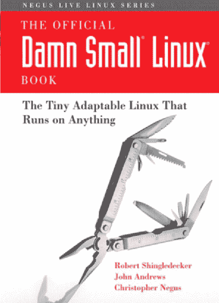

Negus Live Linux 系列中的书籍鼓励并挑战你在免费软件世界中不断进步。启动每本书附带的现场版 DVD 或 CD，见证书中描述的 Linux 系统、应用程序和内容在你眼前栩栩起来。

从初学者开始尝试各种示例，最终成为一名专业人士，精通该系列涵盖的许多主题，从构建 PHP/MySQL 网站到自定义现场版 CD 等。当你完成学习后，你将学会如何自己使用、定制和重新构建这些免费开源软件。

该系列由 Christopher Negus 负责监督，他是畅销书级《Red Hat Linux Bible》系列、《Linux Toys》系列以及本系列标志性著作《Live Linux CDs》的作者。

Robert Shingledecker, John Andrews, Christopher Negus

要领取本书的 45 天 Safari 访问权限：

- 填写注册表
- 输入优惠券代码 `MZMJ-WPZL-2XNB-HYLV-GTMJ`

如果你在 Safari Bookshelf 注册或访问在线版遇到困难，请访问 `www.prenprofessional.com/safarisooksonline.com`。

访问我们的网站 `Web.prenprofessional.com`

Shingledecker, Robert

官方 Small Linux 书籍：运行在 / 上的微型可定制 Linux / Robert Shingledecker, John Andrews, Christopher Negus.

p. cm.

总编辑

Mark L. Taub

采买编辑

Debra Williams Crawley

开发编辑

Songlin Qi

执行编辑

Jane Kamos

项目编辑

San Dee Phillips

Jovana San Nicolas-Shirley

Michael Thurston

文字编辑

Kelli Brooks

Erika Milen

校对

Water Crest Publishing

出版协调员

Dan Ulrich

多媒体开发

Dan Scherfer

室内设计

Jake McFarland

封面设计

Alan Alaments

排版

Jake McFarland

Nonie Ratcliffe

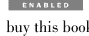

## John Andrews 的献词：

我想将这本书献给 Jennifer、Kelsey 和 Maddie，当我花时间写作时，他们非常忙。

## Robert Shingledecker 的献词：

纪念我的父母。

## Christopher Negus 的献词：

献给我的妻子 Stella。

获取 Damn Small Linux . . . . . . . . . . . . . 32

进入启动提示符 . . . . . . . . . . . . . 33

本页特意留白

# 致谢

我要感谢 Prentice Hall 的所有优秀同仁给了我这个机会。特别感谢 Chris Negus 引导我完成了整个创作过程。站在理查德·斯托尔曼（Richard Stallman）、林斯·托瓦尔斯（Linus Torvalds）、克劳斯·克诺珀（Klaus Knopper）以及许多其他贡献并持续贡献自由开源软件的巨人们肩膀上，表示巨大的感谢。没有他们，这个项目就不会存在。

感谢 John Andrews 创立并分享了他的作品。非常感谢 DSL 用户社区。感谢他们的建议、错误报告、与他人分享知识，以及被称为 MyDSL 仓库的许多应用程序扩展。感谢社区成员 mikshaw、thehatrule、charger01 以及许多其他人，他们在过去的几年里不断帮助我的项目取得成功。

我还想感谢 Joe Rabinsky 阅读了我的初始手稿并提出了改进建议。

> Robert Shingledecker

我非常欠我的妻子 Jennifer Lew-Andrews 的人情，她对我书中写的每一个字都充当了无偿编辑。Robert Shingledecker 在将高级功能整合到 DSL 方面负有很大责任，这使其现在如此受欢迎。

DSL 社区也需要感谢。DSL 中的许多改革和改进直接来自我们丰富的用户在 DSL 论坛上发布的反馈和黑客技巧（hacks）。感谢 Melodie 和 Antonina，她们在背后付出了大量工作，在我们为项目投入精力和金钱时保持 DSL 的运行。最后，向 Chris Negus 表示大大的“感谢”，他非常努力地让这本书成为现实。——John Andrews

我非常欠我的妻子 Jennifer Lew-Andrews 的人情，她对我书中写的每一个字都充当了无偿编辑。Robert Shingledecker 在将高级功能整合到 DSL 方面负有很大责任，这使其现在如此受欢迎。

DSL 社区也需要感谢。DSL 中的许多改革和改进直接来自我们丰富的用户在 DSL 论坛上发布的反馈和黑客技巧。感谢 Melodie 和 Antonina，她们在背后付出了大量工作，在我们为项目投入精力和金钱时保持 DSL 的运行。最后，特别感谢 Prentice Hall 的 Debra Williams Cauley 和 Mark Taub 相信一本关于小型操作系统的书能找到读者。感谢 Songlin Qiu、Jovana San-Shirley 和 Dee Phillips 让这本书得以出版。感谢 Joe Brockmeier 和 Bryan Helvey 的细致编辑。最后，我想感谢 John Andrews 和 Robert Shingledecker 分享他们对我认为目前最精的桌面操作系统的见解。——Christopher Negus

# 关于作者

Robert Shingledecker 的 IT 职业跨越了 35 年，从在 Burroughs 公司编写针对微型机的机器语言程序开始。后来，他喜欢使用汇编语言和 COBOL。一直对计算机充满热情的他是 COMAL 的支持者，也是 Coherent OS 的早期黑客。

在 Linux 项目方面，Robert 在加利福尼亚州花园格罗夫（Garden Grove, California）的 1994 年部署了 Samba。Robert 设计了大规模扩展的 Linux/AOL/Sybase 电子商务系统。随后他成为了几家基于 Linux 的公司的 CTO。

在构建基于 Linux 的免安装光盘设备（包括防火墙、VPN、Web、电子邮件和数据库设备）时，他对 Linux 产生了兴趣。很快，Robert 加入了 John Andrews 的团队帮助领导 Small Linux 开发。

现在退休的 Robert 将时间花在写作和 Small Linux 上。他也喜欢旅行。

John Andrews 是 Small Linux (DSL) 的创始人。1996 年在一家珠宝店，John 学习了 HTML 和 Perl 来开发自己的网站。他后来扩展到在 Linux 服务器上为运行网站。他对 Linux 的兴趣促使他全职转向 Linux 桌面。

对快速高效应用的追求 John 开发了 Small Linux。在尝试了几个发行版（主要用于诊断和系统恢复）后，John 想构建一个包含他完成一天工作所需内容且大小小于 50MB 的发行版；结果就是 Small Linux。John 擅长 Perl、Shell 脚本、Lua、awk、SQL、php 以及一些 C 语言语言。

Christopher Negus 近年来一直是全球领先的 Linux 书籍作家之一。他的《Red Hat Linux Bible》系列全球销量超过二十万册。Chris 还为 Wiley 出版公司编写或合著了《Linux Bible》（2005-2007 版）、《Linux Toys》、《Linux Toys II》以及 Linux Troubleshooting 系列。对于 Prentice Hall，Chris 是 Negus Live Linux 系列的编辑，也是该系列旗舰著作《Live Linux CDs》。

在成为全职作家之前，Chris Negus 在 20 世纪 80 和 90 年代的 AT&T Bell Labs、UNIX System Labs 和 Novell UNIX 操作系统开发团队工作过。特别是，Chris 在 UNIX 系统管理和网络领域工作。

在不写电脑书籍时，Chris 喜欢和家人待在一起：Sheree、Seth 和 Caleb。Chris 还喜欢踢足球、唱歌剧（在没人听的时候），以及用旧电脑制作东西。

# 引言


Damn Small Linux (DSL) 起初是 John Andrews 的一项尝试，旨在将整个桌面计算机系统压缩到 50MB 的镜像文件中。在短短几年内，DSL 发展成为全球最受欢迎的 Linux 系统之一（根据某些统计，甚至位列前十），且其体积从未超过这 50MB 的目标。

在当今桌面系统充斥着视觉哨点和很少用功能的世界里，你可能会好奇，这个“大不起的小系统”为什么会如此受欢迎？嗯，也许是因为人们不想因为最新的 Windows 系统无法运行就丢弃一台还可以用的电脑。也可能是因为人们厌倦了等待常见的电脑操作完成，而背景中却在运行着某些奇其妙的事情。或者，这仅仅是因为对简单与优雅的热爱。

DSL 旨在包含现代桌面计算机系统所需的所有基本功能——并让这些功能变得实用、快速且高效。因此，DSL 可以在比目前大多数桌面系统所要求的更小、更旧或性能更弱的硬件上良好运行。

DSL 开发的一些精彩衍生应用是你可以通过 DSL 实现以下操作：

- 随身携带。它可以放入刻录 CD、USB 闪存盘（也称为 U 盘或优盘）、Zip 驱动器或可以随身携带的启动型名片 CD 中。
- 随处运行。你只需要一台标准的 PC（带有极少内存，且不需要磁盘空间）并对其进行重启。或者，你可以运行一个设置为从 Windows 桌面运行的 DSL 特殊版本。如果你愿意，你甚至可以对 DSL 进行传统的硬盘安装。
- **添加软件**。如果你只需要再加几个应用程序，只需点击几次即可下载、安装并保存你需要的程序。
- **构建项目**。为了将计算机变成音乐服务器、微型 Web 服务器或数字媒体框架，DSL 不会用你不需要的软件填满硬盘或内存，从而为你留出更多空间存放音乐、网页内容或数字图像（有关这些及其他项目，请参阅第四部分“制作 Small Linux 项目”）。
- **安全运行**。通过从 CD（或其他只读介质）运行 DSL，你可以确保安全操作系统只需重启即可。如果你认为有人破坏或入侵了你的系统，只需检查你保存的任何数据是否受感染，重启你的 DSL 刻录 CD，你就可以从干净的副本中安全运行了。

随着项目的发展，DSL 也通过增加一位重要的开发者而不断壮大。当 Robert Shingledecker 加入 Damn Small Linux 开发团队时，他实现了之前提到的 DSL 部分关键功能。Robert 的创新带来了早期将 DSL 安装到 USB 闪存盘以及在运行中的 DSL 系统中添加 MyDSL 扩展的方案。

如今，Damn Small Linux (`www.dammsmall11linux.org`) 拥有一个繁荣的支持者社区、活跃的论坛和邮件列表，以及数十种有趣的使用和自定义方法。本书将为你开启通往 Damn Small Linux 为你所创造的所有可能性的大门。

## 在阅读本书时

为了充分利用本书的三位作者的个人才华，我们将书中按章节划分，每章都最契合我们每个人的专长。在阅读过程中，你会注意到我们经常使用第一人称。因为描述某个功能的人往往就是开发该功能的人，所以使用第一人称似乎是一个很好的选择。

如果你在每个出现“我”的章节中感到好奇这指的是哪位，我们在这里提供了相关信息。

Robert Shingledecker 编写了以下章节：

- “启动 DSL”（第 2 章）
- “配置并保存 DSL 设置”（第 4 章）
- “使用 MyDSL 扩展应用程序”（第 5 章）
- “以其他方式安装 DSL”（第 8 章）
- “添加应用程序并创建可共享扩展”（第 10 章）
- “设置完整的重刻版环境”（第 11 章）

John Andrews 编写了这些章节：

- “使用 DSL 应用程序”（第 3 章）
- “运行原生 U 盘安装版”（第 6 章）
- “在 Windows 中运行嵌入式 DSL”（第 7 章）
- “执行传统的硬盘安装”（第 9 章）
- “在替代硬件上运行 DSL”（第 12 章）
- “在 DSL 中制作 Edna 音乐服务器”（第 13 章）

Christopher Negus 贡献了大部分介绍性材料和附录，以及以下章节：

- “Damn Small Linux 概述”（第 1 章）及本引言
- “在 DSL 中使用 Skype VoIP 服务”（第 14 章）
- “在 DSL 中运行数字媒体框架”（第 15 章）
- “在 DSL 中设置 XAMPP Web 服务器”（第 16 章）

底线是，Robert 和 John 编写的大部分章节讲述了他们为 DSL 开发的功能。Chris 编写的章节则有助于介绍 Robert 和 John 描述的功能，并加入了一些趣味且有趣的项目。

## 本书读者群

如果你想使用、自定义或贡献于世界上最受欢迎的小型操作系统之一——Damn Small Linux，那么这本书就是为你准备的。

你不必计算机专家也能使用 Damn Small Linux。即使是新手，本书也可以帮助你将 DSL 作为随身携带的系统或永久安装的系统来使用。

如果你是计算机专家，可以使用本书学习更高级的技能，例如重刻 DSL。你还可以学习如何封装自己的软件以贡献日益丰富的 DSL 库。

如果你只是一个喜欢折腾电脑的人，本书可以教你如何使用 Small Linux 构建项目。由于基础版 DSL 体积极其紧凑且运行高效，你可以利用更广泛的 PC 硬件（例如旧的、低性能电脑）。

本书的设计旨在让你快速上手并运行 Damn Small Linux。在你掌握 DSL 并了解其工作原理后，我们将迅速向你介绍使用它的许多方法。本书分为四个主要部分和两个附录：

### 第一部分，“使用 Damn Small Linux”
在此部分，你将学习 DSL 是什么以及如何使用它来实现你的需求。第 1 章提供了 DSL 用途的概述。该章节包含一个问答环节，John Andrews 和 Robert Shingledecker 在其中讨论了 DSL 设计决策和项目目标。第 2 章提供了启动 DSL 的提示，包括从启动提示符启动服务和处理硬件问题的方法。

第 3 章提供了 DSL 自带应用程序（图形界面和命令行）的描述。第 4 章介绍了如何自定义 DSL 的外观并在下次重启时保存所有的个人设置和数据。第 5 章展示了如何获取以 MyDSL 扩展形式封装的额外软件添加所需的应用程序。

### 第二部分，“超越 Live CD 的 DSL”
为了不仅仅是从光盘 运行 DSL，本节章节介绍了如何以不同方式和在不同介质上运行 DSL。第 6 章介绍了如何将 DSL 安装在 USB 闪存盘上，以获得一个完全便携且可写的 DSL。

在第 7 章中，你将学习如何虚拟化运行 DSL，以便在 Windows 桌面上使用。第 8 章描述了安装 DSL 到硬盘的替代方法，包括在没有光驱器的情况下设置（使用软磁盘、Zip 驱动器或其他介质）。第 9 章涵盖了更传统的硬盘安装，即所有 DSL 文件都被复制并从硬盘启动。

### 第三部分，“创建扩展与重制”
在本部分，我们将进入 DSL 更具技术性的方面。第 10 章探讨了 DSL 的 MyDSL 功能如何工作，以便将应用程序添加到你的 DSL 系统中，包括创建 MyDSL 扩展的方法。第 11 章描述了重制程序，以便你可以为自己构建自定义的 DSL 版本。

### 第四部分，“制作极其棒的 Linux 项目”
本章涵盖了构建有趣项目的方法。第 12 章描述了 DSL 将运行的不同类型的硬件。在第 13 章中，你将学习如何使用 Edna Music Server 在 DSL 中制作音乐服务器。第 14 章展示了如何设置 DSL 系统作为 VoIP 客户端，通过互联网进行音频通话。在第 15 章中，你将学习基于 DSL 构建数字媒体框架。第 16 章告诉你如何使用 DSL 和 XAMPP 项目设置一个微型、功能全服务器。

### 附录 A，“关于 CD”
本附录提供了随书附 CD 内容的详细信息。该 CD 包含了运行全书中描述的所有过程和构建项目所需的所有组件。

### 附录 B，“使用 MyDSL 扩展”
本附录提供了免费 MyDSL 扩展的描述，你可以下载、安装并存储它们以与你的 DSL 系统一起运行。

你应该配合随书附带的 CD 一起使用。虽然你完全可以在不跟随 CD 的情况下阅读这本书，但如果你手有 DSL，书中提供的描述和指令将最有帮助。

要使用随书附带的 CD，你只需要一台个人电脑。使用 CD 最简单的方法是从你的 PC 启动 CD。然而，如果你的 PC 没有光驱，我们包含了让 DSL 运行在旧版机器上的说明，这些机器可能包含用于启动系统的软驱器或 Zip 驱动器。

你可能有替代介质来存储 DSL 数据。特别是 USB 闪存（也称为优盘或 U盘），作为存储 DSL 设置和 DSL 本身数据的媒介可能特别有用。

书中最后一部分描述的某些项目需要额外的硬件。请查看第 12 章关于运行 DSL 的有趣 PC 硬件。扬声器和麦克风对于第 13 章和第 14 章的音频很有很有。制作数字媒体框架需要一台旧笔记本电脑、一个框架和一些零件。

Damn Small Linux 的格言是 *小即是美*。


# Damn Small Linux (DSL)

`Damn Small Linux` (DSL) 重量约为 `50MB`，是一个功能完备的微型 Live CD 桌面操作系统。尽管体积很小，DSL 几乎可以完成你对现代桌面系统所期待的一切，例如浏览网页、发送和接收电子邮件、编写文档、管理文件、播放音乐、处理电子表格和处理图像。

许多提供类似软件功能的操作系统需要大量昂贵的硬件才能良好运行，并且背负缓慢、臃肿应用程序的负担。`Damn Small Linux` 采取了不同的任务。

与其他计算机系统提供的程序不同，DSL 封装的应用程序是根据其尺寸、速度和高效特性而被选择的。即使在低功耗硬件上，DSL 中的应用程序也快得惊人，强大得令人惊讶。尽管体积很小，对于你需要的桌面操作系统执行的最重要任务，DSL 运行比许多桌面操作系统运行得更快、更高效。

## 关于本书

你手里拿着的书是《`Damn Small Linux` 官方指南》。我们称其为官方版，是因为这本书的作者包括 DSL 的两个关键开发者：`Damn Small Linux` 的创建者 `John Andrews` 和 DSL 许多技术创新的首席开发人员 `Robert Shingledecker`。

虽然这本书将引导你熟悉 DSL 中使用的组件，但它还会带你走更远。你将学习如何从不同设备安装和运行 DSL，在重启时保存数据，以及向 DSL 添加应用程序以满足你的需求。随后，书中将引导你学习如何使用 DSL 构建项目，例如音乐服务器、互联网服务和便携 Web 服务器。

## 流行度

尽管体积很小，`Damn Small Linux` 一直位最受欢迎的 Linux 发行版之列。根据监控 Linux 的各种网站的排名，DSL 一直是最活跃的。根据 Google 的统计，网络上有近 `1,000,000` 次提及 `Damn Small Linux` 的引用。在 `Distrowatch` (`www.distrowatch.com`) 过去的三年里，DSL 的访问量一直位列 Linux 发行版前十，经常与 `Debian`、`Slackware`、`K` 支持 和 `Gentoo` 等知名系统并列。根据监控流行度的 `Alexa` (`www.alexa.com`) 的数据，在 `2007` 年初，DSL (`www.damnsalllinux.org`) 在网络上的排名约为 `33,350`。这个数字让它比 `Ubuntu`、`SuSE`、`Slackware`、`K` 支持、`Morpheus` 等发行版更受欢迎。

## 创举

虽然 `Damn Small Linux` 不是第一个 Live Linux（事实上，它最初基于 `ramdisk`），但它拥有许多创举。DSL 是首个：

- 提供备份和恢复能力。
- 使用下载脚本在运行时添加软件。
- 采用可以从 live 磁盘中使用的可扩展模块。
- 集成安装脚本。
- 使用包含虚拟化的 DSL 特殊嵌入版本几乎在 Windows 上运行。
- 提供可以在 USB 盘上运行的低占用版本。
- 占用极小，优于桌面系统。

## 桌面概览

当你启动 Linux 时，首先看到的是启动屏幕。在大多数情况下，点击几次后，就会出现一个包含以下应用程序的桌面：

- 右上角是系统监控器，用于查看系统资源（CPU、进程、文件系统）。
- 底部面板显示当前日期/时间、最小化应用程序。
- 使用左侧的工具在工作区之间切换。
- 右下角的工具可以调整音频和挂分区。


在左上角的图标中，你可以通过单击启动应用程序。在右上角是关于系统资源的信息（内存、交换分区、磁盘）。

图 `1-1` 显示的管理工具是 `MyDSL` 工具。你可以使用它来下载并安装运行在 DSL 中的应用程序。

尽管图 `1-1` 桌面显示的应用程序是随 `50MB` 启动镜像封装的，但 DSL 的价值并不限于此。如果 DSL 不完全符合你的需求，该项目可以帮你

许多人在 USB 优盘上存有 DSL，以及其他应用程序和数据：

- 演示文稿

你不需要携带笔记本电脑，只需要在一个口香糖大小的 USB 闪盘上携带你需要的一切。

保持基础 DSL 系统的小巧、快速和高效，使其既是一项工具，也是一个极佳的平台。以下是使用 DSL 的最佳理由：

### 旧机器焕新生
DSL 可以在只有 `16MB` 内存和 `486DX` 处理器的电脑上运行。DSL 开发者提供了多种 DSL 版本。

它可以在需要较小启动镜像的旧机器上启动（使用 `Syslinux`）。因此，那些封在衣柜里吃灰的 PC 可以焕发新生，作为一个简单的桌面系统，或者通过添加一些额外的软件，变成防火墙、Web 服务器或音乐播放器 PC。

### 随处可用
`Damn Small Linux` 可以放在一张可启动的信用卡大小 CD 上。因此，随身携带 DSL 占用的空间就像钱包里的信用卡一样小。DSL 的小巧体积也意味着，在存储空间有限的地方（如旧硬盘或手持设备），你可以将所有可用空间用于存放额外的应用程序和个人文件。

### 运行速度快！
由于 DSL 操作系统及其自带的应用程序非常轻量化，并针对效率进行了优化，它们即使在配置有限的硬件上运行得也非常快。如果你至少有 `128MB` 的内存，还可以使用 `DSL toram`，它可以从内存中运行整个 DSL 操作系统。使用 `toram`，应用程序将瞬时启动，且运行速度远乎你的想象。


## 关注核心桌面功能

DSL 专注于重要的桌面功能，而不是所有可能的桌面功能，这让你能够轻松获取所需的功能。在桌面的任何地方右键点击鼠标，即可访问所有的桌面应用程序和系统工具。桌面工具让你能够轻松地查看系统处理情况、切换工作区、挂载存储媒体以及调整音量。

还有其他方法可以配置保存和恢复 DSL、你的应用程序以及数据。例如，你可以将数据保留在闪存盘上，而 DSL 本身从刻录 CD 或硬盘运行。当新版本的 DSL 发布时，你只需启动该版本并与你的数据合并即可。无需繁琐的升级或重新安装程序。

## 安全性

从只读介质运行操作系统可以减少入侵者接管（并实际上完全控制）你电脑的能力。如果你怀疑电脑的安全性已受到破坏，只需对 DSL 进行干净重启即可。操作系统本身会恢复到原始状态，因此你只需要检查已保存的数据是否存在潜在问题。

由于 DSL 主要是作为桌面系统创建的，因此默认情况下没有运行任何入侵者可以利用的网络服务。如果你想开启或添加新的网络服务，可以从 `MyDSL` 添加防火墙软件（参见第 16 章，“在 DSL 中设置 XAMPP Web 服务器”），并基于标准的 Linux `iptables` 设施配置专业级的防火墙。

## 网络和服务器功能

DSL 会自动检测并配置你的网络设置。如果你想连接到网络，DSL 将自动寻找并连接到可用网络。如果你想建立服务器，可以使用 `MyDSL` 中的可用工具（参见第 16 章，“在 DSL 中设置 XAMPP Web 服务器”），并基于标准的 Linux `iptables` 设施配置专业级的防火墙。

## 构建项目

利用 DSL 自带的工具，你可以配置 DSL 从不同的存储设备以多种方式运行。除了默认的（将 DSL 启动镜像刻录到现场 CD）外，通过简单的安装程序，你可以在 USB 闪存盘、硬盘或其他存储媒介安装并运行 DSL。

在你的下次重启时。数据可以存储在磁盘分区、USB 闪存器或 CD 上，取决于你选择的存储方式。

第 4 章包含了备份和恢复你数据的步骤。

DSL 比大多数操作系统（无疑包括大多数现代商用系统）做得更好的一点是，它可以让你重用旧设备。DSL 可以在内存高达 16MB 且使用 486DX 处理器的计算机上运行（详情请见第 2 章）。事实上，由于其体积小且效率高，DSL 实际上在许多某些人可能会丢弃的机器上运行良好。

为了方便这些老旧机器，DSL 开发者创建了特殊的程序，考虑了一些老旧硬件的缺点。例如，你可能遇到一台无法从 CD 光驱启动或根本没有 CD 光驱的机器。因此，你可能需要将 DSL 安装硬盘，然后从软磁盘或硬盘上的引导程序启动。这些技术在第 8 章中介绍。

DSL 的小体积和高效处理不仅让它成为一个整洁的桌面系统。这些属性也使 DSL 成为构建有用项目的绝佳平台。例如，通过仅添加几个软件包，你就可以将那台旧电脑变成实用的 Web 服务器、音乐服务器或互联网电话终端。

在本书的第四部分（第 12 至 16 章）中，你可以找到使用 DSL 作为基础可以构建的项目描述。操作系统和少数额外的软件包不会占用大量空间，有限的磁盘空间可以用于存储运行软件项目所需的音乐、Web 内容或其他数据。

你需要的软件没有相应的 DSL 软件包。同样，你可能会发现并在重制的 DSL 镜像上组合你需要的软件，比事后添加软件包更高效。本书描述了如何处理这两种情况。

在第 11 章“设置完全重制环境”中，介绍了如何获取你需要的软件并创建一个可共享的 DSL 扩展。在第 12 章“在替代硬件上运行 DSL”中，你可以学习如何重制自己的 DSL 镜像，以包含你喜欢的任何应用程序或数据（无需在启动时合并额外的应用程序和数据）。

在继续之前，我们需要精确定义什么是 Damn Small Linux。Damn Small Linux 是一种操作系统，设计用于从现场介质（如卡片大小的可启动 CD）运行，其核心由 Linux 内核控制。它基于另一个名为 KNOPPIX 的 Linux 现场 CD，而后者又是从一个名为 Debian 的 Linux 发行版创建的。

现在，我们需要理清这些。

操作系统是管理计算机硬件与你运行的使用硬件的应用程序之间交互的计算机软件。在专利个人计算领域，你可能最熟悉 Microsoft Windows 和 Mac OS/X 操作系统。在自由开源软件（FOSS）世界中，大多数操作系统的根源都可以溯到 UNIX。

Damn Small 是许多带有 Linux 名称的 FOSS 操作系统之一，因为它包含了被称为内核的 Linux 软件。Linux 内核是操作系统中最关键的部分，因为它提供了最基本的系统服务：进程管理、设备驱动程序框架、文件系统支持和其他关键系统特性。当新硬件、文件类型和其他组件连接到 Linux 系统时，它们可以以所谓的*可加载内核模块*的形式添加到内核中。

尽管最新的内核是 2.6 内核，但 DSL 选择留在 2.4 内核树上。这主要是因为 2.6 要大得多。然而，随着安全漏洞的发现，来自 2.6 内核的修复补丁包含在 DSL 使用的 2.4 内核中。同样的方法也可以添加改进补丁。

同样，与其在基础 DSL 中包含 GNU 工具，许多许多 Linux 工具是通过一个名为 `BusyBox` 的单一紧凑实用工具实现的。（由于 `BusyBox` 不完全符合某些人期望的 GNU 工具，因此有一个名为 `gnu-utils` 的 `MyDSL` 软件包，可以将这些重要的工具引入 DSL 中。）

# 第 1 章 Damn Linux 概述

## 理解现场 CD (Live CDs)

大多数计算机操作系统永久安装在硬盘上。相比之下，现场 CD 的创建通常是为了让你安全地忽略计算机硬盘上安装的任何软件，并且你可以完全从 CD 包含的操作系统中运行。这有一些优点和缺点。

现场 CD 的优势在于可以让你放入一组已软件，并确保下次重启时可以运行该软件。这使得现场 CD 成为演示、便携桌面或救援介质的绝佳介质。你可以将整个计算机系统装在口袋里，并在大多数 PC 上运行它（只要你拥有这些 PC）。

由于 Linux 内核不能让你的计算机做太多，大多数 Linux 发行版都利用了广阔的自由软件。GNU/Linux 是今天最流行的操作系统之一。KNOPPIX 是一个从 Debian 创建的现场 CD 发行版。

Debian 发行版（http://debian.org）拥有数千个为 Debian 编译的软件包。Debian 软件包以 `.deb` 格式存储，并可以使用 `apt-get` 从网络下载安装。

KNOPPIX（www.knoper.net/knopix/index-en.html）是第一个面向桌面的现场 CD。它包含了一个受推崇的硬件检测和配置设施。通过压缩技术，它能够在 700MB 内容纳相当于 1.5G 的软件。KNOPPIX 包含了许多专用工具来配置一些棘手的硬件组件，如网卡、打印机和调制解调器。

如果你没有注意封面，这本书结合了三位作者的经验。John Andrews 创建了 Small Linux。Robert Shingledecker 开发了 DSL 的许多关键创新。Christopher Negus 编写了许多 Linux 书，如《Red Hat Linux Bible》、《Linux Toys》和现场 Linux CD。

因此在这一部分，你可以亲手了解 DSL 是如何产生的。Chris 向 John 和 Robert 提了一些关于他们为什么开发 DSL、它的最大特性以及未来发展方向的关键问题。

John：这是应用程序尺寸不断增大以及典型 Linux 桌面环境趋势的反应。我想看看是否可以构建一个可以压缩到 50MB 的功能性桌面环境。我最初喜欢 Linux 的原因之一是 90 年代后期提供的快速且轻量级的应用程序。当我开发 DSL 时，我喜爱的许多应用程序在我的计算机上似乎都运行得极其缓慢。

本质上，典型的 Linux 桌面就像微软和 Mac 操作系统那样，不断迫使我升级硬件。我曾希望（现在仍然希望）Linux 社区能够实现效率复兴，那里的人们对待代码臃肿的态度就像对待癌症一样。

DSL 也是功能重于形式的证明。我们避免沉溺于视觉盛华。DSL 中的一些核心应用程序在功能上甚至比那些体积更大的后继版本更出色。对于 DSL 的开发者来说，追求的不是最新或最好看，而是功能性和稳定性。

我当时正在寻找一种轻量级的便携环境，可以将其刻在名片 CD 上带走。当时，小于 50MB 的发行版是 Linux-NBC，但它的定位更倾向于救援光盘。我想，是否可以在同样的有限空间内工作，但构建一个专注于拥有功能性桌面的发行版。作为效率的追随者，我以我的桌面系统为模型构建了 DSL，并使用了大多数轻量级应用程序。

这些现场 CD 是自动化的，可以提供客户所需的任何内容。在开发期间，我创建了自己的现场桌面。偶尔，我会查看 Distrowatch，看看是否还有其他人在做桌面方案。我一直觉得桌面的数量远于服务器。当时，Demo Linux 和后来的 KNOPPIX 对于日常使用来说太慢了，不具备实用性。当我发现 John 的 Damn Small Linux 时，我喜欢我看到的一切，并开始探索扩展其功能的方法。


John：DSL 的第一个目标是拥有一个小于 50MB、功能完备且高效的 Linux 发行版，小到可以放入一张名片大小的 CD 中。多年来，随着廉价 U 盘进入市场，名片 CD 变得不再那么重要。然而，我们保持了 50MB 的上限，这迫使我们以不寻常的方式思考并进行创新，而不仅仅是添加应用程序。

在极小包内实现功能最大化的目标是一贯不变的。改变的是应用程序以及扩展技术的发展。

**Robert：** 我确实没有过过路线图。事情是以进化的方式进展的：从添加灵活的备份/恢复系统，到需要一个可写的 `/opt` 目录以添加更多程序。后来，我们创建了自包含的压缩应用程序（最初被称为 self-contained compressed applications）。

DSL 并不是为了追求最新或最好看；它关乎功能性和稳定性。我们希望提供一种可以在几乎任何硬件上运行的工具，即使是那些被认为过时的硬件。

我们的目标是让每个人无论预算如何，都能使用这个发行版。DSL 是为了那些希望在最小硬件上使用功能性桌面的人们，也是为了那些想要学习 Linux 如何工作的人们。它是为了那些想要复活旧机器的爱好者，以及为了那些想要在没有高硬件要求压力下体验 Linux 力量的人们。

社区证明了这一点。我们分享知识、脚本，以及让 DSL 对所有人都更好的热情。这是一项集体努力，而我们才刚刚开始。

没有任何限制，而且你可能想要了解一下 DSL 的工作原理，以发挥它的最大作用。

**Robert**: 所有的决策**并不是**强加给你的。如果你觉得益智玩具或装配包对你没有趣味，那么在你开始时，基础桌面就已经功能完备了。然而，由于扩展 DSL 有许多选择和选项，对于新用户来说，这可能会让他们无从从。但他们很快就会想要探索。

即使是 DSL 用户社区对于 DSL 的单一安装或运行环境也无法达成共识。我们经常会进行类似于“味道很棒！没那么解渴！”之类的论坛辩论。

此外，DSL 是 Linux，因此我们尊重 UNIX 文件权限。有些用户习惯于以超级用户（root）身份运行一切。我们则不然。不要指望每一个新设备都能立即获得支持，考虑到我们在尺寸和开发方面的限制，这是不可能的。通常，在社区资源内就可以找到答案和解决方案。

**John**: 艰难的决定取决于我们的未来。事实是，Linux 应用开发社区中极少数人像我们一样看待 Linux。这让我们陷入了困境。许多精简项目正在被遗弃，并被其他具有海量包依赖的项目所取代。

我们的朋友 GTK1.2 被大多数目前正在开发的项目抛弃了。其他的图形工具包开发速度缓慢，甚至有时停滞多年。那里还有一些希望的光芒，我永远不会放弃对紧凑且功能强大的桌面的追求。我希望像 DSL 这样的项目能鼓励精简应用的开发者继续他们的工作。

在短期内，你可能会看到一个更小和一个更大号的 DSL 兄弟版本，以及对于那些想要基于 DSL 基础设施构建自定义应用程序的人来说，会有更多的框架。

**Robert**: 我希望看到 DSL 更加模块化。为社区提供更多选择。我们的流程不是正式的。它是基于我们自己的兴趣以及 DSL 用户社区表达的兴趣而进化的。而且这对我我和 John 来说也必须是趣味！

Damn Small Linux 拥有一个繁荣、活跃的贡献者和用户社区。尽管 Robert 和 John 指导着核心 50MB DSL 发行版的各项活动，但 MyDSL 扩展的框架为任何人为自己和他人扩展 DSL 功能提供了机会。为了增长知识

DSL 的知识基础，有几种交流渠道可用。当然，也欢迎资金捐助以帮助项目成长。

DSL 项目的交流机会包括论坛、wiki 以及一个关于 DSL 的博客记录。。你可以在这里找到更多关于这些选项的信息：

- **DSL wiki** (www.damnsmallllinux.org/wiki)—DSL wiki 带来了许多其他与 DSL 项目相关的信息。从 wiki 中，你可以找到常见问题的解答、关于安装和启动选项的解答，以及 DSL 用户遇到的常见问题的解答。

- **DSL 博客** (www.damnsmallllinux.org/talk)—在 DSL 博客上，你可以自由地展示与 Damn Small Linux 相关的感悟和个人经验。

由于 DSL 是免费分发的，其开发通过捐赠和从 DSL 商店购买获得资助。通过这些方式之一为 DSL 贡献对进一步开发 Damn Small Linux 有很大帮助。以下是贡献的建议：

- **DSL 捐赠** (www.damnsmallllinux.org/donate.html)—如果你喜欢 DSL 并且付得起贡献，可以每月订阅 1 美元或 2 美元。

- **DSL 商店** (www.damnsmallllinux.org/talk)—在 DSL 商店处，你可以购买各种软件。由于 DSL 是免费分发的，其开发通过捐赠和从 DSL 商店购买获得资助。通过这些方式之一为 DSL 贡献对进一步开发 Damn Small Linux 有很大帮助。以下是贡献的建议：（注：此处对应原文中重复的逻辑，翻译时已按语意保持）。）。此处包含了运行 DSL 的功能。

DSL 本身在 CD 上只占用 50MB 空间。然而，通过几种 DSL 版本以及可用的 MyDSL 扩展，你可以以不同的方式体验 DSL。

随附的 CD 包含了 Small Linux 的最新版本。默认情况下，你将获得你需要的。

- **DSL 启动镜像**——某些旧硬件没有启动光盘，可能需要软盘镜像。几个不同的镜像位于 `/images` 目录下。

- **第 10 章和第 11 章脚本**——脚本分别在第 10 章“添加应用程序和创建可共享扩展”以及第 11 章位于 CD 的 `/chapter10` 和 `/chapter11` 目录下。脚本将帮助你制作自己的 MyDSL 扩展并精通 DSL。

- **MyDSL 包**——有一些深受 DSL 用户喜额外软件包。通过包含这些作为 MyDSL 扩展提供的软件包，CD 可以节省你从互联网下载它们的麻烦。在 CD 根目录下的 `/mydsl` 目录中，你可以找到安装标准 GNU 工具的包（gnu-utils）、ALSA 音频驱动和工具（alsound）以及 OpenOffice.org 办公应用程序（openoffice）。

- **DSL Web 服务器**——在 DSL 中包含 XAMPP 软件，以创建一个即时 Web 服务器，通过互联网共享你的内容（见第 16 章）。

- **DSL 音乐服务器**——使用软件从 DSL 管理、播放并提供你的音乐收藏（见第 13 章“在 DSL 中制作音乐服务器”）。

- **DSL VoIP 服务**——使用 Skype 拨电话（见第 14 章“在 DSL 中使用 VoIP 服务”）。

- **DSL 数字相框**——从 DSL 播放任何收藏的幻灯片（见第 15 章“在 DSL 中运行数字相框”）。

## 总结

## 第二章

## 启动 DSL

无论你使用的是从 DamnSmallLinux.org 购买的可启动启动卡（感谢你的支持）、此书中附带的 CD，还是你下载并刻录的 Damn Small Linux (DSL) 镜像，DSL 的设计都是为了在几乎任何 PC 上轻松启动。在大多数情况下，插入介质后，重启并按下回车键，DSL 桌面（见图 2-1）就会几秒后出现。

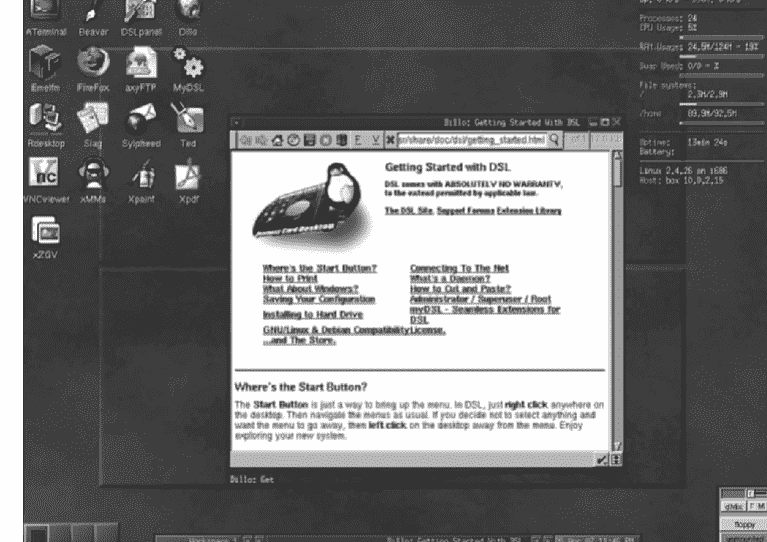

图 2-1 启动 DSL 时会自动出现 DSL 桌面。

## Damn Small Linux way

太棒了！此时你可能会认为：“我已经搞定了，可以进入下一章了。”但如果 DSL 无法启动，或者你对启动过程有某些要求，请不要担心。有许多方法可以从启动提示符处开始提升你对 DSL 的体验。了解 DSL 是如何启动的是一个很好的开始。

### 了解 DSL 如何启动

DSL 的启动能力继承自 KNOPPIX 的硬件自动检测。KNOPPIX 在自动配置各种硬件方面树立了标准，并为基于 CD 的免费系统设定了标杆。

由于 DSL 源自 KNOPPIX，它具有许多启动时选项，以支持许多其他系统配置。因此，无论你想修复损坏的启动过程，还是只需以不同的方式启动 DSL，使用本章描述的启动选项，你可以完成以下操作：

- 更改视频设置。

- 禁用选定的硬件设备。

- 更改桌面窗口管理器或其他桌面设置。

- 选择完全从 RAM 运行 DSL。

- 为 root 和 dsl 用户设置密码。

- 选择支持的语言（默认英语）。

- 启动系统服务以允许远程登录、Web、打印、文件共享、系统日志和其他服务。

- 包含（或不包含）来自不同存储设备的备份文件或 MyDSL 应用程序。

这些项目描述了 DSL 在你的计算机上启动的方式。下一节将描述运行 DSL 所需的计算机硬件。

### 硬件要求

随着普通 PC 性能在过去几年呈指数级增长，你可能可以从衣柜里或二手电脑店花几块钱买到一台旧 PC。由于 DSL 的设计初衷是在旧处理器和低 RAM 环境下快速运行，DSL 可以在许多无法运行 Windows Vista 甚至某些企业级 Linux 系统的 PC 上运行。

让我们先回顾成功启动 DSL 所需硬件。推荐硬件如下：


- `486DX` (推荐 `Pentium I`) `32MB RAM`
- `IDE` 启动 `CD` 驱动器或 `3.5"` 软驱器加上不可启动 `CD` 驱动器
- `SVGA` 兼容显卡
- 支持 `800x600` 像素分辨率的显示器
- 串口鼠标、`PS/2` 鼠标或 `USB` 鼠标

尽管上述硬件是从 `CD` 启动 `DSL` 的最低要求，但如果你只有一个软驱器，实际的最低要求如下：

- `486DX` `16MB RAM`
- `500MB` 硬盘
- `3.5"` 软驱器
- `SVGA VESA` 兼容显卡
- 串口鼠标

由于最小硬件（`486DX`）通常带有软驱器而不是 `CD` 驱动器，因此需要磁盘空间来存放 `DSL`。这种最小硬件配置及其 `DSL` 的安装将在第 8 章“以其他方式安装 `DSL`”中讨论。本章的重点是从 `CD` 或或通过 `CD` 启动，并且至少具备推荐的硬件配置。

> 注意
最新的 `Damn Small Linux` 可以在较新的基于 `Intel` 的 `Mac` 电脑上启动。然而并非所有的硬件（如网卡）都受到支持。理论上，你可以使用 `Apple Bootcamp` (`www.apple.com/macos/bootcamp`) 在这些机器之一上将 `DSL` 安装到硬盘。但该配置并未获得 `DSL` 的官方支持。

### 软件要求–DSL 版本

`Damn Small Linux` 有多个不同的版本。你使用的版本取决于运行 `DSL` 的环境。`DSL` 包含以下四个版本：

- `SYSLINUX` 版本——用于旧旧 `PC`，这些 `PC` 要求启动介质不能大于软盘镜像（即使该镜像在 `CD` 上）。有关关于 `SYSLINUX` 启动加载程序的更多信息，请参阅 `SYSLINUX FAQ` (`http://syslinux.zytor.com/faq.php`)。
- `ISOLINUX` 版本——用于启动光盘，因为不需要特殊的软盘仿真磁盘。有关更多信息，请参阅 `ISOLINUX FAQ` (`http://linux.zytor.com/iso.php`)。
- `Qemu` 虚拟机版本——设置 `Qemu` 在 `Linux` 系统内虚拟化运行 `DSL`。
- `VMware` 虚拟机版本——设置 `VMware` 在 `Windows` 系统内虚拟化运行 `DSL`。

前两个版本涉及从 `CD` 启动，这是本章的主题。另外两个版本将在第 7 章“在 `Windows` 中嵌入运行 `DSL`”中讨论。为什么 `CD` 有两个版本？因为 `DSL` 针对的是较旧和更小型的硬件，许多此类系统只有在存在实际仿真软盘的情况下才能从 `CD` 启动。这种启动的软盘大小被限制在真实软盘的大小。后来的机器设计时没有这种限制。

所以，第一个规则是：如果你的机器无法开始启动过程，或者你的机器是旧款型号，请使用 `SYSLINUX` 版本。

`DSL` 的 `SYSLINUX` 版本在启动时仿真单个软盘。`SYSLINUX` 版本的驱动程序较少，因为它们必须全部放入单个软盘大小的文件中。`Knop` 和其他选择 `ISOLINUX` 的原因是没有软盘大小限制。`ISOLINUX` 版本拥有更多驱动来支持较新的电脑。

## 获取 Damn Small Linux

有几个版本的 `Damn Small Linux` 包含在附带的 `CD` 中。你可以参考附录 `A`“关于 `CD`”来了解这些版本以及如何使用它们。然而，如果你手头没有 `CD` 或有较新版本的 `DSL` 可用，你可以考虑下载 `DSL` 副本制作自己的启动 `CD`。

### 下载 Damn Small Linux

如果你对光 `CD` 概念陌生，第一步是寻找本地 `DSL` 下载镜像。你可以通过检查 `Damn Small Linux` 网站查看最新的下载站点列表：

`http://www.dammsallsux.org/download.html`

以 `Ibiblio` 为例，导航到站点目录：

`ftp://ibiblio.pub/Linux/distributions/dammsux/current`

根据前面的讨论，选择你想要下载的版本。通常情况下你需要的 `ISOLINUX` 版本命名为 `dsl-??`，其中 `??` 被替换为 `DSL` 版本号。

创建启动 `CD` 有许多方法，许多操作系统都可以执行此任务。你需要使用具有“刻录镜像”或“写入磁盘”选项的 `CD` 刻录程序。

许多 `Linux` 系统有 `k3b` 工具和 `cdrecord` 命令来刻录 `CD`。对于 `Windows` 用户，`Nero` 和 `Roxio` 是流行的商业软件。`Windows` 还有 `CD Burn XP Pro` (`http://cdburnerxp.se`) 和 `Infra Recorder` (`http://infarecorder.sourceforge.net`) 应用。

### 进入启动提示符

通过尝试启动 `DSL` 光 `CD`。如果 `SYSLINUX` 或 `ISOLINUX` 版本都无法进入启动界面，这里是你可以尝试的一些方法：

- 确保你的 `CD` 刻录没有失败。如果你下载并刻录了自己的 `CD`，最好以非常低的速度刻录。我建议将刻录速度降低到 `4`。是的，即使你有新的 `52X` 刻录机。
- 某些电脑从 `CD-RW` 启动有困难。最好使用 `CD-R`。
- 如果你有光 `CD`（例如 `KNOPPIX`），尝试从该 `CD` 启动以查看问题是否仅针对 `DSL`。

# 34 官方 Damn Small Linux 教程

如果你的计算机无法从 `CD` 启动，你可以尝试创建一个启动软盘。`DSL` 标准启动软盘镜像 `bootfloppy.img`。你可能想检查是否有本地下载镜像以缩短下载时间。查看 `Damn Small Linux` 网站板块：`www.damnsmalllinux.org/download.html`。

找到要下载的文件。例如，

```
ftp://biblio.pub/Linux/distributions/damnsmalllinux/current/
bootfloppy.img
```

将此镜像写入一个已知的软盘。不要使用旧软盘，因为它们在发生读取错误时可能会引起麻烦。使用典型的工具创建启动软盘。通常意味着在 `Windows` 下使用 `rewrite`，或者在 `Unix/Linux` 类型系统下使用 `rewrite`。

例如，如果你的 `Unix/Linux` 系统的第一个软盘设备位于 `/dev/fd0`，且 `bootfloppy.img` 位于当前目录，你可以使用以下命令 `dd` 将镜像写入插入的软盘：

```
## dd if=bootfloppy.img of=/dev/fd0 bs=16k
```

取决于你正在使用的版本，将 `bootfloppy.img` 文件写入 `DOS` 提示符（将启动镜像位于 `C` 盘根目录；并在 `C:\windows\command` 目录下运行 `rewrite`）的过程应与以下类似：

```
C:\ cd \windows\command
C:\windows\command> rewrite
Enter disk image source file name: C:\bootfloppy.img
Enter target diskette drive: A:
Please insert a formatted diskette into drive
A and press -ENTER-<Enter>
```

`Windows` 的 `rewrite` 程序可以在此站点找到：

```
http://www.chrysocome.net/rewrite
```

创建软盘后，务必更改计算机的 `BIOS`，使软盘成为第一个启动设备。将新创建的软盘插入驱动器并开启或重启系统。如果你使用了良好的软盘且没有发生读取错误，将看到 `DSL` 启动界面。

希望你已经到达了 `DSL` 启动界面（见图 `2-2`）。如果你到达这里，需要启动软盘，或者下载并创建 `SYLINUX` 版本，只需在 `DSL` 启动提示符处按回车即可。

看到 `DSL` 启动界面后，你可以在提示符处输入许多选项来引导启动过程的方向。以下章节描述了 `DSL` 启动过程以及如何修改它。

# 第 2 章 启动 DSL

图 `2-2`

`DSL` 启动界面允许你向启动过程添加选项。

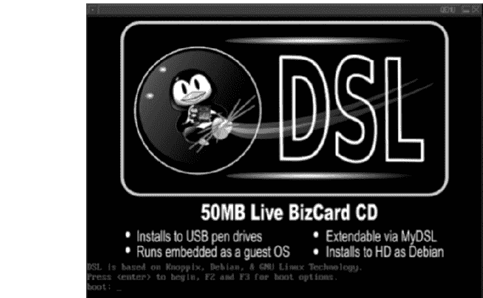

## 理解 DSL 的启动阶段

启动 `DSL` 有三个阶段。第一阶段是到达启动提示符。启动提示符允许输入额外的启动选项。第二阶段是 `DSL` 的自动配置和环境初始化。此阶段处理启动时选项并设置 `DSL` 的运行环境。第三阶段有时需要（有时是要求）执行无法通过自动配置提供的额外设置——例如，串口、双键或 `USB` 鼠标、非美式键盘，或非默认的 `1024x768` 屏幕分辨率。

如果你的计算机引导了 `DSL CD` 启动，你应该看到一个与图 `2-2` 类似的启动界面。

让我们深入研究 `DSL` 的启动过程。

> 注意
本章仅涵盖与从现场 `CD` 启动的标准任务相关的启动过程。更高级、更详细的讨论请见第 `11` 章“设置完全重制环境”。

### 第一启动阶段：选择启动选项

启动提示符允许你自定义 `DSL` 的启动过程。例如，你可以在启动时指定完全加载到 `RAM` 中、指定你的备份文件位置，甚至指定额外应用程序的存储位置。要到达启动提示符，你可以使用 `CD`、软盘或 `U` 盘。理解这一阶段的价值在于你可以理解用于更改 `DSL` 启动方式的选项。

> 注意


U 盘的细节将在第 6 章“运行原生 盘安装”中讨论。

### 如何进入启动提示符

要到达启动提示符，请遵循以下步骤：

1. **计算机开启或关闭启动：**
    * 计算机开启——如果计算机已开启，插入 DSL CD。如果你恰好正在运行 Windows 且 CD 驱动设置为自动运行，则会出现关于 DSL 的信息。
    * 计算机关闭——如果计算机关闭，开启它并立即插入 DSL CD。在某些计算机上，开机后立即按下 Pause/Break 键会暂停启动，留出时间插入 CD。某些计算机有特定的键位进入 BIOS 设置；你可能还想按键进入 BIOS 以留出时间插入 CD。

2. **出现启动界面**——大多数较新的计算机会自动检查可引导 CD。DSL 启动界面（见图 2-2）应该出现。如果不能……你会得到一个只有三行文本的启动提示符。

3. **启动 DSL**——在启动提示符处按回车接受所有设置。如果 60 秒内没有任何操作，DSL 将自动启动。你看到图 2-1所示的 DSL 桌面了吗？如果没有，下一步是尝试后续章节描述的启动选项。

# 第 2 章 启动 DSL

### 启动界面的帮助

当显示 DSL 启动界面时，你应该熟悉左下角的启动提示符。你可以按回车、等待几秒，或按 F2 或 F3 查看帮助。帮助界面是启动提示符的摘要。按 F2 或其他任何键取消计时，使 DSL 不自动启动；图 2-3 显示了在启动提示符处按 F2 出现的界面。

```
dsl fb1280x1024 : fb1024x768 : fb800x600
vga=normal
sl desktop
sl noicons
sl md=(hd1)
sl skip
sl restore=(hd1)
sl toram
sl to=vgahd1
Start various at boot
sl lang (ca cs ...) : Choose/Keyboard
sl outill : Disable disk-detection
sl dma
sl failsafe
expert
boot:
Framebuffer mode (for notebooks)
Safe video mode (F3 for more)
Prompt user (for X setup)
If booting to X use desktop (default to corrupt)
Copy only the last image
Turn off automatic restore
Select boot location
Copy to HD partition and run (20 MB)
Turn on DMA accel. for all drives
BIOS: Test mode
Interactive startup/setup
```

图 2-3 按 F2 查看语言、视频、恢复和其他功能的启动选项。

图 2-4 显示了在启动提示符处按 F3 出现的界面。

从启动选项可以看出，有很多选项可以尝试。然而，大多数选项是为了解决少数问题或提供增强型的方法（例如完全从 RAM 运行）。事实是对于大多数用户来说，DSL 不需要额外选项即可启动，因此他们可以在本章的第一段后停止阅读。

有些机器需要额外的启动选项。通常困难的机器在 VGA 能力、电源管理方面存在问题，PNP 特殊启动选项可以帮助。其他启动选项可开启特殊功能（例如添加密码或启动服务）。这些选项中的将在其他章节中讨论，并在本章后面的“高级启动选项”部分经常讨论。

# 38 官方 Damn Linux 教程

DSL 接受以下启动时 `vga` 选项：

| 颜色 | 640x480 | 800x600 | 1024x768 | 1280x1024 |
|---|---|---|---|---|
| 256 | 8 bit | 771 | 773 | 775 |
| 3200 | 15 bit | 784 | 787 | 793 |
| 6500 | 16 bit | 788 | 791 | 794 |
| 16.7M | 24 bit | 789 | 792 | 795 |

*来自表格*

```
dsl vga=7xx
dsl prompt
dsl script
dsl halt=xxx
dsl minimal
dsl desktop(fluxbox)
dsl web
dsl legacy
dsl dumpfile(hda1)
dsl leafs
lowram
install
Prompt for root and dsl passwords
Password encrypted backup
Set hostname=xxx
Starts with Minimal theme
Starts with flux or Joe's WM
Waits for USB devices
Boots without union
Scans and Specify dumpfile
Feats commented filesystem
Starts X Minimal, noicons, mouse, noideraid, etc.
No X, CLI installation for hard drive, floppy.
```

**图 2-4** 按键查看用于设置、选择桌面或其他启动时功能的启动选项。

### 尝试不同的启动选项

让我们卷起袖子，尝试一些常见的启动选项并讨论一些解决方案。在启动提示符处，让我们尝试几个基础选项。

+ **视频启动选项——默认情况下，DSL 进入高分辨率 `vga=791` 模式。这对于你的计算机视频来说可能分辨率太高。使用启动选项 `vga=normal` 可能会帮助。**

```
dsl vga=normal
```

许多旧笔记本电脑需要帧缓冲视频而不是 Xvesa。启动时，你可能想尝试：

```
boot: fb800x600
```

注意我没有将单词 `dsl` 作为第一个选项。取决于你的笔记本电脑，它可能是 `fb1024x786`。如果你收到关于 `fbdev` 的错误，使用帧缓冲可能没有帮助。

注意 F3 界面上的 `vga` 分辨率表（见图 2-4）。可以使用 `vga=` 选项选择任何一个值。

正如我指出的，可能需要组合选项。尝试这种常见的选项选择：

```
boot: dsl vga=normal noapic noacpi npbios=off acpi=off noapm
```

成功了？太棒了。现在，你应该再次尝试，但这次逐个撤回之前的选项，直到你拥有了启动所需的精确选项集。我们称此为为你的特定机器微调选项。另一方面，你可能仍然面临问题，尚无法进入 DSL 系统。

- failsafe 启动选项（安全模式启动）——一组强大的预设选项组合被称为 `failsafe`。
  尝试这个：
  **failsafe**

如果 `failsafe` 对你有效，你该如何微调你的选项呢？你始终可以在命令行或 X Windows 中查看你的启动选项。输入 `showbootoptions`；或者从 DSL 命令、shell 窗口、DSL 桌面面的 System Stats（系统统计）、Boot Tab（启动选项卡）查看。然后，你可以尝试通过消除 `failsafe` 显示的每个启动选项来尝试启动。你需要这样做，是因为其中某些选项会阻止声音以及你之后将使用并享受的其他功能。

- lowram 启动选项（低内存启动）——对于内存为 64MB 或更小的机器，你可能想要考虑另一种预设选项组合'*lowram* 的用法与 `failsafe` 类似，但针对低内存系统进行了优化。同样，你可能希望使用启动代码或 System Boot 选项卡来查看预设选项，并根据你的特定需求开始微调。

- toram 启动选项（全内存启动）——对于内存丰富的机器，你可能想要尝试 `toram` 启动选项。将此选项添加到你的其他选项列表中会将 DSL 完全加载到内存中。这将提供一个极快的系统，因为不需要再次访问 CD。在确定你的机器所需的启动选项并至少拥有 128MB 内存之前，你不应该尝试这样做。

### 第二阶段启动：自动配置

DSL 的第二阶段是自动配置和环境初始化。该阶段在第一阶段启动提示按下 Enter 键后立即开始。我们输入的所有启动选项都会被处理，以确定尝试哪些自动配置。通常，此过程在无需干预的情况下运行。图 2-5 显示了典型的自动配置过程。

成功完成后，该阶段通常通过初始化 X Window 系统结束。X Window 系统用于托管图形 DSL 桌面。当然，使用启动时间选项 2 (`ds1 2`) 会防止 X 启动，并在 root 用户的 shell 提示符终止启动过程。

40 《官方 Damn Linux 籍》

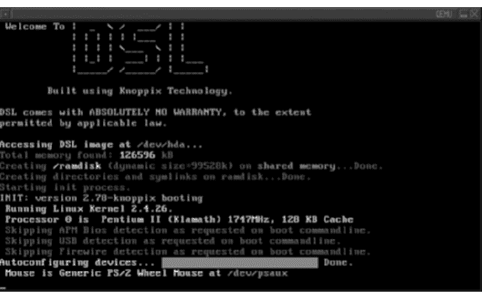

图 2-5 DSL 第二阶段启动。

希望你已经取得了成功。有些人可能已经看到了 DSL 桌面并准备好进行探索。有些人对到达运行级别 2 的系统提示符感到很满意。对于另一些人，还需要第三阶段启动。

> 注意


> 如前所述，对于那些拥有串口、双键 USB 鼠标、外语键盘等设备的用户，可能需要 DSL 的第三阶段启动。你可以使用启动时间选项 `setup` 来强制 DSL 进入第三阶段启动。

对于那些无法继续进行的人，你可能拥有非常冷门的硬件，也许因为太新或太旧而无法支持。然而，凭借互联网和 Damn Small Linux 论坛（访问 `www.damsmalllinux.org/cgi-bin/forums/ikonboard.cgi`），仍然会有帮助和希望。

许多用户都过论坛，集体知识是巨大的。通过发布帮助请求并提供尽可能多关于你系统的细节。谁知道呢？也许其他人和你拥有相同的系统，并且有现成的答案。记住，没有什么问题是愚蠢到不能问的。我们都必须从某处开始。

### 第三阶段启动：设置 X

此阶段有时是必要的。它可能是指定视频启动选项的结果。也可以在使用 `xsetup` 启动选项时调用。但通常情况下，用户永远看不到 DSL 的第三阶段启动。

第一个屏幕（见图 2-6）允许选择要使用的 X 服务器类型。通常，如果你选择了 `fb800x600` 或类似的帧缓冲启动选项，选择是非常一而易见的。

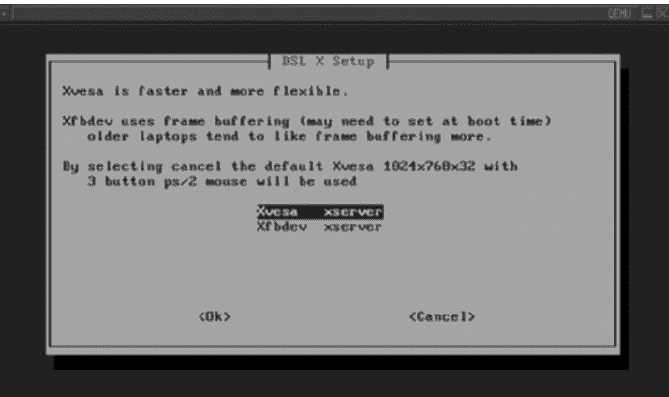

图 2-6 第一个 DSL X 设置屏幕。

尽管显示了此屏幕，你仍然可以选择退出。要这样操作，只需按 `Enter`。如果选择了 `OK`，将呈现接随的屏幕。图 2-7 用于鼠标。图 2-8 用于鼠标。图 2-9 用于鼠标。图 2-10 用于鼠标。图 2-11 用于鼠标。图 2-12 用于鼠标。

《官方 Damn Linux 籍》

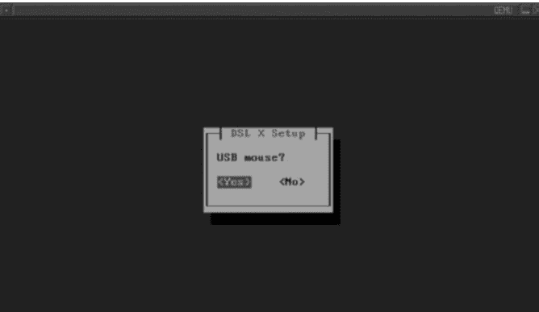

图 2-7 DSL 设置。

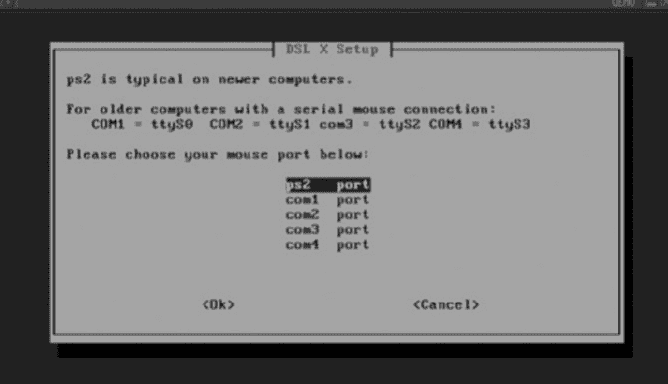

图 2-8 DSL 设置。

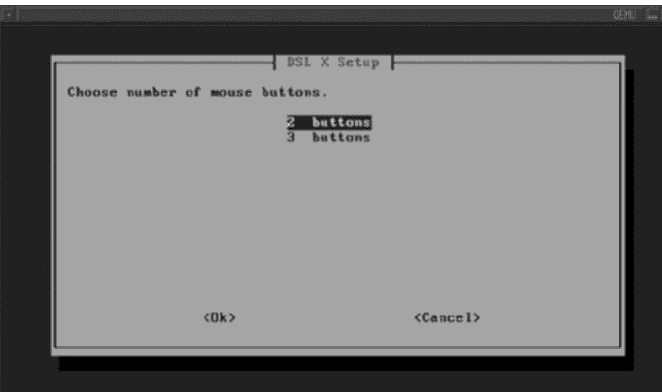

图 2-9 DSL 设置。

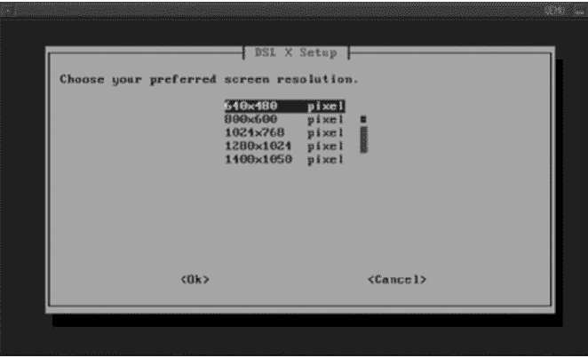

图 2-10 DSL 设置。

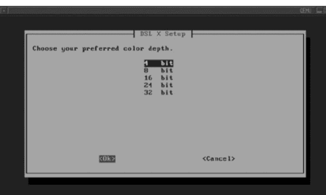

图 2-11 DSL 设置。

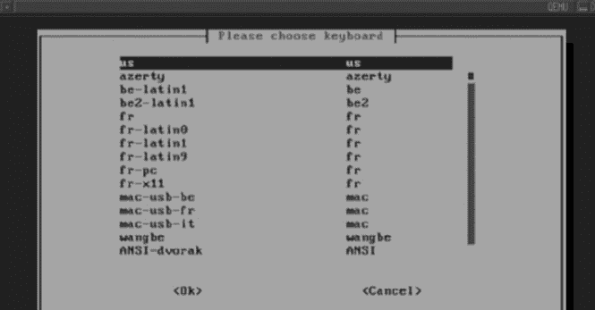

图 2-12 DSL 设置。

# 摘要

成功启动 DSL 就像插入 CD 并按下回车键一样简单。对于大多数用户来说，这就是他们的真实体验。鉴于规则总有例外，本章尝试引导你完成 DSL 启动的所有三个阶段。在每个阶段，你都会看到基于许多向 Damn Small Linux 论坛提问并提供硬件细节用户的真实反馈而总结的常见示例。希望分享这些阶段能让启动 DSL 成为一种愉快的体验。

# 第 3 章

# 使用 DSL 应用

Damn Small Linux 旨在以非常小的体积提供一个功能完备的桌面。DSL 中的原生应用是根据其紧凑性、使用速度和功能的平衡而选择的。

DSL 开发者和用户社区花费了三个多的时间来精炼对 DSL 应用的选择，我们对整个软件包的质量充满信心。在过去的几年里，随着我们努力寻找适合我们小型软件包的特性组合，已经发生了几次变化。

## 我们选择背后的逻辑

在选择 DSL 应用时，三个主要问题是可靠性、库依赖性和易用性。在此过程中，我们更改了媒体播放器、电子表格程序、浏览器、文字处理器、计算器、文本编辑器以及我们桌面 GUI 基础的挂钩语言。

`GTK+` 是用于创建图形用户界面的工具包。`GTK+` 最初是为 Gimp 图像编辑程序开发的。经验丰富的 Linux 用户可能会注意到 DSL 中没有 `GTK2` 应用，并疑惑为什么。我们的许多应用程序实际上基于较旧的 `GTK1.2` 工具包。原因有两个，`GTK1.2` 应用倾向于：

- 更小。它们占用的空间更少，依赖也少。
- 更快。速度在 DSL 计算哲学中非常重要。

# Damn Small Linux 官方书籍

在我们开始之前，重要的是，本章关注的是 DSL 内部的应用程序，而不是通过 `MyDSL` 扩展系统提供的应用程序。（关于 `MyDSL` 扩展的描述，请参见第 5 章“使用 MyDSL 扩展应用程序”）。

## FLUXBOX 窗口管理器

最初，Fluxbox 看起来非常简单：没有开始按钮，人们经常发现自己抓着头，不知道菜单在哪里。然而，你很快就会发现，起初看起来令人困惑的东西其实是一种幸运。

在尖叫“这个该死的 Small Linux 太困惑了——我要回到 Windows”之前，抓起你的鼠标并点击右键。你会发现，砰！这就是你的菜单吗？注意到它加载有多快了吗？毫无犹豫，它闪烁一下弹了出来。这就是 Fluxbox 菜单。

要导航 Fluxbox 菜单，垂直滚动鼠标。随着鼠标移动，你会看到子菜单弹出，当你将鼠标悬过子菜单时，有时会打开额外的菜单。当菜单滚动过某个应用时，选中的应用程序会被高亮。要选择菜单，按一下鼠标左键，单单击即可打开应用程序。这就是菜单的操作方式。

你很快就会体会 Fluxbox 菜单的速度和效率。与传统的任务栏导航不同，你不需要将鼠标指针一直移动到屏幕左下角并点击小按钮显示菜单。鼠标只需点击一下即可显示菜单。

Fluxbox 提供的不仅仅是菜单导航的便利。通过一点研究，你会发现这个看似简单的环境实际上可以让你在计算机上工作得更快。

## 导航虚拟桌面

Fluxbox 的另一个大亮点是它支持虚拟工作环境——默认有四个虚拟桌面。在虚拟工作空间之间导航有几种方法。如果你有一个带滚轮的鼠标，从一个空间移动到另一个简单的方法是向上或向下滚动滚轮。

起初，你可能没有注意到虚拟工作空间正在变化。如果当前没有运行的应用程序，唯一的变化是屏幕底部窄任务栏上的工作空间编号。此外，Pager（左下角那个小矩形物体）上的方块也会移动以指示变化。

# 第 3 章 使用 DSL 应用

Pager 实际上非常方便，我们稍后会回到这里。对于没有鼠标滚轮的用户，可以通过点击屏幕底部任务栏左侧的小箭头从一个工作环境切换到另一个（见图 3-1）。

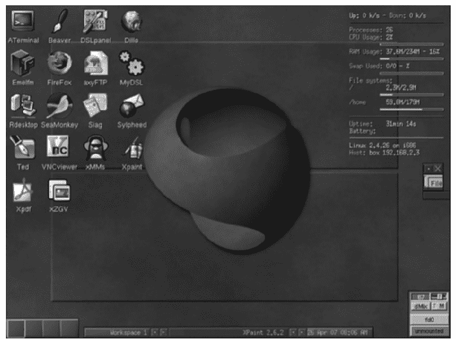

图 3-1 Damn Small Linux 桌面。

如果你还没有打开任何应用程序，现在应该打开一个。让我们尝试打开 `Aterm` 窗口。在屏幕左上角找到带有 `Aterm` 的图标；点击它一次。一个 `Aterm` 终端模拟器出现了，准备好使用 shell 命令解释器。虽然终端模拟器与微软操作系统的 DOS 窗口可比拟，但可以说它更强大。

你打开的窗口看起来像一个透明矩形，左上角有 `ds1@box:~`。正如你所见，`Aterm` 准备好接收指令了。然而，我们暂时不会给它任何指令！我们打开这个 窗口（term 是终端模拟器的缩写）是为了演示跳转到另一个工作空间的另一种方法。如果你想将应用程序推送到不那么拥挤的工作空间，这可能会有用。

# Damn Small Linux 官方书籍

在 `Aterm` 终端的顶部，你应该注意到一个写着 `Bash` 的栏——一端是一个点 (.)，另一端是一个下划线、一个方块和一个大 X。现在，忽略它，将你的鼠标指针放在“`Bash`”所在的地方。

有几种方法可以将此 `Aterm` 窗口移动到不同的工作空间。一种方法是右键点击该栏。这样做会打开一个包含几个条目的菜单。现在，看第一个，写着“`Send To`”。将鼠标指针移到上面；`Send To` 菜单会被高亮，并打开 `Workspace 1` 子菜单。如果你选择这些选项之一，`Aterm` 窗口将移动到另一个工作空间。

或者，你可以在同一条栏上按住鼠标左键，得到的不是下拉菜单，而是一个多方向符号，这表示你现在可以随心所欲地移动这个 `Aterm` 窗口。这包括通过将 `Aterm` 窗口移动到屏幕左侧或右侧将其拖到不同的虚拟工作空间。试一下！如果你不习惯虚拟工作空间，这对你来说可能很陌生。当你多任务处理时，它们非常有用，最终你可能会依赖它们。

## Fluxbox Pager

如之前提到的左下角的应用程序是 Pager；具体来说，它被称为 `Fluxter`，一个专门配合 Fluxbox 使用的轻量级 pager。可以通过根据喜好编辑 `/home/dsl/fluxbox/fluxter.bb` 文件来配置 `Fluxter`。默认设置提供了良好的功能性平衡。`Fluxter` 会智能地监控 Fluxbox 使用的主题并改变其外观以匹配主题。

## 如何使用 Fluxter

`Fluxter` 非常简单。了解它是如何工作的，打开几个应用程序。当它们出现在桌面上时，注意它们在 pager 中对应的形状。见图 3-2。现在，拿起你的鼠标并左点击其中一个形状，按住鼠标键并移动形状。`Fluxter` 中与形状对应的应用程序在桌面上也会随之移动。如果你将形状拖到 `Fluxter` 中的另一个立方体，相应的应用程序将移动到该虚拟工作空间。

> 图 3-2 Fluxter：正方形阴影代表应用程序。


Fluxter 也可以用于切换虚拟桌面。要这样做，只需点击你想去的虚拟桌面上的鼠标中键即可。

# 第 3 章 使用 DSL 应用

> 注意

在双键鼠标上，通过同时按下左键和右键可以模拟中键点击。但是，请注意，你必须配置你的 X 设置（`/usr/sbin/xset.sh`），使其默认认为你有一只双键鼠标。要更改默认设置，请运行 `xset setup` 脚本。运行 X 设置脚本后，重启 X 服务器时将激活三键仿真。

## Fluxbox 的功能

在每个应用程序窗口的顶部，你应该能看到四个按钮。在左侧，你可以看到一个只有一个点（；）的按钮；按下该按钮会使应用程序粘滞在屏幕上，这意味着它将出现在所有的虚拟工作空间中。你可以看到应用程序突然出现在 Fluxter 分页器（pager）的所有立方体中。注意观察，该点在被按下时尺寸会增大。松开按钮后，应用程序将恢复正常的虚拟桌面功能。

右侧的按钮要熟悉得多。带有下划线图标的按钮意味着将应用程序从桌面空间拉入任务栏。你可以在任务栏中点击它来恢复应用程序。右侧中间带有方框图标的按钮用于最大化和收起应用程序。最后，大大的 X 用于关闭应用程序。

在顶部窗口装饰上双击左鼠标键会使应用程序拉起标题栏。Fluxbox 将此功能称为 `shade`。

调整应用程序大小非常简单；只需将鼠标指针移到应用程序的任一下角，然后按住左鼠标键。你会发现鼠标指针被一个直角图形取代了。在按住鼠标键的同时，移动鼠标，你可以看到应用程序正在改变形状。点击鼠标，应用程序将保持新的形状。

## 使用标签分组应用程序

Fluxbox 区别于其他窗口管理器的之一是支持标签化应用程序的能力。这种强大的适配使得工作环境变得非常高效且极具工作效率。正因为这种能力，Fluxbox 使用起来是种享受，即使在 800x600 这种低分辨率下也是如此。

图 3-3 显示了一个当前显示终端的多窗口示例。（`Bash` 表示在终端终端内运行的 shell。）

# 官方版 Damn Small Linux 之书

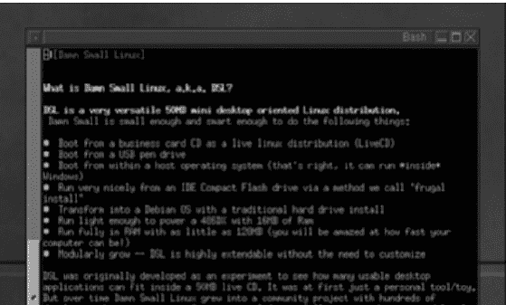

什么是一个非常多功能、仅 50MB 的面向桌面的 Linux 发行版？

Damn Small 足够小且足够智能，可以实现以下：

- 从名片 CD 作为现场 Linux 发行版（LiveCD）运行
- 从旧 CD 运行
- 在主机操作系统内部运行（没错，它可以在“内部”运行）
- 通过我们称之为“碎片化安装”（fragual install）的方法，几乎可以从 IDE Compact Flash 驱动器运行
- 转换为带有传统硬盘的 Debian 系统
- 完全在 RAM 中运行，仅需 128MB 内存（你会惊讶于你的电脑运行有多快）
- 模块化增长——高度可扩展且无需定制

DSL 最初是作为一个实验开发的，旨在观察在 DSL 上可以运行多少不稳定的桌面环境。但随着时间的推移，Damn Small Linux 成长了一个拥有数百名贡献者的社区项目。它现在是一个非常非常稳定且多功能的 Linux 备份和恢复本地安装系统，可以从任何可写介质（包括硬盘、软盘驱动或 USB 设备）启动。

DSL 拥有近乎完整的桌面，每一个命令行工具、所有应用程序都以最佳的功能、尺寸和速度显示，Damn Small 还可以让你

**图 3-3** Fluxbox 使用标签将多个窗口保持在单个窗口框内。

要使用标签，你需要一个三键鼠标，或者一个带有三键仿真的双键鼠标。你会发现所有标签化应用程序在窗口边缘的左下角都有一个小标签。

在第一次尝试标签时，让我们启动两个应用程序。为了这次演示，我们将使用对比度明显的应用程序：`Atom` 和 `Dillo`。点击 `Atom` 图标（左上角图标）和 `Dillo` 图标（右上角图标）分别打开它们。现在，拿起鼠标指针并悬停在 `Atom` 标签上（显示为 `Bash`）。点击并按住鼠标中键。

现在，在按住中键的同时，移动鼠标使其进入第二个窗口。你会看到一个小矩形随着鼠标移动。将该矩形拖到 `Dillo` 的中间并松开中键。现在你看到 `Atom` 占据了 `Dillo` 的形状和位置。`Dillo` 和 `Atom` 共享同一个空间和窗口层级。

你注意到在窗口装饰的左下角现在有两个标签了吗？你可以通过左键点击相应的标签来切换显示的应用程序。如果你使用的是滚轮鼠标，可以将鼠标移到顶部窗口装饰上并上下滚动滚轮来切换应用程序。激活的应用程序将以粗字体显示。

## 标签化应用程序调整大小与移动

当你调整一个标签化应用程序大同时，所有应用程序都会随之调整大小。此外，数量没有限制。我确定，如果你正尝试处理一个同时使用许多工具的项目，这种应用程序分组方式将非常有用。

我经常使用标签，特别是在我要使用小尺寸或低分辨率的显示器时。与其在小窗口中打开几个应用程序，我选择将应用程序堆叠在一起并将它们最大化，使其处于全屏模式。我发现这种方式操作应用程序要高效得多，特别是当我有滚轮鼠标时。

同样的方法可以将分组的应用程序移动到其他虚拟桌面。我确信，如果你正尝试处理一个同时使用许多工具的项目，这种应用程序分组方式将非常有用。

[第74页]

# 官方版 Damn Small 书

图 3-4 显示了 Docked.lua 工具的示例。

**图 3-4** 为 Docked.lua 工具更改音频设置并挂载/卸载驱动器。

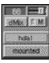

驱动名称具有逻辑顺序，你只需要了解标记规则：

- `hda` 是第一个 IDE 硬盘（主设备）。
- `hdb` 是第二个 IDE 硬盘（从属设备）。
- `sda` 是第一个 SCSI 或 USB 设备。
- `sdb` 是第二个 SCSI 或 USB 设备。

对于分区，习惯是在硬盘末尾加上数字：

- `hda1` 是第一个 IDE 硬盘的第一个分区。
- `hdb5` 是第二个 IDE 硬盘的第五个分区。
- `sda2` 是第一个 SCSI 或 USB设备的第二个分区。

通常 `hda1` 对应 Windows 中的 C 盘。`hdb1` 可能是 Windows 中的 D 盘，但 Windows 的命名法有些难以捉。

## 使用 JVM 窗口管理器

Damn Small Linux 还配备了另一个窗口管理器，称为 JVM——实际上，Damn Small Linux 中的 JVM 版本经过了精简，并移除了一些功能。对于来自 Microsoft Windows 环境的人来说，JVM 看起来更熟悉。JVM 拥有任务栏和开始按钮。如果你觉得 Fluxbox 宽阔的世界太令人压力，可以尝试一下 JVM。同样值得注意的是，JVM 资源利用非常高效，所以如果你的电脑配置较低，你可能想尝试 JVM。要尝试 JVM，点击 Fluxbox 菜单中“WindowManager”子菜单下的“Switch to JVM”。

Ace of Penguins 是一套单机游戏，包括 FreeCell、Golf、Mastermind、Merlin、Minesweeper、Pegged、Solitaire、Taipedit、Taipei 和 Thornq。我玩这些游戏太多了。如果你想保持高效工作，我建议远离它们。

# 官方 Damn Linux 籍

## AxY FTP：适用于 X 的 GUI FTP 客户端

由 Alexander Yukhtim 编写，我们在 DSL 中运行的 AxY FTP 版本是 GTK1.2 移植版。对于许多人来说，AxY FTP 的界面应该非常熟悉，因为它基于 20 世纪90 年经典的双面板设计——ws_ftp（一个 Microsoft Windows 程序）。AxY FTP 有方便的会话管理器，可以保存你的账户和密码。它还支持递归下载、递归上传以及被动和非被动数据传输。

## Beaver—我们的 GUI 文本编辑器

Beaver 最初由 Damien Terrier 开发。它的名字实际上是 Beaver is an Early Advanced Editor（早期高级编辑器）的缩写，这玩了 UNIX 中关于自递归命名的趣味梗。在 DSL 中，它仅仅是同尺寸范围内功能最丰富的编辑器。它包含的功能比尺寸是其两倍的浏览器还要多得多。

Beaver 非常易用；它有多个标签页，并且可以在多个缓冲区进行搜索和恢复。程序员发现最优色彩高亮非常护眼。普通桌面用户熟悉剪切和粘贴的典型键绑定。

Beaver 的另一个关键功能是能够撤销和重做操作。对于程序员来说，Beaver 开启自动换行的功能是必须的。Beaver 一些不为人知的功能包括在 DOS 格式进出转换文本的能力。如果你在平台之间共享文件，这非常有用。Beaver 还能将文本大小转换为大写、小写或首大写（每个单词的首字母大写）。DSL 中的 Beaver 版本为 0.2.7，并已更新了错误修复。

有关 Beaver 的信息，您可以访问以下地址访问项目网站：http://www.nongnu.org/beaver。

## Calco—一个 RPN 和代数计算器


这个基于 GTK1.2 的计算器功能完备，但仅占 108KB。您可以在项目网站 `http://calco.sourceforge.net` 获取更多关于 Calco 的信息。

# 第 3 章 使用 DSL 应用

## Dillo—一个轻量级网络浏览器

Dillo 是由 Jorge A. Arellano Cid 设计的替代轻量级浏览器，专为嵌入式或其他受限系统设计。这种浏览器对于 DSL 来说是自然选择。

多年来，Dillo 的开发非常有条理，项目作者非常仔细地编写整洁的代码。这意味着 Dillo 有一个非常坚实的基础，但缺乏功能完备现代浏览器的功能。

尽管 Dillo 功能有限，我们在 DSL 中的版本版本经过了深度修改，并带有多个补丁，极大增强了它的能力。我们的 Dillo 版本可以执行以下操作：

- 协商 SSL 页面和密码验证
- 渲染 frames 和 Iframes
- 文本搜索
- 执行 GUI 配置
- 支持 user-agent 配置
- 执行 gzip 压缩
- 执行 meta-refresh

Dillo 的用户会对其加载速度和页面渲染之快感到惊讶。

有关 Dillo 的更多信息，请参考 `www.dillo.org` 上的 Dillo 项目网站。

有关 Dillo 国际化的细节请参考此处：`http://teki.jpn.ph/pc/software/index-e.html`。

## EmelFM–一个高度可配置的双面板文件管理器

EmelFM 拥有简单易界面；书签和历史列表；针对每种文件类型、文件名、大小和日期的多选；非常实用的内置命令行；用户自定义菜单；可加载插件以及可配置的工具栏。

在 DSL 中，为了用户方便，我们将 EmelFM 集成到桌面中。例如，在 Fluxbox 菜单中，我们同时提供了用户级和 root 选项。还内置了一个用于扩展管理的 MySDL 工具，并尽可能将 emelFM 原生 DSL 应用设为默认。

基本上，我们配置 EmelFM 以在轻量级环境中运行；因此，它会调用 Atom 而不是 Xterm，以及我们的 Wordview Lua 程序（由 Robert Shingledecker 编写）来查看 Doc 文件。图 3-5 显示 EmelFM 窗口的一个示例。

有关 EmelFM 的细节，请访问其项目网站 `http://emelfm.sourceforge.net`。

## Firefox–来自 Mozilla 基金会的开源网络浏览器

Firefox 是一个强大且功能完备的浏览器。它是 Damn Small Linux 中最大的应用程序，但我们确实采取了缩小体积的措施，包括针对 GTK1.2 进行编译并使用我们的系统字体。

# 官方 Damn Small Linux 籍

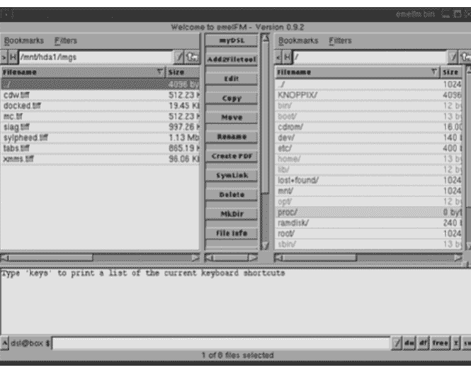

**图 3-5** 使用 emelfM 在 DSL 中管理文件。

Firefox 非常强大；它拥有完整的 Javascript 解释引擎、渲染 SSI、执行 FTP、身份验证、动画 GIF、标签页浏览、支持 Java，并且可以完成你从浏览器中需要的任何其他功能。

请查看 Firefox 首页 (`www.mozilla.com/en-US/firefox`) 以获取更多信息。

## gPhone–一个 VoIP 应用

gPhone，或 Gnome-A-phone，是一种 IP 到 IP 的互联网电话，使用 `librtp` 进行音频压缩。虽然 gPhone 设计并非用于拨打公共电话（如 DSL 中描述的 Skype 服务），但它对于内部通信非常有用。

有关 gPhone 的更多信息，请参考 gPhone 项目网站。

## gRun–一个 GUI 启动器

gRun 是一个简单快速的应用程序启动器。它允许使用键盘或鼠标快速启动程序。它非常轻量级并与桌面环境良好集成。

有关 gRun 的更多信息，请参考 gRun 项目网站。

## GtkFind—一个文件搜索工具

GtkFind 是一个强大的文件搜索工具。它允许通过名称、内容和其他属性搜索文件。它快速且易用。

有关 GtkFind 的更多信息，请参考 GtkFind 项目网站。

## Gvu—一个 PostScript 查看器

Gvu 是一个 PostScript 查看器，允许在图形界面中查看 PS 文件。它非常快速且高度可配置。

有关 Gvu 的更多信息，请参考 Gvu 项目网站。

## 使用 DSL

请访问 RealVNC 网站（`www.realvnc.com`）获取 VNC 文档：

`http://www.realvnc.com/`

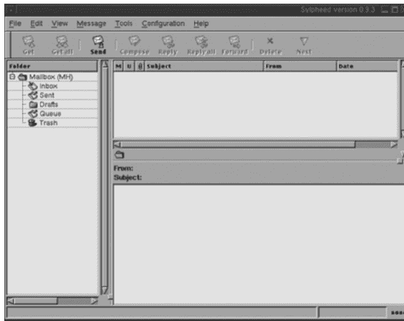

图 3-7 Sylpheed 是一个轻量但强大的电子邮件客户端。

### Rdesktop—远程桌面协议客户端

Rdesktop 是 Windows 终端服务器的客户端。Rdesktop 通过远程桌面协议 (RDP) 进行通信。其原始作者 Matthew Chapman，为了让它能够工作，不得不进行了大量的逆向工程并参考了晦涩的文档。

更多信息请参阅 Rdesktop 主页：`www.rdesktop.org`。

### Xpdf—在 X 环境下运行的 PDF 查看器

Xpdf 是便携文档格式（PDF）的查看器。它设计得非常小巧且高效。请访问 `www.foolabs.com/xpdf` 获取更多信息。

### XMMS—X 多媒体系统

XMMS 是一个适用于 Linux 的媒体播放器。任何用过 Winamp 的人都会对 XMMS 界面感到熟悉。事实上，这两个应用程序可以共享皮肤。DSL 中的 XMMS 版本能够播放音频流、MP3、Ogg Vorbis、CD 音乐/音频、wave 文件以及 MPEG 视频文件。

请注意前面提到了文件类型！DSL 中的 XMMS 版本不仅能够播放音乐文件，还可以播放 MPEG 视频和音乐 CD，这使其成为一个强大的媒体播放器。

XMMS 主页为 `http://www.xmms.org`。图 3-8 显示了 XMMS 播放器的示例。

# 图 3-8 在 XMMS 播放器中播放各种音乐和其他音频文件。

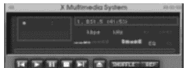

### Xpaint —简单的图像处理和绘画程序

Xpaint 具有一些功能并可以同时处理多张图像。虽然 Xpaint 没有 Gimp 那么高级，但它适合简单的图像编辑。例如，用它来为我们的 DSL 版本拍摄快照。

Xpaint 主页为 `http://sf-xpaint.sourceforge.net/`。

### xTris—窗口系统的多人版俄罗斯方块

XTris 是经典俄罗斯方块游戏的单人多人版本。它是一个真正的服务器/客户端应用程序，因此可以连接到远程主机，并通过本地局域网或互联网与其他玩家竞争。如果没有其他玩家，你可以玩一个或几个机器人来增加难度。

> 请参阅以下页面获取有关 xTris 游戏的更多信息：
> 
> `http://www.ibib.org/xt11/games/xtris.README`

### ZXGV—基于缩略图的图像查看器

ZXGV 是一个快速且功能图像查看器。它可以旋转和调整图像大小以便查看。一个很棒的功能是它可以缩放图像以适应窗口。ZXGV 的主页为 `http://rus.members.beeb.net/xgv.html`。

### Xzoom 屏幕放大应用程序

对于视觉障碍人士或只需要近距离观察桌面内容的人来说，这是一个很好的应用程序。更多信息请参阅 `http://huygens.ca.infn.it/cgi-bin/man/man2html?xzoom+1` 中的 Xzoom 手帮助页。

## 基于终端的应用程序

Damn Small Linux 也有许多基于终端的程序。许多 Linux 新手会被基于文本的应用程序吓倒，但会发现某些事情在终端窗口中操作反而更容易。如果你是 Linux 新手，请帮帮自己，尝试一下这些应用程序。你可能会发现它们的简单性其实很有趣。

#### ftp—基础基于终端的 FTP 程序

`ftp` 实用程序非常易于使用。许多导航和观察命令与普通终端功能相同。例如，输入 `ls` 获取目录下的可用文件列表，或输入 `pwd` 获取当前工作环境。如果你遇到困难了，只需输入 `help` 查看命令列表。如果你想知道某个命令是什么，只需输入 `help [command]`（将 `command` 替换为你感兴趣的命令名称）。

#### index—个人数据库管理系统

`Index` 是一个极简的数据库管理系统。作者意图让 `Index` 被那些想要维护个人信息数据库的人使用。`Index` 易于设置和使用。通过输入 `index` 命令来启动它。

默认情况下，`index` 启动时有四个空数据库可用。其中一个业务电话数据库 (`bphone`)、一个用于保存 CD 收藏的数据库 (`cdllist`)、一个你想要的 CD 数据库 (`cdwantlist`) 以及一个个人电话数据库 (`pphone`)。


输入你想使用的数据库名称。然后你可以使用 `Index` 添加条目 (`a`)、在数据库中查找条目 (`f`) 以及逐条读取数据库 (`r`)。完成后，输入 `s` 保存修改，输入 `q` 保存并退出，或输入 `x` 退出。

## CDW CD 刻录应用程序

`CDW` 是一种通过基于 `ncurses` 的图形界面使用 `cdrecord` 和 `mkiso` 的友好方式。虽然如果你熟悉命令，使用它也很简单，但 `CDW` 用户会参考 `README` 来学习所有快捷键功能。启动 `CDW`，输入 `cdw` 命令。

图 3-9 显示了 `CDW` 的示例。

图 3-9 使用 `CDW` 拷贝和刻录 CD


## Microcom 串口仿真器

`Microcom` 是一个带有脚本支持的终端程序。我们在 `DSL` 中提供了 `microcom`。

# Lua 应用

`DSL` 的开发者是编程语言 `Lua` (`http://lua.org`) 的忠实粉丝。我们目前正在使用一个 `Lua` 版本，它包含了对快速光工具包 (`FLTK`) 的绑定、`SQLite` 绑定以及网络功能。

此版本的 `Lua` 由 `John Murga` 开发，并根据作者的名字恰切地命名为 `murgaLua`。我们利用 `GUI` 绑定开发了许多工具、桌面实用程序以及命令行应用程序的前端，例如 `DSL` 控制面板和 `DSL` 器。

图 3-11 显示了依赖 `murgaLua` 的工具示例。关于 `murgaLua` 的信息可以在此处找到：`www.murga.org/devPages/murgaLua/index.html`。

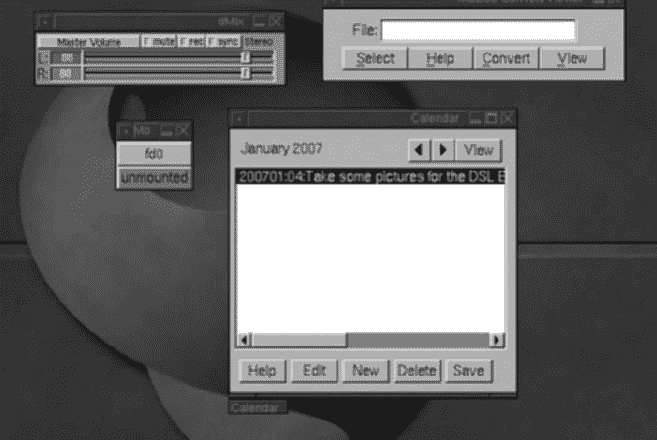

**图 3-11** 依赖 `murgaLua` 的 `DSL` 工具包括 `dMix`、`MSDoc`、`Calendar` 和 `Mount.lua`。

以下是 `DSL` 中依赖 `murgaLua` 的部分工具短列表。

### MS Word 查看器

这是命令行工具 `antiword` `Microsoft Word` 查看器的的前端。通过此应用程序，你可以选择 `.doc` 文件进行查看，并选择将文档显示为 `PDF` 还是 `PostScript` 格式。

# 第 3 章 使用 DSL 应用

### Calendar

这个程序基于 `murgaLua` 和 `PScal` 构建，可以让你保持井井然。`Calendar` 在格式化日程方面做得非常好，日程以易于阅读的日历格式显示。

### dMix

`dMix` 是音量工具 `umix` 的 `GUI` 前端。`dMix` 使用非常简单，允许用户独立控制左右侧音量控制，或将它们同步以便快速控制音量。

### Mount.lua

这是一个 `GUI` 工具，通过点击即可挂载和卸载存储设备（软磁盘、`CD-ROM` 和磁盘分区）。

### Docked

`docked` 工具配合 `Fluxbox` 使用，`Fluxbox` 整合了 `dMix` 和 `Mount.lua` 的许多功能。

## 守护进程应用程序

守护进程是在后台运行并等待请求调用的程序。守护进程通常执行特定功能，如远程连接或打印。

`Damn Small Linux` 配备了四个守护进程来帮助与外部世界交互。它们是 `Open Secure Shell`、`NFS`、`BetaFTP` 和 `Monkey Web 服务器`。请注意，所有这些守护服务默认都是关闭的，你需要手动启用它们。可以通过 `DSL` 控制面板或 `Fluxbox` 菜单中的系统 -> 守护进程子菜单来控制服务。另外注意，你必须设置用户密码才能通过 `Secure Shell` 或 `FTP` 协议远程登录 `Damn Small Linux` 计算机。

### Open Secure Shell

尽管在大多数发行版中它是标准配置，但许多人发现 `Damn Small Linux` 配备了 `OpenSSH` 安全 shell 守护进程感到惊讶。这使得通过以用户或 root 身份登录来安全访问运行 `Damn Small Linux` 的远程计算机成为可能。使用 `scp`（远程传输文件的命令行工具），也可以安全地将文件远程传输进出 `Damn Small Linux`。`Damn Small Linux` 同时拥有服务器端和客户端工具，用于远程 shell 操作和 `SCP` 传输文件。此外，`Damn Small Linux` 还配备了一个非常实用的工具，允许通过 `SSHD` 远程挂载文件系统；该工具称为 `SSHFS`，我们非常喜欢它！

有关 `OpenSSH` 的信息，请访问 `www.openssh.com/manual.html` 上的手册页面。

关于 `SSH` 文件系统的更多信息，请访问 `http://fuse.sourceforge.org/net/sshfs.html`。

### BetaFTPD

`BetaFTPD` 是一个极其微小的（27K）单线程 `FTP` 服务器。其极小的体积使其成为 `Damn Small Linux` 的天然选择，其作者 `Steiner H. Gunderson` 认为，多线程使其更安全，同时也更节省内存。然而，`BetaFTPD` 主要功能是在当用户无法访问 `SCP` 客户端时，提供方便的跨平台文件共享。

有关 `BetaFTPD` 的更多信息，请访问 `http://betaftpd.sourceforge.net/`。

## 网络文件系统

顾如名，网络文件系统 (`NFS`) 是一种允许通过挂载磁盘分区来跨网络共享文件的系统。它在概念上与 `Windows` 文件共享系统相似。`Damn Small Linux` 拥有 `NFS-Common`，它提供了一个允许使用 `NFS` 协议的工具集。

开发者备注：在许多方面，使用 `SSHFS` 允许用户通过 `SSHD` 远程挂载文件系统；该工具称为 `SSHFS`，我们非常喜欢它！

有关 `OpenSSH` 的信息，请访问 `www.openssh.com/manual.html` 上的手册页面。

关于 `SSH` 文件系统的更多信息，请访问 `http://fuse.sourceforge.org/net/sshfs.html`。

设置。你必须输入有效的设备。在 `DSL` 术语或 `Linux` 术语中，通常按流行程度排序的选项如下：

- `U` 盘（或其他 `USB` 闪存）通常是 `sda` 或 `sda2`，其中数字对应分区号。
- 对于软驱器，输入 `floppy` 或 `fd0`。
- 对于 `IDE` 驱动器，第一个驱动器将是 `hda1`、`hda2` 等。
- 对于第二个硬盘，使用 `hdb1`、`hdb2` 等。

> 注意

`U` 盘在 `Linux` 中中显示为 `SCSI` 驱动器。如果你在计算机上安装了 `SCSI` 或串行 `ATA`（`SATA`）硬盘，它可能会显示为 `sda1`，而你的 `U` 盘可能会显示为 `sdb1`。如果你在桌面挂载工具上看到多个以 `sd` 开头的分区，请在继续之前尝试打开每个驱动器，以确保你选择了正确的一个。

主目录会自动包含在备份中，还包括 `/opt` 的某些区域。关于此的完整细节将在稍后讨论。现在，点击“备份（Backup）”按钮即可启动 `DSL` 的自动备份/恢复程序。

我建议你熟悉备份和恢复的基础知识。从对系统进行细微更改开始，然后重启。这将有助于确保你在丢失数小时配置之前，理解备份过程是如何运作的。

重启后，只要设备在物理上存在（也就是说，`U` 盘已插入），`DSL` 就会自动扫描你的备份文件。如果找到了备份文件，则无需进一步指定任何设备，即可恢复备份文件的内容。

### 使用 .filetool.ist 选择要备份的文件和目录

在设置好新系统后，你想要保存所有设置。这里有一个名为 `filetool1.ist` 的文件。它是一个简单的文本文件，其中列出了用户想要保存/恢复的文件和目录，每行一个一个，并使用完整路径。输入 `ls -1 /home/dsl` 来查看 `.filetool1.ist` 文件，因为仅输入 `1` 不显示以点（`.`）开头的文件。

使用任何 `DSL` 编辑器来更改/更新 `.filetool1.ist` 文件。例如，选择 `Beaver`（海狸编辑器），然后输入 `.filetool1.ist` 打开该文件进行编辑。

`.filetool.1st` 文件的默认内容会导致整个 `home/dsl` 目录被备份。但是，你可以选择选择性地备份某些文件。

> 注意

非常重要的是，`/home/dsl/.filetool.1st` 条目不能从 `.filetool.1st` 中删除，因为这提供了 `.filetool.1st` 的持久化支持。

`DSL 3.3` 中的默认 `.filetool.1st` 文件如下所示：

```
opt/ppp
opt/bootlocal.sh
opt/powerdown.sh
opt/dslrc
opt/.mydsl_dir
home/dsl/
```

### 从备份中排除文件和目录

使用文件 `/home/dsl/.xfiletool.1st` 从备份中排除文件。向此文件添加条目将将其从备份中排除。缓存和其他文件在默认的 `.xfiletool.1st` 中：

`/home/dsl/.xfiletool.1st`


此文件列出了 `.filetool.1st` 中文件的异常，这意味着如果你在 `.filetool.1st` 中列出了目录，你可以使用 `.xfiletool.1st` 防止该目录内的某些文件或子目录被添加到你的备份中。

该文件通过使用模式匹配而不是完整文件路径来工作。这样，你可以排除在不同目录中找到的具有相同名的多个文件。如果你想排除特定文件，仍然可以使用文件的完整路径。DSL 3.3 中的默认文件如下：

```
Cache
XUL_.mfas1
home/dsl/.mnt
home/dsl/.jwmrc
home/dsl/.opera/cache4
home/dsl/.opera/images
home/dsl/.fluxbox/mydsl.menu
```

注意，`Cache` 在没有路径的情况下列出，这意味着 `.filetool.1st` 中列出的目录下所有名为 `Cache` 的文件都被排除在备份之外。你可以

## 第 4 章 配置和保存 DSL 设置

也可以使用通配符来扩展排除。例如，如果列出 `Cache*`，则所有以 `Cache` 开头的文件都会被排除。

### 恢复你的设置

你对选定文件和目录的备份会在启动过程中自动搜索并恢复。不需要用户交互。DSL 根据添加到 `/etc/fstab` 文件的检测驱动器顺序，在存储介质中搜索你的备份存档。它检查每个磁盘分区，直到在其中一个设备的根目录下找到 `backup.tar.gz` 文件。

你可以通过指定持有备份文件的设备来覆盖此功能：

```
boot: ds1 restore-hda2
```

指定设备实际上会加速启动过程，因为不需要对连接且可用的物理设备进行搜索。然而，不指定恢复启动选项意味着免干预的自动启动。

> 注意 如果你以后某个时刻决定不想使用已备份的设置，请在 DSL 启动命令中添加 `norestore` 选项。如果你想永久删除设置，请从存储备份的设备根目录下删除 `backup.tar.gz` 文件。

恢复选项与 `.xinitrc` 文件一起，为用户对其喜的环境提供了更多控制。请参见“配置桌面（Configuring the Desktop）”部分，获取更多关于使用 `.xinitrc` 文件和其他功能来选择桌面启动时哪些设置和应用程序的信息。

现在我们涵盖了备份和恢复，让我们继续桌面配置选项。

### 配置桌面

在完成备份程序后，根据你的喜好配置桌面是下一步。从选择桌面开始，然后设置图标、背景和壁纸。

#### 选择你的桌面

`Fluxbox` 是 Damn Linux 使用的默认管理器。DSL 也允许你切换到 Joe's Manager (`JVM`)，如果你喜欢的话。`JVM` 提供了一个类似于微软 Windows 的桌面界面。DSL 中的 `JVM` 版本是经过高度修改和精简的版本。

你可以通过显示桌面菜单（右键点击桌面）并选择 `WindowManager` 来切换管理器。你可以从桌面菜单选择 `Exit` 回到 `Fluxbox`。（在切换管理器之前，请记住此操作将重启 X 系统并关闭你打开的所有应用程序）。

你可以通过编辑主目录 (`/home/dsl`) 中的配置文件来添加启动时打开的应用程序。例如，通过编辑 `.xinitrc`，你可以启动喜欢的程序。你可以通过编辑 `.bash_profile` 并将其添加到 `.filetool.1st` 来启动非 X 程序。

如果你需要加载额外的模块和系统特定的需要文件，可以通过编辑 `/opt/bootlocal.sh` 文件。

#### 管理图标

大多数发行版都有预构建的集成桌面系统，甚至是图标管理系统，例如 `Rox` (http://rox.sourceforge.net)。为了符合 DSL “越小越好”的主题，使用了 `XtDesk` 图标程序。挑战在于，虽然 `XtDesk` 图功能强大，但没有 GUI 配置工具。我创建了一个小型 `Lua/Fltk` GUI，并对 `XtDesk` 代码进行了一些修改以创建 DSL 自己的图标管理工具。

首先，让我们讨论标准的 `XtDesk` 编辑功能。当你右键点击图标时，会弹出一个小窗口。有时，弹出窗口包含相关的启动程序，弹出窗口的底部部分是属性（Properties）。点击属性将弹出与图 4.3 所示的屏幕。

你可以移动光标并编辑任何图标属性。`MenuCommand` 选项是右键点击启动程序的替代方式。`Status` 选项是 DSL 自定义的，应用于基础应用程序。额外的 `MyDSL` 扩展程序不使用 `Status` 字段。通常，此屏幕用于手动更改 X 和 Y 坐标。

#### 指定图标布局

当选择 `Layout` 标签页时（见图 4-5），你可以选择 X 和 Y 坐标或自动布局。如果你想使用 X 和 Y 坐标，则

# 官方 Damn Small Linux 手册

在“点击”（Click）选项卡中也选择“双击”（Double Click）是合理的。双击意味着第一次点击选中图标；因此，你可以将图标拖放到你想要的位置。

图 4-5 从“布局”（Layout）选项卡可以指示图标在屏幕上的排列方式。

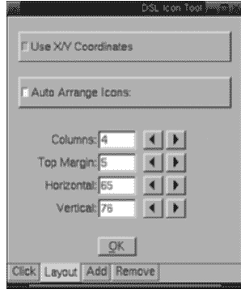

DSL 的默认设置是“单击”和“自动排列图标”布局。这种组合效果很好，特别是当配合 `MyDSL` 系统使用时。`MyDSL` 系统和自动布局构成了一个优秀的系统。否则，你会发现自己必须不断地调整图标。

自动布局对你的桌面图标提供了大量的控制，从上边距、列数到垂直和水平间距。当然，对于任何配置的更改，备份恢复功能都能使你的更改在重启后依然有效。

#### 添加新桌面图标

图标工具的“添加”（Add）面板可以方便地添加桌面图标（见图 4-6）。DSL 自带了通用图标。`XtDesk` 系统的所有图标都存储在 `/home/dsl/.xtdesktop` 中。在那里，你可以从自己的集合添加更多图标。

要开始使用“添加”选项卡，从列表中选择一个图标。然后，只需填写表单。为你的图标指定标签。只有在你使用手动布局方法时，才指定 X 和 Y 坐标。最后，输入应用程序执行文件的完整路径。

# 第 4 章 配置并保存 DSL 设置

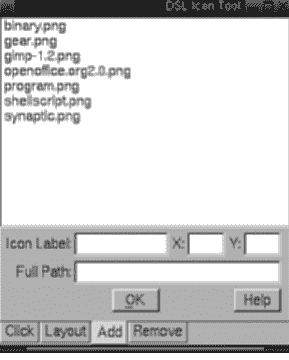

图 4-6 从“添加”选项卡，你可以为你的 DSL 桌面添加更多图标。

#### 移除图标

图标工具的最后一个面板允许移除标准的 DSL 应用程序（见图 4-7）。

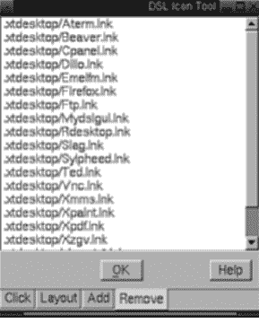

图 4-7 指示你想要从 DSL 桌面移除哪些图标。

有时，你会发现某个从不使用的内置应用程序。或者，也许你喜欢整洁的桌面。通过从前面的列表中进行选择，你可以移除该应用程序的桌面图标。

当你选择从桌面移除时，你并没有真正删除该应用程序。DSL 作为现场 CD 或其仿真，意味着基础系统是一个压缩只读文件。此过程实际上是隐藏了所选图标。事实上，如果你查看图标目录 `/home/dsl/.xtdesktop`，你会看到使用了 `.hide` 文件扩展名。要真正移除基础应用程序，需要完全的重构。这个高级主题将在第 11 章“设置完全重构环境”中讨论。

#### 选择背景和壁纸

由于 DSL 有两个默认窗口管理器，更改背景图像甚至选择颜色意味着需要一个自定义程序。你可以通过桌面图标面板中的“背景”（Backgrounds）访问此程序；或者从主菜单选择“桌面”（Desktop）并点击“壁纸”（Wallpapers）来查看 DSL 背景选择器（见图 4-8）。

图 4-8 使用壁纸/背景工具更改桌面背景。

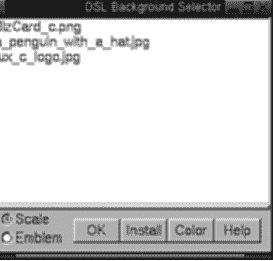

壁纸/背景工具允许选择新的背景图像。你可以从列出的列表中进行选择，也可以添加你自己的喜好集合。图像可以缩放以适应你的屏幕分辨率，或作为标志居中。点击 OK 后，你可以在屏幕上看到选定的项目。它尚未被安装。这允许你尝试不同的图像以查看你喜欢哪种。决定后，点击“安装”（Install）按钮。

按下“帮助”（Help）按钮，你可以查看这些图像的位置。添加更多图像的建议方法将其存储在 `/home/dsl/.fluxbox/backgrounds` 中。

# 第 4 章 配置并保存 DSL 设置

DSL 背景选择器工具允许选择颜色。按下“颜色”（Color）按钮将向你展示一个颜色选择器，如图 4-9 所示。

图 4-9 选择用于你的 DSL 背景的颜色。

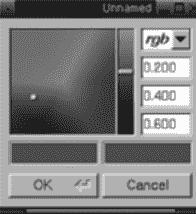

你可以选择几乎任何可能的颜色、其任何色调，甚至输入已知的 RGB 代码。

> 注意
>
> 如图 4-9 所示，选定的蓝色是 DSL 中 `JVM` 窗口管理器使用的默认背景色。如果你已经选择了背景图像并想恢复原始背景颜色，请使用这些设置。

你使用 DSL 背景选择器所做的任何选择都会通过标准的备份恢复程序得以保留。

#### 设置日期和时间


要设置系统的日期和时间，从 DSL 控制面板选择“日期/时间”（`Date/Time`）。从主桌面选择“系统”（`System`）然后选择“设置日期/时间”（`Set Date Time`）。如果你恰好在使用 `JVM` 桌面，可以点击任务栏右下角显示的日期。在你选择自定义日期应用程序后，将显示图 4-10。

使用箭头将值调整到正确的日期和时间。按下 `OK` 按钮。会弹出一个小窗口，请求重启窗口管理器以便在桌面上更新日期。仅在使用标准的 `Fluxbox` 桌面时才需要此步。要重启窗口管理器，请从主菜单选择 `Fluxbox` 并点击“重启”（`Restart`）。

图 4-10 从 DSL 控制面板设置日期和时间。

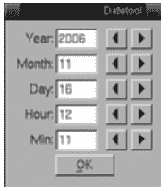

## 识别屏幕分辨率

DSL 使用非常精简的界面。桌面由壁纸、任务栏和图标组成。任务栏包含时钟和菜单按钮。图标是应用程序和文件的快捷方式。你可以自定义这些元素的外和行为。

图 4-11 更改桌面分辨率设置。

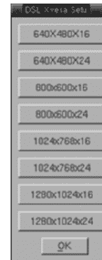

## 连接网络

要连接互联网或其他网络，DSL 包含了配置调制解调器、有线以太网和无线以太网的工具。如果你的计算机具有可以访问互联网的物理以太网连接，可能会自动出现，无需进行任何配置。

## 配置调制解调器

DSL 支持基于硬件的拨号调制解调器。有一类设备被称为 WinModems。Win Modem 的固件是专门为在 Microsoft Windows 上运行的。因此，在 Linux 设备上的行为不像标准的调制解调器。

正如你所料，大多数 Linux 发行版对 WinModems 的支持有限。事实上，DSL 支持最流行的 Win Modem——Lucent Technologies 调制解调器。

从 DSL 控制面板图标点击“拨号”（`Dialup`），或从主菜单选择“系统”（`System`）、“网络设置”（`Net Setup`），最后选择“拨号 PPP”（`Dial-up PPP`）。一个 PPP 拨号弹出窗口，如图 4-12 所示。

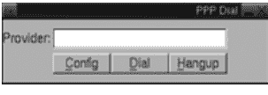

图 4-12 在配置拨号连接时选择提供者。

要开始拨号 PPP 连接的设置，点击“配置”（`Config`）按钮。设置将经过多个屏幕。第一个是 `pppconfig` 主菜单，如图 4-13 所示。

主屏幕允许创建、更改和删除单个 ISP 提供者信息。让我们演示创建一个提供者连接。按 Tab 键到 `OK` 并按回车。

# 官方《Damn Small Linux Book》

## 图 4-13 开始设置 PPP 连接。

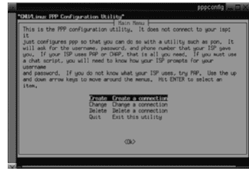

下一个屏幕（如图 4-14 所示）非常重要。它决定了你的 ISP 如何为你提供名称服务器信息。名称服务器通过名称访问互联网上的站点。如果没有正常工作的名称服务器，你的访问看起来就像断开了一样。

## 图 4-14 选择动态或静态 DNS 服务。

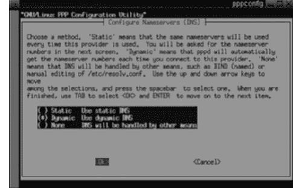

下一步是指定用于身份验证的握手方法（`handsh method`）。通常使用 PAP 并应将其高亮，如图 4-15 所示。

下一步将向你显示用户名。在此屏幕上，你应该将示例文本替换为服务提供商分配给你账户的登录名。大多数情况下，这是一个单词。有时，它包含 ISP，例如 `username@ispname`。你应该完全按照你的 ISP 所提供的内容使用。然后，按 Tab 键到 `OK` 继续。

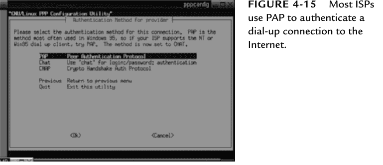

你将看到密码屏幕。输入 ISP 提供的密码。你必须按照提供的内容完全输入。然后按 Tab 键到 `OK` 继续。

将显示调制调器速度；此屏幕留有默认值是正常的。按 Tab 键直到选中 `OK`，然后按 Enter 继续。

会出现拨号方法屏幕。你应该使用默认的音调（Tone），除非你恰好使用脉冲拨号（Pulse）。按 Tab 键到 `OK` 并按 Enter。

接下来，输入访问你的 ISP 的拨号号码。不要包含破折号或空格。全部以数字输入。按 Tab 键到 `OK` 并按 Enter 继续。

下一个屏幕提示你搜索你的型号。按 Tab 键到 `Yes` 并按 Enter 继续。通常，你必须指定调制调器设备。如果你恰好在使用 WinModem，情况如此。DSL 支持的唯一 WinModem 是 Lucent WinModem。

如果你看到如图 4-16 所示的屏幕，使用帮助文本将 COM 端口转换为 DSL 需要的设备名称。在图 4-16 中，我为 `COM2` 输入了 DSL 设备。现在，如果你恰好有 Lucent Winmodem，输入 `/dev/ttyS14`。输入设备名称后，按 Tab 键到 `OK` 并按 Enter 继续。

如图 4-17 所示的屏幕显示你所有特定数据的摘要。必须注意的是你必须选择 `Finished`，然后按 Tab 键到 `OK` 并按 Enter。

## 图 4-16 输入代表连接到你的调制调器的 COM 端口的 Linux 设备名称。

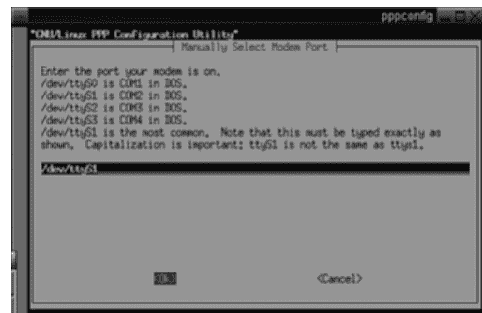

**图 4-17** 如果你的 PPP 拨号设置看起来正确，选择 `OK` 保存这些设置。

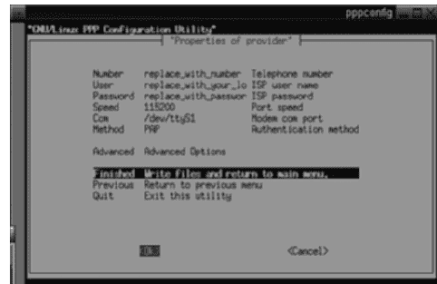

> 注意

你所有的设置信息都在备份和恢复中。你不需要编辑或准备任何其他文件。使用已经讨论过的简单备份和恢复程序。

完成调制调器设置后，你将返回拨号对话框。只需输入提供商名称并点击 `Dial` 按钮。另一个窗口将打开并显示在通信链路建立期间的所有消息。你不需要担心这些消息的细节。然而，如果发生错误，你需要知道可能的原因，以便从你的 ISP 或 DSL 论坛获得进一步帮助。在消息日志的末尾，会显示为本次拨号话分配的实际 IP 号。当你看到 IP 号时，通信链路已建立，你就可以开始使用 DSL 包含的互联网应用程序了。

# 第 4 章 配置并保存 DSL 设置

### 以太网配置

DSL 支持有线和无线连接。如果你无法自动连接到网络，以下章节将帮助你手动配置连接。

### 有线选项

由于 DSL 启动时带有自动 DHCP 请求，因此不需要即可获得立即网络访问。对于有特殊需求的用户，DSL 提供了 `wlanconfig` 程序。要访问此程序，可以从 DSL 控制面板选择 `wlanconfig`；或者从系统菜单选择 `System`、`Setup`、`wlanconfig`。按照提示顺序逐步回答问题。如果你连接到带有自动 DHCP 服务器的设备，你可以选择 `Yes` 并可能连接到互联网。如果你无法检测 DHCP 服务器或需要手动配置地址，选择 `No`。然后你将被要求输入静态 IP 地址、子网掩码、默认网关和 DNS。

### Wired Options

DSL 支持有线和无线连接。如果你无法自动连接到网络，以下章节将帮助你手动配置连接。

### Wired Options

由于 DSL 启动时带有自动 DHCP 请求，因此不需要即可获得立即网络访问。对于有特殊需求的用户，DSL 提供了 `wlanconfig` 程序。要访问此程序，可以从 DSL 控制面板选择 `wlanconfig`；或者从系统菜单选择 `System`、`Setup`、`wlanconfig`。按照提示顺序逐步回答问题。如果你连接到带有自动 DHCP 服务器的设备，你可以选择 `Yes` 并可能连接到互联网。如果你无法检测 DHCP 服务器或需要手动配置地址，选择 `No`。然后你将被要求输入静态 IP 地址、子网掩码、默认网关和 DNS。

### Wired Options

DSL 支持有线和无线连接。如果你无法自动连接到网络，以下章节将帮助你手动配置连接。

### Wired Options

由于 DSL 启动时带有自动 DHCP 请求，因此不需要即可获得立即网络访问。对于有特殊需求的用户，DSL 提供了 `wlanconfig` 程序。要访问此程序，可以从 DSL 控制面板选择 `wlanconfig`；或者从系统菜单选择 `System`、`Setup`、`wlanconfig`。按照提示顺序逐步回答问题。如果你连接到带有自动 DHCP 服务器的设备，你可以选择 `Yes` 并可能连接到互联网。如果你无法检测 DHCP 服务器或需要手动配置地址，选择 `No`。然后你将被要求输入静态 IP 地址、子网掩码、默认网关和 DNS。

### Wired Options

DSL 支持有线和无线连接。如果你无法自动连接到网络，以下章节将帮助你手动配置连接。

### Wired Options


由于 DSL 启动时带有自动 DHCP 请求，因此不需要即可获得立即网络访问。对于有特殊需求的用户，DSL 提供了 `wlanconfig` 程序。要访问此程序，可以从 DSL 控制面板选择 `wlanconfig`；或者从系统菜单选择 `System`、`Setup`、`wlanconfig`。按照提示顺序逐步回答问题。如果你连接到带有自动 DHCP 服务器的设备，你可以选择 `Yes` 并可能连接到互联网。如果你无法检测 DHCP 服务器或需要手动配置地址，选择 `No`。然后你将被要求输入静态 IP 地址、子网掩码、默认网关和 DNS。

### Wired Options

DSL 支持有线和无线连接。如果你无法自动连接到网络，以下章节将帮助你手动配置连接。

核心内容翻译如下：

Ethernet Configuration -> 以太网配置

Wired and wireless connections -> 有线和无线连接

DHCP request -> DHCP 请求

`wlanconfig` program -> `wlanconfig` 程序

DSL Control Panel -> DSL 控制面板

System menu -> 系统菜单

System -> 系统

Setup -> 设置

DHCP server -> DHCP 服务器

static IP address -> 静态 IP 地址

netmask -> 子网掩码

default gateway -> 默认网关

DNS -> DNS

modem speed -> 调制调器速度

Tone -> 音调

Pulse dialing -> 脉冲拨号

dialing screen -> 拨号屏幕

number to dial -> 拨号号码

model -> 型号

WinModem

Lucent WinModem -> Lucent WinModem

COM ports -> COM 端口

DSL required device names -> DSL 需要的设备名称

Finished -> 完成


dial dialog box -> 拨号对话框

provider name -> 提供商名称

Dial button -> 拨号

communication link -> 通信链路

IP number -> IP 号

Internet applications -> 互联网应用程序

CHAPTER 4 Configuring and Saving DSL Settings -> 第 4 章 配置并保存 DSL 设置

Ethernet Configuration -> 以太网配置

Wired Options -> 有线选项

Wireless -> 无线

Native Configuration -> 原生配置

Printing USING APSFILTER -> 使用 APSFILTER 打印

# 第 4 章 配置和保存 DSL 设置

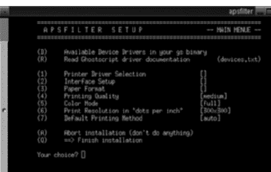

库中可用的设备驱动

阅读 Ghostscript 驱动文档

(1) 打印机驱动选择

(2) 驱动尺寸

(3) 纸张格式

(4) 内存可用性

(5) 颜色模式

(6) “每英寸数据”自定义布局

(7) 默认打印方法

(A) 取消安装（什么都不做）

(B) 完成安装

图 4-21 使用 Apsfilter 在 DSL 中配置您的打印机。

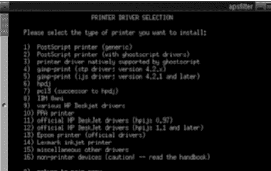

### 打印机驱动选择

选择您想要安装的打印机类型：

1) PostScript 打印机（通用）

2) 带有 postscript 驱动的通用打印机

3) 原生支持 ghostscript 的打印机驱动

4) 喷墨打印机（HP Deskjet 82）

5) 喷墨（ijp 驱动版本 4.1 及以后）

6) 网络

7) p73（hp2 的继任者）

8)

9) 各种 Windows 桌面打印机

10) 其他

11) HP 喷墨驱动（hpij 0.97）

12) 最佳喷墨驱动（hpij 1.1 及以后）

13) 激光打印机

14) 热敏打印机

15) 爱普逊打印机（官方驱动）

16) 杂项驱动

17) 不兼容设备（注意！-阅读手册）

() 返回主菜单

图 4-22 为您的打印机选择要使用的驱动程序。

对于我的 PostScript 打印机，我将输入 1。您应该选择一个适合您打印机的选项。许多用户在使用选项 4 g-print 时效果良好。您可以根据您的打印机尝试几个不同的选项，或者可能选择您的打印机使用标准仿真。

在我的示例中，我输入 1 并按回车键。如果您选择了不同的选项，在搜索打印机驱动程序时，您可能会看到导航屏幕。同样，如果您无法找到特定的打印机驱动程序，可能您的打印机提供了一个受支持打印机的仿真模式。在选择了打印机驱动程序后，会出现主设置界面。您现在准备好选择接口了。输入 2 并按回车。出现接口设置屏幕。

### 打印机接口设置

图 4-23 所示的接口设置屏幕根据其选项来说非常显而易见。在这个示例中，我将使用我的 HP4050TN 中的 JetDirect 网卡进行网络打印。在我的情况下，我输入 3 并按回车键。

图 4-23 选择打印机连接的接口或设备。

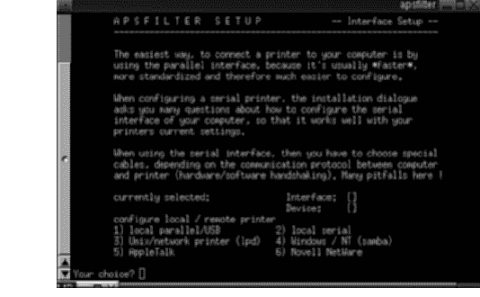

在您从网络选择打印机后，会出现 JetDirect 打印机网络设置屏幕，如图 4-24 所示。

图 4-24 识别远程打印机的名称和 IP 地址。

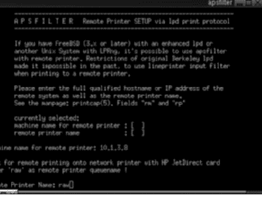

要使用 JetDirect 或 UNIX 网络打印机，首先输入分配给您的打印机的内部 IP 号。在图 4-24 中，可以看到我输入了地址 1.0.3.3，这是我的 JetDirect 的 IP 号。由于我正在使用 JetDirect 卡，我的远程打印机名称是 raw。如果您使用其他接口选择，会出现其他屏幕让您选择打印机端口，而且通常比网络打印机更容易设置。

例如，假设您没有网络打印机，而是选择了本地并行/USB 打印机，即接口设置中的选项 1。在这种情况下，您看到的不是网络屏幕，而是一个设备选择屏幕。由于 DSL 是基于 Linux 的，您需要从 Linux 选项中选择。通常情况下，打印机直接连接到 LPT1。因此，对于并行连接的打印机，您输入 LPT1 上 Linux 设备的完整路径，即 `/dev/lp0`；或者，如果您的打印机通过第一个 USB 端口连接，您输入 `/dev/usb/lp0`。

在选择了打印机设备后，您再次返回主设置屏幕。注意主设置屏幕上，随着选项被选择，它们会出现在此屏幕。您现在准备好为您的打印机选择纸张格式。从主设置屏幕选择选项 3。

### 纸张格式

显然，纸张格式选择是最容易做出的选择之一（见图 4-25）。选择您的纸张尺寸并按回车。

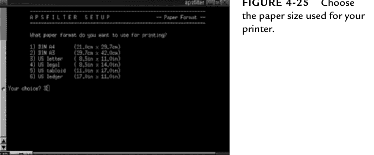

主设置屏幕再次出现并显示您的选择。

### 打印测试页

您现在已按选择了打印所需的三个选项。但首先，您需要测试您的选择。要尝试您的选择，输入 `T` 打印测试页，如图 4-26 所示。

测试页提示再次要求字母 `T` 和随后的 `y`。输入这些值并按回车。出现一个屏幕显示正在发送到您的打印机的命令。您不需要担心这些细节。如果测试页成功打印，按回车返回主菜单设置。

图 4-26 打印测试页以确保打印机工作正常。

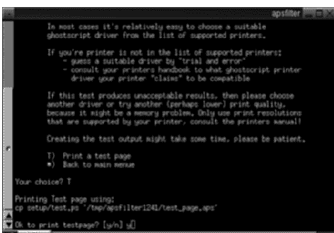

如果您的测试页没有打印任何内容，您可能需要返回主菜单（见图 4-27）并检查您的打印机接口，确保路径与所示完全一致。如果您的打印机尝试打印但未能产生有效结果，您必须返回主菜单尝试不同的驱动程序。您不需要重新输入所有步骤。只需更改单个项目并再次打印测试页。如果您在寻找打印机遇到困难，请检查您的打印机是否可以设置为不同的或使用 Apsfilter 提供的通用打印机。

成功生成测试页后，您已准备好安装您的打印机规格。从主菜单输入您的选择。系统提示为打印机输入名称，如图 4-28 所示。默认值是 `lp`。如果您有几台打印机，您可能想输入其他内容。请注意不要有空格。

### Webdata 备份

一旦你按照意愿设置好了 `.webdata.1st` 文件，请按照以下步骤执行 Webdata 备份：

- 1. 从主菜单中，选择系统（System）、Webdata 备份/恢复（Webdata Backup/Restore）。出现图 4-29 所示窗口。

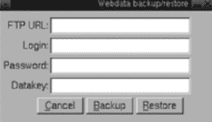

图 4-29 在 Web 上选择备份的位置。

- 2. 在 Webdata 备份/恢复窗口中，输入以下信息：

* FTP—输入 ISP FTP 服务器的主地址（主机名或 IP 地址）。

* Login—输入读写该 FTP 服务器所需的 ftp 登录名。

* Password—输入该用户登录的 ftp 密码。

* Datakey—输入用于访问加密数据的密码。

可以输入任何喜欢的密码，但务必记住它。你稍后恢复备份时需要它。

- 3. 选择备份（Backup）。程序将显示 ftp 连接信息。如果一切运行正常，`a.data` 文件将被复制到你访问 FTP 服务器时使用的用户帐户的主目录下。如果发生故障，它应该指示是你输入了错误的主机名、用户名或地址，或者服务器其他不可用。

- 4. 要恢复数据，只需再次运行此 GUI 程序并选择恢复（Restore）。下次你从任何连接互联网的机器上启动 DSL 时，你应该能够访问你的数据。

请务必确保你知道自己的加密密码；否则，没人能帮助你。当然，这样做的好处是，获得 FTP 服务器访问权限的入侵者在不知道该密码的情况下，无法访问你的备份数据。

在运行 webdata 脚本时，`/home/ds1` 会自动创建 `.netrc` 文件，并在完成后将其销毁。这是出于安全考虑，也是为了不干扰你可能由于其他服务器或用途而需要的 ftp GUI 程序。

我不认为备份整个 `/home/dsl` 是有意义的，其目的是为了让你能够在机器之间移动，并访问与机器无关的数据。核心要点是让你从任何连接到网络的地方都能使用你的数据。

但像既往一样，你拥有灵活性来执行任何你想或需要做的事情。

## 总结


拥有按照你想要的方式设置 Damn Small Linux 桌面工具，对于让 DSL 成为一个好用的系统至关重要。能够保存你在使用 Damn Small Linux 时积累的文件和设置，对于让 DSL 在每次重启之间更具价值至关重要。

DSL 在选择要备份哪些文件和目录，以及你想将这些备份存放在何处方面提供了巨大的灵活性。

一旦你学会了如何进行基础备份，本章将描述你可能想要配置和自定义桌面的方法。配置包括设置网络连接的不同方式，使用拨号连接、无线或有线局域网。它还包括配置打印机的程序。自定义包括设置背景、排列图标和选择屏幕分辨率的方法。

为了让你的 Damn Small Linux 系统更具移动性，本章描述了如何将数据备份到 Web 上的 FTP 服务器上。之后，你可以从任何可以启动 DSL 并访问 Web 的计算机上恢复你的数据（如网页书签、邮件文件夹和编辑器设置）。

# 使用 MyDSL 扩展应用程序

本章涵盖了在 Damn Small Linux (DSL) 现场光盘中添加应用程序的“是什么、为什么以及何时”。我们称此过程为 MyDSL 系统。额外的应用程序被称为扩展（extensions）。

可以通过多种方式添加这些扩展来自动化你的系统。我将描述如何从最简单的 GUI 使用 MyDSL 系统（它会引导你完成整个过程），到通过 Web 浏览器常规下载，最后是如何从命令行下载和安装。

在拥有扩展后，你很可能想保存它以备后用。我将讨论这些扩展应该如何保存以及持久化存储（persistent store）的使用。讨论内容包括如何实现加载你喜的应用程序扩展并准备好使用的无干预启动，以及无干预与启动时间速度之间的权衡。本章的最后一节包含对一些常见设置和用法错误的讨论。

# 介绍 MyDSL

为了扩展标准 50MB DSL 现场光盘上自带的软件，我们创建了 MyDSL 系统。MyDSL 已经成为 DSL 最成功的特性之一。你可以使用 MyDSL 系统为运行中的 DSL 系统添加软件扩展，保存扩展以备后之用，并创建你自己的扩展。

# 克服硬盘安装的局限

如果你过去参加过 Damn Small Linux 论坛（`http://damnsmallinux.org/cgi-bin/forums/ikinboard.cgi`），你可能还记得论坛上的优势帖子。这些帖子讨论了现场光盘用户在选择应用程序时总是处于劣势。

典型的现场光盘包含了发行版选择的应用程序。当时，向现场光盘系统添加应用程序是不可能的。正如 John 和我选择的那样，现场光盘的方案包含了许多可以打包进光盘的应用程序。对于想要安装软件的用户，硬盘安装是出路。此外，这一直是其做法：获取一张光盘并将其安装到硬盘上。

我不认为备份整个 `/home/dsl` 是有意义的，其目的是让你能够在机器之间移动，并访问与机器无关的数据。核心要点是让你从任何连接到网络的地方都能使用你的数据。

但像既往一样，你拥有灵活性来执行任何你想或需要做的事情。

## MyDSL 的诞生

为了扩展标准 50MB DSL 现场光盘上自带的软件，我们创建了 MyDSL 系统。MyDSL 已经成为 DSL 最成功的特性之一。你可以使用 MyDSL 系统为运行中的 DSL 系统添加软件扩展，保存扩展以备后用，并创建你自己的扩展。

通过我描述的功能，我可以提供一种分层的引导方法。大约同一时间，我对比挂载应用程序产生了兴趣。我将它们格式化为压缩镜像（为这些文件添加 `.ci` 后缀）。我很快将后缀改为 `.ci`。这极大有助于减少资源，因为应用程序是挂载的而不是复制到内存中。后来，我将 `ci` 文件与其关联的用户文件合并为一个文件（带有 `.uci` 后缀）。

# 第 5 章使用 MyDSL 扩展应用程序

在发布示例 MyDSL 扩展和 `mkyds1` 自定义光盘制作工具之后，请求最多的功能是不需要用户制作 CD。John 和我起初有些犹豫。我们担心带宽。如果用户变得懒惰，他们每次都会下载扩展。因此，我制作了一个启动选项来指定扩展的持久化存储。这应通过 `myds1=sdx` 来指定，其中 `hdx` 将替换为存储扩展的硬盘分区名称（例如第一个 IDE 磁盘的分区 `hda1`）。

我添加了动态加载的代码。为 MyDSL 系统创建了 GUI 前。今天，得益于 `unionifs`，DSL 提供了更多扩展，后者允许用户在文件系统的任何地方添加或更改文件，而不仅仅是 `/opt/home/ds1` 目录。通过 `unionifs`，DSL 文件系统存储在名为 `/ramdisk` 的特殊目录（通常在内存中），该目录覆盖在整个文件系统之上。

# 探索 MyDSL 软件市场

MyDSL 系统已经取得了巨大的成功。MyDSL 提供了四扩展类型，其中两种是可挂载的。由于 MyDSL 扩展是挂载的而不是加载到内存中，即使是内存较小的系统用户也能享受到这些扩展的优势。

创建 MyDSL 扩展的过程是公开的，以便 DSL 用户社区可以通过分享他们创建的包来参与这一乐趣并获得所有感。事实上，这也是一个设计目标。John 和我将专注于核心 DSL，只创建和提供社区所需的基础设施。

DSL 用户社区的许多成员贡献了许多作为 MyDSL 扩展的软件标题。这些应用程序通常是从 Debian 软件包重新封装的，但也可以从源代码编译。有关此构建过程的细节请参阅第 10 章“添加应用程序和创建共享扩展”。

对于 MyDSL 系统的用户来说，这是一种方便的图形化“点击并加载”安装方法。事实上，我发现使用 MyDSL 添加软件比许多其他包管理系统都要简单。

虽然安装在硬盘上的系统可以使用 MyDSL 的功能，但它没有卸载功能。当您从现场 CD 运行 DSL 时，没有卸载功能是一个问题，因为您可以从存储扩展的优 盘或硬盘上删除扩展。下次重启时，扩展就会消失。对于硬盘安装，在安装扩展后没有简单的方法可以移除它们。

> 注意：安装在硬盘上的系统应该应该继续使用完整的 Debian 包管理系统来添加和删除软件。MyDSL 是为现场 CD 及其模拟器设计的。

从现在起，我的所有的讨论都是从运行现场 CD 或模拟器来操作 MyDSL 系统的角度。我将从最自动因此最推荐的方法开始。由于 MyDSL 扩展托管在互联网上的各种镜像上，您必须拥有可用的 Internet 连接。

# 使用桌面图标进行方便的点击访问

在标准的 DSL 桌面上，您将看到 MyDSL 图标。该图标是您添加为 MyDSL 系统封装的软件的入口。

## 使用桌面图标

点击 MyDSL 桌面图标以访问 MyDSL 系统的图形用户界面。图 5-1 显示了该图标的示例。

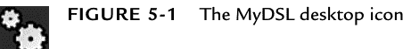

偶尔，您可能会看到扩展工具显示空白屏幕，而不是显示可用的扩展。此原因可能是您没有连接到互联网。如果您有可用的 Internet 连接，最可能是配置的 MyDSL 下载镜像无法访问。如果是这样，您可以访问 DSL 面板以选择不同的服务器进行使用。本章讨论了“更改下载仓库镜像”。

## 显示扩展工具

如果 DSL 能够连接到可用的仓库，MyDSL 扩展工具将显示从在线仓库提供的所有软件类别。类别包括测试区域，以及用于加载存储在本地磁盘上的扩展的浏览器。图 5-2 显示了 MyDSL 扩展工具的示例。

图 5-2 从扩展工具窗口显示可用的软件类别。

| Apps | Multimedia | Themes |
| --- | --- | --- |
| Games | Net | UCI |
| UNC | Gtk2 | System |
| WM_Apps | Testing | Load Local |

以下是出现在 MyDSL 扩展工具窗口中列的类别列表：

- **Apps**——应用程序的通用类别。
- **Multimedia**——用于音频视频播放和编辑的应用程序。
- **Themes**——用于自定义桌面外观和感受的包。
- **Games**——是的，你可以在 Linux 上玩游戏……
- **Net**——与网络和 Web 相关的任何内容。

# 官方 Damn Small Linux 书

- **UCI**——自包含可挂载应用程序的通用类别。
- **UNC**——Unionfs 可挂载应用程序的通用类别。
- **Gtk2**——需要 Gtk2 运行时的应用程序。
- **System**——用于管理、微调和监控系统的工具和实用程序。
- **WM_Apps**——替代窗口管理器和特定的窗口管理器工具。
- **Testing**——新创建扩展的通用类别（请小心）。
- **Load Local**——打开典型的文件浏览器访问保存在驱动器上的扩展。

> 注意：测试区域包含了来自 DSL 社区新提交的包。这些包应该被认为是实验性的，在移动到常规区域之前需要测试和反馈。请极度谨慎使用。

除了这 12 种扩展分类外，还有四种扩展类型：

- **`tar.gz`** 是最简单的类型。它必须安装到 DSL 唯一的原生可写区域。这意味着它必须解压到 `/opt`，因此必须是自包含的。
- **`.ds1`** 同样基于 `tar` 命令的使用。然而，这种扩展会导致文件系统的大部分变为可写。


> 注意：在早期的 DSL 版本（旧引导）中，只有 `/home`、`/opt` 和 `/tmp` 目录是可写的。大部分文件系统被挂载为只读。由于 `.ds1` 扩展类型只是被提取到文件系统的根目录，为了让这些安装生效，文件系统的更多部分必须是可写的。因此，安装 `.ds1` 扩展会触发检查，确认系统脚本 `mkwriteable` 已经运行以使整个文件系统可写。

- `.uci` 类型扩展是压缩的循环镜像，它们是自包含的并挂载在 `/opt` 目录下。所有的 `tar.gz` 扩展都可以轻松地转换为 `uci` 类型。
- `.unc` 代表我们最新的扩展类型。这种类型的扩展只能在支持 `unionfs` 系统的后期 DSL 版本上使用。这些扩展是挂载到基础文件系统的压缩循环。

# 第 5 章 使用 MySDL 扩展应用程序 107

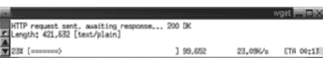

> 图 5-6 在下载过程中观察应用程序下载状态。

使用扩展工具（Extension tool）下载意味着程序将自动安装。这是安装扩展的首选方式，因为你不仅仅是为了下载它们备以后用。当扩展下载完成后，扩展工具会安装并设置所选应用程序，通常还会创建一个桌面图标。扩展工具还会对下载的扩展进行校验和校验，以确保下载完整。如果下载的文件损坏，会弹出消息通知你，以便你可以重试。

## 启动新安装的应用程序

扩展下载并安装后，回到桌面并调出系统菜单。并不是所有、但大多数应用程序都会在 MySDL 栏下列出菜单。某些应用程序不需要菜单即可启动，例如 GNU 工具集。图 5-7 显示了我们的新游戏列在菜单的 MySDL 栏下。

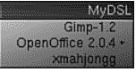

> 图 5-7 安装 Xmahjongg 后，MySDL 菜单中出现了一个新项目。

选择 Xmahjongg 项目以启动应用程序。同时请注意，许多 MySDL 扩展会自动提供桌面图标。图 5-8 显示了 Xmahjongg 的桌面图标。


> 图 5-8 Xmahjongg 图标已添加到你的桌面上以启动应用程序。

当扩展提供桌面图标时，只需点击即可启动应用程序。还要记得右键点击图标以查看是否有其他应用程序选项。图 5-9 显示了 Xmahjongg 扩展成功启动。

## 使用 MySDL 扩展工具访问本地存储的扩展

存储在本地磁盘或优 盘上的 MySDL 扩展可以使用扩展工具安装。`Load Local` 按钮会打开一个文件浏览器，你可以从中从任何挂载的磁盘上定位并安装扩展。图 5-10 显示了此加载本地 MySDL 扩展窗口。

FIGURE 5-9

成功启动 Xmahjongg 应用程序。

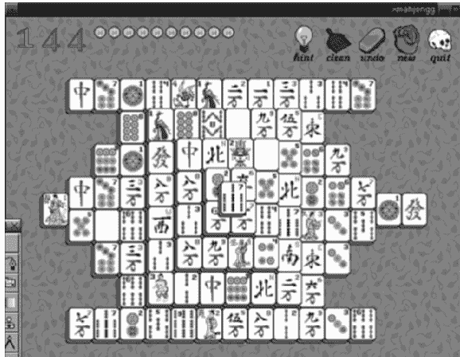

FIGURE 5-10

从磁盘查找并选择扩展以安装到 DSL。

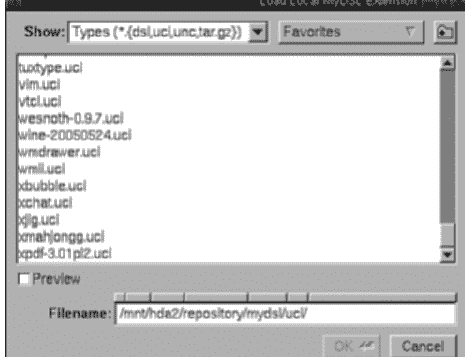

文件浏览器的用法与任何典型的文件浏览器一样。当然，在显示任何文件之前，必须挂载任何物理设备。在图中，我显示驱动器 `hda2` 已挂载在 `/mnt` 目录上，我已经导航到了相同的 UCI 集合。就像我现在访问我的本地磁盘一样。在这种情况下，使用本地扩展浏览器不需要访问互联网。

## 更改下载仓库镜像

Damn Small Linux 托管在互联网上的许多站点。主站是 Ibiblio (`http://distro.ibib.org`)。Ibiblio 是默认站点，Ibiblio 也有镜像（这对你来说是透明的）。尽管如此，有时访问 Ibiblio 可能会变慢。

其他站点也同意托管 DSL 仓库。许多镜像可能离你更近。事实上，某些镜像对你来说访问可能更快。出于这些原因，我们使得更改默认下载站点成为可能要更改默认下载站点，从桌面选择 DSL 图标并点击 Mirror（镜像）。会弹出一个对话框，如图 5-11 所示。

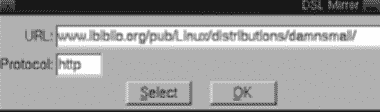

FIGURE 5-11 镜像选择对话框显示了用于获取 DSL 扩展的镜像。

在这里，你可以设置 Ibiblio 站点和默认协议。此时，你可以点击 `Select` 按钮查看当前的镜像站点列表，如图 5-12 所示。

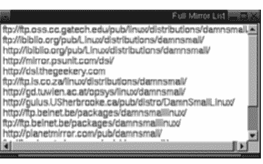

FIGURE 5-12 镜像选择。

你可以滚动此列表并选择任何镜像。镜像名称和协议都会通过其完整 URL 显示。当你选择了一个镜像，它会填充镜像选择对话框，你可以点击 `OK` 继续。这样做会保存你的新选择，适用于正常的备份和恢复程序。

镜像选择对话框不仅限于当前的镜像站点。事实上，你可以输入任何所需的站点和协议。此目的是你可能想在本地服务器上托管自己的仓库。这也可以适用于家庭内网、公司或培训中心。

## 通过浏览器访问 DSL 扩展

除了使用 MySDL 面板，你还可以通过浏览器直接查看和访问 DSL 扩展。

### 从官方网站获取扩展

可以在主页找到 MySDL 扩展：`http://www.damsmalllinux.org`

向下滚动直到看到 Download 链接。以下步骤描述了如何通过浏览器获取 MySDL。

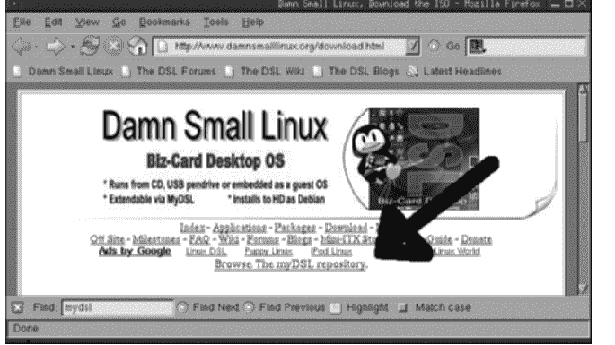

FIGURE 5-14

仓库界面。

### 通过 DSL 帮助屏幕获取扩展

使用浏览器访问仓库时，获取和安装不是自动的。图 5-14 显示了网页界面。

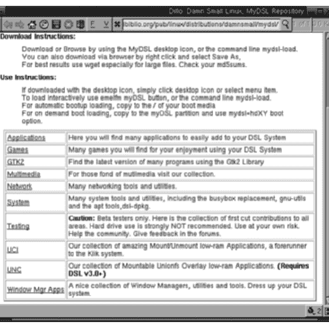

FIGURE 5-15

镜像选择屏幕。

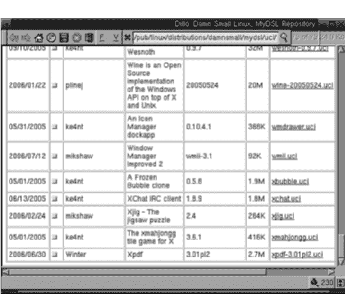

- 显示扩展仓库后，选择 UCI 链接。扩展将显示出来。顶部的列为日期、Lv、描述、版本、大小、信息和 mdsum（校验和）。Lv 列根据扩展类型进行颜色编码：绿色或蓝色表示可挂载类型（`uci` 和 `unc`）；黄色表示 `tar.gz`；红色表示 `.ds1`。这些颜色旨在直观提供对你的系统进行的资源消耗和修改。
- 向滚动 UCI 页面找到你需要的扩展，例如图 5-15 右下角的 `xmahjongg` 扩展。
- 点击 Info 列中的 info 链接以查看扩展页面。这一步至关重要；你应该始终阅读 info 文件。使用箭头返回可用扩展列表。
- 在应用程序列（右侧第三列）中右键点击扩展名称，然后在浏览器的菜单中选择“链接另存为”。

# 第5章 使用 MySQL 扩展应用程序 | 113

S. 右键点击对应你选择的 `md5sum` 链接。在将扩展程序和相应的 `md5.txt` 都下载到同一目录后，你必须手动验证下载的文件是否确实有效。要执行此操作，请使用命令：

```
$ md5sum -c extension_name.ext.md5.txt
```

`extension_name.ext` 被替换为你下载的扩展名称。你将看到结果为 OK。如果不是，你必须重新下载，直到扩展可以通过其校验和验证。

使用我们的自动化 GUI 下载系统可以避免所有这些额外和手动步骤。

## 保存你的扩展

由于 DSL 是作为一种游牧操作系统创建的，因此没有驱动器或设备会自动挂载。事实上，默认用户 `dsl` 没有访问写入物理设备的管理员权限。使用 MySQL 系统的默认是将扩展下载到 `/tmp`，该目录位于 RAM 磁盘（`/ramdisk`）。

在下载并尝试扩展后，你可能想要保留它。请记住，MySQL 扩展是考虑到现场 CD 用户构建的。因此，在重启或关机后，扩展将会消失。

要为你喜欢的扩展提供持久存储，意味着你必须挂载驱动器并将扩展复制到该位置。完成此任务有很多方法：

- 文件管理器——使用其中一个文件管理器保存文件在第 3 节“使用 DSL 应用程序”中讨论。对于此任务，你必须选择适当的文件管理器根版本。
- 关机时保存——我在关机时提供了一种安全保障。如果你有任何扩展仍然留在基于 RAM 磁盘的 `/tmp` 目录，对话框会提示你保存它们。如果你选择 `OK`，系统文件管理器 `elem` 将以 root 权限打开，允许你保存扩展。

记住，你可以使用 DSL 桌面右下角的挂载工具来挂载硬盘或优 盘上的分区，并在你想要安装扩展的位置。

## 启动时自动加载扩展

由于你将扩展以打包形式保存到持久存储器中，因此你必须在下次启动时指定如何加载它们。

MyDSL 扩展在启动过程中自动安装，方法是将它们存放在默认搜索的位置，或者将它们放在你选择的目录并使用启动时的 `myd1=location` 参数，其中 `location` 可以是 Linux 设备名。例如，`myd1=hda1` 或 `myd1=sda1` 分别代表你的 IDE 硬盘或 SCSI 硬盘（或优 盘）上的第一个分区。该位置甚至可以包含目录的完整路径（例如 `myd1=hda1/myd1`）。


首先，让我们讨论 DSL 的默认位置。通过使用默认值，你不需要启动选项，因此可以实现无干启动。

- 在启动端——第一个位置是你的 DSL 安装的顶层。这个顶层，无论是任何 DSL CD（在第 11 节讨论）还是仿真类型安装（在第 8 节“以其他方式安装”讨论），都是将你的扩展放在 `/KNOPPIX` 和 `/boot` 目录所在的位置。

- 在连接的存储设备上——第二个默认位置是在每个连接设备顶层中名为 `myds1` 的目录中。

使用这两个规范中的一个意味着你不需要使用启动选项。系统会扫描每个可用驱动设备以寻找 `myds1` 目录。

> 注意

指定设备名称可以获得更快的启动速度。你虽然无法获得无干启动，但也意味着系统不需要扫描目录来寻找 `myds1` 目录。

在 DSL 1.2 版本中，我引入了为 `mydsl` 扩展指定自定义目录的功能。如果你有多个组应用程序，并想在任何特定会话中选择加载一组，这会非常有用。

例如，你可以将扩展放在名为 `/mnt/hda2/games` 的目录中，并使用启动选项 `myd1=hda2/games`。你甚至可以拥有多组。在 `/mnt/hda2/office` 目录中拥有另一组扩展。然后，在启动时，决定是玩游戏还是工作。这种灵活性有助于为低内存机器节省资源。请记住，我们对 DSL 所做的一切都考虑了那些较旧、内存较小的机器。我们希望每个人都能享受 DSL。

如果你有多个扩展库，你只能在启动时指示一个（指示多个将导致只有在启动提示符处输入的最后一个被加载）。在 DSL 启动后，你可以使用 MyDSL 工具中的 `Local` 选项从其他目录添加扩展。

另一个设计目标是创建一个很少用扩展的可选菜单。你可以在 `mysdl1` 目录的子子目录下创建一个名为 `optional` 的目录。存储在此目录下的扩展不会自动加载，而是列在 MyDSL 桌面菜单中“安装可选扩展”类别下的独立菜单部分。这让你可以在会话期间随时访问安装这些扩展。

# 可选命令行扩展访问

除了提供良好且简单的 GUI 工具或常用的 Web 访问外，我还确保允许使用命令行工具。这些工具可以在你自定义的脚本中使用，进一步自动化对 MyDSL 库的访问。这些工具还可以用于在纯命令行环境中进行设置和安装。你可以选择在没有 Windows 系统的情况下运行 DSL。当然，你必须仔细阅读扩展的信息文件，以确认它可以在没有 X 的情况下运行。

这些工具允许熟悉 CLI 的用户快速访问库。让我们开始探索组成 MyDSL 系统的命令行工具。

# 通过 mysdl1-wget 命令远程访问

第一个工具是 `mysdl1-wget` 命令。这是一个使用 `wget` 命令从你喜欢的 DSL 镜像下载特定 MyDSL 扩展的工具。

用法：`mysdl1-wget full-extension-name repository`

`full-extension-name` 是 MyDSL 扩展的文件名及其扩展类型——例如 `xmahjong.uci`。`repository` 对应于我列出的库。这些库的列表显示在扩展工具的图 5-2 以及图 5-14 所示的链接中。如果你想将文件保存到特定的可写本地目录，你应该将目录作为文件名的一部分，如下例所示：

```
$ mysdl1-wget /mnt/hda2/mysdl1/xmahjong.uci uci
```

# 官方 Damn Small Linux 书

否则，文件将下载到当前目录。记住在你的主目录中存储扩展的危险性。

# 使用命令行进行本地访问

第二个工具是 `myd1-load` 命令。运行 `myd1-load xmahjong.uci` 会加载命名的扩展（在本例中为 `xmahjong.uci`）。你也可以使用完整路径名手动加载扩展。此命令很少使用，除非与上面的 `myd1-wget` 配合使用。它可以以脚本化的方式使用，但有了所有的启动选项，通常不需要它。

# 设置错误

正如我早早所说的，DSL 用户社区创建了 MyDSL 扩展集合。这些扩展程序不是 DSL 的官方部分。只有支持 MyDSL 的基础设施是官方的。尽管如此，用户社区还负责与扩展相关的任何问题进行更新和修正。

有时，使用扩展可能会影响你的系统。如果你刚刚下载了扩展，重启将消除它。如果扩展已经在持久存储器中并且是自动加载的一部分，你需要将其删除。

在某些情况下，基础设施似乎无法工作。通常，我发现以下是常见情况：

- 无响应或空白屏幕——检查你的 Internet 连接。也检查你是否可以访问下载镜像。

- 请挂载包含可选目录的媒体并重试——此消息通常在 `toram` 模式运行时出现。在 `toram` 模式下，媒体会被卸载。如果此类媒体上有可选目录，则其安装子菜单期望媒体已挂载以便访问存储的扩展。此消息也可能出现在手动下载的扩展损坏时，或者系统内存可能不足以支持所有已加载的扩展时。

## 总结

为了充分体验 DSL，你希望能够“扩展”你的应用程序选择。在本章中，我涵盖了使这一切成为可能的的设计决策历史。我将通过应用程序扩展的各种安装模式带你一步步进行。我将与你分享不仅是如何安装它们，还有如何保存它们、在何处以及为什么要保存，以及在使用不当时产生的影响。

# 第二部分

# 超越 Live 光盘的 DSL

- 第 6 章 运行原生优盘安装 121

- 第 7 章在 Windows 中运行嵌入式 DSL 139

- 第 8 章以其他方式安装 DSL 151

- 第 9 章 执行传统的硬盘安装 177

# 运行原生优盘安装

USB 安装有两种基本设置：USB-ZIP 和 USB-HDD。根据你电脑的 BIOS 设置，其中一种安装可能比另一种更好用。遗憾的是，USB 启动似乎没有统一标准。然而，看起来 USB-HDD 最终将成为标准。许多系统可以启动设置程序，但会拒绝另外一种。如果你有一台较旧的电脑（即 2001 年之前的电脑），很有可能是 BIOS 根本无法启动 USB。此外，许多系统本身是不一致的。例如，某些电脑要求你在 BIOS 中关闭快速启动（`quick boot`），而另一些电脑则要求开启 USB 键盘仿真（`USB keyboard emulation`）；其他系统则仅从电脑后部的 USB 端口启动。还存在优盘兼容性问题。支持 USB 2.0 标准的一些较新电脑将无法支持 USB 1.1 标准的旧优盘，而只支持 USB 1.1 标准的旧电脑则与 2.0 USB 优盘不兼容。如你所见，从 USB 启动可能会很复杂！如果你发现你的系统和硬件无法支持原生 USB 启动，你仍然可以使用基本软磁盘的选项，我们将在本章稍后部分讨论。

需要注意的是，在讨论中，所有的技术引用都是在 Damn Small Linux (DSL) 操作系统内进行的。这意味着我们假设在确定格式化的设备位置或运行我们的安装脚本时，你正在运行 Damn Small Linux——并不是所有 Linux 设备的注册方式都相同。

# USB 启动类型——两种 USB 布局的背景

本节概述了 USB 优盘安装前的格式化、两种 USB 安装的过程，以及为什么需要提供这两种安装方式的历史。此外还有关于如何在没有兼容 USB 的 BIOS 系统的旧电脑上在优盘上安装并运行 DSL 的几种类型。

# USB-ZIP

这是 Iomega 外部 Zip 驱动器使用的格式。当我们设置优盘通过 USB-ZIP 启动时，我们是在模拟旧 Iomega 驱动器的布局；实际上，我们正在欺骗 BIOS 让它认为正在启动一个旧的 Zip 驱动器。我们通过将 USB 优盘分成两个分区并保持第一个分区较小来实现。分区的几何结构需要 64 个头（`heads`）和 32 个扇区（`sectors`）。如果你不知道这意味着什么，不用担心——我们的安装脚本会自动进行计算。

# USB-HDD

相比之下，我们的 USB-HDD 格式使用单个 `fat` 分区。这是一个更简单的设置，兼容其他只识别优盘第一个分区的操作系统。

你选择的方法取决于你的硬件支持情况。如果你正在制作一个用于便携式用途的启动优盘，请选择 USB-HDD，因为它的硬件兼容性高于 USB-ZIP。此外，如果你的优盘兼任便携式存储设备，你的 Windows 操作系统将能够看到存储设备的完整容量。

# 确定你的 USB 驱动器的物理地址

运行 Damn Small Linux 时，大多数系统上的大多数 USB 驱动器会被标记为 `sd(something)`，如 `sda`、`sdb`、`sdc` 等。如果你的系统中有多个优盘，第一个驱动器将标记为 `sda`，第二个驱动器将标记为 `sdb`。第一个优盘的第一个分区将称为 `sda1`，第二个优盘的第三个分区将称为 `sdb3`，依此类推。这在 99% 的情况下都是成立，但为了避免混淆，运行安装脚本时电脑里只保留一个 USB 设备。

# 第 6 章 运行原生优盘安装


在准备将 Damn Small Linux 安装到优盘时，请在已插入优盘的情况下从光盘启动。这样，设备将在启动过程中被检测到，并在 `dmesg` 和 `/etc/fstab` 以及挂载点中被识别，因为挂载点依赖于这些设备的数据。


USB-ZIP 和 USB-HDD 安装脚本都有列出可用 USB 存储设备的选项。如果你不确定优盘的逻辑位置，请在脚本中调用此选项以防万一。如果你意外格式化了错误的驱动器，该驱动器上的所有数据都可能会丢失。

如果你打算提前运行 `cfdisk`，你需要在运行安装脚本之前知道你的设备。为此，你需要查看 `dmesg` 的输出。

# 安装前的实际准备

在进行任何操作之前，请按照前一节所述，使用 `cfdisk` 创建单个 FAT16 分区以确保你的优盘已就绪。建立之后，导航到 `Apps -> Tools -> Install to USB Pen Drive` 并点击 `For USB-HDD Pen Drive` 来选择 USB-HDD 脚本；或者如果你正在运行启动安装脚本，输入 `7` 然后按 `Enter/Return`。你将看到 USB-HDD 安装脚本，它会提供完成 USB-HDD 安装所需的快速概述。

我想花时间和你聊聊在 USB-ZIP 和 USB-HDD 脚本上投入的工作。Robert 在这些脚本进入 Small Linux ISO 之前对它们投入了大量工作。此外，从优盘运行 Small Linux 所需的所有内容都包含在我们的 50MB 基础文件中。因此，无需连接互联网下载额外文件。对于 Small Linux 用户来说，幸运的是，多步骤过程已被浓缩为回答几个问题。

# 启动：安装

运行本章概述脚本有两种方法：一种是通过 DSL 桌面内部的终端窗口，另一种是专门编写用于作为安装启动选项运行的 shell 脚本。本章中的示例是在桌面的终端窗口中完成的，以便向你展示屏幕；然而，运行启动安装选项有一些优势。

以下是这些优点：

- 速度更快。通过不启动完整的桌面，缩短了启动时间。
- 内存更少——再次，没有桌面的开销。
- 如果你需要制作启动软磁盘，无需手动下载任何内容——脚本会处理。

要访问安装脚本，请在启动提示符输入 `install`。

启动过程完成后，屏幕会显示安装应用程序。显示内容可能类似于图 6-1 所示。

图 6-1 安装脚本采用 USB 安装。

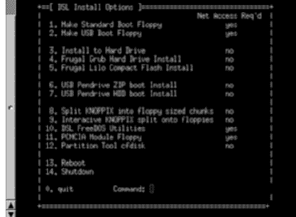

# USB-HDD

在开始 USB-HDD 安装之前，请按照前一节所述，使用 `cfdisk` 创建单个 FAT16 分区以确保你的优盘已就绪。建立之后，导航到 `Apps -> Tools -> Install to USB Pen Drive` 并点击 `For USB-HDD Pen Drive` 来选择 USB-HDD 脚本；或者如果你正在运行启动安装脚本，输入 `7` 然后按 `Enter/Return`。你将看到 USB-HDD 安装脚本，它会提供完成 USB-HDD 安装所需的快速概述。

## 第 6 章 运行原生 U 盘安装

你现在应该看到一个终端窗口，其上的对话框如图 6-2 所示。

图 6-2 USB-HDD 安装脚本启动对话框。


让我们按照显示顺序查看对话框的各个部分。

- 1. 你的 BIOS 必须支持 USB-HDD 启动。

正如本章开头提到的，你需要确定你的系统 BIOS 是否支持 USB-HDD 启动。许多系统不支持，但更多、更现代的计算机都支持这种启动方式。

- 2. 将创建一个单个 FAT 分区。

这是 USB-HDD 和 USB-ZIP 安装之间的主要区别。USB-HDD 的分区表非常简单，不需要设置任意分区表来欺骗 BIOS，使其认为它正在从 Zip 驱动器启动。

- 3. 不要挂载你的 U 盘。

请不要这样做！如果你在挂载状态下运行此脚本，可能会损坏你的 U 盘。

接下来是一个警告，说明 Damn Small Linux 对任何硬件或数据丢失不负责——你继续操作将对自己的行为承担全部责任，并且知道如果发生任何损坏，DSL 的开发者无法承担责任。如果你对运行此脚本需要承担自己的责任感到不安，那么直接关闭窗口即可！

还在那里？太棒了！让我们继续……

### Damn Small Linux 官方书籍

紧接着的一行写着：

显示你的 USB 存储设备信息日志：

输入 `y` 并按回车键。

输入 `y` 并按回车键。你会看到一个格式良好的输出，其中 U 盘的物理位置用绿色高亮显示，如图 6-3 所示。

#### 图 6-3 U 盘位置用绿色高亮。


你应该已经对 U 盘在 Damn Small Linux 中如何被识别有了很好的了解了，因为在运行 `cfdisk` 之前你已经花时间寻找了设备——这是我在章节开头建议的初步步骤。希望此打印输出能确认你之前获得的信息。

如果所有指示都吻合，并且看起来你的 U 盘确实被识别为你预期的设备，请继续输入设备名称（在图中，设备被识别为 `sda`，因此在示例中，你将输入 `sda` 并按回车键）。请注意，这些问题没有默认答案，你需要为脚本提供信息。

下一个对话框询问这是否为升级——意味着你正在 U 盘上**重新安装** Damn Small Linux——而安装则意味着你是第一次将 Damn Small Linux 安装到 U 盘上。如果你是在进行升级，输入 `u` 并按回车键。如果是新安装，输入 `i` 然后按回车键。

接下来，脚本询问你是从 `[LiveCD]`、`[F]ile`（文件，即你下载的文件）还是从 `[W]eb`（即网络，即意味着脚本将自动为你下载最新版本）安装 DSL。如果你选择 LiveCD，你不需要连接互联网，也不需要下载任何额外文件。

接下来你将看到一个关于驱动器位置的问题，如图 6-4 所示。

### 图 6-4 选择 DSL 镜像的位置。


在此处，你有机会添加启动选项，如 `toramam`、`ssh` 或 `vga=normal`。有很多启动选项可以探索；如果你对运行 Damn Linux 的可启动 U 盘有特殊需求，请花时间研究它们。我们的默认设置是合理的，如果你不想花时间研究选项，直接运行我们提供的配置即可——它在大多数计算机上都能运行。输入你的启动选项（如果有）并按回车键。（要探索可用的启动选项及其使用方法，请参阅第 2 章“启动 DSL”）

接下来，你被要求选择语言选项：德语输入 `de`；西班牙语输入 `es`；以此此类推。如果你想要英语，请留空此选项。选择好后，按回车键。

脚本现在询问你是否准备好继续。如果是，输入 `y` 并按回车键。它会再次询问你是否真的要继续，并警告你你正要破坏所选设备上的所有数据。这是在严重情况发生前退出脚本的最后机会；如果你有任何顾虑，现在是你退出脚本的最后机会。

脚本现在准备好格式化你的 U 盘。这是驱动器上所有数据将被擦除点，也是你退出的最后机会，如图 6-5 所示。

接下来，脚本格式化 U 盘上的单个分区，在 U 盘分区上应用 Syslinux，然后在该分区中设置系统镜像。如果一切顺利，你将看到绿色的“USB installation has completed”，你只需要按回车键退出脚本即可。

### Damn Small Linux 官方书籍

#### 图 6-5 返回点——在进一步操作之前双击你的设置。


#### 图 6-6 看起来是这样的。


#### 图 6-7 你的驱动器至少有 64MB。


- 1. 你的驱动器至少要有 64MB。
- 2. 你的驱动器将被划分为两个分区，
- 3. 第一个分区是可写的并用于存放 DSL，
- 4. 剩余分区将用于备份。

#### 图 6-8 升级的位置。


接下来，系统会询问你是否需要任何特殊的启动选项，例如 `toram`、`ftp` 或 `vga=normal`。DSL 有许多启动选项，这些选项可能有用，或者可以帮助在特定的硬件上启动；然而，开发者为大多数用户的标准启动配置选择了最合理的默认值。（请参阅第 2 章，Robert 在该章节概述了可用的启动选项。）

可以在提示时添加变量来自定义启动过程，如图 6-9 所示。


图 6-9 在此处可以输入特殊的启动选项。


在紧下一个问题中，你可以选择英语以外的其他语言进行支持。英语是 Damn Small Linux (`DSL`) 的默认语言，但也对其他语言提供了一些支持。在选择 USB 启动安装之前，先从带有所需语言选项的 Live CD 启动是一个好主意。这样，你可以确认所选语言的一切运行运行都符合你的预期。在提示时输入你的语言选择，如图 6-10 所示；如果选择是“English”，则留空。


图 6-10 输入你的语言选择。

下一个提示如图 6-11 所示（红色部分），显示了即将格式化并写入的设备——这是点。如果你输入 `y`，脚本将继续安装过程；如果你输入 `y` 以外的任何内容并按回车，脚本将退出。请双重检查确保物理设备显示正确，如果你确认看起来无误，请输入 `y` 并按回车。

### 图 6-11 你在安装过程开始前退出脚本的机会。


从这里开始，脚本开始施展魔力了。首先，它设置分区几何结构，并格式化启动分区和存储分区。接下来，脚本在第一个分区中设置引导程序、启动镜像和系统镜像。最后，脚本完成，除了按任意键退出程序外，没有其他需要操作的。你的 U 盘应该准备好启动了。脚本结束时，对话框将如图 6-12 所示。

### 图 6-12 如果进展顺利，你的脚本应该以类似的对话框结束。


## 当电脑 BIOS 不支持 USB 启动时该怎么办

如果你要在不支持 USB 启动的电脑上使用 U 盘，你有两个选项：

- 使用我们专门创建的 `bootfloppy-usb.img` 从软盘启动。
- 从带有特殊启动参数的 CD 启动，该参数告诉 Syslinux 从 盘所在的设备位置访问系统镜像。

## 为 U 盘创建启动软盘

你需要的第一的第一是下载 USB 启动软盘镜像。你可以在任何下载站点找到该镜像。其中一个地址是：

`ftp://ibiblio.org/pub/Linux/distributions/damnsmall/current/bootfloppy-usb.img`

使用 `wget` 下载 USB 启动软盘镜像后，你可以在终端窗口中执行此命令来格式化软盘：

```
dd if=bootFloppy-usb.img of=/dev/fd0
```

配备了新启动的软盘驱动器后，即使你电脑 BIOS 不支持启动，你也可以启动 U 盘。

## 使用 LiveCD 启动 U 盘

50MB 的冰环 CD 比软盘更小且更容易携带。对于许多人来说，使用可启动 U 盘然后使用微型 CD 作为软盘的替代启动媒介可能更容易。

当你使用无法原生从设备启动的电脑时，可以通过启动 CD 和 U 盘来模拟 USB 启动的行为。我们将回顾在启动提示处可以使用的一些选项，以利用你的 U 盘。

要从 U 盘使用 MyDSL 扩展，输入以下内容：

```
dsl mysds1=sda1
```

要从 U 盘使用备份/恢复文件，输入以下内容：

```
dsl restore=sda1
```

要访问 U 盘上的镜像，输入以下内容：

```
dsl frhmd=/dev/sda1
```

如果你的 CD 和 U 盘上都是相同版本的 DSL，则实际上没有必要执行 `frhmd=/dev/sda1` 命令；但如果你的 CD 上的 DSL 版本比 U 盘旧，你可能想这样做。通过使用 `frhmd` 命令，你不需要每次 DSL 发布新版本都重新刻录 CD。

你还可以通过在启动提示处使用所有三个命令，以几乎相同于从 U 盘新启动的方式组合访问访问 U 盘：

```
dsl frhmd=sda1 mydsl=sda1 restore=sda1
```

当你携带 DSL 移动时，有很多混合的可能性。你可以进行组合和搭配；例如，你可以选择从 U 盘使用备份/恢复，并从硬盘访问 MyDSL 扩展，甚至可以从 FTP 服务器下载一个加密的恢复文件。若要了解更多关于这些强大且实用的选项的详细信息，请参阅第 5 章“使用 MyDSL 扩展应用程序”以及第 4 章“配置和保存 DSL 设置”（该章节中包含备份和恢复选项）。

## 安装后：设置默认备份/恢复和 MyDSL 分区

在 DSL V3.3 之前，`syslinux.cfg` 中的备份/恢复分区和 MyDSL 位置是在启动时由安装脚本进行编码和引用的。随着时间的推移，显而易见系统注册 USB 存储设备的方式各异。有时系统在安装过程中“看到”设备位于一个位置，而在随后的启动过程中又将其视为不同的设备。因此，已经采取措施使两种类型的 U 盘安装都具有设备无关性。启动过程会探测可用设备以寻找备份文件和 `mysdsl` 目录。备份恢复过程现在对用户是透明的。

# Damn Small Linux 官方指南

## 关于 DSL-embedded.zip 的说明

我们提供了一个带有 Qemu 的 DSL 软件包；关于该设置的详细细节将在第 7 章“在 Windows 中运行 DSL Embedded”中进行讨论。然而，我们想简单说明一下某些用户正在尝试的操作，让他们的 DSL-embedded.zip U 盘也能在 Windows 平台内从 BIOS 启动。结果并不一致，但如果你想尝试，需要先下载 Syslinux 的 `win32` 可执行版本。

你可以下载 Windows 版本的 Syslinux：

```
http://www.kernel.org/pub/linux/utils/boot/syslinux/
```

将 `syslinux.exe` 复制到 C 盘的根目录。

打开 DOS 提示符并输入以下内容：

```
syslinux.exe h:
```

Windows 会识别你的 U 盘为 `h:`。如果它是其他字母，请使用该字母。

DSL 中使用的 Syslinux 版本不适用于非常大的 U 盘。它可以在 1GB 及更小的驱动器运行。如果你有一个超大硬盘，可以下载较新版本的 Syslinux，它与超过 1GB 的驱动器兼容。

你可以在此处找到最新版本：

```
http://www.kernel.org/pub/linux/utils/boot/syslinux/
```

## Wiki 的进展

最后，值得注意的是，我们的用户群体正在开发一些替代安装方法。如果你兴趣探索最新的黑客技巧（hacks），请参考我们的 wiki 页面：

```
http://damnsmalllinux.org/wiki/index.php/Installing_to_a_USB_Flash_Drive
```

## 总结

我们概述了在 U 盘上安装 DSL-Embedded 所需步骤、修改默认设置的方法（包括使用 MyDSL 扩展和自定义启动选项）。我们还回顾了如何在没有兼容 BIOS 的系统上使用你的 U 盘。

我们希望你发现 Damn Small Linux 是一个宝贵的旅行伴侣。携带一个 U 盘比携带笔记本电脑方便得多。所以，下次当你身在在外时，尝试把你的桌面电脑放在口袋里，而不是放在公文包里。

本页特意留白

# 第 7 章

## 在 Windows 中运行 DSL Embedded

Damn Small Linux 快速且轻量。这不仅让 DSL 成为旧硬件的热门选择，还使其成为在虚拟环境中运行的宠儿。

在虚拟环境中运行操作系统会有重大的开销。这是因为用户在接入嵌入式系统之前，必须运行原生（或顶层操作系统）以及仿真层；因此，在虚拟环境中运行操作系统时，我们有多个资源分配层。

从逻辑上讲，操作系统越轻、越小，那么当它在虚拟环境中运行时，对资源的占用就越少。这就是为什么 Damn Small Linux 如此适合这种环境。

在本章中，我们将检查在 Qemu 和 VMPlayer 中运行 Damn Small Linux 的细节。目前还有其他仿真程序可用，但这两个程序由于其低成本（$0）、易于使用和性能良好而受欢迎。

## 在 QEMU 中运行 DSL

Qemu 是一个非常强大的机器模拟器。它能够模拟不同的计算机架构。例如，你可以在普通 PC 上运行为 ARM 处理器设计的操作系统。与其他仿真软件相比，Qemu 实现了良好的性能来完成其开发者所称的 *动态翻译*（dynamic translation）。

动态翻译的技术细节超出了本概述的范围。然而，它本质上是一种技术，允许即使主机操作系统运行在不同的 CPU 架构上，客代码也能在原生操作系统中执行。

我们使用 Qemu 的方式与在异构处理器上运行操作系统相比要简单得多。我们将在同样为 x86 处理器设计的宿主机操作系统（Microsoft Windows）中，运行一个专为 x86 处理器设计的操作系统（Damn Small Linux）。然而，在这种设置下，可能性是巨大的。通过 Qemu，用户可以在任何 PC 上使用 DSL 的全部功能，包括网络工具以及它们字面上依赖的所有命令行优良功能。图 7-1 显示了在 Windows XP 宿主机上运行 DSL 的示例。


图 7-1 Damn Small Linux可以在 Windows XP 宿主机系统上的 Qemu 中运行。

DSL+Qemu 的另一个流行用途是在可能不是最安全的计算机上进行相对隐私的工作。虽然它不像在 BIOS 级别运行 DSL（即从 LiveCD 运行或从 U 盘启动）那样安全，但这种设置增加了一个额外的混淆层，至少可以防止技术欠缺的人干涉你的事务。

我经常发现，当我被困在 Microsoft Windows 电脑上一天并开始想念我的 GNU/Linux 工具时，与其经历下载 Cygwin（一组模拟 Unix 环境的免费工具集）的麻烦，我只需要下载 `dsl-embedded.zip` 文件，我需要的一切都准备就绪——它既快速又方便。

Qemu 是一个非常有能的机器模拟器。它能够模拟不同的计算机架构。例如，你可以在普通 PC 上运行一个为 ARM 处理器设计的操作系统。与其他仿真软件相比，Qemu 实现了良好的性能来完成其开发者所称的*动态翻译*。

动态翻译的技术细节超出了本概述的范围。然而，它本质上是一种技术，允许即使主机操作系统运行在不同的 CPU 架构上，客代码也能在原生操作系统中执行。

我们使用 Qemu 的方式与在异构处理器上运行操作系统相比要简单得多。我们将在同样为 x86 处理器设计的宿主机操作系统（Microsoft Windows）中，运行一个专为 x86 处理器设计的操作系统（Damn Small Linux）。然而，在这种设置下，可能性是巨大的。通过 Qemu，用户可以在任何 PC 上使用 DSL 的全部功能，包括网络工具以及它们字面上依赖的所有命令行优良功能。图 7-1 显示了在 Windows XP 宿主机上运行 DSL 的示例。


图 7-1 Damn Small Linux可以在 Windows XP 宿主机系统上的 Qemu 中运行。

DSL+Qemu 的另一个流行用途是在可能不是最安全的计算机上进行相对隐私的工作。虽然它不像在 BIOS 级别运行 DSL（即从 LiveCD 运行或从 U 盘启动）那样安全，但这种设置增加了一个额外的混淆层，至少可以防止技术欠缺的人干涉你的事务。

我经常发现，当我被困在 Microsoft Windows 电脑上一天并开始想念我的 GNU/Linux 工具时，与其经历下载 Cygwin（一组模拟 Unix 环境的免费工具集）的麻烦，我只需要下载 `dsl-embedded.zip` 文件，我需要的一切都准备就绪——它既快速又方便。

# 使用 DSL Embedded

Qemu 是开源的。这种打包方式对我们来说非常有用，因为它允许我们为 DSL 打包提供一个可以随处运行的界面。 DSL 嵌入式 U 盘的各种选项。

## 使用 DSL 嵌入式版

Qemu 是开源的。这种打包方式对我们来说非常有用，因为它允许我们为 DSL 打包提供一个可以随处运行的界面。 DSL 嵌入式 U 盘的各种选项。

## 使用 DSL 嵌入式版

Qemu 是开源的。这种打包方式对我们来说非常有用，因为它允许我们为 DSL 打包提供一个可以随处运行的界面。 DSL 嵌入式 U 盘的各种选项。

# 设置并使用虚拟硬盘

大多数对创建虚拟硬盘感兴趣都是从 U 盘运行 DSL-Embedded。本部分将使用 U 盘。

要创建虚拟硬盘，你将使用 `dsl-embedded.zip` 文件中包含的 `qemu-img.exe` 程序。在解压后，该程序位于 Qemu 目录或文件夹中。

以下步骤描述了如何创建虚拟硬盘：

- 打开 DOS 窗口并导航到 U 盘内的 qemu 文件夹。在 MS DOS 中，导航命令是 `CD`。如果你的 U 盘被 Microsoft Windows 识别为 E 盘，你应该输入：

```
CD E:\qemu\
```

- 使用 `qemu-img.exe` 程序创建虚拟硬盘。此硬盘将在你的 U 盘上具有物理存在；你会在那里看到它（此虚拟硬盘将在稍后选择 `dsl-vhd.bat` 文件启动 dsl-embedded 时使用）。

导航到 Qemu 文件夹后，你需要使用 `qemu-img.exe` 创建你的虚拟硬盘。大小取决于 U 盘上的可用空间，由你决定选择最合适的。

> 注意
>
> 请记住，这个硬盘在这个上是虚拟的，因为它不是真实的驱动器（相反，它是 U 盘上的一个文件）。虚拟硬盘实际上是真实的，因为它占用了 U 盘上的真实空间，你无法使用该空间存储非 DSL 文件。

使用 `qemu-img.exe` 的命令是：

```
E:\qemu> qemu-img.exe create harddisk SIZE
```

其中 `SIZE` 是你想要的虚拟硬盘实际大小。对于 64MB 的虚拟硬盘，输入：

```
E:\qemu> qemu-img.exe create harddisk 64M
```

## 第 7 章 在 Windows 中运行嵌入式 DSL

对于一个 500MB 的虚拟硬盘，输入：

```
E:\qemu> qemu-img.exe create harddisk 500M
```

如果由于某些特殊原因，你无法导航到 U 盘上的 `qemu` 目录，你可以在命令中使用完整路径：

```
C:\> E:\qemu-img.exe create E:\qemu\harddisk 64M
```

必须记住，虚拟硬盘的名称实际上必须为 `harddisk`，因为在 `dsl-vhd.bat` 文件中是这样引用的。创建好 `harddisk` 镜像后，直接关闭 DOS 窗口。

- 3. 运行以下命令，该命令将在二级模式（命令行提示符）启动 DSL，以执行几个步骤来格式化你的虚拟硬盘（这样 DSL-Embedded 将开始使用它进行文件恢复）：

```
qemu> 1st-boot.bat
```

在启动阶段你可能会看到一些错误，因为虚拟硬盘尚未正确格式化。

- 4. 启动过程完成后，将虚拟硬盘格式化为 Linux 原生的 ext2 文件系统。在 Linux Shell 命令行提示符下，输入

```
# mke2fs /dev/hdb
```

```
mke2fs warning:
Warning: /dev/hdb is entire device, not just one partition! Proceed anyway? (y/n) y
```

你会收到一个警告，因为你正在告诉 `mke2fs` 格式化整个虚拟驱动，而不仅仅是单个分区。

- 5. 输入 `y` 并按回车。在 `mke2fs` 运行后，挂载驱动并将 `cloop` 模块拷贝到接入点。Damn Small Linux（DSL）会自动扫描查找模块。

- 6. 挂载新的虚拟硬盘：

```
# mount /mnt/hdb
```

- 7. 创建 `myd1` 和 `myd1/modules` 目录：

```
# mkdir /mnt/hdb/myd1
# mkdir /mnt/hdb/myd1/modules
```

- 8. 拷贝 `cloop` 模块：

```
# cp /KNOPPIX/lib/modules/2.4.26/kernel/drivers/block/cloop.o 
# /mnt/hdb/mydys1/modules/
```

- 9. 输入此命令关闭 DSL：

```
# shutdown -now
```

你自己的硬盘已准备好开始使用 `dsl1-vhd.bat`！运行 `dsl-vhd.bat` 时，备份和恢复将自动使用 `/mnt/hdb`，你的 `mydsl1` 扩展将在 `/mnt/hdb/mydys1` 访问。

> 注意：当你第一次运行正常的 `dsl1-vhd.bat` 时，会运行 X 设置脚本并询问你偏好的分辨率设置。如果你只想使用默认设置，按 Tab 键突出 Cancel（取消）按钮，然后按 Enter 退出脚本。

如果你想保存扩展，请访问 `/mnt/hdb` 并将扩展下载到 `/mnt/hdb/mydys1`。

屏幕右下角的工具将无法识别你的虚拟硬盘。要挂载它，请打开终端窗口并输入以下内容：

```
# sudo mount /mnt/hdb
```

# 在虚拟环境中访问原生文件

Qemu 的一个新功能是在虚拟机启动时访问你的原生文件。`pendrive.bat` 文件设计用于 U 盘，该 U 盘既用于原生 BIOS 启动也通过 Qemu 运行虚拟环境。

Qemu 允许访问你的文件，因此你可以加载默认设置并访问你的扩展和个人文档。然而，通常情况下你无法从虚拟环境中保存它们。

但是，通过 `SMBClient`，我们可以通过 Windows 网络共享获取写入权限。

以下是 `dsl1-embedded.zip` 存档中 readme 中的步骤：

- 1. 在 Windows 中，“共享”你的 U 盘。


## 使用带有 DSL-Embedded 的 U 盘进行原生 BIOS 启动

- 2. 在 Windows 中，挂载机器的 IP 地址。要执行此操作，打开 DOS 窗口（命令行）并输入 `ipconfig`。
- 3. 使用 `pendrive.bat` 启动 DSL。
- 4. 从运行在 Qemu 中的 DSL 中，在你的主目录下添加文件并更改设置。
- 5. 从 DSL 将你需要的任何扩展下载到 `/cdrom/mydsl1` 目录。
- 6. 从 DSL 点击 `DSLpanel`，点击 `Backup/Restore`（备份/恢复），并点击 `Backup`（备份）。
- 7. 从 DSL 菜单中选择 `Apps->Net->SMBclient` 并输入你的验证规范以连接（域、机器、共享、名称和密码）。然后，从 SMB 提示符输入以下内容：

```
smb:\> lcd /cdrom
smb:\> put backup.tar.gz
smb:\> lcd mydsl
smb:\> cd mydsl
smb:\> put just_downloaded_extension
```

（对所有新下载的扩展重复操作）

```
smb:\> quit
```

- 8. 关闭带有 DSL-Embedded 的 U 盘以

此主题在第 6 章“运行原生 U 盘安装”中有介绍，但我想提到在 BIOS 之前如何将 Syslinux 应用于驱动器。有一个版本可以在 Windows 下使用的 Syslinux，但我们收到的反馈是它有时对用户效果不佳。你随时可以通过从书中提供的 LiveCD 启动 Damn Small Linux 来设置 Syslinux。

务必阅读 `dsl-embedded.zip` 找到 `readme.txt`。如果你遇到困难，那里的提示可能会很有用。

## 使用 Qemu 提高 Qemu 性能

所以，你认为拥有一个嵌入式 Linux 系统非常酷，但希望速度能再快一点？Qemu 开发者为你提供了一个修复。

Qemu 是一个加速器，它运行良好。在我的实验中，我将启动时间缩短了一半。这是一个巨大的进展。DSL-Embedded 的性能提升非常显著。

> 注意：当你第一次运行正常的 `dsl1-vhd.bat` 时，会运行 X 设置脚本并询问你偏好的分辨率设置。如果你只想使用默认设置，按 Tab 键突出 `Cancel`（取消）按钮，然后按 Enter 退出脚本。

如果你想保存扩展，请访问 `/mnt/hdb` 并将扩展下载到 `/mnt/hdb/mydys1`。

屏幕右下角的工具将无法识别你的虚拟硬盘。要挂载它，请打开终端窗口并输入以下内容：

```
# sudo mount /mnt/hdb
```

## 在虚拟环境中访问原生文件

Qemu 的一个新功能是在虚拟机启动时访问你的原生文件。`pendrive.bat` 文件设计用于 U 盘，该 U 盘既用于原生 BIOS 启动也通过 Qemu 运行虚拟环境。

Qemu 允许访问你的文件，因此你可以加载默认设置并访问你的扩展和个人文档。然而，通常情况下你无法从虚拟环境中保存它们。

但是，通过 `SMBClient`，我们可以通过 Windows 网络共享获取写入权限。

以下是 `dsl1-embedded.zip` 存档中 readme 中的步骤：

- 1. 在 Windows 中，“共享”你的 U 盘。
- 2. 在 Windows 中，挂载机器的 IP 地址。要执行此操作，打开 DOS 窗口（命令行）并输入 `ipconfig`。
- 3. 使用 `pendrive.bat` 启动 DSL。
- 4. 从运行在 Qemu 中的 DSL 中，在你的主目录下添加文件并更改设置。
- 5. 从 DSL 将你需要的任何扩展下载到 `/cdrom/mydsl1` 目录。
- 6. 从 DSL 点击 `DSLpanel`，点击 `Backup/Restore`，并点击 `Backup`。
- 7. 从 DSL 菜单中选择 `Apps->Net->SMBclient` 并输入你的验证规范以连接（域、机器、共享、名称和密码）。然后，从 SMB 提示符输入以下内容：

```
smb:\> lcd /cdrom
smb:\> put backup.tar.gz
smb:\> lcd mydsl
smb:\> cd mydsl
smb:\> put just_downloaded_extension
```

（对所有新下载的扩展重复操作）

```
smb:\> quit
```

- 8. 关闭带有 DSL-Embedded 的 U 盘以


你自己的硬盘已准备好开始使用 `dsl1-vhd.bat`！运行 `dsl-vhd.bat` 时，备份和恢复将自动使用 `/mnt/hdb`，你的 `mydsl1` 扩展将在 `/mnt/hdb/mydys1` 访问。


> 注意：当你第一次运行正常的 `dsl1-vhd.bat` 时，会运行 X 设置脚本并询问你偏好的分辨率设置。如果你只想使用默认设置，按 Tab 键突出 `Cancel`（取消）按钮，然后按 Enter 退出脚本。

如果你想保存扩展，请访问 `/mnt/hdb` 并将扩展下载到 `/mnt/hdb/mydys1`。

屏幕右下角的工具将无法识别你的虚拟硬盘。要挂载它，请打开终端窗口并输入以下内容：

```
# sudo mount /mnt/hdb
```

## 在虚拟环境中访问原生文件

Qemu 的一个新功能是在虚拟机启动时访问你的原生文件。`pendrive.bat` 文件设计用于 U 盘，该 U 盘既用于原生 BIOS 启动也通过 Qemu 运行虚拟环境。

Qemu 允许访问你的文件，因此你可以加载默认设置并访问你的扩展和个人文档。然而，通常情况下你无法从虚拟环境中保存它们。

但是，通过 `SMBClient`，我们可以通过 Windows 网络共享获取写入权限。

以下是 `dsl1-embedded.zip` 存档中 readme 中的步骤：

- 1. 在 Windows 中，“共享”你的 U 盘。
- 2. 在 Windows 中，挂载机器的 IP 地址。要执行此操作，打开 DOS 窗口（命令行）并输入 `ipconfig`。
- 3. 使用 `pendrive.bat` 启动 DSL。
- 4. 从运行在 Qemu 中的 DSL 中，在你的主目录下添加文件并更改设置。
- 5. 从 DSL 将你需要的任何扩展下载到 `/cdrom/mydsl1` 目录。
- 6. 从 DSL 点击 DSLpanel，点击 Backup/Restore，并点击 Backup。
- 7. 从 DSL 菜单中选择 Apps->Net->SMBclient 并输入你的验证规范以连接（域、机器、共享、名称和密码）。然后，从 SMB 提示符输入以下内容：

```
smb:\> lcd /cdrom
smb:\> put backup.tar.gz
smb:\> lcd mydsl
smb:\> cd mydsl
smb:\> put just_downloaded_extension
```

（对所有新下载的扩展重复操作）

```
smb:\> quit
```

- 8. 关闭带有 DSL-Embedded 的 U 盘以

## 使用带有 DSL-Embedded 的 U 盘进行原生 BIOS 启动

此主题在第 6 章“运行原生 U 盘安装”中有介绍，但我想提到在 BIOS 之前如何将 Syslinux 应用于驱动器。有一个版本可以在 Windows 下使用的 Syslinux，但我们收到的反馈是它有时对用户效果不佳。你随时可以通过从书中提供的 LiveCD 启动 Damn Small Linux 来设置 Syslinux。

务必阅读 `dsl-embedded.zip` 找到 `readme.txt`。如果你遇到困难，那里的提示可能会很有用。

## 使用 Qemu 提高 Qemu 性能

所以，你认为拥有一个嵌入式 Linux 系统非常酷，但希望速度能再快一点？Qemu 开发者为你提供了一个修复。

Qemu 是一个加速器，它运行良好。在我的实验中，我将启动时间缩短了一半。这是一个巨大的进展。DSL-Embedded 的性能提升非常显著。

在 VMPlayer 中运行 DSL 时，如果你的电脑上这些服务正常工作，那么你应该可以访问互联网和音频。VMPlayer 配合 DSL 使用起来非常简单，而且可能非常方便。

## 总结

在运行嵌入式 DSL 时，有很多选项可用，无论是从 U 盘运行还是从本地文件使用。如果你已经习惯了 Linux 及其提供的强大命令行工具，那么 DSL-Embedded 可能会让你在原本受限的 PC 上的时间变成一种愉快的体验。

# 安装 DSL

## 其他方法

从现场光光 CD 运行 Damn Small Linux (DSL) 在很多情况下是可行的。但从硬盘上运行 DSL 也有充分的理由。一些旧的 PC 无法从 CD 驱动器启动，或者根本没有 CD 驱动器。从硬盘运行 DSL 还有速度和便利性方面的考虑。本章描述的某些过程可以让你在硬盘上安装 DSL，而不会擦除可能已经安装的 Windows 或 Linux 系统。

第 2 章“启动 DSL”描述了如何从可启动的 CD、DSL CD 以及 DSL 启动软盘中运行 DSL。本章将讨论：

- 流行的 DSL 替代安装方法
- 如何在没有 CD-ROM 驱动器的情况下引导 DSL 启动
- 防止重新划分当前基于 Windows 的电脑分区或更改主引导记录并安装 DSL 的方法

# 概述

DSL 支持许多旧笔记本电脑，而其中许多笔记本电脑没有 CD 驱动器，这可能是一个挑战。挑战在于，当无法从 CD 启动时，你需要一种方法来启动 Damn Small Linux。许多旧电脑仅有软驱驱动器和硬盘。某些 PC 可能有 PCMCIA 端口。有些电脑连接了 Zip 驱动器。某些电脑可能有 USB 端口，但只有那些支持旧版 USB 1.1 规范的端口。

某些系统有 CD 驱动器，但速度可能太慢。如果机器的 CD 驱动器很慢，你可能希望拥有从硬盘运行 DSL 的速度优势。在本章中，我将讨论如何使用上述设备在这些有限的系统上进行安装。

DSL 的设计为额外的应用程序和自定义提供了许多选项，这些选项以前只有传统的硬盘安装才可用。因此，你也可以在不使用传统安装方法的情况下在硬盘上“安装” DSL。基本上，这涉及：

- 将 CD-ROM 中的 DSL 文件设置到硬盘上
- 从压缩的 KNOPPIX 镜像运行

这种替代方法（从压缩的镜像运行）的巨大优势在于始终从一个纯净的基础系统开始。它变成了一个不可破坏的系统。如果你做了某些弄乱软件的操作，只需重启即可返回洁洁系统。

本章还涵盖了 DSL 更具挑战性的安装。

让我们先定义这些替代安装方法：

- **穷人法（Poorman’s）——运行 DSL 最简单的方法**

这是将 DSL 的压缩镜像存储在持久介质上。这是到目前为止最简单的设置，因为只需要一个文件：`KNOPPIX`。这包括 Linux、DOS、Win9X、WinME 分区类型，以及较有限的 Windows XP/NTFS 类型。根据定义，这种安装类型需要一个启动软盘。启动软盘是 DSL 标准启动软盘。如果需要额外的启动选项，可以在启动提示符处输入。

- **节俭型（Frugal）——运行 DSL 最流行的方法**

节俭型安装是去掉了软盘且不需要启动选项的穷人法。（没有软盘意味着你目标分区上有额外的 DSL 文件。）这通常在传统的 Linux 和 Linux 类型分区上设置。但它同样（穷人法）也可以在 DOS 或 Win9X 上设置。通过使用几种引导加载程序来实现——例如，`Lilo`、`Grub`、`Lindl` 和 `LoadLin`。

> 注意

ME 之后的 Windows 版本不再允许 MSD 模式操作。因此，对于穷人法或节俭型，你始终需要启动软盘。然而，较新版本的 Windows 具有使用 Qemu 虚拟运行 DSL 的能力。

# 官方 Damn Small Linux 手籍

# 注意事项

如果你计划进行精量型（Frugal）Lilo 安装，还应该将主 Linux 分区标记为可启动（Bootable）。精量型 Grub 类型安装使用主引导记录（MBR），因此不需要此类标记。在提交你的 `cfdisk` 设置之前，你可能希望完整阅读接下来两个章节以更好地理解差异。当然，仅仅为了标记分区为可启动而重新启动 `cfdisk` 总是很容易。

- 5. 如果你准备好擦除硬盘上的所有内容，选择 Write（写入）并按回车。
6. 警告之后，如果你仍然认为这是一个好主意，输入 yes 并按回车。
7. 选择 Quit（退出）并按回车退出 Cfdisk。

回到 DSL 安装选项界面后，选择选项 0 (Quit)。这会将带你进入系统提示符，你可以在那里使用以下命令格式化交换分区区：

```
# mkswap /dev/hda1
```

当然，如果你没有为交换分区区选择第一个硬盘，则需要调整 `mkswap` 命令。由于你已经更改了分区表，必须重启才能继续你的安装选项。忘记按照以下方式启动：

```
boot: install
```

你可能需要为安装命令添加一些启动选项。例如，如果你认为电脑硬件的 PCMCIA 接口没有被正确检测和配置，请输入 `install!pcmcia`。

## 精量型 Grub 硬盘安装

如果你想要方便地更改启动选项，或者你有一个典型的预装 Windows 安装，你应该选择 Grub 安装。此安装脚本为大多数系统提供了简便的安装。如果你有多个硬盘，你有责任为系统完成 Grub 所需的最终编辑。

## 第 8 章以其他方式安装 DSL


## 选择菜单选项 4 进入 DSL 安装选项界面开始安装（参见图 8-1）

如果你还没有准备好 Linux 分区，脚本将带有以下内容终止：

```
>> 抱歉，系统未检测到 Linux 分区。
```

你可能只需要重启，系统可以重新读取

分区表，或者使用 `cfdisk` 创建分区

然后重启。

如果分区被正确检测到，你将看到以下免责声明，并提示输入目标 Linux 分区：

```
DSL 压缩安装/升级。

对数据丢失或硬件损坏不承担任何责任！

在安装之前，必须创建一个足够容纳镜像文件的 Linux 分区。

输入存放文件的文件的分区（示例：hda2）：
```

### 选择目标分区的设备名称

例如，如果你正在使用电脑上的第一个 IDE 硬盘 (`hda`)，并将第一个分区 (`hda1`) 分配为交换，第二个分区 (`hda2`) 分配为 Linux 文件系统，你可以输入 `hd2` 并按回车。

接下来，系统会提示你正在安装的 DSL 软件来源，如下：

```
安装源自：

[L]liveCD 或精量型安装

[P]U盘

本地 [I]so 文件

从 [W]eb 获取最新

通过 [B]oot 软盘从 Poormans 获取

选择 (1/p/i/w/b):
```

如果你是从 CD-ROM 启动的，那么在从 CD-ROM 运行 DSL 时，显然选择 `L`。

> 注意
>
> 请注意，可以在从 U 盘运行 DSL 运行时、从下载的 ISO文件运行运行时（Isolinus 或 Syslinux 版本）、甚至通过 DSL 启动软盘运行 Poormans 运行时安装精量型 Grub。我将在本章稍后的“Poormans——尝试 DSL 的简单方法”部分中详细讨论 Poormans。

随后会出现以下提示，询问是否格式化目标分区：

```
安装时回答 y 以格式化，升级时回答 n。

格式化目标分区 (y/..) y

正在格式化目标分区。

正在目标分区上设置系统镜像。

正在设置 grub
```

### 安装时格式化

在进行安装时，你需要格式化 (`y`)。以后，当你想升级到新版本的 DSL 时，不需要格式化分区 (`n`)。

> 注意
>
> 升级精量型安装就像再次运行安装脚本一样简单。因为精量意味着从未触碰的压缩镜像运行，因此在升级期间，你所有的扩展和配置备份不受影响。只有三个系统文件会被复制到目标机器。

精量型 Grub 安装的最后一个提示是为了适应现有的 Windows 安装。由于精量型 Grub 安装到主引导记录，你必须通知脚本为 Windows 添加条目。这包括通过 Windows XP 的所有版本。

> 注意
>
> 稍后在“Poormans——尝试 DSL 的简单方法”部分中，我将讨论 Poormans 安装，它允许 DSL 安装在现有的 Windows 分区内。

```
第一个分区上安装了 Windows 吗 (y/..)

Grub 安装完成。
```

如果你的第一个分区上安装了 Windows 并且你能够在 Grub 提示时选择启动 Windows 或 DSL，请输入 `y`。如果没有 Windows 分区，请输入 `n`。

## 第 8 章以其他方式安装 DSL

> 注意
>
> 虽然我们没有正式测试过 Windows Vista 和 DSL 双启动，但某些 Windows Vista 的“特性”使得与 Linux 双启动变得困难。
>
> 一个问题是，当安装 Windows Vista 时它会擦除主引导记录（在我们案例中是 Grub 或 Lilo）。你应该在安装 Linux 之前安装 Windows Vista，以防丢失 Grub 引导程序。第二个问题是 Windows Vista 使用了不同版本的 NTFS，无法使用 Linux 工具或其他 Windows 调整大小工具进行调整。如果你能克服这些问题，使用 DSL 和 Windows Vista 的双启动应该是可能的。

Poormans 安装现在已完成。然而，如果你的硬盘具有除上述描述以外的任何配置（全是 DSL，或者 DSL 加上第一个分区上的单个 Windows 系统），你可能需要手动编辑 Grub 配置文件。

“我该如何编辑精量型 Grub 中的启动选项？”是安装后最常见的问题之一。

所有精量型安装都模拟从 CD-ROM 运行；对于运行中的系统，这意味着系统挂载在 `/cdrom`。因此，作为超级用户 `root`，你可以编辑 Grub 的配置文件 `/cdrom/boot/grub/menu.1st`。然而，如果你使用 `toram` 启动选项启动系统，在先挂载分区之前是找不到它的。例如，假设你安装了 `hda2` 并使用 `toram` 启动；作为超级用户，必要时挂载 `/mnt/hda2`，然后编辑 `/mnt/hda2/boot/grub/menu.1st`。

## 精量型 Lilo CompactFlash 安装

为什么这个选项指的是 CompactFlash？我选择这个名字有两个：

- 对于大多数用户来说，Lilo 引导程序很难编辑。
- 通常，使用 CompactFlash 意味着制作设备，因此不需要方便访问甚至启动菜单。

精量型 Lilo 与精量型 Grub 的区别在于它不安装到主引导记录 (`MBR`)。它将引导程序安装到目标分区。你必须将该分区标记为活动（active）。

精量型 Lilo，你不需要担心安装了其他操作系统，或谁将拥有 MBR。精量型 Lilo 提供了更多提示，以消除或减少以后编辑 Lilo 配置的需求。

> 在安装精量型 Lilo 之前，最好是从 CD-ROM 启动，并了解你特定机器或用途可能或所需的额外启动选项。

使用以下步骤进行 CompactFlash Lilo 安装：

从安装选项界面选择选项 5（参见图 8-1）。你将看到以下免责声明和分区提示：

```
DSL 压缩镜像安装/升级。

对数据丢失或硬件损坏不承担任何责任！

在安装之前，必须创建一个足够容纳镜像文件的 Linux 分区。

此版本在指定分区中使用 Lilo 引导程序。因此，你必须将该分区设为活动。

对于 Grub 引导版本，使用 frugal_grub.sh

输入存放 DSL 镜像和 Lilo 的分区（示例：hda1）：
```

再次，如果你没有 Linux 分区，脚本将带错误退出。

输入目标分区的设备名称。例如，如果你正在使用电脑上的第一个 IDE 硬盘 (`hda`)，并将第一个分区 (`hda1`) 分配为交换，第二个分区 (`hda2`) 分配为 Linux 文件系统，你可以输入 `hd2` 并按回车。

与精量型 Grub 一样，系统会提示你源位置，如下：

```
安装源：

[L]liveCD 或精量型安装

[P]U盘

本地 [I]so 文件

从 [W]eb 获取最新 iso

通过 [B]oot 软盘从 Poormans 获取

选择 (1/p/i/w/b):
```

如果你是从 CD-ROM 启动的，选择 `L` 进入运行版 CD-ROM。

> 注意
>
> 在从优 盘运行 DSL 时，可以安装 Frugal Grub 或 Frugal Lilo；通过下载的 ISO 文件（Isolinux 版本或 Syslinux 版本），甚至通过 DSL 启动软盘进行 Poorman's，也可以安装 Frugal Lilo。Poorman's 将在本章稍后的“Poorman's – 尝试 DSL 的简单方法”部分进行讨论。

由于我发现对于新用户来说，编辑 Lilo 配置并不容易，因此 Frugal Lilo 会针对许多用户可能需要使用的启动选项进行提示。

- 列出启动选项，
- 示例：`tor ssh syslog lpd monkey ftp:`
- 如果使用的语言不是英语，请选择语言/键盘，
- 示例：`cs da de es fr nl it ru sk:`

你是否要指定一个默认恢复分区 (y..)？

输入用于备份/恢复的分区。（示例：`hda3`）：

使用默认的 Xcesa 设置、Xvesa (y..)？

你是否要为 myDSL 指定一个不同的分区 (y..)？

输入用于 myDSL 应用程序的分区。（示例：`hda3`）：

按照提示回答问题。如果你不知道这些提示的答案，可以留空。稍后，你将需要编辑 Lilo 配置文件进行必要的更改。

Frugal Lilo 安装的最后一个提示询问是否格式化目标分区，如下：

```
安装回答 y 以格式化，升级回答 n。

格式化目标分区 (y..)？

在销毁目标分区上的所有数据之前的最后机会。

正在格式化目标分区
```

### 官方版 Damn Small Linux 籍

在目标分区上设置系统镜像。

正在设置 `lilo`

安装完成。

在进行安装时，输入 `y` 来格式化分区。稍后当你想要升级到新版本的 DSL 时，不需要格式化分区 (`n`)。

> 注意
>
> 升级 Frugal 安装就像再次运行安装脚本一样简单。由于 Frugal 意味着从未被触过的压缩镜像运行，因此在升级过程中，你所有的扩展和配置备份都不会受到影响。只有三个系统文件会被复制到目标介质。

安装完成后，你可能发现需要编辑 `lilo` 配置文件 `lilo.conf`。编辑 `lilo.conf` 不仅需要找到并编辑它，还需要重新安装 Lilo。让我们从标准安装开始，以超级用户（`root`）身份打开 shell 执行以下操作：


```bash
# beaver /cdrom/boot/lilo.conf
# ln -sf /cdrom/boot/
# lilo -C /cdrom/boot/lilo.conf
```

`beaver`命令只是我们选择用于编辑`lilo.conf`文件的编辑器。`lilo`命令是从`/cdrom/boot`目录到文件系统根目录的软链接。`lilo`命令使用`lilo.conf`文件中的信息将更新后的启动器信息添加到主目录。

如果你的系统是用`toram`启动选项启动的，过程略有不同。此时，你需要挂载安装 DSL 的分区。假设你将 DSL 安装在分区`hda2`；所需的步骤为：

```bash
# mount /mnt/hda2
# beaver /mnt/hda2/boot/lilo.conf
# ln -sf /mnt/hda2/boot/ /
# lilo -C /mnt/hda2/boot/lilo.conf
```

到此结束我对 DSL CD-ROM 分发版中提供的原生 Frugal 安装脚本的讨论。Grub 和 Lilo 两种类型各有优劣，完全使用完全取决于你。

两个安装脚本都提供了一种简单但典型的 DSL 安装。如果你的需求非常复杂，安装了许多操作系统并有预存的启动器，那么你就有责任编辑相应的启动器。

# POORMAN’S—— 尝试 DSL 的简单方法

如果你想要运行 DSL 的 PC 拥有软盘驱动器，那么 Poorman's 安装是配置 DSL 的一种好方法。通过创建启动软盘并将 DSL 安装到现有的磁盘分区（Linux 或 Windows 分区），你可以从许多旧旧机器上启动 DSL，而不会擦除机器上已安装的任何软件，也不会更改主引导记录（MBR）。

回想图 8-1 所示的 DSL 安装选项。通过 Poorman's 安装，很多时候你可能需要使用一台性能更强的机器来启动 DSL CD-ROM 并准备启动软盘，甚至是整套仅软盘的安装包。以下步骤描述了如何获取你所需的软盘镜像，以及如何对现有的 Linux 或 Windows 分区进行 Poorman's 安装。

## 准备启动软盘

如前定义，如果你的目标计算机无法从 CD 驱动器启动或只有软盘驱动器，就需要 Poorman's 安装。在任何情况下，你都需要创建一个 DSL 启动软盘。我还准备了一个 DSL FreeDOS 工具磁盘磁盘，包含一组 DOS 程序，以辅助安装和设置过程。

使用带有 CD 驱动器和软盘驱动器的性能更好的 DSL 启动机器，可以通过 DSL 安装选项菜单简单且自动地创建这些软盘。然而，你可以根据需要手动下载并创建软盘。

要下载这些软盘，你应该检查本地下载镜像。DSL 的镜像集合位于：http://www.dammsallinux.org/download.html。

- 1. 使用网络浏览器或 ftp 客户端找到要下载的文件。
- 2. 磁盘镜像下载后，使用...写入。

# 官方版 Damn Linux 籍

## 安装在 Windows 9x 或 DOS 上

> 注意 本节需要访问互联网。没有网络访问的方法将在下一节讨论。

- 1. 启动想要安装 DSL 的机器。
- 2. 磁盘镜像下载后，使用...写入。
- 3. 如果你的 Windows 系统上有解压程序，请将此 Zip 文件解压到工作目录。
- 4. 将 DSL 工具磁盘替换为 DSL 启动软盘并使用 DSL 启动软盘重启系统。
- 5. 在 DSL 启动提示符，输入以下内容：
- 6. 当看到系统提示时，输入以下内容：

# 安装在现有 Linux 分区上

现在我们将关注使用 DSL 工具磁盘。这可以提供一个共同的基础。如果你已经有了解压程序并熟悉操作，我相信仍然很容易跟上。

> 注意 如果你使用的是 Windows XP，FreeDOS 启动软盘工具将无法工作。对于 XP，你已经有了解压程序；因此不需要它。

# 官方 Damn Linux 书籍

- 1. 下载 DSL 的嵌入版本（Zip 文件）。
- 2. 解压并仅将 `KNOPPIX/KNOPPIX` 文件提取到 Linux 分区上，并作为一级目录。
- 3. 从 DSL 启动软盘启动你的系统。

在启动过程中，系统会扫描你的分区以寻找 `KNOPPIX/KNOPPIX` 文件并开始启动 DSL。同样，你可能需要像从 DSL CD-ROM 启动那样指定额外的启动参数。

## 在 Windows 9x 或 DOS 上进行节省型（FRUGAL）DSL 安装

回想之前对节省型（Frugal）的定义：节省型安装是一种不需要软盘、且无需输入额外启动选项的“穷人版安装”。接下来讨论的程序适用于 DOS、Windows 95 和 Windows 98。仅支持可以启动到 DOS 原生模式的系统。Windows ME 可以通过补丁启动 DOS 原生模式……如果你有 Windows XP，你可能想在第 7 章中使用虚拟化技术。

在尝试这些程序之前，你应该先在前一节中成功完成“穷人版安装”。事实上，如果你发现自己需要额外的启动参数，你应该已经将它们记录下来。这里的目标是不使用软盘，并且在每次启动时都不输入额外的启动参数。

## 使用 Lin1d 从原生 DOS 模式启动 DSL

`lin1d`引导程序是一个微小的 DOS COM 文件。通过`lin1d`，你可以像 DSL 启动提示符一样在 DOS 命令行中输入所有启动信息，或者你可以使用一个简单的 DOS 文本文件来存储启动选项。

有关 Lin1d 的更多信息，请参阅公告：

http://www.lwn.net/Articles/102210/

让我们继续之前的“穷人版”方法。你需要准备好“穷人版设置”（换句话说，你应该已经放置了 `C:\KNOPPIX\KNOPPIX` 文件，且 Zip 文件仍保留在 `C:\` 中）。然后，从 DSL FreeDOS 工具盘启动并执行以下操作：

```
A:\> C:
C:\> unzip dsl-33-1.zip linux24
C:\> unzip dsl-33-1.zip minirt24.gz
```

# 第 8 章 以其他方式安装 DSL

回想 FreeDOS 中使用 Tab 键输入文件名的快捷键。如果你在使用 Windows 并且已经熟悉 `unzip`，你只需要将另外两个 DSL 系统文件解压到 `C:\`。

在将 DOS 启动文件复制到 `C:\` 盘之前，让我们先测试你的设置。如果你不需要任何额外的启动选项，从启动后的 FreeDOS A: 提示符，输入：

```
A:\> bootdsl
```

如果你需要额外的启动参数，你应该将它们添加到 `lin1d.cfg` 文件中。你可以使用 DOS 的 `type` 命令查看此文件的内容。DSL 磁盘中还带有 `vi` 编辑器，用于编辑此文件或根据需要更改启动选项。

在你测试过启动 `bootdsl` 批处理文件后，现在已经准备好复制通过原生 DOS 模式启动 DSL 所需的 DOS 文件了。在从 DSL Free Utilities 启动的状态下，执行以下操作：

```
A:\> copy \\bin\lin1d.com c:\
A:\> copy \\lin1d.cfg c:\ 
A:\> copy \\bootdsl.bat c:\
```

现在，重启你的 DOS 或 Windows 电脑到原生 DOS 模式。对于 Windows 9x，请使用按住键而不是 F8 键。启动到原生 DOS 后，在 DOS 提示符处输入 `bootdsl` 即可启动 DSL。

恭喜！你使用 DSL 的 `lin1d` DOS 引导程序实现了节省型 DOS 安装。接下来，你应该使用 MyDSL 扩展（详见第 4 章“配置和保存 DSL 设置”）选择一个备份设备，详见第 5 章“使用 MyDSL 扩展应用程序”。

## 使用 LoadLin 从原生 DOS 模式启动 DSL

另一种流行的原生 DOS 模式 Linux 引导程序是 Hans Lerner 开发的 `loadlin.exe`（版本 1.6c）。这是一个 DOS EXE 程序，而不是 COM 程序。更多信息请访问其网站：

```
http://elserv.ffan.de/~lermen/
```

该 DOS 引导程序使用 DOS 文本文件存储启动选项。因此，就像使用 `lin1d.cfg` 一样，从现有的“穷人版”安装继续。你已经有了 `C:\KNOPPIX\KNOPPIX` 文件，且下载的 DSL Zip 文件位于 `C:\`。如果需要，你可以从 DSL 软盘启动并知道你的额外的启动选项。

## 官方 Damn Linux 书籍

让我们从 DSL FreeDOS 工具盘启动，如果你还没有提取，请提取另外两个 DSL 系统文件：

```
A:\> C:
C:\> unzip dsl-33-1.zip minix24
C:\> unzip dsl-33-1.zip minirt24gz
```

在 `C` 盘上设置任何 `loadlin` DOS 文件之前，你应该通过启动 DOS `loadlin` 进行测试：

```
A:\> loadlin options.txt
```


如果需要额外的启动选项，你应该将它们添加到 `options.txt` 文件中，并重启直到确认 `loadlin` 可以工作。接下来，将 `loadlin` DOS 文件复制到你的 C 盘：

```
C:\> copy a:\bin\loadlin.exe c:\
C:\> copy a:\options.txt c:\
```

重启 DOS 或 Windows 电脑到原生 DOS 模式。Windows 98 使用按住键。启动到原生 DOS 后，在 DOS 提示符处输入 `bootdsl` 启动 DSL。

恭喜！你使用 DSL 的 `lin1d` DOS 引导程序实现了节省型 DOS 安装。接下来，你应该使用 `MyDSL` 扩展（详见第 4 章“配置和保存 DSL 设置”）选择一个备份设备，详见第 5 章“使用 MyDSL 扩展应用程序”。

## 使用 LoadLin 从原生 DOS 模式启动 DSL

另一种流行的原生 DOS 模式 Linux 引导程序是 Hans Lerner 开发的 `loadlin.exe`（版本 1.6c）。这是一个 DOS EXE 程序，而不是 COM 程序。更多信息请访问其网站：

```
http://elserv.ffan.de/~lermen/
```

该 DOS 引导程序使用 DOS 文本文件存储启动选项。因此，就像使用 `lin1d.cfg` 一样，从现有的“穷人版”安装继续。你已经有了 `C:\KNOPPIX\KNOPPIX` 文件，且下载的 DSL Zip 文件位于 `C:\`。如果需要，你可以从 DSL 软盘启动并知道你的额外的启动选项。

## 官方 Damn Linux 书籍

让我们从 DSL FreeDOS 工具盘启动，如果你还没有提取，请提取另外两个 DSL 系统文件：

```
A:\> C:
C:\> unzip dsl-33-1.zip minix24
C:\> unzip dsl-33-1.zip minirt24gz
```

在 C 盘上设置任何 `loadlin` DOS 文件之前，你应该通过启动 DOS `loadlin` 进行测试：

```
A:\> loadlin options.txt
```

如果需要额外的启动选项，你应该将它们添加到 `options.txt` 文件中，并重启直到确认 `loadlin` 可以工作。接下来，将 `loadlin` DOS 文件复制到你的 C 盘：

```
C:\> copy a:\bin\loadlin.exe c:\
C:\> copy a:\options.txt c:\
```

重启 DOS 或 Windows 电脑到原生 DOS 模式。Windows 98 使用按住键。启动到原生 DOS 后，在 DOS 提示符处输入 `bootdsl` 启动 DSL。

恭喜！你使用 DSL 的 `lin1d` DOS 引导程序实现了节省型 DOS 安装。接下来，你应该使用 `MyDSL` 扩展（详见第 4 章“配置和保存 DSL 设置”）选择一个备份设备，详见第 5 章“使用 MyDSL 扩展应用程序”。

## 使用 LoadLin 从原生 DOS 模式启动 DSL

另一种流行的原生 DOS 模式 Linux 引导程序是 Hans Lerner 开发的 `loadlin.exe`（版本 1.6c）。这是一个 DOS EXE 程序，而不是 COM 程序。更多信息请访问其网站：

```
http://elserv.ffan.de/~lermen/
```

该 DOS 引导程序使用 DOS 文本文件存储启动选项。因此，就像使用 `lin1d.cfg` 一样，从现有的“穷人版”安装继续。你已经有了 `C:\KNOPPIX\KNOPPIX` 文件，且下载的 DSL Zip 文件位于 `C:\`。如果需要，你可以从 DSL 软盘启动并知道你的额外的启动选项。

## 官方 Damn Linux 书籍

让我们从 DSL FreeDOS 工具盘启动，如果你还没有提取，请提取另外两个 DSL 系统文件：

```
A:\> C:
C:\> unzip dsl-33-1.zip minix24
C:\> unzip dsl-33-1.zip minirt24gz
```

在 C 盘上设置任何 `loadlin` DOS 文件之前，你应该通过启动 DOS `loadlin` 进行测试：

```
A:\> loadlin options.txt
```

如果需要额外的启动选项，你应该将它们添加到 `options.txt` 文件中，并重启直到确认 `loadlin` 可以工作。接下来，将 `loadlin` DOS 文件复制到你的 C 盘：

```
C:\> copy a:\bin\loadlin.exe c:\
C:\> copy a:\options.txt c:\
```

重启 DOS 或 Windows 电脑到原生 DOS 模式。Windows 98 使用按住键。启动到原生 DOS 后，在 DOS 提示符处输入 `bootdsl` 启动 DSL。

恭喜！你使用 DSL 的 `lin1d` DOS 引导程序实现了节省型 DOS 安装。接下来，你应该使用 `MyDSL` 扩展（详见第 4 章“配置和保存 DSL 设置”）选择一个备份设备，详见第 5 章“使用 MyDSL 扩展应用程序”。

## 回顾“穷人版”

为什么要这样做？因为有些系统需要额外的启动参数，而有些则不需要。目标是不使用软盘，并且在每次启动时都不输入额外的启动参数。这就是节省型安装的精髓。

## 创建软盘

要创建软盘，你需要一台带有软驱器的电脑和 DSL ISO 文件。使用以下步骤创建软盘：

- 插入一张空白软盘到驱动器。
- 使用工具将 ISO 写入软盘。
- 对所有需要的磁盘重复此操作。

一旦准备好所有软盘，你就可以开始安装节省型 DSL。

## 从软盘安装

一旦准备好软盘，将它们插入目标电脑并从第一个软盘启动。按照屏幕上的指令完成安装。

## 从 USB 安装

如果你的电脑有 USB 端口，你可以使用 U 盘代替软盘。首先，将 U 盘格式化为 FAT32。然后，使用工具将 DSL ISO 拷贝到盘中。完成后，将 U 盘插入目标电脑并从 USB 驱动器启动。

## 从 CD-ROM 安装

如果你有光驱，可以将 DSL ISO 刻录到 CD 中。这是安装 DSL 最简单的方法。只需从 CD 启动并遵循说明。

## 故障排除

如果在安装过程中遇到问题，请检查：

- 确保你的软盘创建正确。
- 检查 BIOS 设置是否正确。
- 验证硬盘上是否有足够的空间。

如果问题仍然存在，请访问在线 DSL 论坛寻求帮助。

# 第 8 章 以其他方式安装 DSL

从驱动器中取出实用程序磁盘片，并在软驱驱动器中插入第一个分块磁盘片。准备就绪后按回车键（Enter）。

等待复制完成。在复制进行时，你会看到进度消息。当磁盘片静止后，取出该分块磁盘片并将下一块插入驱动器。

你可以使用方向键重复复制命令 `copy b:\chunk*`，然后按回车键（Enter）继续复制。

对所有磁盘片重复此过程，磁盘片数量应该在 34 到 35 块之间。

## 注意事项

在复制过程运行时，你可能会看到一条消息显示：“Error reading from drive B:...”。如果发生这种情况，请按 'a' 终止。记下此分块编号。

返回源机器并执行以下操作：

1. 格式化此“读取错误”的磁盘片。
2. 挂载新格式化的磁盘片。
3. 尝试复制分块（`cp chunkxy /mnt/auto/floppy`）。
4. 输入 `sync` 将任何数据缓存同步到永久存储器。
5. 卸载软盘（`umount /mnt/auto/floppy`）。

回到目标机器，重新插入此软盘，按方向键调出复制命令，然后按回车键。如果此磁盘片仍然失败，请用另一块新软盘重复。

复制所有“chunk”磁盘片后，返回 A: 驱动器提示符。更换实用程序磁盘片。这应该停止对 B: 驱动器的提示。接下来，移动到 `C:\knoppix` 文件夹：

```
A:\> C:
C:\> cd knoppix
C:\KNOPPIX> cat chunk* > knoppix
C:\KNOPPIX> del chunk*
C:\KNOPPIX> a:
A:\\
```

## 官方 Damn Small Linux 书

现在你有了 `C:\KNOPPIX\KKNOPPIX`，可以移除实用程序磁盘片并插入 DSL 启动磁盘。重启你的电脑。在启动提示符处，输入以下内容：

```
boot: dsl 2 legacy frugal
```

下一步是创建一个交换文件。当你看到系统提示符 `#` 时，输入以下内容：

```
# mkdosswapfile
```

再次重启，你就到达 DSL 的“穷人版”安装界面。你可能需要额外的启动参数（关于特定启动过程的启动选项详情，请参见第 2 章）。

成功安装 DSL 后，你可能希望消除对启动软盘的需求。请参见章节“在 Windows 9x 或 DOS 分区上安装 DSL”。

## 通过 TOMSRTBT 进行无操作系统的网络安装

一叠软盘听起来没趣？好吧，这仍然另一个可以探索的选项。此选项不像其他选项容易，因为需要一些手动配置。此选项也是基于 Linux 的选项。你的目标电脑需要能够从一张 1722k 的3.5 英寸软盘启动。让我们开始查看硬件要求。


# 网络安装的硬件要求

进行 DSL 网络安装所需的硬件与第 2 章陈述的硬件相同，但有：

- 不需要 CD-ROM 驱动器。
- 需要能够启动 1722k 软盘的软驱驱动器。
- 需要 PCMCIA 以及一个被 `tomsrtbt` 支持的 PCMCIA 网卡。

# 第 8 章 以其他方式安装 DSL

> 注意事项

`tomsrtbt` 是一个单软盘 Linux 发行版。更多信息请访问 http://www.toms.net/rb/。在所有单软盘发行版中，`tomsrtbt` 提供了最好的 PCMCIA 网络支持之一。

开发期间使用的示例系统包含以下规格：

- 32MB 内存
- 1.44 软驱驱动器
- 128MB 硬盘
- 800x600 屏幕
- Linksys 网卡

> 注意事项

`tomsrtbt` 是一个单软盘 Linux 发行版。更多信息请访问 http://www.toms.net/rb/。`tomsrtbt` 发行版在所有单软盘发行版中提供了最好的 PCMCIA 网络支持之一。

开始网络安装

我有一个名为 `frugal.sh` 的 shell 脚本。通过网络：

1. 下载 `frugal.sh`。从 http://www.toms.net/rb/2. 插入 PCMCIA 卡后，启动 `tomsrtbt` 查看网卡是否已就绪。使用 `tomsrtbt` 启动。

> 注意事项

分区未挂载。软盘已挂载。

3. 运行 `frugal.sh`：

```
./frugal.sh
```

4. 完成后，系统重启：

```
boot 800x600
```

5. 在系统运行以下内容后：

```
boot vga=1024x768
```

6. 接下来，将（坏道）磁盘片放入驱动器。

使用 `fdisk` 创建两个足够容纳 DSL 的分区：

```
### mksfsdev/hda1
### mksfsdev/hda2
```

7. 如果另一个分区足够，在该分区上执行常规的 `dslhdinstall`（参见第 9 章）。

如果你执行此操作，重新安装到另一个分区进行 frugal 版或完整安装。接下来，你可以使用 `fdisk` 工具移除该分区上的穷人安装。更改分区类型为 82 (swap)，然后使用以下命令将其格式化为交换分区：

```
mkswap /dev/hdx
```

例如，如果是 IDE 硬盘上的第一个分区，你将输入 `/dev/hda1`。

## 总结

DSL 可以像从 CD-ROM 运行一样启动、安装和运行。从安装的镜像运行相比 CD-ROM 有速度优势，是一个纯净的系统，释放了 CD-ROM 用于其他用途，并共享 MyDSL 应用系统。

通过这种方式安装 DSL 还可以在可能没有 CD-ROM 驱动器的旧笔记本电脑上使用。只需要软驱、PCMCIA CF、USB 端口或被 `tomsrtbt` 支持的网卡，DSL 就可以在 Windows 平台上轻松预览，而无需提交分区。

## 执行传统的硬盘安装

# 传统硬盘安装与 frugal 安装的对比

DSL 的大部分开发工作致力于一个紧凑且模块化的操作系统……所以，既然 Frugal 有这么多优点，为什么还会人想用 Damn Small Linux 进行传统的硬盘安装呢？好吧，我们论坛的一位用户

我发布过相同的问题，结果很有趣。大多数进行常规安装的用户并不知道“精量安装法”（Frugal method）。此外，有人表示他们想要某些存储库中没有提供的应用程序，另一些人则表示他们正在低内存系统上使用 DSL。

即使了解精量安装法，第二和第三种解释仍然是合理的。如果你清楚自己在做什么，并希望在一个非常紧凑的系统上运行特定的应用程序，那么 DSL 可能是一个非常合适的选择。另一方面，如果你有一台资源受限的系统，DSL 可以作为一个轻量级操作系统良好运行（例如，用于最初为 Windows 95 或 Windows 98 设计的硬件）。

有一组 Linux 爱好者在配备 16MB 内存的 486 电脑部分区域安装了 Damn Small Linux (DSL)。他们实际上发现这种带有 DSL 的特定安装性能相当好用。我个人认为，这已经触及了可用性的底线了，除非你打算大部分时间都花在文本模式下。

然而，有很多在只有 32MB 内存的机器上运行 DSL 的例子，我觉得对于任何内存在 64MB 或更少的常规电脑，传统的硬盘安装比精量安装更有意义。

在这个示例中，你仅将电脑作为一台 DSL 机器；因此，我将不会概述创建多启动系统的许多方面。如果你遵循这个过程，你最终将得到一台在你完成后仅启动 DSL 的电脑。如果你对设置多启动机器感兴趣，互联网上有许多相关的教程可以参考。使用 DSL 设置单启动电脑的过程要简单得多，而且你不需要任何外部工具即可完成。

关于多启动的一个实用技巧，可以在这里找到：

http://www.geocities.com/epark/linux/grub-w2k-HOWTO.html

对 Damn Small Linux 进行传统的硬盘安装并不困难。然而，在开始之前，有一些关于软件兼容性和硬件要求的点你需要了解。

## 一与 Debian 的兼容性

Damn Small Linux 并不是 Debian！Damn Small Linux 是基于 Debian 技术的 KNOPPIX 技术构建的。然而，为了实现如此小的安装包，我们做了大量的定制。

## 第 9 章 执行传统的硬盘安装 第 179 页

这意味着，如果你想用 Damn Small Linux 来安装 Debian 系统，你注定会遇到一些问题。例如，许多核心库基于旧的稳定版（old stable），而该版本已不再受 Debian 支持。所以，如果你想从 DSL 变为一个全 Debian 系统，你需要进行大量的更新。

另一个需要记住的点是，DSL 为我们的 Xserver 使用了一个特殊的轻量化版本，称为 Kdrive，它是我们编译的，并且与 Debian 系统不兼容。最终，`apt-get` 会尝试用一个更完整的 xFree86 配置来覆盖该设置。

如果你想尝试前沿且不稳定的 Debian，请不要从 DSL 开始。那里还有其他选择。即使是使用 KNOPPIX 也能让你在少很多麻烦的情况下达到目标。

由于 Debian 基础结构的大部分已经从 DSL 中被剥离，我们建议你不要尝试使用 DSL 升级到更近的版本。换句话说，大多数稳定的 Debian 可以在不费力的情况下安装在 DSL 中。如果你运行的是旧硬件，你会发现 Debian 旧版稳定版提供的软件比后来的软件更适合你的机器。因此，留在与 DSL 最容易兼容的状态下可能对你最有利。

### 硬件要求

你的硬盘驱动器至少应该有 200MB 的空间。如果你计划在低内存系统上进行安装，你需要为交换分区（swap partition）分配空间，它用于补充内存。

一个通用的规则是为交换分区提供内存大小的两倍空间。所以，如果你有 128MB 的内存，你应该为交换分区提供 256MB。如果你的系统处于低端，且只有 64MB 或更少的内存，你可能想将交换分区空间增加到内存大小的三倍。这在你运行像 Firefox 这样较大的应用程序时很有帮助。

另一方面，如果你有充足的内存——例如超过 1GB——你可能完全不需要交换空间。我曾成功使用过一个 256MB 内存且没有交换分区的系统，但我必须对内存分配非常小心。

记住：如果你的电脑是 IDE 闪存驱动（Flash drive），请不要进行常规硬盘安装。相反，请执行精量安装。

## 安装前准备

在开始安装过程之前，你需要对硬盘进行分区并设置交换文件。为了本教程的目的，我们假设你将通过 DSL 光盘安装 DSL。请注意，安装过程将破坏硬盘上的所有数据，因此请务必将任何重要文件备份到即将格式化的电脑之外的地方。

## 使用 Cfdisk 进行分区

你需要设置一个 Linux 分区和一个交换分区。你将使用 `cfdisk` 命令作为分区编辑器。本示例选择 `cfdisk` 是因为它用起来相对直观。`cfdisk` 可以检查电脑的分区表，也可以删除和添加新分区。

在 DSL 中，你的主 IDE 硬盘应该被识别为 `/dev/sda`。为了获得硬盘的写入权限，你需要打开一个具有 root 用户权限的终端；这可以通过打开 root 终端窗口来实现，或者

```bash
cfdisk /dev/sda
```

图中显示了 `cfdisk` 界面

图中显示了 `cfdisk` 界面，原本是 Windows 98  （注：此处原文图片链接可能重复）

图中看起来看起来像 Windows 98。

## 第 9 章 执行传统的硬盘安装

顶部区域包含许多信息：

- 磁盘：正在查看/编辑的磁盘，此处显示为 /hda。
- 大小：磁盘的大小，在此处为 3200MB。
- 头部/磁道/柱面：硬盘的几何结构。

在设置分区时，你会参考磁盘的大小。你把硬盘分成两个部分：一个存放 DSL 的 Linux 分区和一个较小的交换分区。

3200MB 总磁盘空间

- 512MB 预期的交换分区大小
- 2688MB 启动分区大小


现在你有了数字：`2688MB` 用于启动分区。在创建它之前，你需要删除现有分区。

`Cfdisk` 使用非常简单；移动焦点，只需使用键盘上的方向键。第一步是导航到 `Delete` 标签并按回车。这会删除现有分区。如果有多个分区，请全部删除。

在只剩下可用空间后，导航到 `New` 按钮并按回车。接下来，它询问这是主分区还是逻辑分区；选择主分区 `Primary` 并按回车。

对话框询问大小。此时，输入你计算出的启动分区大小（在我们之前的示例中为 `2688`），然后按回车。`Cfdisk` 询问你是否想将分区位于磁盘的开头还是结尾。为了简单起见，选择开头。现在，你想标记为可启动 `Bootable`，所以导航到 `Bootable` 按钮并按回车。你还需要确保该分区分配了正确的文件系统类型。为此，导航到 `Type` 按钮，按回车，然后选择 `#83`。这会将该分区指定为 Linux 分区。

# 官方 Damn Small Linux 教程

第二个分区用于交换空间 `swap`。创建新分区的第一步是按下键盘上的向下箭头，高亮显示磁盘上的剩余空间。接下来，使用右箭头键导航到 `New` 新建按钮。再次选择 `Primary` 主分区，然后按回车键 `Enter`。

由于第一个分区已经完成了数学计算，这个分区的大小应该与你想要设置交换文件的大小相符——你只需要按回车键来设置大小。不要将此分区标记为可启动 `bootable`！导航到 `Type` 类型按钮并选择 `#82`，即 Linux 交换分区。图 9-2 显示了 `cfdisk` 接口的一个示例，包含了分区的合理依据。

图 9-2 一个为 Linux 分区的硬盘分区示例。


这是同一块硬盘，现在已经规划了 Linux 启动分区和交换分区。

现在，你应该已经在硬盘上分配了所有空间。数字可能与你选择的略有不同，但差别不大——可能只有几个 MB。这是由于硬盘内部几何结构的物理限制导致的。

接下来，导航到 `Write` 写入按钮并按回车键。系统提示你输入 `yes` 或 `no`。如果一切看起来良好，输入 `yes` 并按 `q` 退出程序。

## 创建交换文件

这是格式化交换分区的好时。这是一个简单的过程；在具有 root 权限的终端中，输入 `mkswap` 然后加上你在 `Cfdisk` 中分配给交换分区的。

因此，如果交换分区分配给 `hda2`，你应该输入：

```
# mkswap /dev/hda2
```

图 9-3 显示了格式化 `/dev/hda2` 分区后 `mkswap` 命令的输出示例。

## 第 9 章 执行传统的硬盘安装

图 9-3 `mkswap` 命令设置了 Linux 交换区域。

## 硬盘安装脚本

在对 Damn Small Linux 进行传统的硬盘安装时，有很多选项可用。你可以在不安装引导程序的情况下安装 DSL，也可以选择安装 `Grub` 或 `Lilo`。除非你是在一台你想要运行多个操作系统的计算机上安装 DSL，否则你可能希望脚本为你设置好引导程序。

你可以在单用户模式下安装 DSL，这会在启动时带你进入桌面。或者你可以选择多用户设置，这要求你在访问桌面或命令行之前登录。你还存在选择使用 `ext3` 一种日志文件系统或较旧的 `ext2` 文件系统来安装 DSL。

对于我们的演示，我们将选择 `Lilo`，因为它简单，给提供的启动选项较少，而且这是一台只会运行 DSL 的旧电脑。此外，我们将安装并配置为多用户的 DSL，因为增加了在用户获得系统访问权限之前必须登录的额外要求，它会安全一些。

如果你不确定做什么选择，可以尝试不同的配置，看看哪种最符合你的需求并让你感觉最舒服。在这个例子中，我也选择了 `ext2` 非日志文件系统，因为它的写访问更快且占用的磁盘空间更少。其他人可能认为 `ext3` 文件系统可靠性的提高相对于性能的损失是值得的。

如果你的系统性能不足，或者你赶时间，你可能想从 DSL CD 以“安装模式”进行安装。在启动提示符处输入 `install`：

```
boot: install
```

这将引导你进入以下 DSL 安装选项：

| DSL 安装选项 | 需要网络访问 |
| :--- | :--- |
| 1. 制作标准启动软盘 | yes |
| 2. 制作 USB 启动软盘 | yes |
| 3. 安装到硬盘 | no |
| 4. 精简版 Grub 硬盘安装 | no |
| 5. 精简版 Lilo 闪存安装 | no |
| 6. USB 优盘 ZIP 启动安装 | no |
| 7. USB 优盘 HDD 启动安装 | no |
| 8. 将 KNOPPIX 分成软盘大小的块 | no |
| 9. 交互式 KNOPPIX 分散到软盘上 | no |
| 10. DSL FreeDOS 工具 | yes |
| 11. PCMCIA 模块软盘 | yes |
| 12. 重启 |  |
| 13. 关机 |  |
| 0. 退出 |  |

要启动硬盘安装脚本，如下所示输入数字 3：

Command: 3

`dsl-hinstall` 脚本开始运行，如图 9-4 所示。

### 图 9-4 硬盘安装脚本的对话框


系统询问你想将 DSL 安装在哪个分区上。在这个例子中，我们预备了 `/dev/hda1` 来接收 DSL，因此你在提示符处输入 `hda1`。

接下来，系统询问你是想要带有多用户登录的 DSL，还是直接以 DSL 用户身份启动到桌面。如果你希望在访问计算机之前提示输入密码，输入 `y` 并按回车键，否则直接按回车键。

下一个问题询问你是想要 `ext3` 日志文件系统还是继续使用默认的 `ext2` 文件系统。如果你想用 `ext3`，输入 `y` 并按回车键；如果你想坚持使用轻级的 `ext2` 文件系统，只需按回车键。

如果你不确定该哪些选择，请尝试几种不同的配置，看看哪种符合你的需求并让你感觉最舒服。在这个例子中，我也选择了 `ext2` 非日志文件系统，因为它的写访问更快且占用的磁盘空间更少。其他人可能认为 `ext3` 文件系统可靠性的提高相对于性能的损失是值得的。

如果你的系统性能不足，或者你赶时间，你可能想从 DSL CD 以“安装模式”进行安装。在启动提示符处输入 `install`：

```
boot: install
```

这将引导你进入以下 DSL 安装选项：

| DSL 安装选项 | 需要网络访问 |
| :--- | :--- |
| 1. 制作标准启动软盘 | yes |
| 2. 制作 USB 启动软盘 | yes |
| 3. 安装到硬盘 | no |
| 4. 精简版 Grub 硬盘安装 | no |
| 5. 精简版 Lilo 闪存安装 | no |
| 6. USB 优盘 ZIP 启动安装 | no |
| 7. USB 优盘 HDD 启动安装 | no |
| 8. 将 KNOPPIX 分成软盘大小的块 | no |
| 9. 交互式 KNOPPIX 分散到软盘上 | no |
| 10. DSL FreeDOS 工具 | yes |
| 11. PCMCIA 模块软盘 | yes |
| 12. 重启 |  |
| 13. 关机 |  |
| 0. 退出 |  |

要启动硬盘安装脚本，如下所示输入数字 3：

Command: 3

`dsl-hinstall` 脚本开始运行，如图 9-4 所示。

### 图 9-4 硬盘安装脚本的对话框


系统询问你你想将 DSL 安装在哪个分区上。在这个例子中，我们预备了 `/dev/hda1` 来接收 DSL，因此你在提示符处输入 `hda1`。

接下来，系统询问你是想要带有多用户登录的 DSL，还是直接以 DSL 用户身份启动到桌面。如果你希望在访问计算机之前提示输入密码，输入 `y` 并按回车键，否则直接按回车键。

下一个问题询问你是想要 `ext3` 日志文件系统还是继续使用默认的 `ext2` 文件系统。如果你想用 `ext3`，输入 `y` 并按回车键；如果你想坚持使用轻级的 `ext2` 文件系统，只需按回车键。

如果你不确定该哪些选择，可以尝试几种不同的配置，看看哪种符合你的需求并让你感觉最舒服。在这个例子中，我也选择了 `ext2` 非日志文件系统，因为它的写访问更快且占用的磁盘空间更少。其他人可能认为 `ext3` 文件系统可靠性的提高相对于性能的损失是值得的。

如果你的系统性能不足，或者你赶时间，你可能想从 DSL CD 以“安装模式”进行安装。在启动提示符处输入 `install`：

```
boot: install
```

这将引导你进入以下 DSL 安装选项：

| DSL 安装选项 | 需要网络访问 |
| :--- | :--- |
| 1. 制作标准启动软盘 | yes |
| 2. 制作 USB 启动软盘 | yes |
| 3. 安装到硬盘 | no |


| 4. 精简版 Grub 硬盘安装 | no |

| 5. 精简版 Lilo 闪存安装 | no |

| 6. USB 优盘 ZIP 启动安装 | no |

| 7. USB 优盘 HDD 启动安装 | no |

| 8. 将 KNOPPIX 分成软盘大小的块 | no |

| 9. 交互式 KNOPPIX 分散到软盘上 | no |

| 10. DSL FreeDOS 工具 | yes |

| 11. PCMCIA 模块软盘 | yes |

| 12. 重启 | |

| 13. 关机 | |

| 0. 退出 | |

要启动硬盘安装脚本，如下所示输入数字 3：

Command: 3

`dsl-hinstall` 脚本开始运行，如图 9-4 所示。

# 图 9-4 硬盘安装脚本的对话框


系统询问你你想将 DSL 安装在哪个分区上。在这个例子中，我们预备了 `/dev/hda1` 来接收 DSL，因此你在提示符处输入 `hda1`。

接下来，系统询问你是想要带有多用户登录的 DSL，还是直接以 DSL 用户身份启动到桌面。如果你希望在访问计算机之前提示输入密码，输入 `y` 并按回车键（否则直接按回车键）。

下一个问题询问你是想要 `ext3`（日志文件系统）还是继续使用默认的 `ext2` 文件系统。如果你想用 `ext3`，输入 `y` 并按回车键；如果你想坚持使用轻级的 `ext2` 文件系统，只需按回车键。

如果你不确定该哪些选择，可以尝试几种不同的配置，看看哪种符合你的需求并让你感觉最舒服。在这个例子中，我也选择了 `ext2`（非日志文件系统），因为它的写访问更快且占用的磁盘空间更少。其他人可能认为 `ext3` 文件系统可靠性的提高相对于性能的损失是值得的。

如果你的系统性能不足（或者你赶时间），你可能想从 DSL CD 以“安装模式”进行安装。在启动提示符处输入 `install`：

```
boot: install
```

这将引导你进入以下 DSL 安装选项：

| DSL 安装选项 | 需要网络访问 |

| :--- | :--- |

| 1. 制作标准启动软盘 | yes |

| 2. 制作 USB 启动软盘 | yes |

| 3. 安装到硬盘 | no |

| 4. 精简版 Grub 硬盘安装 | no |

| 5. 精简版 Lilo 闪存安装 | no |

| 6. USB 优盘 ZIP 启动安装 | no |

| 7. USB 优盘 HDD 启动安装 | no |

| 8. 将 KNOPPIX 分成软盘大小的块 | no |

| 9. 交互式 KNOPPIX 分散到软盘上 | no |

| 10. DSL FreeDOS 工具 | yes |

| 11. PCMCIA 模块软盘 | yes |

| 12. 重启 | |

| 13. 关机 | |

| 0. 退出 | |

要启动硬盘安装脚本，如下所示输入数字 3：

Command: 3

`dsl-hinstall` 脚本开始运行，如图 9-4 所示。

# 图 9-4 硬盘安装脚本的对话框


# 第三部分

# 创建扩展与重制

## 第 10 章 添加应用程序与创建可共享扩展 189

## 第 11 章 搭建完整的重制环境 211

本页特意留

# 添加应用程序与创建可共享扩展

通过 MyDSL 扩展系统，Damn Small Linux (DSL) 可以轻松地扩展，以运行比基础 50MB 系统所提供的多得多的应用程序，这正如我们在第 5 节“使用 MyDSL 扩展应用程序”中所看到的。。在本章中，我们将讨论几种创建你自己的 MyDSL 扩展的方法。

创建扩展有许多方法——无论是从修改现有包开始，无论是 tar 包（tarball）、Debian 软件包，还是从源码编译。我们将学习如何制作所有四种 MyDSL 扩展：从 .tar.gz 到 .dsl、.uci 和 .unc。

## 概述

所有基于 UNIX 的系统都通过文件和目录的集合将应用程序添加到文件系统中。通常使用的方法是 TAR（磁带归档）或 CPIO（拷贝输入输出）。后软件包管理系统会结合针对其发行版的安装脚本。有些系统还会添加已安装应用程序及其依赖项的数据库。

不同的软件包管理系统通常具有不同的软件包格式，使用不同的命令来管理包，并将包名扩展名改为其发行版的唯一标识。例如，`.deb` 用于 Debian 软件包，`.rpm` 用于 Red Hat Linux 软件包。`dpkg` 和 `apt-get` 工具通常用于安装和管理 Debian 软件包，而 `rpm` 和 `yum` 命令最常用于源自 Red Hat Linux 的软件包（如 Fedora、Red Hat Enterprise Linux 等）。

# 《Damn Small Linux 官方书籍》

DSL 扩展与我所给出的非常简的描述没有太大区别。但为什么要它们呢？为什么不继续使用 Debian 软件包管理系统呢？Debian 已经可以在 DSL 上使用了。

正如第 5 节讨论的那样，MyDSL 扩展为使用 CD-ROM 或安装到硬盘的压缩型 DSL 文件系统镜像的用户提供了与传统硬盘安装许多许多益处。此外，直接从 DSL 现场版 CD-ROM 运行意味着文件系统中极少的部分是可写的。现场版 CD-ROM 和压缩类型安装是从压缩的只读文件系统运行（读取）的。

尽管 `.dsl` 类型的扩展会使文件系统的大部分变为可写，但该文件系统仍然位于 RAM 磁盘（ramdisk）上。如果我们依赖 Debian 或其他软件包管理系统，部署所有文件、目录和软件包管理数据库将迅速超过 RAM 磁盘的容量。

此外，在 RAM 磁盘中维护一个已安装应用程序及其依赖项的数据库是没有意义的。使用持久性存储设备来维护这些加载到 RAM 磁盘的应用程序数据库也没有任何意义。

# 创建 MyDSL 扩展

我创建 MyDSL 扩展是为了一种符合 Damn Small Linux 工作方式的添加应用程序的方法。我将它们称为扩展，而不是包，因为 MyDSL 功能不提供任何应用程序删除功能。因为扩展是加载或挂载在 RAM 磁盘上的，只需重启。应用程序扩展就消失了。

但等一下；这意味着你每次想使用它时都必须下载扩展吗？不是。DSL 与其他发行版一样，提供了一个基于扩展名后缀的扩展加载器。扩展加载器可以正确地加载和安装存储在各种持久性介质上的扩展副本。

因此，一个 MyDSL 扩展是相关文件、可执行文件和库的集合，这些内容需要添加到 DSL 中以提供应用程序。正如类 Unix 系统中的几乎每个包都是 tar 归档的变体一样，MyDSL `.tar.gz` 和 `.dsl` 扩展也是如此。另一方面，`uci` 和 `.unc` 扩展是提供应用程序所需的各种目录和文件集合的压缩镜像。

因为 DSL 的主要重点是作为现场版 CD-ROM 或作为压缩安装镜像运行，这意味着唯一的可写区域位于

第 10 章 添加应用程序与创建可共享扩展 191

## 第 10 章 添加应用程序和创建可共享扩展 193

保持唯一性。例如，对于 `zile.dsl` 扩展，菜单项将是 `/tmp/mydsl.menu/zile`。为了确保唯一性，请在扩展名称和匹配的菜单项名称中使用版本号作为名称的一部分。两者都不允许出现特殊字符或空格。通常，你会使用 DSL 创建此文件：

```bash
$ beaver /tmp/mydsl.menu/zile
```

使用 Fluxbox 菜单文件的标准结构，以下是 Zile 扩展菜单项的内容：

```
[exec] (Zile) {aterm -e /usr/bin/zile}
```

> 注意

由于 Zile 是一个控制台应用程序，它需要一个托管终端窗口。DSL 使用 Aterm 作为此类终端窗口。因此，请注意前面的命令路径包含了 `aterm -e` 作为普通命令路径的前缀。如果 Zile 是一个基于 X 的应用程序，则不需要该前缀。

## 图标元素

图标元素由两个文件组成。第一个文件必须是 Zile 图标管理器可读取的图像格式，它是 `xtdesk` 的修改版本。支持 `png`、`gif`、`jpg` 和 `xpm` 图像格式。图标图像文件位于 `/home/ds1/.xtdesktop` 目录。

> 注意

DSL 为你的扩展提供了几个通用图标。这些包括 `binary.png`、`gear.png` 和 `shellscript.png`。要使用这些通用图标之一，只需使用 DSL 的名称作为基名进行复制即可。详情请参阅第 4 章“配置和保存 DSL 设置”。

第二个必需的文件是 `lnk`，它也位于 `/home/ds1/.xtdesktop` 目录。通常，你会使用你喜爱的文本编辑器（如 DSL 的 `beaver`）来创建此文件：

```bash
$ beaver /home/ds1/.xtdesktop/zile.lnk
```

## 官方 Damn Small Linux 籍


# DSL 扩展与 .lnk 文件

## `.lnk` 文件格式

`.lnk` 文件是一个带有 `.lnk` 扩展名的简单文本文件，例如 `zile.lnk`。该文件的格式如下：

```
table Icon
Type: Program
Caption: zile
Command: aterm -e /usr/bin/zile
Icon: /home/dsl/.desktop/zile.jpg
X: 420
Y: 384
end
```

`Caption` 条目是图标将在图标图像下方显示的内容。按照惯例，所有 MyDSL 扩展在此 `Caption` 字段中应使用小写字母。DSL 基础应用程序使用大写字母。根据此约定，当使用图标自动布局时，基础应用程序将一致地显示任何附加 MyDSL 扩展。自动布局是 DSL 的默认设置。

另外注意，由于 Zile 是一个基于控制台的应用程序，`Command` 条目也带有 `-e` 前缀。`X` 和 `Y` 坐标可以是 DSL 支持的最小屏幕分辨率 `640x480` 范围内的任何数字。通常，这些坐标会被忽略，因为 DSL 默认开启图标自动布局。图标工具和图标布局在第 4 章中讨论过。

> 注意 DSL 基础图标使用额外的 `Status: anchor` 字段。MyDSL 扩展绝不应使用 `anchor` 状态。

## 创建 DSL 和 UNC 扩展

由于 DSL 基于 Debian Woody，因此从 Woody 仓库中创建扩展并不困难。Debian Woody 仓库非常庞大，让我们仔细观察如何从 Debian Woody 仓库创建一个 `zile.dsl` 扩展。

## DSL 扩展类型

DSL 扩展加载在内存磁盘 `ramdisk` 的根文件系统上。这种扩展类型虽然创建简单，但会消耗大量内存。它还可以覆盖核心系统文件和库，并可能更改权限。

## 第 10 章 添加应用程序和创建可共享扩展

由于 DSL 社区的成员创建 MyDSL 扩展，在使用它们时必须小心。系统性能可能会受到影响。通常，内存磁盘内存会溢出导致系统挂起。作为用户，你在使用时必须谨慎。由于 DSL 基于 Debian Woody，Debian Woody 仓库非常庞大，让我们仔细观察如何从 Debian Woody 仓库创建一个 `zile.dsl` 扩展。在此 `Caption` 字段中使用小写字母。DSL 基础应用程序使用大写字母。根据此约定，当使用图标自动布局时，基础应用程序将一致地显示任何附加 MyDSL 扩展。自动布局是 DSL 的默认设置。

另外注意，由于 Zile 是一个基于控制台的应用程序，`Command` 条目也带有 `-e` 前缀。`X` 和 `Y` 坐标可以是 DSL 支持的最小屏幕分辨率 `640x480` 范围内的任何数字。通常，这些坐标会被忽略，因为 DSL 默认开启图标自动布局。图标工具和图标布局在第 4 章中讨论过。

> 注意 DSL 基础图标使用额外的 `Status: anchor` 字段。MyDSL 扩展绝不应使用 `anchor` 状态。

由于 DSL 社区的成员创建 MyDSL 扩展，在使用它们时必须小心。系统性能可能会受到影响。通常，内存磁盘内存会溢出导致系统挂起。作为用户，你在使用时必须谨慎。在此 `Caption` 字段中使用小写字母。DSL 基础应用程序使用大写字母。根据此约定，当使用图标自动布局时，基础应用程序将一致地显示任何附加 MyDSL 扩展。自动布局是 DSL 的默认设置。

由于 DSL 社区的成员创建 MyDSL 扩展，在使用它们时必须小心。系统性能可能会受到影响。通常，内存磁盘内存会溢出导致系统挂起。作为用户，你在使用时必须谨慎。在此 `Caption` 字段中使用小写字母。DSL 基础应用程序使用大写字母。根据此约定，当使用图标自动布局时，基础应用程序将一致地显示任何附加 MyDSL 扩展。自动布局是 DSL 的默认设置。

由于 DSL 社区的成员创建 MyDSL 扩展，在使用它们时必须小心。系统性能可能会受到影响。通常，内存磁盘内存会溢出导致系统挂起。作为用户，你在使用时必须谨慎。在此 `Caption` 字段中使用小写字母。DSL 基础应用程序使用大写字母。根据此约定，当使用图标自动布局时，基础应用程序将一致地显示任何附加 MyDSL 扩展。自动布局是 DSL 的默认设置。

由于 DSL 社区的成员创建 MyDSL 扩展，在使用它们时必须小心。系统性能可能会受到影响。通常，内存磁盘内存会溢出导致系统挂起。作为用户，你在使用时必须谨慎。在此 `Caption` 字段中使用小写字母。DSL 基础应用程序使用大写字母。根据此约定，当使用图标自动布局时，基础应用程序将一致地显示任何附加 MyDSL 扩展。自动布局是 DSL 的默认设置。

由于 DSL 社区的成员创建 MyDSL 扩展，在使用它们时必须小心。系统性能可能会受到影响。通常，内存磁盘内存会溢出导致系统挂起。作为用户，你在使用时必须谨慎。在此 `Caption` 字段中使用小写字母。DSL 基础应用程序使用大写字母。根据此约定，当使用图标自动布局时，基础应用程序将一致地显示任何附加 MyDSL 扩展。自动布局是 DSL 的默认设置。

由于 DSL 社区的成员创建 MyDSL 扩展，在使用它们时必须小心。系统性能可能会受到影响。通常，内存磁盘内存会溢出导致系统挂起。作为用户，你在使用时必须谨慎。在此 `Caption` 字段中使用小写字母。DSL 基础应用程序使用大写字母。根据此约定，当使用图标自动布局时，基础应用程序将一致地显示任何附加 MyDSL 扩展。自动布局是 DSL 的默认设置。

由于 DSL 社区的成员创建 MyDSL 扩展，在使用它们时必须小心。系统性能可能会受到影响。通常，内存磁盘内存会溢出导致系统挂起。作为用户，你在使用时必须谨慎。在此 `Caption` 字段中使用小写字母。DSL 基础应用程序使用大写字母。根据此约定，当使用图标自动布局时，基础应用程序将一致地显示任何附加 MyDSL 扩展。自动布局是 DSL 的默认设置。

由于 DSL 社区的成员创建 MyDSL 扩展，在使用它们时必须小心。系统性能可能会受到影响。通常，内存磁盘内存会溢出导致系统挂起。作为用户，你在使用时必须谨慎。在此 `Caption` 字段中使用小写字母。DSL 基础应用程序使用大写字母。根据此约定，当使用图标自动布局时，基础应用程序将一致地显示任何附加 MyDSL 扩展。自动布局是 DSL 的默认设置。

由于 DSL 社区的成员创建 MyDSL 扩展，在使用它们时必须小心。系统性能可能会受到影响。通常，内存磁盘内存会溢出导致系统挂起。作为用户，你在使用时必须谨慎。在此 `Caption` 字段中使用小写字母。DSL 基础应用程序使用大写字母。根据此约定，当使用图标自动布局时，基础应用程序将一致地显示任何附加 MyDSL 扩展。自动布局是 DSL 的默认设置。

由于 DSL 社区的成员创建 MyDSL 扩展，在使用它们时必须小心。系统性能可能会受到影响。通常，内存磁盘内存会溢出导致系统挂起。作为用户，你在使用时必须谨慎。在此 `Caption` 字段中使用小写字母。DSL 基础应用程序使用大写字母。根据此约定，当使用图标自动布局时，基础应用程序将一致地显示任何附加 MyDSL 扩展。自动布局是 DSL 的默认设置。

### 第 1 步：设置 DSL

当你构建扩展时，这通常会以所有依赖项。因此，请注意前面的命令路径缀。为了确保扩展的运行环境，请执行以下命令：

```bash
boot: dsl legacy
```

### 第 2 步：恢复 Debian 软件包

从主菜单选择 `Apps -> Tools -> 启用`。

### 第 3 步：安装并测试

当你构建扩展时，这通常会以所有依赖项。你的硬件将需要添加。请参阅第 2 章“启动 Debian”获取详情。

### 第 4 步：创建扩展

```bash
$ deb21
```

输入扩展的完整名称。

例如：`rox.ds1`

输入程序的 MyDSL 名称。

例如：`Filer Emacs`

这是一个应用程序吗？`y/n`

输入可执行文件的完整路径。

例如：`/usr/bin/zile`

### 第 5 步：保存你的扩展

由于你已经通过 Debian `apt` 安装了 Zile，在真正测试新构建的扩展之前，你必须重启。记得你是在基础和内存磁盘模式启动的。因此，请小心挂载持久化存储并复制 `zile.ds1`。

### 第 6 步：测试你的 `zile.dsl`

复制扩展后，以基础和内存磁盘模式重启 DSL。通过 MyDSL 工具的本地选项，导航到你的保存扩展并加载它。由于你还没有创建图标，请使用系统菜单、`MyDSL`、`Zile Emacs` 来启动应用程序。

### 第 7 步：添加图标（可选）

虽然添加图标是可选的，但它给了我机会讨论如何打开现有的 `ds1`。如果你需要添加、更改或编辑扩展中的任何文件，就需要这样做。

首先，创建图标文件。使用文本编辑器 `beaver`，按照之前“图标元素”节中的描述创建图标。`/home/ds1/.desktop/zile.lnk` 中的 Zile 图标识别如下：


```
table Icon
Type: Program
Caption: Zile
Command: aterm -e /usr/bin/zile
Icon: /home/ds1/.desktop/program.zile
X: 420
Y: 384
```

接下来，将 `zile.ds1` 复制到 `/home/ds1`，然后使用以下命令打开它：

```bash
# mkdir /home/ds1/work
# cd work
# tar -zxvf ../zile.ds1 | tee /tmp/zile.lst
```

# 官方该死的 Linux 之书

为了确保额外文件的权限正确，你应该使用以下命令：

```
$ sudo chown -R 0.0 /tmp
$ sudo chown -R 1001.50 /home/ds1/.xtdesktop
```

现在，使用以下命令重新打包扩展：

```
$ cd /home/ds1/work
$ tar -T /tmp/zile.1st -czf ../zile.dsl
```

# 第 8 步：保存你的扩展

如果扩展创建成功，请将你的 `zile.ds1` 复制到你用于其他 MyDSL 扩展的任何持久化存储中（通常是一个 `mysds1` 目录）。

现在，你拥有了包含了菜单和图标元素的最终 `.ds1` 扩展。如果你想与 DSL 社区共享此扩展，请跳到本章后部分的“向世界共享你的扩展”章节。

# UNC 扩展类型

UNC 扩展可以使用 `unionfs` 文件系统进行挂载。使用这种方法的主要优势是 RAM 占用极低。如果只使用 `unc` 和 `uci` 扩展，将消耗非常少的 RAM。压缩挂载可以节省 RAM，因为只有运行时会被加载到内存中，这类似于传统硬盘的 RAM 使用方式。在 DSL 中实现的 `Unionfs` 可以让文件系统的同一区域可写，`ds1` 扩展类型也是如此。

从现有扩展创建一个 `unc` 扩展是轻而举的。基础 DSL 系统包含一个工具，可以将任何 `ds1` 转换为 `unc`。打开 root shell 并运行脚本：

```
$ ds12unc.sh zile.dsl
```

优选通过这种方式制作 `unc` 扩展，因为大部分工作都是自动的。

然而，如果你想从现有的 Debian 软件包手动创建一个 `unc`，请继续阅读。创建它也并不困难。让我们再看一遍同样的 Debian Zile 例子。

# 第 1 步：为扩展构建配置 DSL

如前所述，当你构建扩展时，应该消除所有可能的意外依赖项。也就是说，你的扩展应该运行在任何基础

# 第 10 章：添加应用程序和创建可共享扩展

DSL 的安装程序。因此，为了确保这种通用的纯净环境，你应该始终按照如下方式启动 DSL：

```
boot: dsl base norestore
```

`base` 和 `norestore` 选项以纯净环境启动 DSL。你的硬件可能所需的其他选项仍然需要添加。

# 第 2 步：恢复 Debian 软件包管理系统

如果你已经保存了 Debian 扩展 `dsl-dpkg.dsl1`，请加载此扩展并运行 `apt-get update`。否则，从主菜单中选择 `Apps`、`Tools`、`Enable Apt`。Debian 环境将被再次下载并设置其环境。

# 第 3 步：安装并测试所需的包

现在，你必须打开 root shell 来输入后续命令：

```
# apt-get install zile
```

在 shell 中（对于本例），输入 `zile`。彻底测试该应用程序。然后我们准备好将应用程序及其所有的依赖项重新打包成扩展。

# 第 4 步：重启

是的，你是正确的。为了确保额外机器的状态。通过重启，你将丢失此安装的应用程序以及你可能使用的任何额外包。这一步实际上只需要“从零基础状态开始”。

# 第 5 步：恢复 Debian 软件包管理系统

与第 2 步一样，你需要一些 Debian 软件包管理工具。然而，你实际上并没有安装 Zile 应用程序。

# 第 6 步：创建 UNC

打开 root shell 并输入以下命令：

```
# apt-get clean
# apt-get -d y install zile
# mkdir /tmp/zile
# For F in `ls /var/cache/apt/archives/*.deb`; do
# dpkg -x "$F" /tmp/zile
# cd /tmp
# mkisof -R -hide-rr-moved -cache-inodes -pad zile/ \
| create_compressed_fs - 65536 > /tmp/zile.unc
```

# 第 7 步：测试你的新 zile.unc

作为普通用户 `ds1`，使用标准的 MyDSL 系统加载扩展。由于你还没有制作菜单或项目图标，请打开 shell 窗口并发布命令 `zile`。

# 第 8 步：插入通用扩展元素

使用这种方法创建 `.unc` 扩展意味着你必须像之前在“所有 MyDSL 扩展的通用元素”部分讨论的那样制作菜单和图标元素。

对于 `.unc` 类型扩展，菜单和图标元素存储在 `user.tar.gz` 文件中。它实际上包含在 `unc` 内部的额外 MyDSL 扩展。当 `unc` 挂载时，系统会在挂载内部查找 `user.tar.gz`（“user.tar.gz”是字文件名）并对该 `.tar.gz` 执行 `mysdl-load`。这使得文件下载和加载变得简单。并且通常包含了桌面图标、菜单项以及你的应用程序需要但未创建的个人配置。此文件必须以与 `.gz` 扩展相同的方式构建，包括完整路径和正确的属所有/权限。

使用 DSL 的文本编辑器 `beaver` 在 `/tmp/mysdl.menu/zile` 创建以下内容：

`[exec] (Zile) aterm -e /usr/bin/zile`

要创建图标文件，使用文本编辑器按照之前在“文本元素”部分描述的那样创建图标。我们在 `/home/ds1/.desktop/zile.lnk` 中为 Zile 创建的图标如下：

```table
| Icon |
| :--- | :--- |
| Type | Program |
| Caption | Zile |
| Command | aterm -e /usr/bin/zile |
| Icon | /home/ds1/.desktop/zile.lnk |
```

使用 DSL 的文本编辑器 `beaver` 在 `/tmp/mysdl.menu/zile` 创建以下内容：

`[exec] (Zile) aterm -e /usr/bin/zile`

要创建图标文件，使用文本编辑器按照之前在“文本元素”部分描述的那样创建图标。我们在 `/home/ds1/.desktop/zile.lnk` 中为 Zile 创建的图标如下：

```table
| Icon |
| :--- | :--- |
| Type | Program |
| Caption | Zile |
| Command | aterm -e /usr/bin/zile |
| Icon | /home/ds1/.desktop/zile.lnk |
```

*(注：OCR 文本有一个碎片化的表格；我根据上下文重构了它)*

| Field | Value |

| :--- | :--- |

| Type | Program |

| Caption | Zile |

| Command | aterm -e /usr/bin/zile |

| Icon | /home/ds1/.desktop/zile.lnk |

使用 DSL 的文本编辑器 `beaver` 在 `/tmp/mysdl.menu/zile` 创建以下内容：

`[exec] (Zile) aterm -e /usr/bin/zile`

要创建图标文件，使用文本编辑器按照之前在“文本元素”部分描述的那样创建图标。我们在 `/home/ds1/.desktop/zile.lnk` 中为 Zile 创建的图标如下：

```table
| Field | Value |
| :--- | :--- |
| Type | Program |
| Caption | Zile |
| Command | aterm -e /usr/bin/zile |
| Icon | /home/ds1/.desktop/zile.lnk |
```

*(等待，让我根据 OCR 的“table Icon: Program...”正确格式化该表格)*

实际上，查看 OCR 流程，这里是表格：

| Property | Value |

| :--- | :--- |

| Type | Program |

| Caption | Zile |

| Command | aterm -e /usr/bin/zile |

| Icon | /home/ds1/.desktop/zile.lnk |

使用 DSL 的文本编辑器 `beaver` 在 `/tmp/mysdl.menu/zile` 创建以下内容：


`[exec] (Zile) aterm -e /usr/bin/zile`

要创建图标文件，使用文本编辑器按照之前在“文本元素”部分描述的那样创建图标。我们在`/home/ds1/.desktop/zile.lnk`中为 Zile 创建的图标如下：

| Property | Value |
| :--- | :--- |
| Type | Program |
| Caption | Zile |
| Command | aterm -e /usr/bin/zile |
| Icon | /home/ds1/.desktop/zile.lnk |

# 官方该死的 Linux 之书

为了确保额外文件的权限正确，你应该使用以下命令：

```
$ sudo chown -R 0.0 /tmp
$ sudo chown -R 1001.50 /home/ds1/.xtdesktop
```

现在，使用以下命令重新打包扩展：

```
$ cd /home/ds1/work
$ tar -T /tmp/zile.1st -czf ../zile.dsl
```

# 第 8 步：保存你的扩展

如果扩展创建成功，请将你的`zile.ds1`复制到你用于其他 MyDSL 扩展的任何持久化存储中（通常是一个`mysds1`目录）。

现在，你拥有了包含了菜单和图标元素的最终`.ds1`扩展。如果你想与 DSL 社区共享此扩展，请跳到本章后部分的“向世界共享你的扩展”章节。

# UNC 扩展类型

UNC 扩展可以使用`unionfs`文件系统进行挂载。使用这种方法的主要优势是 RAM 占用极低。如果只使用 unc 和 uci 扩展，将消耗非常少的 RAM。压缩挂载可以节省 RAM，因为只有运行时会被加载到内存中，这类似于传统硬盘的 RAM 使用方式。在 DSL 中实现的`Unionfs`可以让文件系统的同一区域可写，`ds1`扩展类型也是如此。

从现有扩展创建一个 unc 扩展是轻而举的。基础 DSL 系统包含一个工具，可以将任何 ds1 转换为 unc。打开 root shell 并运行脚本：

```
$ ds12unc.sh zile.dsl
```

优选通过这种方式制作 unc 扩展，因为大部分工作都是自动的。

然而，如果你想从现有的 Debian 软件包手动创建一个 unc，请继续阅读。创建它也并不困难。让我们再看一遍同样的 Debian Zile 例子。

# 第 1 步：为扩展构建配置 DSL

如前所述，当你构建扩展时，应该消除所有可能的意外依赖项。也就是说，你的扩展应该运行在任何基础

# 第 10 章：添加应用程序和创建可共享扩展

DSL 的安装程序。因此，为了确保这种通用的纯净环境，你应该始终按照如下方式启动 DSL：

```
boot: dsl base norestore
```

`base`和`norestore`选项以纯净环境启动 DSL。你的硬件可能需要的其他选项仍然需要添加。

# 第 2 步：恢复 Debian 软件包管理系统

如果你已经保存了 Debian 扩展`dsl-dpkg.dsl1`，请加载此扩展并运行`apt-get update`。否则，从主菜单中选择`Apps`、`Tools`、`Enable Apt`。Debian 环境将被再次下载并设置其环境。

# 第 3 步：安装并测试所需的包

现在，你必须打开 root shell 来输入后续命令：

```
# apt-get install zile
```

在 shell 中（对于本例），输入`zile`。彻底测试该应用程序。然后我们准备好将应用程序及其所有的依赖项重新打包成扩展。

# 第 4 步：重启

是的，你是正确的。为了确保额外机器的状态。通过重启，你将丢失此安装的应用程序以及你可能使用的任何额外包。这一步实际上只需要“从零基础状态开始”。

# 第 5 步：恢复 Debian 软件包管理系统

与第 2 步一样，你需要一些 Debian 软件包管理工具。然而，你实际上并没有安装 Zile 应用程序。

# 第 6 步：创建 UNC

打开 root shell 并输入以下命令：

```
# apt-get clean
# apt-get -d y install zile
# mkdir /tmp/zile
# For F in `ls /var/cache/apt/archives/*.deb`; do
# dpkg -x "$F" /tmp/zile
# cd /tmp
# mkisof -R -hide-rr-moved -cache-inodes -pad zile/ \
| create_compressed_fs - 65536 > /tmp/zile.unc
```

# 第 7 步：测试你的新 zile.unc

作为普通用户`ds1`，使用标准的 MyDSL 系统加载扩展。由于你还没有制作菜单或项目图标，请打开 shell 窗口并发布命令`zile`。

# 第 8 步：插入通用扩展元素

使用这种方法创建`.unc`扩展意味着你必须像之前在“所有 MyDSL 扩展的通用元素”部分讨论的那样制作菜单和图标元素。

对于`.unc`类型扩展，菜单和图标元素存储在`user.tar.gz`文件中。它实际上包含在 unc 内部的额外 MyDSL 扩展。当 unc 挂载时，系统会在挂载内部查找`user.tar.gz`（“user.tar.gz”是字文件名）并对该`.tar.gz`执行`mysdl-load`。这使得文件下载和加载变得简单。并且通常包含了桌面图标、菜单项以及你的应用程序需要但未创建的个人配置。此文件必须以与`.gz`扩展相同的方式构建，包括完整路径和正确的属所有/权限。

# 第 10 章 添加应用程序与创建可共享扩展

2. 从 DSL 仓库的系统区域通过 MyDSL 系统下载以下扩展：

```
gnu-utils.dsl
gcc-with-libs.dsl
dsl-dpkg.dsl
```

3. 以 root 用户的身份，输入以下命令：

```
# apt-get update
# apt-get install texinfo
```

4. 从 Sourceforge.net 网站下载 Zile Is Lossy Emacs (`http://sourceforge.net/projects/zile`)。本文所使用的版本为`zile-2.2.29.tar.gz`。

5. 使用`tar -xvf zile-2.2.29.tar.gz`解压源码文件。

6. 切换目录到`zile-2.2.29/`。

7. 始终阅读 README 文件。如果你打算作为 MyDSL 扩展发布，那么了解该软件的许可协议是非常重要的。只有 GPL 和类似的许可作品可以与 DSL 社区共享。

8. 你应该执行`./configure --help`命令。查看生成的文本以获取有关使用`prefix`选项重新定位正在构建的软件的信息。

9. 要将 Zile 配置为在`/opt`下自包含，请执行命令：

```
# ./configure --prefix=/opt/zile --exec-prefix=/opt/zile
```

10. 如果没有发生错误，继续创建你的自包含的 Zile 应用程序：

```
# make
# mkdir /opt/zile
# make install
```

11. 如果你切换目录到`/opt/zile`，你应该能看到以下目录：`/opt/zile/bin`和`/opt/zile/share`。

12. 目标是能够从命令行提示符运行`zile`命令。仅使用原生写启用区域，从 Zile 二进制文件到你路径中的目录创建一个链接：

```
# ln -s /opt/zile/bin/zile /opt/bin/
```

13. 按照本节之前在“菜单元素”中讨论的方法创建菜单项。由于 Zile 是一个控制台程序，且它的路径现在是`/opt/bin/zile`，你的菜单项`/tmp/mydsl1.menu/zile`看起来如下：

```
[exec] (Zile) {aterm -e /opt/bin/zile}
```

14. 按照本节之前在“图标元素”中的描述创建图标。你在`/home/dsl1/.desktop/zile.lnk`中运行 zile 命令的图标如下：

| 表格 | |
| :--- | :--- |
| 类型 | 程序 |
| 标题 | Zile |
| 命令 | aterm -e /opt/bin/zile |
| 图标 | /home/dsl1/.desktop/program.png |
| X | 420 |
| Y | 384 |


我使用的是 DSL 中可用的通用图标之一。其他通用图标有 `binary.png`、`gear.png` 和 `shellscript.png`。你可以通过右键点击显示的图标来更改图标。详情见第 4 章。

15. 为你的新应用程序创建一个文件列表。这会修剪目录并允许你添加菜单和图标。输入以下命令为整个 Zile 应用程序创建文件列表：

```bash
# cd /
# find opt/zile -not -type d > /tmp/zile.list
```

16. 使用文本编辑器向此文件列表添加链接、菜单和图标：

```bash
# beaver /tmp/zile.list
```

以下是在添加你的 DSL 特有文件之前，`zile.list` 文件的样子：

```
opt/zile/bin/zile
opt/zile/share/zile/dotzile.sample
opt/zile/share/zile/TUTORIAL
opt/zile/share/zile/HELP
opt/zile/share/zile/FAQ
opt/zile/share/zile/AUTODOC
opt/zile/share/man/man1/zile.1
opt/zile/share/info/zile.info
```

以下是添加 DSL 特有文件后，`zile.list` 出现的内容：

```
opt/zile/bin/zile
opt/zile/share/zile/dotzile.sample
opt/zile/share/zile/TUTORIAL
```

# 第 10 章 添加应用程序与创建可共享扩展

```
opt/zile/share/zile/HELP
opt/zile/share/zile/FAQ
opt/zile/share/man/man1/zile.1
opt/zile/share/info/zile.info
opt/bin/zile
home/dsl1/.desktop/zile.lnk
tmp/mydsl.menu/zile
```

注意：出于保持一切精简的精神，由于 `tar.gz` 扩展仍然位于内存磁盘上，你可能还想删除页面、文档和 faq。可以删除任何内容而不影响运行。

1. 因为你一直以 root 身份创建文件、菜单和图标，你应该执行这一步来纠正可能引入的任何权限问题。运行以下命令来修复权限：

```bash
# chown -R dsl:dsl /opt/zile /tmp/ /home/dsl1/
# chown -R dsl:dsl /tmp/mydsl.menu/
```

2. 使用以下命令创建 `tar.gz`：

```bash
# tar -C /opt -T /tmp/zile.list
```

3. 如果你切换目录到 `/opt/zile`，你应该能看到以下目录：`/opt/zile/bin` 和 `/opt/zile/share`。

4. 目标是能够从命令行提示符运行 `zile` 命令。仅使用原生写启用区域，从 Zile 二进制文件到你路径中的目录创建一个链接：

```
# ln -s /opt/zile/bin/zile /opt/bin/
```

5. 按照本节之前在“菜单元素”中讨论的方法创建菜单项。由于 Zile 是一个控制台程序，且它的路径现在是 `/opt/bin/zile`，你的菜单项 `/tmp/mydsl1.menu/zile` 看起来如下：

```
[exec] (Zile) {aterm -e /opt/bin/zile}
```

6. 按照本节之前在“图标元素”中的描述创建图标。你在 `/home/dsl1/.desktop/zile.lnk` 中运行 `zile` 命令的图标如下：

| 表格 |  |
| :--- | :--- |
| 类型 | 程序 |
| 标题 | Zile |
| 命令 | aterm -e /opt/bin/zile |
| 图标 | /home/dsl1/.desktop/program.png |
| X | 420 |
| Y | 384 |

我使用的是 DSL 中可用的通用图标之一。其他通用图标有 `binary.png`、`gear.png` 和 `shellscript.png`。你可以通过右键点击显示的图标来更改图标。详情见第 4 章。

7. 为你的新应用程序创建一个文件列表。这会修剪目录并允许你添加菜单和图标。输入以下命令为整个 Zile 应用程序创建文件列表：

```bash
# cd /
# find opt/zile -not -type d > /tmp/zile.list
```

8. 使用文本编辑器向此文件列表添加链接、菜单和图标：

```bash
# beaver /tmp/zile.list
```

以下是在添加你的 DSL 特有文件之前，`zile.list` 文件的样子：

```
opt/zile/bin/zile
opt/zile/share/zile/dotzile.sample
opt/zile/share/zile/TUTORIAL
opt/zile/share/zile/HELP
opt/zile/share/zile/FAQ
opt/zile/share/zile/AUTODOC
opt/zile/share/man/man1/zile.1
opt/zile/share/info/zile.info
```

以下是添加 DSL 特有文件后，`zile.list` 出现的内容：

```
opt/zile/bin/zile
opt/zile/share/zile/dotzile.sample
opt/zile/share/zile/TUTORIAL
```

# 第 10 章 添加应用程序与创建可共享扩展

```
opt/zile/share/zile/HELP
opt/zile/share/zile/FAQ
opt/zile/share/man/man1/zile.1
opt/zile/share/info/zile.info
opt/bin/zile
home/dsl1/.desktop/zile.lnk
tmp/mydsl.menu/zile
```

注意：出于保持一切精简的精神，由于 `tar.gz` 扩展仍然位于内存磁盘上，你可能还想删除页面、文档和 faq。可以删除任何内容而不影响运行。

1. 因为你一直以 root 身份创建文件、菜单和图标，你应该执行这一步来纠正可能引入的任何权限问题。运行以下命令来修复权限：

```bash
# chown -R dsl:dsl /opt/zile /tmp/ /home/dsl1/
# chown -R dsl:dsl /tmp/mydsl.menu/
```

2. 使用以下命令创建 `tar.gz`：

```bash
# tar -C /opt -T /tmp/zile.list
```

3. 如果你切换目录到 `/opt/zile`，你应该能看到以下目录：`/opt/zile/bin` 和 `/opt/zile/share`。

4. 目标是能够从命令行提示符运行 `zile` 命令。仅使用原生写启用区域，从 Zile 二进制文件到你路径中的目录创建一个链接：

```
# ln -s /opt/zile/bin/zile /opt/bin/
```

5. 按照本节之前在“菜单元素”中讨论的方法创建菜单项。由于 Zile 是一个控制台程序，且它的路径现在是 `/opt/bin/zile`，你的菜单项 `/tmp/mydsl1.menu/zile` 看起来如下：

```
[exec] (Zile) {aterm -e /opt/bin/zile}
```

6. 按照本节之前在“图标元素”中的描述创建图标。你在 `/home/dsl1/.desktop/zile.lnk` 中运行 `zile` 命令的图标如下：

| 表格 |  |
| :--- | :--- |
| 类型 | 程序 |
| 标题 | Zile |
| 命令 | aterm -e /opt/bin/zile |
| 图标 | /home/dsl1/.desktop/program.png |
| X | 420 |
| Y | 384 |

我使用的是 DSL 中可用的通用图标之一。其他通用图标有 `binary.png`、`gear.png` 和 `shellscript.png`。你可以通过右键点击显示的图标来更改图标。详情见第 4 章。

7. 为你的新应用程序创建一个文件列表。这会修剪目录并允许你添加菜单和图标。输入以下命令为整个 Zile 应用程序创建文件列表：

```bash
# cd /
# find opt/zile -not -type d > /tmp/zile.list
```

8. 使用文本编辑器向此文件列表添加链接、菜单和图标：

```bash
# beaver /tmp/zile.list
```

以下是在添加你的 DSL 特有文件之前，`zile.list` 文件的样子：


```
opt/zile/bin/zile
opt/zile/share/zile/dotzile.sample
opt/zile/share/zile/TUTORIAL
opt/zile/share/zile/HELP
opt/zile/share/zile/FAQ
opt/zile/share/zile/AUTODOC
opt/zile/share/man/man1/zile.1
opt/zile/share/info/zile.info
```

以下是添加 DSL 特有文件后，`zile.list` 出现的内容：

```
opt/zile/bin/zile
opt/zile/share/zile/dotzile.sample
opt/zile/share/zile/TUTORIAL
```

注意：出于保持一切精简的精神，由于 `tar.gz` 扩展仍然位于内存磁盘上，你可能还想删除页面、文档和 faq。可以删除任何内容而不影响运行。

### 权限修复与打包步骤

1. 因为你一直以 root 身份创建文件、菜单和图标，你应该执行这一步来纠正可能引入的任何权限问题。运行以下命令来修复权限：
```bash
# chown -R dsl:dsl /opt/zile /tmp/ /home/dsl1/
# chown -R dsl:dsl /tmp/mydsl.menu/
```

2. 使用以下命令创建 `tar.gz`：
```bash
# tar -C /opt -T /tmp/zile.list
```

3. 如果你切换目录到 `/opt/zile`，你应该能看到以下目录：`/opt/zile/bin` 和 `/opt/zile/share`。

4. 目标是能够从命令行提示符运行 `zile` 命令。仅使用原生写启用区域，从 Zile 二进制文件到你路径中的目录创建一个链接：
```
# ln -s /opt/zile/bin/zile /opt/bin/
```

5. 按照本节之前在“菜单元素”中讨论的方法创建菜单项。由于 Zile 是一个控制台程序，且它的路径现在是 `/opt/bin/zile`，你的菜单项 `/tmp/mydsl1.menu/zile` 看起来如下：
```
[exec] (Zile) {aterm -e /opt/bin/zile}
```

6. 按照本节之前在“图标元素”中的描述创建图标。你在 `/home/dsl1/.desktop/zile.lnk` 中运行 `zile` 命令的图标如下：

| 表格 |  |
| :--- | :--- |
| 类型 | 程序 |
| 标题 | Zile |
| 命令 | aterm -e /opt/bin/zile |
| 图标 | /home/dsl1/.desktop/program.png |
| X | 420 |
| Y | 384 |

我使用的是 DSL 中可用的通用图标之一。其他通用图标有 `binary.png`、`gear.png` 和 `shellscript.png`。你可以通过右键点击显示的图标来更改图标。详情见第 4 章。

7. 为你的新应用程序创建一个文件列表。这会修剪目录并允许你添加菜单和图标。输入以下命令为整个 Zile 应用程序创建文件列表：
```bash
# cd /
# find opt/zile -not -type d > /tmp/zile.list
```

8. 使用文本编辑器向此文件列表添加链接、菜单和图标：
```bash
# beaver /tmp/zile.list
```

以下是在添加你的 DSL 特有文件之前，`zile.list` 文件的样子：
```
opt/zile/bin/zile
opt/zile/share/zile/dotzile.sample
opt/zile/share/zile/TUTORIAL
opt/zile/share/zile/HELP
opt/zile/share/zile/FAQ
opt/zile/share/zile/AUTODOC
opt/zile/share/man/man1/zile.1
opt/zile/share/info/zile.info
```

以下是添加 DSL 特有文件后，`zile.list` 出现的内容：
```
opt/zile/bin/zile
opt/zile/share/zile/dotzile.sample
opt/zile/share/zile/TUTORIAL
```


### 5. 创建菜单项
按照本节之前在“菜单元素”中讨论的方法创建菜单项。由于 Zile 是一个控制台程序，且它的路径现在是 `/opt/bin/zile`，你的菜单项 `/tmp/mydsl1.menu/zile` 看起来如下：

```
[exec] (Zile) {aterm -e /opt/bin/zile}
```

### 6. 创建图标
按照本节之前在“图标元素”中的描述创建图标。你在 `/home/dsl1/.desktop/zile.lnk` 中运行 `zile` 命令的图标如下：

| 表格 |  |
| :--- | :--- |
| 类型 | 程序 |
| 标题 | Zile |
| 命令 | aterm -e /opt/bin/zile |
| 图标 | /home/dsl1/.desktop/program.png |
| X | 420 |
| Y | 384 |

我使用的是 DSL 中可用的通用图标之一。其他通用图标有 `binary.png`、`gear.png` 和 `shellscript.png`。你可以通过右键点击显示的图标来更改图标。详情见第 4 章。

### 7. 创建文件列表
为你的新应用程序创建一个文件列表。这会修剪目录并允许你添加菜单和图标。输入以下命令为整个 Zile 应用程序创建文件列表：

```bash
# cd /
# find opt/zile -not -type d > /tmp/zile.list
```

### 8. 编辑文件列表
使用文本编辑器向此文件列表添加链接、菜单和图标：

```bash
# beaver /tmp/zile.list
```

以下是在添加你的 DSL 特有文件之前，`zile.list` 文件的样子：

```
opt/zile/bin/zile
opt/zile/share/zile/dotzile.sample
opt/zile/share/zile/TUTORIAL
opt/zile/share/zile/HELP
opt/zile/share/zile/FAQ
opt/zile/share/zile/AUTODOC
opt/zile/share/man/man1/zile.1
opt/zile/share/info/zile.info
```

以下是添加 DSL 特有文件后，`zile.list` 出现的内容：

```
opt/zile/bin/zile
opt/zile/share/zile/dotzile.sample
opt/zile/share/zile/TUTORIAL
```

注意：出于保持一切精简的精神，由于 `tar.gz` 扩展仍然位于内存磁盘上，你可能还想删除页面、文档和 faq。可以删除任何内容而不影响运行。

### 1. 修复权限
因为你一直以 `root` 身份创建文件、菜单和图标，你应该执行这一步来纠正可能引入的任何权限问题。运行以下命令来修复权限：

```bash
# chown -R dsl:dsl /opt/zile /tmp/ /home/dsl1/
# chown -R dsl:dsl /tmp/mydsl.menu/
```

### 2. 创建 tar.gz
使用以下命令创建 `tar.gz`：

```bash
# tar -C /opt -T /tmp/zile.list
```

### 3. 检查目录
如果你切换目录到 `/opt/zile`，你应该能看到以下目录：`/opt/zile/bin` 和 `/opt/zile/share`。

### 4. 创建命令链接
目标是能够从命令行提示符运行 `zile` 命令。仅使用原生写启用区域，从 Zile 二进制文件到你路径中的目录创建一个链接：

```
# ln -s /opt/zile/bin/zile /opt/bin/
```

### 5. 创建菜单项
按照本节之前在“菜单元素”中讨论的方法创建菜单项。由于 Zile 是一个控制台程序，且它的路径现在是 `/opt/bin/zile`，你的菜单项 `/tmp/mydsl1.menu/zile` 看起来如下：

```
[exec] (Zile) {aterm -e /opt/bin/zile}
```

### 6. 创建图标
按照本节之前在“图标元素”中的描述创建图标。你在 `/home/dsl1/.desktop/zile.lnk` 中运行 `zile` 命令的图标如下：

| 表格 |  |
| :--- | :--- |
| 类型 | 程序 |
| 标题 | Zile |
| 命令 | aterm -e /opt/bin/zile |
| 图标 | /home/dsl1/.desktop/program.png |
| X | 420 |
| Y | 384 |

我使用的是 DSL 中可用的通用图标之一。其他通用图标有 `binary.png`、`gear.png` 和 `shellscript.png`。你可以通过右键点击显示的图标来更改图标。详情见第 4 章。

### 7. 创建文件列表
为你的新应用程序创建一个文件列表。这会修剪目录并允许你添加菜单和图标。输入以下命令为整个 Zile 应用程序创建文件列表：

```bash
# cd /
# find opt/zile -not -type d > /tmp/zile.list
```

### 8. 编辑文件列表
使用文本编辑器向此文件列表添加链接、菜单和图标：

```bash
# beaver /tmp/zile.list
```

以下是在添加你的 DSL 特有文件之前，`zile.list` 文件的样子：

```
opt/zile/bin/zile
opt/zile/share/zile/dotzile.sample
opt/zile/share/zile/TUTORIAL
opt/zile/share/zile/HELP
opt/zile/share/zile/FAQ
opt/zile/share/zile/AUTODOC
opt/zile/share/man/man1/zile.1
opt/zile/share/info/zile.info
```

以下是添加 DSL 特有文件后，`zile.list` 出现的内容：

```
opt/zile/bin/zile
opt/zile/share/zile/dotzile.sample
opt/zile/share/zile/TUTORIAL
```

# 与世界分享你的扩展

在确保你的扩展工作正常并且经过了彻底测试后，你将想要分享你的创作。DSL 提供了许多供用户贡献的仓库。

# 官方《糟糕的小 Linux Linux》(Damn Small Linux Book)

所有要共享的扩展必须遵循 GNU 公共许可证 `GPL` 或类似的许可证。

要参与社区仓库，还需要几个额外的文件。第一个是信息文件。用户会想要浏览其扩展的摘要。该摘要既可以通过仓库网站查看，也是当用户选择 DSL 下载浏览器工具时所显示屏幕内容的一部分。

# 供所有人阅读的 Info 文件

`.info` 文件是一个简单的文本文件，是扩展扩展名的额外后缀。例如，`zile.dsl` 的信息文件是 `zile.dsl.info`。使用 `beaver` 等文本编辑器创建以下内容：

```
Title: zile.dsl
Description: Zile 是一个类 Emacs 的文本编辑器
Version: 2.2.29
Author: http://www.my_program.org/
Original-site: http://www.my_program.org/
Copying-policy: GPL

Extension by: <您的邮箱地址>
Comments: 这是一个类 Emacs 的文本编辑器。
这是一个基于控制的应用程序。
它可以从 CLI 或由 aterem 托管的 X 环境运行。
它需要 xxxx.dsl 和 yyyy.dsl 才能运行。
这是从 ftp.us.debian.org 找到 my_program_42.0-0_i386.deb 重新封装的。
包含图标和菜单。
Change-log: 2006/08/24 - 第一版本
Current: 2007/02/12 - 为 xxxx-new.dsl 进行了升级和修订
```

上述只是一个示例。在 `Comments` 部分，你应该包含你从哪里获取程序。列出你的扩展可能需要的任何其他 MyDSL 扩展。

# 用于质量保证的校验文件

第二个所需文件是校验文件。该文件是强制性的，是用户使用 MyDSL 下载工具时自动化过程的一部分。这确保了用户接收到了良好的下载。

用户在下载文件时可能会发生很多情况。自动化过程的一部分会验证校验和，并在校验和不同时通知用户。鼓励通过网页下载的用户在尝试使用扩展之前验证校验和。该文件的名称是基础扩展名加上 `.md5.txt` 后缀。对于你的 Zile 示例，它应该是 `zile.dsl.md5.txt`。要创建它，只需使用 DSL 中的 `md5sum` 程序。要为 Zile 创建，请输入：

```
# md5sum zile.dsl > zile.dsl.md5.txt
```

# 第 10 章 添加应用程序和创建可共享扩展

提交的扩展通常每周处理一次。当扩展被处理时，会向你发送一封“感谢信”，表示该扩展已发布到 MyDSL 仓库的测试区域。DSL 论坛测试区域也会发布一条公告。


每个月都会为当月提交的扩展创建一个新主题。公告会提醒用户社区开始测试新扩展。作为扩展提交者，你应该回答问题并在必要时进行纠正。

另一方面，如果提交的扩展缺少其中一个必需文件，或者在处理过程中没能通过 `md5sum` 完整性检查，将发送一封邮件，说明在接受该扩展之前需要的内容。

## 总结

向 DSL 添加应用程序可以像 Debian Apt 系统一样简单。因为在 DSL 中使用 Apt 非常浪费内存，所以你学会了如何创建高效得多的 MyDSL 扩展。你发现这只需要运行两个脚本：`deb2ds1` 和 `dsl2uncl`。

你看到添加菜单和图标可以在易于制作的文本文件中完成。你学习了 MyDSL 下载工具预期的结构，以及使用 `mysdsl-load` 命令处理 MyDSL 桌面图标所需的结构。

你还看到了从源代码编译和创建自包含式应用程序中最具挑战性的方面，以及如何封装最强大的类型。

# 第 11 章 设置完整的重制环境

通过只需回答两个简单的问题，你就可以创建出 `mys1.iso` 并准备好刻录。如果你有刻录机，可以继续运行脚本将其刻录到 CD-R。

## 入门

假设你已经在硬盘（例如 `hda4`）上下载了一组优秀且经过验证的扩展集。你知道你的扩展集存储在一个层级 1 的 `mysdsl` 环境中；这些扩展会在启动时加载。你已经通过目标硬件平台上将它们全部整合在一起验证了这一点。

图 11-1 显示了 MyDSL 扩展存储在硬盘分区（`/mnt/hda`）的 `mysd1` 目录中的一个示例。


现在，你想用你的扩展集创建一个可引导的 CD-ROM。该 CD 应该启动时不需要任何额外的启动选项，并且应该包含以下应用程序：

- *AbiWord—文字处理器*
- ALSA—高级 Linux 声音系统
- Gimp—图像处理应用
- GNU-Utils—替换基本 shell 工具的 Busybox
- GNU Cash—现金管理程序
- Gnumeric—电子表格
- GTK2—GTK2 应用程序用于专用 Firefox 插件所需的 GTK2 库
- Myplugins—用于专用 Firefox 的个人脚本

启动时，你希望拥有安全 Shell 守护进程 (ssh) 以及用户空间文件系统 (fuse) 服务。你的桌面应该是 Joe's Window Manager (jwm)，系统时钟设置为美国太平洋时区。最后，你希望包含 Firefox 的 Flash 插件。你希望一切都能无缝工作，并提供无手启动。

# 官方《Damn Small Linux Book》

听起来很难吗？其实不然。在你熟悉了 DSL 的基础知识后（从启动选项到 MyDSL 扩展的使用，以及对创建 MyDSL 扩展的某些理解），创建一个可引导的 CD-ROM 是简单的。上面提到的功能将在第 2 章“启动 DSL”、第 5 章以及第 10 章“添加应用程序和创建共享扩展”中进行讨论。

方法如下……

## 从 DSL CD-ROM 启动

对于重制的 DSL CD，你可以直接从已启动的 DSL CD-ROM 进行工作。启动 Damn Small Linux CD，使用你启动 DSL 所需的任何启动选项。此过程不需要特定的启动选项，因此你只需要添加你特定硬件所需的选项。在处理过程中，你从已启动的 CD 操作，并使用其中的组件来创建你的重制 CD。

你可能想要添加的启动选项之一是 `toram`。如果你有足够的 RAM 完全从内存中运行 DSL，在这里输入 `toram` 将允许你在此过程中吐出 CD 并插入一张空白 CD，这样你就可以立即刻录你新重制的 CD。

## 挂载工作目录

你可能需要挂载一个 Linux 分区（可能来自你的硬盘）来存放系统文件、扩展和新镜像。在该分区内，你应该创建一个目录以保持组织整洁。我建议你创建一个名为 `iso` 的目录。该分区应该是 Linux 分区，因为在创建重制 CD 时，你需要维护 Linux 的所有权、文件和目录权限。

你应该只使用内存磁盘（例如 `/home/ds1/iso`）来存储你的扩展和数据（如果你正在进行少量添加且有足够的 RAM 可用）。因为任何重制过程都会消耗大量空间。如前所述，某些用户使用 DVD 尺寸的镜像。因此，假设你的硬盘分区上有可用空间，使用挂载工具（屏幕右下角）挂载磁盘分区（如 `hda4`）来存放你的重制软件。

你不需要挂载包含扩展的驱动器。但是，你可以使用存储扩展的同一个驱动器。但再次，我建议创建一个单独的目录。例如，要在 `hda4` 分区上创建 `iso` 目录，先挂载该分区，然后在终端窗口中输入以下内容

```
# mkdir /mnt/hda4/iso
```

## 添加 MyDSL 扩展

一旦你知道想要哪些 MyDSL 扩展，你就需要将这些扩展添加到重制的 `mysdsl` 目录。例如，如果重制目录是 `/mnt/hda4/iso`，在终端窗口中输入以下命令创建 `mysdsl` 目录。

```
# mkdir -p /mnt/hda4/iso/mydsl
```

现在，你可以使用 MyDSL Extension Tool 下载并保存你需要的 MyDSL 扩展，指定 `/mnt/hda4/iso/mydsl`（例如）为存放已保存扩展的目录。

> 你将能够从内存运行运行 CD（使用 `toram` 功能），这样你就可以弹出 CD，不要使用 .unc 或 .uci 的 MyDSL 扩展。虽然这两种类型都能节省 RAM 空间，但它们会阻止 CD 弹出，因为它们将直接从 CD 挂载。

例如，如果你想使用像 `mplayer` 这样的应用程序（你需要弹出 CD 来从该驱动器播放 CD 音乐或 DVD 电影），请仅使用 .dsl 或 .tar.gz 类型的扩展。

## 启动 MkMyDSL 脚本

在运行 MyDSL 脚本之前，确保重制目录（例如 `/mnt/hda4/iso`）不包含任何不想放入重制 CD 的内容。特别是，如果你以前运行过该脚本，请确保删除 `mysdsl`。

要启动脚本，从菜单中选择 Apps、Tools、MakeDSL Remaster。图 11-2 显示。


# 官方《Damn Small Linux Book》

听起来很难吗？其实不然。在你熟悉了 DSL 的基础知识后（从启动选项到 MyDSL 扩展的使用，以及对创建 MyDSL 扩展的某些理解），创建一个可引导的 CD-ROM 是简单的。上面提到的功能将在第 2 章“启动 DSL”、第 5 章以及第 10 章“添加应用程序和创建共享扩展”中进行讨论。

方法如下……

## 从 DSL CD-ROM 启动

对于重制的 DSL CD，你可以直接从已启动的 DSL CD-ROM 工作。启动 Damn Small Linux CD，使用你启动 DSL 所需的任何启动选项。此过程不需要特定的启动选项，因此你只需要添加你特定硬件所需的选项。在处理过程中，你从已启动的 CD 操作，并使用其中的组件来创建你的重制 CD。

你可能想要添加的启动选项之一是 `toram`。如果你有足够的 RAM 完全从内存中运行 DSL，在这里输入 `toram` 将允许你在此过程中弹出 CD 并插入一张空白 CD，这样你就可以立即刻录你新重制的 CD。

## 挂载工作目录

你可能需要挂载一个 Linux 分区（可能来自你的硬盘）来存放系统文件、扩展和新镜像。在该分区内，你应该创建一个目录以保持组织整洁。我建议你创建一个名为 `iso` 的目录。该分区应该是 Linux 分区，因为在创建重制 CD 时，你需要维护 Linux 的所有权、文件和目录权限。

你应该只使用内存磁盘（例如 `/home/ds1/iso`）来存储你的扩展和数据（如果你正在进行少量添加且有足够的 RAM 可用）。因为任何重制过程都会消耗大量空间。如前所述，某些用户使用 DVD 尺寸的镜像。因此，假设你的硬盘分区上有可用空间，使用挂载工具（屏幕右下角）挂载磁盘分区（如 `hda4`）来存放你的重制软件。

你不需要挂载包含扩展的驱动器。但是，你可以使用存储扩展的同一个驱动器。但再次，我建议创建一个单独的目录。例如，要在 `hda4` 分区上创建 `iso` 目录，先挂载该分区，然后在终端窗口中输入以下内容

```
# mkdir /mnt/hda4/iso
```

## 添加 MyDSL 扩展

一旦你知道想要哪些 MyDSL 扩展，你就需要将这些扩展添加到重制的 `mysdsl` 目录。例如，如果重制目录是 `/mnt/hda4/iso`，在终端窗口中输入以下命令创建 `mysdsl` 目录。

```
# mkdir -p /mnt/hda4/iso/mydsl
```

现在，你可以使用 MyDSL Extension Tool 下载并保存你需要的 MyDSL 扩展，指定 `/mnt/hda4/iso/mydsl`（例如）为存放已保存扩展的目录。


你将能够从内存运行 CD（使用 `toram` 功能），这样你就可以弹出 CD，不要使用 `.unc` 或 `.uci` 的 MyDSL 扩展。虽然这两种类型都能节省 RAM 空间，但它们会阻止 CD 弹出，因为它们将直接从 CD 挂载。

例如，如果你想使用像 `mplayer` 这样的应用程序（你需要弹出 CD 来从该驱动器播放 CD 音乐或 DVD 电影），请仅使用 `.dsl` 或 `.tar.gz` 类型的扩展。

# 官方《Damn Small Linux Book》

听起来很难吗？其实不然。在你熟悉了 DSL 的基础知识后（从启动选项到 MyDSL 扩展的使用，以及对创建 MyDSL 扩展的某些理解），创建一个可引导的 CD-ROM 是简单的。上面提到的功能将在第 2 章“启动 DSL”、第 5 章以及第 10 章“添加应用程序和创建共享扩展”中进行讨论。

方法如下……

## 从 DSL CD-ROM 启动

对于重制的 DSL CD，你可以直接从已启动的 DSL CD-ROM 工作。启动 Damn Small Linux CD，使用你启动 DSL 所需的任何启动选项。此过程不需要特定的启动选项，因此你只需要添加你特定硬件所需的选项。在处理过程中，你从已启动的 CD 操作，并使用其中的组件来创建你的重制 CD。

你可能想要添加的启动选项之一是 `toram`。如果你有足够的 RAM 完全从内存中运行 DSL，在这里输入 `toram` 将允许你在此过程中弹出 CD 并插入一张空白 CD，这样你就可以立即刻录你新重制的 CD。

## 挂载工作目录

你可能需要挂载一个 Linux 分区（可能来自你的硬盘）来存放系统文件、扩展和新镜像。在该分区内，你应该创建一个目录以保持组织整洁。我建议你创建一个名为 `iso` 的目录。该分区应该是 Linux 分区，因为在创建重制 CD 时，你需要维护 Linux 的所有权、文件和目录权限。

你应该只使用内存磁盘（例如 `/home/ds1/iso`）来存储你的扩展和数据（如果你正在进行少量添加且有足够的 RAM 可用）。因为任何重制过程都会消耗大量空间。如前所述，某些用户使用 DVD 尺寸的镜像。因此，假设你的硬盘分区上有可用空间，使用挂载工具（屏幕右下角）挂载磁盘分区（如 `hda4`）来存放你的重制软件。

你不需要挂载包含扩展的驱动器。但是，你可以使用存储扩展的同一个驱动器。但再次，我建议创建一个单独的目录。例如，要在 `hda4` 分区上创建 `iso` 目录，先挂载该分区，然后在终端窗口中输入以下内容

```
# mkdir /mnt/hda4/iso
```

## 添加 MyDSL 扩展

一旦你知道想要哪些 MyDSL 扩展，你就需要将这些扩展添加到重制的 `mysdsl-directory`。例如，如果重制目录是 `/mnt/hda4/iso`，在终端窗口中输入以下命令创建 `mysdsl` 目录。

```
# mkdir -p /mnt/hda4/iso/mydsl
```

现在，你可以使用 MyDSL Extension Tool 下载并保存你需要的 MyDSL 扩展，指定 `/mnt/hda4/iso/mydsl`（例如）为存放已保存扩展的目录。

> 你将能够从内存运行 CD（使用 `toram` 功能），这样你就可以弹出 CD，不要使用 `.unc` 或 `.uci` 的 MyDSL 扩展。虽然这两种类型都能节省 RAM 空间，但它们会阻止 CD 弹出，因为它们将直接从 CD 挂载。

例如，如果你想使用像 `mplayer` 这样的应用程序（你需要弹出 CD 来从该驱动器播放 CD 音乐或 DVD 电影），请仅使用 `.dsl` 或 `.tar.gz` 类型的扩展。

## 启动 MkMyDSL 脚本

在运行 MyDSL 脚本之前，确保重制目录（例如 `/mnt/hda4/iso`）不包含任何不想放入重制 CD 的内容。特别是，如果你以前运行过该脚本，请确保删除 `mysdsl`。

要启动脚本，从菜单中选择 Apps、Tools、MakeDSL Remaster。图 11-2 显示。


对于重制的 DSL CD，你可以直接从已启动的 DSL CD-ROM 工作。启动 Damn Small Linux CD，使用你启动 DSL 所需的任何启动选项。此过程不需要特定的启动选项，因此你只需要添加你特定硬件所需的选项。在处理过程中，你从已启动的 CD 操作，并使用其中的组件来创建你的重制 CD。

你可能想要添加的启动选项之一是 `toram`。如果你有足够的 RAM 完全从内存中运行 DSL，在这里输入 `toram` 将允许你在此过程中弹出 CD 并插入一张空白 CD，这样你就可以立即刻录你新重制的 CD。

## 图 11-5 显示了将镜像刻录到 CD-R 的选项。


## 以后使用 CDW 刻录你的 ISO

有时你可能想稍后刻录 `dsl.iso`。在创建镜像文件后，请确保它已复制到持久性存储区域（例如硬盘分区）。你也可以带有 `toram` 选项重启 DSL，而无需添加任何额外的软件，这样你就有足够的资源来刻录镜像。

DSL 提供了一个通用的 CD-ROM 刻录程序 CDW。要访问此程序，请从主菜单 Apps、Tools、CD Burn App 中选择。图 11-6 显示了 CDW 界面。

## 图 11-6 使用 CDW-ROM 刻录应用程序刻录你的 ISO 镜像。


使用方向键选择 Options（选项）。Options 部分是你可以指定刻录镜像的位置和设置的地方，如图 11-7 所示。

## 图 11-7 显示了刻录 CD 镜像所需的设置。


请务必输入 SCSI 设备地址、刻录速度以及 `mysdl.iso` 文件的位置。接下来，选择 Write CD（写入 CD）开始刻录镜像，如图 11-8 所示。

## 图 11-8 显示了开始刻录你的新 mysdl.iso 镜像所需的选项。


在刻录镜像时，应用程序会显示一个进度条，如图 11-9 所示。

镜像刻录完成后，选择 Quit（退出）退出应用程序。

## 图 11-9 显示了将你的镜像写入 CD-R 的进度。


## 启动你的新 CD

刻录镜像后，无论是在 MkMyDSL 过程中、使用 CDW 程序，甚至使用 Windows CD-ROM 刻录程序，你都可以启动你的新 CD-ROM 并查看你新的自定义启动重制版。图 11-10 显示了构建 MkMyDSL ISO 的过程结果。


## 图 11-10 显示了包含所有新应用的最终产品。

图 11-10 显示了项目的要求。Joe's Window Manager、Gnumeric、AbiWord、GnuCash 以及守护进程（daemons）全都在。

## 完全重制

互联网和各种出版物上有许多 KNOPPIX 重制教程（HOWTos）。因为 DSL 是 KNOPPIX 的派生版本，所有这些方法都适用于 DSL。然而，在本章中，记录了 DSL 制作中实际使用的重制技术：从 DSL CD-ROM 的初始设置，到 DSL Insolinux 版本、Syslinux Qemu 以及 VMware 版本的 ISO 创建。该过程通过此处讨论的脚本实现自动化。

## 从已发布的 DSL CD-ROM 进行设置

从具有可用 Linux 分区的 DSL CD-ROM 启动。该分区用于在重制过程中存放 `source`、`master` 和 `iso` 目录。我将我的方法称为 `working directory` 方法。

> 注意
>
> 如果在你的电脑硬盘上没有可用的 Linux 分区，可以使用第 8 章所示的 `cfdisk` 过程创建一个。如果你不想更改硬盘上的分区，可以在其他可写介质上（例如 1GB 的 USB 闪存盘）创建一个 Linux 分区。

开始时，使用以下启动选项启动 DSL：

```
boot: dsl1 2 base norestore legacy
```

我使用 `2` 来表示运行级别 2（无桌面界面的 shell 接口），以最大化可用资源。我包含 `base` 和 `norestore` 以从已知的原始状态开始。我使用 `legacy` 是为了在创建镜像时不受 unionfs 的影响。DSL 启动后，执行以下操作：

- 1. 挂载 Linux 分区并进入该目录。

```
# mount /mnt/hda4
# cd /mnt/hda4
```

- 2. 创建一个包含所有文件和目录的工作目录并进入它：

```
# mkdir remaster
# cd remaster
```

- 3. 从附带 CD-ROM 的 `/chapter11` 目录复制脚本。

```
# cp -a /cdrom/chapter11/remaster/*
# cp /cdrom/chapter11/remaster/.bash_profile
```

- 4. 创建目录：

```
# mkdir source iso
# mkdir source/KNOPPIX/
```

- 5. 将 CD-ROM 的内容复制到相应的目录：

```
# cp /cdrom/* source/
# cp /cdrom/* iso/
```

- 6. 刻录镜像：

```
# ddis -v /dev/sr0 -o iso/mysdl.iso
```

## 第 11 章 设置完全重构环境

现在，你已经准备好安装 Woody 包了。如果你知道你需要来自其他 Debian 仓库的包，请编辑 `/etc/apt/sources.list` 文件。以下是 `sources.list` 文件的内容示例：


```
deb http://archive.debian.org/debian-archive/ woody main contrib non-free
# http://mirror.aernet.de/au/debian oldstable main contrib non-free
# http://mirror.linux.org/au/debian oldstable main contrib non-free
# http://mirrors.usc.edu/pub/linux/distributions/debian oldstable
main contrib non-free
```

Zile 软件包在第 10 章中被用作示例，展示如何使用 MyDSL 功能在 DSL 中安装包。MyDSL 是 DSL 安装软件的标准方法。另一种安装 Zile 软件的方法是使用以下命令：

```bash
# apt-get install zile
```

上述过程最适用于 KNOPPIX 风格的刻刻 CD-ROM 系统。通常不用于 DSL。原因与第 5 章和第 10 章中给出的相同。使用包管理器会迅速违背 DSL “小即是美”的格言。

如第 10 章所示，许多 Debian 包首先被精简为 MyDSL 扩展，然后通过直接方法加载到 DSL 核心镜像中。

> 注意：如果你挂载了 `proc` 文件系统，请务必在退出 `chroot` 环境之前卸载它。

## 添加常用元素：菜单和图标

由于 DSL 通常不使用 Debian 包，因此菜单项和图标必须手动创建。这一部分在第 10 章中详细讨论过。这一次，不再基于 `/tmp` 和 `/home/dsl/.xddesktop`，必须编辑以下文件：

```
/etc/skel/.fluxbox/menu
/etc/skel/.jwmrc
/etc/skel/.xddesktop/
```

## 官方 Small Linux 书

以下是关于创建菜单项和添加桌面图标的建议：

- 创建菜单项，请编辑 `/etc/zile/.fluxbox/menu` 和 `/etc/zile/.jwmrc`。由于 Zile 是一个控制台程序，其路径为 `/usr/bin/zile`，我们要添加的菜单项如下所示：

```exec
(Zile) (aterm -e /usr/bin/zile)
```

Zile 在 `/etc/zile/.desktop/zile.lnk` 中的图标如下：

| 图标 |

| :--- |

| 类型：程序 |

| 标题：Zile |

| 命令: aterm -e /usr/bin/zile |

| 图标路径: /home/ds1/.xdktop/program.png |

| X: 420 |

| Y: 384 |

> 注意：我使用的是 DSL 中提供的通用图标之一。其他通用图标有 `binary.png`、`gear.png` 和 `shellscript.png`。你以后可以通过右键点击显示的图标来更改图标。详情请参阅第 4 章“配置和保存 DSL 设置”。

## 移除应用程序

由于 DSL 体积极小且不是纯 Debian 系统，核心应用程序通常会被强制删除。这通常意味着使用 `find` 命令定位所有相关文件。通常使用 `ldd` 命令来显示应用程序使用的所有依赖库。

尽管如此，移除应用程序的过程可能非常棘手。DSL 的紧凑和高效是代码修改的结果。例如，许多人想要移除的常用应用程序之一是 Firefox。使用标准方法 `find / -name firefox` 并不会显示 DSL 中用于 Firefox 的所有内容。配置文件中存在 Firefox 的引用。`unionfs` 的系统配置包含对 Firefox 的引用。`/etc/init.d/mkunion` 文件需要清理 Firefox 的引用。从这个例子可以看出，要解密 DSL 是一个挑战。

## 其他自定义

你可能想要包含密码、主题和背景、默认时区、DSL 特定功能以及默认桌面。

## 设置密码

如果你想更改密码，应始终使用 `chroot` 方法。然后执行标准命令进行操作：

```bash
# password

更改 root 密码
输入新密码（至少 5 个字符，最多 8 个字符）
请使用大小写字母和数字的组合
输入新密码：（不显示）
再次输入新密码：（不显示）
密码已更改。
```

## 主题和背景

DSL Fluxbox 桌面的标准主题是 `/usr/share/fluxbox/styles/default`。这实际上是当前默认主题 `arcane` 的链接。背景图像实际上是在主题指定的。在 DSL 中，你通常使用 Fluxbox 命令来指定图像。Fluxbox 可用的默认图像位于 `/usr/share/fluxbox/backgrounds`。

> 注意：使用直接方法时，始终为实际路径加上 `source/KNOPPIX`。

## 语言

默认语言（当前为 `us`）可以通过启动选项（`lang=it`）或通过编辑 `/etc/init.d/knoppix-autoconfig` 中的第 95 行提供。

```bash
95 [ -n "$LANGUAGE ] || LANGUAGE=us
```

## 默认时区

默认时区与 knoppix 的语言选择有关。

## 官方 Small Linux 书

默认时区与 knoppix 的语言选择有关。

默认时区与 knoppix 的语言选择有关。

## DSL 特定

默认时区与 knoppix 的语言选择有关。

## 默认桌面

默认时区与 knoppix 的语言选择有关。

## 高级自定义

默认时区与 knoppix 的语言选择有关。

# 230 官方 Damn Small Linux 籍

必须严格遵守 LSS16 规范：640x480、16 色色的图像。创建或编辑一个可用的 LSS16 格式 `.l6` 文件可能需要多次尝试。

# 初始内存磁盘 Initial Ramdisk

在 `master/boot/isolinux` 目录下也有初始内存磁盘：`minirt24.gz`。以下是修改初始内存磁盘的方法：

- 1. 要解压 `minirt24.gz`，执行以下操作：

```
# cd master/boot/isolinux
# mkdir moot
# gunzip minirt24.gz
```

- 2. 通过以下命令挂载压缩的 ext2 内存磁盘：

```
# mount minirt24 moot -t ext2 -o loop=/dev/loop1
```

- 3. 此时，通过切换目录到 `moot/`，你可以访问初始启动脚本和模块（这两者稍后会讨论）。

- 4. 如果对模块或初始启动脚本进行了任何更改，你需要重新打包初始内存磁盘。使用以下步骤：

```
# cd ..
# umount moot/
# gzip -9 minirt24
# rmdir moot/
```

# 初始启动模块

解压初始内存磁盘后，切换目录到 `moot/`。任何启动模块都需要存在于 `modules/` 目录。目前，你可以看到 `cloop.o` 和 `scsi/` 目录存在于模块中。

# 初始启动脚本

在挂载的 `moot/` 内存磁盘中，你可以看到 `linux` 脚本。该脚本是启动过程的地方。你可以更改 ascii DSL logo。你可以更改搜索 KNOPPIX 镜像的顺序。你可以有效地更改 DSL 的启动方式。如果你添加了模块，必须在这里引用它们。

# 创建 Isolinux 标准 ISO 镜像

DSL 中使用的镜像是 Isolinux 版本。此步骤包含两个阶段。第一阶段是在 `master` 目录下创建 KNOPPIX 镜像。第二步是将启动文件、Linux 内内核和初始内存磁盘结合以创建实际的 ISO。

# 第 11 章 设置完全重制环境

在完成对基础系统的所有更改后，你就可以准备创建一个新的压缩 KNOOPPIX/KNOOPPIX 文件了。

# makeimage 脚本

`makeimage` 脚本位于附带 CD-ROM 的 `chapter11/remaster` 目录下。该脚本应在你的工作目录下运行。以下显示脚本内容，并添加了行号：


```sh
#!/bin/sh
#
# 清理 .bash_history
if [ -f source=KNOOPPIX/.bash_history ]; then
    rm source=KNOOPPIX/.bash_history
fi
if [ -f source=KNOOPPIX/home/dsl/.bash_history ]; then
    rm source=KNOOPPIX/dsl/.bash_history
fi

# 检查是否需要 .bash_profile
if [ -f source=KNOOPPIX/.bash_profile ]; then
    cp .bash_profile source=KNOOPPIX/.bash_profile
fi

# 拷贝发布信息。
cp -f release.txt source=KNOOPPIX/usr/share/doc/dsl/.
#
mkisofs -r -U -hide-rd-moved-cache-no-bak -pad
source/KNOOPPIX | nice -5 create_compressed_fs -best 65536 >
master/KNOOPPIX/KNOOPPIX
#
sync
sync
```

`makeimage` 脚本执行以下操作：

- 第 4-9 行删除了所有在 chroot 环境下记录的内容的内容。
- 第 12-14 行删除了你可能使用的任何 ssh 连接的引用。
- 第 17-19 行检查是否需要 `.bash_profile`。
- 第 21 行使用直接方法写入发布信息。
- 第 23 行从你的 `source/` 目录创建新的压缩 `KNOOPPIX/KNOOPPIX` 镜像并将其写入 `master/` 目录。

## 官方 Damn Small Linux 籍

根据你的机器资源，运行 `makeimage` 脚本可能需要很长时间。在成功构建新的压缩镜像后，你必须将启动文件、内核、初始内存磁盘和压缩的运行时镜像结合。此过程会在 `iso/` 目录中创建实际的 ISO 镜像。ISO 文件准备好刻录到 CD-R CD-ROM 上。如果你添加了可选参数 `cd`，脚本会记录镜像。

## makeiso 脚本

在清理 chroot 环境后，下一阶段将新创建 `KNOOPPIX` 文件与启动镜像文件合并成单一的 CD 或 DVD 镜像。

```sh
1. #!/bin/sh
2. RELEASE=`cat release.txt'
3. #
4. if [ -f master/KNOOPPIX/boot.img ]; then
5. rm master/KNOOPPIX/boot.img
6. -tar xf boot/isolux.tgz
7. fi
8. #
9. mkisofs -pad -l -r -v -V KNOOPPIX -no-emboot -boot-load-size
10. boot-info-table b boot/isolinux/isolinux.bin -c
boot/isolinux/boot.cat -hide-moved -o iso/"RELEASE".iso master
11. #
12. sync
13. sync
14. if [ -n "$1" ]; then
15. if [ "$1" == "cd" ]; then
16. ddrecord -v speed=4 dev=0,0,0 -iso/"RELEASE".iso
17. fi
18. fi
19. cd iso
20. mdsum "$RELEASE".iso > "$RELEASE".iso.md5.txt
21. sync
22. mdsum -c "$RELEASE".iso.md5.txt
23. cd ../
```

`makeiso` 脚本可以在附带 CD-ROM 的 `chapter11-remaster` 目录下找到。该脚本应在工作目录下运行。注意：

- 行 提供了你的 ISO 镜像名称和校验和文件。
- 第 4-7 行处理 Isolinux 和 Syslinux 版本的 DSL。Syslinux 使用 `boot.img` 启动文件，而 Isolinux 使用目录。这些行提供了备份/恢复目录的机制。Syslinux `.img` 是标准软磁盘镜像，因此不需要包含在备份/恢复过程中。
- 第 9 行创建实际的 ISO。它将 `master/` 目录中的文件合并到 `iso/` 目录的 ISO 镜像中。
- 第 13-17 行检查启动脚本是否带有 `cd` 参数。脚本默认到 CD-ROM 刻字机位置 0,0,0。使用此选项将新的 ISO 镜像写入 CD-R。
- 第 19 行创建网络传输和验证的 md5 校验文件。
- 第 21 行验证校验的一致性。

## 创建 Syslinux ISO 镜像

许多旧电脑无法启动基于 Isolinux 的 CD-ROM。这些旧电脑仅限于实际软磁盘大小的启动镜像。Syslinux 启动加载程序使用这种机制。

## makesys 脚本

`makesys` 脚本可以在附带 CD-ROM 的 `chapter11-remaster` 目录下找到。该脚本应从工作目录运行以创建 Syslinux 可启动 ISO 镜像。以下是该脚本的内容：

```sh
1. #!/bin/sh
2. RELEASE=`cat release.txt`
3. #
4. if [ -d master/boot ]; then
5. tar -czvf boot.isolinux.tgz master/boot/
6. rm -f master/boot
7. fi
8. cp boot.img KNOOPPIX/
9. mkisofs -pad -l -r -j KNOOPPIX/boot.img -c KNOOPPIX/boot.cat -hide-moved -o iso/"RELEASE".syslinux.iso master
10. sync
11. sync
12. if [ "$1" = "1" ]; then
13. if [ "$2" = "cd" ]; then
14. dd -v speed=4 dev=0,0,0 -iso/"RELEASE".syslinux.iso
15. fi
16. fi
17. cd iso
18. md5sum "$RELEASE".syslinux.iso > "$RELEASE".syslinux.iso.md5.txt
19. sync
20. md5sum -c "$RELEASE".syslinux.iso.md5.txt
21. cd ..
```

## 官方 Damn Small Linux 籍

关于 `makesys` 脚本的注意：

- 行 2 提供了你的 ISO 镜像名称和校验和文件。
- 第 4-7 行处理 Isolinux 和 Syslinux 版本的 DSL。Syslinux 使用 `boot.img` 作为启动文件，而 Isolinux 使用目录。这些行提供了备份/恢复 Isolinux 目录的机制。Syslinux `boot.img` 是标准 DSL 软磁盘镜像，因此不包含在备份/恢复过程中。
- 行 8 拷贝 DSL 标准启动软磁盘以替换 `isolinux/` 目录。
- 行 9 创建实际的 ISO。它将 `master/` 目录中的文件和 `boot.img` 合并到 `iso/` 目录的 ISO 镜像文件中。
- 第 12-16 行检查脚本是否带有 `cd` 参数。脚本默认到 CD-ROM 刻字机设备位置 0,0,0。使用此选项将新的 ISO 镜像写入 CD-R。
- 行 18 创建网络传输和验证的 md5 校验文件。
- 行 20 验证校验的一致性。

## 内存

要更改 Syslinux 版本的初始内存磁盘，请使用以下步骤：

- 1. 切换目录到 `master/KNOPPIX`。在那里你可以找到一个名为 `boot.img` 的文件。该文件与从软磁盘启动 DSL 时使用的 `bootfloppy.img` 相同。
- 2. 创建挂载点并挂载软磁盘镜像：

```sh
# mkdir boot
# mount boot.img boot/ -t mdos -o loop
```

- 3. 拷贝并解压 `minirt24.gz` 初始内存磁盘：

```sh
# cp boot/minirt24.gz
# gunzip minirt24.gz
```

- 4. 创建挂载点并挂载初始内存磁盘：

```sh
# mkdir mroot
# mount minirt24 mroot/ -t ext2 -o loop
```

- 5. 与之前的 Isolinux 版本一样，进入 `mroot` 并按照之前的描述对启动模块或启动脚本更改进行必要的编辑。只需注意 Syslinux 版本的初始内存磁盘必须在物理软磁盘的大小范围内。

## 第 11 章 设置完全重制环境

要逆转过程并将初始内存盘（ramdisk）及相关文件重新封装回 `boot.img` 文件，请执行以下操作：

- 1. 退出 root 目录，卸载并压缩初始内存盘：


```bash
# cd ..
# umount /root/
# gzip -9 minirt24
```

- 2. 将压缩后的内存盘移回 boot 挂载点：

```bash
# mv minirt24.gz boot/
mv: overwrite 'boot/minirt24.gz?' y
```

- 3. 卸载 boot 挂点并移除工作目录：

```bash
# umount boot
# rmdir boot/ /root/
```

## 构建 DSL Qemu 嵌入版本

虚拟化目前非常流行。DSL 整合了许多功能，使得在沙箱独立虚拟环境中运行 DSL 变得非常简单。使用工作目录下的 `mkqemu` 自动化脚本，创建 zip 镜像也非常简单。

### makeqemu 脚本

`makeqemu` 脚本位于光盘的 `chapter11/ remaster` 目录下。该脚本与其他脚本一样，从你的工作目录基础运行。以下是 `makeqemu` 脚本的内容：

```bash
1. #!/bin/bash
2. RELEASE=$(cat release.txt)
3. rm iso/ $RELEASE-embedded.zip
4. cd qemu
5. pwd
6. cp ../master/KNOPPIX/ knoppix/
7. /gnu/zip -r ../RELEASE-embedded.zip
8. cd ../iso
9. md5sum $RELEASE-embedded.zip > $RELEASE-embedded.md5.txt
10. sync
11. md5sum -c $RELEASE-embedded.md5.txt
12. cd ../
```

注意关于 makeqemu 脚本的：

- 行 2 命名发行文件。
- 行 3 移除任何已存在的发行文件。
- 行 6 将镜像拷贝到 qemu/ 目录。

### 官方 Damn Linux 书

- 行 7 使用 GNU 版本的 制作兼容的 zip 文件。
- 行 9 生成校验和文件。
- 行 11 验证校验和完整性。

## 构建 DSL VMware

另一个流行的虚拟化系统是 VMware。DSL 也通过发布 VMX 版本支持这一点。在工作目录中运行 `makevmx` 脚本可以实现此过程。

### makevmx 脚本

`makevmx` 脚本同样位于光盘的 `chapter11/ remaster` 目录下。该脚本与其他脚本一样，从你的工作目录基础运行。以下是 `makevmx` 脚本的内容：

```bash
#!/bin/bash
RELEASE=$(cat release.txt)
rm iso/"$RELEASE"-vmx.zip
cd vmware
pwd
sed "s/XXXXXX/$RELEASE/" ../dsl.vmx > dsl.vmx
cp ../iso/"$RELEASE".iso
gnu/zip -r iso/"$RELEASE"-vmx.zip
rm "$RELEASE".iso
cd iso
md5sum "$RELEASE"-vmx.zip > "$RELEASE"-vmx.zip.md5.txt
sync
md5sum -c "$RELEASE"-vmx.zip.md5.txt
cd ..
```

> 注意 makevmx 脚本：
- 行 2 命名发行文件。
- 行 3 移除任何已存在的发行文件。
- 行 6 更新此版本的 VMware 配置。
- 行 7 将完整的 ISO 镜像拷贝到 vmware/ 目录。
- 行 8 使用 GNU 版本的 制作兼容的 zip 文件。
- 行 11 生成校验和文件。
- 行 13 验证校验和完整性。

# 第 11 章 设置完全重制环境

## 为 DSL 使用内核

到本章为止，你已经看到了如何从普通的 DSL 系统创建一个自定义的可启动 MyDSL 光盘。你已经看到了如何从启动到运行级别2的 DSL 光盘重制所有 DSL 镜像。如何在 DSL 中更改内核？像一样，有很多方法可以完成此任务。然而，发现从传统的硬盘安装中执行此任务是最好的。

通过硬盘安装，你可以确保权限正确。可以使用标准的 make 程序。你可以在传统环境中轻松测试你的新内核和模块。最后，在彻底测试后，你可以将新内核和模块拷贝到 DSL 光盘系统所需的布局中。

### 编译新内核

按照我从已知状态开始的通常建议，让我们在这个任务中也这样做：

- 1. 使用 install 菜单从 DSL 光盘启动：

  boot: `install`

- 2. 安装到 Linux 分区。建议你进行完整安装并使用 Grub 引导程序。我还建议你编辑 grub 菜单启动到运行级别2。
- 3. 创建并进入典型的源码目录：

  `# mkdir /usr/src`

  `# cd /usr/src`

- 4. 加载工具和编译器（这些可以在附的光盘上找到）：

  `# mydsl-load /cdrom/`

  `# mydsl-load /cdrom/`

- 5. 从光盘加载源码：

  `# tar -xzf /cdrom/`

- 6. 配置内核：

  `# menuconfig`

- 7. 编译内核：

  `# make`

- 8. 编译模块：

  `# make`

- 9. 安装内核：

  `# make install`

- 10. 更新模块：

  `# modprobe -a`

## 第 11 章 设置完全重制环境

这应该是运行 DSL 所需的最小配置。当然，你可能想要或需要为你的特定硬件编译特殊模块。

安装内核后，你应该重启硬盘。图 11-11 显示了检查驱动程序是否正常的新模块。


最后的过程是在实时光盘环境下编译新内核和模块。编译新（更新）内核通常会导致内核太大而无法放入单张软磁盘。这就是为什么 DSL 一直留在目前的光盘上。对于单张软磁盘太大意味着 Syslinux 版本的光盘。因此，许多旧电脑将无法启动 Syslinux 光盘。因此，下面的讨论仅针对使用 Syslinux 版本的 DSL 设置。

让我们再次从标准的 DSL 光盘启动，并在安装 DSL 并拥有新内核和模块的同一分区上设置你的重制工作目录。假设它是硬盘分区 hda4。简单回顾一下，遵循以下步骤：

- 1. 以最小选项启动 DSL：

  boot: dsl 2 base norestore legacy

- 2. 挂载硬盘安装分区并进入 /tmp 目录：

  `# mount /mnt/hda4`

  `# cd /mnt/hda4`

- 3. 创建重制目录并进入：

  `# mkdir remaster`

  `# cd remaster`

- 4. 从附的光盘拷贝重制脚本：

  `# cp -a /cdrom/chapter11/remaster/* .`

  `# cp /cdrom/chapter11/remaster/.bash_profile .`

- 5. 设置工作目录环境：

  `# ./setupFromCd`

# 糟糕的小型 Linux 教程

正如之前在工作目录重制方法中所过的，初始内存磁盘（initial ramdisk）包含了启动模块和内核。为你的 live CD-ROM 安装新内核和模块的第一步是解 `minirt24.gz`。请记住该文件位于重制工作目录的 `master/boot/isolinux` 下。回解包此文件以访问模块目录的操作：

- 1. 切换到初始内存磁盘文件，解压并挂载它：

```bash
# cd master/boot/isolinux

# gunzip minirt24.gz

# mkdir moot

# mount minirt24 moot/ -o loop
```

- 2. 切换到启动模块目录：
- 3. 复制新的 cloop 模块并选择性复制所需的 SCSI 模块：

```bash
# cp /mnt/hda4/lib/modules/2.4.31/kernel/drivers/block/cloop.o

# cd scsi
```

- 4. 卸载、重新打包并清理此过程：

```bash
# cd ../..

# umount moot

# gzip -9 minirt24

# rmdir moot
```

- 5. 复制新内核：

```bash
# cp /mnt/hda4/boot/vmlinux-2.4.31 linux

# cd ../..
```

- 6. 复制运行时镜像中的剩余模块：

```bash
# cp -a /mnt/hda4/lib/modules/2.4.31 source/KNOPPIX/lib/modules/.
```

- 7. 更新系统映射：

```bash
# cp /mnt/hda4/boot/System.map-2.4.31 source/KNOPPIX/boot/

# chroot source/KNOPPIX
```


```bash
# cd /boot
# rm System.map-2.4.26
# ln -sf System.map-2.4.31 System.map
```

### 8. 对 2.4.26 模块的引用：

```bash
# cd /lib/modules
# rm -rf 2.4.26/
```

### 9. 可选移除运行时镜像中不需要模块：

```bash
# cd 2.4.31/
# rm -rf kernel/drivers/atm
# rm -rf kernel/drivers/isdn
# rm -rf kernel/drivers/telephony
```

```bash
# rm -rf kernel/net/atm
# rm -rf kernel/net/ipv6
# rm -rf kernel/fs/affs
# rm -rf kernel/fs/coda
# rm -rf kernel/fs/cramfs
# rm -rf kernel/fs/freefs
# rm -rf kernel/fs/hpffs
# rm -rf kernel/fs/ncpfs
# rm -rf kernel/qnx4
# rm -rf kernel/romfs
```

### 10. 退出 chroot 环境：

```bash
# exit
```


> 注意
> 在开始复制任何想要添加的新模块之前，你应该从初始内存磁盘中移除现有的 SCSI 模块。你只需要复制那些实际需要启动系统的模块。如果你的系统不使用 SCSI，这部分可以大幅缩小。启动 DSL 所需的最小模块是 `ide-scsi`。

之前的模块删除是基于实际的 DSL v2.x 系统。你对删除模块的选择完全取决于你自己。如果你不需要防火墙，可以移除 `netfilter` 模块。如果你不需要 SCSI，通过移除 SCSI 模块可以节省大量空间。DSL 的挑战在于为公众提供足够的模块。你不能说“好吧，这对我来说没问题！”。DSL 中的模块已经通过了许多用户和多年时间受了时间的考验。

内核和模块的升级过程到此结束。继续按照之前讨论的正常完全重制流程。要从你的工作目录生成 ISO，只需运行 `./makeimage` 脚本，然后运行 `./makeiso` 脚本。

## 总结

本章涵盖了重制 DSL 的方方面面。你看到了它可以有多简单——从启动你典型且经过良好测试的精简系统以获得完整的可启动的 MyDSL CD-ROM，到使用工作目录方法进行完全重制。

通过完全重制，你看到了如何对设置默认和添加应用程序拥有更多控制权。你也应该理解移除应用程序的挑战。你还学习了创建所有四个 DSL 发布版镜像的过程。

最后，你学习了重制中最困难的部分：编译新内核和模块，然后将它们全部安装到 DSL live CD-ROM 重制环境的工作目录中。有了这些知识，你现在应该能够创建你自己的发行版，无论是大是小、live CD-ROM 还是虚拟嵌入式系统；它将是你自己的。

# 制作糟糕的小型 Linux 项目

- 第 12 章 在替代硬件上运行 DSL - 245
- 第 13 章在 DSL 中制作 Edna 音乐服务器 - 259
- 第 14 章在 DSL 中使用 Skype VOIP 服务 - 271
- 第 15 章使用 DSL 运行数字媒体框架 - 291
- 第 16 章在 DSL 中设置 XAMPP Web 服务器 - 313

# 在替代硬件上运行 DSL

大多数人们用于运行 Linux 的替代硬件都具有某种性能或物理限制。通常，与其他硬件相比，此类硬件的空间有限或性能显著降低。

## 第12 章 在替代硬件上运行 DSL 247

其余的过程与在任何其他便携式介质上创建启动器或嵌入式系统相似。在你的设备中包含一个功能完全的 USB 启动设备是非常不寻且新颖的。然而，你在流程结束后本质拥有的是一个具有双功能的东西：它的原始预期用途，以及作为一个 15 美元笔状设备的能力（它实际上比大多数相机、PDA 或媒体播放器更容易放进口袋）。对于大多数用户来说，这真的并不是最实用的做法。

考虑到可能会损坏设备，以及将其作为便携启动设备的不实用性，为什么会有人这样做呢？大多数人只是想看看是否可以实现，或者为了完成此类项目带来的“极客”自豪感。也许，这是为了为一个已经过时的产品寻找新的用途？

## 替代性 CPU 硬件

替代硬件通常意味着资源有限。通常，硬件具有以下一项或多项限制：

- 内存（RAM）有限
- 处理器速度限制
- 特殊的存储设备
- 从闪盘启动
- 存储空间有限
- 无交换分区

上述列表中的每个限制都有其自身的挑战。我将概述每个限制的难度，并回顾在这些环境中运行 DSL 时缓解这些限制的实用步骤。

## 嵌入式系统与瘦量客户端

有一系列计算机系统从未设计用于运行完整的桌面操作系统。这些包括单板计算机（SBC）、工业计算机、设计为瘦量客户端的系统，以及旨在作为网络应用设备的系统（例如 21 世纪初经典的 200 美元 ThinkNic）。

Via 芯片和基于 AMD GeForce 的嵌入式系统的普及，在过去几年中迅速降低了基于 SBC 的系统的价格。目前，市面上功率适中的的系统售价略高于 100 美元；就价格而言，你可以获得一个带有非常基础 CPU（例如 200MHz）和有限内存的设备（一个例子是 128MB）。

## 《官方该死的微型 Linux 书》

在价格阶梯上略高，有些设备有足够的功率运行 DSL。例如，有一台 eBox III，我们在 DSL 商店中将其作为 *Damn Small Machine*（极小机器）出售；该型号拥有 700MHz 的 Via 处理器和 256MB 的嵌入式内存。这样的系统可以毫不费力地运行 DSL。

这类计算机的性能跨度非常大，但它们通常有几点共同的局限：

- 大多数设备的存储空间有限。
- 大多数 CPU 的性能低于你在典型正常使用电脑上预期的性能。
- 大多数并非设计用于运行原生操作系统。
- 许多使用闪模块代替硬盘。
- 许多具有嵌入式内存，这意味着容量是固定的。

另一方面，这些计算机中的许多也具有非常积极的特征

- 它们非常小。
- 它们是静的。
- 它们异常高效。
- 它们没有移动部件（这意味着它们的故障率相当低）。

## Mini-ITX 系统

Mini-ITX 系统基于 17 厘米见方的 Mini-ITX 主板规格。这种规格有几家制造商，但与 Mini-ITX 主板关联最密切的公司是 Via。

即使是标准的主板尺寸，配置上也有许多变体。某些主板设计有特殊的低冷运行处理器，不需要 CPU 风扇；相比之下，某些主板设计为接受 Pentium 4 处理器。其他单元内置了 PCMCIA 插槽和紧凑闪存读取器。此外，其他主板设计为模块化，并接受各种*子板*，这些子板可以配置为具有多个 LAN 线路、SUB 接口、串口，或 Compact-Flex 卡总和 PCMCIA 读取器。

Mini-ITX 系统的性能和配置可能差异很大。某些 Mini-ITX 系统具有常见的 PC 功能，包括标准尺寸硬盘、CD/DVD 驱动器、充足的内存和传统的 CPU 散热。这些 Mini-ITX 系统（特别是那些带有更新、更强大 CPU 的系统）能够运行典型 PC 可以运行的任何操作系统。

然而，一个限制是，许多 Via Mini-ITX 板被限制为 1GB 内存。虽然这并不完全是一个小的数字，但对于那些热衷于游戏、视频处理或其他内存密集型用途的人来说，这可能是需要考虑的。如果你购买或构建这样的系统，在安装或运行 Damn Small Linux 时，不需要任何特殊的考虑。

相比之下，一台 Mini-ITX 计算机可以在没有硬盘、CD/DVD 驱动器或任何类型的媒体存储设备的情况下设置。每块 Mini-IT 板都能通过 USB 驱动器启动（早期的 Via 主板需要 USB Zip 配置；见第 6 章）。在最简约的配置下，Mini-ITX 系统甚至可以是无盘的，不需要任何形式的驱动器并使用 PXE 服务器进行网络启动。

Mini-ITX 系统的一个特别好的特质是，你可以根据自己的偏好构建一个单元。如果你有构建一台紧凑高性能机器的愿望，你可以选择顶级的主板，以及一个预制的外壳，该外壳包含了所需的电源和支架，以安装硬盘和光驱驱动器。或者，如果你想自己制作外壳，可以单独购买组件（如电源）。

我测试的每一块 Mini-ITX 主板都足够强大可以运行 Damn Linux，并具有正常的功能，包括声音和网络。

## 第12 章 在替代硬件上运行 DSL

## 运行替代硬件的特殊考虑

在本节中，我们将检查一些替代硬件的限制，并查看一些现实世界的示例。

## 处理能力限制

Damn Linux 可以在一些相当过时的硬件上运行。我能够在一台 233MHz 的 Pentium 上完成一天的工作。看起来似乎比瘦量客户端需要更强大的 CPU 才能毫无困难地运行 DSL。然而，并非所有处理器的性能都是相等的。

例如，目前有一种非常便宜的单板计算机，它是基于 SiS550 200MHz 处理器的。这些单元看起来很好，售价仅略高于 100 美元。然而，你会发现它们运行 DSL 时速度极其缓慢。

# 第 12 章 在替代硬件上运行 DSL

图形模式。如果你正在使用这些设备之一，你可以考虑仅在文本模式下使用它。

我们提供了许多文本应用程序，可以将这台机器变成实用的工具（见第 3 章，“使用 DSL 应用程序”）。如果你打算尝试 GUI 桌面，你将希望避免任何需要大量 CPU 周期周的程序。在这样的轻量级客户端上，应该避免 Firefox，以及任何 GTK2 扩展程序。此外，不要尝试使用 OpenOffice.org 进行办公应用。

在图形模式下，请尝试使用我们更轻量级的程序选项。使用 Ogg123 或 Mpg321 听音乐。使用 Dillo、Netrik 或 Links 浏览网页。此外，使用 Naim 代替 Gaim 扩展进行即时消息。你可能想下载 gllinks.uci 扩展并将其作为默认浏览器。它比 Firefox 轻量得多，但表格渲染良好，并且能很好地管理资源。

# 有限的 RAM 和无硬盘

有限的 RAM 可能会带来挑战。许多客户端型系统没有真正的硬盘，因此没有交换分区分区。在这种情况下，问题是：“你有多少 RAM 可用？”

在具有 256MB RAM 的系统中，即使不使用交换文件，也可以使用 DSL 进行相当正常的 PC 操作。我每天都在这种内存量下使用“小机器”（Damn Small Machine）。如果你足够小心，在 128MB RAM 且没有交换驱动器的情况下也可以正常功能，但你应该密切监控你的 RAM 使用情况，特别是在浏览网页时。图 12-2 是一台 Damn Small Linux 机器的照片。


> 图 12-2 Damn Small Machine 拥有 256MB 的 RAM。

在这种情况下，你希望通过不同时打开过多内存消耗型程序来限制 RAM 使用。你会惊讶于在 128MB RAM 上可以运行多少程序。DSL 中所有原生应用程序都可以启动并良好运行，从 XMMS 媒体播放器到 Ted 文字处理器。

网页浏览器 Dillo 运行得也很好，但你需要小心使用 Dillo，因为它会缓存每个显示的页面和图像，直到程序关闭。如果你正在使用 Dillo，请限制它的页面查看次数。

我们已经在 Firefox 中限制了缓存大小，因此它在运行时对内存的 own是合理的。然而，它不会清除当前打开页面的缓存，如果你喜欢打开很多标签页进行浏览，或者查看包含大量图片的页面，可能会耗尽所有 RAM。

作为使用 Dillo 的替代方案，考虑使用 glinks 扩展并手动降低缓存。GLinks 在处理内存方面做得很好，并且比 Firefox 轻量得多。

如果你想要一台带有 OpenOffice.org 的无驱动且低 RAM 的机器，请获取 openoffice.uci 扩展。只要它不与 Firefox 等其他大型程序共享内存空间，它在 128MB RAM 且无交换的情况下运行良好。

请记住，如果你用完了所有 RAM 且没有交换文件，你的电脑将会锁定，任何未保存的文档都会丢失。

# 别人的垃圾（复兴旧笔记本电脑）

对于大多数人来说，五年前的笔记本电脑几乎毫无价值。这些笔记本电脑似乎在许多办公室的角落里积灰。如果你浏览 eBay 或 Craigslist，你会看到很多低于 100 美元的旧笔记本。加上一个坏的光驱驱动器或硬盘，这台设备很可能被扔进回收桶或送人。然而，经过稍加处理，许多此类电脑仍然可以使用。

最近，我得到一台索尼 VAIO 笔记本电脑（型号 PCG-Z505SX）。图 12-3 显示了该笔记本的照片。

这台笔记本非常漂亮、轻便。它有非常纤薄的外观和良好的分辨率。主人想把它送掉，第一个拒绝的人。在和房间里的两个人谈话后，主人走到我的工作区域再次询问关于 VAIO 的问题。对话如下：

- **主人**：你觉得我的笔记本电脑值多少钱？
- **路甲**：它有多少内存？
- **主人**：我觉得有 64MB。
- **路甲**：哇，能运行 Windows 98 吗？
- **主人**：是的。所以你要吗？
- **路甲**：不，我有一堆垃圾。
- **主人**：约翰，你要吗？
- **我**：好，我拿了。

事实就是如此。

# 图 12-3 运行 DSL 的旧 VAIO 笔记本。


此外，结果这台电脑没有光驱或软驱！它仍然运行 Windows 98 还可以，但对我来说不是。PCMCIA 插槽有一个旧网卡。

VAIO 有 USB 接口，但无法通过 USB 启动。我唯一的选择是拆解它。我很幸运地在网上找到了相关的教程。这个发现是一个惊喜，因为这些旧 VAIO 构造非常紧凑，在没有指导的情况下可能会损坏它。网上有很多各种笔记本型号的教程。

拆解电脑后，我考虑用 IDE 适配器替换硬盘。但电脑只有 64MB RAM，所以留出交换空间很棒；使用它，我可以看出 VAIO 在新时是一台高质量的笔记本。遗憾的是，短短五年的时间就能让它变得毫无用处。

如果我有软驱，我本可以通过修改 Grub 安装 DSL。这种场景可以用来从网上下载最新的 ISO 并安装到硬盘。如果你有识别的网卡且笔记本有足够的 RAM（见第 8 章），这种方法是行的。如果你有一台带光驱但硬盘损坏的笔记本，你可以从 CD 使用 DSL 并备份你的工作。或者，你可能想考虑 IDE 转换，这会让笔记本变得非常节电且安静。

# 从客户端到工作站

我不喜欢电脑噪音。我不喜欢处理器的咔哒声、CPU 风扇的轰嗡声、光驱驱动器的启动和停止声、桌面电源的持续嗡嗡声，甚至是硬盘的轻微嗡嗡声。这个抱怨听起来可能很极端，但我花了很多在电脑前，多年来我对工作环境变得非常挑剔。

如果你从未尝试在安静电脑上工作，你真的不知道这有多快乐。你听到的唯一噪音你想听的声音（例如，音乐或广播流）。我听过很多电脑用户说，在使用之后他们再也无法使用噪音较大的电脑了。

市场上有很多安静电脑，一些高端设备价值数千美元。还有专门为安静构建的基于 Mini-ITX 的小型 PC，但这些通常非常贵（基础机型经常在 300 美元以上）。这些电脑价格昂贵是因为它们是按需限量生产的。要有种便宜的安静电脑，需要批量生产，但这个市场太小了。

# 作为安静电脑的客户端

客户端有很多且便宜。它们通常没有运动部件，相反，依靠被动冷却来降低 CPU 温度。

设计为客户端的电脑也可以很小且漂亮。许多较新的客户端有一些板载存储支持，例如 IDE 闪存、内置的紧凑内存读取器或笔记本尺寸硬盘的预留。许多较新的客户端也通过 USB 启动。

客户端的价格通常在 300 美元以下。可以在 eBay 等网站买到廉价的二手，尽管它们通常是性能不足的旧型号。

我们在 DSL 商店销售的两个最受欢迎型号是 eBox III（又名 Damn Small Machine，DSM）以及来自台湾的基于 Mini-ITX 的客户端，我们称之为“廉价准系统”（Bargain BareBones）。两者都是针对客户端市场的，因此价格低廉，但也非常适合运行 DSL。图 12-4 显示了 eBox III 的示例。

DSM 拥有嵌入 RAM，这意味着它是固定为 256MB 的。这个量对于良好运行某个品牌操作系统真的不够，但对于运行 DSL 足够了。正如它所示，DSM可以直接从 USB 驱动器启动，所以如果你选择，不需要使用任何 IDE。

如果你倾向于使用 IDE 启动，你有几种选择。你可以选择专门为 DSM 制造的 IDE DOM（磁盘模块）。此外，DSM 预留了笔记本尺寸硬盘的接口。

# 图 12-4 eBox III，一台留有硬盘空间的极其紧凑的机器。


# 图 12-5 将 BareBones 与典型的 Mini-ITX 机箱的大小对比。


Bargain BareBones 是基于 Mini-ITX 的轻量级客户端示例。同样，它的设计非常小，比典型的 Mini-ITX 计算机要紧凑得多。BareBones 从初并不打算作为独立的工作站，但它留有了硬盘或媒体驱动器的空间。虽然该单元没有附带 RAM，但它支持高达 1GB 的 184 针 DIMM 插槽 DDR RAM。

# 第 12 章在替代硬件上运行 DSL

与 DSM 不同，BareBones 无法安装硬盘，但留有 IDE DOM 的空间；在 DSL 商店中，我们有 1GB 的单元可用。如果你满足于通过 USB 启动，则不需要 DSM。

我个人在这些轻量级电脑中每种用了一个。我在家庭办公室使用 DSM，在公司使用 BareBones。它们中的每一个都有一个 IDE DOM，但我并不用它来启动。相反，我只在有重要文档需要保存到多个地方时，偶尔使用它们进行备份。

我使用一个单可启动的 U 盘作为我的移动办公室，在两个单元之间来回切换。这样，无论我在哪里，我的桌面环境都一如初，我可以从上次停止的地方继续工作。DSL 的自动配置会根据可用 RAM 设置内存磁盘（randisk）。

除了这个调整外，我在两个轻量级客户端上拥有相同的系统、相同的文件和一切。这是一种很棒的工作方式。与将这些电脑作为轻量级客户端的传统用法不同，我的文件或应用程序不依赖任何网络，所有内容都带在 U 盘上。

如果你不是经常移动的类型，你可能想考虑从 IDE 驱动器运行，无论是硬盘（DSM）、IDE CF 版本（DSM）还是磁盘模块（DSM 或 Bargain BareBones）。通过这种方法，这些单元是自包含的。大多数新的轻量级客户端都可以从 USB 启动并安装到 IDE 驱动器。只需通过 USB 启动 DSL 并执行精简安装（见第 8 章）。

# 绿色机器

通用性

## 总结

替代硬件通常廉价、安静且非常节能。通过 DSL 可用的替代安装方法（如 USB 安装和精简安装），你将拥有一个完美适用于此类系统的操作系统。

# 在 DSL 中制作 Edna 音乐服务器

糟糕 Linux（Damn Small Linux，DSL）是创建 Edna 音乐服务器的非常好的基础。它紧凑，但包含了运行基本服务器所需的所有内容，并具备进行远程流传输、本地以及通过网络访问文件的工具。这意味着，即使音乐文件存储在互联网的其他地方，人们也可以通过局域网访问自己的音乐。有了 DSL 加上 Edna，你就有能力将音乐传送到你想去的任何地方，而无需担心存储本地副本，这在许多办公情况下是一个问题。让我们来探索一下这是如何实现的。

# 关于 EDNA 音乐服务器

Edna 音乐服务器由 Greg Stein 使用 Python 脚本语言编写。他称其为“快速黑客（quick hack）”，但这个词并不能体现它的价值。Edna 是一个 HTTP 服务器，允许用户流传输音频文件，包括 MP3、Ogg Vorbis (.ogg) 以及其他音频文件。它与 XMMS（包含在 DSL 中）和其他流行的 MP3 播放器兼容。

Edna 是一个 HTTP 服务器，允许用户流传输音频文件，包括 MP3、Ogg Vorbis (.ogg) 以及其他音频文件。它与 XMMS（包含在 DSL 中）和其他流行的 MP3 播放器兼容。

Edna 是...

这意味着，人们可以通过局域网访问自己的音乐，即使音乐文件存储在互联网的其他地方。有了 DSL 加上 Edna，你就有能力将音乐传送到你想去的任何地方，而无需担心存储本地副本，这在许多办公情况下是一个问题。让我们来探索一下这是如何实现的。

# 该死的微型 Linux 手


图 13-1 在 DSL 中通过 Firefox 浏览器看到的 Edna 默认配置。

列出的另一个目录是 Jukebox。它指向 `/opt/mp3s`，该目录位于 DSL 在启动时创建的内存磁盘（ramdisk）中。这意味着 `/opt/mp3s` 的大小受到 DSL 分配的 RAM 空间大小的限制。显然，这并不是你存储大量音乐的地方。大多数情况下，用户都想要访问硬盘上的音乐。幸运的是，有一个配置文件可以让你轻松地编辑音乐的路径。

## 修改你的音乐路径

要让 Edna 指向正确的目录，你需要编辑 `edna.conf` 文件。该文件可以在 `/usr/share/edna/edna.conf` 找到。

你可能想用你喜欢的编辑器打开它。在这个示例中，你使用 Beaver 作为编辑器。你需要超级用户（root）权限来编辑此文档，如图 13-2 所示。

打开一个终端窗口并输入此命令：


`sudo beaver /usr/share/edna/edna.conf`

## 第 13 章 在 DSL 中制作 Edna 服务器


图 13-2 打开了 `edna.conf` 文件的 Beaver。

配置文件的默认值适用于大多数人。你需要编辑的行是第 56 行和第 57 行。

该部分看起来应该是这样的：

```
# Unix 示例：
dir1 = /mnt/cdrom = MP3 CDROM
dir2 = /opt/mp3s = Jukebox
```

如果你不打算从 CD 运行 MP3，可以在行首使用符号（`#`）来注释掉 `dir1`。你可以自由地在服务器路径内添加和删除目录，Edna 会自动调整以包含或排除它们。然而，在 Edna 运行之后，如果你更改了文件路径，必须重启服务器以重新读取配置文件。最简单的方法是给出一个重启服务器的命令行命令。此过程也会重启你运行的其他 Python 脚本。注意：Damn Small Linux 没有任何原生的 Python 脚本，除非你是一个 Python 黑客，否则应该是安全的；如果你确实是黑客，你还在读这本教程吗？

要重启 Edna，输入：

```
sudo killall -HUP python
```

如果你将音乐保存在特定的驱动器上，你希望配置 Edna 查找该驱动器上的目录。请注意，需要先挂载驱动器。

以下是配置文件中访问硬盘音乐的示例条目：

```
dir3 = /mnt/hda1/music/ = Hard Drive Tunes
```

这是一个存储在优 盘上的音乐文件夹示例：

```
dir4 = /mnt/sda1/mp3_and_oggs/ = My Portable Music
```

如果你从一台兼作 MS Windows 机器的电脑上使用 DSL，并将音乐存储在 Windows 侧，你应该能够挂载你的 Windows 分区并将 Edna 指向音乐的正确路径。只需记住，路径应该是 `/mnt` 加上 Windows 操作系统所在的驱动器和分区通往音乐的物理路径（而不是 MS Explorer 资源管理器中的虚拟路径）。如果你对 Windows 分区上音乐的真实路径有任何疑问，可以挂载驱动器并在文件管理器 Elmfem 中导航到该目录。你会发现 Elmfem 在你导航时显示完整路径——你可以将其作为参考。在尝试导航之前一定要挂载驱动器，否则你什么都看不见！

### 设置演示

在本次演示中，我将使用从 archive.org 获取的公领域音乐。顺便说一下，archive.org 有非常丰富的免费音乐，可以合法且免费地添加到你的音乐收藏中。这也是发现新音乐的一种很棒方法。好了，回到正题。

对于这次演示，我将在硬盘的第一分区上创建一个目录树。它将原始并命名为 `music`。因此，目录的初始路径是：

`/mnt/hda1/music`

接下来，我在 `music` 目录内部创建了几个子目录：`Live_Music`、`Grateful_Dead` 和 `Jazz`。为了这次演示，我们保持简单。这些目录的完整路径看起来如下：

```
/mnt/hda1/music/Live_Music
/mnt/hda1/music/Grateful_Dead
/mnt/hda1/music/Jazz
```

因此，在 Edna 配置文件中，我的路径条目看起来如下：

```
dir1 = /mnt/hda1/music/Live_Music = Live Music
dir2 = /mnt/hda1/music/Grateful_Dead = Grateful Dead
dir3 = /mnt/hda1/music/Jazz = Jazz
```

在注释掉原始目录并添加我的条目后，使用 `sudo killall -HUP python` 重启服务器。为了确认一切顺利，请重新检查服务器中的显示。


图 13-3 显示了新类别的 Edna。

获取初始目录路径后，你可以按照自己喜欢的方式填充它。你可以将音乐组织得深层层，也可以让目录保持浅而宽。你也可以混合使用，将一些音乐文件放在顶层目录，并使用广泛的子目录树来组织更有条性的音乐。在从 Archive.org 下载了几场音乐几分钟后，当你放入新的音乐或文件夹时，你可以看到 Edna 自动更新其音乐树。

图 13-4 显示了...

### 在 DSL 中制作 Edna 音乐服务器

以下是使用的语法：

```
# sshfs user@remote_address:/path/to/music/ /mnt/test/
```

接下来，按下回车键并像使用 SSH 或 SCP 一样输入密码。完成后，你的远程音乐（MP3、Ogg 文件等）就可以通过 `/mnt/test/path/to/music/` 访问了。你只需要将此路径添加到 Edna 配置文件并（重新）启动 Edna 即可。大搞定！现在，你可以访问你的曲子了，尽管那家伙试图阻碍你 :) 使用 SSHFS 和 Edna 的最大好处之一，是你还可以与网络上的其他人共享你的音乐。

以下是与之前的示例条保持一致的配置：

```
dir4 = /mnt/test/path/to/music/ = Remote Tunes
```

如果 Edna 已经在运行，你需要重新启动它才能识别远程文件。让我们向进程发送一个 HUP 信号来实现重启：

```
sudo killall -HUP python
```

现在，你应该能够在运行 DSL 的计算机上通过本地访问访问 `http://127.0.0.1:8080/Remote%20Tunes/` 上的远程文件了。局域网上的其他人也可以通过你的本地 IP 访问你的音乐。如果你不知道它，可以查看桌面右上角的 Torsmo 显示，或者打开终端窗口并输入 `/sbin/ifconfig`，寻找 `inet addr:` 之后不是“本地环回（local loopback）”或“lo”列表的四段数字。

例如，如果你的地址实际上是 `192.168.1.200`，局域网的人可以通过将浏览器指向 `http://192.168.1.200:8080/Remote%20Tunes` 来访问你的远程音乐。

### 总结

这些应该足够让你完成基础的 Edna 设置。你可以看到，有许多方法可以使用 Edna 来享受你的音乐或任何类型的音频文件。最后一个提示：如果你在音乐所在的目录中包含一张图片，Edna 在你访问时会显示该图片。这可能是为你的音乐服务器增添个性的方法。

## 在 DSL 中使用 Skype VoIP 服务

通过向 Damn Small Linux (DSL) 中添加 Skype 软件，你可以免费从电脑拨打给另一台电脑（DSL）上的人，或者拨打世界上任何一个电话（需要花一点钱）。你还可以使用文字聊天与其他 Skype 用户通信。

Skype 软件不仅适用于 Linux，还提供 Windows、Mac OS X 和 Pocket PC 版本。因此，如果你能找出一群朋友或同事注册 Skype 账户，你就可以在这些人群之间拨打电话、发送文件并参与聊天，即使他们没有使用相同类型的计算机。

由于 Skype 软件已经针对 Damn Small Linux 进行了封装，你可以使用 MyDSL 功能轻松地安装 Skype。然后，你可以将 DSL 的所有优势应用到你的 Skype 应用程序，这样你就可以拥有运行在低端 PC 或自定义便携式 USB 闪盘或 CD 上的通话工具了。

本章描述了如何使用适用于 DSL 的 Skype 软件包通过互联网向他人拨打电话。它还描述了如何扩展对 Skype 的使用以包含免费和廉的服务。尽管本章描述了如何从你可能拥有的任何最新 DSL 版本设置 Skype，但请参阅附 A 获取有关书中包含的 DSL 软件的信息。

> 注意
>
> 虽然本章描述了一些可以使用为 Linux 创建软件提供的免费服务，但它也涉及了一些 Skype 提供的付费服务。本书的作者与 Skype 无关，我们对其产品的报道不代表对 Skype 的认可。如果你对这些服务感兴趣，你应该研究它们对你是否合适。

### Skype 和 VoIP 简介

为了鼓励人们购买其越网协议电话（VoIP）互联网电话产品，Skype Limited (`www.skype.com`) 为注册免费用户账户的人们提供了多种免费的互联网通信服务。通过下载并安装 Skype 软件、设置用户账户并进行一些简单的配置，你可以在几分钟内通过互联网向他人拨打电话。

Skype 将其基于互联网的电话业务描述为去中心化的点对点网络。点对点（P2P）网络应用程序的概念由文件共享应用程序（如 KaZAA (`www.kazaa.com`)）普及，其中客户端可以直接向其他客户端提供和共享文件（包含文档、音乐、视频或其他内容）。在它的 P2P VoIP 服务中，Skype 强调了其实现通信服务的去中心化特征。


通过去中心化运行 Skype 服务所需的处理能力和网络能力，Skype 网络可以在不增加更多中心化服务器的情况下增长。换言之，每个使用 Skype 的客户端都共享其处理能力和网络带宽，以增加所有 Skype 用户可用的通用资源池。因此，理论上，增加更多的 Skype 用户并不需要更多的服务器、带宽和其他计算资源来为所有用户维持相同的性能水平。

传统上，标准电话服务在质量和可靠性方面远优于 VoIP。以下是 VoIP 常见缺点列表以及 Skype 设计如何处理这些问题：

- **通话通信不佳——防火墙（通常会阻挡大多数入站服务请求）和网络地址转换（可以将私有 IP 地址隐藏在单一地址之后）。Skype 使用多条路径，以便在需要时选择最佳路线。**

- **通话质量差——通话路由效率低下通常会导致网络质量不佳。一个不需要特殊配置的简易用户界面使得 Skype 对大多数人来说易于设置。**

- **配置困难——与其只需联系电话公司并插上电话，许多 VoIP 服务需要复杂的防火墙配置。尽管 Skype 不需要特殊的防火墙配置 即可允许入站电话。**

- **昂贵的中心化服务器——许多 VoIP 服务依赖中央服务器来维护用户信息，如他们的身份以及当前是否已连接。随着更多人加入服务，VoIP 提供商必须增加更多服务器或允许整体服务质量下降。Skype 使用去中心化的用户目录。**

- **传输不安全——因为互联网是公共网络，通话可能会被截获。为了防止入侵者窃听，Skype 在两端对所有文件传输、即时消息和通话进行加密。**

VoIP 的某些方面与传统的电话系统（POTS）电话本质上不同。在使用 Skype 或 VoIP 服务考虑当前的电话系统之前，你应该记住这些点：

- **没有紧急服务——与连接到特定位置的线路电话不同，你的 VoIP 服务绑定到一个可以轻松更改的 IP 地址。Skype 文档明确表示，其服务不应用于替代当前的电话系统，因为它不支持 911（或其他紧急服务）拨号。**

- **限制性防火墙——尽管 Skype 不需要特殊的防火墙配置即可允许入站电话，但某些限制的企业防火墙可能会阻止某些出站服务。在防火墙后的计算机上，Skype 可能运行不良或无法运行。**

- **单一电话——VoIP 协议不支持同一线路上的多个电话。使用 Skype，你被限制在单一位置（你的计算机或手持设备）接听。**

- **其他电话业务——在切换到 Skype 之前，你应该对你目前的电话服务进行逐项服务的对比，以确保你不会失去所依赖的东西。例如，出站主叫 ID 尚不支持 Skype 支持（尽管正在考虑中），因为许多不接听匿名电话的人在你拨打时可能不会接听。**

- **不可靠的互联网连接——通话质量差也可能是由于互联网连接缓慢或不可靠导致的。**

虽然尽管使用 Skype 替代标准电话服务的人数正在增加（尽管 Skype 有警告），但大多数 Skype 用户仍然与 Skype 一起维护旧服务。更多关于将 Skype 作为唯一电话服务的优缺点以及关于使用 Skype 的通用讨论，请参考 Skype 论坛 (`http://forum.skype.com`)。有关在 Linux 中使用 Skype 的具体信息，请参考 Skype for Linux 论坛 (`http://forum.skype.com/index.php?showforum=18`)。

## 设置 VoIP 宽带设置

在 Damn Small Linux 中使用 VoIP 服务所需的硬件门槛非常低。几乎任何运行 Damn Small Linux 并具有正常硬件（输入和输出）的电脑都可以用于 Skype。例如，大多数配备奔腾处理器且至少有 64MB 内存的 PC 应该都能正常工作。

使用运行着 Damn Small Linux 的电脑，以下是你需要具备的最低硬件要求列表：

- **网络硬件**——你需要用于连接互联网的硬件。为了获得最佳性能，需要相对较快的互联网连接。

- **麦克风**——任何可以插入声卡麦克风接口（通常为粉色或红色）的麦克风都可以工作。

- **耳机**——虽然你可以使用 PC 扬器，但建议使用耳机以防止由于麦克风拾音而产生的反馈。

你可以购买各种耳机以实现免提操作。Skype 直接提供的某些耳机包含用于 SkypeOut 拨打的分钟数。你可以在 Skype 商店 (`http://accessories.skype.com`) 查看耳机和其他 Skype 设备。

在设置 Skype 软件之前，你应该插上耳机（线路输出，绿色端口）和麦克风（麦克风接口，粉色或红色端口）。然后，在 DSL 启动并运行后，检查你的音频系统是否工作正常。

> 注意

尽管其他版本的 Skype 支持视频通话，但 Linux 版本（截至本文编写）不支持。视频支持是 Linux Skype 论坛上请求最高的功能之一，因此预计未来的 Skype for Linux 将包含视频支持。

## 在 DSL 中设置 ALSA 音

为了确保你的音频系统在 DSL 中正常工作并设置音量，可以使用 DSL 自带或通过 MyDSL 轻松添加的应用程序。特别是，在 DSL 中使用 Skype 需要高级 Linux 音频架构 (`ALSA`) 系统，以及 `ALSA` 需要的 `gnu-utils` 包。

要开始此程序，请启动 DSL。你可以直接从 DSL CD 或任何你喜欢的介质（优 盘、硬盘等）启动。

由于我假设你想让 Skype 在 DSL 中持久运行（而不是在重启后就消失），下面的步骤描述了如何获取 Skype 所需的扩展并在重启时重新加载它们。操作如下：

- 1. 在开始下载 DSL 扩展之前，请确定你想将它们保存在何处供以后使用。例如，挂载硬盘分区或插入 USB 闪存驱动（优 盘）以便准备保存扩展。然后，在设备设备的根目录下创建一个 `mysdsl` 目录。例如，使用优 盘，你可能需要在 root 权限的终端窗口中输入以下命令：

```bash
# mkdir /mnt/sda/mysdsl
```

> 注意

如果你的电脑是 Windows 系统，你的硬盘分区很可能格式化为 NTFS 文件系统。如果你的电脑是这种情况，你需要使用 USB 优 盘、创建一个其他类型的硬盘分区（如 FAT32 或 ext3），或者重新刻制 CD（如第 4 章“配置和保存 DSL 设置”中描述）来保存所需的包。DSL 不支持写入 NTFS 文件系统。

- 2. 从 DSL 桌面，选择 MyDSL 图标。

3. 选择 UNC 并选择 ALSA 包。

4. 阅读 ALSA 包的描述。注意 ALSA 包需要安装 `gnu-utils` 包（我们将获得它）以及 ALSA 启动选项才能工作。

5. 选择下载。弹出的窗口询问安装包的位置。

6. 提示时，指定你想下载 ALSA 包的路径。默认使用 `/tmp` 目录。要保存到优 盘，你可以输入 `/mnt/sda1/mysdsl`。选择下载，你可以查看下载和安装的进度。

- 7. 选择 UNC 并选择 `gnu-utils` 包。

8. 读取 `gnu-utils` 包的描述。

9. 选择下载。弹出窗口询问安装包的位置。

10. 提示时，指定你想下载 `gnu-utils` 包的路径。默认使用 `/tmp` 目录。你应该输入 `/mnt/sda1/mysdsl` 将扩展保存到优 盘。选择下载，你可以查看下载和安装的进度。

- 11. 打开终端窗口（右键点击桌面并选择 Terminal），输入以下命令启动 ALSA 音系统：

```
## alsasndsnd
##sa_init
```

`_snddevices` 命令创建 ALSA 工作所需的音频设备 (`/dev`)。`alsa_init` 命令启动 ALSA 服务。现在，你可以在 DSL 中调整音频：

- 1. 启动混音器——右键点击桌面并选择 Apps→Sound/VoIP→Master。

- 2. 输出调整——在 Mixer 中选择 Master。

- 3. 输入调整——在 Mixer 中选择 Input。

- 4. 播放——在 Mixer 中选择 Play。

- 5. 录音——在 Mixer 中选择 Record。

- 6. 音量调整——在 Mixer 中选择 Volume。

- 7. 静音——在 Mixer 中选择 Mute。

- 8. 增益——在 Mixer 中选择 Gain。

- 9. 平衡——在 Mixer 中选择 Balance。

- 10. 响度平移——在 Mixer 中选择 Pan。

- 11. 单声道——在 Mixer 中选择 Mono。

- 12. 立体声——在 Mixer 中选择 Stereo。

- 13. 环绕声——在 Mixer 中选择 Surround。

- 14. 通道——在 Mixer 中选择 Channels。

- 15. 速率——在 Mixer 中选择 Rate。

- 16. 采样——在 Mixer 中选择 Sample。

- 17. 格式——在 Mixer 中选择 Format。

- 18. 软件——在 Mixer 中选择 Software。

- 19. 硬件——在 Mixer 中选择 Hardware。

- 20. 效果——在 Mixer 中选择 Effects。

- 21. 均衡器——在 Mixer 中选择 EQ。


- 22. 压缩——在 `Mixer` 中选择 `Comp`。
- 23. 限制——在 `Mixer` 中选择 `Limit`。
- 24. 门限——在 `Mixer` 中选择 `Gate`。
- 25. 混响——在 `Mixer` 中选择 `Rev`。
- 26. 回声——在 `Mixer` 中选择 `Echo`。
- 27. 延迟——在 `Mixer` 中选择 `Delay`。
- 28. 合唱——在 `Mixer` 中选择 `Chorus`。
- 29. 失真——在 `Mixer` 中选择 `Dist`。
- 30. 音调——在 `Mixer` 中选择 `Pitch`。
- 31. 音色——在 `Mixer` 中选择 `Tone`。
- 32. 相位——在 `Mixer` 中选择 `Phase`。
- 33. 速度——在 `Mixer` 中选择 `Speed`。
- 34. 时间——在 `Mixer` 中选择 `Time`。
- 35. 宽度——在 `Mixer` 中选择 `Width`。
- 36. 深度——在 `Mixer` 中选择 `Depth`。
- 37. 高度——在 `Mixer` 中选择 `Height`。
- 38. 低频——在 `Mixer` 中选择 `Low`。
- 39. 高频——在 `Mixer` 中选择 `High`。
- 40. 亮度——在 `Mixer` 中选择 `Bright`。
- 41. 对比——在 `Mixer` 中选择 `Contr`。
- 42. 饱和度——在 `Mixer` 中选择 `Sat`。
- 43. 锐度——在 `Mixer` 中选择 `Sharp`。
- 44. 颜色——在 `Mixer` 中选择 `Color`。
- 45. 噪声——在 `Mixer` 中选择 `Noise`。
- 46. 裁剪——在 `Mixer` 中选择 `Clip`。
- 47. 峰值——在 `Mixer` 中选择 `Peak`。
- 48. 混合——在 `Mixer` 中选择 `Mix`。
- 49. 输入调整在 `Mixer` 中选择 `In`。
- 50. 输出调整在 `Mixer` 中选择 `Out`。

# 官方 Damn Small Linux 教程

## 第 14 章 在 DSL 中使用 VoIP 服务

### 安装 Skype

### 获取 Skype 用户账户

当你首次从 DSL 桌面启动 Skype 软件时，系统会要求你使用用户账户登录，如果你还没有账户，以下是获取账户的方法：
- 启动 Skype——选择 DSL 桌面上的 Skype 图标。出现“登录 Skype”窗口。
- 用户账户——如果你已经有 Skype 用户账户，按提示输入用户名和密码（然后跳到接后的“使用 Skype”部分）。否则，选择“新用户”选项卡，点击“下一步”，并继续此程序。
- 添加新账户——在“创建 Skype 账户”界面输入以下信息：
    - 选择 Skype 名称——输入 6 到 32 个字符的用户名。第一个字符必须是字母，但第一个字符之后可以数字。用户名不允许包含空格。
    - 密码——输入 4 到 20 个字符的密码。string在“重复密码”字段中再次输入该密码。
    - 存储我的联系人——如果你希望将联系人、通话记录和即时消息存储在本地计算机上，请勾选此框。
    - 电子邮件地址——输入你的电子邮件地址。
    - 是的，我已阅读……——点击 Skype 用户许可协议链接并阅读协议。查看“同意 Skype”侧边栏了解你应该注意的协议亮点。
    - 请联系——勾选此框以同意让 Skype 就 Skype 功能和服务与你取得联系。

点击“下一步”添加你的用户账户。

此时，出现 Skype 主窗口。

## 第 14 章在 DSL 279 中使用 Skype VoIP 服务

### 同意使用 Skype

在拥有 Skype 用户账户之前，你必须同意《Skype 最终用户许可协议》(EULA)。该协议除了帮助你理解 Skype Software Inc. 为使用 Skype 软件设定的使用条款外，还帮助你了解该软件本身的一些局限性。

我敦促你亲自阅读整个协议。以下是其中的几个要点：
- **涵盖你的使用情况**——通过同意你安装的 Skype 版本，即表示你同意协议的条款，无论你是使用此安装版本的 Skype 还是使用该软件的任何其他安装版本。
- **处理器/带宽的使用**——Skype 通过利用 Skype 客户端的资源来帮助降低提供服务的成本。为此，许可协议要求你同意让 Skype 使用你的处理器和网络带宽，以方便 Skype 用户之间的通信。
- **不支持紧急电话**——如前所述，Skype 不建议你将 Skype 软件作为你唯一的电话服务。原因之一是 Skype 软件不支持也无法无法拨打紧急电话。
- **个人且非商业**——你不能将使用该软件的权利授予给他人。因此，你不能合法地制作一个 Skype 系统转售给他人。

与大多数免费分发的软件一样，Skype 软件是不提供担保的。EULA 还提醒你，使用 Skype 软件并不赋予你该软件中所包含的 Skype 知识产权的所有。

### 添加账户信息

如果你想让其他 Skype 用户能够找到你，你可能想在用户账户中添加关于你自己的信息。首次登录时可能会自动打开“编辑个人资料”窗口。如果没有打开，在 Skype 窗口中，选择“文件→ 你的个人资料”。图 14-2 显示了出现的“我的个人资料”屏幕示例。

如从图 14-2 所示，你可以添加姓名、城市、州、电话号码以及关于你的其他个人信息。这些信息让人们更容易通过 Skype 搜索功能找到你。

现在你已经准备好开始使用 Skype 与他人通信了。

# 官方该死的小型 Linux 书

图 14-2 向你的 Skype 资料中添加信息以帮助他人找到你。


## 使用 Skype

拥有用户账户后，你就可以开始使用 Skype。如果 Skype 窗口尚未打开，请点击 DSL 桌面上的 Skype 图标打开它。在提示时，使用你创建的 Skype 登录名和密码登录。Skype 窗口会出现，如图 14-3 所示。

以下是你应该了解的 Skype 窗口的几点：
- **工具栏**——默认工具栏允许你添加联系人（加号图标）、搜索 Skype 用户（放大镜图标）、开始会议电话（人像图标）、发送即时消息（气泡中的 A 图标）、发送文件（带向上箭头的页面图标）或查看个人资料（圆中的 i 图标）。选择“配置”（右侧的工具图标）来更改工具栏上显示的图标。
- **联系人**——显示你已添加到列表的联系人。可以将联系人添加到组中，或保持未分组状态。每个联系人名称旁边的图标显示该联系人目前是否连接到 Skype 服务。右键点击任何联系人名称可查看对该联系人的操作列表（电话通话、即时消息、查看个人资料等）。

## 第 14 章在 DSL 中使用 Skype VoIP 服务

### 图 14-3

从 Skype 窗口启动会话。


- **拨号**——如果你正在使用付费的 SkypeOut 服务拨打传统电话，你可以使用“拨号”选项卡上的键盘输入要拨打的电话号码。
- **通话列表**——“通话列表”选项卡记录了你的未接来电、入令和出电。如果你已经在 Skype 注册了该服务，它也有一个获取语音邮件的按钮。
- **事件**——窗口的事件区域让你看到已发生的联系人事件。例如，它会显示发生的未读聊天和通话。你可以选择一个事件进行响应（例如，给对方回）。
- **服务**——Skype 付费服务可以通过此区域使用。选择 SkypeOut、语音邮件或 SkypeIn 连接。
- **电话通话**——输入想要拨打的 Skype 用户名或电话号码，点击电话图标通话。
- **状态列表**——点击屏幕左下角的图标查看状态列表。状态列表中的灰色项目显示当前状态。选择“请勿打扰”，这样当来电到达时就不会打扰你。

282 官方该死的小型 Linux 书

当 Skype 运行时（在 DSL 中），即使你只是登录未在线，你的电脑也是可访问的，允许的联系人将看到。后续章节描述了如何操作。

## 测试通话

在继续之前，你应该尝试通话以检查麦克风和扬声器是否正常。如果没有，请参考“故障排除”部分。

## 寻找联系人

Skype 保留每个用户账户的公开记录，可选包含个人信息。方法如下：
- **开始搜索**——选择工具栏上的查找图标（放大镜）。出现“搜索用户””。
- **选择搜索词**——在查找框中输入要搜索的单词并选择查找。通过选择“高级”，你可以改为按姓名、出生日期、电子邮件地址、性别、语言、地址或电话号码进行搜索。继续完善搜索直到你要的人出现在列表中。
- **选择用户**——右键点击你感兴趣的用户账户。图 14-4 显示了右键点击用户账户时出现的菜单示例。


- **查看用户资料**——选择“查看用户”以确保你的账户选择了你想联系的人。
- **添加联系人**——从菜单中选择“添加联系人”。弹出“请求授权”窗口，询问你是否想向该用户发送消息请求“请让我看到你在线”。你可以输入不同的消息，也可以提出以下请求之一：


* 请求授权查看其/她的状态并允许该用户看到我在线

* 请求授权查看其/她的状态，但不允许该用户看到我在线

选择你需要的选项并点击“确定”。如果你要添加到列表的人目前连接到 Skype，该用户将看到一条消息，询问她是否想要：

* 允许此人看到你在线并联系我

* 不允许此人看到你在线

* 以后阻止此人与我联系

* 将全名（Skype 名称）添加到我的联系人

如果对方允许你看到其在线并将你添加到联系人（默认行为），该人的全名将出现在你联系人列表的未分组下。你现在可以通过联系人列表以多种方式联系该人或将该人添加到联系人组。

## 管理联系人组

要创建一个联系人组，在 Skype 窗口中右键点击用户名，选择“组(Groups)→新建组(Create New)”。在提示时输入新的组名。通过右键点击其他人的、选择“组”，并从菜单中选择新的组名即可将其他人添加到该组。

## 发送联系人列表

当你整理好一份良好的联系人列表后，你可能想与朋友或同事共享该列表。要这样做，选择“工具(Tools)→发送联系人(Send Contacts)”。在出现的“发送联系人”窗口中，在顶部的框中输入要发送联系人的 Skype 名称。接下来，从“所有联系人(All Contacts)”框中选择你想发送的联系人，并点击“添加(Add)”将它们添加到“发送联系人(Contacts to Send)”框中。选择发送列表。

如果你发送的对象正在连接 Skype，对方的桌面上将会出现一个传入联系人列表。图 14-5 显示了 Mac OS 桌面上的 Skype 用户显示的联系人列表示例。

### 图 14-5 从 Skype 用户的联系列表中选择要发送的联系人。


接收列表的人可以选择“添加已选(Add Selected)”将该列表中发送给他的所有联系人。否则，他可以取消那些不想出现在自己的联系人列表中的用户的勾选标记。

## 拨打电话

在设置好 Skype 会话后，拨打电话是非常简单的。以下是你可以通过电脑向其他 Skype 用户拨打免费电话的一些方法：

- 联系人列表（Contact List）：从你的联系人列表中选择用户，然后点击屏幕底部的绿色电话图标拨打。或者，你也可以右键点击联系人名称，从出现的菜单中选择“通话此联系人(Call This Contact)”。

- 搜索列表（Search List）：如“查找连接的人(Finding People to Connect To)”节所述，搜索你正在寻找的联系人。从列表中选择联系人并点击屏幕左下角的绿色通话图标拨给该个人。

电话接通后，接收者的桌面会弹出一个窗口。图 14-6 显示了出现在 Skype 用户 Mac OS 桌面上的此类弹出窗口示例。


> 图 14-6 Skype 客户端收到 Skype 来电的提醒。

接收者可以在开始对话前简单地选择“接听(Answer)”按钮。双方都可以通过红色的挂断按钮结束通话。

## 参与聊天

虽然有很多应用程序可以让你与一个或多人进行打字聊天，但 Skype 让你利用相同的 Skype 数据库与你设置好通话的人进行打字聊天。你可以像开始语音通话一样开始打字聊天：

- 联系人列表：从你的联系人列表中右键点击用户，然后从菜单中选择“发送即时消息(Send an Instant Message)”。

- 搜索列表：如“查找连接的人(Finding People to Connect To)”节所述，搜索你正在寻找的联系人。从列表中右键点击联系人，然后选择“即时消息(Instant Message)”。

聊天窗口打开，你可以向选定的接收者输入消息。输入消息并按回车。接收者的桌面会打开一个聊天窗口。

## 《该死的 Linux 官方指南》

双方都可以开始输入消息，结果看起来如图 14-7 所示的窗口。


**图 14-7** 打开即时消息窗口与另一个 Skype 联系人聊天。

你可以通过选择“向此聊天添加更多用户(Add More Users to This Chat)”按钮向聊天添加联系人。然后，你可以从你的联系人列表中选择人员作为聊天参与者。结果是你选择的用户将收到参与请求。

在聊天期间，你可以使用许多在聊天期间中会看到的功能。例如，你可以更改聊天主题或选择书签聊天。

## 使用 SKYPE 付费服务和产品

在开始从 Skype 向标准电话系统的电话拨打本地、国家或国际电话之前，你需要购买其中一个提供此功能的 Skype 程序。你还可以从 Skype 购买其他产品，包括无线电话和其他电话硬件。查看 Skype 网站 (`http://skype.com/products`) 了解 Skype 提供的不同产品。

## 第 14 章 在 DSL 287 中使用 Skype VoIP 服务

## 购买通话时长

由于这些程序经常变化，你需要检查 Skype 网站以获取最新的程序和定价。然而，在本文编写时，有一些可用的电话通话程序：

- SkypeOut：此程序允许你从电脑拨接到传统电话系统上的电话和移动设备。美国境内的无限通话有年费。对于国际通话，提供按分钟计费。Skype 最受欢迎的国家可以使用 SkypeOut 费率。涵盖的国家包括北美、欧洲、澳大利亚、远东的一些国家以及南、中部国家。

- SkypeIn：此服务允许人们从固定电话或手机拨打你的电脑。该服务的优点是你可以为其分配一个电话号码。

Skype 还提供一些电话服务。例如，你可以获取语音信（Voicemail，在你不在时接听）或来叫转移（Call Forwarding，转接到你的固定电话）。

## 购买配件

Skype 销售适用于 DSL 的配件。配件商店有最新产品 (`http://accessories.skype.com`)。以下是一些可能实用的产品：

- 耳机：虽然你可以在大多数商店购买与 Skype 提供的类似的耳机，但有些包含了 SkypeOut 分钟数。Skype 还销售扬声器/耳机切换器，以便在不通话时轻松切换回扬声器。

- 入门套装：如果你正在同时为几个人设置 Skype，包含耳机和软件（通常为 Windows 和 OS X）的入门套装可以帮助大家上手。某些套装包含了 SkypeOut 分钟。

如果你习惯了使用 Skype，但更倾向于使用手持拨打电话，Skype 提供了不同的 VoIP 模型。其中某些电话通过 USB 线连接到电脑，而另一些通过宽带连接无线连接。

## 启动 DSL 使用 Skype

如果你按照安装 Skype 和 ALSA 音频系统的程序操作，下次重启 时所需的扩展将已经设置好加载。当你启动 DSL 时，如果你指示要使用 ALSA 音频系统，你甚至不需要运行任何设置命令来启动 ALSA。它应该可以正常工作。

以下是在重启 DSL 以启动 ALSA 音频系统（以便使用 Skype）时，在启动提示符处应输入的示例：

```
boot: dsl alsa
```

# 第14 章 通过 DSL 使用 Skype VoIP 服务 289

由于 Skype 支持 Linux，如果出现问题，你可以求助于一些 Skype 资源。你可以从 Skype 帮助网站（`http://support.skype.com`）开始。接下来，尝试 Skype  way Linux 论坛（`http://skype.com/bb/viewforum.php?f=18`）。以下是关于克服 Skype 潜在问题的一些提示：

- 电话无法接通——检查你是否已连接到活跃的网络。在某些情况下，如果存在 DHCP 服务器，有线以太网连接会自动启动。如果你无法浏览网页或进行远程连接（`sudo ping example.com`），你可能需要手动配置网络。对于有线以太网连接，右键点击桌面并选择 System→ Net Setup→ Netcardconfig，找到与你的以太网连接的相关信息。

- 无法登录——你不能在同一个用户下登录多次。有时，如果 Skype 窗口没有正常关闭，Skype 进程可能不会被杀死，这可能会阻止你再次登录。如果你认为可能是这种情况，请关闭 Skype 窗口，打开终端（Terminal），并在提示符处输入 `killall sky`。重启 Skype 并尝试重新登录。

- 麦克风无法工作——如果你的麦克风完全无法工作，使用 dMix 音调节器检查你是否选择了正确的输入设备，以及滑块是否已开启（表示录音时的音量水平）。

如果你认为 Damn Linux 不包含对你声卡的支持，尝试从 MyDSL 安装 ALSA Drivers 程序包。确定你的声卡类型（输入 `dmesg | less` 或 `lspci -vv | less`）。通过在网上搜索音频设备名称和单词 Linux 来确定所需的驱动程序名称。然后，使用 `modprobe` 命令（在终端窗口中以 root 用户身份）加载驱动程序。


# 第14 章 通过 DSL 使用 Skype VoIP 服务 289

由于 Skype 支持 Linux，如果出现问题，你可以求助于一些 Skype 资源。你可以从 Skype 帮助网站（http://support.skype.com）开始。接下来，尝试 Skype Linux 论坛（http://skype.com/bb/viewforum.php?f=18）。以下是关于克服 Skype 潜在问题的一些提示：

- 电话无法接通——检查你是否已连接到活跃的网络。在某些情况下，如果存在 DHCP 服务器，有线以太网连接会自动启动。如果你无法浏览网页或进行远程连接（`sudo ping example.com`），你可能需要手动配置网络。对于有线以太网连接，右键点击桌面并选择 System→ Net Setup→ Netcardconfig，找到与你的以太网连接的相关信息。

- 无法登录——你不能在同一个用户下登录多次。有时，如果 Skype 窗口没有正常关闭，Skype 进程可能不会被杀死，这可能会阻止你再次登录。如果你认为可能是这种情况，请关闭 Skype 窗口，打开终端（Terminal），并在提示符处输入 `killall sky`。重启 Skype 并尝试重新登录。

- 麦克风无法工作——如果你的麦克风完全无法工作，使用 dMix 音调节器检查你是否选择了正确的输入设备，以及滑块是否已开启（表示录音时的音量水平）。

如果你认为 Damn Linux 不包含对你声卡的支持，尝试从 MyDSL 安装 ALSA Drivers 程序包。确定你的声卡类型（输入 `dmesg | less` 或 `lspci -vv | less`）。通过在网上搜索音频设备名称和单词 Linux 来确定所需的驱动程序名称。然后，使用 `modprobe` 命令（在终端窗口中以 root 用户身份）加载驱动程序。

Skype 的一些额外可以在 Options（选项）窗口中进行。从 Skype 窗口选择 Tools→ Options 查看 Skype 选项。除了可以通过此窗口设置建立 Skype 行为的选项（例如当你的 Skype 会话空闲时做什么以及使用哪种浏览器），你还可以设置更高级的选项。

例如，Head/Headset 设置允许你选择代表通话声卡的设备名称（默认为 `/dev/dsp1`）。Advanced（高级）选项卡允许你选择一个用于入站连接的端口，并允许你显示技术通话信息。

## 总结

Skype VoIP 服务提供了一种通过 Linux、Windows、Mac OS X 或手持 PC 设备通过互联网拨打免费电话的方法。Damn Small Linux 有 Skype 软件的 Linux 版本，你可以使用 MyDSL 功能轻松地安装。

除了可以使用 Skype 拨打免费网络电话外，Skype 还提供了一个 Skype 用户数据库，你可以从中搜索要拨打的人。Skype 提供的另一种免费服务是可以向其他 Skype 用户发送即时消息以进行网络聊天。

如果你想扩展对 Skype 的使用，可以注册使用付费的 SkypeOut 服务，通过电脑通过普通电话线给他人拨打电话。如果你希望别人能够从你电脑上的 Skype 会话拨打给你，你可以注册 SkypeIn 服务（这也是一项付费服务）。

虽然不建议将 Skype 作为唯一的电话服务（部分原因是因为它不提供紧急服务），但它可以成为向世界其他地方拨打电话的一种低成本且方便的方式。

# 使用 DSL 运行数字媒体相框

自从人们开始淘汰旧笔记本电脑以来，将其中一些旧机器转换为数字相框已成为一项热门的 DIY 项目。因为在一个项目上即使花费几百美元也是太奢侈的，用于制作数字相框的笔记本通常很便宜（100 美元以下）、内存很小且处理器性能弱。由于其对 RAM 和 CPU 的要求很低，Damn Small Linux (DSL) 是此类项目的极佳操作系统平台。

当然，由于免费和开源软件中有许多多媒体工具，没有理由将数字相框仅局限于图像。为什么不用相框也播放音乐、电影或其他内容呢？出于这个原因，该项目被称为数字媒体相框，并包含了用音乐视频播放器替代幻灯片软件的功能。（尽管对于运行 Damn Small Linux 的性能最弱的电脑，你可能无法超出幻灯片。）

从角度来看，构建数字媒体相框的困难部分是将你所需的所有东西从笔记本电脑取出并放入一个厚实的影盒型相框中。在此过程中，你尝试分离不需要的部分（如外壳和键盘），并尽量不要损坏需要的零件。除了必要的框架，你可能还想添加有线或无线局域网卡。

在软件方面，你希望数字相框尽可能自动且在无人工干预的情况下播放你选择的内容。然而，你也至少希望提供添加和移除内容的机制。毕竟，在你想更换新的幻灯片之前，你还能多久只看你表弟 Harvey 的婚礼照片？

## 官方 Damn Small Linux 书

制作数字媒体相框可以是一个有趣的项目。但在深入之前，我强烈建议你阅读以下关于该项目硬件和软件方面的警告：

- `硬件警告！`——在制作数字媒体相框时，你需要对笔记本电脑进行处理，以至于它可能无法重新装回去。所以，如果你想让笔记本变回笔记本，就不要。

- `软件警告！`——在制作数字媒体相框时，你需要对笔记本电脑进行处理，以至于它可能无法重新装回去。所以，如果你想让笔记本变回笔记本，就不要。


自从人们开始淘汰旧笔记本电脑以来，将其中一些旧机器转换为数字相框已成为一项热门的 DIY 项目。因为在一个项目上即使花费几百美元也是太奢侈的，用于制作数字相框的笔记本通常很便宜（100 美元以下）、内存很小且处理器性能弱。由于其对 RAM 和 CPU 的要求很低，`Damn Small Linux` (`DSL`) 是此类项目的极佳操作系统平台。

当然，由于免费和开源软件中有许多多媒体工具，没有理由将数字相框仅局限于图像。为什么不用相框也播放音乐、电影或其他内容呢？出于这个原因，该项目被称为数字媒体相框，并包含了用音乐视频播放器替代幻灯片软件的功能。（尽管对于运行 `Damn Small Linux` 的性能最弱的电脑，你可能无法超出幻灯片。）

从角度来看，构建数字媒体相框的困难部分是将你所需的所有东西从笔记本电脑取出并放入一个厚实的影盒型相框中。在此过程中，你尝试分离不需要的部分（如外壳和键盘），并尽量不要损坏需要的零件。除了必要的框架，你可能还想添加有线或无线局域网卡。

在软件方面，你希望数字数字相框尽可能自动且在无人工干预的情况下播放你选择的内容。然而，你也至少希望提供添加和移除内容的机制。毕竟，在你想更换新的幻灯片之前，你还能多久只看你表弟 Harvey 的婚礼照片？

# 官方 Damn Small Linux 教程

一些旧款机器可能带有 ZIP 驱动器（内部或外部）。`DSL` 提供了从 Zip 驱动器启动和安装 `Damn Small Linux` 的程序。Zip 驱动器比一叠软盘更容易使用，因为 Zip 介质是 100MB 的早期标准尺寸；然而，后来 250MB 和 750MB 的 Zip 驱动器变得更加流行。

然而，在这些旧机器之一上安装 `DSL` 之后，你可能会发现它缺少一些使其成为可用机器的其他硬件设备。例如，一台没有 CD 驱动器的旧笔记本电脑可能还有一个小硬盘、没有局域网接口，且内存（RAM）很小。

- 硬盘——提到硬盘，运行 `DSL` 并不需要所有的硬盘功能。但是，如果你想将 `DSL` 安装到硬盘上，你至少需要 64MB 的磁盘空间用于 `DSL`，并且交换分区（swap partition）中也至少要有同样的空间。你还需要考虑是否想在硬盘上保留你在数字媒体框架上播放过的内容（或者如果可以的话，通过网络或或其他可拆卸介质获取）。

- 内存——除了运行 `DSL` 已经需要的内存外，没有特殊的内存要求。当然，拥有超过最低限度 32MB（CD 启动）或 16MB（硬盘启动）的内存也没有坏。老实说，我发现即使使用幻灯片媒体框架，大约 32MB 已经是我愿意接受的最低限度了。

- 网络接口——拥有有线或无线以太网接口会让使用数字媒体框架的一切变得更简单。通过局域网上的另一台电脑，你可以使用各种网络服务来获取你想显示在数字框架上的图像。你还可以远程登录对机器进行任何其他维护。远程登录是一个真正的加分项，因为你不需要为电脑连接键盘。

大多数最新的笔记本电脑内置了有线和/或无线网络功能，许多旧笔记本内置调制解调器（通常是廉价的 WinModems）。要添加局域网接口，你通常需要添加一个 `PCMCIA` 卡（前提是有可用插槽）。如果你有 `USB` 端口，`USB` 以太网适配器是另一种选择（但同样，某些旧机器没有）。

对于这种没有以太网、没有 `PCMCIA`、没有 `USB` 的笔记本电脑，联网的最终选项是使用并行端口（许多旧笔记本电脑都有）通过并行接口协议（`PLIP`）创建连接。`DSL` 包含了 `PLIP` 驱动程序（`plip.o`）。因此，有了正确的电缆（`www.tdp.org/HOWTO/NET-3-HOWTO-9.html#ss9.2`）和 `PLIP` HOWTO（`www.linux.com/howtos/PLIP.shtml`），理论上你应该能够让它工作起来。个人而言，我已经多年没有尝试 `PLIP` 了，当我尝试时，在获取正确的电缆方面遇到了一些麻烦。

- 配件——确保你为笔记本电脑配备电源和电池。没有这些物品，即使机器其他部分运行正常，你真的没有一台可用的机器。如果你能找到电源线，可能需要额外支付 10 或 20 美元（如果很难找的话）来购买替换。

有时，你可以发现某些公司或学校出售多台类似的笔记本电脑。如果其中一些无法工作，而你又很有兴趣，你可以尝试拼凑一台良好的、正常的笔记本电脑。此外，对于旧机器，拥有备用零件并不是坏主意。

# 评估二手笔记本电脑

如果你有条件测试笔记本电脑（无论是准备买它还是只是从衣柜里翻出来），`Damn Small Linux` 是评估一台笔记本电脑是否适用于这个数字媒体框架的极佳工具。然而，对于非常低配置的机器，你可能想要抓一个软盘 Linux 发行版。我建议你准备好：

- `Damn Small Linux` CD——使用随本书书附带的 CD，或从 `damsmallinux.org` 获取一个。
- `Damn Small Linux` 启动镜像——将 `bootppy.img` 拷贝到软盘中，如第 8 章所示。如果你发现一台笔记本带有 CD 驱动器和软盘驱动器，使用此镜像，它是可启动的。
- `Tom's Root Boot`——从 `http://toms.net/rb/download.html` (`tomsrtbt-tar.gz`) 下载 `Tom's Root Boot Disk`。在电脑上解压存档，使用 `tomsrtbt` 中描述的 `install` 脚本。如果你遇到一台有软盘但没有驱动器的笔记本，请使用此软磁盘。

我拥有的作为数字媒体框架候选的两台笔记本电脑很好地说明了如何评估带有 CD 驱动器的笔记本。

# 使用 Damn Linux 评估笔记本电脑

手里拿着 `Damn Small Linux` CD，我尝试了放在衣柜里的第一台笔记本电脑：Presario 1620。在看到屏幕后，通过输入 `fb0` 命令启动 `DSL`。它运行良好，所以在提示配置时选择了 `Xdev`。接下来，我打开了终端（Terminal）。然后运行 `dmesg` 查看来自内核的消息。这里有一个例子：

```
# dmesg | less
<5>0MB HIGHMEM.
<5>32MB LOWMEM.
<4>Detected 167.049 MHz.
<6>Memory:28652k/32768k available (131k code, 3728k reserved, 51k data, 140k in)
<6>Floppy drive(s): fd0 is 1.44
<4>hdc: TOSHIBA CD-ROM, 1602B ATAPI CD/DVD drive
<4>atta: attached ide-disk.
<6>sda: 23600 sectors (216 MB)/96KB Cache, CHS=525/128/63
<6>PCI: Found IRQ 1 for device 00:01.
<6>usb-uhci.c: UHCI at I/Oxffce0, IRQ 11
<6>usb-uhci.c: Detected 2 ports
<6>ISA mask 0x048, PCI irq 5
<6>tty500 (irq = 4) is 16550
<6>parport: PC-style at 0x378 (PSPP, EPP)
<6>parport: irq 7 detected
```

输出显示了笔记本电脑上可以看到和看不到的一些。这台笔记本有 32MB 内存和 167.049MHz 处理器（对于这些来说都是够的）。机器有一个软盘驱动器和 CD 驱动器（如果你看这台机器就能看到），以及一个硬盘。硬盘有足够的空间。笔记本电脑上的其他可用端口包括 `USB` 端口、`CardBus` 插槽、`COM1` 端口 (`ttyS00`) 和并行端口 (`parport0`)。接下来我对处理器类型进行了快速检查：

```
# cat /proc/cpuinfo
vendor_id : GenuineIntel
cpu family : 5
model name : Pentium MMX
cpu MHz : 167.049
```

到目前为止，这台笔记本可以使用 `Tom's Root Boot`。

# 使用 Tom's Root Boot 评估笔记本电脑

我要测试的第二台笔记本电脑是 Texas Instruments TravelMate 4000E 486 DX2/50 MHz。因为它没有 CD 驱动器，我启动了 `Tom's Root Boot` 软磁盘并以 root 用户登录（密码是 xxxx）。因为只有 shell 接口，我可以立即检查硬件：`dmesg`

# 第15 章 使用 DSL 运行数字媒体框架

```
# dmesg | less
Memory: 5836k/8192k available (1560k code, 416k reserved, 288k data, 92k init)
CPU: 486
port0: PC-style at 0x378, irq 7 [SPP]
ttyS00 at 0x03f8 (irq = 4) is a 16450
ttyS01 at 0x02f8 (irq = 3) is a 16550
sda: ST9235AG, 200MB/32kB Cache, CHS=985/13/32
floppy drive(s): fd0 is 1.44M
Partition check:
hda: hda!
```


从输出中，你可以看到 `486DX` 机器上有 `8MB` 内存。它有一个软盘驱动器 (`fd0`)、并行端口 (`parport0`) 和两个串口 (`tty500` 和 `tty501`)。它有一个 `200MB` 的硬盘，这在那台笔记本电脑制造时可能已经相当大了。在 IDE 硬盘 `hda(1)` 上有一个分区。

较低的内存立即让这台机器无法运行（只有 `8MB`）。但是，如果它有 `16MB` 内存，你可以尝试一下。你会面临的一些困难：从一叠软盘安装 `DSL`、配置网络接口以及内容空间受限。然而，如果你愿意接受挑战，其他人在类似的系统上也使用了 `DSL`（参见 `www.dammsma1linux.org/486.html`）。

本章剩余部分将利用我刚刚描述的 `Compaq Presario 1620` 来创建一个数字媒体图片框。

# 第15 章 使用 DSL 运行数字媒体相框


图 15-2 设置 `GQview` 选项以随机且连续播放图像。

## 获取你需要的用量

在你评估了笔记本电脑后，需要考虑还需要添加什么。第一组零件由你需要让笔记本电脑实现你想要的功能的部分组成。第二组由框架以及将笔记本安装到其中的部件组成。

## 为笔记本添加部件

你为笔记本电脑添加哪些部件取决于笔记本缺少哪些部件以及你想如何向笔记本电脑添加内容。在我情况下，我使用的笔记本电脑既有 `USB` 端口又有 `CardBus` 插槽，因此添加网络接口有多种选择。再次翻找我的东西，我发现

配备了一个 `Linksys USB200M` 紧凑型 `USB 2.0` `10/100` 网络适配器（用于有线以太网连接）。我还找到了一个旧的 `Lucent Orinoco Gold PC` 卡（用于无线以太网）。

这两个适配器在 `Damn Small Linux` 中都有驱动程序。当我将 `Linksys` 接入我的网络交换机时，它通过 `DHCP` 自动配置，我立即连接上了局域网。我决定使用有线以太网，认为从框架引出两根线并不比一根差。为 `USB` 适配器添加了一个小扩展线，这样在将其固定框架时更有灵活性。（有关配置网络接口的更多信息，请参见第 4 章“配置和保存 `DSL` 设置”。）

你应该考虑的另一个硬件添加是 `USB` 闪存（或优盘）。你可以在这些可拔式驱动器之一上隐藏多媒体内容、备份的 `DSL` 扩展甚至 `DSL` 本身。通过这样使用驱动器，你可以在 `USB` 驱动上创建整个项目，并在没有网络连接的情况下更新项目：只需在另一台机器上修改设备，然后再次插入框架并重启，即可获得更新的软件和内容。

### 获取框架所需的部件

对于框架，我最终得到的东西和我预期的略有不同。笔记本屏幕的可见区域为 `7.25×9.5` 英寸。因此，我让妻子买了一个至少 `8.5` 英寸高×`11` 英寸宽×`2` 英深的画框。她带回来的是一个正面像画框的正方形墙架。开口为 `12×12` 英寸，框架本身深 `5` 英寸。图 15-1 显示了这个框架以及我必须适配的笔记本电脑。

框架背面有可以将框架直接安装在墙木柱上的硬件。因此，框架的重量不是问题。为了将笔记本电脑安装到框架中，我切了一块 `12×12` 英寸的正方形板，并切出一个 `7.25×9.5` 英寸的开口来显示屏幕。为了将胶板与框架连接，我买了一些木条，安装在面向框架的一侧，并将其固定在框架上。

我购买了一些夹子来将笔记本屏幕连接到胶板上。然后，我需要一些螺丝将笔记本的其他组件连接到框架上。我需要的最后部件是一个防静垫（在处理笔记本时将其放在上面）以及一套良好的小螺丝刀和钳子。

然而，在开始拆解笔记本之前，下一步是在它上安装所有软件。


图 15-1 框架正面和宽大的开口使这个正方形架成为了旧 `Compaq Presario` 电脑的良好框架。

### 安装和配置软件

在开始修改笔记本电脑之前，最好确保项目的所有软件都能正常工作。先做这一步的一个主要原因是，过了一段时间后你将没有键盘可以使用了，因此在拆解笔记本之前让所有软件运行起来是最简单的。

到此时，你应该已经对 `DSL` 将启动有了底了。因此，下一个任务是让笔记本准备好安装软件，获取所有需要的软件，确保它们运行，然后将其存储起来，以便在下次重启时可以使用。

#### 注意

如果你的笔记本电脑没有硬盘，你仍然可以进行这个项目。与其将软件安装到硬盘，你可以像第 11 章“设置完全重制环境”中描述的那样，使用这里描述的组件创建一个重制的 `Damn Small Linux`。然后，你可以通过网络（使用 `Samba`）或任何可拆拔的介质（如 `USB` 闪存或 `Zip` 驱动器）添加数字媒体内容。

### 分区磁盘

由于硬盘上有足够的空间（我可以断开 `CD` 驱动器），我决定将 `Damn Small Linux` 直接安装到笔记本的硬盘上。然而在此之前，我决定对硬盘进行分区。

在第 9 章“执行传统的硬盘安装”中，有一个对硬盘分区的程序，为安装 `Damn Small Linux` 做准备（在启动提示符处输入 `install` 开始它，然后输入 `12`）。你可以在安装期间进行分区，但单独进行分区会给你更大的灵活性。

在我的情况下，我创建了一个 `200MB` 的交换分区 (`hda2`)，并将剩余部分 (`2GB`) 分配给 `Linux` 分区 (`hda1`)。虽然交换空间是 `RAM` 的两倍，但因为笔记本的 `RAM` 较小（小于 `128MB`），添加额外的交换空间是有好处。

### 选择安装类型

你选择的安装类型在程度上取决于磁盘空间和 `RAM` 的量。磁盘空间较小时，你可以选择节约型安装（通过不复制镜像来节省空间）。我选择常规硬盘安装，因为我的电脑 `RAM` 内存较小。传统的硬盘安装程序（在第 9 章描述）会解压缩文件并将它们从 `CD` 复制到 `Linux` 硬盘分区。然后，程序允许你选择安装引导程序（我选择了 `Grub`）以便实际上从硬盘启动。

硬盘安装的另一个优势是它会引导你对已安装系统进行额外的配置。当被询问是否要添加用户账户时，输入 `no`（说 `yes` 将强制你输入密码）。你也可以选择使用 `ext3`，它运行可能会慢一点，但如果数字媒体框架出现问题，恢复效果会更好。

## 修改启动加载程序

启动加载程序定义了启动时需要的文件以及任何你想传递给内核的选项。在本例中，我使用了 `Grub` 启动程序。你可以通过编辑 `/boot/grub/menu.1st` 文件来更改 `Grub` 启动程序。该文件的更改在重启时会自动生效。

以下显示了我如何编辑现有的 `menu.1st` 文件（为了清晰，我删除了注释行）：

```
default 2
time 15
```

```
title DSL
kernel /boot/linux24 root=/dev/hd1 quiet vga=normal acpi noapm nodma noscsi frugal
```

```
title DSL fb800600
kernel /boot/linux24 root=/dev/hd1 quiet vga=788 acpi noapm nodma noscsi frugal
```

```
title DSL fb800x600-F
kernel /boot/linux24 root=/dev/hd1 vga=788 quiet noacpi noapm nodma
nosci grub desktop=frame
```

`menu.1st` 文件的更改已加粗显示。对于默认值，我将 `0` 改为 `2`，这样第三项（`DSL fb800x600-F`）就会默认启动。然后我复制了 `DSL fb800x600` 项并创建了一个新的第三项（命名为 `DSL fb800x600-F`）。之后，我添加了 `desktop=frame` 选项。`desktop=frame` 告诉 `DSL` 不要运行 `fluxbox` 或 `jwm` 作为窗口管理器，而是启动一个名为 `frame` 的窗口管理器（将在下一节中定义）。

你还可以设置其他选项。如果你为媒体相框设置了静态 `IP` 地址（这是一个好主意），请在启动提示符中添加 `dhcp` 选项。例如，如果你的笔记本电脑支持更高的分辨率，你可以将 `fb1024x768` 或 `fb1280x1024` 设置为默认项。请记住，此时你的笔记本电脑将尝试直接启动幻灯片。因此，如果你需要桌面进行更改，请务必在启动屏幕上选择其他项之一。

## 修改 .xinitrc 以启动播放

`Damn Small Linux` 的配置方式没有为 `DSL` 用户设置密码，会自动登录并启动桌面。桌面的启动方式由 `/home/dsl/.xinitrc` 内容引导。通过为你的相框添加桌面项，你可以启动 `GQview` 命令，使其在桌面启动时立即运行。

使用任何文本编辑器打开 `/home/dsl/.xinitrc` 文件。然后，按所示添加 `frame desktop` 条目：


```
# 你想在这里启动的 X 程序。
# 请确保在每个命令的末尾添加
case $DESKTOP in
frame )
/usr/bin/gqview -s /var/mediaframe/pics &
fluxbox )
wm -geometry 700x800 &>/dev/null &
jwm )
/home/dsl/.background
sleep 2
exec jwm &>/dev/null
*)
exec fluxbox 2>/dev/null
esac
```

加粗文本说明了当使用启动选项 `desktop=frame` 时添加到 `$DESKTOP` `case` 语句中的条目。由于此时显示器已经启动，相框不再启动窗口管理器，而是带有 `-s` 选项（幻灯片）、`-f` 选项（全屏）以及包含图像的目录名称（`/var/mediaframe/pics`）启动。

# 添加数字内容

此时，笔记本电脑已准备好播放图像。你需要找到一种方法持续将它们添加到你的媒体相框中。添加图像有两种基本方法：

- 可移动介质——如果你没有到媒体相框的网络接口，可以通过 CD、USB 驱动器或其他可移动介质添加内容。这不是长期解决方案，因为毕竟你没有方法从硬盘拷贝文件。不过，你可以将大量图像拷贝到 USB 驱动器上，并将该驱动器插入你的笔记本电脑（分区 `/dev/sda1`）。你还可以配置 DSL 在启动时自动挂载 USB 驱动器并使用该目录。
- 网络接口——与媒体相框建立网络对于对于添加图像和对 DSL 进行持续更改至关重要。如前所述，你将以太网适配器连接笔记本电脑，并将标准的 RJ-45 线插入网络交换机。使用静态 IP 地址配置你的网络接口。对于线以太网接口，运行 `ifconfig` 命令（或选择 DHCP）。

# 使用 ssh 服务获取内容

运行网络接口后，我建议让 DSL 自动启动 `ssh`。该服务允许你从局域网内的其他计算机进行远程登录和远程拷贝。例如，你可以向 `/etc/init.d/` 添加以下行：

```
/etc/init.d/ssh start
```

在 DSL 中运行网络接口和安全壳后，有几种方法从局域网内的其他计算机访问你的媒体相框。首先，我建议为 DSL 中的 `root` 用户添加密码（不要为 `dsl` 添加密码，否则你无法在不提示密码的情况下启动）。假设你的 IP 地址为 `10.0.10.1`，有几种方法可以从另一个 Linux 系统访问媒体相框：

```
# ssh root@10.0.10.1
# scp *.jpg root@10.0.10.1:/var/mediaframe/pics/
```

对于命令行，会提示输入 `root` 密码。`ssh` 命令允许你以 `root` 身份登录 shell 界面。`scp` 命令将本地系统当前目录下所有以 `.jpg` 结尾的文件拷贝到媒体相框上的 `/var/mediaframe/pics` 目录。

如果你使用 OSX 系统，已经有一个 Terminal 可以使用该命令。对于 Windows 系统，有一套名为 PuTTY 的开源工具，你可以研究如何从 Windows 系统访问 `ssh` 以及其他安全服务。参见 `www.chiark.greenend.org/`。也可以从 `http://sourceforge.net` 使用这些工具的 SSH。当然，你也可以直接通过局域网内的 PC 启动 DSL。

# 使用 Samba 获取内容

DSL 也支持 Samba，可用于与 Windows 系统共享文件和文件夹。使用 DSL 安装 Samba 后（如前所述），以下是如何从 DSL 创建共享目录的示例，以便 Windows 客户端可以从 `/var/mediaframe/pics` 目录添加和删除图像：

1. 编辑 `/etc/samba/smb.conf` 文件，在 Share Definitions 部分添加如下所示的节：

```
[mediaframe]
comment = Images for Digital Media Frame
path = /var/mediaframe/pics
writable = yes
read only = no
public = yes
```

这里显示的权限是完全开放的。在确定 Samba 工作后，你应该考虑为你的 Samba 服务提供密码保护以确保安全。系统名称显示为框（你也可以顺便在 `/etc/samba/smb.conf` 中更改它）。

2. 启动 `nmbd` 和 `smbd` 服务。作为 `root` 用户，输入以下命令：

```
# /usr/sbin/nmbd -D
# /usr/sbin/smbd -D
```

你运行的命令是以守护（后台）模式 `-D` 启动 NetBIOS (`nmbd`) 和 Samba (`smbd`) 服务。`mediaframe` 现在应该在局域网上可用。

3. 尝试从局域网内的另一计算机访问 `mediaframe` 共享。打开网络或网络邻域查看你的 DSL 系统是否出现。从 Linux 系统，你可以通过将其挂载到本地文件系统来访问共享。例如：

```
# mkdir /mnt/box
# mount -t smbfs //box/mediaframe /mnt/box
```

现在你应该可以在 `/mnt/box` 目录拷贝和删除文件，并让它们出现在你的数字媒体相框上。你可能需要重启 `GQView` 才能获取新图像。

> 注意

在具有 64MB 内存的 167MHz Pentium 上通过 Samba 拷贝文件会减慢媒体相框的性能。某些图像效果在 `GQView` 切换到下一幅之前尚未完成。不过，拷贝完成后，性能将恢复正常。

更改引导程序——在引导加载程序中添加另一个条目，但将其设置为 `desktop=music` 而不是 `desktop=frame`。将其添加在默认条目之后（以免漏掉默认项）。以下是一个示例：

```
dsl fb800600-V
kernel /boot/linux24=dev/hda quiet vga=788 noacpi
noapm modem noscsci frugal desktop=music
```

修改 `.xinitrc` 以启动播放器——添加另一个 `case` 条目，以便在启动提示处使用 `desktop=music` 时启动 `ogg123` 播放器，并播放 `/var/mediaframe/music` 目录中的音乐以及幻灯片：

```
case $DESKTOP in
  music )
    usr/bin/ggview -s -f /var/mediaframe/pics &
    ogg123 -z /var/mediaframe/music
    ;;
  ..
```

如果你想从 `frame` 改到 `music`，只需在 `/boot/grub/menu.1` 文件中将默认值从 2 改为 3（或你的启动顺序对应的任何数字）。如果软件已按照你现在的方式安装，你就可以准备开始拆解笔记本电脑来制作数字媒体框。

如果笔记本自带的扬声器在框内播放效果不好，可以将扬声器连接到笔记本电脑。会有三根线从框中出来（电源、网络和音频）。如果声音不起，尝试打开桌面上的 `xms` 图标。在 X Multimedia System 播放器上选择播放按钮以配置 OSS 音频。然后，播放测试音。

# 修改笔记本电脑硬件

出于几个原因，你不会在项目的硬件方面上花费大量时间。首先，这本书的重点是 Damn Small Linux，所以软件是我们首要感兴趣的。其次，很难知道你所使用的具体硬件是什么，因为我们建议从一台 100 美元左右的笔记本电脑开始。

因此，在本节中，我将告诉你我构建该项目时使用的特定部件。然后，我将提供一些可能帮助你解决拆解笔记本电脑以适应数字相框时遇到问题的技巧。

## 第 15 章 使用 DSL 运行数字媒体框

### 警告

当你拆解笔记本电脑并将其重新装在框中时，除了疑问会导致任何保修失效，你还面临受伤和损坏的风险。LCD 显示在高电压下运行，如果你触电，可能会受到剧烈电击。即使在原始外壳中，笔记本电池也曾发生过火灾。在相框中，无法让相同的冷却系统工作。因此请注意，许多人创建了像这里描述这样的数字相框，你要对自己组装的设备安全负责。

### 在拆解笔记本电脑之前

在拆解之前检查笔记本电脑的 BIOS。确保屏幕在几分钟后不会变黑以节电。此外，在 BIOS 中禁用你不需要的硬件。例如，如果你想断开软驱，也可以在 BIOS 中关闭它。

此外，在笔记本电脑运行时，用一点胶带检查显示区域以及该区域的角。你想使用这些标记来选择在衬纸（matting）上切割开口的位置，以便只显示显示区域。

### 拆解和安装笔记本电脑的技巧

笔记本电脑在小的空间内容纳了许多组件。当你尝试拆解笔记本电脑将所需的组件放入框中时，你必须非常小心，不要弄坏脆弱的连接，或丢失所需的微小螺丝和弹簧。以下是一些以最小伤害方式拆解笔记本电脑的技巧：

- 准备好工具——设置一个静电垫来放置笔记本电脑。让它足够大，以便你可以将部件放在笔记本外壳之外，并且如果它们仍需要连接，则可以放在垫子上。准备各种型号的小螺丝刀和剪线钳以便工作。


## 制造商说明
即使对于旧笔记本电脑，通常在网上也能找到制造商提供的说明书，用于拆解笔记本电脑以更换关键组件。在拆解之前，检查制造笔记本电脑的公司的支持区域。

## 小心操作
在移除组件时不要强力。如果某个东西看起来卡住了，寻找你可能漏掉的螺丝。组件通常从多个侧面固定的，螺丝可能隐藏在小塑料片下。连接线通常很脆弱。需要时非常轻轻地断开这些电缆。`LCD`软线往往特别容易撕裂。

## 偶尔重启
当你尝试从外壳提取组件时，你可能会发现自己在反复拆卸和重新连接电缆。尝试偶尔重启笔记本电脑，以确保它仍然可以启动。如果不能，你至少有几处需要检查。

## 移除组件
如果你是从硬盘启动，你可能可以移除`CD`光驱和软驱。触控板也可以移除，它有各种安装点。在移除键盘之前，最后重启一次以确保一切正常。如果有一个外部键盘接口，保留它它是可以的。你可能会发现，如果在某个时刻无法通过网络接口访问笔记本电脑，你可能需要连接键盘。

## 将屏幕固定到衬纸上
对于纸板衬纸，有些人直接将`LCD`胶粘在衬纸上。对于薄木板，人们使用夹子将`LCD`固定在框上，类似于《官方 Damn Small Linux 书》中的夹子。

## 安装主板
使用小块或垫圈使主板抬离框架。

## 让接口易于操作
你可能想在框上切割开口。例如，你可能需要为电源线留一个孔。

## 打开框架
无论你是使用普通框还是其他类型的框，都需要暴露。（这可能需要一些焊接。）

当你完成所有组件的安装后，检查一切是否都固固。启动笔记本电脑以确保它运行正常，并尝试通过网络登录。

## 扩展你的数字媒体框

扩展数字媒体框的功能有很多好主意。这里是一些：

### 遥控
如果能用遥控器操作数字框就太好了。Linux 遥控 (`LIRC`) 项目是使用遥控器控制多媒体应用的流行方法。`LIRC` 网站上描述了廉价接收器（`http://lirc.org/receivers.html`）。将该技术与菜单系统相结合，无需键盘即可选择不同的内容或播放器。

### 添加小组件
在播放幻灯片或其他内容时，可以在桌面上放置小应用程序。例如，你可能希望在播放多媒体的同时有一个时钟、天气预报或股票行情。

### 定时器
为了让数字媒体框昼夜运行，在每天特定时间关闭媒体框器是一个好主意。例如，可以使用 `cron` 功能每天深夜运行 `sudo shutdown -h now` 命令。

## 总结

数字媒体框是重用旧笔记本的一种趣味方式。通过本章的描述，你可以评估旧笔记本，适配播放不同多媒体内容的软件，并将笔记本放入相框。

本文描述的媒体框被设计为无需干预即可运行。框内的笔记本组件被配置为直接启动到幻灯片。通过调整制作数字图像幻灯片的过程，你还可以让该设备播放视频、音乐或其他内容。

# 第 16 章 在 DSL 中设置 XAMPP Web 服务器

为 `DSL` 提供内容服务的 Web 服务器不需要非常强大的计算机。由于 `XAMPP` 体积较小且是预先封装好的软件包，可以在只有 `64MB` `RAM` 和约 `120MB` 磁盘空间的机器上配置 Web 服务器。

`XAMPP` 是一项精良的工具，它在大多数流行的操作系统上创建了功能强大的 Web 服务器。这种组合通常被称为 `LAMP`（Linux, Apache, MySQL, PHP/Perl）。对于 Linux 系统，你可以从以下网址下载 `XAMPP` 软件包（`http://www.apachefriends.org/en/index.html/`）：

`XAMPP` 包含以下内容：

- Apache — Web 服务器
- MySQL — 数据库
- PHP — 脚本语言支持
- Perl — 脚本语言支持
- ProFTPD — 文件传输服务
- OpenSSL — 加密支持

`XAMPP` 还包含了许多组件，如字体、库等。`XAMPP` 也可以存储在硬盘或 U 盘上运行。`XAMPP` 软件包的大小约为 `50MB`。

## 安装 XAMPP

本章介绍的 `DSL` 项目从安装 `XAMPP` Web 服务器开始。由于 `XAMPP` 已经配置好，因此可以将其存储在硬盘或 U 盘上运行。

在运行 `XAMPP` 之前，请确保你的 `DSL` 有足够的磁盘空间。运行后，本章后续章节的“设置你的 `XAMPP`”部分将详细介绍如何配置 Web 服务器。

### 安装步骤

- 1. 访问 `XAMPP` 网站 — 在 `XAMPP` 页面，你可以下载软件包：`http://www.apachefriends.org/en/index.html`

- 2. 下载 `XAMPP` — 在大多数情况下，选择下载 `XAMPP` 软件包（例如，版本为 `1.6`）。如果你已经下载了，可以使用 `xampp-linux-1.6.tar.gz`

> 注意：根据你想要使用的存储介质（硬盘、U 盘等）以及其他因素，你可能需要选择不同的 `XAMPP` 版本。

- 3. 下载 `XAMPP` — 如果你已经下载了 `XAMPP`，可以进行升级。你需要处理 `xampp-linux-1.6.tar.gz` 文件：

```bash
xampp-linux-1.6.tar.gz
```

- 3. 保存 `XAMPP` 软件包 — 将 `XAMPP` 软件包下载到 `/home/dsl` 目录。如果 `/home/dsl` 没有足够的空间，你可能需要将 `XAMPP` 保存到硬盘。

- 4. 解压 `XAMPP` 软件 — 打开终端窗口（右键点击桌面并选择终端）。然后，将文件解压到 `/opt` 目录，输入：

```bash
tar xvzf /home/dsl/xampp-linux-1.6.tar.gz -C /opt
```

在你阅读本文时，`xampp-linux` 软件包的版本可能有所不同。此命令会将所有需要的 `XAMPP` 文件复制到 `/opt` 目录。

在继续之前，请检查 `XAMPP` 网站是否有可用的升级包。如果有，请务必安装升级包，因为它可能包含你安全 `XAMPP` 服务器所需的某些补丁。

> 警告：重要的是以 root 用户身份运行所示 `tar` 命令，而不是简单地运行 `sudo` 命令来解压。如果你使用了 `sudo`，`DSL` 用户将拥有所有 `XAMPP` 文件，导致服务器无法工作。

## 检查 XAMPP 是否正常

由于 `XAMPP` 默认配置为易于使用，你可以通过一个命令立即启动所有的 `XAMPP` 组件。

- 启动 `XAMPP` — 以 root 用户登录后，输入以下内容：

```bash
/opt/lampp start
Starting XAMPP for Linux...
XAMPP: Starting Apache...
XAMPP: Starting MySQL...
XAMPP: Starting ProFTPD...
XAMPP is all running.
```

在 `XAMPP` 启动后，你可以检查它是否正常工作。

- 查看网页 — 要检查 `XAMPP` 是否正常工作，请打开浏览器并输入地址 `http://localhost`。如果你看到了 `XAMPP` 的欢迎页面，说明你已成功安装了 `XAMPP`。

## 局域网访问

从局域网（`LAN`）上的另一台计算机访问此处的 `XAMPP` 服务器。要实现这一点，请在 `XAMPP` 服务器系统上输入以下命令：

```
# /sbin/ifconfig grep inet
inet addr:10.0.0.100 Bcast:10.0.0.255 Mask:255.255.255
inet addr:127.0.0.1 Mask:255.0.0.0
```

在这个示例中，地址 `10.0.0.100` 是你需要的地址。另一个（`127.0.0.1`）是你的计算机的回环地址。转到局域网上的另一台计算机，在 Web浏览器的地址栏中输入包含 `XAMPP` 服务器的计算机 IP 地址。例如，

```
http://10.0.0.100
```

你应该能从远程浏览器看到 `XAMPP` 的启动页。然后，你可以浏览 `XAMPP` 服务器上你感兴趣的任何内容。

如果你刚刚完成的步骤成功了，那么你的 `XAMPP` 服务器组件（Apache、MySQL 和 PHP）已经在运行并可供局域网访问。在将你的内容添加并分享给世界之前，下一步是加固你的服务器。

## 加固你的 XAMPP 服务器

为了让默认的 `XAMPP` 服务器易于启动，对服务器的访问权限是完全开放的。此外，由于 Damn Small Linux (`DSL`) 本身被设计为最小桌面系统，它不包含防火墙软件。如果你将 `XAMPP` 作为防火墙后的临时服务器使用（例如在教室里），这些安全问题可能并不大。然而，如果你计划将服务器暴露到互联网，你肯定希望更严格地锁定安全性。


幸运的是，XAMPP 提供了一些很好的工具来检查和加强你系统的安全性。至于防火墙，你可以安装一个 MyDSL 软件包来锁定你新配置的 Damn Small Linux 服务器的外部访问。

## 理解通用安全问题

在深入了解 DSL 中加固 XAMPP 服务器的具体细节之前，你应该意识到一些通用的安全问题。

对于一个 24×7 暴露在互联网上的公共服务器，如果不经过深思熟虑就进行加固是不应该这么的。对于想要托管各种恶意内容的入侵者来说，脆弱的 Web 服务器是一项价值巨大的资产。本章描述的安全级别可能对于防火墙后或用于临时情况的服务器足够了。然而，要在更永久和更公开的情况下使用此服务器，你应该进行更多研究。

关于加固 XAMPP 服务器软件中包含的每项服务，都有相应的文档。我建议你在参考本章建议的同时，参考以下安全页面之一，以获取有关加固你的 XAMPP 服务器的进一步建议：

- [Apache 安全](http://apache.org/docs/2.0/misc/security_tips.html)——包含与维护 Apache 服务器相关的警告，以及启用各种服务的风险。
- [PHP 安全](http://www.php.net/manual/en/security.php)——PHP 手册中的 Security 部分包含了加固你的 XAMPP 服务器 PHP 内容的编码和配置信息。
- [MySQL 安全](http://dev.mysql.com/doc/refman/4.1/en/security.html)——MySQL 手册中的 Security 部分描述了加固你的 MySQL 数据库的方法。

还有一些机构提供信息帮助你加固 Web 服务器。万维网联盟的常见问题解答（http://www.w3.org/Security/FAQ/）包含了关于 Web 安全和不同类型攻击的知识。Linux 安全 HOWTO（http://tldp.org/HOWTO/Security-HOWTO/）包含了关于加固 Linux 的通用信息和特定的网络信息。

## 检查基础 XAMPP 安全

检查和纠正 XAMPP 中潜在安全漏洞的一些实用技巧包含在 XAMPP 中。

# 第 16 章 在 DSL 中设置 XAMPP Web 服务器

你有多种方法可以在 `rc.firewall` 文件中更改防火墙配置。对于我们的目的，只需要开放几个端口以允许外部访问 Web 服务器（端口 80）和 FTP 服务器（端口 21）。

通过 `rc.firewall` 脚本，你可以通过将这些端口号添加到 `PERMIT=` 行来开放对 Web 服务器和 FTP 服务器端口的访问。因此，在最简单的情况下，编辑 permit 行使其显示如下：

```
PERMIT="80"
```

上述 `PERMIT` 行开放了对标准 Web 服务器（端口 80）和 FTP 服务端口（21）的访问。通过此行，所有网络接口都允许访问这些接口的任何人请求 Web 和 FTP 服务。当然，如果你用密码保护了这些服务，你还需要相应的用户名/密码信息才能最终查看与这些服务相关的内容。

以下是你可以配置 `PERMIT` 行以访问 Web 和 FTP 服务的几种方法：

```
PERMIT="80/tcp 21/tcp"
PERMIT="192.168.0.0/24:80 192.168.0.0/24:21"
PERMIT="192.168.0.0/24 10.0.0.150"
```

你可以在任何 `PERMIT` 行中使用示例来允许对你的服务器进行访问。在第一个示例中，每个端口都添加了 `tcp`，表示仅允许 TCP 协议访问这些服务（默认情况下允许 TCP 和 UDP）。该示例仅允许来自 192.168.0 网络中计算机的端口 80 和 21 访问（如果你想限制仅允许局域网内的计算机访问，这是一个很好的方法）。最后一个示例允许访问 192.168.0 网络上的任何可用端口，并特别允许了来自 IP 地址为 10.0.0.50 的主机的访问。

在 `rc.firewall` 脚本中还有许多其他配置防火墙服务的方法。例如，如果你的服务器还用作局域网和互联网之间的路由器（这并不是一种非常安全的安排，但许多人都会这样做），脚本允许你为此设置防火墙。假设你想允许从局域网内的计算机（`eth1` 接口）到互联网（`eth0` 接口）的路由，以下行将允许你的防火墙执行：

```
INTERNAL_INTERFACES="eth0"
```

让你的服务器和局域网上的工作站处于同一互联网连接之后的更安全的方法是配置所谓的非军事化区（DMZ）。在 DMZ 配置下，服务器位于防火墙之后，而你的私有局域网（通常是你的用户工作站）位于另一个独立的防火墙之后。有关如何使用 `rc.firewall` 配置 DMZ 或其他复杂安排的更多信息，请参阅本项目的 Linux 防火墙配置页面（http://lfw.sourceforge.net/config.html）。

## 启动你的防火墙

在编辑好 `rc.firewall` 文件后，你可以通过按如下方式手动运行 `rc.firewall` 脚本来测试你新的防火墙配置：

```bash
# /opt/rc.firewall
-> Projectfiles.com Linux Firewall version 2.0rc9 running.
-> Performing sanity checks.... [ PASSED ]
-> Building firewall.... [ DONE ]
-> Successfully secured the following addresses: 10.0.0.100
```

在所示示例中没有错误指示。确保你在 `rc.firewall` 文件中的信息格式正确。要查看设置在防火墙上的规则，请如下所示使用 `iptables` 命令：

```bash
# /sbin/iptables -L
Chain INPUT (POLICY DROP) target prot source destination
ACCEPT all anywhere anywhere state RELATED,ESTABLISHED
ACCEPT tcp anywhere anywhere state NEW tcp dpt:www
ACCEPT udp anywhere anywhere state NEW udp dpt:www
ACCEPT tcp anywhere anywhere state NEW tcp dpt:ftp
ACCEPT udp anywhere anywhere state NEW udp dpt:fsp
```

`iptables` 的部分输出显示了你防火墙 `INPUT` 链发生的情况。策略是丢弃任何入站连接请求，除非该连接与已建立的连接相关（推测是在防火墙之前由客户端启动的）。然而，最后四项显示，对于来自任何地方的 tcp 和 udp（端口 80）连接，以及 tcp 和 udp ftp 和 fsp（端口 21）连接的请求，将建立新的入站连接。（FSP 协议类似于匿名 FTP，并接受端口 21 上的连接。）

此时，你可以可能通过登录另一台计算机（局域网内或互联网上）并尝试连接服务器来确保你可以连接到 XAMPP 服务器。要检查 Web 服务，将网络浏览器指向服务器的 IP 地址（例如所述的 http://10.0.0.100）。或者，你可以连接到 FTP 服务（例如 ftp://nobody@10.0.0.100 并输入你之前创建的密码）。推测你将使用 FTP 向你的 Web 服务器添加内容或为用户提供下载服务。

## 配置你的 XAMPP 服务器

管理 XAMPP 服务器的工具也包含在 XAMPP 包中。与许多 Linux 程序一样，XAMPP 包中的大多数服务可以使用纯文本文件进行配置。然而，还有几个图形工具可以从浏览器管理 XAMPP。

### 设置你的网络接口

要配置网络接口，请遵循以下步骤：

- 1. 当询问使用 DHCP 时，选择否。输入你的以太网接口（首选 `eth0`）的 IP 地址。
- 2. 输入局域网 IP 地址并点击确定。例如，你应该从 ISP（服务提供商）那里获取此数字。
- 3. 输入你 IP 地址的网络掩码。对于私有地址，掩码为 255.255.255.0。
- 4. 输入广播地址并点击确定。对于刚才所示的示例，你的广播地址将是 192.168.0.255。
- 5. 输入默认网关 IP 地址并按回车。这是连接到你的计算机或局域网路由器的 IP 地址。
- 6. 输入系统用于将 DNS 主机名解析为 IP 地址的 DNS 服务器地址。你也可以从 ISP 那里获取这些信息。
- 7. 要检查地址是否正确，在终端窗口中输入 `ifconfig`。你应该看到配置的 IP 地址、广播和掩码。此处显示的程序设置的是当前会话的 IP 信息。要永久设置 IP 地址，请参考本章稍后的“保存你的 XAMPP 服务器”部分。

### 编辑 XAMPP 配置文件

XAMPP 将所有内容包含在一个目录结构中，你也可以在那里找到配置文件。以下章节描述了 `/opt/lampp/etc` 目录下用于配置 XAMPP 服务的文件。


# 编辑 httpd.conf (Apache Web 服务)

在此文件中配置你的 Apache Web 服务器设置。如果你计划使此 Web 服务器公开化，可以将 `ServerName` 条目从 `localhost` 更改为全 DNS 名称（例如 `example.com`）或 IP 地址。

如果你想从同一台物理服务器为多个域名托管 Web 内容，可以通过设置虚拟主机（`virtual hosts`）来实现。首先，让你的域名注册商（或其他 DNS 服务提供商）配置你的域名指向服务器的 IP 地址。然后，你需要在 `httpd.conf` 中添加 `NameVirtualHost` 行，并为每个想要由服务器处理的主机添加 `VirtualHost` 容器。这是一个示例：

```
NameVirtualHost *
<VirtualHost *>
ServerName www.example.com
DocumentRoot /opt/lampp/htdocs/example-com
</VirtualHost>

<VirtualHost *>
ServerName www.example.net
DocumentRoot /opt/lampp/htdocs/example-net
</VirtualHost>
```


在您刚刚显示的虚拟主机中，计算机上所有网络接口都会监听针对名为 `www.example.com` 和 `www.example.net` 服务器的 HTTP 请求。您会将 `example.com` 的 Web 内容放置在 `/opt/lampp/htdocs/example-com` 目录中，而将 `example-net` 的内容放在 `/opt/lampp/htdocs/example-net` 目录中。

如果您想更改其他功能，请检查 `httpd.conf` 文件。例如，您应该检查所有需要的模块是否已加载。注意，`httpd` 进程以 `nobody` 用户和组身份运行。查看请求目录名称时会显示哪些文件（`index.html`、`index.html.var`、`index.php` 等）。

如 `httpd.conf` 中设置的那样，日志文件存储在 `/opt/lampp/logs` 目录中。这些日志的级别和格式也在 `httpd.conf` 中定义。`httpd.conf` 文件的最后一行引用了 `httpd-xamp.conf` 文件，您可以检查其中由 XAMPP 项目添加的特殊设置。

有关配置 `httpd.conf` 和 Apache 2.2 中的其他功能的更多信息，请参考 Apache 在线文档：http://httpd.apache.org/docs/2.2。

## 编辑 php.ini (PHP 配置)

根据您托管的 PHP 内容类型，您可能需要更改 `php.ini` 文件中的某些设置。例如，ASP 风格标签（`< %`）默认关闭，对 2000 年的兼容性也是如此。

您可能不需要更改此文件中的任何设置。但是，您可能想快速浏览一遍此文件，以确保设置不会与您网站上包含的 PHP 代码类型冲突。

## 编辑 httpd.conf (FTP 服务器配置)

`httpd.conf` 文件被配置为从您的 FTP 站点添加和删除。默认情况下，配置了 `nobody` 用户名，以便通过 FTP 服务登录（使用 `laamp_` 作为密码）并上传文件以填充您的 Web 服务器内容。在本章的早些时候，您已收到指示更改 `nobody` 用户的密码。

## 官方 Damn Linux 书

`DefaultRoot`（用户登录 FTP 服务器时的主目录）设置为 `/opt/1amp/htdocs`。在用户登录后，该用户有权覆盖主目录及其子目录中的任何内容。

您可以使用任何 FTP 客户端（在 Linux 中，通常提供如 `ftp`、`ncfftp` 或 `gftp` 等命令）登录 FTP 服务器并上传内容。

## 从浏览器配置 XAMPP

XAMPP 提供了几个管理界面，用于检查和设置您的 XAMPP 服务器。您可以从本地系统的浏览器或通过网络（如果您配置了 XAMPP 允许此类操作）打开这些界面：

- *MySQL 管理 (phpMyAdmin)*——XAMPP 附带有 phpMyAdmin 工具，用于管理您的 MySQL 数据库。在本地系统中，输入 http://localhost/phpmyadmin/ 并输入 1amp 用户名和密码。（稍后登录网站时请使用 root 账户。）图 16-4 显示了在 DSL 的 XAMPP 服务器上运行的 phpMyAdmin 页面示例。


**图 16-4** 通过 phpMyAdmin 访问有关您的 XAMPP MySQL 服务器的信息。

从 phpMyAdmin 屏幕，您可以立即看到有关服务器的信息（版本信息、主机名、字符集等）。通过此页面上的链接，您可以查看 MySQL 系统变量和运行

# 第 16 章在 DSL 中设置 XAMPP Web 服务器

统计数据。您还可以查看并更改用户权限以及各种类型的新数据库。有关使用 phpMyAdmin 的更多信息，请选择 phpMyAdmin 文档的链接。

- *MySQL 数据库 (phpSQLiteAdmin)*——phpSQLiteAdmin 提供了其他工具供您管理 XAMPP 服务器上的 MySQL 数据库。在主 XAMPP for Linux 服务器的左列中选择 phpSQLiteAdmin，或输入 http://localhost/phpliteadmin/index.php 查看图 16-5 所示的屏幕。


图 16-5 通过 phpSQLiteAdmin 屏幕处理您的 MySQL 数据库。

从 phpSQLiteAdmin，您可以从 Database Alias 框中选择感兴趣的数据库。然后，查看有关该数据库的信息，例如查看其结构、浏览其包含的数据以及查询数据库。

- *Web 使用统计数据 (Webalizer)*——通过从 XAMPP 页面选择 Webalizer，您可以查看您的网站网站的每日和每月统计数据。您可以使用 `/opt/lampp/etc/webalizer.conf` 文件中的设置来配置这些统计数据的显示和收集方式。图 16-6 显示了仅安装几天的 XAMPP 服务器上的数据示例。


图 16-6 查看活动的 Webalizer 统计数据。

既然您已经掌握了 XAMPP 服务器的配置，现在是时候为它添加内容了。

## 向您的 XAMPP 服务器添加内容

由于您的 XAMPP 服务器默认配置，它期望您添加的 Web 内容（HTTP）位于 `/opt/lampp/htdocs` 目录。您可以通过向该目录添加索引页开始。当请求您的主页（例如 http://localhost 或 `www.example.com`）时，htdocs 目录中显示的第一个页面如下：

- `index.html` `index.html.var` `index.php` `index.php`

如前所述，ProFTPd 服务器应供您登录并上传内容。如果您有多个虚拟主机，您可能想为每个主机创建额外的目录，以便它们可以

# 第 16 章在 DSL 中设置 XAMPP 服务器

分离其内容。此外，买一本关于开发的好书。

## 保存您的 XAMPP 服务器

现在您已经费力配置了 Web 服务器并构建了内容，您肯定不想在重启时丢失所有内容。为了保存您刚刚创建的所有软件和设置，我们将利用之前学过的关于 MyDSL 的信息将其永久保存。

由于我认为随身携带一个整个 Web 服务器很酷，我将把整个系统放在 USB 驱动器上（也称为 U 盘或闪盘）。此 DSL Web 服务器的大部分组件应小于 256MB。我正在使用 1GB 的驱动器为未来的扩展留出空间。

以下步骤将引导您完成在 USB 盘上创建 DSL 系统、保存 XAMPP 服务器、内容、额外软件包和桌面设置的过程。完成后，您应该能够将 USB 驱动器插入 PC 的端口，重启并开始提供 Web 服务。

由于我是一个严谨的人，在开始程序之前，我备份了我 DSL XAMPP 服务器的所有关键组件。我是通过在硬盘上打开一个分区，创建一个名为 `xampsstuff` 的目录，并将 `rc.firewall` 脚本、`/opt/lampp` 目录以及 MyDSL 包（`rcfirewall` 和 `gn-utils`）拷贝到该目录来实现。

> 注意 由于 USB 闪存不是大量写入应用程序的最佳介质，因此将 XAMPP 服务器的部分或全部放在硬盘上可能更有效。程序结束后，请查看侧边栏“存储 Web 服务器的其他方式”，了解有关将所有内容都放在 USB 盘上的其他方法。

### 1. 添加启动脚本

到目前为止，我们手动运行了 XAMPP 服务器和防火墙脚本。为了让这些功能在 DSL 系统启动时运行，可以将您的启动脚本添加到 `/opt/bootlocal.sh` 文件。使用任何文本编辑器打开 `bootlocal.sh` 文件，然后添加最后两行，使文件显示如下：

# 332 官方该死的 Small Linux 教程

```bash
#!/bin/bash

# 在此处处放置其他系统启动命令

/opt/lampp/lampp start

/opt/rc.firewall
```

如果你安装了 XAMPP 压缩包并按照之前的描述复制了 `rc.firewall` 脚本，那么这两个服务现在都已设置为下次 DSL 启动时自动启动。

如果你还想为服务器添加静态 IP 地址，而不是从 DHCP 服务器获取地址，可以向你的 `bootlocal.sh` 脚本中添加命令。例如，你可以添加以下行来将 `eth0` 接口的 IP 地址设置为 192.168.0.10，将默认路由（网关）设置为 192.168.0.1，并将你的 DNS 服务器识别为 192.168.0.5 和 192.168.0.6。

```bash
config eth0 192.168.0.10
route default gw 192.168.0.1
echo nameserver default 192.168.0.5 > /etc/resolv.conf
```


`echo nameserver 192.168.0.6 >> /etc/resolv.conf`

注意，这里使用的地址都是私有 IP 地址。如果你正在配置公网服务器，你需要分配公网 IP 地址，或者使用某种从公网 IP 地址到防火墙/路由器后机器的端口转发。

### 2. 在 USB 闪盘上创建 DSL
将你准备好擦除并用于 Web 服务器的 USB 闪盘插入电脑的 USB 端口（不要挂载它）。接下来，从桌面的 DSL 菜单中选择 Apps、Tools、Install to USB Pendrive。然后，选择 For USB-ZIP Pendrive（如果你预计在旧款 PC 上运行服务器）或 For USB-HDD Pendrive（在较新的 PC 上运行服务器）。

此过程将擦除 DSL 驱动器上的所有内容！请确保你已经从驱动器中删除了所有内容。按照提示回答问题（有关将 DSL 安装到优盘的详情，请参见第 6 章“运行原生优盘安装”）。

### 3. 选择要备份的文件/目录
你需要列出的 DSL 备份文件和目录应位于 `/home/ds1/.filetool.1st` 文件中。服务器条目已在该文件中。使用任何文本编辑器打开该文件，并添加此处所示加粗的最后几行：

```text
opt/ppp
opt/bootlocal.sh
opt/powerdown.sh
opt/.dslrc
opt/.mydsl_dir
opt/lampp/
opt/rc.firewall
```

### 4. 备份文件和目录
要将你刚刚在 `.filetool.1list` 文件中添加的文件备份到 USB 闪盘，请从桌面选择 DSLpanel、Backup/Restore。系统会提示你输入要备份文件的设备。获取正确的设备至关重要。

对于没有其他 SCSI 或 SATA 驱动器的系统，USB 闪盘设备可能是 `sda1`（对于 USB-HDD 驱动器）或 `sda2`（对于 USB-ZIP 驱动器）。在输入设备名后，选择 Backup。

结果是在你输入的 USB 设备根目录下的一个 `tar.gz` 文件。

### 5. 保存 MyDSL 软件包
任何你恢复的 MyDSL 软件包也可以拷贝到 USB 闪盘中。如果你刚刚下载了它们，它们应该仍在 `/tmp` 目录中。

你将在重启 DSL 时获得机会拷贝 MyDSL 软件包。或者你可以手动拷贝它们。例如，你可以使用屏幕右下角的挂载工具挂载 USB 闪盘。然后，例如为了将此项目所需的文件拷贝到 `sda1` 上的 `mysql` 目录，你可以在终端窗口中输入以下命令：

```bash
# cd /tmp
# mkdir /mnt/sda1/mydsl/*
# cp gnu-utils* rcfirewall* /mnt/sda1/myd/
```

此时，你需要的所有内容都应该安装在你的 USB 闪盘上了。在添加网站内容之前，你的 XAMPP 安装为 DSL 需要 50MB 空间，XAMPP 以及我添加的其他软件包需要 61MB 空间。在 256MB 的 USB 闪盘上，这将留下...

# 336 官方 Damn Small Linux 教程

`boot: dsl nodhcp myds1-hdal=myd1 restore-hdal secure`

另一种重启 DSL 以包含存储在硬盘上的软件的方法（也见侧边栏中的描述）是，你可以在硬盘分区上创建一个持久的 `/opt` 目录。例如，如果你的持久性 `/opt` 目录位于第一个 IDE 硬盘的第二个分区上，你可以按照以下方式启动 DSL：

`boot: dsl nodhcp myds1-hdal=myd1 opt=hda2 secure`

如果你的电脑上有大量 RAM，你还可以考虑在启动提示符中添加 `toram` 选项。这有助于让你的丝滑的 XAMPP 服务器运行极快。

## 备份你的 XAMPP 服务器

XAMPP 服务提供了一项功能，让你安全地备份 XAMPP 数据库、配置文件、日志和内容（htdocs）文件。要执行此操作，如下所示运行带有备份选项的 `lampp` 命令：

```bash
# /opt/lampp/lampp backup mysecretpwd
正在备份数据库...
正在备份配置、日志和 htdocs 文件...
正在计算校验和...
正在构建最终备份文件...
备份完成。
```

确保 `/opt/lampp/xampp-backup-12-02-07.sh` 已复制到 `/opt/lampp/backup` 目录，你可以从中将其复制到备份介质。密码（此处显示为 `mysecretpwd`）是你 MySQL 服务器的 root 密码。

如果你的数据在任何时候损坏或销毁，可以通过运行该 shell 脚本来恢复备份存档。例如，使用前面的示例，你可以输入：

```bash
# sh /opt/lampp/xampp-backup-22-01-04.sh mysecretpwd
正在检查文件完整性...
正在恢复配置、日志和 htdocs 文件...
正在检查版本...
已安装：XAMPP 1.6
来自：XAMPP 1.6
正在恢复 MySQL 数据库...
正在恢复 MySQL 用户数据库...
备份完成。玩得开心！
```


你可能需要重启 XAMPP 来完成恢复。

# 第 16 章 在 DSL 中设置 XAMPP Web 服务器

同样，你需要输入 MySQL root 密码才能将文件恢复到 MySQL 数据库。文件恢复后，如消息所示，你可能需要重启 MySQL 服务器以完成恢复（输入 `/opt/lampp/lampp restart`）。

## 总结

XAMPP 是一个强大的 Web 服务器解决方案，它结合了提供内容所需的组件，包括脚本语言（PHP、PEAR 和 Perl）、数据库表（MySQL）、FTP 服务（ProFTPD）以及理当然的 HTTP 服务（Apache）。XAMPP 的所有部分都包含在一个目录结构中，由于有 Linux 版本，它在 Damn Small Linux 中几乎可以开箱即用。

本章描述了如何在 Damn Small Linux 中获取和安装 XAMPP。它还告诉了如何配置 XAMPP、添加 Web 内容并保存所有设置，以便服务器在重启后继续工作。特别是，本章中的描述可以帮助你将 DSL XAMPP 服务器和所有内容存储在小于 256MB 的 USB 闪存上。

本页故意留白

# 第五部分

# 附录

- 附录 A CD 上的 341
- 附录 B 使用 MyDSL 扩展 345

本页故意留白

# 附录 A

# 在 CD 上

随书附赠的 CD 代表了 Damn Small Linux 项目制作的不同版本的 Damn Small Linux 的整合。它包含一些用于重新制作 Damn Small Linux 的额外工具，以及一些对于构建书中描述的项目特别有 MyDSL 扩展。

该 CD 部分是可启动的 Damn Small Linux，部分是 Damn Small Linux 软件仓库。它的设计不仅可以直接启动作为一个普通的 Damn Small Linux 镜像，还可以启动增强版本的 Damn Small Linux，用于创建在书中提到的不同项目。

> 注意：如果你无法从随书的 CD 启动 Damn Small Linux，请尝试禁用阻止启动过程的硬件项目。添加启动帮助屏幕上显示的选项（按 F2）或如 `acpi=off` 或 `nodma` 等选项。如果失败，请尝试搜索 `www.damnsmalllinux.org` 你的电脑型号，看看其他人在该类型电脑上使用 DSL 是否遇到了问题。

CD 还包含你可以在 Windows 桌面环境中运行 DSL 的软件（只需插入 CD 并选择正确的 `.bat` 文件运行）。还有一些工具可以帮助你重新制作 DSL。

341

官方 Damn Small Linux 教程

以下列表描述了 CD 中包含的软件：

- **官方 Damn Small Linux (`dsl-3.3.iso`)**——只需在启动提示符处按回车或输入 `dsl`，标准的 Damn Small Linux 就会启动。这是 Damn Small Linux 的 olinux 版本，意味着它可以启动大多数近年的 BIOS 电脑。按 F2 或 F3 功能键查看你可以添加到 `dsl` 启动命令的选项，以不同方式运行 Damn Small Linux。另有说明，这就是你应该使用的版本。

# 附录 B MyDSL 扩展

| 标题 | 描述 / 版本 / 站点 / 大小 | 备注 |
| --- | --- | --- |
| 扩展 | | | |
| `abiword.ds1` | AbiWord 文本处理器 / 2.0.1 / http://www.abisource.com/ 8.4MB | 一个免费的文字处理程序。类似于 Microsoft Word。 |
| `antiword.ds1` | Word 文转换器 / 0.32-2 / http://www.winfield.demon.nl/index.html / 86KB | 将 6, 7, 97 和 2000 版本的 doc 转换为文本或窗口的 PostScript。该包没有菜单项，因为它通过命令行调用。 |

# 官方 Damn Small Linux 书

| 标题 | 描述 / 版本 / 站点 / 大小 | 备注 |
| --- | --- | --- | --- |
| 扩展 | | | |
| `gtkfind.dsl` | 文件系统搜索工具 / 25KB | | 根据名称、访问时间、修改时间、类型和所有者搜索文件。 |

本页特意留白

# 索引

# 数字

- `7color-theme.tar.gz` 扩展名, 385
- `8211.o` 扩展名, 406
- `855patch` 扩展名, 407

# A

- `abe-sd1.dsl` 扩展名, 354
- `abiword.dsl` 扩展名, 346
- `abs-guide.uci` 扩展名, 387

# B

- `bc.dsl` 扩展名, 346
- `bittorrent-cli.dsl` 扩展名, 372
- `blender223.dsl` 扩展名, 365

# C

- `camserv.dsl` 扩展名, 365
- `cbb-gtk2-0.79.dsl` 扩展名, 362
- `cdparanoia-9.8` 扩展名, 365

# D

- `dsl-3.3.iso` 文件, 342
- `dsl-config.zip`, 228
- `dsl-cube.tar.gz` 扩展, 356

# E

- `e16.uci` 扩展, 389
- `easytag-1.0.dsl` 扩展, 365
- `eboard.dsl` 扩展, 356

# F

- `feh.unc` 扩展, 403
- `festival.unc` 扩展, 403
- `figurine.dsl` 扩展, 347

# G

- `gaim-1.5.0.unc` 扩展, 403
- `gambas.dsl` 扩展, 347

# H

- `httpd.conf` 文件, 326-327

# I

- `inform.uci` 扩展, 391
- `install` 命令, 156

# J

- `jhead.uci` 扩展, 391
- `jpilot.dsl` 扩展, 348

# K

- `k3b.dsl` 扩展, 367
- `kjvbible.dsl` 扩展, 348

# L

- `lame.dsl` 扩展, 367
- `latex2rtf.dsl` 扩展, 348
- `lifelines.dsl` 扩展, 348

# M

- `madwifi.dsl` 扩展, 381
- `makeimage` 脚本, 231-232
- `makeiso` 脚本, 232-233
- `man.uci` 扩展, 392

# N

- `nedit-5.5.uci` 扩展, 399
- `nmap-4.03.uci` 扩展, 399

# O

- `octave.tar.gz` 扩展, 349
- `openoffice-1.1.4-tar.gz` 扩展, 349

# P

- `p7zip-4.42.ds1` 扩展, 382
- `php-4-monkey-0.9.1.tar.gz` 扩展, 382
- `php.tar.gz` 扩展, 382

# Q

- `qiv.dsl` 扩展, 368
- `quake2.dsl` 扩展, 359

# R

- `rar.ds1` 扩展, 382
- `reiserfsprogs.ds1` 扩展, 382
- `ruby.ds1` 扩展, 382

# S

- `scite.dsl` 扩展, 351
- `soundmodem.dsl` 扩展, 351

# T

- `tcc.dsl` 扩展, 383
- `tcl_lib-blt.tar.gz` 扩展, 383
- `terminus_font.tar.gz` 扩展, 384

# U

- `uci` 扩展, 389-398
- `unionfs.ds1` 扩展, 384

# V

- `vba.dsl` 扩展, 361
- `vgui.ds1` 扩展, 384

# W

- `wine-0.9.22.dsl` 扩展, 384
- `wipe.ds1` 扩展, 385

# X

- `XFree86.ds1` 扩展, 385
- `xmms.dsl` 扩展, 370
- `xine.dsl` 扩展, 370

# 附录 B MySQL 扩展

| 标题 | 描述 / 版本 / 站点 / 大小 | 备注 |
| --- | --- | --- |
| 系统扩展 | | | |
| `libssh-0.11.dsl` | SSH 库 / 0/11 / http://0xbad0de.be | 这是一个 C 语言编写的 SSH 库。 |

# 官方 Damn Small Linux Book

| 标题 | 描述 / 版本 / 站点 / 大小 | 备注 |
| --- | --- | --- |
| 系统扩展 | | | |
| `p7zip-4.42.ds1` | Linux 版的 7-zip / 4.42 / http://www.7zip.org / 2.5MB | 强大的全功能归档工具。 |

本页特意留白
