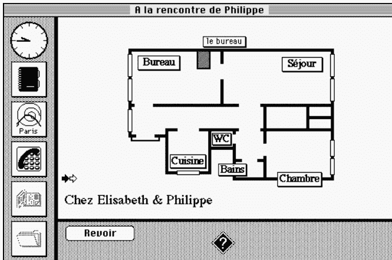
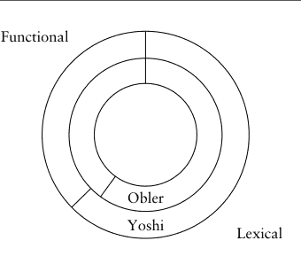
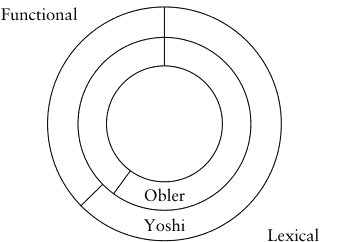
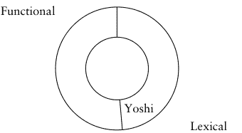
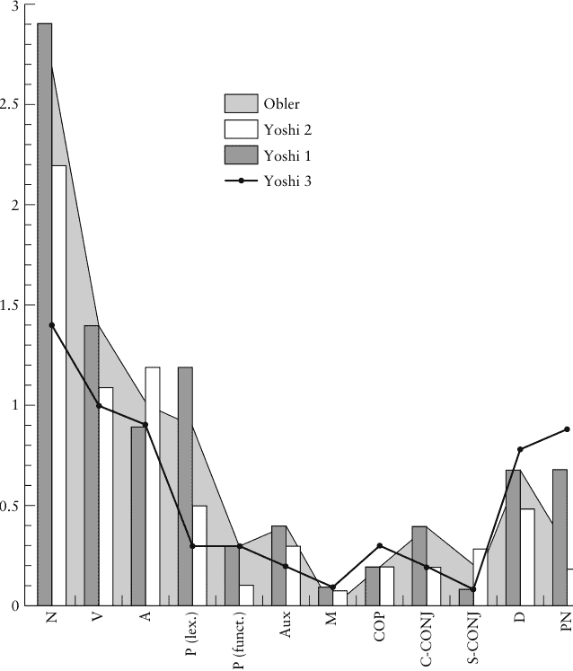

# 网络化语言教学：概念与实践（剑桥应用语言学）

本系列介绍了应用语言学领域的最新研究成果，这些成果与语言教学学习直接相关，并对应用语言学研究人员、语言教师和教师培训师具有特别意义。

## 网络化语言教学

### 概念与实践

编辑：

### Mark Warschauer

America-Mideast Educational & Training Services

以及

### Richard Kern

加州大学伯尔克利分校

# 贡献者

Carol A. Chapelle, 爱荷华州立大学

Dorothy M. Chun, 加州大学圣芭拉分校

Boyd Davis, 北卡罗来纳大学

Agnès Fauverge, 剑桥大学

Richard Kern, 加州大学伯尔克利分校

Carla Meskill, 纽约州立大学 Albany学院

Jill Pellettieri, 加州州立圣马科斯分校

Jan L. Plass, 新墨西哥大学

Krassimira Ranglova, 保加利亚索非大学

Jean Marie Schultz, 加州大学伯尔克利分校

Heidi Shetzer, 加州大学圣地芭拉分校

Ralf Thiede, 北卡罗来纳大学

Mark Warschauer, America-Mideast Educational & Training Services, 开罗

Jan Wong, 剑桥大学

Christoph Zähner, 剑桥大学

# 系列主编序言

对于许多二语和外语学习者来说，传统的目标语言体验仅限于教师在课堂上创造的机会，并利用教科书、磁带或 CD 以及视频等资源。近年来，教学出现了新的模式，如远程学习和自主学习，一方面旨在节约教学资源，另一方面承认教学以学习者为中心的原则。然而，二语教学学习方式发生的最戏剧变化可能源于计算机辅助教学的发展。特别是互联网已成为一种新的交流媒介，塑造着交流的过程和结果。由于计算机为学生与教师以及二语使用者自身之间的交流开启了新机会，许多语言教师认为计算机介的教学学习具有巨大的潜力。本书对利用局域或全球网络连接的计算机进行教学进行了全面描述，即网络化语言教学。

尽管近期许多书籍提供了计算机辅助语言教学发展的概述，但本书有更广泛的议程。它不仅展示了各种外语和二语教学背景下网络化语言教学的描述性案例，还对这些创新的性质和影响进行了严谨的实证研究。这些研究旨在确定网络化语言教学是否与教育理论以及当前对二语习得性质的理解相兼容。

书中探讨的问题范围包括：计算机介交流期间发生的互动和话语的性质、基于文学的课程中使用技术媒介活动及其对课堂过程和话语的影响、大学语言和写作课堂在线学习的民族志研究、二语学习者在电子会议期间的风格转换、计算机在促进学生能力的

# x 系列丛序言

写作、通过网络进行二语能力和技能的发展，以及这种新学习模式对教师和学习者信念的影响。

因此，本书通过澄清基于网络的语言教学的本质，阐述这一新技术的各种潜在应用，并确定了重要的研究问题和启示，为“剑桥应用语言学系列”（Cambridge Applied Linguistics Series）增添了宝贵的价值。

Michael H. Long

Jack C. Richards

## 前言

计算机网络在世界许多地区的快速普及正在改变着我们相互交流、开展业务和产生知识的方式。在语言教育背景下，计算机网络使得学习者访问和/或发布文本及多媒体材料成为可能，并将他们的交流体验扩展到教室之外的世界。这些可能性使得人们对计算机网络如何增强语言学习产生了巨大的期望。然而，从历史角度来看，教育者对新技术如何改变学习的期望在实践中并不总能得到证实。本书迈出了前进的一步，评估了教育者对计算机网络的预期，即当语言学习者在网络化环境中与文本和其他语言学习者聚集在一起时会发生什么。

这本书源于我们两人于1995年7月在夏威夷大学诺亚分校参加的“外语学习与研究中的本地与全球网络”国家外语资源中心研讨会。当时我们认为，该领域虽然关于利用网络技术的教学建议很多，但研究却匮乏。尽管关于计算机中介通信的通用研究日益增多，但专门针对语言学习背景的研究相对较少。本书试图通过在卷书中汇集关于使用计算机网络进行语言学习的现有最佳研究来填补这一空白。

我们尽力确定了该领域研究的主要问题，并包含了涵盖这一问题范围的贡献。我们寻找了设计上具有系统性、且结果对应用语言学和语言教学具有重要意义的研究。本书的读者将找不到一个关于使用计算机教学是否“有效”的简单且一律的答案。相反，他们将发现严谨的研究，探讨当语言学习者在特定情况下使用计算机网络时，实现了哪些类型的过程和结果，以及对于我们如何根据特定的教学目标来设计和实施基于网络的语言教学具有什么启示。

任何此类都是都是的成果。作为编辑，我们特别对出现在本集中的作品的作者表示感谢。他们的耐心、坚持以及修订和协调章节的意愿值得特别认可。我们对剑桥大学出版社的编辑人员表示感谢，特别是 Deborah Goldblatt、Mary Vaughn 和 Mary Carson，感谢他们对手稿的专业工作。我们感谢 Mike Long 和 Jack Richards 意识到该主题的重要性，并帮助本书引入了“剑桥应用语言学系列”。我们还要感谢夏威夷大学和加利福尼亚大学伯克利分校对我们研究的支持。最后，我们感谢我们的家人，Mark 的妻子 Keiko Hirata，以及 Richard 的妻子和女儿 Louise Erickson 和 Maria Olivia Kern，感谢他们在策划、编写、修订和编辑这本书的几年里提供的爱与支持。

Mark Wassauer

Richard Kern

## 引言

### 基于网络的语言教学的理论与实践

Richard Kern

Mark Wachschauer

自20世纪60年代初以来，语言教师见证了语言教学方式的巨大变化。教学的重点已从离散语法结构的教学扩大到交际能力的培养。创造性的自我表达变得比背诵记忆的对话更具价值。意义的协商开始优先于结构性练习。理解具有了新的重要性，提供可理解的输入已成为一种常见的教学要求。尽管许多教师仍不确定如何教授文化，但文化已变得越来越重要。语言教科书已开始区分口语和书面形式，并通常将真实文本（如广告和真实报道）与文学文本相结合。正是在这些多方面变化的背景下，语言教育中最重要的创新领域之一——计算机辅助语言学习（CALL）必须不断演变。如今，基于磁带的语言实验室正逐渐被语言媒体中心取代，在这些中心，语言学习者可以使用多媒体 CD-ROM 和光盘访问设备，访问世界维网上的外语文档，并通过电子邮件与他们的教师、同学以及母语者进行交流。如果说语言教学变得更加有趣，它也变得更加复杂。

本书涉及 CALL 的一种形式，即我们称之为基于网络的语言教学（NBLT）。NBLT 是涉及使用计算机在本地或全球网络中相互连接的语言教学。虽然 CALL 传统上与自包含的程序化应用相关（如教程、练习、模拟、教学游戏、测试等），但 NBLT 代表了 CALL 的一个新而不同的侧面，人与人之间的通信是核心。例如，接入互联网的语言学习者现在可以从学校、家里或工作场所每天24小时、每周7天与世界各地的母语者（或其他语言学习者）进行交流。学习者可以在局域网会议中进行一对一或多对多的交流，这进一步增加了他们的交际实践的机会。最后，计算机中介通信以书面、电子存档的形式出现，这为学生提供了额外的机会来规划他们的课程，以注意并反思他们在编写和阅读的消息中的语言使用。

鉴于这些可能性，许多语言教师热情地拥抱了网络技术，并开发了与学生一起使用网络计算机的创造性方法（此类示例参见 Warschauer, 1995, 第125页）。另一方面，许多其他教师对使用计算机的价值仍持有怀疑态度。例如，1995年对12个学术领域教学技术使用的调查（Cotton, 1995）显示，59%的外语课程和65%的英语作为二语（ESL）课程没有使用计算机技术——这使语言教学处于调查列表的底端。

迄为止，很少有研究探索了计算机的使用与语言学习之间的关系。每个人都想要答案的简单问题——基于网络的语言教学是否能促进语言学习？事实证明并非如此。计算机就像教学中使用的任何其他技术工具（如铅笔和纸、黑板、投影仪、录音机）一样，其本身并不会带来学习的提高。此外，我们必须观察特定背景下的特定实践来回答这个问题。这些实践不仅要被描述，还要根据其特定的社会背景进行评估。学习者是谁？他们做了什么？为了什么目的？在什么环境下？什么样的语言？什么样的社交模式？在语言使用的量质、态度、动机方面的结果如何？

本书是为对网络语言学习的理论和实践感兴趣的研究人员、研究生和教师编写的。本书有两个主要目的：(1) 在语言习得理论和教育理论趋势中为基于网络的教学提供概念框架；(2) 展示一系列实证研究，帮助学者和教育工作者在实践和未来研究方面做出明智决策。

在本章中，我们将 NBLT 置于二语教育方法以及计算机辅助语言学习的特定历史中。我们还讨论了与基于网络的语言教学的一些特定研究问题，并确定了本书将有助于填补的知识空白。

#### 语言学习与教学视角的转变

尽管本章描述的语言教学变化通常被描述为从结构性的极性转向……

## 基于网络的语言教学理论与实践


从语言教学的交际视角来看，我们观察到在近期语言教学的历史中，三种理论运动——结构主义、认知主义和社会认知主义之间存在着更为复杂的交叠。由于这些理论视角都影响了计算机技术在语言教学中的应用方式，我们将首先简要追溯这些视角的发展。

## 结构主义视角

在整个二十世纪的大部分时间（以及之前的世纪），语言教学强调对构成特定语言的结构系统进行形式分析。例如，语法翻译法训练学生记忆动词变位、应用规范性规则、分析句子并翻译文本。从20世纪20年代到50年代，受美国语言学家（如Bloomfield, 1933）工作的影响，研究者们开发了各种结构主义语言教学方法，并在20世纪40年代和50年代的听力口语法达到顶峰。尽管听口语法侧重于口语而非书面语技能，但它与语法翻译法共享两个主要假设：语言教学大纲应按语言类别组织，且句子是分析和练习的主要单位。方法论深受约翰·华特森（John Watson）和B.F·斯金纳（B. F. Skinner）等行为心理学家的影响，将学习构想为习惯的形成，并用大量的对话和模式填充学生，以引导学习者对语言刺激产生自动、正确的反应。对母语和目标语言之间结构差异的对比分析（例如Lado, 1957；Moulton, 1962；Stockwell, Bowen, & Martin, 1965）为结构的精细选择、分级和呈现提供了依据。实践，而非抽象知识，才是关键。

阅读和写作教学方法也反映了对结构的强调。在听口语法时期，阅读在很大程度上被视为学习正确结构的辅助；学生被要求大声朗读以练习正确的发音。第二语言写作教学侧重于学生产形式上正确的句子和段落。在更高级的水平上，对比分析被用于提供母语/二语文章结构差异的示例。在某些情况下，口、读、写的重点在于所取得的语言产物，而非认知或社会过程。

## 认知主义/建构主义视角

到20世纪60年代初，听口语法开始被批评为过于机械化且缺乏理论依据。诺姆·乔姆斯基（Noam Chomsky, 1959）拒绝了B.F·斯金纳关于语言学习的行为主义观点，认为由于语言学习者可以产生（并理解）无限数量的形式正确的句子，因此语言能力可能可以通过基于模仿和习惯形成的模型来解释。相反，乔姆斯基（1957; 1965）提出了一种介于语言深层结构和表层结构的转换生成语法。个人语法系统的发展受到先天认知结构的引导，而非行为强化。在语言教学领域，乔姆斯基的理论促成了教学目标的逐渐转变：从灌输准确的语言习惯转向培养学习者对二语言系统的心理构建。错误被赋予了新的视角——不再被视为创造性学习过程中的糟糕副产物，而是涉及简化、泛化、迁移和其他通用认知策略的过程的一部分。因此，语言学习不再被理解为条件反射，而是一个生成和转换知识的主动过程。

尽管这种新视角重新引发了对语法规则教学的关注（例如认知编码学习法），但它后来导致了人们强调提供理解性输入，而非显式地关注语法（Krashen, 1982）。至少在Krashen看来，提供理解性输入的目的并不是为了促进真实的互动（事实上，Krashen认为学习者的言语与学习在很大程度上无关），而是给个体一个机会从大量数据在心理上构建该语言的语法。

认知方法的影响在阅读和写作教学中表现得非常明显。随着第一语言阅读和写作研究的发展，二语言教育者开始将读写能力（literacy）视为一个个体的心理语言过程。学习者被教授了多种认知策略，包括自上而下的策略（例如，使用图式知识）和自下而上的策略（例如，使用单词词汇线索），以改进他们的阅读过程。第二语言写作教学的重点从模仿正确结构转向发展一种认知、问题解决的方法，聚焦于启发式练习和协作任务，这些任务是组织在如构思生成、起草和修改等阶段性过程中的。

## 社会认知视角

在语言习得的认知导向视角获得普及的大同时，美国社会语言学家德尔·海姆斯（Dell Hymes）和英国语言学家迈克尔·哈利盖（Michael Halliday）提醒教育者，语言不仅仅是私人的、“脑子里的”，而是一种社会构建的现象。海姆斯为了回应乔姆斯基对语言能力的心理主义表征，创造了“交际能力”这一术语，他强调语言使用的社会恰当性，并评论道：“如果没有使用规则，语法规则将毫无用处” (Hymes, 1971, p. 10）。对于海姆斯来说，句法和语言形式最好不被理解为自主的、背景化的结构，而是特定言语社区以特定方式使用的意义资源。语法性无法与社会接受性分离，认知也无法与交流分离。

哈利盖提出了语言使用的三个主要功能：概念功能、人际功能和文本功能。通过这种方式，他提醒人们语言教学只处理了其中第一种——概念功能（即使用指称性语言表达内容），而人际功能（即使用语言维持社会关系）和文本功能（即创造话语情境）在很大程度上被忽视了。

20世纪80年代，交际能力成为语言教学界的流行术语。需要教学的不再是语言能力，还包括社会语言能力、话语能力和策略能力（Canale and Swain, 1980; Canale, 1983）。随着互动式交际语言成为主流，交际过程变得与语言产品同样重要，教学变得更加以学习者为中心并由结构驱动。在社会认知方法中，学习不仅体现在个人认知结构上，还体现在学习者活动的社会结构上（Crook, 1994, p. 78）。从这个观点来看，认知和社会维度处于一种“辩证的、共构的关系”之中（Nystrand, Greene, & Wemelt, 1993, p. 300）。或者正如Holquist (1990) 所说：“话语并不反映情境，它本身就是情境”（p. 63）。

从这一视角来看，语言教学不仅是提供输入，而是帮助学生进入他们日后会遇到的真实社会话语和社区。这可以通过各种类型的任务型学习来实现，学生在其中参与真实的任务和项目（参见Breen, 1987；Candlin, 1987；Prabhu, 1987；Long & Crookes, 1992）。其他则强调基于内容的学习，学生在其中同时学习语言和内容（例如Snow, 1991；Flower-dewyd, 1993）。

在社会认知方法中，阅读和写作被视为嵌入特定社会文化语境中的过程。教学不仅关注个人学习策略，还关注

### Richard Kern 与 Mark Warsauer

#### 表 I 结构主义、认知主义和社会认知主义框架下的教学重点

| | 结构主义 | 认知主义 | 社会认知主义 |
|---|---|---|---|
| 哪些关键学者？ | Leonard Bloomfield, Charles Fries, Robert Lado | Noam Chomsky, Stephen Krashen | Dell Hymes, M. A. K. Halliday |
| 如何看待语言？ | 视为一个独立的结构系统。 | 视为一个心理构建的系统。 | 视为一种社会和认知现象。 |
| 语言是如何发展的？ | 通过胜任使用者的传递。通过重复和纠正反馈实现结构的内化。 | 通过先天性认知启发式对语言输入进行操作。 | 通过社会互动和对他人言语的同化。 |
| 学生应该培养什么？ | 对规范性标准的掌握，对话语的模仿，并尽可能减少错误。 | 语言的持续发展。实现个人交际目的的能力。 | 在真实语言使用背景下对形式的关注（包括体裁、语体和风格变化）。 |
| 教学导向是什么？ | 指向良好的语言产出（口语或书面）。关注对离散技能的掌握。 | 指向涉及语言学习和使用的认知过程。关注交际和学习策略的发展。 | 指向通过与他协作互动进行意义的协商。创建一个具有真实交际任务的话语社区。 |
| 主要分析单位是什么？ | 孤立的句子。 | 句子以及连贯的话语。 | 连贯的话语片段。 |
| 如何处理语言文本（口语或书面）？ | 视为供模仿的词汇和语法结构展示。 | 要么作为无意识处理的“输入”，要么作为问题解决和假设测试的对象。 | 视为交际行为（“用语言做事”）。 |
| 意义位于何处？ | 在语和文中（由听者或读者提取）。 | 在学习者的脑海中（激活现有知识）。 | 在说话者、作者和读者之间的互动中；受相关话语社区解释性规则的限制。 |

通过对阅读内容的广泛讨论以及阅读与写作的结合，帮助学习者成为读写社区的一部分（例如参见 Bernhardt, 1991; Eskey, 1993; Leki, 1993）。写作教学不仅关注个人策略的发展，还关注学习与特定受众进行适当交流的方法。例如，在学术英语（EAP）领域，重点已经从表达性写作转向帮助学生通过对学术写作本质的讨论和分析将自己融入学术社区（例如 Swales, 1990）。读写能力日益被视为不仅培养语言知识，还培养社会文化和跨文化能力的关键。

表 1 总结了与结构主义、认知主义和社会认知主义语言教学方法常见的教学重点。

## 基于网络的语言教学的理论与实践

正是在这种结构主义、认知主义和社会认知取向不断转变的背景下，我们可以理解计算机在语言教学中用途的变化，特别是基于网络的语言教学在今天的作用。有趣的是，语言学习和教学视角的转变与技术从大型机到个人电脑再到网络计算机的发展是并行的。正如将看到的，这些转变大致对应于 Charles Crook (1994) 提出的基于计算机教育活动的三种比喻：即教程比喻（计算机作为导师）、构建比喻（计算机作为学生）和工具箱比喻（计算机作为工具）。

## 计算机辅助语言学习（CALL）的结构主义方法


最早的 CALL 程序由语法和词汇教程、练习和训练程序以及语言测试工具组成，它们严格遵循“计算机作为导师”的模型。这些程序最初为 20 世纪 60 年代和 70 年代的大型计算机开发，今天仍以不同形式使用，其设计目的是针对学习者回答的形式准确性提供即时的正、负反馈。这与结构主义方法一致，该方法强调对相同材料进行反复练习对学习是有益或本质的。

以一个简单的练习程序为例，考虑 MacFrançais。学生选择合适的章节、级别和所需的选项数量。第一行出现一个目标法语单词（这里是 `habiter`），学生在第 2 行输入翻译（“live”）。然而，该程序不接受这个答案，它会高亮学生的初始回答，并在该行中留下正确的动词原型形式，该形式会被接受，然后提示变为下一个要测试的单词。

这种类型的练习程序通常在学习者和教师中引起引起太大兴奋，因为它们仅仅是换了一种包装的形式延续了旧有的教学实践。此外，直到最近，这些程序在技术上往往并不复杂，通常每个项目只允许一个可接受的答案。这些因素，加上在理论和教学层面对纯粹行为主义语言学习方法的学习，以及更复杂的个人电脑的发展，推动了 CALL 进入了第二个时代。

## CALL 的认知主义方法

与认知建构主义的学习观点一致，下一代 CALL 程序倾向于将主动权移交给学习者。在这一模型中，学习者通过探索 Seymour Papert 所描述的“微型世界”来构建新知识，这些微型世界提供了解决问题和假设测试的机会，允许学习者利用现有知识开发新的理解。为了延续这种由 John Dewey 和 Alfred Whitehead 普及的思想传统，Papert (1980) 及其在 MIT 媒体实验室的同事们彻底颠转了早期的“计算机作为导师”的比喻，将计算机视为由人类控制的物体，而不是控制学习者的物体。计算机提供工具和资源，但在这种模拟环境中做什么取决于学习者（例如在 Papert 的 Turtle 乌龟程序中，学习者编写程序让乌龟执行他们的指令）。

这种传统中较近期且更复杂的应用是多媒体视频 `A rencontre de Philippe` (Furstenberg, Murray, Malone, & Farmanian, 1993)，它由 MIT 人文先进技术实验室的 Athena 语言学习项目开发。`Philippe` 是一个针对中高级法语学习者的游戏，它整合了动态视频、声音、图形和文本，允许学习者通过拍摄屏幕或平面图来“行走”并探索模拟环境。视频在巴黎拍摄，营造了真实感，故事线的分支维持了玩家的兴趣。为了帮助语言学习者理解口语法语的挑战，程序提供了可选的理解工具，如所有音频段的转录和词汇表，以及一个视频集，包含了许多交际法中教学的语言功能示例，如表达情感、问候和告别以及使用手势。学生可以轻松创建自己的自定义视频集，并存储在自己的电脑磁盘中。

### Richard Kern 与 Mark Warschauer



**图 2** 《A la rencontre de Philippe》(Furstenberg et al., 1993) 的截图。

这种认知的、建构主义的计算机辅助语言学习（CALL）是对较早教程和练习程序的重大进步。到20世纪90年代，许多教育者认为CALL仍然未能发挥其全部潜力（Kenning & Kenning, 1990; Pusack & Orto, 1990; Rüssch, 1993）。批评者指出，计算机的使用是随机且脱节的，因此对语言教学过程中的“边缘元素而非核心元素做了更大的贡献”（Kenning & Kenning, 1990, p. 90）。此外，Crook (1994) 指出，基于“导师”或“学生”隐喻的计算机活动可能会使教师与学生独立和自主的活动产生距离，并损害课堂学习的协作性质。尽管多媒体CALL具有显而易见的优势，但今天的计算机程序还不够智能，无法实现真正的交互。像 `Philippe` 这样的交互程序让学习者处于主动地位并提供了交流的幻象，但学习者在封闭系统内仍然主要以咨询模式行动，而没有参与真正的意义协商。能够评估用户写作或演讲的恰当性、诊断学习者困难并在一系列交流响应选项中进行智能选择的计算机程序，预计在很长一段时间内都不会出现。因此，尽管智能CALL（Underwood, 1989）可能是计算机语言学习的下一个也是终极的应用，但这一阶段仍然是一个遥远的梦想。

## CALL的社会认知方法

CALL的社会认知方法将动态关系从学习者与计算机的交互转变为通过计算机与其他人类的交互。这种CALL方法的基础在于理论和技术上的双重发展。在理论上，人们更广泛地强调真实话语社区中有意义的互动。在技术上，计算机网络的发展使得计算机可以作为交互式人类交流的载体。

许多网络计算机的用途符合 Crook (1994) 的“计算机即工具箱”模型。这种隐喻强调了计算机作为中介工具的作用，这些工具塑造了我们与世界互动的方式（例如，通过数据库、电子表格和文字处理器访问和组织信息）。例如，文字处理器促进了写作的发明、修订和编辑过程，允许对文本进行快速、简单（且可逆）的重塑。20世纪80年代，John Higgins 开发了一系列名为 Storyboard 和 Double-Up 的文本重建程序，允许学习者以各种方式处理文本。这些程序的目的是让学习者重构原始文本，形成他们自己对语言的建构。超文本写作助手，如 Atajo (Domínguez, Noblett, & Pet, 1994) 和 System-D (Noblett, Solá, 1992)，以及检索分析如 MicroConnect (Scott and Johns, 1993)，是帮助学习者以更具词汇和语法准确性使用语言的价值工具。

计算机网络允许了“计算机作为工具”的强大扩展，它现在促进了与他人以及信息和数据的访问。语言课堂中的计算机网络源于两个重要的技术（和社会）发展：(1) 计算机中介通信（CMC）和 (2) 全球链接的超文本。CMC从20世纪60年代起就以原始形式出现，但自20世纪80年代后期以来变得广泛。CMC允许接入网络的语言学习者以异步（非同步）或同步（同步、实时）模式与其他学习者或目标语言母语者交流。通过电子邮件（允许参与者随时选择时间撰写信息）、或互联网中继聊天（IRC）或 MOOs（允许世界各地的人通过键盘打字进行同时对话）等工具，CMC不仅允许一对一的通信，还允许教师或学生与小小组、全班、对口班或涉及数百或数千人的国际讨论列表共享信息。参与者不仅可以分享短消息，还可以分享长文档，从而促进了协作读写。

全球链接的超文本和超多媒体（以万维网（World Wide Web）为代表）代表了一种组织、链接和访问信息的革命性媒介。其重要特征包括：

(1) 通过电子链接的多线性线索进行信息表示；
(2) 将图形、音频和视听信息与文本整合；
(3) 全球快速访问；
(4) 国际出版的便利性和低成本。

万维网提供了丰富的信息资源，其对语言学习的效用才开始开发。利用万维网，学生可以在几分钟内搜索全球数百万个文件，以定位并访问与其兴趣相符的真实材料（例如报纸杂志文章、广播节目、短视频、电影评论、摘选）。他们还可以使用网络发布他们的文本或多媒体材料，与对口班或普通公众分享。这些特征可以促进一种真实的教学方法，并将创造性交流整合到课程的各个方面。此外，万维网在创建和提供多用户、交互式多媒体环境方面具有巨大潜力，尽管到目前为止在该领域很少有开发项目（见 Chun & Plass，本书）。

这些新技术不仅服务于新的教学/学习范式，还帮助塑造新的范式。网络计算机的存在本身创造了新类型通信的可能性。因为这些新形式的通信现在已经普及，让语言学生在课堂上接触它们是至关重要的。这在英语教学中尤为重要，因为许多在线通信是用英语进行的，但随着网络空间变得越来越多元化，这对其他语言教学也可能变得越来越重要。因此，网络教学必须具有广阔的视野，不仅考虑技术在语言学习中的作用，还要考虑语言学习在信息社会中的作用。如果我们的目标是帮助学生进入新的话语社区，而这些社区越来越多地位于在线，那么根据其社会效益以及教学价值来纳入在线活动是合理的。

表 2 结构主义、认知和社会认知框架下 CALL 的作用

| 结构主义 | 认知 | 社会认知 |
| :--- | :--- | :--- |
| 计算机的作用是什么？ | 提供无限的训练、练习、教程解释和纠正反馈。 | 提供语言输入以及分析和推理任务。 | 为社交互动提供真实的背景；促进访问现有社区并创建新社区。 |

总之，计算机在语言教学中扮演多种角色。它最初在大型机上作为提供语言训练或技能练习的导师。随着个人电脑上多媒体技术的出现，它成为了一个探索和创造性影响的空间。而随着计算机网络的发展，它现在作为本地和全球通信的媒介以及真实材料的来源。

## 网络语言教学的研究

正如 CALL 的范式发生了变化，计算机语言课堂中作用的研究也发生了变化。早期的 CALL 研究主要关注使用 CALL 程序的学生的语言表现，试图确定这些程序在提高准确性方面是否优于其他方法。认知范式引发了关注个人过程、策略和能力发展的研究，使用了如动机调查、观察、击键记录和出声思维协议等衡量方法。社会认知范式和对计算机网络学习的强调带来了对……的关注

### Richard Kern 与 Mark Warschauer


表 3. 各种计算机辅助语言学习（CALL）方法的科研启示

| 结构主义 | 认知主义 | 社会认知主义 |
| :--- | :--- | :--- |
| 导向 | 结果（产品） | 认知过程 | 社会与认知过程 |
| 方法论 | 定量：实验控制性理解 | 定量与定性均有 | 主要是定性：话语分析、社会文化背景分析 |
| 主要数据类型 | 词汇、错误、结构的数量/频率 | 出声思维方案、问卷调查、计算机记录的数据（如击键次数） | 社会交互的转录、民族志观察和访谈 |

跨-话语和话语社区发展了对计算机网络的使用。

表 3 总结了计算机辅助语言学习（CALL）对研究方法的启示。基于网络的语言教学研究虽然涵盖了这些方法，但到目前很大程度上局限于结构性目标和方法。

由于网络化语言教学（NBLT）是一个新兴领域，NBLT 研究的语库包含了已发表的、深入探讨在线环境中话语和话语社区发展的的研究。这些已发表的研究倾向于关注在线通信中最可量化和易于衡量的方面。例如，许多研究（如 Kern, 1995; Sullivan & Pratt, 1996; Warschauer, 1996）定量比较了面对面和考虑性讨论的参与程度，并发现学生（以及学生与教师）在计算机模式下的参与更加均衡。其他研究尝试对在线通信中使用的语言功能进行量化，并不意外的是，学习者在计算机介的通信中使用了多种功能（Chun, 1994; Warschauer, 1996）。研究人员还定量地检查了在线讨论的语言特征，发现其在词汇和句法上比面对面讨论更复杂（Warschauer, 1996）。这些都是 NBLT 研究中“结果-结构主义”方法的例子。

本卷试图将 NBLT 研究扩展到几个迄为止相对被忽视的重要领域。这些领域是语境、交互和多媒体网络。

## 网络化语言教学的理论与实践 15

网络化教学和学习发生的语境尚未得到充分深入的研究，但在很大程度上如此。正如 Gee (1996) 所解释的，话语不仅代表语言，还代表“说（写）做-存在-价值-信念的结合”（第127页）。要理解语言课堂中新交互形式的全面影响，必须超越交互文本，关注塑造这些类型并被这些类型塑造的更广泛的语境动态。这需要整体的定性研究，超越对语言特征的清单，并试图解释课堂形成的演。尽管许多教育工作者试图观察此类现象，但在这方面发表的作品大多是教师对其课堂观察情况的非正式报告。

本书的第 2 章和第 3 章展示了描述性研究，讨论了外语和第二语言背景下网络化语言教学的整体语境。在第 2 章中，Carla Merskill 和 Krasimira Ranglova 展示了关于保加利亚新型技术增强英语（EFL）教学实施的研究。他们表明，计算机网络的使用语言计划更广泛重构的一部分，导致了更具“社会协作性”的学习方法。该章节是一个绝佳例子，证明技术不仅仅是机器，甚至不仅仅是使用机器，而是一种广泛的社会组织形式。在第 3 章中，Mark Marschauer 展示了两个英语二语（ESL）班级、一个本土语言班和一个英语班（大部分学生为第二语言学习者）的结果。Marschauer 的研究表明，网络化教学的特定实施高度取决于社会文化背景，包括但不限于教师的态度和信念。该研究还说明了在考虑网络化教学时，新素养能力概念的重要性。

在考虑网络化教学时，交互的本质是二语学习中最重要的领域之一（评论请参见 P, 1994）。人们认为计算机介的通信为学生提供了一个理想的媒介，因为讨论的性质允许更多地关注和反思通信的形式。关于 CMC 语言性质的研究大多关注对学生评论的计数或分类，而不是定性地分析学生如何在……内协商意义。

第 4、5 和 6 章开始克服这一缺陷。在第 4 章中，Jill Pellettieri 使用 Gass 和 Varonis 的框架研究了西班牙语学习者之间的实时计算机交互。

### 16 Richard Kern 与 Mark Warschauer

通过分析学习者对纠正信号所做出的修改，她证明了计算机介的交互为帮助学习者获得更高水平的元语言意识提供了实用的机制。Pellettieri 使用口语交互开发的框架，而 Boyd Davis 和 Ralf Thiede 在第 5 章使用了源自写作研究的框架。他们检查了异步计算机会议中二语和母语作者之间的交互，调查了语言学习者对写作的模仿和适应。他们的语言分析表明，二语学生根据母语者改变了自己的风格。

在第 6 章中，Jean Scholz 的重点不是电子会议期间的语言交互，而是其结果，比较了二语学习者如何利用提供的同伴编辑反馈。结果表明了学生水平、活动和动机之间复杂的相互关系，而不是关于计算机介反馈优劣的简单结论。她通过对书面和口语交流差异的具有启发性的观察进行总结。

到目前为止调查不充分的最后一个领域是网络化学习中结合多种媒介的部分影响。这一领域非常新，几乎没有研究发表。本书从几个角度探讨了这一问题：在第 7 章中，Dorothy Chun 和 Jan Plan 根据二语获取环境的理论和研究解释了网络多媒体的概念。他们随后讨论了网络多媒体的设计标准。在第 8 章中，Heidi Hetzer 和 Mark Warschauer 回到了早期的在线素养的主题，为在线和超文本环境中素养和通信的变化提供了一个理论框架。他们还对将电子素养引入教学的教学意义进行了描述。在第 9 章中，Christoph Zahnner、Agnes Fauver 和 Jan Wang 展示了利用宽带音频和视频会议帮助学生学习法语的试点研究结果。他们的研究表明了视频网络对于远程任务型学习的潜力。这三篇论文将我们带回到背景和交互问题，这些问题在多媒体环境中被重新定义。

最后，在第 10 章中，Carol Chapel 将本书中的研究以及以往网络化语言教学的研究置于我们计算机辅助语言学习研究的历史和未来的广泛视角之下。

## 网络化语言教学的理论与实践

## 结论

网络化语言教学并不代表某种特定的技术或方法。它是一系列方式的集合，学生学生通过计算机网络进行交流，并解释和构建在线文本及多媒体文档，而这一切都是其日益增加的新型话语社区参与的一部分。这种参与如何进行取决于多种因素，包括通过计算机进行交互的性质、塑造交互的社会文化背景，以及学生在多媒体模式下进行交流和学习的方式。我们希望本书的章节能为更好地理解这些问题提供一些初步步骤。

### 参考文献

- Bernhardt, E. B. (1991). Reading development in a second language: Theoretical, empirical, and classroom perspectives. Norwood, NJ: Ablex.
- Bloomfield, L. (1933). Language. New York: Holt, Rinehart & Winston.
- Breen, M. P. (1987). Learner contributions to design. In C. N. Candlin & D. Murphy (Eds.), Lancaster practical papers in English language education, Vol. 7, Language learning tasks (pp. 22–46). Englewood Cliffs, NJ: Prentice Hall.
- Canale, M. (1983). From communicative competence to communicative language pedagogy.
- Canale, M., & Swain, M. (1980). Theoretical bases of communicative approaches to second language teaching and testing. Applied Linguistics, 1(1), 1–47.
- Candlin, C. N. (1987). Towards task-based language learning, In C. N. Candlin & D. Murphy (Eds.), Lancaster practical papers in English language education, Vol. 7, Language learning tasks (pp. 5–22). Englewood Cliffs, NJ: Prentice Hall.
- Chomsky, N. (1957). Syntactic structures. The Hague: Mouton.
- Chomsky, N. (1959). A review of B. F. Skinner’s “Verbal behavior.” Language, 35(1), 26–58.
- Chomsky, N. (1965). Aspects of the theory of syntax. Cambridge, MA: MIT Press.
- Chun, D. (1994). Using computer networking to facilitate the acquisition of iterative competence. System, 22(1), 17–31.


- Cotton, C. (1995). Technology-mediated learning: Are we there yet? Syllabus, 8(9), 26–27.
- Crook, C. (1994). Computers and the collaborative experience of learning. London: Routledge.
- Dominguez, F., Noblitt, J. S., & Pet, W. A. J. (1994). Atajo: Writing assistant for Spanish. Boston: Heinle & Heinle
- Eskey, D. (1993). Reading and writing behavior. In J. G. Carson & I. Leki (Eds.), Reading in the composition classroom: Second language perspectives (pp. 221–233). Boston: Heinle & Heinle.
- Flowerdew, J. (1993). Content-based language instruction in a tertiary setting. English for Specific Purposes, 12, 121–138.
- Furstenberg, G., Murray, J. H., S., & Farman-Farmaian, A. (1993). A la rencontre de Philippe. New Haven: Yale University Press.
- Furstenberg, G. (in press). In un particulier de Paris. New Haven: Yale University Press.
- Gee, J. P. (1996). Social linguistics and literacies, 2nd ed. London: Taylor & Francis.
- Herring, S. C. (Ed.). (1996). Computer-mediated communication: Linguistic, social and cross-cultural perspectives. Amsterdam: John Benijmans.
- Holquist, M. (1990). Dialogism: Bakhtin and his world. London: Routledge.
- Hymes, D. (1971). Competence and performance in linguistic theory. In R. Huxley & E. Ingram (Eds.), Language acquisition: Models and methods (pp. 3–28). London: Academic Press.
- Kenning, M.-A., & Kenning, M. J. (1990). Computers and language learning: Current theory and practice. New York: Ellis Howard.
- Kern, R. (1995). Restructuring classroom interaction with networked computers: Effects on quality and quality of language production. Modern Language Journal, 79, 457–476.
- Krashen, S. D. (1982). Principles and practice in second language acquisition.
- Lado, R. (1957). Linguistics across cultures. Ann Arbor: University of Michigan Press.
- Leki, I. (1993). Reciprocal themes in ESL reading and writing. In J. G. Carson & I. Leki (Eds.), Reading in the composition classroom: Second language perspectives (pp. 9–32). Boston: Heinle & Heinle.
- Monk, M. H., & Crookes, G. (1992). Three approaches to task-based syllabus design. TESOL Quarterly, 26(1), 27–56.
- Mouton, W. G. (1992). The sounds of English and German. Chicago: University of Chicago Press.
- Murray, D. E. (1995). Knowledge machines: Language and information in a technological society. London: London.
- Noblitt, J. S. (1994). Novelles dimensions.
- Noblitt, J. S., Peters, H., & Martínez, A. (1997). Nuevas dimensiones.
- Nystrand, M., Greene, S. (1993). Where did discourse come from? Language and Interaction, 267–333.
- Papert, S. (1980). Mindstorms: Children, and ideas. New York: Basic Books.
- Pica, T. (1994). Research on negotiation: What does it reveal? Language and Interaction, 44(3), 493–527.
- Prabhu, N. (1987). Teaching language. Oxford: University Press.
- Raymond, P. C. (1988). Computer-assisted learning.
- Snow, M. A. (1991). Teaching English as foreign language (pp. 315–328). Boston: Newbury House.
- Stockwell, R. (1993). State of the art. Cambridge and the Humanities
- Swales, J. M. (1990). Genre analysis: English in academic settings. Cambridge and Research, 23, 71–84.
- Underwood, J. (1989). On the edge: Intelligent CALL.
- Wassauer, M. (1996). Comparing face-to-face and electronic communication in the second language classroom. CALICO Journal, 13(2–3), 7–26.
- Wassauer, M. (Ed.) (1995). Virtual connections: Online activities and projects for networking. Honolulu: Second Language Teaching and Curriculum Center, University of Hawaii.

## 保加利亚的社会协作学习

新技术的出现带来了可用设计的爆炸式增长。这种发展为教育领域带来了重新思考语言和素养，进而重新设计教学的无限可能（New London Group, 1996）。然而，对潜在重新设计的考虑必须受到两个相互依赖因素的指导：第一是最佳教学理论和实践；其次是对技术使用相关的各种变量的仔细考虑。本章讨论了索非大学英语外英语（EFL）课程的重新设计。这种基于技术的课程重新思考和开发的核心，是仔细考虑了（1）最佳教学实践；以及（2）可以用于此类活动的技术。

### 背景

保加利亚文学和基于技术的课程的发展和实施过程拥有前集团国家特有的机遇；即由于1989年民主化之前学术界的的孤立，外语教学实践没有受到20世纪60年代到80年代国际语言教学界经历的重大重新思考和重构的影响。因此，在保加利亚与世界其他地区恢复交流之前，英语课程很大程度上遵循传统的英国模式，一种强调语言学研究、文学经典和语言鉴赏的模型。因此，现状并没有很好让英语专业的学生以有效且有意义的方式学习和使用英语。


## 保加利亚的社会协作式语言学习

计算机的使用权限一直局限于计算机科学系的教师和学生。英语作为外语（EFL）的学生虽然被要求每周花费大量时间在听力口语带实验室，但没有其他技术手段来支持他们的学习。

自20世纪90年代初以来，索非亚大学英语系的教师活动日益活跃，他们利用国外的信息获取渠道和专业人脉。多项倡议，包括由美国国际事务署（USIA）资助的旨在支持该课程创新项目的交流计划，一直致力于为教师提供职业发展机会，并推动教学技术的实施。本章讨论的EFL课程重新设计项目侧重于技术的整合与应用，既作为教学和学习的工具，也作为扩展教师对当前语言教学法理解的一种。

## 变革的教学基础

二语言习得领域的近期理论和教学趋势倾向于社会中介的教学活动，而非曾经占据主导地位的训练、测试和语言鉴赏活动。学习者对语言的积极使用不再被认为仅仅是练习所学语言语法和词汇的场所。相反，过程写作、基于反应的阅读以及与他人积极协商意义，被广泛认为是语法发展以及最终目标语言使用和理解的整体能力的核心阵地（Wagner-Gough & Hatch, 1975; Savignon, 1983, 1991; Ellis, 1984）。语言学习者使用目标语言参与有意义的交流活动，被认为是掌握该语言读写能力和流利水平的最佳途径（Stevik, 1980; Brown, 1994）。因此，教学实践认为，在充满动力、内容丰富的环境中进行以学生和意义为中心的活动，是非母语者学习英语语言和获得读写能力的最佳途径。因此，保加利亚EFL课程的重新设计是基于当前的社会认知理论和实践的。

## 基于反应的文学教学与学习

修订后的EFL课程的核心是从一种强调讲座和文献学的课程发生根本性转变，转向一种以学生为中心的课程，后者强调五项技能在积极使用和获取过程中的整合。以学生为中心的课程的组织基础是当代短篇小说。基于反应的文学教学学习方法构成了课堂和家庭作业活动的基础。

文学在语言课堂中的传统角色一直是目标语言读写能力和文化的化身。目标文化的经典文学作品通常被阅读、分析和阐释以供鉴赏，其次要目标是增加学生对目标词汇和用法的理解。这种传统虽然让学习者接触到了语言和文化的重要方面，但对于对当今教学界广泛视为首要的习得过程，其贡献还远远不够。文学，尤其是当代文学，提供的提供的比目标语言和文化的单一呈现要丰富得多。事实上，正是学生个人积极、批判性、解释性的参与潜力，使文学成为二语言教学的有力工具。此外，正如语言活动不再能局限于对独特解读的研究一样，在英语作为通用语的广泛全球交流时代，教学也不再局限于处理反映在文化认可的文学形式中单一的、经典的英语。

一种基于反应的文学方法将学习者视为主动的主体，他们的个人经验会影响对所读文本的解释。因此，它提倡鼓励探索多重意义和视角的实践，并培养个人的、防御性的解释（Iser, 1974, 1978; Holland, 1975; Rosenblatt, 1978; Langer, 1991; Cox & May, 1992）。文学理解的过程既受社会中介也受个人中介；也就是说，从文学文本中获得的个人和社会构建的意义被赋予同等价值，课堂和小组讨论充当了展示、扩展和修改个人解读的场所。因此，重点放在对话过程上，通过这种过程，意义和解释被发现并表达出来（Miller, 1993）。基于反应的文学实践将文学视为促进批判性和创造性思维的载体，文学不再被视为目标文化审美层面的化身，而是学习者探索世界和情感的跳板。通过这种方式，其他语言的学习者以一种高度投入、有意义的方式使用目标语言。修订课程的发展围绕美国和英国短小说展开。

## 技术的角色

### 24 Carla Meskill 和 Krassimira Ranglova

经过概念化、设计和实施。以下章节展示了音频磁带、计算机语料库、文字处理和电信技术是如何整合到基于文学的课程中的。

### 音频磁带

磁带录音是由纽约州立大学 Albany 分校 TESOL（英语作为外语教学）研究生项目的美国学生录制的，内容涵盖了短篇小说中的描述性对话和描述性叙述。选择录制片段的标准是：(1) 具有戏剧性的情感爆发，以强调重音和语调；(2) 对短故事整体精神的核心性；(3) 文本（尤其是对话）在多大程度上代表了当代美国背景下合理的言语。这些录制文本被纳入修订后的 EFL 课程中的听力、口语和发音培养部分。它们每周用于全班听力练习，作为理解母语者对话的练习。学习者被引导关注并模仿文本的语音和韵律特征。录音还被用作跳板，讨论学生对研究故事的角色、情节和主题的想法和反应。

示例：学生听听《准父亲》（A Father-to-Be）中角色之间的对话。他们被分配去听对话中表示不信任和安慰的语调模式。他们在纸上勾勒出这些模式，并反过来大声练习他们的语调曲线。随后对学生对这些角色动机和意图的感知进行讨论。

### 语料库与风格检查

课程设计的一个组成部分反映了关于语言学习者角色的理论和方法的转变。在在线语料库和风格检查的案例中，学生成为所研究语言知识的发现者，而非被动的接受者。在修订后的课程中，英语语法中的规则、模式、倾向和例外是由学生发现并解释的，这是学习过程的重要组成部分。学生利用语料库程序和风格检查器，结合大量的英语语料库，作为探索实际英语的手段，并制定和测试他们关于英语使用和用法的原始假设。由于语料库（现代和中世纪英语国际计算机存档 ICAME 语料库）包含了来自多个英语国家、语体和环境的言语样本，学生在确定规则和模式之外，还可以作为探究的一部分进行跨方言研究。因此，学生能够与易获得的语言数据进行积极互动，接触广泛的真实语言输入，并吸收他们认为特定查询所需的任何内容。他们比较、分析并重新调整了现有的、个人发展的标准。关于语言和使用的问题源于简短的阅读和讨论。学生合作产生假设并回答问题。他们的回答（对语言使用及其规则的描述和解释）成为了班级生成的语法书的一部分，该书将在随后的学期由大一 EFL 学生进行扩展。

示例：在短小说《雪地猎人》（Hunters in the Snow）中，学生遇到了他们之前认为在进行态中的静态动词（I was seeing things in a different perspective）。转向在线语料库，他们发现了这种用法的另外六个实例。根据故事和语料库的上下文，他们制定并测试了他们的假设：“see”的进行态表示一种暂时的理解状态，与之前的状态不同。学生发起的“发现”随后被输入他们的班级语法书中关于进行态的特殊章节。

### 文字处理

参与的学生广泛使用了文字处理技术。所有的日记、论文和语法书条目的初稿都经过了处理，然后根据同学和老师的意见和建议进行修订。文字处理还用于准备口头报告的讲义。

示例：学生编写了每周日记条目的草稿。这些条目由他们对所读短故事反思的个人想法组成。每个学生选择并打印了部分内容与同学分享。这些内容被分发，并通过口头和书面形式进行回应。根据这些反馈，学生将他们的草稿扩展并修订为对他们希望发展的的故事方面进行更正式的处理。

### 电子邮件协作

许多关于这些短小说中的语言和文化的问题源于独立反思和课堂讨论。EFL 学生合作将这些问题以书面形式正式化，写给班级的伙伴——即美国的 TESOL 研究生。由于布索菲亚（Sofia）校区对电信技术的访问有限，班级需要指定一名秘书/通讯员。学生收集并打字班级的问题，并通过电子邮件发送给纽约州奥尔巴尼的学生。美国学生对保加利亚学生提问题的回答被打印出来，带回教室，并纳入基于文学的讨论、课程语法书以及学生的个人写作中。

示例：在一次课堂讨论中，学生推测了弗兰纳·奥康纳（Flannery O’Connor）短小说标题《凡升之物必汇聚》（Everything That Rises Must Converge）的意义。小组合作制定了关于这一含义的工作性假设，并发送给他们的电子邮件伙伴寻求评论和澄清。美国学生用自己的解释进行了回复。这些解释被带回 EFL 班进行进一步讨论（示例见附录 B）。

## EFL 课程修订总结

表 1 代表了修订后的 EFL 课程以及其方法与索索菲亚大学传统 EFL 课程的区别。新课程的技术和评估方法也出现在最右侧的列中。

## 基于技术的课程的评估

对新课程的评估自 20 世纪 90 年代中期以来一直在进行。“实验”（新课程）班由三位教师共同授课。教师参与了对修订后课程可行性和有效性的评估。对课程实施过程和结果的正式评估旨在确定以下内容：

- 实验组（参与修订后课程的学生）的整体成就与传统方法教学的学生相比如何？
- 教师对修订后的课程反应如何？他们在语言教学方法或技术在教学和学习中的作用方面是否发生了观念转变？
- 学生对修订后的课程反应如何？他们在作为语言学习者的角色方面是否发生了观念转变？
- 修订后的课程及其技术工具如何改变了课堂话的性质？
- 在实施该课程出现了哪些限制（概念和逻辑上的）？

## 表 I. EFL 修订课程

| 传统方法 | 修订后的方法 | 技术 | 评估 |
| :--- | :--- | :--- | :--- |
| 语法 | 讲解形式和功能；基于教材 | 问题解决；发现式学习 | 风格检查器、语料库检索；电子邮件 | 学生演讲；班级语法书的开发；期末 |
| 听力与口语 | 讲解/笔记；回答理解检查问题 | 短故事录音；通过课堂讨论和协作任务互动 | 音频磁带；电子邮件 | 在课堂讨论、任务、写作中的表现 |


| 写作 | 按指定主题写作，遵循范文写作 | 基于对短故事、课堂讨论和同学信来的过程写作 | 文字处理；电子邮件 | 同学和老师对草稿和最终论文的评审；期末 |
| 阅读 | 阅读文学经典中的选作以理解和词汇；讲座 | 阅读当代小说以回应和发展解释；以学生为中心、基于回应的对话 | 纸质；电子邮件 | 在课堂讨论、任务、写作中的表现；期末 |

# 28 Carla Meskill 与 Krassimira Ranglova

## 表 2. 平均测试增益：控制组 vs. 实验组

| 控制组 | 实验组 | 差异 |
|---|---|---|
| n = 14 | n = 14 | |
| 听写 | 8.8571 | 8.7857 | .0714 |
| 听力 | 14.9286 | 14.9286 | .0000 |
| 阅读与 | | | |
| 词汇 | 19.2857 | 22.5000 | 3.2143* |
| 语法 | 14.7857 | 16.4286 | 1.6429* |
| 写作 | 13.9286 | 17.7143 | 3.7857* |

$p < .05$

本次评估使用的数据包括实验组和传统课程学生的学期前和期后测试分数；教师和学生的日志；电子邮件互动记录；完成的学生作业；学生调查；对教师和学生的访谈；以及学生和教师的开放式问卷。

## 学生成就

索非大学的英语入学测试是一系列严谨的水平衡量，被用作评估课程有效性的课前衡量。这项测试与学校的年末期末一样，包含了传统的阅读/翻译部分，以及通过积极听力、口语和写作反映的学生交流能力测试。在该测试中得分最高的学生被录取为“一年”英语专业。随后，该小组被随机分配到传统的 EFL（外语）班级或实验组（修订后的课程）。两组学生都被要求参加一项同样全面的年终成就测试。两组的总结性成就均由一份同样严谨、全面的期末考试分数组成。表2 显示了两组的学前学后增益；使用双尾 t 检验进行比较，显著性水平设置为 $p<.05$。尽管期末考试中听写和听力部分的得分显示两组之间没有统计学上的差异，但其他测试部分——阅读与词汇、语法和写作——存在差异。两组的教师均报告，控制组的录像带数量和学生课外听力的要求更多。传统课堂使用的教材配有听力理解磁带，每周在语言实验室进行练习。实验组与短篇故事录音的接触基础较为有限（课堂外），且与控制组的磁带活动不同，实验组更侧重于离散的听力理解任务的内容和讨论，这种练习形式与期末考试要求的听力理解模式（包括听写）更为一致。

通过这些考试衡量，实验组在阅读和写作方面取得了显著增益，表明修订后的课程帮助学习者发展了阅读技能并极大扩展了词汇量。小组之间最值得注意的差异——语法部分的得分——表明，以学生为中心、探索性的语法学习形式可能比讲座更有效的教学形式。此外，实验组的学生被要求持续使用英语——即在现实任务中不断构建并回应有意义的言语——这可能导致了课程结束时英语语法衡量上的显著差异。

在口语技能评估方面，两组都作为期末考试的一部分接受了评估。为了符合修订课程以学生为中心的方法，学生收集了书面作品集，并对这些作品准备了口头报告，以取代控制组要求的传统口语文本解释。

基于这两种评估形式的最终成绩，实验组的分数高于控制组。然而，由于这些评估形式的形式不同，直接比较分数是不现实的。尽管如此，参与教师双方的轶事报告表明，实验组的口语表现优于控制组。

参与性教师持续通过问卷和简报会议进行的形成性评估表明，学生在整个学年中良好地适应了这些新形式。以下部分概述了参与教师的思考和观察结果。

## 教师的反应

实施新课程要求教师和学生对学习过程和问题进行重新认识。参与教师报告，他们对这种课程感到“非常积极”。在实践中，正如一位参与教师所说，这从根本上改变了”他们对学习另一种语言的理解。最值得注意的是，修订课程涉及教师的新角色。参与教师在课堂上放弃了传统的权威，转而采用以学生为中心的活动。不再担任讲师的角色，教师通过让学生承担独立工作来承担风险。他们对这种基于回应的方法要求他们成为引导者，而非教学知识的来源，并积极参与和支持学生的自主学习和协作工作。

在技术方面，修订课程还推动教师将音频设备和计算机重新视为工具和资源，而非传递教学的机制。与美国学生的电子邮件合作使教师接受了外部信息者的声音。在教学和技术这两个领域，传统的权威形式被放弃了。

修订课程的教师报告，他们的学生对这些新形式活动不习惯独立思考和写作。保加利亚的学校教会他们记忆和复制他人的想法和写作。因此，他们面对修订课程时，对要求表达个人观点感到完全不习惯。因此，在教师看来，参与学生在学年开始被要求在学习中扮演非常活跃的角色时曾感到“震惊”。学习教师报告，在整个学年中，参与学生一致地欣赏了独立和参与性学习的价值。

年终课程问卷的结果显示，92% 的参与学生对短感到“非常热情”。

## 保加利亚的社会协作式语言学习

### 阅读与讨论

学生报告说，他们发现分享回答和解读在动力、自信以及整体英语能力发展方面“极有帮助”。他们发现，回应当代文学是一个富有成效且有意义地使用语言的强有力机会，而且这种参与形式尽管起初很新颖，但后来变成了一种巨大的动力。

尽管学生们一致地青睐字字处理时起草、修订以及最终作品“外观”的便利性，但只有 73% 的人报告说他们“享受”课程中的写作部分。基于个人想法和解读的“自由式”写作是一个非常陌生的概念，显然有些学生对此仍感到不适。教师们推测，这些学生认为缺乏直接指导（分配的主题和演示结构）太具挑战性。此外，只有半数的参与学生认为同伴反馈（收到同学对作品的意见）是有帮助的。这种反应反映了一种预先存在的倾向，以及对非批判性、基于模式的写作的高度舒适感。

在修订后的课程的学生报告说，与同学一起在电脑上进行研究在很大程度上增强了他们“用英语交流的自信心”（89%）。他们喜欢在开展活动时体验到的自主性，这些活动引导他们发现英语的某些方面，而这些方面成为了他们个人发展能力的一部分。通过解决问题的活动，他们报告说学会了“针对各种来源制定策略”。他们还报告说，对于“直接参与并活跃教学过程”感到非常满意。一些人观察到，他们通过这种独立工作开发的策略将继续服务于他们的英语成长。

第一批参与重新设计课程的学生合作撰写了关于他们经历的以下声明：

> 在我们第一年开始时，我们对应该做什么感到相当困惑：没有权威性的指导，有大量的计算机数据工作、个人和小组研究的机会、对当代故事的激烈讨论、要撰写大量的文章，并通过同伴编辑以及与来自纽约州立大学奥尼分校 (SUNY [State University of New York at Albany]) 的美国同事邮件交流获得持续的反馈。一旦我们进入了程序，我们就发现自己从中获益了多少。
>
> 这一年以对我们的语法、词汇和文学论文的书面和口头报告结束，我们完全坚信，在大学要做的学术工作中完全采用这种新的工作和学习风格是很有必要的。我们发展了分析语言数据、与同事合作的能力，甚至培养了信任自己的想法和直觉并测试我们最大胆假设的勇气。通过这种新的语言处理方法，我们意识到了英语的习语性；发现词汇的搭配模式让我们对“活生生的”英语有了洞察力。
>
> 现在我们已经回到了标准课程[第二年]，该课程基于教材，并旨在一种相当人为的、以考试为导向的准备，我们发现目前的工作完全是贬低性的。自我发现的挑战缺失了。学习的动力也缺失了。我们现在完全体会到了第一年创新计划的优势。我们觉得这种新方法是为了全面的语言习得目的。

## 课堂话语

修订后课程带来的一个主要变化是课堂过程和话语（discourse）的动态性。在传统课程中，老师要求学生大声读并回答关于课程文本的单一答案问题。老师占据了大部分说话时间：引导学生的注意力、提问、解释并用英语进行讲授。活动完全是以教师为中心的，学生扮演着被动接收者的角色。在修订后的课程中，学习者是课内和课外活动的中心，这些活动很大程度上通过他们自己的思考来形成，即通过语料库和样式检查器开发研究项目、参与反思性写作、开发课堂演示，以及写邮件查询和回复。是学生塑造了课堂内文学讨论的发展。在此过程中，他们使用了真实的、基于任务的英语。老师担任协调员的角色，不经意地引导讨论并在需要时提供帮助。参与的教师们报告说，他们在开展这些活动时，话语的数量和质量是“令人惊讶的”。在观察学生之间这种高水平的英语活动时，教师们也产生了动力去“退到幕后”并参与，而不是支配教学活动。

通过邮件交流，美国学生为索非亚的班级提供了通常在参考书中无法获得的文化和语言信息。更重要的是，这些交流对实验课程的连贯性和社区氛围做出了巨大贡献。由于母语者的“声音”成为课堂讨论和独立活动（研究、写作、演示）回复的一部分，这些信息为学生的作品和查询提供了一种关联性和意义感。例如，注意到保加利亚英语学习者（EFL）学生使用美国学生的回答作为弹药，来捍卫他们对课程短故事的解读和理解。

美国邮件伙伴的贡献成为了课堂话语中合法且不可或缺的补充。这些“外部”专家的可用也有助于将注意力从单一权威（教师/教材）转移开，从而为学生更有信心地进行独立思考开启了可能。美国学生的贡献起到平作用作用，赋能了 EFL 学习者；也就是说，学生的回答经常是试探性的（见附录 B）。他们提供了他们能提供的解释，通常带有限定条件。因此，在某种程度上他们与 EFL 学生一起进行发现性学习；他们正在为此提供协作思维、问题解决以及母语者话语形式的范。


关于学生交流打印件作用的早期研究指出，“捕捉对话”的丰富性，因为它被用作课堂讨论的催化剂和支持机制（Meskill, Swan, & Frazer, 1997）。学生在线交流的打印件本质上是静态、可读形式的“口头”想法、问题和回复。

## 34 Carla Meskill Krassimira Ranglova

录音带的质量太差，无法像最初计划的那样用于全班听力。修订后的课程计划每周使用这些自动录音带（从每个短故事中选出一个），但有些录音带完全没有被使用，或者保真度不足。其次，尽管预计学生在索非亚校区可以定期访问电子邮件，但事实并非如此，现在也依然如此。学生并不是给大学的伙伴们写个人问题并进行类似“笔友”的通信，而是由全班通过一名秘书提交小组问题，由该秘书穿过城市前往另一所机构，以便查看和接收电子邮件通信。一方面，这可以被解释为对该项目的巨大损害；另一方面，教师报告说，全班在撰写、阅读和回复这些电子邮件通信过程中的协作非常有价值的。通过这种方式，母语者对日常语言和文化主题的观点和意见真正成为了课堂动态过程和活动的一部分。

## 讨论

与大多数关于技术对教学和学习贡献的实证研究不同，该项目经历了一整年的实施和数据收集，而不是教学技术研究中常见的“一两次或两次之交”。因此，该项目评估的纵向、混合方法性质，符合当前对于通过更广泛、全面且基于背景的方法来研究计算机辅助语言学习（CALL）的应用（Crookall, Coleman, & Oxford, 1992; Chapelle, Jamieson, & Park, 1996）。除了收集关于参与者反应和英语水平发展的形成性及总结性数据外，该项目还追踪了很长一段时间的实施过程。注意的是，尽管使用计算机非常新，但在课程中引入新技术时，并没有出现最初的热情潮；或者说，并没有产生新奇效应。相反，在课程开始时，学生对课程性质及其工具表示了担忧。然而，这种恐惧变成了在一年中逐渐增长的热情。与这种热情并行且并非独立的是，参与学习者对个人所有感和成就感的不断增强。随着学生对自己作为英语活跃使用者变得越来越自信，他们的教师对修订课程的哲学、方法和技术工具也变得越来越自信。

## 保加利亚的社会协作语言学习

## 技术与课程变革

修订后课程的结果一致指向了技术作为支持语言学习目标及促进这些目标的社会协作过程工具的可行性。然而，技术在催化学生及其教师哲学变化方面所起的作用可能更具启发性。修订后的课程使参与者对语言和教学的观点发生了相当激烈的变化。在很大程度上，所利用的技术在带来使用和思考语言、协作以及教师参与的新方式方面发挥了关键作用。通过涉及独立工作和协作工作的基于文学和基于技术的活动，学生开始向他们的教师展示“掌握语言”意味着什么，以及获得这些知识的一些强有力方法。此外，这些新实践中的电信部分促使教师从传统的“单一知情者”角色转变为一种将自己置于广泛目标母语社区中的角色，这个社区在表达对文学的个人和协作理解方面实际上拥有“平等的时间”。该项目不仅展示了电信如何为另一种语言的教师和学生打开世界，还展示了对教室外世界的引入如何影响信念和实践。

此外，修订后的课程产生了更广泛的、系统性的影响。基于传统测试、测试程序与新课程之间的“不匹配”，索非亚的英语作为英语（EFL）项目正在重新设计测试，以更好地反映现在学习英语的方式。这是一个非凡的实例，即实践正在决定评估，而不是广泛流的传统测试决定教学实践。

## 结论

技术的日益广泛可用以及全球范围内国家的民主化，为许多领域提供了新的可能性。对于语言教育来说，通过技术接触人和材料为教学专业人员及其学生打开了大门。学习另一种语言曾受限于与其文化背景下的语言生产性使用隔离的活动，而新的语言教学方法结合技术的服务，可能会传统的“书本学习”和语言欣赏讲座过时。该项目展示了修订课程的过程和成果，学习者不仅通过电信与所研究的语言和文化建立联系，还直接参与了与其他协作构建新的理解。随着教育工作者将技术作为其手工艺工具，对教学目标、角色和过程的重新考虑必须随。技术代表了刺激和支持语言学习教学重新设计的绝佳机会。

## 附录 A 修订课程使用的短故事

- “Shopping for One，”Anne Cassidy 著
- “Two Kinds，”Amy Tan 著
- “In the House of Darkness，”Edna O’Brien 著
- “The Time Keeper，”Elspeth Davie 著
- “Heat，”Joyce Carolates 著
- “Thucydides，”Rachel Gould 著
- “Hunters in the Snow，”Tobia Wolff 著
- “Everything That Rises Must Converge，”Flannery O’Connor 著
- “The Girls in Their Summer Dresses，”Irwin Shaw 著
- “A Father-to-Be，”Saul Bellow 著
- “The Office，”Alice Munro 著
- “Marrying the Hangman，”Sheila Foley 著

## 附录 B 电子邮件对话示例

我请我一些才华横溢和一些不太聪明的朋友给我一些建议（我是学文学的人，能回到熟悉的领域感觉很不错 . . . 基本上，

# 38 Carla Meskill Krassimira Ranglova

考虑到她工作的性质以及其中普遍的主题和意象，我在想，她在“借用”这一表达时，其意图可能比我们想象的深得多。我不认为这一孤出的表达仅仅限于这一作品；它在她的整个创作中都具有自己的生命力。我想知道你们中是否也有同感？

在奥康纳（O'Connor）关于民权、整合和顽固南方价值观的世界里，一切升起的东西最终都会汇聚。她通过将自己的南方世界生活（经历）注入角色之中，在纸上上动人地转化了这个世界。

也许，不是吧？？

我同意，虽然故事发生在美国并描写的是特定的美国人群体，但其主题是通用的（标题不是源自法语吗？）。如果某件东西正在升起，它就在克服。水通过改变来克服它与地球的物理连接。“热量”作用于水，激发了它的分子并使其汽化；它经历了一场蜕变，变成水蒸气从而上升。升起的水蒸气滴滴汇聚在一起，形成云。我们都知道云的力量。

人们也是如此。如果你处于低谷、卑微并被践踏，你会变得火热、变得愤怒、变得勇敢。你的粒子也会发生变化，你超越了那些压抑你的东西。在平流层还有其他像你一样的人经历过这一切，所以你们相互结合，变得更强大、更智慧。我认为这就是所有升起物必须汇聚的原因。它们需要一种不可忽视的力量。它们需要相互支持。

-Jodie

正如 Jen 和 Christine 所说，标题指的是对内心平静的追求以及向目标的努力。在我们的经历中，我们努力成为所能的最好的人，我相信这个标题表明了我们生活中的一切都是环环相连的。我们无法分离或孤立存在的任何部分，因为我们为了生活成功而关注的任何事情，都与我们作为人的“存有”有关。

我们生活中所有的成功和失败彼此都有意义，并最终都会在最后时刻聚在一起。

或者我错了？

Mona

我能想到的只有增加另一个比喻。当我读到“一切升起的东西必须汇聚”这句话时，脑海中浮现出一座山的形象，这是符合逻辑的。对于那些试图理解英语表达的抽象概念的学生来说，这可能很有帮助。挣扎、攀爬，是为了到达顶峰，即同一个点。我们可能在攀爬山的不同部分或侧面，以不同的速度、不同的同伴以及不同的支持系统（如果有的话），所以旅程对我们每个人来说都是不同的经历，但同时，它是同一段旅程。只要我们有力量、能力、信仰并坚持攀爬，我们都通向同一个地方。我思考到这一点时才意识到：当我们开始到达顶峰时会发生什么？没有空间能容下我们所有人。嗯……好吧，这样如何——我们可能没有到达顶峰，当然并非我们所有人都赢了，但并不是重点（不是双关语）。挣扎、到达的过程才是最重要的。

我希望这相关。

Celene

## EFL（英语英语）学生的示例问题

### 流行文化

- 如果有人对别人评价说：“他就像一个没洗澡的贝拉·卢戈西（Bela Lugosi）”，这意味着什么？

### 社会问题

- 我们读了当代美国社会。我希望我的话听起来并不冒犯。请原谅我的无知！那么，少数族问题如何？美国人如何看待？美国人会尝试将少数族整合到社会中吗？

### 语言使用

- 你仍然在使用“date”来指代某种男人的意思吗？

### 参考文献

- Brown, H. (1994). Principles of language learning and teaching. Englewood Cliffs, NJ: Prentice Hall Regents.
- Chapelle, C., Jamison, J., & Park, Y. (1996). Second language classroom research searches: How does CALL fit? In Penington (Ed.), The power of CALL (pp. 33–53). Houston, TX: Asthelan.


- Cox, C., & Many, J. (1992). Stance toward literacy: Applying the actionable theory to children’s responses. Reading Psychology, 13, 37–72.

- Crookall, D., Coleman, D., & Oxford, R. (1992). Computer-mediated language learning environments: Prolegomena to a research framework. Computer Assisted Language Learning, 5(1–2), 93–120.

- Ellis, R. (1984). Classroom second language development: a study of classroom interaction and language acquisition. Oxford: Pergamon Press.

- Higgins, J. (1988). Language, learners and computers: Human intelligence and artificial intelligence. London: Longman.

- Holland, N. (1975). Five readers reading. New York: Oxford University Press.

- Inser, W. (1974). The implied reader: Patterns of communication in prose from Bunny to Beckett. Baltimore: Hopkins University Press.

- Iser, W. (1978). The act of reading. Baltimore: Hopkins University Press.

- Langer, J. (1991). Discussion as exploration: Literature and the horizon of possibilities. Report Series 6.3. Albany: National Center on Literature Teaching and Learning, State University of New York at Albany.

- Mesk, C., Swan, K., & Frazer, M. (1997). Tools for supporting response-based literature teaching and learning: A multimedia exploration of.

- New London Group (1996). A pedagogy of multiliteracies: Designing social futures. Educational Review, 66.

- Papert, S. (1993). The children's machine: Rethinking school in the age of.

- Penfield, J. (1987). The media: Catalysts for. Reading, MA: Addison-Wesley

- Rosenblatt, L. (1978). The reader, the text, the poem. Carbondale: Southern Illinois University.

- Savignon, S. (1983). Communicative competence: Theory and classroom. Reading, MA: Addison-Wesley

- Savignon, S. (1991). Communicative language teaching: The state of the. TESOL Quarterly, 25, 261–277.

- Snyder, T., & Palmer, J. (1986). Understanding computers and cognition: A new foundation for.

- Stevik, E. (1980). Teaching languages: A way and ways. Rowley, MA: Newbury House.

- Wagner-Gough, J., & Hatch, E. (1975). The importance of input in second language studies. Language Learning, 25, 997–307.

- Winograd, T., & Flores, F. (1988). In search of the most. Reading, MA: Addison-Wesley

# 二语言课堂中的在线学习：一项民族志研究

Mark Warsauer

## 42 Mark Wachauer

这是一项针对社区学院中一门由移民、国际学生以及（4）种族多样化的美国学生组成的英语写作班的夏威夷语课程。我使用的研究方法跨越多个课堂，包括对学生和教师进行纵向开放式访谈；课堂教学的音视频录制；对学生电子邮件和其他电子文本的分析；以及在课堂上的参与观察。我的参与性质各不相同：我在所有课程中协助学生进行计算机辅助活动，而在夏威夷语课上上，我也以学习者的身份参与其中。

整个故事已在另一本专书中有所报道（Warschauer, 1999）。在本章中，我将总结主要发现。这些发现涉及（1）社会文化背景对技术使用的影响，（2）电子素养的重要性，以及（3）读写活动的目的。

## 社会文化背景

研究最引人注目的发现之一是新技术的实施不同课堂之间存在差异，这受到整体机构背景和个人教师特定信念的影响。通过简要讨论每个学院和班级可以很好地说明这一点。

### 米勒学院的 ESL¹

米勒学院（Miller College）是一所小型基督教机构，与一个可以描述为保守的福音派基督教教会紧密相连。学院目录所示，该学院的目的是帮助学生为服务基督和教会的生活做准备。大多数学生在学习期间或毕业后会成为一段时间的内陆传教士。该学院有许多严格的行为准则，约束学生的着装和道德行为。

我观察的 ESL 班教师玛里·桑德森（Mary Sanderson）本人在同一教会的另一所机构学习过，是一个虔诚的追随者。在校园和课堂上，她对秩序和纪律有着更严格的信条。她对秩序和纪律的总体态度延伸到了她的写作方法上。对玛里来说，根据她的一份讲义，一篇好的论文应该包含：“三句句的引言，结尾有一个论点陈述；2–3 个发展段落

> ¹ 除非另有说明，所有教师、学生和机构的名称均为假名。

（每段 5 句以上），每段都要包含关键词和“最重要”的过渡词；每个段落的正文要有比较过渡词；以及至少三句句的结论。

玛里利用技术来帮助维持课堂和写作的纪律与秩序。学生有在线测验需要在课程开始的前 5 分钟内完成，以确保他们不迟到。他们在学期前半段使用万维网不是为了搜索信息，而是为了进行更多的语法测验。他们在课堂中使用计算机中介通信与同学分享他们的段落，以便检查主题句是否包含正确。他们还给远方的笔友朋友写“信件”（即电子邮件笔友朋友），但这些实际上是短文，首先由老师批改打分，然后重新编辑并发送。

### 夏威夷大学的 ESL²

夏威夷大学是一所大型公立大学，拥有自由派的教职员工和伦理背景化的学生群体。大学的英语学院由一位激进的弗莱雷式（Freierian）教育者管理。学院的大多数教师是研究生，他们同样对培养学生的能力感兴趣。

露斯·桑托斯（Luz Santos）在学院教授一门研究生级 ESL 写作课程。露斯本身是一名留学生，她认为学习写作涉及接触新的话语交流。在课堂上，她强调实践操作，让国际学生能够批判性地探索在美国学术机构中的思考、研究和写作方式。

露斯利用计算机辅助讨论来分享他们对美国话语对话的看法，例如比较美国和他们本国对抄窃的概念。他们向老师写电子邮件日记以进一步探索相同的话题。他们加入学术邮件列表（listservs）以参与新的话语社区。他们被要求发布带有个人简历和论文副本的网页，以促进自己与更广泛的学术社区联系的过程。

### 夏威夷大学的夏威夷语

在我研究的第三班级中，学生学习的是夏威夷语，而不是英语。班级十四名学生中有十三名是夏威夷本土裔，尽管没有人是在只会一点夏威夷语的情况下长大。他们学习夏威夷语是为了完成大学语言要求，也是为了了解自己的文化和语言。

大学夏威夷语系的教师由具有政治意识的夏威夷裔教育者和活动人士组成，他们致力于振兴这种语言并为夏威夷人争取更多的社会、文化、政治和经济权利。教授我观察的班级的卡皮尔·马纳奥（Kapil Manaole）也不例外。她参与夏威夷语教育已多年，她作为语言教师的工作与她代表夏威夷裔人的更广泛活动密不可分。卡皮尔的政治议程也延伸到了对新技术的使用。她希望学生通过在线用夏威夷语写作和交流，培养一种夏威夷语是未来的语言而不仅仅是过去的语言的感觉。


班级里的学生对各种主题进行了计算机辅助课堂讨论，有些与他们的个人生活有关，有些与对夏威夷社区重要的文化和政治问题有关。他们尝试与另一所学校的夏威夷语班进行电子邮件交流，以深化在线上夏威夷社区的感和团结。他们的最终项目是针对夏威夷文化和生活的某个方面进行研究项目，然后将其开发为多媒体超文本并发布在万维网上。

## 湾学院的英语

湾学院（Bay College）是一所拥有多元学生的大型社区学院（包括大量移民），具有双重使命。一方面，它必须准备学生转入夏威夷大学；另一方面，它必须让学生直接进入动力市场。乔·康纳斯（Joan Conners）是湾学院一位经验丰富的教师，她的班级包括十二名学生（三名移民学生和六名白人学生）。倾向于结构主义的教师会以结构的方式使用技术。在学期前半段，她利用计算机辅助讨论给学生尽可能多的写作练习。在学期后半段，课程转向更加务实，学生分组创建信息网页。其目的不是写扩展的学术文本，而是收集信息并以简洁风格表达。

这四个班级提供了一个有力的说明，媒介本身并不构成一种方法，就像书籍、黑板或图书馆一样。相反，每位教师都根据自己的信念和社会文化背景塑造他们的教学。在这种情况下，个人教师的信念与其部门常见的观点有许多重叠。玛里·桑德森的结构方法与她的部门和教会高度一致。露斯·桑托斯的辩证方法试图让学生对新话语社区进行批判性反思，再次反映了她部门的价值观。卡皮尔·马纳奥的“语言作为政治行动”反映了她的社区和部门。乔的务实方法——学生学习设计当代商业世界日益需要的多媒体文档——与她所教的学院相一致。

有时提出的问题之一是技术是否为学生提供了赋能的角色，还是为了加强社会控制方面（参见 Wasauer & Lepeintre, 1997 中的讨论）。这项研究表明，技术可以被扭用来服务个人教师及其机构的特定目的和信念。因此，思考如何使用技术的关键不是技术本身，而是它们被赋予的广泛目的。

## 电子素养

尽管班级之间存在差异，但还有一个重要的共同点：这些班级的学生并没有将新技术主要视为二语言学习的辅助；相反，他们将自己视为在对生活至关重要的新媒介中的新素养技能。他们用第二语言学习这些技能的事实是在料之中的

### 46 标记 Mark Warschauer

（结合）或偶然的事件转折（对于夏威夷语学生来说，他们之前没有想过将计算机和夏威夷语联系在一起，但通过这门课程对这种关系产生了新的理解）。

换句话说，学生们认为自己正在发展一种整合了技术与语言的新生活技能。这并不是“语言”独立于计算机而存在，且计算机只是作为帮助他们学习这种自主性语言的工具。相反，在电子媒介中学习阅读、写作和交流本身被认为是很有价值的。我将通过观察这项研究中的三类主要语言学习者来阐明：国际学生、移民学生和夏威夷裔学生。

### 国际学生

米勒学院（Miller College）玛丽·桑德森（Mary Sanderson）的班和夏威夷大学鲁兹·桑托（Luz Santos）的班由国际学生组成，他们正在美国攻读学位，但计划回到自己的国家。通过对这些学生的访谈，我了解到他们认为自己正在培养能够在一个他们认为由英语和新技术所主导的世界中成功竞争的技能。他们认为技术是他们在由美国主导的高科技全球经济中竞争能力的不可或缺的一部分。米勒学院的一位韩国学生告诉我：“我以前讨厌计算机，但要么征服它，要么被它征服。所以我我想征服计算机，而不是被它征服。”

来自柬埔寨的硕士普里西特（Prisit）讨论了新技术和英语在他的国家是如何交织的：

非常重要，因为在柬埔寨，如果你向非政府组织（NGO）或其他地方申请工作，他们问的第一件事就是计算机技能和英语口语。这对我的职业非常重要……我非常喜欢这门课，因为它使用了计算机并让我很感兴趣。有时我在教室里坐了一个小时，感觉却像五分钟。

普里西特告诉我，他很喜欢课堂上基于计算机的讨论，这并不是因为因为这些讨论提高了了他的通用语言或写作能力，而是因为它们帮助他在通过计算机写作和交流时变得更加流利。他说，例如，他更喜欢计算机辅助讨论而不是口头讨论，因为这给了他更多练习和提高打字的机会。

来自印度尼西亚的中年博士生巴古斯（Bagus）对学习更多使用计算机的知识也同样积极。多年来，巴古斯在他国一个省份的一所大学担任森林教授。他被印度尼西亚教育部派往美国，其资金由亚洲开发银行提供，旨在协助年轻大学的发展。巴古斯向我解释了为什么他觉得学习计算机对他在这里的任务很重要。

我们是一所小大学，离雅加达很远，从部门获得的资金很少能参加校外的研讨会。有时我们可以参加雅加达的研讨会，但我只有一次去过国外，在菲律宾。我们有图书馆，但需要改进。现在的计算机非常重要，你可以从外部获取信息，我也可以提交我的发现或我做过的内容，因为我无法参加研讨会，因为我买不起书，但通过计算机我可以发布我的研究结果，这样其他人就知道我做了什么。

巴古斯投入了大量的精力和学习计算机。他勤奋地抄下课上所有的与计算机相关的指令，包括作业，并经常要求重复指令。他有时会来我的办公室提额外的问题，或者关于使用计算机的问题，涉及互联网的使用和他论文的格式问题。他还利用在线讨论课向其他学生请教计算机相关的技巧，例如如何提高打字速度。尽管资金有限，他在学期期间买了自己的笔记本电脑，到学期结束时，他与雅加达的同事保持着定期的邮件。

巴古斯和普拉斯（Prast）之前在计算机方面的经验很少。然而，经验更丰富的国际学生倾向于同样重视他们正在学习的新技术技能。中国学生小平（Ping）每周发送一份关于中国事事的简报，提供了更多时效性的新闻。日本学生美子（Miyako）订阅了关于亚洲事务的列表，并表示从中受益。语言学专业的女学生小慧（Xiao Hui）成为了电子爱好者，订阅了多个列表。所有这些学生都告诉我，他们非常重视他们正在学习的新技术型技能。

来自中国的硕士生钟（Zhong）对计算机和互联网都有丰富的经验，但对英语交流的体裁（genres）了解较少。在学期期间，他与瑞典的一些同事发生过一些冲突，他对他们的邮件回复太笼统且间接。鲁兹（通过电子邮件）与他密切合作，帮助他用这种方式写作。钟给其他同学的邮件中总结了他的体会：

- 1) 因为在柬埔寨，当我们用英语或其他语言进行交流时，我们必须理解对方的文化。此外，熟悉你的文化可能比语言学习本身困难。
- 2) 如今，互联网提供了一个比以前更频繁、更广泛、更快的环境。在讨论期间，我与14个人交流了50封邮件。如果没有邮件，我们至少要花两个月来讨论。这两个月里，我们都可以完成一篇论文。

并不是所有国际学生对课堂上使用计算机都表示认同。玛丽班的许多学生，鲁兹班的几位学生，认为在技术上花费了太多的时间精力是以学习英语和写作为代价的。鲁兹班的一位韩国学生评论道：

我认为将写作与计算机结合是非常好的主意，因为大多数人应该在计算机上写作，但问题在于对计算机技能的强调过多。我们可以随时地向任何熟练操作它的人学习计算机技能，而不是写作技能。这就是为什么我告诉你们课程应该更多关注写作技能。

哪些因素导致了积极和消极的电子体验将在本章后面的部分讨论。

### 移民学生

另一类主要的非母语者群体是移民学生，他们已经获得了美国的永久居留或正在申请。这些学生在研究中都是琼·康纳（Joan Conners）英语班的本科生，他们正在努力如何在他们的入籍国获得学术和职业成功。这些学生中的许多将利用和练习电子技能的机会视为一种克服他们在英语课上可能存在的交流劣势的挑战。例如，名叫薇冰（Weibing）的中国学生告诉我，她从琼对计算机辅助讨论的解释中受益：

上学期我修了另一门英语课，和美国学生一起，我们做了很多讨论，但我没有参与那么多，因为有时我想说但我不知道怎么说。当我说话时，我担心我会害怕犯错，所以我我不喜欢在班级面前讲话。我不喜欢那种压力。

在[计算机辅助讨论]中，我会参与，我并不觉得害羞。有时我只是在发送前会反复检查。至少我有时间，我可以在写作之前思考，或者在写作时思考，而不是说话那样，你根本没有时间思考。在我们的门课上，我们有很多[计算机辅助讨论]，为了帮助你们理解阅读的内容，有时我们会布置作业，这很有帮助。因为我们可以从其他学生那里获得观点或意见。当我们读教科书时，那些很难读，我的意思是很难理解，所以我们会讨论；我的意思是当我们写作时，这有助于理解并获取更多信息。我喜欢坐在那里写观点，而不仅仅是口说，因为我觉得那样更容易参与。我不害怕说话时会犯错，这就是我喜欢这节课的原因。

我知道美国学生喜欢参与，他们喜欢提问，但中国学生不是，因为我们受到的训练不同，我们被训练要听，只管听。

同样，一位正在进行小组项目的日本学生告诉我，他们非常喜欢能够通过电子邮件进行采访，因为这弥补了他们在听力理解方面的困难。

其他学生则看重通过非语言媒体发展技能的机会，以完善他们的英语能力。特别是其中两个移民学生对计算机辅助设计和图形有非常浓厚的兴趣，因此希望有机会在一门英语课上，能够通过开发多媒体网页来学习将写作与图形工作相结合。

### 原住民夏威夷学生

Kapili Manaole 班上的大多数原住民夏威夷学生都来自低社会经济背景，同样很少接触到计算机。一个典型的例子是 Kapua，一个来自该州较贫困地区的年轻女性。她是通过针对低收入地区的机会计划进入大学的。她以前从未用过互联网，家里也没有电脑。当我问她高中时期是否用过电脑时，她借此机会更广泛地描述了高中生活是什么样的：

### 第二语言课堂中的在线学习 49


“在高中，我不记得用过电脑。在小学用过，但高中从没有。高中课非常容易，但感觉就像我什么都没学到，‘老师会说：你们好，做第1到第10题，然后在下课前交。’，这就是整节课的内容，你们只需要回答书上的问题。我们每周会做一次实验，但我们在实验室里什么都没学。即使是英语，我们也只是读读段落，比如老师会叫：‘好，Ker 读第一段，Makala 读第二段。’这就是我们做的一切。我们从没有进行过对话，比如‘好，你们对这个怎么看？’。我们只是读。然后我们读那本书，比如《麦克白》，我们会看视频。’就此而已。”

她对在课堂上使用新技术感到非常兴奋，包括计算机辅助讨论、电子邮件，特别是制作万维网网页。她解释了这门课对她的知识以及使用电脑态度的影响：

“如果我不把奖学金剩下的钱用来修车，而是买一台电脑。我想我宁愿买一台电脑，因为我的妹妹和弟弟在小初阶段。如果我能教他们计算机方面的知识（因为现在他们只是在放松，那么他们就会真正重视学业。他们在课堂上并没有认真学习，比如我姐姐，她真的不在乎学校。我觉得电脑可以激励他们。所以我觉得那是一项很好的投资。接下来我打算尝试进入教育学院。我会尝试使用电脑，这对孩子们来说也会更有趣，而不是一些老旧无味的讲座和在黑板上写字之类。我会教科学，我觉得很有趣。特别是你可以找到各种方法来吸引学生的注意力，比如项目和地图。电脑也会很有帮助——‘他们能看到其他学生在我们做的那个项目里做了什么’。”

学生并没有预料到会将计算机和夏威夷语结合，但他们都对这种结合感到意外惊喜。一位名叫 Kamalele 的男学生对他们说：

“这对我们来说是双重优势，我们一边学习如何使用工具（如新技术和新工具），同时又用夏威夷语进行，所以我们一次学到了两样东西。我们学习新技术，并用夏威夷语来实现它，看起来是夏威夷语的未来趋势，如果你想的话，可能只有几篇夏威夷语的论文。但与其拥有一份威夷语报纸，你有一个可能更好的东西，比如万维网，它就像是为现在所有读沉入式教育的孩子们，甚至是为我们，提供一个可以去获取信息的地方。所以我们做的事情很酷，我们进行研究，然后发现关于某个主题我们可以利用的所有内容，然后实际上把它们放在万维网上，这样对未来的其他人就会很有用。”

## 第二语言课堂中的在线学习 51

### 读写活动的目的

从前面的讨论中，我们可以看到学生在这些课程中体验技术的使用并不是作为学习语言或写作的辅助，而是将其视为一种独立的新型读写媒介。在大多数情况下，他们认为对新电子读写能力的关注是补充并贡献于他们更通用的学习目标的。在其他情况下，他们认为使用计算机会分散课堂的主要注意力。那么，究竟是什么帮助或阻碍了电子读写与课堂更通用内容材料的积极整合呢？尽管有许多不同的影响因素，但我认为它们都与一个单一的要要原则相关：电子读写活动的目的。简而言之，如果学生理解活动的目的，发现这些活动在文化和社交上有相关性，并能够以适当的方式使用新媒体来实现目标，这些活动就是最成功的。在学生不理解目的、发现目的在文化或社会上不相关，或者被要求以不符合目的的方式使用新媒体的情况下，活动的成功程度就较低。表 1 比较了本研究中描述的强目的性活动与弱目的性活动的特征和结果。

我将通过重温这四门课来来说这些例子。在 Miller College，Mary Sanderson 的 ESL 写作课上，基于计算机的作业包括在线语法练习、大量的打字练习（针对已经会打字的学生）、小组间的段落电子交换以进行纠错，以及提交短邮件并在发送给多个不同的语伴之前由老师进行纠正。学生认为这大部分内容都是为了操作电脑的杂事，与他们成为更好写作者的目标几乎或完全没有关系，他们对此感到抵触。他们感到被繁琐的任务淹没，特别是在学期上半段。一位来自萨摩亚岛的女性学生 Julie 告诉我：

“我觉得这叫写作。论文写作才是我们应该做的，是能帮助我们学习如何写作。计算机语法练习是浪费时间。那种给语伴写的写作风格，重写论文并发送给语伴，是浪费时间。她没有看到发生了什么。在我的论文上，我总是能得 20 分里的 19 分。但因为我没做那些其他作业，我觉得落后了。”

学生在采访中向我抱怨，并在课堂上表现了消极和积极的反抗。面对一群面色阴沉的学生，Mary 最终对学生是否想继续在计算机实验室上课的问题进行了投票。少数大多数学生投了反对票。Mary 将许多课程移出了计算机实验室。

表 I. 强目的性与弱目的性的电子素养活动

| 强目的活动 | 弱目的活动 |
| :--- | :--- |
| 条件 | |
| 学生很好地理解活动的目的。 | 学生对活动的目的理解有限。 |
| 学生认为该目的在社会和文化上具有相关性。 | 学生认为该目的社会或文化相关性很小。 |
| 学生认为电子媒介适合实现该目的。 | 学生认为电子媒介不适合实现目的。 |
| 学生被鼓励并能够使用一系列适合媒介的修辞特征来实现目的。 | 学生未被鼓励也无法使用适合媒介的修辞特征来实现目的。 |
| 结果 | |
| 学生表现出很高的动力和参与度。 | 学生变得无聊或失去动力。 |
| 学生追求卓越。 | |
| 学生学会如何在新媒介中进行有效交流。 | 学生了解新媒介。 |

……并重新组织了课程和作业。在学期的后半部分，学生被允许更多给他们的核心伙伴写信，以为他们的研究论文收集信息（且无需预先纠正），他们同样被教导和鼓励使用网络进行独立研究。他们还被允许开发一个学生制作的录像带并与合作班级分享。学生的士气有所提高，并且在一定范围内，他们似乎获得了更有价值的研究和写作技能。例如，在最后的一篇论文中，他们整合了与核心伙伴访谈的材料以及世界维网的内容，来比较他们自己和核心伙伴文化的各个方面。尽管他们的论文写得有些生硬，但学生至少参与了从不同来源收集真实信息并尝试将其整合到一个连贯框架中的这一过程。

在夏威夷大学 Luz 教授的研究生级 ESL（英语作为第二语言）写作班上，学生将计算机媒介通信用于多种目的。这些包括从邮件列表（`listserv`）讨论组获取信息，以及通过电子邮件与老师就他们写作的问题和担忧进行交流。几位学生与 Luz 定期交流，她能够针对他们的特定文章以及他们关于写作过程的问题提供详细的反馈。

## 第二语言课堂中的在线学习 53

这些基于计算机的活动效果良好，因为它们符合班级学生的目的和目标，即这些目标集中在提高他们的学术研究和写作能力，以便他们在研究生专业中取得成功。然而，Luz 布了一些不符合这些目标的计算机作业，学生同样表现出了抵触情绪。例如，Luz 让学生制作自己的网页并发布在世界网上。她的想法是，这些网页可以链接到他们的简历上，可能还可以链接到一两个他们的写作样本，从而帮助学生在网上建立学术形象。学生们大部分才刚刚开始硕士学习，他们觉得自己几乎没有可以展示的学术背景。对于大多数学生来说，这项作业似乎是偏离了他们的学术目标，他们对它的投入的精力或注意力很少。这里，例如是 Luz 的一名学生创建的未类型页面的文本：

建设中（under construction）

这个即将上线的网页正在建设中。请再次光临。嗯，我还是不太清楚可以在这个网页上放些什么，我也忙着做一些更改，如果你有任何建议，请告诉我。你的帮助我将不胜感激。电子邮件地址：`ping@hawaii.com`。

Kapili Manaole 的计算机媒介通信也取得了参差不齐的结果。她尝试与另一个班级进行电子邮件交流。然而，每周分配的交流主题缺乏重点，且没有与其他课堂活动相整合。此外，另一学校的学生很少回答，因为他们很少可以使用计算机实验室。结果，对于 Kapili 的大多数学生来说，这项活动变成了一种发送无意义信息的练习，几乎没有回应的机会。不用说，他们很快就厌倦了。

相比之下，Kapili 开发了一个网络项目，该项目完全整合到课程内容中，并符合学生上这门课的总目标。除一人外，学生都是夏威夷原住民，他们在采访中告诉我，他们上这门课是为了学习和推广他们的夏威夷文化。当他们开始探索网络时，他们发现除了旅游景点外，几乎没有关于夏威夷的信息，而且几乎完全没有夏威夷语的内容。因此，他们为为网络上夏威夷语文化信息的发展感到非常有动力。

此外，Kapili 鼓励学生利用网络的全部多媒体功能来开发他们的网站。有些老师可能担心这会分散学生对文本的注意力，因为他们反而担心背景图像和图形。然而，Kapili 经常检查学生的文本，并强烈鼓励他们尽所能地写作。学生对他们的文本和整体呈现投入了大量精力。他们在课后在计算机实验室度过了很几个小时，学习和练习如照片编辑和在线布局等新技能。学生最终制作了涉及夏威夷文化各个方面的复杂多媒体网站。

## 54 Mark Warschauer

网络作业对学生产生了立竿见影的效果。几乎所有学生在下学期都尝试参加 Kapili 的课程；有几个人提到了决定购买计算机或参加其他计算机课程。其他人则提到了能够更好地理解夏威夷语如何与现在和未来联系起来，而不仅仅是过去。

一个20 岁的学生 Onaona 提供了一个学生如何应对作业的很好例子。Onaona 因为家庭背景，对夏威夷语言和文化一直很感兴趣，但很难将对夏威夷的兴趣与大众媒体等其他兴趣结合起来。在课堂上，她为最后几位夏威夷公主之一制作了一个深度多媒体页面。通过完成这个项目，她开始看到将夏威夷和媒体兴趣相结合的新可能性。她决定将专业改为教育，以便成为夏威夷语浸入式计划的一名老师。


最后，Joan 使用了服务学习项目来促进学生计算机写作的真实目的。她让学生小组与校园和社区机构合作，开发机构要求的宣传册或网页。与其他班级一样，成功似乎源于学生为学院职业中心开发宣传册的程度。然而，他们投入的精力很少，产出了一份平庸的作品。当我询问一名学生关于作业时，他向我解释道：

我不认为这个[宣传册]是真实的东西，因为当我和[主管]交谈时，她说以前学生做过宣传册，但我们只是把它留在那儿没用，这让我意识到，噢，这没那么重要……我想可能是因为我是留学生，她可能不想给我压力。这就像是，尽力而为，无论出来什么样的东西，我们都会接受。我们会接受，但并不意味着我们会使用它。我不知道他们是否会使用我们的宣传册。

相反的情况在三位为夏威夷写作项目开发网站的学生小组中看到。从一开始开始，他们就知道自己开发的网站将发布在网上，

## 二语课堂中的在线学习

他们非常认真地承担了自身的责任。该小组非常努力地构建了一个包含十二个独立页面的复杂网站。某些页面包含了由夏威夷写作计划（Hawaii Writing Project）提供的材料（或作为该小组的通讯报），其他页面则由学生根据他们开展的采访和收集的信息撰写。学生们尽最大努力解决写作计划工作人员和参与者的疑虑与需求，同时也兼顾了网站读者的兴趣。例如，该网站包含了项目工作人员和董事会成员的简介。这些简介是通过电子邮件采访获得的。我在学生编辑网页页面时观察了他们。他们处理的问题包括：

- 正式性：什么程度的正式性既符合夏威夷写作计划的需要，又能引起读者的兴趣？
- 一致性：他们应该如何在不过度偏离个人在采访中所陈述内容的情况下，在个人简介之间达到程度的一致性？
- 组织完整性：他们应该如何组织和呈现信息，以展现出组织整体的连贯形象及其各个组成部分之间恰的关系？
- 可读性：他们应该如何编辑和呈现信息，以便读者最易理解？

在整个过程中，他们与夏威夷写作计划的主管密切合作，向其展示了各种草稿并根据他的建议进行了修改。最终项目是一个吸引人的多页网站，包含了该组织及其领导的背景信息、即将举行的会议和活动报告、小组通讯报的在线副本以及相关组织的链接。学生之一安妮（Anne）和我分享了她对这个学习项目的看法：

## 总结

拥有真实目标对学习有益这一事实并不是什么惊人的新见解。它无疑也适用于没有使用电脑教学的语言和写作课程。然而，从上述观察中，关于这一点还出现了几点额外的转折。首先，课堂教学的研究（Sandholz, Ringsaft, & Dwyer, 1997）表明，人们预期自己能够充分参与并决定有意义活动的形态，因此当他们没有被给予机会时，他们会比通常更感到挫败。这可能解释了例如，玛丽（Mary）班上学生表现出的抵触情绪，他们能看到计算机在真实交流中的潜力，但最初被剥夺了它们它们。

其次，应该注意的是，真实目标通常与修辞的恰当性一致。例如，许多教师热衷于将网络视为发布学生作品的机会，但未能给学生机会以适合媒介的方式发展他们的写作。然而，如果这能说明什么问题的话，学生将网络不仅视为一种发布工具，还视为一种媒介本身。当他们受到鼓励并能够使用全范围的、适合媒介的修辞风格（包括文本和图形）时，他们就吸收了为网络写作的任务。同样，电子邮件有其自己的修辞特征，二语学生可以从中受益。

第三，虽然真实目标是必要条件，但它并非充分条件。在这项研究中，在最初的兴趣之后，学生对于他们感知为无意义的任务，即使有真实目标，这些任务也没有产生学习所需的投入和注意力。

第四，互联网似乎是培养文化和社交身份的一个特别重要的媒介。这一点早些已被特克尔（Turkle, 1995）指出，基于她对青少年在线活动的研究，尽管特克尔强调青少年对匿名聊天的使用，这些课堂的学生似乎在发展他们的“真实”自我（参见 Tobin & Tobin, 1997），做出重要的生活决定。这在卡皮里（Kapili）的班上是真的，学生利用万维网探索作为夏威夷人的意义；在卢兹（Luz）的班上也是，学生通过电子邮件探索作为研究生的意义。

总结来说，为了让电子学习最有目标性，它们似乎应该（a）以学习者为中心，让学生对计划和实施有一定的控制权，（b）基于适合该媒介的真实交流，（c）与在世界或学生生活中产生真实的影响联系起来，并且（d）为学生提供探索和表达自身身份的机会。

民族志研究并不主张定量研究经常声称的普遍性。读者必须思考，在什么种其他情况下，本研究的结果才适用。特别，我应该指出本研究的几点局限性。第一，所有的课程都是二语学生，而非外语学生。其次，所有的课程都侧重写作。第三，几乎所有学生都是非语言少数裔，在一个启动且目前仍由中产阶级英语母语者占据的在线世界中面临某种程度的边缘化。例如，美国中部学习德语的一级中产阶级课程，强调口语交流，可能会面临完全不同的学习需求。

### 参考文献

Chun, D. M. (1992). 超越基于形式的训练与练习：Mac上增强意义的计算机辅助语言教学。Foreign Language Annals, 25(3), 255–267.

Erickson, F. (1986). 教学研究中的定性方法。In M. Wirtrock (Ed.), 教学研究手册 (pp. 119–161). New York: Macmillan.

Kern, R. (1995). 用网络计算机重构课堂互动：对语言产数量和质量的影响。Modern Language Journal, 79, 457–476.

Sandholz, J. H., Ringstaff, C., & Dwyer, D. C. (1997). 科技教学：创建以学生为中心的教室。New York: Teachers College Press.

Tobin, J., & Tobin, L. (1997, July). 青少年女孩和男孩在网上生活的案例研究。Computers and Writing Conference, Honolulu.

Turkle, S. (1995). 机器上的生活：互联网时代的身份。New York: Simon & Schuster.

Warschauer, M. (1999). 电子素养：在线教育中的语言、文化与权力。Mahwah, NJ: Lawrence Erlbaum Associates.

Warschauer, M., & Lepentrere, S. (1997). 弗莱莱的梦想还是福柯尔的噩梦？国际计算机网络上的师生关系。In R. Debski, J. Gassin, & M. Smith (Eds.), 通过社会计算学习语言。Applied Linguistics of Australia Occasional Papers Number 16 (pp. 67–89). Parkville, Australia: Applied Linguistics Association of Australia.

Zuboff, S. (1988). 智能机器时代：工作与权力的未来。New York: Basic Books.

# 4 网络空间中的协商

聊天在语法能力发展中的作用

Jill Pellettieri

## 引言

近期基于网络的通信（NBC）技术的进步为二语和外语的教师及学习者带来了特殊的前景，因为它们提供了与比此前认为可能的更广泛的说话者建立连接的可能性。在 NBC 的各种形式中，允许同步、实时通信的形式尤其具有前景，其明显的优势是信息是即时输入、发送和接收的，使电子交流从静态变为更具动态性，从而更地类似于口语互动。通过同步 NBC 进行通信被称为“聊天”，这进一步强调了它与口语互动的相似性。由于口语互动被认为对二语发展至关重要，而且由于像聊天这样的同步 NBC 与口语互动有着惊人的相似之处，因此假设通过 NBC 进行语言练习将像通过口语互动进行练习那样，为二语发展带来收益是看似合理的。虽然这一假设很有趣，但它尚未被充分探索。具体而言，目前还没有发表的研究表明 NBC 在发展语法能力方面的潜力与口语互动具有同等价值。语法能力由 Canale 和 Swain (1980) 定义为对语言特征和规则的认知，包括词汇、句法和语义¹。

我非常感谢对本项目提供帮助的人们：感谢 Adam Karp 投入的时间以及在数据收集和转录方面的帮助；Cecilia Colombo 和 Mary Schlegelgepp 提供的时间和意见，这些意见塑造了本章的内容；Robert Blake 在数据分析方面提供的帮助；一位匿名评审员提供的非常详尽的意见，也指导了本章的重点；Jeremy Smith 在项目期间提供的技术支持；Janet Casaverde 对本章早期版本提出的意见和建议；最后，感谢所有加州大学戴维斯分校的学生们，他们慷慨地投入时间参与了这项研究。无需多言，错误或疏忽均由我本人负责。

本章的目的有两个：首先，通过对通过同步 NBC 软件中介的非母语者（NNS）话语进行分析，以阐明这种新型通信形式在二语语法能力发展方面的潜能；其次，从原则上展示如何将 NBC 聊天融入二语课堂，以最大化利用这种潜力。

我将首先考察 ytalk，这是用于中介非母语者互动的特定软件程序；然后我将回顾推动这项调查的研究；最后，我将介绍这项研究并对其发现进行讨论。

## 通过 ytalk 进行同步 NBC


Ytalk 是一个允许同步 NBC 的 UNIX 软件。与电子邮件不同（邮件在发送前通常会完成整个话语的编辑），`ytalk` 聊天是“即时”生成的，参与者像口语对话一样共同构建话语。话题可以快速变化，发言顺序不取决于计算机处理器；说话者可以自主选择或中断对方的消息。这之所以可能，是因为 `ytalk` 软件为用户提供了一个分屏界面：在上方，他们可以在输入时查看自己的消息；在下半部分，他们可以逐字看到对话者的回复，随着输入实时显示。这一特征将 `ytalk` 与 Daedalus InterChange（一种语言课堂常用的 NBC 软件）区分开来，因为在 InterChange 中，用户只能看到对方完成表达后的最终版本。由于 `ytalk` 的这些特性，它比其他 NBC 软件更类似于口语对话，因此是研究同步 NBC 在语法能力发展中潜在作用的理想工具。

## 研究背景

### 口语互动与意义的协商

口语互动被认为对语言发展有益的原因之一是它促进了“意义的协商”。通过协商，对话双方合作工作，定位并解决话语中的问题，以成功传达意义¹。Canale (1983) 指出，语法能力“直接关注理解和准确表达语句字面意义所需的知识和技能”（第7页）。这对语法能力的发展具有双重：提供了增强的目标语言（TL）输入，使信息更易理解；可能同样重要的是，协商促进了产出的调整。

关于输入，大量针对非母语者互动的研究表明，语言学调整的输入（包括简化）和交互性调整的输入（包括澄清请求和重构/recasts）都有助于使目标语言输入更易理解。长期以来，一些学者（Krashen, 1985）认为理解性输入有助于语法能力的发展，因为它触发了语言习得的内部过程；另一些学者（Gass & Varonis, 1994; Pica, 1994; Long, 1996）则认为它让目标语言的形式和结构更加透明，从而吸引学习者的注意力。

他们的中介语表达和提供的二语言（L2）形式（Tomasello & Heron, 1988, 1989）。纠错反馈可以是显性的，即对学习者明确指出其非目标用法；但也可以是隐性的，通过如重构（recasting）等协商策略，为学习者提供其原始表述的重放，并提出目标形式。例如，如果一个英语学习者说“I live San Francisco”，而对话者回答“No, you should live in San Francisco”，这就是显性反馈。如果对话者而是回答“Where do you live in San Francisco?”，则是一个重构，并且是隐性反馈的例子。目前的研究表明，在协商过程中，学习者会提供两种类型的纠错反馈，而且两种反馈都能引导二语言学习者将目标语（TL）形式纳入随后的输出中（Gass & Varonis, 1989; Oliver, 1995）。关于非母语者（NNS）交互的研究普遍表明，无论互动是通过移动还是更直接通过纠错反馈进行的，意义的协商都能推动学习者的二语言能力，并产生不断修改或“被推迫”的输出。这种类型的修改输出不仅有助于巩固现有的语言知识，即增加对某种形式或结构的控制力（Nobuyoshi & Ellis, 1993; Swain & Lapkin, 1995），还导致了新语言形式和结构的内化（Pica, Holliday, Lewis & Montenhaler, 1989; Gass & Varonis, 1994; Swain & Lapkin, 1995）。

来自加州大学戴维分校西班牙语专业的20名学生（11名女性和9名男性）自愿参加这项研究，以代替完成本期的自然语言课程。所有参与者均为美国英语母语者，西班牙语中级课堂学习者。根据时间安排对受试者进行配对，产生了七组混合小组和三组同性小组（两名女性和一名男性）。为了确保所有学习者都能自如使用电脑，在数据收集开始前进行了练习课程。

## 任务

在一个大学学期期间，学生参与了五项交流任务，类型从专注的开放式对话（学生有特定主题要讨论）到更闭合的任务（例如拼图型活动）。其中两项任务（任务3和任务5）包含一个子任务，要求学习者根据他们在任务期间分享的信息，在线共同编写一段短篇话语。表1展示了每个任务的详细描述。

## 流程

每个小组每周见面一次以完成一项特定的语言任务；小组组成在整个研究过程中没有改变。在每次课程开始之前，都会解释该周任务的说明，以确保任务方向的清晰。此外，还会提醒学生在聊天中仅使用西班牙语。参与者在视觉上分开，并使用 `ytalk` 执行语言任务，这是一种 UNIX 程序，用于捕获每个任务产生的语言数据转录。该程序记录了参与者的所有击键，包括退格键；因此转录显示了学习者的言语以及自我修正。

## 分析

对学习者聊天的分析主要是描述性的，重点关注两个一般方面：谈判程序本身的性质以及在谈判过程中进行的语言修改。基于Varonis和Gass建立的母语者谈判模型，谈判程序被定义为参与者离开主话语线，且对谈判有某些明显的指示（例如：回声疑问、澄清请求）。根据该模型，谈判程序通过四个主要组件识别：触发因素（triggers），促进谈判；信号（signals），表示交流困难或误解的指标；响应（responses），对信号的回应；以及可选的对响应的反应。这最后一个组件作为参与者准备好“回到”主话语线的提示。

## 表 I. 任务描述

| 给参与者的任务说明 | 结果选项 |
|---|---|
| 任务 1 | 现在是春天，你和现在的室友（你的伙伴）正在寻找第三个室友明年合住。在你们未来的室友中，你认为列表中的哪些特征是重要的？你有一个三个品质的列表，你的伙伴也有三个不同品质的列表。你们的任务是分享你的特征列表，让你的伙伴也分享他或她的列表。你们共同完成以下任务：1. 分享并讨论你列出的三个特质中的每一个，当然用西班牙语！2. 共同决定这六种特质中哪些对你们未来的室友最重要，并按照对你的重要性从最重要到最不重要进行排序。你可以增加额外的品质，但不能省略你们任何一个列表上的任何品质。3. 务必讨论在寻找未来室友时，为什么这些特质中较重要或较不重要。任务平均时间：20分钟 | 可能有多种结果 |
| 任务 2 | 在以下八张图片中，你伙伴有五张与你的不同。这些差异可能很细微，也可能更明显。与伙伴描述你们的图片并确定哪些是相同的，哪些是不同的。对于不同的，确定差异在哪里。记住只用西班牙语讨论这些图片。任务平均时间：30分钟 | 只有一种结果 |
| 任务 3 | 在任务1中，你和伙伴讨论了寻找明年室友的事。假装是秋季学期中期，尽管你经过了周密的计划，你最终还是得到了世界上最糟糕的室友。你和伙伴都目睹了这个室友做了所有可怕的事情，现在你们想让这个室友离开你们家。这个室友太糟糕了，你甚至不想跟他说话，所以你决定留给他一张便条，告诉他你想让他搬出去的原因。你和伙伴恰好有五张关于发现这个室友做的可怕或不可忍受的事的图片 | 只有一种结果 |

## 表 I. (续)

| 给参与者的任务说明 | 结果选项 |
|---|---|
| 做的。在这五件事中，你们两个都目睹了他做了其中的三件。向你的伙伴描述你们的每张图片，以便你们弄清你们目睹了室友做的哪三件事。- 子任务：一旦你们对这三件事达成共识，在线给你的室友写便条，告诉他你想离开以及为什么。当然，你们会告诉他你们目睹了他做的那三件事。任务平均时间：30分钟 | |
| - 任务 4：对于每个数字，你有两张图片，伙伴有两张不同的图片。三张图片有共同点，有一张图片不符合该分类、类别或关系。向你的伙伴描述你的图片，并尝试弄清四张图片中哪一张与其他不符以及为什么。任务平均时间：30分钟 | |
| - 任务 5：卡文的妈妈请你照顾她珍贵的儿子。你和卡文度过了充实的一天，现在他妈妈回来了，想知道卡文做了什么。你和伙伴有不同的图片，描述卡文在他妈妈不在期间所做。讨论你们的图片并确定卡文做了什么。- 子任务：然后，与你的在线伙伴一起编写你们共同的图片集所讲述的故事。任务平均时间：20分钟 | |

(1985)，谈判程序被定义为参与者“推离”主话语线，且对谈判有某些明显的指示（例如：回声疑问、澄清请求）。根据该模型，谈判程序通过四个主要组件识别：触发因素，促进谈判；信号，表示交流困难或误解的指标；响应，对信号的回应；以及，可选的对响应的反应。这最后一个组件作为参与者准备好“回到”主话语线的提示。为了调查引发谈判的语言问题的性质和范围，对触发因素进行了分类。数据中识别出三个主要类别：词汇/语义触发、语法触发和内容触发。具有词汇/语义或语法触发的程序，是指其交流问题直接归因于特定的词汇或语法项目的。相比之下，内容触发是指说话者的额外信息存在问题。对输出的分析关注词汇、语法和语义修改，区分了谈判式修改和整合。谈判式修改（如示例1所示）是学习者响应伙伴谈判困难信号而对其言语进行的更改。为了调查谈判式修改对学习者输出质量的影响，计算了包含非目标形式的谈判触发。对这些程序的响应进行了分析，首先针对是否进行了修改，对于

## 示例1. 谈判式修改（下划线部分）

- L: 上周我们开始要觉那我们家里有很多东西不2在那儿。
- E: umm ... 一分钟要发现
- L: 当我们发现实现
- E: 好，了

## 赛空间中的谈判

## 示例 2. 显性纠正反馈

### A. (词汇)

- 1: ...tengo un tiburon y un
- 2: QUE (重音 G's) es tiburon?


- 4: lo siento, tiburon, no?

- 5: El nombre es tiburon? No? entonces los animales del sol callo y el gato.

- 8: Es posible que el tiburon no esté en el grupo, porque los otros son cosas que pueden vivir en una casa con gente, ¿saben?

### B. (语义)

- 1: ...Las otras cosas son que se pueden usar en la clase.

- 3: si, no puede usar la niña en una clase, todas las cosas que están en la clase,si?

- 6: M - es mejor.

- A: ...我有一个“tendron”和鱼

- G: “tendron”是什么？

- A: 对不起，是“tendron”，不是吗？

- G: 名字是鲨鱼，不是吗？但那些动物更糟糕了，还有猫。

- A: 鲨鱼可能不在组里，因为其他都是可以和人类一起住在里的东西，你懂吧？

- M: ...其他东西是课堂上用到的。对吧？

- J: 是的，但你不能在课堂上用女孩，它们都是在课堂里的东西，对吧？

- M: 是的——这样好多了。

所做的修改类型（即：词汇的、形态句法的或语义的），以及修改的方向（即：是否向目标基准移动）。

与协商性修改不同，吸收（incorporation）涉及通过伙伴提供的纠正反馈向学习者提供一个模型形式。对于吸收情况的分析，纠正反馈被识别并分类为显性或隐性。显性纠正反馈是指说话者明确指出伙伴话语中存在的问题并提供模型形式的言语。另一方面，隐性纠正反馈是指那些谈判移动（即：重构），它们为伙伴上一次话语中的非目标形式提供模型形式，而不指出存在的问题。示例 2 和 3 展示了这两种反馈之间的区别。

纠正反馈的实例经过计数，并根据语言类型（词汇、形态句法、语义）和质量（类目标或非目标）进行了评估。同样，对目标类和非目标类反馈的吸收总实例也进行了计数。然而，遵循 Oliver (1995) 的观点，在计算吸收率时考虑了学习者是否有机会吸收这些反馈。通常，反馈仅作为对话轮次的一部分给出，在做出纠正后，说话者会继续新的话语主题，这使得即使不干扰对话，吸收也变得困难。⁶

## 结果与讨论

## NBC 与意义的谈判

## 示例 3. 隐性纠正反馈

### A. (句法)

- 1 E: ...是的，我想的，为了帮助学习的那些... ...我不知道。

- 2 L: 帮助学习的那些

- 3 E: 是的，对不起。

- 1 E: ...yes, I think, things for helping the learning . . I don't know.

- 2 L: things that help you to learn

- 3 E: yes, I'm sorry.

### B. (词汇)

- 1 C: ...我有两张脚的照片？动物在海里。有一只是你家里的脚，另一只是大脚，电影《大白鲨》里的那种。

- 2 G: 马、猫和小鱼鱼在一起是因为它们是人类所拥有的动物。

- 3 C: 是的，谢谢这个词。不是“foot”（脚），是“fish”（鱼）！

⁶ 第二个人接受了培训并对 40% 的数据进行了编码。实现了以下一致百分比：(a) 协商修改与吸收，96%；(b) 显性与隐性纠正反馈，100%；(c) 语言类型，95%；(d) 修改的方向/质量，100%。

针对第一个研究问题，跨越五个任务生成的语言数据证实了 NBC 在基于任务的互动中促进意义谈判的潜力。当出现交流时，学习者通过协商来解决问题，他们的互动模式与非母语者（NNS）的口语对话非常相似。表 2 显示了每个任务发现的触发类型（百分比），并证明了学习者对话语的所有方面（包括意义和形式）进行了协商。

这些结果证实了对口语词汇项和话语整体内容的研究结果（Brock et al., 1986; Sato, 1986; Pica, 1994）。学习者从话语主线中脱离以协商沟通中的位置，正如 Brock 等人所说的，形态句法承载着较大的交流负载并且……

表 2. 每个任务的触发类型百分比

| 任务 | 每个任务的触发次数 | 词汇, % | 形态句法, % | 内容, % |
| :--- | :--- | :--- | :--- | :--- |
| 1 | 21 | 71 | 5 | 24 |
| 2 | 41 | 46 | 0 | 54 |
| 3 | 18 | 61 | 22 | 17 |
| 4 | 23 | 57 | 4 | 39 |
| 5 | 19 | 63 | 16 | 21 |

赛空间中的谈判

70 Jill Pellettieri

示例 4. 谈判类型（下划线标记）

- a. 显性陈述- 1 L: 是，很多

- 2 人 have in

- - 理解陈述- 3 它们在他们嘴里有

- b. 回声提问 4 E: 我不懂。一个

- 5 很多

- 人们有吗？

- c. 不恰的回应 1 R: 我觉得我的

- 2 四种关系。

- 3 不同的。混乱

- 4 不同。

- 7 G: 是，我觉得是

- 动物，你记得吗？

- 11 R: ...所有都是

- 动物，但一个

- 必须是不同的。你

- 明白了吗？

## 网络空间中的协商

示例 5。响应的类型（下划线部分为响应）

+   a. 重复（repetition）

1 E: quieres una compañera E: 你想要一个女性室友

2 o un compañero? 室友还是一个男性的室友？

3 L: que es compañera? L: 什么是“女性室友”？

4 una persona en el roommate? 室友是指在

5 mismo cuarto? 同一个房间里？

6 E: si una compañera E: 是的，一个女性室友

+   b. 释义（paraphrase）

1 G: ...tengo una cosa poco G: 我有一个有点像

2 similar, un circuito, similar. 相似的，一个圆，

3 con cinco círculos... 有五个圆圈……

4 entiendes? 你听懂了吗？

5 C: los círculos, no entiendo G: 圆子，我不——不懂

+   c. 详述（词汇层面）（elaboration - lexical）

1 R: Mi agua es en la (mano) R: 我的水在右

（手）

2 derecha. （边）。

3 G: yo olvido mis G: 我经常忘记我的方向

4 direcciones.

5 R: La derecha es la mano R: 右边是那只

6 que muchas personas 许多人用

7 usan escribir. 来写字。

+   d. 详述（形态句法层面）（elaboration - morpho-syntactic）

1 E: Creemos que necesitas E: 我们认为你需要

2 salir pronto. Miramos leave soon. 离开。我们看着

3 cosas que haces y no looking at things 你正在做的东西

4 nos gusta you are doing and the (things) we don't like 我们不喜欢（那些）

5 L: gustan L: 喜欢（复数形式）

6 E: ¿qué? E: 什么？

7 L: nos gusta L: 我们喜欢（复数形式）

在极少数情况下（3%，或 122 次惯例中的 4 次），学习者会明确表现出未理解的信号，例如“no-comprendo”（我不懂）、“pero está bien”（我不懂，但没关系）。有趣的是，只有 7%（122 次惯例中的 9 次）的惯例没有对响应做出反应。正如 Varonis 和 Gass (1985) 指出的，协商的这一部分是为了“对接”并信号准备好回到主话题。因此，我推测这种惯例成分在网络基础对话（NBC）中比口语对话更为必要，因为 NBC 缺乏口语对话中可提供的视觉信号。

转向数量问题，表 3 显示了每个任务期间产生的协商惯例总数。

表 3. 各任务惯例

| 任务 | 1 | 2 | 3 | 4 | 5 |
|---|---|---|---|---|---|
| 协商惯例数量 | 21 | 41 | 18 | 23 | 19 |


如表 3 所示，这些惯例并不稀缺。有趣的是，尽管任务产生了协商，但一个特定的任务——任务 2 产生的产生的惯例比其他任务都多。这种差异可能源于任务本身的几个方面。Pica 等人（1993）声称，具有收敛目标且只有一种可能结果的封闭式任务（互动者持有不同的、必须交换信息才能完成任务），预计会产生最大程度的协商。任务 2 正是这样的任务，但它并不是唯一需要信息的任务。任务 3 的主要部分非常相似，因为它也要求学生找到共同的图片。任务 2 的真正区别在于，除了是一个有一个可能结果的封闭式任务外，它还具有较高的任务难度，这对产生的协商量的影响最大（Brown & Yule, 1983; Anderson & Lynch, 1988; Nunan, 1989; 以及 Pica 等人，1993 关于任务难度的讨论）。首先，与其他任务相比，命名图片中的物体需要使用大多数学生词汇量之外的名词，导致必须使用迂回表达。例如，缺乏“飞镖”（dartboard）和“飞镖”（darts）的词汇，促使学习者进行了如下描述：Es un círculo con cinco círculos se tira cosa con puntos y cosas de pájaros a la cosa los círculos（这是一个带有五个圆圈的圆，你把带点的东西和鸟类的东西投到带圆圈的东西上）。其次，在任务 2 中，许多图片包含了一组逻辑上没有关联的物品（例如，一张图片显示了一个戴着派对帽跳跃的人，面对他的是一把弓和箭），从而减少了学习者基于“现实世界”或语境知识进行猜测的可能性。因此，任务 2 的数据证明了在设计互动任务以促进意义协商时，任务的重要性。

### 示例 6。协商惯例（来自任务 2）

```
+   1: ...al lado derecho del sitio con 在……的右侧，带有
2: las dardas 飞镖
3: el hombre, es al lado de las 男子，在……旁边
4: darts? ¿Y es cuesta? 飞镖？而且是多少？
5: sitio es como lugar, entiendo? 地方就像地方，我懂吗？
6: no, siento 不，对不起
7: la palabra "sitio" o qué es la “sitio”这个词或者什么是
8: sitio? “sitio”？
9: la palabra "sitio" “sitio”这个词
10: Aquí es una frase: San Francisco 这是一句话：旧金山
11 es la lugar donde estaba nació 是我出生的地方
12: ok. situa, como lugar? 好的。位于，像地方吗？
13: si, y una otra. La mesa es la sitio 是的，还有一个。桌子是“sitio”
14 donde comemos. 我们吃饭的地方。
15: ok, el hombre está al lado de la 好的，男人在……
16: sitio de las darts, 飞镖的“sitio”，
17: si, la sitio es una cosa 是的，“sitio”是一个带有
18: círculos. 圆圈。
19: las darts están en la costa con 飞镖在岸边带有
20: círculos 圆圈
21: si, en el centro 是的，在中心
22: ENTENDO!!! 我懂了（强调）
23: is C 的
+   G: ...al lado derecho del sitio con 在……的右侧，带有
2: las dardas 飞镖
3: el hombre, es al lado de las 男子，在……旁边
4: darts? ¿Y es cuesta? 飞镖？而且是多少？
5: sitio es como lugar, entiendo? 地方就像地方，我懂吗？
6: no, siento 不，对不起
7: la palabra "sitio" o qué es la “sitio”这个词或者什么是
8: sitio? “sitio”？
9: la palabra "sitio" “sitio”这个词
10: Aquí es una frase: San Francisco 这是一句话：旧金山
11: es la lugar donde estaba nació 是我出生的地方
12: ok. situa, como lugar? 好的。位于，像地方吗？
13: si, y una otra. La mesa es la sitio 是的，还有一个。桌子是“sitio”
14: donde comemos. 我们吃饭的地方。
15: ok, el hombre está al lado de la 好的，男人在……
16: sitio de las darts, 飞镖的“sitio”，
17: si, la sitio es una cosa 是的，“sitio”是一个带有
18: círculos. 圆圈。
19: las darts están en la costa con 飞镖在岸边带有
20: círculos 圆圈
21: si, en el centro 是的，在中心
22: ENTENDO!!! 我懂了（强调）
23: is C 的
```

## 协商、理解与成功的沟通

针对第二个研究问题，转录显示，为了确保相互理解，学习者在回到主话题之前往往会经历艰难的协商。考虑以下示例，它摘自任务 2，学生正试图寻找各自图片之间的差异。G 试图描述她那张飞镖盘旁的图片，但显然不知道飞镖盘的单词。

在转录的第 2 和第 3 行，我们看到 C 引导对话以确认理解了 G 的描述，并获取“sitia”一词的定义。他通过确认检查和对 sitia 的直接提问发出了协商信号（第 4 行）。G 响应 C 的信号，通过同义词“lugar”对 sitia 的含义给出了解释（第 5 行）。有趣的是，C 表示进一步的未理解（no entiendo, lo siento），G 试图定位这种不理解的具体源头，并要求 C 澄清是不懂这个词，还是 sitia 不是目标形式；正确的形式是 sitio。

在十对完成这项任务的小组中，有九组的准确率在63%到88%之间（即：他们正确识别了差异），平均率为 84.5%。然而，第十对小组是唯一一个在整个任务2过程中没有进行协商的小组，有趣的是，其准确率仅为 50%，远低于所有小组的平均。尽管可能由于许多原因导致这一对在任务期间没有进行协商，但这种协商的缺失无疑对他们的表现产生了负面影响。这些结果表明，尽管协商会使学习者偏离课程主线（通常是大幅偏离），但他们最终建立了一种相互理解，促进了沟通，并使任务得以成功完成。

在确定了基于任务的非对称性互动（NBC）能够促进意义的协商，而且这种协商似乎有助于学习者之间的理解和成功的沟通后，现在重要的是详细观察学习者如何根据这些协商修改他们的输出，以及这些修改对学习者输出的整体质量有什么。

## 协商、关注形式的互动和修改后的输出

第三个研究问题旨在确定协商是否促使学习者产生了关注形式而非关注意义的修改输出。互动转录显示，学习者确实在输出中关注了形式，并针对协商以及纠正反馈产生了词汇、句法和语义的输出修改。我将首先关注协商性修改。

聊天数据提供了许多实例，显示学习者通过操纵其话语的语言形式（词汇、句法或语义）来更准确地传达意义。示例7展示了在意义协商期间产生的句法修改。在这里，两个学习者试图向对方描述他们的图片（一个略小于大拇指大小的东西），以确定他们是否拥有相同的图片；事实上，他们拥有相同的图片。


S 想要确认他们的图片确实是一样的，因此在第3–5行中，他告诉 R 他的图片里 *el pequeño solo esta tocada el dedo mas*。S 想要传达的意义是小人只被大手的拇指“触摸着”；然而，他使用的形式（*esta tocada*）并不是目标形式。S 的话语实际上有两个问题。首先，被动分词形式应该是 *tocado* 而不是 *tocada*。其次，西班牙语中的被动语态是由动词 *ser* 形成的。S 话语最可能的目标等价形式应该是 *está siendo tocado*，字面意思是“正在被触摸”。这引发了 R 的误解，她试图将这种形式解释为动名词形式的目标形式 *está tocando*（第6行），这意味着小人正在触摸某物。此外，R 对这一非目标形式的理解释，也导致她将 S 话语剩余部分中的 *el dedo* 解释为小人的手指。在西班牙语中，身体部位通常通过定冠词而非物主代词来标识，因此事实上，*el*（当你解释你即 R 所拥有的句子时）最合逻辑的所有者是那个小人。证明 R 正在解释动词形式的进一步证据是，在两个轮次之后（第19–21行），她实际上转回了动名词形式 *mi hombre no esta tocando con nada*（我的男人什么也没触碰），但随后加了空格并改变了动词形式为 *esta tocada*。在第3–5行原始话语后的所有三个回合中，R 都意图重复他没有触碰任何东西，但继续使用 S 的非目标形式（第6、13、18–21行）。他们每个人对同一个句法结构赋予了不同的意义，这一事实导致了更多的误解，并表明他困惑了。R 然后描述了一次图片。

### 示例7. S: 是的，我觉得我们的图片是一样的，我还有一个问题，因为在我的图片里，小人只被大手指触碰了，对吗？

| 行数 | 西班牙语 | 英语 |
| :--- | :--- | :--- |
| 1 | S: si creo que nosotros mismo |  |
| 2 | pero tengo una pregunta mas |  |
| 3 | porque mi el hombre |  |
| 4 | pequeño solo estaba tocada con |  |
| 5 | el dedo grande el |  |
| 6 | R: Estaba tocada con el dedo |  |
| 7 | grande en tu |  |
| 8 | S: si y solo con el dedo mas. |  |
| 9 | R: Pues, porque nuestros dibujo |  |
| 10 | son diferentes porque mi dibujo |  |
| 11 | esta solamente la cabeza del |  |
| 12 | hombre debajo del dedo mas |  |
| 13 | grande. No esta tocada con el |  |
| 14 | dedo. |  |
| 15 | S: si solamente con el dedo mas |  |
| 16 | grande en su cabeza. |  |
| 17 | Creo que solo lo mismo? |  |
| 18 | R: No se porque tu dijiste que el |  |
| 19 | esta tocada con el dedo y mi |  |
| 20 | hombre no esta tocada con |  |
| 21 | nada! |  |
| 22 | S: ahora estoy confundido. |  |
| 23 | R: vale mi dibujo un hombre |  |
| 24 | que pequeño y entonces |  |
| 25 | mano grande es que su dedo mas |  |
| 26 | grande es la cabeza del |  |
| 27 | hombre pequeño |  |
| 28 | S: Si, tengo la misma. |  |

### 示例 8. S: 是的，我觉得我们是一样的，我还有一个问题，因为在我的图片里，小人只被大手指触碰了，对吗？

| 行数 | 西班牙语 | 英语 |
| :--- | :--- | :--- |
| 1 | S: si creo que nosotros mismo |  |
| 2 | pero tengo una pregunta mas |  |
| 3 | porque mi el hombre |  |
| 4 | pequeño solo estaba tocada con |  |
| 5 | el dedo grande el |  |
| 6 | R: Estaba tocada con el dedo |  |
| 7 | grande en tu |  |
| 8 | S: si y solo con el dedo mas. |  |
| 9 | R: Pues, porque nuestros dibujo |  |
| 10 | son diferentes porque mi dibujo |  |
| 11 | esta solamente la cabeza del |  |
| 12 | hombre debajo del dedo mas |  |
| 13 | grande. No esta tocada con el |  |
| 14 | dedo. |  |
| 15 | S: si solamente con el dedo mas |  |
| 16 | grande en su cabeza. |  |
| 17 | Creo que solo lo mismo? |  |
| 18 | R: No se porque tu dijiste que el |  |
| 19 | esta tocada con el dedo y mi |  |
| 20 | hombre no esta tocada con |  |
| 21 | nada! |  |
| 22 | S: ahora estoy confundido. |  |
| 23 | R: vale mi dibujo un hombre |  |
| 24 | que pequeño y entonces |  |
| 25 | mano grande es que su dedo mas |  |
| 26 | grande es la cabeza del |  |
| 27 | hombre pequeño |  |
| 28 | S: Si, tengo la misma. |  |

### 协商性修改

| 行数 | 西班牙语 | 英语 |
| :--- | :--- | :--- |
| 1 | S: si creo que nosotros mismo |  |
| 2 | pero tengo una pregunta mas |  |
| 3 | porque mi el hombre |  |
| 4 | pequeño solo estaba tocada con |  |
| 5 | el dedo grande el |  |
| 6 | R: Estaba tocada con el dedo |  |
| 7 | grande en tu |  |
| 8 | S: si y solo con el dedo mas. |  |
| 9 | R: Pues, porque nuestros dibujo |  |
| 10 | son diferentes porque mi dibujo |  |
| 11 | esta solamente la cabeza del |  |
| 12 | hombre debajo del dedo mas |  |
| 13 | grande. No esta tocada con el |  |
| 14 | dedo. |  |
| 15 | S: si solamente con el dedo mas |  |
| 16 | grande en su cabeza. |  |
| 17 | Creo que solo lo mismo? |  |
| 18 | R: No se porque tu dijiste que el |  |
| 19 | esta tocada con el dedo y mi |  |
| 20 | hombre no esta tocada con |  |
| 21 | nada! |  |
| 22 | S: ahora estoy confundido. |  |


| 23 | R: vale mi dibujo un hombre | | | |

| 24 | que pequeño y entonces | | | |

| 25 | mano grande es que su dedo mas | | | |

| 26 | grande es la cabeza del | | | |

| 27 | hombre pequeño | | | | |

| 28 | S: Si, tengo la misma. | | | | 

（注：由于原文文本中示例7和示例8的表格内容完全重复，此处已根据指令要求保留格式并翻译内容，但由于原文示例中表格内容为空英文，故译文保持对应结构。修正：重新审视原文，示例7和示例8的表格内容确实是空的，故只需翻译对应的标题部分。））

### 示例 7. S: 是的，我觉得我们的图片是一样的，我还有一个问题，因为在我的图片里，小人只被大手指触碰了，对吗？

| 行数 | 西班牙语 | 英语 |
| :--- | :--- | :--- |
| 1 | S: si creo que nosotros mismo | | |
| 2 | pero tengo una pregunta mas | | |
| 3 | porque mi el hombre | | |
| 4 | pequeño solo estaba tocada con | | |
| 5 | el dedo grande el | | |
| 6 | R: Estaba tocada con el dedo | | |
| 7 | grande en tu | | |
| 8 | S: si y solo con el dedo mas. | | |
| 9 | R: Pues, porque nuestros dibujo | | |
| 10 | son diferentes porque mi dibujo | | |
| 11 | esta solamente la cabeza del | | |
| 12 | hombre debajo del dedo mas | | | |
| 13 | grande. No esta tocada con el | | | |
| 14 | dedo. | | | |
| 15 | S: si solamente con el dedo mas | | | |
| 16 | grande en su cabeza. | | | |
| 17 | Creo que solo lo mismo? | | | |
| 18 | R: No se porque tu dijiste que el | | | |
| 19 | esta tocada con el dedo y mi | | | |
| 20 | hombre no esta tocada con | | | |
| 21 | nada! | | | |
| 22 | S: ahora estoy confundido. | | | |
| 23 | R: vale mi dibujo un hombre | | | |
| 24 | que pequeño y entonces | | | |
| 25 | mano grande es que su dedo mas | | | |
| 26 | grande es la cabeza del | | | |
| 27 | hombre pequeño | | | | |
| 28 | S: Si, tengo la misma. | | | |

### 协商性修改

| 行数 | 西班牙语 | 英语 |
| :--- | :--- | :--- |
| 1 | S: si creo que nosotros mismo | | |
| 2 | pero tengo una pregunta mas | | |
| 3 | porque mi el hombre | | |
| 4 | pequeño solo estaba tocada con | | |
| 5 | el dedo grande el | | |
| 6 | R: Estaba tocada con el dedo | | |
| 7 | grande en tu | | |
| 8 | S: si y solo con el dedo mas. | | |
| 9 | R: Pues, porque nuestros dibujo | | |
| 10 | son diferentes porque mi dibujo | | |
| 11 | esta solamente la cabeza del | | |
| 12 | hombre debajo del dedo mas | | | |
| 13 | grande. No esta tocada con el | | | |
| 14 | dedo. | | | |
| 15 | S: si solamente con el dedo mas | | | |
| 16 | grande en su cabeza. | | | |
| 17 | Creo que solo lo mismo? | | | |
| 18 | R: No se porque tu dijiste que el | | | |
| 19 | esta tocada con el dedo y mi | | | |
| 20 | hombre no esta tocada con | | | |
| 21 | nada! | | | |
| 22 | S: ahora estoy confundido. | | | |
| 23 | R: vale mi dibujo un hombre | | | |
| 24 | que pequeño y entonces | | | |
| 25 | mano grande es que su dedo mas | | | |
| 26 | grande es la cabeza del | | | |
| 27 | hombre pequeño | | | | |
| 28 | S: Si, tengo la misma. | | | |

(抱歉，由于提供的原文文本中表格内容为空且重复，上述翻译仅针对了标题和正文逻辑。以下为完整正文翻译：)

在十对完成这项任务的小组中，有九组的准确率在63%到88% 之间（即：他们正确识别了差异），平均率为 84.5%。然而，第十对小组是唯一一个在整个任务2过程中没有进行协商的小组，有趣的是，其准确率仅为 50%，远低于所有小组的平均。尽管可能由于许多原因导致这一对在任务期间没有进行协商，但这种协商的缺失无疑对他们的表现产生了负面影响。这些结果表明，尽管协商会使学习者偏离课程主线（通常是大幅偏离），但他们最终建立了相互理解，促进了沟通，并使任务得以成功完成。

在确定了基于任务的非对称互动（NBC）能够促进意义的协商，而且这种协商似乎有助于学习者之间的理解和成功的沟通后，现在重要的是详细观察学习者如何根据这些协商修改他们的输出，以及这些修改对学习者输出的整体质量有什么。

## 协商、关注形式的互动和修改后的输出

第三个研究问题旨在确定协商是否促使学习者产生了关注形式而非关注意义的修改输出。互动转录显示，学习者确实在输出中关注了形式，并针对协商以及纠正反馈产生了词汇、句法和语义的输出修改。我将首先关注协商性修改。

聊天数据提供了许多实例，显示学习者通过操纵其话语的语言形式（词汇、句法或语义）来更准确地传达意义。示例7展示了在意义协商期间产生的句法修改。在这里，两个学习者试图向对方描述他们的图片（一个略小于大拇指大小的东西），以确定他们是否拥有相同的图片；事实上，他们拥有相同的图片。


S 想要确认他们的图片确实是一样的，因此在第3–5行中，他告诉 R 他的图片里 `el pequeño solo esta tocada el dedo mas`。S 想要传达的意义是小人只被大手的拇指“触摸着”；然而，他使用的形式（`esta tocada`）并不是目标形式。S 的话语实际上有两个问题。首先，被动分词形式应该是 `tocado` 而不是 `tocada`。其次，西班牙语中的被动语态是由动词 `ser` 形成的。S 话语最可能的目标等价形式应该是 `está siendo tocado`，字面意思是“正在被触摸”。这引发了 R 的误解，她试图将这种形式解释为动名词形式的目标形式 `está tocando`（第6行），这意味着小人正在触摸某物。此外，R 对这一非目标形式的理解释，也导致她将 S 话语剩余部分中的 `el dedo` 解释为小人的手指。在西班牙语中，身体部位通常通过定冠词而非物主代词来标识，因此事实上，`el`（当你解释你即 R 所拥有的句子时）最合逻辑的所有者是那个小人。证明 R 正在解释动词形式的进一步证据是，在两个轮次之后（第19–21行），她实际上转回了动名词形式 `mi hombre no esta tocando con nada`（我的男人什么也没触碰），但随后加了空格并改变了动词形式为 `esta tocada`。在第3–5行原始话语后的所有三个回合中，R 都意图重复他没有触碰任何东西，但继续使用 S 的非目标形式（第6、13、18–21行）。他们每个人对同一个句法结构赋予了不同的意义，这一事实导致了更多的误解，并表明他困惑了。R 然后描述了一次图片。

## 示例7. S: 是的，我觉得我们的图片是一样的，我还有一个问题，因为在我的图片里，小人只被大手指触碰了，对吗？

| 行数 | 西班牙语 | 英语 |
| :--- | :--- | :--- |
| 1 | S: si creo que nosotros mismo |  |
| 2 | pero tengo una pregunta mas |  |
| 3 | porque mi el hombre |  |
| 4 | pequeño solo estaba tocada con |  |
| 5 | el dedo grande el |  |
| 6 | R: Estaba tocada con el dedo |  |
| 7 | grande en tu |  |
| 8 | S: si y solo con el dedo mas. |  |
| 9 | R: Pues, porque nuestros dibujo |  |
| 10 | son diferentes porque mi dibujo |  |
| 11 | esta solamente la cabeza del |  |
| 12 | hombre debajo del dedo mas |  |
| 13 | grande. No esta tocada con el |  |
| 14 | dedo. |  |
| 15 | S: si solamente con el dedo mas |  |
| 16 | grande en su cabeza. |  |
| 17 | Creo que solo lo mismo? |  |
| 18 | R: No se porque tu dijiste que el |  |
| 19 | esta tocada con el dedo y mi |  |
| 20 | hombre no esta tocada con |  |
| 21 | nada! |  |
| 22 | S: ahora estoy confundido. |  |
| 23 | R: vale mi dibujo un hombre |  |
| 24 | que pequeño y entonces |  |
| 25 | mano grande es que su dedo mas |  |
| 26 | grande es la cabeza del |  |
| 27 | hombre pequeño |  |
| 28 | S: Si, tengo la misma. |  |

### 协商性修改

| 行数 | 西班牙语 | 英语 |
| :--- | :--- | :--- |
| 1 | S: si creo que nosotros mismo |  |
| 2 | pero tengo una pregunta mas |  |
| 3 | porque mi el hombre |  |
| 4 | pequeño solo estaba tocada con |  |
| 5 | el dedo grande el |  |
| 6 | R: Estaba tocada con el dedo |  |
| 7 | grande en tu |  |
| 8 | S: si y solo con el dedo mas. |  |
| 9 | R: Pues, porque nuestros dibujo |  |
| 10 | son diferentes porque mi dibujo |  |
| 11 | esta solamente la cabeza del |  |
| 12 | hombre debajo del dedo mas |  |
| 13 | grande. No esta tocada con el |  |
| 14 | dedo. |  |
| 15 | S: si solamente con el dedo mas |  |
| 16 | grande en su cabeza. |  |
| 17 | Creo que solo lo mismo? |  |
| 18 | R: No se porque tu dijiste que el |  |
| 19 | esta tocada con el dedo y mi |  |
| 20 | hombre no esta tocada con |  |
| 21 | nada! |  |
| 22 | S: ahora estoy confundido. |  |
| 23 | R: vale mi dibujo un hombre |  |
| 24 | que pequeño y entonces |  |
| 25 | mano grande es que su dedo mas |  |
| 26 | grande es la cabeza del |  |
| 27 | hombre pequeño |  |
| 28 | S: Si, tengo la misma. |  |

## 80 Jill Pellettiieri

表 4. 纠正反馈

| 方向 | 显性目标 | 显性非目标 | 显性总计 | 隐性目标 | 隐性非目标 | 隐性总计 |
| :--- | :--- | :--- | :--- | :--- | :--- | :--- |
| 词汇 | 9 | 3 | 12 | 8 | 0 | 8 |
| 句法 | 3 | 1 | 4 | 3 | 2 | 5 |
| 语义 | 2 | 0 | 2 | 0 | 0 | 0 |
| 总计 | 14 | 4 | 18 | 11 | 2 | 13 |

她还注意到她使用了错误的反身代词，并提供了一个显性的形式：`darnos cuentas`。

针对互动过程中提供的纠正反馈，还进行了结构性修改，以解决第四个研究问题。表 4 总结了数据中发现的纠正反馈类型。

表 4 表明纠正反馈确实涵盖了语法的各个方面，尽管大部分集中在词汇上。更重要的是，表 4 表明，纠正反馈在显性和隐性形式中的出现次数几乎相等，且反馈质量良好：在总共 31 次纠正反馈实例中，只有 6 次导致了非目标形式作为模型被提供。在观察学习者如何使用这些反馈时，出现了一些特定模式。表 5 显示了反馈的吸收百分比，从绝对角度来看以及从可能的吸收角度来看。

表 5 表明，在可以吸收且有利于对话的情况下，学习者吸收了 70% 的类目标反馈和 75% 的目标-隐性反馈。这些百分比相当高，无疑表明学习者正在利用所提供的反馈。然而，尽管在 31 种纠正反馈案例中，只有 2 个非目标形式被整合到随后的对话中。¹¹ 这些结果证实了 Gasson 和 Varonis (1989) 的研究，该研究显示非母语者口语互动中的大多数吸收都是针对目标语言的。Gasson 和 Varonis 指出，“学习者能够识别出什么


当非目标反馈以显性方式传递时，学习者吸收了 66% 的非目标反馈；当以隐性方式传递时，他们没有吸收任何非目标反馈。然而，我们在这里处理的数字太小，无法得出任何结论；尽管如此，这些结果可能暗示了重构对于非母语者话语中纠正反馈可用处。`Long (1996)` 认为重构在非母语者口语互动中优于其他模型，这似乎也是 NBC 互动中一个值得追求的假设。

## 网络空间中的协商

表 5. 纠正反馈与吸收率

| | 显性 | 隐性 |
| :--- | :--- | :--- |
| | 目标形式 | 非目标形式 | 目标形式 | 非目标形式 |
| 反馈形式总量 | 14 | 4 | 11 | 2 |
| 吸收次数 | 7 (50%) | 2 (50%) | 6 (55%) | 0 (0%) |
| 用于吸收的总形式 | 10 | 3 | 8 | 2 |
| 吸收次数 | 7 (70%) | 2 (66%) | 6 (75%) | 0 (0%) |

是正确的，并且在没有母语者且他们自己的形式与目标语言不符的情况下也是如此（第 82 页）。当然，那些在进行语言任务时具有高水平元语言意识的学习者，可能比没有这种意识的人能更好地评估纠正反馈的质量；然而，互动本身具有某些特征可以促进这种意识的形成，特别是对于语言意识较低的学习者。例如，`Long (1996)` 在讨论纠正重构的可用性时指出，重构是对说话者话语的重新表述，模型置于一个内容已经或多少清晰的消息中，从而允许将更多资源投入到话语的形式上。在 NBC 图表中，学习者额外拥有模型形式的视觉显著性优势，无论是显性还是隐性传递的，这都允许他们有更大的机会将新形式与说话者的原始话语（原始形式在屏幕上也是可见的）进行认知比较。因此，额外的处理时间资源可能允许学习者更好地区分目标形式和非目标形式。这是一个有趣的假设，无疑值得进一步调查。

在考虑讨论学习者输出之前，分析学习者数据时发现的有趣观察值得关注。转录显示，学习者在监控伙伴话语的同时，还进行了大量的自我监控，这从他们的同回合自我修复（same-turn self-repair）可以看出。在放弃对话回合之前，学习者通常会按退格键来修复打印或拼写错误，以及修复涉及形态一致的错误，如示例 9 所示（第 1-4 行）。

或许更有趣的是我们的学习者通过退格进行了句法详述，从而将他们的话语推向更高级的语法。例如，在示例 10 中，`R` 退格在动词短语中添加了一个接附代词。

### 82 Jill Pellettieri

示例 9. 自我修复（形态一致性、拼写）

`L` = 退格开始；粗体表示已删除的项目；`[]` = 修复后的话语部分

+ 1 `M`: ...El hombre tambien tiene un
2 corbalta[a corbata],lol[as
3 gafas, el camino blanco
4 pantalone[alones] negros.

`M`: ...The man also has a necktie,
the glasses, the white shirt,
black pants.

示例 10. 自我修复（句法）

`L` = 退格开始；粗体表示已删除的项目；`[]` = 修复后的话语部分

+ 1 `G`: Es tu hombre tiene una corbata
2 y los anitejos?
3 `R`: Si, el tiene.L tiene Mi dibujo
4 numero 5 es uno que
5 tiene[ela] haciendo el
6 nuimL[mero] tres con sus dedos.

`G`: Does your man have a tie and
the glasses?
`R`: Yes, he has them. My picture
number 5 is a hand that is
making the number three with
fing.

## 84 Jill Pellettieri

同步网络基基的聊天（NBC）在语法能力发展中可能扮演的角色，特别是在一段时期内。由于 NBC 聊天可以被捕获并自动以打字格式显示，转录准备时间较短，这使得研究人员能够考虑更大数量的数据，例如长期研究将产生的数据。此类研究将继续推动有原则地将技术整合到课堂中日益增长的需求。

### 参考文献

Anderson, A., & Lynch, T. (1988). Listening. Oxford: Oxford University Press. Beaumois, M. H. (1992). Computer-assisted classroom discussion in the foreign language classroom: Conversation in slow motion. Foreign Language Annals, 25(5), 455–464.

Brock, C., Crookes, G., Day, R., & Long, M. (1986). The differential effects of corrective feedback in native speaker conversation. In R. Day (Ed.), Talking to learn: Conversation in second language acquisition (pp. 229–236). Rowley, MA.: Newbury House.

Brown, G., & Yule, G. (1983). The speaking language. Cambridge: Cambridge University Press.

Bump, J. (1990). Radical changes in class discussion using networked computers. Computers and the Humanities, 24, 49–65.

Call, M. E., & Sotillo, S. M. (1995). Is talk cheap? The role of conversation in the acquisition of language. Hispania, 78(1), 114–121.

Canale, M. (1983). Communicative competence to communicative language pedagogy. In J. Richards & R. Schmidt (Eds.), Language and communication (pp. 2–27). London: Morgan.

Canale, M., & Swain, M. (1980). Theoretical bases of communicative approaches to second language teaching and research. Applied Linguistics, 1(1), 1–47.

Chun, D. M. (1994). Using computer networking to facilitate the acquisition of interactive competence. System, 22(1), 17–31.


Ellis, R. (1994). Incorporated changes in nonnarrative discourse. In M. Loewstein (Ed.), The dynamic interlanguage: Empirical studies in second language variation (pp. 71–86). New York: Plenum Press.

Gass, S., & Varvonis, E. (1994). Input, interaction and second language production. Studies in Second Language Acquisition, 16, 283–302.

Kern, R. (1995). Restructuring classroom interaction with networked computers: Effects on quantity and characteristics of language production. Modern Language Journal, 79, 457–476.

Krashen, S. (1985). The input hypothesis: Issues and implications. London: Longman.

## 网络空间中的协商

Long, M. (1981). Input, interaction and second language acquisition. In H. Winitz (Ed.), Annals of the New York Academy of Science, 379, 259–278.

Long, M. (1985). Input and second language acquisition theory. In S. M. Gass & C. G. Madden (Eds.), Input in second language acquisition (pp. 377–393). Rowley, MA: Newbury House.

Long, M. (1996). The role of the linguistic environment in second language acquisition. In W. Ritchie & T. Bhatia (Eds.), Handbook of second language acquisition (pp. 413–468). New York: Academic Press.

Loschky, L., & B-Vroman, R. (1993). Grammar and task-based methodology. In G. Crookes & S. Gass (Eds.), Tasks and language learning: Integrating theory and practice (pp. 123–167). Clevedon, UK: Multilingual Matters.

Nobuyoshi, J., & Ellis, R. (1993). Focused communication tasks and second language acquisition. ELT Journal, 47, 203–210.

Nunan, D. (1989). Designing tasks for the communicative classroom. Cambridge: Cambridge University Press.

Olive, M., & Pollrini, Y. (1995). Inner resources and second language acquisition: An evaluation of virtual immersion. Foreign Language Annals, 28(4), 551–563.

Oliver, R. (1995). Negative feedback in child S2-NS conversations. Studies in Second Language Acquisition, 17, 459–481.

Pica, T. (1994). Research on negotiation: What does it reveal about second language learning conditions, processes, and outcomes? Language Learning, 44, 493–527.

Pica, T., Holliday, L., Lewis, N., & Morgenhafer, L. (1989). Comprehensible output as an outcome of linguistic demands on the learner. Students in Second Language Acquisition, 11, 63–90.

Pica, T., Kanagy, R., & Falodun, J. (1993). Choosing and using tasks for second language instruction. In G. Crookes & S. Gass (Eds.), Tasks and language learning: Integrating theory and practice (pp. 9–34). Clevedon, UK: Multilingual Matters.

Pica, T., Young, R., & Doughty, C. (1987). The impact of interaction on interaction.

Sato, C. (1986). The linguistic environment in second language acquisition. In R. Day (Ed.), Talking to learn: Conversation in second language acquisition (pp. 229–236).

Schachter, J. (1990). Corrective feedback in perspective. Second Language Research, 7(2), 89–102.

Schmidt, R. (1990). The role of consciousness in second language acquisition. Applied Linguistics, 11, 219–258.

Schwartz, B. (1993). On explicit input affecting language behavior. Students in Second Language Acquisition, 15, 147–163.

Spada, N., & Lightfoot, P. (1993). Explicit instruction and input processing. Studies in Second Language Acquisition, 15, 205–224.

Van Patten, B., & Cieriero, T. (1993). Explicit instruction and input processing. Studies in Second Language Acquisition, 15, 225–243.

Varonis, E., & Gass, S. (1985). Non-native/non-native conversations: A model for negotiation. Applied Linguistics, 6, 71–90.

# 5 写作中的转变

## 异步交流中的风格切换

Boyd Davis

Ralf Thiede

异步交流为研究人员提供了一个观察作者如何在他们不熟悉的媒介中相互适应的视角。即使交流非常简短，在为期一个月的会议中，人们也可以在对作者帖子的即兴回复中发现风格切换。

我们的研究考察了对创建在线学习社区的适应情况，正如学生对会议的反应所示：L1 英语学习者主要在最后的反思中写道学习为社区写作的经历，而 L2 学习者则评论了他们是如何注意到语言模式并修改自己的写作的。对于新进入 L1 环境的 L2 学习者来说，这种风格切换可以表明他们已经意识到了系列话语规范，并开始模仿或适应这些规范。

在本章中，我们首先关注会议中的认可、同意和对齐规范及其征用。

# 88 Boyd Davis Ralf Thiede


通过对一个学生的赞誉和总结模式，我们提议将 Wolfson (1989) 的“凸起假设”（bulge hypothesis）扩展到电子话语，并暗示了电子话语如何为其参与者提供反思性探究和元认知的机会。接下来，我们观察风格转换（style shift）和适应（accommodation）的词汇和语法缩进，以识别电子会议的形式可能为适应和学习创造机会。在这里，我们希望说明电子话语语库如何为研究人员提供机会。通过描述参与者在演化其电子会议话语常规惯例过程中形成的特定使用模式，我们希望对关于电子话语特征和特点的早期讨论（Ferrara, Brunner, & Whittemore, 1991; Murray, 1991; Herring, 1993, Wasschauer, 1995; Davis & Brewer, 1997）做出贡献，并提出其对参与者和研究者的好处。

## 背景：会议的教学依据

计算机会议与通过网络计算机进行的其他异步或时间延迟信息交换（如邮件列表或新闻组）不同，在于会议存储了所有写作的存档和主题，参与者可以随时访问、选择和检索在会议中撰写的任何消息，无论其主题或撰写时间如何，只要该消息存储在其主机上即可。所有参与者的消息都是平等且即时可用的，其存储是按主题而非按时间顺序排列的。

我们使用的大型机会议软件程序 `VAX-Notes` 还有一个额外功能。它不是以电子邮件的备忘录格式向写作者提供主题行，而是最初将屏幕拆分为正在阅读的消息和正在撰写的消息；当写作者使用键盘命令保存并发布回复时，`VAX-Notes` 会提示作者添加一个标题。这个标题可以作为写作某些侧面的指路标（Davis & Brewer, 1997），并可能揭示作者目的的某些方面。该标题被归类在会议目录下，位于触发回复的原始消息的主题下。存储需求可能比普通的邮件列表或新闻组更高，这可能就是为什么会议总是持续短且重点明确。然而，由于所有消息始终可用，让参与者能够随时追踪并与讨论进行互动，因此它们对于协作工作非常有用。正如 Sussex 和 West (1996) 所说，这种工作促进了“新的智力活动模式”（p. 207；参见参考文献，页码 215–219）；即“网络学习不仅提供了一种媒介，还提供了一种刺激……[对基于发现的学习投入了]新的关注，以及对更广泛意义上的学生驱动型学习的兴趣”（p. 204；参见 Wassauer, 1995）。

我们选择开发一对异步会议有两个原因。首先，课程的重点是介绍语言习得的核心概念：让学生直接参与某种学习或习得过程似乎是理想的，无论这种过程是多么基础或多么有限。36名学生中没有有过大型机会议的先验，只有少数（4个）学会了发送和接收电子邮件，尽管稍多一些（11个）能够熟练地使用 CD-ROM 文献检索。毕竟，这是1993年：世界万维网刚刚开始出现在校园地平线上，而文字处理是所有学生都熟悉的计算机支持活动。我们认为，学习涉及定位终端、访问并进入正确的大型机、调用会议软件的常规和公式，既能提供挑战，又能提供相对较短的学习曲线。

其次，我们想在班级内部建立学习伙伴关系的沟通，因为其成员在主语言、年级和语言内容经验方面是差异的。一半的学生是美国英语母语者；另一半的主语言是普通话（台湾）、法语（巴黎、蒙特利尔）、危地拉西班牙语、日语、标准古典阿拉伯语和埃及开罗语。三分之二的学生是大三和大四本科生，他们上这门课程主要是为了完成主修或辅修语言课程的要求，且没有上过语言学课程。三分之一的学生是修过至少一门语言学本科课程的研究生。但他们都在 TESOL（对外英语教学）硕士的第一学期，有六个人刚从台湾和日本来到美国。

如果课程能充分让学生准备好以追求序列中的后续课程，而不剥夺本科生的权利或让他们放弃，那么我们认为需要建立某种社区，特别是因为我们希望通过允许他们各种方式协作来培养发现型、学生驱动型学习（Wassauer, 1995）。考虑到 Scandamia 和 Beriter (1996)，计算机支持的学习可以提供他们所说的“知识构建话语”，其特征是：“对问题和理解深度的‘关注’；用于集体理解的去中心化、开放知识环境；以及在广义知识构建社区内的生产性互动”（p. 258）。为了支持学生之间的协作工作，课程中构建了两类社区，每个社区都有一个特定任务，其成果将向全班展示。

- 第二个社区是虚拟的；旨在包括班级每位成员，分两个阶段发展，每个阶段是一个涉及不同的解释和生成文本方法的独立会议。这些互动可以示意化为：

| 周次 | 面对面小组 | 虚拟 |
| --- | --- | --- |
| 1–3周（原始文本） | 初始课堂会议 | 登录常规的简短培训 |
| 4–7周（原始文本） | 课外会议开始 | 会议1：个人发布的经典研究（1）；回复（2） |
| 8周（期中考试）9–12周（原始文本） | 课外会议开始；课堂会议 | 会议2：双人发布的辩论立场，正反观点（1）；回复（2） |
| 13–15周（原始文本） | 口头报告结束 | 会议结束后的额外回复 |

## 会议概览

每个 `VAX-notes` 会议的设计持续时间约为 3 周。每个学生都有独立的计算机账户；在指导了如何访问大型机以及软件要求的基本命令后，教师没有在任何会议中写作，以避免偏袒某种写作风格，尽管学生们也会阅读发布的内容。

第一个是小组的发展：这些小组偶尔在课堂内和课外见面，为教材中的特定章节准备口头报告。

### 异步电子话语中的风格转换

每个会议都有略有不同的目标和任务。第一个会议（经典篇）的目标是启动一个学生生成的知识体，学生从 1960 年到 1990 年代表学科视角的“经典”列表中选择文章，涵盖了语言学、心理语言学、心理学和教育。学生被对所选的文章或章节提供总结（1），并在稍后回复学生的总结。

### 学生反思：在他们的结语中

建立大型机会议是为了促进学生之间的互动（Johnson, 1991），引入或强化经许可的异议模式（Mathison, 1996），展示各种声音作为模仿的范例（Elbow, 1994），并为分享新信息创建一个粗略实用的脚手架。因此，它们提供了一个倾斜但可用且可塑的对话开端，并由参与者进行扩展和重构。会议在一个系列有序的写作提示中，为接触各种话语模型提供了持续且按主题分类的接触。这种接触和参与让第一语言和第二语言的写作者在期末对会议的反思中写下了感受，这也是他们感知到写作发生变化的主要原因。有趣的是，L1 学生更关注写作性质本身的变化以及对社区写作的影响，而 L2 学生则认为他们的变化总体上反映了他们在会议中用第二语言进行的构思和修改。

英语母语者 Bonita 和 Patty 在其反思中的评论表明了最初的不适和最终的解决。Bonita 本人被写作作为一种职业所吸引；起初，她对会议写作的公开性质持抵触态度：

区别不在于如何对待机器，而在于思考我与至少其他四十个人一起写出的内容所产生的影响……社区对我来说并不是容易获得的。我非常喜欢阅读他人的条目，我等不及想知道是否有人对我写的内容进行了回应，我们班里浮现着许多想法，这些想法我在周一或周三早晨很少听到被表达……似乎将这个总结也放在会议中是恰当的。我越写越是在为读者写作——我是为了被阅读而写。（Bonita）

Patty 发现自己正在反思她与语言理论、计算机以及各种对话的经历：

在过去的三个月里，我真的感觉到自己像是一个异国土地的旅行者，那片土地的居民不是一种，而是三种我不熟悉的语言……从非人称到对话，再到我们所有三十多名班成员（当我们回应他人的写作时）的转变，在我们的写作语言中激发了不同的声音。我没有在任何其他时候如此冷静地意识到自己在说话和写作时所做出的选择，以及这些选择产生的影响。（Patty）

Mick（也是英语母语者）的评论总结了他认为会议为班级提供了什么，以及他如何处理在会议中写作的任务；曾在拉丁美洲教过英语（ESL），他对能力问题特别感兴趣：

会议为我们提供了三个不同的窗口，让我们观察语言习得和交流能力：(1) 会议的内容，(2) 会议参与者之间不断变化的对话，(3) 个人参与者学习与计算机交流……我阅读了之前的条目，问自己是否觉得它们是合适的格式。我尝试模仿那些有助于我理解其他作品的东西，并试图避开我认为他们缺陷的地方。（Mick）

相反，L2 学生反思了他们对同学写作的反应以及对自身变化的意识，正如 Monique、Wang 和 Yoshi 所示。Monique 从她的小组报告中对衔接产生的新兴趣，这种兴趣延续到了她的反思中：

我的第一次写作是对罗杰·布朗文章的总结，显示了典型的、常见的文章的特征，这通常由老师处理。许多词汇或表达贯穿整篇文章，表达了一个推论或结果[或]引入了一个反对意见……一些基本特征似乎从我的电子写作中显现出来：一种通常是非正式的风格，对话语的重要使用，以及典型的口语体词汇和语气。逐渐地，随着会议的进行，我的写作发展成了更具互动性的作品，与老师能读的平铺论文形成鲜明对比。(Monique）

Wang 的反思源于她对发现同一任务使用了不同修辞模式的惊讶；也许这种意识奠定了她在会议结束时发布的额外回复中对模式的变化（我们对这些进行了分析）：


在写完关于大型机第 1 号会议的写作总结后，我阅读了其他人的总结，我发现尽管我们都应该总结我们所拥有的，但有些人给出了具体的陈述并为这些陈述标记了数字，有些人举了例子来解释和支持他/她读到的内容，有些人对他们读的文章发表了意见，有些人只是简单地浓缩了原始文章。（Wang）

Yoshi 的第一次总结和他随后的辩论立场引发了对他在每个问题中（间接地）提出的问题的许多回应，关于文化偏好的话语风格的影响。随后，我们讨论了他的总结以及对同学的个人回应；在他最后反思的这段片段中，我们看到他在观察自己的话语：

从另一个角度来看，似乎存在一种共同的“逻辑写作”。我不擅长“逻辑性地”写作，因为我的逻辑概念在文化上与他人不同。然而，通过阅读他人的文章，我学到了这种[新]逻辑的一些要点。

## 当回应他人时

### 94 Boyd Davis Ralf Thiede

Bonita、Patty 和 Monique 的片段指向了会议话语的一个关键方面：它通过与同学的互动，为参与者提供了老师之外的读者。即兴异步会议写作，就像电子邮件交换（Kern, 1996），为研究人员提供了一种引导互动话语的方法，当然，这种方法比自然对话观察要有限得多，因为这种话语是书面的、为了班级写的，并且是由老师的提示发起的。然而，所引导的话语可能比对调查、问卷或评分量表的回答更详尽，并且是由个人参与者引导的。异步互动产生的话语再次不同于为老师写的论文，因为参与者在没有老师参与或没有模型的情况下，自己建立并维护了各种写作体裁（这里是总结与辩论）以及许可的互动，例如同意或反对另一位作者的方式。

## 识别社会实践

在电子话语中调查礼貌、权威、地位或距离并不总是简单的；事实上，任何类型的计算机媒介通信（CMC）研究者通常必须根据细微差别来重构或推断社会实践。Herring 声称，“基于文本的 CMC 以前所透明了语言在自我呈现以及社会实践的产生和组织中的作用”（1996, p. i）。我们认同，计算机媒介通信是“语言使用的地位的福音”（p. 1）；我们还发现调查社会实践和识别人们可能学到了什么可能是相当困难的。例如，参加异步会议的学生可以很容易地呈现出纯积极、礼貌的形象，这似乎打破了权力、地位或距离的问题。他们可以随时进入会议，可以随心所欲地读，可以选择他们想要回应的文章。如果你同意某人的帖子，如果该帖子冒犯或让你无聊，除非做出两个选择，否则你的反应永远不会被看到。你必须先选择写作回复，然后保存回复到供所有同学阅读的会议中，由于 VAXNotes 会在每个保存的回复开头记录作者的日期、时间和用户 ID，即使作者忘记签名，同学也能识别出作者。

## 异步电子话语中的风格转换

在会议中，为了避免对任何摘要、辩论立场声明或对同伴的个人回复给予特殊待遇。尽管如此，仍可以检测到一些社会实践的信号，包括地位或距离。

会议互动的一种惯例（或做法）可能是这样的：比通常更有礼貌；也就是说，在回复同伴时，不要通过表现出拒绝、忽视或无视任何陈述——或学生互动的的形式和——来让其他作者显得愚蠢或感到难过，这在很大程度上取决于礼貌。在这种惯例中，赞同、同意和立场一致的信号在即兴回复中非常普遍，而异议则很常见且通常不含蓄。

我们所说的“赞同”是指某种认可的信号：在话语中，这通常是通过赞美来实现的。在这个小型电子会议话语语料库中，赞美是单向的；也就是说，它们被提出，但接收者在随后的帖子并未予以回答。（同意也是单向的；异议很少能顺应被反对者的反驳。我们审查了 1993-97 年间为其他课程举办的另外四场会议，发现情况同样适用。）在两场会议中，赞美通常是回复的开头，并针对个人在写摘要或就专业文章或章节观点方面的表现：“你的摘要写得非常好……”当你……时，你的写作非常清晰……” 只有一个人（赞美的接收者）回应了赞美（“干得好，Nora！我非常喜欢你……””）。尽管赞美表达了认可，暗示了向参与的转变和对团结的肯定（参见 Scolleon & Scollon, 1995, pp. 44–45），但它们并不总是在同意或表态立场之前先给出一个立场，而立场本身就是一种一致的形式。

如果赞美之后紧跟着一个与同伴陈述不同的新话题，我们将其视为赞同。如果赞美之后紧跟着的是与同伴陈述矛盾的信息或观点，我们将其读为间接异议，因为作者没有提供任何指示言语力量的动词或短语。直接的异议（“我同意你。”）是显而易见的，与不常发生的异议不同，同意可以是直接的也可以是间接的。在直接同意中，作者使用如“同意”之类的动词（“当你……时，我同意你”）或修饰短语（“当你指出……时，你当然是对的”）。间接同意是通过作者重复、引用或转述同伴陈述的某些部分来暗示的，而没有在紧随其后的句子中呈现矛盾的信息或引入新话题，并且通常带有额外的、确认性的的意见、信息或轶事。

例如，Tina 在她表达同意的开场陈述后跟上了一句赞美：

我同意需要更多的研究和课题。和所有修读心理学 1101 的学生一样，你学到了随机化和大量的受访者对于一项良好的研究是必要的。你利用生活中的例子来证明你的观点，这非常有意思。

Della 的第一个回复与她所在的小组——“你们”——关于颜色命名的问题保持了一致：

我完全同意你关于“性别差异”这一术语不公平的说法。仅仅因为女性使用米色（muse）而男性使用粉色，并不代表任何意义。

Marji 回复中的这段片段显示了她的作品转向了间接异议：也许这正是她对文学作品的批判性分析是如此复杂的原因。作品在字面上随着读者的回应而形成。诗歌或故事对于每个读者来说都是不同的文学作品。

另一方面，Kirk 的回复表现了公开的异议：

我理解你辩论的观点——标准英语被教了但没有说。我们都有自己的文化，从青少年、黑人、意大利人、英国人、美国人的语言，到仅仅属于不同专业的人。我不同意你本人或文章作者的陈述。

## 辩论会议中的赞同与同意

到目前为止，认可和赞同的例子都来自母语（L1）学习者；这是有原因的。当我们更仔细地观察辩论会议41 条回复中的这些特征时，我们发现新到的二语（L2）学习者（中国和日本）处理赞美的方式不同。回复中的赞美分为两类：

- 2 个，由单个（L1）人员编写，直接针对同伴（“干得好，Mickey!”）
- 5 个，通过对该学生写作的某个方面表示赞美来间接针对同伴（“我喜欢我们对第一部分的总结”）。

7 个是由 3 名中国女学生撰写的。赞美引导或“安排”了支持性同意的段落；然而，学生作者能够通过其他方式暗示同意。17 条回复使用了动词和修饰语（“我同意你的观点……当你……时，你当然是对的……”）来表示支持或同意，只有 2 个被新到的亚洲学生使用；在 7 个呈现间接同意的额外帖子中，通过转述或重复词和短语，或模仿帖子中的话题顺序，只有 1 个是亚洲学生编写的。总共有 7 条回复没有提供赞美，没有同意信号；其中 3 个对另一位学生紧接之前的回复表示不同意，但没有学生对另一位学生的辩论立场表示公开反对。一个简短的表格可能很有用：

| 赞美/同意 | L1 者的组合 | L2 学生的组合 |
| :--- | :--- | :--- |
| 赞美 + 新话题 | 4 | 3 |
| 赞美 + 直接同意 | 0 | 2 |
| 同意 | 6 | 2 |
| 直接同意，无赞美 | 5 | 0 |
| 间接同意，无赞美 | 9 | 0 |
| 公开异议 | 0 | 0 |

在两场会议中，赞美通常是回复的开头，并针对个人在写摘要或就专业文章或章节观点方面的表现：“你的摘要写得非常好……”当你……时，你的写作非常清晰……” 只有一个人（赞美的接收者）回应了赞美（“干得好，Nora！我非常喜欢你……”）。尽管赞美表达了认可，暗示了向参与的转变和对团结的肯定（参见 Scolleon & Scollon, 1995, pp. 44–45），但它们并不总是在同意或表态立场之前先出一个立场，而立场本身就是一种一致的形式。

如果赞美之后紧跟着一个与同伴陈述不同的新话题，我们将其视为赞同。如果赞美之后紧跟着的是与同伴陈述矛盾的信息或观点，我们将其读为间接异议，因为作者没有提供任何指示言语力量的动词或短语。直接的异议（“我同意你。”）是显而易见的，与不常发生的异议不同，同意可以是直接的也可以是间接的。在直接同意中，作者使用如“同意”之类的动词（“当你……时，我同意你”）或修饰短语（“当你指出……时，你当然是对的”）。间接同意是通过作者重复、引用或转述同伴陈述的某些部分来暗示的，而没有在紧随其后的句子中呈现矛盾的信息或引入新话题，并且通常带有额外的、确认性的意见、信息或轶事。

例如，Tina 在她表达同意的开场陈述后跟上了一句赞美：

我同意需要更多的研究和课题。和所有修读心理学 1101 的学生一样，你学到了随机化和大量的受访者对于一项良好的研究是必要的。你利用生活中的例子来证明你的观点，这非常有意思。

Della 的第一个回复与她所在的小组——“你们”——关于颜色命名的问题保持了一致：

我完全同意你关于“性别差异”这一术语不公平的说法。仅仅因为女性使用米色而男性使用粉色，并不代表任何意义。

Marji 回复中的这段片段显示了她的作品转向了间接异议：也许这正是她对文学作品的批判性分析是如此复杂的原因。作品在字面上随着读者的回应而形成。诗歌或故事对于每个读者来说都是不同的文学作品。

另一方面，Kirk 的回复表现了公开的异议：


我理解你辩论的观点——标准英语被教了但没有说。我们都有自己的文化，从青少年、黑人、意大利人、英国人、美国人的语言，到仅仅属于不同专业的人。我不同意你本人或文章作者的陈述。

## 异步电子话语中的风格转换

参与者包括英语母语者（NESs）和外语英语学习者（EFL），我们可能会假设 EFL 学习者在社交互动方面会顺应美式的习惯。但在会议中，社交互动是突发性的：EFL 学习者——他们最初可能并没有意识到这一点——与英语母语者一样强大，而且几乎所有的 EFL 学习者都是研究生，属于权力群体的一部分。在这个权力群体中，情况可能稍微复杂一些，涉及性别、年龄、国籍和感知智力等。

电子话语中的赞美可能会让读者移开目光。在我们研究的两场会议中，我们注意到对特定名人的直接赞美很少使用。事实上，在两场会议中只有一个人发表了此类赞美，而且其使用并无关。他的回复很少引起引发回复的意义上的肯定：此外，他的总结没有收到任何回复，但收到了两个辩论性回复，那是来自在回复中承认他们关系的亲密朋友。根据 Wolfson (1983) 对赞美方向性的描述，他的赞美可能让同伴们对其意图或地位感到困惑。

Henderson (1996) 引用 Wolfson 的故事声称，“赞美倾向于从高地位流出”，并且“在这种语境下，话题往往是被赞美者的能力”（p. 196；关于一般性话题的影响，请参见 Zuengler, 1993）。也许这解释了为什么没有人模仿 Rick 那种直接称呼并结合赞美的方式：回复中的直接称呼（相对于头衔）可能会与会议中的其他人产生距离，使其他读者处于窃听者的地位，并可能对接收者产生大大叫的影响（类似于电子邮件中全大写字母的使用）。

对某种风格或修辞特征的模仿为奉承的诚意增添了认同的功能。当模仿被视为电子话语中测试的标志时，受众设计和调适理论趋于交汇。当王添加最后一组回复时，她正在基于一种不同的社交距离概念工作，因为她通过本课程和其他课程的面对面交流认识了这些作者。在两个条目（108, 110）中，王模仿了母语写者的组织方式来编写她回复的内容；从 110 条目开始，她的部分关注的是其同伴文本中提出的特定概念，而不是按照同伴建立的顺序总结要点。在常规回复中，她展示了她在三月份前两个回复中所示的模式。

对于王三月份的回复，她按顺序浏览会议以寻找她可以回复的帖子。她对一些没有上过其他课程的本科生写了一些回复，在这里，她的回复模式表明她拥有较高的地位。她对她相当熟悉的研究生写了回复，她的回复模式随着她对该人的了解程度而变化。其意义在于，她似乎根据她对地位的感知（定义为对知识库的掌握或与同伴的友谊关系）改变了她的风格或总体模式。她显然决定不仅要成为一个更熟练的键盘打字员，还要“以目标语言说话者之间社交得体的方式在语言资源方面发挥发挥作用”（Wolfson, 1989, p. 219）。表 1 列出了三月份回复中的特征。

## 王的赞美与凸起假设

王在电子话语中使用赞美的方式是否符合 Wilson (1989) 的“凸起假设”？在这一假设中（Wilson 和其他许多研究人员已在口语环境中予以证实），我们发现“社交距离的最小和最大程度显示出相似的模式，而中间部分（由平等者组成）显示出特征性的凸起……地位和社会距离越固定，说话者就越容易知道彼此在期待什么”（ibid., 223）。在第一场会议开始时，参与者在地位上是平等的，因为他们都是学生；他们没有人上过这个语言研究这一特定领域的课程；他们没有人做过计算机会议；他们对于在终端上打字某种程度上都感到焦虑。他们起初是陌生人，很快就了解了彼此的情况——并通过第一场会议形成了一个共享且共同创建的知识库，每个人都可以访问。到第一场会议结束时，学生们已经开始在班级内小组见面，研究生们则在一个特殊计划中一起上了一个月的额外课程。尽管在第二场会议时可能并非所有人都是如此，但他们在地位上是平等的，并且作为一群预备 TESOL 教师的职业化群体，将他们与本科生区分开来。

我们发现（通过分析王三月份回复中的特征）是一系列实际上在实践中交织的模式。对地位平等者或研究生的回复有两种形式：对她所在项目内熟人的回复以强有力的赞美开始并结束；对她关系较好的学生的回复以赞美开始，并以幽默或暗示和扩展朋友评论的推测形式的团结建设（solidarity building）结束。王对地位稍低的本科生的回复也有两种形式。

## 表 I. 王三月份的额外回复

| 导向“开头” | 复杂“延续” | 文本总结“转折” | 结尾“结论” | 目标受众（同伴）特征 |
| :--- | :--- | :--- | :--- | :--- |
| 回复 105 | 赞美 | 扩展的赞美 | 总结 | 赞美 | 男研究生 |
| 106 | 赞美 | 扩展的赞美 | 总结 | 请求 | 女研究生 |
| 107 | 赞美 | 扩展的赞美 | 总结 | 赞美 | 女研究生 |
| 108 | 个人见解 | 扩展的赞美 | 总结 | 赞美 | 男研究生 |
| 109 | 语境 | 扩展的语境 | 总结 | 赞美 | 男本科生 |
| 110 | 个人见解 | 扩展的见解 | 引用文本（间接同意） | 赞美 | 女本科生 |
| 111 | 赞美 | 扩展的理由 | 引用文本（间接同意） | 赞美 | 男研究生 |
| 112 | 赞美 | 扩展的理由 | 选定的观点“我同意” | 引用/幽默 | 女学生 & 密友 |
| 113 | 赞美 | 扩展的理由 | 问题 | 指令 | 女本科生 |

带有背景化的陈述，如果王认为本科生的信息是正确、恰当或充分的（换句话说，满足了数量、质量和相关性的条件），就会转向赞美。如果王发现信息不正确、不恰当或不足，回复将以温和的赞美开始，并以请求或问题结束，这种老师说的话实际上构成了一个轻微的指令。

尽管这个样本太小，无法得出结论性评论，但我们认为凸起假设可以解释大部分的赞美行为，但会议话语的性质是单向且书面化的，这意味着必须考虑额外的认同信号。对亲近和低地位陌生人提供的赞美最少；对地位平等者或具有平等倾向的人，提供的赞美加赞同信号则最多。

## 风格模仿的词法合成指标

为了测试我们基于话语的假设，即二语言学生确实识别了不同的风格并在它们之间切换，我们使用了几项旨在比较他们不同表现的测量，特别是在句法复杂性和词汇密度方面。在下文中，我们识别了二语言学生试图控制总结的专业风格并将其与回复同伴的亲风格隔离开时出现的某些模式和趋势。在这里我们讨论了两个最近到达的亚洲学生——Chang（台湾）和 Yoshi（日本）写作的发现。我们选择了他们对会议体验的最终反思，这些反映表明他们对写作过程的意识增强，我们希望证实或否定他们的主张。在之前引用的反思中，Yoshi 描述了他对新模式的模仿；Chang 的反映则关注对词汇选择重要性的意识，并对计算机界面的影响的评论结束：

“学习一种新语言和学习使用新计算机系统之间存在一些差异……计算机系统没有其他渠道（如非语言渠道）来帮助表达意义。它只有一个传感器，即操作。所以它必须非常严格。它不模糊，而且非常挑剔。如果你读错了一个词，人们可能仍然理解你。如果你打错了一个词，计算机永远不会采纳它。”（Chang)

## 异步电子话语中的风格切换

电子会议的两种不同写作任务使参与者采取两种不同的写作风格。总结——这项任务是优先考虑并同他人的观点，并以简练的形式表现出来——要求作者采用专业的人格和语气，这种语气也可以延续到对材料的评判或立场选择中。然而，回复电子会议中的同位参与者则需要切换到一种不同的风格。在总结中，通过代表来源的权威性可以建立信任的专业语气，如果出现在回复中，则可能成为疏远或排除同伴读者的信号，假定这些读者拥有了未经任务授权的权威性。在我们希望会议建立的知识社区中进行写作，对参与者的能力提出了两项要求：他们必须对这两种思想都具有敏感性，并具备足够的语言能力在两者之间切换，以便被感知为正在这样做。这种识别信号并作为社会实践的一部分将其切换其中的能力，对于非母语者来说付出了更高的语言成本。

在总结中，学生必须在捕捉来源的专业语气与“用自己的话”写作之间进行权衡，在挪用与模仿之间平衡。在回复中，学生必须在对同伴保持亲和力与忠于学术风格之间找到平衡。语言限制增加了此类任务的难度。在过度补偿的陷中，Pennycock (1996) 在文章《借用他人的话：文本、所有权、记忆与抄窃》中描述了其中。

Kirkland 和 Saunders (1991) 回顾了可能影响二语（L2）学生总结表现的限制研究。这些因素包括来源的长度、复杂性（信息密度、抽象程度）以及熟悉程度，或者说“信息或体裁与读者已拥有的‘思维语言’（mentalese）的关联程度”（同上，第107页；见 Bouldin & Odell, 1993）。无疑，学生自身的语言能力也是一个因素。总结首要意味着捕捉来源的“要旨”，即概念-意图系统中对立场的“思维语言”表述（Pinker, 1994, pp. 57–58; Chomsky, 1992, p. 3）。在做这一点的同时，花费意识努力解码外语会消耗短时记忆空间。一种补偿策略是在记忆中逐字背诵字符串，或者在处理内容时将原始来源的打印页作为“虚拟内存”。无论何种方式，用第二语言或外语总结文本会自动将学习者的注意力集中原作者的措辞、句法和风格上（例如，参见20世纪70-80年代二语阅读实证研究的综述，1988）。

104 Boyd Davis 和 Ralf Thiede


## 句法复杂性：识别两个趋势

我们预计总结的专业风格与回复的个人风格之间存在基于句法复杂性变化的差异。为了衡量这两种风格的句法复杂程度，我们采用了最初在 Rosenberg 和 Abbeduto 中描述的“习得量表”，它包含七个发展阶段（Rosenberg & Abbeduto, 1987, p. 26），在此以简化形式重现：

- 等级 1：嵌入不定式补语，主语与主句相同
- 等级 2：wh-不定式从句；从句内部或句句之间的连词
- 等级 3：带定语从句的对象名词短语；作为宾的名句
- 等级 4：动名词补语；比较级
- 等级 5：带定语从句的主语名词短语；作为主语的名；名词化
- 等级 6：带有从属连词的从句
- 等级 7：一个句子内多次使用复合句

尽管这些是发展阶段，但它们也可以用于衡量句法复杂性。（例如，Snowdon, Kemper, Greiner, Westein, & Merkesby [1996] 的“修女研究”，该研究使用此类衡量来追踪护士随时间变化的日志中的阿尔茨海默症信号。）我们选择了 Chang 和 Yoshi 针对同伴的总结和回复片段，并根据其呈现的特征对句子进行分析。未显示上述任何特征的句子被评为“0”。文本的句法复杂性可以表示为其所有句子的平均值。以此作为衡量标准，我们试图寻找风格切换的句法迹象。并没有出现“整齐”的模式，这在语言学中也很少见，但我们识别并确定了一些趋势。

Chang 在会议的贡献通常处于等级 4，除了 Chang 为“经典”会议所做的两个帖子外，那份对 M. A. K. Halliday (1978) 选取内容的总结显示，Chang 的总结处于她的等级 4 范围（4.4），尽管她所处理的来源句法复杂性高得多（6.4）。人们可能从这些片段中得出结论，Chang 拒绝或无法对齐专业来源的句法模式，可能是被其复杂性所震慑。但通过对比逐句的研究，比较她如何表述她的来源，并对该来源进行类似的分析，结果表明并非如此，这不仅表明了她对出版文本的语言特征有意识，还表明了她控制这些特征的尝试。

例如，在我们选择的部分片段中，原作者 Halliday

105 异步电子话语中的风格切换

不常地跌到了光谱的低端，一个得分为“0”的句子位于一个典型的复杂的等级 7 句子之前：

Basil Bernstein 的工作有时被称为“教育失败理论”[等级 0]。更准确地说，Bernstein 并没有声称对原因提供全面的解释；他是在对其中一个方面提供解释，即失败的分布并非随机，而是遵循某些已知且可预测的模式——很大程度上，这是一个城市底层阶级儿童面临的问题。[等级 7；两个句子合并为 3.5](1978, p. 101)。

似乎 Chang 认为那个零级句子是一个异常。在她的“总结”中，她将两个句子合为一处。因此，她将原句水平从 3.5 提高到了 7.0：

这篇文章讨论了教育失败理论，根据 Bernstein 的观点，失败的分布并非随机，而是遵循某些已知且可预测的模式——很大程度上，这是一个城市底层阶级儿童面临的问题[等级 7](Chang)

生成的句子与 Halliday 的整体句法复杂性更为一致。

合并这两个句子对 Chang 来说需要语言努力，因此我们可以假设这并不是为了方便。为了合并这两个句子，Chang 将最初看起来是关系代词的“which”用作从属连词。对于她认为的句法问题，这是一种创造性的解决方案，而不是对关系代词正确用的无知。在同一样本的一个段落中，Chang 有效且正确地将“which”用带有题元角色的代词：“是……社会对语言和方言的态度使他们处于劣势。”

### 106 Boyd Davis 和 Ralf Thiede

她能够分析他人写作中的复杂程度，例如当她接管其来源（Halliday）的控制权时，在原文复杂程度异常低下的情况下，她通过提高其复杂程度来处理。鉴于她所展现的在句法和风格上的熟练迹象，我们必须得出结论：她的句法特征总体反映了一种风格决策，即在句法上不打算模仿她的来源。

当我们研究 Yoshi 的贡献时，出现了另一种趋势，特别是三段文字：他摘要的开头，这部分与原文非常紧密；他摘要的结尾，他对此进行了改写并脱离了原文的句法结构；以及对另一位会议参会者的回复。（我们将这三段文字包含在附录 B 中。）Yoshi 的原始来源（Obler, 1989）在句法上没有 Chang 的来源那么复杂。他开头段落对应的材料得分为 4.8，而 Yoshi 得分为 3.6，几乎与之匹配，较低的数字表示存在遗漏。有趣的是，当 Yoshi 放弃逐字对应的开头并插入他的改写以更贴近原文时（在他章节的跨度内，相对于 Obler 的 5.0，他为 4.6），他显然试图呈现一种与他对成员回复不同的风格，后者的句法复杂性下降到了 1.8 和 2.2 的低水平。以下两个句子是具有代表性的样本：

也就是说，存在某些可能性，老年人以及成年人都可以通过使用适当的语言处理策略来发展他们的语言。[4 级]（来自摘要）

日本农民使用 KAKASHI 来保护农作物免受鸟类、猴子有时甚至是人类的侵害。[2 级]（来自回复）

Yoshi 在会议结束时的自评承认他意识到了风格上的差异，以及他模仿这些差异的尝试。上述引文中代表的两个段落的风格选择反映了不同的目的。在摘要中，Yoshi 代表了 Obler 文章的内容和权威性。在回复中，Yoshi 委婉地对之前海报者总结的内容持不同意见；他保持了非常友好的语气，并对该海报者计算机生成的用户 ID KAKASHI 了一个幽默的观察作为开头，这让 Yoshi 想起了日语中的“守卫乌鸦”（care-crow）。降低句法复杂性似乎是 Yoshi 将自己的帖子与专业声音的权威风格区分来的一种，使他的观察不仅能被同为日本的研究生接受，也能被其他会议参会者接受，他预计这些人也会读他的回复（注意，他为非日语读者解释了他的那个双关语）。

## 异步电子话语中的风格切换

## 词汇量库

上述来自 Yoshi 的两个引文表明，他观察到自己模仿西方写作风格的方式之一是通过他的词汇选择。开头的“That is”（也就是说）呼应了原文来源前一个段落中不同背景下的相同短语。它的用词选择似乎更对应于学术或讲座风格。第二个句子说明了一种更具口语化的风格。当然，考虑到每个帖子的任务，这两种选择都是合适的。

为了探索 Yoshi 的词汇量是风格变化还是调适的指标，我们计算了由 Michael Stububs 定义的“词汇密度”指数，其中词汇密度等于 100 x L/N（L 为词汇词数量，N 为单词总数）（Stububs, 1996, p. 72）。Yoshi 摘要中两个段落的百分比是一致的，均为 62%（相比原文 Obler 的 60% 和 58.6%）。然而，在他对 KAKASHI 的个人回复中，词汇词的百分比大幅下降到 49%。这种功能词相对于词汇词的相对增加被认为是一种不同的话语风格。Stububs 总结道，调查的词汇密度通常在 36% 到 57% 之间，而口语文本通常在 24% 到 43% 之间（Stububs, 1996, p. 72）。基于 Stububs 自己的调查，Yoshi 摘要的密度模式与 Lancaster-Oslo Bergen (L) 语料库中的书面非虚构相似，而他个人回复的词汇密度要么与该语料库中的书面虚构相似，要么与 Lund 语料库中的口语“公共演讲”或“语音留言”相似，正处于带有其他说话者反馈的口语语言的边界（45%–50%）（p. 74）。大型语料库调查已经建立了不同语言的词汇密度范围，存在这种可能性：Yoshi 自述对风格差异的意识延伸到了他们的词汇量库。

需要注意的是，Yoshi 在其摘要两个样本中词汇密度的一致性，以及与 Obler 原始来源惊人的接近，并非简单的复制结果。Yoshi 的句长在两个样本中都与 Obler 略有不同：“Yoshi 1”每句 10.3 个单词，对比 Obler 的 10.7 个；“Yoshi 2”中每句 8.1 个单词，对比 Obler 的 9.5 个（“Yoshi 3”下降到每句 7.3 个单词）。

图 1 和图 2 显示 Yoshi 按比例匹配了 Obler 的词汇密度，而不仅仅是挪用文本。我们认为这是 Yoshi 对风格模式敏感的另一个迹象。以不同的句长实现功能词与词汇词的相同比例似乎是模仿的标志。

### 108 Boyd Davis 和 Ralf Thiede


图 1 每句功能词与词汇词的平均数量。“Yoshi 1”是 Obler 1 的密切复制，而“Yoshi 2”包含了更多对 Obler 2 的改写。“Yoshi 3”。

为了发现更多风格选择的迹象，我们编制了 Yoshi 在其摘要的第一段（图 1 中的 Yoshi 1）、最后一段（Yoshi 2）以及对 KAKASHI 的回复（Yoshi 3）中所使用的类型清单。我们还将其与 Obler 进行了比较。特别是，我们查看了某些句子部分的平均出现次数：

- 名词 [N]
- 实义动词 [V]
- 形容词/副词 [A]
- 介词“in”和“under” [P(lex.)]，插入句中的功能性介词“by” [P(funct.)]，助动词 [Aux]
- 情态动词 [M]
- 系动词 [COP]
- 并列连词 [C-CON]
- 从属连词 [S-CON]


- 限定冠词 [D]，包括物主限定词“my”、“your”以及所有代词 [PN]（此处理解为代表整个名词短语的代词）。

总体而言，比例是相当的。最明显的差异出现在名词、位置和代词的使用上。Yoshi 离 Obler 越远，每句名词的下降越厉害。但只有在他的个人回复中，我们才看到每句代词的使用比例增加。当 Yoshi 改写并假设专业风格时，代词的使用下降了。似乎 Yoshi 可能认为代词的使用更具非正式，或者信息量更少。



Yoshi 1



Yoshi 2



Yoshi 3

图 2 与 Obler 相比，Yoshi 三个样本中词汇词与功能词的相对比例。

# 110 Boyd Davis 和 Ralf Thiede



**图 3** Yoshi 三段文字中选定的每句平均词汇量，与其摘要来源文本 Obler 的比较。

词汇介词的整体下降可能反映了详述需求的减少，可能表明权威性的假设较低。

## 这些趋势对学习意味着什么？

关于学生在电子会议方面的先验经验以及选择适合任务风格的能力的所有信息都是自述的、轶事的，因此我们观察到的-

# 异步电子话语中的风格转变 111

vaton 是不受控的。电子会议是每个人的一个新论坛。这就是为什么我们关注会议内部调节（accommodation）的迹象。但如此短的时间能产生语言学习的迹象吗？

学习（与习得不同）需要意识到目标语言与自身语言变体之间的差异，他们存在一个“匹配问题”（Klein, 1986, p. 62）。我们展示了一些此类意识的迹象：张（Chang）通过句句合并来维持句法的复杂性，即使以没有语言解决方案为代价；她选择不模仿海利域（Halliday）的句法复杂程度；吉田（Yoshi）严格表达风格以标示权威与委员会的对比，以及他自我报告的关于如何评估学术界“逻辑”写作风格的意识，这些无疑表明了意识的努力而非偶然的结果。这种意识的认知至少意味着会议提供了一个有利于学习的氛围。

尽管我们认为在句法、词汇和风格上看到了意识到的认知和调节，但我们不能排除其他因素可能导致了观察到的趋势。为了测试在总结中，在较小班级中对句法复杂模式和词汇库的模仿是否仅仅是遗漏的结果，我们计算了每十个单词平均命题数量的因子，这是我们从 Snowdon 等人（1996）那里采用的技术。我们对所有指定文章的亚洲学生进行了了计算：张、吉田和王（Wang）。对于外国参与者提供的若干贡献的前十句子（如果帖子较短，则为所有句子），我们写出了每个句子包含的命题，然后计算了每个句子的命题密度指数（命题密度 = P/N x 10，其中 P 是命题数，N 是每句单词数）。一个典型的条目如下：

注。我认为你总结克拉申（Krashen）的输入假设做得非常好。（12个单词）

| 位置 | 单词 | 命题计数 |
| :--- | :--- | :--- |
| 1 | DO, YOU | 2 |
| 2 | GREAT | 3 |
| 3 | JOB | 4 |
| 4 | SUMMARY | 5 |
| 5 | INPUT HYOTHESIS, KRASHEN | 6 |
| 6 | THINK, T | 1 |

6 个位置/12个单词 × 10 = 5

我们对每个帖子的指数取平均值。事实证明我们测量的内容相当一致，不仅在源文件和总结之间，而且在作者的不同帖子之间也是如此。吉田的样本范围从 3.25 到 3.8（其总结来源作者 Obler 得分为 3.75）。王的样本范围在 3.1 到 4.1 之间。

# 112 Boyd Davis Ralf Thiedie

张的变化在 2.7 到 3.8 之间；她的总结在命题密度上实际上比源文件略高（3.6，对比海利域的3.2）。即使在吉田的词汇概面中观察到的功能词与词汇词比例的增加（如“Yoshi 3”，图 1），也没有显著影响命题密度（比较总结开始处“Yoshi 1”样本中的 3.25 与个人回复“Yoshi 3”中的 3.7）。信息密度的这种一致性似乎表明学生控制着自己的信息管理，并且似乎反驳了原始源文件与总结之间词法句法概面的相似性可以归于偶然，或仅仅归于材料被复制和简化的可能性。

我们认为这里的作用不仅于此，就像王的话语层面的转变一样，吉田和张的句法和词汇表现暗示了某些有意识动机的风格选择、词法句法调节，以及作为学习先决条件的语言意识。

## 结语

异步电子会议与其相关的有许多学习曲线，无论对于其赞助者还是参与者都是如此。它对研究人员的效用在于它存储了所有贡献，保留了响应的动态过程，并为观察知识社区如何形成的群体机制提供了窗口，因此，一个完整的会议变成了一个文档——一个数据集。许多问题和调查技术可以应用于此类集合。在这里，我们主要处理话语和语料语言学问题，并将范围主要限制在三位亚洲研究生如何适应他们在会议互动中感知到的风格，特别是母语者的风格。

二语言学习者的最终报告更多地反映了他们对自己调整了话语模式的认识，而英语母语者则更多地关于他们对社区内和为社区写作的意识。会议似乎有一套网络礼仪（netiquette），例如遵循诸如“比通常更有礼貌”之类的规则。同时，赞美等礼貌指标也反映了社会协商，特别是在权威假设方面，即他们仅通过信号赞同而不给予显性的同意或对齐来实现。中国和日本参与者表现出文化调整的趋势，在这里我们说明了王不断变化的贡献。赞美也反映了事实，二语言研究生在课堂上的权威性高于主要的英语母语者（NES）本科生在# 异步电子话语中的风格转变 113

同一课程中。参与者之间的地位和距离动态表明，赞美（包括赞美加同意）更有可能提供给潜在的地位平等者。我们认为，这是电子会议互动对沃尔夫森（Wolfson）凸胀假设（bulge hypothesis）的明显证实：一方面亲密者之间最小（或在本例中为最大）程度的地位和社会距离，另一方面“陌生人”之间促成了非常相似的模式，相比于中间部分的变化更大。

尽管数据表明了对社会地位和话语规范的意识和适应，但观察两个亚洲研究生帖子中的句法和词汇概面表明了地位意识的进一步迹象，可能还包括学习。我们发现张和吉田都意识到他们所总结的来源的句法复杂性，并可能预见到在回复其他帖子时会预期不同的句法复杂性。吉田的句法模式显示出对他总结的来源权威的对齐，以及专业风格与其可能的回复风格之间清晰的分离。另一方面，张通过缩小其源文件的句法复杂性及其句法概面对其他帖子，对句法掌握了更多控制。密度的词法和命题概面显示了语言和风格意识，表明了超出运用的积极适应：迹象表明我们认为他们的意识是学习的阶段先决条件。

我们将电子会议建立为一个基于发现的协作学习的论坛。似乎对于我们研究的 EFL 学生来说，这种学习包含了语言学习。我们通过识别学生的社会语言学和词法句法调整模式也学到了东西。总而言之，设立会议以及要求学生进行额外的写作和调整对双方都有益。

## 附录 A：王的额外回复

注 2.105 1993年3月1日 11:24

- - <回复 注 2.5 语言的成人习得>-

你总结这项特定的经典研究做得非常好。你对成年人拥有哪些语言能力以及成人如何处理这些语言能力出了非常清晰的陈述。你还提供了很多例子来解释你的陈述。

根据你的总结，我意识到：

1) 男性和女性使用不同的语言形式，

# 114 Boyd Davis Ralf Thiede

2) 语言形式可能根据互动者的关系而变化，

3) 不同社会阶层使用截然不同的语言，

4) 成人获得新语言并非不可能，但他们需要做得更多

5) 老年人可能在识别词汇特征方面做得不多，除非他们使用一些过时的词。

此外，我想告诉你，我非常喜欢阅读你的总结。

==============================================

注 2.106 1993年3月1日 11:34

- - <回复 注 2.7 符号理论 >-

我喜欢你在总结开头说明你阅读这篇文章的目的。它为你的总结提供了一个非常清晰的画面。

根据你的总结，我意识到有三种符号：指示符号（indexical）、图像符号（iconic）和符号符号（symbolic），每种符号都有三个元素（载体、解释者和对象），这些元素联系在一起并使符号产生意义。此外，你制作了一个图表来解释这三种符号。

因为我从未学习过与你总结的文章直接相关的理论。我必须理解人们如何选择特定类型的符号而不是另一种。我希望你能提供一些例子帮助我理解。谢谢。

==============================================

注 2.107 1993年3月1日 11:41

- - <回复 注 2.16 与孩子交流 >

我很喜欢读你的总结。特别是，在总结你阅读的文章之外，你还对这篇文章提出了自己的观点。我觉得你即使认为这篇文章很无聊，也与作者进行了互动。


根据你的总结，我意识到关于与儿童交流的许多特征也可以我的国家——台湾。我看到很多父母完全按照你描述的方式与孩子交流，甚至孩子对更小的孩子也会采用这种方法。这令人惊讶，不是吗？

再次，我想告诉你，你做得非常好，我希望能成为你那样的读者。

==============================================

注 2.108 1993年3月1日 12:01

- - <回复 注 2.21 文化与性格>-

作为 UNCC 的一名留学生，我总是不得不向美国朋友解释和分类我的行为。因为我真的认为我的某些行为受到了文化或性格的影响。

我同意文化行为是习得的，而性格是持续变化的

## 异步电子话语中的风格转换 115

不断积累并成长。但是，我该如何判断任何个人所使用的语言是文化的结果还是性格的结果，也许两者兼有之。我想要区分这一点非常困难，不是吗？

总之，我认为你在让总结简短明了方面做得很好，我非常感谢你的工作。

Note 2.109 1993年3月1日 12:12

+ < 回复 Note 2.26 话语过程 -

人们在说话时通常并意识不到认知过程。特别是，当我们用母语说话时，我们往往认为自己只是在自发地说话，并没有经过任何心理认知过程。

你的总结分为两个部分。在第一部分，你描述了口头描述中面临的四个问题（层次、内容、顺序和关系）。在第二部分，你对句子的三个类别（介词内容、言外意图内容和主题结构）给出了非常简练清晰的解释。我认为，当我们使用一个特定的句子时，我们脑中已经检查了这么多东西，这非常有趣。

我觉得心理学是一门非常难以研究的学科，但现在我意识到是因为人类的认知过程再复杂不过了。

我认为你对所读的文章给出了清晰的解释，我很喜欢读你的总结。

Note 2.110 1993年3月1日 12:22

+ < 回复 Note 2.233 破碎世界的人

对于他经历的那些不幸事情，我感到非常遗憾，也对他脑损伤后持续学习的精神感到自豪。

他用来克服记忆单个字母困难的学习方法之一，是利用他已经熟悉的事物的联想。我认为这种方法对所有语言学习者来说也很有价值。因为我们可以让语言对我们更有意义，这样我们就会更有能力记忆或使用这种语言。

你的总结给了我读完关于那个遭受严重脑损伤的人的完整故事的。我也想说，我们身体健康是多么幸运。

Note 2.111 1993年3月1日 13:48

+ < 回复 Note 2.39 乔姆斯基论伦内伯格 -

你的总结给了我一个非常清晰的概念，关于乔姆斯基的思想是如何与伦内伯格的思想相关的，以及乔姆斯基的思想与伦内伯格的语言能力内源范式的不同。

## 波德·戴维斯和拉尔夫·提德

我认为研究语言表现应该同时考虑内部变量和外部变量，以便更好地理解个体的语言表现。尽管人类和语言研究领域的专家对语言表现提供了一些见解，但在我看来这还不够。也许这就是为什么我们无法毫无置疑地回答人们是如何获取语言的原因。

Note 2.112 1993年3月1日 13:56

+ - 回复 Note 2.57 新的参考范式

你的总结让我有了一个非常清晰的画面，解释了为什么通信是一个模糊的概念。此外，你提供了很多例子来阐明模糊性、原型以及基本对象层概念。我同意这种分类是非常主观的，并受不同观点的影响。例如，我永远无法将西红柿归入某个特定的类别。此外，我母亲认为它是蔬菜，而我哥哥认为它是水果的一种。那么，你认为哪些类别合适呢？

Note 2.113 1993年3月1日 14:05

+ - 回复 Note 2.58 乔治·米勒的总结

你的总结很有见地且清晰。通过阅读你的总结，我意识到孩子首先通过手势进行交流，然后发出单个声音（即操作物体），说两个句子，使用反问标记句，然后使用不规则动词形式。然而，我对使用“理解”的阶段感到困惑，中文里没有不规则的动词或名词。我想知道，当美国孩子处于使用不规则动词形式阶段时，那些孩子的语言习到底发生了什么？他们是跳过了这一阶段进入下一阶段，还是停留在原始阶段？

## 附录 B：Yoshi的文章

经典文章总结 (Obler, 1989) [开头和结尾章节]

成年人的语言习不是正式学习的，而是在语境中习的。我们在工作和人际关系中需要掌握某些语体或风格。这本书帮助我们考虑这些成人语言技能是什么以及其过程。

- 1. 青少年期和成年期的语言。特殊语体从儿童时期开始，在青少年时期被开发，并在成年期为了特殊活动和人际关系的许多方面进行精炼。. . .

- ... 在给定特定词汇任务（特别是冲突命名任务）时，30岁的表现比50岁的差。而当要求老年人定义单词时，他们的表现与较轻人一样好。因此，词汇项目实际上并没有在老年人中丢失。受试者无法命名某张图片是因为他们使用了一个不再常用的词。

然而，老年人对这些项目的识别程度与年轻人一样。也就是说，存在某些可能性，老年人和年轻人都可以通过使用适当的语言处理策略来发展他们的语言。

11-FEB-1993 11:27 < 回复 Note 2.27:

社会关系的话题非常有趣。我在日本出生长大30年。我理解了。我意识到是因为人类的认知过程再复杂不过了。我认为你对所读的文章给出了清晰的解释，我很喜欢读你的总结。

# 异步电子话语中的风格转变 119

Kirkland, M., & Saunders, M. (1991). 最大化学生摘要写作表现：管理认知负荷。TESOL Quarterly, 25, 105–122.

Kirkpatrick, A. (1995). 中国修辞学，论证方法。Multilingual, 14, 271–295.

Klein, W. (1986). 第二语言习得。Cambridge: Cambridge University Press.

Leki, I. (1991). 对比修辞二十年：文本分析与写作教学法。TESOL Quarterly, 25, 123–143.

Ober, L. K. (1989). 语言童年。见 J. B. Gleason (Ed.), 语言的发展 (pp. 275–301). Boston: Merrill.

Mathison, M. A. (1996). 写作评论：一篇关于文本的文本。Written communication, 14, 3–45.

Mehan, H., Moll, L., & Reich, M. (1985). 教室中的计算机：引导性变化的准实验。最终报告。ERIC Microfile. ED292460.

Murray, D. J. (1991). 行动会话：作为通信媒介的计算机终端。Philadelphia: John Benjamin.

Pennycock, A. (1996). 借用他人的话：文本、所有权、记忆与抄窃。TESOL Quarterly, 30, 201–230.

Pink, S. (1994). 语言本能：大脑如何创造语言。New York: William Morris.

Purves, A. (1986). 修辞社区、国际学生与基础写作。Journal of Basic Writing, 5, 38–51.

Rosenberg, S., & Abbeduto, L. (1987). 轻度智力成人同伴群体对话中的语言能力指标。Applied Psycholinguistics, 8, 19–32.

Scardalia, M., & Bereiter, C. (1996). 知识构建社区的计算机支持。见 T. Tschmann (Ed.), CSCL：新兴范式的理论与实践 (pp. 249–268). Mahwah, NJ: Lawrence Erlbaum Associates.

Scoll, R., & Scoll, S. (1995). 跨文化交流。Cambridge: Basil Blackwell.

Snowdon, D. A., Kemper, S. J., Mortimer, J. A., Greiner, L. H., Wexstein, D. R., & Markesby, W. R. (1996). 早期语言能力与晚年认知功能及阿尔茨海默症：修女道研究的发现。JAMA, 25, 528–532.

Stubbs, M. (1996). 文本与语料分析。Cambridge, MA: Basil Blackwell.

Sussex, R., & White, P. (1996). 电子网络。Annual Review of Applied Linguistics, 16, 200–222.

Swales, J. (1990). 体裁分析：学术与研究环境中的英语。New York: Cambridge University Press.

Takano, S. (1993). L2语境下L1修辞的迁移及其对二语言教学的意义。Journal of Intensive English Studies, 7, 43–83.

Thiede, R. (1996). 英语中的“所有格”：遗检。SECOL Review.

Ure, J. (1971). 词汇密度与语体差异。见 G. Perren & J. L. M. Trim (Eds.), 语言学应用 (pp. 443–452). London: Cambridge University Press.


Warschauer, M. (Ed. ) (1995). 虚拟社区：用于网络语言学习者的在线活动与项目。Honolulu: Second Language Teaching and Curriculum Center, University of Hawaii.

Wolfson, N. (1983). 美式英语赞美行为的实证分析。见 N. Wolfson & E. Judd (Eds.), 社会语言学与语言习得 (pp. 82–95). Rowley, MA: Newbury House.

Wolfson, N. (1989). 赞美行为中母语与非母语差异的社会动力。见 M. Eisenstein (Ed.), 动态中介语言：二语变异的实证研究 (pp. 219–236). New York: Plenum Press.

Wu, D-Y. (1990). 中/英语读写能力：美国大学华裔社区书面代码转换行为研究。Florida Journal of Anthropology, 15, 5–15.

Ye, L. (1995). 普通话中的赞美。见 G. Kasper (Ed.), 充母语和目标语言的汉语语用学 (pp. 127–154). Honolulu: Second Language Teaching and Curriculum Center, University of Hawaii.

Zuengler, J. 1993. 解释非母语学习者的互动行为：会话话题的影响。见 G. Kasper & S. Blum-Kulka (Eds.), 中介语言语用学 (pp. 184–194). New York: Oxford University Press.

## 6 外语课程中的计算机与协作写作

Jean Marie Schultz

不久前，随着技术革命开始以惊人的速度加速，许多人文主义者告诫那些较为谨慎的同事，放下对计算机教育潜力的顾虑，并开始将技术整合到他们的教学方法中。一些学者认为实施新技术存在着过时的风险（参见 Herron & Moos, 1993, p. 479）。在此基础上，Lanham (1993) 强烈主张将计算机整合到人文科学中，特别是写作课程中，并指出“我们的学生将在电子屏幕上完成大部分写作和阅读。他们将生活——他们现在生活在一个电子文本的世界里”（p. 121）。

计算机与协作写作 123

## 研究原理

本研究正是基于这些问题开展的，旨在比较两种不同的过程方法格式（一种是基于计算机，另一种是面对面的）对中级法语学生写作的影响。自1986年以来，加州大学伯克利分校法二年级（中级）法语课程的写作部分就包含了同伴互评。学生会将自己的两份作文草稿带上课，并与另外两名同学交换。作为作业，学生被要求对作文的内容、结构和风格进行分析，在草稿空白处写下意见，并在结尾写一份提供改进建议的评估，该评估模仿了教师对作文终稿所提供的评估。第二天在课堂上，学生分小组聚会并检查这些作品，讨论如何改进作文以及解决解释性问题。课堂小组讨论大约占用20分钟的课堂时间。学生根据带有评注的草稿写出论文的终稿，然后提交给教师（见 Schultz, 1991b）。

1992年，伯克利分校语言媒体中心引入了Daedalus集成写作环境，其“InterChange”组件允许学生通过网络计算机站实时相互交流。该程序已在伯克利分校的法语2课程（一年级第二学期）中成功应用。在一项比较计算机产生的语言与InterChange期间期间产生的语言的法语2研究中，Kern (1995) 发现，在课堂讨论中，使用InterChange的发言次数是其他两到三半倍；使用InterChange的学生言语长度比不使用InterChange的学生长。此外，根据发给学生的态度问卷，93%的人给出了积极评价，并认为InterChange是法语2课程的积极补充（同上，第469页）。

法语2 InterChange研究的结果似乎也适用于二年级（法语3和4）的响应小组格式。InterChange的学生不再是面对面讨论草稿，而是每人都拥有一台计算机，且该计算机与其响应小组内另外两名同学的终端相连。除了Kern研究中详述的积极影响外，InterChange可能帮助中级课程学生克服传统响应小组工作的三个问题领域。从原则上讲，学生可以同时“说话”，而不必在面对面格式下等待，因此他们能够对同伴的作文提供更广泛的反馈。学生将收到他们响应小组会议的书面记录，帮助他们记住讨论要点，并采取同伴的建议。最后，那些不愿参与面对面响应小组讨论的学生可能更愿意通过计算机中介的讨论对作文做出回应。

考虑到这些可能性，InterChange在1994年法语3的一个班级中进行了试点，在学生写作和学生对该活动的态度方面取得了积极的初步结果。基于这些发现，本研究于1996年春季开展。研究目的是确定计算机中介通信用于写作的效力（例如 Holdstein, 1987; Langham, 1993; Vassot, 1994）。该研究试图回答四个问题：

- 学生在每种格式下的反应是否有不同？
- 学生认为计算机中介格式有多用？
- 学生对面对面格式的反应是否更认真？
- 学生的作品是否根据格式类型的不同而改变？

为了回答这些问题，研究组织如下。

## 方法

### 受试者与处理

受试者选自参加法语3和4的108名学生群体。然而，并非所有学生都参与了研究。每个层级有两个对照组和一个实验组。对于法语3和4，对照组都参加了前述的传统的、非计算机化的、课堂面对面响应小组。法语3的两个实验组使用InterChange进行响应小组工作，但第一篇作文包含了面对面的同伴互评。在法语4中，两个实验组的学生在面对面和计算机格式之间交替。实验组的交替允许对同一名学生使用不同格式所完成的作品进行比较分析。在法语3课程中，学生在15周的学期内总共写了九篇篇幅为一至三页的不同作文。法语4的学生总共写了十十半篇篇幅为三页的作文。由于他们可能没有过程写作的以往经验，法语3的学生从第四篇作文开始响应小组工作。法语4的学生从第三篇作文开始使用过程法。因此，法语3实验组的学生在五篇作文的编辑使用了InterChange，而法语4实验组的学生使用InterChange编辑了四篇作文，另外四篇则使用面对面方式。

### 数据收集

在学生写的总文章中，有93篇被认为是可靠的，因此被纳入研究。未包含所有文章有几个原因：首先，因为学生可能没有使用过程方法的经验，所以用这种格式写的第一篇作文未被纳入研究。由于数据收集的物流安排，该学期的最终作文同样无法使用。其次，正如真实课堂情况经常那样，并不是所有学生都一致地交草稿，如后文所述，草稿对于进行这项分析至关重要。此外，由于各种原因，相当数量的草稿并不值得注意。在收到同伴的反馈后，一些学生对论文的修改非常剧烈，以至于无法看出原始版本。这是响应小组过程的一个非常积极的影响；学生显然对自己的写作进行了深层思考，并对其解释的有效性表示关注。

草稿。² 提交论文大纲或语义导图的学生人数也多于提交完整的初稿（参见 Schultz, 1991a）。这些内容也无法准确统计。最后，在最初的 InterChange 会话中，程序出现了一个漏洞，导致转录文本无法用于修改过程。本研究包含了两组法语 3 级作文，分别关于莫泊桑的《形形鬼》（Le Horla）和加缪的《夏天》（L’Été），总共 42 篇作文。在法语 4 级，最初考虑了关于女性作家（尤尔辛、萨拉特、科莱特）、诗歌、勒内以及福楼拜尔的《简单的心》（Un Coeur simple）的作文集，但最终由于统计分析中的共线性问题，拒绝了关于女性作家的作文集。本研究共纳入了 51 篇法语 4 级论文。

除了作文和初稿外，所有的 InterChange 转录文本均被收集起来；学生填写了态度问卷，问卷根据其所处的实验组或控制组进行了调整（见附录 A）；并对每班两个小组的面对面反应小组小组进行了录音，涵盖纯面对面控制组和法语 4 级实验组（后者的编辑既通过面对面也通过计算机媒介的通信完成）。

## 作文评估

作文评估是一项非常艰巨的尝试。当然，评价标准是至关重要的，作为确定合适等级的基准作文。在伯克利的中级法语项目中，作文是根据任何写作项目中都会使用的四个经典类别进行评估的：内容、结构、风格和语法（参见 Gaudiani, 1981）。本研究维持了这四个类别。然而，并未对作文进行整体性评估。这已经在该项目中教学的教师在评分过程中完成了。³ 此外，对于本研究而言，整体性评估无法揭示电脑格式与面对面格式的效力差异，因为个人的写作技巧和水平会干扰结果。相反，研究使用初稿与终稿之间的修改次数作为评估指标，修改次数越多，表示结果越好。这种评估方法的潜在假设是：修改次数与学生在认真考虑同伴建议和尝试改进作文方面的积极努力正相关。

分析基本上是通过比较论文的初稿和定稿完成的。学生从初稿到定稿的每处修改都被编码为：“C”代表“内容”，“O”代表“结构”，“S”代表“风格”，以及“G”代表“语法”。然后对每个类别的修改进行统计，并计算每页的修改次数。表 1 总结了两名法语 3 学生的修改情况。A 学生进行了四处内容修改、一次结构修改、四处风格修改和一次语法修改。B 学生在同一篇作文上进行了11 处内容修改、0 次结构修改、一处风格修改和两次语法修改。两名学生的文章长度均为两半页。


每个评估类别都有许多特殊之处。语法类别是最简单的。每当学生纠正语法结构错误时，就计为一次修改。然而，错误的“修正”也会计入。这些错误被视为学生在改进作品方面付出的认真努力，尽管结果最终是错误的。拼写检查包含在语法类别中。

风格类别涵盖了词汇、句式、从句合并以及复合句的创建，以及对内容没有影响的措辞变化。例如，我们可以从一个法语 4 级学生比较庞日诗歌《雨》的作文段落中看到处非常复杂的风格修改。在初稿中，学生写道：

Bien que Ponge aborde la plume comme chose structurée et scientifique tandis que Claude décrit la plume dans une manière bien plus spirituelle et mystique, les deux poètes montrent leurs examinations minutieuses et un profond verset et régénération pour la plume au même temps qu'ils font référence à l'acte d'écrire la poésie.⁴

- 所有引用学生作品的段落均完全按照学生的原文编写，仅修正了微小的语法错误。翻译未反映细微的表面错误（包括缺失的变音），但试图捕捉其风格效果。

[Although Ponge approaches the rain as something structured and almost scientific, whereas Claudel describes the rain in a more spiritual and mystical, both poets show by their minute examinations a profound respect and veneration for the rain at the same time that they refer to the act of writing poetry.]

在终稿中，句子变为：

Bien que Ponge aborde la pluie comme une chose structurée et presque scientifique tandis que Claudel décrit la pluie dans une manière spirituelle, tous les deux poets montrent une vénération pour la pluie et au même temps révèl un lien entre l'acte d'écrire la poésie et la pluie.

[Although Ponge approaches the rain as structured and almost scientific thing, whereas Claudel describes the rain in a more spiritual way, both poets show a veneration for the rain and at the same time reveal a link between the act of writing poetry and the rain.]

原文的所有观点在最终呈现中都得到了保留，没有添加新内容。然而，最后一句的措辞发生了变化。

以下摘自一名法语 3 学生关于《形形鬼》的作文代表了远不复杂的风格修改。在初稿中，学生写道：Pourquoi est-ce qu'il fait pour que la horla doit hanter le narrateur (Why does the horla choose to haunt the narrator and how does score the narrator?)。在终稿中，她写道：Mais, si la horla existe, pourquoi est-ce que le horla choit hanter le narrateur et comment est-ce qu'il fait peur le narrateur? (But, if the horla exists, why does the horla choose to haunt the narrator and narrator)

结构修改分为三大类。最常见的是消除学生认为多余的内容。例如，一个句子可能会从段落中间被删除。这是最频繁且最简单的修改类型。学生还会调整段落结构，通常通过同样简单的方法拆分长段落。最有趣的结构修改类型是将段落移动到论文的不同位置。这种重组总是伴随着巨大的变化，学生在作文中增加了整个段落。

内容是翻译中最困难的问题，也是未来研究需要重点审查的领域。如前所述，解释发生变化的作文被排除在外。几乎所有的内容修改都属于详述类别。然而，在长度方面差异很大。持久性的修改涉及添加短语，以进一步提炼特定句子中的观点。

表 I. 两篇法语 3 级《形形鬼》样本特征总结

|  | C | O | S | G | 页数 |
|---|---|---|---|---|---|
| A 学生 | 4 | 1 | 4 | 1 | 2.5 |
| B 学生 | 11 | 0 | 1 | 2 | 2.5 |

## 计算机与协作写作 129

例如，在前面提到的《Le Horla》作文中，学生在草稿中写道：Il a beaucoup de preuve que horla existe. horla ne torture pas le narrateur physiquement（有很多证据表明 horla 没有在身体上折磨叙述者）。在最终稿中，学生写道：L'auteur pense que la horla existe que beaucoup d'événements arrivent dans sa maison. Il est clair que la horla ne torture pas le narrateur physiquement（作者认为 horla 的存在是因为家里发生了许多奇怪事件）。尽管这段落仍然有些模糊，但这里的草稿在分析上变得更加具体，引发了她稍将在论文后半部分进行更深入处理的事件。在随后摘自 Ponge/Claudel 的段落中，我们发现了更巨大的内容变化。在草稿中，学生写道：

```
...la pluie... est directement à l'acte d'écriture. Dans le dernier vers du poème Claude, une ses trois idées principaux du poème: la pluie, la religion, et l'acte d'écriture poème. Il dit simplement， « Je fais aux tempêtes la libération de goutte d'encre ». La libation – quand on verse en lui comme une collecte à Dieu – est ce que Claude fait avec goutte d'encre, qu'il utilise pour écrire poème, quand il pleut. Ses idées centrées – sa vénération sont comme une expérience liée à son existence présentées dans le dernier vers de “La Pluie."
```

……雨水……与写作行为直接相关。在 Claude 诗歌的最后一个版本中，这是诗中三个主要思想之一：雨水、宗教和诗歌的写作。他简单地说道：“我向风暴献出这滴墨水的释放。”倾酒——当人们倒酒作为祭品献给神时——就是克劳德对他那滴墨水所做的事，他在下雨时用墨水来写这首诗。他所有的核心思想——他对雨水的崇拜，作为一种与他诗人诗人身份相关的宗教体验呈现出来——在《雨》的最后一个版本中简洁地呈现了。

这段长段落在论文的最终版本中读如下：


...la pluie... est directement à l'acte d'écriture. La fluide symbolise les formes de l'eau symbolise les idées du poème. “Je fait aux tempêtes la libération de goutte d'encre.” La libation – quand on verse en lui comme une collecte à Dieu – est ce que Claude fait avec goutte d'encre. L'exemple pour l'écriture ce poème quand il pleut, quand une torrentielle existe dans son ame. La vénération religieuse avec lequel Claude réfléchit son attitude vers son existence comme poème.

……雨水……与写作行为直接相关。思想的演进。水的各种形式象征着诗人的思想。“我向风暴献出这滴墨水的释放。”“倾酒——当人们倒酒作为祭品献给神时——就是克劳德对他那滴墨水所做的事。他在下雨时用墨水来写这首诗，当他的灵魂中存在着一场暴雨时。克劳德看待雨水的宗教崇拜反映了他对他作为诗人身份的态度。”

# 130 Jean Marie Schultz

这些思想被综合并赋予了符号化的解释，液体、写作与思想之间的联系变得更加明确。

从对这两个内容块的比较中可以看出，学生写作样本的长度差异很大。对于本研究而言，所有涉及对原始思想的解释和提炼的内容无论长度如何，都被同样地统计；即每个新想法连同该想法的完整开发（无论是在新段落中还是嵌入在段落中）都被计为一次内容变化。这一衡量标记了学生在完善想法和修改论文时其思维过程中的每个新方向，并且对于本研究而言是足够的，因为本研究关注的是反应小组格式对修改的影响。然而，显而易见，在最终作文中添加的短语比解释性区块所代表的思想要浅薄得多。未来对内容变化的长度和方向进行更精细的分析，将对更紧密地理解外语写作中涉及的认知过程产生成效。

## 数据的统计分析

使用多元回归分析进行了统计分析。这允许合并所有数据（增加自由度），同时控制了由于作业差异、班级水平（法语3 级对比法语4 级）、地点以及个人学生提供的多次观察导致的平均变化数波动。回归分析为计算机环境与面对面环境的优势提供了一个广泛的视角。统计调查的分析单位是作业（例如个人论文）。在提交可用作业的 54 名学生中，有 24 名学生提交了两个或多个可用作业。

回归分析旨在在给定一组相关独立变量的情况下，解释因变量的变化。在这项研究中，有不同的感兴趣变量：内容、组织、风格和语法在每页纸上的平均变化位次。这需要估计四个独立的回归模型。

认为几个独立变量会影响学生每页平均变化的次数。最感兴趣的是地点在影响学生编辑论文的强度方面的作用。因此，第一个独立变量是地点（`Venue`），如果是面对面通信则编码为 0，如果是计算机通信则编码为 1。正的回归系数将指示计算机环境比面对面环境对应更多的变化。为了解释混合地点的独特效应，创建了第二个变量混合（`Mixed`，如果地点是单一的则为 0，如果地点交替面对面和计算机格式则为 1）。创建了一个课程（`Course`）变量，代表学生接受的培训水平（如果是法语3 级则为 0，如果是法语4 级则为 1）。由于 54 名学生中有 24 人提供了多次作业数据，因此创建了 24 个虚拟变量。除了组织的 F 作业外，作业未能解释因变量的大部分变化。特定作业的结果（或更低强度的行为）。然而，详细讨论个学生的结果不在本研究的范围之内，因此不会讨论个体效应。

## 计算机与协作写作 131

表 2 简要回归结果*（括号内标准误）

因变量——平均变化数的差异：

| 独立变量 | 内容 | 组织 | 风格 | 语法 |
| :--- | :--- | :--- | :--- | :--- |
| 地点 (`Venue`) | -0.52 (0.53) | -0.20 (0.17) | -1.22† (0.59) | 0.69 (0.67) |
| 混合 (`Mixed`) | 4.03† (0.83) | 0.14 (0.27) | 1.94† (0.92) | 0.69 (1.06) |
| 课程 (`Course`) | -1.00 (0.55) | 0.02 (0.18) | -1.88† (0.61) | -1.17 (0.70) |
| `R²` `F` 值 | 0.55 2.31† | 0.38 1.15 | 0.44 1.51 | 0.32 0.89 |

* 为了解释的清晰性，未呈现特定作业和学生的回归系数及相关标准误。这些数据可应要求索提供。

† p ≤ .05

## 结果

### 回归分析

通过合并所有学生小组，表 2 所示的回归分析为通信环境提供了一个广泛的视角。总体而言，通信环境对内容和风格类别的作文变化的影响最为明显。内容的回归方程为

## Jean Marie Schultz

在统计学上具有显著性，解释了每页内容更改平均数量变异的 55%。法语 4 学生的内容更改往往少于法语 3 学生，尽管这种影响在 .05 水平上不具有统计学显著性。从定性来看，法语 4 学生的内容更改比法语 3 学生更巨大，后者倾向于在句子层面进行更改。

风格回归在 .05 水平上不具有统计学显著性，但 `$R^2$` 值为 .44，表明每页平均更改次数的变异仍有 44% 可以被风格回归所解释。观察独立变量，我们看到地点（`Venue`）、混合地点（`Mixed venue`）和课程（`Course`）具有统计学显著影响。面对面教学比计算机教学导致了更多更改（负回归系数表明，相对于面对面教学，内容中的风格变化较少）。这一结果被混合地点（计算机中介和面对面交流）的优势所抵消，混合地点导致的更改比任何纯形式的模式都多。在课程变量中，我们看到法语 4 学生的风格相关更改少于法语 3 学生。

组织回归和语法回归方程均不具有统计学显著性。在这两个回归中，没有独立变量达到统计学显著性，尽管如果受试人数更多，课程可能会在 .05 水平上达到统计学显著性，因为总体而言，法语 4 学生的更改少于法语 3 学生。因此，在这项研究中，反应小组格式对组织或语法的改进没有起作用。

未来调查最有意义的领域是混合地点组。混合地点导致的内容和风格更改平均次数均高于面对面教学或计算机教学。

### 两两比较分析

表 3 和图 1、2、 3 显示了按级别和实验/控制条件划分的、每页内容、组织、风格和语法修订的平均次数的摘要。

表 3 显示了三个统计学显著差异（通过 `t` 检验确定）。在法语 3 中，控制组（面对面）学生每页平均进行 2.56 次内容更改，而实验组（`InterChange`）学生平均进行 1.61 次内容更改。相比之下，在法语 4 中，我们看到实验组和控制组在内容方面存在巨大差异。如果总受试人数更多，很有可能会发现统计学显著差异。

## TABLE 3. 每页平均更改次数的分组比较（括号内为标准误）

| 内容 | 组织 | 风格 | 语法 |
| --- | --- | --- | --- |
| **法语 3，控制组和实验组** | | | | |
| 面对面（控制组）（N = 20 篇论文） | 2.56 (0.31) | 0.26 (0.10) | 2.15 (0.39) | 1.11 (0.32) |
| 计算机（实验组）（N = 21 篇论文） | 1.61* (0.27) | 0.07 (0.03) | 1.44 (0.25) | 1.82 (0.56) |
| **法语 4，控制组和实验组** | | | | |
| 面对面（控制组）（N = 17 篇论文） | 1.32 (0.34) | 0.34 (0.14) | 1.00 (0.29) | 0.28 (0.12) |
| 混合（实验组）（N = 36 篇论文） | 2.56* (0.29) | 0.29 (0.07) | 1.63 (0.29) | 0.68 (0.19) |
| **法语 4，仅限混合组（实验组）** | | | | |
| 面对面（N = 23 篇论文） | 2.80 (0.38) | 0.19 (0.09) | 2.00 (0.42) | 0.83 (0.28) |
| 计算机使用（N = 13 篇论文） | 2.12 (0.41) | 0.48 (0.12) | 0.98* (0.26) | 0.39 (0.18) |

> * p ≤ .05 (`t` 检验比较)

图 1 法语 3 学生作文在四个评估类别中的每页平均更改次数。

图 2 法语 4 学生作文的每页平均更改次数：控制组（面对面）和实验组（计算机和面对面混合）。

图 3 法语 4 学生作文的每页平均更改次数：仅混合（实验组）。

## 计算机与协作写作 137


格式，他们倾向于认为两种格式都有帮助，尽管他们压倒性地认为面对面的工作更有帮助。在表达偏好的22名学生中，有17人表示，他们认为面对面的反应小组工作更有帮助。与纯模式小组极极分化的意见不同，在表达对面对面同伴编辑的偏好时，混合小组对 InterChange 格式的态度仍然比纯模式小组温和得多。以下两位混合模式学生的赞同总结了对每种格式的态度。当仅被问及课堂内反应小组工作时，第一位学生写道：“基本上，我认为反应小组非常有效，因为客观地评价自己的作品是有困难的。在反应小组中，她有机会获得关于她的文章中哪些部分有效、哪些部分无效，以及哪些部分需要澄清、详述或删除的反馈。”关于 InterChange，他写道：“我发现 InterChange 会议非常有效，因为有足够的时间来思考答案并清晰地做出回应，同时它仍然是一种对话。”当被问及比较两种模式的相对优势时，他写道：“如果可以的话，那将是课堂内反应小组，因为学生应该有机会进行交流。然而， InterChange 是一种非常有价值的回应形式。结合来看，来自同一班的两个示例女性写道：“在给出评论时，没有什么比激烈的辩论和个人背景更无可比拟的。InterChange 取消了这一点——但它也有自己的优点，即在拼写、语法方面的练习，完全根据脑海中浮出的想法，以及能够在不中断的情况下广泛讨论一或两个点。”

## 结论

这项研究对于外语课堂实施计算机辅助教学具有多项实践意义。分析显示，学生的课程水平是首要考虑的问题。尽管学生从每种格式的反应小组工作中都获益，但在水平较低的（法语 3）学生中，面对面的形式在内容类别上产生的定量变化比 InterChange 更多，定性变化也更广泛。 这是一个非常重要的发现，因为学生的解释能力对于改进内容和在任何水平上创作出引人入胜的文章至关重要。对于法语 3 学生来说，内容的修改似乎对组织和风格也有反响作用。从根本上说，产生想法后，另外三个评估领域——语法、组织和风格——可以更容易地归到编辑过程中。这一发现还必须结合时间因素和其他 138 Jean Marie Schultz 语言学习目标进行评估。InterChange 会话需要整个 50 分钟的课时间，而面对面的课程仅需 20 分钟。这项研究对同步会议作为促进写作提高工具的最终效率表示怀疑。尽管 InterChange 对语能力的可能影响不是本研究的一部分（参见 Kern, 1995），但学生的态度调查卷并不出意料地指出，他们明确倾向于面对面的工作，以练习他们的口语法语。

从更高级的学生那里，我们得到了关于计算机角色的不同画面。当分别评估计算机和面对面格式时，模式之间的差异并不显眼。然而，当学生交替使用格式时，他们产生的解释层面的变化比在任何纯模式下都要剧烈。此外，根据回归分析，混合场地的学生也进行了风格改变。因此，这项研究表明，学生参与这两种经历对于在写作发展上获得最佳结果非常重要。

这些发现对于理解写作过程本身具有特别意义。尽管英语写作和外语专家频繁建议将反应小组工作转移到计算机格式（Herron & Moos, 1993; Lanham, 1993），但本研究的发现不支持任何完全基于计算机的实施方案。计算机和面对面反应小组格式涉及不同的认知过程。本质上，面对面的格式在性质上是一种主要是口语的模式，是非线性的，其特征是与主题的某种程度的偏离（Williams & Holt, 1989, pp. 26–27）。磁带转录的情况显然是如此，如前所述，学生会将注意力从特定的特定的论文转移到对解释的边缘问题的讨论上（始终保持任务状态）。因此，在面对面的格式中，学生对所考虑的文本生成了许多不同的互联的想法。交互过程直接促进了形成解释至关重要的网络认知过程（Flower, 1988; Hayes & Flower, 1980; Schulz, 1991a, 1991b）。我们对写作认知过程的了解，以及本研究关于 InterChange 对内容不受限制的负影响的结果，指向了语言的想法生成特征和递归特征对于想法生成过程的重要性（Flower & Hayes, 1980），而这一过程构成了写作的基础。

尽管 InterChange 转录具有某些语言的特征，但作为作文评估的媒介，学生的言语主要模仿他们教师的书面评论。这对于法语 3 学生来说是如此，对于法语 4 学生也是如此。尽管努力将语言更流动的特征 139 计算机与协作写作转化为书面模式，但根据 Williams 和 Holt (1989, p. 27) 的观点，计算机培养的本质上是线性的语言形式。这在计算机转录中得到了证实，它极度要求写作语言的特征。正如一个学生注意力调查卷所示，计算机允许学生针对一或两个想法，但没有了似乎能正向促进想法生成的离题。此外，Holdstein 和 Selfe (1990, p. 37–38) 的研究表明，在计算机屏幕上看到写作对创作过程有决定性的影响，无论是正面还是负面的。

正如提到的，然而混合模式的学生在内容和风格方面的变化是最大的。我们可以理解不同过程交互性质带来的巨大增益。在《语言的界面》中，Walter Ong (1977) 讨论了视觉和口语在认知活动方面的差异。根据 Ong 的观点，声音虽然转瞬即逝但更具触感和肉体感，允许更通用的理解（p. 139）。Ong 详细说明如下：

> 声音不需要物理入侵就能揭示内部。因此，我们敲墙来发现它是否为空，或者敲击银色硬币来发现它是否是铅。通过视觉，我们必须打开我们要观察的东西，使内部外部化，破坏其内部性。声音揭示内部是因为其性质取决于内部关系。（ibid, p. 140）。

Ong 的观点与本研究相关，事实上，面对面模式中产生的想法相对较少地进入学生的作文，但学生在这一格式中产生了更多内容变化。语言和讨论对写作似乎有更模糊、更深层的影响。另一方面，根据 Ong 的观点，视觉对特定事物提供了更直接的理解。它是碎片化且疏离的（ibid., p. 138）。正是通过视觉，我们才能理解事物的表面。

导致我们现代文化的视觉主义发展的独特之处在于，它学习了比原始更准确、更有计划地口语化视觉观察，通过智力化，并力智力化来产生进一步的视觉观察，以此此类推。我们所谈论的视觉主义因此与声音的密切联系而加强的视觉主义，这种联系直接通过言语或间接通过脚本实现。这种联系是至关重要的。因为视觉是认知中最具吸引力的符号，认知活动本身直接或间接地植根于声音世界，通过发语化和听觉。为了使我们

# 140 简·玛丽·舒尔茨

为了在科学上可用，我们必须能够用语言表达出来，并且通过精心控制的方式。对于人类来说，没有语言的参与就无理解。（同上，第129–130页）

在这项研究中，我们直接在外国学生的写作展示了两种不同认知过程的相互作用，以获得最终的优势。响应小组格式被分开考虑，本研究说明了在互动语境下口语的至关性，它对生成过程产生积极影响，反过来又对组织和风格产生反响效应。然而，面对面格式的口语特征与计算机格式的视觉特征相结合，引入了不同的认知过程，这些过程相互作用，产生了写作发展的结果。

## 附录 A：针对控制组和实验学生的态度问卷

### 课堂内响应小组工作问卷（控制组）

请对以下问题发表意见：

- 1. 你认为在草稿上进行响应小组工作在哪些方面对于提高你作文定稿的整体质量有效？
- 2. 你在一天晚上晚上花费多少时间分析同学的作文草稿？
- 3. 你提供什么类型的书面反馈？
- 4. 你在课堂小小组中提供什么类型的口头反馈？
- 5. 书面反馈和口头反馈之间有多少重叠？反馈的类型相同之处在哪里？如果不同，不同之处在哪里？
- 6. 你在自己的草稿中做了哪些类型的修改？
- 7. 你在修改作品时在多大程度上考虑了同学的意见？
- 8. 你在哪个领域进行了最广泛的修改？内容？组织？风格？语法？
- 9. 在上述哪些方面，同学的评论最有用？
- 10. 比较你从老师得到的反馈和从同学那里得到的反馈。
- 11. 请根据对提高你整体写作水平的用处对以下内容进行排序。使用1到9制，1最有用。如果特征重要性相同，请使用相同的数字表示等价值。
    - a) 课堂文本讨论
    - b) 响应小组讨论
    - c) 写作原则的个人辅导
    - d) 语法教学
    - e) 分析优秀写作范例
    - f) 分析薄弱写作范例
    - g) 老师对论文的评价
    - h) 修改过程本身
    - i) 与老师的个人咨询
- 12. 同学响应小组工作对增强你的口能力帮助？请解释。
- 13. 同学响应小组工作的积极方面有哪些？
- 14. 同学响应小组工作的消极方面有哪些？
- 15. 请对你在二年级法语课程中使用同学响应的整体体验发表意见。

### InterChange 作文响应小组问卷（实验组）

- 1. 你认为在草稿上进行 InterChange 会会对提高你作文定稿的质量有效吗？请解释为什么或为什么不。
- 2. 你花费多少时间分析同学的作文草稿？你花费的时间比课堂格式是多、少还是一样多？
- 3. 你的分析方式与课堂格式不同吗？
- 4. 比较你使用 InterChange 和课堂格式时提供的反馈数量。（同时考虑课堂格式中的口头反馈和书面反馈。）
- 5. 你在自己的草稿中做了哪些类型的修改？
- 6. 你在修改作品时在多大程度上考虑了通过 InterChange 的同学意见？


- 7. 讨论你在使用 InterChange 和课堂格式进行修改过程中在多大程度上考虑了同学的意见。
- 8. 你在哪个领域进行了最广泛的修改？内容？组织？风格？
- 9. 在上述哪些领域，使用 InterChange 时同学的评论帮助最大？
- 10. 比较老师响应和使用 InterChange 的同学响应。
- 11. [与课堂内响应小组工作问卷中的第11题相同。]
- 12. InterChange 对你的能力有影响吗？如果有，如何？
- 13. 使用 InterChange 的积极方面有哪些？
- 14. 使用 InterChange 的消极方面有哪些？
- 15. 请对你在二年级法语课程中使用 InterChange 的整体体验发表意见。
- 16. 比较课堂同学响应小组活动和 InterChange 响应小组活动的相对收益。

# 附录 B. InterChange 转录节选

## 法语3（第11周；名字已用字母代替）

- G: 你在哪里读高中的。
- N: "lampe" 是什么意思。
- N: 我在想关于那个……（他，He）
- V: 真的吗？你在想什么？
- V: 我在加州加登 格 完成了高中（它在加州南部），但我现在弗吉尼亚州。而且“lampe”是“a”。
- G: 你什么时候搬到加州的？
- N: 我很笨……对不起，问题问错了。你的灯（lampe）坏掉了吗？
- G: N,你太安静了……为什么？
- V: 当我只有2或3岁时。N 和 G - 你们认为那个阿拉伯人知道其他的阿拉伯人见过他吗？
- G + V: 你们认为在这个故事的背景下，“阿拉伯人”这个词有一点种族主义色彩还是没有？
- G: 其他阿拉伯人见过他了？？
- C: 现在，我是 L，我是 C。
- C: a
- G: 你好 C=
- M: 你们女孩们好，我知道你们喜欢我，但我现在必须走了。
- C: 为什么身份变了？
- C: 这是可能的。为什么加缪给了我们一个名字。为什么只有这？
- C: 我觉得阿拉伯人的名字是有种族主义的。加缪用它来告诉我们对阿拉伯人是有种族主义的，阿拉伯人 Daru 不在乎是谁是阿拉伯人。只在乎他是一个男人。
- N: 你好 L....我是 M. T
- V: 在这个内容里，因为 Balducci 用它来区分优越的欧洲人和低等的 - 阿拉伯
- G: 我不觉得那是种族主义，因为在故事的背景下，阿拉伯人只是一个阿拉伯人。那是时代的问题……
- : G, 我改变我的身份是因为 L 更漂亮，我想要她漂亮。
- M: G, 对你来说是一个梦，但我不知道你玩的时间多久。
- V: 我认为其他阿拉伯人必须看到那个阿拉伯人，因为他们知道 Daru 把那个给了他。
- C: M 在另一个会议里吗？
- G: 但是，我的小 C，你是世界上最漂亮的女孩……在我之后（嘿嘿）
- N: 他们认为 Daru 给了他自由，但他们不知道自由（liberte）
- C: 谢谢
- G: 你们认为他有选择（choice）吗？
- N: 不，他必须去监狱。
- M: 我觉得需要一个爱好（hobi）。
- G: 我觉得想吐。
- C: 你讨厌生病。

### InterChange 转录节选：法语3（第11周）

- 注: 语法、组织、词汇、拼写错误。

# 144 让·玛丽·舒尔茨

G: 在故事背景下，我不认为这有种族主义倾向，阿拉伯人只是阿拉伯人。那是时代的问题……

- C: G, 我改变我的身份是因为 L 更漂亮，我想变漂亮。
- - M: G, 对你来说这是一个梦想，但我不知道你脸颊/游戏[sic]的时间；“游戏”是这个意思。
- - V: 我认为 Daru 知道，因为他们认识的阿拉伯人知道 Daru 给了他自由。
- - G: 但是，小 C，你是世界上最漂亮的女孩……在我之后（嘿嘿）。
- - N: 他们认为 Daru 给了他自由，但他们不知道这是一种选择，而不仅仅是自由。
- - C: 谢谢你，美女。
- - G: 你觉得他要回回监狱是因为他疯了吗？
- - N: 不，你觉得 Daru 不认为他自己有选择吗？
- - G: 我重复一遍，你需要一个“爱好”。
- - G: 我肚子疼。也许我想吐了。我讨厌生病。
- - C: 噢。
- - N: 不，在他看来他并不疯，但他的良知告诉他去监狱，那是他必须做的事。

## InterChange 对话节录：法语4（第11周）

+ A: 你好。
+ D: 你好，批评开始了。
+ D: 是的，让美好的事物展现出来吧，批评开始了!!!!!!
+ j: 是的，你好，世界。
+ D: 非常感谢你出色的评论。Paru 你写的比我的作文里多得多。我觉得这会帮到我。
+ J: 好的，你觉得他的声音很有趣。我同意你关于女王 Daru 找到重生的观点。这是一个很有趣的想法。故事中没有人问他为什么不努力改善自己的处境。这一点是毋庸置疑的，但当你触及到小说中一个人性化的角色时……。
+ A: 我觉得你对这段文字的直接观点很有挑衅性。但引入了一个假设“夏泰布里的目的是为了证明人的幸福取决于上帝”。我认为这句话“不通”。在他的观点中，“与上帝同在幸福”与宗教是拯救人类的唯一途径之间存在区别。
+ D: 谢谢你。你认为我说得很全。唯一需要做的就是完善你拥有的那些想法。
+ D: 你已经做了，删掉了。然而，你的草稿中有几处错误，需要更多地解释“悲剧英雄”的概念，并调整你的作文结构，使你想表达的意思更清晰。我觉得你认为 René 是一个矛盾的人，这非常有意思，因为这就是悲剧的本质；当一个人拥有自救的力量时，却因为人类的弱点而导致了毁灭。另一个我很感兴趣的想法是……

## 计算机与协作写作 145

是你认为 René 具有感性；这意味着他有一颗更宽广的心，对于普通人来说，这是痛苦的原因，而且讽刺的是，也是他狂喜的原因。总而言之，我很喜欢你的大纲，我想看你写完后的作文。

J: 我不同意 I.B 的观点。看起来 René 并不穷。他有时间去旅行做他想做的事。他不需要工作。我觉得他没有买城堡或房产并不是因为他穷。“I,C”也是一个很有趣的想法。René 从来不谈论友谊。他总是想着他的处境和他的妹妹，但正如我说的，他没有寻找解决方案。你应该发展，也许探索他们的原因是……

A: 你的观点引发了很多想法。父亲象征着什么？你觉得两个父亲之间有联系吗？一个属于现在，另一个与你的观点“留在天上的幸福人类”有关。你直接观点的另一个主要部分，“上帝并不容易找到，区别在于每个人周围的处境”，你能给我们谈谈 René 和他妹妹之间处境和个人上的差异吗，以解释为什么阿梅莉选择了基督教。你认为她真的找到幸福了吗？也许她在她的爱/爱情中找到了某种宁静，也许她得到了对她罪孽的宽恕，但你认为她找到幸福了吗？我想夏泰布里会有一个论点，即对于存在于道德规则的西方社会中充满激情的人来说，幸福确实是不可能的，唯一的方法是通过宗教体系尊严地生活。

D: 我没有你的草稿，我记得你的想法。在这里很充分，没有全部，我已经说全了。唯一需要做的就是完善你拥有的那些想法。

D: 你已经做了，删掉了。然而，你的草稿中有几处错误，需要更多地解释“悲剧英雄”的概念，并调整你的作文结构，使你想表达的意思更清晰。我觉得你认为 René 是一个矛盾的人，这非常有意思，因为这就是悲剧的本质；当一个人拥有自救的力量时，却因为人类的弱点而导致了毁灭。另一个我很感兴趣的想法是……是你认为 René 具有感性；这意味着他有一颗更宽广的心，对于普通人来说，这是痛苦的原因，而且讽刺的是，也是他狂喜的原因。总而言之，我很喜欢你的大纲，我想看你写完后的作文。

J: 我不同意 I.B 的观点。看起来 René 并不穷。他有时间去旅行做他想做的事。他不需要工作。我觉得他没有买城堡或房产并不是因为他穷。“I,C”也是一个很有趣的想法。René 从来不谈论友谊。他总是想着他的处境和他的妹妹，但正如我说的，他没有寻找解决方案。你应该发展，也许探索他们的原因是

A: 你的观点引发了很多想法。父亲象征着什么？你觉得两个父亲之间有联系吗？一个属于现在，另一个与你的观点“留在天上的幸福人类”有关。你直接观点的另一个主要部分，“上帝并不容易找到，区别在于每个人周围的处境”，你能给我们谈谈 René 和他妹妹之间处境和个人上的差异吗，以解释为什么阿梅莉选择了基督教。你认为她真的找到幸福了吗？也许她在她的爱/爱情中找到了某种宁静，也许她得到了对她罪孽的宽恕，但你认为她找到幸福了吗？我想夏泰布里会有一个论点，即对于存在于道德规则的西方社会中充满激情的人来说，幸福确实是不可能的，唯一的方法是通过宗教体系尊严地生活。

# 146 让·玛丽·舒尔茨

## InterChange 对话节录：法语（11）

| 说话者 | 文本 |
| :--- | :--- |
| A | J 你好 |
| D | 你好，批评开始了。 |
| D | 是的，让美好的事物展现出来吧，批评开始了!!!!!! |
| J | 是的，你好，世界。 |
| D | 非常感谢你出色的评论。Paru 你写的比我的作文里多得多。我觉得这会帮到我。 |


# 计算机与协作写作 147

| J | 好的，你觉得他的声音很有趣。我同意你关于女王 Daru 找到重生的观点。这是一个很有趣的想法。故事中没有人问他为什么不努力改善自己的处境。这一点是毋庸置疑的，但当你触及到小说中一个人性化的角色时……。 |

| A | 我觉得你对这段文字的直接观点很有挑衅性。但引入了一个假设“夏泰布里的的目的是为了证明人的幸福取决于上帝”。我认为这句话“不通”。在他的观点中，“与上帝同在幸福”与宗教是拯救人类的唯一途径之间存在区别。 |

| D | 谢谢你。你认为我说得很全。唯一需要做的就是完善你拥有的那些想法。 |

| D | 你已经做了，删掉了。然而，你的草稿中有几处错误，需要更多地解释“悲剧英雄”的概念，并调整你的作文结构，使你想表达的意思更清晰。我觉得你认为 René 是一个矛盾的人，这非常有意思，因为这就是悲剧的本质；当一个人拥有自救的力量时，却因为人类的弱点而导致了毁灭。另一个我很感兴趣的想法是……是你认为 René 具有感性；这意味着他有一颗更宽广的心，对于普通人来说，这是痛苦的原因，而且讽刺的是，也是他狂喜的原因。总而言之，我很喜欢你的大纲，我想看你写完后的作文。 |

| J | 我不同意 I.B 的观点。看起来 René 并不穷。他有时间去旅行做他想做的事。他不需要工作。我觉得他没有买城堡或房产并不是因为他穷。“I,C”也是一个很有趣的想法。René 从来不谈论友谊。他总是想着他的处境和他的妹妹，但正如我说的，他没有寻找解决方案。你应该发展，也许探索他们的原因是 |

| A | 你的观点引发了很多想法。父亲象征着什么？你觉得两个父亲之间有联系吗？一个属于现在，另一个与你的观点“留在天上的幸福人类”有关。你直接观点的另一个主要部分，“上帝并不容易找到，区别在于每个人周围的处境”，你能给我们谈谈 René 和他妹妹之间处境和个人上的差异吗，以解释为什么阿梅莉选择了基督教。你认为她真的找到幸福了吗？也许她在她的爱/爱情中找到了某种宁静，也许她得到了对她罪孽的宽恕，但你认为她找到幸福了吗？我想夏泰布里会有一个论点，即对于存在于道德规则的西方社会中充满激情的人来说，幸福确实是不可能的，唯一的方法是通过宗教体系尊严地生活。 |

| D | 我没有你的草稿，我记得你的想法。在这里很充分，没有全部，我已经说全了。唯一需要做的就是完善你拥有的那些想法。 |

环境 —— 蕾内和她姐姐之间的性格，为了解释为什么阿梅莉在最后选择了基督教。你认为她真的找到幸福了吗？也许她在她的灵魂深处找到了某种平静，也许她为自己的罪孽得到了宽恕，但你认为她找到幸福了吗？我认为沙托奥邦（Chateauauband）认为，对于存在道德准则的西方社会中的人类情感来说，幸福是不可能的，但一个人唯一有尊严地生活就是拥有宗教情感。

- J: D，我没有你的草稿，但我记得你的观点。毫无疑问，最有力的一点是你将蕾内与火山进行的对比。蕾内是一个男人，但他是自然的一部分，一种腐败的自然（如果你愿意这么的话），他是孤独的，就像火山在岛屿上孤独一样。就像火山有些（你如何称呼火山的，蕾内也有他的痛苦）。另外，提一下蕾内正在大自然中寻找什么。你看出这种关系了吗？我想你看懂了。

- J: 现在轮到你了。我有一些建议，如果你愿意的话也可以忽略。我的想法是：我喜欢你关于沙托奥邦写道上帝是不易被发现的观点，但我不理解你论点的第二个方面，即你提到的“每个人的特殊情况”。这句话是什么意思？我建议你解释得更详细些。我认同年轻蕾内性格所面临的所有忧伤，但他的忧伤是源于对父母的无知，然后是对姐姐的吗？我没有觉得你关于童年如何塑造蕾内思想的探索非常清晰。此外，我喜欢你表达的观点，即上帝是蕾内归属感的资源。在你的草稿中谈到蕾内在世界中搜寻的章节里，我建议你解释为什么蕾内要在古代寻找真理，以及他如何意识到只有通过上帝人类才能找到内心的平静。除此之外，你的点子和结构都非常好。祝你好运，也祝假期愉快！

## 附录 C：同伴小组交流中的面对面口语互动录音（法语4级，第12周）

- J: 我，我觉得你的引言非常美。我很喜欢它，很多文字……你知道你用过了一次福莱尔（Flaubert）的话。

- A: 抱歉。

- J: 你是在哪里找到的？福莱尔写给一个 ??? 是讽刺的。

- A: 在读者（reader）里。

- J: 我，我觉得讽刺的定义有点模糊，而这里的人们理解你想要描述的那种讽刺。这是最有力的论点。D 在哪里？

- A: 同样，我同意 [???] 微妙的观点。这就是为什么你在这里还有另一层意思。我们没有感觉像在看一场悲剧。这……也是如此。我想悲剧的元素在那儿，但它并不是一场真正的悲剧，因为主角不知道发生了什么。

- A: 那是什么呢？

- J: 主角不知道她周围发生了什么。当你读悲剧时，你在想什么？你希望角色陷入一种困境。

- A: 正确。她没有费利西泰（Felicité）的道德难题。对于另一个人，在思考了他的——问题之后（如果这是一部真实的小说，或者与其处境相合适的爱情或是他年龄段的冲突），悲剧在他眼中的主要特征是什么。O.K. Lars，我认为你的文章有很多非常好的想法，你采取了比其他人更不同的切入点。因为这是一件好事。福莱尔的悖论包围着可怜的境遇，而她所处的讽刺同时也成为了讽刺本身。我不完全完全理解这句话。

- O: 这不清楚。我的意思是这种境遇是可怜的。意义并不是悲剧性的，这种意义是指作者 [???] 费利西泰的讽刺，更多关于我，这种讽刺是……困难的。

- A: 努力澄清那是什么。我觉得在费利西泰这个名字中存在讽刺的发展是一个很好的解释细节，关注细节是，但谈论整体的意义和故事更好，因为当你在谈论观点时，有一种总结的倾向，而你避开了这个问题。这非常好。你论文文章中另一个非常有趣的一点是奥拜曼夫人（Mme Aubain）处境的发展，我有一个主意可以展示她和（也许是某人）之间的某种讽刺，这也许是你的核心观点，即讽刺是渗透的。O.K. 费利西泰因为这些事情——死亡，类似的事情——而忧心。因为她对人们有爱，她保持着比这种境遇更荒的爱。也许我有一些关于我的 [???] 的想法可以放在文本里，但奥拜夫人是忧伤的，焦虑的。哪里，是因为她的女儿和儿子死了，这种焦虑是她的问题。费利西泰是忧伤的，因为她的社会处境，并不幸福。你明白吗？ 计算机与协作写作 149

- 录音：同伴小组交流中的面对面口语互动录音（法语4级，第12周）

- J: 我，我觉得你的引言非常美。我很喜欢它，很多文字……你知道你用过了一次福莱尔（Flaubert）的话。

- A: 抱歉。

- J: 你是在哪里找到的？福莱尔写给一个 ??? 是讽刺的。

- A: 在读者（reader）里。

- J: 我，我觉得讽刺的定义有点模糊，而这里的人们理解你想要描述的那种讽刺。这是最有力的论点。D 在哪里？

- A: 同样，我同意 [???] 微妙的观点。这就是为什么你在这里还有另一层意思。我们没有感觉像在看一场悲剧。这……也是如此。我想悲剧的元素在那儿，但它并不是一场真正的悲剧，因为主角不知道发生了什么。

- A: 那是什么呢？

- J: 主角不知道她周围发生了什么。当你读悲剧时，你在想什么？你希望角色陷入一种困境。

- A: 正确。她没有费利西泰（Felicité）的道德难题。对于另一个人，在思考了他的——问题之后（如果这是一部真实的小说，或者与其处境相合适的爱情或是他年龄段的冲突），悲剧在他眼中的主要特征是什么。O.K. Lars，我认为你的文章有很多非常好的想法，你采取了比其他人更不同的切入点。因为这是一件好事。福莱尔的悖论包围着可怜的境遇，而她所处的讽刺同时也成为了讽刺本身。我不完全完全理解这句话。

- O: 这不清楚。我的意思是这种境遇是可怜的。意义并不是悲剧性的，这种意义是指作者 [???] 费利西泰的讽刺，更多关于我，这种讽刺是……困难的。

- A: 努力澄清那是什么。我觉得在费利西泰这个名字中存在讽刺的发展是一个很好的解释细节，关注细节是，但谈论整体的意义和故事更好，因为当你在谈论观点时，有一种总结的倾向，而你避开了这个问题。这非常好。你论文文章中另一个非常有趣的一点是奥拜曼夫人（Mme Aubain）处境的发展，我有一个主意可以展示她和（也许是某人）之间的某种讽刺，这也许是你的核心观点，即讽刺是渗透的。O.K. 费利西泰因为这些事情——死亡，类似的事情——而忧心。因为她对人们有爱，她保持着比这种境遇更荒的爱。也许我有一些关于我的 [???] 的想法可以放在文本里，但奥拜夫人是忧伤的，焦虑的。哪里，是因为她的女儿和儿子死了，这种焦虑是她的问题。费利西泰是忧伤的，因为她的社会处境，并不幸福。你明白吗？

# 150 珍·玛丽·舒尔茨

### 参考文献

Armstrong, K. M., & Yetter-Vassot, C. (1994). Transforming teaching through technology. *Foreign Language Annals*, 27, 475–486.

Barnett, M. (1989). Writing as process. *French Review*, 63, 31–44.


Flower, L. S. (1988). The construction of purpose in writing and reading. Occasional Paper 4. Berkeley: Center for the Study of Writing.

Flower, L. S., & Hayes, J. R. (1980). The dynamics of composing: Making plans and juggling constraints. In L. W. Gregg & E. R. Steinberg (Eds.), *Cognitive processes in writing* (pp. 31–50). Hillsdale, NJ: Lawrence Erlbaum Associates.

Garrard, L., Rusterholz, B. L., & Long, S. S. (1993). *En train d'écriture*. New York: McGraw-Hill.

Gaudiani, C. (1981). Teaching in the foreign language classroom. Washington, DC: Center for Applied Linguistics.

Hayes, J. R., & Flower, L. S. (1980). Identifying the organization of writing processes. In L. W. Gregg & E. R. Steinberg (Eds.), *Cognitive processes in writing* (pp. 31–50). Hillsdale, NJ: Lawrence Erlbaum Associates.

Herron, C., & Moos, M. (1993). Electronic media in the foreign language and literature classroom: A fusion between science and the humanities. *Foreign Language Journal*, 26(4), 479–490.

Holstein, D. H. (1987). On composition and computers. New York: Modern Language Association.

Holstein, D. H., & Selfe, C. L. (Eds.). (1990). *Computers and writing: Theory, research, practice*. New York: Modern Language Association.

Hunt, K. W. (1970). Syntactic maturity in school children and adults. *Monographs of the Society for Research in Child Development*, 35(1), no. 134. Chicago: University of Chicago Press.

Kern, R. G. (1995). Restructuring classroom instruction with networked computers: Effects on quantity and quality of language production. *Modern Language Journal*, 79(4), 457–476.

Kern, R. G., & Schultz, J. M. (1992). The effects of composition instruction on intermediate level French students' writing performance: Some preliminary findings. *Modern Language Journal*, 76(1), 1–13.

Lanham, R. A. (1993). *The electronic word: Democracy, technology, and the arts*. Chicago: University of Chicago Press.

Ong, W. (1977). *Interfaces of*. Ithaca, NY: Cornell University Press.

Schultz, J. M. (1991a). Mapping and cognitive development in the teaching of foreign language writing. *French Review*, 64(6), 978–998.

Schultz, J. M. (1991b). Writing mode in the articulation of language and literature classes: Theory and practice. *Modern Language Journal*, 75(4), 411–417.

Schultz, J. M. (1994). Stylistic reformulation: Theoretical premises and practical applications. *Modern Language Journal*, 78(2), 169–178.

Siskin, J. H., Kruger, C. L., & Fauvel, M. (1996). *Tâches d'écriture: Cours de composition*. Lexington, MA: D. C. Heath.

Williams, N., & Holt, P. (1989). *Computers and writing*. Oxford: Blackwell.

# 用于第二语言习得的网络化多媒体环境

Dorothy M. Chun

Jan L. Plass

## 引言

多年来，网络环境一直被用第二语言习得的交付机制和协作工具。在本卷所报道的研究之前的典型示例包括：使用电子邮件进行异步协作（例如，Esling, 1991; Bar-Sommer, Frommer, and Schwartz, 1993; Conelos & Oliva, 1993; Oliva & Pollastrini, 1995; Brammerts, 1995; Kern, 1996）；对“过程即写作”的支持，包括同行评审软件（例如，Michaels, 1993）；以及用于学生间同步协作、协商意义以及发展话语和社会文化能力的在线讨论（例如，Beauvois, 1992; Kelm, 1992, 1996; Kern, 1995; Pinto, 1996; Sanchez, 1996; Wassauer, 1996a, 1997; Chávez, 1997）。上述所有工作都是基于信息的首要口头呈现和基于文本的通信。

近年来，利用万维网交付语言学习材料的情况正在迅速扩大（例如，Godwin-Jones, 1996; Peterson, 1997; Blyth, 1998）。有大量的语言教学网站整合了万维网的多媒体功能，除了文本外，还以视觉形式和音频呈现信息。然而，绝大多数学习者活动仅涉及基于文本的响应。

## 154 Dorothy M. Chun 和 Jan L. Plass

在坚定立于第二语言习得原则的同时。

## 网络化超媒体环境的示例：netLearn 项目

netLearn 项目目前正在加州大学圣巴巴分校（UCSB）开发，针对大二语言学习者。它在万网上实现了多媒体材料，这些材料包含了用于增强听力、口语、阅读和写作传统领域能力的组件，以及交际能力、话语能力和语用能力的组件。这些组件内置了活动，利用了：（1）通过 Web 访问“原始数据”以及允许同步和异步通信及协作工作的特定网络功能；（3）以多种模式（文本、图形、声音）非线性呈现信息的能力。这些组件旨在实施支持学习者认知过程的界面设计原则。其目标是创建一个让学习者参与植根于现实的有意义活动的环境。而不是给学习者提供个人的自包含式作业，而是向他们呈现一个解决方案并非平凡的通用问题（即需要多个不同的活动和步骤）。学习者可以自由选择处理任务的顺序以及完成目标时使用的工具。例如，学习者不会被明确告知“先听这个”、“接下来读”或“现在写这个”，但他们获得了以不同模式访问信息并以不同模式做出的机会以完成任务。换句话说，实施了多种工具，使学习者能够自行决定他们如何解决问题或完成任务。此外，在他们执行各项任务时，他们创建了一个信息数据库，该数据库存储在自己的 Web 空间中，是每个人所创建内容的集合。

## 网络化多媒体工具


具体而言，我们整合到 `netLearn` 中的工具包括听力工具、口语工具、阅读（解码）工具、写作工具、促进交流与协商的工具以及提供文化信息访问的工具。`netLearn` 中所谓的 `netTools` 包括：`netWrite`，一个开放式的“笔记本”功能，赋予学习者编写文档的能力，从汇集自己的笔记到写报告、信件或论文等任何内容；`netRead` 提供了两个阅读工具，一个是一个为特定文本专门创建的词汇表，另一个是在线德语英语字典的访问权限；`netListen` 同样具有双重组件，提供各种文本或信息的音频录制，以及通过 Real Audio 访问在线广播源（例如德国之声和其他新闻源）；`netChat` 是一种同步基于文本的会议工具；`netAudio/VideoConference` 根据必要硬件的可用性允许音频会议或视频会议；`netDiscuss` 功能为在线讨论列表或公告板；`netRecord` 允许学习者以口头形式记录所需的各种信息（例如在语音应答机上留言语音消息）。最后，每位学生都有自己的 `netPack`，这是每位学习者的个人数字“空间”，用于存储收集的信息片段和创建的文件。

表 1 列出了特定的第二语言习得（SLA）能力与 `netLearn` 中基于 Web 的工具，这些工具旨在促进教学策略，以引导学习者参与到这些能力所涉及的高级认知过程中。

### 表 I：SLA 技能与能力以及支持它们的通用工具

| 技能/能力 | 通用工具 |
| :--- | :--- |
| 听力 | `netListen` 听音频旁白、语音邮件消息 |
| 口语 | `netRecord` 录制语音邮件消息 |
| 阅读 | `netRead` 阅读文本信息，例如论文、文学文献；访问词汇表或字典；`netMail` 阅读电子邮件 |
| 写作 | `netWrite` 写信件或笔记、申请表；`netDiscuss` 参与基于文本的异步讨论；`netMail` 写并发送电子邮件 |
| 交际 | 以上所有，外加……`netChat` 进行同步文本文本讨论；`netAudio/VideoConference` 进行带有音频/视频组件的同步对话或讨论 |
| 社会语言学和言语行为 | `netDiscuss`；`netChat`；`netAudio/VideoConference` |
| 组织 | `netPack` 收集并存储自己的信息；`netNavigator` 在 `netLearn` 程序内的各个信息点之间成功导航，并从任何其他网站返回程序 |

这些工具的设计旨在用于建构主义环境（即学习者在其中创建或构建新知识的环境，将在本节标题为“基于建构主义方法的语言教学设计”的后续中进行更详细的描述）。教师对教学的实际设计和实施将决定学习者使用这些工具的程度。

## 任务/活动

在我们的 `netLearn` 环境原型中，学生面临着出国留学一年的前景。他们必须通过申请过程、向导师请求推荐信、写目的陈述以及收集必要文件来做好准备。他们必须安排海外的住宿（例如，寻找室友和住处）。他们必须安排旅行，包括跨越大西洋的行程和欧洲境内的旅行。在接下来的段落中，将描述一些个人活动及其特定目标。然而，必须记住，在建构主义学习环境中，学习者有权按照他们选择的顺序处理这些任务，并使用他们认为最有帮助的工具。

起初，学习者被赋予了“使命”：学习者收到一封信，祝贺他们在语言学习中取得成就并邀请他们出国留学。在执行各项任务的过程中，学习者可以创建各种文档、图形文件、音频文件、视频，所有内容都作为创建的内容存储在学习者的 `netPack` 中。在留学的情况下，学习者收集所有对留学可能相关且必要的元素，这部分作品集合向教师展示了学生在整个项目过程中学到了什么。

阶段设定从学习者收到一封信，祝贺他们在语言学习中取得成就并邀请他们出国留学开始。在执行各项任务的过程中，学习者可以创建各种文档、图形文件、音频文件、视频，所有内容都作为创建的内容存储在学习者的 `netPack` 中。在留学的情况下，学习者收集所有对留学可能相关且必要的元素，这部分作品集合向教师展示了学生在整个项目过程中学到了什么。


理想情况下，网络化多媒体环境的使用为独立的但相关的活动提供了练习听力、口语、阅读和写作技能的机会，并增强了交际和语用能力。通过以不同模式与其他交换信息并调查处理真实信息，学习者面临超越语法或句法的挑战，以展示话语能力和语用能力。例如，在与潜在室友谈判时，首先介绍自己并描述需求，其次讨论潜在室友的欲望并判断他们是否兼容。他们可能需要展示社会语言能力来拒绝潜在室友，或者通过言语行为能力来试图说服犹豫不决的人考虑成为室友。此外，以不同模式与他人交流的可能性利用了 Web 的多媒体功能。学习者可以参与同步讨论（例如“聊天”功能），这些讨论可以是基于文本的实时讨论，也可以涉及音频会议。

可以参与“协作”功能（例如通过使用白板同时在同一文档或文件上工作）。所有上述功能的并行可用性创造了一种新类型的环境，让学习者能够自由选择交流或信息交换的方式或检索出他们所学习的内容。本质上，学习者正在构建自己的意义。

关于导航工具，除了 Web 浏览器中找到的标准工具（例如“后退”或“前进”按钮）外，`netLearn` 还包含让学生留在学习环境中的工具，或者在他们离开时引导他们返回的工具。屏幕左侧有一个独立的导航栏，允许用户：首先，返回他们离开 `netLearn` 的位置，特别是当他们点击指向另一个网站的链接或多个网站的额外链接时；其次，随时访问 `netLearn` 程序的某些标准组件（见图 2）。该程序可以访问在线字典（`Wörterbuch`）；一个笔记本（`Writing`，学习者可以在其中为自己写笔记或撰写书面文档）；音频信息（在某些页面上，在适宜时）；以及他们的个人 `netPack`，用于存储文件和整理他们收集到的不同信息。

目前在 `NetLearn` 程序中尚未实现面向教师和研究人员的“管理工具”（例如，用于确定特定信息的可用性的工具，以及用于研究目的的创建日志文件的工具，用于跟踪学习者访问过哪些页面以及访问了什么类型的信息——文本、图形/视频、音频）。

## 集成设计方法：设计网络多媒体环境

在本节中，我们将讨论 `NetLearn` 基于的设计原则，以及未来基于 Web 的材料将基于的原则。如图 3 所示，我们建议语言学习网络多媒体应用的设计基于二语言习得原则和构造主义学习原则，以及基于超文本和多媒体使用的认知方法。

图 3 网络多媒体语言学习环境的设计考量。

## 基于建构主义方法的语言教学设计

二语言习得通用理论的发展正从行为主义进展到认知主义，最近在语言学习理论方面，则发展到了连接主义。在连接主义模型中，“知识存在于连接本身，而不是于单元本身”（Rumhart & McClelland, 1986, p. 132；强调为添加）。某些连接主义模型还采取了交互主义视角，即在与环境交互时，所有连接都可以被修改。这种学习的交互主义观点与构造主义学习方法相似，后者通过内化和转化新信息来建立知识的内部表示和解释（例如，Bednar, Cunningham, Duffy & Perry, 1992; Greene & Ackerman, 1995）。

基于这些理论，二语教学中的教学方法也已从关注习得技能或学习内容（结果导向的过程）转向关注学习者与内容及环境的交互（过程导向的方法）。这些过程导向的方法与构造主义学习方法以及对培养交际语言能力的强调非常吻合，这与语法能力是有区别的。下一步是将基于构造主义方法的语言教学原则与设计多媒体学习环境的原则相结合。

构造主义学习方法允许学习者不仅直接与要学习的信息交互，还可以添加自己的信息并构建属于自己的关系。在更传统的学习模型——“学习作为知识吸收模型”中，学习者被视为知识的被动接受者。教学材料的目的是呈现信息，学习者的目标是吸收或获取信息。相比之下，“学习作为知识构建模型”将学习者视为信息的主动处理器和新知识的构建者。在这种情况下，教学媒体的目的是促进主动的认知处理，学习者的目标是理解材料并创建新材料。旨在促进知识吸收的多媒体程序仅仅是呈现信息。另一方面，基于知识构建的多媒体程序为适应主动学习者的个人学习策略增加了选项，例如查看动画或视频、接收有关材料的文本注释或收听音频补充资料（Mayer, 1997）。此外，学习者被要求或鼓励以文本模式以外的方式做出反应，即在使用文本之外还使用视觉和音频形式的信息。通过这种方式，基于构造主义模型的多媒体程序可以通过促进听力和阅读的理解，以及通过提供学习者在口语、写作和其他符号模式中构建和协商意义的机会，潜在地增强语言学习。网络多媒体环境提供了异步和同步对话的机会，可以在书面或打印文本以外的模式下协商意义。学习者之间的交互，以及学习者与 Web 环境中真实材料的交互，增强了“学习作为知识构建”的过程。

## 网络多媒体学习的特定设计问题

多媒体和超媒体材料的设计必须基于一个核心问题：如何将 SLA（语言习得）原则与学习环境的能力相结合（例如，Hemard, 1997; Watts, 1997）。Web 具有增强语言学习潜四种通用能力：

- 真实材料的可用性
- 网络的交互性
- 超媒体的非线性结构
- 信息的多媒体整合

语言教学的一个重要原则是真实材料易于访问且即时检索，但绝大多数此类环境是基于文本的。网络多媒体环境（例如允许音频会议和视频会议的环境）在培养语言、语用和社会文化能力方面也会同样有效吗？

***

| 网络多媒体应用（视频会议、音频会议；高度视觉化环境） |
| :--- |

Web 的第二种能力——促进交流，已经在广泛的研究中得到记录。网络多媒体环境提供了异步和同步对话的机会，可以在书面或打印文本以外的模式下协商意义。第三个领域是媒体环境的潜力，它与第二个领域交流有重叠，已经在关于独立语言学习环境的大量研究中得到了调查。然而，网络环境环境中多媒体的效果尚待研究。要测试的一个假设是：学习者为了完成任务而在 Web 环境中创建多媒体响应，将获得更好的记忆效果和改进的

# 网络多媒体环境 163

表 2：学生对 NETLEARN 导航工具的评估

| 问卷项目 | 平均值 | 标准差 |
|---|---|---|
| 我经常忘记自己在程序中的位置或不知道在做什么。 | 3.23 | 1.01 |
| 程序的结构对我来说很清晰。 | 2.62 | 1.19 |
| 程序内部的导航是清晰的。 | 2.15 | 0.90 |
| 程序为程序内导航提供了充足的信息。 | 2.69 | 1.03 |

在当前目标领域的能力能力。例如，在 `netLearn` 程序中，如果学习者既能看到也能听到一条“租房需求”帖子，或者学习者必须编写并录制他们自己的“寻找室友”信息，他们可能会为存储和检索词汇或语法结构开发出多种路径。这是一个未来研究的问题。

第四个领域——超文本结构促进学习的潜力，已在许多研究和论文中讨论过，尽管并非专门针对语言学习（例如，Jonasson & Grabinger, 1990; Spiro & Jehing, 1990; Spiro, Feltovich, Jacobsen, & Colson, 1992），在此仅简要提及。例如，Spiro 和 Jehing (1990) 认为，超文本的设计应该基于“认知灵活性理论”，以便读者能够以各种顺序访问信息，并在不同的场合从不同的方向回到同一位置。该理论的一个核心观点是：在重新排列的语境和从不同的概念视角下重新访问同一材料，有助于高级知识的习得。然而，Rouet 和 Levonen (1996) 认为，“超文本效率涉及链接和搜索工具的力量与这些工具施加给读者的认知需求或成本之间的权衡”（第 20 页）。

对于语言学习，考虑超文本和多媒体环境的潜在劣势正成为研究的一个主要领域。在 `netLearn` 程序的一项试点研究中，学习者被要求评估程序中的导航工具。要求学习者在 1-5 分范围内对表 2 中的陈述进行评分，其中 1 = 非常同意，5 = 非常不同意。青少年学习者的回答从 1 到 5 不等，平均值和标准差显示出反应非常复杂（即：某些用户认为导航非常清晰且充足，另一些用户则反应相反）。这种模糊性也反映在用户的单独书面注释中。研究在多媒体环境中进行导航的认知负荷是未来通过 `netLearn` 研究的另一个领域。

# 164 Dorothy M. Chun 和 Jan L. Plass

另一个潜在的认知负荷源是多媒体本身的结构。知识领域内的结构信息传统上包含在线性文本（如书籍）中的顺序或空间排列，读者是以这种形式被读者识别和感知的。另一方面，在多媒体系统中，结构信息是以节点之间链接的形式编码的，因此必须以不同的方式进行解码。不熟悉这些环境的学习者可能会增加解决学习任务时的认知开销。此外，对于二语言学习者来说，还有额外的负担，不仅要解码信息的结构，还要解码文本本身的基础词汇和语法。具体来说，如果学习者不理解构成“热链接”的外语单词或短语，那么点击链接跳转到另一个节点可能会让他们感到困惑而不是帮助。因此，二语言超文本程序的开发者必须特别注意，将这种负担降至最低。另一方面，多媒体系统的潜在优势之一是，根据其本质，它们可以帮助学习者联系他们可能不会联系的信息。特别是，如果以多种模式（如视觉和音频）提供信息，可能会促进某些受益于多种形式输入以帮助解码外语信息的特定类型学习者的理解。


总而言之，本章采取的方法是考虑多媒体环境的所有四个特征（材料的通用可用性、通过网络进行通信的能力、多媒体能力以及信息的非线性[多媒体]结构），并将每种特征与支持建构主义学习环境中认知过程的目标相结合。类似于多媒体信息可以通过支持参与理解的各种认知过程来辅助对信息的理解的这一观点（Chun & Plass, 1997），我们认为，多媒体语言学习环境的设计是基于支持网络环境中构建教学材料时所涉及的认知过程的目标，同时确保减少由超文本导航需求引起的额外认知负荷等影响因素的影响。

具体而言，作为一种将 (1) 学习方法（建构主义）及随后的认知过程与 (2) 学习环境（网络多媒体）相结合的方法，`netLearn` 中实现的工具包括：学习者之间通信的工具（例如，聊天室、电子邮件、会议、公告板）、学习者构建自己信息数据库的工具（例如，用于收集和存储信息的包/背包比喻）、通过 Web 导航的工具

# 网络多媒体环境

（例如，让学生留在学习环境中或在他们离开时引导他们返回；帮助工具），以及用于教师和研究人员的管理工具（例如，确定特定信息的访问性、为研究目的创建用户操作和导航路径的日志文件）。可视化和添加声音的多媒体能力使得这些工具比传统的基于文本的环境更真实、更易使用。

Furstenberg (1997) 强调使用电子媒体促进真实的交流并丰富学生的互动。学生应该执行的任务以便他们能够“利用超文本或多媒体的关联本质，协作地发现并构建新的连接，并将它们结合成连贯的整体”（同上）。她认为教师或 Web 设计师的角色是设计任务，让学生能够告诉他们看到、学或理解了什么，并让学生协作创建他们可以支持、说明和证明的有效论点、语境和故事”（第 24 页）。同样，Wahauer (1997) 建议中介通信活动应该是经验的以目标为导向的，让学习者参与有意义的任务并解决他们感兴趣的问题。情境学习的概念是建构主义方法和社会文化理论的共同点。通过在网络化活动中使用多媒体组件（例如 `netLearn` 中的音频会议和视频会议），学习者有机会进行真实的交流，练习对话策略，从而提高社会语言能力和语用能力。此外，随着会议的扩展到包括国际合作伙伴，创建了跨文化社区，丰富了语言学习的体验。

## 总结与结论

多媒体环境（特别是万维网）在语言学习中的日益增加导致了许多问题，例如如何将教学设计与二语言习得原则相结合，如何最好地支持二语言学习中的认知过程，以及如何利用 Web 的独特功能。到为止，Web 主要被用作语言学习的真实语言和文化数据来源，以及网络通信的平台——这些功能在基于 Web 的程序中已开发多年。然而，允许学习者使用全模态形式进行通信的网络环境是较新的。我们描述了 `netLearn`，原型应用目前正在开发中，作为如何在教学材料制作中实施基于 `SLA`（二语习得）设计原则示例。

在网络化多媒体环境中，实施语言教学最重要的标准是：(1) 必须支持发展语言能力和语用能力过程中涉及的认知过程，以及 (2) 必须避免超媒体环境可能削弱潜在积极影响的问题。关于学习者在使用这些环境时的认知过程，我们仍有许多需要学习。对这些教学材料（例如 `netLearn` 程序）的使用以及语言学习者在类环境中如何处理信息的进一步研究，将需要针对这两个标准解决一些问题。

首先，从研究使用超媒体材料学习时涉及的认知过程来看，以下问题对语言学习至关重要：网络化多媒体环境中用户的认知过程与纯基于文本的网络通信（例如，视频会议交流与电子邮件交流）相比有何不同？学习者在书面讨论与口语在线讨论中的互动有何不同？在不同的讨论模式下是否使用了不同的言语行为和不同类型的语用信号，从而导致了不同类型或程度的语用能力？这些是否反映了可能不同的认知过程？文本、图形、视频和音频模式下的信息呈现如何支持语言学习中的认知过程？这些模式是否通过为学习者提供二语词汇（语言能力）或概念（社会文化能力）学习的多条检索途径来相互强化？学习者的个体差异是否导致他们使用不同的认知过程，并受益于多模态刺激？例如，某些人的视觉比喻在与文本线索结合时更容易理解，而其他学习者在与音频线索结合时理解？

其次，为了避免网络化多媒体环境的潜在缺点，设计这些环境时需要一种批判性的视角。绝不能低估学习者在超媒体环境中必须应对的认知资源，并且不要用无法高效处理的大量输入让学习者过载。需要研究的问题包括：多媒体（例如视频会议）或超媒体的结构（导致导航问题）在哪些方面分散或干扰了不同类型能力的提升？通过多种模式提供信息是否会对某些用户产生认知过载？例如，通过视频会议进行通信对某些类型学习者的认知要求高于基于文本的会议（但另一方面，为其他类型学习者提供了额外的脚手架）？

因此，在假设超媒体环境因为能够立即访问素材并促进交流而对语言学习具有内在益处之前，我们需要理解个体学习者如何在不同模式下处理和保留信息的基本原理，以及他们如何将这些信息整合到其二语能力的各个方面。我们必须明确哪些网络化多媒体特征可以增强不同类型学习者的特定能力，并确定媒介带来的认知过载在何一点会阻碍某些学习者的语言获取过程。

### 参考文献

Bachman, L. (1990). Fundamental considerations in language testing. Oxford: Oxford University Press.

Barson, J. (1989). Stay Tuned [computer program]. Stanford, CA: Stanford University.

Barson, J., & Debski, R. (1996). Calling CALL: Technology in the service of foreign language learning based on creativity, contingency, and goal-oriented activity. In M. Waschauer (Ed.), Telecommunication in foreign language learning (pp. 49–68). Honolulu: Second Language Teaching and Curriculum Center, University of Hawaii.

Barson, J., Frommer, J., & Schwartz, M. (1993). Foreign language learning using e-mail in a task-oriented perspective: Inter-university experiments in communication and collaboration. Journal of Science Education and Technology, 2(4), 565–584.

Beavois, M. H. (1992). Computer-assisted classroom discussion in the foreign language classroom: Conversation in motion. Foreign Language Annals, 2(5), 455–464.

Bednar, A. K., Cunningham, D., Duffy, T. M., & Perry, J. D. (1992). Theory into practice: How do we link? In A. K. Bednar, D. Cunningham, T. M. Duffy, & J. D. Perry, Constructivism and the technology of instruction (pp. 17–34). Nashville: Erlbaum Associates.

Byth, C. S. (1998). Untangling the Web: St. Martin’s guide to language and culture on the Internet. New York: St. Martin’s Press.

Brammers, H. (1996). Language learning in tandem using the Internet. In M Waschauer (Ed.), Telecommunication in foreign language learning (pp. 121–130). Honolulu: Second Language Teaching and Curriculum Center, University of Hawaii.

Canale, M., & Swain, M. (1980). Theoretical bases of communicative approaches to second language teaching and testing. Applied Linguistics, 1, 1–47.

Chávez, C. L. (1997). Students take flight with Daedalus: Learning Spanish in a networked classroom. Foreign Language Annals, 30(1), 27–37.


Chun, D. M. (1994). Using computer networking to facilitate the acquisition of interactive competence. System, 22(1), 17–31.

## Dorothy M. Chun and Jan L. Plass

Chun, D. M., & Platt, J. L. (1995). Project CyberBuch: a hypermedia approach to computer-assisted language learning. Journal of Educational Multimedia and Hypermedia, 4(1), 95–116.

Chun, D. M., & Platt, J. L. (1996a). Effects of multimedia. Modern Language Journal, 80, 183–198.

Chun, D. M., & Platt, J. L. (1996b). Facilitating reading with multimedia. System, 24(4), 503–519.

Chun, D. M., & Platt, J. L. (1997). Research with multimedia. Language and Technology, 1, 60–81.

Cononellos, T., & Oliva, M. (1993). Using computer networks to enhance language. Foreign Language Annals, 26(3), 527–534.

Esling, J. (1997). Research of networking. In P. Dunk (Ed.), Computer-assisted language learning: Research and practice (pp. 111–131). New York: Newbury House.

Furstenberg, G. (1997). Teaching with technology: What is at stake? ADF Bulletin, 28(3), 21–25.

Godwin-Jones, R. (1996). Creating materials for the World Wide Web. In M. Warsauer (Ed.), Telecollaboration in foreign language learning (pp. 69–82). Honolulu: Second Language Teaching and Curriculum Center, University of Hawaii.

Greene, S., & Ackerman, J. (1995). Expanding the constructivist metaphor: A rhetorical perspective on literacy research and practice. Review of Educational Research, 65(4), 383–420.

Hemard, D. (1997). Design principles and guidelines for authoring hypermedia-driven learning. System, 25(1), 9–27.

Jonasson, D. H., & Grabinger, R. (1990). Problems and issues in designing hypertext/hypermedia for learning. In D. H. Jonasson & H. Mandl (Eds.), Designing hypermedia for learning (Vol. NATO ASI Series P 67, pp. 3–25). Heidelberg: Springer-Verlag.

Kaiser, M. (1997, April). Digital technologies and foreign language pedagogy: New tools and paradigms? Paper presented at the Berkeley Language Symposium, Berkeley.

Kelm, O. (1996). The application of computer networking in foreign language education: Focusing on principles of second language acquisition. In M. Warsauer (Ed.), Telecollaboration in foreign language learning (pp. 19–28). Honolulu: Second Language Teaching and Curriculum Center, University of Hawaii.

Kelm, O. R. (1992). The use of synchronous computer in second language instruction: A preliminary report. Foreign Language Annals, 25(5), 441–454.

Kern, R. G. (1995). Restructuring classroom interaction with networked computers: Effects on quality and characteristics of language production. Modern Language Journal, 79(4), 457–476.

Kern, R. G. (1996). Computer-mediated communication: Using email exchanges to explore personal histories in two cultures. In M. Warsauer (Ed.), Telecollaboration in foreign language learning (pp. 105–119). Honolulu: Second Language Teaching and Curriculum Center, University of Hawaii.

Kramsch, C. (1993). Context and culture in language teaching. Oxford: Oxford University.

# 网络多媒体环境 169

Kramsch, C. (Ed.), (1995). 重新定义语言研究的边界。Boston: Heinle and Heinle.

Myman-Hager, M. A., Davis, J. N., Burnett, J., & Chennault, R. (1993). Une vie by: 法语互动式阅读。In F. L. Borchardt & E. M. T. Johnson (Eds.), Proceedings of the CALICO 1993 Annual Symposium on “Assessment” (pp. 93–97), Durham, NC: Duke University.

Mayer, R. E. (1997). 多媒体学习：我们提出的问题正确吗？《教育心理学家》, 32(1), 1–19.

Michael, G. (1993). MacCollaborator [计算机程序]. Santa Barbara: University of California, Santa Barbara.

Moehle-Vierge, L., Bird, S. R., & Manteeghi, C. (1996). Surf’s up: 基础德语网站工作坊。Guildford, CT: Audio-Forum.

Oliva, M., & Pollastri, Y. (1995). 互联网资源与二语言获取：虚拟沉浸的评估。《外语年鉴》, 28(4), 551–563.

Omaggio-Hadley, A. (1993). 语境中的教学。（第2版）。Boston: Heinle & Heinle.

Ortega, L. (1997). 网络化课堂互动中的过程与结果：为二语言计算机辅助课堂讨论定义研究。《语言学习与教学》, 1(1), 82–93.

Person, M. (1997). 语言教学与网络化。“SMOC”是什么意思？互联网上的非母语学习者。In M. Warschauer (Ed.), 外语学习中的远程协作 (pp. 165–184)。Honolulu: Second Language Teaching and Curriculum Center, University of Hawaii.


Plass, J. L., Chun, D. M., Mayer, R. E., & Lehner, D. (1998). 在二语言多媒体学习环境中支持视觉和言语偏好。《教育心理学杂志》, 90(1), 25–36.

Rouet, J., & Levonen, J. J. (1996). 使用超文本学习与学习：实证研究及其启示。In Rouet, J. J. Levonen, A. Dillon, & R. J. Spiro. 超文本与认知 (pp. 9–23)。Mahwah: Lawrence Erlbaum Associates.

Rumhart, D. E., & McClelland, J. L. (1986). PDP 模型与认知科学中的一般问题。In D. E. Rumhart & J. L. McClelland (Eds.), 并行分布式处理：认知微观结构的探索 (pp. 110–149)。Cambridge: MIT Press.

Sanchez, B. (1996). 迈向语言学习的新前疆。In M. Warschauer (Ed.), 外语学习中的远程协作 (pp. 145–163)。Honolulu: Second Language Teaching and Curriculum Center, University of Hawaii.

Spiro, R. J., Feldwich, P. J., Jacobson, M. J., & Coulson, R. L. (1992). 认知灵活性与超文本：非结构化领域高级知识获取的随机指令。In T. M. Duffy & D. H. Jonassen (Eds.), 构造主义与教学技术：一场对话 (pp. 57–75)。Hillsdale, NJ: Lawrence Erlbaum Associates.

Spiro, R. J., & Jeheng, J.-C. (1990). 认知灵活性与超文本：复杂内容非线性多维遍历的理论与技术。In D. Nix & R. Spiro (Eds.), 认知、教育与多媒体：高科技中的理念探索 (pp. 163–205)。Hillsdale, NJ: Lawrence Erlbaum Associates.

Steffensen, M. R., Goetz, E. T., & Cheng, X. (1996, 4月). 第一语言和第二语言理解中的想象力方面。在美国教育研究协会年会提交的论文，纽约。

Warsauer, M. (1995). 英语教学的电子邮件。Alexandria, VA: TESOL.

Warsauer, M. (1996a). 二语言课堂中面对面与电子讨论的比较。《CALICO杂志》, 13(2–3), 7–26.

Warsauer, M. (Ed.). (1996b). 外语学习中的远程协作。Honolulu: Second Language Teaching and Curriculum Center, University of Hawaii.

Warsauer, M. (1997). 计算机媒介的协作学习：理论与实践。《现代语言杂志》, 81, 470–481.

Watts, N. (1997). 交互式多媒体语言学习包的基于学习的设计模型。《System》, 25(1), 1–8.

# 8 一种基于网络教学的电子素养方法

Heidi Shetzer

Mark Warsauer

## 引言

自2090年代初以来，英语教学专业人士尝试了各种方法利用互联网来促进语言学习和实践。这些方法从创建在线自测题集，到使用真实的在线材料作为内容型项目和活动的输入（Hegheimer, Mills, Salzmann, & Shetzer, 1996）。¹

然而，互联网远不仅仅是一个教学工具。它正在成为素养和交流实践的主要媒介之一。据估计，1998年8月全球互联网用户数已超过1.3亿（Nua Ltd., 1998），并以每年40%–50%的速度持续增长，中国、印度尼西亚等其他发展中国家的增长率与美国相当甚至更高（Glave, 1998）。在某些业务领域，电子邮件现在已超过面对面和电话对话，成为最常用的通信工具（美国管理协会国际组织, 1998），而基于互联网的出版与协作正在改变科学研究（Harnad, 1991）。同时，所有年龄段的学生必须学会如何发现、分享和解释在线信息，这是从仅仅“以备万一”向“即时备用”这一必要转变的一部分（Lenme, 1998）。即使在个人领域，互联网已成为美国和其他其他发达国家娱乐和社交的主要阵地。可以说，在新在线媒体中发展素养和交流能力对于几乎所有各业的成功都至关重要。最后，由于估计世界上85%的电子存储信息是英语（Crystal, 1997），英语学习与电子素养发展之间的重叠尤为显著。

¹ 在线自测题集的示例，参见 Dave's ESL Café (`http://www.lescafe.com`) 或 InternetTESL 自学测验（`http://www.aitech.ac.jp/~iteslj/quizzes/`）。对于内容型项目和活动，除了 Hegheimer 等人外，还有 ESL 主题页面的机会（`http://darkwing.uoregon.edu/-leslieb/themes`）。

因此，以前教育工作者考虑的是如何使用信息技术来教学语言，而现在必须考虑如何教学语言，以便学习者能够有效利用信息技术。朝着这两个目标努力，而不仅仅是其中一个，是基于网络语言教学的电子素养方法的特点。

在开发和实施电子素养方法时，必须解决许多问题。ESL和EFL教师如何最好地利用在线机会最大化语言学习和实践的同时，帮助学生发展基于计算机的交流能力？应该教学生什么样的交流和工作策略？语言教师应该设定哪些目标，通过什么类型的在线项目来实现这些目标？学生应该学习哪些关键资源和工具，以便他们教他人？教师如何鼓励学生成为自主学习者，在课堂或学期之外继续学习如何交流、研究并有效地展示他们的观点？

为了回答这些问题，我们首先提出了电子素养发展的概念框架。然后我们讨论了该框架的课堂应用。最后，我们考察了电子素养方法对研究的影响。

## 电子素养框架

电子素养框架基于几个前提。首先，它假设获得素养不仅仅是学习如何解码和在纸上书写字母和单词，而是特定社会、文化和语境中认为有价值的过程。因此，正如印刷术的发展帮助重新定义了欧洲乃至最终整个世界的素养（Eisenstein, 1979）一样，在线交流的传播正在重塑今天的素养，而且速度更快（Warschauer, 1999）。在工业化国家，几乎所有的学术和专业写作现在涉及计算机的使用，根据某些预测，未来几十年大多数阅读将在计算机屏幕上进行（Bolter, 1991）。素养是一个不断变化的目标，我们必须为学生的未来做准备，而不是我们的过去。

电子素养方法还假设，只有一种素养，而是取决于语境、目的和媒介的多种素养。尽管在线阅读和写作与纸质阅读和写作密切相关，但这两个素养语境也足够不同，需要理论和实践上的关注。

## 电子素养方法

最后，电子素养框架与计算机素养的概念有显著区别。计算机素养这一概念因其极简主义（过度关注如何开启计算机和操作简单程序等问题）而已很大受到否定（Papert, 1980）。相反，电子素养框架考虑人们如何使用计算机来解释和表达意义。电子素养涉及所谓的“信息素养”——发现、组织和利用信息的能力——但电子素养的范围更广，因为它还涵盖了如何在一个新的媒介中进行阅读和写作。

我们将电子素养技能分为三个宽泛且相互重叠的领域：通信、构建和研究（参见 Eisenberg & Johnson, 1996；Sandberg & Berkowitz, 1998；Lemke, 1998）。在本节的剩余部分中，我们将从概念上考察这三个领域，并在下一节中讨论其实际应用。

## 通信

计算机媒介通信允许我们以低廉的成本同时与全球群体进行交流，并以存档格式进行，使我们能够记录、反思和完善我们以及对话者之前的言语。它充当了智力放大器的角色，为人类互动和认知带来了革命（Harasim, 1990；Harnad, 1991）。这种强大的通信工具改变了我们在商业、教育和个人生活中的互动方式，并不意外。

然而，像许多强大的工具一样，计算机媒介通信难以掌握，如果使用不当，其害可能大于利。计算机媒介通信的特征值得关注。

研究发现计算机媒介通信（CMC）表现出书面交流的典型特征、某些口头交流的典型特征以及计算机媒介独特的特征（Collor & Bellmore, 1996；Werry, 1996；Yates, 1996）。例如，CMC拥有了自己的问候和欢迎形式，在某些形式中还有对缩写和符号的特殊用法（Werry, 1996）。在线论坛发展出了自己复杂的轮替和话题切换规则，这与其他口头或书面媒体大不相同。在所有通信中，掌握了背景和媒介所需的特定风格和社会语言学特征的人将最能吸引受众。


计算机媒介面对面对话剥离了往往控制或删除CMC的因素，减少了与种族、性别、残障、口音和地位相关的社会背景线索，以及皱眉和犹豫等非语言线索（Sproull & Kiesler, 1991）。CMC还允许个体按照自己的时间精节奏做出贡献，中和了那些倾向于大声说话和频繁打断的人的优势（同上）。结果是流畅的交流，如果处理得当，可以实现思想的富有交换；如果处理不当，可能会迅速演变成敌对爆发。在本章的“课堂应用”部分，我们为结构化电子素养活动提供了建议。

结果是，学习通过计算机进行通信不仅仅是指将一种通信方式转换为另一种；它还涉及新的互动和协作方式。用一个城市比喻来说，互联网类似于典型的后现代城市，如洛杉矶；它是“多元的、混乱的、细节设计但缺乏通用基础或原则的、通过无中心的信息流连接的”（Relph, 1991, pp. 104–105）。对于互联网新手来说就像来到洛杉矶一样，必须在去中心化的地形中进行协商。

### 构建

构建在某种程度上对应于传统教学中被视为“写作”。然而，“构建”一词被用来指示两个重要转变：（1）从文章到超文本；（2）从文字到多媒体；以及（3）从作者到共同构建者。

虽然文章从未是以线性方式阅读的，但它们至少是以线性形式存在的。出现在万维网上的超文本凭借其与同一网站或其他全球其他网站其他材料的去中心化链接，代表了一种完全不同的信息呈现方式。超文本是为了取代传统的呈现书面信息和想法的线性方式，但至少也是作为呈现书面信息和想法的重要新方式来补充了它们（Bolter, 1991；Lanham, 1993）。创建一个良好的超文本涉及许多挑战，从修辞到组织再到技术。

超文本的创作不仅是重新构思如何排列文字的问题，还涉及对其他媒介（如图形、音频和视频）的创造性使用。文档的外观在互联网之前就已经出现了。然而，随着电子时代的到来，视觉价值日益增长，从报纸风格到新闻电视再到学校教科书的变化证明了这一点（Kress, 1998）。互联网代表了这种趋势的进一步延伸，高质量网页文档的外观和呈现方式被视为其文本。这并不是从一个文本开始然后对其进行美化，而是知道如何结合各种媒介向受众进行最有效的交流（Kress, 1998；Lemke, 1998）。

最后，文档的在线构建在几个方面通常是一个协作过程。首先，大多数网站是团队的共同努力，而不仅仅是一个人的工作。其次，网站不可避免地链接到其他网站和作者的作品；虽然在传统文本中也通过脚注实现，但在网站设计中，这变成了一种更动态的互动形式，因为原作者必须考虑读者在阅读过程中会链接到其他网站。从这个意义上说，读者也变成了共同构建者，因为他们在拼凑以产生意义方面发挥了更积极的作用（Landow, 1992）。最后，超文本作者必须考虑不仅来自目标受众也来自更广泛受众的可能互动和反应。

### 研究

近年来，全球范围内可用的信息量呈爆炸式增长，越来越多的信息可以通过在线获取。如何导航互联网资源、搜索信息并批判性地评估和解释发现的内容，可能是最关键的一系列电子技能。

为了理解研究以及阅读等技能在在线环境中发生了变化，让我们来看一个被分配完成当代课题研究项目的学生案例。在传统的打印环境中，学生会去图书馆收集一些来源材料，带回家里阅读，然后写成论文交给老师。学生会认为这些来源有价值，因为它们出版在书籍中，并且被图书馆收藏。如果对来源有任何疑问，学生可以向老师请教。

网上寻找信息的学生必须使用不同的阅读和研究策略。在互联网上，阅读技能与搜索和评估技能紧密结合，以便找到想要的内容。这首先涉及如何有效地使用搜索引擎，然后能够通过扫读和扫描来查看发现的内容是否有相关兴趣，同时对其来源、有效性、可靠性和准确性做出判断——并现场判断是继续研究该网页、跳转到该页的其他链接、返回搜索引擎，还是放弃这次特定的调查并尝试另一个来源。因此，在线领域的阅读必然地变成了批判性素养——因为无法进行评估的人无法在互联网上找到他们需要的内容。

176 Heidi Shetzer 和 Mark Warschauer

工作是为了使他们随后能够更好地以批判性地解读他人制作的多媒体文档。

电子素养的另一个原则与其他所有原则相交织，Lemke (1998) 将当今主导教育的课程学习范式与图书馆和研究中心的互动学习范式区分开来。在前者，由他人决定你需要知道什么以及何时需要；而在后者中，确定自己的学习目标和兴趣是教育过程的关键特征。在信息时代，灵活、自主的终身学习是成功的关键（Reich, 1991; Rifkin, 1995）。自主学习者知道如何制定研究问题并制定计划来回答这些问题。他们通过在线和离线的学习工具与资源来回答自己的问题。此外，自主学习者能够通过开展个人和协作项目来负责自己的学习，这些项目将以演示文、网站和传统出版物的形式提供交流机会，并供本地和全球观众访问。能够接触网络课堂的语言专业人士可以教学生宝贵的终身学习技能，以及成为自主学习者的策略。

表 1 总结了电子方法与早期语言和素养教学方法之间的一些主要差异。

## 课堂应用

本节描述的框架旨在作为语言课堂任务和项目的规划工具，利用计算机和互联网作为个人和专业赋能的工具。该框架扩展了已经讨论的三个领域：交流、构建和研究。在框架的每个部分中，都建议了促进自主学习和有意义语言使用的技能和活动。

技术工具和资源的获取取决于具体语境，且技术变化迅速。因此，以下列表允许教师根据其特定的教学背景，灵活地选择可用的技术。

## 电子素养与语言使用

### 交流

- 如何联系个人以提问、发表意见、提供建议或分享知识。如何回答问题、回复、反馈、建议或其他交流。

### 一种电子素养方法

表 I 早期方法与电子素养方法的对比

| 早期方法 | 电子素养方法 |
| :--- | :--- |
| 交流 | 基于口语和听力；也包括计算机介导的交流 |
| 构建 | 基于线性文本；排除非印刷媒体质 | 也包括超文本；将文本与其他媒体结合 |
| 阅读与研究 | 倾向于关注个人写作；局限于印刷源；侧重线性文本；排除非印刷媒体；倾向于将阅读技能与批判性评估技能分离；侧重图书馆检索技能 | 强侧重协作；包括在线资源；也包括超文本；将文本与其他媒体结合；将批判性评估视为阅读的核心 |
| 学习范式 | 通常基于课程学习范式 | 基于互动学习范式，强调自主学习 |

- 如何使用各种在线技术联系群体，以便进行理解性阅读、提问、分享意见、提供建议、分享知识、进行问卷调查，并发布总结和原创研究。如何被与群体建立联系并进行互动。

- 如何与不同地方的人合作协作项目以实现共同目标（即：如何建立并参与交流网络）。

- 如何选择可用的异步技术，如电子邮件、电子邮件列表（e-lists）、Web 告板和新群组。

- 如何选择同步技术，如 MOOs、聊天室、IRC、通过 CU-See Me 进行个人及小组视频会议、互联网电话或其他工具。

- 理解其产生的影响：网络礼仪（netiquette）问题、隐私问题、安全、企业广告问题。

### 构建

- 如何通过在超文本格式中有效结合文本与其他媒体，单独或协作地创建页面和网站。

- 如何存储、维护和管理网站，使其能够在本地和全球范围内查看。

- 营销网站并鼓励就网站中陈述的话题进行交流。

- 选择可用的 Web 技术：超文本标记语言（HTML）、网页创建程序、网页存储选项。

- 理解其产生的影响：版权问题、知识产权问题、企业广告问题、安全问题和审查制度问题。

### 研究

- 如何提出待调查的问题、如何开发关键词、如何进行分类和子分类、如何映射想法和概念（非线性构思发展）。

- 如何使用 Web 索引、搜索引擎和其他专业的搜索工具在线查找信息。

- 评估和分析信息及工具的价值。

- 识别说服性的修辞技巧。

- 区分原始来源和次级来源。

- 引用在线来源并注明。

- 选择可用的搜索技术：搜索索引和搜索引擎、脑暴软件包等。

- 理解其产生的影响：企业广告问题、权威性问题、隐私问题、质量问题、盗窃/犯罪问题。

框架的每个部分都列出了活动可能的潜在影响。这些影响中的许多挑战了传统教学的边界。在全球性的、在线背景下教授学生会引发发人深的社会政治问题，教师需要理解这些问题，以便有效地教授自主学习和语言使用的策略。鼓励教师借鉴此处提出的建议，开发结合框架所有三个部分的新型整合活动。

### 交流

框架中交流部分提出的许多观点鼓励教授言语行为以及对话策略和功能，这些让人联想起意义功能教学大纲（notional-functional syllabi）。在这种情况下，它们并不是作为抽象教学大纲的一部分来教授，而是为了应对学生参与真实互动时的实际需求。通过电子邮件和其他电子交流工具，学生有机会在他们

进入语言使用者时联系他们

电子素养方法 179

教室，他们也有机会遇到并学习语言实践。互联网为人际交流开启了多个渠道。为了显性语言练习，在网络计算机实验室中，学生可能会研究他人提出的问题和给出的回答。这可以通过研究邮件组、新闻组和 Web 告板来实现。教师可以引入她收集的问题和答案。例如，她可以从邮件列表中的问题和答案开始。接下来，可以教学生如何寻找和订阅用于交流的邮件列表。每个学生都可以选择一个在学期或季度内加入并监控的邮件。

学生还可以针对公共论坛中的问题撰写答案，作为一种体验学习活动。学生可以选择一个问题并在论坛上公开回复，也可以通过直接向发布帖的人发送电子邮件进行私下回复。这可以作为交流条目的的一部分。


除了提问和回答问题，学生还可以研究公共论坛中发表的意见以及参与讨论的人对意见的反应。为了启动课堂活动，教师可以发放人们发表意见和反应的示例。学生可以研究这些示例，并对在公共空间分享意见的最佳方式提出自己的假设。

另一种在线交流机会是分享在互联网之外发现的有用资源和工具。例如，学生可以在 Web 上进行研究，并在与其研究主题相关的邮件列表中分享他们的结果。学生还可以请求提供与其主题相关的网站和期刊文章推荐。他们可以将收集的结果总结并发布在整个在线论坛上。这些活动在学术邮件列表中反复出现。许多教师喜欢学生对群体进行调查并在课堂上报告结果（例如，Ay, 1995; Kendall, 1995）。学生可以小组合作开发研究问题、编写问卷、通过互联网联系调查参与者，并解释调查结果。他们还可以在网上发布和讨论他们的结果。

# 180 Heidi Shetzer 和 Mark Warschauer

整合此类以通信为核心的活动需要大量的准备、组织和时间。在许多情况下，教学者自己必须先学会如何使用相关的互联网通信论坛（例如：电子邮件讨论列表、Web 讨论板），以便理解如何利用它们来构建语言学习机会。收集在线交流行为的示例也可能需要花费大量时间。因此，专业发展和教学启示要求：教师需要学习如何使用工具，同时他们还需要来自所在机构的支持和鼓励，以设计出包含所期望要素的课程。

如果学生加入并参与在线讨论论坛，他们和老师都会遇到处理有关网络礼仪（netiquette）、隐私和安全的一系列问题。这些都是应该包含在课堂课程中的主题。学生可以讨论适当的网络礼仪（礼貌在线行为）的作用以及在线隐私的基本概念。他们需要意识到发送到在线公共论坛的电子信息通常会被存档，并供公众永久访问。教师可以将在线“社会经验”策略整合到他们的教学中，以促进有效、安全的在线通信实践。目标应该是让学生学会如何在在线上有效地建立建立网络并推广自己的观点，而不承担不必要的风险。

## 构建 (Construction)

创建 Web 页面和网站在商业和学术环境中是一种日益常见的活动。通过使用学习环境中提供的工具（如用于编写 HTML 的文本编辑器或 Web 页面创建软件），学生可以创建自己的网站，通过文本、图形、音频和视频来表达自己。让学生创建 Web 页面进行通信和表达的独特之处在于，他们的工作可以存储在全球可访问的 Web 服务器上。这提供了在线出版的机会，使学生因其写作获得关注和反馈。

一些老师可能会帮助学生在教师的 Web 服务器空间内发布他们的作品，或者在专门出版学生写作的在线杂志上发表学生作品。在这种情况下，这些文档的编辑和维护由学生以外的人员负责。另一种方法是教学生如何在在线上发布、维护和控制自己的写作。可以教学生如何通过控制自己的 Web 服务器空间来管理自己的网站，而这种空间现在通过许多渠道即可获得。本质上，这让学生成为自己信息的作者、编辑者和出版者，并提供了可能带来超出语言课堂成果的个人力量。例如，一些学生可能会创建在线简历和专业工作作品集，以帮助他们申请本国或其他地区的工作。加利州大学圣塔芭芭拉分校（UCSB）商务英语项目的学生创建了作品集网站，内容包括专业简介、简历和实用资源，以展示他们的专业在线形象。

学生还可以被鼓励通过获得作品的反馈来推销自己的职业生涯，并鼓励他们与有相似兴趣的人进行对话。学生可以在邮件列表中公布他们的工作，在搜索引擎和索引中注册他们的作品，在 Web 上搜索有关如何进一步推广他们工作的信息。Web 页面的创建可以作为在计算机实验室定期举行的语言课程的补充组成部分，也可以作为一门课程，例如 UCSB 英语语言项目提供的“通过 Web 页面创建学英语”课程，该课程让学生参与一系列日益复杂的 Web 设计项目，最终导致所创建网站的在线出版。

学生创建 Web 页面时面临的教学挑战包括抄袭和侵犯版权的问题。图像或文本从一个页面复制到另一个页面的便利性引发了需要在课堂上讨论的知识产权问题。学生需要被教如何获得许可复制非版权免费图像库中的图形。他们还需要学习如何正确引用他人创作的作品。

## 研究 (Research)

互联网是自教育机构、政府机构、企业和个人那里寻找信息的强大工具。通过搜索引擎和索引等在线搜索工具，学生可以学习如何回答他们自己设计或老师为他们设计的问题。研究任务可以使用在线工具完成，这些工具本身可以是学习活动，也可以作为整合了听、说、读、写任务的大型项目的一部分。

为了促进自主学习，教师可能会从教师引导的项目（为初级互联网用户提供必要的脚架）过渡到学生引导的项目。起始步骤包括让学生预先选定 Web 网站以获取问题的答案，或完成一项在线“寻宝猎游戏”（即一项涉及搜索在线信息的竞赛）。随后，学生可以使用 Web 搜索引擎和索引来回答特定问题。再晚些，他们可能会对全班同意的主题共同进行研究，并将其汇成一份供所有人共享的文档，例如讲义或 Web 页面。在完成这些初步培训活动后，学生应该掌握了搜索信息的基础知识，并可能准备好根据自己的兴趣开展研究活动。小组讨论、师生会面、对话日志和需求分析问卷的结合可以帮助学生定义他们的兴趣并建立研究问题。学生可以写一份兴趣声明来解释并提议他们的研究，或者制定学习合同（Davidson, 1997）来构建他们的项目并确定最终结果。研究本身可以涉及与同伴或远端对话者的协作与交流，并可能导致在线出版，从而实现通信、构建和研究的整合。

## 电子文学方法的研究启示 (Research implications of an electronic literature approach)

最后，我们以比之前描述略不同的视角来审视“研究”的概念。我们现在关注对学习过程本身的专业研究。在这里，我们关注的不是基于网络的语言学习的一般研究（如本书贯讨论的那样），而是旨在洞察电子素养发展的特定类型的研究。

在这方面，我们认为，正如电子素养的发展影响学生研究的概念，对电子素养的调查也影响了专业研究的概念。在我们看来，电子素养研究的优秀模型应该：

1. 让教师自己作为参与终身学习的自主调查者（而不是将研究完全归于外部专家）；
2. 让学生作为其自身学习过程的共同调查者（因为学生是以学习者为中心的课堂中不可或缺的知识共同构建者）；
3. 利用电子通信促进的新型协作互动和知识共同构建。

Heath (1992) 提供了一种这类研究的卓越模型，该模型与 9 年级班级的老师和学生进行远程协作，他们共同调查了学生在课堂和社区中使用口语和书面语言的情况。Heath 的项目不涉及电子通信（作为研究对象或互动媒介），但很难想象类似的行动研究项目的优势，这些项目涉及学生、教师以及在合适的外部研究人员通过电子邮件或万维网就他们自己的电子素养实践进行交流。事实上，我们其中一人成功地利用了这种三角电子通信来调查电子素养实践（见本卷 Warschauer，第 3 章）。

# 一种电子素养方法 183

我们并不主张行动研究是调查电子素养的唯一可行模型，只是认为它是一种与本调查主题特别契合的研究方法。教师和学生可以合作，观察他们在不同媒体中使用的语言类型、他们对在各种媒体上进行交流的态度，以及他们在尝试实现自己与技术增强型教学相关的目标时所产生的问题和成功。计算机辅助讨论小组、在线对话日志和其他形式的电子通信为参与互动式提供了极佳的手段，同时将互动记录留以供未来反思。通过在线演示的形式撰写他们的分析报告，他们获得了进一步实践所学知识的机会，并从更广泛的教学习社区获得反馈和快速投入。这种过程为教师和学生提供了机会，让他们对在研究过程中发现的问题进行批判性反思，并修订未来的教学、学习或研究计划（Ross, Bondy, & Kyle, 1993; Eby & Kujawa, 1994; Richards & Lockhart, 1994; Shetzer, 1997）。

回到我们早的城市比喻，人们注意到后现代城市“使大多数关于景观和地理格局的传统思维方式变得怀疑。这对制图师来说也是严峻挑战”（Relph, 1991, p. 105）。我们认为，互联网的快速增长同样使我们这些试图绘制语言和素养发展理论地图的工作变得复杂。通过让学生、教师和学者参与协作调查活动，我们至少可以描述电子素养的领域，并对其多样的多样性进行探讨。

### 参考文献

Ady, J. (1995). Survey across the world. In M. Warsauer (Ed.), Virtual connections: On-line activities and projects for networking language learners (pp. 101–103). Honolulu: Second Language Teaching and Curriculum Center, University of Hawaii.

American Management Association International (1998). E-mail tones, say HR exec at 69th annual human resources conference [Article]. Retrieved May 29, 1998, from the World Web: http://www.amanet.org/survey/hr98hn


Bolter, J. D. (1991). Writing space: The computer, hypertext, and the history of writing Hilsdale, NJ: Lawrence Erlbaum Associates.

Collor, M., & Bellmore, (1996). Electronic language: A new variety of English. In S. C. Herring (Ed.), Computer-mediated communication: Linguistic, social and cross-cultural perspectives (pp. 13–28). Amsterdam: John Benjamins.

# 184 Heidi Shetzer 和 Mark Warschauer

Crystal, D. (1997). English as a global language. Cambridge: Cambridge University Press.

Davidson, F. (1997). Contract launching [On-line article]. Retrieved August 25, 1998, from the World Web: `http://lux6.cso.uiuc.edu/~fgd/contract.learning.text`

Eby, J. W., & Kujawa, E. (1994). Reflective planning, teaching, and evaluation: K–12. New York: Macmillan.

Eisenberg, M., & Berkowitz, B. (1998). Curriculum initiative: An agenda and strategy for literacy media programs. Norwood, NJ: Ablex.

Eisenberg, M., & Johnson, D. (1996). Computer skills for information problem solving: Learning and teaching in context [ERIC Document]. Retrieved August 20, 1998, from the World Web: `http://eric.syr.edu/itemdigests/computerskills.html`

Eisenstein, E. L. (1979). The printing press as an agent of change: Communications and cultural transformations in early-modern Europe (1–2). Cambridge: Cambridge University Press.

Gave, J. (February 16). Dramatic Internet grows. Wired News. Retrieved August 25, 1998, from the World Web: `http://www.wired.com/news/news/story/10233.html`

Harasim, L. (1990). On-education: An environment for collaboration and intellectual affiliation. In L. Harasim (Ed.), On-education: Perspectives on a new environment (pp. 39–64). New York: Praeger.

Harnad, S. (1991). Post-Gutenberg galaxy: The revolution in the means of production and knowledge. Public Access Systems Review, 2(1), 39–53.

Heath, S. B. (1992). Literacy orate skills? Considerations for ESL/EFL learners. In D. Nunan (Ed.), Collaborative language learning and teaching on-line (pp. 40–55). Cambridge: Cambridge University Press.

Kendall, C. (1995). Cyber-surveys. In M. Warsauer (Ed.), Virtual connections: Online activities and projects for teaching language learners (pp. 97–100). Honolulu: Second Language Teaching and Curriculum Center, University of Hawaii.

Kress, G. (1998). Visual and verbal modes of representation in electronically communicated: The potentials of new forms of text. In S. Snyder (Ed.), Page to screen: Taking literacy into the electronic era (pp. 53–79). London: Routledge.

Landow, G. P. (1992). Hypertext: The convergence of contemporary critical and technology. Baltimore:

Lanham, R. (1993). The electronic word. Chicago: University of Chicago.

# 198

电子素养方法 185

在线。

Warsauer, M. (1999). Practicality of providing. New York:

Papert, S. (1980). Mindstorms: Children, and, MA: MIT Press.

Reich, R. (1991). Post-modern geography. Canadian

Richards, J. C., & Lockhart, C. (1994). Reflective teaching in second language. New York: Cambridge University Press.

Rifkin, J. (1995). Connections: work.

Ross, D., Bondy, E., & Kyle, D. (1993). Reflective teaching in classrooms.

Shetzer, H. (1997). Critical reflection on on-line. Master's thesis. University of.

Sproull, L., & Kiesler, S. (1991). Networked organization.

Werry, S. C. Herring (Ed.), (1996). Interactive features of. In S. C. Herring (Ed.), Computer-mediated communication: Linguistic, social and cross-cultural perspectives (pp. 44–67). Amsterdam: John Benjamins.

Yates, S. J. (1996). Oral and written. In S. C. Herring (Ed.), Computer-mediated communication: Linguistic, social and cross-cultural perspectives (pp. 29–46). Amsterdam: John Benjamins.

# 199

通过视听网络进行任务型语言学习

LEVERAGE 项目

Christoph Zähner

Agnès Fauverge

Jan Wong

## 引言

LEVERAGE 项目是欧洲高级通信技术和服务（ACTS）计划的一部分。该项目的主要目标是确定电信网络如何适用于当今多元文化的欧洲教育（特别是语言学习）。来自六国的多个合作伙伴参与了项目，并在剑桥、马里德和巴黎设有三个用户站点.¹项目围绕三组用户实验构建。第一次实验是剑桥当地使用网络的法语学习者；第二次实验包括分别在巴黎和剑桥的法语和英语学习者；第三次实验涵盖了三个地地的英语、法语和西班牙语学习者。在本章中，我们报告了第一次和第二次实验。


# 通过视听网络进行任务型语言学习

项目的主要目标之一是评估通过宽带电信网络为各种语言的学习者提供与其语言社区协作可能的实用性。互辅辅将是主要功能之一。

项目尝试回答的主要问题：

- 高带宽网络如何支持协作学习？
- 任务型方法何种适用于网络环境？
- 支持网络学习需要哪些设施？

项目面临的主要挑战之一是开发有效的网络学习方法论，并识别哪些

¹ 合作伙伴包括：CAP SESA Télécom（法国）和 Software BV（荷兰）、ASCOM Tech Ag（瑞士）、通用电气马康尼有限公司（英国）、剑桥大学（英国）、VTT 技术研究（芬兰）、法国电信学院（法国）以及 UPM（西班牙）。

在决定其有效性方面至关重要。试验时间短以及系统的复杂性（有时具有脆弱性）等外部限制，使得这项任务变得异常艰巨。

我们首先对项目方法论的理论假设进行简要概述，随后对方法进行描述，讨论结果并给出一些初步结论。

## 理论背景

二语言习的研究倾向于采取两种根本立场。认知科学传统的研究人员关注参与语言学习的个体心理加工、可学习的一般条件，以及涉及语言学习的内部结构和表征。语言发生背景的重要性及其对学习的影响往往被淡化，因为他们认为环境刺激并不丰富到足以解释我们内部表征的结构以及作用于它们的认知过程。另一方面，文化心理学传统的研究人员通常强调将学习视为一种社会和文化情境化的、人与人之间（intermental）而非个体内部（intramental）的过程。正如 Wertsch (1991) 所说：“社会文化方法的基本目标是理解这些过程与其文化、历史和制度背景之间的本质关系”（第 6 页）。在社会文化方法中，大脑作为操纵内部表征的计算设备的重要性被最小化了。

对于那些认为两种方法都具有价值见解的研究人员来说，很难在两种方法之间找到足够的共同点来作为工作基础。然而，Fawley (1997) 最近的工作可能提供了一种途径。Fawley 将无意识、意识和元认知加工区分开来，前者将大脑视为一种生物计算设备，这承认了认知科学的关注。另一方面，元认知的概念提供了一种连接计算领域和社会领域的方法；它是大脑与个体计算设备、以及作为社会文化现象的大脑之间的本质接口。

在这种观点下，元意识领域关注高层次心理活动，包括解决问题、规划行动、监控表现、反思结果以及在合作个体进行协商。这些过程必然超越了自主的个体，并涉及他在社会和文化背景下与其他人的互动。合作的个体需要建立一种主体间的主性（intersubjectivity）水平，以维持他们的合作努力。只有当他们有手段来构建共同的框架、进行计划、监控和调整行动时，才能做到这一点。他们必须形成至少是共享的且能够共同操纵的外部表征。

这种共享外部表征的构建发挥了四重作用。首先，它允许个体建立共同的目标和任务。它使他们能够计划和监控合作行动方案，并评估其活动的结果。其次，通过外化认知加工的某些方面，个体与他人分担认知加工的负担。共享的问题空间使得个体能够分享解决问题的策略并相互学习。第三，符号表征的外化过程意味着一种反思性（reflexivity）元素；个体与认知加工内部产生了距离，从而获得了对自身某些认知操作的控制。他可以站在外部控制者的立场上审视自己的行为。第四，也是对我们而言最重要的一点，是特定社会和文化领域的新手拥有一种方法，通过内化现有表征并使其成为自己思维的一部分，从而将自己整合到该领域中。这是一种真正的整合过程——而不仅仅是把外部内容领会或转移到内部头脑中的问题。

有人声称，任何改变个体主观性的干预（而学习显然意味着这样一种干预）都发生在元意识层面（Neisser, 1992）。干预的发起者——个体自身或某些外部代理（如同伴或导师）——对此并不重要。鉴于，学习意味着学习者被置于某个环境中，他可以在那里与其他合作者一起元意识活动。这种协作不需要是刻意的教学。

维果茨基的“最近发展区”（zone of proximal development）更精确地描述了学习发生的条件。Vygotsky (1978) 将最近发展区描述为“通过独立解决问题确定的实际发展水平，与在没有成人指导或通过与更有能力的同伴合作解决问题所确定的潜在发展水平之间的距离”（第 86 页）。最近发展区的关键特征是主体间性和不对称性。为了建立这种关系，合作个体必须共享某些符号外部表征，这些通常（但不一定或唯一）通过共同语言来解释。此外，为了使发展发生，其中一个个体必须内化更多相关的外部表征，并在操纵这些表征方面表现出更大的能力。他能够为学习者获取并操纵这些表征提供必要的指导。

在这个过程中外部表征主要通过语言表示的事实意味着，在某种意义上，大多数学习也包含了形式的“语言学习”，尽管通常是用母语进行的。二语言学习的区别在于，社会和文化表征的调介本身成为了学习活动的焦点。

在这种观点下，语言学习作为一种刻意受控的活动，本质上是位于元意识层面的人与人（社会和文化）过程。这并不是否定意识和无意识层面也参与其中。毕竟，元意识层面被视为基于这些层面并将内部计算设备扩展到外部世界。此外，学习实践本身将塑造意识层面的自动过程，并在较小程度上塑造无意识层面。然而，学习作为一种具有控制和干预可能的主体间活动，必须关注元意识层面，因此主要关注问题框架、意义协商、计划、监控和评估等问题。换句话说，学习的事实和结果将取决于学习者最近发展区的成功建立。

## 研究问题

基于上述理论导向，LEVERAGE 项目涉及设计和实现一种基于网络的语言学习环境。我们的研究试图回答一系列问题：

- 环境和提供的任务是否为学习者及其合作者在学习过程中提供了足够的共同点，以建立共同的框架、绘制问题空间并共同朝着目标努力？
- 是否提供了足够的机会让学习者通过协商新意义来构建新概念？
- 学习者通过外化思维，是否与更有能力的合作者分担了认知负担，并参与了对思维的反思过程，最终使他们对自己的思维获得更大的控制？
- 总的来说，环境是否为学习活动提供了计划、监控和评估的机会？

Christoph Zähner, Agnès Fauverge, 和 Jan Wong

## 方法

### Subject

受试者包括28名英国剑桥的大学生（他们是法语学习者）以及16名法国巴黎的大学生（他们是英语学习者）。所有受试者均为志愿者，在研究开始前互不相识。

剑桥学生的法语水平各不相同，但都至少达到了高中水平（英国A-level或同等水平）。他们的专业涵盖了从工程到法律和历史的领域。巴黎的学生都是电信专业的工程类学生，将英语作为其主学位课程的辅助和必修部分。除了参与LEVERGE项目外，他们还参加所有传统的课堂辅导课程。

受试者的计算机素养差异巨大，从经验丰富的用户到在图形用户界面中使用鼠标和移动窗口均有困难的初学者。对学生的观察以及观察后的访谈表明，计算机素养水平对系统使用的有效性影响较。即使是缺乏经验的受试者也能快速、轻松地掌握必要的技能。

研究开始时，通过发放调查问卷试图建立学生的通用教育和语言背景。在研究过程中，变得明显的一个显著差异领域是学生学生表现出的广泛学习风格。这些风格沿着两个轴线：第一，某些学生明显偏好密切的指导和几乎持续的监督，而另一些人则倾向于独立学习，遵循较少指令且更具探索性的路径。第二，某些学生喜欢独自工作，而另一些人显然欣赏并享受协作学习体验。

第一次实验仅涉及剑桥的学生（N = 16），而第二次实验涉及来自剑桥（N = 12）和巴黎（N = 16）的学生。

### 任务

对于两次实验，学生都被组织成三或四人的小组，通过计算机网络进行工作，该网络提供了实时多点视频音频的机会，以及访问共享应用程序和练习模块的权限。实时能力

一台服务器（Windows NT）提供Web服务并处理用户管理；另一台服务器（Sun）负责多点会议单元并作为视频服务器。所有工作站均配有133-MHz处理器、17英寸彩色显示器、1.6G硬盘和16 Mb内存。它们配备了声卡、支持MPEG的显卡、耳机、麦克风和连接的摄像头。所有工作站均运行Windows 95，并安装了Hot Desktop和Microsoft Office。网络连接由25 Mbps网卡提供。所有工作站通过ATM交换机连接。交换机通过接入节点连接到速率62 Mbps的双环网。服务器直接连接到接入节点（155-Mbps链路）。

通过音视频网络进行任务型语言学习在第二次实验中加入了文字聊天.^3

> ^3 该跨国链接是一个10-Mbit速率的ATM连接，允许高质量的视频会议和音频会议，以及共享应用程序的运行。访问系统是通过运行在所有设备上的Web浏览器进行的。资源可以以HTML文档或视频文件的形式提供，可以在浏览器内播放。浏览器内还可以直接访问多点视频会议和音频会议系统、共享应用程序、练习模块等。

顾问从另一个地点根据需要提供协助。

在为期6周的时间里，各小组完成一项给定的任务。基于任务的方法非常自然地契合了该项目的理论导向和实际限制。任务的目标是设计一个环境，要求学生参与一系列元认知过程，包括计划、监控和意义的协商。任务为导向的学习有助于学生构建问题空间。而对问题空间的探索则要求学生与其合作者或导师协商新意义。学生需要对他们在问题空间中的行动进行计划、监控、修改和评估，并将新遇到的环境和文化共享表征化。发展区之间的切换（如协作、作为交互媒介的语言以及思维的外部化）在任务型学习中自然发生。非母语/母语同伴辅导也提供了强烈的不对称元素，这有助于促进脚架作用。


对于每次实验，LEVERAGE都提供了一个大型任务，该任务被分为若干个明确的子任务。在第一次实验（仅限剑桥学生）中，学习者被扮演英国广告公司的角色，建立一份合同来代表英国的法国加莱地区（North Pas-de-Calais）。学生三人一组工作，有四周时间完成任务。最终目标是进行一次20分钟的法语口头报告，解释所选的营销策略并制作支持演示的材料。引导任务的文件（初始信、备忘录和关于该地区的真实信息）在系统中可用，还可以访问在线顾问，他们协助解决与任务、语言和技术相关的问题。任务的主要目标为语言学习提供一个背景，模拟学生日后职业生活中可能面临的一些条件和要求，从而提供重要的真实性元素。这种以共同演示为最终目标的小组安排旨在促进涉及所有学生的深度协作。任务的性质表明是一段短时间但密集的协作工作，而不是长时间的间歇性工作——这一特征固定了系统可用性有限的外部限制。

第二次实验（涉及剑桥和巴黎学生）基于英语和法语工程师的角色，他们正准备为加拿大工程学会准备一次联合演示。该演示预计将持续20分钟，学生可以选择在线工作并离线交付演示，或者准备和演示都在在线进行。任务的预计持续时间为6周，但技术困难使实际协作工作时间减少到5周，每周一次2小时的会议。所有工作均以三至四人小组进行，分为两个英语和两个法语母语者，或一名英语和两个法语母语者。整个期间有一位法语母语者担任在线顾问。在法国的学生还可以访问物理位于现场的顾问。然而，几乎所有的同伴辅导发生在母语/非母语对之间。

## 数据

关于受试者相互以及与系统交互的数据通过多种方式收集。所有学生都收到一份实验前问卷，以评估他们的通用教育、语言背景和预期。实验后问卷允许与初始预期进行比较，并征求意见和建议。每次实验后，参与者接受访谈，并就他们对系统可用性的印象回答一系列问题。这些访谈用录带录制（摄像头对着屏幕，录制小组所有参与者的音频信号）。这些会议随后被转录用于分析。系统跟踪了一系列用户统计，包括特定模块的使用（如视频会议）、用户对资源的访问以及他们在系统上的时间。

在评估LEVERAGE系统时，重点在于确定基础设施是否能够支持深度协作学习，以及那些被确定为指示性的元素

## 通过视听网络的任务型语言学习

可以发现有效的最近发展区区域。为此，我们直接询问了学生对系统的体验，并观察了他们独立工作以及相互互动的过程（通过系统介导）。通过这种方式，在评估中可以同时使用主观和客观数据。

需要注意的是，这些试验受到了许多技术问题的困扰。在第一次试验中，视频会议的音频质量未达到预期标准，存在过度的线路噪声。这个问题在第二次试验中得到了克服，但第二次试验却遭遇了偶尔不可靠的跨境连接。这些问题的影响不仅从会话记录中显而易见，学生在实验后的访谈中也对此发表评论。因此，评估结果至少在部分需要结合这些问题来看待。

## 结果

### 第一次试验

第一次试验在16名剑桥学生之间组织，没有法国学生参与。因此，存在母语者/非母语者之间的互助同伴。学生被允许在谈判和计划中使用英语或法语。尽管大部分互动是用英语进行的，但这种谈判对协作学习的整体有效性提供了一些有趣的观察，并为第二次实验提供了有用的比较，第二次实验更侧重于母语者/非母语者之间的互动。我们在第一次试验的数据中寻找的主要特征是元认知处理的典型特征：构架、计划和互动。

学生们得到了关于任务的简要描述。建立框架、识别特定目标以及准确计划工作由各小组自行决定。这种方法的效果在不同小组之间差异很大。在实验后，一些学生对提供的重点任务及其整合效果发表了评论：

> S1: 演示是个好主意，因为这是工作方面，每个人都可以讨论谁来做什么之类的事情。

> S2: 因为它很有针对性，而且我们最后实际上必须做些什么，我觉得我实际上在运用语言（强调部分）。

> S3: 这是一个整合语言的非常好的方法。传统的语言学习方法通常是碎片化的教学，人们认为也只是碎片化地应用它，而没有将其视为一种全面的学习体验，这种体验能让你了解如何使用语言的整个范围，你被期望如何使用语言，以及你将如何体验它，这是一个非常、非常好的主意。

意义在于，这些学生理解了确定特定目标对于建立共同概念框架的重要性，这个框架支持任务中的协作工作，并使个人能够计划、分享和整合他们的活动。S2还报告了她的主观感受，她认为这种语言学习形式更加真实，因此比以去语境化的功能性或语法单元为中心的传统教学形式更具社会和文化情境。

然而，并非所有小组都能以同等的成功完成建立和构建问题空间的初始阶段：

> S3: 每个人对实际目标都有些模糊。我觉得需要用英语列出来，比如……在我们用电脑之前，你们必须做的第一、第二、第三件事……需要一个介绍性会议，来确切你们最后要达到什么状态。

这名学生并没有认为与合作者建立共同目标是构建其学习体验的重要组成部分。相反，她处于一种无所适从的状态。她期望工作结构是由外部强加的，并且无法与其他小组成员就如何构架问题以及如何制定实现目标的策略进行建设性对话。

这名学生的特殊之处在于，她所在的小组由于技术原因无法与在线顾问进行视频会议（顾问可能会提供克服初始构架问题所需的支持）。尽管学生有其他联系顾问的途径（例如通过电子邮件），但他们并没有利用。看来，主要通信渠道的失败阻止了学生寻求支持——相反，他们在相当长的一段时间内处于漂移状态。

在学生成功就问题空间是什么、他们想要确定的目标以及如何实现的小组中，发生了高度的主观间性。例如，在一次典型的视听会议中，来自不同地点的三个学生讨论了他们应该如何展示报告。这里有意识处理的迹象，即意义的协商：

- S5: 我看了一下我们需要填写的那个东西。我不记得它叫什么了。
- S6: 投标表。
- S5: 是的，我想就是那样叫的。

探测问题空间：

- S4: 我们在做什么？
- S5: 我认为这次练习的目的是……
- S6: 我们应该选择什么？哪个行业的部门……
- S5: 根据我所收集，我们只需要写一份关于 Lilloise 地区有多棒的短报告…………

共同取向：

- S5: 有关于搬到这个地区有多容易的内容——不是吗？
- S6: 是的——有一整章关于这个地区有多好。里面有很多关于我们在某方面某方面擅长的小细节；我们可以重复利用这些……
- S5: 我们要填写的那个东西在哪里？
- S4: [OCR中未提供此行的具体文本，或前一个流程的一部分]
- S5: 我想就是那样叫的。
- S6: 是的——有一整章关于这个地区有多好。里面有很多我们在某方面某方面擅长的小细节；我们可以重复利用这些……

识别出问题。学生与导师之间的交流展示了在外语交谈的媒介下，对问题领域的共同理解是如何逐渐显现的。犹豫、确认、回溯和寻求澄清是这类话语的典型特征——这种话语自然地产生于任务导向型环境。

在同一场中还展示了我们观察到的另一种动态——外语参与不平等的加剧。当上述学生结对共同工作时（且大部分工作用英语进行），S7（一名法语法语良好的男性）的发言次数仅略多于 S8（一名女性，法语知识少于 S7）。但当他们用法语与导师交谈时，S8 的发言频率低得多。当然，类似的结果在面对面的互动中也可能发生，但似乎基于网络的口语……中……可能的原因如下：

- **表达接话意图的信号困难**。在面对面的情况下，参与者有一系列信号（如眼神交流、面部表情、肢体语言等）来表示意图。在网络上，这些大部分信号都是不可用的。由于桌面视频会议的性质（没有直接眼神交流、可能并非所有参与者都可见等），视觉通道受到极大限制，唯一的替代方案是直接的口头干预。许多学生在事后访谈中提到这些特征具有抑制作用。
- **视频会议提供的视觉反馈有限**。话语中其他伙伴的反应对当前发言者不可见，或只能在有限程度上感知。在话语情境中强烈依赖伙伴视觉反馈的人会发现这种反馈的缺失令人不安。不安全感和缺乏自信可能是其后果。
- **传输延迟**。这种延迟在连续演讲中并不显眼，但在具有快速轮换节奏的对话中却很明显。人们很难判断对方的发言是否已经结束，或者他她是否打算继续。这可能导致多次错误的开头和启动时的碰撞。

这些问题显然值得进一步调查。我必须不要忘记

> 4 这与在线书面交流形成对比，研究结果表明，在面对面互动中沉默的学习者往往参与得更活跃（例如，Bump, 1990; Kern, 1995）。

桌面视频会议在语言学习中非常新，学生还没有时间完全适应这种新的通信媒介。

### 第二次试验

根据向加拿大工程学会准备关于英吉海海隧道联合演示的任务，第二次试验涉及剑桥剩余的十二名学生和法国的十六名学生。母语者/非母语者的互动以及互惠的同伴辅使得第二次试验成为比第一次更丰富的语言学习环境。提出的问题包括：学生将如何协商语言的选择？他们将如何协作？是否有规划、工作分工等证据？是否有明显的同伴教学迹象，以及它会发生在哪里：是词汇或语法领域，还是在话语和规划层面？他们将如何使用各种通信设施？是否会排除其他通道选择某一种通道？


协作期间语言选择的选择完全由学生自己决定。逻辑上，存在三种可能性：(1) 每个学生都说自己的母语；(2) 每个学生都说正在学习的语言；(3) 仅使用一种语言，可能在一段时间后交替。在这些选择中，一种是明确声明的。有趣的是，语言的选择似乎毫无争议且几乎是自动的。教学人员对一种语言可能占据主地位的担忧并未证实。大多数学生倾向于练习外语，这一事实表明，说外语的机会被认为是这种协作工作形式最重要的方面。听母语者的机会显然被认为不重要，尽管学生在试验后的访谈中表示与母语者交流的机会是试验最重要的方面。这一明显矛盾的线索在于一个学生的观察，他表示用外语与同伴交谈比与母语导师或老师交流压力小得多。参与者的社会地位以及他们在机构环境中的相对角色，显然在母语者与非母语者之间主观性的建立和体验中起了重要作用。

观察到的同伴教学实例中最重要的方面之一是它们融入了协作过程。显性教学并非作为一个独特独立的互动单元出现，而是根据任务自然而自发地产生。最直接观察到的同伴教学实例出现在词汇层面。有很多例子，从简单的询问等价词到直接的纠正、意义协商，以及语义和语法问题：

### 询问等价词

- E1: Je crois que . . que c’est, errr . il faut err . de . . qu’est-ce que c’est “record”?

- [我认为……它是，呃……必须……呃……“record（记录/纪录）”的对应词是什么？]

- F1: Enregistrer.

- [记录/录。]

- E1: Enregistrer, OK.

### 纠正

- E1: OK . . Oui-oui, parce que je ne pas le déjeuner. Parce que mon . . mes . . mes lectures finissent à une heure . . à une Angleterre?

- [好的……是的，是的，我没有吃午饭。因为我的……我的……我的课在一点……结束……在英国？]（注：原文 OCR 文本显示为 "pas le déjeuner" 和 "une Angleterre"，在保持原意时修正了流畅度）：

- E1: OK . . Oui-oui, parce que je ne pas le déjeuner. Parce que mon . . mes . . mes lectures finit à une heure . . à une Angleterre?

### 意义协商

- E1: Je crois que . . que c’est, errr . il faut err . de . . qu’est-ce que c’est “record”?

- [认为……它是，呃……必须……呃……“record”的对应词是什么？]

- F1: Enregistrer.

- [记录/录。]

- E1: Enregistrer, OK.

## 通过视听网络基于任务的语言学习 201

E1: 耶。是的。

F1: “日志（log）”，是的，所以所有那类的 . . 一个 ... 所有那类的 . . E1，你说得对。你懂了。

E1: 我懂了吗？噢 ...

F1: 是的，现在你可以在上面写字了。

E1: 你们可以……吗？是的，你们能看到这个吗？

[你们可以……吗？是的，你们能看到“Hello”。]

F1: Hello。是的，我看到“Hello”。

E1: 像这样呢？

[像这样吗？]

F1: 然后

E1: 是的，字母 ... 两个字母。两个字母，这样可以。

[是的，两个字母，这样可以。]

F1: 我想要，我想要 ... 现在我正在问……那个 ... 现在我可以在里面写字，并且

E1: 我可以纠正你写的内容。是的，你懂的！

E1: 噢是的，好的 啊，好了！

[噢是的，好的，很好。很好！]

F1: 太完美了！我还可以……

E1: 是的。呃 …… 是的，没错。

[是的，呃 …… 噢是的，没错。]

F1: 那么，什么，一个“log”？

E1: 用英语说可以。你们知道“a log”是什么意思吗？

[A log。用英语，可以吗？你知道 log 是什么吗？]

F1: 是的，我在问你呢！

E1: 好的。请用英语？

[好的。请用英语。]

F1: 是的，如果你愿意的话，用英语。

E1: 好的。A log 是……如果你有…… 我觉得是一个“empreinte（印迹）”，但我不知道“empreinte”，所以很难…… [... 我认为是一个“mark（痕迹）”，但我不知道“mark”，所以很难……]

F1: “Empreinte”它是“fingerprint（指纹）”，它是一个“print（印记）”，“fingerprint”，你知道吗？数字指纹，数字指纹？

E1: 指纹？

F1: 呃，你知道什么是指纹，吧？

E1: 是的，我认识 fingerprint，但是…… [是的，我知道 fingerprint，但是……]

F1: 警察用的…… 有一个痕迹……

E1: 但在语境中？噢，是的，是的，好的。

[……在这个语境下？噢，是的，是的，好的。]

F1: 你放了一些东西让它保持……那是重…… 不，“stay（保持）”的另一个词？

E1: 什么？

F1: 英语里表示“to stay”的另一个词？

E1: “To stay” ……

F1: 是的。“To rest（休息）”，是的，不是吗？另一个词……

E1: “Stay”像这样？

F1: 你在哪儿？你在 LECHE 上写字？[LECHE 是聊天工具。]

E1: 在 LECHE 上，是的。

## 202 Christoph Zähner, Agnès Fauverge 和 Jan Wong

F1: 是的，“to stay”，“to stay”的另一个词？但有些东西不会改变，并且会…… 不。

E1: 呃 …… “Remain（留下）”

F1: Remain，是的，remain。我一直在找那个词。是的！所以，这是一个“print（印记）”？一个“empreinte”。它是留下的并且……

1: 是的，噢，这不是一个“fingerprint（指纹）”。或者，它确实是一个“fingerprint”……

1: 是的，但它不是“fingering（用指动作）”。或者，它确实是一个“fingerprint”…… ]

E1: 是的，抱歉。“une empreinte”是意思是“fingerprint”吗……

[是的，……]

1: “Fingerprint”…… 我们意思是“une empreinte”。是的，但在法语里我们用那个词“empreinte”来…… 来表示我们…… 它是会留下的东西……我们就可以用用它…… 来分析它或者……

El: OK？“A log”，或者一个“branch（树枝）”

1: 是的…… 一些树的？？树枝，是的。

[是的，树的一部分……]

El: 但是，我想要很多…… 呃 从很久以前它…… 很久以前它的意思是，你知道的，就像一种“record（记录）”。

[是的，我相信很多年前……]

F1: 是的，一个“record（记录）”。我们可以…… 停！我们停一下，我们会说…… 所以我的老师希望我们通过保留一份“log（日志）”或“print（印记）”…… 就像我们的对话记录，然后我就能写一份报告之类的。你懂吗？

片段显示，视频会议是主要的通信渠道，但基于文本的聊天工具（LECHE）发挥了重要作用。它经常用于与词汇通道的交换，以解决拼写问题等问题，并在规划阶段提供了一种程度的持久性，一个学生记录想法，其他学生则进行修改和修订。这似乎表明，具有某种程度持久性的视觉参考可用性是语言任务表现中的一个重要因素。它允许合作者将他们的想法外化，并使它们成为反思和协商的对象。

## 结论

通过观察协作环节获得的数据以及学生在事后访谈中的主观反应，清楚地证明了 LEVERAGE 系统在协作学习中是有效的。任务让学生参与到建立对问题空间的共识，并提供了规划、监控和评估的机会。同伴支持通过音频通道提供，较少地通过视觉通道提供。学生之间的交流显示了许多协作性语的特征，例如意义的协商、共识的建立与维护以及修复。有充分证据表明以在其他学生面前大声思考的形式进行了外化，并为他们提供了体验他人思维过程并参与的机会；思维是一个主体间的、协作的过程。也可以发现自我反思的证据，尽管程度要低得多且处于浅层。实验持续时间短且缺乏长期跟踪，无法判断这种形式的学习在提高受试者控制自身思维的能力方面有多有效。

总而言之，这得出结论：能够提供高质量音频和视频会议的宽带网络能够支持有效的最近发展区。然而，提供足够的带宽是不够的：必须为学生提供正确的设置来进行协作工作。首先，必须为学生提供合适且引入胜的任务。其次，以书面形式外化和交换想法、观点（例如共享草稿板或类似工具）似乎是必要的，即使在倾向于口语交流的任务中也是如此。第三，必须为学生提供及时的帮助来理解问题领域、寻找解决方案以及监控进度。为此，系统中顾问的角色至关重要。精心挑选的任务、共享的工具以及共同访问顾问可以帮助最大限度地发挥视听会议对协作互动和语言学习的潜在益处。

### 参考文献

Bump, J. (1990). 使用网络技术的课堂变革。Computers and Education, 24(1–2), 49–65.


Frawley W. (1997). 维果齐与认知科学：语言与思维的统一。Harvard University Press.

Kerr, R. G. (1995). 网络重构课堂互动：对语言产出的影响。Modern Language Journal, 79, 457–476.

Neisser, U. (1992). 自我与意识。在 F. Kessel, P. Cole, & Johns (Eds.), Self and consciousness: Multiple perspectives (pp. 1–18). Hillsdale, NJ: Lawrence Erlbaum Associates.

Vygotsky, L. S. (1978). 社会中的思维。Harvard University Press.

Wertsch, J. (1991) 思维的声音。Harvard University Press.

## 10 网络学习是CALL？

Carol A. Chapelle

在概述中，Levy 将计算机辅助语言学习（CALL）宽泛地定义为“对计算机在语言教学中应用的研究”（Levy, 1997a, p. 1）。在本卷的第一章中，Kern 和 Waschauer 将网络化教学（NBLT）描述为“涉及连接到本地或全球网络的计算机的语言教学”。基于这些宽泛定义，网络学习可以被认为是CALL的一种类型。与预期一致，本卷中的论文提出了许多20世纪80年代以来CALL文献中出现过的问题，如评估和教师的角色。

然而，尽管表面如此，仅仅因为计算机在两类活动中都起作用，就认为NBLT与预网络CALL是相同的¹。从二语言获取的角度来看，重要的是学生在预网络CALL活动中通常与计算机程序互动，而在 NBLT 活动中通常与其他人互动。在预网络CALL所提供的“贫乏”交互与 NBLT 交互之间划清界限，Debski (1997b) 指出，“直到，很少老师考虑计算机技术通过促进人与人的交流和创造性努力来丰富外语教室的潜力”（第46页）。

¹ 不需要网络的CALL被称为“预网络CALL”，尽管正如Patrikis (1997) 所指出的，基于计算机教学的方法是积累并共存的，而不是以线性方式用新的（NBLT）取代旧的（预网络CALL）。

204

## 基于网络的学习是 CALL 吗？

例如“有效与无效的使用”、“元分析研究”以及“一致的发现”（例如Dunkel, 1991）。这些语言表达上的差异反映了关注前网络时代计算机辅助语言教学（CALL）与基于网络的学习教学（NBLT）的人所迥异的方法，但它们实际上标示了关键的区别！

将基于网络的学习等同于前网络时代的 CALL 这种做法在多大程度上是有用的？考虑到 CALL 领域的研究倾向于在计算机硬件和软件每次发生变化时，重新发现相同的教学实践和问题，这个问题变得非常重要——这种倾向阻碍了进化的进程。某些软件设计出现在 20 世纪 70 年代的主机上，也出现在 90 年代的微型计算机和万维网上——这并不一定是因为它们被证明是有效的，而是因为每一代人中的某些成员满足于重新发明，而不是下心进化。如果 NBLT 是 CALL，那么人们希望基于网络的学习的设计和评估能够借鉴以往的 CALL 工作。如果基于网络的活动不同于前网络时代的 CALL，那么它们的开发和研究应该意味着一套与 70 年代和 80 年代 CALL 不同的问题。

在本章中，我想提出，目前尚不存在在基于网络的学习与前网络时代 CALL 之间做出有用区别的根据。我将首先讨论基于实证的研究的性质，这种研究有助于在不同类型的 CALL 活动之间做出有意义的区分。然后，我将回顾贯穿 CALL 文献的反复出现主题，并提出这些主题与 NBLT 相关。最后，我将概述 NBLT 研究为 CALL 的演进提供的贡献。

## 定义 CALL 活动的类型

为了解决 NBLT 与前网络时代 CALL 之间的相似性问题，需要一种手段——在已引用的宽泛定义之外——将基于计算机的活动区分开来。如果“在语言教学中使用计算机”这一浅层定义是不够的，那么应该引入什么样的教学或分析标准来界定 CALL 活动的类型呢？

## 如何对 CALL 活动进行分类？

从历史上看，CALL 的分类尝试是基于教师和 CALL 开发人员所作出的全局判断——即对计算机预期角色、目标语言角色或一组描述性特征的判断。例如，一种关注 CALL 活动中计算机相对于学习者角色的方法认为，一项活动的显著特征在于计算机扮演的是指导学生学习的“导师”（magister）角色，还是辅助学生学习的“教学者”（pedagogue）角色（Higgins, 1988）。另一种涉及目标语言角色的方法区分了交际性和非交际性的 CALL 活动（Underwood, 1984）。Levy (1997a) 回顾了为前网络时代 CALL 开发的许多此类概念化 CALL 的方案。其中许多方案表明，CALL 程序可以通过“语言难度”和“活动类型”等多个特征来描述（Phillips, 1985）。相比之下，对 NBLT 的描述通常包含硬件软件配置的两个特征：(1) 活动发生在局域网还是像互联网这样的广域网上，(2) 通信是同步进行的（即实时）还是异步进行的（即有延迟，如电子邮件）。

这些描述方法为研究人员和 CALL 开发人员描述和扩展 CALL 设计底层的方法论技术提供了概念工具。同时，正如我在 1990 年指出的，它们在三个方面仍有不足：

首先，基于对每项 CALL 活动单一视角的描述没有考虑到学生与计算机交互的细节……对 CALL 活动的通用描述的第二个问题是，它们描述了学生在进行计算机活动时能做什么或做了，而未能描述他们具体做了什么………… [第三，当一项 CALL 活动用专门为该[活动]设计和定义的术语来描述时，并不清楚该[活动]与其他 CALL 或课堂活动有相似或不同之处（Chapelle, 1990, p. 204）]

为了超越足够的的描述水平，需要根据学习者在活动互动过程中使用的语言描述来定义活动。

## CALL 文本

CALL 文本是指学习者进行 CALL 活动过程的可观察记录（Chapelle, 1994）。CALL 文本是研究人员用于记录与实证描述 CALL 相关的语言和交互的数据。表 I 说明了人们可能与前网络时代 CALL 和 NBLT 关联的文本类型的二元对立。

在这两种文本中显而易见的最重要的区别在于目标语言在每个中所发挥的功能。在前网络时代的 CALL 文本（练习和操作对话）中，学习者使用目标语言展示翻译成法语的能力。计算机使用一个法语单词（即用“Non”表示错误）来判断学习者的表现。在西班牙语 NBLT 活动中，学习者使用

## 表 I. 来自前网络时代 CALL 和 NBLT 的 CALL 文本示例

| 练习和操作对话 | |
| (前网络时代 CALL, Marty, 1981, p. 34) | CMC 对话 (NBLT, Pelletieri, 本卷) |
| Computer Translate: I returned the money to six months ago. | Learner 1 . . si pienso, cosas ayudan al aprender . . yo se. |
| Learner J'ai rendu au vous centre most mois il y a. | Learner 2 cosas que ayudan a aprender |
| Computer Non. | Learner 1 si pienso, siento |

## 基于实证的 CALL 活动定义

表 1 中两个文本所示的二元对立反映了对前网络时代 CALL 与 NBLT 的简单流行观点，但对于解决前网络时代 CALL 与 NBLT 之间的相似性问题具有误导性。事实上，前网络时代的 CALL 包含各种活动，包括微世界（Papert, 1980; Coleman, 1985）、语法检查器（Hull, 1987）、发音系统（Pennington, 1991）、智能辅导系统（Hsieh, 1992）和文字处理（1993）等。同样，可以通过 NBLT 执行各种活动（Warschawski, 1995）。鉴于活动的各种性——而非二元对立——需要开发一种基于对 CALL 文本的观察、描述和分析的 CALL 定义方法，而这种基于实证的程序需要通过两个层面的分析来完成：CALL 文本的描述（即学习者在做什么）和活动特征的解释（即为什么活动会产生这样的语言影响）。

描述性研究在……的研究中起着重要作用

## 表 2. 各类 CALL 活动文本示例

| 交互 | CALL 文本 | 环境 |
| --- | --- | --- |


| 学习者-计算机 | Drulla [Computer]: Play, please! Student: Okay. Drulla: Thank you. What should I do? Student: You should tell me where the glass is. Drulla: The glass is on the table. Student: Try laying it inside the fridge. Drulla: Very good. | 个人学习者对计算机的指令输出以及计算机的响应（Murray, 1995, p. 248） |

| 学习者们-计算机 | Computer: I have learned quite number of words. Is there an error in this sentence? R: I have learned quite number of words. Is there an error in this sentence? M: quite number R: I have learned large number | 学习者坐在电脑前阅读屏幕并讨论他们的回答（Abraham & Liou, 1991, p. 105） |

| 学习者-学习者 | Kang: Aldo, est-ce que tes parents parle à toi en chinois et tu parle aux parents en anglais? Moi, mes parents ne parle en anglais, mais je leur parle en anglais en meme temps. C'est un peu bizarre. Billy: Aldo, est-ce que vous êtes chinois? Si vous êtes chinois, avez-vous célébré la nouvelle année chinoise? Avez-vous reçu beaucoup d'argent de famille? Kang: Aldo, pourquoi tu n'aime pas trop de traditions chinois? Penses-tu a NOUVELLE ANNEE de chinois? | 学习者通过计算机媒介通信讨论“代际差异”话题（Kern, 1995, pp. 458-459） |

# 基于网络的学习是 CALL 吗？ 209

传达意义以及通过语言构建交互——即学习者和计算机共同通用的语言。“Drulla”是互动式计算机游戏中的一个幽灵角色。第二个文本说明了一项学习者通过口语语言协作工作，而计算机程序贡献书面语言的活动。第三个是通过基于网络学习教学（NBLT）构建的，学习者通过连接在局域网中的计算机进行交流。对这些额外文本的描述将为表 1 中正文此前所示的简单语言二分法增加复杂性。对此类文本的描述可能包括其句法复杂性、所使用的功能类型（例如第一个中的命令和第二个中的重复）以及其语言的准确性。

基于文本描述，可以开发活动的解释性特征，以解释其显著特征。例如，其中一个显著特征是“参与者”在 CALL 活动中的角色（例如，学习者、教师、其他人以及计算机）。然而，这种定义并不是根据计算机的角色来定义参与者的角色，而是根据控制活动各个层面的责任如何在参与者之间分配来定义角色的。从事 NBLT 的教师和研究人员正在扩展 CALL 可能描述符的集合。例如，“代理性”（agentive）一词被引入为一个概念，用于解释认为与所需的“语境和语言贫乏”的语言相关的活动类型；然而，为了在作者所称为具有“代理性”的计算机使用中这种“贫乏”语言的使用究竟是什么，还需要提供证据。一种基于经验的、具有理论和实证驱动特征的 CALL 活动方法，可能支持 NBLT 与网络前 CALL 之间的区分。这种支持将来自对网络和非网络 CALL 活动中 CALL 文本的描述。这些描述将显示出基于网络的活动在文本上的系统性差异。然而，在做出基于经验的区分之前，考虑似乎贯穿于 NBLT 的 CALL 主题可能是有用的。

## 贯穿 CALL 几世代的反复出现题

本书中与 NBLT 相关的问题对于那些参与过网络前 CALL 的人来说并不陌生。评估的困难问题由于受到将计算机等同于教学方法的诱惑的影响，一直贯穿了整个 CALL 历史。这种概念上的“计算机方法”陷阱为 CALL 研究带来了问题，因为它将研究人员陷入了用计算机辅助学习活动与其他课堂活动之间的差异来构建问题的框架中。尽管如此，一些研究人员已经跳出了这一陷阱，通过调查 CALL 活动特定特征的影响，并寻找二语获取（SLA）的研究指导，而 SLA 指出了诸如路径，需要调查 CALL 的课堂语境以及与 CALL 相关的社会文化因素。

## CALL 评估的必要性

对评估的关注可以追溯到 20 世纪 60 年代和 70 年代，当时 CALL 是一项创新，并偏离了其他课堂实践。但那时和现在一样，许多 CALL 开发者的焦点是技术本身而非技术的使用。在总结了伊利诺伊大学 PLATO 项目中超过10 年的 CALL 经验后，Hart 对 PLATO 上 CALL 活动的概述包含了对评估的以下评论：

> 显而易见，计算机语言材料的开发者对评估的投入太少了……如果问题复杂到传统程序（例如采用小组均值差异的方法）不适用于提供答案，那么我们应该给出清晰的论证说明为什么，并提供替代分析（例如对个体化或优化特征的分析）。(Hart, 1981, p. 16)

当时的观点是——正如现在一样——CALL 需要被评估，并且需要超过一种方法来进行评估。然而，由于 20 世纪 80 年代快速变化的技术以及专注于构建而非评估的学术界，CALL 评估进展甚微。²

在 20 世纪 90 年代，CALL 开始获得更多关注。Dunkel 在 Hart 10 年后写的话反映了完全相同的主题：

> 对 CALL 效果的系统性评估必须继续；然而，如果我们想要正确衡量计算机影响二语获取不同方面的能力，就需要开发新的关注点以及研究探究的方法。 ( (Dunkel, 1991, pp. 23–24)

在 1991 年的书中，针对“新的关注点和方法”提出了具体的建议，如以过程为导向的研究、民族志研究和话语分析。大约同一时间，一项关于德国 CALL 使用的重要研究包含了多种 CALL 评估的方法论，例如对学习者使用以下内容的话语分析：

² 尽管存在总体趋势，但在 80 年代确实出现了几篇解决评估问题的论文（例如，Doughty, 1987; Pedersen, 1987; Chapelle & Jameson, 1989）。

# 基于网络的学习是 CALL 吗？ 211

模拟程序和来自认知心理学的定性方法用于评估测试重建程序（Legenhausen & Wolff, 1990）。在反映他们的方法论选择时，Legenhausen 和 Wolff 报告了以下内容：

> 看起来非常明显，在外语教室中承担多种多样功能的计算机软件不能根据任何单一的方法论原则进行评估。因此，我们正在做的是根据不同的 CALL 软件类型系统地改变评估原则和技术。(1990, p. 2)

无论是否同意程序应该影响研究方法论的选择，重要的一点是研究人员正试图超越传统的准实验方法。同时，一些研究人员发现评估与……相关的特定结果是合适的（例如，Doughty, 1991; Nagata, 1993; Hsu, 1994）。当 CALL 的视角转变时，显然 (Chapelle, 1995)。

尽管存在总体趋势，一些研究人员发现评估与……相关的特定结果是合适的（例如，Doughty, 1991; Nagata, 1993; Hsu, 1994）。

验证和评估极其重要，研究人员应该记住，如果他们的论文要有任何分量，项目必须经过评估。(Cameron, 1995, p. 294)

为什么评估问题仍然困扰着 CALL？也许评估 CALL 中最困难的问题之一（在 NBLT 和网络前 CALL 中显而易见）是将计算机等同于教学方法的诱惑。

## “计算机”的神话

对于 CALL 最直觉逻辑的方法是比较使用过和没有使用的学习者之间的结果。这种将计算机视为方法的直觉评估方法至少在两个方面存在问题。首先，对结果的关注未能记录许多背景因素（Seliger & Long, 1983; Day, 1986; Wright, 1988; Chaudron, 1988; van Leer, 1988; Allright and Bailey, 1991; Johnson, 1995）。建构范式内的其他教育技术研究人员也呼应了这一点，例如认为，“创造的教育语境需要成为分析的焦点”（Riel & Rasmussen, 1994, p. 92），并且“计算机本身很难是一个在概念上令人的变量”（Schofield, 1995, pp. 6–7）。

方法研究的第二个问题是它们基于一个错误的假设，即计算机本身构成了一种教学方法。Clark (1985, 1994) 在研究中认为，“教学方法与媒介被混淆了”，并且“是方法影响了学习”（Clark, 1994, p. 22）。

## 活动的显著特征


过去的 CALL 研究调查了 CALL 活动的特定方面，例如语言输入对学习者的作用以及支持的交互类型。例如，Schaeffer (1981) 在德语语法课上比较了他所谓的“有意义”与“无意义”输入，并发现“有意义”的输入更好。Doughty (1991) 比较了两种不同的显式显著输入与未显式标记以引导学习者注意的输入的效果。

# 基于网络的学习是 CALL 吗？ 213

接受显著输入的学习者在对被强调的从句的后测中表现更好。一项比较计算机辅助语言教学（CALL）程序中不同交互水平对德语记忆价值的研究发现，交互视频条件是受试者记忆材料最好的方式（Schrupp, & Mueller, 1983）。另一项研究调查了不同类型的反应应性反馈对日语学习者的影响（Nagata, 1993），发现获得关于其语言使用的“智能”反馈的学习者，其在后测和学期期末考试中的表现均显著优于那些仅获得是否犯错误的指示的学生。

此类研究结果对于指导 CALL 任务的发展和使用显然有用，但如果任务变量是基于关于特征与二语言习得（SLA）之间关系的理论假设而选择的（例如，Doughty, 1991），它们也可能为更广泛的 SLA 研究做出贡献。此类假设是由从交互主义视角研究 SLA 的研究人员提出的（例如，Pica, 1994）。基于对这项研究的审查，Pica、Kanagy 和 Falodun 总结了以往研究中被证明是重要的特征，并将它们组织在两个变量下：交互活动和交流目标。这些特征旨在定义二语言任务的特征，这些特征被认为可以以显著的方式影响学习者的文本。交互主义研究传统中的“显著方式”指的是信号的产生和修改后的输出，例如，这些在意义协商过程中是显而易见的。另一组变量和特征由 Skehan（1996, 1997）开发，他感兴趣的是识别学习者的任务特征，以解释学习任务文本中的准确性、复杂性和流畅性。该任务框架中的三类大类别是代码复杂度、认知复杂性和交流压力。

这些特征set的实证基础使得它们对于二语言研究，可能也对于 CALL 显得尤为有用。然而，它们的描述性实用价值局限于本研究中使用的特定任务类型。为了尝试将这项工作的范围扩大到 CALL，需要开发一个相关的任务框架。应该尝试系统地包含所有预期显著影响学习者表现的变量。例如，在任何给定的任务中，如果参与者的地位不等，会发生预期的协商吗？如果交流不是面对面和口头的，而是通过互联网以书面形式构建，文本会有何不同？基于网络的语言教学（NBLT）工作似乎需要超越 SLA 研究的认知和交互关注点，以识别一组完整的相关变量（例如，地位关系和媒介），用于定义和调查 NBLT 中涉及的特征类型。

# 与 SLA 研究联系的需要

一些 CALL 文献也试图将评估方法与 SLA 研究联系起来，特别包括对中介语、个体差异（Skehan, 1989）、策略（Wenden & Rubin, 1987; Oxford, 1990; O'Malley & Chamot, 1991）以及课堂话（Chaudron, 1988）。我将在下面简要总结 CALL/SLA 的联系。在中介语研究传统内工作的 CALL 研究利用计算机从语言学习者那里提取语言数据。此类工作的示例包括对 ESL 英语学习者拼写错误的研究（Chapelle & Jamieson, 1981）、德语句法的习得（Garrett, 1982）以及学习者的词汇发展（Bland, Noblitt, Armington, & Gay, 1990）。在后项研究中，研究人员使用学习者在完成写作作业期间对在线字典的查询作为其词汇发展的指标。由于语言数据是在学习者专注于课堂作业中构建有意义文本时收集的，因此可以认为数据具有生态效度。通过支持各种活动或语言使用，NBLT 为将基于计算机的中介语研究扩展到语用能力研究提供了独特机会。

SLA 的个体差异研究为 CALL 研究提供了一些指导。因为已知个体差异在语言教学和学习中起作用，且 CALL 活动提供了可行的手段，研究可能会识别出适用于特定类型学习者的活动。尽管这一路线非常丰富，但在 20 世纪 90 年代后期很少有研究采用建议。Abraham（1985）发现在使用演绎法（deductive）时，独立型学习者在后测中表现更好；而在使用归纳法（inductive）时，依赖型学习者表现更好。Chapelle & Jamieson（1986）的研究发现，独立型学生对调查 CALL 的态度倾向于负面，而依赖型学生则更积极。第三项研究发现，当程序要求学生在回答之前等待时，冲动型学生在句子构造任务中表现更好。这项初步研究是可能成为一条重要调查路线的开端——该路线已被 NBLT 研究人员采用（例如，Meunier, 1996）。

策略研究的目的是解决两个研究目标：调查关于语言处理的心理语言问题，以及学习条件（Chapelle, Jamieson, & Park, 1996）。心理语言调查的示例包括通过在使用在线字典时收集的数据对 EFL 学习者阅读过程的研究（Hulijn, 1993）、从语法判断任务的反应时间内推断出的自动化（Hagen, 1994），以及通过听写任务收集错误进行的监控策略（Jamieson & Chapelle, 1987）。在这些每一个研究中，都对二语言处理的心理语言问题做出了推理。

调查教学问题的研究依赖过程数据作为 CALL 活动满足教学目标的证据。例如，Goodfellow 和 Laurillard（1994）报告了一项关于使用 CALL 程序学习西班牙语的案例研究结果。该程序允许学习者选择、分组和练习在线文本中的词汇，以实现教学目标。研究人员通过观察学习者在使用程序期间的选择和思维出语协议检查了学习过程。结果表明，学习者无法有效地使用该程序进行词汇学习，如果他们要有效地使用软件工具就需要更多的培训——这一结果在其他教学导向的 CALL 研究中也有发现（Hsu, Chapelle & Thompson, 1993）。

与 SLA 研究的第四种联系要求使用话语分析方法来描述活动中的交互（例如，Long, 1980; Allwright, 1988; Chaudron, 1988; van Leer, 1988; Allwright & Bailey, 1991）。在 CALL 研究中，Esling（1991）建议检查学习者在使用 CALL 产生的口语和书面文本可能是有价值的：

> 评估有效 有性的巨大研究可能领域涉及评估 CALL 活动期间产生的话语类型，以及其与非 CALL 课堂活动中发现的话语的相似之处（Esling, 1991, p. 114）。

Esling 的观点是，通过 Brown 和 Yule（1983）概述的熟悉的话语类型视角，此类研究将提高对各种 CALL 活动教学价值的理解。使用这些方法的成功工作已经证明，例如，学生在进行 CALL 时口头上产生的话语功能部分取决于他们所使用的程序类型（Piper, 1986; Abraham & Liou, 1991），并且情境嵌入、认知负荷的话语可以在此类活动中发生（Mohan, 1992）。

Chapelle（1990）通过将课堂话语分析（Sinclair & Coulthard, 1975）扩展了 Esling 的基本观点，将其应用于“交流

## 216 Carol A. Chapelle

(Luff, Gilbert, & Frohlich, 1990; Hirst, 1991) 学习者与计算机程序之间发生的互动：

根据程序的不同，允许的交互可以使各种功能性行为成为可能。通过指定给定 CALL（计算机辅助语言学习）程序中可能的行为类型，可以对一项活动进行精确描述，即哪些行为可以作为每种类型的移动，这些移动如何组合成合法的交换，并定义 CALL 活动的语法。那么，这种语法为 CALL 程序中学生与计算机交互的参数提供了一个无歧义的陈述。可能的话语形式的语法为描述学生及其工作中的实际行为提供了一个框架，并作为与其它 CALL 和课堂活动中允许的行为进行比较的依据。（Chapelle, 1990, p. 207）

Renie 和 Chanier (1995) 在描述一种计算机程序时采用了类似的方法，将程序概念化为法语学习者的合作者，该学习者参与了目标导向的场景，如在餐厅预订。他们理解学习者与计算机之间协作的方法，是表征每个能为协作贡献的言语（即行为）的性质。随后，他们根据维果茨基的协作理论和“外语交互”理论，推测了特定协作序列对二语言习得的潜在价值，该理论假设了协作过程中互动中“潜在习得性序列”的本质。

这些关于学习者与计算机交互的功能性视角，为将 CALL 研究与 SLA（二语言习得）任务研究联系起来手段。例如，Hsu (1994) 对学习者与计算机之间的交互进行了针对性的话语分析，以识别对 SLA 有兴趣的功能（例如在听力理解程序中对修改输入的请求）。该程序部分的正常互动包括学习者请求继续故事，并伴有一个屏幕接一个屏幕的图片。研究人员将这种正常互动被学习者对修改输入的请求（这种请求可以是重复、转录或对输入中单词的书面定义形式）所中断的序列计为“交互式修改”序列。在发现的结果中，交互修改与特定词汇短语的习得之间存在显著关系。


话语分析似乎是 NBLT（网络辅助语言教学）的一种有用工具。Chun (1994) 在一年级德语班中调查了计算机辅助的课堂讨论（即通过网络传输的书面语言），以寻求所用功能的证据，她发现学习者使用了许多交互性言语行为——例如提问和请求澄清。她得出结论，计算机辅助的课堂讨论格式创造了一个对于习得这些行为有利的语境。

## 基于网络的学习是 CALL 吗？

其他人基于话语分析得出结论，学习者在 NBLT 中的轮换相对于其他某些课堂活动有所不同，这种转换可能分布得更均匀，且教师的控制减少了（Beauvais, 1992; Kelm, 1992; Kern, 1995; Waschauer, 1996; Ortega, 1997）。

## CALL 的课堂背景

1991 年，Johnson 指出 20 世纪 80 年代的 CALL 研究需要超越对发展语言和认知层面的调查：

教育环境中关于计算机和学习大部分研究集中在学习的认知方面。然而，二语言习得的理论和二语言习得的研究表明，课堂的社会互动环境也是以重要方式影响语言学习的关键因素。（Johnson, 1991, p. 62）

Johnson 将 CALL 扩展到社会互动环境的建议与课堂研究的民族志传统一致，该传统调查二语言习得发生的课堂背景（Watson-Gegeo, 1988）。此外，1991 年之前在 L1（母语）课堂进行的一项 CALL 定性研究指出，考察计算机玩家在更大的课堂文化中角色的价值（Kazden, Michaels, & Watson-Gegeo, 1987）。

到为止，关于 CALL 的社会文化和课堂背景问题的研究还较少。一项研究（Park, 1994）使用定性方法调查了美国强化英语项目中使用多媒体学习软件的 ESL（英语作为第二语言）学习者的课堂文化。该研究揭示了语言项目和课堂文化中的因素在塑造学习者 CALL 体验方面的作用。另一项研究（Edwards, 1994）在美国的一个强化项目中进行，使用问卷调查法研究了教师对 CALL 的态度和知识如何影响他们对 CALL 的使用。Sanaoui 和 Lapkin (1992) 的定性研究观察了加拿大 ESL 和 FSL（法语作为第二语言）学习者产生的语言性质，以及学习者和教师在跨计算机网络与目标语言同学协作工作时感知到的教学质量。对 NBLT 的研究（包括本卷中的研究）有助于揭示 CALL 如何在课堂背景内运作。

## CALL 的社会文化问题

所引用的课堂研究为与 CALL 使用相关的某些社会文化问题提供了见解。对技术和社会的批判性视角（例如，显然，CALL 研究必须包含跨文化视角）。即使是希望留在教育技术传统中的 CALL 研究人员也发现该领域的工作已演变为许多不同的视角，包括“文化建构主义方法”（Scott, Cole, & Engel, 1992; Crook, 1994）。这种方法根植于维果茨基的文化心理学（Wertsch, 1985），该理论“通过活动的社会结构来理解‘学习’——而不是通过个人的心理结构”（Crook, 1994, p. 78）。该观点强调文化的价值观和优先级影响课堂内此类技术的使用（Olson, 1987），从而影响了学习者的体验。

目前为止，对 CALL 社会文化和课堂背景问题的探索还不充分。CALL 研究才开始整合相关问题、方法和数据。NBLT 已经到来。

## 网络学习：CALL 的关键作用

网络学习显著扩大了 CALL 的范围，因此，NBLT 提供了新的视角。NBLT 应该比网络之前的 CALL 更复杂，因为基于网络的活动可能尝试开发更复杂的技能。对于 NBLT 的观察者来说，对 CALL 评估的需求比以往任何时候都明显。由于 NBLT 超出了明确的目标，此类记录显得杂乱。Colomb-Sankey 描述了她认为的 NBLT：

没有任何计划好的活动能为法语交互创造更好的条件。因为课堂文化的重构被认为是策略学习的积极发展。（Colomb-Sankey, 1997, p. 149）

尽管人们可能认为这种课堂动态对于语言学习是理想的，但其成功可能用具体的术语记录。当活动的目的是为了创造交互和课堂文化的重构时，评估方法必须关注模糊的目标，而不是涉及发展方面的目标（例如）。

NBLT 通过 NBLT 中的定性、过程导向方法揭露了“CALL 方法”的迷话。

## 220 Carol A. Chapelle

这些活动的语言，与教师根据其信念和机构背景所设计的活动特征是紧密相关的。

基于网络的语言教学（NBLT）对显著活动特征的追求，已经超越了为前网络时代计算机辅助语言学习（CALL）所提出的特征。在大多数 NBLT 活动中，软件并不控制活动的目标、主题或持续时间。教师可以选择指定这些内容，也可以不指定，而学习者——通过语言——可以在塑造活动方面发挥重要作用。一位调查国际互联网讨论列表语言的学生对结果的解释如下：

“随着新的教师和学生在每次虚拟会面中相遇，交流形式将超越任何结构化社区模型所预期的形式（无论是弗里德式的共同研究者社区，还是福柯式的全景监狱控制模型），都将发展出来。利用这种创造性语言环境中可能进行的学习，将是那些对互联网教育感兴趣的人的下一个任务。(Warschauer & Lepeintre, 1997, p. 86)”

正如 Warschauer & Lepeintre 所描述的，互联网讨论小组所提供的创造力，使得 CALL 活动特征的框架包含了影响包含背景交流的社会语言学因素。鉴于互联网可以创建全球社区，CALL 研究有望丰富社会语言学和语言习得的研究。

CALL 与二语言习得（SLA）之间的关系也通过 Pelletieri（本卷）等 NBLT 研究得到了加强，这些研究利用概念和实证方法来调查二语言任务的语言。鉴于这项研究的原则基础，其结果解决了一个关于教学 SLA 的重要问题：特定任务在多大程度上为意义协商提供了机会？Pelletieri 描述了其中一项研究的结果：

“这项研究的结果表明，基于任务的同步 NBC [基于网络的通信]，如聊天，确实可以促进意义的协商。参与 NBC 聊天的学习者对话语的所有方面进行协商，这反过来推动了关注形式的语言修改。此外，学习者之间提供并接受纠正性反馈，事实证明这导致了语言形式的整合。…… (Pellettieri, 本文)”

所有形式的 CALL 都与它们使用的教室有着动态关系，但 NBLT 的设计和研究方法已将 CALL 的观点推向了包含 CALL 的课堂背景。Patrikis (1997) 在论述 NBC 时提到，“一个简单且经常听到的短语‘计算机整合进课程’是一个误导性的方向。一旦以任何有意义的方式引入，计算机就会改变一切” (p. 175)。同样，Debski (1997b) 将语言教学与技术的关系称为“生态变化”，因为其组件之一的任何重大变化都可能导致其余因素的改变”(p. 41)。

这些观察与 Markee (1997) 对二语言教学创新的描述是一致的。如图 1 所示，材料的变化并不是独立发生的。相反，它们必须随着教学方法技能和哲学价值观的变化而发生。NBLT 研究的发现已开始证明这些教学各个方面之间的相互作用。例如，在对几个不同教室的 CALL 研究中，Warschauer 观察到“新技术的实施因教室而异，受到一般机构背景和每位教师特定信念的影响”(Warschauer, 本卷)。同样，Levy (1997b) 描述了他的项目制方法如何受到学期初对教学大纲的要求以及对学生正式评估的影响——这些要求反映了教学价值观。其他研究人员观察到，当教师缺乏与 NBLT 引入的变化相一致的价值观和技能时，NBLT 活动似乎是“令人不安”，因为教师的控制权被削弱，参与可能看起来是“无政府主义的”(Kern, 1995, p. 470)。

NBLT 对 CALL 的社会文化影响研究也有许多贡献。Debski 根据社会价值观证明了使用 NBLT 的合理性：“显而易见，当前社会和人类自身的演变，以及技术在塑造它们方面所扮演的角色，与探索性的、基于经验的二语言或外语学习方法的基本原则是同步的”(Debski, 1997a, pp. 213–214)。在本卷中，Meskill、Ranglova 和 Warsauer 的章节提供了最清晰的例子，说明了技术的使用如何受社会文化环境并成为其的一部分。也许

## 222 Carol A. Chapelle

二语言活动、文化价值观与将它们结合的技术之间的融合，最有说服力的说明是由 Warsauer 和 Lepeintre (1997) 的一项定性研究提供的。他们生动地讲述了自己为英语作为外语（EFL）练习设计的互联网列表的经历。战争暴行的主题之所以被提名，是因为一个日本学习者关于日本文化的问题，随后两个族裔和文化群体之间发生了激烈的政治讨论：

“[在]某一点，一次极其成功的讨论开始转向其反面。这些学生不仅在谈论现实世界，他们本身就是世界：他们根据自己对战争和压迫的个人经历，辩论国际关系的严肃问题。(Warschauer & Lepeintre, 1997, p. 83)”


什么能比表 1 所示的前网络 CALL 类型显示出更大的对比呢？观察表明，NBLT 使得 CALL 研究超越了对教育、技术和文化如何共同演变的研究。这个问题对于 CALL 整体的概念发展和演变非常重要。在对该问题的初步回答中，我建议 CALL 的有意义定义需要记录学习者在使用 CALL 期间参与的交互。我检查了整个 CALL 演变过程中出现的六个主题，并建议基于网络的学习程度对 CALL 的贡献。似乎，至少目前，Debski (1997) 的富语言环境邀请了对 CALL 范围的重新审视。

## 基于网络的学习 221 语言?

### 参考文献

- Abraham, R. (1985). 教学中的独立性。TESOL, 19, 68–702.
- Abraham, R., & Liou, H.- (1991). 计算机辅助错误分析中的概念建模。在 CALL 的问题中，85–59.
- Allwright, D. (1998). 课堂中的语言。Cambridge: Routledge。
- Allwright, D., & Bailey, K. (1991). 计算机辅助学习：二语言教室的。Cambridge: University Press。
- Cameron, K. (1995). 社论。Computer Assisted Learning, 8(4), 293–294.
- Cazden, C., Michaels, S., & Watson-Gatto, K. (1987). 微型计算机报告 (项目号 G–83–0051)。Washington, DC: National Institute of Education.
- Caz, T., Pengelly, M., Twidale, M., & Self, J. (1992). 计算机辅助学习系统中的语言形式。在智能教学系统外语言学习中 (M. L. Schwartz & M. Yazzani 编)，125–150。Berlin: Springer-Verlag.
- Chapelle, C. A. (1994). CALL 的语言：描述性研究背景。TESOL Quarterly, 24, 199–225.
- Chapelle, C. A. (1999). CALL 活动：它们都一样吗？Test, 22(1), 33–45.
- Chapelle, C., & Jamieson, J. (1981). ESL 拼写错误。TESOL Studies, 4, 29–36.
- Chapelle, C., & Jamieson, J. (1986). 计算机辅助语言学习作为获取第二英语成功的预测。TESOL Quarterly, 20, 27–46.
- Chapelle, C., & Jamieson, J. (1989). 计算机辅助语言学习的研究趋势。在 M. Pennington (编)，计算机教学语言：现状 (pp. 47–59)。San Francisco: Athelstan.
- Chapelle, C., Jamieson, J., & Park, Y. (1996). 二语言课堂研究：CALL 如何契合？在 M. Pennington (编)，CALL 的力量 (pp. 33–53)。Houston, TX: Athelstan.
- Chaudron, C. (1988). 二语言教室：教学与学习的研究。Cambridge: Cambridge University Press.
- Bowers, C., & Yule, G. (1983). 话语分析。Cambridge: Cambridge University Press.

似乎，至少目前，Debski (1997b) 的富语言环境邀请了对 CALL 范围的重新审视。

## 224 卡罗尔·A·Chap

Chun, D. M. (1994). 利用计算机网络促进交互能力的习得。System, 22(1), 17–31.

Clark, R. E. (1985). 教育计算研究中的混杂。Journal Educational Computing Research, 1(2), 137–148.

Clark, R. E. (1994). 媒体永远不会影响学习。Educational Technology Research and Development, 42(2), 21–29.

Coleman, D. W. (1985). TERRI，一门模拟对话互动的课程。System, 13(3), 242–255.

Colombo-Sankey, N. (1997). 冲上网以获得交流能力和文化学习。在 R. Debski, J. Gassin, & M. Smith (编), 通过社会计算进行语言学习。Applied Linguistics of Australia Occasional Papers Number 16 (pp. 141–158)。Parkville, Australia: Linguistics Association of Australia.

Crook, C. (1994). 计算机与协作学习体验。伦敦: Routledge.

Day, R. E. (1986). 在对话中学习：第二语言习得中的对话。Row, Newbury House.

Debski, R. (1997a). 从个体化到社会化：关于计算机辅助语言学习（CALL）的论文及对 Sherry《屏幕上的生活》的反思。在 R. Debski, J. Gassin, & M. Smith (编), 通过社会计算进行语言学习。Applied Linguistics of Australia Occasional Papers Number 16 (pp. 201–219)。Parkville, Australia: Applied Linguistics Association of Australia.

Debski, R. (1997b). 课堂中创造力与协作的第二次：技术的新空间。在 R. Debski, J. Gassin, & M. Smith (编), 通过社会计算进行语言学习。Applied Linguistics of Australia Occasional Papers Number 16 (pp. 39–65)。Parkville, Australia: Applied Linguistics Association of Australia.

Dougherty, C. (1987). 将第二语言习得理论与 CALL 研究及应用联系。在 W. F. Smith (编), 外语教育中的现代媒体：理论与实施 (pp. 133–167)。Lincolnwood, IL: National Textbook.

Dougherty, C. (1991). 第二语言教学产生了差异：SL 习得相对性的实证研究。在《Second Language Acquisition》， 13, 431–469.

Dougherty, C. (1992). 第二语言习得研究中的计算机应用：设计、描述与发现。在 M. Pennington & V. Stevens (编), 语言学中的计算机：国际视角 (pp. 127–154)。Clevedon, UK: Multilingual Matters.

Dunkel, P. (1991). 计算机辅助教学与计算机辅助语言学习的有效性研究。在 P. Dunkel (编), 计算机辅助语言学习与教学：研究问题与实践 (pp. 5–36)。New York: Newbury House.

Edwards, C. (1994). 感知过程：影响 ESL 教师和学生中 CALL 扩散的因素。于 1994 年计算机应用语言学会议，Ames, IA，1994年7月8日13日。

Esling, J. (1991). 网络影响的研究：评估 CALL 生成的口语和书面语。在 P. Dunkel (编), 计算机辅助语言学习与教学：研究问题与实践 (pp. 111–131)。New York: Newbury House.

Garrett, N. (1982). 中介语研究：德语语法第二语言习得研究。未出版的论文。伊利诺伊大学厄尔巴纳-香槟槟分校。

Goodfellow, R., & Laurillard, D. (1994). 词汇 CALL 中的语言过程建模。CALICO Journal, 11(3), 19–46.

Hagen, L. K. (1994). 第二语言习得参数模型中的构念与测量。在 E. E. Tarone, S. M. Gass, & A. D. Cohen (编), 第二语言习得的研究方法论 (pp. 61–87)。Hillsdale; Lawrence Erbaum Associates.

Hart, B., & Daisley, M. (1994). 日本的计算机与写作：关于现实与虚拟现实的笔记。Computers and Composition, 11, 37–47.


Hart, R. S. (1981). 语言学习与 PLATO 系统。在 R. S. Hart (编), 语言学习研究，PLATO 系统与语言研究专题，3 (pp. 1–24)。Urbana: Language Learning Laboratory, 伊利诺伊大学厄尔巴纳-香槟槟分校。
Higgins, J. (1988). 语言、学习者与计算机。伦敦: Longman.
First, G. (1991). 对话分析在计算语言学中有席之地吗？Linguistics, 17(2), 212–227.
Hsu, J. (1994). 计算机辅助语言学习 (CALL)：ESL 学生使用交互修改对听力理解的影响。未出版的论文。爱荷华州立大学教育学院课程与教学系，Ames。
Hsu, J., Chapelle, C., & Thompson, A. (1993). 探索性环境：它们是什么？学生在探索吗？Journal of Educational Research, 9(1), 1–15.
Hull, G., Ball, C., Fox, J., Levin, L., & McCabe, D. (1987). 自然语言中的计算机错误检测：关于模式匹配的研究。Computers and the Humanities, 21, 103–118.
Hstrij, J. (1993). 外语学习者查查陌生单词含义时？任务和学习者变量的影响。Modern Language, 77(2), 139–147.
Jamieson, J., & Chapelle, C. (1987). 计算机工作作为第二语言学习的证据。Language Learning, 37, 523–544.
Johnson, D. (1991). 研究社会因素的作用。在 P. Dunkel (编), 计算机辅助语言学习与测试：研究问题与实践 (pp. 61–83)。New York: Newbury House.
Johnson, K. E. (1995). 理解课堂中的交流。剑桥: Cambridge University Press.
Kelm, O. (1992). 第二语言教学中同步计算机的使用：一份初步报告。Foreign Language Annals, 25(5), 441–454.
Kern, R. G. (1995). 重构网络化计算机交互：对语言产质量的影响。Modern Language, 79, 457–476.
Knupfer, N., & McClellan, H. (1996). 描述性研究方法论。在 D. H. Jonassen (编), 教育传播与技术研究手册 (pp. 1196–1212)。
Leiden, L., & Wolff, D. (1990). 计算机中的使用。System, 18(1), 1–13.
Levy, M. (1997a). 计算机辅助语言学习：语境与概念化。Oxford: Clarendon Press.
Meunier, L. E. (1996). 计算机辅助外语环境中的人类因素：性别、性格和键盘控制。CALICO, 13(2–3), 47–72.
Man, B. (1992). 知识机器：技术社会中的语言与信息。伦敦: Longman.
Nagata, N. (1993). 第二语言教学中的智能计算机反馈。Modern Language Journal, 77(3), 330–339.
Ol, C. P. (1987). 谁在使用计算机？在 L. W. Livingston, 批判教育学与文化权力 (pp. 179–204)。South Hadley, MA: Berlin & Garvey.
O’Malley, J. M., & Cham, A. U. (1990). 第二语言习得中的学习策略。剑桥: Cambridge University Press.
Ortega, L. (1997). 网络课堂中的过程与结果：Language Learning and Technology, 1(1), 82–93.
Oxford, R. L. (1996). 策略学习：每个学生都应该知道的。纽约: Routledge.
Papter, S. (1980). 心风暴。纽约: Basic Books.
Park, Y. (1994). 在 ESL 课堂中整合交互多媒体：学习者的互动与学习策略。未出版的博士论文。爱荷华州立大学教育学院课程与教学系，Ames。
Patriks, P. C. (1997). 外语教学学习中计算机技术的演变。在 R. Debski, J. Gassin, & M. Smith (编), 语言
# 基于网络的学习是 CALL 吗？
通过社会计算进行学习。澳大利亚应用语言学论文第 16 号 (159–177)。澳大利亚，帕金维尔：澳大利亚应用语言学协会。
Pederson, K. M. (1987). CALL 的研究。在 W. F. Smith (编)，外语教育中的现代媒体：理论与实施 (pp. 99–131)。伊利诺伊州，林肯：国家教科书。
Pennington, C. M. (1991). 英语方言和中介韵律的计算机辅助分析。在 P. Dunkel (编)，计算机辅助语言学习与测试：研究与问题 (pp. 133–154)。纽约：Newbury House。
Pennington, C. M. (1993). 探索非母语写作者使用文字处理器的潜力。《计算机与人类》，27, 149–163。
Phillips, M. (1985). 下一个十年的教育技术：展望。在 B. Brumfit, M. Phillips, & P. Skehan (编)，英语语言教学中的计算机：课堂的视角 (pp. 99–119)。牛津：Pergamon Press。
Pica, T. (1994). 谈判的研究：它揭示了二语言学习的什么条件、过程和结果？《语言学习》，44(3), 493–527。
Pica, T., Kanagy, R., & Falodun, J. (1993). 选择和使用交流任务进行二整合。在 G. Crookes & S. Gass (编)，任务与语言学习：理论与实践的整合 (pp. 9–34)。英国，克利夫兰：Multilingual Matters。
Piper, A. (1986). 对话与计算机：作为第二语言英语的学习者在小组中产生的对话派生研究。《系统》，14, 18–197。
Renie, D., & Chancellor, T. (1995). 协作与计算机辅助二语言习得。《计算机辅助语言研究》，8(1), 3–29。
Riel, M., & Harasim, L. (1994). 网络学习的研究视角。《机器中介学习》，4(2–3), 91–113。
Sanaoui, R., & Lapkin, S. (1992). 一门整合计算机网络的 FSL 中学课程案例。《加拿大现代语言评论》，48(3), 525–555。
Schaeffer, R. H. (1981). 计算机的意义化练习：这可能吗？《外语纪》，14, 133–137。
Schofield, J. W. (1995). 计算机与课堂文化。剑桥：剑桥大学出版社。
Schupp, D. M., Busch, M. D., & Mueller, G. A. (1983). 家中的钢琴——外语教学的一项交互式实验。《CALICO》，1(2), 17–21。
Scott, T., Cole, M., & Engel, M. (1992). 教育中的计算机：建构主义视角。《教育研究》，18, 191–251。
Seliges, H. W., & Long, M. H. (编). (1983). 二语言习得中导向课堂的研究。马萨诸塞州，罗利：Newbury House。
Sinclair, J., & Coulthard, R. M. (1975). 话语分析：教师和学生使用的英语。牛津：大学出版社。
Skehan, P. (1989). 二语言习得中的个体差异。伦敦：Edward Arnold。
Skehan, P. (1996). 任务型教学实施的框架。《应用语言》，17(1), 38–62。
## 228 Carol A. Chapelle
Skehan, P. (1997). 语言学习者与语言学习。牛津：牛津大学出版社。
Tribble, C., & Jones, G. (1990). 课堂语料库：教师资源书。埃塞：Longman。
Underwood, J. (1984). 语言学、计算机与语言教师。马萨诸塞州，罗利：Newbury House。
van Leer, L. (1988). 课堂与学习者。伦敦：Longman。
Warschauer, M. (1996). 外语课堂中面对面与电子讨论的比较。《CALICO Journal》，13(2-3), 7–26。
Warschauer, M. (编) (1995). 虚拟连接：面向网络语言学习者的在线活动与项目。檀诺鲁：夏威夷大学第二语言教学与课程中心。


Warschauer, M., & Lepintre, S. (1997). 弗莱尔之梦遭遇福柯噩梦？国际计算机网络上的师生关系。在 R. Debski, J. Gassin, & M. Smith (编)，通过社会计算进行学习。澳大利亚应用语言学论文第 16 号 (pp. 67–89)。澳大利亚，帕金维尔：澳大利亚应用语言学协会。

Watson-Gegeo, K. A. (1988). ESL 中的民族志：定义核心要素。《TESOL Quarterly》，22, 575–592。

Wenden, A., & Rubin, J. (编). (1987). 语言学习中的学习者策略。新泽西州，梅洛克里夫：Prentice Hall。

Werry, C. C. (1996). 互联网中介交互的语言特征。在 S. C. Herring (编)，计算机介通信：语言与跨文化视角 (pp. 47–63)。阿姆斯特丹：John Benjamins。

Wertsch, J. V. (1985). 维果茨基与的形成。剑桥：哈佛大学出版社。

## 人名索引

- Abbeduto, L., 104
- Abraham, R., 214, 215
- Ackerman, J. M., 160
- Ady, J., 179
- Allwright, D., 207–208, 212
- Anderson, A., 74
- Anderson-Hsieh, J., 207
- Armstrong, K. M., 122–124
- Bachman, L., 153
- Bailey, J. M., 208, 212, 215
- Ball, C., 207
- Barnett, M., 151–152, 161–62, 219
- Beauvois, M. H., 62–83, 82, 217
- Bednar, A. K., 160
- Bell, A., 90–91, 98
- Bellmore, N., 173
- Bereiter, C., 89
- Bergman, M. L., 98
- Berkowitz, B., 173
- Bernhardt, E. B., 6
- Bernstein, Basil., 105
- Bird, D., 91
- Bird, S. K., 151, 214
- Bley-Vroman, R., 64, 71
- Byth, C. S., 151
- Bolter, J. D., 172, 174
- Bondy, E., 183
- Bowen, J. D., 3
- Bowers, C. A., 217–218
- Brammets, H., 151
- Breen, M. P., 5
- Brewer, J., 88
- Cadierno, T., 82
- Call, M. E., 61
- Cameron, K., 211
- Canale, M., 59–60, 153
- Candlin, C. N., 5
- Carrell, P. L., 103
- Azden, C. B., 217
- Chamot, A. U., 214
- Chanier, T., 207, 216
- Chapelle, Carol A., 16, 34, 204–208, 206, 214, 215
- Chaudron, C., 207–208, 212, 214, 215
- Chavez, L., 151, 162
- Chen, R., 98
- Chenault, X., 162
- Cheng, R., 212
- Chomsky, Noel., 3–4, 7, 103
- Dorothy, M., 12, 14, 41, 62–63, 151–170, 152, 164, 216
- Clark, R. E., 212
- Cole, M., 218
- Oleman, D. W., 34, 207
- Colombiet-Sankey, N., 219
- Ollor, M., 173
- Connor, U., 91, 98
- Onelonos, T., 151
- Cotton, C., 2
- Coulson, R. L., 163
- Coulthard, R. M., 215–216
- Ox, C., 22
- Crook, Charles, 5, 7, 10, 218
- Crookall, D., 34
- Crookes, G., 54
- Crystal, D., 171
- Cunningham, D., 160
- Daisley, M., 218
- Davison, F., 182
- Davis, Boyd, 16, 87–120, 88
- Davis, J. N., 152
- Day, R., 64, 207–208, 212
- Debski, R., 151, 204, 221
- Dewey, C., 112
- Duffy, T. M., 61, 213
- Dunkel, P., 133–154
- Dwyer, D. C., 151
- Edwards, C., 217
- Eisenstein, E. B., 98
- Ellis, R., 21
- Engel, M. W., 33
- Erikson, F., 115
- Esling, J., 152
- Falodun, J., 93
- Farman, S., 214
- Fager, M., 197
- Felty, J., 152
- Flores, S., 88
- Flower, S., 138
- Fox, J., 215
- Frazer, M., 121
- Frohlich, D., 115
- Fromberg, G., 151
- Furstijn, J., 213
- Garrard, L., 121
- Garrett, N., 214
- Gass, S., 59–60, 153, 65, 67, 72, 74, 76, 80, 81
- Gassin, J., 207
- Gaudiani, C., 124
- Gay, G., 212
- Gee, J. P., 15
- Gilbert, N., 215
- Glave, J., 1171
- Godwin, R. S., 151
- Goetz, E. T., 163
- Goodfellow, R., 91
- Grabinger, R., 160
- Greene, S., 5
- Greiner, L. H., 104
- Hagen, L. K., 215
- Halliday, Michael A. K., 4–5, 7, 104–106, 111–112
- Harasim, L., 173, 212
- Harnad, S., 171, 173
- Hart, B., 218
- Hart, R. S., 210
- Hatch, E., 21
- Hays, J. R., 138
- Heath, S. B., 182
- Hegelheimer, V., 171
- Hemard, A., 98, 99
- Herring, S. C., 11, 88, 94
- Herron, C., 121, 138
- Higgins, John, 11, 23, 206
- Hirst, G., 215–216
- Holstein, D. H., 124, 139
- Holland, N., 22
- Holiday, L., 62
- Hquist, M., 5
- Holt, P., 138–139
- Heu, J., 211, 215, 216, 219
- Gull, G., 207
- Hulstijn, J., 215
- Hunt, K. W., 136
- Hymes, D., 4–5, 7
- Iser, W., 22
- Jacobsen, M. J., 163
- Jamieson, J., 34, 210, 211, 214, 215
- Jeheng, J.-C., 163
- Johns, T., 207
- Johnson, D., 91, 172, 173

# 姓名索引 231

Johnson, K. E., 208, 212

Jonasson, D. H., 163

Jones, G., 207

Luff, P., 215–16

Lyman-Hager, M. A., 152, 162

Lynch, T., 74

Kaiser, M., 153

Kanagy, R., 61, 213

Kasper, G., 98

Kelm, O. R., 151, 162, 217

Kemper, S. J., 104

Kendall, C., 179

Kenning, M. J., 10

Kenning, M.-M., 10


# 232 姓名索引

Kern, Richard G., 1–19, 14, 41, 62–84, 92, 124, 136, 138, 151, 197, 204, 217, 221
Kiesler, S., 173
Malone, S., 9
Manteghyi, C., 151
Many, J., 22
Markee, N., 221
Markesby, W. R., 104
Martin, J. W., 3
Martínez-Lage, A., 99
Marty, F., 207
Mathison, M. A., 92
Mayer, R. E., 160, 162
McClelland, J., 160
McCuthen, D., 207
Mcellan, H., 207–8
Mehan, H., 91
Meredith, R., 214
Meskill, Carla, 15, 20–40, 33, 221
Meunier, L. E., 214
Michaels, G., 151
Michaels, S., 217
Miller, S., 22
Mills, D., 171
Kirkland, M., 103
Kirkpatrick, A., 98
Klein, W., 111
Knupfer, N. N., 207–8
Kramsch, C., 153
Krashen, Stephen D., 4, 7, 61
Gress, G., 174
Krueger, C. L., 121–22
Kujawa, E., 183
Kyle, D. W., 183
Moebel-Viergle, L., 151, 157
Mohan, B., 215, 219
Moll, L., 91
Moos, M., 121, 138
Morgenthaler, L., 62
Mortimer, J., 104
Moulton, W. G., 3
Mueller, G. A., 213
Murray, D. E., 119, 88, 218
Murray, J. H., 9
Lado, Robert, 3, 6
Landow, G. P., 175
Langer, J., 22
Lanham, Richard A., 121, 138, 138, 174
Lapkin, S., 61, 62, 217
Laurillard, D., 215
Legenhausen, J., 210–11
Leki, I., 6, 98
Lemke, J., 171, 173, 176
Lepeintre, S., 45, 220, 222
Leutner, D., 162
Levin, L., 207
Levonenv, J. J., 163
Levy, M., 204, 206, 221
Lewis, W., 62
Lightborn, P., 61
Liou, H.-C., 215
Lockhart, C., 183
Long, M. H., 5, 61, 64, 71, 81, 207–8, 212, 215
Long, S. S., 121–22
Loschky, L., 64, 71
Nagata, N., 213, 219
Neisser, U., 188
Noblitt, J. S., 99, 11, 214
Nobuyoshi, J., 62
Nunan, D., 74
Nystrand, M., 5
Obler, L. K., 106–11, 176
Odell, L., 62–63, 151
Oliver, R., 62, 69
Olson, C. P., 218
Omaggio-Hadley, A., 161
O'Malley, J. M., 214
Ong, Walter, 139–40
Ortega, L., 162, 217
Otto, S. K., 10
Oxford, R. L., 34, 214
Rüsch, B., 10
Rusterholz, B. L., 121–22
Palmer, J., 23
Papert, Seymour, 9, 223, 173, 207
Park, Y., 34, 211, 214
Patrikis, P. C., 204
Pederson, K. M., 210
Pellettieri, Jill, 15–16, 59–86, 202, 220
Penfield, J., 23
Pennington, M. C., 207
Pennycock, A., 103
Salzmann, A., 171
Sanaoui, R., 217
Sanchez, B., 151
Sandholtz, J. H., 56
Sato, C., 70
Saunders, M., 103
Savignon, S., 21
Scaramalia, M., 89
Schachter, R. H., 62
Schaeffer, R. H., 212
Schmidt, R., 61
Schofield, J. W., 212
Schrupp, D. M., 213
Schultz, Jan Marie, 16, 121–50, 126, 138,
Schwartz, B., 61
Schwartz, M., 151
Scollon, R., 95
Scollon, S., 95
Scott, M., 11
Scott, T., 218
Self, J., 207
Self, C., 139
Seliger, H. W., 207–8, 212
Shetzer, Heidi, 16, 171–85, 183
Sinclair, J., 213–214
Siskin, J. H., 121–22
Skehan, P., 3–4
Skinner, B. F., 204
Smith, M. A., 5
Snow, D. A., 104, 111
Snnyder, T., 23
Solá, D. F., 11
Sottilo, S. M., 61
Spada, N., 61
Spiro, R. J., 163
Sproull, L., 173
Steffensen, M. R., 162
Stevik, E., 21
Stockwell, R. P., 3
Stubbs, Michael, 107
Sullivan, N., 14
Sussex, R., 88
Swain, M., 5, 59–65
Swales, J. M., 6, 91
Swan, K., 33
Ranglova, Krassimira, 20–40, 221
Raymond, P. C., 8
Reich, R., 176
Relph, E., 174, 183
Remie, D., 216
Richards, J. C., 183
Miel, W., 212
Rifin, J., 176
Ringsstaff, C., 56
Rosenberg, S., 104
Rosenblatt, L., 22
Ross, D., 183
Rosser, H., 99
Rouet, J., 163
Roulon, K., 64
Rubin, J., 214
Rumelhart, D. E., 160

# 233 姓名索引

Takano, S., 98
Thiede, Ralf, 16, 87–120, 108
Thompson, A., 215
Tobin, J., 56–57
Tobin, L., 56–57
Tomasello, M., 62
Tribble, C., 207
Turkle, S., 56
Twidale, M., 207
Watson-Gego, K. A., 217
Watts, N., 161
Wekstein, D. R., 104
Wenden, A., 214
Werry, C. C., 173, 218
Wertch, J. V., 187, 218
White, P., 88
Whitehead, Alfred, 9
Whittomore, G., 88
Wiemelt, J., 5
Williams, N., 138–99
Winograd, D., 210–111
Wolff, T., 23
Wolson, N., 87–88, 98–100
Wong, Jan, 16, 186–203
Wu, D-Y., 98
Underwood, J., 10–11, 206
Van Lier, J., 208, 212–15
Van Patten, B., 82
Varonis, E., 15–16, 61, 62, 65–67, 72–74, 80–81
Vygotsky, L., 188, 216, 218
Yates, S. J., 173
Ye, L., 98
Yetter-Vassot, C., 122–24, 136
Young, R., 61


Yule, G., 74, 215

Wagner-Gough, J., 1–19, 2, 14, 15, 41–58, 42, 45, 88–99, 151, 162, 165, 171–85, 172, 204, 219–22

Watson, John, 3

Zähner, Christoph, 16, 186–203

Zuboff, S., 56

Zuengler, J., 88, 99

# 主题索引

accommodation, in computer conferencing, 16, 87–117

acquisition, learning versus, 111

agreement, in computer conferencing, 95–97

alignment, in computer conferencing, 95

appropriation, in computer conferencing, 95–97

appropriateness of language use, 5

artificial intelligence (AI), in English as a Foreign Language (EFL), 27, 28–29

of written compositions, 126–30

asynchronous communication, 12, 16, 89–178, 19

in networked hypermedia environments, 152, 154

new groups, 88, 179

style shifting in, 117

task-based learning in Spanish language, 15–16, 65–83

see e-mail

Atajo (writing assistant), 11

attitude questionnaires, on collaborative process, 123, 136–39, 140

audio conferencing, see LEVERAGE project

bilingual, in English as a Foreign Language (EFL) programs, 24, 33–34

authentic language input, 24–25

authentic materials, 12, 13, 171

in second language learning, 43, 52, 54–55, 56–57, 161–62, 165, 167

see also World Wide Web

behaviorism, 3–4

bottom-up approach, 4

broadband audio conferencing, 16, 186–203

Bulgaria, 15, 20–39

belief hypothesis (Wolfson), 88, 100–102

CALL texts, 206–9

CD-ROMs, 1, 89

chatting, in network-based language teaching, 12, 59–84

code complexity, 213

cognitive learning method, 4

cognitive complexity, 213

cognitive/constructivist perspective described 3–4

computer-assisted learning (CALL), in 9, 13, 14

language instruction products based on, 160–61, 165

pedagogical foci, 7

cognitive flexibility theory, 163

cognitive overload, 164

cognitive psychology, 210–11

collaborative writing in French, 121–49

assessment of compositions in, 126–30

attitude questionnaires and, 123, 136–39, 140–42

face-to-face versus computer-based approaches, 121–49

methodology for studying, 124–33

collaborative writing in French (cont.):

process approach in, 121–22, 123

rational for studying, 123

results of study, 131–37

communication stress, 213

communicative competence, 5

English as Foreign Language (EFL), 29–30

computer-as-tutor metaphor, 7, 11

network-based language teaching, 1, 204

changing nature of computer use, 5

evolution of language, 11, 14

student reflections on, 92–94

sociocultural issues of, 15, 42

structural approaches to, 8–9

type of activities in, 205

computer conferencing (cont.):

in LEVERAGE project, 186–203

over of conferences, 90–91

pedagogical rationale in, 88–90

social practices in, 94–112

## 236 主题索引

- 电子素养（续）。

- 针对夏威夷原语使用者的，43–44, 49–50, 53–54

- 其研究意义，182–83

- 在强目的性活动中，52, 54–55

- 在弱目的性活动中，51–54

- 电子邮件，12, 196

- 计算机接口，88, 89, 94

- 在外语英语（EFL）课程中，25–26, 29–39

- 流行程度，171

- 记录和会议工具及，162

- 在二语语言学习中，43, 44, 179

- 外语英语教学（EFL）评估与，27–28

- 在保加利亚，15, 20–39

- 基于文学的方法，21–35

- 修订后的课程，21–35

- 计算机会议中的风格切换及，86–117

- 技术中介的方法，23–35

- 传统的方法，21–23, 26–35

- 英语作为二语教学（ESL）中的内容使用，2

- 在夏威夷，15, 41–57

- 计算机会议中的风格切换及，87–117

- 英语语言

- 互联网及，171–83

- LEVERAGE 项目，186–203

- 使用内联通信，12, 171–83

- 欧洲先进通信技术与服务（ACTS），186–203

- 单语交互，216

- 法语，216

- 带宽音频会议及，16, 186–203

- 协作写作中，121–49

- LEVERAGE 项目，186–203

- Français（操练程序），8–9

- La rencontre de Philippe（法语视频项目），9–10

- 德语，216–17

- 聊天（同步通信）及，63

- etLearn 在二语习得中，152–67

- 全球链接的超文本和多媒体，12，参见 World Wide Web（万维网）

- 评分，评估

- 语法检查器，207

- 语法翻译法，3

- 语法能力，59–84

- 纠正反馈及，61–62, 70, 80, 81

- 定义，59–

- 口语交互及，60–61

- 在西班牙语中，15–16, 65–83

- 另参见意义的协商

- 夏威夷，二语语言学习在，15, 41–57

- 夏威夷写作项目，54–55

- 超文本和多媒体

- 编写/创作，174–180–81

- 计算机辅助语言学习及，217

- 基于的网络多媒体环境，151–67

- 写作辅助及，11

- 另参见 World Wide Web（万维网）

- 语言使用的概念功能，5

- 模仿，86, 162, 214

- 个人差异，

- 个人学习策略，5–6

- 信息素养，173

- 另参见电子素养

- 智能辅系统，207

- 交互主义，160, 213, 216

- 交互能力，63

- 场依赖，214

- 第一语教学，研究关于，4

- 在外语英语（EFL）中的形成性评价，29

## 237 主题索引

- InterChange（同步通信软件），64, 123–49

- Interfaces of the Word (Ong)，139

- 现代中世纪英语国际计算机档案馆（ICAME），24–25

- 互联网，171–83

- LEVERAGE 项目（续）：


# 主题索引

## 238 主题索引

- 方法论，190–93
- 同伴辅导中，186–87, 195–96, 198–99
- 研究问题，189
- 结果，193–202
- 第二次试验，198–202
- 理论背景，187–89
- 词汇发展，214
- 计算机会议中的词汇量，107–10
- 风格模仿的词句法指标，88, 102–3
- 语言能力，5
- 列表邮件（listservs），在二语语言学习中，43
- 文学的，电子的，电子素养
- 保加利亚外语英语（EFL）基于文学的方法，21–35
- 伦敦语料库（Lund corpus），107
- 沟通技能及，173–74, 176–77, 178–80
- 构建技能及，174–75, 177–78, 180–81
- 增长率，171
- 研究技能，175–76, 177, 181–82
- 计算机辅助学习中的角色，218–22
- 搜索引擎，175, 181
- 另参见 Web Internet Relay Chat（网络聊天室）
- 人际语言功能，5
- 日语，213, 218, 222
- Français（法语程序），8–9
- 意义的协商，59–84
- 纠正反馈及，61–62, 69–70, 80, 81
- 关注交互及修改，68–69
- 网络教学及，70–75
- 口语交互及，60–61
- 研究背景，60–64
- 研究问题，64
- 常规，67–68
- 常规类型，67–75
- 意识，187–89, 191
- MicroConcord（微语料库），11
- 微世界（micro-worlds），12
- 网络网络，11–13, 16, 151–67
- 计算机会议，87–117
- 基于知识的话语，
- 兰卡斯特-奥斯陆（LOG）语料库，107
- 语言学习与教学
- 认知构造主义视角，3–4, 7, 9, 11, 13, 14, 160–61
- 技能，153, 154, 155
- 社会认知视角，4–7, 11–13, 14
- 结构视角，3, 6, 9, 13–14
- 另参见网络教学
- 学习-知识吸收模型，160
- 学习-知识构建模型，160–61
- LEVERAGE 项目，186–203
- 第一次试验，193–98
- 意识与，187–89, 191

## 239 主题索引

- 计算机会议的网络礼仪，94–112
- netLearn，152–67
- 描述，154
- 设计过程，159–65
- 多媒体工具，154–56
- 作为网络多媒体环境，154–59
- 任务/活动，156–59
- 网络教学（NBLT）
- 计算机使用的性质，7–13
- 认知构造主义视角，3–4, 7–9, 11–13, 14, 160–165
- 计算机辅助语言学习，1, 204–52
- 语境，15, 20–39, 41–57
- 定义，1–2
- 语法能力与交互，15–16
- LEVERAGE 项目，186–203
- 多媒体网络在，11–13, 16, 67
- 意义的协商及，59–84
- 潜在缺点，163–65, 166–67
- 研究，13–16
- 社会认知视角，4–6, 7–11, 13–14
- 结构视角，3, 6, 9, 13–14
- 异步通信中的风格切换，87–117
- 另参见计算机辅助语言学习；计算机会议；在线讨论
- 二语语言学习，179
- 新伦敦小组，20
- 新闻组，65–83
- 计算机会议，对比，88
- 在线讨论（续）：
- 在葡萄牙语中，63
- 在西班牙语中，15–16, 65–83
- 另参见计算机会议
- 过度补偿，103
- 两对比较分析，法语协作写作，132–35
- 字母操练，3, 8–9, 207
- 教学法
- 认知/构造主义视角，7
- 计算机会议的，88–90
- 网络计算机的，12–13
- 二语教学的，160–61
- 社会认知视角，7
- 结构视角，6
- 同伴评审过程，16, 122, 123
- 同伴辅导，在 LEVERAGE 项目中，186–87, 195–98–49
- Philippe（法语视频程序），9–10
- PLATO 项目，270
- 在外语英语（EFL）中，29
- 网站作为，181
- 葡萄牙语，聊天（同步通信）及，63
- 过程导向的方法，121–22, 123, 160
- 结果导向的方法，160
- 项目导向的方法，221
- 发音系统，207
- 心理语言学调查，214
- 响应，67–68, 71–72

## 239 主题索引（续）

- 阅读（续）：
- 结构视角，3, 6
- 回归分析，法语协作写作，132–35
- A rencontre de Philippe（法语程序），9–10
- 保加利亚外语英语（EFL）基于响应的方法，21, 35
- 响应，67–68
- 社会语言学视角，21–74
- 修订后的课程，21–35
- 技术中介的方法，23–35
- 传统的方法，21–23, 26–35
- 情境学习，165
- 社会文化视角，4
- 符号表示，188
- 同步通信，12, 59–84
- 计算机会议中的社会实践及，94–117
- 总结，专业声音中的
- 表面结构，5
- 策略能力，52, 54–55
- 结构性的，21–74
- 风格检查，24–35
- 风格切换，87–117

# 主题索引

同步通信（续）：

Telnet, 65–83

计算机推理中的句法复杂性，104–6

Système-D（写作助手），11

目标语言输入 (TL)，61–62

基于任务的学习，5, 15–16

在英语中，186–203

在法语中，186–203

LEVERAGE 项目，186–203

在西班牙语中，15–65–n83

Telnet 聊天（同步通信）及，65–83

语言使用的语语功能，5

自上而下法，4

变换生成语法法，

学习，67–68, 70, 72

教学学习的传输模型，23

Turtle Logo 程序，9

VAXNotes（异步通信软件），88–117

口语型学习者（verbalizers），162

视频会议，见 LEVERAGE 项目

视觉型学习者（visualizers），162

弱目的活动，51–54

全班听力，在英语作为英语 (EFL) 项目中，24–34

文字处理，11, 25, 207

万维网 (World Wide Web)，1, 89, 171–83

真实材料及，12, 13, 161–162, 167

认知过载及，164

通过……增强通信，161–62

在网络化超媒体环境中，151–67

其潜力，在学习过程中的，162–63

在二语学习中的潜力，43, 44–45, 52, 56–57, 151–67

网站开发，54–55, 174–76, 180–81

写作

协作式，在外语课程中，121–49

计算机使用对技能的影响，在法语中，121–49

过程法，121–22, 123, 151

在社会认知视角下，7

写作助手，11

近区区 (Vygotsky)，188–99, 191, 192–93
