# 网络处理器设计第 3 卷：问题与实践（Morgan Kaufmann 计算机架构与设计系列）

为了应对对性能、灵活性和经济性日益增长的需求，网络行业已选择围绕网络处理器构建产品。为了帮助应对这一新兴领域面临的严峻挑战，这些卷的编辑者创建了网络处理器研讨会，这是一个科学家和工程师讨论此类设备在架构、设计、编程和使用方面最新研究的论坛。

第 1 卷不仅包含了第一次研讨会的结果，还包含了特别委托的材料，重点介绍了业界最新的网络处理器。

第 2 卷包含了由该领域领先的学术和工业研究人员写的 20 章，主题涵盖了从架构到编程模型，从安全到服务质量等范围。

第 3 卷致力于最新的学术和工业研究，调查了网络、电信和存储领域的最新进展。

## 关于编辑

Patrick Crowley 在伊利诺伊大学获得文学学士学位，在那里学习了数学和物理；并在华盛顿大学获得计算机科学与工程学硕士学位和博士学位。Crowley 的研究方向是计算机系统领域，目前关注数据包处理系统的设计与分析。他是架构社区的活跃参与者，也是多个会议和期刊的评审员。他是2002 年、2003 年和 2004 年 HPCA 网络处理器研讨会的组织者和程序委员会成员。2003 年秋，Crowley 博士加入圣路易斯华盛顿大学计算机科学与工程系担任助理教授。

Mark A. Franklin 在哥伦比亚大学获得文学学士、工程学士和工程硕士学位，并在卡内基·梅隆大学获得电气工程博士学位。他目前任于圣路易斯华盛顿大学担任 Hugobauer 工程教授，直到最近一直担任本科研究中心主任。Franklin 博士致力于计算机架构、ASIC 和嵌入式处理器设计、并行与分布式系统以及性能评估领域的研究、教学和咨询。他是 IEEE Fellow士、ACM 会员，并曾是众多专业会议的组织者，包括 2002 年的网络处理器研讨会。他曾担任 IEEE TCCA（计算机架构技术委员会）主席和 ACM SIGARCH（计算机架构特别兴趣小组）副主席。

Haldun Hadimioglu 在土耳其安卡拉的中东技术大学获得电气工程学学士和硕士学位，并在理工大学获得计算机科学博士学位。他目前任职于理工大学计算机与信息科学系。1980 年至 1982 年期间，他在 PET担任研究工程师。Hadimioglu 的研究和教学兴趣包括计算机架构、并行与分布式系统、网络和 ASIC 设计。他曾担任《IEEE Computer Transactions》“高性能系统”特刊的客座编辑。他是 IEEE、ACM 和 Sigma Xi 的成员。他是多个会议、研讨会和专题分会的组织者，包括 MICRO (2002)、SCIS 进网络 (2002)、ISCA 内存墙 (2000)、ISCA 内存问题 (2001) 以及 HPCA 网络处理器研讨会 (2002, 2003, 2004)。

Peter Z. Onufryk 在罗格斯大学获得工程学士学位，普渡大学获得工程硕士学位，罗格斯大学获得电气与计算机工程博士学位。他目前担任 Integrated Device Technology, Inc. 设计主管，负责系统架构和验证。在加入 IDT 之前，Onufryk 在 AT&T 研究中心（原称为贝尔实验室）工作了十三年，在那里研究通信系统和并行计算机架构。这些包括许多并行、缓存一致性多处理器和数据流机器。那里的其他工作重点是电话和早期网络处理器。Onufryk 是 IEEE 成员，曾是多个专业会议的评审员。他是多个通信处理器的架构师以及其他 ASIC、板和系统的设计师。

- 参考文献 30
- 6.3.1 功能验证 111
- 7.2.1 设计方法与实现细节 123
- 7.3.2 实验 134
- 8.2 Shangri-La：数据包处理系统的编程环境 150
- 8.3.1 Baker：领域特定语言 152
- 9.2.3 算法 182
- 9.3.3 实现 189
- 11.2.1 基本思想 225
- 11.4.3 数据压缩——流水线实现 238
- 11.5 结论 242
- 12.1 相关工作 247
- 12.2.1 流处理图 249
- 12.3.2 PE 中的流段处理 257
- 12.6 设计空间探索示例 268

## 前言

本书是网络处理器系列书籍中的第三本。该系列源于年度处理器与应用研讨会，第三届（`NP-3`）于 2004 年 2 月 14 日至 15 日在西班牙马德里举行，与第十届高性能架构国际会议（`HPCA10`）共同举办。本书以一个概述剩余十二章节的章节开头。我们的目标是提供一本平衡学术与工业研究的实用教材。目标读者群是对网络处理器感兴趣的科学家、工程师和学生。本书对许多让 `NP-3` 取可能的人深表感谢。程序委员会由本书的四位编辑以及十五位网络和计算机架构领域的优秀研究和从业人士组成：Alan Bernoulli (Agere), Brad Calder (UC-San Diego), Andrew Campbell (Columbia University), Jordi Domingo (UP), Jorge Garcia (UP), Marco Heddes (Transwitch Corporation), Manolis Katevenis (希腊克里特岛大学), Bill Mangione-Smith (UC-Los Angeles), Kenneth Mackenzie (Reservoir Labs), John Marshall (Cisco Systems), Lothar Thiele (ETH-Zürich, Switzerland), Jonathan Turner (Washington University in St. Louis), Mateo Valero (UP), Tilman Wolf (University of Massachusetts) 以及 Raj Yavatkar (Intel)。

研讨会计划还包括来自斯坦福大学 Nick McKown 的主旨、来自 Transwitch 公司 Marco Heddes 的邀请演讲，以及由 Mark Franklin 主持的行业小组会议。小组会议成员包括：Mitch Gusat (瑞士苏黎世), Marco Heddes (Transwitch, 美国), Jakob Carlstrom (Xelerated, 瑞典), Peter Onufryk (IDT, 美国) 和 Raj Yavatkar (Intel, 美国)。

我们感谢研讨会程序委员会成员、演讲者、小组会议成员、研讨会作者以及 `HPCA-10` 的组织者。没有他们的帮助和奉献，这本书就不存在。

我们特别感谢 Morgan Kaufmann 出版公司的同事，他们再次帮助我们创作了这本书。其中包括出版经理 Denise E.M. Penrose、编辑助理 Summer Block、编辑助理 Valerie Witte 以及出版服务经理 Simon Crump。

Peter Z. Onufryk

### 章节

Patrick Crowley, Mark A. Franklin

圣路易斯华盛顿大学

Haldun Hadimioglu

理工大学

Peter Z. Onufryk

集成设备技术公司 (Integrated Device Technology, Inc.)

本本关于网络处理器（`NP`）设计的第三卷的目标与前两卷相同 [1, 2]：即综述网络处理器在设计、编程和使用方面的最新研究与实践。与过去一样，最广义的网络处理器是指任何针对网络应用的可编程设备；包括用于可编程搜索、检测、安全和流量管理应用等特定特定的处理器；发现于消费级网络设备（如 DSL 和门网关）的基于 RISC 的设备；以及发现于路由器线卡上的高性能微代码多处理器。虽然这些应用的成本、功耗和性能要求可能不同，但它们具有可编程数据包处理这一共同线索。

第一卷的主题是应对高速网络带来的挑战。其首要目标是用可编程处理器取代固定功能的 ASIC，这种策略是允许供应商能够适应不断演变的网络协议和应用，并缩短上市时间。在互联网泡沫和电信泡沫的推动下，大量初创公司以及大型老企业进入了市场。在理论基础相对薄弱的情况下，工业引领了网络处理器架构的开发。结果是一系列多样化的架构，这些架构忽略了并行处理器架构和编程领域多年来的研究和经验。

第二卷的主题从仅仅追求满足高速网络所需的实时性能目标转向了其他方面，例如编程的易用性和应用开发。当供应商评估网络处理器时，他们很快意识到，盲目追求市场导致许多网络处理器供应商关注性能，而很少考虑如何对这些设备进行编程或评估。尽管大多数供应商宣布了复杂的开发和仿真环境，事实仍然是，这些设备通常是复杂的多处理器，具有高度专门的硬件加速器，必须在微代码级进行编程。此外，尽管基准测试方法开始涌现，但它们通常依赖于系统和应用，对于设备在供应商特定情况下的表现提供的见解有限。

第三卷的主题与第二卷相似。实现不断提高的数据包处理性能的目标已让位于其他因素，如编程易用性、应用开发、功耗和性能预测。事实上，许多供应商已将其产品定于低性能、高量的市场，例如 DSL 接入复用器 (`DSLAMs`)、小区基站和电缆调制解调终端系统 (`CMTS`)。此外，在网络存储、`TCP` 卸载引擎和安全领域也出现了可编程处理器的机会。

由于高端网络处理器市场预期的互联网通信泡沫从未实现，自第一卷编写以来 [1]，工业格局发生了剧烈变化。面对收入机会的匮乏和几乎没有收购，在淘金热期间形成的大多数初创公司已关闭了大门。此外，许多老公司已淡出市场或停止了未来的开发。剩下的供应商已将重点转向演进现有架构，而非并行处理。因此，正如过去 RISC 架构和并行处理中发生的情况一样，随后的整合为学术研究开启了道路，使其引导网络处理器架构、评估和编程的理论基础形成。

与第一卷和第二卷不同，本书只有一个部分，并完全专注于网络处理器设计、编程和使用的最新研究。我们的目标是强调前瞻性和有时是理论性的前沿研究，而不是现有架构的增进式增强。从概念上说，本书的贡献大致分为三个领域：架构；工具与技术；应用。本引言其余部分回顾了本书在这些领域的贡献。

## 1.1 架构

如所述，工业创新和产品发布的速度已经放缓。相反，供应商正专注于演进和增强其现有产品。例如 AMCC [3]、EZ Chip [4] 和 Intel [5] 等公司发布的 `OC-192` 。虽然经济状况减缓了商业网络架构和理念的引入，但学术研究继续开发新的技术和方法。

随着网络处理器在路由器线卡之外应用领域的持续部署，人们发现许多网络处理器架构中有限的控制存储在更复杂的应用中带来了挑战。在第 2 章中，提出了用于多线程处理器的段指令缓存。此类缓存由实时线程和非实时线程共享，实时线程被映射并预加载到足够大的段中以避免缺失，而非实时线程被映射到具有正常缓存行为的段中。

数据包分类是几乎所有数据包处理应用的重要组成部分。第 3 章介绍了与高线传输速率下数据包分类相关的挑战。作者提出了一种新的缓存设计——摘要缓存（`digest cache`），它以速度换取准确性。他们认为，可以在保持分类错误极低的同时，提供精确缓存无法实现的性能。摘要缓存保留了标头部分内容（流标识符）的哈希值，而不是完整的流标识符，显著减少了存储区域并提升了速度。

如今的许多网络处理器基于芯片处理器 (`CMP`) 架构，其中数据包处理任务可以在多个处理器上进行流水线处理。这种能力引发了如何向流水线分配任务的问题。在第 11 章中，提出了一种名为 `GreedyPipe` 的启发式方法，在多流和多流水线环境中执行近优的任务到阶段分配。使用流式架构处理数据包的可能性在第 7 章中得到了探讨。流式架构最初是为媒体应用设计的，它利用了单指令多数据流 (`SIMD`) 的并行。探索了一种改进版本的流式架构，其中数据包是流，并以 `SIMD` 的方式对其执行复杂操作。

## 1.2 工具与技术

部署网络处理器的挑战仍然是性能预测和编程。网络处理器通常由一组不同灵活性的异构计算和内存资源组成，需要与传统编程模型不同的工具和技术。除了传统的软件正确性、灵活性生产力挑战外，还有编程并行系统以满足实时目标的新挑战。传统的工具方法通常不足。本书包含了四个解决此问题的章节。

第 13 章介绍了将任务映射到 RISC 核心、处理器和硬件加速器的方法。一种名为最大比例剪分 (`MLRC`) 的算法根据数据和控制依赖对指令进行聚类。生成的标注有向无环图可用于网络处理器设计以确定匹配的硬件。人们可以使用同一图，使用节点关键性作为指标的启发式方法对节点进行映射和调度。在第 12 章中，探讨了软件和硬件的建模和调度技术。作者提出了一个框架，通过估计资源消耗和能量或延迟优化策略来简化片上系统 (`SoC`) 设计。因此，该工具可用于移动和有线应用的架构探索，比较不同的设计并识别瓶颈。

另一种名为 `Shangri` 的软件开发方法在第 8 章介绍。如图 1.1 所示，该环境为程序员提供了领域特定语言 `Baker`、配置引导的编译器套件，以及监控性能和功耗以根据相应目标调整资源分配的运行时系统。第 9 章介绍了一种中间件平台和分析方法。使用实时演算来获取应用（如 `VoIP`）在输入场景和资源使用方面的分析模型。实时网络操作系统 (`RNOS`) 则允许使用分析模型直接实现应用，并保证实时行为。

## 1.3 应用

随着网络处理器的应用领域不断扩展到传统的路由器线卡之外，在网络安全和 `TCP` 处理等应用的推动下，向更具状态的数据包处理的趋势日益增长。这一趋势的持续将无疑影响商业化产品，因为目前提供的大多数架构都是针对线卡上大量的无状态处理进行了优化的。

在第 6 章中，描述了一种高速入侵检测系统的设计。提出了一种硬件网络节点入侵检测系统（`NNIDS`），它连接在主机和网络之间，不仅能防止入站攻击，还能防止出站攻击。这意味着即使主机被攻破，`NNIDS` 也会继续运行。该系统硬件由网络处理器和一个 `FPGA` 组成，并运行 `Snort` 网络入侵检测软件包。网络处理器运行流水线多线程代码，执行过滤、`IP` 分重重和 `TCP` 重组。与此同时，由 `FPGA` 执行计算密集型的模式匹配。

更快的线路速率和 `TCP` 使用的增加重新引发了人们对为 `TCP/IP` 处理提供更好支持的兴趣。第 5 章介绍了一个热门应用领域：`TCP` 卸载引擎（`TOE`）的硬件实现，它能够跟上未来的需求。该设备是可编程的，因此能够适应协议的变化，同时仍能在低功耗下实现高处理率。该设备的主要组件包括高速多线程处理块、线程控制的调度器、保留 `TCP` 连接上下文的大型分段传输控制块以及用于负载传输的 `DMA` 控制器。

网络和计算领域出现了许多新的互连标准。第 4 章研究了这三种新兴标准的使用：`RapidIO`、`Hypertransport` 和 `PCI-Express`。该章对这三个接口进行了建模，并探索了在多线程数据包处理引擎（如网络处理器所示）上通过软件实现的想法。作者指出，这种方法可以允许互连接口的软实现与网络处理器执行的主机特定应用处理并行运行。这将消除对固定功能接口硬件的需求。

最后，第 10 章研究了将网络处理器用于一种非传统通信领域的应用：`DNA` 查询。该章的作者观察到，扫描大型数据库以寻找特定序列与在入侵检测问题中检查数据包内容以寻找“特征”之间相似之处。在他们的实现中，大型 `DNA` 数据库通过网络连接以数据包的形式发送到基于多线程网络处理器的系统中，并与保留网络处理器板上的查询进行比较（见图 1.2）。结果表明，低时钟频率网络处理器的并行处理能力与在频率更高的计算机上运行的实现相当。

## 1.2 DNA 查询处理（选自第 10 章）。

数据包缓冲区（包含 `CMA` 核苷酸）

| 0 | 1 | 2 | 3 | 4 | 5 | 6 | 7 | 8 | 9 |
|---|---|---|---|---|---|---|---|---|---|
| CTAAGGT | ATGCAAGRC | CCGTA | GATC | ACGTA | CCATT | GGACG | TTAGTA | ACC |

## 结论

本书介绍了关于网络处理器架构、硬件、建模、软件环境和应用开发的最新研究。虽然该研究领域已取得巨大进展，但离成熟还远远。新的应用领域（如网络安全和 `TCP` 卸载）正挑战着当前网络处理器的基础架构。在增强这些设备的编程和性能估计的工具、环境和技术方面，仍然存在持续的机会。

在该领域存在的少数几年里，我们已经看到网络处理器的应用领域远超了交易线卡应用。网络与计算的快速收敛可能会挑战我们今天所知的独立通用网络处理器的根本存在。用于今天网络处理器的概念和技术很可能会进入通用领域，例如在工作站和服务器中发现的。局域网、存储和服务器互连的融合仍在继续，今天网络处理器中使用的概念和技术也可能进入通用领域，例如工作站和服务器中发现的。

## 参考文献

- [1] Crowley, M., Hadimi, H., and Onufryk, P. *Network Processor: Issues and Practices*, Volume I, Morgan Kaufmann, San Francisco, CA, 2002.
- [2] Crowley, M., Hadimi, H., and Onufryk, P. *Network Processor: Issues and Practices*, Volume II, Morgan Kaufmann, San Francisco, CA, 2003.
- [3] Applied Micro Circuits, *Network Processor*, www.chip.com.
- [4] EZchip Technologies, *Network Processor*, www.ezchip.com.
- [5] Intel Corporation, *Network Processor*, www.intel.com.
- [6] Intel, *Network Processor*, www.intel.com/products/.
- [7] Intel, *Network Processor*, www.intel.com/html.
- [8] Intel, *Network Processor*, www.intel.com/design/.
- [9] Intel, *Network Processor*, www.intel.com/family/.
- [10] Intel, *Network Processor*, www.intel.com/ixp.

## 2.1 NP 数据处理器中的指令交付


在第 2.3 节中进行了阐述，并考虑了若干基准程序、分段大小，以及通过配置分析驱动的代码调度和组关联性来降低缺失率。第 2.4 节介绍了相关工作；最后在第 2.5 节给出了结论和未来工作。

## NP 数据处理器中的指令交付

网络处理器与大多数嵌入式处理器相似，但与大多数通用处理器不同，它们在编译阶段就对哪些程序和线程将在运行时活跃拥有丰富的已知信息。事实上，所有在数据处理器上运行的所有线程中所有程序的 Intel IXP 源代码都被编译在一起，形成一个单一的二进制指令镜像，它在系统启动时由控制处理器加载到数据处理器的控制存储中。在接下来的子节中，我们将讨论程序如何映射到控制存储中，以及如何使用缓存来代替 RAM。

## 固定大小控制存储

固定大小控制存储本质上是包含指令的随机存存储器（RAM）。图 2.1 展示了一个包含三个程序的示例，总长度为 21 条指令，以及一个具有 18 个内存位置的 RAM。在


图中将三个不同线程的程序映射到 (a) 固定大小 RAM、(b) 缓存和 (c) 分段缓存，它们都包含 16 个条目。固定大小 RAM 无法容纳第三个程序。缓存可以，但映射会导致第三和第一个程序之间发生冲突。分段缓存将冲突限制在分配给第三个程序的段内。

示例中，只有前两个程序可以放入；第三个必须映射到另一个具有足够可用控制存储条目的数据处理器。注意，这些信息在编译时是知的：当程序员编译程序时，就会知道三个程序都无法全部放入。

由于控制存储是固定的，分配给单个数据处理器的线程总大小有一个硬上限。其结果之一是某些程序由于太大而无法放入单个控制存储器。在这种情况下，程序员必须通过优化减小程序大小（如果可行且代表了可接受的性能权衡），或者将程序分解为片段并映射到多个处理器。

将任务分解为平衡的步骤并将任务映射到多个处理器是软件流水线化的一种形式；当不考虑控制存储大小时，这是一种（实际上也是）性能增强手段。然而，虽然某些算法和程序适用于平衡的流水线实现，但通用代码的高效流水线化是非常困难的。因此，一种灵活指令交付的方法可以缓解在不方便或没有必要分解程序时对分解程序的需求。

### 使用缓存作为固定大小控制存储

如前所述，缓存可以缓解程序的限制。此外，只要程序总大小不超过缓存容量，且代码在地址空间开头连续布局，缓存就可以用作固定大小的控制存储。对于具有 $N$ 个条目（或组）或地址 $a$ 的缓存，$a \pmod N$ 产生 $a$ 映射进去的条目地址。因此，如果指令总数少于 $N$，则每条指令都将映射到自己的组。在这种情况下，可以访问缓存而不会产生缺失。

首先，必须像固定控制存储情况那样预先向缓存中加载指令。现在，考虑单处理器缓存缺失的三个种可能来源 [3]：强制缺失、容量缺失和冲突缺失。鉴于程序可以放入缓存中：预加载避免了强制缺失，不会产生容量缺失，且通过在内存中顺序布局代码而不留任何间隙可以避免冲突缺失。通过这种方式，可以使用缓存来实现固定大小的 RAM。注意，编程模型或编译器结构不需要任何更改。然而，缓存的访问时间和大小上确实存在一些开销；我们将在 2.2.2 节中回到这些主题。

现在，假设我们的线程之一在最坏情况下不参与提供稳定服务。在这种情况下，我们的程序可以在执行期间容忍一些指令缓存缺失。然而，如图 2.1 的第二部分所示，如果程序大小超过了缓存的连续未使用部分，它将与另一个线程冲突（该线程可能无法容忍缺失）。

解决此问题的方法是使用缓存行固定（cache line pinning）来防止高优先级代码被驱出。当缓存行被固定时，它在缺失时不会被替换。这对于保持重要代码在原位非常有效，但会导致低优先级冲突代码始终产生缺失。还有其他方法可以考虑，我们将在 2.4 节中讨论这些。作为一种不需要这些不可避免冲突的替代方案，我们提出了分段指令缓存。

## 分段指令缓存

在分段指令缓存中，每个线程被分配一个段，这除了缓存提供的无限制程序大小外，还提供了两个关键优势。首先，无法容忍缺失的实时程序可以分配与其程序大小相等的段；这等同于固定控制存储情况。第二个优势是线程之间相互隔离且不会发生冲突；最重要的是，实时段不会受到其他线程的干扰。这如图 2.1 的第三部分所示。

为了实现段，我们修改了缓存映射函数，包含线程特定的段大小和偏移量。换句话说，缓存不是具有常量 $N$ 个条目，而是每个线程 $t$ 有 $N(t)$ 个条目，映射函数变为：

```
(a mod N(t)) + offset(t),
```

其中 $a$ 是地址，$N(t)$ 和 `offset(t)` 分别是段大小和缓存内的偏移量。注意，实时编程模型没有变化。数据处理器现在可以支持任意大的实时程序。然而，对于此类程序，我们必须确定一个段大小。

在选择段大时，我们首先确定是否有选择。可能是由于其他考虑决定了特定的实时程序必须在特定的空间内运行（例如，实时代码已分配）。在这种情况下，没有选择。

另一方面，在分配大小上可能有某些选择；以某种方式需要确定块的数量。例如，可能有多个实时程序需要映射到数据处理器，必须选择适当的段大小。相应地，考虑三种段大小策略：

- 选择等于程序指令数量的段大小。任何执行都不会产生缺失。这是实时代码使用的策略。

- 选择等于在分析运行期间看到的唯一引用数量的段大小。在这种情况下，只有当程序执行发生在分析路径之外时才会发生缺失。

- 局部性。选择等于分析期间看到的唯一引用某比例的段大小。通常一小部分唯一引用占据了大部分动态引用。在这种情况下，可能会发生缺失，但如果分析数据对真实执行具有代表性，缺失将很少。在本章中，我们将考虑占总唯一引用数的 20%、40%、60% 和 80% 的比例。

分析和局部性策略使用执行分析来确定哪些指令可能被执行。注意，这对于实时代码来说是不完整的方法，但对于寻求改进预期情况的尽力而为的代码是足够的。正如我们所看到的，我们还可以利用分析信息来智能地布局代码以减少冲突缺失。

### 实现

我们考虑分段缓存的实现细节。图 2.2 显示了典型的直接映射缓存的结构，该缓存增加了一个由虚线矩形包围的单元用于执行分段。从地址中提取某些位并用于索引标记和数据数组。对标记进行比较以确保数据条目与所需的

| 块地址 | 块偏移 |
|--- |--- |
| `<18>` | `<11>` |
| 标记 (Tag) | 索引 (Index) |

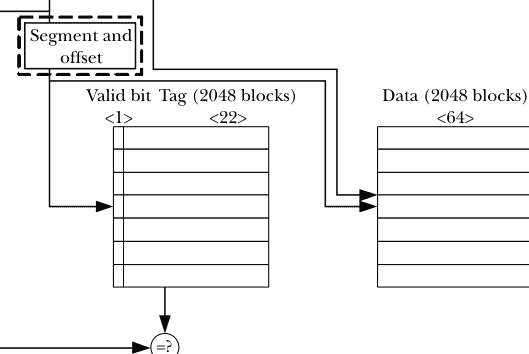

具有 32 位地址、2K 条目、8 字节块以及最小分段大小为 128 的缓存组织示例。分段缓存的实现仅需索引位进行转换，而不是映射到相同组的其他地址。在此实现中，索引的一部分将与标记（tag）一起存储，以允许不小于 128 条目的范围内的分段大小。支持更大的最小分段大小需要更少的位；同样地，支持更小的最小分段大小需要更多的索引位。所示，只需要对索引位进行转换即可分段。

分段大小和偏移存储在每个线程的状态寄存器中。在上下文切换时，迁入线程的分段大小和偏移可以加载到缓存映射单元中。

如前所述，与 RAM 相比，任何种的缓存都会产生访问时间和大小开销。在我们的案例中，访问时间是由于索引位转换和标记比较共同导致的。这种增加的访问时间是否在关键路径上并降低时钟频率，是一个特定设计的考量。如果是这样（我们预计在简单数据处理器上会如此），可以添加额外的处理器流水线阶段以防止损坏时钟频率（例如，IXP1200 数据处理器使用五级流水线，而该方案可能需要六级阶段）。大小开销源于标记数组（tag array）；每个条目都需要若干 RAM 中不需要的标记位。对于图 2.2 所示的示例，最小分段大小为 128 条目，每个 64 位数据条目需要一个有效位（valid bit）和一个 22 位的标记条目，这与没有开销的 RAM 相比导致了约 36% 的位计数开销。

这些开销是否值得取决于许多因素的特定设计决策。鉴于缓存在通用和嵌入式系统中主导地位，我们预计未来的 NP 处理器将承担这些开销，以获得无限制程序大小带来的收益。

#### 地址映射

如果所有分段大小都是 2 的幂，那么映射函数将非常简单：提取索引位并使用它们来索引数据数组和数据数组（正如普通缓存那样，所有普通缓存的大小都是 2 的幂）；这是取模运算（modulo operator）的一种高效高效实现。

对于任意的分段大小，当模数不是 2 的幂时，取模运算需要整数除法而非简单的选择，必须采取另一种方法。为了说明这个问题，首先考虑一个具有 8 个条目的分段。取模操作可以通过简单使用地址的三个低位作为索引来选择 $2^3=8$ 个条目之一。现在考虑一个具有 7 个条目的分段。仍然需要三位来编码这 7 个条目，但 3 位组合中的一个不会对应有效的条目（即只有 7 个条目但有可能的 3 位序列）。事实上，无效条目将映射到另一个分段中的任何条目，这是我们想要避免的情况。

一种解决方案实现了数字除法并直接计算余数。对于我们的目的，更简单的方法更优。以下伪代码实现了该计算，其中 $N$ 是分段大小，选定的位是从编码地址的地址中提取的（所需的位数等于编码分段大小所需的位数，即 $\log_2 N$，且每个线程可能不同）。

```
if selected-bits >= N
    set = selected-bits - N + offset
else
    set = selected-bits + offset
```

该思想是检测无效的位序列（即大于分段大小的序列）并从中生成有效的位序列。该计算需要加法器和比较器，但它是并行的，并且允许快速实现。

#### 强制执行指令内存带宽限制

由于指向存储剩余程序的内存路径（即处理缺失的路径）很可能是实时活动（例如数据或 I/O 访问）共享的资源，因此可能需要限制来自指令缓存缺失的干扰。这里有两个考量。首先是使所需的指令内存带宽保持在足够满足任何时间限制的水平上。其次是保持所需的指令内存带宽具有确定性，以便对系统资源进行充分的配置。

为了实现这两个目标，可以使用取指节流器（instruction fetch throttle）来确定分配给指令取指带宽。通过这种方式，可以由系统设置指令请求率，并出于系统配置的目的对其进行限制。例如，一种策略是赋予指令访问高于所有其他内存事务的优先级。分配的指令内存带宽总量将取决于系统级查询，而所需的带宽将是程序大小、执行模式、线程调度模式和区域大小的结果。我们计划在未来的工作中探索支持此类策略的机制。

## 实验评估

在接下来的章节中，我们评估了分段指令缓存，并展示了有效的尺寸策略和减少缺失的技术。

### 基准程序和方法论

我们的性能仿真是跟踪驱动的。我们使用了研究人员公开的几个程序 [4, 5]；这些程序描述在表 2.1 中。大多数程序是网络代码：搜索、排序、提取值和加密。剩下的是数值性质的（例如 FFT 和 hidecmp）。为了产生报告的缓存结果，我们使用了自己的模拟器，该模拟器已通过 DineroIV [6] 缓存模拟器进行了验证。该模拟器用 Python [7] 实现，易扩展并灵活建模各种内存系统特性和结构。

### 本研究讨论的示例程序。

| 程序 | 静态指令 (I.C.) | 动态指令 (I.C.) | 唯一动态指令 (I.C.) | 描述 |
|---|---|---|---|---|
| binsearch | 199 | 175 | 79 | 15 个整数的二分查找。 |
| chk_data | 99 | 295 | 66 | Park [8] 论文中的示例，查找数组中的第一个非零值。 |
| CRC | 442 | 71633 | 258 | 循环冗余校验。 |
| DES | 1058 | 110217 | 929 | 数据加密标准 [9]。 |
| FFT | 835 | 3915 | 305 | 傅里叶变换。 |
| fibcall | 168 | 557 | 48 | 前6 个斐波那契数的和。 |
| isort | 209 | 2215 | 89 | 10 个整数的插入排序。 |
| ludcmp | 761 | 8851 | 631 | 线性方程的 LU 分解。 |
| matmul | 274 | 8707 | 158 | 矩阵乘法。 |
| qsort | 574 | 2649 | 426 | 快速排序。 |
| qurt | 492 | 1714 | 365 | 二次方程的根。 |
| select | 520 | 2959 | 367 | 从列表中选择 k 个整数。 |
| tstdemo | 2558 | 1.67M | 2010 | 使用三叉搜索树 [4] 在 20K 词典中查找与 "elephant" 距离为 3 的单词。 |

### 分段尺寸

在本节中，我们调查了分段尺寸策略的有效性。记住，程序尺寸策略将产生产生缓存缺失，因为

| 程序 | Profile | 局部性 | 20 | 40 | 60 | 80 | 95 |
| :--- | :--- | :--- | :--- | :--- | :--- | :--- | :--- |
| binsearch | 199 | 79 | 16 | 32 | 48 | 64 | 76 |
| chk_data | 99 | 66 | 14 | 27 | 40 | 53 | 63 |
| CRC | 442 | 258 | 52 | 104 | 155 | 207 | 246 |
| DES | 1058 | 929 | 186 | 372 | 558 | 744 | 883 |
| FFT | 835 | 305 | 61 | 122 | 183 | 244 | 290 |
| fibcall | 168 | 48 | 10 | 20 | 29 | 39 | 46 |
| isort | 209 | 89 | 18 | 36 | 54 | 72 | 85 |
| ludcmp | 761 | 631 | 127 | 253 | 379 | 505 | 600 |
| matmul | 274 | 158 | 32 | 64 | 95 | 127 | 151 |
| qsort | 574 | 426 | 86 | 171 | 256 | 341 | 405 |
| quick | 492 | 365 | 73 | 146 | 219 | 292 | 347 |
| select | 520 | 367 | 74 | 147 | 221 | 294 | 349 |
| tstdemo | 2558 | 2010 | 402 | 804 | 1206 | 1608 | 1910 |

样本段大小。

只要性能分析输入正确，我们就会进行性能分析（profile）；前者用于无法容忍缺失的程序，后者可用于那些不应偶尔发生缺失的程序。根据定义，局部性策略（locality strategy）会产生一些缺失。它是最乐观的，并预估了高水平的局部性。因此，在我们的实验中，表 2.2 报告了这些策略针对特定程序的段大小。虽然收集良好的 profile 是软件工程中的一项重要任务，但这是我们研究关注的重点。请注意，我们的重点并非衡量 profile 的准确性，而是确定分段缓存的性能。为了获得关于局部性如何存在的初步直观，我们首先考虑了运行过程中指令引用的分布。图 2.3 描绘了动态引用相对于静态指令的分布。例如，`binsearch` 列中最底部的段表明，10% 的指令占据了 20% 的动态引用。最极端的例子是 `tstdemo`，其中 95% 的动态指令对应的数量更少。

### 支持实时工作负载

FIGURE 图绘制了执行期间看到的负责 20%、40%、60%、80% 和 95% 引用的静态指令百分比。然而，平均而言，似乎大约 60% 的静态指令占据了 95% 或更多的动态引用。这表明，如果我们缓存那些与其发生冲突的指令，剩余的 40% 不产生太多的缺失。表 2.3 报告了局部性尺寸策略在预加载前后的缺失情况，并对预加载缺失率进行了分类。这里有几点需要说明：

- 缺失率随段大小的增加而提高。

- 正如预期的那样，缺失率随预加载而有所提高。

- 对于五个程序：binsearch、FFT、qsort 和 select，缺失率（即使在预加载）仍然很高（例如，使用局部性策略时为 14% 或更高）。这些程序中约 25% 的缺失是由于冲突引起的。

| 程序 | 局部性 | 缺失率 | 预加载缺失（强制性） | 预加载缺失（容量） | 冲突 |
| :--- | :--- | :--- | :--- | :--- | :--- |
| binsearch | 20 | 0.98 | 0.89 | 0.40 | 0.60 | 0.00 |
| | 40 | 0.84 | 0.66 | 0.41 | 0.59 | 0.00 |
| | 60 | 0.50 | 0.23 | 0.78 | 0.00 | 0.23 |
| | 80 | 0.45 | 0.09 | 1.00 | 0.00 | 0.00 |
| chk_data | 20 | 0.94 | 0.89 | 0.20 | 0.80 | 0.00 |
| | 40 | 0.42 | 0.33 | 0.40 | 0.00 | 0.60 |
| | 60 | 0.22 | 0.09 | 1.00 | 0.00 | 0.00 |
| | 80 | 0.22 | 0.04 | 1.00 | 0.00 | 0.00 |
| CRC | 20 | 0.39 | 0.39 | 0.01 | 0.93 | 0.06 |
| | 40 | 0.17 | 0.17 | 0.01 | 0.00 | 0.98 |
| | 60 | 0.00 | 0.00 | 0.69 | 0.11 | 0.19 |
| | 80 | 0.00 | 0.00 | 0.76 | 0.12 | 0.12 |
| DES | 20 | 0.16 | 0.16 | 0.04 | 0.34 | 0.62 |
| | 40 | 0.03 | 0.03 | 0.20 | 0.01 | 0.78 |
| | 60 | 0.01 | 0.00 | 0.89 | 0.00 | 0.11 |
| | 80 | 0.01 | 0.00 | 0.84 | 0.00 | 0.16 |


| FFT | 20 | 0.74 | 0.73 | 0.09 | 0.91 | 0.00 |
| | 40 | 0.64 | 0.61 | 0.08 | 0.40 | 0.52 |
| | 60 | 0.19 | 0.14 | 0.22 | 0.50 | 0.28 |
| | 80 | 0.10 | 0.03 | 0.46 | 0.00 | 0.54 |
| fibcall | 20 | 0.90 | 0.88 | 0.08 | 0.92 | 0.00 |
| | 40 | 0.09 | 0.03 | 1.00 | 0.00 | 0.00 |
| | 60 | 0.09 | 0.02 | 1.00 | 0.00 | 0.00 |
| | 80 | 0.09 | 0.00 | 1.00 | 0.00 | 0.00 |
| isort | 20 | 0.93 | 0.89 | 0.05 | 0.97 | 0.00 |
| | 40 | 0.48 | 0.47 | 0.05 | 0.91 | 0.04 |
| | 60 | 0.07 | 0.05 | 0.34 | 0.66 | 0.00 |
| | 80 | 0.04 | 0.01 | 1.00 | 0.00 | 0.00 |
| ludcmp | 20 | 0.19 | 0.17 | 0.33 | 0.67 | 0.00 |
| | 40 | 0.09 | 0.06 | 0.74 | 0.24 | 0.02 |
| | 60 | 0.09 | 0.05 | 0.60 | 0.00 | 0.40 |
| | 80 | 0.07 | 0.01 | 1.00 | 0.00 | 0.00 |

## 2.3 样本尺寸的缓存结果。

| 程序 | 局部性 | 缺失率 | 预加载缺失（强制性） | 预加载缺失（容量） | 冲突 |
| :--- | :--- | :--- | :--- | :--- | :--- |
| matmul | 20 | 0.88 | 0.88 | 0.02 | 0.98 | 0.00 |
| | 40 | 0.19 | 0.18 | 0.06 | 0.41 | 0.52 |
| | 60 | 0.13 | 0.12 | 0.06 | 0.00 | 0.94 |
| | 80 | 0.13 | 0.12 | 0.03 | 0.00 | 0.97 |
| qsort | 20 | 0.53 | 0.50 | 0.26 | 0.73 | 0.01 |
| | 40 | 0.48 | 0.42 | 0.23 | 0.76 | 0.01 |
| | 60 | 0.42 | 0.33 | 0.20 | 0.80 | 0.00 |
| | 80 | 0.30 | 0.17 | 0.18 | 0.37 | 0.44 |
| quick | 20 | 0.60 | 0.56 | 0.31 | 0.30 | 0.40 |
| | 40 | 0.33 | 0.25 | 0.52 | 0.48 | 0.00 |
| | 60 | 0.31 | 0.18 | 0.48 | 0.35 | 0.18 |
| | 80 | 0.23 | 0.06 | 0.68 | 0.02 | 0.30 |
| select | 20 | 0.89 | 0.86 | 0.12 | 0.88 | 0.00 |
| | 40 | 0.65 | 0.60 | 0.12 | 0.88 | 0.00 |
| | 60 | 0.30 | 0.23 | 0.21 | 0.12 | 0.67 |
| | 80 | 0.20 | 0.10 | 0.25 | 0.00 | 0.75 |
| tstdemo | 20 | 0.03 | 0.03 | 0.03 | 0.05 | 0.91 |
| | 40 | 0.03 | 0.03 | 0.01 | 0.03 | 0.97 |
| | 60 | 0.00 | 0.00 | 0.03 | 0.30 | 0.67 |
| | 80 | 0.00 | 0.00 | 0.25 | 0.00 | 0.75 |

## 支持混合实时工作负载

| 程序 | 局部性 | 缺失率 | 预取后 | | | | | | | |
| :--- | :--- | :--- | :--- | :--- | :--- | :--- | :--- | :--- | :--- |
| binsearch | 20 | 0.99 | 0.90 | 0.40 | 0.60 | 0.00 |
| | 40 | 0.57 | 0.38 | 0.70 | 0.30 | 0.00 |
| | 60 | 0.48 | 0.21 | 0.86 | 0.00 | 0.14 |
| | 80 | 0.47 | 0.10 | 0.83 | 0.00 | 0.17 |
| chk_data | 20 | 0.91 | 0.86 | 0.20 | 0.80 | 0.00 |
| | 40 | 0.22 | 0.13 | 1.00 | 0.00 | 0.00 |
| | 60 | 0.23 | 0.05 | 0.93 | 0.00 | 0.07 |
| CRC | 20 | 0.37 | 0.37 | 0.01 | 0.99 | 0.01 |
| | 40 | 0.00 | 0.00 | 0.80 | 0.19 | 0.01 |
| | 60 | 0.00 | 0.00 | 1.00 | 0.00 | 0.00 |
| DES | 20 | 0.16 | 0.16 | 0.04 | 0.37 | 0.59 |
| | 40 | 0.05 | 0.05 | 0.10 | 0.01 | 0.89 |
| | 60 | 0.04 | 0.03 | 0.10 | 0.00 | 0.90 |
| | 80 | 0.01 | 0.01 | 0.31 | 0.00 | 0.69 |
| FFT | 20 | 0.56 | 0.55 | 0.11 | 0.88 | 0.00 |
| | 40 | 0.34 | 0.31 | 0.15 | 0.82 | 0.03 |
| | 60 | 0.14 | 0.09 | 0.34 | 0.25 | 0.40 |
| | 80 | 0.09 | 0.03 | 0.56 | 0.00 | 0.44 |
| fibcall | 20 | 0.90 | 0.88 | 0.08 | 0.92 | 0.00 |
| | 40 | 0.09 | 0.05 | 1.00 | 0.00 | 0.00 |
| | 60 | 0.09 | 0.03 | 1.00 | 0.00 | 0.00 |
| | 80 | 0.09 | 0.02 | 1.00 | 0.00 | 0.00 |
| isort | 20 | 0.98 | 0.97 | 0.06 | 0.97 | 0.00 |
| | 40 | 0.42 | 0.40 | 0.08 | 0.88 | 0.06 |
| | 60 | 0.05 | 0.03 | 0.52 | 0.24 | 0.24 |
| | 80 | 0.04 | 0.01 | 1.00 | 0.00 | 0.00 |
| ludcmp | 20 | 0.32 | 0.30 | 0.19 | 0.35 | 0.46 |
| | 40 | 0.14 | 0.11 | 0.39 | 0.41 | 0.20 |
| | 60 | 0.14 | 0.10 | 0.29 | 0.00 | 0.71 |
| | 80 | 0.07 | 0.02 | 0.80 | 0.00 | 0.20 |

## 2.4 代码调度后的 Cache 结果。

## 2.3 实验评估

| 程序 | 局部性 | 缺失率 | 预取后 | 冲突 | | | | |
| :--- | :--- | :--- | :--- | :--- | :--- | :--- | :--- |
| | | | 缺失率 | 强制 | 容量 | | |
| matmul | 20 | 0.90 | 0.89 | 0.02 | 0.97 | 0.02 |
| | 40 | 0.11 | 0.10 | 0.11 | 0.82 | 0.07 |
| | 60 | 0.03 | 0.02 | 0.33 | 0.02 | 0.66 |
| | 80 | 0.00 | 0.00 | 0.94 | 0.00 | 0.06 |
| qsort | 20 | 0.60 | 0.57 | 0.23 | 0.65 | 0.13 |
| | 40 | 0.51 | 0.44 | 0.22 | 0.73 | 0.05 |
| | 60 | 0.35 | 0.26 | 0.25 | 0.68 | 0.07 |
| | 80 | 0.21 | 0.08 | 0.42 | 0.31 | 0.28 |
| qurt | 20 | 0.38 | 0.34 | 0.50 | 0.50 | 0.00 |
| | 40 | 0.31 | 0.22 | 0.57 | 0.41 | 0.02 |
| | 60 | 0.27 | 0.14 | 0.61 | 0.25 | 0.15 |
| | 80 | 0.24 | 0.07 | 0.61 | 0.23 | 0.16 |
| select | 20 | 0.91 | 0.88 | 0.11 | 0.89 | 0.00 |
| | 40 | 0.45 | 0.40 | 0.19 | 0.81 | 0.00 |
| | 60 | 0.17 | 0.09 | 0.54 | 0.34 | 0.12 |
| | 80 | 0.13 | 0.03 | 0.78 | 0.00 | 0.22 |
| tstdemo | 20 | 0.00 | 0.00 | 0.42 | 0.18 | 0.10 |
| | 40 | 0.00 | 0.00 | 0.68 | 0.18 | 0.14 |
| | 60 | 0.00 | 0.00 | 0.72 | 0.07 | 0.21 |
| | 80 | 0.00 | 0.00 | 0.70 | 0.00 | 0.30 |

## 2.4 续

几乎所有程序都受益于调度，缺失率分别降低了 10% 和 60%。然而，两个数值程序 DES 和 ludcmp 分别增加了 3% 和 5%。当根据分析的执行频率进行代码调度时，这两个程序都经历了冲突缺失的增加。

### 2.3.5 使用组相性减少缺失

Cache 组相性是一种减少冲突的硬件方法。在组相性 Cache 中，每个地址映射到一个包含 $m$ 个条目的组（在 $m$ 路 Cache 中）；这些 $m$ 个条目以全关联的方式被访问。

支持混合实时工作负载

代码调度对缺失率局部性的影响 60


图 2.4 比较了代码调度前后使用局部性分段大小策略的缺失率（即请求的项可以在任何位置找到，且必须并行搜索它们）。只要每个组中冲突的地址数不超过 $m$ 个，就可以避免冲突缺失。

关联性是一个与分段正交的特征；在分段式 Cache 中，一个组是一个单个项还是项集合并不重要。在下一组实验中，我们测量了代码调度前后关联性对冲突缺失的影响。

结果如图 2.5 所示。在图中，每种 Cache 结构的冲突缺失报告为相对于相同容量的直接映射 Cache 中冲突数量的归一化值。

我们观察到以下现象：

- 单独组相性无法有效减少冲突缺失。图 2.5 的第一部分显示，冲突增加的频率至少与减少的频率相等。这种反直觉的结果是因为，当关联性增加时，映射到同一个组的潜在冲突地址数量也之增加；如果关联性的增加为组内引入了更频繁的冲突地址，缺失可能会增加。当然，这可能只发生在满容量 Cache（例如利用其全部容量的 Cache）中，因为这些 Cache 设计上如此。

- 组相性与代码调度结合使用时具有明显优势，在超过一半的时间内冲突数量减少了一半。

## 2.3 实验评估

几乎所有程序都受益于调度，缺失率降低了 10% 和 60%。然而，两个数值程序 DES 和 ludcmp 分别增加了 3% 和 5%。当根据分析的执行频率进行代码调度时，这两个程序都经历了冲突缺失的增加。

## 2.4 续

几乎所有程序都受益于调度，缺失率分别降低了 10% 和 60%。然而，两个数值程序 DES 和 ludcmp 分别增加了 3% 和 5%。当根据分析的执行频率进行代码调度时，这两个程序都经历了冲突缺失的增加。

### 2.3.5 使用组相性减少缺失

Cache 组相性是一种减少冲突的硬件方法。在组相性 Cache 中，每个地址映射到一个包含 $m$ 个条目的组（在 $m$ 路 Cache 中）；这些 $m$ 个条目以全关联的方式被访问。

支持混合实时工作负载

代码调度对缺失率局部性的影响 60


图 2.4 比较了代码调度前后使用局部性分段大小策略的缺失率（即请求的项可以在任何位置找到，且必须并行搜索它们）。只要每个组中冲突的地址数不超过 $m$ 个，就可以避免冲突缺失。

关联性是一个与分段正交的特征；在分段式 Cache 中，一个组是一个单个项还是项集合并不重要。在下一组实验中，我们测量了代码调度前后关联性对冲突缺失的影响。

结果如图 2.5 所示。在图中，每种 Cache 结构的冲突缺失报告为相对于相同容量的直接映射 Cache 中冲突数量的归一化值。

我们观察到以下现象：

- 单独组相性无法有效减少冲突缺失。图 2.5 的第一部分显示，冲突增加的频率至少与减少的频率相等。这种反直觉的结果是因为，当关联性增加时，映射到同一个组的潜在冲突地址数量也随增加；如果关联性的增加为组内引入了更频繁的冲突地址，缺失可能会增加。当然，这可能只发生在满容量 Cache（例如利用其全部容量的 Cache）中，因为这些 Cache 设计上如此。

- 组相性与代码调度结合使用时具有明显优势，在超过一半的时间内冲突数量减少了一半。

## 2.3 实验评估

关联性对冲突缺失的影响 原始程序布局


关联性对冲突缺失的影响 调度后程序布局


报告了代码调度前后局部性分段大小策略对冲突缺失的影响。报告了 2 路、4 路和 8 路。

如 2.3.3 节所述，多个线程执行同一个程序可能是且常见的。在这种情况下，将每个上下文分配到同一个段是合理的。在节省缓存空间的同时，这种情况增加了线程间的冲突。在本节中，我们测量了这种共享对缺失率的影响。（另一种可能性是将不同的程序放入同一个段，但我们留待未来考虑。）

## 支持混合实时工作负载

由于段是共享的，我们的模拟方法必须改变。如果线程共享一个段，这些线程可能处于不同的执行点。在我们的实验中，我们首先通过为每个线程分配轨迹中的随机起始位置来开始模拟。然后每个线程以轮询方式执行，直到获取了预定的指令数。在这些实验中，我们限制每个线程为轨迹总指令数的 1/7（因此段共享配置的运行次数与独立运行相同）。除了轮询调度策略（这是 Intel NP 实现的策略），每个线程在切换之前执行随机数量的指令（从均值为 7 的正分布运行长度集合中采样）。

图 2 报告了多线程共享段时的缺失率。显示了直接映射和四路 Cache 共享二、四、八线程。

我们观察到以下现象：

- 缺失率可能会显著增加，在 FFT 和 ludcmp 的极端情况下，几乎翻倍。

- 组相性总是有改进，但有时微乎其微（例如 binsearch 的 2 和 4 个线程）。

段共享 Cache 结果局部性 60

| 调度 MR | 1W,4T | 4W,2T | 4W,8T |
|---|---|---|---|
| 1W,2T | 1W,8T | 4W,4T | |

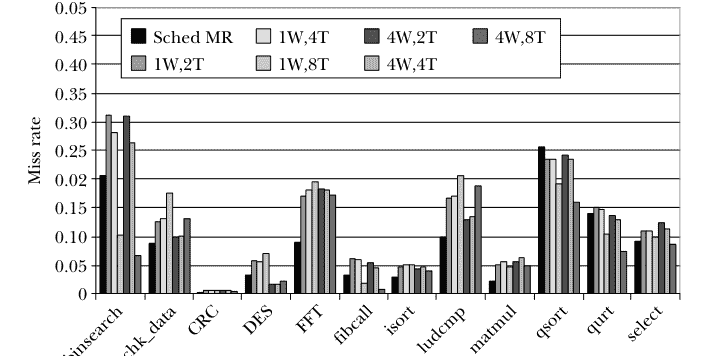

图 2.6

## 2.4 相关工作

- 在某些情况下（例如 DES、qsort、qurt），由于构造性干预，缺失率有所提高。

显而易见，只有当实例化多个线程来执行给定程序能够提高性能时，这种决策才是有意义的。如果性能分析信息表明（如图 2.6 所示的几种情况）额外的线程可能会降低性能，那么确实应该实例化较少的线程。

多线程处理器上分段缓存共享的段共享问题 [11] 是一个研究领域，该领域已经进行了一些关于代码调度的工作。然而，这里很少有工作可以被这里，因为目前尚不清楚它们是否适用于像本文所示的小型、全满缓存；我们计划在未来的工作中进一步探讨这一问题。例如，仅缓存频繁执行的指令（基于性能分析信息）可能会大幅减少互连冲突。

## 2.4 相关工作

在实时缓存分析，以及多线程/多程序缓存的分析与设计这些独立领域中，已经存在大量的研究工作。

在实时性文献中，有几个小组研究了最坏情况执行时间（WCET）的缓存分析 [12–14]。这些技术中的每一种都提出了一种分析方法，用于限制给定程序在给定处理器和缓存结构上的性能。这些方法是描述性的，如果 WCET 过大，它们并没有对改进程序结构给出建议。

多线程处理器的指令递送最早在第一代多线程计算机 [15] 和多处理器 [16] 的设计中被考虑。更最近的研究评估了多线程架构上工作站和服务器的缓存性能与需求 [17]，以及之前关于针对多线程处理器指令缓存性能的编译研究 [11]。

列缓存 [18] 是一种动态缓存分区技术，其中为不同的目的（如线程或程序）分配了单个关联组，以保证性能。其缺点是高程度的分配需要高关联度。在任何情况下，分段技术不需要组相性，它与列缓存是正交的，并可以用于增加分配的粒度。

其他方法 [19, 20] 考虑考虑了以不同的粒度分配缓存部分，从单个数据对象到进程不等。这些项目的总目标与我们相同——即使用不同的缓存区域来提供可靠的缓存性能——这里描述的代码调度技术也适用于这些其他建议。

## 2.5 结论与未来工作


# 分段指令缓存与代码调度

在本章中，我们提出了使用分段指令缓存结合性能驱动的代码调度，为运行在同一多线程处理器上的实时和非实时线程提供灵活的指令递送。这种技术在 NP 数据处理器中特别有用，这些处理器是多线程的，但受到固定大小控制存储器的限制。分段指令缓存允许实时程序映射到足够大的私有段中以避免缺失，同时允许非实时程序发生缺失，并将所有缓存冲突限制在各个独立的段内。这消除了对非实时代码的程序级限制，而又不会牺牲对实时程序的保证性递送。我们评估了若干种特定于程序的段大小调整策略，并发现代码调度是消除大部分冲突缺失的有效方法，并且通常能将选定程序的缺失率降低 10% 到 60%。

我们计划在未来的工作中考虑若干个额外主题：避免索引计算和标记检查（实时段中完全避免，其他情况下通过预测实现）、塑造指令取指带宽的机制、提高共享段率、测量对缓存参数（例如块大小）的敏感性、研究在运行时动态更改段的益处（既针对这些静态组合的线程，也针对动态组合场景）、提供段间的数据共享（例如用于共享代码库），以及探索分段在数据缓存中的应用。

## 参考文献

- [1] Intel Corp., Intel XP Family of Network Processors, developer.intel.com, 2001.
- [2] V. Kumar, T. Lakshman, and D. Stiliadis, “Beyond best effort: Router architectures for t differentiated services of tomorrow’s Internet,” IEEE Communications Magazine, p. 152–164, May 1998.
- [3] M. D. Hill, Aspects of cache memory and instruction buffer performance, Ph.D. Dissertation, Tech. Report UCB/CSD 87/381, Computer Sciences, UC-Berkeley.
- [4] J. Bentley and R. Sedgewick, “East algorithms for Sorting and strings,” SODA: ACM-A Conference on Theoretical and Experimental Algorithms, 1997.
- [5] C-LAB, Siemens AG, and Universitat Paderborn, C-LAB Benchmarks, www.c-lab.de.
- [6] M. Hill and J. Elder, DineroV Driver Uniprocessor Cache Simulator, www.cs.edu/markhill/, 2003.
- [7] Python, The programming language, www.python.org, 2002.
- [8] C. Y. Park, Predicting Deterministic Execution Times of Real-Time Programs, Ph.D. thesis, University of Washington, 1992.
- [9] National Bureau of Standards, Data Encryption Specifications, FIPS Publication 46, U.S. Dept. of Commerce.
- [10] K. Pettis and R. Hansen, “Profile guided for multithread processors,” 35th ACM Symposium on Language Design and Implementation, '90, pp. 19–27.
- [11] Y. Chen, J. Jain, S. Devadas, and M. Kuo, “Compiling for instruction cache performance on multithread processors,” IEEE Computer Society, '96.
- [12] G. Ottmann and M. Sjodin, “Worst-case execution time for real-time,” 21st IEEE Real-Time Systems, '00, pp. 419–429.
- [13] Y. Si, L. Malik, and A. Wolfe, “Segmented instruction caches for real-time,” Real-Time Systems, '97.
- [14] B. Thornton and E. Erblom, “Worst-case execution analysis for real-time,” Real-Time Systems, '97.
- [15] J. Smith, Design of a Computer, 6600.
- [16] B. Welch, Performance monitoring for multiciprocessor, 1981.
- [17] D. Chiou, M. Muller, and D. Page, “Dynamic cache partitioning for server,” Supercomputing, '96.
- [18] D. May, J. Irwin, and S. Snerner, “Allocation for schedulability,” Euicro Workshop on Real Time Systems, '91, pp. 40–50.
- [19] D. Kirk, J. Snerner, and J. Sassin, “Effective caching for data objects,” Design Automation Conference, 2000.
- [20] P. Bakkers and A. W., editors, “Segmentation for data caches,” in Communicating Architectures, 2000, pp. 145–154.

# 使用摘要缓存（Digest Caches）实现高效数据包分类

最近，我们为数据包分类算法的设计提出了第三个维度：准确性 [13]。也就是说，在允许数据包分类存在特定误差的情况下，数据包的速度是否可以显著提高？在之前的一篇论文中，我们提出使用改进的布隆过滤器 [14] 进行数据包分类。在该方法中，满足二值谓词的分类数据包被插入到缓存决策的过滤器中。例如，网络桥接器会将其识别为应该转发的流添加到布隆过滤器中。随后的数据包在处理之前会查询过滤器以快速测试其成员性。命中过滤器的数据包将根据谓词立即处理，而未命中的数据包将进入速度较慢的全数据包查找过程。

这种布隆过滤器缓存设计存在三个局限性。首先，存在 `$N$` 个独立的内存缓存，其中 `$N$` 是布隆过滤器的哈希层数。对于针对十亿一次数据包误分类概率优化的布隆过滤器，`$N=30$`。其次，不存在恢复布隆过滤器中当前元素的机制，导致其无法使用如 `LRU` 等高效的缓存替换机制。最后，布隆缓存仅在存储少于 256 个二值谓词时有效。因此，它不是附加任意数据的合适数据结构，因为支持数据所需的布隆过滤器数量会不断增加。

在本文工作中，我们提出了摘要缓存（digest caches）的概念，用于高效数据包分类。摘要缓存的目标与布隆过滤器缓存相似，即通过牺牲数据数据包分类准确性来换取性能的提升。然而，摘要缓存允许采用 `LRU` 等传统缓存管理策略，以随时间推移更好地管理缓存。与其存储流标识符（源目的 IP 地址以及协议类型）的布隆过滤器签名，不如存储流标识符的哈希值，从而允许更小的缓存条目。我们还讨论了如何通过构建带有摘要缓存的多级缓存来扩展并加速精确缓存策略。

第 3.1 节介绍了相关工作，第 3.2 节概述了我们架构的设计。第 3.3 节使用示例网络轨迹评估了我们设计的性能，第 3.4 节讨论了在 `IXP1200` 网络处理器平台上测得的我们算法产生的性能开销。

## 3.1 相关工作

由于数据包分类的高处理成本，网络设备设计人员转而使用缓存来加速数据包处理时间。网络缓存设计的早期工作借用了计算机体系结构的概念（`LRU` 栈、组相性多级缓存）[10]。某些缓存策略依赖于 CPU 的 L1 和 L2 缓存 [7]，而另一些则尝试将 IP 地址空间映射到内存地址空间，以利用硬件 TLB [15]。另一种方法是向 `LRU` 关联缓存中添加显式超时，通过减少抖动（thrashing）来提高性能 [11]。最近，除了利用在网络上观察到的数据包的时间局部性外，改进缓存性能的方法还应用了压缩和缓存 IP 范围的技术，以利用流标识符地址空间中的空间局部性 [16, 17]。这有效地允许多个流被缓存在单个缓存条目中，使得整个缓存可以放置在较小的高速内存（如处理器的 L1/L2 缓存）中。已有工作使用布隆过滤器进行前缀匹配方案 [18]。

这些工作大多不更高层次的流识别，而这正是我们工作的动机。此外，所有这些工作从根本上与本章介绍的内容不同，因为它们只考虑精确缓存策略。我们的方法试图在资源受限和允许误差率的情况下最大化性能。

## 3.2 我们的方法

网络缓存设计通常采用简单的组相性哈希表，这些想法借自其传统的内存管理对应物。哈希表的目标是在给定流标识符的情况下，快速确定应该使用的操作或转发接口。对流标识符进行哈希处理允许传统网络处理器在仅检查缓存中几个条目时确定应该使用何种操作或转发接口。我们认为，流标识符精确匹配缓存的一个局限性是需要存储相当大的流标识符（例如，`IPv6` 流需要 37 字节）。这限制了可以缓存的信息量，或者增加了在缓存中查找信息的时间。

在本章中，我们提出了摘要缓存的概念。摘要缓存最重要的属性是它只存储流标识符的哈希值，而不是整个流标识符：摘要（digest）的目标是显著减少缓存中存储的信息量，以换取缓存查找中的少量误差。正如本节后文描述的，摘要缓存可以作为数据包分类器的唯一缓存；允许数据包分类器的缓存保持较小。其次，它们可以在精确分类场景下作为初始查找。这允许系统快速将传入的数据包划分为存在于精确缓存中的和不在缓存中的。

在本节的其余部分中，我们将为数据包分类缓存的近似算法提供动机。然后我们将关注摘要缓存的属性，将其与之前提出的基于布隆过滤器的数据包分类器进行比较，并用它加速精确数据包分类器。

摘要缓存从两个方面优于布隆缓存。缓存查询可以在次内存访问中完成，并且允许对元素进行直接寻址，这可以实现高效的缓存逐出算法，如 `LRU`。

### 3.2.1 近似算法

为了本研究，我们使用了十亿分之一的误分类概率。通常，`TCP` 校验会在每 1100 到 32000 个数据包中失败约一次，即使链路级 CRC 允许的误差率仅为四亿分之一。平均而言，每 16 到 1 万个数据包中有一个错误。布隆过滤器在十亿一次的误分类概率下，通常情况下是可接受的。我们认为，这种规模的误分类概率不会显著降低网络可靠性。

### 3.2.2 摘要缓存的计算

摘要缓存的想法简单来说是对哈希后的流标识符进行直接比较。在这种意义上，我们用缓存的准确性换取更小的存储需求。在构建摘要缓存时，我们首先需要决定如何分配内存。之前的工作已经证明，更高的缓存关联性产生更好的缓存命中率 [10]。然而，在摘要缓存的情况下，关联性的增加必须伴随着哈希大小的增加，以补偿额外的碰撞概率。

如果摘要是一个 `$c$` 位哈希，且我们具有 `$d$` 路组相性缓存，那么误分类概率为

`$p \approx \frac{d}{2^c}$`

该方程可以描述为：每个缓存行有 `$d$` 个条目，每个条目可以取 `$2^c$` 个值。当新条目的哈希值与现有任何 `$d$` 个条目重合时，就会发生误分类。我们必须使用强哈希来补偿增加的碰撞机会（关联性）。

### 3.2.3 理论比较

为了实现十亿分之一的误分类概率，布隆过滤器缓存必须使用 30 个独立的哈希函数来优化使用这种内存。这允许我们在缓存中存储最多 `$k$` 个流 [13]。

`$k_{Bloomcache} = \frac{\ln(1 - p^{1/L})}{\ln(1 - L/M)}$`

其中 `$L = 30$`，哈希函数数量；`$M$` 是内存量（比特）；`$p$` 是误识别概率。为了与摘要缓存直接比较，我们的方案可以存储的最大流数量，独立于

## 3 使用摘要缓存的高效数据包分类


图 3.1 在四路组联摘要缓存中可以寻址的最大流数量，对应不同的误分类概率 `$p$`。

其关联性由下式给出：

$$k_{digest} = \frac{M}{c} \ (3.3)$$

其中摘要函数所需的位数由式给出：

$$c = \lceil\log_2(d/p)\rceil \quad (3.4)$$

该关系依赖于 `$p$`（误识别概率）和 `$d$`（期望的缓存组关联性级别）。该公式的推导遵循等式 3.1。

图 3.2 比较了两种缓存方案的存储容量。两种方案都将存储容量与可用内存呈线性关系，但有趣的是，对于该应用而言，仅存储哈希在内存效率上比布隆过滤器（Bloom filter）高出 35% 以上。布隆过滤器成为有用算法的一个属性是，它能够向数据结构中插入无限数量的签名，代价是增加误识别率。

## 3.2 我们的方法


各种缓存方案存储容量的比较。布隆过滤器假设误识别概率为十亿分之一，这在理想条件下可以通过一个具有 30 个哈希函数的布隆过滤器建模。

图 2

然而，由于我们更倾向于界定的误分类率，这一属性对解决我们的问题没有帮助。

### 3.2.4 摘要缓存的一个特定示例

为了说明摘要缓存的操作，我们将构建一个摘要缓存的示例应用。假设我们有一个具有 16 个接口的路由器和分类规则 `$R$`。

首先，我们假设有 64 KB 的内存用于缓存，并希望有一个误分类概率为十亿分之一的四路组联缓存。

这些参数可以通过 32 位的摘要函数来实现，其中 4 位用于存储每流路由信息。每个缓存条目为 36 位，使得每个缓存行为 144 位（18 字节）。

64 KB 的缓存内存划分为 18 字节的行，总计产生 3640 行缓存，允许我们的缓存存储 14,560 个不同的条目。该缓存的可视化描述见图 5.3。

## 3 使用摘要缓存的高效数据包分类

摘要概述：

| 缓存行 0 | entry 0 | entry 1 | entry 2 | entry 3 |
| :--- | :--- | :--- | :--- | :--- |
| 缓存行 1 | entry 4 | entry 5 | entry 6 | entry 7 |
| 缓存行 3639 | entry 14556 | entry 14557 | entry 14558 | entry 14559 |

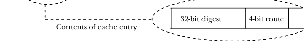

64 KB 四路组联摘要缓存概览，误分类概率为十亿分之一。该缓存为一个具有 16 个接口的路由器提供服务。

现在，让我们考虑缓存的一个示例轨迹，该缓存初始为空。假设有两个不同的流 A 和 B。

- 1. 数据包 1 来自流 A。
    a. A 的流标识符被哈希为 `$H1(A)$` 以确定要查找的缓存行。即 `$H1$` 是从流标识符到缓存行的映射。
    b. B 被哈希为 `$H2(A)$`，并与缓存行的所有四个元素进行比较。没有匹配。结果 `$H2(A)$` 是存储的流标识符的摘要。
    c. A 由标准流分类器分类，并发现路由到接口 3。
    d. 签名 `$H2(A)$` 被放在缓存行 `$H1(A)$` 中，连同其路由信息（接口 3）。
    e. 数据包通过接口 3 转发。
- 2. 数据包 2 来自流 A。
    a. A 的流标识符被哈希为 `$H1(A)$` 以确定要查找的缓存行。
    b. B 再次被哈希为 `$H2(A)$`，并与缓存行的所有四个元素进行比较。存在匹配，数据包转发到接口 3。
- 3. 数据包 3 来自流 B。
    a. B 的流标识符被哈希为 `$H1(B)$` 以确定缓存行。巧合，`$H1(A) = H1(B)$`。
    b. B 被哈希为 `$H2(B)$`，并与缓存行的所有四个元素进行比较。巧合，`$H2(A) = H2(B)$`。存在匹配，数据包转发到接口 3。这种误分类发生的概率为 `$4/2^{32} \approx 10^{-9}$`。

## 3.2 我们的方法

在没有误分类的情况下，该方案的行为完全等于具有 14,560 个条目（3640 行）的四路组联缓存。

## 3.2.5 使用摘要缓存进行精确分类

摘要缓存也可以通过多级缓存（见图 3.4）来加速精确系统。

## 3.3 评估

|  | Bell 追踪 | OGI 追踪 |
|---|---|---|
| 追踪长度（秒） | 3,600 | 3,600 |
| 数据包数量 | 974,613 | 15,600,297 |
| 平均数据包速率（包/秒） | 270.7 | 4,335.4 |
| TCP 数据包 | 303,142 | 5,034,332 |
| UDP 数据包 | 671,471 | 10,572,965 |
| 流 数量 | 32,507 | 160,087 |
| TCP 流数量 | 30,337 | 82,673 |
| UDP 流数量 | 2,170 | 77,414 |
| 平均流长度（秒） | 3.27 | 10.21 |
| 最长流（秒） | 3,599.95 | 3,600 |
| 平均数据包/流 | 29.98 | 97.49 |
| 平均数据包/TCP 流 | 9.9 | 60.89 |
| 平均数据包/UDP 流 | 309.43 | 136.58 |
| 最大并发流数 | 268 | 567 |

## 3.1

样本追踪的汇总统计数据。

表格


## 3.5

测试数据集中并发流的数量。

图表

## 3 使用摘要缓存的高效数据包分类

44


| Bell 追踪 | OGI 追踪 |
|---|---|
| 命中率 | 0.971 | 0.988 |
| 固有缺失率 | 0.029 | 0.012 |
| 最大缺失次数（每100 ms 间隔） | 6 | 189 |
| 缺失方差（每100 ms 间隔） | 1.3540 | 17.438 |
| 平均缺失次数（每100 ms 间隔） | 0.775 | 5.843 |

## 3.2 表格

模拟完美缓存的结果。

`OGI` 追踪捕获了一个部分活跃的半衰期游戏服务器，其特征是具有中等数量（约20个）的长寿命 `UDP` 流。

### 3.3.1 参考缓存实现

我们模拟了一个布隆过滤器 `[13]`，并使用了最优维度划分。在基准测试数据集上运行了冷分页和双缓冲老化策略。为了达到十亿分之一的分类错误概率，最优维度划分需要 30 个独立的哈希函数，这意味着每个缓存查找和插入操作都需要 30 次独立的单比特内存访问。

本章中的摘要缓存被选择为四路组式哈希表，带有 32 位流标识符位。每次查找和插入操作都需要 16 位的内存请求。由于其低复杂度和近乎最优的行为 `[10]`，我们选择了 `LRU` 缓存替换算法。

我们选择了四路组式缓存，其性能几乎等同于全交叉缓存 `[21]`。图 3.6 画了具有不同组关联性的摘要缓存的行为。

我们将我们的缓存与传统的基于四路层的 `IPv4` 和 `IPv6` 的哈希表进行了比较。每次查找和插入操作分别需要一个 512 字节或 148 字节的内存请求。

此处展示的所有结果结果的哈希处理都是使用 `SHA-1` `[26]` 哈希完成的。需要注意的是，`SHA-1` 哈希的加密强度并不是该领域内有效哈希函数的重要属性。只要它是通用哈希函数类的一员 `[27]` 即可。

## 3.3 评估

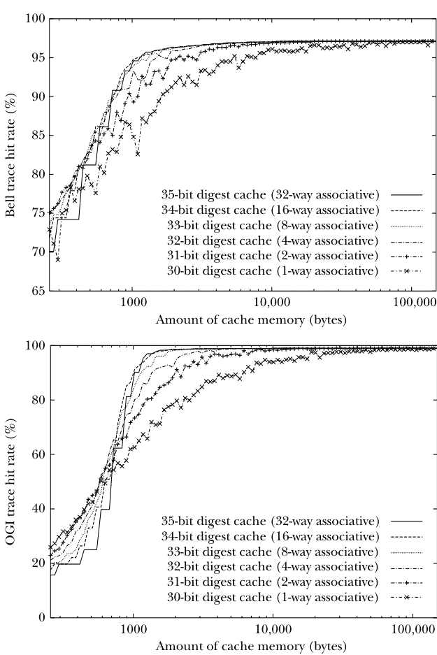

在不同组关联性下，摘要缓存命中率随内存的变化（假设分类错误率为十亿分之一）。

## 3.6 图表

## 3 使用摘要缓存的高效数据包分类

### 3.3.2 结果

在评估缓存系统的性能时，我们必须考虑两个标准：我们必须检查整体命中率，以及缓存缺失率的平滑度。具有大批量缓存缺失的缓存是没用的，因为它会对数据包分类引擎造成压力。

图 3.7 画了各种缓存策略的命中率，摘要缓存的命中率等同于其大小十倍的 `IPv6` 缓存。更重要的是，摘要缓存的大缺失性能优于布隆过滤器缓存。摘要缓存产生的命中率等同于大小为 50-80% 的冷捕布隆过滤器，并优于大小为其两到三倍的双缓冲布隆过滤器缓存。

图 3.8 画了不同缓存方法的缓存缺失率方差，按每 100 ms 间隔聚合。从两条追踪中观察到，摘要缓存提供了优越的性能，使聚合缓存缺失的方差 最小化。

有趣的是，对于极小的缓存尺寸，摘要缓存表现出的命中率方差比所有其他方案都大。这可以归因于在该区间内的其他算法表现均均匀地糟糕。

随着缓存尺寸的增加，这种命中率性能得到提高，缓存缺失率的方差减少到一个非常小的数字。这是一个重要的观察，因为它意味着在这些追踪中，缓存缺失不受突发活动模式的主导。

为了考虑一个更具体的例子，我们构建了一个 2600 字节的四路组式摘要缓存。选择这个数字是为了恰好与单个 `IXP2000` 系列微引擎可用的本地内存量相。

图 3.9 展示了按每秒间隔聚合的缓存缺失率追踪。该图代表了数据包分类引擎在每秒内必须处理的数据包数量，以跟上流量负载。从图中观察，在最坏情况下，`Bell` 追踪的数据包分类引擎必须能够每秒分类约 60 个包 `pps`，而 `OGI` 追踪在最坏情况下为 260 `pps`。整个时间期间，`Bell` 和 `OGI` 追踪的平均数据包负载分别为 270.7 和 4335.4 `pps`。`Bell` 追踪的峰值数据包速率接近 1400 `pps`，而 `OGI` 追踪的峰值速率超过 8000 `pps`。

通过使用 2600 字节的摘要缓存，对于观测到的追踪，数据包分类引擎的峰值压力水平降低了 20 倍和 30 倍。

## 3.3 评估


## 3.7 命中率随内存的变化（不同组关联性）。Bell 追踪在左侧，OGI 追踪在右侧。

图表

## 3 摘要包分类


缺失方差随内存 `$M$` 的变化（按100 ms 聚合）。`Bell` 追踪在左侧，`OGI` 追踪在右侧。

图表

## 3.4 硬件

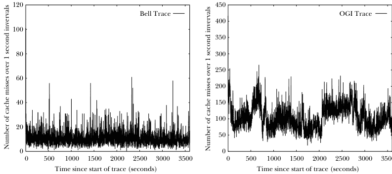

## 3.9 按秒间隔的缓存缺失率

## 3 使用摘要缓存的高效数据包分类

48

| 哈希层数 | 全缺失缓存吞吐量 |
|---|---|
| 0 | 990 MB/s |
| 1 | 868 MB/s |
| 2 | 729 MB/s |
| 3 | 679 MB/s |
| 4 | 652 MB/s |
| 5 | 498 MB/s |

## 3.3 表格

在模拟 `IXP200` 上的最坏数据流布隆过滤器性能。

## 3.5 结论

让我们考虑在该架构上实现数据包分类缓存的这种内存。如果我们使用这种内存来实现一个精确的 `IPv4` 缓存，我们最多可以存储 196 个流标识符。等效的 `IPv6` 缓存只能存储 69 个流。在 32 位四路组关联摘要缓存 `digest cache` 中使用这种内存，允许每个微引擎 `microengine` 缓存 640 个流。

如果我们使用 8 位四路组关联摘要缓存，我们仅需使用 1 KB 的片上内存内存和 38 KB 的 `SRAM`，即可为每个微引擎存储超过 1000 个流。

这种算法减少内存需求的能力在这一架构中尤为重要，因为内存传输寄存器具有局限性。每个微引擎可以访问 16 个 32 位内存传输寄存器，这意味着获取超过一个 `IPv4` 流标识符需要多次独立的内存访问，而这些访问必须是串行化的。由于独立内存访问的开销远大于单次长长度的内存访问，这会严重损害传统组关联缓存的性能。结合这些内存访问必须串行化（第一个访问必须完成后才能启动第二个访问）的事实，避免 `SRAM` 内存访问带来的性能收益变得至关重要。

作为对比，现代 `TCAM` 实现每秒可以执行 10 亿次查找 `[32]`。`IP2000` 每秒可以执行 2.33 亿次内存访问 `[31]`。即使不考虑 `TCAM` 所需的成本或功率，摘要缓存也成为了极具前景的替代方案。

这些论点使我们提出的技术成为为未来网络处理器创建高效缓存的首选。

## 3.5 结论

典型的数据包分类缓存是在尺寸和性能之间权衡。在本章中，我们提出了一种新型缓存架构，它能够高效有效地利用内存，并略微放了对准确性的要求。任何采用精确缓存算法的现有流缓存解决方案都可以通过采用我们的技术大幅提高性能，代价是牺牲一小部分准确性。

我们的技术在理论和实际性能上均优于之前的 `Bloom` 过滤器近似缓存算法，同时在解决此前 `Bloom` 过滤器缓存设计缺陷的同时，没有引入任何额外的缺点。

## 使用摘要摘要缓存实现高效数据包分类

该技术可以应用于新型两级精确缓存的设计，该设计可以利用分级内存的优势来加速精确缓存算法，并取得显著。

## 致谢

我们感谢 `Ed Kaiser` 和 `Chris Chambers` 对本文草稿版本提出的意见。我们还感谢匿名评审员提供的反馈。

美国科学基金会通过 `EIA-0130344` 号资助，以及英特尔公司的慷慨捐赠支持了这项工作。文中表达的任何观点、发现或建议均代表作者，不一定反映 `NSF` 或英特尔的观点。

## 参考文献

- [1] F. Bhabas [Note: likely Babesco] and G. Varghese, “Scalable packet classification,” Proceedings of ACM SIGCOMM 2001, August 2001, pp. 199–210.
- [2] A. Feldman and S. Mukukrishnan, “Tradeoffs for Packet Classification,” IEEE INFOCOM, 2000, pp. 1193–1202.
- [3] P. Gupta and N. McKeon, “Algorithms for packet classification,” IEEE Network Special, March/April 2001, 13(2), pp. 24–32.
- [4] T. V. Lakshman and D. Stiliadis, “High-speed policy-based packet forwarding using efficient multi-dimensional range matching,” Proceedings of ACM SIGCOMM 1998, August, 1998, pp. 203–214.
- [5] R. Srinivasan, G. Varghese, S. Suri, and M. Waldo, “Fast and stable layer-four switching,” Proceedings of ACM METRICS 1998, September, pp. 191–202.
- [6] Qiu, L. Varghese, and S. Suri, “Fast firewall implementations for software and hardware routers,” Proceedings of ACM METRICS 2001, pp. 344–345.
- [7] C. Partridge, et al., “A 50 GB/s Router,” IEEE/ACM Transactions on Networking, pp. 227–248.
- [8] F. Bhabas [Note: likely Babesco] and S. Singh, and G. Varghese, “Packet classification for core routers: Is there an alternative to CAM?” Proceedings of INFOCOM 2003, pp. 53–63.
- [9] K. Claff [Note: likely klaff], “Internet Characterization,” Ph.D. thesis, University of California, San Diego, 1994.
- [10] R. Jain, “Characteristics of destination locality in networks,” Journal of Computer Networks and ISDN Systems, 18(4), May 1990, pp. 243–254.
- [11] Xu, M. Singhal, and D. Agarwal [Note: likely Degrot], “A novel cache architecture to support layer-four packet classification at memory access speeds,” Proceedings of INFOCOM 2000, pp. 1445–1454.
- [12] C. Hui [Note: likely Huitama], IPv6: The New Internet Protocol (Second Edition), Prentice-Hall, 1998.
- [13] F. Chang, K. Li, and W. Feng, “Approximate caches for,” Proceedings of INFOCOM 2004, Hong Kong.
- [14] B. Blum [Note: likely Bloom], “Space/time tradeoffs with allowable errors,” Communications of ACM, 13(7), 1990, pp. 422–426.
- [15] T. Chi [Note: Chieh] and P. Pradhan, “High performance route using network processor,” Sixth International Symposium on High-Performance Computer (HPCA), 2000, pp. 409–418.
- [16] K. Gopalan, T. Chi [Note: Chieh], “Cache design for network,” IEEE/ACM Transactions on Networking, 2002, pp. 1–10.
- [17] SiberCore Technologies, SiberCAM Ultra-4.5M SCT4502 Product Brief, 2003.
- [18] J. Stone and Partridge, “When the CRC checksum disagree,” Proceedings of ACM SIGCOMM-00, August 2000, pp. 309–319.
- [19] D. Saltzer, D. Reed, and D. Clark, “End-to-End Arguments in System Design,” Journal of Computer and System Sciences, 2(1984), pp. 277–288.
- [20] D. Comer, *Network Systems Design Using Network Processors*, Prentice-Hall, 2003.
- [21] K. Li, F. Chang, and W. Feng, “Architectures for packet classification,” 11th International Conference on Networks (ICON) 2003, pp. 111–117.
- [22] C. Partridge, “Location and route caches,” NSF Workshop on Internet Statistics, www.caida.org/outreach/ismam/9602/partridge.html, 1996.
- [23] “Passive Measurement and Analysis,” National Laboratory for Network Research (NLR), pma.nnl.gov/net/
- [24] C. Fraser [Note: Frale], S. Moon, C. Biot, B. Lyles, and F. Tobagi, “Packet-Level Metrics from a Tier-1 IP Backbone,” ATL Technical Report TR01-ATL-10101, November 2001, Burlingame, California.
- [25] S. McCreary and K. Claff [Note: claff], “Trends in wide area traffic patterns from Ames Internet exchange,” ITC Specialist, Monterey, California, 2000.
- [26] FIPS 180-1, “Secure Hash Standard,” U.S. Department of Commerce/N.I.S.T., National Technical Information Service, Springfield, Virginia, April 1995.
- [27] L. Carter and M. Wegman, “Universal classes of hash functions,” Journal of Computer and System Sciences (1979), pp. 143–154.
- [28] Intel IXP1200 Network Processor, www.intel.com/design/network/products/npmfai/ix1200.html.
- [29] L. Sanchez, W. Milliken, A., Snoeren, F. Tchakountio, C. Jones, S. Kent, C. Partridge, and W. Strayer, “Hardware support for a hash-based IP traceback,” Proceedings of the 2nd DARPA Information Survivability Conference and Exposition, June 2001, pp. 146–152.
- [30] E. Johnson and A. Kunze, *IXP1200 Programming*, Intel Press, 2002.

# 面向 RapidIO、Hypertransport 和 PCI-Express 的灵活网络处理器接口

第 4 章

Christian Sauer

英飞凌科技股份公司（Infineon Technologies），公司研发部，慕尼黑

Matthias Gries, Kurt Kutezer

加州大学伯克利分校，电子研究实验室，伯克利

Jose Ignacio Gomez

马德里康普卢滕森斯大学，西班牙

新兴的通信协议标准（如 `PCI Express` 和 `RapidIO`）为尚未解决的网络处理器（`NPU`）正确标准化接口组的搜索注入了新动力。


网络处理器通常部署在网络核心设备和接入设备的线卡上 [1]。线卡管理设备与物理网络之间的连接。它们连接到背板上，背板允许数据包分发到其他线卡或发送到控制处理器。由于这种用途，NPU 需要许多专用接口：*网络接口*将处理器连接到物理网络；*交换扇矩阵接口*连接背板；*控制平面接口*连接到处理控制平面并维护 NPU 及其对端节点在线状态的外部处理器；用于数据包和表查找数据的*内存接口*；以及用于分类、服务质量（QoS）和加密加速的*协处理器接口*。虽然这些接口中的某些（例如内存和网络接口）已被不同的 I/O 标准很好地记录，但其他接口（特别是交换扇矩阵接口）仍然缺乏足够的标准化 [2]。

最近宣布的面向数据包的链路到链路通信协议（如 RapidIO、Hypertransport 和 PCI Express）的增强，旨在解决这个问题 [3]。这些接口最初是为以主机为中心的系统设计的，对类似于原始 PCI 规范的存储语义有强力支持。在网络领域，我们发现它们以传统的角色部署，即作为控制平面接口或协处理器接口 [4]。

## 4 面向灵活的网络处理器接口

最近的扩展功能（例如点对点通信和消息传递语义、低引脚数和可扩展带宽）使其成为网络处理器交换接口的合理候选人。

然而，目前尚不清楚网络处理器支持哪些接口。这些接口不仅代表了不同的市场联盟，而且如图 4.1 所示，它们在相似的性能/成本下提供了相当的功能（或随着演进提供）。因此，问题随之产生：我们能用一个足够灵活的解决方案来支持这些接口吗？

相关工作。图 4.1 显示了 RapidIO、Transport 和 PCI-Express 之外的许多其他通信协议。并行系统数据包接口（SPI）通常用于连接 NPU 中的外部物理设备（PHY）。当前代的网络处理器使用 PCI 作为其控制平面接口。为了比较，我们添加了较新的并行 PCI-X 版本，尽管它们被用于 PC 领域。某些 NPU 作为交换扇矩阵接口使用的 CSIX 接口是一种并行接口，可以以 32 位为块扩展到 128 位。


## 4.1 接口基础与对比

对新互连标准日益增长的兴趣最近已被几篇文章报道 [2, 5, 6]。尽管在文献 [5] 中对比了一些细节，但尚未对接口的核心要素描绘出全面的蓝图。文献 [7] 对 I/O 适配器和通用网络技术进行了详尽综述。该论文特别关注服务器 I/O 的需求。

我们对高层接口和协议方面感兴趣。对我们来说，看到网络处理器已经能够以灵活的方式处理面向数据包的通信协议，并从中获益是非常有趣的。在文献 [8] 中，描述了一种架构，它在具有自定义操作系统的专用处理器上通过软件实现了低性能通信接口。灵活解决方案的一个主要障碍显然是协议的不同物理特性。这个问题已通过某些倡议（如统一 10 Gbps 物理层倡议 UXPI）以及个公司（如 Magnus）得到了解决。

除了对比和分析选定的三种通信标准外，本章的目标是澄清实现 RapidIO、Hypertransport 和 PCI-Express 所涉及的权衡。为此，我们专注于传统上使用 ASIC 硬件实现的单端接口部分。

本章结构如下：在下一节中，我们将介绍并比较我们的接口执行的一系列基础任务。在第 4.2 节中，我们将使用 Click 描述 RapidIO、Hypertransport 和 PCI-Express 的功能模型。在第 4.3 节中，我们将评估使用现有网络处理器基础设施灵活实现这些通信标准的可性。我们在第 4.4 节进行总结结论。

### 4.1.1 功能层

通信接口的结构可以按照 OSI/ISO 参考模型定义为三个功能层，如图 4.2 所示。每一层通过使用下层的服务来为上层提供服务。不同节点上的对等层使用协议相互通信，这意味着需要使用下层的服务。这三层如下：

- **物理层 (PHY)。** 通过将位转换为电信号，在物理链上传输数据。
- **数据链路层 (DLL)。** 管理对等节点之间的直接链路，并跨越该链路可靠地传输信息帧。
- **事务层 (TA)。** 在对系统之间建立通信流并控制信息流。由于交换网络需要路由，可能会使用事务层的不同变体。

由于三个通信协议都是面向数据包并基于点点链路，它们的端点接口在功能和结构上非常相似。在本节中，我们将描述共同概念并识别它们之间共享的基础任务。

数据通过这些层以两个独立的方向流动：发送路径 (Tx)，从设备核心发送数据到链路；以及接收路径 (Rx)，从链路到设备核心，由层管理块从流中过滤 (Rx侧)。事务层的事务表示为一个数据包。数据链路层转发这些事务包，并为状态交换生成自己的数据链路层包。物理层首先将所有数据包转换为符号流，然后序列化为最终的比特流。

层的术语遵循 PCI-Express 规范。RapidIO 使用类似的分层结构（逻辑、传输和物理层）。


## 4.2 接口建模

然而，Hypertransport 并没有显式使用层，而是依赖于相同的功能和结构元素。

### 4.1.2 系统环境

通信接口通过两个方向与其环境交互：通过物理接口连接外部世界，通过翻译接口连接网络处理器核心。这两个方向也可以用于访问和配置接口的内部状态。

物理链路由一个或多个链路组成。链路由双向点点连接组成。链路带宽可以通过更改链路数量轻松扩展（见图 4.1）。对于串行（如 RapidIO 和 PCI Express），链路仅包含差分数据信号。Hypertransport 链路包含显式时钟信号，链路包含额外的控制信号。

翻译接口允许 NPU 核心发出请求（发布、非发布），或通过返回完成事务来响应传入的请求（拆事务模型）。根据协议，可以定义四个不同的地址空间（内存、IO、配置和消息），以支持系统中不同的通信语义。每个接口提供一个配置空间，存储接口的配置和状态信息。可以通过两个方向的配置事务访问该空间。可以为核心提供单独内部接口以实现直接访问。

### 4.1.3 共同任务

提供不同通信接口所需的单元任务在表 4.1 中描述，从物理层开始向上。表 4.2 根据任务在 RapidIO、Hypertransport 和 PCI-Express 不同层中的出现情况进行分组。由于协议特定性，相同任务的实现在接口之间可能有所不同。

## 4.2 接口建模

为了确定支持我们三种通信协议的架构，我们首先描述它们接口的功能。我们需要一个纯功能且与架构无关的描述，这种描述可以显式地映射到不同的架构方法上。

# 向灵活的网络处理器接口进

**时钟恢复**（Clock recovery）串行接口将发送时钟编码到比特流中。在接收端，需要使用锁相环（Phase-Locked Loop）从比特流的数据转换中恢复时钟。为了建立锁定，发送端在初始化时发送特殊的训练序列。

**时钟补偿**（Clock compensation）物理层必须补偿接收时钟与其自身发送时钟之间的频率差异，以避免时钟偏移。

**信道偏斜**（Lane-skewing）多线链路不同信道上的数据可能会不同的延迟。这需要在接收端进行补偿。

**串行/解串化**（Serialization/Deserialization）内部数据路径的宽度需要调整为信道的宽度。串行接口还需要将比特流锁定在符号边界上。

**8b/1b 编码/解码**（8b/1b encoding/decoding）数据字节被编码为 10 位符号，以产生时钟恢复所需的位转换。

**加扰/去加扰**（Scrambling/Descrambling）加扰会消除比特流中的重复模式。这可以减少链路的电磁干扰（EMI）产生。

**条带/去条带**（Striping/unstripping）在多线链路中，数据按字节分发到/汇自单个信道，遵循一组对齐规则。

**成帧/拆帧**（Framing/Deframing）物理层接收到的数据包用起始和结束符号成帧。此外，物理层可以命令序列（例如链路训练）可能会被重传。

**循环冗余校验（CRC）**（Cyclic redundancy check）链路层通过计算 CRC 校验和来保护数据。根据数据类型和协议版本，可能需要不同的版本。

**Ack/Nak 协议**（Ack/Nak protocol）为了建立可靠的通信链路，接收端使用序列号确认每个无错包。在传输错误的情况下，会识别为非确认（Nak）并重传该数据包。

**分类**（Classification）根据数据包类型的分类可能基于头部的多个字段（例如地址、格式、类型）。

**数据包组装/拆解**（Packet assembly/disassembly）事务层根据事务类型组装负载和头部，并形成传出的数据包。链路层可能会添加额外的封包（例如 CRC、序列号）。链路层可能会生成流数据包以更新其对端的链路状态。

**流量控制**（Flow control）只有当接收端有足够的缓冲区空间时，事务才会传输到接收端。接收端定期向发送端更新可用缓冲区空间的大小。

**地址验证**（Address validation）传入的事务应仅路由到相应的设备或其内存空间。

**缓冲区与调度**（Buffers and scheduling）至少需要一组¹ 独立流控的缓冲区，用于处理所有事务类型（发布型、非发布型和完成型），以防止线头阻塞（head of line blocking）。

**配置空间**（Configuration space）配置空间存储了在初始化阶段确定的设备标识以及协商的链路参数。它还允许访问内部状态和错误日志。

> ¹ 设备可能为了服务质量（QoS）目的提供额外的组。

## 4.1

常见任务和元素。

## 4.2 接口建模

| 功能 | RapidIO | | PCI-Express | | | Hypertransport | | | | |
| :--- | --- | --- | --- | --- | --- | --- | --- | --- | --- |
| | PHY | DLL | TA | PHY | DLL | TA | PHY | DLL | TA |
| 时钟恢复 | - | + | - | - | + | - | - | - | - |
| 时钟补偿 | + | - | - | - | - | - | + | - | - |
| 信道偏斜¹ | (+) | - | - | (+) | - | - | (+) | - | - |
| 8b/10b 编码 | + | - | - | - | - | - | - | - | - |
| 加扰 | - | - | - | + | - | - | - | - | - |
| 条带² | (+) | - | - | (+) | - | - | (+) | - | - |
| 成帧 | - | + | - | - | - | (+) | - | - | - |
| CRC 保护 | - | + | - | - | + | (+)² | +³³ | - | - |
| Ack/Nak 协议 | - | + | + | - | - | - | - | - | - |
| 分类 | - | + | + | - | - | + | - | - | - |
| 数据包组装 | - | + | - | - | + | - | - | - | + |
| 流量控制 |  |  |  |  |  |  |  |  |  |
| 地址验证 |  |  |  |  |  |  |  |  |  |
| 缓冲区与调度 |  |  |  |  |  |  |  |  |  |
| 配置空间 |  |  |  |  |  |  |  |  | |

> ¹ 仅对于多平面链路需要。
> ² 事务的可选端到端 CRC。
> ³ 周期性而非每个数据包的 CRC。

## 4.2 不同接口在协议层上的任务。

在本节中，我们首先讨论了使用 Click 进行功能描述。然后，我们展示了各个模型并讨论了重要的通信场景。我们的模型捕获了单链路设备稳定状态完整数据和控制流。初始化、配置和状态报告被简化了。由于我们对物理属性不感兴趣，我们不对时钟恢复或物理层上的任何同步进行建模。我们通过使用从规范推导出的通信模式进行仿真来验证我们的模型。

### 4.2.1 基于数据包接口的 Click

我们在 Click 中实现功能接口模型，Click 是一种用于描述网络应用的领域特定框架 [10]。我们选择 Click 有几个原因：Click 模型是可执行的、与实现无关，并且能够捕获元素之间固有的并行性和依赖关系。此外，Click 的抽象级别和可扩展的元素库允许我们关注接口的细节。

在 Click 中，应用程序使用领域特定语言由可以连接的元素组成。元素是定义数据处理的构建块，而连接是定义数据流的链路。这种模块化的方法允许我们将复杂系统拆分为易管理的组件。

### 4.2.2 PCI Express

PCI-Express 是一种串行的、面向数据包的对点数据传输协议 [13]。PCI Express 有两个版本：基础（Base）和高级交换（Advanced Switching）。高级交换版本 [15] 将定义不同的事务层，以增加网络领域的功能。

在本章中，我们使用基础规范 [14] 对端点的关键路径进行建模。我们实现的 Click 图如图 4.3 所示。元素的功能已在前面描述过。根据模型，可以识别信息流通过接口的六种情况（A–F）：

- **1. 出站事务**。网络处理器通过将数据和参数传输到缓冲区（Tx 层）启动事务（例如读取请求）。缓冲区实现至少三个队列以区分发布型、非发布型和完成型事务，这代表了虚拟通道。当事务从缓冲区离开时，流量计数器被更新。链路层（AckNackTx）添加序列号，用循环冗余校验（CRC）封装数据包，将其存储在重传缓冲区中，并转发到物理层。在物理层，数据包被成帧并转换为符号流。如果需要，符号将分布在多个信道上，编码并串化为比特流，然后传输到信道。不需要序列化。

- **2. 入站事务**。编码符号流进入物理层并进行解码，此时时钟恢复、补偿、去偏斜和解序列化已经完成。拆帧器检测并组装符号序列为命令和数据包。数据包转发到数据链路层。DLL 将其分类为事务包、链路包和错误包。通过 CRC 且具有序列号的事务包转发到事务层（AckNackRx）。错误包被丢弃。每个接收到的事务都会调度一个确认或非确认响应。在事务层，接收到的事务（例如读取完成）被存储在相应的缓冲区队列中并通知网络处理器。一旦事务从队列中取出，链路层流量计数器就可以更新，事务随完成。

- **3. 出站确认包**

数据链路生成确认包以确认/非确认事务包的接收（Ack/NakRx）。为了节省带宽，这些数据包以

## 4 通向灵活网络处理器接口

### 4.3 PCI-Express 端点设备接口

## 4.2 接口建模

采用调度间隔而不是在每个接收数据包后执行。除了 ack/nak 类型外，数据包包含上一个有效序列号并受 CRC 保护。

- 4. 入站确认包。如果收到的链路层数据包具有有效的 CRC 且为 ack/nak，则验证其序列号 (SN) (AckNTx)。如果收到了有效确认，则所有编号大于 SN 的事务都可以从重传缓冲区中清除。否则，具有较大编号的事务将重传。如果重传次数过多（四次）或未收到 ack/nak 数据包，则将向 PHY 层下发链路重训练命令。

- 5. 出站流控包。在从接收缓冲区读取数据并更改流控计数器后，必须更新发送器。为此，流控层发布一个由 TA 层提供的计数器值生成的更新包。在初始化状态，向发送器发布的是初始化包而非更新包。

- 6. 入站流控包。入站流控包由接收端链路层转发到事务层。TA 层更新其发送流控计数器，并从待处理事务缓冲区调度下一个数据包的发送。

### 4.2.3 RapidIO

RapidIO 是一种面向数据包的点对点数据传输协议。与 PCI-Express 类似，RapidIO 是分层架构 [16]。逻辑层（我们的事务层）规定了 RapidIO 的事务模型，即 I/O、消息传递和全局共享内存。传输层规定了数据包通过网络进行路由（我们的事务层涵盖了涉及设备的部分：设备标识符）。物理层定义了两个设备之间的接口（我们的物理层）以及传输和流控机制（我们的数据链路层）。

由于 PCI-Express 和 RapidIO 之间只有细微差异，我们不再在此处阐述完整的实现方案。相反，我们列出了每一层的差异。传输层实现了一种不同的缓冲区方案，具有四个共同进行流控的优先级事务队列。在链路层，需要对每个数据包进行显式确认，而 PCI Express 允许对一个数据包序列进行确认。确认提供了错误产生的原因，用于发送端的个性化反应。PHY 层使用的控制符号与 PCI Express 略有不同。

### 4.2.4 Hypertransport

Hypertransport 是一种用于芯片间链路的并行、面向数据包的点对点数据传输协议 [17, 18]。该规范的最新有效负载更新 [17] 用通信系统特定功能扩展了该协议，例如链路级错误恢复、消息传递语义和直接点对点传输。在本章中，我们主要使用文献 [18] 中描述的版本。

与 RapidIO 和 PCI-Express 不同，链路组的数据包传输部分使用了并行单向数据信号，并带有显式时钟和一个额外的侧带信号，用于将控制与数据包分离。控制包用于在两个通信节点之间交换信息，包括请求和响应事务。携带原始有效负载的数据包始终与领先的控制包相关联。为了改进信息交换，发送器可以在长数据传输中插入独立的控制包。

Hypertransport 协议的基本功能与 PCI-Express 和 RapidIO 相当。然而，表 4.2 揭示了两个差异：(1) 在 PHY 层，Hypertransport 不需要从并行接口上进行成帧同步、通道编码和时钟恢复；(2) 在无停止模式下，链路层没有确认协议，并且每 512 字节插入一个周期性 CRC。

单个设备接口的实现如图 4.4 所示。在我们的模型中，我们按照 4.1 节定义的层在逻辑上对协议进行划分，尽管由于缺少 ack/nak 协议，通过接口的四条路径是重要的：


### 1. 出站事务
与 PCI-Express 类似，事务被写入事务队列之一（发布型、非发布型、响应型）。事务根据优先级和接收端空间可用（流控）进行转发。当事务离开时，流控计数器会更新。链路层执行周期性 CRC。CRC 值每 512 字节插入到数据包流中，例如用于流控。

### 2. 入站事务
PHY 层将入站数据流反串行化为四字节片段，将其标记为控制或数据，并发送到链路层。在链路层，执行 CRC 检查并将片段组装成数据包。经过分类步骤后，事务数据包传递到下一层。在 TA 层，进行地址检查以丢弃无效事务。在适当的接收缓冲区队列中通知网络核心。当事务从队列中取出时，更新接收控制计数器并完成传输。

### 3. 出站流控包
链路层发出的所谓 NOP 数据包包含了事务层提供的流控信息。在 Hypertransport 中，仅传输计数器的差异（每个计数器最多两个位）来传输接收缓冲器的绝对值。

### 4. 入站流控包
入站流控信息由接收链路层转发到事务层。事务层更新其发送流控计数器，并从待处理事务缓冲区调度下一个数据包的发送。

## 4 通向灵活的网络处理器接口

### 数据传输操作
- 从内存中加载字长 `ldw`：从嵌入式 RAM 的延迟为两个周期（该参数与 `str` 指令延迟的影响将在结果部分讨论）。
- 加载立即数 `ldi`、寄存器间移动 `mvr`：占用一个周期。
- 向内存存储字长 `str`：在嵌入式 RAM 上延迟为三个周期。
- 分支指令 `B`：延迟为两个周期（不考虑延迟槽）。

我们的 Click 元素 `elements` 都标注了相应的汇编指令序列，这些用于执行该元素的任务。当然，这些汇编程序取决于具体的实现和映射决策，这些将在后文中进行描述。

### 4.3.3 映射与实现细节

**队列管理**。尽管 Click 的计算模型假设完整数据包从元素之间传递，但在必须支持宽范围数据包大小的情况下，这种行为的一对一实现将迅速导致过载。在 PCI-Express 案例中，数据包的范围从 6 到 4096 字节不等。正如 IPv4 转发解决方案所做的那样——参考 `[22]` 和 `[23]` 这两个支持硬件队列的示例——因此我们将数据包和负载 `payload` 分离，并将它们存储在单独的队列中。数据包描述符 `descriptor` 包括头部，可以在静态预留的数组中管理，而 PCI-Express 的负载队列则需要分段和链表来实现高效的入队和出队操作。相比之下，Hypertransport 数据包的最大尺寸仅为 64 字节。在这种情况下，我们也使用静态分配的数组来管理 Hypertransport 负载，因为可能浪费的内存较少。所有队列都存储在数据处理引擎的数据内存中。负载段的空列表 `free list` 实现为空段地址的栈。一个段包含 64 字节的数据以及指向下一个段的指针。空列表和队列实现在不重叠的内存区域，也就是说在拥塞期间空列表内存空间无法被队列使用。这种内存区域的分离极大简化了列表的管理。

**优化**。映射到处理引擎同一线程的 Click 元素共享临时寄存器，例如指向当前数据包描述符的指针不需要显式传递给下一个 Click 元素。`push` 和 `pull` 链内部 Click 元素的代码可以合并，从而避免在同一线程上的跳转。

### 4.3 架构评估

一种自然的划分方式是使用一个线程接收数据包，另一个线程进行传输。我们稍后推导出，使用多个线程来隐藏内存延迟并增加引擎利用率对于我们的应用领域并非可行方案。

最后，观察事务层与应用层之间的数据传输，我们仅计算该层级数据包描述符的入队和出队操作。负载的入队和出队操作可以通过例如使用双端口内存来隐藏，使得传输可以与 RAM 上的任何其他计算和操作并发。

### 4.3.4 性能分析程序

Click 元素的静态性能分析执行如下：给定我们用 C++ 编写且因此是可执行的 Click 模型，我们为每个 Click 元素标注了描述的假设性数据包处理引擎执行该元素所需的汇编指令数量。图 `4.5` 给出了一个示例。该代码片段是事务流控制元素的一部分。`push_ta()` 方法处理事务到数据链路层的传输。`hasroom()` 方法是一个辅助方法，它使用提供的提供的额度 `credits` 检查接收端的可用空间。该辅助方法较小，我们假设 `push_ta()` 可以内联使用 `hasroom()`。每个基本块都根据前述小节中描述的实现假设，注释了所需的汇编指令数量。对于每个元素，我们选择一条最坏的执行路径，并使用生成的指令数作为该元素的标注。标注可能取决于数据包长度并相应进行参数化。

然后，我们按照第 `4.2` 节推导的方法，遵循 Click 中接收和发送数据包的不同性能分析路径。结果是执行的汇编指令的直方图，以及每种情况下使用的寄存器数量。该分析结果还代表了在之前引入的指令延迟情况下，在一个处理引擎上的执行时间，假设队列中没有积压。特定负载下的执行时间也可以通过假设 Click 模型中每个参与队列具有定义的积压水平来推导出。

结果，我们的方法是基于对控制数据流图的静态分析的工作负载估计，该图是从源代码中提取的：

- 图 `4.5` 中的示例在表 `4.3` 中被列为 `flow ctrl`。

```cpp
bool classed::unsigned int ta, unsigned int header_size, unsigned int data_size) {
    if (header_size - _credit[ta][0][0] > _credit[ta][0][1])
        //credit 包含 12 个值，
        // 即，偏移计算只考虑了一次加法
        aa &_credit[ta][0][1]; //3 add (2 个操作组, 1 次比较, 以及 2 次加载, 来自 credit(1))
        return false;
    if (data_size - _credit[ta][1][0] > _credit[ta][1][1])
        //2/3 add, 1 cmp, and 2 ldr
        //2 add (一个用于偏移), 1 str (用于 _credit)
        //2/3 add, 1 str
         &_credit[ta][1][1];
        return false;
    _credit[ta][0][0] += header_size;
    _credit[ta][1][0] += data_size;
    return true;
}
// hasroom():
```


### 4.5 指令直方图的推导

我们开始对所需的指令数量进行调查，以讨论在现有引擎上实现协议的可性。

| 指令类 | A | L | ldi | str | B |
|---|---|---|---|---|---|
| flow ctrl | 14 | 14 | 7 | 2 | 6 |
| Ack/Nack Tx | 69 | 325 | 148 | 64 | 0 |
| prio sched | 0 | 1 | 1 | 0 | 0 |
| framer | 5 | 5 | 18 | 1 | 1 |
| deframer | 0 | 12 | 0 | 0 | 3 |
| check point | 1 | 1 | 1 | 0 | 0 |
| Ack/Nack Rx | 67 | 322 | 145 | 64 | 1 | 1 |
| classify | 2 | 1 | 2 | 0 | 0 | 1 |
| flow ctrl rx | 8 | 8 | 6 | 3 | 5 | 0 |

| Ack/Nack 数据包特定 | | | | |
|---|---|---|---|---|
| Ack/NackGen | 0 | 0 | 0 | 4 | 1 |
| Ack/Nack Tx (Rx) | 7 | 9 | 2 | 0 | 1 |
| Ack/Nack Tx nack | 4 | 9 | 22 | 1 | 3 |

| 控制数据包特定 (在 TaFl 中) | | | | | |
|---|---|---|---|---|---|
| flow ctrl update (Rx) | 1 | 4 | 1 | 4 | 0 | 0 |
| ctrl hasRoom (Rx) | 10 | 4 | 4 | 0 | 2 | 2 |
| ctrl newCredit (Tx) | 8 | 2 | 3 | 0 | 2 | 3 |

| 通用 | | | | | | |
|---|---|---|---|---|---|
| Calc CRC | 64 | 320 | 144 | 64 | 0 | 0 |
| desque enqueue | 2 | 2 | 0 | 0 | 4 | 0 |
| desque dequeue | 2 | 2 | 4 | 0 | 0 | 0 |
| payload enqueue | 3 | 3 | 1 | 1 | 16 | 0 |
| payload dequeue | 3 | 2 | 16 | 1 | 1 | 0 |

**表 4.3：Click 元素的性能分析**。使用之前引入的指令类对 PCI-Express 主要 Click 元素进行的指令执行分析如表 4.3 所示。表中列反映了单个数据包的计算需求。我们假设如果收到 Nack 数据包，则必须重传数据包。

## 4 迈向灵活的网络处理器接口

接收到，并且优先级调度器只需要检查一个队列的大小。表中所列的调度器需求很低，因为入队和出队操作是分别计数的。另一方面，Ack/Nack Tx/Rx 的计数很高，因为它们包含了 CRC 的计算。分类（Classifications）非常简单，它们仅依赖于数据包和事务类型的小范围字段，因此可以使用表项查找来实现。虽然在这个示例中只需要一个数据段，但我们已经意识到与描述符队列相比，管理负载队列（payload queue）存在开销。这是因为负载队列需要一个空闲链列表（free-list）和指针的调整。

CRC 计算的特征取决于数据包的长度。尽管我们查看的是较小的包大小，但我们意识到 CRC 计算是目前为止最主导的元素。然而，CRC 单元通常在硬件中实现，高效的解决方案 [24] 已用于网络处理器中。因此，我们认为在本节中可以将 CRC 计算排除在进一步研究之外。帧器/解帧器（Framer/Deframer）功能也是如此。尽管其需求低得多，但由于功能具有规则性，帧器仍然很复杂（如流控操作），但很容易在硬件中实现。

对 Hypertransport 的分析得出了相同的结论，这就是为什么我们在表 4.4 中仅提供了它与 PCI-Express 实现的主要差异。由于 64 字节数据包是 Hypertransport 的最大长度，我们决定将负载队列实现为 64 字节数组。这就是为什么与 PCI-Express 相比，负载队列的入队和出队操作略小。

**对 RAM 访问和时钟的敏感性。** 根据指令直方图形式的分析结果，我们通过对每个指令类的相应延迟对直方图进行加权，得出不同硬件场景的执行时间。由于与数据内存的交互是细粒度的，RAM 时序特别为重要。因此，我们查看了三种场景：(1) 在一个周期内返回数据的理想内存（即 `ldr` 和 `str` 延迟为一个周期）；(2) 以核心速度运行的片上 SRAM，例如采用 DDR 接口，读和写分别使用两个和三个时钟周期的延迟值；(3) 具有十个周期延迟的片外内存，代表片外 SRAM 和连续访问。作为比较基准，我们假设我们的微引擎运行在 1 GHz。我们计算了执行时间与 2.0 GB 良好吞吐量（goodput）的数据包到达间隔之间的比例，如图 4.6 纵轴所示。该比例可以解释为：在程序可以均匀分布在处理元素之间的理想假设下，为了满足处理需求所需的元素流水线深度。我们根据不同的数据包大小计算执行时间。如前所述，我们在分析中排除了 CRC 计算和 Framer（帧器）。对于最复杂应用场景（接收数据包，情况 B）的 PCI-Express 结果如图 4.6a 所示。我们将最大数据包大小限制为 2048 字节，这对于封装和传输 IP 数据包足够了。这清楚地强调了为了获得可的解决方案，需要与内存进行高交互。与 IPv4 转发相比，由于数据包尺寸较小，单个处理元素使用片上 RAM 仅在 32 字节或更大的包大小下才能跟上线速。然而，这意味着这些短消息与转发吞吐量相比并不频繁出现。另一方面，如果使用 PCI-Express 作为交换矩阵的接口，64 字节的分段是一个合理的假设。根据经验法则，我们看到在 1 GHz 下需要一个数据包处理引擎配合片上内存以 2.5 GB 的速度与单通道运行。


PCI-Express 的相对执行时间，取决于 (a) 包长度和 RAM 访问时间，以及 (b) 包长度和 CPU 速度。

## 4 迈向灵活的网络处理器接口

| 情况 | | | |
|---|---|---|
| 情况 A | 发送数据包 | 123 |
| 情况 B | 接收数据包 | 154 |
| 情况 C | 发送 Ack/Nack 包 | 41 |
| 情况 D | 接收 Ack/Nack 包 | 63/107 |
| 情况 E | 发送流控包 | 41 |
| 情况 F | 接收流控包 | 107 |

## 4.5 表

PCI-Express 传输场景的周期计数，片上 RAM，64 字节数据包。

内存。我们意识到对 RAM 的访问时间必须很小，因此多线程不是隐藏延迟的选项。使用片外 DRAM 会使情况更糟。图 b 显示了 CPU 速度对流水线深的影响，假设使用片上 RAM。我们看到 500 MHz 下的处理元素可以支持 32 字节的包。将功能划分到多个处理元素并非易事，但可以近似实现，从而恶化性能。为了完整性，PCI-Express 所有传输的周期计数（见 4.2 节）列在表 4.5 中，针对 64 字节的数据包长度。在情况 D 中，Nack 包触发数据包重传。

Hypertransport 的周期计数对于支持的 A、B、E、F 情况，与 PCI-Express 的差异在 15% 以内。因此我们不再详细讨论 Hypertransport。

## 4.3.6 讨论

将 IPv4 转发的设计经验与研究的芯片和板级连接标准进行比较，我们得出：

- 针对网络处理的专用指令集也是有益的且必要的。头部字段访问频繁且需要位级操作，尽管在 IPv4 情况下头部字段数量要少。

## 4.4 结论

- 支持所讨论的标准需要相对较少的地址。源和目的之间的路径几乎是静态的，运行时很少更新，例如当系统某部分发生故障时。路由查找不是限制因素。
- 必须支持更小的段和最小包大小，例如数据包可以小到 6 字节，约为 IP 包的十分分之一。然而，空闲列表和 FIFO 的队列模块可以从现有网络处理器中复用，例如 Motorola C-Port C5 中的 BMU 和 QMU 模块，来实现外围功能。
- CRC 具有数据相关的执行时间，是硬件实现的理想候选，已在网络处理器中可见。
- 需要定时器在事务层提供定时重传。
- 为了支持最小尺寸的数据包，数据 RAM 与处理引擎之间需要紧耦合。这也意味着无法使用多线程来隐藏内存延迟。

## 4 结论

本工作的目标是澄清三种最流行的芯片和板级连接标准（即 PCIExpress、Hypertransport 和 RapidIO）在实现方面的权衡，针对网络处理领域。为了这一目的，为了理解通用功能和特定解决方案的属性，我们在 Click 中对行为进行了建模。通过静态分析分析，评估了在现有网络处理器基础设施上实现这些通信标准的可行性。我们的结果如下：

- 在将 Click 适配多速率处理和任意数据类型后，我们认为 Click 是一种规范所研究通信标准的自然且具有表达力的建模形式。使用 Click 元素及其交互的抽象极大地简化了我们的分析。
- 数据包内容处理的差异大多出现在数据链路层和事务层，影响流量类别区分和流控

控制。这些差异非常细微，更重要的是，它们仅局限于 Click 元素，而在不同的互连标准之间，整体数据包流向是相同的，也就是说，它们为上层协议提供了基本相同的服务。这促进了使用灵活且针对特定应用程序的硬件来执行数据包处理。

- 将网络处理器构建块作为可编程平台进行评估，揭示了在现有灵活解决方案上实现所需处理的可行性。然而，与 IPv4 转发相比，数据包尺寸相对较小，由于需要频繁访问头部字段，与处理器核心的紧密内存耦合成为性能的关键要素。
- 未来的网络处理器将配备大量的处理元素。我们的分析表明，互连协议处理可以在这些元素中的较少部分元素上运行，这引申了对应用专用集成电路（ASIC）的需求。网络处理器中现有的构建块（即缓冲区管理器和硬件定时器）可以复用以实现灵活的外围设备。

总之，我们的结果鼓励出一种基于网络处理器引擎构建块的组合高速串行通信接口的灵活解决方案。

## 致谢

这项工作得到了英飞凌科技（Infineon Technologies）、微电子先进研究联盟（MARCO）、西班牙政府拨款 TIC 2002-750 的支持，并是大规模系统研究中心（Gigascale Systems Research Center）努力的一部分。

## 参考文献

- [1] M. Tsai, C. Kulkarni, C. Sauer, N. Shah, and K. Keutzer, “网络处理器的基准测试方法，”*网络处理器设计：问题与实践，第1卷*，141–165, Morgan Kaufmann, 2002.
- [2] I. Elhanany, K. Busch, and D. Chiou, “交换结构矩阵接口,”*IEEE Computer*, 2003年9月.
- [3] R. Merritt, “Intel推进融合、先进交换，”*EE Times*, 2003年10月.
- [4] M. Levy, “摩托罗拉嵌入式 PowerPC故事,”*Microprocessor Report*, 2002年8月.
- [5] D. Bees and B. Holden, “使互连更加灵活,” EE Times, 2003年9月.
- [6] N. Gravotta, “RapidIO 对比 Hypertransport,” EDN, 2002年6月.
- [7] R. Recio, “服务器 I/O 网络的过去、现在和未来，”ACM SIGCOMM 网络-I/O 融合会议, 163–178, 2003年8月.
- [8] D. Foland, “Ubicom MASI–无线网络处理器，”第15次 Hotoptics 会议，加州帕洛阿尔托，2003年8月.
- [9] R. Meritt, “解码 I/O 努力以重构交换,” EE Times, 2003年10月.
- [10] E. Kohler, R. Morris, B. Chen, J. Jannotti, and M. Kaashoke, “Click模块化路由器,”ACM Transactions on Computer Systems, 18(3), 2000年8月.
- [11] B. Chen and R. Morris, “多处理器 PC 路由器中并行性的灵活控制，”2001年 USENIX 年度技术会议论文集 (USENIX ’01), 333–346, 马萨诸塞州波士顿，2001.
- [12] N. Shah, W. Plishker, and K. Keutzer, “NP-CI: 针对 IXP1200 的编程模型，”网络处理器设计：问题与实践，第2卷，181–201 Morgan Kaufmann, 2003.
- [13] R. Rudrak, D. Anderson, and T. Stanley, PCI Express 系统架构. Addition-Wesley, 2003.
- [14] PCI 特别兴趣小组, PCI Express 规范, rev. 1.0a, www.pcisig.com 2003年4月.
- [15] 高级兴趣小组, PCI Express 高级交换规范, 草案 1.0, www.asi-sig.org, 2003年9月.
- [16] RapidIO 协会, RapidIO 互连规范, rev. 1.2, www.rapidio.org, 2002年6月.
- [17] Hypertransport 技术联盟, HyperTransport I/O 链路规范, rev. 1.10, www.hypertransport.org, 2003年8月.
- [18] J. Trodden and D. Anderson, Hypertransport 系统架构, Addition-Wesley, 2003.
- [19] X. Nie, L. Gazzi, F. Engel, and G. Fettuis, “一种用于高速通信的新网络架构，”信号处理系统 (SiPs) 会, 548–557, 1999年10月.
- [20] P. Chandra, S. Lakshman, and R. Yavat, “Intel IXP2400 网络处理器：第二代 NPU，”网络处理器设计：问题与实践，第1卷, 255–275, Morgan Kaufmann, 2002.
- [21] Y.-D. Lin, Y.-N. Lin, S.-C. Yang, and Y.-S. Lin, “网络处理器上的 DiffServ: 实现与评估，”IEEE Network, 2003年8月.
- [22] G. Giacalone, T. Brightman, A. Brown, J. Brown, R. Fortino, A. Brown... (此处原文内容不全，已按格式保留)

## 5.1 TCP 卸载解决方案的要求

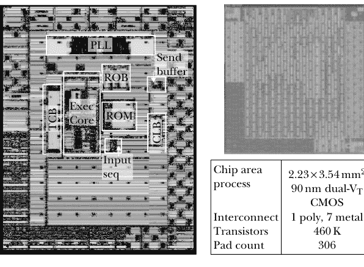
FIGURE 是一个针对此任务的专用处理器。为了快速适应不断变化的协议，该芯片被设计为可编程的。与固定状态机架构相比，这种方法简化了设计并缩短了验证阶段。此外，专门的指令集显著缩短了每个数据包的处理时间。

该芯片的架构使得在降低太网带宽或最小数据包大小的要求时，可以在无需重新设计的情况下缩小高执行核心。该核心成功演示了超过 9 Gb/s 的 TCP 输入处理能力（见图 5.3）。该实验中的关键收获极大影响了本文提出的 TOE 架构和设计。

## 5.1 TCP 卸载解决方案的要求

TCP 终止过程中有几个步骤需要改进带宽，以便高效处理：

- 1. 最小化有效负载的中间拷贝。目前，在发送和接收过程中使用数据的中间拷贝是严重的性能瓶颈。如图 5.4 所示，要传输的数据必须从应用程序缓冲区拷贝到操作系统内核空间的缓冲区中。在发送到网络之前，它会被移动到 NIC 的缓冲区中。同样，接收到的数据必须先存储 NIC 中，移动到内核空间，最后拷贝到目标应用程序缓冲区中。需要一种更高效的机制在应用程序缓冲区和 NIC 之间传输数据，以提高性能并减少前端总线的流量。要求应用程序为其预期的接收数据预先分配缓冲区将有助于高效数据传输。
- 2. 缓解内存访问的影响。处理发送并需要为每个连接访问上下文信息，这些信息可能存储在主机内存中。每次内存访问都是一次昂贵的操作，耗时可能长达 100 ns。优化 TCP 堆栈以减少内存访问次数将显著提高性能。同时，使用多线程等可以隐藏内存延迟的技术，可以更有效地利用计算资源。
- 3. 提供对状态信息的快速访问。每个 TCP 连接的上下文信息大约为数百字节。只需通过某种方法缓存活动连接的上下文就足够了。研究表明，对少数连接进行缓存（突发模式操作）足以看到性能提升 [5]。除非缓存大小大到可以容纳所有允许的连接，否则增加缓存大小并没有帮助。协议处理需要频繁且重复地访问每个上下文的各种字段。一种机制（如快速寄存器）可以快速高效地访问这些字段，减少协议处理上花费的时间。除了上下文信息外，这些寄存器还可以用于存储处理过程中的中间结果。
- 4. 优化指令执行。通过优化 TCP 堆栈来减少执行的指令数量，将极大减少每个数据包的时间。最佳的性能-功率平衡（MIPS/Watt）通过专用于此任务的专用高速引擎实现 [6]。该引擎应该是可编程的，以便轻松适应不断变化的协议。专门的指令集允许以优化方式设计该引擎，同时为高效的 TCP 处理提供指令。例如哈希表查找和 CAM 查找。
- 5. 简化主机、芯片组和 NIC 之间的接口。降低主机效率的另一个开销源是主机与 NIC 之间的通信接口。例如，中断驱动机制会导致主机过载，并对运行在主机上的其他应用程序产生不利影响。
- 6. 为特定功能提供硬件辅助模块。必须在硬件或软件实现功能之间进行权衡，权衡性能优势与增加的功耗和芯片尺寸。可以由专用硬件模块完成的功能示例包括加密解密、分类和定时器。

下节描述了我们的 TOE 解决方案的架构以及如何解决这些问题。

## 5.2 TOE 解决方案的架构


FIGURE 5.5 TOE 架构概述。

## 5.2 TOE 解决方案的架构

这里描述的许多技术已用于网络处理器的设计中。然而，针对 TCP 终止重新目标的网络处理器在每瓦特性能方面较低 [7]。

### 5.2.1 架构细节

图 5.5 显示了建议 TOE 的顶层架构图。该设计为 NIC、主机内存和主机 CPU 提供了定义良好的接口。架构核心使用一个高速处理引擎，并与外围单元的接口。采用了双频设计，处理引擎的时钟频率（核心时钟）比外围单元（慢时钟）快。这种方法导致了最小的输入缓冲，实现了线速处理。设计使用 1 MB 的片内缓存来存储 TCP 上下文，为 2 K 个连接提供了时间局部性，额外的上下文位于主机内存中。上下文是传输控制块 (TCB) 的一部分，TCP 要求为每个连接维护它。在芯片上缓存此上下文对于 10 Gb/s 的性能至关重要。此外，为了避免接收和发送时的数据包拷贝，设计包含了一个集成的直接内存访问 (DMA) 控制器。这实现了低延迟传输，并支持将数据直接放置在应用程序缓冲区中而无需大量的缓冲。中央调度器在数据包粒度上为处理引擎提供全局控制。发送队列缓冲了 NIC 的数据。架构提供了三个队列作为与主机 CPU 接口的硬件机制 [8]。入站双队列 (DBQ) 用于启动（或接收）请求。输出完成队列 (CQ) 和异常/事件队列 (EQ) 用于将结果和事件传回主机。定时器单元为与 TCP 处理相关的常用定时器提供硬件卸载。TOE 包含了虚拟到物理 (V2P) 地址翻译的硬件辅助。

DMA 引擎支持四个独立的并发通道，并提供到内存的低延迟/高吞吐量路径。TOE 构建描述符列表（读写命令），对 DMA 引擎进行编程，并启动 DMA 开始操作。DMA 引擎根据列表从源传输数据到目的。命令完成后，DMA 引擎通知 TOE，TOE 更新完成队列以通知主机。

处理引擎的微架构图见图 5.6，其核心是一个高速全流水线 ALU，并与工作寄存器通信。当前调度的活动连接的 TCB 上下文被加载到 512 B 的工作寄存器中进行处理。执行核心在指令缓存发出的控制指令指导下执行 TCP 处理。每个核心周期读取一条控制指令并将其加载到指令寄存器 (IR) 中。执行核心从 IR 读取指令，在需要时对其解码，并在每个周期内执行它们。功能单元包括

## 5.2 TOE 解决方案架构


一个大型寄存器组，包含两个 256 寄存器数组，用于存储中间处理结果。调度器对执行流执行额外的控制。

为了隐藏主机和 TCB（传输控制块）的内存延迟并提高吞吐量，该引擎采用了多线程设计。设计包含一个以核心速度运行的线程缓存，允许中间架构状态的保存和恢复。该设计还提供了线程缓存与工作寄存器之间的高带宽连接，使得线程状态可以在工作寄存器与线程缓存之间进行极快速且并行的传输。线程上下文切换可以发生在接收和发送过程中，也可以发生在等待未完成的内存请求或待处理 DMA 事务期间。多线程的细节将在后文节描述。该引擎具有可缓存存储功能，允许仅缓存与特定 TCP 处理步骤相关的代码，而其余代码保留在主机内存中。良好的替换策略允许根据需要交换指令缓存中的 TCP 代码。这还提供了灵活性，并允许于进行协议更新。

## 5 一种 10 Gb/s 以太网的高速多线程 TCP 分卸引擎

### 输入处理

来自网卡（NIC）的 TOE 入站数据包缓冲在头部和负载队列中。分发器解析并将数据包负载与头部分离，将头部转发到调度器单元。执行引擎对 TCB 缓存进行基于哈希的表查找，命中时，将上下文加载到执行核心的工作寄存器中。如果缓存未命中，引擎将按照设定的控制以高速速度队列处理任务。处理步骤总结在图 5.7a 的流水线图中。核心还负责程序 DMA 控制单元并队列 DMA 请求。负载数据通过 DMA 从内部接收缓冲区传输到主机内存中的发布项中。这种低延迟 DMA 传输对于高性能高性能至关重要。精细的设计允许 TCP 处理与 DMA 操作并行进行。TCP 处理完成后，更新上下文并将会将处理结果写回 TCB 缓存。调度器还用完成描述符更新 CQ（完成队列），用完成状态更新 EQ（入队队列），这可以产生主机中断。这种队列机制能够合并事件和中断，以便由 CPU 提供更高效的服务。核心还作为处理的一部分生成确认（ACK）头部。

### 输出处理

主机将门铃描述符置于 DBQ（门铃队列）。门铃包含指向发送或接收描述符缓冲器的指针，这些缓冲区位于主机内存中。TOE 负责在 TCB 缓存中提取和加载描述符。输出处理步骤总结在图 5.7b 的流水线图中。对本地 TCB 进行调度查找识别出连接，并将相应的上下文文本加载到工作寄存器中，开始核心处理。核心程序 DMA 控制单元以队列 DMA 请求。这提供了通过 DMA 将数据从主机内存中的负载位置自主传输到内部发送缓冲区。处理后的结果被写回 TCB 缓存。通过轮询 CQ 和 EQ 完成发送通知，以信号指示传输结束。

除了此 TOE 支持的通用指令（见图 5.8）外，还开发了一组专用指令集以实现高效的 TCP 处理。它包含了用于加速上下文查找、加载和写回的专用指令。这些指令能够在 8 个慢速周期内完成 TCB 缓存的上下文加载和存储，并在核心与线程缓存之间在单个核心周期内完成 512 B 位宽的上下文读写。专用指令包括单周期哈希、DMA 发送和接收指令以及定时器命令。还提供了主机字节序和网络字节序转换的硬件辅助。通用指令处理 32 位操作数。

## 5.2 TOE 解决方案架构

(a)

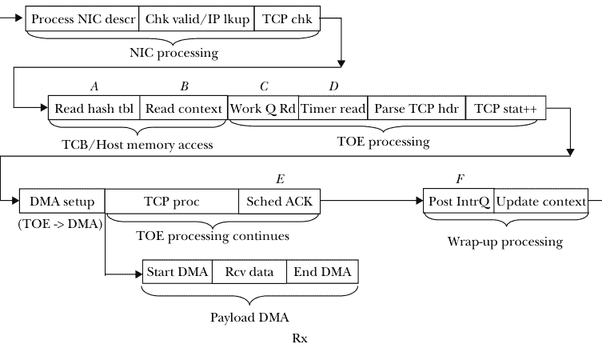

(b)


5.7 数据处理 (a) 接收和 (b) 发送

## 5 一 10 Gb/s 以太网的高速多线程 TCP 分卸引擎

| 通用目的 | 专用目的 |
| :--- | :--- |
| LOAD A ← 数据 | 指令：BRD |
| MOV A → B | 上下文访问：TCBW |
| AND A B ← 条件 | 哈希：HSHKP, HSHDT |
| OR A B ← 条件 | 多线程：THRDSVST, THVST |
| ADD A B → C | DMA 命令：DMATX, DMARX |
| SUB A B → C | 定时器：TIMERD, TIMERW |
| CMP A B ← 条件 | 网络到主机：HTONLS, HTONL |
| NOT A B ← C | 字节序：NTOHL, NTONHS |
| BREQZ / BRNEZ 标签 | |
| JMP 标签 | |
| SHL2 A | |

5.8 TOE 指令集。

### 5.2.2 TCP 感知硬件多线程与调度逻辑

多线程架构能够隐藏内存访问的延迟，从而加速入站和出站数据包处理，减少了对昂贵缓冲和队列的需求。硬件辅助多线程允许线程状态存储在（本地）内存中。真正的多线程通过完全在硬件中实现该机制进一步迈了一步。TCP 感知的调度器处理线程的挂起、调度、同步以及线程状态的保存恢复。TCP 栈分析显示此类条件是有限的，可以安全地移动到硬件中。其动机是让程序员从维护和调度线程的责任中解放出来，并减轻人为错误。因此，这种模型比常见的单线程模型更简单，可以在该引擎上以更高的效率运行。线程切换的开销被保持在最低，以获得更好的吞吐量。该架构还提供了支持遗留手动多线程的指令。

硬件多线程通过示例对比说明。TCP 包处理需要多次内存访问，以及与 DMA 引擎的同步点，这会导致核心在等待延迟操作的响应时阻塞。如果在图 5.7 的流水线图中识别出触发器（A-F）。如果在 DMA 之前进行核心处理，则切换线程用处理结果更新上下文，并将更新的上下文写回 TCB。线程切换可以发生在发送和接收处理过程中。与手动控制线程切换、锁定/解锁和让点的典型线程不同，TCP 感知的调度器控制上述所有情况下不同线程之间的切换和同步。

每个线程与正在处理的网络数据包（包括入站和出站）关联。这与为每个任务关联线程的方法不同。当需要处理新连接的数据包时，调度器生成线程。在第一个数据包完全处理且更新的上下文写回 TCB 之前，该连接的第二个数据包将不会被分配线程。这是由调度器控制的。当核心处理数据包被阻塞时，调度器将为另一个连接的数据包生成线程。它也可以通过恢复状态来唤醒之前挂起的数据包并允许其运行完成。在这种方法中，调度器还会为全局任务（如收集以太网流量统计）生成特殊的维护线程。

确定下一个调度包的优先级机制被程序到调度器中。调度器必须在唤醒或生成线程的事件之间进行仲裁（见图 5.9）：

- 新连接的新数据包，或在引擎中没有活动数据包的现有连接的数据包。

# 用于 10 Gb/s 以太网的高速、多线程 TCP 卸载引擎

## 5.9 调度器框图。

图
- 2. 引擎中存在活动数据包的现有网络连接上的新数据包。
- 3. 挂起线程的完成事件。
- 4. 维护和其他全局事件。

该设计提供了一个紧耦合的 4 KB 线程缓存，以核心速度运行，这能够为每个线程保存和恢复中间架构状态。该缓存深度为 8 个线程，大小为 512 B。缓存的宽度取决于每个数据包需要保存的上下文信息量。缓存的深度取决于数据包的到达和完成速率。分析表明，对于 10 Gb/s 线路上的接收和发送 256 字节数据包，8 级缓存是足够的，因为这超过了在任何时间点可能活跃的数据包数量。线程缓存与工作寄存器之间之间的高带宽连接确保了线程切换的开销代价降至最低。在此处所示的设计频率下，每次切换的代价销约为 2 ns。执行单元和暂存寄存器完全用于当前正在处理的数据包。这与其他方法不同，后者预先划分资源并用于特定线程。这确保了每个数据包都有足够的资源，而不会产生重复资源并增加引擎面积。

高效的多线程处理对于卸载引擎扩展到多千兆比特以太网速率的能力至关重要。在这种方法中，TOE 的设计和验证比传统的多线程方法更简单。它还简化了编译器和编程模型的要求。

## 5.3 性能分析

此处描述的 TOE 旨在为芯片组内高效的 TCP 终止而设计。对此类系统性能的分析可以反映其在特定数据包大小下全双工以太网带宽的。。我们对接收和发送快速路径均进行了此类初步分析。接收路径的结果在此给出。

如图 5.1 所示，通过芯片组中的 TOE 和用于有效载荷传输的专用 DMA 引擎，我们计算了从 NIC 接口到 CPU 主机的数据包延迟。接收端相关的相同延迟如表 5.1 所示，主机内存延迟来自文献 [9]。

由于多线程架构，我们为每个数据包计算了两个指标：(1) 每个数据包的延迟或往返时间，这对应于单线程设计的吞吐量；以及 (2) 多线程设计的数据包吞吐量。主要组件如下：

- 1. 指令执行
- 2. 内存访问
- 3. 线程切换代价
- 4. DMA 数据传输

为了计算指令执行时间，使用专用指令集在快速路径中执行的指令总数计算为 200 条，每条指令周期数 (CPI) 为 1.5，核心频率为 4.8 GHz。指令数量较少的主要原因是使用了专用指令集和大量的本地寄存器。DMA 传输与其他处理并发进行，如图 5.7 所示。我们关注小数据包，可以假设 DMA 设置时间主导了数据传输。

我们如何计算内存访问区分了吞吐量和延迟。入站数据包的哈希表条目和连接上下文可以在 TCB 中，也可以在主机内存中。我们在 TCB 中使用 50% 的保守命中率来计算数据包的平均处理时间或延迟。如果未命中，数据将从主机内存写入 TCB，这需要另一次 TCB 访问。

内存访问时间 = $\sum$(TCB 访问时间 + 缺失时间) $\times$ 主内存访问时间

数据包延迟 = 指令执行 + 内存访问 + DMA 设置

## 5.1 延迟假设。

| 组件 | 值 |
| :--- | :--- |
| TOE – 主机内存 | 前 16 B 为 20 ns，后续每增加 16 B 为 5 ns |
| TOE – TCB | 前 16 B 为 5 ns，后续每增加 16 B 为 5 ns |
| TOE – DMA 引擎 | 设置为 10 ns |

表 5.2 总结了数据包的平均时间。由于多线程架构，我们为每个数据包计算了两个指标：（同上）。如果未命中，数据将从主机内存写入 TCB，这需要另一次 TCB 访问。我们在 TCB 中使用 50% 的保守命中率来计算数据包的平均处理时间或延迟。

数据包延迟 = 指令执行 + 内存访问 + DMA 设置


## 协议定义

``` 
// "协议"定义
protocol Ethernet {
  dest : 48;
  src : 48;
  len_type : 16;
  snap : {
    len_type : 1500;
    default: LCSNAP // 未显示
  };
  demux (len_type<1500) ? 22 : 14*;
}
```

## L2 分类器处理函数

``` 
// L2 分类器处理函数
void L2cls.process(Ethernet_packet_t p)
 IPv4_packet_t ip;
 if (p->len_type < 1500) processnap(p);
 else
   if (p->len_type == 0x004)
     if(is_dest(p->dest))
       ip = packet_decaf(p); // 使用 demux 值
       channel_put(forward_chnl, ip);
     }
   else
     channel_put(bridge_chnl, p);
}
```

## 模块定义

```c
module L3Switch {
ppf L2cls; // 前向声明

ppf Bridge; // 需要的 PPFs

channels {
  input_packet_t input_chnl; //(A)
  output_packet_t output_chnl; //(B)
}
wiring {
  此模块的端点
  input_chnl = L2cls.output_chnl; //(A-0)
  output_chnl = Bridge.output_chnl; //(B-F1)
  output_chnl = LPM.output_chnl; //(B+F2)
  internal_ppf_channel 举
  L2cls.bridge_chnl -> Bridge.input_chnl; //(E1)
  forward_chnl ->LPM.input_chnl; //(E2)
}
/模块的数据
  interface_table_t interface_tbl;
/模块的接口
  void add_interface(interface_t r);
  void delete_interface(interface_t r);
}
```


## 8.3 示例 Baker 代码生成器。


PPF 包含了应用程序中实际的数据包处理代码。这些代码的表达方式与 C 函数的表达方式相同（第 13–23 行）。函数的输入代表来自 PPF 输入通道端点的数据包。函数显式地将数据包放置在其输出通道端点上（第 20, 22 行），数据结构在 PPF 编译单元的作用范围内是可以访问的。目前，Baker 允许任何 PPF 仅实例化一个实例，而不会牺牲 PPF 实例级数据结构的效率。

通道在 PPF 的输出和输入通道端点之间承载数据（通常是数据包）。信道代表了穿过应用程序 PPF 的数据流布线。PPF 可以具有被动输入端点，在该端点数据的到达会触发 PPF 的处理代码（例如，尽管未显示，但 `L2cls.input_chnl` 是存在的且会隐式调用 `L2cls.process` 函数）。PPF 还可以具有主动输入，从通道中检索数据在数据包处理代码中是显式的。主动输入允许程序员将此类 PPF 为服务质量（QoS）应用程序中的调度器。

## 8.3 设计细节与挑战

在 Baker 中，数据包被声明为一种新的一等数据类型 `packet_t`。数据包可以声明为 `packet_t`。

在 Baker 中，数据包被声明为一种新的、一等数据类型 `packet_t`。数据包可以声明为新的、一等数据类型 `packet_t`。

## 8 用于包处理系统的编程环境

158 同样，如网络分类语言 (NCL) [5] 和函数式编程语言 (FPL) [20] 等语言提供的表达能力有限；用这些语言的程序无法完全描述所有的包处理操作。

### 8.3.2 分析引导的自动映射编译器

Shangri-La 的编译器体系由分析器（Profiler）、`π`-编译器和聚合编译器组成。

### 分析器

在 Shangri-La 架构中，网络应用的运行时特性——例如数据结构的局部性属性、对 PPF 之间的执行频率、每个 PPF 之间的通信量等——被用于引导包处理系统的处理器、通信和内存资源分配给应用程序。这种分析驱动的编译器优化并不新鲜；例如，代码布局以前已通过分析引导的优化得到了改进，分析数据是通过先在不带分析信息的情况下编译代码，然后通过插桩执行该代码以收集分析信息，最后使用新收集的分析信息重新编译代码。在 Shangri-La 架构中，我们并不认为这种方法是可行的，因为它要求对分析信息进行合理的首次编译和映射。此外，在硬件中收集分析信息需要对代码进行侵入式插桩，或者受限于通过硬件性能监控单元提供的统计数据。

相反，Shangri-La 分析器通过使用 Baker 解析器产生的 IR 模拟网络应用的执行来推导出分析数据。除了从网络应用的运行时特性产生的 IR 外，分析器还需要应用程序状态，该状态包含网络应用用于确定对数据包执行的操作的任何持久化状态——这包括路由流、流分类数据结构以及任何逐流状态；以及一个识别目标包处理系统中数据包的代表性混合和到达模式的包追踪迹（packet trace）。分析器通过在这些代表性条件下对应用程序进行函数性仿真，推导出感兴趣属性的统计数据。由于分析器使用采样包追踪来模拟抽象机，编译时间无疑会增加，但这种成本预计将通过运行时性能的提升是合理的。分析信息的示例包括代码序列的执行频率、通过通道通信的数据量、数据对象的访问频率等。这些信息可以指导各种程序转换和代码优化。例如，执行频率可以影响代码布局，而内存访问频率可以帮助确定数据对象在内存层次结构级中的布局。鉴于分析是在编译早期阶段调用的，抽象机基于源语言层面的编程模型进行仿真，并不假设大量目标进程的知识。因此，不期望抽象机提供准确的性能信息。

### 流水线编译器

流水线编译器（`π`-编译器）将包处理应用程序划分一系列任务（称为聚合），这些任务构成了流水线中的处理阶段。例如基于 IXP 的网络处理器（NP），这些流水线阶段可以映射到多个链式微引擎（ME）以及 Intel XScale 处理器上。`π`-编译器有两个主要功能：(1) 它管理内存层次结构以最小化内存访问时间；(2) 它将包处理函数分组为聚合，这些聚合在映射到多个处理器核心时可以最大化整体吞吐量。

## 8 用于数据包处理系统的编程环境

162

### 聚合编译器

聚合编译器从重编译器接收一组聚合、它们到硬件处理核心的映射以及一种管理内存层次的策略。聚合编译器执行依赖机器和不于机器的优化，目标是最大化每个聚合的性能和吞吐量。对于映射到目标处理核心的每个聚合，聚合编译器以汇编或目标代码的形式输出，并带有 RTS 的一组注释。

## 8.3 设计细节与挑战

`π`-编译器将整个数据包处理应用表示为 PPF 图，其中每个节点代表一个 PPF，每条边代表一个通信通道。

## 8 面向数据包处理系统的编程环境

图 8.5 显示了 ME 生成器的框图。

### 8.3.3 运行时系统

尽管可能获得广泛代表数据包处理应用所负载的数据包轨迹（packet traces），但这些轨迹可能与应用程序部署在现场时所面临的负载有所不同。

## 8 用于数据包处理系统的编程环境

图 8.6 运行时系统分解。

## 8.4 结论

NP 的编程环境——语言、编译器和运行时系统——仍处于起步阶段。

Shangri-La 包含：
- (1) 一种暴露领域构造而非硬件构造的语言，使程序员和代码与体系细节分离；
- (2) 一个复杂的编译器复件，使用分析信息（profile information）来指导代码到处理器的映射以及对数据结构的自动管理；
- (3) 运行时系统，以确保在面对波动流量状况（无论是自然还是恶意的）时获得最大的性能收益。

## 参考文献

- [1] AMCC: nP7xxx series of Network Processors, www.mmcenetworks.com/solutions/.
- [5] Intel IXP family of Network Processors, www.intel.com/design/network/products/npfamily/index.htm.

# 9 RNOS——一种数据包处理系统的中间件平台

Jonas Greut
信息与技术系
苏黎世联邦理工学院

## 9.1 场景

使用一个单一场景来说明本章介绍的概念。现有的家庭接入路由器将扩展 IP 语音（VoIP）功能。

图 9.1 场景中使用的低成本嵌入式系统框图。

## 9.2 RNOS 分析模型

RNOS 平台由两个紧密相关的部分组成：分析部分和实现部分。

### 9.2.1 应用模型

#### 任务

任务是非抢占式的代码执行块。

#### 任务树

整个应用包含一组任务树，这些树由相互连接的任务组成。

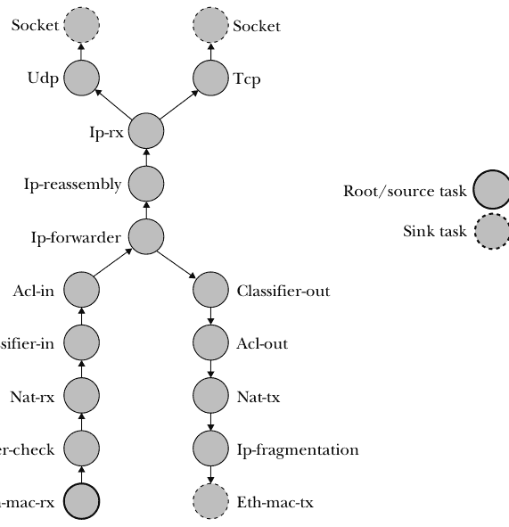

9.2 包含三条路径的数据接收简化任务树。

**示例 9.1.** 在我们的场景中，我们为标准的 IP 路由器功能添加了对 VoIP 流量的处理。

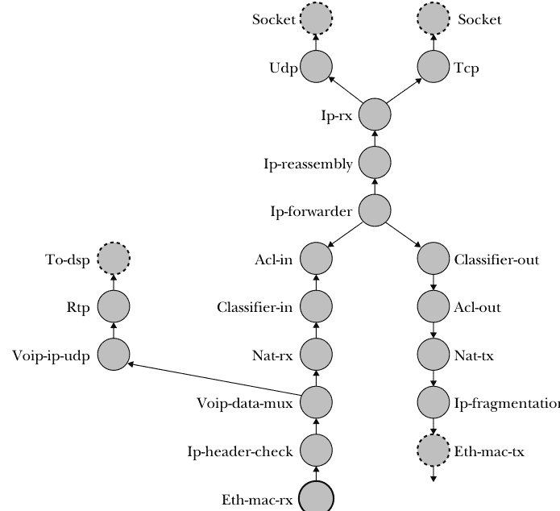

9.3 带有 VoIP 的数据接收扩展任务树。

### 9.2.3 资源模型

**定义 9.2.** `β^l(Δ)` 是任何长度为 `Δ` 的时间间隔内的最小可用 CPU 时间。同理，`β^u(Δ)` 是任何长度为 `Δ` 的时间间隔内的最大可用 CPU 时间。

### 9.2.4 微演算

每个任务 `t_i` 分别有一个上限和下限执行时间 `e^u_i` 和 `e^l_i`。

$$e_{p_j}^u = \sum_{i \in p_j} e_{t_i}^u, \quad e_{p_j}^l = \sum_{i \in p_j} e_{t_i}^l$$

## 9 RNOS——一种低成本数据包处理中间件平台

## 9.3 RNOS 的实现模型

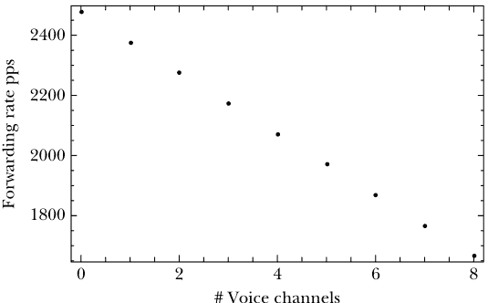

9.10 随活动语音通道变化的函数尽力而流量转发率。

### 9.3.1 路径线程

对于每个待处理的数据包，都会创建一个路径线程。

### 9.3.2 调度器

调度器决定下一个运行哪个路径线程。

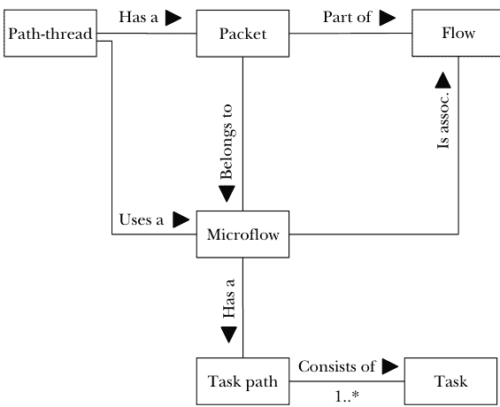

9.12 图 实现模型的类图。

### 9.3.3 实现

RNOS 实现在现有的实时操作系统之上。


9.13 图 源线程和三个路径线程。

## 9.4 测量与比较


9.15 测量设置。

## 9.5 结论与展望


## 9.16 图表

测量与计算的最尽力转发率

## 10 使用网络处理器进行 DNA 查询的可行性

第10 章

Herbert Bos, Leiden Universiteit

## 10.1 架构

### 10.1.1 评分与对齐

`IXPBlast` 是在 Intel `IXP1200` NPU 上实现的算法。

### 10.1 IXPBlast内存层次

| 内存 | 大小 | 访问时间（周期） |
|---|---|---|
| 通用寄存器 | 每个 ME 128*4 字节 | - |
| 暂存内存 (scratch memory) | 1 K 字 | 12–14 |
| SRAM | 8 MB | 16–20 |
| SDRAM | 256 MB | 33–40 |

### 10.1.3 软件架构

## 10.3 结果

| 实验 | 查询大小 (核苷酸) | DNA_db 大小 (核苷酸) | 实现 | 周期 | 时间 (s) (包含加载) |
|---|---|---|---|---|---|
| 1 | 792 | 8.96 × 10⁶ | XPBlast_direct; IXP1200 (232 MHz) | 未测量 | 140 秒 |

## 10.4 相关工作

## 10.5 结论

## 11 网络处理器上的流水线任务调度

第 11 章
Mark A. Franklin, Seema Datar

## 11.1 流水线任务分配问题

### 11.1.1 符号和分配限制

输入流可以表示为集合 `F={F_1, F_2, F_3, …, F_N}`

### 11.1.2 性能指标

$$s_{jk} = \sum_{i=1}^{M_j} X_{ijk}t_{ij} \quad (11.2)$$

## 11.2 GREEDYPIPE 算法

### 11.2.1 基本思想

Greedypipe 是一种启发式算法。

## 11.3 使用 GREEDPYIPE 进行流水线设计

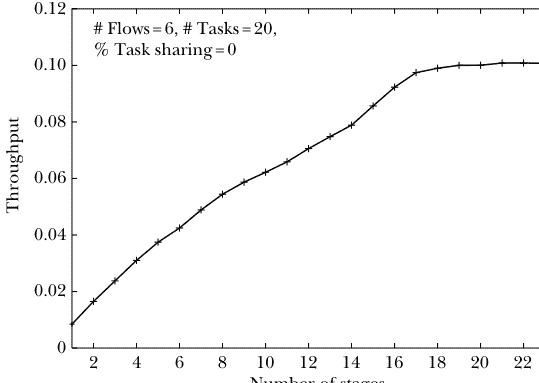

图 11.2 吞吐量与流水线阶段数量的关系。

## 11.4 网络处理器问题

### 11.4.1 最长前缀匹配 (LPM)

| Appl:Task | Task 1 | Task 2 | Task 3 | Task 4 | Task 5 |
|---|---|---|---|---|---|
| LPM:5 | .28 | .40 | .26 | .20 | .14 |

## 12 多处理器 SoC 上资源高效网络的设计探索框架

12 章

## 12.1 相关工作

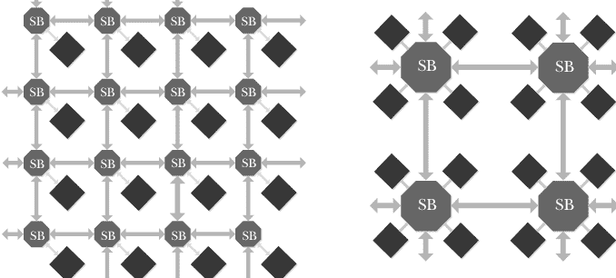

PE 核心、内存、硬件加速器、收发器、短线 | 交换盒内存、收发器 | 片上网络长线

图 12.1 PE 处理网（硬件架构 A）与 GigaNetIC 项目提出的四 PE 簇架构（硬件架构 B）。

## 12.2 包处理系统的建模

### 12.2.1 流处理图

包处理建模技术基于 Thiele 在 [15] 中提出的任务图模型。

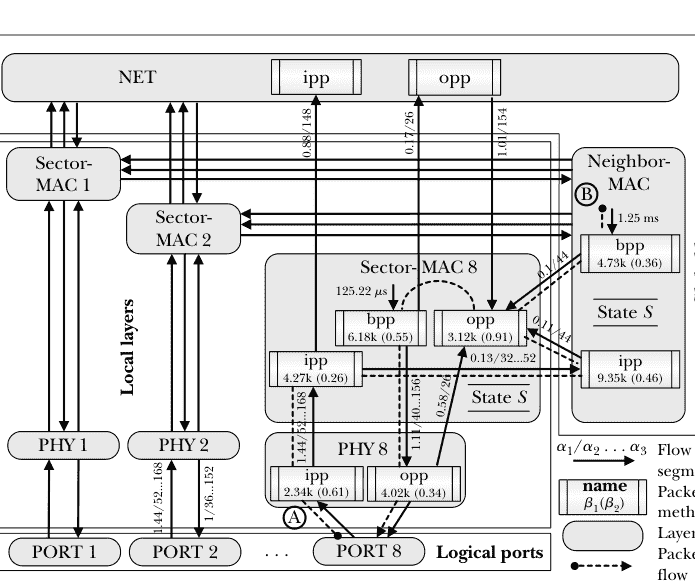

图 12.2 移动自组织网媒体接入协议的标注流处理图。

### 12.2.2 SoC 架构


图 12.3 一个通用系统实例由处理引擎 (PEs)、交换盒 (SBs) 和链路组成。

## 12.3 调度

$$\tilde{B}_i(t) = \frac{\phi_i}{\sum_{j\in S(t)}\phi_j}B \quad (12.1)$$


芯片处理和通信的调度示例。

## 12.4 将应用程序映射到系统


### begin

```
% 创建边界 PE 列表：

将光标置于左上角的 PE 并向右对齐；

do

  创建一个列表 l ∈ G_{PE,bd} 并在光标右侧添加一条长度为 d_c 个 PE 的线；

  G_{PE,bd} := G_{PE,bd} ∪ {l};

  如果下一个光标位置没有边界 PE，则将光标方向旋转 90°；

  将光标位置设置为沿光标方向的下一个边界 PE，且该 PE 不属于 G_{PE,bd} 中任何行的元素；

  while 光标可以定位；
```
% 将边界 PE 和相关的 SB 分配到集群

```
c := 0;

while G_{PE,bd} ≠ {} do

  从 G_{PE,bd} 中移除接下来的 w_c 行并将 PE 添加到 G_{PE,c}；

  对于所有 PE ∈ G_{PE,c}，将 PE 连接的 SB 添加到 GS_{SB,c}；

  c := c +1;

end
```

### 物理端口分配

```
% 将物理端口分配到最近的集群

for all PP ∈ Gpp do

  计算从 PP 到所有 PE 的最小代价路径；

  确定产生最小通信开销的 PE 的索引 c；

  G_{pp,c} := G_{pp,c} ∪ PP;

end
```

### 逻辑端口平衡分配

```
% 计算逻辑端口到物理端口的平衡分配

sort Gpp 使得端口顺序对应于从左上物理端口开始沿边界的顺时针循环；

w := (|Gpp|/|Lpp|); u := 0; v := 1;

set PP 为 Gpp 的第一个元素；

for all lp in Lpp, do

  Lpp := Lpp ∪ {lp}; u := u + w;

  while u >= v do

    set PP 为 Gpp 的下一个元素；

    v := v +1;

end

end
```

## 12.5 划分算法

图

```
partition (FPG, SYS);

begin

  for all clusters c in C:

    for all layers in L_c

      使用 ILP 将层分配到 PE;

  for all global layers in L_global:

    映射到空闲 PE;

end
```

## 12.6 映射算法

图

## 12 设计空间探索框架

链路上数据包传输的能量估计如下：

```
$E_h(p) = \#q(p,h) \cdot q \cdot (1/B_h) \cdot P_h$
```

其中 `$P_h$` 是驱动链路数据线的功耗。对于 SB（交换盒），转发数据包的能量消耗被视为：

```
$ES_{SB}(p,h) = \#q(p,h) \cdot q \cdot (1/B_h) \cdot P_{SB,sw}$
```

其中 `$P_{SB,sw}$` 是单个链路通过内部交换机转发数据包期间的功耗。忽略了调度计算产生的能量消耗。对于 PE（处理单元），能量消耗取决于数据包方法，这些方法具有不同的特性。在处理单元 PE 上执行数据包 `$m$` 所需的周期数 `$C_{m,PE}$` 计算如下：

```
$$\tilde{C}_{m,PE} = C_{m,PE} + MA_{m,PE} \cdot N_{wait,PE}$$
```

其中 `$C_{m,PE}$` 是执行数据包 `$m$` 所需的时钟周期（不包含任何内存周期），`$MA_{m,PE}$` 是访问 PE 内部内存的的时钟周期，而 `$N_{wait,PE}$` 是 PE 中内存的等待周期。由于链路接口在执行数据包方法期间从内存中读写数据包，因此实际执行时间必须相应调整。收发器单元访问每个链路内存的周期 `$T_{mem}(g,h)$` 为：

```
$T_{mem}(g,h) = \frac{w_{g,h,mem}^2}{B_h}$
```

在此，实际执行周期可以通过公式计算：

```
$EC_{m,PE} = \tilde{C}_{m,PE} + \sum_{h \in PE} \tilde{EC} / (f_{PE} \cdot T_{mem}(PE,h) - (N_{wait,PE} + 1))$
```

```
$\times (N_{wait,PE} + 1)$
```

其中 `$H_{PE}$` 包含了到 SB 的上链路和下链路。功耗取决于所执行数据包方法引起的切换活动。因此，可以为 PE 上的每个数据包方法定义功耗值 `$P_{m,PE}$`：

```
$P_{m,PE} = C_{m,PE} \cdot U_{dd}^2 \cdot f_{PE}$
```

其中 `$C_{m,PE}$` 是在 PE 上执行方法 `$m$` 时切换的有效容量，`$U_{dd}$` 是芯片的工作电压。通过已知内存的功耗，现在可以估计方法的能量消耗：

### 12.5 资源消耗估计

```
$E_{m,PE} = MA_{m,PE} \cdot T_{PE,mem} \cdot P_{PE,mem} + PC_{m,PE} \cdot P_{m,PE} \cdot (1/f_{PE}) \quad (12.19)$
```

其中 `$T_{PE,mem}$` 和 `$P_{PE,mem}$` 是 PE 内部使用内存的访问时间和功耗。最后，必须计算每个模块的缓冲区需求。由于采用的调度确保了每个流段只需要在模块中存储两个数据包或字（flits），因此缓冲区大小 `$Q_{PE,SB}$` 取决于分配给该模块的流段数量。表 12.1 汇总了系统 SYS 的资源消耗计算方法。

| 组件 | 细节 |
| :--- | :--- |
| 链路 h | - 面积、平均功耗：`$E_h = w_h \cdot l_h, \tilde{P}_h = U_h \cdot P_h$` <br>- 能量：`$E_h(s) = E_h(p_{s,max}) + E_{mem}(src(h), h) + E_{mem}(dst(h), h, p_{s,max})$` <br>- 缓冲区大小、延迟：`$Q_h(s) = 0, D_h(s) = \Phi_{h,B} \cdot q(p_{s,max},h)$` |
| 交换盒 SB | - 面积、平均功耗：`$\tilde{P}_{SB} = AS_{SB} + \frac{1}{2}|HS_{SB}| \cdot At_{tx/rx} + AS_{SB,w}(|HS_{SB}|) + AS_{SB,func}$` <br>- 能量、缓冲区大小：`$\tilde{P}_{SB} = \frac{1}{2}|HS_{SB}| \cdot P_{SB,w} + P_{tx/rx}, DB(SB) = 0$` <br>- `$E_{SB}(h) = E_{SB}(p_{s,max},h), Q_{SB}(h) = 2 \cdot q$` |
| 处理单元 PE | - 面积：`$APE = A_{PE} + A_{PE,func} + At_{tx}$` <br>- 平均功耗：`$P_{PE} = P_{tx/rx}(PE) + max_{mE_{mem}} ((P_{m,PE} + P_{PE,mem}) \cdot \frac{MA_{m,PE,mem}}{EC_{m,PE}})$` <br>- 能量、缓冲区大小：`$E(s) = E_{m,PE}, D_{PE}(s) = \Phi_{PE,PE} \cdot U, Q_{PE}(s) = 2 \cdot p_{max}$` |
| 流段 s | - 能量、延迟：`$\{E, D\}(s) = \{E, D\}E_{PE,sd}(s) + \sum E_{SB,GS}, (E, D)_{SB}(s) + \sum H_h, \{E, D\}_h(s)$` <br>- 缓冲区大小：`$Q(s) = \frac{Q_{PE,sd}(s) + \sum Q_{SB,GS}, Q_{SB}(s) \text{ 若 } GS_{SB,s} \neq \text{否则}}{(1/2)Q_{PE,sd}(s)}$` |
| 数据包 pf | - 能量、缓冲区大小：`$\{E, D, Q\}(s) = \sum s \in S_{pf} [E, D, Q](s)$` |
| 系统 SYS | - 面积、平均功耗：`$[A, P]_{SYS} = \sum g_{SYS}[A, P]_g + \sum h_{SYS}[A, P]_h$` <br>- 能量、缓冲区大小：`$[E, Q]_{SYS} = \sum e[E, Q]_e$` <br>- 延迟：`$D_{SYS} = \max_{pf} e_{pf} D(pf)$` |

系统的组件资源消耗模型以及运行在上面的应用流图。`$PE(s,src)$` 和 `$PE(s,dst)$` 返回流段 `$s$` 的源或目的 PE。`$src(h)$` 和 `$dst(h)$` 返回 `$h$` 所连接的源和目的模块。设计了一个名为 Network Mapper (`NetMap`) 的软件工具。它可以将流图映射到使用不同架构的多处理器。该工具利用数据类型和算法来实现引入的模型。为了证明这种方法的可行性，我们分析了图 12.1 所示的两种架构变体。

### 12.6.1 应用与系统参数

首先在支持 PPL 的分析环境中测量了实现的资源消耗。使用 SAH 生成流量。从一个节点接收的数据包交付给了配备 Core 的 PE，这在 VHDL 中进行了仿真。通过 PERFMON 测量了数据包方法的周期和内存访问。请注意，使用了从该执行获取的最大周期，因为我们需要分析系统的最坏情况性能。数据包的大小和流段的需求通过 PPL 析器测得。图 12.2 中的标注流图显示了结果。流段和数据包方法可以如下转换（见图中的变量定义）：

```
$B_i = \alpha_1 B_{lp}, p_{min} = 8\alpha_2, p_{max} = 8\alpha_3, EC_m = \beta_1, MA_m = \beta_2 \cdot EC_m$
```


请注意，这种方法可以处理不同 PE 上相同方法的不同执行时间。但对于这些实验，所有 PE 具有相同的能力，因此我们对所有方法都使用了切换容量 `$C_{m,PE}$`（见表 12.2）。图 12.2 中的数据包大小是以字节提供的，因此在公式 `(12.20)` 中必须转换为位。例如，逻辑端口（外部接收器）之间的流段包含了接收数据包中的接收强度等状态信息。到物理层的流需求比端口速率高 1.4 倍。由于新数据包的传输时间必须与旧包相同，因此如果数据包变大，则增加输出段的带宽；如果变小则减少。缩放因子可以通过修改数据包的大小除以原始数据包的大小计算。由于介质访问在将接收的数据包转发到网络层时会移除额外信息及其自身的标部，因此到网络层 `ipp` 方法的流需求减少了。

| 组件 | 参数值 |
| :--- | :--- |
| 系统 SYS | `|L_{pd}|=8, B_{mem}=[0.2 : 4.05] Mbps, |G_{SB,S}|=0, |G_{SB,A}|=|G_{PE,A}|, |G_{SB,B}|=|G_{PE,B}|=|G_{PE,S}=[1], |G_{PE,A}|=[4, 9, 16, 25, 36, 9, 64], |G_{PE,B}|=[4, 16, 36, 64], |G_{PP,S}|=1, 4(\sqrt{|G_{SB,A,B}}-1), U_{dd}=1.2$ |
| 处理单元 PE | `f_{PE}=230.0` MHz, `T_{mem}=2.22` ns, `N_{unit,PE}=0, w_{PE}=32` bit, `A_{PE,func}=0.210\mu m^2, $A_{PE,mem}=1.10\mu m^2$ (128 KB), $C_{m,PE}=69.4$ pF, $P_{PE}=179.8$ mW |
| 交换盒 SB | `Q_{mem}=2` KB, 128 bit, 8 bit, `w_{SB}=32` bit, `T_{SB}=1.43` ns, `A_{SB,mem}=0.053\mu m^2, A_{SB,w\_func}=0\mu m^2, P_{SB}=96.91` mW, `P_{SB,w\_func}=0` mw |
| 链路 h | `w_{h,S}=0.232` mm, `w_{h,B}=0.280` mm, `lh_{h,A}=lh_{h,S}=0.465` mm, `lh_{h,Ga}=1, $lh_{PP,PP}=1.159$ mm, $lh_{h,SB}=0.561$ mm, $lh_{h,Ga}=2.318$ mm, $At_{h/rx}=32734.72\mu m^2, $B_h=1.00$ Gbps, $P_h=24.52$ W/m $\cdot l_h$ |

## 270 设计空间探索框架

由于介质接入层的控制数据包仅在节点接触窗口期间交换，因此本地介质接入层与全局接入层之间流段的带宽需求较低。在示例中，10% 的端口数据率被留给这些控制数据包。此外，还存在从 PHY 优化方法到 Sector-MAC A 优化方法，以及从 Sector-MAC B 优化方法到 NET 优化 方法的反馈流段。它们被用于在数据包传输完成后通知高层（针对传出数据包的流量控制）。

在 12.2 中，描述了系统 `SYS[S,A,B]` 的参数以及与示例设计探索空间相关的系统组件。`SYS` 是一个具有单个处理引擎、一个物理链路且没有交换框的系统。`SYS[A,B]` 是图 12.1 所示的系统。`[GP_{S,A,B}]` 表示系统中处理元素的数量。给定交换机 `[GS_{S,A,B}]` 导致了物理端口数量 `[GP_{S,A,B}]`。所得功耗值和面积规格对应于 Synopsis Analyzer 对 1.2 V/130 nm 标准单元 CMOS 技术评估的综合结果 [23]。内存面积 `A_{PE,B},mem}` 和功耗 `P_{PE,B},mem}` 以及访问时间 `T_{PE,B},mem}` 的估算收集自 MoSys iT-SRAM-Q [24] 的 PE 数据表，以及来自 Virtual Silicon [25] 使用 DP-SPRAM 存储 SBS 中槽位的数据。

处理引擎由功能单元（CPU、128 位收发器、硬件加速器）和 128 KB 内存组成。对于内存，使用了 MoSys 的特殊平均晶体管 SRAM 技术。其特点是面积特别小，功耗仅为普通 SRAM 的 25%。PE 功能单元的面积和功耗基于 [21]。交换框由功能单元和一个尺寸大小为 `Q_{S,B},max} = 2` KB 的双端口 SRAM 组成，用于存储槽位。由于它们尚未实现，因此分析中未考虑 LUT 和相应的逻辑。由于收发器数量较少，系统 A 的交换框比系统 B 的交换框小，系统 B 相比 A 具有相对面积优势。片上互连线 `h_{ij},pp` 的值基于 UMC 的离散布线模型计算得出。短链路 `h_{ij}` 用于连接 PE 和交换框，而长链路 `h_{ij}` 连接不同的交换框（见图 12.1）。物理端口链路 `h_{pp}` 将交换框与物理端口连接。长链路明显长于短链路，因此具有更高的电容和电阻负载，导致通过这些互连线进行通信时产生更高的功耗。物理端口链路和长链路布在第 8 层金属层。在该模型中，

## 12.6 设计空间探索示例

长链路沿着需要面积 `w_{h,[A,B]} \cdot l_{h,jg,[A,B]}` 的通道运行。该面积未用于系统的其他功能单元，这可以被视为最坏情况估计。相比之下，短链路布在交换框上，并从 PE 对角线方向延伸。实际收发器 `tx/rx` 由 UMC 平衡缓冲器标准单元和触发器组成。

### 12.6.2 结果

架构 A 和 B 的区别在于链路总总数（A 的链路比 B 多）、产生的 SB 数量（B 的 SB 数量是 A 的四分之一）以及物理端口数量（B 的端口比 A 少）。由于使用了共享内存 SB，内存带宽限制了 SB 每条链路能处理的数据率。对于 SB 内部应用的 Virtual Silicon 内存，访问内存的可用传输带宽被 5 条链路占用了 22%，被 8 条链路占用了 36%。这意味着数据率可以进一步提高。然而，由于 PE 内部预留了内存带宽用于存储和读取数据包 [公式 (12.17)]，更高的数据率会导致 PE 内部的计算能力降低。对于所应用的 1 Gb/s 链路数据率，PE 内存带宽的 27% 必须保留给链路接口。

在实验中，更改了两种系统变体的 PE 数量和端口数据率（见表 12.2）。图 12.7 显示了能够在给定数据率下处理数据包的系统配置。从 4.05 Mb/s 的率开始，单个 PE 的系统计算能力不足执行单个本地 MAC 层，因此数据包流图无法执行。一个例子是优化策略未达到目标的具有 16 个 PE 的系统 B。它有足够的计算能力执行流处理图。然而，优化失败了。这是由于优化仅对每个簇是最优的。在延迟优化期间，簇中的 PE 为了实现最小延迟而未充分利用。当将全局层分配给 PE 时，所有 PE 都已被占用，没有留下足够的计算能力来执行全局层。因此，全局层无法分配，映射失败。对于能量优化，尽可能使用少量 PE 来最小化内部通信。因此，PE 既没有处于负载状态，也没有处于高负载状态。当映射全局层时，它们必须映射到空闲的 PE，因为其他 PE 都处于高负载状态。由于空闲 PE 没有执行其他层，它们留有足够的计算能力处理全局层。这表明对于全局

## 12.6 设计空间探索

[文本继续]PE 的计算能力。这表明该框架也可以用于发现系统热点，并指导实现的改进。

图 12.8 和 12.9 显示了两种示例端口数据速率的帕累托最优系统配置。对于 `B_{lp} = 3.5` MB/s，具有 64 个 PE 的延迟优化系统 B 实现了最低延迟。与最少延迟相比，这是因为流图仅包含 18 层。然而，与 36 PE 的配置相比，有更多的可用链路来在 PE 之间转发流段。由于使用了延迟优化，路由算法尝试通过利用所有链路来最小化链路负载，导致与 36 PE 系统相比的延迟更短。具有 16 个 PE 的能量优化系统 B 所需能量和面积最小，但是以最高延迟为代价的。具有 36 个 PE 的能量和延迟优化系统 B 以及 25 个 PE 的能量优化系统 A 的资源消耗几乎相同。与另外两个系统相比，A 在最高能耗下具有最低面积和延迟。与 A 相比，延迟优化系统 B 以延迟略微增加为代价实现了较低能耗。能量优化

图 12.8
对于 `B_{lp} = 3.5` Mbps，探索的系统配置的资源消耗。ID 字符串表示架构（**A 或 B**）、PE 的数量 `|G_{PE}|` 以及优化策略（**能量或延迟**）。

- 图例：帕累托最优/非帕累托最优系统配置

系统 B 在三个系统中实现了最低能耗，但是以最高延迟为代价的。

对于 `B_{lp} = 1.3` Mb/s 数据速率，有趣的观察结果是，最优系统 A 消耗的能量更多，且产生的延迟比具有下一个数量处理器的 B 略高，例如，49 个 PE 与 64 个 PE 的 B 相比。能耗较高是因为架构 A 中转发分段的路径比 B 包含更多数量的 SB，因此有更多的内存访问。然而，架构 A 由于包含更多链路，应该具有延迟优势。路由算法利用这些额外链路来降低平均链路利用率。由于每个链路的延迟较低，较小的链路负载对应较低的延迟。然而，延迟与路径中 SB 的数量成正比。A 中的路径长度较长；因此存在权衡。在这个示例中，链路利用率非常低，路径长度主导了延迟。因此，架构 A 相比 B 具有面积优势。然而，如果链路利用率更高，情况可能会发生。这表明这种设计方法可以用于研究各种应用和系统参数之间的依赖关系。

## 12.7 结论

我们描述了一个在多处理器 SoC 上实现网络协议的框架。我们展示了如何对网络协议和硬件架构建模、如何调度执行以保证每个端口符合用户定义的协议、如何将协议函数分配给处理器，以及如何使用基于组件的估计模型估计最终映射的资源消耗。在映射过程中，可以最小化每个数据包的延迟或错误消耗。这些方法可以应用于设计早期，并用于探索由不同系统参数创建的设计空间。文中展示了一个详细的探索示例，说明了移动自接网络的介访问协议如何映射到具有多达 64 个处理器的多处理器 SoC 中。分析表明，此类系统可以为所研究的应用以低功耗实现合理的数据速率。该方法还可以用于识别系统的瓶颈，即那些计算复杂度呈现出较高吞吐量的协议函数。

该框架尚无法处理外部存储。包含它们的方法是向边界 PE 添加内存接口，并形成共享一个内存的边界 PE 组。外部存储可用于存储大型数据结构，如数据包队列或过滤表。通过了解数据包方法的访问模式和共享内存通道上的冲突解决机制，可以分析确定最坏的内存访问时间。因此，外部存储对数据包方法执行时间的影响可以建模并包含在调度方案中。在未来的工作中，我们想要实现分析的系统以证明所述概念，并通过添加更多细节（例如外部存储或任务切换开销）来增强我们的框架。我们还将分析用于网络访问领域的有线网络协议。

## 致谢

这项工作由德国科学基金会（Deutsche Forschungsgemeinschaft）在协作研究中心 376“大规模并行性：算法、设计方法、应用”范围内提供资助。该工作还得到了 Infine Technologies AG 的支持，特别是公司研究系统技术部门（CPR ST，Ramacher 教授）。

## 参考文献

- [12] P. Crowley and J-L. Baer, “网络处理器系统的建模框架,”Network Processor Design: Issues and Practices, 第1卷, Morgan Kaufmann Publishers, 2002年9月, pp 167–188.
- [13] M. A. Franklin and T. Wolf, “带有基准测试的网络处理器性能与设计模型,”Network Processor Design: Issues & Practices, 第1卷, Morgan Kaufmann Publishers, 2002年9月, pp 117–139.
- [14] M. A. Franklin and T. Wolf, “网络处理器设计中的功率考虑,”Network Processor Design: Issues and Practices, 第2卷, Morgan Kaufmann Publishers, 2003年9月, 第3章.
- [15] L. Thiele, S. Chakraborty, M. Gries, and S. Künzl, “网络处理器架构的设计探索,”Network Processor Design: Issues and Practices, 第1卷, Morgan Kaufmann Publishers, 2002年9月, pp 55–89.
- [16] G. Memik and W. H. Mangione-Smith, “NEPAL: 用于网络处理器高效结构化应用的框架,”Network Processor Design: Issues and Practices, 第2卷, Morgan Kaufmann Publishers, 2003年9月, 第10章.
- [17] D. Lange, J.-C. Niemann, M. Pormann, H. Kalte, and U. Rückert, “用于 SoC FPGA 原型到 ASIC 实现的 RISC 处理器实现,”IEEE研讨会: 异构重构片上系统 (SoC), 汉堡, 2002年.
- [18] A. K. Parekh and R. G. Gallager, “集成服务网络流控制的通用处理器共享算法：单节点情况,”IEEE / ACM Transactions on Networking, 1993年6月, vol 1-3, pp 344–357.
- [19] M. Grünwald, J.-C. Niemann, M. Pormann, and U. Rückert, “多处理器 SoC 上资源高效型网络处理的映射策略,”Design, Automation and Test in Europe 会议, CNIT Le Defense, 巴黎, 法, 2004年2月16–20日, pp 758–763.
- [20] T. Šimić, L. Benini, and G. De Micheli, “电池供电嵌入式系统的节能设计,”IEEE Transactions on VLSI 特刊, vol 2001, pp 9–15.
- [21] M. Grünwald, J.-C. Niemann, and U. Rückert, “优化嵌入式应用的性能评估方法,”第3次实时应用片上系统国际研讨会, 加尔加里, 阿尔伯塔, 加拿大, 2003年6月30日–7月2日, pp 10–15.
- [22] K. Mehlhorn and S. Näher, 组合与几何计算的 LEDA 平台,剑桥大学出版社, 1999.
- [23] UMC, eSilicon, 嵌入式组件, eSi-Route/9™ 标准单元库, UMCL13U21T3, 修订版 2.1, 2001年10月.
- [24] Mark-Erik Jones, Wingyu Leung, and Fu-Chieh Hsu, 理想 SoC 内存: 1-T-SRAM™,,MoSys, Inc., 2002.
- [25] Virtual Silicon, 双端口 SRAM 编译器 0.13 µm (L130E-HS-FSG),2003年6月.

# 13 异构网络处理器架构的应用分析与资源映射

Ramaswamy Ramasummy, Ning Weng, Tilman Wolf
马萨诸塞大学阿姆斯特丹分区电气与计算机工程系

计算机网络已从简单的存储转发通信网络演变为更复杂的系统。数据包不仅被转发，而且在路由器上进行处理，以实现日益复杂的协议和应用程序。此类处理的示例包括网络地址翻译 (NAT) [1]、防火墙 [2]、交换机 [3]、高性能存储服务器的 TCP/IP 卸载 [4] 以及虚拟专用网络 (VPN) 的加密。

为了应对日益增长的功能和性能需求，路由器设计已远离硬连线 ASIC 引擎。相反，近年来开发了软件可编程的网络处理器 (NPs)。这些 NP 通常是具有高性能 I/O 组件的单片多处理器。网络处理器通常位于路由器的每个输入端口上。在数据包通过路由器交换矩阵并到达下一个网络链路之前，会在网络处理器上执行数据包处理任务。如图 13.1 所示。此类系统的概念示例包括英特尔 XP2800 [5]、IBM PowerNP [6] 和 EZChip NP-1 [7]。

由于对 NP 系统的性能需求，不仅使用了通用的 RISC 协处理器，还使用了许多专门的协处理器。在实践中，经常可以找到用于校验和计算、地址查找、哈希计算、加密和身份验证以及内存管理功能的协处理器。这导致网络处理器架构具有多种不同的处理资源。随着 CMOS 技术的进步，向异异构 NP 架构的趋势将继续，因为可以将更多的处理资源放入 NP 芯片上。这使得 NP 架构拥有更多的协处理器；特别是那些实现特殊、低频率使用功能的协处理器。

NP 平台的异构性为开发带来了一个特别困难的问题。目前的软件开发环境 (SDKs) 已经难以使用，且对 NP 的硬件架构有深入理解。具有大量处理资源的异构 NP 系统将使这个问题变得越来越困难，因为硬件的选择会导致资源竞争。

图 13.1 网络路由器数据路径。数据包显示为阴影框。处理在位于系统输入端口的网络处理器上进行。NP 具有多种异构处理资源（处理器和协处理器）。

# 应用分析与资源映射

我们解决这一问题的方法是分析应用程序的运行时特性，并开发处理步骤及其依赖关系的抽象表示。这创建了一个带标注的无环图 (ADAG)，它是与架构无关的表示。标注指示每个块的需求。基本思想是从下而上构建应用表示。我们考虑每个单独的数据和控制依赖，并将其分组较大的类，形成 ADAG。然后可以使用 ADAG 确定任何架构的优化分配。我们的贡献如下：

- 1. 一种通过应用程序运行时分析自动识别处理块的方法。
- 2. 将聚合处理块分组为处理类的算法，以及高效近似此 NP 问题的启发式方法。结果是与架构无关的应用程序图 (ADAG)。
- 3. 将处理类动态分配到处理资源的映射（或调度）算法。

我们使用四个实际应用程序展示所有这些点的结果。这项工作的一个关键点是，ADAG 可以从单处理器上的程序运行时指令跟踪中自动创建。这项工作的结果有助于支持异构 NP 平台上的高层编程抽象。此外，对处理复杂度和处理步骤之间通信量的量化描述是任何高效调度的基础。此外，应用程序的 ADAG 表示为应用程序中存在的并行类型提供了非常直观的见解（例如，多处理器与流水线）。最后，所建议的调度算法可以在运行时映射数据到处理资源，这优于依赖流量模式模式的静态方法。

在第 13.1 节中，我们简要讨论了相关工作。第 13.2 节讨论了应用程序的运行时分析以及我们如何获取必要的分析信息。从分析信息到 ADAG 表示，我们使用了第 13.3 节讨论的聚类算法。第 13.4 节展示了四个应用程序的应用分析结果和生成的 ADAG。将 ADAG 映射到处理资源的调度算法在

资源在第 13.5 节中介绍。最后，第 13.6 节总结并结束本章。

## 13.1 相关工作

在网络处理器的应用分析和编程抽象领域已经进行了一些工作。Shah 等人提出了 NP-Click [8]，作为 Click 模块化路由器 [9] 的扩展，为网络处理器提供了架构和程序抽象。类似的方法需要预先对应用细节有深入了解，以便推导出应用模块。这种方法存在两个方面的问题：

- 1. 它假设应用开发者可以识别所有属性，这需要对应用进行深入的理解和细致的分析。随着网络处理器的编程向更高层次和更复杂的抽象演进，这个问题将变得日益严重。在这些系统中，应用开发者对如何构造一段代码以匹配底层硬件基础设施的了解较少。
- 2. 应用分析中不涉及任何运行时信息。对于做出调度决策来说，这是一个至关重要的信息。仅使用静态应用信息会使结果偏向特定的编程抽象。

因此，我们认为，正如我们在工作中提出的的那样，能够自动导出应用特性是至关重要的。

在 NEPAL [10] 中，Memik 和 Gagne-Smith 了一种控制在网络处理器上执行应用程序的运行时系统。应用通过 NEPAL API 在任务级上被拆分为模块，并将模块动态映射到执行核心上。在此期间存在一个额外的翻译层，其中应用代码被转换为模块。我们避免了这种转换，直接通过动态跟踪在细粒度层上生成基本块。

应用的划分和映射问题之前在网格计算背景下被研究过。Taura 和 Chien [11] 提出了一种与我们相似的方法，但它用于非常高层次，将应用映射到 Internet 上的多个异构计算资源上。

我们的工作与轨迹调度 [12] 和超块 [13] 中使用的某些思想相似，但被应用于不同的领域。轨迹调度旨在通过利用更多的指令级并行性，为 VLIW 架构生成优化代码。将基本块的线性序列分组以形成更大的基本块，并更新依赖关系。我们为此使用了一种聚类算法，该算法在识别出所有基本块后在动态指令跟踪上运行。

应用特性的探索、模块化以及到资源的映射在多处理器系统背景下也得到了广泛研究。在多处理器上调度 DAG 的一个示例见文献 [14]。在网络处理环境中，应用程序要小得多，可以进行更细致的分析。我们在第 13.3 节中提出的自下而的方法对于大型应用程序是不可行的，但它为数据处理函数提供了详细的应用属性。多处理器与 NP 的另一个区别是，NP 在实现高吞吐量的同时具有短延迟。

DAG 或任务图的映射和调度已由 Kwok 和 Ahmad [15] 进行综述，我们提出了一种类似于 El-Rewini 和 Lewis [16] 所引入的调度算法。这两种情况的主要区别在于，我们考虑的是一个异构处理平台，其中任务可能消耗不同的处理时间（例如，取决于处理器与协处理器的用途）。类似的算法也用于 VLSI CAD 领域。Alpert 和 Kahng [17] 综述了与我们相似的聚类方法。Karypis 等人 [18] 提出的功能聚类方法论与我们相似，但被应用于 VLSI 领域。

## 13.2 应用分析

我们的目标是生成可以用于网络调度且独立于底层硬件架构的工作负载模型。针对多处理器系统、实时系统和编译器优化，已经开发了许多表征应用的方法，我们的方法使用了其中一些为人知的概念。主要区别在于，网络处理应用非常简单，执行的指令数量较少（与工作站应用相比）。这允许我们使用更详细的分析方法，而这些方法对于大型程序是不可行的。此外，还有一些 NP 领域特定的问题通常工作站应用通常考虑。在利用 NP 应用的并行性时，我们不必非为一个数据包使用多个并行处理器，也可以使用流水线。此外，处理资源的异构性要求我们能够识别出可以在专用协处理器上执行的应用部分。

# 应用分析与资源映射

### 13.2.1 静态分析与动态分析

一个关键问题是使用静态还是动态应用分析作为基础。通过静态分析，可以导出关于每个潜在处理路径的详细信息。所有的处理块都可以被分析——即使是那些在运行时未使用或极少使用的块。静态分析产生一个调用图，显示静态控制依赖关系（即哪个函数可以调用哪个函数）。这有助于对应用结构有一个良好的理解，但不会产生任何关于运行时行为的信息。但运行时行为恰恰是网络处理器性能的关键。

对应用程序进行运行时分析（例如指令跟踪）显示了哪些指令被执行以及哪些块完全未被使用。此外，所有的实际加载和存储地址都是可用的，可以用于精确的数据依赖分析。运行时分析的缺点是每个数据包都可能导致不同的执行序列。在某些情况下，某些块的执行次数取决于数据包的大小而不同（我们稍后在数据包加密的文中展示了这种影响）。因此，结果特定于某个数据包。为了将这些结果泛化以匹配任意的网络流量，可以分析大量数据包，并将所有公共执行路径的并用于应用分析和调度。不常见的执行路径可以作为异常在网络处理器的慢速路径中处理。

我们选择遵循运行时分析是因为因为它准确反映了实际处理，并提供了实际加载和存储地址，这在确定数据依赖时至关重要。为了解决同一应用程序内部网络流量的变化问题（例如，不同的数据包服务或循环次数），有几种解决方案。一种是假设数据包使用常见的执行路径，如果不是，则触发异常并在控制处理器上继续处理。这目前出现在某些网络处理器上（例如，在 IP 转发应用中检测到 IP 选项）。另一种方法是分析大量数据包并找到所有执行路径的并。通过在网络处理器系统上调度该并集，可以保证所有数据包都能被处理，但缺点是系统利用率较低，因为并非所有组件都会被使用。在工作中，我们关注对每个应用程序单个数据包的分析，并理解这项工作可以扩展到考虑范围的网络流量。

另一个从运行时分析产生的问题是，它必然是在编译后的代码上进行的。这引入了对特定的某种偏...

## 13.2 应用分析

编译器和指令集架构。在我们的分析中，我们仅使用了独立于目标系统的编译器优化技术（例如，不使用循环展开）。结合通用 RISC 指令集的使用，我们的假设是分析的结果通适用于当前网络处理器中的大多数处理引擎。

### 13.2.2 标注有向无环图 (ADAG)

应用分析的结果需要产生一个与底层架构无关的应用表示，以便稍后用于映射和调度。为此，我们使用一种带标注的有向无环图，我们称之为 ADAG。ADAG 将处理步骤（或块）表示为顶点，将依赖关系表示为边。处理步骤是动态处理步骤；它们代表实际执行的指令，而循环会导致为每次迭代生成处理块。只有通过考虑每个处理块的动态实例，我们才能获得一个无环图。此外，我们希望只考虑实际执行的指令，而不是任何“死代码”。我们考虑的依赖包括数据依赖和控制依赖。ADAG 中包含两个关键参数：

- 1. 节点权重。这些权重表示在每个节点上执行的处理量（例如，RISC 指令的数量）。
- 2. 边权重。这些权重表示处理块之间传输的状态量。

这种 ADAG 完整描述了应用程序中所有处理块的处理与通信关系。

### 13.2.3 应用并行性与依赖关系

为了利用网络处理器架构中的并行性，ADAG 处理块之间的依赖关系应尽可能少。这增加了处理任务进行并行化和流水线处理的潜力。同时，不能忽略应用程序固有的依赖关系，以确保表示的正确性。

我们在运行时分析中考虑了以下依赖关系：

- 数据依赖。如果某指令读取了某个数据位置，那么它就依赖于写入该位置的最后一条指令。请注意，需要考虑任何类型的内存，包括寄存器。
- 控制依赖。如果由于计算发生了分支（即条件分支），则分支目标依赖于计算该分支的指令。注意，无条件分支不会引起依赖关系，因为它们是静态的，且两个块之间的任何潜在依赖都由数据依赖所覆盖。

请注意，这些依赖关系不包含任何与资源的内容。资源冲突是底层硬件的结果，而不是应用程序的属性，因此不予考虑。此外，其他“冒险”（例如，读后写 (WAR)）不需要考虑，因为运行时轨迹是应用程序的正确执行，所有的冒险都已预先解决。

依赖关系分析的结果是图 13.2 所示的未标注轨迹。该轨迹样本取自一个 IPv4 实现（细节见第 13.4 节）。如图 13.2 所示，数据依赖跨越寄存器和内存位置进行跟踪。此外，还显示了基本块之间的控制依赖。请注意，生成的图是有向且无环的，因为依赖关系只能“指向下方”（即，任何指令都不可能依赖于后来的指令）。

由于依赖关系被限于绝对必要的依赖（即数据和控制），我们得到了一个尽可能稀疏的 DAG，从而展现出最大程度的并行性。通过仅关注这些依赖关系，尽管在乱序模拟器上运行引入了序列化，我们可以在应用程序中找到并行性。

| 地址 | 指令 | 有效地址 |
| :--- | :--- | :--- | :--- |
| 129 | 33557096 | ldr r2,[r4,#8] | 0x33977912 |
| 130 | 33557100 | cmp r3,r0 | ---: |
| 131 | 33557104 | rbne 0x02000a4 | ---: |
| 132 | 33557156 | sub r3,f3,#1 | ---: |
| 133 | 33557160 | strb r3,[r4,#8] | 0x33977912 |
| 134 | 33557164 | 0x060280 | ---: |
| 135 | 33557168 | ldr r2,[r4,#8] | 0x33977912 |
| 136 | 33557172 | add r2,r2,#254 | ---: |
| 137 | 33557176 | mov r3,r2,ls r1 #16 | ---: |
| 138 | 33557180 | cmp r3,r2 | ---: |
| 139 | 33557184 | mov r2,#1 | ---: |

指令轨迹分析示例。显示了寄存器和内存位置中写与读之间的数据依赖关系，以及条件分支的控制依赖。

## 13.3 使用最大局部划分进行 ADAG 聚类

注意，分析是作为轨迹的后处理步骤完成的。我们需要简化 ADAG。

### 13.2.4 ADAG 简化

该方法的一个实际考虑问题是基本块的数量很大。因此，我们不想减少单个指令，而是减少基本块的数量。为此，我们使用了一种名为“比例划分”（ratio cut）的聚类技术。比例划分有一个良好的特性，可以在不需要预先知道最终簇数量的情况下识别出“自然”簇。遗憾的是，比例划分算法是 NP 完全的，因此对于 ADAG 来说不可行的。因此，我们提出了一种基于比例划分的启发式算法，同时获得良好的的结果。我们的启发式算法被称为最大比例划分（MLRC）。

### 13.3.1 聚类问题描述

在讨论算法之前，让我们形式化我们要处理的问题。ADAG，`A_n = (P_n, D_n)`，由一个处理向量 `P_n` 和一个依赖矩阵 `D_n` 组成。处理向量包含每个基本块中执行的指令数。依赖矩阵包含块对之间需要传输的数据值。如果 `d_{ij}` 不为零，则块 `i` 依赖于块 `j`，因为它读取了由块 `j` 写入的 `d_{ij}` 个数据值。（控制依赖被视为单值依赖）。`A_n` 中的 `n` 个块的排序方式使得依赖矩阵的右上角为零，这确保了 `A_n` 是一个有向无环图。因此，我们有：

`A_n = (P_n, D_n) \text{ 其中 } P_n = (p_1, \dots, p_n) \text{ 且 } D_n = \begin{pmatrix} 0 & & & 0 \ & d_{21} & & & & \vdots & & d_{n1} & & \dots & d_{n,n-1} & 0 \end{pmatrix}`

## 13.3 使用最大局部划分的 ADAG 聚类

`d_{sj} = \sum_{l=[{i...in]} d_{lk}`。基本上，如果节点被聚类，新的簇将合并其所有节点的属性：处理成本相加，依赖关系合并。只有当生成的图仍然是有向无环图时（即依赖矩阵可以重排使得右上角为零），才能执行聚类步骤。

可以重复执行此聚类，以将 `n` 减少到所需的总簇数。接下来，我们讨论比例划分（ratio cut），这是一种确定*哪些节点*应该聚类以及最终解决方案包含多少簇的算法。

### 13.3.2 比例划分

比例划分的基本概念是将具有某种自然凝聚力的节点聚类在一起，这在文献 [19] 中有详细描述。在我们的语文中，比例划分对指令块进行聚类使得：

- 簇执行了大量的处理
- 簇之间的依赖关系很小。

确定这些属性的指标是两个簇 `i` 和 `j` 的比例划分 `r_{ij}`，其定义为：

`r_{ij} = \frac{d_{ij} + d_{ji}}{p_i \times p_j}. \quad (13.2)`

比例划分算法将对 `r_{ij}` *最小*的图进行聚类。这意味着 `i` 和 `j` 之间的依赖很少，且 `i` 和 `j` 执行的处理很大。注意，由于 ADAG 的无环特性，`d_{ij}` 或 `d_{ji}` 必须为零。

比例划分以自上下的方式运行。从一个包含所有节点的簇（即 `A_1`）开始，应用比例划分找到 `r_{ij}` 最小的两个组。此过程在每个组内递归应用。最小比例划分将会增加（因为簇的分离越来越少）。当比例划分超过特定阈值（`r_{ij} > t_{terminate}`）时，聚类过程可以终止。该阈值决定了结果聚类的紧密程度。如果 `t_{terminate}` 很小，只会发现少数簇，但它们之间的分离非常清晰（即依赖关系很少）。如果 `t_{terminate}` 很大，将发现许多簇（极限情况下为 `n` 个），并且它们之间的依赖关系可能非常显著（即需要大量数据传输）。在任何情况下，簇的准确数量都是预定的。这就是为什么比例被认为是一种寻找依赖于图属性（即 `t_{ij}`）的自然聚类的算法。

*1. 文献 [19] 中描述的比例划分使用大小相同的节点，因此 `r_{ij} = \frac{d_{ij} + d_{ji}}{p_i \times p_j}`。我们不感兴趣每个簇中块的数量，而是执行的处理量。因此，我们相应地调整了 `r_{ij}` 的定义。*

虽然比例对于我们的目的来说是一个理想算法，但它有一个主要缺陷。它是 NP 完全完全的（参见文献 [19]）。基本上，在每一步中都必须考虑指数级的潜在聚类方案。这使得实际实现变得不可行。文献 [19] 中提出的启发式方法也不适用，因为它们假设并要求图是无向的，而我们的 ADAG 并非如此。

为了解决这个问题，我们提出了一种使用比例指标但计算复杂度更低的启发式方法。

### 13.3.3 最大局部比例划分

我们没有使用需要探索随 `n` 指数级增长的可能性聚类的自上而下的方法，而是在启发式方法中使用自底向上的方法，我们称之为*最大局部比例划分*（MLRC）。之所以被称为“局部”划分，是因为 MLRC 在合并节点时做出局部决策。MLRC 的运行机制如下：

1. 从所有节点分离的 ADAG `A_i` 开始。
2. 对于每对 `(i,j)` 计算局部比例划分 `r_{ij}`。
3. 找到具有最大比例划分的对 `(i_{max},j_{max})`。
4. 如果最大比例划分低于阈值（`r_{imax} < r_{terminate}`），停止算法。`A_i` 为最终结果。
5. 将 `i` 和 `j` 合并为 `A_{new} = A_{i-1}` 中的一个簇。
6. 设置 `A_i = A_{new}` 并重复步骤 2 到 6。

MLRC 的直觉是找到应该最少分离的节点对（即具有大量依赖关系且处理很少的节点）。结果是，簇将被合并并递归应用该过程。该对随后被合并，并显示出大量的内部依赖以及与其他簇很少的依赖。

当然，这是一种启发式方法，因此无法为所有可能的 ADAG 找到最佳解决方案。以下论证了为什么 MLRC 表现良好：

- 如果两个节点之间显示出很大的比例，那么它们可能属于最优比例划分解决方案中的同一个簇。

## 13.4 ADAG 结果

- 通过合并表现出高局部比例划分的两个节点，A 的整体比例（在大多数情况下）会降低，从而获得整体更好的解决方案。
- 终止准则与比例划分相似，并导致自然聚类。我们展示了应用程序的性能。

### 13.3.4 MLRC 复杂度

最大局部比例划分算法是可处理的。在每次迭代中，我们需要计算所有对的比例并找到最大值。这是 `O(n^2)`。总复杂度为：

$$
\sum_{i=1}^{n} i^2 \times O(1) = O(n^3)
$$

MLRC 的空间需求为 `O(n)`。因此，该算法对于实际应用是可行的。

### 13.4.1 PacketBench 工具

为了获得运行时分析，我们使用了一个名为 PacketBench 的工具。PacketBench 的目标是模拟网络处理器的行为。该工具的概述如图13.3所示。组件包括：

- PacketBench 框架：提供接收数据包和管理内存的功能。许多功能由硬件实现，因此不应被视为负载的一部分。
- PacketBench API：为应用程序提供接收、发送或丢弃数据包的接口。定义的接口使得区分操作可能。
- 处理器模拟器：对于指令级负载统计，我们使用完整的处理器模拟器。在我们的原型中使用 SimpleScalar [21]，但原则上可以使用任何处理器模拟器。

## 13 应用分析与资源映射

我们展示了以下应用程序的分析结果。

- 防火墙：数据包分类。
- VPN 隧道：加密。

分析结果如下所示：

| 应用 | 处理成本（周期） | 依赖关系（KB） | 比例划分 |
| :--- | :--- | :--- | :--- |
| 防火墙 | 1500 | 10 | 0.4 |
| VPN 隧道 | 4500 | 45 | 0.2 |

- **流分类（Flow Classification）。** 流分类是防火墙、NAT 和网络监控等各种应用程序的共同部分。通过网络处理器的的数据包被分类为流，流由五元组定义，包括源和目的 IP 地址、源和目的端口号以及传输协议标识符。该五元组用于计算哈希索引，并映射到使用链表来解决冲突的数据数据结构中。

- *IPSec 加密。* IPSec 是 IP 安全协议 [30] 的实现，其中数据包负载使用 Rijndael 算法 [31] 进行加密，该算法即高级加密标准 (AES) [32]。该算法用于许多商用 VPN 路由器。这是唯一需要读取并修改数据包负载的应用。需要注意的是，AES 的加密过程与解密过程具有几乎相同的特征。我们不再对这两个步骤进行进一步区分。

所选的应用涵盖了典型网络处理的实际范围。IPv4-radix 和 IPv4-trie 是真实的、完整的数据包应用，它们执行所有的 IP 转发步骤（头部校验和验证、TTL 递减）。IPv4-radix 代表了一种简单的、未优化的实现，而 IPv4-trie 则执行更高效的 IP 查找。应用还可以通过头部处理应用 (HPA) 和负载处理应用 (PPA)（如文献 [22] 定义）进行区分。HPA 处理数据包头部中的有限数据，其处理需求与包大小无关。PPA 对数据包的负载部分进行计算，在计算能力和内存带宽方面的要求更高。IPSec 是一个负载处理应用，其他应用在所需的数据处理量上也有显著差异。

总而言，本工作中的四个应用是不同类型网络处理的良好代表。它们展示了所示的各种处理特征：

为了准确表征工作负载，具有真实网络流量代表性的真实数据包追踪至关重要。我们使用了来自 NLANR 仓库 [26] 和本地局域网的若干轨迹。IP 查找应用的路由表是 MAE-WEST [33]。

### 13.4.3 基本块结果

对基本块及其依赖关系的初始分析结果如表 13.1 所示。IPv4-radix 执行的指令最多，拥有的基本块也最多。注意，唯一基本块的数量要小得多。这是因为许多基本块在运行时会被重复执行。对于流分类，几乎所有的基本块都被执行了，这表明没有循环。

| 应用 | 基本块数量 (n) | 唯一基本块数量 | 最大处理时间 (max(p_i)) | 最大依赖项 (max(d_{ij})) |
| --- | --- | --- | --- | --- |
| IPv4-radix | 2340 | 375 | 29 | 40 |
| IPv4-trie | 37 | 28 | 13 | 11 |
| Flow Class. | 36 | 35 | 35 | 29 |
| IPSec | 267 | 93 | 89 | 82 |

### 13.4.4 聚类结果

使用 MLRC 算法，基本块 ADAG 的尺寸逐步缩小。图 13.4 显示了流分类应用在该过程中的最后 10 （`A_{10} \dots A_1`）。在每个簇中，都显示了簇的名称（例如 `c0`）和处理代价（例如 25）。边显示了簇之间的依赖关系（数据传输次数）。由于需要重命名以维持 DAG 属性（依赖矩阵右上角的零），簇的名称在不同图之间会发生变化。起始节点（即不依赖于任何其他节点的节点）显示为方框。结束节点（即没有依赖者的节点）用粗边框显示。可以观察到以下点：

- 节点的聚合导致生成的簇的处理代价等于节点代价之和。
- 边在聚合过程中被合并。
- 并行节点的数量随着簇数量的减少而减少。

前两个观察结果符合算法的预期行为。第三个观察结果更有趣。并行性的减少意味着该应用无法被高效地处理。

### 13.4.5 应用 ADAGs

图 13.6 显示了四个应用的 ADAG `A_{20}`（不依赖于 `t_{terminate}`）。我们可以观察到以下应用特征：

- IPv4-radix 以使用基数树数据结构进行目的地址查找为主导。这种对基数树的遍历导致同一个循环执行多次。由于我们考虑的是运行时行为，因此每个循环实例都被单独考虑。`A_{20}` 中处理具有 330、181、195 和 136 条指令的块块模式展示了这些特征。另一个观察结果是，块之间缺乏并行性表明 IP 查找的串行性质。尽管执行的是相同的代码，但在前缀查找中存在数据依赖，这在依赖关系中得到了反映。

- IPv4-trie 相比 IPv4-radix 实现了更简单的 IP 查找。查找由一系列大部分为值依赖（value dependencies）的簇序列表示。IPv4-trie 表现出更多的并行性，但仍由串行循环主导。

- 流分类有两个节点和一个结束节点节点，该节点中的处理没有进一步的依赖关系。这些是对流分类数据结构的写更新。总的来说，它具有相当的并行性，且行为比其他应用要少。

- IPSec 是极串行的，加密过程重复执行相同的处理指令，这些指令由具有 69 条指令并有 49 或 64 个数据依赖进入块的块表示。这个特定示例执行了两个 32 字节块的加密。从第一个块到第二个块的转换发生在簇 4 中。该应用没有显示出并行性，正如加密预期的那样。

### 13.4.6 识别协处理器函数

应用分析的最后一个问题是如何识别适合协处理器实现的处理块。某些函数默认情况下就非常适合协处理，这些函数可以通过程序员识别（例如，由于其简单性和流式特性，校验和计算）。

## 13 应用分析与资源映射


## 13.6 图

用于工作负载应用程序的 ADAG。

(a) IPv4-基数
(b) IPv4-树
(c) 数据流分类
(d) IPSec

## 13.4 ADAG 结果


## 13.7

来自 NLANR MRA 追踪 [26] 中数据流分类和 IPSec 的单个数据包详细指令访问模式。

图

（数据访问性质）。我们希望从不同的角度来看这个问题，并尝试在不预先验了解应用程序的情况下识别此类函数。

ADAG 显示了处理块执行了多少条指令，但没有说明是哪些指令。为了识别应用程序中是否存在被频繁使用的指令块，我们使用了图 13.7 所示的图表。x 轴显示数据包追踪期间执行的指令。y 轴显示追踪中观察到的每个唯一指令地址。例如，在 IPSec 中，第 400 个唯一指令执行了 16 次（在指令 500 到 1000 之间执行 8 次，在 1500 到 2000 之间执行 8 次）。

图 13.7 是重复指令执行的良好指标。对于数据流分类，几乎没有重复指令。然而，在 IPSec 中，有几个指令块执行了多次（地址为 350 到 450 的指令执行了 16 次）。如果这些指令可以在专用硬件中实现，由于该函数的高利用率，可以实现显著的加速。

再次，这种协处理器识别方法不需要对应用程序有任何知识或深入理解。相反，所提出的方法从简单的指令运行时追踪中提取了所有信息。该方法的一个问题是，执行非重复函数的处理块没有被识别为适用于协处理器的资源，尽管它们可能是适用的（如数据流分类所示）。此类函数仍需要程序员手动识别。

## 13.5 将应用 DAG 映射到 NP 架构

一旦推导出应用 DAG，就可以以多种方式使用。
利用 DAG 信息的一种方法是用于网络处理器设计。通过对工作负载及其并行性和流水线特征进行清晰描述，可以推导出匹配的系统架构。。另一个是使用使用应用 DAG 将指令块映射到 NP 处理资源。在这一节中，我们将更详细地讨论这种映射和调度。

### 13.5.1 问题描述

映射和调度问题如下：给定一个数据包处理应用程序和一个异构网络处理器架构，应该将哪个处理任务分配给哪种处理资源（映射），以及应该在什么时间执行处理（调度）？
就此，我们假设一个网络处理器拥有 `m` 种不同的资源 `r_1 \dots r_m`。这些处理器可以是同一种类型的（例如，都是通用处理器或都是协处理器）。所有处理资源都通过互连网络连接在一起。通过互连网络传输数据会产生与传输数据量成正比的延迟。因此，如果应用程序并行使用多个资源，则需要考虑数据传输的通信成本。

应用程序由一个具有 `n` 个簇 `c_1 \dots c_n` 的 DAG 及其处理成本和依赖关系表示。由于我们具有不同性能特征的处理资源，簇的成本由向量 `p_i = (p_1, \dots p_m)` 表示。该向量包含簇在每个可能的处理资源上的处理成本。如果某个簇无法在特定的处理资源上执行（例如，在表查找协处理器上执行的校验和计算），则处理成本为 `\infty`。

映射解 `M` 由 `n` 个对组成，指示将所有簇 `c_1 \dots c_n` 分配给资源 `r_i`：`M = ((c_1, r_{i_1}), \dots, (c_n, r_{i_n}))`。调度 `S` 类似，但它还包含一个时间 `t`，指示簇在资源上执行的开始时间：`S = ((c_1, t_{i_1}), \dots, (c_n, t_{i_n}))`。

最后，需要定义一个性能准则来寻找最佳解决方案。这可以是最短延迟（即最后一个簇的最早完成时间）或最佳资源利用（即已用资源的高利用率）。我们在示例中使用最小延迟。

遗憾的是，这个问题也是 NP-完全的。Malloy 等人已经证明，对于一个包含执行和通信成本的系统产生调度方案是 NP-完全的，即使只有两个处理元件 [14]。因此，我们需要开发一种启发式算法来寻找近似解。

任务到多处理器的映射已经过广泛研究，并由 Kwok 和 Ahmad [15] 综述。然而，之前的大部分工作针对的是同构多处理器系统。在这里，我们考虑将 ADAG 映射到一组异构处理资源上。

### 13.5.2 映射算法

在我们的示例中，我们考虑单个 ADAG 映射到处理资源。目标是以这种方式映射以最小化最后一个簇的整体完成时间。这种映射还实现了应用程序并行性的最大化。我们在这里只考虑一个数据包，但该方法可以很容易扩展到多个数据包的调度。

我们的映射和调度算法包含两个部分。首先，我们识别对数据包及时执行最关键的节点（即位于关键路径上的节点）。为此，我们引入了节点 `i` 的关键性指标（metric criticality）。关键性通过在 ADAG 中寻找关键路径（自底向上）来确定。关键性通过查看使用通用处理器（假设这是资源 1）时每个簇的处理时间来确定。对于每个节点 `e`（无子节点），关键性是其默认处理时间：`c_e = \rho_e`。对于所有其他节点 `i`，关键性是其子节点的最大关键性加上自身的完成时间：`c_i = \max_{j \in i} (c_j + \rho_{ij})`，其中 `d_{ij} > 0`。

该算法基于以下观察：如果具有最小延迟的 ADAG 的关键路径和所有非关键路径都能满足截止，那么生成的调度就是最优的。因此，关键路径为我们提供了 ADAG 的全局视图，但映射是通过局部决策完成的以避免指数复杂度。

因此，启发式寻找应用程序最早完成时间的映射和调度算法为：

1. 计算之前定义的每个节点的关键性 `c_i`。
2. 按关键性递减将节点排序到列表 `L`。
3. 从 `L` 中取出关键性最高的节点 `N`。
4. 对于每个资源 `r_i`，通过将所有父节点的完成时间（加上互连开销）加上 `n` 在资源 `r_i` 上的处理时间 `\beta_{ni}` 来确定 `N` 的完成时间。将 `N` 分配给最小完成时间的资源。
5. 重复步骤 3 到 5 直到 `L` 为空。

我们的映射和调度基于列表调度技术，在不同的假设下已有良好研究。关键性指标类似于 El-Rwin 和 Lewis [16] 为任务分配优先级的方法，其中它是静态*底部*（bottom level）。然而，我们在异构系统的背景下使用了类似的算法和指标。我们使用早期完成时间而不是早期开始时间，有助于我们在分配任务到潜在处理元件时探索快速处理器的选项。

该算法使用贪心方法：给定节点 `n`，尝试通过 (1) 减少通信成本并与其父节点相同的资源，或 (2) 使用更快的协处理器并支付通信延迟来识别处理元件。

### 13.5.3 映射与调度结果

我们在图 13.8 中了这种映射和调度算法的结果。它使用了数据流分类的 `A_{20}` ADAG 以及一个具有四个处理器的架构：三个通用处理器和一个协处理器，该协处理器只需要簇所需一半的指令（为了说明，这些是随机选择的，并不反映实际的应用程序行为）。

图 13.8 中的调度在时间 102 完成了数据包的处理。由于使用了协处理器，这个时间比起始节点的原始关键性要短。总的来说，可以利用应用程序并行性并高效地使用网络处理器的资源。

对该算法在优化准则为系统吞吐量的场景下影响的进一步探索正在进行中。

## 13.5 将应用 DAG 映射到 NP 架构

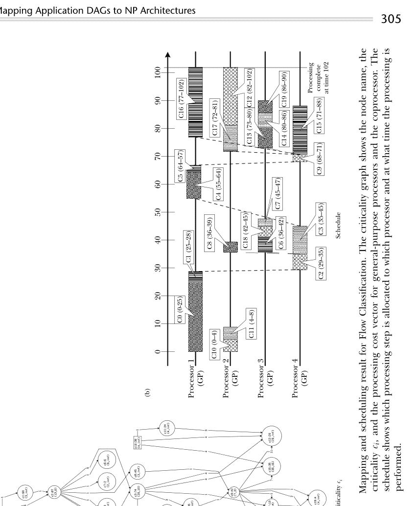

13.8 图

关键性 `c_i`

## 13 应用分析与资源映射

## 13.6 结论

在本章中，我们以一种与架构无关的方式引入了标注的有向无环图（ADAG）特性和依赖关系。我们开发了一种方法，可以从仿真获取的运行指令跟踪中自动导出这种 ADAG。为了考虑应用内实例的自然聚类，我们使用了最大局部比例划分（MLRC）对指令块进行分组，并减了了 ADAG 的尺寸。对于四个网络处理应用，我们展示了此类 ADAG，并说明了如何观察到固有的并行性（多处理器或流水线）。使用 ADAG 表示，可以使用以节点关键性为指标的启发式算法将处理步骤分配到处理资源上。我们展示了这种映射和调度结果以说明其行为。

我们认为，这是自动分析应用并将处理任务映射到异构架构的重要一步。对于未来的工作，我们计划进一步探索数据包运行时执行的差异以及这些差异如何影响分析结果。我们还想比较从最小比例划分获得的聚类质量与其他各种划分启发式算法的质量。最后，有开发开发稳健的方法来自动识别用于协处理器和硬件加速器的处理块。

## 参考文献

- [1] K. B. Evegang and P. Francis, “IP 网络地址翻译器 (NAT),” RFC 1631, Network Working Group, 1994年5月.
- [2] J. C. Mogul, “基于 UNIX 的网关的简单灵活的数据访问控制,” USENIX Conference Proceedings, pp. 203–221, Baltimore, Maryland, 1989年7月.
- [3] G. Apostolopoulos, D. Aubepin, V. Peris, P. Pradhan, and D. Saha, “基于的内容的设计、实现与性能,” Proceedings of IEEE INFOCOM 2000, pp. 1117–1126, Tel Aviv, Israel, 2000年3月.
- [4] Hewlett-Packard Company, 使用 TCP/IP 卸载引擎 (TOE) 加速适配器提升 HP StorageWorks NAS 的性能和效率, 2003年3月, alacritech.com.
- [5] Intel Corp, Intel XP2800 网络处理器, 2002, developer.intel.com/design/network/products/nfamily/ixp2800.htm.
- [6] J. Allen, B. Bass, C. Basso, R. Boivie, J. Calignac, G. Davis, L. Freleuchoux, M. Heddes, A. Herkersdorf, A. Kind, J. Logan, M. Meyravian, R. Rinaldi, R. Sabhikhi, M. Siegel, and M. Waldvogeld, "IBM PowerNP 网络处理器：硬件、软件与应用,” IBM Journal of Research and Development, 47(2/3):177–194, 2003.
- [7] EChip Technologies Ltd., Yokneam, Israel, NP-10 千兆 7 层网络处理器, 2002, www.ezchip.com/html/pr-np1.html.
- [8] N. Shah, W. Plisher, and K. Keutzer, "NP-Click: 用于 Intel IOP1200 的编程模型,” 与第九届国际高性能计算机架构研讨会 (HPCA-9) 联合举办的网络研讨会, pp. 100–111, Anaheim, California, 2003.
- [9] E. Kohler, R. Morris, B. Chen, J. Jammotti, and M. F. Kaashook, "Click 模块化路由器,” ACM Transactions on Computer Systems, 18(3):263–297, 2006.
- [10] G. Memik and W. H. Mangie-Smith," "NEPAL: 一种为网络处理器高效构建应用的框架,” 与第九届国际高性能计算机架构研讨会 (HPCA-9) 联合举办的网络研讨会, pp. 122–124, Anaheim, California, 2003年2月.
- [11] K. Taura and A. Chien, "将通信任务映射到异构资源的启发式算法,” 异构计算研讨会, pp. 10–115, Cancun, Mexico, 2000年.
- [12] J. A. Fisher, 跟踪器调度：一种全局微紧凑化的技术, IEEE Transactions on Computers, 30(7):477–490, 1981年7月.
- [13] M-W. Hu, S. A. Mahbile, W. C. Yen, P. P. Chang, N. J. Ritter, A. B. Bringmann, R. G. Outlette, R. E. Hank, T. Tkiyahara, E. G. Haab, J. G. Holm, and D. M. Laver, "超块：一种用于 VLW 和超标编译的有效技术,” The Journal of Supercomputing, 7(1–2):229–248, 1993年5月.
- [14] B. A. Malloy, E. L. Lloyd, and M. L. Soufia, "异步执行 DAG,” IEEE Transactions on Parallel and Distributed Systems, 5(5):498–508, 1994.
- [15] Y-K. Kw and I. Ahmed, "多处理器的任务调度算法,” ACM Computing Surveys, 31(4):406–471.
- [16] H. Elini and T. Lewis, "并行任务调度,” Journal of Parallel and Distributed Computing, 9(2):138–153.
- [17] C. Alpert and A. Kang, "划分的进展,” VLSI Journal, pp. 1–81, 1995.
- [18] Gary Aggrawal, V. Kumar, and S. Shekhar, "多级划分：VLSI 设计,” ACM/IEEE Design Conference, pp. 526–529.
- [19] Y-C. Wei and C.-K. Cheng, "比例划分,” Design of Integrated Circuits and Systems, 10(7):911–921.
- [20] R. Ramaswamy and T. Wolf, "PacketBench: 网络处理工作负载分析工具,” IEEE 6th Annual Workshop on Workload Characterization (WWC-6), pp. 42–50, Austin, 2003.
- [21] D. Burger and T. Austin, "SimpleScalar 2.0,” Computer Architecture News, 25(3):13–25, 1997.
- [22] T. Wolf and M. A. Franklin, "CommBench—网络处理器的基准,” IEEE International Symposium on Performance Analysis of Systems and Software (ISPASS), pp. 154–162, Austin, 2000年4月.
- [23] ARM Ltd, ARM7 数据表, 2003.
- [24] Intel Corp, IntelP1200 网络处理器, 2000, www.intel.com/design/network/products/npfamily/ixp2800.htm.
- [25] TCPDUMP Repository, www.tcpdump.org, 2003.
- [26] National Laboratory for Applied Network Research—被动测量与分析, 2003, www.pma.net/PMA/.
- [27] F. Baker, "IP 第4 版路由器的要求,” RFC 1812, Network Working Group, 1995年6月.
- [28] NetBSD Project, NetBSD release 1.3.1, www.netbsd.org/.
- [29] S. Nilsson and G. Karlson, "使用 LC 查找 IP 地址,” IEEE Journal on Selected Areas in Communications, 17(6):1083–1092, 1999年6月.
- [30] S. Kent and R. Atkinson, "互联网安全架构,” RFC 2410, Network Working Group, 1998年11月.
- [31] J. Daemen and R. Rijmen, "分组密码 Rijndael,” Lecture Notes in Computer Science, volume 1820, pp. 288–296. Springer-Verlag, 2000.
- [32] National Institute of Standards and Technology, 高级加密标准 (AES), 2001年11月, FIPS 197.
- [33] Network Processor Forum, 基准测试实施协议, 2003, www.npforum.org/benchmarking/bia.shtml.

# 索引

- 3 加加器配置, 129
- 4 加加器配置, 129, 130
- 8b/10b 编码解码, 60–61
- 抽象层, 166–67
- AckNack 指令类, 73
- ack 协议, 60–61, 65
- Ack/Nx 指令类, 73
- Ack/Tx 指令类, 73
- 确认 (ACK) 头部, 90
- ADAGs (标注循环有向图), 281, 285, 287
- 聚类, 287
- 使用最大局部比例划分的聚类, 287–91
- 聚类问题, 288–89
- 最大局部比例, 290–91
- MLRC 复杂度, 291
- 概述, 287–289
- 比例划分, 289–90
- 映射到 NP 架构, 302–3
- 映射算法, 303–4
- 映射与调度, 304–8
- 问题描述, 302–3
- 结果, 291–304
- 应用, 294–95
- 基本块结果, 295–96
- 聚类, 296–98
- 协处理器功能识别, 296–291
- 概述, 291
- PacketBench 工具, 201–94
- 地址验证, 60–61, 74
- 高级加密标准，见 AES
- 高级交换，版本, 63
- AES (高级加密标准), 122–231
- 设计方法与实现
- 细节, 123–25
- 加密算法, 130
- 实验, 125–30
- 聚类统计, 129–30
- 密钥敏活性, 127–29
- 模式, 130
- 概述, 125
- 变化的聚类数量, 129
- 变化的流大小, 125–27
- 概述, 122–23
- 数据包加密, 120
- 性能总结, 150–31
- 流水线实现, 230–38

# 310
# 索引

- 电缆调制解调终端系统 (CMTS), 2
- 可缓存控制存储器, 89
- Calc CRC 指令类, 73
- 调用图, 281
- 捕获网络包, 101–2
- Carrier-Wegman + 计数器双用模式 (CWS), 130
- cbit 哈希值, 37
- CFO (来自流优化), 14
- 检查点指令类, 73
- 芯片级互连结标准, 77
- 多处理器芯片 (CMPS), 13, 219
- ck 数据程序, 18, 19, 21, 24
- 密码密钥, 237
- 类指令类, 73
- Click 元素, 70, 71, 73
- Click 模块路由器, 248
- 顺时针, 60–61
- 时钟恢复, 60–64
- 聚类算法, 281
- CMOS 技术, 279
- CMPS (芯片处理器), 13, 219
- CMTS (电缆调制解调系统) 系统, 2
- 粗粒度并行, 10
- 代码生成 (CG) 编译器, 162
- 代码内存, 69
- 代码重排序, 23
- 代码调度, 23
- 冷调用, 41
- 列去重, 27
- 通信接口, 59
- 编译器生成的多线程代码, 99
- 计算密集型进程, 112
- 配置空间, 50–61
- 控制数据流图, 71–72
- 控制依赖关系, 286
- 控制流优化 (CFO), 164
- 控制包, 66
- 控制平面接口, 55
- 控制处理器, 9
- 控制存储器, 11–12
- 协处理识别, 301
- 协处理器, 55, 119
- 核心时钟, 87
- 核心内核, 124, 128
- 计数模式 (CTR), 130
- CPI (每指令周期数), 95
- CRC (循环冗余校验), 18, 19, 21, 24, 60–61, 63, 68, 74, 253
- 密码学算法, 131
- CSIX 接口, 56
- CTR (计数模式), 130
- ctrl hasRom(Tx) 指令类, 73
- ctrl xCell(Tx) 指令类, 73
- 自定义模拟器, 180
- CWC: (Carrier-Wegman + 计数器双用模型, 130)
- 每指令周期数 (CPI), 95
- 循环数据流图, 146
- 循环冗余校验 (CRC), 18, 19, 21, 24, 60–61, 63, 68, 74, 253
- DAG 调试, 287
- 数据压缩, 238–99
- 数据依赖关系, 285
- 数据链路层 (DLL), 58, 63
- 数据包, 66
- 数据处理器, 9
- 数据传输操作, 270
- DC 方法, 238
- “死代码”, 285
- Defrag-1, 107
- Defrag-2, 107
- 去帧器指令类, 73
- 延迟优化, 271–72, 273
- 依赖矩阵, 288
- 深度算法, 140, 141
- 出队操作, 70
- descrue 入队指令类, 73
- descr 入队指令类, 73
- DES 程序, 18, 19, 21, 24
- 目的地址, 77
- 检测-1, 107
- 检测-2, 107
- 检测步骤, 102
- 基于“字典”的压缩算法, 238
- 数字除法, 16
- DinerV 缓存模拟器, 17
- 直接映射段, 28
- 直接映射缓存, 14
- 直接直接内存访问 (DMA), 6, 82, 87–88, 90
- 系统的分而治之方法
- 设计, 150
- DLL (直接链路层), 58, 63
- DMA (直接内存访问), 6, 82, 87–88, 90
- DNA 分析算法, 198
- DNAdb, 199, 204, 211

# 311
# 索引

- DNA 碱苷酸, 199
- DNA 处理字段, 204
- 使用网络处理器进行 DNA 查询, 197–218
    - 架构, 198–210
    - Aho-Corasick 算法, 207–9
    - 硬件配置, 201–3
    - 碱基酸编码, 209–10
    - 概述, 198
    - 评分与对齐, 199–201
    - 软件架构, 203–7
    - 实现细节, 210–11
    - 概览, 197–98
    - 相关工作, 215–18
    - 结果, 211–15
- 领域特定功能, 176
- 领域特定语言, 62
- 门铃监控器, 90
- 双缓冲老化, 44
- 下行, 254
- DSL 接入复用器 (DSLAM), 2
- dst(h) 函数, 268
- 双频, 87
- 双端口内存, 71
- 双路组缓存, 37
- 动态应用分析, 284
- 动态指令, 19–20
- 基于反馈的加密方法, 131
- FFT 程序, 18, 19, 21, 24
- 现场编程门门阵列 (FPGAs), 104, 106, 109
- FIFO 缓冲区, 255
- final_round 内核, 124–25
- 固定大小控制存储器, 9, 30
- 流分类, 294–98, 301, 304
- 流控制, 60–61, 73, 77–78, 定义的, 221, 标识符, 35, 41, 处理图, 249
- 流控制指令类, 74, 流控制更新 (RX) 指令类, 73
- 流级并行, 148
- 四路组缓存, 44
- 四路组段, 28
- FPGA 协处理器, 106–109
- FPL (函数式编程语言), 158
- 分段内存, 162–63
- 帧器指令类, 73
- 帧处理/去帧, 60–61
- 空闲列表内存存储器, 70
- 函数式编程语言 (FPL), 158
- EBO (扩展基础块优化), 164
- ECB (扩展代码本), 130
- ECB 模式, 140
- 边缘权重, 285
- EFQ (基于估计的队列), 174
- 嵌入式设备, 173
- 端到端加密流量, 100
- 能量优化, 271–72, 273
- 入队操作, 70
- EQQ (异常/事件队列), 87
- 异常/事件队列 (EQQ), 87
- 执行代码, 120
- 示例性物理 (PHY) 层级, 251
- 扩展基础块优化 (EBO), 164
- 通用处理器共享 (GPRS), 255
- 通用寄存器 (GPRs), 69
- 全局层, 252, 262, 271
- goto 函数 (g), 207–8
- 通用寄存器 (GPRs), 69
- 通用处理器共享 (GPRS), 255
- 调度器, 259
- GreedyPipe, 3, 220–21, 225–28, 242–43
- 基础思想, 225–26
- NP 设计结果, 239–44
- 概述, 225
- 性能, 227–28
- 流水线设计, 228–32
- 失败测量, 207
- 函数 (f), 207–8
- 快速路径功能, 9
- 硬件多线程, 148
- 应用分析, 283–87
- 应用依赖关系, 285–87
- 设计原理, 100–104
- NIDS 组件表征, 283, 101
- 静态与动态分析, 284–85
- 硬件架构, 105–
- 架构, 302–8
- 基于硬件的 NIDS, 100
- 映射到 NP 的算法, 303–4
- 映射与调度结果, 304–8
- 概述, 302
- 评估结果, 110–18
- 问题陈述, 302–3
- 功能验证, 111
- 概述, 279–82
- 基准测试, 114
- 相关工作, 282–83
- 高级流程序, 121
- 系统基准测试, 114–18
- 概述, 110
- 组字, 74, 99–100
- 接入路由器, 175
- 网络接口上的 NIDS, 140–
- HPA (报头处理), 295
- Hypertransport, RapidIO, 以及 PCI-Express, 硬件平台, 104–6
- 主机接口, 107, 概述, 14
- IDS (入侵检测系统) 模式在 FPGA 上, 104, 106, 109
- 可复 FPGA 库, 119
- 硬件实现, 106
- 智能硬件实现, 106
- Imagine 架构, 122, 134, 140, 141
- 峰值分配, 140
- 哈希表, 35
- 隐线程模型, 156
- 确认队列 (DBQ), 87
- 双队列, 63, 68
- 入站包暴发, 256
- 异构处理器, 279–308
- 指令缓存, 10, 89
- 指令取指, 17
- 指令直方图, 74
- 指令寄存器 (IR), 88
- 整数线性规划 (ILP), 261
- 中间表示 (IR), 150
- 内部缓冲区, 90
- 处理器间通信 (IPC), 294–95
- 线程间冲突, 27
- 入侵检测与预防, 299–301, 291–94
- 入侵检测与预防, 291
- 路由节点, 233
- PacketBench, 291
- 312
# 索引

- 无效位序列, 16
- I/O 适配器, 57
- I/O 带宽, 10
- IP转发算法, 131–32
- IPv4 转发, 120, 139–34
- 设计方法与实现, 132–34
- 统计, 137–38
- 实时数据包性能, 128
- 簇数量, 136–37
- 输入流大小 (缓冲区), 134–36
- 性能摘要, 138–39
- IPv4 进制地址, 294, 298
- IPv4 分层协议, 294, 298
- isort 程序, 18, 19, 22, 25
- IPX2000 多微引擎, 50
- IPBlast, 201, 204–5, 210–11
- 可复 IPX 库, 110
- IPX 模拟器, 213
- 逻辑操作 (L), 69
- 逻辑端口, 261, 269
- 最长前缀匹配 (LPM), 221, 232, 233–36
- 长链路, 254, 270–71
- 查找表 (LUT), 255
- 循环操作, 164
- 本地寄存器堆 (LRF), 121
- LRU 关联缓存, 35
- ludcmp 程序, 18, 19, 24
- LZW 方法, 238
- 机器依赖优化, 162
- 机器无关优化, 162
- MAC (介质访问控制) 层, 251
- 维护收益, 93
- 主线程, 206
- MANETs (移动自接网络), 246
- matmul 程序, 18, 19, 25
- ME1–ME5 微引擎, 210
- ME 代码生成器, 164
-  介质访问控制 (MAC) 层, 251
- 内存接口, 55, 172
- 内存映射窗口, 210
- 内存传输寄存器, 51
- 消息传递语义, 56
- 微引擎, 159, 201–2
- 微流, 179, 188
- McColumn 变换, 237
- 支持多线程处理器中的混合实时工作负载,
- MLRC (最小比例切分), 4, 288, 290, 296, 308
- 模块光学, 16
- 分子生物学家, 198
- MPEG-2 应用, 140
- MTAP (多线程数组处理) 架构, 139
- 多级缓存, 41
- 多级存储层次结构, 149
- 多路链路接口, 265
- 多流水线环境, 3–4
- 密钥扩展内核, 128

## 314
# 索引

- 多处理器 SoC，资源高效网络在片, 245–77
- 设计空间探索示例, 268–77
- 应用和系统参数, 268–71
  - 概述, 268
  - 结果, 271–77
- 估算资源消耗, 264–68
- 将应用映射到系统, 261–64
- 数据包处理系统建模, 249–53
  - 流处理图, 249–53
    - 概述, 249
  - SoC 架构, 253–55
    - 概述, 245–47
    - 相关工作, 247–49
  - 调度, 255–61
    - 在 PEPs 之间转发流段, 256–37
    - 概述, 255–56
  - 在 PEP 中处理流段, 257–59
    - 调度示例, 259–61
- 多线程数组处理 (MTAP) 架构, 139
- 多线程数据包处理,
- 多线程处理器，支持多线程处理器，引擎, 6
- 混合实时负载, 9–31
  - 实验性评估, 17–29
  - 基准程序和方法论, 17–18
  - 概述, 17
- 配置文件驱动的代码调度以减少缺失, 23–25
- 分段共享, 27–29
- 分段大小调整, 18–22
  - 冲突来源, 22–23
- 使用组关联性减少缺失, 25–37
- 未来工作, 30–31
- NP 数据处理器中的指令交付, 11–13
  - 固定大小控制存储, 11–12
    - 概述, 11
  - 使用缓存作为固定大小控制存储,
    - 概述, 9–11
    - 相关工作, 29–30
  - 分段指令缓存, 13–17
    - 地址映射, 16
    - 强制指令内存带宽限制, 17
  - 实现, 14–16
    - 概述, 13
    - 分段大小调整策略, 14
- 多线程, 10, 258
- MyDB8 查询, 214
- ack 尾部摄取, 73–74
- NASA 阿姆斯斯互联网交换 (AIX), 127
- NAT (网络地址翻译), 279
- NCL (网络分类语言), 158
- NEPAL 框架, 249, 282
- NetMap (网络应用映射器), 268
- 网络地址翻译 (NAT), 279
- 网络应用映射器 (NetMap), 268
- 网络分类语言 (NCL), 158
- 网络接口卡 (NIC), 81, 101
- 网络入侵检测与防御，参见网络入侵检测系统 (NIDS) 的硬件平台, 99–110
  - 组件特性描述, 101–3
  - 硬件平台, 104–6
    - 概述, 104
    - 到主机的网络接口, 107–9
    - FPGA 协处理器上的模式匹配, 109–10
    - 可用的 IXP 库, 110
    - 智能硬件实现, 106–77
- 网络节点入侵检测系统 (NIDS), 96–101
- 片上网络 (NoC), 247–48
- 网络处理论坛 (NPF), 199
- 网络处理器, 1–8
  - 应用, 5–8
  - 架构, 3–4
    - 概述, 1–3
  - 工具和技术, 4–5
- 网络处理器单元 (NPU), 197, 204
- 网络安全, 7
- 网络流量处理, 284
- FEA (非确定有限自动机), 110–117
- NIC (网络接口卡), 81, 101
- NoC (片上网络), 247–48

## 315
# 索引

- 非确定有限自动机 (NFA), 110
  - 概述, 33–34
  - 相关工作, 34–35
- 非实时线程, 3
- 数据包数据结构, 160
  - 数据包解码, 102
  - 数据包描述符, 70
- NP 架构，应用映射
  - DAGS, 到 32–8
  - 映射算法, 303–4
- 数据包广义处理器共享 (PGPS), 256
  - 映射和调度结果, 304–8
  - 概述, 302
  - 问题描述, 302–3
- 数据包级并行, 106, 119
- 数据包管理功能, 293
- NP-Click, 282
- 面向数据包的通信协议, 75, 334, 282
- NPF (网络处理论坛), 139
- NPU (网络处理器单元), 197, 204
- 数据包处理引擎, 68, 70
- 数据包处理功能 (PPFs), 150, 354, 282
- OCB (偏移量密码本)模式, 130
- 片外 DRAM, 76
- 数据包处理库 (PPL), 253, 268
- 片外内存, 75, 219
- 片外 SRAM, 75
- 数据包处理建模, 249
- SIMD 流处理器上的上的数据包处理, 114
- 卸载引擎, 94
- 偏移量密码本 (OCB), 130
- AES 加密, 125–31
- 片内 RAM, 75
- 片内 SRAM, 75
- 实现细节, 123–25
- 方法, 250, 251–52
- 性能总结, 130–31
- OSI/ISO 参考模型, 57
- 出站确认数据包, 63–65
- 出站完成, 63, 66–68
- 出站事务, 139–39
- 数据包组装/拆解, 60–61
- PacketBench 工具, 291–94
- 带带摘要缓存的数据包分类, 33–52
  - 方法, 34–38
  - 近似算法, 36
  - 摘要缓存大小调整, 37
- 带摘要缓存的精确分类, 41–42
- 数据包处理系统, 145–72
  - 设计与挑战, 152–72
  - 摘要缓存特定示例, 39–41
  - 配置文件驱动自动映射, 42–48
  - 运行时系统, 142–78
  - 概述, 15–47
- 网络处理器和系统, 44–55
  - 硬件开销, 46–49
  - 结果, 47–48
  - 未来设计, 50–51
  - IXP 开销, 49–50
- 数据包跟踪, 158, 166
- 可参数网络处理单元, 246
- 分区计数, 232
- 分区寄存器类, 163
- 路径从, 190–92
- 模式匹配单元, 110
- 负载依赖类, 73, 74
- 负载指令类, 73
- 负载处理应用 (PPA), 295
- 负载队列, 70
- PCI-Express, 参见 RapidIO, Hypertransport, 和 PCI-Express (网络接口), 55
- PCI 中间连接器 (PMC), 104
- 点对点通信, 56
- 奔腾处理器, 203
- 每流路由, 39
- PERFORM 模拟器, 268
- PE 功能, 208
- PE(sec) 功能, 286
- 分区处理器共享 (PGPS), 256
- PGPU 调度器, 239
- 物理层 (UXI), 57
- 物理层 (PHY), 56, 65
- 物理端口, 255, 261, 272
- 流水线编译器, 159–61
- 网络处理器上的流水线调度, 214–44
- 基础想法, 225–28
- 总体算法, 226–27
- 性能, 227–28
- 流水线设计, 228–32
- 网络处理器设计, 232–44
- AES 加密——流水线实现, 236–38
- 数据压缩——流水线实现, 238–39
- Greedipe 示例设计, 38–44
- 最长前缀匹配 (LPM), 233–36
- 概述, 219–21
- 流水线任务分配, 221–24
- 符号与约束, 221–23
- 性能指标, 223–24
- 相关工作, 224
- PMC (PCI 中间连接器), 104
- 波士顿研究网络 (PREN), 42
- PPA (负载处理应用), 295
- PPFs (数据包处理功能), 150, 153–284
- PPI (数据包处理列表), 268
- PHY (物理端口), 255, 262, 270
- PREN (波士顿研究网络), 42
- 私有控制存储, 9
- 处理器引擎 (PE), 253, 265–67
- 处理器模拟器, 293
- 配置文件驱动自动映射编译器, 158–64
- 聚合编译器, 162–64
- 概述, 158
- 流水线编译器, 159–61
- 分析分析器, 158–59
- 配置文件策略, 14, 19
- 分析时钟元素, 73–74
- 程序大小策略, 18
- 协议层, 240, 272
- 排序程序, 18, 19, 22, 25
- 队列管理, 70
- 队列系统, 102
- qurt 程序, 18, 19, 22
- RAM (跟踪抽象层), 152, 166
- Rambus, 37
- RAMs (随机访问存储), 121
- 随机数生成器 (RNG), 253
- RapidIO, Hypertransport, 和 PCI-Express (网络接口), 55

## 316
# 索引

- 普通任务, 59–68
- 功能层, 57
- 概述, 59
- 实时系统, 55
- 分析, 76
- 输入模型, 79–81
- 概述, 77
- 实现, 87–92
- 结果, 88
- 讨论, 69
- 调度器, 88–99
- 测量, 81–92
- 场景, 74–75
- de0, 72
- RNOS (实时操作系统), 33
- 寄存器类, 167
- 分配, 67
- 时序, 70
- 传输, 35
- RTO (重传超时), 36
- RTP (实时传输协议), 78
- SAH 模拟器, 253
- SAN (存储区域网络), 123
- S-box, 123
- SDRAM, 49, 203
- 缓存垫 (scratchpad), 49, 124
- SDKs (软件开发环境), 280
- Sector-MAC 层, 272
- 安全网关路由器, 127
- 安全策略, 101
- 分段指令缓存, 10, 30
- 选择程序，在, 18, 19, 25
- 序列号 (SN), 63
- 序列化, 60–61
- 服务等级协议 (SLAs), 179–80
- 组关联缓存, 42
- 组关联哈希表, 35
- SHA-1-La-环境, 4, 50–152, 156–158
- 移位/掩码操作, 209
- shiftRow Transformation, 237
- SIMD (单流), 3–4, 141；以及 SIMD 上的数据包处理
- 流处理器
- Simple-Epic, 236
- SimpleScalar, 238, 293
- 同时线程 (SMT), 139
- 单芯片多处理器, 379
- 单数据流，片上数据包
- SIMD 处理器, 398
- 单指令流, 3–4
- 特定组配置策略, 106
- SLAS (服务等级协议), 179–80
- 慢时钟, 87
- 慢路径功能, 9
- SmartBios, 192
- SMT (同时线程), 139
- 软内核, 5, 102, 107–110, 216
- SoCs (系统级芯片)，参见多处理器
- SoCs
- 软件开发环境 (SDKs),
280
- SDRAM, 49, 203
- Sector-MAC 层, 272
- 安全网关路由器, 127
- 安全策略, 101
- 分段指令缓存, 10, 30
- 选择程序，在, 18, 19, 25
- 序列号 (SN), 63
- 序列化, 60–61
- 服务等级协议 (SLAs), 179–80

# 318

# 索引

- SPI (系统数据包接口), 56
- 突刺路由器, 236
- SRAM, 75, 76, 131–33, 205, 206
- src(h) 函数, 268
- SRF (系统寄存器文件), 121
- 静态应用分析, 284
- 静态底层, 204
- 静态指令, 15–20
- 静态性能分析, 68
- 存储区域网络 (SAN), 123
- 存储转发架构, 128
- 存储字 (str) 操作, 70
- 流级流程图, 123
- 流式编程模型, 141
- 流寄存器文件 (SRF), 121
- 字符串匹配算法, 207
- 字符串去剥, 60–61
- StrongARM 处理器, 104, 105, 107, 201, 209
- 微米制造技术, 248
- 交换盒 (SBs), 246, 247–48, 254, 265, 269, 270
- 交换接口, 55
- Synopsys Design Analyzer, 270
- 系统与电路技术研究组, 246
- 系统模型, 152
- 系统级芯片，或多处理器 SoC
- 系统数据包接口 (SPI), 56
- 系统压力测试, 116
- 系统 SYS 组件, 269
    - 指令集, 92
    - 概述, 81–83
    - 性能分析, 95–98
    - 对 TCP 卸载解决方案的要求, 83–86
- TCP SYN 标志, 36
- TCP (传输控制协议), 81
- 时间冲突, 23
- 抖动, 35
- 线程缓存, 89
- 线程切换, 93, 96
- 三处理器流水线, 236
- 紧耦合, 77
- TOE，或 TCP 卸载 (TOE)
    - 传输接口, 59
    - 传输层 (TA), 58
    - 传输控制块 (TCB), 87
- 传输控制协议 (TCB), 81
- 传输层, 65
- iostream 程序, 18, 19, 22, 25
- 两阶段流水线, 236
- TX 层 (TaFTix), 63
- TaFiTS (TX 事务),
- 任务树, 176–77
- TCAM, 51
- TCB 缓存, 90
- TCB (传输控制块), 87
- TCP 连接上下文, 6
- tcpdump 格式, 294
- TCP/IP 函数, 108
- TCP/IP 处理, 5–90
- TCP 卸载 (TOE), 5–6, 81–98
    - TOE 解决方案架构, 87–94
    - 架构细节, 87–92
    - 概述, 87
    - TCP 感知硬件多线程和调度逻辑, 92–94
    - 入数据包, 290
- UDP 头部, 210
- 单处理器缓存缺失, 22
- 单处理器模拟器, 286
- 单处理器系统, 281
- 不安全信息, 236
- 上行链路, 254, 261
- 有效位序列, 16
- 有效路由节点, 233
- 可变长度数据包 (Var), 126–27, 226
- VHDL 模拟器, 268
- 虚拟流段, 251
- 虚拟专用网络 (VPNs), 279
- 虚拟硅内存, 271
- VLIW 集, 121
- VLIW 调度器, 137
- 语音通道, 185
- 语音 over IP (VoIP), 174–75, 178
- voip-data-mux 任务, 178
- 线速处理, 82, 87
- Workbench 模拟器, 111
- 最坏情况缓冲区, 272
- 最坏情况执行时间 (WCET), 29, 189
