# 网络傻瓜指南（第4版）

Doug Lowe

## 在 Dummies.com® 获得更多，做得更多

从免费的速查表（Cheat Sheets）开始

速查表包括：

- 以及其他好东西！

要访问专为本书书创建的速查表，请访问：`www.dummies.com/cheatsheet/networkinggaio`

## 在 Dummies.com 变得聪明

Dummies.com 通过成千上万个答案让你的生活变得轻松，涵盖从去除壁纸到使用最新版本的 Windows 等一切。

查看我们的：

此外，每个月您都可以参加 Dummies.com 的抽奖活动赢得珍贵的礼物。*

想要每周获得 Dummies 周刊吗？在以下主题订阅新闻邮件：

## 在 Dummies.com 发现“如何”做

*抽奖活动目前并非所有国家提供；请访问 Dummies.com 查看官方规则。

## 作者

Doug Lowe 著

## 关于作者

Doug Lowe 写过许多书籍，现住在加第安纳州弗雷明霍。

## 献辞

Doug Lowe 写过许多书籍，现住在加第安纳州弗雷明霍。

## 谢谢

我要感谢参与本书的所有人员，特别是 Blair Pottenger，他将手稿整理成型。

- 配置 Windows Vista 或 Windows 7 计算机标识.................................. 132
- 牧场上的家 ................................................................................. 405
- 理解共享 ............................................................................................................................................................................................................................................................................................................................ 541
- 配置文件服务器角色 ............................................................................................................................................................................................................................................................ 542
- `Net Help` 命令 ....................................................................... 588
- `Net Helpmsg` 命令 ................................................................ 589
- `Net Localgroup` 命令 ............................................................ 589
- `Net Name` 命令 ...................................................................... 591
- `Net Pause` 命令 ........................................................................ 591
- `Net Print` 命令.................................................................................. 592
- `Net Send` 命令.................................................................................. 593
- `Net Session` 命令............................................................................... 594
- `Net Share` 命令............................................................................... 594
- `Net Start` 命令.................................................................................. 596
- `Net Statistics` 命令............................................................. 596
- `Net Stop` 命令.................................................................................. 597
- `Net Time` 命令.................................................................................. 597
- `Net Use` 命令............................................................................... 598
- `Net User` 命令............................................................................... 599
- `Net View` 命令............................................................................... 601
- `RunAs` 命令...................................................................................... 602

## 第八章：使用其他 Windows 服务器 ................................ 603

### 第 1 章：使用互联网信息服务 (IIS) ................... 605
- 安装 IIS......................................................................................................... 605
- 理解默认网站............................................................................... 608
- 创建网站...................................................................................... 610

### 第 2 章：管理 Exchange Server 2010 ............................ 615
- 创建邮箱箱........................................................................................ 615
- 管理邮箱箱..................................................................................... 621
- 启用邮箱箱功能...................................................................... 622
- 创建转发器.................................................................................. 623
- 设置邮箱箱存储限制............................................................................... 625
- 为 Exchange 配置 Outlook....................................................... 628
- 查看另一个邮箱箱........................................................................... 631

### 第 3 章：使用 SQL Server 2008 ................................... 635
- 什么是数据库？.................................................................................. 635
- 什么是关系型数据库？....................................................................... 636
- 什么是 SQL？............................................................................................... 637
- SQL 方言............................................................................................... 637
- SQL 语句........................................................................................... 637
- 使用 `select` 语句.................................................................. 638
- 安装 SQL Server 2008....................................................... 639
- 使用 SQL Server 2008 管理工具.............................. 646
- 创建新数据库....................................................................... 647
- 创建表...................................................................................... 648
- 编辑表....................................................................................... 651
- 处理查询............................................................................................... 652
- 处理脚本............................................................................................... 653

`www.it-ebooks.info`

## XXVIII 傻瓜版网络一体机，第4版

## 第 4 章：使用 SharePoint ............................................................................................................................................ 655
- 什么是 SharePoint？ ..................................................................................................................................... . . . 655
- 连接到 SharePoint 站点 ................................................................................................................................... . . . 656
- 添加用户 ................................................................................................................................................................................. . . . . . . . . . 657
- 添加和删除公告 .................................................................................................................................................... . . . 661
- 创建新页面 .................................................................................................................................................................................... . . . . . . . . . 663
- 编辑快速启动菜单 ..................................................................................................................................................................... . . . . . 666
- 使用文档库 ................................................................................................................................................................... . . . 667

## 第九 卷：管理 Linux 系统...................................................................................................................................... 669

## 第 1 章：安装 Linux 服务器 ............................................................................................................................................ 671
- 规划 Linux 服务器安装 ...................................................................................................................................................... . . . 671
- 检查系统要求 .................................................................................................................................................................................... . . . 671
- 选择发行版 ................................................................................................................................................................................................................. . . . . . 672


# 考虑多启动 673
# 规划你的分区 673
# 决定你的 TCP/IP 配置 674
# 安装 Fedora 7 675
# 使用安装向导 (Setup Agent) 683

# 第 2 章：熟悉 Linux 685
## Linux: 它不是 Windows 685
## X Window 685
## 虚拟控制台 686
## 理解文件系统 686
## 开启与关闭 688
## 登录 688
## 注销 689
## 关机 689
## 使用 GNOME 689
## 进入命令行 Shell 690
## 管理用户账户 691

# 第 3 章：基础 Linux 网络配置 693
## 使用网络配置程序 693
## 重启你的网络 697
## 处理网络配置文件 698
## Network 文件 699
## ifcfg 文件 700
## Hosts 文件 701
## resolv.conf 文件 702
## netif.conf 文件 702


`inet.conf` 文件 ................................................................................................................................................................................................................................................................................. . . . . . . . . . . 703

使用 `ifconfig` 命令显示你的网络配置 ........................................................................................................................ . . . . . 704

# 目录

## 第 4 章：运行 DHCP 和 DNS....................................................................................... .707
- 运行 DHCP 服务器.................................................................................................... 707
- 安装 DHCP....................................................................................................................... 708
- 配置 DHCP............................................................................................................................... 709
- 启动 DHCP.................................................................................................................................. 710
- 运行 DNS 服务器....................................................................................................... 711
- 安装 BIND.................................................................................................................................. 711
- 查看 BIND 配置文件............................................................................... 712
- 重启 BIND.................................................................................................................................. 716

## 第 5 章：跳 Samba 舞 ................................................................ .717
- 理解 Samba......................................................................................................... 717
- 安装 Samba....................................................................................................................................... 718
- 启动与停止 Samba........................................................................................................... 719
- 使用 Samba 服务器配置工具....................................................................................... 721
- 配置服务器设置............................................................................................................... 722
- 配置 Samba 用户............................................................................................................... 723
- 创建共享................................................................................................................................................ 725
- 编辑 `smb.conf` 文件............................................................................................................... 727
- 使用 Samba 客户端................................................................................................................................ 729

## 第 6 章：运行 Apache ............................................................................ .731
- 安装 Apache......................................................................................................................... 731
- 启动与停止 Apache....................................................................................................... 732
- 确认 Apache 正在运行.................................................................................................. 733
- 使用 HTTP 配置工具............................................................................................... 734
- 限制 Apache 服务器的访问.................................................................. 735
- 配置虚拟主机............................................................................................................... 736
- 配置默认主机........................................................................................................................... 736
- 创建虚拟主机....................................................................................................................................... 739
- 设置 Apache 用户账户............................................................................................................... 740
- 手动编辑 Apache 配置文件.................................................................. 741
- 创建网页........................................................................................................................................... 741

## 第 7 章：运行 Sendmail ........................................................................... .743
- 理解电子邮件....................................................................................................... 743
- 安装 Sendmail....................................................................................................................................... 744
- 修改 `sendmail.mc`............................................................................................................... 745
- 启用连接...................................................................................................................... 746
- 启用伪装（masquerading）.................................................................................................................................. 747
- 设置别名........................................................................................................................................... 747
- 使用 SpamAssassin............................................................................................................... 748
- 安装 SpamAssassin..................................................................................................................... 748
- 定制 SpamAssassin.................................................................................................. 749
- 电子邮件地址的黑名单与白名单.................................................. 750
- 使用邮件控制台客户端............................................................................................................... 750
- 使用 Evolution........................................................................................................................................ 752

## 第 8 章：运行 FTP ................................................................................................753
- 安装 `vsftpd` .......................................................................................753
- 启动 `vsftpd` 服务 .................................................................................................754
- 配置 FTP ................................................................................................................................754

## 第 9 章：Linux 命令 ..........................................................................................................759
- 命令 Shell 基础.......................................................................................................759
- 进入 Shell ............................................................................................................760
- 编辑命令...............................................................................................................................761
- 通配符......................................................................................................................................761
- 重定向与管道................................................................................................................762
- 环境变量................................................................................................................762
- Shell 脚本................................................................................................................................................763
- 目录与文件处理命令..............................................................................764
- `pwd` 命令...............................................................................................................................764


# 目录

- `cd` 命令...............................................................................................................................765
- `mkdir` 命令...........................................................................................................................765
- `rmdir` 命令..............................................................................................................766
- `ls` 命令...............................................................................................................................766
- `cp` 命令...............................................................................................................................767
- `rm` 命令...............................................................................................................................768
- `mv` 命令...............................................................................................................................769
- `touch` 命令...........................................................................................................................769
- `cat` 命令...............................................................................................................................770
- 软件包与服务的命令...........................................................771
- `service` 命令..................................................................................................................771
- `rpm` 命令...............................................................................................................................773
- 用户管理命令...............................................................................................774
- `useradd` 命令...............................................................................................................774
- `usermod` 命令...............................................................................................................775
- `userdel` 命令...............................................................................................................775
- `change` 命令...............................................................................................................776
- `passwd` 命令...............................................................................................................777
- `newusers` 命令......................................................................................................777
- `groupadd` 命令......................................................................................................777
- `groupdel` 命令.......................................................................................................778
- `gpasswd` 命令.......................................................................................................778
- 管理所有权与权限的命令...............................................................779
- `chown` 命令...............................................................................................................779
- `chgrp` 命令...............................................................................................................780
- `chmod` 命令...............................................................................................................780
- 网络命令....................................................................................... 781
`hostname` 命令...................................................................................... 781
`ifconfig` 命令..................................................................................... 782
`netstat` 命令...................................................................................... 783
`ping` 命令........................................................................................... 784
`route` 命令....................................................................................... 785
`traceroute` 命令............................................................................... 786

## 附录 A：实用网站目录............................................... 787
- 认证.................................................................................................. 787
硬件.......................................................................................................... 787
家庭和小型企业网络............................................................................... 788
Linux......................................................................................................................... 789
杂志...................................................................................................... 789
微软........................................................................................................ 790
网络标准组织............................................................................... 790
参考....................................................................................................... 791
搜索........................................................................................................... 791
TCP/IP 与互联网.................................................................... 792
无线网络...................................................................................................... 793
智能手机............................................................................................... 794

## 附录 B：术语表........................................................................... 795

## 索引......................................................................................................... 823

# 引言

欢迎阅读《傻瓜包网络全书》第四版。这本书是唯一一本网络书籍，它的设计初衷是为了替代你可能不得不购买的整整架枯燥且乏味网络书籍。书中包含了你为了让网络建立并运行，以及在网络不断增长、发展、出现问题和遇到麻烦时保持其领先地位所需要的所有基础和非基础信息。

如果你刚刚开始担任网络管理员，这本书是你的理想之选。作为一名网络管理员，你必须了解许多不同的主题：安装和配置网络硬件、安装和配置网络操作系统、规划网络、使用 TCP/IP、保护网络安全、处理移动设备、备份数据以及许多其他方面。

你可以，而且可能最终会，为这些中的每个主题单独购买书籍。没多久，你的书架就会挤满 10,000 页或更多的详细信息，涵盖了网络中各种想象到的细微差别。在你准备好深入研究其中每一个主题之前，你需要先获得一个全局视角。这本书就是实现这一点的理想方式。

如果你已经拥有了 10,000 页或更多的网络信息，可能会问：“我真的需要读 100 页关于 Bind 来设置 DNS 器吗？”或者“我真的需要一本六页的书来教我如何安装 Linux 吗？”其实，大多数 1,000 页的网络书籍大约有 100 页左右的有用信息——你每天使用的类型——以及大约 900 页极其痛苦的细节，这些细节主要适用于像 NASA 和 CIA 这种地方的网络。

本书的基础内容是我尝试在九个不同的网络主题上运用的那 100 页左右的有用信息：网络基础、构建网络、网络管理与安全、故障排除和灾难计划、使用 TCP/IP、家庭网络、无线网络、Windows 服务器操作系统以及 Linux。

所以，无论你是刚刚被任命负责你的第一个网络，还是一名资深专家，你都找到了正确的书。

# 2 关于这本书

## 关于这本书

《傻瓜包网络全书》第四版，旨在作为你在设置和管理网络时可能需要了解的所有优秀内容（也许还有一些不优秀的内容）的参考。当然，你可以为书中涵盖的每个网络主题都去买一本厚厚的 1,000 页大书。但那样，谁来帮你把它们从书店带回家呢？你又在哪里能找到书架空间来存放它们呢？在书中，你所需的信息都方便地为你包装在一个书封内。

这本书并没有声称是这些主题每个细节的详尽参考。相反，这本书向你展示如何使用易于遵循的“傻瓜系列”格式快速上手，这本书帮助你完成你想做的事。它的设计让你无需费力去寻找。

《傻瓜包网络全书》第四版是一由几本较小的迷你书组成的大书——每本书涵盖了网络管理任何关键要素的基础知识，例如设置网络硬件、安装网络操作系统或排除网络故障。每当一个大整体由几个小部分组成时，总存在产生混乱的可能性。这就是为什么《傻瓜包网络全书》第四版需要一张地图来帮助你找到你想要的内容。书开头有一个涵盖全书的详细目录。然后，每本迷你书的开头都有一个迷你目录，让你一目了然该迷你书中包含了哪些章节。每页顶部都有有用的标题，指出该页讨论的主题。页面侧面有方便的标签，帮助你快速找到每本迷你书。最后，全面的索引让你能够找到整本书中的任何地方。

这并不是那种你可以像读廉价小说一样从头读到尾的书。如果我以后看到你在海滩上读这这本书，我会往你脸上踢沙子。这它更像是一本参考书，那种你可以拿起、翻到任何一页并开始阅读的书。你不需要背诵书中的任何内容，只需要在你需要某些信息时拿起它。

### 如何使用这本书

这本书的用法像一本参考书。从你需要了解的主题开始。通过目录或索引查找它。目录足够详尽，你应该能找到你正在寻找的主题。如果不能，请查阅索引。

当然，书中充满了信息，所以如果你想对你的主题进行简要探索，越多越好。如果你想了解安全的大局，就阅读整个安全章节。如果你只想知道如何设置良好的密码，就读关于密码的部分。你明白了。

每当我描述你在屏幕上看到的消息或信息时，呈现如下：

> 来自你友好的网络的消息

当你需要输入某些内容时，看到你需要输入的文本如下：`输入这些内容`。在示例中，你在键盘上输入`输入这些内容`并按回车。通常会有解释，以防你挠头额咕道：“哈？”

### 本书的结构

《傻瓜包网络全书》第四版中包含九本迷你书，其中每一本都可以独立存在。第一本迷你书涵盖了为了理解书中其他内容应该掌握的网络基础。当然，如果你已经在管理网络了，你可能已经了解所有这些内容，所以你可以跳过第一部分或快速略读。剩下的迷你书涵盖了你通常会在独立书籍中找到各种网络主题。以下是每本迷你书中内容的简要描述。

#### 第一部分：网络基础

这本迷你书涵盖了你为了上手而需要的基础知识。你将了解到什么是网络、网络是如何运作的、构成网络需要哪些硬件组件以及网络操作系统是做什么的。你将发现点对点网络和客户端/服务器网络之间的区别。你还将获得对最流行的网络操作系统的对比，包括 Windows Server 和 Linux 的最新版本。

# 4 本书的结构安排

## 第二卷：构建网络

在本部微型书中，你将了解到构建网络的层层奥秘。首先，你将看到如何为你的网络制定计划。毕竟，规划是任何伟大事业的第一步。接着，你将发现如何安装网络硬件（如网卡），以及如何处理各种类型的网络电缆。你将获得一些关于安装网络服务器操作系统的通用建议。你将了解如何配置不同版本的 Windows 以访问网络。最后，你将对如 VMware 等虚拟化技术如何帮助你管理服务器有一个概述。

## 第三卷：网络管理与安全


进入`/path/to/xxx`目录，找到`xxx.json`。

在表达式`cvar = avar + bvar`中，加法运算符（`+`）将`avar`与`bvar`相加，得到它们的和`cvar`

在`List.of(arg0, arg1, arg2)`中，`List`接口的工厂方法`of()`接受一系列的元素，返回包含它们的只读列表。

之后我们这样调用`cmd`命令：`cmd arg0 arg1 arg2`。

```
if (condVar > someVal) {console.log("xxx")}
```

在本部微型书中，你将发现成为一名网络管理员意味着什么，重点介绍如何保护你的网络，使其免受入侵者的侵害，同时允许网络用户访问其所需的所有内容。在现实世界中，这项责任并不如听起来那么简单。本微型书从概述管理员的工作内容开始。然后，它描述了一些良好的网络安全基本实践，例如使用强密码和为服务器提供物理安全。它还包含了关于设置和管理网络用户账户、使用病毒扫描器、设置防火墙、备份网络数据、保持网络软件更新、使用虚拟专用网络（VPNs）以及排除常见网络问题的详细信息。

# 第四卷：TCP/IP 与互联网

本微型书致力于地球上最流行的网络技术：TCP/IP。（实际上，它可能是宇宙中最流行的协议。《独立之日》中的外星人在他们的飞船上拥有 TCP/IP 网络，这使得威尔·史密斯和杰夫·戈德布鲁姆能够入侵。外星人应该读读第三卷中关于防火墙的章节。）

# 第五卷：无线网络

在本部微型书中，你将发现设置和保护无线网络的细节。

# 第六卷：移动网络

本微型书致力于管理想要连接到你网络的移动用户的特殊需求。在这里，你将找到关于使用最流行的智能手机（包括 Blackberry、iPhone 和 Android 设备）的章节，以及关于将网络整合到你的网络中的信息。

# 6 接下来去

## 接下来去

是的，你可以从这里到达那里。手握这本书，你已经准备好穿过崎岖的网络地形了。浏览目录并决定你想从哪里开始。大胆吧！勇敢吧！去冒险吧！最重要的是，玩得开心！

## 第一卷

## 网络基础

**第五次波浪** 作者：Rich Tennant

> “我们应该画一个圈，召唤元素，并引导能量。如果这不起作用，我们就读说明书。”

# 内容一览

- 第 1 章：理解网络 ............................................9
- 第 2 章：理解网络协议与标准......21
- 第 3 章：理解网络硬件 ..................................43
- 第 4 章：理解网络操作系统..................61

# 第 1 章：理解网络

### 本章内容

- 介绍计算机网络
- 了解所有的客户端、服务器和对等节点
- 理解各种类型的网络
- 弄清楚网络的缺点

第一台计算机网络发明于古代数学家将他们的算盘用风筝线连接在一起，以便他们即时共享算盘答案。多年来，计算机网络变得越来越复杂。网络不再使用线绳，而是使用电缆、光纤和无线无线电信号来连接计算机。然而，其目的保持不变：共享信息并更快地工作。

本章介绍了计算机网络的基础知识及其工作原理。

## 什么是网络？

网络无非是将两台或多台计算机连接在一起，以便它们可以交换信息（如电子邮件或文档）或共享资源（如磁盘存储或打印机）。在某些情况下，这种连接是通过传输电信号形式信息的电缆完成的。但在某些情况下，会使用其他类型的连接。例如，光纤让计算机通过光脉冲以极快的速度通信。无线网络让计算机使用无线电信号进行通信，因此计算机不受物理电缆的限制。

除了组成网络的硬件外，网络还需要特殊的软件来启用通信。在网络发展的早期，你必须在网络上的每台计算机上添加此类软件。如今，网络支持已内置在所有主要的操作系统中，包括所有当前版本的 Windows、Macintosh 操作系统和 Linux。

## 网络构建模块

所有网络，无论大小，都需要专门的网络硬件来使其运行。对于小型网络，硬件可能仅仅是一组配备了网络端口的计算机、每台计算机配的一根电缆，以及一个所有计算机都通过电缆插入的网络交换机。较大的网络可能还有额外的组件，如路由器或中继器。

- 对于小型网络，硬件可能仅仅是一组配备了网络端口的计算机、每台计算机配的一根电缆，以及一个所有计算机都通过电缆插入的网络交换机。
- 较大的网络可能还有额外的组件，如路由器或中继器。

## 为什么要费劲？

如果事实确实如此，计算机网络的搭建非常麻烦。那么，为什么要费劲呢？因为网络带来的好处让设置它的难度变得值得。你不需要拥有博士学位就能理解网络的好处。事实上，你在幼儿园就已经学会了所有关于网络好处的知识。网络的核心在于共享三样东西：信息、资源和应用程序。

- **共享信息：** 网络允许用户以几种不同的方式共享信息。最常见的信息共享方式是共享单个文件。例如，两个或更多人可以协作编辑同一个电子表格文件或文字处理文档。在大多数网络中，中央服务器上的大容量硬盘被设置为一个公共存储区域，用户可以在其中存储文件并与他人共享。

在共享文件时，网络允许用户以各种方式相互通信。例如，消息应用程序使用如 Microsoft Outlook 等电子邮件相互交换消息。用户还可以在网络上举行在线会议。事实上，凭借廉价的视频摄像头和适当的软件，用户可以在网络上进行视频会议。

- **共享资源：** 某些计算机资源（如打印机或硬盘）可以被设置成供网络用户共享。共享这些资源可以显著节省成本。例如，购买一个具有校对、装订和双面打印等功能的高速打印机供任何工作组共享，比为组中的每个用户单独购买打印机要便宜得多。

硬盘也可以是共享资源。事实上，为用户提供共享硬盘的访问权限是网络上共享文件最常用的方法。主要用途是托管共享硬盘的计算机被称为*文件服务器*（file server）。

在实践中，通常不会共享整个硬盘。相反，共享的是网络硬盘上的单个文件夹。通过这种方式，网络管理员可以允许不同的网络用户访问不同的文件夹。例如，公司可以为销售部门和财务部门设置共享文件夹。然后，销售人员可以访问销售部门的文件夹，财务人员可以访问财务部门的文件夹。

你可以在网络上共享其他资源。例如，网络可以用于共享互联网连接。在互联网早期，每个需要访问互联网的用户都有自己的调制解调器连接这很常见。如今，更常见的做法是网络提供一个共享的高速互联网连接，网络上的每个人都可以访问。

## 客户端与服务器

- **共享应用程序：** 许多企业建立网络的最常见原因之一是为了让几个用户能够协作处理同一个业务应用程序。例如，财务部门可能有一套会计软件，可以被多台计算机同时使用。销售处理部门可能有一套订单输入应用程序，运行在几台计算机上以处理大量的订单。

包含与其它网络计算机共享的硬盘、打印机和其他资源的计算机被称为*服务器*（server）。这个词会反复出现，所以你必须记住它。把它写在你的左手背上。

任何不是服务器的计算机都称为*客户端*（client）。你也必须记住这个词。把它写在你的右手背上。

网络上只有两类计算机：服务器和客户端。看一眼你的左手，再看一眼你的右手。在背下这两个词之前，不要洗手。

网络中服务器和客户端之间的区别将是我们社会学课程上要学习的内容，因为它类似于社会中富人与贫穷者之间的区别。

- 通常，网络中性能最强、昂贵的计算机是服务器。这一事实是合逻辑的，因为网络上的每个用户都共享服务器的资源。
- 网络中廉价且性能较弱的计算机是客户端。客户端是个人每个工作日使用的计算机。因为客户端的资源不需要共享，所以它们不需要太华丽。
- 大多数网络的客户端多于服务器。例如，一个拥有十个客户端的网络可能只需要一台服务器即可。
- 在某些网络中，服务器和客户端之间存在明确的界限。换句话说，计算机要么是服务器，要么是客户端，二者不可兼。服务器不能变成客户端，客户端也不能变成服务器。
- 其他网络更具进阶性，允许网络中的任何计算机成为服务器，并允许任何计算机同时既是服务器又是客户端。本章后面图 1-1 所示的网络就是这种类型的网络。

## 专用服务器与对等节点

在某些网络中，服务器计算机就是服务器计算机，不再有别的。这台服务器计算机专门负责提供共享资源（如硬盘和打印机），供网络客户端计算机访问。这种服务器被称为专用服务器，因为它可以执行网络服务之外的任何其他任务。依赖专用服务器的网络有时被称为客户端/服务器网络（client/server network）。

其他网络采取另一种方法，允许任何计算机同时充当客户端和服务器。因此，任何计算机都可以与其他计算机共享其打印机和硬盘。

- **对等网络：** 在对等网络中，每台计算机都同时充当客户端和服务器。这种网络在不需要专用服务器的小型办公室中很常见。

## 大小之的网络

网络有各种尺寸和形状。事实上，根据其覆盖的范围对网络进行分类是很常见的：

- **局域网：** 局域网（简称 LAN）是计算机位置较近的网络。注意，LAN 这个术语并不意味着网络很小。事实上，一个局域网可以包含成百甚至数千台计算机。通常局域网包含在一个建筑内，但它也可以扩展到校园内的多个建筑，只要这些建筑距离较近。
- **城域网：** 城域网（简称 MAN）是一种比典型的 WAN 小但比 LAN 大的网络。通常，城域网连接位于同一城市内的多个局域网。
- **广域网：** 广域网（简称 WAN）是跨越很大地理区域的网络，例如整个城市或地区，甚至是整个国家。WAN 通常用于连接距离遥远的多个局域网。例如，广域网可以连接旧山的办公室和纽约的办公室。

## 网络拓扑结构

网络拓扑一术语是指计算机和其他网络组件相互连接的形状。有几种不同类型的网络拓扑结构，每种都有其优缺点。

- **节点：** 节点是连接到网络的设备。对于你的而言，节点等同于计算机。网络拓扑涉及网络节点之间如何相互连接。
- **数据包：** 数据包是通过网络从一个节点发送到另一个节点的消息。数据包包含了发送数据包节点的地址、接收数据包节点的地址以及数据。

### 总线拓扑

第一种网络拓扑结构被称为总线型（bus），其中节点沿一条线连接在一起，如图 1-1 所示。理解总线拓扑工作原理的关键是将网络想象成单根电缆，每个节点都“接入”这根电缆，以便监听在该电缆上传的数据包。

在总线拓扑中，网络上的每个节点都能看到电缆上传输的每一个包。每个节点都会查看每个数据包，以确定该数据包是否是给自己的。如果是，节点接收该数据包；否则，它忽略该数据包。通过这种方式，每台计算机都可以响应发送给它的数据并忽略发送给网络上其他计算机的数据。

如果总线网络中的电缆断裂，整个网络将实际上被禁用。显然，断裂两侧的节点无法继续相互通信，因为数据无法跨越断裂产生的间隙。但即使是位于断裂同一侧的节点也无法相互通信，因为断裂留下的电缆开放端会破坏电信号的正常传输。

在以太网联网的早期，总线拓扑非常常见。尽管对于如今的大多数网络，总线拓扑已让位于星型拓扑（参见下一节），但许多网络仍含有依赖于总线拓扑的元素。

### 星型拓扑结构

在星型拓扑中，每个网络节点都连接到一个称为集线器（hub）或交换机的中央设备，如图1-2 所示。星型拓扑通常用于局域网（LAN）。

如果星型网络中的电缆断裂，只有连接到该电缆的节点会与网络隔离。其他节点可以继续无中断地运行——除非，由于断裂而被隔离的节点恰好是文件服务器。

你应该意识到集线器和交换机之间某些技术上的区别。简单来说，集线器不知道连接到其每个端口的计算机。当连接到集线器的计算机向连接到另一个端口的计算机发送数据包时，集线器会将数据包的副本发送到所有端口。相比之下，交换机知道哪个计算机连接到它的每个端口。因此，当交换机接收到旨在特定端口的数据包时，它仅将包发送到接收者所连接的端口。

严格来说，只有使用交换机的网络才有真正的星型拓扑。如果网络使用集线器，网络拓扑在物理上呈星型，但实际上是总线。这是因为当使用集线器时，网络上的每台计算机都能看到通过网络发送的所有包，就像总线拓扑一样。在真正的星型拓扑中，当使用交换机时，每台计算机只能看到专门发送给它的包，以及专门发送给网络上所有计算机的包（这类数据包被称为广播包）。

### 扩展星型结构

物理学家说宇宙正在膨，网络管理员知道他们是正确的。简单的总线或星型拓扑适用于只有十几台计算机的小型网络。随着更多计算机的加入，小型网络不可避免地变大。对于较大的网络，创建结合了星型和总线的更复杂的拓扑结构是常见的。

例如，可以使用总线来连接多个星型结构，即两个或多个集线器或交换机通过总线连接在一起。这些集线器或交换机中的每一个都是一个星型总线的中心，将两或多台计算机连接到网络。这种结构通常用于具有两个或多个不同工作组的建筑。连接交换机的总线有时被称为骨干。

扩展星型拓扑的另一种方法是使用称为链链连接（daisy-chaining）的技术。当你使用链链连接时，一个交换机连接到另一个交换机，就像它是星型的一个节点一样。然后，第二个交换机作为第二个星型的中心。

### 环形拓扑结构

一种网络拓扑类型被称为*环形*（ring），如图1-3 所示。在环形拓扑中，数据包沿着圆圈从计算机传输。每台计算机查看每个数据包，以判断该数据包是否是给它的。如果不是，数据包将传递给环形中的下一个计算机。

多年前，环形拓扑在局域网中很常见，因为两种流行的网络技术使用了环形结构：ARCNET 和令牌环（Token Ring）。ARCNET 仍用于工厂自动化等某些应用，但在业务网络中很少使用。令牌环仍然是 IBM 中型计算机的流行网络技术。尽管存在大量的令牌环网络，但已没有许多新网络使用令牌环了。

环形拓扑也被 FDDI 使用，最早的光纤网络连接类型之一。然而，FDDI 已让位于更高效的光纤技术。因此，环形网络已从业务网络中消失得殆尽。

### 网型拓扑结构

第四种网络拓扑类型被称为*网型*（mesh），它在网络上的每个节点之间之间有多个连接，如图1-4 所示。网型拓扑的优势是，如果某根电缆断裂，网络可以使用替代路由来传输数据包。

# 第一部分

## 第二章

## 理解标准

这是互联网及大多数局域网的协议。以太网（Ethernet）是一种低层协议，规定了大多数局域网所使用的网络硬件的电气特性。第三个重要协议是 IPX/SPX，它是 TCP/IP 的替代方案，曾为 NetWare 网络广泛开发。在网络发展的早期，IPX/SPX 广泛用于局域网，而现在 TCP/IP 已成为首选协议。

标准是对协议的一种约定的定义。在计算机网络发展的早期，每家计算机制造商都开发自己的网络协议。结果就是你无法在同一个网络上轻松地混合来自不同制造商的设备。

随后标准的出现拯救了困局。标准是行业通用的协议定义，不绑定于特定的制造商。通过标准协议，你可以混合组合来自不同供应商的设备。只要设备实现了标准协议，它们就应该能够在同一网络上共存。

许多组织参与了网络标准的制定。其中最重要的五个组织是：

- **美国国家标准协会 (ANSI):** 美国的官方标准组织。ANSI 的发音为 AN-see。
- **电气与电子工程师学会 (IEEE):** 一个发布关键网络标准的国际组织——特别是以太网网络系统的官方标准（正式名称为 IEEE 802.3）。IEEE 的发音为 ee-triple-E。
- **国际标准化组织 (ISO):** 由全球范围内 100 多个标准组织组成的联邦。如果我在高中学过法语，我可能就能理解为什么“国际标准化组织”的缩写是 ISO 而不是别的。
- **互联网工程任务组 (IETF):** 负责驱动互联网协议的组织。
- **万维网联盟 (W3C):** 一个处理万维网标准开发的国际组织。

表格 2-1 列出了这些标准组织的各个网站。

| 组织 | 网站 |
|---|---|
| ANSI (美国国家标准协会) | www.ieee.org |
| IEEE (电气与电子工程师学会) | www.ieee.org |
| ISO (国际标准化组织) | www.iso.org |
| IETF (互联网工程任务组) | www.ietf.org |
| W3C (万维网联盟) | www.w3c.org |

## OSI 参考模型的七层结构

OSI 听起来像是一个只在汤姆·克兰西小说中听过的机密政府机构。在网络世界中，它实际上代表开放系统互连（Open Systems Interconnection），即开放系统互连参考模型，最近被称为 OSI 模型。

OSI 模型将计算机网络的各个方面分为不同的层。这些层就像洋葱层一样：每一层都包裹着它下面的一，并向上层隐藏其细节。OSI 模型也像洋葱，如果你开始剥开它查看内部，你一定会掉下几眼泪。

OSI 模型并不是像以太网和 TCP/IP 那种意义上的标准。相反，OSI 模型是一个框架，各种网络标准可以适配其中。OSI 模型规定了网络操作的哪些方面可以通过各种标准来解决。因此，从某种意义上说，OSI 模型是一种标准。

表格 2-2 总结了 OSI 模型的七层。

| 层 | 名称 | 描述 |
|---|---|---|
| 1 | 物理层 | 管理电缆及中继器、集线器等设备的布局 |
| 2 | 数据链路 | 提供 MAC 地址以唯一标识工作节点，并提供以数据包格式通过物理层发送的方法。桥器和交换机是第 2 层设备 |
| 3 | 网络层 | 处理跨网络网段的数据路由。 |
| 4 | 传输层 | 提供数据包的可靠交付。 |
| 5 | 会话层 | 在网络应用之间建立会话。 |


| 6 | 表示层 | 转换数据以便使用不同格式的系统交换信息。 |

| 7 | 应用 | 允许应用程序请求网络服务。 |

前三层有时被称为下层。它们处理信息如何通过网络从一台计算机发送到另一台计算机的机制。第 4 到 7 层有时被称为上层。它们处理应用程序如何通过编程接口与网络相关。

接下来的章节将更详细描述每一层。

OSI 模型的七层是对网络协议应该工作方式的一种理想化视图。在现实世界中，实际的网络协议并没有完全遵循 OSI 模型。现实世界总是比我们想象的要复杂得多。尽管如此，OSI 模型为工作网络提供了一个方便（尽管不完全）的描述。

## 物理层

OSI 模型的底层是物理层。它处理网络的物理特性，例如用于连接设备的电缆类型、连接器类型、电缆长度等。例如，`10BaseT` 以太网标准规定了双线电缆的电气特性、连接器的尺寸和形状、电缆的最大长度等。第一部分第一章描述的星型、总线型、环型和网型网络拓扑适用于物理层。

物理层的另一个方面是通过电缆从一个网络节点传输到另一个节点的数据信号的电气特性。物理层除了基本的二进制值 0 和 1 外，没有对信号定义任何意义。OSI 模型的较高层必须为物理层传输的位分配意义。

网络中常用的物理层设备类型是中继器。当需要超过物理层标准允许的线长度时，中继器用于再生信号。`10BaseT` 集线器（Hub）也是物理层设备。从技术上，它们被称为多端口中继器，因为集线器的目的是再生从任何端口接收到的每个数据包。中继器和集线器不检查它们再生的数据包内容。如果它们检查，它们将在数据链路层工作，而不是物理层。

安装在网络每台计算机上的网络适配器（也称为网卡 NIC）是物理层设备。你可以通过显示适配器属性对话框来显示 Windows 计算机安装的网络适配器（适配器）的信息。在 Windows 7 或 Vista 中访问此对话框，打开控制面板，选择“网络和 Internet”，选择“查看网络状态和任务”，右键点击“本地连接”图标并从菜单中选择“属性”。

## 数据链路层

数据链路层是网络传输位分配意义的最低层。数据链路协议处理诸如每个数据包的大小、对每个数据包进行地址以便递送到目标接收者的方法以及确保多个节点不会同时在网络上传数据的方法。

数据链路层还提供基本的错误检测和纠正，以确保发送的数据与接收的数据相同。如果发生错误，数据链路标准必须指定通知哪个节点，以便其重新传输数据。

在数据链路（Data layer）中，网络上的每个设备设备都有一个地址，称为媒体访问控制地址，即 MAC 地址。此地址实际上是由制造商在制造时硬接线到每个网络设备中的。MAC 地址是唯一的；世界上任何制造商在任何地方制造的两个设备都不会有相同的 MAC 地址。

你可以通过打开命令窗口并运行 `ipconfig /all` 命令来查看计算机网络适配器的 MAC 地址，如图 2-2 所示。在这个示例中，网网的 MAC 地址为 A4-BA-01-99-E8。`ipconfig` 命令将 MAC 地址称为物理地址。

图 2-2：使用 `ipconfig /all` 命令显示网络适配器的 MAC 地址。

```
Microsoft Windows [Version 10.0.1905.1] (All rights reserved)
C:\Users\Admin>ipconfig /all
Configuration:

Ethernet adapter Local Area Connection
   Host Name ....................................... : DESKTOP-V7
   Connection suffix ............................ : Ethernet
   Physical Address ........................... : A4-BA-01-99-E8
   DHCP Obtained ............................ : 10/24/2023 9:14:22 AM
   DHCP Lease ................................ : 10/25/2023 9:14:22 AM
   IPv4 Address ............................... : 192.168.1.5
   Subnet Mask ............................... : 255.255.255.0
   Default Gateway ........................... : 

   Primary DNS Server ............................ : 192.168.1.1
   NetBIOS over Tcp/IP ................. : No
```

数据链路层最重要的功能之一是提供一种让数据包安全通过物理介质传输，不受同时尝试发送数据包的其他节点的干扰。实现此点的两种常用方法是 CSMA/CD 和令牌传递（token passing）。以太网网络使用 CSMA/CD，而令牌环网络使用令牌传递。

网络上常用有两种类型的数据链路层：桥器（bridges）和交换机（switches）。桥器是一种智能中继器，能够感知桥器两侧节点的 MAC 地址并据此转发数据包。交换机是一种智能集线器，它检查到达数据包的 MAC 地址以决定将数据包转发到哪个端口。

数据链路层的一个重要功能是确保两台计算机不会同时通过网络发送数据包。如果这样做，信号将相互碰撞，传输将变成乱码。以太网通过使用名为 CSMA/CD 的技术实现了这一点，它的全称为带有冲突检测的载波监听接入（carrier sense access with collision detection）。

载波监听（Carrier sense）意味着每当设备想要通过网络介质发送数据包时，它首先监听网络介质，查看是否其他人正在发送数据包。如果介质上没有听到任何其他信号，计算机就假设网络是空闲的，从而发送数据包。

多路访问（Multiple access）意味着没有任何阻止两个或多个设备同时尝试发送消息。当然，每个设备在发送前都会监听。假设两个设备都监听了，什么都没听到，然后同时发送发送数据包？当你和某人同时到达四路路口时会发生什么？你向另一位司机招手，或者她向你招手，你招手，她也招手，两人都招手，然后同时出发。

冲突检测（Collision detection）意味着设备在发送数据包后，它会监听以查看数据包是否撞到了另一个数据包。这就像是在四路路口倾听刹车声。如果设备听到刹车声，它会等待一段随机时间，然后再次尝试发送数据包。由于延迟是随机的，两个碰撞的数据包会在不同的延迟时间后再次发送，发生第二次碰撞的可能性很低。

CSMA/CD 对于较小的网络效果良好。然而，当网络规模达到约 30 台计算机后，数据包开始疯狂碰撞，网络会慢得像爬一样。当发生这种情况时，网络应该被分为两个或多个独立的区域，称为冲突域（collision domains）。

## 网络层

网络层处理将网络消息从一台计算机路由到另一台计算机的任务。两种流行的第 3 层协议是 IP（通常与 TCP 配对）和 IPX（通常与 SPX 配对，用于 Novell 和 Windows 网络）。

网络层协议提供两个重要功能：逻辑寻和路由。接下来的章节将描述这些功能。

### 逻辑地址

如你所知，每个网络设备都有一个物理地址，该地址在工厂时分配给设备。当你购买一个网卡安装到计算机中时，网卡的 MAC 地址是固定的且无法更改。但如果你想使用其他寻址方案来引用你网络上的计算机和设备呢？这就是逻辑地址（logical addressing）概念出现的地方；逻辑地址允许你使用自己分配的地址来访问网络设备。

逻辑地址由 IP 或 IPX 等网络层协议创建和使用。网络层协议将逻辑地址转换为 MAC 地址。例如，如果你使用 IP 作为网络层协议，网络上的设备将被分配形如 207.120.67.30 的 IP 地址。因为 `ip` 命令将 MAC 地址称为物理地址。

你可以通过打开命令窗口并运行 `ipconfig /all` 命令来查看计算机网络适配器的 MAC 地址，如图 2-2 所示。在这个示例中，网卡的 MAC 地址为 A4-BA-01-99-E8。

图 2-2：使用 `ipconfig /all` 命令显示网络适配器的 MAC 地址。

```
Microsoft Windows [Version 10.0.1905.1] (All rights reserved)
C:\Users\Admin>ipconfig /all
Configuration:

Ethernet adapter Local Area Connection
   Host Name ....................................... : DESKTOP-V7
   Connection suffix ............................ : Ethernet
   Physical Address ........................... : A4-BA-01-99-E8
   DHCP Obtained ............................ : 10/24/2023 9:14:22 AM
   DHCP Lease ................................ : 10/25/2023 9:14:22 AM
   IPv4 Address ............................... : 192.168.1.5
   Subnet Mask ............................... : 255.255.255.0
   Default Gateway ........................... : 

   Primary DNS Server ............................ : 192.168.1.1
   NetBIOS over Tcp/IP ................. : No
```

## 传输层

在许多情况下，传输层协议会将大消息拆分成较小的数据包，以便更高效地在网络上发送。传输层协议类似于接收端的消息，确保组成单次传输的所有包都能被接收，从而避免数据丢失。

对于某些应用程序，速度和效率比可靠性更重要。在这种情况下，可以使用无连接协议。无连接协议不会在发送数据包之前费力建立连接，而是直接发送数据包。TCP 是一种面向连接的传输层协议。而与 TCP 配合工作的无连接协议是 UDP。

在 Windows XP 或 Vista 中，你可以通过在命令行窗口运行 `Netstat` 命令来查看 TCP 和 UDP 连接的状态信息，如图 2-4 所示。在图中，你可以看到建立了几个 TCP 连接。

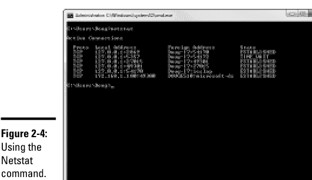

```
C:\Windows\system32>netstat

Proto  Local Address        Foreign Address      State
TCP    127.0.0.1:28869      127.0.0.1:54170      ESTABLISHED
TCP    127.0.0.1:53557      127.0.0.1:54172      TIME_WAIT
TCP    127.0.0.1:27015      127.0.0.1:49301      ESTABLISHED
TCP    127.0.0.1:46931      127.0.0.1:27015      ESTABLISHED
TCP    127.0.0.1:54170      127.0.0.1:28869      ESTABLISHED
TCP    192.168.1.100:49300   192.168.1.101:445     ESTABLISHED
```

事实上，你可以使用 `Netstat /N` 命令来查看数字网络地址而不是名称。使用 `/N` 选项后，图 2-4 中的输出将如下所示：

活动连接

| 协议 | 本地地址 | 外地地址 | 状态 |

|---|---|---|---||

| TCP | 127.0.0.1:28869 | 127.0.0.1:54170 | ESTABLISHED |

| TCP | 127.0.0.1:53557 | 127.0.0.1:54172 | TIME_WAIT |

| TCP | 127.0.0.1:27015 | 127.0.0.1:49301 | ESTABLISHED |

| TCP | 127.0.0.1:46931 | 127.0.0.1:27015 | ESTABLISHED |

| TCP | 127.0.0.1:54170 | 127.0.0.1:28869 | ESTABLISHED |

| TCP | 192.168.1.100:49300 | 192.168.1.101:445 | ESTABLISHED |

TCP 是面向连接的传输层协议。UDP 是无连接的传输层协议。

## 会话层

会话层在网络设备之间建立被称为“会话”（sessions）的对话。会话是两个网络设备之间面向连接的传输交换。这些传输均由传输层协议处理。设备本身由会话层协议管理。

单个会话可以包含涉及的两台计算机之间的多次数据交换。两台计算机之间的会话建立后，它将一直维持直到两台计算机同意终止会话。

会话层允许三种传输模式：

- 单工：在这种模式下，数据仅向一个方向流动。
- 半双工：在这种模式下，数据向两个方向流动，但一次只向一个方向流动。
- 全双工：在这种模式下，数据同时向两个方向流动。

在实践中，会话层、表示层和应用层之间的区别往往是的；某些常用的协议实际上跨越了这三层。例如，SMB —— Windows 网络文件共享的基础协议 —— 其功能跨越了所有层。

## 表示层

表示层负责数据如何向应用程序表示。大多数计算机——Windows、Unix 和 Macintosh 计算机——使用美国信息交换标准（ASCII）来表示数据。然而，某些计算机（如 IBM 主机）使用不同的代码，称为扩展编码制进制交换码（EBCDIC）。ASCII 和 EBCDIC 之间是不兼容的。为了在主机和 Windows 计算机之间交换信息，表示层必须将数据从 ASCII 转换为 EBCDIC，反之亦然。

除了将数据从一种代码转换为另一种之外，表示层还可以应用复杂的压缩技术，以便在通过网络发送时需要更少的数据字节来表示信息。在传输的另一端，表示层会对数据进行解压缩。

表示层也可以传输前对数据进行加密，并在另一端进行解密。

## 应用层

OSI 模型的最高层应用层处理软件应用程序用于与网络通信的接口。应用层为用户应用程序提供服务。应用层中常用的协议包括：

- DNS（域名系统）
- FTP（文件传输协议）
- SMTP（简单邮件传输协议）
- SMB（服务器消息块）
- NFS（网络文件系统）
- Telnet

## 以太网协议

### 36 以太网协议

- **10Base5:** 原始的以太网电缆非常粗（大约和你拇指一样厚）、很重且难以处理。如今只在博物馆中才能看到。
- **10Base2:** 这种较薄的同轴电缆（它）在 20 世纪 80 年代流行，并一直持续到 90 年代初。许多 10Base2 线仍在在使用，但在新网络中很少安装。10Base2（与 10Base5 一样）使用总线拓扑，通过从一个节点到另一个节点的布线来连接网络，直到计算机连接到一个网段中。
- **10BaseT:** 非屏蔽绞对电缆（也称为 UTP）在 20 世纪 90 代流行，因为它更容易安装、更轻、更可靠，并且为网络设计提供了更大的灵活性。10BaseT 网络使用星型拓扑，每个星形的中心都有集线器。虽然 10Base 的最大长度仅为 100 米，但可以将集线器连接起来，将网络扩展到远超 100 米的限制。

10BaseT 电缆有四对在整个电缆长度范围内绞在一起的线。然而，10BaseT 仅使用其中两根线，因此未使用的对线是备用的。

- **10BaseFl:** 10Base 标准最初支持 100 Mbps 的光纤缆。然而，由于现在存在更快的光纤以太网版本，10BaseFl 很少使用。

### 快速以太网

快速以太网是指运行速度为 100 Mbps 的以太网，是标准以太网速度的十倍。以下是快速以太网的三种类型：

- **100BaseT4:** 100BaseT4 允许通过与 10Base 网络相同的 UTP 线缆传输 100 Mbps 的速度。为了实现这一点，它使用了线中所有的四对线。100BaseT4 简化了将 10BaseT 网络升级到 100 Mbps 的任务。
- **100BaseTX:** 目前办公网络最常用的标准是 100BaseTX，它仅通过两对比 10Base 所用电缆等级更高的 UTP 线缆传输 100 Mbps。这种高级别的电缆被称为*五类*。大多数新网络都使用五类或更高级别的缆布线。
- **100BaseFX:** 运行速度为 100 Mbps 的光纤以太网被称为 100BaseFX。由于光纤价格且安装复杂，它不用于网络中的单个计算机。然而，它通常用作网络*骨干*。例如，光纤骨干经常用于连接各个工作组集线器到路由器和服务器。

## TCP/IP 协议族 37

## 以太网的传说与神话


如果你是一个喜欢图标、窗口和菜单（以及世界上第一台激光打印机）的历史爱好者。1979 年，施乐开始与英特尔和 DEC（一家曾经很流行的公司）合作，使以太网成为一种行业标准的网络产品。在此期间，他们请了 IEEE，IEEE 了 802.2 委员会并从 1981 年开始以太网的标准化进程。`802.3` 委员会在 1983 年发布了第一个官方以太网标准。与此同时，鲍勃·梅特卡菲离开了施乐，拒绝了史夫·乔布斯去苹果公司的邀请，并创立了一家名为 Computer, Communication, and Compatibility Corporation 的公司——现在被称为 `3Com`。`3Com` 已成为全球最大的以太网设备制造商之一。

# 书籍第 2 章 理解网络协议和标准

## 千兆以太网

千兆以太网的运行速度为 1,000 Mbps，比原始的 10 Mbps 以太网快 100 倍。千兆以太网曾比快速以太网贵得多，因此只有在性能提升证明成本合理时才使用。然而，今天千兆以太网是几乎所有桌面和笔记本 PC 的的标准。

千兆以太网可以用两种形式运行：

- `1000BaseT`: 千兆可以在五类 U 线上运行，但更倾向于使用高级别的，如五类e 或六类，因为它们更可靠。
- `1000BaseLX`: 千兆以太网使用多种光纤电缆，但最流行的是 `1000BaseLX`。

## TCP/IP 协议族

TCP/IP 是构建互联网的协议，它不是单一协议，而是一整套相关的协议。TCP 比以太网还要老。它最早由国防部在 1969 年构想出来。

### 38 TCP/IP 协议族

关于 TCP/IP 的历史，请参见本章稍后的侧边栏“TCP/IP 的迷人故事”。目前，互联网工程任务组（或 IETF）管理 TCP/IP 协议族。

TCP/IP 协议族基于一个四层网络模型，类似于七层 OSI 模型。图 2-7 显示了 TCP/IP 模型如何与 OSI 模型匹配，以及关键的 TCP/IP 协议位于模型的什么位置。正如你所看到的，模型的底层——网络接口层对应于 OSI 模型的物理层和数据链路层。TCP/IP 可以在各种网络接口层协议上运行，包括以太网以及其他协议，如令牌环和 FDDI（一种较旧的光纤网络标准）。

| OSI 层 | TCP/IP 层 |
| :--- | :--- |
| 应用层 会话层 表示表示层 |  |
| 传输层 | 传输层 | TCP | UDP |  |  |
| 网络层 | 网络层 |  |  |  |  |
| 数据链路层 物理层 | 网络接口层 | 以太网 | 令牌环 |  |

TCP/IP 模型的应用层对应于 OSI 模型的三个层——会话、表示和应用层。这一层可以使用许多协议，其中最流行的有 HTTP、FTP、Telnet、SMTP 和 SNMP。

IP，全称为网协议（Internet Protocol），是一种网络层协议，负责向网络传递数据包。IP 协议使用逻辑地址来引用设备，而不是物理 (MAC) 地址。一种名为 ARP（地址解析协议）的协议处理 IP 地址到 MAC 地址的转换。

### TCP/IP 协议族 39

## 10Base 是什么？

以太标准的名称类似于橄榄球运动员在阵线上可能发出的信号。实际上，电缆命名由三部分组成：

- 第一个数字是网络速度，单位是 Mbps。所以 `10Base` 是 10 Mbps（标准以太网），`100BaseTX`（快速以太网），`1000BaseT`（千兆以太网）。
- 尾部表示电缆类型。对于同轴电缆，一个数字大致表示电缆的最大长度。（`10Base` 可以运行 185 米。`100Base2` 可以运行 200 米。）如果命名以 T 结尾，则使用绞对电缆。其他字母用于其他类型的电缆。
- Base 字表示电缆使用的网络传输类型。Base 表示基带。基带传输可以同时携带多个信号，但实施较困难。曾经存在过 `802.x` 网络标准的宽带版本，但由于缺乏已经消失。

IP 地址由网络部分和主机部分组成，IP 是一种负责交付数据包的路由协议。因此，如果主机不在当前网络上，IP 可以将数据包转发另一个网络。（跨网络路由数据包是 IP 名称来源。互联网是由两个或多个 TCP/IP 网络组成的系列。）

# 40 TCP/IP 协议族

## TCP/IP 迷人的故事

有些人对历史非常着迷。他们为了看历史频道（History Channel）订阅了电缆电视。如果你对以下关于 TCP/IP 微起源的历史感兴趣，请继续阅读。（在阅读本侧边栏其余内容时，请在背景播放一些忧郁的小提琴音乐，以达到最佳效果。）

幸运的是，IP 设计者意识到，其他网络想要加入这场热闹的时间不会太长，因此他们设计的 IP 允许超过两个网络进行连接。事实上，他们巧妙的设计允许成千上万个网络通过 IP 进行通信。

1969 年夏天，来自利物浦的四位披士正在解散。越南战争正在升级。宇航员尼尔·阿姆斯特朗和巴兹·奥尔德林登上了月球。美国国防部建立了一个名为 ARPANET 的计算机网络，将其防御系统与全美各地的几所主要大学连接起来。

这个决定是非常幸运的，互联网很快开始增长。到 20 世纪 80 代，国家科学基金会（NSF）决定加入。NSF 为互联网构建了一个名为 NSFNET 的网络。NSF 取代了 ARPANET 成为新的骨干，《新闻周刊》等杂志开始编写关于被称为“互联网”的新现象的文章，随着它变成一个绰号，它像野火一样蔓延。NSF 无法跟上增长速度，因此几个私有网络接管了互联网骨干的管理。从那以后，互联网以惊人的速度增长，没有人知道这种疯狂的增长将持续多久。有一点是：TCP/IP 现在是世界上最流行的网络协议。

到 20 世纪 70 年代，ARPANET 变得难以管理。因此，它分为两个网络：一个用于军事用途（MILNET），另一个用于非军事。非军事网络保留了与 ARPANET 的连接。发明了一种连接网络的新方法，称为互联网协议（Internet Protocol），简称 IP。

IP 的全部目的是为了让这两个网络能够相互通信。

许多著名的应用程序层协议依赖于 TCP。例如，当运行 Web 浏览器的用户请求页面时，浏览器使用 HTTP 通过 TCP 向 Web 服务器发送请求。当服务器接收到请求，它再次通过 TCP 使用 HTTP 将 Web 页面传回浏览器。其他应用程序层协议还包括 Telnet（用于终端器仿真）、FTP（用于文件交换）和 SMTP（用于电子邮件）。

## UDP

用户数据报协议（UDP）是一种无连接的传输协议，用于不需要连接开销的场景。在 UDP 通过 IP 协议将数据包放置在网络上之后，它就忘记了该包。UDP 不保证数据包确实到达目的地。大多数使用 UDP 的应用程序简单地等待通过 UDP 发送数据包后预期的任何回复。如果回复没有在一定时间内到达，应用程序将重新发送数据包或放弃。

使用 UDP 最广为人知的应用程序层协议可能是 DNS，即域名系统（Domain Name System）。当应用程序需要访问如 `www.wiley.com` 的域名时，DNS 会向 DNS 服务器发送数据包以查找该域名。当服务器找到它时，它通过另一个 UDP 数据包返回该域名的 IP 地址。（实际上，这个过程比这复杂得多。欲了解更详细的解释，请参见第四卷第4章。）

## 其他值得关注的协议

除了以太网、TCP/IP 和 IPX/SPX 之外，其他网络也值得关注：

- `NetBIOS`：网络基本输入输出系统（Network Basic Input/Output System）的缩写，用于 Windows 计算机上的网络服务。当你使用 TCP/IP 时它会自动安装，但在查看网络连接属性时，它是一个不会显示的独立协议（参考图 2-1）。`NetBIOS` 是一种会话协议，可以与 TCP、SPX 或 NetBEUI 等传输层协议配合。
- `NetBEUI`：NetBIOS 扩展用户界面（NetBIOS Extended User Interface）的缩写，这是一种为 IBM 和微软网络设计的传输层协议。`NetBEUI` 现在被认为是过时的。
- `IPX/SPX`：一种在 20 世纪 80 代由 Novell 推行的协议族，用于其 NetWare 服务器。TCP/IP 变得如此主导，以至于 `IPX/SPX` 现在很少使用。
- `AppleTalk`：苹果计算机有一套名为 `AppleTalk` 的自己的网络协议。`AppleTalk` 包含一个名为 `LocalTalk` 的物理和数据链路协议，但也可以与标准的低层协议工作，包括以太网和令牌环（Token Ring）。
- `SNA`：系统网络架构（Systems Network Architecture）是 IBM 的一种网络架构，追溯到 20 世纪 70 年代，当时大型机主宰世界，而 PC 刚刚从原始汤中出现。`SNA` 设计初衷是为了支持如航空公司订位系统和银行系统这样巨大的终端，将成千上万的终端连接到中央主机计算机。现在大型机支持 TCP/IP 且终端系统已消失，`SNA` 开始衰落。尽管如此，许多包含大型机的网络不得不与 `SNA` 打交道。

# 第 3 章：理解网络硬件

### 本章

- 介绍服务器
- 使用网卡
- 熟悉电缆、网络集线器和交换机
- 探索中继器、网桥和路由器
- 理解网络存储

网络的构建模块是网络硬件设备，如服务器、适配卡、电缆、集线器、交换机、路由器等。本章提供了这些构建模块的概述。

## 服务器

服务器计算机是任何网络的命脉。服务器提供用户渴望的共享资源，如文件存储、电子邮件、打印机等。本章提供了这些构建模块的概述。

### 服务器的重要要素

在选择服务器时，需要记住以下通用通用点：

- **可扩展性（Scalability）**：可扩展性指的是在没有合理困难的情况下增加服务器规模和容量的能力。购买一个仅满足当前需求的服务器是一个巨大的错误，因为你可以确定你的需求会在一年内翻倍。如果可能，为你的服务器配备比你需要的更多的磁盘空间和处理器性能。
- **可靠性（Reliability）**：“一物一钱”的老话非常适用于服务器。为什么要买一台计算机，而你可以在折扣店花 2000 美元买到规格类似的计算机呢？当一台计算机出现故障时，受影响的只是使用该计算机的人。然而，当服务器故障时，网络上的所有人都会受到影响。便宜的可能由更容易故障的组件组成。
- **可用性（Availability）**：可用性概念与可靠性密切相关。当服务器故障时，需要多久才能修复问题并恢复服务器运行？服务器的设计使得组件可以被诊断和更换，从而减少了停机时间。在某些服务器中，组件是可以更换的，这意味着无需关闭服务器即可更换某些组件。某些服务器设计为容错，以便在某个主组件故障时继续运行。
- **服务与支持（Service and support）**：在选择服务器时，经常被忽视的是服务与支持。如果服务器中的计算机故障了，你是否有合格的人员来维修故障的计算机？如果没有，你应该应该获得一份现场维护合同？不要接受那种要求你将计算机带到维修店，或者更糟糕——邮寄到维修设施的合同。你无法没有服务器。

### 服务器的组件

构成典型服务器的硬件组件与用于廉价计算机的组件相似。由于前节描述的原因，服务器通常由等级更高的组件构建。以下段落描述了服务器的典型组件：

- **主板（Motherboard）**：主板是计算机的主电路板，你的所有其他组件都连接在上面。与任何其他组件相比，主板就是计算机。所有其他组件都连接在主板上。

## 服务器 45

主板上的主要组件包括处理器（或 CPU）、称为芯片组的支撑电路、内存、扩展插槽、标准的 IDE 硬盘控制器以及用于键盘、鼠标和打印机等设备的 I/O 端口。某些主板还包含内置功能，如显卡适配器、SCSI 磁盘控制器或网络接口。

书籍第 3 章

处理器：处理器或 CPU 是计算机的大脑。虽然处理器不是影响系统整体性能的唯一组件，但它是大多数人在决定购买何种类型的服务器时首先考虑的因素。在本文写作时，英特尔（Intel）有两种专门为服务器设计的处理器型号，如表 3-1 所示。（注：文中写的是“Titanium”，但根据表格上下文，暗示为“Itanium”安腾”）。

### 网络硬件

每块主板的设计都是为了支持特定类型的处理器。CPU 有两种基本的安装样式：插槽（slot）或插座（socket）。然而，你可以从多种类型的插槽和插座中选择，因此你必须确保主板支持 CPU 使用的特定插槽或插座样式。某些主板有两个或多个插槽或插座，以容纳两个或多个 CPU。

时钟频率（clock speed）一词是指基本时钟驱动处理器运行的速度快慢。理论上，频率越高，处理器就越快。然而，时钟频率仅在比较同一家族的处理器时才是可靠的。事实上，在相同频率下，安腾（Itanium）处理器比酷（Xeon）处理器更快。因为安腾处理器包含了比旧型号更先进的电路，它们在每个时钟脉冲内可以完成更多工作。

处理器核心数量对性能也有巨大影响。每个处理器核心都像一个独立的处理器一样工作。大多数服务器计算机使用双核（两个处理器核心）或四核（四个核心）芯片。

| 表 3-1 英特尔处理器 |
| 处理器 | 时钟频率 | 处理器核心 |
| --- | --- | --- |
| Itanium 9300 | 1.60-1.73GHz | 4 |
| Xeon | 1.83-3.4GHz | 2-6 |

- 内存：不要在内存上吝啬。人们很少抱怨服务器内存过大。有许多不同类型的内存可用，因此你必须选择正确的内存类型来匹配主板支持的内存。服务器的总内存容量取决于主板。大多数新服务器可以支持至少 16GB 内存，某些可以处理高达 256GB。
- 硬盘：大多数台式电脑使用廉价的 SATA 硬盘。这些硬盘对于个人用户来说足够了，但对于服务器，性能更重要，通常会使用另一种名为 SCSI 的驱动。为了获得最佳性能，请配合高性能 SCSI 控制卡使用 SCSI 硬盘。（但是，由于成本低廉，SATA 硬盘经常用于廉价的服务器。）
- 网络连接：网络连接是任何服务器的重要部分之一。许多服务器在主板上内置了网络适配器。如果你的服务器没有配备此类设备，你需要添加单独的网络适配器卡。更多信息请参见该章的“网卡”章节。
- 视频：服务器计算机并不需要华丽的图形处理。你可以为服务器配备廉价的通用显卡和显示器，而不会影响网络性能。（这是服务器上可以接受偷工的少数领域之一。）
- 电源：由于服务器通常具有典型台式计算机的配置，它需要更大的电源（通常为 300 瓦）。如果服务器容纳了大量硬盘，它可能需要额外的电源。

## 服务器形式因子

因子（factor）一词指的是硬件设备的尺寸、形状和封装。服务器计算机通常有三种形式因子之一：

- 塔式机箱（Tower case）：大多数服务器装在传统的塔式机箱中，类似于台式电脑使用的塔式机。典型的塔式机箱高 18 英寸、深 20 英寸、宽 9 英寸，内部有空间放置主板、五个或更多硬盘以及其他组件。塔式机带有内置电源。

某些服务器机箱包含专为服务器设计的先进功能，例如冗余电源（这样当一个电源故障时，服务器可以继续运行）、热插拔风扇和热插拔硬盘槽。（热插拔组件可以在关闭服务器电源的情况下更换。）

- 机架式（Rack mount）：如果你只有几台服务器，使用机箱就可以了。你只需要将服务器并排放在桌子上，或者放在专门为容纳服务器设计的机柜中。然而，如果你需要更多服务器，空间可能会变成一个问题。例如，如果你的部门网络需要一组十台服务器，你需要一张相当长的桌子。

机架式服务器的设计是为了在有限的空间内需要多于几台服务器时节省空间。机架式服务器装在一个小机箱内，设计用于放入标准的 19 英寸设备机架。机架允许你垂直堆叠服务器以节省空间。

- 刀片服务器（Blade servers）：旨在比机架式服务器节省更多的空间。刀片服务器是单卡上的服务器，可以与其他刀片服务器一起安装在机箱中，机箱本身可以放入标准的 19 英寸设备机架。典型的刀片机箱容纳六或更多服务器，取决于制造商。

刀片服务器的一个主要优势是你不需要为每台服务器提供独立的电源。此外，刀片柜提供了机架式电源，可以为安装在单个机架上的多个刀片柜服务。


此外，刀片柜提供了 KVM 切换，这样你就不需要使用单独的 KVM 切换器。

## 网络电缆 49

在现有网络中，你可能会遇到其他类型的电缆：类似于电视电缆的同轴电缆、曾是以太网唯一使用的电缆的黄色黄色电缆、跨越远距离高速传输的光纤束，或者在大楼机房内承载多组双绞线线的双绞线束。但正如我提到的，双绞电缆适用于几乎所有的新网络。

## 第一卷

第 3 章

### 提示

一种日益流行的选择是放弃网络电缆，转而使用无线网络组件构建你的网络。由于第五卷专门介绍无线网络，因此我在此章中不介绍无线网络组件。

### 理解网络硬件

## 同轴电缆

曾经在以太网中流行的一种电缆是同轴电缆，由于电缆两端使用的连接器类型，有时被称为细轴（thinnet）或 BNC 电缆。细轴的工作速度仅为 10 Mbps，很少用于新网络。然而，你会发现许多现有的细轴网络仍在在使用。图 3-1 显示了典型的同轴电缆。

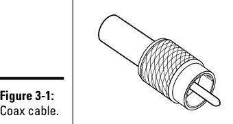

关于同轴电缆有一些要点：

- 你通过一种名为 BNC 连接器的特殊扭入连接器将细轴连接到网络接口卡上。你可以购买预装好的、带有 BNC 连接器的长度为 25 或 50 英制的电缆，也可以在大线轴上购买散装电缆并使用特殊工具自行连接连接器。（我建议购买预装电缆。在散料上连接连接器可能会很麻烦）。

- 使用同轴电缆时，你以总线拓扑结构点对点连接计算机。在每台计算机处，使用一个 T 型连接器将两根电缆连接到网络接口卡。

- 每系列细轴电缆的末端都需要一个称为终端器（terminator）的特殊插头。终端器防止数据从电缆末端泄漏到地毯中。

## 网络电缆

- 从一个终端器到另一个终端器端尾相接电缆统称为段（segment）。细轴段的最大长度约为 200 米（实际上为 185 米）。一个段上最多可以连接 30 台计算机。要跨越超过 185 米的距离或连接超过 30 台计算机，可以使用两个或多个段，并使用名为重复器（repeater）的设备连接每个段。

- 虽然以太网电缆类似于电视同轴电缆，但电缆类型不可互换的。不要尝试用廉价的电视电缆布你的网络来节省成本。

## 双绞线

今天最流行的电缆类型是双绞线，或称 UTP。（U 代表非屏蔽，但没人说“屏蔽双绞线”）。UTP 电缆比细同轴电缆便宜，最棒，许多现代建筑已经布设了双绞线，因为这种布线方式用于现代电话系统。

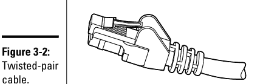

当你使用 UTP 电缆构建以太网网络时，你以星型布局连接计算机。星形的中心是一个称为集线器（hub）的设备。根据型号的不同，以太网集线器允许你使用双绞线连接 4 到 24 台计算机。

UTP 星型布局的优势是，如果一根电缆损坏，只有连接到该电缆的计算机会受到影响；网络的其余继续运行。使用同轴电缆时，一的电缆会影响整个网络工作，而不仅仅是连接故障电缆的那台计算机。

以下是关于双绞线布线你应该了解的其他细节：

- UTP 电缆由对对扭绕在一起的细线组成；这些线对汇集在外层绝缘护套内部。以太网使用两对线，总共四根线。UTP 电缆中的线对数量不同，但多于两对。

- UTP 电缆有各种称为类别（Categories）的等级。不要为你的网络使用低于 Category 5e 的任何产品。虽然更便宜，但它可能不支持更的网络。

## 交换机 51

虽然更高类别的电缆比低类别的电缆贵，但安装以太网布线的真实成本是穿过墙壁拉电缆的人工。因此，我建议你总是花额外的钱购买第 5 类电缆。

- 如果你想听起来像个内内人，说 "Cat 5e" 而不是 "Category 5e"。

- 许多现有网络使用第 5 类电缆布线，这对于 100Mbps 网络是可以的，但未针对千兆网络评级。Category 5e（e 代表增强）和 Category 6 将支持 1000 Mbps 网络。


- UTP 电缆看起来像模块化电话连接器，但大一点。UTP 连接器正式称为 RJ-45 连接器。

- 与细轴电缆一样，UTP 也以预制长度出售。然而，与 BNC 连接器连接散装同轴电缆相比，RJ-45 连接器更容易连接到散装 UTP 电缆。除非你的网络只有一两台计算机，否则我建议购买散装电缆和连接器。一个基本的压线工具花费 50 美元。

- 集线器和交换机之间的最大允许长度为 100 米。

集线器和交换机之间最大的区别是，使用交换机时你可以更容易添加计算机。几年前，使用交换机是因为它们昂贵。然而，交换机的成本下降得如此快，导致集线器过时。如果你使用集线器的旧网络运行缓慢，你可以通过将集线器更换为交换机来提高网络速度。更多信息请参见本章侧边的“集线器与交换机揭秘”。

## 交换机 52

### 集线器与交换机揭秘

集线器和交换机都允许你通过双绞线连接多个计算机。交换机比集线器更高效，因为它们更快。如果你真的想知道，这是集线器和交换机的实际区别：

- 在集线器中，从任何端口接收的数据包都会自动发送到所有其他端口。集线器这样做是因为它是物理设备，因此无法跟踪每个端口连接的是哪个计算机。例如，安妮的计算机连接到八口端口 5，约翰的计算机向安妮发送一个数据包，集线器在端口 1 接收并将其发送到端口 2-8。

- 交换机是链路设备，这意味着它能够查看通过的数据包以检查关键的链路信息：MAC 地址。通过这种信息，交换机可以跟踪每个端口连接的是哪个计算机。这个过程不仅更快，而且提高了系统的安全性，因为其他计算机看不到不属于它们的数据包。

如果你使用双绞线布线，你需要了解使用集线器的一些技巧：

- 因为你必须从每台计算机引一根电缆到交换机，请为交换机找到一个方便布线缆的中心位置。

- 交换机需要电源，确保附近有一个插座。

- 购买交换机时，购买一个连接数至少是你需求倍的。如果你想连接四台计算机，不要买四口交换机，因为当（而不是如果）你增加第五台计算机时，你必须购买另一个交换机。

- 你可以将交换机相互连接，如图 3-3 所示：这被称为链联。当你链联交换机时，将电缆的一端连接到一个交换机的端口，另一端连接到另一个交换机的端口。注意，在某些交换机上，你可能会使用指定的端口进行链联。因此，请务必阅读随交换机附带的说明书以确保正确链联。

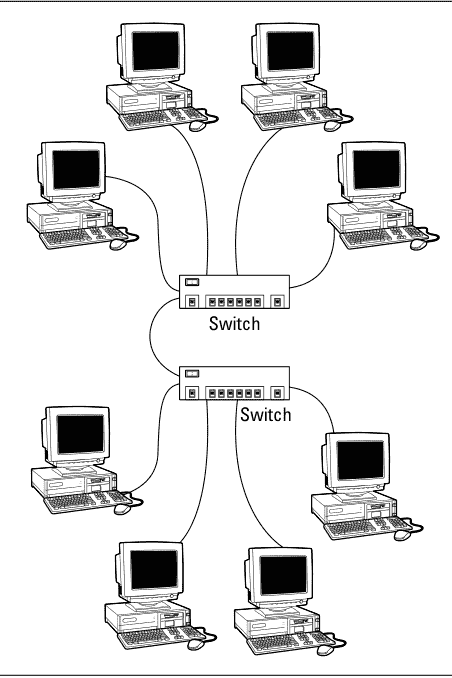

图 3-3：将交换机级联在一起。

- 你最多可以将三台交换机级联在一起。如果你拥有的电脑数量超过了三个集线器能容纳的数量，请不要慌。只需多花一点费用，你就可以购买背面带有 BNC 连接的集线器。然后你就可以使用细电缆（thinnet cable）将集线器串联起来。当使用细电缆连接集线器时，不受三个集线器的限制。你也可以获得可堆叠交换机，它们具有高速直接连接功能，可以将两个或多个交换机视为单个交换机。

- 在购买网络集线器时，你可能需要注意到昂贵的集线器具有支持称为 SNMP 的网络管理功能。这些集线器被称为管理集线器。除非你的网络非常大且你了解 SNMP，否则不要费力购买更昂贵的管理集线器。你将是在为你你可能永远用不到的功能买单。

## 54 中继器

- 对于大型网络，你可能想要考虑使用管理型交换机。

管理型交换机允许你从远程计算机监控并控制交换机操作的各个方面。当网络出现问题时，交换机可以为你报警，它可以保存性能统计数据，以便你确定网络中哪些部分被频繁使用，哪些部分没有。管理型交换机的成本是非管理型交换机的两到三倍，但对于较大的网络，管理型交换器的优势值得这额外的成本。

## 中继器

中继器（有时称为扩展器）是一种可以增强你的网络信号的妙用，使信号可以传输得更远。它就像是马拉松中的运动饮料补给站。当信号通过中继器时，它们会接上一杯运动饮料，喝一口，把剩下的洒在自己头上，扔掉杯子，并在确定没人在看时跳上出租车。

当单段网络电缆的长度超过 100 米（328 英尺）时，你需要一个中继器。100 米的限制适用于连接交换机与交换机之间的电缆，或者当交换机级联时连接交换机与其他设备之间的电缆。换句话说，你可以使用不超过 100 米电缆将每台电脑连接到交换机，也可以使用不超过 100 米电缆将交换机相互连接。

图 3-4 显示了你如何使用中继器连接两组距离太远而无法位于同一段的电脑。当你使用像这样的中继器时，中继器将电缆分为两段。电缆长度限制仍然适用于中继器两侧的电缆。

当你彻夜未眠思考中继器时，这里有几点可以考虑：

- 中继器通常不用于双绞网络。

- 嗯，事实并非如此，因为交换机本身就充当了中继器。所以我真正的意思是，只有当单段长度超过 100 米时，你通常才会看到中继器作为独立设备。

- 以太网生存的一个基本规则是，信号从一个节点到另一个节点的途中可以经过三个中继器。这并不意味着你不能拥有三个以上的中继器或交换机，但如果是这样，你就必须仔细规划网络布线，以防违反三中继器规则。

## 桥器

- 中继器是正规以太网网络的合法组成部分。它们并不会扩展单段的最大长度；它们只是让你将两个段连接在一起。小心那些声称可以将 10/100BaseT 电缆的段限制超出标准 100 米限制的小黑盒子。这些产品通常有效，但按照规则行事更好。

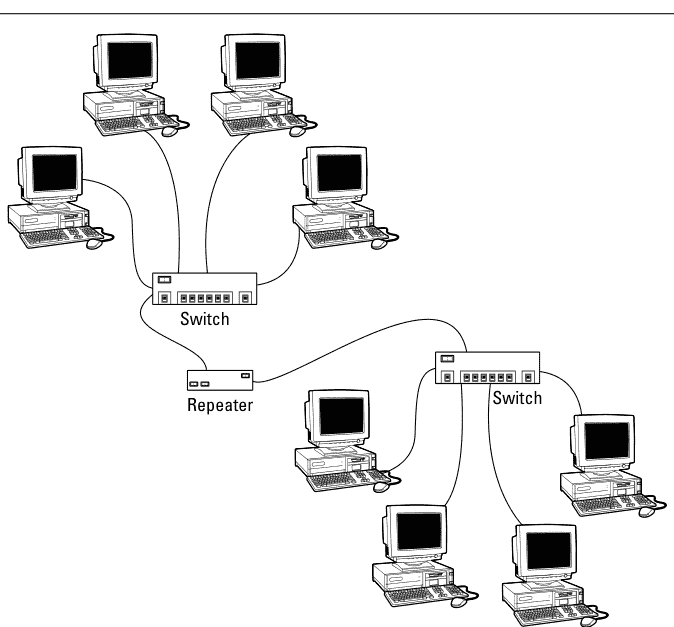

图 3-4：使用中继器。

## 桥器

桥器是连接两个网络的设备，使它们表现就像一个网络。出于性能考虑，桥器用于将一个大网络划分为两个较小的网络。你可以把桥器认为是一种智能中继器。

## 桥器 中继器监听来自一条网络电缆的信号，将其放大并发送到另一条电缆上。它们盲目地这样做，不注意它们所重复的消息内容。

相比之下，桥器对传来的消息要聪明一点。首先，大多数桥器都具有监听网络并自动识别桥器两端每台电脑地址的能力。桥器可以检查来自桥器一侧的每条消息，并将其广播到桥器的另一侧，但前提是该消息是发送给另一侧电脑的。

这一关键特性使得桥器能够将大网络划分为两个更小、更高效的网络。桥器工作在高度隔离的网络中。例如（听我的——我是苏斯·盖尔的粉丝），假设史尼奇星（Sneetches）连接了它们所有的电脑，并发现，虽然相信星星的史尼奇星电脑之间频繁交流，相信平地的史尼奇星电脑之间也频繁交流，但相信星星的史尼奇星电脑与相信平地的史尼奇星电脑之间很少交流。

桥器可以将史尼奇星划分为两个网络：相信星星的网络和相信平地的网络。桥器会自动学习哪些电脑位于相信星星的网络，哪些电脑位于相信平地的网络。桥器将消息从相信星星的网络转发到相信平地的网络（反之亦然），仅在需要时如此。两个网络的整体性能得到了提高。

关于桥器有几点需要考虑：


有些桥器具有将格式转换为另一种格式的能力。例如，如果相信星星的史尼奇星使用以太网而相信平地的史尼奇星使用令牌环，桥器可以将它们连接起来。

你可以通过邮购供应商购买 500 美元的基础桥器。更复杂的桥器可能花费 5000 美元。

对于简单的桥器应用，你不需要昂贵的桥器设备；相反可以使用交换机。因为交换机实际上是多端口桥器。

如果你从未读过苏斯·盖尔关于史尼奇的经典故事，你应该读读。

## 路由器

路由器类似于桥器，但有一个关键区别。桥器是数据链路层设备，它们告知发送消息的网络节点的 MAC 地址，并将消息转发到相应的段。然而，它们无法查看消息本身以查看的是什么类型的信息。相比之下，路由器是网络层设备，因此它可以在更高层次处理数据包。特别是，路由器可以检查通过它的数据的 IP 地址。由于 IP 地址包含网络地址和主机地址，路由器可以确定消息来自哪里以及去哪里。桥器忽略这些信息。

桥器和路由器的一个关键区别在于，桥器本质上是网络上的节点，拥有自己的 MAC 和 IP 地址。这意味着消息可以指向路由器，然后路由器可以检查消息的内容来决定如何处理消息。

你可以为网络配置多个路由器，它们可以共同工作。例如，某些路由器能够监控网络，以确定发送消息到最终目的的最有效路径。如果网络的某部分非常繁忙，路由器可以自动将消息沿较不繁忙的路线路由。在这方面，路由器就像直升机上的交通播报员。

这里是关于路由器的额外信息：

- 桥器和路由器之间的功能区别——以及交换机和集线器之间的区别变得越来越模糊。随着桥器、集线器和交换机变得越来越复杂，它们能够承担一些以前需要路由器完成的任务，使许多路由器失业了。
- 一些路由器仅仅是带有多个网络接口卡和执行路由器功能的软件的计算机。
- 路由器可以通过电话线（使用调制解调器）或 ISDN 连接地理位置远程的网络。
- 你可以使用路由器将你的局域网连接到互联网。图 3-5 显示了用于此目的的路由器。

## 网络附加存储 (NAS)

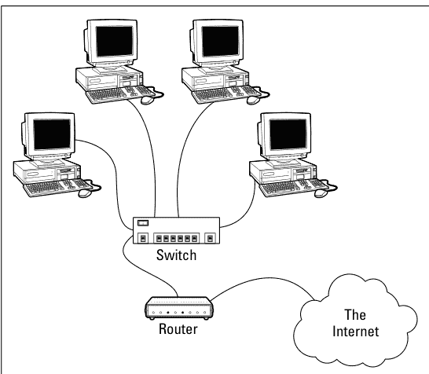

**图 3-5:** 使用路由器连接互联网。

许多网络服务器的存在仅仅是为了向网络用户提供磁盘空间。随着网络扩大以支持更多用户，以及用户对磁盘空间的需求增加，网络管理员不断寻找方法为他们的网络添加更多存储空间。其中一种方法是增加更多的文件服务器。然而，更简单且更便宜的方法是使用*网络附加存储*，也称为 NAS。

> NAS 设备是一个自包含的文件服务器，经过预先配置并已就绪运行。你只需要做的就是从箱子里取出它，插上电源并开机。NAS 设备易于安装、配置和维护，并且比传统的文件服务器更便宜。

不应将 NAS 与一种相关技术*存储区域网络*（或 SAN）混淆。SAN 是一种复杂得多且昂贵的技术，可为大型网络提供海量数据存储。有关 SAN 的更多信息，请参阅侧边栏。“SAN 是 NAS 倒过来写。”

典型的入门级 NAS 是 Dell PowerVault NX300。该设备是一个内置在小型架式机箱内的自包含文件服务器。它支持多达四块硬盘，总容量高达四TB（或 4,000GB）。NX300 使用 Xeon 处理器和两个内置的千兆网口。

Dell NX300 运行特殊版本的 Windows Server 2008，称为 Windows Storage Server 2008。此版本的 Windows 专门为 NAS 设备设计。它允许你通过 Web 浏览器从网络上的任何计算机配置网络存储。

请注意，某些 NAS 设备使用自定义版本的 Linux 而非 Windows Storage Server。此外，在某些系统中，操作系统位于在一个与共享磁盘隔离的独立硬盘上。这可以防止用户意外损坏操作系统。

### SAN 是 NAS 倒过来写

混淆存储区域网络（SAN）和网络附加存储（NAS）很容易的。两者都指的是较新的技术，允许你管理网络上的磁盘存储。然而，NAS 是一种简单得多且更廉价的技术。NAS 设备仅仅是一个廉价的自包含文件服务器。使用 NAS 设备实际上简化了为网络添加存储的任务，因为 NAS 消除了为常规文件共享任务配置操作系统的需求。

存储区域网络设计用于管理极大量的存储——有时是海量的。一个 SAN 由三个部分组成：存储设备（可能有几百个）、一个独立的高速网络（通常是光纤），它直接将存储设备相互连接，以及一个或多个将 SAN 连接到本地网络的 NAS 服务器。SAN 服务器管理连接到 SAN 的存储设备，并允许用户访问存储。

设置和管理存储网络是 SAN 专家的工作。有关存储区域区域的更多信息，请访问存储网络行业协会（SNIA）的主页：www.snia.org。

## 网络打印机

虽然你可以通过将打印机连接到服务器计算机来共享网络打印机，但许多打印机内置了网络接口。这允许你将打印机直接连接到网络。网络用户可以连接到打印机，并通过服务器使用它。

即使你将打印机直接连接到网络，让由运行网络操作系统（如 Windows Server 2003 或 2007）的服务器计算机管理打印机仍然是一个好主意。这样，服务器就可以存储多个用户发送到打印机的打印作业，并按照接收顺序打印作业。

# 第 4 章：理解网络操作系统

### 本章内容

- 理解网络操作系统的作用
- 弄清楚 Windows Server 2003 的优势
- 分析 Windows 2000 Server
- 观察 Windows NT Server
- 导航 NetWare
- 深入研究对等网络
- 探索其他网络操作系统

在继续之前，你必须做出的基础选择之一是决定使用哪种网络操作系统（NOS）作为你网络的基础。本章从描述在所有网络操作系统中发现的重要特征开始。接下来，它概述了最流行的网络操作系统的优缺点。

# 网络操作系统特性

从简单到最复杂的，所有的网络操作系统都提供某些核心功能。这些包括连接到网络上的其他计算机、共享文件和其他资源、提供安全保障等。在接下来的章节中，我将用通用术语描述其中一些核心 NOS 特性。

### 网络支持

不言而喻，网络操作系统应该支持网络。（我可以想象迈克·迈尔斯在《周六夜现场秀》中经典角色——《咖啡时间》节目主持人 Linda Richman 说道：“我有点紧张了……你们自己之间聊聊吧……我给你们一个话题——网络操作系统不组成网络，也不运行。讨论一下。”）

网络操作系统必须支持各种网络协议，以满足其用户的需求。因为一个大型网络通常由各种版本的 Windows，以及少数散落的 Macintosh（主要在艺术部门）和可能还有一些 Linux 计算机混合组成。这些计算机通常具有不同的协议。

许多服务器安装了多个网络网卡。在这种情况下，NOS 必须能够支持多个网络连接。理想情况下，NOS 应该能够在其网络接口之间平衡网络负载。此外，在其中一个连接故障时，NOS 应该无缝切换到另一个连接。

最后，大多数网络操作系统都包含（能够处理多个连接的功能）。

### 文件共享服务

网络操作系统的最重要的功能之一是允许在网络上共享资源。

### 多任务处理

只有当用户在网络时，多任务才允许。通过网络访问服务器。

多用户系统的核心是**多任务处理**，它是操作系统在同一时间执行多个程序——被称为任务或进程的能力。多任务操作系统就像那个以前转盘子的人：他会在盘子和盘子之间奔跑，努力让它们旋转，不至于掉下来。为了让这变得具有挑战性，他会在单轮车上平衡。

尽管多任务创建了多个程序在计算机上执行的假象，但实际上，单处理器计算机一次只能执行一个程序。操作系统将 CPU 从一个程序切换到另一个程序，以创建多个程序正在执行的假象，而在任何时刻只有一个程序在实际执行（如果计算机有多个 CPU，CPU 可以同时执行程序）。

要在 Windows 计算机上查看多任务的操作，按 `Ctrl+Alt+Delete` 调出任务管理器并点击任务选项卡。所有正在运行的任务。

为了让多任务能够可靠地工作，网络操作系统必须完全隔离执行中的程序。否则，一个程序可能会执行影响另一个程序的操作。多任务操作系统通过为每个任务提供其独立的地址空间来实现这一点，使得一个任务几乎不可能影响属于另一个任务的内存。

在大多数情况下，每个程序在分配给任务的内存地址空间内作为单个任务执行。这种技术通常允许网络用户将其拆分成几个任务。程序的任务被称为线程。

多任务处理的两种方法是抢占式的非抢占式的。在抢占式多任务中，操作系统 决定每个任务可以执行多久，然后它让位以便其他任务执行。当一个任务的时间到时，操作系统的 任务会中断该任务并切换到队列中的下一个任务。今天广泛使用的网络操作系统都使用抢占式多任务。

抢占式多任务的替代方案是非抢占式多任务。在非抢占式多任务中，每个获得 CPU 控制权的任务都被允许运行，直到它自愿放弃控制权以便其他任务运行。非抢占式多任务需要的开销更小，因为操作系统不需要跟踪每个任务运行了多久。然而，程序必须经过仔细编写，以免它们独占整个计算机。

# 网络操作系统特性

## 目录服务

目录服务无处不在。当你需要打电话时，你会在电话查找录中查询号码。当你需要寻找客户的地址时，你会在通讯录（Rolodex）中查找他的或她的名字。而当你需要在购物中心寻找 Sam Goody 店时，你会寻找商场的目录。

网络也有目录。网络目录提供了关于网络上可用资源的信息，例如用户、计算机、打印机、共享文件夹和文件。目录是任何网络操作系统不可或缺的一部分。

在早期的网络操作系统中，例如 Windows NT 3.1 和 NetWare 3.x，每台服务器都维护着一个关于该服务器可用资源的独立目录数据库。这种方法的问题之处在于，网络管理员必须单独维护每个目录数据库。对于只有几台服务器的网络来说，这并不糟糕，但在拥有几十台甚至上百台服务器的网络上维护目录几乎是不可能完成。

此外，早期的目录服务是针对特定应用的。例如，一个服务器会有一个用于登录算法的目录数据库，另一个用于文件共享，再有一个用于电子邮件地址。每个目录都有自己用于更新和删除目录条目的工具。

现代网络——特别是基于 Windows 服务器的网络——使用一种名为 Active Directory（活动目录）的目录。Active Directory 本质上是一个组织网络信息的数据库，允许用户和计算机获得访问网络资源的权限。对于只有几十台计算机和用户的小型网络，Active Directory 的使用非常简单；但对于对于包含数千台计算机的大型网络，它的功能又足够强大。

## 安全服务

所有网络操作系统必须提供某种安全措施，以保护网络免受未经授权的访问。黑客攻击似乎是现在的消遣方式。随着大多数计算机网络连接到互联网，世界上任何地方的任何人可能都可以尝试侵入你的网络。

最基本的安全类型通过用户账户处理，用户账户赋予个人访问网络资源的权利，并管理每个用户可以访问哪些资源。用户账户通过密码受到保护；因此，良好的密码策略是任何安全系统的基石。大多数网络操作系统都允许你建立密码策略，例如要求密码具有最小长度并包含字母和数字的混合。此外，可以将密码设置为若干天后过期，以便强制用户频繁更改密码。

大多数网络操作系统还提供数据加密（在数据通过网络发送或保存到磁盘之前对其进行加密乱码）以及数字证书（用于确保用户知道自己的身份，以及哪些文件确实如其声称的那样）。

## 微软服务器操作系统

多年来，微软发布了多个版本的基于 Windows 的操作系统：Windows NT Server 4、Windows 2000 Server、Windows Server 2003，而 Windows Server 2008 是最新版本，但因为它相对较新，许多组织仍在使用 Windows Server 2003。事实上，有些仍在使用 Windows 2000 Server，可能可能还有几个（大多在与文明隔绝的荒岛岛上）运行着 Windows NT Server 4。

按照发布顺序讨论这些操作系统是有用的，因为每个新版本都通过引入新颖且改进的功能来替换之前的版本。然而，在阅读以下章节时，请记住 Windows NT Server 4 和 Windows 2000 Server 被认为已经过时，而 Windows Server 2003 将在短短几年后过时。

## NTFS 驱动器

Windows 的所有服务器版本都对硬盘使用特殊的格式类型，这与自 20 世纪 80 年代初以来 MS-DOS 使用的标准 FAT 系统不同。（FAT 代表文件分配表，如果你感兴趣的话。）新系统 NTFS（代表文件系统）相比 FAT 驱动器具有许多优势：

- NTFS 驱动器提供了比 FAT 驱动器更好的安全功能。NTFS 在每个文件和目录上存储安全信息。相比之下，FAT 只有基础的安全功能。
- NTFS 使用硬盘空间的效率更高。结果是，NTFS 在给定的硬盘上可以比 FAT 挤纳更多数据。
- NTFS 驱动器更可靠，因为 NTFS 会保留重要信息（例如硬盘的位置）的重复副本。在 NTFS 驱动器上，Windows NT Server 可能可以在不丢失任何数据的情况下修复问题。相比之下，FAT 驱动器很容易丢失信息。

## Windows 2000 Server

Windows 2000 Server 在 Windows NT Server 4 的优势基础上构建，通过增加新功能，使得 Windows 2000 Server 对于大型和小型网络都更快、更易管理、更可靠且更易使用。

Windows 2000 提供的最显著的新功能称为 Active Directory，它提供了所有网络资源的单一目录，并允许程序开发人员将目录集成到他们的程序中。Active Directory 放弃了 15 个字符的域和计算机名称，转而采用互联网风格的 DNS 名称，例如 Marketing.MyCompany.com 或 Sales.YourCompany.com。（然而，它也为不处理 DNS 名称的旧客户端支持旧式名称。）

Windows 2000 Server 有三个版本：

- **Windows 2000 Server** 是基础服务器，专为中小型网络设计。它包含了所有的基础服务器功能，包括文件和打印机共享，并作为 Web 和电子邮件服务器运行。
- **Windows 2000 Advanced Server** 是更高级的版本，专为更大的网络设计。Advanced Server 可以支持拥有高达 8GB 内存（不是硬盘——是 RAM！）和四个集成处理器的服务器，而不是桌面电脑和大多数计算机所拥有的单处理器。
- **Windows 2000 Datacenter Server** 支持多达 32 个处理器和高达 64GB 内存的服务器，专为大型数据库设计。

对于拥有 50 台或以下计算机的小网络，微软提供了一个名为 Small Business Server 的特殊组合，其中包含以下组件：

- **Windows Server 2003**: 网络操作系统。
- **Exchange Server 2003**: 用于电子邮件和即时消息。
- **SQL Server 2000**: 数据库服务器。
- **FrontPage 2000**: 用于构建网站。
- **Outlook 2000**: 用于读取电子邮件。

## Windows Server 2003

下一个 Windows 服务器版本是 Windows Server 2003。Windows Server 2003 构建在 Windows 2000 Server 的基础上，增加了：

- 一个新版本的 Active Directory，具有更强的安全性、更易用的界面和更好的性能。
- 一个更好更易用的系统管理界面，称为 My Server。另一方面，对于偏好命令行的用户，Windows Server 2003 提供了比 Windows 2000 更完整的命令行工具。当然，Windows 2000 熟悉的控制台工具仍然存在。
- Windows 应用程序编程框架 .NET Framework。
- 支持更大的集群。集群是一组像单一服务器一样工作的计算机。Windows 2000 Server Datacenter 版本及之前的版本支持四节点集群；Windows Server 2003 Enterprise 和 Datacenter 版本支持八节点集群。（显然，这是非常大型网络的福利。我们其他人只需微笑说：“真酷！”！）
- 增强的分布式文件系统，允许你将服务器上的驱动器合并为一个共享卷。
- 内置防火墙，以保护你的互联网连接。
- 微软服务器的新版本 Internet 信息服务 (IIS) 6.0。

与它的前身一样，Windows 2003 有多个版本。具体来说四个：

- **Windows Server 2003, Standard Edition**: 这是 Windows 2003 的基础版本。如果你将 Windows Server 2003 用文件服务器或提供其他基础网络服务，这就是你使用的版本。标准版可以支持多达四个处理器和 4GB 内存的服务器。
- **Windows Server 2003, Web Edition**: 为 Web 服务器优化的 Windows 版本。
- **Windows Server 2003, Enterprise Edition**: 专为更大的网络设计，该版本可以支持多达八个处理器、32GB 内存、集群以及为高性能和高可靠性设计的高级功能。
- **Windows Server 2003, Datacenter Edition**: Windows 2003 最强大的版本，支持拥有 64 个处理器、64GB 内存和集群的服务器，以及为保持关键任务应用程序运行而设计的先进容错功能。

## 68 其他服务器操作系统

## Windows Server 2008

2008年2月，微软终于发布了 Windows Server 2003 的继任者，不出所意料地被称为 Windows Server 2008。Windows Server 2008 在 Windows Server 2003 的基础上增加了许多新功能，包括：


- 对活动目录（Active Directory）的进一步增强，包括管理数字证书的能力、一种新类型的域控制器（只读域控制器），以及在不关机整个服务器的情况下停止和重启活动目录服务的能力。
- 基于 Windows Vista 的全新图形化用户界面，包括一个名为服务器管理器（Server Manager）的新型一体管理工具。
- 一个名为 Server Core 的新操作系统版本，它没有图形化用户界面。Server Core 完全通过命令行或通过微软管理控制连接到服务器的远程计算机运行。Server Core 旨在提供高效的服务器、域控制器或 DNS 和 DHCP 服务器。
- 远程连接增强允许客户使用 HTTPS 协议与服务器建立 Web 连接，而无需建立虚拟专用网络（VPN）连接。
- 另一个版本的 Internet 信息服务（IIS）Web 服务器（7.0）。

## Windows Server 2008 R2

2009年秋季，微软发布了 Windows Server 2008 的更新，正式名称为 Windows Server 2008 R2。全世界的网络管理员都欢呼鼓舞，因为他们中的大多数都是《星球大战》粉丝，现在可以将他们喜爱的操作系统称为“R2”了。

R2 在 Windows Server 2008 的基础上增加了多种新功能，包括允许在单台服务器计算机上运行多个操作系统实例的虚拟化功能、新版本的 IIS (7.5) 以及支持高达 256 个核心。

此外，R2 正式取消了对 32 位处理器的支持。换句话说，R2 仅运行在64 位服务器处理器上，如安腾（Itanium）和至强（Xeon）。

## 其他服务器操作系统

尽管 Windows Server 是网络操作系统最流行的选择，但它并不是唯一的选择。以下章节描述了另外三个服务器选择：Linux、Mac OS OS/X Server 和 Novell 的 NetWare。

## Linux

也许今天可用的最有趣的操作系统莫过于 Linux。Linux 是一种基于 Unix 的免费操作系统，Unix 是一种经常用于大型网络的强大操作系统。Linux 由林纳斯·托瓦兹（Linus Torvalds）发创立，他认为在空闲时间作为一个爱好编写一个版本的 Unix 是很有趣的。他招募了全球数百名程序员，他们通过互联网自愿投入时间和精力。Linux 是全功能版本的 Unix；它的用户认为它与 Windows 相当甚至更好。

Linux 提供了与 Unix 相同的网络优势，可以作为服务器操作系统的优秀选择。

## Apple Mac OSX Server

我在本章描述的所有其他操作系统都运行在带有奔腾或兼容奔腾处理器的 Intel 基 PC 上。但 Macintosh 电脑呢？毕竟，Macintosh 用户也需要网络。对于 Macintosh 网络，它被称为 Mac OS/X Server。Mac OS/X Server 拥有你对服务器操作系统所预期的所有功能：文件和打印机共享、Internet 功能等。

## Novell NetWare

NetWare 曾是网络操作系统的之王。今天，NetWare 网络已经罕见，但如果你找得足够仔细仍然可以找到它们。NetWare 在可靠性方面一直享有极盛誉。事实上，一些网络管理员发誓他们网络中的 NetWare 服务器已经持续运行而从未重启过，正如罗纳德·里根（Ronald Reagan）所证明的那样。（遗憾的是，自乔治·布什首任以来，NetWare 就没有过重大升级。）

Novell 在 1983 年发布了 NetWare 的第一个版本，比 Windows 第一版早两年，比微软基于已不存在的 LAN Manager 的第一个网络操作系统早四年。多年来，NetWare 经历了许多版本。最重要的版本包括：

- NetWare 3.x：让 NetWare 闻名的版本。NetWare 3.x 使用了一种名为 bindery 的过时目录方案。NetWare 3.x 服务器有一个 bindery 文件，其中包含有关该特定服务器上资源的信息。通过 bindery，你必须单独登录到包含你想要访问的每个服务器。
- NetWare 4.x：其中 NetWare 目录服务（或 NDS）类似于活动目录（Active Directory）。它为整个网络提供单一的目录 bindery，而不是为每个服务器提供单独目录。
- NetWare 5.x 是下一步。它引入了基于 Java 的新用户界面以便于管理，改进了对 Internet 协议的支持，支持了多达 32 个处理器的多处理以及许多其他功能。
- NetWare 6.0 引入了一系列新功能，包括名为 NetWare Storage Services 的新磁盘管理系统、基于 Web 的网络文件夹和打印机访问，以及对 Windows、Linux、Unix 和 Macintosh 文件系统的内置支持。
- Novell 在 2003 年夏天推出了了其最后一个版本的 NetWare (6.5)。它包含了对其基于浏览器的管理工具的改进，并与 Apache 和 MySQL 等开源服务器捆绑。

从 2005 年开始，NetWare 将自己转变为一个基于 Linux 的系统，称为 Open Enterprise System (OES)。在 OES 中，操作系统的核心实际上是 Linux，并添加了运行传统 NetWare 服务作为目录服务的应用程序。欲需更多信息，请参阅本章前面的“Linux”部分。

## 基于 Windows 的点对点网络

如果你不打算应付于专用的网络操作系统的复杂性，你可能希望选择基于桌面版本的简单点对点网络。

### 点对点网络的优势

点对点网络的主要优势是它比专用服务器更容易设置和使用。点对点网络依赖于 Windows 内置的基本网络功能。最新版本的 Windows（Windows 7 和 XP）包含了自动配置网络的向导，因此你不需要手动配置。

点对点网络的另一个优势是它们可能更便宜。以下是点对点网络廉价的一些原因：

- 点对点网络不需要使用专用服务器。网络上的任何计算机都可以作为服务器和工作站。（但是，如果你愿意，可以将计算机配置为专用服务器。这样做性能会更好，但抵消了没有服务器的成本优势。）
- 点对点网络更容易设置和使用，这意味着你可以花更少的时间如何让网络工作。而且，正如爱因斯坦证明的那样，时间就是金钱。
- 你必须考虑服务器操作系统本身的成本。Windows Server 每个用户可能花费 200 美元。对于点对点网络，你只需购买一次 Windows。不需要根据网络上的用户数量支付任何额外费用。

### 点对点网络的缺点

是的，点对点网络更容易安装和管理，但它们确实有缺点：

- 点对点网络基于运行客户端版本 Windows 的计算机；受到这些版本的固有局限。Windows 客户端版本的设计初衷主要是为了单用户桌面计算机，而不是作为网络的一部分运行。
- 如果你不设置专用网络服务器，某些人（希望不是你）可能不得不忍受与网络共享计算机的不便。使用 Windows Server 专用网络让没有人需要忍受这种不便。
- 虽然点对点网络在小型网络中每台计算机的成本较低，但在较大的网络（十个更多客户端）中，点对点网络与 Windows Server 之间的成本差异并不显著。
- 当网络开始增长时，点对点网络的效果并不好。点对点服务器不支持增长网络所需的安全性能特性。

## Windows 7

目前的 版本被称为 Windows 7。它内置了强大的点对点网络功能，因此很容易创建一个基于 Windows 7 的小型点对点网络。

Vista 有六个版本：

- Starter（入门版）：一个精简版本，仅预装在 Dell 等制造商的计算机系统中。

### 72 Windows 点对点网络

- **家庭基础版 (Home Basic)**：一个仅在某些地理市场（如中国、印度和巴基斯坦）提供的特殊版本。欧洲或美国不提供。
- **家庭高级版 (Home Premium)**：家庭使用的标准版本。你可以使用家庭高级版构建简单的点对点网络，但不能作为基于域的网络使用。
- **专业版 (Professional)**：为具有域网络的业务用户设计。
- **企业版 (Enterprise)**：Windows 7 的完整版本，包含 Windows 7 专业版的所有功能，以及一些额外的附加功能。此版本仅适用于在微软拥有批量授权许可的企业的企业。
- **终极版 (Ultimate)**：企业版的零售版本。此版本包含 Windows 7 企业版的所有功能，但家庭或小型企业用户可以单独购买。

Windows 7 提供了以下网络功能：

- 内置的文件和打印机共享允许你与其他网络用户共享文件和打印机。
- 网络设置向导会自动设置最常用的配置选项。Windows 消除了通过多个对话框配置网络设置的需求。
- 互联网连接共享 (ICS) 功能允许 Windows 计算机与其他用户共享互联网连接。ICS 功能包含防火墙功能，可以保护你的网络免受通过互联网连接的未经授权访问。
- 内置防火墙在计算机连接互联网时保护计算机。
- 简单的用户账户管理允许你创建多个用户并分配密码。
- 对无线网络的内置支持使得连接无线网络变得轻而易举。
- 高级网络诊断和故障排除工具帮助你发现并修正网络问题。

## Windows Vista

上一个 Windows 版本被称为 Windows Vista。与 Windows 7 一样，Windows Vista 有多个版本。最流行的有：

### Windows 7 点对点网络

- 家庭基础版：为最简单的家庭用户设计。
- 家庭高级版：具有更高级的功能，但仍为家庭用户设计。两个家庭版本都可以用于创建点对点网络，但不能用于基于域的网络。
- 商业版：为具有域网络的业务用户设计。
- 终极版：包含所有可用的 Windows 功能。

Windows 7 中进行的大部分改进是在用户界面，而不是网络功能。因此，Vista 提供了与 Windows 7 大相同的网络能力。

## 较旧的 Windows 版本

之前的 Windows 版本也提供点对点网络功能。以下列表总结了 Windows Vista 之前主要 Windows 版本的网络功能：

- Windows XP：这仍然是一个受欢迎的 Windows 版本，尽管它在 2005 年被 Vista 取代。
- Windows Me：Release of Me（Millennium Edition 的缩写）面向家庭用户。它提供了一个家庭网络向导来简化配置网络的任务。它是最后一个基于旧的 16 位 MS-DOS 代码的 Windows 版本。
- Windows 2000 专业版：这是 Windows 2000 Server 的桌面版本。它具有与 Windows XP 类似的强大点对点网络功能，尽管设置起来稍微困难一些。它是第一个与活动目录（Active Directory）集成的 Windows 桌面版本。
- Windows 98 和 Windows 95：这些是 Windows 95 的升级，增强了基本网络功能。
- Windows 95：这是第一个 32 位的 Windows。然而，它内部仍然依赖于 16 位 MS-DOS 代码，因此它不是一个 32 位操作系统。它提供了基本的点对点网络功能，内置了常用网络适配器的驱动程序以及文件和打印机共享功能。
- 工作组版 Windows (Windows for Workgroups)：这是第一个不需要外接产品即可支持网络的 Windows 版本。它简化了创建基于 NetBIOS 的文件和打印机共享网络的任务。然而，它对 TCP/IP 的支持较弱。

## 工作组与域

在 Windows 网络中，域是一个共享账户数据库的计算机组。域必须至少有一个服务器指定为域控制器，这样如果一个计算机停止工作，网络仍然可以运行。

点对点网络不能作为域，因为工作组是共享资源的计算机组。事实上，工作组比域更容易管理。要创建一个域，你必须决定要使用的名称。

事实如此，在设置点对点网络时，最常见的错误之一是拼错了计算机上的工作组名称。例如，假设你决定所有计算机都属于名为 MYGROUP 的工作组。如果你在网络上找不到计算机，工作组名称是第一个要检查的内容之一。

## 78 有目标性

- 不要急于制定计划。网络规划中最昂贵的错误是你在安装网络之前所犯的错误。要考虑周全并考虑替代方案。
- 写下网络计划。这个计划不需要是一份华丽的、500页的文件。如果你想让它看起来很好，就拿一个1/2英寸的三线夹活夹。这个活夹大足够装下你的网络计划，并留有空间。
- 在购买任何东西之前，请别人读读你的网络计划。最好找一个比你更懂电脑的人。
- 保持计划更新。如果你在网络中添加了新内容，就把它找出来并更新。

> “老鼠和人类最周密的计划也可能赶错，只留给我们悲伤和落落的快乐。”罗伯特·伯斯住在计算机网络出现几百年前，但他的名言依然贴切。网络计划不是刻在石头上的。如果你发现某项工作没有像你预想的那样运行，没关系。只需更改你的计划。


## 有目标性

规划网络的第一步之一是确保你理解自己最初为什么想要这个网络。以下是需要网络的一些常见原因，它们都是非常合理的：

- 我和同事几乎每天都用CD光盘或优盘交换文件。有了网络后，交换文件会更方便。
- 我不想给每个人都买一台激光打印机，因为我知道其中一台在一天中大部分时间里都在占用空间。所以，买一个网络不是比为每台电脑都买一台激光打印机好吗？
- 我想为我所有的电脑提供互联网连接。（许多网络，尤其是较小的网络，其目的仅仅是为了共享互联网连接。）
- 有人发现我们在纸上打印内部备忘录正在破坏七棵树，所以我们想通过电子邮件系统来拯救热带雨林。
- 生意太红了，一个人一天打八小时订单跟不上。有了网络，我可以让两个人输入订单，而我不需要给另一个人支付加班费。
- 我姐夫刚在办公室办公室安装了网络，我不想认为自己落后于时代。

## 盘点现状

- 我已经有一个网络了，但它太老了，简直是用风筝线和锡罐制成的。改进后的网络将加快访问共享文件的速度，提供更好的安全性，并且更易管理。

确保你识别出你认为需要网络的所有原因，并将它们写下来。不要担心为你惊人的文笔赢得普利策奖。只需确保写下你期望网络能为你做些什么。

如果你正在写一份500页的网络建议书，你会将为什么需要网络的描述放在标记为“理由”（Justification）的标签页。在你的1/2英寸网络活夹中，将该描述归入“目的”（Purpose）下。


当你考虑需要网络的原因时，你可能会得出并不需要网络的结论。没关系。你完全可以用这个活夹来收藏你的邮票。

## 盘点现状

规划网络最具挑战性的部分之一是弄清楚如何与已有的电脑配合。换句话说，你如何从这里到达那里？在计划如何到达“那里”之前，你必须知道“这里”在哪里。换句话说，你可以对当前的电脑进行彻底的盘点。

## 你需要了解的信息

你需要了解关于每台电脑的信息：

- 处理器类型以及（如果可能的话）它的主频：如果你的电脑拥有闪闪新的I7四核处理器，那就太好了。但在大多数情况下，你会发现电脑是混合的：有新的、有旧的、有的拆下的、有的蓝色的。你甚至可能发现几台过时的奔腾电脑。

仅仅通过观察电脑机箱无法判断它装的是什么种的处理器。然而，大多数电脑在启动或重启时会显示处理器。如果启动屏幕上的信息滚动得太快导致你无法阅读，请尝试按下 `Pause` 键冻结信息。阅读完成后，再次按下 `Pause` 键，以便电脑继续继续启动。

- 硬盘的大小及其分区布局：在Windows Vista或Windows 7中查找电脑硬盘的大小，打开“计算机”窗口，右键点击驱动器图标，从出现的快捷菜单中选择“属性”命令。

## 80 盘点现状

图 1-1 显示了一个922GB硬盘的属性对话框，该硬盘约有867GB的可用空间。

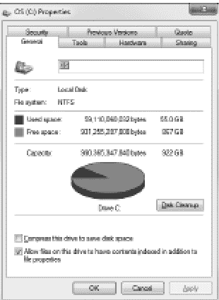

图 1-1:

磁盘驱动器的属性对话框（Windows Vista）。

如果你的电脑有多个硬盘，Windows会在“计算机”窗口中为每个驱动器列出一个图标。记下每个驱动器的大小和可用空空间。

- 内存容量：要在Windows中查找此信息，在开始菜单上右键点击“计算机”，并选择“属性”命令。你电脑上的内存量显示在对话框中。例如，图12显示了具有GB内存的电脑。
- 操作系统版本：你可以从属性对话框中推断出来。例如，运行的是Windows 7。
- 电脑上安装了什么类型的网卡：最简单的方法是右键点击“计算机”，选择“管理”，点击“设备管理器”。
- 电脑上连接了哪种打印机：通常，通过查看打印机就能判断。你也可以通过双击控制面板中的打印机图标来判断。
- 连接到电脑的任何其他设备：CD、DVD或CD-RW扫描仪？Zip或Jazz驱动器？磁带驱动器？摄像头？
- 哪些驱动程序和安装盘：希望你能找到网卡、打印机等硬件设备所需的磁盘或CD。如果没有，你可能可以在互联网上找到驱动程序。
- 电脑上使用了哪些软件：Microsoft Office？AutoCAD？QuickBooks？列一份完整的列表并包括版本号。

## 为你收集信息的

如果你有多台电脑需要联网，收集电脑信息将是一项巨大的工作。幸运的是，有一些软件程序可以自动为你收集信息。这些程序检查电脑的各个方面，例如CPU类型和速度、内存量以及硬盘的大小。然后它们会将信息显示在屏幕上，并提供将信息保存到硬盘文件或打印的选项。

Windows自带这样一个程序，称为“微软系统信息”。通过选择“所有程序 > 辅助工具 > 系统信息”，可以收集并打印有关电脑的信息。

当你运行微软系统信息时，你会看到一个类似于图 1-5 的窗口。最初，微软系统信息显示有关电脑的基本信息，例如微软Windows的版本、处理器类型、电脑内存等。你可以通过点击窗口左侧的“硬件资源”、“组件”或其他类别来获取更详细的信息。

## 84 投入还是不投入服务器：这是一个待解决的问题


网络计划必须回答的最基本问题之一是，网络将拥有一台或多个专用服务器，还是完全依赖点对点网络。如果你购买网络的唯一理由是为了共享打印机和偶尔交换文件，那么你可能不需要一台专用服务器计算机。在这种情况下，你可以使用已有的计算机创建一个点对点网络的连接。然而，除了规模最小的网络外，所有网络都将从拥有一台独立的专用服务器计算机中获益。

- 使用专用服务器计算机使网络运行更快、更易于操作，且更可靠。设想一下，当一个兼作工作站的服务器计算机用户决定关闭电脑，而没有意识到有人正在访问他或她的硬盘上的文件时，会发生什么。
- 你并不非要使用最大、最快的计算机作为服务器计算机。我见过某些网络，网络中运行最慢的那台计算机正是服务器。当服务器主要用于共享打印机或存储少量共享文件时，这一建议尤为适用。如果你需要为网络购买一台计算机，可以考虑将你其中一台旧电脑作为服务器，而将新电脑作为客户端。

## 服务器的类型

假设你的网络需要一台或多个专用服务器，你接下来应该考虑网络需要什么种类型的服务器。在某些情况下，单台服务器计算机可以胜任一个或多个角色。只要可能，最好限制每台服务器计算机只运行单一的服务器功能。

### 文件服务器

文件服务器提供集中磁盘存储，网络上的客户端计算机可以方便地共享。文件服务器最常见的类型是存储共享文件和程序。例如，小型工作组的成员使用文件服务器上的磁盘空间来存储他们的 Microsoft Office 文档。

文件服务器必须确保两个用户不会同时更新同一个文件。文件服务器通过在用户更新文件时锁定文件来实现这一点，使得其他用户在第一个用户完成操作之前无法访问该文件。对于文档文件（例如文字处理或电子表格文件），整个文件会被锁定。对于数据库文件，锁定可以仅应用于文件中包含正在更新的记录或多条记录的部分。

### 打印服务器

共享打印机是许多小型网络存在的原因之一。虽然并非必须，但可以专门出一台服务器计算机用作打印服务器，其唯一目的是收集从客户端计算机发送到共享打印机的信息，并按顺序进行打印。

- 单台计算机可以同时担任文件服务器和打印服务器，但如果使用独立的打印服务器和文件服务器，性能会更好。
- 随着大约 100 美元的廉价喷墨打印机的出现，为每个用户配备自己的打印机是非常诱人的。然而，一分钱一分。与其为 15 个用户买 100 台打印机，不如买一台 1500 美元的激光打印机并共享它。这台 1500 美元的激光打印机运行速度更快，产出的效果可能更好，而且运行成本更低廉。

### Web 服务器

Web 服务器是运行某种软件以能够托管 Internet 网站的计算机。最流行的两种 Web 服务器程序是微软的 IIS（互联网信息服务）和 Apache，后者是由 Apache 基金会管理的开源 Web 服务器。

### 邮件服务器

邮件服务器是处理网络电子邮件需求的服务器。它配置了电子邮件服务器软件，例如 Microsoft Exchange Server。Exchange Server 设计用于与 Microsoft Outlook 配合，它是 Microsoft Office 自带的电子邮件客户端软件。

大多数邮件服务器实际的功能远不止发送和接收电子邮件。例如，以下是 Exchange Server 在简单电子邮件之外还提供的某些功能：

- 简化协作项目管理的协作功能。
- 音视频会议。
- 聊天室和即时消息 (IM) 服务。
- Microsoft Exchange 表单设计器，允许为应用程序开发自定义表单，如请假申请或订单。

### 数据库服务器

数据库服务器是运行数据库软件的计算机，例如微软的 SQL Server 2000。数据库服务器通常与自定义业务应用程序一起使用，如会计或营销系统。


## 选择服务器操作系统

如果你确定网络需要一台或多个专用服务器，下一步是确定这些服务器应该使用什么网络操作系统。如果可能，所有服务器应该使用相同的操作系统，这样你就不需要同时维护不同的操作系统。

尽管你可以从许多网络操作系统中选择，但从实际角度来看，你的选择限于以下：

- Windows Server 2003 或 2008
- Linux 或其他版本的 Unix

更多信息请参考第 I 第 4 章。

## 基础设施规划

你还需要规划连接网络中计算机的细节。任务包括确定网络将使用何种网络拓扑结构、使用什么类型的电缆、电缆如何布线，以及需要哪些其他设备（如中继器、桥器、集线器、交换机和路由器）。

虽然有很多布线方案可供选择，对于网络中的大部分——甚至全部——桌面计算机，你可能会使用 Cat 5 或更高级别的。然而，在这个基础之外，你还需要做出许多决策：

- 使用较便宜的集线器，还是更快但昂贵的交换机？
- 你将工作区的集线器或交换机放在哪里——桌面上、组内还是中央布线室？
- 每个集线器或交换机上将放置多少台客户端计算机，你需要多少台集线器或交换机？
- 如果需要多个集线器或交换机，将使用什么种类型的电缆来连接它们？

关于网络布线的更多信息，请参阅第 II 第 2 章和第 I 第 3 章。

如果你正在安装网络线，不要在电缆本身上省钱。因为安装网络线是一项劳动密集型任务，电缆本身的成本占比小。如果你现在多花钱安装更高规格的电缆，几年后需要升级网络时，就不需要更换电缆了。


## 绘制图表

创建网络计划的最有效技巧之一是画一张图。图表可以是详细的平面图，显示每个网络组件的实际位置。这种图表有时被称为物理映射。如果你愿意，图表也可以是逻辑映射，它更抽象，像毕加索的作品。每当你更改网络布局都要更新图表。还要包含更改的详细说明、日期和原因。

你可以在餐巾上画小型网络，但如果网络超过几台计算机，你将需要使用绘图程序来帮助创建图表。此目的的最佳程序之一是 Microsoft Visio，如图 1-6 所示。

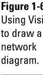

- 智能形状和连接可以保持你在网络组件之间绘制的连接，即使你重新安排页面上的组件布局。
- 模板为常见的网络组件提供了许多有用形状——不仅包括客户端和服务器计算机，还包括路由器、集线器、交换机以及任何你能想象到的其他设备。

## 示例网络计划

你对图表的要求非常挑，甚至可以购买带有特定设备精确绘图的模板集，例如思科路由器或 IBM 主机计算机。

- 你可以为图表中的计算机或设备添加信息，例如序列号或物理位置。然后，你可以快速打印出一份清单，列出图中每台设备的这些信息。
- 你可以轻松创建跨多个页的大型图表。

## 示例网络计划

在本章的剩余部分中，我将介绍一些根据真实情况绘制的网络计划。这些示例说明了我在本章中目前为止涵盖的许多网络设计问题。你即将读到的这些故事都是真实的。为了保护无辜，，已经更改了姓名。

### 构建小型网络：California Sport Surface, Inc.

California Sport Surface, Inc. (CSS) 是一家专门从事户外运动场安装（如网球场、跑道和足球场）的小型公司。CSS 有一个四人的行政团队，在家庭办公室办公。公司目前有三台计算机：

- 一台新的 Dell 台式电脑，运行 Windows 7 Basic 版，由总裁（Mark）和副总裁（Julie）共享，用于准备提案和营销手册、处理信函以及完成其他杂务。这台计算机内置了千兆以太网端口。
- 一台旧的 Gateway 计算机，运行 Windows XP 家庭版，由记会计（Erin）使用，她使用 QuickBooks 处理公司的会计需求。这台计算机内置了 10/100 Mbps 以太网端口。
- 一台运行 Vista 的笔记本，由公司首席工程师（Daniel）使用，他经常带着它去现场协助工程需求。这台计算机内置了 10/100 Mbps 以太网端口。

公司仅拥有一台打印机，一台中等价格的喷墨打印机，连接在 Erin 的计算机上。计算机之间没有联网，因此每当 Julie 或 Daniel 需要打印东西时，必须将文件复制到闪存盘并交给 Erin，然后由她打印文档。Mark 和 Julie 共享的台计算机通过住宅 DSL 连接到互联网。

公司想要安装一个网络来支持这三台计算机。

以下是网络的主要目标：

- 提供对打印机的共享访问，以便用户无需通过闪存盘交换数据即可打印文档。
- 提供对互联网连接的共享访问，以便用户可以从任何一台计算机访问互联网。
- 允许增加另一台台式计算机（公司预计在未来六个月内购买），并可能再增加一台笔记本电脑。（如果业务良好，公司希望再雇佣一名工程师。）
- 网络对用户来说应该是直观的，且不需要进行过度的维护。

CSS 的网络需求可以通过图 1-7 中简单的点对点网络图来满足。以下是网络的要求：

- 网络需要 DSL 路由器和四口千兆网络交换机的组合。当公司增加一台笔记本电脑时，可能会超出该设备的承受范围，但如果发生这种情况，届时可以添加另一个 4 口或 8 口的交换机。
- 需要启用路由器的防火墙功能，以保护网络免受互联网黑客的侵害。
- 需要在 Erin 的计算机上激活文件和打印机共享，并共享打印机。

### 连接两个网络：Creative Course Development, Inc.

CCD 有两栋相邻的建筑，之间被一个小院子隔开。创意团队由许多作家和教育工作者组成，在 A 楼工作。销售、营销和行政人员由六名员工组成，在 B 楼工作。

创意团队（A 楼）拥有十几台相对新的个人计算机，运行 Windows Vista 商业版，以及一台运行 Windows 2003 Server 的服务器。这些计算机通过一个 24 口千兆交换机联网。一条通过小型思科路由器连接到网络的分级 T1 线路提供了互联网访问。

销售、营销和行政人员（B 楼）拥有一堆计算机，运行 Windows Vista 但大部分运行 Windows XP。他们有一台小型 Windows 2003 服务器可以满足他们的需求。旧的计算机具有 10/100BaseT 网络接口；较新的具有带有 12 个端口的 10/100 Mbps 以太网交换机。互联网访问通过 ISDN 连接提供。

两组人对他们的计算机和网络都很满意。问题是网络之间无法通信。例如，A 楼的创意团队准备每周产品开发状态报告以与 B 楼的行政人员共享，并经常去另一栋楼查看重要的销售趋势。

尽管存在解决方案，但最简单的方法是使用一对无线交换机桥接网络。为了这样做，CCD 将购买两个无线接入点。一个将插入 A 楼的千兆交换机，另一个将插入 B 楼的交换机。在配置接入点后，两个网络将作为一个单一网络运行。图 1-8 显示了完成后的网络逻辑图。

虽然这个问题的休息解决方案听起来很合理，但仍有一些复杂问题需要处理：特别是：

- 根据环境，无线接入点在建立建筑之间的链路时可能会遇到困难。可能需要将设备位于屋顶上。在这种情况下，CCD 将不得不花费额外的费用。

| Dave Y. | Brenda M. | Deborah Q. | Julie D. | Chris E. | Alice M. |
|---|---|---|---|---|---|

A 楼 | B 楼

第 1 章 规划网络

图 1-8：Creative Development 的无线解决方案。

- 在网络连接之前，每个网络都有它自己的 DHCP 服务器。当网络合并后，将禁用这些服务器中的一个。
- 此外，两个网络都有自己的互联网连接。网络桥接后，CCD 可以消除 ISDN 连接。
- 网络还需要还需要如何处理网络的目录服务。以前，每个网络都有自己的域。网络桥接后，CSS 可能选择保持这些域分开。

## II 提高网络性能：DCH Accounting

DCH Accounting 是一家会计师，在两年内从 15 名员工增加到 35 名，位于同一栋建筑。以下是现有网络的情况：

- 网络由 35 台计算机和三台运行 Windows 2003 Server 的服务器组成。
- 35 台计算机运行各种 Windows 操作系统。三分之一（共11 台）运行 Vista Professional。其余运行 XP Professional。没有计算机运行 Windows 7。
- Windows 计算机都有千兆以太网卡。旧的计算机具有 10/100 Mbps 卡。
- 服务器计算机是较旧的计算机，具有 10/100 Mbps 网络接口。
- 建筑中的所有办公室都使用 5 类线连接到中央接线间，该设备架内放置着 24 口百兆交换机。
- 互联网访问通过 T1 连接和思科 1700 路由器提供。

最后，网络性能明显缓慢，特别是互联网访问以及客户端与服务器之间的大文件传输。用户开始抱怨网络慢得像爬一样。

问题可能是网络超出了 10/100BaseT 交换机的范围。所有网络流量都流经它们，而它们被限制在 100 Mbps。因此，带有千兆以太网卡的新计算机以 100 Mbps 的速度连接到网络。

该网络的性能可以通过两个步骤显著提高。第一步是将三台服务器中的 100 Mbps 网络接口卡更换为千兆卡（或者更好，更换服务器为更新的型号）。第二步是在设备架上添加一个 24 口千兆交换机。设备架可以重新布线，如图 1 所示。


图 1-9：DCH 会计公司的交换网络。

## 示例网络计划

1. 将服务器、Cisco 路由器和千兆客户端连接到新的千兆交换机上。这将使用 24 个端口中的 15 个。
2. 将两台 10/100 交换机连接到新的千兆交换机上。这会额外使用两个端口，留出 7 个端口供未来增长。
3. 将剩余的客户端分配到两个 10/100 交换机之间。每台交换机将连接 12 台电脑。

这种布局将所有千兆客户端连接到千兆交换机端口，并将 100 Mbps 客户端连接到 100 Mbps 交换机端口。

为了获得更的性能，DCH 可以简单地将两台交换机都更换为 24 口的千兆交换机。


## 第 2 章：安装网络硬件

### 本章内容

- 安装网络接口卡
- 安装网络线
- 安装电缆连接器
- 确定双线对布线的引脚定义
- 制作交叉线
- 安装交换机

在规划好网络之后，就是将所有设备组装在一起的有趣环节了。在本章中，我将描述安装网络硬件的一些重要细节，包括电缆、交换机、网络接口卡以及专业处理（例如配线架）。

### 安装网络接口卡

要将计算机连接到网络，计算机必须具备网络接口。在过去的 10 多年里，几乎所有计算机的主板上都内置了网络接口。然而，你可能仍然遇到没有内置网络接口的电脑。在这种情况下，你必须安装网络网卡以使计算机接入网络。安装网络网卡是一项可以完成的任务，但你必须愿意卷起袖子来。

如果你安装过一个适配器卡，你就安装过所有的了。换句话说，安装网络网卡就像安装调制解调器、新的显卡、声卡或任何其他类型的卡一样。如果你曾经安装过这些卡中的一种，你可能闭着眼睛都能安装网络网卡。

以下是安装网络网卡的逐步程序：

#### 96 安装网络接口卡

1. 准备好网卡和驱动盘。顺便把你的 Windows 安装光盘也准备好，以防万一。
2. 关闭 Windows，然后关闭电脑并拔掉电源。千万不要在电源通着或电源线插着的情况下拆卸计算机内部！
3. 拆下计算机的机壳。图 2-1 显示了你为了打开外壳通常必须拆除的螺丝。将螺丝放在一个不会丢失的地方。

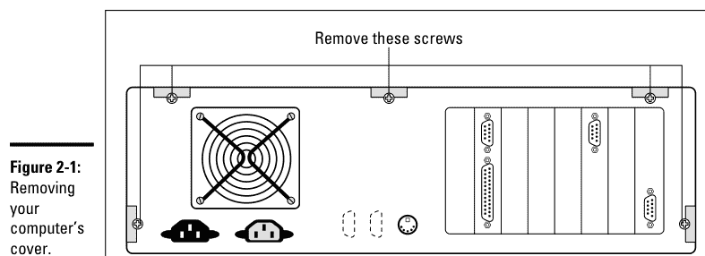

注意，如果你使用的是戴尔（Dell）或 Compaq这样的品牌电脑，打开外壳可能比仅仅拆下几颗螺丝要困难得多。你可能需要查阅随附附的用户手册来了解如何打开机箱。

4. 在计算机内部找到一个未使用的扩展槽。扩展槽整齐地排列在计算机背部附近；你不会错过的。任何年龄不满五年的电脑都至少有两个或三个 PCI 扩展槽。
5. 当你找到一个没有盖子的插槽时，从计算机机箱背部拆下金属保护板。如果有小卡扣固定着槽保护板，请拆下螺丝并将其放在安全的地方。然后拉出槽保护板，将其与其他所有旧槽保护板一起放在一个盒子里。（过一段时间，你会收集一大堆槽保护板。把它们当作纪念品或圣诞树装饰吧。）
6. 将网络接口卡插入插槽。

#### 安装双线对电缆 97

将卡底部的连接器与扩展槽中的连接器对齐，然后直接向下压卡片。有时你必须用很大力才能让卡片滑入插槽。

7. 用第 5 步中拆下的螺丝固定网络接口卡。
8. 组装计算机机壳。

小心计算机内部松散的电缆；在推回机壳时你不想夹到机壳。用第 3 步中拆下的螺丝固定机壳。

9. 插上电源并开机。

如果你在 Windows 中使用即插即用卡，卡在重新启动计算机后会自动配置。如果你在使用较旧的计算机或旧网络接口卡，你可能需要运行额外的软件安装程序。详情请参阅网卡随附的安装说明。

### 安装双线对电缆

大多数以太网都是使用双线对电缆构建的，它类似于电话线但并不相同。双线对电缆有时被称为 UTP。有关双线对电缆一般特性的更多信息，请参考第 3 章。

双线对电缆有不同的等级，由 ANSI（美国国家标准）和 EIA（电子工业协会）规定。虽然高级别的电缆更贵，但你应该投资 5 类（Category 5）以备未来升级。

#### 什么是类别

| 类别 | 最大数据速率 | 预期用途 |
| :--- | :--- | :--- |
| 1 | 1 Mbps | 语音 |
| 2 | 4 Mbps | 语音 |
| 3 | 10 Mbps | 环形网 |
| 4 | 16 Mbps | 环形网 |
| 5 | 100 Mbps | 以太网 |
| 5e | 1000 Mbps | 千兆以太网 |
| 6 | 1000 Mbps | 千兆以太网 |
| 7 | 10000 Mbps | 实验 |
| 8 | 10000 Mbps | 实验 |

#### 屏蔽还是不屏蔽

非屏蔽双线对电缆（即 UTP）用于普通环境。当你使用 UTP 时，必须小心不要靠近荧光灯、空调或电动机（如自动门）。UTP 是最便宜的电缆类型。

### 安装 99


在有大量电干扰的环境中（例如工厂），你可能想使用屏蔽线对电缆，也称为`STP`。`STP`的价格可能是`UTP`的三倍；除非万不得已，否则你不想使用。只要留心，`UTP`可以承受正常办公室的电干扰。

### 有时是芯，有时是股线

组成电缆的实际线有两种种类：芯和股线。你的网络中两者都有。

- 在股线线中，每个导体由许多扭绞在一起的极细线线组成。股线比芯线更灵活，因此不易折断。然而，股线比芯线更贵，而且在远距离传输效果不佳。股线最适合用于跳线，例如连接计算机到墙壁插的电缆，或连接配线架到集线器和交换机的电缆。

## 100 安装双绞线

严格来说，连接计算机和墙壁插座的电缆称为站台线（station cable），而不是跳线线（patch cable）。跳线线用于配线间，通常连接到配线架或交换机。

- 在单芯线中，每个导体都是单根金属线丝。单芯线比多股线便宜且信号传输距离更远，但灵活性较差。如果你弯折次数过多，它就会损坏。单芯线通常用于建筑墙壁和天花板内的永久布线。

## 安装指南

安装网络线最困难的部分是将电缆穿过天花板、墙壁和地板的物理任务。这项工作相当棘手，我建议小型办公室不要尝试尝试。对于大型工程，请聘请专业的电缆安装人员。如果天花板和墙体空间难以进入，即使是小工程也可以请专业人士。

如果你决定自己安装线，这里有一些需要注意的通用点：

- 你可以购买预制长度的双绞线，例如 50 英尺、75 英尺或 100 英尺。你也可以根据需要的任何长度特订预制连接头。然而，将连接头安装在散装线上并不困难。我建议你只在极小型网络中使用成品线，且仅在不需要将电缆穿过墙壁或天花板时使用。

- 总是留比需要的多一点电缆，尤其是当你穿墙墙布线时。例如，在墙上方天花板处留出一些余量。这样当你以后需要维修时，你就有足够的电缆了。

- 布线时，避免干扰源，如荧光灯、电机、X 射线机等。穿过吊顶天花板板的电缆最常见的干扰源是荧光灯；在布线时，务必离灯具远一点。留出三英尺即可。

- 集线器和计算机之间的最大允许电缆长度为 100 米（约 328 英尺）。

- 如果线缆跨越行人走的地板，请遮盖电缆以免有人绊倒。大多数五金店都能买到廉价的电缆保护器。

- 穿墙布线时，在每根电缆的两端贴上标签。大多数电器商店都有适合这项工作的电缆标签纸。这些标签纸包含大约 50 张带有字母和数字的预切标签。它们看起来比用美胶带绕在电缆上并用记号笔在上面写字专业得多。

# 双绞线安装入门

或者，如果你想做标记，可以买一支久干性记号笔直接写在电缆上。

- 当几根电缆汇在一起时，用塑料扎带将它们固定。如果可能，避免使用美胶带；胶带不持久，但粘性胶水会留在上面。一年后看起来会是一团糟。电器商店可以买到扎带。

- 扎带有各种用用途。在一次背游旅行中，我用一对扎带把一个毫无防备的朋友的帽子系在一个高处的树枝上。他对我这种创新的扎带用法并不感冒，但我的徒行伴侣们赞不绝口。

- 在吊顶板上方布线时，使用吊顶板、钩子或夹子将电缆固定在实际的天花板或支撑吊顶板的金属框架上。不要将电缆铺在顶板上。

## 你需要的工具

当然，为了做好工作，你必须拥有正确的工具。

从一套基础计算机工具开始，你可以在任何计算机商店或大型办公用品店以约 15 美元购买。这些工具包包含了正确的螺丝刀和套筒扳手，用于拆解计算机并插入适配卡。（如果你没有计算机工具箱，请确保你有几种不同尺寸的一字螺丝刀和十字螺丝刀。）

如果你的所有计算机都在同一个房间里，而且你打算沿着地板布线并使用预制线，那么计算机工具应该包含你所需的一切。

如果你使用的是散装线并计划自己安装连接头，除了基础计算机工具包自带的工具外，你还需要以下工具：

- 线剪：较细的电缆需要大号的；10BaseT 线用较小的即可。如果你使用的是黄色电缆（光纤），你需要一套“生命之接头（Jacks of Life）”。

- 压接钳：你需要压接钳将连接头固定在电缆上。不要使用 10 美元的廉价压接钳。长远来看，一个好的工具会为你节省很多麻烦。记住这句格言：压接时，必须到位。

- 剥线器：只有当压接钳不包含剥线器时你才需要它。

## 安装双绞线

如果你计划穿墙布线，你需要这些工具：

- 锤子。

- 一个铃。

- 一首要唱的歌。最后两项是开玩笑的。

- 钥匙锯。如果你计划在墙上开洞来穿过电缆，这很有用。

- 一个手电筒。

- 一把梯子。

- 一个人扶梯子。

- 可能还需要一个鱼蛇（fish tape）。鱼蛇是一种盘绕的钢丝。

## 双绞线的引脚

如果你计划穿墙布线，你需要这些工具：

- 锤子。

- 一个铃。

- 一首要唱的歌。最后两项是开玩笑的。

- 钥匙锯。如果你计划在墙上开洞来穿过电缆，这很有用。

- 一个手电筒。

- 一把梯子。

- 一个人扶梯子。

- 可能还需要一个鱼蛇。鱼蛇是一种盘绕的钢丝。

## 表 2-2 双绞线的引脚连接

| 引脚编号 | 功能 | EIA/TIA 568A | EIA/TIA 568B |
| :--- | :--- | :--- | :--- |
| 1 | 传输 + | 白绿 | 白橙色 |
| 2 | 传输 – | 绿色 | 橙色 |
| 3 | 接收 + | 白橙色 | 白绿 |
| 4 | 未使用 | 蓝色 | 蓝色 |
| 5 | 未使用 | 白蓝 | 白蓝 |
| 6 | 接收 – | 橙色 | 绿色 |
| 7 | 未使用 | 白棕 | 白棕 |
| 8 | 未使用 | 棕色 | 棕色 |

10BaseT 和 100BaseT 只使用两对，连接到引脚 1、2、3 和 6。其中一对用于传输，另一对用于接收。这两种接线标准的区别在于哪一对线用于传输数据，哪一对线用于接收数据。在 EIA/TIA 568A 标准中，绿色线用于传输，橙色线用于接收。在 EIA/TIA 568B 和 AT&T 258B 标准中，橙色线用于传输，绿色线用于接收。

## 安装 RJ-45 连接头

如果你有正确的压接钳，双绞线的 RJ-45 连接头并不难安装。关键在于既要确保每根线都连接到正确的引脚，又要用力按下工具以确保良好的连接。

以下是安装 RJ-45 连接头的步骤：

1. 将电缆端切到所需的长度。

   确保切口是垂直的——而不是斜的。

2. 将电缆插入压接钳的剥线部分，使电缆末端对齐停止块。

   压缩手柄并拉出电缆，保持平直。这可以剥掉正确长度的外绝缘，而不会刺破内部导线的绝缘。

## 104 安装双绞线

- 3. 整理导线，使其平整铺开并根据表 2-2 进行对齐。

你可能需要对导线进行一些调整，以确保它们按照正确的顺序排列好。

- 4. 将导线插入连接器上的针孔中。

双检查以确保所有导线都滑入了正确的针孔。

- 5. 将插头和导线插入工具的压接部分，然后挤压手柄以对插头进行压接。

用力压紧！

- 6. 从工具中取出插头并双检查连接情况。

大功完成！

在处理 RJ-45 连接器和双绞线时，还有其他几点需要记住：

- RJ-45 连接器上的引脚没有编号，但你可以通过手持连接器并使金属导体朝上（如图 2-2 所示）来判断哪一个是 1 号引脚。1 号脚在左侧。

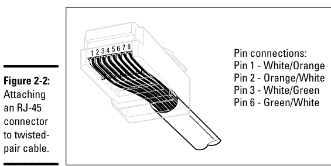

- 有些人对 10base-T 线布线方式不同——使用绿白对作为 1 和 2 号脚，使用橙白对作为 3 和 6 号脚。只要电缆两端的连接器接线方式相同，这就不会影响网络运行（网络是色盲的）。

- 如果你正在为快速以太网系统安装线，你应该格外小心遵守五类（Category-5）布线规则。这意味着，其他要求外，还要确保整个过程中都使用五类组件。

## 安装双绞线 105

电缆和所有连接器必须符合五类规格。在安装连接器时，剥线的电缆长度不要超过 ½ 英寸。不要尝试让电缆布线距离超过 100 米的最大限制。如有疑问，请让专业人员安装适用于 100 Mbps 以太网系统的电缆。

## 交叉线

交叉线是一种你可以在不使用交换机的情况下直接连接两个设备的电缆。你可以使用交叉线直接连接两台计算机，但交叉线更多地用于集线机和交换机之间的级联连接。

如果你想制作自己的交叉线，你必须反转电缆一端的导线，如表 2-3 所示。此表显示了如何接线电缆的两端以创建交叉线。根据“连接器 A”列连接端，根据“连接器 B”列连接另一端。

注意，如果你要连接的交换机或集线机之一带有交叉端口（通常标记为 *Uplink* 上行链路），则不需要使用交叉线。如果交换机有上行端口，你可以使用普通网络线对其进行级联。有关集线机和交换机级联的更多信息，请参阅本章的“安装交换机”章节。

| 表 2-3 创建交叉线 |
| 引脚 | 连接器 A | 连接器 B |
| :--- | :--- | :--- |
| 1 号脚 | 绿/白 | 橙/白 |
| 2 号脚 | 绿色 | 橙色 |
| 3 号脚 | 橙/白 | 绿/白 |
| 4 号脚 | 蓝色 | 蓝色 |
| 5 号脚 | 蓝/白 | 蓝/白 |
| 6 号脚 | 橙色 | 绿色 |
| 7 号脚 | 棕/白 | 棕/白 |
| 8 号脚 | 棕色 | 棕色 |

## 墙插和配线架

如果你愿意，可以从布线间内的网络交换机拉出单根电缆，穿过墙洞，到达天花板上方空间，通过天花板空间到达办公室的墙壁，沿墙向下穿过孔，一直到达桌面计算机。然而，出于多种原因，这不是好主意。首先，每当移动电脑甚至清洁电脑后面时，电缆都会变松。最终，连接将失效，必须更换 RJ-45 插头。到时候，布线间内的电缆会迅速变成一团乱。

替代方案是在电缆的用户端墙上安装配线座，并将电缆的另一端连接到配线架。这样，电缆本身完全包含在墙壁和天花板空间内。要将计算机连接到网络，将跳线线（称为站台线）的一端插入墙插，将另一端插入计算机的网络接口。在布线间内，你使用跳线线将墙插连接到网络交换机。图 2-3 显示了这种布局的工作原理。

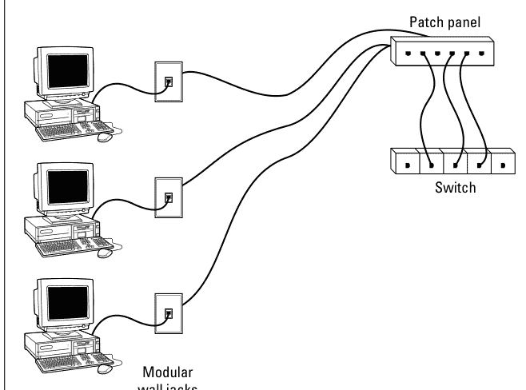

图 2-3：使用墙插和配线架。

将双绞线连接到墙插或配线架与连接到 RJ-45 插头类似。然而，你通常不需要任何特殊工具。相反，插座背面有一组槽，你将每根导线横跨在上面。然后在槽上方盖上一个可拆卸的盖并压紧。这会使导线进入槽中，小金属片会穿透绝缘层。

当你连接插座或配线架时，务必只剥开少量的导线。如果剥得太多，通过的信号将变得不稳定。


## 安装同轴电缆 107

虽然双绞线是目前最常用的网络类型，但某些网络仍依赖老式的同轴电缆。以下是关于使用同轴电缆的一些要点：

- 你可以使用 BNC 连接器。

1. 将连接器的空心管部分（亲切称为护套）套在电缆上。

让它向后滑动几英尺以避开。

2. 干净地切断电缆末端。

3. 使用剥线工具剥电缆。

从电缆末端剥去外护 ½ 英寸；从末端剥去屏蔽层 ¼ 英寸；然后从末端剥去内部绝缘层 ½ 英寸。

- 4. 将实心导体插入中心销。

向下移动中心销直到它覆盖内部绝缘层。

正确地将 BNC 连接器连接到同轴电缆是一项技能。

你需要两个工具——一个能在正确位置切开同轴电缆各层的剥线器，以及一个在连接器到位后将其紧固压在电缆上的压接工具。BNC 连接器有三个独立部分，如图 2-4 所示。

如果你忽略我的建议并尝试自己连接连接器，步骤如下：

在每系列同轴电缆的末端都需要一个称为 *终端器* 的特殊插头。终端器防止数据从电缆末端泄露。

- 尾尾相接电缆统称为段。细轴段的最大长度约为 200 米（实际上是 185 米）。一个段最多可以连接 30 台计算机。要跨越超过 185 米的距离或连接超过 30 台计算机，你需要使用两个或多个段，并通过称为中继器的设备连接每个段。

- 虽然以太网同轴电缆像电视电缆，但两种电缆不可互换。不要尝试用廉价的电视电缆布线网络来节省成本。


## 将 BNC 连接器连接到同轴电缆

## 级联交换机 109

5. 使用压线工具压接中心针脚。

6. 将连接器机体滑到中心针脚上，并将内部绝缘层滑入织网屏蔽层。

当你将机体推回足够远时，中心针脚会咔哒一声卡到位。

7. 现在向前滑动端子，直到它接触连接机体。

使用压线工具进行压接。


不要掉入使用简易“螺丝式”连接器的陷阱。它们并不非常可靠。

第二卷

第 2 章

## 安装交换机

设置网络交换机非常简单。事实上，你只需要了解几个细节：

- 安装交换机通常非常简单。只需接入电源线，然后插上跳线以连接网络。

- 交换机上的每个端口都有一个 RJ-45 口和一个标记为 Link 的单个 LED 指示灯，当端口建立连接时，灯会亮起。如果你将电缆的一端插入端口，另一端插入计算机或其他设备，Link 灯应该亮起。如果灯没亮，说明电缆、集线器（或交换机端口）或电缆另一端的设备出了问题。

- 每个端口可能还有一个闪烁的 LED 指示灯，指示工作活动。如果你在交换机旁待一会儿，可以通过观察哪些指示灯闪烁最频繁来发现哪个端口使用网络最多。

- 端口还有一个冲突指示器（Collision indicator），每当端口发生数据包冲突时，它就会闪烁。对于目前的链路来说，这是完全可以接受的，但如果它频繁闪烁，你的网络可能存在问题。通常这只是意味着网络过载，应该使用交换机进行分段以提高性能。但在某些情况下，冲突指示灯闪烁可能是由故障节点用坏包阻塞网络所引起的。

## 级联交换机

如果一个交换机的端口不足以供你的整个网络使用，你可以通过级联的方式来连接交换机。如果其中一个交换机具有上行端口，你可以使用普通的跳线将上行端口连接到另一台交换机的一个普通端口。如果两台设备都没有上行端口，请使用交叉网线连接它们。（有关制作交叉网线的说明，请参见本章前面的“交叉网线”部分。）

在某些集线器和交换机上，使用一个按钮可以在普通端口和上行端口之间切换其中一个端口。此按钮通常标记为 MDI/MDIX。要将端口作为普通端口使用，将按钮切换到 MDI 位置。要将端口作为上行端口使用，将按钮切换到 MDIX。

某些集线器和交换机为上行端口配备了单独的插口，但事实证明上行端口在内部共享一个普通端口。如果是这样，将电缆插入上行端口会禁用一个普通端口。你不应该在这两个插口都插入电缆。如果这样做，交换机将无法正常工作。


注意，你可以级联的交换机数量是有限的。对于 10BaseT 网络，你不应将三个以上的交换机相互连接在一起。对于 100 Mbps 或千兆网段，你只能将两台交换机级联在一起。

你可以通过可堆叠交换机来绕过这个规则。可堆叠交换机具有特殊的电缆连接器，可以将两个或多台交换机连接起来，使其运行像单台交换机。对于大型网络，可堆叠交换机是必须的。

## 第 3 章：设置网络服务器

### 本章内容

- 思考安装网络操作系统的不同方法

- 准备工作

- 安装网络操作系统

- 安装网络操作系统后该做什么

在安装好网络电缆和其他设备（如集线器和交换机）之后，构建网络的下一步通常是设置服务器。将服务器计算机物理连接到网络后，你可以在服务器上安装网络操作系统（NOS）。然后，你可以配置它以提供你期望并需要的服务器网络服务。

## 安装网络操作系统的多种方法

无论你选择为网络服务器使用哪种网络操作系统，你都可以使用几种常用方法之一在服务器计算机上安装 NOS 软件。接下来的章节将介绍这些替代方案。

## 全量安装与升级

NOS 安装的基本选择之一是，你想执行全量安装还是升级安装。在某些情况下，即使你是在已经安装了早期版本 NOS 的计算机上安装 NOS，执行全量安装可能也更好。

- 如果你在全新的服务器上安装 NOS，你将执行全量安装，这将安装操作系统并使用默认设置对其进行配置。

- 如果你在已经安装了服务器操作系统的服务器计算机上安装 NOS，你将执行升级安装，用新操作系统替换现有的操作系统。

- 如果你想保留旧的操作系统，可以在单独的分区上执行全量安装。这允许你在一台计算机上运行多个操作系统，并且你可以在启动计算机时选择启动哪一个。


## 安装网络操作系统的多种方法 113

## 多启动

多启动（Multiboot）允许你在单台计算机上拥有多个操作系统。当然，任何时候只能有一个操作系统在运行。当你启动计算机时，会显示一个所有已安装操作系统的菜单。你可以选择启动哪一个。

多启动对于软件开发者或需要确保软件与各种操作系统兼容的网络管理员非常有用。与其为多台计算机设置不同的操作系统，你可以在一台 PC 上拥有多个操作系统。

如果你坚持要在网络服务器上安装两个或多个操作系统，请确保将每个操作系统安装在独立的分区中。虽然大多数网络系统允许在单个分区上安装两个操作系统，但这样做并不理想。为了在单个分区上支持两个系统，操作系统每次重启都要进行风险的文件的游戏。例如，如果在 NOS 切换启动文件时停电，你可能会发现自己拥有一个无法启动任何操作系统的服务器。

设置多启动系统的最佳方法是将每个操作系统安装在独立的分区中。然后，你可以使用启动管理器在启动计算机时选择你想要启动的分区

## 自动和远程安装

当你发现自己处于需要在多个系统上安装 NOS 的艰难处地时，可以使用一些技巧来简化过程：

- 自动设置允许你创建一个脚本，为安装程序提出的所有问题提供答案。创建脚本后，你可以启动自动设置，离开并在安装完成后回来。创建设置脚本仅在需要安装多台服务器时才有意义。

- 微软有一项功能叫做远程安装服务（RIS），允许你从远程网络位置安装 Windows 服务器版本，而无需亲自前往服务器计算机。然而，这设置起来很复杂，只有当你有大量需要安装操作系统的服务器时才才是值得的。（你也可以使用 RIS 安装客户端操作系统。）

# 114 准备工作

## 准备你的物品

在安装网络操作系统（NOS）之前，你应该收集好安装所需的所有物品，以免在安装过程中四处寻找东西。以下章节描述了你最可能需要的物品。

### 一台性能良好的服务器计算机


显而易见，你必须有一台用于安装 NOS 的服务器计算机。每种 NOS 都有其操作系统支持的最低硬件要求列表。例如，表 3-1 总结了当前版本 Windows Server（即 Windows Server 2008 R2）标准版的最低要求。

我的建议是对于这些最低要求持保留态度。只有512MB 内存的 Windows Server 2008 运行起来会像蜗牛一样缓慢；我不建议内存低于 4GB，而对于大多数用途来说，16GB 是一个更合适的最低配置。

| 表 3-1 | Windows Server 2008 R2 的最低硬件要求 |

| 项目 | Windows Server 2008 R2 |

| CPU | 1.4 GHz |

| RAM | 512MB |

| 空闲磁盘空间 | 32GB |

你还应该根据 NOS 厂商发布的兼容硬件列表来检查你的服务器硬件。例如，微软发布了一份经过其测试并认证为与 Windows 服务器兼容的硬件列表。该列表被称为硬件兼容性列表，简称 HCL。你可以访问微软网站 `www.microsoft.com/whdc/html/default.msx` 来检查你特定服务器的 HCL。你也可以通过运行 Windows 发行光盘中的“检查系统兼容性”选项来测试计算机的兼容性。

你可以在第一本书第三章找到更多关于服务器计算机建议的详细信息。

## 服务器操作系统

你还需要一个需要安装的服务器操作系统。你需要发行 CD 或 DVD，或者通过网络访问它们的副本。除了光盘，你还应该准备好：

- `产品密钥：` 安装程序在安装过程中要求你输入产品密钥，以证明你拥有合法的副本。如果你有实体 CD 或 DVD，产品密钥应该贴在机箱上的标签上。
- `说明书：` 如果操作系统附带纸质说明书，你应该将它们放在手边。
- `许可类型：` 你可以按服务器或按用户/设备的方式购买微软操作系统。在安装 NOS 时，你需要知道具体的方案计划。

检查 CD 或 DVD 发行光盘以获取产品文档和额外的最后信息。例如，Windows 服务器……

## 其他软件

在大多数情况下，你需要知道……为了像……等……

## 可用的连接

这并不是绝对要求，但如果你有……安装过程将顺畅得多。

- `下载更新：`以便你完成……
- `定位驱动程序：`为了你的……
- `激活产品：` 在你……之后

### 一本好书

你将花费大量时间……

## 做出明智的决策

当你安装 NOS 时，你应该……例如：

- `操作系统：` 如果你正在转换……
- `分区结构：` 如果你想将磁盘划分为……
- `文件系统：` Windows 服务器……
- `计算机名称：` 用于识别服务器……
- `管理员密码：` 你会发现自己处于……之中……

### 安装网络操作系统

- `网络协议：` 你总是需要安装……
- `TCP/IP 配置：` 你需要知道什么 IP 地址……
- `工作组/域：` 你需要决定服务器……

## 安装网络操作系统

要开始安装，请将 DVD 发介质插入服务器的 DVD 驱动器并重启服务器。这将导致服务器直接从发行介质启动，从而启动设置程序。

随着设置程序的运行，它将引导你通过两个不同的安装阶段：收集信息和安装 Windows。接下来的章节将详细描述这些安装阶段。

## 第 1 阶段：收集信息

在第一个安装阶段，设置程序会询问开始安装所需的初步信息。设置向导会提示你输入相关信息：

- `语言：` 选择您的语言、时区和键盘类型。
- `产品密钥：` 输入随安装介质附带的 25 位产品密钥。如果设置程序说您输入的产品密钥无效，请仔细检查。您可能可能输错了密钥。
- `操作系统类型：` 设置程序允许您选择 Windows Server 2008 标准版（Standard Edition）或核心版（Core）。选择标准版安装完整的操作系统；如果您需要该版本，请选择核心版。
- `许可协议：` 显示官方许可协议。必须同意其条款才能继续。
- `安装类型：` 选择“升级”或“清洁安装”。
- `磁盘位置：` 选择您想要安装 Windows 的分区。
- `升级到 NTFS：` 如果您想将 FAT32 系统升级到 NTFS，则需要此操作。

## 第 2 阶段：安装 Windows

在此阶段，Windows 设置程序开始安装 Windows 的实际过程。将执行以下步骤：

1. `复制文件：` 将安装文件的压缩版本复制到服务器上。
2. `解压文件：` 解压压缩的安装文件。
3. `安装功能：` 安装 Windows 功能。
4. `安装更新：` 设置程序会检查微软网站并下载任何关键更新。
5. `完成安装：` 更新安装完成后，设置程序将重启以完成安装。

## 配置您的服务器

在安装 Windows Server 2008 之后，计算机会自动重启，并会看到“初始配置任务”，如图 3-1 所示。该向导将引导您完成配置新新服务器最重要的任务。


图 3-1：初始配置任务。

以下列表描述了此向导中可用的服务器配置设置：

- `设置管理员密码：` 安装 Windows 后应该做的第一件事是设置安全的管理员密码。
- `设置时区：` 如果指定的时区不正确，则有必要进行设置。
- `配置网络：` 默认网络设置通常是合适的，但如果您需要，可以使用此选项更改默认值。
- `提供计算机名称和域：` 此选项允许您更改服务器的计算机名称并加入域。
- `启用自动更新：` 如果您想让服务器自动检查操作系统更新，请使用此选项。
- `下载并安装更新：` 使用此选项检查关键系统更新。
- `添加角色：` 此选项将启动“添加角色向导”，允许您为服务器配置重要的角色。
- `添加功能：` 此选项允许您添加更多操作系统功能。
- `启用远程桌面：` 使用此选项启用远程桌面功能，让您能够从另一台计算机管理此服务器。
- `配置 Windows 防火墙：` 如果您想使用内置的 Windows 防火墙，可以通过此选项对其进行配置。

## 第 4 章：配置 Windows 客户端

本章内容：

- 为 Windows 客户端配置网络连接
- 设置计算机名称和工作组
- 加域域
- 设置登录选项

在网络设置完成之前，您必须配置网络中的客户端计算机。特别是，您必须配置每个客户端的网络接口卡以确保其正常工作，并且必须安装正确的协议，以便客户端能够与网络上的其他计算机通信。

幸运的是，在 Windows 中配置网络客户端的任务非常简单。首先，当您启动计算机时，Windows 会自动识别您的网络接口卡。剩下的工作只需让 Windows 正确安装网络协议和客户端软件即可。

随着每个 Windows 版本的发布，微软都简化了配置客户端网络支持的过程。在本章中，我描述了为 Windows XP、Vista 和 Windows 7 配置网络的步骤。

## 配置网络连接

Windows 会自动检测网络适配器的存在；通常您不需要为适配器安装设备驱动程序。Windows 会自动创建网络连接并对其进行配置以支持基本网络协议。然而，您可能需要手动更改网络连接的配置。Windows XP 和 Vista 的步骤将在后续章节中描述。

### 配置 Windows XP 网络连接

以下步骤显示了如何在 Windows XP 系统上配置网络连接：

1. 选择“开始” > “控制面板”打开控制面板。出现控制面板。
2. 双击“网络连接”图标。出现“网络连接”文件夹，如图 4-1 所示。


图 4-1：网络连接文件夹。

3. 右键点击您想要配置的连接，然后从出现的菜单中选择“属性”。或者，您可以选择网络连接并点击任务窗中的“更改此连接的设置”。无论何种方式，都会出现网络连接的属性对话框，如图 4-2 所示。
4. 要配置网络适配器卡设置，点击“配置”。此操作将调用网络适配器的属性对话框，如图 4-3 所示。该对话框有五个选项页，允许您配置网卡（NIC）：
   - `常规：` 此选项页显示网卡的基本信息，例如设备类型和状态。例如，图 4-3 所示的设备是 Intel Pro 100 网络接口。（它安装在计算机 PCI 总线的第 3 槽中。）


图 4-2：网络连接的属性对话框。

如果您在适配器上遇到问题，可以点击“疑难解答”打开 Windows 硬件疑难解答。如果该设备阻止了计算机其他组件的正常工作，您也可以禁用它。
   - `高级：` 此选项页允许您设置影响网卡运行的各种特定设备参数。在某些情况下，允许您设置速度参数（通常为 10 Mbps 或 100 Mbps）或卡应使用的缓冲区数量。在调整任何此类设置之前，请咨询相关手册。
   - `驱动程序：` 此选项页显示与网卡绑定的设备程序信息，并允许将驱动程序更新到新版本、回滚到之前的版本或卸载驱动程序。
   - `资源：` 通过此选项页，可以使用手动设置限制网卡使用的系统资源——包括内存范围、I/O 范围、IRQ 和 DMA 通道。在插插即用卡时代，您每次安装网卡都必须配置这些设置，并且很容易创建资源冲突。Windows 会自动配置这些设置，因此您应该很少变动它们。
   - `电源管理：` 此选项页允许您设置电源管理选项。您可以指定在计算机进入睡眠模式时关闭网卡，并让计算机定期唤醒以刷新网络状态。


## 124 配置网络连接

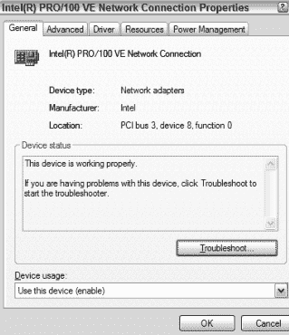

图 4-3：网络适配器的属性对话框。

当单击“确定”关闭网络适配器的属性对话框时，网络连接的属性对话框也会关闭。再次选择“更改此连接设置”选项以继续操作。
- 5. 确保客户端所需的网络项目列在网络连接属性对话框中。

以下列表描述了你在此处常见的项目。请注意，并非所有网络都包含这些项目：
- 微软网络客户端（Client for Microsoft Networks）：如果要访问 Windows 网络，则需要此项。它应该始终存在。
- 文件和打印机共享（File and Printer Sharing）：此项允许你的计算机与网络上的其他计算机共享文件或打印机。

这通常用于点对点网络，但即使你的网络有专用服务器，你可以使用它。但是，如果你不计划在客户端计算机上共享文件或打印机，应该禁用此项。
- Internet 协议 (TCP/IP)：此项允许客户端计算机使用 TCP/IP 协议进行通信。

如果网络上的所有服务器都支持 TCP/IP，则该协议应该是客户端安装的唯一协议。
- NWLink IPX/SPX/NetBIOS 兼容传输协议：只有当你的网络需要连接到使用 IPX/SPX 协议的旧 NetWare 网络时，才需要此协议。

在现代网络中，你应该启用 TCP/IP 并禁用此项。

## 6. 如果没有列出你需要的协议，点击“安装”按钮添加所需的协议。
- 7. 确保你想使用的网络客户端出现在网络资源列表中。

对于基于 Windows 的网络，确保列出了“微软网络”。对于 NetWare 网络，确保出现了“NetWare 客户端服务”（Client Service for NetWare）。如果你的网络同时使用这两种服务器，你可以都选择。


如果你有 NetWare 服务器，请使用随 NetWare 提供的 NetWare 客户端软件，而不是随 Windows 提供的客户端。

你选择的客户端将被添加到网络连接属性对话框中。
- 9. 要删除不需要需要的网络项目（例如微软网络的文件和打印机共享），选择该项目并点击“卸载”按钮。

出于安全考虑，你应该按此方法移除任何不需要的客户端、协议或服务。
- 10. 要配置 TCP/IP 设置，点击“Internet 协议 (TCP/IP)”并点击“属性”以显示 TCP/IP 属性对话框。调整设置后点击“确定”。

图 4-4 所示的 TCP/IP 属性对话框允许你从这些选项中选择：
- 自动获得 IP 地址：如果你的网络有分配 IP 地址的 DHCP 服务器，请选择此项。选择此选项将极大简化网络上 TCP/IP 的管理。（有关 DHCP 的更多信息，请参见第 IV 卷第 3 章。）
- 使用下面的 IP 地址：如果你的计算机有特定的 IP 地址，请选择此项并输入计算机的 IP 地址、子网掩码和默认网关地址。（有关这些设置的更多信息，请参阅第 IV 卷第 2 章。）
- 自动获得 DNS 服务器地址：DHCP 服务器还可以提供计算机应该使用的域名系统 (DNS) 服务器地址。如果你的网络有 DHCP 服务器，请选择此项。（有关 DNS 的更多信息，请参阅第 IV 卷第 4 章。）
- 使用下面的 DNS 服务器地址：如果没有可用 DNS 服务器，请选择此项。然后输入主、备 DNS 服务器的 IP 地址。

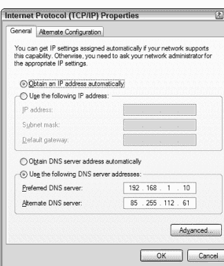

**图 4-4:** 配置 TCP/IP。

## 配置 Windows Vista 网络连接

在 Windows Vista 上配置网络连接的过程与 Windows XP 类似，不同之处微软决定将配置对话框隐藏在 Windows 更深层的位置。

要找到你需要的设置，请按照以下步骤操作：

1. `选择“开始 > 控制面板”打开控制面板。`

   出现控制面板。
2. `在“网络和 Internet 连接”标题下选择“查看网络状态和任务”。`

   这将打开网络和共享中心，如图 4-5 所示。
3. `点击“网络连接”。`

   出现“网络连接”文件夹，如图 4-6 所示。
4. `右键点击你想配置的连接，并从出现的菜单中选择“属性”。`

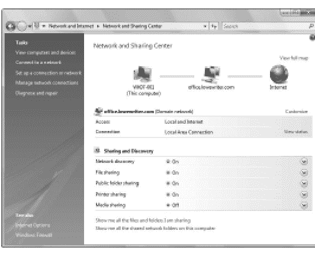

**图 4-5:** 网络和共享中心（Windows Vista）。

出现网络连接的属性对话框，如图 4-7 所示。如果你将此对话框与之前在图 4-2 中显示的对话框对比，你会发现它们是相同的。

**图 4-6:** 网络连接文件夹（Windows Vista）。

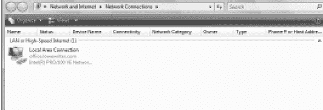

- 5. `点击“配置”来配置连接。`

从这一步起，配置连接的步骤与 XP 相同。因此，你可以从之前的“配置网络连接”章节的第 4 步继续。

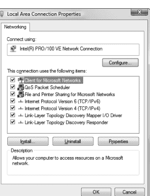

图 4-7：网络连接属性对话框（Windows Vista）。

## 配置 Windows 7 网络连接

配置 Windows 7 网络连接的过程与 Vista 类似，但在细微差异。以下是步骤：

1. `选择“开始 > 控制面板”打开控制面板。`

   出现控制面板。
2. `在“网络和 Internet”标题下选择“查看网络状态和任务”。`

   这将打开网络和共享中心，如图 4-8 所示。
3. `点击左侧的“更改适配器设置”。`

   出现“网络连接”文件夹，如图 4-9 所示。
4. `右键点击你想配置的连接，并从出现的菜单中选择“属性”。`

出现网络连接的属性对话框，如图 4-10 所示。如果你将此对话框与之前在图 4-2 中显示的对话框对比，你会发现它们是相同的。

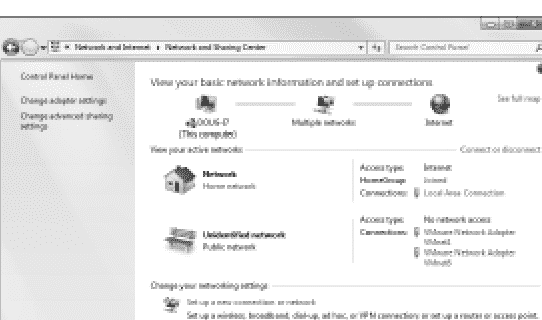

**图 4-8:** 网络和共享中心（Windows 7）。

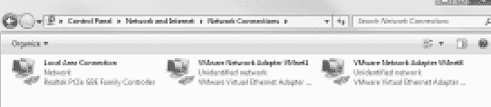

**图 4-9:** 网络连接文件夹（Windows 7）。

- 5. `点击“配置”来配置连接。`

从这一步起，配置连接的步骤与 XP 相同。因此，你可以从之前的“配置网络连接”章节的第 4 步继续。

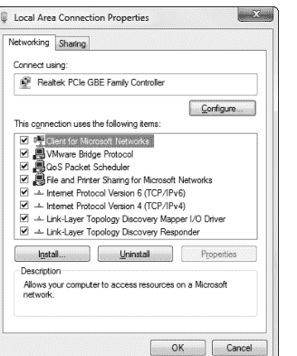

图 4-10：网络连接属性对话框（Windows 7）。

## 130 配置客户端标识

每台客户端计算机都必须标识自身以参与网络。计算机标识由计算机名称、可选描述以及计算机所属的组或域名称组成。

计算机名称必须遵循 NetBIOS 名称规则；长度为 1 到 15 个字符，可以包含字母和数字，但没有空格或句点。对于小型网络，将计算机命名为与用户名相同是常见的。对于大型网络，你可能希望开发一种识别计算机位置的命名方案。例如，名称 C-305-1 可以分配给 C 楼 305 室的第一台计算机。或者 METG010 可能是营销部门的一台计算机。

如果计算机加入域，你需要域管理员帐户的访问权限，除非管理员已经在域中创建了计算机账户。请注意，只有以下 Windows 版本具有加入域的能力：

## 配置客户端计算机标识

- Windows 7 专业版、企业版或旗舰版
- Windows Vista 商业版、企业版或旗舰版
- Windows XP 专业版

当你在客户端系统上安装 Windows 时，安装程序会要求输入计算机名称以及工作站或域信息。如果你需要，以后可以更改这些信息。操作方法取决于你所使用的 Windows 版本。

## 配置 Windows XP 计算机标识

要更改 Windows XP 中的计算机标识，请按照以下步骤操作：

1. 打开控制面板，双击“系统”图标以打开“系统属性”对话框。
2. 点击“计算机名称”选项卡。

此处将显示计算机标识信息。

3. 点击“更改”按钮。


此步骤将显示“更改计算机名称”对话框，如图 4-11 所示。

4. 输入计算机计算机，然后指定工作组或域信息。

若要加入域，选择“域”单选按钮并在相应的框中输入名称。若要加入工作组，选择“工作组”单选按钮并在相应的文本框中输入工作组名称。

5. 点击“确定”。

图 4-11：更改计算机名称对话框（Windows XP）。

## 配置客户端计算机标识

6. 如果系统提示，请输入管理员账户的用户名和密码。

只有在尚未为客户端计算机创建计算机账户时，才会要求你提供此类信息。

7. 当对话框提示你需要重启计算机时，点击“确定”。然后重启计算机。

完成完成！

## 配置 Windows Vista 或 Windows 7 计算机标识

要更改 Windows Vista 或 Windows 7 中的计算机标识，请按照以下步骤操作：

1. 点击“开始”按钮，然后右键点击“计算机”并选择“属性”。

此步骤将显示系统信息窗口，如图 4-12 所示。注意列出计算机名称、域和工作组设置的部分。

2. 点击右下角的“更改设置”链接。

如果弹出对话框并请求许可以继续，请点击“继续”。随后将显示“系统属性”对话框，如图 4-13 所示。

3. 点击“更改”按钮。

此步骤将显示“更改计算机/域”对话框，如图 4-14 所示。

4. 输入计算机名称以及工作组或域名。

若要加入域，选择“域”选项按钮并输入域名。若要加入工作组，选择“工作组”选项按钮并输入工作组名称。

图 4-13：系统属性对话框（Windows 7）。

图 4-14：更改计算机/域对话框（Windows 7）。

5. 点击“确定”。

6. 提示时，输入管理员账户的用户名和密码。

只有在尚未为客户端计算机创建计算机账户时，才会要求你提供此类信息。

7. 当对话框提示你需要重启计算机时，点击“确定”。然后重启计算机。

随后计算机将被添加到域或工作组中。

## 配置网络登录

每个想要访问域网络的用户都必须使用有效的用户账户登录域。用户账户是在域控制器上创建的，而不是在客户端计算机上。

访问工作组资源不需要网络登录。相反，可以对工作组资源设置密码保护以限制访问。

当你启动一个按照本章较些“配置客户端标识”节所述已配置为加入域的 Windows 计算机时，将显示“登录 Windows”对话框。用户可以使用此对话框输入域用户名和密码，然后选择要登录的域（从“登录到”下拉列表中选择）。

# 使用 Macintosh 网络需要的知识

在安装好网络电缆后，通常会遇到以下问题。请注意，以下章节假设你正在使用 Mac OS X 和 AppleTalk。如果你使用的是 Open Transport 网络或更早版本的 Macintosh 操作系统，步骤可能会有所不同。

## 为 Mac 配置网络功能

在从 Mac 访问网络之前，你必须先对 Mac 进行网络配置：激活 AppleTalk 并分配你的网络名称和密码。

### 激活 AppleTalk

在所有电缆都连接就位后，你必须激活 AppleTalk。步骤如下：

- 1. 从 Apple 菜单选择选择器（Chooser）。

  选择器是一个用于选择网络资源的应用程序。

- 2. 点击活动（Active）按钮。

- 3. 关闭选择器。

### 分配你的名称和密码

激活 AppleTalk 后，你就可以分配所有者名称、密码和计算机名称了。此过程允许其他网络用户访问你的网络。步骤如下：

- 1. 从 Apple 菜单中选择文件共享（File Sharing）控制面板（控制面板：文件共享）。

- 2. 在所有者名称（Owner Name）字段中输入你的名称。

- 3. 在所有者密码（Owner Password）字段中输入密码。

  不要忘记密码是什么。

- 4. 在计算机名称（Computer Name）字段中为你的计算机输入描述性名称。

  其他网络用户将通过此名称识别你的计算机。

- 5. 点击关闭（Close）按钮。

## 访问网络打印机

使用 AppleTalk 访问网络打印机与在没有网络时访问打印机没有区别。如果网络上有多台打印机，你可以使用选择器来选择想要使用的打印机。选择器会显示所有可用网络打印机——只需选择你想用的一个即可。请记住以下几点：

- 确保为网络打印机启用了后台打印（Background Printing）。如果不启用，你的 Mac 将一直被占用，直到打印机完成你的任务——如果有人在你之前刚刚向打印机发送了一份 500 页的报告，可能需要很长时间。当你启用后台打印时，你的输出会被捕捉到一个磁盘文件，然后在你继续进行其他工作时发送到打印机。

#### 如何启用后台打印

- 1. 选择 Apple:- 选择器桌面配件。

- 2. 从选择器中选择你想要使用的打印机。

- 3. 点击后台打印开启（Background Printing On）按钮。

- 如果已经设置了专用的打印服务器，请勿启用后台打印。在这种情况下，打印数据会自动汇流到打印服务器的磁盘上，因此你的 Mac 无需等待打印机就绪。

## 与其他用户共享文件

为了在你的 Mac 上与其他网络用户共享文件，你需要设置一个共享资源。你可以共享整个磁盘，也可以仅共享单个文件夹，并限制某些用户的访问。

在与其他网络用户共享文件之前，你必须激活 AppleTalk 文件共享功能。方法如下：

- 1. 从 Apple 菜单中选择文件共享控制面板。

- 2. 点击控制面板文件共享部分中的启动（Start）按钮。

- 3. 点击关闭（Close）按钮。

要共享文件或文件夹，点击一下该文件或文件夹。然后打开文件（File）菜单，选择显示简介（Get Info），并在出现的子菜单中选择共享（Sharing）。你也可以使用信息窗口的共享部分来限制对文件或文件夹的访问权限。

## 访问共享文件

要访问另一台 Macintosh 上的文件，请遵循以下程序：

- 1. 从 Apple 菜单选择选择器。

- 2. 点击选择器窗口中的 AppleShare 图标。

- 3. 点击你想要访问的计算机名称。（如果存在区域/zones，你必须先点击你想访问的区域。）

- 4. 点击确定。

- 5. 如果你在该计算机上有用户账户，请点击注册用户（Registered User）按钮并输入你的用户名和密码。否则，点击访客（Guest）按钮并点击确定。

  会出现共享文件夹和磁盘的列表。

- 6. 点击每个项目对应的文件夹和磁盘。如果你勾选此框，当你的计算机启动时，将会自动连接到相应的文件夹或磁盘。

- 7. 点击确定。

在 Mac OS 8.5 及更高版本中，你还可以使用 Apple 菜单中的网络浏览器（Network Browser）来访问网络驱动器或文件夹。从 Apple 菜单打开网络浏览器，双击连接共享磁盘或文件夹的服务器，然后双击你想使用的驱动器或文件夹。

## 将 Macintosh 与 PC 连接网络需要的知识

如果 Mac 真的住在铁路的一侧，而 PC 住在另一侧，那也太无聊了。如果你的机构同时拥有 Mac 和 PC，很有可能你最终想将它们连接在一起。坦率地说，你有几种方法：

- 如果你的网络有 OS Server 服务器，你可以使用 OS X Server 自带的 Windows 客户端软件将任何版本的 Windows 连接到服务器。这样做可以让 Windows 用户访问 Macintosh 服务器上的文件和打印机。

- Windows 的服务器版本包含一个名为“适用于 Macintosh 服务”（Services for Macintosh）的功能，它允许 Macintosh 计算机在不为其安装特殊客户端软件的情况下，访问由 Windows 服务器管理的文件和打印机。

- 如果你使用 NetWare，必须为你的 Macintosh 计算机购买单独的 NetWare 客户端软件。安装此软件后，Mac 就可以访问由服务器管理的文件和打印机。

在同一网络上混合使用 Macintosh 和 Windows 计算机出现的最复杂问题是，Mac OS 和 Windows 的文件命名规则略有不同。例如：

- Macintosh 文件名限制为 31 个字符，而 Windows 文件名限制为 25 个字符。

- 虽然 Macintosh 文件名可以包含冒号以外的任何字符，但 Windows 文件名不能包含反斜杠、大于小于号以及一些特殊字符。

避免文件名问题的最佳方法是使用短名称（31 个字符以内），并将文件名限制为字母、数字和常用符号（如连字符或井号）。虽然你可以将违反系统规则的文件名转换为双方接受的形式，但这样做有时会导致文件名晦涩或歧义。不过，网络管理既是科学也是门艺术。

# 第6 章：配置其他网络功能

### 本章内容

- 设置网络打印机

- 配置客户端的 Internet 连接

- 映射网络驱动器

启动网络服务器和客户端后，在宣布网络“完成”之前，还有许多细节需要处理。在本章中，你将发现其他需要完成的配置任务：配置 Internet 、设置网络打印机以及配置网络驱动器。

### 配置网络打印机

在网络用户可以在网络上打印之前，必须正确配置网络打印机。在大多数情况下，这是一个简单的任务。你只需要对需要访问打印机的每个客户端进行配置。

> 配置网络打印机与网络客户端配合时，请阅读打印机说明书中客户端配置部分。许多打印机提供了比 Windows 标准功能更高级的打印和网络功能。如果是这样，你可能希望在客户端计算机上安装打印机的软件，而不是使用标准的 Windows 网络打印机支持。

### 添加网络打印机

添加网络打印机的具体程序根据客户端运行的 Windows 版本有所不同。以下步骤描述了 Windows 7 的程序（Windows Vista 的程序类似）：

- 1. 选择“开始：设备和打印机”。

- 2. 点击工具栏上的“添加打印机”按钮。

此步骤将启动“添加打印机”向导，如图 6-1 所示。

## 142 配置网络打印机

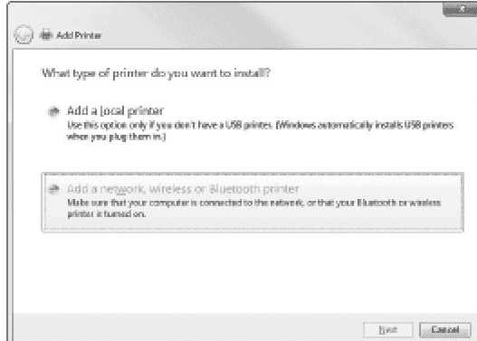

图 6-1：添加打印机向导启动。

- 3. 选择“添加网络、无线或蓝牙打印机”选项。

向导会在网络中搜索可用的打印机，并显示找到的打印机列表，如图 6-2 所示。

- 4. 点击您想要使用的打印机。

如果您找不到想要使用的打印机，请点击“我需要的打印机未列出”，并在提示时输入打印机的 UNC 或 IP 地址。

- 5. 点击“下”添加打印机。

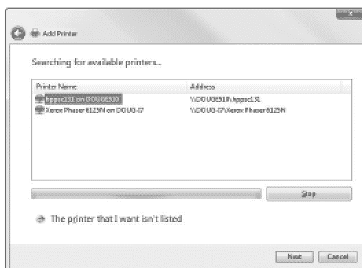

图 6-2：添加打印机向导要求您选择打印机。

向导会将网络打印机的正确打印机程序复制到您的计算机上。（系统可能会提示您确认是否要添加驱动程序。如果是，请点击“安装驱动程序”继续。）

添加打印机向导会显示一个屏幕，显示打印机名称，并询问您是否要将该打印机设置为默认打印机。

- 6. 如果需要，将该打印机指定为默认打印机。

- 7. 点击“下”继续。

- 8. 点击“完成”。

将显示最终确认对话框。

您已完成！

## 使用 Web 接口访问网络打印机

具有直接网络连接的打印机通常内置了 Web 服务器，允许您从网络上的任何浏览器管理打印机。例如，图 6-3 显示了威er Phaser 6125 的主页。此 Web 接口允许您查看打印机的状态信息并检查打印机的配置。您还可以查看错误日志以了解打印机故障的频率。


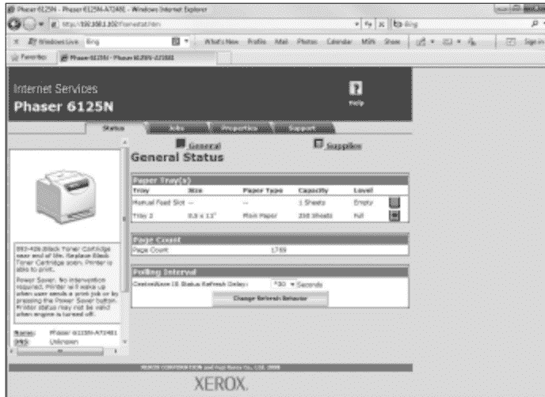

## 配置网络打印机

要调用打印机的 Web 接口，请在任何 Web 器的地址栏中输入其 IP 地址或主机名。

除了显示打印机信息外，您还可以从 Web 浏览器调整打印机的配置。例如，图 6-4 显示了 Xerox 打印机的网络设置页面。在这里，您可以更改网络配置详情，例如 TCP/IP 主机名、IP 地址、子网掩码、域名等。其他配置页面允许您告诉打印机，当您遇到打印机问题时向特定地址发送电子邮件通知。

作为网络管理员，您可能需要频繁访问打印机的 Web 页面。我建议将其添加到浏览器的“收藏”中以便于访问。如果您有几台打印机，请将它们添加到“网络打印机”文件夹下。


图 6-4：通过打印机接口更改网络设置。

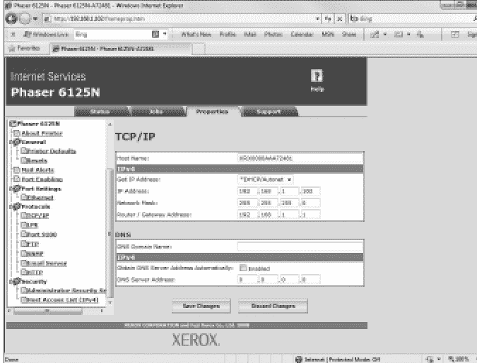

## 配置 Internet 

为了让网络用户访问互联网，您需要确保每台客户端计算机上的 TCP/IP 配置设置设置正确。如果您有高速互联网连接（如 T1、DSL 或 ISDN），通过路由器和网络连接到互联网，并使用 DHCP 进行自动 TCP/IP 配置，那么您可能不需要任何特殊操作即可让客户端连接到互联网。

## 为客户端配置 DHCP

通过共享高速连接配置客户端计算机访问互联网的最简单方法是使用 DHCP。DHCP 会自动为每个客户端提供详细的 TCP/IP 配置信息。然后，如果您的配置发生变化，您只需要手动更改每台客户端即可。此外，DHCP 服务器避免了常见的人为配置错误，例如为两台计算机分配相同的 IP 地址。

在配置客户端使用 DHCP 之前，您应该先设置 DHCP 服务器。DHCP 服务器的配置应包括：

- 范围：用于指定分配给客户端计算机的 IP 地址范围和子网掩码。

- 路由器地址：该路由器应作为客户端计算机访问互联网的默认网关。

- 客户端应该使用的 DNS 服务器 IP 地址。

注意，DHCP 可以由服务器计算机或带有内置 DHCP 的智能路由器提供。有关配置 DHCP 的更多信息，请参阅第四部分第 3 章。

配置好 DHCP 服务器后，设置 Windows 使用它非常简单。只需按照以下针对 Windows 7 的步骤操作即可：

1. 打开控制面板并点击“网络状态和任务”。

2. 点击“更改适配器设置”。

3. 右键点击 LAN 连接图标并选择“属性”。

这将打开“局域网连接属性”对话框，如图 6-5 所示。

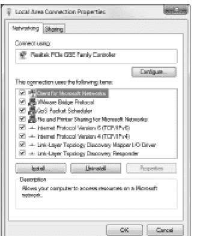

图 6-5：局域网连接属性。

- 4. 选择“Internet 协议版本 4 (TCP/IP)”。

显示“Internet 协议版本 4 (TCP/IP)”属性，如图 6-6 所示。

- 5. 勾选“自动获得 IP 地址”和“自动获得 DNS 服务器地址”。

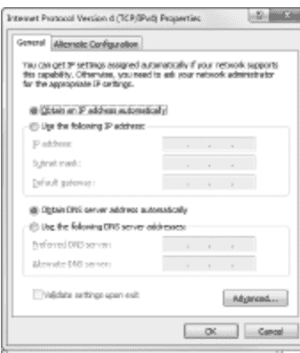

图 6-6：Internet 协议版本 4 (TCP/IP) 属性。

- 6. 点击“确定”返回局域网连接属性。

就是这样。

## 映射网络驱动器

用户想要使用网络的主要原因之一是访问位于网络服务器上的共享存储。虽然有多种方法可以实现，但最常用的方法是映射。映射为网络服务器上的共享文件夹分配驱动器器。然后，用户就可以像本地驱动器一样使用该驱动器。

## 映射网络驱动器

在为网络客户端映射网络驱动器之前，您应该制定如何共享文件夹并将其映射到驱动器的策略。这里有两种可能性：

- 对于个人存储：您可以在文件服务器上为每个用户创建一个单独的共享文件夹，并将驱动器映射到该用户的共享文件夹。例如，您可以创建名为 jBannerman、dHodgson 和 mMcaldeal 的共享。然后，您可以将驱动器 N 映射到 jBannerman 计算机、dHodgson 计算机和 mMcaldeal 计算机。

- 对于整个部门的共享存储：您可以为整个部门创建一个共享，并在部门中的每台计算机上映射该共享。例如，您可以将驱动器 M 映射到名为 Marketing 的共享，供整个市场部门使用。

在决定如何映射文件服务器的共享文件夹后，下一步是在服务器上创建并共享这些文件夹。有关如何执行操作的信息，请参阅本书中特定网络操作系统的相应章节。

当您准备好在客户端上映射驱动器时，请按照以下步骤操作：

1. 选择“此计算机”。

2. 点击“映射网络驱动器”按钮。

弹出“映射网络驱动器”对话框，如图 6-7 所示。

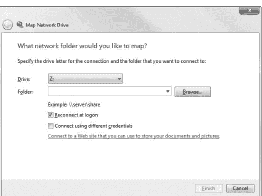

图 6-7：映射网络驱动器。

# 映射网络驱动器 149

- 3. 在驱动器下拉列表中选择你想要映射的驱动器号。

- 4. 在“文件夹”文本框中输入你想要映射的服务器和共享的有效路径。

例如，要映射到名为 MKSERVER 的服务器上名为 pCaldwell 的文件夹，输入 `\MKTSERVER\pCaldwell`。

如果你不知道服务器或共享名称，请点击“浏览”（Browse）按钮并浏览到你想要映射的文件夹。

- 5. 为了让网络驱动器每次用户登录时都自动映射，请选择“登录时重新连接”（Reconnect on Logon）复选框。

如果你取消勾选此复选框，驱动器将仅映射到下次关闭 Windows 或注销为止。

- 6. 点击“完成”（Finish）。

这就成功了。

如果你是那种倾向于通过命令行进行操作的人，可以在命令提示符中使用 `NET USE` 命令快速映射网络驱动器。例如，这里有一个 NET USE 命令，可以将 Z: 驱动器映射到 `\MKTSERVER\pCaldwell`：

```
net use z: \MKTSERVER\pCaldwell /persistent:yes
```

指定 `/persistent:yes` 会导致驱动器在每次用户登录时重新映射。要通过命令行删除已映射的驱动器，请使用如下命令：

```
net use z: /delete
```

在这里，Z: 驱动器的映射被删除了。

此处描述的手动设置驱动器映射对于小型网络非常好，但对于大型网络则不然。如果服务器或共享名称发生变化，你将不得不前往 200 台计算机来更新驱动器映射。如果是 2,000 台计算机呢？对于较大的网络，你更有可能使用登录脚本或组策略来为最终用户配置网络存储。你可以在第七卷第 4 章和第 6 章中找到更多关于登录脚本和组策略的信息。

第七卷第 6 章

配置其他功能

## 第 7 章：验证你的网络安装

### 本章内容

- 检查网络配置设置

- Ping你自己和其他人

- 确保你可以登录


- 验证映射的驱动器并检查网络打印机

你已经安装了所有的网卡，插好了所有的线缆，并配置了所有的软件。然而，在你宣布网络完成之前，还有一项任务：你必须验证网络是否按预期工作。

验证网络并不困难。你只需要确保用户可以登录并访问他们需要的网络资源即可。如果一切运行如如意，你就可以宣布胜利，给自己给自己鼓个掌，然后下午休假了。如果不是，你就必须进行一些故障排除，以确定问题的根源。

在这个简短的章节中，我描述了你应该执行的一些测试，以确保你的网络运行正常。在此过程中，我建议了一些可能会中断你网络的常见问题。然而，本章的重点是验证你的网络是否运行正常——而不是在它运行异常时进行故障排除。关于网络故障排除的信息，请参考第三卷第 6 章和第 7 章，以及第七卷第 7 章。

顺便提一下，本章描述的大多数技术可以在 MS-DOS 命令提示符中运行。你可以在 Windows Vista 或 Windows 7 中点击“开始”按钮，输入 `cmd` 并按回车打开命令提示符。在 Windows XP 中，选择“开始-运行”，输入 `cmd`，然后点击“确定”。

## 计算机是否连接到网络？

这很容易检查。检查你电脑网络接口卡上的 Link 灯，以及电脑连接的网络集线器或交换机上的灯。如果两个灯都亮了，说明电脑已连接到网络。如果其中一个或两个都不亮，说明你遇到了连接问题。可能有几个地方错了：

## 网络配置是否正常？

- 连接电脑到墙壁插座或连接到墙壁或交换机的跳线可能是坏的。用一个已知良好的线替换它以验证此问题。
- 墙壁插座与配线架之间的电缆可能是坏的。电缆可能在物理上损坏，或者可能布在 20,000 瓦电机或电梯电机旁边。
- 电脑的 NIC可能是坏的或配置错误。检查配置设置。如有必要，更换网卡。
- 集线器或交换机可能是坏的。

你可以从命令窗口运行三个命令来验证每台电脑的基本配置。这些命令是 `net config workstation`、`net config server` 和 `ipconfig`。

`net config workstation` 命令显示有关计算机网络配置的基本信息。以下是它所输出的示例：

```
C:>net config workstation
Computer name DOUG
Full Computer name doug
User name Doug Lowe
Workstation active on
NetbiosSmb (0000000000)
NetBT_Tcp_(FC62D39-FDDD-448E-93C-012847F2B)
Software version 2002
Workstation domain WORKGROUP
Workstation domain Name (null)
Logon domain DOUG
Timeout (sec) 0
Count (byte)
The command completed.
```

在 `net config workstation` 输出中检查最重要的信息是计算机名称和域名信息。如果计算机配置为启用共享，你还可以运行 `net config server` 来显示有关服务器的基本信息。以下是它的输出示例：

```
C:>net config server
Server Name DOUG
Software version 2002
Server is active on
NetbiosSmb (0000000000)
NetBT_Tcp_(FC62D39-FDDD-448E-93C-012847F2B)
Server domain WORKGROUP
Server domain Name (null)
Logon domain DOUG
Timeout (sec) 0
Count (byte)
The command completed.
```

`ipconfig` 命令显示有关计算机 TCP/IP 配置的信息。如果你只输入 `ipconfig`，将显示电脑的 IP 地址、子网掩码和默认网关。如果你输入 `ipconfig /all`，你将看到更详尽的信息。以下是 `ipconfig /all` 的典型输出：

```
C:>ipconfig
Host Name: doug
Primary DNS Suffix:
Node Type: Unknown
IP Routing Enabled: No
WINS Proxy Enabled: No
Ethernet adapter Local Area Connection:
Connection-specific DNS Suffix:
Physical Address: 00-50-BA-84-39-11
DHCP Enabled: Yes
Autoconfiguration Enabled: Yes
IP Address: 192.168.0.100
Subnet Mask: 255.255.255.0
Default Gateway: 192.168.0.1
DHCP Server: 192.168.0.1
DNS Servers: 127.0.0.1
Lease Obtained: Saturday, May 24, 6:28 PM
Lease Expires: Sunday, May 25, 6:28 PM
```

## 计算机之间可以 ping 通吗？

确保你的网络运行正常的一项基本测试是从命令提示符使用 `ping` 命令来确保网络上的计算机可以相互通信。`ping` 命令只是向另一台电脑发送数据包并请求该电脑回传包。如果收到了回复包，ping 将显示花费的时间。如果没有收到回复包，ping 将显示无法到达计算机的错误信息。

你应该尝试几种 ping 测试。首先，通过让电脑 ping 自己来确保 TCP/IP 正常。打开命令提示符并 ping `127.0.0.1`（`127.0.0.1` 是你可以引用自己的标准环回地址）。如果你愿意，可以输入 `ping localhost`。

接下来，让电脑使用 `ipconfig` 显示的 IP 地址 ping 自己。例如，如果 `ipconfig` 显示电脑 IP 地址为 `192.168.0.100`，则在命令提示符输入 `ping 192.168.0.100`。

现在尝试 ping 你的服务器。你必须每台服务器上运行 `ipconfig` 来确定它们的 IP 地址。或者，你可以 ping 计算机名称。

# 网络打印机可以工作吗？ 155

- 密码区分大小写。请确保你输入的单词正确，并且没有开启大写锁定（Caps Lock）。
- 你可能没有为这台电脑创建计算机账户。请双击计算机名称，并确保你在服务器上有一个有效的账户。
- 双击用户账户策略，以确保没有可能阻止用户登录的设置，例如时间段限制。

# 网络驱动器映射正确吗？

在确认用户可以登录后，你应该确保网络驱动器可用。要做到这一点，请在命令提示符中输入 `net use`。你将看到所有网络映射列表：

```
C:>net use
New connections will be remembered.
Status  Local   Remote          Network
OK      M:      \\DougProd       Microsoft Windows Network
OK      X:      \\Dougadmin     Microsoft Windows Network
OK      Z:      \\Marketing Microsoft Windows Network
The command completed successfully.
```

在这里，你可以看到映射了三个驱动器，并且可以识别出每个映射驱动器的服务器和名称。

接下来，通过显示每个驱动器的目录列表，以确保你实际上可以访问它。例如，输入 `dir m`：如果一切正常，你将看到你映射到 M 盘的共享文件夹目录。

# 网络打印机可以工作吗？

在本章中描述的最后一个测试是确保你的网络打印机工作正常。实现此点的简单方法是将一份短文档打印到网络打印机，并确保文档打印出来。我建议你打开记事本（开始+辅助工具\记事本），输入几个单词（如“Yo, Adrienne!”），然后选择文件：打印以调出打印对话框。选择网络打印机并点击确定。

如果网络打印机未出现在可用打印列表中，请进入“打印机和传真”窗口并重新检查网络打印机。你可能错误配置了打印机。检查打印机并确保它已开启且已准备好打印。

## 第 8 章：进入虚拟化

本章内容

- 探讨虚拟化的基础
- 权衡虚拟化的优势
- 安装 VMware Player
- 创建和使用虚拟机

虚拟化是当今网络领域最热门的趋势之一。根据行业人士的说法，虚拟化是自晶体发明以来计算机领域发生的最好的事件。如果你还没有开始将你的网络虚拟化，那么你正站在台上看着火车离去。

本章是虚拟化的简要介绍，重点介绍如何利用它来利用你的网络硬件，用更少的硬件提供更多的服务器。除了虚拟化的通用概念外，你还将了解如何使用 VMware 的免费虚拟化产品—— VMware Player 来进行虚拟化实验。

精通虚拟化环境需要专门的书籍——推荐 Bernard Golden 写的《傻瓜虚拟化》（Virtualization For Dummies）或《傻瓜 VMware 基础设施 3》（VMware Infrastructure 3 For Dummies，没关系，真的）。

## 理解虚拟化

虚拟化背后的基本思想是使用软件来模拟硬件的存在。这种强大的思想使你在单台物理计算机系统上运行多个独立的计算机系统。例如，假设你的组织总共需要 12 台服务器来满足需求。你可以将这 12 台服务器中的每一台放在单独的计算机上，在这种情况下，你的服务器房里会有 12 台计算机。或者，你可以使用虚拟化在仅两台计算机上运行这 12 台服务器。实际上，每台计算机都会模拟六个独立的计算机系统，每个系统运行你的其中一台服务器。

## 158 理解视化

# 可视化的根源

现在的孩子认为他们发明了一切，包括虚拟化。

每台虚拟机（VM）都可以运行与 System/370 兼容的各种客操作系统，并且对于这个客操作系统来说，它似乎是一个完整的、独立的 System/370 计算机，拥有自己的处理器核心、虚拟内存、磁盘分区和输入输出设备。

你却并不知。

虚拟化是在 20 世纪 90 年代初为 PC 计算机开发的，大约是皮卡德舰长在《星际迷航：下一代》中驾驶企业号飞行的时期。

但这个想法比那老得多。

第一批虚拟服务器计算机比皮卡德舰长早了 20 年。1972 年，IBM 发布了一个简单名为 VM 的操作系统，它拥有今天虚拟化中几乎所有的基本功能。

VM 本身的核心被称为*虚拟机管理程序*（hypervisor），这是延续至今的另一个术语。

1972 年发布的 VM 产品实际上是基于他们在 1967 年限量发布的一项实验性产品。

IBM System/370 主主机的 VM 管理员可以使用它创建多个虚拟机，每个虚拟机都被称为（你猜得着）*虚拟机*或 VM。这种术语今天仍在在使用。

所以，当有人给你谈起这种名为*虚拟化*的新技术时，你可以告诉他们是在《星际迷航》热播期间发明的。当他们问：“你是说有皮卡德的那个吗？”你可以说：“不，是有柯克的那个。”

每台模拟的计算机都是一台*虚拟机*或 VM。从所有角度来看，每台虚拟机看起来都像一个完整的、自成体系的系统，拥有自己的处理器（或更有可能是多个处理器）、磁盘驱动器、CD-ROM/DVD 驱动器、键盘、鼠标、显示器、网络接口、USB 端口等。

和真实机器一样，每台虚拟机都需要一个操作系统才能工作。在典型的服务器环境中，每个虚拟机都运行一个 Windows 2008 副本。操作系统并不知道自己是运行在虚拟机而不是真实机器上。

如果你希望能够明智地讨论虚拟化，你需要熟悉以下几个术语：

- **主机**（Host）：运行多个虚拟机的实际物理计算机。
- **裸机**（Bare Metal）：运行多个虚拟机的计算机的另一种术语。
- **虚拟机**（Guest）：运行在主机上的虚拟机的另一种术语。
- **客操作系统**（Guest Operating System）：运行在虚拟机内的操作系统。它本身只是一个虚拟机；需要一个操作系统才能运行。
- **虚拟机管理程序**（Hypervisor）：创建和运行虚拟机的虚拟化操作系统。

虚拟机管理程序有两种基本类型：1 型和 2 型。1 型虚拟机管理程序是直接运行在裸机上的管理程序。2 型虚拟机管理程序是运行在操作系统内部的管理程序，而该操作系统又运行在裸机上。

对于生产环境，你应该始终使用 1 型虚拟机管理程序，因为它们比 2 型管理程序高效得多。然而，1 型管理程序要贵得多，因此许多人使用廉价或免费的 2 型管理程序来进行虚拟化实验，然后再决定购买昂贵的 1 型管理程序。

在许可方面，微软将每个虚拟机视为独立的计算机。但是，如果你在单台主机上运行六个虚拟机，且每个虚拟机都运行 Windows 2008，那么你需要六个 Windows 2008 许可。

# 看看虚拟化的优势

## 160 展望虚拟化的优势

- **硬件成本：** 当使用虚拟化时，你通常可以通过减少硬件成本来节省大量资金。例如，假设你用一台成本为 4,000 美元的主机服务器替换掉十台服务器。诚然，你在这台服务器上的花费可能会超过 4,000 美元，因为它需要对内存、处理器核心、网络接口等进行最大配置。你最终可能为这台主机服务器花费 15,000 美元或 20,000 美元。你还会花费大约 5,000 美元购买虚拟机管理器软件——但这远少于你为十台每台 4,000 美元的计算机花费的 40,000 美元。
- **能源成本：** 许多组织发现，虚拟化使得服务器计算机的整体电耗减少了 80%。这种节省是使用更少硬件完成更多工作的直接结果。例如，一台运行十台服务器的主机计算机所使用的能量大约是十台服务器在独立硬件上运行所需能量的十分分之一。
- **可恢复性：** 虚拟化最大的优势之一不是节省成本，而是从硬件故障中快速恢复的能力。例如，假设你的组织有十台运行在独立硬件上的服务器。如果其中任何一台由于硬件故障（例如主板损坏）而宕机，该服务器将一直处于宕机状态，直到你修好计算机。另一方面，如果十台服务器作为虚拟机运行在两台不同的主机上，而其中一台主机发生故障，运行在故障主机上的虚拟机可以在几分钟内在另一台主机上启动。

诚然，服务器在单台主机上的运行效率会比在两台主机上低，但重点是它们在经过短时间停机后就能运行。

事实上，使用目前最先进的虚拟机管理器，从故障主机到另一个主机的迁移可以自动且瞬间完成，因此完全消除了停机时间。
- **灾难恢复：** 除了硬件故障时的可恢复性优势外，虚拟化的更大的优势在真正的灾难恢复情况下会发挥作用。例如，假设你的组织基础设施由 20 台独立的服务器组成。在发生毁灭性灾难的情况下（例如服务器房火灾摧毁了所有硬件），将这 20 台服务器在新的硬件上重新启动并运行需要多久？恢复时间很可能以周来计算。

相比之下，虚拟机实际上只是可以备份到磁带上的文件。因此，在灾难恢复情况下，你只需要重新构建一台主机计算机并重新安装虚拟机管理器软件。然后你就可以从磁带上恢复虚拟机备份，重启虚拟机，并在几天内恢复运行，而不是需要几周。

## 开始使用虚拟化

虚拟化是一个复杂的课题，掌握像 VMware 基础架构（VMware Infrastructure）这样功能齐全的虚拟化系统的各个方面超出了本书的范围。然而，你可以通过下载并尝试 VMware 的免费虚拟化产品——名为 VMware Player——来涉足虚拟化的浅水。你可以从 www.vmware.com 下载它。

图 8-1 显示了 VMware Player 的主界面。从这个界面，你可以创建一个新的虚拟机，或者运行你已经创建的虚拟机之一。到目前，你已经创建了两个虚拟机：一台运行 Windows Server 2008 R2，另一台运行 Linux。

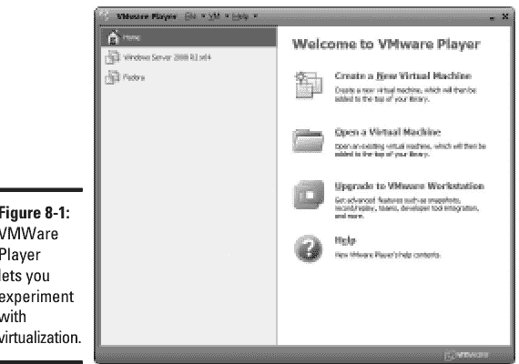

你可以通过选择虚拟机并点击“播放虚拟机”（Play Virtual Machine）来运行现有的虚拟机。这会启动虚拟机，它会在新窗口中打开，如图 8-2 所示。当你启动虚拟机时，虚拟机的行为与真实计算机开机时完全一样：首先它初始化你的虚拟设备，然后加载操作系统。

通过选择虚拟机并点击“播放虚拟机”来运行现有的虚拟机。这会启动虚拟机，它会在新窗口中打开，如图 8-2 所示。当你启动虚拟机时，虚拟机的行为与真实计算机开机时完全一样：首先它初始化你的虚拟设备，然后加载操作系统。

通过选择虚拟机并点击“播放虚拟机”来运行现有的虚拟机。这会启动虚拟机，它会在新窗口中打开，如图 8-2 所示。当你启动虚拟机时，虚拟机的行为与真实计算机开机时完全一样：首先它初始化你的虚拟设备，然后加载操作系统。

通过选择虚拟机并点击“播放虚拟机”来运行现有的虚拟机。这会启动虚拟机，它会在新窗口中打开，如图 8-2 所示。当你启动虚拟机时，虚拟机的行为与真实计算机开机时完全一样：首先它初始化你的虚拟设备，然后加载操作系统。

通过选择虚拟机并点击“播放虚拟机”来运行现有的虚拟机。这会启动虚拟机，它会在新窗口中打开，如图 8-2 所示。当你启动虚拟机时，虚拟机的行为与真实计算机开机时完全一样：首先它初始化你的虚拟设备，然后加载操作系统。

通过选择虚拟机并点击“播放虚拟机”来运行现有的虚拟机。这会启动虚拟机，它会在新窗口中打开，如图 8-2 所示。当你启动虚拟机时，虚拟机的行为与真实计算机开机时完全一样：首先它初始化你的虚拟设备，然后加载操作系统。

通过选择虚拟机并点击“播放虚拟机”来运行现有的虚拟机。这会启动虚拟机，它会在新窗口中打开，如图 8-2 所示。当你启动虚拟机时，虚拟机的行为与真实计算机开机时完全一样：首先它初始化你的虚拟设备，然后加载操作系统。

通过选择虚拟机并点击“播放虚拟机”来运行现有的虚拟机。这会启动虚拟机，它会在新窗口中打开，如图 8-2 所示。当你启动虚拟机时，虚拟机的行为与真实计算机开机时完全一样：首先它初始化你的虚拟设备，然后加载操作系统。

通过选择虚拟机并点击“播放虚拟机”来运行现有的虚拟机。这会启动虚拟机，它会在新窗口中打开，如图 8-2 所示。当你启动虚拟机时，虚拟机的行为与真实计算机开机时完全一样：首先它初始化你的虚拟设备，然后加载操作系统。


通过选择虚拟机并点击“播放虚拟机”来运行现有的虚拟机。这会启动虚拟机，它会在新窗口中打开，如图 8-2 所示。当你启动虚拟机时，虚拟机的行为与真实计算机开机时完全一样：首先它初始化你的虚拟设备，然后加载操作系统。

## 创建虚拟机

- 5. 为虚拟机输入名称。
- 6. 输入虚拟机磁盘文件的位置。

如果需要，可以点击“浏览 (`Browse`)”按钮，并浏览到您想要创建文件的文件夹。
- 7. 点击“下一步 (`Next`)”。

向导会要求为虚拟机创建磁盘大小，如图 8-6 所示。

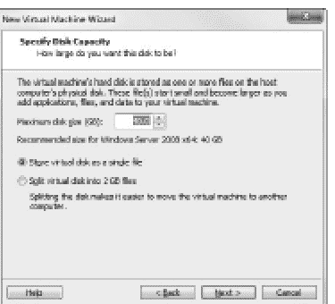

**图 8-6：** 指定虚拟机磁盘大小。
- 8. 设置虚拟机硬盘的大小。

默认设置为 40GB，但您可以根据需要进行更改。请注意，主机计算机驱动器必须有足够的可用空间。
- 9. 点击“下一步 (`Next`)”。

向导显示最终确认页面，如图 8-7 所示。
- 10. 点击“完成 (`Finish`)”。

向导创建虚拟机并启动。由于虚拟机没有安装操作系统，它将从你在第 2 中指定的 CD/DVD 安装镜像启动。在这种情况下，我使用的是 Windows Server 2008 R2 版磁盘镜像，因此新虚拟机显示“安装 Windows”界面，如图 8-8 所示。

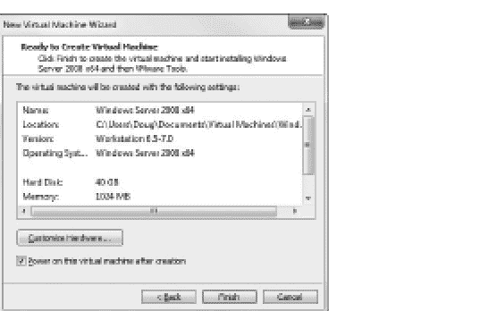

**图 8-8：** VMware 已准备好创建虚拟机。

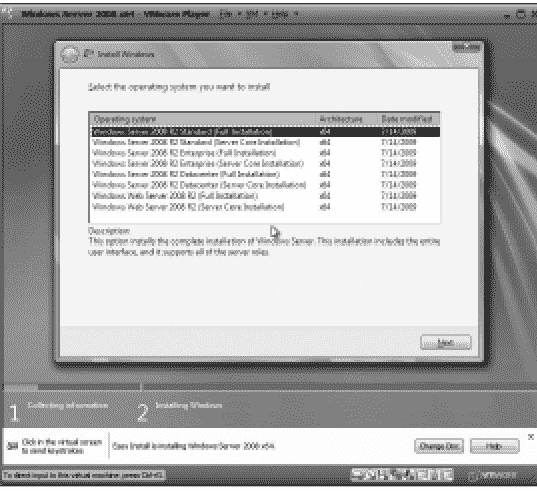

**图 8-8：** 在虚拟机中安装 Windows Server 2008 R2。
- 11. 按照步骤安装操作系统。

在虚拟机中安装操作系统与在物理计算机上安装完全相同，安装界面出现在虚拟机窗口内。
- 12. 完成！

操作系统安装好后，您就可以继续使用虚拟机了。

在虚拟机运行时，可以通过选择“虚拟机；设置 (`VM;Settings`)”来调整虚拟机的硬件配置。这将弹出“虚拟机设置 (`Virtual Settings`)”对话框，如图 8-9 所示。从该对话框中，您可以调整虚拟机的硬件配置，包括分配给虚拟机的内存数量和处理器核心数。您还可以调整硬盘大小，添加 CD、DVD 或软盘驱动器，并配置网络适配器、USB 连接以及音频和显示设置。

第二卷
第 8 章

图 8-9：配置虚拟机设置。

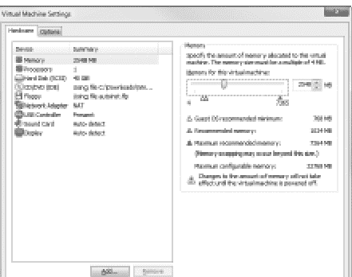

走向虚拟化

## 第三卷

网络管理与安全

Rich Tennant 著 第 5 浪 @RTENNANT


## 目录摘要

- 第 1 章：诚聘英：网络管理员职位描述 .................................................................171
- 第 2 章：安全基础 101 .................................................................................................................185
- 第 3 章：用户账户管理 .................................................................................195
- 第 4 章：防火墙与病毒防护...............................................................................................203
- 第 5 章：通过 VPN 访问扩展网络..................................................................................215
- 第 6 章：网络软件管理...............................................................................................221
- 第 7 章：解决网络问题..................................................................................................233
- 第 8 章：网络性能焦虑......................................................................................249
- 第 9 章：数据备份 ................................................................................................259
- 第 10 章：灾难恢复与业务连续性计划 271

## 第 1 章：诚聘英：网络管理员职位描述

### 本章内容

- 解读网络管理员的众多工作
- 除尘、吸尘和拖地
- 管理网络用户
- 选择合适的工具
- 获取认证

诚聘英。我们需要一名网络管理员，帮助小型企业控制失控的网络。必须具备良好的组织和管理能力。仅要求中等计算机经验。仅限兼职。

这个广告听起来像你公司需要的状态吗？每个网络都需要网络管理员，无论该网络有 2 台还是 20 台电脑。当然，管理一个 200 台电脑的网络是一项全职工作，而管理一个 2 台电脑的网络不是。至少不应该是。

本章将向你介绍网络管理这项枯燥的工作。噢……你可能读这一章是因为你被选为网络经理了，所以我最好换个说法：本章将向你介绍奇妙且令人兴奋的网络管理世界！噢，老天！这将会很有趣！

## 网络管理员做什么

简单来说，网络管理员负责管理网络，这意味着他们负责安装、配置、扩展、保护、升级和修复网络的任务。网络管理员负责网络硬件（如电缆、集线器、交换机、路由器、服务器和客户端）以及网络软件（如网络操作系统、电子邮件服务器、备份软件、应用程序软件）。最重要的是，网络管理员通过回答问题、倾听诉求和解决问题来维护用户。

在大网络中，这些责任构成了一项全职工作。大型网络充满变数：用户进出、设备故障、电缆损坏，生活似乎危机接踵不断。

小型网络要稳定得多。一旦你的网络运行起来，你可能不需要花太多时间来管理硬件和软件。偶尔会出现一些问题，但由于网络上的电脑较少，问题应该少少发生。

无论网络规模如何，网络管理员都必须处理以下常见任务：

- 硬件升级：在购买新电脑、打印机或其他设备时，网络管理员应该参与其中。特别是网络管理员应该准备好争取对网络友好的设备，例如已安装并配置好网卡的电脑。
- 配置：当网络中添加新电脑时，网络管理员必须投入。网络管理员的工作包括考虑布线配置的更改、为新电脑分配计算机名称、如何将新用户集成到安全中以及授予用户哪些权限等。
- 软件升级：偶尔，你信赖的操作系统供应商（即微软）会发布新版本的网络操作系统。网络管理员必须阅读新版本，并判断其功能是否值得升级。大多数情况下，升级新操作系统最困难的部分是确定迁移路径——即如何在尽可能减少对网络或用户干扰的情况下将整个网络升级到新版本。升级新的网络操作系统是一项大任务，因此你需要仔细考虑新版本带来的优势。
- 补丁：在升级之间，微软会发布补丁来修复服务器操作系统的小问题。更多信息，请参阅本章的“修复你的操作系统和软件”章节。
- 性能维护：最容易陷入陷阱的任务之一是对网络速度的追求。网络永远不够快，用户总是归罪于网络经理。因此，管理员花费大量时间调整网络以挤出最后 2% 的性能。你不希望掉进这个陷阱，但万一掉进了，本书的第 8 章可以提供帮助。它将让你了解调整网络以获得最佳性能的基础知识。

## 选择兼职网络管理员 173

- 乏味的工作杂务：网络管理员需要执行例行杂务，例如备份服务器、归档旧数据、释放服务器硬盘空间等。网络管理的大部分工作是确保事物运行正常，并在用户察觉到问题之前发现问题。从这个意义上说，网络管理可能是一项枯燥的工作。
- 软件清单：网络管理员还负责收集、组织和跟踪整个网络的软件清单。你永远不知道市场部的 Joe 那台老旧的 Windows 2000 电脑会在什么时候闹脾气上出乱子，到时你可能得重新安装那份老旧的 WordPerfect。你知道安装光盘在哪儿吗？

## 选择兼职网络管理员

网络越大，需要的技术支持就越多。大多数网络——拥有十到二十台电脑的网络——由一个兼职网络管理员就能应付。理想情况下，这个人应该是一个“深藏不露的极客”：一个对计算机有种秘密兴趣但不肯承认这一点的人。一个会把书带回家并在周末阅读的人。一个仅仅为了省钱就乐于解决计算机问题的人。

管理网络的工作需要一些计算机技能，但它并非完全是技术性工作。网络管理员的大部分工作是例行家务。基本上，网络管理员就是定期对网络进行吸尘和拖地，以防止它变成一团糟。

以下是关于挑选兼职网络管理员的一些额外建议：

- 网络管理员需要是一个有组织能力的人。进行一次突击办公室检查，让桌子最整洁的人负责网络。（不要提前预告他们，或者永远不要在检查的前一个晚上故意故意弄乱他们的桌子。）
- 为网络管理留出足够的时间。对于小型网络（例如，不超过 20 台左右的电脑），每周花一两个小时就足够了。在网络管理员适应工作并熟悉网络内部细节时，起初需要更多时间。不过，在过了最初的适应期后，小型办公室网络管理每周不会花费超过一两个小时。（当然，较大的网络需要更多时间来管理。）
- 确保每个人都知道网络管理员是谁，并确保网络管理员有权对网络做出决策，例如每个用户拥有什么访问权限、哪些文件可以和不能存储在服务器上、多久进行一次备份等。

| 第三部分第一章 |

| 招聘：管理员职位描述：工作 |

## 174 建立例行杂务

- 选一个果断且不介意得罪别人的人。一个优秀的网络管理员应该在硬盘故障之前确保备份运行正常，并在病毒抹除整个网络之前确保防病毒到位。这种“警察行为”会让人感到反感，但这是为了他们好。
- 在大多数情况下，安装网络的人也是网络管理员。这是合适的，因为没有人比设计和安装网络的人更了解这个网络了。
- 网络管理员需要具备理解力——一个对网络了如指掌、渴望表现作为，并且在最糟糕的网络任务被分配给他时报微笑的人。
- 网络管理员应该有一个某种官方头衔，例如网络老大（Network Boss）、网络沙皇（Network Czar）、网络运营副总裁或网络博士（Dr. Network）。胸章、个性化的口袋保护套或一副针耳朵帽也有帮助。

## 建立例行杂务

网络管理员的大部分工作是例行事务——相当于于吸尘、除尘和拖地。如果你愿意的话，就像每隔 3000 英里换一次油并换轮胎。是的，这很无聊，但这是必须的。

- 备份：网络管理员需要确保网络已妥善备份。如果出了问题且网络没有备份，谁来背锅？另一方面，如果灾难降临，你能够从昨天的备份中恢复所有内容，只损失少量工作，猜猜谁会得到表扬、巨额奖金巴哈马假期？本书的第 9 章介绍了网络备份的选项。你最好读一下。
- 保护：网络管理员的另一项主要任务是保护你的网络不受外界世界的侵害。这些侵害有很多形式，包括试图入侵你网络的黑客，以及通过电子邮件到达的病毒程序。本书的第 4 章详细描述了这项任务。
- 清理：用户认为网络就像阁楼一样：他们想把文件扔上去并永远留在那里。无论你的网络有多大的存储空间，你的用户填满的速度比你想象的要快。所以，网络经理就承担了偶尔清理阁楼这个“很有趣”的工作。噢，太开心了。我能提供的最佳建议是不断抱怨那里有多乱，并警告你的用户大扫除要到了。

## 管理网络用户

管理网络技术是网络管理中最简单的部分。计算机技术起初可能会让人困惑，但计算机远没有人那么难以捉摸。管理网络的真正挑战是管理网络用户。

管理技术与管理用户之间的区别显而易见：你可以弄懂计算机，但你永远无法真正弄懂人。使用网络的人比网络本身要难以预测得多。这里是一些应对用户的小技巧：

- 培训是网络经理工作的关键部分。确保每个使用网络的人都理解它。
- 确保每个人都知道网络管理员是谁，并确保网络管理员有权对网络做出决策，例如每个用户拥有什么访问权限、哪些文件可以和不能存储在服务器上、多久进行一次备份等。

## 为你的操作系统和软件打补丁 175

网络经理面临的焦虑之一是应用补丁以保持你的操作系统和软件为最新版本。软件补丁是一个微小的更新，用于修复经常出现的小故障，例如安全或性能问题。

定期，所有最近发布的补丁会被合并成一个服务包（service pack）。对于所有版本的 Windows，你可以使用 Windows Update 来保持软件更新。

- 你对网络越了解，你的准备工作就做得越充分。
- 对于较大的网络，你可以设置一个运行微软“软件更新服务”（SUS）的服务器来自动更新软件。SUS 本质上允许你在自己的网络上建立一个更新站点。然后你就可以完全控制软件如何分发到计算机上。更多信息，请参见 www.microsoft.com/windowserver/updateservices。
- Windows Update 会自动扫描你的计算机并创建一个你可以下载和安装的软件补丁和其他组件列表。你可以在开始菜单中找到 Windows Update。

## 176 为管理员发现软件工具

网络管理员需要某些工具来完成工作。大型、复杂且昂贵的网络的管理员需要大型、复杂且昂贵的工具。小型网络的管理员需要小工具。

管理员需要的一些工具是硬件工具，例如螺丝刀、剥线器和锤子。我在这里讨论的工具是软件工具。以下是你需要的工具示例：

- 绘图工具：绘图工具让你绘制网络结构图。微软销售了一种名为 Visio 的程序，它是专门为网络管理员想要制作的图表设计的。
- 网络发现程序：对于较大的网络，你可能希望购买一种网络发现程序（如 www.networkview.com），它可以自动为你记录网络结构。这些程序会仔细扫描网络，寻找计算机、打印机、路由器和其他设备。然后它们会创建一个网络组件数据库、图表并输出有用的报告。
- 网络内置工具：许多你管理网络所需的工具是网络自带的。作为网络管理员，你应该阅读网络附带的说明书，查看可用的管理工具。例如，Windows 包含一个 `net diag` 命令，可以使用它来确保网络上的所有计算机都能通信

## 为网络管理员发现软件工具 177

相互交流。（你可以在 MS-DOS 提示符中运行 `net diag`。）对于 TCP/IP 网络，你可以使用表 1-1 总结的 TCP/IP 诊断命令。有关这些命令的更多信息，请参阅第四部分第 6 章。


## 表 1-1 TCP/IP 诊断命令

| 命令 | 功能 |
|---|---|
| `arp` | 显示地址解析协议 (ARP) 使用的地址解析信息。 |
| `hostname` | 显示计算机的主机名。 |
| `ipconfig` | 显示当前的 TCP/IP 设置。 |
| `nbtstat` | 显示 NetBIOS over TCP/IP 连接的状态。 |
| `netstat` | 显示 TCP/IP 的统计信息。 |
| `nslookup` | 显示 DNS 信息。 |
| `ping` | 验证指定的计算机是否可用。 |
| `route` | 显示 PC 的路由表。 |
| `tracert` | 显示计算机到指定主机的路由。 |

- **系统信息：** Windows 自带的 `System` 程序对于网络管理员来说是一个非常有用的工具。
- **热补丁检查 (Hotfix Checker)：** 微软提供的另一个方便工具是 `Hotfix Checker`，它可以扫描你的计算机以查看需要哪些补丁。你可以从微软网站免费下载 `Hotfix Checker`。只需访问 `www.microsoft.com` 并搜索 `hnetchck.exe` 即可。
- **微软基线分析器 (Microsoft Baseline Analyzer)：** 如果你更喜欢 GUI 工具，请查看 `Microsoft Baseline Security Analyzer`。你可以从微软网站免费获取它。访问 `www.microsoft.com` 并搜索 `Microsoft Baseline Security Analyzer` 即可找到它。
- **实用程序：** 建议你买一种 100 合一的实用程序，例如赛门诺克的 `Norton Utilities`。`Norton` 包含了极具价值的实用程序，用于修复损坏的硬盘、重新排列硬盘的目录结构、收集有关计算机及其设备的信息等。

不要使用并非为你的计算机所使用的操作系统、版本或你安装的文件系统而设计的硬盘修复程序。每当你升级到更高版本的操作系统时，都应该将你的硬盘修复程序升级到支持新操作系统的版本。

## 构建资源库

- **网络监控 (Network Monitor)**：所有当前版本的 Windows 都包含一个名为 `NetworkMonitor` 的程序，它提供基本的协议分析，并通常可以帮助解决棘手的网络问题。

## 构建资源库

在斯柯提原始《星际迷航》系列中最精彩的台词之一是他拒绝休假以便跟上他的技术期刊。“你从不休息吗？”柯克问。斯柯提回答：“我在休息！”

要成为一名网络管理员，你需要阅读计算机书籍。很多。而且你需要喜欢这样做。如果你是那种会带着电脑书去海滩的人，你将成为一名优秀的网络管理员。

你需要各种主题的书籍。我不推荐特定的书名，但我确实建议你针对以下每个主题买一本优秀且全面的书籍：
- 网络安全与黑客
- 无线网络
- 网络布线与硬件
- 以太网
- Windows Server 2003 或 2008
- Windows XP 或 Vista
- Linux
- TCP/IP
- DNS 和 BIND
- Sendmail
- Exchange Server

## 获取认证 179

除了书籍之外，你可能还想订阅一些杂志，以关注网络行业的动态。以下是你可能应该考虑的几本杂志及其网页地址：
- InformationWeek: `www.informationweek.com`
- InfoWorld: `www.infoworld.com`
- Network Computing: `www.networkcomputing.com`
- Network World: `www.networkworld.com`
- 2600 (一本关于计算机黑客和安全的优秀杂志): `www.2600.com`

互联网是网络管理员获取技术信息的最佳来源之一。你会在浏览器的收藏夹中存放许多包含有用信息的网站。此外，你可能还想订阅许多在线时事通讯，通过电子邮件定期发送最新信息。

## 获取认证

记得《奥兹仙师》结尾附近的那个场景吗？魔法师给了稻草人一张文凭，给胆小狮子一枚勋章，给铁人一份证明信？

网络认证就像那样。我现在就能想象出那个场景：

> 魔法师：“至于你，我那背负网络负担的朋友，任何戴着厚眼镜的人都能管理网络。在我出生的地方，有人整天除了配置 Cisco 路由器别无他事。他们的脑子并不比你大。但他们有一个你没有的东西：认证。因此，根据我赋予的宇宙委员会（Universa Commiteatum Pluribus Unum）的权力，我在此授予你梦寐以求的 C 。”
> 你：“CND？”
> 魔法师：“是的，那是，呃，认证的笨蛋（Certified Dummy）。”
> 你：“OSI 参考模型的七层等于对面层数的总和。噢，太狂喜了！我感到……”

## 获取认证

| 第三部分第 1 章 | 求职者中的网络管理员描述： |
- `CCNP`，或 Cisco 认证网络专业人员，是针对 Cisco 设备的专业级认证。`CCNP` 能够安装、配置和排除任何规模 Cisco 网络的故障。
- `CCDA`，或 Cisco 认证设计辅助工程师，是网络设计的入门级认证。
- `CCDP`，或 Cisco 认证设计专业人士，面向网络设计专业人士。`CCDA` 和 `CCNA` 认证都是获得 `CCDP` 的先决条件。
- `CCIP`，或 Cisco 认证互联专业人士，是一种专业级认证，强调使用 IP 及相关协议创建互联网。
- `CCIE`，或 Cisco 认证互联专家，是 Cisco 认证中的顶级水平。
- 此外还有许多 Cisco 认证供你选择，包括安全、语音技术、无线网络等。

作为本地的电脑大师，你最宝贵的资产之一可能是一个在极客等级上比你高那么一两个级别、知识渊博的朋友。这样，当你遇到棘手的问题时，你就有一位真正的朋友可以打电话寻求建议。以下是一些处理你自己的“大拿”的小贴士：
- 在与你自己的大师打交道时，不要忘记电脑极客的黄金法则：“像你希望你的用户对待你那样去对待你的大师。”不要用那些你没有花时间仔细思考过的简单问题来骚扰你的大师。如果你已经思考过了但还是想不出解决办法，就给你的大师打个电话。大多数计算机专家都欢迎解决不寻常的计算机问题——也就是“遗传缺陷”。
- 如果你还不认识比你更懂电脑的人，可以考虑加入你的 PC 用户小组。该小组甚至有一个专门研究你的网络软件的小组，或者致力于服务与你使用相同网络软件的本地人员。很有可能，你一定会在用户小组会议上结识一两个朋友。此外，你还可以说服你的老板支付加入该小组所需的任何费用。
- 如果你找不到现实中的大师，可以尝试寻找在线大师。检查互联网上各种计算新闻组。订阅通过电子邮件自动发送给你的在线时事通讯。

## 有用的谎言与借口

作为网络管理员，你有时无法解决某个问题，至少不能立即解决。第一种方法是解释该问题特别困难，你将尽快提供解决方案。第二种方法是直视用户的眼睛，并面无表情地尝试这些虚假解释之一：
- 归咎于你正在使用的任何软件版本。“哦，他们已经在版本 39 中修复了那个。”
- 归咎于廉价的进口内存芯片。
- 归咎于民主党。或者共和党。又或是悬挂选票。随便吧。
- 归咎于石油公司高管。
- 归咎于全球变暖。
- 希望问题不是静电引起的。这类问题非常难以追踪。告诉你的用户，在使用电脑之前不妥善地放电会导致各种问题。

## 第 2 章：安全基础 101

### 本章内容
- 评估安全风险
- 确定你的基本安全哲学
- 物理上保护你的网络设备
- 解决用户账户安全
- 使用其他网络安全技术

在你拥有网络之前，计算机安全很容易的。你只需要在每天离开工作时锁好门即可。你可以安心休息，因为你知道坏人必须破门才能拿到你的电脑。

网络改变了这一切切。现在，任何可以访问网络上任何计算机的人都可以入侵网络并盗取你的文件。你不仅要锁好门，还要确保其他人也锁好门。

幸运的是，网络操作系统内置了网络安全措施。这种状况使得即使他们破了门，也很难偷取你的文件。所有现代网络操作系统都具有安全功能，对于除了最偏执的用户之外所有人来说，这些功能绰绰有余。

我说绰绰有余时，我是认真的。大多数网络的安全功能会让即使是聪明的麦克斯韦（Maxwell）感到高兴。使用所有这些安全功能就像斯密特（Smart）从开启了“沉默罩”的局长开始一样。沉默罩的效果非常好，以至于麦克斯和局长在罩子里互相听不见对方的声音！不要让你的系统安全到连好人也无法完成工作。

如果你网络上的任何计算机都连接到互联网，你就必须面对一个全新的安全问题世界。有关互联网安全的更多信息，请参阅本迷你书籍第 4 章。此外，如果你的网络支持无线设备，你就必须面对无线安全问题。有关无线网络安全的更多信息，请参见第五 卷第 2 章。

## 你需要安全吗？

大多数小型网络位于小型企业或部门，那里每个人都认识并信任其他人。人们在休息喝咖啡时不会抬头看桌子，每个人都知道备用金箱在哪里，钱永远消失。

在像这样的世外桃源的环境中，网络安全不是必要的，对吧？你觉得它是必要的。以下是为什么任何网络在建立时至少应该对安全保持基本的考虑：
- 即使在最友好的办公环境中，某些信息也是且也应该是机密的。如果这些信息存储在网络上，你可能希望将其存储在仅供授权用户访问的目录中。
- 并不是所有的安全泄露都是恶意的。常规扫描文件可能会遇到一个不熟悉的文件。用户可能会打开文件，发现它包含机密人事信息、劲爆的办公室八卦或你的简历。好奇心而非恶意是安全泄露的源。
- 如果你认为你的网络不包含任何数据，请再看看。
- 有时，欺诈的机会对某些人来说太大了。
- 如果你认为你的网络不包含任何数据，请再看看。
- 闯入网络的黑客可能对盗取你的数据不感兴趣。相反，他们可能会使用你的服务器发送未经请求的邮件。或者他们直接使用你的服务器。
- 垃圾邮件不会被追溯到黑客；它会被追溯到你身上。
- 最后，记住网络上并不是每个人都了解足够的信息。激活你网络安全功能的最佳理由之一，是保护网络免受那些不知所措的用户所犯错误的影响。

## 考虑两种方法

当你计划如何在你的网络上实施安全时，你应该首先考虑将采取两种安全安全方法中的哪一种：
- 开门型安全，你默认情况下授予所有人访问权限，然后只对你想要限制访问的资源设置限制。
- 闭门型安全，你从拒绝访问所有内容开始，并授予特定用户访问他们所需资源的权限。

在大多数情况下，开门策略更容易实施。通常，网络上的一小部分数据确实需要安全保护，例如机密的员工记录或配方等秘密。网络上的其余信息可以安全地提供给任何可以访问网络的人。

如果你选择闭门方法，你设置每个用户使他们无法访问任何内容。然后，只授予每个用户访问他们所需的文件或文件夹的权限。

闭门方法会导致更严格的安全，但可能会导致“沉默罩”：就像麦克斯和局长在沉默罩下可以互相听到对方一样，你的网络用户会不断抱怨他们无法访问所需的信息。结果，你会发现自己一直在调整用户的访问权限。只有当你的网络包含大量敏感信息，且只有当你愿意花时间管理你的网络安全策略时，才选择闭门方法。

> 你可以将开门方法理解为权利模型，其基本假设是用户拥有网络访问权限。相比之下，闭门策略是一种权限模型，其基本假设是用户不拥有任何权限，但必须获得他们访问的每个网络资源的许可。

## 物理安全：锁好门

任何计算机网络的第一层安全是物理安全。当我走进一家会计师的接待区时，看到接待台桌子上放着一台无人看管的电脑，我感到很惊讶。接待员经常登录系统后离开接待台，让电脑处于无人看管的状态。

## 188 物理安全：锁好你的门

物理安全对于工作站来说很重要，但对于服务器来说至关重要。任何合格的黑客只要获得服务器的物理访问权限，就能迅速击败除最极端以外的所有安全措施。为了保护服务器，请遵循以下指南：
- 锁上机房。
- 仅将钥匙交给你信任的人。
- 记录谁持有钥匙。
- 将服务器安装在带锁的机箱或机架上。
- 禁用服务器上的软盘驱动器。（常见的黑客技术是从软盘启动服务器，从而绕过网络操作系统精心设计的安全功能。）

锁着的门和装了锁的门之间有巨大的区别。如果你不使用门，门就一文不值。

客户终端也应该保持物理安全。你应该指示用户在登录时不要离开电脑无人看管。在人流量大的区域（如前台桌面），用户应该用钥匙锁好电脑。

物理安全方面还有一些你可能没有考虑到的潜在威胁：
- 夜间清洁小组可能可以进入你的设施。你如何知道那个在你办公室里打扫地的人并实际上是在为你的主要竞争对手工作，或者把电脑黑客视为一种业余爱好？所以，你最好开始将清洁小组视为一种威胁。
- 你的垃圾呢？纸碎机不仅仅是为了安然公司的账户。你的垃圾可能包含各种有用信息：销售报告、安全日志、公司安全策略的打印副本，甚至是手写的密码。为了获得最好的安全性，每一张通过垃圾桶离开大字的纸都应该先经过碎纸机。
- 你把备份带存在哪里？不要只把它们堆在服务器旁边。这不仅让它们容易被盗，而且违背了最初备份数据的主要目的之一：保护服务器免受物理威胁（如火灾）。如果火灾烧了你的机房，而备份带毫无防备地放在服务器旁边，你的公司可能会破产——你也会失去工作。请将备份带安全地存放在防火箱内，并在异保留一份。
- 我见过一些网络，服务器在锁的房间里，而集线器或交换机放在不安全的柜子里。记住，集线器或交换机上的每个未使用的端口都代表通往你网络的大门。集线器和交换机应该像服务器一样被保护。

## 保护用户账户

除了物理安全之外，谨慎使用用户账户是你的网络中最重要的安全类型。正确配置的用户账户可以防止未经授权的用户访问网络，即使他们获得了网络的物理访问权限。接下来的章节描述了你可以采取的一些步骤来加强网络对用户账户的使用。

### 混淆你的用户名

哈？涉及到安全时，混淆仅仅意味着使用模糊的用户名。例如，大多数网络管理员根据用户名和姓的某种组合来分配用户名，例如 `Barnym` 或 `baMiller`。然而，如果黑客知道至少一个员工的名字，他就可以很容易地猜出用户 ID。在黑客知道用户名后，他就可以专注于破解密码。

你可以通过使用更模糊的名字来减慢黑客的速度。以下是一些关于如何操作的建议：
- 在名字末尾添加一个随机的三位数字。例如：`Barnym320` 或 `baMiller977`。
- 在名字中间插入一个或两个数字。例如：`Barn6yn` 或 `baMiller2`。
- 确保用户名与电子邮件地址不同。例如，如果用户的电子邮件地址是 `bamiller@ydomain.com`，请不要使用 `baMiller` 作为用户的账户名。使用一个更模糊的名字。

不要依赖混淆来将人挡在你的网络之外！通过混淆实现的安全性是起作用的。资源丰富的黑客可以发现即使是最模糊的名字。混淆的目的是减慢入侵者的速度——而不是阻止他们。如果你减慢了入侵者的速度，你更有可能在他成功进入之前发现他正试图追踪你的网络。

## 明智地使用密码

网络安全最重要的方面之一是密码的使用。用户名通常不被视为机密。即使你使用了模糊的名字，随意的黑客最终也会猜出来。

另一方面，密码是最高机密。你的网络密码是唯一能防止冒充者使用你的用户名登录网络并获得与你相同的访问权限的东西。请用生命守护你的密码。

以下是创建密码的一些提示：
- 不要使用明显的密码，例如你的姓氏、孩子的名字或狗的名字。
- 不要根据你的爱好选择密码。我的一个朋友喜欢划船，他的密码就是他的船的名字。任何认识他的人尝试几次就能猜到他的密码。以你的船命名为密码要受五鞭抽打。
- 将密码存在脑子里——而不是写在纸上。特别糟糕的是：把密码写在便利签上并贴在电脑上。
- 使用难以猜测但容易记住的密码。
- 每 90 天更改一次密码。
- 如果火灾烧了你的机房，而备份带毫无防备地放在服务器旁边，你的公司可能会破产——你也会失去工作。请将备份带安全地存放在防火箱内，并在异地保留一份。
- 我见过一些网络，服务器在锁的房间里，而集线器或交换机放在不安全的柜子里。记住，集线器或交换机上的每个未使用的端口都代表通往你网络的大门。集线器和交换机应该像服务器一样被保护。

## 密码生成器

你如何想出没人能猜到的密码？安全专家说，最好的密码由大写字母、小写字母、数字和符号组成。你可以在互联网上找到随机密码生成器。只需访问搜索引擎，例如 `Google` (`www.google.com`)，并搜索密码生成器。你可以找到许多生成随机密码的网页。

## 加固你的网络

基于你指定的标准，例如密码的长度应该是多少、是否包含字母、数字、标点符号、大写字母和小写字母等。

## 保护管理员账户

理所当然，至少有一个网络用户必须有权使用网络，而不受任何施加在其他用户身上的限制。这个用户被称为管理员。管理员负责设置你的网络安全系统。为了做到这一点，管理员必须免于所有的安全限制。


在安装网络时，许多网络会自动创建一个管理员用户账户。该账户的用户名和密码发布在网络文档中，并且对于所有使用相同网络操作系统的网络都是相同的。在网络运行后，你必须要做的事情之一就是更改标准管理员账户的密码。否则，你周密的安全措施将完全是白费力力。任何知道默认管理员用户名和密码的人都可以以完全的管理员权限和权利访问你的系统，绕过你精心设置的安全限制。


别忘记管理员账户的密码！如果网络用户忘记了自己的密码，你可以以管理员的身份登录并更改该用户的密码。但是，如果你忘记了管理员的密码，你就没辙了。

## 加固你的网络

除了关注物理安全用户账户安全之外，你还应该通过配置网络服务器和路由器的其他安全功能，采取措施保护你的网络不受入侵者。以下章节介绍了加固网络的基础知识。

## 使用防火墙

防火墙是一个位于你的网络和外部世界之间的安全路由器，它可以防止 Internet 用户进入你的局域网并捣乱。防火墙是任何连接到互联网的网络的第一道防线。在没有安装仔细配置的防火墙之前，永远不要将网络连接到互联网。有关防火墙的更多信息，请参阅本书的第 4 章。

## 禁用不需要的服务

典型的网络操作系统可以支持几十种不同的网络服务：文件和打印机服务、Web 服务器、邮件服务器等许多。在许多情况下，这些功能被安装在不需要或使用它们的服务器上。当服务器运行它并不真正需要的网络服务时，它不仅消耗了其他所需服务的 CPU 周期，还构成了不必要的安全威胁。

当你首次在服务器上安装网络操作系统时，你应该只启用你确定服务器将需要的网络服务。如果服务器的需求发生变化，你也可以随时启用服务。

## 为服务器打补丁


黑客经常在网络操作系统中发现漏洞。在发现这些漏洞后，操作系统供应商会想出如何修补漏洞，并发布用于安全修复的软件补丁。问题在于，大多数网络管理员没有及时更新这些软件补丁。结果，许多网络是非常脆弱的，因为它们的安全装甲上有本该被修复但未修复的已知漏洞。

尽管补丁有点麻烦，但考虑到它们提供的保护，是非常值得的。幸运的是，流行的网络操作系统的新版本具有自动检查更新的功能，并在应应用补丁时通知你。

## 保护你的用户

安全技术，如物理安全、用户账户安全、服务器安全和锁定服务器，与网络安全中最困难的工作——保护你的网络用户相比，都是小菜一碟。如果用户将密码写在便利签上并贴在电脑上，所有最完美的安全计划都将付诸东流。

保护网络用户的关键是制定一份书面的安全策略并坚持执行。与每个人开会审阅安全策略，以确保每个人都理解规则。此外，确保在发生违规行为时有相应的后果。

以下是一些你可以纳入安全策略的一些基本安全规则的建议：

- 永远不要写下你的密码或将其交给别人。
- 账户不应共享。永远不要使用别人的账户访问你自己的账户下无法访问的资源。如果你需要访问某些无法提供的网络资源，你应该通过自己的账户正式请求访问。
- 同样，永远不要将你的账户信息交给同事，以便他或她访问所需的资源。你的同事应该通过自己的账户正式请求访问。
- 在未获得许可的情况下，不要在你的计算机上安装任何软件或硬件——特别是无线访问设备或调制调器。
- 在获得许可之前，不要在工作站上启用文件和打印机共享。
- 永远不要尝试禁用或绕过网络安全功能。

## 第 3 章：管理用户账户

### 本章

- 理解用户账户
- 查看内置账户
- 使用权利和权限
- 处理组和策略
- 运行登录脚本

用户账户是网络安全管理的骨干。通过使用用户账户，你可以确定谁可以访问网络，以及每个用户可以和不可以访问的网络资源。你可以将网络访问限制为仅特定的计算机或一天中的某些时段。此外，你还可以锁定不再需要访问你网络的用户。

管理用户账户的具体细节对于每个网络操作系统都是唯一的，并在本书后面的章节中单独介绍。本章的目的仅仅是向你介绍用户账户管理的概念，让你知道你可以做什么和不能做什么。

### 探索用户账户的组成

每个访问网络的用户必须有一个用户账户。用户账户允许你确定谁可以访问网络，以及每个用户可以和不可以访问的网络资源。每个账户都关联一个用户名（有时是用户 ID），用户登录网络时必须输入它。每个账户还与其关联了其他信息，特别是：

- 用户密码：这还包括密码策略，例如用户必须多久更改一次密码，密码必须有多复杂等。

### 查看内置账户

- 用户联系信息：这包括姓名、电话号码、电子邮件地址、地址和其他信息。
- 账户限制：这包括允许用户仅在特定时间登录的限制。
- 账户状态：你可以禁用用户账户以便用户无法登录。
- 目录：这指定了一个用户可以存储文档的共享网络文件夹。
- 拨入权限：这些授权用户通过拨号连接远程访问网络。
- 组成员身份：这些根据用户所属的组授予用户某些权利。有关更多信息，请参阅本章稍后的“向组分配权限”。

#### 查看内置账户 197

关于管理员（Administrator）账户，这里有几点需要了解：

- 你无法删除它。系统必须始终有一个管理员。
- 你可以向其他用户授予管理员权限。然而，你应该只对那些确实需要管理员权限的用户授予该权限。
- 当你确实需要执行需要管理员权限的任务时，应该使用它。许多网络管理员会给自己的账户授予管理员权限。如果你以管理员身份登录并在上网或阅读邮件时消磨时间，你只是在邀请病毒或恶意脚本利用你的管理员访问权限。相反，你应该设置两个账户：一个用于日常工作的普通账户，以及一个仅在需要时才使用的管理员账户。
- 管理员账户的默认名称通常是简单的 Administrator。你可能想要考虑更改此名称。更好的做法是将管理员账户的名称更改为更隐晦的名字，并创建一个拥有（如果有的话）——管理员权限的普通用户账户，并将该账户命名为 Administrator。这样，那些花费数周时间尝试破解你 Administrator 账户密码的黑客在最终攻破密码后，会发现自己被耍了。与此同时，你将能够发现他们入侵你安全的尝试并采取适当的行动。
- 最重要的是，不要忘记管理员账户密码。用永久性墨水将其写下来，并储存在诺特克斯堡（Fort Knox）、保险箱或其他安全地点。

第三册

第三章

## 管理用户账户

### 客客账户

另一个常用的创建账户是访客（Guest）账户。该账户设置为空密码且没有任何（如果有）访问权限。访客账户的设计是允许人们走到电脑前登录，但在他们登录后，会阻止他们做任何事情。听起来管理它很浪费时间。我建议你禁用访客账户。

### 服务账户

某些网络用户并不是真人。我的不是说你的某些用户是亚人类。然而，某些用户实际上是软件处理器，它们需要访问安全资源并需要用户账户。这些用户账户通常在你安装或配置服务器软件时自动为你创建。

例如，当你安装微软的 Web 服务器（IIS）时，有一个名为 `IUSR<servername>` 的 Internet 账户。如果服务器名为 `WEB1`，则账户名称为 `IUSR_WEB1`。IIS 使用此账户允许匿名 Internet 用户访问你网站站的文件。

作为一个一般原则，除非你清楚自己在做什么，否则不应该动这些这些账户。例如，如果你删除或重命名了 `IUSR` 账户，你必须重新配置 IIS 以使用更改后的账户。如果你不这样做，IIS 将拒绝你访问任何尝试连接它的内容。（假设你清楚自己在做什么，重命名这些账户可以增加你网络的安全性。然而，在研究其影响之前，不要开始玩弄这些账户。）

### 分配用户权限

用户账户和密码是网络安全博弈中唯一的正面防线。当用户通过输入有效的 ID 和密码访问网络后，第二道安全防线——权限——就会发挥作用。

在网络生活的严酷现实中，所有用户都是平等的，但某些用户比其他用户更平等。《网络独立宣言》的序言包含这样一段陈述：“我们认为这些真理是不言而明的，即某些用户被网络管理员授予了某些不可剥夺的权利……”

你可以分配给用户的特定权限取决于你所使用的网络操作系统。以下是 Windows 服务器上可能的用户权限部分列表：

- **本地登录：** 用户可以从服务器键盘直接登录服务器计算机。
- **更改系统时间：** 用户可以更改服务器的时间和日期注册表。
- **关机系统：** 用户可以对服务器进行有序关机。
- **备份文件和目录：** 用户可以对服务器上的文件和目录进行备份。
- **恢复文件和目录：** 用户可以恢复已备份的文件。
- **获取文件和其他对象的所有权：** 用户可以接管属于其他用户的文件和其他网络资源。

### 通过权限控制用户访问（谁获得什么）

用户权限控制用户在整个网络范围内可以做什么。权限允许你通过控制单个用户或用户组对特定网络资源（如文件或打印机）的访问，来精细调整你的网络安全。例如，你可以设置权限，允许财务部门的用户访问服务器上 `\ACCTCTG` 目录下的文件。权限还可以允许某些用户读取某些文件但不能修改或删除它们。

每个网络操作系统以不同的方式管理权限。无论细节如何，其结果都是你可以允许每个用户以特定方式访问某些文件、文件夹或驱动器。

你为文件夹指定的任何权限都会自动应用到该文件夹的任何子文件夹，除非你显式地为子文件夹指定了不同的权限集。

Windows 将文件系统权利称为权限。Windows 服务器有六种基本权限，如表 3-1 所示。你可以为给文件或文件夹为用户或组分配任意组合的 Windows 权限。

| 权限 | 缩写 | 用户可以做什么 |
| :--- | :--- | :--- |
| 读取 (Read) | R | 用户可以打开并读取。 |
| 写入 (Write) | W | 用户可以打开并写入。 |
| 执行 (Execute) | X | 用户可以运行。 |
| 删除 (Delete) | D | 用户可以删除。 |
| 修改 (Change) | P | 用户可以更改权限。 |
| 取所有权 (Take Ownership) | O | 用户可以拥有。 |

注意表 3-1 中列出的权限。在 Windows 中，文件或文件夹的所有权概念非常重要。Windows 中的每个文件或文件夹都有所有者。所有者通常是创建文件的用户。然而，所有权可以从一个用户转移给另一个用户。为什么需要获取所有权？该权限仅用于 NTFS 卷上创建的文件。如果你坚持对共享驱动器使用 FAT 或 FAT32，你无法保护单个文件或文件夹。

### 为组分配权限

组账户不代表单个用户。相反，它代表了一组以类似方式使用网络的用户。与其逐个为这些用户授予访问权限，不如将权限授予组，然后将个人用户分配给该组。当你将用户分配给组时，该用户将继承组指定的权限。

例如，假设你为财务人员创建了一个财务组，然后允许财务组成员访问网络财务文件和应用程序。这时，与其为每个财务用户授予访问这些文件和应用程序，只需让每个财务用户成为财务组的成员。

关于组还有一些额外的细节：

- 组是网络管理境界的关键。尽可能可能，你应该避免单独管理网络用户。相反，将他们聚合成组并管理组。当财务部门的所有 50 个用户都需要访问一个新的文件共享时，你更愿意更新 50 个用户账户还是更新一个组？
- 用户可以属于多个组。这时，用户会继承每个组的权限。例如，假设你设置了会计、销售、市场和财务组。一个需要访问既会计和财务信息的用户可以成为会计组和财务组的成员。同样，需要访问销售和市场信息的用户可以成为销售和市场组的成员。
- 你可以为单个用户授予或撤销特定权限以覆盖组设置。例如，你可能会为财务经理授予一些额外的权限。你也可以对某些用户施加额外的限制。

# 使用登录脚本实现任务自动化 201

## 理解用户配置文件

用户配置文件是 Windows 的一项功能，用于跟踪单个用户对其 Windows 配置的偏好。对于未连接网络的计算机，配置文件允许两个或多个用户使用同一台计算机，且每个人都有自己的自己的桌面设置，例如壁纸、颜色、开始菜单等。

当配置文件在网络上使用时，用户配置文件的实际优势就变得显而易见。用户的配置文件可以存储在服务器上，每当该用户从网络上的任何 Windows 计算机登录网络时，就可以访问它。

以下是由用户配置文件中的设置管理的 Windows 某些元素：

- 来自“显示属性”对话框的桌面设置，包括壁纸、屏幕保护程序和颜色方案
- 开始菜单程序和 Windows 任务栏选项
- 收藏夹，提供快速访问用户经常访问的文件和文件夹
- 网络设置，包括驱动器映射、网络打印机和最近访问的网络位置
- “文档”文件夹（Windows XP 中称为“我的文档”）

## 使用登录脚本实现任务自动化

登录脚本是一个在每次用户登录时自动运行的批处理文件。登录脚本可以为您执行多项重要任务，例如映射网络驱动器、启动应用程序、同步客户端计算机的实时钟等。登录脚本存储在服务器上。每个用户账户都可以指定是否使用登录脚本以及使用哪种脚本。

这是一个映射了几个网络驱动器并同步时间的登录脚本示例：

```
net use m: \MYSERVER\Acct
net use n: \MYSERVER\Admin
net use o: \MYSERVER\Dev
net time \MYSERVER /set /yes
```

登录脚本已经有些过时，因为登录脚本执行的大部分工作可以通过用户配置文件来实现。尽管如此，许多管理员仍然倾向于登录脚本的简单性，因此即使在 Windows Server 2003 和 2008 系统上仍然在使用它们。

# 第 4 章：防火墙与病毒防护

### 本章内容

- 理解防火墙的作用
- 检查不同类型的防火墙
- 查看病毒防护
- 探索 Windows 安全性

如果您的网络连接到互联网，大量的安全问题就会浮出水面。您可能将网络连接到互联网是为了让网络用户能够访问互联网。但遗憾的是，您的互联网连接是双向的。它不仅让您的网络用户能够越过网络边界访问互联网，还让其他人进入并访问您的网络。

而他们确实会进入。世界上充满了寻找像您这样网络并进行破解的黑客。他们这样做可能只是为了好玩，也可能为了偷取您客户的信用卡号，或者强迫您的邮件服务器代表他们发送成千上万的垃圾邮件。无论动机如何，请放心，如果您不对网络进行保护，它将会被破解。

本章介绍了保护网络互联网连接的两种基本技术的概述：防火墙和病毒防护。

## 防火墙

防火墙是一种具有安全意识路由器，位于互联网和您的网络之间，其任务单一：防止它们进入我们的内部。防火墙充当互联网和局域网（LAN）之间的安全员。所有进出局域网的网络流量必须通过防火墙，从而防止对网络的未经授权访问。

### 204 防火墙

如果您的网络连接到互联网，某种类型的防火墙是必不可少的，无论该连接是宽带（电缆调制解调器或数字用户线路；DSL）、T1 还是其他高速连接。如果没有它，黑客迟早会发现您未受保护的网络并告诉他的朋友们。在几小时内，您的网络就完蛋了。

您可以通过两种基本方法设置防火墙。最简单的方法是购买防火墙设备，它本质上是一个带有内置防火墙功能的独立路由器。大多数防火墙设备都包含一个 Web 界面，允许您使用浏览器从网络上的任何计算机连接到防火墙。您可以根据需要自定义防火墙设置。

或者，您可以设置一台服务器计算机作为充当防火墙的计算机。服务器可以运行任何网络操作系统，但大多数专用的防火墙系统运行 Linux。

无论您是使用防火墙设备还是防火墙计算机，防火墙都必须位于您的网络和互联网之间，如图 4-1 所示。在这里，防火墙的一端连接到网络集线器，集线器再连接到网络上的其他计算机。防火墙的另一端连接到互联网。因此，所有从局域网到互联网以及反之的流量必须通过防火墙。

图 4-1：使用防火墙设备。

## 多类型的防火墙

“边界”一词有时用于描述防火墙在网络中的位置。简而言之，防火墙就像一圈完全包围您的财产的围栏，所有访客必须从正门进入。

### 多类型的防火墙

防火墙采用四种基本技术将不受欢迎的访客排除在网络之外。以下章节描述了这些基本的防火墙技术。

### 数据包过滤

包过滤防火墙检查通过防火墙的数据包。以下章节描述了这些基本的防火墙技术。

包过滤防火墙根据您设置的规则检查数据包。如果数据包通过测试，则允许通过；如果不通过，则被拒绝。

数据包过滤是最廉价的防火墙类型。然而，包过滤存在许多黑客可以利用的漏洞。包过滤通过检查数据包中包含的源和目的 IP 地址来工作。数据包端口通常指定特定的服务。例如，HTTP 端口号是 80。

包过滤非常常见。数据包过滤本身无法实现完全有效的防火墙。数据包过滤通过检查数据包来识别哪些服务适用于数据包。

有数以千计的端口在使用。表 4-1 列出了常用的一些。

| 端口 | 描述 |
|---|---|
| 20 | 文件传输协议 (FTP) |
| 21 | 文件传输协议 (FTP) |
| 22 | 安全壳 (SSH) |
| 23 | Telnet |
| 25 | 邮件传输协议 (SMTP) |

### 206 多类型的防火墙

| 端口 | 描述 |
|---|---|
| 53 | 域名 (DNS) |
| 80 | 超万网 (HTTP) |
| 110 | 邮局协议 (POP3) |
| 119 | 新闻传输协议 (NNTP) |
| 137 | NetBIOS 名称服务 |
| 138 | NetBIOS 数据报服务 |
| 139 | NetBIOS 会话服务 |
| 143 | 消息访问协议 (IMAP) |
| 161 | 网络管理协议 (SNMP) |
| 194 | 互联网时聊天 (IRC) |
| 389 | 轻量级目录访问 (LDAP) |
| 396 | IP 之 NetWare |
| 443 | 基于 TLS/SSL 的 HTTP (HTTPS) |

您为过滤器设置的规则允许或拒绝指定特定 IP 地址或端口的数据包。例如，您可能允许指向您的邮件服务器或 Web 服务器的数据包，并拒绝所有其他数据包。或者，您可能设置规则，专门拒绝指向 NetBIOS 使用的端口的数据包。

包过滤最大的弱点之一是它非常信任数据包本身所声称的来源和去向是真实的。黑客通过使用称为 *IP 欺骗* 的技术利用这种弱点；他们在向您的网络发送的数据包中插入虚假的 IP 地址。包过滤的另一个弱点是它孤立地检查每个数据包，而不考虑之前通过防火墙的数据包以及之后可能跟随的数据包。换句话说，包过滤是*无状态的*。请放心，黑客已经想出了如何利用包过滤的无状态特性来穿透防火墙。

### 防火墙的类型 207

尽管有这些缺点，包过滤防火墙仍有许多优势，这解释了为什么它们被广泛使用：

- **包过滤器非常高效。** 它们处理每个入站和出站数据包仅需毫秒，期间检查包内部以确定目标和源端口以及地址。一旦确定了这些地址和端口，包过滤器就会快速应用规则，要么发送数据包要么拒绝它。相比之下，其他防火墙技术会有更明显的性能开销。
- **包过滤器对用户几乎是完全透明的。** 用户感知到正在使用包过滤器防火墙的唯一时刻是防火墙拒绝数据包的时候。其他防火墙技术需要客户端和/或服务器进行特殊配置以与防火墙配合。
- **包过滤器非常廉价。** 大多数路由器都内置了包过滤功能。

### 状态包检测 (SPI)

状态包检测也称为 SPI，是对简单包过滤的智能化升级。具有状态包检测功能的防火墙按组查看数据包，而不是单独查看。它跟踪哪些数据包通过了防火墙，并能够检测指示未经授权访问的模式。在某些情况下，防火墙可能会在数据包到达时将其保留，直到防火墙收集到信息以决定是否应该授权或拒绝这些数据包。

状态包检测曾只出现在昂贵的企业级路由器上。现在，SPI 防火墙的价格已经足够，供中小型网络使用。

### 电路级网关

电路级网关根据 TCP/IP 地址和端口号管理客户端与服务器之间的连接。连接建立后，网关不会干预流在系统之间的数据包。


例如，你可以使用 Telnet 电路级网关允许 Telnet 连接（端口 `23`）访问特定的服务器，并禁止其他类型的连接访问该服务器。在建立连接后，电路级网关允许数据包在连接上自由流动。因此，电路级网关无法阻止 Telnet 用户运行特定程序或使用特定命令。

| 第三卷 第4章 防火墙与病毒防护 |
| :--- |
| www.it-ebooks.info |

# Windows 自带防火墙

## 应用网关

应用网关是一种比包过滤防火墙、状态包检测或电路级网关防火更智能的防火墙系统。包过滤器对所有 TCP/IP 数据包一视同仁。相比之下，应用网关了解生成通过防火墙的数据包的应用程序的细节。或者，例如 Web 网关了解 HTTP 数据包的细节。因此，它可以检查除源目的地址和端口以外的更多内容，以判断是否应允许数据包通过防火墙。

此外，应用网关充当代理服务器工作。简单来说，代理服务器位于客户端服务器和真实服务器之间。代理服务器拦截指向真实服务器的数据包并对其进行处理。代理服务器可以检查数据包并决定将其传递给真实服务器，也可以拒绝该数据包。或者，代理服务器也可以直接对数据包做出响应，而不涉及真实服务器。

例如，Web 代理通常在本地缓存中存储常用 Web 页面的副本。当用户从远程服务器请求 Web 页面时，代理服务器拦截该请求并检查其缓存中是否已经有了该页面的副本。如果是，Web 代理将直接将页面返回给用户。如果不是，代理将在真实服务器上请求页面。

应用网关了解各种类型 TCP/IP 服务器处理数据包序列的细节，以便做出更智能的判断，确定进入的数据包是合法还是攻击的一部分。因此，应用网关比简单的包过滤防火墙更安全，后者一次只能处理一个数据包。

然而，应用网关安全性的提高是需要代价的。应用网关在购买价格以及配置和维护成本方面比包过滤器更贵。此外，应用网关会减慢网络性能，因为它们在允许数据包通过之前会对其进行更详细的检查。

## Windows 自带防火墙

Windows 自带了内置的包过滤防火墙。如果你没有独立的防火墙路由器，可以使用此内置防火墙提供基本层面的保护。以下是在 Windows 7 中激活此功能的步骤：

- 1. 选择“开始菜单：控制面板”。出现控制面板。
- 2. 点击“系统和安全”。出现“系统和安全”页面。
- 3. 点击“Windows 防火墙”。出现 Windows 防火墙页面。
- 4. 点击“启用或关闭 Windows 防火墙”。如图 4-2 所示。

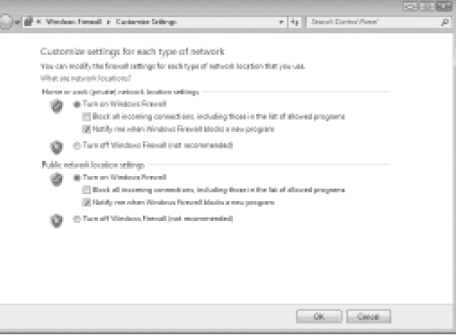

图 4-2：在 Windows 7 中激活防火墙。
- 5. 点击“启用 Windows 防火墙”。
- 6. 点击“确定”。防火墙已启用。

如果你正在使用独立的防火墙路由器来保护网络，请勿启用 Windows 防火墙。因为网络上的其他计算机直接连接到路由器而不是你的电脑，Windows 防火墙无法保护网络的其他部分。此外，作为一个副作用，网络的其他部分将失去访问你计算机的能力。

Windows 防火墙默认开启。如果你的电脑已经位于防火墙之后，你应该禁用 Windows 防火墙（某些情况下，网络的组策略设置可能会阻止你禁用 Windows 防火墙。在这种情况下，你必须更改组策略以便禁用 Windows 防火墙。有关组策略的更多信息，请参见第七部分第六章）。

# 病毒防护

## 什么是病毒？

不要错——病毒是真实的。现在大多数人都连接了互联网，病毒确实泛滥了。每个计算机用户都容易受到计算机病毒的攻击，使用网络会增加你的脆弱性，因为它让所有网络用户暴露于受感染的风险之中。

病毒不会凭空出现。病毒是由那些脑子坏掉、应该被关起来的恶意程序员创建的计算机程序。

病毒的特性是它能够复制自己并将其传播到其他计算机。这些副本反过来又产生更多的副本，传播到更多的计算机，以此类推，无穷无尽。

然后病毒会耐心地等待某些事情触发它——也许当你输入某个特定命令或按下某个键时，当日期到达时，或者当病毒创建消息时。病毒攻击时的行为也取决于它想做什么。某些病毒会无害地显示一条“抓到你了”的消息。向你通讯录中找到的每一个人发送电子邮件。抹掉你硬盘上的数据。哎哟。


几年前，病毒是通过附着在软盘上在计算机之间移动的。每当你从朋友那里借用软盘时，你就面临着被可能伏在磁盘上的病毒感染自己电脑的风险。

病毒程序员发现，电子邮件是传播病毒非常有效的方法。通常，病毒会伪装成有用或有趣的电子邮件附件，例如如何利用空闲时间赚取 100 万美元的说明、名人的裸照，或者来自久未联系的恋人的情人节问候。当好奇但毫无防备的用户双击附件时，病毒就会复活，并将自己复制到用户的计算机上——在某些情况下，还会用户通讯录中的所有联系人发送自己的副本。

当病毒进入网络化计算机后，病毒就可以设法如何将自己传播到网络上的其他计算机。

## 病毒防护小常识

这里是一些关于保护你的网络免受病毒攻击的小常识：

- “病毒”一词通常不仅指真正的病毒程序（能够自我复制的程序），也指任何旨在损害你计算机的程序。这些程序包括所谓的特木马程序，它们通常看起来像游戏，但实际上会破坏硬盘。
- 蠕虫与病毒相似，但它并不会真正感染其他文件。相反，它只是将自己复制到网络上的其他计算机上。当蠕虫复制到你的电脑后，无法预测它会做什么。例如，蠕虫可以扫描你的硬盘以寻找感染信息，如密码或信用卡号，然后通过电子邮件将其发送给蠕虫的作者。
- 计算机专家已经鉴定出数千种“病毒毒株”。其中许多病毒有很形象的名字，例如“我爱你你”病毒、“大石头”病毒和“米开朗基罗”病毒。
- 杀毒软件可以识别已知病毒并将其从你的系统中删除，它们还能发现未知病毒的迹象。遗憾的是，编写病毒的笨蛋并不愚蠢（从智力意义上来说），他们一直在不断开发新技术来规避杀毒软件的检测。新病毒频繁被发现，杀毒软件也会定期更新以检测并删除它们。

## 杀毒软件

保护网络免受病毒感染的最佳方法是使用杀毒软件。这些程序拥有数千种已知病毒的目录，可以检测并删除它们。此外，它们还能识别病毒通常对计算机文件所做的更改，从而减少某些未知病毒未被发现的概率。

如果 Windows 自带杀毒软件就好了，但事实是它并没有。你必须自己购买程序。Windows 上最好的两款杀毒软件是赛门信的 NortonVirus 和 McAfee 的 VirusScan。

制作杀毒软件的人对病毒世界的动态了如指，经常发布软件更新以应对最新的病毒。由于病毒在不断产生新病毒，除非通过下载最新更新来保持软件为最新，否则你的杀毒软件将毫无用处。

## 病毒防护部署方法

在网络上部署病毒防护有几种方法：

- 在每个网络用户的计算机上安装杀毒软件。如果你能保证所有用户都更新其杀毒软件，这种技术将是最有效的。由于这不太可能实现，你可能希望采用更可靠的病毒防护方法。
- 管理式杀毒服务将杀毒客户端计算机置于你的网络中。然后，杀毒服务器根据基本规则自动更新客户端，以确保它们保持最新状态。
- 基于服务器的杀毒软件保护你的网络服务器免受病毒侵害。例如，你可以在邮件服务器上安装杀毒软件，扫描所有传入邮件的病毒并在网络用户看到它们之前将其删除。
- 某些防火墙设备包含杀毒强制检查，除非用户的杀毒软件已是最新版本，否则不允许其访问互联网。这种类型的防火墙提供了最好的杀毒防护。

## 安全计算

除了使用杀毒软件外，你还可以采取一些预防措施来确保无病毒的计算。如果你还没有和你的孩子谈论这些安全计算实践，你最好尽快和他们谈谈。

- 定期备份你的数据。如果病毒袭击了你，而你的杀毒软件无法修复损坏，你可能需要备份来恢复数据。确保从病毒感染之前创建的备份中进行恢复！
- 如果你在商店购买软件并发现磁盘包装的封条已破，请退回软件。不要尝试在你的计算机上安装它。你听到的受污染软件没有听到的受污染牛肉那样频繁，但如果你购买了被打开过的软件，它可能被植入了病毒。
- 在计算机去过维修店或由顾问处理后，使用你的杀毒软件扫描磁盘是否有病毒感染。这些人并无恶意，但他们偶尔会无意中传播病毒，仅仅是因为他们处理了许多奇怪的计算机。
- 不要打开来自陌生人的邮件附件，或你未预料到的附件。
- 在访问任何软盘或 CD 上的文件之前，使用你的杀毒软件扫描其是否有病毒感染。

## 使用 Windows 操作中心

Windows 7 包含一个名为“Windows 操作中心”的新功能。如图 4-3 所示，Windows 操作中心监控计算机上安全相关问题的状态。你可以通过打开控制面板、点击“系统和安全”，然后点击“Windows 操作中心”来调用该中心。

4-3：Windows 7 操作中心。

Windows 操作中心会提醒你计算机安全状态存在的问题，并提醒你应该执行的维护，例如安装系统更新。

关于 Windows 操作中心，还有几点需要考虑的内容：

- 旗帜图标（显示在页边处）出现在 Windows 任务栏右侧的通知区域，提醒你关注 Windows 操作中心中需要处理的项目。
- Windows 操作中心会提醒你计算机安全状态存在的问题，并提醒你应该执行的维护，例如安装系统更新。

# 理解 VPN 服务器与客户端

从电话公司接入的 T1 线路连接两个办公室。这条私有的 T1 线路提供了极安全性，因为它在物理上连接了两个办公室，并且只能从这两个端点访问。

VPN 与私用租线相同的点对点连接，但它是通过互联网而不是昂贵的专用线路实现的。为了创建一个确保数据从 VPN 一端传输到另一端时私密性的隧道，使用特殊的安全协议对数据进行加密。

最重要的 VPN 安全协议是 `IPSec`，全称为 Internet Security 协议。`IPSec` 是一系列对在互联网上传输的数据包进行加密和认证的标准集合。换句话说，它提供了一种加密数据包内容的方法，使得只有知道秘密密钥的人才能解码数据。此外，它提供了一种可靠识别数据包来源的方法，以便 VPN 隧道两端的双方都能信任数据包是真实的。

参考第一本书第2章介绍的 OSI 参考模型，`IPSec` 协议运行在 OSI 模型的第 3 层，也称为网络层。这意味着 `IPSec` 协议并不知道数据包携带的是什么类型的数据，也不对其进行认证。`IPSec` 协议本身只负责加密数据包内容（有时是负载）的细节以及确保发送者的身份。

另一个常用的 VPN 协议是 `L2TP`。`L2TP` 全称为 Layer 2 Tunneling Protocol（数据链路隧道协议）。该协议不提供数据加密。相反，它的设计用于创建端到端的隧道，数据可以在其中传输。`L2TP` 实际上是两个旧协议的组合：一个是由 Cisco 开发的 `L2FP`（数据链路转发协议），另一个是由微软开发的 `PPTP`（点对点隧道协议）。

当今的许多 VPN 使用 `L2TP` 和 `IPSec` 的组合，即 `L2TP Over IPSec`。这种 VPN 类型结合了 `L2TP` 和 `IPSec` 的优点，提供了高水平的安全性和可靠性。


VPN 连接需要一个 VPN 服务器和一个 VPN 客户端——服务器是隧道一端的守门员，客户端位于另一端。服务器和客户端之间的主要区别在于客户端发起与服务器的连接。VPN 客户端一次只能与一个服务器建立连接。然而服务器可以接受来自许多客户端的连接。

通常，VPN 服务器是一个独立的硬件设备，大多数情况下是安全设备，例如 Cisco ASA 设备。VPN 服务器也可以通过软件实现。例如，Windows Server 2008 包含了内置的 VPN 功能，尽管它们并不容易配置。VPN 服务器也可以在 Linux 中实现。

图 5-1 显示了 Cisco ASA 设备的多种 VPN 配置方案之一。此屏幕提供了 IPSec 连接的配置细节。预共享密钥（Pre-Shared Key）用于加密通过 VPN 发送的数据。客户端需要提供相同的密钥才能参与 VPN。

图 5-1：Cisco ASA 安全设备上的 IPSec 配置页面。

VPN 客户端通常是运行在想要连接到远程网络的客户端计算机上的软件。VPN 客户端软件必须配置 VPN 服务器的 IP 地址，以及身份验证信息（如用户名和用于加密数据的预共享密钥）。如果客户端使用的密钥与服务器使用的密钥不匹配，VPN 服务器将拒绝客户端的连接请求。

图 5-2 显示了一个典型的 VPN 软件客户端。当客户端配置了正确的连接信息（你可以通过……来实现）时，你只需连接即可。

图 5-2：典型的 VPN 软件客户端。

VPN 客户端也可以是硬件设备，例如安全设备。这在使用 VPN 时最为常见。例如，假设网络有……这是网络的一部分。

## 第 6 章：软件管理

- 理解软件许可证的类型
- 使用服务器
- 探索部署方案
- 更新补丁和服务程序包

任何管理员的一项重要任务都是管理整个网络安装的各种软件。例如，你可能会购买某种禁止商业用途的学生版或家庭版程序。某些软件——例如 Sun Microsystems 的 Java——禁止将其用于军事应用。

网络管理的另一个重要方面是确定在多台计算机上安装软件的最快捷方法。你最不想做的是在每台计算机上手动运行软件。相反，你希望实现软件的部署。

最后，你希望确保整个网络中安装的所有软件程序都通过软件供应商提供的补丁和更新保持最新状态。

### 理解软件许可证 223

- 几乎所有的软件许可证都通过更换有缺陷的安装光盘/光片来限制软件供应商的责任。换句话说，软件供应商对软件漏洞可能造成的任何损害不承担责任。在少数情况下，许可证限制在法院中被撤销，公司被认为须对缺陷软件造成的损害承担责任。在大多数情况下，您需要自担风险软件。

在许多情况下，软件供应商会提供几种不同类型的许可证供您选择。当你购买用于网络环境的的软件时，你需要了解这些许可证类型之间的差异，以便决定获取哪种类型。最常见的类型有：

- **零售许可证**是你直接从软件供应商、本地商店或在线商店购买的软件。零售许可证通常允许单个用户安装和使用该软件。根据协议，许可证可能允许您在两台电脑上安装软件——一台在公司，一台在家里。关键点是只能有一个用户可以使用该软件。然而，在多个用户共享的计算机上安装软件通常是可以接受的。在这种情况下，多个用户可以使用该软件，只要他们不是在同一时间使用即可。

零售许可证的主要优势是，当用户升级电脑时，许可证会随用户移动。换句话说，如果你买了新电脑，你可以从旧电脑上删除软件并将其安装到新电脑上。

- **OEM 许可证**适用于计算机制造商在新电脑上安装的软件。（OEM 代表原始设备制造商）。例如，如果你从戴尔购买了电脑并随电脑订购了 Microsoft Office Professional，你获得的是 OEM 许可证。关于 OEM 许可证最重要的一点是，它仅适用于你购买软件的那台特定计算机。你绝不允许允许在购买软件的计算机以外的任何计算机上安装该软件。

如果你在冲怒之下将电脑从办公室的楼窗扔了出去，导致电脑在停车场撞碎成碎片，那么你的 OEM 版 Office 基本上就永远丢失了。当你购买备用电脑时，你必须为新电脑购买新的新的 OEM 许可证。你无法在新电脑上安装旧软件。

如果这听起来像是一个严重的限制，它确实如此。然而，OEM 许可证的价格通常远低于零售许可证。例如，Microsoft Office 2007 专业版的零售许可证售价约为 500 美元，而 OEM 版本则不到 400 美元。

### 使用许可证服务器

- **批量许可证**允许你现在多台计算机上安装和跟踪软件。最简单的批量许可证仅规定了你可以在多少台计算机上安装软件。例如，你可能会购买一个 20 用户版本的程序，该程序允许你在 20 台电脑上安装软件。通常情况下，你基于“信誉制”来确保不超过数量。你需要建立某种系统来跟踪此类软件。例如，你可以创建一个 Excel 表格来记录每个人的姓名，你……

批量许可证可能会变得复杂得多。例如，微软提供了几种不同类型的批量许可证计划，每种计划都有不同的定价、功能和益处。表 6-1 总结了这些许可证计划的功能。更多信息，请参阅 `www.microsoft.com/licensing`。

| 表 6-1 微软批量许可证计划 | 描述 |
| :--- | :--- |
| 开放许可证 (Open License) | 最少购买五个终端用户许可证。 |
| 开放价值 (Open Value) | 最少购买五个终端用户许可证，并在订阅期内（三年）获得免费升级。 |
| 选择性许可证 (Select License) | 这是一种专为拥有 250 人或更多员工的公司设计的许可证计划。 |
| 企业级 (Enterprise) | 这是选择性许可证的替代方案，旨在为至少有 250 名员工的组织以成本效益提供 Windows Vista、Office 和其他程序。 |

- **订阅 (Subscription)**：订阅并不是一种独立的许可证类型，而是批量许可证的可选附加组件。增加的订阅使你在订阅期内（通常为年度）享有技术支持和免费产品升级。对于某些类型的产品，订阅还包括新数据的定期下载。例如，杀毒软件通常包含一个定期更新你的病毒特征码数据的订阅。如果没有订阅，杀毒软件将很快失效。

### 使用许可证服务器 225

某些程序允许你购买网络许可证，使你可以在任意数量的计算机上安装软件，但会限制任何时刻使用该软件的人数。为了控制用户的使用情况，会设置一个特殊的许可证服务器。当用户启动程序时，程序会检查许可证服务器查看是否有可用许可证。如果有，程序允许启动，许可证服务器上的可用许可证数量减一。稍后，当用户退出程序时，许可证将返回服务器。

最常用的许可证服务器软件之一是 Macvision 开发的 FlexLM。它被 AutoCAD 以及许多其他软件应用程序使用。FlexLM 使用由软件供应商颁发的特殊许可证文件，指示你购买了多少产品许可证。尽管许可证文件是简单的文本文件，但其内容是加密的，并由只有软件供应商才能访问的程序生成。这是一个典型的 AutoCAD 许可证文件示例：

```
SERVER server1 000ec0fe359
USE_server
VENDOR adsk
```

## 部署网络软件的选项 227

- 1. 创建一个网络共享并在共享内创建一个文件夹，你可以在其中存储安装程序以及安装该程序所需的其他文件。

我通常会创建一个名为 Software 的共享，然后为我想要从网络访问的每个共享创建一个单独的文件夹。你应该为所有网络用户启用读取权限，但允许你自己和你的管理员同事完全访问权限。

- 2. 将程序 CD 或 DVD 的内容复制到你在第 1 步中创建的文件夹中。

只需将 CD 或 DVD 插入计算机的 CD/DVD 驱动器。然后，使用 Windows 资源管理器选择磁盘的所有内容并将其拖到你在第 1 步中创建的文件夹。

或者，你可以选择开始+运行并输入 `cmd` 来打开命令提示符。

```
copy d:\*\server1\someprogram\.* /s
```

在此示例中，`d` 是你的 CD/DVD 驱动器的驱动器，`server1` 是你的文件服务器名称，而 `software` 和 `someprogram` 是你在第 1 步中创建的共享和文件夹名称。

- 3. 要在客户端计算机上安装程序，使用 Windows 资源管理器，导航到你在第 1 步中创建的共享和文件夹，并双击 `Setup.exe` 文件。

这将启动安装程序。

- 4. 按照安装程序显示的说明进行操作。

当安装程序完成后，软件即可可以使用。

将安装程序复制到网络共享可以避免将安装光盘带到每台想要安装软件的计算机上的烦恼。但这并不能免除你为每台计算机购买有效许可证的烦恼！在计算机上安装软件的数量超过你从供应商处获得的许可证允许是非法的。


### 静默安装

将程序安装介质的内容复制到网络共享可以避免你在每台计算机之间携带安装光盘的烦恼，但你仍然必须每台计算机上运行 Setup 程序并回答它所有烦人的问题。如果有一种方法可以自动运行 Setup 程序，使其在你运行它后无需你的进一步交互即可运行，那不是太好了吗？对于许多程序，你可以做到。

在某些情况下，Setup 程序本身有一个命令行开关，可以使其静默运行。你通常可以通过在命令提示符中输入以下内容找到可以使用哪些命令行开关：

```
setup /?
```

### 228 部署网络软件的选项

如果运气好，你会发现 Setup 程序本身有一个开关（例如 `/quiet` 或 `/silent`），它可以使用程序的默认设置在无任何交互的情况下安装程序。

如果 Setup 程序没有提供任何命令行开关，不要绝望！以下步骤描述了一种通常可以让你静默安装软件的技巧。

- 1. 打开资源管理器窗口并导航到：
  * Windows 7 和 Vista: `C:\Users\name\AppData\Local\Temp`
  * Windows XP: `C:\Documents and Settings\name\Local\Temp`

然后，列出此文件夹的内容。

 

这是临时文件夹，各种程序在此处存放临时文件。Windows 可能不允许你删除此文件夹中的每个文件，但尽可能通过排除 Temp 文件夹来开始此过程是一个个好主意。

- 2. 运行 Setup 程序并按照安装步骤操作到最后一步。

当你到达显示“程序已准备好安装软件”的确认屏幕时，停止！不要点击 OK 或 Finish 按钮。

- 3. 返回第 1 步中打开的 Temp 文件夹，然后寻找直到找到你在第 2 步中运行的 Setup 程序创建的 `.msi` 文件。

`.msi` 文件是 Setup 运行以安装程序的实际 Windows 安装程序。它可能有一个加密的名字，例如 `84993882.msi`。

- 4. 将 `.msi` 文件复制到网络共享，你可以在那里并在你的客户端计算机上安装程序。

例如，`\server1\software\someprogram`。

- 5. 将 `.msi` 文件重命名为 `setup.msi`。

这一步是可选的，但我更倾向于运行 `setup.msi` 而不是 `84993882.msi`。

- 6. 使用记事本创建一个批文件，使用 `/quiet` 开关运行 `.msi` 文件。

- 要创建批文件
  a. 在存储 `.msi` 文件的文件夹中点击右键。
  b. 选择新建->文本文档。
  c. 将文本文档的名称更改为 `Setup.bat`。
  d. 右键点击 `Setup.bat` 文件并选择编辑。
  e. 在文件中添加以下行：

```
setup.msi /quiet
```

- 7. 保存文件。

你可以通过导航到你创建 `setup.bat` 文件的文件夹并双击 `setup.bat` 文件来安装软件。

### 创建管理式安装映像

某些软件（如 Microsoft Office 和 AutoCAD）带有工具，可以让你选择一个完全配置好的静默安装程序，然后你可以使用它来静默安装软件。对于 Microsoft 软件，这种静默安装程序是一个管理式安装映像。（注意，Microsoft Office 的版本不包含此功能。你可能需要购买批量许可证来创建管理式安装。）

要创建管理式映像，你只需运行供应商提供的配置工具。配置工具让你选择一个完全配置好的静默安装程序来安装软件。对于 Microsoft 软件，这种静默安装程序是一个管理式安装映像。（注意，Microsoft Office 的版本不包含此功能。你可能需要购买批量许可证来创建管理式安装。）

### 部署软件的策略

#### 228 部署网络软件的选项

如果运气好，你会发现 Setup 程序本身有一个开关（例如 `/quiet` 或 `/silent`），它可以使用程序的默认设置在无任何交互的情况下安装程序。

如果 Setup 程序没有提供任何命令行开关，不要绝望！以下步骤描述了一种通常可以让你静默安装软件的技巧。

- 1. 打开资源管理器窗口并导航到：
  * Windows 7 和 Vista: `C:\Users\name\AppData\Local\Temp`
  * Windows XP: `C:\Documents and Settings\name\Local\Temp`

然后，列出此文件夹的内容。

 

这是临时文件夹，各种程序在此处存放临时文件。Windows 可能不允许你删除此文件夹中的每个文件，但尽可能通过排除 Temp 文件夹来开始此过程是一个好主意。

- 2. 运行 Setup 程序并按照安装步骤操作到最后一步。

当你到达显示“程序已准备好安装软件”的确认屏幕时，停止！不要点击 OK 或 Finish 按钮。

- 3. 返回第 1 步中打开的 Temp 文件夹，然后寻找直到找到你在第 2 步中运行的 Setup 程序创建的 `.msi` 文件。

`.msi` 文件是 Setup 运行以安装程序的实际 Windows 安装程序。它可能有一个加密的名字，例如 `84993882.msi`。

- 4. 将 `.msi` 文件复制到网络共享，你可以在那里并在你的客户端计算机上安装程序。

例如，`\server1\software\someprogram`。

- 5. 将 `.msi` 文件重命名为 `setup.msi`。

这一步是可选的，但我更倾向于运行 `setup.msi` 而不是 `84993882.msi`。

- 6. 使用记事本创建一个批文件，使用 `/quiet` 开关运行 `.msi` 文件。

- 要创建批文件
  a. 在存储 `.msi` 文件的文件夹中点击右键。
  b. 选择新建->文本文档。
  c. 将文本文档的名称更改为 `Setup.bat`。
  d. 右键点击 `Setup.bat` 文件并选择编辑。
  e. 在文件中添加以下行：

```
setup.msi /quiet
```

- 7. 保存文件。

你可以通过导航到你创建 `setup.bat` 文件的文件夹并双击 `setup.bat` 文件来安装软件。

### 创建管理式安装映像

某些软件（如 Microsoft Office 和 AutoCAD）带有工具，可以让你选择一个完全配置好的静默安装程序，然后你可以使用它来静默安装软件。对于 Microsoft 软件，这种静默安装程序是一个管理式安装映像。（注意，Microsoft Office 的版本不包含此功能。你可能需要购买批量许可证来创建管理式安装。）

要创建管理式映像，你只需运行供应商提供的配置工具。配置工具让你选择一个完全配置好的静默安装程序来静默安装软件。对于 Microsoft 软件，这种静默安装程序是一个管理式安装映像。（注意，Microsoft Office 的版本不包含此功能。你可能需要购买批量许可证来创建管理式安装。）

要创建管理式映像，你只需运行供应商提供的配置工具。配置工具让你选择一个完全配置好的静默安装程序来静默安装软件。对于 Microsoft 软件，这种静默安装程序是一个管理式安装映像。（注意，Microsoft Office 的版本不包含此功能。你可能需要购买批量许可证来创建管理式安装。）


要创建管理式映像，你只需运行供应商提供的配置工具。配置工具让你选择一个完全配置好的静默安装程序来静默安装软件。对于 Microsoft 软件，这种静默安装程序是一个管理式安装映像。（注意，Microsoft Office 的版本不包含此功能。你可能需要购买批量许可证来创建管理式安装。）

# 部署软件的策略

## 228 部署网络软件的选项

如果运气好，你会发现 `Setup` 程序本身有一个开关（例如 `/quiet` 或 `/silent`），它可以使用程序的默认设置在无任何交互的情况下安装程序。

如果 `Setup` 程序没有提供任何命令行开关，不要绝望！以下步骤描述了一种通常可以让你静默安装软件的技巧。

- 1. 打开资源管理器窗口并导航到：

  * Windows 7 和 Vista: `C:\Users\name\AppData\Local\Temp`
  * Windows XP: `C:\Documents and Settings\name\Local\Temp`

然后，列出此文件夹的内容。

 

这是临时文件夹，各种程序在此处存放临时文件。Windows 可能不允许你删除此文件夹中的每个文件，但尽可能通过排除 Temp 文件夹来开始此过程是一个好主意。

- 2. 运行 `Setup` 程序并按照安装步骤操作到最后一步。

当你到达显示“程序已准备好安装软件”的确认屏幕时，停止！不要点击 OK 或 Finish 按钮。

- 3. 返回第 1 步中打开的 Temp 文件夹，然后寻找直到找到你在第 2 步中运行的 `Setup` 程序创建的 `.msi` 文件。

`.msi` 文件是 `Setup` 运行以安装程序的实际 Windows 安装程序。它可能有一个加密的名字，例如 `84993882.msi`。

- 4. 将 `.msi` 文件复制到网络共享，你可以在那里并在你的客户端计算机上安装程序。

例如，`\server1\software\someprogram`。

- 5. 将 `.msi` 文件重命名为 `setup.msi`。

这一步是可选的，但我更倾向于运行 `setup.msi` 而不是 `84993882.msi`。

- 6. 使用记事本创建一个批文件，使用 `/quiet` 开关运行 `.msi` 文件。

- 要创建批文件

  a. 在存储 `.msi` 文件的文件夹中点击右键。
  b. 选择新建->文本文档。
  c. 将文本文档的名称更改为 `Setup.bat`。
  d. 右键点击 `Setup.bat` 文件并选择编辑。
  e. 在文件中添加以下行：

```
setup.msi /quiet
```

- 7. 保存文件。

你可以通过导航到你创建 `setup.bat` 文件的文件夹并双击 `setup.bat` 文件来安装软件。

# 更新软件版本 231

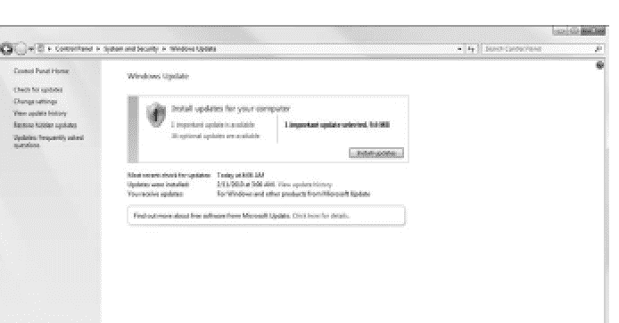

**图 6-1:** Windows 更新。

查看已安装的更新。

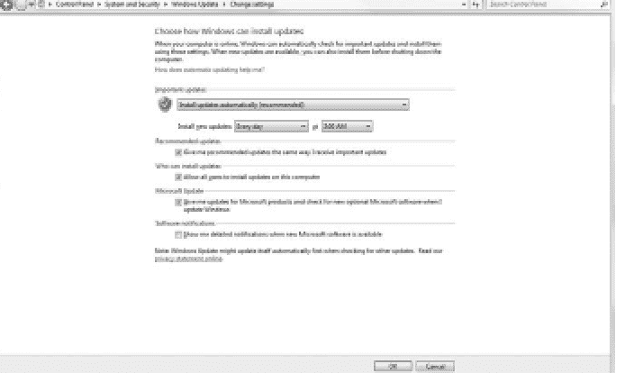

**图 6-2:** 更改 Windows 更新设置。

- **下载更新但让我决定安装：** 如果你是一个挑剔的计算机用户，请选择此选项。它会自动下载更新，但会让你选择是否安装它们。这让你能够跳过可能不需要的更新。

管理网络软件

- **检查更新但让我决定是否下载和安装：** 此选项允许你决定应该下载哪些更新。
- **从不检查更新：** 此选项将完全禁用自动更新。

## 第 7 章：解决网络问题

本章内容

- 检查显而易见的问题
- 修复过期的计算机
- 准确定故障原因
- 重启客户端和服务器计算机
- 审查网络事件日志
- 记录网络故障

核心观点：网络很容易出故障。

它们包含太多部分。电缆、连接器、网卡、交换机、路由器。所有这些部分必须在微妙的平衡中维持在一起，网络平衡太容易被破坏了。即使是设计最好的计算机网络，其运作也就像是用扎丝、口香糖和胶带粘在一起的一样。

更糟糕的是，网络会滋生怀疑。你的计算机连接到网络后，每当出现问题时，用户都会归咎于网络，无论问题与网络是否有关系。Word 文档中的列没有对齐？一定是网络问题。你的电子表格总和不对？股市下跌了？啊啊！

网络故障最糟糕的一点是它们可能会导致整个公司陷入。如果只是一个用户无法访问文件服务器上的某个文件夹，情况并不糟糕。如果关键服务器宕机，你的网络用户可能会被排除在文件、应用程序、电子邮件以及开展正常业务所需的一切内容之外。当这种情况发生时，他们会疯狂撞你的门，直到你让网络恢复运行为止。

在本章中，我将回顾一些网络问题最可能的原因，并建议一些当网络出现故障时你可以采用的基础故障排除技术。

### 当好好的计算机遇到坏事时

以下是一些基础的故障排除步骤，解释了在出现网络问题迹象时你应该检查的内容。在许多（如果不是大多数）情况下，以下步骤中的一个就能让你的网络恢复运行：

1. 确保你的计算机及其连接的所有设备都已插好电源。


计算机极客喜欢用户寻求帮助，因为他们可以告诉用户计算机没插电源或电源已关闭。他们会记录在自己的极客日志中，以便稍后告诉朋友听。他们甚至可能想拍你的照片，给他们的极客朋友看。（大多数涉及计算机极客的“意外”都是这种行为的直接结果。在询问用户是否确定计算机已开启时，请尽量委婉一些。）

2. 确保你的计算机正确连接到网络。
3. 记录屏幕上出现的任何错误消息。
4. 尝试重启计算机。


大量的计算机问题通过简单的重启计算机就能解决。当然，在许多情况下，问题会再次发生，你最终必须隔离原因并修复问题。有些问题只是间歇性的，只需简单的重启即可。

5. 尝试使用内置的 Windows 网络故障排除器。

有关更多信息，请参见本章后部分的“使用 Windows 网络故障排除器”章节。

6. 检查你的计算机和服务器上的可用磁盘空间。

当计算机磁盘空间不足或接近不足时，可能会发生奇怪的事情。有时你会收到一个清晰的错误消息指示这种情况，有时计算机直接停滞；以前只需要几秒钟的操作现在需要几分钟。

7. 做一些实验，以确定问题确实是网络问题，还是计算机本身的问题。

请参见本章后部分的“实验时间”章节，了解一些你可以用来隔离网络问题的简单方法。

8. 尝试重启网络服务器。

参见本章后部分的“重启网络服务器”章节。

### 修复死机的计算机

如果计算机看起来完全死机了，这里是一些需要检查的内容：

- 确保计算机已插好电源。
- 如果计算机插在浪涌保护器或电源插板上，确保浪涌保护器或电源插板已插好并开启。如果浪涌保护器或电源插板有指示灯，它应该是亮的。
- 确保计算机的电源开关已开启。这个建议似乎太基础了甚至不需要包含，但许多计算机有两个电源开关：计算机背面的开启/关闭开关和正面用于启动计算机的按钮。如果你按下按钮没有反应，请检查背面的开关确保它处于开启位置。


为了让事情复杂化，新的计算机具有“睡眠”功能，它们看起来像关机了但实际上在休眠。唤醒这种计算机只需稍微移动一下鼠标。（我以前认为计算机是关机了，按下并按住电源按钮，纳闷为什么没反应。）如果你按住按钮足够的时间，计算机就会关闭。然后当你重新打开计算机时，会收到一条消息说计算机并未关闭。

## 检查你的网络设置 237

### 一堆错误信息飞闪而过！

电脑启动时显示的错误信息为确定问题根源提供了极具价值的线索。

如果你在启动电脑时看到错误信息，请记住以下几点：

- 如果看到大量的错误信息，不要惊慌。有时候，一个易于修复的简单问题在电脑启动时就会导致大量的错误信息。这些信息看起来就像你的电脑正在分崩离，但修复方法可能很简单。
- 如果信息闪得太快，导致你看不清，请按下电脑上的 `Pause`（暂停）键。你的电脑会立即停止运行，让你有机会跟上阅读错误信息的速度。读完足够的内容后，再次按下 `Pause` 键让一切继续运行。（在没有 `Pause` 键的键盘上，按下 `Ctrl+Scroll Lock` 或 `Ctrl+S` 具有相同的效果。）
- 如果你第一次错过了错误，请重启电脑并再次观察。
- 更好的办法是在开始显示“正在启动 Windows”消息时按下 `F8`。这将显示一个菜单，允许你从几个启动选项中进行选择，其中一个选项会单独处理 `CONFIG.SYS` 文件的每一行，这样你就可以看到每个命令在执行到下一个命令之前显示的信息。


### 检查你的网络设置

我发誓，有一些绿色小人在半夜溜进办公室，打开电脑，并为了好玩搞乱 TCP/IP 配置设置。这些绿色小人被亲切地称为“网络精灵”（network gnomes）。

异常的是，网络配置设置有时会发生，导致一台接入网络几个月或几年的电脑发现自己无法访问网络。在确保电脑已激活且电缆没有损坏后，你要做的第一件事是对电脑的网络设置进行基础检查。检查以下内容：

- 在命令提示符运行 `ipconfig`，确保电脑上的 TCP/IP 正在运行，并且 IP 地址、子网掩码和默认网关设置看起来正常。
- 调出网络连接的属性对话框，确保必要的协议已正确安装。

第三卷 第 7 章 | 解决网络问题 |

www.it-ebooks.info

## 使用 Windows 网络疑难解答

- 打开系统属性对话框（在控制面板中双击“系统”），检查“计算机名称”选项卡。

确保计算机名称是唯一的，并且域或工作组名称拼写正确。

- 双击用户账户，确保用户确实有权限访问其所需的资源。

关于网络配置设置的更多信息，请参见第二卷第 3 章和第 6 章。

### 使用 Windows 网络疑难解答

Windows 自带了疑难解答程序，可以帮助确定网络问题的原因。图 7-1 显示了 Windows 7 版本。回答疑难解答提出的问题并点击“下页”切换屏幕。网络疑难解答无法解决所有的网络问题，但它确实指出了常见问题的原因。

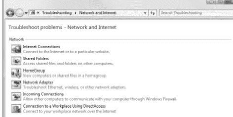

图 7-1：Windows 7 网络疑难解答。

## 实验时间 239

启动网络疑难解答程序取决于你使用的 Windows 版本：

- **Windows 7**：打开控制面板，点击“查看网络状态和任务”，然后点击“疑难解答”。选择与你正在经历的问题最直接相关的疑难解答。你会找到针对无线网络问题、家庭网络以及局域网（LAN）和 Internet 连接的疑难解答。
- **Windows Vista**：选择“开始；帮助和支持”，并点击与你正在经历的问题最直接相关的网络疑难解答链接。你会找到针对无线网络问题、家庭网络以及局域网（LAN）和 Internet 连接的疑难解答。
- **Windows XP**：选择“开始；帮助和支持；网络和 Internet 链接；修复网络或 Internet 问题”。然后点击“家庭和小办公室网络疑难解答”。

### 实验时间

如果你无法为你的困扰找到某些解释——你需要通过实验来缩小范围。设计你的实验来回答一个基本问题：是网络问题还是本地电脑问题？

以下是你可以缩小问题原因的一些方法：

- **尝试在别人的电脑上执行相同的操作。** 如果网络上的没有任何人可以访问网络驱动器或打印机，那么网络可能出了问题。另一方面，如果错误只出现在一台电脑上，那么问题很可能出在那台电脑上。该目标电脑与网络的通信可能不可靠，或者对网络配置不当，或者问题根本与网络没有关系。
- **如果你能在另一台电脑上顺利地执行该操作，尝试使用你的用户名从另一台电脑登录网络。** 然后看你是否可以在无错误的情况下执行该操作。可以，问题可能出在你的电脑上。如果不能，问题可能出在你用户账户的配置方式上。
- **如果你无法登录另一台电脑，请等一会儿。** 你的账户可能被临时锁定。这可能是由于各种原因引起的——最常见连续多次尝试用密码登录。如果一小时后仍然被锁定，请联系网络管理员并送上一个甜甜圈。

it-ebooks.info

## 240 谁在第一？

### 谁在第一？

在排排除网络问题时，找出谁已登录到服务器通常非常有用。例如，如果一个用户无法访问服务器上的文件，你可以检查该用户是否已登录。如果是，则说明该账户是有效的，但用户可能没有权限访问其尝试的特定文件或文件夹。另一方面，如果用户没有登录，问题可能出在账户本身或用户连接服务器的方式上。

在需要重启服务器的情况下，找出谁已登录也是很有用的。关于重启服务器的更多信息，请参见本章后部分的“重启网络服务器”章节。

要查看当前登录到 Windows 服务器的用户，右键点击桌面上的计算机图标（Windows Server 2003 为“我的计算机”，Windows Server 2008 为“计算机”），并从菜单中选择“管理”。这将打开计算机管理窗口。在树列表中打开“系统工具”，然后打开“共享文件夹”并选择“会话”。登录用户列表将会显示。


可以在计算机管理窗口中右键点击“会话”并选择“所有任务->断开所有”来断开所有用户。

## 重启客户端电脑

有时故障会让电脑陷入死结，你唯一能做的重启。某些情况下，电脑开始变得异常。奇怪的字符出现在屏幕上，Windows 变得混乱并无法退出程序。有时，电脑会困惑得甚至无法移动。它就坐在那里，像面对对车灯的鹿一样。无论你如何按 Esc 或 Enter，它都没有反应。你可以移动桌面上的鼠标，或者把它扔到房间里，但屏幕上的鼠标指针始终保持静止。

当电脑开始变得异常时，你需要重启。如果必须这样做，你应该尽可能干净地执行。我知道这个步骤看起来很简单，但安全重启电脑的技术值得重复，即使它是基础性的：

- 1. 如果可以，保存你的工作。

## 重启客户端计算机 241

使用“文件：保存”来保存你在情况变得混乱时正在编辑的文档或文件。如果你无法使用菜单，请尝试点击工具栏上的“保存”按钮。如果不起作用，请尝试按 `Ctrl+S`（保存命令的标准键盘快捷键）。

## 2. 如果可以，关闭任何正在运行的程序。

使用“文件：退出”命令，或点击计算机窗口右上角的“关闭”按钮。或者按 `Alt+F4`。

## 3. 重启计算机。

- * Windows XP：选择“开始：关机”来打开关机对话框。选择“重启”选项，然后点击“确定”。
- * Windows 7 和 Vista：点击“开始”按钮，点击启动菜单右下角的右箭头，然后点击“重启”。

如果重启计算机似乎没有解决问题，你可能需要关闭计算机并重新启动。要执行此操作，请按照之前的步骤，但选择“关机”而不是“重启”。

如果你在重启计算机时遇到困难，可以尝试以下几种方法：

- 1. 如果你的计算机拒绝响应“开始：关机”命令，请按下 `Ctrl+Alt+Delete`。

这被称为“三指山”。在你执行此操作时，说一句“排队”是合适的。

当你按下 `Ctrl+Alt+Delete` 时，Windows 会显示一个对话框，允许你关闭任何运行中的程序或完全关机。

- 2. 如果 `Ctrl+Alt+Delete` 没用，你就已经到了最后的手段。剩下的唯一办法是按下电源开启/关闭按钮并保持几秒钟来关闭计算机。

通过按按钮关闭计算机是一种激进的操作，应该只在计算机完全无响应后才执行。（吸鼻子。）任何你未保存到磁盘的工作都会丢失。如果你的计算机没有重置按钮，请关闭计算机，等待片刻，然后再次打开计算机。

如果可能，请在重启计算机之前保存你的工作。任何你未保存的工作都将丢失。遗憾的是，如果你的计算机陷入了一团乱麻，你可能无法保存工作。在这种情况下，你别无选择，只能将计算机推向数字悬崖。

## 242 以安全模式启动

### 以安全模式启动

Windows 提供了一种名为“安全模式”的特殊启动模式，旨在修复运行异常的计算机。当你以安全模式启动计算机时……

要以安全模式启动计算机，首先重启计算机。然后，一旦计算机开始重启，就开始按 `F8` 键——不断点击，直到出现一个名为“高级启动选项”的菜单。此菜单中的选项之一是“安全模式”；使用向上或向下方向键选择该选项，然后按回车键以安全模式启动。

## 使用系统还原

系统还原是一项定期保存重要 Windows 配置信息的功能，并允许你将系统恢复到以前保存的配置。这通常可以通过将你的计算机恢复到正常工作的时间来解决问题。

默认情况下，Windows 在向计算机上安装新软件或应用系统更新时会保存还原点。每七天还会保存一次还原点。

虽然系统还原默认开启的，但你应该验证以确保正在创建系统还原点。要执行此操作，在“开始”菜单中右键点击“计算机”，选择“属性”，并点击“保护”选项卡。显示图 7-2 中的对话框。验证你的计算机 C 盘的保护状态是否为“开启”。如果不是，选择 C 盘并点击“设置”为该驱动器配置系统还原。

如果你的计算机出现问题，你可以通过点击“保护”选项卡上的“系统还原”将其恢复到以前保存的还原点。这会弹出系统还原向导，如图 7-3 所示。此向导允许你选择想要使用的还原点。

关于系统还原，还有几点额外的需要记住：

- * 系统还原不会删除系统中的数据文件，你“文档”文件夹中的文件不会丢失。

## 使用系统属性 243

图 7-2：系统属性对话框的系统保护选项卡。

图 7-3：使用系统还原将系统恢复到早期的配置。

书籍第 7 章解决网络

- * 系统还原会移除自创建还原点以来你安装的应用程序或系统更新。因此，你需要重新安装这些应用程序或系统更新——除非你确定某个应用程序或系统更新最初是问题的根源。
- * 系统还原会自动重启你的计算机。重启可能会缓慢，因为系统还原进行的一些更改是在重启后发生的。

## 244 重启网络服务

- * 系统还原不会关闭或切断计算机的电源，这样做可能会导致你的计算机处于不可恢复的状态。

## 重启网络服务

偶尔，操作系统……如果用户无法访问服务器，可能是因为其中一个关键服务已停止。你可以使用“服务”工具来查看服务的状态，如图 7-4 所示。要显示它，在“开始”菜单中右键点击“计算机”并选择“管理”；展开“服务”节点并点击“服务”。验证……

图 7-4：查看服务 (Windows)。


哪些服务被认为是“重要的”取决于你对通用的定义。表 7-1 列出了 Windows 中常见的几种重要服务。事实上，典型的服务器可能有几十个服务正在运行。

## 重启网络服务器

表 7-1 关键服务

| 服务 | 说明 |
| :--- | :--- |
| 计算机浏览器 | 维护网络上可以访问的计算机列表。如果禁用此服务，计算机将无法浏览服务。 |
| DHCP 客户端 | 允许计算机从动态主机配置 (DHCP) 服务器获取 IP 地址。如果禁用此服务，计算机的互联网协议 (IP) 地址将无法正确配置。 |
| DNS 客户端 | 允许计算机访问域名 (DNS) 服务器以解析名称。如果禁用此服务，计算机将无法处理 名称，包括互联网地址和活动目录名称。 |
| 服务器 | 为服务器提供基本的文件和打印机共享服务。如果停止此服务，客户端将无法连接到服务器访问文件或打印机。 |
| 工作站 | 允许计算机与其他服务器建立客户端连接。如果禁用此服务，计算机将无法连接到其他服务器。 |

有时，清除网络问题的唯一方法是重启出现问题的服务器。

重启服务器是你只在最后手段时才采取的操作。服务器的设计旨在连续运行几个月甚至几年而不重启。重启服务器不可避免会导致网络临时中断。如果你必须重启服务器，请尽可能在非工作时间进行。

在重启服务器之前，请检查某个所需的服务是否已暂停或停止。你可能只需要重启单个服务而不是整个服务器。如需更多信息，请参阅本章前面的“重启网络服务”部分。

## 查看事件日志

以下是重启网络服务器的基本步骤：

- 1. 确保所有人已从服务器注销。

实现此目标最简单的方法是在正常工作时间之后重启服务器，此时大家都已经回家了。然后，你只需要关闭服务器，让关机过程强制注销任何遗留的用户。

要查看谁登录了系统，请参阅前面的章节“谁在第一位？”

- 2. 在确定用户已注销后，关闭网络服务器。

你可能希望这种操作尽可能表现得像一个良好的公民一样，体面且有序。使用 `Star+Shut Down` 命令关闭服务器。这将弹出一个对话框，要求你指示关机原因。你在此提供的信息会被输入服务器的系统日志中，你可以通过 `Event Viewer` 进行审查。

- 3. 重启服务器计算机或将其关闭后再重新开启。

观察服务器的启动过程，确保没有出现错误消息。

- 4. 告诉所有人重新登录，并确保现在都能访问网络。

在考虑重启网络服务器时，请记住以下几点：

- 重启网络服务器比重启客户端计算机要剧烈得多。在操作之前，确保每个人都保存了工作并注销了网络！如果你在用户登录时盲目关闭服务器计算机，可能会导致严重问题。
- 显然，重启网络服务器对每个网络用户来说都是一次重大的不便。最好提供一些甜点。

## 查看事件日志

诊断网络问题最有用的排排除技术之一是审查网络操作系统的内置日志。这些日志包含了在网络日常运行期间发生的有趣且潜在可能问题的事件信息。通常，这些日志在后台运行，收集网络事件的信息。当出现问题时，你可以检查日志以查看问题是否生成了值得关注的事件。在许多情况下，事件日志包含一个能够直指问题原因并建议解决方案的条目。

要在 Windows 服务器中显示事件日志，请使用管理工具菜单中的事件查看器。例如，图 7-5 显示了 Windows Server 2008 系统的事件查看器。事件查看器左侧的树列表列出了跟踪的事件类别：应用程序、系统、目录服务和文件复制。选择这些选项之一以查看你想查看的列表。要查看详细信息，双击事件将显示包含事件详细信息的对话框。

图 7-5: 事件查看器。

| 名称 | 级别 | 日期 | 时间 | 源 |
| :--- | :--- | :--- | :--- | :--- |
| 应用程序 | 警告 | 5/29/2005 | 10:32: ... | `LSASrv` |
| 系统 | 警告 | 5/29/2005 | 10:32: ... | `LSASrv` |
| 目录服务 | 警告 | 5/29/2005 | 10:32: ... | `LSASrv` |
| 文件复制服务 | 警告 | 5/29/2005 | 10:33: ... | `LSASrv` |
| | 信息 | 5/29/2005 | 10:36: ... | `LSASrv` |
| | 信息 | 5/29/2005 | 10:27: ... | `SMPTSVC` |
| | 信息 | 5/29/2005 | 10:39: ... | `Service C` |
| | 信息 | 5/29/2005 | 10:05: ... | `Dcom` |
| | 信息 | 5/29/2005 | 10:28: ... | `Service C` |
| | 信息 | 5/29/2005 | 10:20: ... | `Service C` |
| | 警告 | 5/29/2005 | 10:36: ... | `Service C` |
| | 警告 | 5/29/2005 | 10:36: ... | `Service C` |
| | 错误 | 5/29/2005 | 10:29: ... | `W32SVC` |
| | 错误 | 5/29/2005 | 10:35: ... | `W32SVC` |

## 记录你的尝试与波折

对于大型网络，你可能希望投资问题管理软件，以跟踪每个问题从初始报告到最终解决的故障过程。对于中小型网络，可能准备一个带有预打印表格的三环活夹就足够了。或者将日志记录在 Word 文档或 Excel 表格中。

无论你如何跟踪网络问题，跟踪日志都应包含以下信息：

- 报告问题的真实姓名网络用户名
- 问题首次报告的日期
- 问题严重程度的指示

这仅仅是一个不便，还是用户因为该问题无法完成工作？是否存在变通方案？

- 人员姓名
- 问题严重程度的指示
- 问题的描述
- 所采取步骤的描述
- 任何采取的步骤描述
- 问题最终解决的日期

## 第 8 章：网络性能

本章内容

- 理解性能
- 查看瓶颈
- 开发解决性能问题的程序
- 监控性能
- 实现其他加速网络的技巧

“性能”一词是指网络响应用户的效率。不言而喻，任何对网络的访问都会比没有网络的类似访问要慢。然而，它不应该花费更长时间。如果是这样，你就有了性能问题。

本章是对调整你的网络的通用介绍，使其获得良好的性能。在本章中，你可以找到分析网络、在问题出现时采取纠正措施以及制定进度图的特定技术。

### 为什么管理员讨厌性能问题

网络性能问题是最难跟踪的问题之一。如果用户只是简单无法访问网络，通常很快就能弄清楚原因：电缆断了、网卡或集线器发生故障、用户拥有资源的权限等等。经过少量调查，问题通常就会显现。你修复它并继续。

## 到底什么是瓶颈？

遗憾的是，性能问题更加混乱。以下是管理员讨厌性能问题的几个原因之一：

- 性能问题难以量化。现在的网络比一周前、一个月前甚至一年前到底慢了多少？网络只是感觉很慢，但你无法定义它有多慢。
- 性能问题通常逐渐发展。有时，网络会突然剧烈变慢。更多时候，网络一点一点变慢，直到某天用户注意到网络变慢了。
- 性能问题未被报告。用户在饮水机旁互相抱怨这个问题，但他们没能让你知道网络似乎比平时慢了 10%。只要他们还能访问网络，他们就会认为问题是暂时的或只是他们的幻觉。
- 许多性能问题是间歇性的。有时，用户给你打电话，抱怨某个网络操作变得比糖糖还慢——当你到达用户桌旁时，该操作运行正常。有时，它早晨比下午慢，或者只在备份运行或打印机变慢时才慢。在其他时候，你可以发现规律。有时操作很慢，有时又很快。
- 性能调优不是一种精确科学。提高性能有时涉及经验的推测。将所有用户从 100 Mbps 升级到千兆以太可以提高性能吗？划分网络可以提高性能吗？可能。为服务器增加 4GB 内存可以提高性能吗？希望如此。

“瓶颈”一词在任何方面都不指你典型计算机的体型。（好吧，我想在某些情况下它可以是指。）相反，计算机极客发明这个短语是因为他们发现 Jolt Cola 乐水瓶的形状限制了他们消耗饮料的速率。

## 究竟什么是瓶颈？

有一天，一个电脑极客说：“嘿，这个瓶口逐渐收缩的狭窄处，对我摄用其中含有咖啡因饮料的速率产生了明显的限制作用。” 这句话让人联想到一个此前未被发现但显而易见的类比，即计算机系统中单个缓慢的组件对整个系统性能可能产生的限制性影响。

“太有意思了，”其他的电脑极客回答道，他们很幸见证了那个历史时刻。

“瓶颈”`Bottleneck`这个术语现在被用来强调一个简单的事：计算机系统的速度取决于其最慢的组件。这相当于计算机领域中的老生常言：“链条的强度取决于它最薄弱的一环。”

为了简单地演示这一概念，请考虑一下在缓慢的打印机上打印文字处理文档时会发生什么。你的文字程序从磁盘读取数据并发送到打印机。你坐在那里等待打印机打印文档。

购买更快的 CPU 或增加内存会让文档打印变快吗？CPU 已经比打印机快得多了，而且你的电脑已经有了足够的内存来打印该文档。打印机本身就是瓶颈，更快打印文档的唯一方法是用更快的打印机替换缓慢的打印机。

以下是一些关于瓶颈的随感思考：

- 计算机系统总有瓶颈。例如，假设你决定文件服务器的瓶颈是一个缓慢的 IDE 驱动器，于是将其更换为更快的 SCSI 驱动器，这意味着现在硬盘不再是瓶颈了：驱动器处理信息的速度比连接磁盘的控制器卡要快。你并没有消除瓶颈：你只是把它从硬盘移动到了磁盘控制器。无论你做什么，计算机总会有某些组件限制系统的整体性能。
- 限制瓶颈影响的一种方法是避免等待瓶颈。例如，打印排队`spooling`可以让你避免等待缓慢的打印机。排队打印不会加快打印机，但它确实让你在打印机忙碌时可以进行其他工作。同样，磁盘缓存可以让你避免等待缓慢的硬盘。
- 电脑极客从 Jolt Cola 切换到 Snapple 的原因之一，是 Snapple 的瓶口更宽。

## 五大常见网络瓶颈

直接来自加利福尼亚州阳光明媚的弗雷诺`Fresno`家庭办公室，这里有十个——抱歉，五个——最常见的网络瓶颈，并无特定排序。

### 服务器内部的硬件

你的服务器应该是强大的计算机，能够处理网络分配给它的所有工作。不要通过使用在廉价电脑商店购买的低端电脑来偷取便宜。

以下是你的服务器硬件中最重要的四个组件：

- **处理器`Processor`**：你的服务器应该配备一个强大的处理器。按照一般原则，任何出现在售价 500 美元、同时卖电视、洗衣机以及电脑的电脑中的处理器，都不是你希望在你的文件中看到的处理器。换句话说，避免使用为消费级家用电脑设计的处理器。为了获得最佳性能，你的服务器应该使用服务器级的 Titanium 或 Xeon 处理器。
- **内存`Memory`**：内存不是越多越好，内存很便宜，所以不要省。。不要考虑运行内存小于 8GB 的服务器。
- **磁盘`Disk`**：不要在廉价的 SATA 硬盘上浪费时间。为了显得专业，你应该只使用 SCSI 驱动器。
- **网络接口`Network interface`**：一张 9.95 美元的网卡对于你的家庭网络可能没问题，但把它装在一个支持 50 个用户的服务器里，然后就不要指望对服务器的性能感到满意。记住，服务器计算机使用网络频率比任何客户端都得多，所以要为你的服务器配备良好的网卡。

## 服务器的配置选项

所有的操作系统都有你可以配置的选项。其中某些选项可以产生迟钝网络与飞快网络之间的差异。遗憾的是，设置这些选项并没有硬性的规定。否则，你也就不会有这些“选项”可选了。

以下是大多数服务器可用的一些更重要的调优选项：

- **虚拟内存选项`Virtual memory options`**：虚拟内存指的是服务器在没有足够的物理内存来执行工作时所使用的磁盘分页文件。很少有服务器拥有足够的物理内存，因此虚拟内存始终是一个重要的服务器功能。你可以指定虚拟分页文件的大小和位置。为了获得最佳性能，你应该提供至少是物理内存 5 倍的容量。例如，如果你有 16GB 的物理内存，请分配至少 24GB 的虚拟内存。如有必要，你可以增加这个大小。
- **条带磁盘`Striped disks`**：使用磁盘碎片整理程序优化服务器磁盘上的数据存储。如果服务器有多个硬盘，你可以通过创建条带化卷来提高性能，这允许磁盘 I/O 操作在条带集中的每个驱动器上并发。
- **网络协议`Network protocols`**：确保你的网络协议配置正确；删除任何不必要的协议。
- **服务器上的可用磁盘空间`Free disk space on the server`**：服务器磁盘上有充足的留地空间。如果可用磁盘空间急剧下降，服务器就会堵塞并慢得如牛爬。确保你的服务器有足够的空间：几十 GB 的未用磁盘空间可以提供一个健康的缓冲区。

### 负载过重的服务器

网络性能问题的常见来源之一是任务过重、负载过载的服务器。仅仅因为现代网络操作系统配备了数十种不同类型的服务器，并不意味着你应该在单台服务器上启用并使用所有功能。如果单台服务器因为工作过多而陷入缓慢，请添加第二台服务器来减轻第一台服务器的一些负担。记住那句老话：“人多力量大。”

例如，如果你的网络需要更多磁盘空间，考虑添加第二个文件服务器，而不是在一个已经有四个几乎满额硬盘的服务器上再增加一个硬盘。或者更好，购买一台专门用于文件服务的文件服务器设备。

作为间接收益，如果你将功能放置在独立的服务器上，你的网络将更容易管理且更可靠。例如，如果你有一台兼作文件服务器和邮件服务器的单台服务器，当你为了升级或修复故障组件而关闭服务器时，你会失去两个服务。然而，如果你有独立的文件服务器和邮件服务器，当你必须关闭其中一台时，只有其中一项服务会被中断。

| 第三册 |
| :--- |
| 第 8 章 |
| 网络性能 |
| 网络焦虑 |

### 网络基础设施

网络基础设施由电缆以及位于客户端和服务器之间的任何交换机、集线器、路由器和其他组件组成。

以下网络基础设施项目可能会减慢网络速度：

- **交换机`Switches`**：因为交换机非常廉价，你可以通过用交换机替换过时的集线来解决很多性能问题。使用交换机代替集线器可以减少网络负载。此外，确保你的交换机能够处理网络的性能需求。交换机应具备千兆端口。
- **段大小`Segment sizes`**：将每个网络段上的计算机和设备数量保持在合理范围内。大约 20 个设备是合适的数量。（注意，如果你将集线器更换为交换机，将立即缩小每个段的大小，因为交换机的每个端口都是一个独立的段。）
- **骨干速度`The backbone's speed`**：如果你有一个旧网络，你可能会发现许多甚至所有用户仍在以 100 Mbps 运行。升级到千兆速度将极大提升网络。
- **骨干速度`The backbone speed`**：如果你的网络使用骨干连接各个段，考虑将骨干升级到 1 Gbps。

### 故障组件

有时故障的网卡或其他组件会减慢网络。例如，交换机可能会间歇性故障，偶尔允许数据包通过但丢弃了足够的包以减慢网络。在识别出故障组件后，将其替换将恢复网络原始速度。

## 以强迫症的方式优化你的网络

你有两种方法来优化网络。第一种是逐位思考，猜测哪些改进可能会提高性能，尝试一下，然后看网络运行是否变快了。大多数人优化网络时都是采用这种方法。

另一种是强迫症式的方法，它适用于那些按颜色整理袜子抽、按食物类别字母顺序整理食品柜子的人。强迫症式的网络优化方法针对网络的某个特定方面：

- 1. 建立一种客观测试网络性能的方法。

这种方法就是基准测试`benchmarking`，你的基准测试结果就是一个基准线。

- 2. 更改网络配置的一个变量并重新运行测试。

例如，假设你认为增加磁盘缓存的大小可以提高性能。更改缓存大小、服务器并重新运行基准测试。注意性能是提升了、节省了系统，还是变差了。

- 3. 对你决定测试的每个变量重复步骤 2。

如果你决定按这种方式优化你的网络，这里有一些关键点需要记住：

- 如果可能，单独测试每个变量。换句话说，在继续之前，撤销你对其他网络变量所做的更改。
- 写下每次测试的结果。这样，你就有了每项更改对你网络性能影响的准确记录。
- 确保每次运行基准测试时只更改网络的一个方面。如果你同时进行多处更改，你将不知道是哪一个导致的结果。一个更改可能会提高性能，但另一个可能会降低性能，导致这些更改相互抵消——就像足球比赛中的抵消罚分。
- 如果可能，在正常工作时间内进行基准测试。这样，网络正处于正常的工作负载下。
- 为了建立你的基准性能，运行两到三次基准测试，以确保结果是可重复的。

## 监控网络性能

监控网络性能的一种方法是使用秒表查看完成常见任务（如打开文档或打印报告）实际上需要多久。如果你选择使用秒表技术来监控网络，你可能还需要一个写字板、棒球帽和一套灰色运动服来完成这套装备。

一种更高技术的网络性能监控方法是使用监控程序自动为你收集网络统计数据。在你设置好监控后，它就会持续运行，静静地监视你的网络并将看到的内容记录在性能日志中。然后你可以查看性能，查看你的网络运行状况如何。

对于大型网络，你可以购买运行在专用服务器上的精细监控程序。对于中小型网络，你可能使用网络操作系统自带的监控功能就足够了。例如，图8-1 显示了 Windows Server 2003 自带的性能监视器工具。其他操作系统也使用类似的工具。

图 8-1：监控性能。

Windows 性能监控器让你同时跟踪系统性能的几个不同方面。你通过设置计数器来跟踪每个方面。你可以从几十个不同的计数器中选择。

表 8-1 描述了一些最常用的计数器。注意，每个计数器指的是一个服务器对象，如物理磁盘、内存或处理器。

| 对象 | 计数器 | 描述 |
| --- | --- | --- |
| 物理磁盘 | % 空闲空间 | 服务器物理磁盘上空闲空间的百分比。应至少为 15%。 |
| 物理磁盘 | 平均队列 | 表示磁盘忙于处理其他磁盘操作时，有多少个磁盘操作正在等待。应为两个或少。 |
| 内存 | 页面/秒 | 从虚拟内存中检索的页数。典型的阈值是每秒 2500 个页。 |
| 处理器 | % 处理器时间 | 表示处理器忙碌而非空闲的百分比。应为 85% 或低。 |

这里还有几点需要考虑的事项：

- 实时监控让你了解正在发生什么。例如，性能监视器允许你查看实时数据。
- 备份的目标非常简单：保留一份网络关键数据的副本，这样无论发生什么，你都不会丢失超过一天的工作量。股市崩盘、悬挂因素影响另一场总统大选，或者乔治·卢斯可能决定拍一部前传。但是，只要你做好备份，你就永远不会丢失超过一天的工作量。


- 你通常可以通过盯着看来找到网络缓慢的根源。这些任务（如备份、数据库更新或报告作业）应该在正常业务时间内进行。如果可能，将这些任务安排在没人时进行。

- 带有内存泄漏的程序会降低性能。它们使用内存后忘记释放它，直到服务器耗尽内存。如果你认为某个程序有内存泄漏，请联系制造商查看是否有修复程序。

- 间谍软件可以使系统运行得像爬一样慢。客户端计算机性能问题的常见来源是间谍软件，即你在上网时几乎无法避免会下载的烦人程序。幸运的是，你可以使用各种免费或廉价的间谍软件删除工具来移除它们。有关更多信息，请使用 Google 或其他搜索引擎搜索“删除间谍软件”。

- 如果你找不回来了，你明天还有工作吗？

- 如果你找不回来了，联系制造商查看是否可用。

# 第 9 章：备份你的数据

## 本章内容

- 理解备份的必要性
- 使用磁带驱动和其他介质
- 理解不同类型的备份
- 掌握磁带循环和其他细节

如果你是网络管理员，网络上数据的安全就是你的责任。事实上，这是你的首要责任。你拿薪是为了在晚上躺着担心你的数据。它们明天还在那里吗？如果不在，你能找回来吗？而且最重要的一点是——如果你找不回来，你明天还有工作吗？

本章涵盖了成为一个优秀、负责任且信赖的网络管理员的各种门道。没人会为这些事发勋章，但应该有人。

## 备份你的数据

数据备份是任何灾难恢复计划的基石。如果没有备份，简单的硬盘故障就会让你的公司停滞几天或几周，因为它试图重建丢失的数据。事实上，没有备份，你公司的生存都岌岌危。

备份的目标非常简单：保留一份网络关键数据的副本，这样无论发生什么，你都不会丢失超过一天的工作量。但是，只要你做好备份，你就永远不会丢失超过一天的工作量。

### 关于磁带和磁带驱动器的一切

如果你计划对网络服务器硬盘上的数据进行备份，你显然需要某种介质来存储这些数据。你可以将数据复制到 CD 上，但一个 500GB 的硬盘需要超过 750 张 CD 才能完成完整备份。这比大多数人愿意在衣柜里留存的光片要多得多。你也可以使用 DVD，但仍然需要几十张，而且每张大约需要一个小时才能填满。这意味着你要花掉一整个周六的时间来创建备份。


由于 CD 和 DVD 的局限性，大多数网络管理员会将网络数据备份到磁带上。根据磁带驱动机的品牌和型号，你可以将多达 800GB 的数据拷贝到磁带中。

磁带备份的好处之一是可以在无人值守的情况下运行。事实上，你可以调度磁带备份在没有人使用网络时自动运行。不过，为了让无人值备份生效，你必须确保你有足够的磁带容量来备份整个网络服务器的硬盘，而无需手动更换磁带。如果你的网络服务器只有 100GB 的数据，你可以轻松地将其备份到单盘磁带。然而，如果你有 1000GB 的数据，请投资购买带有带库切换器的磁带驱动器，它可以容纳几盘磁带并自动让它们在驱动器中循环。这样，你就可以在无人值守的情况下运行备份了。

以下是关于磁带备份的一些额外思考：

- Travan 驱动器：小型服务器的一种流行的磁带备份类型，有多种型号，磁带容量从 20GB 到 40GB 不等。你可以花不到 200 美元购买 20GB 的驱动器。
- DAT 和 DLT：对于较大的网络，可以使用比 Travan 驱动器容量更大、速度更设备——但价格更高。数字音频带 (DAT) 单元单盘磁带可以备份多达 800GB 数据，而 DLT（数字线性磁带）驱动器可以在一个磁带上存储多达 800GB。根据容量，DAT 和 DLT 驱动器的价格可能达到 1,000 美元或更多。
- 机器人单元：如果你真的是“备份狂魔”，有数百 GB 的数据需要备份，你可以购买机器人磁带备份单元，它可以自动从库中提取并加载磁带盒。这样，你就可以无需手动加载磁带即可完成备份。正如你可能猜到的，这些单元并不便宜：拥有约 8 磁带库且总备份容量超过 5,000GB 的小型设备起价为 4,000 美元。

### 备份软件

所有版本的 Windows 都带有内置备份程序。此外，大多数磁带驱动器都附带备份程序，这些程序通常比标准的 Windows 备份更快或更灵活。

你还可以购买复杂的备份程序，这些程序专门为具有多个且必须备份数据服务器的网络而设计。对于基础的 Windows 文件服务器，你可以使用 Windows Server 自带的备份程序。Windows 的服务器版本带有一个相当不错的备份程序，可以运行计划的、无人值守备份。

备份程序不仅仅是将数据从你的硬盘复制到磁带。备份程序使用特殊的压缩技术来压缩你的数据，以便你能在更少的磁带上挤入更多数据。2:1 的压缩率很常见，因此你通常可以将 100GB 的数据压缩到在不压缩的情况下只能容纳 50GB 的磁带上。（磁带驱动器制造商通过使用压缩数据来说明其驱动器的容量，假设压缩比为 2:1。因此，200GB 的磁带的未压缩容量为 100GB。）

是否能实现 2:1 的压缩率取决于你所备份的数据性质：

- 文档：如果你的网络数据主要用于 Office 应用程序并充满了 Word 和 Excel 文档，你可能会获得比 2:1 更好的压缩效果。
- 图形：如果你的网络数据主要由图像文件组成，你可能无法获得很大的压缩。大多数图像文件已经是压缩过的，因此备份软件的压缩方法无法对其进行进一步压缩。

备份程序还帮助你跟踪哪些已经备份，哪些尚未备份。它们还提供了选项，例如增量备份或差异备份，可以简化备份过程，正如我在下一节中描述的那样。

如果你的网络有多个服务器，请投资良好的备份软件。最流行的是由 BarracudaWare (www.baracudaware.com) 制造的 Yosemite Backup。除了能够处理多个服务器外，备份软件（如 Yosemite Backup）的主要优势之一是它可以正确地备份 Microsoft Exchange 服务器数据。


| 第三卷 第五章 |
| 备份你的数据 |

### 备份类型

你可以执行五种不同的备份。许多备份方案依赖于全备份，但对于某些网络，使用依赖于这两种或更多备份类型的方案更为实用。

这五种备份类型之间的区别在于归档位（archive bit）。归档位指示文件自上次备份以来是否被修改过。归档位是与文件名一起存储的一个小标记，归档位和创建日期一起存储。当每个文件被备份时，其归档位会被重置。

常规备份（也称为全备份）是基础的备份类型。常规备份无论归档位是否设置，都会备份选择中的所有文件。也就是说，只要文件自上次备份以来被修改过，就会备份。

最简单的方案是每天调度一次常规备份。这样，你的数据每天都会被备份。如果需要，你可以从单盘磁带或一组磁带中恢复文件。当使用其他类型的备份时，恢复文件会变得更复杂。

如果你有能力在无人值守的情况下执行常规备份（即无需更换磁带），请执行常规备份。由于要备份的数据量大于磁带驱动器的容量而无法进行无人值守的常规备份，你就结合使用其他类型的备份。

如果你无法在单盘磁带上进行常规备份，且买不起第二个磁带驱动器或磁带切换器，请仔细检查备份选择中的数据。我最近处理一个正在进行备份的网络。当我检查已备份的数据时，发现了大量的静态数据，本质上是旧项目的存档。这些数据对于网络用户出于研究目的是必要的，但这些数据是只读的。尽管这些数据从未更改，但每天都会备份，而且备份需要两盘磁带。在我们从每日备份循环中移除这些数据后，备份就可以重新挤进单盘磁带了。

如果你从每日备份中移除静态数据，请确保你已将磁带、CD-RW 或其他介质上的这些静态数据进行了安全备份。


| 表 9-1 备份类型如何使用归档位 | 备份类型 | 根据归档位选择文件？ | 备份后重置归档位？ |
| :--- | :--- | :--- | :--- |
| 常规 | 否 | 是 |
| 复制 | 否 | 否 |
| 每日* | 否 | 否 |
| 增量 | 是 | 否 |
| 差异 | 是 | 否 |

*根据最后修改日期选择文件。

#### 复制备份

复制备份（Copy backup）与普通备份相似，不同之处在于复制每个文件时，归档位（archive bit）不会被重置。因此，复制备份不会破坏普通备份与增量备份或差异备份之间的循环。

复制备份通常不会包含在定期的计划备份中。相反，当你想要进行偶尔的“快照备份”（shot-backup）时，就会使用复制备份。例如，如果你正准备升级操作系统，应该在继续之前对服务器进行备份。如果你执行全备，归档位会被重置，导致你的常规备份中断。然而，如果你执行复制备份，任何已修改文件的归档位将保持不变。因此，你的常规普通备份以及增量或差异备份都不会受到影响。

如果你没有将增量备份或差异备份纳入你的备份计划中，那么复制备份与普通备份之间的区别就无意义了。

#### 每日备份

每日备份备份在备份执行当天发生更改的文件。每日备份通过检查每个文件条目的修改日期，来确定该文件是否需要备份。每日备份不会重置归档位。

> 我不是太喜欢这个选项，因为它存在极小的可能导致某些文件被遗漏。有人可能在某个晚上工作很晚，在晚间备份完成后修改了文件——这意味着这些文件将不会被包含在当晚的备份中。依赖归档位而非修改日期的增量备份或差异备份更可靠。

#### 增量备份

增量备份仅备份自上次执行备份以来被修改的文件。增量备份比全备更快，因为在任何一天内，你的网络用户可能只修改了服务器上的一小文件。因此，如果一次全备需要三张磁带，你可能可以将一整周的增量备份放在单张磁带上。

当增量备份复制每个文件时，它会重置文件的归档位。这样一来，只有当用户再次修改该文件时，该文件会在下次普通备份之前再次被备份。

以下关于使用增量备份的一些想法：

- 使用增量备份最简单的方法是：
  - 每周一进行一次普通备份。如果你的全备耗时超过12小时，你可能想在周五执行，以便它可以在周末运行。
  - 在剩余的每个工作日进行一次增量备份（例如周二、周三、周四和周五）。
- 当你使用增量备份时，完整的备份由全备磁带以及自上次备份以来产生的所有增量备份磁带组成。

如果硬盘崩溃且你必须将数据恢复到新驱动器上，你首先恢复周一的普通备份，然后恢复随后的每个增量备份。

- 增量备份可以完成单个文件的恢复，因为文件的最新副本可能位于全备磁带或任何一个增量备份磁带上。

备份程序会跟踪每个文件最新版本的位置，以简化过程。

- 当你使用增量备份时，你可以选择是否：
  - 将每个增量备份存储在自己的磁带上。
  - 将每个备份追加到现有磁带的末尾。

通常情况下，你可以使用一张磁带完成一周的增量备份。

#### 差异备份

差异备份（Differential backup）与增量备份相似，不同之处在于在备份文件时不会重置归档位。因此，每次差异备份都代表了上次普通备份与硬盘当前状态之间的差异。

要从差异备份进行全恢复，你首先恢复上一次普通备份，然后恢复最近的差异备份。

例如，假设你在周一执行普通备份，并在周二、周三、周四以及周五早上硬盘崩溃时执行差异备份。周五下午，你安装了新硬盘。要恢复数据，你首先恢复周一的普通备份。然后恢复周四的差异备份。周二和周三的差异备份是不需要的。

### 本地与网络备份

增量备份和差异备份之间的主要区别在于

- 增量备份生成的备份更小、更快。
- 差异备份更容易恢复。

如果你的用户经常要求你恢复单个文件，请考虑使用差异备份。

当你备份网络数据时，运行备份软件有两种基本方法：你可以执行本地备份，即备份软件运行在文件服务器本身并将数据备份到安装在服务器上的磁带驱动器。或者，你可以执行网络备份，即使用一台网络计算机备份另一台网络计算机的数据。在网络备份中，数据必须通过网络传输到运行备份的计算机。

如果你从文件服务器运行备份，你将占用服务器，导致他们的访问速度慢得像牛爬。另一方面，如果你从客户端计算机或专用备份服务器通过网络运行备份，你将用数GB的备份数据淹没网络。你的用户会抱怨整个网络速度慢得像牛爬。

### 关于磁带可靠性的说明

- 另一种简单的方法是购买五盘磁带，并在工作日的某一天使用。
- 上述方法的另一种变体是购买八盘磁带。取其中四盘，分别在标签上写上“周二”、“周三”、“周四”和“周五”。在另外四盘上，写上“周一1”、“周一2”、“周一3”和“周一4”。现在，在电脑附近的墙上日历上标记，并为一年中所有的周一编号：1, 2, 3, 4, 1, 2, 3, 4，依此类推。

在周二到周五，使用相应的备份磁带。当你在周一进行完整备份时，查阅日历决定使用哪一盘周一磁带。通过这种方案，你有四周的备份磁带，加上本周其余时间的备份磁带。

- 如果账目数据存储在网络上，请在每月结账前立即对所有文件（或至少是会计文件）进行备份复制；然后保留每个月的备份。这并不意味着你应该选择 12 盘不同的磁带。如果你备份的是会计文件，实际上你可以将所有 12 个月的内容装进一盘磁带。只需确保备份时使用“追加到磁带”选项，这样磁带之前的内容就不会被破坏。此外，将此会计工作与你的日常常规工作完全分开。

在另一个地点保留至少一份完整备份。这样，如果你的办公室员工未能躲避一次误触乌鱼袭击或流星撞击，你可以从存储在异地的备份副本中恢复所有数据。确保负责将备份带到这个异地地点的人是可靠的。

根据经验，我发现虽然磁带驱动器很可靠，但它们偶尔会出问题。问题在于它们不会告诉你何时停止工作。磁带驱动器（尤其是较便宜的 Travan）可能会旋转数小时，假装在备份你的数据——实际上，你的数据并没有可靠地写入磁带。换句话说，磁带驱动器会欺骗你，让你认为备份运行良好。那么，当灾难降临你需要备份磁带时，你——

不要恐慌！有一个简单的方法可以确保你的磁带驱动器正在工作。只需激活备份软件的“备份后比较”功能。然后，一旦你的备份程序完成数据备份，它就会回带磁带，读取每个已备份的文件，并将其与硬盘上的原始版本进行比较。如果所有文件都比较一致，你就知道备份是可靠的。

以下是关于磁带可靠性的额外想法：

- “备份后比较”功能会将备份所需的时间增加一倍，但如果你的整个备份都能装在一盘磁带上，这就不重要了。你只需要在下班后运行备份即可。备份和修复操作花费一小时还是其他并不重要，只要在第二天早上网络用户到达之前完成即可。
- 如果备份需要多盘磁带，你可能不想每天运行“备份后比较”功能。然而，请务必定期运行它以检查磁带驱动器是否工作正常。
- 如果你的备份程序报告错误，请扔掉磁带并使用新磁带。
- 实际上，你应该忽略最后那条关于等待备份程序报告错误的建议。你应该在备份程序报告错误之前就丢弃磁带。大多数专家建议磁带使用 20 次后即可将其丢弃。如果你每天都使用同一盘磁带，请每月更换一次。如果你每天都有磁带可用，请每周更换两次。如果频率更高，请制定一个在使用约 20 次后更换磁带的周期。

### 关于清洁磁头

备份可靠性的一个重要方面是对磁带驱动器的妥善维护。每当你备份到磁带时，磁带的小碎片和颗粒会擦落在驱动器内部的读写头上。最终，磁头会变脏，无法可靠地读取或写入数据。

为了应对这个问题，磁头会变脏。最简单的方法是使用清洁盒，它会自动识别你何时插入了清洁盒，并执行一项程序，让磁带在磁头上反复来移动进行清洁。清洁程序完成后，磁带会弹出。整个过程只需要大约 30 秒。

由于每个驱动器的维护要求不同，请检查驱动器说明书以了解如何以及以及频率清洁。通常情况下，每周清洁一次驱动器。

### 备份安全

磁带驱动器清洁最恼人的方面是清洁盒的寿命有限。不幸的是，如果你插入一个用尽的清洁盒，驱动器会接受它并假装正在清洁。因此，请记录你使用清洁盒的次数，并按照制造商的建议进行更换。

备份为你的网络创建了一个经常被忽视的安全漏洞。无论你如何仔细地设置用户账户并执行密码策略，任何用户（包括游客）都能执行备份。此外，你的备份磁带本身也容易被盗。因此，请采取以下措施确保你的策略是安全的：

- 为备份设置用户账户。因为此用户账户具有备份权限，任何知道用户名和密码的人都可以绕过任何限制。
- 通过将备份用户限制在特定的客户端和一天中的特定时间来应对潜在的安全问题。如果你非常聪明（而且有被害症），你可能设置备份账户，使其只能运行特定的程序。
- 使用加密保护备份磁带的内容。
- 将备份磁带存放在安全的地方，例如保险箱。

### 评估不同类型的灾难

关于此主题的更多深入信息，请参考 Peter Gregory 写的《入门IT灾难恢复计划》（IT Disaster Recovery Planning For Dummies）。

灾难有许多形式和规模。某些类型的灾难比其他类型更容易发生。例如，你的建筑被雷击中的概率高于被彗星击中的。在某些情况下，特定类型灾难发生的概率取决于你所在地。例如，纽约发生毁灭性雪暴的可能性比佛罗里达大。

此外，每种类型灾难的影响因公司而异。对一家公司来说可能是灾难的事情，对另一家公司可能只是不便。例如，一家律师事务所可能忍受一两天的电话服务中断。失去电话通信是一个巨大的不便，但算不上灾难。而对于电话直销公司来说，电话断线一两天是一个更严重的问题，因为公司的收入依赖电话。

制定业务连续性计划的第一步之一是评估可能影响你组织的各种类型灾难的风险。权衡灾难发生的概率与灾难产生影响的严重程度。例如，陨石撞击你的建筑可能会非常严重，但这种事件发生的概率微乎其微。另一方面，你的建筑被火毁的概率要得多，而毁灭性火灾的后果与陨石撞击相同。

接下来的章节描述了大多数公司面临的最常见风险类型。注意本文的讨论，尽管这些许多风险与计算机和网络技术有关，但有些并非如此。业务连续性计划的范围远大于计算机技术。

#### 环境灾难

环境灾难是大多数人一想到灾难恢复时首先想到的。某些类型的环境灾难是区域性的。另一些可能发生在任何地方。

- 火灾：火灾可能是大多数人在考虑灾难规划时首先想到的第一种灾难。火灾可能是由不安全因素引起的；例如不符合标准的电线；自然原因，如雷击；或纵火。
- 地震：地震不仅会对你的建筑造成结构性损坏，还可能中断关键服务和公用事业的供应，如水电。严重的地震罕见且不可预测，但某些地区发生的频率比其他地区更频繁。如果你的业务位于著名的地震地区，你的BCP（业务连续性计划）应该考虑公司将如何应对毁灭性的地震。


- 天气：天气灾难可能会导致你的业务中断。适中的天气可能会影响交通系统，导致你的员工无法上班。极端天气可能会损坏你的建筑或中断服务供应，如电力和水务。

- 水灾：洪水会对电气设备（如计算机）造成破坏。如果洪水进入了你的机房，计算机设备很有可能被完全毁。洪水不仅可能由恶天气引起，还可能由水管破或散热器故障引起。

- 雷电：雷暴可能由于雷击以及局部电源供应的浪涌，对你的计算机和其他电子设备造成电气损坏。

## 故意灾难

某些灾难是他人故意行为的结果。例如：

- 故意破坏：蓄意破坏或破坏可能会损坏或破坏你的设施或计算机系统。蓄意破坏或破坏可能是由不满的员工或客户针对你进行的，也可能是随机的。无论何种情况，结果都是样的。

不要忽视破坏的可能性。一个获取了管理员账户和密码的不满的员工可以对你的网络做各种坏事。

- 盗窃：盗窃总是一个可能。你可能会在某天发现你的服务器或其他计算机设备被盗了。

- 恐怖主义：恐怖主义曾是大多数美国人并不关心的事情，但2001年9月11日改变了这一点。无论你住在世界的哪个地方，恐怖袭击的可能性都是真实的。

## 服务中断

你可能没有意识到你的业务对服务和公用事业供应依赖有多大。BCP应该考虑到你将如何处理某些服务的丢失：

| 第三卷第10章 灾难恢复与业务规划 |

| :--- |

| **没电：** 电力对于计算机和其他类型的设备至关重要。在一次停电期间（我住在加利福尼亚州，所以我习惯了），我发现我甚至无法用铅笔和纸进行工作，因为我所有的铅笔削笔刀都是电的。停电并不常见，但处理这些停电问题的技术随处可见。`UPS`（不间断电源）可靠且廉价。 |

| **无通信：** 通信连接可能由于许多原因而中断。几年前，我办公室对面街建成了一座铁路天桥。有一天，一台挖掘机切断了电话线，完全切断了我们的电话服务——持续了一个半天。 |

| **无水：** 水源中断可能不会关闭你的计算机，但它可能会迫使你关闭设施直到水供应恢复，从而中断你的业务。 |

## 设备故障

现代公司依赖许多不同类型的设备进行日常运营。这些关键系统的任何故障都会导致业务中断，直到系统得到修复：

- 计算机设备故障显然会影响业务运营。

- 空调系统对于调节温度至关重要，特别是在机房。如果温度升高过高，计算机设备可能会损坏。

- 电梯、自动门和其他设备对你的业务也可能是必要的。

## 其他灾难

你应该评估许多其他潜在的灾难。这里只是少数几个：

- 劳动纠纷

- 因辞职、受伤或死亡导致的关键人员流

- 职场暴力

- 公共卫生问题，如流行病、霉菌感染等

- 关键供应商丢失

- 附近的灾难，例如火灾或警方行动导致你的业务被封锁

## 分析灾难的影响

### 分析灾难的影响

在对影响你业务的灾难类型有良好理解的基础上，你可以转向关注这些灾难对你业务产生的影响。第一步是识别受不同类型灾难影响的关键业务流程。这些流程对于每家公司都不同。例如，以下是出版公司的一些关键流程：

- 编辑流程，如管理项目通过技术编辑、校对和制作的过程

- 采购流程，如确定产品开发战略、招募作者和签约流程

- 人力资源流程，如工资、招聘、员工评估和招聘

- 营销流程，包括销售跟踪、开发营销材料、赞助会议、参加贸易博览会等

- 销售和账单流程，如填写客户订单、维护公司网站、管理库存和处理付款

- 执行和财务流程，如管理现金流、获取信贷、筹资、决定何时上市以及何时收购较小的出版社或卖给较大的出版社

这些流程的中断影响各不相同。评估业务流程损失影响的一种常见方法是对每个流程对不同程度的损失进行评分。例如，你可能根据以下时间范围对每个流程的损失进行评分：

- 0 到 2 小时

- 2 到 24 小时

- 1 到 2 天

- 2 天到 1 周

- 超过 1 周

## 制定业务连续性计划

### 制定业务连续性计划

业务连续性计划（BCP）简单来说就是在正常运行失败时，你如何维持关键业务流程的计划。例如，如果你的主办公地点因为街外发生的大型火灾而关闭一周，只要你已经制定了业务连续性计划，就不需要暂停业务。

BCP 的关键在于对你业务流程至关重要的每个组件进行冗余设计。这些组件包括：

- 设施：如果你的公司已经有多个办公地点，你可能可以在灾难期间临时挤进其他地点中的一个。如果没有的话，你应该预先与房地产经纪人妥善安排，以便能够快速安排一个备用地点。通过提前做好安排，你可以随时搬到应急地点。

- 计算机设备：在某处存储一套备用计算机并无害处，这样你可以在紧急情况下将它们挖出来使用。理想情况下，这些计算机应该已经安装了你的关键软件。次优方案是准备好详细的计划，以便你的员工能够快速在新设备上安装软件，让你的业务恢复运行。

始终在异地地点保留一套最新的备份带。

- 电话：预先与你的电话公司讨论应急服务。如果你被迫在 24 小时内搬到另一个地点，你的电话多快能恢复运行？你是否可以安排将拨入的免费电话转发到新地点？

- 员工：除非你在政府机构工作，否则你可能没有冗余员工。然而，你可以预先与中介机构建立安排，以便在短时间内提供文书和行政帮助。

- 文具：这听起来是一个小细节，但你应该在安全的地方存储所有文具产品（信纸、信封、发票、对账单等）的储备。这样，如果你的主地点突然无法使用，你就不需要等一周来打印新的信纸或发票。

- 纸质文件：在异地地点保留重要打印材料（客户账单文件、销售记录等）的备份副本。

## 举行火灾演习

还记得上小学时，火灾警报响了，老师告诉你们冷静地放下手头的工作，有序地走到指定的安全区域吗？演习非常重要，这样当发生真实火灾时，你就不会为了抢第一个出去而互相推挤攀爬。

任何灾难恢复计划如果不经测试以确认其是否有效，都是不完整的。测试并不意味着你应该某天烧掉你的大楼，看看需要多长时间才能恢复运行。但是，你应该定期模拟灾难，以向你自己和你的员工证明你们是可以恢复的。

最基本的类型灾难恢复演习是对你网络备份程序的简单测试。你应该定期尝试从备份带中恢复文件，以确保你能够做到。通过定期恢复文件，你可以获得几处好处：

- **磁带是不可靠的。** 确保磁带正常工作的唯一方法是定期从它们中恢复文件。

- **备份程序的配置很复杂。** 我们见过有人执行了多年备份任务，但这些任务并不包含他们认为正在备份的所有数据。只有当灾难发生，他们需要恢复某个关键文件时，才发现该文件没有包含在备份中。

- **恢复文件可能会有点困惑，尤其是当你结合使用全备和增量备份时。** 当你尝试恢复丢失的文件时，公司老板还在你肩头盯着，这增加了你的压力。如果你定期进行火灾演习，你将在低压力的情况下熟悉你备份软件的恢复功能。这样，当压力来临时，你可以轻松地恢复真实文件。

你还可以考虑对更严重的灾难场景进行模拟演练。例如，你可以抽出一一天时间，带领全体员工转移到备用地点。你可以双重检查所有的备份设备、文档和数据是否按计划可用。如果缺少了某些东西，现在发现总比在消防队仍在扑灭你曾是办公室的地方里最后几个残余热点时才发现要好。

| 第三卷 第 10 章 |

| :--- |

| 灾难恢复连续性与业务规划 |

## 第四卷

## TCP/IP 与互联网

## 目录摘要

- 第 1 章：TCP/IP 与互联网简介 ........................................................ .281

- 第 2 章：理解 IP 地址 ............................................................ .289

- 第 3 章：使用 DHCP ................................................................................ .307

- 第 4 章：使用 DNS ................................................................................ .321

- 第 5 章：使用 FTP ................................................................................ .347

- 第 6 章：TCP/IP 工具与命令 ................................................. .371

## 第 1 章：TCP/IP 与互联网简介

### 本章内容

- 介绍互联网

- 熟悉 TCP/IP 标准

- 了解 TCP/IP 如何与 OSI 参考模型对齐

- 发现重要的 TCP/IP 应用

在几年前，传输控制协议/网际协议（TCP/IP）主要被认为是互联网的协议。将局域网（LAN）连接到互联网的最大挑战是弄清楚如何将 TCP/IP 与作为局域网基础的专有协议进行网状——特别是网络数据包交换/顺序数据包交换 (IPX/SPX) 和 NetBIOS 扩展用户接口 (NetBEUI)。几年前，网络管理员意识到他们可以省去将 TCP/IP 与 IPX/SPX 结合的麻烦，消除 IPX/SPX 和 NetBEUI。TCP/IP 不仅仅是互联网的协议，它还是大多数局域网的基础。

本章对互联网进行了简单介绍，特别是 TCP/IP。在完成这些介绍之后，你就可以深入学习第四卷剩余章节中的详细 TCP/IP 信息。

## 什么是互联网？

互联网是一个网络网络。它由全球数万个网络组成。严格来说，互联网是一个网络网络。这个网络网络连接了超过五亿计算机。

## 互联网有多大？

由于互联网不被任何机构拥有或控制，因此没有人负责。在线服务（如 America Online 或 MSN）由个人公司拥有和运营，控制服务上显示什么内容以及可以使用哪些软件。没有人对互联网行使那种控制权。结果，你可以在互联网上找到任何你想要的信息，所以你在穿过这个迷宫时要小心。

互联网每天都在增长。如果你已经在网络上并且感兴趣，可以访问 ISC 的网站 `www.isc.org` 查看最新统计数据。

互联网工程任务组（ETF）的一份官方文档（2006年）将互联网定义为“松散组织的国际协作的自主网络”。将这个定义拆开来看，它涵盖了互联网的几个方面：

- 没有单一机构对互联网拥有权威权。结果，互联网并不是高度组织的。在线服务（如 America Online 或 MSN）由个人公司拥有和运营，控制服务上显示什么内容以及可以使用哪些软件。没有人对互联网行使那种控制权。结果，你可以在互联网上找到任何你想要的信息，所以你在穿过这个迷宫时要小心。

- 国际化：互联网代表了近 200 个国家，从阿富汗到津巴布韦。

- 协作：互联网之所以存在是因为许多组织组织起来提供维持其所需的服务和支持。例如，驱动互联网的大部分软件都是开源软件，由全球程序员协作开发，他们不断改进代码。

- 自主性：互联网社区尊重加入互联网的组织可以自由就其如何配置和运行其网络做出决定。尽管法律问题有时会爆发，但大多数情况下，互联网上的每个玩家都是独立运行的。

## 互联网简史

- **互连性（Interconnected）**：互联网的核心概念是互连性，它使用标准协议允许网络之间进行通信。没有 TCP/IP 协议提供的互连性，互联网将不复。

- **网络（Networks）**：如果互联网由五亿个互连的个人用户组成，它将完全无法管理。这就是为什么互联网被描述为“网络的网络（network of networks）”。互联网上的大多数个人用户并不直接访问互联网。相反，他们通过另一个网络直接访问互联网，该网络可能是商业或学术环境中的局域网（LAN），也可能是服务提供商（ISP）提供的拨号网络或宽带网络。在任何情况下，本地网络的用户都通过网关路由器访问互联网。

互联网由几种不同类型的网络组成：政府机构，如美国国会图书馆和白宫；军事遗址（你看过《战争游戏》或《终结结者》电影吗？）；教育机构，如大学和学院（及其图书馆）；企业，如微软和 IBM，这些允许个人访问互联网；以及商业服务，如 American Online 和 MSN。

## 互联网简史

如果你对这些事情感兴趣，那么互联网有一段迷人的历史。当然，你没有特殊的理由对这些事情感兴趣，但浅浅了解互联网是如何变成今天的可能有助于你理解和应对海大的计算机网络工作。所以，以下是介绍：

互联网的起源可以追溯到一个名为 ARPANET 的小型网络，它由国防部于 1969 年建立，用于连接防御设施。ARPANET 很快扩大，不仅包括防御设施，还包括大学。20 世纪 70 年代，ARPANET 被分为两个网络：一个用于军事目的（重命名为 MILNET），另一个是原始 ARPANET（用于非军事目的）。这两个网络通过一种网络链接 IP —— 互联网协议连接起来，因为它允许两个网络之间进行通信。

设计 IP 的那些优秀人士具有远见，他们意识到很快就会有两个以上的网络想要连接。他们为成上万个网络加入游戏留下了空间，这是一件好事，因为没多久互联网就开始飞速发展了。

到 20 世纪 80 年代中期，ARPANET 达到了它能力的极限。国家科学基金会（NSF）介入了，它建立了一个全国性的网络，旨在提供对大型超级计算机（用于发现新质数的单体式计算机）的访问。

| 第九本书 | 第 1 章 | TCP/IP 与互联网简介 |

| :--- | :--- | :--- |

## TCP/IP 标准与 RFC

计算遥远星系的轨道。这些超级计算机从未被过度使用，但为了支持超级计算机而建立的网络 —— FSNET 被用上了。事实上，FSNET 取代了 ARPANET 成为互联网的骨干。

然后，整个世界似乎对互联网产生了兴趣。关于它的故事出现在《时代周刊》和《新闻周刊》上。任何名字中带有“com”的公司价值几乎每个月翻一倍。阿尔尔·戈尔（Al Gore）声称他发明了它。网络增长得如此快，以至于 FSNET 都跟不上，因此商业网络加入了游戏。在 20 世纪 90 年代的大部分时间，互联网规模每年翻一倍。然后，在世纪的最初几年，增长率放缓了一些。然而，互联网似乎仍以每年 30% 到 50% 的惊人速度增长，谁知道这种眩晕的增长率还会持续多久。

## TCP/IP 标准与 RFC

定义互联网如何工作的 TCP/IP 协议标准由 IETF 管理。然而，IETF 并不强制实施标准。相反，它只是监督将想法开发为约定标准的过程。

标准发表在“意见征询”（RFC）文档中。当一个文档被接受时，IETF 会为其分配一个 RFC 编号。然后发布该 RFC。一旦发布，RFC 永远不会被更改。如果某个标准得到增强，该增强将由另一个单独的 RFC 来。

此时，从互联网网站（`www.ietf.org`）可以获得 3,500 多个 RFC。最旧的 RFC 是 RFC 0001，于 1969 年 4 月发布。它描述了原始 ARPANET 中的主机之间是如何相互通信的。最近的 RFC（截至 2010 年 2 月）是 RFC 5777，这是一份标题为“Diameter 的流量分类和质量服务（QoS）属性”的拟议标准。

并不是所有 RFC 都代表互联网标准。接下来的段落总结了 RFC 文档的类型：

- *互联网标准轨道（Internet Standards Track）*：这种类型的 RFC 代表互联网标准。标准轨道具有三个成熟级别之一，如表 1-1 所示。RFC 以“拟议标准”（Proposed Standard）状态进入流通，但可能会提升到“草案标准”（Draft Standard）状态 —— 并最终提升到“互联网”（Internet）状态。

### 表 1-1 互联网标准轨道 RFC 的成熟级别

| 成熟级别 | 描述 |

| :--- | :--- |

| 拟议标准 (Proposed Standard) | 拟议标准通常是稳定的，解决了已知的设计选择，被认为易理解，接受了重大的社区审查，并且似乎受到了社区关注而被认为有价值。 |

| 草案标准 (Draft Standard) | 草案标准被充分理解且已知是稳定的。必须存在至少两个互操作的实现，它们是基于不同的代码库独立开发的。该规范被认为是成熟且实用的。 |

| 互联网标准 (Internet Standard) | 互联网标准已被互联网社区完全接受为高度成熟且有用。 |

- *实验性规范（Experimental specifications）*：这些是研究或开发的结果。它们不是标准。

- *信息性规范（Informational specifications）*：这些仅为互联网社区提供一般信息。

- *历史性规范（Historic specifications）*：这些 RFC 已被更新的 RFC 取代并被认为是过时的。

- *当前最佳实践（Best Current Practice, BCP）*：RFC 是总结互联网对某种操作或程序的意见的文件。BCP 不是标准。

### 表 1-2 本书中描述的互联网 RFC

| RFC | 日期 | 描述 |

| :--- | :--- | :--- |

| 768 | 1980年8月 | 用户数据报协议 (UDP) |

| 791 | 1981年9月 | 互联网协议 (IP) |

| 792 | 1981年9月 | 控制消息协议 (ICMP) |

| 793 | 1981年9月 | 传输控制协议 (TCP) |

| 826 | 1982年11月 | 地址解析协议 (ARP) |

### 表 1-2 续

| RFC | 日期 | 描述 |

| :--- | :--- | :--- |

| 950 | 1985年8月 | 互联网子网划分 |

| 959 | 1985年10月 | 文件传输协议 (FTP) |

| 1034 | 1987年11月 | 域名——概念与设施 (DNS) |

| 1035 | 1987年11月 | 域名——实现与规范 (DNS) |

| 1939 | 1996年5月 | 邮局协议版本3 (POP3) |

| 2131 | 1997年3月 | 动态主机配置协议 (DHCP) |

| 2236 | 1997年11月 | 互联网组管理协议（更新 RFC 1112） |

| 2616 | 1999年6月 | 超文本传输协议 — HTTP/1.1 |

| 2821 | 2001年4月 | 简单邮件传输协议 (SMTP) |


我最喜欢的 RFC 是 `1149`，一份关于“在鸟类载体上传输 IP 数据报”的实验性规范。该规范要求将 IP 数据报以十六进制形式写在纸卷上，并用胶带固定在“鸟类载体”上。（并不意外，它的日期是 1980 年 4 月 1 日。类似的 RFC 经常在此时提交。）

与七层 `OSI` 参考模型一样，`TCP/IP` 协议基于分层框架。`TCP/IP` 有四层，如图 1-1 所示。这些层将在后续章节中描述。

## 网络接口层

`TCP/IP` 架构的底层是网络接口层。它对应于 `OSI` 的物理层和数据链路层。你可以在网络接口层使用不同的 `TCP/IP` 协议，包括局域网的以太网和环形网络，以及用于广网的 `X.25`、`帧中继` 和 `ATM`。

网络接口层被假设是不可靠的。

# TCP/IP 协议框架 287

| TCP/IP 层 | TCP/IP 协议 | | | | |
|---|---|---|---|---|---|
| 应用层 | `HTTP` | `FTP` | `Telnet` | `SMTP` | `DNS` |
| 传输层 | `TCP` | `UDP` | | | |
| 网络层 | `IP` | `ARP` | `ICMP` | `IGMP` | |
| 网络接口层 | 以太网 | 令牌环 | 其他链路协议 | | |

图1-1：`TCP/IP` 框架的四层。

# 网络层

网络层是对数据进行寻址、封装并在网络之间路由层。几个重要的互联网协议运行在网络层：

- **网协议 (`IP`)**: 一种可路由协议，使用 `IP` 地址将数据包投递到网络设备。`IP` 是一个故意设计的不可靠协议，因此它不保证信息的送达。

- **地址解析协议 (`ARP`)**: 将 `IP` 地址解析为硬件地址，硬件地址可唯一标识硬件设备。

- **互联网控制消息协议 (`ICMP`)**: 发送和接收诊断消息。`ICMP` 是无处不在的 `ping` 命令的基础。

- **网组管理协议 (`IGMP`)**: 用于同时向多个 `IP` 地址发送组播消息。

## 传输层

传输层是建立会话并在主机之间交换数据包的层。这一层包含两个核心协议：

- **传输控制协议 (`TCP`)**: 在两个主机之间提供可靠的面向连接的传输。`TCP` 在主机之间建立会话，并确保主机间数据包的交付。

- **用户数据报协议 (`UDP`)**: 提供无连接的、不可靠的一对多数据传输。

## 应用层

`TCP/IP` 模型的应用层对应于 `OSI` 参考模型中的会话层、表示层和应用层。几个最流行的应用层协议是：

- 超文本传输协议 (`HTTP`)：万维网的核心协议

- 文件传输协议 (`FTP`)：一种允许客户端从服务器发送和接收完整文件的协议

- `Telnet`：一种让你让你能够在终端仿真模式下连接到互联网上另一台计算机的协议

- 简单邮件传输协议 (`SMTP`)：提供电子邮件服务的几个关键协议之一

- 域名系统 (`DNS`)：一种允许你使用名称而不是数字来引用其他宿主计算机的协议

# 第 2 章：理解 IP 地址

### 本章内容

- 深入研究二进制系统

- 挖掘 `IP` 地址

- 了解子网掩码的工作原理

- 查看网络地址转换

`TCP/IP` 最基本的组件之一是 `IP` 寻址。`TCP/IP` 网络上的每个设备都必须有一个唯一的 `IP` 地址。在本章中，我将介绍这些 `IP` 地址的来龙去。读得愉快！

## 理解二进制

在理解 `IP` 寻址如何工作的细节之前，你需要了解二进制计数系统是如何工作的，因为二进制是 `IP` 寻址的基础。如果你已经理解了二进制，请跳到“介绍 `IP` 地址”部分。我不想用太基础的内容让你无聊。

### 按“个位”计数

二进制是一种只使用数字 0 和 1 的计数系统。在十进制制中（大多数人习惯的制），你使用的数字是 0–9。在一个普通的十进制数——例如 `3,482` 中——右边的数字代表个位；左边下一个数字是十位；再下一个是百位；以此此类推。这些数字代表 10 的幂：首先是 `10⁰`（等于 1）；接着是 `10¹`（10）；然后是 `10²`（100）；然后是 `10³`（1,000）；以此此类推。

在二进制中，你只有两个数字而不是十个，这就是为什么二进制数看起来有些单调，例如 `110011`、`101111` 和 `100001`。

二进制数中的位置（称为位而不是数字）代表的是 2 的幂而不是 10 的幂：1, 2, 4, 8, 16, 32 等。要计算一个二进制数的十进制值，你必须将每个数位乘以其对应的 2 的幂，然后将结果相加。例如，二进制 `10111` 的十进制值计算如下：

```
1 × 2⁰ = 1 × 1 = 1
1 × 2¹ = 1 × 2 = 2
1 × 2² = 1 × 4 = 4
0 × 2³ = 0 × 8 = 0
1 × 2⁴ = 1 × 16 = 16
```

幸运的是，在二进制和十进制之间转换数字是计算机非常擅长的事情——事实上，你可能永远不需要自己进行任何转换。学习二进制的意义在于能够看一眼像 `110110101110` 这样的数字并立刻说：“啊，十进制 7,607！”（如果你能做到这一点，Barbara 会采访你，他们还会为你拍部电影——达斯汀·霍夫曼式的。）

相反，重点在于对计算机如何存储信息有一个基本的理解——最重要的是理解二进制系统是如何工作的，我将在接下来的章节中描述它。

以下是二进制的一些有趣的特征，以及该系统与十进制系统的相似之处：

- **在十进制中，分配给数字的位数决定了该数字能有多大。** 如果你允许六位数，最大的数字就是 `999,999`。因为 0 本身也是一个数字，所以六位数数字可以有一百万种值。

- **同样，分配给二进制数的位数决定了该数能有多大。** 如果你允许 8 位，最大的数就是 `255`。因为 0 本身也是一个数字，8 位二进制数可以有 256 种值。

- **二进制数中的位置（称为位而不是数字）代表的是 2 的幂而不是 10 的幂：** 1, 2, 4, 8, 16, 32 等。要计算一个二进制数的十进制值，你必须将每个数位乘以其对应的 2 的幂，然后将结果相加。例如，二进制 `10111` 的十进制值计算如下：

```
1 × 2⁰ = 1 × 1 = 1
1 × 2¹ = 1 × 2 = 2
1 × 2² = 1 × 4 = 4
0 × 2³ = 0 × 8 = 0
1 × 2⁴ = 1 × 16 = 16
```

幸运的是，在二进制和十进制之间转换数字是计算机非常擅长的事情——事实上，你可能永远不需要自己进行任何转换。学习二进制的意义在于能够看一眼像 `110110101110` 这样的数字并立刻说：“啊，十进制 7,607！”（如果你能做到这一点，Barbara 会采访你，他们还会为你拍部电影——达斯汀·霍夫曼式的。）

相反，重点在于对计算机如何存储信息有一个基本的理解——最重要的是理解二进制系统是如何工作的，我将在接下来的章节中描述它。

以下是二进制的一些有趣的特征，以及该系统与十进制系统的相似之处：

- **在十进制中，分配给数字的位数决定了该数字能有多大。** 如果你允许六位数，最大的数字就是 `999,999`。因为 0 本身也是一个数字，所以六位数数字可以有一百万种值。

- **同样，分配给二进制数的位数决定了该数能有多大。** 如果你允许 8 位，最大的数就是 `255`。因为 0 本身也是一个数字，8 位二进制数可以有 256 种值。

| 幂 | 字节 | 千字节 | 兆 |
|---|---|---|---|
| `$2^1$` | 2 | `$2^{10}` (1024) | |
| `$2^2$` | 4 | | `$2^{20}$` |
| `$2^3$` | 8 | | `$2^{30}$` |
| `$2^4$` | 16 | | |
| `$2^5$` | 32 | | |
| `$2^6$` | 64 | | |
| `$2^7$` | 128 | | |
| `$2^8$` | 256 | | |
| `$2^9$` | 512 | | |
| `$2^{10}$` | 1024 | | |
| `$2^{11}$` | 2048 | | |
| `$2^{12}$` | 4096 | | |
| `$2^{13}$` | 8192 | | |
| `$2^{14}$` | 16384 | | |
| `$2^{15}$` | 32768 | | |
| `$2^{16}$` | 65536 | | |
| `$2^{17}$` | 131072 | | |
| `$2^{18}$` | 262144 | | |
| `$2^{19}$` | 524288 | | |
| `$2^{20}$` | 1048576 | | |
| `$2^{21}$` | 2097152 | | |
| `$2^{22}$` | 4194304 | | |
| `$2^{23}$` | 8388608 | | |
| `$2^{24}$` | 16777216 | | |
| `$2^{25}$` | 33554432 | | |
| `$2^{26}$` | 67108864 | | |
| `$2^{27}$` | 134217728 | | |
| `$2^{28}$` | 268435456 | | |
| `$2^{29}$` | 536870912 | | |
| `$2^{30}$` | 1073741824 | | |
| `$2^{31}$` | 2147483648 | | |
| `$2^{32}$` | 4294967296 | | |

## 执行逻辑操作

二进制的伟大之处之一是它非常擅长处理特殊操作：即逻辑操作。存在四种基本的逻辑操作，其他操作是从基本操作推导出的。三种操作（`AND`、`OR` 和 `XOR`）比较两个二进制数字（位）。第四种（`NOT`）作用于单个位。

以下列表总结了基本的逻辑操作：

- `AND`（与）：与操作比较两个二进制值。如果两个值都为 1，则与操作的结果为 1。如果一个或两个值为 0，则结果为0。

- `OR`（或）：或操作比较两个二进制值。如果至少有一个值为 1，则或操作的结果为 1。如果两个值都为0，则结果为0。

- `XOR`（异或）：异或操作比较两个二进制值。如果值不同，则异或操作的结果为 1。如果值相同，则结果为0。

- `NOT`（非）：非操作作用于单个位。如果位是 1，则结果为 0。如果位是 0，则结果为 1。

## 292 理解二进制

- `OR`（或门）：`OR` 运算比较两个二进制值。如果两个值中至少有一个 1，则 `OR` 运算的结果为 1。如果两个值均为 0，则结果为 0。

- `XOR`（异或门）：`XOR` 运算比较两个二进制值。如果两者中恰好有一个 1，则结果为 1。如果两个值均为 0 或均为 1，则结果为 0。

- `NOT`（非门）：`NOT` 运算不比较两个值。相反地，它只是简单地改变单个二进制位的值。如果原始值是 1，`NOT` 返回 0；如果原始值是 0，`NOT` 返回 1。

表 2-2 总结了 `AND`、`OR` 和 `XOR` 的工作原理。

| 第一个值 | 第二个值 | `AND` | `OR` | `XOR` |
| :--- | :--- | :--- | :--- | :--- |
| 0 | 0 | 0 | 0 | 0 |
| 0 | 1 | 0 | 1 | 1 |
| 1 | 0 | 0 | 1 | 1 |
| 1 | 1 | 1 | 1 | 0 |

逻辑运算应用于多位二进制数时，是通过逐位应用该运算来实现的。手动进行操作最简单的方法是将二进制数上下对齐，并在每个位下方写下运算结果。

```
1001010
AND 1101101
1001000
```

如你所见，结果是 `1001000`。

## 使用二进制计算器

所有版本的 Windows 都带有一个计算器程序，其中许多用户不知道一个特殊功能：即时二进制和十进制转换，这在处理 `IP` 地址时偶尔会派上用场。要在科学模式下使用 Windows 计算器，请启动“计算器”。然后，从“视图”(`View`)菜单中选择“科学计算”(`Scientific`)。将会出现各种按钮，如图 2-1 所示。

## 293 介绍 IP 地址

图 2-1：Windows 计算器。

你可以选择 `Bin`（二进制）和 `Dec`（十进制）按钮在十进制和二进制之间进行数值转换。例如，要找到十进制 155 的二进制等值，选择 155 并选择 `Bin` 按钮。显示器值将变为 `10011011`。

关于科学模式需要注意以下几点：

- 虽然你可以用计算器将十进制值转换为二进制，但计算器无法处理本章后面描述的点点十进制地址格式。要将点点十进制地址转换为二进制，只需分别转换每个字节(`octet`)。例如，要将 `172.65.48.120` 转换为二进制，首先转换 `172`；转换 `65`；转换 `48`；最后转换 `120`。

- 计算器具有几项专门为二进制计算设计的特性，例如 `AND`、`XOR`、`NOT` 等。

- 计算器还可以处理十六进制转换。在处理 `IP` 地址时不会涉及十六进制，但它被用于其他类型的数字，因此这一功能被证明是有用的。

- Windows 通过提供“程序员”(`Programmer`)模式，比科学计算器更进了一步，该模式具有更多处理二进制数的功能。

## 介绍 IP 地址

`IP` 地址是一个唯一标识 `IP` 网络上每个主机的数字。`IP` 地址运行在 `TCP/IP` 协议栈的网络层(`Network layer`)，因为它们独立于底层的数据链路 `MAC` 地址（例如以太网 `MAC` 地址）。

## 294 介绍 IP 地址

`IP` 地址是 32 位二进制数，这意味着理论上，整个互联网最多可以存在约 40 亿个唯一主机地址。你可能认为这足够了，但 `TCP/IP` 对 `IP` 地址的分配实施了某些限制。这些限制严重地限制了可用 `IP` 地址的总数。许多专家预测我们很快就会耗尽 `IP` 地址。然而，处理 `IP` 地址的新技术帮助缓解了这个问题，并且已经采纳了 128 位 `IP` 地址的标准，尽管该标准尚未广泛使用。

## 网络与主机

`IP` 代表网协议(`Internet protocol`)，其首要目的是实现网络之间的通信。因此，一个 32 位的 `IP` 地址实际上由两部分组成：

- 网络 `ID`（或网络地址）：识别主机计算机所在的网络。

- 主机 `ID`（或主机地址）：识别网络所指示的特定设备。

处理 `IP` 地址的大部分复杂性在于如何确定完整的 32 位 `IP` 地址中哪部分是网络 `ID`，哪部分是主机，下文将所示。

当我描述如何分配主机 `ID` 的细节时，你可能会注意到有两个主机地址似乎没有被计算进去。例如，使用 8 位作为主机 `ID` 的 C 类地址方案仅允许 254 个主机——而不是你预期的 256 个。这是因为 0（主机 `ID` 全为 0）始终被留作表示网络本身。主机不能是 255（主机 `ID` 全为 1），因为该值被留作广播。

## 点点十进制

`IP` 地址通常以称为点点十进制法(`dotted-decimal notation`)的形式表示。在点点十进制中，每组 8 位（即一个字节）都由其十进制等值表示。例如，考虑以下 `IP` 地址：

要将此值转换为点点十进制法，首先将其划分为四个字节，如下：

```
11000000
10101010
00110000
10000000
```

然后将每个字节转换为十进制：

```
192.168.48.128
```

`IP` 地址通常以点点十进制格式表示。

```
192.168.48.128
```

## IP 地址分类

在设计 `IP` 地址时，为了解决这一问题，引入了 `IP` 划分的概念。`IP` 协议定义了五种不同的类：A、B、C、D 和 E。前三个类中的每种都使用不同大小的网络 `ID` 和主机部分。D 类用于一种称为组播(`multicast`)的特殊地址类型。E 类是一个未使用的实验类。

`IP` 地址的前四位用于确定特定地址属于哪一类，如下所示：

- 如果第一位为 0，则该地址为 A 类地址。

在互联网发展的早期，这种方案似乎比实际需要的多了几个数量级。然而，设计者从一开始就意识到，很少有网络会有数万个主机。假设有一个 1000 台计算机的网络加入互联网并被分配了这些假设的网络 `ID` 之一。由于该网络只使用 65536 个主机地址中的 1000 个，将 64000 多个 `IP` 地址被浪费了。

## 关于 IPv6 怎样？

`IPv6` 是下一代 `IP` 协议，即 `IPng`，深受互联网极客喜爱的电视节目《星际迷航：下一代》(`Star Trek: Next Generation`)。这个数字巨大到难以想象。如果 `IANA` 在宇宙之初就存在并以每毫秒一个地址的速度添加地址，到今天（150亿年后），它还没有分配完地址的 1%。

`IPv6` 比 `IPv4` 有许多优势，但最重要的是它使用 128 位作为互联网地址。128 位可能的主机地址数量大到让卡尔·萨根感到自豪。它不仅仅是地址数量翻倍或三倍。

从 `IPv4` 到 `IPv6` 的过渡非常缓慢。`Windows XP Service Pack 1`（2002 年发布）的所有新电脑在使用 `IPv6`。然而，大多数互联网提供商(`ISP`)仍然基于 `IPv4` 提供服务。因此，互联网在未来几年内将继续由 `IPv4` 驱动。

## IP 地址分类 297

- 如果第一位为 1 且第二位为 0，则该地址为 B 类地址。

- 如果前两位均为 1 且第三位为 0，则该地址为 C 类地址。

- 如果前三位均为 1 且第四位为 0，则该地址为 D 类地址。

- 前四位均为 1，该地址为 E 类地址。

由于 D 类和 E 类地址保留用于特殊用途，其余的讨论将集中在 A、B、C 类地址上。表 2-3 总结了每个地址类的详细信息。

## 表 2-3 IP 地址分类

| 类别 | 地址范围 | 起始位 | 网络 ID 长度 | 网络数量 | 主机数量 |
|---|---|---|---|---|---|
| A | 1-126.x.y.z | 0 | 8 | 126 | 16,777,214 |
| B | 128-191.x.y.z | 10 | 16 | 16,384 | 65,534 |
| C | 192-223.x.y.z | 110 | 24 | 2,097,152 | 254 |

## A 类地址

类地址设计用于规模非常大的网络。在 A 类地址中，第一个字节是网络 `ID`，其余三个字节是主机 `ID`。由于只分配了 8 位来指示该地址为 A 类地址，因此整个互联网中只能存在 126 个 A 类网络。然而，每个 A 类网络可以容纳超过 1600 万主机。

实际上只有 40 个类地址分配给了公司或机构。其余部分留供互联网数字局(`IANA`)使用，或分配给管理欧洲、亚洲和拉丁美洲等地理区域 `IP` 分配的机构。


为了好玩起见，表 2-4 列出了一些较名的 A 类网络。如果你感兴趣，可以在此处找到所有 A 类分配的完整列表：www.iana.org/assignments/ipv4-address-space

你可能已在表 2-3 中注意到 A 类地址以 126.x.y.z 结尾，B 类地址以 128.x.y.z 结尾。由于这一特殊范围的地址保留用于回环测试，因此这些地址不会分配给公共网络。

## 298 IP 地址分类

### 表 2-4 某些著名的 A 类网络

| 网络 | 描述 | 网络 | 描述 |
|---|---|---|---|
| 3 | 通用电气 (General Electric Company) | 32 | Norsk Informasjonstekn |
| 4 | Bolt Beranek and Newman Inc. | 33 | DLA 系统自动化中心 |
| 6 | 陆军信息系统中心 | 35 | MERIT 网络 |
| 8 | Bolt Beranek and Newman Inc. | 38 | Performance Systems International |
| 9 | IBM | 40 | 礼来公司 (Eli Lilly and Company) |
| 11 | 国防部情报信息系统 | 43 | 日本网络 (Japan Net) |
| 12 | AT&T 贝尔实验室 | 44 | 业余无线数字通信 |
| 13 | 施罗德公司 (Xerox Corporation) | 45 | Interop Show 网络 |
| 15 | 惠尔惠浦公司 (Hewlett-Packard Company) | 46 | Bolt Beranek and Newman Inc. |
| 16 | 数字设备公司 (Digital Equipment Corporation) | 47 | Bell-Northern 研究 |
| 17 | 苹果公司 (Apple Computer Inc.) | 48 | 太平人证券 (Prudential Securities Inc.) |
| 18 | 麻省理工学院 (MIT) | 51 | 英国社会部 |
| 20 | 计算机科学公司 | 53 | Cap Debi CCS (德国) |
| 22 | 防务信息系统局 | 54 | 默克公司 (Merck and Co., Inc.) |
| 25 | 皇家信号与雷达机构 | 55 | 波音计算机服务 |
| 26 | 防务信息系统局 | 56 | 美国邮政 |
| 28 | 决策科学研究所（北部） | 57 | SITA |
| 29–30 | 防务信息系统局 | | |

## 299 子网划分

## B 类地址

在 B 类地址中，IP 地址的前两个字节用作网络 ID，后两个字节用作主机 ID。因此，B 类地址接近我假设的将地址对半拆分的方案，即使用一半作为网络 ID，另一半作为主机 ID。然而，与此方案相同的是，字节的前两位必须为 10，以指示该地址为 B 类地址。结果是，总共可以存在 16,384 个 B 类地址。所有 B 类地址都落在 128.x.y.z 到 191.x.y.z 范围内。每个 B 类地址可以容纳超过 65,000 个主机。

B 类网络的问题是，尽管它们比 A 类网络小得多，但仍然分配了太多的主机 ID。实际上很少网络被使用。

## C 类地址

在 C 类地址中，前三个字节用于网络 ID，最后一个字节用作主机 ID。由于主机只有 8 位位可用，因此每个 C 类网络只能容纳 254 个主机。C 类网络的问题是，它们对于大型机构来说通常太小了。

## 子网划分

子网划分是一种用于将单个网络划分为多个较小网络（称为子网）的技术。这允许管理员更有效地使用 IP 地址空间并提高网络性能。

## 子网

子网是属于 A 类、B 类或 C 类网络。子网通过使用一个或多个 A 类、B 或 C 类主机来扩展网络 ID 来创建。因此，子网的网络 ID 可以是任何长度，而不是标准的 8 位、16 位或24 位。

2-3 显示了应用子网划分前后的示例。在未划分子网的网络中，该网络分配了 B 类地址 144.28.0.0。该网络上的所有设备共享同一个广播域。

在第二个网络中，主机 ID 的前四位用于将网络划分为两个小网络，标识为子网 16 和 32。对于外部世界，这两个网络仍然显示为标识为 144.28.0.0 的单一网络。例如，外部世界认为 144.28.0.22 的设备属于 144.28.0.0 网络。结果是发送到该设备的数据包将传递到 144.28.0.0 路由器。路由器随后将子网视为子网 16 或子网 32。

## 子网掩码

为了实现子网划分，必须告诉路由器主机 ID 的哪些部分用于子网 ID。这种小技巧通过使用另一个 32 位数字（称为子网掩码）来实现。表示网络 ID 的 IP 位在掩码中用 1 表示，表示主机 ID 的位在掩码中用 0 表示。结果是子网掩码左侧总有一串连续的 1，后面跟着一串 0。

# 子网划分 301

子网划分前

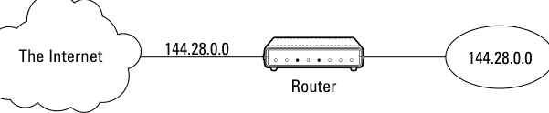

子网划分后

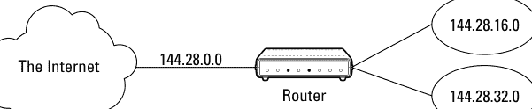

**图 2-3:** 子网划分前网络。

例如，图 2-3 所示子网的子网掩码（其网络 ID 由 16 位网络 ID 加额外的 4 位子网 ID 组成）如下所示：

```
11111111 11111111 00000000
```

换句话说，前 20 位是 1，剩余的 12 位是 0。因此，完整的网络 ID 长度为 20 位，子网地址中的主机主机部分长度为 12 位。

要确定一个 IP 地址的网络 ID，路由器必须同时拥有 IP 地址和子网掩码。然后路由器对 IP 地址执行称为“逻辑与”（logical AND）的位运算以提取网络 ID。在执行逻辑与时，会将 IP 地址中的每个位与子网掩码中的对应位进行比较。如果两个位都为 1，则网络 ID 中的结果置为 1。如果其中任何一个为 0，则结果置为 0。

例如，使用上述示例中的 20 位子网掩码从 IP 地址中提取网络 ID：

```
144      28      16      17
IP address: 10010000 00011100 00100000 00010001
Subnet mask: 11111111 11111111 11110000 00000000
Network ID: 10010000 00011100 00100000 00000000
144      28      16      0
```

因此，该子网的网络 ID 为 144.28.16.0。

第四卷 第 2 章

理解 IP 地址

www.it-ebooks.info

## 302 子网划分

子网掩码本身通常用点分十进制法表示。因此，上例中使用的 20 位子网掩码表示为 255.255.240.0：

Subnet mask: 11111111 11111111 11100000 00000000

255 255 240 0

不要将子网掩码与 IP 地址混淆。子网掩码不代表互联网上的任何设备或网络。它只是指示 IP 地址中哪部分用于确定网络 ID 的方法。（你可以一眼识别出子网掩码，因为第一个字节是 255，而 255 不是有效的 A 类 IP 地址）。


# 网络前缀表示

由于子网以连续的 1 序列开头以指示哪些位被用于网络 ID，你可以使用一种简记法——网络前缀——来表示 IP 地址中多少位代表网络 ID。网络前缀通过在 IP 地址后紧跟一个斜杠来指示，后面跟着所使用的网络位数。例如，子网掩码为 255.255.240.0 的 IP 地址 144.28.16.17 可以表示为 144.28.16/20，因为子网掩码 255.255.240.0 有 20 位网络位。

网络前缀也称为无类网间路由表示法（简称 CIDR），因为它提供了一种指示地址中哪部分是网络 ID、哪部分是主机的方法，而不需要标准的地址类。

## 默认子网

子网掩码是对应标准 A、B、C 类地址分配的三个子网掩码。这些默认掩码汇总在表 2-5 中。

| 表 2-5 | 默认子网掩码 |
| 类 | 二进制 | 点分十进制 | 网络前缀 |
| :--- | :--- | :--- | :--- |
| A | 11111111 00000000 00000000 00000000 | 255.0.0.0 | /8 |
| B | 11111111 11111111 00000000 00000000 | 255.255.0.0 | /16 |
| C | 11111111 11111111 11111111 00000000 | 255.255.255.0 | /24 |

www-it-ebooks.info

## 303 子网划分

请记住，子网掩码并不并不要求使用这些默认值，因为 IP 类可以通过检查 IP 地址的前三位来确定。如果第一位是 0，则地址为 A 类，子网掩码为 255.0.0。如果前两位是 10，则地址为 B 类，使用 255.255.0.0。如果前三位是 110，则使用 C 类默认掩码 255.255.255.0

你应该了解关于子网和子网掩码的额外限制。特别是：

- 网络 ID 的最小位数是。因此，子网掩码的第一个字节始终是 255。
- 网络 ID 的最大位数是30。你必须为地址的主机部分留出至少两位。如果你使用 32 位作为网络 ID，则主机 ID 没有位，这将无法工作。留一位作为主机 ID，1 是广播地址，0 是网络本身。这就是为什么网络 ID 最大大小为 30。
- 子网地址不能全为 0 或全为 1。因此，唯一地址的数量少于二。例如，使用三个子网位，可能的数量是2³ - 2。这意味着你必须要有两位（如果允许单位掩码，因为有效值只有 0 或 1）。

## IP 块

子网可以被认为是具有共同网络 ID 的 IP 地址范围或块。例如，CIDR 192.168.1.0/28 代表以下 14 个 IP 地址：

```
192.168.1.1   192.168.1.2   192.168.1.3   192.168.1.4
192.168.1.5   192.168.1.6   192.168.1.7   192.168.1.8
192.168.1.9   192.168.1.10  192.168.1.11  192.168.1.12
192.168.1.13  192.168.1.14
```

第四卷 第 2 章

理解 IP 地址

www-it-ebooks.info

## 304 子网划分

给定一个 CIDR 格式的 IP 地址，当网络 ID 结束的字节恰好为 0 时，这代表了实际 IP 地址的范围。你通过网络 ID 的大小确定允许多少主机。

然而，如果网络 ID 结束字节不是 0 呢？例如，当子网掩码为 255.255.255.240 时，192.168.1.100 的有效 IP 地址有哪些？在这种情况下，计算有点困难。第一步是确定实际的网络 ID。你可以通过将 IP 地址和子网掩码转换为二进制然后从示例中提取网络：

| | 192 | 168 | 1 | 100 |
| :--- | :--- | :--- | :--- | :--- |
| IP 地址: | 11000000 | 10101000 | 00000001 | 01100100 |
| 子网掩码: | 11111111 | 11111111 | 11111111 | 11100000 |
| 网络 ID: | 11000000 | 10101000 | 00000000 | 01100000 |
| | 192 | 168 | 1 | 96 |

因此，网络 ID 为 192.168.1.96。

接下来，根据网络前缀确定子网中允许的主机数量。你可以通过从 254 减去子网掩码的最后一个字节来计算。在这种情况下，允许的主机数量为14。

要确定块中的第一个 IP 地址，在网络 ID 上加 1。因此，我示例中的第一个 IP 地址是 192.168.1.97。要确定块中的最后一个 IP 地址，在网络 ID 上加上主机数量。在我的示例中，最后一个 IP 地址是 192.168.1.110。结果，192.168.1.100 带有子网掩码 255.255.255.240 指定了以下 IP 地址块：

192.168.1.97 192.168.1.98 192.168.1.99 192.168.1.100

192.168.1.101 192.168.1.102 192.168.1.103 192.168.1.104

192.168.1.105 192.168.1.106 192.168.1.107 192.168.1.108

192.168.1.109 192.168.1.110

## 私有和公共地址

任何直接连接到互联网的主机必须具有全球唯一的 IP 地址。然而，并不是所有主机都直接连接到互联网。有些位于未连接到互联网的网络中。有些隐藏在防火墙后面，因此它们的连接是间接的。

几个 IP 地址块被为此用途，用于未连接到互联网的私有网络或隐藏在防火墙后的网络。这些地址范围存在如表 26 所示。当你创建 TCP/IP 网络时，应该使用这些范围内的 IP 地址。

## 网络地址转换 305

### 表 2-6 私有地址空间

| CIDR | 子网掩码 | 地址范围 |
|---|---|---|
| 10.0.0.0/8 | 255.0.0.0 | 10.0.0.1-10.255.255.254 |
| 172.16.0.0/12 | 255.255.240.0 | 172.16.1.1-172.31.255.254 |
| 192.168.0.0/16 | 255.255.0.0 | 192.168.0.1-192.168.255.254 |

## 网络地址转换

许多防火墙使用一种名为网络地址转换（NAT）的技术来向外部世界隐藏主机的实际 IP 地址。在这种情况下，NAT 设备必须使用全球唯一的 IP 向互联网代表主机。

在防火墙后面，主机可以使用任何它想要的 IP 地址。当数据包跨越防火墙时，NAT 设备会翻译公 IP 地址，反之亦然。

NAT 的优点之一是减缓了 IP 地址空间的分配速度。因为 NAT 设备可以使用单个公地址供多个主机使用。它通过跟踪传出的数据包，以便将数据包与正确的主机匹配。要理解这是如何工作的，请考虑以下步骤序列：

- 1. 私有地址为 192.168.1.100 的主机向 216.239.57.99 发送请求，该地址恰好是 www.google.com。NAT 设备更改数据包的源 IP 地址为 208.23.110.22，防火墙的 IP 地址。这样一来，NAT 记录了 192.168.1.100 向 216.239.57.99 发送请求。
- 2. 另一个主机 172.16.1.107 向 207.46.134.190 发送请求，该地址恰好是 Microsoft.com。NAT 设备更改此请求的源为 208.23.110.22，防火墙将回复。NAT 记录了 172.16.1.107 向 207.46.134.190 发送请求。
- 3. 几秒钟，防火墙收到来自 216.239.57.99 的回复。回复中的目标地址是 208.23.110.22。为了确定回复发送给谁，防火墙检查其记录查看谁在等待来自 216.239.57.99 的回复。NAT 记录了 192.168.1.100 在等待。

实际上，这个过程比这要复杂一点，因为可能有两个或多个用户从公 IP 发送请求。在这种情况下，NAT 设备使用其他技术来确定应该交付哪个传入的数据包。

## 第 3 章：使用 DHCP

### 本章内容

- 发现 DHCP 基础
- 探索作用域（Scopes）
- 配置 DHCP 服务器
- 设置 DHCP 客户端

传输控制协议/网际协议（TCP/IP）网络上的每个主机必须有一个唯一的 IP 地址。每个主机必须经过正确配置，以便知道其 IP 地址。当新主机上线时，它必须被分配子网正确范围内的地址。虽然你可以手动为网络上的每台计算机分配 IP 地址，但如果网络超过几台计算机，这项任务很快就会变得难以应对。

这就是动态主机配置协议（DHCP）发挥作用的地方。DHCP 自动配置网络上每个主机的 IP，确保每个主机都有有效的唯一 IP 地址。正如你想象的，DHCP 可以为网络管理员节省大量的配置工作。

在本章中，你将了解 DHCP 的原理：它是什么，以及如何设置它。

## 理解 DHCP

DHCP 允许 TCP/IP 网络上的单个计算机从服务器获取配置信息——特别是它们的 IP 地址。DHCP 服务器跟踪哪些 IP 地址已经分配，以便当计算机请求 IP 地址时，DHCP 服务器提供一个未使用的 IP 地址。

## DHCP 提供的配置信息

尽管 DHCP 的主要工作是处理 IP 地址和掩码，但 DHCP 实际上为其客户端提供了比 IP 地址更多的配置信息。额外的配置信息是 DHCP 选项。以下是服务器可以配置的一些常用 DHCP 选项：

- 路由器地址（也称为默认网关地址）
- 配置信息的过期时间
- 域名
- 域名系统（DNS）服务器地址
- Windows 内部命名服务（WINS）服务器地址

## DHCP 服务器

DHCP 服务器可以是位于 TCP/IP 网络上的任意计算机。所有现代操作系统都内置了 DHCP 服务器。要在网络服务器上设置 DHCP，你只需要启用 DHCP 服务器功能并配置其设置。在接下来的章节“使用 DHCP 服务器”中，将向你展示如何为 Windows Server 2008 配置 DHCP 服务器。（Windows Server 2003 的程序类似。）

运行 DHCP 的服务器不需要专门用于它，除非网络非常大。对于大多数网络，文件服务器可以与 DHCP 服务器分担职责。特别是当你为 IP 地址提供长租约（Leases）时。（在本章中我将解释租约的概念。）


许多路由器也内置了 DHCP 服务器。如果你不想让你的网络服务器之一承担 DHCP 功能，可以启用路由器的内置 DHCP 服务器。允许路由器作为你网络的 DHCP 服务器的一个优势是，你很少需要关闭路由器。相比之下，你有时需要重启或关闭文件服务器以执行系统维护、应用升级或进行故障排除。

大多数网络只需要一个 DHCP 服务器。在同一网络上设置两个或多个服务器需要你仔细协调每个服务器负责的 IP 范围（称为作用域）。如果你意外为同一个作用域设置了两个 DHCP 服务器，你可能会导致地址分配冲突或将相同的 IP 地址分配给两个不同的主机。为了防止这种情况发生，请设置一个 DHCP 服务器，除非网络大到一台无法处理工作负载。

## DHCP 的实际原理

你可以在不知道 DHCP 客户端配置实际如何工作的细节的情况下配置和使用 DHCP。然而，对该过程的基本理解可以帮助你理解 DHCP 实际上在做什么。这种理解不仅具有启发性，而且在你排排除 DHCP 问题时也能提供帮助。

以下段落包含了 DHCP 如何配置 TCP/IP 主机的详细描述。此过程在每次启动启动时都会发生。当你释放 IP 并请求新租约时，它也会发生。

1. 当主机计算机启动时，DHCP 客户端会发送一个特殊的广播包，被称为“发现（Discover）”消息。

此消息使用子网广播地址（所有主机位均为 1）作为目标地址，并将 `0.0.0.0` 作为源地址。

客户端必须指定 `0.0.0.0` 作为源地址，因为它还没有 IP 地址，并指定广播地址作为目标地址，因为它不知道 DHCP 服务器的地址。实际上，Discover 消息是在说：“嘿！我是新来的，有 DHCP 服务器吗？”

2. DHCP 服务器接收广播发现消息，并通过发送“提议（Offer）”消息做出响应。

该 Offer 消息包含了客户端可以使用的 IP 地址。

与发现消息一样，该 Offer 消息也是发送到广播地址的。这是因为接收该消息的客户端没有 IP 地址，在收到提议之前不会有。实际上，该 Offer 消息是在说：“你好，这儿有一个你可以使用的 IP 地址，如果你想要的话。请告诉我。”

如果客户端从未收到来自 DHCP 服务器的 DHCP Offer 消息怎么办？在这种情况下，客户端会等待几秒钟并重试。客户端将尝试四次——2、4、8 和 16 秒。如果仍然没有提议，它将在五分钟后再次尝试。

3. 客户端收到 Offer 消息并返回一个被称为“请求（Request）”的消息。

此时，客户端实际上并不知道具体的 IP 地址：它只是表示它准备好接受服务器提供的 IP 地址。在请求消息中，它是在说：“是的，那个 IP 地址对我很合适。可以给我吗？”

4. 当服务器接收到请求消息时，它将 IP 地址标记为已分配给客户端，并广播一个“确认（Ack）”消息。

该 Ack 消息说：“好的，这是你的了。这里是你需要的其他信息。”

## 理解范围 (Scopes)

范围简单是指 DHCP 服务器配置用于分发的 IP 地址范围。在最简单的情况下，单个 DHCP 服务器负责整个子网的 IP 配置；此时，范围与该子网对应。如果你为一个子网设置了两个 DHCP 服务器，可以为每个服务器配置一个范围，仅分配完整子网范围内的一部分。此外，单个 DHCP 服务器可以为多个范围提供服务。

在启用 DHCP 服务器之前，你必须先创建一个范围。创建范围时，你可以为它提供以下属性：

- **名称**，可以帮助你识别该范围及其用途
- **描述**，允许你提供关于该范围及其用途的额外细节
- 范围的起始 IP 地址
- 范围的结束 IP 地址
- 范围的子网掩码

你可以使用点分十进制法或网络前缀表示法来指定子网掩码。

- 一个或多个排除地址范围

这些地址将不会分配给客户端。更多信息，请参阅本章稍后部分的“感觉被排除了？”章节。

- 一个或多个预留地址

这些地址将始终分配给特定的主机设备。更多信息，请参阅本章稍后部分的“建议预留”章节。

- **租期时长**，指示主机可以使用该 IP 地址的时间。

当租期过半时，客户端将尝试续租。如果你指定的租期为八天，则客户端将在四天后尝试续租。这为主机留了充足的时间，在地址被重新分配给其他主机之前完成续租。

- 子网的路由器地址

此值也称为默认网关地址。

- 网络 DNS 服务器和 WINS 服务器的域名和 IP 地址。

## 感觉被排除了？

每个人偶尔都会感到被排斥。由于我有妻子、三个女儿和一只母狗，我深知这种感受。有时，被排斥是一件好事。在 DHCP 范围的情况下，排除可以帮助你防止 IP 地址冲突，并允许你将单个子网的 DHCP 工作负载分配给两个或多个 DHCP 服务器。

排除项是指不包含在范围内的地址范围。排除范围落在范围的起始地址和结束地址之间。实际上，排除范围允许你在范围中“打一个洞”。落在该洞内的 IP 地址将不会被分配。

从范围中排除 IP 地址有几个原因：

- 运行 DHCP 服务器的计算机本身必须分配静态 IP 地址。因此，DHCP 服务器的地址应列为排除项。
- 某些主机可能不支持 DHCP。在这种情况下，主机需要静态 IP 地址。例如，你可能有一台没有 DHCP 客户端的老 MS-DOS 计算机。通过从范围中排除其 IP 地址，可以防止该地址被分配给网络上的任何其他主机。

## 建议预留

在某些，你可能希望将特定的 IP 地址分配给特定的主机。实现此点的方法之一为主机配置静态 IP 地址，且该地址在 DHCP 配置中未使用。然而，这种方法有两个主要的缺点：

- **TCP/IP 配置提供的不仅仅是 IP 地址**。如果你使用静态配置，你必须手动指定子网掩码、默认网关地址、DNS 服务器地址以及主机所需的其他配置信息。这些信息的更改要求你不仅要在 DHCP 服务器上更改，还要在每个配置了静态的主机上进行更改。
- **你必须从 DHCP 服务器的范围中排除该静态 IP 地址**。否则，DHCP 服务器将不知道该静态地址并将其分配给另一个主机。这样，你的网络上就会有两个具有相同地址的主机。

为特定主机分配固定 IP 地址的更好方法是创建 DHCP 预留。预留简单地表示，每当特定主机向 DHCP 服务器请求 IP 地址时，服务器都应该提供你在预留中中指定的地址。除非主机向 DHCP 服务器请求，否则主机不会收到该 IP 地址，但每当主机请求 IP 配置时，它将始终收到相同的地址。

## BootP 怎么说？

BootP —— 引导协议（Bootstrap Protocol）——一种允许工作站通过互联网或本地网络启动的网络协议。与 DHCP 类似，BootP 允许计算机从服务器接收 IP 地址。然而，与 DHCP 不同，BootP 还允许计算机下载启动镜像文件，计算机随后可以使用该文件进行启动。BootP 和 DHCP 之间的显著区别是，BootP 在计算机实际加载操作系统之前就开始作用了。相比之下，BootP是在操作系统加载后的网络设备配置期间使用的。

大多数 DHCP 服务器都可以支持 BootP。如果你的网络中有工作站，你可以使用 DHCP 服务器的 BootP 支持来启动计算机。曾几何几何磁盘工作站非常流行，因为网络管理员认为它们更容易管理。然而，用户很讨厌它们。现在大多数工作站已被埋在填埋场里，BootP 也不怎么使用了。

要创建预留，你需要将主机与其 MAC 地址关联（详情见下文）。

## 租期太长了吗？

配置 DHCP 服务器时你做出的最重要的决定之一是指定的租期长度。默认值是八天，这在很多情况下是合适的。然而，你可能会遇到这种不合适的情况：

- 网络越稳定，租期越长就可以安全地存在。
- 网络越不稳定，租期应该越短。例如，大学图书馆的无线网络是由学生使用的，他们带着笔记本电脑进入图书馆几小时。对于这种网络，一小时的时长可能是合适的。

不要配置你的网络允许无限期租期。某些管理员认为这可以减少稳定网络的负载。然而，没有网络是永久稳定的。每当你发现配置了无限租期的 DHCP 服务器时，查看活动租期。我保证你会发现分配给已不存在的主机的租期。

## 使用 DHCP 服务器

配置和管理 DHCP 服务器时所需的精确步骤取决于你正在使用的操作系统。以下步骤显示如何在 Windows Server 2008 中处理 DHCP 服务器。其他操作系统的程序类似。

### 安装和配置 DHCP 服务器

要在 Windows Server 2008 上安装 DHCP 服务器角色，请遵循以下步骤：

1. **选择开始；管理工具；服务器管理器**。服务器管理器出现。
2. **点击角色链接，然后点击添加角色**。添加角色向导启动。
3. **点击下一步启动向导**。向导显示可用的服务器角色列表。
4. **从角色列表中选择 DHCP 服务器，然后点击下一步**。向导显示 DHCP 的解释。
5. **点击下一步**。向导显示服务器分配了静态 IP 地址的网络连接列表。（在本示例中，只有一个网络连接分配了静态 IP 地址。大多数网络至少有两个。）
6. **选择要用于 DHCP 服务器的静态 IP 地址**。然后点击下一步。向导询问 DNS 配置信息。
7. **输入域名和 DNS 服务器。要输入 DNS 服务器，请将其地址输入 IP 地址框中，然后点击添加**。你通常会有多个 DNS 服务器。

### 与 DHCP 服务器工作

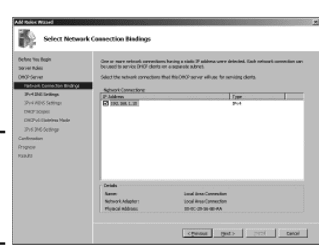

**图 3-1：** 选择用于此 DHCP 服务器的静态 IP 地址。

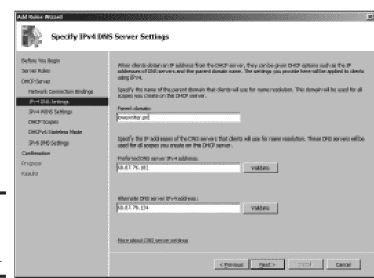

**图 3-2：** 指定 DNS 信息。

8. 点击“下一步”。

向导询问 WINS 配置信息。

9. （可选）如果你想启用 WINS，请输入 WINS 服务器配置并点击“下一步”。

如果你不想使用 WINS，请跳过此步骤并直接点击“下一步”。无论何种，下一个屏幕都允许你配置范围（scopes）。

10. 要创建新范围，点击“添加范围”按钮。

向导要求为新范围提供名称和描述，如图 3-3 所示。

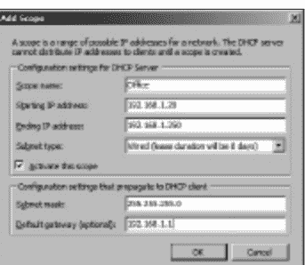

**图 3-3：** 创建新范围。

11. 为新范围输入以下信息。

你必须输入以下信息：

- **范围名称（Scope Name）：** 名称可以是任何内容。我建议你使用通用名称，如 *Office* 或你的公司，除非你正在创建两个或多个范围。情况下，名称应指示每个范围的功能。
- **范围起始 IP 地址（Scope Starting IP Address）：** 这是此范围分配的最低 IP 地址。
- **范围结束 IP 地址（Scope Ending IP Address）：** 这是此范围分配的最高 IP 地址。
- **子网掩码（Subnet Mask）：** 这是分配给范围内 IP 地址的子网掩码。
- **默认网关（Default Gateway）：** 这是此范围使用的默认网关地址。这通常是你的路由器的地址。
- **子网类型（Subnet type）：** 选择有线或无线。区别在于 IP 地址的有效时间。对于有线网络，地址的有效期为六天。对于无线网络，地址将在八小时后过期。

12. 选择“激活此范围”复选框，然后点击“确定”。

范围已创建，如图 3-4 所示。

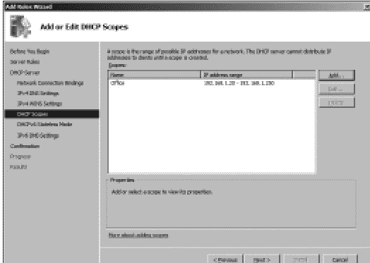

**图 3-4：** 范围已创建。

13. 如果你想创建额外的范围，请重复步骤 10–12。
14. 完成范围的创建后，点击“下一步”。
15. 点击“下一步”。
16. 点击“下一步”。
17. 安装。
18. 点击“关闭”。

你可以为 DHCP 服务器创建任意数量的范围。向导询问你是否要启用用于 IPv6 的无状态模式（stateless mode）。除非处理 IPv6 客户端对你的网络很重要，否则我建议禁用此模式。向导询问创建此服务器时使用的凭据。默认是使用你当前的凭据。向导显示一个确认屏幕，总结了你为 DHCP 服务器输入的设置。DHCP 服务器已创建。这可能需要几分钟。服务器完成后，将显示最终结果页面以确认服务器已正确安装。你完成了！

### 管理 DHCP 服务器

你可以通过选择“开始：管理工具：DHCP”或通过管理 DHCP 服务器应用程序来启动 DHCP 管理控制。无论何种方式，DHCP 控制台如图 3-5 所示。

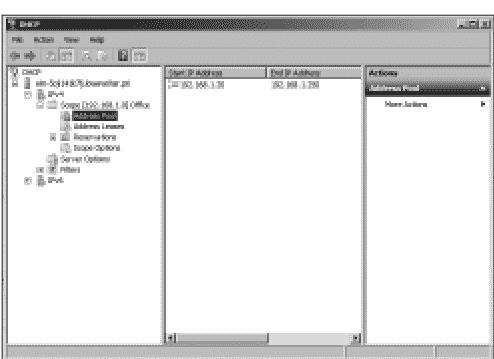

**图 3-5：** DHCP 管理控制。

通过 DHCP 控制台，你可以对 DHCP 服务器的配置和操作进行完全控制。以下列表总结了你可以从 DHCP 控制台执行的操作：

- **你可以授权 DHCP 服务器**，允许它开始分配客户端地址。要授权服务器，请选择服务器，选择“已授权服务器”，然后点击“授权”。
- **要添加另一个范围**，在树形结构中右键点击服务器，并从出现的菜单中选择“新建范围”命令。这将弹出“新建范围向导”。
- **要激活或禁用范围**，在树形结构中右键点击范围，然后选择“激活”或“禁用”命令。
- **要更改设置**，右键点击范围并选择“属性”命令。这将弹出如图 3-6 所示的“属性”对话框。从该框中，你可以更改范围的起始和结束 IP 地址、子网掩码和 DNS 配置。
- **要更改范围排除项**，点击树形结构中范围下方的“地址池”。你可以通过右键点击范围并从菜单中选择“删除”命令来添加或删除范围。你也可以通过右键点击树形结构中的“地址池”并从上下文菜单中选择“新建排除”来添加新的排除。
- **要查看或更改预留**，点击树形结构中的“预留”。
- **要查看分配地址的列表**，点击树形结构中的“地址租”。

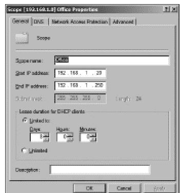

**图 3-6：** 属性框。

## 如何配置 Windows DHCP 客户端

配置 Windows DHCP 很容易。要执行此操作，在控制面板中的“网络连接”，选择 TCP/IP 协议并点击“属性”。这将弹出如图 3-7 所示的“属性”对话框。要配置计算机使用 DHCP，选择“自动获得 IP 地址”和“自动获得 DNS 服务器”。

**图 3-7：** 使用 DHCP。

## 自动私有 IP 地址

如果 Windows 配置为使用 DHCP 但无法获取 IP 地址，它将使用名为自动私有 IP 地址（APIPA）的功能分配一个私有地址。APIPA 使用 `169.254.x` 范围并使用特殊算法确保地址在网络中是唯一的。一旦 DHCP 服务器可用，计算机将请求新地址，因此 APIPA 仅在 DHCP 不用时使用。

## 租约的与释放

通常，DHCP 客户端在租期过半时尝试续约。例如，如果客户端获取了期八天的租期，它将在第四天尝试续约。然而，如果你更改了配置或 DHCP 配置工作异常，可以在命令提示符处运行 `ipconfig /renew` 提前续约。你也可以在命令提示符处运行 `ipconfig /release` 释放租约。这是 `ipconfig /release` 的输出：

```
C:\>ipconfig /release
Windows IP 配置
以太网适配器连接：
特定 DNS 后缀 . . . : 
IP 地址 . . . . . . . . . . . : 0.0.0
子网掩码 . . . . . . . . . . . : 0.0.0
默认网关 . . . . . . . . . . . : 
```

在这里，你可以看到 IP 地址和子网掩码设置为 0.0.0，且默认网关为空。

# 第 4 章：使用 DNS

在本章中

- 发现 DNS 基础
- 探索区域
- 检查资源记录
- 配置 DNS 服务器
- 设置 DNS 客户端

域名服务器 — DNS 是一种 TCP/IP 设施，允许你使用名称而不是数字来引用主机。没有 DNS，你将通过 IP 地址而不是 www.amazon.com 购买书籍。理解 DNS — 例如，如果你使用 DNS 查找 www.ebay.com，你会得到 eBay Web 主机的 IP 地址：66.211.160.87。因此，DNS 允许你通过 DNS 名称 www.ebay.com 而不是站点地址访问 eBay 网站。理解 DNS 如何工作以及如何设置 DNS 服务器对于设置和管理传输控制/网协议（TCP/IP）网络至关重要。本章介绍了 DNS 的基础知识，包括 DNS 命名系统以及如何设置 DNS 服务器。


如果你想查看 DNS 的完整官方规范，请查看 RFC 1034 和 1035，分别位于 www.ietf.org/rfc/rfc1034.txt 和 www.ietf.org/rfc/rfc1035.txt。

以下章节描述了 DNS 的基本概念。

## 域与域名

为了给互联网上的每台主机计算机提供唯一的 DNS 名称，DNS 使用了一种经受时间考验的技术：分而治之。DNS 使用一种分级命名系统，这类似于 Windows 计算机上文件夹的层级组织方式。DNS 不使用文件夹，而是将名称组织成域。每个域包含出现在 DNS 层级结构中直接其下方的所有名称。

例如，图 4-1 显示了 DNS 域名树的一小部分。树的最顶端是*根域*（root domain），它是所有域的锚点。根域的直接下方有四个顶级域名，命名为 edu、com、org 和 gov。

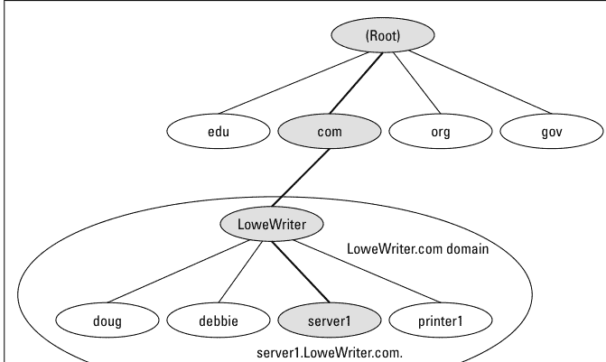

图 4-1：DNS 名称。

在实际上，互联网根域中存在的顶级域名比这多得多。如需更多信息，请参见本章后尾的“顶级域名”部分。


在图 4-1 的 `com` 域下方是另一个名为 `LoweWriter` 的域，它恰好是我个人的私有域。（挺聪明的，对吧？）为了完全标识此域，你必须将其与它的*父域（在本例中为 `com`）*的名称相结合，创建一个完整的域名：`LoweWriter.com`。注意，域名的各个部分是用点分隔的，这被称为“点”（`dots`）。因此，当你读取这个域名时，你的读音是 `LoweWriter` 句 `com`。

## 理解 DNS 名称 323

在 `Writer` 节点下方有四个主机，分别命名 `dou`、`debbie`、`server1` 和 `printer1`。它们分别对应我家庭网络中的三台计算机和一台打印机。你可以将主机名与域名结合，获取我网络中任何主机的完整 DNS 名称。例如，我的服务器的完整 DNS 名称是 `server1.LoweWriter.com`。同样，我的打印机是 `printer1.LoweWriter.com`。

以下是关于 DNS 需要记住的几个细节：

- **DNS 名称是不敏感的。** 因此，`LoweWriter` 和 `Lowewriter` 被视为相同的名称，`LOWEWRITER`、`LOWEmitter` 和 `LOWeWriter` 也是如此。当你使用域名时，可以使用大小写来使名称易于阅读，但 DNS 会忽略大小写字母之间的区别。

- **每个 DNS 节点的名称长度可达 63 个字符（包括点），并可以包含字母、数字和连字符。** 不允许特殊字符。

- **子域是现有域之下的域。** 例如，`com` 域实际上是根域的子域。同样，`LoweWriter` 是 `com` 域的子域。

- **DNS 是一种分级命名系统，类似于 Windows 使用的层级文件夹系统。**

DNS 与 Windows 命名规范之间存在一个关键区别。当你构建完整名称时，你从树的底部开始，向根部移动。`Doug` 是相反的最低节点：`dou.LoweWriter.com`。相比之下，Windows 路径是相反：它们从根部开始向下。例如，路径 `\Windows\System32\dns` 中 `dns` 是最低节点。

- **DNS 树的深度可达 127 层。** 在实践中，DNS 树非常浅。大多数 DNS 名称有三层（算上根域）。尽管你会看到四层或五层的名称，但很少看到比更多的。

- **尽管 DNS 树很浅，但它非常宽。** 换句话说，每个顶级域名在其下方都有海量的二级域名。例如，在本文写作时，`com` 域下方有超过百万个二级域名。

## 完全限定域名

如果一个域名以尾部点结尾，那么该尾部点代表根域，该域名被称为*完全限定域名*（`fully qualified domain name`，也称为 `FQDN`）。完全限定域名也称为*绝对名称*（`absolute name`）。完全限定域名是无歧义的，因为它


第四卷

第四章


info

*根域*

*根域*

在这种情况下，相对路径被视为相对名称。

许多情况下，相对路径与绝对名称是互换的。

如果域名不以点结尾，则它被视为相对名称。

*截至2002 年 1 月。*

## 顶级域名

通用顶级域名对任何人开放。表 4-1 总结了每个顶级域下注册的二级域名数量。

### 表 4-1 顶级域名

| 域名 | 说明 | 数量 |
| :--- | :--- | :--- |
| `com` | 商业组织 | 129 |
| `edu` | 教育机构 | 3873 |
| `gov` | 政府 | 966 |
| `int` | 国际组织 | 19 |
| `mil` | 军事 | 110 |
| `net` | 网络提供者 | 253741 |
| `org` | 非商业组织 | 140968 |

## 地域域名

美国外的公司使用这些顶级域名来避免拥挤。

### 表 4-2 新顶级域名

| 域名 | 说明 | 数量 |
| :--- | :--- | :--- |
| `aero` | 航空航天工业 | 147 |
| `biz` | 商业 | 11399 |
| `coop` | 合作社 | 263 |
| `info` | 信息站点 | 16276 |
| `museum` | 博物馆 | 11 |
| `name` | 个人用户 | 710 |
| `pro` | 专业组织 | 30 |

## 326 顶级域名

表 4-3 列出了在写作时拥有超过200 个子域的地域域名，按字母顺序排列。总而言之，大约有 150 个地域域名。具体数量会随着政治形势的变化变化。

### 表 4-3 子域超过 200 个的地域域名

| 域名 | 说明 | 域名 | 说明 |
| :--- | :--- | :--- | :--- |
| `ac` | 昇石岛 | `hu` | 匈牙利 |
| `ae` | 阿联酋联邦国 | `ie` | 爱尔兰 |
| `ag` | 安提瓜和巴布达 | `in` | 印度 |
| `am` | 亚美尼亚 | `is` | 冰岛 |
| `an` | 荷兰属群岛 | `it` | 意大利 |
| `as` | 美属萨摩亚 | `jp` | 日本 |
| `at` | 奥地利 | `kz` | 哈萨克斯坦 |
| `be` | 比利时 | `la` | 老挝民主共和国 |
| `bg` | 保加利亚 | `li` | 列支芬斯坦 |
| `br` | 巴西 | `lk` | 斯里兰卡 |
| `by` | 白俄罗斯 | `lt` | 立陶宛 |
| `bz` | 别兹 | `lu` | 卢森堡 |
| `ca` | 加拿大 | `lv` | 拉脱维亚 |
| `cc` | 柯科斯环群岛 | `ma` | 摩洛哥 |
| `ch` | 瑞士 | `md` | 摩尔多瓦 |
| `cl` | 智利 | `nl` | 荷兰 |
| `cn` | 中国 | `no` | 挪威 |
| `coop` | 合作社 | `nu` | 纽埃 |
| `cx` | 圣诞岛 | `pl` | 波兰 |
| `cz` | 捷克共和国 | `pt` | 葡萄牙 |
| `de` | 德国 | `ro` | 罗马尼亚 |
| `dk` | 丹麦 | `ru` | 俄罗斯联邦 |
| `ee` | 爱沙尼亚 | `se` | 瑞典 |
| `es` | 西班牙 | `si` | 斯洛文尼亚 |
| `eu` | 欧盟 | `sk` | 斯洛伐克 |

# Hosts 文件 327

| 域名 | 描述 | 域名 | 描述 |
| --- | --- | --- | --- |
| `fi` | 芬兰 | `st` | 圣多美和普林西 |
| `fm` | 密克罗尼西亚 | `su` | 苏联 |
| `fo` | 法罗群岛 | `to` | 汤加 |
| `fr` | 法国 | `tv` | 图瓦卢 |
| `ge` | 格鲁吉亚 | `tw` | 台湾 |
| `gov` | 政府 | `ua` | 乌克兰 |
| `gr` | 希腊 | `us` | 美国 |
| `hr` | 克罗地亚 | `ws` | 萨摩亚 |

# Hosts 文件

很久以前，在一个非常遥远的网络中，互联网规模还小，网络管理员可以通过一个简单的文本文件跟踪所有内容。这个文件被称为 *Hosts*，它仅列出了网络上每个主机的名称和 IP 地址。每台计算机都有一份 Hosts 文件的副本。关键在于保持所有 Hosts 文件都是最新状态。每当有新主机加入互联网时，每位网络管理员都会手动更新自己的 Hosts 文件副本，以添加新主机的名称和 IP 地址。

随着互联网的增长，Hosts 文件也随之增长。在 20 世纪 80 年代，显然需要更好的解决方案。想象一下，在今天尝试仅用一个文本文件来记录互联网上数百万主机的名称和 IP 地址来跟踪整个互联网！DNS 的发明就是为了解决这个问题。

理解 Hosts 文件非常重要，原因有二：

- **Hosts 并没有死掉。** 对于小型网络，Hosts 文件仍然是为网络计算机提供名称解析的最简单方法。此外，Hosts 文件可以与 DNS 并存。在在使用 DNS 之前，始终会检查 Hosts 文件，因此如果你需要，甚至可以使用 Hosts 文件来覆盖 DNS。

- **Hosts 是 DNS 的先驱。** DNS 的设计是为了规避 Hosts 文件的局限性。当你理解了 Hosts 文件的工作原理时，你会更好地体会 DNS 的优势。

Hosts 文件是一个简单的文本文件，包含将 IP 地址与主机名匹配的行。你可以使用任何文本编辑器编辑 Hosts 文件，包括记事本或使用 MS-DOS `EDIT` 命令。Hosts 文件的确切位置取决于客户端操作系统，如表 4-4 所示。

第四卷

第四章

www.it-ebooks.info

## 328 Hosts 文件

| 表 4-4 Hosts 文件的位置 |
| 操作系统 | Hosts 文件位置 |
| Windows 9x/Me | `c:\windows\hosts` |
| Windows NT/2000 | `c:\wnt\system32\drivers\etc\hosts` |
| Windows XP and Vista | `c:\windows\system32\drivers\etc\hosts` |
| Unix/Linux | `/etc/hosts` |

所有的 TCP/IP 实现在安装时都带有一个初始 Hosts 文件。例如，列表 4-1 显示了 Windows 7 TCP/IP Hosts文件的示例。如你所示，初始文件以一些解释文件目的的注释开头。

Windows 7 Hosts 文件以注释结尾，显示了用于映射主机名 `localhost` 的主机映射命令，该名称被映射到 IP 地址 `127.0.0.1`。IP 地址 `127.0.0.1` 是标准回环地址。因此，这允许计算机通过名称 `localhost` 引用自己。

请注意，除了 `127.0.0.1 localhost` 条目，另一个条目定义了标准的 IPv6 回环地址 (`::`)。与之前的 Windows 版本不同，Vista 内置了对 IPv6 的支持。

在 Windows 7 之前，这些行不在 Hosts 文件中。但从 Windows 7 开始，`localhost` 的名称解析由 DNS 自身处理，因此在 Hosts 文件中不需要它的定义。

### 列表 4-1: 示例 Hosts 文件

```
# Copyright (1993-2009) Microsoft Corp.
# 这是 Windows 版 Microsoft TCP/IP 使用的示例 HOSTS 文件。
# 此文件包含 IP 地址到主机名的映射。每个
# 条目都应保持在单独的一行。IP 地址应该
# 放在第一列，随后是相应的宿主机名。
# IP 地址和主机名之间至少有一个
# 空格。
# 此外，注释（如这些）可以插入到单独的
# 行中或位于由 '#' 表示的机器名之后。
# 例如：
# 102.54.94.97       rhino.acme.com      # 源服务器
# 38.25.63.10         x.acme.com          # x 客户端主机
# localhost 解析由 DNS 自身处理。
# 127.0.0.1               localhost
# ::                       localhost
```

www.it-ebooks.info

# Hosts 文件 329

要向 Hosts 文件添加条目，只需在任何文本编辑器中编辑该文件即可。然后，在文件底部、`localhost` 条目之后添加一行。每一行中你应该列出想要用于该地址的 IP 地址和主机名。例如，要将主机名 `server1.LowWriter.com` 与 IP 地址 `192.168.168.201` 关联，你向 Hosts 文件中添加此行：

```
192.168.168.201 server1.LowWriter.com
```

然后，每当应用程序请求主机名 `server1` 的 IP 地址时，就会返回 IP 地址 `192.168.168.201`。

你还可以为主机映射添加别名。这使用户可以使用别名作为替代名称访问主机。例如，考虑以下行：

```
192.168.168.201 server1.LowWriter.com s1
```

在这里，可以通过 `server1.LowWriter.com` 或只需 `s1` 访问 `192.168.168.201` 设备。

列表 4-2 定义了多个主机的 Hosts 文件。

### 列表 4-2: 定义了多个主机的 Hosts 文件

```
# Copyright (c) 1993-2009 Microsoft Corp.
# 这是 Windows 版 Microsoft TCP/IP 使用的示例 HOSTS 文件。
# 此文件包含 IP 地址到主机名的映射。每个
# 条目都应保持在单独的一行。IP 地址应该
# 放在第一列，随后是相应的宿主机名。
# IP 地址和主机名之间至少有一个
# 空格。
# 此外，注释（如这些）可以插入到单独的
# 行中或位于由 '#' 表示的机器名之后。
# 例如：
# 102.54.94.97       rhino.acme.com      # 源服务器
# 38.25.63.10         x.acme.com          # x 客户端主机
# localhost 解析由 DNS 自身处理。
# 127.0.0.1               localhost
# ::                       localhost
```

第四卷

第四章

使用 DNS

www.it-ebooks.info

# 330 理解 DNS 服务器和区域

# DNS 服务器和区域

DNS 服务器是运行 DNS 软件、维护 DNS 数据库并响应解析请求的计算机。有很多 DNS 服务器实现，最流行的是 `Bind` 和 `Windows DNS`。`Bind` 运行在 Unix 计算机上（包括 Linux），而 `Windows DNS` 自然运行在 Windows 计算机上。两者提供的服务相同。

理解 DNS 服务器工作的关键在于意识到 DNS 数据库——即所有域名、子域名和主机映射列表是一个巨大的分布式数据库。没有单一的 DNS 服务器包含整个数据库。相反，数据库的不同部分被授权给了服务器。

例如，假设我设置了一个 DNS 服务器来处理我的 `LowWriter.com` 域。那么，当有人请求 `dog.LowWriter.com` 的 IP 地址时，我的 DNS 服务器可以提供答案。然而，我的 DNS 服务器并不负责互联网的其他部分。相反，如果有人向我的 DNS 服务器请求其他计算机（如 `coyote.acme.com`），我的 DNS 服务器将向知道答案的另一个 DNS 服务器传递请求。

# 区域

为了简化 DNS 数据库的管理，整个 DNS 命名空间被划分为区域，并将每个区域的责任授权给特定的 DNS 服务器。在许多情况下，区域直接对应域名。例如，如果我设置了一个名为 `LowWriter.com` 的域名，我也可以设置一个名为 `LowWriter.com` 的区域，负责整个 `LowWriter.com` 域。

然而，组成域的子域名可以划分到独立的区域，这里一个名为 `LowWriter.com` 的域被划分为两个区域。一个区域 `us.LowWriter.com` 负责整个 `us.LowWriter.com` 子域名。另一个区域 `LowWriter.com` 负责除 `us.LowWriter.com` 子域名之外的整个 `LowWriter.com` 域。

为什么要这样做？主要原因是将区域权限授予服务器。例如，图 4-2 建议 `LowWriter.com` 域的部分在在美国管理，另一部分在法国管理。图中的两个区域允许一台服务器完全负责该域的美国部分，而另一台服务器处理该域的其他部分。

## 理解 DNS 服务器与区域 331

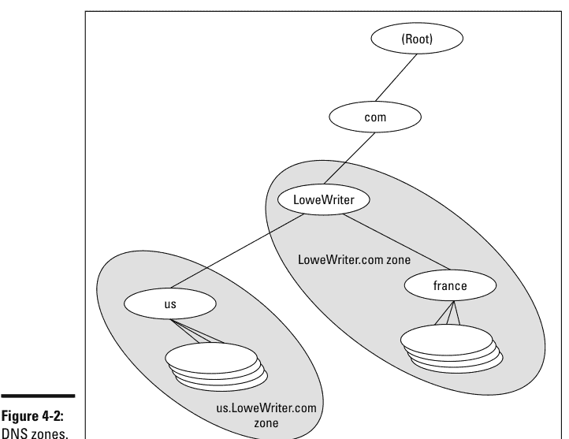

## 老的伪造 Hosts 文件小技巧

Hosts 文件可以作为一个有趣的恶作剧的基础。当然，我以及我的编辑或出版商都不建议你真的这样做。如果你因此惹了麻烦，请不要把你的律师发给我。这个侧边栏出现仅仅是为了让你知道万一发生这种情况该怎么办。

主意是编辑你可怜受害者的 Hosts 文件，这样每当用户尝试访问他喜欢的网站时，取而代之的是你选择的网站。例如，如果你想让你丈夫带你去坐邮轮，可以在他的 Hosts 文件中添加一行，将他喜爱的网站替换为某个邮轮公司的网站。例如，这一行代码就能起作用了：

```
151.124.250.181 www.espn.com
```

现在，每当你丈夫尝试访问 ESPN 网站时，他看到的将是嘉年华邮轮的首页。

当然，要真的实施这种花招是完全不负责任的。特别是如果你没有先为 Hosts 文件创建一个备份副本，以防万一弄乱了。

警告：如果突然启动了错误的网站，你必须检查你的 Hosts 文件以查看它是否被篡改过。

www-it-ebooks.info

## 332 理解 DNS 服务器与区域

以下是两种基本类型的区域：

- 主区域（`primary zone`）是区域的母本。主区域的数据存储在托管主区域的 DNS 服务器的本地数据库中。一个特定的主区域只能由一个 DNS 服务器托管。区域的更新必须在主区域上进行。

- 辅助区域（`secondary zone`）是区域的只读副本。当服务器托管辅助区域时，该服务器并不存储区域数据的本地副本。相反，它通过“区域传输”（`zone transfer`）过程从该区域的主服务器获取其区域副本。辅助服务器必须定期检查主服务器，以查看其辅助区域数据是否仍然是最新的。如果不是，则将启动辅助传输来更新辅助区域。

## 主服务器与辅助服务器

每个 DNS 服务器都负责一个或多个区域。以下是 DNS 服务器可以承担的两种角色：

- 区域的主服务器，这意味着该 DNS 服务器托管一个主区域。区域的数据存储在 DNS 服务器上的文件中。每个区域都必须有一个主服务器。

- 区域的辅助服务器，这意味着该 DNS 服务器从主服务器获取辅助区域的数据。每个区域应该至少有一个辅助服务器。这样，如果主服务器宕机，由区域定义的域名就可以通过一个或多个辅助服务器访问。


辅助服务器应该与区域的主服务器位于不同的子网。如果主服务器位于相同的子网，一旦控制该子网的路由器故障，两者都无法使用。

注意，单个 DNS 服务器可以是某些区域的主服务器，同时其他区域的辅助服务器。服务器被认为对它托管的主、辅助区域具有权威性，因为它可以为这些区域之间的查询提供确定性的答案。

## 根服务器

DNS 的核心由根服务器组成，它们对整个互联网具有权威性。根服务器的主要功能是提供负责每个顶级域的 DNS 服务器地址。这些服务器反过来可以提供顶级域下子名的 DNS 服务器地址。

根服务器是维系互联网的重要纽带。正如你可以想象的，它们日夜被请求淹没。全球共有 13 台根服务器。表 4-5 列出了这 13 台根服务器的每个 IP 地址和位置。

## 理解 DNS 服务器与区域 333

| 表 4-5 13 台根服务器 | | | | |
| 服务器 | IP 地址 | 运营商 | 位置 |
| :--- | :--- | :--- | :--- |
| A | 192.41.0.4 | VeriSign Global Registry Services | Dulles, VA |
| B | 192.228.79.201 | Information Sciences Institute | Marina Del Rey, CA |
| C | 192.33.4.12 | Cogent Communications | Herndon, VA and Los Angeles, CA |
| D | 128.8.10.90 | University of Maryland | College Park, MD |
| E | 192.203.230.10 | NASA Ames Research Center | Mountain View, CA |
| F | 192.5.5.241 | Internet Systems Consortium | Palo Alto, CA; San Jose, CA; New York City; San Francisco; Madrid; Hong Kong; Los Angeles |
| G | 192.112.36.44 | U.S. DOD Network Information | Vienna, VA Center |
| H | 128.63.2.53 | U.S. Army Research Lab | Aberdeen, MD |
| I | 192.36.148.17 | Autonomica | Stockholm |
| J | 192.5.6.30 | IANN | Sydney |
| K | 192.39.24.4 | IANN | Tokyo |
| L | 198.39.32.4 | IANN | Amsterdam |
| M | 223.0.053.10 | ICANN / IANA | São Paulo |

## 331 理解 DNS 服务器与区域


## 老的伪造 Hosts 文件小技巧

`Hosts` 文件可以作为一个有趣的恶作剧的基础。当然，我以及我的编辑或出版商都不建议你真的这样做。如果你因此惹了麻烦，请不要把你的律师发给我。这个侧边栏仅仅仅仅让你知道万一发生这种情况该怎么办。

主意是编辑你可怜受害者的 `Hosts` 文件，这样每当用户尝试访问他喜爱的网站时，取而代之的是你选择的网站。例如，如果你想让你丈夫带你去坐邮轮，可以在他的 `Hosts` 文件中添加一行，将他喜爱的网站替换为某个邮轮公司的网站。例如，这一行代码就能起作用了：

```
151.124.250.181 www.espn.com
```

现在，每当你丈夫尝试访问 ESPN 网站时，他看到的将是嘉年华邮轮的首页。

当然，要真的实施这种花招是完全不负责任的。特别是如果你没有先为 `Hosts` 文件创建一个备份副本，以防万一弄乱了。

警告：如果突然启动了错误的网站，你必须检查你的 `Hosts` 文件以查看它是否被篡改过。

www-it-ebooks.info

## 332 理解 DNS 服务器与区域

以下是两种基本类型的区域：

- 主区域 `primary zone` 是区域的母本。主区域的数据存储在托管主区域的 DNS 服务器的本地数据库中。一个特定的主区域只能由一个 DNS 服务器托管。区域的更新必须在主区域上进行。

- 辅助区域 `secondary zone` 是区域的只读副本。当服务器托管辅助区域时，该服务器并不存储区域数据的本地副本。相反，它通过“区域传输” `zone transfer` 过程从该区域的主服务器获取其区域副本。辅助服务器必须定期检查主服务器，以查看其辅助区域数据是否仍然是最新的。如果不是，则将启动辅助传输来更新辅助区域。

### 主服务器与辅助服务器

每个 DNS 服务器都负责一个或多个区域。以下是 DNS 服务器可以承担的两种角色：

- 区域的主服务器，这意味着该 DNS 服务器托管一个主区域。区域的数据存储在 DNS 服务器上的文件中。每个区域都必须有一个主服务器。

- 区域的辅助服务器，这意味着该 DNS 服务器从主服务器获取辅助区域的数据。每个区域应该至少有一个辅助服务器。这样，如果主服务器宕机，由区域定义的域名就可以通过一个或多个辅助服务器访问。


辅助服务器应该与区域的主服务器位于不同的子网。如果主服务器和辅助服务器位于相同的子网，一旦控制该子网的路由器故障，两者都无法使用。

注意，单个 DNS 服务器可以是某些区域的主服务器，同时其他区域的辅助服务器。服务器被认为对它托管的主、辅助区域具有权威性，因为它可以为这些区域之间的查询提供确定性的答案。

## 336 理解 DNS 查询

DNS 客户端可以发起两种类型的查询：递归查询 `recursive` 和迭代查询 `iterative`。

- **递归查询：** 当客户端发出递归 DNS 查询时，服务器必须回复所请求的主名的 IP 地址，或者返回指示主机名不存在的错误消息。如果服务器本身没有该信息，它会向另一个 DNS 服务器询问 IP 地址。当第一个服务器最终获取到 IP 地址后，它会将其发送给客户端。如果服务器确定信息不存在，它会返回错误消息。

- **迭代查询：** 当服务器接收到迭代查询时，如果知道，则返回所请求主名的 IP 地址。如果服务器不知道答案，它会返回一个引导 `referral`，这仅仅是应该知道答案的 DNS 服务器的地址。客户端随后可以向被引导的服务器发出迭代查询。

普通客户端向 DNS 服务器发出递归查询。如果服务器知道查询的答案，它会直接回复客户端。如果不知道，服务器会向它认为知道答案的 DNS 服务器发出迭代查询。如果原始服务器从第二个服务器获得了答案，它会将答案返回给客户端。如果原始服务器得到了指向第三个服务器的引导，原始服务器将向第三个服务器发出迭代查询。原始服务器会不断发出迭代查询，直到获得答案或发生错误。然后它会将答案或错误返回给客户端。

### 现实中的 DNS 示例

困惑吗？我理解。一个示例可能有助于理清思路。假设用户想要查看网页 `www.wiley.com`。解析此地址会发生以下步骤：

1. 浏览器请求计算机的解析器查找 `www.wiley.com` 的 IP 地址。
2. 解析器向其名称服务器解决递归 DNS 查询。在这种情况下，我将该服务器命名为 `ns1.LoweWriter.com`。
3. 命名服务器 `ns1.LoweWriter.com` 检查它是否知道 `www.wiley.com` 的根地址之一的 IP 地址。它不知道，因此名称服务器向名称服务器发出迭代查询，以查看它们是否知道 `www.wiley.com` 的 IP 地址。
4. 根名称服务器不知道 `www.wiley.com` 的 IP 地址，因此它返回一个对 `com` 域权威的名称服务器列表。
5. `ns1.LoweWriter.com` 命名服务器选择 `com` 域服务器之一，并向其发送关于 `www.wiley.com` 的迭代查询。
6. `com` 名称服务器不知道 `www.wiley.com` 的 IP 地址，因此它返回一个对 `wiley.com` 域权威的名称服务器列表。
7. `ns1.LoweWriter.com` 命名服务器选择 `wiley.com` 域的名称服务器之一，并向其发送关于 `www.wiley.com` 的迭代查询。
8. `wiley.com` 名称服务器知道 `www.wiley.com` 的 IP 地址，因此名称服务器返回了它。
9. `ns1.LoweWriter.com` 命名服务器由于终于找到了 `www.wiley.com` 的 IP 地址而欢呼。它将此地址返回给客户端。它还缓存了答案，这样当用户下次查找 `www.wiley.com` 时，名称服务器就不需要联系其他服务器来解析名称。
10. 客户端也缓存了查询结果。

当客户端下次需要查找 `www.wiley.com` 时，客户端可以在不打扰名称服务器的情况下解析名称。

## 区域文件与资源记录

每个 DNS 区域由一个区域文件 `zone file` 也称为 DNS 数据库或主文件定义。对于 Windows DNS 服务器，区域文件名为 `domain.zone`。例如，`LoweWriter.com` 的区域文件命名为 `LoweWriter.com.zone`。对于 BIND DNS 服务器，区域文件为 `db.domain`。因此，`LoweWriter.com` 域的区域文件将是 `LoweWriter.com.zone`。两种系统的区域文件内容格式是相同的。

区域文件由一个或多个资源记录组成。创建和更新组成区域文件的资源记录是 DNS 管理员的主要任务之一。Windows DNS 服务器为资源记录提供了一个友好的图形界面。然而，你应该熟悉如何构建资源记录。

资源记录以简单的文本行形式写入，包含以下字段：

| Owner | TTL | Type | RDATA |
| --- | --- | --- | --- |

这些字段之间必须用一个或多个空格隔开。

- **Owner 所有者：** 记录所应用的 DNS 域或主机的名称。这通常指定为完全限定域名 `FQDN` 带有尾部点或简单主机不带尾部点，然后在当前域的上下文中进行解释。


进入`/path/to/xxx`目录，找到`xxx.json`。

在表达式`cvar = avar + bvar`中，加法运算符（`+`）将`avar`与`bvar`相加，得到它们的和`cvar`

在`List.of(arg0, arg1, arg2)`中，`List`接口的工厂方法`of()`接受一系列的元素，返回包含它们的只读列表。

之后我们这样调用`cmd`命令：`cmd arg0 arg1 arg2`。

```
if (condVar > someVal) {console.log("xxx")}
```


## 354 使用浏览器访问 FTP 站点

以下列表为设置 FTP 站点内容提供了一些实用的提示：

- 在 FTP 站点的主目录中创建一个 `readme.txt` 文件，描述你站点的内容和规则。希望用户在访问你的站点时查看此文件。虽然不能保证他们会这样做，但你完全抱此希望。
- 如果你的站点有很多文件，请将它们组织在主目录之下。
- 尽量使用短文件名。使用命令行客户端的用户非常喜欢简洁，因为他们必须准确输入文件名才能获取你的文件。
- 不要在文件名中使用空格。某些客户端会拒绝包含空格的名字。


## 使用浏览器访问 FTP 站点

网络浏览器内置了对 FTP 的支持。Internet Explorer 让你访问 FTP 站点几乎就像访问本地磁盘一样。你甚至可以在 FTP 站点与之间拖放文件。

若要在 Web 浏览器中访问 FTP 站点，只需在地址栏中输入站点名称即可。如果你需要，可以在 FTP 站点名称之前输入 `ftp://` 来显式指定 FTP 协议，但这通常不是必要的。浏览器会自动识别你输入的名称是 FTP 站点并调用 FTP 协议。

图 5-7 显示了在 Windows 7 系统上使用 Windows 资源管理器访问典型 FTP 站点时的外观。如你所见，文件和文件夹就像在本地磁盘上一样。双击文件夹显示该文件夹包含的文件；通过将文件从浏览器窗口拖动到桌面或其他窗口来下载文件。你也可以通过从桌面或其他窗口拖到 FTP 窗口来上传文件。

如果 FTP 站点的内容没有显示在浏览器窗口中，你可能需要登录站点。选择“文件：登录身份”以显示“登录身份”对话框。如果站点管理员给了你用户名和密码，你可以在此处输入它们以访问站点。否则，勾选“匿名登录”复选框然后点击“登录”按钮。

## 使用 FTP 命令行客户端

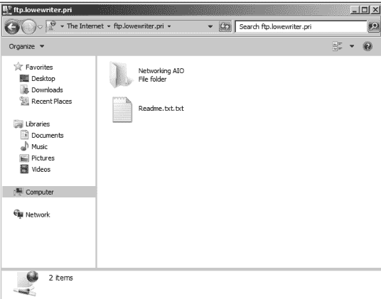

图 5-7：
浏览 FTP 站点。

## 使用 FTP 命令行客户端

如果你是一个命令行发烧友，你会喜欢 Windows 自带的 `ftp` 命令。它并不美观，但能完成任务。在本章末尾，你将找到一个命令参考，其中详细说明了你可以配合 `ftp` 命令使用的所有子命令。在本节中，我向你展示一个典型的会话，我登录到一个名为 `ftp.example.com` 的 FTP 服务器。

在这个会话中，我登录到一个名为 `ftp.example.com` 的 FTP 服务器。

356 使用 FTP 命令行

```
example.com
```

# 358 FTP 命令与子命令参考

221 请稍后回来...

C:\

当然，FTP 的功能比这个简单的会话暗示的复杂得多。尽管如此，FTP 最常用的用途是下载文件，而大多数下载操作并不比这个示例复杂。

## FTP 命令与子命令参考

本章其余部分是 FTP 命令参考。在接下来的章节中，你可以找到 FTP 命令及其所有子命令的完整参考信息。描述的第一个命令是 FTP 命令本身。之后，所有的 FTP 命令将按字母顺序列出。

## ftp 命令

作用：

启动 FTP 客户端，以便你可以从或向 FTP 服务器传输文件。

语法：

`ftp [-v] [-d] [-i] [-n] [-g] [-s:filename] [-a] [-w:windowsize] [-A] [host]`

+ 参数：

- `-v` 关闭详细模式（Verbose mode）。
- `-d` 开启调试模式（Debug mode）。
- `-i` 关闭提示模式（Prompt mode）。
- `-n` 强制手动登录。
- `-g` 关闭通配符模式（Glob mode）。
- `-s` 指定包含 FTP 命令的脚本文件。
- `-a` 指定可以使用任何网络接口来绑定数据连接。
- `-w` 指定传输缓冲区的大小。默认为 4K。
- `-A` 自动以匿名用户身份登录。

+ Host：

你想要连接的 FTP 服务器。这可以是服务器的 DNS 名称或 IP 地址。

+ 示例：

`ftp ftp.lowewriter.com`

`ftp ftp.lowewriter.com -A`

更多信息：

与大多数 Windows 命令不同，此命令的开关以连字符（`-`）开头，而不是斜杠（`/`）。

如果你想编写子命令，请使用 `-s` 开关。FTP 不支持输入重定向。

当 FTP 运行时，会显示提示符 `ftp>`。显示此提示符时，你可以输入本章后续描述的任何 FTP 子命令。

## ! (转义)

作用：

转义到命令 shell。

语法：

`!`

更多信息：

此命令会弹出一个临时命令提示符以便你输入命令。要返回 `ftp>` 提示符，请输入 `exit`。

## ? (帮助)

作用：

显示帮助信息。

语法：

`? [command]`

`help [command]`

`help mput`

示例：

`?` 和 `help` 是可以替的。如果你单独输入 `?` 或 `help`，将出现 FTP 命令列表。如果你在 `?` 或 `help` 后面跟一个命令名，将出现该命令功能的摘要。

更多信息：

## append (追加)

作用：

上传文件并将其附加到远程系统现有文件的末尾。

`append localfile [remotefile]`

语法：

`append extra.txt start.txt`

更多信息：

如果省略 `remotefile` 参数，则假设远程文件与本地文件同名。

## ascii

作用：

设置 ASCII 传输模式。

语法：

`ascii`

更多信息：

此命令将传输类型设置为 ASCII，它最适用于文本文件。ASCII 是默认的传输类型。

## bell (蜂铃)

作用：

在每次传输完成后让 FTP 客户端发出蜂鸣声。

语法：

`bell`

更多信息：

当你下载文件并想在期间睡一下时，这个命令非常有用。遗憾的是，当你的老板走向你的办公室时它并不会响，所以你需要其他的警报系统来应对这种意外。

## binary (二进制)

作用：

设置二进制传输类型。

语法：

`binary`

更多信息：

二进制文件类型最适合可执行文件和其他非文本文件。

## bye (退出)

作用：

结束 FTP 会话并退出 FTP 命令。

语法：

`bye`

更多信息：

这是完成工作后使用的命令。它与 `quit` 命令相同。

## cd (切换目录)

作用：

更改远程计算机上的工作目录。

语法：

`cd remotedirectory`

示例：

`cd pics`

更多信息：

使用此命令切换到包含你想下载的文件的目录或你想上传文件的目录。

输入 `cd \` 进入根目录。

## close (关闭)

作用：

关闭与远程计算机的连接，但不离开 FTP 程序。

语法：

```
close
```

更多信息：

如果你想在不离开并重启 FTP 程序的情况下切换到另一个 FTP 服务器，可以使用此命令。此命令与 `disconnect` 命令相同。

## debug (调试)

作用：

切换调试模式。

语法：

```
debug
```

更多信息：

开启调试模式时，FTP 客户端会显示发送到 FTP 服务器的实际 FTP 命令。如果你正尝试诊断服务器或客户端的问题，这可能很有用，但如果你想看 FTP 客户端命令（如 `CD`）如何被翻译为 FTP 服务器命令（如 `CWD`），这也会很有趣。

## delete (删除)

作用：

删除远程计算机上的指定文件。

语法：

```
delete remotefile.txt
```

示例：

```
delete fight.txt
```

更多信息：

你一次只能用此命令删除一个文件。若要删除多个多个文件，请使用 `mdelete`。

## dir (列出)

作用：

列出目录内容。

语法：

```
dir [remirectory] [localfile]
```

示例：

```
dir
dir \pics
dir \txt
```

## disconnect (断开连接)

作用：

与远程计算机断开但不离开 FTP 程序。

语法：

```
disconnect
```

更多信息：

如果你想在不离开并重启 FTP 程序的情况下切换到另一个 FTP 服务器，可以使用此命令。此命令与 `close` 相同。

## get (获取)

作用：

从远程计算机下载文件。

语法：

```
get remotile [localfile]
```

示例：

```
get boo.exe
get bar.exe
```

更多信息：

此命令一次仅下载一个文件。要下载多个文件，请使用 `mget`。此命令与 `recv` 相同。

## glob (通配符)

作用：

切换文件名中使用通配符的状态。

语法：

```
glob
```

更多信息：

`Glob` 默认开启。如果开启了 `glob`，你可以在文件名文件名中使用 `*` 和 `?` 字符。

## hash (哈希)

作用：

切换显示哈希标记 (`#`) 以指示进度。

语法：

```
hash
```

更多信息：

`Hash` 默认关闭。如果你通过发布 `hash` 命令开启它，每传输一个 2K 数据块就会出现一个哈希标记 (`#`)。这可以帮你跟踪进度。

## help (帮助)

作用：

显示帮助信息。

语法：

`? [command]`

`help [command]`

更多信息：


? 和 `help` 是可以替的。如果你单独输入 `?` 或 `help`，将出现 FTP 命令列表。如果你在 `?` 或 `help` 后面跟一个命令名，将出现该命令功能的摘要。

## `lcd` (本地切换目录)

作用：

更改本地计算机上的工作目录。

语法：

`lcd localdirectory`

示例：

`lcd \docs`

更多信息：

使用此命令切换到你想下载文件的目录或你想上传文件的目录。

## `literal` (字面)

作用：

直接向服务器发送原生 FTP 命令。

语法：

`literal arguments`

示例：

`literal cwd pics`

更多信息：

如果你是 FTP 专家并想向服务器发送原生 FTP 命令，请使用此命令。它与 `quote` 命令相同。

## `ls` (列出)

作用：

列出远程目录内容。

语法：

```
ls [remotirectory] [localfile]
```

示例：

```
ls
ls \pics
```

更多信息：

第一个参数允许你列出当前工作目录以外的目录。第二个参数允许将输出结果捕获到本地计算机上的文件中。

## `mdelete` (批量删除)

作用：

删除多个文件。

语法：

```
mdelete remotefile. . .
```

示例：

```
mdelete file1.txt
mdelete file1.txt file2.txt file3.txt
```

更多信息：

此命令从远程系统的当前目录删除一个或多个文件。

## `mdir` (批量列出)

作用：

列出多个远程目录的内容。

语法：

```
mdir remotirectory. . . [localfile]
```

示例：

指定连字符作为最后一个参数将在屏幕上显示输出。否则，最后一个参数将被解释为你想将目录列表捕获到的本地文件名。

## `mget` (批量获取)

作用：

下载多个文件。

语法：

```
mget remotefile. . .
```

## FTP 命令与子命令参考 365

更多信息：

此命令从远程系统上的当前工作目录下载一个或多个文件到本地计算机的当前目录。

## `mkdir`

作用：

在远程系统上创建目录

语法：

`mkdir 远程目录`

示例：

`mdir plans`

更多信息：

新的子目录将创建在远程系统的当前工作目录中。

## `mls`

作用：

列出多个远程目录的内容

语法：

`mls 远程目录 . . [本地文件]`

示例：

`mls pics videos`

更多信息：

在最后一个参数处指定一个连字符（hyphen，-）以将输出显示在屏幕上。否则，最后一个参数将被解释为您想要将目录列表保存到的本地文件名。

## `mput`

作用：

上传多个文件

语法：

`mput 本地文件 . .`

示例：

- `mput file 1.txt`

`mput file 1.txt file2.txt file3.txt`

更多信息：

此命令从本地计算机的当前目录上传一个或多个文件到远程系统的当前工作目录。

## `open`

作用：

连接到 FTP 服务器

语法：

`open 远程系统 [端口]`

示例：

- `open ftp.microsoft.com`

`ftp.weirdport.com 1499`

更多信息：

仅当远程系统不使用标准 FTP 端口（20 和 21）时，才指定端口号。

## `prompt`

作用：

切换多次传输的提示

语法：

`prompt`

更多信息：

当 Prompt 模式开启时，在传输每个文件之前您都会收到提示。Prompt 模式默认开启。

## `put`

作用：

将文件上传到远程计算机

语法：

`put 本地文件 [远程文件]`

示例：

- `put boo.exe`

`put boo.exe bar.exe`

更多信息：

此命令从本地计算机的当前目录上传指定的文件到远程系统的当前工作目录。第二个参数允许您使用与本地系统使用的不同的名称来保存文件。

您可以使用此命令一次仅上传一个文件。要上传多个文件，请使用 `mput` 命令。

此命令与 `send` 命令相同。

## `pwd`

作用：

显示远程计算机上的当前工作目录

语法：

`pwd`

更多信息：

如果您不确定远程系统上的当前目录，可以使用此命令进行查找。

## `quit`

作用：

结束 FTP 会话并退出 FTP 程序

语法：

`quit`

更多信息：

这是在完成操作后使用的命令。它与 `bye` 命令相同。

## `quote`

作用：

直接向服务器发送原生 FTP 命令

语法：

`quote 参数 ...`

示例：

`quote cwd pics`

更多信息：

如果您是 FTP 专家并想向服务器发送原生 FTP 命令，请使用此命令。它与字面命令（`literal` command）相同。

## `recv`

作用：

从远程计算机下载文件

语法：

`recv 远程文件 [本地文件]`

示例：

- `recv boo.exe`

`recv boo.exe bar.exe`

更多信息：

此命令将指定的文件从远程系统的当前工作目录下载到本地计算机的当前目录。第二个参数允许您使用与远程系统使用的不同的名称来保存文件。

您可以使用此命令一次仅下载一个文件。要下载多个文件，请使用 `mget` 命令。

此命令与 `get` 命令相同。

## FTP 命令与子命令参考 366

## `remotehelp`

作用：

显示远程命令的帮助信息

语法：

`remotehelp [命令]`

示例：

`remotehelp cwd`

更多信息：

如果您单独输入 `remotehelp`，将显示 FTP 命令列表。如果您在 `remotehelp` 后输入命令名，将出现该命令功能的摘要。

## `rename`

作用：

在远程系统上重命名文件

语法：

`rename 文件名 新文件名`

示例：

`rename door.jpg doorway.jpg`

更多信息：

使用此命令更改远程系统上的文件名。

## `rmdir`

作用：

在远程系统上删除目录

语法：

`rmdir 目录名`

示例：

`rmdir oldpicsdir`

更多信息：

此命令会删除目录及其其中的所有文件，请谨慎使用！

## `send`

作用：

将文件上传到远程计算机

语法：

`send 本地文件 [远程文件]`

示例：

- `send boo.exe`

`send boo.exe bar.exe`

更多信息：

此命令从本地计算机的当前目录上传指定的文件到远程系统的当前工作目录。第二个参数允许您使用与本地系统使用的不同的名称来保存文件。

您可以使用此命令一次仅上传一个文件。要上传多个文件，请使用 `mput` 命令。

此命令与 `put` 命令相同。

## FTP 命令与子命令参考 369

## `status`

作用：

显示 FTP 客户端当前状态

语法：

`status`

更多信息：

使用此命令显示当前设置（如 `prompt` 和 `verbose`）以及当前连接。

## `trace`

作用：

激活跟踪模式（Trace mode）

语法：

`trace`

更多信息：

当 Trace 模式开启时，将显示关于每个数据包的详细信息。`trace` 默认关闭，应保持关闭。

## `type`

作用：

设置传输类型

语法：

`type [ascii | binary]`

更多信息：

使用此命令设置传输类型为 ASCII 或二进制模式。

## `verbose`

作用：

切换详细显示模式

语法：

`verbose`

更多信息：

当 `verbose` 模式开启时，FTP 将显示每个命令及其响应的详细信息。

## `user`

作用：

指定 FTP 用户

语法：

`user [用户名]`

示例：

- `user admin`

更多信息：

此命令用于在登录时指定用户名。

# 第 6 章：TCP/IP 工具

## FTP 命令与 ARP

## 地址解析协议 (ARP)

地址解析协议（ARP）是一种用于将 IP 地址映射到物理地址（MAC 地址）的协议。在局域网中，当一台设备想要向另一台设备发送数据包时，它通常知道对方的 IP 地址，但不知道对方的 MAC 地址。此时，ARP 就会发挥作用。

## 使用 `arp` 命令

`arp` 命令允许您查看和修改 ARP 缓存。ARP 缓存是 IP 地址与 MAC 地址之间的简单映射。在每个局域网中，TCP/IP 栈使用 ARP 来确定 MAC 地址。如果您在不带任何参数的情况下使用 `arp` 命令，将显示 ARP 缓存。要显示特定 IP 地址的 ARP 条目，请使用 `-a`。例如：

```
  192.168.1.1           00-0c-29-4f-8b-33      dynamic
  192.168.1.50          00-0c-29-7a-12-d4      dynamic
  192.168.1.100         00-0c-29-33-55-11      dynamic
  192.168.1.255         00-0c-29-4f-8b-33      static
```

## 使用 `hostname` 命令

使用 `hostname` 命令可以查看计算机的主机名。在 Windows 中，您可以使用以下命令查看当前计算机的主机名：

```
C:\hostname
DESKTOP-A1B2C3D
```

在 Unix/Linux 中，命令也是类似的：

```bash
$ hostname
linux-server
```

`hostname` 命令是所有介绍的 TCP/IP 命令中最简单的。它仅仅是显示计算机的主机名。Windows 版本的 `hostname` 命令没有参数。然而，Unix/Linux 版本的 `hostname` 允许您在设置计算机的主机名的同时显示它。

# 使用 `ipconfig` 命令

使用 `ipconfig` 命令可以显示有关计算机 TCP/IP 配置的信息。它还可以用于更新 DHCP 和域名服务器（DNS）设置。

## 显示基础 IP 配置

要显示计算机的基础 IP 配置，请在不带任何参数的情况下使用 `ipconfig` 命令，如所示：

```
C:\ipconfig
```

Windows IP 配置：

```
连接特定的 DNS 后缀             : fe80::cc9:9067:9427:a911:8
本地链路 IPv6 地址          : 192.168.1.110
IPv4 地址                   : 255.255.255.0
子网掩码                   : 192.168.1.1
```

隧道适配器 局域网连接 6:

```
连接特定的 DNS 后缀             : 2001:0:4136:e38c:2c6c:670:3f57:fe91
本地链路 IPv6 地址          : fe80::2c6c:670:3f57:fe91
默认网关
```

隧道适配器 局域网连接 7:

```
连接特定的 DNS 后缀             : 
本地链路 IPv6 地址          : fe80::5efe:192.168.1.101
默认网关
```

```
C:\
```

当你不带任何参数使用 `ipconfig` 时，该命令会显示适配器的名称、适配器的域名、IP 地址、子网掩码以及适配器的默认网关配置。这是确定计算机 IP 地址最简单的方法。

> 如果你的计算机显示的 IP 地址在 169.254.x.x 范围内，那么很有可能是 DHCP 服务器没有正常工作。169.254.x.x 是 Windows 在回退到 IP 自动配置时使用的 B 类地址块。这通常在无法访问 DHCP 服务器或其无法工作时发生。

| 第四卷 | 第 6 章 |

| --- | --- |

| TCP/IP 工具和命令 | |

## 显示详细配置信息

你可以通过在 `ipconfig` 命令中使用 `/all` 关来显示详细的 IP 配置信息，如所示：

```
C:\ipconfig /all
Windows IP 配置
主机名 ........................... . : WK07-001
主 DNS 后缀 ................. . : 
节点类型 ............................ . : 混合
IP 路由启用 ................... . : 否
WINS 代理启用 ................... . : 否
```

```
以太网适配器 局域网连接:
连接特定的 DNS 后缀 .... . : Intel(R) PRO/100 VE 网络连接
描述
物理地址 .................... . : 08-12-3F-A7-17-BA
DHCP启用....................... . : 否
自动配置启用 .............. . : 否
本地链路 IPv6 地址.............. . : fe80:cca:9067:9427:a918:8(首选)
IPv4 地址......................... . : 192.168.1.110 (首选)
子网掩码 ........................ . : 255.255.255.0
默认网关 .................... . : 192.168.1.1
DNS 服务器 ........................ . : 192.168.1.10
BIOS over Tcpip....................... : 已启用
68.87.76.178
```

```
C:\>
```

你可以通过 `ipconfig /all` 命令获取有关计算机的许多信息。例如：

- 计算机的主机名为 WK07-001。

- 计算机的 IPv4 地址为 192.168.1.110，子网掩码为 255.255.255.0。

- 默认网关是位于 192.168.1.1 的路由器。

- 这也是该网络的 DHCP 服务器。

- DNS 服务器为 192.168.1.10 和 68.87.76.178。

## 刷新 IP 租约

如果你正遇到 IP 配置问题，可以通过重新租用计算机的 IP 租约来解决。为此，请使用 `/renew` 开关，如所示：

```
C:\ipconfig /renew
Windows IP 配置
以太网适配器 局域网连接:
连接特定的 DNS 后缀 .... . : 
IP 地址 .......................... . : 192.168.1.110
子网掩码 ........................ . : 255.255.255.0
默认网关 .................... . : 192.168.1.1
```

```
C:\>
```

## 释放 IP 租约

当你重新刷新 IP 租约时，`ipconfig` 命令会显示新的租约信息。如果你配置计算机使用静态 IP 地址，则此命令将不起。你可以使用带有 `/release` 参数的 `ipconfig` 命令释放 IP 租约，如所示：

```
C:\ipconfig /release
Windows IP 配置
以太网适配器 局域网连接:
  连接特定的 DNS 后缀 :
  IP 地址 . . . . . . . . : 0.0.0.0
  子网掩码 . . . . . . . . : 0.0.0.0
  默认网关 . . . . . . . :
C:\>
```

当你刷新 IP 租约时，`ipconfig` 命令会显示新的租约信息。如果你配置了计算机使用静态 IP 地址，则此命令将不起。你可以使用带有 `/release` 参数的 `ipconfig` 命令释放 IP 租约，如所示：

如你所示，DNS 后缀和默认网关是空的。在使用 `ipconfig` 释放后，可以获取新的 IP。

## 刷新 DNS 缓存

你可以使用 `ipconfig /flushdns` 命令来刷新 DNS 缓存，如所示：

```
C:\ipconfig /flushdns
Windows IP 配置
成功刷新 DNS。
C:\>
```

即使你不需要这样做，当你遇到 DNS 问题时，可能需要刷新 缓存。

## 使用 `nbtstat` 命令

`nbtstat` 是一个用于 NetBIOS over TCP/IP 的命令，可以帮助解析 DNS。你可以使用表 6-1 中的任何开关来指定你想显示的 `nbtstat` 输出，例如：

```
C:\nbtstat -a WK07-001
局域网连接:
IP 地址: 192.168.1.110

| 名称 | 类型 | 状态 |
| --- | --- | --- |
| WK07-001 | <1E> | |
| WK07-001 | <1B> | |
| WK07-001 | <1C> | |
| WK07-001 | <1D> | |
| WK07-001 | <1F> | |
| WK07-001 | <20> | |
| WK07-001 | <12> | |
| WK07-001 | <13> | |
| WK07-001 | <14> | |
| WK07-001 | <15> | |
| WK07-001 | <16> | |
| WK07-001 | <17> | |
| WK07-001 | <18> | |
| WK07-001 | <19> | |
| WK07-001 | <1A> | |
| WK07-001 | <1F> | |
| WK07-001 | <21> | |
| WK07-001 | <22> | |
| WK07-001 | <23> | |
| WK07-001 | <24> | |
| WK07-001 | <25> | |
| WK07-001 | <26> | |
| WK07-001 | <27> | |
| WK07-001 | <28> | |
| WK07-001 | <29> | |
| WK07-001 | <2A> | |
| WK07-001 | <2B> | |
| WK07-001 | <2C> | |
| WK07-001 | <2D> | |
| WK07-001 | <2E> | |
| WK07-001 | <2F> | |
```


表 6-1 列出了可以在 `nbtstat` 使用的开关，并解释了它们的功能。

### 表 6-1 nbtstat 开关

| 开关 | 功能 |
| --- | --- |
| `-a` | 显示指定计算机的名称表 |
| `-A` | 显示指定 IP 地址的名称表 |
| `-c` | 清除 NetBIOS 缓存 |
| `-n` | 列出本地注册的 NetBIOS 名称 |
| `-r` | 通过广播和 WINS 解析名称 |
| `-RR` | 释放所有名称 |
| `-S` | 显示使用 IP 地址的会话 |
| `-s` | 显示会话并将目标转换为计算机名称 |

## 使用 netdiag 工具

`netdiag` 是一种强大的测试工具，可以执行各种网络测试以帮助你定位网络问题。列表 6-1 显示了 `netdiag` 命令的典型输出（为了更简洁，我进行了编辑）。你可以扫描查看 `netdiag` 命令执行的测试类型。

遗憾的是，`netdiag` 命令不支持 Windows 9x 计算机（包括 Windows Me），在 XP 或 Vista 中也没有默认安装。但是，通过将 Windows 安装插入计算机的光驱器，如果提示重新安装 `netdiag`，请选择“否”。相反，浏览到安装 CD 中的 `\Support\Tools` 文件夹，然后双击该文件夹中的 `Setup.exe` 图标。

`netdiag` 命令有几个开关可以让你控制命令生成的输出：

- `/q`: 仅列出失败的项
- `/v`: 生成详细输出（比通常更详细）
- `/debug`: 生成极其详细的输出——比使用 `/v` 时多得多
- `/1`: 将命令输出存储在名为 `Netdiag.log` 的文件中
- `/fix`: 尝试修复发现的 DNS 问题

### 列表 6-1: netdiag 命令的输出

```
计算机名称: Doug
DNS 主机名: Windows 2000 Professional (Build 2600)
处理器 : x86 Family 15 Model 2 Stepping 4, GenericIntel
已安装的热补包:
Q14722
Q30867
Q30878
Q31069
Q31189
Q31500
网卡查询测试 : : 通过
每个接口的结果:
适配器 : 局域网连接
网卡查询测试 : : 通过
主机名 : Doug
IP 地址 : : 192.168.168.121
子网掩码 : 255.255.255.255
```

# 378 使用 netstat 命令

### 列表显示 6-1（继续）

| | | |
| --- | --- | --- |
| 默认网关。 | | 192.168.168.254 |
| DNS 服务器。 | | 168.215.210.50 |
| | | 192.9.9.3 |
| 自动配置结果。 | | : 通过 |
| 默认网关测试。 | | : 通过 |
| NetBT 名称测试。 | | : 通过 |
| WINS 服务测试。 | | : 跳过 |
| 此接口未配置任何 WINS 服务器。 | | |
| 全局结果： | | | |
| 域成员关系测试。 | | : 通过 |
| 未指定 DNS 名称。 | | |
| 未指定森林名称。 | | |
| NetBT 传输测试。 | | : 通过 |
| 已配置的 NetBT 传输列表： | | |
| NetBT_Tcpip,(4A256104-BAEB-44F0-A2F6-A80FE31BBAA) | | |
| 当前已配置了 1 个 NetBT 传输。 | | |
| 自动测试地址测试 | | : 通过 |
| IP 回环 ping 测试。 | | : 通过 |
| 默认网关测试 | | : 通过 |
| NetBT 名称测试 | | : 通过 |
| Winsock 测试 | | : 通过 |
| DNS 测试 | | : 通过 |
| 重定向（Redir）和浏览器测试。 | | : 通过 |
| 绑定到重定向（Redir）的 NetBT 传输列表 | | |
| NetBT_Tcpip,(4A256104-BAEB-44F0-A2F6-A80FE31BBAA) | | |
| 重定向已绑定到 1 个 NetBT 传输。 | | |
| 绑定到浏览器（browser）的 NetBT 传输列表 | | |
| NetBT_Tcpip,(4A256104-BAEB-44F0-A2F6-A80FE31BBAA) | | |
| 浏览器已绑定到 1 个 NetBT 传输。 | | |
| DC 发现测试。 | | : 跳过 |
| DC 列表测试。 | | : 跳过 |
| 信任关系测试。 | | : 跳过 |
| Kerberos 测试。 | | : 跳过 |
| LDAP 测试 | | : 跳过 |
| 绑定测试。 | | : 通过 |
| WAN 配置测试 | | : 跳过 |
| 无活动远程访问连接。 | | |
| 调制解调器统计 | | : 通过 |
| IP 安全测试 | | : 通过 |
| 服务状态为：已启动 | | |
| 服务启动类型：自动 | | |
| 无可用或激活策略。注意：运行 `ipconfig /v` 获取更多详细信息 |
| 命令成功完成

## 使用 netstat 命令

使用 `netstat` 命令可以显示计算机活动 TCP/IP 连接的各种统计信息。当你遇到 tcp/IP（如文件传输协议 `FTP`、超文本传输协议 `HTTP` 等）应用程序的问题时，这是一个非常有用的工具。

### 显示连接

如果你运行 `netstat` 而不指定任何参数，你可以获取活动连接列表，如下所示：

```
C:\netstat
Active Connections
Proto            Local Address      Foreign Address         State
TCP             D1463              192.168.10:1053        ESTABLISHED
TCP             D1582              192.168.10.9:netbios-ss  ESTABLISHED
TCP             D2630              192.168.10.30:9100      SYN_SENT
TCP             D3716              192.168.10:4678        ESTABLISHED
TCP             D3940              192.168.10:netbios-inn  ESTABLISHED
C:\
```

此列表显示了计算机上的所有连接，并指示了连接所使用的本地端口，以及数字 IP 格式的 IP 地址和端口：

你可以指定 `-n` 选项来以数字 IP 格式显示本地地址和远程地址：

```
C:\netstat -n
Active Connections
Proto            Local Address      Foreign Address         State
TCP             192.168.21:1463      192.168.10:1053        ESTABLISHED
TCP             192.168.21:2582      192.168.10.9:919       ESTABLISHED
TCP             192.168.21:3568      192.168.10.30:9100      SYN_SENT
TCP             192.168.21:3716      192.168.10:4678        ESTABLISHED
TCP             192.168.21:3940      207.46.198:7165       ESTABLISHED
C:\
```

最后，你可以指定 `-a` 选项来显示所有正在监听的 TCP/IP 连接和端口。我不会在这里列出输出，因为那会占用几页内容，只需说它看起来就像之前所示。

### 显示接口统计信息

如果你使用 `-e` 选项，`netstat` 会显示各种统计信息，如下：

```
C:\netstat -e
Interface                               Sent
Bytes               672932844179
Unicast packets     198175            34585
Discards                               0
Errors                               0
Unknown
```

在此输出中需要注意的是丢弃（Discards）和错误（Errors）。这些数字应该是零。如果不是，可能意味着网络流量过大。

要查看错误率，可以通过使用 `-s` 选项显示详细信息，如下：

```
C:\netstat -s

IPv4 Statistics
Packets Received = 9155
Received Header Errors = 0
Received Address Errors = 0
Datagrams Forwarded = 0
Unknown Protocols Received = 0
Received Packets Discarded = 0
Received Packets Delivered = 14944
Output Requests = 12677
Routing Discards = 0
Discarded Output Packets = 71
Output Packet No Route = 0
Reassembly Required = 0
Reassembly Successful = 0
Reassembly Failures = 0
Datagrams Fragmented = 0
Datagrams Failing = 0
Fragments Created = 0

IPv6 Statistics
Packets Received = 3
Received Header Errors = 0
Received Address Errors = 0
Datagrams Forwarded = 0
Unknown Protocols Received = 0
Received Packets Discarded = 0
Received Packets Delivered = 345
Output Requests = 377
Routing Discards = 0
Discarded Output Packets = 0
Output Packet No Route = 0
Reassembly Required = 0
Reassembly Successful = 0
Reassembly Failures = 0
Datagrams Fragmented = 0
Datagrams Failing = 0
Fragments Created = 0
```

## 382 使用 nslookup 命令

`nslookup` 命令是诊断 DNS 问题的工具。当你通过指定 IP 地址而不是 DNS 名称访问资源时，你就遇到了 DNS 问题。例如，如果你在浏览器地址栏中输入 66.135.192.87 可以访问 `www.ebay.com`，但输入 `www.ebay.com` 则不行，那么你就遇到了 DNS 问题。

### 查找 IP 地址

`nslookup` 最简单的用法是查找给定 DNS 名称的地址。例如，我是如何知道 66.135.192.87 是 `ebay.com` 的 IP 地址的？我使用了 `nslookup` 来查找：

```
C:\nslookup ebay.com
Server: ns1.org.twtelecom.net
Address: 168.215.210.50
Non-authoritative answer:
Name: ebay.com
Address: 66.135.192.87
C:\>
```

你可以看到，只需输入 `nslookup` 后加上想要查找的 DNS 名称。`nslookup` 会发出 DNS 查询来查找。该查询发送到了名为 `ns1.org.twtelecom.net`、地址为 168.215.210.50 的服务器。因此它显示了与 `ebay.com` 关联的 IP 地址，即 66.135.192.87。

# 使用 nslookup 命令

## 离开这里！

我最感反感的一点是，似乎每个使用子命令的程序都选择了不同的命令来退出应用程序。我永远记不住退出 `nslookup` 的命令是 `quit`、`bye` 还是 `exit`。通常无论我使用什么程序，用 `end` 似乎都行行，但我总是会先选一个在其他程序中有效的命令。在 `nslookup` 中，我先尝试用 `bye`；在 `FTP` 中，我先尝试 `exit`。啊！如果我是计算机之山之王，所有带有子命令的程序都应该响应以下命令退出程序并返回命令行提示符：

- Quit Sayonara
- Exit Ciao
- Bye Mañana
- Leave Makelikeatree

当然，最后可以尝试的命令是 `Andgetoutahaha`（为了向《回到未来》系列电影中的 Biff 致敬）。

在某些情况下，你可能会发现使用 `nslookup` 命令为主主机返回了错误的 IP 地址。要彻底确定这一点，你必须确切知道主机 IP 地址应该是什么。例如，你知道你的服务器是 `203.172.182.10`。当你查询服务器的主机名时，`nslookup` 返回了一个完全不同的 IP 地址，那么可能是某条 DNS 记录出了问题。

## 使用 nslookup 子命令

如果你在不带任何参数的情况下运行 `nslookup`，该命令会进入子命令模式。它会显示一个提示符字符（`>`），让你知道你正处于 `nslookup` 子命令模式下，而不是普通的 Windows 命令行提示符中。在子命令模式下，你可以输入各种子命令来设置选项或执行查询。你可以输入一个问号（`?`）来获取这些命令的列表。表 6-2 列出了你将要用到的子命令。

| 表格 6-2 | 最常用的 nslookup 子命令 |
| :--- | :--- |
| name | 为当前服务器查询指定的名称。 |
| server name | 将当前名称服务器设置为指定的服务器。 |
| root | 将根服务器设置为当前服务器。 |
| (续) | |
| set type=x | 指定要记录的记录类型，例如 A、CNAME、MX、NS、PTR 或 SOA。指定 `ANY` 以显示所有记录。 |
| set debug | 开启调试模式，显示每个查询的详细信息。 |
| set nodebug | 关闭调试模式。 |
| set recurse | 启用递归搜索。 |
| set norecurse | 禁用递归搜索。 |
| exit | 退出 `nslookup` 程序并返回命令行提示符。 |

## 显示 DNS 记录

`nslookup` 的主要用途之一是检查你的 DNS 配置，以确保其设置正确。要执行此操作，请遵循以下步骤：

- 1. 在命令行提示符中，输入不带任何参数的 `nslookup`。`nslookup` 会显示默认名称服务器的并显示 `>` 提示符。

```
C:>nslookup
Default Server: ns1.org.twtelecom.net
Address: 168.215.210.50
>\
```

- 2. 输入子命令 `set type=any`。`nslookup` 会静默地执行你的命令并显示另一个提示符：

```
> set type=any
>\
```

- 3. 输入你的域名。`nslookup` 将通过显示你域名的名称服务器来响应：

```
> lowewriter.com
Server: ns1.org.twtelecom.net
Address: 168.215.210.50
Non-authoritative answer:
lowewriter.com nameserver = NS000.NS0.com
lowewriter.com nameserver = NS207.PAIR.com
lowewriter.com nameserver = NS000.NS0.com
lowewriter.com nameserver = NS207.PAIR.com
```

- 4. 使用 `server` 命令切换到域名的名称服务器之一。例如，要切换到步骤 3 中列出的第一个名称服务器，输入 `server NS000.NS00.com`。`nslookup` 会返回一条指示新默认服务器的消息。

```
> server ns000.ns00.com
Default Server: ns000.ns00.com
Address: 216.92.61.61
```

- 5. 再次输入你的域名。然后，`nslookup` 将通过显示你域名的 DNS 信息来响应：

```
> lowewriter.com
Server: ns000.ns00.com
Address: 216.92.61.61
primary name server = ns207.pair.com
responsible mail addr = root.pair.com
serial = 200121209
refresh = 3600 (1 hour)
retry = 300 (5 mins)
expire = 604800 (7 days)
default TTL = 3600 (1 hour)
lowewriter.com nameserver = ns000.ns00.com
lowewriter.com nameserver = ns207.pair.com
lowewriter.com MX preference = 50, mail exchanger =
lowewriter.com internet address = 209.68.34.15
```


- 6. 输入 `exit` 离开 `nslookup` 程序。你返回到了命令行提示符。

```
> exit
C:\>
```

## 查找电子邮件地址的邮件服务器

如果你要发送邮件，可以使用 `nslookup` 查找邮件服务器。如果你要发送邮件，可以使用 `nslookup` 确定邮件服务器。如果不是，可以使用 `ping` 命令查看。要找到域的服务器，请启动 `nslookup` 并输入 `type=x`。例如，如果你的域是 `lowewriter.com`，`nslookup` 将显示该域的 DNS 信息。

## 388 使用 nslookup 命令

### 5. 再次输入 www.disneyland.com。

`nslookup` 向服务器发送查询，询问它是否知道魔法王国（Magic Kingdom）在哪里。服务器的回复表明，它不知道 `www.disneyland.com` 在哪里，但它知道哪个服务器负责 `disneyland.com`。

```
Server: [192.5.6.30]
Address: 192.5.6.30
Name: www.disney.com
Served by:
- huey.disney.com
  204.128.192.10
  disney.com
- huey1.disney.com
  208.246.35.40
  disney.com
```

这不就说明迪尼的名称服务器是 `huey.disney.com` 吗？可能还有一个 `dewey.disney.com` 和一个 `louie.disney.com`。

### 6. 输入 server，后跟二级域名服务器的名称或 IP 地址。

`nslookup` 将切换到该服务器：

```
> server huey.disney.com
Default Server: huey.disney.com
Address: 204.128.192.10
> www.disneyland.com.
```

### 7. 再次输入 www.disneyland.com。

再次，`nslookup` 向名称服务器发送查询，以找出它是否知道魔法王国在哪里。当然，`huey.disney.com` 知道，所以它告诉我们：

```
> www.disneyland.com
Server: huey.disney.com
Address: 204.128.192.10
Name: www.disney.com
Address: 199.181.132.250
Aliases: www.disneyland.com
>
```

### 8. 输入 Exit，然后像跳跳（Tigger）一样对 DNS 查询的工作原理惊讶地尖叫。

并感到高兴，你的 DNS 解析器和主名称服务器会自动为你完成这些查询。

好吧，也许那不是什么 E 级过山车，但 DNS 系统几乎可以瞬间查找到世界上任何地方托管的任何 DNS 名称，这确实令人惊叹。

## 389 使用 pathping 命令

`pathping` 是一个 Windows 特有的有趣命令。它有点像是 `ping` 命令和 `tracer` 命令的结合体，将两者的功能整合到一个工具中。当你运行 `pathping` 时，它首先会像 `tracer` 一样跟踪到目标地址的路由。然后，它会对路径上的每个路由器进行 25 秒的测试，收集每个节点数据丢失率的统计数据。如果路由很多，这可能需要很长时间。但是，它可以帮助你发现可能不可靠的节点。如果你在访问特定目标时遇到间性故障，`pathping` 可能会帮助你定位问题。

以下输出是 `pathping` 命令的典型输出。（使用 `-n` 参数允许显示使用数字而不是 DNS 主机名，这很方便，因为网络路由器的名称通常很长，这会让 `pathping` 输出非常难以解读。）

```
C:\pathping -n www.lowwriter.com
Tracing route to lowwriter.com [209.68.34.15]
Over a maximum of 30 hops:
0 192.168.28.1
1 66.193.195.81
2 66.193.200.5
3 168.215.55.173
4 168.215.55.101
5 168.215.55.177
6 66.192.250.38
7 66.192.252.22
8 208.51.124.141
9 206.132.111.118
10 206.132.111.162
11 64.214.174.178
12 192.168.1.91
13 209.68.34.15
```

Statistics for 32 seconds...

| Hop | RTT Lost/Sent = Pct | Source to Here | Lost/Sent = Pct | Address |
|---|---|---|---|---|
| 0 | | 0 / 100 = 0% | 0 / 100 = 0% | 192.168.1.268 |
| 1 | 1ms | 0 / 100 = 0% | | 0 / 100 = 0% | 66.193.195.81 |
| 2 | 14ms | 0 / 100 = 0% | | 0 / 100 = 0% | |
| 3 | 10ms | 0 / 100 = 0% | | 0 / 100 = 0% | 168.215.55.173 |
| 4 | 10ms | 0 / 100 = 0% | | 0 / 100 = 0% | |
| 5 | 12ms | 0 / 100 = 0% | | 0 / 100 = 0% | 168.215.55.77 |
| 6 | 14ms | 0 / 100 = 0% | | 0 / 100 = 0% | 66.192.250.38 |
| 7 | 14ms | 0 / 100 = 0% | | 0 / 100 = 0% | 66.192.252.22 |
| 8 | 14ms | 0 / 100 = 0% | | 0 / 100 = 0% | 208.51.124.141 |
| 9 | 81ms | 0 / 100 = 0% | | 0 / 100 = 0% | 206.132.111.118 |
| 10 | 81ms | 0 / 100 = 0% | | 0 / 100 = 0% | 206.124.111 |
| 11 | 84ms | 0 / 100 = 0% | | 0 / 100 = 0% | |
| 12 | --- | 100/100=100% | 100/100=100% | 192.168.1.91 |
| 13 | 85ms | 0 / 100 = 0% | | 0 / 100 = 0% | 209.68.34.15 |

Trace complete.

## 390 使用 ping 命令

`ping` 可能是最基本的 TCP/IP 命令。它的主要目的是判断你的计算机是否可以到达另一台计算机。它使用互联网消息协议 `ICMP` 向指定主机发送 `ECHO_REQUEST` 数据报。当收到主机回复时，`ping` 命令会显示响应所需的时间。

你可以像示例一样使用 IP 地址 `ping` 主：

```
C:\ping 192.168.18.10
Pinging 192.168.18.10 with 32 bytes of data:
Reply from 192.168.18.10: bytes=32 time<6ms TTL=128
Reply from 192.168.18.10: bytes=32 time<6ms TTL=128
Reply from 192.168.18.10: bytes=32 time<6ms TTL=128
Reply from 192.168.18.10: bytes=32 time<6ms TTL=128
Ping statistics for 192.168.18.10:
Packets: Sent = 4
```

默认情况下，`ping` 命令向指定主机发送四个包。它显示每个发送包的结果。然后显示统计信息：发送了多少包、接收了多少回复、错误率以及近似往返时间。

你也可以使用 DNS 名称进行 `ping`，如下所示：

```
C:\ping www.lowwriter.com [209.68.34.15] with 32 bytes of data:
Pinging lowwriter.com [209.68.34.15]: bytes=32 time=84ms TTL=53
Reply from 209.68.34.15: bytes=32 time=84ms TTL=53
Reply from 209.68.34.15: bytes=32 time=84ms TTL=53
Reply from 209.68.34.15: bytes=32 time=84ms TTL=53
Ping statistics for 209.68.34.15:
Packets: Sent = 4, Received = 4, Lost = 0 (0% loss)
Approximate round trip times in milli-seconds:
Minimum = 84ms, Maximum = 84ms, Average = 84ms
```

`ping` 命令使用 DNS 查询确定指定主机的 IP 地址，并根据其 IP 地址 `ping` 主。

`ping` 命令还有许多你很少甚至永远不会使用的开关。其中某些开关仅对某些操作系统可用。要查找你的 `ping` 版本支持哪些开关，请输入 `ping /?` (Windows) 或 `main ping` (Unix/Linux)。

## 391 使用 route 命令

`route` 命令显示或修改计算机的路由表。对于连接到局域网 `LAN` 的单接口的计算机，路由表非常简单。尽管如此，如果你在访问其他网络时遇到困难，可以使用 `route` 命令确保计算机路由表中的错误条不是罪魁祸首。对于具有多个接口的计算机，路由表往往是问题的根源。要在 Windows 中显示路由表（包括 IPv4 和 IPv6），请使用 `route print` 命令。Windows 和 Unix 命令的输出如下：

```
C:\>route print
================================= Interface List:
   1. Loopback ... 127.0.0.1
   2. Ethernet ... 192.168.1.10
================================ IPv4 Route Table
=================================
Active Routes:
Network Destination     Netmask          Gateway         Interface
  0.0.0.0         0.0.0.0      192.168.1.1      2
  127.0.0.0       255.0.0.0           on-link
192.168.1.0     255.255.255.0           on-link      192.168.1.10
================================= Persistent Routes:
  None
================================= IPv6 Route Table
=================================
Active Routes:
  Destination Prefix     Gateway         Interface
  ::/0                 ::               fe80::2      2
  ::1/128                                 on-link
================================= Persistent Routes:
  None
```

### 使用 route 命令 393

- **跃数（metric）**，指示通过网关到达目的地所需的跳数。

计算机处理的每一个数据包，都会根据路由表中的规则进行评估。如果数据包的目的地址与路由的目标子网匹配，数据包将通过网络接口发送到指定的网关。如果不匹配，则应用该路由。

在本示例中，运行 `route` 的计算机位于一个私有的 `192.168.1.0` 子网中。该计算机的 IP 地址为 `192.168.1.100`，默认网关是 `192.168.1.1` 的路由。

以下是示例中所示规则的使用方式。注意，你必须从下往上读取条目：

- 第一条规则用于发送到 `255.255.255.255` 的包，子网掩码为 `255.255.255.255`。这个特殊的 IP 地址用于广播包。该规则规定这些广播包应该递送到本地网络接口（`192.168.1.100`）。

- 下一条规则用于发送到 `192.168.1.255` 的包，子网掩码为 `255.255.255.255`。这些也是广播包，并被发送到本地网络接口。

- 下一条规则用于发送到 `192.168.1.100` 的包，子网掩码为 `255.255.255.255`。这是用于计算机自身发送到自己的 IP 地址的。该规则规定这些数据包将发送到本地环回接口 `127.0.0.1`。

- 下一条规则用于发送到 `192.168.1.0` 的包，子网掩码为 `255.255.255.0`。这些数据包旨在发送本地子网。它们通过 `192.168.1.100` 的本地接口发送到该子网。

- 下一条规则用于发送到环回地址（`127.0.0.1`，子网掩码为 `255.0.0.0`）的包。这些数据包直接通过环回接口 `127.0.0.1` 发送。

- 最后一条规则用于其他所有内容。所有 IP 地址将匹配目的 IP `0.0.0.0`，子网掩码为 `255.255.255.0`，并将通过计算机的网络接口 `192.168.1.100` 发送到位于 `192.168.1.1` 的默认网关。

Windows 版本 `route` 和 Unix/Linux 版本之间的一个主要区别是它们列出路由表的顺序。Windows 命令从最通用的条目开始列出，逐渐向具体的。Unix/Linux 的顺序相反：它从最具体的条目开始，向更通用的方向移动。这更符合逻辑——Windows 命令显示的路由列表是反的。

第四卷

第 6 章

TCP/IP 工具与

## 394 使用 route 命令

### 修改路由表

除了显示路由表外，`route` 命令还允许你通过添加、删除或更改条目来修改它。除非你清楚自己在做什么，否则你不应该这样做。如果你搞乱了路由表，你的计算机可能无法与任何设备通信。

用于添加、删除或更改条目的 `route` 命令语法：

```
route [-p] command dest [mask subnet] gateway [-if interface]
```

以下列表描述了 `route` 命令的每个参数：

- `-p`: 使条目持久化。如果你省略了 `-p`，该条目将在下次重启时被删除。（仅在 `add` 命令中使用。）

- `command`: 添加（`add`）、删除（`delete`）或更改（`change`）。

- `dest`: 目标子网的 IP 地址。

- `mask subnet`: 子网掩码。如果你省略了 `mask`，默认值为 `255.255.255.255`，这意味着条目仅适用于没有子网的单个主机。你可能需要包含 `mask`。

- `gateway`: 数据包将发送到的网关 IP 地址。

- `-if interface`: 发送数据包的接口 IP 地址。如果你的计算机只有一个网络接口，则可以省略此项。

假设你的网络有第二个路由器，作为连接另一个私有子网 `192.168.2.0`（子网掩码为 `255.255.255.250`）的链路。该路由器本地侧的接口为 `192.168.1.200`。要添加一个发送到 `192.168.2.0` 子网的静态路由条目，请使用如下命令：

```
C:\route -p add 192.168.2.0 255.255.255.250 192.168.1.200
```

现在，假设你将路由器的 IP 地址更改为 `192.168.1.222`。可以使用可以使用命令更新此路由：

```
C:\route 192.168.2.0 mask 255.255.255.250 192.168.1.222
```

注意，如果你省略了 `mask`，命令会将掩码更改为 `255.255.255.255`。

最后，假设你发现设置路由器并不是好主意，所以你想删除该条目。使用以下命令：

```
C:\route delete 192.168.2.0
```

## 395 使用 tracer 命令

`tracer` 命令（在 Unix/Linux 中拼作 `traceroute`）是 TCP/IP 关键诊断工具之一。它显示数据包到达互联网上另一台计算机之前经过的所有路由器。每一个路由器都是一跳。如果你无法连接到另一台计算机，可以使用 `tracer` 找到问题所在。

使用时，输入 `tracer` 后跟要追踪的主机名。例如，假设你向 `wiley.com` 的接收者发送某些消息。你已使用 `nslookup` 确定 `wiley.com` 的邮件服务器是 `xmail.wiley.com`，现在可以使用 `tracer` 追踪到 `xmail.wiley.com` 的路径。

```
Tracing route to xmail.wiley.com [208.215.179.78] over a maximum of 30 hops
```

| 跃数 (Hop) | 时间 1 | 时间 2 | 时间 3 | 主机 (Host) |
| :--- | :--- | :--- | :--- | :--- |
| 1 | 27ms | 14ms | 10ms | 102.142.1 |
| 2 | 21ms | 43ms | 43ms | barol-01-frshenha.ca.atbb.net |
| 3 | 9ms | 14ms | 13ms | barol-02-frshenha.ca.atbb.net |
| 4 | 25ms | 30ms | 29ms | bico-p0-e6isdl.ca.atbb.net |
| 5 | 25ms | 29ms | 29ms | bico-d04-a6eisdl.ca.atbb.net |


| 6 | 21ms | 23ms | 21ms | unknown.ca.atbb.net |
| 7 | 21ms | 38ms | 19ms | bico-p0-a2-islamieh.ca.atbb.net |
| 8 | 20ms | 22ms | 21ms | 112.11.9.9 |
| 9 | 62ms | 61ms | 62ms | trb-c027702.sl19mo.ip.atbb.net |
| 10 | 71ms | 102ms | 62ms | trb-c0120401.sl19mo.ip.atbb.net |
| 11 | 68ms | 77ms | 71ms | trb-c0120420.sl19mo.ip.atbb.net |
| 12 | 79ms | 83ms | 81ms | trb-c014.www.wiley.com |
| 13 | 83ms | 107ms | 93ms | unknown.ca.atbb.net |
| 14 | 106ms | 85ms | 94ms | gb6-p30.n54yn.ip.atbb.net |
| 15 | 104ms | 96ms | 83ms | gar1-p370.n54yn.ip.atbb.net |
| 16 | 98ms | 96ms | 82ms | unknown.ca.atbb.net |
| 17 | 85ms | 90ms | 87ms | xmail.wiley.com |

有时，超时是由临时问题引起的，所以你应该尝试使用 `tracer` 查看问题是否持续存在。如果在同一个路由器上反复出现超时，该路由器可能出现了真实问题。正如你所看到的，超时用星号表示。

## 理解 tracer 的工作原理

理解 `tracer` 的原理可以提供一些帮助解释结果的见解。此外，你可以利用这些知识来惊艳那些不知道它是如何工作的朋友。

`tracer` 向目标计算机发送一系列称为 `ICMP Echo Requests`（回显请求）的特殊消息。它第一次发送此消息时，将数据包的 `TTL` 值设置为 1。当数据包到达通往目标路径上的第一个路由器时，路由器将 `TTL` 值减 1，发现 `TTL` 值变为 0，因此发送一个 `Time Exceeded`（超时超时）消息。

`tracer` 的关键是所有 IP 数据包中的标准字段 `TTL`，其全称为 Time to Live（存活时间）。在其他情况下，所谓的 `TTL` 是 IP 数据包中的一个时间值，`TTL` 不能通过路由器。在 IP 数据包中，`TTL` 可以通过路由器到达目的地。每当路由器处理，`TTL` 值就会减 1。当 `TTL` 值达到 0 时，路由器拒绝转发数据包。

然后，`tracer` 命令发送另一个 `Echo` 消息：这次 `TTL` 值为 2。此消息通过第一个路由器到达第二个路由器，发现 `TTL` 已递减为 0 并传回 `Time Exceeded` 消息。当 `tracer` 接收来自第二个路由器的此 `Exceeded` 消息时，它显示第二跳的行。此过程持续进行，每一跳的 `TTL` 值增加，直到 `Echo Request` 到达目的地。

`Time Exceeded` 消息传回原始主机。当 `tracer` 命令接收到此 `Exceeded` 消息时，它从中提取路由器的 IP 地址，计算消息返回的时间，并显示第一跳。

（注意，`Unix/Linux` 的 `tracer` 使用了完全不同的 TCP/IP 消息和响应来实现相同的结果。）

## 第五卷

## 无线网络

### Rich Tennant 写的第五波浪


“就是这样 / 我们要给家里装一个无线网络。”

## 目录摘要

+ 第 1 章：设置无线网络 ................................................................399
+ 第 2 章：无线网络安全 ................................................................419
+ 第 3 章：热点.......................................................................................431
+ 第 4 章：无线网络故障排除................................................437
+ 第 5 章：蓝牙的无线网络..................................................443

## 第 1 章：设置无线网络

### 本章内容

- 查看无线网络标准
- 复习一些基础无线电术语
- 考虑基础设施网络和自组网络（`ad-hoc networks`）
- 使用无线接入点工作
- 为 Windows 配置无线网络

自从以太网网络出现以来，电缆变得越来越小，也更容易处理。最初的以太网线大约有拇指粗，重得惊人，而且很难在狭窄的转角弯曲。较轻且更容易处理的同轴电被非屏蔽双绞线（`UTP`）取代了，而这正是目前大多数网络所使用的电缆。

尽管多年来电缆变得更小、更便宜且更容易处理，但它终究还是电缆。为了给整个家里或办公室布线，你必须在墙上钻孔并到处拉电缆，最后搞得满头发里都是灰尘。

这就是为什么无线网络变得流行的原因。有了无线网络，你不需要电缆来连接电脑。相反，有线网络使用无线电波来发送和接收网络信号。因此，计算机可以连接家里或办公室任何位置的无线网络。

无线网络对于笔记本电脑特别有用。毕竟，笔记本电脑的主要优点是你可以随随地携带它。在公司时，你可以在办公桌前、会议室、休息室或外停车场使用笔记本电脑。在家里，你可以在卧室、厨房、书房或泳池边使用。有了无线网络，无论你把笔记本电脑带到哪里，它都可以连接到网络。

本章将向你介绍设置无线网络的方方面面。我会告诉你关于无线网络标准需要的知识、如何规划无线网络、如何安装和配置无线网络组件，以及如何创建一个既包含无线又包含有线组件的网络。

## 深入了解无线网络

无线网络是通过无线电信号而不是直接电缆连接来交换信息的网络。连接了无线网络的计算机就像手机。就像你使用手机时不需要连接电话线一样，使用无线网络计算机时也不需要连接网络电缆。

接下来的段落总结了你在设置和使用基础无线网络时需要理解的一些概念和术语：

- 无线网络通常被称为 `WLAN`，即无线局域网（`wireless local area network`）。有些人倾向于将该缩写改为局域无线网络，或 `LAW`。`WiFi` 这个词经常被用来描述网络，尽管从技术上说它指的是一种无线网络形式：`802.11b` 标准。（更多信息，请参阅本章后面的“八零-Wi-点-点-一切？[或，使用无线标准]”章节。）
- 无线网络有一个名称，被称为 `SSID`。`SSID` 代表服务集标识符（`service set identifier`）——这听起来不像《危险竞答》里的题目？（请给我 400 美元，选那个冷门的四字母缩写！）属于同一个无线网络的每台计算机必须具有相同的 `SSID`。
- 无线网络可以在几个通道中的任何一个上传输。为了计算机相互通信，它们必须配置在相同的通道上传输。
- 最简单的无线网络由两或多台带有无线网络适配器的计算机组成。这种网络被称为自组模式（`ad-hoc mode`）网络。
- 复杂的网络类型是基础设施模式（`infrastructure mode`）网络。这意味着一组无线计算机不仅可以相互连接，还可以通过名为无线接入点（`wireless access point` 或 `WAP`）的设备连接到现有的连接网络。（在本章稍后，我将为你介绍更多关于自组网络和基础设施网络的知识。）

## 一点高中电子学知识

我高中时真的是个书呆子：我学了三年的电子技术。我们学校的电子课教室就在修车间旁边。当然，所有酷的孩子都选了修车课，只有像我这样的呆子才选电子课。尽管如此，我们还是坚持了下来，在酷的孩子们学习如何布线和安装 2 吉瓦音响系统时，我们学习了关于电容器和二极管的所有知识。

事实证明，一点高中的电子学知识在涉及无线网络时很有用。虽然不多，但确实有用。如果你了解一些基础无线电术语的含义，你将更好地理解无线网络。

## 波与频率

首先，无线电是由通过大气传输的电磁波组成的。你看不见也听不到它们，但无线接收机可以捕捉它们并转换为声音、图像或——在无线网络的情况下——数据。

波的频率是它每秒完成的循环次数。它的计量单位是赫兹（`Hz`），以纪念海因希·赫尔兹（Heinrich Hertz），他是第一个成功发送无线电波的人。波的频率是它每秒完成的循环次数。它的计量单位是赫兹（`Hz`），以纪念海因希·赫尔兹，他是第一个成功发送无线电波的人。波的频率是它每秒完成的循环次数。它的计量单位是赫兹（`Hz`），以纪念海因希·赫尔兹，他是第一个成功发送无线电波的人。波的频率是它每秒完成的循环次数。

（注：此处无线电波的频率定义重复重复）

波的频率是它每秒完成的循环次数。它的计量单位是赫兹（`Hz`），以纪念海因希·赫尔兹，他是第一个成功发送无线电波的人。

波的频率是它每秒完成的循环次数。它的计量单位是赫兹（`Hz`），以纪念海因希·赫尔兹，他是第一个成功发送无线电波的人。

波的频率是它每秒完成的循环次数。它的计量单位是赫兹（`Hz`），以纪念海因希·赫尔兹，他是第一个成功发送无线电波的人。

波的频率是它每秒完成的循环次数。它的计量单位是赫兹（`Hz`），以纪念海因希·赫尔兹，他是第一个成功发送无线电波的人。

波的频率是它每秒完成的循环次数。它的计量单位是赫兹（`Hz`），以纪念海因希·赫尔兹，他是第一个成功发送无线电波的人。

波的频率是它每秒完成的循环次数。它的计量单位是赫兹（`Hz`），以纪念海因希·赫尔兹，他是第一个成功发送无线电波的人。

波的频率是它每秒完成的循环次数。它的计量单位是赫兹（`Hz`），以纪念海因希·赫尔兹，他是第一个成功发送无线电波的人。

波的频率是它每秒完成的循环次数。它的计量单位是赫兹（`Hz`），以纪念海因希·赫尔兹，他是第一个成功发送无线电波的人。

波的频率是它每秒完成的循环次数。它的计量单位是赫兹（`Hz`），以纪念海因希·赫尔兹，他是第一个成功发送无线电波的人。

波的频率是它每秒完成的循环次数。它的计量单位是赫兹（`Hz`），以纪念海因希·赫尔兹，他是第一个成功发送无线电波的人。

img/b4d6b6564412fbd495ecd7500ef4e07f_430_0.

波的频率是它每秒完成的循环次数。它的计量单位是赫兹（`Hz`），以纪念海因希·赫尔兹，他是第一个成功发送无线电波的人。

波的频率是它每秒完成的循环次数。它的计量单位是赫兹（`Hz`），以纪念海因希·赫尔兹，他是第一个成功发送无线电波的人。

波的频率是它每秒完成的循环次数。它的计量单位是赫兹（`Hz`），以纪念海因希·赫尔兹，他是第一个成功发送无线电波的人。

波的频率是它每秒完成的循环次数。它的计量单位是赫兹（`Hz`），以纪念海因希·赫尔兹，他是第一个成功发送无线电波的人。

波的频率是它每秒完成的循环次数。它的计量单位是赫兹（`Hz`），以纪念海因希·赫尔兹，他是第一个成功发送无线电波的人。

波的频率是它每秒完成的循环次数。它的计量单位是赫兹（`Hz`），以纪念海因希·赫尔兹，他是第一个成功发送无线电波的人。

波的频率是它每秒完成的循环次数。它的计量单位是赫兹（`Hz`），以纪念海因希·赫尔兹，他是第一个成功发送无线电波的人。

波的频率是它每秒完成的循环次数。它的计量单位是赫兹（`Hz`），以纪念海因希·赫尔兹，他是第一个成功发送无线电波的人。

波的频率是它每秒完成的循环次数。它的计量单位是赫兹（`Hz`），以纪念海因希·赫尔兹，他是第一个成功发送无线电波的人。

波的频率是它每秒完成的循环次数。它的计量单位是赫兹（`Hz`），以纪念海因希·赫尔兹，他是第一个成功发送无线电波的人。

波的频率是它每秒完成的循环次数。

（注：此处）

1-1 显示了两个无线波

波的频率是它每秒完成的循环次数。它的计量单位是赫兹（`Hz`），以纪念海因希·赫尔兹，他是第一个成功发送无线电波的人。

图 1 显示了两个无线波

一点高中电子学

波的频率是它每秒完成的循环次数。它的计量单位是赫兹（`Hz`），以纪念海因希·赫尔兹，他是第一个成功发送无线电波的人。

波的频率是它每秒完成的循环次数。它的计量单位是赫兹（`Hz`），以纪念海因希·赫尔兹，他是第一个成功发送无线电波的人。

波的频率是它每秒完成的循环次数。它的计量单位是赫兹（`Hz`），以纪念海因希·赫尔兹，他是第一个成功发送无线电波的人。

波的频率是它每秒完成的循环次数。它的计量单位是赫兹（`Hz`），以纪念海因希·赫尔兹，他是第一个成功发送无线电波的人。

波的频率是它每秒完成的循环次数。它的计量单位是赫兹（`Hz`），以纪念海因希·赫尔兹，他是第一个成功发送无线电波的人。

波的频率是它每秒完成的循环次数。它的计量单位是赫兹（`Hz`），以纪念海因希·赫尔兹，他是第一个成功发送无线电波的人。

波的频率是它每秒完成的循环次数。它的计量单位是赫兹（`Hz`），以纪念海因希·赫尔兹，他是第一个成功发送无线电波的人。

波的频率是它每秒完成的循环次数。它的计量单位是赫兹（`Hz`），以纪念海因希·赫尔兹，他是第一个成功发送无线电波的人。

波的频率是它每秒完成的循环次数。它的计量单位是赫兹（`Hz`），以纪念海因希·赫尔兹，他是第一个成功发送无线电波的人。

波的频率是它每秒完成的循环次数。它的计量单位是赫兹（`Hz`），以纪念海因希·赫尔兹，他是第一个成功发送无线电波的人。

波的频率是它每秒完成的循环次数。它的计量单位是赫兹（`Hz`），以纪念海因希·赫尔兹，他是第一个成功发送无线电波的人。

波的频率是它每秒完成的循环次数。它的计量单位是赫兹（`Hz`），以纪念海因希·赫尔兹，他是第一个成功发送无线电波的人。

波的频率是它每秒完成的循环次数。它的计量单位是赫兹（`Hz`），以纪念海因希·赫尔兹，他是第一个成功发送无线电波的人。

波的频率是它每秒完成的循环次数。它的计量单位是赫兹（`Hz`），以纪念海因希·赫尔兹，他是第一个成功发送无线电波的人。

波的频率是它每秒完成的循环次数。它的计量单位是赫兹（`Hz`），以纪念海因希·赫尔兹，他是第一个成功发送无线电波的人。

波的频率是它每秒完成的循环次数。它的计量单位是赫兹（`Hz`），以纪念海因希·赫尔兹，他是第一个成功发送无线电波的人。

波的频率是它每秒完成的循环次数。它的计量单位是赫兹（`Hz`），以纪念海因希·赫尔兹，他是第一个成功发送无线电波的人。

波的频率是它每秒完成的循环次数。它的计量单位是赫兹（`Hz`），以纪念海因希·赫尔兹，他是第一个成功发送无线电波的人。

波的频率是它每秒完成的循环次数。它的计量单位是赫兹（`Hz`），以纪念海因希·赫尔兹，他是第一个成功发送无线电波的人。

波与频率

波的频率是它每秒完成的循环次数。它的计量单位是赫兹（`Hz`），以纪念海因希·赫尔兹，他是第一个成功发送无线电波的人。

波的频率是它每秒完成的循环次数。它的计量单位是赫兹（`Hz`），以纪念海因希·赫尔兹，他是第一个成功发送无线电波的人。

波的频率是它每秒完成的循环次数。它的计量单位是赫兹（`Hz`），以纪念海因希·赫尔兹，他是第一个成功发送无线电波的人。

波的频率是它每秒完成的循环次数。它的计量单位是赫兹（`Hz`），以纪念海因希·赫尔兹，他是第一个成功发送无线电波的人。

波的频率是它每秒完成的循环次数。它的计量单位是赫兹（`Hz`），以纪念海因希·赫尔兹，他是第一个成功发送无线电波的人天波。

波的频率是它每秒完成的循环次数。它的计量单位是赫兹（`Hz`），以纪念海因希·赫尔兹，他是第一个成功发送无线电波的人。

波的频率是它每秒完成的循环次数。它的计量单位是赫兹（`Hz`），以纪念海因希·赫尔兹，他是第一个成功发送无线电波的人。

波的频率是它每秒完成的循环次数。它的计量单位是赫兹（`Hz`），以纪念海因希·赫尔兹，他是第一个成功发送无线电波的人。

波的频率是它每秒完成的循环次数。它的计量单位是赫兹（`Hz`），以纪念海因希·赫尔兹，他是第一个成功发送无线电波的人。

波的频率是它每秒完成的循环次数。它的计量单位是赫兹（`Hz`），以纪念海因希·赫尔兹，他是第一个成功发送无线电波的人。

波的频率是它每秒完成的循环次数。它的计量单位是赫兹（`Hz`），以纪念海因希·赫尔兹，他是第一个成功发送无线电波的人。

波的频率是它每秒完成的循环次数。它的计量单位是赫兹（`Hz`），以纪念海因希·赫尔兹，他是第一个成功发送无线电波的人。

波的频率是它每秒完成的循环完成。它的计量单位是单位兹（`Hz`兹以`Hz`海因希·赫尔兹·兹兹，，发送第一个发送波电电波波。

波的频率是它每秒完成的循环次数。它的计量单位是赫兹（`Hz`），以纪念海因希·赫尔兹，他是第一个成功发送无线电波的人。

波的频率是它每秒完成的循环次数。它的计量单位是赫兹（`Hz`），以纪念海因希·赫尔兹，他是第一个成功发送无线电波的人。

波的频率是它每秒完成的循环次数。它的计量单位是赫兹（`Hz`），以纪念海因希·赫尔兹，他是第一个成功发送无线电波的人。

波的频率是它每秒完成的循环完成。它的计量单位是单位兹（`Hz`兹以`Hz`海因希·赫尔兹·兹兹，兹兹，第一个波发送波电电波波波波。

波的频率是它每秒完成的循环次数。它的计量单位是赫兹（`Hz`），以纪念海因希·赫尔兹，他是第一个成功发送无线电波的人。

波的频率是它每秒完成的循环次数。它的计量单位是赫兹（`Hz`），以纪念海因希·赫尔兹，他是第一个成功发送无线电波的人。

（注：此处）

波的频率是赫兹（`Hz`），以纪念海因希·赫尔兹，他是第一个成功发送无线电波的人。

波的频率是它每秒完成的循环次数。它的计量单位是赫兹（`Hz`），以纪念海因希·赫尔兹，他是第一个成功发送无线电波的人。

波的频率是它每秒完成的循环次数。它的计量单位是赫兹（`Hz`），以纪念海因希·赫尔兹，他是第一个成功发送无线电波的人。

波的频率是它每秒完成的循环次数。它的计量单位是赫兹（`Hz`），以纪念海因希·赫尔兹，他是第一个第一个发送无线电波的人。

波的频率是它每秒完成的循环次数。它的计量单位是赫兹（`Hz`），以纪念海因希·赫尔兹，他是第一个成功发送无线电波的人。

（注：）

波的频率是赫兹（`Hz`），以纪念海因希·赫尔兹，他是第一个成功发送无线电波的人波波波波电电波波波。

波的频率是它每秒完成的循环次数。它的计量单位是赫兹（`Hz`），以纪念海因希·赫尔兹，他是第一个第一个发送无线电波的人。

波的频率是它每秒完成的循环次数。它的计量单位是赫兹（`Hz`），以纪念海因希·赫尔兹，他是第一个第一个发送无线电波的人。

波的频率是它每秒完成的循环次数。它的计量单位是赫兹（`Hz`），以纪念海因希·赫尔兹，他是第一个成功发送无线电波的人。


波的频率是它每秒完成的循环次数。它的计量单位是赫兹（Hz），以纪念海因希·赫尔兹，他是第一个成功发送无线电波的人。

（注：此处重复）

波的频率是赫兹（Hz），以纪念海因希·赫尔兹，他是第一个成功发送无线电波的人波波波电电电波波。

波的频率是它每秒完成的循环次数。它的计量单位是赫兹（Hz），以纪念海因希·赫尔兹，他是第一个成功发送无线电波的人。

波的频率是它每秒完成的循环次数。它的计量单位是赫兹（Hz），以纪念海因希·赫尔兹，他是第一个成功发送无线电波的人。

波的频率是它每秒完成的循环次数。它的计量单位是赫兹（Hz），以纪念海因希·赫尔兹，他是第一个成功发送无线电波的人。

（注：）

波的频率是赫兹（Hz），以纪念海因希·赫尔兹，他是第一个成功发送无线电波的人波波波电电电波波。

波的频率是它每秒完成的循环次数。它的计量单位是赫兹（Hz），以纪念海因希·赫尔兹，他是第一个成功发送无线电波的人。

波的频率是它每秒完成的循环次数。它的计量单位是赫兹（Hz），以纪念海因希·赫尔兹，他是第一个成功发送无线电波的人。

（注：）

波的频率是赫兹（Hz），以纪念海因希·赫尔兹，他是第一个成功发送无线电波的人波波波电电电波波波。

波的频率是它每秒完成的循环次数。它的计量单位是赫兹（Hz），以纪念海因希·赫尔兹，他是第一个成功发送无线电波的人。

波的频率是它每秒完成的循环次数。它的计量单位是赫兹（Hz），以纪念海因希·赫尔兹，他是第一个成功发送无线电波的人。

（注：）

波的频率是赫兹（Hz），以纪念海因希·赫尔兹，他是第一个成功发送无线电波的人波波波电电电波波波。

波的频率是它每秒完成的循环次数。它的计量单位是赫兹（Hz），以纪念海因希·赫尔兹，他是第一个成功发送无线电波的人。

波的频率是它每秒完成的循环次数。它的计量单位是赫兹（Hz），以纪念海因希·赫尔兹，他是第一个成功发送无线电波的人。

（注：）

波的频率是赫兹（Hz），以纪念海因希·赫尔兹，他是第一个成功发送无线电波的人波波波电电电波波波波。

波的频率是它每秒完成的循环次数。它的计量单位是赫兹（Hz），以纪念海因希·赫尔兹，他是第一个成功发送无线电波的人。

波的频率是它每秒完成的循环次数。它的计量单位是赫兹（Hz），以纪念海因希·赫尔兹，他是第一个成功发送无线电波的人。

（注：）

波的频率是赫兹（Hz），以纪念海因希·赫尔兹，他是第一个成功发送无线电波的人波波波电电电波波波波。

波的频率是它每秒完成的循环次数。它的计量单位是赫兹（Hz），以纪念海因希·赫尔兹，他是第一个成功发送无线电波的人。

（注：）

波的频率是赫兹（Hz），以纪念海因希·赫尔兹，他是第一个成功发送无线电波的人波波波电电电波波波波波。

（注：此处波波波波波电电电波波波）

波的频率是它每秒完成的循环次数。它的计量单位是赫兹（Hz），以纪念海因希·赫尔兹，他是第一个成功发送无线电波的人。

（注：）

波的频率是赫兹（Hz），以纪念海因希·赫尔兹，他是第一个成功发送无线电波的人波波波电电电波波波波波。

（注：）

波的频率是赫兹（Hz），以纪念海因希·赫尔兹，他是第一个成功发送无线电波的人波波波电电电波波波波波波波。

（注：此处波波波波波电电电波波波波波波波波波波波电电波波波波波波波波波波波波电电电波波。

（注：）

波的频率是赫兹（Hz），以纪念海因希·赫尔兹，他是第一个成功发送无线电波的人波波波电电电波波波波波波波。

（注：）

波的频率是赫兹（Hz），以纪念海因希·赫尔兹，他是第一个成功发送无线电波的人波波波电电电波波波波波波波。

（注：此处波波波波电电波）

波的频率是赫兹（Hz），以纪念海因希·赫尔兹，他是第一个成功发送无线电波的人波波波电电电波波波波波波波。

（注：）

波的频率是赫兹（Hz），以纪念海因希·赫尔兹，他是第一个成功发送无线电波的人波波波电电电波波波波波波波波。

（注：）

波的频率是赫兹（Hz），以纪念海因希·赫尔兹，他是第一个成功发送无线电波的人波波波电电电波波波波波波波波波。

（注：）

波的频率是赫兹（Hz），以纪念海因希·赫尔兹，他是第一个成功发送无线电波的人波波波电电电波波波波波波波波波波。

（注：）

波的频率是赫兹（Hz），以纪念海因希·赫尔兹，他是第一个成功发送无线电波的人波波波电电电波波波波波波波波波波波。

（注：）

波的频率是赫兹（Hz），以纪念海因希·赫尔兹，他是第一个成功发送无线电波的人波波波电电电波波波波波波波波波波波波。

（注：）

波的频率是赫兹（Hz），以纪念海因希·赫尔兹，他是第一个成功发送无线电波的人波波波电电电波波波波波波波波波波波波。

（注：）

波的频率是赫兹（Hz），以纪念海因希·赫尔兹，他是第一个成功发送无线电波的人波波波电电电波波波波波波波波波波波波波。

（注：）

波的频率是赫兹（Hz），以纪念海因希·赫尔兹，他是第一个成功发送无线电波的人波波波电电电波波波波波波波波波波波波波波。

（注：）

波的频率是赫兹（Hz），以纪念海因希·赫尔兹，他是第一个成功发送无线电波的人波波波电电电波波波波波波波波波波波波波波波波。

（注：）

波的频率是赫兹（Hz），以纪念海因希·赫尔兹，他是第一个成功发送无线电波的人波波波电电电波波波波波波波波波波波波波波波电电波。

（注：）

波的频率是赫兹（Hz），以纪念海因希·赫尔兹，他是第一个成功发送无线电波的人波波波电电电波波波波波波波波波波波波波波波波电电波。

（注：）

波的频率是赫兹（Hz），以纪念海因希·赫尔兹，他是第一个成功发送无线电波的人波波波电电电波波波波波波波波波波波波波波波波电电电波。

（注：）

波的频率是赫兹（Hz），以纪念海因希·赫尔兹，他是第一个成功发送无线电波的人波波波电电电波波波波波波波波波波波波波波波波电电电电波。

（注：）

波的频率是赫兹（Hz），以纪念海因希·赫尔兹，他是第一个成功发送无线电波的人波波波电电电波波波波波波波波波波波波波波波波电电电电波波波。

（注：）

波的频率是赫兹（Hz），以纪念海因希·赫尔兹，他是第一个成功发送无线电波的人波波波电电电波波波波波波波波波波波波波波波波电电电电波波波波。

（注：）

波的频率是赫兹（Hz），以纪念海因希·赫尔兹，他是第一个成功发送无线电波的人波波波电电电波波波波波波波波波波波波波波波波电电电电波波波波波波。

（注：）

波的频率是赫兹（Hz），以纪念海因希·赫尔兹，他是第一个成功发送无线电波的人波波波电电电波波波波波波波波波波波波波波波波电电电电波波波波波波波波。

（注：）

波的频率是赫兹（Hz），以纪念海因希·赫尔兹，他是第一个成功发送无线电波的人波波波电电电波波波波波波波波波波波波波波波波电电电电波波波波波波波波波波。

（注：）

波的频率是赫兹（Hz），以纪念海因希·赫尔兹，他是第一个成功发送无线电波的人波波波电电电波波波波波波波波波波波波波波波波电电电电波波波波波波波波波波波波波。

（注：）

波的频率是赫兹（Hz），以纪念海因希·赫尔兹，他是第一个成功发送无线电波的人波波波电电电波波波波波波波波波波波波波波波波波电电电电波波波波波波波波波波波波波波。

（注：）

波的频率是赫兹（Hz），以纪念海因希·赫尔兹，他是第一个成功发送无线电波的人波波波电电电波波波波波波波波波波波波波波波波波电电电电波波波波波波波波波波波波波波波波。

（注：）

波的频率是赫兹（Hz），以纪念海因希·赫尔兹，他是第一个成功发送无线电波的人波波波电电电波波波波波波波波波波波波波波波波波电电电电波波波波波波波波波波波波波波波波波波。

（注：此处波波波波波电电电波波波波波波波波波波波波波波波波波波波波波波波波波波波波波波波波波波波波波波波波波波波波电电电电波波电波波波。

（注：）

波的频率是赫兹（Hz），以纪念海因希·赫尔兹，他是第一个成功发送无线电波的人波波波电电电波波波波波波波波波波波波波波波波波波电电电电波波波波波波波波波波波波波波波波波波波波波波波波波波波电电波。

波的频率是赫兹（Hz），以纪念海因希·赫尔兹，他是第一个成功发送无线电波的人波波波电电电波波波波波波波波波波波波波波波波波波电电电电波波波波波波波波波波波波波波波波波波波波波波波波波波波波电电波。

（注：）

波的频率是赫兹（Hz），以纪念海因希·赫尔兹，他是第一个成功发送无线电波的人波波波电电电波波波波波波波波波波波波波波波波波波波电电电电波波波波波波波波波波波波波波波波波波波波波波波波波波波波波波波电电电电电电波。

波的频率是赫兹（Hz），以纪念海因希·赫尔兹，他是第一个成功发送无线电波的人波波波电电电波波波波波波波波波波波波波波波波波波波电电电电波波波波波波波波波波波波波波波波波波波波波波波波波波波波波波波波电电电电电电波波波波波波。

波的频率是赫兹（Hz），以纪念海因希·赫尔兹，他是第一个成功发送无线电波的人波波波电电电波波波波波波波波波波波波波波波波波波波电电电电波波波波波波波波波波波波波波波波波波波波波波波波波波波波波波波波电电电电电电电波波波波波波波波。

（注：）

波的频率是赫兹（Hz），以纪念海因希·赫尔兹，他是第一个成功发送无线电波的人波波波电电电波波波波波波波波波波波波波波波波波波波波电电电电波波波波波波波波波波波波波波波波波波波波波波波波波波波波波波波波电电电电电电电电波波波波波波波波波。

（注：）

波的频率是赫兹（Hz），以纪念海因希·赫尔兹，他是第一个成功发送无线电波的人波波波电电电波波波波波波波波波波波波波波波波波波波波电电电电波波波波波波波波波波波波波波波波波波波波波波波波波波波波波波波波电电电电电电电波波波波波波波波波波波波。

（注：）

波的频率是赫兹（Hz），以纪念海因希·赫尔兹，他是第一个成功发送无线电波的人波波波电电电波波波波波波波波波波波波波波波波波波波波波波波波波电电电波波波波波波波波波波波波波波波波波波波波波波波波波波波波波电电电电电电电波波波波波波波波波波波波波波波波波波波。

波的频率是赫兹（Hz），以纪念海因希·赫尔兹，他是第一个成功发送无线电波的人波波波电电电波波波波波波波波波波波波波波波波波波波波波波波波波电电电波波波波波波波波波波波波波波波波波波波波波波波波波波波波波波电电电电电电电波波波波波波波波波波波波波波波波波波波波波。

波的频率是赫兹（Hz），以纪念海因希·赫尔兹，他是第一个成功发送无线电波的人波波波电电电波波波波波波波波波波波波波波波波波波波波波波波波波电电电电波波波波波波波波波波波波波波波波波波波波波波波波波波波电电电电电电电电波波波波波波波波波波波波波波波波波波波波波波波波。

波的频率是赫兹（Hz），以纪念海因希·赫尔兹，他是第一个成功发送无线电波的人波波波电电电波波波波波波波波波波波波波波波波波波波波波波波波波电电电电波波波波波波波波波波波波波波波波波波波波波波波波波波波电电电电电电电电波波波波波波波波波波波波波波波波波波波波波波波波波波。

波的频率是赫兹（Hz），以纪念海因希·赫尔兹，他是第一个成功发送无线电波的人波波波电电电波波波波波波波波波波波波波波波波波波波波波波波波波波电电电电波波波波波波波波波波波波波波波波波波波波波波波波波波电电电电电电电电电波波波波波波波波波波波波波波波波波波波波波波波波波波波。

波的频率是赫兹（Hz），以纪念海因希·赫尔兹，他是第一个成功发送无线电波的人波波波电电电波波波波波波波波波波波波波波波波波波波波波波波波波波电电电电波波波波波波波波波波波波波波波波波波波波波波波波波波波电电电电电电电电波波波波波波波波波波波波波波波波波波波波波波波波波波波波波。

波的频率是赫兹（Hz），以纪念海因希·赫尔兹，他是第一个成功发送无线电波的人波波波电电电波波波波波波波波波波波波波波波波波波波波波波波波波波波电电电电波波波波波波波波波波波波波波波波波波波波波波波波波波电电电电电电电电波波波波波波波波波波波波波波波波波波波波波波波波波波波波波。

波的频率是赫兹（Hz），以纪念海因希·赫尔兹，他是第一个成功发送无线电波的人波波波电电电波波波波波波波波波波波波波波波波波波波波波波波波波波波电电电电波波波波波波波波波波波波波波波波波波波波波波波波波波电电电电电电电电波波波波波波波波波波波波波波波波波波波波波波波波波波波波波波。

（注：此处波波波波波电电电波波波波波波波波波波波波波波波波波波波波波波波波波波波波波波波波波波波波波波波波波波波波波电电电波波波电波波波波波波波波波波波波波波波波波波波波波波波波波波波波波波波波波波波波波波波波波波波波波波波波波波波波波波波波波波波波波

电电波）


波的频率是赫兹（Hz），以纪念海因希·赫尔兹，他是第一个成功发送无线电波的人


## 第 1 章：设置无线网络

### 本章内容

- 查看无线网络标准
- 复习一些基础无线电术语
- 考虑基础设施网络和自组网络
- 使用无线接入点工作
- 为 Windows 配置无线网络

自从以太网网络出现以来，电缆变得越来越小，也更容易处理。最初的以太网线大约有拇指粗，重得惊人，而且很难在狭窄的转角弯曲。较轻且更容易处理的同轴电被非屏蔽双绞线（UTP）取代了，而这正是目前大多数网络所使用的电缆。

尽管多年来电缆变得更小、更便宜且更容易处理，但它终究还是电缆。为了给整个家里或办公室布线，你必须在墙上钻孔并到处拉电缆，最后搞得满头发里都是灰尘。

这就是为什么无线网络变得流行的原因。有了无线网络，你不需要电缆来连接计算机。相反，有线网络使用无线电波来发送和接收网络信号。因此，计算机可以连接家里或办公室任何位置的无线网络。

无线网络对于笔记本电脑特别有用。毕竟，笔记本电脑的主要优点是你可以随随地携带它。在公司时，你可以在办公桌前、会议室、休息室或外停车场使用笔记本电脑。在家里，你可以在卧室、厨房、书房或泳池边使用。有了无线网络，无论你把笔记本电脑带到哪里，它都可以连接到网络。

本章将向你介绍设置无线网络的方方面面。我会告诉你关于无线网络标准需要的知识、如何规划无线网络、如何安装和配置无线网络组件，以及如何创建一个既包含无线又包含有线组件的网络。

## 深入了解无线网络

无线网络是通过无线电信号而不是直接电缆连接来交换信息的网络。连接了无线网络的计算机就像手机。就像你使用手机时不需要连接电话线一样，使用无线网络计算机时也不需要连接网络电缆。

接下来的段落总结了你在设置和使用基础无线网络时需要理解的一些概念和术语：

- 无线网络通常被称为 WLAN，即无线局域网（wireless local area network）。有些人倾向于将该缩写改为局域无线网络，或 LAW。WiFi 这个词经常被用来描述网络，尽管从技术上说它指的是一种无线网络形式：802.11b 标准。（更多信息，请参阅本章后面的“八零-Wi-点-点-一切？[或，使用无线标准]”章节。）
- 无线网络有一个名称，被称为 SSID。SSID 代表服务集标识符（service set identifier）——这听起来不像《危险竞答》里的题目？（请给我 400 美元，选那个冷门的字母缩写！）属于同一个无线网络的每台计算机必须具有相同的 SSID。
- 无线网络可以在几个通道中的任何一个上传输。为了计算机相互通信，它们必须配置在相同的通道上传输。
- 最简单的无线网络由两或多台带有无线网络适配器的计算机组成。这种网络被称为自组模式（ad-hoc mode）网络。
- 复杂的网络类型是基础设施模式（infrastructure mode）网络。这意味着一组无线计算机不仅可以相互连接，还可以通过名为无线接入点（wireless access point 或 WAP）的设备连接到现有的连接网络。（在本章稍后，我将为你介绍更多关于自组网络和基础设施网络的知识。）

## 一点高中电子学

我高中时真的是个书呆子：我学了三年的电子技术。我们学校的电子课教室就在修车间旁边。当然，所有酷的孩子都选了修车课，只有像我这样的呆子才选电子课。尽管如此，我们还是坚持了下来，在酷的孩子们学习如何布线和安装 2 吉瓦音响系统时，我们学习了关于电容器和二极管的所有知识。

事实证明，一点高中的电子学知识在涉及无线网络时很有用。虽然不多，但确实有用。如果你了解一些基础无线电术语的含义，你将更好地理解无线网络。

## 波与频率

首先，无线电是由通过大气传输的电磁波组成的。你看不见也听不到它们，但无线接收机可以捕捉它们并转换为声音、图像或——在无线网络的情况下——数据。

波的频率是它每秒完成的循环次数。它的计量单位是赫兹（Hz），以纪念海因希·赫尔兹（Heinrich Hertz），他是第一个成功发送无线电波的人。波的频率是它每秒完成的循环次数。它的计量单位是赫兹（Hz），以纪念海因希·赫尔兹，他是第一个成功发送无线电波的人。


所以，这就是我今天想分享的一个有趣的讽刺点：第一代以太网（Ethernet）系统实际上是一个“有线网”（wirenet）。以太网的根源可以追溯到 1970 年在夏威夷大学开发的一个名为 AlohaNet 的网络。该网络通过小型无线电台传输数据。如果两台计算机尝试同时广播数据，计算机会检测到冲突并在短时间的随机延迟后重试。这种技术是以太网基础技术的灵感，现在被称为载波侦听多路访问带冲突检测，即 `CSMA/CD`。无线 AlohaNet 启发了罗伯特·梅特卡菲（Robert Metcalfe）开发他的电缆网络，他在 1973 年于哈佛大学的博士论文中将其命名为以太网。

在接后的 20 年里，以太网基本上是一种纯电缆网络。直到 20 世纪 90 年代中期，以太网才回归它的无线根源。

表 1-1 列出了一些最常用的频段。注意，某些频段非常宽——例如，UHF 电视从 470 MHz 开始到 806 MHz，而另一些则限制特定频率。频段内最低和最高频率之间的差异称为带宽。

| 频段 | 用途 |
| --- | --- |
| 535 kHz–1700 kHz | AM 广播 |
| 5.9 MHz–26.1 MHz | 短波广播 |
| 26.6 MHz–27.41 MHz | 民用频段 (CB) 无电 |
| 54 MHz–88 MHz | 电视 (VHF 第 2 至 6 通道) |
| 88 MHz–108 MHz | FM 广播 |
| 174 MHz–220 MHz | 电视 (VHF 第 7 至 13 通道) |
| 470 MHz–806 MHz | 电视 (UHF 通道) |
| 806 MHz–900 MHz | 蜂窝网络 |
| 900 MHz | 无线电话 |
| 1850 MHz–1990 MHz | PCS 蜂窝 |
| 2.4 GHz–2.4835 GHz | 无线电话和无线网络 (802.11b 和 802.11g) |

## 404 理解无线标准

| 表 1-1（续） | |
| --- | --- |
| 频段 | 用途 |
| 4 GHz–5 GHz | 大天线卫星电视 |
| 5 GHz | 无线网络 (802.11a) |
| 11.7 GHz–12.7 GHz | 小天线卫星 |

频谱中供无线网络使用的两个频段：2.4 GHz 和 5 GHz。注意，这些频段并非专供无线网络使用。特别是 2.4 GHz 频段与无线电话共享空间。因此，无线电话有时会干扰无线网络。

## 802.11 又是什么？（或者说，理解无线标准）

无线网络最流行的标准是 IEEE 802.11 标准。这些是基本的无线以太网标准，使用了许多与电缆以太网标准（即 802.3）相同的网络技术。值得注意的是，802.11 网络使用与电缆以太网相同的 `CSMA/CD` 技术来恢复网络冲突。

802.11 标准涵盖了 IEEE 七层模型中的两个层：物理层和介质访问控制 (MAC) 层。注意，TCP/IP 协议适用于模型的更高层。因此，TCP/IP 在 802.11 网络上运行良好。

原始的 802.11 标准于 1997 年采用。该标准的两个扩展版本 802.11a 和 802.11b 于 1999 年被采用。最新且强大的版本是 802.11g 和 802.11n。

表 1-2 总结了 802.11 四种变体的基本特征。

| 802.11 变体 | | | |
| 标准 | 速率 | 频率 | 典型范围（室内） |
| --- | --- | --- | --- |
| 802.11a | 高达 54 Mbps | 5 GHz | 150 英尺 |
| 802.11b | 高达 11 Mbps | 2.4 GHz | 300 英尺 |
| 802.11g | 高达 54 Mbps | 2.4 GHz | 300 英尺 |
| 802.11n | 高达 600Mbps（大多数设备在100MHz 范围内） | 2.4GHz | 230 英尺 |

## 405 家庭范围

目前，大多数无线网络基于 802.11g 标准。2009 年，该标准升级到 802.11n，现在 802.11n 设备正在逐渐普及。

### 家庭范围

无线网络的最大范围约为 300 英尺，但墙壁、家具和人等障碍会缩小这一范围。例如，如果你在一间大房子里，范围可能只有 100 英尺。如果你在一个小公寓里，可能是 300 英尺。如果你在室外，范围可以大得多。

## 无线接入点

与有线网络不同，无线网络不需要集线器或交换机。如果你只是想让一组无线电脑建立网络，只需为每台电脑购买一个无线适配器，将它们都放置在彼此 300 英尺范围内，大功告成！——网络即刻建立。

但如果你已经有了现有的有线网络呢？例如，假设你在办公室工作，那里有 15 台电脑都很好地连接在一起，你想向网络中添加几台无线笔记本电脑。或者，假设你的书房里两台电脑通过网络线连接在一起，但你想连接卧室的电脑，而又不想穿过天楼板铺设电缆。

这就是无线接入点（也称为 WAP）大显身手的地方。WAP 实际上执行两个功能。首先，它作为所有带有无线网络适配器的电脑的中央连接点。实际上，WAP 实现的功能与有线网络中的集线器或交换机基本相同。

其次，WAP 将你的无线网络连接到现有的有线网络，使得你的有线电脑和无线电脑能够像一个大大家庭一样和谐相处。这听起来像是苏斯博士故事里的情节。（“现在，无线史奇奇拥有没有电线的集线器。但扭线对史奇奇有连接到轮胎的电缆……”）

无线接入点有时也被直接称为接入点或 AP。接入点是一个带有天线（或一对天线）和一个 RJ-45 以太网端口的盒子。你只需将接入点接入网络线，然后将电缆的另一端接入集线器或交换机，你的无线网络就能连接到你的有线网络了。

图 1-4 显示了接入点如何作为无线电脑的中央连接点，以及它如何将你的无线网络桥接到你的有线网络。

## 基础模式

当你使用接入点设置无线网络时，你正在创建一个基础模式网络。之所以被称为基础模式网络，是因为接入点为网络提供了永久的基础设施。接入点安装在固定的物理位置，因此网络具有相对稳定的边界。每当移动电脑进入其中一个接入点的范围内时，它就进入了网络范围并可以连接。

图 1-4：接入点将无线网络连接到有线网络。

一个接入点以及所有连接到它的无线电脑被称为基本服务集，或 BSS。每个 B 都由服务标识符（或 SSID）标识。当你配置接入点时，需要指定你想要使用的 SSID。SSID 是一个如 wireless（无线）这样的通用名称，也可以是你创建的名称。某些接入点使用 WAP 的 MAC 地址作为 SSID。

## 多功能 WAP

无线接入点通常包含其他内置功能。例如，接入点确实包含了以太网集线器或交换机。在这种情况下，接入点将拥有多个 RJ-45 端口。此外，某些接入点包含宽带电缆或 DSL 防火墙路由器，使能够连接到互联网。例如，图 1-5 显示了一个 Linksys BEFW11S4 无线接入点路由器。我家里就有一个这样一个小家伙。这个廉价（约 60 美元）的设备包含以下功能：

- 一个 802.11b 无线接入点让我能够连接笔记本电脑和位于房屋另一侧的电脑，因为我不想穿过天楼板铺设电缆。
- 一个四端口 10/100 MHz 交换机，我可以通过双绞线连接最多四台电脑。
- DSL/电缆路由器，我将其连接到我的调制解调器。这使得网络上的所有电脑（有线和无线）都能访问互联网。

这种设计用于家庭网络互联网网关的多功能接入点有时被称为家用级网关。

## 漫游

你可以使用两个或多个无线接入点来创建一个大型无线网络，电脑用户可以在不同区域之间漫游而仍保持与无线网络的连接。当用户离开一个接入点的范围时，另一个接入点会自动接收该用户并接管，而不会中断用户的网络服务。

为了为漫游设置两个或多个接入点，你必须仔细地放置 WAP，使办公室或建筑中正在联网的所有区域都在至少一个 WAP 的范围内。然后，确保所有电脑和接入点都使用相同的 SSID 和通道。

为了漫游目的两个或多个接入点，连同连接到任何接入点的无线电脑，构成了所谓的扩展服务集，或 ESS。ESS 中的接入点通常连接到有线网络。

漫游目前的局限性之一是，ESS 中的每个接入点必须在同一个 TCP/IP 子网中，漫游电脑从一个接入点移动到另一个接入点时必须更改 IP 地址。

无线接入点的另一个用途是桥接无法通过电缆 轻松连接的独立子网。例如，假设你有两栋建筑仅相隔50 英尺。要从一栋建筑布设电缆到另一栋，你必须埋设管道——这是一项可能昂贵的工作。但由于建筑很近，你可能可以使用一对无线接入点将它们连接，作为两个网络之间的无线桥接。将一个接入点连接到第一个网络，另一个接入点连接到第二个网络。然后将两个接入点配置为相同的 SSID 和通道。

当任何设备进入彼此范围时，它们就可以连接形成一个自组织网络（ad-hoc network）。例如，如果你的几个朋友都拥有带有 802.11b 无线网络适配器的笔记本电脑，你们可以在任何地方聚会并形成一个自组织网络。

自组织网络中在彼此范围内的所有电脑都统称为独立服务集，或 IBSS。

设置无线网络并不需要接入点。

接入点的物理设置非常简单：你从盒子里取出它，将其放在网络插座和电源出口附近的架子或书柜上，插上电源线，然后接入网络线。

接入点的软件配置稍微复杂一点，但并不困难。通常通过 Web 界面完成。要获取接入点的配置页面，你需要知道接入点的 IP 地址。然后从网络上的任何电脑将该地址输入到浏览器的地址栏中。

多功能接入点通常为网络提供 DHCP 和 NAT 服务，并充当网络网关路由器。因此，它们通常具有互联网私有地址范围开头的私有 IP 地址，例如 `192.168.0.1` 或 `10.0.0.1`。咨询接入点自带文档获取更多信息。

> 如果你使用既是无线接入点又是互联网路由器的多功能接入点且忘记了 IP，从网络上任何电脑的命令提示符运行 `IPCONFIG` 命令。默认网关 IP 地址应该是接入点的地址。

## 基本配置选项

图 1-6 显示了图 1-5 所示 Linksys BEFW11S4 无线接入点路由器的主配置界面。我通过在 Web 浏览器地址栏中输入 `192.168.1.1` 调用此配置页面，并在提示时提供了登录密码。

## 412 配置无线接入点

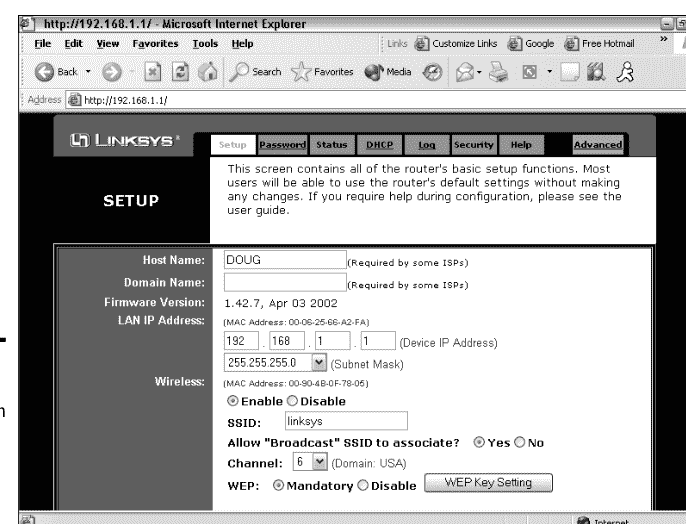

此配置页面提供了与设备无线接入点功能相关的配置选项。虽然这些选项针对此特定设备，但大多数接入点都有相似的配置功能。

- **启用/禁用 (Enable/Disable)**：用于识别网络服务集标识符（SSID）。大多数接入点都有众知的默认值。你可以通过将 SSID 从默认值更改为模糊的名称来服自己认为你的网络更安全，但实际上，这只能防范初级黑客。当更多黑客进入高级阶段时，他们会发现最模糊的 SSID 是很容易绕过的。因此，我建议你将 SSID 保持默认，并按照下一章所述采取更好的安全措施。
- **允许广播 SSID 连接？Allow broadcast SSID to associate?)**：接入点定期广播其 SSID。通常情况下，接入点定期广播其 SSID，以便范围内的设备检测网络并加入。为了使网络更安全，你可以禁用此功能。无线客户端必须已经知道网络的 SSID 才能加入网络。
- **通道 (Channel)**：让你在 11 个广播通道中选择一个。无线网络中的所有接入点和计算机都使用该通道。如果你发现你的网络频繁丢失连接，请尝试切换到另一个通道。你可能正受到无线电话或其他在该通道上运行的无线设备的干扰。

切换通道也是拥有无线网络的邻居互不干扰的一种友好方式。例如，如果你与另一个拥有无线网络的租户共用大楼，你们可以约定使用不同的通道，这样你们的无线网络就不会互相干扰。请记住，这并不能提供任何真正的安全保障，因为邻居可以安全地切换回你的网络并监听你的流量。你仍然需要按照下一章所述来保护你的网络。

- **-强制或禁用 (-Mandatory or Disable)**：让你使用一种名为“有线等效隐私”（wired equivalent privacy）的安全协议：我们将在下一章中对此进行详细介绍。

## DHCP 配置

你可以配置多功能接入点作为 DHCP 服务器运行。对于小型网络，接入点同时作为整个网络的 DHCP 服务器是常见做法。在这种情况下，你需要配置接入点的 DHCP 服务器。图 1-7 显示了 Linksys WAP 路由器的 DHCP 配置页面。要启用 DHCP，选择 `Enable` 选项，然后指定用于 DHCP 服务器的其他配置选项。

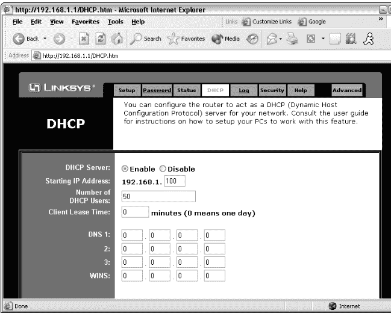

图 1-7：为 Linksys 无线路由器配置 DHCP。

## 414 配置 Windows XP 无线网络

具有更高 DHCP 要求的较大网络很可能在另一台计算机上运行一个独立的 DHCP 服务器。在这种情况下，你可以通过禁用接入点中的 DHCP 服务器来引用现有的服务器。

有关配置 DHCP 服务器的更多信息，请参阅第四本书第 3 章。

## 配置 Windows XP 无线网络

配置 Windows XP 无线网络的第一步是为无线网络适配器安装适当的驱动程序。为此这一点，你需要适配器附带的安装光盘。按照适配器附带的说明安装驱动程序。

Windows XP 有一些适用于无线网络的内置功能。你可以通过打开“网络连接”文件夹来配置这些功能。选择开始> 控制面板，然后双击“网络连接”图标。右键点击无线网络连接并选择“属性”，弹出属性对话框。然后，点击“无线网络”选项卡以显示图 1-8 所示的无线网络选项。

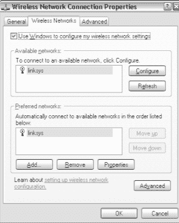

图 1-8：在 Windows XP 中配置无线网络。

每次连接到无线网络时，Windows XP 都会将其添加到此对话框中。然后，你可以调整“首选网络”部分的网络顺序，以便在你发现自己同时处于两个或多个网络范围内时，指示你倾向于加入的网络。你可以使用首选列表旁边的“向上移动”和“向下移动”按钮更改你的偏好。

要添加你尚未实际加入的网络，请点击“添加”按钮。这将弹出图 I-9 所示的对话框。在这里，你可以输入想要添加的网络 SSID。你还可以指定其他信息，例如是否使用数据加密、是否进行身份验证，以及该网络是自形成网络而非基础架构网络。

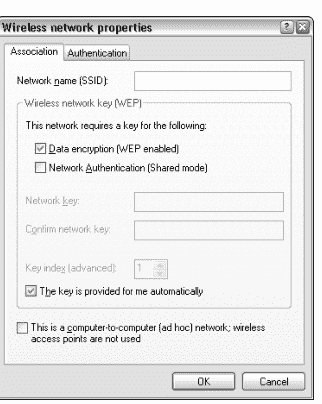

图 I-9：在 Windows XP 中添加无线网络。

## 使用 Windows XP 使用无线网络

Windows XP 还具有一些内置功能，可以简化使用无线网络的任务。例如，当你的电脑进入无线网络范围时，任务栏中会弹出一个气泡，指示有可用网络。

如果你的首选网络之一在范围内，点击气泡将自动你连接到该网络。如果 Windows XP 无法识别任何网络，点击气泡将显示图 I-10 所示的对话框。通过此对话框，你可以选择想要加入的网络（如果列出了多个网络），然后点击“连接”以加入所选网络。

## 416 在 Windows XP 中使用无线网络


图 1-10：在 Windows XP 中加入无线网络。

在加入无线网络后，任务栏通知区域会出现一个网络状态图标。你可以将鼠标悬停在该图标上来快速查看网络状态，会弹出一个气泡显示连接情况。要获取更详细的信息，你可以点击状态图标显示“无线网络连接状态”对话框，如图 1-11 所示。


图 1-11：无线网络对话框（Windows XP）。

此对话框提供了以下信息：

- **状态 (Status)**：指示是否已连接。
- **持续时间 (Duration)**：已连接多久。
- **速度 (Speed)**：指示当前网络速度。理想情况下，802.11b 网络应为 11 Mbps，802.11a 或 802.11g 网络为 54 Mbps。

然而，如果网络连接质量不是最高，速度可能会降低。

- **信号强度 (Signal Strength)**：以图形方式表示信号质量。
- **发送/接收包 (Packets Sent & Received)**：指示通过网络发送和接收的数据包数量。

你可以点击“属性”按钮弹出无线连接的属性对话框。


## 在 Windows 中连接无线网络

Windows Vista 的无线网络配置比 Windows XP 简单得多。当 Windows Vista 检测到附近的无线网络时，屏幕上会弹出一个气泡通知，指示有一个或多个可用网络。你可以双击此气泡以调用图 1-12 所示的对话框。你可以双击想要连接的网络。


图 1-12：在 Vista 中选择无线网络。

## 417 在 Windows 7 中连接无线网络

Windows 7 的无线网络配置与 Windows Vista 相似。当 Windows Vista 检测到附近的无线网络时，它会显示一个气泡

## 418 在 Windows 7 中连接无线网络

Windows 任务栏中的通知。你可以点击气泡以显示图 1-13 所示的对话框，其中列出了所有可用网络。然后双击你想要连接的网络。


图 1-13：在 Windows 7 中选择无线网络。

## 第 2 章：无线网络安全

### 本章

- 回顾无线网络带来的威胁
- 考察“无线漫游”（wardriving）和“无线步行”（wardalking）的奇异世界
- 启用无线接入点的安全功能

在深入探索无线网络深海之前，你应该首先考虑设置无线网络时固有的安全风险。对于有线网络，你拥最好的安全工具就是办公室正门的锁。除非有人能物理接触到你网络中的某一台计算机，否则他们无法进入你的网络（好吧，为了论证起见，我忽略你那完全开放的互联网连接）。


如果你打算，入侵者不需要进入你的办公室就能黑入你的网络。他或她可以从隔壁做到。或者大厅。或者你进入之前的停车场。或者办公室外的人行道上。简而言之，当你向网络中引入设备时，你就引入了一系列新的需要处理的安全问题。

本章将探讨当你转向无线化时涉及的一些基本安全问题。

## 理解无线安全威胁

无线网络与有线网络具有相同的基本安全考虑。作为网络管理员，你需要在合法用户访问资源的需求与非法用户侵入你网络的风险之间取得平衡。这就是网络安全的困境。无论网络使用的是电缆、无线设备、风筝线和锡罐，还是烟雾信号，其基本问题都是相同的。

在无线网络安全光谱的一端是完全开放的网络，任何在你无线传输范围之内的人都可以以管理员身份登录，并获得对你每个细节的完全访问权限。另一端是我所说的“沉默锥综合征”，即网络安全到没有人可以访问网络——即使是合法用户也不行。

### 保护无线网络的目标

保护无线网络的目标是在这两个极端之间找到一个折中点，满足你组织对访问和风险管理的需求。

以下章节描述了无线网络最可能遇到的安全威胁类型。在规划网络安全时，你应该考虑这些每种威胁。

### 入侵者

对于有线网络，入侵者通常必须进入你的设施才能物理连接到你的网络。无线网络并非如此——事实上，对于无线网络，配备有无线功能的笔记本电脑的黑客只要让自己处于你网络无线信号的范围内，就可以访问你的网络。考虑这些可能性：

- 如果你与其他租户共用一栋楼，其他租户的办公室可能在范围内。
- 如果你在多层楼内，正上方或下方的楼可能在范围内。
- 你办公室外的大厅可能在你的网络范围内。
- 办公室外的停车场或地下停车场可能在范围内。

如果潜在的入侵者无法进入正常的广播范围，他或她可能会尝试几种技巧来扩大范围：

- 潜在入侵者可以切换到更大的天线来扩展其无线电脑的范围。某些实验表明，大天线可以接收数英里之外无线网络的信号。事实上，我曾读到有人从伯克利的山丘监听位于旧金山的无线网络，那里横跨着旧金山湾。
- 如果潜在入侵者执意要入你的网络，他或她可能会将一个无线中继设备带入你的设施——或其附近——将你的无线网络范围扩大到他或她可以到达的地方。

当然，物理连接你的网络并不是入侵者访问的唯一途径。你仍然必须采取措施防止入侵者通过你的互联网网关溜入你的网络。在大多数情况下，这意味着你需要设置防火墙来阻止不需要和未经授权的流量。


### 蹭车者

蹭车者是希望通过你的无线网络免费接入互联网的入侵者。如果他们成功访问你的无线网络，他们可能不会做任何恶意行为：他们只会打开浏览器上网。这些人太吝啬了，不愿每月为家里的宽带连接支付 40 美元，他们宁愿开车进你的停车场偷用你的。

尽管蹭车者可能相对无害，但他们可能成为潜在的麻烦源。特别是：

- 蹭车者使用了你付费的带宽。结果，他们的出现可能会减慢合法用户的上网访问速度。
- 在蹭车者通过你的网络访问后，他们可能会对你或你的组织造成麻烦。例如，他们可能会使用你的网络下载非法色情内容。他们可能会尝试通过你的邮件服务器发送垃圾邮件。大多数 ISP 如果发现你发送垃圾邮件，就会切断你的服务，而且他们不会

- 当无线用户连接到互联网时，窃听者可以看到用户发送或接收的任何数据包。如果用户在线购买物品，交易可能包含信用卡号和其他个人信息。（希望这些数据包会被加密，窃听者将无法破解。）
- 当无线用户连接到互联网时，窃听者可以查看。
- 大多数无线接入点定期广播其 SSID。
- 窃听者可以截获该销售报告。
- 如果无线用户加入网络，窃听者可以。
- 这种情况下可以可以。
- 这种情况下是不允许的。

www.it-ebooks.info

保存在网络上的销售报告被拆分成在网络上发送的数据包。熟练的窃听者可以复制该文件。

### 破坏者

破坏者是那些通过干扰网络使其无法使用的黑客。破坏者通常通过向网络注入无意义流量来实现这一点。也可能尝试通过不安全的连接在你的网络上放置病毒或蠕虫程序。

### 非法接入点

网络管理员面临的最大问题之一是非法接入点问题。非法接入点是指突然出现在你网络中的接入点。通常发生的情况是员工决定通过无线电脑将笔记本电脑连接到网络。用户某天在回家的路上在 Computers-Us 购买了一个 25 美元的 Fisher-Price 接入点并将其插入网络，而没有请求许可。

现在，尽管你为网络采取了所有复杂的安全防护措施，这位好心的用户却打开了大门。用户不太可能启用无线接入点的安全功能；事实上，他或她可能根本无线接入设备具有安全功能。

除非你采取某种行动发现它，否则非法接入点可以在你的网络上运行几个月或几年。你可能直到某天上班发现你的网络被入侵者破坏了，而入侵者通过你不知道的未保护无线接入点进入了网络。

以下是你可以采取的一些步骤以减少非法接入点出现在系统中的风险：

- 建立禁止用户自行安装无线接入点的策略。然后，确保让所有网络用户了解该策略，并让他们知道自行安装接入点为什么会是一个如此大的问题。
- 如果可能，建立一个程序，为需要的用户快速且方便地提供无线接入。

### 巡游者 Wardrivers 和涂鸦者 Warchalkers

这些现象出现的原因有两个：(1) 用户需要它，以及(2) 通过渠道获取困难。如果你让用户更容易获得合法的无线访问，那么他们就不可能发现隐藏在文件柜后面或花盆里的接入点。

- 接入无线网络后，在允许出现非法接入点的场所内走动。查看建筑内的每一个网络插座，看看上面连接了什么。
- 关闭你的无线接入点，然后带着一台带有扫描软件的无线笔记本电脑（如 `NetStumber` (www.netstumber.com)）在场所内行走，寻找无线接入。如果你检测到一个无线网络，并不意味着你发现了一个非法接入点——你可能只是偶然发现了附近办公室或家庭的无线网络。
- 如果你的网络规模较大，可以使用如 `AirWave` (www.airwave.com) 等软件工具来嗅探未经授权的接入点。

近期无线网络的爆炸式增长带来了一些新术语，包括巡游（wardriving）和涂鸦（wardwalking）。巡游和涂鸦是否真的代表安全威胁仍然是一个引起广泛争议的问题。

#### 巡游 Wardriving

巡游是指带着笔记本电脑在城市中穿梭，以开放接入无线网络，仅仅是为了看看那里有哪些网络。有些“战士”甚至会将这些信息发布到互联网上。

巡游的主要目的是为了发现可以在公共场所访问的开放无线网络。一个副作用是，它可以帮助网络管理员发现其网络安全中的漏洞。如果你的网络出现在巡游地图上，请感谢那些发现你漏洞的巡游者。通过发布这些信息，他们给了你修补漏洞的动力！

巡游的缺点是，入侵者可以查看互联网上发布的巡游地图来寻找潜在目标。

巡游者配备了以下设备：

- 一辆汽车
- 一台带有无线适配器的笔记本电脑
- 外接天线并非必须，但它有帮助
- 能够扫描开放无线网络的软件
- GPS，即全球定位系统，一种可以自动跟踪你位置的设备
- 将发现的开放网络与从 GPS 设备获取的位置数据关联起来的软件
- 空闲时间

有关关于巡游的更多信息，请查看网站 www.wardriving.com。

#### 涂鸦 Warchalking

涂鸦是指在人行道上用粉笔符号标记开放接入点的位置。这些粉笔符号表示附近有一个网络。所以，如果你在旧金山市中心漫步，并在路缘上发现一个涂鸦符号，你可以在最近的公园长椅坐下，打开笔记本电脑并开始上网。

图 2-1 显示了开放（未受保护的）无线网络的常用涂鸦符号。开放网络的 SSID 列在符号上方。你可能还会发现上面写的其他信息，例如通过接入点可用的互联网连接带宽。


### 战争的起源

“巡游（wardriving）”一词来自哪里？虽然这个词与实际战斗无关，但我听过两种关于其起源合理的解释：

- 它源于黑客词汇 warez（读音为 wurzl），指盗版软件。因此，巡游指的是寻找盗版的无线网络接入。
- 它源自电影《战争游戏》（War Games），在电影中，非常年轻的马修·布罗德里克（Matthew Broderick）通过让电脑顺序拨号，直到找到一台值得破解的电脑，从而入侵了五角大楼顶密核防御网络。这种做法被称为拨号（wardial）。

## 安全你的无线网络

希望你已经相信无线网络确实带来了许多安全风险。在接下来的章节中，我描述了一些你可以采取来保护你无线网络的步骤。

### 修改密码

当你安装无线接入点时，可能你应该做的第一件事就是更改它的管理密码。大多数接入点都有内置的基于 Web 的设置页面，你可以从任何 Web 浏览器访问它来配置接入点的设置。设置页面受密码保护。然而，用户名和密码最初被设置为容易猜测的默认值。

例如，Linksys 接入点的默认用户名是空的，密码是“admin”。如果你让用户名和密码保持为默认值，任何人都可以访问接入点并更改其配置设置，从而绕过你为接入点开启的任何安全功能。

因此，保护无线接入点的第一步是将密码更改为无法被猜的值。我建议你使用数字、大写字母和小字母的随机组合。务必将密码存储在安全的地方。（如果你忘记了密码，可以按下路由器上的重置按钮将其恢复为出厂默认。然后，你可以使用默认密码登录。）

### 安全 SSID

下一步是保护标识你网络的 `SSID`。客户端必须知道接入点的 `SSID` 才能加入网络。如果你能防止未经授权的客户端发现 `SSID`，就能阻止他们访问你的网络。

保护 `SSID` 并不是一个解决方案，因此你不应该将其作为唯一的安全机制。`SSID` 安全可以减慢那些寻找免费网络接入的随机入侵者和巡游者，但无法阻止高级黑客发现你的 `SSID`。


你可以采取三保护 `SSID`：

`SSID` 更改默认 `SSID`。大多数接入点预配置了已知 `SSID`。例如，表 2-1 列出了已知 `SSID`。通过更改你接入点的 `SSID`，可以让入侵者确定你的 `SSID` 并获取访问变得困难。

| SSID | 常见默认值 |
|---|---|
| 3com | 3Com |
| Compaq | Compaq |
| linksys | Linksys |
| tsunami | Cisco |
| Wireless | NetGear |
| WLAN | DLink |
| WLAN | SMC |

- 禁用 `SSID` 广播。大多数接入点经常广播其 `SSID`，以便在范围内发现网络。接收到此 `SSID` 广播的客户端可以使用该 `SSID` 加入网络。

通过禁用 `SSID` 广播功能，你可以提高一些网络安全性。这样，客户端就不会自动学习接入点的 `SSID`。要加入网络，客户端计算机必须自己找出 `SSID`。你可以告诉你的网络用户在配置客户端时要使用的 `SSID`。

遗憾的是，当客户端连接到无线网络时，它以非加密数据包的形式将 `SSID` 发送到接入点。使用数据嗅探器监听你无线网络的复杂入侵者，只要任何合法计算机加入网络，他们就能确定你的 `SSID`。


- **禁用访客模式。** 许多接入点都有访客模式功能，它允许客户端计算机指定空白 `SSID` 或将“任何”作为 `SSID`。如果你想确保只有知道 `SSID` 的客户端才能加入网络，你必须禁用此功能。

### 启用 WEP

`WEP` 代表“有线等效隐私”（wired equivalent privacy），旨在使无线传输变得像通过网络电缆传输一样安全。`WEP` 使用 40 位密钥或 128 位密钥来加密你的数据。请记住，`WEP` 加密速度比 128 位加密快，且对于大多数用途都是足够的。因此，除非你为中央情报局（CIA）工作，否则我建议你启用 40 位加密。

注意，在使用 `WEP` 时，客户端和服务器都必须知道正在使用的加密密钥。因此，不知道接入点密钥的客户端将无法加入网络。

你可以通过两种方式为 `WEP` 指定加密密钥。第一种是通过生成随机数手动创建一个十位密钥。第二种方法（我更喜欢这种）是使用短语（passphrase），它可以是你想要的任何单词或数字与字母的组合。`WEP` 会自动将短语转换为用于加密数据的数值密钥。如果客户端知道用于在接入点上生成密钥的短语，客户端就能访问网络。


> 事实证明，安全专家已经发现了 `WEP` 的多个损害其有效性的缺陷。因此，使用正确的工具，复杂的入侵者可以绕过 `WEP`。所以虽然启用 `WEP` 是一个好主意，但你不应该依赖它来实现完全的安全。

除了启用 `WEP`，你应该采取两个步骤来增加其有效性：

- **强制使用 `WEP`。** 某些接入点具有配置设置，可以启用 `WEP` 但将其设置为可选。这可以防止窃听者查看 `WEP` 连接上传输的数据，但不能防止不知道你 `WEP` 密钥的客户端访问。
- **更改加密密钥。** 大多数接入点预配置了默认加密密钥，让普通黑客很容易破解你的 `WEP` 安全。你应该通过使用短语或指定自己的密钥来更改默认密钥。图 2-2 显示了典型接入点（在此例中为 Linksys BEFW11）的 `WEP` 密钥配置页。


图 2-2：在 Linksys 无线路由器上更改 `WEP` 设置。

### 使用 WPA

`WPA` 代表“Wi-Fi 保护访问”，是一种新型且改进的无线网络安全形式，设计用于弥补 `WEP` 的某些漏洞。`WPA` 在许多方面与 `WEP` 相似。但大区别在于，当你使用 `WPA` 时，加密密钥会定期更改，从而阻碍所有破解密钥的最复杂尝试。大多数新的无线设备都支持 `WPA`。如果你的设备支持，请使用它。

这里有关于 `WPA` 需要了解的几点：

- `WEP` 的小型办公室和家庭版本称为 `WPA-PSK`，其加密密钥基于你提供的短语值。然而，真正的 `WPA` 设备依赖特殊的身份验证服务器来生成密钥。
- 带有 Service Pack 2 的 Windows XP 内置了对 `WPA` 的支持，Windows Vista 也是如此。
- `WPA` 的官方 IEEE 标准是 `802.11i`。然而，`WPA` 设备在 `802.11i` 标准确定之前就已经广泛可用。因此，并不是所有的 `WPA` 设备都实现了 `802.11i` 的每一个方面。在 Wi-Fi 领域，`802.11i` 标准有时被称为 `WPA2`。

### 使用 MAC 地址过滤

`MAC` 地址过滤允许你为允许访问网络的设备指定 `MAC` 地址列表。如果具有不同 `MAC` 地址计算机尝试通过接入点加入网络，接入点将拒绝访问。

对于具有固定数量客户端的无线网络，`MAC` 地址过滤是一个好主意。例如，如果你在办公室设置了一个无线网络，让几名员工连接他们的网络计算机，你可以在 `MAC` 过滤表中指定这些计算机的 `MAC` 地址。那么，其他计算机将无法通过接入点访问网络。

遗憾的是，让计算机伪造其 `MAC` 地址并不困难。因此，在潜在的入侵者确定正在使用 `MAC` 过滤后，他或她只需嗅探数据包以确定授权的 `MAC` 地址，然后配置其计算机使用该地址。（这被称为 *MAC 欺骗*）。所以，你不应该将 `MAC` 地址过滤作为唯一的安全手段。

图 2-3 显示了用于编辑 Linksys 无线接入点 `MAC` 地址表的屏幕。

图 2-3：Linksys 无线路由器的 `MAC` 地址表。


### 不要忽视基础

本章描述的安全技术是专门针对无线网络的。它们应该与第三本书中介绍的基础安全技术一起使用。换句话说，不要忘记基础，例如：

- 更改默认服务器信息（特别是管理员密码）。
- 禁用不必要的服务。
- 定期检查服务器日志。
- 安装病毒防护软件。
- 备份！
- 为你的账户使用强密码。
- 为服务器应用补丁。

### 将接入点放置在防火墙之外

无线网络最有效的安全技术是将所有的接入点放在防火墙之外。这样，来自无线用户的网络流量必须通过防火墙才能访问网络。

正如你想象的，这样做会限制无线用户的访问。为了绕过这些限制，你可以为无线用户启用虚拟专用网络（VPN）连接。VPN 将允许授权的无线用户访问网络。

显然，这种解决方案需要一些配置工作，并且对用户来说可能不太方便。但是它是完全保护接入点的唯一方法。

## 第 3 章：热点

本章

- 探索热点
- 安全地使用热点
- 比较免费和付费热点
- 创建你自己的热点

无线网络不仅仅供家庭或办公室内部使用。如今，许多公共场所如机场、图书馆、餐厅和咖啡馆都提供公共访问网络，被称为热点。如果你带着配备无线功能的笔记本电脑访问这些场所，你就可以利用热点访问互联网。

在本章中，你将了解这些公共热点，并发现如何使用它们。在阅读本章时，请记住公共热点与本书前两章描述的私人无线网络使用相同的 `802.11` 技术。因此，你连接热点使用的技术与连接任何无线网络的技术是相同的。安全影响也是如此。

### 热点有什么伟大之处？

如果你对为什么有这么多企业都在经营热点感到困惑，以下段落提供了一些常见原因：

- **为了增加流量，从而增加业务。** 例如，Schlotzky's Deli (schlotzkys.com) 的首席执行官表示，免费互联网访问每年为每家商店增加 15,000 名访客。那些为了使用免费网络而进来的人通常会买些东西，即使是一瓶汽水或一包薯片。
- **为了让业务显得时尚或紧跟潮流。**


- **直接通过热点赚钱。** 请注意，企业对无线接入收费并不意味着它们从中赚了巨额利润。有些企业必须收费来帮助覆盖成本，因为仅凭善意和流量的小幅增长是无法支撑商业级宽带接入费用的。

## 安全热点

为了简化连接过程，大多数热点（无论是免费还是付费的）都禁用了无线网络提供的安全功能。因此，在使用公共热点时，你应该采取一些基本的预防措施：


- 确保你已安装并运行了防火墙。如果你没有独立的防火墙程序，请启用 Windows 自带的 防火墙。
- 在笔记本电脑上禁用文件共享。
- 避免访问要求敏感信息但不使用安全 HTTPS 协议的网站。
- 如果你计划访问公司网络，请使用 VPN。
- 使用后断开与无线网络的连接。

## 免费热点

许多热点是免费的。例如，Schlotzky's Deli 的热点是免费的。图书馆的热点通常也是免费的。

## 付费热点

要使用免费热点，你必须在热点接入点附近开启配备无线功能的笔记本电脑。然后，当你看到右下角的弹出气泡显示有无线网络在范围内时，点击它连接网络。之后你就可以启动 Web 浏览器上网了。

连接免费热点很容易。困难的部分是找到一个可以连接的热热点，尤其是免费的热点。如果你恰好住在图书馆或 Schlotzky's Deli 对面，除非你不需要搜索，否则你的运气非常好。幸运的是，有几个网站可以找到你所在地区的热点：

- www.freenetworks.org：全球免费网络组织
- www.sllan.org：旧金山地区的免费网络
- www.scalfreenetwork.org：南加利尼亚州的免费网络
- www.settleswireless.org：华盛顿州西雅图的免费网络

通过 Google 和一点毅力，你可能找到一个专门你所在城市的网站。但注意，在大城市找到免费热点接入的机会比在小镇（Mayberry）大得多。

虽然有些热点是免费的，但大多数都需要付费。有些按小时收费，而另一些提供订阅服务，每月支付费用获得无限访问，通常在每月 30 美元左右。

当你连接到付费热点时，会显示登录页面。在登录页面上，如果你已经是订阅用户，可以输入用户 ID 和密码。如果没有，你可以现场加入——只需带好信用卡即可。加入并登录后，你就可以使用 Web 浏览器访问互联网了。

许多付费提供商之间有漫游协议，这实际上增加了可用地点的数量。然而，如果你使用漫游，可能需要支付额外的附加费用。

接下来的章节描述了几个著名的无线服务提供商。

## 设置你自己的热点

### T-Mobile

一家知名且广泛提供的订阅热点提供商是 T-Mobile，它在星巴克、Barnes & Noble、FedEx/Kinkos 以及许多地点提供热点。在我写此时（2010年4月），T-Mobile 在美国有超过 10,000 个地点，全球范围内还有 35,000 个地点。

当然，T-Mobile 也是一家手机公司，和任何手机公司一样，它提供了多种供你选择的。如果你愿意承诺一年，每月费用为 29.95 美元。这让你无限制访问美国境内任何 T-Mobile 热点。（如果你已经是 T-Mobile 客户，可以在 T-Mobile 账单基础上每月增加 9.99 美元的热点服务。）如果没有一年承诺，每月费用为 39.95 美元。你还可以购买 7.99 美元的单日票或按需付费。每小时费用为第一小时 6 美元，之后每增加一分钟 0.10 美元。

有关 T-Mobile 热点订阅的信息，请访问 www.tmobile.com/hotspot。

### Boingo

在全球范围内拥有 125,000 个地点的 Boingo Wireless 自称拥有地球上最酷的网络。Boingo 主要为商务旅行者设计，其大多数热点位于酒店、机场和商务服务中心。基础套餐是每月 9.95 美元，可在全美无限访问。与其他提供商不同，Boingo 使用自己的软件将你连接到网络。更多信息请查看 boingo.com。

### 设置你的热点

如果你想建立一个热点，你需要：

- 一个可靠的宽带连接。DSL、电缆或 T-1 均可。
- 一个无线接入点。对于小型热点，消费级无线路由器即可。
- 一个告诉客户如何连接的指示牌。

## 438 定位问题

- 线缆是否连接？检查连接你的接入点/路由器与 DSL 调制解调器的网络线。
- 尝试重启所有设备。关闭电脑、接入点/路由器以及你的电缆或 DSL 调制解调器。让所有设备关闭至少两分钟。然后重新开启所有设备。有时，循环重启可以解决连接问题。

## 定位问题

如果你无法连接到互联网，在确保所有设备都已开启后，要步骤之一是确定问题是出在你的接入点/路由器还是你的宽带连接上。以下是检查你的无线连接是否正常的一种方法：

- 1. 选择“开始：运行”，输入 `cmd` 并按回车键打开命令提示符。
- 2. 在命令提示符中输入 `ipconfig` 并按回车键。

你应该得到类似下面的显示：

```
Ethernet adapter Network Connection: : hdi.cs.comcast.net).
Connection-specific DNS Suffix: 
IP Address ............................ : 192.168.1.101
Subnet Mask ........................ : 255.255.255.0
Default Gateway ................. : 192.168.1.1
```

如果显示这些内容但数字不同，说明你已连接到无线网络，问题很可能出在你的宽带调制解调器上。

但如果 IP 地址、子网掩码和默认网关显示为 0.0.0.0 而有效的 IP 地址，说明你的无线网络有问题。

## 更改信道

无线网络故障最常见的问题之一是来自其他无线设备的干扰。罪祸首可能是无线电话，也可能是同样拥有无线网络的邻居。

此类干扰的最简单解决方案是更改信道。802.11b 接入点允许你选择 11 个不同信道之一进行广播。如果你在连接接入点时遇到困难，请尝试更改信道。要这样做，你必须使用管理员密码登录路由器。然后，在路由器的管理员页面中寻找，直到找到允许你更改信道的控件。

在解决问题之前，你可能会尝试更改信道。遗憾的是，802.11b 信道略有重叠，这意味着在一个信道上的广播可能会干扰相邻信道上的广播。因此，如果你在信道 1 上连接遇到困难，不要费劲切换到信道 2。相反，请切换到信道 5 或 6。如果不起，请切换到信道 10 或 11。

## 调整天线

有时，你可以通过调整接入点和电脑无线适配器天线来修复间歇性连接问题。这类似于摆弄老式电视兔耳天线以获得最佳接收效果。

天线的角度有时会产生影响，因此尝试调整天线角度。此外，如果你将接入点放置在高处（如书架顶部），通常会获得更好的效果。

在某些情况下，你可能实际上需要为接入点增加高增益天线以扩大其范围。这些高增益天线只需插入或螺接到接入点上即可提供更大的天线。例如，图 4-1 显示了为 Linksys 接入点设计的高增益天线。这类天线一对约为 70 美元。


图片由 Linksys 提供。

## 增加另一个接入点

更彻底的修复方法是为接入点添加信号放大器。信号放大器是一种功率放大，可以将大多数无线设备的传输功率放大五倍。典型的信号放大器成本约为 100 美元。

如果你有一台电脑不在接入点的范围内，解决方案之一是在靠近问题电脑的地方添加第二个接入点。最可能的困难将是获取一条以太网线连接到你想要放置第二个接入点的位置。

如果可能，你只需将一段电缆穿过墙壁或阁楼连接到第二个接入点。如果不可行，你可以使用电力线（PowerLine）或电话（HPNA）网络连接作为第二个接入点。

第二个接入点的替代方案是简单添加中继器，例如图 4-2 所示的 Linksys Wireless-G 范围扩展器。你只需要将此设备放置在接入点和连接困难电脑的中间即可。


图 4-2：此类来自 Linksys 的无线中继器可以扩大你无线网络的范围。

图片由 Linksys 提供。

## 救命！我忘记了路由器的密码！

我在全书中多次提到，你应该始终将计算机和操作系统自带的默认密码更改为更安全的密码，通常由字母、数字和特殊符号的随机组合组成。

希望你已经听从了我的建议，更改了组合无线接入点的密码。但如果你忘记了密码怎么办？有什么办法吗？幸运的是，大多数路由器都有一个重置按钮，通常位于背面或底部。按下此按钮将接入点恢复出厂设置。


## 第 5 章：无线网络

## 理解蓝牙

- 在手持电脑之间更换电子卡。
- 使用全球定位系统 (GPS) 设备跟踪位置。
- 连接无线耳机。
- 连接无线鼠标或键盘。
- 将蓝牙设备连接到电脑。

## 技术细节

对于各位爱好者来说，这里有一个专门关于技术细节的章节。以下段落指出了蓝牙的一些冷门亮点。

- 蓝牙由 1998 年一个包括 IBM、Intel、爱立信、诺基亚的财团开发。IEEE 不想被排除在外，将蓝牙变成了 802.15 标准。
- 蓝牙和 802.11 Wi-Fi 网络都运行在 2.4GHz 带宽内。蓝牙之间之间可能会相互干扰，蓝牙包含了减少或消除这种干扰的功能。
- 蓝牙速度为 721 Kbps，比 Wi-Fi 网络慢。蓝牙的设计并非传输大量数据（如巨大的视频文件）。对于这些，你应该使用 Wi-Fi。
- 蓝牙设备定期“嗅探”空气检查附近的蓝牙设备，以便自动连接。
- 蓝牙功率需求低。因此，它非常适合手机和 PDA 等供电设备。
- 蓝牙有三种类型，如表 5-1 所示。1 类蓝牙是蓝牙中最强大的，也是最常用的。2 类蓝牙适用于无线鼠标或键盘或无线手机耳机，这些设备只需要近距离通信。3 类蓝牙适用于工作距离更近的设备，但很少有蓝牙设备实现 3 类。

表 5-1 蓝牙分类

| 类别 | 功率 | 范围 |
|---|---|---|
| 1 类 | 100 mW | 300 英尺 (100 米) |
| 2 类 | 10 mW | 30 英尺 (10 米) |
| 3 类 | 1 mW | < 30 英尺 (10 米) |

# 在 Windows 中使用蓝牙

- 蓝牙最初由手机巨头爱立信（Ericsson）构思，作为一种将无线耳机连接到手机的方法。当开发人员研究这一构想时，他们很快发现这项技术的用途远超手机无线耳机。
- “蓝牙”（Bluetooth）这个名字是哈拉尔德·布罗特丹（Harald Blatann）的英文翻译，他是 10 世纪统治过丹麦和挪威的维京国王。

## 如何为你的电脑添加蓝牙

如今销售的许多设备——尤其是笔记本电脑和 PDA——都配备了蓝牙技术。如果你的电脑尚不支持蓝牙，你可以轻松地添加一个蓝牙支持适配器，这是一种插入电脑上任何可用 USB 端口的小型设备。插入后，你的电脑就启用了蓝牙功能，并可以连接到范围内的任何其他蓝牙设备。

许多公司生产蓝牙 USB 适配器，大多数的外观和工作原理都相似。图 5-1 显示了一个 Linksys 制造的适配器，售价约为 40 美元。


## 在 Windows 中使用蓝牙

遗憾的是，Windows XP 的原始版本对蓝牙没有任何支持。当微软在几年后发布 Windows XP Service Pack 1 时，它包含了有限的蓝牙支持。Windows XP Service Pack 2 以及 Windows Vista 和 Windows 7 都包含了极好的内置蓝牙支持。

如果你的电脑具有蓝牙功能，系统托盘（任务栏右侧的面板）将出现一个特殊的蓝牙图标。你可以点击此图标弹出一个包含以下选项的菜单：

- 添加蓝牙设备
- 显示蓝牙设备
- 发送文件
- 接收文件
- 加入个人区域网络
- 打开蓝牙设置
- 移除蓝牙图标

## 安装 USB 蓝牙适配器

安装 USB 蓝牙适配器非常简单。你只需要安装适配器提供的软件，并将适配器插入空闲的 USB 端口即可。通常，你可以通过插入适配器附带的 CD 来启动安装。然后，安装程序会自动启动。程序启动后，按照其步骤操作，并在安装程序指示你时插入适配器。


请务必遵循适配器上的安装说明。在大多数情况下，你应该在插入适配器之前先安装其附带的软件。

## 启用发现

默认情况下，你的电脑对其他蓝牙设备隐藏隐藏。如果你希望其他蓝牙设备能够识别你的电脑，你需要启用名为“发现”的功能。以下是步骤：

- 右键点击系统托盘中的蓝牙图标，从快捷菜单中选择“蓝牙设置”。
- 在弹出的蓝牙属性框中，点击“选项”选项卡。
- 勾选“启用发现”复框。
- 4. 勾选“允许蓝牙设备连接到此计算机”复框。
- 5. 勾选“当新的蓝牙设备想要连接时提醒我”复框。
- 6. 点击确定。

## 安装蓝牙鼠标或键盘

安装蓝牙鼠标或键盘非常简单。讽刺的是，唯一的技巧在于你在安装蓝牙鼠标或键盘之前，必须先安装一个普通的鼠标或键盘。然而，在安装蓝牙鼠标或键盘后，你就可以拔掉普通的鼠标或键盘。

安装蓝牙鼠标或键盘的主要技巧是，你必须首先在鼠标或键盘上启用发现功能。大多数蓝牙鼠标和键盘底部都有一个此类按钮。启用蓝牙后，你可以通过右键点击系统中的蓝牙图标并选择“添加蓝牙设备”命令来安装鼠标或键盘。然后，按照向导的步骤安装鼠标或键盘。

## 第六卷

## 移动网络


## 目录摘要

- 第 1 章：管理移动设备 .....................................................451
- 第 2 章：管理 BlackBerry 设备 ...................................................455
- 第 3 章：管理 iPhone 设备 ................................................................461
- 第 4 章：管理 Android 设备 ...............................................................................469
- 第 5 章：管理笔记本电脑 ................................................................473

## 第 1 章：管理移动设备

**本章内容**

- 查看移动设备
- 配置 Windows Mobile 设备以访问 Exchange
- 检查 BlackBerry 和 BlackBerry 企业服务器 (BES)
- 考虑安全影响

一位计算机顾问曾在 eBay 上花 15 美元购买了一台二手的 BlackBerry 设备。（注：源代码中的 OCR 在此处似乎是重复/碎片化的。）

[注：提供的第 482-485 页的 OCR 文本包含大量碎片和重复句子。我已根据提供的指令对结构流进行了清理。]

## 考虑移动设备的安全 453

- iPhone: 苹果的 iPhone 席卷了智能手机市场。尽管目前使用的 BlackBerry 设备仍多于 iPhone，但 iPhone 正在获取市场份额，并可能很快超越 BlackBerry。与 BlackBerry 不同，iPhone 不需要单独的服务器即可启用 Exchange 邮件箱同步。

iPhone 的最大缺点之一是它仅由一家运营商提供：AT&T。

更多信息，请参阅本小型书籍的第 3 章。

- Android: Android 是由 Google 开发的用于智能手机的开源操作系统。Android 在很多设计上模仿 iPhone 的功能，因此丰富的 iPhone 用户会发现手机非常相似。然而，与 iPhone 不同，Android 是不分厂商的。因此，包括 AT&T、Verizon 和 Sprint 在内的大多数手机运营商都提供基于 Android 的智能手机。

- 更多信息，请参阅本小型书籍的第 4 章。

## 考虑移动设备的安全

作为网络管理员，你对移动设备的主要职责之一是保持它们的安全。遗憾的是，这是一个重大的挑战。以下是某些原因：

- 移动设备通过你无法控制的其他网络连接到你的网络。你费尽全力设置了防火墙、加密以及许多其他安全功能。但移动设备通过公共网络连接，而这些网络的管理员可能没有你那么尽心。
- 移动设备容易丢失。用户可能会将智能手机留在餐厅或酒店，或者它可能会在地铁上从口袋里掉出来。
- 移动设备运行的操作系统不像 Windows 那样注重安全。
- 那些不敢在桌面级电脑上安装未经授权软件的用户，会认为在手持设备上下载免费游戏或其他应用程序无大碍。谁知道这些下载中携带了什么种病毒或木马？
- 不可避免的是，有人会购买自己的手持设备，并在你不知情且未经许可的情况下连接到你的网络。

## 454 考虑移动设备的安全

以下是一些增强你移动设备安全性的建议：

- 为移动设备建立明确且一致的策略并强制执行。
- 确保员工理解他们不允许将自己的设备带入你的网络。仅允许公司拥设备连接。
- 培训用户了解与使用移动设备相关的安全风险。
- 为你的移动设备实施防病毒保护。

## 第 2 章：管理 BlackBerry 设备

### 本章内容

- BlackBerry 基础设施如何工作
- 设置新的 BlackBerry 用户
- 锁定或禁用 BlackBerry 设备

BlackBerry 设备是目前最受欢迎的智能手机类型。BlackBerry 的巨大优势在于（一直都是）与企业电子邮件帐户的无缝集成——特别是它与 Microsoft Exchange 同步的能力。其他智能手机开始提供这种功能，但目前，BlackBerry 仍然是智能手机之王。


BlackBerry 设备本身由一家名为 `RIM` 的公司制造，`RIM` 代表“Research In Motion”。`RIM` 与多种手机运营商有合作，因此你可以从 `AT&T`、`Verizon` 和 `Sprint` 以及其他主要运营商处获得 BlackBerry 设备。

本章从概述 BlackBerry 的原理开始——不仅是 BlackBerry 手机本身如何工作，还整个 BlackBerry 架构如何工作，以便在蜂窝网络上提供其传奇的电子邮件集成。然后，它将介绍了处理服务器端 BlackBerry 软件（称为 `BES`，即 BlackBerry Enterprise Server）的一些基本程序。

# 理解 BlackBerry

BlackBerry 不仅仅是一部手机——它是一套完整的硬件和软件集成系统，旨在与 `Microsoft Exchange Server` 提供顺畅且近乎瞬时的集成。你可能会惊讶地发现这套基础设施实际上非常复杂。图 2-1 显示了其主要组件的简化图。

## 456 理解 BlackBerry

**图 2-1:** BlackBerry 基础设施。

接下来的段落描述了图 2-1 所示的组件：

- **BlackBerry 手持设备：** BlackBerry 手持设备本身是手机和手持电脑的结合。手机不仅具有语音通信的能力，还能通过运营商的蜂窝网络进行通信。大多数 BlackBerry 手持设备有一个小型 LCD 屏幕和一个键盘，尽管 BlackBerry Storm 型号没有触摸屏。

- **蜂窝网络：** 蜂窝网络是 BlackBerry 设备与外界通信的方式。BlackBerry 基础设施的这部分由你购买 BlackBerry 的运营商提供并管理。由于不同运营商的覆盖区域不同，你应该选择一个在你经常访问的区域覆盖最好的运营商。

- **BlackBerry 网络中心：** BlackBerry 网络中心（`NOC`）负责数据在互联网和蜂窝网络之间的路由。`RIM` 在全国（实际上是全球）维护了多个 `NOC` 位置，以确保数据可以在互联网和蜂窝网络之间高效路由。

- **BlackBerry 企业服务器：** 也称为 `BES`，这是让 BlackBerry 发挥作用的关键软件。`BES` 是运行在你网络内部的软件服务器。`BES` 的主要作用是作为电子邮件服务器（通常是 `Microsoft Exchange`）与 BlackBerry `NOC` 之间的接口。

## 理解 BlackBerry 457

作为网络管理员，`BES` 是拼图中的关键部分。你管理 BlackBerry 用户的大部分时间将花在 `BES` 上。以下是你应该了解的一些额外细节：

- 虽然可以在运行 `Exchange` 的同一台计算机上运行 `BES`，但这种配置并不推荐。相反，`BES` 将运行在你自己的专用服务器上。

- `BES` BlackBerry Enterprise Server 有免费版本适用于少于 75 个手持用户的小系统，你需要购买 `BES` 企业版。

- 就 `Exchange` 而言，`BES` 像一个客户端。`BES` 使用 `BESAdmin` 账户登录 `Exchange` 并使用该账户访问 BlackBerry 用户邮箱箱的数据。`BES` 从这些邮箱箱中检索数据并通过互联网发送到 BlackBerry `NOC`。

- 要使 BlackBerry 手持设备与 `BES` 连接，必须通过一个名为“企业激活”（`Enterprise Activation`）的过程。

- `BES` 使用复杂的加密技术来确保发送到 BlackBerry `NOC` 以及来自 BlackBerry 的数据是安全的。因此，你可以放心地认为数据从你的 `Exchange` 服务器通过互联网并经过蜂窝网络传输时不会被任何人截获。

在介绍处理 `BES` 的细节之前，最后一点说明：它开发于蜂窝网络带宽能力非常有限的时代。结果是，`BES` 竭尽全力优化数据在蜂窝网络上的传输。`BES` 不是直接将附件发送到手持设备，而是创建附件的压缩 `JPEG` 图像并发送该图像。最初，该图像经过缩放以保持文件尽可能小。即使是这种小图像也只有在 BlackBerry 请求时才会显示。BlackBerry 内置的查看器具有放大功能。当用户放大时，手持设备会请求更详细的附件 `JPEG` 渲染。

# 添加 BES 用户

最常见的 `BES` 管理任务之一添加新的 BlackBerry 用户。要执行此操作，请按照以下步骤进行：

- 1. **在“Active Directory 用户和计算机”中，右键点击要添加的用户并选择“属性”。**

这将打开该用户的属性页。

- 2. **选择“Exchange 高级”选项卡，并点击“邮箱箱权限”按钮。**

这将弹出权限对话框，允许您为用户的邮箱箱授予邮箱箱权限。

- 3. **点击“添加”，输入 `BESAdmin`，然后点击“确定”。**

这会将 `BESAdmin` 账户添加到对第 1 步中选择的用户具有邮箱箱权限的用户列表中，但实际上并未授予任何权限。

- 4. **勾选“完全邮箱箱访问”复选框并点击“确定”。**

这将为 BlackBerry 用户授予 `BESAdmin` 账户完全的邮箱箱访问权限。

- 5. **点击“确定”关闭属性对话框。**

您已完成 Active Directory 用户和计算机的操作；；如果需要，现在可以关闭它。

- 6. **点击桌面上的 BlackBerry Manager 图标打开 BlackBerry Manager。**

`BlackBerry Manager` 启动了，如图 2-2 所示。

- 7. **在资源资源管理器视图面板中，导航到您正在管理的服务器。**

在图 2-2 中，我导航到了服务器 `BCFWEB01`。

- 8. **在 BlackBerry 用户列表的空白区域点击，并选择“添加用户”。**

会出现一个名为“选择邮箱箱”的对话框。该对话框列出了所有拥有 `Exchange` 邮箱箱的 Active Directory 用户。

- 9. **选择您要添加的用户，然后点击“确定”。**

“选择邮箱箱”对话框消失，该用户被添加到 BlackBerry 用户列表中。

- 10. **右键点击该用户，然后选择“生成电子邮件激活密码”。**

此操作通过生成激活密码并发送电子邮件给用户来启动企业激活过程，如图 2-3 所示。这封电子邮件不仅提供了密码，还提供了用户激活其 BlackBerry 设备时需要遵循的指令。


图 2-2：

运行中的 BlackBerry Manager。


图 2-3：

发送的这封电子邮件邀请用户激活企业激活。

## 11. 您已完成！

在创建激活密码后，激活 BlackBerry 设备由用户负责。用户通过导航到“选项”屏幕并选择“企业激活”来实现。然后，用户输入其电子邮件地址以及通过电子邮件发送的激活密码。在验证电子邮件地址和密码后，激活过程将开始。完成过程大约需要 10-15 分钟。激活完成后，手机应该开始从用户的 `Exchange` 邮箱箱接收电子邮件、联系人和日历项目。

BlackBerry 设备管理第 2 章

# 锁定和擦除手持设备

添加新的 BlackBerry 用户后，下一个常见的 `BES` 管理任务是锁定或擦除手持设备。如果用户抱怨其 BlackBerry 丢失了，我通常从锁定设备开始。这样，如果设备落入他人手中，他们在没有正确密码的情况下就无法访问设备。

如果 BlackBerry 在几天内没有出现，下一步是完全擦除 BlackBerry，即使新所有者设法密码锁，他们也不会在手机上找到任何有用的信息。

这两个任务都通过 `BlackBerry Manager` 处理。右键点击您想要锁定或擦除手机的用户，并选择以下命令之一：

- **设置密码并锁定手持设备：** 此命令将显示图 2-4 所示的对话框。该对话框为手持设备设置新密码。它还会更改手持设备被锁定时显示的所有者信息。当您点击“确定”时，将向手持设备发送消息，指示其更改密码和（可选）所有者信息，然后锁定键盘。锁定后，可以通过输入密码解锁键盘。

- **擦除数据并禁用手持设备：** 此命令更为果断：它会擦除手持设备的所有内容，包括任何存储的电子邮件、日历、项目或其他文件。它还会禁用企业激活。此命令有效地将手持设备恢复到原始的出厂新状态。


**图 2-4：** 远程锁定 BlackBerry 手持设备。

# 第 3 章：管理 iPhone 设备

本章

- 了解 iPhone 的工作原理

- 为 iPhone 用户启用 ActiveSync

- 配置 Exchange 电子邮件帐户

2007 年，苹果 iPhone 是多年来进入科技市场最具创新性的小型设备之一。结果是，在短短几年内，iPhone 占据了此前几乎由 `RIM` 及其 BlackBerry 设备占据的巨大市场份额。一些专家预测，iPhone 最终将取得 BlackBerry 在智能手机市场的领先地位——特别是如果 Apple 放弃其在 `AT&T` 的独家合同，以便其他手机运营商能够提供在他们的网络上运行的 iPhone。

本章介绍了 iPhone。您将简要概述 iPhone 是什么，以及如何设置其访问 `Exchange` 电子邮件。

## 了解 iPhone

iPhone 本质上是四种设备的组合：

- 一部手机

- 一个容量为 8GB、16GB 或 32GB 的 iPod

- 一个 200 万像素数相机

- 一个带有自带浏览器（名为 `Safari`）的互联网设备

iPhone 最为显著的特征是缺少键盘。相反，iPhone 几乎整个表面都是一块高分辨率、触摸式的显示屏。显示屏不仅是 iPhone 的主要输出设备，也是其主要输入设备。需要时，显示屏变成拨号电话或输入文本的键盘。您还可以使用各种手指手势，例如点击图标启动程序或双指缩放显示。

此外，iPhone 还具有许多其他创新功能：

- 加速度计跟踪 iPhone 在三个方向上的运动。加速度计的主要用途是根据用户握持设备调整横竖屏。某些其他应用程序（主要是游戏）也使用加速度计。

- `Wi-Fi` 接口允许 iPhone 连接到本地网络以获得更快的互联网访问。

- `GPS` 功能为许多应用程序（包括谷歌地图）提供位置感知。

- `VPN` 客户端连接到您的内部网络。

在 iPhone 的所有独特功能中，最重要的可能是它从名为 `App Store` 的特殊门户下载的海量第三方应用程序。许多应用程序是免费的，或只需几美元（在我撰写本章时，2010 年 4 月，`App Store` 上有超过 15 万应用程序可用）。

针对用户的邮箱。第三，你必须配置 iPhone 连接到用户的 `Exchange` 邮箱。接下来的章节将描述这些过程中的每一个。

## 启用 Exchange 移动服务

要为 iPhone 启用 `Exchange` 邮箱，你必须先在 `Exchange` 服务器上启用 `Exchange` 移动服务功能。请注意，此过程每个 `Exchange` 服务器只需执行一次。以下是具体步骤：

- 1. 使用 `Exchange` 管理员账户登录 `Exchange` 服务器。

- 2. 选择开始 -> 管理工具：`Exchange` 系统管理器。

- 3. 在导航窗格中，展开全局设置（`Global Settings`）节点。

- 4. 右键点击移动服务（`Mobile Services`），然后选择属性（`Properties`）。

出现图 3-1 所示的框。


- 5. 勾选“常规”选项卡上的所有复选框。

这将启用 Outlook 移动访问和 `Exchange ActiveSync` 的所有功能。

- 6. 点击确定（`OK`）。

- 7. 关闭 `Exchange` 系统管理器。

大功完成！

## 464 将 iPhone 与 Exchange 集成

### 为用户邮箱启用 ActiveSync

一旦你为 `Exchange` 服务器启用了 `Exchange` 移动服务，就可以为用户的 `Exchange` 邮箱启用 `ActiveSync`。启用 `ActiveSync` 允许邮箱与 iPhone 等远程邮件客户端进行同步。

以下是具体步骤：

- 1. 选择开始 -> 管理工具 -> 活动目录用户和计算机。

打开活动目录用户和计算机控制台。

- 2. 展开域并找到你想要启用移动访问的用户。

- 3. 右键点击该用户并选择属性（`Properties`）。

- 4. 点击“Exchange 功能”（`Exchange Features`）选项卡。

显示 `Exchange` 选项，如图 3-2 所示。


图 3-2：为用户启用移动访问。

- 5. 启用“移动服务”（`Mobile Services`）下列出的三个选项。

如果选项尚未启用，右键点击每个选项并选择启用（`Enable`）。

## 465 将 iPhone 与 Exchange 集成

- 6. 点击确定（`OK`）。

- 7. 对任何其他想要启用移动访问的用户重复步骤 5 和 6。

- 8. 关闭活动目录用户和计算机。

以上就是全部内容。在启用这些功能后，任何运行 Windows Mobile 的用户都将将其手持设备与 `Exchange` 邮箱进行同步。

## 配置 iPhone 的 Exchange 电子邮件

一旦为邮箱启用了自动同步，你可以按照以下步骤配置 iPhone 连接到 `Exchange` 账户：

- 1. 在 iPhone 上，点击“设置”，点击“邮件”、“通讯录”、“日历”，然后点击“添加账户”。

出现图 3-3 所示的屏幕。


图 3-3：添加电子邮件账户。

- 2. 点击“添加账户”。

出现图 3-4 所示的屏幕，允许你选择想要添加的电子邮件账户类型。

## 466 将 iPhone 与 Exchange 集成


图 3-4：iPhone 支持不同类型的电子邮件账户。

- 3. 点击“Microsoft Exchange”。

出现图 3-5 所示的屏幕，允许你输入 `Exchange` 账户的备信息。


图 3-5：输入你的电子邮件地址和登录信息。

- 4. 输入你的电子邮件地址、Windows 用户名和密码。

对于大多数安装，你应该让留“域”（Domain）字段为空。（如果电子邮件配置な不起作用，请返回此屏幕在此处输入你的域名。）

- 5. 点击“下一步”。

出现图 3-6 所示的屏幕。


图 3-6：输入你的 `Exchange` 服务器。

第六册 / 管理 iPhone 设备

- 6. 输入你的 `Exchange` 服务器的 DNS 名称或 IP 地址。

例如，我为我的 `Exchange` 服务器输入了 `smtp.lowewriter.com`。

- 7. 点击“下一步”。

出现图 3-7 所示的屏幕。此屏幕让你选择想要同步的邮箱功能：邮件、通讯录和日历。

- 8. 选择你想要同步的功能，然后点击“完成”。

电子邮件账户已创建。


配置好账户后，用户可以通过 iPhone 屏幕上的“邮件”图标访问它。

# 第 4 章：管理 Android 设备

### 理解 Android

- 查看 Android 的工作原理

- 查看操作系统

- 使用 Android 进行工作

- 在电子邮件中

在许多方面，Android 手机与 iPhone 相似。然而，最重要的区别是 Android 手机基于开源操作系统。

### 查看 Android 系统

大多数人将 Android 操作系统与 Google 联系在一起，事实是 Google 是 Android 的推动力。Android 操作系统实际上是一个名为“开放手机设备联盟”（`OHA`）的组织。Google 在 Android 的开发中仍然起着主作用，但 `OHA` 实际上有超过 50 家公司参与，包括 `HTC`、`Intel` 和摩托罗等硬件制造商、Google 和 `eBay` 等软件公司，以及 `T-Mobile` 和 `Sprint` 等移动运营商。

# 将 Android 与 Exchange 集成 471

## 查看 Android 的核心应用程序

Android 操作系统预装了若干标准应用程序，这些程序提供了大多数人对现代智能手机所需的功能。这些应用程序包括：

- 拨号：提供基本的手机功能，让用户可以拨打电话。

- 浏览器：内置的 Web 浏览器，类似于 Google 的 Chrome 浏览器。

- 消息：提供短信 (`SMS`) 和多媒体短信 (`MMS`) 功能。

- 邮件：一个基础电子邮件客户端，与 Google 的 Gmail 配合效果最好，也可以配置为与包括 `Exchange` 在内的其他电子邮件服务器配合。

- 联系人：提供一个联系人列表，并与拨号和电子邮件应用程序集成。

- 摄像头：让你可以使用手机的摄像头硬件（如果有的话）拍摄照片。

- 计算器：一个简单的计算器应用程序。

- 闹钟：一个基础闹钟。你可以设置最多三个不同的闹钟。

- 地图：Google Maps 的集成版本。

- YouTube：YouTube 的集成版本。

- 音乐：一个类似于 iPod 的 MP3 播放器。你可以从 Amazon 购买并下载文件。

- 市场：让你可以为 Android 手机购买和下载第三方应用程序。

- 设置：让你控制手机的设置。

# 将 Android 与 Exchange 集成


Android 的核心邮件应用程序可以与 Microsoft Exchange 电子邮件集成。要实现这一点，你必须先在 Exchange 服务器上启用 ActiveSync。我将详细介绍为 Microsoft Exchange 配置 ActiveSync 的细节。相反，请参考本微型书籍的第 3 章。

在你的 Exchange 服务器上启用了 Exchange Mobile Services 和 ActiveSync 后，你就可以轻松地配置 Android 手机进行电子邮件访问。只需在 Android 手机上运行邮件应用程序并按照配置步骤操作，它会要求你提供基本信息，如电子邮件地址、用户名、密码和 Exchange 服务器。

# 472 将 Android 与 Exchange 集成

遗憾的是，Android 手机上原生提供的 Exchange 功能非常有限。虽然邮件应用程序可以同步 Exchange 收件箱，但它无法同步你的联系人、日历或任务列表。因此，你需要借助第三方应用程序才能从 Android 智能手机完全访问你的 Exchange 邮箱箱。

为了从 Android 手机访问 Exchange 邮箱箱，我建议你购买并安装名为 TouchDown 的应用程序，它来自 NitroDesk (`www.nitrodesk.com`) 公司。它提供了更好的 Exchange 集成：以下仅是它的部分功能：

- 不仅可以查看收件箱，还可以查看已发送项目或草稿等其他邮箱箱文件夹。
- 下载附件。
- 创建会议并接受或拒绝会议邀请。
- 与你的 Outlook 联系人列表同步。
- 创建或删除离开回复。

TouchDown 可以在 Android Market 购买，价格为 `$19.99`。

# 第 5 章：管理笔记本电脑 (Netbooks)

## 本章内容

- 检查笔记本电脑的典型规格
- 理解网络是如何连接的
- 获取使用笔记本电脑的技巧

移动计算的最新趋势之一是使用笔记本电脑（或简称为 netbooks），而不是传统的笔记本电脑或台式电脑。笔记本电脑就像智能手机和笔记本电脑的混合体，奇特地融合了这两者的优点和缺点。

本章简要概述了什么是笔记本电脑，以及在将其纳入你的移动网络计划时应该考虑的因素。

## 了解笔记本电脑

如你可能所知，笔记本电脑看起来看起来像是一台用热水洗过并缩水到原始尺寸一半左右的笔记本电脑。这种小尺寸使其成为许多移动用户的理想伴侣：它比智能手机大，因此可以用于文字处理或电子表格分析等普通任务，但它比笔记本电脑小得多，因此更容易携带。

图 5-1 显示了一台典型的笔记本电脑——在此例中是 HP Mini 311。这台电脑具有以下功能：

- 11.6 英寸显示，这对于笔记本电脑来说实际上是大大尺寸；大多数接近 10 英寸。
- Intel Atom 处理器，运行频率为 1.6 GHz。Atom 是一种针对极低功耗优化的单核处理器。
- 高达 3GB 内存。
- 160GB、250GB 或 320GB 硬盘。
- 内置无线 802.11g 或 802.11n 网络接口（或两者兼有）。
- 兼容 Sprint、AT&T 或 Verizon 的内置移动宽带。
- Windows 7 家庭高级版 (32 位)。

**图 5-1：** 一台典型的笔记本电脑

整个系统约为 8 x 11 英寸，厚度约为 3/4 英寸——大小相当于一本小型精装书。重量仅略 3 磅。

## 连接笔记本电脑

除了尺寸小之外，笔记本电脑最显著的特征是它通常配备了来自 AT&T、Sprint、Verizon 或 T-Mobile 等移动运营商的内置移动宽带互联网连接。事实上，如果你签署为期两年的网络计划（通常每月费用约 `$50`），这些公司通常会将笔记本电脑的价格降至 `$100` 或 `$200`。

内置的宽带网络连接意味着无论你在哪里，只要你在运营商一个一个基站的范围内，你就可以访问网络。对于传统的笔记本电脑，你必须找到一个可用的 Wi-Fi 网络进行连接。对于笔记本电脑，你可以从几乎任何地方连接——餐厅、街角，甚至在公交车上。

遗憾的是，服务计划并不提供无限流量。大多数流量限制为每月 5GB；之后将收取额外费用。因此，你希望确保用户意识到他们传输的数据量。5GB 的限制对于大多数业务用途是足够的，但如果你的用户空闲在 YouTube 上看视频，他们会很快超过限制。

移动宽带提供了连接其网络的软件。例如，图 5-2 显示了 Verizon 提供的软件。

**图 5-2：** 与 Verizon 连接

以下是一些可能帮助用户遵守最大限制的提示：

- 除了宽带连接，所有笔记本电脑都包含 Wi-Fi 接口。你应该鼓励用户尽可能使用 Wi-Fi 而不是移动宽带。通过 Wi-Fi传输的任何数据都不会计入宽带限制。
- 同样，所有笔记本电脑都包含用于标准以太线的 RJ45 接口。你的用户应该使用

# 476 有效使用笔记本电脑的技巧

在本节中，我提供了一些在使用笔记本电脑时发现的随机建议。如下，没有特定顺序：

- 在车里带上标准尺寸的键盘和鼠标。笔记本电脑上的键盘非常小，触摸板鼠标也很小。你可能不想把键盘和鼠标带进餐厅或咖啡馆，但当你带笔记本电脑去酒店工作时，它们非常方便。
- 考虑禁用笔记本电脑触摸板的触控功能。由于笔记本电脑尺寸很小，触摸板通常靠近键盘。当我打字时，拇指根部会触碰到它，这会导致鼠标指针随机跳动。通过禁用触摸板的触控功能可以解决这个问题。
- 创建一个桌面图标，让你的用户直接访问你的 Office Web Access (`OWA`) 站点。这样，你的用户在有互联网连接时就可以轻松访问电子邮件。
- 安装 VPN 客户端软件以允许你的用户隧道到你的网络。有关更多信息，请参阅第三部分第 5 章。
- 由于笔记本电脑通常运行 Windows 7 的家庭版，笔记本无法加入你的域。这可能是好事，因为大多数用户将笔记本电脑主要用于网页浏览和电子邮件，如前所述，这通过 `OWA` 轻松实现。
- 请记住，笔记本电脑无法加入域，但它可以访问网络共享。用户每当尝试打开网络共享时，都必须提供有效的用户名和密码。

## 第七卷

## Windows Server 2008

## 参考

Rich Tennant 第五版

> “配置比我们想象的要困难。”

## 目录摘要

第一章：安装和配置 Windows Server 2008.... .479
第二章：管理 Windows Server 2008 .................................493
第三章：处理活动目录 ...................................509
第四章：管理 Windows 账户 ...............................519
第五章：管理文件服务器 ............................................539
第六章：使用组策略.......................................................553
第七章：故障排除 ................................................563
第八章：Windows 命令 ................................................575

# 第一章：安装和配置 Windows Server 2008 R2

## 本章

- 确保你拥有所需的一切
- 计划如何安装 Windows Server 2008 R2
- 安装 Windows Server 2008 R2

本章介绍了安装 Windows Server —— 特地是 Windows Server 2008 R2 所需要遵循的程序。注意，安装 Windows Server 2008 R2 与安装之前的版本（即 Windows Server 2003）非常相似，因此如果你正在安装 Windows Server 2008 R2，适应这些程序将不会遇到任何问题。

## 计划 Windows Server 安装

在开始安装 Windows Server 操作系统的设置程序之前，你需要做出一些初步决策，如下节所述。

### 检查系统要求

在安装 Windows Server 操作系统之前，你应该确保计算机符合最低要求。表 1-1 列出了 Windows Server 2008 R2 的官方最低要求。（Windows Server 2003 的要求要少得多。）表 1-1 还列出了如果你期望文件服务器具有良好的性能，更为合理的建议。

表 1-1 Windows Server 2008 R2（标准版）最低硬件要求

| 项目 | 官方最低要求 | 更合理的要求 |
| :--- | :--- | :--- |
| CPU | 1.4 GHz | 3 GHz |
| 内存 (RAM) | 512MB | 4GB |
| 空闲磁盘空间 | 32GB | 100GB |

除了满足最低要求外，你还需要确保你的特定硬件已通过 Windows Server 2008 R2 的测试。微软发布了支持硬件的官方列表，称为硬件兼容列表（HCL）。你可以在 `www.microsoft.com/whdc/hcl` 找到 HCL。

Windows Server 2008 R2 光盘包含一个名为“检查系统兼容性”的功能，它可以根据 HCL 检查你的硬件。

### 读取发行说明

Windows Server 2008 R2 光盘的 Sources 文件夹包含一个名为 `readme.rtf` 的文件。当你打开此文件时，会显示图 1-1 所示页面。你应该在启动设置之前阅读此文件，以检查其中包含的任何特定程序或警告是否适用于你的情况。

- 图 1-1：Windows Server 2008 R2 Readme 文件。

### 决定是升级还是安装

Windows 提供两种安装模式供选择：完整安装或升级安装。

完整安装会删除计算机上发现的任何现有操作系统，并从头配置新的操作系统。如果你在已安装操作系统的磁盘上进行完整安装，完整安装将提议保留磁盘上的任何现有数据文件。

升级安装假设你已经有了之前的 Windows Server（Windows Server 2008 或 Windows Server 2003）安装。操作系统将升级到 Windows Server 2008 R2，尽可能保留之前安装的设置。

在执行安装之前，有几点需要考虑：

- 你不能将 Windows 客户端版本升级到服务器版本。
- 通过升级安装，你不需要重新安装以前安装在磁盘上的任何应用程序。
- 在进行升级安装之前，务必执行完整备份！

### 考虑你的许可选项

运行 Windows Server 操作系统需要两种许可：服务器许可（它允许你运行服务器的单个实例）以及客户端访问许可（CAL，它允许用户或设备连接到服务器）。当你购买 Windows Server 时，通常会购买一个服务器许可加上若干 CAL。

更复杂的是，CAL 有两种不同类型：每用户和每设备。每用户 CAL 限制了可以同时访问服务器的用户数，无论你的组织中有多少设备（例如，计算机）。每设备 CAL 限制了可以访问服务器的唯一设备数，无论你的组织中有多少用户。

### 思考多系统启动

Windows 包含多系统启动功能，允许你设置拥有多个操作系统的计算机。然后，当你启动计算机时，可以选择你想要操作系统。

如果你是需要运行多个操作系统的用户或管理员，多系统启动功能是有用的。但是，对于服务器，你可能需要像 Windows Server 2008 这样的替代方案。有关更多信息，请访问 `vmware.com`。

### 选择文件系统

Windows 提供三种文件系统选择：FAT、FAT32 和 NTFS。表 1-2 比较了 FAT、FAT32 和 NTFS 的某些上限限制。

| 限制 | FAT | FAT32 | NTFS |
| :--- | :--- | :--- | :--- |
| 最大卷大小 | 4GB | 32GB | 16TB |
| 最大文件大小 | 2GB | 4GB | 16TB |
| 每个文件夹最大文件数 | 512 | 65,534 | 4,294,967,295 |
| 每个卷最大文件数 | 65,526 | 524,208 | 无法计数 |

计划你的分区

分区允许你将物理磁盘划分为一个或多个单元，称为分区。每个磁盘可以有四个分区。这四个分区都可以主分区，每个分区可以使用不同的文件系统（如 NTFS 或 FAT32）。或者，你可以创建最多三个主分区和一个扩展分区，扩展分区可以进一步细分为一个或多个逻辑驱动器。然后，每个逻辑驱动器都可以格式化为文件系统。

## 484 规划 Windows 服务器安装

虽然你可以通过多种方式为 Windows 服务器设置分区，但以下两种方法是最常见的：

- 将整个磁盘分配为单个分区，并将其格式化为 NTFS 格式。将操作系统安装在此分区中，操作系统或其他网络应用程序不需要的磁盘空间可以被共享使用。
- 将磁盘划分为两个分区。在第一个分区上安装操作系统以及任何其他相关软件（例如 Exchange 服务器或备份程序）。如果第一个分区仅包含操作系统，10GB 是一个合理的大小，尽管在空间极其紧张的情况下，最少 4GB 也能应付使用。然后，使用第二个分区用于应用程序数据或网络文件共享。

请注意，这种分区方案与你的服务器可能采用的任何基于硬件的 RAID（光列）配置是无关的。例如，你的服务器实际上可能包含五块硬盘，这些硬盘由硬件磁盘控制器组合以管理一个单一的逻辑驱动器。在这个逻辑驱动器中，你可以创建一个或多个操作系统分区。

## 决定你的 TCP/IP 配置

在安装操作系统之前，你应该对如何在网络上实施 TCP/IP 有一个计划。以下是你需要了解的一些事项：

- 你的网络 IP 子网地址和掩码是什么？
- 网络的域名是什么？
- 服务器的主机名是什么？
- 服务器 将从 DHCP 获取地址吗？
- 服务器将具有静态 IP 地址吗？如果是，是多少？
- 服务器将是 DHCP 服务器吗？
- 服务器默认网关是什么？（即网络互联网路由器的地址是什么？）
- 服务器将是 DNS 服务器吗？

如果服务器将托管 TCP/IP 服务（如 DHCP 或 DNS），你应该为服务器分配一个静态 IP 地址。

有关规划你的 TCP/IP 配置的更多信息，请参阅第四 卷。

## 在安装之前 ... 485

## 选择工作组和域

域是一种将用户账户和各种网络资源放在单个目录数据库控制下的方法。域确保安全策略在整个网络中一致应用，并极大地简化了大型网络中用户账户的管理任务。

工作组是网络上计算机的简单关联，易于查找共享文件和打印机。工作组没有复杂的数据库，因此它们无法执行严格的安全策略。

微软表示，工作组应仅用于只有少数用户的极小网络。事实上，任何大到有足够运行 Windows Server 2008 R2 的专用服务器的网络，都太大了而不宜使用工作组了。因此，如果你正在安装 Windows 服务器，你应该选择域。

在你决定使用域之后，你必须做出两个基本决策：

- **域名将是什么？** 如果你有一个注册的域名（例如 `mydomain.com`），你可能想将其作为你网络的域名。否则，你可以任何任何喜欢的名称。
- **哪台或哪些计算机将作为该域的域控制器？** 如果这是域中的第一台服务器，你必须将其指定为域控制器。如果你已经有一台充当域控制器的服务器，你可以将其作为额外的域控制器，或者将其指定为成员服务器。

如果网络需求发生变化，你可以将服务器的角色从域控制器更改为成员服务器，反之亦然。如果你的网络有多台服务器，至少创建两个域控制器始终是一个好主意。这样，如果一个故障，另一台可以接管。

## 在安装之前 . . .

对 Windows 服务器安装做出规划决策后，在实际开始运行 Setup 程序之前，你应该采取几个预防措施。以下章节描述了你在执行升级安装之前应该采取的步骤。请注意，除了最后一步之外的所有步骤都适用于升级。如果你在新系统上安装 Windows 服务器，可以跳过前面的步骤。

## 备份

在开始之前对服务器进行完整备份。虽然 Windows Setup 是可靠的，但有时会出现问题导致数据丢失。

注意，你不必将驱动器备份到磁带等外部媒体。如果你能找到具有足够可用空间的网络磁盘共享，请备份在那里。

## 查看事件日志

查看现有服务器计算机的事件日志以检查反复出现的错误。你可能会发现 SCSI 设备或当前的 TCP/IP 配置存在问题。现在发现比在安装过程中发现要好。

## 解压缩数据

如果你使用 DriveSpace 或任何其他磁盘压缩软件来压缩驱动器，你必须在运行 Setup 之前解压缩驱动器。Windows 2003 服务器和 Windows Server 2008 都不支持 DriveSpace 或磁盘压缩程序。

## 断开 UPS 设备

如果你在服务器上安装了不间电源（UPS）设备并通过串口线将其连接到计算机，你应该在运行 Setup 之前临时断开电缆。安装完成后，你可以重新连接电缆。

## 运行 Setup

现在你已经规划了安装并准备好了计算机，可以开始运行 Setup 了。以下过程描述了安装 Windows Server 2008 必须遵循的步骤。

1. 插入安装媒体并重启计算机。片刻后，Setup 启动，所示。
2. 点击立即安装。
3. **输入密钥并点击下一步。** 由于密钥很长，很容易出错。如果 Setup 提示密钥无效，不要慌，重试即可。
4. 选择要安装的版本并点击下一步。选项取决于你购买的版本。对于标准版，你可以选择安装完整的标准版操作系统或核心版。


## 5. 点击接受许可条款并点击下一步
`Setup` 然后向你询问你是想执行升级安装还是全新安装。

## 6. 点击你想使用的安装选项
`Setup` 继续显示计算机分区信息。在这里，你可以选择用于安装的分区。如有必要，你可以通过删除现有分区或创建新分区来重新配置分区。这里假设你想创建一个使用磁盘上所有空间的单个分区。

## 7. 选择要安装 Windows 的分区并点击下一步

`Setup` 现在准备驱动器并将文件复制到新格式化的驱动器上。此步骤通常需要很长时间。我建议你带上你喜欢的书。从第一章开始读。

所有文件复制完成后，`Setup` 将重启计算机。然后，`Setup` 将检查计算机上的所有设备并安装所有必要的驱动程序。在此期间你可以阅读书的第二章。

当 `Setup` 完成驱动程序安装后，它将显示初始配置任务页面，如图。你可以使用此页面执行一些使服务器可用所需的额外配置任务。


### 运行 Setup 488

特别是，初始配置任务页面提供了以下功能：

- 设置时区。
- 配置网络。
- 提供计算机名称和域。
- 启用自动更新。

### 添加服务器角色和功能 489

- 下载并安装更新。
- 添加更多服务器角色和功能。
- 启用远程桌面访问。
- 配置 Windows 防火墙。

你将需要完成这些每一个步骤。这些步骤非常直观易懂，简单的向导会引导你完成每项任务。

你可以在下一节“添加服务器角色和功能”中找到有关添加服务器角色和功能的更多信息。

## 添加服务器角色和功能

服务器角色是指你的服务器在网络中可以扮演的角色——例如文件服务器、Web 服务器或 DHCP 或 DNS 服务器。功能是指 Windows 操作系统本身的附加能力，例如 .NET Framework 或 Windows 备份。坦率地说，角色和功能之间的区别有些主观性。例如，Web 服务器被视为一个角色，但 Telnet 服务器是一个功能。事实如此。

图 1-3 所示的“初始配置任务”页面允许你向服务器添加额外的角色或功能。在完成服务器的初始配置后，你可以选择开始>管理工具>服务器管理器来打开服务器管理器页面，如图 1-4 所示。如你所见，此页面还提供了添加角色或功能的链接。

第七卷

第 1 章

配置安装 Windows Server 2008 R2

### 490 添加服务器角色和功能

下面的步骤描述了如何安装服务器角色。安装服务器功能的步骤类似。

1. 在服务器管理器页面或初始服务器配置任务页面上点击“添加角色”链接。

无论何种方式，都会出现“添加角色”向导，如图 1-5 所示。

图 1-5：添加角色向导。

2. 点击“下一步”。

出现图 1-6 所示的“选择角色”页面。此页面允许你选择一个或多个角色添加到你的服务器。

图 1-6：选择角色页面。

### 添加服务器角色和功能 491

#### 3. 选择一个或多个角色进行安装

你可以点击每个角色来显示该角色的简要描述。例如，如果你点击了文件服务角色，将显示以下文本：

文件服务提供了帮助你管理存储、启用文件复制、管理共享文件夹、确保快速文件搜索并允许 UNIX 客户端计算机访问的技术。

#### 4. 点击“下一步”

根据你选择的角色，可能会显示另一个页面，要求你选择想要安装的角色服务。例如，图 1-7 显示了文件服务的角色服务页面。

图 1-7：角色服务页面。

第七卷

第 1 章

配置安装 Windows Server 2008 R2

#### 5. 选择你想要安装的服务

再次，你可以选择每个服务以查看该服务的简要文字描述。例如，如果你选择了 Windows 搜索服务，将显示以下文本：

Windows 搜索服务对兼容 Windows 搜索服务的客户端在该服务器上执行快速搜索。Windows 搜索服务适用于桌面搜索或小型文件服务器场景，而不适用于企业场景。

#### 6. 点击“下一步”

出现一个确认页面，列出了你选择的角色和服务。*

#### 7. 点击“安装”

Windows 会安装服务器角色及其服务。安装期间会显示进度屏幕，以便你判断安装进度。安装完成后，将显示一个最终的结果页面。

8. 点击“确定”。

你完成了！

## 第 2 章：管理 Windows Server 2008 R2

### 本章内容

- 使用值得信赖的管理员（`Administrator`）账户
- 使用远程桌面连接在桌桌前舒适地管理服务器
- 审阅微软管理控制台（MMC）列表
- 自定义你自己的管理控制台

本章介绍了你用于管理 Windows Server 2008 最将使用的最重要的工具。

## 使用管理员账户

Windows 自带一个名为 `Administrator` 的内置账户，它具有对服务器所有功能的完全访问权限。作为网络管理员，你经常使用 `Administrator` 账户登录以执行维护工作。

由于 `Administrator` 账户非常强大，你应该始终对它强制良好的密码规范。换句话说，不要用你狗的名字作为 `Administrator` 账户。选择随机的字母和数字组合。然后定期更改密码。

写下 `Administrator` 账户密码并将其放在安全的地方。注意，我所说的“安全的地方”不是贴在显示器前面。请妥善保管。

### 494 使用远程桌面连接

虽然你不能删除 `Administrator` 账户，但你必须重命名它。要做到这一点，请按照步骤操作：

1. 重命名 `Administrator` 账户。

这个新账户将成为黑客的“诱饵”。

2. 创建一个名为 `Administrator` 的新账户并分配一个强密码。

## 使用远程桌面连接

系统管理员可以使用的最实用工具之一是一个名为远程桌面连接（Remote Desktop Connection，简称 RDC）的程序。`RDC` 让你连接到服务器，就像你坐在坐在面前一样。简而言之，`RDC` 让你在办公室管理你的服务器。

### 启用远程访问

在使用远程桌面连接访问服务器之前，你必须先在服务器上启用远程访问。要这样做，请按照以下步骤操作（在服务器计算机上）：

1. 打开控制面板，然后双击“系统”。

此步骤打开系统应用程序。

2. 点击“远程”选项卡。

此步骤打开远程访问选项，如图 2-1 所示。

3. 选择两个连接复选框中的一个。

你应该选择哪一个？如果你选择“仅允许运行网络身份验证的远程桌面计算机连接”，则你只能从运行 Vista 或 Windows 7 的客户端连接到服务器。另一个选项“允许来自任何版本的远程桌面计算机连接”允许你从 Windows XP 连接。

4. 点击“确定”。

图 2-1：配置远程访问。

### 远程连接

在服务器上启用远程访问后，你可以使用 Windows XP、Windows Vista 或 Windows 7 自动安装的远程桌面客户端连接到服务器。以下是 Windows XP 的步骤：

1. 选择开始>所有程序>附件>通信>远程桌面连接。

远程桌面连接程序启动。

### 496 使用远程桌面连接


图 2-2：使用远程桌面连接进行连接。

2. 输入你要连接的计算机名称。或者，你也可以使用下拉列表从可用计算机列表中选择计算机。

3. 点击“连接”按钮。

你已连接到所选的计算机，并将显示该计算机的登录屏幕。

4. 登录并使用计算机。

登录后，你可以像直接坐在它面前一样使用该计算机。

在使用远程桌面连接（RDC）客户端时有几点提示：

- 当你使用远程桌面连接客户端时，不能直接通过 Alt-Tab 切换到客户端计算机上运行的程序。相反，你必须先点击最小化按钮最小化 RDC 客户端窗口。然后，你就可以访问运行在你计算机上的其他程序。
- 如果你最小化了 RDC 客户端窗口，返回时需要提供登录凭据。此安全功能是为了防止你忘记某个开启的 RDC 会话。
- 如果你在特定计算机（如你自己的桌面电脑）上频繁使用 RDC，我建议你为 RDC 创建一个快捷方式并将其放在桌面、开始菜单顶部或任务栏的快速启动部分。
- RDC 有几个实用的配置选项，你可以通过点击“选项”按钮访问这些选项。


www.it-ebooks.info

## 使用微软管理控制台

微软管理控制台（Microsoft Management Console，也称为 MMC）是一种通用管理工具，用于管理 Windows 系统上的许多不同类型的对象。在本微型书中，你将看到使用 MMC 管理用户账户、磁盘驱动器、事件日志等对象的示例。本节提供了关于如何使用 MMC 的概概述。

MMC 本身并不管理任何内容。相反，它是一个接受许多单元程序（snap-ins）的框架。实际的管理工作是由单元程序完成的。MMC 的核心点在于它为构建管理单元程序提供了一个一致的框架。这样，你就不必苦苦学习学习完全不同的工具来管理 Windows Server 2008 的各个方面。

MMC 的另一个优势是，你可以仅通过合适的单元程序组合来创建自己的管理控制台。例如，如果你花费大部分时间在管理用户账户、磁盘设备和 IIS（Internet 信息服务，Windows Server 2008 自带的 Web 服务器）以及研究事件日志上，你可以轻松地创建一个包含这四个单元程序的管理控制台。欲需更多信息，请参阅本章后后的“自定义 MMC”部分。

### 使用 MMC

有多种方法打开微软管理控制台。最简单的方法是打开 Windows Server 2008 自带的预定义控制台之一。这些控制台可以通过“开始 > 管理工具”菜单访问。

你也可以从命令提示符或运行对话框（通过按 Ctrl+运行）启动 MMC。若要在不打开单元程序的情况下启动 MMC，只需在命令提示符或运行对话框中输入 `mmc`。要打开特定的控制台，请在 `mmc` 之后输入控制台文件的路径。例如，以下命令打开了计算机管理控制台：

```
mmc \Windows\System32\cpmmgmt.msc
```

图 2-3 显示了一个典型的管理控制台窗口，显示了“活动目录用户和计算机”单元程序。如你所见，MMC 窗口由两个窗格组成。左侧窗格是树形窗格，显示你可以管理的对象的层级树。右侧窗格是详细窗格，显示树形窗格中选中对象的详细信息。

### 498 使用微软用户管理控制台


**图 2-3：**典型的 MMC 窗口。

操作详细窗格的方法取决于你正在查看的控制台。然而，大多数控制台都会显示某种列表，例如设置列表或用户账户列表。双击某项通常会弹出一个属性框，允许你查看或设置对象的属性。在大多数情况下，你可以点击列标题来更改列表项目的显示顺序。

MMC 还包含一个菜单和工具栏，其命令和按钮根据树形结构中选中的项目而变化。例如，“操作”（Action）菜单包含适用于当前项的命令。当你操作“活动目录用户和计算机”控制台时，“操作”菜单包含“新建用户”命令；当你在“计算机管理”控制台中查看“磁盘碎片整理”项时，它包含“碎片整理”命令。在你操作不同控制台中的不同项目时，务必频繁检查“操作”菜单以查找可用的命令。

### MMC 控制台概览

“管理工具”菜单让你直接访问许多实用的管理控制台。在本微型书中，你可以找到其中几个工具的详细说明。以下段落提供了这些最重要的控制台的简要概述：

- 活动目录域和信任（Active Directory Domains and Trusts）：管理服务器的域和信任关系。
- 活动目录站点和服务（Active Directory Sites and Services）：管理活动目录服务。
- 活动目录用户和计算机（Active Directory Users and Computers）：这是你用来创建和修改用户账户的控制台。

### 使用微软管理控制台 499

- 证书颁发机构（Certification Authority）：如果你配置服务器作为证书颁发机构，可以使用此控制台管理证书服务。
- 集群管理器（Cluster Administrator）：此控制台适用于 Windows Server 2008。它让你管理集群，允许多台服务器作为一个单元工作。
- 组件服务（Component Services）：此控制台让你管理服务器上运行的 COM+（组件对象模型）服务。只有当你开发使用 COM+ 的应用程序时才会使用此控制台。
- 计算机管理（Computer Management）：此控制台提供了管理服务器的有用工具。特别是，计算机管理控制台提供了以下工具：
    - 事件查看器（Event Viewer）：查看事件日志。
    - 共享文件夹（Shared Folders）：管理文件服务器的共享文件夹。除了查看可用共享外，你还可以使用此工具查看哪些用户正连接到服务器。
    - 本地用户和组（Local Users and Groups）：此工具适用于非域控制器的服务器。它让你管理本地用户组账户。对于域控制器，请使用“活动目录用户和计算机”控制台管理用户账户。
    - 性能日志和警报（Performance Logs and Alerts）：使用此工具监控系统性能。
    - 设备管理器（Device Manager）：此工具让你管理连接到服务器的硬件设备。只有当你怀疑服务器问题与硬件有关时才会使用它。
    - 移动存储（Removable Storage）：使用此工具管理如 CD 驱动器和带驱动机之类的移动存储设备。
    - 磁盘碎片整理（Disk Defragmenter）：此工具让你对服务器磁盘进行碎片整理。
    - 磁盘管理（Disk Management）：此控制台工具让你查看系统可用的物理磁盘和卷。你还可以使用此工具创建和删除分区、设置 RAID 卷、格式化磁盘等。
    - 服务（Services）：此工具让你管理系统服务。你可以使用此工具启动或停止 Exchange 邮件服务、DNS 和 DHCP 等 TCP/IP 服务等。
    - WMI 控制（WMI Control）：此工具让你配置 Windows 管理体系服务，该服务用于跟踪大型企业网络中计算机、用户、应用程序和其他对象的管理数据。

### 500 使用微软管理控制台

- 索引服务 (Indexing Service)：索引服务动态构建索引，以使文档搜索变得更容易。尽管这些索引很有用，但保持它们更新会消耗大量的系统资源，从而减慢服务器速度。因此，许多管理员禁用此服务以提高服务器性能。
- 电话 (Telephony)：如果你已启用了电话服务，此控制台允许你配置这些服务。
- 数据源 (ODBC)：管理使用 ODBC 的数据库连接。你可能只有作为开发人员或数据库管理员时才会使用此控制台。
- DHCP：管理 DHCP 服务器。
- 分布式文件系统 (Distributed File System)：管理分布式文件系统，它允许你从可能位于不同驱动器甚至不同服务器的多个共享中创建一个单一磁盘文件结构的外观。
- DNS：管理 DNS 服务器。
- 域安全策略 (Domain Security Policy)：允许你为域控制器设置安全策略。
- 域安全策略 (Domain Security Policy)：允许你设置适用于整个域的安全策略。
- 事件查看器 (Event Viewer)：允许你查看事件日志。
- 组策略管理 (Group Policy Management)：允许你设置可以应用于此类用户和组的系统策略。
- 健康监器 (Health Monitor)：显示一个允许监控服务器健康状况的控制台。
- Internet 信息服务 (IIS) 管理器：如果服务器上安装了 IIS（微软 Web 服务器），此控制台允许你管理它提供的服务。
- 性能 (Performance)：此控制台允许你监控服务器性能，并调整对性能产生正面或负面影响的各种设置。
- 路由和远程访问 (Routing and Remote Access)：此控制台允许你管理路由和远程访问，也称为 RRAS。RRAS 中的第一个 R 指路由，它本质上允许配置 Windows Server 2008 充路由器。RRAS 中的 RAS 指设置服务器，以便远程客户端可以通过拨号链接或 VPN 连接访问它。
- 服务器管理 (Server Management)：服务器管理控制台是一个通用控制台，结合了若干种用于特定服务器角色的常用控制台，例如文件服务器、Web 服务器等。
- 服务 (Services)：此控制台允许你启动和停止 Windows 服务。（你也可以通过计算机控制台访问它。）

## 自定义 MMC

微软管理控制台的优点之一是你可以对其进行自定义，将你最常用的工具按你选择的任何组合组合在一起。要创建自定义控制台，通过“开始+运行”，在“打开”文本框中输入 `MMC` 并点击确定或按回车，在不加载控制台的情况下启动微软管理控制台。这将创建一个空控制台，如图 2-4 所示。

**图 2-4:**

空的 MMC 控制台。

### 添加程序项 (Snap-ins)

在创建空控制台后，你可以通过添加想要在控制台中使用的程序项来对其进行自定义。要添加程序项，请按照以下步骤操作：

1. **选择文件：添加/删除程序项。**

   这将弹出“添加或删除程序项”对话框，如图 2-5 所示。

2. **选择要添加的程序项，然后点击“添加”按钮。**

   根据你选择的程序项，如果你想使用该插件来管理计算机或本地计算机上的设置，将出现对话框。

3. **如果你想向控制台添加其他程序项，请重复步骤 2。**

4. **点击确定。**

   控制台现在已配备了你选择的程序项。

### 502 自定义 MMC

**图 2-5:**

添加或删除程序项对话框。

### 添加任务面板 (Taskpads)

任务面板是显示在控制台内部的自定义页面。任务面板的设计目的是快速访问特定程序项的最常见任务。任务面板可以显示运行程序、执行菜单命令、打开 Web 或打开文件夹的快捷方式。例如，图 2-6 显示我为管理本地用户账户创建的简单任务面板。如你所见，它包含了允许你快速添加账户、删除账户以及更改账户密码的图标。

**图 2-6:**

用于管理用户账户的任务面板。

要添加任务面板，请按照以下步骤操作：


1. 选择你想让任务面板出现的树节点。

## 自定义 MMC 503

你创建的每个任务面板都特定于一个树节点。例如，图 2-6 所示的任务面板仅在你选择用户账户时才会显示。要创建此任务面板，我打开了“本地用户和组”节点并选择了“用户”节点。

2. **选择操作：新建任务面板视图。**

此步骤将弹出“新建任务面板视图”向导，如图 2-7 所示。

**图 2-7:**

新建任务面板向导。

3. **点击下一步。**

出现任务面板样式，如图 2-8 所示。

**图 2-8:**

设置任务面板选项。

此页面提供了以下用于格式化任务面板视图的选项：

- 垂直列表：此选项将任务面板图标放置在列表左侧。
- 水平列表：此选项将任务面板图标放置在列表下方。
- 无列表：此选项创建一个不带列表的任务面板。
- 隐藏标准选项卡：此复选框（默认选中）会隐藏此选项卡。
- 文字：此选项在每个图标下方显示描述性信息。
- 信息：此选项在将鼠标悬停在图标上时，以弹出窗口显示描述性信息。
- 列表大小：通过此下拉列表选择任务面板区域应分配多少空间给列表。幸好这个向导不是由快餐公司设计的。如果是的话，列表大小的选项将会是“大”、“超大”和“超级巨无”。

4. **选择你需要的任务面板选项并点击下一步。**

向导的下一页提供了两个控制何时显示任务面板的选项：

- 选中项：任务面板仅对步骤 1 中选择的树项显示。
- 与选中项相同的所有树项：任务面板不仅显示所选项，还会显示相同类型的其他项。这是更常用的选项。

5. **选择任务面板显示选项并点击下一步。**

向导的下一页要求为任务面板输入名称和描述。

6. **为任务面板输入名称和描述，然后点击下一步。**

**图 2-9:**

新建任务面板视图向导的最后。

7. **勾选“向导关闭后向此任务面板添加新任务”复选框，然后点击完成。**

这将完成新建任务面板视图向导，但会自动启动新建任务向导，以便你开始向任务面板添加任务。新建任务向导首先显示典型的欢迎页面。

8. **点击下一步。**

显示图 2-10 所示的页面。此页面允许你选择在任务面板上创建的三个快捷方式之一：

**图 2-10:**

新建任务向导提供了为任务面板添加新任务的多种选择。

## 506 自定义 MMC

- **菜单命令 (Menu Command)**：此选项允许你选择控制台的菜单命令之一。图 2-6 任务板中显示的三个快捷方式都是菜单命令。
- **命令行命令 (Shell Command)**：允许你运行另一个程序、启动批文件或打开 Web 页面。
- **导航 (Navigation)**：允许你跳转到已添加到“收藏”菜单的视图之一。如果你想添加导航到控制台中不同任务板的快捷方式，请先导航到任务板并选择“收藏::添加到收藏”（Favorites::Add to Favorites），将每个任务视图添加到收藏菜单。

9. 选择要创建的快捷命令类型，然后点击“。”。

显示的页面取决于你在第 8 步中选择的选项。此过程的其余部分假设你选择了“菜单命令”选项，这将显示如图 2-11 所示的页面。


> 图 2-11：为任务板快捷方式选择菜单。

10. 选择你想要使用的命令，然后点击“下一步”。

可用命令列在“可用命令”列表框中。注意，你可以通过在“命令源”下拉列表中选择选项来调出多个不同的可用命令列表。

当你点击“下一步”时，向导会要求为你选择的命令输入名称和描述。

11. 输入命令的名称和描述，然后点击“下一步”。

此步骤将显示如图 2-12 所示的页面。

## 507 自定义 MMC


**图 2-12：**选择图标。

12. 选择你想要使用的图标，然后点击“下一步”。

注意，在很多情况下，新任务向导会建议一个合适的图标。例如，如果你选择“删除”命令，将选择标准的删除图标。

当你点击“下一步”时，将显示向导的最后一个页面，如图 2-13 所示。


**图 2-13：**新任务向导的最后页面。

13. 如果你想创建额外的任务，勾选“点击完成时再次运行此向导”复框，然后点击“完成”并重复第 8 到 13 步。

你可以根据需要多次运行向导以向任务板添加任务。

## 508 自定义 MMC

14. 完成添加任务后

你完成了！

以下是关于操作任务板的其他其他提示：

- 你可以通过选择显示任务板的树节点并选择“操作::编辑任务板视图”（Action::Edit Taskpad View）来编辑现有任务板。这将打开对话框，允许你更改任务板布局选项并添加或删除任务。
- 要删除任务板，选择显示任务板的树节点并选择“操作::删除任务板视图”（Action::Delete Taskpad View）。
- 在创建自定义任务板期间，别忘记经常保存（文件::保存 File::Save）。


## 第 3 章：处理活动目录 (Active Directory)

**本章**

- 发现目录
- 查看 Active Directory 的结构
- 设置域控制器
- 创建组织单元

Active Directory 是 Windows Server 最重要的功能之一，作为网络管理员，你大部分时间将用于维护 Active Directory 的整洁。在第 4 章中，我将讨论处理最常见且最棘手的 Active Directory 对象、用户和组的细节。本章通过解释 Active Directory 是什么以及它是如何工作的，奠定基础。

## 目录的作用

每个人每天都会使用某种类型的目录服务。当你在电话簿中查找某人的名字时，你正在使用目录服务。但在打电话时你也在使用目录服务：当你向按键电话输入某人的号码时，电话系统会在其目录中查找该号码以定位那个人的电话。

从一开始，计算机就有目录服务。我记得 20 世纪 70 年代刚进入计算机行业时，使用的是 IBM 大型机和一种名为 CICS 的事务处理系统，该系统今天仍被广泛使用。CICS 依赖许多不同的目录来跟踪诸此类项，如系统可用文件、授权访问系统的用户以及可以运行的应用程序。

## 510 回顾 NT 域的旧时光

但是这个目录系统（直到最近的大多数目录系统）的问题在于，它是由许多较小的目录系统组成的，这些系统之间不知道如何相互通信。我在家里也有同样的问题。我们有自己的小地址簿，记录了朋友家人的电话号码和地址。我有一个日记本，上面有一堆其他的电话号码和地址。然后我有一个教会目录，列出了所有去我教堂的人。哦，还有一份垒球球队的球员名单。当然，我的手机里也有目录。

总而言之，我可能有十几个经常拨打的电话号码来源。所以，当我需要查找某人的电话号码时，我必须决定查看哪一个。

## 512 理解 Active Directory 的结构

Active Directory（活动目录）是一个全面的目录管理系统，它跟踪 Windows 网络中所有值得跟踪的项，包括用户、文件、文件夹、应用程序等。作为网络管理员，你的大部分工作都涉及与 Active Directory 的交互。因此，基本了解它的工作原理至关重要。

Active Directory 与 NT 域之间最重要的区别之一是，Active Directory 不是以服务器为中心的。换句话说，Active Directory 不像 Windows NT 域那样绑定到特定的服务器计算机。尽管 Active Directory 仍然使用域和域控制器，但这些概念在 Active Directory 中比在 Windows NT 中灵活得多。

Active Directory 与 NT 域的另一个重要区别是，Active Directory 使用与互联网相同的命名方案：域名系统服务（DNS）。因此，Active Directory 域的名称可能类似于 `my.company.com`。

## 理解 Active Directory 的结构

与所有目录一样，Active Directory 本质上是一个数据库管理系统。Active Directory 数据库是存储目录所跟踪的各个对象的地方。Active Directory 使用分层数据库模型，将对象按树形结构分组。

对象（object）、组织单元（organizational unit）、域（domain）、树（tree）和森林（forest）这些术语用于描述 Active Directory 组织数据的方式。以下章节解释了这些 Active Active Directory术语的含义。

## 对象

Active Directory 中的基本数据单位称为对象（object）。Active Directory 可以存储许多不同类型对象的信息。你处理的对象是用户、组、计算机和打印机。

图 3-1 显示了 Active Directory 映像显示 Windows Server 2008 R2 预配置的内置对象列表。要进入此工具，选择开始\管理工具\活动目录和计算机。点击内置（Builtin）节点显示内置对象。

对象具有称为属性或特性的描述性特征。你可以通过双击管理控制台中的对象来调用对象的属性。

### # Active Directory 的结构 513


图 3-1：Active Directory 控制台显示的对象。

## 域

域是 Active Directory 中分组相关对象的基本单位。通常，域对应于公司的部门。例如，一个拥有独立的会计、制造和销售部门的公司可能会有命名为（你猜对了）**Accounting（会计）**、**Manufacturing（制造）**和**Sales（销售）**的域。或者对应对应地理位置。例如，在底特律、达拉斯和丹佛设有办公室的公司可能有名为 **det**、**dal** 和 **den** 的域。

注意，Active Directory 使用 DNS 命名规范，你可以创建被视为子域的子域。在创建任何其他域之前，你应该始终为整个网络创建一个顶级域。例如，如果你的公司是 Nimbus Brooms，并且你注册了 NimbusBroom.com 作为名称，你应该创建一个名为 NimbusBroom.com 的顶级域。然后，你可以创建如 **Accounting.NimbusBroom.com**、**Manufacturing** 和 **Sales.NimbusBroom.com** 等子域。

如果你有 Visio，可以使用它为你的 Active Directory 结构画图。Visio 包含多个模板，为各种类型的 Active Directory 对象提供了酷的图标。例如，图 3-2 显示了用 Visio 创建的具有四个域的 Active Directory 图表。


第七卷

第 3 章

处理 Active Directory

## 514 理解 Active Directory 的结构


注意，这些域与你网络的物理结构关系不大。在 Windows NT 中，域通常与网络的物理结构相关。

每个域必须至少有一个*域控制器*（domain controller），它是一个负责该域的服务器。然而，与 Windows NT PDC 不同，Active Directory 域控制器对其所在的域没有唯一的权威。事实上，一个域可以有两个或多个共享管理职责的域控制器。一种称为*复制*（replication）的功能正努力保持所有域控制器之间的同步。

## 组织单元

许多域拥有太多对象，无法在单个组中对进行进行管理。幸运的是，Active Directory 允许你创建一个或多个*组织单元*（organizational units），也称为 OUs。OUs 允许你在域内组织对象，而无需承担创建额外域带来的额外工作和低效率。

在域中创建 OUs 的原因之一是，你可以将管理任务分配给属于不同用户的每个 OU。这些用户可以执行常规管理任务，如创建新用户账户或重置密码。

例如，假设丹佛办公室的域（名为 *den*）容纳了会计和法律部门。与其为这些部门创建单独的域，不如为这些部门创建组织单元。

## 树

*树*（tree）是一组共享共同命名空间的 Active Directory 名称。例如，域 *NimbusBroom.com*、*Accounting*。

## 理解 Active Directory 的结构 515

NimbusBroom.com、Manufacturing.NimbusBroom.com 和 Sales.NimbusBroom.com 构成了一个源自共同域 NimbusBroom.com 的树。

构成树的域通过传递性信任（transitive trusts）相互关联。在传递性信任中，如果域 A 信任域 B 且域 B 信任域 C，那么域 A 自动信任域 C。


## 森林

正如其名称所示，森林（forest）是树的集合。换句话说，森林是共享共同父节点的域集合。

例如，假设 Nimbus Broom 收购了 Tracorum Enterprises，后者了自己的根域 Tracorum.com 以及多个子域。你可以从这些域创建一个森林，以便这些域相互信任。图 3-3：具有两个树的森林。


第七卷

第 3 章

处理 Active Directory

Active Directory 森林的关键在于包含全局目录的数据库。全局目录包含森林中所有对象的目录。如果在当前域中找不到用户账户，全局目录提供了该账户所在域的引用。

## 516 创建域

### 创建域

要创建域，首先要指定一个 Windows Server 2008 系统作为新域的控制器。你可以通过本书第 1 章描述的配置服务器向导来实现。该向导会在安装 Windows Server 2008 时自动启动。然而，你随时可以通过选择开始\管理工具\配置服务器来启动它。

在配置服务器中，选择域控制器（Active Directory）以启动 Active Directory 安装向导。此向导允许你通过选择新建域选项创建一个新域。你也可以创建一个新森林，或在现有森林中创建新域。

Active Directory 安装向导会为新域命名。如果你在为网络创建第一个域，请使用你的公司域名，如 NimbusBroom.com。如果你在创建子域，请使用如 Sales.NimbusBroom.com 的名称。

## 创建组织单元

组织单元通过将用户、组和其他分组简化域的管理。默认情况下，Active Directory 域包含几个实用的 OU。例如，域控制器 OU 包含该域的所有域控制器。

如果你想创建额外的组织单元来帮助管理域，请按照以下步骤操作：

- 1. 选择开始\管理工具\活动目录和计算机。
- 2. 右键点击要添加 OU 的域并选择新建\组织单元。
- 3. 为新组织单元输入名称。
- 4. 点击确定。

你完成了！

# 创建组织单元 517


图 3-4：

活动目录用户和计算机控制台。


图 3-5：

创建一个新的组织单元。

第七卷

第3章

处理活动目录

在您入睡之前，这里有一些关于组织单元（OU）的想法供您思考：

- 您可以通过右键点击 OU 并选择“委派控制”，将 OU 的管理权限委派给另一个用户。然后，您可以选择将对该 OU 的管理权限的用户或组。您还可以选择将哪些管理任务分配给所选的用户或组。
- 请记住，OU 等同于组。组是安全主体，这意味着你可以为它们分配权限。然后，当您将用户分配到组中时，该用户将获得组的权限。相比之下，OU 仅仅是一个管理工具，允许您控制如何管理用户和组账户。
- 有如何创建用户和组账户以及其他活动目录对象的更多信息，请参阅下一章。

www.it-ebooks.info

## 第4章：管理 Windows 用户账户

在本章中

- 理解用户账户
- 创建用户账户
- 设置账户选项
- 组操作
- 创建漫游配置文件

每个访问网络的用户都必须有一个用户账户。用户账户允许您控制谁可以访问网络，谁不能访问。此外，用户账户还允许您指定每个用户可以使用哪些网络资源。如果没有用户账户，您的所有资源对任何随意进入您网络的人都是开放的。

## 理解 Windows 用户账户

用户账户是管理 Windows 服务器的辅助工具之一。作为网络管理员，您将花费大量时间处理用户账户——创建新账户、删除过期的账户、为忘记密码的用户重置密码、授予新的访问权限等。在进入创建和管理账户的具体步骤之前，本节将介绍用户账户的概述及其工作原理。

## 本地账户与域账户

本地账户是存储在特定计算机上的用户账户，仅适用于该计算机。通常，您网络上的每台计算机都会为使用该计算机的每个人准备一个本地账户。

相比之下，域账户是存储在活动目录中的用户账户，可以从域内的任何计算机访问。域账户是中心化管理的。本章主要涉及域账户的设置和维护。

## 创建新用户

### 用户账户属性

每个用户账户都有许多重要的账户属性，规定了账户的特征。三个最重要的账户属性是：

- **用户名**：用于标识账户的唯一名称。用户在登录网络时必须输入用户名。用户名是公开信息。换句话说，网络用户可以（而且通常应该）知道您的用户名。
- **密码**：为了访问账户而必须输入的秘密单词。您可以设置 Windows 以强制密码策略，例如密码的最小长度、是否必须包含字母和数字混合，以及密码在用户必须更改它之前有效多久。


**组成员身份**：用户账户所属的组或多个组。组组成员是授予用户访问权限的关键，以便他们能够访问各种网络资源（如文件或打印机）或执行某些网络任务（如创建新用户账户或备份服务器）。

许多其他账户属性记录了有关用户的信息，例如用户的联系信息、用户是否被仅在特定时间或从特定计算机访问系统等。我在本章的后续章节中描述了其中一些功能，某些功能在本教程的第 6 章中有更详细的描述。

## 创建新用户

要在 Windows Server 2008 中创建新的域用户账户，请遵循以下步骤：

- 1. **选择开始 -> 管理工具 -> 活动目录用户和计算机。**

这将启动活动目录用户和计算机管理控制台，如图 4-1 所示。

- 2. **右键点击您要添加用户的域，然后选择新建 -> 用户。**

这将调出“新建对象——用户向导”，如图 4-2 所示。

- 3. **输入用户的名、中间字母首字母和姓。**

当您输入名称时，新建对象向导会自动填充“全名”字段。


图 4-1：

活动目录用户和计算机管理控制台。


图 4-2：

创建一个新用户。

第七卷

第4章

管理用户账户

- 如果您希望显示方式与建议的不符，请更改“全名”字段。

例如，您可能希望交换名和姓的顺序。

- 输入域内的登录名称。例如，使用姓的首字母，或任何适合您的其他方案。

- 6. **点击下一步。**

出现新建对象向导的第二页，如图 4-3 所示。


- 7. **输入密码。**

要求要求输入两次密码，以确保正确。

- 8. **指定您要应用的密码选项。**

有可用选项：

- 用户下次登录时必须更改密码。

- 用户不能更改密码。

- 密码永不过。

- 账户已禁用。

有关这些选项的更多信息，请参阅本章后面的“设置账户选项”。

- 9. **点击下一步。**

进入新建对象向导的最后一页，如图 4-4 所示。

- 10. **验证信息正确，然后点击完成创建账户。**

如果信息不正确，点击返回按钮进行修正。

现在您完成了！至少，您会想要将用户添加到一个或多个组。

## 设置用户属性


图 4-4：

验证用户信息。

创建用户账户后，可以通过右键点击用户并选择“属性”来设置用户的其他属性。这将弹出属性对话框，其中有多个用于设置属性的选项卡。图 4-5 显示了“常规”选项卡，它列出了用户的基本信息，如姓名、办公室位置、电话号码等。

第七卷

第4章

管理用户账户


图 4-5：

常规选项卡。

以下章节描述了通过属性对话框的各种选项卡可以执行的一些管理任务。

### 更改用户的联系信息

属性对话框的几个选项卡包含用户的联系信息：

- 地址：允许更改用户的街道地址、邮政箱、城市、邮政编码等。

- 电话：允许指定用户的电话号码。

- 组织：允许记录用户的职位及其老板的名字。

### 设置账户选项

属性对话框的“账户”选项卡如图 4-6 所示，提供了可为用户设置的各种选项。通过此对话框，您可以更改用户的登录名称。此外，您可以更改在创建账户时设置的密码选项，并为账户设置过期日期。


图 4-6：

账户选项卡。

## 设置用户属性

在“账户选项”列表框中提供以下账户选项：

- 用户必须在下次登录时更改密码：此选项默认选中，允许你创建一个一次性密码，以便用户开始使用网络。当用户首次登录到网络时，系统会要求其更改密码。

- 用户不能更改密码：如果你不想允许用户更改密码，请使用此选项。（显然，你不能同时使用此选项和上一个选项。）

- 密码永不过期：如果你希望对该用户跳过密码过期策略，使其永远不需要更改密码，请使用此选项。

- 使用可逆加密存储密码：此选项使用黑客可以破解的加密方案存储密码，因此请务必避免使用此选项。

- 账户已禁用：此选项允许你创建一个不再需要的账户。只要账户保持禁用状态，用户就无法登录。请参阅本章节中的“禁用和启用用户”部分，以了解如何启用已禁用的账户。

- 交互式登录需要智能卡：如果用户的计算机配有可以自动读取安全卡的智能读卡器，请勾选此选项以要求用户使用它。

- 账户受用于委托：此选项表示该账户是可靠的并可以设置委托。这是一项专门为管理员账户保留的高级功能。

- 账户敏感且不可委托：防止其他用户冒充此账户。

- 对此账户使用 DES 加密类型：为需要额外安全性的应用程序增强加密。

- 不要求 Kerberos 预身份验证：如果你使用了 Kerberos 协议的不同实现版本，请选择此选项。

| 第七卷 | 第 4 章 | 管理 Windows |

| :--- | :--- | :--- |

| 用户账户 | | |

## 指定登录时间

你可以通过点击“属性”对话框中“账户”选项卡上的“登录时间”按钮，限制用户允许登录系统的小时。这将弹出[用户]的登录时间对话框，如图 4-7 所示。


**图 4-7：** 限制用户的登录时间。

最初，“登录时间”对话框设置为允许用户在白天晚上任何时间登录。要更改用户想要访问的时间，请点击某一天的时间或一段日期时间范围，并选择“允许登录”或“拒绝登录”。

## 限制访问特定计算机

通常情况下，用户可以使用其用户账户登录到属于用户域的任何计算机。然而，你可以通过点击“用户属性”对话框中“账户”选项卡上的“登录到”按钮，将用户限制在某些计算机上。这将弹出“登录工作站”对话框，如图 4-8 所示。


**图 4-8：** 将用户限制在特定计算机上。

要将用户限制在某些计算机上，选择标记为“计算机计算机”。然后对于你允许用户登录的每台计算机，在文本框中输入计算机名称并点击“添加”。

如果你犯了错误，可以选择错误的计算机名称，并点击“编辑”更改名称，或点击“删除”删除该名称。

## 设置用户配置文件信息

如图 4-9 所示的“配置文件”选项卡允许你配置用户的配置文件信息。此对话框允许你配置与用户配置文件相关的三个方面的信息：


图 4-9：配置文件选项卡。

- 配置文件路径：此字段指定用户漫游配置的位置。更多信息，请参阅本章节后续的“用户配置文件”部分。

- 登录脚本：这是用户登录脚本的名称。登录脚本是用户登录时运行的批处理文件。登录脚本的主要目的是映射用户需要访问的网络共享。登录脚本是 Windows NT Server 早期版本的遗留。在 Windows Server 2008 中，配置文件是用户登录时配置其用户计算机的首选方式，包括映射网络共享。然而，许多管理员仍然在使用登录脚本的简单易性。更多信息，请参阅本章节后续的“创建登录脚本”部分。

- 映像文件夹：你在此处指定用户的默认存储位置。

> 提示：配置文件选项卡允许你为用户指定现有配置的位置，但它实际上并不能让你设置配置。有关设置配置的更多信息，请参阅本章节后续的“用户配置文件”部分。

## 重置用户密码

据某些估计，大多数网络管理员最耗时的单一任务就是重置用户密码。很容易认为用户是健忘的白痴，但请设身处地考虑。如果他们将密码设置为某些难以理解的内容，例如 94kD82lel384K，他们可能会忘记。

以下是重置密码的步骤：

1. 以管理员身份登录。你必须具有管理员权限才能执行此过程。

2. 选择“开始：管理工具：用户和计算机”。“活动用户和计算机”控制台将出现。

3. 点击目录树中的“用户”。

4. 在详细信息窗中，右键点击用户并选择“重置密码”。

5. 在密码框中输入新密码。你必须输入两次密码以确保正确。

6. 如果需要，勾选“用户必须在下次登录时密码”选项。如果你选择了此选项，你分配的密码将仅有效一次。当用户下次登录时，他们将被要求更改密码。

7. 点击“确定”。就这样！用户的密码现在已重置。

## 禁用和启用用户账户

如果你想临时防止用户访问网络，可以禁用其账户。当你准备好恢复用户的完全访问时，可以启用该账户。以下是步骤：

- 以管理员身份登录。你必须具有管理员权限才能执行此过程。

- 选择“开始：管理工具：活动用户和计算机”。活动用户和计算机”控制台将出现。

- 点击目录树中的“用户”。

- 在详细信息窗中，右键点击你想启用或禁用的用户。然后选择“启用账户”或“禁用账户”来启用或禁用该用户。

## 删除用户

删除用户账户异常简单。只需按照以下步骤操作：

- 以管理员身份登录。你必须具有管理员权限才能执行此过程。

- 选择“开始：管理工具：活动用户和计算机”。活动用户和计算机”控制台将出现。

- 点击目录树中的“用户”。

- 在详细信息窗中，右键点击你想删除的用户，然后选择“删除”。Windows 会询问你是否真的要删除该用户，以防你开玩笑。

- 点击“是”。搞定！用户账户已删除。

# 组组

组是一种特殊的帐户类型，代表一组具有共同网络访问需求的用户。组极极地简化了向用户分配网络访问权限的任务。与其为每个用户单独分配访问权限，不如通过组让您直接向组本身分配权限，这些权限会自动扩展到您添加到组中的任何用户。

接下来的章节描述了您在使用组时需要理解的一些关键概念，以及在为服务器设置组时可能会使用的常用程序。

## 组的类型

存在不同类型的组：

- **安全组（Security groups）：** 大多数组都是安全组。例如，如果您想允许一组用户访问您的高速彩色打印机，可以创建一个名为 ColorPrintUsers 的组。然后，您可以授予 ColorPrintUsers 组使用打印机的权限。最后，你可以将单个用户添加到 ColorPrintUsers 组。

- **分发组（Distribution groups）：** 分发组的使用频率没有安全组高。它们被设计为通过指定组作为接收者来向用户组发送电子邮件。

## 组范围

组可以具有三种不同的范围之一，这决定了组的成员可以属于哪些域。存在三种不同的范围：

- **域本地（Domain local）：** 域本地范围的组可以包含该域的成员。然而，该组只能在定义组的域中授予权限。

- **全局（Global）：** 全局范围的组只能包含定义组所在域的成员。然而，该组可以在森林中的任何域中授予权限。（更多信息，请参考本微型书籍的第 3 章。）

- **通用（Universal scope）：** 通用范围的组在属于同一个森林的所有域中均可用。

正如您可能猜到的，通用范围的组通常只用于非常大的网络。

您使用域本地组和全局组的一种常用方法如下：

- 1. 使用域本地组分配网络资源的访问权限。

  例如，为了控制对高速彩色打印机的访问，请为该打印机创建一个域本地组。授予对打印机的访问权限，但不要向组中添加任何用户。

- 2. 使用全局组将用户与共同的网络访问需求相关联。

  例如，为需要访问彩色打印机的用户创建一个全局组。然后，将每个需要访问彩色打印机的用户添加到该组中。

- 3. 最后，将全局组添加到域本地组中。

  这样，对打印机的访问就扩展到了全局组的所有成员。

这种技术在您的网络增长时为您提供了最大的灵活性。

## 默认组

Windows Server 2008 带有许多可以使用的预定义组。虽然您在需要时不应害怕创建自己的组，但如果您发现某个默认组符合您的需求，就没有理由再创建自己的组。

这些组中的一些列在“Active Directory 用户和计算机”管理控制台的“内置”（Built-in）列表中。另一些位于“用户”（Users）容器中。表 4-1 列出了“内置”中更有实用的默认组，而表 4-2 列出了“用户”容器中找到默认组。

| 表 4-1 | 位于“内置”容器中的默认组 |

| --- | --- |

| 组 | 描述 |

| 帐户操作员 (Account Operators) | 此组用于允许创建或编辑用户帐户但不应被授予完整管理员权限的用户。 |

| 管理员 (Administrators) | 这些是对域拥有完全控制权的系统管理员。Administrator 帐户是此组的默认成员。您应该只向此组创建有限的帐户。 |

| 备份操作员 (Backup Operators) | 此组用于需要执行备份操作的用户。由于此组必须访问被备份的文件，因此它构成了安全风险。因此，您应该限制添加到此组的用户数。 |

| 表 4-1（续） | |

| 组 | 描述 |

|---|---|

| 来客 (Guests) | 此组允许成员登录，但几乎不能做其他操作。默认的 Guest 帐户是此组的成员。 |

| 网络配置 (Network Configuration) | 此组允许更改网络配置设置，包括释放和重新租 DHCP 租。 |

| 打印操作员 (Print Operators) | 此组授予用户访问打印机的权限，包括创建和共享新打印机以及管理打印队列的能力。 |

| 远程桌面用户 (Remote Desktop Users) | 此组可以远程登录域中的域控制器。 |

| 复制器 (Replicator) | 此组用于支持目录复制。请勿向此组添加用户。 |

| 服务器操作员 (Server Operators) | 这些用户可以本地登录域控制器。 |

| 用户 (Users) | 这些用户可以执行常见任务，如运行应用程序以及使用本地和网络打印机。 |

| 表 4-2 | 位于“用户”容器中的默认组 |

| 组 | 描述 |

|---|---|---|

| 证书发布者 (Cert Publishers) | 这些用户可以为用户和计算机发布安全证书。 |

| DNS 管理员 (DnsAdmins) | 如果安装了 DNS，将安装此组。它授予 DNS 服务器服务的权限。 |

| DNS 更新代理 (DnsUpdateProxy) | 如果安装了 DNS，将安装此组。它允许 DNS 客户端代表其他项（如 DHCP 服务器）执行动态更新。 |

| 域管理员 (Domain Admins) | 这些用户对域完全完全。默认情况下，此组是所有域控制器上管理员组的成员，Administrator 帐户是此组的成员。 |

| 域计算机 (Domain Computers) | 此组包含属于域的所有计算机。创建的任何计算机帐户会自动成为此组的成员。 |

| 域控制器 (Domain Controllers) | 此组包含域中的所有域控制器。 |

| 域来客 (Domain Guests) | 此组包含所有域来客。 |

## 创建组

如果内置组符合您的需求，可以通过以下步骤创建自己的组：

- 1. 以管理员身份登录。

  您必须具有管理员权限才能执行此过程。

- 2. 选择开始→管理工具→Active Directory 用户和计算机。

  Active Directory 用户和计算机管理控制台。

- 3. 右键点击您要添加组的域，选择“新建：组”。

- 4. 为新组输入名称。

  在两个文本框中输入名称。

- 5. 选择组范围。

  选项有域本地、全局和通用。对于将授予网络资源访问权限的组，选择域本地。仅在拥有多个域的大网络中使用通用组。

- 6. 选择组类型。

  选项有安全和分发。在大多数情况下，选择安全。

- 7. 点击确定。

组已创建。

## 向组添加成员

组是对象的集合，称为“成员”。组的成员可以是用户帐户或其他组。当您创建一个组时，它是没有成员。因此，在添加至少一个成员之前，该组是不可用的。

按照以下步骤向组添加成员：

- 1. 以管理员身份登录。

  您必须具有管理员权限才能执行此过程。

- 2. 选择开始→管理工具→Active Directory 用户和计算机。

  Active Directory 用户和计算机管理控制台出现。

- 3. 打开包含您要添加成员的组的文件夹，并双击该组。

  出现组属性对话框。

- 4. 点击“成员”选项卡。

  显示组的成员。

- 5. 输入要添加到此组的用户或其他组的名称，然后点击“添加”。

  成员被添加到列表中。

- 6. 对每个要添加的用户或组重复重复步骤 5。

  继续操作，直到您添加了所有人！

- 7. 点击确定。


就是这些了。

“组属性”对话框还有一个“所属成员”（Member Of）选项卡，列出了当前组所属的各个组。

向组中添加成员只是让组变得实用的过程一半。另一部分是为组添加访问权限，以便组员能够实际执行某些操作。实现这一点的步骤将在下一章介绍。

## 用户配置文件 (User Profiles)

用户配置文件会自动为 Windows 用户维护桌面设置。默认情况下，用户配置文件存储在每个用户的本地计算机上。以下项目只是作为用户配置文件存储的某些设置之一：

- *显示属性*对话框中的桌面设置，包括壁纸、屏幕保护程序和颜色方案

- 开始菜单程序和 Windows 栏选项

- 收藏夹（Favorites），提供用户快速访问其频繁访问的文件和文件夹

- 应用程序数据（Application Data），如选项设置、自定义字典等

- Cookies，用于 Internet 浏览

## 536 用户配置文件

- *最近文档（My Recent Documents），保留用户最近访问的文档快捷方式

- *模板（Templates），存储用户模板

- *网络邻域（Network Neighborhood），保留用户网络位置的快捷方式

- *发送到（Send To），保留文档处理工具的快捷方式

- *本地设置（Local Settings），如历史记录和临时文件

- *打印机（Printers），保留用户打印机的快捷方式

- *我的文档（My Documents）*

## 用户配置文件的类型


存在四种用户配置文件：

- *本地用户配置文件*：本地用户配置文件存储在用户的本地计算机上，仅在用户登录该计算机时生效。当新用户登录时，会自动创建本地用户配置文件。
- *漫游用户配置文件*：漫游用户配置文件创建在网络共享上。这样，用户登录网络上的任何计算机时都可以访问该漫游配置。
- *强制用户配置文件*：强制用户配置文件是不允许更改的漫游配置。强制用户配置的一个优点是用户不会丢失他们的桌面设置。另一个优点是可以创建一个供多个用户使用的单一强制配置。
- *临时用户配置文件*：如果由于原因无法使用漫游或强制配置，系统会自动为用户创建一个临时用户配置文件。临时配置文件在用户注销时会被删除，因此用户在使用临时配置期间所做的任何更改都会会话结束时丢失。

## 创建漫游配置文件

漫游用户配置文件只是被复制到网络共享的用户配置文件，以便从网络上的任何计算机访问。

在创建漫游用户配置文件之前，您应该创建一个共享文件夹来存放这些配置文件。您可以将共享文件夹命名为任何名称，但大多数管理员将其命名为`Users`。关于创建共享文件夹步骤的信息，请参阅本微型书籍的第 3 章。

创建共享文件夹后，您可以按照在用户本地计算机（Windows 7 或 Vista）上执行的步骤将配置文件复制到服务器：

### 用户配置文件 537

1. 使用除您想要创建的用户账户以外的账户登录计算机。Windows 不允许您复制当前登录的配置文件。
2. 点击“开始”按钮并输入单词`Profile`。从出现的菜单中选择“配置高级用户配置文件属性”（`Configure Advanced User Profile Properties`）选项。

这将弹出图 4-12 所示的“用户配置文件”对话框。


用户配置文件

用户配置文件存储了设备设置以及与用户账户关联的其他账户设置。您可以在使用的每台计算机上选择不同的配置文件，也可以在使用的任何一台计算机上选择不同的配置文件。

图 4-12:

用户配置文件对话框。

第七 卷

第 4 章

管理 Windows

用户账户

3. 选择您想要复制的配置文件，然后点击“复制”。

出现“复制到”（`Copy To`）对话框。
4. 在“复制配置文件到”（`Copy Profile To`）框中输入漫游配置文件的路径和名称。

例如，将一个名为 Doug 的配置文件复制到名为 `\Server01\Users\Doug` 的服务器的 User 共享中。
5. 点击“确定”。

配置文件已复制。

现在，您可以返回服务器，以管理员身份登录，并按照以下步骤为用户的域账户设计漫游配置文件：

1. 选择“开始：管理工具：Active Directory 用户和计算机”。

出现“Active Directory 用户和计算机”管理控制。

www.it-ebooks.info

## 538 创建登录脚本

2. 右键点击用户账户并选择“属性”。出现“用户属性”对话框。
3. 点击“配置文件”（`Profile`）选项卡。显示“配置文件”选项卡。此选项卡在图 4-9 中显示过，因此此处不再重复显示。
4. 在“配置文件路径”（`Profile Path`）框中输入配置文件的路径和名称。您在此处输入的路径和名称应与您将配置文件复制到服务器时使用的路径和名称相同。
5. 点击“确定”。

## 创建登录脚本

登录脚本是在用户登录时自动运行的批文件。使用登录脚本的最常见原因是映射用户需要访问的网络共享。例如，这里有一个简单的脚本：

```
echo off
net use M: \server1\shares
net use N: \server1\shares
net use O: \server2\archives
```

*(注：原文中后续存在大量重复段落，已根据要求进行过滤，仅保留核心内容)*

## 540 理解权限

表 5-1 列出了可以应用于 NTFS 卷上文件和文件夹的六种权限。

| 表 5-1 文件和文件夹权限 |
| 权限 | 描述 |
| :--- | :--- |
| 完全控制 (Full control) | 用户对文件或文件夹具有不受限制的访问权限。 |
| 修改 (Modify) | 用户可以更改文件或文件夹的内容、删除文件或文件夹、读取文件或文件夹，或授予文件或文件夹的属性。对于文件夹，此权限允许您在文件夹内创建新文件或子文件夹。 |
| 读取和执行 (Read & Execute) | 对于文件，此权限授予读取或执行文件的权限。对于文件夹，此权限授予列出文件夹内容或读取或执行文件夹内任何文件的权限。 |
| 列出文件夹内容 (List Folder Contents) | 此权限仅适用于文件夹；它授予列出文件夹内容的权限。 |
| 写入 (Write) | 授予更改文件内容或其属性的权限。对于文件夹，授予在文件夹内创建新文件和子文件夹的权限。 |
| 读取 (Read) | 授予读取文件或文件夹内容的权限。 |

- * 实际上，文件和文件夹权限由各种特殊权限组合组成，这些特殊权限提供了对文件或文件夹更详细的访问。表 5-2 列出了适用于六种文件和文件夹权限的每种特殊权限。
- 最好将权限分配给组而不是单个用户。这样，如果特定用户需要访问特定资源，将该用户添加到具有该资源权限的组中。

| 表 5-2 特殊权限 |
| 特殊权限 | 完全控制 | 修改 | 读取和执行 | 列出文件夹内容 | 读取 | 写入 |
| :--- | :---: | :---: | :---: | :---: | :---: | :---: |
| 遍历文件夹/执行文件 | ✓ | | ✓ | | | |
| 列出文件夹/读取数据 | ✓ | | ✓ | | ✓ | |
| 读取扩展属性 | ✓ | ✓ | ✓ | ✓ | ✓ | |

## 理解共享 541

| 特殊权限 | 完全控制 | 修改 | 读取和执行 | 列出文件夹 | 读取 | 写入 |
| :--- | :---: | :---: | :---: | :---: | :---: | :---: |
| 创建文件/写入数据 | | | | | | |
| 创建文件夹/追加数据 | | | | | | |
| 写入属性 | | | | | | |
| 写入扩展属性 | | | | | | |
| 删除子文件夹和文件 | | | | | | |
| 删除 | | | | | | |
| 读取权限 | | | | | | |
| 更改权限 | | | | | | |
| 取所有权 | | | | | | |
| 同步 | | | | | | |

## 理解共享

共享是指通过网络提供给其他用户的文件夹。每个共享包含以下元素：

- **名称 (Name)**：在网络上识别共享的名称。为了兼容旧计算机，应尽可能使用八个字符的共享名称。
- **路径 (Path)**：本地计算机上被共享的文件夹路径，例如 `C:\Accounting`。
- **描述 (Description)**：对共享的单行描述。
- **权限 (Permissions)**：授予共享访问权限的用户或组列表。

当您安装 Windows 并配置各种服务器角色时，会创建特殊的共享资源来支持这些角色。除非您知道自己在做什么，否则不应干扰这些特殊共享。表 5-3 列出了一些较为常见的特殊共享。

## 542 配置文件服务器角色

| 表 5-3 | 特殊共享 |
| 共享名称 | 描述 |
| :--- | :--- |
| drive$ | 驱动器的根目录。 |
| ADMIN$ | 用于计算机的远程管理。此共享指向操作系统文件夹（通常是 C:\Windows）。 |
| IPC$ | 命名管道（named pipes）使用，这是一项允许进程之间进行通信的编程功能。 |
| NETLOGON | 域控制器运行所必需。 |
| SYSVOL | 另一个所需的域控制器共享。 |
| PRINT$ | 用于打印机的远程管理。 |
| FAX$ | 用于传真机客户端。 |

注意，某些特殊共享以美元符号 ($) 结尾。这些共享是用户不可见的的隐藏共享。但是，在需要时，您可以通过输入完整的共享名称（包括美元符号）来访问它们。例如，创建特殊共享 C$ 是允许您从网络客户端连接到 C 驱动器的根目录。您不希望用户看到这个，对吧？（当然，像 C$ 这样的共享也受权限保护，因此如果普通用户发现 C$ 是服务器 C 盘的根目录，他们无法访问它。）

## 配置文件服务器角色

要将 Windows Server 2003 或 2008 用文件服务器，必须先启用文件服务器角色。在 Windows Server 2003 中，可以通过运行“管理您的服务器”（开始→管理工具→管理您的服务器）来实现。然后，选择“添加或删除角色”并选择“文件服务器”角色。在 Windows Server 2008 中，选择开始→管理工具→服务器管理，选择“角色”并启用“文件服务”角色。

## 管理您的文件服务器

Windows Server 2008 包含一个非常有用的新控制台，称为“共享和存储管理”，如图 1 所示。

## 546 管理您的文件服务器


**图 5-5：** 为共享输入描述。


**图 5-6：** 设置共享权限。

### 8. 点击下一步。

出现图 5-7 所示的对话框。
9. 如果您建立了分布式文件系统（DFS）命名空间并希望将此共享连接到，请勾选发布 SMB 共享到 DFS 命名空间。

DFS 是一种允许您在单个名称下合并两个或多个文件共享系统。其目的是简化大型文件服务器网络的管理，因此它通常用于具有大量文件服务器的网络。

如果您以前从未听过 DFS，请跳过此步骤。


5-7:

加入分布式文件系统网络。

### 10. 点击下一步。

出现图 5-8 所示的对话框。


5-8:

验证共享设置。

### 11. 验证所有设置无误，然后点击创建。

共享已创建，并显示最终的确认对话框，如图 5-9 所示。


图 5-9:

完成完成！

### 不使用向导共享文件夹

如果您认为向导应该出现在《哈利·波特》电影中，那么您可以在不麻烦向导的情况下设置共享。只需按照以下步骤操作：

1. 打开“我的电脑”窗口并导航到您想要共享的文件夹。
2. 右键点击该文件夹并选择“属性”。

此操作将弹出文件夹的属性对话框。
3. 点击“共享”选项卡。

“共享”选项卡将显示在前，如图 5-10 所示。
4. 点击“高级共享”按钮。

出现图 5-11 所示的对话框。
5. 勾选“共享此文件夹”框以将文件夹指定为共享。

在勾选此框框之前，对话框中的其他控件将不可用。
6. 在“共享名称”框中输入您想要使用的共享名称，并在“注释”框中输入共享描述。

默认名称是被共享文件夹的名称。如果文件夹名称很长，您可以在此处使用更简洁的名称。

描述是可选的，但有时可以帮助用户确定文件夹的预期内容。


**图 5-10：** 手动共享文件夹。


**图 5-11：** 设置共享名称。

### 7. 如果您现在想指定权限

这将弹出一个对话框，允许您为共享创建权限。更多信息，请参阅下一节“授予权限”。

### 8. 点击确定。

该文件夹现在已共享。

### 授予权限

当您首次创建文件共享时，所有用户都获得该共享的只读访问。如果您想允许用户修改共享中的文件或允许他们创建新文件，则需要添加额外的权限。以下是通过共享和存储管理控制台执行此操作的方法

1. 选择 开始 -> 管理工具 -> 共享和存储管理。

出现共享和存储管理控制台。
2. 右键点击您想要设置权限的共享，选择“属性”，然后点击“权限”选项卡。

出现图 5-12 所示的对话框。此对话框允许您为共享本身设置权限，或为被共享的文件夹设置 NTFS 权限。


图 5-12：设置权限。
3. 点击“共享权限”。

出现图 5-13 所示的对话框。此对话框列出了所有您已授予文件夹权限的用户和组。当您从列表中选择一个用户或组时，勾选底部的复选框以指示权限。
4. 点击“添加”。

出现图 5-14 所示的对话框。
5. 输入您想要授予权限的用户或组的名称，然后点击“确定”。

您返回到“共享”选项卡，此时添加了新的用户或组。


图 5-13：设置权限。


图 5-14：选择用户、帐户或组。


## 554 在 Windows Server 2008 上启用组策略管理

要使用组策略，你必须学会如何完成两件事：(1) 创建单个组策略对象，以及 (2) 将这些对象应用——链接到用户和计算机对象。这两项任务可能有些棘手。

创建组策略对象的诀窍在于找到你想要使用的特定设置。在成千上万的可用策略中尝试寻找特定的组策略可能会令人沮丧。例如，假设你想强制所有网络用户每 30 天更改一次密码。有一个组策略可以控制密码过期日期。但它在哪里呢？你将在在本章稍后的“创建组策略对象”章节中找到关于处理组策略这方面的帮助。

在你创建了组策略对象后，你将面临将其链接到你想要应用的用户或计算机的任务。创建一个适用于所有用户或计算机的策略是足够简单的。但如果你想更具选择性，那么事情就会变得复杂——例如，如果你想让策略仅适用于特定组织单元 (OU) 中的用户，或属于某个特定组的用户。你将在在本章稍后的“过滤组策略对象”章节中找到关于组策略的帮助。

## 在 Windows Server 2008 上启用组策略管理

在 Windows Server 2008 上使用组策略之前，你必须在服务器上启用组策略。该过程非常简单，每台服务器只需要执行一次。以下是步骤：

- 1. 选择 开始 > 管理工具 > 服务器管理器。
- 2. 点击控制树中的“功能”。
- 3. 点击“添加功能”。

请等待——功能列表需要几分钟来加载。最后会出现图 6-1 所示的对话框。
- 4. 选择“组策略管理”复框，然后点击“下一步”。
- 5. 当确认页面出现时，点击“安装”。

再次等待——安装可能需要几分钟。
- 6. 点击“关闭”——你完成了！

完成此程序后，开始 > 管理工具菜单上将出现一个名为“组策略管理”的新命令。你使用此命令来创建和链接组策略对象。

## 创建组策略对象


图 6-1：在 Windows Server 2008 上启用组策略管理。

创建组策略对象最简单的方法是使用组策略管理控制台，你可以点击开始，然后选择 管理工具 > 组策略管理 来运行它。

单个组策略对象由一个或多个单独的组策略设置组成。组策略管理控制通过多个类别提供了你可以使用的数千个组策略设置。你使用的组策略越多，这些类别就越理解。刚开始时，可能会花费大量时间在策略列表中寻找你需要的特定策略。

学习如何使用组策略管理控制台的最简单方法是创建一个简单的组策略对象。在下面的步骤中，我将向你如何创建一个 GPO，定义一个将浏览器主页设置为 www.dummies.com 的策略。

- 1. **选择 开始 > 管理工具；组策略管理。**

出现组策略管理控制台，如图 6-2 所示。
- 2. **在导航窗中，向下展开到域的“组策略对象”节点。**
- 3. **右键点击“组策略对象”节点，然后从出现的菜单中选择“新建”。**

这将弹出图 6-3 所示的对话框。

## 556 创建组策略对象


**图 6-2：**

组策略管理控制台。


**图 6-3：**

创建一个新的组策略对象。

- 4. **为组策略对象输入名称并点击确定。**

在此示例中，我输入 IE Home Page 作为组策略对象的名称。

点击确定后，组策略对象就被创建了。
- 5. **双击新的组策略。**

组策略打开了，如图 6-4 所示。注意，在此阶段，组策略的“位置”部分没有列出任何对象。因此，该策略尚未链接到任何 Active Directory 域或组。我稍后会介绍这一点。首先，我来创建策略设置。
- 6. **点击“设置”选项卡。**

显示组策略设置，如图 6-5 所示。
- 7. **右键点击“用户配置”并选择“编辑”。**

打开组策略管理编辑器以编辑“用户配置”策略，如图 6-6 所示。

## 创建组策略对象 557


图 6-4

一个新的组策略对象。


图 6-5

一个新的组策略对象。

- 8. **在导航窗格中，导航到用户配置：策略：Internet Explorer：URL。**

这将显示 Internet Explorer URL 设置，如图 6-7 所示。


- 9. **双击“重要 URL”。**

弹出“重要 URL”对话框，如图 6-8 所示。

## 558 创建组策略对象


图 6-6：

编辑组策略。


图 6-7：

Internet Explorer 设置页。

- 10. **选择“自定义 URL”复选框。**

- 11. **输入你想用于主页的 URL。**

在此示例中，我输入了 http://www.dummies.com。

- 12. **点击确定。**

你返回到组策略编辑器。

## 创建组策略对象


图 6-8：

重要 URL 页面。

- 13. **关闭组策略编辑器。**

这将返回到你在第 5 步打开的组策略管理窗口。

- 14. **右键点击“用户配置”并选择“刷新”。**

现在可以看到 IE 主页了，如图 6-9 所示。

- 15. **在导航窗格中，将“IE Home Page”对象拖到顶级域（在本例中为 dummies.com）。**

当你松开鼠标按钮时，会出现图 6-10 所示的对话框。

## 560 过滤组策略对象


图 6-10：确认范围。

- 16. **点击确定。**

域被添加到范围，如图 6-11 所示。


图 6-11：策略完成。

- 17. **关闭组策略管理窗口。**

新策略现在已激活，因此域中所有用户的 Internet Explorer 主页设置为 www.dummies.com。

## 过滤组策略对象

组策略最困惑的方面之一是，尽管它适用于用户和计算机，你并没有将组策略对象与用户或计算机关联。相反，你将它们链接到站点、域或组织单元 (OU)。这似乎限制了组策略的实用性。对于大多数简单网络，你会在域级别处理组策略，偶尔在 OU 级别处理。站点级组策略对象仅用于大型或复杂的网络。

如果你必须为域内的每个用户或计算机分配完全相同的策略，组策略将非常没用。尽管 OU 有助于分解组策略分配（即使这种限制意味着用户或计算机只能属于一个 OU），坦率地说，组策略对象可以拥有过滤器进一步细化适用于的用户或计算机。虽然你可以过滤策略对象使其仅适用于单个用户或计算机，但你更有可能使用组来应用组策略对象。

例如，假设你想使用组策略将营销人员的主页设置为 www.dummies.com，但你可以让会计人员默认访问 www.dummies.com。你可以通过在 Active Directory 用户和计算机中创建 Marketing 组和 Accounting 组来轻松实现这一点，并将营销和会计用户分配到相应的组：对于营销部门的主页，另一组将策略对象分配到域并使用过滤器指定组组策略。

对于接下来的步骤，我创建了名为 IE Home Page D 和 IE Home Page Counters 的策略对象，以及名为 Marketing 和 Accounting 的 Active Directory 组。以下是过滤这些策略以正确链接的步骤：

- 1. **选择 开始 > 管理工具 > 组策略管理。**

出现组策略管理控制台。（参考 6-2 复习其外观。）

- 2. **在导航窗中，导航到你想应用过滤器的组策略对象。**

在此示例中，我导航到了 IE Home Page D 策略，如图 6-12 所示。

- 3. **在“安全过滤”部分，点击“验证用户”，并点击“删除”。**

删除“验证用户”，因此策略将不会应用于所有用户。

- 4. **点击“添加”。**

这将弹出“选择用户、计算机或组”对话框，如图 6-13 所示。

- 5. **在文本框中输入 Marketing 并点击确定。**

策略已更新，指示其适用于 Marketing 组的成员，如图 6-14 所示。

- 6. **对 IE Home Page Counters 策略重复步骤 2 到 5，将其应用到 Accounting 组。**

你完成了！


# 562 过滤组策略对象


图 6-12: IE 主页傻瓜策略。


图 6-13: 选择用户、计算机或组的对话框。


图 6-14: 使用过滤器的策略。

# 第 7 章：故障排除

### 本章内容

- 检查事件查看器

- 浏览性能控制台

- 查看计算机管理控制台

- 调查服务控制台

Windows Server 2003 和 Windows Server 2008 都极其可靠。只要从一开始配置正确，它们就能平稳地运行而不会出现故障。至少在问题出现之前是如此。问题出现是不可避免的。

在本章中，我将回顾 Windows 提供的帮助你进行诊断的一些工具。在开始之前，我想向你介绍其他几个也包含故障排除信息的章节。本章仅涉及适用于 Windows 服务器的工具。你可以在这些章节中找到其他信息：

- 第二卷第 7 章提供了关于验证网络运行情况的指导。

- 第三卷第 6 章提供了一些基本的性能管理建议。

- 第三卷第 7 章提供了基本的网络故障排除建议。

- 第四卷第 6 章解释了如何使用 TCP/IP 故障排除工具，如 ping 和 ipconfig。

# 使用事件查看器

Windows 有一个内置的事件跟踪功能，可以自动记录各种有趣的系统事件。通常，当你的服务器出现问题时，你可以在其中一个日志中找到至少一个、可能是几十个事件。你只需要打开事件查看器并检查日志中可疑的条目即可。

# 使用事件查看器

要显示事件日志，选择开始> 管理工具>事件查看器。这将打开事件查看器，如图 7-1 所示。事件查看器左侧的树列出了正在跟踪的各种事件类别：


图 7-1: 事件查看器。

- **应用程序**：列出由应用程序生成的事件。在大多数情况下，这些是应用程序开发者故意写入事件日志的事件，用来通知你错误状况或正在发生的问题。

- **安全**：列出与安全相关的事件，例如失败的登录尝试、安全策略的更改等。有关如何更改写入安全日志的事件的信息，请参阅本文简书的第 5 章。

- **安装**：列出在操作系统安装期间生成的事件。

- **系统**：你可以在这里找到与硬件或操作系统故障相关的事件。例如，如果你的硬盘遇到问题，你应该在这里检查与硬盘相关的事件。

- **审核的事件**：列出转发到此服务器的其他事件。

请注意，根据你为服务器配置的角色，你可能会在此列表中发现其他类别。

选择这些选项中的一个以查看你想查看的日志。在图 7-1 中，我点击了系统事件日志。

注意日志中每个项目旁边可爱的的小图标。表 7-1 总结了这些图标的含义。

# 使用事件查看器 565

| 表 7-1 事件日志中使用的图标 |

| 图标 | 名称 | 描述 |

|---|---|---|

| | 信息 | 此消息表示某些值得注意的操作已成功完成。 |

| | 警告 | 此消息表示事件发生了一个非致命的问题，但它可能预示着问题即将来临。 |

| | 错误 | 此消息表示发生了一些错误。 |

要查看特定事件的详细信息，双击事件以弹出“事件属性”对话框，如图 7-2 所示。在这里你可以看到事件的详情。在某些情况下，你可能通过阅读此对话框中显示的错误消息来诊断问题。在某些情况下，这些信息只是指引你走向正确的方向——它告诉你发生了什么，但你仍然需要弄清楚为什么。


图 7-2: 事件属性对话框。

第七卷

第 7 章

故障排除

# 设置事件日志策略

你可以通过打开组策略管理编辑器来设置默认策略，影响应用程序、安全和系统事件日志的保留方式。你可以在左侧树的“计算机配置>策略>Windows 设置>安全设置”下找到事件日志策略。见图 7-3。

# 566 监控性能


图 7-3: 设置事件日志策略。

你可以对应用程序、安全和系统日志使用这些策略：

- **最大大小**：允许你指定日志的最大大小。

- **阻止访问日志**：防止用户查看日志。

- **保留**：指定日志保留的天数。

- **保留方法**：指定日志如何覆盖。

性能控制台是一个工具，可以帮助你追踪难以发现的问题，特别是那些不会导致服务器崩溃但会导致其运行缓慢的问题。通过性能控制台，你可以查看性能的多个方面。要运行性能控制台，选择开始> 管理工具>性能监器。这将弹出控制台，如图 7-4 所示。


图 7-4: 性能监器。

如果你需要，可以点击“打开资源监器”链接来显示资源监器，它以图形方式显示服务器的利用率。

你可以通过点击控制台中的性能监器来调出特定的性能信息。这将弹出性能监器，如图 7-6 所示。

# 568 监控性能


图 7-5: 资源监器。


图 7-6: 性能监器。

性能监器允许你同时跟踪多个不同的方面。你通过设置计数器来跟踪每个性能。你可以从数百个计数器中选择。表 7-2 描述了一些常用的计数器。注意每个计数器都引用一个服务器对象，例如物理磁盘、内存或处理器。

| 表 7-2 常用计数器 |

| 对象 | 计数器 | 描述 |

|---|---|---|

| 物理磁盘 | % 空闲空间 | 服务器物理磁盘可用百分比。应至少为 15%。 |

| | 平均队列长度 | 磁盘处理其他操作时等待的磁盘操作数。应小于二。 |

| 内存 | 每秒分页 | 从虚拟内存分页文件检索的页面数。典型值约为 2 |

要添加计数器，点击“添加”按钮弹出图 7-7 所示对话框。然后从下拉列表中选择你想跟踪的对象，从列表中选择你想添加的计数器，并点击“添加”。你可以从此对话框添加多个计数器；在完成添加计数器后，点击“确定”关闭添加计数器对话框。

提示

收集性能数据会减慢服务器，因此不要一直开启性能日志。仅在需要收集基准数据或遇到性能问题时偶尔使用。

## 570 性能监控

### 创建性能日志

与其盯着性能监视器连续好几个小时等待性能故障的发生，不如你可以创建一个性能日志——在 Windows Server 2008 中，它被称为“数据收集器集”（Data Collector Set）。（在 Windows Server 2003 中，它被称为“性能日志”，我猜微软的知识分子们认为“数据收集器集”这个词比“性能日志”更有意义。我不赞同，而且他们并没有征求我的意见。）

当网络运行良好时，你可以收集数据作为基准，无论你的性能是否下降。当网络运行不佳时，你可以收集数据帮助隔离问题。

要设置性能日志，请按照以下步骤操作：

- 1 在控制台树中打开“数据收集器集”节点，然后右键点击“已定义”（Defined）节点并选择“新建 > 数据收集器集”。此操作将弹出一个向导程序，引导您完成创建新日志的过程，如图 7-8 所示。


> 图 7-8：创建一个新的数据收集器集（性能日志）。

- 2 为您的日志选择名称，决定您想使用预定义的模板还是创建自己的自定义日志，然后点击“下一步”。在本示例中，我使用了一个模板。图 7-9 所示的对话框列出了可用模板。

- 3 选择“系统性能”，然后点击“完成”。

注意，创建日志并不会实际启动记录活动。要启动日志，请右键点击并选择“启动”。或者，您可以点击工具栏上的绿色“启动”按钮。当你想停止日志时，选择“停止”按钮或右键点击日志并选择“停止”。

## 571 性能监控


图 7-9：数据收集器集模板。

要显示性能日志累积的数据，右键点击日志并选择“最新报告”。将显示已记录数据的摘要，如图 7-10 所示。


图 7-10：性能日志收集的数据。

## 572 使用计算机管理控制台

执行“开始 > 管理工具 > 计算机管理”命令将您进入计算机管理控制台，这是一个在追踪 Windows Server 2008 系统问题时非常有用的工具。在计算机管理的控制树中四处查看，你会发现：

- 事件查看器：更多信息请参阅本章早前的“使用事件查看器”部分。

- 共享文件夹：在此，你可以管理共享文件夹、当前会话和打开的文件。更多信息，请参阅本微型书籍的第 4 章。

- 性能日志和警报：更多信息请参阅本章早前的“使用可靠性和性能监视器”部分。

- 设备管理器：这是一个诊断硬件设备问题的方便工具。设备管理器列出了安装在计算机上的所有硬件设备，如图 7-11 所示。你可以双击设备调出“属性”对话框，显示有关设备状态的信息，并允许您更改驱动程序或配置设置。


图 7-11：设备管理器。

图 7-12：服务控制台。

如果 Windows 服务器功能无法正常工作，通常是因为某些原因导致与该功能相关的服务停止了。你可以通过调用服务控制台并重启服务来修复问题。要这样做，只需选择该服务然后点击“启动服务”链接。

当然，此操作并不能解决问题的根本原因。如果服务是因为一次性错误而停止，只需重启服务可能就是你需要做的一切。但在许多情况下，导致服务启动的问题会再次出现并导致服务再次停止。

因此，如果你通过重启服务修复了问题，必须密切留意问题是否会复发。通常情况下，如果问题在几天内没有再次发生，你可以安全地假设你遇到了一个一次性故障，并通过重启服务修复了它。但如果问题再次发生，你需要进行更多调查以找出根源。

## 第 8 章：Windows 命令

### 本章内容

- 开始使用命令行窗口

- 利用命令技巧和技术

- 查看批处理文件

- 使用强大的 Net 命令

A 尽管 Windows 拥有华丽的图形界面，使得通过点击即可执行几乎所有的网络管理任务，但你也可以从命令行提示符执行任何网络管理任务。是否选择这样做在很大程度上取决于个人风格。一些网络管理员为自己能够闭着眼睛、双手背后的处理 Windows 命令而感到自豪。另一些人则完全拥抱了图形用户界面，认为命令行是给命令行准备的。

## 578 特殊命令技巧

### 通配符

通配符是使用命令行提示符的最吸引人的理由之一。通过通配符，你可以用一个命令处理所有符合特定命名模式的文件。例如，假设你有一个包含 500 个文件的文件夹，你想删除所有包含 Y2K 字母并以 .doc 结尾的文件，这恰好有 50 个。如果你打开“文档”窗口，你将花费十分钟时间从列表中挑选出这些文件。而在命令行窗口，你只需运行命令 `Del *Y2K*.doc` 即可删除所有这些文件。

你可以使用两种通配符：星号 `*` 代表任意数量的字符（包括零），感叹号 `!` 代表仅单个字符。因此，`!Text.doc` 会匹配文件名如 aText、xText.doc 和 4Text.doc 的文件，但不会匹配 abc.doc。然而，`*Text.doc` 会匹配上一个句子中提到的任何一个名称。

通配符在 Windows 中的工作方式与 MS-DOS 不同。在 MS-DOS 中，你在星号之后输入的任何内容都会被忽略。因此，`ab*.doc` 与 `ab*.doc` 是相同的。在 Windows 中，星号通配符可以出现在静态文本之前，因此 `ab*cd.doc` 和 `ab*.doc` 是不同的。

### 命令链

你可以通过用连接符 `&` 分隔在同一行内输入两个或多个命令，如下所示：

```
C:\copy *.doc & del *.doc
```

在这里，Copy 命令将所有 .doc 文件复制到 A: 盘。然后，Del 命令删除这些 .doc 文件。

尽管这可能很方便，但也是危险的。如果 A: 盘满了，导致所有文件都无法复制怎么办？在这种情况下，Del 命令仍然会执行，删除那些没有被复制的文件。

更安全的替代方案是使用两个连接符 `&&`，它表示只有在第一个命令成功完成后，才执行第二个命令。因此：

```
C:\copy *.doc a: && del *.doc
```

现在，只有当 Copy 命令成功时，才会执行 Del 命令。

你还可以使用管道符 `|`（管道是键盘上反斜杠上方的垂直字符）在第一个命令失败时才执行第二个命令。因此，

```
C:\copy *.doc a: || echo Oops!
```

如果 Copy 命令失败，将显示消息“Oops!”。

最后，你可以使用括号来对命令分组。然后，你可以结合使用其他符号。例如：

```
C:\>(copy *.doc a: && *.doc) || echo Oops!
```

在这里，如果命令成功，文件将被复制并被删除。如果任何一个命令失败，都会显示该消息。

### 重定向与管道

重定向和管道是相关的技术。重定向允许你为命令显示的输出指定替代目标，或为馈给命令的输入指定替代源。例如，你可以如下所示将 ipconfig /all 命令的结果保存到文件 myconfig.txt 中：


```
C:\ipconfig /all > myconfig.txt
```

在这里，大于号 `>` 用于重定向命令的控制台输出。

如果命令接受来自键盘的输入，你可以使用重定向指定一个包含你想提供给命令的文本的文件。例如，你可以为 `nslookup` 这样的命令创建一个带有子命令的文本文件 `lookup.txt`。然后，你可以将这些脚本化的子命令传递给 `nslookup` 命令，如下：

```
C:\nslookup > lookup.txt
```

管道是一种类似的技术。它获取一个命令的控制台输出，并将其作为输入传递下一个命令。管道通常与特殊命令过滤器一起使用，这些过滤器设计用于从一个地方读取输入，以某种方式修改数据，并将其写入控制台。

例如，假设你想按字母顺序显示名为 `users.txt` 的文件内容。你可以使用 `Type` 命令（它在控制台上显示文件），然后将输出管道到 `Sort` 命令中，`Sort` 是一个过滤器，它对输入进行排序并在控制台上显示排序后的输出。最终结果的命令看起来像这样：

```
C:\type users.txt | sort
```

垂直线通常被称为管道符，因为它是表示管道操作的符号。

### 环境变量

命令行外壳为命令提供了多个环境变量。环境变量都以百分号 `%` 开头并以 `%` 结尾。你可以在命令的任何地方使用环境变量。例如，

```
C:\>echo %OS% running on a %PROCESSOR_IDENTIFIER%
```

显示如下行内容：

```
Windows_NT running on an x86 Family 15 Model 2 Stepping 8,
GenuineIntel
```

有趣的是，Windows NT、Windows 2000 Server、Windows Server 2003 和 Windows 2008 的操作系统名称都显示为 "Windows_NT"。

如果环境变量代表路径，你可能需要用引号将其括起来，如下：

```
C:\>dir "%HOMEPATH%"
```

此命令显示用户主目录的内容。需要引号是因为环境变量扩展后的路径名可能包含空格，而命令行外壳要求包含空格的长文件名必须括在引号中。

表 8-1 列出了你和命令可使用的环境变量。

| 变量 | 描述 |
| :--- | :--- |
| `%ALLUSERSPFILE%` | 所有用户的位置 |
| `%APDATA%` | 应用程序存储数据的路径 |
| `%CD%` | 当前目录 |
| `%CMDLINE%` | 用于执行命令的命令行 |
| `%CDEXT%` | 系统视为执行文件的扩展名 |
| `%COMPUTERNAME%` | 计算机名称 |
| `%COMSPEC%` | `cmd.exe` 的路径 |
| `%DATE%` | 当前日期的格式 |
| `%ERRORLEVEL%` | 命令返回的错误级别 |
| `%HOMEDIVE%` | 用户的驱动器号 |
| `%HOMEPATH%` | 用户的主目录路径 |
| `%HOMESHARE%` | 网络共享路径 |
| `%LOGSERVER%` | 控制器 |
| `%NUMBER_OF_PROCESSORS%` | 上的处理器数量 |
| `%OS%` | 操作系统名称 |
| `%PATH%` | 搜索路径 |
| `%PROCESSOR_ARCHITECTURE%` | 处理器架构 |
| `%PROCESSOR_IDENTIFIER%` | 处理器的描述 |
| `%PROCESSOR_VISION%` | 处理器的版本级别 |
| `%PROMPT%` | 当前提示符 |
| `%RANDOM%` | 1 到 32767 之间的随机数 |
| `%SYSTEMDRIVE%` | 包含操作系统的驱动器 |
| `%SYSTEMROOT%` | 操作系统的路径 |
| `%TEMP%` | 临时目录 |
| `%TIME%` | 由命令产生的时间 |
| `%USERDOMAIN%` | 用户的域名称 |
| `%USERNAME%` | 用户帐户 |
| `%USERPROFILE%` | 用户配置文件的路径 |
| `%WINDIR%` | Windows目录 |

### 批处理文件

批处理文件是包含一个或多个命令的简单文本。批处理文件以 `.bat` 为扩展名，可以像程序一样运行。你也可以通过选择开始：运行，输入批处理文件的文件名并点击确定从开始菜单运行它。

### 事件命令

作为网络管理员，你会发现批处理文件有很多用途。它们中的大多数不会很复杂。例如，这里我使用的一些批处理文件示例：

- 我曾经使用一个单行文件每天晚上将共享驱动器的所有内容复制到用户的计算机。该用户刚买了一台 100GB 硬盘的电脑，而服务器只有 20GB。用户想要一种作为常规备份的快速备份方案。

- 我还使用过一对短批处理文件，在晚上备份前后停止并重启 Exchange 服务器，因为某些备份软件没有可以在邮件存储打开时工作的插件。

- 如果我需要同时处理几个相关的文件夹，我会创建一个短批处理文件，为每个文件夹打开资源管理器窗口。然后，将该批处理文件放在桌面上以便访问。

你还可以使用批处理文件创建在用户登录时执行的登录脚本。微软一直试图让用户使用配置文件而不是登录脚本，但许多网络仍在使用登录脚本。

`EventCreate` 命令允许你创建一个并添加到 Windows 事件日志中的事件。当你想对某些异常情况做记录时，这非常有用。它通常用于批处理文件中标记任务（如 nightly备份）的开始或完成。

以下是基本语法：

```
eventcreate [options]
eventcreate /T type "description" /ID eventide
[/L logname] [/S sourcename]
[/S system [/U username [/P password]]
```

以下是选项的描述：

- `/T`: 指定类型。选项有 Information（信息）、Warning（警告）或 Error（错误）。

- `/D`: 提供保存在日志中的描述性消息。如果消息包含多个单词，请使用引号。

- `/ID`: 1 到 1000 之间的数字。

# Net 命令 583

- `/L`: 写入事件的日志名称。默认值为 Application（应用程序）。

- `/SO`: 表示事件源的字符串。默认值为 EventCreate。如果你指定了此选项，则必须同时指定 `/L` 选项。

- `/S`: 应记录事件的系统名称。

- `/U`: 记录事件时使用的用户账户。只有在指定了 `/S` 的情况下你才能指定此选项。

- `/P`: 密码。只有在指定了 `/U` 的情况下你才能指定此选项。

这是一个向 Application 日志写入信息消息的示例：

```bash
eventcreate /t information /id 100 "Nightly processing completed" /L Application /SO Nightly
```

图 8-2 由上述命令创建的事件。


图 8-2：由 EventCreate 命令生成的事件。

Net 命令第8 章

# Net 命令

对于网络管理员来说，最有用的命令之一是 Net 服务命令。这些命令都是两个单词组成的命令，以 Net 开头——例如 Net Use 和 Net Start。在接下来的章节中，我将按照字母顺序介绍每个 Net 命令，以便参考。不过，首先我想指出关于 Net 命令的几点细节：

www.it-ebooks.info

# 584 Net 命令

- 你可以在命令提示符处输入 `net ?` 来快速获取可用 Net 命令的列表。

- 你可以通过输入 `help command` 获取任何 Net 命令的简要帮助。例如，要显示 Net Use 命令的帮助，请输入 `net help use`。（是的，我们都需要使用帮助）。

- 许多 Net 命令在完成操作之前会提示你进行确认。对于这些命令，你可以指定 `/Y` 或 `/N` 来跳过确认提示。如果你将这些命令包含在无人值运行的批处理文件中，你将需要这样做。请注意，你可以在任何 Net 命令上使用 `/Y` 或 `/N`，即使它没有提示你进行确认。我建议在打算无人值运行的批处理文件中对每个 Net 命令都加上 `/Y`。

# Net Accounts 命令

此命令更新用于密码策略的账户策略。

以下是命令语法：

```
net accounts [/forceloff:{minutes | no}]
[/minpwlen:length] [/maxpage:{days | unlimited}]}
[/minpage:days] [/uniquepw:number]
[/domain]
```

以下段落描述了 Net Accounts 命令的参数：

- Forceloff: 指定在用户登录时间过期后，强制用户注销系统之前等待多长时间。默认值 no 防止用户用户被强制注销。如果你指定了一个数字，用户将在被强制注销前几分钟收到收到警告。

- Minpwlen: 指定用户密码的最小长度。长度可以从 0 到 127。默认值为 6。

- Maxpage: 指定密码被认为有效的天数。Unlimited 表示密码永不过期。天数可以从 1 到 49,710 天，大约是 135 年。默认值为 90。

- Uniquepw: 指定用户更改密码后再次更改密码的最少天数。默认值为 0。理想情况下，你应该将此值设置为 1 天，以防止用户利用 Uniquepw 策略。

- Uniquepw: 指定用户在允许再次使用相同密码之前必须使用多少个不同的密码。默认设置为 5。范围从 0 到 24。

- Domain: 指定操作应在主域控制器上执行，而不是本地计算机上。

# Net 命令 585

如果你在没有任何任何参数的情况下输入 Net Accounts，该命令将显示当前的策略设置。

这是一个设置最小和最大密码期限的示例：

```bash
C:\net accounts /minpage:7 /maxpage:30
```

# Net Computer 命令

此命令创建或删除计算机账户。以下是语法：

```
net computer computername (/add | /del)
```

以下段落描述了 Net Computer 命令的参数：

- Computername: 要添加或删除的计算机名称。

- Add: 为指定的计算机创建计算机账户。

- Del: 删除指定的计算机账户。

这是一个添加名为 Theodore 的计算机示例：

```bash
C:\net computer \theodore /add
```

# Net Config 命令

此命令允许你查看或配置各种网络服务。以下是语法：

```
net config [{server|workstation}]
```

配置服务器，请使用此语法：

```
net config server [/disconnect:time] [/srvconnect:"text"] [/hidden:{yes | no}]
```

以下段落描述了 Net Config 命令的参数：

- Server: 允许你在服务器服务运行时显示并配置该服务。

- Workstation: 允许你在工作站服务运行时显示并配置该服务。

- Autodisconnect: 指定用户会话可以在断开之前处于长时间。指定 -1 为永不断开。范围为 -1 到 65535 分钟，大约是 45 天。

it-ebooks.info

# 586 Net 命令

- Comment: 为组指定注释。注释长度最多为 48 个字符并应包含引号。

- Domain: 指定操作应在主域控制器上执行，而不是本地计算机上。

- Add: 创建新组或向现有组添加用户。在将用户添加到组之前，你必须先为用户创建用户账户。

- Delete: 删除组或从组中删除用户。

- Username: 要从组中添加或删除的一个或多个用户名。如果你列出多个，请用空格分隔名称。

# Net Computer 命令

此命令创建或删除计算机账户。以下是语法：

```
net computer computername (/add | /del)
```

以下段落描述了 Net Computer 命令的参数：

- Computername: 要添加或删除的计算机名称。

- Add: 为指定的计算机创建计算机账户。

- Del: 删除指定的计算机账户。

# Net Config 命令

此命令允许你查看或配置各种网络服务。

# Group 命令

最后，要向组中添加或删除用户，请使用此语法：

```
net group groupname username [/add | /delete] [/domain]
```

# Net Help 命令

此命令显示 Net 命令或特定 Net 子命令的帮助。以下是基本语法：

```
net help [command]
```

命令参数可以是以下命令之一：

| ACCOUNTS | HELP | SHARE |
| --- | --- | --- |
| COMPUTER | HELMSG | START |
| CONFIG | LOCALGROUP | STATISTICS |
| CONFIG SERVER | NAME | STOP |
| CONFIG WORKATION | PAUSE | TIME |
| CONTINUE | PRINT | USE |
| FILE | SEND | USER |
| GROUP | SESSION | VIEW |


你可以输入 `net help services` 来显示可以通过 `Net Start` 命令启动的服务列表。

## The Net Helpmsg 命令

此命令用于显示网络错误代码的解释。其语法如下：

```
net helpmsg message#
```

`message-#` 参数应该是发生错误时显示的四位数字。例如，如果你收到消息代码为 2180 的错误，请使用此命令来查看该错误的错误的解释：

```
C:\>net help 2180
服务数据库已锁定。
解释
另一个程序正在持有服务数据库锁。
操作
等待锁释放后稍后再试。如果可以确定哪个程序正在持有锁，请结束该程序。
```

## The Net Localgroup 命令

此命令允许你添加、显示或更改本地组。此命令有多种不同的语法，取决于你如何使用它。

要显示本地组的信息或更改本地组的注释，请使用以下语法：

```
net localgroup groupname [/comment:"text"] [/domain]
```

## 590 Net Commands

要创建一个新组，请使用以下语法：

```
net localgroup groupname /add [/comment:"text"] [/domain]
```

要删除一个组，请使用以下语法：

```
net localgroup groupname /delete [/domain]
```

最后，要从组中添加或删除用户，请使用以下语法：

```
net localgroup groupname username [...] [/add | /delete]
[/domain]
```

以下章节描述了你可以配合 `Net Localgroup` 命令使用的参数：

- **GroupName**: 要添加、更改或删除的组名。如果你只指定此参数而未指定其他参数，将显示该组中的用户列表。

- **Comment**: 指定组的注释。注释长度最多为 48 个字符，并应用引号括起来。

- **Domain**: 指定操作在主域控制器上执行，而不是在本地计算机上。

- **Add**: 创建新组或将用户添加到现有组中。在向组添加用户之前，你必须先为该用户创建一个用户账户。

- **Delete**: 移除一个组或从组中移除用户。

- **Username**: 要从组中添加或删除的一个多个用户名。如果你列出了多个名称，请用空格分隔它们。

此示例列出了所有的本地组：

```
C:\net localgroup
```

此示例添加了一个名为 Admin 的本地组：

```
C:\net localgroup Admin /add
```

此示例向 Admin 本地组添加三个用户：

```
C:\net localgroup Admin Ward Wally June /add
```

此示例列出了 Admin 组中的用户：

```
C:\net localgroup Admin
```

## The Net Name 命令

此命令创建或删除用于向计算机发送消息的别名，或者列出任何现有别名。其语法如下：

```
net name [name (/add|delete)]
```

你可以在 `Net Name` 命令中使用以下参数：

- *Name*: 要创建或删除的别名名称。

- *Add*: 创建别名。

- *Delete*: 移除别名。

使用 Net Name 为接收消息指定名称。在使用 Net Name 之前，必须启动 Messenger 服务。网络上的每个消息名称必须是唯一的。使用 Net Name 创建的名称严格用于消息——不用于组名。Windows XP 使用三种名称类型。

要列出计算机的当前名称，请这样使用 Net Name 命令：

```
C:\net name
Name
```

要为你的计算机添加名称 T1000，请使用此命令：

```
C:\net name T1000 /add
```

要删除该名称，请使用此命令：

```
C:\net name T1000 /delete
```

## The Net Pause 命令

此命令临时暂停服务。在完全停止服务之前，先暂停用户一段时间是一个好主意。这让正在使用服务的用户有机会完成待处理的任务，同时防止其他用户开始与服务的新会话。要重新激活服务，请使用 `Net Continue` 命令。

## 592 Net Commands

暂停服务的语法为：

```
net pause service
```

以下是一些你可以暂停的典型服务：


这是一个暂停 Workstation 服务的示例：

```
CL>net pause workstation
```

如果服务名称中包含空格，请用引号括起服务名称。例如，此命令暂停了 NT LM Security Support Provider：

```
C:\>net pause "nt lm security support provider"
```

## The Net Print 命令

此命令显示有关打印作业和共享打印队列的信息。要显示有关打印队列的信息，请使用以下语法：

```
net pause service
```

要显示打印队列的信息或更改其状态，请使用以下语法：

```
net print [/computer]
```

以下章节描述了你可以配合 `Net Print` 命令使用的参数：

- `Computer`: 你想要显示的打印队列所在的计算机名称。
- `Share`: 共享打印机的名称。
- `Hold`: 挂起队列中的作业。
- `Release`: 释放挂起的作业。
- `Delete`: 从队列中删除作业。

这是一个暂停 Workstation 服务的示例：

```
CL>net pause workstation
```

如果服务名称中包含空格，请用引号括起服务名称。例如，此命令暂停了 NT LM Security Support Provider：

```
C:\>net pause "nt lm security support provider"
```

# 网络命令 595

要更改现有共享的属性，请使用此语法：

```
net share ShareName ([/users:number|unlimited]] [/remark:text] [/cache:{manual|automatic|no}]
```

要删除现有的共享，请使用此语法：

```
net share (ShareName|drive:path) /delete
```

以下是每个参数的作用：

- `ShareName`: 指定共享名称。单独使用此参数可以显示有关该共享的信息。
- `Path`: 指定要共享文件夹的路径。该路径应包含驱动器号。如果路径包含空格，请用双引号将其括起来。
- `Users`: 指定允许多少个用户并发访问该共享。
- `Unlimited`: 指定无限数量的用户可以并发访问该共享。
- `Remark`: 为共享创建一个描述性注释。注释应用双引号括起来。
- `Cache`: 指定该共享的缓存选项。
- `Delete`: 停止该文件夹。

如果您在不带任何参数的情况下使用 `Net Share`，将列出当前的共享，如例所示：

| 共享名称 | 注释 |
|---|---|
| ADMIN$ | C:\WINNT | 远程管理员 |
| C$ | C:\ | 默认共享 |
| print$ | C:\WINNT\SYSTEM\SPOOL | |
| IPC$ | | 远程 IPC |
| LASER | LPT1 | 溢流激光打印机 |

以下示例创建了一个名为 Docs 的共享文件夹：

```
C:\net share Docs=C:\SharedDocs /remark:"Shared documents"
```

# 596 网络命令

## Net start 命令

这允许您启动网络服务或显示当前正在运行的所有服务列表。其语法为：

```
net start [service]
```

在大多数情况下，您将使用此命令启动之前通过 `Net Stop` 命令停止过的服务。在这种情况下，您应该先运行不带任何参数的 `Net Start` 命令，找到您想要停止的服务的名称。然后，使用 `Net Stop` 命令停止该服务。当您想重启该服务时，再次使用 `Net Start` 命令——只需指定要启动的服务。

例如，假设您需要停止 DNS 服务器。使用 `Net Start` 发现服务名称为 "DNS Server"，因此您使用以下命令来停止它：

```
C:\net stop "DNS Server"
```

然后，您可以使用此命令来重启该服务：

```
C:\net start "DNS Server"
```

## Net Statistics 命令

此命令列出本地工作站或服务器服务的日志。其语法为：

```
net statistics [{workstation | server}]
```

您可以指定 `Workstation` 或 `Server` 来指示您想要查看哪个服务的统计信息。

如果您使用 `Net Statistics Workstation`，将显示以下信息：

- 计算机名称。
- 统计信息上次更新的日期和时间。
- 接收和传输的字节数以及服务器消息块 (`SMB`)。
- 成功或失败的读写操作次数。
- 网络错误次数。
- 失败、断开或重新连接的会话次数。
- 连接共享资源成功或失败的次数。

如果您使用 `Net Statistics Server`，将列出以下信息：

- 计算机名称。
- 统计信息上次更新的日期和时间。
- 已、自动断开和由于错误断开的会话数。
- 发送和接收的千字节以及平均响应时间。
- 密码和权限错误违反次数。
- 共享文件、打印机和通信设备的使用次数。
- 超过内存缓冲区大小的次数。

## Stop 命令

此命令允许您停止网络服务。其语法为：

```
net stop service
```

要使用此命令，请先运行 `Net Start` 命令以确定要停止的服务的确切拼写。如果服务名称包含空格，请用双引号将其括起来。

您可以使用 `Net Start` 命令重启服务。

以下示例显示了 DNS 服务器服务：

```
C:\net stop "DNS Server"
```

## Time 命令

此命令将计算机的时钟与另一台计算机的时钟同步。要访问同一域或组内另一台计算机的时钟，请使用此格式：

```
net time \ComputerName [/set]
```

要与域同步时间，使用此格式：

```
net time /domain[:DomainName] [/set]
```

要使用 RTS 服务器，使用此语法：

```
net time /rtsdomain[:DomainName] [/set]
```

要指定用于网络时间协议的计算机，请使用此语法：

```
net time [\\ComputerName] [/queryntp]
[/setsntp[:NTPServerList]]
```

例如，要将计算机的时钟设置为匹配 Server01，请使用此命令：

```
C:\net time \\Server01 /set
```

## Net use 命令

此命令连接或断开与另一台计算机的共享资源，并将资源映射到驱动器号。其语法如下：

```
net use [[drive | *]] [ [devicename] [password] [/username[:password]] [/persistent:yes|no]] [/delete | /query | /setget | /setsntp]
```

要连接到共享资源，使用此语法：

```
net use [drive] [devicename] [password] [/username[:password]] [/persistent:yes|no]
```

要断开共享资源，使用此语法：

```
net use [drive] /delete
```

要断开所有资源，使用此语法：

```
net use *
```

要列出所有连接，使用此语法：

```
net use
```

## Net User 命令

此命令创建、更改或删除用户帐户。要显示用户信息，使用此语法：

```
net user [username]
```

要创建一个新用户，使用此语法：

```
net user [username] [password]
```

要更新用户信息，使用此语法：

```
net user [username] [password]
```

要删除用户，使用此语法：

```
net user [username] /delete
```

此命令的大部分参数都很直观。但选项具有多种设置。表 8-2 列出了这些选项的描述。

## 600 网络命令

| 选项 | 描述 |
|---|---|
| `/ACTIVE:{YES | NO}` | 激活或禁用账户。非激活的用户无法访问服务器。默认值为 YES。 |
| `/COMMENT: "text"` | 为帐户提供描述性注释（最多 48 个字符）。将文本用双引号括起来。 |
| `/COUNTRYCODE: nnn` | 使用指定的操作系统代码为用户的帮助和错误消息实现语言文件。值 0 表示默认国家代码。 |
| `/EXPIRES:{date | NEVER}` | 如果设置日期，会导致帐户过期。NEVER 设置无时间限制。过期日期格式为 mm/dd/yy 或 dd/mm/yy，取决于国家代码。月份可以是数字、全拼或三个字母缩写。 |
| `/FULLNAME: "name"` | 是用户的全名（而不是用户名）。将名称用双引号括起来。 |
| `/HOMDIR: pathname` | 设置用户主目录的路径。该路径必须存在。 |
| `/PASSWORDCHG:{YES | NO}` | 指定用户是否可以更改自己的密码。默认值为 YES。 |
| `/PASSWORDREQ:{YES | NO}` | 指定账户是否有密码。默认值为 YES。 |
| `/PROFILEPATH:path` | 设置用户登录配置文件的路径。 |
| `/SCRIPTPATH: pathname` | 用户登录脚本的位置。 |
| `/TIMES:{times | ALL}` | 是登录时间。TIMES 的表示方式为 [day[-day], [day-day]], time[-time] [.time[-time]]，限制为 1 小时增量。天可以是全拼或缩写。对于 12 小时或 24 小时制，使用 am 或 pm（不带点），ALL 表示用户可以随时登录，空值意味着用户永远无法登录。用逗号分隔日期和时间项，用分号分隔多个日期和时间条目。 |

# 网络命令 601

| 选项 | 描述 |
|---|---|
| `/USERCOMMENT: "text"` | 允许管理员为账户添加或更改用户注释（User Comment）。 |
| `/WORKSTATIONS:` | 列出最多八台计算机，用户 {ComputerName,...} 可以从这些计算机登录网络。如果 /workstations 没有列表或其为 *，则用户可以从任何计算机登录。 |

要显示特定用户的信息，请使用如下命令：

```
C:\>net user Doug
```

要为 Theodore Cleaver 添加一个用户名为 Beaver 的用户账户，请使用此命令：

```
C:\>net user Beaver /add /fullname:"Theodore Cleaver"
```

# Net View 命令

此命令显示有关你的网络的信息。如果你在不带任何参数的情况下使用它，它将显示你域内的计算机列表。你可以使用参数显示特定计算机共享的资源。语法如下：

```
net view [\ComputerName] (/domain[:DomainName])
net view /network:nw \ComputerName
```

以下是参数的作用：

- `ComputerName`: 你想要查看其共享资源的计算机。
- `DomainName`: 如果不是当前域，则你想要查看的域。

以下是 Net View 命令的典型输出：

| 服务器名称 | 备注 |
|---|---|
| \Server01 | 主文件服务器 |
| \Print01 | 主打印服务器 |

www.it-ebooks.info

# 602 RunAs 命令

# RunAs 命令

RunAs 命令允许你使用另一个用户账户的凭据从命令提示符运行程序。基本语法如下：

```
runas /user:username [other parameters] program
```

例如，要使用域管理员账户运行 Microsoft 管理控制台，你可以使用此命令：

```
runas /user:dom\administrator mmc
```

假设用户名是有效的，系统将提示你输入用户密码。然后，程序将使用指定用户的账户运行。

以下是你可以在 RunAs 命令中使用的一些参数：

- `/user:` 指定域和用户名。你可以使用两种格式之一来指定域和用户名：domain\username 或 username@domain。
- `/profile:` 指定应该加载用户配置文件。此选项是默认的，因此你不需要显式指定。
- `/nopfile:` 不加载用户配置文件。虽然这可以使应用程序加载更快，但也可能导致某些无法无法运行。
- `/env:` 使用当前环境而不是用户的环境。
- `/nettonly:` 表示用户账户在当前域中无效。如果你使用 `/nettonly`，用户名必须以 domain\username 的形式指定，username@domain 格式也可以工作。
- `/saved:` 保存密码，这样只在第一次使用 RunAs 命令时需要输入。
- `/savedcred` 参数是一个极其糟糕的主意，因为它会创建一个巨大的安全漏洞。一旦你使用了 `/savedcred`，计算机上的任何用户都可以使用 RunAS 命令以管理员权限运行任何程序。
- `/smartcard:` 指定用户的凭据将由智能卡设备提供。

www.it-ebooks.info

# 第八卷

使用其他 Windows 服务器

# 内容概览

- 第 1 章：使用 Internet 信息服务 (IIS) ................................................ .605
- 第 2 章：管理 Exchange Server 2010. ................................................. . . . . . .615
- 第 3 章：使用 SQL Server 2008 ............................................................................ .635
- 第 4 章：使用 SharePoint ................................................................................... .655

# 第 1 章：使用 Internet 信息服务 (IIS)

**在本章中**

- 配置服务器使用 IIS
- 默认网站的操作
- 创建你自己的网站


Internet Information Services（也称为 IIS）是 Windows Server 2003 和 2008 附带的 Web 服务器。它是托管公共 Web 网站的重要软件，对于任何包含供网络用户设计网页的内网的网络来说，也是必不可少的。

在本章中，你将了解到如何设置 IIS 并执行常见的维护工作，例如创建新网站。

# 安装 IIS

IIS 是 Windows Server 2003 和 2008 的免费组件，但它默认并不是安装的。在完成 Windows Server 安装后，你必须添加 Web 服务器角色以启用 IIS。以下步骤适用于 Windows Server 2008 R2，但 Windows Server 2008（以及 2003）的步骤类似：

- 1. 选择开始；管理工具；服务器管理器。

服务器管理器启动了。

- 2. 在导航窗格中选择“角色”。

显示为已配置的角色。

- 3. 选择“角色”。

这启动了角色向导。

- 4. 点击“下一步”。

出现“选择角色”页面，所示。

- 5. 勾选“Web 服务器 (IIS)”框，然后点击“下一步”。

出现“Web 服务器 (IIS)”页面，所示。

- 6. 点击“下一步”。

出现“角色服务”页面，所示。这列出了。

- 7. 选择你想要配置的服务。

如果你愿意，可以一下此列表并预测需要哪些功能。你可以直接保持默认勾选状态。

- 8. 点击“下一步”。

出现“确认选择”页面，所示。

- 9. 点击“安装”。

这可能需要一些时间。安装完成后，将显示“结果”页面。

- 10. 点击“关闭”。

IIS 现在已安装并准备就绪！

# 理解默认站点

最初，IIS 配置了一个单一的网站，称为默认站点。你可以通过在服务器上打开浏览器窗口并在地址栏输入 `localhost` 来测试 IIS 是否运行正常。你也可以通过在地址栏中输入本地域名来访问此页面。

构成默认网站的实际文件存储在服务器 C 盘的名为 `\inetpub\wwwroot` 的文件夹中。当你浏览默认站点而不请求特定文件时（例如，在地址栏输入 `localhost`），IIS 会按以下顺序查找文件：

- `default.htm`
- `default.asp`
- `index.htm`
- `index.html`
- `iisstart.htm`

## 创建网站

IIS具有托管多个网站的能力。这不仅对于托管公共网站的 Web 服务器是一个非常有用的功能，对于托管内部（内网）网站的 Web 服务器也是同样的。例如，你可以为人力资源部门创建一个独立的内网网站，并为其分配 Web 名称 `hr`。然后，假设域名为 `lowewriter.pri`，用户可以通过地址 `hr.lowewriter.pri` 访问该网站。

以下是步骤：

- 1. 使用 Windows 资源管理器，创建一个文件夹，并在其中保存新网站的文件。

在例例中，我创建了一个名为 `c:\HR-Web-Site` 的文件夹。

- 2. 选择“开始：管理工具：Internet 信息服务 IIS 管理器”。

IIS 管理器启动了，如图 1-8 所示。

- 3. 右键点击“网站”，然后选择“添加网站”。

出现“添加网站”对话框，如图 1-9 所示。

- 4. 在“网站名称”框中为网站输入一个名称。

在例例中，我使用了 `HR`。

- 5. 点击“浏览”按钮，浏览到你在第 1 步中创建的文件夹，然后点击“确定”。

在本例中，我浏览到了 `C:\HR-Web-Site`。

- 6. 在“主机标头”文本框中，提取你想要为网站使用的精确 DNS 名称。

在例例中，我输入了 `hr.lowewriter.pri`。

- 7. 点击“确定”。

新创建的网站出现在 IIS 管理器的“网站”节点下方，如图 1-10 所示。


图 1-8：IIS 管理器。

- 8. 关闭 IIS 管理器。

- 9. 在你在第 1 步中创建的文件夹中创建一个用于网页。

在例例中，我使用记事本创建了一个名为 `default.htm` 的文本文件，内容如下：

```
<HTML>
<BODY>
<H1>Welcome to the HR Web Site!</H1>
</BODY>
</HTML>
```

- 10. 选择“开始：管理工具：DNS”。

这打开了 DNS 管理器控制，如图 1-11 所示。

- 11. 在导航窗中，导航到你的域节点。

在例例中，我导航到了 `lowewriter.pri`。

- 12. 选择“操作：新建别名 (CNAME)”。

出现“新建资源记录”对话框，如图 1-12 所示。

- 13. 在“别名”框中输入你想要使用的别名。

在例例中，我输入了 `hr`。

- 14. 在“目标主机”框中输入你的 Web 服务器的计算机全限定域名名 (FQDN)。

在例例中，我输入了 `server01`。

- 15. 点击“确定”。

DNS 别名已创建。

- 16. 关闭 DNS 管理器控制。


图 1-11：DNS 管理器控制。

- 17. 打开浏览器窗口。

- 18. 浏览到刚刚创建的别名地址。

在例例中，我浏览到了 `hr.lowewriter.pri`。图 1-13 显示了结果页面。


图 1-12：创建 CNAME 记录。


图 1-13：查看网站。

# 第 2 章：管理 Exchange Server 2010

## 本章

- 使用 Exchange Server 控制
- 管理邮箱
- 授予访问

尽管不是 Windows Server 2008 的一部分，但 Exchange Server 2010 是大多数网络使用的邮件服务器。微软不再将 Exchange Server 称为邮件服务器。Exchange Server 存在的基本原因是电子邮件。其他消息和协作功能是新增的。

在本章中，你将如何执行 Exchange Server 最常用的任务，例如如何创建邮箱、授予用户访问邮箱以及处理邮箱限制。

### 创建邮箱

在 Exchange 的以前版本中，你使用 Active Directory 用户和 (ADUC) 创建邮箱。但在 Exchange 2010 中，微软删除了 ADUC 功能。相反，你使用 Exchange 管理控制创建和管理邮箱，可以在开始菜单的“所有程序 > Exchange Server”下找到它。

Exchange 管理控制允许你为 Active Directory 用户创建邮箱。或者你可以使用 Exchange 管理控制创建一个带邮箱的用户。由于这是最常见的情况，下面的过程描述了创建带邮箱的 Active Directory 用户时应遵循的步骤：

- 1. 选择“开始 > 管理工具 > Exchange 2010 > Exchange 管理控制”。

这启动了 Exchange 管理控制，如图 2-1 所示。


图 2-1：Exchange 管理控制。

- 2. 在窗口左侧的导航窗中，导航到“Microsoft Exchange > 收件者配置”。如果你有多个 Exchange 服务器，选择你要添加用户的 Exchange 节点。

- 3. 在导航窗中右键点击“邮箱”节点并选择“新建邮箱”。

弹出了邮箱向导，如图 2-2 所示。向导的第一页让你从可以创建的几种不同类型的邮箱帐户中选择。

- 4. 选择“用户邮箱”并点击“下一步”。

这弹出了用户类型页面，如图 2-3 所示。用户类型页面让你创建一个新用户账户还是为现有 Active Directory 用户添加邮箱。

- 5. 选择“新用户”并点击“下一步”。

显示了用户信息页面，如图 2-4 所示。


图 2-2：创建用户邮箱。


图 2-3：邮箱向导的类型页。


图 2-4：邮箱向导的用户信息页面。

- 6. 输入用户的名、中间名首字母和姓。 当你输入名称时，新对象向导会自动填充“名称”字段。

- 7. 如果你希望显示方式与建议的不同，请更改“名称”字段。 例如，你可能想交换姓名的顺序，让姓出现在前面。

- 8. 输入用户登录名。 该名称在域内必须是唯一的，并将用于形成用户的电子邮件地址。

- 9. 输入两次密码。 要求你输入两次密码，请正确输入。如果你在两个框中输入的内容一致，系统会要求你纠正错误。

- 10. 如果密码是临时的，勾选“下一步”处的“用户必须更改密码”复选框。 此设置要求用户在首次登录时更改密码。

- 11. 点击“下一步”。

显示了邮箱设置页面，如图 2-5 所示。此页面让你为帐户名称创建别名，并允许为用户的邮箱设置多个 Exchange 选项。

- 12. 为用户输入别名并点击“下一步”。

别名可以是向导上一页“名称”字段中使用的名称，或者你也可以输入不同的名称。

当你点击“下一步”时，将显示如图 2-6 所示的页面。

- 13. 如果你想为用户创建存档邮箱，勾选“为此帐户创建存档邮箱”复选框。否则，取消勾选该选项。

存档邮箱适用于 Exchange 2010 企业版，所以除非你为企业版付了钱，否则不要考虑这一点。

- 14. 点击“下一步”。

你将进入邮箱向导的最后一页，如图 2-7 所示。


图 2-5：邮箱向导的邮箱设置页面。


图 2-6：新建邮箱向导的归档设置。


图 2-7：验证邮箱设置。

- 15. 验证信息是否无误，然后点击“新建 (New)”来创建邮箱。

如果账户信息不正确，请点击“返回 (Back)”按钮并纠正错误。

当你点击“下一步 (Next)”时，Exchange 管理控制（Exchange Management Console）会在创建用户帐户及其邮箱时显示各种消息和进度条。完成后，将显示图 2-8 所示的完成页面。

- 16. 为自己感到自；然后点击“完成 (Finish)”。

你完成了！


图 2-8：恭喜！

### 管理邮箱

设置邮箱后，你可以使用 Exchange 管理控制来管理邮箱的基础级设置。要执行此操作，右键点击你要管理的邮箱并选择“属性 (Properties)”命令。此操作将弹出“属性”对话框，它是访问 Exchange 许多常用功能的门户。

以下章节描述了通过此对话框控制的若干常用功能。

#### 启用邮箱功能

Exchange 邮箱功能是指通过邮箱属性对话框中的“邮箱功能 (Mailbox Features)”选项卡控制的 Exchange 邮箱的若干功能。该选项卡如图 2-9 所示。

以下段落描述了由此控制的功能：

- `Outlook Web App`：允许用户从 Web 浏览器而不是 Outlook 客户端访问其 Exchange 邮箱。启用此功能后，用户可以从任何连接互联网 的计算机上读取电子邮件。注意，此功能以前被称为 Outlook Access。

- `Exchange ActiveSync`：ActiveSync 是允许 Exchange 数据与移动设备（如 iPhone 或 Windows Mobile 手机）同步的功能。

- `统一消息 (Unified Messaging)`：一项高级功能（仅适用于企业版），将语音信箱和传真真消息与 Exchange 邮箱集成。

- `MAPI`：允许使用 MAPI 协议发送电子邮件。

- `POP3`：允许使用 POP3 协议发送电子邮件。

- `IMAP4`：允许使用 IMAP4 协议发送电子邮件。

- `归档 (Archive)`：启用 Exchange 归档功能，该功能仅适用于 Exchange 企业版。

### 创建转发器

转发是一种自动将任何传入邮件转发到另一个员工地址的功能。当员工休假或请假，且其经理请求他人临时转发缺席的邮件时，此功能最常用。

要进行配置，请遵循以下步骤：

- 1. 选择 开始 (Start)：管理工具 (Administrative Tools)：Microsoft Exchange Server 2010：Exchange 管理控制 (Exchange Management Console)。

这将启动 Exchange 管理控制。（参考图 2-1）。

- 2. 在导航窗格中，导航到 Microsoft Exchange：本地版 (Microsoft Exchange:On-Premises)：接收者配置 (Recipient Configuration)。

- 3. 右键点击想要转发邮件的用户的邮箱，并选择“属性 (Properties)”。

这将调出邮箱属性”对话框。

- 4. 点击“邮件流设置 (Mail Flow Settings)”选项卡。

将显示邮件流设置，如图 2-10 所示。

- 5. 双击“递送选项 (Delivery Options)”。

出现“递送选项”对话框，如图 2-11 所示。

- 6. 勾选“转发 (Forward To)”复选框。

- 7. 点击“浏览 (Browse)”按钮。

出现“选择接收者 (Select Recipient)”对话框，如图 2-12 所示。


图 2-11：递送选项对话框。


图 2-12：选择接收者对话框。

- 8. 选择你要转发的接收者并点击“确定”。

你设置的设置立即生效。

- 9. 如果你想将邮件转发到另一个地址，请选择“转发消息 (Forward Message)”选项。

如果你取消选择此选项，则仅递送邮箱。

- 10. 点击“确定”。

这将返回邮箱属性框。

### 设置邮箱限制

通常列出一个数据库；右键点击该数据库并选择“属性 (Properties)”。

如果你对用户实施了限制性的默认存储限制，你可能需要根据情况放宽限制。例如，某些用户由于工作类型的原因需要更大的邮箱。而且你可能不想对老板施加严格的限制。

幸运的是，很容易为特定用户覆盖限制。以下是步骤：


## 在 Exchange 管理控制中配置存储配额

1. 在 Exchange 管理控制中，导航到 Microsoft Exchange：Microsoft Exchange On-Premises：接收者配置 (Recipient Configuration)：邮箱 (Mailbox)。
2. 右点击你想覆盖限制的用户。

这将弹出邮箱属性对话框。
3. 点击“邮箱设置 (Mailbox Settings)”选项卡。
4. 双击“存储配额 (Storage Quotas)”。

出现“存储配额”对话框，如图 2-15 所示。
5. 取消勾选“使用邮箱默认值 (Use Mailbox Database Defaults)”复选框。

这将启用控件，允许你设置警告(Issue Warning)、禁止发送(Prohibit Send)以及禁止发送接收(Prohibit Send and Receive)限制。
6. 为用户设置合适的限制。
7. 点击“确定”。

存储限制已配置。


图 2-15：存储配额对话框。

注意，Exchange 还有许多其他功能可以通过 Exchange 管理控制台（Exchange Management Console）进行配置。您应该花时间探索导航窗中的所有节点，并检查选择每个节点时出现的各种类型 Exchange 对象的属性（Properties）对话框。

## 为 Exchange 配置 Outlook

在为用户创建 Exchange 邮箱邮箱后，您可以配置该用户的 Outlook 客户端软件以连接到该用户的账户。虽然您可以直接在 Outlook 中进行此操作，但从 Outlook 外部使用“邮件”小程序（Control Mail applet）进行配置更好。以下是步骤：

1. 打开控制面板并打开“邮件”小程序。

出现如图 2-16 所示的对话框。
2. 点击“显示配置文件”按钮。

出现如图 2-17 所示的对话框，其中列出了计算机上已存在的邮件文件。


图 2-16：邮件控制面板应用程序。
3. 双击用户的配置文件。

出现如图 2-18 所示的“邮件设置”对话框。
4. 点击“电子邮件账户”按钮。

出现如图 2-19 所示的“账户设置”对话框。
5. 点击“新建”按钮。

出现“添加电子邮件账户”对话框。请在此对话框的提示下输入输入您的电子邮件地址。相反，请继续第 6 步。
6. 点击“手动配置服务器设置或其他服务器类型”选项，然后点击“下一步”。

这将弹出一个对话框，询问您想要创建什么类型的电子邮件账户。选项有电子邮件、Microsoft Exchange 和其他。
7. 选择“Microsoft Exchange”选项，然后点击“下一步”。

出现如图 2-20 所示的对话框。


图 2-17：邮件配置文件。

第八 卷

第 2 章

Exchange Server 2010 管理 Outlook


图 2-18：邮件设置对话框。


图 2-19：账户设置对话框。


图 2-20：您必须标识 Exchange 服务器并提供用户名。
8. 在相应的文本框中输入 Exchange 服务器的名称和用户名，然后点击“下一步”。

出现带有以下消息的对话框：

您刚刚添加的电子邮件账户在您从“文件”菜单选择“退出”并重启 Microsoft Outlook 之前不会启动。
9. 点击“确定”。

消息对话框消失，出现“电子邮件账户向导”的最后一页。
10. 点击“完成”按钮。

向导已关闭。
11. 选择“文件：退出”以关闭 Outlook，然后重启 Outlook。

现在邮箱应该已经配置好了。

## 查看另一个邮箱

有时，您希望设置 Outlook，使得用户除了其主邮箱外，还拥有对另一个用户邮箱的访问权限。例如，假设您创建了一个名为“Support”的组，这样您的客户就可以向 Support@YourCompany.com 发送电子邮件咨询技术问题。如果您没有设置您的某一个用户使其能够读取 Support 邮箱，那么任何发送到 Support@YourCompany.com 的邮件都将得不到回复。假设这不是您所想要的，您可以设置您的一个或多个用户访问 Support 邮箱，以便他们可以读取并回复该邮箱。

首先，您必须配置 Support 用户账户的邮箱，使其授予您想要访问该账户的用户权限。请按照以下步骤操作：

1. 在服务器上，打开 Exchange 管理控制台，并选择您想要从其他用户的 Outlook 中访问的邮箱。
2. 在操作窗格中（Exchange 管理控制台窗口的右侧），点击“管理完全访问权限”。

出现如图 2-21 所示的“完全访问权限向导”。
3. 点击“添加”按钮。

这将弹出“选择用户或组”对话框。
4. 选择您想要访问的用户；然后点击“确定”。

您将返回向导。所添加的用户将在访问该邮箱的用户列表中被选中。
5. 点击“管理”按钮。

邮箱将进行更新。向导将显示摘要页面，让您知道更改已成功。
6. 点击“完成”。

“完全访问权限向导”已关闭。

第八 卷

第 2 章

Exchange Server 管理 2010


图 2-21：访问权限向导。

## 使用 Exchange Server 2010 管理 Outlook


图 2-23：高级选项卡。

### 第 3 章：Exchange Server 2010 使用方法

在本章中，我们将介绍 Exchange Server 2010。我们将首先介绍如何安装 Exchange Server 2010，然后介绍如何配置和使用它。此外，我们还将介绍如何使用 Exchange Server 2010 管理 Outlook。

## 什么是 SQL？

从实践角度来看，第三个定义是最重要的：

关系型数据库是一种可以通过 SQL 访问的数据库。因此，SQL Server 用于关系型数据库。下一节将深入探讨什么是什么是 SQL。

## 什么是 SQL？

SQL 全称为结构化查询语言（Structured Query Language），是一种用于从关系型数据库中提取、组织和更新信息的语言。最初，SQL 被构想为一种类似于英语的查询语言，未经训练的终端用户可以使用它来访问和更新关系型数据库数据。实际上，SQL 并不像英语，对于未经训练的用户来说，它过于复杂且晦奥。但它已成为开发访问关系型数据库应用程序的程序员的最青睐。

## SQL 方言

与大多数计算机语言一样，SQL 有若干种方言。事实上，每个主要的 SQL 数据库服务器都有自己的 SQL 方言。这些方言有 95% 的内容是相同的，因此，无论你使用哪种数据库服务器，基础 SQL 语句的作用可能都相同。但在 SQL 高级功能的工作方式上存在许多差异。

微软 SQL Server 使用的 SQL 版本称为 T-SQL。

## SQL 语句

与其他编程语言一样，SQL 使用语句来完成工作。表 3-1 列出了最常用的语句。

| 表 3-1 | 普通 SQL 语句 | 作用 |
| :--- | :--- | :--- |
| use | 标识后续 SQL 语句所应用的数据库名称。 |
| select | 从一个或多个表中检索数据。这是最常用的 SQL 语句。 |
| insert | 向表中插入一个或多行。 |
| delete | 从表中删除一个或多行。 |
| update | 更新表中现有的行。 |
| create | 创建表和其他数据库对象。 |
| alter | 修改表或其他数据库对象的定义。 |
| drop | 删除表或其他数据库对象。 |

## 如何读作 SQL？

这可能是你从第一次看到字母 SQL 以来就好奇过的事情：你该怎么读它？关于这个问题有两种观点：

- 逐字母读出：S-Q-L
- 像单词 sequel（续集）一样读它。

两种方式都可以接受，但 sequel 更好。你始终可以通过检查作者写的是 "a SQL query" 还是 "an SQL query" 来判断作者是如何读 SQL 的。即使你指出这种语言最初是由 IBM 工程师在 20 世纪 70 年代创建第一个版本时拼为 SEQUEL，也能给人留下印象。SEQUEL 代表 *Structured English Language*（结构化英语语言）。有人正确地指出，除了 *SELECT* 和 *CREATE* 等英语单词外，SEQUEL 实际上与一切都没有相似之处。因此，名称中掉了英语，缩写从 SEQUEL 简化为 SQL。

## 使用 select 语句

正如*结构化查询语言*所示，查询是 SQL 的核心。因此，`select` 语句是 SQL 语句中最重要的。`select` 语句从数据库中的一个或多个表中提取数据并创建一个包含所选行和列的*结果*集。

在 `select` 语句中，你列出想要从中检索数据的表或多个表、想要检索的特定列（你可能对表中的所有内容都不感兴趣），以及其他指示明应该检索哪些特定行、以什么顺序呈现等。

这是一个简单的 `select` 语句，用于从名为 `movie` 的表中检索数据，该表包含你喜爱的电影的信息：

```
select title, year
from movie
order by year
```

现在，这条语句逐部分显示：

- `select title, year` 命名了你在查询结果中需要的列（`title` 和 `year`）。
- `from movie` 命名了你想要检索行的表（movie）。


`order by year` 表明结果应该按 `year` 列顺序排序，以便最旧的电影出现在最。

换句话说，这条 `select` 语句检索了 `movie` 表中所有行的标题和日期，并将它们按 `year` 顺序排序。

如果你想检索每行中的所有列，可以使用星号代替命名单个列：

```
select * from movie order by year;
```

到目前的两个示例都包含 `order by` 子句。在 SQL 数据库中，表中存储的行并不假设处于任何特定的顺序。因此，如果你想按顺序显示查询结果，必须在 `select` 语句中包含 `order by` 子句。

假设你想查找某个特定视频标题的信息。要从表中选择某些行，请在 `select` 语句中使用 `where` 子句——例如：

```
select title, year from movie
where year <= 1980
order by year
```

在这里，`select` 语句选择了所有 `year` 列小于或等于 1980 的行。结果按 `year` 列排序。

也许你想检索所有不符合标准以外的行。例如，有一个查询会忽略 20 世纪 70 年代制作的电影（这可能是一个好主意，除了像 *The* 之少数例外）。

## 安装 SQL Server 2008

像 Exchange Server 一样，SQL Server 与 Windows 是独立授权的。因此，你必须在使用它之前先安装它。你可能需要至少运行此设置程序。首先，你想在服务器上运行它以创建 SQL Server 实例。然后，你想在客户端计算机上运行设置程序进行管理。

以下步骤总结了安装 SQL Server 的过程：

1. 将 SQL Server 2008 光盘放入服务器计算机的 CD/DVD 驱动器中。安装程序应该会自动启动。如果没有启动，请浏览到磁盘，打开 Servers 文件夹，并双击 `setup` 文件。
2. 在 Install 标题下，点击 Server Components, Tools Online and Samples 链接。这将启动 SQL Server 2008 设置程序，程序从显示许可协议页面开始。
3. 勾选 I Accept 复选框然后点击 Next。
4. 耐心等待设置程序安装任何缺失的先决条件。通常这只需要一分钟，设置程序将安装继续安装所需的文件。
5. 当先决条件安装完成后，点击 Next。
6. 点击 Next。设置程序检查是否满足成功安装 SQL Server 2008 的所有要求。这可能需要几分钟。当所有测试完成后，你将看到如图 3-3 所示的屏幕。如果检测到任何错误或警告，务必在继续之前纠正它们。
7. 点击 Next。设置程序提示你输入姓名和公司名称以个性化安装。

### 642 安装 SQL Server 2008

- 8. 输入您的姓名（必填）和公司名称（可选），然后点击下一步（Next）。

下一个界面如图 3-4 所示，允许您选择想要安装 SQL Server 2008 的哪些组件。

- 9. 选择您想要安装的组件。

至少，您应该选择第一个组件 SQL Server 数据库服务（SQL Server Database Services）。

您可以通过点击高级（Advanced）按钮来选择任何 SQL Server 组件的特定元素。

您还应该安装工作站组件（Workstation components）。但是，您可能不想在安装 SQL 数据库服务组件的同一台计算机上安装它们。相反，您将希望重复整个过程，在客户端计算机上安装工作站组件。然后，您可以使用这些组件从客户端计算机管理 SQL Server，而无需登录服务器。

此过程的其余部分假设您已选择安装 SQL 数据库服务组件以安装新的 SQL Server 实例。如果您正在安装工作站组件，提示和步骤将略有不同。

- 10. 点击下一步（Next）。

安装程序会要求输入要创建的实例名称，如图 3-5 所示。您可以将此选项设置为默认实例（Default Instance），它使用服务器名称作为实例名称，或者如果按照需要，也可以输入自己的实例名称。

> 图 3-4 确定要安装 SQL Server 2008 的哪些组件。


## 安装 SQL Server 2008 643


图 3-5：指定实例名称。

## 11. 选择实例名称并点击下一步（Next）。

出现服务账户（Service Account）界面，如图 3-6 所示。此界面允许您指定用于在服务器计算机上运行 SQL 服务的 Windows 账户。您可以将此项设置为内置系统账户，或者，如果您愿意，可以选择域帐户来运行服务。请注意，如果选择域帐户，必须先使用“活动目录用户和计算机”（Active Directory Users and Computers）创建该账户，并确保该账户具有足够的权限。


图 3-6：指定服务账户。

第八卷

第3章

使用 SQL Server 2008

www-it-ebooks.info

## 644 安装 SQL Server 2008

- 12. 选择服务账户并出现，如图 3-7 所示。此身份验证模式（Authentication Mode）界面允许您选择两种身份验证方法之一：完全依赖 Windows 域帐户的 Windows 身份验证模式，以及使用在 SQL Server 中创建的 Windows 域帐户的混合模式（Mixed Mode）。除非您有使用混合模式的特定原因（例如，您有依赖 SQL Server 帐户的旧应用程序），否则我建议选择 Windows 身份验证模式。

- 13. 选择身份验证模式并点击。

出现名为排序设置（Collation Settings）的界面。此界面允许您更改 SQL Server 排序数据。在大多数情况下，您应该让此选项保持默认值。

- 14. 点击下一步（Next）。

出现名为错误和使用报告设置（Error and Usage Reporting Settings）的界面。此界面允许您选择在发生错误时服务器是否应向微软发送诊断信息，或者服务器是否应使用数据让微软了解您最常用哪些 SQL Server 功能。如果您不在乎这些信息的隐私性或通信所带来的微小性能损失，则可以启用这些功能。如果您希望保持这些信息的私密或对性能极度关注，可以禁用这些功能。

- 15. 启用或禁用报告设置，然后点击下一步（Next）。

下一个屏幕显示将安装的 SQL Server 组件摘要，如图 3-8 所示。


图 3-7：指定身份验证模式。

## 16. 点击安装（Install）开始安装。

安装程序继续安装，可能需要几分钟。会出现进度屏幕显示安装进度。当所有组件安装完成后，将显示 3-9 所示的屏幕。

- 17. 点击下一步（Next）继续。

出现最终的完成屏幕，祝贺您工作顺利。

## 18. 点击完成（Finish）。

您大完成了！


图 3-8：总结安装。


图 3-9：成功！所有内容已安装。

## 使用 SQL Server 2008 管理工具

SQL Server Management Studio（SSMS）是 SQL Server 的一个组件，允许您管理 SQL Server 实例。要启动该程序，点击开始按钮，选择 SQL Server 2008，然后点击 SQL Server Management Studio。程序打开后，您将看到对象资源管理器（Object Explorer），它是管理数据库的主要界面。

对象资源管理器显示计算机上所有 SQL Server 实例的树形视图。您可以展开节点以查看每个实例中的对象，例如数据库、安全和服务器对象。

## 创建表 649

至少有一个表。大多数真实世界的数据库都有多个表——事实上，许多数据库有几十个表。

要创建表，请遵循以下步骤：

- 1. 右键点击数据库的表（Tables）节点并选择新建表（New Table）。显示图 3-14 中的窗口。
- 2. 输入表的第一列名称，然后按 Tab 键。
- 3. 选择列的数据类型，然后按 Tab 键。
- 4. 使用允许空（Allow Nulls）复选框指示该列是否允许空值。然后按 Tab 键。

SQL Server 为每个列提供了多种数据类型供选择。使用下拉列表选择合适的类型。

空值（Nulls）是数据库设计和编程中最令人困惑方面之一。在 SQL 数据库中，null 表示不同于 0（数字）或空字符串（文本）。允许列具有空值会引入编程的复杂性，因为当你检索列的值时，程序必须预料该值可能缺失。禁止空值（通过勾选选框）也会引入复杂性，因为你必须确保为每一列提供显式的值。


第八卷 第3章 使用 SQL Server 2008

## 650 创建表

“空值”这个短语实际上是一个矛盾辞。因为 null 表示值的缺失，所以说一个列可以有一个空值，或者列的值为 null 是没有意义的。

- 5. 重复步骤 2 到 4 以创建额外的列。

3-15 显示了定义了几列后表的样貌。


图 3-15 一个具有多个列的表。

- 6. 当所有列都创建完成后，选择你想作为表键字段的列，右键点击该列并选择设置主键（Set Primary Key）。

列或多个列旁边将出现一个小钥匙图标，表示主键。

（主键提供了一个唯一值，可以用于识别表中的每一行。大多数表使用单列（例如客户编号或发票编号）作为主键。但某些表通过组合两个或多个列来创建主键。这种类型的键被称为复合键。）

- 7. 右键点击列列表上方出现的表名页并选择保存（Save）。

出现一个保存对话框，提示你为表输入名称。

- 8. 输入表的名称然后点击确定。

表被创建了。

注意，当你选择每个列时，都会显示一个属性页。你可以为每个列设置各种属性，包括以下属性：

- **默认值（Default Value）：** 如果在创建行时没有提供值，则为该列提供此值。此属性对于不允许空值的列特别有用。
- **描述（Description）：** 你可以用来此解释该列用途的文本描述。
- **标识规范（Identity Specification）：** 用于创建标识字段，该字段的值在创建行时自动生成。当希望表有一个主键，但表中的其他列没有一个列能为每一行提供唯一值时，标识字段通常被用作表的主键。

当你创建一个标识字段时，可以指定两个影响行生成的设置。*种子*（seed）是加到表中第一行的值。*增量*（increment）是为后续每行增加的值。例如，如果你指定种子为 1000，增量为 1，则表中的行将编号为 1001、1002、1003 等。

## 编辑表

SQL Server（SQL Management Studio）包含一个类似于电子表格的功能，允许你直接编辑数据库表的内容。要使用该功能，右键点击你想编辑的表并选择打开表（Open Table）。表会在类似于电子表格的窗口中打开。你可以通过为每行输入表值来向表中添加数据。图 3-16 显示了通过打开表命令添加某些数据后的表。

注意，除了插入新行外，你还可以编辑现有行。你还可以通过选择想要删除的行并按 Delete 键来删除一个或多行。

## 652 使用查询


**图 3-16：** 通过打开表命令添加了几行的表。

## 使用查询

SQL Management Studio 包含一个查询工具，允许你输入 SQL 语句并执行它们。你可以在查询窗口中输入任何需要的 SQL 语句，然后点击执行（Execute）按钮执行查询。

在处理查询时要遵循两个重要的规则：

- 第一，查询中的每个 SQL 语句都应该以分号结束。
- 第二，你应该用 USE 语句开始查询，提供数据库的名称。

这是一个遵循这些规则的查询示例：

```sql
USE VideoStore;
SELECT * FROM movies;
```

USE 语句指示数据库，select 语句检索所有数据。要使用查询，点击新建查询（New Query）按钮。查询结果将显示在窗口中，如图 3-17 所示。

## 使用查询 653


图 3-17：检索数据的查询。

## 使用查询 654

SQL Management Studio 可以从现有数据库和表生成脚本。创建脚本，只需右键点击数据库或表并选择编写脚本为（Script As）。例如，图 3-18 显示了创建表的脚本。

在创建脚本后，你可以点击保存按钮将其保存到文本文件中。然后你可以随时按照以下步骤随时运行脚本：

- 1. 选择文件：打开（File:Open）。
- 2. 选择你保存的文件。
- 3. 点击打开。
- 4. 点击执行按钮运行脚本。

## 656 连接到 SharePoint 站点

用户通过打开 Web 浏览器并访问托管 SharePoint 的服务器来访问 SharePoint 站点。例如，图 4-1 显示了名为 lowewriter.pri 的服务器上 SharePoint 站点的默认首页。


图 4-1：SharePoint 站点。

默认 SharePoint 站点包含以下页面：

- 主页，包含公告、站点日历上即将发生的事件的提醒，以及一个可以添加收藏夹链接的区域
- 名为“共享文档”（Shared Documents）的文档库，您可以在其中存储其他 SharePoint 用户可以访问的文件
- 日历
- 任务列表
- 名为“团队讨论”（Team Discussion）的讨论区

## 添加用户 657

SharePoint 站点上的所有页面都有几个共同的公共元素，包括以下内容：

- 左上角是标题区域，显示 SharePoint 站点的名称——在这种情况下，简单为首页（Home）。
- 左侧（标题区域上方）是一个标记为“站点操作”（Site Actions）的按钮。点击此按钮将出现一个菜单，其中的命令允许您创建额外页面、编辑当前页面或管理站点设置。
- 右侧是登录控件，显示当前用户的名称并包含一个下拉菜单，允许您注销、切换用户或更新您的用户设置。
- 登录控制是一个“帮助”（Help）按钮，显示有关如何使用 SharePoint 的有用信息。
- 帮助按钮左侧是搜索框，允许您搜索整个特定特定文本。输入您要搜索的文本，然后点击放大镜图标。
- 此区域下方是一系列一个或多个标签，称为“顶部链接栏”（Top Link Bar）。顶部链接栏包含一个名为“首页”（Home）的标签，它可以带您进入站点的首页。您可以添加链接。
- 快速导航菜单（Quick）运行在窗口左侧。它提供了快速访问站点上各个页面的通道。
- 每个 SharePoint 页面的中心区域包含一个或多个称为“Web 部”（Web Parts）的小部件。SharePoint 有了一系列可以添加到此区域的 Web 部，还可以从各种来源获取额外的 Web 部。如果您擅长 ASP.NET 编程，甚至可以创建自己的 Web 部。

## 添加用户

在创建 SharePoint 站点后，您想要做的第一件事之一为站点添加一个或多个用户。SharePoint 识别三种不同类型（也称为组）的用户：

- 所有者（Owners）对站点具有完全控制权。所有者可以添加或删除页面、更改页面的外观、管理站点设置并执行维护站点运行所需的任何管理任务。您应该考虑限制所有者的数量。
- 成员（Members）可以向站点添加内容，但不能更改站面的整体结构或修改其设置。大多数用户应该是团队成员（Team Members）。
- 访问者（Visitors）对站点具有只读访问权限：他们可以查看站点页面，但不能添加自己的内容。

| 第八卷 |

| 第 4 章 |


it-e-books.info

添加新成员的操作如下：

1. 以所有者的身份登录站点。

只有所有者才能管理用户。如果您是自己创建的站点，则您已被指定为所有者。

2. 点击“站点操作”按钮，然后选择“站点设置”（Site Settings）。

这将打开图 4-2 所示的站点设置页面。如所示，此页面包含指向各种站点管理页面的链接。

3. 在“用户和权限”（Users and Permissions）标题下，点击“人员和组”（People and Groups）链接。

这将打开图 4-3 所示的人员和组页面。

4. 选择您想要添加新用户的组。

站点组组列在页面左侧的“快速启动”（Quick Launch）区域。在图 4-3 中，选了“成员”（Members）组。

5. 点击下拉列表然后选择“添加用户”（Add Users）。

出现如图 4-4 所示的权限对话框。


## 添加用户 659


**图 4-3：**

人员和组页面。


**图 4-4：**

添加用户。

第八卷

第 4 章

使用 SharePoint


## 6. 在“用户/组”（Users/Groups）文本框中输入您想要添加的用户名称。
您必须输入实际的域帐户名称。要添加多个用户，请用分号分隔名称。如果您需要，可以点击“浏览”按钮（由地址簿图标表示）来浏览名称。
7. 点击确定。
用户已创建。您将返回到“人员和组”页面，那里列出了新用户。见图 4-5。
创建用户后，可以通过点击名称来编辑其设置。这将打开图 4-6 所示的用户信息页面。最初，并没有太多信息——您可以点击“编辑”（Edit）来纠正这种状况，这将显示允许您输入信息的表单。任何用户都可以通过设置访问。

图 4-5：用户已创建。
## 添加公告

图 4-6：用户信息页面没有任何信息。
## 添加公告
首页包含一个公告区域。作为站点所有者，您将定期添加新公告并删除旧公告。以下是添加新公告的步骤：
1. 点击“添加公告”（Add Announcement）链接。如果您没有看到该链接，说明您没有权限。跳过此操作的其余部分。假设您有足够的权限：
2. 为公告输入主题和正文。
3. 如果需要，设置过期日期。当设置了过期日期，消息将在期后自动删除。
4. 点击保存。
新公告已添加到首页的公告列表中，如图 4-8 所示。您完成了！您和站点用户现在可以享受最新的公告。
## 662 添加公告

图 4-7：公告页面。
要编辑或删除公告，点击公告标题。这将显示一个允许您修改或删除公告的页面。
## 创建页面
默认 SharePoint 站点包含几个标准页面，包括文档库、日历和讨论论坛。您可以根据需要向 SharePoint 站点添加页面。例如，许多 SharePoint 站点有多个文档库。
要创建新的 SharePoint 页面，点击“站点操作”然后点击“更多选项”（More Options）。显示如图 4-9 所示的创建页面。
如所示，SharePoint 允许向您的门户添加不同类型的页面和站点。这里是一些常用的：
- 公告：新闻和其他简短信息的列表。
- 基础会议工作区：整个站点（而是单个页面），允许您计划、组织和记录会议结果。该站点包含了管理议程、与会者和文档的列表。

图 4-9：创建新页面。
## 664 创建新页面
- **空白会议工作区**：一个空白会议站点，类似于基本的会议工作区但没有预定义的列表。
- **空白站点**：一个不添加任何内容的站点（而不仅仅是单个页面）。
- **博客**：一个博客页面。
- **日历**：SharePoint 日历跟踪与 SharePoint 站点相关的事件，但它们可以与 Outlook 等用户的个人日历管理器集成。
- **慈善捐赠网络**：跟踪募捐活动的信息。
- **联系人**：在这里你可以找到姓名和地址列表，这些列表可以与其他联系人管理器（包括 Microsoft Outlook 和 Exchange）集成。
- **内容页**：你可以按意愿编辑的页面。
- **自定义列表**：在列表中，你可以为列表中的每个项目指定要记录的数据。
- **讨论板**：消息论坛，用户可以在其中发布消息并对其他用户的消息进行回复。
- **文档库**：这是一个由文件夹和子文件夹系统组成的文档文件存储库。文档库跟踪文档的多个版本，并允许用户从库中检出（check out）和检入（check in）文档。有关文档库的更多信息，请参阅本章节后面的“使用文档库”部分。
- **文档工作区**：用户可以在此处处理共享文档的协作中心。文档工作区与 Office 2010 高集成。
- **表单库**：*表单库是基于 XML 的表单存储库。* 表单设计用于与 Microsoft InfoPath 等表单编辑器配合。
- **小组工作站点**：用于小组共同完成项目的站点。该站点包含小组日历、传阅列表、电话备忘录、文档库和其他列表。
- **问题跟踪**：跟踪与项目或项目相关的问题。
- **链接**：其他页面的链接列表。
- **图片库**：图片的集合。图片库提供用户查看缩略图、下载图片文件以及轻松创建幻灯片的功能。
- **项目任务**：此页面包含项目管理任务列表，可以以甘特图的形式查看。
- **调查**：用户可以回答的问题列表。
- **Web 部页面**：你可以在其中添加标准或自定义 Web 部的 Web 页面。
- **Wiki 页面库**：Wiki 库是互联页面的集合。
当你点击“创建”页面上的其中一种页面类型时，SharePoint 会在窗口右侧提示你页的基本选项——通常是页面名称，如图 4-9 所示。要创建该项目，请在文本框中输入名称并点击“创建”。
如果你想设置其他选项，可以点击右侧的“更多选项”按钮，显示一个请求额外信息的页面。例如，文档库的“更多选项”页面（如图 4-10 所示）允许你为文档库输入名称和描述，并让你选择是否将库包含在快速启动菜单中，或者跟踪库中文档的版本历史，以及添加到库中的新文档的默认文件类型。输入所需信息后，点击“创建”按钮即可创建页面。

图 4-10：创建新的文档库。
## 第八卷 第 4 章 使用 SharePoint
## 666 编辑快速启动菜单
快速启动菜单是 SharePoint 页面左侧的菜单。它提供了一键访问站点中最重要的页面的功能。
在大多数情况下，你会希望将添加到 SharePoint 站点的任何新页面包含快速启动菜单。否则，站点用户将难以找到这些页面。你可以在创建页面时指定将新页面添加到快速启动菜单，也可以在以后需要时添加该页面。
要修改快速启动菜单，点击“站点操作”，选择“站点设置”，然后点击“快速启动”链接。这将显示图 4-11 所示的页面，允许你修改项目在快速启动菜单中的显示方式。你可以使用此页面添加或删除项目、更改项目出现的顺序，或添加或更改现有标题。

图 4-11：编辑快速启动菜单。
## 使用文档库
在许多方面，文档库是 SharePoint 的核心。它们通常是 SharePoint 站点中最重要和最频繁使用的页面。事实上，许多 SharePoint 站点的目的是让团队协作创建存储在文档库中的文档。
图 4-12 显示了一个名为“Networking All-In-One For Dummies”的文档库，如果我想用 SharePoint 来帮助编写像这样的书，我可能会使用它。如你所见，我已向库添加了三个 Word 文档。

图 4-12：一个 SharePoint 文档库。
作为网络管理员，关于 SharePoint 文档库（可能也适用于整个 SharePoint）需要的最重要信息是：存储在 SharePoint 库中的文档并不是作为单独文件存储在服务器的文件系统中的。相反，它们存储在 SQL 数据库中。最终结果是：当你（或用户）在 SharePoint 库中创建文档后，无法通过 Windows 资源管理器访问和管理它。
> 提示
> 第八卷
> 第 4 章 使用 SharePoint
668 使用文档库
以下段落描述了你在文档库中可以做的一些事情：
- 要向文档库添加现有文件，点击“上传”，然后选择“上传文档”。输入文件的完整路径和文件名，或点击“浏览”查找文件，然后点击“确定”上传文件。
- 要打开文件，只需点击文档库中的文件名。这将启动与关联相关的应用程序并打开文档。
- 将鼠标悬停在文档名称上可以显示快捷菜单。文件名周围会出现一个边框，右侧有一个下拉箭头。点击此处显示快捷菜单。
- 你可以通过文档的快捷菜单选择“检出”来检出文档。在你通过快捷菜单检入文件之前，其他用户无法更改该文件。
- 你可以通过创建文件夹来组织文档库中的文档。要创建文件夹，点击“新建”并选择“新建文件夹”。

图 4-13：向 SharePoint 文档库上传现有文件。
## 第九卷 管理 Linux 系统
第五波 Rich Tennant

> “当我们创立公司时，我们并不打算叫它红帽（Red Hat）。但最终我们认为它听起来比‘胡须丛林（Beard of Bees）’要好听。”
## 内容概览
| 章 | 页码 |
|---------|------|
| 第 1 章 安装 Linux 服务器 | 671 |
| 第 2 章 熟悉 Linux | 685 |
| 第 3 章 基础 Linux 网络配置 | 693 |
| 第 4 章 运行 DHCP 和 DNS | 707 |
| 第 5 章 跳 Samba 舞 | 717 |
| 第 6 章 运行 Apache | 731 |
| 第 7 章 运行 Sendmail | 743 |
| 第 8 章 运行 FTP | 753 |
| 第 9 章 Linux 命令 | 759 |
## 第 1 章：安装 Linux 服务器
本章内容
- 准备安装 Linux
- 安装 Linux
- 安装后添加额外的软件包
本章介绍了在服务器计算机上安装 Linux 所需要的步骤。所提供的具体细节专门针对 Fedora 12，这是红帽（Red Hat）提供的免费 Linux 发行版。然而，安装其他 Linux 发行版的程序也类似，因此如果您使用的是不同的发行版，在适应这些程序时就不会遇到任何困难。
## 规划 Linux 服务器安装
在开始安装程序之前，你需要做出若干初步决策。接下来的章节描述了在安装 Linux 之前需要做的决策。
## 检查系统要求
在安装 Linux 之前，你应该确保计算机符合最低要求。虽然 Linux 的最低要求远低于最新版本的 Windows Server，但你并不能在算盘上运行 Linux。以下段落总结了你需要的配置：
- 基于 Pentium（特腾）的计算机。即使是缓慢的 100 MHz 系统也可以运行 Linux 构建版本，尽管性能会很。Fedora Core 的最低建议配置是 200 MHz 的 Pentium。
- 256MB 或更大的内存。当然，越大越好。但 Linux 运行所需的内存比 Windows 少。
- 一个具有足够可用空间的硬盘，用于加载你需要安装的软件包。内核本身大约需要 1GB。如果你选择不安装图形化用户界面，可以在 1.5GB 左右安装一个全功能的服务器。如果你安装所有内容，则需要 5GB。
- 一个用于安装操作系统的 CD-ROM 驱动器。
- **几乎任何显卡和显示器的组合都可以。** 服务器不需要任何花哨的东西。事实上，花哨的显卡往往会导致兼容性问题。坚持使用基础显卡即可。
- **鼠标非常有帮助。** 如果你正将一台旧电脑改装为 Linux 服务器而又丢了鼠标（这似乎经常发生），去你当地的办公用品店买一个。便宜的鼠标只需大约 15 美元。
- **一个网络接口。**
## 选择发行版
由于 Linux 操作系统系统的内核（即核心操作功能）是免费的，许多公司创建了他们自己的 Linux 发行版，这些发行版包含了 Linux 操作系统以及一组软件包，如管理工具、Web 服务器和其他实用实用程序，以及打印文档。这些发行版价格低廉——范围在 25 美元到 150 美元之间——非常值得这笔小钱。
以下是一些较流行的 Linux 发行版：
- **Fedora** 是流行的 Linux 发行版之一。曾几何，Fedora 是红帽提供的廉价发行版。但红帽改变了其发行策略，宣布其发行版将成为一个名为 Fedora 的社区项目，以便它可以专注于其更多的企业版。因此，你无法购买 Fedora，但可以从 http://fedoraproject.org 免费下载。你可以通过购买包含 DVD 或 CD-ROM 版 Fedora 发行版的书籍来获取它。本书中的所有示例都基于 Fedora 12。
- **Mandriva Linux** 是另一个流行的发行版，通常被推荐为初次使用的 Linux 用户容易安装的发行版。访问 www.mandriva.com 了解更多信息。
- **Ubuntu** 是一个近年来获得普及的 Linux 发行版。它侧重于易用性。更多信息请访问 www.ubuntu.com。
- **SUSE** 就像那位著名的（进行曲）作曲家的名字一样，是由 Novell 赞助的流行 Linux 发行版。你可以在 www.suse.com 找到更多信息。
- **Slackware** 是最老的 Linux 发行版之一，仍然很流行——尤其是在 Linux 老手中。Slackware 的完整安装可以为你提供设置网络或互联网服务器所需的所有工具。访问 www.slackware.com 了解更多信息。
当然，还有许多其他 Linux 发行版，包括 Knoppix (www.knoppix.net)、Debian (www.debian.org) 和 Xanders Desktop (www.xanders.com)。如果你愿意，可以在 www.linux.org/dist 搜索 Linux 发行的发行数据库。
所有 Linux 发行版都包含相同的内核组件——内核、X Server、流行的窗口管理器（如 GNOME 和 KDE）、编译器、以及 Apache、Sendmail 等 Internet 程序。然而，并不是所有的 Linux 发行版都是平等的。特别是每个发行版的制造商都会创建自己的安装和配置程序来安装和配置 Linux。
安装程序决定了一个 Linux 发行的成败。列表中列出的发行版具有易于使用的安装程序，可以自动检测你计算机上存在的硬件，并配置 Linux 与硬件工作，从而消除了大部分——不是全部——手动配置。安装程序还允许你选择想要安装的 Linux 软件包，并允许你在 root 账户之外设置一个或多个用户账户。
## 考虑多启动
Linux 自带一个名为 GRUB 的引导加载程序，它可以让你在启动计算机时从几个已安装的操作系统中选择。GRUB 让在计算机上保留现有的 Windows 系统并将 Linux 安装到单独的分成为可能。然后，每次启动计算机时，你可以决定启动 Windows 还是 Linux。
我不喜欢在同一台计算机上运行多个操作系统。这台计算机将作为生产服务器，而你不会。
## 规划你的分区
Linux 和 Windows 引用驱动的方法完全不同。Windows 为每个驱动器使用字母，Linux 将所有驱动器和分区合并到一个的目录层次结构中。在 Linux 中，其中一个分区被指定为根分区。根分区类似于 Windows 系统中 C 盘的根目录。然后，其他分区可以挂载到根分区上并被视为它们。例如，如果你将第一个分区指定为根分区，然后将第二个分区挂载为 /var。
- **引导分区：** 应该很小——建议 16MB。引导分区包含操作系统。
- **交换分区：** 应该应该是内存的两倍。例如，如果计算机有 256MB 内存，则分配 512MB 交换。
- **根分区：** 在大多数情况下，它使用所有剩余空间。根分区包含所有文件和数据。
# 安装 Fedora 7
- 网络的域名是什么？
- 服务器的主机是什么？
- 服务器将从 DHCP 获取地址吗？
- 服务器将具有静态 IP 地址吗？如果是，地址是多少？
- 服务器将作为 DHCP 服务器吗？
- 服务器的默认网关是什么？（即网络 Internet 路由器的 IP 地址是什么？）
- 服务器将作为 DNS 服务器吗？
第九卷
第 1 章
如果服务器将托管 TCP/IP 服务器（如 DHCP 或 DNS），你可能希望为服务器分配一个静态 IP 地址。
关于规划 TCP/IP 配置的更多信息，请参阅第四卷。
# 安装 Fedora 7
现在你已经规划好了安装并准备好了计算机，可以开始实际安装 Linux 了。以下步骤描述了在带有可启动 DVD-ROM 驱动器的计算机上安装 Fedora 7 必须遵循的步骤：
- 将 Fedora 7 光光盘插入 DVD 驱动器并重启计算机。
计算机从 DVD 驱动器启动并显示 Linux 启动信息 Boot:，如下所示：
如果你没有安装 DVD，请从 www.fedoraproject.org 下载 DVD 镜像。然后，使用 DVD 刻录软件从镜像创建 DVD。
- 按回车键。
计算机从安装磁盘启动 Linux。图 1-1 所示的屏幕会出现一次。
这为你提供了几个启动安装的选项。最常见的是直接按回车键。
- 按回车键。
随着 Linux 启动，大量文本信息会在屏幕上闪过。最后，显示图 1-2 所示的屏幕，提你正在安装的 CD 介质，以确保你正确下载并刻录了 CD 镜像。
# 安装 Fedora 7
图 1-1：选择安装选项。
图 1-2：测试 CD 介质。
元素之间使用 (Tab)/(Alt-Tab) 切换，<Space> 选择 (F12) 进入下一页
- 4. 按该键并按回车键进入测试。
会有更多的文本信息闪过，但 Fedora 很快切换到图形模式并显示 Welcome to Fedora Core 界面，如图 1-3 所示。
- 5. 点击 Next（下一步）。
出现语言选择界面，提供了许多语言选择，如图 1-4 所示。
- 6. 选择你的语言，然后点击 Next（下一步）。
出现键盘配置界面。它让你从约 55 种不同的键盘样式中选择。
图 1-3：欢迎来到 Fedora。
图 1-4：选择语言。
- 7. 选择你的键盘类型，然后点击 Next（下一步）。
接下来，Fedora 询问计算机名称，如图 1-5 所示。
- 8. 输入你想为此计算机分配的名称，然后点击 Next（下一步）。
出现时区选择界面，如图 1-6 所示。此屏幕上有一张世界地图，上面的点代表全球范围内约 500 个不同的地点。


图 1-5：选择主机名。

图 1-6：选择时区。

- 9. 点击离你最近的地点，然后点击 Next（下一步）。

接下来，出现设置 Root 密码界面，如图 1-7 所示。此界面让你设置至关重要的 root 账户密码。该账户必须由强密码保护至关重要，请选择一个好的密码。将密码写在某处，并存储在计算机之外的安全位置。

显示图 1-8 所示的屏幕。

图 1-7：设置 root 密码。

图 1-8：磁盘分区。

- 10. 点击 Next（下一步）。

Fedora 警告你，它将擦除你硬盘上的任何现有数据，如图 1-9 所示。

# 虚拟控制台与安装程序

Linux 本质上是一个面向命令行的操作系统。图形用户界面——包括安装程序的 GUI——是由一个名为 Window 的可选组件提供的。然而，当你正在使用安装程序的图形界面进行工作时，Linux 会一直保持几个额外的命令行打开状态。在安装期间，你不需要使用这些控制台中的每一个。但是，如果安装过程中出现任何问题，这些控制台可能会有用。如果你在安装期间需要手动执行某些操作，可以在控制台进行。键盘快捷键为 `Ctrl+Alt+Fn`。

以下列表描述了控制台：

- 控制台 1：安装框是主控制台。Setup 启动时你会看到它。在图形界面接管后，它会隐藏在后台。你可以通过按 `Ctrl+Alt+F1` 调用它。

- 控制台 2：Shell 提示符为你提供一个 shell 提示符，你可以在其中输入 Linux 命令。

- 控制台 3：安装日志控制台列出安装程序生成的消息。你可以通过按 `Ctrl+Alt+F3` 进入它。

- 控制台 4：系统日志控制台显示相关消息。你可以通过按 `Ctrl+Alt+F4` 进入它。

- 控制台 5：其他消息会出现在此控制台中，你可以通过按 `Ctrl+Alt+F5` 打开它。

- 控制台 6：X 显示是显示安装程序图形界面的控制台。你可以使用 `Ctrl+Alt+F2` 组合查看任何其他日志，按 `Ctrl+Alt+F7` 返回安装程序 GUI。

图 1-9：Fedora 警告你现有数据将丢失。

- 11. 点击 Write to Disk（写入磁盘）。

接下来，安装程序显示图 1-10 所示的屏幕，让你选择想要安装的优选功能。

- 12. 选择 Web Server（Web 服务器）和 Customize New（自定义新选项），然后点击 Next（下一步）。

出现图 1-11 所示的屏幕。此界面允许自定义要安装的分区。

图 1-10：选择优选功能。

图 1-11：选择软件包。

- 13. 点击 Servers（服务器）。

出现可选服务器软件包列表，如图 1-12 所示。

- 14. 选择你想安装的服务器软件包，然后点击 Next（下一步）。

当你点击 Next 时，安装程序会进行一些检查，确保你选择的软件包没有依赖于未选择的软件包。如果它发现了此类依赖，它将添加依赖包以确保系统正常运行。

在验证这些依赖关系后，安装程序开始安装 Linux。这需要一段时间时间——可能是很长时间——所以现在是读会儿书或睡午觉的好时。

安装完成后，将显示图 1-13 所示的屏幕。为你的智慧和毅力点赞。

- 从驱动器中取出安装磁盘并点击 Reboot（重启）。

系统重启。安装完成！

图 1-13：选择可选服务器软件包。

图 1-13：恭喜！

# 使用 Setup Agent

当 Fedora 在完成安装程序首次重启时，它会启动名为 Setup Agent 的方便功能，如图 1-14 所示。（Setup Agent 仅在你安装了 GUI 时运行）。Setup Agent 记得安装程序的内容，但它询问了一些安装程序忘记问的问题。

图 1-14：Setup Agent。

当 Setup Agent 启动时，按照以下步骤完成操作：

- 1. 在欢迎屏幕上，点击 Forward（向前）开始。

Setup Agent 显示许可协议，仿佛在经历了之前安装 Fedora 的 15 个步骤后，你现在要决定不同意它的条款。反抗是没用的。

- 2. 点击 Forward（向前）确认你接受许可协议。

Setup Agent 要求你创建一个用户账户，以便你无需使用 root 账户访问系统，如图 1-15 所示。

- 3. 为用户账户输入名称和密码，然后点击 Forward（向前）。

Setup Agent 现在要求你设置日期和时间。

## 684 使用设置向导

- 4. 选择正确的日期和时间，然后点击“下一步”（Forward）。

现在，设置向导询问你是否愿意提交硬件配置详情，以改进 Linux 对各种硬件设备的支持。

- 5. 点击“发送配置”（Send Profile）或“不发送配置”（Do Not Send Profile），然后点击“下一步”。

全部完成。你的 Linux 系统现在已经设置完毕并准备就绪。


图 1-15：创建用户账户。

## 第2章：熟悉 Linux

### 本章内容

- 熟悉 Linux 的思维

- 登录和注销 Linux

- 使用图形用户界面 (GUI)

- 使用命令工作

- 设置用户账户

在配置 Linux 进行正式的网络设置之前，你需要了解在 Linux 中进行操作的基础知识。在本章中，你将看到如何登录和注销 Linux、Linux 文件系统是如何工作的，以及如何使用命令。我还会向你介绍 GNOME，这是我在 Fedora 以及许多其他 Linux 发行版中使用的图形界面。最后，我将向你展示设置 Linux 用户账户的基础。

在本章中，我假设你拥有丰富的 Windows 经验，因此我主要关注 Linux 和 Windows 之间的差异——遗憾的是，差异非常多。

## Linux：它并不是 Windows

在进入实际使用 Linux 细节之前，你需要理解 Linux 和 Windows 之间一些让你起初感到困惑的基本差异。Linux 看起来很像 Windows，但在底层，它是完全不同的。通过点击和选择来操作 GNOME 用户界面并不会遇到任何困难，但很快，你就会遇到 Linux 的文件命名规范、终端窗口、配置文件以及许多其他重大差异。

以下章节描述了 Linux 和 Windows 之间一些更重要的差异。

### X Window

Linux 没有像 Windows 那样内置了图形用户界面 (GUI)。相反，Linux 的 GUI 是由一个名为 X Window System 的可选组件提供的。你可以在没有 X Window 的情况下运行 Linux，在这种情况下，你通过输入命令与 Linux 交互。如果你倾向于使用 GUI，则必须安装并运行 X Window。

## 686 Linux：它并不是 Windows

X Window 分为两个部分：

- 服务器组件，称为 X server，负责管理多个窗口和为应用程序提供图形服务的各种工作。

- 用户界面，称为窗口管理器（window manager），提供用户界面功能，如菜单、按钮、工具栏、任务栏等。有多种不同的窗口管理器可用，每种都有不同的外观和感受。最流行的是 GNOME。我将在本章的“使用 GNOME”部分中对其进行描述。

### 虚拟控制台 (Virtual consoles)

Linux 是一个多用户操作系统。这意味着你可以使用一个账户登录 Linux，然后使用另一个账户登录，这样你就可以同时登录两次。你可以在不同的用户会话之间切换，你在其中一个会话中执行的操作不会影响你的其他会话。

除了像 GNOME 这样的 X Window 客户端，Linux 还提供了一个传统的名为控制台（console）的文本环境，通过你可以输入 Linux 命令来执行 Linux 中提供的任何功能。你对 Linux 使用得越多，发现像 GNOME 这样的 GUI 的局限就越多。当这种情况发生时，你将转向控制台，可以在那里输入强制命令。

由于 Linux 是多用户系统，它可以与多个控制台工作。事实上，你实际上有六个虚拟控制台可以使用。你可以通过按下 `Ctrl+Alt+F1` 到 `F6` 切换到虚拟控制台。例如，要切换到虚拟控制台 3，请按下 `Ctrl+Alt+F3`。


当 GNOME 等 GUI运行时，你可以通过按下 `Ctrl+Alt+F7` 切换到它。

### 理解文件系统

Linux 文件系统与 Windows 文件系统有些不同。两个最明显的差异实际上是浅层次的：

- Linux 目录使用正斜杠（`/`）而不是反斜杠（`\`）。因此，`/home/dou` 是 Linux 中的有效路径；而 `\System32` 是 Windows 中的有效路径。

- Linux 文件名不使用扩展名。你可以在文件名中使用点，但与 Windows 不同，最后的点并不标识文件扩展名。

## 687 Linux：它并不是 Windows

Linux 和 Windows 文件系统之间的根本区别在于，Linux 将整个系统中的一切内容都视为文件，并将一切组织成一个从单一根节点开始的巨大树结构。当我说“一切都被视为文件”时，我的意思是软驱器、串口端口和以太网适配器等硬件设备被视为文件。

Linux 文件系统的根目录是操作系统启动的根分区。额外的分区（包括支持文件系统的设备，如 CD-ROM 驱动器、软驱器或通过网络访问的设备）可以接到称为挂载点（mount points）的树目录中。Linux 文件系统中的目录实际上可以是独立的驱动器。

Linux 文件系统的另一个重要方面是，组成 Linux 系统的目录由*文件系统层次结构标准*（Filesystem Hierarchy Standard, FHS）规范。该标准规定了 Linux 文件系统应该具备的目录。由于大多数 Linux 系统符合这一标准，你可以相信关键文件始终位于相同的位置。

表 2-1 列出了 FHS 中描述的顶层目录。

### 表 2-1 Linux 文件系统的顶层目录

| 目录 | 描述 |

| :--- | :--- |

| `/bin` | 基础二进制文件 |

| `/boot` | 引导文件 |

| `/dev` | 设备 |

| `/etc` | 本地配置文件 |

| `/home` | 用户家目录 |

| `/lib` | 共享库和内核模块 |

| `/mnt` | 临时挂载的文件系统 |

| `/opt` | 附加应用程序和包 |

| `/root` | root 用户的目录 |

| `/sbin` | 基础系统二进制文件 |

| `/tmp` | 临时文件 |

| `/usr` | 用户命令和库 |

| `/var` | 可变数据文件 |

### 登录

当 Linux 启动时，它会显示启动各种服务的消息。假设你在安装 Linux 时选择了 X Window，你最终会如图 2-1 所示的屏幕。要登录，在屏幕上输入你的用户 ID，按回车，然后输入密码并按回车。（注意此登录界面是 Fedora 的。其他发行版有类似的登录界面。）


图 2-1：登录。

> 作为安装的一部分，设置向导为你创建了一个账户。你应该尽可能使用此账户而不是 root 账户。只有在对系统进行重大更改时才使用 root 账户。日常工作时，请以普通用户登录以避免意外损坏系统。

当你登录后，Linux 会运行片刻，然后显示 GNOME 桌面，我将在本章稍后介绍它。

## 689 使用 GNOME

### 注销

登录后，你可能想知道如何注销。要这样做，选择系统+注销（Log Out）。一个对话框询问你是否确定注销。点击注销。

### 关机

与任何操作系统一样，你都不应该在不先关闭系统的情况下关闭 Linux 服务器电源。你可以使用以下技术关闭 Linux 系统：

- 按下 `Ctrl+Alt+Delete`。

- 选择系统+Ctrl+关机。

### 使用 GNOME

图 2-2 显示了一个典型的 GNOME 桌面，其中打开了文本编辑器。正如你所看到的，GNOME 桌面看起来像 Microsoft Windows。事实上，许多用于 Microsoft Windows 的基本技能——例如调整窗口大小、最小化或最大化窗口，以及使用拖放在窗口之间移动项目——在 GNOME 中完全相同。

# 690 进入命令行终端

以下段落描述了 GNOME 桌面的一些关键特性：

- 在桌面上，你可以找到几个可以让你访问常用功能的图标。“主主目录”（Home）图标可以让你访问你的主目录。“计算机”（Computer）图标类似于 Windows 中的“我的电脑”图标。而“垃圾桶”（Trash）图标类似于 Windows 中的“回收站”。

- 桌面区域顶部的面板包含几个菜单和图标。“应用程序”（Applications）菜单列出了你可以运行的应用程序，“操作”（Actions）菜单列出了你可以执行的操作。

- 你在问工作空间（Workspaces)?工作空间是一个独立的桌面，你可以在其中排列窗口以减少屏幕上的混乱。桌面下方的面板包含一个名为“工作空间切换器”（Workspace Switcher）的工具，让你可以通过点击网格中的矩形来切换活动的工作空间。

## 进入命令行终端

当你需要直接运行 Linux 命令时，有两种基本方法进入命令行终端。第一种是按 `Ctrl+Alt+F7` 切换到虚拟控制台之一。（如果你不确定使用哪个功能键打开虚拟控制台，请查看本章的“虚拟控制台”部分。）然后，你可以登录并尽情地运行命令。完成后，按 `Ctrl+Alt+F7` 返回 GNOME。

或者，你可以通过选择应用程序→系统→终端（Applications→System→Terminal）直接在 GNOME 中打开命令行终端。这会在 GNOME 桌面上直接打开一个命令行终端，如图 2-3 所示。由于此终端运行在 GNOME 登录的用户账户中，因此你不需要重新登录。你只需开始输入命令即可。完成后，点击“退出”（Exit）关闭窗口。


图 2-3：

终端窗口。

## 管理用户账户

网络管理常见的任务之一是添加用户账户。在安装 Linux 后首次启动时，设置向导（Setup Agent）会提示你创建一个用户账户。你可能需要创建额外的账户。

每个 Linux 用户账户都包含以下信息：

- **用户名 (Username):** 用户登录 Linux 系统时输入的名称。

- **全名 (Full name):** 用户的全名。

- **主目录 (Home directory):** 用户登录时所在的目录。在 Fedora 中，默认的主目录是 `/home/username`。例如，如果用户名是 blowe，则主目录将是 `/home/blowe`。

- **Shell (Shell):** 用于处理 Linux 命令的程序。有多个 shell 程序可用。在大多数发行版中，默认 shell 是 `/bin/bash`。

- **组 (Group):** 你可以创建组账户，这易于识别用户组的访问权限。

- **用户 ID (User ID):** 用户的内部标识符。

你可以使用 `usadd` 命令添加新用户。例如，要创建一个名为 blowe 的用户账户，其他账户信息使用默认值，请打开终端或切换到虚拟控制台并输入此命令：

```
useradd alone
```

`useradd` 命令有许多可选参数，你可以用它们设置账户信息，例如用户的主目录和 shell。

幸运的是，大多数 Linux 发行版都带有特殊的程序，可以简化例行的系统管理任务。Fedora 例外。它带有一个名为“用户管理器”（User Manager）的程序，如图 2-4 所示。要启动此程序，选择系统：管理：用户和组（System:Administration:User and Groups）。

使用用户管理器创建用户，点击“添加用户”（Add User）按钮。这将弹出一个询问用户名称、密码和其他信息的对话框。填写此对话框并点击“确定”（OK）。

用户管理器还让你创建组。你可以通过对组而不是个人应用访问权限，来简化管理用户的任务。这样，当用户需要访问某个资源时，你可以将用户添加到具有所需权限的组中。

## 692 管理用户账户


**图 2-4：** 管理用户和组。

要创建一个组，点击“添加组”（Add Group）按钮。会出现一个对话框，询问新组的名称。输入你想要的名称，然后点击“确定”。

要将用户添加到组中，点击用户管理器中的“组”（Groups）选项卡。然后，双击你想要添加用户所在的组。这将弹出“组属性”（Group Properties）对话框。点击“组用户”（Group Users）选项卡，然后选择你想要加入组的用户。

## 第 3 章：基础 Linux 网络配置

### 本章内容

- 配置网络接口

- 直接查看网络配置文件

- 使用 `ifconfig` 命令显示网络状态

在许多情况下，为 Linux 服务器配置网络是非常轻而易举的。当你安装 Linux 时，安装程序会自动检测你的网络适配器并安装相应的驱动程序。然后，系统会提示你输入网络配置信息，如计算机的 IP 地址、主机名等。

然而，你可能需要在安装后手动更改网络设置。你可能还需要配置安装期间未配置的高级网络功能。在本章中，你将发现配置 Linux 网络的基本步骤。

## 使用网络配置程序

在使用网络接口访问网络之前，你必须配置接口的基础 TCP/IP 选项，例如你的 IP 地址、主机名、域名系统 (DNS) 服务器等。在本节中，我将向你展示如何使用 Fedora 的网络配置程序来实现。你可以通过选择系统：网络（System:Network）来访问此程序。

> 如果你倾向于使用更高级的方法来配置网络，请参见本章后面的“网络配置文件”部分。

网络配置程序让你通过点击标签页来配置网络接口的基础 TCP/IP 设置。步骤如下：


## 694 使用网络配置程序

1. 选择系统：管理：网络（System:Administration:Network）。

出现网络设备控制窗口，如图 3-1 所示。


图 3-1：网络设备控制。

2. 点击“配置”（Configure）。

调出网络配置窗口，如图 3-2 所示。


图 3-2：网络配置程序。

3. 选择要配置的适配器，然后点击“编辑”（Edit）。网络配置的主窗口列出了所有安装的。如果你的计算机有多个接口，在继续操作之前确保选择了正确的接口。


图 3-3：以太网设备窗口中的 TCP/IP 设置。

## 696 使用网络配置程序

如果你正在将此计算机设置为管理本地网络和互联网之间流量的网关路由器，请使用容易的静态地址，例如 `192.168.1.1`。

子网掩码应适用于你选择的 IP 地址。对于 `192.168.x.x` 地址，使用 `255.255.255.0`。

默认网关地址应该是连接你到互联网的网关路由器的地址。如果此计算机就是网关路由器，请指定你的互联网提供商 (ISP) 提供的网关地址。

6. 点击“确定”（OK）。

返回网络配置窗口。

7. 点击“DNS”选项卡。

出现 DNS 配置设置，如图 3-4 所示。


图 3-4：配置 DNS 设置。

8. 输入你想要使用的 DNS 服务器的 IP 地址。

如果你的网络运行自己的 DNS 服务器，你可以在此处指定其地址。否则，你必须从你的 ISP 获取 DNS 服务器地址。

9. 选择文件（File）：保存（Save）。

你对网络配置所的所有更改都已保存。然后，会弹出一个信息性对话框显示以下消息：

## 重启网络

Redhat-config-network:

更改已保存。

你可能需要重启网络和网络服务

或重启计算机。

- 10. 点击 确定。

现在可以关闭网络配置窗口了。

- 11. 重启网络服务。

要了解如何重启，请参阅下一节“重启你的网络”。

## 重启网络

每当你对网络进行配置更改时，必须

重启 Linux 网络服务以使更改生效。

你可能会发现不需要重启

整个计算机。只需重启网络服务即可。

你可以通过以下步骤从 GNOME 桌面环境重启网络服务：

- 1. 选择 System::Administration::Services。

出现服务配置窗口，如图 3-5 所示。


图 3-5：服务配置窗口。

- 2. 选择 Network（网络）服务。

你需要向下滚动服务列表找到它。

- 3. 点击 Restart（重启）按钮。

服务将停止并重新启动。完成后，会弹出一个小对话框，显示消息“Network restart successful”。

- 4. 点击 确定。

- 5. 关闭服务配置窗口。

这就大了！

如果你倾向于在命令行 shell 中工作，可以通过输入命令 `service network restart` 来重启网络。这将显示类似于下面的内容：

```
Shutting down interface eth0:      [ OK ]
Shutting down loopback interface:  [ OK ]
Setting network parameters:         [ OK ]
Bring up loopback interface:      [ OK ]
Bring up interface eth0:           [ OK ]
```

## 使用网络配置文件

与其他操作系统服务一样，Linux 网络是通过在配置文件中指定的设置进行配置的，你可以在 `/etc` 目录或其子目录之一找到这些文件。像 Red Hat Network Configuration（红帽网络配置）之类的图形化配置程序实际上只是图形化编辑器，允许你从友好的界面选择网络配置选项，并将配置更改保存到标准配置文件。如果你倾向于自己完成这些体力性工作，可以使用文本编辑器打开配置文件并对其进行修改。


当你用文本编辑器打开配置文件时，都有搞乱系统配置的风险。所以务必小心！

表 3-1 列出了主要的 Linux 配置文件并描述了每个文件的功能。这些文件的细节将在随后的章节中描述。

| 表 3-1 Linux 网络配置文件 |

| 文件 | 位置 | 描述 |

| :--- | :--- | :--- |

| network | /etc/sysconfig | 基础网络配置。 |

| hostname | /etc | 指定主机名（已时，但仍应存在）。 |

| ifcfg-eth0 | /etc/sysconfig/network-scripts/ | 第一个以太网适配器的 IP 设置。 |

| ifcfg-eth1 | /etc/sysconfig/network-scripts/ | 第二个以太网适配器的 IP 设置。 |

| hosts | /etc | 列出主机地址映射。 |

| resolv.conf | /etc | 列出 DNS 名称服务器。 |

| nswitch.conf | /etc | 指定名称搜索顺序。 |

| xinetd.conf | /etc | 指定哪些网络服务自动启动。 |

## Network 文件

位于 `/etc/sysconfig` 中的 Network 文件指定了你网络的基础配置设置。这里是一个典型的 Network 文件：

```
NETWORKING=yes
HOSTNAME=LSERVER
GATEWAY=192.168.1.1
```

该文件指定了启用网络功能、计算机主机名为 LSERVER 且默认网关为 `192.168.1.1`。

以下段落描述了该文件支持的所有有效设置：

- NETWORKING: 指定 `yes` 或 `no` 来启用或禁用计算机的网络功能。

- HOSTNAME: 指定计算机的主机名。你应该在 `/etc/hostname` 中指定此名称，尽管该文件被认为是过时的，且仅供某些旧程序使用。注意，这可以是简单的主机名（如 LSERVER），也可以是完全限定域名名（如 Lserver.LoweWriter.com）。

- FORWARD_IPV4: 指定 YES 或 NO 来启用或禁用 IP 转发。

  - 指定 `FORWARD_IPV4=YES` 以设置路由器。

- GATEWAY: 指定计算机默认网关的 IP 地址。如果这台计算机有网关路由器，请在此指定其地址。如果这台计算机是网络的网关路由器，请指定 ISP 提供的网关 IP 地址。

- GATEWAYDEV: 指定用于访问网关的接口（如 `eth0`）。

## ifcfg 文件

每个网络都有一个位于 `/etc/sysconfig/network-scripts` 的 ifcfg 配置文件。设备名被添加到文件名末尾。例如，第一个以太网接口的配置文件名为 `ifcfg-eth0`。


此文件由网络配置程序创建并更新，因此你不需要手动编辑它（除非你想这样做）。

这是一个具有静态 IP 地址的接口典型 ifcfg：

```
DEVICE=eth0
BOOTPROTO=none
ONBOOT=yes
USERCTL=no
IPADDR=192.168.1.200
NETMASK=255.255.255.0
BROADCAST=192.168.1.255
NETWORK=192.168.1.0
```

这是一个使用 DHCP 的接口示例：

```
DEVICE=eth0
BOOTPROTO=dhcp
ONBOOT=yes
```

在这里，ifcfg 文件不需要指定 IP 地址，因为信息从 DHCP 服务器获取。

以下段落描述了你可能在该文件中看到的设置：

- DEVICE: 设备名称，例如 `eth0` 或 `eth1`。

- USERCTL: 指定 YES 或 NO 来指示是否允许用户启动或停止。

- ONBOOT: 指定 YES 或 NO 来指示 Linux 启动时是否启用该设备。

- BOOTPROTO: 设备获取地址的方式。可能值为 NONE（静态）或 DHCP。

- BROADCAST: 用于向子网内所有设备发送数据的广播地址。

- NETWORK: 网络地址。例如：`192.168.1.0`。

- NETMASK: 子网掩码。例如：`255.255.255.0`。

- IPADDR: 适配器的 IP 地址

## Hosts 文件

Hosts 文件是 IP 地址与其关联主机名的简单列表。你可以将 Hosts 文件视为本地 DNS 数据库。当 Linux 需要解析 DNS 名称时，它首先会在 Hosts 文件中查找。如果在那里找到了名称，它就不需要进行 DNS 查询；直接使用 Hosts 文件中找到的 IP 地址。

对于小型网络，做法是在每台计算机的 Hosts 文件中使用每台计算机的主机名。这样，每当向网络添加新计算机时，只需更新每台计算机的 Hosts 文件以包含新计算机。如果网络只有几台计算机，这并不糟糕，但如果网络有 1000 台主机，你就不想这样做。这就是为什么其他名称系统在大型网络更流行。

默认的 Linux 文件如下：

```
# 不要删除以下行，否则某些
# 网络功能的程序将会失效。
127.0.0.1 localhost.localdomain localhost
```

在这里，`localhost.localdomain` 和 `localhost` 都解析为 `127.0.0.1`，这是标准的环回地址。

这是一个包含一些额外条目的 Hosts 文件示例：

```
# 不要删除以下行，否则某些
# 网络功能的程序将会失效。
127.0.0.1 LServer localhost.localdomain localhost
192.168.1.1 linuxay
192.168.1.100 ward.cleaver.com ward
192.168.1.101 june.cleaver.com june
192.168.1.102 wally.cleaver.com wally
192.168.1.103 theodore.cleaver.com theodore beaver
```

# 702 处理网络配置文件

在这里，我为 Cleaver 家的四台计算机以及 Linksys 路由器定义了主机名。每台计算机可以使用两个名称中的一个（例如 `ward.cleaver.com` 或直接用 `ward`）进行访问，最后一个除外，它三个名称。

## resolv.conf 文件

`resolv.conf` 文件列出了可以用于执行 DNS 查询的 DNS 服务器。一个典型的 `resolv.conf` 文件看起来如下：

```
nameserver 192.168.1.110
nameserver 204.127.198.19
nameserver 63.249.76.19
```

如果你在自己的网络上设置了名称服务器，它的 IP 地址应该是列表第一个。

## nswitch.conf 文件

此配置控制了在查找主机地址和密码等各种类型对象时的名称解析。列表 3-1 显示了 Fedora Linux 附带的示例 `nswitch.conf` 文件。如你所见，该文件包含了许多解释各种设置的注释。

你可以使用 `files`、`db` 和 `dns` 关键字来指定应该检索哪些对象。`files` 指定应使用的本地文件，`db` 指定数据库查询，`dns` 指定应咨询 DNS 服务器。

列出这些关键字的顺序决定了搜索数据源的顺序。因此，如果你希望主机名先通过本地 Hosts 文件解析，然后通过 DNS 解析，你应该在 `nswitch` 中包含以下行：

`hosts: dns`

### 列表 3-1: 示例 /etc/nswitch.conf 文件

```text
#
# /etc/nswitch.conf
# 示例名称服务切换配置文件。此文件应该
# 将最常用的服务放在最前面。
# 条目 '[NOTFOUND-return]' 意味着如果上一个条目的搜索
# 没有结果，则停止对后续条目的搜索。
# 如果由于其他原因导致搜索失败
#（例如没有 NIS 服务器响应），则继续搜索
# 下一个条目。
#

# 合法的条目有：
# nisplus or nis+
# nis or yp
# dns
# files
# db
# compat
# hesiod
# 使用 NIS+ (NIS 版本 3)
# 使用 NIS (NIS 版本 2)，也称为 Y
# 使用 DNS (域名系统服务)
# 使用本地数据库 (.db) 文件
# 使用紧凑模式下的 NIS
# 使用 Hesiod 进行用户查找
# 如果目前未找到则停止
# [NOTFOUND-return]
# 若要使用 db，将 "db" 放在 "files" 之前
# 以便想要首先在数据库中查找的条目
# #示例:
# passwd: db files nisplus nis
# shadow: db files nisplus nis
# group: db files nisplus nis
# password: files
# shadow: files
# group: files
# hosts: db files nisplus nis dns
# #示例 仅遵循 nisplus 告诉我们的信息...
# services: nisplus [NOTFOUND-return] files
# networks: nisplus [NOTFOUND-return] files
# protocols: nisplus [NOTFOUND-return] files
# rpc: nisplus [NOTFOUND-return] files
# ethers: nisplus [NOTFOUND-return] files
# netmask: nisplus [NOTFOUND-return] files
# bootpams: nisplus
# ethers: files
# netmasks: files
# protocols: files
# rpc: files
# services: files
# netgroup: files
# publickey: nisplus
# automount: files
# alias: nisplus
```

## xinetd.conf 文件

Xinetd 是一个负责监控网络服务（如 Telnet 和 Finger）的程序。Xinetd 监听这些服务通信的端口，并在建立连接时自动启动该服务。Xinetd 由位于 `/etc` 目录下的配置文件 `xinetd.conf` 控制，而受 xinetd 控制的每项服务反过来由 `/etc/xinetd` 目录下的某一个配置文件进行控制。

除非你深入研究过 xinetd，否则你应该尽量不要变动这些配置文件中的大部分设置。（你可以在 www.xinetd.org 了解更多信息。）不过，你可能仍然需要通过修改配置文件来启用或禁用特定的服务。

## 使用 ifconfig 命令显示你的网络配置

xinetd 控制的每项服务在 `/etc/xinetd.d` 目录下都有一个配置文件。这些配置文件的末尾都有一行用于启用或禁用该服务。例如，这里是 `/etc/xinetd.d/telnet` 的配置文件：

```
# default: on
# description: telnet 提供 telnet 会话；它使用 \
# 未注册的用户名/密码进行身份验证.
service telnet {
    Flags           = REUSE
    socket_type     = stream
    wait            = no
    user            = root
    server          = /usr/sbin/telnetd
    log_on_failure  = USERID
    disable         = yes
}
```

在这里，最后一行禁用了 Telnet。你可以通过将最后一行改为 `disable = no` 来启用 Telnet 服务。

## 使用 ifconfig 命令显示你的网络配置

Linux 没有像 Windows 那样的 ifconfig 命令。你用于显示网络配置信息的命令是 `ifconfig`。你也可以使用此命令来设置网络选项。如果你不带参数输入 `ifconfig`，你将得到类似的输出：

```text
eth0:BROADCAST,MULTICAST,RUNNING,POINTERAST,U  ether 00:11:22:33:44:55  mtu 1500
	inet 192.168.1.100  mask 255.255.255.0  broadcast 192.168.1.255
	txlen 1000  collisions 0  dropped 0  overrun 0  frame 0  bytes 0  packets 0
	rxlen 1000  collisions 0  dropped 0  overrun 0  frame 0  bytes 0  packets 0
lo:LOOPADCAST,MULTICAST,RUNNING,POINTERAST,U  ether 00:00:00:00:00:00  mtu 65536
	inet 127.0.0.1  mask 255.0.0.0
	txlen 100  collisions 0  dropped 0  overrun 0  frame 0  bytes 0  packets 0
	rxlen 100  collisions 0  dropped 0  overrun 0  frame 0  bytes 0  packets 0
```

## 708 运行 DHCP 服务器


有关 DHCP 的完整信息，请参阅第 IV 卷第 3 章。在接下来的章节中，我将向你展示如何在 Fedora 12 Linux 发行版上安装和配置 DHCP 服务器。

## 安装 DHCP

你可以通过在 shell 提示符输入以下命令来快速检查系统中是否安装了 DHCP：

```bash
rpm -q dhcp
```

如果已安装 DHCP，将将显示包版本。如果未安装，将显示消息 `package dhcp is not installed`。

如果你的 Linux 服务器上没有安装 DHCP，可以按照以下步骤进行安装：

- 1. 选择 `System::Administration::Add/Remove Software`。

这将调出“添加/删除软件”程序，如图 4-1 所示。


- 2. 在 Add/Remove Software 窗口左侧列表框中选择 `Servers` 选项。

窗口的主列表框中会出现服务器包列表。

- 3. 选择 `Dynamic Host Configuration Protocol` 软件包。

- 4. 点击 `Apply`。

Add/Remove Software 程序会运行片刻，并安装你选择的包。

- 5. 关闭 Add/Remove Software 程序。

大完成！DHCP 现在已安装。

## 配置 DHCP

你通过一个位于 `/etc` 目录下的名为 `dhcpd.conf` 的文件来配置 DHCP 设置。Fedora 为你提供了一个位于 `/usr/share/doc/dhcp-version/dhcpd.conf.sample` 目录的示例配置文件。在文本编辑器中打开此文件并将其保存到 `/etc` 目录，将名称从 `dhcpd.conf.sample` 更改为 `dhcpd.conf`。然后，编辑该文件以反映你想要使用的设置。

列表 4-1 显示了 Fedora 附带的示例配置文件。该文件的具体内容随发布版本而异，并包含我为了简洁起见而删除的额外注释。

### 列表 4-1: 示例的 dhcpd.conf 文件

```
ddns-update-state:
ignore client-updates:
subnet 192.168.0.0 mask 255.255.250 (
    # 默认网关
    option routers 192.168.0.1;
    option subnet-mask 255.255.250;
    option domain "domain.org";
    option domain-name "domain.org";
    option domain-name-servers 192.168.1.1;
    option time-offset -18000; # 标准时间
    option ntp-servers 192.168.1.1;
    option eth0-name-servers 192.168.1.1;
    # 选择对点节点（默认是混合模式）。除非你非常理解它，
    # 否则不要更改
    option eth0-node-type 2;
    range-dynamic-boot 192.168.0.128 192.168.0.255;
    default-lease-time 3600;
    max-lease-time 4200;
    # 我们希望名称服务器出现在固定地址上
host ns
    next-server marver.redhat.com;
    hardware ethernet 12:34:56:78:AB:CD;
    fixed-address 207.175.42.254;
}
```

接下来的段落描述了该文件的一些关键点：

- `dns-update-style`: DHCP 标准组正在决定 DHCP 如何处理 DNS 数据的更改。此选项指定了应使用中间方法。此行是必须的 —— 所以不要乱动它。

- `subnet`: 此行指定了由此 DHCP 服务器管理的子网。子网 ID 和掩码位于左括号内；文件最后一行中，左括号和右括号之间出现的所有选项都属于该子网。在某些情况下，你的 DHCP 服务器可能会为两个或多个子网组分配 IP 配置信息。在这种情况下，你需要在配置中添加额外的子网组。

- `option routers`: 此行提供默认网关的 IP 地址。

- `option subnet mask`: 此行提供该子网的子网掩码。

- `option nis-domain`: 此行提供 NIS 域名。只有在你设置了一个或多个 NIS 服务器时，此项才有意义。

- `option domain-name`: 此行提供网络的域名。

- `option domain-name-servers`: 此行提供你 DNS 服务器的 IP 地址。

- `ranges`: 此行指定了 DHCP 服务器为该子网分配的地址范围。

- `default-lease-time`: 此行决定以秒为单位的租约时间。

- `max-lease-time`: 此行决定了租约的最大寿命。

- `host`: 此行指定了一个预留。主机组指定了主机的 MAC 地址和分配的固定 IP 地址。

## 启动 DHCP

设置好配置文件后，你可以打开终端窗口或虚拟控制台并输入以下命令启动 DHCP：

```bash
dhcpd start
```

如果配置文件存在错误，将显示相应的消息。你将必须编辑文件以纠正错误。修改文件后，你需要通过以下命令重启服务：

```bash
dhcpd restart
```

要自动启动 DHCP，运行：

```bash
chkconfig dhcpd on
```

## 运行 DHCP 服务器

在设置好配置文件后，你可以通过终端窗口或虚拟控制台输入以下命令启动 DHCP：

```bash
dhcpd start
```

如果配置文件存在错误，将显示相应的消息。你将必须编辑文件以纠正错误。修改文件后，你需要通过以下命令重启服务：

```bash
dhcpd restart
```

要自动启动 DHCP，运行：

```bash
chkconfig dhcpd on
```

## named.ca

```
此文件包含了初始化互联网域名名称服务器缓存的信息
（例如。在 BIND 域名名称服务器的 "cache <file"
配置中引用此文件）。
```

## 运行 DNS 服务器

此文件由 InterNIC 通过匿名 FTP 提供，位于服务器 `FTP.INTERNIC.NET` 或 `RS.INTERNIC.NET` 上，文件路径为 `/domain/named.cache`。

最后更新日期：2004年1月29日

根区域相关版本：2004012900

- 曾为 NS.INTERNIC.NET

- A.ROOT-SERVERS.NET 3600000 IN NS A.ROOT-SERVERS.NET

  3600000 A 198.41.0.4

- 曾为 NS1.ISI.EDU

- B.ROOT-SERVERS.NET 3600000 NS B.ROOT-SERVERS.NET

  3600000 A 192.228.79.201

- 曾为 C.PSI.NET

- C.ROOT-SERVERS.NET 3600000 NS C.ROOT-SERVERS.NET

  3600000 A 192.33.4.12

- 曾为 TERP.UND.EDU

- D.ROOT-SERVERS.NET 3600000 NS D.ROOT-SERVERS.NET

  3600000 A 128.8.10.90

- 曾为 NS.NASA.GOV

- E.ROOT-SERVERS.NET 3600000 NS E.ROOT-SERVERS.NET

  3600000 A 192.203.230.100

- 曾为 NS.ISC.ORG

- F.ROOT-SERVERS.NET 3600000 NS F.ROOT-SERVERS.NET

  3600000 A 192.5.5.241

- 曾为 NS.INTERNIC.DDN.MIL

- G.ROOT-SERVERS.NET 3600000 NS G.ROOT-SERVERS.NET

  3600000 A 192.112.36.4

- 曾为 AOL.RL.ARMY.MIL

- H.ROOT-SERVERS.NET 3600000 NS H.ROOT-SERVERS.NET

  3600000 A 128.63.2.53

- 曾为 NIC.NORDU.NET

- I.ROOT-SERVERS.NET 3600000 NS I.ROOT-SERVERS.NET

  3600000 A 192.36.148.17

- 由 VerisSign, Inc.

## 运行 DNS 服务器

| J.ROOT-SERVERS.NET. | 3600000 | NS | J.ROOT-SERVERS.NET. |
| | 3600000 | A | 192.58.128.30 |
| | 由 RIPE NCC | | |
| K.ROOT-SERVERS.NET. | 3600000 | NS | K.ROOT-SERVERS.NET. |
| | 3600000 | A | 193.0.14.12 |
| | 由 ICANN | | |
| | 3600000 | NS | L.ROOT-SERVERS.NET. |


| | 3600000 | A | 198.32.64.12 |

| | 由 Verating | | |

| | 3000000 | NS | M.ROOT-SERVERS.NET. |

| | 3600000 | A | 202.12.27.33 |

| | 文件结束 | | |

# 第九卷

# 第 4 章

## 运行 DNS DHCP

名为 InterNIC 的组织维护着 `named` 文件。你可以从 InterNIC 的 FTP 站点 `ftp.internic.net` 下载最新版本的 `named.ca`。InterNIC 会不定期地发布该文件的新版本，因此你应该定期检查，并确保你的文件是最新的。

### named.local

该文件位于 `/var/named`，是你本地计算机的区域文件——即本地主机（localhost）域名。你很少（如果需要）需要修改它。它通常如下所示：

```
$TTL 86400
@ localhost. root.localhost. (
    IN SOA ; Serial
    1997022700 ; Refresh
    28800 ; Retry
    14400 ; Expire
    3600000 ; Minimum
    86400 )
    IN NS localhost.
    1 IN PTR localhost.
```

### 区域文件

由你的 DNS 服务器作为权威的区域都应该有一个区域文件，命名为 `domain.zone` 并位于 `/var/named` 目录。如果你想直接编辑 DNS 记录，可以自己创建此文件。你也可以使用 Fedora BIND 配置工具的点击式界面来自动创建该文件。

这是一个典型的区域文件，命名为 `example.zone`：

```
$TTL 86400
@ IN SOA example.com. root.example.com. (
    2024 ; serial
    3600 ; refresh
    7200 ; retry
    60480 ; expire
    86400 ; ttl
)
    IN NS ns1.example.com.
ns1.example.com. IN A 192.0.2.1
@ www IN A 192.0.2.2
```

表 4-1 列出了出现在区域文件中常见的常见的记录类型。要获得其中每种类型的完整说明，请参阅第 4 章。

#### 表 4-1 常见资源类型

| 类型 | 名称 | 描述 |

| --- | --- | --- |

| SOA | 权威起始 (Start of Authority) | 识别区域。 |

| NS | 名称服务器 (Name Server) | 识别该区域的权威名称服务器。 |

| A | 地址 (Address) | 将域名映射到 IP 地址。 |

| CNAME | 规范名称 (Canonical Name) | 为限定域名创建别名。 |

| MX | 邮件交换 (Mail Exchange) | 识别域名的邮件服务器。 |

| PTR | 指针 (Pointer) | 将 IP 地址映射到完全域名用于反向查询。 |

### 重启 BIND

BIND 作为名为 `named` 的服务运行。因此，当你对文件进行更改时，需要重启服务。

为了应用更改，重启重启 `named` 服务请使用以下命令：

```
service named restart
```

你也可以使用 Fedora BIND 配置工具的点击式界面来重启服务。

# 第 5 章： Samba

- Samba

### 章

- Samba
--

- Samba
- Samba
-

- Samba
- Samba
- Samba
- Samba
- Samba
- Samba

- Samba
- Samba
- Samba
- Samba
- Samba
- Samba
- Samba
- Samba
- Samba
- Samba
- Samba
- Samba
- Samba
- Samba
- Samba
- Samba
- Samba
- Samba
- Samba
- Samba
- Samba
- Samba
- Samba
- Samba
- Samba Samba
- `smb.conf` 文件

### 理解 Samba

Samba 还包含一个允许 Linux 计算机访问 Windows 服务器的客户端。

为什么 Samba 的开发者将他们的程序命名为 Samba？Windows 文件和打印服务器之间通信的协议被称为 SMB，全称为服务器消息块（Server Message Block）。添加 Samba 。

### 安装 Samba

如果你在安装 Linux 时没有安装 Samba，那么现在必须安装它。以下是步骤：

1. **选择系统管理/移除软件。** 这将打开添加移除软件程序。
2. **在搜索框中输入 Samba 并点击查找。** 列表中会出现 Samba 软件包。
3. **选择标记为 Samba 以及与 Windows 互操作软件的软件包。** 这是基础 Samba 软件包。
4. **向下滚动并选择 Samba 服务器配置工具。** 该软件包提供了用于配置 Samba 的友好界面。
5. **点击应用。** 添加移除软件程序将运行一会儿并安装你选择的包。
6. **关闭添加移除软件程序。** Samba 已安装。

## 启动和停止 Samba

在使用 Samba 之前，必须启动它的两个守护进程：`smbd` 和 `nmbd`。它们可以通过启动 SMB 服务同时启动。从命令行界面，使用此命令：

```
service smbd start
```

每当你做出配置更改（例如添加新用户或创建新的 Samba 用户），都应该停止并重启服务：

```
service smbd restart
```

如果你愿意，可以使用单独的命令停止和启动服务：

```
service smbd stop
```

```
service smbd start
```

如果你不确定 Samba 是否正在运行，输入此命令：

```
service smbd status
```

你会收到一条消息，指示 `smbd` 和 `nmbd` 守护进程是否正在运行。

## 720 启动和停止 Samba

要配置 Samba 在 Linux 启动时自动启动，请使用此命令：

```
chckconfig -level 35 smb
```

要确保 `chkconfig` 命令执行正常，请输入此命令：

```
chkconfig -list smb
```

你应该会看到类似下面的输出：

| Smb | 0:off | 1:off | 2:off | 3:on | 4:off | 5:on | 6:off |


你可以独立地配置服务在 Linux 的六个启动级别中的每一个级别下自动启动。启动级别 3 是不带 X Server 的正常运行；级别 5 是带有 SMB 的正常运行。在级别 3 和 5 启动将使 SMB 可用——无论你是否使用图形界面。

你也可以使用图 5-1 所示的服务配置（Service Configuration）工具来启动和停止 Samba。向下滚动服务列表，直到找到 SMB 服务。使用窗口顶部的三个按钮来停止、启动或重启服务。

> 图 5-1：
使用服务配置工具。


你也可以使用服务配置工具来自动启动 Samba，尽管坦率地说，`chkconfig` 命令更容易用。要配置 Samba 在级别 3 和 5 级别自动启动，请按照以下步骤操作：

- 1. 在服务列表中选择 SMB。

## 使用 Samba 服务器配置工具

- 2. 点击自定义（Customize）按钮。

这会弹出一个列出五个运行级别的对话框。

- 3. 确保所有五个复选框都已选中。

- 4. 点击确定。

## 使用 Samba 服务器配置工具

Fedora 包含一个实用的基于 GNOME 的配置工具，它可以简化配置 Samba 的任务。要启动它，选择系统（System）→管理（Administration）→Samba。当你这样做时，会出现 Samba 配置工具，如图 5-2 所示。该工具允许你配置基本设置并管理共享。


图 5-2：使用 Samba 服务器配置工具。

并不是 Samba 的所有配置选项都可以从 Samba 服务器配置工具可用。对于高级 Samba 服务器配置，你需要直接编辑 `smb.conf` 文件，如本章稍后“编辑 smb.conf”节所述。

此外，如果你不喜欢基于 GNOME 的配置工具，可以使用名为 SWAT 的新 Web 配置工具。更多信息，请使用 Google 或其他 Web 搜索服务搜索 `samba-swat` 包。

## 722 使用 Samba 服务器配置工具

### 配置服务器设置

为了让你的 Samba 服务器在网络上可见，你需要配置服务器设置。按照以下步骤操作：

- 1. 选择偏好（Preferences）→服务器设置（Server Settings）。

服务器设置对话框弹出，如图 5-3 所示。


图 5-3：配置服务器偏好。

- 2. 输入工作组名称和你的服务器的描述。

工作组名称必须与访问服务器的计算机所使用的工作组或域名称匹配。

- 3. 点击安全（Security）标签卡。

出现安全设置，如图 5-4 所示。


图 5-4：配置安全选项。

- 4. 按你需要设置认证模式。

认证模式（Authentication Mode）下拉列表提供了四种基本的安全类型：

## 使用 Samba 服务器配置工具 723

- **域（Domain）：** 此模式配置 Samba 服务器使用 Windows 域控制器来验证用户。如果你指定了此选项，你必须在认证（Authentication）文本框中提供域控制器的名称。如果你使用域，还必须将加密密码（Encrypt Passwords）下拉列表设置为 Yes。

- **服务器（Server）：** 此模式配置 Samba 使用另一个 Samba 服务器来身份验证用户。如果你有多个 Samba 服务器，这允许你仅在其中一个服务器上设置用户账户。在认证（Authentication）文本框中指定你想执行身份验证的 Samba 服务器名称。

- **共享（Share）：** 此模式根据用户尝试访问的每个共享单独对用户进行授权。

- **用户（User）：** 这是默认模式。它要求用户在首次连接到 Samba 服务器时提供有效的用户名和密码。该认证将授予他们访问服务器上所有共享的权限，但受其被授权账户的限制。

- 5. 将加密密码（Encrypt Passwords）下拉列表设置为 Yes。

此选项是允许 Windows 98 或更高版本的用户连接所需的。

- 6. 将访客账户（Guest Account）下拉列表设置为你想匿名用户访问的账户。

通常，此账户被设置为无访客账户（No Guest Account）。如果你想启用访客访问，选择访客账户下拉列表。通常，它被设置为无访客账户，这意味着禁用了访客访问。

- 7. 点击确定。

服务器设置对话框关闭。

## 配置用户

为了实用实用，文件服务器应该提供一个或多个被指定为公共访问的共享。要创建 Samba 用户，你必须先创建它们。请参考本章早前的“配置 Samba 用户”节。

## 724 使用 Samba 服务器配置工具

要创建一个共享，请遵循以下步骤：

- 1. 点击添加（Add）按钮。

出现图 5-5 所示的对话框。


图 5-5：添加用户

- 2. 在目录（Directory）文本框中输入你想共享的目录路径。

如果你不确定路径，可以点击浏览（Browse）按钮。此操作会调用一个对话框，允许你搜索服务器文件系统以找到共享的目录。如果你想共享的目录不存在，你也可以从此框创建一个新目录。选择或创建目录后，点击确定返回创建 Samba 对话框。

- 3. 在描述（Description）文本框中输入共享的描述。

描述是可选的，但有时可以帮助用户确定文件夹的内容。

- 4. 指定你想让共享是只读（read-only）还是读写（read/write）。

默认是只读。如果你想让用户在你的 Samba 上保存文件，你需要将此设置更改为读写。

- 5. 点击访问（Access）标签卡。

创建 Samba 对话框的访问标签卡出现，如图 5-6 所示。


图 5-6：访问设置

- 6. 如果你想限制访问共享，选择特定用户访问（Only Access to Specific Users）复选框，并选择你想授予访问的用户。

注意，只有在你创建了 Samba 用户后，用户名才会出现在此框中。

- 7. 点击确定。

你回到 Samba 配置窗口，你刚刚添加的共享出现在共享列表中。

## 726 使用 Samba 服务器配置工具

你可能在想为什么创建 Samba 对话框中没有共享名称（Share Name）文本框。遗憾的是，Samba 配置程序不允许你指定共享名称。相反，它直接使用被共享目录的名称。如果已经存在同名的共享，配置程序会在目录名称末尾添加数字以使共享名称唯一。

然而，不要绝望。你可以通过编辑 `smb.conf` 文件来更改共享名称，如本章所述。

# 编辑 smb.conf 文件 727


当你使用 Samba 配置创建一个新共享时，该共享应该立即对其他网络用户可见。如果不可见，请尝试按照本章较早“启动和停止 Samba”节介绍的方法重启 Samba 服务器。

## 编辑 smb.conf 文件

如果你喜欢编辑配置文件带来的原始力量的自由感，请选择你喜欢的文本编辑器并尝试 Samba 配置。它被称为 `smb.conf`，通常位于 `/etc/samba` 目录下。图 5-9 显示了你如何在“标准文本编辑器”中放置此文件，你可以通过选择“应用程序>文本编辑器”来访问它。


`smb.conf` 文件中任何以井号（`#`）或分号（`;`)开头的行都是注释。默认的 `smb.conf` 文件加载了注释，描述了配置行的作用。此外，你还可以找到许多被注释掉的示例配置项。以分号标记的行用于与说明性文本行区分开来，而以井号开头。

# 728 编辑 smb.conf 文件

`smb.conf` 文件的整体结构如下：

```
[global]

workgroup = workgroup

server string = samba server

security = USER

ncrypt passwords = yes

smb password file = /etc/samba/smbpasswd

guest ok = yes

other global settings...

[sharename]

comment = comment

path = path

writeable = yes
```


文件的第一部分由 `[global]` 行标记，包含适用于整个服务器的选项。这些是通过通过 GNOME Samba 服务器程序中的“偏好:服务器设置”命令设置的选项。表 5-1 列出了你可以在全局部分使用的一些常用设置。

| 表 5-1 smb.conf 文件的常用全局设置 |
| 设置 | 描述 |
| :--- | :--- |
| workgroup | 工作组或域的名称。 |
| server | 描述服务器的注释。 |
| hosts allow | 允许你限制 Samba 服务器的访问为列出的 IP 地址。如果列出了部分 IP（例如 192.168.1），则被视为子网。 |
| guest ok | 指定为 Yes 以允许访客访问。 |
| guest account | 指定使用的 Linux 账户。 |
| security | 指定安全模式：域（Domain）、服务器（Server）、共享（Share）或用户（User）。 |

位于全局部分之后的是每个共享的部分，以 `[sharename]` 行开头。这些组中的设置指定了共享的详细信息，例如注释和路径。表 5-2 列出了你可以为共享指定的设置。

### 使用 Samba 客户端

| 表 5-2 smb.conf 文件的共享设置 |
| 设置 | 描述 |
| :--- | :--- |
| [sharename] | 共享使用的名称。 |
| path= | 要共享目录的路径。 |
| comment= | 共享资源的描述。 |
| guest ok | 指定为 Yes 以允许访客访问。 |
| writeonly | 指定为 Yes 表示读/写，为 No 表示只读。 |
| browseable | 指定为 Yes 使用户在“我的网络位置”中可见。 |
| valid users | 可以访问该共享的用户列表。 |
| hosts allow | 允许限制对 Samba 服务器的访问为列出的 IP 地址。如果列出了部分 IP 地址（例如 192.168.1），则被视为子网。 |


在你更改 `smb.conf` 文件并保存更改后，你需要重启 SMB 服务以便更改生效。更多信息请参阅本章较早的“启动和停止 Samba”节。

### 使用 Samba 客户端

在本章较早之前，我为你展示了如何设置 Samba 服务器程序，以便你可以将 Linux 计算机作为 Windows 网络中的文件服务器运行，允许 Windows 客户端访问 Linux 计算机共享目录中的文件。这是使用 Samba 的最常见原因。

但 Samba 也可以反过来工作：它包含一个名为 `smclient` 的程序，让你从 Linux 计算机访问 Windows 文件。`smclient` 程序的工作方式类似于 FTP 客户端，所以如果你以前用过 FTP，你就能理解它是如何工作的。

`Smclient` 是一个命令行工具，所以你需要登录虚拟控制台或打开终端窗口。然后，输入 `smclient` 命令，后跟服务器和共享名称，如下所示：

```
smclient //server01/share01
```

当客户端成功访问共享时，你会看到友好的 `smb:\>` 提示符：

```
smb:\>
```

然后，你可以输入 `smclient` 命令来访问共享目录中的数据。表 5-3 总结了 `smb:\>` 提示符下可用的常用命令。

| 表 5-3 常用 smclient 命令 |
| 命令 | 描述 |
| :--- | :--- |
| cd directory | 切换目录 |
| del filename | 删除文件 |
| dir | 列出当前目录的文件 |
| exit | 退出会 |
| get remote-file | 拷贝远程文件 |
| lcd directory | 切换目录 |
| md directory | 创建目录 |
| mget wildcard-mask | 获取匹配通配符的文件 |
| mput wildcard-mask | 上传匹配通配符的文件 |
| put local-file | 拷贝本地文件 |
| rd directory | 删除目录 |

### 第6 章：运行 Apache

本章内容

- 启动 Apache
- 使用 HTTP 配置工具
- 限制访问
- 创建虚拟主机
- 创建 Web 页面

所有流行的 Linux 发行版都带有 Apache，这是互联网上流行的 Web 服务器。大多数情况下，Apache 在安装 Linux 时就会安装并配置好。然后，为互联网或内网设置 Web 服务器只需调整一些配置设置并将 HTML 文档复制到 Apache 目录。

#### 安装 Apache

你可以通过输入以下命令快速判断是否安装了 Apache：

```
rpm -q httpd
```

如果已安装 Apache，将显示包版本。如果没有，将显示未安装 httpd。

如果服务器上没有安装 Apache，可以按照以下步骤进行：

1. 选择 系统>添加删除软件。这将打开添加删除软件程序。
2. 在添加删除软件窗口左侧列表中选择“软件包集合”。这将显示常用软件包集合列表。
3. 在添加删除软件窗口的主列表中，滚动到列表末尾附近选择“Web 服务器”选项。这选择了 Apache Web 服务器软件包。
4. 点击“应用”。添加删除软件程序安装基础 Apache 软件包。
5. 在搜索文本框中输入“Apache Configuration”并点击“查找”按钮。这将找到 Apache 配置工具，它是基础 Web 服务器软件包集合未包含的有用工具。
6. 点击“应用”。Apache 配置工具已安装。
7. 关闭添加删除软件程序。Apache 现在已安装。

#### 启动和停止 Apache

在使用 Apache 之前，你必须启动 `http` 进程。从命令行使用此命令：

```
service httpd start
```

每当你做出配置更改时，应该停止并重启服务：

```
service httpd restart
```

如果你愿意，可以使用单独命令停止和启动服务：

```
service httpd stop
service httpd start
```

如果你不确定 Apache 是否正在运行，可以输入此命令：

```
service httpd status
```

##### 确认 Apache 正在运行

要配置 Apache 在启动 Linux 时自动启动，请使用此命令：

```
chkconfig --level 35 httpd on
```

要确保 `apacheconfig` 命令执行正确，请输入此命令：

```
chkconfig --list httpd
```

你应该能看到类似下方的输出：

```
httpd 0:off 1:off 2:off 3:on 4:off 5:on 6:off
```

##### 确认 Apache 正在运行

你可以通过打开 Firefox Web 浏览器（应用程序>Internet>Firefox Web 浏览器）并在地址栏中输入 `localhost` 来测试 Apache 是否已启动运行。如果 Apache 在服务器上运行，将显示一个类似于图 6-1 所示的页面。


图 6-1：Apache 正在运行！

如果不起作用，请检查是否可以从远程终端 ping 你的 Linux 服务器。操作方法是输入 `ping` 加 Linux 服务器的 IP 地址。如果 `ping` 命令超时，说明你存在需要修正的连接问题。

如果你 ping 通了 Linux 服务器但仍然无法访问 Apache 主页，这里是需要检查的项：

- 确保如本章前面“启动和停止 Apache”部分所述，`httpd` 服务正在运行。
- 确保 Linux 防火墙已关闭或已配置为允许 HTTP 流量。在 Fedora 中，你可以从基于 GNOME 的安全级别工具管理防火墙设置。要运行它，请选择系统?-管理?-防火墙。然后，在受信任的服务列表中选择 WWW (HTTP)。图 6-2 显示了启用了防火墙并信任 HTTP 服务的系统设置工具。


图 6-2 信任 HTTP 服务。


> > 除非在你的 Linux 服务器和 Internet 连接之间有另一个防火墙（如防火墙路由器），否则不要禁用防火墙对话框。

#### 使用 HTTP 配置工具

Apache 使用安装时创建的默认配置设置 应该可以正常运行。然而，你可以通过编辑 Apache 配置文件或使用 HTTP 配置工具来更改各种配置，如图 6-3 所示。要启动此项，请选择系统?-服务器设置?-Http。

#### 限制 Apache 服务器的访问


**图 6-3：** 配置 Apache 的 HTTP 设置。

HTTP 配置工具的主（Main）选项卡提供了 Apache 的基本配置。在这里，你可以设置以下选项：

- **服务器名称 (Server Name)：** 此选项设置 Apache 服务器返回的名称。如果你留空此处，Apache 将返回 Linux 服务器的实际名称。因此，只有在你想要为 Apache 服务器使用不同的名称时，才需要设置此选项。
- **管理员邮箱地址 (Webmaster E-Mail Address)：** 这是此服务器管理员的电子邮件地址。
- **可用地址 (Available Addresses)：** 此列表框显示 Apache 将提供 HTTP 请求服务的地址。默认情况下，Apache 将对任何在 80 端口（标准 HTTP 端口）发出请求的计算机响应 HTTP 请求。然而，你可以更改端口或限制访问，详见下节。


每当你使用 HTTP 配置工具更改 Apache 配置时，都需要重启 Apache。你可以通过在控制台提示符输入此命令来实现：

```
service http restart
```


## 限制 Apache 服务器的访问

要限制对你的 Apache 服务器的访问，你可以通过使用 HTTP 配置工具主选项卡中的添加（Add）、编辑（Edit）和删除（Delete）按钮来更改可用地址（Available Addresses）列表。如果你只是想更改 Apache 服务器使用的端口，请在可用地址列表中选择“端口 80 所有可用地址”（All Available Addresses on Port 80）并点击编辑。这将弹出图 6-4 所示的对话框。然后，指定你想要使用的端口并点击确定。

## 配置虚拟主机


如果你想限制对 IP 地址的访问，选择“所有可用地址”（All Available Addresses），点击编辑按钮，选择地址（Address）单选按钮，然后输入你想访问的地址。你可以输入单个 IP 地址，但你更有可能输入部分 IP 地址或 IP/子掩码组合。例如，要允许访问从 212.66.5.0 到 212.66.255.255 的所有地址，你可以这样输入：

`212.66.5.0/255.255.255`

虚拟主机就是一个具有独立域名的 Web 站点。默认情况下，Apache 设置为提供一个。然而，你可以托管多个站点。例如，如果我愿意，我可能会设置两个。

即使你不计划创建额外的虚拟主机，你也使用虚拟主机（Virtual Hosts）选项卡进行配置。

## 配置虚拟主机


图 6-5：虚拟主机选项卡。


图 6-6：虚拟主机属性框。

## 配置默认虚拟主机

从此对话框中，你可以配置虚拟机的各种设置：

- **虚拟主机名称 (Virtual Host Name)：** 你引用虚拟主机的名称。对于默认虚拟主机，默认名称是——请鼓掌——默认虚拟主机（Default Virtual Host。（别怪我，这不是我的错。）
- **文档根目录 (Document Root Directory)：** 这是包含 Web 站点 HTML 文档的文件系统位置。默认是 `/var/www/html`，但如果你想将 HTML 文件存储在其他地方，可以指定不同的位置。
- **管理员邮箱地址 (Webmaster E-Mail Address)：** 每个虚拟主机都可以有管理员电子邮件地址。如果你留空此选项，将使用主配置（参考图 6-3）中指定的地址。
- **主机信息 (Host Information)：** 对话框的此部分允许你指定哪些 HTTP 请求由此虚拟主机处理。大多数情况下，你应该保持默认设置，“处理所有剩余请求”（Handle Remaining Requests）。

你可以使用虚拟主机属性框的其他选项卡来配置附加选项。例如，图 6-7 显示了页面（Page）选项卡。


> 图 6-7：页面选项卡允许你目录搜索列表和自定义错误页面。

- **目录页面列表 (Directory Page Search List)：** 此列表指定了 Web 站点的默认页面。如果用户没有指定要检索的页面，则显示默认页面。然后，Apache 会查找目录页面搜索列表列出的每个页面并显示找到的第一个。你可以使用添加、编辑和删除按钮来修改此列表。

## 配置虚拟主机

- 错误页面：此列表允许您更改当发生 HTTP 错误时显示的默认错误页面。最常见的 HTTP 错误“未找到”（Not Found）发生在用户请求一个不存在的页面时。如果您想创建一个自定义错误页面，以告诉用户该页面不存在或发生了其他错误，可以在此处进行设置。

## 创建虚拟主机

如果您想在 Apache 服务器上运行多个 Web 网站，您需要创建额外的虚拟主机。只需按照以下步骤操作即可：

1. 点击 HTTP 配置工具中“虚拟主机”（Virtual Hosts）选项卡上的“添加”（Add）按钮。

这将会弹出“虚拟主机属性”对话框，您已经在图 6-4 中见过它了。
2. 在“主机信息”（Host Information）部分，在下拉列表中选择“基于名称的虚拟主机”（Name Based Virtual Host）。

虚拟主机属性对话框将变为图 6-8 所示的对话框。


图 6-8：创建一个新的虚拟主机。

## 设置 Apache 用户账户

3. 输入虚拟主机的 IP 地址和主机名。

IP 地址通常是分配给 Apache 服务器的 IP 地址，主机名是用于访问虚拟主机的 DNS 名称。

4. 如果您想为虚拟主机提供别名，请点击“添加”（Add）按钮，输入别名名称并点击“确定”（OK）。

别名用于在内网而非公共 Web 网站使用的网站。例如，如果您正在为公司的建议箱设置一个内网站点，该虚拟主机的完整 DNS 名称可能是 `suggestionbox.my.com`。但如果您使用 `suggestionbox` 作为别名，用户就可以使用 `suggestionbox` 而不是 `suggestionbox.my.com` 来访问建议箱站点。

5. 使用“虚拟主机属性”对话框的其他选项卡来配置额外选项。

例如，您可能想使用“页面选项”（Page Options）更改目录页面搜索列表或指定自定义错误页面。

6. 点击“确定”（OK）。

虚拟主机已创建。您将返回到 HTTP 配置工具，新的虚拟主机将出现在“虚拟主机”列表中。

## 设置 Apache 用户账户

HTTP 配置工具的“服务器”（Server）选项卡允许您设置若干选项，其中最重要的是 Apache 将运行的用户账户。默认情况下，此账户名为 `apache`，并属于一个名为 `apache` 的组。该账户在安装 Apache 时自动创建，因此您无需进行任何操作来配置它。

> 警告！尽管这可能很有吸引力，但请克制将此用户设置更改为具有更高权限的用户账户的想法。如果您这样做，将面临发生重大安全漏洞的风险。智能黑客可以使用网络浏览器入侵您的系统。但黑客将受到 Apache 运行所属的用户账户所赋予权限的限制。您可能犯的最严重的错误之一是将此用户账户从 root 更改。这样，成功利用您的 Web 网站安全漏洞的黑客将几乎对您的 Linux 服务器拥有完全的控制权。


## 手动编辑 Apache 配置文件

如果您对 GUI 配置工具过敏，可以通过直接编辑配置文件来配置 Apache 服务器。Apache 的设置位于三个独立的配置文件中，分别命名为 `http.conf`、`srm.conf` 和 `access.conf`。在 Fedora Core Linux 中，这些文件位于 `/etc/httpd/conf`，但在其他 Linux 发行版中可能位于不同的位置。在开始修改这些文件之前，务必学习 Apache 文档！


每当您对 Apache 进行配置更改时，都应该使用 `service httpd restart` 命令重启 Apache。

## 创建 Web 页面

本节介绍如何为您的 Web 网站创建和编辑 HTML 内容。关于如何操作有很多优秀的书籍，包括我自己的*傻瓜教程：创建 Web 页面快速参考》（Wiley 出版）。与其说，我只想指出您在使用 Apache 设置 Web 网站时需要了解的几个关键点：

- Web 文档的默认位置为 `/var/www/html`。当您为自己的站点创建 Web 页面时，请将其保存到该目录中。
- 当用户仅输入域名而不输入文件名访问您的 Web 网站时（例如使用 `www.mydomain.com` 而不是 `www.domain.com/file.html`），Apache 会显示名为 `index.html` 或 `index.htm` 的文件。您应该为您的 Web 网站首页命名为这两个名称之一。
- 如果您是程序员，可以使用 PHP 构建复杂的基于 Web 的应用程序，PHP 会随 Apache 一起安装。

## 第 7 章：运行 Sendmail

本章内容

- 了解电子邮件的工作原理
- 安装并启动 Sendmail
- 基础 Sendmail 配置
- 使用 SpamAssassin 拦截垃圾邮件
- 使用 mail 和 Evolution 阅读电子邮件

Sendmail 是大多数 Linux 发行版的标准部分，也是互联网上最受欢迎的邮件服务器程序之一。您可以将 Sendmail 作为昂贵邮件服务器程序（如 Microsoft Exchange Server）的替代方案，为您的局域网（LAN）提供电子邮件服务。utn 邮件服务。本章将向您展示如何如何在 Linux 服务器上设置和使用 Sendmail。

> 垃圾邮件发送者——那些不道德的营销人员用垃圾邮件充斥互联网——正在不断寻找不受保护的邮件服务器。如果您不保护您的服务器，迟早他们就会利用您的计算机发送垃圾邮件。请参阅本章后面的侧栏“不要成为邮件中继！”

## 理解电子邮件

在进入安装和配置 Sendmail 的细节之前，我想回顾一下电子邮件的工作原理。首先，您需要理解电子邮件是由一种通常称为 SMTP 的互联网协议传输的。SMTP 全称为简单邮件传输协议，它在 1983 年就被制定，早在 Al Gore 发明互联网之前。虽然后来已经进行了一些改进，但今天互联网上的大多数电子邮件仍使用这种古老的协议。

## 安装 Sendmail

有趣的是，传输互联网 70% 电子邮件的软件——Sendmail——也起源于那时。1983 年，Eric Allman 在 Berkeley软件发行版（BSD）的早期 Unix 版本中开发了 Sendmail。

您可以通过从 shell 提示符输入以下命令来检查系统是否安装了 Sendmail：

```
rpm -q sendmail
```

如果已安装 Sendmail，则会显示包版本。如果没有安装，则显示 message package sendmail is not installed。

## 修改 sendmail.mc

顺便提一下，你应该运行命令 `rpm -q m4` 来检查是否安装了 `m4`。然后运行命令 `rpm -q sendmail-c4` 确保安装了 `sendmail-c4`。如果你想更改更改 Sendmail 配置，则需要 `m4` 和 `sendmail-c4`。在安装 Sendmail 时，它们是默认安装的，所以如果安装了 Sendmail，它们应该存在那里。检查一下总没有坏处。

如果尚未安装 Sendmail，你可以按照以下步骤进行安装：

1. 选择“系统：添加/删除软件”。
   显示“添加/删除软件”窗口。
2. 在“添加/删除软件”窗口左侧的列表中选择“软件包集合”。
   这将显示常用软件包集合的列表。
3. 在“添加/删除软件”窗口的主框中选择“邮件服务器”选项。
   这会选择 SendMail 及其辅助软件包。
4. 点击“应用”。
   “添加/删除软件”程序将安装 SendMail 软件包。
5. 关闭“添加/删除软件”程序。
   你大完成了！

## 修改 sendmail.mc

Sendmail 可能是你遇到过的最难配置的程序之一。事实上，基础配置文件 `sendmail.cf` 长度超过一千行。如果可能，你尽量不要动这个文件。

幸运的是，你不必这样做。`sendmail.cf` 配置文件是从一个名为 `sendmail.mc` 的较短文件自动生成的。该文件包含由名为 `m4` 的程序处理特殊宏。`m4` 程序读取 `sendmail.mc` 文件中的宏并将其扩展，以创建实际的 `sendmail.cf` 文件。

尽管如此，`sendmail.mc` 文件也有几百行长。配置 Sendmail 并不是胆心细弱的人能胜的。

## 修改 sendmail.mc

你可以在 `/etc/mail` 目录下找到 `sendmail.mc` 和 `sendmail.cf` 文件。在编辑这些文件之前，你应该对当前文件制作备份副本。这样，如果你搞乱了邮件配置，就可以通过恢复备份副本快速返回到正常配置。

在制作备份副本后，你就可以安全地编辑 `sendmail.mc` 了。完成后，你可以输入这些更改重新生成 `sendmail.cf` 文件：

```bash
cd /etc/mail
m4 sendmail.mc > sendmail.cf
service sendmail restart
```

第一条命令将当前工作目录更改为 `/etc/mail`。然后，第二条命令将 `sendmail.mc` 命令编译为 `sendmail.cf` 命令。最后，第三条命令重启 Sendmail 服务使更改生效。你需要你需要 `sendmail.mc` 文件中使用的两个特殊约定：

- 与大多数配置文件不同，注释不是以井号（#）开头的。相反，它们以字母 `dnl` 开头。
- 字符串的引号方式不寻常。不是使用普通的引号或单引号，字符串必须以反引号（``）开头（该键位于键盘上数字 1 的左侧），并以分号右侧的单引号（’）结束。因此，一个正确引号的字符串看起来如下：

> `MASQUERADE_AS(`mydomain.com`)`

很奇怪对吧？

接下来的章节描述了你可能需要对 `sendmail.mc` 进行的常见配置更改。

## 启用连接

默认配置仅允许连接到本地主机。如果你想让 Sendmail 作为网络上其他计算机的服务器，请在 `sendmail.mc` 文件中找到此行：

```bash
DAEMON_OPTIONS(`Port-smtp,Addr=127.0.0.1,Name=MTA`) dnl
```

在这一行的开头添加 `dnl` 使其成为注释。

## 不要成为开放中继！

开放中继（open relay）是一种配置为允许任何人将其作为中继发送邮件的邮件服务器。简而言，当发送者和接收者都不是本地用户时，开放中继会发送邮件。垃圾邮件者喜欢开放中继，因为他们可以使用它们来隐藏电子邮件的真实来源。因此，开放中继是互联网垃圾邮件问题的主要原因之一。

不要故意让 Sendmail 成为开放中继。事实上，你必须查找需要添加到 `sendmail.mc` 中的行来启用开放中继。我肯定不会在这里列出它们。

幸运的是，当前版本 Sendmail (8.14) 的默认配置不允许中继。因此，你必须：

如果你需要允许特定主机进行中继，在 `/etc/mail` 中创建一个名为 `relay-domains` 的文件。然后，为你每个想要允许中继的域名添加一行。该行应只包含域名。重启 Sendmail。

## 启用伪装（masquerading）

伪装允许所有从你的域名发送的邮件看起来都像是来自你的（例如 `wally@cleaver.net`），而不是来自单个主机（如 `wally@cleaver.net`）。要启用伪装，请添加与这些相似的行：

```bash
MASQUERADE_AS(`cleaver.net`).dnl
FEATURE(masquerade_envelope)dnl
FEATURE(masquerade_entire_domain)dnl
MASQUERADE_DOMAIN(`cleaver.net`).dnl
```

## 设置别名（aliases）

别名——也称为虚拟用户——是一个入站电子邮件地址，看起来就像是来自你的（例如 `wally@cleaver.net`），而不是来自单个主机（如 `wally@cleaver.net`）。要启用伪装，请添加与这些相似的行：（注：此处 OCR 文本重复或混乱，请根据提供的结构处理）。

## 使用 SpamAssassin

SpamAssassin 是一种配置为允许任何人将其作为中继发送邮件的邮件服务器。简而言，当发送者和接收者都不是本地用户时，开放中继会发送邮件。垃圾邮件者喜欢开放中继，因为他们可以使用它们来隐藏电子邮件的真实来源。因此，开放中继是互联网垃圾邮件问题的主要原因。

## 使用 SpamAssassin

SpamAssassin 是一种配置为允许任何人将其作为中继发送邮件的邮件服务器。简而言，当发送者和接收者都不是本地用户时，开放中继会发送邮件。垃圾邮件者喜欢开放中继，因为他们可以使用它们来隐藏电子邮件的真实来源。因此，开放中继是互联网垃圾邮件问题的主要原因。

## 使用邮件控制台客户端

### 电子邮件地址的黑名单和白名单

SpamAssassin 允许你对特定的电子邮件地址或整个域名进行黑白名单。当你将一个地址加入黑名单时，无论邮件内容，来自该地址的所有邮件都将被自动拦截。相反，当你将一个地址加入白名单时，来自该地址的所有邮件都将被允许通过，即使邮件原本会被作为垃圾邮件拦截。

白名单是一个强大的工具，可以确保经常联系的人不会意外被 SpamAssassin 拦截邮件。因此，将你的朋友、亲戚和客户添加到白名单是一个好主意。

同样，黑名单允许你标记那些尽管 SpamAssassin 尽力识别其真实意图，仍成功将垃圾邮件发送到你系统的垃圾邮件者。

要将一个地址加入白名单，请在 `/etc/mail/spamassassin/local.rc` 中添加如下行：

```
whitelist_from wally@cleaver.com
```

这允许所有来自 `wally@cleaver.com` 的邮件传递，即使看起来垃圾邮件。

要将一个地址加入黑名单，请添加如下行：


blacklist_from auntida@myrelatives.com

这会拦截来自你 Ida 姨妈的所有邮件。

## 使用邮件控制台客户端

创建和读取电子邮件最基本的客户端是 `mail` 命令。虽然它没有许多高级功能，但它运行速度很快。因此，一些 Linux 用户用它发送简单的消息。（它有时也用于脚本。）

要读取邮件，请打开命令控制台，使用你想读取邮件的账户登录，并输入命令 `mail`。系统将显示邮箱中所有消息的列表。然后你可以使用表 7-1 中列出的任何命令来处理邮箱中的消息或撰写新邮件。

### 表 7-1 邮件命令
| 命令 | 解释 |
| --- | --- |
| ? | 显示可用命令列表。 |
| q | 退出。 |
| h | 列出邮箱中所有消息的标头。 |
| n | 输入下一条消息。 |
| t list | 输入指定的消息。例如，t 3 输入第 3 条消息，t 4 5 输入第 4 和 5 条消息。 |
| d list | 删除一条或多条消息。例如，d 4 删除第 4 条消息。 |
| R list | 回复消息发送者。 |
| x list | 回复消息发送者和所有接收者。 |
| m user | 撰写发给指定用户的新消息。 |

从命令提示符撰写新消息，请遵循以下步骤：

1. **输入 `mail` 后跟接收者的电子邮件地址。**
例如：
```
mail wally@cleaver.com
```
Mail 会提示你输入主题（subject）。
2. **输入主题行并按回车。**
Mail 将等待你输入消息正文。
3. **输入消息文本。使用回车键开始新行。**
你可以根据需要为消息输入任意行数。
4. **按 Ctrl+D 完成消息。**
将出现以下提示符：
```
Cc:
```
5. **如果你想让其他人也接收副本，请输入一个或多个抄抄地址。否则，按回车。**

你完成了！消息正在发送中。

## 使用 Evolution

Evolution 是一个图形化电子邮件客户端，在许多方面与 Microsoft Outlook 相似，如图 7-1 所示。它不仅包含电子邮件功能，还包含联系人列表、日历、任务管理器以及其他类似 Outlook 的功能。


图 7-1：Evolution 看起来像 Outlook。

要启动 Evolution，点击位于 GNOME 屏幕顶部面板上的 E-Mail 图标。第一次运行 Evolution，配置向导将引导你完成必要的配置。你需要提供有关你电子邮件帐户的基本信息，例如你的电子邮件地址和邮件服务器名称。

## 第 8 章：运行 FTP

### 本章内容
- 安装并启动 vsftpd 服务
- 配置 vsftpd

FTP 是通过互联网发送文件最老且最常用的方法之一。本章将向你展示如何安装和配置大多数 Linux 发行版带的基础 FTP 服务器——Very Secure FTP Daemon（安全 FTP 守护）。有关该服务器的完整信息，请访问官方网站 www.vsftpd.be.org。

如果你需要访问某人 FTP 站点的文件，或需要在 Windows 机器上设置 FTP 服务器的说明，请参考第四册第 5 章。

## 安装 vsftpd

你可以通过在 shell 提示符输入以下命令来快速判断系统是否安装了 vsftpd：
```
rpm -q vsftpd
```
如果已安装 vsftpd，将显示包版本。如果没有安装，则将显示消息“vsftpd is not installed”。

如果未安装 vsftpd，你可以按照以下步骤进行安装：

1. 选择 `System::Administration::Add/Remove Software`。
   这将调用“添加/删除软件”程序。
2. 在搜索框中输入 `vsftpd` 并点击 Find。
   这将定位 `vsftp` 包。
3. 选择名为 `Very Secure FTP Daemon` 的包并点击 Apply。
   “添加/删除软件”程序将安装 vsftpd 包。
4. 关闭“添加/删除软件”程序。
   vsftpd 包已安装。

## 启动 vsftpd 服务

在安装 vsftpd 包后，你可以按照以下步骤启动服务：

1. 选择 `System::Administration::Services`。
   这将打开服务配置工具。
2. 选择 vsftpd 服务。
   你需要在列表中找到它。
3. 点击 Start 按钮。
   等待服务启动。
   将出现确认服务已启动的对话框。

每当你对任何 vsftpd 配置文件进行更改时，应使用服务配置工具重启 vsftpd 服务。

你也可以通过终端输入以下命令启动 vsftpd 服务：
```
/etc/init.d/vsftpd start
```
要重启服务，使用此命令：
```
/etc/init.d/vsftpd restart
```

## 配置 FTP

你通过名为 `vsftpd.conf` 的文件配置 vsftpd。示例位于 8-1。

### 示例 8-1：vsftpd 选项的所有列表。请阅读 vsftpd.5 手页以全面了解其功能。
```
# 是否允许匿名 FTP？（如果不注释，默认允许。）
anonymous_user=YES

# 取消注释以允许本地用户登录。
local_enable=YES

# 取消注释以启用任何形式的 FTP 写入。
write_enable=YES

# 本地用户的默认 umask 为 077。你可能希望将其更改为 022，
# 大多数用户使用该设置。
local_umask=022

# 取消注释以允许匿名用户上传文件。这仅在上述全局写入激活时
# 起作用。此外，你显然需要为 FTP 创建一个可写目录。
anon_upload_enable=YES

# 如果你想让匿名用户能够创建新目录，请取消注释。
anon_mkdir_write_enable=YES

# 激活当用户进入特定目录时的目录消息。
dirmessage_enable=YES

# 激活上传/下载日志记录。
xferlog_enable=YES

# 确保连接来自端口 20 (ftp-data)。
connect_port_20=YES

# 如果你想，可以覆盖日志文件位置。默认值如下所示。
xferlog_file=/var/log/vsftpd.log

# 如果你想，可以让日志文件使用标准 ftp 传输日志格式。
xferlog_std_format=YES

# 你可以更改空闲会时的默认值。
idle_session_timeout=600

# 你可以更改数据连接超时的默认值。
data_connection_timeout=120

# 建议在系统中定义一个唯一用户，供 FTP 服务器作为
# 一个完全隔离且无特权的用户使用。
nopriv_user=ftps
```

## 756 配置 FTP

# 列表 8-1（续）
```
# 启用此项后，服务器将识别异步 ABOR 请求。出于安全考虑
# 不建议（该代码非常复杂）。但是，如果不启用
# 可能会让旧的 FTP 客户端感到困惑。
#async_abor_enable=YES

# 默认情况下，服务器会假装允许 ASCII 模式，但实际上会忽略
# 请求。开启以下选项可以让服务器在 ASCII 激活时实际执行 ASCII
# 混合。
# 注意，在某些 FTP 服务器上，ASCII 支持允许通过 ASCII 模式下的
# "SIZE /big/file" 命令进行拒绝服务攻击 (DoS)，vsftpd
# 抵抗了这种攻击并保持安全，它报告原始文件的大小
# ASCII 混合是该协议的一个非常糟糕的功能。
#ascii_upload_enable=YES
#ascii_download_enable=YES
#ftpd_banner=Welcome to bftp server.

# 您可以完全自定义登录字符串：
# 您可以指定不允许的匿名电子邮件地址。这对于对抗
# 某些 DoS 攻击很有用。
#deny_email_enable=YES
# banned_email_file=/etc/vsftpd.banned_emails

# 您可以指定一个本地用户列表，将其 chroot() 到它们的
# 目录。如果 chroot_local_user 为 YES，则此列表将成为
# 不 chroot 的用户列表。
#chroot_list_enable=YES
# (默认：跟随)
#chroot_list=/etc/vsftpd.chroot_list

# 您可以激活内置 ls 的 "-R" 选项。默认禁用是为了避免
# 远程用户在大型站点引起过度的 I/O。然而，某些损坏的 FTP 客户端
# 如 "ncftp" 和 "mirror" 假设存在 "-R" 选项，因此启用它是有理由的。
#is_recurse_enable=YES
```

您可以通过文本编辑器（选择应用程序::文本编辑器）对其进行编辑。保存更改后，您需要按照上一节所述重启 vsftpd 服务使更改生效。

以下段落描述了 vsftpd.conf 文件中一些常见的修改：

- *匿名访问*：默认允许匿名访问。为了防止用户匿名访问 FTP 站点，请将 anonymous_enable 行更改为：
```
anonymous_enable=NO
```
如果您禁用了匿名访问，您的用户必须在服务器上拥有 Linux 账户才能访问 FTP 站点。默认情况下，每个用户将被重定向到其个人家目录。

- **允许本地用户**：默认允许本地用户访问 FTP 站点。为了防止本地用户访问 FTP 站点，请将 `local_enable` 行更改为：
```
local_enable=NO
```
注意，您可能想要禁用匿名用户或本地用户，但不应该两个都禁用！

- **创建只读 FTP 站点**：如果您想让您的 FTP 站点变为只读，以便用户可以下载文件但不能上传，请将 `write_enable` 行更改：
```
write_enable=NO
```

- **自定义欢迎横幅**：您可以通过取消注释 `ftpd_banner` 行并添加您的横幅来自定义欢迎界面。例如：
```
ftpd_banner=Welcome to my FTP site!
```

## 第 9 章：Linux 命令

### 本章将介绍
- 探索命令行的基础知识
- 识别文件和目录命令
- 发现帮助软件包和服务的命令
- 弄清楚管理用户和组的命令
- 熟悉网络命令

Linux 有几个非常好的图形化用户界面供选择，并且许多常见的 Linux 网络功能具有图形化配置工具。尽管如此，许多 Linux 配置任务可以通过命令行壳完成。在许多情况下，配置工具仅提供最基本配置参数的访问。如果您想配置高级功能，就必须使用命令。事实上，某些网络功能没有图形化配置工具，因此您别选择使用命令。

即使在有基于 GNOME 的替代方案的情况下，您通常也会诉诸命令，因为坦率地说，这正是 Linux 设计的初衷。与 Windows 不同，Linux 依赖命令作为完成工作的主要手段。因此，如果您要学习 Linux，了解本章介绍的基础命令是必不可少的。

## 命令行壳基础

Shell（壳）是一个接受命令行提示符输入的命令并执行它们的程序。Shell 会显示提示符让您知道它正在等待命令。当您输入命令并按下回车键时，系统读取您的命令、解释它、执行它、显示结果，然后再次显示提示符，以便您输入另一个命令。

## 760 命令行壳基础

### 进入 shell

您可以直接从六个虚拟控制台之一运行 Linux 命令。如果您喜欢文本模式的响应速度，那么虚拟控制台适合您。要切换到虚拟控制台，按下 Ctrl+Alt+Fx。例如，按下 Ctrl+Alt+F1 切换到虚拟控制台 1。当您在虚拟控制台时，必须用有效的用户名和密码回答登录提示符。要返回 GNOME，按下 Ctrl+Alt+Alt+F7。

另一种方法是在 GNOME 环境内的终端窗口中工作。如果您的电脑较旧，您可能会发现终端窗口有点迟钝。然而，如果您的电脑较新，终端窗口的响应速度将与文本模式虚拟控制台一样。此外，您还将获得滚动条的好处。

要打开终端窗口，选择应用程序>系统工具>终端。这会在 GNOME 桌面上打开一个命令行壳，如图 9-1 所示。由于该 shell 已登录，您可以开始输入命令。完成后，输入 Exit 关闭窗口。

图 9-1：终端窗口。

## 命令行基础 761

对于普通 Linux 用户，命令行提示字符是美元符号 ($)。如果您看到井号 (#) 作为提示符字符，意味着您正以 root 身份登录。当您看到井号提示符时，应该格外小心您的所为，因为很容易删除文件或损坏损坏系统。

## 编辑命令

大多数时候，您使用键盘输入命令。如果您犯了错误，只需重新输入命令，注意不要重复错误。然而，Linux 有几个内置编辑功能可以简化修正命令的任务：

- 如果想重复最近使用的命令，按下向上箭头。此操作会回溯您最近的命令。您可以按回车执行命令，也可以在执行前对其编辑。

- Shell 有一个实用的自动补全功能，可以完成目录、文件或命令名。只需输入名称的一部分按下 Tab 键，Shell 就会显示您的意图并为您完成名称。否则，它会发出蜂鸣，此时您可以多输入几个字母再试。在某些情况下，Shell 会显示与您输入的内容匹配的项目列表，帮助您知道下一步输入什么。

## 通配符

通配符是命令行壳最强大的功能之一。通过通配符，您可以使用单个命令处理所有匹配特定模式的文件。例如，假设您的文件夹中有 500 个文件，您想删除所有包含 Y2K 并以 .doc 结尾的文件，这恰好是 50 个文件。如果您想在 GNOME 中执行此操作，可以使用单个命令 `rm Y2K*.doc` 删除所有这些。

您可以使用两个基础字符。星号 (*) 代表任意数量的字符（包括零），而感叹号 (!) 代表仅一个字符。因此，!Text.doc 匹配名称如 aText.doc、xText.doc 和 4Text.doc 的文件，但不匹配 abcText.doc 或简单的 Text.doc。然而，*Text.doc 会匹配我提到的所有名称。

## 762 命令行基础

你还可以使用括号 `[123]` 来匹配文件 report1、report2 或 from。例如，你可以指定 `report[1-5]` 来匹配 report1、report2、report3、report4 或 report5。通配符 `[aeijou]` 匹配名为 report、riport、raport 或 ruport 的文件。如你所见，可能性几乎是无限的。

## 重定向与管道

重定向和管道是相关的技术。重定向允许你为命令的输出指定替代目标，或者为应输入到命令中的输入指定替代源。例如，你可以如下所示将 `ifconfig` 命令的结果保存到 `/home/doug/myconfig`：
```
$ ifconfig > /home/doug/myconfig
```
在这里，大于号 (`>`) 用于重定向命令的控制台输出。

如果一个命令接受键盘输入，你可以使用输入重定向来指定包含你想提供给命令的输入的文件。例如，你可以创建一个名为 `lookup.commands` 的文本文件，其中包含 `nslookup` 等命令的子命令。然后，你可以将这些脚本化的子命令传递给 `nslookup` 命令，如下所示：
```
$ nslookup < /home/doug/lookup.commands
```
管道是一种类似的技术。它获取一个命令的控制台输出并将其作为输入传递给下一个命令。管道最常用的用途之一是将显示更多程序的命令输出传递给该程序，程序逐页显示输出。例如：
```
$ ifconfig |
```
竖线 (`|`) 通常被称为管道管道符，因为它是用于指示管道的符号。

## 环境变量

shell 为命令提供了多个环境变量。你可以在命令的任何地方通过输入 `$`（美元符号）后跟环境变量名称来使用该变量。例如，此条命令：
```
$ echo This is $HOSTNAME running on $HOSTTYPE
```

## 目录与文件处理命令

| 表 9-2 常用 vi 命令 | |
| --- | --- |
| i | 进入插入模式，以便你可以在光标所在处输入文本。将光标移动到你想输入第一个文本的位置。完成文本插入后，按 Esc 返回命令模式。 |
| w | 保存文件（w 代表 write）。 |
| q | 退出。 |
| wq | 写入并退出。 |
| q! | 不保存并退出。 |
| /string | 向前搜索字符串。 |
| ?string | 向后搜索字符串。 |
| n | 重复上一次搜索。 |
| u | 撤销上一个命令 |

在你创建脚本后，你必须授予自己执行权限以运行脚本。例如，要授予运行脚本 `myscript` 的权限，请使用此命令：
```
$ chmod 755 myscript
```
要运行脚本，你使用 `sh` 命令并提供脚本文件的名称。例如：
```
$ sh myscript
```

## 目录与文件处理命令

由于 Linux 管理涉及对配置文件的操作，你经常需要使用本节介绍的基础目录处理和文件处理命令。

## pwd 命令

此命令显示当前目录，它被称为*当前工作目录*（present working directory）——因此命令名为 `pwd`。其语法如下：
```
pwd
```
输入此命令，你将获得类似下方的输出：
```
$ pwd
/home/doug
```

## cd 命令

`cd` 命令更改当前工作目录。语法如下：
```
cd directory
```
你可能想将 `cd` 命令配合 `pwd` 命令使用，以确保你切换到了正确的目录。例如：
```
$ cd /etc/mail
$ pwd
/etc/mail
```
要切换到当前目录的子目录，请省略目录名称前的斜杠。例如：
```
$ pwd
/home
$ cd doug
$ pwd
/home/doug
```
你可以使用双点 (`..`) 来表示当前目录的父目录。因此，要向上移动一级，使用如下命令 `cd ..`：
```


```
$pwd

/home/doug

$ cd ..

$pwd

/home
```

## mkdir 命令

要创建新目录，你使用 `mkdir` 命令。它具有以下语法：

```
mkdir directory
```

这是一个在当前目录下创建一个名为 `images` 的子目录的示例：

```
$ mkdir images
```

此示例创建一个名为 `/home/doug/images` 的目录：

```
$ mkdir /home/doug/images
```

## rmdir 命令

`rmdir` 命令删除目录。它具有以下语法：

```
rmdir directory
```

这是一个示例：

```
$ rmdir /home/doug/images
```

在这里，`/home/doug/images` 目录被删除了。注意，目录必须为空才能删除，因此你必须先删除目录中的任何文件。

## ls 命令

`ls` 命令列出当前目录的内容。其语法如下：

```
ls [options] directory
```

以下段落描述了 `ls` 命令更重要的选项：

- `-a`: 列出目录中的所有文件，包括隐藏文件。
- `-c`: 列出最后访问时间。
- `-d`: 列出目录本身，而不是其内容。
- `-l`: 以长格式显示。
- `-f`: 删除前不提示。
- `-i`: 删除前交互式提示。
- `-m`: 用逗号列出文件。
- `-n`: 列出 UID 和 GID。
- `-p`: 保留所有权和权限。
- `-R`: 递归列出。
- `-s`: 创建符号链接而不是复制内容。
- `-S`: 按大小排序。
- `-t`: 按修改时间排序。
- `-u`: 仅当源文件较新时替换目标文件。
- `-v`: 按版本排序。
- `-X`: 按扩展名排序。
- `-Z`: 按安全上下文排序。
- `-w`: 不按名称排序。
- `-U`: 按最后访问时间排序。

## 目录与文件处理命令 765

由于 Linux 管理涉及配置文件的操作，你经常需要使用本节的基础目录和文件处理命令。

## pwd 命令

此命令显示当前目录，它被称为*当前工作目录*——因此命令名为 `pwd`。其语法如下：

```
pwd
```

输入此命令，你将获得类似下方的输出：

```
$pwd

/home/doug
```

## cd 命令

`cd` 命令更改当前工作目录。语法如下：

```
cd directory
```

你可能想将 `cd` 命令配合 `pwd` 命令使用，以确保你切换到了正确的目录。例如：

```
$ cd /etc/mail

$pwd

/etc/mail
```

要切换到当前目录的子目录，请省略目录名称前的斜杠。例如：

```
$pwd

/home

$ cd doug

$pwd

/home/doug
```

你可以使用双点 (`..`) 来表示当前目录的父目录。因此，要向上移动一级，使用如下命令 `cd ..`：

```
$pwd

/home/doug

$ cd ..

$pwd

/home
```

## mkdir 命令

要创建新目录，你使用 `mkdir` 命令。它具有以下语法：

```
mkdir directory
```

这是一个在当前目录下创建一个名为 `images` 的子目录的示例：

```
$mkdir images
```

此示例创建一个名为 `/home/doug/images` 的目录：

```
$mkdir /home/doug/images
```

## rmdir 命令

`rmdir` 命令删除目录。它具有以下语法：

```
rmdir directory
```

这是一个示例：

```
$ rmdir /home/doug/images
```

在这里，`/home/doug/images` 目录被删除了。注意，目录必须为空才能删除，所以你必须先删除目录中的任何文件。

## ls 命令

`ls` 命令列出当前目录的内容。其语法如下：

```
ls [options] directory
```

以下段落描述了 `ls` 命令更重要的选项：

- `-a`: 列出目录中的所有文件，包括隐藏文件。
- `-c`: 列出最后访问时间。
- `-d`: 列出目录本身，而不是其内容。
- `-l`: 以长格式显示。
- `-f`: 删除前不提示。
- `-i`: 删除前交互式提示。
- `-m`: 用逗号列出文件。
- `-n`: 列出 UID 和 GID。
- `-p`: 保留所有权和权限。
- `-R`: 递归列出。
- `-s`: 创建符号链接而不是复制内容。
- `-S`: 按大小排序。
- `-t`: 按修改时间排序。
- `-u`: 仅当源文件较新时替换目标文件。
- `-v`: 按版本排序。
- `-X`: 按扩展名排序。
- `-Z`: 按安全上下文排序。
- `-w`: 不按名称排序。
- `-U`: 按最后访问时间排序。

## 目录与文件处理命令 766

由于 Linux 管理涉及配置文件的操作，你经常需要使用本节的基础目录和文件处理命令。

## pwd 命令

此命令显示当前目录，它被称为*当前工作目录*——因此命令名为 `pwd`。其语法如下：

```
pwd
```

输入此命令，你将获得类似下方的输出：

```
$pwd

/home/doug
```

## cd 命令

`cd` 命令更改当前工作目录。语法如下：

```
cd directory
```

你可能想将 `cd` 命令配合 `pwd` 命令使用，以确保你切换到了正确的目录。例如：

```
$ cd /etc/mail

$pwd

/etc/mail
```

要切换到当前目录的子目录，请省略目录名称前的斜杠。例如：

```
$pwd

/home

$ cd doug

$pwd

/home/doug
```

你可以使用双点 (`..`) 来表示当前目录的父目录。因此，要向上移动一级，使用如下命令 `cd ..`：

```
$pwd

/home/doug

$ cd ..

$pwd

/home
```

## mkdir 命令

要创建新目录，你使用 `mkdir` 命令。它具有以下语法：

```
mkdir directory
```

这是一个在当前目录下创建一个名为 `images` 的子目录的示例：

```
$mkdir images
```

此示例创建一个名为 `/home/doug/images` 的目录：

```
$mkdir /home/doug/images
```

## rmdir 命令

`rmdir` 命令删除目录。它具有以下语法：

```
rmdir directory
```

这是一个示例：

```
$ rmdir /home/doug/images
```

在这里，`/home/doug/images` 目录被删除了。注意，目录必须为空才能删除，所以你必须先删除目录中的任何文件。

## ls 命令

`ls` 命令列出当前目录的内容。其语法如下：

```
ls [options] directory
```

以下段落描述了 `ls` 命令更重要的选项：

- `-a`: 列出目录中的所有文件，包括隐藏文件。
- `-c`: 列出最后访问时间。
- `-d`: 列出目录本身，而不是其内容。
- `-l`: 以长格式显示。
- `-f`: 删除前不提示。
- `-i`: 删除前交互式提示。
- `-m`: 用逗号列出文件。
- `-n`: 列出 UID 和 GID。
- `-p`: 保留所有权和权限。
- `-R`: 递归列出。
- `-s`: 创建符号链接而不是复制内容。
- `-S`: 按大小排序。
- `-t`: 按修改时间排序。
- `-u`: 仅当源文件较新时替换目标文件。
- `-v`: 按版本排序。
- `-X`: 按扩展名排序。
- `-Z`: 按安全上下文排序。
- `-w`: 不按名称排序。
- `-U`: 按最后访问时间排序。

## cp 命令

`cp` 命令复制文件。其语法如下：

```
cp [options] source-file-destination-file
```

以下段落描述选项：

- `-a`: 等同于 `-dRp`。
- `-p`: 保留所有权和权限。
- `-R`: 递归复制子目录的内容。
- `-s`: 创建符号链接而不是复制内容。
- `-u`: 仅当源文件较新时替换目标文件。

要在同一目录内创建文件的副本，可以使用如下 `cp` 命令：

```
$ cp sendmail.cf sendmail.cf.backup
```

如果你想将文件复制到另一个目录而不更改文件名，可以使用如下 `cp` 命令：

```
$ cp sendmail.cf /home/doug
```

你可以使用通配符复制多个文件：

```
$ cp send* /home/doug
```

要包含源文件子目录中的文件，请使用 `-R` 参数，如下：

```
$ cp -R /etc/*.cf /home/doug
```

在此示例中，`/etc` 目录及其任何子目录中以 `.cf` 结尾的所有文件都被复制到 `/home/doug`。

## rm 命令

`rm` 命令删除文件。语法如下：

```
rm [options] file
```

以下段落描述选项：

- `-f`: 删除将被覆盖的文件。
- `-i`: 对每个将被覆盖的文件进行交互式提示。
- `-R`: 递归删除子目录。

要删除单个文件，可以如下使用：

```
$ rm any.old.file
```

# 目录和文件处理命令 769

要删除多个文件，请使用通配符：

```
$ rm any.*
```

要删除整个目录，请使用 `-r` 选项：

```
$ rm -r /doug/old.files
```

# mv 命令

`mv` 命令用于移动文件或重命名文件。在 Linux 中，移动和重命名本质上是同一件事。移动文件会更改文件的目录位置，但保留其名称。重命名文件则保持文件在相同目录，但更改文件的名称。

`mv` 命令的语法为：

```
mv [options] 源文件 目标文件
```

以下段落描述了各个选项：

- `-b`: 在覆盖现有文件之前为其创建备份副本。在我看来这是个好主意。
- `-f`: 强制删除将被覆盖的文件。
- `-i`: 交互式地提示每个将被覆盖的文件。
- `-u`: 仅当源文件较新时才替换目标文件。

要将文件移动到另一个目录，请为第一个参数提供文件名，为第二个参数提供目录，例如：

```
$ mv monthly.report /home/Debbie/
```

要重命名文件，请为两个参数都提供文件名：

```
$ mv monthly.report august.monthly.report
```

# touch 命令

`touch` 命令是 Linux 最有趣的文件管理命令之一。以下是其语法：

```
touch [options] 文件
```

# 目录和文件处理命令

以下是你可以使用的一些选项：

- `-a`: 仅更改访问时间。
- `-c`: 不创建不存在的文件。
- `-m`: 仅更改修改时间。

`touch` 命令的基本形式如下：

```
$ touch monthly.report
```

如果你对现有文件使用 `touch`，`touch` 命令会更改文件的日期。如果你对一个不存在的命令使用它，`touch` 命令将创建一个新的空文件。

# cat 命令

`cat` 命令显示文件的内容。它具有以下语法：

```
cat [options] [文件名...]
```

注意，文件名是可选的。如果你省略了文件名，`cat` 命令将从控制台获取输入，你可以将其重定向到控制台。

同样注意，你可以指定多个文件名。如果是这样，这些文件将合并以创建一个单一输出流。

以下是你可以使用的一些选项：

- `-A`: 将换行符显示为 `$`，将制符显示为 `^I`，并使用脱字符 (`^`) 显示控制字符。
- `-b`: 在显示时对所有非空行进行编号。
- `-e`: 将换行符显示为 `$`，并使用脱字符 (`^`) 显示控制字符。
- `-E`: 将换行符显示为 `$`.
- `-n`: 按显示顺序对行进行编号。
- `-s`: 将多个空格压缩为一个空格。
- `-t`: 将制符显示为 `^I`，并使用脱字符 (`^`) 显示控制字符。
- `-T`: 将制符显示为 `^I`。
- `-v`: 使用脱字符 (`^`) 显示非打印控制字符。

# 软件包与服务的命令 777

这里有一个基础示例：

```
$ cat /etc/hosts

# 不要删除以下这一行，否则各种需要

# 网络功能的程序将会失败。

127.0.0.1    LSERVER localhost.localdomain localhost

$
```

如果你不删除任何文件名，`cat` 命令将从键盘复制文本并将其显示在控制台上。你可以结合 `cat` 命令和输出重定向来快速创建一个短文本文件，如下：

```
$ >myfile

This is line one.

This is line two.

This is line three.

<ctrl+D>
```

对于最后一行，按下 Ctrl-D。这标志着向 `cat` 命令输入的结束。

# 软件包与服务的命令

作为 Linux Linux员员，你经常需要启动和停止服务，并检查已安装的状态或安装新软件包。以下章节描述了帮助你执行这些任务的 Linux 命令。

# service 命令

你使用 `service` 命令来检查服务的状态并启动、停止或重启服务。每当你做出配置更改时，都需要重启服务以便你的更改生效。以下是基本语法：

```
service [service] { start | stop | restart }
```

以下段落描述了 `service` 命令的一些典型用法：

- 检查 `httpd` 服务（Apache）的状态，使用此命令：
  `$ service httpd status`

- 停止 `httpd` 服务：
  `$ service httpd stop`

- 启动 `httpd` 服务：
  `$ service httpd start`

# 772 软件包与服务的命令

- 重启 `httpd` 服务：

```
$ service httpd restart
```

使用 `service` 命令的唯一技巧是你必须知道服务的名称。如果你不确定，可以运行 `service` 命令显示所有服务的状态，如下：

```
$ service --status-all
```

列出所有服务需要几分钟时间，但在命令完成后，你可以滚动列表找到你正在寻找的服务。

表 9-3 列出了一些更常见的服务。

| 表格 9-3 | 常见的 Linux 服务 |
| :--- | :--- |
| atd | 运行由 at 命令调度的命令。 |
| autof | 自动挂载文件系统。 |
| crond | 在指定时间运行程序。 |
| dhcpd | DHCP 服务器。 |
| finger | 互联网 finger 服务。 |
| httpd | Apache 网页 服务器。 |
| imap | IMAP 邮件协议。 |
| imaps | 安全的 IMAP 服务 (SSL)。 |
| ipop3 | POP3 邮件协议。 |
| iptables | 防火墙的自动包过滤。 |
| isdn | SDN 服务。 |
| named | Bind DNS 服务器。 |
| netf | 网络文件系统。 |
| network | 激活和禁用所有网络接口。 |
| nfs | 原生 Unix/Linux 网络文件共享。 |
| pop3s | 安全的 POP3 服务 (SSL)。 |
| sendmail | Sendmail 服务。 |
| smb | Samba 文件和打印机服务。 |
| snmpd | 简单网络管理协议。 |
| telnet | Telnet 服务器。 |

# 软件包与服务的命令 773

# rpm 命令

`rpm` 命令是红帽软件包管理器（Red Hat Package Manager），这是一个简化管理 Linux 系统上软件包任务的工具。虽然 `rpm` 最初是为 Red Hat Linux 开发的，但现在可以在许多 Linux 发行版中找到，包括 Fedora（它是基于红帽的发行版）。

查询软件包状态的句语法如下：

```
rpm [options] 包
```

注意你可以在包名中使用通配符。例如，要查看 `sendmail` 的已安装版本，使用此命令：

```
要安装、升级或删除软件包，基本语法如下：
```
rpm [i | e ] [options] 包
```
```

你可以配合 `rpm` 命令使用一些选项，常用的：

- `-v`: 显示详细输出。
- `-h`: 显示进度标记 (`#`) 以向你确认程序正在运行。

要安装软件包，请使用 `-i` 选项并指定包的位置。例如，从挂载的光盘安装 `sendmail`，使用此命令：

```
$ rpm -ivh /mnt/cdrom/Packages/sendmail*
```

如果你想更新到软件包的更新版本，可以使用 `-u` 选项代替 `-i` 选项：

```
$ rpm -uvh /mnt/cdrom/Packages/sendmail*
```

# 774 软件包与服务的命令

最后，你可以通过 `-e` 选项删除软件包：

`$ rpm -e send*`

注意使用 `rpm` 命令时你应该以 root 身份登录。

# 用户管理命令

以下章节描述了你可以从命令行创建和管理用户账户的 Linux 命令。

# useradd 命令

`useradd` 命令创建用户账户。添加新用户的基本语法如下：

```
useradd [options] 用户
```

你还可以使用此命令更改新用户的默认选项。在这种情况下，语法如下：

```
useradd -D [options]
```

选项如下：

- `c comment`: 注释，通常注释是用户的全名。
- `d home-dir`: 新用户的家目录。
- `e date`: 用户的过期日期。
- `f time`: 在两次登录之间允许用户被认为过期的天数。
- `g group`: 用户的初始组。
- `G groups`: 用户应所属的其他组。
- `m create`: 如果用户目录不存在，则创建新的用户目录。
- `s shell-path`: 指定用户的登录 shell。

以下选项仅对 `-D` 有效：


- `b` `base-dir`: 在未指定家目录时提供默认的基础目录。

## 管理用户的命令 775

其最基本的形式 `useradd` 命令会使用默认选项设置创建一个用户：

```
$ useradd theodore
```

该命令创建了一个名为 `theodore` 的用户。

以下是一个在注释选项（`-c`）中指定用户全名的命令：

```
$ useradd -c 'Theodore Cleaver' theodore
```

接下来的命令将创建了一个名为 `ghost` 的临时账户，该账户将于 2012 年万圣节当天过期：

```
$ useradd -e 2012-10-31 ghost
```

如果你想查看账户选项的默认值，请在不带任何其他参数的情况下使用 `-D`：

```
$ useradd -D
GROUP=100
HOME=/home
INACTIVE=-1
EXPIRE=
SHELL=/bin/bash
SKEL=/etc/skel
```

## `usermod` 命令

`usermod` 命令修改现有的用户。其语法如下：

```
usermod [options] user-name
```

选项如下：

- `-c` `comment`: 通常，注释是用户的全名。
- `-d` `home-dir`: 新用户的家目录。
- `-e` `date`: 登录的过期日期。
- `-f` `time`: 用户过期前，两次登录之间的天数。
- `-g` `group`: 用户的初始登录组。
- `-G` `groups`: 用户应该所属的额外组。
- `-m`: 如果新用户的家目录不存在，则创建该目录。

## 776 管理用户的命令

- `-s` `shell-path`: 指定用户的登录 shell。
- `-l`: 锁定账户。
- `-u`: 解锁账户。

以下是一个更改用户全名的示例：

```
$ usermod -c 'The Beave' theodore
```

## `userdel` 命令

`userdel` 命令删除用户。其语法简单：

```
userdel [-r] user-name
```

如果你指定了 `-r`，则用户的家目录将与账户一起被删除。

## `chage` 命令

`chage` 命令修改用户密码的日期策略。其语法如下：

```
chage [options] user-name
```

以下段落描述了你可以使用的选项：

- `-m` `days`: 指定两次密码更改之间允许的最少天数。
- `-M` `days`: 指定两次密码更改之间允许的最大天数。
- `-d` `date`: 上次更改密码的日期。
- `-E` `date`: 账户过期日期。
- `-W` `days`: 在密码过期前多少天会警告用户密码即将过期。
- `-I` `days`: 密码过期后未活动多少天，账户将被锁定。指定 0 可禁用此功能。

以下是一个设置账户于 2016 年万圣节过期的示例：

```
$ chage -E 2016-10-31 ghost
```

如果你只指定了用户名而没有提供其他选项，系统会提示你输入每个选项。这比尝试记住所有的开关要容易得多！

## `passwd` 命令

该命令更改用户账户的密码。其语法为：

```
passwd [user]
```

如果你不提供用户名，则更改当前用户的密码。

`passwd` 命令会提示你输入两次新密码，以防止可能输错密码。

## `newusers` 命令

`newusers` 命令提供了一种创建新用户组的简单方法。它读取一个文本文件，文件中每行包含一个新用户，列出了用户的名称和密码。

以下是 `newusers` 命令的语法：

```
newusers [filename]
```

如果你省略了文件名，`newusers` 将接受控制台输入。

假设你有一个名为 `/root/island.users` 的文件，包含以下行：

```
gilligan ml9jiedr
skipper lhiecr8u
professor dr0uxiax
maryann choe7rlu
ginger jiuqled5
mrowhell jlemoufl
lovie zo2priak
```

你可以通过执行此命令创建这七个孤立的用户账户：

```
$ newusers /root/island.users
```

由于 `newusers` 文件包含未加密的密码，你不应该让它留在那里。要求这些新用户立即更改密码，并删除你用于创建用户时的文件。

## `groupadd` 命令

`groupadd` 命令创建一个新组。其语法如下：

```
groupadd [options] group
```

## 778 管理用户的命令

虽然你有几个可能的选项可以使用，但你可能唯一需要的是 `-r`，它会创建一个具有特殊权限的系统组。

以下是一个创建名为 `castaways` 组的示例：

```
$ groupadd castaways
```

创建新组只需执行这一步。要管理该组，你需要使用该组。

## `groupdel` 命令

`groupdel` 命令删除一个组。其语法简单：

```
groupdel [-r] group-name
```

如果你指定了 `-r`，则组的目录将与账户一起被删除。

## `gpasswd` 命令

`gpasswd` 命令修改用户的组。其语法如下：

```
gpasswd [options] user
```

选项如下：

- `-a` `user`: 将用户添加到组中。
- `-d` `user`: 从组中移除用户。
- `-u` `group`: 更改用户的组。

## `chmod` 命令

`chmod` 命令更改文件的权限。其语法如下：

```
chmod [options] mode file
```

选项如下：

- `mode`: 使用符号或数字表示指定文件权限。
- `-R`: 递归更改所有文件和目录的权限。
- `-v`: 对每个处理的文件输出一条消息。

# 网络命令 781

你可以这样解释此权限字符串：

- 第一个连字符表示这是一个文件，而不是目录。
- 接下来的三个位置是 `rw--`。因此，所有者对该文件具有读取和写入权限，但没有执行权限。
- 接下来的三个位置是 `r--`。这意味着组用户具有读取权限，但没有写入或执行权限。
- 最后三个位置也是 `r--`。这意味着其他所有人都有读取权限，但没有写入或执行权限。

第九 卷

第 9 章

Linux 命令

`chmod` 的语法相当复杂。然而，你可以通过此命令完成大部分你需要的操作：

```
chmod specification file
```

在这里，`specification` 的形式为 `u=rwx, g=rwwx`，用于为用户（所有者）、组和其他人（所有人）设置权限。你不需要指定 `r`、`w` 和 `x`；只需列出你想授予的权限即可。例如，要为名为 `rescue.plans` 的文件授予用户读写权限，请使用此命令：

```
$ chmod u=rw rescue.plans
```

你还可以组合使用，例如：

```
$ chmod u=rw,g=rw rescue.plans
```

要撤销用户、组或所有人的所有权限，请在等号后不要输入内容。例如，此命令撤销所有人的所有权限：

```
$ chmod o= rescue.plans
```

# 网络命令

以下章节介绍了用于显示网络信息或配置其网络设置的 Linux 命令。

你可以在第四卷第 6 章找到关于其中某些命令的更多详细信息。

# `hostname` 命令

`hostname` 命令简单地显示计算机的主机。它具有以下语法：

```
hostname [name]
```

# 782 网络命令

如果你不带任何参数使用此命令，将显示计算机的主机。如果你指定一个名称，计算机的主机名将更改为你指定的名称。

# `ifconfig` 命令

`ifconfig` 显示并设置网络接口的配置选项。虽然可以使用此命令配置以太网适配器，但你很少需要这样做。Linux 在自动配置网络适配器方面做得很好，而且 Red Hat 发行版提供的基于 Gnome 的网络配置工具能够处理大多数网络配置任务。因此，你主要使用 `ifconfig` 来显示网络配置设置。

`ifconfig` 的基本语法为：

```
ifconfig interface [address] [netmask mask]
[broadcast broadcast]
```

以下段落描述了你可以在 `ifconfig` 命令使用的选项：

- `Interface`：网络适配器的符号名称。通常第一个以太网适配器为 `eth0`，第二个适配器为 `eth1`。
- `Address`：你想分配给接口的 IP 地址，例如 `192.168.1.100`。
- `netmask`：要使用的子网掩码，例如 `255.255.255.0`。
- `broadcast`：广播广播地址，它应该是子网上的最高地址。`192.168.1.255`。

如果你不带任何参数输入 `ifconfig`，`ifconfig` 命令将显示你网络适配器的当前状态，如下：

```
eth0
link:Ethernet Haddr:00:20:78:16:E0:64
UP BROADCAST MULTICAST MTU:1500 Metric:1
RX packets:0 errors:0 dropped:0 overruns:0 frame:0 collisions:0
TX packets:11 errors:0 dropped:0 overruns:0 carrier:0 collisions:0 txqueuelen:100
RX bytes:0 (0.0 b) TX bytes:2916 (2.8 KB)
Interrupt:3 Base address:0xc0000
eth1
link:Ethernet Haddr:00:14:05:80:51:F3
Mask:255.255.255.255
UP BROADCAST MULTICAST MTU:1500 Metric:1
RX packets:238 errors:0 dropped:0 overruns:0 frame:0
TX packets:221 errors:0 dropped:0 overruns:0 carrier:0
collisions:0 txqueuelen:100
RX bytes:265194 (258.9 KB) TX bytes:424467 (414.5 KB)
Interrupt:3 Base address:0xc000
lo Link encap:Local Loopback
ett addr:127.0.0.1 Mask:255.0.0.0
UP LOOPBACK RUNNING MTU:16436 Metric:1
RX packets:93707 errors:0 dropped:0 overflows:frame:0
TX packets:93707 errors:0 dropped:0 carrier:0
collisions:0 txqueuel:0
RX bytes:6393713 (6.0 MB) TX bytes:6393713 (6.0 MB)
```

第九 卷

第 9 章

要更改接口的 IP 地址，请使用 `ifconfig`：

```
$ ifconfig eth0 192.168.1.200
```

# `netstat` 命令

`netstat` 命令允许你监控 Linux 服务器网络功能的几乎每一个方面。此命令可以生成一页又页有趣的信息——只要你懂它的含义。

使用 `netstat` 的常见原因是显示路由表和显示 TCP/IP 连接。显示路由表的语法是：

```
netstat -r
```

其结果如下：

| Destination | Gateway | Genmask | Flags | MSS Window | Iface |
|---|---|---|---|---|---|
| 192.168.1.0 | * | 255.255.255.0 | U | | 0 | eth0 |
| 192.168.1.1 | * | 255.255.255.0 | U | 0 | 0 | eth0 |
| 127.0.0.0 | | 255.0.0.0 | U | 0 | 0 | lo |

要显示 TCP/IP 连接，使用你的语法：

```
netstat -l
```

其结果显示如下：

| Active connections (only servers) | Local Address | Foreign Address | State | Recv-Q | Send-Q |
|---|---|---|---|---|---|
| *:1025 | * | LISTEN | | | |
| *:netbios-s | * | LISTEN | | | |
| *:sumpc | * | LISTEN | | | |
| *:http | * | LISTEN | | | |
| *:ll | * | LISTEN | | | |
| *:ssh | * | LISTEN | | | |
| *:SERVER:ipp | * | LISTEN | | | |
| *:SERVER:smtp | * | LISTEN | | | |
| *:https | * | LISTEN | | | |
| *:1024 | * | LISTEN | | | |
| *:1026 | * | | | | |
| 192.168.1.20:netbios-ns | * | | | | |
| 192.168.1.20:netbios-ns | * | | | | |
| *:netbios-ns | * | | | | |
| 192.168.1.20:netbios-dgm | * | | | | |
| 192.168.1.20:netbios-dgm | * | | | | |
| *:netbios-dgm | * | | | | |
| *:446 | * | | | | |
| *:sun | * | | | | |
| *:631 | * | | | | |

从此显示中你可以知道哪些 Linux 服务在 TCP/IP 端口上监听。

# `ping` 命令

`ping` 命令是 TCP/IP 的基础诊断工具。你用它来确定两台电脑之间是否建立了 TCP/IP 连接。如果两台电脑之间出现任何网络问题，第一个步骤通常是查看是否可以互相 ping。

`ping` 的基本语法为：

```
ping [options] address
```

选项可以是：

- `-c`：发送包的数量。如果你省略此项，`ping` 将继续发送包直到你中断。
- `-d`：每秒 100 个包冲击网络。请谨慎使用！
- `-i`：包之间的等待秒数。默认为一秒。如果你遇到间性连接问题，可以尝试将此选项设置为较高的值（例如 60），每分钟发送一个包。
- `-R`：显示包到达目的地的路由。

Ping 将持续 ping 目标，直到你按 Ctrl+Z 中止。

你可以像示例一样使用 IP 地址指定 ping 的主机：

# 785 网络命令

```
$ ping 192.168.1.100
PING 192.168.1.100 (192.168.1.100) 56(84) bytes of data.
64 bytes from 192.168.1.100: icmp_seq=1 ttl=128 time=0.382 ms
64 bytes from 192.168.1.100: icmp_seq=2 ttl=128 time=0.345 ms
64 bytes from 192.168.1.100: icmp_seq=3 ttl=128 time=0.320 ms
64 bytes from 192.168.1.100: icmp_seq=4 ttl=128 time=0.328 ms
```

第九 卷

第 9 章

在示例中你也可以使用 DNS 名称：

```
$ ping www.lowercom.com
PING www.lowercom.com (209.68.34.15) 56(84) bytes of data.
64 bytes from www.lowercom.com (209.68.34.15): icmp_seq=1 ttl=47 time=88.9 ms
64 bytes from www.lowercom.com (209.68.34.15): icmp_seq=2 ttl=47 time=87.9 ms
64 bytes from www.lowercom.com (209.68.34.15): icmp_seq=3 ttl=47 time=88.3 ms
64 bytes from www.lowercom.com (209.68.34.15): icmp_seq=4 ttl=47 time=87.2 ms
```

Linux 命令

# `route` 命令

`route` 命令显示或修改计算机的路由表。显示路由表请不带任何参数使用 `route`。向路由表中添加条目请使用此语法：

```
route add -net -host address [options ]
```

删除条目请使用此语法：

```
route del -net -host address [options ]
```

可用选项如下：

- `netmask` `mask`：该条目的目的子网掩码。
- `gw`：该条目的目的网关地址。
- `dev`：该条目的目的接口（如 `eth0` 或 `eth1`）。

如果你不带任何参数运行 `route`，将看到路由表，示例所示：

| Destination | Gateway | Genmask | Flags Metric Metric Ref | Iface |
|---|---|---|---|---|
| 192.168.1.0 | * | 255.255.255.0 | U | 0 | 0 | eth0 |
| 192.168.1.1 | * | 255.255.255.0 | UG | 0 | 0 | eth1 |
| 169.254.0 | * | 255.255.255.0 | U | 0 | 0 | eth1 |


| 127.0.0.0 | | 255.0.0.0 | U | 0 | 0 | lo |

| default | 192.168.1.1 | 0.0.0.0 | UG | 0 | 0 | eth1 |

# 786 网络命令

假设你的网络有第二个路由器，作为连接另一个私有子网 `192.168.2.0`（子网掩码 `255.255.255.0`）的链路。该路由器本地侧的接口地址为 `192.168.1.200`。要添加一条静态路由条，将指向 `192.168.2.0` 子网的数据包发送到此路由器，可以使用以下命令：

```
$ route add 192.168.2.0 netmask 255.255.255.0 gw
192.168.1.200
```

# traceroute 命令

`traceroute` 命令显示了数据包从本地计算机到 Internet 目的地必须经过的所有路由器列表。这些路由器中的每一个被称为一个“跳”（hop）。如果你无法连接到另一台计算机，可以使用 Traceroute 查找问题发生的位置。

其语法如下：

```
traceroute [-i interface] host
```

虽然 `traceroute` 命令有多个选项，但你最可能用的是 `-i`，它允许你指定接口。如果你的电脑有多个网络适配器，这将非常有用。

# 附录 A：常用网站目录

在整本书中，我提到了许多你可以访问的网站，以获取有关各种网络主题的更多信息。本附将这些网站收集在一个方便的地方，并添加了许多同样值得抽空访问的网站。上网愉快！

## 认证

以下是查看官方认证信息的网站：

- www.microsoft.com/learning/mcp: 微软认证总部地

- www.comptia.org: 包含 A+、Network 和 Security+ 在内的独立认证

- www.novell.com/training/certinfo: Novell 认证主页

- www.ibm.com/cert: IBM 认证首页

- www.cisco.com/certification: 思科认证首页

- www.redhat.com/training/certification: 红帽认证首页

## 硬件

以下网站是研究计算机硬件的通用资源：

- http://reviews.cnet.com: CNET 的评测栏目提供了对所有类型计算机硬件的评论，并设有专门的网络网络板块。

- www.hardwarecentral.com: HardwareCentral 是另一个获取通用计算机硬件信息和建议的良好来源。

- www.tomshardware.com: 如果你想获取最新计算机组件的详细信息，Tom’s Hardware Guide 是首选。

# 788 家用和小型企业网络

以下制造商提供高端网络产品，包括服务器、路由器、交换机等：

- www.ibm.com/systems/networking: IBM 网络门户网站是必看站点。

- www.hp.com/servers: 该网站是惠普服务器产品的主页。

- www.dell.com/servers: 这是戴尔服务器产品的首页。

- www.oracle.com/servers: 这是 Sun 服务器的主页。

# 家用和小型企业网络

以下网站包含有关家庭和小型企业网络的通用信息：

- www.homenethelp.com: 这个优秀的网站致力于帮助人们建立并运行家庭网络，提供了分步操作程序和流程图。

- www.practicallyworked.com 该网站是家庭网络信息的绝佳来源，包含通用信息、技术博客、产品评测、故障排除建议等。

- www.hometoys.com: 该网站提供各种家用设备的信息，包括网络设备。

- www.ehpub.com: 这是 EH Publishing 的主页，他们出版了多本关于家庭技术的杂志。

- www.homepna.org: 这是 HomePNA 联盟的主页。

- www.homeplug.org: 这是 HomePlug 电力线联盟的主页，负责推广电力线网络。

- www.linksys.com: 这是 Linksys 的主页，它是家庭和小型办公室网络设备的流行制造商之一，包括 10/100BaseT、无线设备，甚至是电话和电力线设备。

- www.netgear.com: 这是 NETGEAR 的首页，他们制造家庭和小型办公室网络设备，包括 10/100BaseT 适配器和交换机、无线设备以及电话系统。

## Linux

以下网站包含有关 Linux 的通用信息：

- www.linux.org: 关于 Linux 的最好的综合网站之一。它是 Linux 信息和新闻的中心，包含了许多指向 Linux 发行版和可下载应用程序的链接。

- www.justlinux.com: 该网站包含一个热门讨论论坛，你可以在那里提问，并在运气好的情况下获得答案。

以下是一些最流行的发行版主页：

- www.redhat.com: 最流行的 Linux 发行版网站

- www.redhat/Fedora: Fedora 项目的主页

- www.suse.com: SUSE 发行版

- www.caldera.com: 来自 SCO 的 Caldera 发行版

- www.mandrivalux.com: Mandriva Linux 发行版（以前称为 Mandriva）

- www.slackware.com: Slackware，最古老的发行版之一

以下是一些最流行的发行版主页：

- www.isc.org: BIND 官方页面

- www.sendmail.org: Sendmail 官方网站

- www.apache.org: Apache 官方网站

- www.samba.org: Samba 官方网站

# 杂志

以下是各种杂志的链接：

- www.information.com: InformationWeek

- www.infoworld.com: InfoWorld

- www.networkcomputing.com: Network Computing

- www.windowsit.com: Windows IT

- www.2600.com: 2600

- www.linuxjournal.com: Linux Journal

- www.linuxmagazine.com: Linux

# 微软

微软的网站非常庞大。以下是一些链接：

- www.microsoft.com/windows: Windows

- www.microsoft.com/windowss2003: Server 2003

- www.microsoft.com/windowss2008: Server 2008

- www.microsoft.com/windowsxp: Windows XP

- www.microsoft.com/windowsvista: Windows Vista

- www.microsoft.com/windows7: Windows 7

- www.microsoft.com/sserversystem: 服务器系统

- www.microsoft.com/exchange: Exchange

- www.microsoft.com/sqlserver: SQL Server

- www.microsoft.com/iis: IIS

- http://sharepoint.microsoft.com: SharePoint

- http://technet.microsoft.com: TechNet

# 网络标准

研究标准时，以下网站非常有用：

- www.ansi.org: 美国国家标准协会 (ANSI)，官方标准组织。

- www.ieee.org: 电子电气工程师学会 (IEEE)，发布关键标准（如 IEEE 802.3）的国际组织。

- www.iso.org: 国际标准化组织 (ISO)，全球 100 个标准组织的联合。

- www.isoc.org: 互联网协会 (ISOC)，负责全球互联网协调与合作的国际组织。

- www.ietf.org: 互联网工程任务组 (IETF)，负责驱动互联网的协议。

- www.iana.org: 互联网分配机构 (IANA)，负责 IP 地址空间。

- www.w3c.org: 世界维网联盟 (W3C)，负责万维网标准开发的国际组织。

- www.rfc-editor.org: 这是 RFC 的官方库，包含一个允许通过名称或关键词查找 RFC 的功能。

# 参考

许多通用和计算机特定的参考网站提供百科全书式的文章或计算机网络术语的简单定义。如果你不确定某新技术，可以从这些网站开始：

- www.webopedia.com: Webopedia 是一个很好的计算机和互联网在线词典。不确定直接序列频谱是什么吗？去 Webopedia 查查！

- www.wikipedia.org: Wikipedia 是一个巨大的用户编写的在线百科全书。

- www.whatis.com: What Is 是另一个很好的计算机和网络术语词典。

- www.howstuffworks.com: 该网站包含许多技术的通用信息：计算机、汽车、电子、科学等。计算机部分提供了计算机硬件、互联网和安全等各种主题的良好入门。

# 搜索

当你试图解决网络问题并需要快速获取信息时，搜索引擎通常是你第一个考虑的地方：

- www.google.com: Google 是目前互联网上最流行的搜索引擎，拥有不断更新的海量 网站和新闻文章数据库。Google 拥有强大的关键词功能，允许你在搜索过程中不断进行优化。

## 792 TCP/IP 与互联网

- **www.bing.com**: 微软自己的搜索引擎，旨在与 Google 竞争。

- **www.yahoo.com**: 雅虎！作为最早的网站目录之一，如果你想浏览类别而不是搜索关键词，这里仍然是最佳去处。

- **www.msnsearch.com**: 微软 MSN 门户网站的搜索页面。

- **www.webfetch.com**: Webfetch 是一个元搜索工具，可以同时搜索多个引擎。

- **www.dogpile.com**: 另一个搜索引擎聚合器，可以同时搜索多个引擎。

## TCP/IP 与互联网

以下网站包含关于互联网的有趣信息：

- **www.internic.net**: InterNIC 网站是域名注册信息的中心枢纽。在此处查看经过批准的域名注册商列表。

- **www.networksolutions.com**: Network Solutions 的主页，它是最流行的域名注册网站。

- **www.register.com**: Register.com 是另一个域名注册网站。

- **www.isc.org**: 互联网系统协会（Internet Systems Consortium）的成员是那些每年进行两次域名调查，以估计互联网规模的人员。

欲需 DNS 信息，请尝试 www.dnsstuff.com，它允许你执行各种 DNS 查询，确保你的 DNS 区域设置正确。

检查这些网站查找有关 Web 浏览器的信息：

- **www.microsoft.com/ie**: Internet Explorer 的官方主页。

- **www.mozilla.org**: Firefox 的主页，一种流行的替代 Web 浏览器。许多用户认为 Firefox 是目前最好的 Web 浏览器。

- **www.opera.com**: Opera 的主页，Internet Explorer 的另一个替代方案。

## 无线网络

以下是一些包含有关无线网络通用信息的网站：

- www.wi-filplanet.com: Wi-Fi Planet 是一个致力于无线网络新闻、信息和产品评论的大型网站。

- http://www.wfinetworks.com: Wi-Fi Networking News 是无线网络每日新闻的来源。

以下是最流行的无线网络产品品牌的网站：

- www.linksys.com: Linksys 是无线网卡和接入点的制造商。

- www.netgear.com: NETGEAR（网达）是另一个无线组件的制造商。

- www.dlink.com: D-Link 是另一个廉价无线产品的制造商。

- www.smc.com: SMC 的主页，另一个无线网络产品的制造商。

- www.cisco.com: Cisco（思科）是高端无线网络的首选之地。

- www.3com.com: 3Com 是无线网络组件的另一个良好去处。

以下网站包含关于无线网络安全的有趣信息：

- www.netstumbler.com: NetStumbler 的制作，该软件用于检测无线网络访问和安全问题。

- www.airwave.com: AirWave 的制作，这是一种基于软件的工具，用于监听未经授权的接入点。

- www.wardriving.com: 一个致力于翘游（wardriving）实践的广泛网站。

## 智能手机

以下网站包含关于各种智能手机平台的有用信息：

- www.blackberry.com: Research In Motion 公司 Blackberry 平台的主网站。

- www.blackberryforums.com: Blackberry 平台一个流行的讨论版论坛网站。

- www.microsoft.com/windowsmobile: Windows Mobile 平台的主页。

- www.android.com: Google Android 平台的主页。

- www.apple.com/iphone: Apple iPhone 的主页。

## 附录 B：术语表

**10Base2**: 一种曾用于以太网中最常用的同轴电缆。被称为 *thinnet* 或 *cheapernet*。单段最大长度为 185 米（600 英尺）。

**10Base5**: 原始以太网同轴电缆，现在已过时。被称为 **yellow cable**（黄缆）或 **thick cable**（粗缆）。单段最大长度为 500 米（1640 英尺）。

**10BaseT**: 双绞线，通常用于以太网。也被称为 *twisted pair*（双绞线）或 *twisted sister*（开个玩笑的！）。单段最大长度为 100 米（330 英尺）。在三种以太网电缆中，这种最容易处理。

**100BaseFX**: 用于高速光纤连接的以太网标准。

**10BaseT4**: 用于 100 Mbps 以太网的替代标准，使用四对 3 类电缆。

**100BaseTX**: 100 Mbps 以太网的领先标准，使用两对 5 类双绞线。

**100VG AnyLAN**: 一种 100 Mbps 以太网标准，不如 100BaseT 流行，它使用双绞线。

**1000BaseT**: 一种用于 1000 Mbps 以太网的新标准，使用四对 5 类非屏蔽双绞线。1000BaseT 也被称为千兆以太网（Gigabit Ethernet）。

**1000000000000BaseT**: 嗯，其实并不如此。如果目前的趋势持续，我们将得到...

## 798 后台

**BackOffice（后台）**: 一套设计用于在 Windows 服务器上运行的微软程序包。

**backup（备份）**: 对你的重要文件的复制，用于在原始文件发生意外情况时进行保存；你应该每天都进行备份。

**banner（横幅页）**: 一个在打印作业之间打印的精美页面，以便你轻松地区分不同的打印作业。

**batch file（批处理文件）**: 一个包含一个或多个命令的文件，这些命令作为一组一起执行。你使用文本编辑器创建批处理文件，并在命令行提示符中输入其名称来运行。

**BDC**: 在 Windows NT 中，*备份域控制器*为域提供备份管理。Active Directory（活动目录）不使用 BDC。

**benchmark（基准测试）**: 一种你用来判断网络性能的可重复测试。最好的基准测试是那些与你经常在网络上执行的工作类型密切相关的测试。

BES: 参见 **BlackBerry Enterprise Server（黑莓企业服务器）**。

**BlackBerry（黑莓）**: 由 Research In Motion (RIM) 制造的流行手机。

**BlackBerry Enterprise Server (BES)（黑莓企业服务器）**: 运行在 Windows 服务器上的软件，允许黑莓设备与 Microsoft Exchange 同步。

**Bluetooth（蓝牙）**: (1) 十世纪使用过丹麦和挪威的维京人。(2) 一种用于短距离网络的无线网络协议，主要用于无线键盘、鼠标和手机等设备。

**BNC connector（BNC 连接器）**: 与 10Base 线配合使用的连接器。

**bottleneck（瓶颈）**: 你网络中最慢的链路，会导致网络拥堵。提高网络的第一的第一是识别瓶颈。

**bridge（网桥）**: 不是那种流行的扑牌游戏，而是一种能够将两个网络连接在一起的设备。网桥足够小，可以知道哪些计算机在桥的哪一，因此它们只允许需要到达另一侧的消息跨越网桥。这种设备可以提高性能。

**broadband（宽带）**: 用于广域网的高速连接。

## Centrex 799

**buffer（缓冲区）**: 一块用于存放传输往其他地方数据的内存区域。例如，硬盘缓冲区在数据于你的计算机和硬盘之间传输时存储数据。

**bus（总线）**: 一种网络拓扑结构，网络节点沿着称为“段”的单根电缆排列。10Base2 和 LocalTalk 网络使用总线拓扑结构。总线也指你计算机内部的扩展槽行。

**cable tie（扎带）**: 小塑料条，对于固定电缆或将它们捆绑在一起特别方便。

**cache（缓存）**: 一种复杂的缓冲形式，预留了大量内存来存储数据，以便快速访问。

**call forwarding（呼叫转接）**: PBX 系统的一种功能，可自动将未接听电话转接到另一个目标，例如另一个分机或语音信箱。


**call parking（呼叫停留）**: PBX 系统的一种功能，允许你将通话挂起，可以在系统的任何分机提取该通话。

**call transfer（呼叫转移）**: PBX 系统的一种功能，允许你将通话从一个分机重定向到另一个分机。

**Category 3（三类）**: 一种廉价的非屏蔽双绞对 (`UTP`) 线，仅适用于 10 Mbps 网络 (`10BaseT`)。避免在新网络中使用三类线。

**Category 5（五类）**: 更高级别的 `UTP` 线，适用于 100 Mbps 网络 (`100BaseTX`) 和千兆以太网 (`100BaseT`)。

**Category 6（六类）**: 更高等级的 `UTP` 线，对于千兆以太网比五类线更可靠。

**CD-R drive（CD-R 驱动器）**: 可以读取和写入 CD 的驱动器。

**CD-ROM（光读盘）**: 一种高容量光盘，使用光电技术以可读不可写的形式存储数据。

**CD-RW drive（CD-RW 驱动器）**: 可以读取、写入并重写 CD 的 CD 驱动器。

**Centrex（用户交换）**: 一种类似于 PBX 的电话系统，但系统不在客户场所，而是在电信公司的场所。

## 800 认证 NetWare 工程师

**Certified NetWare Engineer（认证 NetWare 工程师）**: 刻苦学习并通过了 Novell 提供的官方考试的人。也称为 `CNE`。

**Certified Network Dummy（认证网络白痴）**: 一个对网络一无所知但尽管如此仍获得了安装荣誉的人。也称为 `CND`。

**chat（聊天）**: 当你在网络上与另一个网络用户*实时*对话时所做。

**Chaucer（乔叟）**: 一个去世的英国人。

**cheapernet（廉价网）**: 参见 **10Base2**。

**CHKDSK**: 一个检查 DOS 硬盘记录结构是否有错误的命令。

**circuit（电路）**: 发送器和接收器之间的端到端连接，通常在电话系统中。**click（点击）**: 你在 Windows 中完成任务所需的操作。

**client/server（客户端/服务器）**: 一个模糊的术语，大致意味着负载分配在客户端计算机和服务器计算机之间。

**client（客户端）**: 一台拥有网络访问权限但不与网络共享任何资源的计算机。另请参见 **server（服务器）**。

**Clouseau（克鲁索）**: 整个法国最危险的人。有人说他是在装傻。

**cluster（集群）**: 参见 **allocation unit（分配单元）**。

**coaxial cable（同轴电）**: 一种包含两个导体的电缆。中心周围包绕着一层绝缘层，外面包裹着编织电缆和另一层绝缘层。

**Com1, Com2**: 计算机上的前两个串口。

**computer name（计算机名称）**: 分配给网络上每台计算机的唯一名称。

**cone of silence（沉默锥）**: 老电视剧《妙妙计妙谍》(Get Smart) 中的一个老梗，其中一个安全设备会降落在两个需要安全对话的人之间。不幸的是，沉默锥的效果太好了了，以至于在里面的人听不见对方的声音。

**conference call（会议电话）**: PBX 系统的一种功能，让三个更多用户加入同一个通话。

**CONFIG.SYS**: Windows 中的一个文件，每次启动系统时都会处理配置信息。

**console（控制台）**: Linux 中的一个文本模式提示符。

**Control Panel（控制面板）**: Windows 中的一个应用程序，允许你配置系统的各个方面。

**CPU（处理器）**: 计算机的*中央处理器*，或大脑。

**crimp tool（压线钳）**: 一种用于连接电缆接头的特殊工具。

**crossover cable（交叉线）**: 用于连接交换机的电缆。

**CSMA/CD（载波侦听多路访问冲突检测）**: 以太网使用的流量管理方式。

**daisy-chain（链式连接）**: 一种连接组件的方式，第一个连接到第二个，以此类推。在以太网中，你可以链式连接集机。

**DAT（数字磁带）**: 一种用于备份的磁带。

**Data Link（数据链路）**: OSI 模型中的第二层，负责在网络上传输比特。

**dedicated server（专用服务器）**: 一台专门用于网络的计算机。

**delayed write（延迟写入）**: 一种硬盘缓存技术，写入硬盘的数据先放在缓存中，稍后写入硬盘。

**dial tone（拨号音调）**: 电话系统中发出的表示系统已就绪的独特音调。

**DID（直接拨入）**: *直接拨入*，PBX 系统的一种功能，允许你将外部电话号码与分机关联。

**differential backup（差异备份）**: 一种备份类型，仅备份自上次备份以来变化的文件。

## 802 DIP开关

**DIP switch（DIP 开关）**: 一组用于配置老式适配卡的开关组。现代卡卡会自动配置，因此不需要 DIP 开关。另请参见 jumper（跳线针）。

**Direct Inwarding（直接拨入）**: 参见 `DID`。

**directory hash（目录哈希）**: 一 Linux 管理员喜爱的流行早餐食品。

**disk（磁盘）**: 也称为硬盘。一种在硬盘上磁性存储信息的设备。硬盘永久密封在外壳内，容量通常以千兆字节（即吉字节）为单位。

**distribution（发行版）**: Linux 操作系统的公开可用版本。有很多不同的发行版。最流行的之一是 Fedora。

**DMA channel（DMA 通道）**: 一比普通 I/O 更快的 I/O 直接通道。网卡使用 DMA 进行快速网络访问。

**DNS**: 参见 Domain Name System（域名系统）。

**domain（域）**: (1) Windows 网络中，一个或多个网络服务器由单个网络目录管理。(2) 在互联网上，分配给网络的名称。

**Domain Name System (DNS）（域名系统）**: 互联网使用的命名系统，其中网络被分配一个域名，单台计算机被分配主机名。

**Dos（磁盘操作系统）**: IBM 及其兼容计算机的原始操作系统。

**dot-matrix printer（点矩阵打印机）**: 一种通过在洞壁上涂抹各种颜料工作的史前打印机。作为 PC 的主打印机，点矩阵打印机已被激光打印机喷墨打印机取代。高速矩阵打印机在网络中仍有一席，且矩阵打印机具有打印多份表格的优势。

**DTMF（双频多频）**: 在键控电话系统中拨打电话号码时使用的频率。

**Dual Tone Multiple Frequency（双频多频）**: 参见 `DTMF`。

**dumb terminal（哑终端）**: 在大型机时代，连接到中央主机的显示器和键盘。所有的计算都在主机上进行；终端仅显示结果并将键盘上输入的字符发送到主机。

DVD 驱动器：一种光驱器，类似于 CD-ROM 驱动器，但存储容量大得多。

埃迪·哈塞尔（Eddie Haskell）：那个总是鬼鬼祟祟、插手别人闲事并经常引起麻烦的孩子。每个网络都有这么一个。

编辑器（editor）：用于创建和更改文本文件的程序。

电子邮件（e-mail）：与其他网络用户交换的消息。

表情符号（emoticon）：通过组合符号创建微笑、皱脸等在电子邮件和聊天中表达情感的简化方式。

加密（encryption）：一种安全技术，数据以编码（加密）形式存储，只有在使用密钥时才能解码（或解密）。

企业计算：一个流行术语，指的是对组织计算需求的视角，而不仅仅是单个部门或小组的需求。

以太网（Ethernet）：世界上最流行的网络标准。

EtherTalk：你在 Macintosh 上使用以太网时对其的称呼。

ETLA：扩展三字母缩写，实际上是一个有四个字母的缩写。也称为 TLA。

交换服务器（Exchange Server）：在内部或服务器上处理电子邮件服务的软件。

分机（Extension）：在 PBX 系统中，可用于内部或外部通话的电话。也称为 *station*（工作站）。

快速以太网（Fast Ethernet）：100 Mbps 以太网。也称为 BaseT 或 100BaseTX。

FAT：文件分配表，DOS 和 Windows 计算机上使用的一种记录结构，用于跟踪驱动器上每个文件的位置。

FAT32：一种改进的硬盘文件跟踪方法，可用于 Windows 98 及更高版本。

FDDI：光纤分布式数据接口，一种用于光纤骨干的 100 Mbps 网络标准。使用 FDDI 时，FDDI/以太网桥接器会将以太网段连接到骨干。

## 804 Fedora

Fedora：一种流行的 Linux 发行版。

- **压接圈（ferrule）**：外层金属管，通过将其压紧将 BNC 连接器连接到电缆上。

- **光纤（fiber-optic cable）**：一种极快的网络电缆，使用光而非电传输数据。光纤通常用作大型网络的骨干，特别是在涉及远距离的情况下。

- **文件权限（file rights）**：特定网络用户访问网络服务器上特定文件的能力。

- **文件服务器（file server）**：一台包含供网络用户使用的硬盘的网络计算机。

- **防火墙（firewall）**：一种特殊的路由器，连接局域网和互联网，防止未经授权的互联网用户访问局域网。

- **鱼线（fish tape）**：一种帮助你将电缆穿过墙壁的小工具。

- **森林（forest）**：一组活动目录域（domains）。

- **FTP**：文件传输协议，一种从互联网检索文件的方法。

- **全量备份（full backup）**：硬盘上所有文件的备份，无论文件自上次备份以来是否被修改过。另见**差异备份（differential backup）**。

- **网关（gateway）**：连接不同网络的设备。网关通常将以太网网络连接到计算机或互联网。

- **GB**：千字节，硬盘存储中真正的十亿字节（精确为 1,024MB）。另见 **K**、**MB** 和 **TB**。

- **世代备份（generation backup）**：一种备份策略，保留几组备份磁盘或磁带；有时被称为 *祖父-父亲-儿子*（grandfather-father-son）。

- **代沟（generation gap）**：当你跳过其中一次备份时会发生的情况。

- **玻璃房（glass house）**：存放大型机器的房间。它是大型机思维的象征，强调官僚主义、缺乏活性和沉重的铁器。

- **GNOME**：一种在 Linux 系统上流行的图形用户界面。

- **组帐户（group account）**：一种安全账户，允许使用具有相似访问权限的用户账户。

## 805

协作软件（groupware）：一种实现协作工作的应用程序。

访客（guest）：没有权限的用户账户。访客账户旨在为没有普通网络账户的用户提供最少的网络访问。

大师（guru）：任何比你更懂电脑的人。

热点（hotspot）：可以访问无线网络的区域。热点通常出现在机场、酒店和时髦的咖啡馆中。

HTML：超文本标记语言，用于编写可以通过万维网显示的页面所选的语言。

HTTP：超文本传输协议，万维网用于从服务器计算机向客户端计算机发送 HTML 页面的协议。

HTTPS：HTTP 的安全形式，用于传输信用卡号等敏感数据。

集线器（hub）：在以太网上，一种用于 10BaseT 和 100BaseT 布线并将计算机连接到网络的设备。大多数集线器有5 到 24 个端口。见交换机。

小组（hunt group）：PBX 系统转入来电的分机组。

i7 处理器：英特尔制造的一种流行的多处理器。（变体包括 i3 和 i5，i7 最强大。）

I/O 端口地址：计算机中的每个 I/O 设备（包括网络接口）必须分配一个唯一地址。在过去，你必须使用 DIP 开关或跳线帽来配置端口地址。较新的网络会自动配置其端口地址，你不需要去动开关或跳线块。

IAC：国际计算机受损人士协会。

IDE：集成式驱动器电子设备，目前使用的最常见的硬盘接口类型，因其低成本和灵活性而受欢迎。对于服务器计算机，SCSI 是首选的驱动器接口。见 SCSI。

IEEE：电气电子工程师学会，他们把偶校验错误犯太多的电脑极客送往那里。

## 806 增量备份

增量备份（incremental backup）：一种备份类型，仅备份自上次备份以来更改的文件。与差异备份不同，增量备份只备份变化的部分。

墨喷打印机（inkjet printer）：一种通过喷射墨水产生精美页面的打印机。

互联网（Internet）：一种遍布全球的网络。

Internet Explorer：微软流行的浏览器。

互操作性（interoperability）：让不兼容的网络协同工作的水平。

企业内网（intranet）：一种仅供公司或组织内部访问的网络。

IP 地址：一种用于标识计算机的数字字符串。如果你在网络上启用 TCP/IP，必须为计算机提供 IP 地址。

iPhone：苹果开发的一种流行的智能手机。

IPX：NetWare 使用的一种传输协议。

IRQ：中断请求，网络接口卡必须配置 IRQ 才能工作。在旧时代，你必须使用 DIP 开关。现在网络会自动进行配置。

ISA 总线：工业标准架构，曾经流行的扩展卡类型。现在被 PCI 取代。

ISDN：一种数字电话连接，让你以比普通电话快倍的速度访问互联网。曾经流行时，现在是成本效益的互联网形式。

ISO：国际标准组织。别问为什么他们的缩写是 ISO 而不是 IOS。

ISP：互联网服务供应商，提供互联网访问的公司。

Java：一种在互联网上流行的编程语言。

JavaScript：一种用于网页的流行脚本语言。

JetDirect：惠普的一种设备，允许打印机直接连接到网络而无需服务器。

跳线帽（jumper block）：用于配置老式扩展卡的设备。要更改跳线帽设置，你需要将跳线从一组引脚取出并放在另一组。

K：千字节，约一千字节（精确为 1,024）。另见 GB、MB 和 TB。

Kerberos：(1) 守卫冥界的神话三头狗。(2) 一种网络安全协议，在用户登录时验证身份并授予用户票，允许用户访问整个网络中的资源。

LAN：局域网，本文的主题。

LAN Manager：微软曾销售的一种过时网络操作系统。微软长期以来将所有网络鸡蛋放在 Windows 篮子里，因此 LAN Manager 只存在于仍在战争的士兵孤立岛屿上。

LAN Server：IBM 的 LAN Manager 版本。

LANcache：LANtastic 自带的磁盘缓存程序。

LANtastic：一种曾是小型网络中最流行的点对点网络操作系统。当微软的好朋友们看到 LANtastic 有多流行时，决定在 Windows 中添加免费的网络功能。结果是，没多少人使用 LANtastic 了。

激光打印机（laser printer）：一种使用激光和光子鱼产生精美输出的高质量打印机。

LATA：本地接入传输区，本地运营商在该区域内提供服务。不同 LATA 之间的通话需要长途运营商。

**Macintosh**: 一台可爱的小电脑，可以画出漂亮的图片并带有内置网络功能。

# Mr. McFeeley 809

**Mac OS X:** 为 Mac 设计最新最强大的操作系统。

**Mac OS Server:** Apple 为 Macintosh 计算机的最强大的服务器操作系统。

**MAC 子层:** OSI 模型第 2 层的介质访问控制子层。MAC 由 IEEE 802.3 标准进行寻址。

**mail server:** 存储电子邮件的服务器计算机。这台计算机也可以用作文件和打印服务器，或者如果被专门用作邮件服务器的话。

**mainframe:** 一种存放在玻璃房内、位于架空地板上并用液氮冷却的巨型计算机。连接硬盘到 CPU 的电缆比大多数 PC 重。

**mapping:** 将未使用的驱动器器分配给网络驱动器，或将未使用的打印机端口分配给网络打印机。参见**重定向 (redirection)**。

**MB:** 兆字节，大约一百万字节（精确来说是 1,024K）。参见**K、GB 和 TB**。

**memory:** 计算机存储正在处理的数据和运行中的程序的电子存储器。参见**RAM**。

**metaphor:** 一种适用于莎士比亚和史威克的文学构建，但对于计算机书籍的作者来说有点太“微软化”了。

**MMC:** 微软管理控制台，用于配置 Windows 特性的主要管理工具。

**modem:** 一种设备，它将计算机理解的信号转换为可以通过电话准确传输到另一个调制解调器的信号，后者将信号转换回其原始形式。计算机使用**调制解调器 (modems)** 进行通信。*Modem* 是**调制解调器 (modulator-demodulator)** 的缩写。

**mouse:** 使用 Windows 的必备方式。当你抓住它并移动它时，光标会在屏幕上移动。当你适应了那个生硬的角后，使用它就轻而易举。**提示：** 不要像《星际迷航 4》中的史科蒂那样把它捡起来对着它说话。那非常尴尬，尤其是当你为了这里跋涉了万里之遥。

**Mr. McFeeley:** 《罗杰的邻里》(Mr. Rogers’ Neighborhood) 中长得呆气的邮递。他会成为一个很棒的计算机极客。快递极快！

# 810 多启动

multiboot: 一种允许你在单台计算机上安装两个或多个操作系统的技术。当你启动使用多启动的计算机时，必须选择你想启动的已安装操作系统中的一个。

我的网络位置 (My Network Places): Windows XP 桌面上的图标，允许你访问网络服务器和资源。（在较旧版本的 Windows 中，此图标被称为*网络邻居 (Network Neighborhood)*。在 Windows Vista 中，它被称为网络位置。）

.NET: 一种 Windows 应用程序，旨在简化创建和使用 Windows 及 Web 应用程序的任务。

NETBIOS: 基础输入输出系统，由 IBM 开发的高级网络技术，被大多数对点网络使用。它也可以与 NetWare 一起使用。


Netscape: 制造 Navigator 的公司，这是一个流行的万网浏览器程序。

NetWare: 一种流行的网络操作系统，Novell, Inc. 的骄傲之。

NetWare Directory Services: NetWare 在版本 4 中首次引入的特性，将服务器资源汇聚形成一个单一实体。

network: 本书的主题。更多信息请参阅“第 I 到 IX 章节”。

network drive: 位于网络某处而非你自己计算机上的驱动器。

network interface card (网卡): 允许计算机连接到网络电缆的适配器。也称为 `NIC`。

network layer (网络层): OSI 参考模型中间层之一。它处理网络之间的互连。

network manager (网络管理器): 希望是别人而不是你。

Network Neighborhood (网络邻居): 旧版 Windows 中的图标，允许你访问网络服务器和资源。在较新的 Windows 版本中，此图标被称为 `我的网络位置 (My Network Places)` 或 `网络位置 (Network Places)`。

network operating system (网络操作系统): 用于网络的操作系统，例如 Linux 或 Windows Server 2003。也称为 `NOS`。

Network Places (网络位置): Windows Vista 桌面上的图标，允许你访问网络服务器和资源。（在旧版本的 Windows 中，这被称为 `网络邻居或我的网络位置`。）

`network resource` 网络资源: 位于服务器计算机中并与其他用户共享的驱动器、打印机或其他设备；与之相对的是位于用户计算机 `本地资源 (local resource)`。

`newsgroup` 新闻组: 互联网讨论组，人们在其中留下的信息可以被其他用户阅读并回复。

`NIC`: 参见 `network interface card`。

`node` 节点: 网络上的设备，通常是计算机或打印机。路由器也是一个节点。

`NOS`: 参见 `network operating system`。

`Novell`: 根据你的心情，你可以感谢或归责于这些关于 NetWare 的人。

`NTFS`: 一种特殊的磁盘格式，你可以在 Windows Server 和 XP 硬盘上使用它以提高性能和安全性。

`obfuscation` (混淆): 一种安全技术，依赖于对安全对象或特定用户账户使用晦的名称。避免明显的用户账户名称可以减慢入侵者的速度。

`octet` (字节): 八个位的一组。在 IP 地址中，地址的每个字节都由 0 到 255 的十进制表示。

`off-hook` (摘机): 电话系统中的一种状态，当听筒从底座上拿起时发生。电路进入摘机状态时产生拨号音。

`offline` (离线): 网络不可用。

`online` (在线): 网络可用。

`operator` (操作员): 拥有网络运行方面权限的用户，但并不一定拥有授予访问权限、创建用户账户等权力。

`organizational unit` (组织单位): Active Directory 中的对象分组。

OSI: Gene Lee Majors 曾任职于《六美金》。也指 `开放系统互连` 参考模型，网络标准赖以生存的框架。

# 812 Outlook

`Outlook`: 微软的一个邮件客户端，属于 Office 软件套装。

package (软件包): 在 Linux 中，可以单独安装和配置的软件组件。

packet filter (数据包过滤): 防火墙的一种安全技术。防火墙检查通过的每个包并拦截某些类型的包，同时允许其他通过。

packet sniffer (嗅探器): 参见 `protocol analyzer`。

packets (数据包): 数据以可管理的块 `包` 或 `帧` 的形式在网络上传输。包的大小和组成取决于所使用的协议。

parallel port (并行端口): 通常用于连接打印机的端口，有时被称为打印端口。并行端口通过八根“并行”线一次发送一个字节的数据。参见 `serial port`。

partition (分区): 将单个硬盘划分为若干个较小的单元，操作系统将其视为独立的驱动器。

password (密码): 保护你的文件免受伪装者的唯一手段。保守好你的密码，你就会长寿幸福。

patch cable (跳线): 用于连接计算机到墙插座的短电缆，或从配线架到集线器的电缆。

PBX (私用交换机): 一种电话系统，管理一个或多个电话（称为 `分机` 或 `站`）对有限现代线路的共享访问。

PCI (外围组件连接): Pentium 计算机中发现的高速总线设计。

PDC (主域控制器): 对管理域负主要责任的服务器计算机。参见 `BDC`。

peer-to-peer network (点对点网络): 在这种网络中，任何计算机如果需要，都可以成为服务器。就像网络版本的伟大美国梦。你可以使用 Windows 轻松地构建点对点网络。

permissions (权限): 授予特定用户或用户组的允许访问文件的权利。

physical layer (物理层): OSI 参考模型的最低层。它指的是网络中你可以触摸到的部分：电缆、连接器等等。

- ping：一种确定另一台计算机是否可访问的程序。Ping 向另一台计算机发送消息并等待回复。如果收到回复，则说明另一台计算机是可以访问的。
- 全空缆（plenum cable）：具有特殊特氟龙涂层的阻燃电缆。
- 口袋保护：电脑极客中的身份象征。
- 端口：计算机背后的连接器，你可以用它连接打印机、调制解调器、鼠标等设备。
- PPP：点点协议（Point to Point Protocol），访问万维网常用的连接方式。
- 表示层：OSI 参考模型的第六层，处理转换、压缩、解压缩和其他琐碎任务。
- 打印作业：已发送到网络打印机但尚未打印的报告、信函、备忘录或其他。打印作业在队列中等待，直到打印机同意打印。
- 打印管理器（Print Manager）：在旧版 Windows（Windows 3.1 和 Windows 工作组版）中处理打印后台打印的程序。
- 打印队列：打印作业等待打印机可用时所处的排队。
- 打印服务器：处理网络打印或如 JetDrive 等设备的计算机，使打印机可以直接连接到网络。
- PRN：第一个并行端口的 DOS 代码名。也称为 `LPT1`。
- 协议：(1) 枯燥 C-3PO 的特长。(2) 网络游戏的规则。协议定义了数据包的标准格式、检测和纠错的技术等。
- 协议分析仪：一种监控网络数据包的程序。也称为 `数据包嗅器`（packet sniffer）。
- 打字模块：一种用于快速连接大量用户的小装置，用于电话和网络布线机房。
- QIC：四分之一英寸卡带，最流行且最便宜的磁带备份形式。现在被称为 `Travan 驱动器`。另请参见 `DAT` 和 `Travan`。
- 队列：等待处理的条目的列表。该术语通常指等待打印的打印作业列表，也有许多其他类型的队列。

## 814 RAID

RAID：廉价磁盘阵列（Redundant Array of Inexpensive Disks），将一组硬盘连接在一起并视为一个硬盘的设备。数据分布在多个驱动器上，其中一个硬盘会不断检查信息，因此如果其他任何一个硬盘故障，数据都可以被重建。

RAM：随机存存储器，你计算机的内存芯片。

- 重定向：网络的基本概念之一，其中设备（如磁盘或打印机）看起来是本地设备，但实际上位于网络上。你计算机上的网络软件拦截针对该设备的 I/O 请求并将其重定向到网络。
- 注册表：Windows 存储配置信息的文件。
- 远程桌面连接：Windows 的功能，允许你从远程计算机登录到服务器，从而无需物理前往服务器即可进行管理。
- 远程安装服务：参见 RIS。
- 中继器：一种增强信号以便传输的设备。中继器用于延长两个节点之间的电缆距离。多点中继器等于集线器。
- 资源：可以在网络共享的硬盘、硬目录、打印机、调制解调器、CD-ROM 或设备。
- 环形：(1) 一种网络拓扑结构，计算机以相互连接的方式形成一个完整的圆。想象一下沃尔顿家族的人站在感恩节餐桌旁手拉手，你就有了环形拓扑的概念。(2) 在电话系统布线中，携带电压（通常为 -48 伏）的线缆。它被称为“铃”（ring），是因为负电压连接到用于将入入电话引导至目的地的插头的环上。另请参见 `tip`。
- RIS：远程安装服务，Windows Server 操作系统的一种功能，允许你从远程位置安装而无需实际在场。
- RJ-11：电话系统布线使用的插头。
- RJ-45：10BaseT 和 100BaseT 网络使用的插头。它看起来像模块化插头，但更大。
- 根（root）：(1) 文件系统中的最高级目录。(2) Linux 中的管理员账户。
- 根服务器：遍布全球的 13 台强大 DNS 服务器之一，提供互联网 DNS 服务的内核。
- 路由器：一种连接两个网络并控制数据包在之间交换的设备。路由器通常用于将以太网网络连接到宽带连接。
- Samba：运行在 Linux 服务器上的程序，允许 Linux 计算机在 Windows 网络中充当文件和打印服务器。
- 磁盘扫描（ScanDisk）：一种检查硬盘硬盘是否存在物理缺陷的 Windows 命令。
- 调度软件：安排网络用户会议的软件，它只有在所有网络用户都保持日历更新时才有效。
- 范围：在 DHCP 中，DHCP 服务器管理的 IP 地址范围。
- SCSI：小型计算机系统接口，主要用于硬盘的连接，但也适用于 CD-ROM 驱动器、磁带驱动器等几乎任何设备。这也是电脑极客最喜欢读的缩写词之一。
- 段：单条运行电缆，可能连接两台以上的计算机，每端都有终端器。
- Sendmail：用于 Unix 和 Linux 系统的邮件传输代理程序。据估计，互联网上 70% 或以上的邮件由 Sendmail 服务器处理。
- 串口：一种通常用于将调制解调器或鼠标连接到基于 DOS 的计算机的端口，有时称为通信端口。另请参见并行端口。
- 服务器：网络上的计算机，并与其他用户共享资源。服务器可以是专用的，这意味着它的纯粹目的是提供服务，或者也可以作为客户端使用。另请参见客户端。
- 服务包：一组补丁的集合，用于将操作系统提升到特定的服务水平。
- 会话层：OSI 参考模型中间附近的一层，处理网络节点之间的会话。
- SFT：系统容错，一组旨在保护网络不受故障（如踩线）的网络功能。

## 816 共享名称

- 共享名称：当你共享网络资源时分配的名称。其他网络用户使用该共享名称访问。
- 共享文件夹：网络服务器驱动器或服务器驱动器上共享的文件夹。
- 共享资源：供网络用户使用的资源，如硬盘或打印机。
- 屏蔽双绞：带有屏蔽层的双绞线，主要用于令牌环网络。也称为 STP。另请参见 `双对线`。
- SMB：`服务器消息块`（Server Message Block），Windows 网络中文件共享协议。
- 笑脸：由各种键盘字符组成的脸；通常在电子邮件中表达情感。
- SNA：系统网络架构，由 IBM 开发的一种网络标准，追溯到中机时代（约 6500 万年前）。用于各地的 IBM 主机和 AS/400 小型计算机。
- 溜溜球（sneakernet）：最便宜的形式，用户通过将文件复制到磁盘并在计算机之间行走来交换文件。
- SNMP：简单网络管理协议，一种用于在网络设备之间交换网络管理信息的标准，但一点也不简单。
- 缓存打印（spooling）：一种打印技巧，旨在用于打印机的数据实际上写入临时硬盘文件，稍后发送到打印机。
- SSID：标识无线网络的名称。
- 星型：一种网络拓扑结构，每个节点都连接到中央集线器。这使得网络看起来像星形。
- 状态数据包检测：一种智能数据包过滤类型，分组检查数据包而不是单独检查。
- 站台：在 PBX 系统中，用于内部或外部通话的电话。也称为 `分机号`（extension）。
- 子网掩码：用于确定 IP 地址中哪些位代表子网的位模式。

## TLA 817

子网划分 (subnetting)：一种 IP 地址划分技术，将 IP 地址的前 n 位指定为子网地址，剩余位指定为主地址。

交换机 (switch)：一种高效的集线器，它仅将数据包发送到连接数据包接收者的端口，而不是像普通集线器那样发送到所有端口。

系统容错性 (system fault tolerance)：见 SFT。

磁带机 (tape drive)：备份网络服务器的最佳方式。磁带机已变得非常廉价，即使是小型网络也会配备。

任务 (task)：若要获得准确的技术描述，请攻读计算机科学研究生课程。若外行人要理解什么是任务，可以想象一下在《埃德·苏利文秀》节目中转盘子的那：每个盘子都是一个任务，那个可怜的人必须在各个盘子之间疯狂地移动以保持它们旋转。计算机的工作方式也是如此。每个程序任务就像那些旋转的盘子；计算机必须定期处理每一个盘子以保持运行。

TB：Terrazzo bytes（水磨石字节），源自意大利。大约一万亿字节（精确来说是 1,024GB）。实际上，TB 代表的是 terabytes（太字节）。另见 GB、K 和 MB。

TCP/IP：传输控制协议/互联网协议，互联网使用的协议。

终端器 (terminator)：(1) 在细同轴电缆分段（10Base）末端必须使用的小型插头。(2) 加利福尼亚州州长。

细网线 (thinnet)：见 10Base。

三字母缩写 (three-letter acronym)：见 TLA。

分时共享 (time sharing)：一种用于大型机计算机的技术，允许多个用户同时访问计算机。

超时 (time-out)：打印服务器在接收打印输出时等待多长时间，随后判断打印任务已完成。

尖端 (tip)：在电话系统中，连接到接地的电线。在手动交换机时代，它被称为 tip，地线连接到用于手动将通话接通到正确目的地的插头的尖端。另见环路 (ring)。

TLA：三字母缩写，例如 FAT（文件分配表）、DUM（高位内存）和 HPY（启发式私有鸣叫）。

## 818 token

令牌 (token)：在令牌环（Token Ring）拓扑中沿网络传输的东西。另见令牌环 (Token Ring)。

令牌环 (Token Ring)：一种采用环形拓扑布线的网络，其中一种被称为“令牌”的特殊数据在计算机之间传递。计算机必须等待接收到令牌才能在网络上发送数据。

（注：不要将其与托尔金戒指（Tolkien ring）混淆，后者可能指的是中土世界的灭亡。）

顶级域名 (top-level domain)：在 DNS 中，紧跟在根域名之下的域名。常见的顶级域名包括 com、net、org、dev、gov 和 in。

拓扑 (topology)：网络的形状；其计算机和电缆的排列方式。另见总线型 (bus)、星型 (star) 和环型 (ring)。

双音拨号 (touch-tone dialing)：一种电话拨号形式，使用一系列 DTMF 音调来指示所拨号的号码。

收发器 (transceiver)：一种将网卡 (NIC) 连接到网络电缆的小装置。将计算机连接到网络始终需要收发器，10Base2 和 10BaseT 网卡已内置收发器。

收发器最初用于黄色电缆。你也可以获得将 AUI 端口转换为 10BaseT 的转接器 (transverters)。

传输层 (transport layer)：OSI 参考模型中间附近的某一层，负责处理数据在网络中传输的方式。

Travan：一种磁带备份技术，单个磁带盒可以记录高达 800MB 数据。另见 QIC 和 DAT。

特洛木马 (Trojan horse)：一种看起来很有趣但事实证明是坏东西的程序，例如硬盘格式化程序。

信任 (trust)：域之间的关系，其中一个域（信任域）持有另一个域（受信任域）的信息。

托管人权限 (trustee rights)：在 NetWare 中，授予特定用户或用户组的权限，使其能够访问特定文件。

双线 (twisted pair)：一种电缆，由一或多对电线组成，以特定方式扭绞以改善电缆的电气特性。另见非屏蔽双线 (unshielded twisted pair) 和屏蔽双线 (shielded twisted pair)。

不间断电源 (uninterruptible power supply)：见 UPS。

## 内存 819

非屏蔽双线 (unshielded twisted pair)：周围没有厚金属屏蔽的双线绞电缆。用于 10BaseT 网络。也称为 UTP。另见双线 (twisted pair)。

UPS：不间断电源，一种在断电时会自动切换到电池电源的小装置。公司没有这种东西，这就是为什么在 Stock 切换到辅助电源之前，灯总是熄灭。

URL：统一资源定位符，互联网地址的雅称。URL 是熟悉的“点点”地址，例如“www-dot-microsoft-dot-com”或“www-dot-dummies-dot-com”。

USB：大多数新电脑上的高速串行接口。USB 可用于连接打印机、扫描仪、鼠标、键盘、网络适配器和其他设备。

用户 ID (user ID)：你在网络中的标识名称。

域管理器 (User Manager for Domains)：你在 Windows NT 上用于管理用户账户的程序。

用户配置文件 (user profile)：Windows 跟踪每个用户桌面设置的方式，例如窗口颜色、壁纸、屏幕保护程序、开始菜单选项、收藏等。

用户权限 (user rights)：特定用户在登录网络后被允许执行的操作。另见文件权限 (file rights)。

用户组 (users' group)：计算机用户的本地关联，有时具有特定兴趣，如网络技术。

UTP：见非屏蔽双线。

VBScript：一种用于 Windows 的脚本语言。

VGA：视频图形阵列，显示器的标准。

Vines：一种用于网络的 Windows 版本。

虚拟内存 (virtual memory)：使用硬盘空间来扩展物理内存的技术。

## 820 病毒

病毒 (virus)：一种在探测的情况下传播的恶意计算机程序。

Visio：一种用于绘图的程序。

VoIP：IP 语音，一种通过互联网路由通话的技术。

## 全球维网


Windows CE：用于手机和其他手持设备的小型计算机的 Windows 版本。Mobile 基于 Windows CE。

工作组版 (Windows for Workgroups)：微软第一个具有网络能力的 Windows 版本，现在已基本过时。

世纪版 (Windows Millennium Edition)：Windows 98 的继者，专为家庭用户设计，并带有家庭网络向导，简化了设置家庭网络的任务。

Windows Mobile：一种基于 Windows CE 并用于手持移动设备、口袋电脑和智能手机的 Windows 操作系统。

Windows NT：Windows 2000 的前身。Windows NT 提供两个版本：用于桌面计算机的 Windows NT Client 和用于服务器计算机的 Windows Server。

Windows Server 2003：取代 Windows 2000 Server 的 Windows 服务器版本。

Windows Server 2008：最新的 Windows Server 版本，于 2008 年初取代了 Windows 2003。

Windows Vista：2007 年取代 Windows XP 的 Windows 版本。

Windows XP：一个流行且成功的 Windows 版本，为家庭或专业用户设计。它在 2007 年被 Windows Vista 取代。

无线 (wireless)：一种使用无线信号而非电缆传输数据的网络方法。

无线访问点 (wireless access point)：将无线设备连接到有线网络的设备。

线柜 (wiring closet)：大型网络需要一个电缆聚集的地方。壁间是理想选择。

工作站 (workstation)：见**客户端 (client)**。

全球维网 (World Wide Web)：一种在互联网上访问信息的图形化方法。

WPA: Wi-Fi Protected Access，一种新型且改进的无线网络安全标准。

WWW: 参见 World Wide Web（万维网）。

X10: 一种用于家庭自动化的低带宽协议，通过家庭供电线运行。

黄色电缆: 参见 10Base5。

zone: DNS 命名空间中由特定 DNS 服务器负责的区域。

## 索引

## 特殊字符与数字

### A

- + A（地址）记录，338, 340–341, 716

- a argument（参数）

  `ls` 命令, 766, 767

  `gpasswd` 命令, 778

  `netstat` 命令, 379

  `touch` 命令, 770

- Argument（参数）

  `cat` 命令, 770

  `gpasswd` 命令, 779

- -A IP地址切换器, `nbtstat` 命令, 376

- -A certification（认证）,180, 376

- AAUI（苹果附件单元接口），796

- absolute name（绝对名称），323

- ac domain（ac域），326

- accelerometer（加速度计）,iPhone,462

- Access Control List (ACL，访问控制列表），539

- access points (APs，接入点），408, 441, 529 参见无线接入点 (WAP)

- access rights（访问权限），796

- Access（访问）选项卡，创建 Samba 共享对话框，726

- accessing（访问）

  使用浏览器访问 FTP 站点，354–355

  Macintosh，138–139

  使用 Web 接口访问网络打印机，143–144

- Account is disabled option（账户禁用）选项，用户属性对话框，525

- Account is sensitive and cannot be delegated option（账户敏感且不可委托）选项，用户属性对话框，525

- Account is trusted for delegation option（账户信任委托）选项，用户属性对话框，325

- Account Operators group（帐户操作员），Windows Server 200, 531

- Account Options list box（帐户选项列表框），用户属性对话框，525

- + ! (escape) 子命令，FTP 命令，359

- + ! (感叹号），578, 761

- #（井号），命令外壳，761

- # $（美元符号），命令外壳，761

- # &（与符号），578

- # *（星号），578, 781

- # ..（双点），当前目录，765

- # ?（帮助），FTP 命令，359

- # >（大于号），579, 762

- 2:1 压缩率，数据，261

- 3Com 公司，37

- 10Base2 电缆，36, 795

- 10BaseFL 电缆，36

- 10BaseT 电缆，36, 795. 另参见扭曲加密，427

- 10BaseFX 以太网标准，36, 795

- 10Base4T 以太网标准，36, 795

- 10BaseTX 以太网标准，36, 795

- 100VG AnyLAN 标准，795

- 128 位加密，427

- 802.2 IEEE 标准，795

- 802.3 IEEE 标准，795

- 802.11 IEEE 标准，795

- 802.1a 标准，404

- 802.1b 标准，404

- 802.1g 标准，404

- 802.1i 标准，404

- 802.1n 标准，404

- 1000BaseLX 协议，37

- 1000BaseT 以太网标准，37, 795

- 2600 杂志，179

- 8088 处理器，795

- 80286 处理器，796

- 80386 处理器，796

- 80486 处理器，796

- + account restrictions（帐户限制），196

- Account Settings（帐户设置）对话框，630

- Account status（帐户状态），196

- Account（帐户）选项卡，用户属性对话框，524

- accounts（帐户）。另参见特定帐户的名称

- built-in user（内置用户），196–198

- defined（定义），796

- ACL (Access Control List)，539

- acronym（缩写），定义，796

- Action menu（操作菜单），MMC，498

- Actions menu（操作菜单），GNOME 桌面，690

- Activate This Scope check box（激活此范围）复选框），添加角色，315

- Active Directory（活动目录）定义，646

  directories（目录），509–510

  domain（域），516

  NT domains（NT 域），510–511

  organizational unit (OU，组织单位），516–517

  structure（结构），512–515

- Active Directory Domains and Trusts console（活动目录域和信任控制台），498

- Active Directory Installation（活动目录安装），516

- Active Directory Sites and Services console（活动目录站点和服务控制台），498

- Active Directory Users and Computers (ADUC，活动目录用户和计算机），498, 615

- Active Server Pages（活动服务器服务器页），定义，796

- ActiveSync（活动同步）

  Android，471

  defined（定义），796

  enabling for user's mailbox（启用用户邮箱），464–465

  iPhone,462

- apter card（适配器），定义，796

- Add Bluetooth device（添加蓝牙设备），447

- Add Counters（添加计数器）对话框，569

- Add Features（添加功能）选项，配置向导，119

- Add FTP Site（添加 FTP 站点）向导，349–350

- Add New Tasks to This Taskpad check（向此任务面板添加新任务）复选框，任务面板向导，505

- Add or Remove Snap-Ins（添加或删除加载项）对话框，502

- Add parameter（添加参数）

  Net Computer 命令，585

  Net Group 命令，788

  Net Localgroup 命令，590

  Net Name 命令，591

- Add Printer Wizard（添加打印机向导），Windows 7, 141–142

- Add Roles（添加角色）选项，配置向导，119

- Add Roles Wizard（添加角色向导），313–310

- Add Scope（添加范围）按钮，添加角色向导，315

- Add Web Site（添加 Web 站点）对话框，611–612

- Add/Remove Software（添加/删除程序），DHCP,708–709

- Address (A)记录，338, 340–341, 716

- Address book（地址簿），定义，796

- Address classes（地址分类），IP，296–297

- Address option（地址选项），`ifconfig` 命令，782

- Address Resolution Protocol (ARP，地址解析协议）

  cache（缓存），371–372

  defined（定义），38

  Network layer，TCP/IP 框架，287

- Address space（地址空间），663

- Address tab（地址选项卡），用户属性对话框，524

- ad-hoc networks（自组织网络），400, 411

- ADMIN 共享，542

- administrative installation（管理安装），229

- Administrative Tools（管理工具），247

- administrator（管理员），网络，181–182

  and excuses（以及），178–183

  defined（定义），796

- establishing routine（建立例程），171–173

- managing network users（管理网络用户），175

- part-time（部分），173–174

- patching operating system and software tools（修复操作系统和软件工具），176–178

- Administrator account（管理员帐户）概述，196–197

  security（安全），192

  Windows Server 2008，493–494

- Administrators group（管理员组），Windows Server 2008, 531

- ADUC (Active Directory Users and Computers，活动目录用户和计算机），498, 615

- Advanced Graphics Port (AGP，高级图形接口），797

- Advanced tab（高级选项卡），Microsoft Exchange属性对话框，Windows XP,123

- advertising software（广告软件），229

- ae domain（ae 域），326

- AFP (Apple Filing Protocol，苹果文件协议），136, 796

- AGP (Advanced Graphics Port，高级图形接口），797

- AirWave，423

- Alarm Clock application（闹钟应用程序），Android,471

- alias（别名），747

- all switch（所有切换），`ipconfig` 命令，374

- All Tree Items That Are the Same Item Taskpad View（所有相同的树节点面板视图），504

- All users have read-only option（所有用户具有只读选项），Shared Folder（共享文件夹），545

- Allman, Eric（埃里克·奥尔曼），744

- Allow Authenticated User to Update New（允许已验证用户更新新建）对话框，344

- All broadcast SSID to associate wireless router（广播所有 SSID 以关联无线路由器），412

- All Connections from Computers Running of Remote Desktop option（运行远程桌面的计算机的所有连接选项），494

- All Null check（全空勾选），SQL Server Management Studio,649

- All SSL option（所有 SSL 选项），添加 FTP 站点向导，350

- AlohaNet，37, 403

- alter statement（修改语句），627

- American National Standards Institute (ANSI，美国国家标准），23–24

- American Standard Code for Information Interchange (ASCII，美国信息交换标准），32

- ampersand (&），578

- AND operation（与逻辑运算），291–292

- Android applications（Android 应用），471

  phones（手机），469

  470

- announcements（公告），SharePoint，661–663

- anonymous access（匿名访问），vsftpd 文件，756–757

- Anonymous authentication（匿名认证），添加 FTP 站点向导，351

- ANSI (American National Standards Institute，美国国家标准），23–24

- awth code（授权代码），402

- antivirus program defined（防病毒软件定义），797

  overview（概述），211–212

- creating Web pages（创建网页），741

- installing（安装），731–732

- Mac OS X Server，手动编辑配置文件，741

  restricting access to server（限制访问服务器），735–736

  setting user account（设置用户帐户），440

  starting and stopping（启动和停止），732–733

  using HTTP configuration tool（使用 HTTP 配置工具），734–735

  virtual hosts（虚拟主机），736–740

- APIPA（自动私有 IP 地址），39

- App Store（应用商店），46

- append subcommand（追加子命令），FTP 命令，359

- Application category（应用程序类别），事件查看器，564

- Application Data settings（应用程序数据设置），用户配置，535

- Application gateway（应用网关），208

- Application layer OSI model（应用层 OSI 模型），25, 33, 797

  TCP/IP,288

- application sharing（应用程序共享），13

- Applications menus（应用程序菜单），GNOME 桌面，690

- APs (access point，接入点），408, 441. 另参见无线接入点 (WAP)

- Archive（存档），Exchange 邮箱，523

- Archive bit（归档位），262, 297

- Archive Settings page（存档设置页），新邮箱向导，620

- ARCNET technology（ARCNET 技术），18, 797

- ARP (Address Resolution Protocol，地址解析协议）。参见地址解析协议

- `arp` 命令，177, 371–396

- ARPANET（阿帕帕网），40, 283

- arson（火灾），273

- ASCII (American Standard Code for Information Interchange，美国信息交换标准），302

- `ascii` 命令，370

- ascii subcommand（追加子命令），FTP 命令，360

- assigning（分配）

  AppleTalk name，137

  permissions to（权限给组），200

  user rights to our accounts（我们的帐户权限），198

- asterisk (*，星号），578, 761

- at domain（at 域），326

- AT&T 258a 布线，102–103

- atd service（atd 服务），Linux,772

- Athlon，297

- awth code（身份验证代码），402

- antivirus program defined（防病毒软件定义），797

  overview（概述），211–212

- creating Web pages（创建网页），741


- installing（安装），731–732

- Mac OS X Server，手动编辑配置文件，741

  restricting access to server（限制访问服务器），735–736

  setting user account（设置用户帐户），440

  starting and stopping（启动和停止），732–733

  using HTTP configuration tool（使用 HTTP 配置工具），734–735

  virtual hosts（虚拟主机），736–740

- APIPA（自动私有 IP 地址），39

- App Store（应用商店），46

- append subcommand（追加子命令），FTP 命令，359

- Application category（应用程序类别），事件查看器，564

- Application Data settings（应用程序数据设置），用户配置，535

- Application gateway（应用网关），208

- Application layer OSI model（应用层 OSI 模型），25, 33, 797

  TCP/IP,288

- application sharing（应用程序共享），13

- Applications menus（应用程序菜单），GNOME 桌面，690

- APs (access point，接入点），408, 441. 另参见无线接入点 (WAP)

- Archive（存档），Exchange 邮箱，523

- Archive bit（归档位），262, 297

- Archive Settings page（存档设置页），新邮箱向导，620

- ARCNET technology（ARCNET 技术），18, 797

- ARP (Address Resolution Protocol，地址解析协议）。参见地址解析协议

- `arp` 命令，177, 371–396

- ARPANET（阿帕帕网），40, 283

- arson（火灾），273

- ASCII (American Standard Code for Information Interchange，美国信息交换标准），302

- `ascii` 命令，370

- `ascii` subcommand（追加子命令），FTP 命令，360

- WPA: Wi-Fi Protected Access，一种新型且改进的无线网络安全标准。

- WWW: 参见 World Wide Web（万维网）。

- X10: 一种用于家庭自动化的低带宽协议，通过家庭供电线运行。

- yellow cable: 参见 10Base5。

- zone: DNS 命名空间中由特定 DNS 服务器负责的区域。

## 索引

## 特殊字符与数字

### A

- + A（地址）记录，338, 340–341, 716

- a argument（参数）

  `ls` 命令, 766, 767

  `gpasswd` 命令, 778

  `netstat` 命令, 379

  `touch` 命令, 770

- Argument（参数）

  `cat` 命令, 770

  `gpasswd` 命令, 779

- -A IP地址切换器, `nbtstat` 命令, 376

- -A certification（认证），180, 376

- AAUI（苹果附件单元接口），796

- absolute name（绝对名称），323

- ac domain（ac域），326

- accelerometer（加速度计）,iPhone,462

- Access Control List (ACL，访问控制列表），539

- access points (APs，接入点），408, 441, 529 参见无线接入点 (WAP)

- access rights（访问权限），796

- Access（访问）选项卡，创建 Samba 共享对话框，726

- accessing（访问）

  使用浏览器访问 FTP 站点，354–355

  Macintosh，138–139

  使用 Web 接口访问网络打印机，143–144

- Account is disabled option（账户禁用）选项，用户属性对话框，525

- Account is sensitive and cannot be delegated option（账户敏感且不可委托）选项，用户属性对话框，525

- Account is trusted for delegation option（帐户信任委托）选项，用户属性对话框，325

- Account Operators group（帐户操作员组），Windows Server 200, 531

- Account Options list box（帐户选项列表框），用户属性对话框，525

- + ! (escape) 子命令，FTP 命令，359

- + ! (感叹号），578, 761

- #（井号），命令外壳，761

- # $（美元符号），命令外壳，761

- # &（与符号），578

- # *（星号），578, 781

- # ..（双点），当前目录，765

- # ?（帮助），FTP 命令，359

- # >（大于号），579, 762

- 2:1 压缩率，数据，261

- 3Com 公司，37

- 10Base2 电缆，36, 795

- 10BaseFL 电缆，36

- 10BaseT 电缆，36, 795. 另参见扭曲加密，427

- 10BaseFX 以太网标准，36, 795

- 10Base4T 以太网标准，36, 795

- 10BaseTX 以太网标准，36, 795

- 100VG AnyLAN 标准，795

- 128 位加密，427

- 802.2 IEEE 标准，795

- 802.3 IEEE 标准，795

- 802.11 IEEE 标准，795

- 802.1a 标准，404

- 802.1b 标准，404

- 802.1g 标准，404

- 802.1i 标准，404

- 802.1n 标准，404

- 1000BaseLX 协议，37

- 1000BaseT 以太网标准，37, 795

- 2600 杂志，179

- 8088 处理器，795

- 80286 处理器，796

- 80386 处理器，796

- 80486 处理器，796

- + account restrictions（帐户限制），196

- Account Settings（帐户设置）对话框，630

- Account status（帐户状态），196

- Account（帐户）选项卡，用户属性对话框，524

- accounts（帐户）。另参见特定帐户的名称

- built-in user（内置用户），196–198

- defined（定义），796

- ACL (Access Control List)，539

- acronym（缩写），定义，796

- Action menu（操作菜单），MMC，498

- Actions menu（操作菜单），GNOME 桌面，690

- Activate This Scope check box（激活此范围）复选框），添加角色，315

- Active Directory（活动目录）定义，646

  directories（目录），509–510

  domain（域），516

  NT domains（NT 域），510–511

  organizational unit (OU，组织单位），516–517

  structure（结构），512–515

- Active Directory Domains and Trusts console（活动目录域和信任控制台），498

- Active Directory Installation（活动目录安装），516

- Active Directory Sites and Services console（活动目录站点和服务控制台），498

- Active Directory Users and Computers (ADUC，活动目录用户和计算机），498, 615

- Active Server Pages（活动服务器服务器页），定义，796

- ActiveSync（活动同步）

  Android，471

  defined（定义），796

  enabling for user's mailbox（启用用户邮箱），464–465

  iPhone,462

- apter card（适配器），定义，796

- Add Bluetooth device（添加蓝牙设备），447

- Add Counters（添加计数器）对话框，569

- Add Features（添加功能）选项，配置向导，119

- Add FTP Site（添加 FTP 站点）向导，349–350

- Add New Tasks to This Taskpad check（向此任务面板添加新任务）复选框，任务面板向导，505

- Add or Remove Snap-Ins（添加或删除加载项）对话框，502

- Add parameter（添加参数）

  Net Computer 命令，585

  Net Group 命令，788

  Net Localgroup 命令，590

  Net Name 命令，591

- Add Printer Wizard（添加打印机向导），Windows 7, 141–142

- Add Roles（添加角色）选项，配置向导，119

- Add Roles Wizard（添加角色向导），313–310

- Add Scope（添加范围）按钮，添加角色向导，315

- Add Web Site（添加 Web 站点）对话框，611–612

- Add/Remove Software（添加/删除程序），DHCP,708–709

- Address (A)记录，338, 340–341, 716

- Address book（地址簿），定义，796

- Address classes（地址分类），IP，296–297

- Address option（地址选项），`ifconfig` 命令，782

- Address Resolution Protocol (ARP，地址解析协议）

  cache（缓存），371–372

  defined（定义），38

  Network layer，TCP/IP 框架，287

- Address space（地址空间），663

- Address tab（地址选项卡），用户属性对话框，524

- ad-hoc networks（自组织网络），400, 411

- ADMIN 共享，542

- administrative installation（管理安装），229

- Administrative Tools（管理工具），247

- administrator（管理员），网络，181–182

  and excuses（以及），178–183

  defined（定义），796

- establishing routine（建立例程），171–173

- managing network users（管理网络用户），175

- part-time（部分），173–174

- patching operating system and software tools（修复操作系统和软件工具），176–178

- Administrator account（管理员帐户）概述，196–197

  security（安全），192

  Windows Server 2008，493–494

- Administrators group（管理员组），Windows Server 2008, 531

- ADUC (Active Directory Users and Computers，活动目录用户和计算机），498, 615

- Advanced Graphics Port (AGP，高级图形接口），797

- Advanced tab（高级选项卡），Microsoft Exchange属性对话框，Windows XP,123

- advertising software（广告软件），229

- ae domain（ae 域），326

- AFP (Apple Filing Protocol，苹果文件协议），136, 796

- AirWave，423

- Alarm Clock application（闹钟应用程序），Android,471

- alias（别名），747

- all switch（所有切换），`ipconfig` 命令，374

- All Tree Items That Are the Same Item Taskpad View（所有相同的树节点面板视图），504

- All users have read-only option（所有用户具有只读选项），Shared Folder（共享文件夹），545

- Allman, Eric（埃里克·奥尔曼），744

- Allow Authenticated User to Update New（允许已验证用户更新新建）对话框，344

- All broadcast SSID to associate wireless router（广播所有 SSID 以关联无线路由器），412

- All Connections from Computers Running of Remote Desktop option（运行远程桌面的计算机的所有连接选项），494

- All Null check（全空勾选），SQL Server Management Studio,649

- All SSL option（所有 SSL 选项），添加 FTP 站点向导，350

- AlohaNet，37, 403

- alter statement（修改语句），627

- American National Standards Institute (ANSI，美国国家标准），23–24

- American Standard Code for Information Interchange (ASCII，美国信息交换标准），32

- ampersand (&，与符号），578

- AND operation（与逻辑运算），291–292

- Android applications（Android 应用），471

  phones（手机），469

  470

- announcements（公告），SharePoint，661–663

- anonymous access（匿名访问），vsftpd 文件，756–757

- Anonymous authentication（匿名认证），添加 FTP 站点向导，351

- ANSI (American National Standards Institute，美国国家标准），23–24

- awth code（授权代码），402

- antivirus program defined（防病毒软件定义），797

  overview（概述），211–212

- creating Web pages（创建网页），741

- installing（安装），731–732

- Mac OS X Server，手动编辑配置文件，741

  restricting access to server（限制访问服务器），735–736

  setting user account（设置用户帐户），440

  starting and stopping（启动和停止），732–733

  using HTTP configuration tool（使用 HTTP 配置工具），734–735

  virtual hosts（虚拟主机），736–740

- APIPA（自动私有 IP 地址），39

- App Store（应用商店），46

- append subcommand（追加子命令），FTP 命令，359

- Application category（应用程序类别），事件查看器，564

- Application Data settings（应用程序数据设置），用户配置，535

- Application gateway（应用网关），208

- Application layer OSI model（应用层 OSI 模型），25, 33, 797

  TCP/IP,288

- application sharing（应用程序共享），13

- Applications menus（应用程序菜单），GNOME 桌面，690

# 索引 827

概览, 259, 262–263

安全计算, 212

保存, 267–268

安全, 270

软件, 261

磁带及磁带驱动

- 清洁磁头, 269–270

- 概览, 260

- 可靠性, 268–269

Windows Server 2008 R2, 486

骨干

- 100BaseFX 线, 36

- 定义, 797

- 速度, 254

- 星型拓扑, 177

后台打印，Macintosh, 138


# 索引

## BackOffice, 798

## 备份域控制器 (BDC), 510–511

## 备份操作员组, Windows Server 2008, 531

## 频段, 广播, 402

## 带宽, 97, 403

## 横幅消息, FTP 站点, 353

## 裸机, 虚拟化, 159

## BarracudaYosemite Backup, 261

## 基带传输, 39

## 基准线, 基准测试, 255

## 基本身份验证选项, 添加 FTP 站点向导, 351

## 基础工作空间站点, SharePoint, 663

## 基础服务中心 (BSS), 409

## 批处理文件
- 定义, 798
- 登录脚本, 201
- 概览, 581–582

## 电池续航, iPhone, 462

## BCP (最佳当前实践) RFC, 285
271, 276

## BCP (业务连续性计划), 271, 276

## BDC (备份域控制器), 510–511

## be 域, 326

## bell 子命令, FTP 命令, 360

## 基准测试, 255, 798

## 伯克利软件发行版 (BSD), 744

## BES (黑莓企业服务器), 452, 455–457, 798

## 最佳当前实践 (BCP) RFC, 285

## bg 域, 326

## `/bin` 目录, Linux, 687

## 二进制命令, 370

## 按 1 二进制计数, 289–291
- 逻辑运算, 291–292
- Windows 计算器, 292–293

## `binary` 子命令, FTP 命令, 360

## BIND
- 配置文件
- amed.ca, 713–715
- `named.conf`, 712–713
- `named.custom`, 713
- `named.local`, 715
- 区域文件, 715–716
- 安装, 711–712
- 启动, 716

## bindery, NetWave Version 3.x, 69

## 位, 289

## biz 域, 325

## 黑莓 (BlackBerry)
- 添加 BES 用户, 458–459
- 定义, 452, 798
- 锁定和擦除, 460
- 概览, 455–457

## 黑莓企业服务器 (BES), 452, 455–459, 798

## 黑莓管理器, 458–459
- 列出电子邮件地址, 750

## 刀片服务器, 470

## 空白工作空间站点, SharePoint, 664

## 空站点, SharePoint, 664

## Blatand, Harald, 445

## 块
- 跳线线, 708
- 压接块, 813

## 博客页面, SharePoint, 664

## 蓝牙 (Bluetooth)
- 添加到电脑, 445
- 定义, 798
- 开启发现模式, 446–447
- 安装鼠标或键盘, 447
- 安装 USB 蓝牙适配器, 446
- 概览, 443–445
- Windows, 445–446

## BNC 线, 49, 107

## BNC 连接器
- 连接到同轴电, 108–109
- 定义, 798
- 概览, 49

## Boingo, 434

## 账目数据, 备份, 268

## `/boot` 目录, Linux, 687

## 启动镜像文件, 312

## 启动级别, 720

## 启动分区, 673

## 在安全模式下启动, 242

## `BOOTPROTO` 设置, `ifcfg` 文件, 701

## 启动引导协议 (BootP), 312

## 瓶颈
- 定义, 250–251
- 故障组件, 254
- 网络基础设施, 254
- 服务器
- 配置选项, 252–253
- 硬件, 252
- 负载过载, 253–254

## br 主域, 326

## 桥接
- 定义, 298
- 概览, 56
- 无线, 410–411

## 宽带, 39, 204

## 广播域, 300
- 广播选项, `ifconfig` 命令, 782
- 广播数据包, 17
- `BROAD` 设置, `ifcfg` 文件, 701
- 可浏览的共享设置, `smb.conf` 文件, 729

## 浏览器应用程序, Android, 471

## BSD (伯克利软件发行版), 744

## BSS (基础服务集), 409

## 缓冲区, 799

## 内置备份程序, 261

## 内置容器, Windows Server 2008, 531–532

## 内置帐户, 196–198
管理员帐户, 196–197
访客帐户, 197–198

## 内置防火墙, 208–209

## 总线拓扑, 15–16, 79

## 业务连续性计划 (BCP), 271, 276

## 业务流程,中断, 275

## 业务版本, Windows Vista, 73

## by 域, 326

## `by` 命令, 367

## `by` 子命令, FTP 命令, 360

## 字节, 290
- `ls` 命令, 766
- `nbtstat` 命令, 376
- `ping` 命令, 784
- `touch` 命令, 770
- `usermod` 命令, 775

## C 驱动器, 674

## ca 域, 326

## 线
- 连接 RJ-45 连接器, 103–105
- 线类别, 97–98
- 线对的重要性, 988
- 交叉线, 105
- 安装指南, 100–101
- 安装工具, 101–102
- 跳线架, 105–107
- 引脚, 102–103
填充, 99
屏蔽双绞 (STP), 99
实心线, 100
绞双绞线, 99–100
非屏蔽双绞线 (UTP), 98–99
墙插, 105–101
线带, 101, 799

## 缓存参数, Net Share 命令, 595

## 缓存
- 定义, 799

## CCNP (思科认证网络专业人员), 181

## `cd` 命令, 765

## `cd` 命令, FTP 站点, 357

## `cd`客户端命令, 730

## `cd` 命令, FTP 站点, 357

## `cd` 子命令, FTP 命令, 360–361

## `%CD%` 环境变量, 580

## CD-R 驱动器, 799

## CD-ROM, 799

## CD-RW 驱动器, 799

## CDs, 备份, 260

## 蜂窝网络, 456

## 中央处理器. *参见 CPU (中央处理器)*

## DNS 服务器, 335

## CAL (客户端访问许可), 481

## 计算器应用程序, Android, 471

## 日历, SharePoint, 664

## California Surface, Inc. (CSS)
拥抱, 88–99

## 呼叫转移, 799

## 呼叫候留, 799

## 呼叫转移, 799

## 相机应用程序, Android, 471

## 规范别名 (CNAME), 注意, 338, 741

## 载波检测多路访问 (CSMA/CD), 27–28, 403, 801

## 大小写敏感性
DNS 名称, 323
Linux 文件名, 717

## `cat` 命令, 770–711

## 3 类 (Cat-3) UTP 线, 799

## 5 类 (Cat-5) UTP 线, 11, 799

## 6 类 (Cat-6) UTP 线, 11, 799

## `cd` 域, 326

## Cert 发布者组, Windows Server 2008, 532

## 证书机构控制台, 499

## 证书
- 网络管理员, 179–181
- 思科, 181
- CompTIA, 180
- 微软软件, 181
- 资源网站, 787

## 认证 NetWare 引擎 (ENE), 800

## 认证网络转储 (UND), 800

## ch 域, 326

## `change` 命令, 776

## 链式命令, 578–579

## 更改权限, 199, 541

## 更改系统时间权限, 198

## 更改工作目录 (CWD)
`cd` 命令, FTP 站点, 357

## CCDA (思科认证设计助理工程师), 181

## CCDP (思科认证设计专业人员), 181

## CCIE (思科认证互联网专家), 181

## CCIP (思科认证互联网专业人员), 181

## CCNA (思科认证网络助理工程师), 181

## 路由器通道选项, 412–413

## 慈善捐赠, SharePoint, 664

## dhat, 800

## 检查更新但让我选择是否下载和安装选项, Windows 更新
设置页面, 232

## 检查系统兼容性选项, Windows 分发 CD-ROM, 114

## 检查系统兼容性选项, Windows Server 2008 R2, 480

## 芯片组, 主板, 45

## `config` 命令, Apache, 733
`samba`, 720

## CHDS 命令, 800

## 选择器应用程序, 操作系统, 137

## CHICS, 509

## CIDR (无类域路由表示法), 302

## 电路级网关, 207

## Cisco ASA 安全设备, 218

## 思科设计助理 (CCDA), 181

## 思科设计专业人员 (CCDP), 181

## 思科互联网专家 (CCIE), 181

## 思科互联网专业人员 (CCIP), 181

## 思科网络助理工程师 (CCNA), 181

## 思科网络专业人员 (CCNP), 181

## cl-域, 326

## A 类地址, 296–298
B 类地址, 297–299
C 类地址, 297–299
D 类地址, 297
E 类地址, 297

## 字段, 记录, 338

## 分类 IP 地址, 295–299

## 点击, 定义, 800

## 客户端访问许可 (CAL), 481

## 客户端计算机备份, 266–267

## 配置标识
Windows 7, 132
Windows Vista, 132–134
Windows XP, 131–132

## 定义, 10, 800

## 网络中的, 13

## 启动, 220–241

## 虚拟专用网络 (VPN), 217–219

## 客户端/服务器网络, 14, 800

## 时钟速度, 362

## `close` 命令, 网络文件命令, 587

## `close`, FTP, 361

## 闭门安全, 187

## 集群管理员控制台, 499

## 集群, 67, 482

## `%CMDEVERSION%` 环境变量, 580

## cn 域, 326

## CNAME (规范别名)记录, 338, 341, 716

## CND (认证网络转储), 800

## CNE (认证 NetWare 工程师), 800

## 同轴电
- 连接 BNC 连接器到, 108–109
- 定义, 800
- 安装, 107
- 概览, 49–50

## SQL 排序规则设置
域, 644

## 冲突域, 28

## 冲突指示器, 交换端口, 109

## 命令域, 322,324–325

## Com1, Com2 定义, 800

## 索引 831
- `rmdir` 命令, 766
- `touch` 命令, 769–770
- 网络
- `hostname` 命令, 781–782
- `ifconfig` 命令, 782–783
- `netstat` 命令, 783–784
- `ping` 命令, 784–785
- `route` 命令, 785–786
- `traceroute` 命令, 786
- 所有权与权限
- `chgrp` 命令, 780
- `chmod` 命令, 780–781
- `chown` 命令, 779–780
- 软件包与服务
- `rpm` 命令, 773–774
- `service` 命令, 771–772
- 用户管理
- `chage` 命令, 776
- `gpasswd` 命令, 778–779
- `groupadd` 命令, 777–778
- `groupdel` 命令, 778
- `newusers` 命令, 777
- `password` 命令, 777
- `useradd` 命令, 774–775
- `eluser` 命令, 776
- `usermod` 命令, 775–776
- Comment 参数
- Net Group 命令, 588
- Net Localgroup 命令, 590
- `comment=share` 共享, `smb.`
- `cof` 文件, 729
- 通信中断, 274
- 通信端口, 815
- “备份后比较”, 268–269
- 组件服务控制台, 499
- 复合键, 650
- 压缩数据, 261
- CompTIA 网络管理员认证, 180
- 计算机浏览器服务, 245
- 计算机连接, 验证, 151–152
- 计算机设备, BCP, 276
- 计算机图标, GNOME 桌面, 690
- 计算机管理控制台, 499, 572–573
- 计算机管理窗口, 240
- 计算机名称更改对话框, Windows 名称, XP, 131
- 计算机名称, 定义, 800
- 计算机名称/域更改对话框, Windows 7, 133
- ComputerParameter
- Net Session 命令, 594
- Net View 命令, 601
- Computername, Net
- Computer 命令, 585
- `\computername`, Net
- Print 命令, 592
- `%COMPUTERNAME%` 环境变量, 580
- `\ComputerName\ShareName` 参数, Net Use 命令, 598
- `%COMSPEC%` 环境变量, 580
- 会议电话, 701
- CONFIG.SYS, 801
- 配置选项, WAP, 411–413
- 配置工具, Samba
- 配置 Samba 用户, 723–725
- 配置服务器设置, 722–722
- 概述, 721
- 共享, 727
- 配置网络选项, 初始配置任务向导, 119
- 配置 Windows 防火墙选项, 初始配置任务向导, 120
- 配置你的服务器服务, 516
- DHCP 服务器, 313–316
- (DHCP), 709–710
- 文件服务器角色, 542
- FTP 服务器, 348–354, 757–757
- 访问访问, 145–147
- iPhone Exchange 邮件, 465–468
- 用于网络的 Macintosh, 137
- 映射网络驱动器, 147–149
- 网络打印机, 141–144

## 832 网络傻瓜合集指南, 第 4 版
- 配置（续）
- Outlook for Exchange Server 2010, 628–631
- `samba` 用户, 723–725
- 服务器设置, 722–723
- Windows 客户端
- 客户端计算机识别, 130–134
- 网络连接, 121–130
- 网络登录, 134
- Windows DHCP 客户端, 318–319
- Windows Server 2008 R2, 119–120, 489–492

## CPU（中央处理器）
- 定义, 801
- Windows Server 2008 R2 的最低要求, 479

## 创建关联指针 (PTR) 记录选项, 新建主机对话框, 344

## CREATE 命令, SQL 脚本, 653

## 创建文件/写入数据权限, 541

## 创建文件夹/追加数据权限, 541

## 创建页面, SharePoint, 666

## 创建 Samba 对话框, 725–726

## CREATE TABLE 语句, SQL 脚本, 653

## Creative Course Development, Inc.(CCD)

## 压线钳, 101, 801

## 确认选择页面, 添加规则向导, 607

## 连接到对话框, 134

## 连接到服务器对话框, 646

## 连接, 多网路, 90–92

## 故障排除, 234

## 无连接协议, 31

## 适配器
- BNC, 108–109
- RJ-45, 511–105, 814

## 控制台
- 定义, 801

## CSMA/CD（载波监听检测多路访问）, 27–28, 801

## 当前会话选项卡, FTP 属性对话框, 352

## 自定义列表, SharePoint, 664

## 自定义权限选项, 共享文件夹向向,, 545

## CWD 命令成功消息, FTP 服务器, 357

## 周期域, 326

## 每秒，频率, 402

## DNS 管理器, MMC, 498–500

## 虚拟, 680, 686

## 联系信息, 用户, 196

## 联系人应用, Android, 471

## 联系人页面, SharePoint, 664

## 内容页, 控制面板, 定义, 801

## Cookies 设置, 用户配置文件, 535

## coop 域, 325–326. 另见扭对电缆

## 拷贝备份站点, 622

## 通用讨论, 264

## Copy 命令, 578

## 拷贝保护, 221

## 核心编辑器, 487

## 计数器, 性能监视, 568–669

## `cp` 命令, 767–768

## -d 参数, 779

## `ls` 命令, 766, 767

## `ping` 命令, 784

## -d date 参数, `change` 命令, 776

## -d home-dir `useradd` 命令, 774

## -d usod 命令, 775

## 每日备份位, 262

## 通用讨论, 801

## 链链定义, 17

## 交换机, 52–53, 109–110

## DAT（数字音频）, 260, 801

## 数据收集器, 570

## 数据加密, 65

## 数据链路, OSI 模型定义, 841

## 通用讨论, 26–28

## 数据源, 500

## 数据创建, 647–648

## 概述, 635–636

## 数据中心版, Windows Server 2003, 67

## `%DATE%` 环境变量, 580

## `ddns-update-style`, `dhcpd.conf`, 710

## jaine, 326

## Debian 发行版, 672

## `debian` 子命令, FTP 命令, 361

## `/dev` 交换机, `net` 命令, 337

## 进制系统, 289

## 专用服务器, 84

## 默认命令, 菜单, 577

## 默认网关地址, 310

## 默认子集, 302–303

## `default.htm` 文件, 609

## 默认租期-时间, `dhcpd.conf`, 510

## `Del` 命令, 578


- `Del` 参数, `Net` 命令, 585

- 延迟写入, 定义, 801

- `Deleteclient` 命令, 730

- `Net Group` 命令, 588

- `Net Localgroup` 命令, 590

- `Net Name` 命令, 591

- `Net Print` 命令, 592

- `Net Session` 命令, 594

- `Net Share` 命令, 595

- `Net Use` 命令, 599

- `Delete` 权限, 199, 541

- `delete` SQL 语句, 637

- `delete` 子命令, FTP 命令, 361

- Delete Orders and Files, 541

- 蓄意灾难, 273

- Delivery 对话框, 624

- Dell PowerVault X300, 58

- 部署网络软件安装镜像, 229

- 立即, 227–229

- 手动, 226

- 从网络共享运行, 226–227

- Windows 组策略, 229–230

- 描述范围, 310

- 共享, 541

- 桌面设置, 535

- `dest` 参数, `route` 命令, 394

- 目标 IP 地址, 路由表, 392

- 详情面板, 活动目录用户和计算机, 498

- `/dev` 目录, Linux, 687

- `def` 参数, `ping` 命令, 785

- `device` 地址, 300

- `device Manager`, 82, 492

- `DEVICE` 设置, `ifcfg` 文件, 700

- `DeviceName`, 598

- DFS（分布式文件系统）, 546–547

- DHCP（动态配置协议）

- 配置信息提供, 307–308

# 834 网络傻瓜合集指南, 第 4 版

- DHCP（动态配置协议）（续）

- 配置

- 客户端, 145–147, 318–319

- 概述, 709–710

- 控制台, 500

- 安装, 708–709

- 概述, 707–711

- 过程, 308–309

- 范围

- 排除, 311

- 租期, 312–313

- 概述, 311–312

- 服务器

- 安装和配置, 313–316

- 管理, 318

- {, 710–711

- 无线接入点 (WAPs), 413–414

- DHCP Ack 消息, 309

- DHCP 客户端, 245

- DHCP Discover 服务, 309

- DHCP Offer 消息, 309

- DHCP Request 消息, 309

- `dhcp` 服务, Linux, 372

- 绘图工具, 176

- 拨号, 网络,–78

- 拨号, 801

- 方言, QL, 637

- 拨号器应用, Android, 471

- 拨号权限, 用户账户, 196

- 拨号上网, 215

- DID（直接拨号）, 801

- 差分备份站点, 262

- 定义, 801

- 概述, 265–266

- 数字音频 (DAT), 260, 801

- 数字证书, 65

- 数字线性带 (DLT), 260

- `dip` 交换机, 802

- `dir` 命令, FTP 服务器, 356

- `dir` 子命令, FTP 命令, 361–362

- 直接拨号 (DID), 801

- 目录和文件处理

- `cat`, 770–771

- `cd`, 765

- `cp`, 767–768

- `ls`, 766–767

- `mkdir`, 765–766

- `mv`, 769

- `pwd`, 764–765

- `rm`, 768–769

- `rmdir`, 766

- `touch`, 769–770

- 直接数据库, 485

- 直接数据库, 802

- 目录页搜索列表, 虚拟主机属性对话框, 738

- 直接服务, 646

- `disrmclient` 命令, 730

- 灾难恢复

- 影响分析, 275

- 蓄意灾难, 273

- 服务中断, 273–274

- 环境灾难, 272–273

- 设备故障, 274

- 消防演习, 277

- 虚拟化, 160

- `disconnect` 命令, 361

- `disconnect` 子命令, FTP

命令, 362

- 断开 UPS, 486

- 发现, 蓝牙, 446–447

- 讨论板, SharePoint, 664

- 磁盘

- 瓶颈和, 252

- 缓存, 251

- 定义, 802

- 条带化, 253

- 磁盘碎片整理工具, 计算机管理控制台, 499, 573

- 磁盘管理工具, 计算机管理控制台, 499, 573

- 磁盘操作系统 (DOS), 802

- 显示属性对话框, 201

- 服务中断, 273–274

- 分布式文件系统控制台, 500

- 分布式文件系统 (DFS), 546–547

# 索引 835

`distribution`

- 用于 Linux 服务器安装的选择, 672–673

- 已定义, 802

- 组, 530

- `dk` domain, 326

`DLT` (数字线性磁带), 260

`DMA` 通道, 802

`DNS` (域名服务器)

- Active Directory, 512

- 应用层, TCP/IP 框架, 288

- 缓存, 335

- 配置, 345

- 已定义, 802

- 域名, 324–327

- `hosts` 文件, 321–329

- 名称, 332–335

- 主服务器和从服务器, 332

- 队列, 335–337

- 反向查找区域, 342–343

- 根服务器, 332–335

- UDP 和 41

- Windows, 343–344

- 区域文件, 337–342

- 区域, 330–332

`DNS` 配置设置, 网络

- 配置窗口, 696

- `DNS` 控制台, 500

`DNS` 数据库, 337。另见区域文件

`DNS` 管理器, 613

`DNS` 服务器, `BIND`, 711–716

- `Dnsadmins` 组, Windows Server 2008, 532

- `DnsUpdateProxy` 组, Windows Server 2008, 532

- 不要求 Kerberos 预身份验证选项, 用户属性对话框, 525

- 文档库, SharePoint, 655, 664, 667–668

- 文档根目录, 虚拟主机属性对话框, 738

- 文档工作空间, SharePoint, 664

- `doc`, 压缩率, 261

- 符号 (`$`), 命令行, 761

- `domain`, 已定义, 802

- 域帐户, 519–520

- 域管理员组 (Domain Admin group), Windows Server 2008, 532

- 域计算机组 (Domain Computers group), Windows Server 2008, 532

- 域控制器, 74, 514

- 域控制器安全策略控制台, 500

- 文档控制器组 (Document Controllers group), Windows Server 2008, 532

- 域访客组 (Domain Guests group), Windows Server 2008, 532

- 域本地范围, 530–531

- 域模式, Samba 服务器设置对话框, 723

域名服务器 (DNS) (Domain Name Server)

- 域参数 `Net Accounts` 命令, 584

- `Net Group` 命令, 588

- `Net Localgroup` 命令, 590

- `Net Send` 命令, 593

- 域安全策略控制台, 500

- 域用户组 (Domain Users group), Windows Server 2008, 533

- `DomainName` 参数, `Net View` 命令, 601

- 域名, 324–327

- Active Directory, 514

- 通用域名, 324–325

- 地理域, 325–327

- 对比网页, 74

`DOS` (磁盘操作系统), 802

- 针孔打印机, 802

- 点分十表示法, 294–295

- 双点 (..), 目录, 765

- 下载并安装更新选项, 初始配置向导, 889

- 下载更新但由我决定是否安装选项, Windows 更新设置页面, 231

- * 草案级别, 互联网标准

- * 跟踪文件, RFC 285

- * 驱动程序页, Windows XP, 123

- * `DriveSpace`, 486

- 落下槽项, 637

- 双多频 (DTMF), 802

- 双核处理器, 45

- 哑终端, 802

- 持续时间字段, 无线连接状态对话框, 416

- DVD, 备份, 260

- 动态主机配置协议 (DHCP), 见 DHCP (Dynamic Host Configuration Protocol)

- 802.3 IEEE 标准, 795

- 802.11 IEEE 标准, 795

- 80286 处理器, 796

- 80386 处理器, 796

- 80486 处理器, 796

- 8088 处理器, 795

- 跳电, 274

- 电子工业协会 (EIA), 97

- 电子邮件

- Android, 471

- 黑名单地址, 750

- 已定义, 803

- `Sendmail`, 743–744

- 白名单地址, 750

- 情感, 已定义, 803

- 启用自动更新选项, 初始配置向导, 119

- 启用远程桌面选项, 初始配置向导, 120

- 启用/禁用配置选项, 无线路由器, 412

- 加密, 已定义, 803

- 加密密钥, WEP, 427

- 能源成本, 虚拟化, 160

- 企业激活, 457, 459

- 企业计算, 803

- 企业版, Windows Server 2003, 67

- 企业许可证计划, 224

- 企业版本, Windows 7, 72

- 权限模型, 安全, 187

- `/env` 参数, `RunAs`, 602

- 环境变量, 580–581, 762

- 环境灾害, 272–273

- 备故障, 274

- 设备升级, 172

- `Erase Data` (擦除数据) 命令, BlackBerry Manager, 460

- 擦除 BlackBerry, SQL Server 2008, 644

- 错误和报告屏幕, 事件日志, 565

- 错误消息, 237

- 错误页面列表, 虚拟属性对话框, 739

- `-E` 参数, 770

- `-E date`, `netstat` 命令, 379

- `-E date`, `useradd` 命令, 774

- `-E date`, `usermod` 命令, 775

- `-E date`, 更改, 776

- 地震灾害, 273

- 窃听者, 421–442

- `EBCDIC` (扩展二进制编码), 32

- `E REQUEST` 参数, 390

- 编辑一个地址, Apache, 736

- 编辑命令, 菜单, 577

- 已定义, 803

- `edu` 域, 322, 325

- `ee` 域, 326

- `EIA` (电子协会), 97

- `IE/TIA 568` 布线方案, 102–103

- `IE/TIA 568B` 布线方案, 102–103

- 802.2 IEEE 标准, 795

- `%ERRORLEVEL%` 环境变量, 581

- 转义符 (`!`), FTP 命令, 359

- `ESS` (扩展服务集), 410

- `/etc` 目录, 已定义, 687

- `named.conf`, 712–713

- `named.custom` 文件, 713

- `/etc/mail/spamass/cf` 文件, 749

- `/etc/samba` 目录, 727

- `/etc/mail` 目录, 746

- `CSMA/CD`, 已定义, 23, 803

- `Fast`, 36–37

- `Gigabit`, 37–35, 标准, 326

- 以太网窗口, 695

- `EtherTalk`, 803

- `ETLA` (扩展三字母缩写), 803

- 事件日志, 246–247, 866

- 事件属性对话框, 565

- 事件查看器计算机控制台, 499, 572

- 控制台, 500, 概述, 564–565

- 重启网络服务器, 246–247

- 设置事件日志 Create, 582–583

- `Evolution`, 752

- `Exchange Server` 配置 Outlook, 628–631, 已定义, 803

- 集成 Android, 471–482

- 为用户邮箱启用 ActiveSys, 464–465

- `Exchange Mobile Services`, 463

- 集成, 462–468

- 创建邮箱箱, 615–622

- 创建转发, 623–623

- 启用存储故事, 625–528

- 查看其他, 631–633

- 感叹号 (`!`), 578, 761

- 排除地址, 范围, 310

- 排除定义, 311

- DHCP 范围, 311

- 执行权限, 199

- 退出消息, FTP 站点, 356

- `exitsmbcommand`, 730

- 退出子命令, `nslookup` 命令, 384

- 实验规范 RFC, 285

- `EXPIRE` 字段, `SOA`, 339

- 扩展二进制编码 (EBCDIC), 32

- 扩展分区, 483

- 扩展服务集 (ESS), 410

- 扩展三字母缩写 (ETLA), 803

- 扩展器, 54

- 扩展, 803, 816

- `- f` 参数, `ls` 命令, 767

- `- f` `mv` 命令, 769

- `- f` `rm` 命令, 768

- `- f time` 选项, `useradd` 命令, 774

- `usermod` 命令, 775

- 시설, BCP, 276

- 快速以太网, 35–37, 803

- `FAT` (文件分配表), 65, 482, 803

- `FAT32` 系统, 116, 482, 803

- 容错服务器, 44

- 收藏设置, 用户配置文件, 535

- `FAX$` 共享, 542

- `FCC` (联邦通信委员会), 402-404

- `FDDI` (光纤分布式数据接口), 18, 38, 803

- `Fedora`, 671-672, 804

- 付费型热点

- `Boingo`, 434

- 概述, 433

- `T-Mobile`, 434

- `ferrul`, 804

- 文件系统层次标准 (FHS), 687

- 域, 327

- 光纤分布式数据接口 (FDDI), 18, 38, 803

- 光纤电缆, 9, 11

- 字段, 635

- 文件分配表 (FAT), 65, 482, 803

- 文件扩展名, Linux, 317

- 文件名设置, 新数据库, 647

- 文件权限, Linux, 780

- 文件服务器, 542

- 配置, 542

- DHCP 服务器, 308

- 管理权限, 549

- 共享文件夹向导, 543–548

- 无向导共享, 548–549

- 概述, 84

- 权限, 539–541

- 共享, 541–542

- `FQDN` (完全限定域名),

323–324

- 文件服务, Windows Server 2008

R2, 491

- 文件系统

Linux, 686–687

Windows Server 2008 R2, 482–483

- 文件传输协议 (FTP)。另见 FTP

(文件传输协议)

# 索引 839

- `fr` 域名, 327

- 空闲磁盘空间, Windows Server 2008, 2,479

- 空闲热点, 432–433

- `%Free Space` 计数器, 257, 569

- 免费车者, 421

- 频率, 401–402

- `FrontPage 2000`, 66

- `FTP` (文件传输协议)

  - 使用浏览器访问站点, 354–355

  - 应用层

    - OSI 模型, 33

    - TCP/IP 框架, 288

  - 命令行, 355–358

    - 配置, 754–757

    - 配置服务器, 348–354

    - 定义, 804

  - `FTP` 命令

    - `append` 子命令, 359

    - `ascii` 子命令, 360

    - `bell` 子命令, 360

    - `binary` 子命令, 360

    - `bye` 子命令, 360

    - `cd` 子命令, 360–361

    - `close` 子命令, 361

    - `debug` 子命令, 361

    - `delete` 子命令, 361

    - `dir` 子命令, 361–362

    - `disconnect` 子命令, 362

    - `escape ()` 子命令, 359

    - `get` 子命令, 362

    - `glob` 子命令, 362

    - `hash` 子命令, 363

    - `help (?)`, 359

    - `help` 子命令, 363

    - `lcd` 子命令, 363

    - `literal` 子命令, 363

    - `ls` 子命令, 364

    - `delete` 子命令, 364

    - `mdir` 子命令, 364

    - `mget` 子命令, 364–365

    - `mkdir` 子命令, 365

    - `mls` 子命令, 365

    - `put` 子命令, 365

    - `open` 子命令, 365–366

    - `prompt` 子命令, 366

    - `put` 子命令, 366

    - `pwd` 子命令, 366

    - `quit` 子命令, 367


- `quote` 子命令, 367

- `recv` 子命令, 367

- `remotehelp` 子命令, 368

- `rename` 子命令, 368

- `mdir` 子命令, 368

- `send` 子命令, 368–369

- `status` 子命令, 369

- `trace` 子命令, 369

- `type` 子命令, 369–370

- `user` 子命令, 370

- `verbose` 子命令, 370

- `Netstat` 命令, 378

  - 概览, 347–348

  - `vfpd` 服务

    - 安装, 753

    - , 754

- FTP 身份验证选项卡, FTP 站点属性对话框, 352

- FTP 授权选项卡, FTP 站点属性对话框, 352

- FTP 目录浏览选项卡, FTP 站点属性对话框, 352

- FTP 防火墙支持, FTP 站点属性对话框, 352

- IPv4 地址和域名限制选项卡, FTP 站点属性对话框, 352

- FTP 日志选项卡, FTP 属性对话框, 352

- FTP 消息选项卡, FTP 站点属性对话框, 352

- 全量备份, 263, 804

- 完全控制权限, 540

- 全量安装

  - NOS, 111–112

  - Windows, 481

- 全行, Linux 用户账户, 691

- 全双工传输模式, OSI 模型, 32

- 全限定域名名称 (FQDN), 323–324

# 840 傻瓜网络指南（第 4 版）

## G

- `-g` 组选项

  - `useradd` 命令, 774 \ `usermod` 命令, 775

- `-G` 组选项

  - `useradd` 命令, 774 \ `usermod`, 775

- 关关, 804

- 关关参数, `route` 命令, 394

- `GATEWAY` 设置, 网络文件, 700

- `GATEWAYDEV` 设置, 网络文件, 700

- GB (千字节), 804

- `ge` 域名, 327

- `gedit` 编辑文本, 763

- 通用选项卡

  - 属性对话框, Windows XP, 122–123

  - 用户属性对话框, 523

- 生成框, 804

- 代隙, 804

- 通用域名, 324–325

- 地理域名, 325–327

- `get` 命令, 369

- `get` 命令, FTP 服务器, 357

- `get remote-local-filsmcb` 命令, 730

- `get` 子命令, FTP 命令, 362

- 千兆以太网, 35, 37

- 吉 (GB), 804

- 玻璃室, 804

- `glob` 子命令, FTP 命令, 362

- 全局目录, 515

- 全球定位系统 (GPS). 参见 GPS (global positioning system)

- 全局范围, 530–531

- 全局设置, `smb.conf` 文件, 728

- GNOME

  - 定义, 804

  - Linux, 689–690

- Golden. Bernard, 157

- Google

  - Android, 453, 470

  - 关键词搜索, 791

  - 密码生成器, 191–192

  - `gov` 域名, 322, 325, 327

- `gpasswd` 命令, 778–779

- GPO (组策略). 参见 policy object (策略对象)

- GPS (全球定位系统)

  - 蓝牙, 444

  - 驱动程序, 424

  - GPS 能力, iPhone, 462

- `gr` 域名, 327

- Grant 权限对话框, SharePoint, 659

- 图形用户界面 (GUI), 343, 685

- 图形, 压缩率, 261

- 大于符号 (`>`), 579, 762

- Gregory. Peter, 272

- 组账户, 804

- 组字段, Linux 用户账户, 196, 520

- 组策略

  - 在 Windows Server 2008 上启用, 555–555

  - 创建, 555–560

  - 过滤, 550–562

  - 网络软件部署, 229–230

  - 概览, 553–554

  - 用户中心, Windows Server 2008, 533–556

  - 策略管理控制台, 500,

  - 组属性对话框, 535

  - 组站点, SharePoint, 664

- `groupadd`, 777–778

- `groupdel`, 778

- Groupname 参数, Net 命令, 588

- 组

  - 添加成员, 534–535

  - 创建, 533–534

  - 默认, 531–533

  - 与 OUs, 517

  - 范围, 530–531

  - 类型, 530

- 组件, 805

- GRUB 引导加载程序, 778

# 索引 841

- `guest`

  - 定义, 805

  - 虚拟化, 197

- Guest 账户, 159

- Guest 账户下拉列表, Server, 723

- `guest` 账户全局设置, `smb.conf`, 728

- `guest` 模式功能, 接入点, 427

- `guest` 操作系统, 虚拟化, 157

- Guest 组, Windows Server 2008, 532

- 指南, 100–101

- GUI (图形用户界面), 343, 685

- `guru`, 定义, 805

- `gw` 地址选项, `ping` 命令, 785

- 双绞线, 97–107

- 网络附属存储 (NAS), 58–59

- 网线, 49–50

- 网络适配卡 (NIC), 48

- 重继器, 54–55

- 资源网站, 778–788

- 路由器, 57–58

- 组件, 44–46

- 外形尺寸, 46–47

- 交换机, 51–54

- 虚拟化成本, 160

- Windows Server 2008 R2, 479

## H

- `h` 参数, `rpm` 命令, 773

- 攻击, IP 欺骗, 206

- 安全账户, 189

- 半双工传输模式, OSI 模型, 32

- 纸质文件, BCP, 276

- 硬盘. *参见*

- 确定大小, 79–80

- 安装 Linux 的要求, 671

- 共享资源, 12

- 硬件

  - 将 BNC 连接器连接同轴电, 108–109

  - 级联交换机, 109–110

  - 磁盘控制器, 484

  - 安装同轴电, 107

  - 网络适配卡, 95–97

- 硬件兼容性列表 (HCL), 114, 480

- HCL (硬件兼容性列表), 114, 480

- 标记 (`#`), 命令行, 761

- `hash` 子命令, FTP 命令, 363

- 健康监视控制台, 500

- `help (?)`, FTP 命令, 359

- `help` 按钮, PointShare 文件, 657

- `help` 子命令, FTP 命令, 363

- Hz, 402

- 十进制转换, 293

- 隐藏参数, Net Config 命令, 586

- 隐藏共享, 542

- Hide Stand 选项, Net Taskpad View, 504

- 隐藏 Administrator 账户, 494

- 分级数据库模型, Active Directory, 512

- 高增益天线, 439

- 历史规范, 285

- Hold 参数, Net 命令, 592

# 842 傻瓜网络指南，家庭版

- Home 基础版

  - `hr` 域名, 327

  - Windows, 72

- Home Web 站点, IIS, 612

  - Windows, 73

- HTML (超文本标记语言), 805

- `/home` 目录, Linux, 687, 691

- `home` 目录, 用户账户, 196

- HTTP (超文本传输协议)

  - HOME 环境变量, 763

  - 应用层, TCP/IP 框架, 288

- Home Folder 字段, 用户属性对话框, 527

- 定义, 805

- Home 图标, GNOME 桌面, 690

- Netstat 命令和, 378

- `home` 网络, 788

- HTTP 配置工具, Apache, 735–735

- 参数, Net 命令, 599

- `httpd` 守护进程, Apache, 732

- `httpd` 服务, Linux, 772

  - Windows, 72

- HTTPS, 定义, 805

  - Windows, 73

- `hu` 域名, 326

- `%HOMEDIR%` 环境变量, 581

- `hub`

  - `%HOMEPATH%` 环境变量, 581

  - 定义, 805

  - `%HOMESHARE%` 环境变量, 581

- `hop`, 395

- 管理, 53

- 水平列表选项, 新 Taskpad Wizard, 158

- 星型拓扑, 16–17

- `host`, 虚拟化, 158

- `host` 地址, 30

- 与交换机, 11–52

- UTP 线, 50

-  `hunt` 组, 805

- Host 信息部分, 主机属性对话框, 738

- 超文本标记语言 (HTML), 805

- 超文本传输协议 (HTTP). 参见

  - 主机, 177, 372–381

  - HOST 环境变量, 763

  - 主机网络文件, Linux, 699

  - 主机设置, 网络文件, 699

  - `hosts` 允许全局设置, `emb.conf`, 728

  - 类型的 159

  - 虚拟化, 158

- Hz (赫兹), 402

- 参数

- 参数

  - `ls` 命令, 767

- `hosts` 文件, 327–329, 699, 701–702

- HOSTTYPE 环境变量, 763

- 热插拔服务器, 44

- `hspots`

  - 定义, 431, 805

  - 收费的, 433–434

  - 免费, 432–433

  - 重要性, 432

  - 安全, 432

  - 设置, 435–435

- HP Mini 311, 473

- HPNA 网络连接, 440

- `mv` 命令, 769

- `rm` 命令, 768

# 1

- `i` 命令, 764

- `-I` 天选项, 更改, 776

- `-i` 选项 `ping` 命令, 784

- 我将后安装操作系统

  - 选项, 新虚拟机向导, 163

- `i7` 处理器, 805

- IANA (互联网地址数字机构), 297

- IBSS (独立基础服务集), 411

# 索引 843

ICMP (互联网控制协议), 287, 390

ICMP Echo Resets, 396

书书中使用的图标, 5–6

ICS (互联网连接共享), 72, 147

ID 参数, Net file 命令, 587

IDE (集成开发电子), 805

`identity` 字段, 651

`ie` 域, 326

IE 主机策略, 组策略管理, 559

IEEE (电气电子工程师学会), 23–24, 805

IETF (互联网工程任务组), 23–24, 282

- 如果接口, `route` 命令, 394

`ifcfg` 文件, 700–701

`ifcfg-eth0` 网络配置文件, Linux, 699

`ifcfg-eth1` 网络配置文件, Linux, 699

`ifconfig` 显示网络配置程序, 704–705

Linux 网络命令, 782–783

IGMP (互联网组管理协议), 287

IIS (互联网信息服务) 创建网站, 610–614

默认网站, 608–605

FTP 和 347

管理器控制台, 500

IIS 管理控制台, 349

IIS WPG 组, Windows Server 2008, 533

`isistart.html`, 609

`imap` 服务, Linux, 772

IMAP4, Exchange 邮箱箱, 623

`imaps` 服务, Linux, 777

重要更新下拉列表, Windows 更新更改设置页, 230

重要 URL 对话框, 组策略管理, 557, 559

在域中, 326

`innaddr. arpa` 域, 342–343

增量备份

- 档位, 使用, 262

- `def`, 608

- 与差异备份对比, 266

- 一般讨论, 264–265

独立基本服务集 (IBSS), 411

索引服务工具, 计算机管理控制台, 500

工业标准架构 (ISA) 总线, 806

`info` 域, 325

信息, 共享, 12

信息图标, 事件日志, 565

信息性规范 RFC, 285

InformationWeek, 179

InfoTip 选项, 新任务向导, 504

InfoWorld, 179

基础设施, 网络, 86

基础设施模式, 网络, 500

无线接入点 (WAPs), 408–409

初始配置任务页, 119

初始配置任务向导, 488–489

初始大小设置, 新数据库对话框, 647

喷墨打印机, 608

插入 SQL 语句 (`insert`), 637

INSERT 语句, SQL 查询, 654

安装磁盘镜像文件 (`iso`) 选项, 虚拟机向导, 163

安装日志控制台, Linux, 680

自动安装更新, Windows 更新更改设置页, 230

安装更新按钮, Windows 更新窗口, 230

安装, 另见验证网络安装

安装对话框, Linux, 680

安装结果页, 添加角色功能向导, 608

安装程序磁盘选项, 新建虚拟机向导, 163

安装

- Apache, 731–732

- BIND, 711–712

- 蓝牙鼠标或键盘, 447

- DHCP 服务器, 313–316

- 动态主机配置协议 (DHCP), 708–709

- Fedora 7, 675–682

- 硬件

  - 同轴电缆, 107

  - 网络接口数据, 95–97

  - 交换机, 109

  - 双绞对电缆, 97–107

- 互联网信息服务 (IIS), 605–608

Linux 服务器

  检查系统要求, 671–672

  选择发行版, 672–673

  多系统启动, 673

  分区, 673–674

  TCP/IP 配置, 674–675

网络操作系统 (NOS)

  - 额外软件, 115

  自动安装, 113

  有能力的服务器计算机, 114

  收集信息, 118

  全量安装, 111–112

  通过网络安装, 112–113

  安装 Windows, 118

  远程安装, 113

  服务器操作系统, 115

  升级, 111–112

  可用的互联网连接, 115

网络软件, 227–229

  Samba, 718–719

  Sendmail, 744–745

  SpamAssassin, 748–749

结构化查询语言 (SQL)

Server 2008, 639–645

USB 蓝牙适配器, 446

`vsftpd` 服务, 753

- Windows Server 2008 R2

  备份, 486

  检查事件日志, 486

  检查系统要求, 479–480

  断开 UPS 服务, 486

  域, 485

  文件系统, 482–483

  许可选项, 481

  多系统启动, 481–482

  分区, 483–484

  读取发行说明, 480

  运行设置, 486–489

  TCP/IP 配置, 484

  解压缩数据, 486

  升级, 481

  工作组, 485

  - 电气电子学会 (IEEE), 23–24, 805

  - 集成驱动电子 (IDE), 805

  - 接口 (网络端口), 10

  - 接口选项, `ifconfig` 命令, 782

  - 间性性能问题, 250

  - 国际标准组织 (ISO), 23–24, 806

    - 互联网

      - 访问, 145–147

      - 定义, 39, 281–283, 806

      - 历史, 283–284

      - 资源网站, 792

      - TCP/IP, 284–288

    - 互联网分配名称机构 (IANA), 297

    - 互联网连接共享 (ICS), 72, 147

    - 互联网控制协议 (ICMP), 287, 38, 282

    - 互联网工程任务组 (IETF), 23–34, 38, 282

      -  Internet Explorer, 806

      -  Internet Explorer 页面, 558

      - 互联网组管理协议 (IGMP), 287

      - 互联网信息服务 (IIS) (另见 互联网协议 (IP))

      - 互联网协议安全 (IPSec), 217

      - 互联网协议版本 4 (IPv4), 146, 296

      - 互联网协议版本 6 (IPv6), 296

      - 互联网服务提供商 (ISP), 807

      - 互联网软件协会, 324–325

      - 互联网标准级, 见 RFC, 285

      - 互联网标准 RFC, 284–285

      - 互联网系统协会 (ISC), 282

      - 互联网数据交换/序列数据交换 (IPX), 23, 41, 281

      - 互操作性, 806


# 索引 847

- 中断请求 (IRQ), 806

IP 租期, 374–375

IP 下一代协议 (IPng), 296

IP 欺骗, 206

检查网络配置, 153

定义, 177

显示基本配置, 373

显示详细配置, 374

使用本地 DNS 缓存, 375

`ping`, 154

释放 IP 租期, 375

释放 IP, 374–375

IP (IP) 定义, 38, 293

网络层, TCP/IP, 287

IP 地址字段, 对话框, 344

网关 IP 地址, 路由表, 392

接口 IP 地址, 路由表, 392

IP 地址二进制系统, 289–293

点十进制表示法, 294–295

主机, 294

网络地址翻译 (NAT), 305

网络, 294

概述, 293–295

子网掩码默认, 302–303

IP 块, 303–304

网络前缀表示法, 302–300

私有地址, 304–305

公有地址, 304–305

汇总, 303

`ipconfig/release` 命令, 319

`ipconfig/renew` 命令, 319

IP 与 BlackBerry, 453

为 Exchange 配置 IP

电子邮件, 465–468

为用户邮箱箱启用 ActiveSync, 464–465

Exchange 移动服务, 463

概述, 461–462

IPng (互联网下一代), 296

`pop3` 服务, Linux, 772

IPSec (互联网协议安全), 217

`iptables` 服务, Linux, 772

IPv4 (互联网协议版本 4), 146, 296

IPv6 (互联网协议 6), 296

IPX/SPX (互联网数据交换/序列数据交换), 23, 41, 281

IRQ (中断请求), 806

`is` 域, 326

ISA (工业标准架构) 总线, 806

ISC (互联网系统协会), 282

ISDN, 806

`isdn` 服务, Linux, 272

ISO (国际标准组织), 23–24, 206

ISP (互联网服务提供商), 807

问题跟踪, SharePoint, 664

在 Exchange 邮箱箱处发出警告, 625

`it`, 326

安腾处理器, 252

迭代式 DNS 查询, 336

1 交换机, `netdiag` 命令, 377

L2FP (二层转发协议), 217

LTTP (二层隧道协议), 217

LTTP Over IPSec, 217

`la` 域, 326

LAN (局域网)防火墙, 203

网状拓扑, 19

概述, 14–15

环形拓扑, 18

`route` 命令, 391

TCP/IP, 281

LAN 管理器, 807

LAN 服务器, 807

LAN 缓存, 807

语言选择屏幕, Linux, 676–677

Java, 807

JavaScript, 807

JetDirect, 807

作业参数, Net Print 命令, 592

`jp` 域, 326

跳线块, 807

LANTastic, 807

激光打印机, 807

LATA (本地访问传输区), 807

LAWN (本地无线局域网), 400

二层转发协议 (L2FP), 217

二层隧道协议 (LTTP), 217

层. 见协议

`smbcclient`, 730

Kerberos, 807

内核, 672

键盘

- 蓝牙, 447

- 无线, 443

键盘、视频、鼠标 (KVM) 切换器, 476

键盘配置服务器, Linux, 676–677

keyhole sw, 102

Knoppix 发行版, 672

KVM (键盘、视频、鼠标) 切换器, 47

`k` 域, 326

`lcd` 子命令, FTP 命令, 363

租期

- 范围, 310–313

Windows DHCP 客户端, 319

LEC (本地交换运营商), 808

LED 指示灯, 109

`li` 域, 326

`/lib` 目录, 687

许可服务器, 224–226

许可证, 222–224

操作系统, 115

Windows Server 2008 R2, 481

雷击, 273

链路灯, 109

链接组策略对象, 554, 560

链接页, SharePoint, 664

Linksys BEFW11S4 无线接入点

路由器, 409

-1 参数

`ls` 命令, 766, 768

`usermod` 命令, 336

# 索引 847

Linksys Wireless-G 范围扩展器, 440

Linksys WUSBB11, 406

Linux

- 命令外壳 (command shell)

- 编辑命令, 761

- 环境变量, 762–763

- 进入 shell, 760–761

- 概览, 759

- 重定向与管道, 762

- shell 脚本, 763–764

- 通配符, 761–762

- 命令

- 目录和文件处理, 764–771

- 网络命令, 781–786

- 所有权和权限管理, 779–781

- 软件包和服务程序, 771–774

- 用户管理, 774–779

- 定义, 808

- 文件系统, 686–687

- FTP 和, 348

- GNOME, 689–690

- Hosts 位置, 328

- 安装

- 检查系统要求, 671–672

- 选择发行版, 672–673

- Fedora, 675–682

- 多系统启动 (multiboot), 673

- 分区, 673–674

- TCP/IP 配置, 674–675

- 注销, 689

- 登录, 688

- 管理用户账户, 691–692

- 网络配置文件

- Hosts, 701–702

- ifcfg, 700–701

- 网络文件, 699–700

- switch.conf 文件, 702–703

- xinetd.conf 文件, 703–704

- 网络配置程序

- 使用 ifconfig 命令显示, 704–705

- 概览, 693–697

- 网络操作系统, 699

- 资源 Web 网站, 789

- 启动网络, 697–698

- Setup Agent, 683–684

- 关闭机, 689

- 虚拟控制台, 686

- X Window, 685–686

- Linux+认证, 180

- 列出文件夹内容权限, 540

- 列出文件夹/读取数据权限, 540

- 列出大小选项, 新任务向导, 504

- 字面量命令, 367

- `lubcommand`, FTP 命令, 363

- 链接域名, 326

- LLC (本地链路控制) 层, 358

- 局域接入传输区 (LATA), 807

- 局域连接属性对话框, 146

- 局域网 (LAN). 参见 LAN (local area network)

- 局域无线网 (LAN), 400

- 本地备份, 266–267

- 本地 dns, 375

- 本地交换运营商 (LEC), 808

- 本地资源, 808

- 本地用户配置文件, 536

- 本地用户和组工具, 计算机控制台, 499

- `local_cfg` 文件, Fedora, 749

- LocalTalk, 418

- 锁定

- BlackBerry, 460

- 文件, 84

- 登录

- 定义, 808

- Linux, 688

- 验证网络安装, 154–155

- “登录为”对话框, 354

- 本地登录用户, 978

- 登录 Windows 对话框, 134

- 登销

- 定义, 808

- Linux, 689

- 逻辑地址, OSI 模型, 28–30

# 848 傻瓜教程：网络合一，第 4 版

- 逻辑与操作, 301

- 逻辑驱动器, 483–484

- 逻辑链路控制 (LLC) 记录, 35, 808

- 逻辑映射, 87

- 逻辑操作, 291–292

- 登录名, 808

- 登录脚本

- 身份验证任务, 201–202

- 定义, 808

- Macintosh

- 访问, 138–139

- 网络配置配置, 137

- 定义, 808

- Mac OS X 服务器, 136

- 网络协议, 135–136

- 共享文件, 138

- Macrovision FlexLM, 225

- `mail` 命令, Linux, 750–751

- `mail` 控制台, 750–

- 邮件控制面板应用, 628

- 邮件投递代理 (MDA), 744

- 邮件交换 (MX) 记录, 338, 342

- 邮件流设置选项卡, 属性对话框, 623

- Windows 用户帐户, 538

- 登录脚本字段, 用户属性对话框, 527

- 登录工作站对话框, 526

- `%LOGENER%` 环境变量, 581

- 远程阅读器, 808

- 底层, OSI 模型, 255

- LPT1, 808

- 邮件服务器, 85, 615, 809

- 邮件设置对话框, 629

- 邮件传输代理 (MTA), 744

- 邮件用户代理 (MUA), 744

- 邮箱数据库对话框, 626–627

- `ls` 命令, 766–777

- `ls` 子命令, FTP 命令, 364

- 本地域, 326

- 本地域, 326

- 邮箱设置页, 新邮箱向导, 619

- 交换服务器 2010

- 创建, 615–621

- 启用功能, 622–623

- 参数, 770

- 添加命令, 775

- `-days` 选项, 修改命令, 776

- `-days` 选项, 修改命令, 776

- `-option` 选项, 修改命令, 779

- 域, 326

- Sendmail, 744

- 主选项卡, HTTP 配置, 735

- 主机, 809

- 城域网 (MAN), 15, 19

- 管理完全访问权限, 631–632

- MAC (介质访问) 记录, 27, 371

- MAC (介质访问) 子层, 809

- MAC (介质访问) 层, 35

- MAC 地址, 429

- Mac OS X, 136, 809

- Mac OS X 服务器, 69, 136

- MAC 欺骗, 429

- 管理我的服务器, 67

- 管理集线器, 54

- 交换机, 54

- Management Studio SQL Server 2008, 646–647

- 强制用户配置文件, 532

- Mandriva 发行版, 672

- 手动部署网络, 226

- Map 网络驱动器对话框, 148

- MAPI, 交换, 622

# 索引 849

- 映射, 809

- 网络驱动器, 147–149

- 验证网络安装, 155

- Maps 应用, Android, 471

- 子网掩码 路由命令, 394

- 主文件, 373

- FTP 站点, 353

- 大小选项, 组策略编辑器, 566

- 最大租用时间, dhcp 文件, 710

- 参数, Net 命令, 584

- Mb (兆字节), 809

- McAfee VirusScan, 211

- MCIT (微软认证 IT 专业人员), 180

- MCSA (微软认证系统管理员), 181

- MCSE (微软认证系统工程师), 181

- MCTS (微软认证技术专家), 180

- `directory` 命令, 730

- `md` 域, 326

- MDA (邮件投递代理), 744

- 删除命令, 361

- 删除子命令, FTP 命令, 364

- MDI/MDX 按钮, 110

- `dir` 子命令, FTP 命令, 364

- MAC (介质访问) 地址, 27, 371

- MAC (介质访问) 子层, 809

- 介质访问层, 35

- Member Of 选项卡, 组属性对话框, 535

- 成员服务器, 485

- 成员 SharePoint, 657

- 内存

- 避免瓶颈, 252

- 定义, 809

- 确定数量, 800

- 服务器, 45

- 内存泄漏, 258

- 菜单命令, 新任务向导, 506

- 网格拓扑, 18–19

- 参数, Net Send 命令, 593

- 参数, Net Help 命令, 589

- 消息与协作服务, 615

- 消息应用, 12, 471

- Metcalfe, Rott, 37, 403

- 度量, 路由表, 393

- 城域网 (MAN), 15

- `mget` 子命令, 362

- `mget` 子命令, FTP 命令, 364–365

- 通配符掩码, `smbclient` 命令, 730

- Microsoft

- 网络管理员认证, 180–181

- 资源 Web 网站, 790

- Microsoft Baseline Security Analyzer, 177

- MCIT (微软认证 IT 专业人员), 180

- MCSA (微软认证系统管理员), 181

- MCSE (微软认证系统工程师), 181

- MCTS (微软认证技术专家), 180

- Microsoft Exchange, 457. 参见 Exchange Server

- Microsoft Exchange Forms Designer, 85

- Microsoft Hotfix Checker, 177

- Microsoft Management Console, 参见 MMC (Microsoft Management Console)

- Microsoft Outlook. 参见 Outlook

- Microsoft 服务器

- Windows Server 2000, 66

- Windows Server 2003, 66–67

- Windows Server 2008, 68

- Windows Server 2008 R2, 68

- Microsoft Small Business Server, 66

- Microsoft Software Update Services (SUS), 176

- Microsoft SQL Server, 85

- 鼠标

- Bluetooth, 447

- 定义, 809

- 无线, 443

- `put` 命令, 366

- `put` 子命令, FTP 命令, 369

- `put` 通配符掩码, `smbclient` 命令, 730

- `.msi` 文件, 228

- MTA (邮件传输代理), 744

- MUA (邮件用户代理), 744

- 多系统启动

- 定义, 808

- GRUB 组, 673

- installas, 112

- Windows Server 2008 R2, 481–482

- 单播地址, 296

- `/mnt` 目录, Linux, 687

- 移动宽带, Verizon, 475

- 移动设备

- 安全, 453–454

- 类型, 451–453

- 调制解调器, 809

- 修改参数, 540

- 监控, 236

- 网络性能, 256–257

- 主板, 44–45

- 挂载点, 674, 687

# N

- `-n` 参数

- `cat` 命令, 770

- `btstat` 命令, 376

- `netstat` 命令, 379

- `name` 命令, 764

- `name` 域, 325

- Name 字段, 新主机对话框, 344

- Name 参数

- Net Name 命令, 391

- Net Send 命令, 749

www.it-ebooks.info

# 索引 851

- 域名服务器 (NS) 记录, 338, 340, 716

- `name` 子命令, `nslookup`

  - 命令, 383

- `named` 服务,

  - BIND, 310

  - Linux, 772

  - `named.ca` 文件, BIND, 713–715

  - `named.conf` 文件, BIND, 712–713

  - `named.custom` 文件, BIND, 713

  - `named.local` 文件, BIND, 715

  - `named.root` 文件, 347

  + DNS, 321–324

- 范围 (scope), 310

- NAS (网络附属存储), 58–59

- NAT (网络地址转换), 305

- 国家科学基金会 (NSF), 40, 283

- 导航选项, 新任务向导, 506

- `btstat` 命令, 177, 375–376

- NDS (NetWare 目录服务), 69, 810

- NET, 810

- 网络账户 (Net Accounts), 584–585

- Net 命令

  - Net Accounts, 计算机, 585

  - Net Config, 585–586

  - Net Continue, 586

  - Net File, 586–587

  - Net Group, 587–588

  - Net Help, 588–589

  - Net Helpmsg, 589

  - Net Localgroup, 589–590

  - Net Name, 591

  - Net Pause, 591–592

  - Net Print, 592–593


# 索引

- `Net Send`, 593–594
- `Net Share`, 594–595
- `Net Start`, 596
- `Net Statistics`, 596–597
- `Net Stop`, 597
- `Net Time`, 597–598
- `Net Use`, 598–599
- `Net User`, 599–601
- `Net View`, 601
- Net 登录服务, 586, 592
- `NetBEUI` (NetBIOS 扩展用户界面), 21, 281
- `NetBIOS` (网络基本输入/输出系统), 41
- 笔记本电脑 (netbooks)
  - 连接, 同 474–476
  - 概述, 473–474
  - 有效使用, 476
- `netdiag` 工具, 377–378
- `netf` 服务, Linux, 772
- `netmask` 掩码选项, `route` 命令
  - 命令, 785
- `NETMASK` 设置, `ifcfg` 文件, 701
- `/lonely` 参数, `RunAs` 命令
  - 命令, 602
- Netscape, 810
- `Netstat` 命令, 31, 177, 379–382, 783–784
- `Net /command`, 31
- Netbustler, 423
- NetWare, 69–70, 810
- NetWare 目录服务 (`NDS`), 69, 810
- 网络 (network)
  - 拓扑, 15–16
  - 客户端与服务器, 13
  - 组合拓扑, 17
  - 专用服务器和对等节点, 定义, 810
  - 当代网状结构, 18–19
  - 概述, 9–13
  - 环形拓扑, 18
  - 大小, 14–15
  - 星型拓扑, 16–17
- 网络适配器, 26, 121–122, 406–407
- 网络地址, 30
- 网络地址转换 (`NAT`), 305
- 网络管理员
  - 额外顾问, 181–182
  - 托辞与借口, 182–183
  - 认证, 179–181
  - 建立常规课程, 174
- 网络管理员（续）
  - 管理网络用户, 175
  - 概述, 171–173
  - 兼职, 173–174
  - 补补操作系统和软件, 175–176
  - 资源, 178–179
  - 软件工具, 176–178
- 网络和共享中心
  - Windows 7, 129
  - Windows Vista, 127
  - 网络附属存储 (`NAS`), 58–59
- 网络备份, 226–267
- 网络基本输入/输出系统 (`NetBIOS`), 41
- 网络浏览器, Mac OS, 139
- 网线
  - 同轴电, 49–50
  - 双绞线对, 50–51
- 网络廉价清单, 175
- 网络计算 (`Network Computing`), 179
- 网络配置文件, Linux, 698–704
  - Hosts, 701–702
  - `ifcfg`, 700–701
- 网络, 699–700
  - `sswitch.conf`, 702–703
  - `resolv.conf`, 703
  - `inetd.conf`, 704
  - 网络配置组, Windows Server 2008, 532
- 网络配置程序, Linux
  - 使用 `ifconfig` 显示, 704–705
  - 概述, 693–697
- 网络连接
  - Windows 7, 128–130
  - Windows Vista, 126–128
  - Windows XP, 122–126
  - 服务器, 46
  - 故障排除, 234
- 网络连接文件夹
  - Windows 7, 129
  - Windows Vista, 127
  - Windows XP, 122
- 网络设备控制, Linux, 694
- 网络发现程序, 176
- 网络驱动器定义, 810
- 网络映射, 147–139
- 网络文件, 699–700
- 网络文件系统 (`NFS`), 33
- 网络 ID, 003
- 网络安装. *参见网络接口卡 (`NIC`), 252*
- 网络层, TCP/IP, 286–287
- 网络 OSI 模型
  - 定义, 810
  - 逻辑寻址, 28–30
  - 概述, 24
  - 路由, TCP/IP; 287
- 网络登录, Windows, 134
- 网络邻域, 536, 10
- 网络配置文件, Linux, 699
- 网络操作系统 (`NOS`). *参见网络操作系统 (`NOS`)*
- 网络运营中心 (`NOC`), Blackberry, 456
- 网络性能, 266
- 网络位置图标, 811
- 网络规划小网络, 90–92
- 提高网络性能, 92–94
- 概述, 77–78
- 网络端口, 10
- 网络前缀符号, 302
- 网络打印机
  - 使用 Web 接口, 143–144
  - 添加, 141–144
  - Macintosh, 138
  - 验证网络安装, 155
- 网络协议, 82, 253
- 网络服务器. 参见重启服务器, 245–246
- 设置配置决策, 116–117
- 最终准备, 113
- 安装操作系统, 113–117
- 网络服务, 244–245
- 网络设置, `ifcfg` 文件, 701
- 网络设置页面, Xerox 打印机, 114
- 网络设置向导, Windows, 7, 72
- 网络软件部署选项, 226–230
- 许可证服务器, 224–226
- 更新, 230–232
- 网络标准组织, 790–791
- 网络世界, 179
- 网络, 180
- 网络命令, Linux, 781–786
  - 主机名, 781–782
  - `ifconfig`, 782–783
  - `netstat`, 783–784
  - `ping`, 784–785
  - `route`, 885–886
  - `traceroute`, 886
- 网络 设置, 网络文件, 699
- `NetworkView`, 176
- 从不检查更新, 选项, Windows 更新页面, 232
- 新 Hot 对话框, 343–344
- 新信箱向导, 616–618
- 新对象 — 组织结构对话框, 516–517
- 新对象 — 用户向导, 520–523
- 新资源记录对话框, 614
- 新任务向导, 505–507
- 新任务视图, 503
- 新虚拟机向导, 163–164
- 新闻群组, 811
- `newusers` 命令, 777
- `NFS` (网络文件系统), 33
- `fs` 服务, Linux, 772
- `NIC` (网络接口卡)
  - 插入, 010
  - 安装, 95–97
  - 概述, 48
- 无线网络适配器, 406
- NitroDesk, 472
- 域, 326
- `nmbd` 进程, Samba, 719
- 域, 326
- 无列表选项, 新任务视图向导, 504
- 无 SSL 选项, 添加 FTP 站点, 350
- `NOC` (网络运营中心), Blackberry, 456
- 解码, 515
- 非抢占式多任务, 63
- `/nopfile` 参数, `RunAs` 命令
  - 命令, 602
- 正常备份, 262, 263, 804
- Norton 杀病毒软件, 211
- Norton 工具, 177
- `nos` (网络操作系统)
  - Apple/X 服务器, 69, 定义, 810
  - 目录服务, 64
  - 文件共享服务, 62
  - 安装
    - 额外的软件, 115
    - 自动安装, 113
    - 能够服务器, 114
    - 收集信息, 118
    - 最终安装, 111–112
    - 在网络上安装, 112–113
    - 安装 Windows, 128–130
    - 概述, 117–118
    - 远程安装, 113
- `nos` (网络操作系统）（续）
  - 操作系统, 115
  - 升级, 111–112
  - 可用连接, 115
  - Microsoft 服务器, 65
  - 概述, 71
  - Windows 2000 服务器, 66
  - 多任务, 62–63
  - 网络软件, 11
  - 在 Windows 上进行对等网络, 74
  - 安全服务, 64–75
  - 支持, 71
- `NOS` 设置程序, 196
- 网络性能, 92

# 索引 855

- `open` 子命令, `FTP` 命令, 365–366
- 开放系统互连 (`OSI`) 参考模型。参见 `OSI`（开放系统互连参考模型）
- Open Transport, 135
- Open值许可计划, 224
- 敞门安全, 187
- 操作系统
    - Android, 470
    - 选择服务器, 86
    - 安装, 115
    - 微软服务器, 68
- `/opt` 目录, Linux, `dhcpconf`
    - `option domain-name`, `dhcpconf` 文件, 710
    - `option domain-name-servers`, `dhcp.dhconf` 文件, 710
    - `option nis-domain`, `dhcpconf` 文件, 710
    - `option routers`, `dhcpconf.conf`, 710
    - `option subset mask`, `dhcpconf` 文件, 710
- `options` 参数, `Net User` 命令, 599–601
- `OR` 操作, 292
- 按类排序, `select` 语句, 639
- `orgomain`, 322, 335
- 组织邮箱页, Exchange 管理控制, 626
- 组织选项卡, 用户属性对话框, 524
- 组织单位 (`OU`). 参见 `OU` (组织单位)
- 原始设备制造商 (`OEM`) 许可, 223
- `%OS%` 环境变量, 581
- `OSI` (开放系统互连参考模型)
    - 应用层, 33
    - 数据链路层, 26–28
    - 定义, 811
    - 网络层, 28–30
    - 物理层, 25–26
    - 表示层, 32
    - 会话层, 32
    - 传输层, 30–32
- `OSTYPE` 环境变量, 763
- 其他消息控制台, Linux, 680
- `OU` (组织单位)
    - Active Directory, 514
    - 定义, 811
    - 域, 514
    - 组策略, 229, 554, 560–561
    - Outlook
        - 为 Exchange 2010 配置, 628–631
        - 定义, 812
        - 共享, 12
    - Outlook 2000, 66
    - Outlook Web App, Exchange 邮箱, 622
- 所有者, 199
- 所有者字段, 资源记录, 338
- 所有者, SharePoint, 657
- `-p` 参数 `ls` 命令, 768
- `route` 命令, 394
- 软件包, 定义, 812
- `package sendmail is not installed message`, Sendmail, 744
- `package vsftpd is not installed message`, Linux, 753
- 数据包
    - 定义, 812
    - 后续层, 33–34
- 数据包过滤, 205–207, 812
- 数据包嗅探器, 178, 426, 813
- 发送与接收包字段, 无线网络连接状态对话框, 417
- 页面选项卡, 虚拟主机属性对话框, 738
- 页面, SharePoint, 663–665
- 每秒页面性能计数器, 257
- `PBX` (程用交换机), 812
- Palo Alto 研究中心 (`PARC`)
- `PCI` (外围部件互连), 812, Xerox, 37
- `PCI` 卡, 406
- 并口, 812
- `PCI` 插槽,
- `PARC` (施徕克斯帕洛阿尔托研究中心), 37
- `PDA` (个人数字助理), 443, 452
- 父级空值, 322
- `DC` (主域控制器), 分区 510-511, 812, 定义, 812
- 点对点网络
    - 规划, 673-674
    - 与声明的服务器网络对比, 14, Windows Server 2008 R2, 483–484
    - 定义, Windows Windows, 70–74
- 兼职网络管理员, 173–174
- 密码短, 427
- 每设备密码 CAL, 481
- AppleTalk, 137
- 管理员, 250–254
- 瓶颈改进, 92–94, 路由器, 441
- 维护, 172, 用户帐户 190, 195, 520, 528 计数器, 无线网络, 425
- 创建性能日志, 570–571
- 概述, 256–257
- 密码生成器, 191–192
- 密码永不过过期选项, 用户性能监器控制台, 566–569
- 属性对话框, 525
- 调优, 性能控制台, 598
- 性能日志和警报工具, 计算机管理控制台, 499, 572
- 补丁, 软件, 230
- 补丁缓存计算机管理控制台,
- 检查网络连接, 236, 定义, 812
- 边界, 205
- 外围互连 (`PCI`), 812
- 路径, 共享, 541
- `PATH` 环境变量, 763
- `PATH` 参数, `Net` 命令, 595
- Path 设置, 数据库日志, 647
- `%PATH%` 环境变量, 581
- 路径共享, `smb.conf` 文件, 729
- `%PATHEXT%` 环境变量, 581
- 路径挖掘, 380–390
- 路径键, 217
- 负载, 217
- 每用户 CAL, 481
- 个人数字助理 (`PDA`), 443, 452
- 电话 (HP) 网络连接, 电话协议, 21–22
- 物理地址, 27
- 物理连接, 420
- 物理层, `OSI` 模型, 定义, 24, 讨论, 25–26
- 物理映射, 87
- 物理安全, 187–189
- 点对点隧道协议 (`PPTP`), 217
- `POP3` 邮箱, 622
- `pop3` 服务, Linux, 772
- `PORT` 命令, `FTP` 服务器, 356, 11
- 电源故障, 274
- 管理选项卡, Windows XP, 123
- 电源, 服务器, 46
- 电源变压器, 437
- `pics` 目录, `FTP` 服务器, 357
- `pics` 子目录, `FTP` 服务器, 357
- 图像库, SharePoint, 664
- `ping` 命令, 定义, 177, 讨论, 390–391
- 定位邮件服务器, 385
- TCP/IP 故障排除, 784–785
- 测试网络, 154
- `pinging`, 定义, 813
- 验证网络安装, 154
- 电力线连接, 440
- 电源, 二进制系统, 290–291
- PowerShell, 575
- `PPP` (点对点协议), 813
- `PPTP` (点对点隧道协议), 217
- 抢占多任务, 63
- 当前工作目录 (`PWD`), 764
- 表示层, `OSI` 模型, 25, 323
- 预共享密钥, `VPN`, 218
- 防止来来访问
- 管道, 扭曲, 102–103
- 管道, 579, 762
- `pl` 域, 326
- 网络规划
    - 构建小型网络, 88–89
    - 连接, 90–92
    - 专用服务器, 确定, 84
    - 网络确定, 77–79
    - 绘制图表, 87–88
    - 改进网络性能, 92–94
    - 基础设施, 86
- 记录选项, 组策略编辑器, 566
- 主域控制器 (`PDC`), 93–511, 812
- 主键, 650
- 主分区, 483
- 主服务器, `DNS`, 332
- 电源区域, 332
- 打印作业, 813
- 打印操作员组, Windows Server 2008, 532
- 打印队列, 813
- 打印服务器, 85, 813
- 打印池, 251
- `PRINT$`共享, 542
- 打印端口, 812
- 打印机
    - 针式, 802
    - 喷墨, 806
    - 激光, 807
- 收集信息的程序, 83
- 需要的信息, 79–82
- 服务, 84–86
- 骨干电缆, 99, 813
- 口保护袋, 813
- 点对点协议 (`PPP`), 813
- 指针 (`PTR`) 记录, 338, 316
- 打印机（续）
    - 网络
        - 使用 Web 接口访问, 143–144
        - 添加, 141–143
        - Mac, 138
        - 概述, 59
        - 验证网络安装, 155
    - 共享资源, 12
- 打印机设置, 用户配置文件, 536
- 程用交换机 (`PBX`), 812
- 私有存储, 148
- 权限, 管理员, 493
- `PRN`, 定义, 813
- 属性对话框
    - 网络适配器, 26
    - Windows 7, 130
    - Windows Vista, 80, 128


# 索引 859

- Windows XP, 123

- 属性页

    - 局域网连接, 82

    - 网络适配器, 81

    - Windows 7, 8

- 建议标准级, 互联网标准跟踪 RFC, 285

- 保护状态, C 盘, 242

- 协议分析器, 178, 813

- 协议

    - 附加选项, 41

    - 定义, 813

    - 以太网协议

        - 快速以太网, 367

        - 千兆以太网, 37

        - 概述, 34–35

        - 标准以太网, 35–36

    - 数据包通过层层, 33–34

    - Mac, 135–136

    - pro 域, 325

    - 进程, 定义, 602

    - 处理器, 45, 252

    - `%Processor 时间计数器`, 257, 569

    - `%PROCESSOR_ARCHITECTURE%` 环境变量, 581

    - `%PROCESSOR_IDENTIFIER%` 环境变量, 581

    - `%PROCESSOR_REVISION%` 环境变量, 581

    - Promail, 744, 748

    - 产品密钥, 115, 486–487

    - 专业版, Windows 7, 72

    - `/profile` 参数, `RunAs` 命令, 602

    - Profile Path 字段, 用户属性对话框, 527

    - Profile 表, 属性对话框, 527

    - 禁止发送和接收消息, Exchange 邮箱, 625

    - 禁止发送消息, Exchange 邮箱, 625

    - 项目任务页, SharePoint, 664

    - 提升 DIC, 511

    - prom 子命令, FTP 命令, 366

    - `%PRO%` 环境变量, 581

    - `PROMPT_COMMAND` 环境变量, 763

    - 属性, 对象, 512

    - 属性命令, 控制菜单, 577

# 索引 859

pt 域, 326

PTR (创建关联指针) 记录

option, 新主机对话框, 344

PTR (指针) 记录, 338, 341, 716

公共地址, 304-305

打线架, 813

`put` 命令, 369

`put local-file-nmbclient` 命令, 730

`put` 子命令, FTP 命令, 366

PVC 值, 99

PWD (当前工作目录), 764

p 命令, 764-765

PWD 环境变量, 763

`put` 子命令, FTP 命令, 366

-r 参数

`gpasswd` 命令, 778

`ls` 命令, 766

`nbtstat` 命令, 376

架式安装, 46–47

无线电信号, 9, 11

RAID (廉价冗余阵列), 814

RAM (随机访问内存)

定义, 814

Linux 的要求, 671

Windows Server 2008 的要求

R2, 479

`%RAND%` 环境变量, 581

范围, 405–406

范围, `dhcpd.conf` 文件, 710

RAS 和 IAS 服务器组, Windows Server, 533

目录 `smbclient` 命令, 730

RDATA 字段

CNAME 记录, 341

PTR 记录, 341

A 记录, 300

资源记录, 338

RDC (远程桌面连接)

远程连接, 495–496

定义, 814

启用远程访问, 494–495

读取与执行权限, 540

读取扩展属性权限, 540

读取权限, 199, 351, 540–541

Readme 文件, Windows Server 2008 R2, 480

readme.txt 文件, FTP 站点, 354

只读域控制器, 68

实时数据, 257

记录, 数据库, 635

可恢复性, 虚拟化, 160

递归 DNS 查询, 336

rec 命令, 362

rec 子命令, FTP 命令, 367

Red Hot 网络配置, 698

重定向, 579, 862, 814

`:q` 命令, 764

`:q` 关, 764

`/q` 关, `netdiag` 命令, 377

四核处理器, 45

四分之一英寸盒 (QIC), 813

查询

域名系统 (DNS), 335–337

结构化查询语言 (SQL) 

Server, 2008, 652–653

安静, 813

快速启动, SharePoint, 657, 666

QuickTime 流媒体服务器, Mac OS X Server, 136

静默开关, 安装程序, 228

quit 子命令, FTP 命令, 367

quote 命令, 363

quote 子命令, FTP 命令, 367

-R 参数

`gpasswd` 命令, 766, 768

`ls` 命令, 768

`nbtstat` 命令, 376

`ping` 命令, 784

`rm` 命令, 768

# 860 Networking All-in-One Dummies, 4th Edition

廉价冗余阵列 (RAID), 814

参考资源网站, 791

引用, 336

REFRESH 字段, SOA, 339

注册表, 814

关系型数据库, 636–637

相对名称, 324

`/ release` 参数, 375

Release 参数, Net Print 命令, 592

可靠性

服务器, 444

磁带, 268–269

Remark 市场, Net Share 命令, 595

记忆图标, 15

远程桌面客户端, 495–496

远程桌面连接 (RDC), 见 RDC (远程桌面连接)

远程桌面用户组, Windows Server, 2008,

远程安装, NOS, 113

远程安装服务 (RIS), 113, 814

remotefile 参数, 359

remotehelp 子命令, FTP 命令, 368

可移动存储工具, 计算机控制台, 493, 573

rename 子命令, FTP 命令, 368

`/ renew` 开关, 374

中继器

同轴电缆, 50

定义, 814

安装同轴电缆, 107

概述, 54–55

物理层, OSI 模型, 25–26

复制功能, 514

复制器组, Windows Server 2008, 532

请求意见 (RFC), 284–286

请求 SSL, 选项, FTP 站点向导, 350

Research In Motion (RIM), 452, 455

预留, DHCP 范围, 311–312

预留地址, 范围, 310

重置按钮, 访问点/路由器, 441

家用网关, 410

resolv.conf 文件, Linux, 699, 702

解析器, 335

资源监视, 567–568

资源代码

地址记录, 340–341

规范名称 (CNAME) 记录, 341

通用, 337–339

邮件交换 (MX) 记录, 342

名称服务器 (NS) 记录, 340

指针 (PTR) 记录, 341

SOA 发现, 339–340

资源

定义, 814

网络管理员, 178–179

共享, 12

启动

BIND, 716

客户端计算机, 240–241

计算机, 234

Linux 网络, 697–698

网络服务器, 245–246

网络服务, 244–245

恢复文件和目录权限, 198

恢复点, 242

保留日志选项, 566

保留方法

编辑器, 566

RETRY, SOA, 339

反向查找, 342–343

反向工程, 222

RFC (请求意见), 284–286

RIM (Research In Motion), 452, 455

环形拓扑, 18, 814

RIS (远程安装服务), 113, 814

RJ-11 接口, 814

RJ-45 接口

连接, 51, 103–105

定义, 814

笔记本, 475

rm, 768–769

# 索引 861

S

rmdir 命令, 776

rmdir 子命令, FTP 命令, 368

RNAME 字段, SOA, 339

ro 域, 326

ad hoc 网络, 411

用户配置, 536

无线桥接, 410–411

机器人单元, 260

流氓访问点, 422–443

角色服务

添加角色向导, 607

Windows Server 2008 R2, 491

root, 定义, 814

`/root` 目录, Linux, 687

root 域, 322

root 提示, 332

root 分区, 673

root 服务器, 332–335, 815

roots nslookup 命令, 383

可路由协议, 309

route 命令定义, 177

显示路由表, 391–393

修改路由表, 394

概述, 785–786

路由器

更改通道, 438

通用, 57–58

网状网络, 19

网络层, OSI 模型, 300

密码, 441

重置按钮, 441

traceroute 命令, 786

路由器地址, 范围, 310

路由和远程访问控制台, 500

rpm 命令, 773–774

RR 开关, nbtstat 命令, 376

ru 域, 326

Run 对话框, MMC, 497

RunAs 命令, 302

-s 参数

cat 命令, 770

ls 命令, 766, 768

netstat 命令, 376

netstat 命令, 380

-S 参数

ls 命令, 766

nbtstat 命令, 376

-s shell-path 选项

useradd 命令, 774

usermod 命令, 776

安全模式，启动, 242

SAM (安全账户管理器)

数据库, 510

samba

配置工具

概述, 721

服务器设置, 722–723

共享, 725–727

用户, 723–725

定义, 815

编辑 smb.conf 文件, 727–729

安装, 718–719

概述, 717–718

启动和停止, 719–721

使用客户端, 729–730

Samba 用户对话框, 724–725

SAN (存储区域网络, 58–59)

SATA 硬盘, 46, 252

/saved 参数

Use 命令, 599

RunAs 命令, 602

保存备份, 267–268

/bin 目录, Linux, 736

可伸缩性, 服务器, 44

ScanDisk, 815

调度软件, 815

科学模式, Windows 计算器,

292–293

范围属性对话框, 317–318

# 862 Networking All-in-One Dummies, 4th Edition

范围

定义, 308

排除, 311

租约时长, 312–313

概述, 310

预留, 311–312

脚本

无线网络

更改密码, 425

窃听者, 421–422

免费使用者, 421

入侵者, 420

MAC 地址过滤, 429–430

概述, 419–420

防火墙, 430

流氓访问点, 422–443

保护 SSID, 425–427

破坏者, 422

监视, 423–424

登录

使用自动化执行任务, 201–202

定义, 808

Windows 用户帐户, 538

设置, 113

结构化查询语言 (SQL)

Server, 2008, 653–654

脚本文件夹, 235

SCSI (小型计算机系统),

815

SCSI 硬盘, 462

SDK (软件开发包),

Android, 470

se 域, 326

搜索资源网站, 791–792

备用服务器, 235

备用域, 332

安全。见；病毒

防护

方法, 187

备份数据, 270

禁用不必要的服务, 193

防火墙, 112

移动设备, 453–454

需要, 186

修补服务器, 193

物理, 187–189

Wi-Fi 安全保护 (WPA), 428

有线加密 (WEP),

427–428

# 索引 863

- send 子命令, FTP 命令, 368–369

- 发送到 (Send To) 设置, 用户配置文件, 536

- sendmail

  - 定义, 815

  - 电子邮件, 743–744

  - Evolution, 752

  - 安装, 744–745

  - 邮件控制台客户端, 750–751

- sendmail.mc 文件

  - 启用连接, 746–747

  - 启用邮件伪装 (masquerading), 747

  - 概述, 745–746

  - 设置别名, 747

- SpamAssassin

  - 电子邮件地址的黑名单和白名单, 750

  - 自定义, 749

  - 安装, 748–749

- sendmail 服务, Linux, 772

- sendmail.cf 配置文件, 745

- sendmail.mc 文件

  - 启用连接, 746–747

  - 启用邮件伪装 (masquerading), 747

  - 概述, 745–746

  - 设置别名, 747

- SERIAL, SOA, 339

- 串口端口 (通信端口), 815

- 服务器

  - 备份, 226–267

  - 瓶颈, 252–254

  - 选择操作系统, 86

  - verus 客户端, 13

  - 组件, 44–46

  - 数据库, 85

- 专用

  - 定义, 801

  - 确定, 84

  - 网络, 14

  - 定义, 10, 815

- DHCP

  - 安装和配置, 313–316

  - 管理, 316–318

  - 概述, 308

- DNS

  - 缓存, 335

  - 主服务器和从用服务器, 332

  - 根服务器, 332–335

  - 文件, 84

  - 因子, 46–67

  - 邮件, 85

  - 概述, 43–44

  - 补丁, 193

  - 打印, 85

  - 重启, 245–256

  - 设置, 111–120

  - VPN, 217–219

  - Web, 85

- 服务器核心版本, Windows Server 2008, 68

- 服务器许可证, 481

- 服务器管理控制台, 500

- Server Manager 应用程序, 343

- Server Manager 页面, Windows Server 2008 R2, 489

- 服务器消息块 (SMB), 33, 717–718, 816

- 服务器模式, Samba 设置对话框, 723

- 服务器名称选项, HTTP 配置 64, 375

- 服务器名称 子命令, nslookup 命令, 383

- 服务器操作系统, 115

- 服务器操作组, Windows Server 2008, 532

- 服务器参数, Net Config 命令, 585

- 服务器服务, 245, 586, 592, 597

- 服务器设置对话框, 632

- 服务器字符串全局设置, smb.conf 文件, 728

- 服务器认证, 180

- 基于服务器的反病毒软件, 212

- 服务器中心域, 510

- 服务帐户屏幕界面, SQL Server 2008 设置, 643

- 服务器帐户, 197–198

- 服务命令, OSI, 771–772

- 服务配置工具, Samba, 720

- 服务配置窗口, Linux, 697

- 服务 http重启命令, Apache, 741

- 服务网络重启命令, 服务配置窗口, 698

- 服务包, 176, 230, 815

- 服务标识符 (SSID), 400, 409, 425–427

- 服务和应用程序工具, 计算机管理工具, 控制台, 573

- 服务控制台, 500, 573–574

- 服务工具, 计算机管理控制台, 249

- 会话层, OSI 模型, 25, 32, 815

- set debug 子命令, nslookup 命令, 384

- set node 子命令, nslookup 命令, 384

- set route 子命令, nslookup 子命令, 384

- 设置密码和锁手持命令 (Password and Lock Handheld command), BlackBerry, 460

- set recursive 子命令, nslookup 命令, 384

- set Root 根密码屏幕, Linux, 678–779

- 设置管理员密码. 初始配置向导, 119

- 配置向导, 119

- set 理论, 636

- set type=x 子命令, nslookup 命令, 384

- 设置应用程序, Android, 471

- 设置代理, Linux 服务器, 683–684

- 设置类别, 事件查看器, 564

- 设置脚本, 113

- 设置向导, 118

- SFT (系统容错性), 815

- 共享和存储控制台, 543, 549–550

- 共享模式, Samba 服务器服务对话框, 723

- 共享名称, 541, 816

- 共享设置, mb.conf 文件, 729

- 共享文件夹, 定义, 816

- 共享文件夹工具, 计算机管理控制台, 499, 572

- 共享资源, 定义, 816

- 共享存储, 148

- Net Print 命令, 592

- Net Share 命令, 595

- 共享设置参数, mb.conf, 729

- SharePoint

  - 添加和删除公告, 661–663

  - 添加用户, 657–661


- 连接到 SharePoint 站点, 655–657

- 创建页面, 663–665

- 编辑快速菜单, 666

- 概述, 655–688

- 共享定义, 543

- 共享文件, 541–542

- 共享文件, Samba, 718, 725–727

- `shell`, 定义, 759

- Shell 命令, 新向导, 506

- Shell 环境, 763

- Shell 程序, Linux 用户, 691

- Shell 提示符控制台, Linux, 680

- 屏蔽双 (STP), 99, 816

- 关闭系统, 右, 198

- 信号增强器, 440

- 信号强度, 无线连接状态对话框, 417

- 静音开关, 设置程序, 228

- 简单邮件传输协议 (SMTP), 33, 288, 743

- 简单网络管理协议 (SNMP), 816

- 半工传输, OSI 模型, 322

- 站点操作, SharePoint, 657

- 站点设置页面, SharePoint, 658

- 站点节点, IIS 管理器, 611

- Slackware 发行版, 362

- 睡眠功能, 235

- 小型企业网络, 788

- 小型企业服务器, Microsoft, 66

- 计算机接口 (SCSI), 815

- 智能卡交互登录选项, 属性, 525

- `Net Use` 命令, 599

- `RunAs` 命令, 602

- 智能手机定义, 452

- 资源站点, 719

- SMB (服务器消息块), 33, 717–718, 816

- `smbclient` 命令, 729–730

- `smbd` 守护进程, Samba, 719

- 喜脸表情, 816

- snaps, 497, 501–502

- 溜网网络 (sneakernet), 816

- `snpd` 服务, Linux, 772

- SOA (起始))记录, 338–340, 719

- 软件

  - 备份, 261

  - 部署, 226–230

  - 库存, 173

  - 许可证服务器, 224–226

  - 许可证, 222–224

  - 网络管理员工具, 176–178

  - 补丁, 175

  - 更新, 230–232

- 软件开发包 (SDK), Android, 470

- 软件栈, Android, 470

- 软件更新系统 (SUS), Microsoft, 100

- 固态电缆, 100

- spam 艺术家, 743

- SpamAssassin

  - 黑名单和白名单地址, 750

  - 自定义, 749

  - 定义, 744

  - 安装, 748–749

  - 特殊权限, 540

  - 特殊共享, 542

  - 频谱, 402–404

  - 速度, 网络, 254

  - 速度字段, 无线连接状态对话框, 416–417

- SPI (简单数据检测), 207, 816

- 溢打印, 422

- 间谍软件, 258

- SQL (结构化查询) Server 2008

  - 数据库

    - 创建, 647–648

    - 概述, 635–636

    - 安装, 639–645

  - 管理 Studio, 646–647

  - 查询, 652–653

  - 关系型数据库, 636–637

  - 脚本, 653–654

- 结构化查询语言 (SQL), 637–639

  - 方言, 637

  - `select`语句, 638–639

  - 语句, 637–638

  - 表

    - 创建, 648–651

    - 编辑, 651–652

- SQL 数据库, 649, 667

- SQL Server 2000, 66, 85

- `Srvcomment` 参数, `Net Config` 命令, 586

- SSID (服务集标识符), 400, 409, 425–427

- SSID 选项, 无线路由器, 412

- 可堆叠交换机, 110

- 员工, BCP, 276

- 标准版

  - Windows Server 2003, 67

  - Windows Server 2008 R2, 487

- 标准以太网, 35–36

- 标准. 见概述, 23–24

- TCP/IP, 284–286

- 无线, 404–405

- 星型拓扑, 16, 816

- 开始菜单, 用户配置文件, 535

- SOA (起始) 记录, 338–340, 716

- 启动服务链接, 服务控制台, 574

- 启动版本, Windows 7, 732

- 启动 Apache, 732–733

- 动态主机配置协议 (DHCP), 710–711

- Samba, 719–721

- `vsftpd` 服务, FTP, 754

- 状态数据包检测 (SPI), 207, 816

- 状态数据包过滤, SQL, 637–638

- 状态数据, 263

- 站, 803, 816

- 站电缆, 100, 106

- 静态, BCP, 276

- 状态字段, 无线连接状态对话框, 416–417

- FTP 命令, 369

- 状态子命令, 存储区域网络 (SAN), 58–59

- 存储限制, 邮箱, 625–628

- 存储配额对话框, 627–628

- 存储密码重置重用加密选项, 属性对话框, 525

- STP (屏蔽双), 99, 816

- 离散电缆, 99–100

- `/string` 命令, 764

- `string` 命令, 764

- 条纹域, 225

- 结构化查询语言 (SQL) Server 2008. 见结构化查询语言 (SQL) Server 2008

- `su` 域, 327

- 子域, 333

- 子网, `dhcp.conf` 文件, 710

- 子网掩码, 定义, 816

- 路由表, 392

- 范围, 310

- 子网划分

  - 默认子网, 302–303

  - 定义, 817

  - IP 块, 303–304

  - 网络前缀表示, 302

  - 概述, 299–305

  - 私有地址, 304–305

  - 公有地址, 304–305

  - 四舍五入, 303

  - 子网掩码, 300–302

  - 子网, 300

- 子章节, 224

- 太阳微系统 Java, 222

- 超级, 283–284

- 支持

  - 网络操作系统, 61–62

  - NTFS, 483

  - 服务器, 44

  - `\User Tools` 文件夹, 377

- 浪涌保护器, 235

- 调查卷页面, SharePoint, 665

- SUS (软件更新系统), Microsoft, 176

- SUSE 发行版, 672

- 交换分区, 673

- SWAT 工具, 721

- 交换机检查网络连接, 236

- 链链连接, 109–110

- 数据链路层, OSI 模型, 278

# 索引 867

- 定义, 11, 81

- 通用讨论, 51–54

- 安装, 109

- 管理, 54

- 网络基础设施, 254

- 可堆叠, 110

- 星型拓扑, 16–17

- 赛门克科技 Norton 杀病毒软件, 211

- 同步权限, 541

- 同步, iPhone, 467–468

- 系统类别, 事件查看器, 564

- 系统容错性 (SFT), 815

- `System Information` 命令, 292

- 系统信息窗口, Windows 7, 132

- 取文件和其他对象的所有权用户权限, 198

- 取所有权权限, 199, 541

- 磁带和磁带驱动器

    - 备份, 260, 267–268

    - 清洁磁头, 269–270

    - 定义, 817

    - 采访, 260

    - 可靠性, 268–269

- 任务, 63

- 任务调度器服务, 586, 592

- 任务面板 (`taskpad`), 502–508

- 任务 (太字节), 317

- TCP (传输控制协议)

    - 定义, 39–40

    - 传输层, TCP/IP 框架, 287

- TCP/IP (传输控制协议/网协议)

    - `arp` 命令, 371–396

    - 定义, 817

    - 诊断命令, 177

    - 历史, 40

    - `hostname` 命令, 372

    - 互联网

        - 定义, 281–283

        - 历史, 283–284

        - 网协议 (IP), 38–39

    - 系统日志控制台, Linux, 680

    - 系统属性对话框, 238, 242–243

    - 系统要求

        - Linux 服务器安装, 671–672

        - Windows Server 2008 R2, 479–480

    - 系统恢复, 242–244

    - 系统托盘, 446

    - `System/370`, 158

    - `%SYSTEMDEM%` 环境变量, 581

    - `%SYSTEMROOT%` 环境变量, 581

    - 系统网络架构 (SNA), 41, 816

    - `SYSVOL` 文件夹, 538

    - `SYSVOL` 共享, 542

# T

- `-t` 参数

    - `cat` 命令, 770

    - `ls` 命令, 776

    - `-T` 参数, `cat` 命令, 770

- 表格

    - 创建, 648–651

    - 数据库, 636

    - 编辑, 651–652

# 868 网络傻瓜指南, 第 4 版

- TCP/IP (传输控制协议/网协议) (续)

    - 为电子邮件地址分配邮件服务器, 385–386

    - 查找 IP 地址, 382–383

    - 子命令, 383–384

    - `pathping` 命令, 389–390

    - `ping` 命令, 390–391

    - 端口, 205

    - 协议框架

        - 应用层, 288

        - 网络接口层, 286–287

        - 网络层, 287

        - 传输层, 288

    - 请求评论 (RFC), 284–286

    - 资源 网站, 792

    - `route` 命令

        - 显示路由表, 391–393

        - 修改路由表, 394

    - 标准, 284–286

    - `tracert` 命令, 395–396

    - 传输控制协议 (TCP), 39–40

    - 用户数据报协议 (UDP), 40–41

    - Windows Server 2008 R2, 484

    - TCP/IP 属性对话框, 318

- 技术人员, 5

- 电话, BCP, 276

- 电话选项卡, 用户属性对话框, 524

- `Telefono` 工具, 计算机控制台, 250

- Telnet, 33, 208

- `telnet` 服务, Linux, 772

- `%TEMP%` 环境变量, 581

- 模板设置, 用户配置文件, 536

- 临时文件夹, 228

- 临时用户配置文件, 536

- 10Base T 表。参见双绞线缆

- 10Base2 电缆, 36, 795

- 10Base5 电缆, 795

- 10BaseT 电缆, 795

- 太字节 (TB), 817

- 终端器, 49, 107, 817

- 恐怖主义, 273

- 文本, 新任务面板向导, 504

- 盗窃, 273

- 细电缆, 49, 107。参见同轴电缆

- 线程, 63

- 威胁, 物理安全, 188

- 三指礼, 241

- 三字母缩写 (TLA), 218

- 时间共享, 817

- 生存时间 (TTL), 335, 396

- 时区选择, Linux, 677

- `%TIME%` 环境变量, 581

- 超时, 256, 817

- 电话布线, 817

- T (三字母缩写), 218

- T-Mobile, 热点, 434

- `/tmp` 目录, Linux, 687

- `%TEMP%` 环境变量, 581

- 域, 327

- 令牌, 218

- 令牌环技术, 18, 27, 818

- Top Link, 站点, 657

- 顶级域, 818

- 拓扑结构

    - 总线型, 156

    - 混合, 17

    - 定义, 818

    - 网格型, 18–19

    - 星型, 16–278

- Torvalds, Linus, 669

- 触摸, 472

- 调号, 818

- 塔式服务器, 46

- `trace` 子命令, FTP 命令, 369

- `tracert` 命令, 177, 385, 395–396

- 跟踪网络问题, 247–248

- 培训, 175

- 收发器, 818

- 传递性, 511, 815

# 索引 869

- 传输控制协议 (TCP)。参见 传输控制协议

- 传输控制协议/网协议 (TCP/IP)。参见 传输控制协议/网协议

- 传输层

    - OSI 模型, 25, 30–32

- TCP/IP, 287

- 垃圾桶图标, GNOME 桌面, 690

- 遍历/执行权限, 540

- 树, Active Directory, 514–515

- 特洛马程序, 186, 218

- 安全模式下的故障排除, 242

- 记录进度, 247–248

- 检查设置, 237–238

- 错误消息, 236–247

- 事件查看器

    - 概述, 564–665

    - 设置事件日志策略, 665–666

- 修复命令, 235–236

- 监控性能

    - 创建性能日志, 570–571

- 性能监视器, 567–569

- 网络连接, 234, 236

- 重启客户端计算机, 240–241

- 网络服务器, 245–246

- 网络服务, 244–245

- 搜索问题, 239

- 服务控制台, 573–574

- 系统恢复, 242–244

- 用户日志, 240

- Windows 网络, 238–239

- 无线网络

    - 添加接入点, 240

    - 天线, 439–440

    - 更改通道, 438–439

    - 检查问题, 437–438

    - 指向问题, 438

    - 路由器密码, 441

    - 信任, 511, 818

    - 受托人权利, 818

- TTL (生存时间), 335, 396

- TTL 字段, 资源记录, 338

- 调整网络性能, 255

- 隧道, VPN, 216

- `tv` 域, 327

- 双绞线

    - 检查网络连接, 236

    - 定义, 818

    - 通用讨论, 50–51

    - 安装, 97–107

    - 附加 RJ45 连接器, 103–105

    - 缆缆, 97–98

    - 交叉电缆, 105

    - 指南, 100–101

    - 线对的重要性, 98

    - 概述, 98–99

    - 配线架, 105–107

    - 引脚定义, 102–103

    - 腔内电缆, 99

    - 绞股线, 99–100

    - 工具, 101–102

    - 壁插座, 105–107

    - 概述, 10–11

- 类型 1 虚拟机, 159

- 类型 2 虚拟机, 159

- 类型 字段, 资源记录, 338

- `type` 子命令, FTP 命令, 369–370

- 类型 (组), SharePoint, 657

# u

- `-u` 参数

    - `ls` 命令, 766, 768

    - `mv` 命令, 769

    - `usermod` 命令, 776

    - `uid` 命令, 764

- `ua` 域, 327

- Ubuntu 发行版, 762

- UDP (用户数据报协议)

    - 定义, 40–41

    - 概述, 31–32

    - 与 TCP, 39

    - 传输层, TCP/IP 框架, 287

- Ultimate 版本

    - Windows, 72

    - Windows Vista, 73

- 解压缩数据, 486

- 统一消息, 邮箱箱, 622

- 统一资源定位符 (URL), 819

- 不间断电源 (UPS), 117, 274, 486, 819

- 无限制参数, 584

- 通用范围, 530

- Unix 发行版 (BSD), 744

- FTP 和 DNS, 348

- 主机位置, 328

- NFS 文件协议, 545

- `Net Share` 命令, 595

- 双绞线 (UTF) 电缆, 36, 98–99, 399, 819。参见双绞线

- `update` 语句, 637

- 更新软件, 230–232

- 升级设备, 172

- 升级安装, 481

- 上行端口, 105

- 上传页面, SharePoint, 666

- 上层, OSI 模型, 25

- USB

    - 蓝牙适配器, 444, 456

    - 无线适配器, 406

- 使用此加密

    - 帐户选项, 用户属性对话框, 525

    - 使用 SQL 语句, 637

- 使用以下 DNS 服务器, TCP/IP 对话框, 126

- 使用以下 IP 地址, TCP/IP 属性对话框, 125

- 用户帐户

    - Apache, 740


# 索引 871

- 使用登录脚本自动化任务, 201–202

- 备份权限, 270

- 内置管理员帐户, 196–197

- 宾客帐户, 197

- 服务帐户, 197–198

- Linux, 691–692

- 锁定, 239

- 概述, 195–196

- 控制用户访问, 199–200

- 用户名, 189

- 密码生成器, 191–192

- 密码, 190

- 创建新用户, 520–523

- 删除用户, 529

- 禁用与启用, 529

# 索引 871

- 域帐户, 519–520

- 组, 530–535

- 本地帐户, 519–520

- 与域帐户, 519–538

- 登录脚本, 538

- 重置用户密码, 528

- 设置用户属性, 523–528

- 用户配置文件, 535–538

- 用户管理命令, Linux, 776

- `user` 子命令, FTP 命令, 370

- `useradd` 命令, 774–775

- `USERCTL` 设置 if 文件, 700

- `userdel` 命令, 776

- `%USERDOMAIN%` 环境变量, 581

- `usermod` 命令, 775–776

- 用户, 189, 520

- `USERNAME` 环境变量, 763

- 用户名字段, Linux 用户帐户, 691

- Net Group, 588

- `gpasswd`, 778–779

- `groupadd`, 777–778

- `groupdel`, 778

- `newusers`, 777

- `passwd`, 777

- `useradd`, 774–775

- `userdel`, 776

- `usermod`, 775–776

- Net Localgroup, 590

- `%USERNAME%` 环境变量, 581

- `%USERPROFILE%` 环境变量, 581

- 用户

    - 添加到 SharePoint 站点, 657–661

    - Linux, 管理更改命令, 776

    - `gpasswd` 命令, 778–779

    - `groupadd` 命令, 777–778

    - `groupdel` 命令, 778

    - `newusers` 命令, 777

    - `passwd` 命令, 777

    - `useradd` 命令, 774–775

    - `userdel` 命令, 776

    - `usermod` 命令, 777–776

- 安全性, 183–194

- 用户无法更改密码选项, 用户属性对话框, 525

- 用户数据报协议 (UDP)。使用 用户数据报协议

- 用户 ID, 819

- 用户 ID 字段, Linux 用户帐户, 691

- 用户信息页邮箱向导, 617–618, SharePoint, 661

- 域管理器, 819

- 用户管理器程序, Fedora, 691

- 用户模式, Samba 服务器对话框, 723

- 用户在下次登录时必须更改密码框, 新邮箱向导, 618

- 用户计算机控制台, Active Directory, 517, 520–521

- 用户容器, Windows Server 2008, 532–533

- 用户组, 532, 819

- 用户参数

    - Net Send 命令, 593

    - Net Share 命令, 595

- `/usr` 目录, 687

- 实用程序, 177

- UTP (非扭绞) 电缆, 36, 98–399, 819

- 用户下次登录时必须更改密码选项, 用户属性对话框, 525

- `/user` 参数

    - Net Use 命令, 598

    - RunAs 命令, 602

- 用户配置文件, 201, 535–536, 819

- 用户属性对话框, 537–538

- 用户权限, 819

# 872 网络傻傻指南（合一版），第4版

## V

- `-v` 参数, `cat` 命令, 770

- `rpm` 命令, 773

- `/v` 切换, `netdiag` 命令, 377

- 有效用户共享设置, `smb.conf`

- 文件, 729

- 破坏破坏, 273

- `/var` 目录, Linux, 687

- `/var named` 目录

    - `named.ca` 文件, 713–715

    - `named.local` 文件, 715

- VScript, 819

- 厂商无关认证, 180

- 厂商特定认证, 180

- `versebox` 子命令, FTP 命令, 370

- 验证网络安装

    - 计算机连接, 151–152

    - 登录, 154–155

    - 映射网络驱动器, 155

    - 网络配置, 152–153

    - 网络打印机, 155

    - `ping` 测试, 154

    - 垂直列表选项 (Vertical List), 新任务面板视图

- 向导 (Wizard), 504

- 非常安全 FTP 守护 (`vsftpd`),

    - Linux, 753

- VGA (视频图形阵列), 819

- `vi` 命令, 763–764

- 视频, 服务器, 46

- 视频图形阵列 (VGA), 819

- 视频会议, 120

- 藤蔓, 819

- 虚拟控制台, Linux, 680, 686

- 虚拟主机属性对话框, 736–737

- 虚拟主机, Apache

    - 配置默认主机, 736–739

    - 创建, 739–740

- 虚拟主机标签页, HTTP 配置

    - 工具, 737

- 虚拟机设置对话框, 167

- 虚拟机 (VM), 158–162

- 虚拟内存, 253, 819

- 虚拟专用网络 (VPN). 参见 VPN (虚拟专用网络)

- 虚拟用户, 747

- 虚拟化

    - 优势, 159–160

    - 创建虚拟机, 162–167

    - 概述, 157–159

    - VMWare 基础设施, 161–162

- virtus, 820

- 虚拟保护

    - 定义病毒, 210–211

    - 程序, 212–212

    - 安全计算, 212

    - Windows 操作中心, 213

- Visio. 参见 Microsoft Visio

- 访问者, SharePoint, 657

- VM (虚拟机), 158–162

- VM 操作系统, 158

- VMW, 161–162, 482

- 语音报警, 820

- IP 电话 (VoIP), 820

- 批量许可, 224

- VPN (虚拟专用网络)

    - 客户端, 217–219

    - 连接, 68, 430

    - 概述, 215–216

    - 安全性, 216–217

    - 服务器, 217–219

- VPN 客户端, 462

- `vsftpd` 服务

    - 安装, 753

    - 启动, 754

## W

- `:w` 命令, 764

- `-W` 天数选项, `cage` 命令, 776

- W3C (世界维网联盟), 23–24

- 墙插座, 105–107

- WAN (广域网), 15, 19

- WAP (无线接入点)

    - 配置选项, 411–413

    - 定义, 821

    - DHCP 配置, 413–414

    - 基础模式, 408–409

# 索引 873

- 基础模式网络, 400

- 多功能, 409–410

- 放置在防火墙外, 430

- 步行, 424–425, 820

- 翘网攻击 (wardriving), 423–424, 820

- 警告图标

    - 本书规范, 6

    - 日志事件, 565

    - 水, 274

- 波长, 无线, 402

- 波, 无线, 401–402

- 天气灾害, 273

- Web 浏览器, 820

- Windows Server 2003 Web 版, 67

- Web 界面, 143–144

- Web 部页面 (Web Part Page), SharePoint, 665

- Web 服务器, 885

- Web 服务器 (IIS) 页面, 添加角色向导, 606

- 网站

    - 认证, 787

    - 硬件, 787–788

    - 家庭和小型企业网络, 788

    - Linux, 789

    - 杂志, 790

    - Microsoft, 790

    - 网络标准组织, 790–791

    - 参考, 791

    - 搜索, 791–792

    - 智能手机, 794

    - TCP/IP 和 Internet, 792

    - 无线网络, 793

    - Webmaster 邮件地址字段, HTTP 配置, 738

    - WebObjects, Mac OS Server, 136

    - 欢迎消息, FTP 站点, 353

    - Fedora Core shell, Linux, 676–677

    - `welcome.png` 文件, 609

    - WEP (等效加密), 413, 427–820

    - 点击完成，再次运行, 向导, 507–508

    - 白名单邮件地址, 715

    - 广域网 (WAN), 15, 19

    - Wi-Fi, 定义, 820

    - Wi-Fi 接口, iPhone, 462

    - 笔记本电脑, 475

    - Wi-Fi 保护 (WPA), 428, 822

    - Wi-Fi 页面, SharePoint, 665

    - Wikis, 655

    - 通配符, 578, 761–762

    - Williams, Vanessa., 655

    - `%WINDIR%` 环境变量, 581

    - 窗口管理器, X, 686

    - Windows, 575–602

    - 批文件, 581–582

    - 蓝牙, 445–446

    - 内置备份, 261

    - 链式命令, 578–579

    - 环境变量, 580–581

    - Create 命令, 582–583

    - 防火墙, 208–209

    - Net 命令

    - Net Accounts, 584–585

    - Net Computer, 585

    - Net Config, 585–586

    - Net Continue, 586

    - Net File, 586–587

    - Net Group, 587–588

    - Net Help, 588–589

    - Net Helpmsg, 589

    - Net Localgroup, 589–590

    - Net Name, 591

    - Net Pause, 591–592

    - Net Print, 592–593

    - Net Send, 593–594

    - Net Session, 594

    - Net Share, 594–995

    - Net Start, 596

    - Net Statistics, 596–597

    - Net Stop, 597

    - Net Time, 597–598

    - Net Use, 598–599

    - Net User, 599–601

    - Net View, 601

# 874 网络傻傻指南（合一版），第4版

## Windows（续）

- 网络故障排除器, 238–239

- 点对点网络

    - 优势, 70–71

    - 劣势, 71

    - 旧版本, 73–74

- Windows 7, 7–72

- Windows Vista, 72–73

- 重定向和 ping, 579

- RunAs 命令, 602

- Windows DHCP 客户端, 配置

    - 自动私有地址 (APIPA), 319

    - 租用, 319

    - 概述, 318

- Windows DNS 服务器, 330

- Windows 域名服务器 (DNS)

    - 服务器, 343–344

- Windows 防火墙, 147

- Windows 工作组版, 73, 821

- Windows 组策略, 229–230

- Windows Millennium 版 (Me), 73, 821

- Windows Mobile, 821

- Windows NT, 821

- Windows 离线文件功能, 216

- Windows Server 2000

    - 定义, 821

- 用户帐户

    - 创建新用户, 520–523

    - 删除用户, 529

    - 禁用启用, 529

    - 域帐户, 519–520

    - 组, 530–535

    - 本地账户, 519

    - 登录脚本, 538

    - 属性, 520

    - 重置用户密码, 528

    - 设置用户属性, 523–528

    - 用户配置文件, 535–538

- 使用命令行窗口

    - 控制菜单, 577

    - 编辑命令, 576–577

    - 打开和关闭, 576

    - 查看, 575

- 网络操作系统, 66

- Windows Server 2003

    - 定义, 821

- 网络操作系统, 66–67

- 小型企业服务器, 66

- Windows Server 2008

    - 管理员帐户, 493–494

    - 定义, 821

    - 启用组策略, 554–555

- 安装 DHCP 服务器, 313

- 安装 FTP 协议, 348

- Microsoft 管理控制 (MMC)

    - 添加任务, 501–502

    - 任务, 502–508

    - 控制台, 497

- Windows 7

    - 配置计算机

        - 识别, 131–134

        - 配置网络, 126–130

        - 定义, 820

- 网络故障排除器, 238–239

- 点对点网络, 71–72

- 重启计算机, 241

- 设置 DHCP, 145

- 设置无线网络, 417–418

- Windows 操作中心, 213

- Windows 95, 73, 820

- Windows 98, 73, 820

- Windows 2000, 292

- 网络操作系统, 68

- 远程桌面连接 (RDC)

    - 配置, 489–492

    - 远程连接, 495

    - 远程访问, 494–495

- Windows Server 2002, 13

- 备份, 486

# 索引 875

- 检查系统, 479–480

- 检查设备, 486

- 文件系统, 482–483

- 许可选项, 481

- 分区, 483–484

- 运行设置, 486–489

- Windows 更新, 176

- 网络操作系统, 68

- Windows 设置, 486–487

- Windows XP

    - 配置计算机

        - 识别, 131–134

        - 配置网络, 126–130

        - 定义, 820

- Windows 系统中心, 213

- Wi-Fi, 定义, 821

- 无线接入点 (WAP). 参见 无线接入点

- 无线键盘, 443

- 无线局域网 (WLAN), 400

- 无线鼠标, 443

- 无线网络

    - 蓝牙

        - 添加到计算机, 445

        - 启用发现, 446–447

        - 安装鼠标或键盘, 447

        - 蓝牙蓝牙适配器, 446

        - 概述, 443–445

        - Windows, 445–446

- 定义, 11

- 资源网站, 793

- 安全性

    - 修改密码, 425

    - 窃听者, 421–422

    - 免费者, 421

    - 入侵者, 420

    - MAC 地址过滤, 429–430

    - 概述, 419–420

    - 将你的接入点放置在防火墙外

    - 防火墙, 430

    - 恶意接入点, 422–423

    - 安全 SSID, 425–427

    - 溜程序, 422

    - 步行, 424–425

    - 翘网攻击, 423–424

- Wi-Fi 保护 (WPA), 428

- 有线等效加密 (WEP),

427–428, 820

- 设置

    - 接入点, 407–410, 414

    - 网络适配器, 406–407

    - 概述, 400–406

    - 漫游, 410–411

    - 频谱和 FCC, 402–404

    - 标准, 404–405

    - 波长和天线, 402

# 876 网络全方位指南，第4版

无线网络（续）

- Windows 7, 417–418

- Windows Vista, 417

- Windows XP, 414–417

故障排除

- 添加访问点, 440

- 天线, 439–440

- 更改通道, 438–439

- 检查问题, 437–438

- 故障定位, 438


- 路由器密码, 441

无线网络连接状态

- 访话框, Windows XP, 416

- 属性中的，无线网络选项卡

- 框, 414

- 布线间, 821

WLAN（无线局域网）, 400

WMI 控制工具, 计算机

- 管理控制台, 499

工作组全局设置, `smb.conf`

- 文件, 728

工作组

- 与女性（对比）, 34

Windows Server 2008 R2, 485

工作空间, GNOME 桌面, 690

工作空间切换工具, Linux, 690

工作站, 154。另见

工作站参数, `Net Config`

- 命令, 585

工作站服务, 245, 586, 592, 596

万维网, 821

万维网联盟 (W3C), 23–24

蠕虫, 422

WPA (Wi-Fi 安全访问), 428, 822

WPA-PSK 版本, 428

- `:wq` 命令, 764

写入属性权限, 541

写入扩展属性权限, 541

写入权限, 199, 351, 540

只写共享设置, `smb.conf`

- 文件, 729

`ws` 域, 327

# X

- `-X` 参数, `ls` 命令, 766

- X 图形显示控制台, Linux, 680

- X 服务器组件, Windows, 686

- X Window, Linux, 685–686

- XI0 协议, 252

- Xandros 桌面, 672–673

- Xeon 处理器, 252

- 施罗帕洛托研究中心 (PARC), 37

- `xinetd.conf` 文件, Linux, 699–704

- XOR 运算, 292

YouTube 应用, Android, 471

# Z

- 区域, DNS

- 定义, 822

- 一般讨论, 330–332

- 区域传输, 332

- 区域文件

- BIND–715

- 资源记录

- 地址 A记录, 340–341

- 规范别名 (CNAME) 记录, 341

- 一般讨论, 337–339

- 名称服务器 (NS) 记录, 340

- 指针 (PTR) 记录, 341

- SOA 记录, 339–340

# Apple & Mac

# 计算机硬件

# 数码摄影

# 爱好/通用

| 标题 | ISBN |
| :--- | :--- |
| iPad 傻指南 | 978-0-470-08257-1 |
| 黑莓手机傻指南，第4版 | 978-0-470-60700-8 |
| 数字单反相机与摄影傻指南，第3版 | 978-0-470-46606-3 |
| 国际象棋傻指南，第2版 | 978-0-765-8404-6 |
| iPhone 傻指南，第4版 | 978-0-470-88770-5 |
| 老人电脑傻指南，第2版 | 978-0-470-53483-0 |
| Photoshop Elements 8 傻指南 | 978-0-470-52967-6 |
| 绘制漫画与漫画傻指南 | 978-0-470-42683-8 |
| Macbook 傻指南 | 978-0-470-76918-8 |
| PC 电脑傻指南，第7版 | 978-0-470-46542-4 |
| 针织傻指南，第2版 | 978-0-470-28747-7 |
| Mac OS 雪雪豹傻指南 | 978-0-470-43543-4 |
| 笔记本电脑傻指南，第4版 | 978-0-470-57829-2 |

# 园艺

- 园艺基础傻指南 | 978-0-470-03749-2 |

# 商业

- 有机园艺傻指南，第2版 | 978-0-470-03607-5 |
- 记账傻指南 | 978-0-765-9487-8 |

# 绿色/可持续

# 烹饪与招待

- 养鸡傻指南 | 978-0-470-46544-8 |
- 烹饪傻指南，第3版 | 978-0-470-7206-7 |

# 家庭装修

- 家庭维护傻指南，第2版 | 978-0-470-43063-7 |
- 酒傻指南 | 978-0-470-04579-4 |
- 绿色傻指南 | 978-0-470-39106-8 |
- 家庭影院傻指南，第3版 | 978-0-470-41189-6 |

# 饮食与营养

- 饮食傻指南，第2版 | 978-0-470-61492-0 |
- 乡村生活全方位傻指南 | 978-0-470-43061-3 |
- 营养傻指南，第4版 | 978-0-470-79868-2 |
- 糖尿病傻指南，第3版 | 978-0-470-27086-8 |
- 食品过敏傻指南 | 978-0-470-09584-3 |
- 股票投资傻指南，第3版 | 978-0-470-40114-9 |
- 自由生活傻指南，第2版 | 978-0-470-55859-4 |
- 时间管理傻指南 | 978-0-470-29034-7 |
- 体重训练傻指南，第3版 | 978-0-470-76845-6 |
- 太阳能家庭傻指南，第2版 | 978-0-470-59678-4 |

# 健康

- 博客傻指南，第3版 | 978-0-470-55964-2 |
- 父母教育傻指南，第2版 | 978-0-470-5418-6 |
- 棒球傻指南，第3版 | 978-0-470-7537-2 |
- eBay 傻指南，第6版 | 978-0-470-49741-8 |
- 1型饮食傻指南 | 978-0-470-17811-9 |
- 篮球傻指南，第2版 | 978-0-470-52489-9 |
- 生物学傻指南，第2版 | 978-0-470-59875-7 |
- 高尔夫傻指南，第3版 | 978-0-471-76871-5 |
- 微积分傻指南 | 978-0-465-2498-1 |
- 猫咪傻指南，第2版 | 978-0-470-5275-5 |
- 化学傻指南 | 978-0-465-5430-8 |
- 狗狗训练傻指南，第3版 | 978-0-470-60029-0 |
- Facebook 傻指南，第3版 | 978-0-470-08704-0 |
- 幼犬傻指南，第2版 | 978-0-470-03717-1 |
- 网络营销傻指南，第2版 | 978-0-470-37181-7 |

# Microsoft Office

- Excel 2010 傻指南 | 978-0-470-48953-6 |
- 网络设计全方位傻指南 | 978-0-470-41796-6 |
- Office 2010 全方位傻指南 | 978-0-470-49748-7 |
- Office 2010 傻指南，书籍+DVD 套装 | 978-0-470-62698-6 |

# Web 开发

# 语言与外语

# 宗教与启示

- 圣经傻指南 | 978-0-465-5296-0 |
- 法语傻指南 | 978-0-465-5913-2 |
- 天主教傻指南 | 978-0-465-5391-2 |
- 意大利语短语傻指南 | 978-0-465-72063-6 |
- 圣经中的女性 | 978-0-465-8475-6 |

## Windows 7

- 西班牙语傻指南，第2版 | 978-0-470-87855-2 |
- Windows 7 傻指南 | 978-0-470-4973-2 |

# 自我与关系

- 愤怒管理傻指南，第2版 | 978-0-470-03715-7 |
- 克服焦虑傻指南，第2版 | 978-0-470-57441-6 |
- 西班牙语傻指南，音频集 | 978-0-470-09585-0 |
- Windows 7 傻指南，书籍+DVD | 978-0-470-52398-8 |
- Windows 7 全方位傻指南 | 978-0-470-48763-1 |

# 音乐

- 吉他傻指南，第2版 | 978-0-465-9904-0 |
- Word 傻指南 | 978-0-470-48772-3 |
- iTunes 傻指南，第8版 | 978-0-470-38781-2 |
- 练习傻指南 | 978-0-470-38765-8 |

# DUMMIES.COM

无论你处于生活的哪个阶段，Dummies都能让一切变得简单。

从时尚到 Windows，以及其之间的一切，Dummies都能让一切变得简单。

访问 Dummies.com

# Dummies 产品让生活更轻松！

DIY • 消费电子 • 软件 • 厨具 • 爱好 • 视频 • 游戏及更多！

欲了解更多信息，请访问 Dummies.com 并按类别搜索商店。
