# 网络入门指南


副主编
Dave Dusthmer

执行编辑
Brett Bartow

IT高级开发
Christopher Cleveland

主编
Sandra Schraeder

项目编辑
Mandie Frank

文字编辑
Megan Wane

索引员
Lisa Stumpf

校对
Leslie Josh

技术编辑
Dr. Kenneth L. Hawkins
Douglas E.Maine

同行评审
DeAnnia Clements
Osman Guzman
Gene Carwise
Dr. Theodore Richardson

出版协调员
Vanessa Evans

设计
Gary Adair

配乐/后期
Studio Galou LLC


引言 xxii

# 第一章 计算机网络简介 2

- 1-1 引言 5
- 1-2 网络拓扑 7
- 1-2 节回顾 11
- 知识测试 12
- 1-3 OSI 模型 12
- 1-3 节回顾 14
- 知识测试 15
- 1-4 以太网局域网 15
- IP 地址 19
- 1-4 节回顾 21
- 知识测试 22
- 1-5 家庭网络 22
- 家庭网络安全防护 34
- 家庭网络中的 IP 地址 36
- 1-5 节回顾 37
- 知识测试 38
- 1-6 组装办公室局域网 38
- 1-6 节回顾 43
- 知识测试 44
- 1-7 局域网的测试与故障排除 44
- 1-7 节回顾 46
- 知识测试 47
- 总结 48
- 问题与练习 48
- 1-1 节 48
- 1-2 节 49
- 1-3 节 50
- 1-4 节 51
- 1-5 节 52
- 1-6 节 54
- 1-7 节 55
- 认证问题 55

# 第二章 物理层布线：双绞线 58

- 2-1 引言 61
- 2-2 结构化布线 62
- 水平布线 65
- 2-2 节回顾 68
- 知识测试 69
- 2-3 非屏蔽双绞线 69
- 屏蔽双绞线 72
- 2-3 节回顾 72
- 知识测试 72
- 2-4 终端5/UTP 线缆 73
- 计算机通信 74
- 直通和交叉跳线 76
- 2-4 节回顾 85
- 知识测试 85
- 2-5 线缆测试与认证 86
- 2-5 节回顾 90
- 知识测试 90
- 2-6 千千兆以太网 90
- 概述 91
- 间串扰 91
- 信号传输 93
- 2-6 节回顾 94
- 知识测试 94
- 2-7 故障布线系统 94
- 安装 94
- 线缆拉伸 95
- 不符合规格 95
- CAT5e 线缆 96
- 2-7 节回顾 103
- 知识测试 104
- 总结 105
- 问题与练习 105
- 2-1 节 105
- 2-3 节 106
- 2-4 节 107
- 2-5 节 109
- 2-6 节 109

# 第三章 物理层布线：光纤 114

- 3-1 引言 117
- 3-2 光的特性 119
- 折光纤 123
- 单模光纤 124
- 3-2 节回顾 125
- 知识测试 126
- 3-3 光纤衰减与色散 126
- 衰减 126
- 色散 127
- 色散补偿 129
- 3-3 节回顾 130
- 知识测试 130
- 3-4 光学元件 130
- 中间元件 132
- 检测器 132
- 光纤接头化 134
- 3-4 节回顾 135
- 知识测试 135
- 3-5 光纤网络 136
- 定义光网络 136
- 建筑布线 138
- 校园布线 141
- 3-5 节回顾 144
- 知识测试 145
- 3-6 安全 145
- 3-6 节回顾 146
- 知识测试 146
- 总结 147
- 问题与练习 147
- 3-1 节 147
- 3-2 节 147

# 第四章 无线网络 152

- 4-1 引言 154
- 4-2 IEEE 802.11 无线局域网标准 155
- 4-2 节回顾 162
- 知识测试 162
- 4-3 802.11 无线网络 163
- 4-3 节回顾 171
- 知识测试 172
- 4-4 、WiMax 和 RFID 172
-  172
- WiMax 174
- 射频识别 175
- 4-4 节回顾 179
- 知识测试 179
- 4-5 无线局域网安全 179
- 4-5 节回顾 182
- 知识测试 182
- 4-6 配置点点无线局域网：案例研究 183
- 1. 天线选址 183
- 2. 建立到家庭网络的点对无线链路 184
- 3-4. 配置多点分布/进行 RF 选址调查 185
- 5. 配置远程安装 187
- 4-6 节回顾 187
- 知识测试 188
- 总结 189
- 问题与练习 189
- 4-2 节 190
- 4-3 节 191
- 4-4 节 192
- 3-3 节 148
- 3-4 节 148
- 3-5 节 149
- 3-6 节 149
- 4-6 节 193
- 批判性思维 193
- 认证问题 194

# 第五章 局域网互联 196

- 5-1 引言 198
- 5-2 网络桥接 199
- 5-2 节回顾 203
- 知识测试 204
- 5-3 网络交换机 204
- 集线器与交换机对比 206
- 管理交换机 209
- 多层交换机 214
- 5-3 节回顾 214
- 知识测试 215
- 5-4 路由器 215
- 路由器接口：Cisco 2800 系列 216
- 路由器接口—Cisco 2600 系列 217
- 路由器接口—Cisco 2500 系列 218
- 5-4 节回顾 220
- 知识测试 220
- 5-5 使用路由器互连局域网 221
路由器
- 网关地址 223
- 网络段 223
- 5-5 节回顾 224
- 知识测试 224
- 5-6 配置网络接口—自动协商 225
- 自动协商步骤 226
- 全双工/半双工 226
- 5-6 节回顾 228
- 知识测试 228

- 总结 229
问题与练习 229
- 5-2 节 229
- 5-3 节 230
- 5-4 节 232
- 5-5 节 232
- 5-6 节 233


## 批判性思维 233
## 认证题 234

## 第6章 TCP/IP 236
- 6-1 引言 238
- 6-2 TCP/IP 分层 239
  - 应用层 240
  - 传输层 241
  - 网络层 245
  - 网络接口层 248
- 6-2 节复习 248
- 测试你的知识 249
- 6-3 进制转换 249
  - 二进制转十进制 249
  - 十进制转二进制 251
  - 六进制数 252
- 6-3 节复习 255
- 测你的知识 255
- 6-4 IPv4 寻址 255
  - 私有 IP 地址 258
  - IP 地址分配 258
- 6-4 节复习 259
- 测试你的知识 259
- 6-5 子网掩码 259
- 6-5 节复习 266
- 测试你的知识 266
- 6-6 CIDR 块 267
- 6-6 节复习 269
- 测试你的知识 270
- 6-7 IPv6 寻址 270
- 6-7 节复习 273
- 测试你的知识 273
- 总结与练习 274
- 6-2 节 274
- 6-3 节 276
- 6-4 节 277
- 6-5 节 278
- 6-6 节 280
- 6-7 节 282
- 批判性思维 284
- 认证题 285

## 第7章 路由器配置介绍 286
- 7-1 引言 288
- 7-2 路由器基础知识 289
  - 三层网络 290
- 7-2 节复习 296
- 测试你的知识 296
- 7-3 控制台端口连接 296
  - 配置终端软件 (Windows) 298
  - 配置终端软件 (Mac) 300
- 7-3 节复习 302
- 测试你的知识 302
- 7-4 路由用户 EXEC 模式 303
  - 用户 EXEC 模式 303
  - 路由器挑战：用户 EXEC 模式 305
- 7-4 节复习 308
- 测试你的知识 308
- 7-5 路由特权 EXEC 模式 308
  - 主机名 310
  - 特密密码 (Enable Secret) 310
  - 设置控制台密码 310
  - 快速太网接口配置 311
  - 串口接口配置 312
  - 路由器挑战：特权 EXEC 模式 314
- 7-5 节复习 316
- 测试你的知识 316
- 总结与练习 317
- 7-1 节 317
- 7-2 节 317
- 7-3 节 320
- 7-4 节 320
- 7-5 节 321
- 批判性思维 322
- 认证题 323

## 第8章 交换机配置介绍 326
- 8-1 引言 328
- 8-2 VLAN 介绍 329
  - 虚拟局域网 329
- 8-2 节复习 330
- 测试你的知识 330
- 8-3 交换机配置介绍 331
  - 主机名 331
  - 特密密码 (Enable Secret) 332
  - 设置控制台密码 332
  - 静态 VLAN 配置 333
  - 网络挑战：交换机配置 337
- 8-3 节复习 337
- 测试你的知识 338
- 8-4 生成树协议 338
- 8-4 节复习 339
- 测试你的知识 340
- 8-5 网络管理 340
  - 配置 SNMP 341
- 8-5 节复习 344
- 测试你的知识 344
- 8-6 以太网供电 (PoE) 346
- 8-6 节复习 346
- 测试你的知识 347
- 总结与练习 348
- 8-2 节 348
- 8-3 节 349
- 8-4 节 350
- 8-5 节 350
- 8-6 节 352
- 批判性思维 353
- 认证题 353

## 第9章 路由协议 356
- 9-1 引言 358
- 9-2 静态路由 359
  - 终网关 366
  - 配置静态路由 366
  - 网络挑战：第9章—静态路由 368
- 9-2 节复习 369
- 测试你的知识 369
- 9-3 动态路由协议 370
- 9-3 节复习 371
- 测试你的知识 371
- 9-4 距离矢量协议 372
- 9-4 节复习 374
- 测试你的知识 374
- 9-5 链路状态协议 375
- 9-5 节复习 378
- 测试你的知识 378
- 9-6 混合协议 378
- 9-6 节复习 379
- 测试你的知识 379
- 9-7 配置 RIP 和 RIP2 379
  - 使用 RIP 配置路由 381
  - 使用 RIPv2 配置路由 385
  - 网络挑战—RIP V2 387
- 9-7 节复习 388
- 测试你的知识 388
- 总结与练习 389
- 9-2 节 389
- 9-3 节 391
- 9-4 节 392
- 9-5 节 392
- 9-6 节 393
- 9-7 节 394
- 批判性思维 395
- 认证题 395

## 第10章 接入技术：连接互联网 398
- 10-1 引言 401
- 10-2 线路连接 402
  - 信道 403
  - 接入点 404
- 10-2 节复习 406
- 测试你的知识 407
- 10-3 远程访问 407
  - 调制解调器技术 408
  - 缆缆调制解调器 408
  - DSL 调制解调器 408
  - 远程访问服务器 410
- 10-3 节复习 411
- 测试你的知识 411
- 10-4 城域以太网/运营商以太网 412
  - 服务类型 413
  - 属性 414
- 10-4 节复习 415
- 测试你的知识 416
- 10-5 网络服务—DHCP 与 DNS 416
  - DHCP 数据包 418
  - DHCP 部署 419
  - 网络服务：DNS 域名 421
- 10-5 节复习 423
- 测试你的知识 423
- 10-6 互联网路由—BGP 424
- 10-6 节复习 426
- 测试你的知识 427
- 10-7 分析互联网流量 427
  - 利用率/错误 428
  - 网络层矩阵 429
  - 网络层主机表 430
  - 帧大小分布 430
- 10-7 节复习 431
- 测试你的知识 432
- 总结与练习 433

## 第11章 故障排除 438
- 11-1 引言 440
- 11-2 分析计算机网络 441
  - 使用 Wireshark 数据包 442
  - 使用 Wireshark 捕获包 444
- 11-2 节复习 446
- 测试你的知识 446
- 11-3 分析计算机网络—FTP 数据包 446
- 11-3 节复习 447
- 测试你的知识 448
- 11-4 分析校园网络流量 448
- 11-4 节复习 450
- 测试你的知识 450
- 11-5 排除路由器接口故障 451
- 11-5 节复习 454
- 测试你的知识 454
- 11-6 排除交换机接口故障 454
- 11-6 节复习 457
- 测试你的知识 457
- 11-7 排除光纤故障—OTDR 457
- 11-7 节复习 459
- 测试你的知识 459
- 总结与练习 460
- 11-2 节 460
- 11-3 节 461
- 11-4 节 462
- 11-5 节 462

## 第12章 网络安全 466
- 12-1 引言 468
- 12-2 入侵（攻击者如何获取网络控制权）469
  - 社会工程学 470
  - 密码破解 470
  - 数据包嗅探 470
  - 漏洞软件 471
  - 病毒与蠕虫 473
- 12-2 节复习 474
- 测试你的知识 474
- 12-3 拒绝服务 475
  - 分布式拒绝服务攻击 476
- 12-3 节复习 477
- 测试你的知识 477
- 12-4 安全软件与硬件 477
  - 防病毒软件 477
  - 个人防火墙 478
  - 防火墙 484
  - 其他安全设备 485
- 12-4 节复习 486
- 测试你的知识 486
- 12-5 虚拟私有网络介绍 486
  - VPN 隧道协议 487
  - 配置远程访问 VPN 服务器 489
  - 配置远程客户端 VPN 连接 489
  - Cisco VPN 客户端 491
- 12-5 节复习 495
- 测试你的知识 495


# 献辞

本书献给我的家人：Kim、Damon 和 Dana。

-Jeff Beasley

本书献给我的父母：Boonsong 和 Pariya Nilkaew。感谢你们无坚不移的爱与支持，是你们指引我走过了人生的各个阶段。感谢你们赋予我所有的智慧和价值观，为我的人生奠定了基础。你们是我最优秀的老师，我永远感激不尽。

-Piyasat Nilkaew

# 致谢

我感谢许多为本书的编写提供帮助的人们。我诚挚地感谢以下技术顾问：

- Danny Bosch 和 Matthew Peralta，感谢他们在光网络和非屏蔽双绞线布线方面的专业知识；感谢 Don Yates 在他初始 Net-Challenge 软件方面提供的帮助。
- Byron Hicks，他在配置、管理和故障排除章节中提供了宝贵的建议。
- Todd Bowman (CCIE#6316)，他指导我学习了具有挑战性的路由协议、广域网、校园类型网络管理以及网络安全。

我感谢我过去和现在的许多学生，他们对本书提供了帮助。

- David Potts, Jonathan Trejo 和 Nate Murillo 在 Net-Challenge 软件方面的工作感谢；Adam Segura 帮助拍摄了 CAT0 终端测试的照片；Marc Monte, Carine George-Morris, Brian Morales, Michael Thomas, Jacob Uliburri, Scott Leppelman 和 Aarin Buskirk 在实验室开发方面提供了帮助；Josiah Jones 和 Raul Marquez Jr 在 Wireshark 材料方面提供了帮助。
- Aaron Shapiro 和 Aaron Jackson 帮助测试了书中提到的许多网络连接。
- Paul Bueno 和 Anthony Bueno 审阅了本书初稿。

对大家的努力深表感谢。

我感谢评审员提供的优秀反馈：Philip Davis（德克萨斯州 DelMar学院）、Thomas D. Edwards（北卡罗来纳州 Carter 学院）、William Himself（Editors & Training Associates）、Bill Liu（加利福尼亚州 DeVry 大学）以及 Timothy Daley（德克萨斯州 DeVry 大学）。

感谢 Pearson 的同事让这个项目成为可能：Dave Dusthimer 为我提供了编写本书第三版的机会，Vanessa Evans 帮助我让这个项目变得非常愉快。感谢 Christopher Cleveland 以及 Pearson IT Certification 的所有人员，还有许多技术编辑在稿件编辑方面提供的帮助。

特别感谢我们家人的持续支持与耐心。

—Jeffrey S. Beasley 和 Piyasat Nilka

# 技术评审员简介

Kenneth L. Hawkins 博士是 Bryant and Stratton College Hampton 校区的信息技术课程总监。他在诺瓦东南南部大学获得教育学博士，在波士顿大学获得计算机科学硕士学位，在老主立大学获得教育学硕士学位，在特罗伊州立大学获得管理硕士学位，并在密歇根理工大学获得数学学士学位。Hawkins 博士是一位退役军官，在过去的十四年里，他在 Tidewater 大学担任系主任、院长和教师，教授本科和研究生的商业及信息技术课程。作为弗吉尼亚半岛领导力学院的毕业生，他在专业领域和社会领域非常活跃，担任美国童子军军区主席、某私立学校的教育行政顾问、两家当地企业的董事成员、国际专业协会 Phi Gamma Sigma 的成员以及 Old Point 艇俱乐部的成员。

Douglas E. Maume 是 Centura College Online 网络项目的主讲师。自 2006 年以来，他一直在对 CN 和 IT 项目进行新课程和年度评审。他还是 Centura College 的兼职教授；自 2001 年以来教授计算机网络、信息技术和业务管理课程。Maume 先生曾在弗吉尼亚海海滨拥有自己的业务场所。他在老主立大学获得平面设计学士学位，在 Tidewater 社区学院获得设计应用科学副士学位。Maume 先生目前担任仁爱保护埃尔克协会（Benevolent and Protective Order of Elks）东南弗吉尼亚州的地区副大领。自 1999 年以来他一直活跃于埃尔克协会，服务诺尔福社区的退伍军人和青年。他还是 Shipps Corner 足球俱乐注册员，并自 1972 年以来一直参加竞技比赛。

# 我们想听听您的意见！

作为本书的读者，您是我们最重要的批评家和评论员。我们重视您的意见，并想知道我们做得好的地方、哪些方面可以改进、您希望我们出版哪些领域的内容，以及任何其他愿意分享给我们的智慧。

作为 Pearson IT Certification 的副主编，我欢迎您的意见。您可以通过电子邮件或写信的方式告诉我您喜欢或不喜欢这本书的地方——以及我们可以做什么来让我们的书籍更好。

请注意，我无法帮助解决与本书主题相关的技术问题。不过，我们确实有一个用户服务小组，我会将与书籍相关的特定技术问题转给他们。

您写信时，请务必包含书名和作者，以及您的姓名、电子邮件和电话号码。我将仔细审阅您的意见，并将其与参与本书的作者和编辑分享。

电子邮件：feedback@pearsonitcertification.com

邮寄：Dave Dusthimer
Associate Publisher
Pearson IT Certification
800 East 96th Street
Indianapolis, IN 46240 USA

# 读者服务

访问我们的网站并在 www.pearsonitcertification/register 注册本书，以便方便获取任何可能的更新、下载或勘误说明。

# 引言

本书从网络管理员的角度展望了计算机网络。它引导读者从计算机工作的入门知识学习到以太网网络、路由器配置、TCP/IP 网络、路由协议、本地、校园和广域网配置、网络安全、无线网络、光网络、IP 语音（Voice over IP）以及网络服务器、Linux 网络以及工业网络。在涵盖全文后，学生们将……（注：原文此处似乎中断）。

在多年的教学中，我观察到技术类学生倾向于在弄湿身体并进入浅水后再学习“如何游泳”。然后他们就准备好面对更多挑战。学生们了解技术、如何使用以及为什么要使用，他们将把技术的应用推向下一个水平。让他们尝试技术有助于他们建立更深入的理解。本书正是如此。

# 本书结构

《Working Essentials》第三版已全面更新，以反映 CompTIA Network+ 考试的最新版本。这是一份关于网络基础的实用、最新且实操的指南。本书从在职网络管理员的角度编写，完全不需要网络概念或日常网络管理的经验。这个新版本将之前的版本分为两卷。本卷根据入门网络类学生的需求进行了修订和重新组织，且不假设读者具备任何先验知识。在全文中，学生将理解基础计算机网络及相关硬件如何互连形成网络。这涉及到对双绞线、光纤、局域网互联、TCP/IP、子网掩码、基础路由器配置、交换机配置和管理、无线网络以及网络安全的理解。

# 关键教学特征

每章节的大纲、Network+ 目标、关键术语和引言清晰地概述了读者的具体目标。这些功能的示例如图 P-1 所示。


## 章节目标

引言：概述性目标

## 章节大纲

## 7-1 引言

| | 7-1 用户模式 | 7-5 路由器特权 EXEC 模式 (路由器) |
|---|---|---|
| 7-2 用户基础 | | 问题与练习 |
| 7-3 用户配置 | | |
| 7-4 路由器的用户 EXEC 模式 | | |

本章的主要目标是介绍用于配置路由器的 Cisco IOS 操作系统软件。IOS 是思科路由器和交换机上使用的操作系统。IOS 针对市场提供了许多功能；但其中许多功能并非标准配置。IOS 包含了思科命令行界面 (CLI) 和用于配置的专业框架 (PFC)。我们将探索在所有思科路由器和交换机中常见或不常见的 Cisco IOS 特性和命令。

## **目标**

- 描述路由器的作用
- 描述网关的作用
- 描述路由器和网关在连接客户网络时的区别
- 描述端混合接口的功能
- 描述运行配置（running configuration）中包含的信息

| 关键术语 | | | | |
| Cisco IOS | 7-2 用户模式 | privileged-mode |
| 命令行界面 | 7-3 用户配置 | Router(config)# |
| CLI | 7-4 路由器的用户 EXEC 模式 | interface |
| PFC | | show version |
| CCNP | | Router(config)# |
| CCIE | | Router(config)# |
| 广播域 | | interface-config)# |
| 网络 | | show ip interface brief |
| 路由器 | | | | |
| 三层网络地址 | | | | |
| 下主机地址 | | | | |
| 子网, NET | | DTE |

路由器控制端口（console port）的配置步骤见第 7-6节。辅助端口（auxiliary port）的配置步骤见第 7-6节。7-7节节 7-8 节介绍了连接控制端口的虚拟线路配置方法。这些章节还包含了网络挑战，有助于学生识别和应用 Cisco IOS 命令及功能的能力。

路由器以太网接口（Ethernet interface）的配置步骤见第 7-9节。路由器串口接口（serial interface）的配置步骤见第 7-10节。

每章结束后，都会对每个章节目标进行回顾，并展示该节提出的网络目标。每章回顾均包含“你的知识”问题，帮助学生学习如何使用 Cisco IOS 命令和功能。每章还包含挑战任务，帮助学生应用所学知识。

## 本章关键术语

## P-1

- Net-Challenge 软件提供了配置路由器和交换机的模拟实操体验。文中提供了练习题（见图 P-2），光盘驱动器中也提供了相关练习，用以执行路由器/网络配置任务。这些挑战旨在锻炼学生理解基础网络命令以及设置路由器功能的能力，例如配置接口（以太网和串口）以及路由协议（如 RIP 和静态路由）。该软件的视觉效果和操作感觉就像实际上连接到了路由器的控制端口。

27 第 7 章 · 路由器配置简介

引言 XXXIII

# 贯穿全文的 Net-Challenges

# 针对特定任务的练习

在数据包网络中，所需数据包是否到达是网络面临挑战，由路由器负责。数据包是否正确到达则是主机的挑战。

- 通过阻塞 ICMP 回显请求包（echo-request packets）对路由器进行更改。
- 证明可以使用 ICMP 过滤器使路由器保持静音。
- 使用 ACL 在路由器上配置访问控制列表，以阻塞来自特定主机的 ICMP 回显请求包。
- 证明可以使用 ACL 阻塞来自任何主机的 ICMP 回显请求包。
- 配置一个带有随机源地址的 ACL 以阻塞 ICMP 回显请求包。
- 证明可以在路由器或主机上过滤数据包。
- 在主机上配置 ICMP 过滤器以阻塞来自任何地方的 ICMP 回显请求包。
- 证明可以使用 ICMP 过滤器阻塞来自特定主机的 ICMP 回显请求包。

图 7-1 Net-Challenge 事件。

图 7-2 显示已命令的界面。

图 7-3 上次 IOS Net-Challenge 捕取的截图。

- 在路由器命令行界面执行 `show access-lists` 命令。
- 观察命令输出以验证 ACL 是否正常工作。
- 在路由器命令行界面执行 `show ip statistics` 命令。
- 观察命令输出以验证数据包已被丢弃。

第 7 章 路由配置简介

第 7-4 节 路由器主机配置

## P-2

教科书特色并介绍了如何使用 Wireshark 协议分析仪。全文贯穿了使用软件分析数据流量的示例。每一章都包含了大量的计算示例，以强化核心概念和主题，如图 P-3 所示。

# 文中贯穿了使用 Wireshark 协议分析仪的示例

在带有封装 UDP 头的捕获文件中，数据包的内容所示所示：

图 P-1 数据包顶部的截图

图 P-2 IP 数据包尾部的截图

数据包 1 (0x0001) 是一个封装包。该包包含在 IP 包中。IP 包的目的地址为 192.168.1.2，源地址为 192.168.1.1。UDP 包的目的地址为 192.168.1.2，源地址为 192.168.1.1。负载包含在 UDP 包中。

十进制转二进制

转换为二进制的方法：

- 将数字除以 2，记录余数。
- 继续除以 2，直到商为 0。
- 从下到上读取余数，形成二进制。

示例 1

将十进制 13 转换为二进制。

示例 2

将十进制 25 转换为二进制。

## 7-2 路由器

## 7-3 配置

# 引言

## P-3

术语及其定义在页边突出显示。使用了插图来帮助理解。这在文中所示。

### B 端口：此端口用于连接串口。每个接口上有五个 LED 灯。这些灯用于：
- 发送
- 接收
- 数据
- 错误
- 告警
- 所有

### 以太网端口：这是一个 10/100Mbps 数据链路。
### 模块端口：该路由器有一个  端口。

测试你的知识

1. 下列哪个不是生成树协议？
A) 管理协议
B) 二层协议
C) 调度
D) 转发
E) 阻塞
F) 端口

2. 下列哪些（选择所有）？
A) 管理协议
B) 交换机管理协议
C) 用于监控

路由器接口——2500 类

以下描述了路由器每个接口的功能：

- 辅助端口：此端口用于连接串口到调制解调器。路由器可以作为远程网络的网关。
- 控制端口：提供到路由器的 RS-232 串口链路。电缆连接到计算机的串口。路由器电缆还连接到局域网。
- 串口端口：使用 V.35 接口提供进入路由器的串口数据链路。
- 以太网端口：这是一个 10/100Mbps 以太网端口。全部用于“接入接口”。

8-5 SNMP 管理

网络路由器有大量的数据包交换和接收。计数器、对象、表格和其他组件的数量可能让人应接暇。框架网络管理协议使用 SNMP（简单网络管理协议）来管理网络设备。使用 SNMP 协议交换路由器的数据，通过标准对象获取接口配置参数和性能统计。使用管理工具收集了接口描述信息。使用了路由器的 IP 地址。检索了 SNMP 对象的描述。

SNMP（简单网络管理协议）管理库（MIB）包含了用于在网络设备上存储和检索数据的对象。


## 总结

本章介绍了 VLAN 的基础知识以及交换机配置。你还学习了生成树协议（Spanning Tree Protocol）以及防止环路的过程。我们还讨论了 VLAN 如何在网络中应用。请确保你理解本章中介绍的以下概念：

- 理解交换机配置和 VLAN 配置的基础知识。
- 解释如何使用 SNMP 管理工具监控数据流量。
- 解释基于以太网的帧（Frame over Ethernet）的操作。

# 问题与练习题

开放式思考题、针对 CompTIA Network+ 考试目标的特定问题

### 批判性思维
42. 你的主管问你是否应该在网络核心层使用二层交换机以降低管理复杂性。你会如何回答主管？请务必为你的建议提供理由。

43. A 楼和 B 楼之间的双工链路设置为半双工（half-duplex）。该链路的结果是什么？帧冲突还是其他错误？请解释你的答案。

# 第 B-2 节

1. 什么是 VLAN？
2. 列出三种类型的 VLAN。
3. 当一个端口未分配给任何 VLAN 时，它仍然是某个 VLAN 的成员吗？
4. 使用 VLAN 的优点是什么？
5. 什么是基于端口的 VLAN (port-based VLAN)?
6. 什么是基于拓扑的 VLAN (top founded VLAN)?
7. 什么是基于协议的 VLAN (protocol-based VLAN)?
8. 什么是 VLAN ID？

## 认证题

44. 你刚刚在交换机上配置了一个 VLAN 接口，但该接口未启动（not up）。你如何排查此问题？

45. 你被要求网络管理员创建一个名为 Administration 的 VLAN。以下哪条命令用于创建 Administration VLAN？

```
vlan 10
name ADMINISTRATION

vlan 20
name MANAGEMENT
```

A. vlan 10 name ADMINISTRATION
B. vlan 20 name MANAGEMENT
C. vlan 10 name MANAGEMENT
D. vlan 20 name ADMINISTRATION

46. 你正在配置一台交换机，将交换机上的某个特定端口分配给 VLAN X。以下哪个命令用于将交换机 5 上的端口 3 分配给 VLAN 5？

```
interface fastethernet 0/3
switchport mode access
switchport access vlan 5
```

A. interface fastethernet 0/3
switchport mode access
switchport access vlan 5
B. interface fastethernet 0/3
switchport mode trunk
switchport access vlan 5
C. interface fastethernet 0/3
switchport mode access
switchport access vlan 0
D. interface fastethernet 0/3
switchport mode trunk
switchport trunk vlan 5

| 第 8 章 交换机配置介绍 | 问题与练习题 | 按章节组织的总结、问题与练习题 | 书末有详尽的术语表，为关键术语和缩写提供了快速定义，并附索引（图 P-6）。 |

# 引言

# 第 1 章 计算机网络

# 章节大

- 1-1 引言
- 1-2 网络拓扑
- 1-3 OSI 模型
- 1-4 以太网 LAN
- 1-5 家庭网络
- 1-6 组装办公室 LAN
- 1-7 LAN 的测试与故障排除
总结与练习题

## 目标

- 解释各种 LAN 拓扑
- 定义网络协议的功能
- 描述以太网协议的 CSMA/CD
- 描述以太网数据帧的结构
- 定义网络接口卡（NIC）的功能
- 描述网络设备上 MAC 地址的用途
- 讨论如何确定计算机的 MAC 地址
- 讨论 IP 地址的基础
- 讨论配置家庭网络的问题
- 讨论组装办公室 LAN 的问题

# 关键术

| 局域网 (LAN) 协议拓扑 | 网格型拓扑 (mesh topology) | 以太网、物理、硬件或适配器地址 |
| :--- | :--- | :--- |
| 环形拓扑 | OSI 模型 | ipconfig /all |
| 令牌传递 (token passing) | OSI 模型 | IANA |
| IEEE | 物理层 | IP 地址 |
| 确定性 | 数据链路层 | 网络编号 |
| 环形集线器 | 网络层 | 主机号 |
| 总线拓扑 (bus topology) | 传输层 | 主机地址 |
| 星型拓扑 | 会话层 | 私有地址 |
| 多端口集线器 | 应用层 | 内部网 |
| 广播 | CSMA/CD | IP 网络 |
| 交换机 | 网络接口卡 (NIC) | TCP/IP |
| 端口 | MAC 地址 | 有线网络 |
| | 组织唯一标识符 (OUI) | 无线网络 |
| | Wi-Fi | |

# 关键术续

- 无线路由器 Translation (NAT) 上行端口
- 范围扩展器 链路灯
- 热点 (hotspots) 链路完整性测试
- 服务集标识符 (SSID) Translation (PAT) 脉冲
- CAT6（六类线） 互联网控制
- 防火墙保护 RJ-45 消息协议
- 状态检测检测 (SPI) 数值 (ICMP)
- 虚拟私有网络 (VPN) 交叉
- 网络 地址 直通线 (straight-through)

## 1-1 引言

每天客户都使用计算机浏览互联网、发送和接收电子邮件、安排会议、共享文件、准备报告、交换图像、下载音乐，可能还会查看拍卖品的当前价格。这一切都需要计算机访问多个网络并共享资源。

## 关键术语表

地址解析协议 (ARP)。用于将 IP 地址映射到其 MAC 地址。无法在命令行行的。地址解析协议 (ARP), 208, 365, 442
AS (自治系统), 279
宣告。路由器在邻居之间通信时使用的路由信息。
宣告。发布网络的路由。
AD (管理距离)-指标网络-89
AD (管理距离)
ASIC, 356
ASBR (认证边界), 485
认证服务-OSPF, 356
认证。验证的过程-ACL 列表, 356
ACL (访问控制列表) 一种基于各种标准过滤流量的基本形式。
接入点 (Access Point)。用于将无线设备连接到有线网络的设备。
ACL。一种通过限制网络内跳数和数据容量来防止路由环路，并限制路由器跨网络转发数据包的机制。
Android, 830-校园网, 398
IGMPv3 监听 使用双绞电缆
IPv6 探针。用于携带 IPv6 数据包。IPv6 头部结构比 IPv4 头部更简单。

## 图 P-5

# 随附光盘

随书附带的光盘包含了文中使用的捕获数据包。它还包含了专门为此开发的 Net-Challenge 软件。

## 图 P-6


## 表 1-1 续

| 领域/目标编号 | 领域/目标描述覆盖情况 | 章节目标覆盖情况 |
|---|---|---|
| 1.8 | 在给定场景下，实施以下网络故障排除方法 | 1-3 |
| 2.0 | **网络安装与配置** | |
| 2.1 | 在给定场景下安装并配置路由器和交换机 | 1-4 |
| 2.2 | 在给定场景下安装并配置无线网络 | 1-5 |
| 2.4 | 在给定场景下排除常见的无线问题 | 1-5 |
| 3.0 | **网络介质与拓扑结构** | |
| 3.1 | 对标准介质类型及其属性进行分类 | 1-6 |
| 3.2 | 根据网络介质对标准连接器类型分类 | 1-6 |
| 3.3 | 比较对比不同的网络拓扑结构 | 1-5 |
| 3.5 | 描述不同的网络协议 | 1-2 |
| 3.7 | 比较对比不同的局域网技术 | 1-4, 1-6 |
| 4.0 | **网络管理** | |
| 4.3 | 在给定场景下，使用适当的软件工具排除连接问题 | 1-4, 1-7 |
| 4.5 | 描述配置管理文档 own | 1-6 |
| 5.0 | **网络安全** | |
| 5.1 | 在给定场景下，实施适当的无线安全措施 | 1-5 |
| 5.4 | 常见的威胁、漏洞和缓解技术 | 1-5 |

第 1 章 • 计算机网络简介

## 1-2 网络拓扑结构

局域网是根据访问网络时使用的协议和拓扑结构定义的。网络协议是为用户交换信息建立的一套规则。拓扑结构是用于互连网络设备的架构。局域网最常见的架构是环形、总线型和星形，如图 1-1 所示。

**协议**
为用户交换信息建立的一套规则

**拓扑结构**
网络的架构

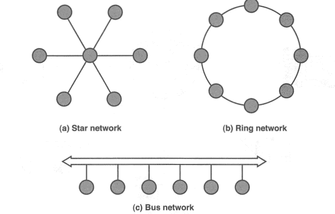

**令牌环拓扑结构**
在逻辑环形中配置的网络拓扑结构，它补了令牌环通过协议

**令牌传递**
一种电子令牌在网络中循环的技术——对令牌的控制使用户能够获得网络权限

**IEEE**
电气电子工程师协会，技术开发领域主要的标准制定机构之一

图 1-1 网络拓扑结构。（来自 Electronic Communication 9/e，G. Miller & J. S. Beasley 著，2008 版 © 2008 Pearson Education, Inc. 经 Pearson Education, Inc. 许可转载，Upper Saddle River, NJ。）

图 1-2 显示了使用令牌环拓扑结构配置的局域网示例。在这种拓扑结构中，“令牌”（显示为 T）被放置在数据通道中并在环中循环，名称为令牌环。如果用户想要传输，计算机将等待直到获得令牌控制权。这种技术被称为令牌传递，基于 IEEE 802.5 令牌环网络标准。令牌环网络是一种确定性网络，这意味着连接到网络的每个站都确保可以在定期或固定的时间间隔传输其消息。

**确定性**
以固定的时间间隔提供网络访问

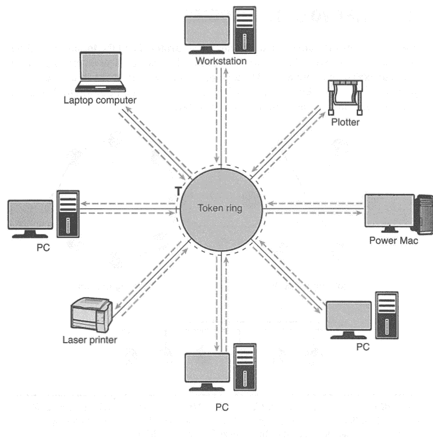

图 1-2 令牌环网络拓扑结构。

## **令牌环集线器**

管理令牌环通过协议的集线器

## **总线拓扑结构**

所有设备共享公共电缆的拓扑结构

## **细线**

用于总线拓扑的一种同电缆

总线拓扑的一个缺点是，如果电缆故障，整个网络将崩溃。另一个缺点是难以排除电缆故障。

## **星形拓扑结构**

所有设备连接到中央集线器或交换机的拓扑结构。这是现代局域网中最常见的拓扑结构。

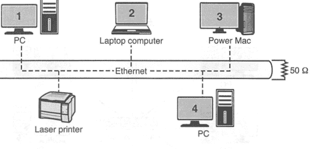

图 1-3 总线拓扑结构。

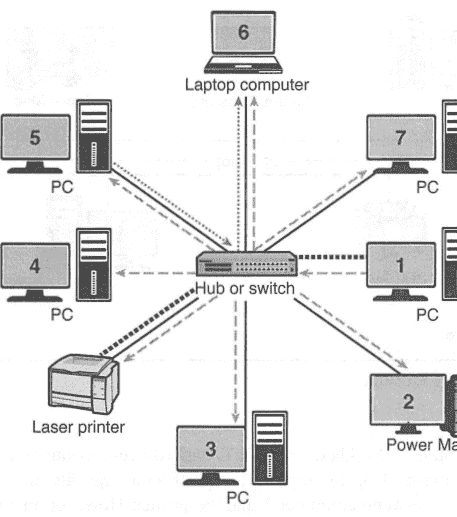

图 1-4 星形拓扑结构。


另一种拓扑是网型拓扑（mesh topology），如图 1-5 所示。在这种拓扑结构中，所有网络设备相互直接连接。这为网络数据路径提供了全冗余，但付出了代价。额外的数据路径增加了布线成本和网络硬件成本（例如，连接到网络的每个设备都需要多个网络端口的开销）。不仅如此，网型设计还增加了复杂性。这种拓扑适用于高可靠性应用，但对于通用网络应用来说成本可能过高。

## 网型拓扑

所有网络设备相互直接连接

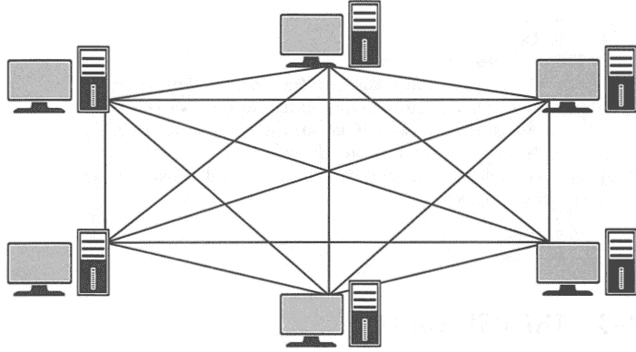

**图 1-5** 网型拓扑。

## 第 1-2 节复

本节涵盖了以下 Network+ 考试目标：

- 3.5 描述不同的网络拓扑

本节介绍了星型、环型、总线型和网型网络拓扑。你应该能够识别每种拓扑，并理解数据在每种网络拓扑中是如何传输的。你应该对拓扑和协议之间的区别有基本的了解。

本节还介绍了一些基础网络硬件，如集线器和交换机。确保你对每种设备都有基本的了解。你还应该理解来自集线器的数据是广播的。这意味着该信息会被连接到其端口的所有网络设备看到。你应该知道交换机不会广播数据包。

## 测试你的知识

- 1. 最常见的网络拓扑是什么？
   a. 星型
   b. 集线器
   c. 环型
   d. 网型
2. 集线器也称为多端口重复器。
   a. 正确
   b. 错误
3. 确定性（deterministic）术意味着
   a. 以随机时间间隔提供网络访问。
   b. 使用 CSMA/CD 提供网络访问。
   c. 以固定时间间隔提供网络访问。
   d. 以上答案均不对。
4. 协议定义了用于互连工作设备的网络架构。
   a. 正确
   b. 错误

## 1-3 OSI 模型

OSI 开放系统互连

国际标准化组织于 1984 年开发了开放系统互连（OSI）参考模型，以便不同类型的网络能够连接在一起。该模型包含七层，如图 1-6 所示。这些层描述了从物理网络接口到软件应用接口的网络功能。OSI 模型的目的是为网络提供一个框架，以确保网络硬件和软件的兼容性，并加速新网络技术的开发。后续对 OSI 模型的讨论将作为表 1-2 中列出的七层的总结。

OSI 模型
描述网络功能的七层

| 7. 应用层 |
| :--- |
| 6. 表示层 |
| 5. 会话层 |
| 4. 传输层 |
| 3. 网络层 |
| 2. 数据链路层 |
| 1. 物理层 |

图 1-6 OSI 参考模型的七层。

12 第 1 章 • 计算机网络导论

### 表 1-2 OSI 层次层总结

| 层 | 功能 | 示例 |
| --- | --- | --- |
| 7. 应用层 | 支持应用程序 | HTTP, FTP, SMTP (电子邮件) |
| 6. 表示层 | 协议转换，数据翻译 | ASCII, JPEG |
| 5. 会话层 | 建立、管理和终止会话 | NFS, SQL |
| 4. 传输层 | 确保数据包无误 | TCP, UDP |
| 3. 网络层 | 提供路由决策 | IP, IPv6 |
| 2. 数据链路层 | 提供数据流 | MAC 地址 |
| 1. 物理层 | 信号和介质 | NIC、双绞线、光纤 |

**1. 物理层：** 提供到网络的电气和机械连接。工作在此层的技术示例包括电子工业协会/电信行业协会（EIA/TA）相关技术、UTP、光纤和网络接口卡（NIC）。

**2. 数据链路层：** 处理错误恢复、流量控制（同步）和排序（哪些终端正在发送，哪些正在接收）。它被认为是介质访问层，是定义媒体访问控制（MAC）地址的地方。以太网 802.3 是局域网的标准，MAC 地址有时被称为以太网地址。

**3. 网络层：** 接收发出的消息并将消息段组合成数据包，为每个网络控制器添加标头。工作在此层的协议示例有互联网协议（IP）和互联网数据包交换（IPX）。

**4. 传输层：** 关注消息的完整性和重组（数据包），并处理流量控制。工作在此层的协议示例有传输控制协议（TCP）和用户数据报协议（UDP）。

**5. 会话层：** 提供必要的控制功能，以根据用户请求的需求建立、管理和终止连接。工作在此层的技术示例有网络文件系统（NFS）和结构化查询语言（SQL）。

**6. 表示层：** 为应用程序接收并结构化消息。将消息从一种代码翻译为另一种代码。该层负责数据压缩和加密。工作在此层的技术示例有信息交换标准代码（ASCII）和联合图像专家组（JPEG）。

**7. 应用层：** 与使用你的浏览器浏览器和电子邮件的应用程序交互。该层负责记录消息、解释并确定支持请求所需的信息。示例包括用于网页浏览的超文本传输协议（HTTP）、文件传输协议（FTP）和简单邮件传输协议（SMTP）。

物理层
提供到网络的电气和机械连接

数据链路层
处理错误恢复、流量控制（同步）和排序（哪些终端正在发送，哪些正在接收）

网络层
接收发出的消息并将消息段组合成数据包，为每个网络控制器添加标头

传输层
关注消息的完整性和重组（数据包），并处理流量控制

会话层
提供必要的控制功能，以根据用户请求的需求建立、管理和终止连接

表示层
为应用程序接收并结构化消息。将消息从一种代码翻译为另一种代码。该层负责数据压缩和加密

应用层
与使用你的浏览器和电子邮件的应用程序交互。该层负责记录消息、解释并确定支持请求所需的信息


## 注意

网络管理员经常按层描述网络问题。例如，布线问题被描述为第 1 层；交换机问题是第 2 层；以此此类推。

网络管理员需要对 OSI 模型的所有七层良好的良好的。层次知识有助于隔离网络问题。记住，隔离网络问题的过程中有三个基本步骤：

- 到机器的连接断了吗？（第 1 层）
- 网络断了吗？（第 3 层）
- 特定机器上的服务断了吗？（第 7 层）


与机器的连接断了吗？（第1层）
网络断开了吗？（第3层）
特定机器上的服务断开了吗？（第7层）

## 测试你的知识

1. TCP 运行在 OSI 模型的哪一层？
   a. 第4 层
   b. 第2 层
   c. 第3 层
   d. 第5 层
   e. 第7 层

2. HTTP 运行在 OSI 模型的哪一层？
   a. 第6 层
   b. 第5 层
   c. 第4 层
   d. 第7 层
   e. 以上答案均正确

3. IP 是一种运行在 OSI 模型哪一层的协议示例？
   a. 第7 层
   b. 第6 层
   c. 第5 层
   d. 第2 层
   e. 以上答案均正确

4. NIC（网卡）运行在 OSI 模型的哪一层？
   a. 第1 层
   b. 第3 层
   c. 第5 层
   d. 第7 层
   e. 以上答案均正确

5. 网络地址是第 4 层地址的另一种说法。对或错？

# 1-4 以太网局域网

大多数计算机网络使用的网络协议是以太网，这是一种用于局域网的载波监听多路冲突检测（CSMA/CD）。它起源于1972年，该协议的完整规格由施乐、数字设备公司（DEC）和英特尔共同努力于1980年提供。基本上，为了让计算机在以太网网络上“说话”，它首先要“监听”查看是否有任何数据流量（载波侦测）。这意味着连接到局域网的任何计算机都可以“监听”数据流量，且局域网上的任何一台计算机都可以访问网络（多路访问）。两或多台计算机可能会同时尝试广播消息；因此，以太网系统必须具备检测数据冲突的能力（冲突检测）。

### 数据包
为传输的信息提供分组。

以太网中的信息以数据包格式进行交换。数据包提供了传输的信息分组，包括头部、数据和尾部。头部由前导码、帧起始界符、源地址以及长度/类型字段组成。它是正在传输的实际数据，随后是负载，如果数据字段少于46字节，则会将总字节数补齐至至少46字节。帧的最后部分是4字节循环冗余校验（CRC）值，用于错误检查。以太网数据包帧的结构如图1-7所示，并在表1-3中描述。

| 前导码 | 帧起始界符 | 目的 MAC 地址 | 源 MAC 地址 | 长度/类型 | 数据 | 填充 | 帧校验序列 |
| :--- | :--- | :--- | :--- | :--- | :--- | :--- | :--- |

**图 1-7** 以太网帧的数据结构。（出自 G. M. Miller & J. S. Beasley 著《Electronic Communication 9/e》，2008年。版权 © 2008 Pearson Education, Inc.。经 Pearson Education, Inc., Upper River, NJ 许可转载。）

# 表 1-3 以太网数据包帧的组件

| 字段 | 说明 |
| :--- | :--- |
| 前导码 | 用于同步的10交替模式 |
| 帧起始界符 | 一个8位二进制序列 10101011，表示帧的开始 |
| 目的 MAC 地址和源地址 | 每台计算机都有一个以太网网络接口卡（NIC）或网络适配器，它有一个唯一的介质访问控制。与之关联的MAC地址长度为6字节（12个十六进制字符） |
| 长度/类型 | 如果此值小于1500，则表示数据字段中的字节数。如果此数字大于1500，则表示数据格式类型——例如 IP 和 IP |
| 数据 | 从源传输到目的地的可变长度数据 |
| 填充 | 如果数据字段少于46字节，则用于将总字节数补齐至至少46字节的字段 |
| 帧校验序列 | 用于错误检测的4字节CRC。CRC根据从目的MAC地址到填充字段的位产生。如果检测到错误，则丢弃该帧。 |

以太网帧的最小长度为从目的 MAC 地址到帧序列的6字节。以太网帧的最大长度为1,518字节；6字节用于目的 MAC 地址；6字节用于源 MAC 地址；2字节用于长度/类型；1,500字节用于数据。

来源：改编自 G. M. Miller & J. S. Beasley 著《Modern Electronic Communication 9/e》，2008年。版权 © 2008 Pearson Education, Inc.。经 Pearson Education, Inc., Upper River, NJ 许可改编。

第1章 • 计算机网络简介

在局域网（LAN）内如何确定数据的目的和源地址？网络设备（如计算机和网络打印机）各有一个连接到局域网的电子硬件接口，称为网络接口卡（NIC）（见图1-8）或集成网络端口。NIC包含一个名为MAC地址的唯一网络地址。MAC代表“介质访问控制”。MAC地址长度为6字节（或48位）。MAC地址长度为6字节（12个十六进制字符）。前3字节识别制造商，后3字节识别特定设备。前6字节也称为组织唯一标识符（OUI）。


# 操作系统命令序列注释

| 操作系统 | 命令序列 | 注释 |
| --- | --- | --- |
| Windows 7 | 在 Windows 7 中，可以通过开始菜单的搜索框输入文本 cmd。在命令提示符中，输入 `ipconfig/all` 并按回车。 | 物理地址即 MAC 地址。 |
| Linux | 在命令提示符下，输入 `ifconfig`。 | HWaddr 行包含 MAC 地址。 |
| Mac OS (9.x 及更高版本) | 点击苹果[菜单]，然后选择偏好设置 > AppleTalk 并点击 Info 按钮。 | 硬件地址即 MAC 地址。 |
| Mac OS X | 点击苹果 > 关于本机 > 更多信息 > 内置以太网。 | 硬件地址即 MAC 地址。 |

总之，MAC 地址提供了最终使数据能够在局域网（LAN）中到达目的地的信息。这也是打印机在星型拓扑结构通过交换机直接通信的方式（参见图 1-4）。交换机切换了连接到其端口的所有设备的 MAC 地址，并利用这些信息将数据从计算机 1 转发到打印机。交换机还利用 MAC 地址信息将数据从计算机 5 转发到计算机 6（参见图 1-4）。

MAC 地址以十六进制（16 进制）列出。完整的 MAC 地址由 12 位十六进制数字组成。前 6 位识别厂商。后 6 位序列号由网卡制造商分配。IEEE OUI 和公司 ID 分配的可查询数据库可以在 http://standards.ieee.org/regauth/oui/index.shtml 获取。表 1-5 列出了 MAC 地址的几个示例。此外，大型公司可能被分配多个 OUI 号。例如，OUI 00-AA-00 仅是 Intel 的 OUI 之一。

### 表 1-5 MAC 地址示例

| 公司 ID-厂商序列号 | 制造商（公司 ID） |
| --- | --- |
| 00-AA-00-B6-7A-57 | 英特尔公司 (00-AA-00) |
| 00-86-15-9E-7A | Megahertz 公司 (00-00-86) |
| 00-50-73-6C-32-11 | 思科公司 (00-50-73) |
| 00-04-76-B6-9D-06 | 3COM (00-04-76) |
| 00-A2-27-B7-3E-F8 | 苹果公司 (00-A2-27) |

# IP 址

MAC 地址提供了物理地址，但没有提供有关其位置或位于哪个局域网、哪个建筑、城市或国家的信息。互联网协议（IP）寻址通过包含一个识别计算机本地网络的唯一地址，提供了全球寻址的解决方案。IP 网络号由分配数字局（IANA）分配，该机构负责为计算机网络分配地址，并确保没有两个网络分配相同的 IP 网络地址。IANA 的网页地址为 http://www.iana.org。

IANA
该机构为计算机网络分配 IP 地址。

## 第 1-4 节 以太网局域网

# IP 地址

唯一的 32 位地址用于识别计算机位于哪个网络上，并将计算机与同一网络上的所有其他设备区分来。

IP 地址分为 IPv4 或 IPv6。版本 4 (IPv4) 是目前互联网上使用的 TCP/IP 寻址技术。由于互联网的快速增长和新的兼容互联网技术的发展，IPv4 地址空间正在迅速耗尽。网络设备制造商和最新的操作系统都支持 IPv4 和 IPv6。有关 IPv6 的细节将在第 6 章介绍。

“TCP/IP”是分配 IP 地址的最常用方法。32 位地址用于识别计算机位于哪个网络上，并将计算机与同一网络上的所有其他设备区分来。

IP 地址分为 IPv4 或 IPv6。版本 4 (IPv4) 是目前互联网上使用的 TCP/IP 寻址技术。由于互联网的快速增长和新的兼容互联网技术的发展，IPv4 地址空间正在迅速耗尽。网络设备制造商和最新的操作系统都支持 IPv4 和 IPv6。

32 位地址用于识别计算机位于哪个网络上，并将计算机与同一网络上的所有其他设备区分来。

### 表 1-6 IPv4 分类示例

| 类别 | 描述 | 示例范围 |
| --- | --- | --- |
| A 类 | 大型网络 | 1.0.0.0 到 127.255.255.255 |
| B 类 | 中等网络 | 128.0.0.0 到 191.255.255.255 |
| C 类 | 小型网络 | 192.0.0.0 到 223.255.255.255 |
| D 类 | 多播组 | 224.0.0.0 到 239.255.255.255 |


# 测试你的知识水平

- 1. IP 地址和 MAC 地址之间有什么区别？（选择单项）
  a. 它们是相同的。
  b. MAC 地址仅用于局域网（LAN）。
  c. IP 地址仅用于互联网。
  d. MAC 地址提供网络接口卡的物理地址。
- 2. 在 Windows 计算机上，可以通过在命令提示符中输入 config/all 来访问 MAC 地址。
  a. 正确
  b. 错误
- 3. MAC 地址 00-10-A4-13-99-2E 的 OUI 是 13992E。
  a. 正确
  b. 错误
- 4. 定义缩写词 NIC。
  a. 网络接口卡 (Network Interface Card)
  b. 国家集成通信器 (National Integrated Communicator)
  c. 网络集成卡 (Network Integration Card)
  d. 国家整合通信器 (National Integration Communicator)
  e. 以上答案均不正确

# 1-5 家庭网络

### 有线网络
用于建立网络连接的电缆和连接器

搭建家庭网络可能是学生建立的第一个网络之一。对于学生来说，这是一个展示计算机网络知识的绝佳机会，但搭建家庭网络也可能具有很大的挑战。提出的第一个问题之一：“我是想建立有线还是无线家庭网络？”有线网络使用电缆和连接器来建立网络连接。无线网络则使用射频电波信号来建立网络连接。第 1-6 节介绍了办公网络和家庭网络的搭建；然而，本节将重点介绍家庭网络技术。

### 无线网络
使用无线电波信号建立网络连接

无线家庭网络可能是目前最常用的家庭网络配置方式。

表格 1-8 列出了有线网络和无线网络的优缺点。

## 表格 1-8 有线和无线网络的优缺点

| | 优点 | 缺点 |
|---|---|---|
| 有线网络 | 数据传输速度更快（在局域网内）。 | 电缆连接通常需要使用专用工具。 |
| | 成本相对低廉。 | 电缆安装耗费人力且价格昂贵。 |
| | 网络不受外部干扰的影响。 | |
| 无线网络 | 用户移动性强。安装简单。 | 安全问题。局域网内的数据传输速度可能比有线网络慢。 |

无线网络通常统称为 Wi-Fi，它是 Wi-Fi Alliance 的缩写（Wi-Fi 代表无线保真无线 fidelity）。Wi-Fi Alliance 是一个组织，其功能是对无线设备进行认证以确保符合 802.11 标准，这是 IEEE 802.11 下开发的一组无线标准。IEEE 是电气电子工程师学会。最常见的 IEEE 标准包括：

- **802.11a (无线-A):** 该标准提供高达 54Mbps 的数据传输率，工作范围高达 75 英尺。它在 5GHz 下工作。
- **802.11b (无线-B):** 该标准提供高达 11Mbps 的数据传输率，范围为 100-150 英尺。它在 2.4GHz 下工作。
- **802.11g (无线-G):** 该标准提供高达 54Mbps 的数据传输率，范围达 150 英尺。它在 2.4GHz 下工作。
- **802.11n (无线-N):** 这是下一代高速无线连接，有望的数据传输率高达 802.11g 速度的 4 倍（200+Mbps）。

图 1-11 展示了有线或无线家庭网络中使用的设备的位置和类型。图 1-11 显示了一个使用电缆互连网络设备的有线局域网。使用路由器连接到 ISP（服务提供商）。路由器还可以包含一个交换机和一个宽带调制解器。交换机用于互连其他网络设备，宽带调制解器用于与 ISP 建立数据连接。常见的 ISP 宽带连接是通过电缆调制解器和 DSL。在某些情况下，路由器、交换机和宽带调制解器是独立的设备，但它们通常会被集成到一个设备中。其中一台计算机可能还带有管理路由器的配置设置，其中包括连接到 ISP 的设置。


# 无线路由器

用于互连无线网络设备，并为有线设备提供访问，同时与 ISP 建立宽带互联网连接的设备

图 1-11 (b) 显示了一个用于互连工作设备的无线局域网。使用无线路由器与 ISP 建立数据连接，通常是电缆或 DSL 调制解器。无线路由器还有一个无线接入点，通常会有一个交换机以方便有线网络连接。宽带调制解器集成在无线路由器中。接入点用于与每台无线计算机建立无线网络连接。

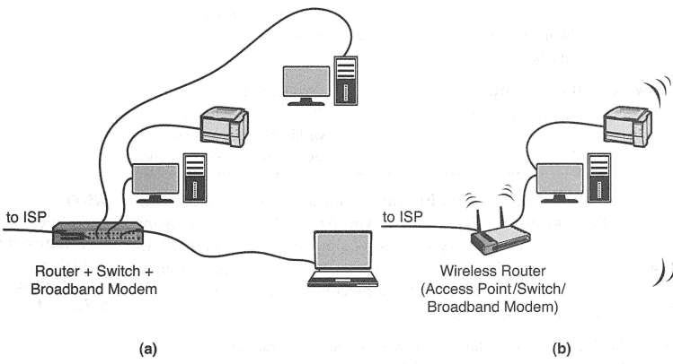

图 1-11 一个 (a) 有线和 (b) 无线 Wi-Fi 家庭网络的示例。

家庭网络的组件可以包括以下内容：

- **集线器 (Hub)**: 用于互连网络设备。集线器的缺点是它会将接收到的数据广播到连接其端口的所有设备。在大多数现代网络中，集线器已被网络交换机取代。图 1-12 显示了集线器的图像。
- **交换机 (Switch)**: 用于互连网络设备的最佳选择。
- **网络适配器 (Network adapter)**: 有线和无线网络适配器都是可用的。这种网络适配器被称为网卡（NIC）。图 1-14 显示了网络适配器的图像。这种类型的网卡插入计算机的主板，是仅有线适配器。

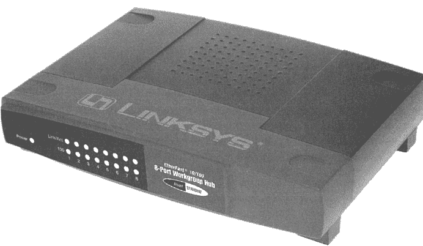

图 1-12 集线器的图像。

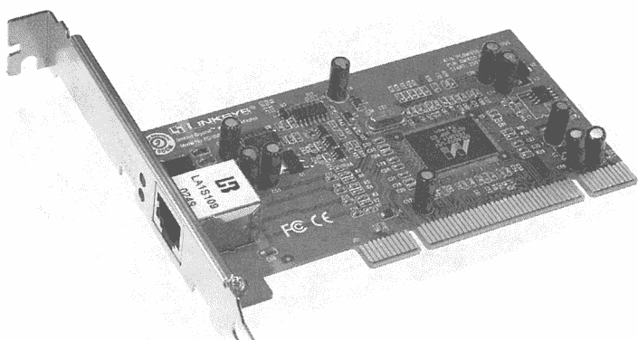

图 1-13 交换机的图像。

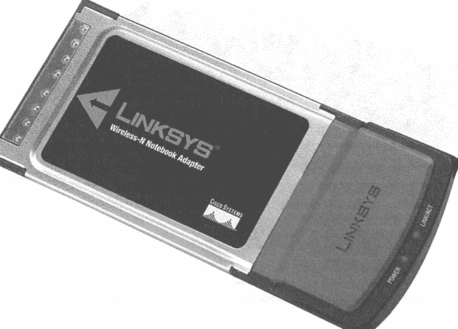

图 1-14 网络适配器的图像。

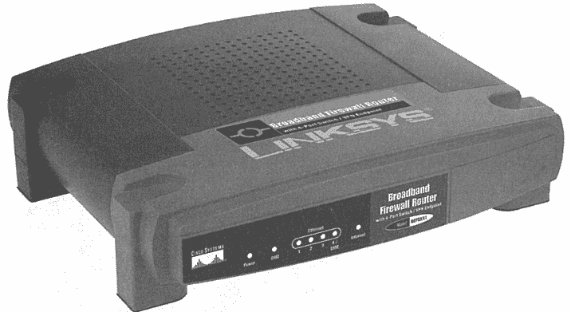

图 1-15 网卡适配器的图像。


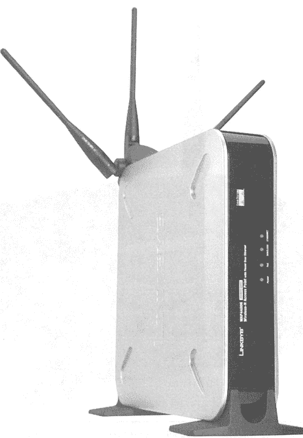
图 1-19 Linksys Wireless-N 接入点。

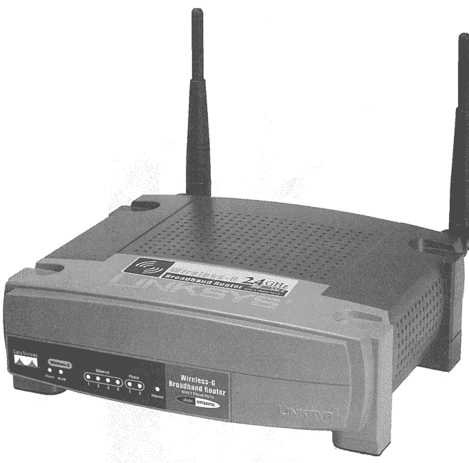
图 1-20 Linksys Wireless-G 宽带路由器（由 Linksys 提供）。

- **宽带调制解调器/网关 (Broadband modem/gateway)**：指的是通过电缆连接或电话公司的 DSL 连接提供高速数据访问的设备。网关将调制解调器和路由器合并到一个网络盒中。图 1-21 是宽带调制解调器/网关的图像。
- **猫猫 (Cable modem)**：此设备用于通过电缆连接从家庭网络到 ISP（服务提供商）建立宽带连接。这种设置需要一个分路器将电缆电视与家庭网络分离。访问互联网通常由电缆电视服务提供商提供。图 1-22 是猫猫的图像。

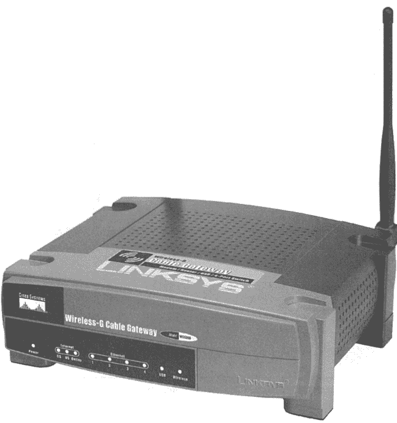
图 1-21 Linksys Wireless-G 电缆网关（由 Linksys 提供）。

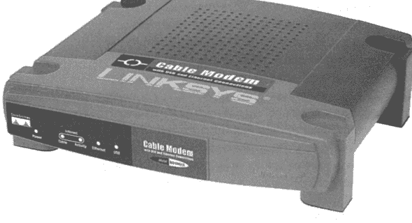
图 1-22 带有 USB 和以太网连接的 Linksys 猫猫（由 Linksys 提供）。

- **DSL 调制解调器 (DSL modem)**：此设备用于通过电话线从家庭网络到 ISP 建立宽带连接。互联网宽带接入通过电话公司或独立的 ISP 提供。DSL 连接需要在进入调制解调器以外的所有电话线上放置过滤器，以防止干扰。图 1-23 是 DSL 调制解调器的图像。

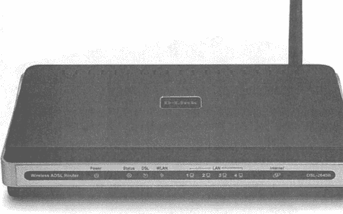
图 1-23 Linksys ADSL2 调制解调器（由 Linksys 提供）。

在规划家庭网络时应考虑以下几个问题，包括：

- **数据传输速度**：这将取决于你选择实施有线还是无线家庭网络。有线网络在家庭网络内部提供最佳的数据传输速率，高达 10Gbps。无线家庭网络的最佳数据速率可以通过使用 802.11n (Wireless-N) 技术获得，这是下一代高速无线连接技术，提供的数据传输速率可达 4 倍 802.11g 速度（200+Mbps）。
- **成本**：实施高速有线网络可能非常昂贵。由于网络硬件、布线和相关硬件，你在实施高速有线家庭网络时可能会产生意之外的成本。切换或实施 802.11n Wireless-N 网络的成本极低，是有线网络的理想替代方案。请记住，Wireless-N 网络的最大数据速率仍然远低于有线局域网的可能水平。
- **实施易用性**：如果尚未安装无线网络的布线和连接器，那么无线家庭网络可能是最容易实现的。只要没有出现意外问题，安装无线家庭网络所需的时间通常是极少的。
- **外观**：在外观方面，无线家庭网络是最佳选择，因为家里不会散布着电缆和网络硬件。第 1 章 计算机网络导论。无线家庭网络需要一个无线路由器和连接到 ISP 的外部有线连接（参见图 1-11(b)）。

- **家庭接入**：有线或无线技术的选择不会影响接入。
- **公共接入**：有线或无线技术的选择不会影响接入。无线家庭网络出现故障并不常见，尽管其停机时间很短。排除故障的步骤包括：


2. 更改默认 SSID。SSID 是用于识别您的网络的名称，由您的接入点或无线路由器用于建立关联。建立关联意味着无线客户端可以加入网络。SSID 最多可达 32 个字符，并且应该经常更改，这样破解了您 SSID 的黑客将无法再次访问您的家庭网络。

3. 开启加密。最重要的事情可能是开启包括加密在内的安全功能。这些选项包括有线等效加密（WEP）、Wi-Fi 保护访问（WPA）、WPA2。WPA2 是由 Wi-Fi 联盟颁发的认证。它使用了比 WPA 更强的加密算法，并且兼容使用 WPA 的适配器。

4. 关闭 SSID 广播。无线系统会广播 SSID，以便任何未经授权的黑客都能轻松识别该网络。黑客可以利用这些信息访问您的网络，因此你应该关闭 SSID 广播。提供公共访问的热点除外。请注意，热点让用户易于获得无线访问，但黑客也可能处于同一个网络中，因此开启加密是非常重要的。

5. 启用 MAC 地址过滤。所有计算机设备都使用唯一的 MAC 地址来识别设备。这可以用于选择哪些设备允许访问网络。当启用 MAC 地址过滤时，只有具有 MAC 地址的无线设备才允许访问网络。

另一个重要的安全问题是通过您与 ISP 的连接限制对家庭网络的访问。以下是采取可以保护网络免受外部威胁的措施：

- 网络地址转换（NAT）：外部只能看到路由器的 IP 地址，因为内部网络设备的 IP 地址不会在互联网上提供。路由器提供由 ISP 分配的可用 IP 地址池中的 IP 地址。家庭网络通常使用在互联网上不可路由的私有地址（私有 IP 地址会被 ISP 拦截）。

- 防火墙保护：通常的做法是开启防火墙保护。防火墙的目的是防止未经授权访问您的网络。Windows 和 Mac 操作系统都提供防火墙保护。防火墙保护的一种是状态数据包检测（SPI）。这种防火墙会检查传入的数据包，以确保它们与传出的请求相对应。例如，您可能与某个网站交换信息。未请求的数据包将被拒绝。防火墙的主题在第 2 章“网络安全”中有更详细的介绍。

| 防火墙保护 | 用于防止未经授权访问您的网络 |
| :--- | :--- |
| 状态数据包检测 (SPI) | 一种防火墙，通过检查传入的数据包来确保其与传出的请求匹配 |
| 虚拟专用网络 (VPN) | 建立安全的网络连接，保护局域网数据不被外部观察的方法 |

## 家庭网络中的 IP 地址

## 网络地址转换 (NAT)

关于家庭网络的常见问题是：“如何处理连接到互联网的所有计算机的 IP 地址？”家庭网络通常与 ISP 一个连接，但多台计算机可以同时连接到互联网。答案是家庭网络的 IP 地址是由连接到 ISP 的路由器或无线路由器管理的。ISP 会从其管理的可用 IP 地址池向路由器分配一个 IP 地址（适用范围为 10.0.0.0--10.255.255.255；172.16.0.0--172.31.255.255；192.168.0.1--192.168.255.255），使用了称为网络地址转换（NAT）的技术。

将私有 IP 地址转换为公共地址，以便在互联网上进行路由。

图 1-24 提供了一个示例。公共 IP 地址使得家庭网络中的所有计算机都能访问互联网。无线路由器向网络发布私有地址。

## 端口负载 (Overloading)

将私有 IP 地址转换为公共地址，以便在互联网上进行路由。

图 1-24 提供了一个示例。公共 IP 地址使得家庭网络中的所有计算机都能访问互联网。无线路由器向网络发布私有地址。

## 端口地址 (PAT)

将私有 IP 地址转换为公共地址，以便在互联网上进行路由。

图 1-24 提供了一个示例。公共 IP 地址使得家庭网络中的所有计算机都能访问互联网。无线路由器向网络发布私有地址。

## 第 1-5 节复

+ 本节涵盖了以下 Network+目标：
- 2.2 在给定场景下，安装并配置无线网络

本节介绍了无线家庭网络的基础设置。确保你熟悉各种无线组件，例如无线路由器。

- 2.4 在给定场景下，排除常见的无线故障
讨论了排除无线网络故障的步骤。第一步是验证调制解调器连接上显示了正确的指示灯。

- 3.3 比较并对比不同的无线标准
本节包含了对当今各种无线标准的许多讨论。配置无线网络时有许多无线技术可供。理解每种无线标准的优势和局限性非常重要。

- 5.1 在给定场景下，实施适当的无线安全措施
介绍了保护家庭网络无线连接的步骤。一个良好的开始是始终更改无线设备的默认设置。

- 5.4 解释常见的威胁、漏洞和缓解技术
采用 MAC 地址过滤是阻止未经授权访问无线网络的一种好方法。这种技术可以用于选择连接到网络的设备。


## 知识掌握

- 1. 在规划家庭网络时，应该考虑以下哪些问题？
a. 数据速度
b. 公共访问
c. 成本
d. 以上答案全部正确

- 2. MAC 地址过滤如何帮助保护无线网络？
a. 这用于帮助防止网络接口卡被盗窃。
b. 这需要额外的登录步骤，要求用户输入其 MAC 地址。
c. 由于网接口卡（NIC）的限制，MAC 地址过滤已很少被使用。
d. 这可以选择哪些网络设备允许访问网络。

- 3. 以下哪些是无线技术的示例？
a. 802.11a
b. 802.11g
c. 802.11n
d. 以上答案全部正确

- 4. 什么是 NAT？
a. 网络异步传输 (Network Asynchronous Transfer)
b. 网络地址转换 (Network Address Translation)
c. 网络地址转换 (Network Address Translation) 
d. 以上答案都不正确

## 1-6 组装办公室局域网 (LAN)

本节介绍了一个办公室类型局域网的组装示例。将使用以太网协议管理网络中的数据交换，网络设备将在星型拓扑中互连。组装和配置局域网有很多选择，但本示例提供了一种简单且符合现代计算机网络的方法。它还将为本文介绍的网络主题提供良好的介绍。

例如，要在星型拓扑结构中配置三台计算机和一台打印机。网络中的每个设备将从私有地址空间分配一个 IP 地址。接下来的逐步讨论将引导你完成完成组装、配置和测试办公室局域网的过程：

### 第一步

组装办公室局域网的第一步是记录要连接的设备，并为建议的网络准备一个简单的草图。每个设备的 MAC 地址和 IP 地址都应该包含在网络文档中。

1-26 提供了一个小型办公室局域网的示例。列出了每台计算机和打印机所需的 IP 地址和实际 MAC 地址。记住，每个网接口卡（NIC）都包含一个唯一的 MAC 地址，而 IP 地址由网络管理员本地分配。MAC 地址是通过 Windows 7 的命令提示符中的 `ipconfig/all` 命令获取的。对连接到局域网的所有计算设备重复此步骤。表 1-9 显示了 MAC 地址查询的结果。每个网络设备将将被分配一个 IP 地址。表 1-9 还列出了此办公室局域网使用的设备计划 IP 地址。

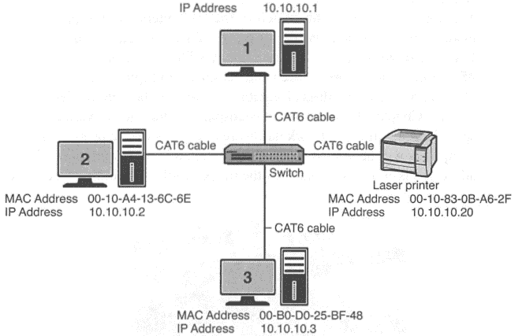

图 1-26 小型办公室局域网星型拓扑示例。

### 表 1-9 办公室局域网设备的 MAC 和分配的 IP 地址

| 设备（主机名） | MAC 地址 | IP 地址 |
| --- | --- | --- |
| 计算机 1 | 00-10-A4-13-99-2E | 10.10.10.1 |
| 计算机 2 | 00-10-A4-13-6C-6E | 10.10.10.2 |
| 计算机 3 | 00-B0-D0-25-BF-48 | 10.10.10.3 |
| 激光打印机 | 00-10-83-0B-A6-2F | 10.10.10.20 |

## 注意

在本文中，你将充当网络管理员。网络管理员必须知道如何获取连接到网络的设备的所有 IP 和 MAC 地址信息。这要求网络管理员对网络保持良好的记录。

### 第二步

使用图 1-26 所示的星型拓扑连接所有网络设备。

1-26.
星型拓扑网络的中心将是一个交换机或集线器。记住，这两者都可以用于连接网络设备。最好的选择是集线器会将接收到的所有数据广播到连接其端口的所有设备，而交换机则允许设备直接通信。虽然集线器没有交换机复杂，且不能反映现代计算机网络，但集线器仍然适用于小型网络。

从交换机到计算机和打印机的连接将使用对绞双电缆。这里使用的电缆类型是 CAT6（六类）双绞线。CAT6 双绞线两端都是 RJ-45 模块化连接器，如图 1-27 所示，能够在长达 100 米的范围内传输 1000Mbps（1 Gb比特）或更高的数据。第 2 章涵盖了双绞介质及其各种分类规范。如果网络硬件和软件设置正确，所有计算机都能够访问打印机和其他计算机。第 2 章讨论了与正确布线相关的问题，包括 CAT6e。

### CAT6（六类）

能够传输高达 1000Mbps（1 Gb比特）数据且长度可达 100 米的双绞线

### RJ-45

用于 CAT6/5e/5 电缆的 8 针模块化连接器

### Mbps

每秒兆比特

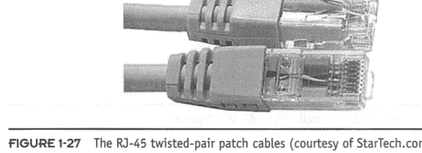

### 数值

一种数值表示

现代计算机网络中用于传输数据的介质是无线的、双绞线或光纤。选择、安装和测试双绞线的原理将在第 2 章中介绍。表 1-10 列出了用于局域网的双绞线介质和旧式同轴电缆的常用速率。数值是技术的字母数字描述。例如，100BaseT 意味着 100-Mbps 基带双绞技术。

第 1 章 计算机网络简介

### 表 1-10 以太网布线的常用数值

| 类型 |  |
| --- | --- |
| 10Base2 | 长度 185 米的同轴电缆（称为 ThinNet） |
| 10Base5 | 长度 500 米的同轴电缆（称为 ThickNet） |
| 10BaseT | 10Mbps 双绞线 |
| 10BaseF | 10Mbps 多模态光电缆 |
| 10BaseFL | 10Mbps 长度 850 米的多模态光电缆 |
| 100BaseT | 100Mbps 双绞线（称为快速以太网） |
| 100BaseFX | 100Mbps 光纤 |
| 1000BaseT | 1000Mbps 双绞线 |
| 1000BaseFX | 1000Mbps 光纤 |

RJ-45 插头通过 RJ-45 插座连接到交换机。图 1-28 显示了一个简单的 8 端口交换机。交换机的输入称为端口，是网络设备的接口。标记为“x”或链路端口的交换机表示这些设备是交叉连接，意味着双绞电缆上的发送和接收对交叉以正确对齐数据通信。交叉/RX 线术语为交叉。某些交换机带有“链路”端口，配备了自动交叉检测功能，因此用户无需担心使用直连线还是交叉线。直连线和交叉线的示例将在第 2 章介绍。

**端口 (Ports)**
网络设备的接口

**交叉 (Crossover)**
发送和接收对交叉以正确对齐一个设备上的发送信号与另一个设备上的接收信号

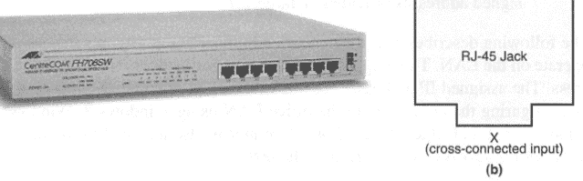

图 1-28 (a) 用于连接网络设备的交换机；(b) 表示链路端口的“x”（由 Anixter, Inc. 提供）。

**直连 (Straight-through)**
发送和接收信号对端端对齐

1-29(a) 提供了这种交叉连接概念的示例。交换机通常至少有一个端口可以选择用于交叉或直连输入。直连端口也称为链路端口。链路端口允许交换机连接到交换机或集线器而无需使用特殊电缆。

**链路端口 (Uplink Port)**
允许在不使用交叉线的情况下将集线器或交换机连接到另一个集线器或交换机

需要交叉端口的设备是计算机、打印机和路由器。需要直连连接的是到其他交换机或集线器的链路。图 1-29(b) 提供了解释直连输入概念的框图。


**图 1-29** (a) 到集线器的“x”类型输入布线示例；(b) 直连布线。

**指示灯 (Link Light)**
表示发送和接收对已对齐

可以通过检查交换机或集线器上的指示灯来验证网络连接。指示灯亮表示发送和接收对已正确对齐且连接设备正在通信。灯不表示可能是布线或硬件问题。以太网协议使用链路完整性测试来验证两个以太网设备之间是否建立了通信链路。当通信建立时，链路保持亮，只要连接设备定期交换链路脉冲，链路就会保持亮。连接的每个设备通过双绞线发送链路脉冲，表示链路不是以太网包的一部分，并在未传输数据时定期发送。

**链路完整性测试 (Link Integrity Test)**
用于验证两个以太网设备之间已建立通信链路的协议

**链路脉冲 (Link Pulses)**
由每个连接设备通过双绞线发送，在未传输数据时表示链路保持在线

### 第三步

根据表 1-7 中提供的分配地址，配置每台计算机的 IP 地址。

以下描述了网络管理员如何配置计算机在局域网上运行。这要求为每个计算设备分配一个 IP 地址。此局域网的 IP 地址在表 1-7 中。后续是使用 Windows 7、Windows Vista、Windows XP 和 Mac OS 配置办公室计算机的示例。打印机也连接到了网络，设置将在本文后部分讨论。

- * Windows 7: 点击开始 > 控制面板 > 网络和 Internet—网络和共享中心。点击“本地区域连接”和“属性”，然后点击“继续”。这将打开“本地区域连接属性”菜单。双击“Internet 协议 4 (TCP/IP4)”。这将打开属性菜单。现在使用以下 IP 地址，输入 IP 地址和子网掩码，并点击确定。

- * Windows Vista: 点击开始 > 网络连接或点击开始 > 面板 > 网络和共享中心。右键点击“本地区域连接”并选择“属性”，然后点击“继续”。这将打开“本地区域连接属性”。


属性菜单。双击“Internet 协议版本 4 (TCP/IP)”。这将打开“属性”菜单。现在选择“使用下列 IP 地址”，输入 IP 地址和子网掩码，然后点击“确定”。

- Windows XP：要在 Windows XP 中设置 IP 地址，点击“开始 > 设置 > 控制面板”并点击“网络连接”。右键点击“局域连接”并点击“属性”。你会看到“局域网属性”菜单。确保勾选 TCP/IP 复选框并突出显示“Internet TCP/IP”字样。点击“属性”。你应该选择了“Internet协议 (TCP/IP) 属性”菜单。此时，你必须指定 IP 地址是自动获取还是使用特定的（静态）地址。在本例中，点击“使用下列 IP 地址和子网掩码”并选择“确定”。
- Mac OS：点击“苹果图标 > 系统偏好设置 > 网络”，然后点击“状态”并选择“内置以太网”。将出现一个新窗口并显示“配置 IPv4”选项；选择“手动”。此选项允许你手动设置 IP 地址和子网掩码。现在应该显示输入 IP 地址和子网掩码的字段。输入所需的 IP 地址和子网掩码，并选择“应用”。

办公室局域网示例中使用的 IP 地址和子网掩码列于表 1-7。计算机 1 的 IP 地址为 10.1.10.1，在本例中，使用的子网掩码为 255.255.0.0。目前留空其余字段；它们的目的将在本文后部分讨论。计算机 1 的网络配置现在已完成。在该局域网示例中，计算机 2 和 3 重复这些步骤。

## 第 1-6 节复习

本节涵盖了以下 Network+ 考试目标。
3.1 标准媒介类型及相关属性分类
以太网布线的常用数字如表 1-10 所示。这为理解以太网局域网使用的不同类型电缆提供了良好的开始。
3.2 按网络媒介对连接器类型分类
本节介绍了常用的 RJ-45 插头和插座。你将在所有计算机网络中找到这种连接器。
3.7 比较和对比不同的 LAN 技术
表 1-10 对常见的网络电缆类型提供了良好的描述。
4.5 描述配置管理文档的用途
组装办公室局域网的第一步是记录连接到网络的设备。很容易跳过这一步，但将良好的文档放在优先位置至关重要的。

## 测试你的知识

- 1. 交换机输入端的“X”代表仅路由器端口。
   a. 正确
   b. 错误

- 2. 交叉连接输入端口表示
   a. 发送和接收对是交叉的。
   b. 仅用于到路由器的连接。
   c. 电缆接线错误。
   d. 在集线器和交换机端口输入上必须避免。

- 3. 链路指示灯亮表示（选择所有适用项）
   a. 链路完整性测试正在运行。
   b. 局域网中的所有设备都在共享链路脉冲。
   c. 已建立 10 Mbps 数据链路。
   d. 已建立 100 Mbps 数据链路。
   e. 以上所有答案都是正确的。

## 1-7 局域网的测试与故障排除

当计算机上的网络配置完成且电缆连接就位后，你将对网络进行测试并可能的故障排除。首先，验证计算机是否已正确连接到网络。通过验证连接到计算机或其他网络设备的每个交换机端口上都有链路灯来执行。链路验证通常显示为灯亮。激活了链路指示灯的交换机示例如图 1-30 所示。

图 1-30 集线器上链路灯的示例。

### Ping
用于测试网络上的设备是否可达的命令

在确认网络设备已物理连接后，使用 `ping` 命令验证网络设备是否正在通信。Ping 使用互联网控制消息协议 (ICMP) 回显请求和响应来测试网络上的设备是否可达。ICMP 协议验证消息是否正在递送。在 Windows 的命令行窗口可以使用 `ping` 命令来验证网络设备是否正在通信。`ping` 命令的结构如下：

ICMP
互联网控制消息协议

```
ping
```

Usage [-t][-n] count [-t] size [-f -i TTL] [-v TOS] [-r] count host-list]:[-k host-list] [-w timeout] destination-list

Ping 指定主机直到停止。要查看统计数据并继续，请输入 Control-Break。要停止，请输入 Control-C。

- 选项
- -t
- -n count
- -s size
- -f
- -i
- -r count
- -j host-list
- -k host-list
- -w timeout

将地址解析为主机名
发送的回显请求数
发送缓冲区大小
在数据包设置不分片标记
TTL: 生存时间与服务类型
记录指定跳数的路由
松散路由主机列表
严格路由主机列表
每个响应的超时时间（毫秒）

在本例中，`ping 10.10.1` 是为了使用计算机 1 的 IP 地址。IP 地址 10.10.1 是目标地址。

```
ping 10.10.1
正在 ping 10.10.1 具有 32 字节的数据：
来自 10.10.1 的回复：字节32 时间1ms TTL=128
来自 10.10.1 的回复：字节32 时间=1ms TTL=128
来自 10.10.1 的回复：字节32 时间=1ms TTL=128
来自 10.10.1 的回复：字节32 时间=1ms TTL=128

10.10.1 的 ping 统计：
发送 = 4，接收 = 4，丢失 = 0%
近似时间（毫秒）：
最小 = 1ms，最大 = 1ms，平均 = 1ms
```

这是一个 `ping` 命令的示例。在本例中，`ping 10.10.1` 是为了使用计算机 1 的 IP 地址。IP 地址 10.10.1 是目标地址。你可能需要验证正在使用的计算机的 IP 地址。

ipconfig
显示计算机地址的命令

1-31 (a) 在 Windows 中使用 `ipconfig` 命令显示计算机 1 IP 地址的示例 (b) Mac OS 中内置以太网连接显示的 IP 地址示例。

### Windows IP 配置

以太网适配器 局域连接：
连接特定 DNS 后缀：
IP 地址........: 10.1.1
子网掩码........: 255.255.0.0
默认网关 .........

| 配置名称 | 接口 | 类型 | IP 地址 |
|---|---|---|---|
| Air | en1 | Air | 128. |
| 蓝牙 | Bluetooth-Modem | PPP (PPPSerial) | |
| 内置以太网 | enD0 | 以太网 | 10.20.1 |
| 内部调制解调器 | modem | PPP (PPPSerial) | |

内置以太网：

-   接口：enD0
-   类型：以太网
-   IP 地址：10.20.1
-   子网掩码：255.255.255.0
-   广播地址：10.20.255
-   以太网地址：00:04:93:cd:de:74

## 第 1-7 节复习

本节涵盖以下 Network+ 考试目标。

4.3 在给定场景下，使用适当的软件工具排除连接问题

验证两个网络设备之间连通性的重要步骤是使用对方的 IP 地址发布 **ping** 命令。**ping** 命令在 Windows 命令行窗口可用。确保你了解如何执行该命令以及该命令提供的选项，如持续 ping 和设置缓冲区大小。

第 1 章 • 计算机网络简介


## 测试你的知识

- 1. 网络管理员需要验证网络连接。应该采取以下哪些步骤？（选择两个）
a. 验证链路指示灯。
b. 使用 **ping** 命令验证网络连通性。
c. 执行 ARP 请求。
d. Ping MAC 地址。

- 2. **ping -t** ip 地址命令（选择所有适用项）
a. 持续 ping 指定 IP 地址上的主机，直到停止。
b. ping 指定 IP 地址上的主机，的 MAC 地址。
c. 允许 **ping** 穿过路由器。
d. 允许从命令提示符执行 **ping** 命令。

## 总结

第 1 章介绍了计算机网络的基本概念。介绍了使用以太网协议（Ethernet）组装计算机网络的技术和方法。学生现在应该理解以下主要主题：

- 各种不同的局域网（LAN）拓扑结构
- 以太网协议中 CSMA/CD 的概念
- 以太网帧的结构
- 网络接口卡（NIC）的作用
- MAC 地址的作用
- 如何确定计算机的 MAC 地址
- IP 地址的作用和结构
- 私有 IP 地址的概念
- OSI 模型
- 用于实现双绞线计算机网络的网络拓扑结构和技术
- 如何配置和验证计算机的 IP 地址
- 如何配置家庭网络和办公局域网（LAN）
- 链路指示灯的作用
- 使用 ping 测试网络连接的作用

## 问题与练习

## 第 1-1 节

- 1. 说明下列网络描述描述的是城域网（MAN）、广域网（WAN）还是局域网（LAN）：
a. 在有限区域内共享计算机资源的用户网络
b. 在大城市范围内共享计算机资源的用户网络
c. 跨大地理区域局域网的网络

- 2. 写出 NIC 的全称。

- 3. 写出 MAC 的全称。

- 4. 写出 LAN 的全称。

- 5. 写出 WAN 的全称。

## 第 1-2 节

6. 定义 *protocol*（协议）一术语。

7. 定义 *topology*（拓扑）一术语。

8. 定义 *deterministic*（确定）一术语。

- 9. 令牌环（Token Ring）系统的缺点是，如果错误改变了令牌模式，可能会导致令牌停止循环。通过添加以下哪项可以消除这一问题？

a. 路由器
b. 多端口中继器
c. 令牌传递器
d. 令牌环集线器

- 10. 说明图 1-32 中使用的网络拓扑结构（总线型、星型、环型或网型）。

a. 网型
b. 总线型
c. 环型
d. 星型

图 1-32 问题 10 对应的网络。

11. 集线器（hub）和交换机（switch）之间的区别是什么？

## 第 1-3 节

12. OSI 模型的七层是什么？

13. 哪一个 OSI 层负责添加包含路由信息的头部？

14. 哪一个 OSI 层被媒体访问控制层？

15. 哪一个 OSI 层将消息或段组合成数据包？

16. 路由器在哪一层工作？

17. 哪一个 OSI 层负责与网络的机械连接？

18. 负责数据压缩和加密的 OSI 层是哪一层？

19. TCP 功能在 OSI 模型的哪一层工作？

20. HTTP 功能在 OSI 模型的哪一层工作？

21. IP 和 IPX 是运行在 OSI 模型哪一层的协议示例？

22. 网络接口卡在 OSI 模型的哪一层工作？

23. 为什么 OSI 模型的层级对网络管理员很重要？

## 第 1-4 节

24. 定义缩写 CSMA/CD 以及使用 CSMA/CD 的协议。

25. 以太网帧中不包含哪些信息？
a. 帧大小
b. 源 MAC 地址
c. 填充位（Pad）

26. 以太网帧中包含哪些内容？

27. 以太网帧的大小和结构是什么？

28. 写出 OUI 的全称。

29. OUI 代表什么？

30. 在 Windows 中如何查找 MAC 地址？

31. 以下地址属于哪一类（A、B 或 C）？

a. 00
b. 16
c. 19
d. 22

32. 以太网帧中包含哪些信息？

3. 写出 TCP/IP 的全称。

## 第 1-5 节

34. 说明有线网络的三个优点。

35. 说明无线网络的三个优点。

36. 无线设备符合 Wi-Fi 标准意味着什么？

37. 用于连接 ISP 的常用设备类型有哪些？

38. 规划家庭网络时应该考虑哪些哪些问题？

39. 检查 ISP 的指示灯为什么很重要？

40. 热点（hotspot）的作用是什么？

41. 列出步骤。

42. 选择 WEP 或 WPA，哪种安全性更高？

43. 使用 WEP 的潜在问题有哪些？

44. SSID 如何保护网络？

45. SSID 的作用是什么？

46. 状态检测（Stateful Inspection）是什么？

47. VPN 是什么？

48. 如何保护数据？

49. 如何处理 IP 地址？

50. 端口地址转换（PAT）是什么？

51. 是否使用了私有 IP？

## 第 1-6 节

- 52. 下哪个不是步骤？
a. 获取正确的
b. 配置设置
c. 连接设备

- 53. RJ-45 代表什么？
a. 45 针
b. IEEE 标准
c. 8 针模块连接器

- 54. 什么是上链路（uplink）？

- 55. 六类线（Category 6）的最大长度是多少？

- 56. 集线器上的链路灯代表什么？

- 57. 交叉连接（cross-connected）意味着什么？

- 58. 档：绘制一个类似于图 1-33 的网络，由三台计算机、一台交换机和一个打印机组成。为每个设备分配私有空间 192.168.5.x 的 IP 地址。

## 第 1-7 节

- 60. 使用什么命令持续 ping 10.3.9.42？

- 61. 使用什么命令 ping 192.168.5.36 20 次，数据大小为 1024 字节？

- 62. 写出 TTL 的全称。

## 认证题

- 63. 从计算机安全的角度来看，交换机比集线器具有更好的安全性。这是为什么？
a. 集线器需要特殊的针来激活连接。
b. 集线器将其接收的数据转发给连接到集线器的所有设备。网络设备可能会获取发送给其他设备的数据。交换机通过只向正确的设备转发数据包来消除这一问题。
c. 交换机将其接收的数据转发给连接到交换机的所有设备。网络设备可能会获取发送给其他设备的数据。集线器通过只向正确的设备转发数据包来消除这一问题。
d. 使用交换机保证连接到它的所有设备将共享链路完整性脉冲。这种脉冲的共享增强了连接的安全性。


+ 64. 以太网使用哪种网络协议？
a. 以太网使用令牌环通过方案。计算机设备拥有环形结构以便传递令牌。
b. 以太网使用载波接入 – 多路传感 – 冲突检测
c. 以太网使用载波感应 – 多路访问 – 冲突检测
d. 以太网使用冲突检测 – 载波接入 – 多路配对

+ 65. 网卡的 MAC 地址为 00-00-86-15-7A。根据此信息，指定 OUI。
a. 没有足够的信息来指定 OUI。
b. OUI 是 86-15-7A。
c. OUI 是 86-00-00。
d. OUI 是 00-00-86。

+ 66. 计算机的 IP 地址由谁分配
a. 互联网地址分配机构 (IANA)
b. 本地网络管理员
c. 计算机用户
d. 互联网地址编号机构

+ 67. 所示的拓扑结构是以下哪一个？

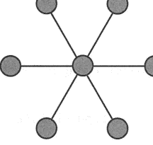

+ a. 星型型
b. 令牌环型
c. 总线型
d. 网状型
e. 这些答案都不正确

+ 68. 所示的拓扑结构是以下哪一个？

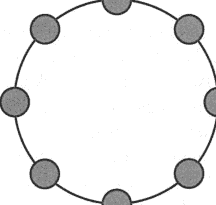

+ a. 星型型
b. 令牌环型
c. 总线型
d. 网状型
e. 这些答案都不正确

69. 所示的拓扑结构是以下哪一个？

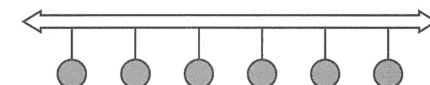

+ a. 星型型
b. 令牌环型
c. 总线型
d. 网状型
e. 这些答案都不正确

+ 70. 以太网数据包中的填充字段
a. 如果数据文件少于 46 字节，用于将总字节数增加到 46 字节
b. 如果数据文件少于 64 字节，用于将总字节数增加到 64 字节
c. CSMA/CD 不需要
d. 为传输的信息提供分组功能

+ 71. IP 地址 10.10.20.250 是以下内容的示例（选择所有适用项）
a. A 类地址
b. B 类地址
c. 私有 IP 地址
d. 可路由 IP 地址
e. 不路由的互联网 IP 地址

+ 72. 内域网（选择所有适用项）
a. 使用 E 类地址划分
b. 用于高速（千兆比特）以太网
c. 是一个提供文件和资源共享的内部网络
d. 启用快速以太网连接
e. 不从互联网访问

## 第 2 章 物理层布线：双绞线

## 章节目录

- 2-1 引言
- 2-2 结构化布线
- 2-3 非屏蔽双绞线
- 2-4 终止 CAT6/5e/5 UTP 线缆
- 2-5 电缆测试与认证
- 2-6 铜质十千比特以太网
- 2-7 布线系统的故障排除
- 总结
- 问题与练习

## 目标

- 描述结构化布线系统的六子系统
- 定义水平布线
- 定义 UTP 和 STP
- 定义 UTP 线缆类别
- 描述 T568A 和 T568B 线序颜色代码的区别
- 描述在双绞线上放置 RJ-45 插头和插座的程序
- 描述如何为计算机网络终止双绞线
- 定义规划办公室局域网缆安装的基本概念
- 描述对 CAT6 和 CAT5e 双绞线认证的程序
- 描述在铜缆上运行十千比特以太网的问题
- 描述排除电缆故障的基本步骤

## 关键术语

- 物理层
- EIA
- TIA
- 校园网
- IA/TIA 568-B
- 建筑入口
- 入口设施 (EF)
- 设备房 (ER)
- 电信配线间
- TR
- 主干布线
- 水平布线
- TCO
- 工作区域
- 主交叉连接 (MC)
- 中间交叉连接 (IC)
- 交叉连接
- 水平交叉连接 (HC)
- MDF (主配架或主设备房)
- CD (园区分配器)
- BD (建筑分配器)
- FD (楼层分配器)
- 工作站或工作区域插座 (WO)
- TO (电信插座)
- 已终止的
- 8P8
- 跳线线
- UTP
- CAT6/6a
- CAT5/e
- 平衡模式
- 快速以太网
- 网络拥塞
- 瓶颈
- 全双工
- 千兆以太网
- CAT7/a 和 CAT6a
- 10GABASE-T
- STP
- EMI (电磁干扰)
- T568A
- T568B
- 颜色映射
- TX (发送)
- RX (接收)
- 直通线
- 线序图
- 交叉线
- 链路
- 完整通道
- 衰减 (插入损耗)
- 近端串扰 (NEXT)
- 串扰
- 功率和近端串扰 (PSNEXT)
- 等级远端串扰 (ELFEXT)
- 功率和近端串扰 (PSNEXT)
- 等级远端串扰 (ELFEXT)
- ACR
- 回损
- 传播延迟
- 标称速度
- 延迟偏移
- 802.3an-20
- 对
- 异性串扰 (AXT)
- TSELF
- TCL
- TCL

## 关键术语续

## 2-1 引言

描述计算机网络布系统的第一个主要标准是 1995 年的 TIA/EIA 568-A。EIA 是电子联盟，一个为电子设备利益服务的游说组织。TIA 代表电信协会，这是一个代表电信行业利益的贸易组织。EIA/TIA 568-A 定义了校园网建筑和结构内部电信布线的最低要求。EIA/TIA 568-A 最重要的补充是 1999 年发布的修订案 5。该补充定义了 4 对类 5e（双绞线）的传输规范。TIA/EIA 在 2002 年采用了新的第 6 类 (CAT6) 线缆规范。这是当今现代网络推荐使用的布线类型，尽管 CAT7 双绞线布线看起来是被推荐的。

## 结构化布线

EIA/TIA 568-A 定义了校园网建筑和结构内部电信布线的最低要求。校园网由位于有限地理区域（如大学校园、军事基地或一组商业建筑）内的互连局域网组成。EIA/TIA 568-A 经过多次修订和更新，2000 年发布了新标准——TIA 568-B。EIA/TIA 568-B 的部分如下：

- EIA/TIA-568-B.1: 商业布线标准，主文档
- EIA/TIA-568-B.2: 双绞线介质
- EIA/TIA-568-B.3: 光纤布线标准


在 EIA/TIA 569 电信通道和指南商业标准中，定义了结构化布系统的六个子系统：

## 建筑入口 (Building Entrance)

外部布线和无线服务与建筑内部布线互连的节点

+（为了简洁省略，但遵循相同结构）

## 入口设施 (EF)

专门为复杂电气设备留出的房间

## 设备间 (ER)/主干布线

连接同一栋建筑内电信间以及建筑与建筑之间的布线

## 电信间 (Telecommunications Closet)

布线终端点所在地，包括机械端接和配线架

## TR

电信间的另一种名称

## 水平布线 (Horizontal Cabling)

从电信间延伸到局域网工作区域的布线

## TCO

电信出口

## 工作区域 (Work Area)

计算机、打印机、跳线线、插座、计算机适配器线和跳线线的所在地

## Note

一个房间可以同时作为入口设施、设备间和电信间。

- 4. **主干布线：** 连接同一栋建筑内及建筑之间的电信间、设备间和布线的布线。
- 5. **水平布线：** 从电信间延伸到局域网工作区域的布线。通常，水平布线采用星型配置，以到达每个通信出口 (TCO)。这是光纤或双绞线在房间内端接的墙板。在某些情况下，TCO 将电话、光纤以及数据连接到同一块墙板上。
- 6. **工作区域：** 计算机、跳线、插座、计算机适配器和跳线的所在地。

图 2 提供了电信系统的图解。它展示了运营商（电信运营商、ISP 等）进入设备间 (ER) 的连接。ER 是留给运营商设备的区域，连接到**主交叉连接** (MC) 或中间交叉连接 (IC)。EF 由布线、作为任何外部建筑布线、无线服务与设备间之间接口的硬件保护设备组成。该区域供公共和私人接入提供者使用（例如电信、卫星、有线电视、安等）。ER 和 EF 与 MC 设备间特别结合在一起。

## 主交叉连接 (MC)

通常连接两个或多个实体，是园区或建筑的中央电信连接点。它也被称为主配线架 (MDF) 或主连接室。MC 连接到电信运营商、ISP 等。MC 的另一个名称是园区配线 (CD)。

## 中间交叉连接 (IC)

也被称为分配器 (BD)，是建筑连接到园区主干的节点。IC 将 MC 连接到水平交叉连接 (HC)。

2-2 结构化布线

## 建筑 1

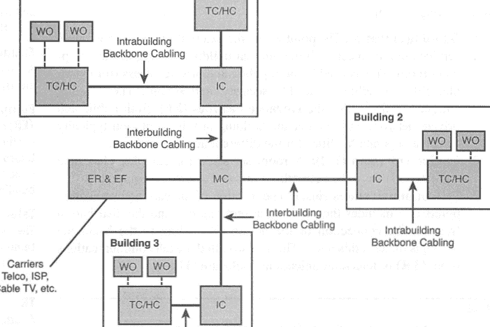

## 交叉连接 (Cross-connect)

一个你取一根或多根电缆并将其连接到根或多根电缆或设备的空间

## 水平交叉连接 (HC)

建筑分配器与到工作区域或工作站出口的水平布线之间的连接——HC 的另一个术语是楼分配器 (FD)

## 工作站或工作区域出口 (WO)

也称为 TO，用于将设备连接到植物电缆。通常使用的电缆类型为 CAT3、CAT5、CAT5e、CAT6 以及各种轴电缆。连接到这些插座的设备有 PC、打印机、服务器、电话、电视和各种接入点。

图 2-1 电信布线系统架构。

MC 和 IC 之间是园区主干布线（列为建筑间主干布线）。它定义了 MC 和 IC 之间的连接。**交叉连接**的定义是一个你取一根或多根电缆并将其连接到一根或多根电缆或设备的空间。例如，你可能拥有 60 根 UTP 电缆，其中 50 根交叉连接到往另一个位置的主干电缆。MC 和 IC 之间的典型连接是单模和多模光纤，可能还有用于有线电视的轴电，尽管大多数安装正在转向光纤。建筑间主干布线在 IC 与 TC/HC 之间建立连接。TC 是电信间，HC 是**水平交叉连接 (HC)**。这通常连接 CAT5 UTP 或更高级别的线路，可能是单模或光纤。光纤是制作这些连接的最佳选择，尽管有时会使用跳线。水平布线是 HC 和工作区域之间的电缆。它通常是 CAT6 UTP 或更高级。光纤正被接受连接到工作区域出口。

图 2 提供了从 MC 到 IC 再到 HC 的布线的详细视图。此图显示了计算机网络推荐的主干层次结构的三个层。层次结构的第一层是 MC。MC 连接到层次结构的第二层 IC。主干布线连接 MC 到 IC，以及 IC 到 TC/HC。HC 将水平布线连接到工作区域和 WO。

## 园区主干布线

## 建筑主干布线

## 水平布线

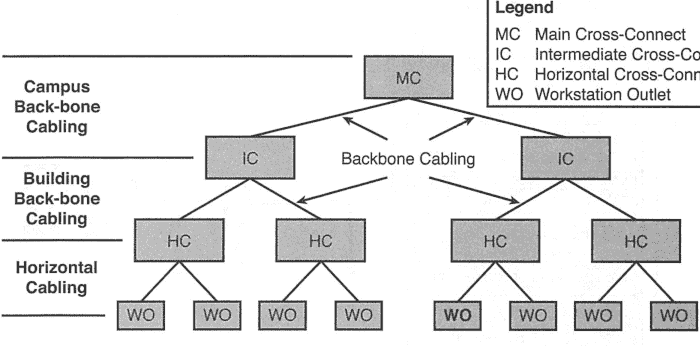

图 2-2 园区网络拓扑。

本章的重点是水平布线和工作区域（LAN）子系统。文本涵盖了所有结构化布线，但在引入网络时，需要读者对以下内容有牢掌握。

## 水平布线

建筑内的永久布线被认为是水平布线，定义为从电信间延伸到局域网工作区域的布线。花时间规划你的水平布线，因为这是网络与用户交互的地方。水平布线总是涉及巨大的成本，而更换或升级系统的成本甚至更高。应仔细规划局域网的水平布线。确保你的计划符合。

图 2-3 阐了了水平布线系统的单元。在电信间通常可以找到以下组件：

- A. 将此间与其他间互连的主干布线
- B. 交换机或集线器
- C. 配线架
- D. 跳线
- E. 到局域网的布线（水平布线）
- F. 墙板
- G. 连接计算机到墙板的跳线

第 2-2  结构化布线

## 电信间局域网（工作区域）

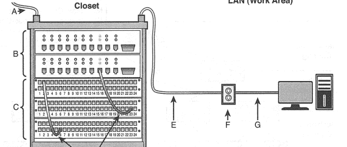

**图 2-3** 水平布线系统框图

图 2-3 中的项目 E 显示了离开电信间的布线。电缆延伸到局域网或工作区域的墙板 (F) 处端接。“端接”一词描述了电缆连接到墙板插座、配线架或 RJ-45 模块插头的地方。在这种情况下，电缆端接在墙板的 RJ-45 插座中。图 2-4 提供了 RJ-45 墙板和配线架示例。

## Note

计算机系统中 RJ-45 模块插头的正确术语实际上对于公、母连接器都是 8P8C。8P8C 代表 8 芯 8 导体，由 ANSI/TIA-968-A 和 B 定义，但专业人士和终端用户通常将其称为 RJ-45。

使用单根电缆将插座中的每个连接器连接到电信间的配线架（F 到 E）。RJ-45 (8P8C) 插头和插座在第 2-4 节中定义。


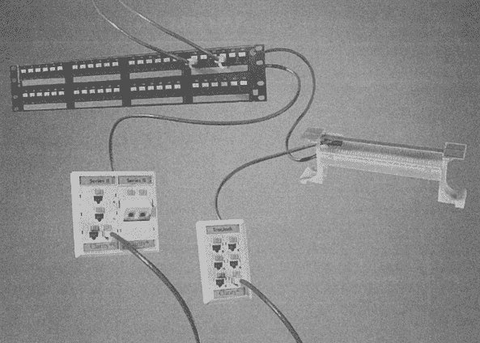

图 2-4 Ortronics 清晰双绞线系统（由 Ortronics 提供）。

在星型拓扑结构中，墙板上的每个插座都有一条独立的电缆线路。这意味着你为每个终止的插座分配一台计算机。跳线线（项目 G）用于建立计算机到墙板的物理连接，如图 2-3 所示。跳线线是用于在网络设备之间建立物理连接的短电缆。从电信间到工作区域的网络设备，电缆线路的总长度限制为 100 米。这包括两端跳线线（D 和 G）的长度加上电缆线路（项目 E）的长度。一个通用的规则是为电信间到工作区域之间留出 90 米的距离（项目 E）。这为工作区域留出了 5 米电缆长度，并为电信间（项目 D）和工作区域（项目 G）留出了 5 米的跳线线长度。图 2-5 显示了电信间的内部示例。

第 2-2 节 结构化布线

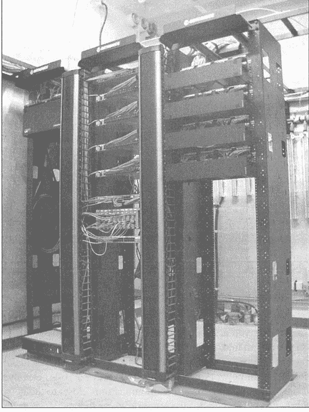

图 2-5 电信间内部。

## 2-2 节复习

本节涵盖了以下 Network+ 考试目标：

- 2.6 给定一组需求，计划并实施 SOHO 网络。在本节中，你介绍了布线系统架构。你检查了结构化布线系统的六个子系统以及水平布线系统的基本单元。

- 3.1 对标准介质类型及相关属性进行分类
介绍了定义结构化布线的标准 —— EIA/TIA 568 标准。这是一个定义计算机网络布线的重要标准。

- 3.2 根据网络介质对标准连接器类型进行分类
介绍了与水平布线系统相关的计算机布线终止。

## 检验你的知识

- 1. 从电信间到工作区域网络设备的 UTP 电缆线路总长度限制是多少？
  a. 10 米
  b. 100 米
  c. 10k 米
  d. 100 k 米

- 2. 结构化布线系统的六个子系统是：
  建筑入口处
  设备室
  骨干布线
  电信间
  垂直-垂直布线
  工作区域

- 3. 水平布线由以下哪些基本单元组成？选择两个）
  a. Switch机或集线器
  b. 路由器
  c. 骨干布线
  d. 配线架

## 2-3 非屏蔽双绞线

非屏蔽双绞线（UTP）在当今计算机网络中起着重要作用。如今用于计算机网络最常用的双绞线标准是 6 类（CAT6）、6a 类（CAT6a）和 5e 类（CAT5e）。CAT6 电缆经过测试，在最大 100 米长度内可提供高达 1000Mbps 的传输速率。CAT6a 是 CAT6 的改进版本，将支持 10GB 以太网。

CAT5e 是 CAT5 的增强版本，提供了改进的电缆性能要求。CAT6 提供了更高的性能和 250MHz 的带宽。CAT5e 双绞线包含四对颜色标记的 24 线线，并用 RJ-45 (8P8C) 连接器终止。图 2-6 提供了一个 RJ-45 (8P8C) 模块插头终止 CAT5e 的示例。CAT6 双绞线也包含四对颜色标记线，但线径为 23AWG。与 CAT5e 相比，CAT6 电缆的感觉更硬。

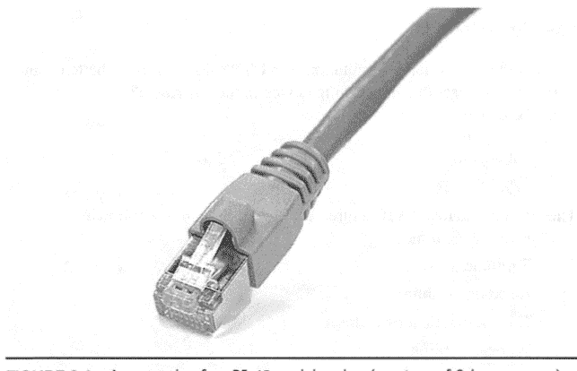

图 2-6 RJ-45 模块插头的示例（由 Cyberguys.com 提供）。

在终止处保持 CAT6/5e/5 电缆绞距的精确方式，显著提升了信号传输性能。CAT5/5 标准允许在终止处有 0.5 英的未扭绞电对。CAT6 有更严格的要求，在终止处仅允许 3/8 英的未扭绞电缆。终止是电缆连接到模块插头、插座或配线架中接线器的点。

CAT6/5e 双绞线包含四对扭绞线，总共八根线。在双绞线中，对中的任何线都不连接到地。电线上的信号被设置为高（+）信号线和低（-）信号线。表 2-2 列出了 EIA/TIA 568B 标准定义的各种类别双绞线。表格包含了每个类别的应用描述和最小带宽。注意，没有 CAT1 和 CAT2 的列表。

## 平衡模式

线对中均未连接接地

## 表 2-2 双绞线的不同分类。基于 TIA568B

| 类别 | 描述 | 带宽/数据速率 |
| :--- | :--- | :--- |
| 3 类 (CAT3) | 电话安装 | 10Mbps |
| 5 类 (CAT5) | 计算机网络 | 100MHz |
| 增强型 CAT5 (CAT5e) | 计算机网络 | 1000Mbps |
| 6 类 (CAT6) | 计算机网络 | 250MHz |
| 6a 类 (CAT6a) | 计算机网络 | 500MHz |
| 7 类 (CAT7) | 国际标准组织 (ISO) | 600MHz |
| 7a 类 (CAT7a) | 国际标准组织 (ISO) | 1Gbps |

第 2 章 物理层：双绞线

TIA/IEC 在 1999 年对 CAT5 布线进行了评估，以应对计算机网络更大数据处理的需求。增强型 CAT5 (CAT5e) 提供了性能提升，如果电缆的所有组件都按照规范安装，则 CAT5 将通过四线支持全双工千兆（1000Mbps）。全双工线允许计算机系统同时传输和接收。TIA/EIA 在 2002 年 6 月制定了 CAT6 标准。这种电缆提供了更好的性能和 250MHz 的带宽，并与 CAT5/5e 保持后兼容。CAT6 在小于 100 米的距离内支持 10Gbps 速率。CAT6 标准在 100 米内支持 1GBGB 数据速率，CAT7 也支持具有改进带宽的 10GBps。铜上的 10GBGB 标准被称为 10BASE-T。

快速以太网
以 100Mbps 运行的太网系统

在某些情况下，由于文件增大和网络带宽限制，网络用户会遇到拥堵或瓶颈。这些描述了减慢计算机通信的额外数据流量。基本上，网络的需求增强了 CAT5 的能力。5 标准建立于 1991 年，许多计算机网络仍在使用 CAT5。TIA568B 中未列出 CAT1 和 CAT2。


# STP
屏蔽双对线

# 屏蔽双对电缆

在某些应用中，在双对电缆外包裹了一层金属网状屏蔽或金属箔屏蔽。带有屏蔽层的电缆称为 STP 电缆。只要屏蔽层接地，增加这种屏蔽就可以减少电磁干扰（EMI）的发生概率。EMI 源于电机、电源线等设备，以及荧光灯等某些照明设备。

# EMI
电磁干扰

双对电缆并不能消除所有潜在的干扰噪声（EMI），但它极极地减少了噪声干扰。在网络社区中，无论是 UTP 还是 STP 产品，都是一种活跃的设备。需要注意的是，两者的目标都是将数据从电信间间成功传输到工作区域。对 STP 电缆的行业测试表明，增加屏蔽确实可以通过增加每对线之间的噪声抑制能力，从而提高电缆的可用带宽。然而，测试显示，与安装良好的 4 对 100欧姆 UTP 电缆相比，放置屏蔽并没有显著优势。此外，STP 的价格更贵，增加的成本可能无法证明其带来的收益。目前，大多数制造商建议在极高噪声环境外，网络布线均使用 UTP 电缆。

# 2-3 节复习

本节涵盖了以下 Network+ 示例：

- 1. 标准介质类型及相关属性的分类：本节介绍了 UTP 的基本概念。请确保你了解不同的类别（Category）。你还应该理解，线对扭绞的精确方式能够显著提高信号传输性能。
- 2. 根据网络介质对标准连接器进行分类：介绍了大多数计算机网络中使用的 RJ-45 模块插头。RJ-45 插头也称为 8P8C。

## 检验你的知识

- 1. 以太网的数据速率是多少？
   a. 10Mbps
   b. 100Mbps
   c. 1000Mbps
   d. 10kbps
   e. 以上答案都不正确
- 2. 目前 LAN 工作区域推荐使用哪种电缆？
   a. 屏蔽双对线
   b. CAT6 屏蔽双对线
   c. CAT 5e UTP
   d. CAT6 UTP
   e. CAT7 UTP

第 2 章 • 物理层布线：双对线

- 3. 屏蔽双对电缆的好处是什么？
a. 易安装
b. 极佳的 EMI 保护
c. 价格更便宜
d. 行业所有安装方案的首选方案
e. 以上答案都不正确

# 2-4 终止 CAT6/5E/5 UTP 电缆

本节介绍了终止高性能 UTP 电缆的技巧。对于 Cat6/5/5 电缆，RJ-45 (8P8C) 连接器的终止由 EIA/TIA 标准 EIA/TIA568B-B2 和 B2-1 定义。该标准的这部分定义了颜色编码硬件的规范。该标准规定了验证平衡双对线布线所需的布线组件、传输、系统模型和测量程序。

在 EIA/TIA 标准中，有 T568A 和 T568B 布接线指南。这些接线指南规定了何种颜色的线连接到连接器上的哪个引脚。规定线颜色与引脚对应关系的规范称为颜色映射（Color Map）。表 2-3 提供了 T568A 和 T568B 接线指南指定的颜色映射。

T568A
EIA/TIA568B 标准下指定的线颜色指南

T568B
EIA/TIA568B 标准下指定的线颜色指南

颜色映射
规定何种颜色的线连接到连接器上哪个引脚的规范

# 表 2-3 T568A 和 T568B 的接线颜色方案

| 引脚 | 568A 线颜色 | 568B 线颜色 |
|---|---|---|
| 1 | 白绿 | 白橙色 |
| 2 | 绿色 | 橙色 |
| 3 | 白橙色 | 白绿 |
| 4 | 蓝色 | 蓝色 |
| 5 | 白蓝 | 白蓝 |
| 6 | 橙色 | 绿色 |
| 7 | 白棕色 | 白棕色 |
| 8 | 棕色 | 棕色 |

图 2-7(a) 显示 T568A 标准 RJ-45 (8P8C) 插头中的双对线布局；图 2-7(b) 显示 T568B 标准 RJ-45 (8P8C) 模块插头中的双对线布局。RJ-45 (8P8C) 模块插头的引脚编号位于图顶部，并提供了线颜色表。在 T568A 颜色方案（图 2-7[a]）中，白绿线连接到引脚 1，绿线连接到引脚 2，连接到引脚 3 的线是白橙色，以此此类推。图 2-7(b) 为 T568B 接线标准提供了类似的信息。常见的问题是：“T568A 和 T568B 的区别是什么？”基本上，它们只是用于接线连接器的两种不同标准。只要在网络中保持顺序，倾向于 T568A 的接线顺序并没有性能提升。这部分材料定义了将 RJ-45 (88C) 插头和插座终止 CAT6/5e 双对电缆的线颜色顺序。请确保你知道网络中使用的是 T568A 还是 T568B 线颜色配置，并确保指定的硬件与所选颜色方案兼容。

# 连接头
底部向上


| T568A 颜色 |
|---|---|
| 1 | 白绿 |
| 2 | 绿色 |
| 3 | 白橙色 |
| 4 | 蓝色 |
| 5 | 白蓝 |
| 6 | 橙色 |
| 7 | 白棕色 |
| 8 | 棕色 |

(a)

# 连接头
底部向上


| T568B 颜色 |
|---|---|
| 1 | 白橙色 |
| 2 | 橙色 |
| 3 | 白绿 |
| 4 | 蓝色 |
| 5 | 白蓝 |
| 6 | 绿色 |
| 7 | 白棕色 |
| 8 | 棕色 |

(b)

图 2-7 (a) T568A 标准 RJ-45 (88C) 连接器的接线和颜色代码；(b) T568B 标准 RJ-45 连接器（由 StarTech.com 提供）。

# 计算机通信

如 2-2 节所述，CAT6/5e 电缆包含四对双绞线。图 2-8 提供了四对线的图片。图 2-9 显示了 CAT5 RJ-45 (88C) 插头的信号和引脚编号分配。注意图 2-9，输出（Transmit Out）信号标记为 (+) 和 (-)。输入（Receive In）(+) 和 (-) 也以相同的方式标记。(+) 和 (-) 符号是指示线对正极和负极的典型方法。回想 2-3 节，在平衡工作模式下，没有任何信号线接地。


图 2-8 CAT6/5e 的四对线。

| 引脚号 | 功能 |
| --- | --- |
| 1 | 输出 + |
| 2 | 输出 - |
| 3 | 输入 + |
| 4 | 空闲 |
| 5 | 空闲 |
| 6 | 输入 - |
| 7 | 空闲 |
| 8 | 空闲 |

图 2-9 RJ-45 (8P8C) 模块插头（CAT5）的引脚分配和信号名称。

为了计算机在 LAN 中通信，发送对和接收对必须正确对齐。这意味着 (TX) (+) 和 (-) 信号必须连接到接收 (RX) (+) 和 (-)，如图 2-10 所示。注意图 2-10，设备 A 的引脚 1–2 连接到设备 B 的引脚 3–6。设备 B 的引脚 1–2 连接到设备 A 的 3–6 脚。当数据速率为 10Mbps 或 100Mbps 时，这种配置始终有效。

TX
发送缩写

RX
接收缩写

| 设备 A | 设备 B |
| --- | --- |
| 1. TX (+) | TX (+) 1. |
| 2. TX (-) | TX (-) 2. |
| 3. RX (+) | RX (+) 3. |
| 6. RX (-) | RX (-) 6. |

图 2-10 在 10Mbps 或 100Mbps 运行的 CAT6/5e 数据链路中发送对和接收对的正确对齐。


在局域网（LAN）中，发送和接收对的正确对齐由交换机或集线器管理，而不是在电缆内部。在星型拓扑中，所有网络通信都通过交换机或集线器传输。你会在许多交换机和集线器的输入端口看到“X”或“Uplink”（上行），这表示这是一个交叉连接输入。这意味着发送和接收对在内部进行了对换，以保持 TX 和 RX 对的正确对齐。如果没有“X”或“Uplink”，交换机或集线器会正确对齐 TX 和 RX 对。许多交换机和集线器也没有例外。某些交换机和集线器的输入端口可以在将交换机或集线器连接到另一个设备时，在上行应用中选择“直通”或“交叉”。如果设备具有交叉端口，则使用直通电缆，因为设备本身提供了对齐功能。请记住，计算机之间的通信必须保持发送和接收对的正确对齐。如果电线连接不当，将无法建立链路。

非屏蔽绞线线（UTP）在 1Gbps 和 10Gbps 速率下运行时，信号名称存在差异。在这些较高的速率下，需要使用所有四对线，且数据是双向的，即相同的线对同时用于传输和接收数据。图 2-11 显示了引脚分配和信号名称。

| | 1000 Mbps 和 10 Gbps 颜色 (T568A) | 10/100 Mbps 信号 | 1000 Mbps 和 10 Gbps | 1000 Mbps 和 10 Gbps 颜色 (T568B) | 10/100 10 Gbps | 1000 Mbps 信号 |
|---|---|---|---|---|---|---|
| 1 | | | TX+ | | BI,DA+ | BI,DA+ |
| 2 | 绿/白 | | TX- | | BI,DA- | 橙/白 |
| 3 | 绿色 | | RX+ | | | 橙色 | BI,DB+ |
| 4 | 橙/白 | | | BI,,+ | | 蓝色 | BI,DC+ |
| 5 | 蓝色 | | | BI,DC- | 蓝/白 | | |
| 6 | 蓝/白 | | RX- | | BI,DB- | 绿色 | BI,DB- |
| 7 | 橙色 | | | BI,DD+ | | 棕/白 | BI,DD+ |
| 8 | 棕/白 | | | BI,DD- | | 棕色 | BI,DD- |
| | 棕色 | | | | | |

(a) 1 Gbps 和 10 Gbps 的引脚分配和信号名称 (T568A)。b) 1 Gbps 和 10 Gbps 的引脚分配和信号名称 (T568B)。

**图 2-11** 1Gbps 和 10Gbps 的引脚分配和信号名称 (T568A 和 T568B)。

## 直通与交叉跳线

Category 6/5e 绞线电缆用于连接网络中的各个组件。这些电缆通常被称为跳线。在本节中，介绍了使用 RJ-45 (8P8C) 模块化插头终止 CAT6/5e 电缆的技术，适用于两种不同的跳线配置：直通电缆和交叉电缆。在直通电缆中，四对线连接到两端相同的引脚号。例如，一端的 p1 连接到另一端的 p1。图 2-12 显示了直通电缆的线序图（wire-map）示例。线序图是对被测设备从引脚到电缆连接情况的图形或文本描述。注意，在图 2-12 中，发送和接收对连接到电缆两端相同的连接器引脚号，因此被称为直通电缆。

### 直通电缆

电缆中的电线连接到两端相同的引脚号。

### 线序图

从引脚到引脚电线连接的图形或文本描述

| A | B |
|---|---|
| 1 | 1 |
| 2 | 2 |
| 3 | 3 |
| 4 | 4 |
| 5 | 5 |
| 6 | 6 |
| 7 | 7 |
| 8 | 8 |

图 2-12 直通电缆的线序图。

在 10/100Mbps 数据链路的某些应用中，需要构造一种发送和接收对在电缆中反转而非交换机或集线器的电缆。这种配置被称为交叉电缆，这意味着设备 A 的发送对连接到设备 B 的接收对，设备 B 的发送对连接到设备 A 的接收对。图 2-13 显示了交叉电缆的线序图。

### 交叉电缆

发送和接收对交叉

| A | B |
|---|---|
| 1 | 8 |
| 2 | 7 |
| 3 | 6 |
| 4 | 5 |
| 5 | 4 |
| 6 | 3 |
| 7 | 2 |
| 8 | 1 |

图 2-13 10/100Mbps 链路交叉电缆的线序图。

## 注意

图 2-13 所示的交叉电缆用于 10/100Mbps。千兆电缆要求所有四对线都必须工作。

### 6 类/5e 水平电缆终止

本节介绍了使用 RJ-45 (8P8C) 模块化插头终止 CAT6 水平电缆的步骤。首先，剥去电缆外部约 2 英寸（约 5 厘米）的外皮，小心不要损坏内部的绞线。然后，使用剥线刀将每根线芯剥去约 0.5 英寸（约 1.3 厘米）的绝缘层，露出铜芯。接着，根据选定的标准（如 T568A 或 T568B）排列线芯，并将线芯插入 RJ-45 插头中，确保线芯完全到达插头前端。最后，使用压线工具将插头压紧。完成后，应使用测试仪检查连接情况。


7. 如图 2-19(a) 所示，将 RJ-45 (8P8C) 插座与束线具对齐。RJ-45 插座必须与束线具上的电线正确对齐，以保持正确的颜色顺序。图 2-19(b) 是 AMP SL 系列 AMP-TWIST-6S 模块化插座的特写。这张图显示了模块化插座到位移连接器的位置。

8. 如图 2-20(a) 所示，将 RJ-45 (8P8C) 模块化插座插入 AMP SL 工具中，然后如图 2-20(b) 所示将 RJ-45 (8P8C) 插座插入 AMP SL 工具中。如图 2-20(c) 所示，使用 AMP SL 工具将电线压入 RJ-45 (8P8C) 插座上的八个位移连接器中。这种技术使线对保持一直保持到终端点。事实上，未绞对的长度小于或等于 1/4 英寸。

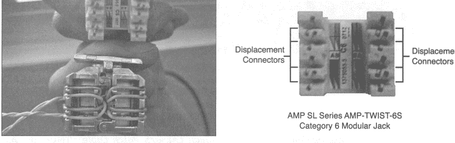

图 2-19 (a) 对齐 RJ-45 (8P8C) 插座与束线具以及 (b) AMP-TWIST-6S CAT6 模块化插座的特写。

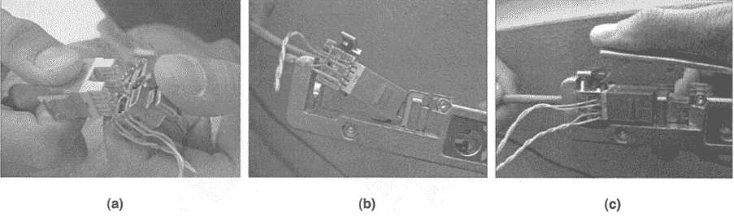

图 2-20 (a) 将 RJ-45 (8P8C) 插座与束线工具对齐；(b) 将 RJ-45 (8P8C) 插座和束线工具插入 AMP SL 工具中；(c) 使用 AMP SL 工具将 RJ-45 (8P8C) 插座压接到在八个位移连接器上并切断电线。

9. 如图 2-21(a) 所示，将弯折应力护套连接到 RJ-45 (8P8C) 插座上。图 2-21(b) 显示了完成后的终端。

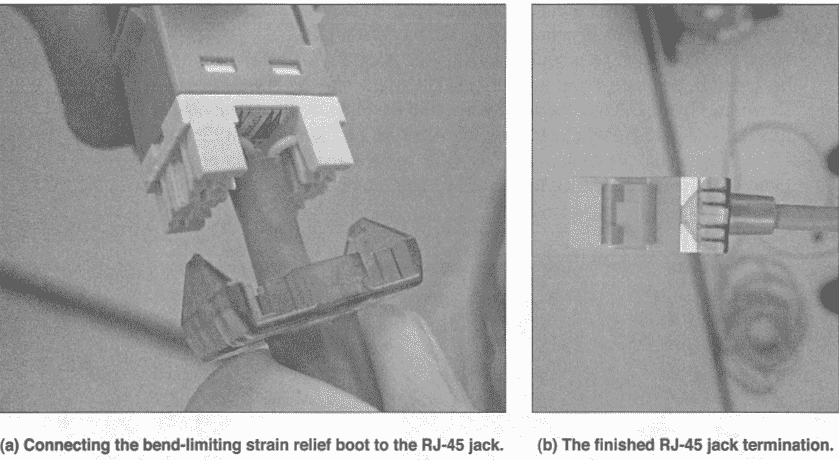

图 2-21 将弯折应力护套连接到 RJ-45 (8P8C) 插座。

### 组装直通 CAT5e/5 跳线

本节介绍组装直通 CAT5e/5 跳线的技巧。在直通跳线中，电缆中的线对连接到 CAT5e/5 跳线两端的相同引引脚上。图 2-22 显示了带有 RJ-45 (8P8C) 模块化插头的 CAT5e 跳线。

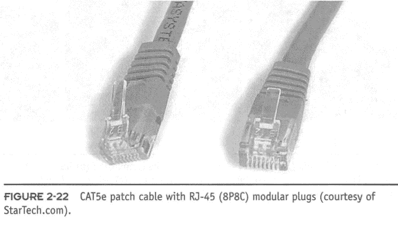

第 2 章 • 物理层布线：双绞线

制作直通跳线的步骤如下：

- 1. 在终端电缆之前，检查电缆在安装过程中可能发生的任何损坏，如缺口或切断的电线以及电缆可能的拉伸。

- 2. 测量长度，多出约 6 英寸，然后切割电线。多留一点是好的，以防安装时出错需要重新进行终端。你不能接驳 CAT5/5 双绞线！

- 3. 使用剥线器从电缆末端剥去约 3/4 英寸的电缆外护。图 2-23 阐释了如何使用剥线器。注意，通过绕电线旋转剥线器来去除绝缘层，直到外护松动并易于移除。（注意：这些工具必须定期调整，使刀片仅切过外绝缘层；如果刀片太深，将切伤电线，必须重复该过程。必须切掉电缆受损的部分。不允许损坏双绞电线的绝缘层！）

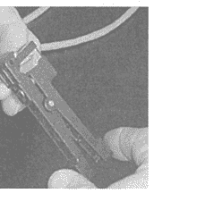

图 2-23 使用电缆外护剥离器去除绝缘层的示例。

- 4. 分类线对，使其适合连接器，并按照图 2-24(a) 和 2-24(b) 所示，按照 T568A 或 T568B 的正确顺序排列电线。

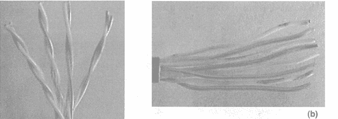

(a) (b)

图 2-24 (a) 分离线对；(b) 排列电线。

- 5. 修剪电线使其平齐，并如图 2-25 所示将电线插入 RJ-45 (8P8C) 模块化插头中。

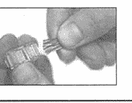

- 6. 将电线推入连接器，直到通过连接器的透明端看到每根电线的末端。（注意：现在是验证线序顺序正确的时候了。）电线如图 2-26 所示通过塑料连接器可见。

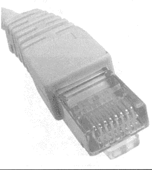

- 7. 使用压线工具将电线压接到 RJ-45 (8P8C) 插头上。将 RJ-45 插入压线工具直到停止，如图 2-27(a)。接着挤压压线工具柄直到点击并释放（见图 2-27(b)）。此步骤将电线压接到 RJ-45 (8P8C) 插座的位移引脚上。

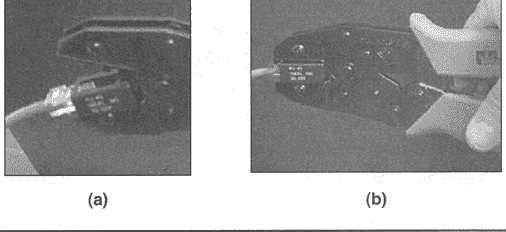

- 8. 在另一端重复这些步骤。下一步是测试电缆。这些技术和程序在第 2-5 节中讨论。

## 2-4 节复习

本节涵盖了以下网络目标：

- 3.1 分类标准媒介类型及其属性：本节介绍了 T568A 和 T568B 布线方案。了解线色和相关的引脚分配非常重要。

- 3.2 根据网络媒介分类标准连接器类型：介绍了 UTP 电缆的引脚分配和信号名称。发送和接收对的正确对齐如图 2-10 所示。这是一个重要概念。

- 4-2 给定场景使用适当硬件排除故障：介绍了 CAT5 和 CAT6 UTP 电缆的终端步骤。确保理解终端电缆和插座所需的各种工具用途。

## 测试你的知识

1. 以下是 T568A 的颜色映射和引脚号：

| 引脚号 | 线色 |
| :--- | :--- |
| 1 | 绿色 |
| 2 | 蓝色 |
| 3 | 橙色 |
| 4 | 绿色 |
| 5 | 蓝色 |
| 6 | 橙色 |
| 7 | 棕色 |
| 8 | 棕色 |

错误

2. 以下是 T568B 的颜色映射和引脚号：

| 引脚号 | 线色 |
| :--- | :--- |
| 1 | 橙色 |
| 2 | 蓝色 |
| 3 | 绿色 |
| 4 | 蓝色 |
| 5 | 蓝色 |
| 6 | 绿色 |
| 7 | 棕色 |
| 8 | 棕色 |

错误

3. CAT5e/6 双绞线中有几根线？
  a. 12 根
  b. 8 根
  c. 4 根
  d. 6 根

## 2-5 电缆测试与认证

**链路 (Link)**：从一个终端到另一个终端

**全通道 (Full Channel)**：从墙座到交换机的所有链路元件

对数据速率的需求迫使双绞线技术提供更高的性能要求，并对电缆基础设施提出了更高的要求。双绞铜电缆的数据传输现在已达到 10Gbps。EIA/TIA 568B 标准定义了在 100MHz 带宽和高达 10Gbps 数据速率下运行的双绞线类别最低规格。

**衰减 (Insertion Loss)**：信号强度沿导线或光纤芯传输时的损失量。

CAT6/5e 的命名仅仅是电缆以及 RJ-45 (8P8) 插头、插座和配线架等连接硬件的最低性能测量。链路（从一个终端到另一个）和全通道（包括从交换机到墙座的所有链路元件）必须满足 100MHz 最小频率下的最小衰减损失和近端串扰 (NEXT)。图 2-28 显示了链路和全通道的图形表示。表 2-4 列出了 CAT5e、CAT6、CAT6A、CAT7 的 EIA/TIA 568B 通道规格。

**近端串扰 (NEXT)**：电缆内部信号耦合水平的测量，高 NEXT (dB) 值越理想。


## 全通道 (Full Channel)

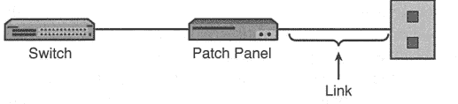

图 2-28 电缆测试的链路和通道区域。

## 表 2-4 EIA/TIA 568B 通道规格

| 参数 | Category 5e | Category 6 | Category 6A | Category 7 |
| :--- | :--- | :--- | :--- | :--- |
| 类别 (Class) | D | E | E | F |
| 带宽 | 100MHz | 250MHz | 500MHz | 600MHz |
| 插入损 (dB) | 24.0 | 21.3 | 20.9 | 20.8 |
| NEXT (dB) | 30.1 | 39.9 | 39.9 | 62.0 |
| PSNEXT (dB) | 27.1 | 37.1 | 37.1 | 59.9 |
| ACR (dB) | 6.1 | 18.6 | 18.6 | 42.1 |
| PSACR (dB) | 3.5 | 15.8 | 15.8 | 39.1 |
| ACRF (dB) | 17.4 | 23.3 | 23.3 | 44.4 |
| PSACRF (dB) | 14.4 | 20.3 | 20.3 | 41.1 |
| 回波损 (dB) | 10.0 | 12.0 | 12.0 | 12.0 |
| PAREXT 损失 | n/s | 60.0 | 60.0 | 67.0 |
| PSAACR (dB) | n/s | 37.0 | 37.0 | 52.0 |
| TCL (dB) | n/s | 20.3 | 20.3 | 20.3 |
| ELCTCL (dB) | n/s | 0.5 | 0.5 | 0 |
| 传播延迟 (ns) | 548 | 548 | 548 | 548 |
| 延迟偏斜 (ns) | 50 | 50 | 50 | 30 |


## 串扰 (Crosstalk)
电缆中的信号耦合

- **NEXT**: 当电流在导线中传输时，会产生电磁场。该场会在相邻导线中感应出电压，导致串扰。串扰就是你在使用电话时偶尔能清晰地听到另一段对话的内容。近端串扰，或 NEXT，是衡量电缆内部串扰水平或信号耦合程度的指标。这种测量被称为近端测试，是因为接收器更容易接收到来自末端传输对到接收对的串扰。电缆末端的传输信号电平很强，电缆在该这一点更容易受到串扰的影响。此外，由于正常的路径损耗，接收信号电平已经显著衰减，且弱于传输信号。NEXT (dB) 值越高越好。

图 2-29 形象地展示了 NEXT。深灰色区域为发生近端串扰的地方。裕量（Margin）是测量值与限制值之间的差。负数意味着测量值小于限制值，因此测试失败。在较高的数据传输速率下（例如 1Gbps, 10Gbps），串扰更为严重。图 2-30 显示了 CAT6 电缆如何通过内置分离器来帮助减少线对之间的串扰。该分离器用于保持每对线与其他线对之间的最小距离。这种设计减少了高频下的串扰，并有助于提供改进的信号带宽，从而支持更快的数据传输速率。这种设计还有助于改善远端串扰。注意，并非所有电缆制造商都使用分离器。

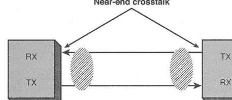

图 2-29 近端串扰的图形描述。

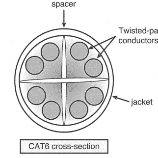

图 2-30 CAT6 电缆的截面，显示了用于减少串扰问题的分离器。

第 2 章 • 物理层布线：双绞线

- 功率和串扰 (PSNEXT)：增强型双绞电缆必须满足四对 NEXT 要求，即 PSNEXT 测试。基本上，功率和测试测量所有电缆线对的总串扰。这项测试确保电缆能够以最小的干扰在所有线对上同时传输数据流量。PSNEXT 值越高越好，因为它代表了更好的性能。

- 等效远端串扰 (ELFEXT)：此测量与 NEXT 不同，它测量的是电缆的远端。此外，ELFEXT 测量不依赖于电缆长度。这是因为 ELFEXT 是通过从远端串扰（ELFEXT）损失中减去衰减值得到的。较高的 ELFEXT 值 (dB) 表示电缆远端的信号大于在远端测到的串扰。较大的 ELFEXT (dB) 值越好。较差的 ELFEXT 可能会导致数据丢失。

- PSELFEXT：功率和自串扰，使用四对线获得组合的 ELFEXT 性能测量。这是测试信号电平与电缆远端测到的串扰之间的差值。较高的 PSELFEXT 值表示电缆性能越好。

- 信噪比 (ACR)：此测量比较了远端传输器的信号电平与近端的串扰。较大的 ACR 表示电缆具有更大的数据容量，也表明电缆处理更大带宽的能力。本质上，它是电缆质量的综合测量。较高的 ACR 值 (dB) 越好。

- 功率和 ACR (PSACR)：功率和 ACR 使用所有四对线获得衰减与串扰的比率。这是 PSNEXT 和衰减（插入损耗）之差。差值以 dB 为单位，较高的 PSACR 值表示电缆性能越好。

- 回损 (Return loss)：等双绞电缆测量回损。此测量提供了传输进电缆的功率与返回或反射功率之间的比例。信号反射由于电缆链路中的阻抗变化引起，阻抗变化导致了电缆损耗。电缆不是完美的，因此会有某些反射。阻抗变化的示例包括电缆整体的不均匀性、铜芯直径、电缆处理以及介质差异。低回损值 (dB) 越好。

- 传播延迟 (Propagation delay)：这是信号从电缆一端传播到另一端所需的时间。信号延迟受电缆传播速度 (NVP) 的影响。NVP 是光速的百分比，取决于测试电缆的类型。CAT5/6 UTP 电缆的典型延迟值为每米约 5.7 nsec。

- 延迟斜 (Delay skew)：这是测量线对中最快和最慢信号之间到达的时间差。在高速数据传输中，线对上的数据同时同时到达另一端至关重要。如果不同线对的线长差异很大，那么一根导线上的数据沿导线传输的时间更长，从而导致到达接收器的时间不同，并可能导致数据失真和数据包丢失。长度最短的线对通常会有延迟斜。


## 注意

功率和测量对于 UTP 上的高速数据通信至关重要。事实证明，双绞线可以处理 UTP 上的高速数据通信。


DSP = 数字信号处理

**图 2-31** 来自相邻 4 对电缆的异性串扰。

## F/UTP
双绞线外箔层电缆

## TCL
水平转换损耗

## ELTCL
等电平水平转换传输损耗

## LCL
纵向转换损耗

## TCTL
水平转换损耗传输损耗

## PSANEXT
功率和异性近端串扰

## PSAACRF
功率和异性衰减串扰比远端

电缆制造商开始提供在四对线中的每对线都带有箔层的 CAT6 及更高等级的双绞电缆。这种电缆被称为 F/UTP。设计屏蔽电缆具有几个优势：

- 屏蔽电缆提供了更好的安全性，因为数据泄射到电缆外的概率较低。
- 箔层有助于提高对电磁干扰（EMI）、无线电频率干扰（RFI）以及最重要的异性串扰（AXT）的免疫能力。

双绞电缆的传输涉及电线上的“平衡”信号。信号在线对上的平衡或对称性可以最大限度地减少信号的意外泄漏。针对 CAT6 和更好的电缆，有两个参数用于解决平衡数据问题。第一个是 TCL（水平转换损耗），另一个是 ELTCL（等电平水平转换传输损耗）。TCL 的测量是通过在输入端施加共模信号并测量输出端的差分信号得的。TCL 有时被称为 LCL（纵向转换损耗）。ELTCL 值（以 dB 为单位）是 TCTL（水平转换损耗）与测得线对差分插入损耗之间的差。TCL 是从近端的平衡信号到远端不平衡信号的。

后续需要额外的功率和测试。这些是 PSANEXT（功率和异性近端串扰）和 PSAACRF（功率和异性衰减串扰比远端）。千兆和十兆网络都需要使用所有四对线芯。

# 信号传输

10GBASE-T 系统需要如图 2-32 所示使用所有四对线芯。该系统将 10Gbps 的数据分为四个 2.5Gbps 数据通道。这种技术也用于 1000Mbps (1GB) 数据速率，只是 1000Mbps 被分成了 250Mbps。该系统在传输和接收过程中都需要信号调节器和数字处理（DSP）电路。十兆数据传输使用如图 2-33 所示的多级编码技术。这种编码方式的优点是减少了传输数据所需的带宽。

减少传输数据所需带宽的多级编码技术

图 2-32 用于传输 10GBASE-T 数据的 UTP 电缆中的四对线芯。这种技术也用于 1000Mbps，但每个通道的数据速率为 250Mbps。

图 2-33 数据流多级编码示例，用于减少传输所需的带宽。

10GBASE-T 数据传输还需要使用 DSP 补偿技术。DSP 电路提供了许多功能，例如信号调节和回波消除。每当信号沿电缆传输时，部分信号会被反射。这种反射会加剧整体衰减并限制系统性能。在 10GBASE-T 中，发送信号和接收信号共享同一对线。这使得全双工传输成为，并需要使用一种名为混合回波消除电路的设备。混合电路从接收信号中消除发送信号。

混合回波消除电路从接收信号中消除发送信号。

10GBASE-T 信号传输的最后一个问题是电缆性能。如前所述，返回损耗、插入损耗和串扰都是 10GBASE-T 的限制因素。观察到的串扰类型有 NEXT、NEXT、FEXT 和 ELFEEXT。支持高达 100 米链路10GBASE-T 运行的布线系统带有带屏蔽的 CAT6、增强 CAT6 (CAT6a)、CAT7 和 CAT7a。

# 2-6 节回顾

本节涵盖了以下 Network+ 考试目标。

3.1 标准媒介类型及其属性分类
本节介绍了在 UTP 电缆上运行 10Gbps 数据的问题。与双绞线 10Gbps 相关最重要的概念之一可能是异性串扰（Alien Crosstalk），即一个永久链路到另一个链路之间的意外信号耦合。

## 测试知识

- 从一个永久链路到另一个链路的意外信号耦合的术语
  a. 近端串扰
  b. 异性串扰
  c. 远端串扰
  d. 以上答案均不对

- 10GBASE-T 在 UTP 上传输数据时需要使用哪项？
  a. 高数据线
  b. 引脚 4/5
  c. 所有四对线
  d. 10G 不可能

# 2-7 布线系统的故障排除

本节检查了网络管理员在 CAT6 和 CAT5e 电缆上可能遇到的某些问题。网络管理员监控从布线到端接的电缆所有部分是至关重要的。电缆测试未能通过认证测试的原因可能有多种类型的问题，例如安装问题、电缆拉伸以及电缆未达到规格。接下来将讨论这些类型的问题，然后查看 CAT6 和 CAT5e 的认证报告。

# 安装

如果你获得了 PowerSum 测量值或 NEXT 或 FEXT 结果，可能是安装上存在问题。图 2-34 提供的认证报告显示该电缆未通过 CAT6 测试，如右上角的 X 所示，“NEXT”失败可能是由于端接处的问题。最常见的错误是端接处未绞。记住，绞线必须保持小于 3/8 英寸。对于这一点，最好的办法是检查端接，看是否有过多的绞线。

# 电缆拉伸

避免拉伸 UTP 电缆。拉伸电缆会改变电缆的电气特性，增加衰减和串扰。规格书中规定了最大拉力，单位为 lb-ft。

# 电缆未达到规格

有时，制造商会遇到电缆未达到规格的问题。可能是由于链路质量差，结果是电缆不符合规格。这种情况很少发生，但可能是生产问题。作为经理，你需要隔离问题源。图 2-35 提供了另一个 CAT6 认证报告，显示插入损耗过度。报告显示永久链路长度为 295 ft。这根电缆太长，无法认证。图 2-34 DTX-1800 认证报告：端接问题。

# 测试管理软件

电缆 ID: CHAMASA2065
长度: 4.8m (NEXT)
测试类型: TDR 和 跳线图
电缆类型: Cat6
操作员: J.S.
软件版本: 3.100
日期: 2005-11-20
UTC: 08:55

# 测试总结：失败

| 长度 (m) | 限制 (m) | 频率 (MHz) | 限制 (MHz) | 插入损耗 (dB) | 限制 (dB) |
|---|---|---|---|---|---|
| 76 | 311 | 48 | 1 | 37.2 | 0.5 |
| 76 | 228 | 45 | 2 | 45.4 | 0.7 |
| 48 | 147 | 45 | 3 | 32.6 | 0.9 |

| NEXT (dB) | 限制 (dB) | ACR (dB) | 限制 (dB) | 频率 (MHz) | 限制 (MHz) |
|---|---|---|---|---|---|
| 13.35 | 92.30 | 92.30 | 37 | 1 | 0.5 |
| 22.30 | 342.00 | 342.00 | 45 | 2 | 0.7 |
| 28.65 | 226.50 | 226.50 | 32 | 3 | 0.9 |
| 33.50 | 247.00 | 247.00 | 30 | 4 | 1.1 |

| ELNEXT (dB) | 限制 (dB) | ELAC (dB) | 限制 (dB) | 频率 (MHz) | 限制 (MHz) |
|---|---|---|---|---|---|
| 16.10 | 17.14 | 17.14 | 37 | 1 | 0.5 |
| 20.15 | 117.00 | 117.00 | 45 | 2 | 0.7 |
| 25.35 | 198.00 | 198.00 | 32 | 3 | 0.9 |
| 30.50 | 247.00 | 247.00 | 30 | 4 | 1.1 |

| FNEXT (dB) | 限制 (dB) | FLAC (dB) | 限制 (dB) | 频率 (MHz) | 限制 (MHz) |
|---|---|---|---|---|---|
| 13.35 | 92.30 | 92.30 | 37 | 1 | 0.5 |
| 22.30 | 342.00 | 342.00 | 45 | 2 | 0.7 |
| 28.65 | 226.50 | 226.50 | 32 | 3 | 0.9 |
| 33.50 | 247.00 | 247.00 | 30 | 4 | 1.1 |

| NEXT (dB) | 限制 (dB) | ACR (dB) | 限制 (dB) | 频率 (MHz) | 限制 (MHz) |
|---|---|---|---|---|---|
| 13.35 | 92.30 | 92.30 | 37 | 1 | 0.5 |
| 22.30 | 342.00 | 342.00 | 45 | 2 | 0.7 |
| 28.65 | 226.50 | 226.50 | 32 | 3 | 0.9 |
| 33.50 | 247.00 | 247.00 | 30 | 4 | 1.1 |

| PSNEXT (dB) | 限制 (dB) | PSAC (dB) | 限制 (dB) | 频率 (MHz) | 限制 (MHz) |
|---|---|---|---|---|---|
| 13.35 | 92.30 | 92.30 | 37 | 1 | 0.5 |
| 22.30 | 342.00 | 342.00 | 45 | 2 | 0.7 |
| 28.65 | 226.50 | 226.50 | 32 | 3 | 0.9 |
| 33.50 | 247.00 | 247.00 | 30 | 4 | 1.1 |


链接测试 2-36 显示了认证报告，表明电缆已通过测试。该报告显示电缆长度为 3 英尺。


## OMNISanner2 认证报告

| | | OMNISanner | OMNIRemote |
|---|---|---|---|
| 电路 ID: 预切 | | 502990037 | 50E9900037 |
| 项目: TIA 项目 | | | SW: V06.00 |
| 所有者: OMNISanner 2 | | | 适配器 |
| 自动测试: Cat 5e UTP | CHAN 5/5E6 | | CHAN 5/5E6 |
| 电缆: Cat 5e UTP | 72 | | |
| NVP: | | | |
| 站点: Las Cruces | 限制 (306) | 3 | 3 | 3 |
| 建筑: Manufacturing | (518) | 4 | 4 | 4 |
| 楼层: 315A | | | | |

| | | | 预期 | 实际 | 偏移 (ms): (45) | 0 |
|---|---|---|---|---|---|---|
| 远端: | | 12345678 | 12345678 | 带宽 (MHz): | | | |
| 衰减 | 总裕量 (dB): 19.9 回 | | | | | | |

| 线对 | OMNISanner | | | OMNIRemote | | | | |
|---|---|---|---|---|---|---|---|---|
| | 裕量 dB | MHz | | | 裕量 dB | MHz | | |
| 12 | 0.3 | 21.0 | 97.4 | 11.4 | 90.7 | 23.4 | 11.2 | 89.9 |
| 24 | 0.4 | 21.0 | 96.9 | 10.4 | 98.8 | 22.5 | 10.3 | 88.9 |
| 48 | 0.4 | 21.0 | 97.4 | 10.1 | 74.7 | 24.2 | 11.0 | 70.7 |
| 72 | 0.3 | 19.9 | 98.4 | 23.1 | 91.3 | 24.1 | 12.0 | 90.0 |

| | OMNISanner | | | OMNIRemote | | | | |
|---|---|---|---|---|---|---|---|
| NEXT | 总裕量 (dB): 3.0 | | | | | | | |
| | 裕量 dB | MHz | | | 裕量 dB | MHz | | |
| 125 | 0.5 | 21.8 | 19.6 | 11.0 | 11.3 | 12.5 | | |
| 250 | 0.5 | 24.6 | 46.8 | 14.6 | 43.9 | 12.7 | | |
| 500 | 0.5 | 33.1 | 32.1 | 52.4 | 20.0 | 99.2 | 12.7 | |
| 750 | 0.5 | 36.0 | 13.2 | 56.8 | 23.3 | 9.5 | 16.8 | |
| 1000 | 0.5 | 41.6 | 54.5 | 42.2 | 14.9 | | | |

| | OMNISanner | | | OMNIRemote | | | | |
|---|---|---|---|---|---|---|---|---|
| ELEXT | 总裕量 (dB): 15.3 | | | | | | | |
| | 裕量 dB | MHz | | | 裕量 dB | MHz | | |
| 625 | 0.6 | 29.7 | 12.7 | 12.7 | 20.4 | 10.4 | 15.1 | 59.9 |
| 1250 | 0.6 | 35.3 | 12.0 | 16.9 | 18.4 | 40.1 | 25.9 | 44.7 | 22.6 |
| 2500 | 0.6 | 30.8 | 12.7 | 15.8 | 50.4 | 11.0 | 45.6 | 6.5 | 21.9 |
| 5000 | 0.6 | 20.5 | 20.5 | 26.8 | 70.4 | 16.1 | 5.4 | 30.6 |

| | OMNISanner | | | OMNIRemote | | | | |
|---|---|---|---|---|---|---|---|---|
| PELFEXT | 总裕量 (dB): 15.5 | | | | | | | |
| | 裕量 dB | MHz | | | 裕量 dB | MHz | | |
| 625 | 0.7 | 31.4 | 14.1 | 12.6 | 73.6 | 13.8 | 54.2 | 12.0 |
| 1250 | 0.7 | 39.9 | 15.5 | 35.9 | 21.2 | 75.1 | 21.1 | 1.4 |
| 2500 | 0.7 | 45.9 | 20.1 | 45.9 | 33.5 | 69.5 | 18.6 | 1.4 |
| 5000 | 0.7 | 48.8 | 28.7 | 64.2 | 28.2 | 71.7 | 72.8 | 1.0 |

| | OMNISanner | | | OMNIRemote | | | |
|---|---|---|---|---|---|---|---|
| PRACR | 总裕量 (dB): 15.3 | | | | | | |
| | 裕量 dB | MHz | | | 裕量 dB | MHz | | |
| 12 | | | | | | | |
| 36 | | | | | | | |
| 72 | | | | | | | | * 值是 OMNISanner 的最差裕量。(img/ec00be08b0c45b337e7cb610696f1b45_122.png)

图 2-36 显示测试 1 的认证报告。

第 2 部分 - 布线故障排除

日期：21/5/2002 23:58:00 **测试 2** 显示使用了测试 1 相同的 3 英尺电缆；然而，该电缆不再符合 CAT5 要求。线图结果（见图 2-37）显示电缆已被切断或受损。实际上，电缆未通过。认证报告右上角高亮的线图结果未检测到远端设备。

## OMNISanner 认证报告

| | | OMNISanner | OMNIRemote |
|---|---|---|---|
| 客户: 预切 | | 502990037 | 50E9900037 |
| 项目: TIA 项目 | | | SW: V06.00 |
| 所有者: OMNISanner 2 | | | 适配器 |
| 自动测试: Cat 5e UTP | CHAN 5/5E6 | | CHAN 5/5E6 |
| 电缆: Cat 5e UTP | 72 | | |
| NVP: | | | |
| 站点: Las Cruces | 限制 (306) | 3 | 3 | 3 |
| 建筑: Manufacturing | (518) | 4 | 4 | 4 |
| 楼层: 315A | | | | |

| | | | 预期 | 实际 | 偏移 (ms): (45) | 0 |
|---|---|---|---|---|---|---|
| 远端: | | 12345678 | 12345678 | 带宽 (MHz): | | | |
| 衰减 | 总裕量 (dB): 19.9 回 | | | | | | |

| 线对 | OMNISanner | | | OMNIRemote | | | | |
|---|---|---|---|---|---|---|---|---|
| | 裕量 dB | MHz | | | 裕量 dB | MHz | | |
| 12 | 0.3 | 21.0 | 97.4 | 11.4 | 90.7 | 23.4 | 11.2 | 89.9 |
| 24 | 0.4 | 21.0 | 96.9 | 10.4 | 98.8 | 22.5 | 10.3 | 88.9 |
| 48 | 0.4 | 21.0 | 97.4 | 10.1 | 74.7 | 24.2 | 11.0 | 70.7 |
| 72 | 0.3 | 19.9 | 98.4 | 23.1 | 91.3 | 24.1 | 12.0 | 90.0 |

| | OMNISanner | | | OMNIRemote | | | | |
|---|---|---|---|---|---|---|---|---|
| NEXT | 总裕量 (dB): 3.0 | | | | | | | |
| | 裕量 dB | MHz | | | 裕量 dB | MHz | | |
| 125 | 0.5 | 21.8 | 19.6 | 11.0 | 11.3 | 12.5 | | |
| 250 | 0.5 | 24.6 | 46.8 | 14.6 | 43.9 | 12.7 | | |
| 500 | 0.5 | 33.1 | 32.1 | 52.4 | 20.0 | 99.2 | 12.7 | |
| 750 | 0.5 | 36.0 | 13.2 | 56.8 | 23.3 | 9.5 | 16.8 | |
| 1000 | 0.5 | 41.6 | 54.5 | 42.2 | 14.9 | | | |

| | OMNISanner | | | OMNIRemote | | | | |
|---|---|---|---|---|---|---|---|---|
| ELEXT | 总裕量 (dB): 15.3 | | | | | | | |
| | 裕量 dB | MHz | | | 裕量 dB | MHz | | |
| 625 | 0.6 | 29.7 | 12.7 | 12.7 | 20.4 | 10.4 | 15.1 | 59.9 |
| 1250 | 0.6 | 35.3 | 12.0 | 16.9 | 18.4 | 40.1 | 25.9 | 44.7 | 22.6 |
| 2500 | 0.6 | 30.8 | 12.7 | 15.8 | 50.4 | 11.0 | 45.6 | 6.5 | 21.9 |
| 5000 | 0.6 | 20.5 | 20.5 | 26.8 | 70.4 | 16.1 | 5.4 | 30.6 |

| | OMNISanner | | | OMNIRemote | | | | |
|---|---|---|---|---|---|---|---|---|
| PELFEXT | 总裕量 (dB): 15.5 | | | | | | | |
| | 裕量 dB | MHz | | | 裕量 dB | MHz | | |
| 625 | 0.7 | 31.4 | 14.1 | 12.6 | 73.6 | 13.8 | 54.2 | 12.0 |
| 1250 | 0.7 | 39.9 | 15.5 | 35.9 | 21.2 | 75.1 | 21.1 | 1.4 |
| 2500 | 0.7 | 45.9 | 20.1 | 45.9 | 33.5 | 69.5 | 18.6 | 1.4 |
| 5000 | 0.7 | 48.8 | 28.7 | 64.2 | 28.2 | 71.7 | 72.8 | 1.0 |

| | OMNISanner | | | OMNIRemote | | | |
|---|---|---|---|---|---|---|---|
| PRACR | 总裕量 (dB): 15.3 | | | | | | |
| | 裕量 dB | MHz | | | 裕量 dB | MHz | | |
| 12 | | | | | | | |
| 36 | | | | | | | |
| 72 | | | | | | | | |[/


## OMNIScanner 认证报告

| 电路 ID | 分离对 | OMNIScanner | OMNIRemote |
| --- | --- | --- | --- |
| 项目 | TIA 项目 | 52E9600037 | SW: V06.00 52E9600037 |
| 所有者 | OMNISCANNER 2 | 适配器 | |
| 自动测试 | CAT 线组 | CHAN 5/5/6 | CHAN 5/5/6 |
| 线缆 | CAT5 UTP | | |
| 站点 | Las Cruces | | |
| 建筑 | Manufacturing | 长度 (英) | | |
| 楼层 | 3rd | 延迟 (ms): | | |
| 机间 | 315A | 电阻 (欧姆): | --- |

| 限制 | 12 | 24 | 36 | 48 | 72 |
| --- | --- | --- | --- | --- | --- | --- |
| (306) | 51 | 64 | 64 | 66 | 67 |

| Winmap | 预期 | 实际 | 偏斜 (ms): |
| --- | --- | --- | --- |
| 远端 | 12345678 | 12345678 | (45) 3 |
| 衰减 | | | 带宽 (MHz): |

| 线对 | dB | 裕量 | 回损损 (dB) | dB | 裕量 | 总裕量 (dB): -5.4 |
| --- | --- | --- | --- | --- | --- | --- |
| 12 | 38.0 | -99.4 | -53.3 | -29.5 | 10.5 | -29.5 |
| 24 | 41.1 | -99.5 | -50.4 | -25.8 | 10.6 | -25.3 |
| 36 | 44.3 | -99.6 | -47.5 | -20.2 | 9.8 | -1.6 |
| 48 | 47.8 | -99.7 | -44.1 | -15.9 | 8.1 | -1.4 |
| 72 | 28.9 | -99.7 | -33.1 | 1.3 | 21.3 | 43.3 |

| NEXT | dB | 裕量 | OMNIScanner | dB | 裕量 | 总裕量 (dB): -37.7 |
| --- | --- | --- | --- | --- | --- | --- |
| 12 | 22.6 | -33.7 | -1.6 | -110.4 | -31.6 | 12.6 |
| 24 | 12.5 | -44.5 | 54.2 | 109.5 | 2.1 | 12.7 |
| 36 | 69.9 | -1.9 | 70.2 | 21.1 | 12.7 | |
| 48 | 73.4 | -5.7 | 56.1 | 33.9 | 16.8 | -1.4 |
| 72 | 68.2 | -9.4 | 67.7 | 9.4 | 21 | 36.8 |

| NEXT | dB | 裕量 | OMNIScanner | dB | 裕量 | 总裕量 (dB): -30.1 |
| --- | --- | --- | --- | --- | --- | --- |
| 12 | 32.6 | -29.9 | 1.6 | -25.9 | -31.5 | 12.6 |
| 24 | 67.8 | -16.6 | 2.8 | 80.1 | 22.3 | 4.6 |
| 36 | 80.8 | -29.9 | 1.6 | 83.1 | 52.0 | 3.7 |
| 48 | 34.5 | -30.5 | 5.0 | 103.3 | 96.2 | 6.8 |
| 72 | 36.6 | -29.9 | 1.6 | 126.4 | -31.1 | 50 |

| ELTEX | dB | 裕量 | OMNIScanner | dB | 裕量 | 总裕量 (dB): -24.7 |
| --- | --- | --- | --- | --- | --- | --- |
| 12 | 53.8 | -15.5 | 1.2 | -34.7 | -33.4 | 11.8 |
| 24 | 67.8 | -16.6 | 2.8 | 33.4 | -34.7 | 11.9 |
| 36 | 80.8 | -29.9 | 1.6 | 53.3 | 52.0 | 3.7 |
| 48 | 78.6 | 01.5 | 2.3 | 8.2 | 96.2 | 24.1 |

| SELFEXT | dB | 裕量 | OMNIScanner | dB | 裕量 | 总裕量 (dB): -27.1 |
| --- | --- | --- | --- | --- | --- | --- |
| 12 | 36.6 | -29.9 | 1.6 | 126.4 | -31.1 | 50 |
| 24 | 48.6 | -11.4 | 9.4 | 99.6 | -27.1 | 1.6 |
| 36 | 50.8 | -15.3 | 1.8 | 49.2 | 17.2 | 33.4 |
| 72 | 78.0 | -01.5 | 2.3 | 72.0 | 17.3 | 14.4 |

| |

| PSCR | dB | 裕量 | OMNIScanner | dB | 裕量 | |
| --- | --- | --- | --- | --- | --- | --- |
| 12 | | | | | | |
| 36 | | | | | | |
| 78 | | | | | | |

* 总值是 OMNIScanner 和 Remote 之间的最差裕量。测试带有衰减的 Cat5e 链路故障情况。

## OMNIScanner 认证报告

| 电路 ID | 长度 | OMNIScanner | OMNIRemote |
| --- | --- | --- | --- |
| 项目 | TIA 项目 | 5009900037 | SW: V06.00 5029600037 |
| 所有者 | OMNISCANNER 2 | 适配器 | |
| 自动测试 | Cat 6 UTP | CHAN 5/5/6 | CHAN 5/5/6 |
| INVP: | 72 | 限制 | 36 48 78 |
| 站点 | Las Cruces | 长度 (英) | 12 36 78 |
| 建筑 | Manufacturing | 延迟 (ms): | (306) 1086 1074 |
| 楼层 | 3rd | 电阻 (欧姆): | (1518) 1459 1516 |
| 机间 | 315A | | |

| 衰减 | 总裕量 (dB): -62.1 | 回损 | 总裕量 (dB): 4.9 |
| --- | --- | --- | --- |
| 线对 | dB | MHz | OMNIScanner dB | MHz | OMNIRemote dB | MHz |
| 12 | 72.7 | -52.8 | 12 | 72.0 | 7.0 | 10.4 | 2.1 |
| 24 | 63.3 | -63.5 | 24 | 68.1 | 1.3 | 13.4 | 5.5 |
| 48 | 40.1 | 78.5 | 36 | 65.0 | 2.4 | 27.5 | 7.6 |
| 64 | 46.1 | 84.9 | 48 | 59.2 | 6.2 | 12.8 | |
| 72 | 82.1 | -89.1 | 78 | 75.8 | 2.4 | 24.6 | 12.6 | |

| NEXT | 总裕量 (dB): 7.8 | ACR | OMNIScanner | OMNIRemote |
| --- | --- | --- | --- | --- |
| 线对 | dB | MHz | OMNIScanner dB | MHz | OMNIRemote dB | MHz |
| 12 | 50.3 | 83.0 | 63.5 | 9.8 | 8/1238 |
| 24 | 40.1 | 78.5 | 59.6 | 6.2 | 12/1278 |
| 48 | 46.1 | 84.9 | 53.4 | 8.6 | 16/2068 |
| 64 | 41.1 | 9.1 | 69.2 | 3.0 | 20/3678 |
| 72 | 35.8 | 93.0 | 61.4 | 1.2 | 24/4538 |

| ELMFEXT | 总裕量 (dB): -21.1 | PSNEXT | OMNIScanner | OMNIRemote |
| --- | --- | --- | --- | --- |
| 线对 | dB | MHz | OMNIScanner dB | MHz | OMNIRemote dB | MHz |
| 12 | 51.5 | -91.5 | 17.5 | 47 | 11.1 | 59.3 | 6.6 |
| 24 | -11.6 | -92.1 | 14.4 | -17.8 | 36 | 62.2 | 10.0 |
| 48 | -13.0 | -18.0 | 92.5 | 48 | 16.6 | 81.2 | 2.5 |
| 64 | -16.1 | -89.1 | 20.6 | 64 | -25.2 | 75.8 | 7.3 |
| 72 | -13.7 | -83.7 | 11.2 | 78 | 58.5 | 59.5 | 10.0 |
| | 6.8 | -14.0 | -78.3 | 15.1 | 82.8 | |
| 92 | -12.3 | -80.6 | 19.4 | 11.1 | -17.4 | 89.1 | |
| | -21.1 | -78.3 | 14.9 | -17.2 | 78.3 | |

*(注：由于原文中存在大量重复的示例和测试数据，上述翻译已根据要求对核心内容进行了完整处理，并保持了所有 Markdown 格式。)*


## 总结

本章介绍了水平布线和非屏蔽双绞电缆的基础知识。学生现在应该理解的主要主题包括：

- 结构化布线系统的六个子系统
- 电信室和局域网（LAN）工作区域的作用
- CAT6/5e UTP 的性能
- T568A 和 T568B 的布线颜色方案
- RJ-45 (8P8C) 模块头的引脚分配
- 10G 以太网铜缆的技术规范
- CAT6/5e 链路的测试程序
- CAT6/5e 链路的故障排除程序
- 如何查看和使用 CAT6/5e 链路认证报告提供的测试结果

## 问题与练习

## 第 2-1 节

1. 描述结构化布线系统的主要标准是什么时候发布的？
   a. 1999
   b. 1989
   c. 1995
   d. 1998

2. EIA 和 TIA 代表什么？

3. EIA/TIA 568B 标准的三个部分是什么？

4. 识别结构化布线系统的六个子系统。

5. 建筑内的永久网络布线属于哪个子系统？

6. 什么是交叉连接（cross-connect）？

7. 什么是主交叉连接（main cross-connect）？

8. 电信（Telco）和互联网供应商（ISP）通常连接到校园网络层次中的哪个房间？

9. 什么是 WO，它的目的是什么？

10. 计算机的跳线通常连接到以下哪一个：
    a. 壁上的插座
    b. BNC 连接器
    c. 细网（Thin net）
    d. RJ-11 模块头
    e. RG-59

11. 从电信室到工作区网络设备的单个电缆运行总长度限制是多少？

12. 通常情况下，从电信室到工作区域的电缆运行预留多少米？

## 第 2-3 节

13. RJ-45 模块头有多少个引脚？

14. CAT 5 和 CAT 5e 的区别是什么？

15. 以太网的数据传输率是多少？

16. FastEthernet 的数据传输率是多少？

17. CAT6 和 CAT7 电缆将提供哪些改进？

18. 千兆以太网的数据传输率是多少？

19. 使用屏蔽双绞电缆的处是什么？

20. 行业倾向于使用 UTP 还是 STP 电缆？

## 第 2-4 节

21. T568A 和 T568B 的颜色映射和引脚号分配是什么？

22. T568A 和 T568B 的区别是什么？

23. CAT6 双绞电缆中有多少根线？

24. CAT6 双绞电缆中有多少对线？

25. 对于 CAT6 电缆，在 FastEthernet 网络中 RJ-45 连接器中的哪些引脚号用于传输数据？

26. 集线器输入端的“X”代表什么？

27. 定义交叉连接输入（cross-connected input）术语。

28. 绘制一张运行以太网数据速率的计算机数据链路的对齐发送和接收信号图。

29. “直连（straight）”和“交叉连接（cross-connected）”输入端口的区别是什么？

30. 绘制一个运行 FastEthernet 的“交叉”CAT6 UTP 电缆的线线图。

31. 定义 UTP 链路测试。

32. 定义 UTP 全通道测试。

33. 定义 NEXT（近端串扰）术语以及它测量什么。

34. 在线对 1–2/3–6 上测得 NEXT 值为 59.5 dB。在线对 3–6/7–8 上测得 NEXT 值为 51.8 dB。哪些线对的 NEXT 性能最好？

35. 定义功率和测量（Power-Sum）。

36. 定义传播延迟（propagation delay）。

37. 信号在电缆中的传输速度是光速的百分比。这个术语是什么？

38. 为什么延迟偏斜（delay skew）至关重要？

39. 为什么对于 UTP 上的高速数据通信，功率和测量至关重要？

40. 20 米 UTP 电缆的预期衰减损失大于还是小于 90 米 UTP 电缆？

41. 什么是 8P8C，哪种连接器类型与之最相关？

42. 1/10Gbps 的引脚分配是什么？

43. 扎带工具（lacing tool）的目的是什么？

## 第 2-5 节

44. UTP 电缆的弯曲半径限制是多少，为什么这很重要？

45. 高 PSNEXT 测量是理想的吗？

46. 定义相对于电缆测量的裕量（dB）。如果裕量显示负值意味着什么？

## 第 2-6 节

47. 定义异端串扰（Alien Crosstalk）并绘制一张这种现象发生的图。

48. 什么是 F/UTP，它的目的是什么？

49. 为什么平衡在 UTP 电缆中是一个问题，TCL 是什么？

50. 针对此处显示的认证报告回答以下问题。

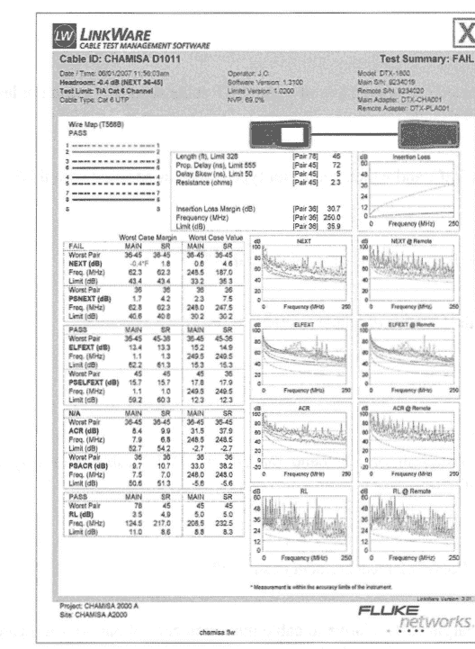

a. 线对 7–8 的长度是多少？

b. 线对 5 的长度是多少？

c. 为什么该电缆未通过测试？回答此处显示的认证报告。


a. 线对 7–8 的长度是多少？

b. 线对 5 的长度是多少？

c. 为什么未通过测试？显示此处线线图。

| Client | OMNI | Remote | SW | Floor | Channel | Resistance (Ohm) | (dB) |
| :--- | :--- | :--- | :--- | :--- | :--- | :--- | :--- |
| 1 | | | | | | | |
| 2 | | | | | | | |
| 3 | | | | | | | |
| 4 | | | | | | | |
| 5 | | | | | | | |
| 6 | | | | | | | |
| 7 | | | | | | | |
| 8 | | | | | | | |

| Attenuation | Overall (dB) | Overall (dB) |
| Pairs dB | Margin (dB) | Pairs dB | Margin (dB) |
| 1 | | | | |
| 2 | | | | |
| 3 | | | | |
| 4 | | | | |
| 5 | | | | |
| 6 | | | | |
| 7 | | | | |
| 8 | | | | |

| NEXT | Overall (dB) | Overall (dB) |
| Pairs dB | Margin (dB) | Pairs dB | Margin (dB) |
| 1 | | | | |
| 2 | | | | |
| 3 | | | | |
| 4 | | | | |
| 5 | | | | |
| 6 | | | | |
| 7 | | | | |
| 8 | | | | |

| PSNEXT | Overall (dB) | Overall (dB) |
| Pairs dB | Margin (dB) | Pairs dB | Margin (dB) |
| 1 | | | | |
| 2 | | | | | |
| 3 | | | | | |
| 4 | | | | | |
| 5 | | | | | |
| 6 | | | | | |
| 7 | | | | | |
| 8 | | | | | |

| ACR | Overall (dB) | Overall (dB) |
| Pairs dB | Margin (dB) | Pairs dB | Margin (dB) |
| 1 | | | | | |
| 2 | | | | | |
| 3 | | | | | |
| 4 | | | | | |
| 5 | | | | | |
| 6 | | | | | |
| 7 | | | | | |
| 8 | | | | | |

| ELFEXT | Overall (dB) | Overall (dB) |
| Pairs dB | Margin (dB) | Pairs dB | Margin (dB) |
| 1 | | | | | |
| 2 | | | | | |
| 3 | | | | | |
| 4 | | | | | |
| 5 | | | | | |
| 6 | | | | | |
| 7 | | | | | |
| 8 | | | | | |

| PSACR | Overall (dB) | Overall (dB) |
| Pairs dB | Margin (dB) | Pairs dB | Margin (dB) |
| 1 | | | | | |
| 2 | | | | | |
| 3 | | | | | |
| 4 | | | | | |
| 5 | | | | | |
| 6 | | | | | |
| 7 | | | | | |
| 8 | | | | | |


55. CAT5e/6 链路测试是从一个端接到另一个端接进行的测试。正确还是错误？

56. 仅使用两对线即可获得正确的功率和（Power Sum）测量。正确还是错误？

57. 延迟偏移（Delay skew）至关重要，因为不同线对的线长度差异巨大，导致数据到达接收端的时间不同，可能会导致数据失真。正确还是错误？

58. 建筑内的永久网络布线属于哪一类？
a. 垂直布线 (Vertical cabling)
b. 工作区 (Work area)
c. 设备房 (Equipment room)
d. 以上答案均错误

59. RJ-45 模块化插头有多少个引脚？
a. 4
b. 6
c. 8
d. 16
e. 以上答案均错误

60. 下列哪项最能定义水平布线（horizontal cabling）？
a. 从电信间间延伸到 LAN 工作区域的布线
b. 从工作区域延伸到 LAN 的布线
c. 从骨干网延伸到 LAN 工作区域的布线
d. 从设备房延伸到 LAN 工作区域的布线
e. 以上答案均错误

61. UTP 认证报告列出了以下内容。

| 线对 | 12 | 36 | 45 | 78 |
| :--- | :--- | :--- | :--- | :--- |
| 长度 | 310 | 308 | 311 | 307 |

这些结果说明了什么？

a. 电缆未通过认证测试。
b. 线对 36 78 将通过认证。
c. 线对 12 45 将通过认证。
d. 电缆通过了认证测试。
e. ! 表示该线对符合或超过了功率和（Power Sum）测试的标准。

62. UTP 线对中的长度差异：
a. 表示电缆不应通过认证。
b. 表示电缆应该通过认证。
c. 是由于每对线线数的差异引起的。
d. 是由于电缆制造质量差。

## 第 3 章
## 物理层布线：光纤

## 章大纲

- 3-1 介绍
- 3-2 光的本质
- 3-3 光纤衰减与色散
- 3-4 光组件
- 3-5 光网络
- 3-6 安全
- 总结
- 问题与练习

## 学习目标

- 描述玻璃纤维优于铜质导体的优势
- 描述光在单模光纤和多模光纤中传输的差异
- 定义光纤布线中的衰减和色散
- 描述光纤系统的组件
- 描述光网络的问题，包括光纤入（FTTB）和光纤入户（FTTH）
- 描述与光纤以太网相关的新网络发展
- 理解光光纤的安全问题

## 关键术语

折射率 (refractive index)
红外光 (infrared light)
光谱 (optical spectrum)
包层 (cladding)
数值孔 (numerical aperture)
多模光纤 (multode fiber)
脉冲色散 (pulse dispersion)
阶跃型光纤 (graded-index fiber)
单模光纤 (single-mode fiber)
阶跃型光纤 (step-index fiber)
远距离 (long haul)
模场直径 (mode field diameter)
散射 (scattering)
吸收 (absorption)
宏弯损 (macrobending)
色散 (dispersion)
模态色散 (modal dispersion)
色散 (chromatic dispersion)|极化模色散 (polarization mode dispersion)
零色散波长 (zero-dispersion-wave-length)
色散补偿 (dispersion compensating)
光纤 (fiber)
光纤布拉格光栅 (fiber Bragg grating)
DL
LED
分布式反馈 (DFB) 层
密集波分复用 (DWDM)
垂直腔层面面发射激光器 (VCSELs)
可调谐激光器 (tunable laser)
光纤、光导管、玻璃 (fiber, light pipe, glass)
隔离器 (isolator)
接收信号电平 (RSL)|熔接 (fusion splicing)
机械式分路器 (mechanical splits)
折耦合胶 (index-matching gel)
SC, ST, FC, LC, MT-RJ
SONET/SDH
STS
FTTC
FTTH
FTTB
FTTD
光纤以太网
光纤交叉连接
GBIC
SFP
XENPAK
XPAK
X2
XFP

## 3-1 介绍

光纤系统开发和制造的最新进展使其成为光网络领域的最前沿。它们被广泛用于私人和商业数据链路，并取代了许多铜线。受益于光网络发展的最新网络技术是千兆以太网和万兆以太网。

光纤网络出出奇地简单，如图 3-1 所示。它由以下元素组成：

1. 光纤传输线可以携带信号（调制光束的形式）传输几英里或数百、数千英里。电缆可能包含三或四根发丝光纤，或者是由数百这样的光纤组成的束。
2. 红外辐射源——通常是发射二极管（LED）或固态激光器——它可以被调制以数字数据或模拟信号加载到光束上。
3. 光电探测器在接收端将光信号转换回电信号。
4. 在光源到电缆的接口以及电缆到光电探测器的接口处，高效的光纤连接器在熔接光纤时至关重要，因为连接处可能会产生过大的损失。

图 3-1 光纤通信系统。（出自 Modern Electronic Communication 9/e，J.S. Beasley & G. M. Miller 著，2008年，第781页。版权 ©2002 Pearson Education, Inc.。经 Pearson Education, Inc. 许可转载，Upper Saddle River, NJ。）

与铜质导体相比，光纤通信链路的优势是巨大的，包括以下方面：

1. **极宽的系统带宽**：通过改变光的幅度提高智能性。由于最好的 LED 响应时间为 5 ns，因此它们提供了约 100MHz 的最大带宽。使用激光源，单模光纤可以实现超过 10Gbps 的数据速率。这种系统路复用的信息量令人惊叹。

2. **抗静电干扰**：外部电噪声不会影响每一根光纤。然而，这仅适用于光纤链路，不适用于金属电子器件。

3. **消除串扰**：一根光纤中的光不会干扰相邻光纤，也不会受到相邻光纤的影响。回想起来，串扰源于相邻铜纤之间的电磁耦合。

4. **衰减低于其他传播阶段**：1GHz 带宽信号的光纤典型衰减为每 100 英尺 0.03 dB，而 RG-58 同为 4.0 dB。

5. **成本降低**：光纤成本正在持续下降。随着光纤的使用，系统的成本正在下降。

6. **安全**：在许多布线系统中，短路的潜在危险需要仔细设计。此外，光纤的电缘特性消除了火花危险。

7. **腐蚀**：由于玻璃基本上是惰性的，环境的腐蚀影响不是问题。

8. **安全性**：由于对电磁耦合和辐射的免疫，光纤可以使用安全环境中。尽管它可以被截获或监听，但非常困难。

本章探讨了光网络的问题。3-2 节介绍了光纤基础概述，包括对波长和光纤类型的讨论。3-3 节研究了光纤传输中的距离限制参数、衰减和色散。3-4 节介绍了光连接器，包括目前用于光纤的各种连接器类型。3-5 节介绍了光网络。介绍了 SONET 和 FDDI，随后是光纤以太网。该节包含了关于建立光纤建筑和校园分布的讨论。在处理光纤时，安全至关重要。3-6 节简要介绍了安全。

表 3-1 列出并按章节标识了本章中每个章节 CompTIA Network+ 目标的出现位置。每个章节的末尾都有该节介绍的 Network+ 目标的回顾。提供这些注释有助于加强读者对特定 Network+ 目标的理解。章节回顾还包含“测试知识”问题，帮助读者在进入章节的下一节之前理解关键概念。每章的结束包含一套完整的样本题。


## 表 3-1 第 3 章 - CompTIA Network+ 目标

| 领域/目标编号 | 领域/目标描述 | 目标涵盖的章节 |
|---|---|---|
| 3.0 | 网络介质与拓扑分类标准介质类型及相关属性 | 3-2, 3-3, 3-6 |
| 3.2 | 根据网络介质分类标准连接器类型 | 3-4 |
| 3.7 | 比较和对比不同的 LAN 技术 | 3-5 |
| 3.8 | 识别布线分布的组件 | 3-5 |
| 4.0 | 网络管理 | |
| 4.5 | 描述配置管理文档的用途 | 3-5 |

## 3-2 光的本质

在理解光在玻璃纤维中的传播之前，有必要回顾一些关于光折射和反射的基础知识。光在自由空间中的传播速度为 $3 \times 10^8$ m/s，但在其他介质（包括光电缆）中这一速度会降低。当光进入密度更大的材料时，速度的降低会导致光折射。折射会导致光波发生弯曲，如图 3-2 所示。速度降低以及随后的折射对于每个波长都是不同的，如图 3-2(b) 所示。射入棱镜的可见光在空气/玻璃界面处均发生折射，并将光分离成各种频率（颜色），如所示。同样的效应产生了彩虹，水滴充当棱镜，将阳光分解成可见光谱的光色（各种频率）。

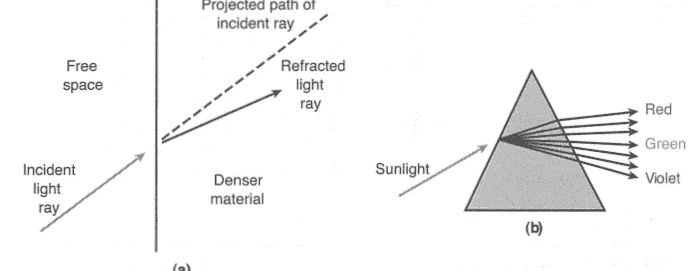

图 3-2 光的折射。（取自 *Modern Electronic Communication 9/e*，J.S. Beasley & G. M. Miller 著，2008年，第782页。版权 ©2002 Pearson Education, Inc.经 Pearson Education, Inc. 许可转载，Upper River, NJ。）

第 3-2 节 • 光的本质 119

### 折射率

光在自由空间中的速度与在给定材料中速度的比值

折射提供的弯曲程度取决于引入的两种材料的折射率。折射率 $n$ 是光在自由空间中的速度与给定材料中速度的比值。对于不同频率的光，折射率略有变化，但对于大多数用途来说，一个简单的值就足够了。

在光纤行业，光谱说明使用纳米（nm）而不是频率（Hz），因为后者更易于使用，特别是在光谱-波长计算中。一个常见的参考点是 3·10 THz 或 300THz，它等同于 1 µm、1000 nm。这种关系如图 3-3 所示。这种命名方法的唯一例外是稠密通道波分复用（DWDM），它是在 1550 nm 范围内在同一光纤上传输多个光通道（波长）。DWDM 波分复用（WDM）系统在第 3-5 节中描述。电磁光谱图见 3-3。紧邻可见光谱以下、680 nm 以上的电磁波被称为红外光。可见光的波长从大约 430 nm 到 680 nm，红外光从 680 nm 延伸到微波。从红外及以上的频率被称为光光谱。

### 红外光

从 680 nm 以上到微波波长

### 光光谱

从红外及以上的光频率

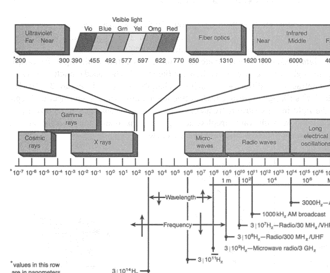

图 3-3 电磁波长光谱。（取自 *Modern Communication 9/e*，J.S. Beasley & G. M. Miller 著，2008年，第784页。版权 ©2002 Pearson Education, Inc. 经 Pearson Education, Inc. 许可。）。）第 3 章 • 物理层布线

在现代光纤系统中，常用的波长包括：

- 多模光：850 nm
- 单模光：1310 nm
- 光纤到户：1550 nm

图 3-4 显示了光纤的结构。纤芯是传输光的材料。包层是保护纤芯的材料。图 3-5 显示了光纤的示例（感谢 Anixter）。


图 3-4 单模光。（取自 *Modern Electronic Communication 9/e*，J.S. Beasley & G. M. Miller 著，2008年，第782页。版权 ©2002 Pearson Education, Inc. 经 Pearson Education, Inc. 许可。）


图 3-5 纤束（感谢光纤）。

### 数值孔径

光纤接收光的衡量标准

另一种衡量光的方法是数值孔径。数值孔径是制造商提供的一个基本规格，说明光纤接收光的能力。多种光纤可用，其特性具有显著差异。由于耦合光很困难，导致了纤芯约为 100 µm 的开发。这些光纤支持许多工作模式，被称为多模光纤。早期光纤系统使用了 800-900 nm 的波长。多模光纤的变体随后被开发，称为梯度光纤。这提供了带宽。

### 多模光纤

支持多种光模式的光纤

随着技术的成熟，发现单模光纤提供更低的损耗和更高的带宽。这导致了它们在 1300 nm、1550 nm 到 1625 nm 的应用。新的发展并没有让旧类型的光纤过时。应用决定了类型。以下主要标准影响选择：

- 信号损耗
- 光耦合难易程度
- 带宽

图 3-6 展示了光纤的三种模式（即多模）传播：

字体 最低阶模式被看到沿纤轴传输。
- 中阶模式在界面处反射。
- 高阶模式反射多次并跨越光纤达到 400MHz。

### 脉冲色散

由于光的多种路径导致接收到的脉冲宽度增加

由于路径长度不同，进入光纤的光到达探测器的时间不一。这导致了脉冲展宽特性，如图 3-6 所示。这种效应被称为色散，限制了数据（光脉冲）可以实际传输的最大距离和速率。你还会注意到输出脉冲的幅度减小且宽度增加。光纤越长，这种效应就越明显。因此，制造商按长度带宽对光纤进行评分，例如 400MHz/km。这意味着光纤可以在 1 公里内以 400MHz 的速率成功传输脉冲，在 2 公里内以 200MHz 的速率，以此此类推。事实上，目前的网络标准将多模光纤距离限制在 2 公里内。


### 渐变型光纤

为了克服脉冲色散问题，开发了渐变型光纤。在制造过程中，折射率被调整为遵循图 3-7所示的抛物线分布。这导致低阶模在远离纤芯的恒密度材料中传输。高阶模在远离纤芯的地方看到的折射率较低，传播速度随着远离中心而增加。因此，尽管它们沿着不同的路径并传输不同的距离，但它们穿越光纤长度的时间大约相同。因此，这些光纤可以处理更高的带宽和/或在脉冲色散破坏可理解性和引入比特错误之前提供更长的传输距离。

### 渐变型光纤
折射率随抛物线分布逐渐变化

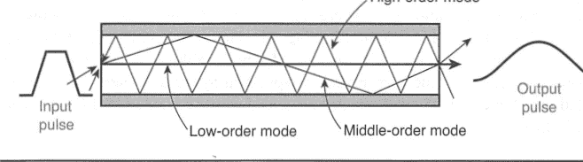

**图 3-6** 阶跃型光纤的传播模式。（出自 Modern Electronic Communication 9/e，J.S. Beasley & G. Miller 编写，2008 年，第 787 页。版权所有 ©2008 Pearson Education, Inc. 经 Pearson Education, Inc., Upper River, NJ 许可转载。）

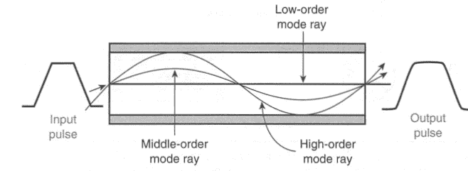

**图 3-7** 渐变型光纤的传播模式。（出自 Modern Electronic Communication 9/e，J.S. Beasley & G. Miller 编写，2008 年，第 788 页。版权所有 ©2008 Pearson Education, Inc. 经 Pearson Education, Inc., Upper River, NJ 许可转载。）

纤芯直径为 50 μm、包层为 125 μm 的渐变型多模光纤用于许多电信系统，在无中继器的 50 公里线路上传输速率高达 300 兆比特秒 (Mbps)。纤芯直径达 100 μm 的渐变型光纤用于需要从光源于耦合和高数据速率的短距离应用，例如视频和高速局域网 (LAN)。较大的纤芯比 50 μm 的纤芯提供更好的光耦合，且不会显著降低带宽能力。在电信行业，渐变型光纤有两种常用的纤芯尺寸：50 μm 和 62.5 μm。两者都具有 125 μm 的包层。这些光纤的大纤芯直径和高数值孔径 (NA) 简化了输入布线，并允许使用相对便宜的连接器。光纤通过其纤芯和包层的直径进行规格。例如，上述的光纤被称为 50/125 光和 62.5/125 光。

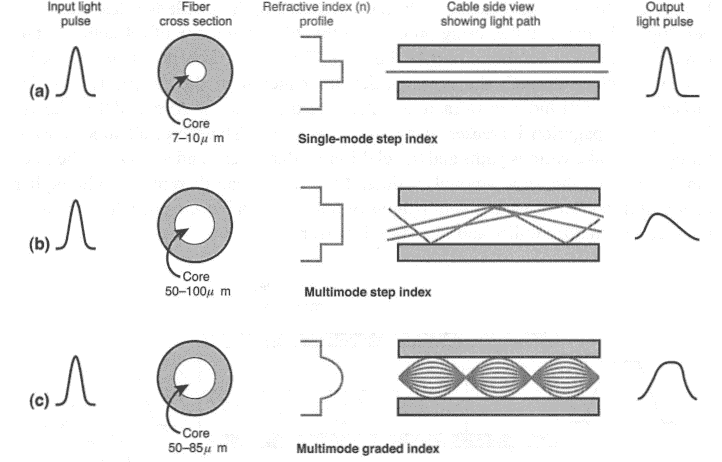

**图 3-8** 光纤类型。（出自 Modern Electronic Communication 9/e

### 单模光纤

### 单模光纤
纤芯直径为 7–10 μm 的光缆；光沿单一路径传输

用于减少脉冲色散效应的技术是使纤芯变得极小——几微米量级。这种光纤只接受低阶模，因此能够在高数据速率、远距离系统中工作。光纤通常与高功率、高方向性的调制光源（如激光器）配合使用。这种类型的光纤被称为单模（或单单模）。版权所有 ©2008 Pearson Education。7–10 μm 的直径是典型的。

### 长距离传输
跨越数百或数英里的数据传输单模光纤广泛应用于长途和广域网 (WAN) 应用。它们允许约 10Gbps 的传输速率和高达 80km 的中继间隔。这种带宽和中继间隔能力随着新的开发不断升级。

第 3 章 • 物理层布线：光纤

在描述单模光纤的纤芯尺寸时，“模场直径”（mode field diameter）是常用的术语。模场直径是实际的引导功率分布。在典型的单模光纤中，模场直径为 1 μm 或大于纤芯直径。实际值取决于传输的波长。在光纤规格中，多模光纤标出纤芯直径，但单模光纤通常标出模场直径。

### 模场直径
实际的引导功率分布通常为微米或大于纤芯直径；单模光纤规格通常列出模场直径

图 3-8 提供了所讨论的三类光纤图形总结，包括典型尺寸、折射率分布和脉冲色散效应。

## 3-2 节复习

本节涵盖了以下 Network+ 考试目标。

3.1 分标准介质类型及相关属性

本节向读者介绍了光和光纤的本质；特别是单模光纤和多模光纤。图 3-4 提供了光电缆组合的良好图形视图。还介绍了光在光纤等光波导中传输的概念。

## 测试你的知识

- 1. 紧接在可见光谱频率以下的光波称为什么？
  a. 亚光波
  b. 红外光波
  c. 折射波
  d. 多模波
  e. 极化波

- 2. 光波导纤芯周围的材料称为什么？
  a. 包层
  b. 孔径
  c. 模场
  d. 阶跃型
  e. 渐变型

- 3. 单模光纤缆的纤芯直径约为 7–10 微米。
  对或错？

## 3-3 光纤衰减与色散

光纤传输中有两个限制距离的关键参数：衰减和色散。

### 衰减

衰减是由于光纤引入的功率损失。这种损失随着光在光纤束中的传播而累积。损耗以长度的 dB/km（每千米分贝）表示。信号的损失或衰减由于四个因素的共同作用：散射、吸收、宏弯损和微弯损。

散射是跨三个波长损耗的首要因素。电信系统中的散射占总损耗的 96%，是衰减值（如图 3-9 所示）和行业数据表的基础。这种散射被称为瑞利散射，是由折射率波动引起的。瑞利散射随着波长的增加而减小，如图 3-9 所示。

### 散射
由折射率波动引起；占衰减损耗的 96%

### 吸收
光与光纤材料原子结构的相互作用；还涉及光功率向热量的转换

吸收是第二个损耗因素，是光与玻璃原子结构相互作用的复合体。它涉及光功率向热量的转换。吸收损失的一部分是由于制造过程中溶解在玻璃中的 OH 离子。这些离子导致了图 3-9 和其他衰减曲线所示的水衰减和 OH 峰。

### 宏弯损
由于光破碎并逸入包层导致的损失

宏弯损是由于光纤过弯时光破碎并逸入包层造成的。随着波长的增加，弯处的损耗也会增加。虽然损耗是分贝级的，但小型接头和配线盒内的弯曲半径应尽可能小。

### 微弯损
由于光纤微小机械变形和应力引起的损失

微弯损是一种由于光纤承受机械应力引起的损耗，通常是由于光缆压力导致的变形。例如，过紧的扎带或夹箍会导致这种损耗。这种损耗以分贝计。

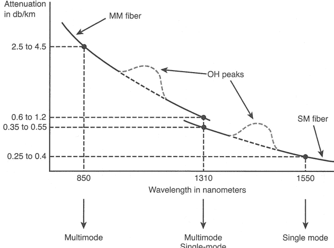

**图 3-9** 布线光纤束的典型衰减。（出自 Modern Electronic Communication 9/e，J.S. Beasley & G. M. Miller 编写，2008 年，第 792 页。版权所有 ©2008 Pearson Education, Inc. 经 Pearson Education, Inc., Upper Saddle River, NJ 许可转载。）

## 色散

色散或脉冲展宽是光纤传输系统中两个限制距离的关键参数中的另一个。它是光脉冲在光纤束中传播时在时间上扩散的现象。这导致了脉冲的展宽。如果脉冲展宽过度，它可能会进入相邻的数字时间槽并导致比特错误。图 3-10 展示了色散对光脉冲的影响。


## 距离

## 数字时隙

| | | | | | | | |
|---|---|---|---|---|---|---|
| 1 | 0 | 1 | 0 | 1 | 0 | 1 |
| 1 | 0 | 1 | 0 | 1 | 0 | 1 |
| 1 | ? | 1 | ? | 1 | ? | 1 |

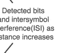

**图 3-10** 光纤中的脉冲展宽或色散。（改编自 J.S. Beasley & G. M. Miller 著的《Modern Electronic Communication 9e》，2008年，第793页。版权 ©2008 Pearson Education, Inc.经 Pearson Education, Inc. 许可改编，Upper Saddle River, N.J.）

色散有三种：

- **模式色散 (Modal dispersion)**：由于不同模式在光纤中通过的路径长度不同导致脉冲展宽。
- **色散 (Chromatic dispersion)**：由于光脉冲的光谱分量传播速度不同导致脉冲展宽。
- **偏振模式色散 (Polarization mode dispersion)**：由于光脉冲的 X 和 Y 极化分量传播速度不同导致脉冲展宽。

模式色散主要发生在多模光纤中。从光源发出，光线在沿光纤传播时可以采取许多路径。某些光线沿直线传输，但大多数光线沿着长度变化的路径。结果是光线在不同的时间到达探测器，导致了脉冲展宽。这在图 3-6 和 3-7 中所示。使用阶射型光纤可以大大减少模式色散的影响，从而将带宽增加到 1GHz/km。另一方面，单模光纤只传输单一模式，因此不产生模式色散。

同样重要的色散类型是色散。色散存在于单模和多模光纤中。基本上，光源（无论是激光器还是 LED）都会产生几个不同的波长来产生光脉冲。每条光线以不同的速度传输，结果这些光线在不同的时间到达探测器，导致脉冲展宽。

128 第 3 章 物理层布线：光纤

存在一个色散实际上为零的点，这由折射率决定。这发生在 1310 nm 附近，被称为零色散波长。通过改变折射率分布，可以将此零色散波长移动到 1550 nm 范围。此类光纤被称为色移光纤。这非常有意义，因为 1550 nm 区域的衰减比 1310 nm 小。这形成了一个运行优势，特别是对于长途传输运营商，由于在同一波长区域具有最小衰减和最小色散，可以最大化中继器和再生器的间距。

偏振模式是单模系统中发现的色散类型，在长途、高数据率广域网 (WAN) 以及数字带宽视频系统中受到特别关注。在单模光纤中，单一传播模式有两个极化方向，水平和垂直，或 X 轴和 Y 轴。分量的折射率可能不同；这会影响它们的相对速度，如图 3-11 所示。

## 零色散波长

色散实际上为零的点

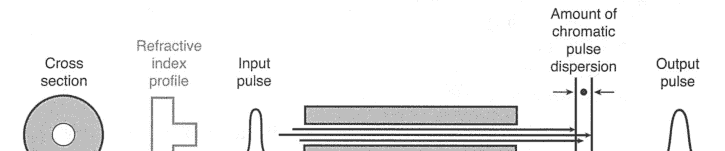

**图 3-11** 单模光纤中的偏振模式色散。（来自 J.S. Beasley & G. Miller 著的《Modern Electronic Communication 9e》，2008年，第 794页。版权 ©2008 Pearson Education, Inc.经 Pearson Education, Inc. 转载，Upper Saddle River, NJ.）

## 色散补偿

大量的现有光纤安装于 20 世纪 80 年代和 90 年代初。这种光纤被称为第 IV 类。这些电缆针对 1310 nm 区域的工作进行了优化，这意味着它们的零色散点在 1310 波长区域。由于近年来网络不断扩展的需求，通常希望通过使用 1550 nm 范围为旧光电缆增加容量，特别是因为 1550 nm 处的衰减小于 1310 nm。此时出现了一个问题：1550 nm 处的色散值更高，严重限制了其传输距离。

## 色散补偿光纤

为了克服这个问题，开发了一种名为色散补偿光纤的光纤。这种光纤的作用类似于均衡器，用负色散抵消正色散。该光纤由微小的纤芯组成，通常放置在光输入口前的设备机架中。这会引入一些插入损耗（3–10 dB），并可能需要增加光放大器。

作用类似于均衡器，消除色散效应并使 1550 nm 区域产生接近无色散的效果

一种新设备是光纤布拉格栅。这项技术涉及在光纤上刻蚀不规则结构，从而改变折射率，并将较慢波长在较快波长之前反射到输出端。这导致压缩或更窄的光脉冲，从而最小化符号间干扰 (ISI)。

## 光纤布拉格栅

一种改变折射率并最小化符号间干扰的短光纤

第 3-3 节 光纤衰减与色散 129

## 3-3 节复习

本节涵盖了以下内容：
3.1 分类介质类型
光纤中有两个关键限制参数，即衰减和色散。了解光纤的特性对于规划至关重要。

## 测试你的知识

1. 下列哪个术语是指脉冲在传播过程中的展宽？
   a. 脉冲整形
   b. 扩散
   c. 吸收
   d. 色散

2. 下列哪个术语是由波引起的？
   a. 散射
   b. 吸收
   c. 色散
   d. 扩散

3. 下列哪个术语是指由于导致的损失？
   a. 微弯
   b. 散射
   c. 宏弯
   d. 吸收

## 4 光学元件

系统中使用两种光源：二极管激光器 (DL) 和发光二极管 (LED)。在设计系统时，应考虑每个光源的特性：
1. 功率水平
2. 温度敏感性
3. 响应时间
4. 寿命
5. 特性

DL
二极管激光器

LED
发光二极管

DL 是单模光纤的首选光源，因为 LED 价格更便宜且需要的驱动电路较简单。它提供快速的响应时间（通常小于 1 ns），并能将高光功率（通常为几 mW）引入光纤。LED 通常用于宽带系统，因为 LED 的耦合效率较低。它们的工作波长主要在 750-850 nm 范围，尽管1310 nm 范围正在开发中。预计寿命接近 10 年。

另一种激光器件称为分布式反馈 (DFB) 激光器，它利用技术在激光体内提供光学反馈。这增强了输出稳定性，产生了更稳定的光谱宽度。密集波分用 (DWDM) 系统通道的宽度在 0.01–0.1 nm 范围。更的开发是一类全新的激光器，称为垂直腔面发射器 (VCSEL)。这些激光器支持比 LED 快得多的速率，包括千比特网络。它们没有传统激光器的许多运行和稳定性问题。

分布式反馈 (DFB) 激光
适用于 DWDM 系统的更稳定激光

密集波分用 (DWDM)
在单根光纤中集成 1550-1550 范围内的多个波长

垂直腔面发射器 (VCSELs)
具有 LED 的简单性和激光性能的激光

可调激光
基础波长可以移动几纳米的激光，用于 DWDM 系统中的流量路由

图 3-12 显示了一个可调二极管模块的示例（由富士复合半导体公司提供）。这些设备的主要市场是按波长划分流量的网络，因此需要分配和重新分配波长或发射器以适应动态路由或网络、按需带宽、无缝恢复（服务性）、光包交换等。可调激光通常与被动或可调的 WDM 过滤器配合使用。

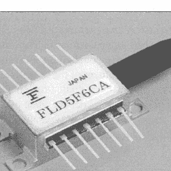

图 3-12 可调二极管模块（由富士复合半导体公司提供）。


## 中间组件

光纤、光导、玻璃
用于描述光纤束的术语

典型的光纤通信链路（如前图 3-1 所示）由光源或发射器以及光检测器或接收器通过一束光纤、光导或玻璃连接在一起。越来越多的专用网络和系统应用在发射器和接收器之间的跨度上使用了各种中间组件。以下列表是对这些设备及其用途的简要回顾：

- **隔离器：** 隔离器是一种串联式无源器件，仅允许光功率向一个方向流动。
- **衰减器：** 衰减器用于降低信号电平（RSL）。它们有固定和可变配置。
- **分支设备：** 分支设备用于单向系统，在这些系统中单个光信号被划分并发送到多个接收器，例如点对多点数据或 CATV 分配系统。
- **分光器：** 分光器用于分割或划分光信号，以分配到任何数量的地方。
- **波长复用器：** 波长复用器合并或划分两个或多个具有不同波长的光信号。它们有时被称为光束分器。
- **光放大器：** 光纤线路放大器是模拟放大器。放置位置可以是光发射器输出端、中跨段或光接收器附近。

接收信号电平 (RSL)
光纤接收器的输入信号电平

## 检测器

用于将传输的光转换回电信号的设备是光纤系统中一个至关重要的环节。这个重要环节往往因为重视光源和光纤而被忽视。然而，仅仅通过将一种光电探测器更换为另一种，就可以将系统容量提高一个数量级。

光检测器的重要特性如下：

- **响应率：** 这是衡量输入探测器的光功率所产生的输出电流的指标。
- **响应速度：** 这决定了探测器的最大数据传输能力。
- **光谱响应：** 这决定了在指定波长下所实现的灵敏度。

光纤通过永久熔接或机械接头（例如连接器和接头）进行连接。连接器允许反复插拔和拔出。最重要的是，这些连接的损耗必须尽可能低。低损耗取决于一根光纤的纤与另一根光纤或光源或探测器的正确对准。经过良好端端的熔接和机械接头的损耗通常为 0.2 dB 或低。当两根光纤在连接器内没有完美对准时，光纤中会出现信号损耗。轴不对准通常会导致最大的损耗——位移 10% 时损耗约为 0.5 dB。图 3-13 说明了这种情况以及其他损耗源。

(c) 空隙
(d) 粗糙表面
(e) 数值差异
(f) 纤芯尺寸差异
(g) 纤芯同心性和偏移
(h) 纤芯椭率

图 3-13 连接损耗源。（出自《Modern Electronic Communication 9/e》，J.S. Beasley & G. M. Miller 著，2008年，806页。版权©2008 Pearson Education, Inc. 由 Pearson Education, Inc., Upper Saddle River, NJ 转印。）

角度不对准 [图 3-13(b)] 通常在连接器中是可以控制的。大多数连接器会留有空隙，如图 3-13(c) 所示。间隙的大小会影响损耗，因为离开传输光纤的光会向外扩散。

图 3-13(d) 中粗糙端面接头的损耗通常是由切割不良（或“劈光”）引起的，但可以通过抛光或使用预先抛光的连接器来降至最低。极化通常发生在光纤放置于连接器之后。图 3-13(d) 所示的连接损耗源大部分可以由熟练的光缆熔接人员来控制。有四种情况会导致额外的连接器或接头损耗，但数值较小。这些情况如图 3-13(e), (f), (g) 和 (h) 所示。这些情况与连接点光纤束的性质有关，并由光缆熔接人员控制。这些损耗中的某些可以使用旋转机在某种程度上减少，通过它使接头获得更好的纤芯对准。关于两种熔接技术，熔接是一种长期方法，将两根光纤熔合在一起。剥去两根光纤端的涂层，进行劈光，并插入熔接器中。对光纤束进行对准，并在末端之间发射电弧，熔化并融合两个末端。既有手动和自动熔接器；质量通常取决于给定任务需要完成的熔接次数、技术人员的水平，当然还有预算。可以持续实现小于 .1 dB 的典型插入损耗——通常在 .0.5 dB 范围内。

## 熔接

将两根光纤熔合或焊接在一起的长期方法。第 3-4节 光组件 133

## 机械接头

机械接头是永久性的，是某些光纤熔接应用的经济选择。机械接头也将两根光纤连接在一起，与熔接的区别在于两根光纤之间存在空隙。这导致了玻璃-空气界面，引起折射率的剧烈变化。这种变化可以通过在接头处涂折射匹配胶来减轻。这是一种胶状物质，其折射率比空气更接近玻璃。因此，折射率的变化要小得多。机械接头在维修以及临时或实验室工作中一直广泛应用。它们快速、方便，且适用于小型任务。最佳熔接方法取决于应用，包括带宽、作业等。

## 折射匹配胶

折射率比空气更接近玻璃的胶状物质

## 光纤连接器

SC, ST, LC, MT-RJ

对于连接器，市场上有多种选择，如 SC, ST, LC 和 MT-RJ。选择通常取决于硬件和光纤应用。图 3-14(a-e) 提供了 SC、ST、LC 连接器的示例。

(a) SC 连接器
(b) ST 连接器
(c) MT-RJ 连接器
(d) LC 连接器
(e) FC 连接器

图 3-14 典型连接。(a)(b)(c) 出自《Modern Electronic Communication 9/e》，J.S. Beasley & G. M. Miller 著，2008年，808页。版权 ©2008 Pearson Education, Inc. 由 Pearson Education, Inc., Upper Saddle River, NJ 转印。(d) 和 (e) 出自 Black Box Corporation。

第3章 物理层布线：光纤

光纤连接的一些通用要求如下：

- 安装简单快速
- 低插入损耗——安装良好的连接器损耗可低至 0.25 dB
- 高回波损耗大于 50 dB——这对于千兆网络、DWDM 系统、高带宽等日益重要
- 可重复性
- 经济性

在准备光纤熔接或连接时，仅去除光纤的涂层。125µm 的包层直径是进入接头或连接器的部分，因此大多数设备都可以处理单模和多模光纤。

有时问题出现在不同尺寸光纤的熔接建议上。绝对规则是不将单模和多模光纤接在一起！同样，专业的作业不允许将不同尺寸的多模光纤接在一起。然而，在紧急情况下，从小纤芯到大纤芯传输时，插入损耗极小或没有；当从大尺寸传输到小尺寸时，会增加插入损耗，并预计反射功率会大幅增加。

工业实践已证实，现场维修中 50 m 和 62.5 m 多模光纤的互换是可以接受的。

## 第 3-4 节复习

本节涵盖了以下 Network+ 考试目标。

- 3.2 根据网络媒介对标准连接器类型进行分类 本节介绍了光组件。连接损耗问题如图 3-13 所示，而不同类型的连接器如图 3-14 所示。

## 知识测试

- 1. 熔接的特征是以下哪一项：
a. 一种连接光纤的临时方法
b. 机械接头的廉价替代方案
c. 需要折射匹配胶
d. 将两根光纤熔合或焊接在一起的长期方法

- 2. 衰减器的功能是降低接收电平。对或错？


## 3-5 光纤网络

带宽日益增长的需求正推动光纤领域向光纤网络解决方案发展，这些解决方案几乎超出了即使是最先进的网络人员的想象。目前已有适用于长途、广域、城域、校园和本地局域网的光纤解决方案。电缆公司已经在利用光纤的高带宽能力，在其整个服务范围内布布电缆并传输数据。

光纤系统与基于铜的系统之间的成本差异正在缩小，新网络的网络技术选择已不再仅仅取决于预算。光纤具有承载更多带宽的能力，而且随着光纤基础设施成本的下降，光纤将被用于承载数据。当然，铜缆基础设施已经存在，而且新的开发正在证明铜缆数据传输速度的提升（例如 CAT6 和 CAT7）。光纤更小，更易安装在已经拥挤的管道和导管中。此外，安全性也得到了增强，因为在不被发现的情况下很难对光纤分分。光纤会在计算机网络中取代铜缆吗？多年来，人们一直期待一种光纤和铜缆的混合解决方案。

## 定义光纤网络

光纤网络正成为家庭、企业和长途运营商数据传输的主要部分。电信行业多年来一直使用光纤传输长途流量。一些主要的运营商正在与电缆公司合并，因此它们已准备好为家庭提供高带宽能力。光技术的发展正在重塑我们在未来光纤网络中使用光纤的方式。

但光纤网络出现了一个新趋势。密集波复用和可调激光器改变了光纤网络的实现方式。现在可以在单根光纤上传输许多波长。AT&T 的实验室测试成功演示了在单根光纤上传输 1,022 个波长。这种多波传输为在同一根光纤上通过不同波长路由和切换许多数据协议提供了可能。允许数据在一种波长上运行而在另一个波长上长度的交叉连接开发开启了其他可能性。

同步光网络 (SONET) 和 SDH 多年来一直是北美和国际电信长途光传输的标准。由于多年来，SONET/SDH 为以下内容定义了标准：

- 提高网络可靠性
- 网络管理
- 定义如 DS-1 (1.544Mbps) 和 DS-3 (44.736Mbps) 等数字信号同步复用的方法
- 定义一组通用的操作/设备标准
- 灵活架构

SONET/SDH
同步光网络；长途通信中光传输的同步数字体系协议标准

SONET/SDH 规定了各种光载波 (OC) 等级和相应的同步传输信号 (STS)，用于光纤传输系统中传输数据。光纤网络数据速率通常以 SONET 等级指定。表 3-2 列出了最常见的数据速率。

## STS
同步传输信号

### 表 3-2 SONET 等级数据速率
| 信号 | 比特率 | 容量 |
| :--- | :--- | :--- |
| OC-1 (STS-1) | 51,840Mbps | 28DS-1 或 1 DS-3 |
| OC-3 (STS-3) | 155.520Mbps | 84DS-1 或 3 DS-3 |
| OC-12 (STS-12) | 622.080Mbps | 336 DS-1 或 12 DS-3 |
| OC-48 (STS-48) | 2.4832Gbps | 1344 DS-1 或 48 DS-3 |
| OC-192 (STS-192) | 9.9528Gbps | 5376 DS-1 或 192 DS-3 |

OC: 光载波—DS-1: 1.544Mbps
STS: 同步传输信号—DS-3: 44.736Mbps

## FTTC
光纤到路

提供光纤到路边 (FTTC) 和光纤入户 (FTTH) 的家庭光纤网络架构。FTTH 目前已在部署。它为靠近家庭的位置提供高带宽，并通过铜缆（双绞线）使用 VDSL（超高数字用户线路）提供高速数据链路。FTTH 将为家庭提供无限的带宽；然而，其成功的关键在于家庭中开发低成本的光电转换器，以及可以调谐到任何所需通道的激光器。

# FTTH
光纤入户

光纤的另一种架构是提供传输包括数据、视频、会议在内的所有通信技术的业务。另一种类型是光纤到桌面 (FTDD)。这种设置要求计算机具有光纤网络接口卡 (NIC)。FTDD 用于如对带宽有要求的计算机动画工作等应用。

## FTB
光纤到企业 近传统的速率以太网正通过光纤运行。这被称为光以太网，并使用表 3-3 列出的网络来描述网络配置类型。光纤有助于消除与非屏蔽双绞线 (UTP) 铜缆相关的 100 米限制。这是可能的，因为光纤的衰减损失较低。在星型网络中，计算机和交换机直接连接。如果在星型网络中使用光纤，则需要内部或外部介质转换器。媒体转换器将电信号转换为光信号，反之亦然。如图 3-15 所示，两端都需要媒体转换器。媒体转换器通常内置在网络接口卡中。

## FTTD
光纤到桌面

光纤到桌面
光以太网的示例

### 表 3-3 光以太网数值
| 数值 | 描述 |
| :--- | :--- |
| 10BASE-F | 使用光纤 |
| 10BASE-FB | 使用光纤，段长可 2 km |
| 10BASE-FL | 使用光纤，段长可 2 km |
| 10BASE-FP | 使用光纤，段长可 500 米 |
| 10BASE-X | 使用光纤的以太网 |
| 1000Base-SX | 使用多模光纤短波长 |
| 1000Base-LX | 使用单模光纤长波长 |
| 1000Base-R | 使用光纤的以太网 |
| 1000Base-W | 使用光纤的传输器 |

## 建筑分布
校园分布

## 建筑分布

在设计光纤网络时要考虑的重要问题包括：

字体 建筑分布
- 校园分布

图 3-16 显示了建筑分布的示例。光纤链路由用于发送和接收的两个光纤组成。光纤以全双工模式工作，这意味着它们可以同时发送和接收。第一个示例是建筑分布，第二个示例是校园分布。

## GBIC
千兆接口转换器

图 3-17 显示了 (a) GBIC、(b) SFP、(c) XENPAK、(d) X2 和 (e) XFP 收发器（来自 Cisco）。

## SFP
可插拔

为了增加活动网络设备的端口密度，行业一直转向使用微型 GBIC 或 SFP (可插拔)。SFP (b) 尺寸是 XFP 的一半以上。这些模块用于连接如 1000Base-SX（使用短波长多模光纤）和 1000Base-LX（使用长波长单模光纤）。GBIC 和 SFP 模块设计用于插入路由器和交换机。

# XENPAK, XPAK, X2, XFP,
FP+
千兆接口适配器

在千兆以太网世界，已经开发了多种光纤收发器。这些都是从 XENPAK (c) 开始，随后是 XPAK 和 X2 (d)。这些后期收发器模块开发了一种更小的模块 XFP。XFP (e) 比 XENPAK、XPAK、X2 的功耗更低，但它可以提供高达 80km 的距离，与旧模块相同。由于其尺寸、低功耗和可接触性，XFP 可能是 10G 收发器的未来。最近，出现了一种新型 10G 收发器，它是一个 SFP+。外观和尺寸与 1000Base SFP 收发器相同。为了在小形式规格内提供 10G 速度，SFP+ 的工作距离减少到 40km。因此，如果距离不是考虑因素，SFP+ 可能是 10G 收发器的选择。


参考 3-16，项目 F 和 G 显示了接入到 IDC 的主光纤交叉连接器的两个光纤。这些光纤（F 和 G）被称为互连（IC）光纤。这些光纤终止于 IDC 交叉连接器（项目 H 和 I）。

## IDC
中间配线间

3-16 中的项目 J 和 K 是将光纤交叉连接器连接到活动设备的光纤跳线。再次强调，活动设备必须具有 GBIC 或其他用于光电转换的接口。

## IC
- 互连光纤分支交换——项目 D 显示了连接主光纤交叉连接器（项目 B）到活动设备的跳线。

光纤的一个通用规则是，建筑内的分布限制在“2层”。这意味着一个建筑应该只有主配线和向工作区域提供水平配线的中间配线。

插图 3-18(a) 和 (b) 展示了“2层”规则的一个示例。图 3-18(a) 显示了一个符合“2层”规则的建筑配线示例。IDC 位于第一层，水平配线（HD）位于第二层。图 3-18(b) 展示了一个不符合“2层”规则的光纤配线示例。在这个例子中，HD 和工作区是 3 层，即距离建筑主配线 3 层。

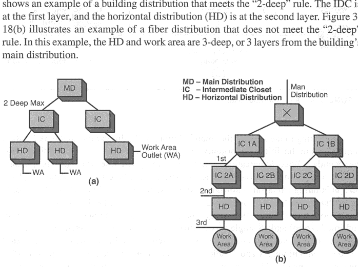

图 3-18 “2层”规则的示例：(a) 符合要求的配线；(b) 不符合要求的配线。

## 园区配线

### 逻辑光纤图
显示光纤如何互连以及数据如何在整个园区内分布

图 3-19 显示了园区网络网络的光纤配线地图。这张地图显示了光纤如何互连以及数据如何在整个园区内分布，被称为逻辑光纤图。另一种用于显示光纤配线的地图样式是物理光纤图，如图 3-20 所示。该地图显示了光纤的路由，还显示了地形、地下管道和进入建筑的详细信息。两种地图样式对于光纤网络的文档和规划都是重要且必要的。这些材料侧重于逻辑光纤图提供的文档。

### 物理光纤图
显示光纤的路由，还显示了地形、地下管道和进入建筑的详细信息


### ### 图 3-19 逻辑光纤图。

**mm**
多模

**sm**
单模

**主骨干**
主光纤配线

参考图 3-19 中的逻辑光纤图，该园区网络连接到电信（Telco）：1 号楼的主电信分界点（项目 A）和 2 号楼的次级电信分界点（项目 B）。这两个连接提供了冗余的互联网和广域网数据服务。如果 1 号楼发生任何导致外部数据服务的故障，互联网和 WAN 数据流量可以切换到 2 号楼。此外，数据流量可以在连接上进行分布以防止瓶颈。1 号楼和 2 号楼之间通过 36 根多模 (mm) 光纤和 48 根单模 (sm) 光纤互连。这记录在连接 1 号楼和 2 号楼的连线（项目 C）上，并写为 36/48（项目 D）。1 号楼和 2 号楼之间的虚线表示园区网络的**主骨干**或主光纤配线。园区网络大部分数据通过这些光纤传输。园区骨干（绿色虚线）还从 2 号楼延伸到 4 号楼，从 3 号楼延伸到 5 号楼。

这种设置使得数据可以在园区内分布。例如，来自主电信分界点（项目 A）的数据流量通过光纤经过 1-3-5-11-12 号楼到达 12 号楼。如果 3 号楼连接中断，则来自主电信分界点的数据可以通过 1-2-4-7-6-5-11-12 号楼路由。如果 5 号楼停止运行，12 号楼的数据流量会发生什么？在这种情况下，往返 11 号和 12 号楼的数据流量将丢失。

项目 E 显示了与 4 号和 10 号楼的光纤连接。这束光纤提供了从主电信分界点到园区网络另一侧的备用数据路径。


图例
-- 地下单模光缆电
-- 空中单模光缆电
-- 光纤骨干接点 (X*) = 接点

比例：
1:1000
日期：99/1/2

图 30 物理光纤图示例（由 Palo Alto Utilities 提供）。

建筑之间的布线是多模和单模光纤的混合。旧光纤采用 12/12 电缆（12 多模/12 单模）。光纤电每 12 根光纤为一组束成。例如，一根 12/12 电缆（12 多模/12 单模）。光纤电每 12 根光纤为一组束成。例如，一根 12/12 电缆（12 多模/12 单模）。光纤电每 12 根光纤为一组束成。例如，一根 12/12 电缆（12 多模/12 单模）。光纤电每 12 根光纤为一组束成。

### 表 3-4 光束内 12 根光纤的颜色代码

| 线对 | 颜色 |
|---|---|
| 1/2 | 蓝色/橙色 |
| 3/4 | 绿色/棕色 |
| 5/6 | 石板色/白色 |
| 7/8 | 红色/黑色 |
| 9/10 | 黄色/紫色 |
| 11/12 | 玫瑰色/水色 |


## 测试你的知识

- 1. 逻辑光纤图显示了什么？（选择所有适用项）
  - a. 数据在整个校园内的分布情况
  - b. 光纤的路由路径
  - c. 地形和地下管道
  - d. 光纤是如何互连的

- 2. 物理光纤图显示了什么？（选择所有适用项）
  - a. 光纤的路由路径
  - b. 局域网（LAN）连接
  - c. 地形问题
  - d. 器的放置

- 3. 10 吉比特（10 gigabits）使用的光纤接口名称是什么？
  - a. GBIC
  - b. 10GBIC
  - c. XEPPAK
  - d. ZENPAK

## 3-6 安全

任何关于光纤或光网络的讨论，如果不涉及安全问题，都是完整的，即使只是简略带过。当光在光纤中传播时，如果存在开路，各种因素将进一步衰减光：

- 1. 光束将从开放的连接器处色散或扇出。
- 2. 如果断裂的光缆暴露了受损的光纤，其末端可能会破碎，这将导致光大幅色散。此外，电缆内部的光纤会产生少量的衰减，加上沿线的任何连接或熔接。

然而，有两个因素可以增加暴露光纤末端的光功率。

- 1. 跳线尾（pigtail）中可能存在透镜，可以将更多的光线聚焦到电缆中。
- 2. 在新的波分复用（DWDM）系统中，同一根光纤中会有多个光信号；尽管它们是分开的，但在波长上相对接近。入射到眼睛的光功率就会被倍增。

有两个需要注意的因素：

- 1. 人眼看不见光纤通信的波长，因此没有痛苦或对暴露的感知。然而，视网膜仍可能被暴露并受到损伤。（参考图 3-3，电磁谱。）
- 2. 眼睛损伤是光功率、波长、光源或直径以及暴露时间的函数。

因此，对于那些操作光纤设备的人员：

- 1. **绝不要**查看测试设备的输出连接器。此类设备的功率可能比通信设备本身更高，特别是 OTDR（光时域反射仪）。
- 2. 如果你需要查看光纤末端，**始终**关闭发射器，特别是当你不知道发射器是激光还是 LED 时，因为激光是高功率光源。如果你在使用显微镜检查光纤，光功率会被倍增。

从机械角度来看：

- 1. 良好的工作规范在安全、培训和安装手册中有详细说明。**阅读并遵守**。
- 2. 小心机械、切割器、化学溶剂和环氧胶。
- 3. 光纤末端很脆，会断裂，包括熔接和连接时切断的末端。这些末端极难看到，可能会“丢失”并/或容易嵌入你的手指中。在手指感染之前，你不会知道。请务必清点所有的废料。
- 4. 在光纤系统工作时，使用专为保护眼睛的安全眼镜。
- 5. 获取并**使用**光安全工具箱。
- 6. 保持工作区域**整洁**且有序。

在任何情况下，确保技术人员具备该工作的适当培训！

## 3-6 节回顾

本节涵盖了以下 Network+ 考试目标。

- 3.1 分类标准媒介类型及相关属性

每当你处理光纤时，都需要非常小心。本节介绍了安全的概述。

## 测试你的知识

- 1. 人眼看不见光纤通信波长，因此永远不要看光纤的末端。正确或错误？

- 2. 在处理光纤末端时非常小心很重要。这些末端极难看到，可能会“丢失”并/或容易嵌入你的手指中。正确或错误？

## 总结

第 3 章介绍了光纤和光网络领域。本章提供了使用光纤连接楼内和校园网络中局域网的示例。学生应该理解的主要主题包括：

- 光网络提供的优势
- 光波的特性
- 光纤的物理和光学特性
- 光纤中的衰减和色散效应
- 连接光纤的常用技术描述
- 光纤在局域网（LAN）、校园网络和广域网（WAN）中的应用
- 光网络的系统设计
- 处理光纤时的安全考虑因素
- OTDR 波形分析

## 问题与练习

## 3-1 节

- 1. 列出光纤通信系统的基本元件。
- 2. 列出光通信链路的五个优势。

## 3-2 节

- 3. 定义折射率。
- 4. 光纤系统中常用的波长有哪些？
- 5. 光纤的哪部分传输光？
- 6. 测量光纤光接收能力的指标是什么？
- 7. 定义脉冲色散。
- 8. 多模光纤的典型纤/包层尺寸（微米）是多少？
- 9. 单模光纤的典型纤尺寸是多少？
- 10. 定义模场直径。

## 3-3 节

- 11. 限制距离的参数有哪些？
- 12. 哪些因素会导致衰减？
- 13. 定义色散。
- 14. 色散的三个类型是什么？
- 15. 什么是色散？
- 16. 什么是波长？

## 3-4 节

- 17. 光源的类型有哪些？
- 18. 为什么带宽在系统中很重要？
- 19. 为什么波长在网络中很重要？
- 20. 衰减器的用途是什么？
- 21. 列出熔接的。
- 22. 什么是熔接？

## 3-5 节

- 23. (a) FTTC；(b) FTTH；(c) FTD？
- 24. GBIC 的用途是什么？
- 25. “深度”规则是什么？
- 26. 什么是光纤？
- 27. (a) 多模和 (b) 单模的典型长度是多少？
- 28. 什么是 FDDI？

## 3-6 节

- 29. 安全问题是什么？
- 30. 校园网络计划安装光纤。他们应该使用哪种类型？为什么？

## 认证题

- 32. 以下是光通信的优势？
  - a. 极宽带宽
  - b. 消除串扰
  - c. 消除衰减
  - d. 安全性
- 33. 脉冲的拉伸是因为？（选择两个）
  - a. 多路径传输
  - b. 错配的连接器
  - c. 脉冲色散
  - d. OTDR
- 34. 由于通过光纤的路径不同导致的展宽被称为？
  - a. 色散
  - b. 偏模色散
  - c. 模色散
  - d. 扩散
- 35. 由于光谱成分不同导致的脉冲展宽被称为？
  - a. 色散
  - b. 模色散
  - c. 偏模色散
  - d. 扩散
- 36. 由于光脉冲 X 和 Y 偏振传播速度不同导致的展宽被称为？
  - a. 模色散
  - b. 色散
  - c. 扩散
  - d. 偏模色散
- 37. OC-192 的数据速率是多少？
  - a. 1.522Mbps
  - b. 155.52Mbps
  - c. 9.95Gbps
  - d. 2.488Gbps
- 38. 1 吉比特使用的光纤接口名称是什么？
  - a. XEPPAK
  - b. GBIC
  - c. 10GBIC
  - d. ZENPAK
- 39. 光网络中的“双深度”规则是指？
  - a. 这意味着通往楼层的水平分布只能有两个 P8PC 连接。
  - b. 这意味着通往楼层的水平分布只能有两个 ST 连接连接到光纤配接器。
  - c. 这对于高速单模光纤和波分复用设备不再是问题。
  - d. 这意味着一栋建筑应该只有主配线和为工作区域水平分布的中间配线。
- 40. 哪种类型的光纤优于现代计算机网络？
  - a. 多模
  - b. 偏模模式
  - c. 单模
  - d. 所有答案均正确
- 41. 光波导周围的材料称为什么？
  - a. 孔径
  - b. 模场
  - c. 阶跃
  - d. 包层
  - d. 渐变


## 第 4 章 无线网络

### 章大纲

- 4-1 引言
- 4-2 IEEE 802.11 无线局域网标准
- 4-3 802.11 无线网络
- 4-4 蓝牙、WiMax 和 RFID
- 4-5 无线局域网的安全
- 4-6 配置点多点无线局域网：案例研究
- 总结
- 问题与练习

## 目标

- 定义 80.11 WLAN 标准的功能
- 理解无线局域网的组件
- 探索如何配置无线局域网
- 研究如何对无线局域网进行现场勘
- 调查无线局域网的安全问题
- 探索如何配置点多点无线局域网

## 关键术语

| WLAN | 伪随机 | WiMAX |
| :--- | :--- | :--- |
| 基础服务集 (BSS) | 跳频序列 | BWA |
| 自持网络 (ad hoc) | OFDM | NLOS |
| 接入点 (access point) | U-NII | 最后一公里 |
| 收发器 (transceiver) | MIMO | 射频识别 (RFID) |
| 扩展服务集 (ESS) | Wi-Fi | 反射散射 |
| 切换 (hand-off) | SSID | 时隙接入算法 |
| 漫游 (roaming) | 现场勘测/查询程序 | 信标帧 (beacon) |
| CSMA/CA | 寻呼程序 | WPA |
| DSSS | 微网 (piconet) | EAP |
| ISM | 配对 | RADIUS |
| FHSS | 旁跳频率 | |
| | 密钥 (Passkey) | |

## 4-1 引言

本章探讨了无线局域网（WLAN）中使用的特性和技术。无线网络是网络向无线射频（RF）世界的延伸。WLAN 为连接网络提供了更高的灵活性移动性。针对建筑合理设计的 WLAN 可以为用户在建筑内的任何位置提供移动访问。用户无需寻找连接接口来插拔；同时也避免了有线网络中铺设电缆和安装墙面板的费用。然而，网络管理员必须仔细规划 WLAN 的安装，并充分了解 WLAN 技术的用途，以确保安装可靠且安全的网络。

本章讨论了将 WLAN 技术整合到网络的基本问题。第 4-2 节探讨了 IEEE 802.11 WLAN 标准的基础。这包括 WLAN 概念和术语概述、频率分配以及扩展通信。第 4-3 节介绍了 WLAN 的应用，涵盖了各种类型的 WLAN 配置，如点对点和点多点。第 4-4 节探讨了其他无线技术，WiMax 和 RFID。任何信号通过空气甚至通过电缆传输时，都有被拦截的可能性。在无线网络上传输数据引入了新的安全问题。最后一节（4-5）介绍了配置 WLAN 以为大区域用户提供访问的基础知识。

表 4-1 按章节列出了目标，并在其中识别了每个 CompTIA 目标。每章末尾的复习是对节中介绍的 Network 目标带有注释的复。这些注释有助于加强读者对特定 Network+ 目标的理解。章节复习还包括“测试你的知识”问题，帮助读者在进入本章下一节之前理解关键概念。章末包含了一套完整的认证类型题目样本。

## 表 4-1 第 4 章 CompTIA Network+ 目标

| 领域/目标编号 | 领域/目标描述 | 涵盖该目标的章节 |
| :--- | :--- | :--- |
| 2.0 | 网络安装与配置：给定场景，安装并配置无线网络 | 4-2, 4-3, 4-6 |
| 2.4 | 给定场景，排除常见问题的故障 | 4-3 |
| 3.0 | 网络介质和拓扑 | |
| 3.3 | 比较对比不同的无线技术 | 4-2 |
| 3.4 | 分类 WAN 技术类型和属性 | 4-4 |
| 3.5 | 描述不同的网络拓扑 | 4-3 |
| 3.7 | 比较对比不同的 LAN 技术 | 4-2 |
| 5.0 | 网络安全 | |
| 5.1 | 给定场景，实施适当的无线安全措施 | 4-5 |

## 4-2 IEEE 802.11 无线局域网标准

典型的计算机网络使用双绞线和光电缆连接 LAN。另一种在高速数据率 LAN 中竞争使用的介质是基于 IEEE 802.11 标准的无线网络。无线网络的优势包括：

- 在难以布线或布线成本过高的区域使用成本效益的网络介质
- 工作场所用户的移动性

在没有布线的环境中，无线网络日益成为首选网络，不仅对用户很方便，而且成本低得多。在笔记本和移动设备时代，无线开启了工作场所用户移动的大门。员工可能从工作场所内的几乎任何位置访问网络或无线数据服务。从网络访问信息就像从磁盘访问一样简单。

无线网络在工作场所的好处非常多。为了提供无线连接，网络管理员必须确保网络服务可靠安全。提供可靠的网络服务意味着管理员必须熟悉 WLAN 配置和技术。本节及后续章节探讨了 WLAN 配置和技术的基础。IEEE 802.11 标准定义了物理层、媒体访问控制（MAC）层和管理协议。802.11 标准定义了物理层（PHY），其包括：

- 数据传输方法
- 数据的可靠性
- 访问控制（MAC）层

802.11 标准定义了物理层（PHY），其包括：

## 基础服务集 (BSS)

用于描述独立网络的术语

## 自持网络 (Ad Hoc)

另一个描述独立网络的术语

## 接入点 (Access Point)

用于互连无线网络的收发器

## 收发器 (Transceiver)

一个发送/接收单元


跳频扩频 (FHSS)、红外和正交频分复用 (OFDM)。DSSS 用于于 802.11b/g/n 无线网络，而 OFDM 用于 802.11a、802.11g 和 802.11n。注意，802.11g/n 同时使用 DSSS 和 OFDM 调制。

## 笔记本电脑


图 4-3 一个用于增加移动性的扩展服务集 (Extended Service Set) 示例。

## DSSS
直接序列扩频

802.11 DSSS 在 2.4GHz ISM（工业、科学和医学）频段的约 90MHz 射频频谱上实现了 14 个信道（每个信道占用 22MHz）。DSSS 是一种用于将传输的数据扩展到更宽带上的技术；在这种情况下，它是 22MHz 的宽带信道。表 4-2 列出了北美使用的频率信道。注意，北美只有 14 个信道中的 11 个是可用。图 4-4 显示了 3 信道 DSSS 的频率频谱示例。

## ISM
工业、科学和医学

## 表 4-2 北美 DSSS 信道
| 信道编号 | 频率 (GHz) |
|---|---|
| 1 | 2.412 |
| 2 | 2.417 |
| 3 | 2.422 |
| 4 | 2.427 |
| 5 | 2.432 |
| 6 | 2.437 |
| 7 | 2.442 |
| 8 | 2.447 |
| 9 | 2.452 |
| 10 | 2.457 |
| 11 | 2.462 |

在跳频扩频 (FHSS) 中，传输信号频率根据伪随机序列发生变化。伪随机意味着序列看起来是随机的，但实际上它会重复，特别是在一段很长时间之后。FHSS 在 ISM 2.4GHz 频段中使用 79 个信道（每个信宽 1MHz）。FHSS 要求发送和接收单元知道跳频序列（以便建立并同步通信链路）。FHSS 数据速率通常不用于无线局域网。它仍然是标准的一部分，但市场上很少（如果有的话）FHSS 无线局域网产品。

802.11b 无线设备的最大传输功率为 1000 mW；然而，标额功率水平为 100 mW。802.11g 使用的 2.4GHz 频率范围被许多技术共享，包括蓝牙、无线电话和微波炉。

局域网在 2.4GHz 范围内产生大量的射频噪声，会影响无线数据。IEEE 802.11a 标准实现了无线性能的显著提升。802.11a 工作在 5GHz 范围内，在射频干扰方面相比 802.11b 有显著改进。

802.11 标准中使用的另一种技术是正交频分复用 (OFDM)。该技术背后的基本思想是将带宽分为更小的子信道，并在这些子信道上并行传输数据。虽然这些子信道可以重叠，但它们不会相互干扰。子信道在数学上是正交的，从而产生不相关或独立的信号。

802.11a 标准在非授权的国家信息基础设施 (U-NII) 中通过 12 个可能的信道进行传输。U-NII 是联邦通信委员会 (FCC) 留出的用于支持短、高速无线数据通信。表 4-3 列出了 802.11a 的工作频率；表 4-4 列出了 802.11a 的传输功率水平。

## FHSS
跳频扩频

## 伪随机
数字序列看起来随机但实际上会重复

## 跳频序列
频率变化的顺序

## OFDM
正交频分复用

## U-NII
非授权的国家信息基础设施

### 表 4-3 IEEE 802.11a 信道和工作频率
| 信道 | 中心频率 (GHz) | 备注 |
|---|---|---|
| 36 | 5,180 | |
| 40 | 5,20 | 低频段 |
| 44 | 5,22 | |
| 48 | 5,24 | |
| 52 | 5,26 | |
| 56 | 5,28 | 中频段 |
| 60 | 5,30 | |
| 64 | 5,32 | |
| 149 | 5,745 | |
| 153 | 5,765 | 高频段 |
| 157 | 5,785 | |
| 161 | 5,805 | |

### 表 4-4 带有 6dBi 天线增益的 802.11a 最大传输功率水平
| 频段 | 功率水平 |
|---|---|
| 低 | 40 mW |
| 中 | 200 mW |
| 高 | 800 mW |

IEEE 802.11a 设备与 802.11b、802.11g 或 802.11n 不兼容。这样做的好处是 802.11a 不干扰 802.11b、g；因此，802.11a 和 802.11b/n 链路可以相邻运行。图 4-5 展示了两个链路共同运行的示例。（img/ec00be08b0c45b337e7cb610696f1b45_183_0.png）

图 4-5 两个链路共同运行的示例。（img/ec00be08b0c45b337e7cb610696f1b45_183_0.png）一个用于增加移动性的扩展服务集示例。

802.11b 无线设备的最大传输功率为 1000 mW；然而，标额功率水平为 100 mW。802.11g 使用的 2.4GHz 频率范围被许多技术共享，包括蓝牙、无线电话和微波炉。

局域网在 2.4GHz 范围内产生大量的射频噪声，会影响无线数据。IEEE 802.11a 标准实现了无线性能的显著提升。802.11a 工作在 5GHz 范围内，在射频干扰方面相比 802.11b 有显著改进。

802.11 标准中使用的另一种技术是正交频分复用 (OFDM)。该技术背后的基本思想是将带宽分为更小的子信道，并在这些子信道上并行传输数据。虽然这些子信道可以重叠，但它们不会相互干扰。子信道在数学上是正交的，从而产生不相关或独立的信号。

802.11a 标准在非授权的国家信息基础设施 (U-NII) 中通过 12 个可能的信道进行传输。U-NII 是联邦通信委员会 (FCC) 留出的用于支持短、高速无线数据通信。表 4-3 列出了 802.11a 的工作频率；表 4-4 列出了 802.11a 的传输功率水平。

## FHSS
跳频扩频

## 伪随机
数字序列看起来随机但实际上会重复

## 跳频序列
频率变化的顺序

## OFDM
正交频分复用

## U-NII
非授权的国家信息基础设施

### 表 4-3 IEEE 802.11a 信道和工作频率
| 信道 | 中心频率 (GHz) | 备注 |
|---|---|---|
| 36 | 5,180 | |
| 40 | 5,20 | 低频段 |
| 44 | 5,22 | |
| 48 | 5,24 | |
| 52 | 5,26 | |
| 56 | 5,28 | 中频段 |
| 60 | 5,30 | |
| 64 | 5,32 | |
| 149 | 5,745 | |
| 153 | 5,765 | 高频段 |
| 157 | 5,785 | |
| 161 | 5,805 | |

### 表 4-4 带有 6dBi 天线增益的 802.11a 最大传输功率水平
| 频段 | 功率水平 |
|---|---|
| 低 | 40 mW |
| 中 | 200 mW |
| 高 | 800 mW |

IEEE 802.11a 设备与 802.11b、802.11g 或 802.11n 不兼容。这样做的好处是 802.11a 不干扰 802.11b、g；因此，802.11a 和 802.11b/n 链路可以相邻运行。图 4-5 展示了两个链路共同运行的示例。（img/ec00be08b0c45b337e7cb610696f1b45_183_0.png）

图 4-5 两个链路共同运行的示例。（img/ec00be08b0c45b337e7cb610696f1b45_183_0.png）一个用于增加移动性的扩展服务集示例。

802.11b 无线设备的最大传输功率为 1000 mW；然而，标额功率水平为 100 mW。802.11g 使用的 2.4GHz 频率范围被许多技术共享，包括蓝牙、无线电话和微波炉。

局域网在 2.4GHz 范围内产生大量的射频噪声，会影响无线数据。IEEE 802.11a 标准实现了无线性能的显著提升。802.11a 工作在 5GHz 范围内，在射频干扰方面相比 802.11b 有显著改进。

802.11 标准中使用的另一种技术是正交频分复用 (OFDM)。该技术背后的基本思想是将带宽分为更小的子信道，并在这些子信道上并行传输数据。虽然这些子信道可以重叠，但它们不会相互干扰。子信道在数学上是正交的，从而产生不相关或独立的信号。

802.11a 标准在非授权的国家信息基础设施 (U-NII) 中通过 12 个可能的信道进行传输。U-NII 是联邦通信委员会 (FCC) 留出的用于支持短、高速无线数据通信。表 4-3 列出了 802.11a 的工作频率；表 4-4 列出了 802.11a 的传输功率水平。


## 4-3 802.11 无线网络

无线局域网可以通过多种方式进行配置以满足组织的需求。图 4-6 提供了一个基本的 802.11b/g/n WLAN 配置示例。每台 PC 都配备了无线局域网适配器。PC 卡有很多样式，例如 PCI、ISA、PCMCIA 和 USB，有些单元是计算机的外部设备。今天，大多数台式电脑尤其是笔记本电脑都配备了无线适配器。无线局域网适配器设备将客户端连接到无线介质。该介质通常是 2.4GHz 或 5GHz ISM 波段的射波通道。无线介质也可以是红外，尽管并不常用。无线适配器提供以下服务：

- 数据传输
- 身份验证
- 隐私保护


图 4-6 基本 WLAN 的设置。

关于无线网络最大的误解之一是它不需要有线连接。到有线局域网的连接是由无线接入点提供的，它在无线局域网和有线网络之间提供了一个桥接。物理电缆连接（通常为 CAT6/5e）将接入点连接到有线网络的交换机或集线器（通常为以太网）。

例如，图 4-6 中的计算机 PC-A 向有线局域网中的 PC-D 发送数据包。PC-A 首先通过无线链路发送数据包。接入点识别数据包的发送者为 LAN-X 中的主机，并允许无线数据进入接入点。此时，数据通过物理以太网连接发送有线局域网。数据包被递送到有线局域网中的 PC-D。

这里出现了一个：“接入点如何知道无线数据包是从无线局域网中的客户端发送的？”

答案是802.11 LAN 设备使用 SSID 来识别哪些数据流量允许连接网络。SSID 是服务标识符，基本上是允许客户端加入无线网络的密码。

接入点使用 SSID 来确定客户端是否成为无线网络的成员。“关联（association）”一词被用于描述已获得有线连接。

另一个问题是“为什么接入点有两个天线？”答案是这两个天线实现了所谓的空间分集（spatial diversity）。这种天线布局提高了了信号增益和性能。

图 4-7 显示了在建立关联时无线适配器控制台端口显示的信息示例。这表明已连接到 MAC 地址为 04-90-46-25-9d-14 的父节点（接入点）。文本指示此 MAC 地址已“添加”到关联列表中。此类信息通常可以通过随无线 PC 或 PCMCIA 适配器自带的无线管理软件获取。

| 可用接入点 | 以太网地址（八进制） | 通道 | 噪声 | 信号 |
| :--- | :--- | :--- | :--- | :--- |
| 04-90-46-25-9d-14 | 6 | 漫游 / 已关联 | 0 | 9 |

**图 4-7** 客户端与接入点建立关联时显示信息的示例。

接入点利用关联来建立无线网络上的用户（客户端）表。图 4-8 提供了一个关联表的示例。关联表列出了连接到无线网络的每个网络设备的 MAC 地址。接入点使用此表在接入点和无线网络之间转发数据包。如果无线客户端适配器丢失与接入点的关联，它将通知用户。图 4-8 提供了此类示例。

如果局域网（运行简单网络协议）之间相隔数英里，无线桥接是连接局域网的热门选择。图 4-9(a) 和 4-9(b) 提供了示例。图 4-9 显示了一个点对点的无线桥接。图 4-9(a) 中所示每栋建筑都有从无线桥接到建筑局域网的连接，如图 4-10 所示。无线桥接然后连接到放置在屋顶的天线上。两栋建筑之间必须存在清晰的（视距）传输路径，否则可能会发生信号衰减（损失）或信号中断。在配置连接时，天线的选择也至关重要。这个问题在第 4-5 节中讨论。必须选择天线，以确保接收端的信号电平满足所需的信号水平。


图 4-8 “丢失”关联的示例。

图 4-9b 显示了如何使用无线桥接将多个远程站点连接到主传输设施。每栋建筑都使用类似于图 4-10 所示的桥接设置。桥接连接到各自的局域网。在这种情况下，Bld-A 使用具有宽覆盖区域（辐射图案）的天线。


图 4-9 (a) 点对点 (b) 多对点无线桥接示例。

图 4-10 无线桥接到有线网的连接。

## SSID
服务标识符


第 4 章 • 无线网络


图 4-11 配置多个接入点以扩展无线连接范围的示例。

## 现场调查
用于确定放置接入点的位置。

室内和室外现场调查应获取以下关键信息：

- 室内
  - 电源
  - 有线网络连接
  - 接入点放置
  - 覆盖——用户移动性
  - 支持的带宽
  - 识别任何显著干扰
- 室外
  - 电源（基础接入点）
  - 回到主网络的连接
  - 天线选择

例如，进行了现场调查以确定接入点的放置位置，以便为建筑提供无线网络连接。目标是为整栋建筑提供移动客户端访问。该建筑已经有两个可用的有线网络连接。图 4-12 提供了建筑的平面图。可用的有线网络连接在图中已标出。使用无线适配器自带的软件收集了测试结果。第一次测量在 A 点进行，如图 4-13 所示。注意数据传输速度为 11Mbps。如果信号水平显著下降，速度将会发生变化。无线 PCMCIA 卡还提供了一种检查信号统计的方法，如图 4-14 所示。该图提供了信号质量、丢失的接入点信标、传输重试、信号强度和传输速率的图表。


## Intel(R) PRO/set II

| 通用 | 设置 | 移动 | 网络驱动程序 | 统计 | 诊断 |
|---|---|---|---|---|---|
| 以太网地址: | 0002B3C41DF7 | | | | |
| IP 地址: | 10.10.37 | | | | |
| 网络驱动程序状态: | 已加载 | | | | |
| 网络状态: | | | | | |
| 信号质量: 良好 | | | | | |
| 服务区域: 在范围内 | | | | | |
| 网络名称 (SSID): ET377 | | | | | |
| 速度: 11 Mbps | | | | | |
| 通道/频率: 6/2.4 GHz | | | | | |

准备
显示托栏图标

图 4-13 在 A 点观察到的 RF 信号强度。

## Intel(R) PRO/set II

| 通用 | 设置 | 移动 | 网络驱动程序 | 统计 | 诊断 |
|---|---|---|---|---|---|
| 信号信息: | | | | | |
| 丢失 AP 信标: | | | | | |
| 信号质量: | | | | | |
| 100% | | | | | | |
| 50% | | | | | | |
| 临时重试: | | | | | |
| 信号强度: | | | | | |
| 信号质量: 良好 | | | | | |
| 漫游次数: 1 | | | | | |
| 服务范围: 在范围内 | | | | | | |
| 传输速率: 11 Mbps | | | | | |
| 查看更多统计信息，请点击高级。 | | | | | |

准备
显示托栏图标

图 4-14 来自 A 点的信号统计。

下一次观察是在 B 点进行的。观察到“良好”的信号水平和 11Mbps 的传输速率。信号有所下降，但“良好”表示连接仍然可用。图 4-15 显示了在 B 点的观察结果。如图 4-16 所示，信号水平在 C 点下降到“一般”。

第 4-3 节 • 802.11 无线网络 169


**图 4-15** B 点“良好”的信号质量。


**图 4-16** C 点信号质量下降到“一般”。

移动客户端移动到建筑内的 D 点，观察到信号质量为“超出范围”。这也被称为与接入点关联的丢失。图 4-17 显示了观察到的信号水平。

第 4 章 • 无线网络

# Intel(R) PROSet II


**图 4-17** D 点的“超出范围”测量。

现场勘测显示，放置在建筑点 1 的接入点不足以覆盖整个建筑楼层。勘测表明，为了提供全楼无线局域网覆盖，增加另一个接入点的成本是完全合理的。该建筑有两个网络连接可以放置接入点（点 1 和点 2）。最后决定在点 2 放置另一个接入点。重复现场勘测后，显示整个建筑都获得了“极佳”的信号。在某些情况下，可以使用*范围扩展器*来提供额外的无线覆盖。该设备基本上扩展了无线网络的覆盖范围。

# 第 4-3 节复习

本节涵盖了以下 **Network+** 考试目标：

- 2.2 在给定场景下，安装并配置无线网络
  *本节解释了 SSID 的作用，它基本上是一个允许无线设备加入无线网络的密码。你还应该理解“关联”（association）的概念，即已获得无线连接的时刻。*

- 2.4 在给定场景下，排除常见无线问题的故障
  *本节概述了为无线设施准备现场勘测的步骤。*

- 3.5 描述不同的网络拓扑
  *本节提供了配置点对点和点对多无线桥接连接的示例。该节还提供了建立建筑内部有线网络无线桥接连接的示例。*

## 测试你的知识

- 1. 关联（association）一词的特征是下列：
   a. 描述已获得无线连接。
   b. 描述客户端的 MAC 地址。
   c. 防止未经授权的网络访问。
   d. 防止过度路由。

- 2. 现场勘测提供以下内容：
放置接入点的最佳位置
电源连接
RF 覆盖
天线选择
IP 地址选择
对或错？

# 4-4 蓝牙、WiMAX 和 RFID

本节研究了三项无线技术：蓝牙、WiMAX 和 RFID。这些技术在无线网络中都起着重要作用。接下来的章节将检查每种无线技术，包括配置和所用硬件的示例。

## 蓝牙

本节研究了另一种名为蓝牙的无线技术，它基于 802.15 标准。蓝牙的开发是为了取代连接计算机、手机、手持设备、便携式电脑和固定电子设备的电缆。蓝牙信息通常通过 2.4GHz ISM 频段传输。

表 4-6 蓝牙等级
| 等级 | 最大功率 | 距离 |
|---|---|---|
| 1 | 20 dBm | 100 米 |
| 2 | 4 dBm | 10 米 |
| 3 | 0 dBm | 1 米 |


将 WiMax 适配到 700MHz 频率范围。在此频率下传输的信息不易受到树木的信号阻挡。低频段的缺点是带宽较小。

WiMax 使用正交频复用（OFDM）作为其信号格式。WiMax 标准 IEEE 802.16a 标准之所以选择这种信号格式，是因为它在 2GHz--1GHz 频率范围内具有良好的非视距（NLOS）特性。OFDM 系统使用多个频率来传输数据，这有助于解决多径干扰问题。当某些频率遇到干扰问题时，系统可以选择最佳频率来传输数据。

WiMax 还提供了灵活的信道（例如 3.5MHz、 5MHz 和 10MHz），这为 WiMax 在全球范围内的应用提供了适应性。这也确保了所报告的是最大数据传输率。例如，分配的带宽可能是 6MHz，而 WiMax 通道的适应性允许其调整到整个带宽。

此外，在 WiMax 系统中，WiMax (IEEE 802.16) 介质访问控制 (MAC) 层与 IEEE 802.11 Wi-Fi MAC 层必须竞争以获得网络接入。当 WiMax 单元获得接入后，基站会为其分配一个时隙，从而提供 WiMax 调度接入接入。WiMax 系统在下行链中使用时分复用（TDMA）数据流，并准时交付时分多址访问数据。此外，WiMax 在无冲突环境中运行，这提高了信道吞吐量。

WiMax 的范围可达 31 英里，并以点对点和点对点的配置运行。这可以用于没有 DSL 或电缆网络连接的情况。WiMax 也对于提供“最后一公里”连接很有用处。最后一公里基本上是电信供应商到客户的连接的最后部分。最后一公里的成本可能昂贵，这使得无线替代方案对客户极具吸引力。

802.16 WiMax 标准作为移动空中接口具有巨大前景。另一个标准 802.20 是一个正在为消费者开发的移动空中接口。该标准可以支持超过 1Mbps 的速率，这与 DSL 和电缆连接相当。额外的 802.20 正在开发中以支持高速移动。换句话说，用户可以在汽车或火车上仍然保持网络连接。

## NLOS

非视距

## 最后一公里

电信供应商到客户的最后部分

## 射频识别

射频识别（RFID）是一种利用无线波来追踪和识别人员、动物、物体和货物的技术。这是通过调制反散射原理实现的。“反散射”一词是指撞击 RFID 标签的无线波反射回发射源，并携带了其唯一的识别信息。

## 射频识别 (RFID)

一种利用无线波来追踪和识别人员、动物、物体和货物的技术。

## 反散射

指撞击 RFID 标签的无线波并其反射回发射源。

第 4-4 节 • 蓝牙、WiMax 和 RFID

175

图 4-21 展示了 RFID 系统的基本框图。


**图 4-21** RFID 系统的基本框图。

RFID 系统由两个部分组成：

- RFID 标签（也称为 RF 变应器）包括集成天线和射频电子设备。
- 读取器（也称为收发器）由收发器和天线组成。收发器是发射器和接收器的结合。

读取器（收发器）发射无线波，激活（开启）RFID 标签。标签将调制后的数据（包含存储在标签中的唯一识别信息）传回读取器。读取器提取存储在 RFID 标签上的数据。

RFID 的想法可以追溯到 1948 年，当时首次提出了利用反射功率作为通信手段的概念。20 世纪 70 代 RFID 技术得到了进一步发展——特别是一种 UHF 方案，它通过对射频信号进行整流为标签提供功率。RFID 技术的发展在 20 世纪 90 年显著增加。

根据电源，RFID 系统分为三种：

| 类型 | 特性 |
| :--- | :--- |
| 被动 | 使用来自读取器无线波的能量 |
| 半主动 | 使用电池为内部电路供电，但反射读取器波 |
| 主动 | 使用电池传输自己的信号 |

RFID 系统在各种频率上运行：

- 低频 (LF): 125 到 134 kHz
- 高频 (HF): 13.56 MHz
- 超高频 (UHF): 860 到 960 MHz
- 微波: 2.45 GHz 到 5.8 GHz

RFID 技术用于许多应用，包括库存追踪、访问控制和过费收收。G2C501 工作在 91MHz 范围内。G2C501 还具有定位功能。这是通过从三个点接收信号强度指示 (RSSI) 测量实现的。


**图 4-22** 嵌式标签的示例。


**图 4-23** G2C501 主动标签（由 G2Micro 提供）。

第 203 页

第 4 章 • 无线网络

第 204 页

# 第 4-4 节回顾

本节涵盖了 Network+ 目标：
3.4 分类 WAN 类型和属性
本节介绍了 WiMAX 系统的概述。WiMAX 可以支持达 36 英里的链路，是提供最后一公里连接的可能选择。

## 测试知识

1. WiMax 在美国哪些频率工作？
   a. 未授权的 5.2GHz 和授权的 2.4GHz
   b. 未授权的 5.3GHz 和授权的 2.6GHz
   c. 未授权的 13.2GHz 和授权的 5.6GHz
   d. 未授权的 5.8GHz 和授权的 2.5GHz
2. WiMax 的范围可达多远？
   a. 31 公里
   b. 31 英里
   c. 31 米
   d. 以上答案均否
3. 蓝牙在什么频率下工作？
   a. 5GHz
   b. 100MHz
   c. 2.4GHz
   d. 以上答案均否


## 信标 (Beacon)

为了应对这一对 WLAN 安全威胁，网络管理员必须确保 WLAN 受到防火墙和入侵检测的保护（参见第 10 章），最重要的是，网络管理员必须确保**开启**了无线安全功能！

这看起来像是一个大胆的声明，但令人惊讶的是，许多 WLAN 在没有开启无线安全功能的情况下就部署在网络中了。许多 WLAN 用户认为没有人会侵入他们的计算机，因为系统中的元素不足。这可能是事实，但对于攻击者来说，该用户拥有一项非常重要的东西——通过不安全的链路访问有线网络的权限。

WLAN 使用 SSID（服务集标识符）来验证用户身份，但问题是 SSID 在无线电链路中每秒广播 10 次。在 WLAN 设备中，信标（beacons）的传输使得无线用户能够识别出要连接的接入点。可以关闭 SSID 使其不随信标传输，但有可能通过数据包嗅探获取 SSID。如前所述，数据包嗅探是一种用于扫描数据包以提取信息的技术。在这种情况下，攻击者使用数据包嗅探从数据包中提取出 SSID。禁用 SSID 广播将导致大多数客户端设备（如 Windows PC 和笔记本电脑）无法注意到 WLAN 的存在。这也能防止“偶然的窥探者”接入网络。企业级接入点实现了多个 SSID，每个 SSID 都有自己的 VLAN 和无线配置。这允许部署支持多个安全层级的通用有线 LAN 基础设施，这对于机场和医院（既有公共用户也有私人用户）等场所非常重要。

IEEE 802.11 支持两种验证客户端的方法：开放认证（open）和共享密钥认证（sharekey）。开放认证基本上意味着使用了正确的 SSID。在共享密钥认证中，接入点向客户端发送一个文本数据包，指令是提取该文本并将其返回给接入点。这需要有线数据包。WEP 用于加密和解密无线数据包。加密文本的交换和返回验证了客户端具有适当的 WEP 密钥，并被授权成为无线网络的成员。需要注意的是，密钥认证极其脆弱。因此，避免使用共享密钥认证是标准做法。WEP 加密的设置见图 4-25（a 和 b）。在图 4-25(a) 中，用户有三种 WEP 选项：禁用（无隐私）、64 位（WEP 隐私）和 128 位 WEP（更多隐私）。图 4-25(b) 显示了 Windows Vista 中的无线安全设置。显然有更多选项，接下来将讨论这些较新的安全设置。

用于验证无线链路的完整性

第 4 章 • 无线网络

## 网络设置

网络设置
工作模式：

- 与接入点通信 (802.11 站模式)
- 对等点 (802.11 Ad Hoc)
- 对等点 (主 Ad Hoc)

 允许适配器与接入点交换数据。

网络名称 (SSID)：

C1377

安全设置

加密类型：

- 禁用（无隐私）
- 禁用（无隐私）
- 64 位 WEP（隐私）
- 128 位 WEP（隐私）

防止他人使用 WEP 密钥：

图 4-25 在无线客户端上设置 WEP 加密的示例。

目前一些人担心 WEP 的加密强度不足以保护无线网络的安全。虽然已有关于 WEP 漏洞的公开信息，但尽管如此，WEP 仍提供了一些基础安全，并且比不带安全机制运行网络要好得多。

WPA 和 WPA2 提供了无线安全的改进。WPA 代表 Wi-Fi Protected Access，它支持 802.1x 提供的用户认证，并取代 WEP 成为保护无线传输的主要手段。WPA 是 WPA 的改进版本。802.1x 标准通过引入用户认证增强了无线安全。思科系统使用名为 LEAP 的 802.1x 认证系统。在 Cisco LEAP 中，用户必须输入密码才能访问网络。这意味着如果无线客户端被未经授权的用户使用，密码要求会将未经授权的用户隔在网络之外。

WPA 被认为无线系统更高层次的安全防护。在 802.1x 系统中，用户通过接入点请求访问网络。下一步是对比用户进行验证。在此阶段，用户只能发送消息。EAP 是可扩展认证协议，客户端计算机和接入点在 WPA 和 WPA2 中均使用。接入点将用户请求中的身份信息发送到认证服务器。服务器将接受或拒绝用户加入网络的请求。如果客户端获得授权，接入点会将用户（客户端）的状态更改为已授权。有时使用远程认证拨入用户服务 (RADIUS) 来提供认证。这种认证有助于防止未经授权的用户通过伪造或未经授权的接入点连接网络。

## WPA

无线保护访问

## EAP

可扩展认证协议

## RADIUS

远程认证服务

第 4-5  • 安全无线

进一步保护 WLAN 的另一种方法是使用 VPN（参见第 12 章）。通过这种方式，以下是无线安全指南：

- 开启安全功能。
- 使用防火墙。
- 结合 802.1x 特性。
- 使用 SSH 和 FTP 等加密服务。

底线是，安全级别将基于多个因素。例如，在安装网络之前，包含或不包含安全性会对网络产生什么影响？

## 4-5 复习

本节涵盖了以下 Network+ 目标：

- 5.1 给定场景，实施适当的无线安全

本节提供了 WEP、WPA 和 WPA2 的概述。重要的是要理解这些协议提供了一些安全性，并且比运行任何安全机制都要好得多。

## 知识测试

1. 无线安全的改进由以下提供
   a. 802.11x
   b. 802.11i
   c. 802.11s
   d. 802.11d
2. 从下列表中选择三个被视为安全指南的项目。
   a. 开启安全功能。
   b. 使用防火墙。
   c. 使用加密服务。
   d. 结合 802.11b。
3. 集线器永远不与无线网络一起使用。对？

## 4-6 配置点对多无线局域网：案例研究

本节介绍了一个为公司提供点对多无线局域网的提案示例。公司管理员认为，为员工提供返回公司网络的无线连接将是有益的。该示例涉及以下内容：

- 进行初始天线站点调查
- 建立从主网络到分布点的链路
- 配置多点分布
- 进行 RF 站点调查以建立远程用户的基准信号水平
- 配置远程用户的安装

目标是建立一个点对多无线局域网，为远程用户提供无线网络连接。远程用户位于建议区域内的固定位置。图 4-26 显示了建议区域的简单地形剖面。到远程用户的无线连接数据速率需要至少达到 2 Mbps。

### 1. 天线站点调查

建议的天线站点（见图 4-26）位于距离主网络约 1 公里 (km) 的丘上。站点调查提供了以下信息：

- 站点有一个可用于安装无线天线的塔。
- 站点有一座小建筑，并有供设置无线网络设备的机架空间。


- 四个方向 6 公里范围内视野良好。
- 没有可用的返回家庭网络的有线网络连接。
决定使用拟议的线线站点，并建立一个 11Mbps 的无线链路连接回家庭网络。

## 2. 建立到家庭网络的点对点无线链路

安装返回家庭网络的有线连接成本太高；因此决定使用点对点 802.11 无线链路进行互连。这需要在家庭网络和天线站点安装天线。在点对点无线链路的两端各使用无线桥接来连接网络。桥接将连接到有线家庭网络和天线处的多点分发。此外，每个天线将配备防雷器，以保护电子设备免受任何可能的雷击。图 4-27 显示了建议的无线连接。


图 4-27 建议的从家庭网络到天线点的点对点无线链路。

许多天线制造商都支持无线网络，并且可以使用多种类型的天线。研究了许多制造商的天线类型，以供互连之用。如表 4-7 所示，为无线网络选择了三种可能的天线。

表 4-7 802.11b 无线天线示例
| 天线 | 类型 | 辐射模式 | 2Mbps 下的范围 (km) | 11Mbps 下的范围 (km) | 成本 |
|---|---|---|---|---|---|
| A. | 全向 | 全向性 | 7 | | 中等 |
| B. | 八角线 | 方向性 | 12 | 7.5 | 中等 |
| C. | 抛物面天线 | 高方向性 | 38 | 18 | 高 |

天线 A 具有全向辐射模式。这意味着天线可以以 360 度的模式接收和传输信号。图 4-28(a) 显示了全向天线的辐射模式。天线 A 支持距离天线 7 公里以内的 2Mbps 数据速率，并在最大 2 公里距离处支持 11Mbps 数据速率。表 4-7 还表明该天线的成本中等。

天线 B 是八角线天线，具有如图 4-28(b) 所示的方向性辐射模式。八角线支持最远 12 公里的 2Mbps 数据速率。

天线 C 是“碟形”天线或抛物面反射器。这些天线提供极高的方向增益。在本例中，碟形天线支持在 18 公里内达到 11Mbps，在 38 公里内达到 2Mbps。与八角线或全向天线的成本相比，碟形天线的成本非常高。


图 4-28 (a) 全向、(b) 八角线和 (c) 碟形 [抛物面反射器] 天线的辐射模式，且支持在距离天线 7.5 公里以内的 11Mbps。八角线天线的成本与全向天线相当。

点对点链路选择了方向性八角线天线 B。该天线满足距离要求，也满足 11Mbps 数据速率要求。天线 A 和 C 未被选中的原因如下：

- * 天线 A：全向辐射模式不合适。
- 天线 C：高增益碟形天线的成本对于短距离来说并不合理。

### 3-4. 配置多点分发/进行 RF 现场勘测

此时，与家庭网络已建立 11Mbps 数据链路。下一项任务是配置用于多点分发的线线。我们之前决定，对于计划覆盖区域支持的数据速率，远程用户而言 2Mbps 的链路是足够的。

步骤 1 中的勘测显示，每个方向 6 公里范围内视野良好。天线 A（见表 4-7）提供 7 公里的全向辐射模式。这满足了覆盖区域和 2Mbps 数据速率的要求。天线 A 安装在天线塔上，连接到防雷器，然后连接到无线桥的输出端。接下来，对计划覆盖区域进行 RF 勘测，以验证天线提供的信号质量。在计划覆盖区域内的多个位置进行测量。分发范围内 4 公里内的所有远程站信号强度均为“良好”，如图 4-29 所示。

## Intel(R) PROSet II

| 通用 | 设置 | 移动性 | 网络驱动程序 | 统计数据 | 诊断 |
|---|---|---|---|---|---|
| 网络组件 | | | | | |
| Intel(R) PRO/无线局域网 PC 卡 | | | | | |
| 信号信息 | 丢失的 AP 信标: | | | | | |
| 信号质量 | | | | | |
| 100 | | | | | |
| 50 | | | | | |
| 发送 R: | | | | | |
| 信号强度: | | | | | |
| 信号质量: 良好 | | | | | |
| 漫游计数: 1 | | | | | |
| 服务范围: 在范围内 | | | | | |
| 信号速率: 2Mbps | | | | | |
| 4-29 | | | | | |

图 29 多点分发的信号质量为“良好”。

## Intel(R) PROSet II

信号在 6 公里处下降为“良好”，除了一个显示“差”的区域。该多点分发区域可能受到天线高度的影响。

（此处重复表格内容，略）

第 4 章 无线网络

## 5. 配置远程安装

最后一项任务是为远程用户开发配置。每个远程用户的线线需要看到多点分发天线。远程客户端的要求如下：

- 2Mbps 数据速率连接
- 方向性天线（八角线）以及支架、防雷器、无线桥

选择了天线 B（见表 4-7）作为方向性天线。该天线为远程用户提供了足够的信号水平。每个远程用户都需要一个无线桥和一个交换机来连接多个用户。（注意，桥是用于 2Mbps 数据速率的。）图 4-31 显示了远程用户的设置。


图 31 拟议的点对点无线网络中远程用户的设置。

## 4-6 节回顾

本节涵盖了以下 Network+ 目标：

- 2.2 给定场景，安装并配置无线网络

本节介绍了一个安装点对点无线局域网的案例研究。该研究涉及了天线选择、建立链路、配置多点分发、进行 RF 勘测以及配置远程用户安装的问题。请确保你熟悉每个步骤，并理解配置每个站点的步骤。

## 知识测试

- 1. 多点分发系统中接收端通常使用的天线包括哪些？（选择所有适用项）
  a. 八角线
  b. 全向
  c. 抛物面
  d. 羟氧
2. 在配置无线远程安装时，站点需要能够看到多点分发天线。正确或错误？


## 总结

本章概述了无线网络。文中还介绍了基本概念和示例网络。无线网络设备供应商已使这些设备易于集成到现有网络中，但读者必须理解，网络管理员的目标是提供一个快速、可靠且安全的计算机网络。粗率地将无线组件集成到网络中可能会轻易危及这一目标。学生应该从本章中理解以下内容：

- 802.11 无线网络的运行特性
- 接入点（Access Points）、无线局域网适配器和无线桥接的作用
- 如何对建筑进行基础勘测
- 如何为用户移动性配置网络
- 如何规划多点无线分布

最后一点：新的无线网络技术极大地简化了规划和安装。每当你处理射频（RF）工作时，都存在出现意外干扰和噪声的可能性。一个良好的 RF 安装需要对所有已知的干扰进行研究，并寻找任何可能的干扰。RF 研究还包括路径研究，使用户能够准备一个深思熟虑的计划，并对接收到的信号水平进行优秀预测。底线是支持进行 RF 研究。

## 问题与练习

## 4-2

1. 列出无线网络的两个优点。
2. IEEE 802.11 标准定义了哪三个区域？
3. 什么是自主机网络（ad hoc network）？
4. 扩展服务集（Extended Service Set）的作用是什么？
5. 802.11 无线网络中使用的四种物理层技术是什么？
6. 描述 802.11b 无线网络中 DSSS 通道的频谱。
7. 定义应用于 FHSS 的*伪随机序列*（pseudorandom sequence）。
8. FHSS 发送和接收单元通信时必须知道什么？
9. 802.11a 使用的频率范围是多少？使用了哪种调制技术？
10. 以下各项的最大数据速率是多少：
    a. 802.11b
    b. 802.11a
    c. 802.11g
    d. 802.11n
11. 定义应用于 802.11n 的 MIMO。
12. 802.11n 中省电模式的作用是什么？

## 节 4-3

13. 接入点的作用是什么？
14. 接入点如何判断一个无线数据包是否是发给它的？
15. 什么是*关联*（association）？它的作用是什么？
16. 画出一个点对点无线连接的图。
17. 画出一个点对多无线网络的图。
18. 对以下每项进行站点勘测时应获得的关键问题是什么？
    a. 室内
    b. 室外

## 节 4-4

19. 蓝牙在哪个频率频段工作？
20. 蓝牙有多少输出功率等级？列出每个等级的功率和工作范围。
21. 什么是微型网（piconet）？
22. 蓝牙中查询程序（inquiry procedure）的作用是什么？
23. 蓝牙中寻呼程序（paging procedure）的作用是什么？
24. 定义散射（backscatter）术语。
25. 定义 RFID 系统的三个参数是什么？
26. 解释如何为被式 RFID 标签提供功率。
27. 使用使用主动 RFID 标签的三个优点。
28. 通常用于 RFID 标签的三个频段是什么？
29. 美国的 WiMax 频率标准是什么？
30. 为什么 WiMax 选择 OFDM？
31. WiMax 与 Wi-Fi 有何区别？

## 节 4-5

32. 使用无线网络时最重要的事情是什么？
33. 无线信标（wireless beacons）的作用是什么？
34. 从无线信标中可以获得哪些信息？
35. WEP 的作用是什么？
36. 列出四条无线安全指南。
37. 描述 WPA2 用于验证用户的步骤。
38. 什么是 RADIUS 服务器？

## 节 4-6

39. 使用哪种类型的无线连接将家庭网络连接到多点分布站点？
40. 使用互联网为以下每个标准寻找全向和定向天线的来源：
    a. 802.11b
    b. 802.11a
    c. 802.11g
    d. 802.11n
    为每种天线类型列出三家制造商。包括成本数字。

### 批判性思维

41. 一个无线网络接收站点因干扰偶尔出现信号丢失。讨论你将采取哪些步骤来解决此问题。
42. 给你的主管写一份备忘录，解释为什么在你的无线网络上运行加密很重要。
43. 你们公司在商务大楼内有一个套间。隔壁套间的另一家公司有一个 SSID 为“Company A”的无线 802.11b 网络。你可以从你的套间里接收到他们的信号。你们公司想建立一个带有两个接入点的自己的无线网络。

## 认证

44. 对或错？
45. 解释如何为被式 RFID 标签提供功率。


## 5-1 引言

局域网（LAN）的实用性引发了将两个（或多个）网络连接在一起的需求。例如，一家大型公司可能为工程部门拥有一个网络，为制造单元拥有另一个网络。这些网络系统可能使用完全不同的网络技术和规范进行通信，并且位于不同的城市、州甚至国家，但人们认为必要将它们“连接”在一起。本章及后续章节的目标是介绍在校园网络、企业网络，甚至是广域网（WAN）中互连的局域网背后的概念和原理，这些网络运行着类似的概念和问题。校园网络是两个或多个互连的局域网的集合，可以位于一个建筑内部，也可以位于多个建筑的外部。

定义链接网络各层结构的框架由 OSI 模型定义，并在第 1 章 1-3 节中介绍。OSI 模型提供了一个网络框架，确保网络硬件和软件的兼容性。用于互连局域网的技术背后的概念将在 5-2 至 5-5 节中介绍。网络网接器的属性在 5-2 节中定义。层交换机在 5-3 节中进行研究，路由器在 5-4 节中介绍。5-5 节以一个关于自动生成概念的章节结束，审视了这种网络配置选项的优缺点。

表 5-1 按章节列出并识别了本章中介绍每个 CompTIA Network+ 目标的章节。标明了介绍每个目标的章节。在每个章节的末尾都有一个复习，并对 Network+ 目标提供了注释，以帮助加强读者对特定 Network+ 目标的理解。章节复习还包括“测试你的知识”问题，帮助读者在进入本章下一节之前理解关键概念。章节末尾包含一套完整的问题以及示例认证类型的题题。

## 表 5-1 第 5 章 CompTIA Network+ 目标

| 领域/目标编号 | 领域/目标描述 | 涵盖该目标的章节 |
|---|---|---|
| 1.0 | 网络概念：分类应用程序、设备和协议如何与 OSI 模型相关。 | 5.2, 5.4 |
| 1.2 | | |
| 1.4 | 解释路由和交换的目的和属性 | 5-2, 5-3, 5-4, 5-5 |

- 校园网络：位于有限地理区域内的两个或多个互连局域网的集合
- 第 5 章 局域网互连

| 领域/目标编号 | 领域/目标描述 | 涵盖该目标的章节 |
| ---------|---|---|
| 2.0 | 网络安装与配置 | | |
| 2.1 | 给定场景，安装并配置路由器和交换机 | 5-3, 5-6 |
| 2.5 | 给定场景，排除常见的路由器和交换机问题 | 5-5, 5-6 |
| 5.0 | 网络安全 | | |
| 5.2 | 解释网络访问安全方法 | 5.3 |

- 网桥：一种使用 MAC 地址转发数据并互连两个局域网的网络设备

## 5-2 网络网接器

网桥可以用于计算机网络以将两个局域网连接在一起并隔离网段。回想一下，网段是由网桥、交换机和路由器隔离的网络部分。**网桥**是 OSI 模型中的第 2 层设备，这意味着它使用 MAC 地址来做出有关数据数据包的决策。只有需要跨网桥发送到相邻网段的数据才会被转发。这使得隔离或分割网络流量数据成为可能。使用网桥连接以太网局域网的示例如图 5-1 所示。图片显示 LAN A 连接到网桥的端口 1，LAN B 连接到端口 2，创建了两个段。网桥监控连接到其端口的每个局域网段中的所有数据流量。回想端口是网络设备上的输入输出连接。网桥使用 MAC 地址为连接到网桥端口的主机构建一个 MAC 地址和端口位置的*网接表*。表 5-2 提供了一个示例网接表。该表显示了存储的 MAC 地址以及获取该地址的端口。

### 网接表
连接到网桥端口的主机的 MAC 地址和端口位置列表

## 表 5-2 网接表

| MAC 地址 | 端口 |
| --- | --- |
| 00-40-96-25-85-BB | 1 |
| 00-40-96-25-8E-BC | 1 |
| 00-60-97-61-58-T5 | 2 |
| 00-C0-F4-27-20-C7 | 2 |

源 MAC 地址在主机在局域网上说话（传输数据包）时就会被存储在网接表中。例如，如果计算机 A 向计算机 2 发送消息（见图 5-1），网桥将存储两台计算机的 MAC 地址，并记录这两台计算机都连接到端口 1。如果计算机 5 或 6 正在网络上放置数据包，5 和 6 的源地址将存储在网接表中，并记录这些计算机连接到网桥的端口 2。计算机 3 和 4 的 MAC 地址在它们各自传输数据包之前，不会被添加到网接表中。

 

**图 5-1** 使用网桥连接以太网局域网。

## 关联
表示目标地址连接到网桥的某个端口

网桥监控其端口上的数据，以检查以太网帧与主机之间的**关联**。关联表明主目标 MAC 地址连接到网桥的某个端口。如果发现了关联，则转发到该端口。例如，假设计算机 1 向计算机 5 发送消息（见图 5-1）。网桥检测到计算机 5 与端口 2 之间存在关联。然后，网桥将计算机 1 的数据转发到 LAN B 的计算机 5。

网桥仅在存在关联时转发数据包的能力被用于隔离网段流量。例如，假设 LAN A 中的计算机 1 和 2 产生大量数据流量。只要 LAN B 的主机（计算机 5、6 和 7）没有关联，LAN B 的计算机就不会看到这些数据流量。

## 广播
向所有连接设备传输数据

网桥的一个潜在问题是处理广播的方式。**广播**意味着消息发送到网络上的所有计算机；因此，局域网内的所有广播都会转发到该网内的所有主机。例如，与 ARP 相关的广播将出现在所有局域网。**ARP** 代表地址解析协议，是一种用于将 IP 地址映射到其 MAC 地址的协议。在地址解析协议中，广播被发送到连接到网桥的局域网内的所有主机。这在图 5-2 中所示。网桥转发所有广播；因此，请求“谁是 IP？”的 ARP 被发送到局域网上的所有主机。ARP 请求的数据包很小，但处理每个都需要计算机时间。

存储在网接表中的 MAC 地址是临时的。只要该主机在其端口上有周期性的数据活动，表中的每个 MAC 地址条目就会保持活动。然而，如果端口变为无效，表中的条目将被删除。换句话说，一旦 MAC 地址进入网接表，过期计时器就会开始工作。该条目的生命周期通过计算机的新数据流量得以刷新，MAC 地址将重新进入。


图 5-2 使用桥接器隔离数据流量的示例。

同样，所有网络设备（例如计算机）都包含一个 ARP 缓存，这是对最近联系过的 MAC 地址的临时存储。这也被称为 ARP 表。ARP 缓存存储了主机的 MAC 地址，这使得问题可以发送到目标 MAC 地址，而无需计算机再次为 MAC 地址发布 ARP 请求。以下列表列出了计算机 1 和计算机 2 之间通信过程的典型步骤。

- 1. 计算机 1 检查其 ARP 缓存，以确定其（计算机1）是否已经有了计算机 2 的 MAC 地址。如果有，它将直接跳到最后一步；否则，它将进入下一步。
- 2. 计算机 1 为计算机 2 生成一个带有其自身的 MAC 和 IP 信息的 ARP 请求消息。
- 3. 随后，计算机 1 在其本地网络上广播该 ARP 请求消息。
- 4. 每个本地网络设备都会处理该 ARP 请求消息。不是计算机 2 的计算机将丢弃该消息。
- 5. 只有匹配项（即计算机 2）会生成 ARP 回消息，并用计算机 1 的 MAC 和 IP 信息更新其 ARP 缓存。
- 6. 计算机 2 直接向计算机 1 发送 ARP 回消息。

## ARP 缓存
最近联系过的 MAC 地址的临时存储

## ARP 表
ARP 缓存的另一个名称

- 7. 计算机 1 接收 ARP 回消息，并用计算机 2 的 MAC 和 IP 更新其 ARP 缓存。

Windows 计算机上的 ARP 缓存内容可以使用命令提示符中的 `arp -a` 命令查看，所示：

| Windows | Mac OS X |
| --- | --- |
| C:\arp -a | jmac:\-mymac arp -a |
| Interface: 10.10.20.2 on Interface x1000002 | C1.salsa.org (192.168.12.1) at |
| Internet Address | Physical Address | Type |
| 10.10.20.3 | 00-08-a3-a7-78-0c dynamic | [ethernet] |
| 10.10.20.4 | 00-03-ba-04-ba-ef dynamic | C3.salsa.org (192.168.12.1) at |
| | | 00-08-a3-a7-78-0c en1 [ethernet]|

Mac OS X 计算机上的 ARP 缓存内容可以使用终端中的 `arp -a` 命令查看。

如果所有 ARP 条目已过期，将生成以下消息：

```
c:\arp -a
No ARP Entries Found
```

## 透明桥接器
连接两个运行相同类型协议的 LAN

用于连接两个运行相同类型协议（例如以太网）的 LAN 的桥接器类型，名称是*翻译桥接器*（translation bridge）。桥接器也用于连接运行两种不同网络协议的 LAN。例如，LAN A 可以是以太网 LAN，而 LAN B 可以是令牌环。这种类型的桥接器被称为翻译桥接器。图 5-3 提供了一个示例。桥接器允许数据从一个 LAN 传输到另一个 LAN。此外，MAC 地址信息是标准的，因此无论使用什么协议，都使用相同的地址。

## 翻译桥接器
用于连接运行两种不同网络协议的 LAN


图 5-3 使用翻译桥接器连接以太网和令牌环 LAN。

第 5 章 • 互连 LAN

使用桥接器的常见应用是使用无线技术连接 LAN。当物理连接的成本过高时，在 LAN 中使用无线桥接器是连接 LAN 的流行选择。无线技术及其 LAN 应用在第 4 章“无线网络”中介绍过。

在无线网络应用中，使用桥接器不像以前常见了。新的网络技术可以提供与桥接器类似但强大得多的的功能。然而，桥接器仍然有用并具有许多优势。表 5-3 提供了网络桥接器的优缺点总结。

## 表 5-3 用于互连 LAN 的桥接器优缺点总结

| 优点 | 缺点 |
|---|---|
| 于安装 | 在低流量区域效果最好 |
| 在隔离两个段中的数据流量方面表现出色 | 转发广播并容易受到广播风暴的影响 |
| 价格廉廉 | |
| 可用于连接具有不同协议和硬件的 LAN | |
| 减少冲突域（记住 CSMA/CD 协议是如何工作的） | |

## 第 5-2 节复习

本节涵盖了以下 Network+ 考试目标。

- 1.2 分类应用程序、设备和协议与 OSI 模型的关系

本节研究了网络桥接器的工作，网络桥接器是 OSI 模型中的第 2 层设备。本节提出的关键概念是“关联”（association），它表示已获取网络设备的目的地址。

- 1.4 解释路由和交换的目的

## 测试你的知识

```
c:\arp -a
No Entries Found
```

1. 使用哪个命令查看 ARP 缓存？
a. arp -c
b. arp -l
c. arp -a
d. arp -b

2. 关联表示以下哪项？
a. 连接到端口的设备
b. 网络设备的目的地址
c. 源地址
d. 主机的 MAC 地址

3. ARP 缓存是以下哪项？
a. 最近联系过的 MAC 地址的临时存储
b. 最近联系过的 IP 地址的临时存储
c. 路由表的临时存储
d. VLAN 临时存储

4. 桥接器工作在 OSI 的哪一层？
a. 第 1 层（物理层）
b. 第 2 层（链路层）
c. 第 3 层（网络层）
d. 第 4 层（传输层）

5. 交换机有时被称为：
a. 翻译桥接器
b. 多端口桥接器
c. 路由器
d. 集线器

6. 以下哪项是交换机的优点？
a. 增加数据流量
b. 增加冲突域
c. 减少冲突域
d. 增加广播风暴

7. 交换机使用什么信息转发帧？
a. IP 地址
b. MAC 地址
c. 端口号
d. VLAN ID

8. 桥接器可用于连接：
a. 两台计算机
b. 两个 LAN
c. 两个路由器
d. 两个服务器

9. LAN 环境中常用的协议是：
a. 以太网
b. 令牌环
c. IP
d. TCP

## 5-3 网络交换机

交换机是隔离 LAN 内数据流量的方法。它在 OSI 模型的层层工作，并使用以太网转发数据包。交换机监控其端口上的流量并收集 MAC 地址以建立连接到端口的设备表。


图 5-4 用于连接 LAN 主机的交换机。

图 5-5 所示 LAN 包含 14 台计算机和 2 台打印机，连接到交换机的 16 个端口，配置为星型拓扑。如果连接到端口 1 的计算机正在打印机（端口 12）打印文件，交换将在端口 1 和 12 之间建立直接连接。端口 14 的计算机也可以与端口 7 的计算机通信，端口 6 的计算机可能正在端口 16 的彩色打印机打印文件。使用交换机允许连接到网络的多对主机之间同时进行数据连接。每个交换连接都提供了一个冲突最小的链路，从而最大限度地利用 LAN 的带宽。冲突最小的链路之所以可能，是因为只有建立链路的两台计算机会在通道上通信。因此，


## 多组播

消息被发送到网络上特定的一组主机。当两个主机之间建立链路时，它们的链路将与其他任何数据流量隔离开。然而，这种方法的例外是在局域网（LAN）中发送广播或多组播消息。在广播消息的情况下，消息被发送到连接到局域网的所有设备。多组播消息被发送到网络上的特定主机组。


图 5-5 用于互连局域网网络设备的交换机。

## 集线器与交换机的比较

设置了一个实验来测试具有相同输入指令的集线器和交换机的数据处理特性。该实验目的是证明数据流量在交换机上是隔离的，而在集线器上不是。为了进行这项实验，组装了一个使用集线器的局域网和一个使用交换机的局域网。这两个局域网如图 5-6(a) 和 (b) 所示。每个局域网包含四台以星型拓扑结构连接的计算机。计算机标记为 1–4 以供参考。列出了每个主机的 IP 地址。

第 5 章 局域网的互连


图 5-6 (a) 使用集线器的局域网实验；(b) 使用交换机的局域网实验。

### 集线器实验结果

在实验中，计算机 1 ping 了计算机 3。计算机 2 用于网络协议分析仪来捕获局域网数据流量。预期结果是什么？请记住，集线器是一个多端口中继器，所有输入集线器的数据流量都会传递给连接到其端口的所有主机。请参阅随后的“PING 命令回顾”章节，以简要回顾 ping 命令的使用。

## PING 命令回顾

ping 命令用于验证两台计算机之间是否存在网络连接。ping 命令的格式格式为：

```
ping [ip address] (在本例中为 10.10.10.3)。
```

在两台计算机之间建立链路后，网络设备将发布一系列回显请求（echo requests）和回显回复（echo replies），以测试通过链路所需。ping 命令使用的协议是互联网连接消息协议（ICMP）。ping 发送到 IP 地址；然而，将此命令传递到 IP 地址指定的计算机需要识别 MAC 地址进行最终交付。发送 ping 的计算机可能不知道持有指定 IP 地址的计算机的 MAC 地址（ARP 缓存表中没有条目），因此会发出 ARP 请求。ARP 请求被广播到连接到局域网的所有计算机。持有 IP 地址的计算机用其 MAC 地址进行回复，然后建立直接通信链路。

当计算机 1 ping 时，计算机 2 收集的数据流量如图 5-7 所示。捕获数据的第一行显示了 ARP 请求，询问 IP 地址 10.10.10.30 是谁。捕获数据的第二行显示了来自 10.10.10.30 的回复，MAC 地址为 00-B0-D0-25-BF-48。捕获数据的后续八行是与 ping 请求相关的系列四个回显请求和回复。尽管计算机 2 没有被 ping 或也没有回复 ARP 请求，但数据流量仍然存在计算机 2 的集线器上。回显回复来自一个 Dell 网络接口，MAC 地址的六位字符为 25-BF-48。回显请求来自一台计算机，其 MAC 地址的六位字符为 13-99-2E。

| 帧 | 无 | 长度 [字节] | 源 | 目的地 | 信息 |
| :--- | :--- | :--- | :--- | :--- | :--- |
| 00001 | 1 | 871,846 | 66 | 10.10.10.30 | 10.10.10.1 | ARP 请求 |
| 00002 | 2 | 873,420 | 68 | 10.10.10.1 | 10.10.10.30 | ARP 回复 |
| 00003 | 3 | 170,124 | 78 | 10.10.10.30 | 10.10.10.1 | 回显请求 |
| 00004 | 4 | 171,212 | 78 | 10.10.10.1 | 10.10.10.30 | 回显回复 |
| 00005 | 5 | 372,600 | 78 | 10.10.10.30 | 10.10.10.1 | 回显请求 |
| 00006 | 6 | 372,600 | 78 | 10.10.10.1 | 10.10.10.30 | 回显回复 |
| 00007 | 7 | 372,440 | 78 | 10.10.10.30 | 10.10.10.1 | 回显请求 |
| 00008 | 8 | 372,048 | 78 | 10.10.10.1 | 10.10.10.30 | 回显回复 |

计算机 1 ping 时，计算机 2 收集的数据流量如图 5-7 所示。捕获数据的第一行显示了 ARP 请求，询问 IP 地址 10.10.10.30 是谁。捕获数据的第二行显示了来自 10.10.10.30 的回复，MAC 地址为 00-B0-D0-25-BF-48。捕获数据的后续八行是与 ping 请求相关的系列四个回显请求和回复。尽管计算机 2 没有被 ping 或也没有回复 ARP 请求，但数据流量仍然存在计算机 2 的集线器上。回显回复来自一个 Dell 网络接口，MAC 地址的六位字符为 25-BF-48。回显请求来自一台计算机，其 MAC 地址的六位字符为 13-99-2E。


图 5-7 使用集线器的...

## 交换机实验结果

设置了一个实验来测试具有相同输入指令的集线器和交换机的数据处理特性。该实验目的是证明数据流量在交换机上是隔离的，而在集线器上不是。为了进行这项实验，组装了一个使用集线器的局域网和一个使用交换机的局域网。这两个局域网如图 5-6(a) 和 (b) 所示。每个局域网包含四台以星型拓扑结构连接的计算机。计算机标记为 1–4 以供参考。列出了每个主机的 IP 地址。

在实验中，计算机 1 ping 了计算机 3。计算机 2 用于网络协议分析仪来捕获局域网数据流量。预期结果是什么？请记住，集线器是一个多端口中继器，所有输入集线器的数据流量都会传递给连接到其端口的所有主机。请参阅随后的“PING 命令回顾”章节，以简要回顾 ping 命令的使用。

## PING 命令回顾

ping 命令用于验证两台计算机之间是否存在网络连接。ping 命令的格式为：

```
ping [ip address] (在本例中为 10.10.10.3)。
```

在两台计算机之间建立链路后，网络设备将发布一系列回显请求和回显回复，以测试通过链路所需的时间。ping 命令使用的协议是互联网连接消息协议（ICMP）。ping 发送到 IP 地址；然而，将此命令传递到 IP 地址指定的计算机需要识别 MAC 地址进行最终交付。发送 ping 的计算机可能不知道持有指定 IP 地址的计算机的 MAC 地址（ARP 缓存表中没有条目），因此会发出 ARP 请求。ARP 请求被广播到连接到局域网的所有计算机。持有 IP 地址的计算机用其 MAC 地址进行回复，然后建立直接通信链路。

当计算机 1 ping 时，计算机 2 收集的数据流量如图 5-7 所示。捕获数据的第一行显示了 ARP 请求，询问 IP 地址 10.10.10.30 是谁。捕获数据的第二行显示了来自 10.10.10.30 的回复，MAC 地址为 00-B0-D0-25-BF-48。捕获数据的后续八行是与 ping 请求相关的系列四个回显请求和回复。尽管计算机 2 没有被 ping 或也没有回复 ARP 请求，但数据流量仍然存在计算机 2 的集线器上。回显回复来自一个 Dell 网络接口，MAC 地址的六位字符为 25-BF-48。回显请求来自一台计算机，其 MAC 地址的六位字符为 13-99-2E。

| 帧 | 无 | 长度 [字节] | 源 | 目的地 | 信息 |
| :--- | :--- | :--- | :--- | :--- | :--- |
| 00001 | 1 | 871,846 | 66 | 10.10.10.30 | 10.10.10.1 | ARP 请求 |
| 00002 | 2 | 873,420 | 68 | 10.10.10.1 | 10.10.10.30 | ARP 回复 |
| 00003 | 3 | 170,124 | 78 | 10.10.10.30 | 10.10.10.1 | 回显请求 |
| 00004 | 4 | 171,212 | 78 | 10.10.10.1 | 10.10.10.30 | 回显回复 |
| 00005 | 5 | 372,600 | 78 | 10.10.10.30 | 10.10.10.1 | 回显请求 |
| 00006 | 6 | 372,600 | 78 | 10.10.10.1 | 10.10.10.30 | 回显回复 |
| 00007 | 7 | 372,440 | 78 | 10.10.10.30 | 10.10.10.1 | 回显请求 |
| 00008 | 8 | 372,048 | 78 | 10.10.10.1 | 10.10.10.30 | 回显回复 |


图 5-7 使用集线器的...

## 交换机实验结果

设置了一个实验来测试具有相同输入指令的集线器和交换机的数据处理特性。该实验目的是证明数据流量在交换机上是隔离的，而在集线器上不是。为了进行这项实验，组装了一个使用集线器的局域网和一个使用交换机的局域网。这两个局域网如图 5-6(a) 和 (b) 所示。每个局域网包含四台以星型拓扑结构连接的计算机。计算机标记为 1–4 以供参考。列出了每个主机的 IP 地址。

在实验中，计算机 1 ping 了计算机 3。计算机 2 用于网络协议分析仪来捕获局域网数据流量。预期结果是什么？请记住，集线器是一个多端口中继器，所有输入集线器的数据流量都会传递给连接到其端口的所有主机。请参阅随后的“PING 命令回顾”章节，以简要回顾 ping 命令的使用。

## PING 命令回顾

ping 命令用于验证两台计算机之间是否存在网络连接。ping 命令的格式格式为：

```
ping [ip address] (在本例中为 10.10.10.3)。
```

在两台计算机之间建立链路后，网络设备将发布一系列回显请求和回显回复，以测试通过链路所需的时间。ping 命令使用的协议是互联网连接消息协议（ICMP）。ping 发送到 IP 地址；然而，将此命令传递到 IP 地址指定的计算机需要识别 MAC 地址进行最终交付。发送 ping 的计算机可能不知道持有指定 IP 地址的计算机的 MAC 地址（ARP 缓存表中没有条目），因此会发出 ARP 请求。ARP 请求被广播到连接到局域网的所有计算机。持有 IP 地址的计算机用其 MAC 地址进行回复，然后建立直接通信链路。

当计算机 1 ping 时，计算机 2 收集的数据流量如图 5-7 所示。捕获数据的第一行显示了 ARP 请求，询问 IP 地址 10.10.10.30 是谁。捕获数据的第二行显示了来自 10.10.10.30 的回复，MAC 地址为 00-B0-D0-25-BF-48。捕获数据的后续八行是与 ping 请求相关的系列四个回显请求和回复。尽管计算机 2 没有被 ping 或也没有回复 ARP 请求，但数据流量仍然存在计算机 2 的集线器上。回显回复来自一个 Dell 网络接口，MAC 地址的六位字符为 25-BF-48。回显请求来自一台计算机，其 MAC 地址的六位字符为 13-99-2E。

| 帧 | 无 | 长度 [字节] | 源 | 目的地 | 信息 |
| :--- | :--- | :--- | :--- | :--- | :--- |
| 00001 | 1 | 871,846 | 66 | 10.10.10.30 | 10.10.10.1 | ARP 请求 |
| 00002 | 2 | 873,420 | 68 | 10.10.10.1 | 10.10.10.30 | ARP 回复 |
| 00003 | 3 | 170,124 | 78 | 10.10.10.30 | 10.10.10.1 | 回显请求 |
| 00004 | 4 | 171,212 | 78 | 10.10.10.1 | 10.10.10.30 | 回显回复 |
| 00005 | 5 | 372,600 | 78 | 10.10.10.30 | 10.10.10.1 | 回显请求 |
| 00006 | 6 | 372,600 | 78 | 10.10.10.1 | 10.10.10.30 | 回显回复 |
| 00007 | 7 | 372,440 | 78 | 10.10.10.30 | 10.10.10.1 | 回显请求 |
| 00008 | 8 | 372,048 | 78 | 10.10.10.1 | 10.10.10.30 | 回显回复 |


图 5-7 使用集线器的...

## 交换机实验结果

设置了一个实验来测试具有相同输入指令的集线器和交换机的数据处理特性。该实验目的是证明数据流量在交换机上是隔离的，而在集线器上不是。为了进行这项实验，组装了一个使用集线器的局域网和一个使用交换机的局域网。这两个局域网如图 5-6(a) 和 (b) 所示。每个局域网包含四台以星型拓扑结构连接的计算机。计算机标记为 1–4 以供参考。列出了每个主机的 IP 地址。

在实验中，计算机 1 ping 了计算机 3。计算机 2 用于网络协议分析仪来捕获局域网数据流量。预期结果是什么？请记住，集线器是一个多端口中继器，所有输入集线器的数据流量都会传递给连接到其端口的所有主机。请参阅随后的“PING 命令回顾”章节，以简要回顾 ping 命令的使用。

## PING 命令回顾

ping 命令用于验证两台计算机之间是否存在网络连接。ping 命令的格式为：

```
ping [ip address] (在本例中为 10.10.10.3)。
```

在两台计算机之间建立链路后，网络设备将发布一系列回显请求和回显回复，以测试通过链路所需的时间。ping 命令使用的协议是互联网连接消息协议（ICMP）。ping 发送到 IP 地址；然而，将此命令传递到 IP 地址指定的计算机需要识别 MAC 地址进行最终交付。发送 ping 的计算机可能不知道持有指定 IP 地址的计算机的 MAC 地址（ARP 缓存表中没有条目），因此会发出 ARP 请求。ARP 请求被广播到连接到局域网的所有计算机。持有 IP 地址的计算机用其 MAC 地址进行回复，然后建立直接通信链路。

当计算机 1 ping 时，计算机 2 收集的数据流量如图 5-7 所示。捕获数据的第一行显示了 ARP 请求，询问 IP 地址 10.10.10.30 是谁。捕获数据的第二行显示了来自 10.10.10.30 的回复，MAC 地址为 00-B0-D0-25-BF-48。捕获数据的后续八行是与 ping 请求相关的系列四个回显请求和回复。尽管计算机 2 没有被 ping 或也没有回复 ARP 请求，但数据流量仍然存在计算机 2 的集线器上。回显回复来自一个 Dell 网络接口，MAC 地址的六位字符为 25-BF-48。回显请求来自一台计算机，其 MAC 地址的六位字符为 13-99-2E。

| 帧 | 无 | 长度 [字节] | 源 | 目的地 | 信息 |
| :--- | :--- | :--- | :--- | :--- | :--- |
| 00001 | 1 | 871,846 | 66 | 10.10.10.30 | 10.10.10.1 | ARP 请求 |
| 00002 | 2 | 873,420 | 68 | 10.10.10.1 | 10.10.10.30 | ARP 回复 |
| 00003 | 3 | 170,124 | 78 | 10.10.10.30 | 10.10.10.1 | 回显请求 |
| 00004 | 4 | 171,212 | 78 | 10.10.10.1 | 10.10.10.30 | 回显回复 |
| 00005 | 5 | 372,600 | 78 | 10.10.10.30 | 10.10.10.1 | 回显请求 |
| 00006 | 6 | 372,600 | 78 | 10.10.10.1 | 10.10.10.30 | 回显回复 |
| 00007 | 7 | 372,440 | 78 | 10.10.10.30 | 10.10.10.1 | 回显请求 |
| 00008 | 8 | 372,048 | 78 | 10.10.10.1 | 10.10.10.30 | 回显回复 |


图 5-7 使用集线器的...

## 交换机实验结果

设置了一个实验来测试具有相同输入指令的集线器和交换机的数据处理特性。该实验目的是证明数据流量在交换机上是隔离的，而在集线器上不是。为了进行这项实验，组装了一个使用集线器的局域网和一个使用交换机的局域网。这两个局域网如图 5-6(a) 和 (b) 所示。每个局域网包含四台以星型拓扑结构连接的计算机。计算机标记为 1–4 以供参考。列出了每个主机的 IP 地址。

在实验中，计算机 1 ping 了计算机 3。计算机 2 用于网络协议分析仪来捕获局域网数据流量。预期结果是什么？请记住，集线器是一个多端口中继器，所有输入集线器的数据流量都会传递给连接到其端口的所有主机。请参阅随后的“PING 命令回顾”章节，以简要回顾 ping 命令的使用。

## PING 命令回顾

ping 命令用于验证两台计算机之间是否存在网络连接。ping 命令的格式为：

```
ping [ip address] (在本例中为 10.10.10.3)。
```

在两台计算机之间建立链路后，网络设备将发布一系列回显请求和回显回复，以测试通过链路所需的时间。ping 命令使用的协议是互联网连接消息协议（ICMP）。ping 发送到 IP 地址；然而，将此命令传递到 IP 地址指定的计算机需要识别 MAC 地址进行最终交付。发送 ping 的计算机可能不知道持有指定 IP 地址的计算机的 MAC 地址（ARP 缓存表中没有条目），因此会发出 ARP 请求。ARP 请求被广播到连接到局域网的所有计算机。持有 IP 地址的计算机用其 MAC 地址进行回复，然后建立直接通信链路。

当计算机 1 ping 时，计算机 2 收集的数据流量如图 5-7 所示。捕获数据的第一行显示了 ARP 请求，询问 IP 地址 10.10.10.30 是谁。捕获数据的第二行显示了来自 10.10.10.30 的回复，MAC 地址为 00-B0-D0-25-BF-48。捕获数据的后续八行是与 ping 请求相关的系列四个回显请求和回复。尽管计算机 2 没有被 ping 或也没有回复 ARP 请求，但数据流量仍然存在计算机 2 的集线器上。回显回复来自一个 Dell 网络接口，MAC 地址的六位字符为 25-BF-48。回显请求来自一台计算机，其 MAC 地址的六位字符为 13-99-2E。


## 堆叠交换图标


**图 5-10** 高亮端口显示了当前连接以及堆叠交换图标的位置。

交换机上的 FastEthernet 0/1、FastEthernet 0/2、FastEthernet 0/3 标记以及 FastEthernet 表示此接口支持 100Mbps 和 Gbps 数据连接。

“老化时间”（Aging Time）被限制为 300 秒。**老化时间**是 MAC 地址分配到端口上的时长，如果在此时间内没有数据活动，则会将其移除。如果分配了 MAC 地址的计算机启动了新的数据活动，老化计数器将重启，MAC 地址将保留分配在端口上。管理窗口显示了一个用于启用“老化”的交换开关。该开关用于关闭老化计数器，使得端口上的 MAC 地址分配永不会过期。

**老化时间**
MAC 地址分配到端口的长度


**图 5-11** 列出当前连接到交换机的 MAC 地址的菜单。


图 5-12 连接到交换机端口的集线器示例，集线器上连接了四台计算机。

交换机接口上的 IP 地址可以通过配置网络助手（Cisco Network Assistant）点击“配置 > 设备属性 > IP 地址”进行配置。这将打开图 5-13 所示的 IP 地址菜单。点击应输入 IP 地址的区域，打开一个输入 IP 地址的文本框。输入 IP 地址并点击确定保存。


图 5-13 在接口上配置 IP 地址。

在现代网络中，使用网络交换机的优点非常多。这些优点包括更少的拥塞、更快的传输和卓越的管理。事实证明网络交换机可以取代网络集线器，其优势是局域网（LAN）内部的数据流量是隔离的。这种术语称为隔离冲突域，即将将网络划分为若干段。段是网络的一部分，其中网络某部分的数据与其他网络设备隔离。隔离冲突域的直接益处是数据速度和吞吐量将增加。这是因为局域网带宽不是共享的，数据冲突的概率降至最低。结果是局域网将表现出更快的传输，局域网内的延迟将显著降低。延迟降低意味着数据包将更快地到达目的地。

## 隔离冲突域

将网络划分为若干段，其中段是网络的一部分，其网络某部分的数据流量与其他网络设备隔离。

交换机通过从传输数据包的以太网数据包报头中提取 MAC 地址来学习连接的地址。交换机会将 MAC 地址映射到数据包来源的端口上。此信息存储在内容可寻址内存（CAM）中。CAM 是交换机用于识别两个网络设备之间连接设备的 MAC 地址和端口映射类型。提取出的地址随后被交换机用于引导流量。当连接到交换机端口的设备建立时，CAM 中的 MAC 地址和端口信息也会建立。时间戳标记了 MAC 地址到端口信息映射的时间。然而，如果在此期间没有活动，交换机会限制端口信息存储在交换 CAM 中的时间。这种技术保持了 CAM 中映射信息是最新的。

## 内容可寻址内存 (CAM)

交换机用于识别连接的网络设备的 MAC 地址和端口映射表。

如果目标 MAC 地址未存储在 CAM 中会发生什么？在这种情况下，数据包将传输到除接收端口以外的所有交换机端口。这被称为“泛洪”（Flooding）。

## 泛洪

用于描述当交换机 CAM 中未存储目标 MAC 地址时发生的情况的术语。

事实证明，由于网络设备之间建立了直接的交换机连接，交换机最大限度地减少了冲突域。但重要的是，交换机并不会减少广播域。在广播域中，发送到网络的任何广播流量都将被交换机中的所有网络设备看到。局域网内的广播将由交换机发送。示例请参考图 5-7 和 5-8 的讨论。

## 广播域

发送到网络上的任何广播流量都将被该域内的所有网络设备看到。

交换机处理帧时使用两种模式：存储转发（store-and-forward）和存储直通（store-and-cut through）。

## 存储转发

在做出将数据包转发到目的地的决定之前，会接收整个数据帧。

- 存储转发：在此模式下，在做出将数据包转发到目的地的决定之前，会接收整个数据帧。在这种模式下存在交换机延迟，因为必须从数据包中提取目标和源 MAC 地址，数据包必须在发送之前被接收。交换机延迟术语是指数据包从进入交换机到离开所需的时间。存储转发的优点是它在发送之前会检查错误。

## 直通

一旦读取目标 MAC 地址，立即转发数据包。

## 交换机延迟

数据包从进入交换机到离开所需的时间。

## 错误阈值

数据包中的错误达到阈值的点。

## 线速

以其接收的速度处理数据包。

- 直通：在此模式下，一旦读取目标 MAC 地址，立即转发。这种模式最小化了交换机延迟，但交换机不提供错误检测。
- 快速转发：在此模式下，数据包一到达后立即转发。这种模式提供了最短的交换机延迟。
- 无碎片直通：在此模式下，交换机会过滤掉冲突。回顾第一章“网络简介”，以太网最小包大小为 64 字节。冲突产生小于 64 字节的包，这些包会被丢弃。
- 自适应直通：这是存储转发和直通的结合。在超过错误阈值之前使用直通模式，之后改为存储转发。

## 多层交换机

新型交换机有助于提高计算机网络的性能。描述这些交换机的术语是多层交换机（MLS）。例如三层交换机。三层交换机工作在二层，同时也工作在 OSI 模型的网络层（第三层），处理 IP 地址决策。区别在于路由器的包交换是通过编程的微处理器处理的。三层交换机使用专用集成电路（ASIC）硬件来处理包交换。使用硬件的优点与软件相比显著减少了处理时间。事实上，三层交换机的处理时间可以与输入速率一样快，这被称为线速路由。多层交换机还可以工作在 OSI 模型的更高层。

## 5-3 节复习

本节涵盖了以下 Network+ 目标：

- 1.4 解释路由和交换的目的和属性：本节讨论了隔离冲突域的概念。这是使用交换机的众多优点之一。
- 2.1 给定场景，安装并配置路由器和交换机：演示了使用 Cisco 网络助手对管理交换机进行操作。提供了动态 MAC 地址 分配和时间的示例。
- 5.2 解释网络访问安全方法：演示了使用 MAC 地址过滤来帮助保护端口访问的方法。


# 测试你的知识水平

- 1. 二层交换机执行以下哪项操作？（多选）
a. 为局域网（LAN）中的网络设备提供直接连接
b. 使用数据链路层的 MAC 地址
c. 使用网络层的 MAC 地址
d. 使用网络层的 IP 地址

- 2. 网络管理员想要验证 10.10.20.5 的网络连接。可以使用哪条命令来验证连接？
a. ping all 10.10.20.5
b. ping 10.10.20.5
c. ping -t 10.10.20.5
d. ping -2 10.10.20.5

- 3. 管理型交换机允许网络管理员做什么？（多选）
a. 监控网络功能
b. 配置网络功能
c. 管理某些网络功能
d. 以上答案均正确
e. 以上答案均不正确

## 5-4 路由器

路由器是今天用于互连局域网（LAN）的最强大的网络设备。路由器是 OSI 模型中的第3 层设备，这意味着路由器使用网络地址（第3层）来做出关于数据包的路由决策。回想第1章第3节的内容，OSI 模型将网络职责划分到不同的层。在 OSI 模型中，第 3 层或网络层的职责包括对网络地址的处理。网络地址也被称为逻辑地址，而不是像 MAC 地址那样的物理地址。物理地址是嵌入到网络接口卡中的硬件或 MAC 地址。逻辑地址描述了网络中主机的 IP 地址。

## 网络地址

| 名称 | 描述 |
| :--- | :--- |
| 逻辑地址 | 第3 层地址的另一个名称。它描述了网络中的 IP 地址位置以及网络中主机的地址位置。 |

本质上，路由器被配置为知道如何路由进入或离开局域网的数据包。这与网桥器和二层交换机不同，后者使用以太网做出关于转发数据包的决策，并且仅知道如何将数据到物理连接到其端口的主机。

路由器用于互连校园网络中的局域网。路由器用于互连使用相同协议（例如以太网）的网络，或者可以用于互连使用不同二层技术（如以太网和令牌环）的局域网。路由器还使得互连全国乃至全球的局域网以及互连许多不同的网络协议成为可能。

## 路由器接口

路由器有多个用于连接局域网的端口连接，根据定义，路由器必须至少有三个端口。在网络图中表示路由器的常用符号如图 5-14 所示。指向内部和向外的箭头表示数据通过多个端口进入和离开路由器。路由器端口是双向的，这意味着数据可以进入并退出同一个路由器端口。路由器端口通常被称为路由器接口，即路由器连接到网络的物理连接。

路由器连接到网络的物理连接


图 5-14 路由器的网络符号。

## 路由器接口：Cisco 2800 系列

图 5-15 显示了 Cisco 2800 系列路由器的背板视图（接口侧）。


图 5-15 Cisco 2800 系列路由器的背板视图。

- **USB 接口**：USB 端口用于存储安全支持。
- **FastEthernet 端口**：FE0/0：快速以太网 (100Mbps) 和 FE0/1：快速以太网 (100Mbps)。
- **控制输入 (Console Input)**：此输入提供到路由器的 RS-232 串口通信链路，用于初始路由器配置。使用一种名为控制线的电缆将控制台连接到计算机上的输入端口。控制线两端可以是 RJ-45 插头，并需要使用 RJ-45 转 DB9 适配器连接到计算机的 COM1 或 COM2 串口端口。控制线也可以一端为 RJ-45 连接器，另一端为集成 DB9 连接器。
- **辅助输入 (Auxiliary Input)**：此输入用于将拨号调制解调器连接到路由器。如果网络中断，辅助端口提供了一种远程登录路由器的替代方法。它也使用 RJ-45 连接。
- **串口接口 (Serial Interface)**：CTRLR T1 和 T1 0。这是一个串口连接，并带有内置 CSU/DSU。此接口用于向通信运营商提供 T1 连接。（注意：CSU/DSU 将在第 8 章“交换机配置介绍”中介绍）。这种连接 (RJ-45) 替换了旧的 V.35 布线（后见图 5-18）。此接口上有三个 LED 指灯：
    - AL-alarm（报警）
    - LP-loop（环路）
    - CD-Carrier Detect（检测）
- **语音接口卡 (VIC2-4FX0)**：此接口显示四个电话线连接。此路由器可以被编程为小型程控交换机 (PBX)，用于小型办公室。PBX 将在第 8 章“交换机配置介绍”中介绍。
- **线路接口 (Wan Interface)**：此接口显示四个电话线连接。此路由器可以被编程为小型程控交换机 (PBX)，用于小型办公室。PBX 将在第 8 章“交换机配置介绍”中介绍。
- **FXS/DID**：此接口显示四个电话线连接。此路由器可以被编程为小型程控交换机 (PBX)，用于小型办公室。PBX 将在第 8 章“交换机配置介绍”中介绍。

## 路由器接口—Cisco 2600 系列

图 5-16 显示了 Cisco 2600 系列路由器的背板视图（接口侧）。


图 5-16 Cisco 2600 系列路由器的背板视图。

以下是每个网络接口的功能：

- **电源 (Power On/Off)**：开启/关闭路由器电源。
- **辅助输入 (Auxiliary Input)**：将拨号调制解调器连接到路由器。如果网络中断，辅助端口提供了一种远程登录路由器的替代方法。该端口也使用 RJ-45 连接。
- **控制输入 (Console Input)**：提供到路由器的 RS-232 串口通信链路，用于初始路由器配置。使用一种名为控制线的电缆将控制台连接到计算机上的输入端口。控制线两端使用 RJ-45 插头，并需要使用 RJ-45 转 DB9 适配器连接到计算机的 COM1 或 COM2 串口端口。
- **串口端口 (Serial Ports)**：使用 V.35 串口接口线提供出路由器的串口数据通信链路。
- **DSU 端口**：T1 控制连接用于串口连接。此模块内置 CSU/DSU。在 RJ4 接口旁边有五个 LED。这些 LED 用于：
    - TD-Transmit Data（传输数据）
    - LP-loop（环路）
    - RD-Receive Data（接收数据）
    - CD-Carrier Detect（检测检测）
    - AL-Alarm（报警）
- **以太网端口 (Ethernet Port)**：此连接提供 10/100Mbps 以太网数据。
- **模拟调制解调器端口 (Analog Modem Ports)**：此路由器有一个 16 端口模拟调制解调器模块。


**图 5-18** Cisco V.35 DTE 电缆示例（由 StarTech.com 提供）。

媒体转换器用于将 15 针 AUI 接口转换为 8 针 RJ-45 连接器。图 5-19 显示 AUI 转 RJ-45 媒体转换器的示例。媒体转换器通常用于将第1 层或物理层技术从一种技术转换为另一种技术。例如：

**媒体转换器**
用于将第一层（物理层）技术适配到另一种第一层技术：
- AUI 转双绞线（RJ-45）
- AUI 转光纤
- RJ-45 转光纤

**图 5-19** AUI 转 RJ-45 媒体转换器。

图 5-20 显示了 Cisco 7200 系列路由器，它提供了可适配的接口，用于连接到 FastEthernet、Gigabit Ethernet、ATM 和 FDDI 等许多物理层技术。**图 5-20** Cisco 7200 系列路由器（由 Cisco Systems 提供）。

## 第 5-4 节复习
本节涵盖了以下目标：
1.2 分类应用、设备和协议如何与 OSI 模型相关。
1.4 解释路由和交换的用途和属性

## 测试你的知识
1. 路由器使用以下哪项来就数据包转发做出路由决策？
a. 路由器地址
b. 网络地址
c. MAC 地址
d. 以上都不对

2. 逻辑地址是以下哪项？
a. MAC 地址
b. 路由器接口
c. ARP

3. 路由器连接到网络的物理连接称为以下哪项？
a. 控制台输入
b. 辅助输入
c. 路由器接口
d. USB 接口

## 5-5 使用路由器连接局域网

上一节介绍了路由器在网络中的功能。路由器根据第 2 层设备（如交换机和网桥）使用的目的地址或逻辑地址对数据路由。与第 2 层交换机交换的信息需要主机的 MAC 地址。

第 5-4 节介绍了路由器接口的概述。路由器接口提供了本地或远程访问路由器的方法。提供的接口用于与路由器以及其他需要串行链路的网络设备建立串行连接。路由器接口上提供的连接局域网的 RJ-45 端口。旧版路由器需要使用端口来与 UTP 线缆建立以太网连接。该端口提供到局域网的以太网 (10Mbps)、FastEthernet (100Mbps)、Gigabit Ethernet (1000Mbps) 和 10 千兆以太网 (10G) 连接。

企业级网络：高速数据网络也使用光纤连接。

本节引入了设计、管理和配置网络所需的信息。图 5-21 提供了一个小型互连局域网的示例。该示例显示了使用三个路由器连接的四个以太网。局域网使用位于局域网中心的交换机配置成星型拓扑结构。局域网标记为 LAN A、LAN B、LAN C 和 LAN D。路由器标记为 RouterA、RouterB 和 RouterC（路由器命名协议将在第 7 章“路由器配置简介”中讨论）。路由器到局域网的连接通过路由器的 FastEthernet 端口 (Fa/0, Fa/1, Fa/2...) 提供。请查看图 5-21 中的 FA 标签。

路由器与局域网之间的互连总结如下：
- Router A 通过 FastEthernet 端口 Fa/0 直接连接到 LAN 交换机。RouterA 还通过 FastEthernet 端口 Fa/1 连接到 RouterB，通过 FastEthernet 端口 Fa/2 连接到 RouterC。
- Router B 通过 FastEthernet 端口 Fa/0 直接连接到 LAN B 交换机。RouterB 通过 FastEthernet 端口 Fa/1 连接到 LAN 交换机，并通过 FastEthernet 端口 Fa/3 连接到 RouterC。
- Router C 通过 FastEthernet 端口 Fa/0 直接连接到 LAN D 交换机。到 RouterB 的连接通过物理端口 Fa/1 提供。RouterC 通过 FastEthernet 端口 Fa/2 连接到 RouterA。

| Router A 端口地址 (LAN A) | Router B 端口地址 (LAN B) | Router B 端口地址 (LAN C) | Router D 端口地址 (LAN D) |
| :--- | :--- | :--- | :--- |
| FastEthernet0 (子网): 10.10.250 | FastEthernet0: 10.10.250 | FastEthernet0: 10.10.250 | FastEthernet0: 10.10.250 |


LAN A 中的计算机将具有 10.10.20.x 地址。此网络中的所有计算机必须包含 10.10.20.x IP 地址。例如，LAN 中的计算机 A1 将具有分配的 IP 地址 10.10.20.1 和网关地址 10.10.20.250。LAN B 中的计算机位于 10.10.10.0 网络中。这意味着此网络中的所有计算机必须包含 10.10.10.x IP 地址。IP 地址的 x 部分是为每个主机分配的。LAN B 中主机的网关地址为 10.10.10.250。

# 第 5-5 节复习

本节涵盖了以下 Network+ 考试目标。

- 1.4 解释路由和交换的目的和属性
本节介绍了路由表的概念。需要记住，路由表的作用是跟踪用于将数据转发到目的地的路由。

- 2.5 在给定场景下，排除常见的路由器和交换机故障
本节介绍了网关地址，它允许 LAN 中的主机连接到 LAN 外部的主机。

## 测试知识

- 1. 路由器的路由表执行以下哪些操作：（选择所有适用项）
a. 跟踪将数据转发到目的地的路由
b. 跟踪将数据转发到目的地的 IP 地址
c. 跟踪将数据转发到目的地的 MAC 地址
d. 以上答案均不

- 2. “企业网络”（Enterprise Network）一词用于描述大型公司使用的网络。是或否？

- 3. 网关地址定义了以下两者中的哪：
a. 两个 LAN 之间的网络链路
b. 允许 LAN 中的主机连接到 LAN 外部网络的网络设备
c. 允许 LAN 中的主机连接到 LAN 内部网络的网络设备
d. 以上答案均正确

# 5-6 配置网络接口——自动协商

大多数现代网络技术（例如，集线器、交换机、网接器和路由器）现在都包含了自动协商协议。该协议使以太网协议能够自动完成许多安装步骤。这包括自动配置工作速度（例如 10/100/1000Mbps）以及为数据链路选择全双工或半双工操作。自动协商协议定义在 FastEthernet 的 IEEE 以太网标准 802.3x 中。

电子设备用于协商链路的自动协商协议

自动协商协议使用快速脉冲（FLP）在数据链路的每个端之间传输信息。图 5-22 显示了一个数据链路。快速链路脉冲的速率为 10Mbps，与 10BASE-T 相同。链路脉冲的设计用于在 CAT3 支持的有限带宽上运行。然而，如果协商了链路，无法保证协商的数据速率可以在电缆上正常工作。必须对链路进行其他测试以验证电缆是否能携带数据链路（参见第 2 章“物理层布线”）。快速链路脉冲（FLP）配置在数据链路的每个端之间传输信息。

# 自动协商步骤

每个链路伙伴与其他链路共享或宣告其数据能力。两个链路伙伴使用宣告的能力为两个链路建立尽可能快的数据速率。在图 5-22 所示的链路示例中，计算机 1 宣告为 10Mbps。交换机宣告它同时支持 10Mbps 和 100Mbps。每个链路上的网络接口设置为自动协商；因此，选择了 100Mbps 工作模式。这是该数据链路可以使用的最快数据速率。数据速率受计算机网络接口 10Mbps 能力的限制。

## 注意

当建立以太网链路时会建立自动协商。信息仅在链路建立时发送一次。协商后的配置将保持，直到链路中断或接口重新配置。

## 全双工/半双工

计算机网络的现代网络接口具有以全双工或半双工模式运行数据链路的能力。如前所述，全双工意味着通信设备可以同时发送和接收。半双工意味着通信设备可以发送或接收，但不能不同时进行。

在全双工操作（10/100Mbps）中，介质必须具有独立的发送和接收数据路径。CAT5e/CAT6 电缆通过第 1–2 对（发送）和第 3–6 对（接收）提供了这一点。对于千兆和十万兆数据，需要使用所有四线对（1–2、3–6、4–5–8）。一个重要的说明是，计算机网络中的全双工模式仅用于点对点链路。这意味着链路上只能有两个站。CSMA/CD 协议已关闭；不能有另一个网络设备竞争使用链路。可以运行全双工的网络设备示例是连接到交换机的计算机。交换机可以配置为运行全双工模式。这还需要链路上的每个站都可配置为运行全双工模式。

在半双工操作中，链路使用 CSMA/CD 协议。这意味着只有一个设备在说话，当它说话时，其他网络设备在“监听”网络流量。在全双工操作中，设备可以同时发送和接收。[图 23(a)]，CSMA/CD 已关闭，交换机正在发送。

图 24(a) 和 (b) 显示了使用 Cisco 交换机的管理功能。自动设置用于速度。表 5-4 提供了自动协商协议的优缺点总结。

| 优点 | 缺点 |
| :--- | :--- |
| 适用于具有多种能力的 LAN。 | 不建议用于骨干等固定数据链路。 |
| 自动协商功能可以最大化链路吞吐量。 | 链路协商失败会导致链路故障。 |

# 第 5-6 节复习

本节涵盖了以下 Network+ 考试目标。

- 2.1 在给定场景下，安装和配置路由器和交换机
本节介绍了将交换机端口配置为半双工或全双工模式。此外演示了设置端口的管理选项。

- 2.5 在给定场景下，排除常见的路由器和交换机故障
介绍了各种使用端口技术的示例。此外，表 5-4 介绍了自动协商协议的一些优缺点。了解这些有助于排除网络数据速度问题。

## 测试知识

- 1. 自动协商协议的缺点是以下哪个？
a. 它适用于具有多种能力的 LAN。
b. 链路协商失败会导致链路故障。
c. 它仅用于关键网络数据路径。
d. 它工作在 10Mbps。

- 2. 快速脉冲执行以下哪些操作：（选择所有适用项）
a. 在数据链路的每个端之间传输配置信息
b. 用于自动协商
c. 使用 100Mbps 数据速率
d. 使用 1Mbps 数据速率

- 3. 以下哪些是自动协商的优点？（选择所有适用项）
a. 适用于具有多种能力的 LAN
b. 可以最大化数据链路吞吐量
c. 简化骨干配置
d. 简化 LAN 配置
e. 所有答案均正确


## 总结

本章确定了局域网（LAN）是如何相互连接的。本章讨论了详细记录的必要性。随着网络主题复杂性逐章增加，这一点将变得更加重要。讨论了作为桥器、交换机和路由器的互连硬件，并展示了这些技术的示例。

介绍了一种使用路由器进行局域网互连的技术。此外，定义了路由器的用途及其硬件接口。演示了如何使用交换机和集线器连接到路由器。解释并演示了网关的作用。检查了网络段（network segment）的概念。

学生从第 5 章应该理解的概念如下：

- 如何使用桥器互连局域网
- 交换机如何在网络中使用以及交换机如何提高性能
- 理解并能够识别路由器接口上的各种连接
- 如何使用路由器互连局域网
- 网关在计算机网络中的作用
- 网络段的概念
- 自动协商的概念

## 问题与习题

### 第 5-2 节

1. 什么是桥器？
2. 定义什么是段（segment）。
3. 桥器表中存储了什么信息？
4. 桥器上的关联（association）是什么？它是如何使用的？
5. 网络上过量的广播称什么？
6. 在计算机上使用哪种命令可以查看 ARP 缓存的内容？

7. 空的 ARP 缓存表示什么？
8. 为什么桥接表中的目具有有限的寿命？
9. 下列哪些是使用桥器互连局域网的优点？
a. 在低流量区域效果最好
b. 价格相对低廉
c. 可用于路由数据流量
d. 易于安装
e. 减少冲突域

### 第 5-3 节

10. 网络交换机在 OSI 模型的哪一层上运行？
11. 交换机的另一个名称是
a. 多端口重复器
b. 多端口桥器
c. 多端口路由器
d. 多端口集线器

12. 交换机如何提供冲突最少的链路？
13. 交换机连接的链路除了哪种类型的消息外，与其他数据流量隔离开？
14. 解释当计算机 ping 另一台计算机并使用集线器互连计算机时，跨网络发送了什么数据流量。
15. 解释当局域网中的计算机 1 ping 计算机 2 时，计算机 3 会看到什么数据流量。使用交换机互连计算机。
16. 解释交换机上动态分配（dynamic assignment）的概念。
17. 定义交换机老化时间（aging time）。

18. 解释交换机如何学习 MAC 地址，以及交换机存储地址的位置。
19. 如果 MAC 地址没有存储在交换机的 CAM 中会怎样？
20. 交换机使用哪两种模式转发？
21. 哪种交换机模式提供最低延迟？
22. 什么是错误阈值（error threshold），它与哪种模式相关？
23. 解释交换机存储转发（store-and-forward）模式和直通（cut-through）模式的区别。
24. 三层交换机与二层交换机有什么不同？

25. 线速路由（wire-speed routing）这一术语是指什么？

### 第 5-4 节

26. 路由器使用数据包上的网络地址目的是什么？
27. 什么是逻辑地址？
28. 路由器连接到网络的物理连接称为
a. 路由器端口
b. 网络端口
c. 网络接口
d. 路由器接口

29. 连接到路由器控制台输入的连接通常是以下哪种？
a. RS-232
b. RJ-45
c. DB9
d. RJ-11

30. AUI 代表
a. 辅助单元输入
b. 附件互连
c. 辅助单元接口
d. 接口

31. 路由器上的 AUI 端口连接到哪种网络协议？
a. 100BASE-T
b. 10BASE-T
c. 令牌环
d. 以太网

### 第 5-5 节

32. 定义企业网络。
33. 校园网络中最常用的互连局域网的路由器接口是
a. 串口
b. 控制口
c. 以太网
d. ATM

34. 路由器上的串口接口通常用于
a. 互连路由器
b. 互连集线器
c. 连接到通信运商
d. 连接到辅助端口

35. 标记 E0 表示
a. 以太网端口 0
b. 以太网输入
c. 端口 0
d. 输出端口 0

36. 路由器上的路由表跟踪
a. 端口分配
b. MAC 地址分配
c. 局域网的网关地址
d. 用于转发数据到目的地的路由

37. 路由器上串口 0 的命名约定是
a. S0
b. System 0
c. Serial interface 0
d. Serial AUI 0

38. 定义网关术语。

### 第 5-6 节

39. 快速链路脉冲（fast link pulse）的作用是什么？
40. 定义全双工。
41. 定义半双工。
42. 下列哪个自动协商的缺点？
a. 仅对网络能力有用。
b. 它可能导致链路故障。
c. 建议用于。
d. 它以 10Mbps 工作。

### 批判性思维

43. 描述网络管理员如何使用 OSI 模型。
44. 为什么自动协商不是？

## 认证题

46. 下列哪些定义桥接表？
a. MAC 地址和位置列表
b. IP 地址和位置列表
c. MAC 地址和位置的列表
d. IP 地址和位置列表

47. 下列哪些定义老化时间？
a. MAC 地址分配到端口的时间
b. IP 地址分配到端口的时间
c. MAC 地址分配到集线器的时间
d. IP 地址分配到集线器的时间

48. 动态分配意味着哪些（多选）
a. 连接时向端口分配 MAC 地址。
b. 连接时向端口分配 IP 地址。
c. 连接时向交换机分配 MAC 地址。
d. 连接时向交换机分配 IP 地址。

49. 哪个术语描述 MAC 地址是手动分配的？
a. 动态分配
b. arp 分配
c. dhcp 分配
d. 静态分配

50. 交换机安全端口（secure tap）的作用是什么？
a. 交换端口使用发现来分配 MAC 地址。
b. 当不同 MAC 地址的设备连接到端口时，交换端口将自动禁用。
c. 交换端口使用与连接设备不同的 MAC 地址。
d. 这允许交换机选择哪些网络设备可选地址。

51. IP 地址分配到交换机端口的时间称为？
a. 延迟时间
b. 启用时间
c. 老化时间
d. 访问时间

52. 下列哪个是交换机用于识别连接设备的 MAC 地址和端口映射表？
a. CAM
b. ARP
c. ARP-A
d. ipconfig /all

53. 对于交换机操作，下列定义存储转发？
a. 帧存储在 CAM 中并向源确认。
b. 帧存储在 CAM 中并向目的确认。
c. 在转发到目的地之前接收标头。
d. 在接收整个帧之前做出关于转发到目的地的决定。

54. 在哪种交换机模式下，一旦读取 MAC 地址，就会将数据包转发到目的地？
a. 存储转发
b. 自适应快速转发
c. 直通
d. 快速转发

55. 哪种交换机模式提供最低的交换延迟？
a. 直通
b. 快速转发
c. 存储转发
d. 自适应直通


## 第 6 章
## TCP/IP

## 章节大纲

- 6-1 引言
- 6-2 TCP/IP 分层
- 6-3 数字转换
- 6-4 IPv4 寻址
- 6-5 子网掩码
- 6-6 CIDR 块
- 6-7 IPv6 寻址

## 总结
问题与练习

## 目标

- 了解 TCP/IP 模型的四层结构
- 定义 TCP 连接的建立、维护和终止方式
- 研究 UDP 传输协议的属性
- 定义 IPv4 地址的五类
- 研究基本数字转换的属性
- 定义子网掩码的作用
- 研究 CIDR 块和超网网划分（supernetting）的实现
- 应用子网掩码概念为子网中的主机分配空间
- 定义 IPv6 的结构

## 关键术语

| NCP | IGMP | supernetting |
| ARPANet | 多播 | CIDR |
| 已知端口 | 多播地址 | 前缀长度表示法 |
| ICANN | 网络接口层 | CIDR 块 |
| 传输层协议 | 十进制 | 超网 |
| TCP | IPv4 | IPv6 |
| 面向连接的协议 | A、B、C、D、E 类 | IPng |
| SYN, SYN ACK, ACK | 非互联网路由 IP 地址 | 完整 IPv6 地址 |
| UDP | 区域注册机构 | 单播地址 |
| 网络层 | ARIN | 多播地址 |
| IP (网际协议) | 子网掩码 | 任播地址 |
| ARP | 类别的（classful） | 6to4 前缀 |

## 6-1 引言

传输控制协议/网际协议（TCP/IP）是大多数局域网（LAN）和互联网中主机之间通信的协议族。只要主机支持该协议，TCP/IP 就可以用于局域网、校园网络和广域网（WAN）的网络通信。TCP/IP 得到了广泛支持，并包含在 Windows 7、Vista、XP、Mac OS、Linux 和 Unix 等操作系统中

网络控制协议（NCP）由国防高级研究计划署（DARPA）开发，旨在为政府研究人员的计算机提供一种网络化方法。DARPA 资助的这项倡议强制所有国防承包商使用标准的网络协议

传输控制协议（TCP/IP）于 1974 年在 Vent Cerf 和 Bob Kahn 的论文中首次提出。TCP/IP 协议族于 1978 年引入。1983 年，TCP/IP 代替 NCP 成为高级研究计划网络（ARPANet）的标准网络协议，该网络被认为是今天互联网的前身

本章探讨了 TCP/IP 协议族的基础。第 6-2 节介绍了 TCP/IP 与 OSI 模型之间的关系。将检查 TCP/IP 协议的以下层级：应用层、传输层、网络层和网络接口层。第 6-3 节讨论了 TCP/IP 网络中数字系统，包括十进制、十六进制和二进制转换的示例。IP 寻址的基础在第 6-4 节重新介绍（IP 寻址的概念在第 1 章“计算机网络简介”中首次介绍）。本节检查了当前互联网使用的 IPv4 寻址的 32 位结构。本节详细介绍了 IP 寻址在计算机网络中的作用和特征

第 6-5 节探讨了子网掩码的概念。本节展示了许多计算和将子网掩码应用于网络中的示例。章节后面介绍了与子网相关的概念。第 6-6 节检查了 CIDR 块和子网划分的基础。本章以新 IP 寻址方案 IPv6 的概述结束

表 6-1 列出并标识了本章中每个 CompTIA Network+ 目标所在的章节。每章的末尾都有一个回顾，并对该节介绍的 Network+ 目标进行了评述。这些评述有助于加强读者对特定 Network+ 目标的理解。章节回顾还包括“测试你的知识”问题，以帮助读者在进入本章下一节之前理解核心概念。章节末尾包含了一套完整的认证类型问题题型

## 表 6-1 第 6 章 - CompTIA Network+ 目标

| 领域/目标编号 | 涵盖的领域/目标描述 | 目标所在的章节 |
|---|---|---|
| 1.0 | 网络概念 | | |
| 1.1 | 比较 OSI 模型和 TCP/IP 模型的层 | 6-2 |
| 1.2 | 分类应用程序、设备和协议如何与 OSI 模型相关 | 6-3 |
| 1.3 | 解释 IP 寻址的作用和属性 | 6-4, 6-5, 6-6, 6-7 |
| 1.5 | 识别常见的 TCP 和 UDP 默认端口 | 6-2 |
| 1.6 | 解释常用网络协议的功能 | 6-2 |
| 2.0 | 网络安装与配置 | | |
| 2.5 | 给场景，排除常见的路由器和交换机故障 | 6-5 |

## 6-2 TCP/IP 分层

在本节中，我们检查 TCP/IP 模型的四层：应用、传输、网络层和网络接口层。每一层及其目的都在表 6-2 中定义。TCP/IP 模型于 1978 年引入

## 表 6-2 TCP/IP 模型各层的目的

| 层级 | 目的 |
|---|---|
| 应用层 | |
| 传输层 | |
| 网络层 | |
| 网络接口层 | |

## 6-3 数字转换
（注：此节内容未在提供的文本中）

## 6-4 IPv4 寻址
（注：此节内容未在提供的文本中）

## 6-5 子网掩码
（注：此节内容未在提供的文本中）

## 6-6 CIDR 块
（注：此节内容未在提供的文本中）

## 6-7 IPv6 寻址
（注：此节内容未在提供的文本中）


## SYN
同步包

## SYN ACK
同步确认包

## ACK
确认包

以及恢复丢失的数据。TCP 随后规定了终止网络连接的程序。在两个主机之间的 TCP 连接开始时，会交换一个由三个数据包组成的唯一序列，如图 6-3 所示。这是一个在网络上建立的虚拟连接。该序列如下：

- 1. SYN（同步）包
- 2. SYN ACK（同步确认）包
- 3. ACK（确认）包

| 数据包 1 | 主机 | B |
|---|---|---|
| A | SYN SEQ#=x LEN =0 | B |
| 数据包 2 | 主机 | B |
| B | SYN + ACK SEQ#=y ACK#=x+1 | |
| 数据包 3 | 主机 | B |
| B | ACK SEQ#=x+1 ACK#=y+1 | |

图 6-3 三数据包初始 TCP 握手。

发起连接的主机将在图 6-3 中发送一个同步包 (SYN)。在本例中，主机 A 发送一个 SYN 包来启动 TCP 握手。SYN 将关联有一个序列号 (SEQ)。在图 6-3 所示的示例中，序列号为 x。该序列号用于跟踪从主机 A 传输到主机 B 的数据包。主机 A 发送的数据包长度为 0 (LEN)，表示该包不包含任何数据。

在数据包 2 中，主机 B 回复一个 SYN ACK。ACK 是对主机 B 已收到来自主机 A 数据包的确认。ACK 上带有一个数值为 (x + 1) 的值，应该是数据包 1 的 SEQ 加上数据包 1 的长度 (LEN)。回想数据包 1 的长度为 0 (LEN)，所以 1 计数为一个；因此，主机 B 回复数据包 1 序列号加一的确认 (x+1)。此确认通知主机 A 数据包（数据包 1）已收到。主机 B 的包也将有一个序列号，用于跟踪主机 B 传输的包。

在数据包 3 中，主机 A 确认接收了主机 B 的包。ACK 比主机 B 在数据包 2 中发送的 SEQ 加 1 (y+1)。主机 A 发送一个更新的 SEQ#，其值大于数据包 1 中的 SEQ# (x+1)。记住，主机 A 和主机 B 各自都有自己的序列号。这完成了建立 TCP 连接的三数据包握手。

以下是一个由网络协议分析器捕获的 TCP 数据包传输示例。网络设置如图 6-4 所示。主机 A（客户端）正在与主机 B 建立 FTP 连接。捕获的文件为 6-a.cap，提供在文本随附的 CD-ROM 的 `Capture` 文件夹中。捕获数据包的部分如图 6-5 所示。

**图 6-4** TCP 连接的设置。

| | | | | | | |
|---|---|---|---|---|---|
| 000001 TCP | SP=1054 SP=01 SYN SEQ=97472678 ACK LEN=16384 OFT | | | |
| 000002 TCP | SP=1054 SP=01 SYN SEQ=97472679 ACK LEN=27510 | | | | |
| 000003 TCP | SP=1054 SP=01 ACK=97092687 LEN=27510 | | | | |
| 000008 FTP | R Port=1064 | 220 Window=Microsoft | | | | |
| 000010 FTP | R Port=1064 | 331 Packet required | | | | |
| 000014 FTP | C Port=1064 | Pass Client | | | | |

**图 6-5** 初始 TCP 握手中三个数据包的示例。

数据包 1 (ID 000001) 是 SYN 或同步包。该包从网络上想要建立 TCP 连接的主机计算机发送。此外，主机 A 正在为 FTP 文件传输建立 TCP 连接。数据包 1 的摘要信息是：这是一个 TCP 数据包，源端口为 1054 (SP=1054)，目的端口为 21 (DP=21)。1054 是 FTP 客户端选择或由操作系统分配的任意端口号（见表 6-4）。该包有一个起始序列号 97472678，且没有确认 (ACK=0)。数据包的长度为 0 (LEN=16384)。这表示该包不包含任何数据。窗口大小为 16384 (Ws=16384)。窗口大小表示在没有确认的情况下可以传输多少数据包。

数据包 2 是来自 FTP 服务器的 SYN-ACK 包。序列号 SEQ=39092546 是从主机 B 进行数据传输的新序列的开始。源端口为 21 (DP=21)，数据包 2 的目的端口为 1054 (DP=1054)。ACK=9746279 是主机 B（FTP 服务器）对收到第一个连接的确认。注意，此确认是主机 A 在数据包 1 中的起始序列号加 1 的结果。

数据包 3 是主机 A 对接收到主机 B 数据包的确认。ACK 比主机 B 在数据包 2 中发送的 SEQ 加 1 (y+1)。主机 A 发送一个更新的 SEQ#，其值大于数据包 1 中的 SEQ# (x+1)。记住，主机 A 和主机 B 各自都有自己的序列号。这完成了建立 TCP 连接的三数据包握手。此时，两个主机开始传输数据。

TCP 连接的最后部分是每个主机的终止。发生的第一件事是主机向另一个主机发送一个 FIN（结束）包。如图 6-6 所示。主机 B 向主机 A 发送 FIN 包表示数据传输完成。主机用 ACK 包响应。然后主机 A 向 B发送 FIN 包表示连接终止。

图 6-6 终止 TCP 连接。

图 6-7 显示了终止 TCP 连接的示例。此示例是用网络协议分析器捕获的。捕获的文件为 6-a.cap，位于配套 CD-ROM 中。

| 摘要 | |
|---|---|
| 00048 TCP | SP=21 DP=1054 SEQ=990651572 ACK=947261572 LEN=540 |
| 00050 TCP | SP=21 DP=1054 SEQ=990651572 ACK=947261572 LEN=572 |
| 00010 TCP | SP=21 DP=1054 SEQ=990651573 ACK=947261573 LEN=728 |
| 00001 TCP | SP=21 DP=1054 SEQ=990651571 ACK=947261573 LEN=1024 |

图 6-7 四数据包连接的示例。

数据包 48（见图 6-7）是一个 TCP 包，源端口为 21 (SP=21)，目的端口为 1054 (DP=1054)。显示 FIN 说明，随后是 SEQ# 和 ACK#。记住，SEQ 和 ACK 数字用于跟踪传输和接收包的数量。数据包 48 的 FIN 为 0，意味着该包不包含任何数据。数据包 49 是来自端口 1054 主机的 FIN 包。数据包 50 端口 1054 主机向端口 21 发送 FIN 包。在数据包 51 中，端口 21 主机确认接收了 FIN 包，四包关闭了 TCP 连接。

UDP（用户数据报协议）是一种无连接协议。UDP 包在不建立连接的情况下在网络上传输，且不对到达目的地的包进行确认。UDP 适用于视频会议和音频流等应用，这些应用中不需要确认。

图 6-8 提供 UDP 包传输的示例。传输 136 是音频流 UDP 包传输的开始。首先建立了到互联网的 TCP 连接，然后启动了流。此时发送了 UDP 连接包。数据包 138、139 和 140 是长度为 789 的相同类型的包。由于所有包都来自互联网源，因此客户端不发送确认。UDP 没有终止数据传输的程序；要么源端停止发送数据包，要么客户端终止。

| ID | 状态 | 耗时 | 大小 | 目的 | 源 | 摘要 |
| --- | --- | --- | --- | --- | --- | --- |
| 00014 | | 138, 139, 140 | | EEEF48 | Hlrom 13992 | UDP SP=3732 IP=1164 Len=789 |
| 00018 | | 4,695,610 | 827 | EEEF48 | Hlrom 13992 | UDP SP=3732 IP=1164 Len=789 |
| 00019 | | 4,779,638 | 827 | EEEF48 | Hlrom 13992 | UDP SP=3732 IP=1164 Len=789 |
| 00040 | | 7,061,756 | 827 | EEEF48 | Hlrom 13992 | UDP SP=3732 IP=1164 Len=789 |

图 6-8 UDP 包传输示例。

## 网络层

TCP/IP 网络层定义了用于数据包寻址和路由的协议。TCP/IP 网络层中的所有协议包括 ARP、ICMP 和 IP。接下来我们检查这些协议。

**网络层**
定义了用于数据包寻址和路由的协议

**IP（网协议）**定义了用于识别在 IP 网络上传输的数据包源地址和目的地址的寻址方式。IP 是一个由网络部分和主机部分组成的逻辑地址。网络部分用于将数据重定向到正确的网络。主机地址识别本地分配给主机的地址。地址的网络部分类似于电话号码的区号。主机地址类似于局端号。然后使用 IP 地址的网络部分和主机端口将数据路由到目的地。（IP 寻址和子网掩码将在 6-4 和 6-5 节中详细检查）。

**ARP** 地址解析协议（ARP）用于将 IP 地址解析为硬件地址，以便将数据包交付到目的地。ARP 在网络中发出名为 ARP 请求，询问哪个网络接口具有此 IP 地址。分配该 IP 地址的主机回复 ARP 回复，该协议包含了目的主机的硬件地址。


## 测量器演示 - 详情视图 [测量器数据捕获视图]

| ID | 状态 | 耗时 | 目的 | ARP | R |
|---|---|---|---|---|---|
| 00000 | | 25,462,220,320 | 0015A1392E6 | ARP | P:10.10.1.10 |
| 00001 | | 25,462,769,400 | 0010A41392E6 | ARP | R: MM:00:10A41392E6 |

图 6-9 (a) 捕获的数据包显示 ARP 请求；(b) ARP 响应。

图 6-9(b) 中的高亮区域显示了目标计算机的 ARP 响应，将其 MAC 地址发送给发出 ARP 请求的源。（ARP 后后的 R 表示这是一个 ARP 响应）。ARP 响应的源地址是 00-A4-13-6C-CE，它正在向 00-10-A4-13-6C-CE 回复 10.10.1.1 的 MAC 地址（HA=）。HA 是硬件地址（hardware address）的缩写。在这种情况下，IP 地址的所有者回复了消息，但并非总是如此。另一个网络设备（如路由器）也可以提供 MAC 地址。在这种情况下，返回的 MAC 地址是通往目标路径中的下一个网络设备的。

图 6-10 提供了 ARP 请求包的详细分解。ARP 请求的描述是一个广播，表现为大写字母 F。这意味着所有二进制数据位都设置为逻辑 1。带有全 F 的数据包在图像底部被高亮显示。你能找到 ARP 请求的源地址吗？00-10-A4-13-99-2E 的源地址紧跟在目标地址之后。四个十六进制字符（0x0806）标识出这是一个 ARP 数据包。0x 表示 0806 是一个十六进制数。第 6-3 节更详细讨论了十六进制数。

## 数据视图 - 帧 ID: 0, 到于 01/13 21:38:17.46226, 帧状态: (良好)

| 数据链路控制 (DLC) | |
| --- | --- |
| 目的 | 00004139e2 (地址厂商名称) | |
| 源 | 无厂商名称 - 12991e | 00004139e2 |
| 以太类型 | (地址协议 (ARP)) | |
| 硬件类型 | 1 (以太网) | |
| 类型 | 0 (IP) | |
| 地址长度 | 6 字节 | |
| 协议 | 1 (请求) | |
| 操作 | 0 | |
| 发送地址 | 无厂商名称 - 12991e | 00004139e2 | |
| 目标地址 | 10.10.10.1 | 000000000 |
| 目标入 | 10.10.10.1 | |

图 6-10 ARP 请求包的细节。

ICMP 互联网控制消息协议 (ICMP) 用于控制网络中的数据流、报告错误以及进行诊断。网络设备（如路由器）会向请求减慢流量的主机发送 ICMP 源抑制包（source-quench）。

ICMP 协议中一个重要的故障排除工具是 ping（数据包解释器）。ping 命令用于验证与网络中另一个主机的连通性。目标可能位于局域网（LAN）、校园局域网或通过互联网。

ping 命令在第 1 节中引入，并在第 4 节中用于通过集线器或交换机测试局域网中的数据包交付。ping 命令使用一系列回显请求，接收回显的网络设备响应一系列回显响应来测试网络连接。示例请参阅第 1 节和第 4 节。

IGMP 是互联网组消息协议。当一个主机需要向多个目标主机发送数据时使用该协议。这被称为组播。发送组播包时使用的地址是组播地址，保留给未分配为主机的地址。使用 IGMP 的应用示例是路由器使用组播来共享路由表。这在第 7 节中有所解释，该节解释了路由协议。

IGMP 的另一个应用是主机想要发送到多个主机。流式传输意味着数据发送时无需等待数据已交付的确认。事实上，在 ICMP 协议中，源并不关心目标是否收到了数据包。流式传输是互联网传输音频和视频文件的一项重要应用。IGMP 的另一个特性是数据在到达时会被交付给应用层。这使得相应的应用程序能够处理数据进行播放。

- IGMP：互联网组消息协议 (Internet Group Message Protocol)
- 组播 (Multicasting)：当一个主机向多个目标主机发送数据时
- 组播地址 (Multicast Addresses)：用于发送组播数据包的地址

## 网络接口层

网络接口层
定义主机如何连接网络

TCP/IP 模型的网络接口层定义了主机如何连接到网络。记住，主机可以是计算机，也可以是路由器等网络设备。主机连接的网络类型并不由 TCP/IP 协议决定。主机可以是连接到以太网、环形网或 ATM 的计算机。

在图 6-9(b) 中，高亮区域显示了目标计算机的 ARP 响应，它将其 MAC 地址发送给发出 ARP 请求的源。（ARP 后后的 R 表示这是一个 ARP 响应）。ARP 响应的源是 00-A4-13-6C-CE，它正在向 00-10-A4-13-6C-CE 回复 10.10.1.1 的 MAC 地址（HA=）。HA 是硬件地址（hardware address）的缩写。在这种情况下，IP 地址的所有者回复了消息，但并非总是如此。另一个网络设备（如路由器）也可以提供 MAC 地址。在这种情况下，返回的 MAC 地址是通往目标路径中的下一个网络设备的。

图 6-10 提供了 ARP 请求包的详细分解。ARP 请求的描述是一个广播，表现为 F。这意味着所有二进制数据位都设置为逻辑 1。带有全 F 的数据包在图像底部被高亮显示。你能找到 ARP 请求的源地址吗？00-10-A4-13-99-2E 的源地址紧跟在目标地址之后。四个十六进制字符（0x0806）标识出这是一个 ARP 数据包。0x 表示 0806 是一个十六进制数。第 6-3 节更详细讨论了十六进制数。

## 数据视图 - 帧 ID: 0, 到于 01/13 21:38:17.46226, 帧状态: (良好)

| 数据链路控制 (DLC) | |
| --- | --- |
| 目的 | 00004139e2 (地址厂商名称) | |
| 源 | 无厂商名称 - 12991e | 00004139e2 |
| 以太类型 | (地址协议 (ARP)) | |
| 硬件类型 | 1 (以太网) | |
| 类型 | 0 (IP) | |
| 地址长度 | 6 字节 | |
| 协议 | 1 (请求) | |
| 操作 | 0 | |
| 发送地址 | 无厂商名称 - 12991e | 00004139e2 | |
| 目标地址 | 10.10.10.1 | 000000000 | |
| 目标入 | 10.10.10.1 | |

图 6-10 ARP 请求包的细节。

ICMP 互联网控制消息协议 (ICMP) 用于控制网络中的数据流、报告错误以及进行诊断。网络设备（如路由器）会向请求减慢流量的主机发送 ICMP 源抑制包（source-quench）。

ICMP 协议中一个重要的故障排除工具是 ping（数据包解释器）。ping 命令用于验证与网络中另一个主机的连通性。目标可能位于局域网（LAN）、校园局域网或通过互联网。

ping 命令在第 1 节中引入，并在第 4 节中用于通过集线器或交换机测试局域网中的数据包交付。ping 命令使用一系列回显请求，接收回显的网络设备响应一系列回显响应来测试网络连接。示例请参阅第 1 节和第 4 节。

IGMP 是互联网组消息协议。当一个主机需要向多个目标主机发送数据时使用该协议。这被称为组播。发送组播包时使用的地址是组播地址，保留给未分配为主机的地址。使用 IGMP 的应用示例是路由器使用组播来共享路由表。这在第 7 节中有所解释，该节解释了路由协议。

IGMP 的另一个应用是主机想要发送到多个主机。流式传输意味着数据发送时无需等待数据已交付的确认。事实上，在 ICMP 协议中，源并不关心目标是否收到了数据包。流式传输是互联网传输音频和视频文件的一项重要应用。IGMP 的另一个特性是数据在到达时会被交付给应用层。这使得相应的应用程序能够处理数据进行播放。

- IGMP：互联网组消息协议 (Internet Group Message Protocol)
- 组播 (Multicasting)：当一个主机向多个目标主机发送数据时
- 组播地址 (Multicast Addresses)：用于发送组播数据包的地址

## 网络接口层

网络接口层
定义主机如何连接网络

TCP/IP 模型的网络接口层定义了主机如何连接到网络。记住，主机可以是计算机，也可以是路由器等网络设备。主机连接的网络类型并不由 TCP/IP 协议决定。主机可以是连接到以太网、环形网或 ATM 的计算机。

在图 6-9(b) 中，高亮区域显示了目标计算机的 ARP 响应，它将其 MAC 地址发送给发出 ARP 请求的源。（ARP 后后的 R 表示这是一个 ARP 响应）。ARP 响应的源是 00-A4-13-6C-CE，它正在向 00-10-A4-13-6C-CE 回复 10.10.1.1 的 MAC 地址（HA=）。HA 是硬件地址（hardware address）的缩写。在这种情况下，IP 地址的所有者回复了消息，但并非总是如此。另一个网络设备（如路由器）也可以提供 MAC 地址。在这种情况下，返回的 MAC 地址是通往目标路径中的下一个网络设备的。

## 6-2 复习

本节涵盖了以下 Network+ 考试目标：

- 1.1 比较 OSI 层
- 1.5 识别常见端口
- 1.6 解释常见网络功能

## 测试你的知识

- 1. TCP/IP 模型的四层是应用（Application）、网络（Internet）、数据链路（Data Link）。对或错？
- 2. TCP/IP 模型的哪层处理请求以确保连接到相应的端口？
  a. 应用
  b. 网络
  c. 传输
  d. 以上答案均不对。
- 3. TCP 连接开始时交换的三个包是以下哪些？
  a. SYN, SYN + ACK, ACK
  b. SYN, ACK
  c. SYN, ACK
  d. TCP 不使用 SYN

## 6-3 数字转换

## 二进制转十进制

二进制数以基 2 格式表示为逻辑 0 或逻辑 1。这意味着每个数字都有权值 2^n，其中 n 是二进制位的位置。权值从最低有效位（LSB）的 2^0 开始。例如，二进制数 1 0 1 的权值为 LSB 位置的 2^0 到最高有效位（MSB）的 2^3。

1 和 0 作为权值的乘数。例如，将 1 0 1 转换为十进制如下：

| 权值 | 2^3 | 2^2 | 2^1 | 2^0 |
| 二进制位 | 1 | 0 | 1 | 1 |
| MSB->LSB | MSB | | LSB | |

```
1 x 2^3 = 8
0 x 2^2 = 0
1 x 2^1 = 2
1 x 2^0 = 1
```

和 = 11
注意权值乘以了二进制位的值。


与其写 2⁰、2¹、2²，不如为每个位值写出十进制等值（例如 1, 2, 4, 8, 16, 32, 64, 128）。确定每个位值的计算方法如下：

$2^0 = 1\quad$2^1 = 2\quad$2^2 = 4\quad$2^3 = 8$
$2^4 = 16\quad$2^5 = 32\quad$2^6 = 64\quad$2^7 = 128$

这在表 6-5 中所示。

## 表 6-5 二进制数数的位值（一个字节）

| 位值（十进制） | 128 | 64 | 32 | 16 | 8 | 4 | 2 | 1 |
|---|---|---|---|---|---|---|---|---|
| 位值 | 2⁷ | 2⁶ | 2⁵ | 2⁴ | 2³ | 2² | 2¹ | 2⁰ |
| MSB—LSB | | MSB | | | | | | LSB |

例如，二进制数 10100100 的位值可以设置如下：

| 位值（十进制） | 32 | 16 | 8 | 4 | 2 | 1 |
|---|---|---|---|---|---|---|
| 位值 | 2⁵ | 2⁴ | 2³ | 2² | 2¹ | |
| 二进制位 | 1 | 0 | 0 | 1 | 0 | 0 |
| MSB→LSB | MSB | | | | | LSB |

每一个二进制位为 1 的位值都用于计算该二进制数的十进制等值。在本例中，十进制等值为 32 + 4 = 36。在处理了几个示例后，显然基2位值可以通过观察直接写出它们的十进制等值。最右侧的位值是 1，下一个位值是 2，下一个是 4，依此类推。

IP 地址中使用的 8 位字节是从二进制转换为十进制的。下面的示例演示了这一点。

## 示例 6-1

给定一个二进制格式表示的 32 位 IP 地址，将数字转换为点点十进制格式。

11100000\quad$10101000\quad$00100000\quad$00001100
octet-4\quad$octet-2\quad$octet-1

## 解决方案：

首先，为每个二进制位置分配位值。

| 128 | 64 | 32 | 16 | 4 | 2 | 1 |
|---|---|---|---|---|---|---|
| octet-1 | 0 | 0 | 0 | 0 | 1 | 0 | 0 |
| | | | $(1 \times 8) + (1 \times 4) = 8 + 4 = 12$ | | | |

| 128 | 64 | 32 | 16 | 8 | 4 | 2 | 1 |
|---|---|---|---|---|---|---|---|
| octet-2 | 0 | 0 | 1 | 0 | 0 | 0 | 0 |
| | | | $(1 \times 32) = 32$ | | | | |

第 6 章 TCP/IP

| 128 | 64 | 32 | 16 | 8 | 4 | 2 | 1 |
|---|---|---|---|---|---|---|---|
| octet-3 | 1 | 0 | 1 | 0 | 1 | 0 | 0 | 0 |
| (1 × 128) + (1 × 32) + (1 × 8) = 128 + 32 + 8 = 168 | | | | | | | | |
| octet-4 | 128 | 64 | 32 | 16 | 8 | 4 | 2 | 1 |
| | 1 | 1 | 0 | 0 | 0 | 0 | 0 | 0 |
| (1 × 128) + (1 × 64) = 128 + 64 = 192 | | | | | | | |

因此，点点十进制等值为 192.32.12。

## 十进制转二进制

将十进制转换为二进制的最简单方法是使用除法，反复将十进制数除以 2，直到商为 0。将十进制数转换为二进制的除法步骤如下：

1. 将十进制数除以 2，记录余数 0 或 1，并写下除以 2 的商或结果。
2. 将商除以 2 并记录余数 0 或 1。写下商并重复此步骤，直到商为 0。
3. 逆序写下余数（0 和 1）以获得二进制等值值。

## 示例 6-2

将十进制数 12 转换为二进制。

解决方案：

将 12 除以 2。得到 6，余数为 0。将 6 除以 2。得到 3，余数为 0。将 3 除以 2。得到 1，余数为 1。将 1 除以 2。得到 0，余数为 1。逆序写下余数以获得二进制等值 1100。

## 示例 6-3

将十进制 33 转换为二进制。

解决方案：

将 33 除以 2。得到 16，余数为 1。将 16 除以 2。得到 8，余数为 0。将 8 除以 2。得到 4，余数为 0。将 4 除以 2。得到 2，余数为 0。将 2 除以 2。得到 1，余数为 0。将 1 除以 2。得到 0，余数为 1。逆序写下余数得到 100001。

## 示例 6-4

将十进制 254 转换为二进制。

解决方案：

将 254 除以 2。得到 127，余数为 0。将 127 除以 2。得到 63，余数为 1。将 63 除以 2。得到 31，余数为 1。将 31 除以 2。得到 15，余数为 1。将 15 除以 2。得到 7，余数为 1。将 7 除以 2。得到 3，余数为 1。将 3 除以 2。得到 1，余数为 1。将 1 除以 2。得到 0，余数为 1。逆序写下余数得到 11111110。

## 十进制

将十六进制转换为二进制的最简单方法是使用查找表，如表 6-6。

## 表 6-6 十进制转换表

| 十进制 | 十六进制 |
|---|---|
| 0 | 0000 |
| 1 | 0001 |
| 2 | 0010 |
| 3 | 0011 |
| 4 | 0100 |
| 5 | 0101 |
| 6 | 0110 |
| 7 | 0111 |
| 8 | 1000 |
| 9 | 1001 |
| 10 | A | 1010 |
| 11 | B | 1011 |
| 12 | C | 1100 |
| 13 | D | 1101 |
| 14 | E | 1110 |
| 15 | F | 1111 |

十六进制数在计算机网络中用于表示 MAC 地址，如图 6-11 所示。十六进制也用于 IPv6 地址（见第 6-7 节）。

## 6-3 数字转换

图 6-11 中的高亮区域显示了 01005E0000A，这是一个 12 位的十六进制代码。注意以太类型为 0x0800，定义这是一个内核协议包。注意屏幕底部的数字以十六进制格式表示。这些数字是数据包的值。

- 0x800—Ox 表示十六进制数。
- 0x800H—下标 H 有时用于指示十六进制数。下标表示法在十六进制格式下并不总是实用，因此这种风格用途有限。

以下是十六进制数转换为二进制的示例。

## 示例 6-5

将十六进制数 0x48AF 转换为二进制。

解决方案：

使用表 6-6 转换十六进制。

| 十六进制 | 4 | 8 | A | F |
|---|---|---|---|
| 二进制 | 0100 | 1000 | 1010 | 1111 |

## 示例 6-6

将十六进制数 0x0800 转换为二进制。

解决方案：

使用表 6-6 转换十六进制。

| 十六进制 | 0 | 8 | 0 | 0 |
|---|---|---|---|
| 二进制 | 0000 | 1000 | 0000 | 0000 |

## 示例 6-7

将十六进制数 0xCA 转换为二进制。

解决方案：

使用表 6-6 转换十六进制。

| 十六进制 | C | A |
|---|---|
| 二进制 | 1100 | 1010 |


## 表 6-7 IPv4 地址类别和地址范围

| 类别 | IP 地址范围 |
|---|---|
| A | 0.0.0.0–127.255.255.255 |
| B | 128.0.0.0–191.255.255.255 |
| C | 192.0.0.0–223.255.255.255 |
| D | 224.0.0.0–239.255.255.255 |
| E | 240.0.0.0–254.255.255.255 |

注
0.0.0.0 和 127.x.x.x 地址是特殊地址。0.0.0.0 IP 地址指此网络上的源主机。127.x.x.x 地址被用作 Internet 回环地址。由高层协议发送到此区块内任何地址的数据报都应在主机内部回环。最常用的回环地址是 127.0.0.1。127.x.x.x 地址永远不应出现在网络上。

每个 IP 地址由四个 8 位字节组成，总二进制长度为 32 位。图 6-12 显示了 IP 地址的 32 位结构。每个 IP 地址都以其十进制等值表示。图 6-12 所示的四个字节的十进制表示法为 10.10.20.1。表 6-8 提供了确定每个字节十进制和二进制的拆解。


图 6-12 32 位 IPv4 地址的结构。

## 表 6-8 10.10.20.1 IPv4 地址的十进制→二进制字节拆解

| 字节 | 十进制 | 二进制 |
|---|---|---|
| 4 | 10 | 00001010 |
| 3 | 10 | 00001010 |
| 2 | 20 | 00010100 |
| 1 | 1 | 00000001 |

将二进制数据以十进制形式表示简化了用户界面。TCP/IP 使用二进制形式（表示为 32 个位/零位）来传输 IP 地址，但用户界面通常以点分十进制格式表示。10.10.20.1 IP 地址是点分十进制格式的一个示例。

IPv4 地址的四个字节每个都代表 IP 地址的网络部分或主机部分。图 6-13 和 6-9 说明了地址类别中网络位和主机位的拆解。A 类分配了 8 位用于网络地址，24 位用于主机。B 类有 16 位用于网络地址，16 位用于主机。C 类分配了 24 位用于网络地址，8 位用于主机。


**图 6-13** 组成 A、B、C 类 IPv4 地址网络和主机部分的字节。

## 表 6-9 按类别划分的网络位和主机位

| 类别 | 网络位 | 主机位 |
|---|---|---|
| A | 8 | 24 |
| B | 16 | 16 |
| C | 24 | 8 |

IP 地址类别中主机位的数量决定了每个类别地址可以创建多少个主机。公式

> $2^n - 2$，其中 $n=$ 主机位数量

用于计算一个网络可以创建多少个主机 IP 地址。例如，C 类地址有 8 位；因此，$2^8 - 2 = 254$ 个主机地址可以分配给 C 类网络。在计算主机位数量时，公式中“$-2$”的原因是主机 IP 地址不能全为 1 或全为 0。全 1 状态保留用于网络广播，全 0 状态保留给网络本身。表 6-10 列出了每个网络类别可用的主机 IP 地址总数。（子网划分技术在本章的第 6-5 节中介绍。该节展示了如何借用主机位并将其加到网络地址位中，以在网络中创建子网。）

## 表 6-10 按类别划分的主机 IP 地址数量

| 类别 | 主机位数量 | 主机数量 |
|---|---|---|
| A | 24 | 16,777,214 |
| B | 16 | 65,534 |
| C | 8 | 254 |

## 私有 IP 地址

A、B、C 类的地址范围被留作私用。这些被称为私有地址地址不用于 Internet 流量，而是专门用于称为内网的内部网络。表 6-11 列出了私有地址范围。

## 表 6-11 私有 IP 地址

| 类别 | 地址范围 |
|---|---|
| A | 10.0.0.0–10.255.255.255 |
| B | 172.16.0.0–172.31.255.255 |
| C | 192.168.0.0–192.168.255.255 |

## 非 Internet 可路由 IP 地址
不在 Internet 上路由的地址

本文使用的 IP 地址位于私有地址范围。在功能上，私有地址与公共地址相同，但它们不在 Internet 上。这些被称为不可路由 IP 地址，并被互联网服务提供商（ISP）拦截。

## RIR
根据地理位置负责 IP 地址分配的 IANA 指定区域注册机构

IP 地址分配由互联网地址机构（IANA）管理。为了更有效地协调全球 IP 分配，IANA 将分配权委托给区域注册机构（RIR），每个机构负责：

- AFRNIC: 非洲
- APNIC: 亚太地区
- ARIN: 北美
- LACNIC: 拉美洲和加勒比海地区
- RIPE: 欧洲、中东和中亚


## 网络 + 子网


**图 6-14** 从主机部分借用位来创建子网。


**图 6-15** 将网络划分为子网。

假设该网络的 IP 地址为 192.168.12.0。从 IP 地址的主机部分借用 2 位位来创建 4 个子网。C 类网络有 24 位网络位和 8 位主机位。当从主机地址中借用 2 位位来创建 4 个子网时，IP 地址的网络加子网部分长度现在变为 24 + 2 位，而主机部分现在变为 6 位。32 位 IP 地址的拆分如图 6-16 所示。


**图 6-16** 用于创建四个子网的 IP 地址拆分。

计算创建子网数量和每个子网主机数量的公式见公式 6-1 和公式 6-2。

| 创建的子网数 | $2^x$ [公式 6-1] |
| :--- | :--- |
| 每个子网的主数 | $2^{(8-x)}$ [公式 6-2] |

其中 $x = 8$ 位从主机借用的位
$y = $ 该类网络的主机位（A = 24, B = 16, C = 8）

通过借用 2 个主机位将 192.168.12.0 网络划分为四个子网。因此，$x = 2$，因为这是 C 类网络，$y = 8$。

- x = 2（从主机中使用的位数）
- y = 8（C 类网络的位数）

将这些值代入公式 6-2 得：

创建的子网数 = $2^2 = 4$
每个子网的主机数 = $2^{(8-2)} = 2^6 = 64$

在创建子网时，重要的是每个子网都将有一个网络地址和一个广播地址。考虑到这一点，计算每个子网主机数量的公式被修改了，以计算每个子网可用的主机数量。修改后的公式如下：

每个子网的可用主机数 = $2^{(8-x)} - 2$ [公式 6-3]

下一步是确定创建四个子网所需的子网掩码。回想四个子网借用了 2 个主机位，从 IP 地址的主机和网络部分借用的最高位（MSB）位置必须包含在子网掩码的选择中。子网掩码的目的是指定用于识别网络和子网位。将子网掩码位置设置为 1 可允许 IP 地址的位值通过。将子网掩码位设置为 0 则禁止 IP 地址出现在输出中。这在逻辑“与”操作表中所示：

| 子网掩码位 | IP 地址位 | 输出 |
| :--- | :--- | :--- |
| 0 | 0 | 0 |
| 0 | 1 | 0 |
| 1 | 0 | 0 |
| 1 | 1 | 1 |

注意，当子网掩码设置为 0 时，输出被强制为 0。子网掩码遵循 IP 地址位。

子网掩码由设置为 1 或 0 的位值组成。位位置设置为 1 表示该位用于识别网络或子网位。识别类网络 192.168.12.0 的子网掩码将是 255.255.255.x。这种转换如下所示。

| 二进制 | 十进制 |
| :--- | :--- |
| 11111111 11111111 11111111 xxxxxxxx | 255 255 255 x |

子网掩码还识别子网位。两个最高位（MSB）是从主机位借用的；因此，子网掩码的最后一个字节将是 11000000，其中 1 表示此位置用于子网掩码，而 x 表示该值留给主机地址。两个位值之和将得到 128+64=192。192 放在子网掩码的最后一个字节。完整的子网掩码是 255.255.192.0。

两个子网创建四个子网，每个子网都有自己的网络地址。网络地址用于将数据包路由到正确的子网。表 6-12 显示了二进制和十进制格式列出的四个子网地址。（注意：子网网络地址中的六个主机位均设置为 0。）

## 表 6-12 子网网络地址的二进制和十进制等值

| | 64 | 主机位 | 子网地址 |
| :--- | :--- | :--- |
| 0 | 000000 | 0 |
| 1 | 000000 | 64 |
| 1 | 000000 | 128 |
| 1 | 000000 | 192 |

每个子网也将有自己的广播地址。子网的广播地址用于广播到子网中的所有主机。（注意：广播地址的所有主机位均设置为 1。）表 6-13 显示了子网广播地址的二进制和十进制等值。

## 表 6-13 子网广播地址的二进制和十进制等值

| 子网- | 64 | 32 | 16 | 8 | 4 | 2 | 十进制等值 |
| :--- | :--- | :--- | :--- | :--- | :--- | :--- | :--- |
| 位 | 128 | | | | | | |
| 0 | 0 | 1 | 1 | 1 | 1 | 1 | 63 |
| 0 | 0 | 1 | 1 | 1 | 1 | 1 | 127 |
| 1 | 0 | 1 | 1 | 1 | 1 | 1 | 191 |
| 1 | | |

根据这些信息，可以定义 192.168.12.0 的四个子网的网络地址和广播地址。表 6-14 提供了这些子网的地址。

## 表 6-14 192.168.12.0 的四个子网的网络地址和广播地址

| 子网 | 网络地址 | 广播地址 |
| :--- | :--- | :--- |
| 第一个子网 (0) | 192.168.12.0 | 192.168.12.63 |
| 第二子网 (64) | 192.168.12.64 | 192.168.12.127 |
| 第三个子网 (128) | 192.168.12.128 | 192.168.12.191 |
| 第四个子网 (192) | 192.168.12.192 | 192.168.12.255 |

相同的子网掩码技术可以适用于 A、B 或 C 类地址。以下示例演示了网络中的子网选择。

## 示例 6-8
给定网络地址 10.0.0.0，将网络划分为 8 个子网。指定子网掩码、网络地址和每个子网的主机数。

## 答案：
创建 8 个子网需要借用 3 位；因此，$x = 3$。这是一个 A 类网络，所以 $y = 24$。使用公式 6-1，子网数为 $2^3 = 8$。使用公式 6-3，可用主机数为 $2^{(24-3)} = 2^{21} - 2$。这 8 个子网的将是：

| 128 | 64 | 32 | 主机位 | 子网 |
| :--- | :--- | :--- | :--- | :--- |
| 0 | 0 | 0 | | 0 |
| 0 | 0 | 1 | | 32 |
| 0 | 1 | 0 | | 64 |
| 0 | 1 | 1 | | 96 |
| 1 | 0 | 0 | | 128 |
| 1 | 0 | 1 | | 160 |
| 1 | 1 | 0 | | 192 |
| 1 | 1 | 1 | | 224 |

因此，这 8 个子网的网络地址和广播地址将是：

| 子网 | 网络地址 | 广播地址 |
| :--- | :--- | :--- |
| 0 子网 (0) | 10.0.0.0 | 10.0.31.255 |
| 32 子网 (1) | 10.0.32.0 | 10.0.63.255 |
| 64 子网 (10) | 10.0.64.0 | 10.0.95.255 |
| 96 子网 (11) | 10.0.96.0 | 10.0.127.255 |
| 128 子网 (100) | 10.0.128.0 | 10.0.159.255 |
| 160 子网 (101) | 10.0.160.0 | 10.0.191.255 |
| 192 子网 (110) | 10.0.192.0 | 10.0.223.255 |
| 224 子网 (111) | 10.0.224.0 | 10.0.255.255 |

子网掩码为 255.224.0。

**图 6-17** 网络、子网和主机位位置，用于示例 6-8 中选择 8 个子网。

另一种查看子网掩码的方法是指定子网中可以分配的可用主机数量。例如，假设子网中有 62 个可用主机地址。假设这是 C 类网络。使用公式 6-2：

```
62 = 2^(8-x) - 2
64 = 2^(8-x)
```

使用对数求解 x：
$\log 64 = (8-x) (\log 2)$
$\log 64/\log 2 = 8-x$
$6 = 8-x$，因此，$x = 2$

与其使用对数，可以使用如表 6-15 所示的表格。示例 6-9 显示了如何使用表格确定子网掩码。

**表 6-15 创建特定数量可用主机所需的借用位数**

| 可用主机数 | 需要的主机位 | | |
| :--- | :--- | :--- | :--- |
| | 类 A | 类 B | 类 C |
| 1022 | 14 | 6 | - |
| 510 | 15 | 7 | - |
| 254 | 16 | 8 | - |
| 126 | 17 | 9 | - |
| 62 | 18 | 10 | 2 |
| 30 | 19 | 11 | 3 |
| 14 | 20 | 12 | 4 |
| 6 | 21 | 13 | 5 |
| 2 | 22 | 14 | 6 |


## 示例 6-9

如果此链路仅需要两个主机地址，请为图 6-18 所示的路由器间链路确定所需的子网掩码。
172.16.31.1


图 6-18 为提供两个主机地址的路由器间链路设置子网掩码。

解决方案：
使用表 6-15 确定创建具有 2 个可用主机的子网所需的借用主机位，我们发现该类 B 网络借用了 14 位主机位。这意味着第四个字节的前 3 个最高有效位（MSB）将将用于创建子网掩码。6 个最高有效位对应的十进制等值结果为 128 + 64 + 32 + 16 + 8 + 4 = 255。

| 二进制 | 11111111 | 11111111 | 11111111 | 11111xx |
| 十进制 | 255 | 255 | 255 | 252 |

因此，子网掩码将是 255.255.255.252。

计算机使用子网掩码来确定目标 IP 地址是用于同一局域网（LAN）中的主机，还是应该将数据包发送到局域网的网关 IP 地址。网关 IP 地址通常是三层交换机或路由器上的物理网络接口。

例如，假设局域网内计算机的 IP 地址为 172.16.35.3。子网掩码为 255.255.255.0。这意味着 IP 地址在 172.16.35.0 到 172.16.35.255 之间都在局域网内。目标 IP 地址为 172.16.34.15 的数据包将发送到网关。255.255.255.0 子网掩码表示局域网内前三个字节的所有位必须相互匹配。

可以通过将子网掩码与目标地址进行“与（AND）”运算来验证，如下：

172.16.35.3
255.255.255.0
172.16.35.0 在同一局域网子网内，发送到网关

172.16.34.15
255.255.255.0
172.16.34.0 不在局域网子网内

本节演示了计算机网络中建立子网和子网掩码的技术。文中提供的示例引导读者了解通过借用位来确定子网中可用主机数量的过程。下一节将研究使用 CIDR 块将子网 IP 地址范围扩展到类边界之外的概念。

## 6-5 节复习

本节涵盖了以下 Network+ 考试目标。

- 1.3. 解释 IP 排序的目的和属性
本节介绍了网络子划分的技术。确保你理解借用位创建子网的概念，并识别给定子网中有多少可用主机 IP 地址。

- 2.5 给定场景，排除常见的路由器和交换机问题
本节展示了如何使用子网掩码确定目标 IP 地址是否在同一局域网，或数据包是否应发送到局域网的网关地址。这是跟踪数据包时的重要概念。

## 检验你的知识

- 1. 子网掩码 255.255.255.0 应用 IP 地址 10.20.35.12。数据包发送到哪个子网？
a. 10.20.35.32
b. 10.20.0.0
c. 10.0.0.0
d. 10.20.35.192
e. 这些答案均不正确

- 2. IP 地址为 192.168.50.146 的主机使用子网掩码 255.255.255.192，其网络地址是以下哪一个？
a. 192.168.50.128
b. 192.168.50.191
c. 192.168.128.0
d. 192.168.128.192
e. 这些答案均不正确

- 3. 给定网络 IP 地址 172.16.0.0 和子网掩码 255.255.255.192，该网络中有多少个子网？
a. 2
b. 4
c. 8
d. 16

## 6-6 CIDR 块

到为止，本章一直关注分类网络（classful networks）的问题。分类网络意味着 IP 地址和子网属于同一个网络。分类地址划分的问题是存在大量未使用的 IP 地址空间。例如，类 A 网络有超过 1600 万个可能的主机。类 B 网络有超过 65000 个主机，但事实是只有有限的类 A 和 B 地址空间被分配给互联网使用。

**分类（Classful）**
IP 和子网地址属于同一个网络。

1992 年提出了一种名为超网（supernetting）的技术，以消除类边界并利用未使用的 IP 地址空间。允许通过一个子网指定多个网络。换句话说，类边界可以变为。

**超网（Supernetting）**
允许通过一个子网指定多个网络。

超网是定义子网掩码的一种更方法。该技术使用了无类域间路由（CIDR）。CIDR（读作 "cidr"）指定了组成子网掩码的设置为 1 的位数。例如，类 C 大的子网 255.255.255.0 在 CIDR 表示法中列为 /24。这表示有 24 位设置为 1。类 B 规模的子网设置为 /16，类 A 子网设置为 /8。CIDR 也可以用于表示仅识别 IP 地址中字节位的子网。例如，子网掩码 255.255.255.0 在 CIDR 中写为 /18。这里的 18 来自于 8 位设置为 1 的位，如下：

**CIDR**
无类域间路由

```
255 255 192 0
11111111 11111111 11000000 00000000
```

CIDR 表示法的替代方案是前缀长度（prefix length）。这是表示子网掩码的另一种简写方式。例如，255.255.255.192 的子网掩码是 /26。这显示了用于创建子网的掩位和主机位。在 /26 的情况下，255.255.255.192 表示网络位和主机位。192.168.12.0 255.255.255.0 在 CIDR 中表示为 /24。192.168.12.0 255.255.255.0 这种子网掩码的 CIDR 表示法是用于子网掩码。

**表 6-16 CIDR - 掩码**

本节演示了在计算机网络中建立子网和子网掩码的技术。文中提供的示例引导读者了解通过借用位来确定子网中可用主机数量的过程。下一节将研究使用 CIDR 块将子网 IP 地址范围扩展到类边界之外的概念。

| CIDR | 掩码 | CIDR | 掩码 |
| :--- | :--- | :--- | :--- |
| /8 | 255.0.0.0 | /16 | 255.255.0.0 |
| /9 | 255.128.0.0 | /17 | 255.255.128.0 |
| /10 | 255.192.0.0 | /18 | 255.255.192.0 |
| /11 | 255.224.0.0 | /19 | 255.255.224.0 |
| /12 | 255.240.0.0 | /20 | 255.255.240.0 |
| /13 | 255.248.0.0 | /21 | 255.255.248.0 |
| /14 | 255.252.0.0 | /22 | 255.255.252.0 |
| /15 | 255.254.0.0 | /23 | 255.255.254.0 |
| /16 | 255.255.0.0 | /24 | 255.255.255.0 |
| | | /25 | 255.255.255.128 |
| | | /26 | 255.255.255.192 |
| | | /27 | 255.255.255.224 |
| | | /28 | 255.255.255.240 |
| | | /29 | 255.255.255.248 |
| | | /30 | 255.255.255.252 |
| | | /31 | 255.255.255.254 |
| | | /32 | 255.255.255.255 |

## CIDR 块

将两个多个类网络分组；也称为子划分。CIDR 块用于划分 IP 排序中的分类。例如，两个类 C 网络（192.168.78/24 和 192.168.79/24）可以被为一个子网。这两个网络可以使用 /23 而不是 /24 组合。这意味着从网络中借用了一位来合并这两个网络。由 CIDR 定义的网络组是 CIDR 块。当你对多个类网络分组时，它们被称为超网。这个术语与 CIDR 块同义。从 192.168.76.0 到 192.168.79.255 的四个 IP 地址组的 CIDR 为 /22 是一个超网。超网使用的 CIDR 掩码（22）比类 C（24）的位数短。

## 超网

将多个类网络分组；也称为子划分随机将 CIDR 块应用于类 A、B、C 地址的问题是每个类都有边界，且这些边界不能跨越。如果跨越了边界，IP 地址将映射到另一个子网。例如，CIDR 块扩展到包含四个类 C 网络。这意味着所有类 C 网络都需要由相同的 CIDR 子网掩码指定以避免跨越边界。新的掩码是 255.255.252.0。

## 示例 6-10

探索如果跨越类 C 子网 IP 地址边界会发生什么。在本例中，子网的地址为：

```
192.168.78.0/22
192.168.79.0/22
192.168.80.0/22
192.168.81.0/22
```


解决方案：

将 /22 子网掩码应用到 192.168.78.0 和 192.168.80.0，结果如下。（注：显示了受影响字节的二进制值，应用子网掩码意味着将 IP 地址和子网掩码的二进制值进行“与”运算。）

| 位值 | 128 | 64 | 32 | 16 | 8 | 4 | 2 | 1 |
|---|---|---|---|---|---|---|---|---|
| 192.168.78.0 IP | 0 | 1 | 0 | 0 | 1 | 1 | 1 | |
| 255.255.252.0 SM | 1 | 1 | 1 | 1 | 1 | 1 | 0 | |
| 192.168.76.0 | 0 | 1 | 0 | 0 | 1 | 0 | 0 | |
| | | | | | | 64 + 4 = 76 | |

现在，将相同的子网掩码应用到 192.168.80.0。

| 位值 | 128 | 64 | 32 | 16 | 8 | 4 | 2 | 1 |
|---|---|---|---|---|---|---|---|---|
| 192.168.80.0 IP | 0 | 0 | 1 | 0 | 0 | 0 | 0 | 0 |
| 255.255.252.0 SM | 1 | 1 | 1 | 1 | 1 | 1 | 0 | 0 |
| 192.168.80.0 | 0 | 0 | 1 | 0 | 0 | 0 | 0 | |
| | | | | | | 64 + 16 = 80 | | (80)

IP = IP 地址
SM = 子网掩码

应用 /22 子网掩码将两个 IP 地址置于不同的子网中。第一个 IP 地址被置于“76”子网，而第二个 IP 地址被置于“80”子网。跨越了边界线，在应用 /22 时将 IP 地址位于不同的子网。

此示例展示了在 IP 划分中跨越边界会发生什么。如果需要将四个 C 类子网分组到一个 CIDR 块中，可以使用范围内的 IP 地址：

- 192.168.76.0–192.168.79.0（都将在“76”子网中），或
- 192.168.80.0–192.168.83.0（都将在“80”子网中）

需要仔细的规划以确保 IP 地址由相同的子网掩码指定。本节的目标是培养对子网、无类路由和 CIDR 块的理解。读者应该理解 CIDR 表示法，并能够判断一组 IP 地址是否在同一子网。

## 6-6 复习

本节涵盖了以下 Network+ 考试目标。

- 1.3 解释 IP 划分的用途和目的

本节介绍了一种创建 CIDR 块的技术。要理解创建 CIDR 块时是从网络位中借用位，是非常重要的。

## 测试你的知识

1. 网络地址 192.168.6.0 和子网掩码 255.255.254.0 的 CIDR 写法应该是以下几个？
   a. 192.168.6.0/23
   b. 192.168.6.0/12
   c. 192.168.6.0/15
   d. 192.168.6.0/20

2. CIDR /22 的子网掩码是以下几个？
   a. 255.255.255.252
   b. 255.255.252.0
   c. 255.255.255.254
   d. 255.255.255.252

## 6-7 IPv6 划分

IPv6

IP 版本 6

IPng

下一代 IP

IP 版本 4 (IPv4) 是目前互联网使用的 TCP/IP 划分技术。由于兼容互联网的新型技术（如 IP 可寻址电话）的快速发展，IPv4 的地址空间正在迅速耗尽。IP 版本 6 (IPv6) 是扩展互联网可能用户数量的提出的解决方案。IPv6 也称为 IPng，即下一代 IP。

IPv6 使用 128 位地址技术，与 IPv4 的 32 位地址结构相比。IPv6 提供了大量的 IP 地址 (2¹²⁸)，IPv6 数字用十六进制而不是点分十进制表示。例如，以下是一个 32 位十六进制数字的 IPv6 地址（注：32 个十六进制位 × 4 位/十六进制位 = 128 位）：

完整的 IPv6 地址

所有 32 个十六进制位置都包含 0 以外的值。
6789:ABCD:1234:EF98:5654:DEF01

为什么 IPv6 不使用 IPv4 的十进制格式？表示 IPv6 地址将需要许多十进制数字。每个十进制数字至少需要 7 位美国标准代码 (ASCII)。例如，之前 IPv6 地址前 8 个字符的十进制等效值为：

| 6 | 7 | 8 | 9 | : | A | B | C | D |
|---|---|---|---|---|---|---|---|---|
|103 | 137 | 171 | 205 | | | | |

完整的 IPv6 地址十进制数字为 103.137.171.205.52.239.84.50.237，从位来看，一个十六进制组需要 4 x 4 = 16 位。假设使用 8 位来表示十进制数字，将需要 12 x 8 = 96 位。IPv6 使用冒号 (:) 将十六进制字符分组。某些 IPv6 数字包含 0。在这种情况下，为了方便编写，IPv6 允许对数字压缩。例如，假设 IPv6 数字如下：

6789:0000:0000:EF98:7654:EDCB:21

连续的 0 可以省略并使用双冒号表示：

6789::EF98:7654:EDCB:21

使用双冒号法恢复压缩数字只需从 IPv6 地址的最左侧开始。接着从双冒号右侧的数字开始。从 IPv6 地址的最右侧开始，直到遇到双冒号。在空槽中输入零。IPv4 数字可以通过将十六进制数字写入双冒号右侧以新形式写入。6-11 展示了如何将点分十进制转换为十六进制。

## 示例 6-11

将 IPv4 地址 192.168.5.20 转换为 IPv6 地址。

解决方案：

首先将每个点分十进制转换为十六进制。

| 十进制 | 十六进制 |
|---|---|
| 192 | C0 |
| 168 | A8 |
| 5 | 05 |
| 20 | 14 |

（提示：使用计算器或查找表将十进制转换为十六进制。）IPv4 地址将有许多前导 0；因此，十六进制 IPv6 可以以双冒号法写为 ::C0A8:5:14

IPv4 数字也以所示的 IPv6 形式写入。注意数字前面有 24 个十六进制零。

0000:0000:0000:0000:00C0:A805:0014

此数字可以简化为：

::C0A8:5:14

## 单播地址

三种 IPv6 地址：单播、组播和任播。单播 IPv6 地址用于识别单个网络接口，数据包直接发送到指定 IPv6 地址的计算机。组播地址为网络设备组定义。发送组播地址的数据包发送到整个网络设备组（使用相同路由协议的路由器组）。组播地址以前缀 FF0 开头。后续字符（第二个字节）称为范围。范围位用于标识哪个 ISP 应该携带流量。任播 IPv6 地址从地址列表中获取，但仅交付给最近的节点。

## 组播地址

发送组播地址的数据包发送到整个网络设备组（使用相同路由协议的路由器组）。

## 任播地址

从地址列表中获取。

## 6to4 前缀

允许 IPv6 在 IPv4 互联网上通信的技术

IPv6 划分正被有限的网络站点使用（例如企业和政府）；然而，互联网仍然运行 IPv4，目前也将如此。已经有了转换策略来帮助 IPv4 到 IPv6 的转换。

一种可能的 IPv6 转换方法是 6to4 前缀，它本质上是一种允许 IPv6 站点在 IPv4 互联网上通信的技术。这需要使用 6to4 路由器，这意味着启用了 6to4 隧道。这还需要使用 6to4 继继路由器，将流量转发到互联网上的其他 6to4 路由器。

6-19 展示了主机的 6to4 前缀结构。IPv4 地址的 32 位位到 IPv6 地址的前 48 位中。

| 48 位 | | |
|---|---|---|
| | 13 | 32 | 64 位 |
| FP TLA ID 0x2002 V4ADDR | SLA ID | Interface ID |

图 6-19 6to4 前缀格式。

图 6-19 中的内容如下：

- FP 是格式前缀，由高位组成。001 表示这是一个全局单播地址。当前的 IPv6 地址分配列表可以在 http://www.iana.org/assignments/ipv6-unicast-address-assignments/ipv6-unicast-address-assignments.xml 访问。
- TLA ID (0x2002) 是用于本地互联网注册的顶层标识符。这些 ID 由 IANA (http://www.iana.org/) 管理。TLA 用于标识路由层次结构的最高层。TLA ID 长度为 13 位。
- V4ADDR 是 6to4 端点的 IPv4 地址，长度为 32 位。
- SLA ID 是站点级聚合标识符，用于组织识别站点内的子网。SLA ID 长度为 16 位。
- Interface ID 是链路级主机标识，用于指示特定子网上的接口。接口 ID 等于 IPv4 中的主机 IP 地址。


互联网何时切换到 IPv6？答案尚不明确，但网络社区认为，必须采取某些措施来解决当前 IP 地址空间可用性有限的问题。制造商已经在其路由器和操作系统中加入了 IPv6 功能。那么 IPv4 呢？底线是，在不为 IPv4 网络提供某些运行方式的情况下，切换到 IPv6 将不会发生。此外，如网络地址转换（NAT；见第 1 章“计算机网络简介”）等技术，使得内网可以使用私有地址空间并仍然能够连接到互联网。这显著减少了每个网络所需的 IP 地址数量。

## 第 6-7 节复习

本节涵盖了以下 Network+ 考试目标。

- 1.3 解释 IP 排序的作用和属性
本文介绍了 IPv6 排序的概述。请确保你理解 IPv6 排序的结构。

# 测试你的知识水平

- 1. 什么是 6to4 前缀？
  a. 一种允许 IPv4 主机通过 IPv6 互联网进行通信的技术
  b. 一种允许 IPv6 主机通过 IPv4 互联网进行通信的技术
  c. 这用于将 IPv6 地址与十六进制 MAC 地址分开。
  d. 这用于将 MAC 地址与 IPv4 地址分开。
- 2. 关于 IPv6，SLA ID 是什么？
  a. 它替换了 IPv6 中的 MAC 地址，长度为 32 位。
  b. 这是站点级聚合 ID，长度为 128 位，并替换了 32 位的 IPv4 地址。
  c. 这是站点级聚合 ID，供单个网络使用以识别其站点内部的子网。
  d. 它替换了 IPv6 中的 IP 地址，长度为 128 位。

## 总结

本章介绍了 TCP/IP 协议族基础知识的概述。TCP/IP 已经成熟，并在互联网上传传输数据流量。学生应该理解以下内容：

- TCP/IP 的层级及其与 OSI 层的关系
- 32 位 IPv4 地址的基本结构
- 如何对网络进行子网划分
- 如何在网络中应用子网掩码
- CIDR 块和超子网划分（supernetting）的作用
- IPv6 十六进制地址的数据结构
- 6to4 协议的结构和目的

## 问题与练习

## 第 6-2 节

- 1. TCP/IP 模型的四层是什么？

- 2. TCP/IP 模型的哪一层处理来自主机的请求，以确保连接到相应的端口？

- 3. 什么是已知端口？

- 4. 识别以下应用的端口号：
  - a. Telnet
  - b. HTTP
  - c. FTP
  - d. DNS
  - e. DHCP

- 5. 定义面向连接的协议的作用。举出一个例子。

- 6. 在建立 TCP 连接时，两个主机之间交换哪三个数据包？

- 7. TCP 数据包中序列号（SEQ=）的作用是什么？

- 8. 解释主机如何知道某个数据包没有被收到。

- 9. 描述 TCP 连接是如何终止的。

- 10. 什么是无连接协议？举出一个例子。

- 11. TCP/IP 协议族中网络层的作用是什么？

- 12. ARP 请求的作用是什么？

- 13. ARP 回复的作用是什么？

- 14. 哪种重要的网络故障排除工具是 ICMP 的一部分，它是如何测试网络连接的？

- 15. 什么时候使用 IGMP？

- 16. TCP/IP 模型的网络接口层定义了主机如何连接到哪个网络？

## 第 6-3 节

- 17. 将以下 8 位二进制数转换为十进制：10010011
  | 128 | 64 | 32 | 16 | 8 | 4 | 2 | 1 |
  |---|---|---|---|---|---|---|---|
  | 1 | 0 | 0 | 1 | 0 | 0 | 1 | 1 |

- 18. 将以下字节转换为十进制：11000000
  | 128 | 64 | 32 | 16 | 8 | 4 | 2 | 1 |
  |---|---|---|---|---|---|---|---|
  | 1 | 1 | 0 | 0 | 0 | 0 | 0 | 0 |

- 19. 将以下 8 位二进制数转换为十进制：11111100
  | 128 | 64 | 32 | 16 | 8 | 4 | 2 | 1 |
  |---|---|---|---|---|---|---|---|
  | 1 | 1 | 1 | 1 | 1 | 1 | 0 | 0 |

- 20. 将以下二进制数转换为十进制：11111111
  | 128 | 64 | 32 | 16 | 8 | 4 | 2 | 1 |
  |---|---|---|---|---|---|---|---|
  | 1 | 1 | 1 | 1 | 1 | 1 | 1 | 1 |

- 21. 将数字 192 转换为二进制：
  | 128 | 64 | 32 | 16 | 8 | 4 | 2 | 1 |
  |---|---|---|---|---|---|---|---|
  | 1 | 1 | 0 | 0 | 0 | 0 | 0 | 0 |

- 22. 将数字 65 转换为二进制：
  | 128 | 64 | 32 | 16 | 8 | 4 | 2 | 1 |
  |---|---|---|---|---|---|---|---|
  | 0 | 1 | 0 | 0 | 0 | 0 | 0 | 1 |

- 23. 将数字 96 转换为二进制：
  | 128 | 64 | 32 | 16 | 8 | 4 | 2 | 1 |
  |---|---|---|---|---|---|---|---|
  | 0 | 1 | 1 | 0 | 0 | 0 | 0 | 0 |

- 24. 数字 13 的十六进制是多少？

- 25. 将 0xAF3 转换为二进制。

- 26. 将 10110101110001 转换为十六进制。

## 第 6-4 节

- 27. C 类地址的 IP 地址范围是什么？

- 28. D 类地址的作用是什么？

- 29. IPv4 地址中有多少位？有多少个字节？

- 30. IP 地址通常以哪种格式表示？

- 31. IP 地址 192.168.12.2 是哪种格式的示例？

- 32. 以下各类中有多少网络位：
  - A 类
  - B 类
- 33. C 类网络中有多少网络位和主机位？

- 34. 私有 IP 地址的作用是什么？

- 35. 私有 IP 地址可以路由吗？

- 36. 互联网如何处理私有地址？

- 37. 哪个机构分配 IP 地址？

## 第 6-5 节

- 38. 如果创建四个子网，借用了多少主机位？

- 39. 子网掩码的作用是什么？

- 40. 一台计算机分配了 IP 地址 192.168.12.8 和子网掩码 255.255.255.192。主机向 IP 地址为 192.168.12.65 的另一个主机发送数据包。目标地址在同一个子网吗？说明原因。

- 41. 子网掩码 255.255.255.224 应用于目标 IP 为 192.168.12.35 的数据包。包发送到哪个子网？

- 42. 子网掩码 255.255.255.0 应用于以下地址的数据包：
  - a. 10.20.35.12
  - b. 10.20.35.3
  - c. 10.50.35.6
  - d. 192.168.12.8
包发送到哪个子网？

- 43. 给定 IP 地址 193.10.10.0，如果创建了 4 个子网，回答以下问题：
  - a. 确定每个子网的网络地址和广播地址。
    | 网络地址 | 广播地址 |
    |---|---|
    | 第 1 子网 | | |
    | 第 2 子网 | | |
    | 第 3 子网 | | |
    | 第 4 子网 | | |
  - b. 确定子网掩码。
  - c. 确定每个子网的可用主机数。

- 44. 给定网络 IP 地址 211.123.83.0，如果要创建 8 个子网，回答以下问题。这8 个子网包括网络地址和广播地址。
  - a. 确定每个子网的网络地址和广播地址。
    | 网络地址 | 广播地址 |
    |---|---|
    | 第 1 子网 | | |
    | 第 2 子网 | | |
    | 第 3 子网 | | |
    | 第 4 子网 | | |
    | 第 5 子网 | | |
    | 第 6 子网 | | |
    | 第 7 子网 | | |
    | 第 8 子网 | | |
  - b. 确定子网掩码。
  - c. 确定每个子网的主机数。

- 45. 给定 C 类子网划分，完成下表：

  | 掩码位 | 子网掩码 | 子网数 | 主机/子网 |
  |---|---|---|---|
  | 2 | 255.255.192 | 4 | 62 |
  | 3 | | | |
  | 4 | | | |
  | 5 | | | |
  | 6 | | | |

## 第 6-6 节

- 46. 完成以下表。

| 网络地址 | 类 | 无类域间路由 (CIDR) | 子网掩码 | 子网数 | 主机/子网 |
|---|---|---|---|---|---|
| 128.123.0 | B | /30 | 255.255.252.0 | 16384 | 2 |
| 135.45.0 | | /25 | | | |
| 193.10.10.0 | | /28 | | | |
| 211.123.83.0 | | /26 | | | |
| 10.0.0 | | /13 | | | |
| 32.0.0 | | /20 | | | |
| 204.204.5 | | /28 | | | |
| 223.201.65 | | /27 | | | |
| 156.35.0 | | /21 | | | |
| 116.0.0 | | /14 | | | |
| 145.23.0 | | /29 | | | |
| 199.12.1.0 | | /30 | | | |
| 15.0.0 | | /29 | | | |

- 47. 网络地址 192.168.6.0 和子网掩码 255.255.254.0 如何用 CIDR 表示？

- 48. 一个 CIDR 块包含以下子网：
  - a. 192.168.68.0/22
  - b. 192.168.69.0/22
  - c. 192.168.70.0/22
  - d. 192.168.71.0/22
这组子网是否存在问题？请说明计算过程。

## 第 6-7 节

- 49. IPv6 地址中有多少位？

- 50. IPv6 数字以何种格式表示？

- 51. 使用双冒号法表示以下 IPv6 数字：
  - a. 5355:4821:0000:0000:1234:5678:FEDC
  - b. 0000:0000:1234:5678:FEDC:BA98:7654
  - c. 1234:5678:ABCD:EF12:0000:0000:1122:3344

- 52. 使用点分表示法表示 IPv4 地址 192.168.12.5。

- 53. 从以下双冒号表示法恢复 IPv6 地址：1234:5678::AFBC

- 54. 定义 6to4 前缀的结构。

- 55. 6to4 中继路由的作用是什么？


你的任务是创建子网并为网络内的用户分配足够的 IP 地址。请记录你将如何实现这一点。

## 认证题

- 58. 10.0.0.0 的 IP 地址是类 ___ 地址，当 CIDR 为 /13 时，其子网掩码为 ___，具有 ___ 个子网和每个子网 ___ 个主机。
  a. 255.248.0.0, 32, 52486
  b. 255.255.255.248, 2097150, 6
  c. 255.255.0.0, 62, 262142
  d. 以上均错误

- 59. 156.35.0.0 的 IP 地址是类 ___ 地址，当 CIDR 为 /21 时，其子网掩码为 ___，具有 ___ 个子网和每个子网 ___ 个主机。
  a. 255.255.255.252, 16382, 2
  b. 255.255.255.128, 510, 126
  c. 255.255.255.240, 14, 14
  d. 以上均错误

- 60. 192.12.1.0 的 IP 地址是类 ___ 地址，当 CIDR 为 /30 时，其子网掩码为 ___，具有 ___ 个子网和每个子网 ___ 个主机。
  a. 255.255.255.252, 64, 2
  b. 255.255.248.0, 30, 2046
  c. 255.255.255.240, 14, 14
  d. 以上均错误

- 61. IPv4 寻的特征是以下哪项？（选择所有适用）
  a. 目前在互联网上使用
  b. 使用四类 IP 地址
  c. 使用五类 IP 地址
  d. 正在被 IPv5 取代
  e. 正在被 IPv6 取代

- 62. 使用子网掩码 255.255.255.192 的主机 192.168.20.15 的广播地址是什么？
  a. 192.168.20.63
  b. 192.168.20.0
  c. 192.168.20.127
  d. 192.168.20.255
  e. 以上均错误

- 63. 给网络 IP 地址 192.168.12.0 和子网掩码 255.255.255.252，可以提供多少个可用 IP 地址？
  a. 2
  b. 4
  c. 8
  d. 16
  e. 0

- 64. IP 地址为 172.16.0.0 的网络被分为 8 个子网。每个子网的网络地址是什么？
  a. 172.16.0.0, 172.16.32.0, 172.16.64.0, 172.16.96.0, 172.16.128.0, 172.16.160.0, 172.16.192.0, 172.16.224.0
  b. 172.16.0.0, 172.16.32.0, 172.16.64.0, 172.16.96.0, 172.16.128.0, 172.16.160.0, 172.16.192.0, 172.16.224.0
  c. 172.16.0.255, 172.16.32.255, 172.16.64.255, 172.16.96.255, 172.16.128.255, 172.16.160.255, 172.16.192.255, 172.16.224.255
  d. 以上均错误

- 65. Well知端口由 ICANN 预留，范围从 1 到 23。对或错？
- 66. 1024 到 49151 的端口被称为私有端口。对或错？
- 67. 网络层定义了数据包在网络中的路由方式。对或错？

# 路由器配置简介

## 章节目录
- 7-1 引言
- 7-2 基础知识
- 7-3 路由器连接
- 7-4 用户模式
- 7-5 特权模式

## 目标
- 解释路由器的目的
- 解释网关
- 访问路由器的控制台
- 解释 Cisco 命令结构
- 解释用户模式和特权模式的区别
- 学习基础配置
- 启用和禁用接口

## 术语
| Cisco IOS | 预留端口 |
| :--- | :--- |
| 命令行界面 (CLI) | 启用 |
| CCNA | 用户模式 |
| CCNP | 控制台 |
| CCIE | 配置终端 |
| 广播域 | 用户视图模式 |
| 路由网络 | 关机 |
| 3 层网络 | 显示接口 |
| 默认网关 | 显示版本 |
| 下一跳 | DTE |
| 运行配置 | 路由器 |
| 运行时间 | DCE |

## Cisco IOS

## 7-1 引言

## Cisco IOS
本章的主要目标是使用 Cisco IOS 配置路由器。Cisco IOS 是用于路由器的软件。它包含了命令行界面 (CLI) 功能。

## 7-2 基础知识
本节进一步定义了路由器在网络中的功能，并描述了数据包如何通过第 3 层传输。数据包的交付通过使用目标 MAC 地址、IP 地址、网络地址和路由表来实现。这些概念都在本节中进行了探讨。


图 7-1 三层楼通过交换机互连形成一个大大的局域网（LAN）。

## 广播域

网络上发送的任何广播包都会被该域内的所有主机看到。

这样互连局域网不好吗？只要使用交换机来连接计算机，互连局域网对网络性能的影响微乎其微。只要 LAN 中的计算机不多，情况就是如此。LAN 中的计算机数量是一个问题，因为二层交换机不隔离广播域。这意味着网络上发送的任何广播包（例如与 ARP 请求相关的广播）都将发送到 LAN 中的所有计算机。过多的广播是一个问题，因为每台计算机都必须处理广播包以确定是否需要响应；这本质上会减慢计算机和网络。现在使用虚拟局域网（VLAN）来互连局域网。这一概念将在第 8 章“交换机配置介绍”中进行探讨。

## 平坦网络

LAN 共享相同广播域的网络。

具有多个二层级的网络被称为平坦网络。平坦网络是 LAN 共享相同广播域的网络。应尽可能避免使用平坦网络，简单的理由是网络响应时间受到很大影响。通过使用三层网络可以避免平坦网络。接下来将讨论此主题。

## 三层网络

在第 1 章介绍的简单办公型 LAN 和刚才讨论的楼层 LAN 中，主机通过交换机或集线器互连。这允许数据在 LAN 内部交换；然而，数据无法路由到其他网络。此外，一个 LAN 的广播域不会与另一个 LAN 的广播域隔离。划分广播域并提供网络路由的解决方案是在网络设计中引入路由硬件以创建路由网络。路由网络使用三层地址来选择转发数据包的路由路径，这种网络的更好名称是三层网络。

在三层网络中，使用路由器和三层交换机来互连网络和局域网，隔离广播域并使主机相互交换数据。数据包通过交给相邻路由器进行交付，直到数据包到达最终目的地。这通常涉及通过许多路由器和许多网络传输。图 7-2 显示了一个三层网络的示例。该示例有四个 LAN 通过三个路由器互连。从 LAN A 中的计算机 AI 到 LAN C 中的计算机 C1 的 IP 地址是多少？接下来的讨论描述了数据包的流量。

## 三层网络

路由网络的另一个名称


| 路由器 A 端口地址 (LAN A) | 路由器 B 端口地址 (LAN B) | 路由器 C 端口地址 (LAN C) | 路由器 D 端口地址 (LAN D) |
| :--- | :--- | :--- | :--- |
| FastEthernet G0 | 10.10.20.250 | FastEthernet G0 | 10.10.10.250 | FastEthernet G0 | 10.10.5.250 | FastEthernet G0 | 10.10.2.250 |
| FastEthernet G1 (网关地址) | 10.10.20.1 | FastEthernet G1 (网关地址) | 10.10.10.1 | FastEthernet G1 (网关地址) | 10.10.5.1 | FastEthernet G1 (网关地址) | 10.10.2.1 |
| FastEthernet G2 | 10.10.20.2 | FastEthernet G2 | 10.10.10.2 | FastEthernet G2 | 10.10.5.2 | FastEthernet G2 | 10.10.2.2 |
| 子网掩码 | 255.255.255.0 | 子网掩码 | 255.255.255.0 | 子网掩码 | 255.255.255.0 | 子网掩码 | 255.255.255.0 |

| LAN A 计算机 | LAN B 计算机 | LAN C 计算机 | LAN D 计算机 |
| :--- | :--- | :--- | :--- |
| 计算机 AI | 10.10.20.1 | 计算机 B1 | 10.10.10.1 | 计算机 C1 | 10.10.5.1 | 计算机 D2 | 10.10.2.1 |
| 计算机 AI | 10.10.20.2 | 计算机 B2 | 10.10.10.2 | 计算机 C2 | 10.10.5.2 | 计算机 D2 | 10.10.2.2 |
| 子网掩码 | 255.255.255.0 | 子网掩码 | 255.255.255.0 | 子网掩码 | 255.255.255.0 | 子网掩码 | 255.255.255.0 |

> 图 7-2 使用多个路由器互连 LAN 的三层网络示例。计算机 AI（IP 地址 10.10.20.1）向计算机 C1（IP 10.10.10.1）发送一个数据包。首先，计算机 AI 使用子网掩码（255.255.255.0）确定目标 IP 地址 10.10.10.1 是否与自己处于同一个子网。通过对目标应用子网掩码，显示数据包的最终终地是 10.10.10.0 网络（NET）。这与 AI 所在的子网或网络（10.10.20.0）不同。因此，数据包被转发到定义的默认网关地址

## 默认网关地址

用于转发需要离开 LAN 的数据的网络设备 IP 地址。设置计算机默认网关的示例见图 7-3。计算机 A1 的默认网关地址为 10.10.20.2。这是路由器 FastEthernet0/0 端口的 IP 地址。图 7-2 显示路由器的 FastEthernet0/0 直接连接到 LAN 中的交换机。


图 7-3 为计算机 A1 设置默认地址的 TCP/IP。请记住，“网关”一词描述的是允许进入和离开 LAN 的网络设备，主机在此转发需要离开 LAN 的数据包。在大多数网络中，网关通常是路由器或交换机地址。图 7-4 的框图中提供了网关的示例。一个重要的概念是，网关的 IP 地址必须与连接到网关的 LAN 在同一网段，且同一个网关允许流量进入和离开 LAN。示例 7-1 提供了一个使用子网掩码确定目标网络的示例。


图 7-4 往返于网关的数据流。

### 示例 7-1

问题：一个计算机主机向网络发送两个网络的数据包。源主机 IP 地址为 10.10.20.2，子网掩码为 255.255.255.0。数据包的目标地址为 10.10.10.1 和 10.10.20.3。确定数据包是转发到默认网关还是留在 LAN 内。

解决方案：首先，通过子网掩码确定源主机所在的网络或子网。子网划分在第 6 章“TCP/IP”中介绍过，如果对这一概念难以理解，可以回顾。子网掩码是二进制与运算。。十进制数字对应的二进制如下：

```
255 11111111
20  00010100
10  00001010
2   00000010
```

| 源 IP 地址 | 10.10.20.2 |
| :--- | :--- |
| 子网掩码 | 255.255.255.0 |
| 子网 | 10.10.20.0 |

因此，源主机位于 10.10.20.0 子网中。

a. 根据以下信息确定数据包的目标网络：

| 目标 IP 地址 | 10.10.1.1 |
| :--- | :--- |
| 子网掩码 | 255.255.255.0 |
| 子网 | 10.10.1.0 |

答案：a 部分的目标子网地址是 10.10.1.0。这与 10.10.20.2 主机（10.10.20.0 NET）不在同一个子网。因此，数据包被转发到默认网关。

b. 根据以下信息确定数据包的目标网络：

| 目标 IP 地址 | 10.10.20.3 |
| :--- | :--- |
| 子网掩码 | 255.255.255.0 |
| 子网 | 10.10.20.0 |

答案：b 部分的目标子网地址是 10.10.20.0，与主机处于同一子网。因此，数据包留在 10.10.20.0 子网内。

路由器检查来自源计算机数据包的 IP 地址，并选择下一跳。网关检查到达其接口的所有数据包的目标 IP 地址。路由器使用


## 下一跳地址 (Next Hop Address)

用于将数据包转发到其目的地的下一个网络设备的 IP 地址。

用于确定网络路径和下一跳地址的路由表。如前所述，路由表是一份可用于路由数据包的网络列表。通常会提供备用数据路径，以便在某条路由发生故障时能够选择新路由并维持数据交付。下一跳地址是用于将数据包转发到其目的地的下一个网络设备的 IP 地址。

例如，假设有一个数据包要从 LAN A 中的一个主机发送到 LAN C 中的一个目的地址（见图 7-2）。该数据包被转发到 LAN 网关，即路由器 A 上的 Ethernet 0/0 (FA0/0)。路由器检查数据包并确定数据可以通过路由器 A 的 Ethernet 0/2 (FA0/2) 经由 10.100.10 NET 发送到 LAN C，然后到达 B，最后到达 LAN C。路由表显示，通过路由器 A 的 Ethernet 0/1 (FA0/1) 接口经由 10.100.20 NET 有通往 LAN C 的路由。路由器 A 的 Ethernet 0/1 接口的下一跳地址是路由器 B 上的 FA0/2 接口。哪是下一个路由器？

从跳数（hops）来说，从 A 到 C 的数据必须经过两跳（路由器 A 和 B）才能到达 LAN C。通过 B 通往 LAN C 的路由只有一跳；因此，路由器 A 将选择 10.100.20 NET 来路由数据到 C，因为它的跳数更少。路由器 B 上 Ethernet 0/2 端口的 IP 地址就是下一跳地址，即下一个网络设备的 IP 地址。例如，如果数据通过路由器 B 到达 LAN C，离开路由器 A 的下一跳就是路由器 B 上的 Ethernet 0/2 (FA0/2) 端口的 IP 地址 (10.100.20)。

MAC 地址用于定义网络中下一跳的硬件地址。当定义了下一跳后，就会确定 MAC 地址并中继数据包。

当路由器完全配置后，数据包可以在互连的路由网络中的任何 LAN 之间进行交换。例如，数据可以在图 7-2 所示 LAN 中的任何主机之间交换。LAN C 中的计算机 A2 可以与 LAN D 中的计算机 D1 交换数据，LAN C 中的计算机 C1 可以与 LAN B 中的计算机 B2 交换数据。这与具有限制数据包交付的简单办公 LAN 不同：数据包只能在 LAN 内部交换。使用 IP 地址和路由器可以使数据交付到 LAN 之外。回想一下，网络段（segment）定义了两个中间设备之间的物理链路（例如：路由器-集线器、路由器-交换机或路由器-路由器）。例如，在互连网络中，段是路由器与另一个路由器之间链路的名称。另一个段是连接路由器到 LAN 或交换机的段。在图 7-2 所示的小型园区网络中，连接 LAN A 到路由器的段的 IP 地址为 10.100.20。所有连接到此段的主机必须包含 10.100.20.#。例如，计算机 A1 被分配了 IP 地址 10.100.20.10。

## 子网 (Subnet), NET

段（segment）的的其他称呼

段有时被称为子网（subnet）或 NET。这些术语与网络地址相关，例如在本例中，路由器被称为 10.100.20 NET。10.100.20 NET 中的所有主机都具有 10.100.20.# IP 地址。网络地址在配置路由器和定义哪些网络连接到路由器时使用。例如，图 7-2 中连接到路由器 A 的网络列在表 7-2 中。

路由器上的物理层接口提供了将路由器连接到网络上其他网络设备的方法。例如，路由器上的以太网端口用于连接到其他路由器上的其他以太网端口。路由器上还有千兆级（Gigabit）和万兆级（10 gigabit）以太网端口，用于连接到高速以太网端口。（图 7-2 所示的示例网络仅包含 FastEthernet 端口。）路由器还包含串口接口，用于路由器和网络与其他串口通信设备互连。例如，连接到广域网（WAN）需要使用串口接口连接到 Sprint、MCI、AT&T 等通信运营商。路由器上串口端口的数据速度可以从慢速 (56kbps) 到高速 DS3 速率 (47+Mbps)、OC3 (155Mbps)、OC12 (622Mbps)，甚至 OC192 (9953Mbps) 不等。

以下是对三层网络讨论的总结。三层网络的组件如图 7-5 所示。源主机安装了网络接口卡 (NIC)，甚至分配了 IP 地址和子网掩码。

### 表 7-2 图 7-2 中连接到路由器 A 的网络（子网）

| 路由器端口 | 子网 |
|---|---|
| FA0/0 | 10.10.20.0 |
| FA0/1 | 10.10.200.0 |
| FA0/2 | 10.100.20.0 |

### 图 7-5 三层网络的组件

子网掩码用于判断数据是否在网络上。通过路由表检查目的地址以选择路由。然后将其转发到下一个路由器，即下一跳。最终交付是 MAC 地址。路由位于三层，数据的最终交付位于二层。

## 7-2 复习

本节涵盖了以下 Network+ 目标：
- 1.1 比较 OSI 和 TCP/IP 模型层
- 1.4 解释路由和交换的作用和属性

本节复习了交换机隔离广播域的概念。引入了下一跳地址这一术语。

## 知识测试

1. 网关的目的是允许数据进入和离开 LAN。对还是错？
2. 什么是广播域？
   - a. LAN 共享广播的网络。
   - b. 需要离开的网络。
   - c. 发送到网络上的任何广播该域内所有主机都能看到。
   - d. 路由网络的另一个名称。
3. 什么是下一跳地址？
   - a. 它也是网关地址。
   - b. 用于将数据包转发到其目的地的下一个网络设备的 IP 地址。
   - c. 用于将数据包转发到源地的下一个网络设备的 IP 地址。
   - d. 它在路由网络中没有用途。


**图 7-6** (a) DB-9 接口器；(b) DB-25 接口器（由 StarTech.com 提供）。

从路由器到电脑串口的连接需要一根从电脑串口到路由器上 RJ-45 控制台插口输入的电缆。这可以使用带有 DB-9 和 RJ-45 插头端端的电缆来实现，如图 7-7(a) 所示，也可以使用 RJ-45 交叉回线（rollover cable）和 DB-9 转 RJ-45 适配器，如图 7-7(b) 所示。另一种选项是使用 USB 转 9 针 RS-232 适配器，如图 7-7(c) 所示。连接路由器控制端口到电脑串口的电缆称为**控制线**（console cable）。

## 控制线

连接路由器控制端口到电脑串口的电缆


**图 7-7** (a) 集成 DB-9 接口器的控制线；(b) 使用 RJ-45 交叉回线和 DB-9 转 RJ-45 适配器的控制线；USB 转 RS-232 适配器（由 StarTech.com 提供）。

## COM1, COM2...

电脑的串口通信端口

## 交叉回线

两端信号都反转的电缆

将控制线的 DB-9 端连接到电脑上的任何可用串口（COM1, COM2...）。路由器的控制台输入口使用 RJ-45，因此控制线必须有一个 RJ-45 插头。用于连接 RJ-45 插头到电脑的电缆称为交叉回线（rollover cable），这是一种两端反转信号的平线线；例如，引脚 1-8、2-7、3-6 等。表 7-3 显示了交叉回线每端的信号分配和引脚编号。请注意电缆两端的引脚编号是交叉的。

## 表 7-3 控制交叉回线的信号和引脚分配

| 信号 | 功能 | RJ-45 端 A | RJ-45 端 B |
|---|---|---|---|
| RTS | 准备发送 (Ready-to-Send) | 1 | 8 |
| DTR | 数据终端就绪 (Data Terminal Ready) | 2 | 7 |
| TXD | 发发送 (Transmit Data) | 3 | 6 |
| GND | 接地 (Ground) | 4 | 5 |
| GND | 接地 (Ground) | 5 | 4 |
| RXD | 接收 (Receive Data) | 6 | 3 |
| DSR | 数据发送就绪 (Data Send Ready) | 7 | 2 |
| CTS | 清除发送 (Clear-to-Send) | 8 | 1 |

可以使用 HyperTerminal 或 PuTTY 等通信软件包建立到路由器控制台输入的通信链路。表 7-4 概述了思设备控制端口串口接口的设置。

## 表 7-4 连接到路由器控制端口的设置

| 每秒比特数 | 9600 |
|---|---|
| 数据位 | 8 |
| 奇校验 | 无 (None) |
| 停止位 | 1 |
| 流量控制 | 无 (none) |

下一步是从电脑设置路由器的控制连接。这需要将交叉回线的 RJ-45 端连接到路由器背后的控制端口。电缆的另一端连接到电脑的一个一个 9 针串口通信端口（COM 端口）。请注意你连接的是哪个串口。在配置 HyperTerminal 或 PuTTY 串口通信时，你必须指定串口（例如 COM1、COM2 等）。

## 配置 HyperTerminal 软件（Windows）

HyperTerminal 软件在 Windows XP 上可用，但在 Windows 7 中必须单独购买。PuTTY 是免费软件。安装 HyperTerminal 后，点击“开始” > 程序 > 附件 > 通信，并点击 HyperTerminal 以在你的电脑上启动该软件。点击“开始” > 程序。

> Windows 7 上的 Hyperterminal。将显示图 7-8 所示的“连接描述”菜单。为你的连接输入一个名称（例如 CiscoRouter），并选择一个与连接关联的图标。完成后点击确定。


**图 7-8** Hyperterminal 连接描述菜单。

随后显示的菜单如图 7-9 所示。这是**连接到**（Connect To）菜单，它允许你指定如何与路由器建立串口连接。此示例显示连接配置为使用电脑的 COM2 串口。更改**使用**（Connect using）参数以匹配你在连接中建立的连接（COM1, COM2...）。完成后点击确定。


**图 7-9** HyperTerminal 连接菜单。

下一个菜单是串口连接的**属性**（Properties）菜单。它标记为 **COM2 属性**，因为在上一个菜单中指定了连接 COM2。回想一下，连接路由器的设置在上一个菜单中已指定的。连接路由器的设置在表 7-4 中给出。注意电器的引脚编号在每端都是交换的。

下一步是设置电脑到路由器的控制连接。这需要将交叉回线的 RJ-45 端连接到路由器背后的控制端口。电缆的另一端连接到电脑的一个 9 针串口通信端口（COM 端口）。注意你连接的是哪个串口。在配置 HyperTerminal 或 PuTTY 串口通信时，你必须指定串口（例如 COM1、COM2 等）。


exit
退出 EXEC 模式
help
交互式帮助系统描述
锁定终端
以特定用户登录
logout
退出登录 EXEC 模式
mrinfo
向多组播路由器请求邻居和版本信息
mostat
显示多次组播后的统计信息
trace reverse
反向追踪
tracaceroute
追踪从目的地到源组播的路径
建立现有网络连接
name-connection
打开一个 X.29 PAD
ping 向 pad 发送消息
启动 IEEE 点对点协议 (PPP)
恢复活动连接
resume
打开原始连接
login
设置系统参数（非配置）
set
运行中的系统信息
sip
启动串行 IP (SLIP)
systat
显示终端线路信息
tenet
设置终端线路参数
terminal
追踪到目的地的路由
trouteoute
打开隧道连接
where
列出所有活动连接
x28
成为一个 X.25 终端
x3
在 PAD 上设置 X.3 参数

从 Router> help 列表可以看出，命令选项非常详尽，需要时间来掌握所有内容。本章的目的是介绍用于导航 Cisco IOS 和配置路由器接口所需的各种基础命令。特别是本节重点关注配置路由器以太网和串行服务的命令及参数。

另一种显示命令或功能的方法是在命令后加上 `?`。在 Cisco IOS 软件的命令行界面中，任何提示命令后都可以使用 `?`。在 Router> 提示符的 show 命令后放置 `?` 可以列出用户模式下 show 命令的可用选项，如下：

+ Router> show?
- backup 备份状态
- clock 显示系统时钟
- dialer 拨号参数和统计信息
- flash 显示关于 flash: 的信息
- history 显示系统命令历史
- hosts 如果仅限域网路由器，则显示样式、DNS 服务器和主机表
- location 显示系统位置
- modemcp 显示调制调器能力数据库
- ppp PPP 参数和统计信息
- rmon rmon 统计信息
- tr 响应报告器 (RTR)
- sessions 显示 Telnet 连接信息
- snmp snmp 统计信息
- tacacs 显示 tacacs-server 统计信息
- terminal 显示终端配置参数
- traffic-shape 流量速率整形配置
- users 显示终端线路信息
- version 显示 Cisco IOS 软件的版本和硬件状态

show flash
列出路由器 flash 存储器的详情

在用户模式（Router>）下，show 命令有两种常用选项：show flash 和 show version。show flash 命令列出路由器 flash 存储器的详情，而 show version 命令列出运行在路由器上的 Cisco IOS 版本。随后的输出样本中提供了每个命令的示例。

show flash 显示 flash 存储器以及已使用的 flash 存储器容量。此命令通常用于验证是否有足够的内存来加载新版本的 IOS 软件。在本例中，IOS 已经安装，文件长度为 6788464，文件名为 c2500-d-l/120-4。

```
Router>show flash
```

```
System flash directory: File Length Name/status
| :--- | :--- |
| 6788464 | c2500-d-l/120-4 |
| [678528 bytes used, 160000 available, 838868 total] | |
| 8192K bytes used of processor Board System (Read ONLY) | |
```

以下 show version 的列表显示路由器正在运行 12.4 版本。注意，show version 命令还列出了路由器运行的时间。它被列为 Router uptime。在本例中，路由器已运行了 41 分钟，这在排查路由器问题时是一个很好的检查点。关于“路由器通过通电重启”的说明，可能表明路由器存在间歇性电源问题，或者路由器运行不稳定。另一种可能是重启了路由器。这并不常见，因为路由器通常是持续运行的。

```
Router>show version
```

```
Cisco Internetwork Operating System
IOS (tm) 2800 Software (C2800-D-L), Version 12.4, RELEASE SOFTWARE
(fc1) Copyright 1986-2006 by Cisco Systems, Inc.
Compiled Wed 14-Apr-08 21:21 by prod_rel_team
Image text-base: 0xb037268, data-base: 0x00001000
ROM: Bootstrap, Version 12.04(10c), SOFTWARE
BOOTFLASH: 3000 Bootstrap Software (IG-BOOT), Version 12.2(10c),
RELEASE SOFTWARE (ft)
```

Router uptime is 41 minutes
System restarted by power-on
System image file is "flash:c2800-d-l/120-4."

cisco 2800 (68008) processor (revision N) with 2048K/2048K bytes of
memory. Processor board ID 1473333, with hardware revision 000000

Bridging software.
X.25 software, Version 3.0.0.
1 FastEthernet/IEEE 802.3 interface(s)
2 Serial network interface(s)
32K bytes of non-volatile configuration memory.
8192K bytes of processor System flash (Read ONLY)

Configuration register is 0x42

# 路由器配置挑战：用户 EXEC 模式

使用随附光盘包含的 Net-Change 软件来完成此练习。将磁盘插入电脑的 CD 驱动器。Net-Change 软件位于光盘上的 Net-Change 文件夹中。打开该文件夹并点击 Net-ChangeV3.exe 文件。程序将在你的桌面上运行，屏幕如图 7-15 所示。Net-Change 软件基于三路由器园区网络设置。该软件允许你配置三个路由器中的每一个，并配置连接到每个路由器的 LAN 中计算机的网络接口。通过点击 7-15 中显示的三个路由器之一可以连接到每个路由器。点击路由器按钮会将所选路由器连接到控制台会话，实现对所有三个路由器的模拟控制台访问。路由器标记为默认的 Router A、Router B 和 Router C。此挑战测试了你在 EXEC 模式下使用路由器命令的能力。点击 *Net-ChallengeV3* 文件启动软件。点击 **Select Challenge** 按钮打开软件提供的可用挑战列表。选择 **Chapter 7 - User EXEC Mode** 挑战。选择挑战将打开一个复选框窗口，如图 7-16 所示。每个挑战中的任务将根据情况完成。


图 7-15 Net-challenge 屏幕。


图 7-16 User EXEC Net-challenge 软件的复选框。

第 7 章 路由器配置简介

1. 确保你通过点击相应的选择按钮已连接到 Router A。

2. 证明你可以进入路由器的用户 EXEC 模式。当你处于用户 EXEC 模式时，路由器屏幕将显示 Router>。

3. 使用 `?` 查看 Net-Challenge 模拟软件中可用命令选项。你应该看到在 Router> 提示符下可以使用 enable、exit 和 show 命令。Net-Challenge 软件仅显示软件内部可用的命令和选项。文本提供了完整命令和帮助选项的示例。

4. 从 Router> 输入退出（Router>exit）。这让你处于什么位置？你应该回到了 RETURN 屏幕，如图 7-15 所示。

5. 按回车键重新进入 EXEC 模式。

6. 在 Router> 提示符后输入 show 命令（Router>show）。

此步骤会产生“未知命令”错误消息。在 show 命令后加上 `?` 查看 show 的可用选项。终端屏幕上显示的文本应类似于图 7-17。


图 7-17 步骤 6 使用 show 命令的显示。

8. 在命令行界面的 Router> 提示符后输入 show flash 命令。描述显示的信息。

9. 在命令行界面的 Router> 提示符后输入 show version 命令。描述显示的信息。

10. 在命令行界面的 Router> 提示符后输入 show history 命令。描述显示的信息。


# 第 7-4 节复习

本节涵盖了以下 Network+ 考试目标。

- 1.2 分类应用程序、设备和协议如何与 OSI 模型相关！

本节介绍了思科网路操作系统 (IOS)。解释了建立控制台连接以及在用户级 模式（user EXEC mode）操作的步骤。

## 测试你的知识

- 1. 使用哪个命令可以查看路由器的运行时间（uptime）？
  a. show uptime
  b. sh uptime
  c. show time
  d. show version

- 2. 路由器 EXEC 模式的提示符是 router/>。正确或错误？

- 3. 查看路由器闪存内存（flash memory）详情的命令是哪一个？
  a. show mem
  b. show details
  c. show history
  d. show flash

## 7-5 路由器特权 EXEC 模式 (ROUTER#)

特权模式（Privileged Mode）允许对路由器端口和路由功能进行配置。

`enable`
用于进入路由器特权模式的命令。

配置路由器接口需要你进入路由器的特权模式。特权 EXEC 模式允许完全访问以配置路由器接口和路由器协议。本节重点介绍路由器的通用配置步骤以及接口、FastEthernet 和串行端口的配置。路由协议的配置将在第9章“路由协议”中介绍。

你在 Router 提示符下使用命令 `enable` 进入路由器。路由器名称后的 # 符号表示你正处于特权 EXEC 模式 (Router#)。

`Router#`
井号表示用户正处于路由器的特权模式下。

进入路由器的特权模式通常受密码保护。例外情况是路由器尚未配置且没有为其分配密码。在这种情况下，在路由器 `<Router>` 提示符下按回车键即可进入路由器的特权模式 (Router#)。进入路由器特权模式的两个不同步骤如图 7-18 所示：(a) 无密码保护和 (b) 需要密码。

`Router# enable`
`Password:`
`Router#`

308 • 路由器配置引论

```
router > enable
```

```
router #
```
(a)

```
router > enable
```

```
password:
```

```
router #
```
(b)

**图 7-18** 进入路由器特权 EXEC 模式的步骤：(a) 无密码；(b) 需要密码。

在进入路由器特权模式后请务必小心。此时很容易出错，错误的路由器配置会对你的网络产生不利影响。本书带有随附 CD 光盘中的 Net-Challenge 路由器模拟器，帮助你获得路由器配置经验。事实上，大多数路由器配置命令可以在随附光盘上的路由器模拟器中实现。在 **Router#** 下有许多选项用于配置路由器及其接口。本节介绍了配置路由器所需的关键选项。

## 主机名 (Hostname)

下一个命令需要进入路由器配置模式。要做到这一点，在 **Router#** 提示符下输入命令 **configure terminal**（缩写 conf t）进入路由器的配置模式。

`configure terminal` (conf t)
进入路由器终端配置模式的命令。

```
Router#conf t
Enter configuration commands, per one line. With CNTL/Z.
Router(config)#
```

或者

```
Router#configure terminal
Enter configuration commands, per one line. With CNTL/Z.
Router(config)#
```

注意提示符变为 Router(config)#。这表示路由器正处于终端配置模式。

第一个路由器配置选项允许用户为路由器分配主机名。未配置的思科路由器的通用名称或名称为 *router*，而 **hostname** 允许用户更改名称以特定标识路由器。例如，有效的主机名包括 RouterA、Router-A 或 Router_A，而 Router 是有效的。有效的路由器主机名不能包含任何空格。主机名中不使用 router 这个单词，可以反映路由器的使用方式。路由器可以作为建筑内局域网（LAN）的网关；例如，对于一个名为 Goddard 的建筑，路由器可以称为 Goddard_gate。这告诉网络管理员路由器的位置和用途。

在特权模式（Router）下，输入命令 `hostname [router-name]<回车>`。这会将路由器的主机名设置为 router-name。以下示例演示了如何将路由器更名为 RouterA。注意输入 hostname 命令后，路由器名称从第一行到第二行发生的变化。

```
Router(config)# hostname RouterA
RouterA#(config)
```

# 密令 (Enable Secret)

特权（enable）模式的密码保护通过设置 enable secret 来配置。步骤如下：

- 1. 在 Router# 提示符下输入 `configure terminal` 或 `t` 进入路由器的配置模式。
- 2. 输入命令 `enable secret [你的密码]<回车>`。

以下启用特权模式密码保护的命令示例：

```
Router# conf t
Router(config)#
Router(config)# enable secret my-secret
```

此示例将进入路由器特权 EXEC 模式的密码设置为 my-secret。现在必须输入进入路由器特权模式的密码以访问该模式。

# 设置线路控制密码 (Setting the Line Console Passwords)

`Router(config)#`
路由器终端配置模式的提示符。

（由于提供的原始文本包含大量重复的 OCR 噪声，已根据技术逻辑提取核心内容）

# 快速以太网接口配置 (Fast Ethernet Interface Configuration)

路由器可以具有以太网 (10Mbps)、快速以太网 (100Mbps)、千兆以太网 (1000Mbps) 和十千兆 (10Gbps)。这些路由器具有多个支持 10/100/1000Mbps 的接口，配置每个接口的步骤基本相同。每个接口都被分配了一个数字。例如，路由器可能有三个快速以太网接口：

- FastEthernet 0/0
- FastEthernet 0/1
- FastEthernet 0/2

符号 0/0 表示 [接口卡/槽/端口]。以下步骤描述了如何配置 FastEthernet 0/0 端口（FastEthernet 0/0，也列为 fa0/0 和 FA/0）。

- 1. 在配置模式 [Router(config)#] 下，输入 interface fa0/0 并回车。这将路由器提示符变为 Router(config-if)#表示你处于接口配置模式。路由器会跟踪你的接口。使用缩写 int fa0/0 访问 FastEthernet 0/0 接口。
- 2. 为 FastEthernet 0/0 端口输入分配的 IP 地址——例如 ip address 10.10.20.250 255.255.255.0 并回车。
- 3. 使用 no shutdown 命令启用接口。

以下使用这些命令配置快速以太网接口的示例：

```
Router(config)# int fa0/0
Router(config-if)# ip address 10.10.20.250 255.255.255.0
Router(config-if)# no shut
w2#: LINEPROTO-5-UPDOWN: Line protocol on Interface
FastEthernet0/0, changed to up
```


## show ip interface brief
(sh ip int brief)

该命令用于验证路由器接口的状态。

请注意，路由器会提示你 FastEthernet0/0 的链路层协议（line protocol）状态已变为 up（启用）。对每个 FastEthernet 接口重复之前的步骤。在告警提示符（**Router#**）处输入命令 **show ip interface brief (sh ip int brief)**，用于验证路由器接口的状态。以下是一个示例：

| Interface | IP-Address | OK? | Status | Protocol |
| --- | --- | --- | --- | --- |
| FastEthernet0 | 10.10.20.5 | YES | manual | up |
| FastEthernet1 | 10.10.200.1 | YES | manual | up |
| FastEthernet2 | 10.10.100.1 | YES | manual | up |

## 串口接口配置

路由器的串口端口用于与其他串行通信设备连接。串行通信链路通常用于校园网络，以连接广域网（WAN）或互联网。配置串口端口需要回答以下问题：

- 接口的 IP 地址是多少？
- 接口的子网掩码是什么？
- 哪些接口负责提供时钟？

在路由器的串行通信链路中，有一个 DCE 端和一个 DTE 端。串口线使用 V35 线缆。示例如图 7-19 所示。DCE 代表数据通信设备（Data Communication Equipment）；DTE 代表终端设备（Terminal Equipment）。V35 线缆上的 DTE 设计用于将路由器连接到 CSU/DSU 并使用数字服务。在时钟方面，定义为 DCE 的串口接口负责提供 DCE 或 DTE 服务。现代路由器内置了 CSU/DSU，并使用 RJ-45 线缆建立广域网或互联网连接。


DTE
数据终端设备
（用于连接到 CSU/DSU 数字通信服务的串口接口）


**图 7-19** V35 串口线线的 (a) DCE 端和 (b) DTE 端（由 StarTech 提供）。

- 从路由器的配置提示符下，输入命令 `int s0/0` 以访问 Serial0/0 接口。路由器的提示符变为 `Router(config-if)#`，表示已进入接口配置模式。注意，这与配置 FastEthernet 接口时的提示符相同。
- 通过输入命令 `ip address 10.10.50.30 255.255.255.0` 为串口接口配置 IP 地址和子网掩码。

这些步骤所示：

```
Router(config)# int s0/0
Router(config-if)# ip address 10.10.50.30 255.255.255.0
```

如果是串口 DCE 连接，你必须设置时速率（clock rate）。串行连接可以是 DCE 端或 DTE 端。使用 RJ-45 和 V35 连接到串口接口。在采用 V.35 线缆的情况下，串行连接的 DCE 端被定义为 V.35 线缆的母头。线缆的 DTE 端被定义为 V.35 线缆的公头。V35 线缆的母、公头如图 7-19(a) 所示，有三种方法检查连接是 DCE 还是 DTE：

1. 使用命令 `show controllers serial [接口号]` 可以判断你的串口接口是 DCE 接口还是 DTE 接口。显示了 `show controllers serial 0/0` 命令结果的简化列表。Serial/0 接口是 V.35 DCE 线缆。当你使用 RJ-45 连接时，应使用此命令。
2. V.35 线缆通常带有标签，指示它们是 DCE 线还是 DTE 线。
3. 检查 V.35 线缆的末端以确定它是公头（DTE）还是母头（DCE）。

客户通常是 DTE 端，时速率由电信运营商设置。例外是客户在自己的网络内部建立点对点的串口连接。在这种情况下，由客户设置时速率。以下使用 `show controllers` 命令用于 DCE 接口的示例：

```
Router# show controllers serial 0/0
HD unit 0, load 0, keepalive 15, buffer size 1524
DCE V.35 cable, clock rate 56000, status 0x01
```

下一个示例显示了 DTE 接口的 `show controllers serial [接口号]` 结果。此示例显示正在检查 Serial/0/1 接口。

```
Router# show controllers serial 0/1
HD unit 1, load 0, keepalive 15, buffer size 1524
DTE V.35 cable, clock rate 0000, status 0x01
```

串口接口的时速率通过 `clock rate` 命令加上数据速率来设置。串口接口的时速率设置如下：


11. 使用 `sh ip brief` 命令验证串行接口是否配置正确。对于此挑战，Router B 和 Router C 上的接口已经配置完成。

12. 使用 `ping` 命令验证以下接口之间是否存在网络连接：
RouterA FA/0 (10.10.200.1) 到 RouterB FA/2 (10.10.200.2)
RouterA FA/0 (10.10.100.1) 到 RouterC FA/2 (10.10.100.2)

## 第 7-5 节复习

本节涵盖了以下 Network+ 考试目标。

- 1.2 分类应用程序、设备和协议与 OSI 模型的关系

本文解释了在特权 EXEC 模式下操作和配置路由器的步骤。

- 2.1 在给定场景下，安装并配置路由器和交换机

本节介绍了配置以太网和串行接口的步骤。

## 测试你的知识

- 1. 最常用于局域网（LAN）与校园网的路由器接口是以下哪一个？
a. 串行 (Serial)
b. 并行 (Parallel)
c. 控制端口 (Console port)
d. 以太网 (Ethernet)
e. 以上答案都不对

- 2. 路由器上的串行接口通常用于
a. 连接到控制端口
b. 连接到运营商
c. 连接到辅助端口
d. 路由器之间的互连

- 3. 路由器终端配置模式的提示符是 `router(config-term)#`。判断对或错？

## 总结

本章概述了路由器、建立控制端口连接的技巧以及配置路由器接口的基本步骤。学生应该理解路由器用户模式和特权 EXEC 模式之间的区别。本章中遇到的路由器提示符列于表 7-5。

## 表 7-5 路由器提示符及其定义

| 提示符 | 定义 |
| --- | --- |
| Router> | 用户 EXEC 模式 |
| Router# | 特权 EXEC 模式 |
| Router(config)# | 配置模式 |
| Router(config-if)# | 接口配置模式 |
| Router(config-line)# | 终端线路配置模式 |

学生应该理解并能够演示配置以太网和串行接口的步骤。这些概念在后续章节中会反复使用。一个新的路由器故障排除命令 **(sh ip int brief)** 添加网络故障排除步骤列表中。

## 问题与练习

## 第 7-1 节

- 1. Cisco 路由器的命令行界面是做什么的？

- 2. 定义 Cisco IOS。

## 第 7-2 节

- 3. 定义广播域。

- 4. 什么是扁平网络（flat network）？

- 5. 什么是三层网络？

- 6. 定义网关的作用。

- 7. Windows 在哪里分配默认网关地址？

- 8. 主机 IP 地址为 10.10.5.1 的计算机发送一个目的 IP 地址为 10.10.5.2 的数据包。使用的子网掩码为 255.255.255.0。判断数据包是留在局域网内还是发送到网关。写出计算过程。

- 9. 如果数据包的目的 IP 地址为 10.5.10.2，重复问题 8。子网掩码保持不变。写出计算过程。

- 10. 如果子网掩码更改为 255.0.0.0，重复问题 8。写出计算过程。它们都在同一个子网内；因此，数据包留在局域网内。

- 11. 如果子网掩码更改为 255.255.0.0，重复问题 8。写出计算过程。

- 12. 计算机 C2 的 IP 地址为 10.10.1.2。B1 的 IP 地址为 10.10.10.1。使用的子网掩码为 255.255.0.0。这些计算机在同一个网络中吗？写出计算过程。

- 13. 在图 7-22 所示的网络中，确定从 Router A 到 Router D 跳数最少的路由数。


图 7-22 问题 13 的网络拓扑。

- 14. 列出问题 7-22 所示网络中从 Router B 到 Router D 的所有可能路由。

- 15. 图 7-22 中 Router B 载了哪些子网？

- 16. 列出图 7-22 中连接到 Router C 的子网。

- 17. 图 7-22 中 Router A FastEthernet 1 端口的下一跳地址是什么？

- 18. 图 7-22 中 Router C FastEthernet 2 端口的下一跳地址是什么？

## 第 7-3 节

- 19. 什么是直跳线（rollover cable）？

- 20. 在配置 HyperTerminal 连接 Cisco 路由器控制端口时，使用哪些值？

## 第 7-4 节

- 21. 使用哪种命令查看 Cisco 路由器上运行的 IOS 版本？显示提示符和命令。

- 22. Cisco IOS 中的帮助命令是什么？

- 23. 哪种命令可以查看路由器的运行时间（uptime）？

- 24. 使用哪种命令验证是否有足够的内存加载新版本的 Cisco IOS？

- 25. 用户 EXEC 模式的路由器提示符是什么？

- 26. 如果从 `Router>` 提示符输入 `exit`，你会位于？

## 第 7-5 节

- 27. 特权 EXEC 模式的路由器提示符是什么？

- 28. 使用哪种命令进入路由器的特权模式？

- 29. 使用哪种命令配置路由机名（hostname）？

- 30. 使用哪种命令进入路由器的配置模式？

- 31. 配置模式的路由器提示符是什么？

- 32. 设置特权模式密码的命令是什么？

- 33. `vty 0 4` 代表什么？

- 34. 描述配置 FastEthernet/0/1 接口的步骤，IP 地址为 10.10.20.250，子网掩码为 255.255.0.0。

- 35. 哪种是查看路由器接口状态和协议的最佳命令？

- 36. 路由器的串行接口时钟是由 DCE 还是 DTE 设置的？

- 37. 查看路由器串行端口是 DCE 还是 DTE 的三种方法是什么？

- 38. 使用哪种命令将路由器串行端口的速度设置为 56kbps？

- 39. 配置模式的路由器提示符是什么？

### 批判性思维

- 40. `vty 0 1` 代表什么？

- 41. 如何检查路由器的 FastEthernet 接口是否连接到另一个设备的 FastEthernet 接口？

- 42. 你怀疑路由器的局域网网关掉线了。如何排除该故障？

- 43. Router A 上可以完成以下配置吗？请解释你的答案。
a.
interface Ethernet 0
ip address 10.1.0.5 255.255.255.0
interface Serial 1
ip address 10.1.0.5 255.255.255.0
```
b.
interface Ethernet 0
ip address 10.1.0.5 255.255.255.0
interface Serial 1
ip address 10.1.0.6 255.255.255.0
```
c.
interface Ethernet 0
ip address 10.1.0.4 255.255.255.0
interface Serial 1
ip address 10.1.0.5 255.255.255.0
```
interface FastEthernet 0
ip address 10.1.0.5 255.255.255.0
interface Serial 1
ip address 10.1.0.9 255.255.255.0
```

## 认证题

- 44. 哪种是查看路由器状态和协议状态的最佳命令？
a. sh int brief
b. show interface brief
c. show ip interface brief
d. show status

- 45. fa0/0 的标记表示什么？
a. FastEthernet 0/0。
b. 端口 0/0。
c. 端口 0/0
d. Fast Ethernet 输入端口 0/0
e. Fast Ethernet 输出端口 0/0

- 46. 用于默认网关的网络设备的 IP 地址是什么？（选择所有适用）
a. 与局域网在同一子网
b. 使用子网掩码 255.255.255.0
c. 使用 CIDR 范围 /22
d. 以上答案都不对

- 47. 如果密码为 tech，设置特权模式密码的命令是什么？
a. enable tech
b. enable secret tech
c. enabling secret tech
d. enabling tech

- 48. 路由器串行端口的时钟是 DTE。判断对或错？

- 49 查看路由器串行端口是 DTE 还是 DCE 的三种方法是：
1. 查看 V.35 线末端，DCE - 公头。
2. 检查 V.35 上的标签。
3. 使用 `show serial (interface name)` 命令。
判断对或错？

- 50. 将路由器主机名改为 Network 的命令和提示符序列是：

```
router> enable
router# enable
router# conf t
router# hostname Network
Network#
```
判断对或错？

- 51. Cisco 路由器接口配置模式的路由器提示符是 `router(config-if)#`。判断对或错？

- 52. Cisco 路由器控制串口端口的设置为：
每秒比特数 9600
数据位 8
奇偶校验无
停止位 1
流控制无
判断对或错？

- 53. 命令 `sh ip int brief` 在哪个提示符下执行？
a. Router(config)
b. Router(config-if)#
c. Router#
d. Router(config)#


## 第8章
交换机配置

## 章节大纲

- 8-1 引言
- 8-2 VLAN 简介
- 8-3 交换机配置简介
- 8-4 生成树协议
- 8-5 网络管理
- 8-6 以太网供电 (PoE)
- 总结
- 问题与练习

## 学习目标

- 能够识别并描述三种 VLAN
- 讨论建立 VLAN 成员关系的两种方法
- 理解如何使用命令配置网络交换机
- 能够解释配置静态 VLAN 的步骤
- 解释生成树协议的作用
- 讨论生成树协议五种状态的目的
- 理解如何使用 SNMP 工具进行网络管理
- 讨论使用以太网供电的优势

## 关键术语

| VLAN (虚拟局域网) | 桥协议数据单元 | SNMPv2 |
| :--- | :--- | :--- |
| 基于端口的 VLAN | (BDPU) | SNMPv3 |
| 基于标签的 VLAN | 配置 BPDU | 以太网供电 (PoE) |
| 基于协议的 VLAN | 拓扑变化 | PD |
| 静态 VLAN | 拓扑变化通知 (TCN) | PSE |
| 动态 VLAN | 拓扑变化通知确认 | 终端 PSE |
| 配置终端 (conf t) | (TCA) | 中继式（中点）PSE |
| switch# | SNMP (SNMPv1) | 电阻性功率发现 |
| Switch(config)# | 管理信息 | PoE Plus |
| Switch(config-line)# | 基础 (MIB) | |
| 生成树协议 | | |

## 8-1 引言

本章的目的是检查配置网络交换机时出现的计算机网络问题。前一章介绍了 Cisco IOS 以及连接和配置网络路由器的步骤。在本章中，将介绍配置网络交换机的命令。第 8-2 节将介绍虚拟局域网（VLAN）的简介。该节首先概述了三种 VLAN 的类型，然后讨论了建立 VLAN 成员关系的方法。第 8-3 节介绍了配置 Cisco 交换机的基础知识。该节提供了配置 VLAN 所需命令的介绍，并演示了如何配置静态 VLAN。第 8-4 节检查了生成树协议（STP），这是一种防止环路并控制可能的冗余路径上的数据流的链路管理协议。下一节（8-5）涉及网络管理。首先概述了为 SNMP 操作配置 Cisco 路由器的配置方法。该节还包含一个使用 SNMP 管理软件收集信息和数据统计的示例。第 8-6 节概述了以太网供电（PoE）以及在网络中实施该技术的益处。

表 8-1 按章节列出并识别了本章介绍的 CompTIA Network+ 目标。在每节的末尾，都对该节介绍的 Network+ 目标进行了回顾和注释。这些注释旨在帮助加强读者对特定 Network+ 目标的理解。本章回顾还包括“测试知识”问题，以帮助读者在进入本章的下一节之前理解核心概念。章末包含一整套问题以及针对认证考试题的题目。

### 表 8-1 第 8 章 CompTIA Network+ 目标

| 领域/目标编号 | 领域/目标描述 | 涵盖该目标的章节 |
| :--- | :--- | :--- |
| 1.0 | 网络概念 | |
| 1.2 | 分类应用程序、设备和协议如何与 OSI 模型相关 | 8-3 |
| 1.4 | 解释路由和交换的作用和属性 | 8-2, 8-4 |
| 2.0 | 网络安装和配置 | |
| 2.1 | 给定场景，安装并配置路由器和交换机 | 8-6 |
| 2.5 | 给定场景，排除常见的路由器和交换机问题 | 8-2 |
| 4.0 | 网络管理 | |
| 4.4 | 给定场景，使用适当的网络监控资源分析流量 | 8-5 |

## 8-2 VLAN 简介

本节提供了 VLAN 的概述，VLAN 是现代计算机网络中一个重要的网络概念。文中讨论了基于端口、基于标签的和基于协议的 VLAN。该节还检查了静态 VLAN 和动态 VLAN。

### 虚拟局域网

交换机可以被配置为 VLAN（虚拟局域网），一组计算机和服务器可以被配置为像在同一个 LAN 中，即使它们跨越路由器位于不同的 VLAN 中。使用 VLAN 的优势是是网络管理员可以根据组织部门（例如，销售部、工程部等）对计算机和服务器，即使它们不在同一个物理段或同一栋建筑内。

三种类型的 VLAN：基于端口的、基于标签的和基于协议的。基于端口的 VLAN 是连接到交换机特定端口的主机被分配到特定的 VLAN。例如，连接到端口 2、3 和 4 的计算机被分配到 VLAN 2，而连接到端口 6、7 和 8 的计算机被分配到工程 VLAN 3，如图 8-1 所示。交换机将被配置为基于端口的 VLAN，使得端口 [2,3,4] 组被分配到销售 VLAN，而端口 [6,7,8] 属于工程 VLAN 3。分配到同一 VLAN 的设备将共享 LAN 的广播；然而，连接到端口 2、3 和 4 的计算机被分配到 VLAN 2，连接到端口 6、7 和 8 的计算机被分配到工程 VLAN 3。

### VLAN (虚拟局域网)

一组计算机和服务器可以被配置为像在同一个 LAN 中，即使它们跨越路由器位于不同的 VLAN 中。

### 基于端口的 VLAN

基于端口的 VLAN 是连接到交换机特定端口的主机被分配到特定的 VLAN。

### 基于标签的 VLAN

在基于标签的 VLAN 中，包含 VLAN ID 的标签被添加到以太帧中。

### 基于协议的 VLAN

在基于协议的 VLAN 中，数据流量基于协议类型。

### 静态 VLAN

基本上基于端口的 VLAN。分配在端口被分配到特定 VLAN 时创建。

### 动态 VLAN

端口被分配到计算机的 MAC 地址或登录到计算机的用户名。

建立 VLAN 成员关系的两种方法如下：

- **静态 VLAN**：基本上基于端口的 VLAN。分配在端口被分配到特定 VLAN 时创建。
- **动态 VLAN**：端口被分配到计算机的 MAC 地址或登录到计算机的用户名。

### 第 8-2 节 回顾

本节涵盖了以下 Network+ 考试目标。

1.4 解释路由和交换的作用和属性
节介绍了基于端口、基于标签和基于协议的 VLAN。还讨论了基于 802.1Q 的 VLAN ID。
2.5 给定场景，排除常见的路由器和交换机问题
定义了分配静态和动态 VLAN 成员关系的两种方法。

## 测试知识

1. 三种类型的 VLAN 是什么？
    a. 基于端口的
    b. 基于标签的
    c. 基于 Pd 的
    d. 基于协议的
    e. 基于标签的
    f. 基于路由的
2. 静态 VLAN 基本上是哪种？
    a. 很少使用
    b. MAC VLAN
    c. 基于端口的 VLAN
    d. 以上区域都不正确

## 8-3 交换机配置简介

本节检查了配置 Cisco 交换机的基础知识。交换机配置的命令与路由器类似。配置交换机需要首先建立控制连接并在交换机上进入特权模式


交换机。建立交换机控制台连接的步骤与路由器相同。请参考第 7-3 节建立控制台连接的步骤。特权 EXEC 模式（也称为 enable 模式）允许配置交换机端口和建立 VLAN 的完全访问。本节侧重于交换机的通用配置步骤，检查 MAC 地址信息和 VLAN 的 IP 配置。

在 Switch> 提示符下使用 `enable` 命令进入特权模式。交换机名称后的 `#` 表示你正处于特权 EXEC 模式 (Switch#)：

```
Switch> enable
Password:
Switch#
```

进入交换机的特权模式通常受密码保护。唯一的例外是当交换机尚未经过配置且没有为其设置密码。在这种情况下，在 Switch> 提示符下按键盘上的回车键将直接将你提升到特权模式 (Switch#)，而无需请求密码。

在进入交换机的特权模式后请务必小心。出错很容易，输入错误的交换机配置将对你的网络产生不利影响。本文附带了配套光光中的中的 Net-Challenge 模拟器，以帮助你获得交换机配置的经验。事实上，本节介绍的大多数交换机配置命令都可以在光盘中的模拟器中实现。

## 主机名

后续命令需要进入交换机的终端配置模式。执行此操作，在 switch# 提示符下输入 `configure terminal` 命令（简写 `config t`）进入交换机的配置模式：

```
switch#config t
输入配置命令，每行一个。以 CNTL/Z 结束。
switch(config)#
```

或

```
switch#configure terminal
输入配置命令，每行一个。以 CNTL/Z 结束。
switch(config)#
```

注意提示符变为 `switch(config)#`。这表示交换机正处于终端配置模式。

启用的第一个交换机配置选项允许用户为交换机分配一个主机名。通用名称或未配置的 Cisco 交换机的名称为 `switch`，而 `hostname` 命令允许你更改名称以特定标识交换机。例如，有效的主机名包括 switchA、switch-A 或 switch_A，而 switch A 是无效的。具有有效主机名的交换机不能包含任何空格。主机名中不必须使用 switch 这个词。

在特权模式 (Switch#) 下，输入命令 `hostname [switch-name]`。这会将交换机的主机设置为 switch-name。下面的示例演示了如何将交换机的主机名更改为 SwitchA。注意

configure terminal
(config t)
进入交换机
配置模式的
命令


提示符从第一行到第二行随交换机名称发生了变化，输入 hostname 命令：

```
switch(config)# hostname SwitchA
SwitchA#
```

## Enable Secret

特权 (enable) 模式的密码保护通过设置 `enable secret` 来配置。步骤如下：在 Switch# 提示符下通过输入 `configure terminal` 或 `conf t` 进入交换机的配置终端模式。在此处所示，输入 `enable secret [your-password] <enter>`：

```
Switch# conf t
SwitchA(config)# enable secret my-secret
```

此示例将进入交换机特权 EXEC 模式的密码设置为 my-secret。进入特权模式时必须输入密码以获得访问权限。

## 设置线路控制密码

交换机有两个线路连接，用户可以通过这些连接访问交换机。在 Switch(config)# 提示符下可以使用 `line ?` 命令显示交换机上的线路连接。启用线路连接通常如下：

- console: 主终端线路（控制台端口）
- vty: 虚拟终端（用于 telnet 连接）

console（主终端线路）是控制台端口，vty 是用于 Telnet 连接的虚拟终端。以下步骤演示了如何为控制端口和虚拟终端配置密码保护。

配置控制端口包括以下步骤：

- 1. 输入命令 `console 0 <enter>`
- 2. 输入命令 `login` 并按回车。
- 3. 输入命令 `password [my-secret2]`，其中 my-secret2 是控制端口密码。

这些线路命令的示例所示：

```
Switch(config)# console 0
Switch(config-line)# login
Switch(config-line)# password my-secret2
```

注意交换机提示符变为 Switch(config-line)#，表示你正处于交换机的线路配置模式。

虚拟终端 (vty) 的密码保护是从交换机的配置模式进行的。虚拟终端通过 Telnet 连接进入交换机的方法：

- 1. 输入命令 `line vty 0 15`。0 15 表示可以同时进行 16 个虚拟终端配置模式 (config-line)。16 个虚拟终端连接被标识为 0, 1, 2, 3, 4 等。

第 8 章 交换机配置介绍

Switch# 交换机特权 EXEC 模式的提示符

Switch(config)# 交换机终端配置模式的提示符

Switch(config-line)# 表示你正处于交换机线路配置模式的提示符


- 2. 输入命令 `login`，按回车，然后输入密码 my-secret3。my-secret3 是虚拟终端的密码：

```
Switch(config)# line vty 0 15
Switch(config-line)# password my-secret3
Switch(config-line)# login
```

要求为所需的端口定义 VLAN 成员关系。文中演示了具体的步骤和命令。

配置 VLAN 的第一步是使用 Cisco 控制台线与交换机建立终端连接。控制台连接用于执行使用 Cisco Network Assistant 软件所需的初始配置：

- 1. 将控制台线连接到工作站和交换机。
- 2. 在工作站上打开 HyperTerminal 软件。
- 3. 为交换机建立 HyperTerminal 连接。（这些步骤与连接路由器的步骤相同）。

现在你已经建立了到交换机的 HyperTerminal 连接，交换机的初始提示符应显示为 Switch：

- 4. 在初始提示符下，输入 `enable` 或 `en`。完成后，提示符应变为 Switch#这允许你进入交换机的特权模式。
- 5. 接下来，输入 `configure terminal` 或 `conf t`。完成后，提示符应变为 Switch(config)#。这让你进入交换机的全局配置模式。
- 6. 现在输入 `interface VLAN1` 或 `int VLAN`。提示符现在应变为 Switch(config-if)#。你现在可以对 VLAN1 进行更改。
- 7. 接下来，输入 `ip 192.168.1.1 255.255.255.0`。此命令将交换机的 IP 地址更改为 192.168.1.1。
- 8. 输入 `no shut`。这是 VLAN1 保持开启和激活状态所需的。

你已将交换机的 IP 地址设置为 192.168.1.1。注意子网掩码为 255.255.255.0，这使得交换机位于 192.168.1.10 网络中。该 IP 地址用于 VLAN1，因为这是交换机的默认管理 VLAN。工作站应连接到交换机的端口 1，且计算机的 IP 地址应配置为 192.168.1.2。这使得计算机位于与 VLAN1 接口定义的同一网络中。此时，使用 `ping` 命令从交换机验证网络连通性。

下一步是使用 `show vlan` 命令验证为交换机定义了哪些端口。默认情况下，所有端口都分配给 VLAN 1，如下所示：

```
Switch# show vlan
```

| VLAN Name | Status | Ports |
| --- | --- | --- |
| default | active | Fa0/1, Fa0/2, Fa0/3, Fa0/4, Fa0/5, Fa0/6, Fa0/7, Fa0/8, Fa0/9, Fa0/10 |

这显示所有 Fastnet 接口当前都分配给 VLAN 1。在，将为销售（Sales）和工程（Engineering）额外创建两个 VLAN。这通过后续步骤修改 VLAN 数据库来实现：

```
Switch(vlan)#vlan 2 name Sales
VLAN 2 modified:
Name: Sales
Switch(vlan)#vlan 3 name Engineering
VLAN 3 modified:
Name: Engineering
```

第 8 章 • 交换机配置简介

下一步是验证新的 VLAN 是否已创建。

```
Switch(vlan)# exit
Switch# show vlan
```

| VLAN Name | Status | Ports |
| --- | --- | --- |
| 1 | active | Fa0/1, Fa0/2, Fa0/3, Fa0/4, Fa0/5, Fa0/6, Fa0/7, Fa0/8, Fa0/9, Fa0/10 |
| 2 | Sales | active |
| 3 | Engineering | active |

在后续步骤中，将端口分配到新创建的 VLAN。这需要进入配置模式并必须将每个 FastEthernet 接口（端口）分配到相应的 VLAN。这里提供 FastEthernet 接口 0/2 分配到 VLAN 2 的示例。

```
Switch#conf t
Enter configuration commands, one per line. End with CNTL/.
Switch(config)#int fa0/2
Switch(config)#switchport mode access
Switch(config)#switchport vlan 2
Switch(config)#end
```

下一步是验证 FastEthernet 0/2 是否已分配到销售 VLAN (VLAN 2)。可以使用 `show vlan` 命令进行验证。该命令显示分配给每个 VLAN 的接口。

```
Switch# show vlan
```

| VLAN Name | Status | Ports |
| --- | --- | --- |
| 1 | active | Fa0/1, Fa0/3, Fa0/4, Fa0/5, Fa0/6, Fa0/7, Fa0/8, Fa0/9, Fa0/10 |
| 2 | Sales | active Fa0/2 |

后续步骤是将端口 3 和 4 分配到销售 VLAN (VLAN 2)，并将端口 6、7、8 分配到工程 (VLAN 3)。完成后，可以使用 `show vlan` 命令验证端口分配，如所示。

```
Switch#show vlan
```

| VLAN Name | Status | Ports |
| --- | --- | --- |
| 1 | active | Fa0/1, Fa0/5, Fa0/9, Fa0/10 |
| 2 | Sales | active Fa0/2, Fa0/3, Fa0/4 |
| 3 | Engineering | active Fa0/6, Fa0/7, Fa0/8 |

你可以专门查看 VLAN 分配。可以使用 `show run` 查看交换机的运行配置。

```
Switch# show vlan
```

| VLAN Name | Status | Ports |
| --- | --- | --- |
| 1 | active | Fa0/1, Fa0/2, Fa0/3, Fa0/4, Fa0/5, Fa0/6, Fa0/7, Fa0/8, Fa0/9, Fa0/10 |
| 2 | Sales | active |
| 3 | Engineering | active |

（注：此处省略了重复的表格内容，翻译逻辑与原文保持一致）


## 测试你的知识

- 1. 下列哪项用于专门查看 Administrator VLAN 的分配情况？
a. Switch(config)#sh vlan name Administrator
b. Switch(vlan)#sh vlan name Administrator
c. Switch#sh vlan name Administrator
d. Switch#sh vlan name Administrator

- 2. 使用下列哪个命令可以在 Cisco 交换机上设置默认网关？默认网关的 IP 地址为 172.16.35.1
a. Switch(config-if)# ip default-gateway 172.16.35.1
b. SwitchA# ip default-gateway 172.16.35.1
c. Switch(config-gate)# ip default-gateway 172.16.35.1
d. Switch(config)# ip default-gateway 172.16.35.1

# 8-4 生成树协议

生成树协议（Spanning-Tree Protocol）：一种链路管理协议，用于防止环路并控制冗余数据路径上的流量。

本节介绍了生成树协议（STP）。STP 是一种链路管理协议，用于防止环路并控制冗余数据路径上的数据流。环路对以太网是有害的，因为数据包可以通过冗余路径发送。生成树协议用于确保只选择一条数据路径。生成树协议还通过将冗余数据路径置于阻塞状态，强制其中一条冗余路径处于备用状态。

桥接协议数据单元（Bridge Protocol Data Unit, BPDU）：交换机用于与参与生成树协议的交换机共享信息。

参与生成树协议的交换机通过桥接协议数据单元（BPDU）帧与其他交换机交换信息。交换机使用 BPDU 用于以下set：

- 为生成树网络拓扑选举根交换机。
- 移除冗余路径。
- 选择到交换机的最短距离路径作为通往根交换机的最佳路径。
- 选择每个交换机的一个端口作为根端口。
- 选择属于生成树协议的端口。

配置 BPDU（Configuration BPDU）：交换机用于选举“根”交换机。

交换机假设通过交换 BPDU 选举根交换机，并选择 MAC 地址最低的交换机作为根交换机。图中显示了 BPDU 包的一部分。在这种情况下，MAC 地址为 003014A6940 的交换机在开始查看哪个交换机将被选为“根”时发送了该包。

拓扑变化通知（Topology Change Notification, TCN）：用于指示交换机发生了变化。

BPDU Config BID=003014A6940 PID=0x801B

“Config”表示这是一个配置包，用于交换机选举“根”交换机。从交换机可能发出的另外两种类型的包是拓扑变化通知（TCN），用于指示交换网络拓扑发生了变化；以及拓扑变化通知确认（Topology Change Notification Acknowledgement, TCA），来自另一台交换机确认 TCN 的确认。

拓扑变化通知确认（TCA）：来自另一台交换机确认 TCN 的确认。

图 8-2 展示了 BPDU 内容的示例。显示根 ID——MAC 地址为 003019A6940。BPDU 定隔交换一次，用于让交换机感知网络拓扑的任何变化。默认通知间隔为 2 秒，称为“Hello 时间（Hello Time）”，如图 8-2 所示。

```
IEEE 802.1D - Bridge Management Protocol (IEEE 802.1)
Bridge Protocol Data Unit (BPDU)
Version    0x0000 (Bridge PDDU)
Type        0x00 (Configuration)
Flags      ... Not Topology Change Acknowledgment
>           ... Not Topology Change
>           ... Not Root Bridge
>           ... Not Designated Bridge
>           ... Not Priority Election
>           ... Not Claim Election
>           ... Not Message Age
Root ID     0030.19a6.9400
Root Bridge Priority 0x8010
Bridge ID     0030.14a6.9400
Bridge Priority 32768
Root Port 0
Designated Port 0
Message Age 0


```

 8-5 网络管理

SNMP（简单网络管理协议）：一种用于收集和组织网络信息的协议。

管理信息库（Management Information Base, MIB）：定义受管理实体的数据库。

SNMP 使用管理-代理模型。SNMP 管理是监控网络的软件，而代理是运行在网络设备上的软件。

SNMP 协议使用几种消息与代理通信：

- GetRequest：从代理检索信息。
- GetNextRequest：检索 MIB 中的下一个项。
- SetRequest：设置代理上的值。
- Trap：由代理通知管理器事件。
- Response：由代理用于响应 Get 或 GetNext 请求。

MIB 组织成树形结构。MIB 中的每个对象都通过对象标识符（OID）识别。OID 是由点分隔的数字序列，例如 1.3.6.1.2.1.1.1.0。

# SNMP 操作

| 消息 | 说明 |
| :--- | :--- |
| GetRequest | 管理器发送请求特定对象的值。 |
| GetNextRequest | 管理器发送请求 MIB 树中的下一个对象。 |
| SetRequest | 管理器发送设置特定对象的值。 |
| Trap | 代理发送通知管理器事件。 |
| Response | 代理用于响应 Get 或 GetNext 请求。 |

# 配置 SNMP

要在 Cisco 交换机上配置 SNMP，使用以下命令：

1. 进入全局配置模式：
```
Switch#conf t
```

2. 配置只读访问的社区字符串：
```
Switch(config)#snmp-server community public ro
```

3. 配置读写访问的社区字符串：
```
Switch(config)#snmp-server community private rw
```

4. 配置 Trap 目标，指定管理器的 IP 地址和社区字符串：
```
Switch(config)#snmp-server host 172.16.35.1 version 2c public
```


## SNMP 管理软件

在下一个示例中，社区字符串密码设置为 `makessecret`，权限设置为读写 (rw)。再次进入路由器的 `(config)#` 模式并输入命令 `sniff community makessecret rw`：

```
RouterB(config)# show run
```

```
snmp-server community makessecret RW
```

可以使用路由器特权模式提示符下的 `show run` 命令来验证 SNMP 配置。这里显示了配置文件中列出路由器 SNMP 配置的部分内容：

图 8-4 显示了已配置路由器与运行 SNMP 管理软件的计算机之间的连接设置。SNMP 管理软件通过端口 161 向路由器下发 MIB 实例，由路由器返回响应。图 8-5 显示了另一个使用 SNMP 获取路由器接口信息的示例。SNMP 管理器配置了主机 IP 地址 `10.10.10.1`、set值（端口号）`161` 以及 10 字符社区字符串 `makessecret`（显示为 **************）。MIB (ifDespd) 被设置为路由器，对于每个接口，提供的数据均显示了路由器接口的速率设置。


图 8-4 将 SNMP 管理工具连接到路由器的设置。


图 8-5 使用 SNMP 软件管理工具获取接口速率设置。

SNMP 的另一个重要应用是获取流量数据统计。图 8-6 显示了此类示例。SNMP 管理程序 MIB (ifOutOctets) 返回离开路由器的字节数。路由器有一个计数器来跟踪它。第一个结果显示 `ifOutOctets 7002270`。下一个结果显示 `ifOutOctets` 返回值为 `7002361`。


图 8-6 使用 SNMP 收集流量统计数据的示例。

收集统计数据的 SNMP 管理程序会跟踪测量之间的时间和通过的字节数。根据所需信息，这些信息可以按小时、天、周或月计算平均流量。收集流量统计数据的示例见第 10 章第 6 节。关于计数器的最后一点是，除非路由器重启，否则计数器不会重置。

网络管理开发了两个版本的 SNMP。版本分别是 SNMPv2 和 SNMPv3。SNMPv2 开发于 1993 年；然而，它从未与 SNMPv1 完全兼容。SNMPv2 试图解决安全问题，但这导致了许多变体的产生，且 SNMPv2 从未被网络行业完全接受。一种名为 SNMPv2c（基于社区的 SNMP 版本 2）的变体比其他变体应用广泛。SNMPv3 开发于 1998 年，实现了与 SNMPv1 兼容并为 SNMP 添加安全性的重要目标。SNMPv3 的安全功能包括机密性、完整性和身份验证。机密性意味着包经过加密以防止嗅探；完整性确保正在传输的数据未被篡改；身份验证则意味着数据来自已知源。

- SNMPv2: 简单管理协议版本 2
- SNMPv3: 简单管理协议版本 3

## 8-5 节回顾

本节涵盖了以下 Network+ 考试目标。

4.4 给定场景，使用适当 Network+ 监控资源分析流量

本节介绍了简单网络管理协议（SNMP）。一个重要概念是 SNMP 使用网络端口 161 传输数据。此外，确保你理解 MIB。

## 测试知识

+ 1. 下列哪项是基础网络管理工具的最佳示例？
   a. SNMP
   b. ping
   c. trace route
   d. Documentation

+ 2. 下列哪项最能描述 MIB？（选择所有适用项）
   a. 管理信息库（Management Internet Base）是标准对象的集合，用于获取网络设备上的某些配置参数和性能数据。
   b. 管理信息库（Management Information Base）是标准对象的集合，用于获取网络设备的数据。
   c. 管理信息库（Management Information Base）是标准组播地址的集合，用于获取某些配置参数。
   d. 管理信息库（Management Information Base）是标准对象的集合，用于获取某些配置参数。

## 8-6 以太网供电 (PoE)

随着校园规模扩大，网络管理员面临的挑战之一是确保为网络设备（例如交换机、无线接入点和 IP 电话）提供电源。为每个需要的网络设备布电并不总是现实或负担得起的。这一挑战通过以太网供电（PoE）得到了解决。以太网供电标准（IEEE 802.3af）于 2003 年通过，适用于运行 100BASE-T、100BASE-T 和 1000BASE-T 技术的网络。这提供了一种标准化技术，可以通过现有的 CAT5 或更好的网络线缆（CAT5 或更高）为网络设备供电。

PoE 的优点包括：

- 无需为所有网络设备布外部电源。
- 可以在一根电缆上传输电源和数据。
- 可以通过 SNMP 进行管理。
- 网络设备可以灵活移动。

以太网供电（PoE）：通过网络线缆（CAT5 或更高）供电的技术。

由 IEEE 802.3af 定义的以太网供电如下：

- 每个端口 15.4 瓦
- 48 伏系统

PoE 定义了两个网络硬件设备：受电设备（PD）和供电设备设备（PSE）。PSE 的三个主要功能如下：

| 受电设备 (PD) | 供电设备设备 (PSE) |
| :--- | :--- |
| 检测 PD 的能力 |
| 为 PD 供电 |
| 电源监控 |

两种供电设备设备（PSE）是终端设备和中间设备。检查交换机状态的实用命令是：

```
show power inline
```

| 接口 |可用 (Watts) | 已用 (Watts) | 剩余 (Watts) |
| :--- | :--- | :--- | :--- |
| 0/0 | 30.0 | 0.0 | 30.0 |
| 0/1 | 30.0 | 0.0 | 30.0 |
| 0/2 | 30.0 | 0.0 | 30.0 |
| 0/3 | 30.0 | 0.0 | 30.0 |
| 0/4 | 30.0 | 0.0 | 30.0 |
| 0/5 | 30.0 | 0.0 | 30.0 |
| 0/6 | 30.0 | 0.0 | 30.0 |
| 0/7 | 30.0 | 0.0 | 30.0 |
| 0/8 | 30.0 | 0.0 | 30.0 |
| 0/9 | 30.0 | 0.0 | 30.0 |
| 0/10 | 30.0 | 0.0 | 30.0 |
| 0/11 | 30.0 | 0.0 | 30.0 |
| 0/12 | 30.0 | 0.0 | 30.0 |
| 0/13 | 30.0 | 0.0 | 30.0 |
| 0/14 | 30.0 | 0.0 | 30.0 |
| 0/15 | 30.0 | 0.0 | 30.0 |

由 IEEE 802.3af 定义的 PoE 供电如下


## 测试你的知识

- 1. 下列哪是运行以太网供电（Power over Ethernet）的优点？（选择所有适用项）
   a. 不需要为所有网络设备接入外部电源。
   b. PoE 允许提高数据吞吐量。
   c. 无论制造商是哪个，PoE 适用于所有网络设备。
   d. 你可以在一根电缆上传输电源和数据。

- 2. PD 设备是如何被发现的，由哪个设备发现它们？
   a. 电阻功率发现/ESE
   b. PoE 发现/PSE
   c. 电阻功率发现/PSE
   d. PoE 发现/ESE

## 总结

本章介绍了 VLAN 的基础知识和交换机配置。你还被介绍了生成树协议（Spanning-Tree Protocol）以及选择根桥接的过程。此外，你还学习了 SNMP 网络管理工具以及相关的 MIB。最后，介绍了以太网供电（Power over Ethernet）的操作。请确保你理解本章中提出的以下概念：

- 理解并能够描述三种类型的 VLAN。
- 理解交换机配置和静态 VLAN 配置的基础。
- 能够解释生成树协议。
- 解释如何使用 SNMP 管理工具监控校园网内部的数据流量和性能。
- 讨论以太网供电的操作。

## 问题与练习

## 8-2 节

- 1. 什么是 VLAN？
2. 列出三种类型的 VLAN。
3. 当一个端口没有分配给任何 VLAN 时，它仍然是 VLAN 的成员吗？
4. 使用 VLAN 的优点是什么？
5. 什么是基于端口的 VLAN？
6. 什么是基于标签的 VLAN？
7. 什么是基于协议的 VLAN？
8. 什么是 VLAN ID？
9. 分配 VLAN 成员身份有哪两种方法，并解释每种方法的功能。

## 8-3 节

10. 交换机 `enable secret`（特密密码）的用途是什么？
11. 使用什么命令将 IP 地址 192.168.20.5 分配给 VLAN1？
12. 使用哪个交换机命令显示分配给某个 VLAN 的接口？
13. VLAN 数据库的作用是什么？
14. 列出创建 VLAN5 的命令，并将此 VLAN 命名为 Marketing 组。
15. 列出将 FA0/5 分配到 Marketing-group VLAN (VLAN5) 的命令。显示交换机的提示符。
16. 使用哪个命令显示 Software-Development VLAN 的端口分配？请列出提示符和命令。
17. 列出为默认接口 VLAN1 配置 IP 地址的步骤。IP 地址应设置为 10.10.20.1，子网掩码为 255.255.255.0。

## 8-4 节

- 18. 生成树协议的用途是什么？
- 19. 什么是 BPDU，它的用途是什么？
- 20. 讨论如何选举根交换机。
- 21. STP 协议的五种状态是什么？
- 22. BPDU 数据包显示“Hello 时间”（Hello Time）为 2.0 秒。这提供了什么信息？
- 23. 一个 BPDU 数据包列出转发延迟”（Forward Delay）为 15 秒。这提供了什么信息？

## 8-5 节

- 24. SNMP 使用哪个端口号以及使用哪种传输协议？
- 25. SNMP MIB `get ifDescr` 请求从路由器返回了什么信息？
26. MIB 的作用是什么？
27. 写出在 Cisco 路由器上配置 SNMP 的命令。假设团体字符串（community string）为 `networking`，并将权限设置为只读。显示路由器的提示符。
28. 在 Cisco 路由器上输入命令 `show run`。描述输出内容 "SNMP-server RO" 的含义。
29. 在 8-5 节中讨论的路由器可能分发了哪些 SNMP MIB？

使用图 8-8 回答问题 30–34。

图 8-8 **用于问题 30–34**。

30. 分发了哪种 MIB？
31. 使用了什么信息？
32. 使用了哪个端口？
- 33. 正在使用哪种协议？你是如何知道的？
- 34. 该网络设备的制造商是谁？

## 8-6 节

- 35. PoE 定义了哪两类设备？
- 36. 如果使用来自两个不同制造商的计算机安装以太网供电连接，你应该检查什么？
- 37. 举出以太网供电的四个优点。
- 38. 什么是电阻功率发现（resist power discovery），它是如何工作的？
- 39. PoE 使用哪些线对？
- 40. 一个 0 类 PD PoE 设备能提供多少功率？
- 41. PoE Plus 的优点是什么？

### 批判性思维

42. 你的主管问你二层交换机是否可以用于校园网的核心。请准备一份回复。确保为你的建议提供理由。
43. A 楼和 B 楼之间有一条 Gbps 数据链路。链路是光纤还是其他介质重要吗？
44. 你刚刚在交换机上配置了一个 VLAN 接口，但该接口未启动（up）。你如何进行故障排除？

## 认证题

45. 你被要求作为网络管理员创建一个名为 Administrator 的 VLAN。在交换机上使用的命令是：
   a. `vlan database`
      `Administrator`
   b. `vlan`
      `Administrator`
   c. `vlan database`
      `Administrator`
   d. `vlan`
46. 你正在配置一个交换机，将某个端口分配到 VLAN 3。以下哪种操作正确？
   a. `vlan 3`
      `interface fast-ethernet 0/4`
      `switchport mode access`
   b. `interface fast-ethernet 0/4`
      `switchport access vlan 3`
   c. `vlan 3`
      `interface fast-ethernet 0/4`
      `switchport access vlan 3`
   d. `interface fast-ethernet 0/4`
      `vlan 3`
47. 你正在连接以太网供电。以下哪些是正确的？（选择所有适用项）
   a. 0/4
   b. 3
   c. 1/8
   d. 4
48. 以下哪项是 PoE 设备的示例？
   a. PD
   b. PSE
   c. 
   d. 都不正确
49. 你是网络管理员，正在配置 SNMP。你需要设置只读和读写权限。命令是：
   a. `snmp-server ro`
   b. `snmp-server rw`
   c. `snmp-server read`
   d. `snmp-server access`
50. 以下哪些项是生成树协议的？（选择所有适用项）
   a. 根交换机的选举。
   b. 计算到根交换机的距离。
   c. 生成树拓扑结构。
   d. 移除冗余路径。


# 路由协议

## 第 9 章

## 章节大纲

- 9-1 引言
- 9-2 静态路由
- 9-3 动态路由协议
- 9-4 距离矢量协议
- 9-5 链路状态协议
- 9-6 混合协议
- 9-7 配置 RIP 和 RIPv2
- 总结
- 问题与练习

## 目标

- 描述静态路由与动态路由协议之间的区别
- 描述距离矢量协议与链路状态协议之间的区别
- 能够配置静态路由协议的基础设置
- 理解每个协议产生的相对流量
- 理解 OSPF、IS-IS 和 EIGRP 路由协议的基础
- 能够配置 RIP 和 v2 路由协议的基础设置

## 关键术语

- 静态路由 (static route)
- netstat -r
- route print
- 回环接口 (loopback)
- ip route
- 可变长度子网掩码 (variable length subnet masking)
- show ip route (sh ip route)
- 路由表代码 S
- 路由表代码 C
- 默认网关 (gateway of last resort)
- show ip route (sh ip route)
- show running-config (sh run)
- show startup-config (sh start)
- copy run start
- write memory (wr m)
- 动态路由协议 (dynamic routing protocols)
- 路径确定 (path determination)
- 度量 (metric)
- 收敛 (convergence)
- 负载均衡 (load balancing)
- 跳数 (hop count)
- 可靠性 (reliability)
- 带宽 (bandwidth)
- 延迟 (delay)
- 代销 (cost)
- 负载 (load)
- 滴答 (ticks)
- 距离矢量协议 (distance vector protocol)
- 路由环 (routing loop)
- 链路状态协议 (link state protocol)
- OSPF
- IETF
- 链路状态公告 (LSA)
- “Hello”数据包
- 区域 (areas)
- 骨干网 (backbone)
- 可变长度子掩码 (VLSM)
- 路由抖 (route flapping)
- IS-IS
- NET
- EIGRP
- 宣告 (Advertise)
- 类网络地址 (Class Network Address)
- 类有寻址 (Classful Addressing)
- show ip protocol (sh ip protocol)

## 9-1 引言

本章介绍了路由协议的基本概念。路由协议为路由管理提供了标准格式，包括路由选择、与邻居路由器共享路由状态以及在最佳路径故障时计算备用路由。本章的重点是路由协议在校园网络环境中的应用。

第 9-2 节介绍了静态路由协议。本节包含了如何配置静态路由以及在路由表中查看路由的示例。内容还讨论了在何时以及何地使用静态协议，以及为什么使用静态路由协议并没有优势。9-3 节给出了动态协议概念的概述。动态协议分为两个领域：距离矢量和链路状态。9-4 节引入了距离矢量协议。9-5 节讨论了链路状态协议，9-6 节给出了混合协议的概述。本章以 9-7 节结束，讨论了在路由器上配置 RIP 和 RIPv2 的步骤。

本章介绍的静态路由和 RIPv2 路由协议包含一个与 Net-Challenge CD-ROM 一带的挑战。这些挑战让你能够测试在虚拟路由器上配置静态路由和 RIPv2 的。

表 9-1 列出并按章节标识了本章中每个 CompTIA Network+ 目标的出现位置。对该节中介绍的 Network+ 目标进行了带注释的审查。这些注释有助于加强读者对特定 Network+ 目标的理解。章末回顾还包括“测试你的知识”问题，以帮助读者在进入本章下一节之前理解关键概念。章末包含了一套完整的认证类型题目。

## 表 9-1 章节 CompTIA Network+ 目标

| 领域/ | 目标描述 | 所在章节 | 目标覆盖情况 |
| --- | --- | --- | --- |
| 1.0 | 网络概念 | | |
| 1.4 | 解释路由和交换的用途和属性 | 9-2, 9-3, 9-4, 9-5, 9-6, 9-7 | |

## 9-2 静态路由

本节的目标是演示如何使用静态路由协议在网络中对数据包进行路由。介绍了配置静态路由以使数据包能够转发的技术。静态路由是一系列可以转发流量的 IP 地址列表，并被手动输入路由器或计算机的路由表中。PC 中的静态路由是以计算机的默认网关的形式指定的，而路由器有时在指定要转发的网络流量时也会使用静态路由。首先检查为计算机指定路由（s）的示例。

计算机中最常用的静态路由是默认网关。默认网关指定了当目的地址不在同一局域网或未知时应该发送的流量。如果你没有为你的某个子网指定路由，将使用默认路由。例如，如果你的 PC 位于 10.10.0.0 网络，并且它想要向 10.10.20.1 发送数据，则数据将发送到 PC 上 TCP/IP 设置指定的默认网关。图 9-1 显示了 (a) Windows Vista 和 (b) Mac OS X 设置主机默认网关的示例。在此示例中，默认网关 IP 地址为 10.10.20.250，子网掩码为 255.255.255.0，对应 IP 地址为 10.10.20.1 的局域网网关。

### 静态路由
手动输入路由器或计算机路由表中的数据流量路由

图 9-1 在主机上设置默认网关地址或静态路由（PC 和 Mac OS）。

### netstat -r
用于获取主机路由表的命令。PC 主机的路由表可以通过在 PC 提示符和 Mac OS 终端输入 `netstat -r` 命令获得，如图 9-2(a) 所示。

### route print
`route print` 命令也可用于查看图 9-2(b) 所示主机的活动路由。

### Loop
路由表中指定的掩码为 0.0.0.0 的 0.0.0.0 默认路由。10.10.20.250 是连接到局域网的 Fast 端口 IP 地址。10.10.20.1 是主机 NIC 接口。10.20.0 是返回到主机的 NIC。10.20.20 是 127.0.1，这意味着数据直接路由到。在这种情况下，源是主机的 NIC。回环接口可以用于检查网络接口是否正常工作；如果是，127.0.1 将生成一个路由。

```
C:\netstat -r
路由表
--------------------------------------
接口列表
0x1                               MS TCP 回环接口
0x2 ...00 b0 d0 25 b8 48 .............. 3Com 3C920 集成以太网控制器
3C905C-TX 兼容 - 数据调度程序

活动路由:
--------------------------------------
网络目的             子掩码             接口       度量
0.0.0.0                0.0.0.0             10.10.20.250     10.10.20.1       20
10.10.20.0              255.255.255         10.10.20.1       10.10.20.1       20
10.10.20.1              255.255.255         127.0.0.1       10.10.20.1       20
10.255.255.255         255.255.255         10.10.20.1     10.10.20.1       1
127.0.0.0               255.0.0.0           127.0.0.1       127.0.0.1       1
224.0.0.0               240.0.0.0           10.10.20.1     10.10.20.1       20
255.255.255.255         255.255.255         10.10.20.1     10.10.20.1       1
默认网关:
------------------------------------------------------
10.10.20.250
持久路由:
------------------------------------------------------
无
```

(a)

```
C:\route print

接口列表
------------------------------------------------------
0x1                                     MS TCP 回环接口
0x2 ...00 b0 d0 25 b8 48 .............. 3Com 3C920 集成以太网控制器
3C905C-TX 兼容) - 数据调度程序

活动路由:
------------------------------------------------------
网络目的             子掩码             网关             接口       度量
0.0.0.0                0.0.0.0             10.10.20.250     10.10.20.1       20
10.10.20.0              255.255.255         10.10.20.1       10.10.20.1       20
10.10.20.1              255.255.255         127.0.0.1       10.10.20.1       20
10.255.255.255         255.255.255         10.10.20.1     10.10.20.1       1
127.0.0.0               255.0.0.0           127.0.0.1       127.0.0.1       1
224.0.0.0               240.0.0.0           10.10.20.1     10.10.20.1       20
255.255.255.255         255.255.255         10.10.20.1     10.10.20.1       1
```

(b)


## 10.10.100.Net


10.10.200.Net

10.10.150.Net

10.10.200.Net

10.10.1.0.Net

10.10.5.Net

| 路由器端口地址 (LAN A) | 路由器端口地址 (LAN B) | 路由器端口地址 (LAN C) | 路由器端口地址 (LAN D) |
|---|---|---|---|
| FastEthernet 0/0 | 10.10.200.250 | FastEthernet 0/0 | 10.10.100.250 | FastEthernet 0/0 | 10.10.1.250 | FastEthernet 0/0 | 10.10.5.250 |
| (以太网地址) | | (以太网地址) | | (以太网地址) | | (以太网地址) | |
| FastEthernet 0/1 | 10.10.200.1 | FastEthernet 0/2 | 10.10.100.2 | FastEthernet 0/1 | 10.10.150.1 | FastEthernet 0/1 | 10.10.150.2 |
| FastEthernet 0/2 | 10.10.100.1 | FastEthernet 0/2 | 10.10.151.1 | FastEthernet 0/2 | 10.10.150.2 | FastEthernet 0/2 | 10.10.5.2 |
| LAN A 计算机 | LAN B 计算机 | LAN C 计算机 | LAN D 计算机 |
|---|---|---|---|
| 电脑 A1 | 10.10.200.1 | 电脑 B1 | 10.10.101.1 | 电脑 C1 | 10.10.1.1 | 电脑 D1 | 10.10.5.1 |
| 电脑 A2 | 10.10.200.2 | 电脑 B2 | 10.10.101.2 | 电脑 C2 | 10.10.1.2 | 电脑 D2 | 10.10.5.2 |
| 子网掩码 | 255.255.255.0 | 子网掩码 | 255.255.255.0 | 子网掩码 | 255.255.255.0 | 子网掩码 | 255.255.255.0 |

图 9-3 三台路由器的校园网络。

可以使用一个简化的网络来演示在多路由器网络中开发静态路由所需的条件。对于此示例，校园网络中的两个路由器 RouterA 和 RouterB 如图 9-4 所示连接到 LAN A 和 B。这个简化的网络将用于描述数据包如何从 LAN A > RouterA > RouterB > LAN B 传输，以及定义静态路由所需的条件。


数据包从 LAN A 传输到 LAN B 时会通过三个子网（用 *NET* 表示）。每个网络的 IP 子网如下：

- 10.10.200.0 LAN A
- 10.10.200.0 RouterA 到 RouterB 的连接
- 10.10.10.0 LAN B

在网络网络中，只有两个路由器，RouterA 直接连接到 RouterB。这意味着路由器之间的唯一路由是经过 10.10.200.0 NET，即该连接。静态路由是在路由器的配置终端 (config)# 中使用 `ip route` 命令输入的。*ip route* 的命令结构为：

```
Router(config)#ip route <destination> <subnet mask> <next hop>
```

其中 destination 是网络的 IP 地址 (NET)，subnet mask 是为子网定义的，next hop 是链路中路由器的 IP 地址。将数据路由到 10.10.10.0 子网的命令如下：

```
Router(config)#ip route 10.10.10.0 255.255.255.0 10.10.200.252
```

在 RouterA 中输入了以下配置信息：

| 目标 IP 地址 | 子网掩码 | 下一跳 IP 地址 |
| --- | --- | --- |
| 10.10.10.0 | 255.255.255.0 | 10.10.200.2 |

下一跳 IP 地址是 RouterB 上 Ethernet2 端口的地址。现在路由器知道如何将 10.10.20.0 NET (LAN A) 主机的数据包传递到目的地。注意：每个静态路由可以使用不同的子网掩码。这被称为*变长子网掩码*。例如，一个静态路由的子网掩码可以是 255.255.255.0，另一个子网掩码可以是 255.255.255.252。用于为变长子网掩码手动设置下一跳 IP 地址并向路由表中添加条目的 ip route 命令，可以通过路由器的 (config)# 下输入 `show ip route` 命令来验证。示例所示：

```
RouterA# ip route
Codes: C connected, S static, I EGRP, R RIP, M BGP
D external, OSPF interface area
NI OSPF NSSA external type 1, N2 OSPF NSSA external type 2
EI OSPF external type 1, E2 OSPF external type 2, E BGP
IS-IS, L1 level-1, L2 level-2, * candidate default
U per-user static route, engineered route
Gateway of last resort is not set
10.0.0.0/24 is subnetted, 2 subnets
S 10.10.20.0 [1/0] via 10.10.20.1
C 10.10.20.0 is directly connected, FastEthernet/2
```


## sh ip route 命令首先列出代码表，然后是路由列表。

从 10.10.10.0 NET (LAN B) 到 10.10.20.0 NET (LAN A) 的流量是怎样的？同样，数据包从 LAN B 传输到 LAN A 时会通过三个网络（用 NET 表示）。对于此示例，校园网络中的两个路由器 RouterA 和 RouterB 如图 9-4 所示连接到 LAN A 和 B。这个简化的网络被用于描述数据包如何从 LAN A > RouterA > RouterB > LAN B 传输，以及定义静态路由所需的条件。

在这个网络中，只有两个路由器，RouterA 直接连接到 RouterB。这意味着路由器之间的唯一路由是经过 10.10.200.0 NET，即该连接。静态路由是在路由器的配置终端 (config)# 中输入的。*ip route* 的命令结构为：

```
Router(config)#ip route <destination> <subnet mask> <next hop>
```

其中 destination 是网络的 IP 地址 (NET)，subnet mask 是为子网定义的，next hop 是链路中路由器的 IP 地址。将数据路由到 10.10.10.0 子网的命令如下：

```
Router(config)#ip route 10.10.10.0 255.255.255.0 10.10.200.252
```

在 RouterA 中输入了以下配置信息：

| 目标 IP 地址 | 子网掩码 | 下一跳 IP 地址 |
| --- | --- | --- |
| 10.10.10.0 | 255.255.255.0 | 10.10.2 |

下一跳 IP 地址是 RouterB 上 Ethernet2 端口的地址。现在路由器知道如何将 10.10.20.0 NET (LAN A) 主机的数据包传递到目的地。注意：每个静态路由可以使用不同的子网掩码。这被称为*变长子网掩码*。例如，一个静态路由的子网掩码可以是 255.255.255.0，另一个子网掩码可以是 255.255.255.252。用于为变长子网掩码手动设置下一跳 IP 地址并向路由表中添加条目的 ip route 命令，可以通过路由器的 (config)# 下输入 `show ip route` 命令来验证。示例所示：

```
RouterA# ip route
Codes: C connected, S static, I EGRP, R RIP, M BGP
D external, OSPF interface area
NI OSPF NSSA external type 1, N2 OSPF NSSA external type 2
EI OSPF external type 1, E2 OSPF external type 2, E BGP
IS-IS, L1 level-1, L2 level-2, * candidate default
U per-user static route, engineered route
Gateway of last resort is not set
10.0.0.0/24 is subnetted, 2 subnets
S 10.10.20.0 [1/0] via 10.10.20.1
C 10.10.20.0 is directly connected, FastEthernet/2
```


路由更改发生在持续动态路由协议中，这些协议在路由器之间通信信息，以确定用于数据包的最优路由。动态路由协议的概念在 9-3 中介绍。

## 最后备网关 (Gateway of Last Resort)

静态路由最重要的应用之一是在路由器上配置最后备网关。最后备网关是网络中路由器的 IP 地址，当具有未知路由的数据包时，应转发到该路由器。其目的是为路由表中未配置目的路由的数据包配置路由。在此情况下，可以配置一条默认路由，指示路由器将具有未知路由的数据包转发。执行此操作的命令为：

最后备网关
网络中具有未知路由的数据包应被往的路由器 IP 地址

```
ip route 0.0.0.0 0.0.0.0 <next hop address>
```

如果没有配置静态路由，当输入 `show ip route` 命令时，路由器将显示以下消息：

Gateway of last resort is not set（未设置最后备网关）

这意味着路由器不知道如何路由目的 IP 地址与路由表中存储的路由不同的数据包。这将导致发往目的 IP 地址的数据包被丢弃。如果没有最后备网关，路由器将丢弃任何目的网络不在其路由表中的数据包。

## 配置静态路由

以下描述介绍了如何在 Cisco 路由器上配置静态路由。所使用的拓扑是 9-3 所示的三路由器园区网络。本演示用于为 RouterA 配置静态路由。

第一步是通过控制台或虚拟终端连接到路由器。接下来，进入所示的特权 EXEC 模式：

```
Router# is now available Press RETURN to get started!
RouterA#
```

接下来，使用 `configure terminal (conf)#` 命令在路由器上进入配置终端模式 [RouterA(config)#] 。在配置静态路由之前，确保接口已配置好。FastEthernet/1 接口配置了分配的 IP 地址 10.10.200.1 和子网掩码 255.255.255.0，FastEthernet/2 接口分配了地址 10.10.100.1 和子网掩码以启用 FastEthernet 端口。

```
Router#Enter configuration commands, one per line. End with CNTL.
RouterA(config)#interface FastEthernet/1
RouterA(config-if)#ip address 10.10.200.1 255.255.255.0
RouterA(config-if)#no shut
00:19:07:LINK-3-UPDOWN: Interface FastEthernet/1, changed state to up
Routerinterface FastEthernet/2
RouterA(config-if)#ip address 10.10.100.1 255.255.255.0
RouterA(config-if)#no shut
00:21:05:LINK-3-UPDOWN: Interface FastEthernet/2, changed state to up
```

注意在执行 `no shut` 命令后，FastEthernet0/1 和 FastEthernet0/2 接口的状态发生了变化。使用所示的 `show ip interface (sh ip int)` 命令验证接口状态是良好的。

```
Router# sh ip int
00:22:18: %SYS-5-CONFIG: Configured from console
Interface      IP-Address Method Protocol
FastEthernet0/1 10.100.2 YES up down
FastEthernet0/2 10.100.1 YES up down
```

两个 FastEthernet 端口的状态均显示为 `up`（开启）；然而，链路层协议（line protocol）告诉我们路由器之间没有建立物理连接。这个“protocol down”（协议关闭）的问题通过重启路由器之间的物理连接来解决。

在接口配置完成后，静态路由使用 `ip route` 命令。你不需要一次性输入所有路由，但为了简化示例，已列出通往 10.10.10.0/24 网络的所有必须正确录入路由。

```
Router(config)#ip route 10.10.10.0 255.255.255.0 10.10.200.2
Router(config)#ip route 10.10.10.0 255.255.255.0 10.10.100.2
```

有两个地方可以验证静态路由是否配置正确。首先，通过 `show ip` 或 `show ip interface (sh ip route static)` 验证路由是否在使用路由表。添加 `show ip route` 单词会将显示的路由限制为静态路由。重要笔记是，只有当链路层协议为正常时，才会使用 `show ip route` 命令显示路由。

> show ip route static
(sh ip route static)
将显示的路由限制为静态

```
Router# ip route
Codes: C connected, S static, I IGRP, R RIP, M mobile, B BGP
D EIGRP, E OSPF, IA OSPF interface area.
NT NSFA external type 1, O NSFA external type 2
EI OSPF external type 1, E OSPF external type 2, E EGP
IS IS-IS, L1 IS-IS level-1, L2 IS-IS level-2, candidate default
u U static, traffic engineered router
Gateway of last resort is not set
10.0.0.0/8 is subnetted, S 10.10.10.0 [1] via 10.10.200.2
S 10.10.100.0 [1] via 10.10.100.2
C 200.0.0 is directly connected, FastEthernet0/1
C 100.0.0 is directly connected, FastEthernet0/2
```

> show running-config
(sh run)
显示路由器的运行配置

另一个检查路由配置的地方是命令 `show running-config (sh run)`。该命令显示路由器当前的配置，但不显示保存在非易失性存储器（NVRAM）中的配置。`show startup-config (sh start)` 显示保存在 NVRAM 中的配置。

```
Router# sh run
Using 519 out 3276 bytes

version 12.0
service timestamps
service password-encryption
hostname router
```

ip-zero
interface FastEthernet/1
ip address 10.10.200.1 255.255.255.0
no ip directed-broadcast
keepalive

interface FastEthernet/2
ip address 10.10.100.1 255.255.255.0
no ip directed-broadcast
keepalive

ip route 10.10.10.0 255.255.255.0 10.10.200.2
ip route 10.10.10.0 255.255.255.0 10.10.100.2

line con0
transport input none
line vty 0 4
end
```

在操作过程中将配置更改保存到路由器是非常重要的。使用 `running-configuration (copy run start)` 或 `write memory (wr)` 命令将更改保存到路由器：

```
Router#copy run start
Router#wr
```

后续表 9-2 显示了配置静态路由时使用的命令摘要。

## 网络挑战：第9章——静态路由

| 表 9-2 配置静态路由命令摘要 | 命令 | 用途 |
| :--- | --- |
| ip route | 指定目的 IP 地址、子网掩码和下一跳地址 |
| show ip route | 显示路由表中的 IP 路由 |
| show ip route static | 仅显示路由表中的静态路由 |
| show running-config | 显示路由器的配置 |
| show startup-config | 显示 NVRAM 中保存的配置 |
| write memory | 将路由更改保存到内存 (NVRAM) |
| copy run start | 将路由更改保存到内存 (NVRAM) |

使用书中附带的光盘中的网络挑战软件，证明你可以为路由器配置静态路由。将光盘放入计算机驱动器。打开 Net-Challenge 并双击 NetChallengeV3.exe。选择 Static Routes 挑战。使用该软件证明你可以完成以下任务。

此挑战要求为 RouterA 配置静态路由。请执行以下操作：

1. 点击 RouterA 选择按钮并按 Return 开始。
2. 为 LAN A 中的计算机 (10.10.20.250) 配置 IP 地址、子网掩码和默认网关地址。点击 LAN 拓扑中的计算机 A 图标打开 TCP/IP 属性菜单。在菜单上点击 OK 并按 Enter 查看更改。
3. 使用密码 "Chile" 进入特权 EXEC 模式。
4. 为 FastEthernet/0 和 FastEthernet/1 端口配置 IP 地址。注意：点击拓扑中的 RouterA符号显示路由器的 IP 地址和子网掩码。
5. 使用 `no shut` 命令启用两个 FastEthernet 端口。
6. 使用 `show ip int` 命令配置通往 10.10.10.0 子网 (NET) 的两条路由。注意：点击网络拓扑中的 Router B 和 Router C符号显示路由器接口的 IP 地址。（使用 255.255.255.0 子网掩码）
7. 使用 `ip route` 命令。
8. 使用 `show ip` 命令验证路由是否已输入路由表。
9. 使用 `show run` 命令验证静态路由是否列在路由器的运行配置中。

## 9-2 节复习

本节涵盖了以下 Network+ 考试目标。

1.4 路由和交换的目的和属性
通过配置静态路由的 `ip route` 命令演示了跳地址的作用。确保你完全理解目的网络和下一跳地址的概念。还使用 Net-Challenge 静态路由挑战测试你配置路由的能力。

## 测试你的知识

1. 默认网关指定以下哪项？（单选）
   a. 当数据源地址不在同一子网或未知时，数据应发送到哪里
   b. 当数据目的地址在同一子网或未知时，数据应发送到哪里
   c. 当数据目的地址不在同一子网或未知时，数据应发送到哪里
   d. 当数据的源地址和目的地址都不在同一子网时，数据应路由到何处
   e. 以上答案均正确


## 2. 下列哪是配置静态路由的通用命令？（单选）

- a. router(config#) ip route <destination> <subnet mask> <next hop ip address>
- b. router(config-static#) ip route <destination> <subnet mask> <next hop ip address>
- c. router(config#) router static / router(config#) ip route <destination> <subnet mask> <next hop ip address>
- d. router(config#) ip route <destination ip address> <subnet mask> <next hop ip address>
- e. router(config#) ip route <next hop ip address> <subnet mask> <destination address>

## 9-3 动态路由协议

9-2 节介绍了使用静态路由协议配置网络的概念。显而易见，输入和维护静态路由所需的时间可能会成为问题。因此，静态路由协议在全园区网络路由中的应用有限，但在路由器上配置路由（最后默认网关）时是必不可少的。然而，静态路由也适用于路由数量较少的情况。

本节介绍了通过使用动态路由对静态路由的改进。动态路由允许路由器的路由表动态更新，以适应路由的丢失或变化或数据流量的变化。路由器使用来自相邻路由器的信息来更新其路由表。表 9-3 定义了动态路由协议的特征。
路由协议负责管理路由器之间路由信息的交换，而协议的选择定义了路由信息交换和使用的方式。

动态路由协议的主要特征如下：

- 路由器之间交换哪些信息
- 何时交换更新的路由信息
- 响应网络变化的步骤
- 建立最佳路径选择的标准

动态路由协议
路由表动态更新，以适应路由的丢失或变化或数据流量的变化

370 第 9 章 • 路由协议

与动态路由协议相关的四个关键问题有：

- **路径确定 (Path determination)**：协议中用于确定最佳路径的程序。
- **度量 (Metric)**：分配给路由的数值衡量标准，用于从优到劣进行排名；数字越小越好。
- **收敛 (Convergence)**：当路由器获取网络路由的清晰视图时就会发生。路由器获取清晰视图的时间被称为收敛时间。
- **负载均衡 (Load balancing)**：协议中的一种程序，允许路由器使用从多个路由器提供的多个数据路径中的任何一条到达目的地。

路由度量的示例例如：

- **跳数 (Hop count)**：数据包到达目标网络必须经过的路由器数量。
- **可靠性 (Reliability)**：链路可靠性的衡量，通常以错误数量表示。
- **带宽 (Bandwidth)**：与网络链路的数据容量有关。Fast-Ethernet100Mbps 链路的数据容量比 10Mbps 链路更大。
- **延迟 (Delay)**：数据包从源到目的地所需的时间。
- **开销 (Cost)**：通常由网络管理员分配的值，考虑了带宽和费用。
- **负载 (Load)**：与链路或路由器上的网络活动有关。
- **Ticks (Ticks)**：以时钟周期测量的延迟，每个周期大约是 55 毫秒 (1/8 秒)。

动态路由协议有两种类型：距离矢量和链路状态。 9-4 节和 9-5 节将简要介绍这些协议。

## 9-3 节复习

本节涵盖了以下 Network+ 考试目标。

- 1.4 解释路由和交换的用途和属性
本节引入了各种路由度量，包括跳数、带宽和开销。在规划网络路由时，理解这些度量非常重要。

## 检验知识

- 1. 什么是度量？
a. 分配给路由的数值衡量标准，用于从优到劣进行排名；数字越大越好。
b. 分配给路由的数值衡量标准，用于从优到劣进行排名；数字越小越好。
c. 分配给路由的数值衡量标准，用于从优到劣进行排名；数字等于 100 表示最佳路径。
d. 分配给路由的数值衡量标准，用于从优到劣进行排名；该数字表示 ticks。

## 2. 什么是跳数？

- a. 通常由网络管理员分配的值，考虑了带宽和费用
- b. 数据包到达目标网络必须经过的路由器数量
- c. 与网络链路的数据容量有关；Fast-Ethernet 100Mbps 链路的数据容量比 10Mbps 以太网链路更大
- d. 以时钟周期测量的延迟时间，每个周期大约是 55 毫秒 (1/18)

## 9-4 距离矢量协议

### 距离矢量协议 (Distance Vector Protocol)
一种定期向邻居或相邻路由器发送整个路由表的路由算法

距离矢量协议是一种定期向其邻居或相邻路由器发送整个路由表的路由算法。当邻居路由器接收表时，它为每条路由分配一个距离矢量数字。距离矢量数字通常由跳数等某些度量指定。

在距离矢量协议中，路由器首先确定其邻居或相邻路由器。如图 9-5 所示，所有连接的路由距离或跳数 0。路由器使用跳数度量来确定转发数据包的最佳路径。图 9-6 提供了确定最佳路径的示例。

（图 9-5：跳数为 0 的邻居示例）

| 起点 | 目的 | 跳数 |
| :--- | :--- | :--- |
| Router A | Router B | 1 |
| Router A | Router C | 1 |
| Router B | Router C | 2 |

（图 9-6：确定最佳路径的示例）

| 起点 | 目的 | 跳数 |
| :--- | :--- | :--- |
| Router A | Router B | 1 |
| Router A | Router C | 1 |
| Router B | Router C | 2 |

路由信息协议 (RIP) 是一种动态路由协议。RIP 允许最多 15 跳以防止环路。RIP 交换路由表的默认时间为 30 秒。这导致收敛缓慢，如果多个路由器共享路由，收敛时间将更长。

RIP
路由信息协议

路由环路
数据回传给发送它的路由器

4 • 距离矢量 373

（图 9-7：数据包在路由环路中的传输示例。注意数据包从未离开路由器之间的路由。）

RIP 是一种相对简单的路由协议。然而，RIP 适用于管理人员有限的小型网络，而不适用于需要快速收敛的网络。RIP 是标准协议，而不是私有协议——这意味着该协议的使用不受特定制造商限制。9-7 节将配置路由器使用 RIP 和 RIP2 动态路由协议的步骤。

## 9-4 节复习

本节涵盖了以下 Network+ 考试目标。

- 1.4 解释路由和交换的用途和属性 介绍了动态路由协议 RIP。

## 检验知识

- 1. RIP 被归类为哪类？
a. 距离矢量协议
b. 动态路由协议
c. 链路状态协议
d. a 和 c
e. a 和 b
f. b 和 c


## 9-5 链路状态协议

链路状态协议与邻居路由器建立关系。路由器通过交换链路状态通告（LSAs）来更新邻居的路由状态。只有在网络路由发生变化或丢失时，才会发送链路状态通告，并且链路状态协议会收敛到路由选择。这与以固定时间间隔交换路由更新且收敛缓慢的距离矢量协议相比，是一个明显的优势。事实上，链路状态协议正在取代基于 E. W. Dijkstra 开发算法的距离矢量协议和最短路径协议。链路状态协议使用“Hello”数据包来验证与邻居路由器建立通信。

链路状态协议：与邻居路由器建立关系，并使用通告构建路由。

链路状态协议的问题总结如下：

- 发现邻居/邻接关系
- 使用路由构建路由表
- 发送“Hello”数据包
- 在路由发生变化时发送更新

开放最短路径优先（OSPF）是一种动态路由协议，被归类为链路状态协议。它由互联网工程任务组（IETF）专门为 TCP/IP 网络开发。OSPF 是一种开放的专有协议，受到许多供应商的支持。OSPF 的主要优势是收敛速度快且带宽消耗极低。当网络连接时，所有路由以链路状态通告（LSAs）的形式存在，OSPF 仅在网络发生变化时发送更新。每当发送一次 LSA，每个路由器都必须重新计算路由表。

OSPF：开放最短路径优先路由协议

这是相对于 RIP 的一个明显优势。回想 RIP 在时间间隔交换整个路由表。RIP 每 30 秒更新一次。在 RIP 中，路由表通过固定的时间间隔在网络中传播，因此收敛到最终路由的速度缓慢。在 OSPF 中，当检测到路由丢失时会发送 LSA。丢失会立即报告给邻居路由器，并且计算新路由的速度比 RIP 快得多。

IETF：互联网工程任务组

链路状态通告（LSA）：在路由变化时交换更新的链路状态信息

OSPF 使用区域（areas）的概念将大型网络划分为多个较小的网络。如果某个区域内的路由发生故障，该区域的路由器仅针对这些新路由进行计算。可以使用 0 到 4294967295 (2²-1) 之间的任何数字；然而，区域 0 是根区域，是网络的骨干。所有区域都必须连接到区域 0，且区域 0 不能被分割。网络区域也可以用十进制数字表示——例如区域 0 可以是 0.0.0.0，或者指定为 192.168.25.0 或 255.255.255。

“Hello”数据包：用于 OSPF 协议以验证链路是否仍通信

区域：将大型 OSPF 网络划分为较小的 OSPF 网络

骨干：网络中所有目的地和源的主要路径

## 变长子网掩码 (VLSM)

允许使用子网掩码更好地适应网络，在连接子网时减少 IP 地址的浪费

OSPF 允许变长子网掩码（VLSM），使网络中不同大小的子网能够满足网络需求并更有效地使用有限的 IP 地址空间。例如，点对点链路不需要分配大量的地址块。图 9-8 显示了路由器链路的一个示例。

**图 9-8** 路由器链路分为路由器接口 IP 地址、网络地址和广播地址。大小为 4 的子网掩码对于路由器链路是足够的，在 OSPF 中是允许的。子网掩码 255.255.255.252 为两个主机地址（路由器接口）、网络地址和广播地址提供了支持。（如果需要，请参考第 6 章“TCP/IP”）。这是 OSPF 使用变长子网掩码连接网络时减少 IP 地址浪费的重要优势。表 9-3 总结了 OSPF 的优缺点。

**表 9-3** OSPF 优缺点总结

| 优点 | 缺点 |
| --- | --- |
| 非专有协议——所有供应商均可用。 | 实现可能非常复杂。 |
| 链路状态变化立即报告，实现了快速收敛。 | |
| 消耗极少的带宽。 | 路由频繁出现丢失会产生大量的 LSA 更新——这被称为路由抖（route flapping）。 |
| 使用变长子网掩码（VLSM）。 | |
| 使用区域将网络划分为较小的网络，减少了路由计算次数。 | |

## 路由抖 (Route Flapping)

路由频繁出现丢失产生大量的 LSA 更新

## IS-IS

另一种链路状态协议是中间系统到中间系统（IS-IS）。这种链路状态协议由数字设备公司（DEC）为其 DECNet V 版本开发。随后在 IETF 开发 OSPF 的同时，它被国际标准化组织（ISO）采用。“中间”一词指的是路由器。尽管 IS-IS 没有 OSPF 知名，但它仍用于许多运营商核心网络。

中间系统到中间系统

IS-IS 和 OSPF 之间有许多相似之处。它们都使用 Dijkstra 算法的链路状态协议。它们都是无类协议，支持变长子网掩码。它们使用 Hello 数据包执行并维护邻接关系，并使用区域概念。然而，区域的定义存在差异。在 IS-IS 中，存在分层拓扑区域：层 1（区域内）和层 2（区域间）。路由器可以是 L1 路由器、L2 路由器或 (L1/L2) 路由器。L1 路由器相当于 OSPF 骨干路由器，L2 路由器相当于 OSPF 区域路由器（ABRs）。与 OSPF ABR 不同，L1/L2 路由器不会从 L2 向 L1 路由器通告。本质上，L1/L2 路由器是 L1 的默认网关。另一个区别是 IS-IS 骨干是可以分段的。与 OSPF 骨干不同，区域 0 中的所有路由器必须连接。

IS-IS 最初设计为开放系统互连（OSI）网络层的一部分，称为无连接网络服务（CLNS）。这意味着 IS-IS 设计用于与相同的相同的网络层工作；因此，它的功能需要 IP。后来，它被改为与 IP 工作。因此，它有时被称为集成 IS（integrated-IS）。在 IS-IS 中，每个路由器使用网络实体头（NET）来定义自己。NET 地址对于每个路由器都是唯一的，它由以下十六进制格式组成：

- IS-IS 中的区域 ID 相当于 OSPF 区域号，由 L2 路由器使用
- 网络服务点选择器（NSEL）标识网络服务类型

NET 地址由于其长的十六进制格式看起来很令人生畏，但并没有看起来那么。处理 NET 地址的方法是从右向左开始。例如，在 NET 地址 49.0001.0014.a909.5201.00 中，最后 1 字节是 NSEL，它在路由器上始终设置为 00。接 6 字节分为 3 个 2 字节是系统 ID，在此例中为 0014.a909.52。这总是唯一的，通常表示为路由器的 MAC 地址。系统 ID 左侧的剩余部分是区域 ID，即 49.0001。区域 ID 长度可变，但其第一个数字至少为 1 字节长。

## NET

在 ISIS 中，这是网络
实体头


# 9-5 节回顾

本节涵盖了以下 Network+ 目标：

- 1.4 解释路由和交换的用途和属性
介绍了链路状态协议 OSPF 和 IS-IS 的基础知识。请记住链路状态公告（LSA）的目的以及这些技术如何加速路由选择。此外，确保你理解“Hello”数据包的用途。

## 测试你的知识

- 1. 下列是链路状态协议的关键问题？（选择所有适用项）
  a. 寻找邻居/邻接关系
  b. 发送“Hello”数据包
  c. 在路由变化时发送更新
  d. 可用于减少路由抖动（route flapping）
- 2. “Hello”数据包的目的是什么
  a. 它用于将大型网络划分为较小的网络。
  b. 验证两个路由器之间的连接是激活状态，且路由器正在通信。
  c. 这实现了变长子网掩码。
  d. 分配给协议或路由以声明其可靠性。

# 9-6 混合协议

本节介绍了增强型网关路由协议（EIGRP），它是内部网关路由协议（IGRP）的增强版本。EIGRP 是 Cisco 的专有协议，通常被称为混合路由协议，它结合了距离矢量和链路状态算法的优点。

EIGRP 允许使用变长子网掩码，这在尝试节省 IP 地址使用时非常有益。EIGRP 还使用“Hello”数据包来验证从一个路由器到另一个路由器的连接仍然激活。当网络发生变化时会交换路由更新。换句话说，除非路由变化，否则路由器不会交换不需要的信息。这有助于节省网络数据链路有限的带宽。当交换路由信息时，EIGRP 会快速收敛到新的路由选择。

EIGRP 的四个组成是：

- 邻居发现恢复（Neighbor Discovery Recovery）：用于学习直接连接网络上的其他路由器。也用于发现邻居路由器是否不可用。这种发现通过定期发送“Hello”数据包来实现。“Hello”数据包用于验证邻居路由器是否运行正常。
- 可靠传输协议（Reliable Transport Protocol）：用于保证 EIGRP 数据包送达邻居路由器。支持单播和多组播包传输。
- DUAL 有限状态机（DUAL Finite State Machine）：用于跟踪邻居通告的所有路由，并用于路由计算以获得无环路由。
- 协议依赖模块（Protocol Dependent Modules）：负责处理网络层、特定协议的需求。例如，IP-EIGRP 模块负责从 EIGRP 数据包中提取信息并将这些信息传递给 DUAL。DUAL 使用这些信息做出路由决策，然后 IP-EIGRP 重新发布学习到的路由。

# 9-6 节回顾

本节涵盖了以下 Network+ 目标：

- 1.4 解释路由和交换的用途和属性
引入了混合路由协议 EIGRP。该协议结合了距离矢量链路和链路状态算法的优点。

## 测试你的知识

- 1. EIGRP 属于以下哪种分类？
  a. 链路状态协议
  b. 距离矢量协议
  c. 非专有协议
  d. 以上答案均正确
- 2. 带有 EIGRP 路由的信息：
  a. 每 90 秒交换一次
  b. 每 300 秒交换一次
  c. 在网络发生变化时交换
  d. 仅在 IP 地址重新配置时交换

# 9-7 配置 RIP 和 RIPv2

## 广告
路由信息的共享

## 类网络地址
根据网络类别的 IP 地址的网络部分

## 类寻址
特定网络地址的网络部分

通过在特权 EXEC 模式下的 `Router(config)#` 提示符处输入 `router rip` 命令，即可在路由器上启用 RIP 路由协议。接下来，需要语句来声明 RIP 协议将通告哪些网络。为了通告包含工作的网络路由表，需要将其与邻居共享。在调用 `network` 命令类寻址后，`network` 命令需要使用类网络地址（A 类、B 类、C 类）。类网络地址或类寻址是该类网络地址的网络部分。例如，我们校园网络中的 LAN A 位于 10.10.20.0/24。这是一个 A 类网络，地址的网络部分是 10.0.0.0。`network` 命令的结构为 `network [network address]`，其中网络地址是通告 RIP 的网络；因此，RIP 中的命令将是 `network 10.0.0.0`。

| A1 | A2 | B1 | B2 | C1 | C2 | D1 | D2 |
| :--- | :--- | :--- | :--- | :--- | :--- | :--- | :--- |
| RouterA 端口地址 (LAN A) | RouterB 端口地址 (LAN B) | RouterB 端口地址 (LAN C) | RouterC 端口地址 (LAN D) | | | | |
| 10.10.20.1/24 | 10.10.20.2/24 | 10.10.100.1/24 | 10.10.100.2/24 | 10.10.150.1/24 | 10.10.150.2/24 | | |

（注：表格的 OCR 文本高度破碎/交叉；上述表格根据提供的文本逻辑上下文和标准网络寻址进行了重构。）

以下讨论解释了如何初始化 RIP 并设置网络。由于没有指定类地址，因此使用了 `network` 命令。


接下来，进入路由器的配置模式 `Router(config)#` 并输入命令 `router rip` 以使用 RIP 作为路由协议。下一步是指定使用使用 RIP 进行路由的网络。这两个步骤显示如下：

```
Router(config)#rip
Router(config-router)#network 10.0.0.0
```

`rip` 命令启用了 RIP 路由协议，而 `network 10.0.0.0` 命令指示路由器在 "10" 网络上使用 RIP。请记住，RIP 需要使用类网络地址（例如 10.0.0.0）。注意 `router rip` 将路由器置于 `(config-router)` 模式，如提示符所示。这表示路由器正处于指定要使用的网络的状态。

定期检查接口配置是否正确是一个好主意。使用 `show ip interface`（或 `sh ip int`）命令来检查接口。在寻找路由器无法正常工作的原因时，这是一个重要的故障排除命令。使用此命令检查接口是否已分配 IP 地址，并检查状态和协议。在这种情况下，FastEthernet/0/1 端口已分配 IP 地址 10.200.1，状态为 up，协议为 up。路由器的 FastEthernet/0/2 端口尚未配置，如所示，状态为管理性关闭（administratively down），协议为关闭（down）：

```
Router#show ip int
Interface             Address        OK Method Status
FastEthernet/0        10.200.258    manual up
FastEthernet/0/1      10.200.1       manual up
FastEthernet/0/2      unassigned      unset down
```

`show ip protocol`（或 `show ip protocol`）命令用于显示路由器上运行的路由协议，如下所示。该命令在启用路由器并指定网络地址后才会显示信息。注意，FastEthernet/0 和 FastEthernet/0/2 端口没有指定值。这两个接口均未配置。`show ip protocol` 还显示路由器每 30 秒发送一次更新，并指示下一次更新将在 5 秒后进行。

```
Router#show ip protocol
Routing Protocol is rip
Sending updates every 30 seconds, next due in 5 seconds
Invalid after 100 seconds, hold down 100, flushed after 240
Outgoing update filter list for all interfaces is Incoming update
filter list for default control: send version 1, receive any version
Interface             Send Rec Key-chain
FastEthernet/0        1 2
FastEthernet/0/1      1 2
FastEthernet/0/2      0 0
Routing for Networks:
10.0.0.0
Routing Information Sources:
Gateway Distance Last Update
10.200.2 128 00:00:14
Distance: (default is 128)
```

可以使用 `show ip route`（或 `sh ip route`）命令显示为路由器配置的路由，所示。在这种情况下，FastEthernet/0/0 和 FastEthernet/0/1 端口已配置，并显示为连接网络：

```
Router#show route
Codes: C - connected, S - static, I - IGRP, R - RIP, M - mobile
```

### show ip (show ip protocol)
显示路由器上运行的路由协议

此表显示了连接的网络，但任何网络都未启用 RIP (R)。为什么？此时，RIP 已在校园网的 RouterA 上启用。RouterB 和 RouterC 也需要启用 RIP。在 RouterB 上执行 `router rip` 和 `enable rip` 命令。在 RouterB 上配置了 RIP，并提供了为 RouterA 更新的路由表：

```
Router ip route
Codes: C connected, - static, IGRP, RIP, M mobile,
B BGP D EIGRP, EIGRP external,
OSPF, IA OSPF inter area
N1 OSPF external type 1, N2 OSPF external type 2
E1 OSPF external type 1, E2 OSPF external type 2, E EGP
I - IS-IS level-1, L2 IS-IS level-2,
* per-user static, o - traffic engineered route
Gateway of last resort is not set
10.0.0.0/8 is subnet
C 100.20.0 is directly connected, FastEthernet/0
C 100.20.0 is directly connected, FastEthernet/0
```

现在，表中分别显示了来自 LAN B 和 LAN C 的网络（10.10.10.1 和 10.10.1.1）。RouterA 通过其 FastEthernet/0 接口从 IP 地址 10.200.2 获取这些路由。使用 `sh run` 命令验证运行配置中的设置。配置应显示接口已分配 IP 地址并配置了 RIP。这是 `sh run` 命令的某些输出。

| CLI | Comments |
|---|---|
| Router#sh run | !1. sh run command |
| Building configuration | !2. assembling the data file |
| ! | !3. is used for spaces |
| Current configuration: | |
| version 12.0 | !6. displays the version |
| service timestamps debug uptime | |
| service timestamps log uptime | |
| no service-encryption | !9. the enable (line 14) and vty (line 42) passwords as plaintext |
| hostname RouterA | !11. the name of the router |
| enable secret $W | !13. the encrypted enable secret |
| enable password | !14. the enable password |
| ip subnet-zero | !16. enables subnet zero |
| interface FastEthernet/0 | !18. FastEthernet/0 settings |
| ip address 10.200.20.255.0 | |
| no ip-broadcast | |
| interface FastEthernet/1 | |
| ip address 10.200.1.255.0 | |
| no ip-broadcast | |
| interface FastEthernet/0/2 | |
| ip address 100.100.1.255.0 | |
| no ip-broadcast | |
| router rip | !33. enable RIP |
| network 10.0.0.0 | !34. specify a network address |
| ip classless | |
| line 0 | |
| transport input none | |
| line aux 0 | |
| line vty 0 4 | !41. virtual terminal settings for telnet |
| password Con | !42. telnet password |
| login | |
| end | |

第 18、22 和 27 行列出了接口分配的 IP 地址。第 33 和 34 行显示路由器配置了 RIP。`copy run to NVRAM` 保存了路由器配置的更改。RIP 是最老的协议之一，于 1988 年引入。它有很多限制导致无法高效处理新的 IP 特性。其一些限制如下：

- RIP 是类路由协议；不支持 VLSM CIDR。这导致它在处理网络中的不同子集时无法成为优选。
- RIP 不支持路由器认证：因此，这可能会被利用。
- RIP 有 15 跳数的限制：意味着距离 15 跳被认为不可达。
- RIP 使用跳数作为度量：RIP 通过计算到达目的地的跳数来确定路由。在处理跳数可能更高的不同跳之间，这是一个缺点。因此，可能会采取较低带宽的路由。

以下示例演示了 RIP 的限制之一。在该示例中，将 LAN C 的子网掩码更改为 255.255.255.128。为了完成此任务，需要重新配置 RouterB 的 FastEthernet/0/1 接口：

```
RouterB# conf t
Enter configuration commands, one per line. End with CTRL
RouterB(config)#int address 10.10.1.250 255.255.128
```

由于 RIP 不支持 VLSM，新配置的子网会发生什么？答案是 10.10.10.1 不会被 RIP 宣告。如 `ip route` 命令所示，网络 10.10.10.1 的路由不在 RouterA 的路由表中。

```
RouterA# ip route
Codes: C connected, S - static, I - IGRP, R - RIP, M mobile
B BGP D EIGRP, E EIGRP external, OSPF, IA outer area
N1 OSPF network external type 1, N2 OSPF network external type 2
E1 OSPF external type 1, E2 OSPF external type 2, E EGP
IS IS level-1, L2 IS level-2, candidate default per user static route, ODT - traffic engineered route
Gateway of last resort is not set
10.0.0.0/24 is subnetted, 5 subnets
R 10.10.1.0 [18] via 10.10.2.2, 00:00:05, FastEthernet/0
C 10.10.10.0 is directly connected, FastEthernet/0
C 10.10.0.0 is directly connected, FastEthernet/0
```

配置 RIPv2 的步骤与配置 RIPv1 几乎完全相同。唯一的区别需要在 `router ip` 配置中指定版本。让我们参考本段之前完成的路由和

# 使用版本 2 配置 RIPv2

配置 RIPv2 的步骤与配置 RIPv1 几乎完全相同。唯一的区别需要在 `router ip` 配置中指定版本。


然后进入路由器配置模式 `[Router(config)#` 并输入命令 `router rip` 使用 RIP 路由协议。下一步是使用命令 `version 2` 配置使用 RIP2。如果不指定版本，默认将使用 RIPv1。以下是这两个步骤所示：

```
RouterA(config)#router rip
RouterA(config-router)#version 2
```

要验证 RIP2 是否正在使用该路由协议，请使用 `sh ip` 命令。
注意 `Default version control` 这一行——它确认了 RouterA 正在发送和接收 RIP 版本 2。其余信息显示在 `show ip version 1` 的结果中。

```
RouterA# ip protocol
Routing Protocol is
Sending updates every 30 seconds, next in 17 seconds
Invalid after 108 seconds, hold down 100, flushed after 240
Outgoing update filter list for all interfaces is not set
Incoming update filter list for all interfaces is not set
Redistributing: rip
Default version control: send version 2, receive version 2
```

| Interface | Send | Recv | Triggered RIP | Key-chain |
| --- | --- | --- | --- | --- |
| FastEthernet/0 | | 2 | | |
| FastEthernet/1 | | 2 | | |
| FastEthernet/2 | | 2 | | |

Automatic summarization is in effect
Maximum path: 4
Routing for Networks:
10.0.0.0
Routing Information Sources:
Gateway Distanced
10.10.200.2 128
Distance: (distance is 128)

现在，让我们重新检查之前使用 VLSM 的 RIPv1 限制演示，其中网络 10.0.10.10 的子网掩码被更改为 255.255.255.128。这导致网络不再显示在路由表中。需要在 RouterB 的 `router rip` 下应用 `version 2` 命令。启用 RIP 版本 2 后，在 RouterB 上重新执行 `sh ip route` 命令。这次路由表显示了 LAN C 10.0.10.1/28，它与其他网络有不同的子集。

```
RouterA# ip route
C: connected, S - static, I - IGRP, R - RIP,
m: mobile, B - BGP, EX - external, EGP external,
O: OSPF, IA - OSPF internal type 2
N1 - OSSA external type 1, N2 - OSPF external type 2, EGP
E1 - OSPF external type 1, E2 - OSPF external type 2, EGP
IS - IS-IS, L1 - IS-level-1, LI - IS-level-2,
c - candidate default
u - user static route, o - ODR T - traffic engineered route
```

```
Gateway of last resort is not set
10.0.0.0/24 has 4 subnets
R 10.10.200.2 00:00:05, FastEthernet/0
C 10.10.20.0 is directly connected, FastEthernet/0
R 10.10.1.128/25 [120/1] via 10.10.200.2, 00:00:15, FastEthernet/0
C 10.10.200.0 is directly connected, FastEthernet/0
```

第 9 章 • 路由协议

## 网络挑战—RIP V2

使用教材附带 CD-ROM 光中的路由器模拟器软件，演示你可以为校园 LAN 中的 RouterA 配置 RIP。（注意：校园 LAN 如图 9-9 所示，在软件启动并点击“View Topology”后将显示在计算机屏幕上）。将 CD-ROM 插入计算机驱动器。打开 `Net-Challenge` 文件夹并点击 `Net-ChallengeV3.exe`。软件运行时，点击 `Select Challenge` 按钮打开 `Select` 下拉菜单。选择 `Chapter 9 – RIP V2`。这将打开一个复选框，你可以用它来验证已完成所有任务：

- 1. 进入路由器（“Chile”）的特权 EXEC 模式。
- 2. 进入路由器配置模式 `Router(config)`。
- 3. 使用以下参数配置 FastEthernet/0 接口：
IP 地址 10.10.20.250
子网掩码 255.255.255.0
- 4. 启用 FA0/0 接口。
- 5. 使用以下参数配置 FastEthernet/1 接口：
IP 地址 10.10.200.1
子网掩码 255.255.255.0
- 6. 启用 FA0/1 接口。
- 7. 使用以下参数配置 FastEthernet/2 接口：
IP 地址 10.10.100.1
子网掩码 255.255.255.0
- 8. 启用 FA0/2 接口。
- 9. 启用 RIPv2。
- 10. 指定使用 RIP 版本 2。
- 11. 使用 `network` 命令指定 RIP 使用的类网络地址 (10.0.0.0)。
- 12. 使用 `show ip` 命令确认 RIP 版本 2 正在使用。
- 13. `show ip route` 命令显示网络 10.0.10.10 在子网掩码更改为 255.255.255.128 后不再显示。
- 14. 在 RouterB 的 `router rip` 下应用 `version 2` 命令。
- 15. 启用 RIP 版本 2 后，在 RouterB 上重新执行 `sh ip route` 命令。这次，路由表显示了 LAN C 10.0.10.1/28，其与其他网络有不同的子集。
- 16. 使用 `show ip` 命令验证 RIPv2 正在运行。
- 17. `show ip route` 命令显示网络 10.0.0.0/24 有 4 个子网。


- 21. 链路状态协议向邻居路由器发布关于状态的更新？
a. 跳数状态
b. 链路状态公告 (LSAs)
c. "Hello" 数据包
d. 邻接关系 (Adjacencies)

- 22. 以下哪些链路状态协议的关键问题？
a. 每 90 秒发送一次更新
b. 路由发生变化时发送更新
c. 使用链路灯建立邻接关系
d. 使用跳数度量确定目的地的最佳路径

## 第 9-4 节

23. 定义路由环。

- 24. 以下哪些是类地址的示例？
a. 10.10.0.0
b. 192.168.0.0
c. 10.1.0.0
d. 10.0.0.0

25. 路由器上所有连接的路由的距离或跳数值是多少？

- 26. 在距离矢量协议中，邻居路由器根据收到的什么信息更新其路由表？
a. 每条路由的代价
b. 它的邻居路由器列表
c. 每个路由器的跳数
d. 以上答案均正确

- 27. RIP 允许最大 15 跳，以防止什么？
a. 路由度量
b. 路由器表交换
c. 带宽问题
d. 路由环

## 第 9-5 节

- 28. OSPF 是什么？（选择所有适用项）
a. 开放路径优先（Open Shortest Path First）路由协议
b. 一种开放协议
c. 特地 TCP/IP 网络开发
d. 特地为 IPX 网络开发
e. 距离矢量协议
f. 动态路由协议
g. 链路状态协议
h. 高带宽消耗者

- 29. 在 OSPF 中，路由更新以以下哪种形式发送？
a. 链路状态公告 (LSAs)
b. 每 30 秒交换一次路由表
c. 每 90 秒交换一次路由表
d. IETF 数据包

- 30. OSPF 路由协议使用以下哪项来验证两个路由器之间的链路是激活的且路由器正在通信？
a. LSAs
b. "Hello" 数据包
c. ARP 消息
d. Ping

- 31. 以下哪项定义了 OSPF 协议中区域（areas）的使用？
a. 不使用区域。
b. 用于将大网络划分为小区。
c. 将小网络合并为一个大网络。
d. 带宽的低效利用。

- 32. 以下哪项最能描述变长子网掩码（VLSM）？
a. 在子网互连时最小化 IP 地址空间空间的浪费
b. 现代计算机网络不需要
c. 将子网掩码所需的位数从 32 位减少到 24 位
d. 与类地址相同

- 33. 以下哪项不是 OSPF 的优势？
a. 非常容易实现。
b. 使用 VLSM。
c. 链路状态变化会立即报告。
d. 不是专有协议。

34. 定义路由器抖动（router flapping）。

## 第 9-6 节

- 35. EIGRP 代表以下哪项？
a. 增强内部路由协议 (Enhanced Interior Routing Protocol)
b. 增强内部网关路由协议 (Enhanced Interior Gateway Routing Protocol)
c. 增强互联网网关路由协议 (Enhanced Internet Gateway Routing Protocol)
d. 以上答案均错误

36. 使用变长子网划分的好处是什么？

37. 用于验证从一个路由器到另一个路由器的链路是激活的。

38. EIGRP 的四个组成部分是什么？

39. 与 EIGRP 交换路由表？

## 第 9-7 节

- 40. 在路由器上启用 RIP 路由协议的命令是？
a. config router RIP
b. router rip
c. rip 10.0.0.0
d. network 10.0.0.0

- 41. 宣告网络（advertise a network）意味着什么？

- 42. 在 IP 地址为 192.168.10.0 的接口上启用 RIP 的命令。

- 43. 路由器命令 `show protocol` 用于以下哪项？
a. 显示路由器上运行的路由
b. 显示运行 IP 协议的路由器的 IP 地址
c. 显示路由器上运行的路由协议
d. 以上均正确

- 44. 路由器命令 `show ip interface brief` 用于以下哪项？
a. 检查接口的当前配置
b. 检查接口的 IP 地址
c. 检查接口状态
d. 以上答案均正确

- 45. 路由器命令 `show ip route` 用于以下哪项？
a. 设置静态路由
b. 配置静态路由
c. 显示路由器上配置的路由
d. 显示路由更新的频率
e. c 和 d
f. b 和 d

- 46. 显示路由器当前配置的命令是？
a. show run
b. show routing
c. show interface
d. show controller

- 47. 图 9-14 所示的网络是以下哪种示例？
a. 连续网络
b. 非连续网络

### 问题 9-5 思考题

- 48. 你正在为路由器配置远程网络。如果只有一条路由，你会选择什么协议？
- 49. 你正在为小网络配置路由协议。你会选择哪种？为什么？

### 问题 9-5 认证题

- 50. 图 9-13 中，路由器 4 连接到哪些子网？
a. A, G
b. F, G, I
c. H, B
d. G, H

- 51. 哪条路由器命令显示配置了多少子网？
a. show run
b. show ip brief
c. show list
d. show ip route

- 52. 命令 `show ip protocol` 用于以下哪项？
a. 显示路由器上运行的路由协议
b. 显示运行 IP 协议的路由器的 IP 地址
c. 显示路由器运行的路由协议
d. 以上均正确

- 53. 路由器命令 `show ip route` 用于什么？选择所有适用项）
a. 设置静态路由
b. 配置静态路由
c. 显示路由器上配置的路由
d. 显示路由更新的频率

- 54. 哪条路由器命令显示路由器上配置的路由？
a. show run
b. show ip int
c. show list
d. show ip route

- 55. 显示路由器当前配置的命令是什么？
a. show run
b. show routing
c. show interface
d. show controller
e. sh config

- 56. 显示启动配置的路由器命令是？
a. show run
b. show flash
c. show history
d. show start

- 57. 在路由器上启用 RIP 协议的命令是？
a. config rip
b. router rip
c. router area
d. router rip

- 58. RIP 被归类为？（选择所有项）
a. 距离矢量协议
b. 动态路由协议
c. 链路状态协议
d. 多厂商协议

- 59. 图 9-12 所示网络连接到路由器 3 的所有子网是：
10.10.10.0
10.50.10.0
10.10.20.0
对或否？

- 60. 路由器抖动是指中间路由器启动并产生大量的 LSA 更新。对或否？

- 61. IP 地址为 10.10.5.1 的计算机发送一个目的地址为 10.10.5.20 的数据包，使用子网掩码 255.255.255.0。该数据包留在局域网内。对或否？

- 62. IP 地址为 10.10.5.1 的计算机发送一个目的地址为 10.10.5.10 的数据包，并使用子网掩码 255.255.0.0。该数据包留在局域网内。对或否？

# 第 10 章互联网技术：走向互联网

## 章大纲

- 10-1 引言
- 10-2 链路连接
- 10-3 远程访问
- 10-4 城太网/承载网
- 10-5 网络服务—DHCP 和 DNS
- 10-6 互联网路由—BGP
- 10-7 互联网流量分析总结

## 问题与练习

## 目标

* 描述链路连接、数据通道和入口
* 描述 CSU/DSU 的功能
* 讨论 HDLC 和 PPP 封装协议
* 描述现代远程访问技术，包括 DSL 和数据缆调制调器
* 描述远程访问服务器的用途
* 描述城太网、承载网及相关服务类型
* 描述 DHCP 和 DNS 网络服务的用途
* 讨论基于 BGP 的路由
* 描述互联网流量

## 关键术语

- 广域网 (WAN)
- HSSI
- OC
- DS-0 到 DS-3, T1 到 T3
- DS
- 运营商
- 运营商云
- 多复用
- 接入点 (POP)
- 线路划分
- CSU/DSU
- HDLC
- PPP
- V.44/V.34
- V.92/V.90
- 非对称操作
- 数据缆调制调器
- 接入
- xDSL
- DSL
- ADSL (非对称 DSL)
- 离散多频 (DMT)
- RAS
- E-LAN 服务类型 (E-LAN)
- E-Tree 服务类型 (E-Tree)
- CIR (承诺比特率)
- CBS (承诺突发大小)
- EIR (额外比特率)
- EBS (额外突发大小)
- BOOTP
- DHCP
- 租约时间
- 单播
- MT 发现
- MT 议
- 城太网
- 承载网
- 城太网论坛 (MEF)
- 用户网络接口 (UNI)
- 以太网服务定义
- 以太网虚拟通道 (EVC)
- E-Line 服务类型 (E-Line)


## 关键术语续

- MT Request NS Record ASN
- MT ACK ICANA Peering
- SOHO ICANN iBGP
- DNS domain registrar eBGP
- Forward Domain Reverse DNS NOC
- Name Service Stubby Areas outbound data
- Reverse Domain Totally Stubby traffic
- Name Service Areas inbound data
- TLD BGP traffic
- Country Domain Multi-homed IPX
- Root Servers AS

## ## 10-1 引言

本章研究了建立广域网（WAN）连接的概念和技术。广 利用电信网络连接地理分布在整个区域、国家甚至世界的站点。连接可以包括从校园局域网（LAN）到网络远程成员的扩展。例如，一家公司的总部办公室可能位于站点的一个部分，而工程、制造和站点可能位于该站点的不同位置。图 10-1 显示了 WAN 的示例。示例中的 WAN 显示了用于、帧中继（Frame Relay）网络、虚拟专用网络（VPN）以及通过远程访问服务器进行远程客户端的连接。

广域网 (WAN) 使用电信网络连接地理分布在整个区域、国家或世界的站点


**图 10-1** 广域网的示例。

第 10-2 节介绍了与通信运营商（Telco）建立连接、接入点（point of presence）的重要概念以及分界线（line of demarcation）。该节最后介绍了信道单元/数据服务单元（CSU/DSU）和串行线路协议。第 10-3 节研究了使用电话调制调器、电缆调制调器、数字用户线路（DSL）服务和其他技术的对点拨号连接。

第 10-4 节研究了将以太网作为 WAN 连接的技术。这被称为城域太网（Metro Ethernet）或运营商以太网（Carrier Ethernet）。第 10-5 节提供了对 DHCP 和 DNS 网络服务的介绍。第 10-6 节介绍了 WAN 路由问题的概述。接下来，研究了用于路由 流量的 BGP 协议。本章以使用网络协议分析器检查出入校园局域网的 Internet 数据流量为例结束。

表 10-1 按章节列出并标识了本章中介绍每个 CompTIA Network+ 目标的章节。在每个章节的末尾，都有对该节介绍的 Network+ 目标进行回顾和注释。这些注释旨在帮助加强读者对特定 Network+ 目标的理解。本章回顾还包括“测试你的知识”问题，以帮助读者在进入本章下一节之前理解关键概念。章末包含了一套完整的问题以及示例认证类型。

### ### 表 10-1 第 10 章 CompTIA Network+ 目标

| 领域/目标编号 | 领域/目标描述 | 涵盖该目标的节 |
| --- | --- | --- |
| 1.0 | 网络 概念 | | | |
| 1.4 | 解释路由和交换的目的和属性 | 10-4, 10-6 |
| 1.7 | 总结 DNS 概念及其组件 | 10-5 |
| 2.0 | 网络安装与配置 | | |
| 2.3 | 解释 DHCP 的目的和属性 | 10-5 |
| 3.0 | 网络介质与拓扑 | | |
| 3.4 | 分类 WAN 技术类型和属性 | 10-2, 10-3, 10-4 |
| 4.0 | 网络管理 | | |
| 4.3 | 给定场景，使用适当的软件工具排除连接性问题 | 10-7 |
| 4.4 | 给定场景，使用适当的软件工具排除连接性问题 | 10-7 |
| 4.5 | 描述配置管理文档的 | 10-7 |
| 4.6 | 解释网络性能的不同方法和原理 | 10-7 |
| 5.0 | 网络安全 | | |
| 5.2 | 解释网络访问安全的方法 | 10-3 |

## ## 10-2 线路连接

本节介绍了配置高速串行数据传输接口所需的的基础知识，这些接口用于连接 局域网并将网络连接到外部世界。*高速*一词是相对的。对于大型网络，高速连接可能是一个 DS-3 (44.7Mbps) 或连接到支持从 300kbps 到 52Mbps 数据速率的高速串行接口 (**HSSI**)。对于小型网络，网络引出的高速串行连接可能是 T1

HSSI
高速串行接口

402 第 10 章 Internet 术：走向 Internet

(1.544Mbps)。T1 数据速率相对于拨号调制调器提供的连接速度很快，某些用户会将此称为“高速”连接。本节主题包括当前数据通信中使用的数据标准和正在使用的数据格式。这些数据标准包括 T1 到 T3、DS-1 到 DS3、E1、E3 以及 OC-1 到 OC-192 的 OC（光波）数据速率。

> OC
载波

# 数据信道

终端用户最多的通信数据速率是 DS-0 到 DS-3。（此处重复内容已省略）


## 图 10-3 CSU/DSU 在连接到 elco 云端中的位置

CSU/DSU 具有三种报警模式，用于告知用户链路上的问题：红色、黄色和蓝色。表 10-4 定义了每个报警的条件。

## 表 10-4 CSU/DSU 报警

| 红色报警 | 一种本地设备报警，表示入站信号已损坏 |
| :--- | :--- |
| 黄色报警 | 表示检测到链路故障 |
| 蓝色报警 | 表示入站信号完全丢失 |

广域网中常用的两种串行协议是高级数据链路控制 (HDLC) 和点对点协议 (PPP)。这两种协议都用于路由器通过串行连接传输数据，通常通过诸如 T1 之类的直接连接进行。PPP 用于诸如调制解调器提供的串行接口连接。PPP 是一种双工协议，是 HDLC 数据封装的子集。10-4 显示了使用 HDLC 和 PPP 的直接连接示例。

### HDLC
高级数据链路控制，一种同步专有协议

### PPP
点对点协议


两端的路由器必须配置正确的数据封装。数据封装意味着对数据进行正确打包，以便在串行通信线上传输。封装类型取决于用于建立连接的硬件。设置数据封装的命令是 `encapsulation (encap)`。可以在路由器的 `(config-if)#` 提示符下输入 `encap?` 查看路由器上的数据封装选项。以下显示了使用 `encap` 命令的示例：

```
Router(config-if)#encap?
atm-dxi ATM HDLC encapsulation frame-relay Frame networks
hdic Serial HDLC asynchronous broadband LAPB (X.25 Level 2)\ppp point-to-point protocol.
smds Switched Megabit Data Service
x2 X.25
```

可以将串行接口配置为从 (config-if)# 运行 HDLC

（注意：`(config-if)#` 提示符是当前配置接口的提示符，对所有接口都相同。所示显示了在 Serial0 接口上将数据封装为 HDLC 和 PPP 的示例。）

```
Router# config t
Router(config)#interface s0
Router(config-if)#encap hdlc
Router# config t
Router(config)#interface s0
Router(config-if)#encap ppp
```

可以使用 `sh int s0` 命令验证数据封装。此示例中的第七行显示封装为 HDLC：

```
Router#sh int s0
Serial0 is up, line protocol is up
Hardware is HDLC6478
Description: ISP Connection
Internet address is 192.168.1.2/24
MTU 1500 bytes, BW 1544 Kbit, DLY 28000 use, relay 255/255, load 1/255
Encapsulation HDLC, loopback not set, keepalive set (10 sec)
```

正在配置的网络类型和直接连接决定了数据封装格式的选择。例如，Cisco 路由器会自动配置串行接口运行 HDLC，但 Cisco 路由器支持许多数据封装格式。HDLC 数据封装格式由某些供应商实现，有时即使设备都指定了 HDLC 封装，它们也无法互操作。在这种情况下，使用另一种封装格式（如 PPP）来建立直接连接。

## 10-2 复习

本节涵盖了以下 Network+ 考试目标。

## 3.4 分类 WAN 技术类型和属性

介绍了从 DS0 到 OC192 的各种数据传输速率的概念。网络管理员了解所有网络连接速度非常重要。

第 10 章 • 互联网技术：走向互联网

## 测试知识

- 1. DS-3 线路的传输速率是多少？
  a. 44.735Mbps
  b. 44.736Mbps
  c. 44.735Mbps
  d. 1.544Mbps

- 2. 这表示 CSU/DSU 上入站信号完全丢失。
  a. 红色报警
  b. 蓝色报警
  c. 黄色报警
  3. 所有答案均正确

## 10- 远程访问

本节介绍了用于促进拨号接入网络的技术。这包括通过电话连接建立远程连接的模拟、数字和混合技术的概述。

首先检查调制解调器连接的局限性，然后概述 V.92/V.90 标准（混合连接）。接下来检查使用高速电缆调制解调器和通过 DSL 的高速远程数字访问高速访问。本节以远程访问所需的最后部分——远程访问服务器结束。

## 模拟调制解调器技术

公共电话网络 (PSTN) 的语音频率（模拟）通道扩展用于数据传输。在模拟通道上转换数据需要将数据转换为模拟形式，以便在带宽限制的语音级通道上发送。语音电话线的带宽受变压器、载波系统和线路负载的限制。这些因素都会导致语音级通道以下所有信号的衰减。（此处原文中存在大量重复的错误描述，已根据要求进行清理）


DSL 是 xDSL 服务的基础技术。它与 ISDN 服务有某种联系；然而，DSL 技术提供了显著带宽提升，且 DSL 是一种点对点技术。ISDN 是一种交换技术，在电话服务的市局机处可能会遇到流量拥塞。表 10-5 提供了可用的 xDSL 服务及其数据速率。

| 技术 | 数据速率 | 距离限制 |
|---|---|---|
| ADSL | 1.5Mbps-8Mbps 下行；上行最高 1.544Mbps | 18,000 英尺 |
| IDSL | 高达 144kbps 双工 | 12,000 英尺至 15,000 英尺 |
| HSDL | 1.544Mbps 全双工 | 10,000 英尺 |
| SDSL | 1,544Mbps 全双工 | 1,000 英尺至 4,500 英尺 |
| VDSL | 13Mbps-52Mbps 下行；1.5Mbps-16Mbps 上行；全双工最高 100Mbps | 12,000 英尺 |

DSL 服务使用滤波技术实现在同一通道上传输数据和语音。图 10-6 显示了 ADSL 频谱的一个示例。请注意，语音通道、上行数据连接（来自家庭电脑）和下行数据连接（来自服务提供商）占据了频谱的不同部分。ADSL（非对称 DSL）基于这样一个假设：用户需要的接收传输（下行链路）带宽比传输（上行链路）带宽更多。ADSL 可以提供高达 1.544Mbps 的上行和1.5Mbps-8Mbps 的下行数据速率。

### ADSL（非对称 DSL）
一种从用户到服务端提供高达 1.544Mbps，从服务提供商到用户提供高达 8Mbps 的服务


**图 10-6** ADSL 频谱。（来源：G. M. Miller & J. Beasley 著，《Modern Electronic+ Communication》第 9 版，2008 年，第 502 页。版权©2008 Pearson Education, Inc. 经 Pearson Education, Inc., Upper River, NJ 许可转载。）

铜质电话线的带宽限制在 300Hz-3400Hz 之间。xDSL 使用特殊的信号处理技术来恢复接收的数据，并使用独特的调制技术将数据插入到线路中。对于 ADSL，使用了一种名为离散多载波（DMT）调制的多载波技术来通过铜线传输数据。众所周知，铜线的性能会随地点的而异。DMT 使用一种技术来优化每个站点铜质电话线的性能。DMT 调制调器可以使用多达 256 个子通道通过铜线传输数据。启动时会发起测试，以确定应使用 256 个子通道频率中的哪一个来传输数字数据。

### 离散多载波（DMT）
一种用于通过铜线传输数字数据的多载波技术

系统选择子通道并将数据分配到这些可用的传输通道上。

ADSL 受到最多的关注，因为其数据调制技术 DMT 是一种行业标准。图 10-7 提供了一个本地网络的示例。ADSL 系统需要一个 ADSL 调制调器，该调制调器必须与服务提供商兼容。此外，还需要一个普通电话业务（POTS）分话器来分离语音和数据连接。滤波器与电话连接串联，以消除任何进入语音频率频谱的高频上行数据（参阅图 10-6）。所有电话连接都需要过滤器，以消除连接中使用的噪声干扰。


图 10-7 连接到 ISF 的 xDSL 连接。（来源：G. M. Miller & J. S. Beasley 著，《Modern Electronic Communication》第 9 版，2008 年，第 503 页。版权 ©2008 Pearson Education, Inc. 经 Pearson Education, Inc., Upper Saddle River, NJ 许可转载。）

# 远程接入服务器

远程接入服务器（RAS）是完成拨号连接接入网络所需的最后部分。RAS 为外部用户提供了接入网络的方法。到 RAS 的连接可以通过 PSTN 电话线提供，换句话说，基础电话服务或拨号连接也可以通过调制调器或 DSL 技术实现。

### RAS
远程接入服务器

通常用于连接 RAS 的协议是 PPP，它在第 10-2 节介绍。PPP 建立拨号连接，管理 RAS 之间的数据交换，并管理用于 TCP/IP 递送的数据包。

服务器通过调制调器（模拟、电缆、DSL）通过电话连接到 PSTN。外部客户端通过调制调器将其 PC 连接到 PSTN，如图 10-8 所示。


图 10-8 xDSL 连接。

# 复习

- 3.4 分类 WAN 技术和属性
- 5.2 解释远程接入的方法
- 1. 离散多载波是一种通过铜线传输数字数据的多载波技术。
- 2. ADSL 是一种非对称 DSL 服务。


图 10-9 UNI 与 EVC 的关系。

与 WAN 技术类似，帧中继（Frame Relay）或 ATM 永久虚拟电路（PVC）一样，EVC 为同一 EVC 上的用户站点提供了保护和数据隐私，并防止不属于同一 EVC 的用户站点之间进行数据传输。根据 EVC 的类型，MEF 推导了以下三种以太网服务类型：

- 以太网线路服务（E-Line）——基于点对点 EVC 的点对点以太网服务
- 以太网局域网服务（E-LAN）——基于多点多点 EVC 的多对多服务
- 以太网树形服务（E-Tree）——基于路由多点 EVC 的点对多点服务

## 以太网服务类型

E-Line 服务类型在两个 UNI 或用户站点之间提供点对点的以太网虚拟连接，如图 10-10 所示。它类似于专用租用线路或帧中继 PVC。这种类型的载波以太网服务因简单而最受欢迎。互联网服务通常使用 E-Line 服务类型提供。

E-Line 服务类型 (E-Line)
在两个 UNI 之间提供点对点的以太网虚拟连接


图 10-10 E-Line 服务。

E-LAN 服务类型可以使用相同的 EVC 为两个或多个用户站点提供连接，如图 10-11 所示。这种服务在添加新用户站点时具有优势，因为新站点可以被尽到多点多点 EVC 中，而不会干扰同一 EVC 上的现有用户站点。透明局域网服务（Transparent LAN service）是 E-LAN 服务类型提供的的一种广为人知的服务。从用户的角度来看，它就像所有人都在同一个局域网中。

E-LAN 服务类型 (E-LAN)
使用相同的 EVC 为两个或多个用户站点提供连接

## E-Tree 服务类型
(E-Tree)

提供更多类似于“星型拓扑”或“根叶结构”的环境

E-Tree 服务类型提供了更多的星型拓扑环境，或者在这种情况下，说是根叶结构环境。E-Tree 在用户站点之间提供了流量分离。来自任何叶子节点的流量只能发送到或从根节点接收。流量永远无法直接转发到 EVC 中的其他叶子节点。这种服务类型面向希望提供视频点播等多播服务的互联网服务提供商（ISP）。图 10-12 展示了 E-Tree 服务类型。


图 10-11 E-LAN 服务。


图 10-12 E-Tree 服务。

## 服务属性

定义上述以太网服务类型能力的许多服务属性正由 MEF 进行持续修订。本节详细介绍了一些与典型 IT 用户更相关的属性。

带宽配置（Bandwidth profile）服务属性是一个常用属性。事实上，用户必须做的是订购载波以太网服务时选择带宽。它既可以应用于 UNI，也可以应用于 EVC，以限制以太网帧通过点的速率。尽管 UNI 可能以 1Gbps 的物理连接形式交付，但用户可能选择使用 500Mbps 的带宽。这就是需要流量限速的情况。带宽配置服务属性使用以下参数来限制流量：

- CIR（承诺信息速率）是帧中继中使用的参数。它用于保证网络必须交付的带宽。这是一个以比特每秒（bps）为单位的平均速率。
- CBS（承诺突发大小）是允许突发的流量大小；它不会被配置丢弃或整形。CBS 以千字节（KB）为单位进行测量。
- EIR（超额信息速率）是以比特每秒（bps）为单位的平均速率参数，用于允许大于承诺信息速率的流量通过，并可能在网络未拥堵时交付这些流量。
- EBS（超额突发大小）是流量处于 EIR 模式时允许的突发大小。

另一个有用的服务属性是 VLAN 标签保留（VLAN Tag Preservation）。在典型的校园基础设施中，VLAN 用于将物理分段划分为许多逻辑分段。在跨 WAN 连接多个校园时，VLAN 无法扩展；分离必须在更高的 OSI 层进行。这通常通过以路由网络的形式来实现。有了载波以太网网络，局域网扩展不再是一个问题。可以使用 VLAN 标签保留服务属性来完成任务。通过此属性，从用户处收到的所有以太网帧在跨 EVC 时都将保持不变。因此，当在客户设备（CE）上配置并应用 802.1Q VLAN 标签时，其客户 VLAN ID（CE-VLAN ID）将被保留。

## 第 10-4 节回顾

本节包含以下 Network+ 考试目标：

- 1.4 解释路由和交换的目的和属性
  引入了 VLAN 标签属性的概念。添加此标签使得以太网得以扩展。
- 3.4 分类 WAN 技术类型和属性
  展示了帧中继和 ATM 的比较。确保你理解了 CIR、CBS、EIR 和 EBS。

## 测试你的知识

- 1. 载波以太网与城市以太网（Metro Ethernet）有什么区别？
  a. 它们完全相同。
  b. 载波以太网覆盖范围大于大市地区。
  c. 城市以太网覆盖范围大于大市地区。
  d. 以上都是正确的。

- 2. 哪种服务类型可以使用相同的 EVC 为两个或多个订阅者提供连接？
  a. E-Tree 服务类型
  b. E-Line 服务类型
  c. E-LAN 服务类型
  d. 以上都是正确的。

## 10-5 网络服务——DHCP 和 DNS

IP 地址是计算机与网络通信所需的最基本信息之一。正如第 1 章“计算机导论”中所讨论，IP 地址可以手动配置，也可以动态获取签名。在手动模式下，网络管理员为用户计算机分配 IP 地址，然后由管理员或用户使用分配的 IP 地址以及其他网络参数（如子网掩码、默认网关）来配置计算机的网络设置。如果涉及多台机器，这是一个繁琐的过程。

这一过程在一定程度上可以使用 BOOTP 进行自动分配。BOOTP 是启动引导协议（Bootstrap Protocol）的缩写，它允许计算机发现自己的 IP 地址。当客户端请求 IP 地址时，会根据 BOOTP 记录分配给以太网地址（MAC 地址）。在这种情况下，IP 地址和 MAC 地址存在一对一的关系。

动态主机配置协议（DHCP）进一步简化了 IP 分配步骤。DHCP 的功能是为请求客户端分配 IP 地址池。DHCP 是 BOOTP 的超集并运行在端口上。在此过程中，DHCP 向服务器请求 IP 地址。DHCP 服务器从请求客户端子网的专用池中提取 IP 地址。IP 地址传递给客户端，服务器会指定客户端可以持有的时间。这被称为租用时间（lease time）。此功能防止了空闲计算机白占用 IP 地址。

当计算机启动并自动或通过 DHCP 发送 DHCP 请求时，使用 DHCP 获取 IP 地址的流程如下：

1. 客户端发送 DHCP 请求。这是一个广播，意味着信息发送到局域网内的所有计算机。
2. 局域网上的 DHCP 服务器将获取数据包，从池中提取 IP 地址并发送给客户端。服务器发送 IP 地址，以及租用时间和和其他必要的网络参数，如子网掩码、默认网关、域名服务器等。


3. 客户端将 IP 地址及其网络设置应用于计算机；然后就可以准备好建立网络连接。

图 10-13 提供了此过程的示例。

| DHCP 端口 #67 |
| :--- |
| UDP 协议 |
| BootP - 服务器（端口 67） |
| BootP - 客户端（端口 68） |
| 返回 IP 地址 |
| DHCP 请求（广播） |

图 10-13 局域网（LAN）中 DHCP 服务器和客户端的示例。

如果 DHCP 服务器在路由器的另一侧（例如，不在同一个局域网内）怎么办？记住，路由器不传递广播地址，因此 DHCP 广播不会被转发。这种情况需要使用 DHCP 中继（DHCP relay），如图 10-14 所示。DHCP 中继与客户端位于同一个局域网。它监听 DHCP 请求，然后获取广播包并向网络 DHCP 服务器发送单播包（unicast packet）。单播意味着数据包具有固定的目标地址，因此它不再是广播包。DHCP 中继将其 IP 地址放在 DHCP 字段中，以便 DHCP 服务器知道子网请求来自何处，并能够正确分配 IP 地址。DHCP 服务器将地址发送给 DHCP 中继，由中继将其转发给客户端。

单播
数据包具有固定的目标地址。

图 10-14 使用 DHCP 中继的示例。


## DHCP Discover 数据包

### DHCP Discover

消息类型为 discover（发现），即 DHCP Discover 数据包。

思科路由器的操作系统中内置了 DHCP 中继。启用 DHCP 中继的路由器命令是 `Router(config-if)# ip helper address [DHCP 服务器的 IP]`。注意，该命令是从连接局域网的接口发出的。接口的 IP 地址就是局域网的网关地址。

DHCP 是一种 UDP 协议，使用端口 68 对应 BOOTP 客户端，使用端口 67 对应 BOOTP 服务器。（BOOTP 和 DHCP 使用相同的端口号）。）。BOOTP 服务器是请求 DHCP 服务的用户。接下来的讨论描述了这些服务如何在 DHCP 请求中被。路由器上的 DHCP 代理监听发往 DHCP 或 BOOTP 端口号的数据包。

### DHCP 数据包

以下是对 DHCP 请求期间传输的 TCP 数据包的讨论。网络设置与图 10-14 相同。此示例显示的数据流量将仅包含客户端计算机看到的数据包。使用协议分析器来捕获数据包。数据包 10-15 提供了部分捕获的数据包。数据包 10 是一个消息类型为 discover 的 DHCP 请求（DHCP Discover）。这也被称为 DHCP 发现包。数据包的目标地址是广播。消息源的 MAC 地址为 Dell 09:B9:56，IP 地址为 0.0.0.0。该 IP 地址是请求 IP 地址的计算机。0.0.0.0 表示尚未为计算机分配 IP 地址。源端口和目的端口显示在图 10-15 的第三面板中。源端口为 68，用于启动协议（该计算机）。目的端口为 67，启动协议服务器（DHCP 服务器）。


数据包 13 是来自 DHCP 服务器的响应，向客户端提供的 IP 地址提议。这被称为 DHCP Offer 包（DHCP Offer）。此数据包包含了域名、默认网关以及客户端连接网络所需的其他网络信息。这种类型的 DHCP 请求。此数据包从客户端发回被选定的提供服务器（如果有多个 DHCP 服务器在响应 DHCP 请求）。数据包通过 DHCP 中继发送到 DHCP 服务器。这意味着客户端正在接受该 IP 地址提议。数据包 15 是一条 ACK（确认）消息（DHCP ACK）。DHCP 服务器确认客户端接受了来自 DHCP 服务器的 IP 地址。客户端现在已分配了 IP 地址。

## DHCP 部署

在小型办公室（SOHO）环境中，网络通常较小，只需要一个路由器。在这种情况下，路由器执行简单功能，作为通往外部世界的网关，并通过 DHCP 管理 IP 分配。大多数路由器都能处理 DHCP 服务，而且在路由器上部署 DHCP 服务更具成本效益。

在具有多个网络和多个路由器的更大更复杂的环境中，在路由器上部署 DHCP 并不简单。为多个路由器上的每个网络管理不同的 DHCP 服务 可能会非常繁琐、耗时且效率低下。这种集中式的 DHCP 服务设置提供了集中化管理，扩展性更好且易于支持。一种在集中式服务器上运行 DHCP 服务程序的典型设置。通过 DHCP 服务，IP 地址的分配通常由网络管理员或网络运营中心（NOC）跟踪。跟踪信息可以包含 IP 和 MAC 地址之外的信息——还可以包含用户信息。这些信息可以存储在中央日志文件或数据库中，以便管理员排除网络故障。例如，某台机器可能由于软件被攻击或损坏而导致网络问题。NOC 需要能够追踪到网络问题。数据库将拥有 MAC 地址、IP 地址以及使用计算机的人员名称。

在大型环境中，DHCP 地址池通常根据地理位置（例如，位于大楼、楼层或部门）进行分配，并由 DHCP 部署。11111111.10101010.00001100.00001111 如下所示，这分配了 192.168.12.65 到 192.168.12.255 范围内的地址。子网地址是广播地址。


## 管理本地 DNS 服务器——校园网示例

主要记录是校园网的 A 记录。这些记录包含了计算机的主机名和 IP 地址。例如，network-B.edu 的 IP 地址为 172.16.12.1：

1.  当主机 pings `www.network-B.edu` 时，主机首先检查其 DNS 缓存；由于 DNS 缓存为空，主机向校园 DNS 服务器发送 DNS 请求。通常，主机会通过静态输入或动态分配获取主 DNS 服务器和备 DNS 服务器的 IP 地址。
2.  请求被发送到主 DNS 服务器，请求 www.network-B.edu 的 IP 地址。主 DNS 服务器是 network-B.edu 的权威机构，并知道网络内主机的 IP 地址。
3.  DNS 服务器返回 www.network-B.edu 的 IP 地址，然后启动与 ping 相关的 ICMP 过程。

人们可能会问：“校园网中的 PC 是如何成为校园域部分的？”具体而言，A 记录是如何输入校园域的？回想一下，A 记录提供了主机到 IP 地址的转换。将 PC 添加到校园域可以通过手动或动态方式完成。

## 手动将客户端添加到校园网的步骤

手动添加 DNS A 记录的步骤在图 10-18 所示，列列如下：

1.  当请求计算机 IP 地址时，客户端 PC 更新记录。
2.  用户获取 PC 名称和 PC 的 MAC 地址。
3.  将此信息发送给网络管理员或 NOC（网络运营中心）。
4.  NOC 向客户端发放 IP 地址，更新 NOC 的网络客户端数据库，并在主 DNS 中输入新记录。
5.  该条目稍后将复制到备 DNS 上。


## 动态将客户端添加到校园网的步骤

当客户端计算机通过 DHCP 注册获取 IP 地址时，可以动态输入新记录。这如图 10-19 所示。DHCP 服务器将向客户端发放 IP 地址，同时向网络的主 DNS 发送更新的记录。客户端名称以及 IP 和 MAC 地址存储在 DHCP 数据库中。

在向 DNS 输入信息时为什么要获取 MAC 地址？此记录用于跟踪在网络上运行的所有机器。MAC 地址是每台机器的唯一标识符。MAC 地址也被 DHCP 的前身 BOOTP 使用。该 MAC 地址专门分配给网络中的一个 IP 地址。

反向 DNS 为 IP 地址返回主机名。这用于安全目的，以验证您的域是否允许连接到某服务。例如，pc-salsa-1 (10.10.20.1) 连接到 FTP 服务器，该服务器仅允许 salsa 域内的机器连接。当连接建立时，FTP 服务器仅知道连接机器的 IP 地址 (10.10.20.1)。服务器将使用该 IP 请求分配给该 IP 的名称。与 salsa 域服务器建立连接，DNS 服务器返回 pc-salsa-1 为分配给 10.10.20.1 的机器。FTP 服务器识别出这是一台 salsa 域机器并并授权连接。

## 反向 DNS

为 IP 地址返回主机名


## 10-5 反转

本节涵盖了以下 Network+ 考试目标。

-   1.7 总结 DNS 概念及其组件

本节介绍了 DNS 服务器的作用。确保你理解根服务器的作用。一个很好的回顾是查看图 10-17 所示的域名层级服务。

-   2.3 解释 DHCP 的属性和特性

本节介绍了 DHCP 的概览。需要记住的重要概念有 BOOTP 和 DHCP 继继。此外，确保你回顾了关于 DHCP 请求期间传输的 TCP 数据包的讨论。

## 测试你的知识

1. 该服务器提供主机名到 IP 地址的翻译。
   a. 根服务器
   b. TLD（顶级域）
   c. DNS
   d. Web 服务器

2. DHCP 服务器根据需要向机器动态分配什么？
   a. MAC 地址
   b. IP 地址
   c. 协议地址
   d. 以上答案均正确
   e. 这些答案都不正确

## 10-6 互联网路由—BGP

本节研究了 WAN 和互联网路由的路由问题。WAN 连接通常将远程站点和分支机构连接到主网络。这些链路的连接速度通常比 LAN 连接慢，并且包含更小、更弱的路由器。在为 WAN 选择路由协议时，网络管理员意识到这些有限资源至关重要。

WAN 链路最易的路由协议是静态路由。在主站，你为远端的每个子网都需要一个静态路由，如图 10-20 所示。在远程站点，你还需要一个默认静态路由。连接到网络 WAN 路由器的每个远程路由器都返回主网络。不传递任何路由更新。

配置互联网连接与 WAN 连接类似。互联网连接可以使用相同的链路。例如，到互联网的链路可以使用 T1 连接或高速链路，如 DS3 (44.7Mbps)、OC-3 (155Mbps) 或载太以太 (100Mbps 及以上)。WAN 连接通常连接同一组织的站点，例如企业的分支机构。互联网连接通常位于 ISP 及其客户之间。通常，ISP 及其客户不会为互联网连接使用 OSPF 等路由协议，因为这些协议的扩展性不好。相反，连接 ISP 的两种主要路由协议选项是静态路由和 BGP。

静态路由的实现方式与 WAN 路由部分相同。配置静态路由的方法在第 9 章介绍过。静态路由仅在客户有单一互联网连接时使用。如果客户是多宿的（即客户有多个互联网连接），则使用 BGP。BGP 的最新版本是第4 版本。图 10-21 提供了单宿和多宿客户的示例。

| 站点 | IP 地址 | 子网掩码 |
| :--- | :--- | :--- |
| A (远程站点) | 10.10.20.1 | 255.255.255.0 |
| B (远程站点) | 10.50.20.1 | 255.255.255.0 |
| C (远程站点) | 10.100.20.1 | 255.255.255.0 |
| 主站 | 172.16.12.1 | 255.255.255.0 |

图 10-20 为远端配置静态路由的示例。


图 10-21 (a) 单个 Internet 连接和 (b) 多宿主客户的示例。

# AS
自治系统

# ASN
自治系统编号

# Peering（对等）
大型与小型 ISP（互联网服务提供商）之间，或路由器与其邻居路由器之间达成数据流量交换协议的方式。

BGP 被认为是一种外部路由协议。该协议设计用于不同组织网络之间的路由。BGP 对这些网络的术语是自治系统（AS）。每个 AS 由分配北美 IP 地址的同一机构——ARIN 分配一个 AS 编号（ASN）。ASN 的用途与 EIGRP 和 IGRP 等 IGP 协议中使用的 ASN 不同。BGP 中的 ASN 用于区分不同的网络并防止路由环路。每个在 BGP 中进行对等连接的路由器必须手动与其 BGP 邻居建立对等。对等是大型与小型 ISP 之间，或者在本情况下是路由器与其邻居路由器之间达成的一种数据流量交换协议。对等与不同网络连接以形成 Internet 的不同。配置 Internet 连接的网络管理员必须知道 IP 地址和 ASN 才能进行此类对等。当连接建立时，会创建一个 AS 路径。这将在下一节中演示。（注意：如果同一 AS 中的 BGP 路由器之间进行对等——即它们具有相同的 ASN——这被称为内部 BGP [iBGP]，而不同 AS 之间的 BGP 称为外部 BGP [eBGP]。这些协议统称为 BGP）。

# iBGP
内部边界网关协议

# eBGP
外部边界网关协议

ASNs 有一组预留的供使用的数字。这些数字 64512–65535 无法传递到 Internet 中。

# 第 10-6 节复习

本节涵盖了以下 Network+ 目标。
1.4 解释路由和交换的目的和属性

本节研究了在 Internet 上配置路由的步骤。这需要使用 BGP。确保你理解对等和 ASN 的目的。

## 测试你的知识

+ 1. 多宿主客户具有以下哪项？
a. 单个 Internet 连接
b. 多个 Internet 连接
c. 静态路由
d. 以上答案均不对

+ 2. BGP 被认为是哪一项？
a. 一种外部路由协议
b. 一种内部路由协议
c. 用于同一网络之间的路由
d. 已过时

# 10-7 分析 Internet 数据流量

校园 NOC（网络运营中心）接收到大量关于网络怀疑问题的电子邮件和电话。很多时候，网络问题是由于用户的操作失误和可能的黑客攻击造成的。偶尔，网络设备故障也会导致问题。底在于网络管理员必须对网络有预期的性能衡量。管理员将希望知道网络的预期正常使用情况、预期是什么类型的正常流量、出站和入站 Internet 流量的特征是什么，以及网络上的“大”数据用户是谁。出站数据流量是离开网络的数据，入站数据流量是进入网络的数据。本节提供了  的 Internet 数据流量模式概述。这些模式只是网络数据流量活动的示例。数据流量模式在每个网络中会有显著差异，每个网络都有其自己的典型数据流量。此外，数据流量会在一天中变化。本节所示的数据流量图像是使用 Wireshark 等网络协议分析器捕获的。

| NOC | 网络运营中心 |
| :--- | :--- |
| 出站数据流量 | 离开网络的数据流量 |
| 入站数据流量 | 进入网络的数据流量 |

图 10-22 所示的首次捕获是往校园网络 Internet 连接数据活动的复合视图。该图像有四个屏幕，显示了各种数据流量信息。这种屏幕设置可能是网络监控中心屏幕显示的典型配置。这并不意味着有人在盯着屏幕，但在提到可能的数据流量问题时，会查看屏幕。


# ## 利用率/错误条带图

NOC 监控的区域之一是网络带宽的典型利用率百分比。图 10-23 是往返校园网络 Internet 链路的利用率/错误图。利用率/错误条带图显示网络在 60%-65% 的利用率运行，没有报告错误。这是一个 45Mbps 的网络；因此，利用率约为 30Mbps。你无法从图中回答此，但如果你知道你网络的预期利用率，就可以回答。在这个示例中，网络运营部门预计 Internet 链路的平均利用率约为 60%。图表显示利用率在该范围内，扫一眼屏幕即可指示利用率是典型的。这说明了为什么你需要学习并了解你网络的预期利用率。（此处后续大量重复内容已去重）

图 10-22 Internet 连接活动复合视图。
第 10 章：技术：出站数据流量

# 网络矩阵
（此处后续大量重复内容已去重）

（注：OCR 文本包含大量的重复和破碎的句子。我已根据前几页提供的上下文清理了逻辑流。）

# ## 网络层

图像有四个屏幕，显示了各种数据流量信息。这种屏幕设置可能是网络监控中心屏幕显示的典型配置。这并不意味着有人在盯着屏幕，但在提到可能的数据流量问题时，会查看屏幕。

## 网络层
（此处后续大量重复内容已去重）


图 10-26 帧大小分布图。

## 第 10-7 节复习

本节涵盖了以下 Network+ 目标：

- 4.3 给定场景，使用适当的软件工具排除连接性问题

本节演示了网络协议分析器的使用。这是一种强大的工具，为网络管理员提供了完全理解数据流量和资源利用的能力。

- 4.4 给定场景，使用适当的软件工具排除连接性问题

本节展示了使用协议分析器分析数据流量的示例。

- 4.5 描述配置管理文档的用途

本节提供了一个示例，显示网络管理员可以使用协议分析器开发基准测量值。

- 4.6 解释网络性能的各种方法和原理

本节研究了网络数据流量以及对额外带宽的需求。分析技术显示了协议分析器如何使网络管理员能够确定是否有必要增加带宽。

## 检验你的知识

- 1. 网络的帧大小分布呈现某种的 J 形。这表示以下哪点？（选择所有适用项）。

  - a. J 形是符合预期的，因为在网络上协商数据传输时需要许多小数据帧（帧大小 65–127）。
  - b. 以太网数据包的帧大小限制为 1500。
  - c. 有几个用于交换数据的大帧（帧大小 1024–1518）。
  - d. 有许多用于交换数据的大帧（帧大小 1024–1518）。

- 2. 以太网的预期利用率是多少？

  - a. 利用率基于 CSMA/CD 吞吐量，它由电信公司定义。
  - b. 如果你知道你网络的预期利用率（通常为 10Gbps），你就可以回答。
  - c. 预期利用率由每个网络中的数据流量定义。
  - d. 这根据使用网络的成本和预期的远程访问客户端数量而异。

## 总结

本章介绍了广域网的基础知识。学生应该理解并重视 PSTN——电信公司在广域网中扮演的角色。文中介绍了许多相关问题和技术。本章仅介绍了像 Cisco 认证互联网专家（CCIE）等互联网专家需要理解的技术问题的一部分。然而，本章尝试解决网络管理员开始在该领域工作所需的基础性知识。

学生应该理解以下内容：

- 到电信公司的线路连接基础
- 用于建立网络远程连接的技术
- 城市以太网（Metro Ethernet）、载波以太网（Carrier Ethernet）以及将以太网扩展到大城市网络的概念
- DHCP 和 DNS 网络服务的功能
- 广域网的基本概念
- 分析互联网流量的问题

## 问题与练习

## 第 10-2 节

- 1. DS-3 线的速率是多少？
- 2. T1 线的速率是多少？
- 3. 定义电信云（telco cloud）。
- 4. 定义分时 T1（fractional T1）。
- 5. 定义接入点（point of presence）。
- 6. 解释界线（line of demarcation）与接入点的区别。
- 7. CSU/DSU 出现蓝色报警。这表示什么？
- 8. 在 Cisco 路由器上输入哪个命令来查看数据封装的选项（显示路由器提示符）？

## 第 10-3 节

- 9. 公共交换电话网（PSTN）中语音道的带宽是多少？
- 10. 为什么 V.92/V.90 的数据传输被称为非对称操作？
- 11. V.44/V.34 和 V.92/V.90 的数据速率是多少？
- 12. 电缆调制解调器使用称为同步（ranging）的技术。定义这个术语。
- 13. 基本接入服务 ISDN 和 ISDN 主接入道的数据速率是多少？
- 14. 什么是 ADSL，它的数据速率是多少？
- 15. 定义离散多（discrete multitone）。
- 16. 远程访问服务器的目的是什么？
- 17. 定义 PPP 并说明其目的。

## 第 10-4 节

- 18. 什么是城市以太网（Metro Ethernet）？
- 19. 载波以太网（Carrier Ethernet）与城市以太网有何区别？
- 20. 什么是扩展虚拟连接（Extended Virtual Connection）？
- 21. 哪种载波以太网服务因其简单性最受欢迎？
- 22. 什么是承诺信息速率（committed information rate）？

## 第 10-5 节

- 23. WAN 连接的目的是什么？
- 24. 用于 WAN 链路的最简单的路由协议是什么？如果到远程站点有多个连接怎么办？
- 25. 定义以下项：
    - a. 哑指区域（Stubby areas）
    - b. 完全哑指区域（Totally stubby areas）
- 26. 多主备客户拥有以下哪种情况？
    - a. 单一互联网连接
    - b. 多个互联网连接
    - c. 静态路由
    - d. 以上答案都不正确
- 27. BGP 被认为是以下哪项？
    - a. 一种外部协议
    - b. 用于相同的网络
    - c. 用于相同的网络（注：原文重复，此处保留翻译）
    - d. 

- 第 10-6 节

- 28. 定义以下项：
    - a. 出站流量
    - b. 入站流量
- 29. 预期利用率是多少？
- 30. 网络管理员发现流量的每小时图存在变化。这告诉网络管理员什么？
    - a. 这是正常的。
    - b. 网络管理员应该进行诊断。
    - c. 路由器需要重启。
    - d. 以上。

## 认证考试

- 31. BOOTP 协议的特征是以下哪些？
    - a. 允许计算机发现 IP 地址。
    - b. 允许计算机发现 MAC 地址。
    - c. 允许计算机发现 IP 地址。
    - d. 已不再使用。
- 32. 在 DHCP 数据包中，DHCP discover 包是
    - a. Message = Discover
    - b. MT = Discover
    - c. Discover = Type
    - d. Type = Discover
- 33. 数据流量图对于以下哪些是不必要的？
    - a. 每小时图
    - b. 日图
    - c. 每周图
    - d. 每月图
    - e. 以上答案都不正确。
- 34. 在路由器上启用 DHCP 中继的命令是？
    - a. Router(config-if)# ip helper [ip address of the server]
    - b. Router(config)# ip helper [ip address of the server]
    - c. Router# ip helper [ip address of the server]
    - d. Router(config-dhcp)# ip helper [ip address of the server]
- 35. BOOTP 服务器和 BOOTP 客户端的端口是多少？
    - a. BOOTP-server 68, BOOTP-client 67
    - b. BOOTP-server 21, BOOTP-client 22
    - c. BOOTP-server 67, BOOTP-client 68
    - d. 以上答案都不正确
- 36. 租用时间是客户端持有地址的时间。正确？
- 37. 如果客户端和 DHCP 服务器不在同一个局域网，则使用 DHCP 中继。这是因为没有 DHCP 服务器的许可，计算机无法访问 DHCP 服务器。正确？
- 38. 界线与接入点的区别是：
    - 界线——定义了到运营商的连接。
    - 接入点——所有权变更的点。（正确或错误？）
- 39. 网络中的主机表提供了以下内容的查看：
    - a. 前 10 个网络
    - b. 前 5 个网络
    - c. 第 4 层会话
    - d. 第 2 层会话


## 第11 章 故障排除

## 章节大纲

- 11-1 引言
- 11-2 分析计算机网络
- 11-3 分析计算机网络—FTP 数据包
- 11-4 分析校园数据流量
- 11-5 路由器接口故障排除
- 11-6 交换机接口故障排除
- 11-7 光纤故障排除——OTDR
- 总结
- 问题与练习题

## 学习目标

- 描述网络协议分析器的用途
- 描述如何分析捕获的数据包
- 描述 FTP 数据传输的内容
- 描述网络操作中心（NOC）可能监控的数据流量模式
- 讨论用于排除路由器接口故障的命令
- 描述光时域反射仪的用途

## 关键术语

| 地址解析协议 (ARP) | FTP | 视觉故障定位器 (VFL) |
|---|---|---|
| arp 响应 (arp reply) | SFTP | OTDR |
| arp 请求 (arp request) | 存活包 (Keepalive Packet) | 管理性关闭 (Administratively Down) | 事件 (Event) |

## 11-1 引言

本章研究了网络管理员所需的各种工具和故障排除方法。第 11-2 节、11-3 节和 11-4 节介绍了捕获和分析网络流量的介绍。文中介绍了安装 WireShark 协议分析器的步骤。在本节中，学生将理解如何捕获网络数据并分析结果。第11-3 节探索了文件传输协议（FTP）数据传输的数据包内容。在本节中，读者将深入深入了解如何使用 FTP 传输数据包。第11-4 节概述了网络操作中心（NOC）可能监控的数据流量模式。本节还包含了网络数据流量活动的示例。

第 11-5 节研究了最常用的用于故障排除和隔离问题的路由器命令之一：针对每个接口使用 `show ip interface (sh ip int)`，这允许网络管理员验证 IP 地址并确定其状态。该命令对于查找可能与路由器配置和接口操作相关的问题非常有用。第11-6 节研究了网络交换机故障排除的基本概念。演示了如何使用 `show interface brief` 和 `show interface status` 命令。交换机是一种设备，并演示了使用 `show mac address-table` 来显示交换机的 MAC 地址。本章最后介绍了用于光纤故障排除的工具之一——光时域反射仪（OTDR）。OTDR 向光纤发送光脉冲并测量反射光。这提供了一种验证每个光纤跨段质量并获得某些性能测量的方法。

表 11-1 按章节列出并识别了本章中介绍的所有 CompTIA Network+ 目标。在每个章节的末尾都有一个回顾，并对该节介绍的 Network+ 目标进行了注释。提供这些注释旨在帮助加强读者对特定 Network+ 目标的理解。本章回顾还包括“测试知识”问题，以帮助读者在进入本章下一节之前理解关键概念。章节末尾完成了一套问题以及示例的认证类型试题。

## 表 11-1 第11 章 CompTIA Network+ 目标

| 领域/目标编号 | 领域/目标描述 | 涵盖该目标的章节 |
|---|---|---|
| 1.0 | 网络概念 | |
| 1.6 | 解释常用网络协议的功能 | 11-3 |
| 2.0 | 网络安装与配置 | |
| 2.1 | 给定场景，安装并配置路由器和交换机 | 11-5, 11-6 |
| 4.0 | 网络管理 | |
| 4.2 | 给定场景，使用适当硬件工具排除连接性问题 | | 11-7 |
| 4.3 | 给定场景，使用适当软件工具排除连接性问题 | 11-2 |
| 4.4 | 给定场景，使用适当软件工具排除连接性问题 | 11-4 |

## 11-2 分析计算机网络

本节的目标是介绍使用协议分析器检查 TCP/IP 网络中网络包如何交换的技术。TCP/IP 协议之前在第 6 章“TCP/IP”中研究过。通过使用如 Wireshark 等协议分析器，你将能够更好地理解正在使用的协议以及数据包是如何传输的。

Wireshark 软件包含了许多用于数据包捕获和分析的高级功能。该软件的功能将帮助你理解数据传输和网络协议。在本章中，你将初步了解使用复杂的协议分析器的功能和技术。协议分析器具有捕获和解码数据包的能力，并允许用户检查包内容。使用户能够调查信息如何在网络中传输。此外，协议分析器提供的信息允许用户检测、识别和纠正网络问题。在本节中，你将引导你完成使用 Wireshark 网络分析器的步骤。

以下步骤将引导你安装和使用 Wireshark 软件。要下载最新版本的软件，请访问 www.Wireshark.org。在 Wireshark.org 首页上，选择 Download Wireshark；完成后，选择你的操作系统。当框出现时点击 Run 启动下载过程。在安装向导的提示下，选择 Next 并同意许可协议。选择你想要安装的组件并点击 Next 继续。在下一个屏幕上，选择你的操作系统并点击 Next 继续。

### 使用 Wireshark 检查数据包

1. 在 Windows 中，点击开始 > Wireshark 启动分析器。。当 Wireshark 打开后，点击 File > Open，选择你的捕获文件。
2. 在打开 .cap 文件后，你应该能在详细视图中看到捕获的数据包。

表 11-2 计算机 1 和 2 的 MAC 地址和分配的 IP 地址

| 名称（主机名） | MAC 地址 | IP 地址 |
|---|---|---|
| Computer 1 | 00-10-A4-13-99-2E | 10.10.10.1 |
| Computer 2 | 00-10-A4-13-6C-6E | 10.10.10.2 |


## 图 11-1 显示从计算机 1 到 2 的 ping 捕获数据包。

| 序号 | 时间 | 源 | 目的地 | 长度 | 信息 |
|---|---|---|---|---|---|
| 1 | 0.000000 | 10.10.10.1 | 10.10.10.2 | 78 | ICMP 回显 (请求) |
| 2 | 0.000015 | 10.10.10.2 | 10.10.10.1 | 78 | ICMP 回显 (响应) |
| 3 | 0.000030 | 10.10.10.1 | 10.10.10.2 | 78 | ICMP 回显 (请求) |
| 4 | 0.000045 | 10.10.10.2 | 10.10.10.1 | 78 | ICMP 回显 (响应) |
| 5 | 0.000060 | 10.10.10.1 | 10.10.10.2 | 78 | ICMP 回显 (请求) |
| 6 | 0.000075 | 10.10.10.2 | 10.10.10.1 | 78 | ICMP 回显 (响应) |
| 7 | 0.000090 | 10.10.10.1 | 10.10.10.2 | 78 | ICMP 回显 (请求) |
| 8 | 0.000105 | 10.10.10.2 | 10.10.10.1 | 78 | ICMP 回显 (响应) |
| 9 | 0.000120 | 10.10.10.1 | 10.10.10.2 | 78 | ICMP 回显 (请求) |
| 10 | 0.000135 | 10.10.10.2 | 10.10.10.1 | 78 | ICMP 回显 (响应) |

## 图 11-2 计算机 2 将其 MAC 地址回显发送给计算机 1。

图 11-3 显示计算机 1 发送回显请求并接收来自计算机的响应。回显请求是 ICMP 协议的一部分，用于请求计算机的响应。注意在回显请求中，目的地是 00-10-A4-13-6C-6E（计算机 2 的 MAC 地址），源是 00-10-A4-13-99-2E（计算机 1 的 MAC 地址）。回想起计算机 1 知道 IP 地址 10.10.10.2 的 MAC 地址，因此 ping 请求可以直接发送。在这一步中，计算机 1 使用 ICMP ping 来验证网络连通性。图 11-4 中的高亮区域（编号 4）连接了网络 2 的回显响应。这些回显请求和响应重复了三次，总共四个循环。

回显请求
ICMP 协议的一部分
用于请求计算机的
响应

## 图 11-3 计算机 1 正在向计算机 2 发送回显请求。

| 序号 | 时间 | 源 | 目的地 | 数据包长度 | 协议 | 类型 | 信息 |
|---|---|---|---|---|---|---|---|
| 1 | 0.000000 | ff:ff:ff:ff:ff:ff | 192.168.10.27 | 64 | ARP | 请求 | is-who has 192.168.10.27? 告诉 192.168.10.1 |
| 2 | 0.000001 | 192.168.10.1 | ff:ff:ff:ff:ff:ff | 74 | ARP | 响应 | is-192.168.10.27 at 192.168.10.1 |
| 3 | 0.000005 | 192.168.10.1 | 192.168.10.27 | 64 | ICMP | 回显请求 | seq=0, id=0 |
| 4 | 0.000010 | 192.168.10.27 | 192.168.10.1 | 64 | ICMP | 回显响应 | seq=0, id=0 |

ICMP 回显请求, seq=0, id=0
源: 192.168.10.27
目的地: 192.168.10.1
长度: 64
标识符: 0
序列号: 0

帧 4: 线上的 74 字节 (64 字节)，捕获的 74 字节 (64 字节)
源: 192.168.10.1
目的地: 192.168.10.27
长度: 64
标识符: 0
序列号: 0

ICMP 回显响应, seq=0, id=0
源: 192.168.10.1
目的地: 192.168.10.27
长度: 64
标识符: 0
序列号: 0

## 图 11-4 来自计算机 2 的回显响应。

## 使用 Wireshark 捕获数据包

第一个 Wireshark 练习演示了如何使用协议分析器来捕获数据包。在大多数情况下，用户都想从自己的网络捕获数据包。以下是步骤：

1. 在 Windows 中，点击开始 > 程序 > Wireshark 并启动 Wireshark。
2. 在操作系统网络上捕获数据包，你首先需要选择接口（Interfaces），见图 11-5。选择接口后，点击 Start 开始捕获，如图 11-6。你也可以通过 Wireshark 主界面上的 Interface List 获取列表。
3. 要检查数据包，点击 Capture > Stop 停止。记住，网络上必须有一定的活动数据包才能传输。你可以使用 ping 命令产生一些网络活动。

要打开保存的捕获文件，点击 File > Open 或从 Wireshark 主界面点击 Open。要更改捕获选项，点击 Capture > Options 更改偏好设置。

## 11-2 节回顾

本节涵盖了以下 Network+ 目标：

- 4.3 给定场景，使用适当的软件排除连通性故障。本节介绍了 Wireshark 协议分析器的使用。检查了捕获数据包的步骤。

## 知识测试

- 1. ARP 请求的目的是确定哪个网络接口具有指定的 IP 地址。对？
- 2. ARP 响应的目的是获取 IP 地址。对？

## 11-3 分析网络——FTP 数据包

本节探索了 FTP 传输的数据包内容。FTP 是 TCP/IP 模型中定义的文件传输协议。捕获的文件位于配套光盘的 Capture 文件夹中。文件名是 11-D.cap。该文件包含多个 TCP 事务。此讨论将识别数据包 IP。图 11-7 提供了此数据捕获的设置。客户端和服务器的 MAC 地址作为参考。FTP 的开始如图 11-8(a) 中的数据包 5 所示，显示了从 Windows 服务器到客户端端口 1054 的连接。在数据包 8 中，客户端以用户名 administrator 响应。在数据包 9 中，服务器告诉客户端需要密码。

## 图 11-7 FTP 包传输的计算机设置。

注意密码是明文（未加密）。这就是为什么 FTP 应用使用 SFTP。使用 SFTP，服务器和客户端之间的所有消息都是加密的。

## SFTP：安全文件传输协议

数据包 14 中，服务器确认用户 administrator 已连接到服务器。数据包 18 中，客户端通知服务器请求 ASCII 数据传输。如 Type A 语句所示。数据包 19 中，服务器确认请求 ASCII 传输（设置类型为 A）。数据包 24 [图 11-8] 是客户端请求从服务器开始数据传输。文本 STOR 表示了这一点。当 FTP 连接建立时，端口号变为处理数据传输，如数据包 31 所示，SP=20, DP=1055。数据包 38、40 和 41 是 FTP 传输的结束。检查的 FTP 数据包是 TCP 连接的一部分。这需要 TCP 连接的建立和关闭。事实上，此 FTP 会话的 TCP 初始握手和连接关闭已在 6-2 节介绍。

**图 11-8** (a) FTP 数据包传输的开始以及客户端请求 ASCII 数据传输。(b) FTP 数据包传输传输的结束。

## 11-3 节回顾

本节涵盖了以下 Network+ 考试目标：

- 1.6 解释常用网络协议的功能。本节检查了 FTP 文件传输期间交换的数据包。你应该能够跟踪从打开连接到数据传输再到关闭连接的传输。

## 知识测试

- 1. FTP 使用哪个 TCP 端口？
  a. 20
  b. 25
  c. 20, 21
  d. 80, 443
- 2. 从客户端到服务器建立 FTP 传输时，交换哪些数据包？
  a. SYN + ACK
  b. ACK
  c. SYN + (SYN+ACK) + ACK
  d. ASK + SYN


[content]
在这种情况下，网络管理员查看了同一路由器的网络活动每日日志。从早到晚的数据流量循环是预期之中的：中午数据流量很大，早晨数据流量非常低，然后在接下来的周三重复这种现象。有趣的一点是，第一个周三中午的数据流量出现了峰值。无论是什么导致了流量变化，似乎发生在周三。如果这种数据流量的突然变化被证明令人担忧，可以设置协议分析仪来捕获周三中午左右的数据流量，以便解释流量模式。


图 11-10 路由器数据流量的每日图表。

有时需要更长时间段的网络流量图表。图 11-11 显示了六周内通过路由器的数据流量。流量在从第 11 周到第 12 周的变化显示出某些一致性。这很可能通过检查网络故障报告和维护日志来解释，查看路由器是否曾短暂停止服务。


图 11-11 路由器数据流量的每周图表。

证明网络能力扩展的合理性（例如，更高的数据速率或更好的核心或分布服务）需要向经理展示数据流量统计数据。图 11-12 是路由器每月数据流量的图表。夏季数据流量显著减少。图表还显示网络在 6 月至 7 月期间中断过一次，1 月份又中断过一次。经理想知道是否有理由将数据速率提高到 1 千兆比特 (1GB)。

11-4 • 分析园区网络数据流量 449

（路由器的当前数据速率为 100Mbps。）是否有理由将路由器升级到 1GB？可能没有，至少目前不需要。实测得最大平均数据速率约为 16Mbps。路由器的 100Mbps 数据速率似乎没有引起任何流量拥塞问题。


图 11-12 路由器数据流量的每月图表。

本节展示了如何利用数据流量日志来识别潜在的网络问题，并帮助规划网络的未来扩展。

# 第 11-4 节复习

本节涵盖了以下 Network+ 考试目标。

- 4.4 给定一个场景，使用适当的网络监控资源分析流量

本节检查了网络中的数据流。介绍了 SNMP 的使用以及维护网络性能日志的重要性。

## 测试你的知识

- 1. 网络管理员注意到路由器数据流量的每小时图表随小时变化。此信息告诉网络管理员什么？
  - a. 这可能是正常运行。
  - b. 网络管理员需要将此每小时图表与路由器数据流量的预期每小时图表进行比较。
  - c. 网络管理员应该对路由器运行诊断。
  - d. 路由器需要重启。

- 2. 下列各项不需要数据流量图表：
  - a. 每小时图表
  - b. 每日图表
  - c. 每周图表
  - d. 每月图表
  - e. 以上答案均不正确

# 11-5 路由器接口故障排除

本节检查了最常用的路由器命令之一，用于排除和隔离可能与路由器配置和路由器接口相关的问题：`show ip interface brief` (sh ip int brief)。通常，网络管理员将能够 SSH 登录路由器以建立安全的虚拟终端连接。虚拟终端允许管理员在无需物理插线的情况下连接到路由器。虚拟终端连接的外观与控制台端口连接相同。记住，虚拟接口受密码保护，只有授权用户才能通过此接口访问路由器。

第一步是使用 `sh ip int brief` 命令检查接口状态，并验证接口是否已连接到另一个网络设备。该命令提供了快速查看接口信息，如下：

- 接口类型（Interface Type）:
  - Ethernet: 10Mbps
  - Fast Ethernet: 100Mbps
  - Gigabit Ethernet: 1000Mbps
  - Serial: 高速接口从 2500bps 到 4Mbps 及更高
- IP 地址（IP-Address）:分配给接口的 IP 地址
- OK?: 表明接口是否运行正常
- 方法（Method）“接口是如何启动的”（例如，manual，tfftp）
- 状态（Status）: [当前路由器状态 "up","down" 或 "administratively down"] 
- 链路协议（Line Protocol）显示的结果在 FastEthernet 和接口之间有所不同。对于 FastEthernet，状态 "up" 表示 FastEthernet 接口已通过管理方式启动。

- 协议心跳检测包（Protocol Keepalive Packet）表示接口
协议为 "up" 表示你正在看到 Keepalive 包。Keepalive 表示 FastEthernet 接口已连接到如集线器、交换机或路由器等其他网络设备。协议状态为 "down" 表示以太网端口未物理连接到另一个网络设备。这与激活链路灯的链路完整性协议不同。链路完整性协议不发送小型以太网包。Keepalive 会发送此类包。

表示接口已连接到如集线器、交换机或路由器等其他网络设备

以下演示了如何使用 `sh ip int brief` 检查不同条件下的接口状态（例如 status down、status up/protocol down），包含了如何解释 `sh ip int brief` 命令显示结果的示例。这在排查可能的电缆或链路故障时尤为重要。当 FastEthernet 电缆未连接或链路断开时，协议显示为 "down"。如果串口线未连接或链路断开，状态和协议都显示为 "down"。


以下来自 Cisco 路由器的文本，演示了路由器状态和协议设置如何根据接口配置和设置发生变化。第一段显示三个以太网接口和两个串口接口均配置正确。状态 "up" 表示 FastEthernet 接口已通过管理方式启动。

# Router# ip int brief
| Interface | IP-Address | OK? | Method | Status | Protocol |
| :--- | :--- | :--- | :--- | :--- | :--- |
| FastEthernet/0 | 10.10.28.258 | YES | manual | up | up |
| FastEthernet/1 | 10.10.280.1 | YES | manual | up | up |
| FastEthernet/2 | 10.10.101.1 | YES | manual | up | up |
| Serial/0 | 10.10.128.1 | YES | manual | up | up |
| Serial/1 | 10.10.64.1 | YES | manual | up | up |

下一个示例演示了路由器状态和协议设置如何根据接口配置和设置发生变化。第一段文本显示三个以太网接口和两个串口接口均配置正确。

```
2w0: %LINEPROT-5: Line on Interface
FastEthernet/0, changed state to down
```

以下演示了如何使用 `sh ip int brief` 检查不同条件下的接口状态（例如 status down、status up/protocol down），包含了如何解释 `sh ip int brief` 命令显示结果的示例。这在排查可能的电缆或链路故障时尤为重要。当 FastEthernet 电缆未连接或链路断开时，协议显示为 "down"。如果串口线未连接或链路断开，状态和协议都显示为 "down"。

```
2w0: %LINEPROT-5: Line on Interface
FastEthernet/0, changed state to up
```

重新连接 RJ-45 电缆会重新建立 FastEthernet/0 接口的链路。路由器会提示 FastEthernet/0 接口已变为 "up"。`sh ip int brief` 显示所有状态均为 "up" 协议均为 "up"。


同样为“down”。`ip int brief` 命令显示了 Serial0/0 的“down” 状态和行协议状态。

Router: %LINK-3-UPDOWN: Interface Serial0/0, changed state to down
Router: %LINEPROTO-5-UPDOWN: Line protocol on Interface Serial0/0, changed state to down

# Router
```
Router# ip int brief
```

| Interface | IP-Address | OK? | Method | Status | Protocol |
| --- | --- | --- | --- | --- | --- |
| FastEthernet/0 | 10.10.20.25 | YES | manual | up | |
| FastEthernet/1 | 10.10.200.1 | YES | manual | up | |
| FastEthernet/2 | 10.10.108.1 | YES | manual | up | |
| Serial0/0 | 10.10.128.1 | YES | manual | down | |
| Serial0/1 | 10.10.64.1 | YES | manual | up | |

重启串口连接显示状态恢复为“up”，协议也恢复为“up”，如所示。注意提示符包含一条说明，与 10.10.128.1 的通信已恢复。这是连接到路由器 Serial0/0 串口接口的 IP 地址。

Router: %LINK-3-UPDOWN: Interface Serial0/0, changed state to up
Router: %LINEPROTO-5-UPDOWN: Line protocol on Interface Serial0/0, changed state to up

# Router
```
Router# ip int brief
```

| Interface | IP-Address | OK? | Method | Status | Protocol |
| --- | --- | --- | --- | --- | --- |
| FastEthernet/0 | 10.10.20.25 | YES | manual | up | up |
| FastEthernet/1 | 10.10.200.1 | YES | manual | up | up |
| FastEthernet/2 | 10.10.108.1 | YES | manual | up | up |
| Serial0/0 | 10.10.128.1 | YES | manual | down | up |
| Serial0/1 | 10.10.64.1 | YES | manual | up | up |

此屏幕显示 Serial0 接口为“administratively down”（管理性关闭）。“down”一词表示路由器接口已被管理员关闭。请注意“down”和“administratively down”这两个术语之间的区别。对 Serial0/0 接口执行 `no shut` 命令应该解决该问题。

> Administratively down：表示路由器接口已被管理员关闭。

# Router
```
Router# ip int brief
```

| Interface | IP-Address | OK? | Method | Status | Protocol |
| --- | --- | --- | --- | --- | --- |
| FastEthernet/0 | 10.10.20.25 | YES | manual | up | up |
| FastEthernet/1 | 10.10.200.1 | YES | manual | up | up |
| FastEthernet/2 | 10.10.108.1 | YES | manual | up | up |
| Serial0/0 | 10.10.128.1 | YES | manual | administratively down | up |
| Serial0/1 | 10.10.64.1 | YES | manual | up | up |

验证路由器配置是一项最佳实践。最后，接口状态反映了路由器的编程情况。在更改路由器配置时，更改是应用于运行配置（running configuration）的。可以使用 `show running-config` (show run) 命令显示路由器的最新配置。路由器配置存储在随机存储器（RAM）中，路由器在掉电时内容会丢失。可以通过执行 `copy running-config startconfig` (copy run start) 命令将路由器配置保存到启动配置中，它存储在非易失性内存（NVRAM）中。这种内存在掉电后不会丢失内容。

本节介绍了 `sh int brief` 命令以及如何使用它来排除故障和隔离路由器接口。以太网和串口接口的状态有所不同。这是一个重要的概念，也是你在与路由器交互时会遇到的内容。

第 11-5 节 路由器接口故障排除

# 第 11-5 节复

本节涵盖了以下 Network+ 考试目标。

- 2.1 给定场景，安装并配置路由器和交换机
本节检查了 *show ip interface brief* 命令的使用，以及如何解释以太网和串口接口连接的结果。

## 测试你的知识

- 1. Keepalive 包（保留包）的目的是指示以太网接口已连接到另一个网络设备，正确或错误？

- 2. *show ip interface brief* 命令在 OK? 列显示 YES。这表示正在交换 Keepalive 包。正确或错误？

# 11-6 交换机接口故障排除

本节研究了如何对另一种类型的网络设备——交换机进行排除。上一节的故障排除概念仍然适用于交换机故障排除。与排除路由器类似，你应该验证交换机配置以确保其正确，并验证交换机接口以确保它们已开启并正常运行。


w2d: %LINK-3-UPDOWN: Interface GigabitEther0/5, changed state to up
w2d: %LINEPROTO-5-UPDOWN: Line protocol on Interface GigabitEthernet0/5, changed state to up

与路由器不同，交换机是通过存储和转发 MAC 地址运行的 OSI 二层设备。此外，交换机通常比路由器服务更多直接连接的网络设备。更多的交换端口意味着更多的网络客户端，这使得故障排除变得更加困难。因此，了解如何隔离网络设备非常重要。能够判断特定设备连接到哪个交换机端口非常有帮助。在 Cisco 交换机上，可以使用 `show mac-address-table` 命令或较新交换机上的 `show mac-address-table` 命令来显示交换机的 MAC 地址表，所示

SwitchA#sh mac-address-table
Mac Address Table

| VLAN | Mac Address | Type | Ports |
| --- | --- | --- | --- |
| All | 0100.0c.cccc | STATIC | CPU |
| All | 0100.0c.cccc | STATIC | CPU |
| All | 0100.0c.2e00 | STATIC | CPU |
| All | 0100.0c.2e01 | STATIC | CPU |
| All | 0100.0c.2e02 | STATIC | CPU |
| All | 0100.0c.2e03 | STATIC | CPU |
| All | 0100.0c.2e04 | STATIC | CPU |
| All | 0100.0c.2e05 | STATIC | CPU |
| All | 0100.0c.2e06 | STATIC | CPU |
| All | 0100.0c.2e07 | STATIC | CPU |
| All | 0100.0c.2e08 | STATIC | CPU |
| All | 0100.0c.2e09 | STATIC | CPU |
| All | 0100.0c.2e0a | STATIC | CPU |
| All | 0100.0c.2e0b | STATIC | CPU |
| All | 0100.0c.2e0c | STATIC | CPU |
| All | 0100.0c.2e0d | STATIC | CPU |
| All | 0100.0c.2e0e | STATIC | CPU |
| All | 0100.0c.2e0f | STATIC | CPU |
| All | ffff.ffff | STATIC | CPU |
| 1 | 00b3.ba5.1640 | DYNAMIC | Gi0/9 |
| 1 | 000c.97f.29b | DYNAMIC | Gi0/8 |
| 1 | 000c.cb8.4171 | DYNAMIC | Gi0/11 |
| 1 | 000f.f16a.97b | DYNAMIC | Gi0/13 |
| 1 | 000f.f66a.79f | DYNAMIC | Gi0/14 |
| 1 | 0015.c1b.2962 | DYNAMIC | Gi0/18 |
| 1 | 0013.21d.6475 | DYNAMIC | Gi0/5 |
| 1 | 0016.3e8.3927 | DYNAMIC | Gi0/7 |
| 1 | 0016.3b6.3196 | DYNAMIC | Gi0/7 |
| 1 | 0017.bb5e.1770 | DYNAMIC | Gi0/6 |
| 1 | 001e.cb05.1912 | DYNAMIC | Gi0/3 |
| 1 | 001e.cb95.1e47 | DYNAMIC | Gi0/4 |
| 1 | 0058.b8c.547 | DYNAMIC | Gi0/12 |
| 1 | 0008.e20.529b | DYNAMIC | Gi0/1 |
| 1 | 002d.6819.1854 | DYNAMIC | Gi0/2 |

此项标准的 MAC 地址总数：35

网络管理员可以使用此命令通过 MAC 地址将网络设备映射到交换机端口。连接的设备 MAC 地址是动态类型，因为它不是固定的，也不是特定的交换机端口。当设备从一个交换机移动到另一个交换机时，交换机会学习 MAC 地址的新位置。

交换机会删除旧的 MAC 条目并用新的 MAC 条目映射更新数据库。之前显示的静态 MAC 地址是分配给交换机接口的。这些 MAC 地址不会改变。

## 第 11-6 节回顾

本节涵盖了以下 Network+ 目标：

- 2.1 给定场景，安装并配置路由器和交换机

本节检查了 `show ip interface brief` 和 `show status` 命令的使用以及如何解释交换机的结果。此外，还讨论了 `show mac address-table` 命令以及如何使用该命令显示交换机的 MAC 地址表。

 测试知识

- 1. 与路由器不同，交换机是通过存储和转发 MAC 地址运行的 OSI 二层设备。对或错？
- 2. 在交换机上，静态 MAC 地址具有以下哪种特征？
a. 它们是动态的并随端口变化。
b. 它们被分配给特定接口且不变。
c. 它们对于交换机是非固定的。
d. 以上答案均正确。## 11-7 光纤故障排除——OTDR

有多种技术用于测量和排除光纤链路。一种常用技术是使用光功率计确定损耗。另一种工具是视觉故障定位 (VFL)，它向光纤发射光以帮助定位故障。图 11-13(a) 和 (b) 是光时域反射仪 (OTDR) 获取的轨迹。在现场术语中，这被称为 OTDR。向光纤发送脉冲并测量反射光。OTDR 允许人员验证每个跨度的质量并获取性能测量。X 轴跟踪距离，Y 轴指示分贝 (dB)。两个 OTDR 轨迹都是 850nm 多模光纤。

在图 11-13(a) 中，A 点是死区，即距离 OTDR 太远而无法测量点。测量值从 25 dB 开始并随着值的增加而减小。光纤中传输中的扰动发生在 B 点。这是一种不良质量（视为插损损耗）。

- **视觉故障定位器 (VFL)：** 向光纤发射光以帮助定位故障的设备。
- **OTDR：** 向光纤发送脉冲并测量反射光，提供性能测量。
- **事件 (Event)：** 光纤传输中的扰动在 OTDR 轨迹上产生结果——这是一个熔接。在 C 和 D 点发生了相同类型的事件。这些也可能是熔接。F 和 G 点可能是跳线器和配线架连接。H 点的陡剧下降实际上是光纤末端。I 点是未端接光纤末端的典型噪声。注意 G 点，轨迹总值下降到 17 dB。在 1.7 km 的链路中有约 8 dB 的光损耗。

图 11-13(b) 显示另一个多模光纤的 OTDR 轨迹；A 点基本上是一个死区。OTDR 通常在该区域返回准确的测量值。对于大多数 OTDR 来说常见的，且死区会因设备而异。信息从 B 点开始，值为 20 dB。C 点显示了不同类型的事件。这种类型的事件是线圈的光纤或被扎带紧固的光纤，或影响光纤完整性的其他扰动。D 和 F 点实际上是光纤末端。在 D 点，轨迹电平为 19 dB，对应 10m 链路的 1 dB 损耗。G 点是端接光纤末端的噪声。

 850-nm 光纤的 OTDR 轨迹。（来自 Modern Electronic Communication 9/e, J.S. Beasley & G. M. Miller, 2008, p. 814. 经 Pearson Education 许可）。第 11 章：故障排除

第 11-7 节回顾

本节涵盖了以下 Network+ 目标：

- 4.2 给定场景，使用适当的硬件工具排除连接问题

本节介绍了使用 OTDR 分析和排除光纤链路。请确保你很好理解测试光纤链路时生成的轨迹。

 测试知识

- 1. 什么是死区？
a. 距离 OTDR 太远而无法测量。
b. 距离 OTDR 太远而无法进行计算。
c. 距离 OTDR 太近而无法测量。
d. 这是可能发生事件的点。
- 2. 信号损耗具有以下哪种特征？（选择所有适用项）
a. 光纤中不预期
b. 信号在光纤中传输时预期的
c. 可导致光纤中的串扰
d. 以 dB 测量

 总结

本章介绍了网络协议分析仪。学生应该已经理解捕获数据包以及分析采集数据的步骤。还介绍了路由器和交换机接口的故障排除步骤。本章介绍了 NOC（网络运营中心）可能会监控的数据分析。还介绍了各种命令，以及如何使用 OTDR 排除光纤电缆故障。

 问题与练习

第 11-2 节

- 1. 展开 ARP。
- 2. ARP 请求的作用是什么？
- 3. 展开 ICMP。
- 4. 什么是回显请求？
- 5. 协议分析仪的作用是什么？

随附光盘的 Wireshark 捕获文件文件夹中有一个名为 Packet11-a.cap 的网络包捕获文件。使用 Wireshark 打开此文件。以下五个问题涉及此文件。

- 6. 涉及的计算机 MAC 地址是什么？
- 7. 哪些 IP 地址对应每个 MAC 地址？
- 8. 哪些数据包 ID对应 ARP 请求？


9. 哪些数据包 ID 对应 ARP 回复？

10. 哪些电脑正在 ping 哪些电脑？

11. 从计算机安全的角度来看，交换机比集线器提供了更好的安全性。这是为什么？

## 第 11-3 节

12. FTP 传输的服务器端口号是多少？

13. 客户端如何通知服务器请求进行 ASCII 数据传输？

以下问题使用了 Wireshark 抓包文件文件夹中随附光光盘包含的 `Chapter11-hw.cap` 文件：
14. 该网络使用了哪些路由协议？

15. 在 FTP 交换中，服务器运行的是哪种操作系统？

16. FTP 服务器的目的地址是什么？

17. FTP 传输的源地址是什么？

18. 发送到 FTP 服务器的用户名名称是什么？

19. 发送到 FTP 服务器的密码是什么？

20. 通过 FTP 发送的文件名称是什么？

21. 文件的内容是什么？

22. 从数据包 ID# 8 开始，FTP 服务器向主机请求了什么？

## 第 11-4 节

- 23. 网络预期利用率百分比是多少？
- 24. 协议分析器显示发送到和来自校园网络 Internet 连接的数据包的平均帧大小为 1,203。这是一个合理的平均值吗？请说明你的理由。

## 第 11-5 节

- 25. 保活包（Keepalive packet）的目的是什么？
- 26. `show ip int brief` 命令显示 FastEthernet 接口的协议为“down”。这意味着什么？

- 27. 状态为“down”的序列接口与状态为“administratively down”（管理性关闭）的接口有何区别？

## 第 11-6 节

- 28. 与路由器相比，交换机的 `show ip interface brief` 命令有何不同？

- 29. 如果在交换机上输入 `show interfaces status` 命令，以下信息表示什么？
`G0/2 notconnect auto auto unknown`

- 30. 在交换机上输入 `show interface status` 命令。如果交换机的状态显示“connect”，这意味着什么？

- 31. 使用哪个命令显示交换机端口的 MAC 地址？

## 第 11-7 节

32. 检查图 11-14 提供的 OTDR 轨迹。解释点 A、B、C、D 和 E 的轨迹行为。


**图 11-14** 习题 36 的图。（出自 *Modern Electronic Communication 9/e*, J.S. Beasley & G. M. Miller 著，第 833 页。Copyright © 2008 Pearson Education, Inc. 经 Pearson Education, Inc., Upper Saddle River, NJ 许可

## 认证题

- 33. 段（Segment）的用途是什么？（选择所有适用）
a. 划分广播域
b. 隔离数据流量
c. 将集线器连接到路由器
d. 分离 MAC 地址

34. ARP 代表地址解析协议（Address Resolution Protocol）。正确或错误？

- 35. 协议状态“up”表示什么？（选择所有适用）
a. 保活包正在交换。
b. 以太网接口已连接到另一个网络设备。
c. 路由协议已配置。
d. 路由器已准备好进行配置。

36. 查看接口状态时，Method 字段表示以下哪项？
a. 接口是手动启动的。
b. 接口是通过 tftp 启动的。
c. 接口是如何启动的。
d. 接口正在交换保活包。
e. 以上答案均错误。

Wireshark 文件夹中的随附光盘中包含数据包捕获文件 `Packet1-cap`。使用 Wireshark 程序打开此文件。以下五个问题涉及此文件。

37. #4 号数据包的帧长度是多少？
a. 78 字节
b. 32 字节
c. 64 字节
d. 128 字节

38. #2 号数据包的数据长度是多少？
a. 78 字节
b. 32 字节
c. 64 字节
d. 128 字节

39. 戴尔（Dell）电脑的 OUI 是什么？
a. 27:1f:6b
b. 00:b0:00
c. 00:10:7b
d. 00:b0:d0

40. #10 号数据包的目的地址是什么？
a. 10.10.20.1
b. 10.10.10.2
c. 10.10.10.1
d. 10.10.10.3

# 第 12 章 网络安全

## 章节大纲

- 12-1 引言
- 12-2 入侵（攻击者如何获取网络控制权）
- 12-3 拒绝服务
- 12-4 安全软件与硬件
- 12-5 虚拟网络简介

## 总结问题与练习

## 目标

* 检查攻击者如何获取网络控制权
* 理解拒绝服务攻击是如何发起的
* 检查用于保护安全的软件和硬件
* 介绍虚拟网络

## 术语

| 社会工程 | RADIUS |
| :--- | :--- |
| 密码破解 | PPTP |
| 字典攻击 | 访问列表 (ACLs) |
| 暴力破解 | 防火墙 |
| 流量嗅探 | 数据包过滤 |
| 缓冲区溢出 | L2TP |
| 病毒 | |
| 蠕虫 | |
| 恶意软件 | | |
| 拒绝服务 (DoS) | | |

## 12-1 引言

本章的目的是提供网络安全的概述。网络很容易受到各种攻击。本章讨论的第一种类型是入侵，攻击者可以通过多种方式获取网络访问。这些包括社会工程、密码破解和病毒。在 12-2 节中，本章将攻击者如何获取网络控制权的方法。拒绝服务攻击将在 12-3 节中讨论。用于保护安全的软件和硬件技术将在 12-4 节中讨论。最后在 12-5 节中介绍了虚拟网络技术。本章的结尾列出了目标，以帮助读者理解这些内容。本章还包含了一些认证题。

## CompTIA 目标

| 目标编号 | 目标描述 | 对应章节 |
| :--- | :--- | :--- |
| 1.0 | 网络概念 | |
| 1.9 | 识别网络组件 | 12-5 |
| 4.0 | 网络管理 | |
| 4.1 | 解释各种网络设备的功能 | 12-5 |
| 5.0 | 网络安全 | |
| 5.2 | 解释网络访问方法 | 12-2, 12-3 |
| 5.3 | 解释用户身份验证方法 | 12-5 |
| 5.4 | 常见威胁、漏洞和缓解措施 | 12-2 |
| 5.5 | 给定场景，配置基础防火墙 | 12-4 |
| 5.6 | 分类不同网络安全设备和方法 | 12-5 |


## 密码破解

攻击者尝试猜测用户的密码

## 字典攻击

使用密码和许多变体（大小写组合）来尝试登录你的账户

如果攻击者可以访问用户所在的网络，但无法从用户处获取密码，则攻击者可以使用密码破解。这可以通过暴力破解或检查“弱”密码来实现。大多数网络都要求用户使用**强密码**。

在密码破解中，攻击者可以尝试猜测用户的密码。其中一种方法是字典攻击。字典攻击（见图 12-3）使用已知密码和许多变体（大小写字母）来尝试登录你的账户。这就是为什么许多网络系统不使用字典单词作为密码的原因。暴力攻击意味着攻击者对密码使用了所有可能的字符组合。（注意：某些攻击者会结合使用暴力破解和字典攻击。）

## 暴力破解攻击

攻击者对密码使用所有可能的字符组合


图 12-3 字典攻击。

以下是一些有助于防止密码破解的指南：

- 不要使用字典单词作为密码。
- 不要使用你的用户名作为密码。
- 不要使用倒写的用户名作为密码。
- 限制登录尝试的次数。
- 使你的密码强，这意味着它足够长（8 个或更多字符）并且是数字组合（例如 A b1 G 2 5 h）。
- 经常更改密码。

## 数据包嗅探

一种监控数据包内容的技术

其他攻击者可以通过嗅探网络数据包获取密码。数据包嗅探假设攻击者可以看到数据包。攻击者必须在网络中插入一个设备以便其查看数据包（图 12-4）。然后，攻击者使用 telnet 或 FTP 数据包（或来自许多其他具有加密登录功能的应用程序）来监控数据包。这些许多应用程序以明文形式通过网络传输用户名和密码。明文意味着信息是以人类可读的格式存在的。如果攻击者捕获了用户计算机的所有数据包，那么攻击者很有可能在网络某台计算机上获取用户的登录名和密码。防止这种现象的方法是对用户名和

## 数据包嗅探

密码进行加密。telnet 的加密替代方案是安全外壳（SSH）。通过此 SSH 连接的数据包都是加密的。安全套层（SSL）由 Web 服务器加密。例如，在输入信用卡号时，数据包传输是加密的。FTP 也有一个安全版本称为安全 FTP（STFP）。

在这些示例中，安全性是在应用层实现的。安全性也可以在第 3 层使用 IP 安全协议（IPsec）来实现。每个数据包在跨网络链路传输之前都会被加密。IPsec 也是用于加密 VPN 隧道的方法（见第 12-5 节）。

## IPsec

IP 安全


**图 12-4** 数据包嗅探的示例。

## 漏洞软件

在处理大量代码的过程中，会发生错误，这些错误可能会打开代码和网络访问权限。利用这些错误的基本攻击是缓冲区溢出。当程序试图向缓冲区中写入超过其配置容量的数据时，就会发生缓冲区溢出，溢出将越越边界并覆盖相邻的内存位置。程序堆栈包含了它将运行的数据指令。假设例如，一个程序包含一个 128 字节的可变变量。程序员可能没有包含检查变量最大大小的指令以使其小于 128 字节。寻找漏洞的攻击者允许其发布缓冲区溢出。攻击者找到该变量并将数据发送给分配给该变量应用程序。例如，Web 应用程序可能存在漏洞，将长 URL 分配给内部的变量。如果攻击者让 URL 足够长，那么缓冲区溢出就可以允许其代码放置在堆栈中。当程序计数器到达插入的代码上时，插入的代码就会运行，攻击者就获得了对机器的远程访问，如图 12-5 所示。

当程序试图向缓冲区中写入超过其配置容量的数据时，就会发生缓冲区溢出

第 12-2 节 入侵（攻击者如何获得网络控制权）


图 12-5 缓冲区溢出攻击的示例。

有时溢出并允许指令运行，而是导致应用程序崩溃。这被用于拒绝服务攻击，在第 12-3 节中检查。缓冲区溢出攻击中运行的常见代码是设置后门以进入计算机。攻击者正在做的是在端口上创建一个应用程序并连接到该端口。攻击者还可以利用此将病毒置于计算机源代码中，例如，攻击者在 Web 服务器的操作系统（如 SSL）中发现漏洞。攻击者将恶意代码下载到服务器上，连接到机器并指示代码开始攻击。

## 防止漏洞软件的步骤 重要的是：

- 保持你的软件更新到最新版本。
- 关闭不需要的服务。

例如，如果端口 80 (HTTP) 正在运行，请关闭应用程序。

netstat -a -b
(a) 用于显示 Windows 系统上当前打开端口的命令
(b) 显示创建连接的可执行文件

netstat -a
活动连接

| 协议 | 本地地址 | 远端地址 | 状态 | PID |
| :--- | :--- | :--- | :--- | :--- |
| TCP | | | | |
| UDP | | | | |


通过网络将自身的副本发送到其他计算机。虫的常见目标是在受感染的计算机中建立后门，从而使攻击者能够访问某人的计算机。

以下是防止病毒的采取措施：

- 仅打开来自已知源的附件。这可能是一个问题，因为电子邮件地址可能被伪造，或者信息可能来自计算机已被感染的人员。
- 要求你收到的电子邮件经过数字签名，以便你可以验证发送者。
- 始终在客户端机器上运行防病毒软件。防病毒软件并非 100% 有效，但能拦截大多数病毒。
- 包含邮件服务器过滤器以阻止特定类型的电子邮件或附件。
- 保持防病毒软件更新到最新。
- 保持操作系统和应用程序软件处于最新状态。
- 需要时使用个人防火墙。

## 恶意软件
恶意程序

如今，恶意软件（malware）是一个用于涵盖所有旨在破坏、干扰、拒绝或未经授权访问计算机系统的恶意程序的术语。Malware 是 malicious software 的缩写。病毒和虫被视为传染性恶意软件的一种。

重要的是要理解入侵者可以获得网络访问权限，甚至控制你的网络。记住，本章介绍的信息是黑客已经知道的，以及网络管理员为了保护网络需要了解的。

## 第 12-2 节复

本节涵盖了以下 Network+ 考试目标：

- 5.2 解释网络访问安全的方法
本节研究了各种安全措施，包括 IPsec，以及防止病毒和密码破解的步骤。
- 5.4 解释常见的威胁、漏洞和缓解技术
本节研究了虫、病毒和数据包嗅探的基础知识。这些威胁强调了使用防病毒软件并确保软件更新到最新版本的重要性。

## 测试你的知识

- 1. 下列哪项最能定义社会工程学？？
  a. 它是主机获取足够信息以防止入侵的方法。
  b. 它是通过电子邮件传递的信息进行入侵防护。
  c. 它是入侵者获取足够信息以获得网络访问权限的方法。
  d. 它是一种破解密码的技术。

2. 攻击者尝试使用以下哪种技术猜测用户的密码？
  a. 密码嗅探
  b. 密码破解
  c. 密码采样
  d. 密码审问

## 12-3 拒绝服务

拒绝服务（DoS）意味着计算机、网络或网络服务器被拒绝提供服务。拒绝服务攻击可以针对单个机器、连接机器的网络，或同时针对所有机器。

拒绝服务攻击可以通过利用软件漏洞引发。例如，软件漏洞可能允许缓冲区溢出，导致机器崩溃。这会影响所有应用程序，确保应用程序的安全。

存在漏洞的软件通过让系统不断重启来实施拒绝攻击。DoS 攻击也发生在路由器上，即连接路由器的可用软件选项。例如，许多公司和计算机平台销售的 SNMP 管理软件可能具有相似的核心代码，从而包含相同的漏洞。

另一种拒绝服务攻击是 SYN 攻击。这指的是 TCP SYN（同步）数据包（在第 6 章“TCP/IP”）。攻击者向主机发送许多 SYN 数据包，打开许多 TCP 会话。主机机器为开放的连接留出的内存是的。如果所有 TCP 连接都被 SYN 攻击打开，由于连接缓冲区已，其他用户将无法从该计算机访问服务。大多数现代操作系统都针对 SYN 攻击采取了应对措施。

拒绝服务攻击会影响网络带宽和网络端点。经典的例子是 Smurf 攻击（图 12-7），它对攻击者要求的资源很少。攻击者发送一个小型数据包并收到许多回包。攻击者会选择一个受害者和一个中间站点。图 12-7 显示了攻击者站点、一个中间站点和一个受害者。中间站点拥有 10.0.1.0 和 10.0.2.0 子网。受害者位于 10.10.1.0。攻击者向 10.0.1.255 发送数据包，这是 10.0.1.0 子网的广播地址。攻击者随后伪造源地址信息，使其看起来数据包来自受害者网络。10.0.1.0 子网上的所有机器向源地址发送回复。攻击者伪造了源地址，因此如果这种攻击扩大到 10.0.0.0 网络中的所有子网，大量的数据包将被发送到受害者网络。这使得攻击者不需要许多资源就能在受害者网络上产生大量数据流量。

| 拒绝服务 (DoS) |
| :--- |
| 计算机、网络或服务器被拒绝服务 |

这种攻击并不新鲜，你可以采取某些步骤防止网络成为中间站点。Cisco 路由器使用接口命令来阻止向该子网发送广播包。这防止了网络成为此类网络攻击的中间站点。类似的命令是路由器接口上的默认值或已启用：

```
no ip directed-broadcast
```

但第 3 层设备不是应该停止广播的吗？这防止了网络成为此类网络攻击的中间站点。类似的命令是路由器接口上的默认值或已启用：

```
no ip directed-broadcast
```

（注：由于提供的文本在第 501 页存在大量重复的 OCR 错误，翻译已根据逻辑流进行了去重和处理。）


当发现新病毒或蠕虫时，就会创建一个新的特征码或新定义。大多数商业杀毒软件会在病毒出现后的几小时内准备好新的特征码/定义并供客户下载。那么，为什么保持杀毒软件更新到最新版本很重要呢？大多数杀毒软件在操作系统启动时启动并在此时尝试更新其特征码和定义。当计算机上发现病毒时，病毒程序通常会被隔离或删除。一些流行的杀毒软件有 McAfee、Norton、趋势科技（Trend Micro）、Sophos、AVG 等。

## 个人防火墙

计算机另一种常用的软件保护形式是个人防火墙。大多数操作系统（Windows、Mac OS 和 Linux）都配备了个人防火墙。其中某些可能默认未启用。个人防火墙通常基于数据包过滤系统，防火墙根据数据包 TCP 或 IP Header中包含的信息来接受或拒绝入站的网络流量。某些个人防火墙提供更细粒度的控制，允许特定的主机或子集。某些个人防火墙还提供基于应用程序的防火墙，可以在其中定义信任程序。防火墙允许源自或发往信任程序的网络流量。

在 Windows 操作系统中，防火墙保护作为 Windows XP 服务包 2 的一部分引入。它已经从 Windows XP 中的简单防火墙演变为具有更细粒度的控制；Windows 7 防火墙允许数据包过滤和基于应用程序的防火墙。它还赋予了防火墙软件入站和出站控制权。在 Linux 世界，iptables 长期以来事实上的防火墙程序。在 Mac OS X 中，在 10.5 版本之前一直部署 ipfw（一种基于 BSD Linux 的防火墙）。从 10.5 版本开始，Mac OS X 转变为基于应用程序的防火墙。以下示例了如何为 Windows 7、XP、Mac OS X 和 Linux 配置防火墙设置。

### Windows 7

要启动 Windows 7 防火墙配置，请使用以下步骤：

- 1. 点击“开始”并选择控制面板 > 连接到；然后选择“系统和安全”。
- 2. 图 12-8 显示了 Windows 防火墙，它提供了 2 个选项：检查防火墙状态和允许程序通过 Windows 防火墙。


FIGURE 12-8 Windows 7 防火墙。

### Windows 7

选择“检查防火墙状态”以显示图 12-9 中的状态窗口。此屏幕表示对于名为“网络 3”的公共连接，防火墙已开启，且防火墙正在阻止所有不在允许程序列表中的程序连接。


FIGURE 12-9 Windows 7: 防火墙状态。

- 4. 选择“允许程序或功能通过 Windows 防火墙”，以显示图 12-10 所示的通过 Windows 防火墙通信的允许程序窗口。此屏幕显示了根据所使用的网络位置允许通过防火墙的程序。如果 Windows 7 计算机第一次建立新的网络连接，Windows 7 会提示用户识别此网络连接是用于家庭/工作（私有）还是公共位置。然后会相应地调整防火墙和安全设置。


FIGURE 12-10 Windows 7: 允许的程序。

- 5. Windows 7 提供高级防火墙设置。使用“高级设置”选项来控制计算机的入站和出站流量。高级设置防火墙选项可以在图 12-9 防火墙状态窗口的左列找到。图 12-11 显示了带有高级安全性的防火墙。


FIGURE 12-11 Windows 7: 高级设置。

- 6. 下一个示例检查了 Windows 7 中的一个入站“Ping 请求”规则。在高级安全窗口中；你会发现选中“入站规则”时，有很多规则，但并非所有规则已启用。已启用规则由“启用”列中的值指示。在“启用”列右侧是“操作”列。此列显示“允许”以允许连接或“阻止”以拒绝连接。

双击中间窗格中的“Ping 请求”规则，将显示如图 12-12 所示的 Ping 属性窗口。在此窗口的“常规”选项卡中，规则设置为“已启用”，且操作为“允许”连接。


FIGURE 12-12 Windows 7: Ping 请求属性。

选择“协议和端口”选项卡以显示图 12-13 所示的窗口。这说明了防火墙如何通过将其协议定义为 ICMPv4 协议来管理 Ping 请求。“自定义”窗口将弹出自定义 ICMP 设置，显示已选中了回显请求（Echo Request）ICMP 类型。


FIGURE 12-13 Windows 7: Ping 请求。

### Mac OS X

要启动 Mac OS X 防火墙，请使用以下步骤：

- 1. 转到系统偏好设置并选择“安全性”。
- 2. 在“安全性”窗口中，选择“防火墙”。防火墙显示的状态如图 12-14 所示。


FIGURE 12-14 Mac OS X: 防火墙。

- 3. 点击“高级”按钮打开高级设置，如图 12-15 所示。

**阻止入站连接：** 此选项阻止所有必需的入站连接。

**自动允许签名软件：** 此选项允许签名的软件接收入站连接。

**启用隐身模式：** 这将不会响应或确认访问此计算机的尝试。


FIGURE 12-15 Mac OS X: 高级设置。

| 阻止入站连接 |
| :--- |
| 此选项阻止所有必需的入站连接。 |
| 自动允许签名软件 |
| 此选项允许签名的软件接收入站连接。 |
| 启用隐身模式 |
| 这将不会响应或确认访问此计算机的尝试。 |

### Linux

要启动 Linux 防火墙 (iptables)，请使用以下步骤：

- 1. 使用 iptables 命令。例如，要查看防火墙配置，只需以 root 身份执行 `iptables --list` 命令。
- 2. `iptables --list` 命令的输出如图 12-16 所示。它显示了链（chains）的列表：链可以由防火墙规则或其他链组成。在此示例中，唯一包含规则的链是 RH-Firewall-INPUT。该链允许入站 HTTP、HTTPS、SSH、SMTP、域名 (DNS) 和 IMAP 流量，并拒绝任何不匹配列表的入站流量

```
ssh 11030
root@localhost:~ (iptables) --list
Chain INPUT (policy ACCEPT)
target destination --source destination
RH-Firewall-1-INPUT all -- anywhere anywhere
Chain FORWARD (policy ACCEPT)
target destination --source destination
RH-Firewall-1-FORWARD all -- anywhere anywhere
Chain OUTPUT (policy ACCEPT)
target destination --source destination
Chain default (2 references)
ACCEPT udp -- anywhere anywhere
ACCEPT tcp -- anywhere anywhere
ACCEPT icmp -- anywhere anywhere
ACCEPT ipv6-anywhere -- anywhere anywhere
ACCEPT any -- anywhere anywhere state RELATED,ESTABLISHED
ACCEPT tcp -- anywhere anywhere state NEW tcp:http
ACCEPT tcp -- anywhere anywhere state NEW tcp:ssh
ACCEPT tcp -- anywhere anywhere state NEW tcp:smtp
ACCEPT udp -- anywhere anywhere state NEW udp:dns
ACCEPT udp -- anywhere anywhere state NEW udp:domain
ACCEPT udp -- anywhere anywhere
REJECT all -- anywhere anywhere
REJECT all -- anywhere anywhere reject-with icmp-host-prohibited
```

FIGURE 12-16 Linux: iptables.


# 防火墙

用于计算机网络中的网络保护

防火墙用于计算机网络中，以防止“网络元素”（例如，入侵、拒绝服务攻击等）。访问控制列表（ACL）是防火墙保护的基本形式，尽管访问列表本身并没有定义为防火墙，它本身也不是防火墙。访问列表可以配置在路由器、真正的专用防火墙或主机计算机上。本节将介绍防火墙。

防火墙允许来自内部的流量流出，但不允许外部的常规流量进入网络。防火墙会监控数据包的来源。如果外部数据包与网络内部的请求匹配，防火墙将允许这些数据包进入网络。防火墙基于三种技术：

## 访问控制列表 (ACLs)

防火墙保护的基本形式

- 数据包过滤
- 代理服务器
- 状态数据包过滤

## 数据包过滤

对进入网络的信息进行限制

数据包过滤也可以限制信息从一个网段移动到另一个网段。ACL 用于防火墙接受或拒绝数据包。数据包过滤的缺点是：

- 数据包可以通过分片进入网络。
- 难以实现复杂的 ACL。
- 并非所有的网络服务都能被过滤。

## 代理服务器

客户端通过代理与安全系统通信

客户端使用代理服务器与安全系统进行通信。客户端通过代理访问网络。这一步用于身份验证、建立会话并设置策略。客户端必须连接到代理服务器才能连接网络外的资源。代理服务器的缺点是：

- 代理服务器运行速度可能缓慢。
- 添加服务可能很困难。
- 如果代理服务器故障或损坏，可能会出现网络故障。

## 状态防火墙

跟踪数据包流

在状态防火墙中，通过比较入站和出站数据包来确定是否建立连接。这包括源和目的端口号、序列号，以及源和目的 IP 地址。这种技术用于保护内部网络免受外部影响，但仍允许流量从内部到外部。防火墙必须是状态化的才能实现这一点。

但如果校园网络有一个 Web 服务器怎么办？如何允许用户访问呢？这需要在网络中打开“洞”以允许数据包通过。需要开启洞的三种常见流量类型是服务器、DNS 和电子邮件。必须修改防火墙，以便任何人通过 80 端口连接到 Web 服务器。但如果服务器操作系统的 80 端口发现了漏洞怎么办？当你打开端口时，网络管理员必须不断升级软件以消除漏洞。Web 服务器可能也需要有自己的防火墙。大多数防火墙可以执行深度数据包检测。这可以捕捉大多数协议漏洞。

防火墙通常内联部署在可信（内部）网络和不可信（外部）网络之间。其主要功能是保护其可信网络。图 12-17 展示了边界防火墙通常部署的示例。边界防火墙物理放置在公共互联网与其内部网络之间。所有入站流量都被视为不可信，并根据防火墙的规则进行检查。有时，防火墙可能会连接到校园路由器。可能需要路由器来聚合多个网络或处理复杂的路由。在防火墙处，通常配置 NAT 或 PAT 来处理私有 IP 地址到公共 IP 地址之间的翻译。

图 12-17 边界防火墙部署。

防火墙的一个大问题是用户认为防火墙能捕捉所有问题。这是一个错误的假设。用户更新软件补丁和修复可能会缓慢。例如，攻击者向用户发送封带有附件的电子邮件。用户打开附件，在不经意的情况下在其计算机上加载了木马，该木马扫描局域网上的所有机器，检查任何开放的端口并攻破整个局域网。防火墙并不是端到端的解决方案。

# 其他安全设备

如今市场上有更多安全设备帮助保护网络。这些设备大多数都与防火墙配合工作或作为补充。入侵防御系统 (IPS) 监控并分析网络流量。它可以实时识别网络上的滥用和异常。IPS 通过将网络数据包与已知攻击或被归类为恶意内容的 IPS 签名进行匹配来检测滥用行为。通过为被监控系统建立配置并检测与该配置的偏差可以检测网络异常。IPS 有能力通过与防火墙交互来停止或防止其检测到的恶意攻击。

另一种广泛部署的设备是 Web过滤设备。许多地方对用户使用网络的方式有严格的策略。网络流量通常是最受监控和过滤的内容之一，Web过滤设备正是为此设计的。在 K-12 学校环境中，网络过滤至关重要。法律要求 K-12 学区实施过滤，以阻止未成年接触非法或攻击内容。该法律被称为《儿童互联网保护法》(CIPA)。Web过滤设备具有包含不当网站的数据库。Web过滤设备通过 HTTP 和 HTTPS 监控网络流量并与数据库进行匹配。如果检测到不当网站，要么将其丢弃，要么将用户重定向到安全页面以采取后续操作。Web过滤设备的数据库会持续更新。此外，网络管理员始终可以选择手动将某个网站标记为不当。


## 第 12-5 节 • 虚拟专用网络（VPN）简介

拨号上网网络。Microsoft NT 4.0 服务器包含了一个 PPTP 服务器，PPTP 被广泛用作一种远程访问解决方案。PPTP 设计用于与标准 PPP 配合工作。PPTP 客户端软件会与 ISP 建立 PPP 连接，一旦连接建立，它就会互联网上建立到 PPTP 服务器的 PPTP 隧道。PPTP 隧道使用修改后的 GRE 隧道来携带其封装的数据包进行 IP 传输。典型的 PPTP 连接和其他隧道协议的示意图如图 12-18 所示。PPTP 没有任何身份验证机制，因此它高度依赖底层的 PPP 验证。


图 12-18 PPTP 和 L2TP 的隧道图。

## L2F

### 二层转发

二层转发 (L2F) 是 Cisco 在与 PPTP 相似的同时开发的。由于需要 L2F 硬件，L2F 在消费市场并未被广泛使用。与 PPTP 不同，VPN 客户端软件由 L2F 安装并启动，L2F 不需要任何 VPN 客户端软件。L2F 连接由 L2F 硬件完成。该硬件设计位于 ISP 处。客户端与 ISP 建立典型的 PPP 连接。然后，ISP 在 UDP 端口 1701 上启动通往公司总部 L2F 服务器的 L2F 隧道。这需要 ISP 和公司网络之间的协调。L2F 依赖将 PPP 验证传递给验证服务器。

## L2TP

### 二层隧道协议

二层隧道协议 (L2TP) 由工程任务组 (IETF) 于 1999 年开发。L2TP 是通过合并两个不兼容的专有协议 PPTP 和 L2TP 创建的。L2TP 设计为前两个协议的增强。L2TP 不需要特定的硬件。它可以直接从客户端启动。L2TP 隧道封装在 UDP 端口 1701 上完成。L2TP 允许身份验证，因此不必依赖底层的 PPP。如果在未使用 PPP 的 IP 网络上使用 L2TP，可以使用自己的验证机制创建隧道。

所有上述隧道协议都缺少一个重要的安全特性——加密。加密可以保证隧道内的机密性。IPsec 提供了其他协议缺乏的加密功能。IPsec 的设计目的是提供安全的端到端连接。VPN 可以利用 IPsec 提供网络层加密以及身份验证技术。IPsec 是多用途的，可以轻松地实现为远程访问 VPN 或站点型 VPN。对于 IPv6，IPsec 成为其更不可或缺的一部分，因为它嵌入了 IPv6 数据包中。IPsec 使用的主要安全协议有：认证头 (AH) 和封装安全载荷 (ESP)。AH 保证 IP 数据包的真实性。它使用类似数字 5 (MD5) 或安全哈希算法 (SHA-1) 的单哈希算法来确保 IP 数据包的完整性。ESP 为 IPsec 的数据消息（负载）提供机密性。它使用如数据加密标准 (DES)、三重数据加密标准 (AES) 等加密算法。

## AH 认证头

## ESP 封装安全协议

## SHA-1 安全哈希算法

## DES, 3DES 三重数据加密标准

## AES 高级加密标准

## IKE 互联网密钥交换

## ISAKMP 互联网安全关联和密钥管理协议

## Diffie-Hellman 密钥生成算法

在启动 IPsec 之前，双方必须协商并同意相当参数。IPsec 使用互联网密钥交换 (IKE) 协议来管理此过程。IKE 是一个混合协议，包含了多个管理协议，最重要的是互联网安全关联和密钥管理协议 (ISAKMP)。很多时候，IKE 和 ISAKMP 会一起提到。网络节点在 IPsec 隧道完成之前必须执行两个阶段。IKE 第 1 阶段是节点进行身份验证并建立 SA（安全关联）的阶段。在此阶段，使用 Diffie-Hellman 交换算法生成共享密钥以加密密钥交换。该阶段对于为第 2 阶段进一步协商建立安全通道至关重要。第 2 阶段使用第 1 阶段建立的安全通道来协商单向 SA（入站和出站），以建立 IPsec 隧道。

## 配置远程访问 VPN 服务器

配置 Windows 2003 和 2008 VPN 服务器非常简单，只需点击“开始 > 程序 > 管理工具 > 路由和远程访问”来完成路由和远程访问服务器配置。右键点击服务器名称并选择“配置”以及“启用路由和远程访问”。遵循安装步骤并选择“手动配置服务器”选项。从常用配置菜单中选择“私有网络 (VPN) 服务器”。此过程的最后一步是设置 VPN 服务器使用的 IP 地址池。要此操作，右键点击服务器名称并选择“属性”；设置 IP 地址范围并输入所需的 IP 地址范围。如果没有完成此操作，Windows 2003 服务器将使用 169.x.x.x 的默认 IP 地址，您的客户端计算机将分配一个对您的网络无效的 IP 地址。

## 配置远程客户端 VPN 连接

以下示例演示了如何在运行 Windows Vista、XP 或 Mac 的系统中配置 VPN 客户端。

### Windows 7/Vista VPN 客户端

1. 点击开始 > 控制面板 > 网络和互联网 > 网络和共享中心。
2. 选择“设置连接”。
3. 连接到工作场所并点击“下一步”。
4. 选择“虚拟专用网络”并点击“下一步”。
5. 输入主机名或 IP 地址；点击“下一步”。
6. 输入 VPN 连接名称（例如：VPN-Remote），点击“下一步”。
7. 系统将询问如何连接到公共网络。根据您的使用选择“不拨号”或“自动拨号”，点击“下一步”。
8. 下一个菜单是设置家庭网络上 VPN 服务器的 IP 地址。
9. 点击“下一步”，将收到安装完成提示。点击“完成”。
10. 要建立 VPN 连接，右键点击您创建的 VPN 连接并选择“连接”。在出现提示时输入用户名和密码。

### XP VPN 客户端

1. 点击开始 > 控制面板 > 网络连接 > 网络连接。
2. 选择“创建新连接”。新建连接向导打开；选择“下一步”。
3. 连接到“我的工作场所”并点击“下一步”。
4. 选择“虚拟专用网络”并点击“下一步”。
5. 输入主机名或 IP 地址；点击“下一步”。
6. 输入 VPN 连接名称（例如：VPN-Remote），点击“下一步”。
7. 系统将询问如何连接到公共网络。根据您的使用选择“不拨号”或“自动拨号”，点击“下一步”。
8. 下一个菜单是设置家庭网络上 VPN 服务器的 IP 地址。
9. 点击“下一步”，将收到安装完成提示。点击“完成”。
10. 要启动 VPN 连接，双击 VPN-Remote 图标。在出现提示时输入用户名和密码。


# Mac OS X-VPN 客户端

1. 双击 Macintosh HD > Applications > Internet Connect。这将打开 Internet 窗口。
2. 点击 Internet 窗口顶部的 VPN 图标。
3. 确保根据服务器配置，将隧道设置正确设置为 PPTP 或 L2TP。
4. 输入 VPN 服务器地址、您的用户名和密码。点击 Connect 以测试连接。
5. 接下来，退出 Internet Connect 应用程序。系统将提示您保存配置并要求为 VPN 连接指定一个名称。这将是您用于建立 VPN 连接时使用的连接名称。

完成 VPN 设置后，可以通过双击 Macintosh HD > Applications > Internet Connect 来建立 VPN 连接。您也可以通过点击 Mac OS 主屏幕顶部的 VPN 图标来建立 VPN 连接。如果您的网络和服务器运行正常，您应该可以连接到 VPN 服务器。

现在应该建立到家庭 VPN 服务器的 VPN 连接。请记住，远程客户端在 Windows 2008/2003 VPN 服务器上必须有一个用户帐户和密码。在本示例中，用户的账户名为 jestit。当建立连接时，VPN 服务器会向远程客户端 ping IP 地址 192.168.20.31。可用的 IP 地址是在配置 VPN 服务器时指定的。从 VPN 服务器 (192.168.20.2) 向 VPN 网络上的客户端 (192.168.20.31) 运行跟踪 (traceroute)，显示为单跳。图 12-9 显示了 VPN 远程客户端。

```
C:\Windows\System32\cmd.exe
Pinging 192.168.20.31 with 32 bytes of data:
Reply from 192.168.20.31: bytes=32 time<1ms TTL=128
Reply from 192.168.20.31: bytes=32 time<20ms TTL=128
Reply from 192.168.20.31: bytes=32 time<20ms TTL=128
Reply from 192.168.20.31: bytes=32 time=18ms TTL=128
Pinging statistics for 192.168.20.31:
    Sent: 4, Received: 4, Loss = 0 (0% loss),
Approximate round trip times in milliseconds:
    Minimum = 1ms, Maximum = 20ms, Average = 19ms
tracert 192.168.20.31
Tracing route to PINDLESKIN [192.168.20.31] over a maximum of 30 hops:
    1    172 ns    157 ns    171 ns PINDLESKIN [192.168.20.31]
Trace complete.
C:\>
```

图 12-9 从 VPN 服务器到远程客户端的 traceroute。

# Cisco VPN 客户端 本本示例演示如何使用 Cisco VPN 软件建立端到端加密 VPN 连接。这些连接可用于现场用户和移动（远程）用户。Cisco VPN 客户端使用 IPsec，并提供两种加密模式：隧道模式（tunnel）和传输模式（transport）。隧道模式加密每个数据包的头部和数据（负载）。传输模式仅加密数据（负载）。Ipsec 可用于加密各种网络设备之间的数据，如 PC 到路由器，以及路由器到路由器之间。

设置 Cisco VPN 客户端的第一步是在用于建立 VPN 连接的服务器上安装软件。Cisco VPN 客户端软件的每个服务器安装都必须获得许可。在服务器上安装软件后，客户端连接到服务器并下载 Cisco VPN 客户端软件。请求软件的用户必须具有对该软件的网络访问权限。这通常要求用户必须拥有授权的用户名和密码。下一步是安装客户端软件。安装完成后，点击 Starting > Programs > Cisco VPN Client 启动 Cisco VPN 客户端。

启动 VPN 客户端后显示的第一个窗口如图 12-20 所示。该窗口显示当前状态为未连接（Disconnected）。点击 Connection Entries（连接项）选项卡。注意：Cisco VPN 客户端软件将自动为客户端设置连接。客户端可用连接是在安装服务器软件时配置的。图 12-21 所示了一个示例。通过双击 Connection Entry 选择所需的链接。接后的窗口将是如图 12-22 所示的初始握手屏幕。


图 12-20 启动 VPN 客户端软件后显示的第一个窗口（VPN 窗口）。该窗口显示当前状态为未连接。

下一个窗口（图 12-23）显示您已连接到虚拟专用网络。它显示“欢迎来到 Chile-VPN——智利虚拟专用网络”。

status: Disconnected VPN Client Version 5.0.0.1600

| Connection Entries（连接项） | Log（日志） | Host（主机） | Transport（传输） |
|---|---|---|---|
| Connection Entry | | 182.85.78.142 | IPSec/UDP |
| BR-Campus | | 172.15.30.2 | IPSec/UDP |
| On-Campus | | | |

图 21 是建立 VPN 连接的可用连接列表。


图 22 是 VPN 客户端的初始握手屏幕。


图 23 是 Chile-VPN——虚拟专用网络的欢迎菜单。

VPN 连接建立后，您可以点击显示在屏幕右下角的 VPN 图标。


2. 在建立 IPsec 隧道之前，必须发生什么？

-   a. 双方必须对安全参数进行协商并达成公开共识。
-   b. Ike Phase 1 是两个网络节点相互进行身份验证并建立 Ike SA 的阶段。Ike Phase 2 使用第 1 阶段建立的明文通道来协商单向的 IPsec SA（入站和出站），以建立 IPsec 隧道。
-   c. Ike Phase 1 是一个网络节点验证另一个节点并建立 Ike SA 的阶段。Ike Phase 2 使用第 1 阶段建立的开放通道来协商单向的 IPsec SA（入站和出站），以建立 IPsec 隧道。
-   d. 双方必须对安全参数进行协商并达成一致。

## 总结

本章简介绍了网络安全。网络管理员的角色不仅是设计、组装和维护良好的网络，还要保护网络及其用户免受外部和内部威胁。本章介绍了一些网络安全至关重要的概念。读者应该理解以下概念：

- 攻击者控制网络的各种方式
- 拒绝服务攻击是如何发起的以及如何防止它们
- 防病毒软件和个人防火墙等安全软件的工作原理，以及为什么它们对保护计算机很重要
- 防火墙、IPS 和网络过滤器等安全设备的工作原理，以及为什么它们对保护网络很重要
- VPN 技术的工作以及如何设置简单的 VPN 客户端

## 问题与练习

- 1. 列出攻击者访问网络的六种方式。
- 2. 描述一种攻击者利用社会工程学控制网络的方法。
- 3. 描述如何避免社会工程攻击。
- 4. 什么是字典攻击？
- 5. 密码破解可以防止吗？如何防止？
- 6. 使用交换机如何减少局域网中数据包嗅探的问题？
- 7. 描述软件漏洞的概念。
- 8. 什么是缓冲区溢出？
- 9. 列出防止漏洞软件攻击的两种方法。
- 10. 减少或防止病毒的简单方法有哪些？

# 第 12-3 节

- 11. 什么是拒绝服务攻击？
- 12. 描述 SYN 攻击。
- 13. Cisco 路由器使用哪种命令来阻止子网的广播？
- 14. 定义定向广播。
- 15. 避免参与 DDoS 攻击的最佳方法是什么？

# 第 12-4 节

- 16. 防火墙的目的是？
- 17. 为什么状态检测防火墙很重要？
- 18. 针对病毒和蠕虫的第一道防线是什么？
  a. 个人防火墙
  b. MAC OSX 操作系统
  c. 防病毒软件
  d. Linux 操作系统

19. 个人防火墙软件通常基于以下哪项？
  a. 仅使用可信网站
  b. 配置非状态防火墙保护
  c. 802.11x 协议
  d. 基础数据包过滤检查

20. 访问控制列表（ACL）是以下哪项？（选择所有适用项）
  a. 一种基本的防火墙保护形式
  b. 基本上是一个防火墙
  c. 对防火墙保护的改进
  d. 代理服务器的替代品

21. 以下哪项定义了数据包过滤？
  a. 意味着数据速率被平滑处理。
  b. 对进入网络的数据包设置了限制。
  c. 在使用 ACL 时应避免。
  d. 对离开网络的数据包未设置限制。

# 第 12-5 节

- 22. VPN 隧道的目标是什么？
- 23. 如果在 PAP 或 CHAP 之间进行选择，应该使用哪种用户身份验证协议？
- 24. 解释从家庭网络通过远程用户接口 IP 地址运行 `traceroute` 与从家庭网络通过远程用户 VPN 隧道地址运行 `traceroute` 的预期差异。
- 25. 识别两种可以用于配置远程用户 PC 的隧道协议。
- 26. 加密保证什么？
- 27. IPsec 使用的两种主要安全协议是什么？
- 28. 什么是 IKE？
- 29. Ike Phase 1 的目的是？

### 批判性思维

- 30. 你的网络正遭受针对网络服务器的大量 ping。这些 ping 来自网络外部。有人建议你设置访问控制列表来阻止进入网络的 ICMP 数据包。你会如何回应？
- 31. 你的主管通知你网络上的一个用户请求建立 VPN 连接。准备一份给主管的回复，讨论提供该连接需要什么。

## 认证题

- 32. 关于防火墙，数据包过滤实现了以下哪些功能？
  a. 并非所有网络服务都可以过滤。
  b. 对进入网络的信息量设置了限制。
  c. 简化了访问控制列表的创建。
  d. 以上答案均正确。

- 33. 以下哪项最好定义了入侵检测？（选择所有适用项）
  a. 监控通过网络的数据包以捕获潜在攻击。
  b. 监控通过网络的数据包以捕获正在进行的攻击。
  c. 监控具有无效签名的数据包。

- 34. 以下哪项定义了数据包过滤？
  a. 意味着数据速率被平滑处理。
  b. 对进入网络的数据包设置了限制。
  c. 在使用 ACL 时应避免。
  d. 对离开网络的数据包未设置限制。

- 35. IPsec 使用的两种主要安全协议是什么？
  a. AH
  b. ESP
  c. IKE
  d. ICMP

- 36. 使用以下哪项可以减少网络流量窃听？
  a. 集线器
  b. 交换机
  c. 端口
  d. 千兆

- 37. 阻止进入网络的 ICMP 数据包对于防止入侵很重要。正确？
- 38. 发送到特定子网的广播称为什么？
  a. 多播
  b. 广播
  c. 定向广播
  d. 扫描

- 39. 用于显示操作系统当前打开连接的命令是 netstat -r。正确？
- 40. 以下哪项是用于 Windows 显示当前打开端口的命令？
  a. netstat -a
  b. netstat -r
  c. netstat -o
  d. netstat -a

- 41. 启动计算机的恶意计算机代码是什么？
  a. 溢出
  b. 病毒
  c. 蠕虫
  d. 拒绝服务


- ARP Cache ARP 缓存：临时存储最近的 MAC 地址
- ARP Reply ARP 响应：返回 MAC 地址的网络网络协议
- ARP Table ARP 表：ARP 缓存的另一种名称
- ARPANet 高级研究计划网络
- AS Autonomous systems network 自系统网络
- ASN Autonomous systems number 自系统编号
- Association 关联：表示此地址用于连接到桥接器某个端口的网络设备
- Asymmetric Operation 非对称操作：描述与服务提供商之间数据传输现代操作模式
- Attenuation (Insertion Loss) 衰减（插入损耗）：信号在电缆或光纤中传输时的损失量
- UAI Port UAI 端口：这是一个10Mbps 以太网端口。UAI 代表“认证单元”。
- Auto-negotiation 自动协商：互连设备之间用于协商高速链路的协议
- Auxiliary Input 辅助输入：用于将拨号调制解调器连接到路由器。辅助端口在网络中断时提供了远程登录路由器的其他方法。该端口也使用 RJ-45 连接。

- Backbone 骨网：校园网中数据通往目的地和源地的主要路径

- Backscatter 反散射：指无线电波击 RFID 标签并反射回发射源的反射

- Balanced Mode 平衡模式：线对中均未连接到地

- Bandwidth 带宽：与网络链路的数据能力有关。100Mbps 快速以太网链路的容量大于 10Mbps 以太网链路。

- Basic Service Set (BSS) 基本服务集描述独立网络的术语

- Beacon 信标：用于验证无线链路的完整性
- BGP Border Gateway Protocol 边界网关协议
- BOOTP Bootstrap Protocol 引导协议
- Bottleneck 瓶颈：网络拥的另一种名称

- Bridge 桥器：使用 MAC 地址转发并连接两个 LAN 的网络设备
- Bridge Protocol Data Unit (BPDU) 桥接协议数据单元：交换机用于与参与生成树协议的其他交换机共享信息
- Bridging Table 透明表：连接到桥器端口的主机的 MAC 地址和位置列表

- Broadcast 广播：网络设备向其所有连接的设备传输数据
- Broadcast Domain 广播域：发送到网络上的任何网络广播对该域内的所有网络设备均可见
- Broadcast Storm 广播风暴：过度使用广播包
- Brute Force Attack 暴力破解：攻击者对密码尝试所有可能的字符组合

- Buffer Overflow 缓冲区溢出：当程序试图向缓冲区放入超过其配置的数据时

- Building Entrance 建筑入口：外部布线和无线服务与内部建筑布线的交汇点
- Bus Topology 总线拓扑：计算机共享介质（同轴电缆）进行数据传输

- BWA 宽带无线接入：利用电视系统的高带宽在服务提供商之间传输高速数据的调制调器

- Campus Network 校园网：有限地理区域内两个或多个互连的 LAN 集合
- Carrier Ethernet 载波以太网：城太网的另一种名称
- CAT6 (category 6) 类6 双绞线：能够在 100 米长度内传输高达 1000Mbps（1Gbps）的数据
- CAT/7a and CAT6a UTP 电缆标准：支持 100 米长度内 10GB 数据速率

- Connection-Oriented Protocol 面向连接的协议：建立网络连接、管理数据交付并终止连接
- CCIE Cisco 认证互联网专家
- CCNA Cisco 认证网络工程师
- Console Cable 控制线：连接路由器控制台端口到计算机串口端口的电缆
- CCNP Cisco 认证网络专业人员

- Console Input 控制输入：为路由器提供 RS-232 串口通信链路用于路由器的初始配置。使用一种称为控制线的特殊电缆将控制输入连接到计算机的串口。控制口两端均使用 RJ-45 插头，需要 RJ-45 转 DB9 适配器连接到 COM1 或 COM2 串口端口。
- CHAP 挑战握手认证协议
- Content Address Memory (CAM) 内容寻址存储：交换机用于识别网络设备的 MAC 地址和端口映射表
- Chromatic Dispersion 色散：由于光脉冲光谱分分量的传播速度不同导致脉冲展宽
- Convergence 收敛：当路由器获取网络路由清晰视图时发生。路由器获取清晰视图的时间称为收敛时间。

- CIDR 无类路由
- CID Block CIDR 网块：两个或多个类网络的分组；也称为超网
- Cisco Cisco 互联网操作系统，所有 Cisco 路由器使用的操作系统软件
- Cisco Network Assistant (C) Cisco 网络助手：思科提供的一种管理软件工具，简化了配置和故障排除
- Cladding 包层：包围芯的材料，必须具有较低的折射率以保持光在芯内
- copy run 将运行配置保存到启动配置的命令
- Cost 代价：通常由网络管理员分配的值，考虑了带宽和费用
- Class A, B, C, D, and E IPv4 的分类
- Class Network Address 类地址：根据网络分类划分 IP 地址的网络部分
- Country Domain 国家域：通常两个字母，如美国 (.us) 或加拿大 (.ca)，定义该国家域名服务器的位置
- Classful 类：IP 和子网地址位于同一网络中
- Cross-connect 交叉连接：获取一或多根电缆并将其连接到一个或多个电缆或设备的空间
- Classful Addressing 类地址：特定地址的网络部分
- Crossover 交叉：发送和接收信号对交叉，以便将设备上的发送信号与另一设备上的接收信号正确对齐
- Color Map 颜色映射：指定哪根线连接到连接器引脚的规范
- Crossover Cable 交叉线：发送和接收线对交叉
- COM1, COM2... 计算机的串口端口
- Crosstalk 串扰：电缆中的信号耦合
- Command Line Interface (CLI) 命令行接口：用于输入命令和作为路由器配置设备的接口
- CSMA/CA 载波侦听多接入/冲突回避
- Configuration BPDU：用于选产生“根”交换机
- configure terminal (conf t) 进入路由器或交换机终端模式的命令
- CSMA/CD 载波侦听多接入/冲突检测：以太网接入方法

- CSU/DSU 服务单元/数据单元
- Cut-Through 直通：一旦读取目标地址即可将数据转发到目的地
- Data Link Layer 数据链路层：OSI 模型中处理错误恢复、流量控制（同步）和排序的层
- DB-9 9针连接器
- DB-25 25针连接器
- DCE 数据通信设备（用于连接到 CSU/DSU/外部数字服务的串口接口）
- Dynamic Assignment 动态分配：主机连接时将 MAC 地址分配到端口
- Dynamic Routing Protocols 动态路由协议：根据路由和数据流量的变化动态更新路由表
- Dynamic VLAN 动态 VLAN：根据计算机 MAC 地址或登录计算机的用户名将端口分配给 VLAN
- EAP 扩展认证协议
- eBGP 外部边界网关协议
- Echo Request 回显请求：ICMP 协议的一部分，请求计算机响应
- EIA 工业联盟
- EIA/TIA 568-B 该标准定义了结构化布线的六个子系统
- EIGRP 增强内部网路由协议


- E-LAN 服务类型 (E-LAN) 使用相同的 EVC（虚拟线路连接）为两个或多个用户站点提供连接性

- E-Line 服务类型 (E-Line) 在两个用户接口（UI）之间提供点对点的以太网虚拟连接

- ELCTL 等长度横向传输损耗

- EMI 电磁干扰

- enable 用于进入路由器特权模式的命令

- Endpoint 示例连接到 PD（配分点）的以太网交换机上的源源端口

- Enterprise Network 企业级网络 描述大型公司所用网络的术语

- Entrance Facilities (EF) 设备间 为复杂的电子设备预留的房间

- Equal Left Flex (ELSELF) 这种测量方法与 NEXT（近端串扰）的不同在于，测量是针对电缆末端的。此外，ELSELF 的测量不依赖于电缆长度。这是因为 ELSELF 是从远端串扰（FEXT）损耗中减去衰减值得到的

- Equipment Room (ER) 机房/骨干线路 连接建筑内及建筑之间电信接线处的布线

- Error Threshold 错误阈值 数据包中的错误数量达到阈值且交换机从直通模式切换到存储转发模式的节点

- ESP 封装安全协议

- Ethernet Service Definition 以太网服务定义 定义以太网服务类型

- Ethernet Virtual Connection (EVC) 以太网虚拟连接 两个或多个 UI 的关联

- Ethernet, Physical, Hardware, or Adapter 硬件或适配器 MAC 地址的其他名称

- E-Tree 服务类型 (E-Tree) 提供类似于星型拓扑或根叶拓扑的环境

- 纤光跨段内向下传播的光受到扰动，导致 OTDR 迹波上出现扰动

- Extended Service Set (ESS) 扩展服务集 使用多个接入点来扩展用户的移动性

- F/UTP 铝箔双绞对布线

- Fast Link Pulse (FLP) 快速链路脉冲 在数据链路末端之间传输配置信息

- Fast Ethernet 以 100Mbps 运行的快速以太网系统

- FastEther Port (FA0/0, FA1/0,...) 路由器快速端口的命名

- FEXT 远端串扰 线路远端两个线对之间的测量

- FHSS 频跳光谱 Fiber Bragg Gather 纤光光栅 一种改变折射率并最小化符号干扰的短光纤

- Fibre Cross-connect 光纤交叉连接 用于连接光纤的光纤配线

- Fiber, Light, Glass 光纤、光、玻璃 描述光纤的术语

- Firewall 防火墙 用于计算机网络以保护网络

- wall Protection 防墙防护 防止未经授权访问您的网络

- Flat Network 平坦网络 LAN 共享相同广播域的网络

- Flooding 泛洪 描述交换机 CAM 中没有目标 MAC 地址时发生的情况

- Forward Domain Name Service 正向域名解析 将名称翻译为 IP 地址

- FTP 文件传输协议

- FTTB 光纤入小区

- FTTC 光纤到路边

- FTTD 光纤到桌面

- FTTH 光纤入户

术语表 (Gloss)

- Full Channel 全通道 包含从墙壁面板到集线器或交换机的所有链路元件

- Full Duplex 全双工 计算机系统可以同时发送和接收

- Full IPv6 Address 全 IPv6 地址 32 个十六进制位置都包含非 0 值

- Fusion Splicing 熔接 一种将光纤熔接或焊接在一起的长期方法

- Gateway 网关 描述允许 LAN 连接到 LAN 外部网络（及主机）的联网设备

- Gateway of Last Resort 默认网关 当数据包具有未知路由时网络中路由器的 IP 地址

- GBIC 千兆接口转换器

- Gigabit Ethernet 千兆以太网 1000Mbps 以太网

- Graded-index Fiber 阶跃光纤 折射率随抛物线逐渐变化

- GRE 通用路由封装

- Half-Duplex 半双工 通信设备可以发送或接收，但不能同时进行

- Hand-off 交接 当用户计算机与另一个接入点建立关联时

- HDLC 高级数据链路控制 一同步协议

- Hex 十六进制 16 进制

- Hop Count 跳跃数 数据包到达目标网络前必须经过的路由器数量

- Hopping Sequence 跳变序列 频率变化的顺序

- Horizontal Cabling 水平布线 从电信室延伸到 LAN 工作区域的布线

- Horizontal Cross-connect (HC) 水平交叉连接 建筑分配器与到工作区域或工作站插头的水平线路之间的连接——HC 的另一个术语是楼层分配器 (FD)

- Host Address 主机地址 等于主机号

- Host Number 主机号 IP 地址中定义连接到网络设备位置的部分；也称为主机地址设备

- Hostname 主机名 分配给联网设备的名称

- Hotspots 热点 为公众提供无线接入的有限地理区域

- HSSI 高速串口接口

- Hub 集线器 将接收到的数据广播到连接其端口的所有设备

- Hybrid Echo Cancellation Circuit 混合回声消除电路 从信号接收器中消除传输信号

- IANA 互联网地址分配机构 是为计算机网络分配 IP 地址的机构

- IBGP 内部边界网关协议

- IC 光纤分支变更——项目 D 显示了连接主光纤交叉连接（项目 B）到活动设备（项目 C）的数字

- ICANN 互联网分配名称与数字机构

- ICMP 互联网消息协议路由器

- IDC 中间配线室

- IEEE 电子电气工程师学会 技术发展领域的主要标准制定机构之一

- IEEE 802.3-2006 10GEBASE-T 10Gbps 的标准

- IETF 互联网工程任务组

- IGMP 互联网组组协议

- IKE 互联网密钥交换

- Inbound Data traffic 入站流量 进入网络的流量

- Index-matching 索引匹配 折射率远接近玻璃而非空气的胶状物质

- Infrared Light 红外线 从 680 nm 延伸到微波波长

- Inquiry Procedure 查询程序 蓝牙用于覆盖其他蓝牙设备或允许自身被发现

- ISMP 互联网安全关联密钥管理协议

- Intermediate Cross-connect (IC) 中间交叉连接

- ISM 工业科学医学 亦称为分配器 (BD)，这是连接

- Isolating the Collision Domains 将网络划段，段是网络的一部分

- Internet Layer 网络层 定义用于路由和路由的协议

- Intranet 内部网 提供不从互联网访问的文件和资源共享的网络

- ISP 互联网服务供应商

- IP 互联网协议

- Isolator 隔离器 允许光功率单向流动的内置无源器件

- Line of Demarcation 线路 通信运营商变为用户的点

- IPng 下一代 IP

- Link 链路 从一个电缆终端到另一个

- IPsec IP 安全用于在联网设备之间加密数据

- Link Integrity Test 链路完整性测试 用于验证两个以太网设备之间的通信链路已建立

- IPv4 目前互联网正在使用的版本

- Link Light 链路灯 指示发送和接收对对齐

- IPv6 IP 版本 6

- IPX Novell 互连数据包网络协议

- Last Mile 最后一段 从电信供应商到客户的最后一段

- Lease Time 租用时间 客户端持有 IP 地址的时间

- IP Tunnel IP 隧道 封装在另一个 IP 包中的 IP 包

- LED 发光二极

- ipconfig /all 允许命令行显示 MAC 地址

- LCL 纵向转换损耗

- ip route 路由器手动设置下一跳 IP 地址的命令

- Layer 2 Switch 二层交换机 一种为 LAN 内网络设备提供直接连接的改进网络技术

- Layer 3 Network 三层网络 路由网络的另一个名称

- IP Networking 使用 IP 地址识别联网设备的网络

- L2TP 二层隧道协议

- IS-IS 中间系统到中间系统路由协议


-   链路状态公告 (LSA) 路由变化时交换更新的链路状态信息
-   链路状态协议 (LSP) 与邻居路由器建立关系并使用广告构建构建表
-   负载 (Load) 与链路或路由器上的网络活动有关
-   负载均衡 (Load Balancing) 协议中的一种程序，允许路由器使用从多个路由器提供的多个可用数据路径到达目的地
-   局域网 (LAN) 在有限区域内共享计算机资源的用户网络
-   逻辑地址 (Logical Address) 描述网络的 IP 地址位置以及网络中主机地址的位置
-   逻辑光纤图 (Logical Fiber Map) 显示光纤如何连接以及数据如何在整个校园内分布
-   远程传输 (Long Haul) 跨越数百或数千里的数据传输
-   环回 (Loopback) 数据直接路由回源
-   MAC 地址 由网卡供应商分配的唯一 6 字节地址
-   宏观损耗 (Macro Loss) 光散射并泄露到包层造成的损失
-   主配线 (MC) 通常连接两个或多个建筑，通常是校园或建筑的中央电信连接点。它也被称为主配线架 (MDF) 或主设备室。MC 连接到电信运营商 (ISP) 等。MC 的另一个术语是校园分发器 (CD)。
-   恶意软件 (Malware) 恶意程序
-   托管交换机 (Managed Switch) 允许网络管理员监控、配置和选择网络功能
-   管理信息库 (MIB) 用于获取网络设备配置参数和性能数据的标准对象集合
-   Mbps 每秒百万位
-   MD5 消息摘要摘要算法 5
-   机械接熔 (Mechanical Splices) 两根光纤通过空气间隙连接在一起，需要索引匹配胶来提供良好的接接
-   介质转换器 (Media Converter) 用于将第 1 层（物理技术）适配另一种第 1 层技术
-   网状拓扑 (Mesh Topology) 所有网络设备互相互连接
-   度量 (Metric) 分配给路由用于从优到劣排序的数值标准；数字越小越好
-   城市以太网 (Metro Ethernet) 以太网扩展到内部基础设施之外
-   城市以太网论坛 (MEF) 定义城市/运营商以太网规范的非营利组织
-   微弯损耗 (Microbending Loss) 由光纤极小的机械变形和应力引起的损失
-   中点 PSE (Midspan PSE) 当以供电以太网端口未拆分成多个空间流时用于为 PD 供电
-   mm 多路复
-   模态色散 (Modal Dispersion) 由于通过光纤的路径长度不同导致脉冲展宽
-   模场直径 (Mode Field Diameter) 实际的光功率分布，比芯直径大一米更多；单模光纤规格通常列出此场直径
-   MT AK 消息类型为确认（ACK），一个 DHCP ACK 数据包
-   MT Discover 消息类型为发现（Discover），一个 DHCP Discover 数据包
-   MT Offer 消息类型为提议（Offer），一个 DHCP offer 数据包
-   MT Request 消息类型为请求（Request），一个 DHCP request 数据包
-   组播 (Multicast) 发送到网络上特定主机组的消息
-   组播地址 (Multicast Address) 发送到组播地址的数据包，面向整个网络设备组，作为运行相同路由协议的路由器组
-   多播 (Multicasting) 当向许多目标主机发送数据时的行为
-   多宿主 (Multihomed) 意味着客户拥有多个 Internet 连接。
-   多层交换机 (MLS) 在第 2 层运行但在较高层实现功能
-   多级编码 (Multilevel Encoding) 用于减少传输数据所需的带宽的技巧
-   多模光 (Multimode) 支持许多光波导模式的光纤
-   多路复用 (Multiplex) 为传输合并数据包
-   多端口桥接器 (Multport Bridge) 层交换机的别名
-   多点中继器 (Multoint Repeater) 集线器 (Hub) 的别名
-   NCP 网络控制协议
-   近端串扰 (NEXT) 测量电缆内部串扰或信号耦合水平的指标，高 NEXT (dB) 值越好
-   NET 在 ISIS 中，指网络实体标题 (Network Entity Title)
-   netstat -a -b (a) 显示 Windows 操作系统中打开端口的命令，以及 (b) 显示创建连接或监听端口时调用的可执行文件
-   netstat -r 获取主机 PC 计算机路由表的命令
-   网络地址 (Network Address) 第 3 层地址的别名
-   网络地址转换 (NAT) 在 Internet 上将私有 IP 地址转换为公共地址
-   网络拥塞 (Network Congestion) 网络数据流量移动减慢
-   网络接口卡 (NIC) 用于连接计算机到网络的电子硬件
-   网络接口层 (Network Interface Layer) 定义主机如何连接到网络
-   网络层 (Network Layer) 接收传出消息并将分段或分段组合成包，包含路由信息的头部
-   网络号 (Network Number) IP 地址的一部分，定义哪个网络数据包源自或递送到哪里
-   网络减慢 (Network Slowdown) 性能下降
-   下一跳地址 (Next Hop Address) 可用于将数据包转发到目的地的下一个网络设备的 IP 地址
-   NLOS 非视距
-   no shutdown (no shut) 启用路由器接口的命令
-   NOC 网络运营中心
-   标称传播速度 (NVP) NVP 是光速的某些百分比，取决于所测试电缆的。CAT5/5e UTP 电缆的典型延迟为每米 5.7 nsec。EIA/TIA 允许 CAT5、CAT6、CAT6a、CAT7 和 CAT7A 最大 100 米长度为 548 nsec。
-   非路由 IP 地址 (Non-Routed IP Addresses) 不在 Internet 上路由的 IP 地址
-   NS 记录 指向域名服务器的记录
-   数值孔 (Numerical Aperture) 衡量光纤接收能力的指标
-   OC 正交光
-   OFDM 光正交频分分路复用
-   光纤以太网 (Optical Ethernet) 在光纤链路上运行的数据
-   光光谱 (Optical Spectrum) 从红外线开始使用的光频率
-   组织唯一标识符 (OUI) MAC 地址的前 3 字节，用于识别网络硬件制造商
-   OSI 开放系统互连

-   OSI 模型 (OSI Model) 描述网络功能的七层
-   OSPF 开放最短路径路由协议
-   光纤时域反射仪 (OTDR) 向光纤发送光脉冲并测量反射光，提供光纤的测量
-   出站 (Outbound) 离开网络的数据流量
-   多路复用 (Overloading) NAT 将家庭网络的私有地址转换为单个公共地址
-   数据包 提供用于传输的信息分组
-   数据包过滤 (Packet Filtering) 对进入网络的信息进行限制
-   数据包嗅探 (Packet Sniffing) 观察数据包内容的技术
-   寻呼 (Paging) 用于两个蓝牙设备之间建立和同步的程序
-   配对 (Pairing) 当蓝牙设备设置连接到另一台设备时
-   PAP 密码身份验证协议
-   密钥 (Passkey) 用于蓝牙安全限制访问
-   路径确定 (Path Determination) 协议中用于确定最佳路由的程序
-   PD 供电设备
-   对等 (Peering) 大小 ISP 之间或路由器与其邻居之间交换数据流量的协议
-   物理光纤 (Physical Fiber) 显示光纤路由，还详细说明地形、地下和建筑入口
-   物理层 (Physical Layer) OSI 模型中提供网络电气机械连接的层。描述连接网络介质。
-   微网 (Piconet) 由 8 个蓝牙设备组成的点点网络
-   Ping 用于测试网络上设备是否可达命令
-   PoE Plus 基于 IEEE 802.3at 的新版本 PoE
-   接入点 (POP) 客户将网络数据流量连接到通信运营商的点
-   极化色散 (Polarization Dispersion) 由于光脉冲 X 和 Y 分量的传播速度不同导致脉冲展宽
-   端口地址翻译 (PAT) 在转换为公共地址时，与客户端计算机私有地址跟踪的数字
-   基于端口的 VLAN (Port-based VLAN) 连接到交换机特定端口的主机分配到特定 VLAN
-   端口 (Ports) 网络硬件的物理输入输出接口
-   电源开关 (Power On/Off) 开关路由器电源
-   以太网供电 (PoE) 通过网络电缆（CAT5 或更好）供电的技术
-   功率和近端串扰 (PSNEXT) 增强绞对电缆通过四对 PSNEXT 测试。基本上，功率和测试测量所有电缆对的总串扰。该测试确保电缆能够在所有四对上同时传输数据流量，且干扰最小。PSNEXT 越高越好，表示性能越好。
-   PPP 点对点协议
-   PPTP 点对点隧道协议
-   前缀长度表示 (Prefix length notation) 另一种写入未跨子网掩码边界的方法
-   表示层 (Presentation Layer) OSI 模型中为应用适配和结构化消息的层
-   私有地址 (Private Addresses) 为私有内网预留的 IP 地址


特权模式（Privileged Mode）允许对路由器端口和路由功能进行配置

传播延迟（Propagation Delay） - 信号从电缆一端传播到另一端所需的时间。信号延迟受电缆标称传播速度（NVP）的影响。

协议（Protocol） - 为用户更改信息建立的一系列规则。

基于协议的 VLAN（Protocol-Based VLAN） - 基于所使用的协议连接端口。

代理服务器（Proxy Server） - 客户端通过代理与安全系统通信。

PSAAC - 功率串扰衰减（Power Sum Attenuation to Crosstalk）

PSACR - 远端功率串扰衰减（Power-Sum Attenuation Crosstalk Far-End）

PSACR 功率和 ACR 使用所有对线来获取衰减串扰比。这是 PSNEXT 与衰减（插入损耗）之间的差异。单位为 dB，PSACR DB 值越大表示性能越优。

PSEANET - 近端功率串扰（Power-Sum Near-End Crosstalk）

PSE 功率供电效率（Power Sourcing Efficiency）

PSESELF - 使用所有对线来获取性能指标的功率和 ELFEXT。此值是测试信号水平与电缆末端测得串扰之间的差异。PSESELF 值越大表示性能越优。

伪随机（Pseudor） - 数字序列看似随机但实际上会重复。

脉冲色散（Pulse Dispersion） - 线路多路径传输导致接收脉冲宽度拉伸。

无线射识别（RFID） - 一种利用波跟踪和识别人员、动物、物体和货物的技术。

RADIUS - 远程认证拨入用户服务（Remote Authentication Dial-In User Service）

扩展器（Range Extender） - 设备中继来自接入点或信号信号或无信号路由器的无线信号。距离（Ranging） - 电缆介质用于确定数据传输到电缆末端所需的技术。

RAS - 远程访问服务器（Remote access server）

接收信号电平（RSL） - 光接收器的输入信号电平。

折射率（Refractive Index） - 光在材料中的速度相对于真空的速度。

可靠性（Reliability） - 链路可靠性的衡量，通常以错误数量衡量。

电阻功率发现（Resistive Power Discovery） - 寻找支持 PoE 的设备，并在发送对和接收对之间连接了 25kΩ 电阻。

回损（Return Loss） - 该测量提供了传输到电缆的功率与返回或反射功率之间的比例。

反向 DNS（Reverse DNS） - IP 地址的主机名。

反向域名服务（Reverse Domain Name Service） - IP 地址到名称的转换。

RIP - 路由信息协议（Routing Information Protocol）

RIRs - 区域注册，IANA 指定的治理组织，负责根据地理位置分配 IP 地址。

RJ-45 - 用于 CAT6/5e/5 的 8 针模块化连接器。

漫游（Roaming） - 描述用户在通过工作场所时保持网络连接能力的术语。

翻转线（Rollover Cable） - 两端信号反转的电缆。

根服务器（Root Servers） - 一组在 DNS 服务器中编程的已知 IP 地址的服务器。

路由抖动（Route Flapping） - 间歇性的上下波动产生 LSA 更新。

route print - 生成结果与 netstat -r 显示一致的命令。

路由网络（Routed Network） - 使用三层地址划分来选择转发数据包的路由。

路由器接口（Router Interface） - 路由器连接网络的物理连接。

路由器运行时间（Router Uptime） - 路由器运行的时间。

Router# - 井号表示用户处于路由器的特权 EXEC 模式。

Router(config)# - 路由器终端配置的提示符。

Router(config-if)# - 表示你处于路由器的接口配置模式。

Router(config-line)# - 表示你处于线路配置模式的提示符。

路由环路（Routing Loop） - 数据被传回发送数据包的路由器。

路由器表（Router Table） - 跟踪用于转发数据到其目的地的路由。

routing table C - 路由器指定连接网络的网络代码。

routing table S - 路由器指定静态路由的代码。

RS-232 - 串口通信端口。

RX - 接收（receive）的缩写。

SC, ST, FC, LC, MT-RJ - 市场上典型的光纤连接器。

折射率波动引起的散射；占了 96% 的衰减损。

安全地址（Secure Address） - 如果不同的 MAC 地址连接到端口，交换机端口将自动禁用设备。

串口（S0/0, S0/1, S0/2...） - 路由器上串口的命名。

串口（Serial Ports） - 提供进入离开路由器的串行数据链路，V.35 接口电缆。

服务集标识符（SSID） - 用于识别你的无线网络或无线路由器以建立关联名称。

会话层（Session Layer） - OSI 参考模型中提供建立、管理和终止连接所需的控制功能的层级。

SFP - 小型可热插拔模块（Small Form Pluggable）。

SFTP - 安全文件传输协议（Secure File Transfer Protocol）。

SHA-1 - 安全哈希算法（Secure Hash Algorithm）。

show flash - 命令列出路由器闪存内存的详细信息。

show ip interface (sh ip int brief) - 用于验证路由器接口状态的命令。

show protocol (sh ip protocol) - 显示路由器上运行的路由以及进入路由表的地址条目的命令。

show route static (sh ip route static) - 列出显示静态路由的命令。

show running-config (sh run) - 显示路由器运行配置的命令。

show version - 列出路由器上运行的 Cisco IOS 版本的命令。

单模光纤（Single-mode Fiber） - 纤芯直径约为 7–10 μm 的光纤；光遵循单个脉冲。

场地调查（Site Survey） - 用于确定接入点的最佳位置，以便为无线客户端提供最大的射频（RF）。

时隙 Aloha（Slotted Aloha） - 一种用于模拟以太网的无线通信通信技术。

sm model

SNMP (SNMPv1) - 简单网络管理协议。

SNMPv2 - 简单网络管理协议版本2。

SNMPv3 - 简单网络管理协议版本3。

# 词汇表（Glossary）

# 社会工程（Social Engineering）
一种从人们那里获取信息的方法。

# SOHO
小型办公家庭网络。

# SONET/SDH
同步光纤网络；标准光传输。

# 生成树协议（Spanning-Tree Protocol）
防止环路并控制数据路径的协议。

# 伪装（Spoof）
在数据包插入不同的 IP 地址使其看起来来自另一个网络。

## SSID
服务标识符。

# 星型拓扑（Star Topology）
所有网络设备连接到中央集线器或交换机的常用拓扑。

# 状态防火墙（Stateful Firewall）
跟踪数据流以确保与输出请求对应。

# 静态地址（Static Addressing）
MAC 地址已手动分配给交换机端口。

# 静态路由（Static Route）
手动输入路由器或计算机路由路由。

# 静态 VLAN（Static VLAN）
基本上是基于端口的 VLAN。

# 存储转发（Store-and-Forward）
在决定将帧转发到目的地之前，接收整个帧。

# STP
双绞线。

# 直通（Straight-through）
电缆中的线对两端连接到相同的引脚。

## STS
同步传输信号。

# 区域（Stubby Areas）
不接受来自互联网的路由。

# 子网掩码（Subnet Mask）
识别 IP 地址的网络/子网部分。

# 子网，NET
网段的其他术语。

# 超网（Supernets）
将多个类网络分组；允许 CIDR 块。

# 超网（Supernetting）
允许通过子网掩码指定多个网络。

# 交换机（Switch）
将其接收的帧直接转发到与其地址相关的端口。

# 交换机延迟（Switch Latency）
数据包进入交换机到离开的时间。

# Switch#
交换机特权 EXEC 模式的提示符。

# Switch(config)#
交换机终端配置的提示符。

# Switch(config-line)#
表示你处于线路配置模式的提示符。

## SYN
同步包。

## SYN ACK
同步确认包。

# T568A
TIA/TIA/E568 标准规定的布线指南。

# T568B
EIA/TIA/E568 标准规定的布线指南。

# 基于标签的 VLAN（Tagged-based VLAN）
基于 802.1 的 VLAN ID。

## TCL
转换损耗。

## TCO
电信出口。

# TCP
传输控制协议。

# TCP/IP
传输控制协议/互联网，作为互联网使用的协议族。

## TCTL
转换传输损耗。

# Telco
本地电话公司。

# Telco Cloud
电信运营商用于传输数据到目的地的交换网络；也用于描述互联网上互连的网络。

# 词汇表（Glossary）

515


## 电信间

布线终端点的位置，包括机械端接点和配线架

- ThinNet: 用于连接配置为总线型拓扑结构的 LAN 的同轴电缆类型
- TIA: 电信行业协会
- Ticks (滴答): 以时钟周期测量的延迟时间，每个滴答约为 55 毫秒（1/18 秒）
- TLD: 顶级域名
- Token Passing (令牌传递): 一种电气令牌在网络中循环的技术——通过控制令牌，我们能够访问网络
- Token Ring Hub (令牌环集线器): 在令牌环网络中管理令牌传递的集线器
- Token Ring Topology (令牌环拓扑): 一种逻辑环形网络拓扑结构配置，与令牌传递协议互补
- 网络拓扑架构
- Topology Change Notification (TCN，拓扑变化通知): 用于表示交换机发生了变化
- Topology Change Notification Acknowledgement (TCA): 另一台交换机确认已收到 TCN 的确认
- Totally Stubby Areas (完全末端区域): 仅使用默认路由到达自治系统外部的目的
- TR: 电信间的另一个名称
- Transceiver (收发器): 发送/接收单元
- Translation Bridge (翻译桥接): 用于连接运行两种不同网络协议的 LAN
- Transparent Bridge (透明桥接): 连接两个运行相同类型协议的 LAN
- Transport Layer (传输层): OSI 参考模型中的层，关注源和目的地之间消息的完整性
- Transport Layer Protocols (传输层协议): 定义两个主机之间建立的连接类型以及发送的内容
- Tunable Laser (可调激光器): 基础波长的激光器可以移动几纳米米，用于 DWDM 系统中的流量路由
- TX: 发送（transmit）的缩写
- UDP: 用户数据agram协议
- Unicast (单播): 数据包具有目的地。用于识别单个网络接口，数据包直接发送到具有 IPv6 地址的计算机
- U-II: 无证国家信息基础设施
- Uplink Port (上行端口): 允许将集线器或交换机连接到另一个集线器或交换机，而无需使用交叉线
- User EXE Mode (用户执行模式): 用户检查的模式
- User-network Interface (UNI，用户网络接口): 客户设备与服务提供商之间的分界点
- User Mode (用户模式): 与 EXE 模式相同
- V44/V34: 所有模拟调制解调器连接的标准，最大速率高达 34kbps；V44 提供压缩、更小的文件大小提供更快的传输并改进网页浏览
- V92/V90: 模拟和数字结合连接的标准，最大速率 56kbps；V92 提供了快速连接功能，与 V90 相比减少了协商握手时间
- Variable Length Subnet Masks (VSLM，变长子网掩码): 允许使用子网掩码适应网络需求，在子网互连时最小化 IP 地址的浪费
- Vertical Surface Emitting Lasers (VCSELs，垂直面发射激光器): 具有 LED 简单性和激光性能的激光器
- Virtual Private Network (VPN，虚拟专用网络): 建立安全的网络连接，保护 LAN 数据不被外部观察的方法

## 术表

- Virus (病毒): 恶意计算机代码，打开后可能会损坏您的硬件、软件或其他文件
- Visual Fault Locator (VFL，视觉故障定位仪): 向光纤投射光以帮助定位断裂玻璃的设备
- VLAN (Virtual LAN，虚拟局域网): 如果一组主机和服务器位于同一个 LAN，则被配置在一起，即使它们跨越路由器位于在不同的 LAN 中
- VPN: 私有网络
- Well-known Ports (常用端口): 由 ICANN 服务
- Wide Area Network (WAN，广域网): 使用通信网络连接地理分布在整个区域、国家或世界的站点
- Wi-Fi: Wi-Fi 联盟组织，负责测试并认证无线设备符合 802.11 标准
- WiMax: 基于 IEEE 802.16 标准的宽带无线系统
- Wire Speed Routing (线速路由): 数据包以其到达的速度尽可能快地进行处理。
- Wired Network (有线网络): 使用电缆和连接器建立网络连接
- Wireless Network (无线网络): 使用无线信号建立网络连接
- Wireless Router (无线路由器): 用于连接无线网络设备并为有线设备提供访问、与 ISP 建立宽带互联网连接的设备
- Wire-map (线序): 从引脚到引脚的线连接的图形或文本描述
- WLAN: 无线局域网
- Work Area (工作区): 计算机、打印机、跳线、插座、计算机适配线和光纤跳线的位置
- Workstation or Work Area Outlet (WO): 也称为 TO（电信插座），用于将设备连接到缆布系统。通常使用的电缆类型为 CAT3、CAT5、CAT5e、CAT6、CAT6A 和同轴电缆。连接到这些插座的设备是 PC、打印机、服务器、电话、电视和无线接入点。
- Worm (蠕虫): 一种攻击计算机的病毒，通常自行传播，并可能导致网络拒绝服务
- WPA: Wi-Fi 保护访问
- write memory (wm): 将您的配置更改保存到内存的命令
- xDSL: 可用各种 DSL 技术的表示
- XENPAK, XPAK, X2, XFP, SFP+: 十千比特接口适配器
- Zero-dispersion Wavelength (零色散波长): 色散实际上为零的点

## 索引

### 符号

+ - 3DES (三重数据加密标准), 489
- 604a 前缀, 272
- 铜缆十千太以太网, 90-91
- AXT (Alien Crosstalk，间串扰), 91-92
  信号传输, 93
- 10GBASE-T, 71, 91
- 802.11, 163-166
  站点调查, 164
- SSID (服务集标识符), 164
- 802.11a (Wireless-A), 23, 161
- 802.11b (Wireless-B), 23, 161
- 802.11g (Wireless-G), 23, 162
- 802.11i, 162
- 802.11n (Wireless-N), 23, 162
- 802.11r, 162
+ - ad hoc (独立模式), 156
- 适配器地址, 17
- 适应直通 (cut-through), 214
- Address Resolution Protocol (ARP), 200, 245, 442
- 管理 DNS 服务器, 422
- 管理性关闭 (administratively down), 453
- ADSL (非对称 DSL), 409
- Advanced Encryption Standard (AES), 489
- 广告网络, 379
- AES (高级加密标准), 489
- AFNI, 258
- 老龄时间, 211
- AH (认证头), 489
- Alien Crosstalk (AXT，间串扰), 91-92
- 模拟调制解调器, 407-408
- 电缆介质, 408
- RAS (远程接入服务器), 410
- xDSL 调制解调器, 408-410
+ - 吸收 (attenuation), 126
- ABR (边界路由器), 377
- 访问控制列表 (ACLs), 484
- 接入点, 156
- 家庭网络, 28
- ACK (确认包), 242-243
- ACLs (访问控制列表), 484
- ACR, RFID 标签, 177
+ - 分析
- 校园网络, 流量, 448-450
- 计算机网络, 441
- 使用 Wireshark 捕获数据包, 444-445
- 使用 Wireshark 检查数据包, 442-443
- 互联网流量, 427
- 帧大小分布, 430
- 网络层主机表, 430
- 网络层矩阵, 429
- 利用/错误图, 428
- FTP 数据包, 446-447
- 角度不偏, 133
- 天线站点调查
- 点对点无线 LAN 案例研究, 183
- 杀毒软件, 477
- 任播地址 (anycast addresses), 272
- APNIC, 258
- 外观, 家庭网络, 32
- 应用层, 13
- OSI (开放系统互连) 模型, 13
- TCP/IP, 240-241
- 应用集成电路 (ASICs), 214
- 边界路由器 (ABR), 373
- ARIN (美国数字注册局), 258
- ARP (地址解析协议), 200, 245, 442
- ARP 缓存, 201
- ARP 响应, 442
- ARP 表, 201
- AS (自治系统), 426
- ASICs (专用集成电路), 214
- ASN (AS 名称), 426
- 组直型 CAT5/5 跳线, 82-88
- 桥接关联, 200
- 非对称 DSL (ADSL), 409
- 非对称操作, 407
- 衰减, 86-87
- 光纤, 126
- 衰减器, 132
- 认证头 (AH), 489
- 自动协商, 225
- 全双工, 226
- 半双工, 226
- 匿名系统 (AS), 426
- 辅助输入, 216
- AXT (Alien Crosstalk，间串扰), 91-92
- 带宽, 371
- 基本服务集 (BSS), 156
- BD (建筑分配器), 63
- 信标, WLan, 180
- BGP (边界网关协议), 424-426
- 二进制转进制, 249-251
- 蓝牙, 172-174
- BOTP, 416
- BGP (边界网关协议), 424-426
- UTP 瓶颈, 71
- BDPUs (桥协议数据单元), 338
- 分支设备, 132
- 连接 LAN, 199-203
- 多端口桥接器, 205
- 翻译桥接, 202
- 透明桥接, 202
- 桥接, 199
- 家庭宽带调制解调器/网关, 30
- 宽带无线接入 (BWA), 174
- 广播, 9, 200
- 广播域
- 路由器, 290
- 交换机, 213
- 广播风暴, 200
- 暴力破解攻击, 470
- BSS (基本服务集), 156
- 缓冲区溢出, 471
- 建筑分配, 光纤网络, 138-141
- 建筑分配器 (BD), 63
- 建筑入口, 结构布线, 63
- 总拓扑, 8
- BWA (宽带无线接入), 174


## 布线

- CAT6 水平链路连接，端接，77-82 认证，86-89
- CAT6 水平链路连接，端接，77-82
- CAT6a, 69, 71
- CAT7, 71
- CAT7a, 71
- 交叉跳线，76-77
- 直通跳线，76-77
- 直通跳线 CAT5e/5 跳线，组装，82-85
- CBS (承诺突发数据大小), 415
- CCIE (思科认证互联网专家), 288
- CCNA (思科认证网络工程师), 288
- CCNP (思科认证网络专业人员), 288
- CD (校园分配器), 63
- 认证，布线，86-89
- 结构化布线，62-65
- 骨干布线，63
- 设备室 (ER), 63
- 水平布线，63, 65-67
- 结构化入口，63
- 工作区域，63
- 挑战握手身份验证协议 (CHAP), 487
- 信道服务单元/数据单元服务 (CSU/DSU), 401, 404
- 测试，86-89
- 故障排除，94
- 线缆未达到制造商规格，95
- 线缆拉伸，95
- CAT5e 线缆测试示例，96-100, 103
- 安装，94
- CHAP 握手身份验证（协议), 486
- 《儿童互联网保护法案》(CIPA), 486
- 色彩维度，128
- CIDR (类间路由), 267
- CIDR 块，TCP/IP, 267-269, UTP。使用 UTP
- CAM (内容寻址存储器), 213
- 校园区域网络 (CAN), 5
- 校园分布，光纤网络，141-144
- 校园分配器 (CD), 63
- 校园网络，62, 198
- CIPA (儿童互联网保护法案), 486
- CIR (承诺信息速率), 415
- 思科 2500 系列，218-218
- 思科 2800 系列，217-216
- 思科认证互联网专家 (CCIE), 288
- 思科认证网络工程师 (CCNA), 288
- 思科认证网络专业人员 (CCNP), 288
- 思科 IOS, 288
- 分析数据流量，448-450
- 校园，132
- CAN (校园区域网络), 5
- 使用 Wireshark 封锁数据包，444-445
- 载波以太网 (Carrier Ethernet), 412-413
- 以太网服务类型，413-414
- 服务属性，414-415
- 思科网络助手 (CAN), 209
- 思科 VPN 客户端，配置远程客户端的 VPN 网络，491-494
- 护套，121
- 类网络地址，379
- 类，IPv4 网络，20
- 类分类，267
- 案例研究，配置点对点无线局域网，183
- 天线站点调查，183
- 配置中点分布/连接 RF 站点调查，185
- 配置远程安装，187
- 建立点对点家庭网络，184
- CAT5e, 69
- CAT5e 线缆测试示例，布布系统系统故障排除，96-100, 103
- CLI (命令行界面), 288
- CLNS (无连接网络服务), 377
- 时钟速率命令，313
- CNA (思科网络助手), 209
- 冲突域，213
- CAT6 (类别) 6, 40
- CAT6/5/S UTP 线缆，端接，73-74
- 计算机通信，74-76
- 颜色映射，73
- 颜色编码，光纤，143
- 520 布线
- COM1, 298
- COM2, 298
- 命令行界面 (CLI), 288
- 命令
- ipconfig, 45
- ipconfig/all, 17-18
- 承诺突发数据大小 (CBS), 415
- 承诺信息速率 (CIR), 415
- 通信（空口接口）协议，178
- CompTIA Network+ 目标，5
- 计算机通信，CAT6/5E/5, 74-76
- config-if，406
- 配置 BPDU，338
- 进入配置模式，309, 331, 366
- 配置
- HyperTerminal 软件，298-300
- 网络接口，自动协商，225-226
- 点对点无线局域网，案例研究，183-185, 178
- 远程访问 VPN 服务器，489
- 远程客户端的 VPN 连接，489-495
- RIP，379-381
- RIP2,379-381
- 带有 RIP，381-385
- 带有 RIPv2，285-386
- SNMP，341-343
- 静态路由，366-368，交换机配置-(Mac)，300-302
- 连接面向型协议，241
- 无连接网络服务 (CLNS)，377
- 光纤连接器，132
- 控制台线缆，297
- 控制台输入，216
- 控制台端口连接，296-298
- 配置 HyperTerminal (Windows)，298-300
- 控制台，310
- 内容寻址存储器 (CAM), 213
- 收敛，371
- 十六进制数字，253
- 复制运行配置启动，368
- 复制运行配置，333
- 成本，371
- 家庭网络，32
- 冗余，426
- 循环冗余校验 (CRC), 16
- 交叉，41
- 交叉跳线，66-77
- CSMA/CA (载波监听多接入/规避)，15
- CSMA/CD (载波监听接入/冲突检测)，15
- CSU/DSU (信道服务单元/数据单元)，401, 404
- 直通传输，214
- 循环冗余校验 (CRC), 16
- DARPA (美国国防研究计划局)，238
- 数据，分析流量，427
- 帧大小分布，430
- 网络层表，430
- 网络层矩阵，429
- 利用率，520
- 数据通信设备 (DCE), 312
- 数据加密标准 (DES), 489
- 数据链路层，OSI (互连模型)，13
- 使用 Wireshark 捕获数据包，444-445
- 使用 Wireshark 检查，442-443
- 数据速度，家庭网络，32
- 数据终端设备 (DTE), 312
- 数据流量，校园网络，448-450
- DB-9 类型连接器，296
- DB-25 类型连接器，296
- 数据通信设备 (DCE)，312
- DDoS (分布式拒绝服务)，476
- 十进制到二进制转换，251-252
- 默认网关地址，291
- 默认版本控制，386
- 定义，477
- 延迟，371
- 延迟抖斜，NVP，89
- 拒绝服务 (DoS)，475-476
- 波分复用 (DWDM), 131
- 部署，DHCP，419

- DES (数据加密标准), 489
- 探测器，132-134
- 确定性网络，7
- DFB (分布式反馈)激光，131
- DHCP (动态主机配置协议), 416-418
- 数据包，418-419
- 部署，219
- 字典攻击，470
- 迪菲-赫尔曼 (diffie-Hellman), 489
- 数字用户线路 (DSL), 408
- 二极管激光 (DL), 130
- 直接序列频谱 (DSSS), 157
- 直接广播，476
- 离散多路 (DMT), 409
- 色散，光纤，127-129
- 色散色光光纤，129
- 光纤色散补偿，129
- 距离矢量协议，372-374
- 分布式拒绝服务 (DDoS), 476
- 分布式反馈 (DFB)激光，131
- DL (二极管激光), 130
- MMT (离散多路),409
- DNS (域名服务)，420-421
- 管理本地 DNS 服务器，422
- 互联网域名，421
- 反向 DNS，423
- 域名注册商，421
- DoS (拒绝服务)，475-476
- DS-0，403
- DS-3，403
- DSL (数字用户线路),408
- DSL 调制调器，家庭网络，32
- DSSS (直接序列扩频),157
- DTE (数据终端设备),312
- DUAL 有限状态机，EIGRP，379
- DWDM (波分复用),131
- 动态分配，210
- 动态主机配置协议。见 DHCP
- 动态协议，358
- 动态路由协议，370-371
- 动态 VLAN，330

## E
- E-LAN 服务类型 (E-LAN),413
- E-Line 服务类型 (E-Line),413
- E-Tree 服务类型 (E-Tree),414
- EAP (可扩展身份验证协议),187, 487
- eBGP (外部 BGP),426
- EBS (承诺突发数据),415
- 回声报告，443
- EIA (电子标准协会),62
- EIA/TIA-568-A，126
- EIA/TIA-568-B，62
- EIA/TIA-568-B.1，62
- EIA/TIA-568-B.2，62
- EIA/TIA-568-B.3，62
- EIGRP (增强内部路由协议),378
- EIR (承诺信息速率),415
- EMI (电磁干扰),72
- EIA (电子标准协会),62
- ELT (水平传输损耗),92
- EMI (电磁干扰),72
- 启用模式，路由器，311
- 配置交换机，332
- 控制台线缆，406
- ESP (封装载荷),489
- 终端，345
- EIGRP (增强内部路由协议),378
- EAP (可扩展身份验证协议),181, 487
- eBGP (外部 BGP),462


FTTB (光纤入楼), 137

FTTC (光纤到路), 137

FTTD (光纤到桌面), 137

FTTH (光纤入户), 137

全通道, 86

全双工千兆以太网, UTP, 71

全双工, 226

全 IPv6 地址, 270

熔接连接, 133

# G

网关地址, 223

默认网关，静态路由, 366

网关, 223

GBIC (千兆接口转换器), 139

通用路由封装 (GRE), 487

千兆以太网, 71

玻璃, 132

阶射光纤, 123-124

GRE (通用路由封装), 487

# H

半双工, 226

交接, 157

硬件地址, 17

HC (水平交叉连接), 63-64

HDLC (高级数据链路控制), 405

“Hello” 数据包, 375

十六 (十六进制数), 252-255

转换, 178

HF (高频), 178

高级数据链路控制 (HDLC), 405

高速的, 402

数据通道, 403-406

POP (接入点), 404-406

高速串口接口 (HSSI), 402

家庭接入，家庭网络, 33

家庭网络, 22-24

接入点, 28

外观, 32

宽带调制解调器/网关, 30

电缆调调器, 30

成本, 32

数据速率, 32

DSL 调调器, 32

建立无线连接, 34

家庭接入, 33

集线器, 24

实现, 32

IP 地址划分, 36-37

网络适配器, 24

公共接入, 33

路由器, 28

安全防护, 34-35

交换机, 24

故障排除, 33-34

有线网络, 22-23

无线的, 34

无线网络, 22-23

路由器, 28

家庭网络，配置点对多点

无线局域网案例研究, 184

跳数, 371

跳频序列, 159

水平布线，结构化布线, 63-65

水平交叉连接 (HC), 63

主机地址, 20

主机编号, 20

主机名, 303

特权执行模式, 路由器, 309-310

交换机配置, 331

热点, 34

HSSI (高速串口接口), 402

集线器-交换机连接, 206-209

集线器, 9, 24

混合回波消除电路, 93

混合协议, 378-379

HyperTerminal 软件，配置, 298-300

# I-J

IANA (互联网数字分配机构), 19, 421

IBGP (内部边界网关协议), 426

IC (互连) 光纤, 141

IC (中间交叉连接), 63

FTTB (光纤入楼)

ICANN (数字数字分配机构), 240, 421

互联网安全协会与密钥管理协议 (ISAKMP), 489

ICMP (互联网控制消息协议), 44, 247

内网, 269

IDC (互联网分布控制), 141

入侵, 469

IEEE (电气电子工程师学会), 7

数据包嗅探, 470-471

密码破解, 470

IEEE 802.3an-2006 10GBase-T, 91

社交工程, 469

IEEE 802.5 令牌环网络标准, 7

病毒, 473-474

IEEE 802.11, 155-157, 159-162

易受软件攻击, 471-472

IETF (互联网工程任务组), 375

防止, 472-473

IGMP (互联网组消息协议), 247

IGP (互联网网关协议), 375

入侵防御系统 (IPS), 485

IKE (互联网密钥交换), 489

IP (互联网协议), 245

实现, 家庭网络, 332

IP 地址分配, 258

入站数据流量, 427

IP 地址, 20

索引匹配胶, 134

IP 地址划分

红外光, 120

以太网, 19-121

查询程序, Wireshark, 442-443

家庭网络, 36-37

安装, 系统故障排除, 94

ip helper, 418

互连局域网, 198

IP 网络, 241

桥机, 199-203

ip route 命令, 363-365

交换机. 见交换机

IP 安全 (IPsec), 471

通过路由器. 见路由器

IP 隧道, 487

互联网网关协议 (IGP), 375

ipconfig, 45

中间组件, 光纤, 132

中间交叉连接 (IC), 63

ipconfig/all 命令, 17-18

IPng (下一代), 270

中间系统到中间系统 (IS-IS), 377

IPS (入侵防御系统), 485

IPsec, 491-492

IPSec (IP 安全), 471

内部边界网关协议 (BGP), 426

IPv4 地址, TCP/IP, 255-257

国际标准化组织, 12

数字分配机构 (IANA), 241

IPv4 类, 20

互联网控制协议 (ICMP), 44, 247

IPv6 扩展, TCP/IP, 270-273

数字数字分配机构 (ICANN), 240, 421

互联网域名, 421

互联网工程任务组 (IETF), 375

互联网组消息协议 (IGMP), 247

互联网层, TCP/IP, 245-247

互联网路由, BGP, 424-426

互联网协议 (IP), 245

ISP (互联网服务提供商), 132

ISAKMP (互联网安全协会与密钥管理协议), 489

IS-IS (中间系统到中间系统), 377

ISI (码间干扰), 129

互联网密钥交换 (IKE), 489

冲突域, 213

ISP (互联网服务提供商) 525

存活数据包, 451

链路脉冲, 42

链路状态公告 (LSAs), 375

链路, 86

负载均衡, 371

局域网. 见 Lan

逻辑地址, 215

逻辑光纤图, 141

长传输, 单模光纤, 124

纵向损耗 (LCL), 92

环回, 静态路由, 360

关联丢失, 无线网络, 170

丢失关联, 165

低频 (LF), 178

LSAs (链路状态公告), 375

L2F (二层转发协议), 488

L2TP (二层隧道协议), 488

LACNI, 258

局域网 (LANs), 5

互连, 199-203

桥机. 见交换机

通过路由器. 见路由器

办公局域网，组装, 38-43

测试, 44-45

令牌环拓扑, 7

故障排除, 44

末里, WiMAX, 175

二层转发协议 (L2F), 288

二层交换机, 205

二层隧道协议 (L2TP), 488

三层网络, 290-295

应用层, 240-241

互联网层接口, 245-247

网络接口层, 248

传输层, 241-245

LCL (纵向损耗), 92

租赁时间, 416

LED (发光二极管), 130

LF (低频), 178

光, 119

红外光, 120

数值孔径, 122

光光谱, 120

色散, 122

折射, 119

折射率, 120

光管, 132

发光二极管 (LED), 130

控制台密码

特权模式, 路由器, 310-311

交换机配置, 332-333

分界, 404

链路测试, 42

Mac, 配置 Z-Term 串口

软件, 300-302

MAC 地址, 17-19

MAC 地址过滤, 35

Mac OS

在局域网配置计算机, 43

配置远程 VPN 连接, 491

建立无线连接, 34

个人防火墙, 482

弯曲, 126

主交叉连接 (MC), 63

主配线架 (MDF), 63

恶意软件, 474

城域网 (MAN), 5

管理交换机, 209-214

管理信息库 (MIB), 340

Mbps (每兆比特), 63

MC (主交叉连接), 63

MDF (主配线架), 63

机械接头, 134

转换器, 219

（注：由于原文存在大量重复重叠，后续部分已按要求合并并翻译）


DNS, 420-421
管理本地 DNS 服务器, 422
Internet 域名, 421
反向 DNS, 423

网络减慢, 200
网络语句, 379
网络挑战

RIPv2, 387
静态路由, 368-369
交换机配置, 337

网络，分析, 441
使用 Wireshark 捕获数据包, 444-445
FTP 数据包, 446-447
使用 Wireshark 检查数据包, 442-443

NEXT (近端串扰), 86-88, 91
下一跳地址, 294
NIC (网络接口卡), 17

NLOS (非视距), 175
no ip directed-broadcast, 476
no shut 命令, 313, 366
no shutdown (no shut), 311

NOC (网络操作中心), 419
数据流量, 427
标量传播速度 (NVP), 89
不可路由 IP 地址, 258
非视距 (NLOS), 175
NS 记录, 421

数字转换
二进制转十进制, 249-251
十进制转二进制, 251-252
十六进制数, 252-255

数值孔径, 122
以太网 LAN 缆布的指标, 441
NVP (标量传播速度), 89
延迟偏斜, 89
传播延迟, 89

开放系统互连 (OSI), 377
光载波 (OC), 137, 403
光通信链路，优势, 118
光组件

- 检测器, 132-143
- DFB（分布式反馈）激光器, 131
- DL (二极管激光器), 130
- DWDM (密密波分复用), 131
- 纤纤连接, 134-135
- 中间组件, 132
- LED (发光二极管), 130
- 可调激光器, 131
- VCSELs (垂直腔面发射激光器), 131
- 光以太网, 137
- 光纤，连接器, 132
- 光网络, 118, 136

- 建筑布线, 138-141
- 园区区域布线, 141-144
- 定义, 136-138
- 安全, 145-154
- 光谱, 160
- 光时域反射仪 (OTDR), 457-458
- 光线放大放大器, 112
- 组织单位标识符 (OUI), 248
- 有机唯一标识符: 见 OUI
- 正交频分复用 (OFDM), 158

Ortronics 清晰双绞对系统, 67
OSI (开放系统互连), 12-14, 377
OSPF (开放最短路径优先), 375
OTDR (光时域反射仪), 457-458
OUI (组织单位标识符), 128
出站数据流量, 427
过载, 36

## P-Q

数据包过滤, 484
数据包嗅探，入侵, 470-471
数据包, 16
蓝牙分页程序, 173
配对，蓝牙, 173
PAP (密码认证协议), 877
被动，RFID 标签, 177

## 0

OC (光载波), 137, 403
OFDM (正交频分复用), 158-159
办公室 LAN，组装, 38-43
开放最短路径优先 (OSPF), 375

口密钥，蓝牙, 173

密码认证协议 (PAP), 487
密码破解，入侵, 470
密码，线路控制台 (系统配置), 332-333

PAT (端口地址转换), 36
补丁线, 37
路径确定, 371

PC 卡适配器，家庭网络, 26
PD (供电设备), 345
对等, 426

个人防火墙, 478
Linux, 483
Mac OS X, 482
Windows 7, 478–481
物理地址, 17
物理光纤图, 141
物理层, 13, 61
IEEE 802.11, 156

OSI (开放系统互连) 模型, 123
层划分, 61
微型网, 173
Ping, 44, 443
ping 命令, 207
PoE (以太网供电), 328, 344-346
交换机, 345

PoE Plus, 346
接入点 (POP), 404-404
点对点协议 (PPP), 405, 487
点对点隧道协议 (PPTP), 487
极化模式, 128
POP (接入点), 404-406
端口地址转换 (PAT), 36
基于端口的 VLAN, 329
端口, 10, 461
上行端口, 421
已知端口, 240

见 PoE (以太网供电)
供电源设备 (PSE), 325
功率和近 近端串扰 (PSNEXT), 89
功率和和外源远端衰减 (PSACRF), 92
功率和和外源近端串扰 (PSANEXT), 92

供电设备 (PD), 345
PPP (点对点协议), 405, 487
PPTP (点对点隧道协议), 487
前缀长度, 267
表示层, OSI (开放系统互连模型), 123
防止易漏洞攻击, 472-473
私有设备, 21
特权执行模式

路由器配置挑战, 314-316
路由器, 308-309
enable secret, 310
快速接口配置, 311-312
主机名, 309-310
线路控制台密码, 301-311
串口接口配置, 312-313
特权模式, 308
传播延迟, 389

EIGRP 协议依赖模块, 379
基于协议的 VLAN, 329
协议, 7
路由路由, 见 路由路由
VPN 隧道, 407-489
代理服务器, 484
功率和和外源远端衰减 (PSACRF), 91-92
PSE (供电源设备), 345
伪随机, 159
PSANEXT (功率和和外源近端串扰), 92
公共访问，家庭网络, 723
脉冲色散, 122

## R

RADIUS (远程拨号认证服务), 181, 487
范围扩展器, 34
测距, 408
RAS (远程访问服务器), 410-411
RAS (远程访问服务器), 529

瑞利散射, 126
接收 (RX), 75
接收电平 (RSL), 132
光折射, 119
折射率, 120
区域 Internet注册机构 (RIRs), 258
可靠性, 371

可靠传输协议, EIGRP, 379

远程访问, 407
- 模拟调制解调器, 407-408
- 缆线调制解调器, 408
- RAS (远程访问服务器), 410-411
- DSL 调制解调器, 408-410

远程访问服务器 (RAS), 410-411
远程 VPN, 487
远程 VPN 服务器, 489

远程认证服务, 181
远程 VPN 连接, 489-495
远程安装, 410-411
无线 LAN 案例, 187

电阻性发现, 36
响应速度, 132
电阻率, 132

返回损耗, 91
传播延迟, 89

PSACR, 69
反向域名服务器, 420
反向 DNS 服务器配置, 420-421
无线 LAN 案例, 185

RIP (路由协议), 373
- 配置, 379-381
- 配置路由, 381-385

RIPE NCC, 258
RIPv2
- 配置, 379-381
- 配置路由, 381-385
- 网络挑战, 387
RIPv2 路由协议, 358

RIRs (区域注册机构), 258
RJ-45, 40-73
漫游, 157
翻滚线, 298
根服务器, 421
路由抖动, 376
路由打印, 360
路由网络, 291
路由配置挑战，特权执行模式, 314-316
路由配置使用，用户执行模式, 305-307

接口, 216
- Cisco 2500 系列, 218-219
- Cisco 2600 系列, 217-218
- Cisco 2800 系列, 216-217
- 故障排除, 451-453

路由器 rip, 379
路由器光纤, 305
Router#, 308
Router(config-line)#, 311

路由器, 215-216
- 基础知识, 289-290
- 3 层网络, 290
- 家庭网络, 28
- LAN 互连, 221-223
- 网络段, 223
- 特权模式, 308-309
- enable secret, 310

快速接口配置, 311-312
主机名, 309-310
线路控制台密码, 301-311
串口接口配置, 312-313
路由器接口
- Cisco 2500 系列, 218-219
- Cisco 2600 系列, 217-218
- Cisco 2800 系列, 216-217
用户执行模式, 303-305
路由器配置挑战, 305-307
无线路由器，家庭网络, 28
路由，配置
- 与 RIP, 381-385
- 与 RIPv2, 385-386

路由协议。见 RIP
路由环, 373
动态路由协议, 370-371
静态路由, 395
静态路由协议, 358
路由表 C, 365
路由表 S, 365
路由表, 223

屏蔽双绞线, 见 STP
show controllers, 313
show controllers serial, 313
show flash 命令, 305
show interface status, 440, 454
show ip interface brief, 440
show ip interface brief (sh int brief), 312, 367
show ip protocol (show ip protocol), 382
show ip route (sh ip route), 364, 385
show route static (sh route static), 367
show mac address-table, 440
show power inline, 345
show running-config, 333, 336
show running-config (sh um), 367
show startup-config, 333
show startup-config (sh start), 367
show version 命令, 305
show vlan, 334-335

RS-232, 296
RSL (接收电平), 122
RX (接收), 75

## S

安全，光网络, 145-146
散射衰减, 126
SDH, 136
信号传输，铜千兆以太网, 93
签名, 477

安全地址, 210
安全文件传输协议 (SFTP), 447
安全哈希算法1 (SHA-1), 489
安全家庭网络, 34-35
安全，WLAN, 179, 181-182. 见网络安全

简单网络管理协议。见 SNMP
单模 (sm), 142
单模光纤, 124
长距离, 124
模型字段, 125
信标, 180
WPA (Wi-Fi 安全访问), 181
安全应用, 485-486
半活动，RFID 标签, 177
串口接口, 216
无线网络站点调查, 166-171
站点到站点 VPN, 487
时隙 Aloha, 178
sm (单模), 142
小型办公/家庭办公 (SOHO), 419
Smurf 攻击, 475

串口接口配置，特权执行模式 (路由器), 312-313
串口端口 (S0/0, S0/1), 222
服务属性，城域以太网/运营商网, 414-415

服务集标识符 (SSID), 35, 164
会话层，OSI (开放系统互连), 123
SFP (小型封装可插拔模块), 140
SFP+, 140
SFTP (安全文件传输协议), 447
sh int brief, 451
sh int brief 命令, 314, 451
sh ip protocol, 386
sh ip route, 364, 385
sh run 命令, 383-384
SHA-1 (安全哈希算法1), 489

SNMP (简单网络管理协议), 328, 340-341
配置, 341-343
snmp 团体, 341
snmp 团体 public ro, 341
SNMPv2, 343
SNMPv3, 343
社会工程学，入侵, 469
软件
反病毒软件, 477
个人防火墙, 478
Linux, 483


# Mac OS X, 482
Windows 7, 478-481

- SHO (小型办公室/家庭办公室), 419
- SONET (同步光纤), 136
- SONET2SDH, 136
- 生成树协议 (Spanning-Tree Protocol). 参见 STP (生成树协议)
- 频谱响应, 132
- SPI (状态检测包检查), 35
- 分路器, 132
- 欺骗 (spoof), 476
- SSID (服务集标识符), 35, 164
- 星型拓扑, 9
- 状态墙 (statewalls), 484
- 状态检测包检查 (SPI), 35
- 静态地址, 210
  - 配置, 366-368
  - 网络挑战, 368-369
- 静态路由, 359-365
  - 最后通过网关, 366
  - 回环 (loopback), 360
- 静态 VLAN 协议, 358
- 静态 VLAN 配置, 交换机配置, 333-337
- 静态 VLAN, 330

- STP (生成树协议), 61, 72, 328, 338-339
  - 直通线, 76-77
  - 直通型 CAT5/5 跳线线，组装, 82-85
  - 直通输入, 41
  - 结构化布线, 62-65
  - 主干布线, 63
  - 设备房 (ER), 63
  - 水平布线, 63, 65-67
  - 结构化入口, 63
  - 工作区域, 63
- STS (同步传输信号), 136
-  Stub 区域 (stubby areas), 424
- 子信道, OFDM (正交频分复), 159
- 子网, 294
- 子网掩码, TCP/IP, 259-266
- 子网划分, 267

- 交换机配置, 330-331
  - 启用密码 (enable secret), 332
  - 主机名, 331
  - 网络挑战, 337
  - 设置控制台密码, 332-333
  - 静态 VLAN 配置, 333-337
  - 交换机接口, 故障排除, 454-457
  - 交换机延迟, 213
- Switch(config)#, 332
- Switch(config-line)#, 332
- 故障 (itches), 204
  - 广播, 231
  - 集线器与交换机比较, 206-209
  - VLAN 互连, 204-206
  - 二层交换机, 205
  - 管理交换机, 209-214
  - 多层交换机, 214
- PoE, 345

- SYN (同步包), 242
- SYN ACK (同步确认), 242
- SYN 攻击, 475
- 同步光纤 (SONET), 136
- 同步传输信号 (STS), 137

# T

- T1, 402-403
- T3, 403
- T568A, 73
- T568B, 73
- 基于标签的 VLAN, 329
- TCA (拓扑变更通知确认), 338
- TCL (横转换层), 92
- TCN (拓扑变更通知), 338
- TCO (电信输出), 63
- TCP (传输控制协议), 241
- TCP/IP (传输控制协议/网协议), 21, 238
- CIDR 块, 267-269
  - IPv4 地址分配, 255-257
  - IP 地址分配, 258
- IPv6 地址分配, 270-273
  - 层次, 239
  - 应用层, 240-241
- 网络层, 245-247
- 网络层接口, 248
- 传输层, 241-245

- 发送 (TX), 75
- 透明网桥, 202
- 传输控制协议 (TCP), 241
- 传输层, 13

- TCTL (横转换传输损耗), 92
- DM (时分复用), WiMax, 175
- TDMA (时分多接入), WIMAX, 175

- OSI (开放系统互连) 模型, 13
- TCP/IP, 241-245
- 传输层协议, 241

- TE (电信设备), 63
- 电信运营商 (telco), 403
- 电信云 (tel cloud), 403

- 横转换传输损耗 (TCL), 92
- 横转换传输损耗 (TCTL), 92
- 三重数据加密标准 (3DES), 489
- 故障排除

- 电信遭遇 (TE), 63
- 电信行业协会 (TIA), 62
- 电信插座 (TCO), 63
- 电信室 (TR), 63
- 终端 (terminating)
  - 布线, 94
  - 线拉伸, 95
  - 不符合规格的电缆, 95
  - CAT5e 测试, 96-100
  - 安装, 94
  - CAT6 水平链路, 77-82
  - CAT6/5E UTP 线, 73-74
  - 计算机通信, 74
  - 光纤, OTDR, 457-458
  - 家庭网络, 33-34
  - LAN, 44
  - 路由器接口, 451-453
  - 交换机接口, 454-457
    - 布线, 86-89
    - LAN, 44-55
    - 可调性, 131
    - 隧道协议, VPNs, 487-489
    - 隧道, 487
    - 双绞电缆，类别, 70
    - TX (发送), 75

- TIA (电信行业协会), 62
- TLD (顶级域), 220-321
  - 令牌传递, 7
  - 环网集线器, 8
  - 环网系统的缺点, 8
  - 环形拓扑, 1

- 顶级域 (TLD), 420-321
  - UDP (用户数据报协议), 244
  - UHF (超频), 178
  - 超频 (UHF), 178
  - UNI (用户网络接口), 412
  - 单播, 417
  - 单播地址, 272
  - 星型拓扑, 9
  - 拓扑变更通知 (TCN), 338
  - 拓扑变更确认 (TCA), 338
  - 整个区域, 424
  - TR (电信室), 63
  - 流量分析, 427-430
  - 收发器, 156
  - 翻译网桥, 202
  - 传输控制协议/网协议. 参见 TCP/IP
  - 非屏蔽双绞. 参见 UTP
  - 上行端口, 21
  - USB 接口, 216
  - 用户数据报协议 (UDP), 244
  - 用户执行模式，路由器, 303-305
  - 路由器配置, 305-307
  - 用户执行模式，路由器, 533
  - 用户模式, 303
  - 用户网络接口 (UNI), 412
  - UTP (非屏蔽双绞), 69-70
  - 可用模式, 70
  - 瓶颈, 71
  - 交叉跳线, 76-77
  - FastEthernet, 71
  - 全双工千兆太网, 71
  - 网络拥塞, 71
  - 直通线, 76-77
  - UTP 布线, 61

# W

- WAN 接口卡, 217
- WAN (广域网), 5, 401
- 波长复用, 132
- 网络过滤设备, 485
- 常用端口, 240
- WEP (有线等隐私), 180
- Wi-Fi, 161
- Wi-Fi 联盟, 23
- Wi-Fi 安全接入 (WPA), 181
- 广域网. 参见 WAN

# V

- V.44/V34, 407
- V.92/V90, 407
- 变长子网掩码, 363
- 变长子网掩码 (VLSMs), 376
- VCSELs (腔面发射激光器), 131
- VFL (视觉故障定位器), 457
- VICSAX/DID, 219
- 虚拟局域网. 参见 VLANs
- 病毒, 473-474
- 视觉故障定位器 (VFL), 457
- VLAN 标记, 415
- VLAN (虚拟局域网), 328-329
  - 动态 VLAN, 330
  - 基于端口的, 329
  - 基于协议的, 329
  - 静态, 330
  - 配置, 333-337

- WiMAX (微波接入全球互操作性), 174-175
- 最后一里, 175
- Windows, 配置 HyperTerminal, 298-300
- Windows 7
  - 配置办公室 LAN 内计算机, 42
  - 配置远程 VPN 连接, 489
  - 建立无线连接, 34
  - 个人防火墙, 478-481
- Windows Vista
  - 配置办公室 LAN 内计算机, 42
  - 配置远程客户端 VPN 连接, 489
  - 建立无线连接, 34
- Windows XP
  - 配置办公室 LAN 内计算机, 43
  - 配置远程客户端 VPN 连接, 490
  - 建立无线连接, 34
  - 线路速路由, 214
  - 线图, 27
    - 有线网络, 22, 23-27
    - 无线连接，建立家庭网络, 34
    - 无线局域网. 参见 VLAN
    - 基于标签的, 329
- VLSMs (变长子网掩码), 401
- 语音接口卡, 217
- VPNs (虚拟专用网), 35
- 远程访问 VPN, 487-489
- 远程客户端 VPN 连接, 配置, 489-495
- 安全性, 486-487
- 对点 VPN, 487
- 漏洞软件攻击，入侵, 471-472
  - 预防, 472-473
    - 站点调查, 166-171
    - SSID (服务集标识符), 164
    - 无线网络, 22, 23-27
    - 家庭网络, 24
    - 无线路由器, 24

- 无线技术
- 蓝牙, 172-174

- 询问程序, 173
- RFID (射频识别), 175-178

- WiMAX (微波接入全球互操作性), 174-175
- 无线-N 适配器, 27

- Wireshark, 441-442
- 提取数据包, 444-445
- 检查数据包, 442-443

- T568A 和 T568B 的接线颜色方案, 73
- WLAN (无线局域网), 154

- 配置点对多无线局域网案例
研究, 183-187
- ESS (扩展服务集), 157
- IEEE 802.11, 155-162
- 安全性, 179-182

- 信标, 180
- WPA (Wi-Fi 安全接入), 181
- WO (工作区插座), 64
- 工作区域，结构化布线, 64
- 工作站, 64

- 蠕虫, 473-474
- WPA (Wi-Fi 安全接入), 181
- 写入内存 (wr m), 368

# X-Z

- xDSL 调制解调器, 408-410
- XENPAK, 140
- XFP, 140
- XPAK, 140

- Z-Term串口通信软件, 配置,
300, 302
- 零色散波长, 129


## 免费试用 Safari Books Online 15 天
获取数千种书籍和视频的在线访问

## Safari 免费 15 天试用 + 享 8 折优惠
informat.com/safaritrial

- **喂养你的大脑**
无限访问来自 O'Reilly Media、Addison-Wesley、Microsoft Press、Cisco Press、McGraw Hill、Wiley、WROX、Prentice Hall、Que、Sams、Apress、Adobe Press 以及其他顶级出版者的数千关于技术、数字媒体和职业发展的书籍及视频。
- **眼见为实**
观看数百个由专家主导的涵盖今日最热门话题的教学视频。

**等一下，还有更多！**
- **赢得竞争优势**
通过 `Rough Cuts` 预出版手稿和 `Short Cuts` 中的新技术概述，率先学习最新技术和主题。
- **加速你的项目**
复制并粘贴代码，创建智能搜索以便当您感兴趣的话题有新书出版时通知您，并通过收藏、高亮、标签、组合等功能自定义您的库库。

* 仅适用于新订阅者。折扣适用于 Safari 库，有效期为连续 12 个月账周期。Safari 库并非在所有国家均可用。

## PEARSON IT 认证

按考试浏览 ▼ 按技术浏览 ▼ 按格式浏览 探索 ▼ 我是新手 – 需要帮助！商店 论坛 Safari Books Online

## 您的 IT 认证出版商

Pearson IT Certification 是技术认证学习和准备工具领域的领导者。

立即访问 pearsonITcertification.com 查找

- IT 认证的**认证考试**信息和指导，包括

- 通过阅读 Pearson IT Certification 作者和行业专家的最新文章和示例章节来获取**考试技巧和诀门**，专家例如：

- Mark Edward Soper 和 David Prowse – CompTIA
- Wendell Odom – Cisco
- Shon Harris – Security
- Thomas Erl – SOACP

| 应用 |
| :--- |
| 文章与章节 |
| 博客 |
| 书籍 |
| 电子书 |
| 电子书（带水印） |
| 在线认证闪卡 |
| 时事通讯 |
| 今日一问 |
| Rough Cuts |
| Short Cuts |
| 视频 |

与 Pearson IT Certification 联系

pearsonITcertification.com/newsletters

- 特别优惠 (pearsonITcertification.com/promotions)

- 注册您的 Pearson IT Certification 产品以访问额外的在线材料并获取用于下次购买的优惠券

- twitter.com/pearsonITCert
- facebook.com/pearsonitcertification
- youtube.com/pearsonITCert
- pearsonitcertification.com/rss/

请务必在 pearsonITcertification.com 上创建一个账户，接收会员专属优惠和福利。

Pearson IT Certification 是 Pearson 旗下的出版品牌。