# 《计算机网络入门指南（第12版）》


## 前言
欢迎阅读*网络入门傻瓜书*第12版，这本书专为那些总觉得“我应该把电脑连成网络，但完全摸不着头脑，不知道从何下手”的人而写。
你是否经常把电子表格拷到U盘，就为了给办公室的其他人？
你是否因为用不了财务秘书电脑上的高级彩色激光打印机而懊恼？
你是否要排队等着用存有客户数据库的电脑？
你需要一个网络！
或许你已经有了网络，但只有一个问题：有人承诺网络会让你的生活更轻松，结果反而把你的电脑使用体验搅得天翻地覆。
你刚搞明白怎么用电脑，就有人闯进你的办公室，接上一根线，说一句“祝您网络用得顺！”
这让你忍不住想尖叫。
不过没关系，你找对书了。帮助就在这本朴实无华的书页里。
这本书用日常（而且常常很随性）的语言讲解网络知识。语言通俗易懂；你不需要研究生学历也能看懂。
偶尔几句吐槽还能打破网络领域神圣不可侵犯的旧传统，给这个原本枯燥的科目增添一点乐趣。
本书的目标是把高深的网络原理拉回地面，让你能摸得到、捏得紧，然后说：“这有什么难的？我也会！”
## 关于本书
这本书可不是那种你可以像读廉价小说一样从头读到尾的书。
要是我看见你在沙滩上读这本书，我非把沙子踢你脸上不可。
这本书更像是一本参考书，你可以随手翻开任意一页直接阅读。
每一章都讲解网络的一个具体方面，比如网络打印、连接网线，或者设置安全防护防止坏人入侵。
直接翻到你感兴趣的章节开始读就行。
每章又分为独立的小节，都围绕本章的核心主题。
比如，讲解连接网线的章节里就包含这些精华知识点：
- 什么是以太网？
- 网线全知道
- 要不要屏蔽
- 墙面接口与配线架
- 交换机
你不需要背诵书里的任何内容。
这是一本随用随查的书：等你需要知道什么的时候，再把它拿起来翻就行。
想知道100BaseT是什么？翻书。
想知道怎么设置高强度密码？翻书。
其他时候就把它放下，去过你的日子吧。
你可以跳过书中穿插的侧边栏；这些灰色底纹的方框里都是有意思但非必要的补充信息，不影响你理解当前的主题。
被我标上“技术细节”图标的内容你也可以跳过。
如果你需要输入某些内容，书里会这样标出要输入的文字：**输入这段内容**。
举个例子，你要在键盘上输入**输入这段内容**，然后按回车。
后面通常会附带说明，免得你抓耳挠腮嘟囔“啊？”的时候看不懂。
你在书中可能会注意到有些网址被拆分成了两行。
如果你读的是纸质版，想访问这些网页，直接按照文本里的样子完整输入网址就行，假装换行不存在就好。
如果你读的是电子书，那就简单多了——直接点击网址就能直接跳转到对应网页。
### 我的天真假设
我对你只有两个假设：你是个会用电脑的人，而且要么已经有了网络，要么正打算装一个。
我希望你认识（并且能搭上话的）一个比你更懂电脑的人。
我的目标是降低你对这个人的依赖，不过先别把他的电话号码扔了。


本书对麦金塔（Macintosh）用户有用吗？当然有用。虽然本书大部分内容都在讲解如何将基于Windows的计算机连成网络，但也能找到关于如何组建麦金塔计算机网络的相关内容。
Windows 10系统？全涵盖。你能找到大量关于如何使用微软最新最强的桌面操作系统组网的信息。
Windows Server 2019服务器系统？不用担心。你能找到大量关于微软最新版本服务器操作系统的相关内容。
### 本书所用图标

**技术要点**
且慢——技术细节就在拐角处趴着呢。只有随身带着防漏墨水笔袋的极客才适合往下读。

**提示**
请特别留意这个图标，它意味着你即将获得一些特别实用的干货——或许是能大幅提升效率的快捷键，或是不常用但效用惊人的命令。

**牢记**
我有没有跟你说过我上过的记忆强化课程来着？

**警告**
危险！威尔·罗宾逊！这个图标标注的内容能帮你避免灾难。
### 本书之外的内容
除了你正在阅读的纸质书或电子书中的内容外，本书还附带了可随时随地访问的线上增值资源。你可以查看免费的速查表，里面包含了实用的网络资讯网站链接、网络私有IP地址段等资源。要获取这份速查表，只需访问www.dummies.com，在搜索框中输入**《网络入门（For Dummies系列）速查表》**即可。
### 接下来该看什么
没错，你可以从本章开始循序渐进学习。有了本书在手，你已经准备好一头扎进丰富的网络知识领域了。先浏览目录，选择你想先学的内容。大胆去学！鼓起勇气！充满探索精神！最重要的是，享受学习的乐趣！
### 第1章 开始学习网络知识
### **本章导览**
- 了解什么是网络，以及网络能做什么
- 配置Windows和Mac计算机，使其能在网络中正常工作
- 访问共享存储、网络打印机等网络资源
- 在网络上使用Microsoft Office及其他软件
### **本章内容概览**
- 搞懂网络的基本概念
- 了解组网的有用之处（以及它为何无处不在）
- 区分服务器和客户端
- 了解网络操作系统的底层原理
- 解答灵魂拷问：“网络明明能用，为啥我用了就出问题？”（没搞懂吧？）
- 了解网络如何改变我们的计算生活
- 识别网络管理员（并对他们的辛苦表示慰问）
- 对比服务器和客户端：它们到底有啥你没有的？
### 第1章：开始组网吧！
在电影里，计算机网络的风评一直不太好。从20世纪80年代开始，《终结者》系列电影中出现了“天网”——一个产生自我意识、接管地球、制造致命终结者机器人，还将机器人送回过去杀死所有名叫莎拉·康纳的倒霉蛋的计算机网络。在《黑客帝国》系列电影里，一个庞大强大的计算机网络奴役了人类，将他们困在模拟出的现实世界里。而在2015年的票房大片《007：幽灵党》中，詹姆斯·邦德再次叛逃（没错，又叛逃了），阻止了邪恶天才恩斯特·布罗菲尔德再次统治世界的阴谋——后者企图将全球所有情报机构的计算机系统连接到一起，打造一个无所不能的邪恶监控网络，监视所有人。
别害怕，这些邪恶的网络只存在于科幻作家的想象中。现实中的网络平和得多，也更具可预测性。虽然复杂的网络确实好像很了解你，但它们不会自主思考，也不会演化出自我意识。哪怕它们收集到的关于你的信息多到让人不安，它们也没打算杀了你——哪怕你叫莎拉·康纳。
现在你已经克服了对网络的恐惧，可以轻松学完本章内容了。本章是对计算机网络的温和入门介绍，甚至算得上浅显，重点讲解能帮助你使用联网计算机的核心概念。本章不会深入讲解细节；那些复杂枯燥的内容会在后续章节出现。
#### 什么是网络
网络说白了就是两台及以上通过有线电缆或无线射频连接的计算机，它们之间可以互相交换信息。当然，计算机不连网络也能交换信息。我们大多数人都用过计算机极客所谓的“徒步网（sneakernet）”。所谓徒步网，就是把文件拷贝到U盘或其他便携存储设备里，再亲自走到别人的电脑前把数据传过去。（“徒步网”这个术语完美体现了计算机极客们拙劣的幽默感。）
徒步网最大的问题就是速度慢，还会在你家地毯上磨出一条小径来。直到有一天，一些抠门的计算机极客发现，用电缆连接计算机，比每半年换一次地毯省钱多了。于是，现代计算机网络就此诞生。
你可以用电缆把办公室里的所有计算机连起来，再插好计算机的网络接口（这是一块装在电脑内部、机箱背面有专用插口的电子电路），就能组建一个简单的计算机网络。然后在计算机的操作系统（OS）里改几个简单设置，瞧！可用的网络就搭建完成了。就这么简单。如果你不想折腾电缆，也可以建无线网络。在无线网络中，计算机使用无线网卡，通过无线电信号进行通信。所有现代笔记本电脑都内置了无线网卡，大多数台式机也是如此。（如果你的电脑没有，可以买一个独立的无线网卡，插到电脑的USB接口上就能用。）
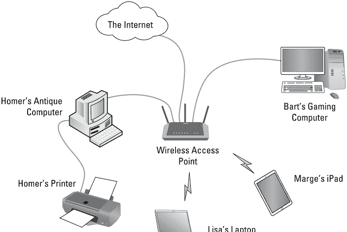
**图1-1：** 典型的网络结构
图1-1展示了一个包含4台计算机的典型网络。你可以看到，4台计算机都通过网线连接到了一个中心网络设备，也就是家用路由器。这种常见于小型网络的设备，实际上由三个不同但功能相关的网络组件构成：
- **路由器：** 将你的计算机连接到互联网
- **交换机：** 让你可以用电缆连接两台及以上的计算机
- **无线接入点：** 让你无需电缆就能把计算机和其他设备连到网络里
在图中你可以看到，两台计算机——巴特的游戏电脑和霍默的那台1989年的老电脑——通过电缆连接到了家用路由器的交换机部分。你还能看到，丽莎的笔记本电脑是通过无线方式接入网络的，玛姬的iPad也是通过无线方式接入网络的。你还能在图中看到，霍默的电脑上连接了一台打印机，得益于网络，巴特、丽莎和玛姬也能使用这台打印机。最后你可以看到，整个网络通过路由器连接到了互联网上。
计算机网络有自己的一套奇怪的行话。你不需要掌握每个晦涩的网络术语，但了解几个基础行话总归有好处：
- **LAN：** 网络常被称为LAN，是*局域网*的缩写。在图1-1中，LAN包括家用路由器，以及通过有线或无线方式直接连接到路由器的计算机和iPad。LAN是本书出现的第一个TLA，也就是*三字母缩写词*。你其实没必要记住它，也没必要记后面出现的众多TLA。事实上，你唯一需要记住的三字母缩写就是TLA。你可能会猜，*四字母缩写词*的缩写是FLA？错！四字母缩写词的缩写是*ETLA*，全称是*扩展三字母缩写词*。毕竟，要是“四字母缩写词”的缩写只有三个字母，那也太不合理了。
- **WAN：** 本书的第二个TLA是WAN。WAN是网络中连接到互联网的部分，全称为*广域网*。等等，严谨来说，WAN其实是*第三个*TLA。第一个TLA是LAN，第二个TLA是TLA本身，所以WAN是第三个TLA。
- **连网状态：** 所有连接到网络的计算机都被称为处于*连网状态*。连网状态计算机的技术术语（你可以不用记）是*节点*，还有一个常用的同义词是*端点*。
- **在线、离线：** 计算机开机且能访问网络时，就处于*在线*状态；无法访问网络时，就是*离线*状态。计算机会离线的原因有很多：可能处于关机状态，可能用户禁用了网络连接，可能电脑出了故障，可能连接网络的电缆被拔了，甚至可能有口香糖堵在了光驱里。
- **运行中、宕机：** 计算机开机且正常运行时，就处于*运行中*状态；关机、故障或正在维护时，就是*宕机*状态。关机的操作有时也叫*停机*，重新开机则叫*启动*。
- **本地、远程：** 像磁盘驱动器这类资源，如果存储在你自己的计算机中，就是*本地*的；如果存储在网络中的其他计算机上，就是*远程*的。
- **互联网：***互联网*是分布在整个星球上的无数计算机网络的集合。把家里或办公室的计算机连成能共享信息的局域网，和把你的计算机连接到全球互联网，是两项独立但相关的操作。


#### 为什么需要网络？
坦白说，搭建计算机网络有点麻烦。那为什么还要费这个劲呢？因为组网带来的益处远大于搭建的难度。你不需要拥有博士学位就能理解组网的好处。事实上，你在幼儿园就学到了所有需要知道的内容：网络的核心就是共享。具体来说，网络主要共享四类内容：文件、资源、程序和消息。

##### 文件共享
网络可以让你和网络上的其他计算机共享信息。根据你的组网方式不同，你可以通过几种不同的方式和网络上的朋友共享文件。你可以把文件作为电子邮件附件，直接从你的计算机发送到朋友的计算机上；也可以让朋友通过网络访问你的计算机，直接从你的硬盘中获取文件；还有一种方法是把文件复制到另一台计算机的磁盘上，然后告诉朋友你存放文件的位置，方便他之后获取。不管用哪种方式，数据都是通过网络电缆传输到朋友的计算机上，而不是像*人肉传网（sneakernet）*那样用CD、DVD或闪存盘传递。

##### 资源共享
你可以将某些计算机资源（比如硬盘或打印机）设置为共享，让网络上的所有计算机都能访问。举个例子，图1-1中连接在霍默计算机上的打印机就是共享资源，这意味着网络上的任何人都可以使用它。如果没有网络，巴特、丽莎和玛姬就得各自买一台打印机。硬盘也可以作为共享资源。事实上，你要和其他用户共享文件的话，就必须把硬盘设置为共享资源。假设巴特想要和丽莎共享一个文件，而霍默的计算机上已经设置了共享硬盘，那么巴特只需要把他的文件复制到霍默计算机的共享硬盘里，然后告诉丽莎存放位置即可。之后丽莎有空的时候，就可以把文件从霍默的计算机复制到自己的计算机上。

你还可以共享其他资源，比如互联网连接。事实上，共享互联网连接是很多人组建网络的主要原因之一。

##### 程序共享
与其在每个人的计算机上分别保存程序副本，不如把程序放在所有人都能访问的共享驱动器上，有时候这么做更划算。举个例子，如果有10个计算机用户都要用同一个特定程序，你可以给每台计算机购买并安装一个程序副本，总共买10份；也可以购买该程序的10用户授权，然后把仅有的一个程序副本安装在共享驱动器上，这样10个用户都能从共享硬盘访问这个程序。不过大多数情况下，通过网络运行共享的程序副本速度慢到无法接受。更常见的网络共享程序的方式是，把程序的安装文件复制到共享网络位置，之后你可以用这个副本给每个用户的本地硬盘安装独立的程序副本。从共享网络驱动器安装程序的好处是，你不需要在每台想要安装该软件的计算机上单独下载软件。而且系统管理员可以自定义网络安装配置，让软件在每台用户计算机上的安装方式都一致。（不过这些好处只有大型网络才明显。如果你的网络不到10台计算机，那你给每台计算机单独下载安装程序反而更划算。）


**WARNING**
请注意，购买单用户版程序后将其放到共享网络位置供整个网络的人使用是违法行为。如果有5个人需要使用该程序，你需要么购买5份程序副本，要么购买明确允许5人或更多用户使用的网络授权。


**TIP**
很多软件厂商在销售软件时会附带并发使用授权，这意味着你可以把软件安装到任意多台计算机上，但同一时间只有固定数量的人可以使用该软件。通常，网络中的一台服务器计算机会运行专门的授权管理软件，用来统计当前正在使用该软件的人数。这类授权通常用于更专业（也更昂贵）的软件，比如会计系统或计算机绘图系统。

##### 消息共享
组网的另一个好处是，网络能让计算机用户通过共享消息的方式在网络上互相沟通。这些消息有很多种形式，电子邮件和即时通讯程序是最常见的。你也可以交换音频或视频消息，比如通过网络召开线上会议。在计算机上连接了廉价视频摄像头（网络摄像头）的网络用户可以进行视频通话。你甚至可以在网络上玩一局友好的“红心大战”游戏——当然，是在午休时间啦。

#### 服务器与客户端
网络中存放着与其他网络计算机共享的硬盘、打印机及其他资源的计算机叫做*服务器*。这个术语会反复出现，所以你必须记住它：把它写在你左手的手背上。任何不是服务器的计算机都是*客户端*。这个术语你也要记住，写在你右手的手背上。网络中只有两类计算机：服务器和客户端。看看你的左手，再看看你的右手。在你记住这两个术语之前，别洗手。
网络中服务器和客户端的划分在社会学中有类似的对应——本质上，就是计算机资源“有产者”和“无产者”之间的一种阶级差异：
- **»** 网络中性能最强、价格最高的计算机通常是服务器。这有很好的技术原因：网络上的所有用户都会共享服务器的资源。
- 网络中价格更低、性能更弱的计算机是客户端。*客户端*是个人用户日常工作中使用的计算机。因为客户端的资源不需要共享，所以不需要太高端。
- 大多数网络的客户端数量多于服务器。举个例子，一个拥有10台客户端的网络，大概1台服务器就够用了。
- 很多网络中，服务器和客户端之间有明确的分界线。换句话说，一台计算机要么作为服务器运行，要么作为客户端运行，不能同时担任两种角色。为了保证网络高效运行，服务器不能变成客户端，客户端也不能变成服务器。
- 其他（通常是规模较小的）网络可以采取更平等的策略，允许网络中的任何计算机作为服务器，也允许任何计算机同时担任服务器和客户端的角色。

#### 专用服务器与对等网络
在某些网络中，服务器计算机就只是服务器，不做其他任何事情。它唯一的任务就是提供硬盘、打印机等共享资源，供网络客户端计算机访问。这类服务器叫做*专用服务器*，因为它除了提供网络服务之外，无法执行任何其他任务。
一些小型网络则采用另一种方案：允许网络中的任何计算机同时担任客户端和服务器的角色。这样一来，任何计算机都可以把自己的打印机和硬盘共享给网络上的其他计算机。而且当一台计算机作为服务器运行时，你依然可以用它执行其他功能，比如文字处理。这类网络叫做*对等网络*，因为网络中所有计算机都被视为*对等*的，也就是地位平等。
以下是关于专用服务器网络和对等网络区别的一些思考点，你明天遛狗的时候可以琢磨琢磨：
- **»** 对等网络功能是Windows系统内置的。因此如果你的计算机运行的是Windows系统，你不需要购买任何额外软件就能把你的计算机变成服务器，只需要启用Windows的服务器功能即可。
- **»** Windows桌面版（比如Windows 10）内置的网络服务器功能效率并不高，因为这些版本的Windows本来就不是主要设计用来当网络服务器的。如果你要把一台计算机专门用作全职服务器，最好使用专用的服务器操作系统，而不是普通的Windows桌面操作系统。服务器操作系统是专门为高效处理网络功能设计的。

- 最常用的服务器操作系统是Windows的服务器版本。截至本文写作时，Windows最新的服务器版本是Windows Server 2019。不过很多公司仍在使用上一代版本（Windows Server 2016），还有少数公司甚至用更早的前代版本，比如Windows Server 2012和Windows Server 2008。
- 另一个很受欢迎的服务器操作系统是*Linux*。Linux受欢迎是因为它是免费的。不过它的搭建比Windows Server需要更多的专业知识。
- **»** 很多网络同时是对等网络*和*专用服务器网络。这类网络具备以下特征：
- 至少有一台运行服务器操作系统（比如Windows Server 2019）的服务器计算机
- 使用Windows服务器功能把资源共享给网络的*客户端*计算机

- **»** 除了要专用之外，你的服务器还应该足够“真诚”。


#### 网络是如何运作的？
使用网络并不需要你真的了解它的运作原理。不过，如果你知道网络运行并非靠神秘巫术，使用时可能会安心不少。网络看似神奇，实则不然。
以下列表介绍典型网络的内部运作原理：
- 网络接口：任何接入网络的计算机内部都有一个特殊的电子电路，称为网络接口。网络接口要么带有一个外部插孔，可供插入网线；如果是无线网络接口，则会配备天线。
- 网线：网线用于物理连接计算机，插入到计算机背部的网络接口卡（NIC）上。最常用的网线是双绞线，之所以这么叫，是因为它由若干对按特定方式绞合在一起的导线组成。双绞线在外观上和电话线有些相似，但切勿被外表迷惑——大多数电话系统使用的是更低等级的线缆，无法用于网络。关于网线的详细介绍，请参阅第7章。使用无线网络时无需网线，更多关于无线网络的信息可参阅第8章。
- 网络交换机：采用双绞线布线的网络需要一个或多个交换机。交换机是一个带有多个线缆接口的盒子，网络中的每台计算机都通过线缆连接到交换机，交换机则负责让所有计算机相互连通。关于网络交换机的更多信息，请参阅第7章。双绞线网络早期使用的是被称为集线器的设备而非交换机。“集线器”这个词有时也用来指代交换机，但真正的集线器大约在世纪之交时就已被淘汰。在只有几台计算机的小型网络中，网络交换机通常会和另一种名为路由器的网络设备集成在一起。路由器用于连接两个网络，通常会被用来将你的网络连接到互联网。将路由器和交换机集成在同一个设备中，就能轻松让多台计算机既接入互联网，又能相互连通。
- 网络软件：当然，网络需要靠软件才能运行。要让任何网络正常工作，都需要正确配置大量软件。如果要搭建Windows对等网，需要调整控制面板的相关设置才能让网络运行；而像Windows Server 2019这样的网络操作系统，也需要进行大量调整才能正常工作。


#### 它不再是个人电脑了！
如果我要你从本章中记住一个要点，那一定是这个：一旦把你的个人电脑（PC）接入网络，它就不再是“个人”电脑了。你已经成为了计算机网络的一部分，某种意义上，你也放弃了当初让个人电脑大获成功的一个核心理念：独立性。
我接触计算机的时候，还是大型机统治天下的年代。大型机是体型庞大、结构复杂的机器，曾经占据整个房间，还需要用冷水降温。我早年用过IBM System 370 Model 168，它只有区区8MB内存。（我写这本书用的电脑内存是它的3000倍。）维持大型机运行需要配备一大批穿白大褂的程序员和操作员。大型机需要被精心管理，围绕其管理还形成了一整套官僚体系。曾经大型机是工作场所的主流计算机，个人电脑彻底改变了这一切：它把计算能力从大大的计算机房里解放出来，放到了属于用户的桌面上。个人电脑切断了和大型机集中控制体系的关联，用户可以看着自己的电脑说：“这是我的——完完全全属于我！”
大型机至今仍然存在，但早已不比当年普及。不过网络彻底改变了这一切。某种程度上，这又回到了大型机的运作思路：集中部署、资源分布式访问。没错，网络不需要单独占用一栋建筑，但你再也无法把“属于你的”个人电脑当成自己的私有财产了。你是网络的一部分，和大型机一样，网络也需要被精心管理。
以下是网络剥夺你独立性的几种方式：
- 不能随意删除网络中的文件，因为这些文件可能并不属于你。
- 你必须关注网络安全。例如，服务器计算机在允许你访问其文件前，需要先确认你的身份，因此你需要记住自己的用户ID和密码才能接入网络。这一预防措施可以防止某个15岁的孩子通过办公室网络的互联网连接黑进系统，偷走你所有的电脑游戏。
- 使用共享资源可能需要排队。比如巴特把文件发到霍默的打印机，并不意味着打印机立刻就会开始打印，因为可能丽莎之前已经发了一份需要打印2小时的任务，巴特只能等着。
- 访问文档也可能需要等待。比如你想从网络驱动器里取一份Excel电子表格，却发现其他人正在使用它，你也只能排队等着。
- 存储空间不是无限的。如果你把一个100GB的视频文件拷贝到服务器硬盘上，之后可能会收到愤怒的同事打来的电话，抱怨服务器硬盘没有空间存他们的重要文件了。
- 你的文件可能会被网络上其他人传来的病毒感染，你还可能不小心把病毒传染给其他网络用户。
- 把敏感文件保存在服务器上需要格外小心。如果你写了一份吐槽老板的愤怒留言，存在服务器硬盘上，你的老板可能会找到这份备忘录并看到内容。
- 服务器必须一直保持开机运行状态。例如，如果你把霍默的电脑改成服务器，那霍默外出时就不能关电脑，否则你就无法访问他电脑里存储的文件。
- 如果你的电脑是服务器，你也不能在用完后直接关机，因为可能其他人正在访问你硬盘里的文件，或者用你的打印机打印。

#### 网络管理员
哪怕是最简单的网络也可能出现各种问题，因此指定一名网络管理员非常重要。这样一来，就有人负责确保网络不会瘫痪或陷入混乱。
网络管理员不一定得是技术天才，事实上，部分最优秀的网络管理员在技术方面完全就是白痴。重要的是管理员要有条理。他们的工作是确保文件服务器有足够的可用空间、定期备份文件服务器、新员工可以接入网络，以及其他相关任务。
网络管理员的工作还包括解决用户自己搞不定的基础问题，以及在发生严重故障时知道该什么时候找专家求助。这是份苦差事，但总得有人来做。
以下有几个小建议或许能帮到你：
- 本书第四部分完全是写给倒霉的网络管理员的。如果你被推选了管理员，就读一读这部分的内容。如果你幸运地选了别人当管理员，那就买一本本书送给她庆祝一下吧。
- 小公司通常用抽签的方式选网络管理员，抽到最短签的人就当管理员。
- 当然，网络管理员也不能完全是个技术白痴，刚才那是开玩笑的。（在国会的各位，这种行为叫*作证*哦。）我故意夸大其词，是想强调组织能力比技术能力更重要。网络管理员需要掌握各类维护任务的操作方法，虽然这些知识至少需要一点点技术常识，但组织能力才是更重要的。

#### 他们有你没有的东西？
面对这么多技术方面的麻烦，你可能开始怀疑，电脑接入网络后自己是否还够聪明能用得好。我可以明确告诉你，你完全没问题。
既然你知道自己需要网络，还聪明到买了这本书，那网络装好后你绝对有能力使用它，甚至自己安装和管理网络都不在话下，这又不是什么高深莫测的尖端科技。
我认识很多常年都用网络的人，他们并不比你聪明，但确实有你没有的一样东西：一张证书。
因此，我以计算机障碍者国际协会授予我的权限，向你颁发图1-2中的证书，确认你已经获得了令人艳羡的头衔**认证网络菜鸟**，简称CND。
在某些圈子里，这个头衔的认可度远比真正的网络专家佩戴的刻板的CNE、MCSE徽章高得多。
恭喜你，祝你使用网络愉快。


#### 网络小白证书
兹证明____已晋升为**认证网络小白**神圣教团成员，自此享有该身份所赋予的一切权利与特权，过往的一切头疼与挫败，以及各地的披萨和Jolt可乐。
如是书写，如是执行。

道格·洛
国际认证网络小白协会主席
图1-2：你的官方CND证书
#### 本章内容
- 为Windows和Mac客户端配置网络连接
- 修改计算机名称
- 加入域
### 第2章 配置Windows和Mac客户端
使用网络最基础的环节之一，就是配置计算机以接入网络。具体来说，你需要配置每台客户端计算机的网络接口以确保其正常运行，同时安装正确的协议，让客户端能够与网络上的其他计算机通信。
幸运的是，在Windows中配置客户端的网络是轻而易举的事。首先，Windows会在你启动计算机时自动识别网卡，你只需要确保Windows已经正确安装了网络协议和客户端软件即可。
每一代Windows版本发布时，微软都简化了客户端网络支持的配置流程。本章前半部分会介绍Windows 10的网络配置步骤，旧版本Windows的操作流程与此类似。
配置Mac计算机的网络也同样简单。本章后半部分会介绍如何使用苹果最新的macOS版本——卡塔利娜，配置拨号网络，旧版本macOS的操作流程与此类似。
#### 配置Windows网络连接
Windows通常会自动检测网卡的存在，一般你不需要手动为网卡安装设备驱动。当Windows检测到网卡后，会自动创建网络连接并配置其以支持基础网络协议。不过你可能需要手动修改网络连接的配置。
以下步骤会介绍如何在Windows 10系统中配置网卡：
1. 点击开始图标（或按键盘上的开始按钮），然后点击「设置」，「设置」页面将会出现，如图2-1所示。
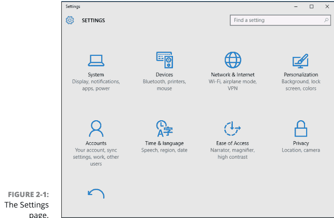
2. 点击「网络和Internet」，「网络和Internet」页面将会出现，如图2-2所示。
3. 点击「以太网」，「以太网」设置页面将会出现，如图2-3所示。
图2-2：「网络和Internet」页面。
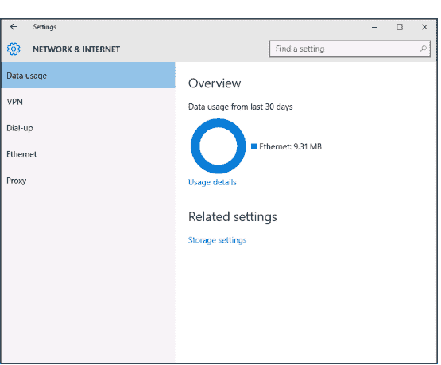
图2-3：「以太网」设置页面。
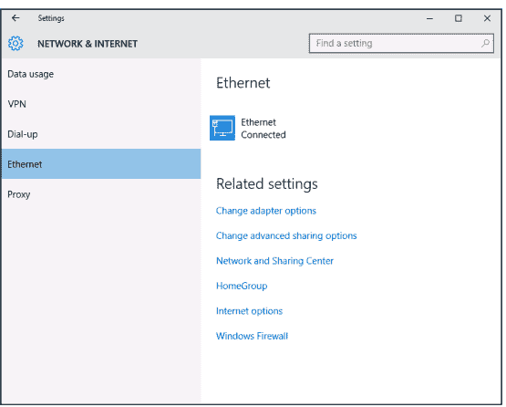
4. 点击「更改适配器选项」，「网络连接」页面将会出现，如图2-4所示。该页面会列出你所有的网卡，本示例中仅显示了一款有线以太网卡。如果设备拥有多块网卡，额外的网卡也会显示在这个页面中。
图2-4：「网络连接」页面。
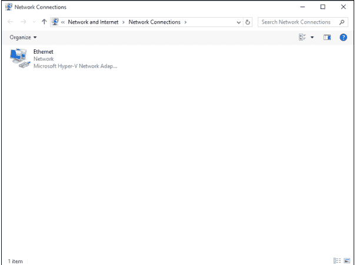
5. 右键点击你要配置的连接，然后在弹出的右键菜单中选择「**属性**」，此时会打开「以太网属性」对话框，如图2-5所示。
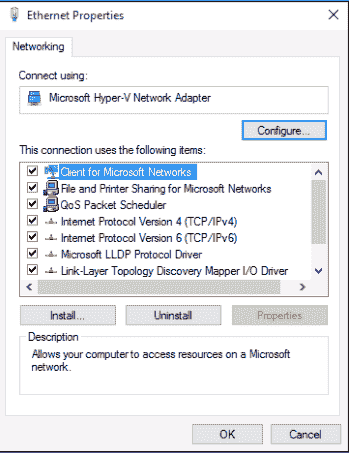
图2-5：「以太网属性」对话框。
6. 要配置网卡设置，点击「配置」按钮，此时会打开网卡的「属性」对话框，如图2-6所示。该对话框共有七个选项卡，可用于配置网卡：
图2-6：网卡「属性」对话框。
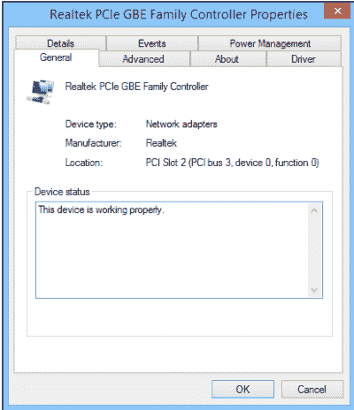
- **常规：** 显示网卡的基础信息，例如设备类型和运行状态。
- **高级：** 可设置多种设备专属参数，影响网卡的运行。
- **关于：** 显示设备的专利保护相关信息。
- **驱动程序：** 显示绑定到网卡（NIC）的设备驱动信息，支持将驱动更新到新版本、回滚到之前的可用版本，或卸载驱动程序。
- **详细信息：** 在该选项卡中可以查看网卡的各类属性，例如设备驱动的日期和版本。要查看特定属性的设置，请在下拉列表中选择对应的属性名称。
- **事件：** 列出设备最近记录的事件。
- **电源管理：** 可配置设备的电源管理选项。

> **提示** 点击「确定」关闭该对话框后，网络连接的「属性」对话框会关闭，你将回到「网络连接」页面（见图2-4）。再次右键点击网卡并选择「属性」即可继续后续操作。
7. 查看「属性」对话框中列出的连接项，你通常会看到以下重要项：
- 适用于Microsoft网络的客户端：如果要访问Microsoft Windows网络，需要启用该选项，因此该选项应当始终存在。
- 适用于Microsoft网络的文件和打印机共享：该选项允许你的计算机与网络上的其他计算机共享文件或打印机。
- Internet协议版本4（TCP/IPv4）：该选项使客户端计算机能够使用第4版标准TCP/IP协议进行通信。
- Internet协议版本6（TCP/IPv6）：该选项启用标准TCP/IP协议的第6版。尽管大多数网络主要依赖IPv4，但通常IPv4和IPv6都会同时启用。

> **提示** 该选项通常用于对等网络，但即使你的网络配备专用服务器，也可以使用该选项。不过如果你不打算在客户端计算机上共享文件或打印机，建议禁用该选项。
8. 如果你需要的协议未在列表中显示，点击「安装」按钮添加所需协议。此时会弹出一个对话框，询问你要添加网络客户端、协议还是服务。点击「协议」，然后点击「添加」，此时会显示可用协议列表，选择你要添加的协议后点击「确定」即可。
9. 要移除不需要的网络项（例如适用于Microsoft网络的文件和打印机共享），选中对应选项后点击「卸载」按钮。出于安全考虑，你应当主动移除所有不需要的客户端、协议或服务。
10. 要配置TCP/IP设置，点击「Internet协议版本4（TCP/IPv4）」，再点击「属性」打开「TCP/IP属性」对话框（如图2-7所示），调整相关设置后点击「确定」即可。「TCP/IP属性」对话框提供以下可选设置：
- 自动获取IP地址：如果你的网络有DHCP服务器可以自动分配IP地址，选择该选项即可。选择该选项可以大幅简化网络中TCP/IP的管理工作。（更多关于DHCP的信息请参见第6章）
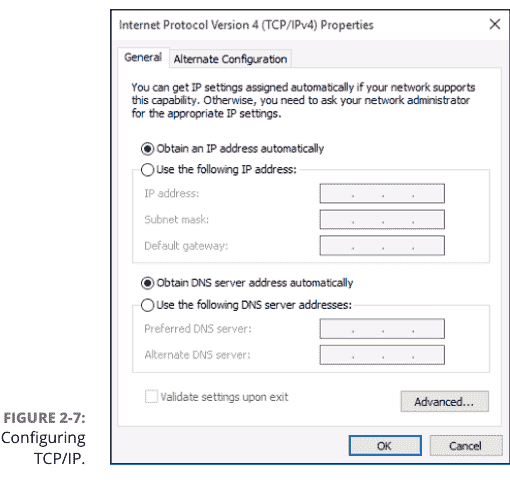
- *使用下面的IP地址*：如果你的计算机需要指定固定的IP地址，选择该选项后输入计算机的IP地址、子网掩码和默认网关地址即可。（这些设置的更多信息请参见第6章）
- *自动获取DNS服务器地址*：DHCP服务器还可以提供计算机应当使用的域名系统（DNS）服务器地址。如果你的网络有DHCP服务器，选择该选项即可。（更多关于DNS的信息请参见第6章）
- *使用下面的DNS服务器地址*：如果无法使用DNS服务器，选择该选项，然后输入主DNS服务器和辅助DNS服务器的IP地址即可。
#### 将Windows计算机加入域
Windows初次安装时并未加入域网络，而是属于工作组的一部分。工作组属于非托管网络，仅适合没有专用服务器、仅由几台计算机组成的小型网络。要在域网络中使用计算机，必须将该计算机加入域。
以下是Windows 10的操作步骤：
1. 点击开始图标（或按键盘上的开始按钮），然后点击「设置」，「设置」页面将会出现（见图2-1）。


2. 点击“系统”。“系统设置”页面随即显示。
3. 点击“关于”。“电脑设置”页面随即显示，如图2-8所示。
**图2-8：** “电脑设置”页面
4. （可选）要更改计算机的名称，请点击“重命名电脑”。系统将提示你输入新名称，然后重启计算机。在将计算机加入域之前，你需要确保计算机名称不会与域中已有的计算机名称重复。如果出现重复，你需要先修改名称。如果修改了计算机名称，重启后需要重复从步骤1开始的整个操作流程。
> **提示**
5. 点击“加入域”。“加入域”对话框随即显示，如图2-9所示。
6. 输入域名，然后点击“下一步”。系统会提示你输入在域中具备管理权限的用户名和密码，如图2-10所示。
7. 点击“确定”。
**图2-9：** 加入域
**图2-10：** 加入域需提供域管理员凭据
8. 按照提示输入管理员账户的用户名和密码。仅当客户端计算机尚未创建对应的计算机账户时，系统才会要求你提供这些信息。
9. 当系统提示你需要重启计算机时，点击“立即重启”。计算机重启后将自动添加到域中。
#### 配置Mac网络设置
每一台出厂的Mac电脑（哪怕是1984年的初代机型）都自带网络支持功能。当然，新款Mac电脑的内置网络功能比老款机型更出色。最新的Mac机型内置了千兆以太网接口、802.11ac无线网络接口，或两者兼具。这些网络连接的支持几乎是自动的，你只需要将Mac接入有线网络，或者连接到无线网络就可以直接使用。
macOS中的大部分网络设置都是自动配置的。如果你想查看或修改默认网络设置，可以按照以下步骤操作：
1. 选择“系统偏好设置”，然后点击“网络”。“网络偏好设置”页面随即显示，如图2-11所示。
**图2-11：** 网络偏好设置
2. 点击“高级”。“高级网络设置”页面随即显示，如图2-12所示。
3. 点击“TCP/IP”标签页。即可打开TCP/IP设置界面，如图2-13所示。在此页面中，你可以查看当前分配给计算机的IP地址。如果需要，你还可以通过将“配置IPv4”的下拉选项从“使用DHCP”改为“手动”来分配静态IP地址，之后即可输入自定义的IP地址、子网掩码和路由器地址。（如需了解更多关于IP地址的信息，请参阅第6章。）
**图2-12：** 高级网络设置
**图2-13：** Mac网络TCP/IP设置
4. 点击“DNS”标签页。即可打开DNS设置界面，如图2-14所示。在此页面中，你可以查看当前使用的DNS服务器，也可以根据需要添加额外的DNS服务器。
**图2-14：** DNS设置
5. 点击“硬件”标签页。即可打开硬件设置界面，如图2-15所示。此标签页中最有用的信息是MAC地址，在配置无线网络安全时可能会用到该地址。（如需了解更多信息，请参阅第8章。）
6. 关闭“网络”窗口。
**图2-15：** 硬件设置
#### 将Mac计算机加入域
如果你在Windows域环境中使用Mac，可以按照以下步骤将Mac加入域：
1. 选择“系统偏好设置”，然后点击“用户与群组”。“用户与群组”页面随即显示，如图2-16所示。
**图2-16：** 用户与群组
2. 选择你想要加入域的用户账户，然后点击“登录选项”。“登录选项”页面随即显示，如图2-17所示。**图2-17：** 登录选项
3. 如果页面左下角的锁图标处于锁定状态，请点击该图标，然后在提示时输入你的密码。默认情况下，用户登录选项处于锁定状态，以防止未经授权的更改。此步骤用于解锁设置，以便你可以执行加域操作。
4. 点击“加入”按钮。系统会提示你输入要加入的域名，如图2-18所示。
**图2-18：** 加入域提示
5. 输入你要加入的域名。输入域名后，对话框会展开，允许你输入域凭据以完成加域操作，如图2-19所示。
**图2-19：** 域凭据输入对话框
6. **输入域管理员账户的名称和密码，然后点击“确定”。** 你将返回“登录选项”页面，该页面会显示你已成功加入域（见图2-20）。
7. **关闭“用户与群组”窗口。**
**图2-20：** 恭喜！你已经成功加入域。
#### 本章内容
- 使用本地资源和网络资源
- 玩转命名规则
- 登录网络
- 使用共享文件夹
- 畅游网络
- 映射网络驱动器
- 使用网络打印机
- 退出网络
### 第3章 网络生活
将个人电脑接入网络后，它就不再是一座孤岛，不会像举着“别踩我”旗帜的排外狂热分子那样与世界隔绝。网络连接会永远改变你的电脑：现在你的电脑是系统的一部分，与网络上的其他计算机相连。你需要操心各种烦人的网络细节，比如使用本地和共享资源、登录并访问网络驱动器、使用网络打印机、退出网络，还有其他说不完的杂事。哎呀，可真麻烦。本章将带你快速了解接入计算机网络后的日常使用体验。
不过遗憾的是，本章部分内容会稍显专业，你可能需要提前准备好口袋笔套（即程序员常用的、用来放置文具防止磨损口袋的配件，此处代指需要提前做好相关知识储备）。
#### 区分本地资源和网络资源
如果你没注意到第1章里的相关说明，那么使用独立计算机与使用网络计算机最重要的区别之一，就在于本地资源和网络资源的区分。
*本地资源*是指直接连接到你的计算机的设备，比如硬盘、打印机、光盘驱动器、U盘等。无论你是否连接到网络，你都可以使用本地资源。
而*网络资源*则是连接到网络服务器计算机的硬盘、打印机、光驱以及其他设备。只有当你的计算机连接到网络后，你才能使用网络资源。
使用计算机网络时，你需要知道哪些资源属于本地资源（归你个人所有），哪些属于网络资源（归整个网络所有）。在大多数网络中，你的C盘和文档文件夹都属于本地资源。如果打印机放在你的电脑旁边，那它大概率是本地打印机。只要你不把这些本地资源共享到网络上，你就可以随意操作这些资源，不会影响网络或其他用户的使用。
请记住以下几点：
- 仅通过外观无法判断一个资源是本地资源还是网络资源。放在你电脑旁边的打印机大概率是本地打印机，但也有可能是网络打印机。硬盘也是如此：你电脑里的硬盘大概率是你个人专属的，但也可能（或部分）被共享到网络上，从而允许其他用户访问。
- 因为专用网络服务器上资源充足，你不仅可以称它们“专用（又靠谱）”，还能夸它们“资源满满”。（啧，抱歉。这又是老掉牙的计算机极客冷笑话之一。）
#### 名称的作用
几乎计算机网络中的所有事物都有名称：计算机本身有名称，使用计算机的人有名称，可以在网络上共享的硬盘、打印机有名称，网络本身也有名称。你不需要知道网络上使用的所有名称，但确实需要了解其中一部分。

- **任何能够使用网络的人都有一个用户名（有时也称为*用户ID*）。** 你需要知道自己的用户名才能登录网络。你还需要知道好友的用户名，尤其是当你想要窃取他们的文件或给他们发送恶意消息时。关于用户名和登录的更多信息，可以在本章后续的“登录网络”部分找到。
- **允许网络用户使用自己的名字作为用户名很有诱惑力，但并非明智之举。** 即使在小型办公室里，你最终也会遇到命名冲突。（那苏斯博士笔下知名的麦凯夫夫人呢？她育有23个孩子，却给所有孩子都取名为戴夫？）因此需要制定统一的用户名生成规则。例如，你可以使用自己的名字加上姓氏的前两个字母，那么莉萨的用户名是Lisasi，巴特的是Bartsi。或者你也可以用名字的首字母加上完整姓氏，那么莉萨的用户名是lsimpson，巴特的是bsimpson。（在大多数网络中，用户名的字母大小写不敏感，因此bsimpson和BSimpson是同一个用户名。）
- **网络中的每台计算机都有唯一的计算机名称。** 你不需要知道网络中所有计算机的名称，但如果你知道自己的计算机名称以及需要访问的服务器计算机的名称，会很有帮助。计算机的名称有时会和其使用者的用户名相同，但这通常不是个好主意，因为在很多公司里，人员流动比计算机更频繁。有时名称会标识计算机的物理位置，例如office-12或back-room。服务器计算机的名称通常会反映使用该服务器的主要群体，例如acctng-server或cad-server。有些网络爱好者喜欢分配给计算机一些听起来很技术范儿的名称，比如BL3K5-87a。还有些人喜欢用科幻电影中的名字，比如《*2001：太空漫游*》里的HAL、《*星际迷航*》里的M5或Data，以及《*忍者神龟*》里的Overmind。像Herbie这类可爱的名称是不被允许的。（不过，跳跳虎和小熊维尼完全是被接受的——实际上是被推荐的，网络可是跳跳虎最喜欢的东西呢。）通常，计算机命名的合理做法是使用带数字的名称，例如computer001或computer002。
- **网络资源（例如共享磁盘文件夹和打印机）都有名称。** 例如，一台网络服务器可能有两台打印机，分别命名为`laser`和`ink-jet`（用于标识打印机类型），以及两个共享磁盘文件夹，分别命名为`AccountingData`和`MarketingData`。基于服务器的网络设有网络管理员的用户名。如果你使用管理员的用户名登录，就可以执行任何你想做的操作：添加新用户、定义新的网络资源、修改莉萨的密码，等等。管理员的用户名通常是比较特别的名称，例如Administrator。网络本身也有名称，Windows系统中有两种基本类型的网络：
  - **域网络**是拥有专用服务器且配有IT人员维护的大型企业环境中的常见选择。
  - **工作组网络**更常见于没有专用服务器或IT人员的小型办公室或家庭环境。
域网络的标识名称正如你所料——*域名*。而工作组网络的标识名称呢——鼓声起——*工作组名*。无论你使用哪种类型的网络，都需要知道这个名称才能接入网络。

#### 登录网络
要使用网络资源，你必须将自己的计算机连接到网络，并且需要经历绝密的登录流程，这是你向网络表明身份的方式，以便网络判断你是不是“自己人”。登录有点像兑现支票，你需要两种身份证明：
- **用户名**：网络识别你的名称。你的用户名通常是你真实姓名的某种变体，比如巴特的用户名是*Cosmo*。所有使用网络的人都必须有用户名。
- **密码**：只有你和网络知道的秘密单词。如果你输入正确的密码，网络就会相信你是你所声称的那个人。每个用户的密码都不同，且必须保密。
在计算机网络发展的早期，你需要在简陋的MS-DOS提示符下输入登录命令，然后提供你的用户ID和密码。如今，Windows的优势在于你可以通过专用的网络登录屏幕登录网络。图3-1展示了Windows 10版本的该对话框。
图3-1：登录Windows 10系统。
提示以下是更多值得思考的登录要点：
- *user ID*和*logon name*有时会被用来替代*username*，这三个术语的含义完全相同。
- 既然提到了含义相同的术语，*log in*和*log on*意思相同，*log out*和*log off*也分别对应，都表示“我要下线了”。尽管现实世界中你会看到这两种用法并存，但本书通篇使用*log on*和*log off*——如果有任何例外情况，本书会说明原因并稍微吐槽一下。
- 对于网络来说，你和你的计算机并不是同一个实体。你的用户名指的是你本人，而非你的计算机。这就是为什么你拥有用户名，而你的计算机拥有计算机名称的原因。你可以使用自己的用户名从任何连接到网络的计算机上登录网络。其他用户也可以使用他们自己的用户名在你的计算机上登录。当其他用户使用他们自己的用户名在你的计算机上登录时，他们无法访问任何受你密码保护的网络文件，但可以访问你未受保护的任何本地文件。因此要注意允许使用你的计算机的人员。
- 如果你在Windows计算机上登录域网络，必须在用户名之前输入域名，两者之间用反斜杠分隔。例如：
```
lowewriter\dlowe
```
其中域名是lowewriter，用户名是dlowe。注意，Windows会记住你上次登录的域名和用户名，因此通常你只需要输入密码即可。如果要登录到其他域或以其他用户身份登录，你需要点击“切换用户”，然后点击“其他用户”图标，输入不同的域名和用户名，以及你要登录的用户的密码。
- 你的计算机可能会被设置为开机时自动登录，这种情况下你不需要输入用户名和密码。这种设置让登录操作更便捷，但也失去了其中的“乐趣”。如果你担心恶意人员进入你的网络或个人文件，这种设置是非常糟糕的。
- 把你的密码当成生命一样守护。我本想告诉你我的密码，但那样的话我就得灭口了。

#### 理解共享文件夹
很久以前，在“前网络时代”（B.N.），你的计算机可能只有一块硬盘，也就是常说的C盘。也许它有两块盘——C盘和D盘。第二块盘可能是另一块硬盘，也可能是CD-ROM或DVD-ROM驱动器。直到今天，这些驱动器的后代依然物理位于你的个人电脑内部，它们就是你的本地驱动器。
不过现在你已经接入网络，你可能会访问到一些不在你的个人电脑内部、而是位于网络中其他计算机上的驱动器。这些网络驱动器可以位于专用的服务器计算机上，在对等网络的情况下，也可以位于其他客户端计算机上。在某些情况下，你可以通过网络访问整个网络驱动器。但在大多数情况下，你无法访问整个驱动器，只能访问网络驱动器上的特定文件夹。无论哪种情况，这些共享驱动器或文件夹在Windows术语中都被称为共享文件夹。


接下来可能会让人困惑：访问共享文件夹最常见的方法是给它分配一个驱动器号。假设服务器上有一个名为*营销*的共享文件夹，你可以为这个共享文件夹分配驱动器号*M:*。之后你就可以通过驱动器*M:*访问这个*营销*文件夹。*M:*驱动器被称为*网络驱动器*，因为它需要通过网络来访问共享文件夹中的数据。为共享文件夹分配驱动器号的操作叫做*映射驱动器*。
共享文件夹可以设置使用权限限制。例如，部分共享文件夹可能会授予你完全访问权限，允许你向其中复制或从中复制文件、删除其中的文件，或是创建或删除文件夹。而其他共享文件夹的访问权限则可能存在一定限制：例如，你可能只能向共享文件夹复制文件或从中复制文件，但无法删除、编辑文件，也无法创建新文件夹。此外，访问受保护的文件夹前，你可能需要输入密码。你在共享文件夹中可使用的磁盘空间也可能存在额度限制。如需了解有关文件共享限制的更多信息，请参阅第13章。
提示：除了访问存储在其他计算机上的共享文件夹外，你也可以将自己的计算机设为服务器，让其他网络用户访问你共享的文件夹。如需了解如何与其他网络用户共享你计算机上的文件夹，请参阅第4章。

#### 共享文件夹的四大妙用
在了解有哪些可用的共享网络文件夹后，你可能想知道该如何使用它们。本节将介绍网络文件夹的四种实用用途。

##### 存储多人需要的文件
如果文件需要供多名用户访问，存储在共享网络文件夹中是很好的选择。如果没有网络，你就需要把文件的副本存储在每个用户的计算机上，还要担心副本同步的问题（无论你多努力，都可能做不到同步）；或者你也可以把文件存在磁盘里，来回传递；又或者你可以把文件存在某一台计算机上，玩“抢椅子”游戏——每当有人需要使用文件时，就得去存放该文件的计算机上操作。而有了网络，你只需要在网络上的共享文件夹中保存一份文件副本，所有人就都可以访问了。

##### 存储个人文件
你也可以把共享网络文件夹当作自身硬盘存储的扩展。例如，如果你用从互联网下载的图片、音频和电影占满了硬盘的所有可用空间，而网络服务器有海量的可用存储空间，那你就不愁没有存储空间了。只要把你的文件存在网络驱动器上就可以了！
以下是存储文件到网络驱动器的一些注意事项：
- 如果网络驱动器设置了其他用户无法访问的私有存储权限，用来存储个人文件最为合适。这样你就不用担心财务部那个爱打探别人隐私的家伙了。
- 不要过度使用网络驱动器。记住其他用户很可能也已经把自己的硬盘占满了，他们也需要使用网络驱动器的空间。
- 把个人文件存储到网络驱动器前，要确认你拥有相应权限。有你妈妈的许可即可。
- 在域网络中，通常会将一个驱动器（一般是H:驱动器）映射到用户的主文件夹。*主文件夹*是每个用户独有的网络文件夹，你可以把它理解为网络版的“文档”文件夹。如果你的网络设置了主文件夹，重要的工作相关文件最好存在这里而不是“文档”文件夹中，因为主文件夹通常会纳入网络的每日备份计划。相比之下，大多数网络*不会*备份你存储在“文档”文件夹中的数据。

##### 设置文件跨用户传输的临时存放点
> “嘿，莉萨，你能把上个月的棒球统计数据发我一份吗？”
> “没问题，巴特。”
但该怎么传呢？如果棒球统计数据文件存储在莉萨的本地硬盘上，她该如何把文件副本传到巴特的计算机上呢？莉萨可以把文件复制到网络驱动器上，之后巴特就可以把文件复制到自己的本地硬盘了。
以下是使用网络驱动器与其他网络用户交换文件时需要注意的事项：
- 记得在对方取走你存在网络驱动器上的文件后，及时删除这些文件！否则网络驱动器很快就会被无用文件占满。
- 在网络驱动器上专门创建一个文件夹，用来存放待传输给其他用户的文件。我喜欢把这个文件夹命名为PITSTOP。
提示：多数情况下，通过电子邮件向其他网络用户发送文件，要比使用网络文件夹更方便。你只需要给其他网络用户发一封带附件的邮件，附上你想要共享的文件即可。通过电子邮件发送文件的优势在于，你不需要操心文件该存在服务器的哪个位置、该由谁来删除这类细节问题。

##### 备份本地硬盘数据
如果文件服务器有足够的可用存储空间，你可以用它来存储硬盘上文件的备份副本。只需要把你想要备份的文件复制到共享网络文件夹中即可。显然，如果你把*所有*数据文件都复制到网络驱动器上，其他用户也这么做的话，网络驱动器很快就会被占满。在开始把文件备份副本存储到服务器上之前，先咨询网络管理员。管理员可能已经设置了专门用于备份的专用网络驱动器。如果你运气好的话，网络管理员还能为你的重要数据设置自动备份计划，这样你就不需要记着手动备份了。希望你的网络管理员也会定期将网络服务器的磁盘内容备份到磁带中。（没错，是*磁带*——具体细节请参阅第22章。）这样如果网络服务器出现故障，就可以从备份磁带中恢复数据。

#### 哦，你要去的网络位置
Windows支持通过浏览网络来访问共享文件夹等网络资源。在Windows 7中，从开始菜单中选择“网络”即可。在Windows 10中，打开文件资源管理器（点击任务栏上的“文件资源管理器”图标），然后点击“网络”。
图3-2展示的是Windows 10版本的网络浏览器界面。图3-2中展示的网络仅包含两台计算机：一台运行Windows 10的桌面客户端计算机（WIN10-01），和一台运行Windows Server 2016的服务器计算机（WIN1601）。在实际网络中，你显然会看到超过两台计算机。双击计算机图标即可打开该计算机，查看其上的共享资源列表。例如，图3-3展示的是WIN1601计算机的共享资源。
第一部分 网络入门 46
你也可以从任意Windows应用程序中浏览网络。例如，你正在使用Microsoft Word，想要打开存储在网络共享文件夹中的文档文件时，只需要使用“打开”命令调出对话框，然后在导航窗格中选择“网络”，即可查看可用的网络设备。

#### 映射网络驱动器
如果你经常需要访问某个特定的共享文件夹，可以使用一种叫做**映射**的特殊技巧，来提高访问共享文件夹的效率。*映射*操作会为共享文件夹分配一个驱动器号。之后你就可以使用这个驱动器号访问共享文件夹，就像访问本地驱动器一样。通过这种方式，你可以在任意Windows程序中访问共享文件夹，无需浏览网络。例如，你可以将名为Win1601 Files的服务器上名为Data的共享文件夹，映射到你计算机上的K:驱动器。之后要访问共享Data文件夹中的文件时，直接到K:驱动器中查找即可。
要将共享文件夹映射到驱动器号，请按以下步骤操作：
1. **打开文件资源管理器。**
   - Windows 7：选择“开始”→“计算机”。
   - Windows 8、8.1和10：打开桌面，点击任务栏上的“文件资源管理器”图标，然后在屏幕左侧的**位置**列表中点击**计算机**。
2. **打开“映射网络驱动器”对话框。**
   - Windows 7：点击工具栏上的**“映射网络驱动器”**按钮，打开该对话框。
   - Windows 8和8.1：点击功能区上的**“映射网络驱动器”**。
   - Windows 10：点击**“计算机”**选项卡，然后点击**“映射网络驱动器”**。
   图3-4展示的是Windows 10的“映射网络驱动器”对话框。更早版本的Windows系统的对话框与此类似。
3. （可选）**在“驱动器”下拉列表中更改驱动器号。**
   通常你不需要更改Windows默认选择的驱动器号（在图3-4中是Z:驱动器）。如果你比较挑剔，也可以从“驱动器”下拉列表中选择你想要的驱动器号。


**图3-4：** 映射网络驱动器对话框。
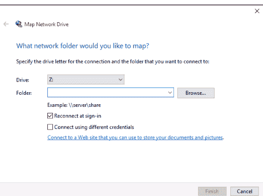
4. **单击“浏览”按钮。** 将出现如图3-5所示的对话框。
**图3-5：** 浏览要映射的文件夹。
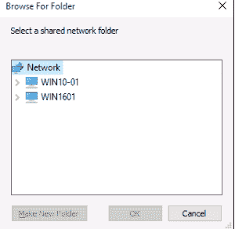
5. **使用“浏览文件夹”对话框查找并选择要使用的共享文件夹。** 你可以导航到网络中任意计算机上的任意共享文件夹。
6. **单击“确定”。** “浏览文件夹”对话框将关闭，你将返回“映射网络驱动器”对话框（见图3-4）。
7. （可选）如果希望每次登录网络时自动映射此网络驱动器，请选中**登录时重新连接**复选框。如果未选中“登录时重新连接”复选框，则该驱动器号仅在关闭Windows或注销网络之前可用。如果选中此选项，则每次登录网络时网络驱动器都会自动重新连接。
> **提示** 如果经常使用该网络驱动器，请务必选中“登录时重新连接”复选框。
8. **单击“确定”。** 你将返回“此电脑”文件夹，如图3-6所示。在此可以看到新映射的网络驱动器。
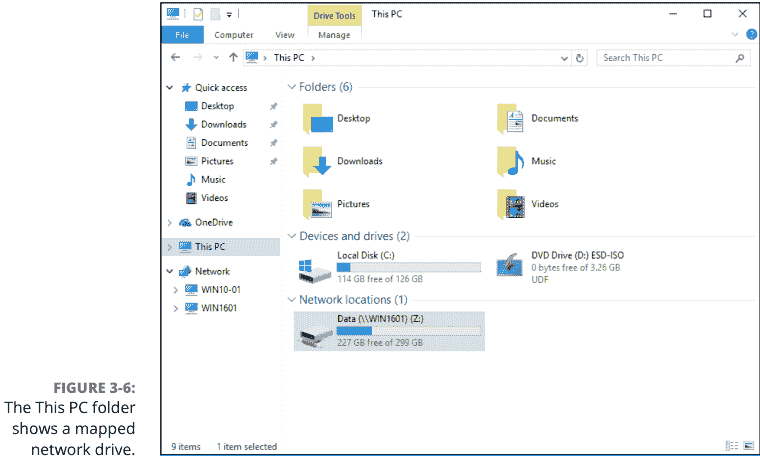

你的网络管理员可能已经在你的计算机上配置了一个或多个已映射的网络驱动器。如果是这样，你可以让她告诉你哪些网络驱动器已被映射，也可以直接打开“此电脑”文件夹查看。以下是一些额外提示：
> **给网络驱动器分配驱动器号的过程，在网迷们口中被称为“映射驱动器”或“链接驱动器”。** “Q盘已被映射到网络驱动器，”他们这么说。
- 网络中不同计算机的网络驱动器号不必按相同的方式分配。例如，在你的计算机上分配为M盘的网络驱动器，在别人的计算机上可能被分配为Z盘。这种情况下，你的M盘和其他计算机的Z盘指向的是同一份数据。这种安排可能会造成混淆。如果你的网络是这么设置的，就往你的网络管理员的咖啡里撒点胡椒粉吧。
- 通过已映射的网络驱动器访问共享网络文件夹，比通过网络浏览访问同一文件夹要快得多。每次浏览网络时，Windows都必须扫描整个网络以列出所有可用的计算机。相比之下，Windows无需扫描网络即可访问已映射的网络驱动器。
- 如果为已映射的驱动器选中了“登录时重新连接”选项（见图3-4），则在登录时如果该驱动器不可用，你会收到警告消息。大多数情况下，问题是你的计算机无法连接到服务器。请仔细检查所有网络连接和设置以确保正常。

#### 使用网络打印机
使用网络打印机和使用网络硬盘非常相似：你可以从任意Windows程序的“文件”菜单中找到“打印”命令，调出“打印”对话框，然后从可用打印机列表中选择网络打印机，即可向网络打印机发送打印任务。但请记住，在网络打印机上打印和在本机打印机上打印并不完全相同：你需要排队等候。在本机打印机上打印时，只有你一个人使用它。但向网络打印机发送打印任务时，你实际上是要排在网络其他用户后面，等候共享打印机。这种排队情况会在几个方面让事情变复杂：
- 如果有多个用户同时向网络打印机发送打印任务，网络必须将各个打印任务分开处理。如果不这样的话，结果会是一团糟：你268页的报告可能会和工资单混在一起。那可就糟了。不过幸运的是，网络会通过高级打印假脱机功能来处理这种情况。
- 网络打印遵循先到先得的原则。就像我去五金店排队时，排在我前面的人总是要买没有产品代码的东西，我得在那儿等好几个小时，等管道部的人接电话查价格。网络打印可能就是这样：如果有人在你发送半页备忘录之前，往打印机发送了一个耗时两小时的打印任务，你就得等着。
> 你可能同时有一台本机打印机和若干台网络打印机可用。在被迫使用网络之前，你的计算机可能只连接了一台打印机。你可能想用便宜（哎呀，我是说*本地的*）喷墨打印机打印一些文档，而用网络激光打印机打印重要资料。要做到这一点，你需要了解如何使用程序的打印机切换功能。

##### 添加网络打印机
要往网络打印机发送打印任务，首先需要配置计算机以访问要使用的网络打印机。从“开始”菜单打开“控制面板”，然后双击“打印机”图标。如果你的计算机已经配置了网络打印机，则“打印机”文件夹中会显示该网络打印机的图标。你可以通过打印机图标的形状区分网络打印机和本机打印机：网络打印机的图标底部带有一根管道。如果你的计算机尚未配置网络打印机，可以使用“添加打印机向导”添加一台。只需按照以下步骤操作：
1. **打开“控制面板”。**
   - Windows 7或更早版本：选择“开始”→“控制面板”。
   - Windows 8及更高版本：按Windows键，输入**Control**，然后单击“控制面板”图标。
2. **单击“设备和打印机”。**
3. **单击工具栏上的“添加打印机”按钮。** 此步骤将启动“添加打印机向导”，如图3-7所示。
4. **单击要使用的打印机。** 如果找不到要使用的打印机，请向网络管理员索要打印机的*UNC路径*（即用于在网络中标识该打印机的名称）或其IP地址。然后单击“我没有找到所需的打印机”，并在提示时输入打印机的UNC路径或IP地址。
5. **单击“下一步”添加打印机。** 向导会将网络打印机的正确驱动程序复制到你的计算机中。（你可能会收到添加驱动程序的确认提示。如果出现该提示，请单击“安装驱动程序”继续。）

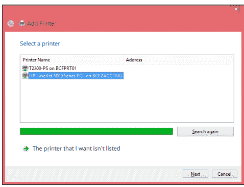
**图3-7：** “添加打印机向导”提示你选择打印机。“添加打印机向导”会显示一个显示打印机名称的屏幕，并询问你是否要将该打印机设为默认打印机。
6. （可选）**将该打印机设为默认打印机。**
7. **单击“下一步”继续。** 将显示最终确认对话框。
8. **单击“完成”。** 设置完成！
> **提示：** 许多网络打印机（尤其是较新型号）通过内置以太网卡直接连接到网络。设置这类打印机可能比较麻烦，你可能需要请网络管理员协助安装这类打印机。（部分直接连接网络的打印机有自己的网页地址，例如Printer.SimpsonFamily.com。如果是这种情况，你通常只需点击一两次即可完成打印机设置：用浏览器打开打印机的网页，然后单击可安装打印机的链接即可。）

##### 向网络打印机发送打印任务
在Windows中安装网络打印机后，向网络打印机发送打印任务就非常简单了。你可以从任意Windows程序的“文件”菜单中找到“打印”命令，调出“打印”对话框，然后从列表中选择网络打印机，即可向其发送打印任务。例如，图3-8显示的是Windows自带免费文本编辑程序WordPad的“打印”对话框。可用的打印机列在该对话框的上方位置，从列表中选择网络打印机即可。


##### 操作打印队列
当你把文档发送到网络打印机后，通常无需担心后续问题。你只要走到网络打印机旁，瞧！打印好的文档已经在那里等着你了。这就是理想状态下的情况。但在我们日常所处的现实世界中，从你把打印任务提交给网络打印机到任务开始打印的这段时间里，可能会发生各种意外：
- 你会发现已经有其他人先提交了一份长达50万亿页的报告，这份报告的打印预计要等到国债还清才能完成。
- 某种framis阀门的价格突然上涨2美元，让你在报告中提出的建议变得毫无意义。
- 你的老板打来电话，告诉你他的内兄要参加会议，所以能不能麻烦你再打印一份提案原件给他？哦对了，复印件不行，只要原件。
- 你打算去吃午饭，不想在回来之前打印输出。

幸运的是，即便你已经把打印任务发送到网络打印机，它也并非完全不受控制。你可以轻松修改已提交任务的状态：可以调整打印任务的先后顺序，可以暂停任务直到你手动解除暂停后再打印，也可以直接取消任务。你或许还能让你的网络打印任务完成其他花样：握手、打滚、装死。不过掌握最基础的操作——暂停、取消、调整打印顺序——就足够你入门了。

要操作打印队列，在Windows 7或更早版本中，依次选择「开始」>「控制面板」打开控制面板；或者按下Windows键，输入「控制面板」，再点击控制面板图标。之后点击「设备和打印机」，双击你想要管理的打印机图标。此时会弹出一个与图3-9相似的窗口，你会发现打印机当前仅收到了一份打印任务。

**图3-9：** 管理打印队列。

要操控打印队列或打印机中显示的打印任务，可以使用以下方法：
- **临时暂停某个打印任务：** 选中该任务，依次选择「文档」>「暂停打印」。再次选择相同命令即可解除任务的中止状态，开始打印。
- **删除某个打印任务：** 选中该任务，依次选择「文档」>「取消打印」。
- **暂停打印机：** 依次选择「打印机」>「暂停打印」。要恢复打印，再次选择该命令即可。
- **删除所有打印任务：** 依次选择「打印机」>「清除打印文档」。
- **插队打印：** 将你想要优先打印的任务拖拽到列表顶部。

以上操作仅适用于你自己的打印任务。遗憾的是，你不能随意删除其他人的打印任务。

#### 注销网络
用完网络后请注销。注销网络后，网络驱动器和网络打印机将无法使用。你的电脑仍然保持物理连接（除非你用修枝剪剪断网线——这可不是个好主意，千万别这么干！），但你将无法访问网络及其资源。

> **►** 关闭电脑后，系统会自动注销网络。下次启动电脑后，你需要重新登录网络。
> 如果你需要暂时离开电脑，最好注销网络。只要电脑仍处于网络登录状态，任何人都可以使用它访问网络。而且由于未授权用户会以你的用户身份登录，他们造成的任何损失都会由你承担。
> **► 在Windows系统中**，你可以点击「开始」按钮，选择「注销」命令来注销网络，这个过程无需重启Windows：
> > - *Windows 7系统*：点击「开始」，再点击小锁图标右侧的向右箭头。
> > - *Windows 8、8.1和10系统*：按下Ctrl+Alt+Del组合键，然后选择「注销」。

| 本章内容 |
| --- |
| » 将你的电脑变成网络服务器 |
| » 与网络用户共享文件夹 |
| » 使用公共文件夹 |
| » 共享你的打印机 |
| » 在网络上使用Office |
| » 离线处理文件 |

### 第4章：更多使用网络的方式
第3章为你介绍了网络使用的基础操作：登录网络、访问共享网络文件夹中的数据、打印以及注销网络。在本章中，我们将深入学习更高级的内容：你会了解到如何将电脑设置为可共享自身文件和打印机的服务器，如何使用最受欢迎的网络应用之一——电子邮件，以及如何在网络上使用Office软件。

#### 共享你的资源
你可能知道，网络由两类计算机组成：客户端计算机和服务器计算机。在网络生态中，客户端是资源的使用者——它们使用网络提供的资源，例如共享打印机和磁盘驱动器；服务器是资源的提供者——它们向网络开放自身的打印机和硬盘，供客户端计算机使用。

本章将教你如何将自己常用的Windows客户端电脑变为服务器，让网络中的其他电脑可以使用你的打印机，以及你决定共享的任意文件夹。实际上，你的电脑可以同时作为客户端和服务器运行。

> 当你向网络打印机发送打印任务，或访问存储在其他服务器硬盘上的文件时，你的电脑是**客户端**。
> 当其他人向你家的打印机发送打印任务，或访问存储在你电脑硬盘上的文件时，你的电脑是**服务器**。

##### 启用文件和打印机共享
要与其他网络用户共享文件或打印机，你必须先启用Windows的「文件和打印机共享」功能。未安装该功能时，你的电脑只能作为网络客户端，无法作为服务器使用。

如果你的电脑已经默认启用了「文件和打印机共享」功能，你可以跳过后续步骤。验证方法如下：打开Windows资源管理器，在导航窗格中右键点击「桌面」，如果弹出的菜单包含「共享」命令，说明该功能已启用。如果找不到「共享」命令，请按照以下步骤操作：
1. **点击**「开始」按钮，输入「网络和共享中心」，**按下Enter键**。这一步会打开「网络和共享中心」窗口。
2. **点击**「更改高级共享设置」。此时会显示「高级共享设置」页面。
3. **点击**你要启用文件和打印机共享的局域网类型右侧的向下箭头。
   - 如果是**家用电脑**：点击「家庭/工作」（Windows 7）或「专用」（Windows 8及更高版本）右侧的向下箭头。
   - 如果是**在公共场所使用的电脑**：点击「来宾/公用」右侧的向下箭头。
   - 如果是**连接到域网络的电脑**：点击「域」右侧的向下箭头。

图4-1展示的是域网络的设置，「家庭」「来宾」「公用」网络的设置与之相同。

**图4-1：** 启用文件和打印机共享。

> **警告** 不要为公用网络启用文件或打印机共享功能。在公用网络上启用该功能会暴露你的电脑数据，让同一公用网络上的其他用户可以访问。
4. 勾选**「启用文件和打印机共享」选项**。
5. 点击**「保存更改」按钮**。该操作会保存你的设置并关闭「高级共享设置」页面。

##### 共享文件夹
若要允许其他网络用户访问你硬盘上的文件，你需要将硬盘中的一个文件夹指定为*共享*文件夹。如果你愿意，也可以共享整个硬盘。如果共享整个硬盘，其他网络用户可以访问硬盘上的所有文件和文件夹；如果仅共享某个文件夹，网络用户只能访问该文件夹内的文件（如果你共享的文件夹中还包含其他子文件夹，网络用户也可以访问这些子文件夹中的文件）。

> **警告** 不要共享整个硬盘，除非你愿意授予*网络上的所有人*权限，让他们可以随意浏览你硬盘上的所有文件。相反，你应该只共享包含你想让他人访问的特定文档的文件夹。例如，如果你把所有Word文档都存储在

“我的文档”文件夹，你可以共享你的“我的文档”文件夹，以便其他网络用户能够访问你的Word文档。要在Windows桌面版系统中共享文件夹，请按以下步骤操作：
1. **打开文件资源管理器。**
   - Windows 10：打开桌面，点击任务栏上的文件资源管理器图标；然后在屏幕左侧的“位置”列表中点击“计算机”。
   - Windows 7：选择“开始”→“计算机”。
2. **导航至你想要共享的文件夹。**
3. **右键点击你想要共享的文件夹，然后选择“属性”。** 此时将弹出“属性”对话框。
4. **点击“共享”选项卡，再点击“共享”按钮。** 此时将弹出“文件共享”对话框，如图4-2所示。
   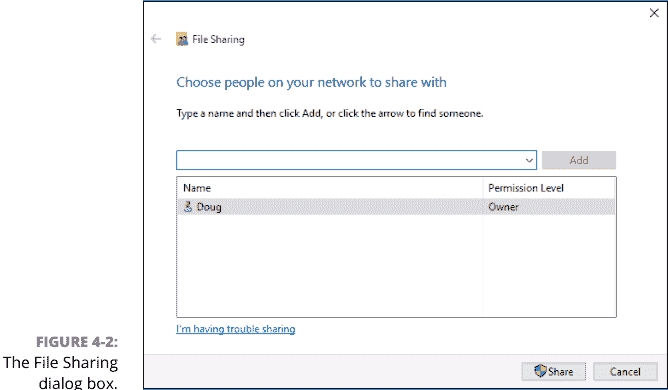
5. **点击下拉列表中的箭头，选择“所有人”，然后点击“添加”。** 该操作将允许网络中任何人都能访问此共享文件夹。如果你愿意，也可以仅允许特定用户访问：选择你希望授予访问权限的每个用户，然后点击“添加”即可。
6. **选择你要授予每个用户的访问级别。** 你可以使用“权限级别”列中的下拉列表选择三种访问级别之一：
   - *读取者*：读取者可以打开文件，但无法修改文件或创建新文件/文件夹。
   - *参与者*：参与者可以向共享位置添加文件，但仅能修改或删除自己上传的文件。
   - *所有者*：所有者对共享文件夹拥有完全访问权限，可以创建、修改或删除文件夹中的任意文件。
7. **点击“共享”。** 此时会弹出确认对话框，提示文件夹已成功共享。

###### 使用公共文件夹
Windows提供了另一种网络文件共享方式：公共文件夹。*公共文件夹*是系统自动设置为公开访问的文件夹，你保存在该文件夹中的所有文件，网络中的其他用户以及登录你电脑的任意用户都可以访问。
使用公共文件夹前需要先启用它。只需遵循本章前面“启用文件和打印机共享”小节中列出的步骤，在Windows 10中选择“所有网络”下的“启用共享”选项，在更早版本的Windows中选择“公共共享设置”即可。
启用公共文件夹共享后，在Windows 7系统中，你可以通过选择“开始”▶“计算机”，展开左侧窗格中的“库”项，再展开“文档”“音乐”“图片”或“视频”项，来访问自己电脑上的公共文件夹。
在Windows 8及更高版本系统中，打开桌面，点击任务栏上的文件资源管理器图标，展开左侧窗格中的“库”项，再展开“文档”“音乐”“图片”或“视频”项即可。
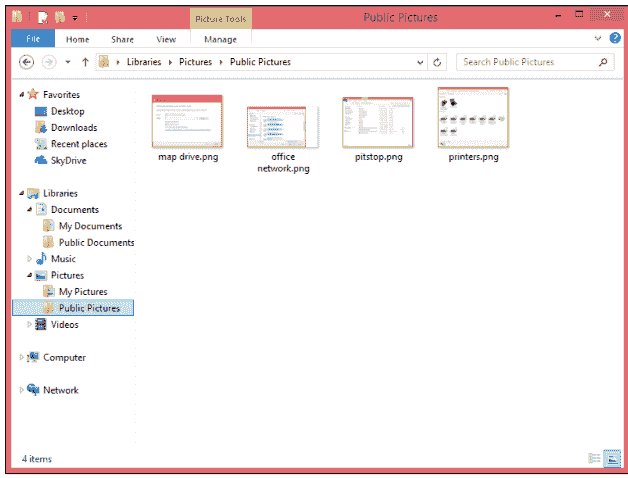

> **提示** 要访问其他电脑的公共文件夹，可以使用第3章中介绍的方法，浏览到公共文件夹或将其映射为网络驱动器。

##### 共享打印机
共享打印机比共享硬盘麻烦得多。共享硬盘时，其他网络用户只是偶尔访问你的文件，你会听到硬盘咔哒响几声，电脑可能会卡顿半秒左右。其他用户访问硬盘造成的干扰有时能被注意到，但很少会令人烦躁。
但共享打印机时，你就会体会到墨菲定律的威力：你走廊那头的同事很可能在你急着打印一份必须在两分钟内放到老板桌上的1页备忘录的前一刻，往你的打印机发了一份140页的报告。打印机可能会在其他人打印任务进行时耗尽纸张——更糟糕的是卡纸——而解决这个问题的责任却落到你头上。
尽管这些干扰可能很烦人，但在某些场景下共享打印机仍然很有必要。如果你的办公室或工作组里只有你这一台好用的打印机，大家不管怎样都会缠着你要用。你不如直接把打印机共享到网络上，至少这样他们不会堵在你门口求你帮他们打印文件。
共享打印机请按以下步骤操作：
1. **打开控制面板。**
   - *Windows 10、8.1和8*：按下Windows键，输入**控制**，然后点击控制面板图标。
   - *Windows 7*：选择“开始”→“控制面板”。
2. **点击“设备和打印机”。**
3. **右键点击你想要共享的打印机，然后选择“打印机属性”。** 此时将弹出打印机的“属性”对话框。
4. **点击“*共享*”选项卡。** 此时将弹出“共享”选项卡，如图4-4所示。你会发现共享打印机的相关选项处于禁用状态。
5. **选择“共享此打印机”选项。**
6. **（可选）如果你不喜欢Windows推荐的共享名称，可以自行修改。** 由于其他电脑会通过共享名称识别共享打印机，建议设置一个描述性强的名称。
7. **点击“确定”。** 你将返回“打印机”文件夹，打印机的图标会被修改，以标识该打印机已被共享。
   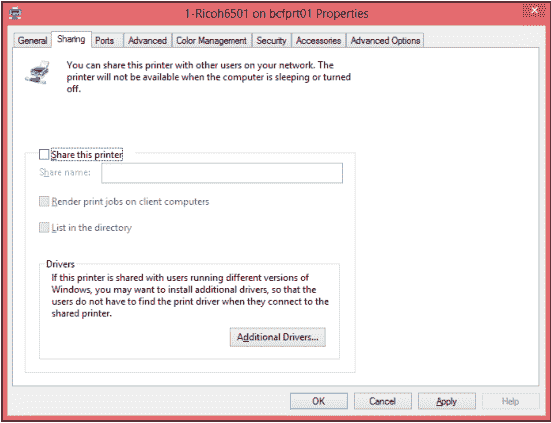
**图4-4：共享打印机。**
要将共享打印机从网络中移除，使其他网络用户无法访问，请按上述步骤的前4步操作，取消勾选“共享此打印机”复选框，然后点击“确定”即可。

##### 在网络上使用Microsoft Office
Microsoft Office是个人电脑上最流行的应用程序套件，没有之一，它包含了办公室中最常用的几类应用程序：文字处理程序（Word）、电子表格程序（Excel）、演示文稿程序（PowerPoint）以及一款出色的电子邮件程序（Outlook）。
根据你购买的Office版本不同，你可能还会得到数据库程序（Access）、桌面排版程序（Publisher）、一套Ginsu刀具（KnifePoint）以及切片切丁工具（ActiveSalsa）。

> 提示：要在网络上充分利用Office，你应该下载Office部署工具包。该工具可以帮你创建Office应用的简易即点即用安装程序，你只需在常用的搜索引擎中搜索“Office Deployment Kit”就能轻松找到它。

#### 访问网络文件
打开存储在本地驱动器上的文件几乎一样简单。所有Office程序都通过“文件”▶“打开”调出“打开”对话框，如图4-5所示的是Excel版本中的该对话框。（其他Office程序中的“打开”对话框几乎完全一致。）

**图4-5：Excel中的“打开”对话框。**
要访问已映射为驱动器号的网络卷中的文件，你只需要使用对话框顶部的下拉列表选择对应的网络驱动器即可。
你也可以直接在“打开”对话框中映射网络驱动器：导航至你想要映射的文件夹，右键点击该文件夹，然后选择“映射网络驱动器”即可。

> 如果你尝试打开已被其他网络用户打开的文件，Office会提示该文件正在使用中，并询问你是否要打开该文件的只读版本。你可以阅读和编辑只读版本，但Office不允许你覆盖原有的文件版本。你需要使用“另存为”命令，将修改后的内容保存为新文件。

##### 使用工作组模板
尽管偶尔向Office之神“献祭”或许能让你的电脑使用体验更顺畅，但模板可不是用来供奉的。实际上，模板是一种特殊的文档文件，它存储了格式信息、模板文本以及其他自定义设置，你可以把它作为新建文档的基础。
Word、Excel和PowerPoint这三款Office程序，都支持你在新建文档时指定模板。
在Word、Excel或PowerPoint中选择“文件”→“新建”来创建新文档时，你会看到可以选择新文档模板的对话框。
Office自带了一系列常用文档类型的模板，这些模板被归类在“新建”对话框顶部显示的不同选项卡下。
除了Office自带的模板外，你还可以在Word、Excel和PowerPoint中创建自定义模板。如果你希望网络用户制作的文档保持统一的风格，创建自定义模板会非常有用。
例如，你可以创建包含公司信头的“信函”模板，或者包含公司标志的“提案”模板。
Office支持你将模板存储在两个位置，具体存放位置取决于你的使用需求：
> 每个用户本地磁盘驱动器上的“用户模板”文件夹：如果某个用户需要专用模板，可以将其存放在此处。


###### 共享网络驱动器上的“工作组模板”文件夹：
如果你有想要让网络服务器上所有网络用户都能使用的模板，请将它们存放在这里。这种设置仍然允许每个用户创建其他网络用户无法使用的专属模板。
同时使用“用户模板”文件夹和“工作组模板”文件夹时，Office会将两个文件夹中的模板合并，在“新建”对话框中按字母顺序列出。例如，“用户模板”文件夹可能包含名为“空白文档”和“网页”的模板，“工作组模板”文件夹可能包含名为“公司信头”的模板。这种情况下，“新建”对话框中会按以下顺序显示三个模板：空白文档、公司信头、网页。

要设置“用户模板”和“工作组模板”文件夹的位置，请在Microsoft Word中按照以下步骤操作：
- **在Word中新建一个文档，或打开现有文档。** 打开哪个文档都可以。这一步是必需的，因为Word只有在文档处于打开状态时，才允许访问模板文件夹位置。
- **选择“文件”→“选项”。** 此时会打开“Word选项”对话框。
- **单击“高级”选项卡。** 此时会显示高级选项。
- **向下滚动到“常规”部分，然后单击“文件位置”按钮。** 此时会打开“文件位置”对话框，如图4-6所示。
- **双击“工作组模板”选项。** 这一步会打开一个对话框，你可以在此浏览模板文件的位置。
- **浏览到模板文件所在位置，然后单击“确定”。** 你会返回“文件位置”对话框。
- **单击“确定”关闭“文件位置”对话框。** 你会返回“Word选项”对话框。
- **再次单击“确定”。** “Word选项”对话框会关闭。

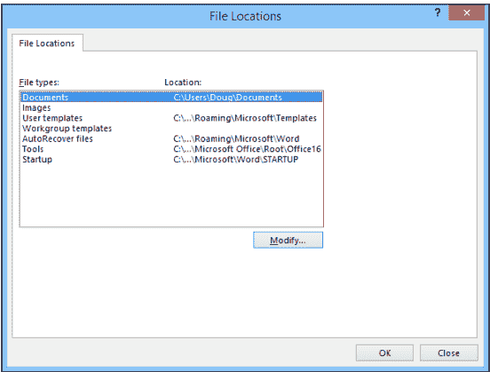

**图4-6：** 设置文件位置。


# 提示
虽然“用户模板”和“工作组模板”设置会影响Word、Excel和PowerPoint，但你只能从Word中修改这些设置。Excel和PowerPoint的“选项”对话框不会显示“用户模板”或“工作组模板”选项。安装Office时，Office附带的默认模板会被复制到计算机本地磁盘驱动器上的一个文件夹中，同时“用户模板”选项会被设置为该文件夹。“工作组模板”选项会保持为空。你可以通过单击“网络模板”、再单击“修改”按钮，然后指定包含你的工作组模板的共享网络文件夹，来设置“工作组模板”文件夹的位置。

###### 共享Access数据库
如果想要让多名网络用户共享一个Microsoft Access数据库，你需要注意一些特殊事项。其中最重要的有以下几点：
- 共享数据库时，多名用户可能会同时尝试访问同一条记录。如果两名或更多用户试图更新同一条记录，就会引发问题。为了避免这种潜在的访问冲突，Access会对该记录加锁，确保同一时间只有一名用户可以对其进行更新。Access共有三种记录锁定方式：
  - **编辑中记录**：只要用户开始编辑某条记录，该方法就会对该记录加锁。例如，如果用户在允许更新记录的窗体中检索到一条记录，Access会在用户编辑该记录期间对其进行加锁，直到第一条记录编辑完成前，其他用户都无法编辑该记录。
  - **无锁定**：该方法并不意味着记录不会被加锁，而是指在用户将更改写入数据库之前，记录不会被加锁。这种方法很容易让用户感到困惑，因为它允许一名用户覆盖其他用户所做的更改。
  - **所有记录**：只要用户编辑了表中的任意一条记录，“所有记录”方式就会锁定整张表。
- Access允许你拆分数据库，将窗体、查询和报表存储在每个用户的本地磁盘驱动器中，而数据本身则存储在网络驱动器上。这一功能可以让数据库在网络环境中运行得更高效，但设置难度略高。（要拆分数据库，请选择“工具”↦“数据库实用工具”↦“数据库拆分器”。）
- 如果你从Windows客户端计算机共享Access数据库，可以使用Access内置的安全功能。如果将数据库存储在域服务器上，你可以使用服务器的安全功能来保护数据库。
- Access会自动每60秒刷新一次窗体和数据表。这样，如果一名用户打开了窗体或数据表，另一名用户在几秒后修改了数据，前者会在1分钟内看到这些更改。如果60秒的间隔太长（或太短），你可以通过“选项”对话框中的“高级”选项卡来修改刷新频率。

###### 使用脱机文件
台式机本质上是不便移动的设备，因此它们几乎一直处于网络连接状态。但笔记本电脑便携性更高，更便于随身携带。如果你使用的是笔记本电脑，你很可能需要带着它各处跑。如果你所在的公司有内部网络，上班时你大概率会接入网络。但周末你把笔记本带回家后，就会断开公司网络的连接。当然，你的老板希望你周末也能工作，所以你需要一种在远离办公室、断开网络连接时，也能访问重要网络文件的方法。脱机文件功能就是为了解决这个问题而生的：即使你断开网络连接，也能访问网络中的文件。听起来很神奇，但实际上原理并不复杂。

试想一下，如果没有这个功能，你断网时要怎么工作？你只需要把需要处理的文件复制到笔记本的本地硬盘上，回家之后就可以在本地副本上工作。回到办公室，接入网络后再把修改后的文件复制回网络服务器就可以了。脱机文件功能的原理和这个过程基本一致，只是Windows会自动完成所有复制操作。Windows还会用障眼法，让你在未连接网络时，也感觉文件副本实际上存在于网络中。例如，如果你将某个驱动器（比如M：）映射到网络，并将其设置为脱机可用，即使没有连接网络，你仍然可以访问M：盘上的文件脱机副本。这是因为Windows会自动识别：当你断开网络连接时，会将M：盘的访问请求重定向到该驱动器文件在本地的副本上。


使用脱机文件时，最主要的麻烦在于当两名或更多用户想要访问同一份脱机文件时会发生的情况。Windows会尝试帮你解决这个问题，但效果并不理想。最佳做法是：不要对其他用户也可能需要设置为脱机可用的网络资源启用脱机文件功能。换句话说，你可以将自己的主驱动器设置为脱机可用，因为该驱动器只有你能访问。但我并不推荐将共享网络资源设置为脱机可用，除非这些资源是只读的，且不包含你打算修改的文件。

在使用脱机文件功能之前，你需要先启用该功能。具体操作方法如下：打开“控制面板”，双击“同步中心”图标，然后单击“管理脱机文件”。此时会弹出“脱机文件”对话框，如图4-7所示。接下来，单击“启用脱机文件”，然后单击“确定”。

启用脱机文件功能后，使用该功能就很简单了：只需打开“计算机”文件夹，右键单击你想要设置为脱机可用的映射网络驱动器，然后选择“始终脱机可用”即可。如果你不想将整个映射驱动器都设置为脱机访问，也可以使用同样的方法，指定映射驱动器内的单个文件夹：右键单击该文件夹，然后选择“始终脱机可用”即可。

当你首次将某个驱动器或文件夹设置为脱机可用时，Windows会将该驱动器或文件夹中的所有文件复制到本地存储中。根据涉及的文件数量，这一过程可能会花费较长时间，请提前做好规划。


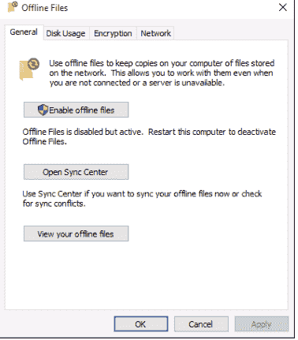
**图4-6：启用脱机文件。** 当你将某个驱动器设置为脱机可用后，Windows会自动完成后续操作。每次你登录或注销网络时，Windows都会同步你的脱机文件。Windows会比较服务器和本地副本上每个文件的时间戳，然后复制所有已更改的文件。关于脱机文件还有一些其他注意事项：
- 如果需要，你可以右键单击驱动器或文件夹，选择「同步」，强制Windows同步你的脱机文件。
- 设置「脱机可用」选项时，请确保文件夹中没有正在打开的文件。如果存在打开的文件，你会收到错误提示，必须关闭这些打开的文件，才能将该文件夹设置为脱机访问。
- 映射驱动器的「属性」对话框包含「脱机文件」选项卡，如图4-8所示。
- 雇主很喜欢脱机文件功能，因为这鼓励员工在晚上和周末在家办公。事实上，每次你使用脱机文件功能在家办公时，你的老板都会给比尔·盖茨寄一枚5美分硬币，他就是这样发家致富的。

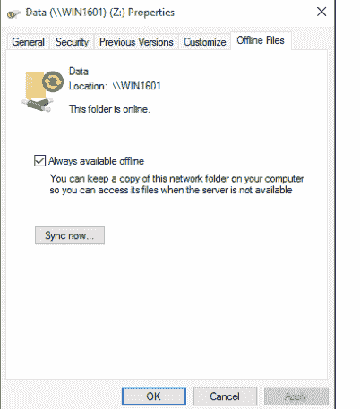
**图4-8：脱机文件属性。**
Data (\\WIN1601) (Z:) 属性
| 选项卡 | | | | | |
| --- | --- | --- | --- | --- | --- |
| 常规 | 安全 | 以前的版本 | 自定义 | 脱机文件 | |
| 项目 | 内容 | | --- | --- | |
| 位置 | \\WIN1601 | | 文件夹状态 | 此文件夹处于在线状态 | |
| 脱机文件选项 | ☑ 始终脱机可用 | | 选项说明 | 你可以在电脑上保留此网络文件夹的副本，以便在服务器不可用时访问其文件 | |
| 操作按钮 | 立即同步...、确定、取消、应用 | |

## 2 设计你的网络
### 本部分内容包括 . . .
- 制定网络规划
- 了解并使用TCP/IP
- 使用网线、网卡、交换机及其他重要网络组件
- 在网络中使用无线设备
- 接入互联网

#### 本章内容包括
- 制定网络规划
- 盘点现有计算机设备
- 明确你需要网络的原因
- 确认不可避免地要做出的基础网络决策

### 第5章 网络规划
好了，现在你已经确信需要将计算机组网，接下来该怎么做？难道你会在上班路上随便进一家电脑店，在喝早咖啡前装好网络，还指望中午前网络就能完全正常运行？我觉得不可能。给计算机组网就像做任何其他有价值的事一样：想要做好，就需要提前做点规划。本章会指导你在花钱之前先想清楚网络规划的事，告诉你如何制定出和网络顾问收费数千美元制定的方案一样好的网络规划。看吧，这本书已经在帮你省钱了！

#### 制定网络规划
无论是要搭建新网络，还是升级现有网络，在开始任何组网项目前，都要先制定详细的规划。如果你还没研究完所有影响项目的相关问题就急着做技术决策，之后肯定会后悔。等你发现得太晚，到时候就会面临关键应用无法在网络上运行、网络性能慢到无法接受，或者网络关键组件不兼容等问题。

制定网络规划时，有一些通用注意事项需要牢记：
- 不要急于制定规划。最昂贵的组网错误，都是在还没购买任何设备前就犯下的。要多思考，考虑各种替代方案。
- 要把网络规划写下来。规划没必要做成花里胡哨的500页文档。如果你想让规划看起来正式点，可以买个小三环活页夹，这个活页夹足够装下你的网络规划，还能剩不少空间。
- 购买任何设备前，先让别人看看你的网络规划。最好找比你更懂计算机的人帮忙看。
- 要及时更新规划。如果要对网络进行扩展，就把规划翻出来，更新相关内容。


> “人算不如天算，哪怕是再周密的计划，也可能偏离初衷，最终只留给我们许诺的欢乐化作的悲伤与痛苦。”
> 罗伯特·彭斯生活的年代比计算机网络早了数百年，但他这句名言至今适用。网络规划不是刻在石头上的，如果你发现某件事的结果和你预想的不一样，也没关系，直接修改你的规划就好。

#### 明确目标
规划网络的第一步，就是要确保你清楚自己到底为什么要建网络。以下是创建或升级网络的一些常见原因，每一个都完全成立：
- 办公室里所有人都需要接入互联网。搭建小型网络最常见的目的之一就是共享互联网连接，即使在大型网络中，共享互联网接入也是网络的核心优势之一。
- 我和同事几乎每天都要用U盘互传文件，有了网络的话，传文件会方便很多。
- 我知道我们现在用的那台彩色激光打印机一天大部分时间都闲置占地方，我不想给每个人都买一台。那么投资建网络岂不是比给每台电脑都配一台彩色激光打印机更划算？
- 现在生意太好了，一个人每天录入8小时订单都忙不过来。如果销售和会计数据都存放在网络服务器上，我就能再雇一个人帮忙，还不用给任何人付加班费。

> 我嫂子刚升级了办公室的网络，我不想让她觉得我落伍了。
>
> 我现在的网络慢得像用风筝线和铁罐搭的，我五年前就该升级了，这样不仅能加快共享文件的访问速度，还能提升安全性、简化管理。

一定要列清楚你认为自己需要网络的所有原因，然后写下来。不用担心自己的文笔差拿不了普利策奖，只要写清楚你希望网络能帮你实现什么就行。如果你要做一份500页的网络方案，你会把「为什么需要网络」的描述放在标着「项目依据」的标签页里；而在你的网络规划活页夹里，就把这部分内容归到「目标」分区下。

> 💡 **提示**
> 当你思考自己需要网络的原因时，你可能会最终发现你根本不需要网络。这也没关系，你完全可以把这个活页夹用来放你的集邮册。

#### 盘点现有设备
规划网络最具挑战性的部分之一，就是搞清楚如何利用你现有的计算机。换句话说，怎么从现在的状态达到你想要的状态？在规划「如何达到目标状态」之前，你必须先清楚「现在的状态是什么样的」，也就是说，你需要对现有的计算机做一次全面盘点。

#### 你需要了解的信息
你需要了解每台计算机的以下信息。如果现在有些术语你看不懂也没关系，它们都只是拼图的一小块而已。

> **处理器类型，以及尽可能的其时钟频率：** 如果你的每台计算机都配全新的酷睿i7八核处理器当然再好不过，但在大多数情况下，你遇到的计算机都是混杂的：有全新的、有旧的、有借来的，还有杂牌子的。你甚至可能找到几台老旧的奔腾处理器计算机。通常没法通过看计算机机箱判断它用的是什么处理器。查找计算机处理器型号最简单的方法是：打开Windows资源管理器，右键单击「此电脑」，然后选择「属性」，就会出现包含该计算机处理器类型的属性页面。例如，图5-1展示了一台使用酷睿i7处理器的计算机的属性页面。

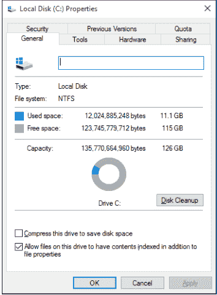
**图5-1：磁盘驱动器的属性对话框**
- **内存容量：** 这些信息也可以在计算机的属性页面中找到，如图5-1所示。
- **硬盘大小及分区排列：** 在Windows 10中查看计算机硬盘大小的方法是：打开桌面任务栏中的文件资源管理器，右键单击驱动器图标，然后在弹出的快捷菜单中选择「属性」命令。（较早版本的Windows系统的操作步骤类似。）图5-1展示了一个容量为126GB、可用空间约115GB的磁盘驱动器的属性对话框。如果你的计算机有多块硬盘，Windows会在「此电脑」窗口中列出每个驱动器的图标，请记下每个驱动器的总容量和可用空间。
- **操作系统版本：** 你也可以通过系统属性对话框推断出操作系统版本。例如，图5-2展示的属性页面显示该计算机运行的是Windows 10专业版。


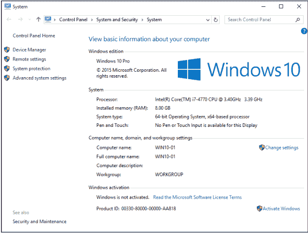
#### 图5-2：配备Core i7处理器、8GB内存的电脑的属性页。
- **连接至电脑的打印机类型（若有）：** 通常情况下，你直接查看打印机就能确认，也可以通过双击控制面板中的“设备和打印机”图标来确认。
- **连接至电脑的其他设备：** DVD或蓝光光驱？扫描仪？外置磁盘或磁带驱动器？摄像机？战斗机器人？热水浴缸？
- **电脑上安装的软件：** Microsoft Office？AutoCAD？QuickBooks？请列出完整清单并标注版本号。
- **电脑是否具备无线功能？** 几乎所有笔记本电脑都具备该功能，大部分台式机则没有。但如果你希望网络完全无线化，也可以添加一款价格低廉的USB无线适配器。

#### 可自动采集信息的软件
如果需要组网的电脑数量较多，采集电脑相关信息会是一项非常繁重的工作。幸运的是，目前有多款软件可以自动完成信息采集工作：这类软件会检测电脑的多个维度信息，例如CPU型号与主频、内存容量、硬盘大小等，随后将信息呈现在屏幕上，并支持将信息保存为硬盘文件或打印输出。

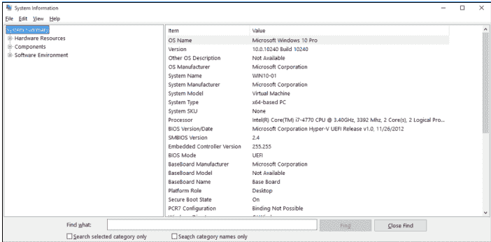
#### 图5-3：可使用系统信息程序采集你需要的所有数据。

#### 是否使用专用服务器：这是个问题
网络规划必须解答的最基本问题之一，就是网络是否需要配置一台或多台专用服务器，还是完全依赖对等网络。如果你组建网络的唯一目的是共享打印机、偶尔传输文件，那么你可能并不需要专用服务器电脑，这种情况下你可以用已有的电脑搭建对等网络。但除规模最小的网络外，独立的专用服务器电脑都能为网络带来收益。
> 使用专用服务器电脑可以让网络运行更快、操作更便捷、可靠性更高。不过要考虑到这种情况：当一台兼作工作站的服务器电脑的用户决定关闭电脑，却不知道其他人正在访问他硬盘上的文件时。
> **你不必非得把性能最强、配置最高的电脑当作服务器电脑。** 我见过一些网络，其中网络里速度最慢的电脑就是服务器。如果服务器的主要用途是共享打印机或存储少量共享文件，这一建议尤其适用。因此如果你需要为网络采购电脑，可以考虑把一台旧电脑升级为服务器，新电脑则作为客户端使用。
假设你的网络需要一台或多台专用服务器，接下来你需要考虑网络需要哪些类型的服务器。某些情况下，单台服务器电脑可以承担一种或多种服务器角色，尽可能让每台服务器电脑只承担单一服务器功能。

##### 文件服务器
*文件服务器*可提供集中式磁盘存储，网络中的客户端电脑可以便捷地共享这些存储空间。文件服务器最常见的功能是存储共享文件和程序。例如，小型工作组的成员可以使用文件服务器上的磁盘空间存储Microsoft Office文档。文件服务器必须确保两名用户不会同时尝试修改同一个文件，实现方式是：当用户修改文件时，*锁定*该文件，直到第一个用户修改完成，其他用户都无法访问该文件。对于文档类文件（例如文字处理或电子表格文件），会锁定整个文件；对于数据库文件，仅锁定包含正在修改的记录的文件部分即可。

##### 打印服务器
共享打印机是许多小型网络存在的主要原因之一。虽然并非必需，但可以专门配置一台服务器电脑作为*打印服务器*，其唯一功能是收集客户端电脑发送至共享打印机的信息，并按顺序进行打印。
> 单台电脑可以同时作为文件服务器和打印服务器，但如果使用独立的打印服务器和文件服务器，整体性能会更好。
> 廉价喷墨打印机单价约为100美元，给每位用户配备一台专属打印机似乎很有吸引力，但一分钱一分货。相比为15位用户采购15台100美元的喷墨打印机，不如采购一台1500美元的高速激光打印机共享使用：这台激光打印机速度会快得多，打印效果也更好，而且使用成本更低。

##### Web服务器
*Web服务器*是指运行特定软件、能够托管互联网网站的服务器电脑。目前最流行的两款Web服务器软件分别是微软的IIS（互联网信息服务）和Apache，后者是由Apache软件基金会管理的开源Web服务器。

##### 邮件服务器
*邮件服务器*是负责处理网络邮件需求的服务器，通常会配置邮件服务器软件，例如Microsoft Exchange Server。Exchange Server专为与Microsoft Office内置的邮件客户端软件Microsoft Outlook协作而设计。大多数邮件服务器的功能远不止收发邮件，例如Exchange Server还提供以下基础邮件之外的拓展功能：
- 简化协作项目管理的协作功能
- 音频与视频会议功能
- 聊天室与即时通讯（IM）服务
- Microsoft Exchange表单设计器，可用于开发自定义应用表单，例如请假申请、采购订单等


搭建自有邮件服务器的替代方案正越来越受欢迎，即订阅微软的Exchange Online服务。使用Exchange Online时，微软会负责Exchange服务器搭建与维护的全部细节工作，你的Microsoft Outlook客户端会被配置为通过互联网连接Exchange Online服务，而非连接网络内的本地Exchange服务器。

##### 数据库服务器
*数据库服务器*是运行数据库软件的服务器电脑，例如微软的SQL Server 2019。数据库服务器通常与定制化业务系统搭配使用，例如会计系统、营销系统等。

##### 应用服务器
*应用服务器*是运行特定应用的服务器电脑。例如如果你使用的会计应用需要专属服务器，你就需要配置一台专用服务器来运行该会计应用。

##### 许可证服务器
部分机构会使用需要授权的软件，这些授权由集中式许可证服务器分发。例如工程类公司经常使用AutoCAD等计算机辅助设计（CAD）软件，这类软件需要许可证服务器，这种情况下你就需要搭建一台服务器来处理授权相关功能。

#### 服务器操作系统的选择
如果确定你的网络需要一台或多台专用服务器，下一步就需要确定这些服务器要使用哪种网络操作系统。如果条件允许，所有服务器都应使用相同的网络操作系统（NOS），避免你需要同时维护多种不同的操作系统。尽管可选择的网络操作系统有很多，但从实际应用角度出发，你的选择通常仅限于以下两类：
- Windows Server 2019或2016
- Linux或其他版本的Unix系统
更多相关内容请参阅第11章。


#### 规划基础设施
你还需要规划网络中计算机连接方式的细节。这项任务包括确定将使用有线网络、无线网络还是两者兼用，需要哪些网络设备来支撑你的网络，以及如何将网络连接到互联网。
如果选择使用有线网络，可以在Cat5e和Cat6网线之间选择。Cat6比Cat5e略贵，但支持更快的网络速度。
除了基础选择之外，你还需要做出许多额外决策：
- 你是否会使用价格低廉的消费级网络交换机（比如可以在消费电子商店或办公用品商店买到的类型），还是选择价格更高但具备高级管理功能的企业级交换机？
- 你会把交换机放在哪里——是放在办公区域的某张桌面上，还是放在中心配线间里？
- 你会在每台交换机上连接多少台客户端计算机和其他设备，需要多少台交换机才能支撑所有这些计算机和其他设备？
- 如果需要多台交换机，你会使用什么类型的网线来连接这些交换机？
如需了解关于网络布线的更多信息，请参阅**第7章**。
> [!TIP]
> 如果你正在铺设新的网线，不要在这方面节省成本。因为铺设网线是劳动密集型工作，网线本身的成本只占整体布线安装成本的一小部分。建议使用Cat6网线而非Cat5e。并且在很多情况下，你应该考虑铺设比你实际需求量更多的网线。例如，如果你的办公区有4张办公桌，不要只往该区域拉4根网线——可以拉6根甚至8根。拉线的劳动成本远高于网线本身的成本，往同一位置多拉几根网线并不会增加太多工作量。

##### 绘制网络拓扑图
创建网络规划最实用的技巧之一就是绘制网络拓扑图。拓扑图可以是详细的平面图，标注出每个网络组件的实际位置。这类拓扑图有时被称为“物理拓扑图”。
如果你更倾向于抽象形式，拓扑图也可以是*逻辑拓扑图*，它比物理拓扑图更抽象，风格类似毕加索的画作。
每次修改网络布局时都要更新拓扑图，同时还要附上修改的详细说明、修改日期以及修改原因。
你可以把非常小的网络拓扑图画在餐巾纸背面，但如果网络包含的计算机超过几台，你就需要用绘图软件来帮你制作拓扑图。
你可以使用专业的绘图软件，比如Microsoft Visio，不过你也可以找到更简单、更便宜的在线绘图工具来帮你记录你的网络架构。
图5-4展示的是用一款名为Lucidchart（www.lucidchart.com）的平价在线工具绘制的网络拓扑图。
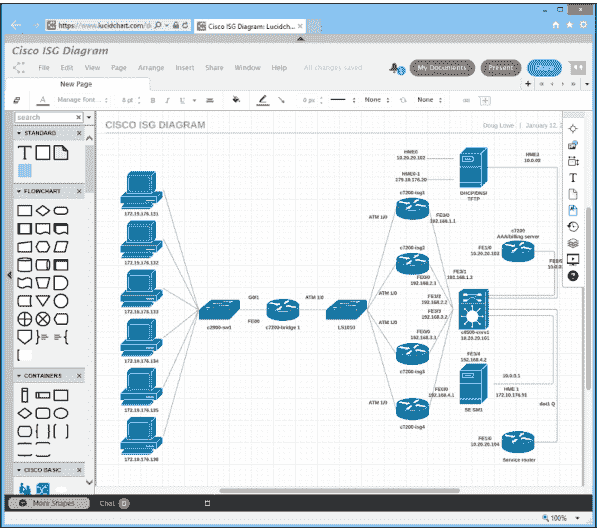

#### 本章内容
- 了解二进制系统（哪怕是入门级了解）
- 深入理解IP地址
- 了解子网划分的工作原理
- 理解私有IP地址和公有IP地址
- 了解网络地址转换
- 了解DHCP的工作原理
- 了解DNS的工作原理

## 第6章
### 了解TCP/IP
传输控制协议/互联网协议——即TCP/IP——是网络中计算机相互通信的基础协议。没有TCP/IP，网络将无法运行。在本章中，我将为你介绍TCP/IP最重要的概念。
> **⚠️ 警告**
> 本章是本书中技术性最强的一章。它将带你审视二进制系统、IP地址的构造细节、子网划分的工作原理，以及两项最重要的TCP/IP服务——动态主机配置协议（DHCP）和域名系统（DNS）——的运行原理。你不需要理解本章的所有内容就能搭建简单的TCP/IP网络。但你对本章内容的了解越深入，就越能理解TCP/IP的运行逻辑。勇敢面对吧。

#### 理解二进制
在你能理解TCP/IP（尤其是IP）寻址方式的细节之前，你需要先了解二进制计数系统的工作原理，因为二进制是IP寻址的基础。如果你已经掌握了二进制知识，请直接跳过本节，进入下一小节“认识IP地址”。我不想用过于基础的内容让你觉得无聊。

##### 按位计数
二进制计数系统只使用0和1两个数字。大多数人习惯的十进制系统使用0到9共10个数字。在普通的十进制数中，比如3482，最右侧的数字代表个位；往左一位是十位，再往左是百位、千位，依此类推。这些数字代表10的幂次：首先是10⁰（即1），然后是10¹（10），接着是10²（100），再是10³（1000），以此类推。
二进制只有2个数字而非10个，因此二进制数看起来比较单调，比如110011、101111和100001。二进制数中的位（不叫数字，叫比特）代表2的幂次而非10的幂次——从右往左看，每一位分别对应十进制的1、2、4、8、16、32等数值。
计算二进制数的十进制值时，需要将每一位乘以对应的2的幂次，再将结果相加。例如，二进制数10111的十进制值计算方式如下：
```
1 × 2⁰ = 1 × 1 = 1 + 1 × 2¹ = 1 × 2 = 2 + 1 × 2² = 1 × 4 = 4 + 0 × 2³ = 0 × 8 = 0 + 1 × 2⁴ = 1 × 16 = 16 = 23
```
幸运的是，计算机非常擅长在二进制和十进制之间转换数值——事实上，你几乎永远不需要自己手动做转换。学习二进制的目的，不是让你看到像1110110110110这样的数时，能立刻说出“啊！这是十进制的7606！”（如果你能做到这一点，你可能会登上《今日秀》接受采访，他们甚至会为你拍一部电影。）学习二进制的真正目的是让你对计算机存储信息的方式有基础了解——更重要的是，理解十六进制计数系统的工作原理（我将在下一节介绍）。
以下是二进制的一些有趣特性，以及它与十进制系统的异同：
- 二进制数分配的比特位数决定了该数能表示的最大值。如果分配8个比特，该数能存储的最大值是11111111，对应十进制数255。
- 如果想快速计算定长的二进制数能存储多少种不同的值，可以用比特数作为2的指数。例如，一个8位的二进制数可以存储2⁸个值。因为2⁸等于256，所以8位二进制数可以表示256种不同的值，这也是由8个比特组成的字节能表示256种不同值的原因。
- 正是这个2的幂次的概念，导致计算机在表示内存、磁盘空间这类数值时，不会使用规整的十进制整数。例如1K并不是整1000字节，而是1024字节，因为1024是2¹⁰。同理，1MB也不是整1000000字节，而是1048576字节，刚好是2²⁰。

##### 逻辑运算
二进制的一大优势是它能高效处理被称为*逻辑运算*的特殊操作。共有4种基本逻辑运算，其余运算都是由这4种基本运算衍生而来。其中3种运算——AND（与）、OR（或）、XOR（异或）——用于比较两个二进制数（比特），第4种运算NOT（非）仅作用于单个比特。
以下列表对基本逻辑运算进行了总结：
- **与运算**：与运算会比较两个二进制值。如果两个值都是1，与运算的结果为1；如果其中一个值是0，或者两个值都是0，结果为0。
- **或运算**：或运算会比较两个二进制值。如果至少有一个值是1，或运算的结果为1；如果两个值都是0，结果为0。
- **异或运算**：异或运算会比较两个二进制值。如果两个值中只有一个是1，结果为1；如果两个值都是0，或者两个值都是1，结果为0。


NOT: NOT运算不会比较两个值，仅会改变单个二进制数值：若原始值为1，NOT运算返回0；若原始值为0，NOT运算返回1。对于多比特二进制数执行逻辑运算时，会逐比特进行操作。手动执行此类运算的最简单方法是：
- *将两个二进制数上下对齐排列。*
- *将运算结果写在每个二进制比特的下方。*
以下示例展示了如何计算10010100 AND 11001101：如你所见，运算结果为10000100。
```
10010100 AND 11001101
10000100
```
#### IP地址介绍
*IP地址*是唯一标识IP网络中每台主机的编号。IP地址工作于TCP/IP协议栈的网络层，因此独立于下层地址（如MAC地址）。（MAC是*媒体访问控制*的缩写。）
IP地址是32位二进制数，这意味着理论上整个互联网最多可存在约40亿个独立的主机地址。你可能会觉得这一数量已经足够，但TCP/IP对IP地址的分配方式有特定限制，这些限制极大地压缩了可用IP地址的总数，目前已有约一半的可用IP地址被分配完毕。不过，新的IP地址处理技术已缓解了这一问题，而128位IP地址的新标准（即IPv6）也即将获得广泛认可。
##### 网络与主机
网际协议（IP）的核心目的是实现不同网络间的通信。因此，32位IP地址由两部分组成：
**网络ID（或网络地址）：** 标识主机所在的网络
**主机ID（或主机地址）：** 标识由网络ID指定网络中的特定设备
IP地址使用的绝大多数复杂性都源于需要判断完整32位IP地址中哪部分是网络ID、哪部分是主机ID。最初的IP规范采用*地址分类*系统来判断IP地址的网络ID与主机ID部分，而*无类别IP地址*系统正在快速取代地址分类系统。你将在本章后续部分了解这两种系统。
##### 点分十进制记法
IP地址通常采用一种名为*点分十进制记法*的格式表示。在点分十进制记法中，每8个比特构成的组（即*八位组*）都用其对应的十进制值表示。例如，参考以下二进制IP地址：
```
11000000101010001000100000011100
```
该地址的点分十进制等价形式为：
```
192.168.136.28
```
其中，192对应前8个比特（`11000000`）；168对应第二组8个比特（`10101000`）；136对应第三组8个比特（`10001000`）；28对应最后一组8个比特（`00011100`）。这是你通常看到的IP地址表示格式。
#### IP地址分类
IP协议的原始设计者制定IP寻址方案时，本可以将任意数量的IP地址比特分配给网络ID，剩余比特则用于主机ID。例如，设计者本可决定将一半地址（16比特）用于网络，剩余16比特用于主机ID。该方案下，互联网总共可存在65,536个网络，每个网络可容纳65,536台主机。在互联网早期，这一方案的容量看起来可能远超实际所需，但IP设计者一开始就意识到，几乎没有网络真的需要上万台主机：假设一个拥有1000台计算机的网络接入互联网，并被分配了上述假设方案中的一个网络ID，由于该网络仅使用其65,536个主机地址中的1000个，将有超过64,000个IP地址被浪费。
为解决这一问题，IP地址分类的概念被提出。IP协议定义了五种不同的地址类：A、B、C、D、E。前三种类别（A-C）分别采用不同的尺寸划分地址的网络ID与主机ID部分：D类地址用于一类名为*组播地址*的特殊地址；E类地址是未投入使用的实验性地址类。IP地址的前4个比特用于确定特定地址所属的类别：
- 如果首位比特是0，则该地址为A类地址。
- 如果首位比特是1且次位比特是0，则该地址为B类地址。
- 如果前两位比特均为1且第三位比特是0，则该地址为C类地址。
- 如果前三位比特均为1且第四位比特是0，则该地址为D类地址。
- 如果前四位比特均为1，则该地址为E类地址。
由于D类和E类地址被保留用于特殊用途，后续讨论将聚焦于A、B、C三类地址。表6-1总结了各地址类的详细信息。
#### 表6-1
| 类 | 地址范围 | 起始比特 | 网络ID长度 | 网络数量 | 主机数量 |
|-------|----------------|---------------|----------------------|--------------------|-----------------|
| A | 1–126.x.y.z | 0 | 8 | 126 | 16,777,214 |
| B | 128–191.x.y.z | 10 | 16 | 16,384 | 65,534 |
| C | 192–223.x.y.z | 110 | 24 | 2,097,152 | 254 |
##### A类地址
A类地址专为大型网络设计。在A类地址中，地址的首个八位组为网络ID，剩余三个八位组为主机ID。由于仅8个比特被分配给网络ID，且其中首位比特用于标识该地址为A类地址，因此整个互联网上仅能存在126个A类网络。不过，每个A类网络可容纳超过1600万台主机。

仅约40个A类地址被分配给了企业或组织，其余地址要么被保留给互联网号码分配机构（IANA）使用，要么被分配给负责管理地理区域（如欧洲、亚洲、拉丁美洲）IP分配的组织。
##### B类地址
在B类地址中，IP地址的前两个八位组用作网络ID，后两个八位组用作主机ID。因此，B类地址近乎符合我此前假设的“将地址对半拆分，一半用作网络ID、一半用作主机ID”的方案，但它与该方案并不完全一致：首个八位组的前两位比特必须为10，用于标识该地址为B类地址。因此，总共可存在16,384个B类网络，所有B类地址的取值范围为128.x.y.z至191.x.y.z，每个B类地址可容纳超过6.5万台主机。

B类网络的问题在于，尽管其规模远小于A类网络，但仍会分配过多的主机ID：几乎没有网络需要上万个主机，因此随意分配B类地址会导致大量可用主机地址被浪费在不需求这些地址的组织上。
##### C类地址
在C类地址中，前三个八位组用作网络ID，第四个八位组用作主机ID。由于主机ID仅占8个比特，每个C类网络最多只能容纳254台主机。但由于网络ID占24个比特，C类地址可支持超过200万个网络。

C类网络的问题在于其覆盖规模过小：尽管很少有组织需要B类地址提供的上万个主机地址，但许多组织需要的主机数量远超数百台。B类网络与C类网络之间的巨大差异催生了子网划分技术，我将在下一节介绍该技术。


#### 关于IPv6怎么样？
当前大部分互联网基于第四版互联网协议，也就是*IPv4*。*IPv4*已为互联网服务超过20年。然而互联网的快速增长给*IPv4*有限的32位地址空间带来了巨大压力。本章将介绍IPv4如何演进以尽可能高效利用32位地址，但最终所有地址都会被分配完毕，IPv4地址空间将被完全占满。届时互联网将不得不迁移到下一版IP协议，也就是IPv6。
IPv6也被称为*下一代IP*，或*IPng*，为致敬大多数互联网大师最爱的电视剧*《星际迷航：下一代》*。相比IPv4，IPv6具备多项优势，但最重要的是它采用128位作为互联网地址，而非32位。128位可支持的主机地址数量极其庞大，足以让卡尔·萨根感到骄傲。这个数量远不止简单的翻倍或翻两番，以下是IPv6提供的唯一互联网地址数量，仅供娱乐：
340,282,366,920,938,463,463,374,607,431,768,211,456
这个数字大到超乎人类的认知范畴。如果宇宙诞生时IANA就已存在，并以每秒分配一个的速度发放IPv6地址，那么到现在150亿年过去，它甚至还未分配出可用地址的1%。
不幸的是，IPv4到IPv6的迁移进度一直十分缓慢。因此未来至少几年内，互联网仍将主要由IPv4驱动。

#### 子网划分
*子网划分*是一种技术，可帮助网络管理员通过创建不受A、B、C类IP地址规模限制的网络，更高效地利用IP地址中可用的32位。借助子网划分，你可以创建更贴合实际主机数量需求的网络。子网划分提供了更灵活的方式，用于指定IP地址中哪部分代表网络ID，哪部分代表主机ID。使用标准IP地址类别时，仅存在3种可能的网络ID长度：A类为8位，B类为16位，C类为24位。而子网划分允许你选择任意数量的位作为网络ID。
我使用子网划分有两个原因。第一是更高效分配有限的IP地址空间。如果互联网仅限制使用A、B、C类地址，每个网络都会被分配254、65000或1600万个IP地址给主机设备。虽然确实存在设备数量超过254个的网络，但几乎没有（甚至完全没有）设备数量达到65000个的网络，更别说1600万个。不幸的是，任何设备超过254个的网络都需要申请B类地址分配，大概率会浪费上万个IP地址。
第二个原因是，就算单个组织拥有数千台网络设备，所有设备使用同一网络ID运行也会让网络慢到无法使用。TCP/IP的工作机制规定，所有拥有相同网络ID的计算机必须在同一个物理网络上。物理网络属于单一广播域，这意味着单一网络介质需要承载该网络的所有流量。出于性能考虑，网络通常会分割成比C类地址提供的范围更小的广播域。

##### 子网
*子网*是嵌套在另一个（A、B、C类）网络内的网络。子网通过使用一个或多个A、B、C类主机位扩展网络ID创建。因此，子网的网络ID可以是任意长度，不再局限于标准的8、16、24位。图6-1展示了应用子网划分前后网络的示例。未划分子网的网络被分配了B类地址144.28.0.0，该网络上的所有设备必须共享同一个广播域。在第二个网络中，主机ID的前4位被用于将网络划分为两个小子网，分别标识为子网16和子网32。对于外部世界（即路由器另一侧），这两个网络仍被视为标识为144.28.0.0的单一网络。例如，外部世界会认为144.28.16.22上的设备属于144.28.0.0网络，因此发送到该设备的数据包会被递送到144.28.0.0的路由器，随后路由器会查看主机ID的子网部分，决定将数据包路由到子网16还是子网32。
图6-1：子网划分前后的网络。
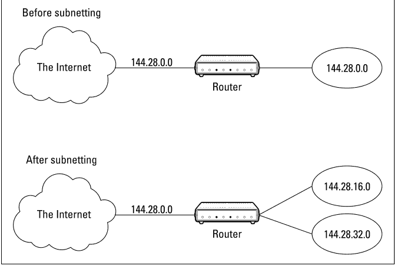

##### 子网掩码
子网划分要正常运作，路由器必须被告知主机ID的哪部分用于子网的网络ID。这一机制通过另一个32位的数字实现，该数字被称为子网掩码。IP地址中代表网络ID的位在掩码中对应为1，代表主机ID的位对应为0。因此子网掩码的左侧始终是一连串连续的1，后续跟随一连串连续的0。例如，图6-1中展示的子网，其网络ID由16位网络ID加上额外4位子网ID组成，对应的子网掩码如下：
```
11111111 11111111 11110000 00000000
```
也就是说前20位为1，剩余12位为0。因此完整的网络ID长度为20位，划分子网后的地址中实际主机ID部分长度为12位。
要确定IP地址的网络ID，路由器必须同时持有IP地址和子网掩码，随后路由器会执行一种名为逻辑与的按位运算，从IP地址中提取网络ID。执行逻辑与时，会将IP地址的每一位与子网掩码对应的位进行比较：如果两位均为1，网络ID中对应位就设为1；如果其中任意一位为0，对应位就设为0。例如，以下是使用上例中的20位子网掩码从IP地址中提取网络地址的过程：
```
IP address: 10010000 00011100 00010000 00010001
Subnet mask: 11111111 11111111 11110000 00000000
Network ID: 10010000 00011100 00010000 00000000
144 . 28 . 16 . 0
```
因此该子网的网络ID为**144.28.16.0**。
子网掩码本身通常用点分十进制表示，因此上例中使用的20位子网掩码表示为255.255.240.0：
```
Subnet mask: 11111111 11111111 11110000 00000000
255 . 255 . 240 . 0
```

不要混淆子网掩码和IP地址。子网掩码不代表互联网上的任何设备或网络，它只是指示IP地址中哪部分应用于确定网络ID的一种方式。（你可以立刻识别出子网掩码：它的第一个八位组始终是255，而255不是任何类别IP地址的有效第一个八位组。）

##### 重要子网规则
你需要了解子网掩码的一些额外限制，尤其是：
- 网络ID的最少位数为8位，因此子网掩码的第一个八位组始终是255。
- 网络ID的最大位数为30位。你必须至少留2位给地址的主机ID部分，以支持至少2台主机。如果把全部32位都用作网络ID，就没有位留给主机ID，这显然行不通。只留1位给主机ID也不行：因为全1的主机ID是广播地址的保留位，全0则代表网络本身。因此如果网络ID用31位，只留1位给主机ID，那么主机ID 1会被用于广播地址，主机ID 0是网络本身，就没有空间留给实际主机了。这就是网络ID最大长度为30位的原因。
- 由于网络ID始终由连续的1组成，因此子网掩码的每个八位组只有9种可能的取值（包括0）。供你参考，这些值列在表6-2中。


#### 表6-2 八位子网八位组的取值
| 二进制八位组 | 十进制 | 二进制八位组 | 十进制 |
| ------------ | ------- | ------------ | ------- |
| 00000000 | 0 | 11111000 | 248 |
| 10000000 | 128 | 11111100 | 252 |
| 11000000 | 192 | 11111110 | 254 |
| 11100000 | 224 | 11111111 | 255 |
| 11110000 | 240 | | |

#### 私有地址与公有地址
任何直接连接到互联网的主机都必须拥有全球唯一的IP地址。不过，并非所有主机都直接连接到互联网：有些主机处于未接入互联网的网络上，还有些主机隐藏在防火墙之后，互联网连接是间接的。有一批IP地址块专门为此预留——供未连接互联网的私有网络，或隐藏在防火墙后的网络使用。这类地址段共有三种，具体如表6-3所示。创建私有TCP/IP网络时，请使用上述三类地址段中的IP地址。

#### 表6-3 私有地址空间
| 子网掩码 | 地址范围 |
| ------------- | ------------------------------ |
| 255.0.0.0 | 10.0.0.1–10.255.255.254 |
| 255.255.240.0 | 172.16.1.1–172.31.255.254 |
| 255.255.0.0 | 192.168.0.1–192.168.255.254 |

#### 了解网络地址转换
许多防火墙会使用一种名为*网络地址转换*（NAT）的技术，向外部网络隐藏主机的实际IP地址。这种情况发生时，NAT设备必须使用一个全球唯一的IP地址作为主机在互联网上的对外标识；而在防火墙内部，主机可以使用任意它想要的IP地址。数据包穿越防火墙时，NAT设备会将私有IP地址转换为公有IP地址，反向传输时则执行相反转换。
NAT的好处之一是有助于减缓IP地址空间的分配速度，因为一个NAT设备可以使用单个公有IP地址为多台主机提供服务。它通过记录出站数据包来实现这一点，从而可以将入站数据包与正确的主机关联。为了理解这一过程的工作原理，可以参考以下步骤序列：
- 1. 一台私有地址为192.168.1.100的主机向216.58.192.4（恰好是www.google.com）发送请求。NAT设备会将数据包的源IP地址修改为防火墙的IP地址208.23.110.22，这样Google就会将回复发送回防火墙路由器。NAT会记录下192.168.1.100曾向216.58.192.4发送过请求。
- 2. 现在另一台地址为192.168.1.107的主机向17.172.224.47（恰好是www.apple.com）发送请求。NAT设备会将这个请求的源地址修改为208.23.110.22，这样Apple就会将回复发送到防火墙路由器。NAT记录下192.168.1.107曾向17.172.224.47发送过请求。
- 3. 几秒后，防火墙收到来自216.58.192.4的回复。该回复的目的地址是防火墙的地址208.23.110.22。为了确定将回复转发给哪台主机，防火墙会检查其记录，查看哪台主机正在等待来自216.58.192.4的回复。它会发现192.168.1.100正在等待该回复，因此将目的地址修改为192.168.1.100，再将数据包转发出去。
实际上，这一过程比描述的更复杂一些，因为很可能有两个或多个用户向同一个公有IP发出了待处理的请求。这种情况下，NAT设备会使用其他技术来判断每个入站数据包应该交付给哪个用户。

#### 为网络配置DHCP
TCP/IP网络上的每台主机都必须拥有唯一的IP地址。每台主机都必须正确配置，才能知晓自身的IP地址。新主机上线时，必须为其分配一个子网正确地址范围内的IP地址，且该地址未被占用。虽然你可以手动为网络上的每台计算机分配IP地址，但如果网络中的计算机数量超过几台，这项任务很快就会变得难以应付。这时就需要动态主机配置协议（DHCP）发挥作用了。
DHCP会自动为网络上的每台主机配置IP地址，从而确保每台主机都拥有有效的、唯一的IP地址。DHCP甚至可以在主机加入或离开网络时自动重新配置IP地址。可想而知，DHCP可以为网络管理员节省大量繁琐的配置工作时间。在本节中，你将全面了解DHCP：它是什么、如何运行，以及如何设置它。

##### 了解DHCP
DHCP允许TCP/IP网络上的单台计算机从服务器获取自身的配置信息，尤其是IP地址。DHCP服务器会跟踪哪些IP地址已经被分配，这样当计算机请求IP地址时，DHCP服务器会为其提供尚未被占用的IP地址。
DHCP的替代方案是为网络上的每台计算机分配静态IP地址，这种做法可能有利，也可能带来问题：

> » 对于只有少量计算机的网络，静态IP地址是可行的。
> » 对于计算机数量超过少量的网络，使用静态IP地址是极大的错误。迟早会有某个忙得焦头烂额的管理员（猜猜是谁？）犯错，给两台计算机分配相同的IP地址。之后你就不得不手动检查每台计算机的IP地址来找出冲突。除最小的网络外，DHCP在任何网络都是必需的。
虽然DHCP的主要职责是分配IP地址，但它向客户端提供的配置信息不止IP地址。这些额外的配置信息被称为*DHCP选项*。以下列表描述了服务器可以配置的一些常见DHCP选项：
- 路由器地址，也称为默认网关地址
- 配置信息的过期时间
- 域名
- DNS服务器地址
- Windows互联网名称服务（WINS）服务器地址

##### DHCP服务器
DHCP服务器可以是位于TCP/IP网络上的服务器计算机。幸运的是，所有现代服务器操作系统都内置了DHCP服务器功能。要在网络服务器上设置DHCP，只需启用服务器的DHCP功能并配置相关设置即可。本章后续的“管理Windows Server 2019 DHCP服务器”一节中，我将向你展示如何为Windows Server 2019配置DHCP服务器。
除非网络非常庞大，否则运行DHCP的服务器计算机不必完全专用于DHCP服务。对于大多数网络而言，文件服务器可以兼任DHCP服务器，尤其是当你为IP地址设置较长的租期时。（我将在本章后续解释租期的概念。）大多数多功能路由器也内置了DHCP服务器。因此，如果你不想让网络上的某台服务器承担DHCP功能，可以启用路由器内置的DHCP服务器。
让路由器充当网络的DHCP服务器的一大优势是，你几乎不需要关闭路由器的电源。相比之下，你偶尔需要重启或关闭文件服务器来执行系统维护、应用升级或进行必要的故障排查。

**提示** 大多数网络只需要一台DHCP服务器。在同一网络上设置两台或多台服务器时，需要仔细协调每台服务器负责的IP地址范围（称为作用域）。如果不小心为同一作用域设置了两台DHCP服务器，一旦两台服务器尝试向两台不同的主机分配相同的IP地址，最终可能会出现重复的地址分配。为了避免这种情况发生，除非你的网络大到单台服务器无法承受工作负载，否则只需设置一台DHCP服务器即可。

##### 了解作用域
作用域就是DHCP服务器配置为分配的IP地址范围。在最简单的情况下，单台DHCP服务器管理整个子网的IP配置，此时作用域与子网一一对应。不过，如果为子网设置了两台DHCP服务器，可以将每台服务器配置为仅分配完整子网范围的一部分。此外，单台DHCP服务器可以服务于多个作用域。
必须创建作用域才能启用DHCP服务器。创建作用域时，可以为其设置以下属性：
- 作用域名称，帮助你识别作用域及其用途
- 作用域描述，允许你提供关于作用域及其用途的额外细节
- 作用域的起始IP地址
- 作用域的结束IP地址

- 作用域的**子网掩码**。你可以使用点分十进制表示法，也可以使用无类别域间路由（CIDR）表示法来指定子网掩码。
- **一个或多个排除地址范围**。这些地址不会分配给客户端。（更多信息请参阅下一节“被排除的地址？”）
- **一个或多个保留地址**。这些地址始终分配给特定的主机设备。（更多信息请参阅本章稍后“保留地址建议”一节。）
- **租约期限**，即主机可以使用该IP地址的时长。当租约期限过半时，客户端会尝试续租。例如，如果你指定的租约期限为8天，客户端会在4天过后尝试续租。这样一来，主机就有足够的时间在IP地址被重新分配给其他主机前完成续租。
- 子网的**路由器地址**。该值也被称为*默认网关地址*。
- 网络DNS服务器和WINS服务器的**域名及IP地址**。


##### 被排除的地址？
每个人都会偶尔有被排斥的感受。我有妻子和三个女儿，非常理解这种感受。不过有时候，被排除在外其实是好事。对于DHCP作用域而言，排除地址可以帮助你避免IP地址冲突，还能让你将单个子网的DHCP工作负载分配给两个或多个DHCP服务器。*排除项*是指未包含在作用域内、但落在作用域起始和结束地址范围内的地址段。本质上，排除范围相当于在作用域上挖了一个“洞”：落在该区域内的IP地址不会被分配。以下是需要在作用域中排除IP地址的几大原因：
- 运行DHCP服务本身的计算机通常需要设置**静态IP地址分配**。因此，DHCP服务器的地址应被列为排除项。
- 你可能需要为其他服务器分配**静态IP地址**。这种情况下，每个服务器的IP地址都应被列为排除项。


正如我在下一节所介绍的，保留地址往往是解决这个问题的更好方案。

##### 保留地址建议
某些情况下，你可能需要为特定主机分配固定的IP地址。一种做法是为主机配置静态IP地址，使其无需通过DHCP获取IP配置。但这种方式存在两个主要弊端：
- TCP/IP配置包含的信息不止IP地址。如果使用静态配置，你必须手动指定子网掩码、默认网关地址、DNS服务器地址以及主机所需的其他配置信息。如果这些信息发生变更，你不仅需要在DHCP服务器上修改，还要在所有配置了静态IP的主机上进行修改。
- 你必须记得将该静态IP地址从DHCP服务器的作用域中排除。否则，DHCP服务器不会识别该静态地址，可能将其分配给其他主机。随之而来的问题是：你的网络中会出现两台使用相同地址的主机。


为特定主机分配固定IP地址的更好方式是创建DHCP保留项。保留项的作用是：每当特定主机向DHCP服务器请求IP地址时，服务器会为其分配你在保留项中指定的地址。主机只有在向DHCP服务器发起请求时才会获得该IP地址，但只要主机请求IP配置，就始终会获取到相同的地址。创建保留项时，你需要将希望分配给主机的IP地址与主机的MAC地址进行绑定。因此，在创建保留项前，你需要先获取主机的MAC地址：
- 通常，你可以通过命令提示符运行`ipconfig /all`命令来获取MAC地址。
- 如果计算机还未配置TCP/IP，你可以通过「开始」➙「所有程序」➙「附件」➙「系统工具」➙「系统信息」来获取MAC地址。


如果你设置了多台DHCP服务器，一定要在每台服务器上都配置相同的保留项。如果你忘记在某台服务器上重复配置保留项，该服务器可能会将该地址分配给其他主机。

##### 租约期限多长合适？
配置DHCP服务器时，最重要的决策之一就是确定租约期限的时长。默认值为8天，在多数场景下都适用。但你可能也会遇到需要设置更长或更短租约期限的情况：
- 网络越稳定，租约期限就可以设置得越长。如果你只是定期向网络中添加新计算机（或更换现有计算机），你可以安全地将租约期限设置为超过8天。
- 网络越不稳定，租约期限就应该设置得越短。例如，高校图书馆的无线网络供学生临时携带笔记本电脑到馆学习使用，这类网络的租约期限设置为1小时左右即可。


> 不要将网络的租约期限设置为无限期。尽管部分管理员认为在稳定网络中，这种设置可以减少DHCP服务器的工作负载，但没有永远稳定的网络。只要你找到配置了无限期租约的DHCP服务器，查看它的活跃租约即可。我敢保证，你会找到分配给已停用计算机的IP租约。

#### 管理Windows Server 2019的DHCP服务器
配置和管理DHCP服务器的具体步骤取决于你使用的网络操作系统或路由器。以下内容介绍如何在Windows Server 2019中操作DHCP服务器，其他操作系统的操作流程类似。如果你尚未在服务器上安装DHCP服务器，可以使用服务器管理器进行安装（点击任务栏上的「服务器管理器」，再通过「添加角色和功能」添加DHCP角色）。DHCP服务器角色安装完成后，你可以通过打开DHCP管理控制台来管理它，如图6-2所示。打开该控制台的方法为：打开服务器管理器，然后选择「工具」➔「DHCP」。要开始使用DHCP服务器，你必须创建至少一个作用域。你可以通过「新建作用域向导」创建作用域：先选择要创建作用域的服务器，再点击「新建作用域」即可启动向导。向导会要求你输入定义作用域所需的基本信息，包括作用域名称、起始和结束IP地址、子网掩码。你也可以指定要从作用域中排除的IP地址、租约期限（默认为8天）、网关路由器的IP地址、网络的域名，以及你希望客户端计算机使用的DNS服务器IP地址。图6-3展示了「新建作用域向导」的运行界面。
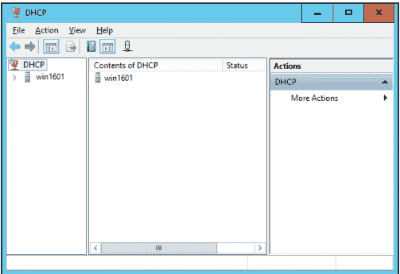

**图6-2：**DHCP管理控制台。
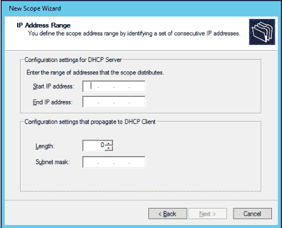

**图6-3：**「新建作用域向导」。

#### 配置Windows DHCP客户端
配置Windows客户端使用DHCP非常简单。安装TCP/IP协议时会自动附带DHCP客户端，因此你只需要配置TCP/IP以使用DHCP即可。具体操作为：打开控制面板中的「网络」或「网络连接」（取决于客户端运行的Windows版本），打开「网络属性」对话框。然后选择TCP/IP协议，点击「属性」按钮。此时会打开如图6-4所示的「TCP/IP属性」对话框。要配置计算机使用DHCP，请选择「自动获取IP地址」和「自动获取DNS服务器地址」选项，点击「确定」即可完成配置。
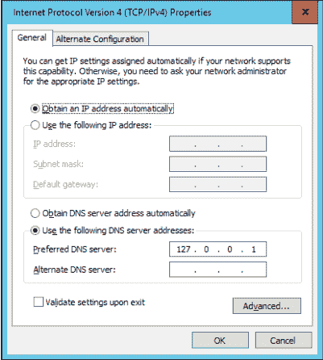

**图6-4：**配置Windows客户端使用DHCP。

#### 使用DNS
DNS（域名系统）是TCP/IP的一项功能，允许你使用名称而非数字来标识主机。如果没有DNS，你买书时会输入`99.84.233.99`而不是`www.amazon.com`，卖二手家具时会访问`104.78.128.48`而不是`www.ebay.com`。了解DNS的工作原理以及如何搭建DNS服务器，是搭建和管理TCP/IP网络的关键。本章剩余内容将介绍DNS的基础知识，包括DNS命名系统的工作原理以及如何搭建DNS服务器。

##### 域与域名
为互联网上的每一台主机提供唯一的DNS名称，DNS采用了一项经过时间验证的技术：分而治之。DNS采用分层命名系统，与Windows上文件夹的分层组织方式类似

计算机。不过，DNS不会将名称整理到文件夹中，而是将其划分到域中。每个域都包含DNS层级结构中直接处于它下方的所有名称。
例如，图6-5展示了DNS域树的一小部分。树的顶部是*根域*，它是所有域的锚点。根域正下方是四个*顶级域*，分别命名为`edu`、`com`、`org`和`gov`。
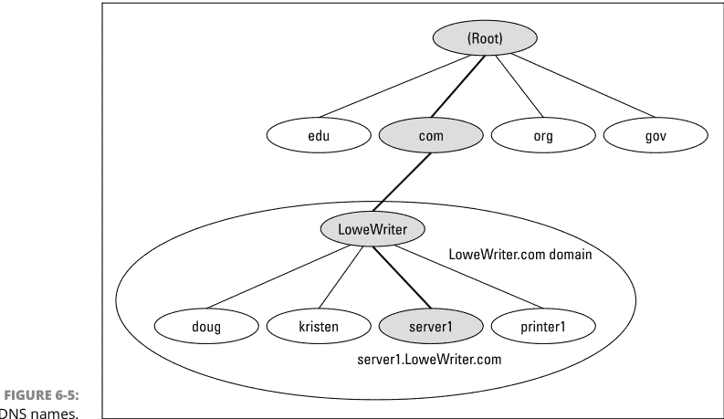
实际上，互联网根域中的顶级域远不止这些。事实上，我撰写本书时，正在使用的顶级域约有上千个。
图6-5中`com`域的下方是另一个名为`LoweWriter`的域，这恰好是我个人使用的域名。（是不是很聪明？）要完整标识这个域，你需要将它和它的*父域*（此处为`com`）的名称结合，得到完整域名：`LoweWriter.com`。
请注意，域名的各个部分之间用句点分隔，句点读作“dot”。因此，读出这个域名时你应该读作“LoweWriter dot com”。
`LoweWriter`节点下方有四个主机节点，分别命名为`doug`、`kristen`、`server1`和`printer1`，这些节点对应我家网络中的三台电脑和一台打印机。你可以将主机名和域名结合，得到网络中每台主机的完整DNS名称。例如，我的服务器的完整DNS名称是server1.LoweWriter.com，同理，我的打印机的完整DNS名称是printer1.LoweWriter.com。
以下是你需要记住的关于**DNS名称**的几个额外细节：

1. DNS名称不区分大小写。因此，LoweWriter和Lowewriter被视为同一个名称，LOWEWRITER、LOWEwriter和LoWeWrItEr也同理。使用域名时，你可以用大写来让名称更易读，但DNS会忽略大小写的差异。
2. 每个DNS节点的名称最长可达63个字符（不含句点），可以包含字母、数字和连字符，不允许使用其他特殊字符。
3. **子域**是处于现有域下方的域。例如，com域是根域的子域，同理，LoweWriter是com域的子域。
4. DNS是分层命名系统，和Windows使用的分层文件夹系统类似。不过DNS和Windows命名规范有一个关键区别：构建完整DNS名称时，你需要从树的底部开始，逐层向上直到根域。因此，在名称doug.LoweWriter.com中，doug是最底层的节点。相比之下，Windows路径则相反：它们从根开始逐层向下。例如，在路径`\Windows\System32\dns`中，dns是最底层的节点。
5. DNS树最深可达127层。但在实际应用中，DNS树非常浅。大多数DNS名称只有3层（不含根域），虽然你有时会看到有4层或5层的名称，但很少会见到更多层的情况。
6. 虽然DNS树很浅，但非常宽。换句话说，每个顶级域正下方都有数量极其庞大的二级域。例如，我撰写本书时，com域下方的二级域已超过200万个。

##### 完全限定域名
如果域名以结尾句点结尾，该结尾句点代表根域，这种域名被称为**完全限定域名**（FQDN）。完全限定域名也被称为**绝对名称**，它没有歧义，因为它能够一直追溯到根域来标识自身。
相反，如果域名不以结尾句点结尾，该名称可能会在其他域的上下文中被解读。因此，不以结尾句点结尾的DNS名称是*相对名称*。
这个概念和Windows中相对路径与绝对路径的运作方式类似。例如，如果路径以反斜杠开头，比如`\Windows\System32\dns`，那它就是绝对路径。但如果路径不以反斜杠开头，比如`System32\dns`，则会以当前文件夹为起始点。如果当前文件夹恰好是`\Windows`，那么`\Windows\System32\dns`和`System32\dns`指向的是同一个位置。
在很多情况下，相对名称和完全限定域名可以互换使用，因为解释这些名称的软件总会以根域为上下文来解释相对名称。这就是为什么你可以在网页浏览器中输入`www.wiley.com`（不带结尾句点）而不是`www.wiley.com.`来访问Wiley的主页。部分应用程序（比如DNS服务器）可能会以根域以外的其他域为上下文来解释相对名称。

##### 使用Windows DNS服务器
DNS服务器的安装和管理流程取决于你使用的网络操作系统，本节内容专门针对Windows Server 2019中的DNS服务器操作。在Linux或Unix环境中操作DNS服务器的流程类似，但没有图形用户界面的辅助。
你可以通过Windows Server 2019的服务器管理器（在任务栏选择“服务器管理器”）安装DNS服务器。安装DNS服务器后，你可以通过DNS管理控制台对其进行管理。在这里你可以执行常见的管理任务，比如添加额外区域、修改区域设置，或向现有区域添加新记录。
DNS管理控制台会隐藏资源记录的细节，让你能够通过友好的图形用户界面进行操作。
要向某个区域添加新主机（由称为A记录的DNS记录定义），请在DNS管理控制台中右键单击该区域，选择“添加新主机”命令。该操作会打开“新建主机”对话框，如图6-6所示。你需要在此处指定以下信息：
> **名称：** 新主机的名称。
> **IP地址：** 主机的IP地址。
> **创建关联指针（PTR）记录：** 自动在反向查找区域文件中创建PTR记录。如果你希望允许对该主机进行反向查找，请勾选此选项。（*反向查找*用于根据给定的IP地址查询对应的域名，之所以这么叫是因为常规的DNS查找是根据给定的域名查询对应的IP地址。）
> - **允许任何经过身份验证的用户更新：** 如果你希望允许其他用户更新此记录或具有相同主机名的其他记录，请勾选此选项。通常建议取消勾选此选项。
> - **生存时间（TTL）：** 此记录的TTL值，表示数据被缓存的时长（单位为秒）。
你可以通过同样的方式添加其他记录，比如MX记录。
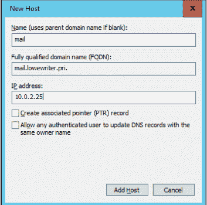

##### 配置Windows DNS客户端
客户端计算机无需太多配置即可正常使用DNS，只需要配置至少一个DNS服务器的地址即可。该地址通常由DHCP提供，因此如果客户端配置为从DHCP服务器获取IP地址，它也会从DHCP获取DNS服务器地址。
要配置客户端计算机从DHCP获取DNS服务器地址，请在控制面板中选择“网络”或“网络连接”（取决于客户端运行的Windows版本），打开“网络属性”对话框。然后选择TCP/IP协议，单击“属性”按钮。该操作会打开“TCP/IP属性”对话框，如图6-4所示。要配置计算机使用DHCP，请选择“自动获得IP地址”和“自动获得DNS服务器地址”选项。单击“确定”即可完成配置。

- **本章内容**
- 了解以太网
- 认识不同类型的网线
- 安装双绞线
- 使用交换机

### 第7章 织就乱网：线缆与交换机
线缆是网络的“管道”。事实上，网线的工作方式和水管非常相似：你需要使用正确的水管（对应网线），搭配正确的阀门和连接器（对应交换机）来组网。而且网线比水管多一个优势：漏水的时候你也不会湿身。
本章会介绍远比你实际需要知道的更多的网线知识。我会先介绍*以太网*，它是小型网络中最常见的网络线缆系统，然后你会了解如何布设用以太网组网的线缆，最后我会介绍交换机的使用方法，交换机能够创建必要的互联关系，让你的所有计算机可以相互通信。


#### 什么是以太网？
以太网是一种用于连接计算机组建网络的标准化方式。你可以将以太网类比为网络的“市政施工规范”：它明确规定了网线该选什么类型、线缆如何连接、线缆最长能有多长、计算机如何通过线缆互相传输数据，以及其他相关要求。

尽管以太网如今已成为组网的主流选择，但过去并非如此。在早期，以太网有两个主要竞争对手：
- **令牌环网**：这是IBM推出的网络标准，目前仍有一些机构在使用（尤其是部署了IBM大型机或中型机系统的机构）。
- **ARCnet**：该标准如今偶尔仍会用于工业网络场景，比如楼宇自动化和工厂机器人控制。
不过这些老式网络如今基本已被淘汰，你不需要过多关注它们。以太网如今是唯一切实可用的组网选择。

##### 关于网络拓扑的必要信息

但凡讲网络的书籍，都少不了对三种基础网络拓扑的常规教科书式介绍：总线型、环型和星型。
在总线型拓扑中，网络节点（也就是计算机）会按线性排布串接在一起，如下图所示：

总线型是所有拓扑类型中最简单的一种，但存在一些缺陷：如果线缆中间某处断裂，整个网络就会瘫痪。
第二种拓扑类型是环型：

环型和总线型非常相似，只是总线有端点而环型没有：线路的最后一个节点会连接回第一个节点，形成一个闭环。
第三种拓扑类型是星型：

在星型网络中，所有节点都连接到一个中央集线器。实际上，每个节点都和网络有独立的连接，因此某一条线缆损坏不会影响其他节点的正常使用。
以太网是基于总线型架构设计的，但特殊的布线技巧会让以太网看起来更像是星型结构。
下面是一些你可能在和别人聊到以太网标准时会听到的冷知识：
- 以太网是一套针对网络基础设施的标准，所有现代操作系统都支持在以太网上运行。如果你的网络基于以太网搭建，就可以同时兼容不同操作系统：Windows、macOS和Linux。
- 网络专家们常把以太网称为802.3（发音为“eight-oh-two-dot-three”），这是*IEEE*的官方命名（发音为“eye-triple-ee”，不是读成“aieeeel”）——IEEE是一个由戴领结的电气工程师组成的组织，他们热衷于争论电感和串扰这类问题，这样的争论其实很有必要。要不是有他们在，你根本无法混用不同厂商生产的以太网组件。
- 最早的经典以太网传输速率仅为每秒1000万比特，也就是10 Mbps。（*Mbps*的常规发音是“megabits per second”）因为1字节等于8比特，折算下来大约是每秒120万字节。但在实际使用中，以太网无法达到这么高的传输速度，因为数据必须以不超过1500字节的*数据包*为单位进行传输，因此150KB的信息需要拆分成100个数据包来发送。
- 以太网的传输速度和电信号在网线中的传播速度无关，电信号的传播速度约为光速的70%，用柯克船长的话来说就是“曲速因子0.7”。
- 以太网还有更快的版本，称为*100 Mbps以太网*或*快速以太网*，传输速度是标准以太网的10倍。
- 目前最常见的以太网版本是*千兆以太网*，传输速度可达1000 Mbps。
- 如今购买的大部分网络组件都支持10 Mbps、100 Mbps和1000 Mbps三种速率，这类组件被称为*10/100/1000 Mbps组件*。
- 部分网络组件支持万兆以太网，传输速度可达10000 Mbps（即10 Gbps），通常用于服务器和网络交换机之间的高速连接。


##### 关于网线的一切
虽然你可以用无线技术组建无需线缆的网络，但大多数网络目前仍会通过线缆将每台计算机物理连接到网络中。多年来，以太网使用了多种类型的线缆。如今几乎所有网络都采用双绞线搭建。这类线缆将成对的导线相互缠绕，以此降低电磁干扰。（要搞懂为什么缠绕导线能降低干扰，几乎得拿到物理学博士学位，所以如果你理解不了这个概念也别有压力。）
虽然概率不大，你还是可能在老旧的网络中遇到更早期的线缆类型。双绞线成为标准之前，网络使用的是*同轴电缆*（也叫*coax*，发音为“COE-ax”）。最常见的同轴电缆类型是RG-58，外形和电视线相似。另一种更早的同轴电缆叫10base5，也因其线径过粗难以操作，被称为*粗缆（thicknet）*。你还有可能遇到用于长距离高速传输的光纤线缆，或是大型建筑物布线间内用于铺设多组双绞线的粗双绞线束。不过大多数网络使用的都是普通双绞线。双绞线有时也被称为*UTP*（*U*代表非屏蔽，不过“双绞线”是通用标准名称）。图7-1展示的是一根双绞线。
#### 图7-1：
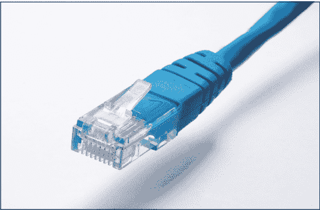
使用UTP线缆搭建以太网时，需要按照星型结构连接计算机，如图7-2所示。星型的中心是*交换机*。根据型号不同，以太网交换机可以通过双绞线连接4到48台（甚至更多）计算机。
> 在UTP星型结构中，如果某一条线缆出现故障，只有连接这条线缆的计算机受影响，网络的其他部分仍可正常运行。
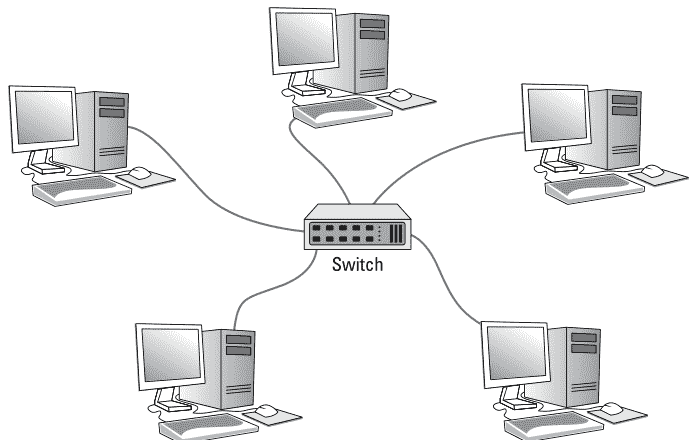
#### 图7-2 采用双绞线布线的网络

#### 线缆类别
双绞线有不同的等级，称为*类别*，这些类别由ANSI/EIA 568标准规定。（*ANSI*是美国国家标准学会的缩写；*EIA*是电子工业协会的缩写。）该标准规定了线缆的数据容量，也就是带宽。表7-1列出了当前市面上可用的各类双绞线。（包括Cat-7和Cat-8在内的更高级别类别目前还处于设计阶段，尚未商业化上市。）
##### 表7-1 双绞线类别
| 类别 | 最高数据传输速率 | 用途 |
| --- | --- | --- |
| 1 | 1 Mbps | 仅语音 |
| 2 | 4 Mbps | 4 Mbps令牌环网 |
| 3 | 16 Mbps | 10BaseT以太网 |
| 4 | 20 Mbps | 16 Mbps令牌环网 |
| 5 | 100 Mbps（2对） | 100BaseT以太网 |
|  | 1000 Mbps（4对） | 1000BaseTX |
| 5e | 1000 Mbps（2对） | 1000BaseT |
| 6 | 1000 Mbps（2对） | 1000BaseT及更高速宽带应用 |
| 6a | 10000 Mbps（2对） | 支持10 Gbps以太网 |
虽然高级别线缆的价格更高，但以太网布线的主要成本是将线缆穿过墙体的工时费。你绝对不要安装低于Cat 5e类别的线缆。如果条件允许，建议选用Cat 6线缆，方便未来升级网络。

想显得专业一点的话，就说“Cat 6”而不是“Category 6”。
TIP
什么是线对？大多数双绞线都有四对导线，总计八根。标准以太网仅使用其中两对，另外两对处于闲置状态。你可能会为了省钱购买仅含两对导线的线缆，但这并非明智之举。如果网络线缆出现故障，你可以切换到闲置线对进行临时修复；但如果你使用的是两对线缆，就没有多余的线对可用了。

WARNING
不要将闲置线对用于其他用途，例如语音线路或第二条数据线路，额外导线中的电气“噪声”会干扰你的网络。

#### 屏蔽还是非屏蔽？
非屏蔽双绞线（UTP）是为普通办公环境设计的。使用UTP线缆时，要特别注意不要把线缆布设在荧光灯、空调或电动机（比如自动门电机、电梯电机）附近。UTP是最便宜的线缆类型。如果环境存在大量电气干扰（比如工厂），你可以考虑使用屏蔽双绞线（STP）。由于STP的价格最高可达普通UTP的3倍，除非必要，否则不建议使用STP。只要稍加注意，UTP就可以抵御普通办公环境中的电气干扰。但在恶劣环境下，比如线缆需要部署在室外、埋在地下或靠近工业设备时，你应该选用STP线缆。大多数STP线缆都带有一层铝箔屏蔽层。对于电气干扰特别严重的建筑物，价格更高的铜编织网屏蔽层能提供更完善的防护。


#### 何时使用 plenum 电缆

屏蔽和非屏蔽双绞线电缆的外护套有两种：
- PVC：最常见且成本最低的类型。
- Plenum：一种特殊的阻燃电缆，专为在建筑的 plenum 空间（定义即将说明）中使用而设计。Plenum 电缆具有特殊的特氟龙涂层，不仅耐热，而且即使燃烧也会释放更少的有毒烟雾。不幸的是，plenum 电缆的成本是普通 PVC 电缆的两倍以上。

> 大多数当地建筑规范要求，当布线安装在建筑的 plenum 空间（属于建筑空气分配系统一部分的隔间，通常是吊顶上方或架空地板下方的空间）时，必须使用 plenum 电缆。
> 如果空调和供暖系统的送风管和回风管均为管道式，则吊顶上方的空间不属于 plenum 空间。只有在空调和供暖系统没有使用管道时，才需要 plenum 电缆。如有疑问，请在安装电缆前让当地检查员查看您的设施。

#### 有时是实心线，有时是多股绞线

构成电缆的实际铜线有两种：实心线和多股绞线。您的网络会使用这两种类型：
- 多股绞线：每根导体由许多非常细的导线绞合而成。多股绞线比实心线更柔软，因此不易断裂。然而，多股绞线比实心线更贵，并且在长距离传输信号方面效果不佳。多股绞线最适合用于跳线（例如从配线架到集线器和交换机）。严格来说，将计算机连接到墙壁插孔的电缆被称为工作站电缆——而不是跳线——但它是多股绞线的合适用途。（虽然技术上不正确，但大多数人将连接计算机到墙壁插孔的电缆称为“跳线”。）
- 实心线：每根导体是一根单独的实心线。实心线比多股绞线便宜，并且可以传输更远的信号，但它不是很柔软。如果弯曲次数过多，它会断裂。通常，您会在建筑物墙壁和天花板内的永久性布线中使用实心线。

##### 安装指南

安装网络电缆最困难的部分是将电缆穿过天花板、墙壁和地板的物理任务。这项工作相当棘手，我建议您除了小办公室外不要自己尝试。对于大型项目，请聘请专业的电缆安装人员。如果天花板和墙壁空间难以接近，即使是小项目您也可能想聘请专业人员。如果您自己安装电缆，请记住这些要点：
- 您可以购买预制长度的双绞线电缆，例如 10、15 或 20 英尺。也有更长的长度，例如 50 英尺或 100 英尺。
- 或者，您可以购买成卷的散装电缆，将其剪裁到所需长度，然后自己安装连接器。
- 始终使用比需要稍长的电缆，特别是如果您要将电缆穿过墙壁。例如，当您将电缆沿墙壁向上拉时，在墙壁上方的天花板中留出几英尺的余量。这样，如果您需要进行维修，就有足够的电缆。
- 布线时，避开干扰源，如荧光灯、大型电机、X 光机、核反应堆、回旋加速器、通量电容器，或您可能隐藏在办公室紧闭门后的其他设备。荧光灯是天花板嵌板后方电缆最常见的干扰源。让灯具保持足够距离。三英尺应该足够了。

- 集线器和计算机之间允许的最大电缆长度为 100 米（约 328 英尺）。
- 如果您必须将电缆穿过人们行走的地板，请覆盖电缆以免有人绊倒。大多数五金店都有电缆保护套出售。
- 布线穿过墙壁时，在每根电缆的两端都做好标记。大多数电气用品店都有成套的电缆标签出售，非常适合这项工作。这些标签本包含大约 50 张预先裁切好的带有字母和数字的标签。它们看起来比在电缆上绕一圈美纹纸胶带并用记号笔写上标记要专业得多。您也可以购买可以打印设计用于贴在电缆上的标签的标签机。作为最后的手段，您始终可以用永久性记号笔直接在标签上书写。

- 如果您在新建建筑中安装电缆，请在每根电缆的两端至少标记三次，标签之间留出约一英尺的间距。石膏板工或油漆工很可能会将泥浆或油漆喷溅到您的电缆上，使得标签难以找到。

- 当几根电缆汇集在一起时，用塑料扎带或更好的魔术贴条将它们捆好。避免使用管道胶带（或者更糟的，美纹纸胶带）。胶带不持久，但粘胶残留物会持久存在。一年后会一团糟。电气用品店有扎带出售。
- 扎带有各种各样的用途。有一次徒步旅行，我用一对扎带把一个毫无防备的朋友的帽子固定在高高的树枝上。他对我创新性地使用扎带并不欣赏，但我的其他徒步伙伴们觉得很有趣。
- 当您在吊顶嵌板上方布线时，使用扎带、挂钩或夹子将电缆固定在天花板或支撑天花板嵌板的金属框架上。不要只是将电缆放在嵌板顶部。

##### **您需要的工具**

当然，要把工作做好，您必须拥有合适的工具：

- 从一套基本的计算机工具开始，您可以在任何计算机商店和大多数办公用品商店以大约 15 美元的价格买到。这些套件包括套筒扳手和螺丝刀，用于打开计算机和插入适配卡。如果满足以下条件，计算机工具包可能包含您需要的一切：
  - 您所有的计算机都在同一个房间。
  - 您将电缆布在桌子后面或沿地板走线。
  - 您使用预制电缆。
如果您没有计算机工具包，请确保您有几把不同尺寸的一字和十字螺丝刀。

- 如果您使用散装电缆并计划自己安装连接器，除了基本的计算机工具包外，您还需要以下工具：
  - **剥线钳**：对于同轴电缆，您需要大的剥线钳；对于双绞线电缆，较小的即可。对于黄色电缆，您需要液压剪。
  - **压线钳**：您需要压线钳将连接器压接到电缆上。不要使用便宜的 25 美元的压线钳。一个好的压线钳花费 100 美元，并且从长远来看会为您省去很多麻烦。*压接时，必须确保压接牢固。*
  
  - **剥线器**：只有当压线钳不带剥线器时，您才需要这个工具。
  - **电缆测试仪**：它可以让您确定电缆是否可用。

>> 如果您计划将电缆穿过墙壁，您需要以下额外工具：
>> - 一把锤子
>> - 一把锁孔锯：如果您计划在墙壁上开孔布线，这个很有用。
>> - 一个手电筒
>> - 一个梯子
>> - 一个扶梯子的人
>> - 穿线器：可能需要。穿线器是一卷卷起来的硬金属带。使用时，您将金属带从一个墙洞穿入，然后将其引向另一个墙洞，那里的搭档准备好在金属带到达时抓住它。接下来，您的搭档将电缆系在穿线器上，然后喊类似“拉吧！”或“放炸弹了！”。然后您收回穿线器和电缆。（您可以在大多数货品齐全的五金店的电气区找到穿线器。）


警告

如果您计划将电缆穿过混凝土底板，您需要租用一台风钻和一台反铲挖土机，然后雇人手持黄旗在您工作时示警。更好的办法是为电缆寻找其他路径。

##### 双绞线电缆的线序

双绞线电缆中的每对线由四种颜色之一组成：橙色、绿色、蓝色或棕色。组成每对线的两根导线是互补的：一根是带有彩色条纹的白色线；另一根是带有白色条纹的彩色线。例如，橙色线对有一根带有白色条纹的橙色线（*橙色线*）和一根带有橙色条纹的白色线（*白/橙线*）。同样，蓝色线对有一根带有白色条纹的蓝色线（*蓝色线*）和一根带有蓝色条纹的白色线（*白/蓝线*）。当您将双绞线电缆连接到模块化连接器或插孔时，您必须将正确的导线匹配到正确的引脚。这比听起来更难；您可以使用几种不同标准中的任何一种来为连接器布线。更令人困惑的是，您可以使用两种流行的接线标准之一：EIA/TIA 568A 或 EIA/TIA 568B，也称为 AT&T 258A。这两种接线方案都在表 7-2 中显示。


警告

无论使用哪种接线方案都没关系，但选择一种并坚持下去。如果您在一端使用一种接线标准，另一端使用另一种标准，电缆将无法工作。


**表7-2**
**双绞线电缆引脚接线表**
| 引脚 | 功能 | EIA/TIA 568A | EIA/TIA 568B / AT&T 258A |
|:---:|:---|:---|:---:|
| 1 | 发送 + | 白/绿 | 白/橙 |
| 2 | 发送 – | 绿 | 橙 |
| 3 | 接收 + | 白/橙 | 白/绿 |
| 4 | 未使用 | 蓝 | 蓝 |
| 5 | 未使用 | 白/蓝 | 白/蓝 |
| 6 | 接收 – | 橙 | 绿 |
| 7 | 未使用 | 白/棕 | 白/棕 |
| 8 | 未使用 | 棕 | 棕 |

以太网仅使用四对线中的两对，分别连接到1、2、3、6号引脚。其中一对用于发送数据，另一对用于接收数据。两种接线标准的唯一区别在于哪对线用于发送、哪对用于接收：在EIA/TIA 568A标准中，绿线对用于发送，橙线对用于接收；在EIA/TIA 568B和AT&T 258A标准中，橙线对用于发送，绿线对用于接收。不要图省事只连接1、2、3、6号引脚，要按照表7-2所示连接全部四对线。

##### RJ-45连接器
只要配有合适的压线钳，双绞线电缆的RJ-45连接器安装难度并不高。唯一的技巧是要确保每根导线都压接到正确的引脚上，且压线时压力足够大以保证接触良好。以下是安装RJ-45连接器的步骤：
1. **将电缆末端切割到所需长度**。注意要切齐，不要斜切。
2. **将电缆插入压线钳的剥线部分，使电缆末端抵住限位块**。握住手柄慢慢向外拉电缆，保持电缆切面平整，这样就能剥掉合适长度的外绝缘层，又不会刺破内部导线的绝缘层。
3. **整理导线，使其平铺并按表7-2对应排列**。你需要稍微调整导线，让它们按正确顺序排列整齐。
4. **将导线插入连接器的针孔中**。反复核对，确保所有导线都插入了正确的针孔。
5. **将插头和导线一起插入压线钳的压线部分，然后握紧手柄压接插头**。一定要压紧！
6. **从工具上取下插头，反复检查接线**。就完成了！

以下是处理RJ-45连接器和双绞线电缆时需要注意的其他事项：
- RJ-45连接器上的引脚没有编号。你可以通过将连接器金属触点朝上握持来判断哪一个是1号引脚，如图7-3所示，最左侧的是1号引脚。
- 有些人的接线方式不同——用绿白线对接1、2号引脚，橙白线对接3、6号引脚。只要电缆两端的连接器接线方式一致，这种接法不会影响网络运行（网络不关注线序颜色）*只要电缆两端的连接器接线方式相同即可！*
- 安装连接器时，不要剥开超过半英寸（约1.27厘米）的导线外皮。此外，不要尝试将电缆布线长度超过100米的最大限制。如果有疑问，请找专业人员安装电缆。

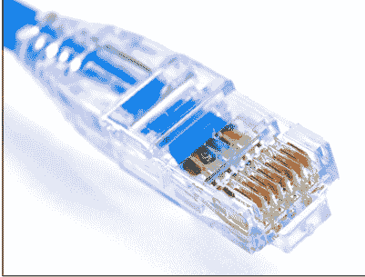
**图7-3：将RJ-45连接器安装到双绞线电缆上**

#### 交叉线
*交叉线*可以直接连接两个设备而无需交换机。你可以用交叉线直接连接两台计算机，但交叉线更多用于将交换机逐条串联起来。如果你想自制交叉线，需要将电缆一端的导线反向排列，如表7-3所示。该表格展示了制作交叉线时电缆两端的接线方式：一端按照“连接器A”列接线，另一端按照“连接器B”列接线。

##### 制作交叉线
**表7-3**
| 引脚 | 连接器A | 连接器B |
|:---:|:---|:---|
| 1 | 白/绿 | 白/橙 |
| 2 | 绿 | 橙 |
| 3 | 白/橙 | 白/绿 |
| 4 | 蓝 | 蓝 |
| 5 | 白/蓝 | 白/蓝 |
| 6 | 橙 | 绿 |
| 7 | 白/棕 | 白/棕 |
| 8 | 棕 | 棕 |

由于现在大多数交换机都可以自动检测是否需要使用交叉线，并在内部调整以允许使用标准线代替交叉线，交叉线的需求已不如以前广泛。
> **提示**
> 如果你长时间研究表7-3，再与表7-2对比，就会发现交叉线就是一端按568A标准接线、另一端按568B标准接线的电缆。

#### 墙面插座和配线架
如果需要，你可以从布线间的网络集线器或交换机拉一根完整的电缆，穿过墙洞，沿墙上行到天花板上方空间，穿过天花板空间到办公室的墙面，再下行穿过墙洞，一直连接到桌面计算机。这可不是个好主意。例如，每次有人移动计算机甚至打扫计算机背面时，电缆都会被轻微移动。最终连接会失效，RJ-45插头需要更换，而且布线间的电缆会很快乱成一团。更好的方案是在电缆的用户端墙面安装墙面插座，将电缆的另一端连接到配线架。这样电缆本身完全隐藏在墙壁和天花板空间内。要将计算机连接到网络，只需将跳线（正式名称为*站线*）一端插入墙面插座，另一端插入计算机的网络接口；在布线间，再用跳线将墙面插座连接到网络集线器或交换机即可。图7-4展示了这种布局的工作原理。

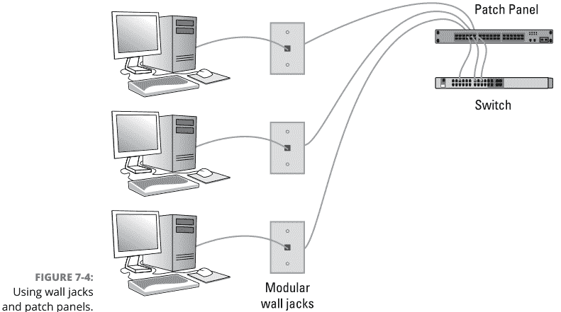
将双绞线电缆连接到墙面插座或配线架的过程和连接到RJ-45插头类似，但通常不需要特殊工具。插座背面有一排插槽，你可以将每根导线放在对应的插槽上，然后扣上可拆卸的盖板向下按压，这个动作会将导线压入插槽，其中的小金属片会刺破导线绝缘层并建立电气连接。
> 将导线连接到插座或配线架时，尽量少剥开导线的外皮。如果剥开的外皮过多，穿过导线的信号可能会变得不稳定。

#### 了解交换机
使用双绞线电缆布置网络时，不需要将计算机互相连接，每台计算机都插入一个名为交换机的独立设备即可。使用交换机只需要了解以下几个细节：
1. **安装交换机**通常非常简单，只需插入电源线，再插入跳线连接网络即可。
2. 交换机上的每个端口都配有RJ-45插座，以及一个标有*链路*的LED指示灯，端口建立连接时该指示灯会亮起。
   - 如果将电缆一端插入端口，另一端插入计算机或其他网络设备，链路指示灯应该会亮起。如果不亮，说明电缆、集线器或交换机端口，或电缆另一端的设备存在问题。
3. 每个端口可能配有LED指示灯，闪烁表示网络活动。
   - 如果你观察交换机一段时间，通过记录哪个活动指示灯闪烁最频繁，就能知道谁最常使用网络。
4. 端口还可能有碰撞指示灯，端口发生数据包碰撞时会闪烁。
   - 碰撞指示灯偶尔闪烁是完全正常的，但如果频繁闪烁，说明网络可能存在问题：
     * 通常情况下，频繁闪烁意味着网络过载，需要通过交换机进行分段以提升性能。
     * 有时，闪烁可能是由故障网络节点发送错误数据包堵塞网络导致的。

##### 比较网管型交换机与非网管型交换机
并非所有交换机都是一样的。有些交换机专为家庭或小型办公室的极小网络设计。小型网络的管理非常简单，交换机本身不需要进行任何管理或配置。你只需将所有计算机插入交换机，网络即可自行运行。


#### 它为什么叫交换机？
你可能会纳闷，为什么这种设备叫“交换机”？毕竟在日常经验里，我们说的开关是用来控制设备通断的。但网络交换机并不负责开启或关闭网络。在计算机网络领域，交换机是一种会接收网络中传入的信息包，并判断每个信息包该被发送到哪里的设备。从这个角度看，网络交换机更像铁路道岔，而不是电灯开关。它不是用来控制设备通断，而是判断某个特定的信息包应该被发送到哪一条线路上。
举个简单的例子，一台带8个端口（编号从1到8）的小型交换机。开机后，它会留意每个端口所连接的所有设备。它会通过研究到达每个端口的以太网数据包，并记录下每个数据包里的发送方地址来实现这一点。交换机会持续追踪每个端口连接的是哪台设备。
当数据包从某个端口进入后，交换机会查看数据包里的接收方地址，然后判断接收方连接在哪个端口上，再把数据包发送到该端口。因此，交换机通过将网络中的每个数据包经由正确的线路发送，高效管控数据包在网络中的传输，确保每个数据包都能抵达目的地。
不过在更大的网络中，交换机需要完成的工作就复杂得多。在这种场景下，你需要具备监控和配置网络中每一台交换机行为的能力。拥有这类能力的交换机被称为*托管交换机*，不具备这类能力的则称为*非托管交换机*。
托管交换机拥有独立的IP地址，还会提供一个基于Web的管理控制台，你只要把常用的浏览器指向该交换机的IP地址，就能访问这个控制台。登录管理控制台后，你就可以完成诸多操作，比如针对不同类型的网络流量配置各个端口、查看每个端口的流量数据、监控每个端口以及交换机整体的运行性能。

通用规则是，如果你的网络需要不止一台交换机，你应该选用托管交换机。托管交换机比非托管交换机更贵，但当你的网络规模增长到需要多台交换机时，你就会明白托管交换机带来的好处有多大。
#### 交换机级联
如果单台交换机的端口数量不够支撑你的整个网络，你可以通过*级联*的方式连接多台交换机，如图7-5所示。（注意：虽然你也可以对非托管交换机进行级联，但如果你的网络规模大到需要多台交换机，我还是推荐你使用托管交换机。）
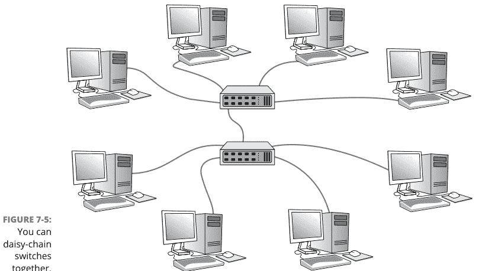
大部分交换机上，你用哪个端口去级联另一台交换机都没有关系。只要在两台交换机上各选一个端口，用跳线通过这两个端口把两台交换机连起来即可。如果你的交换机有不同速率的端口，请选用速率最快的端口来连接交换机。
> 如果你的建筑物预先铺设了线路，且每张办公桌附近都有网络接口，你可以用一台小型交换机，仅通过一个接口就能把两台或更多计算机连入网络。只要用一根线缆将交换机插入墙面接口，再把每台计算机插入交换机的一个端口即可。
#### 交换机堆叠
部分被称为*可堆叠交换机*的交换机，可以通过增加额外交换机模块来扩展端口数量。这些额外的模块可以是经由专用互联端口连接起来的、物理上独立的交换机，也可以是能够插入更大机箱的模块。
可堆叠交换机本质上是托管交换机，它的核心特征是：所有被组合成单个堆叠的交换机，都可以被作为一台单独的交换机来管理。
举个例子，一台可堆叠交换机最初可能只配置了一个提供48个交换机端口的模块。如果你需要更多端口，可以再加装一个带48个额外端口的模块，这样就能组成一台拥有96个端口的一体化交换机。
可堆叠交换机比不可堆叠的交换机更贵，但管理一台大交换机比管理多台小交换机更简单，这一点可能足以抵消增加的成本。
#### 了解分布交换机与接入交换机
规模大到需要多台交换机的网络，很可能也到了需要多种不同类型交换机的地步：
- **接入交换机**：接入交换机通常配备大量1吉比特（Gb）端口，作用是将计算机、打印机这类终端设备连接到网络。举个例子，如果你的公司有100名员工，且已经在每位员工的办公桌上布设了两根Cat-5e线缆，那么你至少需要200个1Gb的交换机端口来支撑这些用户的使用。你还需要额外预留一些端口给打印机、Wi-Fi接入点等设备。最终你的网络设计方案可能会用到5台48端口的接入交换机，总共提供240个1Gb端口，足以支撑100名用户的使用。
- **分布交换机**：分布交换机并不设计用于直接连接终端用户，而是用于将各台接入交换机互相连接，并连接到服务器。因为分布交换机的用途是管控来自所有接入交换机的聚合流量，所以它有时也被称为聚合交换机。通常，分布交换机使用10Gbps端口而非1Gbps端口。更高的速率是有意义的，因为分布交换机的每个端口承载的数据量远大于接入交换机的每个端口。接入交换机也应配置少量10Gbps端口，用于连接分布交换机。
- **核心交换机**：最庞大的网络可能还会用到独立的核心交换机，用于连接各台分布交换机。核心交换机负责管控分布交换机之间的流量。图7-6展示了一个拥有4台独立接入交换机的网络，这些接入交换机通过一台分布交换机互相连接。
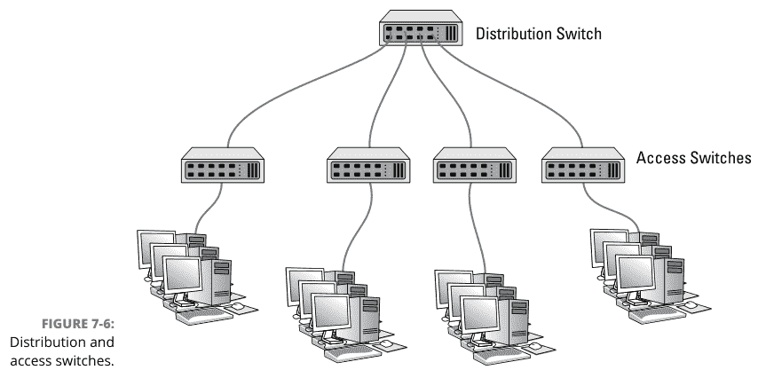
#### 通过以太网供电
除了传输数据之外，以太网还可以用于为功耗较小的设备供电。能够提供电力供应的以太网电路被称为*以太网供电（PoE）*。使用PoE需要使用专门设计用于支持PoE的交换机。
三类常使用PoE网络的设备如下：
- **IP电话**：采用TCP/IP传输语音通话的电话系统，通常会使用PoE为用户桌面的电话供电，这样就无需再单独配置电源适配器为电话供电了。
- **Wi-Fi接入点**：Wi-Fi接入点通常会使用PoE而非单独的供电方式。由于Wi-Fi接入点通常安装在天花板上，给它们供电比较麻烦。使用PoE就无需让电工在每个Wi-Fi接入点旁安装电源插座了。
- **安防摄像头**：安防摄像头常使用PoE的原因和Wi-Fi接入点一致：无需在每个摄像头的位置安装电源插座。
PoE不需要任何特殊的线缆，但需要使用专门的PoE交换机。PoE交换机比非PoE交换机更贵，但如果你计划部署IP电话、Wi-Fi接入点或安防摄像头，建议你考虑使用PoE交换机为这些设备供电。
#### 了解三类网络机房
作为本章的最后一个主题，我们来简单了解一下你可能会摆放网络交换机的三类不同机房：
- **主入口点（MPOE）**：每栋办公楼都有一个主配电室，来自外部的服务（不止电力，还有数据连接）都会从这里进入大楼。在计算机网络术语中，这个房间被称为MPOE。MPOE通常也是你的网络互联网接入线路到达的房间。一般来说，要避免将交换机、路由器等其他网络设备放在这个房间里，因为它通常没有空调。
- **主配线间（MDF）**：你的核心计算机设备间（通常被称为*服务器机房*），一般就是放置分布交换机的位置，这个房间被称为MDF。如果MDF距离接入交换机所服务的用户很近，也可以把接入交换机放在MDF里。
- **中间配线间（IDF）**：针对距离MDF较远的用户群体，你可以设置一个距离这些用户更近的独立*中间配线间（IDF）*。这个房间会放置服务于这些用户的接入交换机，还会通过一根或多根以太网线缆连接到MDF中的分布交换机。（IDF也被俗称为*布线间*。）在多层建筑中，通常每层都会设置一个IDF；如果你的网络覆盖园区内的多栋建筑，通常每栋建筑也会设置一个IDF。


#### 本章内容
- 了解无线网络标准
- 回顾基础无线电术语
- 了解基础设施网络与临时网络
- 使用无线接入点
- 配置Windows系统进行无线网络连接
- 保护无线网络安全
## 第8章
### 搭建无线网络
自以太网问世以来，网线就变得越来越细、越来越好用。最早期的以太网线比大拇指还粗，分量极重，很难在狭窄拐角处弯折。随后出现的是同轴电缆，它更轻也更易操作。再后来，非屏蔽双绞线（UTP）取代了同轴电缆，这也是如今多数网络使用的线缆。虽然这些年网线变得越来越细、越来越便宜、越来越好用，但它说到底还是*线缆*。因此，为整间房屋或办公室铺设网络，免不了要在墙上打孔、在天花板里穿线，弄得头发里满是保温材料。
当然，布线网络的替代方案就是*不用*布线的网络……也就是*无线网络*。无线网络通过无线电波发送和接收网络信号，因此，你的电脑无论在家还是办公室的哪个位置，都能接入无线网络。无线网络对笔记本电脑而言尤为实用，毕竟笔记本电脑最大的优势就是你可以随身携带，走到哪用到哪。上班时，你可以在办公桌前、会议室、休息室，甚至公司停车场使用笔记本电脑；在家时，你可以在卧室、厨房、书房、游戏室，甚至泳池边使用它。有了无线网络，无论你把笔记本电脑带到哪里，都能接入网络。无线网络对其他类型的移动设备也极其有用，比如智能手机和平板电脑。诚然，这些设备可以通过蜂窝网络连接，但这类操作费用会非常高。而使用无线网络的话，你无需为连接时长向移动运营商付费。
本章将带你全面了解搭建无线网络的相关知识，内容包括无线网络标准的基础知识、如何规划无线网络、如何安装和配置无线网络组件，以及如果你需要搭建有线无线混合网络，我也会教你如何实现。

#### 深入了解无线网络
如前文所述，无线网络就是使用无线电信号而非直接线缆连接来交换信息的网络，原理非常简单。带无线网络连接的电脑就像手机：你不需要把手机连接（拴住）在电话线上才能使用，同样，使用无线联网的电脑也不需要连接网线。
- **WLAN（无线局域网）：** 无线网络通常被称为无线局域网（WLAN），也有人更喜欢把缩写反过来，称为本地区域无线网络，也就是LAWN。
- **Wi-Fi：** 虽然*Wi-Fi*这个词常被用来指代无线网络，但从技术层面来说，它仅指一种无线网络形式，也就是802.11标准。（更多相关信息可参阅本章后文的“八零二 dot 十一：了解无线标准”一节。）
- **SSID：** 无线网络有一个名称，称为SSID，*SSID*是*服务集标识符*的缩写。（这难道不会是一道超棒的《危险边缘》题吗？我出400美元竞猜这个冷门的四字母缩写！）所有属于同一无线网络的设备都必须使用相同的SSID。
- **信道：** 无线网络可以通过多个信道中的任意一个传输数据，但要让计算机之间互相通信，必须将它们配置为使用相同的信道传输。
- **Ad-hoc（临时模式）：** 最简单的无线网络由两台及以上装有无线网卡的计算机组成，这类网络称为*临时模式网络*。
- **基础设施模式：** 更复杂的网络类型是基础设施模式网络，本质上指的是一组无线计算机不仅可以互相连接，还可以通过名为*无线接入点（WAP）*的设备接入现有的有线网络。（关于临时网络和基础设施网络的更多信息，可参阅本章后文内容。）

##### 高中电子学小知识
我高中时是个十足的极客：连修了三年的电子学。我们学校的电子学教室就在汽车修理车间隔壁，当然，所有酷孩子都去上汽车修理课，只有像我这样的极客才学电子学。不过我们坚持了下来，在酷孩子们学习如何抬高车体、安装2吉瓦音响系统的时候，我们学到了关于电容和二极管的全部知识。事实证明，这点高中电子学知识在无线网络领域居然能用得上——虽然用处不大，但聊胜于无。如果你了解一些基础无线电术语的含义，会更有利于你理解无线网络。

##### 电波与频率
首先，无线电本质上是穿过大气层的电磁波。你既看不见也听不到它们，但无线电接收器可以捕捉到这些电波，并将其转换为声音、图像，或是——在无线网络场景下——数据。无线电波实际上是循环的电子能波，会以特定速率重复：这个速率就是*频率*。图8-1展示了两种不同频率的无线电波，第一张是每秒1个周期，第二张是每秒2个周期。（真正的无线电不会在这么低的频率下运行，但我觉得画每秒1个和2个周期，比画每秒68万和240万个周期要容易得多。）


**图8-1：** 不同频率的无线电波。
> **提示** 频率的单位是*每秒周期数*，表示电波在1秒内完成多少个完整周期（显而易见）。为了纪念海因里希·赫兹——首位成功发送和接收无线电波的人（这件事发生在19世纪80年代）——每秒周期数通常被称为*赫兹*，缩写为*Hz*。因此，1 Hz就是每秒1个周期。

另外，当前缀*K*（代表*kilo*，即1000）、*M*（代表*mega*，即100万）或*G*（代表*giga*，即10亿）加到Hz前面时，*H*仍然要大写。因此，2.4 MHz是正确的写法（不能写成2.4 Mhz）。无线电频率的优势在于，发射器可以调整到以精确的频率广播无线电波，接收器同样可以调整到接收特定频率的无线电波，忽略其他频率的电波。这就是为什么你可以调汽车收音机收听几十个电台：每个电台都用自己的专属频率广播。

##### 波长与天线
和频率相关的术语是*波长*。无线电波以光速传播，*波长*指的是电波在一个周期内传播的距离，换一种说法，*波长*就是每个波峰之间的物理距离。例如，因为光速大约是每秒182282英里，因此1 Hz无线电波的波长约为182282英里，2 Hz信号的波长约为前者的一半，只有91141英里。可以看出，频率越高，波长越短。功率为580 KHz的典型AM广播电台，波长约为522码；功率为100 MHz的电视台，波长约为3码；功率为2.4 GHz的无线网络，波长略短于5英寸。波长越短，充分接收信号所需的天线尺寸就越小。因此，高频传输需要更小的天线。你可能注意到，AM广播电台的天线通常安装在很高的塔顶，体积庞大，而手机发射器小得多，塔的高度也低得多，这是因为手机的工作频率比AM广播电台高。
那么，谁来决定哪种类型的无线电可以使用特定频率呢？这就涉及频谱和美国联邦通信委员会（FCC）的管辖范围了。

##### 频谱与美国联邦通信委员会（FCC）
*频谱*是指可供无线电运作的连续频率范围。在美国，联邦通信委员会（FCC）的监管范围不仅包括超级碗中场秀中珍妮特·杰克逊的露出时长，还包括如何分配无线电频谱的不同频段用于何种用途。本质上，FCC将无线电频谱划分为数十个小区段——也就是*频段*，规定特定频段只能用于特定用途。例如，AM广播的工作频段为535 KHz到1700 KHz。


#### 现在，让反讽部门登场说几句
我大学是英语文学专业的，所以很喜欢用反讽这类文学手法。我写的计算机书里很少有机会用上这个，所以只要一有机会用反讽，我就像一头蹦进烂泥塘的猪似的扑上去。
所以今天我要分享的有意思的反讽点是：最早的以太网系统其实是个无线网络。
以太网的起源可以追溯到1970年夏威夷大学研发的AlohaNet网络。这个网络通过小型无线电传输数据。如果两台电脑同时尝试广播数据，就会检测到冲突，并在短暂的随机延迟后重试。这一技术正是以太网基础技术的灵感来源，如今被称为“载波侦听多路访问/冲突检测”，即CSMA/CD。
正是这个无线的AlohaNet网络启发了罗伯特·梅特卡夫，他在1973年于哈佛大学撰写博士论文时，基于此研发了有线网络，并将其命名为以太网。之后的约20年里，以太网几乎是有线网络的代名词。直到20世纪90年代中期，以太网才终于回归其无线的源头。
表8-1列出了部分最常用的频段。请注意，部分频段宽度较大——比如特高频电视频段起始频率为470 MHz，截止频率为806 MHz——但其他频段仅限于特定频率。某频段内最高频率与最低频率的差值即为带宽。
#### TABLE 8-1 无线电频谱常用频段
| 频段 | 用途 |
| --- | --- |
| 535 KHz–1,700 KHz | 调幅广播 |
| 5.9 MHz–26.1 MHz | 短波广播 |
| 26.96 MHz–27.41 MHz | 民用波段（CB）广播 |
| 54 MHz–88 MHz | 电视（甚高频2-6频道） |
| 88 MHz–108 MHz | 调频广播 |
| 174 MHz–220 MHz | 电视（甚高频7-13频道） |
| 470 MHz–806 MHz | 电视（特高频频道） |
| 806 MHz–890 MHz | 蜂窝网络 |
| 900 MHz | 无绳电话和无线网络（802.11ah） |
| 1850 MHz–1990 MHz | PCS蜂窝网络 |
| 2.4 GHz–2.4835 GHz | 无绳电话和无线网络（802.11b和802.11n） |
| 4 GHz–5 GHz | 大碟卫星电视 |
| 5 GHz | 无线网络（802.11a） |
| 11.7 GHz–12.7 GHz | 小碟卫星电视 |
无线电频谱中有两个频段分配给无线网络使用：2.4 GHz和5 GHz。请注意，这两个频段并非专供无线网络使用。尤其是2.4 GHz频段还和无绳电话共用频段，因此无绳电话有时会干扰无线网络。另外需要注意的是，截至2016年，部分无线网络也可以在900 MHz频谱段运行。
##### 八零二点十一 something：搞懂无线标准
无线网络最常用的标准是IEEE 802.11系列标准。这些是核心无线以太网标准，采用了大量与有线以太网标准（也就是802.3）相同的网络技术。最重要的是，802.11网络和有线以太网一样，使用CSMA/CD技术来处理网络冲突。802.11标准覆盖了IEEE七层模型的最底层两层：物理层和媒体访问控制（MAC）层。请注意，TCP/IP协议作用于模型的更高层，因此TCP/IP在802.11网络上可以正常运行。
最初的802.11标准于1997年采纳。后续增补的802.11a和802.11b标准于1999年发布。之后2003年推出802.11g，2009年推出802.11n。802.11n占据主导地位好几年，直到2014年推出并被广泛接受的最新标准802.11ac。目前还有更多变体正在研发中，包括将在900 MHz频谱段运行的802.11ah。
#### TABLE 8-2 802.11标准变体
| 标准 | 速率 | 工作频段 | 室内典型覆盖范围 |
| --- | --- | --- | --- |
| 802.11a | 最高54 Mbps | 5 GHz | 150英尺 |
| 802.11b | 最高11 Mbps | 2.4 GHz | 300英尺 |
| 802.11g | 最高54 Mbps | 2.4 GHz | 300英尺 |
| 802.11n | 最高600 Mbps（但多数设备速率在100 Mbps左右） | 2.4 GHz | 230英尺 |
| 802.11ac | 最高1300 Mbps | 5 GHz | 230英尺 |
#### 覆盖范围那点事
802.11ac无线设备的室内最大覆盖范围约为230英尺。当你把一堆无线电脑放在一起时，就会出现一个有意思的现象：部分设备在彼此的覆盖范围内，另一部分则不在。假设巴特、霍默和丽莎都有无线笔记本。巴特的电脑距离霍默的电脑150英尺，相反方向距离丽莎的电脑也是150英尺（见图8-2）。这种情况下，巴特可以访问霍默和丽莎的电脑，但霍默只能访问巴特的电脑，丽莎也只能访问巴特的电脑。换句话说，霍默和丽莎无法访问彼此的电脑，因为两人相距300英尺，远超230英尺的覆盖范围限制。（这听起来已经开始像一道可疑的代数题了。现在假设霍默以每小时2英里的速度走向巴特，丽莎以每小时4英里的速度跑向巴特……）这就说明了信号强度如何影响网络连通性。
> **注意：** 虽然802.11ac的标称覆盖范围是230英尺，但实际使用中范围可能会更小。各种障碍物——实心墙、恶劣天气、无绳电话、微波炉、后院核反应堆等等——都会缩小无线适配器的有效覆盖范围。如果你连不上网络，有时候调一下天线就能解决问题。另外，无线网络的速率往往会随着距离增加而下降。802.11ac网络设备的标称速率是1300 Mbps，但只有在近距离下才能达到这个速度。距离越远，实际速率越低。在最大覆盖距离处，你或许能连上网络，但有效带宽会远低于标称速率，连接速度会很慢。你还需要知道，当你处于无线设备的覆盖边缘时，遇到恶劣天气更容易突然断连。
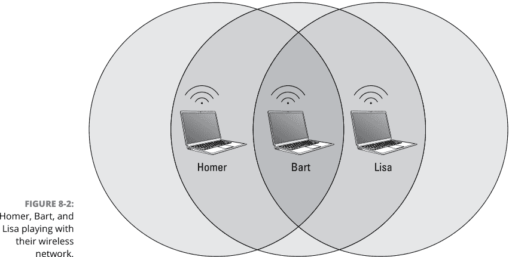
#### 使用无线网卡
要连接无线网络的每台电脑都需要无线网卡，它和标准以太网连接用的网络接口卡（NIC）类似。只是有线网卡背部带的是线缆接口，无线网卡带的则是天线。几乎所有便携式电脑（比如笔记本、平板）都内置了无线网卡，因此不需要额外给便携电脑加装单独的无线网卡。不过台式机就是另一回事了：多数台式机没有内置无线网卡。如果你的台式机没有，你可以选购以下两类无线适配器：
- **无线PCI网卡：** 你需要把这种无线网卡安装到台式机内部闲置的插槽上。没错，你需要拆机，所以只有你具备相关技术、又敢拆机捣鼓内部元件的时候，才选这种卡。市面上的802.11ac规格无线PCI网卡价格大概在75美元左右。
- **无线USB网卡：** 这个小装置是独立设备，插在电脑的USB口上就行。USB网卡的价格和PCI网卡差不多，而且不需要拆机就能安装。
#### 配置无线接入点
和有线网络不同，无线网络不需要额外的交换机。如果你只是要把一堆距离较近的无线电脑组网，只要给每台电脑配个无线适配器就行——*瞧！*——瞬间就能组好网。但如果你已经存在现成的有线网络呢？假设你在一家有15台电脑的公司上班，所有电脑都布好了线缆，你只是想往网络里加几台无线笔记本。再或者，你书房的电脑用网线连好了，但想把卧室的电脑也接进网络，又不想拉网线穿过阁楼。这时候就需要用到无线接入点（WAP）了。WAP实际有两个功能：
- **它是所有带无线网卡的电脑的中心连接点。** 本质上，WAP在无线网络中起的作用，和交换机在有线网络中的作用是一样的。
- **它可以将你的无线网络和现有有线网络连接起来**，让你的有线电脑和无线电脑像和睦的一家人一样协同工作。
这听起来简直像苏斯博士童话里的情节。（“现在无线的 sneech 族用的是没有线缆的集线器。但双绞线 sneech 族的集线器可是有线的哦……”）
> **提示：** 无线接入点通常也被简称为接入点（AP），本质上是一个带天线（通常是一对天线）和RJ-45以太网接口的盒子。你把AP插上网线，再把网线的另一端插到集线器或交换机上，你的无线网络就可以连接到有线网络了。图8-3展示了接入点作为无线电脑中心连接点的作用，以及它如何桥接你的无线网络与有线网络。
##### 基础架构模式
当你用AP搭建无线网络时，你创建的就是一个*基础架构模式网络*：AP为网络提供永久性的基础设施。AP被安装在固定的物理位置，因此网络的覆盖边界相对稳定。只要移动设备进入某个AP的覆盖范围，就相当于进入了网络的覆盖范围，可以正常连接。


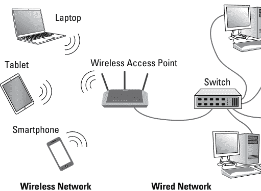
**图 8-3：** 无线接入点将无线网络与有线网络相连。接入点及所有连接到它的无线计算机统称为*基本服务集（BSS）*。每个BSS由*服务集标识符（SSID）*标识。配置接入点时，需要指定要使用的SSID。大多数接入点的默认SSID为通用名称，通常包含设备制造商的名称。不过，你可以轻松将SSID更改为更有意义的名称。

## 多功能无线接入点（WAP）
> > **提示** 无线接入点通常内置其他功能。部分接入点兼具以太网交换机功能，配备多组RJ-45端口，可将其他计算机或设备插入这些端口。此外，部分接入点还集成宽带电缆或DSL防火墙路由器，支持你连接互联网。图8-4展示了一款适用于家庭或小型办公室的典型802.11ac无线路由器。这类设备通常包含以下功能：
> - 支持多台无线设备连接的802.11ac无线接入点
> - 配备防火墙功能的路由器，可通过有线或DSL路由器的输出端口直接连接互联网
> - 四端口千兆以太网交换机，用于连接有线计算机或其他设备
> - 一个或多个USB端口，支持你将USB打印机或磁盘驱动器连接至网络
> > **提示** 专为家庭网络互联网网关设计的多功能接入点，有时也被称为无线路由器或*居民网关*。
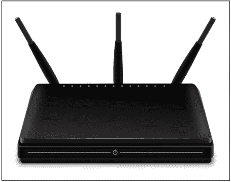
**图 8-4：** 典型无线路由器。

# 漫游功能
你可以使用两个或多个无线接入点搭建大型无线网络，网络用户在不同区域移动时仍能保持无线网络连接。当用户移出一个接入点的覆盖范围时，另一个接入点会自动接管该用户，且不会中断用户的网络服务。要搭建支持漫游的多个接入点，需合理放置接入点，确保被组网的办公室或建筑的所有区域至少在一个接入点的覆盖范围内。之后只需确保所有计算机和接入点使用相同的SSID即可。用于漫游的两个或多个接入点，以及连接到任意一个接入点的所有无线计算机，共同组成*扩展服务集（ESS）*。ESS中的接入点通常连接到有线网络。漫游存在一项限制：ESS中的每个接入点必须处于同一个TCP/IP子网中。这样，用户在ESS内从一个接入点漫游到另一个时，能够保留相同的IP地址。如果接入点处于不同子网，漫游的计算机在从一个接入点移动到另一个时就需要更换IP地址。

#### 无线网桥
无线AP的另一用途是桥接无法通过有线方式轻松连接的不同子网。假设你拥有两栋相距仅约50英尺的办公楼，若要在两栋楼之间铺设线缆，需要预埋管道，这是一项成本较高的工程。但由于两栋楼距离很近，你可以使用一对作为*无线网桥*连接两个网络的无线接入点。将一个接入点连接到第一个网络，另一个接入点连接到第二个网络，之后将两个AP都配置为使用相同的SSID和信道即可。

#### 自组织网络
组建无线网络不一定需要WAP。只要两个或多个无线设备彼此进入对方覆盖范围，就可以组网形成自组织网络。例如，如果你和几位朋友都拥有带无线适配器的笔记本电脑，就可以在任何地点组建设备自组织网络。自组织网络中所有彼此处于对方覆盖范围内的计算机构成*独立基本服务集（IBSS）*。

#### 配置无线接入点
无线接入点的物理安装非常简单：将其从包装盒中取出，放在网络接口和电源插座附近的架子或书柜顶部，插入电源线和网线即可。接入点的软件配置稍微复杂一些，但依然不难，通常通过网页界面完成。要访问接入点的配置页面，你需要知道它的IP地址，然后在网络中任意一台计算机的浏览器地址栏中输入该地址即可。多功能接入点通常为网络提供DHCP和NAT服务，同时作为网络的网关路由器。因此，它们通常使用私有IP地址，属于互联网私有IP地址段范围内的起始地址，通常是`192.168.0.1`或`10.0.0.1`。如需了解更多信息，请参阅接入点附带的文档。
> **提示** 如果你使用的是兼具无线AP和互联网路由器功能的多功能AP，且忘记了IP地址，可以在网络中任意一台计算机的命令提示符中运行`IPCONFIG`命令，默认网关IP地址就是该接入点的IP地址。

# 基本配置选项
图8-5展示了一款典型路由器的主配置界面。我通过在网页浏览器的地址栏中输入192.168.0.1并随后输入登录密码，调出了这个配置页面。
**图 8-5：** 典型无线路由器的主配置页面。
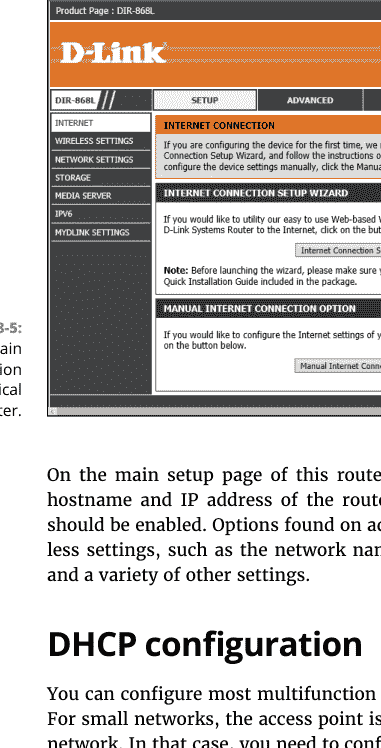
在该路由器的主设置页面中，你可以配置路由器的主机名和IP地址等信息，还可以选择是否启用路由器的DHCP服务器。其他选项卡中的选项允许你配置无线设置，例如网络名称（SSID）、要实施的安全类型，以及各类其他设置。

# DHCP配置
你可以将大多数多功能接入点配置为DHCP服务器。对于小型网络，接入点通常是整个网络的DHCP服务器，这种情况下你需要配置接入点的DHCP服务器。图8-6展示了一款典型无线路由器的DHCP配置页面。要启用DHCP，请选择“启用”选项，然后指定DHCP服务器要使用的其他配置选项。
**图 8-6：** 为典型无线路由器配置DHCP。
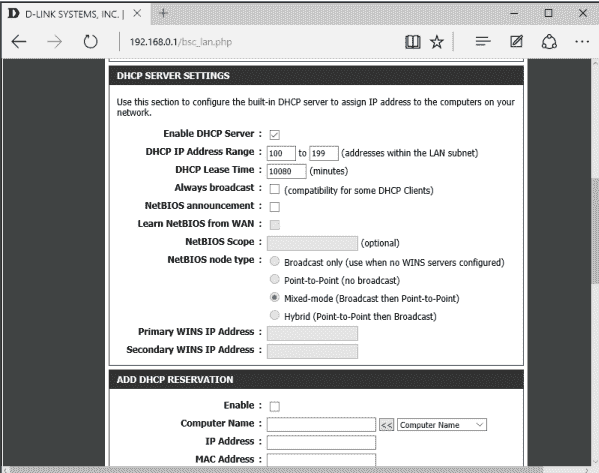
对DHCP要求更高的大型网络通常会使用独立计算机运行DHCP服务器，这种情况下你可以通过禁用接入点中的DHCP服务器来沿用现有服务器。如需了解更多关于配置DHCP服务器的信息，请参阅第6章。

##### 连接无线网络
在Windows计算机上连接无线网络非常简单。Windows会自动检测所有处于覆盖范围内的无线网络，当你点击屏幕底部的无线图标时，会以列表形式显示这些网络，如图8-7所示。要连接到网络，只需点击该网络，然后在提示时输入安全密钥。如果密钥正确，你就会成功连接。连接时，你可以选择在该网络处于覆盖范围内时自动连接。如果勾选该选项，你就不用手动选择网络或输入安全密钥，系统会自动完成连接。
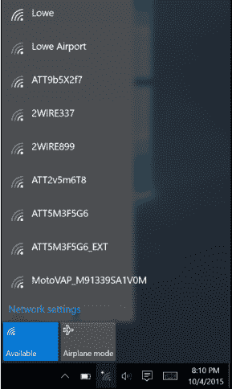
**图 8-7：** 选择无线网络。
Windows会记住你连接过的所有网络，这一点对于你经常使用的网络来说很方便，但如果你之后再也不会使用某个网络，这就会成为一个缺点。要让Windows忘记某个网络，请按照以下步骤操作：
1. **单击“开始”，然后单击“设置”。** 此时会打开“设置”窗口。
2. **单击“网络和Internet”。** 此时会打开“网络和Internet”页面，其中列出了已知网络。
3. **滚动到已知网络列表的底部，然后单击“管理Wi-Fi设置”。** 此时会打开“管理Wi-Fi设置”页面，其中包含名为“管理已知网络”的部分。
4. **在“管理已知网络”部分，单击你想要忘记的网络。** 该网络会被选中，如图8-8所示。
5. **单击“忘记”。** 该网络将被移除。要再次登录该网络，你需要重新输入安全密钥。


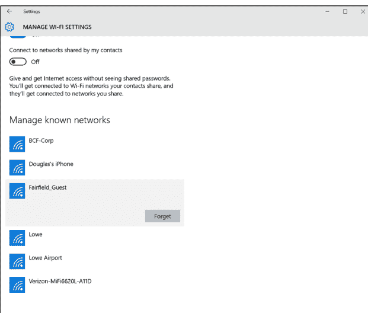
**图 8-8：** 在Windows 10中忘记无线网络。
#### 关注无线网络安全
在向网络部署无线接入点之前，你需要先考虑无线网络本身伴随的安全风险。如果不采取一些基础防护措施，新增无线接入点会把网络内部结构暴露给信号覆盖范围内的所有人。通用的网络安全相关细节可以参考第19章。本节的内容能帮助你防止无关人员通过无线接入点访问你的网络，但无论你是否提供无线接入服务，第19章介绍的安全技术都是必须落实的。接下来的段落会介绍无线网络最可能遇到的安全威胁类型，你在规划网络安全时需要考虑这些威胁：
>> **入侵者：** 对于有线网络，入侵者通常需要进入你的场所，物理连接到网络才能访问。但无线网络不一样，任何拥有无线设备的人只要进入你的网络无线电信号覆盖范围，就能访问你的网络。在家里，你的邻居很可能搜得到你的无线网络；在办公场景中，坐在你办公楼外长椅上的路人也很可能搜得到你的无线网络。
>> **蹭网者：** *蹭网者*是想要蹭用你的无线网络获取免费互联网访问权限的入侵者。如果他们成功接入你的无线网络，大概率不会做什么恶意操作：只会打开浏览器上网。这类人舍不得每月花40美元在家里装自己的宽带，宁愿开车到你的停车场蹭网。虽然蹭网者相对危害不大，但也可能成为麻烦的源头：他们会占用你的带宽，可能用你的网络下载非法色情内容，也可能劫持你的邮件服务器发送垃圾邮件；而且他们一开始可能只是初衷单纯地寻找免费网络接入，入网后好奇心作祟，可能会窥探你的网络内容。
>> **窃听者：** *窃听者*偏好监听你的网络流量。他们并不会真的尝试通过你的无线网络接入——至少一开始不会，只是单纯监听。他们窃听你在无线网络上发送的数据包，希望能找到密码、信用卡号这类有价值的信息。
>> **破坏者：** *破坏者*是一类以干扰网络使其无法使用为乐的骇客。他们通常通过向网络发送大量无意义流量淹没正常流量，让合法流量被淹没在数据洪流中实现干扰目的；破坏者还可能通过不安全的无线连接，在你的网络里投放病毒或蠕虫程序。

##### 未授权接入点
企业网络面临的最大问题之一就是*未授权接入点*问题，这类接入点是凭空突然出现在你网络里的设备。通常的情况是：员工想要把自己的iPad或智能手机连到公司网络，但你不给他密码。于是某天下班回家的路上，这个员工会在沃尔玛买个便宜的无线路由器，未经许可就插到你的网络上。尽管你已经采取了层层安全防护措施为网络筑起围栏，这个“好心”的员工还是直接敞开了网络大门。用户*非常*不可能开启这个无线接入点的安全功能；事实上，他大概率根本不知道无线接入设备*有*安全功能。除非你主动排查，否则未授权接入点可以在你的网络里神不知鬼不觉运行数月甚至数年。你可能直到某天上班，才发现网络已经被某个入侵者搞垮了——入侵者通过那个你根本不知道存在的、毫无防护的无线接入点进入了你的网络。

以下是能降低系统中出现未授权接入点风险的步骤：
- 制定政策禁止用户私自安装无线接入点。随后要确保所有网络用户都知晓该政策，同时告诉他们私自安装接入点会带来多么严重的问题。
- 如果条件允许，可以设置一套快速、低成本的无线接入申请流程，为有需求的用户开通权限。未授权接入点之所以会出现，本质是有接入需求的用户拿不到合法权限。如果你让用户更容易获取合法的无线接入权限，就更不会出现无线接入点被藏在文件柜后、花盆里的情况了。
- 时不时在办公场地巡查，排查未授权接入点。查看楼内的每一个网络接口，确认接口上连接的是什么设备。
- 关闭所有合法的无线接入点，然后带着带无线功能的移动设备（比如智能手机）在办公场地行走，搜索出现的无线网络。当然，搜到无线网络不代表你找到了未授权接入点——你可能只是搜到了附近办公室或住户的无线网络。但了解办公区域内能搜到哪些无线网络，能帮你判断是否存在未授权接入点。

希望我已经说服你，无线网络确实存在很多安全风险。以下是可以帮助你保护无线网络的措施：
- 设置安全的无线密码。搭建无线网络时，首先要做的是修改访问网络所需的默认密码。大多数无线路由器厂商的SSID默认密码都是公开的通用密码。一定要改成只有你自己知道的密码，并且只分享给你想要授予访问权限的人。
- 修改管理密码。大多数接入点都有基于网页的设置页面，你可以用任意浏览器访问该页面配置接入点的参数。设置页面受用户名和密码保护，但初始的用户名和密码都是很容易猜到的默认值。任何接入你网络的人都可以登录管理页面，掌控你的网络。
- 隐藏SSID。保护无线网络的简单操作之一是关闭网络SSID的自动广播功能。这样只有知道你的网络存在的人才能访问。（仅保护SSID并不是完整的安全方案，因此不要把它作为唯一的安全防护手段。）
- 关闭访客模式。许多接入点都有访客模式功能，该功能允许客户端计算机指定空SSID，或者将SSID指定为“任意”。如果你要确保只有知道SSID的设备才能接入网络，就必须关闭这个功能。
- 使用*MAC地址过滤*。保护无线网络最有效的方式之一就是使用名为*MAC地址过滤*的技术。MAC地址过滤允许你指定允许接入网络、或禁止接入网络的设备MAC地址列表。如果带有其他MAC地址的计算机试图通过接入点加入网络，接入点会拒绝其访问。

MAC地址过滤非常适合客户端数量固定的无线网络。如果你在办公室搭建无线网络，只为了让几名员工连接自己的笔记本，就可以在MAC过滤表中指定这些计算机的MAC地址，其他计算机就无法通过接入点访问该网络了。MAC地址过滤并不是万无一失的，但能很大程度上阻止无关人员访问你的网络。可惜的是，MAC地址过滤也非常不便。每当你想要给新设备授予访问权限，你都需要查询该设备的MAC地址，再把它添加到允许设备列表里。
- 将接入点置于防火墙外。无线网络最有效的安全防护措施，是把所有无线接入点都放在防火墙*外部*。这样来自无线用户的所有网络流量都必须穿过防火墙才能访问内部网络。可想而知，这么做会大幅限制无线用户的网络访问权限。为了规避这些限制，你可以为无线用户启用虚拟专用网络（VPN）连接，VPN可以让获得授权的无线用户获得完整的网络访问权限。显然，这个方案需要一定的配置工作，对用户来说也有点不便，但它是完全防护无线接入点的绝佳方案。


##### 不要忽视基础知识
本章所讲的安全技术仅针对无线网络，这些技术应和第19章介绍的基础安全技术配合使用。换句话说，不要忽视基础安全措施，例如以下几项：
- 为用户账户设置高强度密码
- 为服务器安装安全补丁
- 修改服务器的默认账户信息（尤其是管理员密码）
- 禁用不必要的服务
- 定期检查服务器日志
- 安装病毒防护软件
- 定期备份！

### 第9章 连接到互联网
**本章内容**
- 了解DSL（数字用户线路）与有线宽带
- 了解高速专线
- 使用路由器
- 用防火墙保障连接安全
- 使用Windows系统自带的防火墙

如果你打算将自己的网络连接到互联网，是不是觉得只要打电话给有线电视公司，让对方派人上门就可以了？大错特错。遗憾的是，接入互联网可不止打个电话找有线电视公司这么简单。首先，你要确认有线接入是否适合你的网络；其次，你要挑选并配置用来上网的软件；最后，你还要整夜担心黑客通过网络连接入侵你的网络。不用焦虑，本章的建议会帮你确定合适的互联网接入方式，做出决定后还会告诉你如何安全完成接入。

#### 连接到互联网
接入互联网并非零成本。首先，你需要购买建立连接所需的计算机设备；其次，你要向互联网服务提供商（ISP）申请接入服务，ISP会按照连接的速率和容量收取月度费用。接下来几节会介绍最常见的网络用户互联网接入方式。

##### 通过有线宽带或DSL接入
对于小型办公室和家庭办公场景，最流行的两种互联网接入方式是有线宽带和数字用户线路（DSL）。出于你根本不需要了解的技术原因，这两种连接常被称为*宽带连接*。有线宽带通过将成百上千个电视频道输送到你家的同一条电缆工作，而DSL是通过标准电话线提供的数字电话服务。和传统的拨号连接相比，两者都有三大优势：
- 有线宽带和DSL的速率远高于拨号连接，有线宽带的速率是拨号的10到200倍不等，具体取决于你办理的套餐，DSL的速率和有线宽带相当。（不过DSL是独享连接，而有线宽带由多名用户共享，当多名用户同时使用时，有线宽带的速率可能会下降。）
- 使用有线宽带或DSL时，你可以一直保持互联网连接，不需要像用调制解调器那样每次上网都要手动拨号、断线。再也不用等调制解调器拨号连接服务提供商，也不用听它拨号时发出的刺耳噪音了。
- 使用有线宽带或DSL上网时不会占用电话线路：有线宽带通过电视电缆传输网络信号，不占用电话线；DSL则是运营商单独架设一条线路提供服务，不会影响你日常使用的电话线路。

遗憾的是，天下没有免费的午餐，有线宽带和DSL提供的高速永久在线连接也不是免费的。首先，有线宽带和DSL的月度接入费更高：在美国大多数地区，家庭用户的有线宽带月费约为50美元；商业用户的费用更高，尤其是通过该有线网络接入互联网的用户不止一人时。DSL服务的费用取决于你选择的接入速率，部分地区家庭用户办理低速DSL套餐每月仅需30美元，如果需要更高的接入速率，或者是商业用户，DSL的费用会高很多。此外，并非所有地区都能提供有线宽带和DSL服务，如果你所在的区域没有这两种服务，也可以通过卫星接入或蜂窝网络获得高速互联网接入。

##### 通过高速专线接入
如果你的网络规模较大，且对高速互联网接入的需求优先级很高，可以联系本地电信运营商咨询架设专用高速数字线路的事宜。这类线路的费用很高（每月可达数百美元），因此最适合同时有20名及以上用户接入互联网的大型网络。接下来会介绍三类基本的高速专线方案：
- **T1和T3线路：** T1和T3线路基于标准的铜质电话线架设，T1线路的最高接入速率为1.544Mbps，T3线路速率稍高，数据传输速率为44.184Mbps。当然，T3线路的费用高于T1线路。如果你的用户数量不足以承担整条T1或T3线路的费用，可以租赁分时线路带宽：办理分时T1线路可以获得128Kbps到768Kbps的接入速率，办理分时T3线路可以选择4.6Mbps到32Mbps的速率。你可能会疑惑T1或T3线路真的比有线宽带或DSL更快吗？毕竟T1的速率是1.544Mbps，T3是44.184Mbps，而有线宽带和DSL宣称的速率和它们相当。但两者存在诸多差异，这些差异足以证明T1或T3线路的高额额外成本是合理的。其中最关键的是，T1或T3线路是*独享线路*，不会和其他用户共享。T1和T3是更高质量的连接，因此你能真正获得1.544Mbps或44.184Mbps的标称速率。而有线宽带和DSL连接通常因为线路质量较差，且常和其他用户共享，实际速率远低于标称最高速率。此外，有线宽带和DSL的下载速率都远高于上传速率，因此你可能可以以100Mbps的速率通过有线宽带下载数据，但上传速率能到7、8Mbps以上就算不错了。

- **企业级有线宽带：** 有线电视服务商（如康卡斯特）会在其有线网络中提供企业级服务，价格和速率取决于你所在的区域。比如我所在地区，办理100Mbps的企业级有线宽带服务每月费用约400美元。和家庭用有线宽带一样，企业级有线宽带的上传速率通常远低于下载速率，比如常见的100Mbps下载套餐，上传速率仅支持10Mbps。因此如果你需要上传大量数据，会明显感受到性能下降。企业级有线宽带的另一个缺点是，它本质上还是有线电视服务，维护你网络连接的是和你社区有线电视的同一批服务人员。虽然企业用户相比家庭用户享有优先服务权，但企业级服务通常不会像T1/T3线路或光纤服务那样提供故障响应时长保障。因此如果你的连接出现故障，可能会中断数小时甚至数天，而不是几分钟，最差也要等数小时。
- **光纤接入：** 光纤是速率最快、最可靠、也最昂贵的互联网接入方式。光纤电缆通过玻璃纤维传输光信号实现高速数据传输。由于光纤内部传输的光信号不受电磁干扰，光纤连接的可靠性极强，几乎只有物理切断光纤才会导致连接中断。不过光纤的价格也很高，部分地区100Mbps的光纤连接月费可超过1000美元。但光纤连接的可靠性极强，故障响应时长以分钟计算而非小时，而且价格正在逐步下降，尤其是在光纤运营商持续扩建网络的大都市地区。
- **无线服务提供商：** 在没有有线服务（如有线宽带、光纤）覆盖的区域，你或许可以找到提供互联网接入的无线服务，这类服务通过蜂窝网络或其他无线技术实现上网。

#### 共享互联网连接
确定了互联网接入方式后，你就可以着手配置连接，让网络内的多名用户共享该连接。最佳方式是使用一种名为*路由器*的独立设备。小型网络适用的路由器价格很便宜，不到75美元就能买到，适配大型网络的路由器价格自然会更高一些。由于你的网络和互联网之间的所有通信都必须经过路由器，因此路由器是部署安全措施、保护网络免受互联网各类风险的天然载体。因此，用于互联网连接的路由器通常也兼具防火墙功能，本章后续“使用防火墙”一节会对此进行介绍。


##### 使用防火墙保护你的连接
如果你的网络连接到了互联网，就会浮现出大量安全问题。你大概率将网络接入互联网，是为了让网络用户能够访问互联网资源。但不幸的是，互联网连接是双向的。它不仅能让你的网络用户突破网络边界访问互联网，也会让其他人有机可乘、入侵你的网络。而这些人必然不会放过这样的机会。世界上满是盯上你这类网络的黑客，他们入侵可能只是为了取乐，也可能是为了窃取客户的信用卡号，或是强迫你的邮件服务器替不法分子发送成千上万封垃圾邮件。不管他们的动机是什么，请放心，如果你不加以防护，你的网络最终一定会被攻破。

###### 使用防火墙
*防火墙*是一种注重安全的路由器，部署在互联网和你的网络之间，唯一任务是阻止*他们*接触到*我们*。防火墙是互联网和你的局域网（LAN）之间的安全守卫。所有进出局域网的网络流量都必须经过防火墙，由此避免未授权访问进入网络。


只要你的网络接入了互联网，无论链路是宽带（线缆调制解调器或DSL）、T1线路还是其他高速连接，都必须配备某种类型的防火墙。如果没有防火墙，迟早会有黑客发现你未受防护的网络，并把这个消息告诉他的同伙，不出几小时，你的网络就会彻底瘫痪。配置防火墙主要有两种方式：
- **防火墙硬件设备**：这是最简单的配置方式，通常也是最佳选择。防火墙硬件设备本质上是集成了防火墙功能的一体化路由器。大多数防火墙硬件设备都提供基于网页的交互界面，你可以通过浏览器，从网络内的任意一台计算机连接到防火墙，随后即可根据自身需求自定义防火墙配置。
- **防火墙主机**：可以配置一台服务器作为防火墙主机。这类服务器几乎可以运行任何网络操作系统，但绝大多数专用的防火墙系统都使用Linux系统。无论你选择防火墙硬件设备还是防火墙主机，防火墙都必须部署在你的网络和互联网之间，如图9-1所示。图中，防火墙的一端连接网络交换机，交换机再连接网络内的其他计算机；防火墙的另一端连接互联网。因此，所有从局域网到互联网（以及反向）的流量都必须经过防火墙。
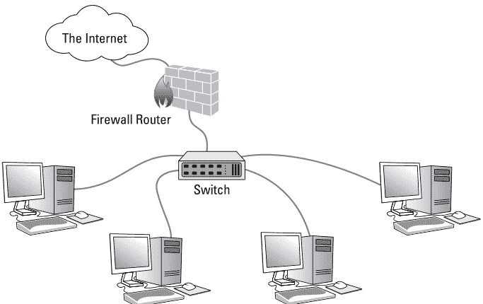

图9-1：防火墙路由器可在网络与互联网之间建立安全连接。

**边界**这个词有时被用来描述防火墙在你网络中的部署位置。简而言之，防火墙就像一道完全围住你财产的边界围栏，所有访客都必须通过正门进入。

> **警告** > 在大型网络中，精确判断边界位置可能有一定难度。如果你的网络有两根及以上的互联网链路，请确保每一根链路都连接到防火墙，而非直接接入网络。你可以为每根互联网链路配置单独的防火墙，或是使用带有多互联网端口的防火墙来实现这一点。
> **提示** > 部分防火墙路由器还可以为你的网络提供病毒防护。关于病毒防护的更多信息，请参阅第20章。

##### 家用网关与防火墙路由器的对比
如果你逛一逛本地大型电子产品商店的货架，会看到很多被称为*Wi-Fi路由器*的设备。从技术角度来说，这些设备实际上被称为*家用网关*，因为它们提供的功能不止Wi-Fi。家用网关通常会将四个不同的组件集成在一个便捷的设备中：
> 可将小型网络连接到互联网的路由器。
> > 用于保护内网免受黑客入侵的防火墙，这些黑客唯一的目的就是攻破你的网络。
> > > 小型交换机（通常有4个端口），用于连接少量计算机到网络。如果你的用户超过4个，可以将更大的交换机连接到网关的其中一个交换机端口。（关于交换机的更多信息，请参阅第7章。）
> > > > 无线接入点，允许无线设备接入网络。（关于无线接入的更多信息，请参阅第8章。）

家用网关适用于家庭网络或极小型企业。但如果你的网络有超过12台计算机，建议你升级为专用防火墙路由器，这类设备会将防火墙、路由功能与交换机、Wi-Fi功能分离开。真正的防火墙路由器只有两种端口：
- 广域网（WAN）端口：用于将防火墙路由器连接到互联网
- 局域网（LAN）端口：用于将防火墙路由器连接到你的内网

部分防火墙路由器配备多个WAN端口，支持连接两条独立的互联网链路。关于该功能的更多信息，请参阅本章后文的“配置互联网备用连接”部分。

#### 查看Windows内置防火墙
Windows系统自带内置防火墙，可提供基础的包过滤防火墙防护。大多数情况下，更推荐使用专用防火墙路由器，因为这类设备提供的安全特性比Windows内置防火墙更完善。不过，内置防火墙依然适用于家庭网络或极小型办公网络。以下是激活Windows内置防火墙的步骤：
1. 打开控制面板。
2. 单击“系统和安全”链接，弹出“系统和安全”页面。
3. 单击“Windows Defender 防火墙”链接，弹出Windows防火墙页面。
4. 单击“启用或关闭Windows Defender防火墙”链接，将显示图9-2所示的页面。
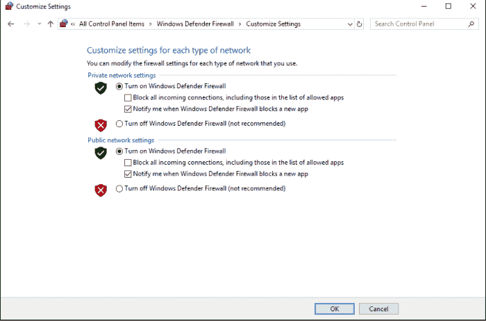

图9-2：激活Windows防火墙。

5. 选择“启用Windows防火墙”选项。请注意，你可以独立开关公共网络（即你连接到互联网的网络）和家庭或工作网络（即连接你家中或办公室其他计算机的网络）的防火墙。建议你对两类网络同时开启或同时关闭防火墙。如果你使用了路由器内置的独立防火墙，该路由器负责将你的计算机、家庭或工作网络连接到互联网，则请关闭Windows防火墙；如果没有独立防火墙，则请开启防火墙。同时建议保留“当Windows防火墙阻止新程序时通知我”的启用状态，这样当防火墙拦截可疑程序时，你就会收到通知。
6. 单击“确定”，防火墙即被启用。请注意，Windows防火墙还包含其他可配置的选项，但除非你修读过计算机安全专业的高年级大学课程，否则不建议你随意改动这些选项。


如果你使用了独立的防火墙路由器来保护你的网络，请不要启用Windows防火墙。因为网络中的其他计算机是直接连接到路由器而非你的计算机，Windows防火墙无法保护网络中的其余设备。此外，还会产生一个不良的副作用：网络中其余设备将无法访问你的计算机。

#### 配置互联网备用连接
对大多数企业来说，稳定的互联网连接至关重要。请考虑互联网连接中断会带来的后果：
- 所有电子邮件都会中断。你的用户既不能发送也不能接收邮件，客户、消费者以及其他商业伙伴都无法与你取得联系。
- 网络访问中断。你的用户无法访问任何网站。如果你订阅了重要的在线服务，例如会议网站（如GoToMeeting或Zoom）、网上银行或其他关键服务，在互联网链路中断期间，这些服务都将无法使用。
- 如果你使用基于IP的电话服务，例如RingCentral或8x8，你的电话将无法正常使用。
- 如果你将数据存储在云端，例如OneDrive、Dropbox或Google Drive，你将无法访问这些数据。


简而言之，如果没有互联网，你的业务可能会陷入停滞。基于这个原因，最好为互联网提供两条连接，而非一条。这样你就可以配置防火墙路由器，在主用连接故障时自动切换到备用互联网线路。这项功能称为*故障转移*，大多数专用防火墙路由器都支持该功能。（请注意，故障转移功能通常也适用于俗称Wi-Fi路由器的家用网关。）


在大多数情况下，你可以使用速度较慢的互联网连接作为备用连接。例如，如果你的主用互联网连接是1Gbps光纤连接，你可以使用100Mbps有线连接作为备用。如果主用线路中断，网速会明显变慢，但至少你还能保持联网。选择备用互联网连接时，最好选用与主用连接提供商不同的服务商。这样一来，如果主用连接的提供商出现全系统故障，备用连接就很少会受到影响。一种常见的方案是使用蜂窝网络服务作为备用连接。名为CradlePoint（www.cradlepoint.com）的公司专门为此设计了几款设备。

例如，CradlePoint的AER1600设备包含以下功能：
- 五个以太网端口，每个端口都可配置为互联网连接（WAN）或内部连接（LAN）。
- 两个LTE蜂窝调制解调器，用于连接蜂窝网络服务商。你只需要为你选定的服务商提供一张SIM卡即可。（如果需要，你也可以提供两张SIM卡，以接入两家备用蜂窝服务商。）

提供备用互联网线路有很多方案可选。这些方案没有一个是完全免费的，但你可以把这部分成本与完全断网的损失相比较。对于大多数企业来说，每月多花一点小钱确保互联网始终可用是值得的。

## 3 服务器操作
### 本部分内容
- 搭建虚拟服务器
- 安装并配置Windows Server 2019
- 了解并使用Active Directory用户账户
- 管理网络存储
#### **本章内容**
- 了解虚拟化基础
- 权衡虚拟化的优势
- 了解虚拟化管理程序的作用
- 了解磁盘和网络的虚拟化方式
- 激活Hyper-V
- 创建并使用虚拟机

### 第10章 网络虚拟化
虚拟化是当今网络领域最热门的趋势之一。据一些行业专家称，虚拟化是自晶体管发明以来计算机领域最重大的突破。如果你还没有开始虚拟化你的网络，那你就像站在站台上看着火车缓缓驶离。本章将简要介绍虚拟化相关知识，重点讲解如何利用虚拟化技术发挥网络服务器硬件的潜力，用更少的硬件提供更多服务器。除了虚拟化的基本概念外，你还会学习如何通过激活微软的Hyper-V来实践虚拟化，Hyper-V是Windows系统自带的免费虚拟化产品。

#### 了解虚拟化
虚拟化的基本思路是通过软件模拟硬件的存在。这一强大的思路让你能够在一台物理计算机系统上运行多个独立的计算机系统。假设你的组织总共需要12台服务器来满足业务需求，你可以选择把这12台服务器分别部署在12台独立的计算机上，这样你的机房就需要摆放12台计算机；也可以使用虚拟化技术，仅用2台计算机就能运行这12台服务器。实际上，每台计算机都会模拟6个独立的计算机系统，每个系统运行其中一台服务器。这些模拟出来的计算机被称为虚拟机（VM）。从实际效果来看，每台虚拟机看起来都是一套完整的、独立的计算机系统，拥有自己的处理器（更常见的是多个处理器）、内存、磁盘驱动器、CD-ROM/DVD驱动器、键盘、鼠标、显示器、网络接口、USB端口等。和真正的计算机一样，每台虚拟机都需要安装操作系统才能执行实际工作。在典型的网络服务器环境中，每台虚拟机都运行自己的Windows Server副本。操作系统完全不知道自己是运行在虚拟机上，而非真实计算机上。


- **宿主机（Host）**：运行一台或多台虚拟机的实际物理计算机。
- **裸金属（Bare metal）**：运行一台或多台虚拟机的宿主机的另一种叫法。
- **客户机（Guest）**：运行在宿主机上的虚拟机的另一种叫法。
- **客户机操作系统（Guest operating system）**：运行在虚拟机内的操作系统。客户机本身只是一台机器，需要安装操作系统才能运行，而客户机操作系统就是让客户机“活起来”的关键。从许可角度来看，微软将每台虚拟机都视为一台独立的计算机。因此，如果你在一台宿主机上运行6台客户机，且每台客户机都运行Windows Server，那么你需要6份Windows Server许可。
- **虚拟化管理程序（Hypervisor）**：用于创建和运行虚拟机的虚拟化操作系统。如需了解虚拟化管理程序的更多信息，请阅读下一节“了解虚拟化管理程序”。
- **硬件抽象层（HAL）**：一层软件，起到中介作用，将实际硬件与和硬件交互的软件分离开。操作系统会提供硬件抽象层，因为它通过设备驱动程序与实际硬件设备通信，这样操作系统内运行的软件就不需要知道自己交互的具体设备的细节。虚拟化管理程序同样会提供硬件抽象层，让虚拟机内的客户机操作系统能够与虚拟化的硬件交互。

##### 虚拟化的漫长发展历程
现在的年轻人总以为自己发明了所有东西，包括虚拟化，但他们不知道的是，虚拟化的历史远比他们想的要久。虚拟化技术最早在20世纪90年代初为个人电脑开发，差不多就是*星际迷航：下一代*里皮卡德舰长驾驶企业号飞船四处航行的时期。但虚拟化的想法比这还要早得多。最早的虚拟化服务器计算机比皮卡德舰长的出现早了约20年。1972年，IBM发布了一款名为VM的操作系统，它具备当今几乎所有虚拟化产品的基本功能。VM系统允许IBM System/370大型计算机的管理员创建多个独立的虚拟机，每台虚拟机（你已经猜到了）就叫虚拟机，也就是VM。这一术语至今仍在使用。每台VM都可以运行与System/370兼容的各类客户机操作系统，且在这些客户机操作系统看来，它是一台完整的、独立的System/370计算机，拥有自己的处理器核心、虚拟内存、磁盘分区和输入/输出设备。VM系统的核心被称为*虚拟化管理程序*——这个术语也一直沿用至今。IBM1972年发布的VM产品实际上基于IBM196年限量发布的实验性产品。所以下次再有人跟你说虚拟化是什么新技术，你就可以告诉他们，这一技术早在《星际迷航》最初播出的时候就诞生了。如果他们问“你说的是有皮卡德的那部吗？”，你就可以回答“不，是有柯克的那部”。

##### 了解虚拟化管理程序
虚拟化的核心是*虚拟化管理程序*，这是一层负责管理虚拟机创建和运行的软件。虚拟化管理程序提供若干核心功能：
> 它提供硬件抽象层（HAL），可以虚拟化其运行的宿主计算机的所有硬件资源，包括处理器核心、内存（RAM），

以及磁盘驱动器、键盘、鼠标、显示器、USB设备等I/O设备。
- 它会将这些抽象后的硬件资源创建为资源池，可分配给虚拟机使用。
- 它可创建虚拟机。虚拟机是对理想化计算机系统的完整实现，能够使用宿主机的可用硬件资源。每台虚拟机的硬件均来自管理程序管理的可用硬件资源池。
- 它负责管理虚拟机的运行，按需为每台虚拟机分配宿主机硬件资源，并根据用户请求启动或停止虚拟机。
- 它可确保每台虚拟机与其他所有虚拟机完全隔离，因此即使某一台虚拟机出现故障，也不会影响其他虚拟机。
- 它负责管理虚拟机在虚拟网络中的通信，使虚拟机能够相互连接，也能连接到宿主机之外的物理网络。
###### 管理程序类型
- **Type-1（1型）：** 1型管理程序直接运行在宿主机上，无需中间操作系统。这是效率最高的管理程序类型，因为它可以直接访问宿主系统的硬件资源。1型管理程序最知名的两个代表是VMWare的ESXi和微软的Hyper-V。ESXi是VMWare旗下热门虚拟化产品套件的一部分，Hyper-V则是随Windows Server 最近版本搭载的内置虚拟化平台。
- **Type-2（2型）：** 2型管理程序以应用程序的形式运行在直接部署于宿主机的操作系统中。2型管理程序的效率低于1型，因为使用2型管理程序时会新增一层硬件抽象层：第一层是直接在宿主机上运行的原生操作系统提供的，第二层是作为应用程序运行在宿主机操作系统上的管理程序提供的。
> 💡 **提示** 在生产环境中，应始终选用1型管理程序，因为其效率远高于2型管理程序。不过1型管理程序的价格也比2型高很多。因此，许多人在决定购买昂贵的1型管理程序之前，会先使用价格低廉甚至免费的2型管理程序来尝试虚拟化。
#### 了解虚拟磁盘
在虚拟环境中，被虚拟化的不只是计算机。除了创建虚拟计算机之外，虚拟化还会生成虚拟磁盘存储。磁盘虚拟化可以将多种物理磁盘存储设备整合为磁盘存储池，之后可根据需要分配给虚拟机。磁盘存储虚拟化并非新技术，实际上，真实的存储环境中存在多层虚拟化。
在最底层是实际的物理磁盘驱动器。物理磁盘驱动器通常会以阵列形式组合在一起。这种组合是一种虚拟化，它会生成一个实际并不存在的单块大容量磁盘的镜像。例如，可将4块2TB的磁盘驱动器组合成阵列，生成一块单盘容量为8TB的虚拟磁盘。需要注意的是，磁盘阵列通常通过冗余机制实现数据保护。这种技术通常被称为RAID，即*廉价磁盘冗余阵列*。其中一种常见的RAID形式是RAID-10，它支持将磁盘驱动器创建为镜像对，数据会始终写入镜像对中的两块驱动器。因此，如果镜像对中的某一块驱动器发生故障，另一块可以承接全部负载。在RAID-10中，整个阵列的可用容量等于阵列中所有驱动器总容量的一半。例如，由4块2TB驱动器组成的RAID-10阵列包含2对镜像2TB磁盘驱动器，总可用容量为4TB。
另一种常见的RAID形式是RAID-5，它将多块磁盘驱动器组合在一起，其中一块驱动器用于冗余存储。如果阵列中的任意一块驱动器发生故障，剩余的驱动器可用于重建故障驱动器上的数据。RAID-5阵列的总容量等于所有单块驱动器的容量之和减去一块驱动器的容量。例如，由4块2TB驱动器配置为RAID-5的阵列，总可用容量为6TB。
在典型的虚拟环境中，宿主机可通过以下几种不同的方式连接磁盘存储：
- **本地磁盘存储：** 本地磁盘存储中，磁盘驱动器直接安装在宿主机上，通过主机的内置磁盘控制器与宿主机连接。例如，某台宿主机可能搭载4块1TB磁盘驱动器，安装在与主机相同的机箱内。这4块驱动器可用于组成可用容量为2TB的RAID-10阵列。本地磁盘存储的主要缺点是存储容量受限于宿主机的物理容量，且仅能供安装该存储的宿主机使用。
- **存储区域网络（SAN）：** 在SAN中，磁盘驱动器被放置在一个独立设备内，该设备通过高速控制器与宿主机连接。SAN与本地存储的区别在于它是一个独立设备，其与宿主机的高速连接速度通常与本地磁盘存储的内置连接相当，但SAN配备有独立的存储控制器，负责管理磁盘驱动器。典型的SAN可容纳十几块甚至更多磁盘驱动器，支持与多台宿主机建立高速连接。SAN通常可通过添加扩展机柜进行扩容，每个扩展机柜可容纳十几块甚至更多磁盘驱动器，因此单台SAN可管理数百TB的磁盘数据。
- **网络附属存储（NAS）：** 这类存储与SAN类似，但它不通过高速控制器与宿主机连接，而是通过标准以太网连接和TCP/IP协议与宿主机通信。NAS是所有磁盘存储类型中价格最低的，但速度也是最慢的。
无论存储以何种方式连接到宿主机，管理程序都会整合其存储，创建通常被称为*数据存储*的虚拟磁盘存储池。例如，一台可访问3块2TB RAID-5磁盘阵列的管理程序，可将它们整合为单个容量为6TB的数据存储。你可以基于该数据存储创建*卷*，卷本质上是虚拟磁盘驱动器，可分配给特定的虚拟机。当虚拟机中安装操作系统后，操作系统可挂载虚拟机的卷，创建操作系统可访问的驱动器。举个例子，考虑一台运行Windows Server的虚拟机，如果你连接到该虚拟机、登录系统，然后使用Windows资源管理器查看虚拟机可用的磁盘存储，可能会看到一个容量为100GB的`C:`驱动器。这个`C:`驱动器实际上是一个由管理程序创建并附加到虚拟机的100GB卷，而这个100GB的卷是从一个容量可能为4TB的数据存储中分配而来的。该数据存储由连接到宿主机的SAN中的磁盘存储创建，可能由4块2TB物理磁盘驱动器组成的RAID-10阵列构成。
由此可见，要让物理磁盘驱动器上的原始存储对访客操作系统可用，至少需要四层虚拟化：
- 物理磁盘驱动器通过RAID-10聚合，生成带内置冗余的统一磁盘镜像。实际上，RAID-10是第一层虚拟化，该层完全由SAN管理。
- 管理程序对SAN上的可用存储进行抽象，生成数据存储。这相当于第二层虚拟化。
- 数据存储的部分空间被用于创建卷，再呈现给虚拟机。卷代表第三层虚拟化。
- 访客操作系统会将卷识别为物理设备，可对其进行挂载、格式化，生成用户可使用的可用磁盘存储。这是第四层虚拟化。
虽然这些虚拟化层级看似复杂，但在存储管理方面能提供很高的灵活性。可以给SAN添加新的磁盘阵列，或向网络中添加新的NAS，然后基于新设备创建数据存储，且不会影响已有数据存储。卷可以在不同数据存储之间迁移，不会影响其挂载的虚拟机。实际上，你可以动态扩容卷，虚拟机会立即识别到磁盘驱动器的存储容量增加，甚至无需重启。
#### 了解网络虚拟化
在宿主机上创建一个或多个虚拟机时，需要为这些虚拟机提供通信能力，使它们不仅能相互通信，还能与网络中的其他物理计算机通信。要实现这种连接，必须在虚拟化环境中创建*虚拟网络*。虚拟网络负责将虚拟机相互连接，并连接到物理网络。要创建虚拟网络，需要创建*虚拟交换机*，它通过宿主机的网络接口将虚拟机相互连接，并连接到物理网络。与物理交换机类似，虚拟交换机也有端口。创建虚拟交换机时，需要将其连接到宿主机的一个或多个网络接口，这些接口再通过网线与物理交换机连接，相当于将虚拟交换机连接到了物理网络。之后创建虚拟机时，需将每台虚拟机连接到虚拟交换机的一个端口上。当所有虚拟机都连接到

通过虚拟交换机，各虚拟机之间可以相互通信；同时，它们还能通过经由宿主机网络接口的连接，与物理网络上的设备通信。

#### 虚拟化的优势
你可能会怀疑虚拟化效率不高，因为真实的计算机本质上比模拟的计算机速度更快。虽然真实计算机确实比模拟计算机性能更优，但虚拟化技术已经高度成熟，在虚拟化环境中运行相较于在真实机器上运行，性能损耗仅几个百分点。虚拟化带来的少量额外开销，通常远不及这样一个事实带来的收益：即使是利用率最高的服务器，绝大多数时间也都在无所事事地等待任务。实际上，很多服务器几乎*所有*时间都处于空闲状态。随着计算机速度越来越快，它们空闲的时间也越来越多。虚拟化是充分利用这些闲置算力的绝佳方式。除了这一基础效率优势外，虚拟化还有几个极具吸引力的好处：
- **硬件成本：** 使用虚拟化降低硬件成本，通常能省下大笔开支。假设你将10台每台售价4000美元的服务器替换为1台宿主机，诚然，这台宿主机需要配备充足的内存、处理器核心、网络接口等配置，花费可能超过4000美元，大概率需要花费10000至15000美元。此外，你还需要花费约5000美元购买虚拟机管理程序软件。但即便如此，这也远低于购买10台独立计算机（每台4000美元）所需的40000美元。
- **能耗成本：** 许多机构发现，采用虚拟化方案后，服务器的整体电力消耗降低了80%。这一节省直接源于用更少的硬件完成更多工作：一台宿主机运行10台虚拟服务器，能耗大约仅为10台服务器分别运行在独立硬件上的十分之一。
- **减少停机时间：** 虚拟环境的停机时间通常比非虚拟环境更短。例如，假设你需要对某台服务器升级BIOS，如果是物理服务器，这类升级通常需要关闭服务器上运行的操作系统，完成BIOS升级后再重启服务器，升级期间该服务器将无法使用。而在虚拟环境中，你不需要为了给运行虚拟服务器的宿主机升级BIOS而关闭服务器，只需将运行在这台需要升级的宿主机上的服务器迁移到其他宿主机即可。服务器迁移操作可以在不关机的情况下完成，之后你就可以关闭宿主机升级BIOS，宿主机重启后，再将服务器迁移回原宿主机，整个过程同样不需要关闭服务器。
- **可恢复性：** 虚拟化最大的优势之一并非成本节约，而是从硬件故障中快速恢复的能力。假设你的机构有10台服务器，分别运行在独立的硬件上，如果其中任何一台服务器因硬件故障（例如主板损坏）宕机，在修复该计算机前，这台服务器都将无法运行。而如果这10台服务器作为虚拟机运行在两台不同的宿主机上，其中一台宿主机发生故障时，运行在故障宿主机上的虚拟服务器可以在几分钟内切换到另一台宿主机运行。诚然，这些服务器在单台宿主机上运行的效率不如在两台宿主机上的情况，但重点是它们仅经历短暂的停机就能全部恢复运行。实际上，目前最先进的虚拟机管理程序可以实现故障宿主机到其他宿主机的自动、瞬时切换，几乎完全消除了停机时间。
- **灾备能力：** 除了硬件故障场景下的可恢复性优势外，虚拟化在真正的灾备场景下优势更为明显。假设你的机构服务器基础设施由20台独立服务器构成，若发生火灾等毁灭性灾难摧毁了机房的所有硬件，你需要多久才能将这20台服务器全部恢复到新硬件上并正常运行？恢复时间很可能以周为单位。相比之下，虚拟机本质上只是可以备份到磁带上的文件，因此在灾备场景下，你只需要重建一台宿主机，重新安装虚拟机管理程序软件，然后从磁带恢复虚拟机备份，重启虚拟机，几天内就能恢复全部服务，而无需花费数周。

#### 选择虚拟化宿主机
在决定将服务器虚拟化后，接下来你需要选择承载虚拟服务器的宿主机。好消息是，相比使用物理服务器，你需要购买的服务器数量更少；不好的消息是，你需要购买性能足够优秀的服务器作为宿主机，因为每台宿主机都要支撑多台虚拟服务器。


以下是几点入门建议：
- 如果条件允许，至少购买两台宿主机，确保每台宿主机都能独立运行你所有的虚拟服务器。这样如果其中一台宿主机宕机，你可以将所有服务器临时迁移到正常运行的宿主机上，同时维修故障主机。当两台宿主机都恢复正常后，你可以将工作负载分散到两台宿主机上，以获得更好的性能。
- 将计划分配给每台服务器的内存加总，确定每台宿主机的内存容量，同时预留充足的余量。如果你的服务器总共需要50GB内存，那么每台宿主机配备72GB内存，若共有两台宿主机，总内存即为144GB，为你后续扩容留足空间。
- 对处理器核心也做类似的计算。相比内存，超额分配宿主机的处理器核心更容易实现。和大多数计算机一样，服务器绝大多数时间都处于空闲状态，虚拟化技术可以非常高效地利用处理器核心，支撑大量服务器的运行。
- 购买你预算范围内能承受的最优网络连接设备。理想情况下，每台宿主机都应配备一对小型可插拔（SFP）端口，可架设10Gb光纤，这样你的宿主机就能以最高速度与核心交换机通信。
- 为宿主机的各子组件提供冗余。大多数宿主机支持双处理器、双内存通道、双网络接口和双电源，以此最大化保障正常运行时间。

##### 了解Windows Server 2019许可
规划服务器架构时，你需要考虑必须购买足够的Windows Server许可证，覆盖所有正在运行的服务器。在虚拟化技术普及前，这非常简单：每台服务器需要单独的许可证。而虚拟化出现后，事情变得复杂——微软试图简化规则，反而让事情更难更方便了。Windows Server 2019有三个版本，分别如下：
- **标准版：** 适合未采用虚拟化、或采用虚拟化但单台宿主机上服务器数量较少（约12台）的客户。标准版每套许可证售价972美元，每套许可证允许你运行2台虚拟机，看似性价比很高。但它的主要缺点是许可证同时限制宿主机最多配备2个处理器、每个处理器最多8个核心，总共16个核心。如果你的宿主机每个处理器的核心数超过8个，或处理器数量超过2个，你就需要额外购买许可证。
- **数据中心版：** 适合采用虚拟化、单台宿主机上服务器数量较多的客户。数据中心版每套许可证售价6155美元，每套许可证允许你在单台宿主机上运行无限数量的虚拟机。同样，每套许可证限制宿主机最多配备2个处理器、每个处理器最多8个核心，总共16个核心。如果你的宿主机每个处理器的核心数超过8个，或处理器数量超过2个，你就需要额外购买许可证。
- **基础版：** 专为搭建首台服务器的小型企业设计，限制最多支持25个用户，本文不再赘述该版本。

因此你需要进行详细计算，确定需要购买的许可证数量。假设你需要在两台宿主机上总共运行16台服务器，以下是两种合规的许可方案：
- 购买8套标准版许可证，总花费7776美元，平均每台服务器仅486美元。只要你的宿主机每个处理器不超过8个核心、每台宿主机不超过2个处理器，这些许可证就允许你运行16台虚拟机（每套许可证对应2台）。如果你的宿主机配置更高，例如每个处理器有12个核心，你就需要购买16套标准版许可证，总花费15552美元，平均每台服务器972美元。
- 购买2套数据中心版许可证，总花费12310美元，平均每台服务器约769美元。这比标准版许可证的成本更高，但允许你运行无限数量的虚拟机。而如果使用标准版，新增服务器就需要额外购买许可证。和标准版一样，如果你的宿主机每个处理器超过8个核心，或每台宿主机超过2个处理器，你需要为每台宿主机额外购买1套许可证，总花费将达到24620美元，平均每台服务器约1539美元。


显而易见，微软在性能更强的服务器上运行 Windows Server 会收取更高的费用，这形成了一套有趣的价格策略。而事实证明，在未来几年内，你很难买到低于单许可核心限制的主机——即每颗处理器不超过 8 个核心，每台主机不超过两颗处理器。这是因为英特尔双路至强处理器每一代的核心数都在不断增加。当前世代的至强处理器每颗最多拥有 18 个核心。英特尔目前仍在生产 4 核、6 核和 8 核版本的至强处理器，但未来会如何谁又能知道呢？
无论如何，微软按核心计数的许可模式会促使你购买每颗处理器核心数接近但不超过 8 颗的增量规格处理器。换言之，主机请选用 8 核或 16 核的处理器；避开 10 核或 18 核的处理器，因为它们的核心数刚好会超出许可的核心限制。

##### 了解 Hyper-V
虚拟化是个复杂的领域，要熟练掌握像 VMware 基础架构这样成熟的虚拟化系统的所有门道，已超出本书的讨论范围。不过你可以下载微软免费的虚拟化产品 Hyper-V 进行尝试，借此涉足虚拟化领域的浅水区。Hyper-V 自 Windows Server 2008 起随所有 Windows 服务器版本附带，自 Windows 8 起随所有 Windows 桌面版本附带。随 Windows 桌面版本附带的 Hyper-V 版本称为客户端 Hyper-V。从客户端 Hyper-V 入手的好处在于，它和 Windows Server 附带的企業级 Hyper-V 版本非常相似。你在 Windows 桌面上学到的 Hyper-V 相关知识，大部分也适用于服务器版本。

###### 了解 Hyper-V 虚拟机监控程序
虽然 Hyper-V 内置于所有现代 Windows 版本中，但它*并非*作为 Windows 内应用程序运行的二代虚拟机监控程序（Type-2 Hypervisor）。相反，Hyper-V 是真正的裸金属一代虚拟机监控程序（Type-1 Hypervisor），可直接在主机硬件上运行。这一点即便对于 Windows 桌面版本附带的 Hyper-V 版本也同样适用。
在 Hyper-V 中，每台虚拟机都在一个被称为*分区*的隔离空间中运行。每个分区都可访问专属的处理器、内存、磁盘、网络以及其他虚拟资源。Hyper-V 中的分区分为两种：*父分区*和一个或多个*子分区*。父分区是特殊的隔离分区，用于运行与 Hyper-V 关联的 Windows 操作系统。子分区则用于运行你按需创建的其他虚拟机。
当你启用 Hyper-V 功能时，虚拟机监控程序会被安装，原有的 Windows 操作系统会被迁移到父分区中运行的虚拟机内。此后，每次启动主机时，都会先加载虚拟机监控程序，创建父分区，再在父分区内的虚拟机中启动 Windows。虽然看起来似乎是虚拟机监控程序运行在 Windows 内部，但实际上恰恰相反：Windows 是运行在虚拟机监控程序之内的。
除了 Windows 操作系统外，父分区还会运行用于管理虚拟机监控程序上虚拟机的软件。这些功能包括创建新虚拟机、启停虚拟机、修改已有虚拟机的资源分配（例如追加处理器、内存或磁盘存储），以及将虚拟机从一台主机迁移到另一台主机。

#### 了解虚拟磁盘
每台 Hyper-V 虚拟机都必须关联至少一块虚拟磁盘。*虚拟磁盘*本质上就是存于主机操作系统文件系统中的磁盘文件。根据你为虚拟磁盘选择的数据格式不同，该文件有两种扩展名：
- .vhd：较旧的格式，最大虚拟磁盘容量为 2TB
- .vhdx：较新的格式，最高可支持 64TB 的虚拟磁盘
对于上述两种虚拟磁盘格式，Hyper-V 都支持创建两种不同类型的虚拟磁盘：
- **固定大小磁盘**：创建磁盘时会预先为其分配与驱动器容量完全一致的磁盘空间。例如，如果你用 .vhdx 格式创建一块 100GB 的固定大小磁盘，就会分配一块 100GB 的 .vhdx 文件用于该驱动器。哪怕驱动器里只存了 10GB 的数据，它依然会占用主机系统磁盘驱动器的 100GB 空间。
- **动态扩展磁盘**：设有最大磁盘容量上限，但实际仅占用存储磁盘数据所需的磁盘空间。例如，如果你创建一块最大容量为 100GB 的动态扩展磁盘，但仅往其中存入了 10GB 数据，那么该磁盘的 .vhdx 文件仅会占用主机系统磁盘驱动器的 10GB 空间。
> **提示** 不要被*固定大小*和*动态扩展*这两个名称搞混。如果磁盘空间不足，两种磁盘都可以在之后进行扩展。二者的核心区别在于：驱动器的最大允许磁盘空间是在首次创建驱动器时就预先分配，还是在添加数据时按需分配。在创建驱动器时就分配空间能带来更好的性能，因为 Hyper-V 无需在每次向驱动器添加数据时再额外获取磁盘空间。如有需要，两种磁盘都可在之后扩展。

#### 启用 Hyper-V
安装 Windows 时 Hyper-V 不会自动启用，你必须先启用该功能才能使用 Hyper-V。若要在 Windows 服务器版本上启用 Hyper-V，请打开服务器管理器，启动“添加角色和功能向导”，然后启用 Hyper-V 角色。完成向导后，Hyper-V 会安装 Type-1 虚拟机监控程序，并将原有的 Windows Server 操作系统迁移到父分区中，之后你就可以开始创建虚拟机了。
若要在 Windows 桌面版本上启用 Hyper-V，请按以下步骤操作：
- 打开控制面板。
- 选择“程序和功能”，“程序和功能”窗口将会弹出。
- 单击“启用或关闭 Windows 功能”，“Windows 功能”对话框会弹出，如图 10-1 所示。
- 选中 Hyper-V 功能，单击“确定”。客户端 Hyper-V 虚拟机监控程序会作为应用程序安装到现有 Windows 桌面操作系统上，之后你就可以开始使用 Hyper-V 了。
- 收到提示后重启计算机。重启是启动 Hyper-V 虚拟机监控程序的必要步骤。计算机重启后，首先启动的实际上是 Hyper-V 虚拟机监控程序而非 Windows，随后虚拟机监控程序会将你的 Windows 桌面系统加载到父分区中。

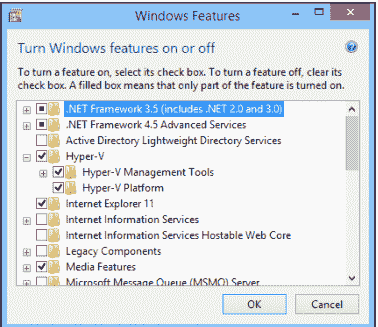
**图 10-1：** 在 Windows 桌面版本上启用 Hyper-V。

##### 熟悉 Hyper-V
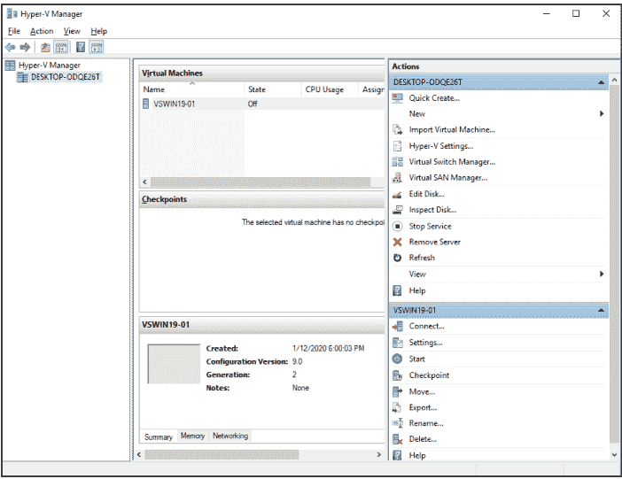
**图 10-2：** Hyper-V 管理器。
要管理 Hyper-V，请使用如图 10-2 所示的 Hyper-V 管理器。启动该程序时，需单击“开始”按钮，输入**Hyper-V**，然后选择 Hyper-V 管理器。Hyper-V 管理器窗口分为五个面板：
- **导航：** 窗口左侧是导航面板，列出了 Hyper-V 所称呼的*虚拟化服务器*，也就是所有 Hyper-V 主机。在图 10-2 中，仅列出了一台主机：我的 Windows 计算机。如果在拥有多台主机的企业环境中，所有主机都会列在这个面板中。
- **虚拟机：** 该面板列出为所选主机配置的所有虚拟机。在图 10-2 中，我目前仅创建了一台名为 VMWIN19-01 的虚拟机。
- **检查点：** 在 Hyper-V 中，*检查点*是虚拟机的恢复点。如果你要对虚拟机进行修改，可以提前创建一个检查点。如果后续出现问题，就可以回滚到该检查点。
- **虚拟机摘要面板：** 检查点面板下方是摘要面板，会显示“虚拟机”面板中选中虚拟机的摘要信息。在图 10-2 中，你可以看到其中一台 Windows Server 2016 虚拟机的摘要信息。该面板有三个选项卡：摘要、内存和网络。图中选中的是“内存”选项卡，因此可以查看为该虚拟机分配的内存。
- **操作：** “操作”面板包含多个按钮，点击即可对选中的主机（DOUG-2014-17）和选中的虚拟机（VMWIN19-01）执行相应操作。

#### 创建虚拟交换机
在 Hyper-V 中创建虚拟机之前，你需要先创建虚拟交换机，让虚拟机之间以及虚拟机与外部网络可以通信。完成这项操作需要使用“虚拟交换机管理器”，步骤如下：
- 在 Hyper-V 管理器中，单击**虚拟交换机管理器**，“虚拟交换机管理器”窗口会弹出，如图 10-3 所示。
- 选择你要创建的虚拟交换机类型。Hyper-V 支持创建三种类型的交换机：
  - **外部：** 绑定到物理网络适配器的虚拟交换机，允许虚拟机之间以及虚拟机与物理网络上的其他计算机通信。这通常是你需要创建的交换机类型。


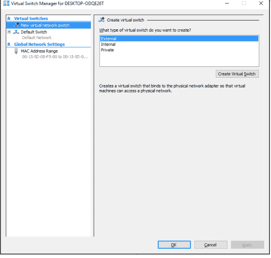
**图 10-3：** 虚拟交换机管理器窗口。

- **内部：** 一种不与物理网络适配器绑定的虚拟交换机。此类型的交换机允许此计算机上的虚拟机相互通信以及与主机通信，但不能与物理网络上的其他计算机通信。
- **专用：** 一种允许虚拟机相互通信，但不能与主机或物理网络上的任何计算机通信的虚拟交换机。

- 3. 单击“创建虚拟交换机”。
新虚拟交换机的设置将出现，如图 10-4 所示。
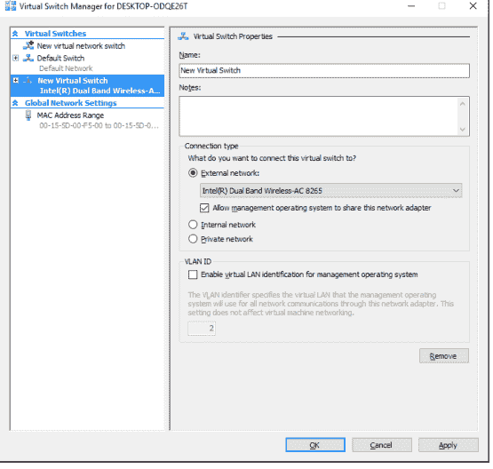
**图 10-4：** 创建新的虚拟交换机。

- 4. 在“名称”字段中键入新虚拟交换机的名称。可以使用任何你想要的名称。
- 5. 选择要绑定虚拟交换机的物理网络适配器。如果你的计算机有多个网络适配器，请选择要使用的那个。将虚拟交换机绑定到物理网络适配器，不仅允许虚拟机相互通信，还允许它们与通过你所选适配器连接的其他计算机通信。

- 6. 如果你的网络有多个 VLAN，请选中 **“为管理操作系统启用虚拟 LAN 标识”** 复选框，并输入你要此交换机连接的 VLAN 的 VLAN ID。如果你的网络没有多个 VLAN，可以跳过此步骤。
- 7. **单击“确定”。** 虚拟交换机即创建完成。你的 Hyper-V 环境现在已建立了一个虚拟网络，因此你可以开始创建虚拟机。

#### 创建虚拟磁盘
在创建虚拟机之前，最好先为该机器创建一个要使用的虚拟磁盘。请注意，你可以在创建虚拟机的同时创建虚拟磁盘。但是，先创建虚拟磁盘可以给你更多的灵活性。因此，我建议你分别创建虚拟磁盘和虚拟机。以下是创建虚拟磁盘的步骤：

- 1. 在 Hyper-V 管理器中，单击“新建”，然后选择“硬盘”。这将启动“新建虚拟硬盘向导”，如图 10-5 所示。
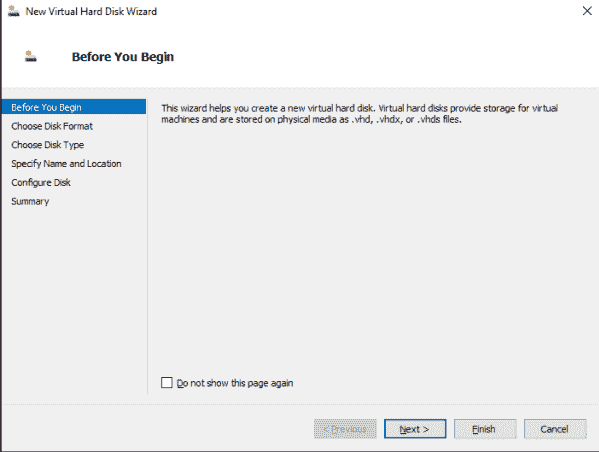
**图 10-5：** 新建虚拟硬盘向导。
- 2. 单击“下一步”。系统会询问要使用哪种磁盘格式，如图 10-6 所示。我建议你始终使用 VHDX 格式，它支持大于 2TB 的驱动器。
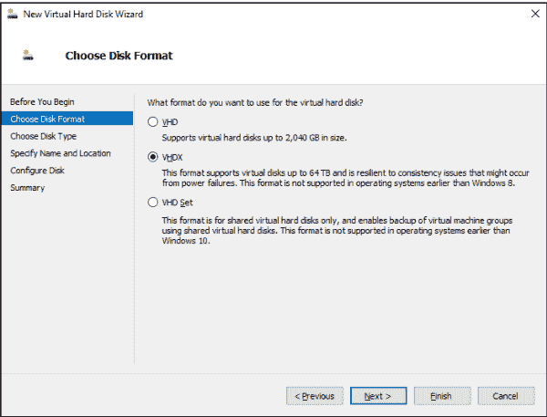
**图 10-6：** 选择你的磁盘格式。

- 3. 选择 VHDX，然后单击“下一步”。单击“下一步”后，将显示“选择磁盘类型”选项页面，如图 10-7 所示。
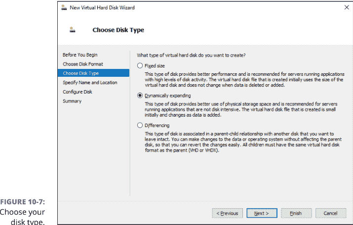

- 4. 选择要使用的磁盘类型。选项包括固定大小、动态扩展和差异磁盘。如果你关心磁盘性能，请选择“固定大小”；否则，选择“动态扩展”。
- 5. 单击“下一步”。将显示“指定名称和位置”页面，如图 10-8 所示。
- 6. 指定新磁盘的名称和位置。为虚拟磁盘驱动器键入任何你想要的名称。然后单击“浏览”按钮，浏览到你希望 Hyper-V 创建 .vhdx 文件的磁盘位置。

> **提示**
> 确保你选择的位置有足够的磁盘空间来创建 .vhdx 文件。如果你要创建动态扩展磁盘，应确保该位置有足够的空间来容纳驱动器的增长。

- 7. 单击“下一步”。将出现“配置磁盘”页面，如图 10-9 所示。

**图 10-8：** 指定磁盘的名称和位置。

**图 10-9：** 指定磁盘的大小。

- 8. 指定磁盘驱动器的最大大小。

> **提示**
> 此页面还允许你从现有的虚拟磁盘驱动器或现有的物理磁盘驱动器复制数据。从现有的物理驱动器复制数据是将物理计算机转换为虚拟计算机的快速方法；只需将物理磁盘复制到虚拟磁盘，然后将新的虚拟磁盘用作新虚拟机的基础。

- 9. 单击“下一步”。将出现一个确认屏幕，总结你为新磁盘选择的选项。
- 10. 单击“完成”。新磁盘即创建完成。请注意，如果你选择的磁盘类型是“固定磁盘”，则创建磁盘可能需要一段时间，因为你指定的整个磁盘存储空间都被分配给了该磁盘。请耐心等待。完成了！你现在已创建了一个可用作新虚拟机基础的虚拟磁盘。

#### 创建虚拟机
创建虚拟机来使用你已创建的虚拟磁盘是件简单直接的事情。请按照以下步骤操作：

- 1. 从 Hyper-V 管理器中，选择“新建”，然后选择“虚拟机”。这将启动“新建虚拟机向导”，如图 10-10 所示。

**图 10-10：** 向新建虚拟机向导问好吧。

- 2. 单击“下一步”。将出现“指定名称和位置”页面，如图 10-11 所示。

**图 10-11：** 指定虚拟机的名称和位置。
- 3. 输入你要用于虚拟机的名称。你可以在这里选择任何你想要的名称。
- 4. 指定虚拟机配置文件的位置。每个虚拟机都有一个与之关联的 XML 文件，该文件定义了虚拟机的配置。你可以允许此文件存储在默认位置，也可以覆盖默认设置并指定自定义位置。
- 5. 单击“下一步”。将出现“指定代系”页面，如图 10-12 所示。
- 6. 指定你要用于新虚拟机的代系。在大多数情况下，你应该选择第 2 代，它比第 1 代机器使用更新的技术。仅当客户机操作系统早于 Windows Server 2012 或 Windows 8 时，才使用第 1 代。
- 7. 单击“下一步”。将出现“分配内存”页面，如图 10-13 所示。

**图 10-12：** 指定新虚拟机的代系。

**图 10-13：** 指定新虚拟机的内存。

- 8. 指示你要为新机器分配的 RAM 量。默认值为 2,048MB，但你几乎肯定会想要增加它。我还建议你选中“为此虚拟机使用动态内存”复选框，这可以提高内存性能。

- 9. 单击“下一步”。将出现“配置网络”页面，如图 10-14 所示。

**图 10-14：** 为新虚拟机配置网络。

- 10. 选择你要用于该虚拟机的虚拟交换机。这时你就会明白为什么在开始创建虚拟机之前需要创建虚拟交换机。使用“连接”下拉列表选择你要连接到此虚拟机的虚拟交换机。
- 11. 单击“下一步”。将出现“连接虚拟硬盘”页面，如图 10-15 所示。
- 12. 假设你已经为虚拟机创建了虚拟磁盘，请选择“使用现有的虚拟硬盘”选项，单击“浏览”，然后找到并选择虚拟磁盘。如果你还没有创建虚拟磁盘，可以使用“创建虚拟硬盘”选项立即创建一个。
- 13. 单击“下一步”。将显示一个摘要页面，指示你所做的选择。
- 14. 单击“完成”。虚拟机即创建完成。

**图 10-15：** 连接虚拟磁盘。

#### 安装操作系统
创建虚拟机后，下一步是配置它以安装操作系统。首先，你需要以 .iso 文件形式获取安装介质（.iso 文件是 CD 或 DVD 驱动器的磁盘映像）。获得 .iso 文件后，请按照以下步骤操作：

- 1. 从 Hyper-V 管理器中，选择新建的虚拟机并单击 **“设置”**。将出现“设置”对话框，如图 10-16 所示。
- 2. 在硬件列表中单击 **“SCSI 控制器”**。然后选择 **“DVD 驱动器”**，并单击 **“添加”**。将出现如图 10-17 所示的配置页面。
- 3. 单击 **“映像文件”** 选项，单击 **“浏览”**，然后选择包含操作系统安装程序的 .iso 文件。
- 4. 单击 **“确定”**。你将返回到 Hyper-V 管理器屏幕。


#### 图 10-16：编辑虚拟机设置。

#### 图 10-17：配置DVD驱动器。

## 第10章 *虚拟化你的网络* 193
- **5.** 新虚拟机仍处于选中状态时，点击“连接”。会打开一个控制台窗口，显示该虚拟机当前处于关闭状态（见图10-18）。

**图10-18：** 通过控制台查看虚拟机。
- **6.** 点击“连接”。
- **7.** 点击“启动”。虚拟机将开机。
- **8.** 当系统提示你按任意键从CD或DVD启动时，按下任意键。操作系统的安装程序将启动。
- **9.** 按照安装程序的指示完成操作系统安装。流程到这里就结束了。你已经成功创建了一个Hyper-V虚拟机！
#### 本章内容
- » 规划Windows Server 2019部署
- » 安装Windows Server 2019
- » 配置活动目录并创建新域
### 第11章：搭建Windows Server
本章介绍安装Windows Server（具体为Windows Server 2019）所需的操作步骤。注意，虽然给出的具体细节针对Windows Server 2019，但安装旧版本的操作流程也非常相似。因此如果你要安装老版本，适配这些步骤也不会有任何问题。
在本章开头，我会做一些重要假设。首先，我假设你要将服务器安装在虚拟机上。在物理硬件上直接安装服务器的流程类似，仅安装介质为DVD光盘而非ISO磁盘镜像。其次，我假设你要将Windows Server 2019安装到全新的虚拟机中，而非尝试升级已经安装了旧版本Windows Server 2019的现有虚拟机。虽然可以将旧版Windows Server升级到2019版本，但我通常不建议这样做，因为可能出现各种问题。
#### 规划Windows Server安装
在运行安装程序实际安装Windows Server操作系统之前，你需要做若干前期决策，具体如下节所述。
##### 检查系统要求
安装Windows Server操作系统前，应确保计算机满足最低要求。表11-1列出了Windows Server 2019的官方最低要求。（Windows Server 2012的最低要求与此相同。）如果你希望服务器作为中度使用的文件服务器时能有令人满意的性能，表11-1还列出了我认为更切合实际的最低配置。
**表11-1** Windows Server 2019（标准版）最低硬件要求
| 项目 | 官方最低要求 | 更切合实际的最低要求 |
|---|---|---|
| CPU | 1.4 GHz | 3 GHz |
| 内存 | 2GB* | 4GB |
| 可用磁盘空间 | 32GB | 100GB |
* 从技术角度来说，最低内存要求为512MB。但如果你想安装桌面体验选项（该选项可让你使用与Windows 10相同的图形用户界面与Windows Server交互），则需要2GB内存。除非你对Windows Server非常有经验、不介意在命令行环境中操作，否则我建议你安装该选项。
##### 阅读发行说明
和所有Windows Server版本一样，Windows Server 2019也提供了一套发行说明，在运行安装程序前你应当阅读，以确认其中是否有适用于你情况的具体操作步骤或警告。你可以在以下地址获取发行说明：[发布说明](https://docs.microsoft.com/en-us/windows-server/get-started-19/rel-notes-19)
##### 考虑许可选项
运行Windows Server操作系统需要两种类型的许可证：一种是*服务器许可证*，授予你运行单个服务器实例的权限；另一种是*客户端访问许可证（CAL）*，授予用户或设备连接服务器的权限。购买Windows Server时，通常需要同时购买服务器许可证和一定数量的CAL。
更复杂的是，CAL分为两种不同的类型：*每用户*和*每设备*。*每用户*CAL限制可同时访问服务器的用户数量，与你所在组织内的设备（如客户端计算机）数量无关。相比之下，*每设备*CAL限制可访问服务器的唯一设备数量，与你所在组织内的用户数量无关。
注意，你可以从微软官网下载Windows Server 2019的6个月评估版本，下载地址为`www.microsoft.com/en-us/evalcenter/evaluate-windows-server-2019`。
> **提示** 如果你想按照本章后续介绍的步骤将Windows Server安装到Hyper-V虚拟机中，请下载评估版本的ISO文件。之后你就可以将**ISO**文件挂载到虚拟机的DVD/CD驱动器中，通过DVD安装服务器。
##### 确定TCP/IP配置
在安装操作系统前，你应当规划好网络中TCP/IP的实施配置。以下是你需要确定或获取的部分信息：
- 网络的IP子网地址和子网掩码。
- 网络的域名。
- 服务器的主机名。
- 服务器的静态IP地址。（所有服务器都应使用静态IP。）
- 服务器是否将作为DHCP服务器。
- 服务器的默认网关（即网络互联网路由器的IP地址）。
- 服务器是否将作为DNS服务器。
有关规划TCP/IP配置的更多信息，请参阅第5章。
##### 选择工作组或域
*域*是一种将用户账户和各类网络资源置于单一目录数据库管控下的方法。域可确保安全策略在整个网络中一致应用，并极大简化大型网络中管理用户账户的任务。
*工作组*是网络中计算机的简单关联，可轻松查找共享文件和打印机。工作组没有复杂的目录数据库，因此无法实施严格的安全管控。工作组仅适用于仅有少量用户的微型网络。实际上，任何大到需要运行Windows Server 2019的专用服务器的网络，都大到不适合使用工作组。因此，如果你要安装Windows服务器，应当始终选择域。
确定使用域后，你需要做两个基本决策：
> - 域名是什么？如果你有已注册的互联网域名（如mydomain.com），可以将其用作网络域名。否则，你可以自定义任何想要的名称。
> - 哪台或哪些计算机将作为域的域控制器？如果这台服务器是域中的第一台服务器，你必须将其指定为域控制器，并执行创建域的相关操作。（我将在本章后续说明具体操作方法。）如果你已经有服务器充当域控制器，则可以选择将这台计算机作为额外域控制器加入，或将其指定为成员服务器。

> **提示** 如果网络需求发生变化，你随时可以将服务器的角色从域控制器更改成成员服务器，反之亦然。如果你的网络有多台服务器，最佳实践是至少创建两个域控制器。这样，如果其中一台出现故障，另一台可以接管。
#### 运行安装程序
现在你已经完成了安装规划、准备好了计算机，可以运行安装程序了。以下流程介绍了使用安装DVD的ISO镜像，在虚拟机上安装Windows Server 2019必须遵循的步骤。
开始此流程前，你需要先从微软官网下载ISO文件，并且应当搭建好虚拟机，将ISO文件挂载到虚拟机的DVD/CD驱动器中。（要了解如何使用微软Hyper-V搭建虚拟机，请参阅第10章。）
1. 按照你想要的规格配置新虚拟机，将安装ISO文件挂载到虚拟DVD驱动器，然后启动虚拟机。片刻之后，Windows安装向导将启动，并询问你的语言、时间与货币格式以及键盘布局。


##### 2. 单击“下一步”。随后出现欢迎屏幕，如图 11-1 所示。
**图 11-1：** ``Welcome to Windows Setup!``

##### 3. 单击“立即安装”。Windows 会询问你要安装哪个版本的操作系统，如图 11-2 所示。共有四个版本可用：
- **Windows Server 2019 标准版：** 不含图形用户界面（GUI）的精简版操作系统。你必须使用 PowerShell 或 Windows 管理控制台远程管理此版本服务器。
- **Windows Server 2019 标准版（桌面体验）：** 这是你应该选择的版本，它将为你提供仿照 Windows 10 设计的友好 GUI。
- **Windows Server 2019 数据中心版：** 专为拥有大量服务器的大型数据中心设计的高性能 Windows Server 版本。
- **Windows Server 2019 数据中心版（桌面体验）：** 数据中心版的 GUI 版本。本书将使用标准桌面体验版来演示如何管理 Windows Server 2019 的各项功能。

**图 11-2：** 选择要安装的操作系统版本。
##### 4. **选择你要安装的版本，然后单击“下一步”。** 安装向导会显示许可协议信息，如果你喜欢看法律条文的话可以读一读。
##### 5. **单击“我接受许可条款”，然后单击“下一步”。** 安装向导会询问你是要执行升级安装还是全新安装。
##### 6. **单击你想使用的安装选项。** 安装程序接下来会显示计算机上可用的磁盘驱动器，以便你选择 Windows 的安装位置，如图 11-3 所示。本示例中只有一块驱动器，因此其实没有可选的余地。
##### 7. **选择你要安装 Windows 的磁盘，然后单击“下一步”。** 安装程序会格式化该驱动器，然后将文件复制到新格式化的驱动器中。此步骤通常需要一些时间，建议你带上自己喜欢的书，从第 1 章开始读。所有文件复制完成后，安装程序会重启你的计算机。随后安装程序会检查计算机上的所有设备并安装必要的设备驱动程序，这段时间你可以读这本书的第 2 章。安装程序完成驱动程序安装后，会提示你输入要用于计算机管理员帐户的密码，如图 11-4 所示。
**图 11-3：** 确定 Windows 的安装位置。
> Windows 安装程序
> 你想要将 Windows 安装到哪里？
> 
> | 名称 | 总大小 | 可用空间 | 类型 |
> |------|--------|----------|------|
> | 驱动器 0 未分配空间 | 127.0 GB | 127.0 GB | |
> 
> 可用选项：刷新、删除、格式化、新建、扩展、下一步
> 安装进度：1. 收集信息 2. 安装 Windows
**图 11-4：** 设置管理员密码。
> 自定义设置
> 键入内置管理员帐户的密码，你可以使用该密码登录到此计算机。
> 
> - 用户名：Administrator
> - 密码：
> - 重新输入密码：
> - 完成
第 11 章 设置 Windows Server 2019
> **注意**
##### 8. **两次输入管理员密码，然后单击“完成”。** 务必将此密码记在安全的地方。如果丢失此密码，你将无法访问你的服务器。设置完管理员密码后，Windows 会显示如图 11-5 所示的登录屏幕。
**图 11-5：** 登录你的新服务器。

##### 9. **使用管理员帐户登录。** 你需要输入在第 7 步创建的密码才能获得访问权限。登录后，Windows 会显示如图 11-6 所示的服务器管理器仪表板。服务器管理器仪表板提供了可让你完成服务器配置的链接，具体包括：
- 单击“配置此本地服务器”可配置服务器设置，例如计算机名称、所属域、静态 IP 地址等网络设置。
- 单击“添加角色和功能”可添加服务器角色和功能。（更多信息请参阅本章稍后的“添加服务器角色和功能”。）
- 单击“添加要管理的其他服务器”可管理网络中的其他服务器。
- 单击“创建服务器组”可创建自定义的服务器组。
- 如果服务器集成了云服务，可单击“将此服务器连接到云服务”。
**图 11-6：** 服务器管理器仪表板。


#### 添加服务器角色和功能
服务器角色是服务器可在网络中扮演的角色，例如文件服务器、Web 服务器或 DHCP 或 DNS 服务器。功能是 Windows 操作系统本身的附加功能，例如 .NET Framework 或 Windows 备份。说实话，角色和功能之间的区别有点随意。例如，Web 服务器被视为角色，而 Telnet 服务器却被归为功能，其中的规则自行体会。
以下过程介绍如何安装服务器角色。安装服务器功能的过程类似。本示例中，我们将安装 Active Directory 域服务和 DNS 服务器角色。这些角色是创建域并将此服务器指定为域控制器所必需的。
##### 1. **在服务器管理器仪表板上单击“添加角色和功能”。** 随即将显示“添加角色和功能向导”，如图 11-7 所示。
##### 2. **单击“下一步”。** 向导会询问你要执行两种安装类型中的哪一种。在大多数情况下，你会希望保留默认的选中项（基于角色或基于功能的安装）。只有在配置远程虚拟服务器时，才选择另一个选项（远程桌面服务安装）。
**图 11-7：** “添加角色和功能”向导。

##### 3. **单击“下一步”。** 向导允许你选择要为其安装角色或功能的服务器，如图 11-8 所示。本示例中只列出了一台服务器。如果你之前在服务器管理器仪表板上单击了“添加要管理的其他服务器”来添加其他服务器，这些服务器也会显示在此页面上。
**图 11-8：** 选择要管理的服务器。

##### 4. **单击“下一步”。** 随即显示“选择服务器角色”页面，如图 11-9 所示。此页面允许你向服务器添加一个或多个角色。
**图 11-9：** “选择服务器角色”页面。

##### 5. **选择“Active Directory 域服务”角色。** 随即显示“添加角色和功能”对话框，如图 11-10 所示。此处 Windows 会告知你，若要安装 Active Directory 域服务角色，你还必须安装其他几个功能，例如组策略管理和远程服务器管理工具。
**图 11-10：** 添加其他必需的角色和服务。

##### 6. **单击“添加功能”。** “添加角色和功能”对话框消失，你将返回到向导的“选择服务器角色”页面。
##### 7. **选择“DNS 服务器”角色。** “添加角色和功能”对话框会再次显示，此次会告知你需要添加的用于支持 DNS 服务器角色的其他功能。
##### 8. **单击“下一步”。** 你将再次返回到向导的“选择服务器角色”页面。
##### 9. **单击“下一步”。** 随即显示“选择功能”页面，如图 11-11 所示。此页面列出了可以安装的其他服务器功能。如果需要，你可以在此处选择其他功能，但目前我们先专注于 Active Directory 域服务和 DNS 服务器角色。
**图 11-11：** “选择功能”页面。

##### 10. **暂时跳过这些功能并单击“下一步”。** 因为你已选择安装 Active Directory 域服务，因此会显示一个有用的信息页面，如图 11-12 所示。


**图11-12：** Active Directory域服务相关须知。

- 11. 单击“下一步”。由于你还勾选了DNS服务器角色，向导将显示另一页关于DNS服务器角色的实用信息，如图11-13所示。
**图11-13：** DNS服务器角色相关须知。

- 12. 单击“下一步”。如图11-14所示，将弹出一个确认页面，列出你已选择的角色和功能。
**图11-14：** 所选角色和功能确认页。

- 13. 单击“安装”。Windows将安装服务器角色及相关功能。安装过程中会显示进度界面，方便你查看安装进度。安装完成后，会显示最终结果页面。
- 14. 单击“关闭”。操作完成！

#### 创建新域
既然你已经创建了安装了Active Directory域服务角色的服务器，接下来就可以进行下一步操作：创建一个全新的域，之后你可以向该域中添加更多服务器和计算机。
请注意，此步骤通常在组织内仅执行一次，你亲自操作的可能性很低——这类工作通常由经验丰富的网络顾问来完成效果最好。不过，了解具体操作过程有助于你更好地理解Active Directory的运行原理，以及它在你的组织中的配置方式。

要开始此流程，请注意：完成“添加角色和功能向导”后，你会返回服务器管理器界面，此时会显示一条黄色警告信息，提示你需要配置Active Directory域服务。该警告信息包含“更多”链接，单击该链接即可开始配置。
- 1. **单击“配置所需”警告中的“更多”按钮。** 此时将显示“所有服务器任务详细信息和通知”界面，如图11-15所示。
**图11-15：** 需要对Active Directory域服务角色执行额外配置。

- 2. **单击“将此服务器提升为域控制器”链接。** 此时将打开Active Directory域服务配置向导，如图11-16所示。本次实操中，我们将创建一个新的域林，其根域名设置为`lowewriter.pri`。
**图11-16：** 需要对Active Directory域服务角色执行额外配置。

- 3. **选择“添加新林”，然后输入新林的根域名。** 本示例中，我们输入`lowewriter.pri`作为根域名。
- 4. **单击“下一步”。** 向导的下一页如图11-17所示，可用于设置域控制器的各项配置选项。你可以保留这些选项的默认设置，但需要输入一个恢复密码，以便在需要修复损坏的Active Directory控制器时使用。你大概率永远不会用到这个密码，但仍建议将其记录下来并妥善保管，以备不时之需。
**图11-17：** 此处可设置域控制器选项。

- 5. 两次输入你的恢复密码，然后单击“下一步”。你将看到DNS选项界面，该界面会提示存在DNS委派潜在问题，出于本次实操的目的，你可以直接忽略该问题。
- 6. **单击“下一步”。** 下一个界面会显示向导已根据你输入的根域名生成了对应的NETBIOS名称。NETBIOS是一项古老的（约1983年发布的）网络标准，信不信由你，它至今仍深植于现代网络的底层架构中，因此NETBIOS名称是必需的。向导生成的名称通常都是合适的，你可以直接继续，该界面无需额外操作。
- 7. **再次单击“下一步”。** 向导的下一页可用于设置Active Directory创建及使用的各类文件的存储位置，你几乎总是可以保留这些位置的默认设置。
- 8. **再次单击“下一步”。** 此时你会进入摘要界面，该界面会汇总你已选择的所有选项。请仔细核对细节，确认选择无误后再继续。
- 9. **再次单击“下一步”。** 在此步骤中，向导会检查创建新域所需的所有前提条件是否已满足，如图11-18所示。如果显示任何红色错误提示，你需要先解决相关问题，才能继续操作。
**图11-18：** 创建新域的前提条件检查。

- 10. **单击“安装”。** 向导会运行一段时间来完成Active Directory的配置。此过程中服务器会重启，重启完成后新域即可投入使用，如图11-19所示的登录界面所示。请注意，当前登录界面已显示你将登录到`LOWEWRITER`域。
**图11-19：** 登录到新域。


恭喜！如果你已经在自己的计算机上按照上述步骤完成了操作，那么你已经成功创建并配置了一台同时作为DNS服务器和Active Directory控制器的Windows Server 2019服务器，还完成了一个新域的创建——这可不是一项小工程！

#### 本章内容
- 了解Active Directory
- 检查用户账户
- 创建用户账户
- 设置账户选项
- 使用组
- 创建登录脚本

## 第12章
## 管理Windows用户账户
任何访问网络的用户都必须拥有用户账户。用户账户可让你（作为网络管理员）控制哪些用户可以访问网络、哪些不能。此外，用户账户还可以让你指定每个用户能够使用的网络资源。如果没有用户账户，你的所有资源将对任何访问你网络的人开放。

用户账户由Active Directory管理，Active Directory是Windows用于管理网络上各类实体的目录服务，这些实体不仅包括用户，还包括计算机、打印机、组以及其他类型的对象。本章将概述Active Directory的组织结构，随后详细介绍Active Directory用户账户的相关操作。

#### 了解Active Directory的组织结构
Active Directory本质上是一个数据库管理系统，Active Directory数据库用于存储目录跟踪的各个独立对象。Active Directory采用分层数据库模型，以树形结构对项目进行分组。*对象、组织单位、域、树和林*这些术语用于描述Active Directory组织数据的方式，后续章节将解释这些重要的Active Directory术语的含义。

##### 对象
Active Directory中的基本数据单元称为*对象*。Active Directory可以存储多种对象的相关信息，你最常接触的对象包括用户、组、计算机和打印机。图12-1展示了Active Directory管理器显示的Windows Server 2019预置的内置对象列表。要打开此管理工具，请选择“开始”>“管理工具”>“Active Directory用户和计算机”，然后单击“内置”节点即可查看内置对象。
> 图12-1：Active Directory控制台显示的对象。

对象具有称为属性或特性的描述性特征，你可以在管理控制台中双击对象来调出对象的属性窗口。

##### 域
域是Active Directory中用于对相关对象进行分组的基本单位。通常情况下，域与公司的部门相对应。设有财务部、生产部和销售部的公司可能会创建名为Accounting、Manufacturing、Sales的域（想必你已经猜到了）。也有可能是按照地理位置划分域：在底特律、达拉斯和丹佛设有办公室的公司可能会创建名为det、dal、den的域。请注意，由于Active Directory域使用DNS命名规范，你可以创建被视为子域的子域。在创建任何其他域之前，你应该先为整个网络创建顶级域。如果你的公司名为Nimbus Brooms，并且已经注册了nimbusbroom.com作为域名，那么你应该在创建任何其他域之前先创建名为nimbusbroom.com的顶级域，之后就可以创建诸如accounting.nimbusbroom.com、manufacturing.nimbusbroom.com和sales.nimbusbroom.com之类的子域。每个域必须至少有一个域控制器，即负责管理该域的服务器。虽然1个域控制器是最低要求，但最好在每个域中部署至少2个域控制器。这样，即使其中一个出现故障，Active Directory仍可继续为该域提供服务。Active Directory使用一种名为“复制”的功能来保持所有域控制器的数据同步。

##### 组织单位
许多域中的对象数量过多，无法在单个组中统一管理。幸运的是，Active Directory允许你创建一个或多个组织单位（简称OU）。OU可让你在域内组织对象，无需额外创建新域，也避免了创建新域带来的额外工作与低效率问题（从这个角度看，OU类似于文件系统中的文件夹）。在域内创建OU的原因之一是可以为不同OU分配不同的用户管理权限，这些用户随后可以执行创建新用户账户、重置密码等日常管理任务。假设丹佛办公室所在的域名为den，包含财务部和法务部，你可以为这两个部门分别创建组织单位，而无需为它们单独创建域。


#### 树
树是一组共享命名空间的活动目录名称。`nimbusbroom.com`、`accounting.nimbusbroom.com`、`manufacturing.nimbusbroom.com`和`sales.nimbusbroom.com`这几个域构成了一个树，该树派生自公共根域`nimbusbroom.com`。构成树的各个域之间通过*可传递*的信任关系相互关联。在可传递信任中，如果DomainA信任DomainB，且DomainB信任DomainC，那么DomainA会自动信任DomainC。

请注意，单个独立域仍被视为一棵树。

#### 林
顾名思义，*林*是若干*树*的集合。换句话说，林是一组或多域*树*的集合，这些域树*不*共享公共父域。所有域都必须属于某一林，因此即便你的组织仅有一个域，你也拥有一个林。但假设你的公司（Nimbus Brooms）收购了Tracorum Technical Enterprises，该公司已拥有自己的根域`tracorumtech.com`，以及若干自身的子域。你可以基于这两棵域树创建一个林，使这些域能够相互信任。

#### 了解Windows用户帐户
在回顾完活动目录的基本组织结构后，接下来我们来看用户帐户的创建和管理方式。顾名思义，用户帐户是管理Windows服务器的基础工具之一。作为网络管理员，你会将大部分时间用于处理用户帐户——创建新帐户、删除过期帐户、为遗忘密码的用户重置密码、授予新的访问权限，等等。以下章节将介绍用户帐户的一些相关特性。

##### 本地帐户与域帐户
*本地帐户*是存储在特定计算机上的用户帐户，仅适用于该计算机。通常，网络中的每台计算机都会为使用该计算机的每个用户设置一个本地帐户。相比之下，域帐户是由活动目录（AD）存储的用户帐户，可从属于该域的任何计算机上访问。域帐户由中央统一管理。本章主要介绍域帐户的配置与维护。

##### 用户帐户属性
每个用户帐户都有若干重要的帐户属性，用于指定帐户的特征。三个最重要的帐户属性如下：
- **用户名**：用于标识帐户的唯一名称。用户登录网络时必须输入用户名。用户名属于公开信息，换言之，其他网络用户可以（而且通常应当）获知你的用户名。
- **密码**：用于访问帐户所需的保密字符串。你可以配置Windows以强制执行密码策略，例如密码最小长度、密码是否必须包含字母和数字的组合，以及密码的有效时长（即用户必须更改密码的周期）。
- **组成员身份**：用户帐户所属的组。组成员身份是向用户授予访问权限的关键，使用户能够访问各类网络资源（例如文件共享或打印机），或执行特定网络任务（例如创建新用户帐户或备份服务器）。

还有许多其他帐户属性用于记录用户相关信息，例如用户的联系信息、用户是否仅允许在特定时间或从特定计算机访问系统，等等。

###### 创建新用户
理论部分到此为止，接下来我们进入实操环节。以下是创建活动目录用户帐户的步骤：
- 1. 选择「开始」→「Windows 管理工具」→「Active Directory 用户和计算机」。此命令将启动Active Directory用户和计算机管理控制台（见图12-1）。
  
- 2. **右键点击要添加用户的域的「用户」组织单位，然后从上下文菜单中选择「新建」→「用户」。** 选择此命令将启动「新建对象 - 用户」向导（见图12-2），用于在你选中的OU中创建新的用户对象。
  **图12-2：** 使用向导创建新用户。
- 3. **输入用户的名字、中间名首字母和姓氏。** 填写这些字段时，「新建对象」向导会自动填充「全名」字段。
- 4. **如果希望全名与向导建议的内容不同，可以修改「全名」字段。** 例如，你可能希望调换姓和名的顺序，让姓显示在前面。
- 5. **输入用户登录名。** 该名称在域内必须唯一。（不用担心，如果你尝试使用不唯一的名称，系统会弹出错误提示。）创建用户登录名时可以选用一套命名规则，例如“名字首字母+完整姓氏”、“完整名字+姓氏首字母”，或任何你喜欢的其他规则。
  > **提示**
- 6. **单击「下一步」。** 「新建对象 - 用户」向导的第二个页面将显示出来，如图12-3所示。
  
  **图12-3：** 设置用户密码。
- 7. **两次输入密码。** 系统会要求你先输入密码，再确认密码，因此请正确输入。如果两次输入的内容不一致，系统会要求你修正错误。
- 8. **指定要应用的密码选项。** 可使用以下密码选项：
  - 用户下次登录时必须更改密码
  - 用户不能更改密码
  - 密码永不过期
  - 帐户已禁用
  有关这些选项的详细信息，请参阅本章后续的「设置帐户选项」部分。
- 9. **单击「下一步」。** 你将进入「新建对象 - 用户」向导的最后一个页面，如图12-4所示。
- 10. **验证信息是否正确，然后单击「完成」创建帐户。** 如果帐户信息不正确，单击「上一步」按钮修正错误。

完成！现在你可以自定义用户的帐户设置。至少，你可能会希望将用户添加到一个或多个组中。你也可以添加用户的联系信息，或配置其他帐户选项。

**图12-4：** 验证用户帐户信息。
> > **提示**
> > 创建新用户的另一种方法是直接复制现有用户。复制现有用户时，你只需提供新的用户名和密码，Windows会将现有用户的所有其他属性设置复制到新用户中。

###### 设置用户属性
创建用户帐户后，你可以右键点击新用户，从上下文菜单中选择「属性」，来为用户设置额外的属性。此命令将打开「用户属性」对话框，该对话框包含大量选项卡，可用于设置用户的各种属性。图12-5显示的是「常规」选项卡，其中列出了用户的基本信息，例如用户姓名、办公地点和电话号码。以下章节将介绍可通过「用户属性」对话框的各个选项卡执行的若干管理任务。

###### 更改用户联系信息
「用户属性」对话框的多个选项卡中包含用户联系信息，例如：
- **地址**：修改用户的街道地址、邮政信箱、城市、州/省、邮政编码等信息。
- **电话**：指定用户的电话号码。
- **组织**：记录用户的职位及其上级的姓名。


###### 设置帐户选项
「用户属性」对话框的「帐户」选项卡（见图12-6）提供了多种可配置的有用选项，你可以为用户设置这些选项。你可以更改用户的登录名、修改创建帐户时设置的密码选项，以及设置帐户的过期日期。「帐户选项」列表框中提供以下选项：
- **用户下次登录时必须更改密码：** 这是默认选项，你可以设置一次性密码帮助用户接入网络。用户首次登录网络时，系统会要求其更改密码。
- **用户不能更改密码：** 如果你不希望用户更改密码，可使用此选项。（显然，你无法同时使用此选项和上一个选项。）
- **密码永不过期：** 使用此选项可绕过针对该用户的密码过期策略，使该用户无需更改密码。
- **使用可逆加密存储密码：** 此选项使用黑客可轻易破解的加密方案存储密码，因此你应当对此选项避之不及。


**图12-6：** 在此处设置用户账户信息。
- **账户已禁用：** 此选项允许你创建尚不需要的账户。只要账户仍处于禁用状态，用户就无法登录。请参阅下一节“禁用和启用用户账户”，了解如何启用已禁用的账户。
- **交互式登录需要使用智能卡：** 如果用户的计算机配有可自动读取安全卡的智能卡读卡器，请选择此选项要求用户使用该设备。
- **账户受信任足以委派：** 此选项表示该账户可信，可配置委派。这是一项高级功能，通常仅限管理员账户使用。
- **账户敏感且无法委派：** 此选项可防止其他用户模拟此账户。
- **对此账户使用DES加密类型：** 此选项可强化需要额外安全的应用的加密强度。
- **不需要Kerberos预身份验证：** *Kerberos* 是一种用于验证用户身份的通用安全协议。仅当你使用其他类型的安全协议时，才选择此选项。

222 第3部分 *服务器管理*

####### 指定登录时段
你可以限制用户允许登录系统的时间段。在用户属性对话框的“账户”选项卡上单击“登录时段”按钮，打开“登录时段-[用户]”对话框，如图12-7所示。
**图12-7：** 登录时段对话框。
初始状态下，登录时段对话框设置为允许用户在任意时段登录。要修改允许用户访问的时间，请单击某天+时间段或连续几天的时间段，选择“允许登录”或“拒绝登录”，然后单击“确定”。

####### 限制对特定计算机的访问
通常情况下，用户可以使用其用户账户登录属于所在用户域的任何计算机。不过，你可以通过在用户属性对话框的“账户”选项卡上单击“登录到”按钮，将用户限制为只能登录特定计算机。此按钮会弹出“登录工作站”对话框，如图12-8所示。
**图12-8：** 将用户限制为特定计算机。
要将用户限制为只能登录特定计算机，请选中“下列计算机”单选按钮。然后，对于你希望允许用户登录的每一台计算机，在文本框中输入计算机名称并单击“添加”。
> **提示** 如果操作失误，可以选中错误的计算机名称，然后单击“编辑”修改名称，或单击“删除”移除该名称。

###### 设置用户配置文件信息
在“配置文件”选项卡（如图12-9所示）上，你可以配置用户配置文件的三个信息项：
- **配置文件路径：** 此字段指定用户漫游配置文件的位置。
- **登录脚本：** 此字段是用户登录脚本的名称。登录脚本是用户每次登录时都会运行的批处理文件，主要作用是将用户需要访问的网络共享映射到本地。登录脚本是Windows NT Server早期版本的遗留功能。在Windows Server 2012中，配置文件是配置用户登录时计算机的优先方式，包括设置网络共享。不过许多管理员仍觉得登录脚本更简单易用。更多信息请参阅本章后面“创建登录脚本”一节。
- **主文件夹：** 此部分用于指定用户的默认存储位置。
> **提示** 在“配置文件”选项卡上，你可以指定用户现有配置文件的位置，但该选项卡无法真正帮你创建配置文件。
**图12-9：** “配置文件”选项卡。

###### 重置用户密码
据估算，大多数网络管理员最耗时的工作就是重置用户密码。别默认所有用户都是忘东忘西的糊涂蛋，换位思考一下：他们被迫设置极其复杂的密码（94kD82leL384K），一周后又要改成更难记的（dJUQ63DWd8331），还不敢写下来。如果他们忘了密码，网络管理员还要生气。所以当用户打电话说自己忘了密码时，你重置密码的时候至少（装出）态度好一点。毕竟用户在放弃、承认自己记不起来之前，很可能已经花了15分钟努力回忆。以下是重置用户域账户密码的操作步骤：
> **注意**
- 1. **以管理员身份登录。** 执行此操作必须具备管理员权限。
- 2. **选择“开始”↦“管理工具”↦“Active Directory 用户和计算机”。** 将打开Active Directory 用户和计算机管理控制台。
- 3. **在Active Directory 用户和计算机管理控制台中，单击控制台树中的“用户”。** 如图12-1所示。
- 4. **在详细信息窗格中，右键单击忘记密码的用户，然后从上下文菜单中选择“重置密码”。** 将出现一个可用于更改密码的对话框。
> **提示**
- 5. **在两个密码框中输入新密码。** 输入两次密码以确保输入正确。
- 6. **（可选）选中“用户下次登录时须更改密码”选项。** 如果选择此选项，你设置的密码仅能使用一次登录。用户下次登录时，系统将要求其更改密码。
- 7. **单击“确定”。** 操作完成！用户密码已重置。

###### 禁用和启用用户账户
要临时阻止用户访问网络，你可以禁用其账户。之后如果你准备恢复用户的完全访问权限，可以随时重新启用该账户。操作步骤如下：
- 1. **以管理员身份登录。** 执行此操作必须具备管理员权限。
- 2. **从服务器管理器中选择“工具”>“Active Directory 用户和计算机”。**
- 3. **在打开的Active Directory 用户和计算机管理控制台中，单击控制台树中的“用户”。**
- 4. **在详细信息窗格中，右键单击要启用或禁用的用户，然后从上下文菜单中选择“启用账户”或“禁用账户”，以分别完成启用或禁用操作。**

###### 删除用户
有人入职，有人离职。他们走的时候，他们的用户账户也应该一并删除。删除用户账户的操作非常简单，只需遵循以下步骤：
- 1. **以管理员身份登录。** 执行此操作必须具备管理员权限。
- 2. **选择“开始”>“管理工具”>“Active Directory 用户和计算机”。**
- 3. **在打开的Active Directory 用户和计算机管理控制台中，单击控制台树中的“用户”。**
- 4. **在详细信息窗格中，右键单击要删除的用户，然后从上下文菜单中选择“删除”。** 系统会询问你是否确定要删除该用户，以防你是误操作。
- 5. **单击“是”。** 搞定！用户账户已被删除。
> 删除用户账户是不可逆的永久操作。仅在您确定永远不会再需要恢复该用户账户时，才执行此操作。如果之后还有恢复账户的可能性，请禁用账户而非删除（参阅上一节）。

#### 使用组
*组* 是一种特殊的账户类型，代表一组具有相同网络访问需求的用户。使用组可以大幅简化为用户分配网络访问权限的工作。你无需逐个为用户分配访问权限，只需为组本身分配权限，这些权限就会自动扩展至你添加到组中的所有用户。以下部分介绍了使用组需要了解的关键概念，以及为服务器设置组时常用的常见操作。

##### 创建组
创建组的方法如下：
- 1. **以管理员身份登录。** 执行此操作必须具备管理员权限。
- 2. **从服务器管理器中选择“工具”>“Active Directory 用户和计算机”。** 将打开Active Directory 用户和计算机管理控制台。


**3.** 在要添加组的域上单击鼠标右键，然后从上下文菜单中选择**新建▶组**。
**4.** 在随后出现的“新建对象 – 组”对话框中，如图12-10所示，输入新组的名称，两个文本框都需要填写该名称。
**5. 选择组作用域。** 选项如下：
- *域本地*：适用于将被授予网络资源访问权限的组
- *全局*：适用于要向其添加用户和域本地组的组
- *通用*：如果你的网络包含多个域，可选择此选项
**6. 选择组类型。** 选项为“安全组”和“通讯组”，大多数情况下请选择“安全组”。
**7. 单击“确定”。** 组即创建完成，但此时该组还没有任何成员。要解决这个问题，请继续阅读后续内容。

##### 向组中添加成员
组是由称为*成员*的对象组成的集合。组的成员可以是用户账户或其他组。新创建的组（请参阅上一部分）没有任何成员。如你所见，在向组中添加至少一个成员之前，组没有实际用处。请按照以下步骤向组中添加成员：
1. **以管理员身份登录。** 执行此操作必须拥有管理员权限。
2. **选择“开始”>“管理工具”>“活动目录用户和计算机”。** 此时会显示活动目录用户和计算机管理控制台。
3. **打开包含要添加成员的组的文件夹，然后双击该组。** 此时会显示“组属性”对话框。
4. **单击“成员”选项卡。** 此时会显示该组的所有成员，如图12-11所示。
5. **单击“添加”，输入要添加到此组的用户或其他组的名称，然后单击“确定”。** 该成员即被添加到列表中。
6. **对要添加的每个用户重复执行步骤5。** 持续操作，直到添加完所有用户！
7. **单击“确定”。**

> **图12-11：** 向组中添加成员。
> **提示** 在“组属性”对话框的“成员所属”选项卡上，你可以看到当前组所属的全部组的列表。
##### 创建登录脚本
*登录脚本*是用户登录时自动运行的批处理文件。使用登录脚本最常见的原因是为用户映射其需要访问的网络共享驱动器。以下是一个可映射三个网络共享的简单登录脚本：
``` echo off net use m: \\server1\shares\admin net use n: \\server1\shares\mktg net use o: \\server2\archives ```
此处将server1上的两个共享分别映射到M盘和N盘，将server2上的一个共享映射到O盘。如果需要，你可以使用特殊变量%username%来获取当前用户的用户名。如果你为每个用户创建了独立的文件夹，并且想要为每个用户的文件夹映射驱动器，这个变量非常实用，示例如下：
``` net use u: \\server1\users\%username% ```
例如，如果用户使用用户名dlowe登录，则U盘会映射到\\server1\users\dlowe。
> **提示** 脚本需要保存在SYSVOL文件夹深处的Scripts文件夹中，典型路径如下：
> ``` c:\Windows\SYSVOL\Sysvol\domainname\Scripts ```
> 其中*domainname*是你的域名。由于你需要频繁访问这个文件夹，我建议你在桌面上创建该文件夹的快捷方式。
创建登录脚本后，你可以通过“用户属性”对话框的“配置文件”选项卡将其分配给用户。如需更多信息，请参阅本章前文的“设置用户配置文件信息”部分。
> **本章内容**
> » 了解磁盘存储
> » 了解文件服务器
> » 创建共享
> » 设置权限
## 第13章
## 管理网络存储
大多数计算机网络的一个核心目的是提供磁盘存储的共享访问服务。在本章中，你将了解网络提供共享磁盘存储的几种方式，之后你会学习如何配置Windows Server 2019以作为文件服务器运行。
#### 了解磁盘存储
我们都很熟悉使用磁盘驱动器存储数据：如今在用的每一台Windows计算机系统都有某种用于存储数据的磁盘存储设备。以下部分将介绍你在规划网络磁盘存储共享方案时需要了解的一些磁盘存储基础概念。
##### 硬盘驱动器
传统磁盘驱动器会在涂有磁性材料的旋转磁盘上存储数据。这类磁盘通常被称为*硬盘驱动器*（HDD），有时也会使用*旋转磁盘*这一称呼。现代硬盘驱动器由IBM于1956年发明，比我出生早几年。它的容量高达5MB，还需要用叉车搬运。其每月的租赁费用为650美元，相当于今天的6000多美元。
64年过去了，如今你只需花不到200美元就能买到容量是当年1万多倍的磁盘驱动器。如今的旋转磁盘除了体积更小、存储容量高出数千倍、价格更低之外，和1956年的原始版本并没有太大区别。和原始版本一样，数据存储在旋转磁盘盘片的表面的同心圆环上，这些圆环称为*磁道*。数据本身以扇区的序列形式写入每个磁道，扇区是磁盘驱动器可以读取或写入的最小数据单位。大多数驱动器上，每个扇区包含512字节的数据。但一些更昂贵的驱动器，扇区大小高达4K。你有时会听到*块*这个词被用来代替*扇区*。块是操作系统识别格式化磁盘驱动器的最小数据单位。通常情况下，块的大小为2K，这意味着磁盘上的每个块需要占用4个扇区。
硬盘驱动器有很多优势——其中最主要的是成本低、容量大。硬盘驱动器最大的缺点是速度慢。磁盘驱动器的速度受限于它依赖机械运动来访问数据。要理解这一限制，我们可以看看磁盘驱动器读取特定扇区数据时需要发生的流程：
1. 由于每个磁盘盘片有数千条磁道，*读写头*（实际向磁道读取或写入数据的机械装置）必须移动到位，对准包含要读取扇区的磁道。
2. 读写头就位后，磁盘必须等待数据随盘片旋转到读写头下方。平均来看，数据会刚好位于读写头对面半个盘片的位置；有时会更近，但同样也可能更远。无论如何，磁盘驱动器都必须等待数据在盘片上旋转到位。磁盘驱动器需要等待数据的时间完全取决于磁盘的转速。典型的磁盘驱动器转速为每分钟7200转（RPM）。这听起来很快，但在计算机领域里这慢得离谱。7200 RPM相当于每秒120转，也就是每转0.00833秒。除以2后你就可以看到，磁盘驱动器平均需要等待0.004167秒才能让数据到达读写头。
我们把它和现代CPU的典型主频对比一下，就能直观感受到这个速度有多慢。CPU通常的主频在2.0GHz到3.5GHz之间，我们取2.0GHz来简化计算，也就是*每秒*20亿个时钟周期。在磁盘驱动器等待数据到达的这0.004167秒里，CPU的时钟已经 tick 了超过800万次。因此，CPU在等待数据在磁盘上旋转的这段时间里，可以完成800万次其他操作。
还有个更直观的方式能让你感受到磁盘驱动器有多慢：想象一下你把CPU时钟和磁盘驱动器的速度都放慢到CPU每秒只跳一个时钟周期。然后你打响指，数*一千零一，一千零二*来配合这个思维实验。在这个速度下，你要等三个多月，数据才能旋转到能被读写头读取的位置。
3. 流程还没结束：数据到达读写头后，读写头会被激活来读取或写入数据。而且，读写头只能以数据从它下方经过的速度来读取数据。计算数据从读写头下方飞过所需的时间，比计算移动读写头和等待数据到达的时间要复杂得多。我们保守估计，实际读取数据还需要几天甚至几周的时间。是不是很有意思？我们做这番详细解释的整个目的是说明，为什么磁盘存储是影响网络整体性能的最头疼的瓶颈之一。
公平来说，磁盘驱动器制造商一直在尽最大努力降低磁盘技术固有慢速带来的影响。例如，所有磁盘驱动器都包含相当大容量的内部存储，作为*缓存*使用，它会将最近读取的数据存储在高速内存中，以便需要时可以快速再次读取。尽管如此，缓存内存只能边际提升磁盘性能。我们真正需要的是本质上更快的存储技术，这就是固态硬盘的用武之地。


##### 固态硬盘拯救存储需求！
*固态硬盘*（SSD）使用集成电路在电子存储器中存储数据，而非在磁性旋转磁盘上存储数据。

有些人会使用*固态盘*这个说法，我可以理解，毕竟SSD是用来替代旋转磁盘的。但严格来说，SSD并不包含磁盘，所以这些人的说法是不准确的。指出他们的错误肯定会让他们不再愿意和你做朋友，所以我建议你心里默默微笑然后随他们去吧。

SSD基于一种名为*闪存*的存储技术，这种技术从20世纪80年代就已经出现，但直到近期才成为旋转磁盘的平价替代方案。

SSD的速度远快于旋转磁盘，因为访问数据时没有机械部件参与：不需要移动读写磁头，也不需要等待磁盘旋转。SSD以电子速度读写数据，而非机械速度。（由于没有活动部件，SSD的可靠性也比旋转磁盘更高。）

不过，这种性能优势是有代价的：SSD存储的价格通常是HDD存储的2到5倍，具体取决于你需要的硬盘类型。

关于SSD还有一个重要认知点：它的设计是用来模拟传统旋转磁盘存储的。因此，SSD和旋转磁盘使用相同的电子接口，这意味着SSD和HDD可以互换使用。本书中提到*磁盘*或*磁盘存储*时，你都可以默认指的是SSD或HDD存储。

#### 什么是RAID！
我在第10章提到，通常我们会使用一种名为RAID的技术将单个磁盘驱动器组合成阵列，RAID是*廉价磁盘冗余阵列*的首字母缩写。事实上，RAID阵列是磁盘存储的通用要求，原因有二：
> » RAID可以将多个磁盘驱动器组合为一个整体，其总容量超过组成该阵列的单个磁盘的容量总和。
> » RAID提供了一项重要的安全防护功能，即使阵列中丢失一块磁盘，你的数据也不会丢失。（在某些情况下，RAID阵列甚至可以在丢失两块或更多磁盘的情况下依然保护数据。）

你需要了解几种基础的RAID*级别*：
- **RAID 0**：该级别使用一种名为*条带化*的技术，将两块或更多磁盘驱动器组合为一个逻辑单元，其总容量等于所有组成磁盘的容量之和。RAID 0几乎不会被使用，因为它虽然能提供更大的存储容量，但无法保护阵列中任意一块磁盘故障带来的数据丢失风险。事实上，如果RAID 0阵列中的任意一块磁盘发生故障，你将丢失存储在阵列所有磁盘上的全部数据。
- **RAID 1**：该级别会将一对磁盘驱动器进行*镜像*备份，因此如果其中一块磁盘故障，另一块磁盘上的数据可以保护阵列中的数据不丢失。
- **RAID 10**：该级别会使用偶数块磁盘驱动器，同时进行条带化和镜像处理。换句话说，阵列中的每一对驱动器先进行镜像，再将得到的镜像对进行条带化，以提升阵列的总容量。因此，阵列的总容量等于所有磁盘容量总和的一半；例如，如果使用8块2TB的磁盘组建RAID 10阵列，阵列总容量为8TB（即8块磁盘16TB原始总容量的一半）。RAID 10是最安全的RAID阵列类型之一，因为即使阵列中任意一块磁盘丢失，阵列依然可以正常运行；如果丢失多块磁盘，只要没有两块丢失的磁盘属于同一镜像对，阵列就仍能恢复数据。RAID 10也是速度最快的RAID形式之一，这是因为RAID 10所需的镜像和条带化操作几乎不会产生额外开销。正因兼具高速和高安全感，RAID 10阵列通常用于存储组织最核心的数据。
- **RAID 5**：该级别会对磁盘进行条带化处理，但不会做镜像。相反，它会利用条带化磁盘的冗余特性，使得任意一块磁盘丢失时，都可以通过存储在正常磁盘上的数据重建丢失磁盘上的数据。RAID 5通过*奇偶校验*的*原理*实现冗余。理解奇偶校验最简单的方式是看一个例子：假设你在三张不同的纸上分别写下三个数字——比如5、10和15。不幸的是，如果你丢失了其中任意一张纸，就会丢失上面写的数字。为了避免这种情况，你可以再计算一个数字，让四个数字的总和为零。这种情况下，第四个数就是-30（因为5+10+15=30，把-30加进去总和就为0）。现在，如果你丢失了其中一张纸——比如写有数字10的那张——你只需要逆向使用之前计算第四个数字的数学过程即可。换句话说，你要对你已知的三个数字进行*减法*运算。挠头回想一下如何计算负数减法后，你就能得到答案——10，这恰好就是丢失的那个数字。在RAID 5阵列中，写入阵列的每一位数据都会计算奇偶校验值，生成的奇偶校验值会均匀分布在阵列的所有磁盘上，因此任意一块磁盘丢失时，都可以通过正常磁盘上的数据重建丢失的数据。RAID 5阵列的有效容量等于所有磁盘总容量减1。因此，如果用5块2TB的磁盘组建RAID 5阵列，有效容量就是8TB（4×2TB）。
- **RAID 6**：该级别与RAID 5几乎一致，唯一的区别是它会计算两个奇偶校验值并分布到所有磁盘上。这允许阵列丢失两块磁盘的情况下依然可以恢复数据。RAID 6阵列的有效容量等于所有磁盘总容量减2。因此，如果用5块2TB的磁盘组建RAID 6阵列，有效容量为6TB（3×2TB）。

#### 将磁盘连接到服务器的三种方式
我同样在第10章提到，将磁盘连接到服务器计算机共有三种主要方式，无论你的服务器是虚拟服务器还是物理服务器都适用。回顾如下：
- **本地磁盘存储**：所有服务器计算机至少配备一块直接连接到服务器、与服务器安装在同一机箱内的磁盘驱动器。大多数服务器都支持加装额外的磁盘驱动器，这些驱动器可以组合成RAID阵列，形成仅对该服务器及其自身可用的磁盘存储。
- **存储区域网络（SAN）**：SAN本质上是管理磁盘驱动器阵列的磁盘控制器网络，这些控制器通过专为该用途设计的特殊网络连接到服务器计算机以及彼此之间。SAN中最常用的网络技术被称为*光纤通道*，其运行速度远高于大多数以太网——在我撰写本书时，最快的可用光纤通道速度为256Gbps。SAN可以将磁盘存储与服务器计算机分离，让你可以独立管理存储和服务器。如果你需要更多服务器，可以加装新服务器并将其连接到SAN；如果你需要更多磁盘空间，可以给SAN加装额外磁盘，你的服务器就可以使用这些新磁盘。
> **网络附加存储（NAS）**：NAS比SAN简单得多，它就是连接到以太网的磁盘存储。要使用NAS，你只需购买一台或多台NAS设备，这些设备内置磁盘存储和控制器，可将磁盘存储呈现给网络。由于NAS通过以太网访问，速度远低于SAN存储，但价格也低得多。

#### 聚焦文件服务器
在了解了磁盘存储的基本原理以及连接方式后，现在我们来关注在网络上创建和管理存储的主要方式：搭建一台或多台*文件服务器*。

*文件服务器*本质上就是一台网络服务器，其主要作用是共享自身的磁盘存储。使用文件服务器是提供共享网络存储最常见的方式。文件服务器的形态跨度很大，从被临时征用为文件服务器的普通台式机，到配备冗余组件、即使某个组件故障仍可继续运行的高端服务器（价格在25000美元及以上）都可以作为文件服务器。


**提示**：本章剩余内容将重点介绍如何配置Windows Server 2019，使其作为文件服务器运行。

##### 理解权限
在详细介绍如何搭建文件服务器之前，你需要充分理解权限的概念。*权限*允许用户访问网络上的共享资源。仅仅共享一个资源（比如磁盘文件夹或打印机），并不能保证指定用户一定能访问该资源。Windows会根据为该资源分配给不同用户组的权限，以及用户所属的用户组来决定是否允许访问。例如，如果用户属于被授予该资源访问权限的用户组，那么访问请求就会被允许；反之则会被拒绝。

理论上，权限的概念非常简单，但在实际应用中却相当复杂。接下来几段将解释访问控制和权限运行机制的一些细节：
> NTFS卷上的每个对象（即每个文件和文件夹）都有一套与之关联的权限——访问控制列表（ACL）。


ACL（访问控制列表）用于标识哪些用户和组可以访问对象，并指明每个用户或组的访问级别。文件夹的 ACL 可能指定一组用户可以读取文件夹中的文件，而另一组用户可以读取和写入文件夹中的文件，第三组用户则被拒绝访问该文件夹。

容器对象——文件和卷——允许其包含的对象继承其 ACL。因此，如果您为某个文件夹指定了权限，这些权限将扩展到该文件夹内出现的文件和子文件夹。表 13-1 列出了可以应用于 NTFS 卷上文件和文件夹的六种权限。

#### 表 13-1 文件和文件夹权限
| 权限 | 描述 |
|------------|-------------|
| 完全控制 | 用户对文件或文件夹拥有不受限制的访问权限。 |
| 修改 | 用户可以更改文件或文件夹的内容、删除文件或文件夹、读取文件或文件夹，或更改文件或文件夹的属性。对于文件夹，此权限允许您在该文件夹内创建新文件或子文件夹。 |
| 读取和执行 | 对于文件，此权限授予读取或执行文件的权利。对于文件夹，此权限授予列出文件夹内容或读取或执行文件夹中任何文件的权利。 |
| 列出文件夹内容 | 此权限仅适用于文件夹；它授予列出文件夹内容的权利。 |
| 读取 | 此权限授予读取文件或文件夹内容的权利。 |
| 写入 | 用户有权更改文件内容或其属性。对于文件夹，此权限授予在文件夹内创建新文件和子文件夹的权利。 |

实际上，这六种文件和文件夹权限包含各种特殊权限的组合，这些特殊权限提供更细粒度的文件或文件夹访问控制。表 13-2 列出了适用于每种文件和文件夹权限的特殊权限。


将权限分配给组，而不是分配给单个用户。这样，如果某个特定用户需要访问特定资源，只需将该用户添加到有权使用该资源的组中即可。

#### **表 13-2** 特殊权限
| 特殊权限 | 完全控制 | 修改 | 读取和执行 | 列出文件夹内容 | 读取 | 写入 |
|---|---|---|---|---|---|---|
| 遍历文件夹/执行文件 | * | * | * | * | | |
| 列出文件夹/读取数据 | * | * | * | * | * | |
| 读取扩展属性 | * | * | * | * | * | |
| 创建文件/写入数据 | * | * | | | | * |
| 创建文件夹/追加数据 | * | * | | | | * |
| 写入属性 | * | * | | | | * |
| 写入扩展属性 | * | * | | | | * |
| 删除子文件夹和文件 | * | | | | | |
| 删除 | * | * | | | | |
| 读取权限 | * | * | * | * | * | * |
| 更改权限 | * | | | | | |
| 取得所有权 | * | | | | | |
| 同步 | * | * | * | * | * | * |

#### 理解共享
*共享* 是指通过网络提供给其他用户使用的文件夹。每个共享包含以下元素：
- **共享名称：** 该共享在网络中被知晓的名称
- **路径：** 本地计算机上被共享文件夹的路径，例如 `C:\Accounting`
- **描述：** 对该共享的一行文字描述
- **权限：** 已被授予访问该共享权限的用户或组的列表

当您安装 Windows 并配置各种服务器角色时，会创建特殊的共享资源来支持这些角色。除非您知道自己在做什么，否则不应干扰这些特殊共享。表 13-3 列出了一些最常见的特殊共享。

#### 表 13-3 特殊共享
| 共享名称 | 描述 |
|------------|-------------|
| drive$ | 驱动器的根目录。 |
| ADMIN$ | 用于远程管理计算机。此共享指向操作系统文件夹（通常是 C:\Windows）。 |
| IPC$ | 由命名管道使用，命名管道是一种允许进程相互通信的编程功能。 |
| NETLOGON | 域控制器运行所必需。 |
| SYSVOL | 另一个必需的域控制器共享。 |
| PRINT$ | 用于远程管理打印机。 |
| FAX$ | 传真客户端使用。 |

请注意，某些特殊共享以美元符号 ($) 结尾。这些是隐藏共享，对用户不可见。但是，您仍然可以通过在需要时键入完整的共享名称（包括美元符号）来访问它们。例如，特殊共享 C$ 是为了允许您从网络客户端连接到 C: 驱动器的根目录而创建的。您肯定不希望您的用户看到这个共享，对吧？（当然，像 C$ 这样的共享也受权限保护，因此如果普通用户发现 C$ 是服务器 C: 驱动器的根目录，他仍然无法访问它。）

#### 管理您的文件服务器
要管理 Windows Server 2019 系统上的共享，请打开服务器管理器，并在窗口左侧的任务窗格中选择“文件和存储服务”。然后单击“共享”以显示如图 13-1 所示的管理控制台。以下各节描述了管理文件服务器时最常用的一些操作过程。


**图 13-1：** 在 Windows Server 2019 中管理共享。

##### 使用新建共享向导
为了实用，文件服务器应提供一个或多个 *共享* ——被指定为可通过网络公开访问的文件夹。要创建新共享，请使用新建共享向导：
1. 在 **服务器管理器** 中，选择 **文件和存储服务**，单击 **共享**，然后从“任务”下拉菜单中选择 **新建共享**。新建共享向导的启动屏幕出现，如图 13-2 所示。在此处，向导提供了几种您希望如何继续的选项。最常见的选项是 SMB 共享，这是 Windows 网络的标准文件共享协议。
2. 在配置文件列表中选择 **SMB 共享 - 快速**，然后单击 **下一步**。新建共享向导将询问共享的位置，如图 13-3 所示。
3. 选择您希望共享驻留的服务器。
4. 通过选择以下两个选项之一来选择共享的位置：
   - **按卷选择**：此选项选择共享文件夹将驻留的卷，同时让新建共享向导为您创建一个文件夹。如果您选择此选项，向导将在指定的卷上创建共享文件夹。如果文件夹尚不存在，并且您不介意 Windows 将其放在默认位置（即您指定的卷上的 **Shares** 文件夹内），请使用此选项。
   - **键入自定义路径**：如果文件夹已存在，或者您想在 **Shares** 文件夹以外的位置创建一个文件夹，请使用此选项。在此示例中，我选择了“按卷选择”选项，让向导在 **C:** 驱动器上的 **Shares** 文件夹中创建共享。


**图 13-2：** 新建共享向导启动。


**图 13-3：** 向导询问您希望将共享定位在何处。

5. 单击“下一步”。如图 13-4 所示的对话框出现。
6. 在“共享名称”字段中键入您希望用于该共享的名称。默认名称是正在共享的文件夹的名称。如果文件夹名称很长，您可以在此处使用更简洁的名称。在此示例中，我输入的共享名称是 Data。


**图 13-4：** 向导询问共享名称和描述。

7. 为共享输入描述。
8. 单击“下一步”。如图 13-5 所示的对话框出现。


**图 13-5：** 指定共享设置。

9. 选择您希望使用的共享设置：
- **启用基于访问的枚举：** 隐藏用户无权访问的文件
- **允许共享缓存：** 使文件可供脱机用户使用
- **加密数据访问：** 加密通过共享访问的文件
10. 单击“下一步”。向导将显示将用于新共享的默认权限，如图 13-6 所示。


**图 13-6：** 设置共享权限。

11. （可选）如果您想自定义权限，请单击 **“自定义权限”** 按钮。单击此按钮将调出“Data 的高级安全设置”对话框，您可以在其中自定义 NTFS 和共享权限。
12. 单击“下一步”。确认页面出现，如图 13-7 所示。
13. 验证所有设置是否正确，然后单击 **“创建”** 按钮。共享被创建，并显示结果对话框，如图 13-8 所示。


##### 无需向导即可共享文件夹
如果你觉得向导只应该出现在《*哈利·波特*》电影里，那你可以无需借助向导来设置共享。只需按照以下步骤操作即可：
- 1. 按下Windows键，点击“计算机”，然后导航到你想要共享的文件夹。
- **2. 右键单击该文件夹，然后从上下文菜单中选择“属性”。** 此操作会弹出该文件夹的“属性”对话框。
- **3. 单击“共享”选项卡。** “共享”选项卡会切换到最前端，如图13-9所示。

> **图13-9：** 手动共享文件夹。
- **4. 单击“高级共享”按钮。** 会弹出如图13-10所示的对话框。
- **5. 选中“共享此文件夹”复选框，将该文件夹设置为共享状态。** 在选中此复选框之前，此对话框中的其余控件均处于不可用状态。（在图13-10中，我已经勾选了“共享此文件夹”复选框。）
- **6. 在“共享名”字段中输入你要用于共享的名称，然后在“注释”字段中输入共享的描述信息。** 默认名称为被共享文件夹的名称。如果文件夹名称过长，你可以在此处使用更简洁的名称。描述信息完全是可选的，但有时能帮助用户判断文件夹的预期内容。
- 7. 单击“权限”按钮，然后设置你要应用于该共享的权限。有关更多信息，请参阅下一节。
- 8. 单击“确定”。此时文件夹已共享。

图13-10：设置共享名。
##### 授予权限
首次创建文件共享时，所有用户都会被授予该共享的只读访问权限。如果你想允许用户修改共享中的文件，或允许他们创建新文件，就需要添加权限。以下是使用Windows资源管理器执行此操作的步骤：
- 1. 按下Windows键并单击“计算机”来打开Windows资源管理器，然后浏览到你要管理权限的文件夹。此时会弹出该文件夹的“属性”对话框。
- 2. 右键单击你要管理的文件夹，然后从上下文菜单中选择“属性”。此时会弹出该文件夹的“属性”对话框。
- 3. 单击“共享”选项卡，然后单击“高级共享”。此时会弹出“高级共享”对话框。
- 4. 单击“权限”。会弹出如图13-11所示的对话框。此对话框列出了你已授予该文件夹权限的所有用户和组。最初，名为“Everyone（所有人）”的组会被授予读取权限，这意味着任何人都可以查看共享中的文件，但没有人可以创建、修改或删除共享中的文件。当你从列表中选择某个用户或组时，列表底部的复选框会相应更改，以显示你分配给每个用户或组的具体权限。

**图13-11：** 设置共享权限。
- 5. 单击“添加”按钮。会弹出如图13-12所示的对话框。
- 6. 输入你要授予权限的用户或组的名称，然后单击“确定”。
> **提示** 如果你不确定名称，可以单击“高级”按钮。此操作会弹出一个对话框，你可以在其中搜索现有用户。单击“确定”后，你会返回到“共享权限”选项卡（见图13-11），此时新用户或组已被添加。

图13-12：添加权限。
- 7. 选中相应的“允许”和“拒绝”复选框，以指定要授予该用户或组哪些权限。
- 8. 为你想要添加的其他任何权限重复步骤5至7。
- 9. 完成后，单击“确定”。
以下是关于添加权限的其他几点注意事项：
- 如果你想向所有人授予对此文件夹的完全访问权限，无需额外添加其他权限，只需选择“Everyone（所有人）”组，然后为每种权限类型选中“允许”复选框即可。
- 你可以通过选中要删除的权限，然后单击“删除”按钮来移除权限。
- 如果你不想折腾“共享和存储管理”控制台，也可以从“我的电脑”中设置权限：右键单击共享文件夹，从上下文菜单中选择“共享和安全”，然后单击“权限”。之后你就可以按照上述步骤操作，从步骤5开始执行即可。
- 此过程中分配的权限仅适用于共享本身，底层文件夹也可以被分配权限。如果是这种情况，总是采用限制更严格的那项权限。例如，如果共享权限授予用户“完全控制”权限，但文件夹权限仅授予用户“读取”权限，那么该用户对该文件夹只有读取权限。

## 第4部分 管理你的网络
### 本部分内容 . . .
- 了解网络管理的核心内容
- 做好用户管理
- 使用组策略
- 管理网络上的所有软件
- 管理笔记本电脑、智能手机等移动设备
#### 本章内容
- 了解网络管理员的多种职责
- 网络文档编制
- 除尘、吸尘和拖地
- 管理网络用户
- 选择合适的工具
- 搭建你的资源库
- 获取认证
## 第14章
## 欢迎了解网络管理
招聘启事：诚聘网络管理员，帮助小型企业控制混乱不堪的网络。需具备优秀的组织和管事能力，仅需掌握一定的计算机操作经验，兼职即可。这听起来像不像你的公司应该发布的招聘广告？
无论网络里有2台电脑还是2000台，每一家网络都需要网络管理员。当然，管理2000台电脑的网络是全职工作，而管理2台电脑的网络则不是——至少不应该是。
本章将为你介绍网络管理这项枯燥乏味的工作。哎呀——你读本章很可能是因为你已经被选为网络管理员了，所以我最好换个说法：
> *本章将为你介绍网络管理这个精彩、刺激的世界！哇哦！这肯定非常有意思！*
#### 网络管理员的职责
网络管理员要“管理”网络：包括安装、配置、扩展、保护、升级、调优和修复网络。网络管理员需要负责网络硬件（如网线、集线器、交换机、路由器、服务器和客户端）和网络软件（如网络操作系统、邮件服务器、备份软件、数据库服务器和应用程序软件）。
最重要的是，管理员需要服务网络用户：回答他们的问题、倾听他们的困扰、解决他们的问题。
在大型网络中，这些职责构成了一份全职工作——或者需要一个全职团队来完成。
大型网络往往极不稳定：用户来来去去，设备故障频发，软件问题不断，总之好像永远是一波未平一波又起。
小型网络则稳定得多。等你把网络搭建并运行起来之后，你通常不需要花太多时间管理其硬件和软件。偶尔也可能会出现一些问题，但网络上只有几台电脑的话，问题应该会非常少。
无论网络规模大小，管理员都需要处理日常杂务：
- 参与所有新电脑、打印机或其他设备的采购决策。
- 每当网络中添加新电脑时，都要做好准备。网络管理员的工作包括考虑布线配置的变更、为新电脑分配计算机名、将新用户纳入安全系统，以及授予用户权限。
- 每当软件厂商发布新版本的软件时，都要阅读相关介绍，判断新功能是否值得升级。在大多数情况下，升级到新软件最难的部分是确定迁移路径——也就是在尽可能不影响网络和用户的前提下，将整个网络升级到新版本。如果涉及的软件恰好是你的网络操作系统，这句话就尤其适用，因为对网络操作系统的任何更改都可能影响整个网络。

在两次升级之间，软件厂商会定期发布补丁和服务包，修复一些小问题。有关更多信息，请参阅第19章。


执行常规事务，例如备份服务器、归档旧数据以及释放服务器磁盘空间。
网络管理的多数工作涉及在用户察觉到异常前发现并修复问题，确保系统正常运行。从这个角度来说，网络管理员可能是个吃力不讨好的岗位。
收集、整理并追踪整个网络的软件资产清单。你永远不知道市场部乔伊用的那台老古董Windows Vista电脑什么时候会出故障，到时候你还得重新安装那套旧版的Lotus Approach。你知道安装光盘在哪吗？

#### 选择兼职网络管理员
网络规模越大，需要的技术支持就越多。绝大多数小型网络（仅含十余台计算机）只需要一名兼职网络管理员即可。理想的人选是那种低调的电脑极客：对电脑有浓厚兴趣但不愿公开承认的人，会在周末把相关书籍带回家阅读的人，享受单纯为解决电脑问题而解决问题的乐趣的人。
网络管理岗位当然需要具备电脑技能，但这并不完全是一个技术类工作。网络管理员的大部分工作都是常规杂务。本质上，网络管理员需要定期给网络“除尘、吸尘、拖地”，避免其变得一团糟。
以下是一些挑选兼职网络管理员的额外建议：
- 网络管理员需要是个有条理的人。可以进行一次突袭式办公室检查，把桌面最整洁的人任命为网络管理员。（不要提前通知，否则所有人可能都会在前一天晚上故意把桌面弄乱。）
- 为网络管理工作预留足够的时间。如果是小型网络（例如不超过20台计算机），每周花一两个小时就足够了。网络管理员刚入职、摸透网络的门道时需要投入更多时间。不过度过最初的适应期后，小型办公网络的每周管理时间也不会超过一两个小时。（当然，规模更大的网络需要投入更多管理时间。）
- 确保所有人都知道谁是网络管理员，且网络管理员拥有网络相关决策权，例如每个用户的访问权限、服务器可存储与不可存储的文件类型、备份频率等。
- 挑选性格强势、愿意“得罪人”的人。优秀的网络管理员会在硬盘损坏*之前*确认备份功能正常运行，会在病毒摧毁整个网络*之前*确保杀毒防护到位。这种监管工作会惹人生厌，但都是为了大家好。
- 大多数情况下，安装网络的人同时也是网络管理员。这是合理的，因为没有人比设计和部署网络的人更了解它。
- 网络管理员需要一名替补：几乎同样了解网络、渴望建功立业，且被分配最棘手的网络任务时会欣然接受的人。
- 网络管理员需要有个正式头衔，比如“网络老大哥”“网络沙皇”“网络运营副总裁”或者“网络博士”。此外，配个徽章、定制的笔套或者一副斯波克耳朵也有帮助。

#### 网络管理的“三要”
网络管理员的多数工作都是常规事务——相当于除尘、扫地、拖地，或者给汽车换机油、轮胎换位。网络管理员必须严格执行的几项最重要的常规工作，就是我所说的网络管理“三要”，分别是：
- **备份：** 网络管理员必须确保网络被正确备份。如果出现问题且没有备份，你猜谁会被问责？反过来，如果灾难发生后你能从昨天的备份中恢复所有数据，只丢失少量工作成果，谁会得到表扬、丰厚奖金和巴哈马度假的机会？第22章介绍了网络备份的各类方案，请尽快*阅读*。
- **防护：** 网络管理员的另一项核心工作是保护网络免受外部威胁。这些威胁形式多样，包括试图入侵网络的黑客，以及通过邮件、不可信网站传播的病毒程序。第19章会更详细地介绍这项任务。
- **清理：** 用户总觉得网络服务器像阁楼：他们想把文件扔进去就永远不管。无论你的网络磁盘存储空间有多大，用户填满它的速度都会比你想象中快，所以网络管理员还得时不时承担清理阁楼的“有趣”工作。我给你最好的建议就是不断抱怨里面有多乱，同时提醒用户大扫除已经提上日程。

#### 管理网络用户
管理网络技术是网络管理中最简单的部分。电脑技术一开始可能让人困惑，但人可比电脑难搞多了。管理网络的真正挑战是管理网络用户。管理技术和管理用户的区别很明显：你能搞懂电脑，但谁能真的搞懂人？网络用户可比网络本身难预测多了。
以下是一些和用户打交道的技巧：
- **将用户培训作为网络管理员的核心工作之一。** 确保所有网络用户都了解网络的运行逻辑和使用方法。如果用户不懂网络是如何运转的，可能会无意中对网络做出各种奇怪的操作。
- **尊重网络用户。** 如果用户不会用网络，不是他们的错。给他们耐心解释，开设培训课程，给每个人买一本本书，让他们午餐时间阅读，手把手教他们。就是别把他们当傻瓜。
- **制作网络速查表。** 内容要涵盖用户使用网络所需的所有信息，且控制在单页内。每个用户都需要一份副本。
- **尽可能及时响应。** 如果你不快速解决网络用户的问题，他可能会试图自行修复。你肯定不希望发生这种事。

你对网络用户的心理了解得越深，就越能应对他们经常表现出的奇行怪癖。为此，我推荐你通读《精神障碍诊断与统计手册》（也被称为*DSM–5*）。

#### 为网络管理员采购软件工具
网络管理员需要特定工具来完成工作。管理大型、复杂、昂贵的网络需要大型、复杂、昂贵的工具，管理小型网络则需要小型工具。管理员需要的部分工具是硬件工具，例如螺丝刀、压线钳和锤子。不过我要说的是软件工具。我之前提到过两种：Visio（用于绘制网络拓扑图）和网络发现工具（用于绘制网络映射图）。以下是其他几类工具：
- **内置TCP/IP命令：** 管理网络所需的很多软件工具是网络系统自带的。作为网络管理员，你应该通读网络软件附带的说明书，了解有哪些可用的管理工具。例如，Windows系统自带的`net diag`命令可以用来确认网络中所有计算机是否可以互相通信。（你可以在MS-DOS提示符下运行`net diag`命令。）对于TCP/IP网络，你可以使用我在表14-1中汇总的TCP/IP诊断命令。
- **系统信息：** 这款随Windows系统自带的程序是网络管理员实用的工具。
- **热修复检查工具：** 这款微软出品的便捷PowerShell工具可以扫描你的计算机，查看需要安装的补丁。你可以从微软官网免费下载，只需访问www.microsoft.com，搜索`get-hotfix`即可。
- **协议分析器：** 协议分析器（又称数据包嗅探器）可以监控并记录沿网络传输的各个数据包。你可以配置协议分析器过滤特定类型的数据包、监测特定类型的问题，并对捕获的数据包进行统计分析。市面上有很多商业数据包嗅探器，但很多网络管理员认为免费软件Wireshark的效果同样出色。更多信息可访问www.wireshark.org。
- **网络监视器：** 所有现行版本的Windows系统都自带名为网络监视器的程序，可提供基础协议分析功能，经常能帮忙解决棘手的网络问题。
> 提示

| 命令 | 功能说明 |
|---------|------------------|
| `arp` | 地址解析协议（ARP）使用的地址解析信息 |
| `hostname` | 计算机的主机名 |
| `ipconfig` | 当前TCP/IP配置 |
| `nbtstat` | 基于TCP/IP的NetBIOS连接状态 |
| `netstat` | TCP/IP统计信息 |
| `nslookup` | DNS信息 |
| `ping` | 验证指定计算机是否可连通 |
| `route` | 计算机的路由表 |
| `tracert` | 从你的计算机到指定主机的路由路径 |

#### 构建技术书库
在原版*《星际迷航》*剧集中，斯科蒂贡献了一句经典台词：他拒绝休假，只想补看自己的技术期刊。“你就不能放松一下吗？”柯克问他。“我这就是放松啊！”斯科蒂回答道。
要成为优秀的网络管理员，你需要阅读大量计算机书籍，而且得 genuinely 喜欢这件事。如果你是那种会带着计算机书去海滩的人，那你一定能成为出色的网络管理员。
阅读各类主题的书籍。我不推荐具体书名，但我建议你针对以下每个主题选择一本内容全面、质量过硬的书籍：
- 网络安全与黑客技术
- 无线网络
- 网络布线与硬件
- 以太网
- Windows Server 2008、2012 和 2016
- Windows 7、8、8.1 和 10
- Linux
- TCP/IP
- **DNS**
- Sendmail 或 Microsoft Exchange Server（根据你实际使用的邮件服务器选择）

除了书籍之外，你可能还想订阅一些杂志，了解网络行业的最新动态。以下是你值得考虑的一些选择，附带它们的官网地址：
- **InformationWeek**：www.informationweek.com
- **InfoWorld**：www.infoworld.com
- **Network Computing**：www.networkcomputing.com
- **Network World**：www.networkworld.com
- **2600 The Hacker Quarterly**（一本专注于计算机黑客技术与安全的优秀杂志）：www.2600.com

> 互联网是网络管理员获取技术信息的最佳来源之一。你需要在浏览器的收藏夹中保存大量包含实用网络信息的网站。此外，你还可以订阅众多在线通讯之一，定期通过邮件获取最新资讯。

#### 考取专业认证
还记得*《绿野仙踪》*结尾附近的那个场景吗？巫师给稻草人颁了毕业证，给胆小的狮子颁了奖章，给铁皮人颁了嘉奖状。网络认证大概就是这种感觉。我现在就能想象出那个场景：
> 巫师：“至于你这位被网络压得喘不过气的朋友，随便哪个戴厚眼镜的极客都能管理网络。在我来的地方，有很多人整天什么都不干，就专门配置思科路由器，他们可没有比你聪明多少。但他们有你没有的一样东西：认证。因此，我以‘合众为一大学委员会’赋予我的权威，正式授予你梦寐以求的CND认证。”
>
> 你：“CND？”
>
> *巫师：“是的，就是，呃，认证网络呆子（Certified Network Dummy）。”
>
> *你：“OSI参考模型的七层加起来等于对面所有层的总和。哦，太棒了，太幸福了！我感觉自己已经像个网络管理员了！”

我的意思是，认证本身并不能保证你真的掌握网络管理能力。这种能力来自实际工作经验——而不是考前突击。不过，在当今竞争激烈的就业市场中，认证的重要性正日益提升。因此，你可以选择考取认证，不仅是为了提升自身技能，也是为了优化你的简历。
考取认证是一笔不小的开销。每场考试可能需要花费数百美元，而且根据你的技术能力，你可能需要购买备考书籍，或者在参加考试前报名培训课程。你可以考取两类基础认证：厂商专属认证和厂商中立认证。微软、思科等大型软件厂商会为自己旗下的设备和软件提供认证项目。非营利性行业协会CompTIA提供的是最知名的厂商中立认证。

##### 实用的托词与借口
身为网络管理员，你有时总会遇到无法立即解决的问题。这种情况下你有两种选择：第一种是解释这个问题特别棘手，你会尽快给出解决方案。第二种是直视用户的双眼，面无表情地尝试以下这些胡扯的借口：
- 怪你用的软件版本有问题：“哦，39版已经修复这个问题了。”
- 怪便宜的内存条是进口的，质量差。
- 怪民主党。或者共和党。随便怪哪个都行。
- 怪石油公司高管。
- 怪干旱。
- 怪下雨。
- 怪气候变化。
- 希望问题不是由杂散静电引起的。这类问题特别难排查。告诉用户，使用计算机前没有正确释放静电可能会导致各种问题。
- 你内存不够。
- 你硬盘太小。
- 你需要更快的处理器。
- 怪加·加·宾克斯。
- 这个操作在Windows 10里做不了。
- 这个操作只有Windows 10能做。
- 可能是病毒。
- 也可能是太阳黑子。
- 没啤酒也没电视，霍默怕是要闹个天翻地覆。

#### 本章内容
- 搭建服务台
- 查看支持工单
- 了解用户与服务台的沟通方式
- 远程协助用户
- 搭建知识库
- 搭建自助服务门户
- 调研用户满意度
- 监控服务台的运行情况
- 使用商用服务台解决方案

## 第15章
## 为用户提供支持
几年前，我参与采购并配置了一款云端展示设备，它能将公司信息投到办公室主大厅的巨幅电视上。我们花了一番功夫调试才搞明白怎么用，但最终发现它完美解决了当下的需求。最近我们需要在第二块屏幕上展示完全相同的信息，于是我又买了一台同款设备，花了一整个上午研究怎么把它集成到我们的账号里。最后我实在没辙，只好给厂商的服务台打电话求助。他们礼貌地问我有没有看说明书——我显然没看——然后耐心地指导我完成了两步超级简单的操作。第二台设备只用了大约5分钟就顺利上线了。
这个故事告诉我们，有时候哪怕是本该更懂行的人（也就是*我*）也会不按说明书操作，最后不得不求助。我就需要服务台的帮助。
IT管理员最重要的职能之一就是为用户提供支持。而最有效的方式就是搭建服务台。如果你在小公司工作，基本整个IT部门就你一个人，那你很可能*就是*服务台本身。在小组织（比如40人以下），一个人或许可以管理整套IT基础设施——包括搭建维护服务器软硬件、网络设备及应用软件，同时还能接听用户的求助电话。但随着员工人数增加，你最终需要搭建正式的服务台，配备专门负责解决用户问题的人员。本章将简要介绍搭建和高效管理服务台时需要考虑的事项。

#### 明确服务台章程
无论你是从零开始搭建服务台，还是评估现有服务台的运行效果，最好的起点都是为服务台制定章程。没有清晰的章程，你永远无法衡量服务台的运行成效。章程需要明确服务台的核心使命，这无疑包括解决组织计算机系统用户遇到的各类IT问题。章程还需要考虑以下事项：
- 服务台的使命如何与公司核心价值观契合？
- 服务台在公司整体架构中处于什么位置？向谁汇报？
- 服务台是否旨在解决**所有**IT问题，还是工作范围更有限？换句话说，如果用户不会创建和使用Excel数据透视表，提供相关培训是否属于服务台的工作范围？还是说服务台的使命仅限于在Excel出故障时提供帮助，而不用负责用户不会用的问题？


- 服务台在分配资源时，是否需要优先满足部分用户的需求而非其他用户？例如，相较其他对时效性要求较低的部门，工厂生产或薪资这类部门是否优先级更高？管理层用户的响应优先级是否应高于其他普通用户？
- 是否有明确的绩效指标可以用来衡量服务台的效能？例如是处理的工单总数、第一通电话解决问题的比例，还是用户满意度调查的正面评分？
- 你期望服务台具备多高的响应效率？服务台电话必须由真人接听是否很重要？接听人员必须是可以实际解决问题的技术人员，还是也可以由非技术人员接听来电并转接给对应的技术人员？

服务台章程应由所有利益相关方的代表组成的小组共同制定。该团队不仅应包括IT部门人员和管理层，还应涵盖所有将获得服务台支持的各部门代表。章程需定期审议，以评估服务台是否满足用户需求，评估过程也应包含所有利益相关方的代表。

##### 跟踪支持工单
服务台用于管理支持请求的最重要工具是*支持工单*。支持工单会跟踪一条支持请求从提出到解决的全流程状态，并记录与该请求相关的所有关键信息，包括以下内容：

###### 请求人基础身份信息
可能包含请求人的姓名和联系方式、简短的标题（可由提交支持请求的用户或服务台工作人员拟定）、工单创建日期和时间、问题的详细描述，以及最初分配给该工单的支持技术人员信息。

###### 工单类别
你需要根据公司实际情况制定合适的类别列表，通常会包含以下几类：
- 登录与密码
- 新用户入职引导
- 员工离职手续
- 硬件
- 电子邮件
- 打印
- 内部网站
- Microsoft Office 套件
- 病毒/恶意软件
- 电话设备
- 其他

###### 工单状态标识
状态选项示例如下：
- 已接收
- 已分配
- 处理中
- 已升级
- 已解决
- 已关闭

###### 沟通记录与问题解决材料
包括电子邮件、消息记录以及所有电话沟通的详细备注：这些记录需包含沟通的日期和时间。
- 截图、事件日志及其他相关文件
- 为解决该问题所采取的全部操作的详细说明
- 问题的最终解决方案详述

**提示**
理想情况下，提交支持请求的用户应能访问对应工单，并可向工单补充备注。让用户实时了解问题处理进展，有助于提升他们对问题解决流程的整体满意度，也能让用户意识到自己的问题没有被遗忘，正在积极处理中。完整的工单数据库应同步向服务台工作人员开放，方便他们查阅过往问题记录。支持技术人员应能够在数据库中检索同一用户或其他用户提交的同类问题工单，这样就能避免重复劳动。

你可能会考虑用自研数据库管理服务台工单，比如使用Microsoft Access这类数据库程序，或是Microsoft OneNote这类通用软件。但很快你就会发现这种自研方案无法满足灵活性、检索性需求，还缺少自动提醒、工单派发/升级内置工作流这类能让服务台效能大幅提升的功能，届时你就无法再继续使用该方案。幸运的是，目前有大量优秀的软件可用于管理服务台故障工单，只需搜索关键词*服务台软件*，就能找到数十款可选的解决方案。

#### 确定与用户的沟通方式
用户需要具备可靠、高效的与服务台沟通的渠道，以下是几种值得考虑的优质选项：
- **电话：** 电话是最直观的沟通方式。如果你的服务台规模较小，仅有少数几名支持技术人员，可以直接公示所有技术人员的电话号码或分机号。若服务台规模较大，建议只提供统一的呼入号码，*不*公示单个支持技术人员的联系方式。电话沟通的优势是响应即时（前提是有人接听）、有人情味（前提是真人接听），劣势是难以对呼入电话进行分诊。理想情况下，应由专人负责接听呼入电话并转接给对应的技术人员。你也可以考虑设置电话树，比如“按1获取登录帮助”“按2获取财务软件帮助”等。只要导航流程足够简单，用户能快速转接至可以提供帮助的真人，这种方式就完全可行。如果用户需要多次按键盘选择，最终却只能进入语音信箱，就会感到不满。
- **电子邮件：** 这是与服务台沟通的常用且高效的方式。只需设置一个便于记忆的支持邮箱，命名为“Support”或“Help”即可，再将技术人员的Outlook账户与该支持邮箱关联，之后技术人员就能监控支持邮箱，收到新的帮助请求时即可响应。电子邮件的一大优势是会留存准确的沟通记录，用户可以将邮件附件添加到对应工单中，方便技术人员快速查阅工单的历史操作记录。
- **在线聊天：** 用户与支持技术人员沟通的方式越来越多地使用在线聊天。许多用户更倾向聊天而非电子邮件，因为聊天响应更及时；也更倾向聊天而非电话，因为聊天打扰性更低。支持人员也普遍喜欢聊天方式，因为消息间隔的时间可以让他们同时处理多个问题，实现双赢。额外的好处是，聊天记录可以复制到工单中，完整留存整个对话的记录。目前有许多适合支持团队使用的聊天服务，其中我常用的是Slack（www.slack.com），除了基础聊天功能外，它还支持视频通话、屏幕共享、文件传输等诸多对支持团队有用的功能。

#### 使用远程协助
为网络用户提供技术支持时最麻烦的一点是，你经常需要走到用户的工位旁查看计算机出现的问题。如果对方工位在同一个房间或者走廊尽头，这件事尚且烦人；但如果你需要支持的用户在城镇的另一头，甚至是其他城市或州，那这种方式几乎不可行。幸运的是，Windows系统内置了一项名为“远程协助”的实用功能，它可以在你无需前往用户所在地的前提下，为终端用户提供技术支持。通过远程协助，你可以在自己的屏幕上打开一个窗口查看用户的屏幕内容，观察用户的操作，必要时还可以接管控制权，执行故障排查或修正操作，帮助用户解决问题。


 请注意，存在诸多功能比Windows远程协助更出色的商业替代方案。本章教你如何使用远程协助，因为它完全免费，且自Windows XP起所有Windows电脑都预装了该功能。

##### 启用远程协助
你需要先在远程电脑上启用远程协助功能，才能为其提供远程帮助。建议你在需要用到该功能前就提前启用，这样等到需要使用时，就能轻松接入用户的电脑。不过启用流程非常简单，你完全可以通过电话指引用户按步骤操作，之后即可获得访问权限。
1. 点击开始按钮，输入**远程协助**，再点击**启用可从这台计算机发送远程协助邀请**。此时会弹出“系统属性”对话框，如图15-1所示。

**图15-1：启用远程协助。**
2. 勾选**允许远程协助连接到此计算机**复选框。
3. 点击**高级**按钮。此时会弹出“远程协助设置”对话框，如图15-2所示。

**图15-2：设置远程协助高级选项。**
4. 勾选“允许此计算机被远程控制”复选框。该选项支持你之后远程操控这台计算机。
5. 点击“确定”。此时会返回“系统属性”对话框。
6. 点击“确定”。操作完成。现在你可以从这台计算机发起远程协助会话了。

##### 通过远程协助会话邀请他人提供帮助
需要远程协助的用户必须先发起请求，你才能连接到该用户的电脑提供帮助。你可能需要通过电话指引用户完成以下操作。
- 1. 点击开始按钮，输入“邀请”，再点击“邀请他人连接到你的电脑”。此时会弹出Windows远程协助窗口，如图15-3所示。
- 2. 点击“邀请你信任的人帮助你”。此时会显示图15-4所示的界面。
- 3. 点击“将此邀请另存为文件”，将邀请文件保存到方便访问的磁盘位置。该选项会生成一个特殊文件供你保存到磁盘中。此时会弹出“另存为”对话框，你可以将邀请文件保存到任意磁盘位置。之后你可以将邀请邮件发送给帮助你的人，对方可以通过该邀请文件连接到你的电脑。


如果你使用的是Microsoft Outlook，可以选择“使用电子邮件发送邀请”。该选项会自动启动Outlook，并生成一封已附带邀请文件的邮件。无论选择哪种方式，都会显示一个密码，如图15-5所示。对方索要密码时，你需要将这个密码提供给他（通常你会通过电话告知）。

**图15-5：你需要将密码告知帮助你的人。**
- 5. 将邀请文件通过电子邮件发送给你想要邀请来帮助你的人。使用你常用的邮件程序，将邀请文件作为附件发送即可。
- 6. 等待帮助你的人向你索要密码。当对方在他的远程协助界面输入密码后，远程协助会话就会建立。此时系统会弹出提示，询问你是否允许对方控制你的电脑，如图15-6所示。
**图15-6：授予帮助你的人控制权限。**

- 7. 点击“是”。现在帮助你的人已经可以访问你的电脑了。为了方便远程协助会话进行，会显示图15-7所示的工具栏。你可以使用该工具栏与帮助你的人聊天，或者临时暂停远程协助会话。
**图15-7：Windows远程协助工具栏。**


##### 回应远程协助邀请
如果你收到了远程协助会话的邀请，可以按照以下步骤建立会话：
- 1. 点击开始按钮，输入*邀请*，再点击“邀请他人连接到你的电脑”。此时会弹出Windows远程协助窗口（见图15-3）。
- 2. 点击“帮助邀请你的人”。
- 3. 点击“使用邀请文件”。此时会弹出“打开”对话框。
- 4. 找到收到的邀请文件，选中后点击“打开”。此时会提示你输入远程协助密码，如图15-8所示。

**图15-8：输入远程协助密码。**
> **提示：** 除了上述1到3步，你也可以直接双击收到的邀请文件。Windows远程协助会自动启动并提示你输入密码。
- 5. 输入求助用户给你的密码，然后点击“确定”。此时远程用户会收到提示，询问是否允许你启动远程协助会话（此时远程用户会看到图15-6所示的界面）。当用户授予权限后，远程协助会话就会建立。现在你可以在远程协助窗口中看到该用户的屏幕，如图15-9所示。

**图15-9：正在进行的远程协助会话。**
- 6. 若要控制远程用户的电脑，点击“请求控制”。此时远程用户会收到控制权限申请。如果对方授予权限，你就可以控制对方的电脑了。
- 7. 开展必要操作。现在你已经连接到远程电脑，可以执行任何必要的故障排查和纠正性操作，以解决用户的问题。
- 8. 必要时，可使用聊天窗口与用户沟通。你可以通过点击工具栏中的“聊天”按钮打开聊天窗口。图15-10展示了正在进行的聊天会话。
- 9. 若要结束远程协助会话，只需关闭远程协助窗口即可。远程用户会收到会话已结束的通知。

**图15-10：使用聊天窗口。**

#### 创建知识库
创建和维护包含常见问题及解决方案的全面知识库，是任何帮助台的重要工作内容。一旦发现反复出现的问题，应指派帮助台团队中擅长写作的成员在知识库中创建新文章。文章应清晰列出常见的症状表现，以及能够解决问题的详细分步解决方案。知识库应在整个公司范围内共享，可以部署在公司内网上。这样用户就可以自行搜索查找解决方案。在公司内网上共享内容丰富的知识库，可以减少帮助台接到的支持请求电话数量，因为用户可以通过搜索自行找到解决方案。

#### 创建自助服务帮助门户
提升帮助台效率的最佳方式之一，是创建自助服务帮助门户，用户可以通过该门户自行查找解决方案、创建和跟踪支持工单、发起聊天会话等。优质帮助门户应包含以下功能：
- **帮助台联系信息，列明用户可与支持团队沟通的所有方式：** 联系方式板块不应只提供邮箱地址，还应包含一个可直接生成收件人为支持团队的电邮的链接。
- **允许用户创建新支持工单的链接：** 最简单的实现方式是创建一个链接，点击后打开收件人为支持团队的邮件，且主题行已预填为“新的支持请求”这类内容。但更优的方案是提供简易表单，允许用户填写字段描述问题。用户点击“确定”后，表单会自动生成新的支持工单，可分配给支持技术人员处理。
- **用户当前及过往支持工单的汇总，附带可打开特定工单详细信息的链接：** 对于进行中的工单，用户应有权添加评论；对于已关闭的工单，用户应有权重新打开工单，以防问题复现。
- **打开聊天会话或发起远程协助会话的链接。**
- **支持用户搜索知识库的搜索框。**
- **当前或即将发生的服务中断、近期系统升级以及其他重要通知的相关信息。**

如果公司配备有网站开发人员（或者你本身就是网站开发人员），可以自行开发帮助门户。否则，你也可以选择市面上诸多能满足该需求的商用产品。（更多相关信息，请参阅本章后文的“使用帮助台管理软件”一节。）

#### 使用满意度调查
每次处理完支持请求后，都建议附上一份简短调查，邀请用户对帮助台的支持服务进行评分，这是非常值得推荐的做法。最简单的实现方式是发送一封附带调查页面链接的跟进邮件。请注意，调查问卷应尽量简短，仅包含可单页展示的少量问题即可。


##### 以下是本次调查的建议参考问题：
- 您对于本次问题中服务台提供的支持满意度如何？
- 您的问题是否得到了及时解决？
- 问题是否在首次联系（电话、在线聊天或邮件）时就得到了解决？
- 技术支持人员对您的情况是否充分理解？
- 技术人员在关闭工单前是否确认您的问题已经得到解决？
- 问题解决后，技术人员是否询问过是否还有其他需要协助解决的问题？
- 您是否有其他意见？

在搜索引擎中输入*服务台满意度调查*这类关键词，就能找到大量可用于开展满意度调查的软件。其中最知名的是Survey Monkey（www.surveymonkey.com）。Survey Monkey甚至提供了服务台满意度调查模板，帮你快速上手（见图15-11）。


#### **服务台绩效追踪**
如果你想了解服务台团队的效率和效能，就需要追踪多项指标，定期评估团队的表现。以下是需要每月追踪的最关键指标：
- **工单总量：** 你需要追踪的最重要基准数据是服务台收到的工单总数。除非你了解进入服务台的工单数量，否则无法解读其他统计数据。关注该数值的增幅可以帮助你论证新增人员的必要性。
- **成功解决的工单数：** 理想情况下该数值等于收到的工单总数，但必须关注两者的差值，因为有时会遇到根本无法解决的问题。你需要重点关注这类工单，判断问题是确实难以解决、用户诉求不合理，还是工作人员直接放弃了处理。
- **工单分类：** 如果你已经制定了完善的分类体系，追踪各分类的工单占比，可以帮助你明确服务台的培训方向和人员配置安排。（你能说出“饼图”这个词吗？）
- **平均响应时间：** 追踪响应接入工单的时长。首次响应越快，用户的挫败感就越低。
- **平均解决时间：** 追踪从收到工单到最终解决的时长。同样，解决速度越快，用户的满意度就越高。
- **单工单平均耗时：** 整体平均耗时具备参考价值，但各分类的平均耗时实用性更强。部分类型的问题本身就比另一些更难解决。
- **用户满意度：** 该指标来自你开展的满意度调查。
- **工作人员绩效：** 你的服务台团队成员工作是否高效？如果某位成员处理特定分类问题所花费的时长明显高于其他团队成员，那么该成员可能需要进行更多培训。（但反过来也存在可能：该成员是团队中处理高难度问题的能手，因此棘手的工单经常会被转派给他/她！）

#### 使用服务台管理软件
正如你在本章所看到的，高效运营服务台至关重要。一个运转良好的服务台对公司整体业绩有着重要影响。服务台越快解决用户遇到的问题，用户就能越早回归正常工作。不要试图东拼西凑所有运营服务台需要的零散组件，可以考虑采购一套涵盖IT服务管理所有环节的综合软件包。这类软件价格不低，但长期来看可以为公司节省成本。优秀的服务台管理软件应具备以下功能：
- **工单管理：** 工单从创建到解决的全流程综合管理，支持按状态、分类、用户、技术人员及其他维度进行排序和筛选。工单系统应支持自定义字段，以便你将公司的个性化需求融入系统。
- **自助服务门户：** 软件应支持便捷搭建自助服务门户，让用户无需联系服务台就能自行找到解决方案。
- **知识库：** 一个完善的可自定义知识库是必备功能。
- **报表功能：** 软件应记录重要的绩效指标，同时具备报表功能，让你能够追踪服务台的运行情况。
- **资产管理：** 这是非常实用的加分项，部分产品会将其作为付费增值功能提供。
- **部署灵活性：** 理想的软件应支持本地部署或云端服务两种部署方式，供你选择。

在网络上搜索服务台软件，你会看到大量可选的方案。以下是部分较为知名的产品——需要注意的是，这份清单并不完整：
- **Zendesk**（www.zendesk.com）：这是一款优秀的云端解决方案，按服务台团队每位成员收取月订阅费。多数机构会选择“专业版”（截至本文撰写时每月19.99美元）或“企业版”（截至本文撰写时每月49美元）。**注意：** 费用按服务台团队成员计算，而非终端用户。Zendesk一直位居服务台解决方案头部厂商行列，是你应当重点考察的选项。
- **RescueAssist Service Desk**（http://get.gotoassist.com）：这是一款综合型服务台解决方案，由热门视频会议软件GoToMeeting的开发商打造，内置强大的远程协助功能。
- **Salesforce**（www.salesforce.com）：如果你的公司已经是Salesforce的客户，可以考虑使用其服务台功能实现服务台自动化。

#### 本章内容
- 了解组策略核心概念
- 在Windows Server上启用组策略
- 创建、筛选和强制应用组策略对象（GPO）

## 第16章
### 使用组策略
组策略是Windows操作系统的一项功能，可用于控制网络中Windows系统及其他微软软件的各类运行规则。很多你以为可以在管理控制台中配置的功能，比如Active Directory用户和计算机，实际上都是通过组策略进行管控的。例如，用户密码的更换频率、密码复杂度要求，都必须通过组策略进行设置。因此，组策略是所有Windows网络管理员必备的重要工具。

但遗憾的是，组策略相当复杂难懂，实际上是Windows网络管理中最让人困惑的模块之一。因此，如果你觉得本章比其他章节更难理解也不用气馁，只要实际动手操作一段时间，你就会对组策略有清晰的认识。

#### 了解组策略
简单来说：策略是用来定义特定Windows功能配置选项的规则，每条策略都明确了Windows或微软其他软件的某项功能应当如何配置。例如，某条策略可以规定任何用户启动IE浏览器时默认显示的主页。当用户登录域时，这条策略就会被提取出来，应用到该用户的IE浏览器配置中。

某项策略落地执行的方式是通过**组策略对象（GPO）**实现。组策略对象是应用于计算机或用户的一条或多条策略的集合。例如，单个GPO可以同时设置IE默认主页和IE安全选项。当该GPO应用于某台计算机或用户时，其中包含的所有策略都会生效。应用于计算机的GPO会对该计算机的所有用户生效，而应用于用户的GPO则无论该用户登录哪台计算机，都会对其生效。

作为网络管理员，你大部分时候都会关注面向用户的策略，但面向计算机的策略偶尔也会派上用场。要使用组策略，你需要掌握两项操作：(1) 创建单独的GPO，明确你要应用的策略内容；(2) 将这些GPO应用到用户和计算机上——也就是*链接*GPO。这两项操作都有一定的难度。

创建GPO的难点在于找到你想要使用的那条或那些策略，在数千条可用策略中查找特定策略会让人非常挫败。比如，你要求所有网络用户每30天更换一次密码，你的用户肯定会非常不满，但你还是决定执行这项规则。好消息是你知道存在对应的策略可以实现这个需求，坏消息是你完全不知道在哪里可以找到它。关于组策略的这部分操作，你可以在本章后续的“创建组策略对象”一节中找到相关指导。

创建完GPO后，你还需要完成将其链接到目标用户或计算机的操作。创建应用于所有用户或计算机的GPO并不复杂，但如果你需要更精细的控制，情况就会变得复杂，比如你希望GPO仅应用于特定组织单元（OU）下的用户，或特定用户组内的用户。关于组策略的这部分操作，你可以在本章后续的“筛选组策略对象”一节中找到相关指导。

##### 在Windows Server 2019上启用组策略管理
要在Windows Server 2019上使用组策略，必须先在该服务器上启用组策略功能。操作流程很简单，且每台服务器只需执行一次。操作步骤如下：

- 在服务器管理器中，单击“添加角色和功能”。
- 按照向导操作，直到进入“选择功能”页面，该页面如图16-1所示。

**图16-1：在Windows Server 2019上启用组策略管理。**
- 如果“组策略管理”复选框尚未勾选，请勾选它。
- 单击“下一步”。
- 当出现确认页面时，单击“安装”。请耐心等待，安装可能需要几分钟时间。
- 单击“关闭”。
> 大功告成！完成此步骤后，服务器管理器“工具”菜单下会出现一个名为“组策略管理”的新命令。

###### 创建组策略对象
创建组策略对象（GPO）最简单的方法是使用组策略管理控制台，你可以通过服务器管理器的「工具▶组策略管理」打开该控制台。单个GPO可以包含一个设置，也可以包含多个独立的组策略设置。组策略管理控制台将数千个可用的组策略设置按多个类别呈现。你使用组策略的经验越丰富，就越能理解这些类别的用途。刚开始接触时，你可能会花费大量时间在策略列表中查找所需的具体策略。学习使用组策略管理控制台最简单的方法，就是用它创建一个简单的GPO。在以下步骤中，我将演示如何创建一个GPO，该GPO定义了一条为域中所有计算机启用Windows更新的策略，禁止用户禁用Windows更新。

- **在服务器管理器中，选择「工具→组策略管理」。**
此时会打开组策略管理控制台，如图16-2所示。

**图16-2：组策略管理控制台。**

- **在导航窗格中，展开“域”节点直至你所在域的节点，然后选择该域的“组策略对象”节点。**
- **右键单击“组策略对象”节点，然后在弹出的上下文菜单中选择“新建”。**
此命令会打开如图16-3所示的对话框。

**图16-3：新建GPO。**

- **输入GPO的名称，然后单击“确定”。**
本示例中，请输入类似“Windows Update”的名称，用于管理Windows更新功能的GPO。单击“确定”后，GPO即被创建，并显示在组策略管理窗口的“组策略对象”区域中。
- **双击新建的GPO。**
GPO随即打开，如图16-4所示。注意，在此阶段，GPO的“位置”部分未列出任何Active Directory对象，因此该GPO尚未链接到任何Active Directory域或组。我稍后会介绍这部分内容。首先，为新GPO创建策略设置。

**图16-4：新建的GPO。**

- **单击“设置”选项卡。**
“正在生成报告”的消息会短暂显示，随后策略设置便会呈现，如图16-5所示。
CHAPTER 16 Using Group Policy 285

**图16-5：策略设置。**

- **右键单击“计算机配置”，然后在弹出的上下文菜单中选择“编辑”。**
此命令会打开组策略管理编辑器，如图16-6所示，你可以在其中编辑计算机配置策略。

**图16-6：编辑GPO。**

- **在导航窗格中，导航至「计算机配置 ➥ 管理模板 ➥ Windows 组件 ➥ Windows 更新」。**
此步骤会打开Windows更新策略，如图16-7所示。

**图16-7：Windows更新策略。**

- **双击“配置自动更新”。**
此步骤会打开“配置自动更新”对话框，如图16-8所示。
- **选择“已启用”以启用该策略。**
- **根据需要配置Windows更新设置。**
本示例中，我将Windows更新配置为每天凌晨3点自动下载更新。
- **单击“确定”。**
你将返回组策略管理编辑器。
- **关闭组策略管理编辑器窗口。**
此步骤将带你回到组策略管理设置窗口。
- **右键单击“计算机配置”，然后在弹出的上下文菜单中选择“刷新”。**
此时可以看到Windows更新策略，如图16-9所示。（若要显示策略的完整详细信息，我已展开了策略报告中的“管理模板”和“Windows组件/Windows更新”部分。）

“配置自动更新”对话框

**图16-9：Windows更新策略。**

- **在组策略管理窗口的导航窗格中，将新建的Windows更新GPO拖动到顶层域（本示例中为lowewriter.pri）。释放鼠标按钮后，会弹出如图16-10所示的对话框。**

**图16-10：确认范围。**

- 单击“确定”。域会被添加到作用域中，如图16-11所示。
- 关闭组策略管理窗口。新的GPO现已生效。

**图16-11：GPO配置完成。**

##### 筛选组策略对象
组策略最容易让人困惑的一点是，尽管它适用于用户和计算机，但你不需要将GPO与用户或计算机关联，而是需要将GPO链接到站点、域或组织单位（OU）。乍一看，这一点似乎会限制组策略的实用性。对于大多数简单网络，你主要会在域级别使用组策略，偶尔会在OU级别使用。站点级别的GPO仅用于非常庞大或复杂的网络。如果你必须手动将同一个GPO分配给域中的每个用户或计算机，组策略将没有什么实用价值。尽管OU可以帮助拆分组策略分配，但这一功能也有局限性，因为特定用户或计算机只能是一个OU的成员。幸运的是，GPO可以设置筛选器，进一步细化GPO适用的用户或计算机范围。尽管你可以设置筛选器使GPO仅适用于单个用户或计算机，但更常见的做法是使用组来应用GPO。假设你想用组策略为Internet Explorer分配两个不同的默认主页：市场部的默认主页为www.dummies.com，财务部的默认主页为www.beancounters.com。你可以通过在Active Directory用户和计算机中创建两个名为“市场部”和“财务部”的组，并将市场部和财务部的用户分配到对应的组中，轻松完成此任务。接下来，你可以创建两个GPO：一个用于市场部的首页，另一个用于分配财务部的首页。然后你可以将这两个GPO都链接到域，并使用筛选器指定每个策略适用于哪个组。在以下步骤中，我创建了两条组策略，分别名为“IE首页-dummies”和“IE首页-beancounter”，以及两个Active Directory组，分别名为“市场部”和“财务部”。以下是将这些策略筛选后正确链接到对应组的步骤：

- **选择「开始▶管理工具▶组策略管理」。**
此时会打开组策略管理控制台。（如需回顾其外观，可参考图16-12。）
- **在导航窗格中，导航至你要应用筛选器的GPO。**
本示例中，我导航到了“IE首页-dummies”GPO，如图16-12所示。
- **在“安全筛选”部分，单击“经过身份验证的用户”，然后单击“删除”。**
此步骤会移除“经过身份验证的用户”，使GPO不会应用于所有用户。


**图 16-12：** IE 主页新手 GPO。
###### 4. 点击“添加”
这一步会弹出“选择用户、计算机或组”对话框，如图 16-13 所示。

**图 16-13：** “选择用户、计算机或组”对话框。
###### 5. 在文本框中输入 `Marketing`，然后单击“确定”
GPO 会更新为适用于 Marketing 组成员的策略，如图 16-14 所示。
###### 6. 重复步骤 2 至 5，对 IE 主页会计 GPO 执行相同操作，将其应用到 Accounting 组
操作完成！

#### 强制组策略更新
使用组策略时最令人头疼的问题之一，就是等待你所做的策略更改真正生效。默认情况下，Windows 会在用户登录时自动应用组策略。用户登录后，Windows 每 90 分钟会检查一次组策略的更改。（你可以通过修改“计算机配置 > 管理模板 > 系统 > 组策略”下的“设置组策略刷新间隔（计算机）”策略来更改这个默认间隔。）

你可以随时强制刷新组策略：只需打开命令提示符（按“开始”键，输入**cmd**，然后按 Enter 键），并输入以下命令：
```
GPDATE
```
该命令会强制立即刷新所有 GPO。注意：此命令仅在执行该命令的计算机上生效，不会影响网络中其他计算机。你可以通过在“组策略管理控制台”中右键单击组织单位，选择“组策略更新”命令，来强制更新 Active Directory 组织中所有计算机的组策略。

> ⚠ 警告：和所有组策略更改一样，在强制更新所有计算机的组策略之前，请确保你已在少量计算机上测试过你的更改！

## 第 17 章
## 管理软件部署
- 了解软件许可证类型
- 使用许可证服务器
- 探索部署选项
- 跟进补丁和服务包的更新

管理网络中用户使用的各类软件是每位网络管理员的重要工作内容。你的网络用户几乎都会在计算机上安装 Microsoft Office 的某个版本。根据业务类型的不同，其他软件也可能被广泛使用。例如，会计师事务所需要使用财务软件，工程公司需要使用工程软件，诸如此类……

如今早已不是你购买一份计算机程序副本，就能自由安装到网络中所有计算机的时代了。大多数软件都内置了*复制保护*功能（也被称为盗版保护），旨在防止此类滥用行为。但即使没有复制保护，几乎所有软件都附带许可协议，明确你可以在多少台计算机上安装和使用该软件。因此，管理软件许可证是网络管理的重要组成部分。部分软件具备许可证功能，会通过一台服务器计算机来限制可同时运行该软件的用户数量。作为网络管理员，你的工作是搭建许可证服务器并保障其正常运行。

管理网络软件的另一个重要方面，是找出在多台计算机上安装软件的最快捷方式。你最不想做的事情，就是逐一对网络中每台计算机手动运行软件的安装程序。相反，你会希望借助网络本身来辅助完成软件部署。最后，你还需要确保网络中安装的所有软件都能及时更新至软件供应商发布的最新补丁和更新版本。本章将详细讲解网络软件管理的这些方面。

#### 了解软件许可证
与普遍认知不同，你实际上并非购买了软件本身，而是购买了软件的使用权。当你在商店购买一款计算机程序时，完成购买后你真正拥有的只有软件所附的包装盒、存储软件的光盘，以及软件供应商授予的、允许你按照其提供的条款使用该软件的许可证。软件本身的所有权仍归供应商所有。这意味着你必须遵守随软件附带的许可协议的条款。

很少有人会在购买并使用软件前完整阅读软件协议的全部内容。如果你仔细阅读，就会发现典型的许可协议包含如下限制：
- 你仅可将软件安装在一台计算机上，且仅限一台。部分许可协议对此有特殊例外：允许你在工作用计算机和家用计算机上各安装一份，或在一台台式机和一台笔记本电脑上各安装一份，前提是这两台计算机均由同一人使用。不过大多数软件许可证都遵循单计算机规则。
- 许可协议通常允许你制作备份光盘，但可制作的备份副本数量一般限制为 1 到 2 份。
- 不允许对软件进行逆向工程。换句话说，你不能使用编程工具拆解软件，以探究其运行原理。
- 部分软件对使用场景有所限制。例如，你可能购买的是禁止商业用途的学生版或家庭版程序。部分软件（例如 Oracle 的 Java）禁止核设施使用该软件。
- **部分软件带有出口限制，禁止你将软件带出所在国家。**
- **几乎所有软件许可证都将软件供应商的责任限定为更换有缺陷的安装光盘。**换句话说，软件供应商无需为软件缺陷可能造成的任何损害负责。少数情况下，这类许可限制会被法院撤销，企业曾因缺陷软件造成的损害被判定承担责任。但大多数情况下，你使用软件需自行承担风险。

很多时候，软件供应商会提供多种不同类型的许可证供你选择。当你购买用于网络的软件时，你需要了解这些许可证类型之间的差异，以便决定选择哪种类型的许可证。以下是最常见的类型：
- **零售版：** 你直接从软件供应商、本地商店或在线商店购买的软件。零售软件许可证通常授予单个用户安装和使用该软件的权利。根据协议内容，该许可证可能允许该用户在 2 台计算机上安装软件——一台工作用，一台家用。关键点是仅允许 1 个用户使用该软件。（不过，通常允许在多人共享的计算机上安装该软件，这种情况下，只要用户依次使用，就可以有多个用户使用该软件。）零售许可证的主要优势是，用户升级计算机时许可证可以随用户保留。换句话说，如果你换了新计算机，就可以将旧计算机上的软件卸载后安装到新计算机上。
- **原始设备制造商（OEM）版：** 由计算机制造商在新计算机上预装的软件。例如，如果你从戴尔购买计算机，并同时订购了 Microsoft Office 专业版，那么你获得的就是 OEM 许可证。关于 OEM 许可证最重要的是，它仅适用于你购买软件时所针对的那台特定计算机。你绝不允许将该软件安装到除购买时指定的计算机之外的任何其他计算机上。所以，如果某天你怒火中烧，将计算机从办公室五楼窗口扔出去，计算机在下面的停车场摔得粉碎，那你购买的 Office OEM 版就相当于彻底丢失了。购买替换计算机时，你需要为新计算机购买新的 Office OEM 许可证，不能将旧软件安装到新计算机上。


##### 批量许可
允许您在超过一台的计算机上安装和使用该软件。最简单的批量许可类型只指定您可以在多少台计算机上安装该软件。例如，您可以购买一个20用户版的程序，该版本允许您在20台计算机上安装这款软件。通常情况下，您需要自觉遵守规则，确保安装数量不超过许可上限。您需要建立某种系统来追踪这类软件许可的使用情况。例如，您可以制作一份Microsoft Excel电子表格，记录您为其安装该软件的每个人的姓名。批量许可可能会变得复杂得多。例如，微软提供多种不同类型的批量许可计划，每种计划的定价、特性和优势各不相同。更多相关信息，请访问www.microsoft.com/licensing。
##### 订阅
订阅并非真正独立的许可类型，而是批量许可的可选附加服务。额外支付的订阅费用可使您在订阅期内（通常为一年）获得技术支持以及免费的产品升级。对于部分类型的产品，订阅还包含定期下载新数据的服务。例如，杀毒软件通常附带定期更新病毒特征数据的订阅服务。如果没有订阅，杀毒软件很快就会失效。请注意，许多传统上以零售、原始设备制造商（OEM）或批量许可计划形式提供的软件，正逐步转向订阅制模式。微软（Office 365）、Adobe（Creative Design Suite）、欧特克（AutoCAD系列产品）等诸多厂商都在向这一方向转型。
#### 表17-1 微软批量许可计划
| 计划 | 特性 |
|---|---|
| 开放式许可 | 最少可购买5个最终用户许可。 |
| 开放式价值 | 最少可购买5个最终用户许可，且在订阅期（3年）内可享受免费升级。 |
| 精选许可 | 这是专为员工规模达250人及以上的企业设计的许可计划。 |
| 企业版 | 这是精选许可计划的替代方案，旨在以高性价比的方式为员工规模至少250人的整个组织提供Windows、Office及其他特定程序。 |
296 第4部分 管理您的网络
##### 使用许可服务器
部分程序支持购买网络许可，该许可允许您在任意数量的计算机上安装软件，但会限制同一时间可使用该软件的人数。为了控制软件的使用人数，需要搭建专用的许可服务器。每当用户启动程序时，程序会向许可服务器查询是否有可用许可。如果有可用许可，程序即可启动，此时许可服务器上的可用许可数量会减1。之后当用户退出程序时，许可会返还给服务器。常用的许可服务器软件是Flexera软件公司开发的FlexNet Publisher。（该程序曾名为FlexLM，许多依赖它的程序目前仍以FlexLM的名义分发。）AutoCAD以及许多其他网络软件应用都使用了该软件。FlexNet Publisher使用软件厂商颁发的特殊许可文件，来记录您购买了多少份特定产品的许可。尽管许可文件是简单的文本文件，但其内容晦涩难懂，且只能由软件厂商独有的程序生成。以下是AutoCAD的典型许可文件示例：
```
SERVER server1 00ecd0fe359 USE_SERVER VENDOR adskflex port=2080 INCREMENT 57000ARDES_2010_0F adskflex 1.000 permanent 6 \
VENDOR_STRING=commercial:permanent BORROW=4320 SUPERSEDE \
DUP_GROUP=UH ISSUED=07-May-2007 SN=339-71570316 SIGN="102D \
85EC 1DFE D083 B85A 46BB AFB1 33AE 00BD 975C 8F5C 5ABC 4C2F \
F88C 9120 0FB1 E122 BA97 BCAE CC90 899F 99BB 23C9 CAB5 613F \
E7BB CA28 7DBF 8F51 3B21" SIGN2="033A 6451 5EEB 3CA4 98B8 F92C \
184A D2BC BA97 BCAE CC90 899F 2EF6 0B45 A707 B897 11E3 096E 0288 \
787C 997B 0F2E F88C 9120 0FB1 782C 00BD 975C 8F5C 74B9 8BC1"
```
（别在这里动歪脑筋哦。我修改了这份许可文件里的数字，所以它无法实际使用。我还没疯到会发布一份真实有效的AutoCAD许可文件的地步！）
选择使用许可服务器的软件有一个缺点：当服务器不可用时，您需要采取特殊步骤才能运行软件。例如，如果您在笔记本电脑上安装了AutoCAD，但需要在外出时使用它该怎么办？这种情况下，您有两种选择：
- 使用虚拟专用网络（VPN）软件连接到公司网络。连接到VPN后，许可服务器即可访问，您就能够使用该软件。（相关内容请参阅第24章。）
- 借出许可。借出许可后，您可以在断开网络连接的有限时间内使用该软件。当然，借出的许可会从服务器上的可用许可数量中扣除。

在大多数情况下，许可服务器是关键任务应用——其重要性与您网络上的任何其他功能相当。如果许可服务器宕机，所有依赖它的用户都无法工作。别担心——他们会让你知道的。他们会排在你的门口，要求你给出许可服务器恢复运行的时间，这样他们才能回去工作。由于许可服务器承担着如此重要的功能，需要特别小心维护。确保许可服务器软件运行在稳定、维护良好的服务器计算机上。不要在许可服务器计算机上部署大量其他服务器功能。还要确保对其进行备份。如果可行，将许可服务器软件安装在第二台服务器计算机上作为备份。这样一来，如果主许可服务器计算机宕机且无法恢复运行，您可以迅速切换到备份许可服务器。
#### 部署网络软件
获取正确的软件许可后，网络管理员的下一项任务是部署软件——也就是在用户的计算机上安装软件，并配置软件使其能在您的网络上高效运行。以下部分将介绍几种向网络部署软件的方法。
##### 手动部署软件
大多数软件会附带CD或DVD介质，以及用于安装软件的安装程序。安装程序通常会询问一系列问题，例如您希望将程序安装在哪里、是否要安装所有程序功能还是仅安装最常用的功能等。您可能还需要输入序列号、注册号、许可密钥或其他能证明您已购买该软件的代码。回答完所有问题后，安装程序就会开始安装程序。如果只有少数网络用户会使用某个特定程序，使用安装程序部署可能是最方便的方式。只要带着安装介质到要安装程序的计算机上，将光盘插入CD/DVD驱动器，然后运行安装程序即可。

> **警告** > 从CD或DVD手动安装完软件后，别忘了将光盘从驱动器中取出！很容易把光盘落在驱动器里，如果用户很少或从来不用这个驱动器，可能要过几周甚至几个月才会有人发现光盘不见了。到那时，你就很难记起光盘放在哪里了。
###### 从网络共享运行安装程序
如果您计划在网络上的两台或三台以上计算机上安装某个程序，从网络共享运行安装程序会比从原始CD或DVD运行方便得多。请按以下步骤操作：
- **1.** 创建网络共享，并在共享内创建一个文件夹，用于存储安装程序和安装所需的其他文件。我通常会设置一个名为Software的共享，然后在这个共享中为每个要从网络提供的程序创建单独的文件夹。您应为所有网络用户启用读取权限，但仅允许您本人和其他管理员拥有完全访问权限。创建共享和设置权限的相关内容请参阅第13章。
- **2.** 将程序的CD或DVD中的全部内容复制到第1步中创建的文件夹。操作方法为：将CD或DVD插入计算机的CD/DVD驱动器，然后使用Windows资源管理器选中光盘的全部内容，将其拖到第1步创建的文件夹中。或者，您可以点击开始菜单，输入**cmd**后按Enter打开命令提示符，然后输入如下命令：
```
xcopy d:\*.* \\server1\software\someprogram\*.* /s
```
在此示例中，*d:*是您的CD/DVD驱动器的盘符，*server1*是您的文件服务器名称，*software*和*someprogram*是您在步骤1中创建的共享和文件夹的名称。
- **3.** 要在客户端计算机上安装程序，请打开Windows资源管理器窗口，导航至步骤1中创建的共享和文件夹，然后双击**Setup.exe**文件，即可启动安装程序。


- **4.** 按照安装程序显示的说明操作。安装程序运行完成后，软件即可正常使用。
> WARNING 将安装程序复制到网络共享文件夹，可以免去你携带安装光盘到每台要安装该软件的电脑的麻烦。不过这并不能让你免去为每台电脑购买有效许可证的麻烦！在超过你从供应商处获得的许可证允许的电脑数量上安装该软件是违法的。

###### 静默安装
将程序的安装介质内容复制到网络共享文件夹，确实能免去你带着安装光盘往来各台电脑的麻烦，但你仍然需要在每台电脑上运行安装程序，并回答它所有烦人的问题。要是能有办法让安装程序自动化，运行后无需你进一步干预就好了。很多程序都支持这么做。
部分情况下，安装程序本身带有可使其静默运行的命令行参数。通常你可以在命令提示符中输入以下内容，来查看可用的命令行参数：
``` setup /? ```
运气好的话，你会发现安装程序本身带有`/quiet`或`/silent`这类参数，无需交互即可使用程序的默认设置完成安装。

###### 技术说明
如果安装程序没有提供任何命令行参数，也不要灰心。以下流程介绍了一种通常可实现软件静默安装的技术：
- **1.** 打开资源管理器窗口，导航到`C:\Users\name\AppData\Local\Temp`，然后删除该文件夹内的全部内容。这是各个程序存放临时文件的`Temp`文件夹。Windows可能不允许你删除此文件夹内的所有文件，但尽量先清空`Temp`文件夹是开展此流程的好习惯。
> WARNING
- **2.** 运行安装程序，按照安装步骤操作直到最后一步。当你看到提示程序即将开始安装软件的确认界面时，停下！**不要**点击“确定”或“完成”按钮。
- **3.** 返回步骤1中打开的Temp文件夹，浏览查找步骤2中运行的安装程序生成的.msi文件。该.msi文件是安装程序用来安装软件的实际Windows安装器程序，它的文件名可能是类似`84993882.msi`这类无规律的名字。
- **4.** 将.msi文件复制到你想要在客户端电脑上安装该程序的网络共享文件夹，例如`\\server1\software\someprogram`。
- **5.** （可选）将.msi文件重命名为`setup.msi`。此步骤为可选，但我更倾向于运行`setup.msi`，而不是`84993882.msi`这类无规律的文件名。
- **6.** 使用记事本创建一个批处理文件，用于通过`/quiet`参数运行.msi文件。创建该批处理文件的步骤如下：
  1. 在存储.msi文件的文件夹中单击右键。
  2. 选择“新建”➞“文本文档”。
  3. 将文本文档的名称更改为`setup.bat`。
  4. 右键单击`setup.bat`文件，选择“编辑”。
  5. 在文件中添加以下行：`setup.msi /quiet`
  6. 保存文件。现在你可以导航到存放`setup.bat`文件的文件夹，双击该文件即可完成软件安装。

###### 创建管理安装映像
部分软件（如Microsoft Office和AutoCAD）自带工具，可让你创建一个完全配置好的静默安装程序，之后即可使用该程序静默安装软件。对于Microsoft软件，这类静默安装程序被称为*管理安装映像*。（注意，Office的OEM版本不包含此功能，你需要购买批量许可证才能创建管理安装。）要创建管理映像，只需运行供应商提供的配置工具即可。该工具可让你选择希望在软件安装时应用的安装选项，之后它会在你指定的网络共享文件夹中创建网络安装程序。你可以在客户端电脑上打开资源管理器，导航到保存网络安装程序的网络共享文件夹，运行该网络安装程序即可完成软件安装。

###### 通过组策略推送软件
网络软件部署还有一个可选方案，即使用Windows组策略自动为网络用户安装软件。组策略是Windows Server的一项功能，可让你创建分配给用户的策略。你可以通过Windows组策略功能指定特定用户可使用特定软件。注意，组策略实际并非分配给单个用户，而是分配给组织单位（OU），OU用于在活动目录中对用户进行分类。例如，你可以创建一条策略，指定会计部门OU中的所有用户都应安装Excel。之后，每当会计部门的任何人登录Windows时，系统都会检查该用户的电脑是否已安装Excel。如果Excel*未*安装，Windows会在该电脑上推送Excel的安装选项。
在电脑上*推送软件安装*意味着仅下载该软件的一小部分到电脑——仅足够在“开始”菜单显示程序图标，以及将Excel与Excel文件扩展名（`.xls`、`.xlsx`）关联即可。如果用户点击被推送应用的“开始”菜单图标，或尝试打开与该应用关联的文档，该应用会自动安装在用户的电脑上。用户需要等待几分钟完成安装，但整个过程是自动的。如需了解组策略软件安装的更多设置信息，可在网上搜索*组策略软件安装*。

#### 保持软件更新
所有网络管理员都要面对的一个烦心事，就是应用软件补丁来保持操作系统和其他软件为最新版本。*软件补丁*是一种小型更新，用于修复时不时出现的小故障，例如轻微的安全或性能问题。这些故障还不足以促使软件发布新版本，但重要性又高到必须修复。大多数补丁都用于修复计算机黑客在试图搞乱计算机世界的过程中发现的安全漏洞。每隔一段时间，所有近期发布的补丁会被整合成一个服务包。尽管最尽职的网络管理员会在补丁发布时就全部应用，但很多管理员会等到服务包发布后再统一应用。
Windows系统自带Windows更新功能，可在补丁和服务包发布后自动安装。这些补丁不仅适用于Windows，也适用于其他Microsoft软件。要使用Windows更新，请点击“开始”按钮，输入**Windows更新**，然后按Enter键。Windows更新设置窗口将出现，如图17-1所示。在Windows更新窗口中，你可以点击“检查更新”按钮，查看是否有需要安装的更新。所有必需的更新都会自动下载并安装。


#### 本章内容
- 了解移动设备
- 配置Windows Mobile设备以访问Exchange
- 考虑安全影响

## 第18章
### 管理移动设备
一位计算机顾问曾在eBay上以15.50美元的价格购买了一部二手黑莓设备。当他装入新电池并打开设备时，发现里面存储着一家知名金融机构高管的机密邮件和个人联系信息。哎呀！原来该公司的一位前任高管在离职几个月后，把自己的旧黑莓放到eBay上卖了。他原本以为只要拆掉电池，黑莓里的所有数据就都被清除了。这个真实故事要说明的是，智能手机、平板电脑这类移动设备给网络管理员带来了一类特殊的挑战。即便是小型网络的管理员，现在也面临这些挑战。仅仅几年前，只有大公司才会配备黑莓或其他可与Exchange邮件集成的移动设备，而如今，仅有数名员工的小公司拥有接入公司网络的移动设备也已十分常见。本章将简要介绍移动设备及其运行的操作系统，重点聚焦iPhone和Android设备，你会了解到这些设备如何与Exchange邮件交互，以及你可以采取哪些措施保障其安全。


#### 移动设备的多种类型
曾几何时，只有手机和个人数字助理（PDA）。手机就是字面意义上的设备：你可以随身携带的手持电话机。高端机型还具备通话记录、通讯录等功能，或许还有简陋的小游戏，除此之外就没有太多其他功能了。个人数字助理（*Personal Digital Assistants*）是小型手持计算机，旨在替换人们过去随身携带、用来记录日程安排和通讯录的老式Day-Timer日程手册。这一切在蜂窝网络运营商开始为其网络增加数据功能后发生了改变。如今手机可以实现完整的移动互联网接入，这一变化导致手机集成了大量先进的PDA功能，而PDA也具备了手机功能，两者的区别变得模糊。
*移动设备*是种类繁多、可单手握持、通过无线网络连接的所有设备的统称，术语*手持设备*也是这类设备的类似统称。
##### 手机
主要用途是提供通话服务。大多数手机还支持短信、通讯录、日程安排和游戏功能，部分机型还支持互联网接入。
##### 智能手机
智能手机是同时具备手持计算机功能的手机，采用触控屏而非需要按下的物理按键。除了普通手机的常规功能外，智能手机还支持电子邮件、日历、联系人、待办事项列表、网页访问，还可以购买并安装应用程序。
##### 安卓
安卓是谷歌开发的开源智能手机操作系统（OS），是智能手机领域遥遥领先的最受欢迎平台，2015年以来已用于超过80%的售出智能手机。
##### iOS
iOS是苹果旗下热门移动设备iPhone和iPad所使用的操作系统。尽管iOS设备的数量不及安卓设备，但许多人认为iOS设备比安卓设备更具创新性。制约iOS市场份额的主要因素是成本：苹果设备的售价明显高于同档次的安卓设备。
##### 黑莓
黑莓曾是智能手机领域的王者。多年来，黑莓几乎垄断了移动设备市场，因为它是首款能与微软Exchange良好同步的移动设备。如今安卓和苹果设备的同步效果与黑莓相当（实际上远优于黑莓），黑莓设备已经不再流行。不过黑莓仍在运营，仍有大量黑莓用户。（注：新款黑莓手机搭载的是安卓系统，而非旧款黑莓独有操作系统。）
#### 移动设备安全考量
作为网络管理员，移动设备安全是你负责的核心工作之一，但遗憾的是，这是一项极具挑战性的任务，原因如下：
- 移动设备通过你无法管控的其他网络接入你的内部网络。哪怕你费尽心力部署了防火墙、加密功能以及其他一系列安全措施，移动设备仍然通过公共网络连接，而这些网络的管理员可能没有你这么尽职。
- 移动设备很容易丢失。用户可能会把智能手机落在餐馆或酒店里，也可能在地铁上从口袋中滑落。
- 移动设备搭载的操作系统的安全防范意识不如Windows系统。
- 那些不敢在台式机上安装盗版软件的用户，在下载免费游戏或其他应用到手持设备时往往毫无顾虑。谁知道这些下载内容里会携带什么病毒或木马？
- 总有人会私自购买自己的手持设备，在你不知情也未授权的情况下接入你的网络。
以下是为移动设备加固安全的建议：
- 制定明确、统一的移动设备管理政策，并严格落实。
- 确保员工知晓不得将个人设备接入公司网络，只允许公司自有设备连接。
- 对员工开展移动设备使用相关安全风险的培训。
- 为移动设备部署防病毒防护。
#### 管理iOS设备
2007年，苹果iPhone推向科技市场，这是多年来最具创新性的小型电子设备之一。短短几年内，iPhone就占据了曾几乎完全由RIM及其黑莓设备主导的市场的巨大份额。此后，iPhone在手机市场的份额已超过曾经的王者黑莓。iPhone的成功很大程度上要归功于其名为iOS的卓越操作系统。2010年，苹果发布了iPad，这是一款与iPhone搭载相同iOS系统的平板电脑。2012年，苹果推出了iPad的小尺寸版本：iPad mini。上述设备统称为iOS设备。
##### 了解iPhone
iPhone本质上是四种设备的组合：
- 手机
- 内存容量为16GB至512GB的iPod
- 数码相机
- 内置自有网页浏览器（Safari）和应用程序的互联网设备，应用程序包括电子邮件、日历、联系人管理等
iPhone最直观的特点是没有实体键盘。取而代之的是，iPhone的整个正面几乎都是一块高分辨率、支持触控的LCD显示屏。这块显示屏不仅是iPhone的主要输出设备，也是其主要输入设备：拨打电话时它可以变成数字输入键盘，输入文本时它可以变成文本输入键盘。你还可以使用多种手指手势操作，比如点击图标启动程序，双指捏合放大显示内容。
iPhone还有其他多项创新功能：
- 加速度计可追踪iPhone在三个方向上的运动，主要用途是根据用户握持手机的姿势，将显示方向从横屏调整为竖屏；部分其他应用（主要是游戏）也会用到加速度计。
- Wi-Fi接口支持iPhone连接本地Wi-Fi网络，以获得更快的互联网接入速度。
- GPS功能可为谷歌地图等众多应用提供位置感知能力。
- 虚拟专用网络（VPN）客户端支持你连接到内部网络。
在iPhone的所有独特功能中，最重要的当属可从专属门户App Store下载的海量第三方应用程序。其中许多应用是免费的，或仅需几美元即可购买（很多仅售0.99美元或1.99美元）。截至本文撰写时，App Store已上架超过180万款应用，涵盖从办公效率到游戏等各类应用。
##### 了解iPad
iPad本质上就是取消了通话功能、屏幕更大的iPhone。iPhone的屏幕尺寸为3.5英寸；iPad为9.7英寸；其更小尺寸的兄弟机型iPad mini的屏幕为7.9英寸，iPad Pro的屏幕则高达12.9英寸。除了这些基础差异外，iPad和iPhone几乎没有区别：所有可在iPhone上运行的应用都能在iPad上运行，许多应用还针对iPad的更大屏幕进行了专门优化。本章后续的所有内容同样适用于iPhone和iPad。
##### 将iOS设备与Exchange集成
iOS设备可通过Exchange ActiveSync功能集成微软Exchange电子邮件，2010年以来的所有Exchange版本默认启用该功能。如需验证单个邮箱的Exchange ActiveSync功能，请按以下步骤操作：
1. 选择「开始」↦「管理工具」↦「Active Directory用户和计算机」，此时会打开Active Directory用户和计算机控制台。
2. 展开域，然后找到你要为其启用移动访问权限的用户。


### 第18章 管理移动设备
- 3. 右键单击用户，然后从上下文菜单中选择“属性”。
- 4. 单击“Exchange功能”选项卡。此时会显示Exchange功能选项，如图18-1所示。

**图18-1：** 为用户启用Exchange ActiveSync。
- 5. 确保Exchange ActiveSync选项已启用。如果这些选项尚未启用，请右键单击每个选项，然后从上下文菜单中选择“启用”。
- 6. 单击“确定”。
- 7. 对需要启用移动访问权限的任何其他用户重复步骤5和6。
- 8. 关闭Active Directory用户和计算机。操作到此全部完成。启用这些功能后，所有运行Windows Mobile的用户都可以将其手持设备与Exchange邮箱同步。

##### 为Exchange邮箱配置iOS设备
为邮箱启用ActiveSync后，您可以按照以下步骤配置iPhone或iPad接入Exchange账户：
- 1. 在iPhone或iPad上，轻点“设置”，然后轻点“邮件、通讯录、日历”。此时会显示图18-2所示的屏幕。该屏幕会列出手机上可能已配置的所有现有电子邮件账户，同时支持您添加新账户。

> **图18-2：** 添加电子邮件账户。
- 2. 轻点“添加账户”。此时会显示图18-3所示的屏幕，您可以在该屏幕中选择要添加的电子邮件账户类型。
- 3. 轻点“Exchange”。此时会显示图18-4所示的屏幕，您可以在该屏幕上输入Exchange账户的基本信息。

**图18-3：** iPhone支持多种类型的电子邮件账户。

**图18-4：** 输入您的电子邮件地址和密码。
- 4. 输入您的电子邮件地址、密码以及账户描述。
- 5. 轻点“下一步”。此时会显示图18-5所示的屏幕。

- 6. 在“服务器”字段中输入Exchange服务器的DNS名称或IP地址。例如，我的Exchange服务器输入的是`smtp.lowewriter.com`。
- 7. 在相应字段中输入您的域名、Windows用户名和Windows密码。
- 8. 轻点“下一步”。此时会显示图18-6所示的屏幕。在该屏幕上，您可以选择要同步的邮箱功能：邮件、通讯录、日历、提醒和/或备忘录。
- 9. 选择要同步的功能，然后轻点“完成”。电子邮件账户即创建完成。配置完电子邮件账户后，用户可以通过iPhone主屏幕上的“邮件”图标访问该账户。


#### 管理安卓设备
本节简要介绍安卓平台，您将了解安卓的基本定义，以及如何在安卓手机上设置Exchange电子邮件访问权限的相关流程。安卓手机和iPhone存在关键差异：其中最重要、在许多方面也是*唯一*重要的差异在于，安卓手机基于源自Linux的开源操作系统，可扩展并适配不同厂商生产的各类硬件设备；而iPhone仅支持苹果硬件。不过使用安卓手机，您可以选购不同制造商生产的硬件。

##### 了解安卓操作系统
大多数人会将安卓操作系统与谷歌关联，确实谷歌是安卓背后的主要推动力量。安卓操作系统是由开放手持设备联盟（OHA）管理的开源系统，谷歌在安卓开发中仍然发挥关键作用，但OHA有超过50家企业参与，包括硬件制造商（如HTC、英特尔、摩托罗拉）、软件公司（如谷歌、eBay）以及移动电话运营商（如T-Mobile、Sprint-Nextel）。从技术层面来说，安卓不仅仅是一个操作系统，它还是一套完整的软件栈，由多个协同工作的核心组件构成，共同打造完整的安卓平台：
- **操作系统内核**：基于广受欢迎的Linux操作系统
- **中间件层**：提供驱动程序及其他支持代码，使操作系统内核能够与构成完整手机的硬件设备协同工作，例如触控显示屏、手机射频模块、扬声器和麦克风、蓝牙或Wi-Fi网络组件等
- 一套核心应用程序：用户可通过这些应用拨打电话、阅读电子邮件、发送短信、拍照等
- 软件开发工具包（SDK）：允许第三方软件开发人员创建可在安卓手机上运行的专属应用程序，同时提供应用上架销售的市场，功能与App Store类似，供iPhone开发者上架销售面向iPhone的应用程序

除所有操作系统提供的基础功能外，安卓软件栈还有以下额外特性：
- 优化的图形显示引擎，可生成复杂的2D和3D图形
- GPS功能支持位置感知，可与谷歌地图等应用程序集成
- 指南针和加速度计功能，可判断手机是否处于运动状态以及其朝向
- 内置SQL数据库服务器，用于数据存储
- 支持多种网络技术，包括3G、4G、蓝牙和Wi-Fi
- 内置媒体支持，涵盖静态图像、音频和视频文件的常见格式

##### 了解安卓核心应用程序
安卓操作系统预装了多款标准应用程序，提供了大多数现代智能手机用户需要的功能，这些应用程序包括：
- **拨号器**：提供基础手机功能，支持用户拨打电话。
- **浏览器**：内置网页浏览器，功能类似于谷歌Chrome浏览器。
- **信息**：提供文本（SMS）和多媒体（MMS）消息服务。
- **电子邮件**：基础电子邮件客户端，与谷歌Gmail适配性最佳，但也可配置为与其他电子邮件服务器（包括Exchange）协同工作。
- **通讯录**：提供联系人列表，可与拨号器和电子邮件应用集成。
- **相机**：支持您使用手机的摄像头硬件（如有）拍照。
- **计算器**：简易计算器应用。
- **闹钟**：基础闹钟功能，最多可设置3个不同闹钟。
- **地图**：谷歌地图的集成版本。
- **YouTube**：YouTube的集成版本。
- **音乐**：类似iPod的MP3播放器。您可以从亚马逊购买和下载音乐文件。
- **Google Play**：支持您购买和下载面向安卓手机的第三方应用程序。
- **设置**：支持您控制手机的各项设置。

##### 将安卓设备与Exchange集成
安卓核心电子邮件应用可与微软Exchange电子邮件集成。要实现该功能，您必须在Exchange服务器上启用Exchange移动服务，并为用户邮箱启用ActiveSync。完成服务器端的配置后，您可以轻松配置安卓手机的电子邮件访问权限：只需在安卓手机上运行电子邮件应用，按照提示输入电子邮件地址、用户名、密码和Exchange邮件服务器等基本信息即可。

## **第四部分** 管理您的网络
#### 本章内容包括
- 了解网络安全的各项核心要点。
- 配置防火墙和杀毒软件。
- 保护用户的电子邮件账户。
- 备份您的数据。
- 制定灾难应对计划。

## 第19章
#### 本章内容
- 评估安全风险
- 确定基本安全理念
- 物理保护网络设备
- 考虑用户账户安全
- 了解其他网络安全技术
- 确保用户安全

### 欢迎了解网络安全
作为IT专业人员，网络安全是最可能让你夜不能寐的事项。请考虑以下场景：
> 某天下午3点，你的电话突然狂响不止——整个网络里没有任何人能够访问自己的文件。你很快发现网络遭到了勒索软件入侵，这种恶意软件加密了网络中的每一字节数据，导致用户的数据完全失效，除非你支付赎金才能恢复数据。
> 你的公司登上了CNN的头条，因为一起安全漏洞导致客户的信用卡信息被盗。
> 一名心怀不满的员工在离职当天，将公司联系人列表和其他重要知识产权拷贝到闪存驱动器，带着他的Swingline订书机一同离职。几个月后，你的公司输掉了最大的合同，竞争对手正是这名员工现在任职的公司。

你绝对不可能彻底杜绝这类场景的发生，但做好安全防护可以大幅降低其发生的概率。好在所有现代操作系统都内置了网络安全防护机制，哪怕有人真的强行突破防线，也能阻止其窃取你的文件。本章将简要介绍保障网络安全所需的核心内容。本部分其余章节会提供更多细节。第20章将深入讲解如何使用防火墙和杀毒软件保护用户免受互联网威胁。第21章将介绍防止不法分子通过邮件入侵网络的方法。第22章和第23章则会讲解在遭遇成功的网络攻击或其他灾难时，你需要用到的恢复工具。

#### 你需要安全防护吗？
大多数小型网络都部署在小型企业或部门中，这里所有人彼此熟识且互相信任。大家喝咖啡休息时不会锁办公桌，尽管所有人都知道备用金盒放在哪里，钱也从来不会丢。像这样其乐融融的环境似乎不需要网络安全防护，对吧？你当然需要。以下是任何网络在搭建时都至少要考虑安全防护的原因：
- 哪怕是最和睦的办公环境，也存在应当保密的敏感信息。如果这类信息存储在网络上，你肯定希望将其存放在仅授权用户可以访问的目录中。
- 并非所有安全泄露都是恶意导致的。网络用户可能只是例行扫描文件时，无意中看到了一个陌生的文件名，随后调出该文件，才发现里面包含了机密的人事信息、劲爆的办公室八卦或是你的简历。好奇心而非恶意，往往才是安全泄露的源头。
- 诚然，现在办公室里的每个人都很值得信赖。但万一有人心生不满、脑子犯浑，决定在跳楼前先毁掉所有网络文件怎么办？万一有人决定在逃往塔希提前先打印几张1000美元的支票怎么办？
- 有时候，欺诈或盗窃的机会摆在面前，有些人就是无法抗拒。要是给所有人开放工资表的访问权限，他们可能会趁人不注意给自己偷偷涨薪。
- 你要是觉得你的网络里没有任何值得窃取的数据，那就大错特错了。比如你的人事记录里很可能有足够身份窃贼用的全部信息：姓名、地址、电话号码、社会安全号码等等。另外，你的客户文件里可能还存有客户的信用卡号。
- 入侵你网络的黑客可能正打算在你的服务器上植入木马程序，从而让他们可以随意使用你的服务器。比如，有人可能会用你的服务器发送数千封未经请求的垃圾邮件。这些垃圾邮件不会追溯到黑客头上，只会追溯到你自己身上。
- 网络上不是所有人都足够了解Windows和网络的工作原理，因此不能给他们开放网络数据和系统的全部访问权限。一次不小心的鼠标点击就可能清空整个网络文件目录。给网络开启安全功能的最大理由之一，就是保护网络免受那些不知道自己操作后果的用户犯下的错误影响。

#### 网络安全的三大支柱
你的网络安全计划必须考虑三大支柱，它们就像三脚凳的腿——只要有一条断了，整个凳子就会轰然倒塌。这三大网络安全支柱分别是：
- **防护技术**：网络安全的第一大支柱是可供部署的技术，用于阻止不法分子入侵网络、窃取或破坏你的数据。这类技术包括阻挡非法访问的防火墙、检测恶意软件的杀毒程序、保持软件为最新版本的补丁管理工具，以及阻止可疑邮件进入用户收件箱的反垃圾邮件程序。第20章会讲解防火墙和杀毒软件，第21章则会教你如何使用反垃圾邮件软件。
- **恢复技术**：网络安全的第二大支柱非常必要，因为第一根支柱并非总能发挥作用。成功的网络攻击是不可避免的，因此你需要提前部署相应的技术和预案，以便在遭受攻击后能快速恢复。你可以在第22章和第23章中了解更多关于恢复技术的知识。
- **人员防火墙**：网络安全最重要的组成部分就是我所说的*人员防火墙*。技术在预防成功网络攻击方面的作用有限。大多数成功的攻击都是人为失误导致的，比如用户打开了明知危险的邮件附件，或是点击了明知有风险的网页链接。因此，除了提供攻击防护技术之外，你还需要确保你的用户知道如何识别并规避可疑的邮件附件和网页链接。（更多相关信息，请参阅本章后续的“保障人员防火墙安全”部分。）

#### 两种安全防护方案
在规划如何为网络部署安全防护时，首先要考虑你采取以下哪种基础安全方案：
- **开放模式**：默认授予所有人所有资源的访问权限，仅对你希望限制访问的资源设置限制。
- **封闭模式**：首先拒绝所有访问请求，再为指定用户授予其需要的特定资源的访问权限。
在大多数情况下，开放模式更容易部署。通常，网络上只有一小部分数据真正需要安全防护，比如机密的人事记录，或是可口可乐配方这类机密信息。网络上其余的信息可以安全地向所有可访问网络的人开放。如果你选择封闭模式，需要先给每个用户设置没有任何访问权限，之后再仅为每个用户授予其需要的特定文件或文件夹的访问权限。封闭模式的安全性更高，但可能会导致“静音罩综合征”：就像麦克斯和局长在静音罩下听不到对方说话却还在交谈一样，你的网络用户会不断抱怨自己无法获取需要的信息。这样一来，你就会频繁调整用户的访问权限。只有当你的网络包含大量敏感信息，且你愿意投入时间管理网络安全策略时，才适合选择封闭模式。你可以把开放模式理解为*权限授予模型*，其基本假设是用户默认拥有网络访问权限。相比之下，封闭模式是*权限审批模型*，其基本假设是用户默认不拥有任何权限，必须为访问的每一个网络资源单独申请权限。

##### 物理安全：锁好你的门
任何计算机网络的第一层安全防护都是物理安全。每次我走进会计师事务所的前台区域，看到前台办公桌上放着没人看管的电脑，我都感到震惊。很多时候前台已经登录了系统，然后就走开了，把电脑留在无人看管的状态。物理安全对工作站很重要，对服务器而言则是至关重要的。如果黑客能物理接触到服务器，任何安全措施（除了最偏执的那种）都挡不住他们。要保护服务器，请遵循以下准则：
- 锁好机房门。
- 钥匙只交给值得信任的人。
- 记录清楚谁持有钥匙。
- 将服务器安装在带锁机箱或机架上。
- 在机房里养一条受过训练的看门狗，只喂它刚好够维持饥饿和愤怒状态的食物。（开个玩笑啦。）


带锁的门和 actually 锁上的门区别大了去了。如果你不用锁，那锁也毫无价值。客户端电脑也应当做好物理安全防护：
- 要求用户不要在电脑登录且未锁定的状态下将其留在无人看管的状态。用户只要离开办公桌，哪怕是只有一小会儿，都要锁好电脑。（锁电脑的方法是同时按下Windows键和L键。）
- 在人员流动频繁的区域（比如前台办公桌），如果电脑配有锁孔锁，用户应当用它锁好电脑。
- 用户离开时应当锁好办公室门。


> **警告**
> 你可能尚未意识到还存在其他物理安全威胁：
- 夜间清洁人员很可能可以完全进入你的办公场所。你怎么知道你每晚打扫办公室的人是不是真的为你最主要的竞争对手工作，或者是不是把黑客攻击当成副业爱好？你无从得知，所以要把清洁人员视为潜在威胁。
- 那你的垃圾呢？碎纸机可不是只有安然公司的会计师才用的。你的垃圾桶里可能装着各种有用的信息：销售报告、安全日志、公司安全政策的打印件，甚至手写的密码。为了获得最高的安全性，所有通过垃圾桶离开你大楼的纸张都应该先经过碎纸机处理。
- 你把备份磁带存在哪里？别只是把它们堆在服务器旁边。这么做不仅容易被偷，也违背了备份数据的最初核心目的之一：保护服务器免受火灾等物理威胁。如果火灾烧毁了你的机房，而备份磁带就毫无防护地放在服务器旁边，你的公司可能会倒闭，你肯定也会丢了工作。要把备份磁带妥善存放在防火保险柜中，同时还要保留一份异地副本。
- 我见过一些网络，它们的服务器放在上锁的机房中，但集线器或交换机却放在没有防护的储藏柜里。记住，集线器或交换机上的每一个未使用的端口都相当于给你网络开了一扇门。集线器和交换机应该和服务器一样受到防护。
#### **保障用户账户安全**
仅次于物理安全，合理使用用户账户是保障你网络安全的最重要措施。正确配置的用户账户可以阻止未授权用户访问网络，哪怕他们已经获得了网络的物理访问权限。以下部分将介绍一些可以强化网络用户账户管理的具体措施。
##### **混淆用户名**
哦？在安全领域，**混淆**指的是选择晦涩难识别的用户名。例如，大多数网络管理员会根据用户姓名的某种组合来分配用户名，比如`BarnyM`或`baMiller`。然而，如果黑客至少知道一名员工的名字，就很容易猜到这类用户ID。一旦黑客获知了用户名，他/她就会把精力集中在破解密码上。你可以通过使用更晦涩的名字来拖慢黑客的节奏。以下是具体建议：
- 在名字末尾添加随机的三位数字。例如：BarnyM320或baMiller977。
- 在名字中间插入一两个数字。例如：Bar6nyM或ba9Miller2。
- 确保用户名和电子邮件地址不同。例如，如果用户的电子邮件地址是baMiller@Mydomain.com，**不要**使用baMiller作为用户的账户名，而要使用更晦涩的名字。
> **警告**
> 不要依赖混淆来阻挡他人进入你的网络！靠混淆实现安全是行不通的。足智多谋的黑客可以发现最晦涩的名字。混淆只能*拖慢*入侵者的速度，却无法阻止他们。如果你拖慢了入侵者的节奏，你就有更大概率在他们攻破你的网络之前发现他们。
##### **明智使用密码**
网络安全最重要的方面之一就是密码的使用。
> **注意**
> 用户名通常不被视为*机密*。哪怕你使用了晦涩的名字，哪怕是普通黑客最终也能猜出来。而密码则是绝密信息。你的网络密码是阻止冒名者使用你的用户名登录网络、进而获得你 ordinarily 拥有的访问权限的唯一屏障。*务必像守护生命一样守护你的密码。*
以下是创建强密码的一些技巧：
- 不要使用明显的密码，比如你的姓氏、你孩子的名字或者你宠物的名字。
- 不要根据你的爱好设置密码。我有一个朋友喜欢玩帆船，他的密码就是他船的名字。任何认识他的人都很快能猜到他的密码。拿船名当密码，该罚五鞭。
- 把密码记在脑子里，不要写在纸上。
> **警告**
> 尤其糟糕的做法是：把密码写在便利贴上，贴在电脑显示器上。
大多数网络操作系统都支持你设置密码的过期时间。例如，你可以设定密码在30天后过期。当用户的密码过期时，用户必须修改密码。你的用户可能会觉得这个过程很麻烦，但这有助于降低有人窃取密码后，后续尝试攻破你的计算机系统的风险。你可以配置用户账户规则，要求用户修改密码时不能重复使用近期用过的密码。例如，你可以设定新密码不能和用户过去用过的任意三个密码相同。你还可以配置安全策略，要求密码必须包含大写字母、小写字母、数字和特殊符号的组合。因此，像DIMWIT或DUFUS这类密码就不符合要求了，而像87dlM@wit或duF39&US这样的密码才符合标准。

一些小规模网络的管理员选择完全不使用密码，因为他们认为自己的网络不存在安全问题。或者哪怕没那么极端，他们也会设置简单的密码、给所有用户分配相同的密码，或者把密码打印在海报上挂在整栋楼的各处。忽视基本的密码安全很少是明智的选择，哪怕是在小型网络中。只有满足以下条件时，你才可以考虑不使用密码：你的网络非常小（比如只有两三台计算机），你不把敏感数据存储在文件服务器中，或者网络的主要用途是共享打印机的访问权限，而非共享文件。（哪怕你不使用密码，依然可以实施基本的安全措施，比如限制特定用户对特定网络目录的访问权限。只要记住，如果没有使用密码，任何人都可以用他人的用户名登录系统。）
#### **《密码生成入门指南》**
怎么才能创造出既没人能猜到、你自己又能记住的密码？大多数安全专家表示，最安全的密码不会对应英语中的任何单词，而是由字母、数字和特殊字符的随机序列组成。但问题是，你怎么能记住像Dks4%DJ2这样的密码？尤其是三周后你还要把它改成类似3pQ&X(d8的密码，这怎么可能记得住？

这里有一个折中方案，可以帮你创建由两个四字母单词拼接而成的密码。拿出你最爱的一本书（如果就是这本的话，那你得去拓展一下爱好了），随机翻到某一页。找到页面上第一个四字母或五字母的单词。假设这个单词是When。然后重复这个过程，再找一个四字母或五字母的单词；比如你第二次选中的单词是Most。现在把两个单词组合起来作为你的密码：WhenMost。我觉得你会同意，WhenMost比3PQ&X(D8好记得多，而且猜测难度也差不多。我可能不会想让洛斯阿拉莫斯国家实验室的人用这个方案，但对咱们大多数人来说已经够用了。
326 第五部分 保障你的网络安全
以下是更多从你喜爱的书籍中组合密码的思路：
- 如果两个单词最终相同，就另选一个单词。如果组合起来太常见，比如WestWind或FootBall，也要更换成不同的单词。
- 如果想玩点新花样，可以在两个单词中间插入一两个数字或特殊字符。最终得到的密码类似into#cat、ball3%and或者tree47wing。如果你想用第二个单词所在的页码作为分隔符也可以。例如，如果两个单词是know和click，且第二个单词出自第435页，就用know435click作为密码。
- 如果想进一步让你朋友和敌人摸不着头脑，可以用中古时期风格的密码，从乔叟的《坎特伯雷故事集》里选单词。乔叟是绝佳的密码素材来源，因为他生活在带有拼写检查功能的文字处理器的时代之前。他写seyd而不是said，写get而不是great，写welk而不是walked，写litel而不是little。而且他用了很多适合当密码的七字母和八字母单词，比如glotenye（暴食）、benygne（仁慈的）、opynyouyn（观点）。而且他的英语成绩拿了A。
- 如果你用了以上任何密码方案，还有人攻破了你的网络，别怪我。怪你自己懒得记D#Sc$h4@bb3xaz5这种复杂密码。
- 如果你确实决定使用类似Kdl22UR3xdkL这种随机密码，你可以在互联网上找到随机密码生成器。只要打开搜索引擎（比如谷歌），搜索“密码生成器”即可。你会找到很多可以生成随机密码的网页，你可以根据自己的需求设定规则，比如密码长度、是否包含字母、数字、标点、大小写字母等等。

近期研究表明，我们过去30年左右对密码安全的很多认知实际上可能适得其反。为什么？有两个原因：

- 要求频繁更换密码、设置过于复杂难以记忆的密码，只会催使用户把密码写下来，反而让密码容易被窃取。
- 密码被泄露的常见方式是密码数据库的加密版本被盗，之后黑客就可以用简单的字典方法发起攻击。哪怕是最复杂的密码，如果长度较短，也可以被字典攻击破解；让密码难以被破解的最重要因素不是复杂度，而是长度。

因此，美国国家标准与技术研究院（NIST）提出了创建安全密码的新指南：
- 鼓励使用更长的密码。
- 取消复杂度要求。相反，应鼓励用户创建自己容易记住的密码。只要句子或短语足够长，由普通词汇组成的简单句子或短语即可作为合格密码。例如，“我的密码是一句简单的句子”就是个不错的密码。
- 取消定期更换密码的要求；这项要求只会促使用户把密码写在纸上。旧有习惯很难改变，这些新指南也需要一段时间才能被广泛接受。就个人而言，我不会在未将密码最小长度提升至至少12位的情况下，就取消定期更换密码的要求。

#### 安全管理员账户
显而易见，网络中必须至少有1名用户拥有不受其他用户所拥有限制约束的网络使用权限，这就是*管理员*。管理员负责搭建网络安全体系，因此管理员必须豁免所有安全限制。多数网络在安装网络软件时会自动创建管理员用户账户，该初始管理员的用户名和密码会随网络文档一同发布，且所有使用相同网络操作系统的网络该信息均一致。网络搭建完成并正常运行后，你首先要做的事之一就是修改该标准管理员账户的密码。否则，你精心设计的安全防护措施将毫无意义。任何知晓默认管理员用户名和密码的人，都可以用完整的管理员权限和特权访问你的系统，进而绕过你煞费苦心设置的安全限制。
> **切勿忘记管理员账户的密码！**
如果网络用户忘记了自己的密码，你可以以超级用户身份登录并修改该用户的密码；但如果你忘记了管理员的密码，就会陷入困境。

##### 管理用户安全
用户账户是网络安全管理的核心。通过用户账户，你可以明确哪些用户可以访问你的网络，以及每个用户可以访问/不可访问哪些网络资源。你可以将网络访问权限限制在特定计算机或特定时间段内，此外，还可以禁用不再需要访问网络的用户账户。接下来的章节将介绍为你的网络搭建用户安全体系的基础知识。

###### 用户账户
所有访问网络的用户都必须拥有*用户账户*。用户账户可以让网络管理员确定哪些用户可以访问网络，以及每个用户可以访问哪些网络资源。此外，用户账户还可以自定义配置，为用户提供诸多便捷功能，例如个性化「开始」菜单、最近使用文档列表等。每个用户账户都关联着一个*用户名*（有时也称*用户ID*），用户登录网络时需要输入该信息。每个账户还关联着其他信息，具体包括：
- **用户密码：** 也包括密码策略，例如用户多久需要更换一次密码、密码需要达到的复杂度要求等。
- **用户联系信息：** 包括全名、电话号码、电子邮箱地址、邮寄地址以及其他相关信息。
- **账户限制：** 包括限制用户仅能在一天中的特定时间段登录。该功能可以将用户的访问时间限制在正常工作时段，避免他们在凌晨2点偷偷进入系统做未经授权的工作；同时该功能也会遏制用户加班，因为他们无法在非工作时间访问网络，因此请合理使用该功能。你还可以指定用户仅能在特定计算机上登录。
- **账户状态：** 你可以临时禁用某个用户账户，使其无法登录。
- **主目录：** 指定一个共享网络文件夹，用户可在其中存储文档。
- **拨入权限：** 授权用户通过拨号连接远程访问网络。
- **组成员身份：** 基于用户所属的群组，授予其特定权限。更多信息请参阅本章后续的「群组疗法」（原文为Group therapy）章节。

###### 内置账户
多数网络操作系统预配置了两个内置账户：管理员（Administrator）和访客（Guest）。此外，部分服务器服务（例如Web服务器或数据库服务器）会创建专属的用户账户用于自身运行。接下来的章节将介绍这些账户的特性。
> 管理员账户：管理员账户是网络中的「王者」。该用户账户不受任何普通账户必须遵守的账户限制约束。如果你以管理员身份登录，就可以执行任何操作。因此，请勿在常规操作中使用管理员账户，仅在确实需要时才以管理员身份登录。
> 提示：由于管理员账户对你的网络拥有无限制的访问权限，因此必须在安装服务器后立即做好安全防护。当操作系统安装程序要求你设置管理员账户密码时，请使用大写字母、小写字母、数字和符号的随机混合组合。不要为了省事设置一个容易记忆的密码，想着之后再改成更复杂的密码——你很有可能会忘记，在此期间，黑客可能会入侵系统并格式化服务器的C盘，或是窃取你客户的信用卡号。
> 访客账户：另一个常见的默认创建账户是访客账户。该账户默认设置为空白密码，且（如果有的话）访问权限极低。访客账户的设计初衷是让任何人都能到计算机前登录，但登录后会限制其执行任何操作。在我看来这完全是浪费时间，建议你禁用访客账户。
> 服务账户：部分「网络用户」其实并不是真实的人。我不是说你手下的用户低人一等，而是说有些用户实际上是需要访问安全资源的软件进程，因此也需要配置用户账户。这类用户账户通常会在你安装或配置服务器软件时自动创建。例如，当你安装微软的Web服务器（IIS）时，会自动创建一个名为IUSR的互联网用户账户，该账户的完整名称为IUSR_<servername>。如果服务器命名为WEB1，那么账户名就是IUSR_WEB1。IIS会使用该账户允许匿名互联网用户访问你网站的文件。
> 提示：除非你清楚相关操作的后果，否则不要随意修改这些账户。例如，如果你删除或重命名了IUSR账户，就必须重新配置IIS以使用修改后的账户；否则，IIS会拒绝所有试图访问你站点的用户的请求。（如果你确实清楚操作后果，重命名这些账户可以提升网络的安全性，但在你研究清楚所有潜在影响之前，不要随意改动这些账户。）

###### 用户权限
用户账户和密码是网络安全的防线。用户输入有效的用户ID和密码访问网络后，第二道安全防线——权限——就会发挥作用。在网络世界的现实中，所有用户生而平等，但部分用户比其他用户更平等。《网络独立宣言》序言中写到：「我们认为以下真理不言而喻：*部分*用户受网络管理员授予某些不可剥夺的权利……」你可以分配给网络用户的权限，取决于你使用的网络操作系统。以下是Windows服务器可能具备的部分用户权限：
- **本地登录：** 用户可以直接通过服务器的键盘登录到服务器计算机。
- **更改系统时间：** 用户可以修改服务器记录的时间和日期。
- **关闭系统：** 用户可以对服务器执行正常关机操作。
- **备份文件和目录：** 用户可以备份服务器上的文件和目录。
- **还原文件和目录：** 用户可以还原已备份的文件。
- **获取文件和其他对象的所有权：** 用户可以接管属于其他用户的文件及其他网络资源。
NetWare系统也有一套类似的用户权限。

####### 权限（谁可获取哪些权限）
用户权限管控的是用户在整个网络范围内的操作权限。*权限*则允许你通过控制单个用户或群组对特定网络资源（例如文件、打印机）的访问权限，来精细化调整你的网络安全。例如，你可以设置权限，允许财务部门的用户访问服务器`\ACCTG`目录下的文件。权限还可以设置部分用户仅可读取特定文件，但无法修改或删除这些文件。


#### 我们希望看到的网络权限
大多数操作系统允许的网络权限非常无聊。以下是我希望允许的几项权限：
- **作弊**：提供一项特殊选项，让你在玩红心大战时能查看其他玩家持有的牌。
- **间谍**：可窃听其他用户的网络会话，借此查看他们正在浏览哪些网站。
- **吐槽**：自动向其他用户发送邮件，告知对方你有多忙、多累或多烦躁。
- **自定薪资**：赋予你访问薪资系统的特殊权限，可自行给自己涨薪。
- **起诉**：在美国，人人都有起诉权，因此这项权限应自动授予所有用户。
- **解雇**：要是网络能赋予你扮演唐纳德·特朗普的权力，解雇那些讨厌的同事，岂不是美事一桩？
每种网络操作系统管理权限的方式各不相同。不管具体规则如何，最终效果都是你可以为每个用户授予特定权限，使其能以特定方式访问某些文件、文件夹或驱动器。例如，你可以授予某用户部分文件的完全访问权限，同时授予其其他文件的只读访问权限。
**提示** 你为文件夹指定的任何权限会自动应用于该文件夹的所有子文件夹，除非你明确为子文件夹指定了不同的权限。
**技术说明** Windows权限仅适用于存储在采用NTFS或ReFS格式化的驱动器上的文件或文件夹。如果你执意要在Windows共享驱动器上使用FAT或FAT32格式，则无法保护驱动器上的单个文件或文件夹。这也是在Windows服务器上使用NTFS格式的主要原因之一。
#### 用户组管理
用户组账号是指不代表单个用户的账号，它代表的是使用网络方式相同的一组用户。你无需逐一为这些用户授予访问权限，只需将权限授予该用户组，再将单个用户分配到该组即可。当把用户分配到某用户组时，该用户将继承为该组指定的所有权限。例如，你可以为财务人员创建一个名为“财务组”的用户组，允许该组成员访问网络中的财务文件和应用程序。这样一来，你无需逐一授予每位财务人员这些文件和应用程序的访问权限，只需让每位财务人员加入财务组即可。
以下是关于用户组的更多细节：
- 用户组是网络管理理想状态的核心要素之一。应尽可能避免逐一管理网络用户，而是将用户归入不同用户组进行管理。试想一下，当财务部全部50名员工都需要访问新的文件共享资源时，你更愿意更新50个用户账号，还是仅更新1个用户组账号？
- 用户可以同时属于多个用户组，此时该用户将继承所有所属用户组的权限。例如，你可以设置财务、销售、市场、金融四个用户组，若某用户需要同时访问财务和金融相关信息，可将其同时加入这两个用户组；同理，若某用户需要同时访问销售和市场相关信息，可将其同时加入销售和市场两个用户组。
- 你可以为单个用户授予或撤销特定权限，以覆盖用户组的默认设置。例如，你可以为财务部经理授予若干额外权限，也可以对特定用户施加若干额外限制。
#### 用户配置文件
*用户配置文件*是Windows的一项功能，用于记录单个用户的Windows配置偏好设置。对于未联网的计算机，用户配置文件可让两名或更多用户共用同一台计算机，且每人都拥有独立的桌面设置，例如壁纸、主题颜色、开始菜单选项等。用户配置文件真正的优势在网络环境中才会显现。用户配置文件可存储在服务器上，当该用户从网络中的任意Windows计算机登录网络时，即可访问自己的配置文件。
以下是由用户配置文件设置管控的部分Windows组件：
- “显示属性”对话框中的桌面设置，包括壁纸、屏幕保护程序和配色方案
- 开始菜单程序和Windows工具栏选项
- “收藏夹”功能，可快速访问用户经常使用的文件和文件夹
- 网络设置，包括驱动器映射、网络打印机以及最近访问的网络位置
- 应用程序设置，例如Microsoft Word的选项配置
- “文档”文件夹
#### 登录脚本
*登录脚本*是一种批处理文件，会在用户每次登录时自动运行。登录脚本可帮你完成多项重要的登录任务，例如映射网络驱动器、启动应用程序、同步客户端计算机的时间等。登录脚本存储在服务器上。每个用户账户都可自行选择是否使用登录脚本，以及使用哪一个脚本。以下是一个可映射多个网络驱动器并同步时间的示例登录脚本：
```net
net use m: \\MYSERVER\Acct net use n: \\MYSERVER\Admin net use o: \\MYSERVER\Dev net time \\MYSERVER /set /yes
```
登录脚本已有些过时，因为登录脚本的大部分功能都可以通过用户配置文件实现。不过许多管理员仍青睐登录脚本的简便性，因此即便在Windows 2019 Server系统中，登录脚本仍被广泛使用。
#### 人员防火墙安全
比起网络安全最困难的工作——保障网络用户的安全，物理安全、用户账户安全、服务器安全、锁定服务器等安全技术都不过是小菜一碟。如果员工把密码写在便利贴上并贴在电脑上，那么再周全的安全计划也会付诸东流。保障网络用户安全的关键在于制定书面的网络安全政策并严格落实。应组织全员会议学习安全政策，确保每个人都了解相关规定，同时要确保违规行为发生时会有相应惩处措施。
以下是可以纳入安全政策的基础安全规则建议：
- 切勿写下密码或将其告知他人
- 禁止共享账户。切勿使用他人账户访问你自己账户权限之外无法访问的资源。如果你需要访问自己无权使用的网络资源，应通过个人账户正式提交访问申请。
- 同样，切勿将账户信息告知同事以供其访问所需资源，同事应通过其个人账户正式提交访问申请。
- 未经许可，不得在计算机上安装任何软件或硬件，尤其是无线接入设备或调制解调器。
- 未经许可，不得在工作站上启用文件和打印机共享功能。
- 切勿尝试禁用或绕过网络安全功能。
### 第20章：加固你的网络
#### 本章内容
- 了解防火墙的作用
- 了解防火墙的不同类型
- 使用Windows内置防火墙
- 了解病毒防护措施
- 为计算机安装补丁
如果你的网络连接了互联网，大量安全问题就会随之浮现。你接入互联网想必是为了让网络用户能够访问互联网。但不幸的是，互联网连接是双向的：它既能让你的网络用户走出内网访问互联网，也能让外部人员进入你的网络。而他们确实会这么做。全球到处都有黑客在寻找像你这样的网络进行入侵。他们可能只是为了寻乐，也可能为了窃取客户的信用卡号，或是胁迫你的邮件服务器发送数千封垃圾邮件。不管动机如何，可以确定的是，如果你的网络不做防护，就一定会被入侵。本章将概述三种保障网络互联网连接安全的基础技术：通过防火墙管控访问、用杀毒软件检测病毒，以及通过软件补丁修复安全漏洞。
#### 防火墙
防火墙是一种注重安全的路由器，位于互联网和你的网络之间，唯一任务是阻止外部人员访问你的网络。防火墙是互联网和局域网（LAN）之间的安全守卫。
第20章 加固你的网络 337

所有进出局域网的网络流量都必须经过防火墙，防火墙可防止未授权访问网络。
> **警告**
> 如果您的网络连接到互联网（无论是住宅还是商用级宽带（有线调制解调器或DSL），亦或是企业级光纤），防火墙都是必备配置。没有防火墙的话，黑客会迅速发现毫无防护的网络，几个小时之内你的网络就会瘫痪。
设置防火墙最常见的方式是购买*防火墙设备*，它本质上是一台自带防火墙功能的独立路由器。大多数防火墙设备都配有基于Web的界面，你可以通过浏览器从局域网内的任意计算机连接到防火墙，之后就可以根据需求自定义防火墙设置。
或者，你也可以将一台服务器设置为防火墙主机。服务器几乎可以运行任何网络操作系统，但大多数专用防火墙系统都运行Linux。不过这种方案使用较少。
无论你使用的是防火墙设备还是防火墙主机，防火墙都必须部署在你的网络和互联网之间，如图20-1所示。这里，防火墙的一端连接到网络集线器，集线器再连接网络内的其他计算机，防火墙的另一端连接到互联网。因此所有从局域网发往互联网的流量，以及反向的流量都必须经过防火墙。

**图20-1：** 防火墙路由器在网络和互联网之间创建安全链接。

##### 内置Windows防火墙
自Windows XP起的所有Windows版本都自带数据包过滤防火墙。如果你没有单独的路由式防火墙，可以使用这个内置防火墙提供基础防护。配置Windows防火墙的步骤请参阅第9章。
*不要*将内置Windows防火墙作为唯一的防火墙防护来源。虽然它是很好的第二道防线，但内置Windows防火墙的能力远不及专用防火墙设备。在正规防火墙的防护下，你的计算机会安全得多。
*边界*这个词有时被用来描述防火墙在网络中的位置。简而言之，防火墙就像完全环绕你财产的围栏，强制所有访客都必须从前门进入。

在大型网络中——尤其是整个园区甚至城域网中——有时很难确定边界的准确位置。如果你的网络有两条或多条广域网（WAN）连接，要确保每条连接都先接入防火墙，而不是直接连入网络。你可以为每条WAN连接配置单独的防火墙，或者使用带多个WAN端口的防火墙来实现这一点。

##### 防火墙的多种类型
防火墙采用四种基础技术来阻止不受欢迎的访客进入你的网络。以下部分将介绍这些基础防火墙技术。

###### 数据包过滤
*数据包过滤*型防火墙会检查所有穿过防火墙的数据包，并按照你设置的规则集对数据包进行检测。如果数据包通过检测，就允许其通过；如果未通过，就会将其丢弃。
数据包过滤器是成本最低的防火墙类型，因此数据包过滤防火墙非常普遍。不过，数据包过滤存在一些漏洞，懂技术的黑客可以利用这些漏洞。因此，仅靠数据包过滤无法构成完全有效的防火墙。
数据包过滤器的工作原理是检查每个TCP/IP数据包中包含的源IP地址、目的IP地址和端口地址。TCP/IP端口是为特定服务分配的数字，用于标识每个数据包对应的服务类型。例如，HTTP协议的端口号是80，因此所有发往HTTP服务器的入站数据包都会指定80作为目的端口。端口号通常用IP地址后加冒号的形式表示，例如IP地址为192.168.10.133的服务器的HTTP服务地址就是192.168.10.133:80。实际在用的标准端口有上千个，表20-1列出了部分最常用的端口。

**表20-1：** 常用TCP/IP端口
| 端口 | 说明 |
|-----|-----|
| 20 | 文件传输协议（FTP） |
| 21 | 文件传输协议（FTP） |
| 22 | 安全外壳协议（SSH） |
| 23 | Telnet |
| 25 | 简单邮件传输协议（SMTP） |
| 53 | 域名服务器（DNS） |
| 80 | 万维网（HTTP） |
| 110 | 邮局协议第3版（POP3） |
| 119 | 网络新闻传输协议（NNTP） |
| 137 | NetBIOS名称服务 |
| 138 | NetBIOS数据报服务 |
| 139 | NetBIOS会话服务 |
| 143 | 互联网消息访问协议（IMAP） |
| 161 | 简单网络管理协议（SNMP） |
| 194 | 互联网中继聊天（IRC） |
| 389 | 轻量级目录访问协议（LDAP） |
| 396 | 基于IP的NetWare |
| 443 | 基于TLS/SSL的HTTP（HTTPS） |

你为数据包过滤器设置的规则，要么允许指定了特定IP地址或端口的数据包通过，要么拒绝。例如，你可以允许发往你的邮件服务器或Web服务器的数据包，拒绝所有其他数据包；也可以设置规则专门拒绝发往NetBIOS所用端口的数据包，这条规则可以防止互联网黑客尝试访问NetBIOS服务器资源，比如文件或打印机。
数据包过滤最大的弱点之一是，它基本会默认数据包自称的来源和目的地是真实的，而黑客会利用*IP欺骗*这一黑客技术突破这个弱点：他们在发送到你的网络的数据包中插入伪造的IP地址。数据包过滤的另一个弱点是，它会单独检查每个数据包，不会考虑之前穿过防火墙的数据包以及之后可能到达的数据包，换句话说，数据包过滤是*无状态的*。可以肯定的是，黑客已经找到了利用数据包过滤无状态特性的方法来突破防火墙。
尽管存在这些弱点，数据包过滤器防火墙仍然有若干优势，这也是它们被广泛使用的原因：
> **数据包过滤器效率极高。**
> 它们只会对每个入站和出站数据包停留几毫秒，检查数据包内部以确定目的端口、源端口和地址；确定这些地址和端口后，数据包过滤器会快速应用规则，要么放行数据包，要么将其丢弃。相比之下，其他防火墙技术的性能开销要明显得多。
>
> **数据包过滤器对用户几乎完全透明。**
> 用户唯一能感知到数据包过滤防火墙存在的时刻，就是防火墙拒绝数据包的时候。其他防火墙技术需要客户端和/或服务器进行特殊配置才能与防火墙配合工作。
>
> **数据包过滤器成本低廉。**
> 大多数路由器都自带数据包过滤功能。

###### 状态数据包检测（SPI）
状态数据包检测（SPI）比简单数据包过滤更智能。带SPI功能的防火墙会按组检查数据包，而非单独检查每个数据包。它会记录已穿过防火墙的数据包信息，能够检测到表明存在未授权访问的模式。在某些情况下，数据包到达时防火墙会先暂存，直到收集到足够信息来判断是否应该授权该数据包通过。
> 💡 **提示**
> 状态数据包检测曾经只存在于昂贵的企业级路由器中，但现在SPI防火墙的价格已经足够亲民，中小型网络也能负担得起。

###### 电路级网关
*电路级网关*基于TCP/IP地址和端口号管理客户端与服务器之间的连接。连接建立后，网关不会干预系统之间传输的数据包。例如，你可以使用Telnet电路级网关允许特定服务器的Telnet连接（端口23），同时禁止其他类型的连接连到该服务器。
连接建立后，电路级网关允许数据包在连接中自由传输，因此它无法阻止Telnet用户运行特定程序或使用特定命令。

###### 应用网关
*应用网关*是比数据包过滤、状态数据包检测或电路级网关更智能的防火墙系统。数据包过滤器会同等对待所有TCP/IP数据包，而应用网关了解生成穿过防火墙的数据包的应用程序的细节。例如，Web应用网关了解HTTP数据包的细节，因此它不仅可以检查源地址、目的地址和端口，还能判断数据包是否应该允许通过防火墙。
此外，应用网关还充当代理服务器。简单来说，*代理服务器*是位于客户端计算机和真实服务器之间的服务器，它会拦截发往真实服务器的数据包并进行处理：代理服务器可以检查数据包，决定将其转发给真实服务器，或者直接丢弃；有些代理服务器甚至可以自行响应数据包，完全不需要真实服务器参与。
例如，Web代理通常会在本地缓存中存储常用网页的副本。当用户向远程Web服务器请求网页时，代理服务器会拦截请求，检查缓存中是否已有该页面的副本，如果有，就直接将页面返回给用户；如果没有，就把请求转发给真实服务器。


应用网关能够了解各类TCP/IP服务器处理TCP/IP数据包序列的细节，因此可以更智能地判断传入的数据包是否合法、是否属于攻击的一部分。因此，应用网关比仅能逐包处理的简单包过滤防火墙更安全。不过，应用网关的安全性提升是有代价的：无论从采购价格还是配置维护成本来看，应用网关都比包过滤器更昂贵。此外，应用网关会对数据包进行更详细的检查后才允许其通过，因此会降低网络性能。
###### 下一代防火墙
许多现代防火墙使用“下一代”这一术语来描述新型高级威胁防护智能，这类智能旨在监测可能表明存在恶意攻击概率的数据包行为。包含这类新防护功能的防火墙被称为*下一代防火墙*，通常简写为NGFW。下一代防火墙具备标准防火墙的所有功能，还支持更多能力。通过一种名为*深度包检测*的技术，下一代防火墙会深入检查进入你网络的数据包表层内容，排查出更简单的防火墙会遗漏的威胁。下一代防火墙通常能在恶意软件进入你的网络前就将其拦截。
#### 病毒防护
病毒是当下最容易被误解的计算机现象之一。什么是病毒？它是如何运作的？又是如何在计算机之间传播的？很高兴你问起这个问题。
##### 什么是病毒？
请务必明确：病毒是真实存在的。如今大多数人都会接入互联网，病毒也因此大肆传播。所有计算机用户都容易遭受计算机病毒攻击，而使用网络会进一步增加你的安全风险，因为网络会让所有用户都面临感染风险——只要任意一台联网计算机中了病毒，其他计算机都有被传染的可能。病毒不是凭空突然出现的。病毒是由恶意程序员编写的计算机程序，这些人脑子不太正常，应该被关起来。病毒之所以是病毒，关键在于它具备自我复制的能力，能够将副本传播到其他计算机上。这些副本又会继续复制更多副本，传播到更多计算机上，如此反复，无穷无尽。之后，病毒会耐心等待触发条件——可能是你输入特定指令、按下某个按键，或是到了某个特定日期，也可能是病毒创作者给病毒发送指令。病毒发作时的行为也取决于病毒创作者想要它做什么：有些病毒会无害地弹出“抓到你啦”的提示消息；有些会向你通讯录里的所有联系人发送邮件；有些则会清空你硬盘上的所有数据，想想就疼。
几年前，病毒通过依附软盘在计算机之间传播。每当你从朋友那里借来软盘，都有可能感染已经在盘中潜伏的病毒。如今，病毒编写者发现电子邮件是传播病毒的效率高得多的方式。通常，病毒会伪装成有用或有趣的邮件附件，比如教你如何在业余时间赚到100万美元的方法、名人裸照，或是多年未见的恋人发来的情人节祝福。当好奇心强但毫无防备的用户双击附件时，病毒就会被激活，复制到用户的计算机上，部分情况下还会向用户通讯录中的所有联系人发送自身的副本。在病毒成功进入联网计算机后，它还会自行找到方法，在网络中的其他计算机上传播。
- 病毒这个词通常不仅指真正的病毒程序（具备自我复制能力），也指所有其他设计用来损害你计算机的程序，其中就包括所谓的*特洛伊木马*程序——这类程序通常伪装成游戏，实际上是硬盘格式化工具。
- 蠕虫和病毒类似，但它不会实际感染其他文件，而是会直接将自己复制到网络上的其他计算机中。蠕虫复制到你的计算机后，它可能会做出任何不可预测的行为：比如扫描你的硬盘，查找密码、信用卡号这类敏感信息，然后将其发送给蠕虫的创作者。
- 计算机病毒专家已经识别出数千种病毒“株系”，其中不少都有形象的名字，比如“我爱你”病毒、“石头”病毒和“米开朗基罗”病毒。
- 杀毒软件可以识别已知病毒并将其从你的系统中清除，还能发现未知病毒的典型特征。不幸的是，编写病毒的人虽然品行不端，但智商并不低，他们会持续开发新技术来规避杀毒软件的检测。新病毒层出不穷，因此杀毒软件也会定期更新，以识别并清除这些新病毒。
###### 防病毒程序
保护你的网络免受病毒感染的最佳方式就是使用杀毒软件。这类软件内置了数千种已知病毒的特征库，可以识别并清除这些病毒。此外，它们还能识别病毒通常会对你计算机文件做出的特定改动，从而降低未知病毒逃过检测的概率。Windows 8及更新版本的新系统自带内置杀毒防护功能；对于更早的系统版本，你可以下载微软推出的免费优质杀毒方案Microsoft Security Essentials。除了微软自带或免费的杀毒工具外，常用的替代方案包括Norton AntiVirus、Webroot SecureAnywhere Antivirus和卡巴斯基杀毒软件。杀毒软件的开发团队始终紧盯病毒世界的动态，会频繁发布软件更新来应对最新出现的病毒。由于病毒编写者会持续开发新病毒，除非你下载最新更新保持杀毒软件处于最新状态，否则你的杀毒软件几乎毫无用处。
以下是几种在网络上部署杀毒防护的方案：
- 你可以在每位网络用户的计算机上安装杀毒软件。如果你能确保所有用户都会及时更新自己的杀毒软件，这种方式的防护效果是最好的。但由于这一点很难实现，你可能需要采用更可靠的病毒防护方案。
- 托管式杀毒服务会在你网络中的每台客户端计算机上安装杀毒客户端软件，之后杀毒服务器会自动定期更新所有客户端，确保它们始终保持最新状态。
- 基于服务器的杀毒软件可以保护你的网络服务器免受病毒侵害。比如你可以在邮件服务器上安装杀毒软件，扫描所有入站邮件，在让网络用户看到之前就识别并清除其中的病毒。
- 部分防火墙设备自带杀毒强制检查功能，如果用户的杀毒软件没有更新到最新状态，就不允许其访问互联网。这类防火墙能提供当前最佳的杀毒防护效果。
###### 安全计算
除了使用杀毒软件，你还可以采取一些额外预防措施，确保计算过程不被病毒侵扰。如果你还没和你的孩子聊过这些安全计算规范，最好尽快安排。
- 定期备份你的数据。如果不慎遭遇病毒攻击，且杀毒软件无法修复损坏，你可能需要依靠备份来恢复数据。注意一定要从病毒感染之前创建的备份中恢复数据！
- 如果你从商店购买软件，发现磁盘包装的封条已被撕开，请直接退货，不要尝试在你的计算机上安装。虽然你很少听到软件被污染的消息，但如果购入开封过的软件，其中很可能夹杂了病毒。
- 如果你的计算机去过维修店，或是请了技术人员上门维护，记得用杀毒软件扫描硬盘是否存在病毒感染。这些人并非有意作恶，只是因为他们接触过的计算机太多，偶尔会不小心传播病毒。
- 不要打开陌生人来信中的附件，也不要打开你没有预期会收到的附件。
- 在使用不属于你的CD-ROM或闪存驱动器中的文件前，先用杀毒软件扫描其中是否存在病毒。
#### 补丁管理
为操作系统和其他软件打补丁以保持其处于最新状态，是每位网络管理员都要面对的烦心事之一。软件补丁是一种小型更新，用于修复时不时出现的小故障。

时间，例如一些轻微的安全或性能问题。这些小故障还不足以推动软件发布新版本，但已经足够重要，需要修复。大部分补丁修复的都是计算机黑客在试图证明自己比微软的安全程序员更聪明时，不遗余力发现的安全漏洞。所有近期发布的补丁会定期被整合为服务包。尽管最勤勉的网络管理员会在补丁发布时就安装全部补丁，但不少管理员只会等服务包发布：

- 对于所有版本的Windows系统，你可以使用内置的Windows Update功能安装补丁，以保持操作系统及其他微软软件的版本最新。Windows Update会扫描你计算机中的软件，生成可下载安装的软件补丁及其他组件列表。要使用Windows Update，请打开控制面板，点击“系统和安全”，再点击“Windows Update”即可。
- 你可以配置Windows Update，让它自动推送更新通知，这样你就无需记着手动检查新补丁了。
- 你可以订阅相关服务，系统会自动发送邮件告知你新补丁和更新的发布信息。

为大型网络部署补丁是网络管理的重大挑战之一。如果你的网络中包含数十台以上的计算机，建议投资专门的服务器端软件简化这一流程。例如Ivanti Patch（www.ivanti.com）是一款服务器端程序，可以收集来自不同制造商的软件补丁，还能让你创建安装包并自动推送到客户端计算机。使用Ivanti Patch这类软件后，你无需依赖最终用户自行下载安装补丁，也无需逐台访问计算机手动安装补丁。

### 第21章 保障电子邮件安全
#### 本章内容
- 了解垃圾邮件的定义及防范必要性
- 设置垃圾邮件拦截软件
- 调整垃圾邮件过滤器
- 减少收到的垃圾邮件数量

“垃圾邮件，垃圾邮件，垃圾邮件，全是垃圾邮件。”这是著名*蒙提·派森*小品中的经典台词，小品里一位在餐厅用餐的女士只想点一份不带垃圾配菜的餐食。这简直完美概括了当下多数人的收件箱现状：合法邮件全被垃圾邮件淹没。你肯定也不想看到自己的收件箱里充斥着垃圾邮件吧？没人喜欢垃圾邮件。你不喜欢，你的用户也不喜欢。相信我，要是他们的收件箱里垃圾邮件太多，一定会来找你抱怨。每一封主题冒犯性十足的邮件、每一封试图向他们推销不感兴趣商品的邮件、每一封想骗取他们提供银行账户密码或信用卡号的邮件，他们都会问责到你头上。作为网络管理员，保护用户免受垃圾邮件侵扰是你工作的重要组成部分。反垃圾邮件的终极理想是找到一种方案：既能让任何垃圾邮件都无法进入用户收件箱，又不会将任何合法邮件误判为垃圾邮件。祝你好运。这种完美的方案根本不存在。你最好能找到合适的平衡点：一种折中方案，仅允许少量真正的垃圾邮件进入用户收件箱，只是偶尔会将合法邮件误判为垃圾邮件。在本章中，我会介绍如何找到并部署这样的方案：包括各类垃圾邮件的类型、垃圾邮件的来源、垃圾邮件发送者如何获取他人电子邮件地址，以及最重要的一点——你可以采用哪些有效技术阻止垃圾邮件进入用户的收件箱。

##### 垃圾邮件的定义
垃圾邮件最基础的定义是“任何你并未主动索要，却出现在你收件箱里的邮件”。垃圾邮件就是未经请求的电子邮件，是不受欢迎、你毫无预期的邮件。这类邮件通常来自你素未谋面、甚至从未听说过的发件人，一般会试图向你推销不感兴趣、或根本不需要的商品，还经常试图诱骗你掏出钱财、泄露宝贵的个人信息，或是两者都要。垃圾邮件的核心特征之一就是群发，通常会一次性发送给成千上万甚至数百万的收件人。大部分垃圾邮件的定向性都很差。垃圾邮件发送者懒得花时间筛选哪些人可能对某款产品感兴趣，反而觉得把自己推销的产品发送给所有能拿到的邮箱地址更简单、更便宜。人们常把垃圾邮件和实体垃圾邮件类比——也就是每天会出现在你信箱里的传单、商品目录以及其他推销邮件。事实上，垃圾邮件常被称为“电子邮件垃圾”。但实体垃圾邮件和电子邮件垃圾存在一个关键区别：发送实体垃圾邮件必须支付邮费。因此，尽管实体垃圾邮件也很烦人，但大部分实体垃圾邮件的定向性都很强，因为垃圾邮件发送者不想把钱浪费在给对推销商品不感兴趣的人寄信上，他们会仔细统计回复率，确保自己的邮寄活动能够盈利。相比之下，发送大量电子邮件的成本非常低。没错，垃圾邮件的运营成本并不低，但大部分成本由收件方和网络服务商承担：收件方需要花费时间、金钱来接收、存储和管理这些不受欢迎的邮件；网络服务商则需要建设带宽更高、速度更快的网络，以承载其网络中必须传输的海量垃圾邮件。各方估算的数据不尽相同，但多数研究表明，互联网上发送的电子邮件多达四分之三都是垃圾邮件。我撰写本章时，有迹象显示垃圾邮件的占比实际上正在下降，约占所有发送邮件的一半左右。但部分机构报告称，他们收到的邮件中有80%到90%都是垃圾邮件。

有一点可以确定：垃圾邮件不仅烦人，还很危险。除了用垃圾邮件塞满用户收件箱，垃圾邮件通常还会附带携带病毒或其他恶意软件的附件，或是诱骗用户点击链接，跳转到可能感染你网络的网站。如果你的网络曾因病毒瘫痪，那这个病毒极有可能是通过垃圾邮件的途径进入网络的。因此，了解垃圾邮件并采取防范措施拦截它，是每一位网络管理员工作的重要组成部分。

##### 垃圾邮件的常见类型
垃圾邮件是未经请求和/或不被需要的电子邮件。这一定义范围较广，但垃圾邮件主要可分为以下几个明确类别：
- **广告类：** 大部分垃圾邮件都是你没听说过的公司发来的广告，试图向你推销不感兴趣的产品。垃圾邮件中最常推销的产品是药品，此外也经常推广膳食补充剂、仿制奢侈品（比如手表、手袋）、减肥产品等。
- **钓鱼邮件：** 钓鱼邮件是最烦人、最危险的垃圾邮件类型之一，这类邮件会试图骗取收件人泄露信用卡账号、密码等隐私信息。钓鱼邮件会伪装成银行或其他知名机构的官方邮件，通常还会附带一个仿冒机构官网的虚假网站链接。比如你可能会收到一封邮件，称你的信用卡有一笔异常消费，点击链接登录即可核实消费是否合规。当你点击链接后，会跳转到一个和你信用卡公司官网完全一致的页面，但这个虚假页面存在的唯一目的就是套取你的用户名和密码。另一类钓鱼邮件会附带声称是未付账单、派送失败通知的附件，附件内含有特洛伊木马，会尝试感染你的计算机、植入恶意软件。
- **诈骗邮件：** 最常见的电子邮件诈骗是*预付费诈骗*，这类诈骗会承诺你只要现在支付一笔金额较小的钱款（通过电汇或汇票形式），未来就能获得巨额回报或奖品。你可能听说过，甚至实际收到过经典的“尼日利亚王子”诈骗：发件人谎称自己是尼日利亚王子，需要你帮忙转移一笔巨额资金（比如4000万美元），但不能使用非洲的银行账户，需要借用你的个人银行账户，事后会给你一定比例的提成——也许是

$100万美元——作为对你的回报。但你需要先开立一个尼日利亚银行账户，存入至少1000至1万美元的最低余额，以便完成转账。你只需要电汇这笔钱，剩下的他们都会处理。这类骗局有各种变体，但都有一个共同点：好到不真实。他们承诺之后给你一大笔钱，换取你现在支付一笔相对较少的金额。
- **色情网站广告：** 这类网站臭名昭著，是病毒和其他恶意软件的主要来源。
- **快速致富骗局：** 从金字塔骗局、多层次传销，到虚假房产骗局，五花八门——这些都属于承诺让你一夜暴富的垃圾邮件类别。
- **退信轰炸：** 退信轰炸是一种特别烦人的现象，你的收件箱会被数十封甚至数百封未送达报告（NDR）淹没，这些报告声称你发送的一封邮件未能送达。查看这些未送达报告时，你可以轻易发现你从未给所谓的收件人发过邮件。实际情况是，你的邮箱地址被用作垃圾邮件营销的发件人地址，你收到的这些未送达报告，是那些无法成功投递的垃圾邮件的邮件服务器发来的。
> **提示** 虽然从技术上讲不算垃圾邮件，但很多用户认为他们过去*有*过业务往来的公司发送的广告和新闻简报也是一种垃圾邮件。*垃圾邮件*定义中的一个重要元素是“*未经请求*”这个词。当你在某公司的网站注册时，相当于你主动邀请该公司给你发送邮件。
##### 使用反垃圾邮件软件
从用户收件箱中清除垃圾邮件的最有效方法是使用反垃圾邮件软件。*反垃圾邮件软件*会检查所有收到的邮件，目的是区分垃圾邮件和合法邮件。根据软件的配置，被识别为垃圾邮件的邮件会被删除、移动到单独的位置，或者仅通过给邮件主题行添加标签来标记为疑似垃圾邮件。

反垃圾邮件软件的工作原理是使用先进技术分析每一封收到的邮件，判断其确实为垃圾邮件的概率。当概率达到某一阈值时，该邮件会被判定为垃圾邮件，进而被删除、移动或标记。如果未达到阈值，邮件会按正常流程送达用户。

微软Exchange邮箱包含垃圾邮件文件夹，被识别为垃圾的邮件通常会最终存入该文件夹。如果你找不到预期收到的邮件，一定要检查垃圾邮件文件夹。并非所有反垃圾邮件程序都使用垃圾邮件文件夹。部分程序会将垃圾邮件存储在用户邮箱之外的位置，比如网络上的独立位置或是云端。这类程序通常会每日发送一封邮件（常称为*摘要*），列出被识别为垃圾的邮件。如果你找不到预期收到的邮件，应该查看这封摘要邮件。

判断邮件是否为垃圾邮件并非一门精确的科学。因此，*误报*（合法邮件被错误识别为垃圾邮件）和*漏报*（垃圾邮件未被检测出来，进入了用户收件箱）的情况并不少见。误报会导致用户收不到他们预期的邮件。漏报则会让用户摸不着头脑，想不明白垃圾邮件过滤器怎么没拦住这封垃圾邮件。有时对人类来说明显是垃圾的邮件，却能轻松躲过反垃圾邮件软件的检测。任何反垃圾邮件工具的核心挑战，都是在误报和漏报之间找到合适的平衡，既不能有太多误报，也不能有太多漏报。大多数反垃圾邮件工具都允许你在一定程度上调整过滤器，设置得更宽松或更严格——也就是说，要么倾向于出现更多漏报，要么倾向于出现更多误报。过滤器设置得越严格，误报就会越多；放宽过滤器设置则会导致更多漏报。漏报的存在是反垃圾邮件程序很少被设置为直接删除垃圾邮件的主要原因之一。大多数程序都可以配置为仅删除最明显的垃圾邮件——也就是能被100%确定为垃圾的邮件。疑似垃圾但确定性不足100%的邮件，应该标记为垃圾邮件，但不要删除。

#### 了解垃圾邮件过滤器
反垃圾邮件程序会使用多种不同的技术来判断某封邮件是垃圾邮件的概率。这些技术由*过滤器*实现，过滤器会逐一检查每一封邮件，每种过滤器对应一种特定的技术。以下是一些最常用的过滤器类型：
- **关键词检测：** 识别垃圾邮件最直观的方法，是查找出现在邮件主题行或正文中的特定词汇。例如，关键词检测过滤器可能会查找粗俗用语、性相关词汇，以及“快速致富！”这类短语。虽然这是识别垃圾邮件最直观的方法，但可靠性也最低。垃圾邮件发送者早就知道要避开常见词汇，以躲过这类过滤器。他们通常会故意拼错单词，或用数字、符号替代字母，比如用数字0替代字母*o*，用符号!替代字母*l*。关键词检测最大的问题在于很容易导致误报。亲友可能会在邮件中故意或无意使用被禁用的词汇。有时，被禁用的词汇会出现在原本完全无害的单词中间。例如，如果你把*西力士*设为要屏蔽的关键词，你也会同时屏蔽*专科医生*或*社会主义者*这类词汇。基于这些原因，关键词过滤器通常仅用于屏蔽最明显、最冒犯性的词汇和短语，甚至很多情况下根本不会使用这类过滤器。
- **贝叶斯分析：** 最受信赖的垃圾邮件过滤方式之一是*贝叶斯分析*，其工作原理是假设某些词汇在垃圾邮件中出现的频率高于其他邮件。这听起来和关键词检测很像，但贝叶斯分析比简单的关键词检测要复杂得多。贝叶斯过滤器会维护一个索引，收录了垃圾邮件中可能出现的词汇。索引中的每个词汇都对应一个概率值，分析邮件时，会检索其中每个词汇在索引中的概率，进而计算该邮件是垃圾邮件的整体概率。如果通过索引计算出的概率超过某一阈值，该邮件就会被标记为垃圾邮件。贝叶斯分析的神奇之处在于：它的索引是自学习的，基于用户的实际邮件数据运作。每当过滤器误判邮件时，用户可以通过告诉过滤器判断错误来训练它。用户通常只需点击标有“这是垃圾邮件”或“这不是垃圾邮件”的按钮即可完成训练。当用户点击任一按钮后，过滤器会调整导致其做出错误结论的对应词汇的概率。如此一来，当过滤器后续遇到类似的邮件时，更有可能做出正确的判断。
- **发件人策略框架（SPF）：** 令人意外的是，SMTP（互联网邮件协议）的内置安全性非常差。特别是，任何邮件服务器都可以轻易发送声称来自任意域名的邮件，这使得伪造邮件发件人地址变得非常容易。SPF允许你通过DNS指定哪些特定邮件服务器有权从你的域名发送邮件。反垃圾邮件SPF过滤器的工作原理是，对照邮件发件人地址所属域名的DNS中的SPF记录，来校验发送邮件的服务器是否合法。
- **黑名单：** 另一种受信赖的垃圾邮件过滤方式是*黑名单*（ also 被称为*拦截列表*），它会使用已知垃圾邮件发送者的列表，拦截来自不可信来源的邮件。黑名单分为两类：私有黑名单和公共黑名单。私有黑名单是你可以自行设置的列表，用于指定你不想接收其邮件的来源。公共黑名单是由公司或组织维护的列表，可供其他用户使用。


请注意，仅将发件人电子邮件地址拉黑并没有什么实际作用。这是因为发件人电子邮件地址很容易被伪造。相反，黑名单会追踪已知的垃圾邮件来源的独立邮件服务器。不幸的是，垃圾邮件发送者通常不会自行搭建服务器发送垃圾邮件，反而会劫持其他服务器来完成这些勾当。合法的邮件服务器可能被垃圾邮件发送者劫持，从而在所有者毫不知情的情况下成为垃圾邮件来源。这就带来了一种不幸的可能性：您自身的邮件服务器可能被垃圾邮件发送者控制，甚至您可能会发现自己的邮件服务器被列入了公共黑名单。如果发生这种情况，在您解决导致服务器被劫持的问题，并向黑名单所有者提交申请要求将您的服务器移除之前，您将无法向使用该黑名单的任何人发送邮件。

##### 白名单
各类反垃圾邮件解决方案中最重要的要素之一是*白名单*，它可以确保来自已知发件人的邮件永远不会被拦截。通常，白名单由您信任的电子邮件地址列表组成。当反垃圾邮件工具确认邮件中的发件人地址未被伪造（可能是通过SPF过滤器实现的）后，白名单过滤器会在白名单数据库中查询该地址。如果找到该地址，邮件会立即被标记为合法邮件，不会再应用其他过滤器。也就是说，如果邮件被白名单过滤器标记为合法，就不会触发其他过滤规则。大多数白名单过滤器支持将整个域名以及单个电子邮件地址加入白名单。您绝对*不要*将gmail.com或comcast.net这类大型邮件提供商的域名加入白名单。但您应该将所有业务合作伙伴和客户的域名加入白名单，以确保这些核心企业的新员工发送的邮件不会被误判为垃圾邮件。部分反垃圾邮件程序会自动将所有发出邮件的收件人地址加入白名单。换句话说，您发送邮件的收件人会被自动加入白名单。随着时间推移，该功能可大幅减少合法邮件被误判为垃圾邮件的情况。您可以通过白名单预先放行预期来自新客户、供应商或服务提供商的重要邮件。例如，如果您更换了薪资服务商，可以提前了解新服务商将使用的电子邮件地址，以免负责薪资的员工错过重要邮件。

##### 灰名单
灰名单是一种高效的反垃圾邮件技术，它利用了合法邮件服务器的这一特性：如果邮件首次投递失败，服务器通常会在30分钟后再次尝试投递。灰名单过滤器会自动拒绝首次的邮件投递请求，同时记录下被拒收邮件的详细信息。之后，当同一封邮件第二次送达时，灰名单过滤器会接受该邮件，并记录发件人信息，以便该发件人后续发送的邮件可在首次投递时就通过验证。
> 灰名单之所以有效，是因为垃圾邮件发送者通常会将服务器配置为不进行第二次投递尝试。因此，当初始拒收后同一封邮件的副本再次到达时，灰名单过滤器就可以判定该邮件很可能是合法邮件。灰名单的缺点是，您首次收到新发件人发来的邮件时，该邮件会被延迟。许多用户认为灰名单带来的优势不足以抵消邮件延迟的弊端，因此会直接关闭灰名单过滤器。

#### 三类反垃圾邮件软件
目前市面上的各类反垃圾邮件程序大致可分为三大类：本地部署型、设备型和云服务型（托管型）。下文将介绍为您的组织部署反垃圾邮件时，各类方案的相对优势。

##### 本地部署型反垃圾邮件软件
本地部署型反垃圾邮件程序运行在您网络中的服务器上，可直接与您的邮件服务器交互。抵达您服务器的邮件会被转交给反垃圾邮件程序，由后者评估该邮件是否为垃圾邮件或合法邮件。反垃圾邮件软件会采用多种技术识别垃圾邮件，且通常可针对性能进行最优配置。被判定为合法的邮件会交还邮件服务器进行正常处理。根据您的配置方式，被判定为垃圾邮件的邮件可能会被移至用户的垃圾邮件文件夹，或存储在其它位置。在小型组织中，反垃圾邮件软件可与邮件服务器（例如Microsoft Exchange）运行在同一台服务器上；在大型组织中，反垃圾邮件软件可配置为在独立于邮件服务器的专用服务器上运行。

以下是使用本地部署型反垃圾邮件产品的一些优势：
> **您可以完全掌控该软件的配置和运行。** 大多数本地部署型反垃圾邮件软件都具备高度可配置性，通常提供十多种不同的过滤方法，您可以通过多种方式自定义这些方法。（更多相关信息，请参阅本章前文的“了解垃圾邮件过滤器”部分。）
- 本地部署型反垃圾邮件软件不仅可与Microsoft Exchange深度集成，还可与**Microsoft Outlook**集成。垃圾邮件通常会出现在用户的垃圾邮件文件夹中，该软件还常提供Outlook加载项，方便用户标记被误判的邮件。
- 本地部署型软件相对**便宜**。通常，您需要先支付授权购置费，同时支付年度维护费，以获得软件及垃圾邮件过滤器的定期更新。

以下是本地部署型反垃圾邮件软件的主要劣势：
- 您需要负责软件的安装、补丁更新、配置、升级以及其他维护工作。
- **由于邮件服务器与反垃圾邮件软件之间的关联较为复杂，本地部署型反垃圾邮件软件会偶尔出现故障。** 此类故障通常会导致整个组织的邮件流通中断。之后您需要负责解决问题，恢复邮件流通。（这种情况通常恰好发生在您的老板等待一封重要邮件的时候，您会发现在老板的注视下诊断并修复问题。）
- **本地部署型反垃圾邮件软件会增加服务器的负载，占用额外的处理器性能、内存、磁盘存储和网络带宽资源。**

##### 反垃圾邮件设备
反垃圾邮件设备本质上是一台部署在您所在位置的、封装在专用机箱内的本地服务器。该设备通常是一台基于Linux系统的独立计算机，运行预装于设备上的反垃圾邮件软件。这使得设备本质上是即插即用的——您只需完成设置、将其连接到网络、开机，再通过简单的网页界面配置即可。设备正常运行后，可提供本地部署型反垃圾邮件软件的多数甚至全部功能。

以下是使用反垃圾邮件设备的主要优势：
- **由于设备自带硬件和预装操作系统，您无需单独采购硬件、安装操作系统、部署软件，也无需承担搭建服务器相关的其他任务。**
- **设备配置完成后几乎可以自行运行。** 您只需偶尔检查设备状态，这类设备的设计目标就是实现自运维。
- 该设备还可提供其它安全功能，例如防病毒和防火墙防护。因此，一台设备即可满足您网络的多数安全防护需求。

使用反垃圾邮件设备也存在一些劣势：
- 最终您可能会超出设备的性能上限。例如，如果您网络中的用户数量翻倍，您可能会遇到磁盘空间不足的问题。
- 如果设备出现故障，您可能难以将其恢复运行。当普通的Windows服务器出现故障时，您通常可以排查解决问题。但由于设备是高度集成的，当设备无响应时，排查故障的难度会更大。

##### 云反垃圾邮件服务
云反垃圾邮件服务（也称为托管反垃圾邮件）是一种基于互联网的服务，会在邮件抵达您的邮件服务器之前对其进行过滤。使用托管反垃圾邮件服务时，您需要重新配置公共DNS，将邮件服务器的MX记录指向云反垃圾邮件服务器，而非您自身的邮件服务器。这样一来，所有发送给您组织的邮件都会在抵达您的邮件服务器前，先由反垃圾邮件服务的服务器进行处理。只有被判定为合法的邮件会被转发至您的邮件服务器；垃圾邮件则存储在云端，用户如有需要可查看和取回。通常，托管反垃圾邮件的收费基于您的用户数量，例如您可能需要为每位用户每月支付2美元的费用。随着组织规模扩大，您只需购买额外的订阅服务即可。

以下是使用云反垃圾邮件服务的主要优势：
- 您无需再经历安装配置软件、将软件与Exchange集成、维护更新软件等繁琐流程，也无需承担在自有场所托管服务器相关的其他杂务。每月的订阅费用已经涵盖了由他人完成这些工作的成本。
- 由于您无需采购软件或硬件，无需进行初期投入。您只需订阅服务，按月支付服务费即可。（额外的好处是，如果您对该服务不满意，可以轻松更换服务商。更换其他反垃圾邮件设备或本地部署型方案的流程会复杂得多，成本也高得多。）


- 基于云的反垃圾邮件解决方案可随组织规模轻松扩展。如果用户数量翻倍，你每月只需支付两倍的费用，无需担心磁盘空间、内存、时钟周期或网络带宽耗尽。
- 基于云的反垃圾邮件服务能大幅减轻你的网络和邮件服务器的负载。由于垃圾邮件由服务方提前过滤，根本不会进入你的网络。在大多数组织中，电子邮件是网络上运行的压力最大的应用之一。使用基于云的反垃圾邮件服务可将入站网络流量轻松削减一半；在某些情况下，甚至能削减高达90%的流量。正如你所料，使用基于云的反垃圾邮件服务也存在一些缺点：
- 你会失去部分控制权。云服务通常比本地部署的软件配置选项更少。例如，自定义垃圾邮件过滤器的选项大概率会减少。
- 如果服务宕机，你的收件功能也会同步中断，除了拨打技术支持电话外你什么都做不了。而且你大概率会碰到占线的情况——毕竟服务出问题的不止你一个，而是你和所有其他客户都会受影响。（当然，这也给了这类服务充足的动力去确保第一时间修复问题。）

#### 减少垃圾邮件

**提示** 没有任何反垃圾邮件程序是完美的，因此你需要了解和接受一定量的垃圾邮件会漏进收件箱的事实。以下是一些你和你的用户需要牢记的、减少漏网垃圾邮件数量的建议：
> **永远不要信任索取你密码或信用卡信息的邮件。** 银行*绝不会*向你发送告知潜在问题、并附有网上银行登录页链接的邮件。信用卡公司也绝不会向你发送提示潜在欺诈、并附有要求你输入信用卡号验证交易的页面的邮件。这类邮件看起来可能非常真实，但你可以确信它们都是欺诈邮件。
>
> 如果你不确定，*不要*点击链接。正确的做法是打开浏览器窗口，访问你确知为银行或信用卡公司官方门户合法登录页的地址。
- **切勿打开垃圾邮件中的附件。** 垃圾邮件中的附件几乎肯定包含恶意软件。通常，垃圾邮件中的恶意软件会窃取你电脑中的所有联系人信息并发送给垃圾邮件发送者，或是劫持你的电脑，让垃圾邮件发送者利用它发送垃圾邮件。
- **不要回复垃圾邮件。** 如果你回复垃圾邮件，只会向垃圾邮件发送者确认你找到了一个有效邮箱地址，你会收到更多垃圾邮件。
- **使用反垃圾邮件程序的“标记为垃圾邮件”功能。** 如果你的反垃圾邮件程序有“这是垃圾邮件”或类似的按钮，一定要使用它。这样做会提醒反垃圾邮件程序它漏掉了一封垃圾邮件，有助于改进程序用于检测垃圾邮件的过滤器。
- **退订合法但你不想要的邮件。** 许多用户认为是垃圾邮件的内容，实际上来自合法组织。如果这类邮件来自声誉良好的组织，那它可能根本不是垃圾邮件——你大概率曾经订阅过该组织的邮件。点击这类邮件中的退订链接，即可将自己从邮件列表中移除。

垃圾邮件发送者经常在自己的垃圾邮件中附上退订链接。如果邮件确实是垃圾邮件，点击退订链接就等同于回复垃圾邮件——这只会向垃圾邮件发送者确认你找到了一个有效邮箱地址，你会收到更多垃圾邮件。更糟糕的是，该链接可能会将你带到恶意网站，试图在你的电脑上安装恶意软件。因此，在点击退订链接前，务必确认邮件确实来自合法发件人。
- **保护你的邮箱地址。** 对外提供邮箱地址时要谨慎，尤其是在线填写表单时。务必只向可信网站提供你的邮箱地址。注册账户时要仔细阅读细则——你经常会发现有复选框允许你选择不接收新闻简报、产品更新通知等邮件。
- **使用备用邮箱地址。** 管理收到的垃圾邮件数量的一个实用技巧是，注册一个Gmail这类服务商提供的免费邮箱账户。当你不想使用真实邮箱地址注册需要提供邮箱的网站时，就用这个备用邮箱。如果备用邮箱成为垃圾邮件的目标，你可以随时删除或更换它。
- **不要公开你的邮箱地址。** 如果你有个人网站或在社交媒体上活跃，不要在这些平台公开你的邮箱地址。垃圾邮件发送者热衷于从公共网站和社交媒体上收集邮箱地址。

### 第22章：备份你的数据
#### 本章内容包括
- 了解备份的必要性
- 了解备份的黄金法则
- 了解不同类型的备份
- 了解文件级备份与虚拟机备份的区别
- 处理磁带存储
如果你是不幸的网络管理员，网络上数据的安全就是你的责任。事实上，这是你的首要责任。你拿薪水就是为了夜里睡不着觉担心数据问题：数据明天还在吗？如果不在了，能找回来吗？最重要的是，如果找不回来，你明天还能保住工作吗？本章将详细介绍如何制定可靠的备份计划。这项工作没人会给你发荣誉徽章，但理应有人这样做。

#### 3-2-1：备份黄金法则
数据备份是所有灾难恢复计划的基石。没有备份的话，一块硬盘损坏就可能导致你的公司倒退几天甚至几周，用来重建丢失数据的时间就是这么长。事实上，没有备份的话，公司的存续都会受到威胁。但你无法靠零散、不定期备份蒙混过关，你需要制定一套全面的数据备份计划，并且严格执行，确保备份工作按计划开展。要启动计划的话，我建议你从最受认可的优质备份规划规则——3-2-1规则入手：
- 保留三份数据副本。一份是主副本，也就是每天都会访问的那份，另外两份是备份副本。
- 使用两种不同类型的存储介质。如果你把三份副本都存在同一种介质上，那三份副本都会面临相同的风险。因此，你至少需要使用两种类型的介质。主副本通常存储在本地磁盘上，另外两份副本中至少有一份应使用磁盘以外的介质，比如云存储或磁带。
- 将一份副本存储在异地。如果三份副本都放在同一个地方，火灾这类物理灾难就可能将所有副本一同销毁。因此，至少有一份备份副本应存储在其他地点。

3-2-1规则已经沿用数十年，表现一直很好，但考虑到当今的环境，我认为它需要更新。以下是我对3-2-1规则的新版本：
- 保留三份备份副本。在当今威胁数据安全的因素持续存在且日益复杂的世界里，一份主副本加两份备份副本已经不够用了。因此我建议你除了主数据外，还要准备三份备份副本。

本章稍后会介绍备份**还原点**的概念，它指的是一份备份中包含多少份带日期的数据副本。我所说的保留三份备份，不是说只保留三个还原点，而是指你要保留三套不同的备份，每套都存储在不同的介质上、位于不同的地点。这三套备份中的每一套都可以且应该包含不止一个还原点。
- 保留两份异地副本。主备份副本应放在主数据附近，以便快速恢复。使用两种不同的存储介质没那么重要，但将备份存储在异地以应对物理灾难是必须的。异地备份的一个选择是云存储，另一个是位于不同地点的备份目标，比如分支机构的备份设备。
- 保留一份离线副本。异地不等于离线。如今，你的异地备份副本要么是异地备份设备，要么是云存储。无论这些备份地点看起来多么安全，都无法完全抵御动机强烈、技术高超的网络安全攻击。如果你的所有备份都在线，黑客就能入侵并删除你的备份。那将是终极噩梦场景：某天你上班时发现你的主数据已经被删除，你的

> 本地备份已经被删除，你以为万无一失的异地备份也已被删除。
> 
> 正因如此，你第三道也是最后一道防线应当是一种可以完全脱离所有网络的备份形式，使其完全免受网络攻击。在大多数情况下，这种备份的最佳存储形式是磁带。
> 
> 许多云备份服务商坚称他们的备份方案不需要磁带备份。他们错了。无论其安全技术有多先进，如果你的备份软件可以连接到云备份，黑客同样可以做到。

##### 以下是实施3-2-1规则的备份方案示例：
- 主备份会写入一个网络附加存储（NAS）设备，该设备的容量至少是被备份实际数据量的两倍。（如需了解NAS的更多信息，请参阅第13章。）
- 异地备份会写入第二个相同的NAS设备，该设备位于独立的建筑物内。
- 离线备份会写入磁带设备，备份完成后将磁带取出。

#### 应该多久备份一次数据？
备份方案中的另一个关键因素是你应该多久备份一次数据。回答*这个*问题的最佳方式是先问*另一个*问题：你的公司可以承担多少工作量损失？

如果你的公司可以承担一整周的工作量损失，那么你只需制定一个每周备份一次的简单备份方案即可。如果损失阈值仅为一天，你就需要一个更可靠的系统，能够每天备份你的数据。如果哪怕一天的工作量损失都无法接受，你可以制定一个每小时备份一次数据的方案，必要时甚至可以更频繁。

> **提示** 计算损失成本有一个简单方法，就是自问如果你的公司一小时、一天、一周都无法工作，会损失多少成本。举个例子，假设你的公司是一家有20名员工的咨询公司，员工平均计费率为每人100美元。计算很简单：如果所有人都无法工作一小时，损失的收入是2000美元；一个八小时工作日的损失是1.6万美元；一整周的损失是8万美元。这个计算可以帮你确定应该投入多少资金购买备份方案。

确定数据备份频率时需要考虑的一个重要因素是每次备份完成所需的时间，这段时间被称为*备份窗口*。举个例子，如果你的数据备份需要2小时，你显然无法每小时备份一次。幸运的是，你通常可以通过选择合适的备份方法来应对较短的备份窗口：这种备份方式不会每次都备份所有数据，只会备份自上次备份以来发生变更的数据。如需了解更多信息，请参阅本章后文的“检查基于文件的备份”一节。

> **提示** 你不需要为备份方案的三层使用相同的备份间隔。举个例子，你的主备份可以每小时运行一次，离线备份每天一次（通常在夜间），异地备份每周一次（通常在周末）。

#### 选择数据备份位置
如果你计划备份网络服务器硬盘中的数据，显然你需要某种存储介质来保存备份数据。这种介质被称为*备份目标*，因为它是备份数据发送到的位置（正在被备份的数据被称为*备份源*）。

- **存储区域网络（SAN）：** 直接连接到你的服务器的磁盘存储。你的网络中的主要数据很可能就存储在SAN上。（如需了解SAN的更多信息，请参阅第13章。）在任何情况下，你都*不应该*将数据备份到存放实时数据的同一台SAN上。原因很简单：如果SAN出现故障，你不仅会丢失实时数据，还会丢失备份。不过，你可以搭建第二台SAN来接收备份，这样你的备份数据就会和实时数据存储在不同的设备上。
- **NAS：** 直接连接到你的网络的设备。NAS设备常被用作备份设备，因为它比SAN更便宜。根据你的需求，你可以购买机架式企业级NAS设备，也可以购买价格低廉、便于携带的消费级NAS设备。（如需了解NAS的更多信息，请参阅第13章。）
- **备份设备：** 专门设计用作备份目标的磁盘设备。备份设备非常受欢迎，因为它们几乎不需要工程配置工作：你只需插入电源、打开设备，然后配置备份软件将备份数据发送到该设备即可。**364** 第5部分 *保护你的网络* 备份设备通常包含高级功能，可以帮助尽可能多地将备份数据存储到磁盘中。例如，大多数备份设备会使用*重复数据删除*技术，避免两次存储相同的数据块。借助重复数据删除技术，备份设备几乎总是可以将数据压缩到至少2:1的比例，通常甚至能达到3:1、4:1甚至更高。
- **云备份：** 越来越受欢迎的备份选择是使用第三方服务，通过互联网将数据备份到远端位置。云备份的优势在于它本身就是异地备份。
- **磁带：** 作为最古老的备份存储介质，磁带至今仍是最广泛使用的备份类型之一。磁带备份最大的优势之一是磁带存储单元体积小，因此可以轻松运输到异地位置。（如需了解磁带备份的更多信息，请参阅稍后介绍的“备份到磁带”一节。）

#### 确立两项关键备份目标
确定数据备份频率以及备份存储使用的介质类型时，你应该考虑确立两项备份目标：
- **恢复点目标（RPO）：** 你希望能够将数据恢复到的那个时间点。RPO反映了你的备份频率：如果你每天备份一次，你的RPO就是一天。
- **恢复时间目标（RTO）：** 发生数据损失时恢复数据所需的时间。实际上，不可能设置一个适用于所有类型损失的RTO，因为恢复所需的时间取决于数据损失事件的性质、规模，以及你要从哪套备份集中恢复数据。如果你是从存放在高速磁盘上、距离主存储较近的主备份中恢复，恢复速度会相对较快——以小时为单位。另一方面，如果你是从破坏了你实时数据、主备份和异地备份的网络攻击中恢复，你就需要从很可能存储在速度慢得多的磁带上的离线备份中恢复数据，恢复时间可能以天为单位。如果你是从烧毁了你服务器机房的火灾中恢复，你需要在开始恢复之前更换所有服务器设备。如需了解针对数据面临的各类风险的恢复规划的更多信息，请参阅第23章。

#### 备份到磁带
磁带备份的另一个好处是它可以在无人值守的情况下运行。事实上，你可以将磁带备份安排在非工作时间自动运行，此时没有人使用网络。不过，要实现无人值守备份，你必须确保有足够的磁带容量来备份整个网络服务器的硬盘，无需手动更换磁带。如果你的网络服务器只有100GB数据，你可以轻松将其备份到一张磁带上；但如果你有1000GB数据，建议你购买带有磁带库的磁带驱动器，这种设备可以容纳多盘磁带，自动将磁带装入或卸出驱动器。这样你就可以实现无人值守备份了。

目前使用最广泛的磁带驱动器类型是线性磁带开放（LTO）驱动器。LTO磁带技术有时被称为*Ultrium*，不过“Ultrium”这个词指的是容纳LTO磁带的存储单元的大小和形状，而非磁带本身。LTO磁带自2000年推出以来已经经历了八代，每一代都能在单盘磁带上存储更多数据。LTO磁带采用内置数据压缩技术，因此单盘磁带的容量会同时标注原始（未压缩）容量和估计的压缩后容量。（压缩容量是估计值，因为实际压缩程度取决于你的数据类型。）各代产品的容量和写入时间如下：

| 代数 | 原始容量 | 压缩容量 | 写满整盘磁带所需时间（时:分） |
|------------|---------------|----------------------|--------------------------------|
| LTO-1 | 100GB | 200GB | 1:25 |
| LTO-2 | 200GB | 400GB | 1:25 |
| LTO-3 | 400GB | 800GB | 1:25 |
| LTO-4 | 800GB | 1.6TB | 1:50 |
| LTO-5 | 1.5TB | 3.0TB | 3:10 |
| LTO-6 | 2.5TB | 6.25TB | 4:35 |
| LTO-7 | 6TB | 15TB | 5:55 |
| LTO-8 | 12TB | 30TB | 9:15 |

如你所见，每一代产品的容量大约是上一代的两倍。写满单盘磁带所需的总时间可以为磁带备份任务的完成时长提供参考。似乎新一代
 磁带读写速度看似较慢，因为往磁带中填充数据需要更长时间，但当你考虑到磁带存储的总数据量要大得多时，它的实际传输速度其实快得多。例如，LTO-5 磁带复制 3TB 数据需要 3 小时多一点，传输速度约为每小时 1TB。而最新的 LTO-8 版本可以在 9 小时 15 分钟内将 30TB 的数据写入磁带，速度高达每小时 3.25TB，是 LTO-5 的三倍。需要注意的是，还有很多其他因素会影响数据写入磁带的速度。和任何其他网络性能问题一样，整个系统的速度受限于最慢链路的速度。无论你的磁带驱动器理论上写入磁带的速度有多快，如果它是通过缓慢的网络连接连接到你的服务器的，实际速度远达不到理论值。因此你应该让磁带驱动器尽可能靠近它要备份的数据，并在磁带驱动器与数据之间使用尽可能快的连接。

如果要备份的数据总量超过单盘磁带的容量，你可以考虑使用自动磁带库，它在单盘磁带写满时可以自动更换磁带。这样你就可以装入备份所需的所有磁带，整个磁带备份任务就能完成，无需手动更换磁带。

##### 了解备份软件
Windows Server 自带一个名为 Windows Server Backup（简称 WSB）的基础备份程序。然而，这个备份程序的功能过于简单，无法满足实际使用需求。下面仅列举 WSB 的部分局限性：
- WSB 仅能备份到本地磁盘驱动器或网络共享位置，无法备份到包括磁带在内的可移动存储介质。
- 如果备份目标是网络共享位置，WSB 每次运行时都会自动覆盖之前的备份。这意味着只要 WSB 正在向网络共享位置执行备份，在备份完成之前你没有任何可用的备份。
- WSB 仅能备份它安装所在的单台服务器，无法通过单个 WSB 用户界面备份网络中所有服务器。因此你必须在每台服务器上单独配置 WSB 以确保所有服务器都被备份，还需要登录每台服务器并启动 WSB 来确认备份正常运行。

由于 WSB 存在诸多局限，大多数机构都应使用专门为服务器计算机设计的、功能更完善的备份程序。备份程序的作用远不止是将硬盘中的数据复制到磁带：它们会使用特殊的压缩技术压缩数据，让你能在更少的磁带上存储更多数据。2:1 的压缩率非常常见，因此通常你可以把 100GB 的数据压缩到仅能存储 50GB 未压缩数据的磁带中。（磁带驱动器制造商通常默认按 2:1 的压缩率，以压缩后的容量标注产品存储容量，因此标称容量为 200GB 的磁带，未压缩实际容量为 100GB。）
> **警告**
> 能否达到 2:1 的压缩率取决于你要备份的数据类型：
> - **文档类**：如果你的网络主要用于运行 Microsoft Office 应用程序，存储大量 Word 和 Excel 文档，那么压缩率很可能超过 2:1。
> - **图形类**：如果你的网络数据主要是图形图像文件，那么几乎无法获得更高的压缩率。因为大多数图形图像文件格式已经过压缩，备份软件的压缩方法很难再进一步压缩这些文件。

备份程序还能帮你跟踪哪些数据已经完成备份、哪些还没有。此外它们还提供增量备份或差异备份等功能选项，可以简化备份流程，我将在下一节中介绍这些内容。
> **注意**
> 如果你的网络中有多台服务器，建议投资采购优质的备份软件。一个热门的选择是 BarracudaWare（官网：www.barracuda.com）出品的 Barracuda Backup。该软件的优势之一就是除了支持多服务器管理外，还能正确备份 Microsoft Exchange 服务器数据。

###### 查看基于文件的备份
备份数据的常用方案之一是使用备份程序，将服务器上的单个文件复制到你选择的备份存储介质中。这类软件通常会在每台服务器计算机上安装一个名为 *agent*（代理）的程序，之后你只需通过一个集中式的管理程序，就能调度和管理由各服务器上安装的代理执行的单台服务器备份任务。
> **提示**
> 备份程序允许你选择任意组合的驱动器和文件夹进行备份，因此你可以自定义备份操作的文件选择范围来满足自身需求。例如，你可以设置一个备份任务来备份服务器的所有共享文件夹和驱动器，但排除很少变更的文件夹（比如操作系统文件夹或已安装的程序文件夹），之后再以较低的频率备份这些文件夹。为备份操作选择的驱动器和文件夹统称为 *备份选择范围*。使用基于文件的备份时，你可以执行四种不同类型的备份：完全备份、副本备份、增量备份和差异备份。这四种备份类型的差异涉及一个名为 *归档位* 的小技术细节，它用于标记文件自上次备份后是否被修改过。归档位是一个和文件名、创建时间以及其他目录信息一同存储的小标记。每当有程序修改文件时，归档位就会被设置为开启状态，这样备份程序就能知道该文件已被修改，需要重新备份。四种备份类型对归档位的使用方式各不相同。

| 备份类型 | 是否基于归档位选择文件？ | 备份后是否重置归档位？ |
| --- | --- | --- |
| 常规（完全）备份 | 否 | 是 |
| 副本备份 | 否 | 否 |
| 增量备份 | 是 | 是 |
| 差异备份 | 是 | 否 |

> 归档位要是放到阿博特和科斯特洛的喜剧小品里，肯定能成为不错的桥段。（“好吧，我想知道是谁修改了归档位。”“啥？”“谁？”“不，是‘啥’。”“等一下……你就告诉我修改归档位的那个家伙叫什么名字！”“好的。”）

####### 完全备份
*完全备份*是最基础的备份类型。执行完全备份时，备份选择范围内的所有文件都会被备份，无论归档位是否被设置为开启状态。换句话说，就算文件自上次备份后没有被修改过，也会被重新备份。每备份一个文件，它的归档位就会被重置，因此之后基于归档位设置选择文件的备份任务就不会再备份这些文件。当完全备份完成后，备份选择范围内的所有文件的归档位都处于未设置状态。因此，如果你在完全备份后紧接着执行增量备份或差异备份，由于没有任何文件的归档位处于开启状态，这些文件不会被增量备份或差异备份选中。一种简单常用的备份方案是每天安排一次完全备份，这样就能实现所有数据的每日备份。

####### 副本备份
副本备份和完全备份类似，区别在于复制每个文件时不会重置归档位。因此，副本备份不会打乱常规备份、增量备份或差异备份的循环。副本备份通常用于常规备份周期之外的临时单次备份场景。例如，如果你要对操作系统进行升级，就需要在操作前备份服务器。如果执行完全备份，归档位会被重置，打乱你常规的备份节奏；但如果执行副本备份，所有被修改文件的归档位都保持不变，因此你常规的完全、增量或差异备份都不会受到影响。如果你的备份流程中没有加入增量备份或差异备份，那么副本备份和完全备份的区别就没有实际意义。

####### 增量备份
增量备份仅备份自上次备份后被修改过的文件。增量备份的速度远快于完全备份，因为用户在任何一天通常只会修改服务器上的一小部分文件，因此增量备份需要备份的文件数量远少于完全备份。增量备份复制每个文件时，会重置该文件的归档位，这样除非用户再次修改该文件，否则后续的增量备份不会再次备份该文件。
使用增量备份的常用方案如下：
- 每周进行一次完全备份，通常安排在周五，这样完全备份可以在周末完成。
- 在其余每个工作日（通常为周一、周二、周三、周四）执行增量备份。
使用增量备份时，完整的备份集由完全备份的磁带，以及自上次完全备份后制作的所有增量备份磁带组成。如果硬盘损坏，你需要将数据恢复到新硬盘上，那么首先要恢复完全备份，之后再按顺序恢复之后所有的增量备份。


> 增量备份会使得单个文件的恢复流程变得复杂，因为文件的最新副本可能存在于完整备份，或任意一次增量备份中。
> > 备份程序会追踪每个文件的最新版本位置，以简化恢复流程。

####### 差异备份
差异备份和增量备份类似，区别仅在于备份文件时不会重置存档位。因此，每次差异备份记录的是上一次完整备份与硬盘当前状态之间的差异。要从差异备份完成全量恢复，你需要先恢复上一次的完整备份，再恢复最近一次的差异备份。
假设你在周五做了完整备份，在周一、周二、周三做了差异备份，结果你的服务器在周五早上崩溃了。周五下午你安装了新硬盘，要恢复数据的话，你先恢复上个周末的完整备份，再恢复周四的差异备份即可，周二和周三的差异备份不再需要。
增量备份和差异备份的主要区别如下：
- 增量备份生成的备份体积更小、备份速度更快。
- 差异备份更容易恢复。

#### 备份与虚拟化
如果你的服务器是通过VMware或Hyper-V实现的虚拟化，你需要采用完全不同的备份方案。虚拟化备份方案无需针对所有服务器上数十万（甚至数百万）个独立文件设计复杂的“每周完整备份+每日增量备份”规则，而是可以聚焦于备份代表整个虚拟机（VM）的文件。这类文件体积通常很大，但已有相关软件可以让你轻松快速地将这些文件复制到其他存储介质上。
VMware、Hyper-V这类虚拟化平台本身具备管理这类复制的功能，你也可以购买第三方方案，将这类复制能力拓展为功能完整的备份解决方案。比如总部位于瑞士的Veeam公司（www.veeam.com）就有一款专门为虚拟环境设计的强劲备份方案。
使用Veeam，你可以对虚拟机进行完整备份和增量备份，支持恢复单个文件或整台机器。Veeam的一大亮点是你可以直接从备份镜像运行虚拟服务器，无需先执行耗时的恢复操作，这能将恢复时间从数小时缩短到数分钟。而且你可以在从备份镜像运行机器的同时，将机器恢复到主存储介质上，恢复完成后Veeam会自动切换到恢复完成的机器副本。
感知虚拟化的备份程序与基于文件的备份程序有一组不同的备份类型。比如Veeam有5种基础备份任务类型：
- **完整备份**：完整备份就是整个虚拟机的副本，虚拟机及其所有数据会被写入单个文件中。显然，如果虚拟机体积较大，完整备份会耗时很久。注意，首次使用任意Veeam备份方法备份虚拟机时，都会先生成一个完整备份，为其他类型的备份提供起始点。
- **前向增量备份**：通常简称为增量备份，前向增量备份仅复制虚拟机自上次备份以来发生变化的磁盘块。和基于文件的增量备份一样，前向增量备份会生成一组增量文件，恢复虚拟机时需要将这些文件和原始完整备份合并使用。
- **反向增量备份**：反向增量备份和前向增量备份类似，但有一个特殊设计：它不会生成包含自上次备份以来所有变更的独立备份文件，而是将所有变更数据整合到最新的完整备份中，同时生成一个独立的文件，用于存储所有发生变更的数据块的旧版本。使用反向增量时，虚拟机的当前版本始终存储在完整备份文件中。要恢复虚拟机的历史版本，需要先恢复完整备份，再将一个或多个反向增量文件应用到完整备份上，“回退”数据直至到达目标恢复节点。
- **合成完整备份**：使用前向增量备份时，Veeam软件可以在无需实际传输源虚拟机全部数据的情况下生成新的完整备份：它会先复制最新的完整备份，再应用自该完整备份以来生成的所有增量备份。生成的结果被称为*合成完整备份*，它和普通完整备份完全一致，但无需从源虚拟机实际拷贝任何数据。大多数Veeam备份计划都会采用“偶尔执行完整备份+连续前向增量+定期合成完整备份”的组合策略。
比如你可以采用一个为期四周的备份周期，大致如下：
- **第1周**：周五执行完整备份，周一至周四每日执行前向增量备份
- **第2周**：周五执行合成完整备份，周一至周四每日执行前向增量备份
- **第3周**：周五执行合成完整备份，周一至周四每日执行前向增量备份
- **第4周**：周五执行合成完整备份，周一至周四每日执行前向增量备份
这个周期结束后，你会拥有1份完整备份、3份合成完整备份和20份前向增量备份，共产生24个独立的恢复节点，你可以从这些节点恢复数据。
Veeam还提供第五种备份类型，名为*备份副本*。执行备份副本任务时，会将已有的Veeam备份复制到其他位置，相当于给你的备份再做个备份。备份副本任务可用于在异地远程位置或云存储创建备份，也可用于创建磁带备份。

#### 验证磁带可靠性
说到磁带，根据我惨痛的经验，虽然磁带驱动器本身可靠性很高，但偶尔也会失控出错。问题在于它出故障时不会主动告知你。磁带驱动器可能会连续运转数小时，假装在备份你的数据——但实际上你的数据并没有被可靠地写入磁带。换句话说，磁带驱动器会欺骗你，让你以为备份工作完全正常。直到灾难发生、你需要用到备份磁带时，你才会发现这些磁带根本毫无用处。
> **提示**
> > 别慌！有个简单的方法可以确认你的磁带驱动器工作正常：只要开启备份软件里的“备份后比对”功能即可。备份程序完成数据备份后，会自动倒带磁带，读取每个备份文件并将其与硬盘上的原始版本进行比对。如果所有文件都比对通过，你就可以确认你的备份是可信的。
以下是一些关于磁带可靠性的额外建议：
- “备份后比对”功能会让备份耗时翻倍，但如果你的全部备份都能装在一盘磁带里，这就不是问题。你可以在非工作时间运行备份，无论备份和修复操作耗时1小时还是10小时都没关系，只要在第二天网络用户到岗前完成即可。
- 如果你的备份需要用到多盘磁带，你可能不想每天都运行“备份后比对”功能，但请务必定期运行该功能，检查磁带驱动器是否正常工作。
- 如果备份程序报告错误，就丢弃这张磁带，换用新磁带。
- 实际上，你要忽略上面那条“等备份程序报错再处理”的说法：你应该在备份程序报错之前就丢弃磁带。大多数专家建议，磁带使用约20次后就应丢弃。如果你每天都用同一盘磁带，就每月更换一次；如果你有对应一周7天的7盘磁带，每半年更换一次；如果你有更多磁带，可以自行设计更换周期，确保磁带使用约20次后就更换。

#### 保持备份设备清洁与可靠
备份可靠性的一个重要方面是做好磁带驱动器的日常维护。每次执行磁带备份时，都会有微小的磁带碎屑蹭到磁带驱动器内部的读/写磁头上。久而久之，磁头会变得太脏，无法可靠地读写数据。要解决这个问题，需要定期清洁磁带磁头。最简单的清洁方式是使用专用的磁带驱动器清洁卡。驱动器会自动识别插入的清洁卡，随即启动清洁流程，让清洁带在磁头上反复擦拭完成清洁，清洁完成后会自动弹出磁带，整个过程仅需约30秒。由于不同驱动器的维护要求不同，请查阅每台驱动器的用户手册，了解清洁方式和清洁频率。一般建议每周清洁一次驱动器。


磁带驱动器清洁最令人头疼的一点在于，清洁盒的寿命有限。不幸的是，如果你插入用尽的旧清洁盒，驱动器会接受它并假装完成了清洁操作。因此，请记录每盒清洁盒的使用次数，并按照制造商的建议及时更换。
#### 设置备份安全
备份会为你的网络带来一处常被忽视的安全漏洞：无论你多么谨慎地设置用户账户、执行密码策略，只要任何用户（包括访客）可以执行系统备份，该用户就可能创建未授权的备份。此外，你的备份磁带本身也有被盗风险。因此，请通过以下措施确保备份策略与流程的安全：
- 为负责备份操作的用户单独设置专属账户。由于该账户拥有整个服务器的备份权限，请务必妥善保管其密码。任何知晓备份账户用户名和密码的人都可以登录系统，绕过你为该用户普通账户设置的所有安全限制。
- 将备份用户ID限定在特定客户端和特定时段，以此规避潜在的安全问题。如果你足够谨慎（甚至有些偏执），你还可以设置备份用户账户，使其仅能运行备份程序。
- 使用加密技术保护备份磁带的内容。
- 将备份磁带存放在安全地点，比如……呃，保险柜里。
#### 本章内容
- 了解可能影响组织的各类灾害类型
- 评估灾害带来的影响
- 制定应对灾害的生存计划
### 第23章 灾害规划
大约30年前的愚人节，我和同事们发现头天晚上有个混蛋闯进了办公室，用撬棍把我们的计算机设备砸得稀烂。（我没开玩笑。）就在那堆曾经是王安小型计算机系统、如今面目全非的残骸旁边的架子上，放着一盘完好无损的磁盘组，里面是那台被毁计算机里所有信息的唯一完整备份。那个破坏者没意识到，只要再挥一撬棍，这次大麻烦就会变成彻底的灾难。没错，在换到新计算机之前，我们可谓举步维艰。而且那个年代，你不可能随便走进本地的电脑店就能买到现成的计算机——这台是王安小型机系统，必须专门订购。不过等我们拿到新计算机后，仅用备份磁盘做了一次简单恢复，就立刻回到了3月31日的状态。如果没有那份备份，我们要恢复到正常运转恐怕得花好几个月。从那天起，我对灾害规划就一直格外谨慎。在那之前，我以为灾害规划就是指做好备份。这确实是其中的一部分，但我永远忘不了那天，我们离失去所有数据就差一撬棍的距离。现在的破坏者可能聪明得多：他们知道要把备份磁带和计算机一起砸烂。应对灾害的准备，远不止定期做备份这么简单。

第23章 灾害规划 377

如今，灾害规划的时髦说法是**业务连续性计划**（BCP）。我觉得“灾害规划”这个说法太消极了，听起来好像我们计划着灾害发生一样。新的术语把注意力转向了更积极的一面：制定预案，让企业在灾害发生时能够尽可能少中断、持续运转。如果想了解该主题的更多深入信息，请参阅彼得·格雷戈里（Peter Gregory）所著的《*IT灾害恢复规划入门*》（Wiley出版社）。
#### 评估不同类型的灾害
灾害的种类多种多样，发生概率也各不相同。比如，你的建筑被闪电击中的概率远高于被彗星撞中的概率。在某些情况下，特定类型灾害的发生概率取决于你所在的位置：例如，纽约遭遇致灾性暴风雪的几率就远高于佛罗里达。此外，不同类型灾害对不同企业的影响也不相同：对一家公司来说是灾害的事，对另一家公司可能只是小麻烦。比如，律师事务所可以容忍一两天的电话服务中断——电话通信受阻会造成很大不便，但算不上灾害。但对电话营销公司来说，断上一两天电话就是更严重的问题，因为公司的营收依赖电话渠道。制定业务连续性计划的其中首要步骤，就是评估可能影响组织的各类灾害风险，需要权衡灾害发生的概率，以及一旦发生会造成的影响严重程度。例如，流星撞毁你的建筑后果会很严重，但这种事情发生的概率极低。反过来说，建筑被火灾烧毁的概率要高得多，而毁灭性火灾的后果和流星撞击差不多。接下来的章节会介绍大多数企业面临的最常见的风险类型。需要注意的是，尽管其中很多风险和计算机、网络技术相关，但也有很多风险不属于技术范畴。业务连续性规划的范围远不止计算机技术这么简单。
# ## 环境灾害
提到灾害恢复，大多数人首先想到的就是环境灾害。部分环境灾害具有区域性，还有一些在任何地方都可能发生。以下是一些例子：
- **火灾**：提到灾害规划，大多数人首先想到的灾害大概就是火灾。火灾的成因包括：不安全的环境、疏忽（例如不符合规范的电气线路）、自然原因（例如雷击），或是纵火。
- **地震**：地震不仅会破坏建筑结构，还会中断水电等关键公用事业的供应。强地震罕见且难以预测，但部分地区地震发生频率远高于其他地区。如果你的企业位于地震高发区，你的业务连续性计划（BCP）需要考虑公司如何应对毁灭性地震。
- **天气灾害**：天气灾害可能对你的业务造成严重干扰。中等强度的恶劣天气可能导致交通系统停运，让员工无法到岗；极端恶劣天气则可能损毁你的建筑，或是中断电力、水务等服务供应。
- **水灾**：洪水会对计算机等电气设备造成毁灭性破坏。如果洪水涌入机房，里面的计算机设备很可能被完全损毁。洪水的成因除了恶劣天气外，还包括管道爆裂、消防喷淋系统故障等。
- **雷击**：雷暴天气不仅会直接击中计算机和其他电子设备造成电气损坏，还会导致本地供电电压骤升，带来损害。
# ## 人为灾害
部分灾害是他人故意行为导致的，例如：
- **蓄意破坏**：恶意破坏或纵火可能会损毁甚至摧毁你的设施或计算机系统。这类恶意行为可能来自心怀不满的员工或客户的故意针对，也可能是无差别的随机作案。不管哪种情况，后果都是一样的。不要忽视蓄意破坏的可能性：一旦心怀不满的员工拿到管理员账户和密码，他们可以对你的网络做出各种恶意操作。

- **盗窃**：盗窃始终是一种可能的风险。说不定某天你到公司就会发现服务器或其他计算机设备被人偷走了。
- **恐怖袭击**：过去恐怖袭击是大多数美国人都不太担心的事，但2001年“9·11”事件改变了这一切。无论你生活在世界何处，遭遇恐怖袭击的可能性都是真实存在的。
# ## 服务中断
你可能没有意识到，你的业务有多依赖公共服务和公用事业的供应。业务连续性计划（BCP）需要考虑你如何应对特定服务中断的情况：
- **电力供应**：电力是计算机及其他各类设备运转的关键。我之前遇到过一次停电（我住在加利福尼亚州，早就习惯了），那时我发现我甚至连纸笔都用不了——因为我所有的卷笔刀都是电动的。停电并不是什么罕见事件，应对停电的技术也现成可得：不间断电源（UPS）设备可靠且价格低廉。
- **通信网络**：通信线路可能因多种原因中断。几年前，我的办公室对面建了一座铁路立交桥。有一天，一台反铲挖土机挖断了电话线路，导致我们的电话服务（包括互联网连接）完全中断了一天半。
- **水务供应**：供水中断虽然不会直接导致计算机关机，但会迫使你关闭办公场所直到供水恢复，从而影响业务运转。
# ## 设备故障
现代企业的日常运转依赖多种不同类型的设备，任何关键系统出现故障都会导致业务中断，直到系统修复完成：
- 计算机设备出现故障显然会影响业务运转。
- 空调系统对于调节温度至关重要，在机房中尤其如此。如果温度过高，计算机设备可能会遭到损坏。
- 电梯、自动门及其他设备也可能是你业务运转所必需的。


#### 其他灾难
你应该评估许多其他潜在灾难，以下是其中一部分：
- 劳资纠纷
- 因员工辞职、受伤、患病或死亡导致核心人员流失
- 职场暴力
- 公共卫生问题，例如传染病、霉菌滋生等
- 核心供应商流失
- 附近发生的灾难，例如街道对面的火灾或警方行动导致你的业务暂时受阻

#### 分析灾难的影响
充分了解可能影响业务的各类灾难后，你就可以将注意力转移到这些灾难会对业务造成的影响上。第一步是识别可能受不同灾难影响的核心业务流程，不同公司的核心业务流程不尽相同。
例如，以下是出版公司的部分核心业务流程：
- 编辑业务：例如通过技术编辑、文案编辑、印刷制作的流程管理项目
- 版权采购：例如确定产品开发策略、招募作者、签约项目
- 人力资源：例如薪资核算、招聘、员工考核、人才招募
- 市场营销：包括销售追踪、营销物料制作、赞助销售会议、参加行业展会
- 销售与结算：例如处理客户订单、维护公司官网、库存管理、支付处理
- 管理与财务：例如现金流管理、授信申请、融资、决定上市时机、决定是否收购小型出版社或出售给大型出版社

这些业务流程中断造成的影响各不相同，评估业务流程流失影响的常用方法之一，是为每个流程的不同流失程度划分影响等级。例如，你可以按照以下时间范围评估各流程的中断影响：
- 0到2小时
- 2到24小时
- 1到2天
- 2天到1周
- 1周以上

对于部分业务流程而言，中断2小时甚至1天的影响可能微乎其微；但对于另一些流程，哪怕中断几小时也可能造成巨额损失。

#### 制定业务连续性计划
业务连续性计划（BCP）本质上是当核心业务流程无法正常运行时，保障其持续运转的方案。例如，如果你的主要办公地点因街道对面发生重大火灾而关闭一周，只要制定了业务连续性计划，就不必暂停运营。
业务连续性计划的核心是为业务流程所依赖的每一个组件设置冗余，这些组件包括：
- **设施：** 如果公司已有多个办公地点，在灾难发生期间可以临时挤到其他地点办公；如果没有，应提前和房产中介敲定备用办公地点的安排，提前定好备用地点的话，一旦发生紧急情况就可以立刻入驻。
- **计算机设备：** 备用一套电脑存起来应急并无坏处，最好是这些电脑已经预装了关键软件；次优选择是制定详细方案，让IT人员可以在新设备上快速安装关键软件，让业务尽快恢复正常。此外，务必将最新的备份存储介质存放在备用地点。

- 电话：提前和电话公司商定应急电话服务方案。如果你需要在24小时通知期内搬迁到另一地点，多久才能让电话恢复正常使用？是否可以安排将呼入的免费电话转接到新地点？
- 员工：除非你在政府机构工作，否则一般不会有冗余员工，但可以提前和临时中介机构敲定安排，需要的时候能快速提供文书和行政类支持。
- 文具：这看似小事，但你应该将所有核心文具产品（信纸、信封、发票、对账单等）存放在安全地点。这样如果主办公地点突然无法使用，就不用等上一周才能拿到新印的信纸或发票。
- 纸质文件：将重要的打印材料（客户账单文件、销售记录等）的备份存放在备用地点。

#### 举行消防演习
还记得小学时火警警报响起，老师告诉你和其他同学平静地放下手中的活，有序走到指定的安全区域吗？演习非常重要，万一真的发生火灾，大家不用尖叫推搡、争先恐后往外跑。
任何灾难恢复计划，只要没有经过测试验证其有效性，就是不完整的。测试并不意味着你要某天把办公楼烧了，看看要用多久才能恢复正常运营。但你应该定期模拟灾难场景，向自己和员工证明你们有能力恢复业务。
最基础的灾难恢复演习就是对你的网络备份流程做简单测试。你应该定期尝试从备份磁带中恢复核心文件，确保这个操作是可行的。
定期恢复文件能带来几方面好处：
- 磁带可靠性较低，确认磁带正常工作的唯一方法就是定期从磁带中恢复文件。
- 备份程序的配置比较复杂，我见过有人备份了好几年，最终发现备份的数据和他们以为备份的内容并不一致。只有灾难发生、需要恢复核心文件时，才会发现目标文件根本没被纳入备份范围。
> 恢复文件的操作可能会有些复杂，尤其是当你同时使用完全备份、增量备份或差异备份的时候。更不用说如果公司负责人站在你身后盯着你恢复丢失文件时带来的压力。如果你定期开展文件恢复演习，就能在无压力的环境下熟悉备份软件的恢复功能，真正面临高压场景时就能轻松完成文件恢复。

你也可以针对更严重的灾难场景开展走查演习，例如可以抽出一整天模拟将全部员工搬迁到备用地点的流程，逐一核对所有备用设备、文档、数据是否都按计划到位。如果发现缺漏，现在找出来远比等消防队还在对着你过去办公室的残余火种喷水时才发现要好得多。

#### 更多组网方式


#### 本章内容 . . .
- 远程连接网络
- 将网络扩展至云端
- 了解混合云的相关宣传内容
- 通过Outlook Web Access访问邮箱
- 使用虚拟专用网络
- 使用远程桌面连接

## 第24章
### 适配远程用户
普通电脑用户通常会把工作带回家，在晚上或周末处理，再在工作日带回公司。这种安排本身没有太大问题，但家庭电脑和办公电脑之间的信息交换不太方便。
我之前在第4章提到过，一种文件交换方式是将文件标记为可离线访问，但这种方法存在弊端。如果周六有人去公司修改了你在家正在处理的同一个文件怎么办？如果你回到家发现需要的文件在没被标记为可离线访问的文件夹里怎么办？
本章介绍两项可以解决这些问题的功能。第一项是微软Exchange中的Outlook Web App（OWA），支持通过互联网访问邮箱。第二项是*虚拟专用网络*（VPN），让你在家就能像在公司一样连接到公司网络，安全访问所有本地网络资源。
本章还会介绍第三项远程办公的重要功能：系统自带的*远程桌面连接*功能，支持你连接到远程计算机，像坐在电脑前一样操作它。这一功能为远程办公带来了各种可能性。


举个例子，假设你办公室有一台电脑，上面存储了你所有重要的办公软件和文件。你可以通过建立与办公网络的VPN连接，再使用远程桌面连接接入办公电脑，就能从家里访问那台办公电脑。搞定！你就实现居家办公了！

#### 使用Outlook Web应用
大部分需要从家里接入办公网络的人其实只需要用到邮箱。如果接入办公网络的唯一目的是收发邮件，你可以试试这款简单易用的工具：Outlook Web应用，也被称为*OWA*。这是微软Exchange Server的一项功能，只要有互联网连接的电脑就能登录公司邮箱。远程电脑只需要安装浏览器并联网即可，无需VPN或其他特殊配置。最方便的是，你不需要进行任何特殊操作来启用OWA，安装微软Exchange时会默认开启该功能。虽然你可以配置大量选项来优化使用体验，但OWA开箱即可直接使用。
使用任意浏览器访问OWA时，只需输入贵组织指定的OWA地址即可。默认地址是邮件服务器的DNS名称，后接`/exchange`。例如，对于邮件服务器`smtp.lowewriter.com`，其OWA地址为`smtp.lowewriter.com/exchange`。

该连接必须使用普通HTTP网页协议的安全版本。你需要在OWA地址前输入`https://`。完整地址类似`https://smtp.lowewriter.com/exchange`。当你访问OWA地址时，系统会提示你输入用户名和密码，请使用你常用的网络登录账号和密码。OWA界面会显示在浏览器窗口中，如图24-1所示。
如果你熟悉Outlook，使用OWA会毫无障碍。OWA几乎支持Outlook的所有功能，包括收件箱、日历、联系人、任务、提醒，甚至公共文件夹。你甚至还可以设置外出答复。
OWA和Outlook的一个区别是，OWA顶部没有菜单栏。不过，Outlook菜单栏中的大部分功能在OWA的其他位置都可以找到。如果你找不到某个功能，可以去“选项”页面查看，点击页面右上角附近的“选项”➪“显示所有选项”即可进入该页面。图24-2展示的是“选项”页面。在该页面中，你可以创建外出答复、设置签名，以及修改其他多种选项。


#### 使用虚拟专用网络（VPN）
虚拟专用网络（VPN）是一种网络连接方式，它能让你产生直接接入某网络的错觉，但实际上你并未直接连接该网络。举个例子，假设你在办公室搭建了局域网，但偶尔需要在家办公，你要如何访问办公电脑上的文件呢？
- 你可以将办公电脑上需要的文件复制到U盘，带回家处理，之后把更新后的文件拷回U盘，第二天再带回办公室。
- 你可以把文件发到个人邮箱，在家处理后再把修改后的文件发回工作邮箱。
- 你可以配备一台笔记本电脑，使用Windows脱机文件功能，自动将办公网络中的文件与笔记本上的文件同步。当然你也可以搭建VPN，让你在家就能登录办公网络。
VPN通过安全的互联网连接直接接入你的办公网络，因此你可以访问网络文件，就像是有一根超长的以太网线从你家电脑一直连到办公室，直接插入了办公网络一样。
以下是至少三种适合使用VPN的场景：
- 员工需要偶尔居家办公（如上文所述场景）。这种情况下，VPN连接会在家用电脑和办公网络之间建立安全连接。
- 移动办公用户（可能从未到过办公室）需要从移动设备接入办公网络，常用的接入地点包括酒店客房、客户办公室、机场或咖啡店等。这类VPN配置与居家用户的配置类似，区别仅在于远程用户电脑的具体位置不固定。
- 你的公司在两个及以上地点设有办公室，每个办公室都配有独立的局域网，你需要将这些办公室的网络互联，让双方的用户都能访问对方的网络资源。这种情况下，VPN并非连接单个用户与远程网络，而是将两个远程网络相互连接。

##### 了解VPN安全性
VPN中的V代表Virtual（虚拟），这意味着VPN会营造出本地网络连接的假象，而实际上连接是通过公共网络——也就是互联网——建立的。“隧道（tunnel）”这个词常被用来描述VPN，因为VPN会在两个地点之间创建一条隧道，只能从两端进入。只要数据在隧道内传输，也就是处于VPN提供的保护范围内，从一端传输到另一端的数据就是安全的。
VPN中的P代表Private（私有），这也是创建隧道的核心目的。如果VPN没有建立有效的安全机制，导致数据可以从两端之外的位置进入隧道，那VPN就毫无价值；你大可以直接将你的网络和远程电脑向互联网开放，任凭黑客为所欲为。
在VPN技术出现之前，提供私有远程网络连接的唯一方式是使用拨号线路或专用私有线路，这些线路过去（现在依然）非常昂贵。例如，要搭建远程办公室，你可以向电信公司租用一条专用T1线路来连接两个办公室。这条专用T1线路的安全性非常高，因为它实现了两个办公室的物理直连，只能从两个端点接入。
VPN提供的点对点连接与专用租用线路类似，但它通过互联网实现，无需使用昂贵的专用线路。为了创建隧道，保证数据在VPN两端之间传输时的私密性，数据会通过特殊安全协议进行加密。其中最重要的VPN安全协议是*Internet Protocol Security*（IPSec，互联网协议安全），它是一套用于加密和认证互联网传输数据包的标准集合。换句话说，它提供了一种加密数据包内容的方法，只有知道秘密加密密钥的人才能解密数据。它还提供了一种可靠识别数据包来源的方法，让VPN隧道两端的参与者可以确信收到的数据包是真实可信的。
另一种常用的VPN协议是第二层隧道协议（L2TP）。该协议不提供数据加密功能，它的作用是创建端到端连接——也就是*tunnels*（隧道）——供数据在其中传输。L2TP实际上是两种旧协议的组合：思科的第二层转发协议（L2FP）和微软的点对点隧道协议（PPTP）。如今很多VPN都会结合使用L2TP和IPSec，也就是L2TP over IPSec。这类VPN融合了L2TP和IPSec的优势，能够提供极高的安全性和可靠性。

##### 了解VPN服务器与客户端
VPN连接需要一端为*VPN服务器*（隧道的守门人），另一端为VPN客户端。服务器和客户端的主要区别在于，客户端主动发起与服务器的连接，而且一个VPN客户端同一时间只能与一个服务器建立连接；而服务器可以同时接收多个客户端的连接。
通常情况下，VPN服务器是一台独立的硬件设备，最常见的是思科ASA安全设备这类安全专用设备。VPN服务器也可以用软件形式实现。例如，Windows Server内置了VPN功能，尽管配置起来并不简单。此外，VPN服务器也可以在Linux和macOS系统上实现。


图24-3展示了Cisco ASA设备众多VPN配置界面中的一个。该界面提供了IPsec VPN连接的配置详情。此界面中最重要的信息项是预共享密钥（Pre-Shared Key），它用于加密通过VPN传输的数据。客户端需要提供相同的密钥才能接入VPN。

**图24-3：** Cisco ASA安全设备上的IPSec配置页面。
> **注意** VPN客户端通常是运行在希望连接远程网络的客户端计算机上的软件。VPN客户端软件需要配置VPN服务器的IP地址，以及用于加密数据的身份验证信息，比如用户名和预共享密钥。如果客户端使用的密钥与服务器端的密钥不匹配，VPN服务器将拒绝客户端的连接请求。
图24-4展示了一个典型的VPN软件客户端。当客户端配置好正确的连接信息（你可以通过点击“新建”按钮完成配置）后，只需点击“连接”即可。片刻之后，VPN客户端会提示连接已建立，VPN已成功连接。

**图24-4：** VPN客户端。

VPN客户端也可以是硬件设备，比如另一台安全设备。当VPN用于连接不同地点的两个网络时，这种情况最为常见。例如，假设你的公司在皮克斯利有一间办公室，在胡特维尔还有第二间办公室。每间办公室都拥有包含服务器和客户端计算机的独立网络。用VPN连接这些办公室最简单的方法就是在每个地点部署一台相同的安全设备，之后你就可以配置这些安全设备通过VPN相互通信。

#### 使用远程桌面连接连接
远程桌面连接（RDC）用于让你从远程位置登录Windows计算机。这个功能在需要从家里访问工作计算机（或反过来）时非常实用，也适用于管理没有物理控制台的虚拟服务器。请注意，若要远程连接到域中的计算机，你的计算机必须能访问该域。最简单的方法是先通过VPN连接到域，连接VPN后，远程桌面客户端就能找到你要连接的计算机了。

远程桌面连接使用的是一种名为*远程桌面协议*（RDP）的协议。严格来说，RDP指的是该协议本身，而非连接行为。不过，*RDP*这个词常被用来指代RDC。例如，你可以这么用：“我今天实在不想开车去上班，干脆直接RDP远程接入吧。”如果你的老板批准了你的方案，你甚至可以连续好几天不用洗澡就这么干活。
在接下来的章节中，你将学习如何启用并使用远程桌面连接实现远程办公。

##### 启用远程桌面连接
在使用RDP访问服务器之前，你必须在服务器上启用远程访问功能。请按以下步骤操作（在服务器计算机上操作，而非你的桌面计算机）：
1. **打开控制面板，点击“系统”**。这一步会打开系统设置页面。
2. **点击“远程设置”链接**。此时会出现远程访问选项，如图24-5所示。
3. **选中“允许远程连接到此计算机”单选按钮**。
4. **点击“确定”**。

操作完成！你可以点击“选择用户”按钮，创建有权远程访问该计算机的用户列表。请注意，你启用RDP时登录的账户会被自动授予访问权限，因此不需要自行添加。
> > **警告** > RDP无疑方便又实用，但它本身也存在固有风险。除非你已经采取预防措施，使用强密码保护了你的账户，否则不要启用它。此外，你应该已经安装好了防火墙，防止无关人员访问你的网络。有关账户安全的更多信息，请参阅第19章。

##### 远程连接
在服务器上启用远程访问功能后，你就可以使用Windows系统自带的远程桌面客户端连接到服务器了。操作步骤如下：
1. 点击“开始”按钮，输入单词**Remote**，然后点击“远程桌面连接”图标。此时远程桌面客户端会启动，如图24-6所示。
2. 输入你要连接的计算机名称。你也可以使用下拉列表，从可用计算机列表中选择目标计算机，还可以直接输入要连接的计算机的IP地址。
3. 点击“连接”按钮。你会连接到选中的计算机，随后会提示你输入登录凭据，如图24-7所示。

**图24-6：** 使用远程桌面连接进行连接。
> > **提示** > 如果你没有看到这个界面，而是收到了“无法联系到计算机”的提示，请检查你输入的计算机名称或IP地址是否正确。如果名称或地址无误，可能是你之前没有先连接VPN。除非远程桌面客户端能通过VPN访问域，否则它无法找到目标计算机。
**图24-7：** 登录远程计算机

4. 输入你的用户名和密码，然后点击“确定”。如果输入的凭据有效，你就会看到远程计算机的桌面，如图24-8所示。
5. 现在你就可以使用远程计算机了！
**图24-8：** 连接成功！

你可能在图24-8中发现，远程桌面窗口不够大，无法完整显示远程计算机的整个桌面。因此会出现滚动条，让你可以水平或垂直滚动桌面。你可以随时最大化远程桌面窗口，以查看远程计算机的完整桌面。

以下是使用远程桌面连接的一些其他小贴士：
- 远程桌面一次只允许一名用户登录远程计算机。如果你尝试连接时已有其他用户远程登录，你会收到提示，告知已有其他用户在线。你可以选择取消连接，或者尝试强行接入对方的远程会话。如果选择后者，对方会看到你希望连接的提示。如果对方接受请求，对方会被注销，你会登录成功；如果对方拒绝请求，你的登录尝试会被取消；如果对方没有回应，最终Windows会将对方强制下线，允许你登录。
- 使用远程桌面连接客户端时，不能直接按Alt+Tab切换到客户端计算机上运行的其他程序。你需要先点击客户端窗口的最小化按钮将RDC窗口最小化，之后才能访问你计算机上运行的其他程序。
- 如果最小化了RDC客户端窗口，当你返回时需要重新输入登录凭据。这项安全功能是为了防止你忘记自己还开着RDC会话。
- 如果你经常在某台计算机（比如你自己的桌面计算机）上使用RDC，建议你创建RDC的快捷方式，将其放在桌面、“开始”菜单顶部，或者任务栏的快速启动区域。


##### 使用远程桌面的键盘快捷键
在远程桌面会话中工作时，部分标准Windows键盘快捷键的运行效果和预期不同。表24-1列出了你可以在远程桌面会话中使用的特殊键盘快捷键。

#### 表24-1 远程桌面键盘快捷键
| 快捷键 | 功能 |
|----------|---------------|
| Ctrl+Alt+Break | 切换全屏与窗口视图。 |
| Ctrl+Alt+Pause | 与Ctrl+Alt+Break类似，但不会将远程窗口最大化至全屏，而是在黑色背景上显示远程窗口。 |
| Alt+Insert | 循环切换远程桌面上运行的应用程序，与本地计算机的Alt+Tab功能一致。 |
| Alt+PageUp | 与Alt+Insert功能相同。 |
| Alt+PageDown | 与Alt+Insert类似，但会反转应用程序的切换顺序，等同于本地计算机的Alt+Shift+Tab。 |
| Ctrl+Alt+End | 向远程桌面发送Ctrl+Alt+Del组合键。 |
| Alt+Home | 调出远程系统的“开始”菜单。 |
| Alt+Delete | 打开远程桌面窗口的Windows菜单。（即每个窗口左上角的菜单，包含移动、调整大小、最小化、最大化和关闭窗口的选项。） |
| Ctrl+Alt+Plus Sign (+) | 捕获整个远程桌面的屏幕图像并保存到剪贴板，等同于在本地计算机上按Print Screen键。 |
| Ctrl+Alt+Minus Sign (–) | 捕获当前窗口的图像并保存到剪贴板，等同于在本地计算机上按Alt+Tab键。 |

- 云计算基础入门
- 了解三种云计算服务类型
- 理解云计算的优缺点
- 浏览几家主流云计算服务提供商

### 第25章：云上生活
全球最受欢迎的两大科幻系列作品——*《星球大战》*和*《星际迷航》*——都描绘了悬浮于云端的城市。在《星球大战5：帝国反击战》中，汉·索罗驾驶千年隼号抵达云城，希望好友兰多·卡瑞辛能帮他们修复损坏的超光速驱动器；而在《星际迷航》原初系列剧集“云中歌者”中，企业号的船员拜访了一座名为斯特拉托斯的云端城市。这是巧合吗？也许吧。又或者，吉恩·罗登贝瑞和乔治·卢卡斯都预见到了未来将属于云端？无论如何，计算机网络的发展正快速走向云端，确切地说，是走向云计算。本章将简要介绍云计算，带你了解其定义、采用云计算的优缺点，以及主流云计算服务商提供的服务。

#### 初识云计算
云计算的基本思路是，将一项或多项网络计算资源外包给互联网。“云”代表了处理常见计算机任务的新方式。以下是云端模式与传统模式的几处差异示例：
##### 电子邮件服务
- 传统模式：通过运行微软Exchange的本地服务器提供邮件服务，客户端可使用Microsoft Outlook连接Exchange服务器收发邮件。
- 云端模式：与互联网邮件服务商合作，例如谷歌邮箱（Gmail）或微软Exchange Online。云端邮件服务通常按月按用户收取极低费用，因此你的邮件服务支出完全取决于用户数量。
##### 磁盘存储
- 传统模式：搭建配备大容量共享磁盘空间的本地文件服务器。
- 云端模式：注册互联网文件存储服务，将数据存储在互联网上。云端文件存储通常按月按GB收取少量费用，你只需为你实际使用的存储空间付费，云端存储的磁盘容量几乎无限。
##### 会计服务
- 传统模式：购买昂贵的会计软件并安装在本地服务器上。
- 云端模式：注册基于网页的会计服务，所有会计数据将由服务商保存在其服务器上，而非本地服务器。
##### 虚拟服务器
- 传统模式：购买昂贵的计算机，安装VMware ESXi或微软Hyper-V等虚拟化平台，创建虚拟机。
- 云端模式：注册云服务商服务器托管的虚拟机，无需承担购买昂贵计算机、安装ESXi或Hyper-V的成本。

##### 云计算的优势
云计算是一种不同的网络解决方案，在很多方面也更优。以下是迁移至云端网络的几大核心优势：
- 成本效益高：云端计算的成本通常低于传统计算。以典型的文件服务器应用为例：要搭建文件服务器，首先需要购买一台配备足够磁盘空间（以满足用户需求，假设为1TB）的文件服务器计算机。为了获得最可靠的数据存储，你会采购服务器级计算机，并配备完全冗余的磁盘驱动器。本次讨论中，我们假设服务器的总成本（含磁盘驱动器、操作系统许可证及搭建人工成本）约为10000美元。假设服务器使用寿命为4年，那么年均成本约为2500美元。若你通过云端文件共享服务获取磁盘存储，同等容量的成本大约仅为前者的四分之一。同样的成本优势也适用于大多数其他云端解决方案。例如云端邮件解决方案，通常每用户每月仅需5美元左右，远低于搭建和维护本地微软Exchange服务器的成本。


- 可扩展：如果你对文件服务器的存储容量预估失误，最终用户需要20TB而非10TB的存储空间怎么办？使用传统文件服务器的话，你需要购买额外的磁盘驱动器来满足额外空间需求，要不了多久服务器的机柜就会被占满，之后你还需要购买外置存储柜。最终，外置存储柜也会被占满。现在假设你将服务器容量扩展到20TB之后，用户的需求又缩减回了10TB，不幸的是，你无法退还磁盘驱动器获得退款。而使用云计算的话，你只需为你实际使用的容量付费，并且可以在需要时随时扩容。以文件服务器为例，你可以向云存储写入任意数量的数据，每月根据实际使用量计费，因此你无需购买和安装额外的磁盘驱动器来扩容。
- 可靠性高：对中小企业而言，云端服务的可靠性远高于内部自建服务。就在我撰写本章的一周前，一位朋友用来备份公司数据的磁带驱动器发生了故障，导致他在维修磁带的3天内无法备份数据。如果他当时使用的是云端备份，就能立刻恢复数据，也不会出现那3天无备份可用的状况。云端服务可靠性更高的原因很简单，就是规模效应。大多数中小企业负担不起足够的冗余配置，来让自身计算机系统达到最高的可靠性。我朋友的公司就买不起两台磁带驱动器，以便主驱动器故障时能有备用设备。相反，云端服务通常由亚马逊、谷歌、微软、IBM等大公司提供，这些公司拥有最先进的数据中心，为其云端服务配备了多重冗余。云存储通常会保存在多台服务器上，如果一台服务器发生故障，其他服务器可以接管负载。有些情况下，这些服务器位于全国不同地区的多个数据中心，因此即便发生导致整个数据系统停运的灾难，你的数据依然可用。
- 省心：实话实说，IT运维可能很繁琐。使用云端服务的话，你基本可以把复杂的系统维护工作外包出去，例如软件升级、补丁安装、硬件维护、备份等等，你只需要使用服务，而服务商会负责确保服务正常运行。
- 全球可访问：云端服务最大的优势之一就是，只要你有网络连接，就能在任何地方使用。假设你在5个城市设有办公室，使用传统计算的话，每个办公室都需要配备自己的服务器，你还需要仔细设计系统，让每个办公室的用户都能访问共享数据。而使用云计算的话，每个办公室只需连接互联网就能访问云端应用。如果你的用户需要移动办公，云端应用也是绝佳选择，因为他们只要能连上互联网，就能在任何地方访问应用。

##### 云计算的劣势
- 遗留应用：你的组织可能依赖一些不太适合云计算的遗留应用，或——

> **请记住**，至少部分应用迁移到云端需要进行大量转换工作。例如，你可能有一个依赖本地文件存储的会计系统。幸运的是，许多云服务提供商都会为这类迁移提供支持。并且在很多情况下，你在本地运行的应用也可以直接在云端运行，无需进行转换。
- **互联网连接速度：** 云计算会将大量网络负担转移到你的互联网连接上。你的用户之前通过千兆级连接访问本地文件服务器上的数据；现在他们必须通过带宽更低的互联网连接访问数据。尽管你可以升级连接以获得更高的速度，但这需要花费成本——这笔成本很可能抵消你迁移到云端所节省的费用。
- **互联网连接可靠性：** 你访问的云资源可能拥有世界上所有的冗余机制，但如果你的用户通过单一的互联网连接访问云端，那么这条连接就会成为关键的脆弱点。一旦它出现故障，所有依赖云端的应用都将无法使用。如果这些应用是关键业务应用，业务将停摆直到连接恢复。以下是两种降低此风险的方法：
  - 确保你使用的是企业级互联网连接。企业级连接比消费者级连接更昂贵，但能提供更好的容错能力和维修服务。
  - 如果条件允许，提供冗余连接。这样，当一条连接出现故障时，流量可以重定向到备用连接。
- **安全威胁：** 可以肯定的是，全球的黑客一直在持续探测突破所有主流云服务提供商安全防线的方法。一旦他们得手，你的数据可能会泄露。缓解此威胁的最佳方法是确保强制执行强密码策略，并确保你的数据已备份。

#### 三类基础云服务详解
##### 应用
通常所说的*软件即服务*（SaaS），指的是可通过云端交付的完整功能应用。最有名的例子之一是*谷歌应用套件*（Google Apps），这是一套云办公套件，旨在直接与微软的传统办公应用竞争，包括Word、Excel、PowerPoint、Access和Outlook。谷歌应用套件还可以替代常用于支撑微软Office的后端软件，包括Exchange和SharePoint。当你使用云应用时，无需操心在本地网络上运行应用时常见的各类细节，比如应用部署、产品升级和软件补丁的安装等。云应用通常按使用软件的用户数量收取较低的月费，成本很低。此外，作为云应用的用户，你无需操心提供应用运行所需的硬件或操作系统平台，应用提供商会为你处理这些细节，你只需专注于开发应用，以更好地满足用户需求。你的用户可以使用任何安装有标准网页浏览器的操作系统访问该应用。
##### 平台
也称为*平台即服务*（PaaS），这类服务指的是让你能够访问远程虚拟操作系统平台，在此平台上你可以开发自己的应用的服务。在最简单的层面，PaaS服务商会为你提供一台完整、功能齐全的远程虚拟机，已完全配置好，你只需将应用部署上去即可。如果你使用网页托管服务商托管公司网站，那你已经在使用PaaS了：大多数网页托管服务商会为你提供功能正常的Linux系统，已完全配置好所有必需的服务器，例如*Apache*或*MySQL*。你只需要在服务商的服务器上构建和部署你的网页应用即可。更复杂的PaaS解决方案包含专用软件，你的自定义应用可以利用这些软件提供数据存储、在线订单处理、信用卡支付等服务。这类PaaS服务商最有名的例子之一是亚马逊。使用PaaS时，你需要负责开发在远程平台上运行的自定义应用，PaaS服务商会负责维护平台本身的各项细节，包括平台运行的基础操作系统和硬件。
##### 基础设施
如果你不想承担维护操作系统和其他平台组件的责任，你可以使用*基础设施即服务*（IaaS）。使用IaaS时，你购买的是通过云端可访问的原始计算能力。通常情况下，IaaS会为你提供远程虚拟机的访问权限，你可以自行管理和配置这台远程机器。
#### 公有云与私有云
最常见的云计算形式使用的是被称为*公有云*的服务，即任何互联网用户都可以使用的云服务。谷歌应用套件就是公有云服务的绝佳范例，任何能够访问互联网的人都可以使用谷歌应用套件的公有云服务：只需将浏览器指向http://gsuite.google.com即可。公有云就像公共事业服务一样，任何人都可以按需付费的方式订阅。公有云服务的一个缺点是它天生存在安全漏洞。当你使用公有云服务时，相当于将宝贵数据托付给你无法控制的第三方。当然，你可以通过使用强密码来保护对公有云服务的访问权限，但如果你的账户名和密码被盗，你的公有云服务就可能被黑客入侵，数据被盗。我们时不时就会听到新闻报道某家公司的后端安全遭到破坏。除了安全问题之外，公有云计算的另一个缺点是它依赖于高速、可靠的互联网连接。你的云服务提供商可能拥有世界上所有的冗余机制，但如果你到互联网的连接中断，你将无法访问云服务。如果你的连接速度慢，你的云服务也会变慢。
*私有云*模拟了云计算的多种特性，但部署在本地网络内的私有硬件上，因此普通公众无法访问。私有云天生更安全，因为普通公众无法访问它们。此外，它们仅依赖私有网络连接，因此不受公共互联网连接的限制。通常情况下，私有云由拥有足够资源创建和维护自有云服务器的大型组织实施。云计算领域的一个较新成员是*混合云*，它结合了公有云和私有云的特性。通常情况下，混合云系统会使用小型私有云，为部分应用提供本地访问权限，同时使用公有云承载其他应用。你可以将最常用的数据存储在私有云中，以便通过本地网络快速访问，同时使用公有云存储归档数据和其他不常用的数据，这些数据对性能的要求不高。
#### 主流云服务提供商介绍
提供云服务的公司有成百上千家，但当今绝大部分云计算服务仅由少数几家提供商提供，以下章节将介绍这些提供商。
##### 亚马逊
迄今为止，全球最大的云服务提供商是亚马逊。亚马逊于2006年推出了其云平台——亚马逊网络服务（AWS）。自那以后，已有数十万用户注册使用。AWS最知名的用户包括Netflix、Pinterest和Instagram。AWS包含以下功能：
- 亚马逊CloudFront：一种PaaS内容交付系统，旨在向大量用户交付网页内容。
- 亚马逊弹性计算云：又称亚马逊EC2。是一种IaaS系统，提供对原始计算能力的访问。
- 亚马逊简易存储服务：又称亚马逊S3。提供基于网页的数据存储服务，可存储无限量的数据。
- 亚马逊简单队列服务：又称亚马逊SQS。提供数据传输系统，允许应用向其他应用发送消息，SQS可帮助你构建协同工作的应用。
- 亚马逊虚拟私有云：又称亚马逊VPC。使用虚拟专用网络（VPN）连接将你的本地网络连接到亚马逊的云服务。


##### 谷歌
- **Google 应用套件：** 是一款替代微软Office的云服务，可提供基础的电子邮件、文字处理、电子表格和数据库功能。Google 应用套件对普通用户免费，小型企业（最多50名用户）也可免费使用。针对大型企业，谷歌推出了进阶版本Google 应用套件商务版。每名用户每月仅需支付5美元，即可享受额外功能，例如每名用户25GB的邮件存储空间、邮件归档，以及自定义账户策略的高级选项。
- **谷歌云连接：** 是一项云解决方案，可让你在微软Office应用内直接操作谷歌云端的数据。
- **谷歌应用引擎：** 是一款PaaS（平台即服务）接口，支持你开发可与谷歌云服务对接的自有应用。
- **谷歌云打印：** 可将你的打印机连接到云端，实现随时随地访问打印设备。
- **谷歌地图：** 一款全球信息系统（GIS）。

##### 微软
- **微软Office 365：** 是微软Office的云版本。据微软官网介绍，Office 365能够以每月固定且低廉的费用，提供云端电子邮件、网络会议、文件共享和Office Web应用的随时随地访问权限。更多信息可访问www.office365.com。
- **Windows Azure：** 是一款PaaS产品，支持你搭建网站、部署运行Windows Server或Linux的虚拟机，或使用SQL Server等服务器应用的云端版本。
- **微软商务生产力套件：** 是一款SaaS产品，可提供微软两款热门生产力服务器——Microsoft Exchange和Microsoft SharePoint的云端访问权限。该套件支持你部署这些服务器，无需自行搭建和维护本地服务器。

##### 入云指南
当你弄清楚了云计算是什么、以及它有多实用之后，该如何推动你的网络向云端迁移呢？请允许我给出几点建议：
- **不要依赖劣质的网络连接。** 首先，在将任何网络业务迁移到云端之前，如果你决定采用云计算，务必确保你*不*依赖民用级网络连接。民用级网络连接虽然速度可能很快，但一旦出现故障，你永远不知道要等多久才能恢复连接。你绝对不想在运营商考虑派人上门维修时，苦等数小时甚至数天。相反，你应该花钱购买高速企业级网络连接，这类连接可以随着你对云端依赖程度的提升而扩容。
- **评估你已经在使用的云端应用。** 如果你用Gmail而不是Exchange处理邮件，恭喜你！你已经用上云服务了。其他你可能已经在使用的云服务还包括远程网站或FTP主机、Dropbox或其他文件共享服务、Carbonite或其他在线备份服务、薪资核算服务等等。
- **不要一次性全量迁移到云端。** 首先挑选一款适合上云的应用作为切入点。如果你的工程公司项目结项后需要归档，希望将项目文件从主文件服务器移出但又要保持随时可访问，那么可以考虑使用云端的文件存储服务。
- **选择信誉良好的服务商。** 谷歌、亚马逊和微软都是云服务领域经验丰富的大型企业，许多其他成立已久的大型企业也提供云服务。不要将公司的未来押注在一家六个月前还不存在的公司身上。
- **调研，调研，再调研。** 多上网查阅相关资料，也可以买几本专业书籍。朱迪思·赫维茨、玛西娅·考夫曼、费尔·哈尔珀博士和丹尼尔·基施合著的*《混合云入门》*（Wiley出版社）是不错的入门读物。
  - 混合云基础知识
  - 采用混合云的优势
  - 身份管理方案
  - 混合云基础设施搭建

### 第26章：走向混合云
提到*混合*这个词，大多数人首先会想到丰田普锐斯及其他类似的混合动力汽车。这类汽车将传统燃油内燃机和可充电电池驱动的高效电动机相结合，造出的产品比纯燃油汽车和纯电动汽车更胜一筹：混合动力汽车的燃油经济性远高于纯燃油车，续航里程也远超纯电动车。混合动力汽车于1999年上市。几十年后，术语*混合*在计算领域也成了常用术语。如今，许多大小企业都将混合云作为核心IT战略之一进行推广。在本章中，我会详细解释混合云的含义，以及为什么它是一个值得考虑的方案，还会介绍如何初步尝试混合云部署。

#### 什么是混合云？
如今大多数企业都有两套独立的IT体系。传统IT体系基于服务器、存储设备和网络组件，这些设备整齐地安装在机柜中，锁在封闭的机房内，由高薪专业人员运维。另一套体系就是云。第25章介绍过，云计算通过将核心工作负载从本地计算机迁移到云端，无需为支持相关应用投入大额硬件和人力成本，彻底改变了IT领域。不过云体系的一个核心问题是，它的运作方式和传统IT体系差异极大。传统IT体系中你拥有完全控制权的实体计算机设备，在云体系中则变成了你订阅服务的众多云服务商，你无法直接管控那些过去需要你亲自打理的细节。例如，云服务商会负责采购和维护硬件、为系统打补丁和调优、备份数据等传统IT工作，你无需操心他们使用什么品牌的服务器、安装什么操作系统、依赖什么虚拟化平台、信任什么备份技术，这些都由云服务商全权负责。你只需要根据自己的需求定制云服务即可，通常可以通过网页版管理控制台完成用户账号创建、服务配置等操作。遗憾的是，没有两家云服务商使用相同的管理控制台，每家都有完全不同的界面，需要掌握不同的技能才能管理。

试想一下，如果你的混合动力汽车同时拥有燃油发动机和电动机，但你需要考取不同的驾照才能操作不同的发动机；或者两台发动机有独立的操作系统——打开哪台发动机就用对应的油门踏板、方向盘和刹车踏板；或者哪台发动机异响，就要把车送到对应的维修厂；又或者交通规则随使用的发动机变化——用电动机时限速45英里/小时，用燃油发动机时限速60英里/小时，用燃油发动机时要靠右行驶，用电动机时要靠左行驶。这就是大多数企业在IT体系方面面临的现状，也正是混合云要解决的问题。

混合云旨在统一本地IT体系和云体系，让两者协同运作。图26-1就是这一概念的示意图。从中可以看到，第25章介绍的三类云服务——应用程序（软件即服务，简称SaaS）、基础设施（基础设施即服务，简称IaaS）和平台（平台即服务，简称PaaS）——都与本地IT基础设施相集成，共同构成一个紧密结合的生态系统，也就是我们所说的混合云。


这比看起来要更具挑战性。但近期的趋势已经让我们距离实现本地IT与基于云的IT无缝切换的现实近得多。

#### 混合云有哪些优势？
将传统IT引擎与云引擎紧密结合，能为您的IT部门带来诸多益处。我将在后续章节介绍其中最重要的几项。

##### 弹性
我年纪越大，就越觉得买松紧腰带的裤子非常实用。**弹性**也是IT系统中非常宝贵的特性。简单来说，弹性意味着您的IT基础设施可以扩展以适应业务增长，也能在IT需求缩减时收缩。例如，如果您拓展了新业务线、开设了新分公司，您的IT系统应当能够扩展以适配新的业务需求；而如果您剥离了该业务线、关闭了分公司，系统也应当能够收缩。
云服务天然具备弹性。举例来说，基于云的邮件服务通常按每位用户每月收取固定费用：如果您新增50名用户，费用就会上涨；如果您减少50名用户，费用就会降低。借助混合云，您也能将这种弹性扩展至本地IT系统。理想情况下，遇到突发业务增长的本地应用，在必要时可以直接向云端扩展以适配增长需求，这样您就不必等待额外的本地存储或其他资源就位。

##### 灵活性
当需要向您的网络部署新应用时，您是将其部署在云端，还是部署在本地IT系统？借助混合云，选择并非最终决定：您可以先将其部署在云端，若后续需要更优性能或更强的管控，再迁移至本地；也可以先部署在本地，若后续本地资源无法满足需求，或是发现管理底层硬件的负担过重，再迁移至云端。

##### 敏捷性
敏捷性指的是快速部署新应用的能力，让公司能立即获得新应用带来的价值，无需等待传统IT完成动辄数月甚至数年的流程。混合云支持您快速将新应用部署到云端，同时可为其后续迁移至本地平台提前规划。

##### 创新性
对中小型企业而言，落地诸多最新技术的成本往往很高。例如，人工智能和机器学习是当前的热门趋势，能够显著优化业务流程、为企业赢得竞争优势。但多数企业无力花费数年时间自主研发这类技术，而云服务提供商可以做到。借助混合云，您能更轻松地将这类技术集成到自有系统中。

##### 运营效率
如果本地IT引擎与云引擎由完全不同的工具管理，甚至由完全不同的团队负责，相当于您用两种不同的方式重复完成同一项工作，白白投入成本。如果尽可能整合本地IT与云IT的管理，您的组织效率会大幅提升。

#### 统一身份管理
我所说的*身份*，指的是用于在您的系统中完成用户认证与授权的各类系统。当您开始使用云应用时，各应用的身份管理就会成为难题。简言之，您订阅的几乎每项云服务都会自带独立身份管理系统，您需要在其中配置用户、分配权限。而且每项服务都有独立的密码管理系统，对密码长度和复杂度的要求也各不相同。所有这些身份管理系统，是在您原本就有的Active Directory之外额外增加的。如果能把这些系统全部统一，让所有云服务都与现有Active Directory账户集成，通过单一管理控制台就能管理账户、授权云服务访问权限，岂不是再好不过？好消息是，这*可以*实现——至少可以无限接近。完成相关部署步骤，将极大简化您本地IT和云IT之间的关系。

##### Azure Active Directory
统一身份管理的首选方案是*Azure Active Directory*（AAD）。AAD是微软推出的云端版Active Directory。仅靠AAD无法解决所有云身份管理问题，但它支持您将Office 365身份与Active Directory集成，若您选择使用Azure作为云平台，它还能将本地Active Directory扩展至Azure。
AAD以订阅服务的形式出售，分为四个版本：
- **免费版**：包含基础Active Directory功能，目录对象数量有限（当前上限为50万，因此免费版可适配规模较大的目录）。遗憾的是，该版本功能较少——标准本地Active Directory中您熟悉喜爱的诸多功能都需要付费订阅才能使用。
- **Office 365版**：包含在Office 365订阅中，提供无限目录容量，包含免费版所有基础功能，还支持自助密码管理、登录页企业品牌定制以及其他一些附加功能。
- **Premium P1版**：每用户每月6美元，可获得额外功能，例如自定义密码限制、限制特定设备/时段访问等。
- **Premium P2版**：每用户每月9美元，可获取更多功能。
关于AAD还有一些值得思考的细节：
- 正如云应用常被称为SaaS，AAD也常被称为*身份管理即服务*（IDaaS）。我觉得有些人就是喜欢往“即服务”前面加各种前缀。
- AAD可运行在混合模式，此时它会与您现有的本地Active Directory服务器协同工作；也可以运行在独立模式，无需本地Active Directory服务器。
- 部署AAD并非胆小者或新手能胜任的，您需要聘请合格的系统工程师协助，才能正确完成部署。

##### 单点登录
提升本地Active Directory与云身份一致性的另一种方式是部署单点登录（SSO）解决方案。顾名思义，*单点登录*指的是仅需向身份提供商登录一次，即可由该身份提供商代您登录其他服务。正确部署SSO后，您只需使用Active Directory凭据登录Windows一次，后续您当天使用的所有云服务，SSO平台都会自动为您完成登录。
部分云服务支持与Active Directory集成SSO，例如热门的RingCentral电话系统可无缝对接Active Directory，无需单独登录RingCentral。但多数云服务并不支持这种级别的集成。要实现真正的SSO，您需要使用专门为此设计的第三方工具，其中最知名的是Okta（www.okta.com）。仅需支付每人每月的少量费用，Okta即可管理数千款云应用的登录。


**图26-2：** 混合云致力于将本地IT与云服务统一。以下是关于Okta这类身份管理平台的能力的几点补充思考：
> Okta的作用远不止记住您的用户名和密码——所有现代网页浏览器都具备这一功能。Okta实际上会与云服务提供商协同完成用户认证流程，该流程往往不止是提交用户名和密码这么简单。而且和浏览器内置的密码管理功能不同，Okta为您的整个组织提供了单一管控点。
> 使用Okta这类SSO平台能大幅提升密码安全性，原因很简单：因为SSO平台会记住用户所有账户的密码，用户无需自行记忆。用户不用记这么多密码，自然不会把密码写在贴在显示器上的便签上。
> Okta甚至可以配置为让用户永远不会真正*知道*自己的密码。这一功能非常实用，能让您的组织始终掌控用户账户。例如，当用户离职时，只需在Okta中禁用该用户，就能同时阻止该前员工使用公司付费的云订阅。如果没有Okta这类身份管理工具，您需要手动禁用该用户拥有的所有云服务账户。


Okta可以管理云提供商的密码重置。如果某个提供商要求定期重置密码，Okta可以自动完成该操作。同样，用户不需要知道密码。

#### 查看混合云虚拟化平台
本章要介绍的最后一项主题是能够让您扩展虚拟化基础设施的平台，这些平台可以让基础设施同时覆盖本地服务器和公有云服务器。这是一个相对较新的可能方向，但它代表了IT基础设施的未来。几乎所有将服务器虚拟化的公司都会选用以下两款产品之一：VMware的vSphere或微软的Hyper-V。（您可以在第10章中了解更多关于Hyper-V的信息。）
vSphere和Hyper-V的核心功能完全相同：在一台或多台服务器计算机上安装管理程序，使您能够在宿主机服务器上创建并运行多个虚拟机。这两个平台都提供类似的功能：
- 可将多台宿主机服务器合并为一个集群，作为统一单元进行管理。
- 单个虚拟机可以在同一集群内的不同宿主机之间轻松迁移。
- 虚拟化平台可以管理连接到宿主机服务器的存储池（存储区域网络，简称SAN），或连接到网络的存储池（网络附加存储，简称NAS）。单个虚拟机会从这些存储池中分配存储空间。
- 虚拟化平台还可以管理虚拟网络，实现虚拟机、宿主机服务器与外部网络之间的通信。

传统上，所有用于运行虚拟化平台的硬件都位于您的数据中心内。或者，如果您的组织规模较大，硬件可能会分布在多个通过专用网络电路互联的数据中心中。

接下来来看IaaS提供商推出的类似虚拟化平台，您可以通过云访问这些平台。最知名的两个提供商是亚马逊网络服务（AWS）和微软Azure。AWS使用自主研发的虚拟化平台，您可以通过多种预配置模板轻松配置新的服务器、存储和网络资源。Azure的核心功能与此相同，但其虚拟化平台基于Hyper-V构建。微软和VMware最近都扩展了自己的虚拟化平台，以无缝兼容云基础设施。搭建这套环境可能比较复杂，但完成配置后，您不仅可以纳入位于本地的物理服务器和存储，还可以将云服务器和云存储纳入同一个统一的集群中。之后，您就可以在本地基础设施和云基础设施之间轻松迁移虚拟机和数据。

由于云基础设施比本地基础设施更容易扩展，这能够大大缓解大多数IT组织面临的扩容难题。如果本地存储不足，您可以将部分工作负载迁移到云基础设施中。如果您认为这种增长是长期的，您可以订购额外的本地存储，待其安装配置完成后，再将工作负载迁回本地基础设施。但如果您认为这种增长是暂时的，您可以将工作负载保留在云中，直到需求收缩到原来的规模，再将其迁回。

VMware的集成方案名为VMware Cloud。由于VMware本身并非大型云提供商，因此它会与其他云提供商合作，其中合作最紧密的是AWS。简言之，您可以使用VMware Cloud在AWS上配置VMware宿主机、存储和网络资源，并将这些资源与您本地的vSphere集群集成。整个管理过程都可以在熟悉的vCenter控制台中完成，因此您不需要组建专门的团队来管理云侧资源。

微软的方案与VMware的方案几乎完全相反：微软没有将虚拟化平台向上扩展至云端，而是将其Azure IaaS平台向下扩展至您本地的Hyper-V环境。该产品名为Azure Stack。最终效果是完全相同的：一个统一的虚拟化平台，将本地和云端服务器、存储、网络资源无缝整合为一个整体环境。

坦白说，构建真正的混合云比此处描述的复杂得多，因为规划和实施真正的混合云环境时需要考虑诸多细节。安全和隐私显然是重大关切因素，而在很多情况下，合规性要求也是重大考量（尤其是如果您所在的行业属于医疗或金融领域）。备份和灾难恢复是需要解决的重点问题。成本同样是一个重大关切。混合云的核心目标是优化运营，最终在提供更多能力的同时降低系统实际成本。但云服务合同可能非常复杂。您的计费通常不仅取决于消耗的CPU时钟周期和数据存储量，还取决于数据传输量，这可能会很快成为一项重大开支。本地IT和云IT的一个基本区别在于：本地IT需要您预先付费，之后只能期望没有超支；而云IT按实际使用量付费。最终可能实现可观的成本降低。但您也有可能收到一笔超出预期的高额账单，因此您需要确保完全理解定价模型，以便预测成本。

#### 十精选部分
##### **本部分内容……**
- 了解网络领域的不成文规则。
- 了解您应避免的常见网络错误。
- 回顾一份包含十种实用网络工具的清单，建议您常备这些工具。

## 第27章
### 十大网络戒律
“走在愚者之列的网络管理员有福了，他不与无知者为伍，不站在糊涂人的道路上，不坐入新手的位置，却以网络法则为乐，昼夜默想这法则。” ——《网络书》1:1

于是，这十大网络戒律世代相传，被戴在计算机极客的额前（用胶带粘在他们破碎的眼镜架上），并用Sharpie马克笔写在他们的门框上。遵守这些戒律，你、你的用户以及你的用户的用户都将事事顺遂。

#### 一、你要严格定期备份数据
祈祷是好事，我十分推荐。但说到保护您网络上的数据，没有什么能比得上精心设计的备份计划并严格执行。请确保您遵循3-2-1规则：为您的数据保留至少*三*份备份副本，其中*两*份存储在不同的位置（非本地），*一*份无法从您的网络访问（离线）。如需了解如何制定无懈可击的备份计划，请参阅第22章。

#### 二、你要保护网络免受“异教徒”侵害
在经典电影《独立日》中，外星人试图摧毁地球上的所有生命。不幸的是，他们的IT总监没有做好网络安全防护，所以杰夫·高布伦得以入侵系统拯救了世界。在电影中，杰夫·高布伦用他的黑客能力做了好事。而在现实世界中，并非所有人都如此无私。世界上充斥着大量不良行为者，他们最想做的就是窃取您的数据、勒索您，或者直接销毁您的数据。
- 务必采取预防措施，例如使用安全防火墙阻止入侵者进入您的网络，使用杀毒软件，以及使用反垃圾邮件软件将恶意邮件挡在用户的收件箱之外。如需了解如何保护您的网络安全，请参阅第19章和第20章。

#### 三、你要教导用户掌握安全计算的法则
世界上所有的安全防护都阻止不了用户点击恶意链接或打开受感染的文件。除了防火墙和安全软件之外，对用户进行网络安全培训也至关重要。您的用户是抵御网络威胁的最后一道，也是最有效的防线。幸运的是，网络上有很多安全培训资源。只要用您常用的搜索引擎搜索“网络安全用户培训”，就能找到大量资源，有些免费，有些需要付费。


网络安全培训的一个重要环节是定期开展钓鱼演练，帮助用户识别并忽略钓鱼邮件。你也可以找到提供相关服务的平台。只需在网上搜索“钓鱼测试”，就能找到大量可选方案。更多信息可参阅第21章。

#### IV. 汝须保持网络驱动器洁净，定期清理旧文件
别等到10TB的网络驱动器只剩1GB可用空间时才想起清理。要制定固定的磁盘维护计划，定期梳理网络磁盘中的文件和目录，删除无用的旧文件。

#### V. 汝若不谙网络配置之道，切勿擅自改动
网络是很精密的设备。网络搭建并正常运行后，若非你清楚自己在做什么，切勿随意改动。你可能会忍不住登录防火墙路由器，想调整部分设置来榨取更多性能。但如果你并不真正懂行，一定要谨慎！（如果你*自以为*懂行，尤其要小心——正是那些自认为懂行的人，最容易给自己惹麻烦！）

#### VI. 勿觊觎邻家的网络
网络攀比是网络管理员中常见的毛病。如果你的网络服务器用着Windows Server 2016运行良好，没必要立刻升级到Windows Server 2019。除非有非常充分的理由，否则不要冲动升级。如果你是数码发烧友，就更容易陷入网络攀比的心态。永远有更好的交换机、更时髦的网络协议小装置会让你心动。不要屈服于这种低级的欲望！抵制诱惑，它就会自行消退！

#### VII. 若未提前通知，不得擅自中断网络
出于礼貌，你在因维护工作中断网络前，应尽量提前通知用户。当然，你无法预知突发故障何时发生。但如果你知道要在周四上午修补服务器，提前两天而非提前两分钟告知所有人会给你加分。（如果你选在周六上午修补服务器，会获得更多加分哦。）

#### VIII. 须备足备用零件
没必要因为一根线缆损坏就让网络瘫痪两天。务必确保手头至少备有最基础的网络备用零件。（巧的是，第29章列出了你该放在储物间里的10样必备物品。）

#### IX. 未获授权不得盗用他方的软件
> > “授权？”你疑惑地反问。“当然，就是授权——我刚才说的就是这个！法律明确禁止在网络上使用未获正式授权的计算机程序。”你肯定不想被克劳梭探长找麻烦吧？那就确保你网络里运行的所有软件都持有正确授权。
提示 如果你还没看过彼得·塞勒斯饰演的克劳梭探长，赶紧去流媒体观看*《粉红豹回归记》*吧。

#### X. 须将网络配置记录成文，留存备查
网络文档必须记录成文。如果你哪天离职不干了，要是没把网络配置写下来，还有谁能知道这网络的半点儿情况呢？把所有内容都写下来，放进标着*《网络圣经》*的官方文件夹里，像供奉圣物一样保护好它。你可以期待：2000年后，当考古学家在你所在地区探索洞穴时，会发现你的网络文档藏在一个罐子里，惊叹于我们这一代人是多么一丝不苟地记录着网络配置。他们很可能得出荒谬的结论，比如我们向名为TCP/IP的神灵焚烧数据包献祭，还通过被称为“日志记录”的仪式来忏悔过错，不过这也挺有意思的。

# 第28章
## 十大常见网络错误
等你刚学会怎么避免最尴尬的计算机操作失误（比如把光驱托盘当杯架用），网络就接入了你的电脑。这下你有了一整套新的愚蠢操作清单，这些错误会让普通电脑迷捧腹大笑，毕竟在他看来这些错误简直太基础了。也难怪，人家毕竟是电脑迷。没人需要提醒他不要把软盘折叠——他天生就多长了个基因，对这种常识有本能认知。下面列出了网络新手最常犯的一些错误。避开这些错误，你就能让身边的电脑迷没机会拿你寻开心。

#### 吝啬硬件投入
优质的计算机设备并不便宜。你可以去本地的电子商城买到搭建廉价网络所需的所有东西：线缆、交换机，以及用来当服务器的计算机。但一分钱一分货。专业级设备价格高得多，但在企业环境中完全物有所值。为什么？因为专业级设备的设计初衷就是兼顾性能、可靠性与集中管理。专业服务器通常在所有关键系统都配备了冗余：双电源、双网口、双磁盘控制器，甚至常常配备双CPU和双主板。这样一来，即便某个组件故障，服务器也能继续运行。专业交换机一般也配备了管理功能，可以帮你定位网络故障、划分网段提升性能，还能监控员工的网络使用情况。你可能会想从交换机直接拉廉价线缆到每台电脑来省成本，但长远来看，这种吝啬的做法说不定反而比一开始就投入资金做好布线工程更费钱。专业布线的网络基础设施寿命会比它所服务的计算机长得多，可靠性也高得多。

#### 用户登录时关闭或重启服务器计算机
让网络用户的账户瞬间清零的最快方式，就是在用户登录时关闭服务器计算机。按复位键重启也会有同样的灾难性后果。如果你的网络搭建了专用文件服务器，你大概不会想要关闭或重启它。但如果你的网络是真正的对等网络，每台工作站计算机（包括你的）都同时充当服务器，那就要克制自己随手关电脑或重启的冲动。说不定此刻正有人访问你电脑上的文件或打印机。所以，在关闭或重启任何服务器计算机前，先确认有没有人登录。如果有，礼貌地请对方退出登录。
> **注意** 很多服务器问题并不需要重启整个服务器，通常只要重启对应的故障服务就能解决问题。

#### **删除服务器上的重要文件**
如果电脑不接入网络，你对自己的电脑想怎么操作都行，最多只会伤害自己。（这有点像旧时“无受害者犯罪”的辩论。）但电脑接入了网络，你就要承担相应的责任。你得学会做网络社会里负责任的一员。因此，你不能随心所欲地删除网络服务器上的文件——它们不一定属于你。你肯定也不想别人删除你的文件吧？要特别注意那些维持网络运行所必需的文件。比如部分版本的Windows系统会用名为wgpo0000的文件夹存储邮件，要是你删了这个文件夹，邮件就全没了。删除前先确认清楚。首次误删网络共享中的重要文件时，你可能会不适地发现回收站对网络文件无效：回收站只会保存你从本地硬盘删除的文件副本，不会保存从网络共享删除的文件副本。因此，误删的网络文件无法通过回收站恢复。

#### **将文件从服务器复制到本地、修改后复制回服务器**
有时候先把文件复制到本地硬盘，再处理网络文件会更方便。这样你从应用程序访问文件时效率更高，不用走网络。要是需要排序大型数据库文件来打印报表，这种方法尤其适用。但如果你把文件复制到电脑本地硬盘、修改后再把更新版传回服务器，就是在自找麻烦。为什么？因为说不定同时有其他人也在做同样的事。一旦出现这种情况，先传回服务器的那一方的更新内容会覆盖掉另一方的修改，导致后上传的更新丢失。总的来说，把文件复制到本地硬盘很少是明智之举。


#### 因首次打印未成功就再次发送内容打印
如果发送到打印机的内容第一次没有打印出来，你会怎么做？
- **正确答案：** 找出内容未打印的原因并解决问题。
- **错误答案：** 再次发送，看看这次能不能成功。

有些用户一遍又一遍反复发送，盼着哪天总该能打印成功。结果往往特别尴尬：有人好不容易清除了卡纸，抬头却看到30份相同的信件正在打印；或者因为选错了打印机，你的文档在另一台打印机上打印了30份。
#### 默认服务器已安全备份
有些用户会做出一个非常不幸的假设：认为网络天然就是高效、有序的官僚体系，值得完全信任。事实远非如此。永远不要假设负责网络的技术人员每天都会执行数据备份，哪怕他们确实在这么做。你要时常核查他们的工作，某天搞一次突击检查：戴着白手套冲进机房，要求查看备份磁带。检查磁带轮转情况，确保至少有不止一天的备份可用。
如果你对当前的网络备份流程不满意，那就自己主动行动起来，确保你的数据永远不会丢失：把你最珍视的文件备份到U盘里；或者买一块便宜的2TB或4TB移动硬盘，把重要数据备份到里面。
#### 不考虑安全问题就接入互联网
如果把一台未接入局域网的计算机连入互联网，之后中了病毒或者被黑客入侵，只会影响这一台计算机。但如果你把已经接入局域网的计算机连入互联网，整个网络都会陷入风险。

*注意：* 永远不要在不考虑安全风险的情况下，把联网计算机接入互联网：
- 你要如何保护自己和网络免受病毒威胁？
- 你要如何确保文件服务器上的敏感文件不会突然被公开访问？
- 你要如何阻止恶意黑客潜入你的网络，窃取客户文件，并在黑市上售卖客户的信用卡数据？

这些以及其他互联网安全问题的答案，可以参考第5部分的相关章节。
#### 未经许可就接入无线接入点
此外，未经网络管理员许可就往网络里插入任何设备都是大忌。但无线接入点（WAP）的危害尤其隐蔽。很多用户都被营销话术忽悠了，觉得无线网络只要插上这么个设备就能投入使用，自己的无线笔记本、手持设备就能立刻连入网络。麻烦的是，距离无线接入点四分之一英里范围内的任何人都能接入你的网络。因此你必须采取额外的安全措施，确保黑客不能通过停在停车场、或者街对面的无线设备接入你的网络。如果你觉得这种情况不可能发生，那最好再考虑一下。互联网上甚至有一些地下网站，会专门标注各大城市里未设置安全措施的无线网络的位置。想要了解保护无线网络的相关信息，可以参考第8章。
#### 以为网络断了就没法工作
几年前我意识到，没有电我根本没法工作。要是停电了，我连蜡烛都点不了，也没法用纸笔工作——因为我唯一的卷笔刀是电动的。有些人对网络也有同样的态度：觉得网络一断，自己还不如直接回家。这完全没必要。你的电脑连了网络，不代表网络断了它就没法用。没错——要是网络出了故障，你确实没法访问任何网络设备：没法取网络驱动器里的文件，也没法用网络打印机打印。但你依然可以用电脑做本地工作：访问本地硬盘里的文件和程序，用本地打印机打印（如果你碰巧有的话）。
#### 服务器存储空间不足
网络服务器上最容易酿成灾难性错误的事，就是让它把磁盘空间占满。你买新服务器的时候，看着动辄几百GB的磁盘空间，可能会觉得永远不可能把空间用光。但整个网络的所有用户用起来，几百GB的空间很快就会被挥霍一空，这超乎你的想象。
不幸的是，当服务器的可用空间降到几个GB的时候，麻烦事就开始找上门了：Windows系统会开始变得卡顿，甚至卡到几乎动不了。错误提示会不断弹出。等到空间彻底用完，用户会堵在你门口要求你立刻解决问题：
> 避免陷入这种窘境的最好方法，就是每日监控服务器的可用磁盘空间。另外每周统计一次可用磁盘空间也是个好习惯，这样你可以发现空间的消耗趋势。举个例子，如果你的文件服务器现在有500GB可用空间，你的用户每周会消耗大约25GB，那你大概20周之后就会把磁盘空间用完。掌握了这个信息，你就能提前制定应对方案。
>
> 给服务器加磁盘存储并不总是解决空间不足问题的最佳方案。在购买新磁盘之前，你应该：
> - 清理可以删除的旧文件和无用文件；
> - 考虑启用磁盘配额，限制每个用户可使用的网络磁盘空间。
#### 一出问题就怪网络
有些人看待网络的态度，就像看待村里的傻瓜：不管出了什么错，都是它的锅。网络确实会有自己的问题，但它可不是所有麻烦的根源：
- 如果你的显示器只显示大写字母，那大概率是你 accidentally 按到了大写锁定键。
- *别怪网络。*
- 如果你把咖啡洒在了键盘上，那是你自己的问题。
- *别怪网络。*
- 如果你的小孩把培乐多黏在USB接口里，小孩子嘛，难免搞破坏。
- *别怪网络。*
懂了吧？


## 第 **29** 章 **你该常备在储物间的10样物品**
刚开始把办公室计算机组网的时候，你需要找个储物间来存放网络相关的备用物品。要是找不到完整的储物间，有个架子、抽屉也行，哪怕是个结实的硬纸盒也可以凑合。以下是你需要常备的物品清单：
#### **胶带**
胶带曾帮助《阿波罗13号》的乘组从近乎惨烈的登月航行中安全返回。你其实不一定非要准备胶带，但它有象征意义：能表明你明白系统难免出问题，也愿意灵活变通把网络恢复正常运行。所以去卷一卷胶带，把它放在显眼的地方就行。
#### 工具
确保你至少有一套基础电脑工具套装，这种套装在任何一家办公用品店花15美元就能买到。至少你得有一把好用的螺丝刀，还有剪线钳、剥线钳、RJ-45接头压线钳，用来组装网线接头。
#### 跳线
常备足量的跳线。你经常会用到它们：用户换办公室的时候、给网络加新电脑的时候、需要整理配线架的时候（如果你用配线架布设网络的话）。买跳线的时候，要选不同长度、不同颜色的。要是3英尺的线就能搞定的事用了15英尺的线，很快就能把配线架弄成一团乱麻。而不同颜色的线能帮你理清一堆杂线。

> **提示** 买跳线最不应该去的地方，就是那些大型办公用品或消费电子连锁店。不如在网上购买。连锁店里售价15至20美元一根的跳线，网上3至4美元就能买到。
#### 扎线带和魔术贴
*扎线带*——就是那种小塑料卡扣，你把它绕在一束线外面一拉就能收紧——对整理网络线材、保持线路整齐非常有用。你可以在大型家居建材店按袋购买，一袋1000个。比扎线带更好用的是魔术贴卷，你可以根据需要剪成合适的长度，把线材整整齐齐捆成一束。我更喜欢用魔术贴而不是扎线带，因为魔术贴可以重复使用。拆扎线带的话你得把它剪断。


#### Twinkies
如果保持密封且在独立小包装内，Twinkies 可保存数年之久。事实上，它们的保存时间可能比网络本身还要长。你可以将它们留给后世的网络极客，确保子孙后代都能获得持续的网络支持。
2012年11月，全世界的电脑极客面临了一场比玛雅历法终结更为严峻的危机：生产 Twinkies 的 Hostess 公司和 Twinkies 可能停产。幸运的是，有“神”出手相救，Twinkies 得以留存，也确保了全球计算机网络的持续运转。
#### 备件
请你常备用户电脑最常损坏的零部件，这样就不用在需要时临时订购备件。我通常常备以下几类：
- 电源
- 显示器
- 键盘
- 鼠标
- 备用硬盘驱动器
- 备用电池组以及替换用电池
- RAM
- 视频线缆
- 声卡
- 网卡
- 机箱风扇
如果你的用户数量足够多，我建议你再常备一台或多台备用电脑，这样如果网络中的某台电脑故障，你可以快速将其替换为备用机。
#### 廉价网络交换机
请常备几台价格低廉（约20美元）的4口或8口网络交换机。你不需要将它们用于核心网络架构，但若需要在某处添加电脑或打印机，且该处没有可用的网络接口时，它们非常实用。
例如，假设某位用户短期需要第二台电脑，但其办公室里只有一个网络接口。此时你无需为该办公室拉设新网线，只需将一台廉价交换机接入现有接口，再把两台电脑都连到交换机上即可。
#### 刻在石板上的完整网络文档
本书多次提到记录网络文档的重要性。不要花费数小时整理好网络文档后，就把它压在办公桌后的一堆旧杂志下面。请把活页夹和其他网络用品一起放在储物间里，这样你和所有人都能随时知道该去哪找它。此外，请将构成网络活页夹的Word、Excel、Visio或其他文档的备份存放在防火保险箱中，或保存在其他地点。

不过，你绝对不可以把密码刻进网络文档里。哪怕只是动这个念头，都该感到羞愧！

如果你确实想把网络文档刻在真正的石板上，建议选用**砂岩**。它外观美观、价格低廉，还便于更新（只需擦掉旧内容再刻入新内容即可）。不过要记住，砂岩会被洒出的健怡可乐腐蚀。另外，记得把它放在加固的架子上存放。
#### 网络手册和存储介质
在童话《绿野仙踪》描绘的奥兹国里，网络稻草人常哀叹道：“我要是能有操作手册就好了。”诚然，这本操作手册大概没资格拿普利策奖，但这也不意味着你该把它扔去垃圾场。

请把你网络上所有软件的手册和安装盘放在它们该待的地方——和所有其他网络工具、设备放在同一个储物间里。
#### 本书十本
显然，你应该常备足够数量的本书，分发给所有网络用户。他们懂的知识越多，就越不会来烦你。啧啧，10本说不定还不够——20本才差不多够用。
#### 爱情，从来不是等待
在茫茫人海中寻找那个真正对的人，很多人以为，只要耐心等待，便能在某个恰当的时刻，与命中注定的人相遇。然而，爱情真的可以等待吗？
> “静静地等待，是一种美好的期待，但爱情从来不是依靠等待就能得到的。相反，我们只有通过主动去遇见，去接触，去了解，才能找到那个真正属于自己的伴侣。”
等待常常让人陷入一种被动的状态，心中充满期待，却缺乏行动。我们幻想着有一天，那个人会突然出现在自己的生命中，带来所有的幸福和温暖。然而，现实是，这样的期待往往只会让我们错失许多美好的机会。
主动去遇见，意味着我们要走出自己的舒适区，去参加社交活动，去结识新朋友，去拓展自己的视野。在这个过程中，我们不仅有机会遇到那个对的人，更能够在这个过程中成长，成为更好的自己。或许，在这个过程中，我们会遇到一些挫折，会遭遇一些失败，但这都是通往幸福的必经之路。
爱情，从来不是等待，而是主动去追求。正如一句话所言：“机会总是留给有准备的人。”当我们以积极的心态去面对生活，去拥抱每一个可能，爱情便会悄然而至。所以，不要再等待，不要只是幻想着未来的美好，而是立刻行动，去创造属于自己的幸福。
作者简介：浅月若寒，专栏作者，自由撰稿人，已出版书籍《有一种爱无关婚姻》《时光深处，岁月花开》等
### 索引
- 10/100/1000 Mbps 组件，114
- 100 Mbps 以太网，114
- 802.11 标准，139–140
- 《2600 黑客季刊》，259
#### A
- 加速度计，308
- Access 数据库，网络相关，67–68
- 无线接入点，152
- 接入交换机，129–130
- 记账服务，云端与传统对比，400
- 账户限制，329
- 账户状态，329
- Active Directory（AD）简介，214
- 创建新用户，217–220
- 域，215
- 林，216
- 对象，214–215
- 组织单位，215
- 树，216
- 用户账户，216–217
- 地址分类，91
- 临时网络，135、145
- 管理安装镜像，301–302
- 管理密码，151–152
- 管理员账户简介，330
- 安全配置，328
- 广告，351
- 代理，368
- 汇聚交换机，129
- 混合云的敏捷性，412
- AlohaNet，138
- 亚马逊，406
- Amazon CloudFront，406
- 亚马逊弹性计算云（Amazon EC2），406
- 亚马逊简单队列服务（Amazon SQS），406
- 亚马逊简单存储服务（Amazon S3），406
- 亚马逊虚拟私有云（Amazon VPC），406
- 亚马逊网络服务，416
- 与运算，89
- Android 设备简介，306
- Android 操作系统，314–315
- 核心应用，315–316
- 与 Exchange 集成，316
- 管理，314–316
- ANSI/EIA 568 标准，116
- 天线，137
- 反垃圾邮件设备，357–358
- 反垃圾邮件软件简介，352
- 反垃圾邮件设备，357–358
- 贝叶斯分析，354
- 黑名单，354–355
- 云端反垃圾邮件服务，358–359
- 漏判，353
- 误判，353
- 过滤器，353–355
- 灰名单，356–356
- 关键词检查，353–354
- 本地部署，356–357
- 发件人策略框架，354
- 类型，356–359
- 白名单，355
- 杀毒程序，345–346
- Apache，82
- 应用网关，342–343
- 应用，云端，404
- 应用服务器，83
- App Store，309
- 归档位，369
- ARCnet，112
- 纵火，379
- AutoCAD，83、297
- 平均/平均解决时间，278
- Azure Active Directory（AAD），413–414
- Azure Stack，417
#### B
- 数据备份
- 备份设备，364–365
- 备份副本，373
- 备份源，364
- 备份目标，364
- 业务连续性计划中的备份，383
- 云端备份，365
- 副本备份，370
- 差异备份，371
- 基于文件的备份，368–371
- 正向增量备份，372
- 完全备份，369、372
- 备份频率，363–364
- 增量备份，370–371
- 本地硬盘，45
- 设备维护，374–375
- 网络地址转换（NAT），364
- 脱机文件，362
- 异地，362
- 可选方案，364–365
- 恢复点目标，365
- 恢复时间目标，365
- 网络管理员的职责，256
- 反向增量备份，372
- 安全设置，375
- 备份软件，367–368
- 存储区域网络（SAN），364
- 合成完全备份，372
- 磁带备份，365、366–367、373–374
- 3-2-1 备份规则，361–363
- 虚拟化与备份，371–373
- 背散射，352
- 备用互联网连接，163–164
- 备份选择，369
- 备份源，364
- 备份目标，364
- 备份时间窗口，364
- 频段，137、138–139
- 带宽，138
- 裸机，168
- Barracuda Backup，368
- BarracudaWare，368
- 基本服务集（BSS），143
- 贝叶斯分析，354
- 二进制系统，88–90
- 比特，88–89
- BlackBerry，306–307
- 黑名单，354–355
- 区块，232
- 启动，10
- 宽带连接，156–157
- 广播域，95
- 内置账户，330
- 总线，112
- 商用级有线互联网，157–158
- 业务连续性计划（BCP）简介，378
- 制定，382–383
#### C
- 有线互联网，156–157
- 线缆简介，114–115
- 类别，116–117
- 交叉线，124
- 安装，119–120
- 网络线缆，15、84
- 跳线，118、436
- 配线架，124–125
- 架空层线缆，118
- PVC 线缆，118
- RG-58 同轴电缆，115
- RJ-45 连接器，122–123
- 实心线缆，118
- 终端线缆，118、125
- STP（屏蔽双绞线），117
- 绞合线缆，118
- 安装工具，120–121
- UTP（非屏蔽双绞线），115–117
- 墙面接口，124–125
- 网线测试仪，120
- 扎带，436
- 带冲突检测的载波侦听多路访问（CSMA/CD），138
- Cat5e 线缆，84
- Cat6 线缆，84、116
- 认证，260–261
- 信道，135
- 检查点，182
- 子分区，179
- 电路级网关，342
- A 类 IP 地址，92–93
- B 类 IP 地址，93
- C 类 IP 地址，93
- 无类别 IP 地址，91

#### C
- 清理，作为网络管理员的职责，257
- 客户端访问许可证（CALs），196–197
- 客户端/客户端计算机
  - 关于，13, 45, 57–58
  - 物理安全，323
  - 与服务器对比，13
  - 虚拟专用网络（VPN），391–393
- 云备份，365
- 基于云的反垃圾邮件服务，358–359
- 云计算
  - 关于，400
  - 访问云，408
  - 会计服务，400
  - 应用，404
  - 磁盘存储，400
  - 缺点，402–403
  - 电子邮件服务，400
  - 混合云，405–406
  - 基础设施，405
  - 平台，404
  - 提供商，406–407
  - 公有与私有对比，405–406
  - 类型，403–405
  - 虚拟服务器，400
- 同轴电缆，115
- 计算机设备
  - 业务连续性计划中的设备，382
  - 故障，380
- 计算机名，38–40
- 静默锥综合征，322–323
- 连接。另见互联网连接
  - 宽带，156–157
  - 电缆，114–125
  - 以太网，112–114
  - 以太网供电（PoE），130–131
  - 路由器，8, 143, 158, 161
  - 交换机，126–130
- 联系信息变更，220
- 副本备份，370
- 复制保护，294
- 核心交换机，129
- CradlePoint，164
- 压线钳，120
- 交叉线，124
- 网络安全
  - 关于，319–320
  - 应对方法，322
  - 闭门应对方法，322
  - 人工防火墙，322
  - 开门应对方法，322
  - 核心支柱，321–322
  - 防护技术，321
  - 动因，320–321
  - 恢复技术，321
## D
- 交换机级联，128
- 数据库服务器，83
- 数据存储，172
- 专线，157
- 专用服务器，13–14, 80–81
- 深度包检测，343
- 默认网关地址，102
- 蓄意，379–380
- 蓄意灾害，379–380
- DES加密，222
- DHCP（动态主机配置协议）
  - 关于，87, 99–100
  - 配置，146–147
  - 网络DHCP配置，99–104
  - 排除项，102
  - 租约时长，104
  - 选项，100
  - 保留地址，103
  - 作用域，101–102
  - 服务器，100–101
- 《精神疾病诊断与统计手册》，257
- 绘图，84–85
- 拨入权限，329
- 差异备份，371
- 灾难规划，378
- 灾难恢复，175
- 灾害
  - 关于，378
  - 蓄意，379–380
  - 服务中断，380
  - 地震，379
  - 环境，379
  - 设备故障，380
  - 火灾，379
  - 洪水，379
  - 影响分析，381–382
  - 故意损坏，379
  - 雷击，379
  - 恐怖主义，380
  - 盗窃，380
  - 恶劣天气，379
- 磁盘存储
  - 连接到服务器，235–236
  - 云与传统存储对比，400
  - 硬盘驱动器，231–233
  - RAID阵列，234–236
  - 固态硬盘，234
- 分配交换机，129–130
- DNS（域名系统）
  - 关于，87, 106
  - 域与域名，106–108
  - 完全限定域名（FQDN），108–109
  - 父域，107
  - 根域，107
  - 子域，107
  - 顶级域，107
- 域账户，217
- 域名，40, 106–108
- 域网络，40
- 域
  - 活动目录（Active Directory），215
  - 创建，208–212
  - 域名系统，106–108
  - 将Mac计算机加入域，33–35
  - 将Windows计算机加入域，27–29
  - Windows Server域，197–198
- 点分十进制记法，91
- 减少停机时间，175
- 驱动器
  - 映射，43
  - 网络驱动器，43
- 数字用户线路（DSL）互联网连接，156–157
- 胶带，435
## E
- 地震，379
- 窃听者，150
- eBay，314
- 802.11标准，139–140
- 混合云的弹性，411–412
- 电子邮件
  - 云与传统服务对比，400
  - 与用户沟通，268
  - 邮件摘要，353
  - 服务器，82
- 端点，10
- 虚拟化的能源成本优势，174
- 企业许可方案，296
- 权限模型，321
- 环境灾害，379
- 设备故障，380
- 以太网，112–114, 138
- Exchange ActiveSync，309–310
  - 为iOS设备配置，311–314
  - 集成Android设备，316
  - 集成iOS设备，309–310
- 垃圾邮件文件夹，353
- Exchange Online，82
- Exchange Server，82
- 扩展服务集（ESS），144
#### F
- 设施，业务连续性计划中的设施，382
- 故障转移，164
- 假阴性，353
- 假阳性，353
- 快速以太网，114
- 联邦通信委员会（FCC），137
- 光纤，158
- 光纤通道，236
- 文件
  - 访问，64–65
  - 离线备份，362
  - 从服务器复制，429
  - 在服务器上删除，429
  - 离线文件，69–71
  - 共享，11
  - 存储，43–45
- 文件服务器
  - 关于，81, 237
  - 授予权限，248–249
  - 管理，240–249
  - 新建共享向导，241–245
  - 权限，237–239
  - 共享项，239–240
  - 手动共享文件夹，245–247
- 444 *Networking For Dummies*
  - 启用文件共享，58–59
- 火灾，379
- 消防演习，383–384
- 防火墙设备，159, 338
- 防火墙
  - 关于，158, 337–339
  - 应用层网关，342–343
  - 内置Windows防火墙，161–163, 339
  - 电路级网关，342
  - 下一代防火墙，343
  - 包过滤，339–341
  - 边界防火墙，160, 339
  - 将接入点置于防火墙外，152
  - 与住宅网关对比，161
  - 路由器防火墙，161
  - 有状态包检测，341–342
  - 类型，339–343
  - 使用，159–160
- 拉线鱼线，121
- 手电筒，121
- 闪存，234
- Flexera Software，297
- 混合云的灵活性，412
- FlexNet Publisher，297
- 洪水，379
- 文件夹
  - 垃圾邮件文件夹，353
  - 权限，238
  - 公共文件夹，61–62
- 共享文件夹
  - 关于，42–43
  - 手动共享，245–247
  - 使用新建共享向导共享，241–245
  - Windows 7中的共享，59–61
  - Windows 10中的共享，59–61
- 林，216
- 前向增量备份，372
- 蹭网者，150
- 频率，135–136
- 朋友，91
- 完全备份，369, 370, 372
- 完全限定域名（FQDN），108–109
## G
- 快速致富骗局，352
- 千兆以太网，114
- Google，314, 407
- 谷歌应用引擎（Google App Engine），407
- 谷歌应用（Google Apps），404, 407
- 谷歌云连接（Google Cloud Connect），407
- 谷歌云打印（Google Cloud Print），407
- 谷歌地图（Google Maps），407
- 图形，368
- 灰名单，355–356
- Gregory, Peter，378
- 组账户，332–333
- 组成员资格，217, 329
- 组策略
  - 关于，281–282
  - 在Windows Server 2019上启用，282–283
  - 强制更新策略，292
  - 推送软件，301
- 组策略对象（GPO）
  - 关于，282
  - 创建，283–289
  - 筛选，289–292
- 组
  - 关于，227
  - 添加成员，227–228
  - 创建，227–228
  - 成员资格，329
  - 来宾组，168
- 来宾账户，330
- 禁用访客模式，152
- 来宾操作系统，168, 173
## H
- 黑客，321, 322, 324–325, 341, 431
- HAL（硬件抽象层），168
- Halper, Fern，408
- 锤子，121
- 硬拷贝，业务连续性计划中的硬拷贝，383
- 硬盘驱动器
  - 关于，231
  - 块/扇区，232
  - 缺点，232
  - 发展历史，232
  - 分区，78
  - 读写磁头，232–233
  - 容量，78
- 硬件
  - 虚拟化的成本优势，174
  - 切勿在此吝啬，427–428
- 硬件抽象层（HAL），168
- 帮助台
  - 关于，263–264
  - 与用户沟通，265–267
  - 创建知识库，275
  - 创建自助服务门户，275–276
  - 电子邮件支持，268
  - 制定服务章程，264–265
  - 管理软件，279–280
  - 在线聊天支持，268
  - 电话支持，267–268
  - 远程协助，269–275
  - 跟踪性能，278
  - 跟踪支持工单，265–267
  - 使用满意度调查，276–277
- 赫兹（Hz），136
- 高速专线，157–158
- 主目录，329
- 主文件夹，224
- 托管反垃圾邮件，358–359
- 主机
  - 主机ID，90
  - IP地址，90–91
  - 虚拟化，168, 175
- Hotfix Checker，258
- HTC，314
- 人工防火墙，322, 334–335
- Hurwitz, Judith，408
- 混合云
  - 关于，405–406, 409–411
  - 敏捷性，412
  - Azure Active Directory，413–414
  - 优势，411–412
  - 弹性，411–412
  - 灵活性，412
  - 创新，412
  - 集成身份管理，413–416
  - 运营效率，412
  - 单点登录，414–416
  - 虚拟化平台，416–418
- *《混合云入门》（Hurwitz、Kaufman、Halper 和 Kirsch 著）*，408
- Hyper-V虚拟机监控程序
  - 关于，178
  - 备份，371
  - 启用，180–181
  - 管理，181–182
  - 窗格，182
  - 分区，178–179
  - 虚拟磁盘，179–180
- 虚拟机监控程序。另见虚拟化
  - 关于，168
  - 功能，169–170
  - 类型，170
## I
- 身份，413
- 增量备份，370–371
- 独立基本服务集（IBSS），145
- *《InformationWeek》*，259
- *《InfoWorld》*，259
- 基础设施规划，84
- 基础设施即服务（IaaS），405
- 基础设施模式，135, 142–143
- 故意损坏，379
- 中间配线设施（IDF），131
- 互联网，10
- 互联网数字分配机构（IANA），93
- 互联网连接
  - 关于，155
  - 备份连接，163–164
  - 有线电视电缆连接，156–157
  - DSL连接，156–157
  - 高速专线，157–158
  - 云计算可靠性，403
  - 安全问题，430–431
  - 共享连接，158
- 互联网信息服务（IIS），82
- 互联网协议，路由器。另见TCP/IP（传输控制协议/互联网协议）
- 互联网协议安全（IPSec），391
- 入侵者，149–150
- iOS设备
  - 关于，306
  - 配置Exchange邮件，311–314
  - 集成Exchange，309–310
  - iPad，309
  - iPhone，308–309
  - 管理，308–314
  - iPad，309
- IP地址
  - 关于，90
  - A类，92–93
  - B类，93

##### C - C类，93
- 分类，91
- 无类，91
- 点分十进制表示法，91
- 多播，92
- 网络与主机，90–91

##### I - iPhone，308–309
- IP电话，130
- IP欺骗，341
- IPv4，94
- IPv6，84–85
- 《IT灾难恢复规划入门》（Gregory 著），378
- Ivanti补丁，347

##### J - 垃圾邮件文件夹，353
- 垃圾邮件，350

##### K - 玛西娅·考夫曼，408
- Kerberos，222
- 钥匙孔锯，121
- 关键字检查，353–354
- 丹尼尔·基尔施，408
- 知识库，275

##### L - 梯子，121
- 第二层隧道协议（Layer 2 Tunneling Protocol (L2TP)），391
- 为网络管理员构建的库，259–260
- **Linux**
  - 相关介绍，14
  - 以太网连接，114
  - 防火墙，159、338
  - 平台即服务（Platform as a Service (PaaS)），404
  - VPN服务器，391
- 许可
  - 相关介绍，294
  - 借阅，298
  - 客户端访问许可证（client access licenses (CALs)），196–197
  - 原始设备制造商，295
  - 每设备客户端访问许可证，197
  - 每用户客户端访问许可证，197
  - 限制，294–295
  - 零售，295
  - 服务端，83、196、297–298
  - 订阅，296
  - 类型，295–296
  - 批量，296
- 闪电，379
- 线性磁带开放协议（linear tape open (LTO)），366–367
- 连接驱动器，49
- 本地账户，216–217
- 局域网（local area networks (LAN)），10、159–160、337–338、390
- 本地磁盘存储
  - 附加到服务器，236
  - 在共享网络文件夹上备份，45
  - 虚拟磁盘，171–172
- 本地资源，37
- 锁定，作为网络管理员的职责，256
- 注销，41、54
- 登录，40–42
- 逻辑拓扑图，84–85
- 逻辑运算，89–90
- 登录时间，223
- 登录脚本，224、230、334
- Lucidchart，85

##### M - MAC地址过滤，152
- **Macintosh**
  - 配置网络设置，29–32
  - 将计算机加入域，33–35
- 磁带，365
- 邮件服务器，82
- 主配线设施（main distribution facility (MDF)），131
- 大型机，16
- 主入口点（main point of entry (MPOE)），131
- 托管交换机，126–127
- 映射网络驱动器，43、47–50
- Mbps（兆比特每秒），114
- 成员，227–228
- 内存，78
- 消息，共享，12
- Microsoft，407
- Microsoft Azure，416
- Microsoft Business Productivity Suite，407
- **Microsoft Exchange**
  - ActiveSync，309–310
  - 为Exchange配置iOS设备，311–314
  - 集成Android设备，316
  - 集成iOS设备，309–310
  - 垃圾邮件文件夹，353
  - Online，82
  - Server，82
- Microsoft Office
  - 相关介绍，64
  - 访问网络文件，64–65
  - 网络Access数据库，67–68
  - 工作组模板，65–67
- Microsoft Office 365，407
- Microsoft Outlook，82
- Microsoft系统信息，80
- Microsoft Windows用户账户。参见用户账户
- 中间件层，315
- 迁移路径，254
- 网络错误，427–433
- 移动设备
  - 相关介绍，305–306
  - Android，306
  - BlackBerry，306–307
  - 为Exchange邮件配置，311–314
  - 集成iOS与Exchange，309–310
  - iOS，306
  - iPad，309
  - iPhone，308–309
  - 管理iOS设备，308–314
  - 手机，306
  - 安全，307
  - 智能手机，306
  - 类型，306–307
  - 手机，306
- Motorola，314
- 组播地址，92
- 多功能无线访问点（multifunction WAPs），143

##### N - 国家标准与技术研究院（National Institute for Standards and Technology (NIST)），328
- NetBIOS，341
- Network Computing，259
- Network World，259
- 新建共享向导，241–245
- 下一代防火墙，343
- 节点，10
- 未送达报告（nondelivery reports (NDRs)），352
- 非运算，89
- 网络地址转换（network address translation (NAT)），98–99、364
- 网络管理员
  - 相关介绍，17–18、254
  - 获取软件工具，257
  - 构建资源库，259–260
  - 认证，260–261
  - 职责，254–255
  - 有用的托词和借口，261–262
  - 管理网络用户，257
  - 兼职，255–256
  - 保护管理员账户，328
  - 网络管理“三要素”（"Three Ups of Network Management"），256–257
  - 用户名，40
- 网络附加存储（network attached storage (NAS)），172、237
- 网线，15、84
- 网络连接（Windows 10中的配置），22–27
- 网络驱动器
  - 相关介绍，43
  - 映射，47–50
- 网络ID，90
- 网络接口，8、15
- 网络监视器（Network Monitor），258
- 网络规划
  - 相关介绍，75–77
  - 绘制拓扑图，84–85
  - 基础设施，83
  - 清点现有计算机，77–78
  - 组网理由，76–77
- 网络打印机
  - 相关介绍，50–51
  - 添加，51–52
  - 打印到，52
  - 打印队列，53–54
- 网络资源，37、39
- 网络机房，131
- 网络
  - 相关介绍，7–8
  - 故障归因，433
  - 配置DHCP，99–104
  - 定义，8–10
  - 域，40
  - 登录，40–42
  - 错误，427–433
  - 组网理由，11–12、76–77
  - 规则，421–425
  - 网络十大戒律，421–425
  - 升级，76–77
  - 工作组，40
- 网络安全，16
- 网络软件
  - 相关介绍，15
  - 部署，298–302
  - 软件补丁，302–303
  - 更新，302–303
- 网络交换机，15
- 网络拓扑，112–114

##### O - 混淆，324–325
- 对象，214–215
- 离线，10
- 脱机文件，69–71
- Okta，414–415
- 在线，10
- 在线聊天，268
- 本地反垃圾邮件软件，356–357
- 开放手持设备联盟（Open Handset Alliance (OHA)），314
- 开放许可计划，296
- 开放价值计划，296
- 操作系统
  - 相关介绍，14
  - 安装，192–194
  - 版本，78
- 混合云运营效率，412
- 组织单元，215
- 原始设备制造商（OEM）许可，295
- 或运算，89
- Outlook Web App（OWA），387–389

##### P - 数据包过滤防火墙，339–341
- 数据包，114
- 数据包嗅探器，258
- 父域，107
- 父分区，179
- 分区，178
- 密码
  - 账户选项，221
  - 创建强密码，325–326
  - 生成，326–328
  - 登录网络，40
  - 重置，225–226
  - 安全性，325–326
  - 用户账户，217、329
  - 无线密码，创建，151
- 跳线，118、436
- 补丁，302–303
- 配线架，124–125
- 对等端，14
- 对等网络，14
- 每设备客户端访问许可证，197
- 边界，160、339
- 权限，237–239、248–249、331–332
- 权限模型，322
- 每用户客户端访问许可证，197
- 钓鱼，351
- 电话
  - 业务连续性计划中的电话，383
  - 与用户沟通，267–268
- 物理安全，323–324
- 引脚排布，121
- 平台即服务（Platform as a Service (PaaS)），404
- 高架电缆，118
- 高架空间，118
- 策略，281
- 色情网站，352
- 断电，431–432
- 以太网供电（Power over Ethernet (PoE)），130–131
- 防护技术，321
- 网络打印机
  - 相关介绍，50–51
  - 添加，51–52
  - 打印到，52
  - 打印队列，53–54
- 打印机共享
  - 启用，58–59
  - 打印服务器，81–82
- 私有地址，98
- 私有云，405–406
- 处理器，77–78
- 配置文件路径，224
- 程序
  - 信息收集程序，79–80
  - 共享，11–12
- 协议分析器，258
- 代理服务器，342
- 公有地址，98
- 公有云，405–406
- PVC电缆，118

#### **R**
- 独立磁盘冗余阵列（RAID (Redundant Array of Inexpensive Disks)），171、234–236
- RAID 0，235
- RAID 1，235
- RAID 5，171、235–236
- RAID 6，236
- RAID 10，171、172、235
- 勒索软件，319
- 可恢复性，虚拟化的优势，175
- 恢复点目标（recovery point objective (RPO)），365
- 恢复技术，321
- 恢复时间目标（recovery time objective (RTO)），365
- 备件，437
- RescueAssist服务台，280
- 预留，103
- 居民网关，161

##### 远程用户支持（Remote Assistance）
- 相关介绍，268–269
- 启用，269–270
- 邀请他人协助，270–272
- 回应邀请，273–275

##### 远程桌面连接（Remote Desktop Connection）
- 相关介绍，387、393
- 远程连接，395–397
- 启用，394
- 键盘快捷键，397–398

##### 远程用户适配（remote users, accommodating）
- 相关介绍，387–388
- Outlook Web App（OWA），387–389
- 远程桌面连接，393–398
- 虚拟专用网（virtual private network (VPN)），389–393

##### 资源（resources）
- 访问，45–47
- 本地，37
- 网络，37、39
- 共享，11–12、17
- 还原点，362
- 零售许可，295
- 反向增量备份，372
- 反向查找，109
- RG-58电缆，115
- 权限，331
- 环形拓扑，113
- RJ-45连接器，122–123
- 无线网络漫游，144–145
- 恶意接入点，150–151
- 根域，107
- 路由器，8、158

#### **S**
- 蓄意破坏，379
- Salesforce，280
- 满意度调查，276–277
- 诈骗，351–352
- 作用域，101–102
- 扇区，232

##### 安全（security）
- 管理员账户，330
- 备份，375
- 网络安全，319–322
- 防火墙，159–163
- 组账户，332–333
- Guest账户，330
- 人员防火墙，334–335
- 登录脚本，334
- 移动设备安全，307
- 权限，331–332
- 物理安全，323–324
- 安全原因，320–321
- 服务账户，330
- 软件补丁，346
- 云计算威胁，403
- 用户账户安全，329
- 用户配置文件，333–334
- 用户权限，331
- 虚拟专用网（VPN），390–391
- 无线网络安全，149–153
- 安全摄像头，130
- 选择许可计划，296
- 自助服务帮助门户，275–276
- 发件人策略框架，354
- 服务器许可，196、297–298
- 许可，83

##### 服务器操作系统（server operating system）
- 相关介绍，14
- 选型，83

##### 服务器（servers）
- 相关介绍，13、45、57–58
- 应用程序服务器，83
- 备份，430
- 优势，401–402
- 从服务器复制文件，429
- 数据库服务器，83
- 专用服务器，13–14、80–81
- 删除服务器上的重要文件，429
- 动态主机配置协议（DHCP (Dynamic Host Configuration Protocol)），100–101

448 《网络入门》（Networking For Dummies）


### 索引
#### F
- 文件，81
- 防火墙，159
#### L
- 许可证，83、297–298
#### M
- 电子邮件，82
#### P
- 打印，81–82
- 代理服务器，342
#### R
- 重启，428
- 角色和功能，203–208
- 运行空间不足，432
- 关闭，428
#### S
- 服务账户，330
- 服务中断，380
- 共享文件夹
  - 参与者，61
  - 手动设置，245–247
  - 使用新建共享向导，241–245
  - 所有者，61
  - 读取者，61
  - 用途，43–45
  - 在Windows 7中，59–61
  - 在Windows 10中，59–61
- 共享资源，11–12、17
- 共享项，239–240
- 共享
  - 文件，11
  - Windows 10中的文件夹，59–61
  - 手动设置文件夹，245–247
  - Internet连接，158
  - 消息，12
  - 打印机，58–59、62–64、430
  - 程序，11–12
  - 单点登录，414–416
  - 智能卡，222
  - 智能手机，306
  - 步递网，8
  - 软件
    - 反垃圾邮件软件，352–359
    - 备份，367–368
    - 复制保护，293
    - 许可证。*参见* 许可证
    - 网络软件，15、298–303
    - 更新，302–303
  - 软件即服务（SaaS），404
  - 软件部署
    - 创建管理安装映像，301–302
    - 静默安装，300–301
    - 手动安装，298–299
    - 从网络共享运行安装程序，299–300
    - 使用组策略，301
  - 软件开发工具包（SDK），315
  - 软件补丁，302–303、346–347
  - 软件栈，315
  - 实心线缆，118
  - 固态硬盘（SSD），234
  - 垃圾邮件
    - 概述，349–351
    - 广告，351
    - 反垃圾邮件软件，352–353
    - 反向散射，351–352
    - 分类，351–352
    - 快速致富骗局，351–352
    - 垃圾邮件，350
    - 最小化处理，359–360
    - 网络钓鱼，351
    - 色情网站，351–352
    - 诈骗，351–352
  - 频谱，137–139
  - 机械硬盘，232
  - 电源扰流器，150
  - Sprint-Nextel，314
  - SSID（服务集标识符），134、143、152
  - 可堆叠交换机，128–129
  - 员工
    - 业务连续性计划中，383
    - 性能，278
  - 星型，113
  - 状态数据包检测（SPI），341–342
  - 站点线缆，118、125
  - 办公用品，业务连续性计划中，383
  - 存储区域网络（SAN），172、236、364
  - STP（屏蔽双绞线），117
  - 绞合线缆，118
  - 条带化，235
  - 子域，108
  - 子网划分
    - 概述，94–95
    - 私有和公有地址，98
    - 限制，97
    - 子网掩码，96–97
    - 子网八位字节值，98
    - 子网，95
  - 订阅许可证，296
  - **支持工单**
    - 每张工单平均/用时，278
    - 平均解决时间，278
    - 类别，278
    - 成功解决，278
    - 工单总数，278
    - 跟踪，265–267
  - 监控摄像头，130
  - **交换机**
    - 概述，126–127
    - 访问，129–130
    - 聚合，129
    - 核心，129
    - 菊花链连接，128
    - 分布层，129–130
    - 低成本的，438
    - 受管型，126–127
    - 可堆叠，128–129
    - 非受管型，126–127
    - 虚拟型，181–184
  - 综合完整备份，372
  - 系统信息，258
#### T
- 3-2-1备份规则，361–363
- T1线路，157
- T3线路，157
- 停机，10
- 磁带备份，365、366–367、373–374
- **TCP/IP（传输控制协议/互联网协议）**
  - 概述，85
  - 二进制系统，88–90
  - 内置命令，258
  - 配置DHCP客户端，105–106
  - 为DHCP配置，99–104
  - 为Windows Server配置，197
  - 配置Mac网络设置，30–31
  - 配置设置，26–27
  - 配置Windows DNS客户端，110
  - 诊断命令，259
  - 域名系统，106–109
  - IP地址，90–93
  - 网络地址转换（NAT），98–99
  - 端口，340
  - 子网划分，94–98
  - Telnet，342
  - 恐怖主义，380
  - 盗窃，380
  - 粗缆以太网，115
  - T-Mobile，314
  - 令牌环，112
  - 工具，436
  - 顶级域，107
  - 拓扑结构，112–114
  - 传递信任，216
  - 树，216
  - 特洛伊木马，344
  - Twinkies，437
  - 双绞线。*参见* UTP（非屏蔽双绞线）
  - 虚拟化，400
  - 虚拟化，182
  - 虚拟专用网络（VPN），391–393
#### U
- Ultrium，366
- 不间断电源（UPS），431
- 非受管型交换机，126–127
- 非屏蔽双绞线。*参见* UTP（非屏蔽双绞线）
- 更新软件，302–303
- **用户账户**
  - 概述，216
  - 更改用户联系信息，220–225
  - 创建登录脚本，230
  - 创建新用户，217–220
  - 删除用户，226–227
  - 禁用，226
  - 域账户，217
  - 启用，226
  - 组，227–230
  - 本地账户，216–217
  - 混淆用户名，324–325
  - 密码，221、329
  - 属性，217
  - 限制，223–224、329
  - 安全保护，324–328
  - 设置账户选项，221–222
  - 设置配置文件信息，224
  - 设置用户属性，220–225
  - 指定登录时间，223
  - 用户ID，39、329
- **用户名**
  - 概述，39–40
  - 混淆，324–325
  - 用户账户用，217、329
- 用户配置文件，333–334
- 用户权限，331
- 用户
  - 与之通信，267–268
  - 联系信息，220
  - 创建，217–220
  - 删除，226–227
  - 配置文件信息，224–226
  - 重置密码，225–226
  - 用户满意度，278
- UTP（非屏蔽双绞线）
  - 概述，115
  - 类别，116–117
  - 额外线对，117
  - 针脚定义，121
  - RJ-45连接器，122–123
  - 屏蔽，117
#### V
- 蓄意破坏，379
- Veeam，372–373
- 魔术贴（Velcro），436
- 虚拟磁盘
  - 概述，171–173
  - 创建，184–188
  - 动态扩展，179
  - 固定大小，179
  - Hyper-V，179–180
- 虚拟化
  - 概述，167–168
  - 备份，371–373
  - 优势，174–175
  - 选择主机，175
  - 创建虚拟磁盘，184–188
  - 创建虚拟机，188–192
  - 创建虚拟交换机，181–184
  - 历史，168、169
  - 混合云，416–418
  - 虚拟机监控程序，169–170
  - 安装操作系统，192–194
  - 网络，173–174
  - 服务器，182
  - 术语，168
  - 虚拟局域网，184
- 虚拟机（VM）
  - 概述，168
  - 创建，188–192
  - Hyper-V，182
- 虚拟专用网络（VPN）
  - 概述，387、389–390
  - 客户端，391–393
  - 连接到网络，297
  - 面向远程用户，389–393
  - 服务器，391–393
- 虚拟服务器，400
- 虚拟交换机，181–184
- 病毒，17、343–345
- 病毒防护
  - 概述，343–345
  - 防病毒程序，345–346
  - 安全计算实践，346
- 虚拟机操作系统，169
- VMWare，371
- VMWare云，416、417
- 批量许可证，296
- 卷，172
- vSphere，416
- Web，82
#### W
- 墙面插座，124–125
- 波长，137
- 天气，379
- Web服务器，82
- 白名单，355
- 广域网（WAN）
  - 概述，10
  - 防火墙，161、339
- Wi-Fi
  - 概述，134
  - 接入点，130
  - 路由器，161
- Windows 7
  - 访问其中的网络资源，45–47
  - 注销网络，55
  - 映射网络驱动器，47–50
  - 共享文件夹，59–61
- Windows 8
  - 注销网络，55
  - 映射网络驱动器，47–50
  - 打印机共享，62–64
- Windows 8.1
  - 注销网络，55
  - 映射网络驱动器，47–50
  - 打印机共享，62–64
- **Windows 10**
  - 访问其中的网络资源，45–47
  - 配置网络连接，22–27
  - 将计算机加入域，27–29
  - 注销网络，55
  - 映射网络驱动器，47–50
  - 打印机共享，62–64
  - 共享文件夹，59–61
- Windows Azure，407
- Windows DHCP客户端，配置，105–106
- Windows DNS客户端，配置，110
- Windows DNS服务器，109–110
- Windows防火墙，161–163、339
- **Windows Server 2019**
  - 创建新域，208–212
  - 数据中心版，177
  - DHCP服务器，104–105
  - 域，197–198
  - 版本，177、199
  - 在组策略上启用，282–283
  - Essentials版，177
  - 许可，176–178、196–197
  - 发行说明，196
  - 服务器角色和功能，203–208
  - 设置，198–202
  - 标准版，177
  - 系统要求，196
  - 工作组，197–198
- Windows Server备份（WSB），367–368
- Windows用户账户。*参见* 用户账户
- 剪线钳，120
- **无线接入点（WAP）**
  - 概述，8、135
  - 配置，145–147
  - 基础架构模式，142–143
  - 多功能，143
  - 未经询问接入，431
  - 设置，142–143
  - 无线桥接，144–145
- 无线局域网（WLAN），134
- 无线网络适配器，139–140
- **无线网络**
  - 概述，133–134
  - 天线，137
  - 连接到，147–149
  - 频率，135–137
  - 覆盖范围，140–141
  - 漫游，144
  - 安全性，149–153
  - 频谱，137–139
  - 术语，134–135
  - 波长，137
  - 电波，135–137
- 无线PCI网卡，141
- 无线运营商，158
- 无线路由器，143–144
- 无线USB适配器，141
- 剥线钳，120
- 配线间，131
- **工作组**
  - 选择，197–198
  - 名称，40
  - 网络，40
  - 模板，65–67
  - Windows Server，197–198
- 蠕虫，344
#### X
- 异或操作，89
#### Z
- Zendesk，279–280


## 关于作者
**道格·洛** 撰写的电脑书足以把加利福尼亚州所有的鸟笼都塞满。他的其他著作包括*《For Dummies系列：网络全典第7版》*；*《For Dummies系列：PowerPoint 2019入门》*；*《For Dummies系列：Java全典第5版》*；以及*《For Dummies系列：电子技术全典第2版》*（均由Wiley出版社出版）。虽然道格至今还未获得普利策奖，但他仍然保持谨慎乐观。他希望克劳德-米歇尔·勋伯格和阿兰·鲍布利尔能把这本书改编成音乐剧，名为*《悲惨的网》*。（衷心希望那个复仇心切的网络管理员角色能由一位会唱歌的演员来饰演。）道格住在阳光明媚的加利福尼亚州弗雷斯诺，每年至少有三四天的好日子，透过雾霾能看到附近的内华达山脉。

## 献辞
这本献给埃米。

## 作者致谢
我要感谢我的项目编辑伊丽莎白·库巴尔，她出色地管理了编纂本书所需的所有编辑工作；还要感谢我的选题编辑阿什利·科菲，是她的努力让整个项目得以成行。我还要感谢丹·迪尼科洛和德怀特·斯派维，他们对全书稿件做了全面的技术审阅，提出了许多宝贵建议。一如往常，还要感谢所有幕后的工作人员，他们提供了我甚至都不知晓的帮助。

## 出版社致谢
**选题编辑：** 史蒂夫·海斯
**项目编辑：** 伊丽莎白·库巴尔
**责任编辑：** 伊丽莎白·库巴尔
**技术编辑：** 丹·迪尼科洛、德怀特·斯派维
**校对：** 德比·巴特勒
**制作编辑：** 穆罕默德·扎法尔·阿里
**封面图片：** © bluebay2014/Getty Images

## 随身携带Dummies系列，走到哪学到哪！
无论你是热衷于电子书、想从网络上获取更多资源、必须配备移动端应用，还是沉迷于社交媒体，Dummies系列都能让一切变得更简单。

快来关注我们的线上平台！
- Facebook
- Twitter
- YouTube
- Google+
- LinkedIn
- Pinterest

dummies.com


## 发挥 *Dummies* 的力量
Dummies是参考类领域的全球领军者，也是全球最受信赖、口碑极佳的品牌之一。如今Dummies不再只专注于图书，用户可以根据自己需要的格式获取Dummies的内容。我们将携手打造能吸引您的客户、在竞争中脱颖而出、助您达成目标的解决方案。

### 广告与赞助
在强大的多媒体平台上与高度参与的受众建立连接，将您的信息与专业操作指南内容并列呈现。Dummies.com是由专家团队精心筛选的一站式免费在线信息与知识库。
- 定向广告
- 视频
- 邮件营销
- 微网站
- 抽奖赞助


### Dummies的力量


## 定制出版
通过打造定制化解决方案，触达全球任意语种的受众，帮您与竞争对手实现差异化、放大您的信息影响力、促使用户做出购买决策。
- 应用程序
- 图书
- 电子书
- 视频
- 音频
- 网络研讨会


## 品牌授权与内容
借助全球最受欢迎的参考类品牌的影响力，触达新受众与新的分销渠道。更多信息请访问 **dummies.com/商业板块**


## 个人提升
- **《保持头脑敏捷入门》** 9781119187790 美国26.00美元 | 加拿大31.99加元 | 英国19.99英镑
- **《Facebook入门》** 9781119197030 美国21.99美元 | 加拿大25.99加元 | 英国16.99英镑
- **《吉他入门》** 9781119293354 美国24.99美元 | 加拿大29.99加元 | 英国17.99英镑
- **《投资入门》** 9781119293347 美国22.99美元 | 加拿大27.99加元 | 英国16.99英镑
- **《养蜂入门》** 9781119310068 美国22.99美元 | 加拿大27.99加元 | 英国16.99英镑
- **《数码摄影入门》** 9781119235606 美国24.99美元 | 加拿大29.99加元 | 英国17.99英镑
- **《冥想入门》** 9781119251163 美国24.99美元 | 加拿大29.99加元 | 英国17.99英镑
- **《妊娠全典入门》** 9781119235491 美国26.99美元 | 加拿大31.99加元 | 英国19.99英镑
- **《三星Galaxy S7入门》** 9781119279952 美国24.99美元 | 加拿大29.99加元 | 英国17.99英镑
- **《iPhone入门》** 9781119283133 美国24.99美元 | 加拿大29.99加元 | 英国17.99英镑
- **《钩针入门》** 9781119287117 美国24.99美元 | 加拿大29.99加元 | 英国16.99英镑
- **《营养学入门》** 9781119130246 美国22.99美元 | 加拿大27.99加元 | 英国16.99英镑
dummies.com


## 职业发展
- **《Windows 10入门》** 9781119311041 美国24.99美元 | 加拿大29.99加元 | 英国17.99英镑
- **《AutoCAD入门》** 9781119255796 美国39.99美元 | 加拿大47.99加元 | 英国27.99英镑
- **《Excel 2016入门》** 9781119293439 美国26.99美元 | 加拿大31.99加元 | 英国19.99英镑
- **《QuickBooks 2017入门》** 9781119281467 美国26.99美元 | 加拿大31.99加元 | 英国19.99英镑
- **《macOS Sierra入门》** 9781119280651 美国29.99美元 | 加拿大35.99加元 | 英国21.99英镑
- **《LinkedIn入门》** 9781119251132 美国24.99美元 | 加拿大29.99加元 | 英国17.99英镑
- **《Windows 10全典入门》** 9781119310563 美国34.00美元 | 加拿大41.99加元 | 英国24.99英镑
- **《Microsoft SharePoint 2016入门》** 9781119181705 美国29.99美元 | 加拿大35.99加元 | 英国21.99英镑
- **《基本面分析入门》** 9781119263593 美国26.99美元 | 加拿大31.99加元 | 英国19.99英镑
- **《网络技术入门》** 9781119257769 美国29.99美元 | 加拿大35.99加元 | 英国21.99英镑
- **《Microsoft Office 2016入门》** 9781119293477 美国26.99美元 | 加拿大31.99加元 | 英国19.99英镑
- **《Microsoft Office 365入门》** 9781119265313 美国24.99美元 | 加拿大29.99加元 | 英国17.99英镑
- **《Salesforce.com入门》** 9781119293314 美国29.99美元 | 加拿大35.99加元 | 英国21.99英镑
- **《编程入门》** 9781119293323 美国29.99美元 | 加拿大35.99加元 | 英国21.99英镑

## 轻松学习


## 学术类

9781119293637 美国19.99美元 加拿大23.99加元 英国15.99英镑

9781119293491 美国19.99美元 加拿大23.99加元 英国15.99英镑

9781119293460 美国19.99美元 加拿大23.99加元 英国15.99英镑

9781119293590 美国19.99美元 加拿大23.99加元 英国15.99英镑

9781119215844 美国26.99美元 加拿大31.99加元 英国19.99英镑

9781119293378 美国22.99美元 加拿大27.99加元 英国16.99英镑

9781119293521 美国19.99美元 加拿大23.99加元 英国15.99英镑

9781119239178 美国18.99美元 加拿大22.99加元 英国14.99英镑

9781119263883 美国26.99美元 加拿大31.99加元 英国19.99英镑
全国书店有售
dummies.com


## 小册子，大世界

9781119177173 美国9.99美元 加拿大9.99加元 英国8.99英镑

9781119177272 美国9.99美元 加拿大9.99加元 英国8.99英镑

9781119177241 美国9.99美元 加拿大9.99加元 英国8.99英镑

9781119177210 美国9.99美元 加拿大9.99加元 英国8.99英镑

9781119262657 美国9.99美元 加拿大9.99加元 英国6.99英镑

9781119291336 美国9.99美元 加拿大9.99加元 英国6.99英镑

9781119233527 美国9.99美元 加拿大9.99加元 英国6.99英镑

9781119291220 美国9.99美元 加拿大9.99加元 英国6.99英镑

9781119177302 美国9.99美元 加拿大9.99加元 英国8.99英镑

### 释放他们的创造力


## 威立最终用户许可协议
请访问 www.wiley.com/go/eula 获取威立的电子书最终用户许可协议。
