# Windows XP 和 Linux 并行操作系统网络指南


Cengage Learning 是领先的定制化学习解决方案提供商，在全球范围内设有办事处，包括新加坡、英国、澳大利亚、墨西哥、巴西和日本。通过以下网址查找您的当地办公室：`international.cengage.com/region`

Cengage Learning 产品在加拿大由 Nelson Education, Ltd. 代表。


`https://archive.org/details/networkingguidet0000cars`

# 引言

欢迎阅读《并行操作系统指南》。这本书提供了真实的示例和 100 多项实践活动，旨在强化核心概念，并帮助你为信息技术（IT）领域的职业做准备。

本书深入介绍了两个重要的操作系统的功能和特性：Microsoft Windows XP 和 Fedora Core 4。书中强调了计算机程序员、数据库管理员和网络管理员如何使用这两个操作系统。本书假设学生之前使用过带有 Windows 或 Linux 系统的个人电脑。

《并行操作系统指南》采用了一种独特的方法来解释操作系统。在对每个概念进行简要介绍后，书会在操作系统上演示该概念。为了实现这种并行结构，书中使用了 `Microsoft Virtual PC 2004` 示例，允许学生在两个操作系统之间切换并完成大量的实践操作。

由于本书将 Windows 和 Linux 整合到课程中，这种活动提供了对操作系统的理解。

在书中，通过 Windows XP 和 Fedora Core 4 的活动来强化知识。为了帮助你理解如何使用这两个操作系统，书中以并行的方式进行介绍。为了简洁起见，书中命令描述中缺少了一些引用。

# 引言

- **章节目标**：每个章节开始时都会给出需要掌握的概念详细列表。该列表提供了章节内容的快速参考，并可以作为有用的学习工具。

- **活动**：活动贯穿于书中，为你执行现实世界的任务提供坚实的基础。活动之间通常是递进的，你应该在进入章节末内容和后续章节完成每个章节的活动。

- **本章总结**：每个章节文本之后都有该章节介绍的概念的总结。这些总结提供了回顾和重温章节思想的有用方法。

- **关键术语**：章节中以粗体引入的所有术语都列在本章总结之后。此列表让你检查自己对这些术语的理解情况。

- **复习题**：章节末的评估从一系列强化本章介绍内容的问题开始。回答这些问题可以确保你掌握了重要概念。

- **案例项目**：每个章节都以一个部分结束，要求你评估现实情况并决定行动方案。这一宝贵的工具可以帮助你提高决策和排除故障的能力，这在 IT 领域非常重要。

- **光盘中的内容**：随书附的光盘包含辅助材料帮助你使用本书，包括脚本、详细的设置说明以及 `TextPad` 的评估版。

## 文本和图形约定

书中增加了额外的信息和练习，以帮助你更好地理解章节中讨论的内容。文中的图标会提醒你这些额外材料：

> **提示**：提供了关于资源、解决问题以及节省时间的快捷方式的额外信息。

> **备注**：为正在讨论的主题提供额外的有用材料。

## 目标读者群

《并行操作系统指南》旨在开始学习 Windows XP 和 Fedora Core 4 的读者。

## 章节说明

本书包含 10 个章节，内容如下：

- **第一章，“硬件组件”**：介绍了虚拟机技术，这种技术支持了 Windows XP 和 Fedora Core 4 的运行。
- **第二章，“软件组件”**：概述了构成 Windows XP 和 Linux 的组件。
- **第三章，“文件系统”**：描述了用于文件的文件系统。
- **第四章，“目录命令”**：介绍了用于目录的各种命令。
- **第五章，“文件和属性”**：涵盖了用于文件的文件。
- **第六章，“文本编辑器”**：涵盖了用于文件的文本编辑器。
- **第七章，“命令行”**：介绍了如何通过命令行界面与计算机交互。
- **第八章，“图形用户界面”**：介绍了如何通过视觉元素与计算机交互。
- **第九章，“应用程序”**：涵盖了应用程序的使用。
- **第十章，“操作系统管理”**：介绍了如何在计算机上执行进程、如何衡量性能因素以及如何通过密码和文件权限确保计算机安全。

**附录 A，“进制系统和数据表示”**：介绍了如何从一种进制转换为另一种进制、如何用 ASCII 字符表示数据以及数据在内存中的表示方式。

# 使用 Microsoft Windows XP 和 Linux 的并行操作系统指南

**提示（The Workplace）**：为用户提供建议，并提供最佳实践的真实示例。

**注意（Caution）**：标识了关于潜在错误或危险的重要信息。

**操作练习（Hands-on）**：位于书中每项活动之前。

**案例项目（Case Project）**：图标标记了章末的章节案例项目。这些基于场景的作业要求你独立应用在本章中学到的知识。

# 教师资源

在课堂环境中使用本书时，可以使用以下补充材料。所有这些补充材料都以单张 CD-ROM 的形式提供给教师。

**电子版教师手册**：随附本书的教师手册包含了协助课堂准备的额外材料，包括课堂活动建议、讨论主题和额外的项目。

**答案（Solutions）**：为复习题提供了答案，并在适用的情况下为案例项目提供了答案。

**ExamView®**：本书配有 ExamView，这是一个强大的软件包，允许教师创建和管理打印版、基于计算机和互联网的考试。ExamView 包含了数百个与本文涵盖的主题对应的问题，使学生生成包含进一步复习参考的详细学习指南。基于计算机和互联网的测试组件允许学生在计算机上参加考试，并通过自动评分每份考试来节省时间。

**PowerPoint 演示稿**：本书每个章节带有 Microsoft PowerPoint 幻灯片。这些幻灯片可以作为课堂演示的教学工具，通过网络提供学生进行章节复习，或打印用于课堂发放。教师还可以添加自己的幻灯片以涵盖他们向学生介绍的额外主题。

# 引言

图形文件。书中所有的插图和表格都以位图格式在教师资源 CD 中复制。与 PowerPoint 演示稿一样，这些文件可以作为课堂教学工具，提供给学生进行复习，或打印用于课堂发放。

# 最低实验室要求

要安装这三个软件组件，你必须具备以下最低硬件配置：

| 组件 | 要求 |
|---|---|
| CPU | Pentium 550 MHz (建议使用 1 GHz 或更高) |
| 内存 | 至少 512 MB RAM (建议 1 GB) |
| 磁盘空间 | 至少 8 GB 可空闲空间 (建议 16 GB) |
| 驱动器 | CD-ROM 和软盘 |
| 网络 | 网络接口卡 |

# Windows XP 专业版安装说明

为了确保你的电脑正确安装 Windows XP 专业版以配合本文，请执行以下步骤：

1. 将 Windows XP 专业版 CD 放入 CD-ROM 驱动器并重启计算机。出现提示时，按空格键从 CD 启动。
2. 等待 Windows 安装加载文件。
3. 在“欢迎设置”界面，按回车键继续 Windows XP 专业版的设置。
4. 在“Windows XP 许可协议”界面，按 `F8` 接受协议。
5. 在分区界面，确保你的硬盘上不存在任何分区。
6. 要创建一个 8-GB 的分区，按 `C` 键删除文本框中的现有数字，在文本框中输入 `8000`，然后按回车键。
7. 确保选中标记为“新建 (原始)”的 `C:` 分区并按回车键。
8. 选择使用 NTFS 文件系统的分区并按回车键。
9. 等待格式化和文件复制完成，计算机自动重启。
10. 等待 Windows XP 安装程序完成。
11. 当“区域和语言选项”界面出现时，点击“下一步”。
12. 在“个性化你的软件”界面，在“名称”框中输入 `Windowsxx`（其中 `xx` 是教师分配的唯一学生号），在“组织”框中输入 `Classroom`，并点击“下一步”。
13. 在“你的产品密钥”界面，输入教师提供的产品密钥并点击“下一步”。
14. 在“计算机名称和管理员密码”界面，在计算机名称文本框中输入 `windowsxx`（其中 `xx` 是教师分配的唯一学生号）。输入 `Secret1`。

# Microsoft Virtual PC 2004 安装说明

为确保您的电脑正确安装 `Microsoft Virtual PC 2004`，请执行以下步骤：

1. 将虚拟光盘放入您的 CD-ROM 驱动器中，并等待 Windows 安装程序启动。
2. 当出现向导欢迎屏幕时，点击“下一步”。
3. 点击“接受许可协议中的条款”选项单按钮，然后点击“下一步”。
4. 验证用户名（`User Name`）为 `windowsxx`，组织（`Organization`）为 `Classroom`。确认已输入产品密钥（`Product Key`）已输入，产品密钥可能显示为灰色）。确认已选择“任何使用此电脑的任何人（所有用户）”选项，然后点击“下一步”。
5. 点击“安装”并等待安装完成。
6. 安装完成后，点击“完成”。

尽管微软没有在 Virtual PC 中直接支持 Linux 发行版，但经过适当的调整，Fedora Core 4 仍然可以成功运行。您可以通过将 X Windows 配置为 `800 x 600` 分辨率和 16 位色彩来解决大部分问题，这与 Fedora Core 4 和 `Virtual PC 2004` 兼容。

# Fedora Core 4 安装说明

为确保您的电脑正确安装 Fedora Core 4，请执行以下步骤：

1. 点击“开始”，点击“所有程序”，然后点击“Microsoft Virtual PC”。
2. 点击“新建”按钮。
3. 点击两次“下一步”，在“名称和位置”文本框中输入 `Fedora_core_4`。
4. 点击两次“下一步”。
5. 点击“调整 RAM”选项单按钮，在 MB 文本框中输入 `512`，然后点击“下一步”。
6. 点击“新建虚拟硬盘”选项单按钮，点击两次“下一步”，然后点击“完成”。
7. 点击“设置”按钮，然后点击“显示”项。在“虚拟窗口缩放”选项中，点击“使用操作系统屏幕分辨率”。
8. 点击“声音”，并取消勾选“启用声卡”选框。
9. 点击“硬盘 2”，点击“虚拟磁盘向导”按钮，然后点击三次“下一步”。
10. 点击“浏览”按钮，双击“我的虚拟机”，双击“Fedora_Core_4”，在“名称”文本框中输入 `Fedora_Core_4 Second Hard Disk`，点击“保存”，点击两次“下一步”，在“虚拟硬盘大小”文本框中输入 `4000`，点击“下一步”，点击“完成”，然后点击“关闭”。
11. 点击“虚拟硬盘文件”选项单按钮，点击“浏览”，选择 `Fedora_Core_4 Second Hard Disk`，然后点击“打开”。
12. 点击“网络连接”项，点击“适配器 1”菜单，选择“共享网络 (NAT)”，然后点击“确定”。
13. 在 CD/DVD 驱动器中插入 Fedora Core 4 光盘并按“启动”。
14. 如必要，点击 CD 菜单，选择“物理驱动器 D”，并按回车键。
15. 在 Fedora 主界面按回车键。
16. 如需跳过媒体测试，按右箭头键并点击“下一步”。
17. 等待“欢迎 Fedora Core”屏幕出现，如果出现“未安装”消息，按右 `Alt` 键，勾选“不再显示此消息”选框，然后点击“确定”。
18. 点击“下一步”以保留英语为语言。
19. 点击“下一步”将键盘设置为美国式英语。
20. 点击“工作站”选项单按钮并点击“下一步”。
21. 保留“自动分区”选项单按钮的设置，点击“下一步”，然后双击“是”。
22. 点击“删除此系统上的所有分区”选项单按钮，点击“下一步”，然后点击“是”。
23. 点击两次“下一步”。
24. 勾选“远程登录 (SSH)”选框。
25. 在“启用 SELinux”菜单中选择“禁用”，然后点击“下一步”。
26. 选择您想要使用的时区。（例如，要选择中部时间，选择 `Chicago`，勾选“系统时钟使用 UTC”框，然后点击“下一步”。）
27. 在“根密码”文本框中输入 `Secret1`，在“确认密码”文本框中输入 `Secret1`，然后点击“下一步”。
28. 点击“自定义要安装的软件包”选项单按钮，然后点击“下一步”。
29. 取消勾选“GNOME 桌面环境”选框。
30. 如必要，勾选“KDE (K 桌面环境)”选框。
31. 取消勾选“GNOME 软件开发”选框。
32. 如必要，勾选“KDE 软件开发”选框。
33. 勾选“系统工具”选框。
34. 点击两次“下一步”并点击“继续”。
35. 等待文件系统格式化，等待包安装完成，然后点击“重启”按钮。

> **注意**：格式化和包安装需要一小时以上。

36. 移除 Fedora Core 4 光盘。
37. 当欢迎屏幕出现时，点击“下一步”。
38. 点击“是，我同意许可协议”选项单按钮，然后点击“下一步”。
39. 验证或设置日期，然后点击“下一步”。


# 致谢

这是许多优秀人的结晶。首先，我想向我的合作者 Terrill 和 Heidi 表以由衷的感谢。接下来，我要感谢 Course Technology 的员工，特别是我的项目经理 Nick Lombardi。感谢我们的开发编辑 Dan Seiter 的耐心和帮助，使我们的想法清晰、简洁地呈现出来。同时也感谢我的妻子 Coleen 测试每一个活动。

感谢 Heidi 和 Ron 对我编写计划期间的耐心。我很荣幸能参与这个项目。

# 关于作者

## Ron

Ron 在大小机构中拥有超过 20 年的计算机经验。Ron 拥有德克萨斯大学的管理学学士学位和贝勒大学的管理学硕士学位。他获得了 A+、N+、C+、MCSA、MCSE、CCNA 和 MCDST 认证。他目前是圣安尼学院的教授，在那里教授 A+、CCNA 和 MCDST 认证课程。Ron 曾为 Course Technology 编写过许多实验手册。此外，Ron 还撰写了 MCDST 支持用户和解决 Windows XP 操作系统应用程序故障的指南。

## Terrill

Terrill 在电信、软件支持和金融行业拥有超过 15 年的计算机经验。她拥有伊利诺伊州立大学的应用计算机科学学士学位和诺瓦东北大学的培训与教学技术课程硕士学位。她获得了 CCNA 和 CCDAI 认证。她目前是圣安尼奥学院的讲师，在那里教授各种网络、操作系统和计算机基础课程。

## Heidi

Heidi 在职场中拥有超过七年的计算机经验。她拥有德克萨斯州立大学的计算机科学学士学位和圣玛利亚大学的计算机科学硕士学位。她目前是圣安尼奥学院的教授，在那里教授程序逻辑与设计、软件开发毕业课程以及所有水平的 C++ 编程语言。她还与 Ron 合作编写了使用 C++ 解决问题的新方法一书。

# 第1章：硬件组件

## 学习目标

- 解释如何使用虚拟机技术同时运行多个操作系统
- 描述个人电脑系统的硬件组件
- 描述可能连接到个人电脑系统上的外围组件
- 描述计算机系统的预防性维护
- 连接并测试个人电脑系统

## 概述

本文内容涵盖了个人电脑（PC）上两种最常用的操作系统（OS）——Windows 和 Linux。通过使用虚拟机技术，这两个看似不兼容的操作系统可以并行工作。

在你的一生中，你无疑会购买许多 PC。其中许多是用于工作，另一些则用于你个人使用。本章的目标是提供构成 PC 系统的组件的概述。这些组件中，一些在 PC 内部，另一些则连接在 PC 上。无论你是购买大品牌产品还是决定“自装机”，了解这些组件都是非常有价值的，并将帮助你处理操作系统的日常运行。

在使用 PC 时，妥善地维护它至关重要。本章提供了帮助你照顾 PC 的信息，并在需要时提供如何正确处理它的指导建议。

## 虚拟机技术

本文使用了虚拟机技术的示例，该技术允许在单个 PC 上并发运行多个操作系统。通过虚拟机技术，你可以在 Windows XP 内部运行各种 Windows 操作系统以及 Linux。在本文中你将进行操作。图 1-1 显示了 Windows XP 桌面上的 Linux 镜像。本文使用了 Fedora Core 4 发行版。

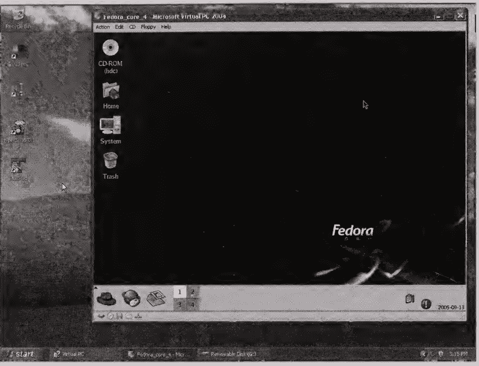

**图 1-1** Windows 桌面上的 Linux

微软的 `Virtual PC 2004` 产品允许你在运行当前 Windows XP 操作系统的同一台计算机上运行一个或多个操作系统。每个虚拟机都在一个自包含、隔离的软件环境中模拟一个完整的硬件系统。这意味着你可以在一个硬件环境中并发操作看似不兼容的操作系统，如图 1-2 所示。主机操作系统是 Windows XP，`Virtual PC 2004` 作为应用程序安装在 Windows XP 中。当 `Virtual PC 2004` 运行时，会为每个客操作系统（guest OS）提供一个硬件系统。在这种情况下，`Virtual PC 2004` 为 Fedora Core 4 提供硬件系统。你可以通过点击你想要使用的操作系统窗口在不同操作系统之间切换。

你可以在虚拟机中安装多个客操作系统，它们看起来就像你在物理计算机上使用的任何其他应用程序一样。`Virtual PC 2004` 模拟物理 PC 的程度非常高，以至于安装在其中的应用程序无法区分虚拟机和物理计算机。你不需要在多台昂贵的计算机上安装操作系统，也不需要创建混乱的多启动安装，而可以在多个廉价的虚拟机中安装操作系统。你在虚拟机中做的任何更改都不会影响你的物理计算机。

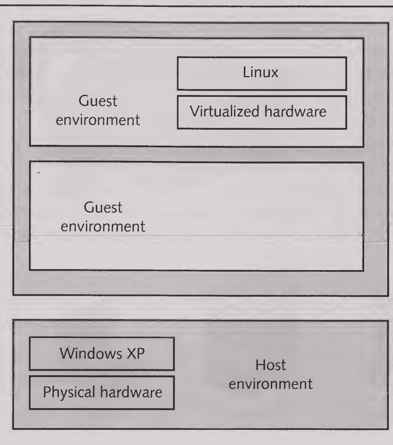

**图 1-2** 虚拟机技术

## PC 系统的硬件组件

台式电脑是一种设计为可以方便地放置在典型办公桌上方的或下方的 PC。台式电脑通常包含几个组装在机箱内的设备，后续章节将介绍这些组件的信息。

### 机箱

IBM XT PC 自早期以来就采用了一种事实上的标准机箱配置。台式电脑经过了 AT（先进技术）型号、mini AT 和小足迹 PC 的演变。后来的发展是垂直式或塔式机箱配置，设计用于放在桌下。最近的发展缩小了 PC 的尺寸，用于笔记本电脑或笔记型。图 1-3 提供了各种规格的插图。

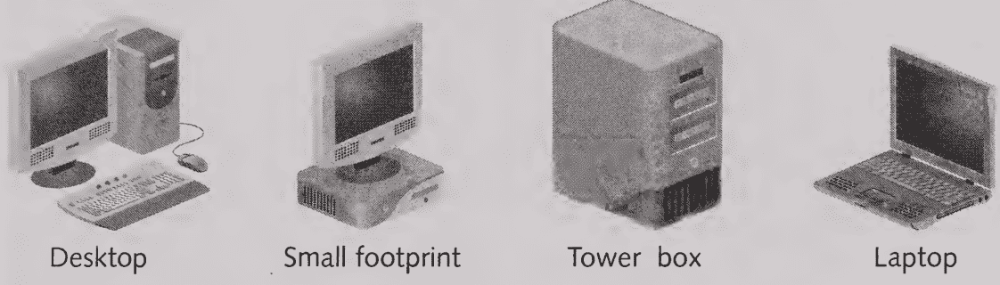

**图 1-3** 规格

### 电源

你计算机的电源（如图 1-4 所示）是一个密封的金属盒，内部包含电源转换硬件。电源将你办公室或家庭的 110 伏交流电（AC）转换为 PC 所需的各种直流（DC）电平。电源为你计算机中的组件提供清洁的电源输入：系统板、磁盘驱动器、冷却风扇等。电源具有标准的插头，可以适用于各种种类的计算机；如果你使用适配该设备的插头，就能确保获得正确的电压。但是，你必须注意插头的方向。

> **警告：** 不要打开电源！内部组件不是用户可以维护的。


**图 1-4** 电源

### 冷却系统

计算机会产生热量——大量的热量。PC 的微处理器产生 60 到 75 瓦的热量，相当于一个家用灯泡。其他内部计算机组件产生更多热量；总之，你的台式 PC 产生的热量可能超过 200 瓦。散热不良会导致各种问题，从莫名其妙的系统崩溃到严重的硬件损坏。过热会增加你的计算机组件过早失效的风险。

空气在机箱内循环，以散热计算机电子组件产生的热量。空气进入机箱，并通过机箱前部或后部的风扇抽出。尽管大多数 PC 都是如此。

### 主板

主板是集成在 PC 上的电路板，提供扩展槽、插槽、总线和接口，连接并允许计算机的各个组件进行通信。主板上通常有处理器、内存插槽、显示控制器、BIOS 芯片等。

## 存储器

### ROM（只读存储器）

ROM 是一种非易失性存储器，数据在制造时写入，无法修改。

### PROM（可编程只读存储器）

PROM 是一种可以通过编程器一次性写入数据的存储器。

### EPROM（可擦除可编程只读存储器）

EPROM 是一种可以通过紫外线照射擦除并重新编程的存储器。

### EEPROM（电可擦除可编程只读存储器）

EEPROM 是一种可以通过电信号擦除并重新编程的存储器。

## 固件

记录有程序的 ROM、PROM、EPROM 和 EEPROM 统称为固件。固件是软件和硬件的结合。

BIOS（基本输入输出系统）是支持 PC 启动的固件。此外，BIOS 包含了控制键盘、在屏幕上显示文本、读取磁盘驱动器以及执行多种杂功能的程序代码。

BIOS 通常位于计算机自带的固件芯片中（通常被称为 ROM BIOS）。这确保了 BIOS 可用，且不会因磁盘故障而损坏。它还让计算机能够自启动。PC 具有闪存 BIOS，这意味着 BIOS 已记录在闪存内存芯片（通常是 EEPROM）上，并在必要时可以进行更新。

你可以在 PC 启动时进入设置程序，查看 BIOS 是如何控制硬件的（见图 1-8）。查看屏幕以确认应该按哪个键进入设置程序。例如，按下 `Delete` 键可以启动许多设置程序。

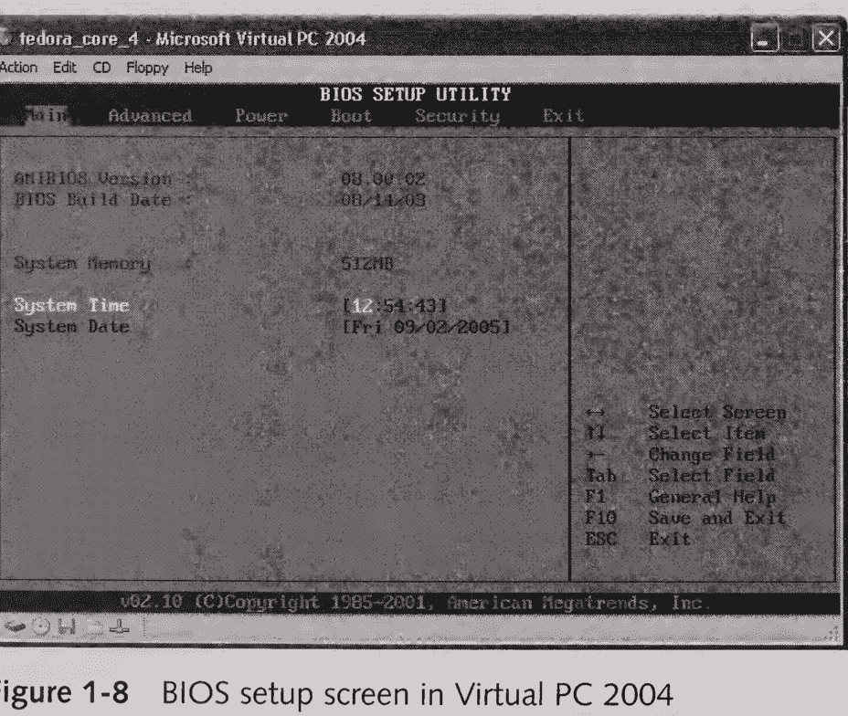

**图 1-8** BIOS 设置实用程序

如果你在使用虚拟化软件（如 `Virtual PC 2004`），该软件为每个安装的操作系统提供了一个带有 BIOS 的硬件环境。操作系统将在此虚拟环境中运行，并与模拟的硬件环境交互。`Virtual PC 2004` 支持多个操作系统并允许它们并行运行。

## 活动 1-1：查看 BIOS 设置屏幕

**所需时间：** 10 分钟

**目标：** 使用 BIOS 设置实用程序查看 BIOS 设置屏幕。

**描述：** 在此活动中，登录你的 PC，打开 `Virtual PC 2004` 程序，并查看 BIOS 设置屏幕上的设备。如果你想查看 PC 上的 BIOS 设置屏幕，这项活动非常有用。

1. 如必要，使用用户 `User01` 和密码 `Password1` 登录你的 PC。
2. 点击“开始”，打开“所有程序”，然后点击“Microsoft Virtual PC”。
3. 要启动 Linux 虚拟机，点击 `Fedora_core_4 Not running`，并点击“开始”按钮。
4. 要显示 `BIOS SETUP UTILITY` 屏幕，在显示“Press Del to run Setup”消息时立即按下 `Delete` 键。


**图 1-9** BIOS 设置实用程序屏幕

> 如果你没有看到与图 1-9 类似的屏幕，请告知你的导师。

5. 要显示高级（Advanced）菜单，按右箭头键。
6. 要显示启动（Boot）菜单，按两次右箭头键。
7. 要显示退出（Exit）菜单，按两次右箭头键。
8. 要退出 `BIOS SETUP UTILITY` 屏幕，按 `Esc` 键，然后按 `Enter` 键。
9. 关闭虚拟机，点击 `Fedora_core_4 – Microsoft Virtual PC 2004` 窗口右上角的 X，然后点击 OK。
10. 保持 PC 登录状态进行下一个活动。

## 输入/输出端口

PC 通常带有输入输出端口，如图 1-10 所示。这些端口通常被称为 I/O 端口（读音为“eye-oh”）。串口端口用于调制解调器、数字化板和其他设备，而并行端口用于打印机。串口和并行端口已处于传统状态，可能不会安装在每个 PC 上。几乎所有通过串口或并行端口连接的外围设备现在都有 USB 设备的形式可用。机箱前面通常有额外的 USB 端口，以及 FireWire 端口。

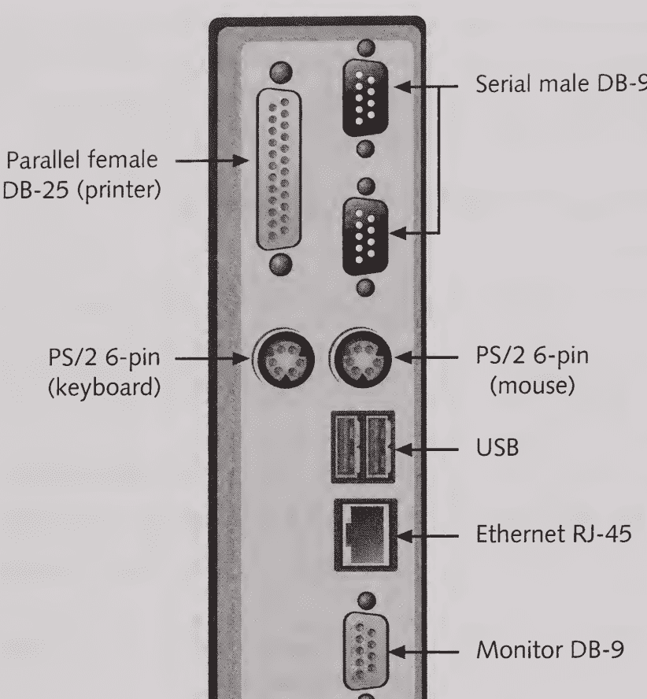

**图 1-10** 显示 I/O 端口的电脑背面

接口通过性别识别。当连接器中暴露出铜针时，其性别为公性。在图 1-10 中，串口连接器是公性连接器。并行连接器是母性的，因为有孔。

这些 I/O 端口将在后续章节中讨论。

### 串口端口

串口端口一次一个位地传输或输出数据。在 PC 的发展史上，这是通过 RS-232（“推荐标准-232”的缩写）实现的，这是一种由电子工业联盟（EIA）批准的标准接口，用于通过连接计算机和调制解调器等设备的简单电缆传输数据。你可以将鼠标、键盘和其他设备连接到串口端口。

虽然 RS-232 原本指定了 25 针 D 型连接器，但许多 PC 设计师选择仅实现完整成本和标准的子集。标准的兼容性被用来交换更廉价、更紧凑的连接器（特别是原始 IBM PC-AT 使用的 DB-9 版本）。你可以通过检查 PC 背面的公性连接器来识别串口端口。

如果你检查 BIOS 设置，可能会看到你的 PC 将前四个串口分配为 `COM1`、`COM2`、`COM3` 和 `COM4`。

### 并行端口

当串口端口一次一个位地传输或输出数据时，并行端口则并行传输多个位。并行端口经常用于连接打印机。虽然 Centronics 设计了原始标准，但 Epson 公司设计了现代计算机使用的接口。对于 PC，几乎所有并行端口都符合 Centronics 标准。连接到 PC 使用 DB-25 连接。通过检查母性连接器可以识别 PC 背面的并行端口。传统上，PC 可以支持三个并行端口——`LPT1`、`LPT2` 和 `LPT3`。

两种兼容 Centronics 标准但提供更快传输速度（约10 倍）的新并行端口标准是 ECP（扩展功能端口）和 EPP（增强并行端口）。ECP 是一种支持 PC 与连接设备双向通信的并行标准。EPP 与 ECP 类似但支持非打印机设备。

### 通用串行总线 (USB)

通用串行总线 (USB) 的开发是为了简化外围设备连接 PC。你会发现几乎每个连接到串口或并行端口的外围设备现在都有 USB 接口。USB 的主要目标是让添加外围设备变得廉价且像插电话一样简单。USB 为鼠标和键盘等低速设备提供了 1.5 Mbps 的最大带宽，为摄像头、打印机、扫描仪和外部 CD-RW 驱动器等高速设备提供了 12 Mbps 的最大带宽。你可以通过五级集线器向单个 USB 主控制器连接 127 个设备。


为了追求速度，引入了 USB 2.0。连接速度从 1.1 的 12 Mbps 跃升到 480 Mbps (60 MB/sec)。USB 2.0 与 USB 1.1 同时向前向后兼容。USB 连接器和电缆甚至是相同的。这意味着你可以通过将旧 USB 1.1 设备插入新的 USB 2.0 端口来使用它们。你甚至可以将高速 USB 2.0 设备插入传统的 USB 1.1 端口，只需以较低的吞吐量运行。高速 USB 2.0 和原始 USB 1.1 同时在 PC 上运行。新的 USB 2.0 扩展集线器设计在高速和低速 USB 外围设备之间管理数据速率的转换，同时保持全带宽利用。如果你有数字相机，可以利用这种增加的速度来传输更高密度的图片。

## FireWire

有时称为 IEEE 1394，FireWire 是一种非常快的数字输入/输出系统，传输速率高达 400 Mbps。当你使用摄像机拍摄视频时，IEEE 1394 FireWire 负责处理数字化、压缩和音频同步过程。

（数字视频）编辑系统。通过 IEEE 1394，你甚至可以连接外部硬盘和光驱。

## 扩展卡

扩展卡是一种你可以插入主板中用以为 PC 增加功能的打印电路板。扩展卡的一端带有触点，这些触点可以插入主板上的扩展槽，从而在卡上的电子元器件（大部分是集成电路）与主板之间建立接触。

你可能会将扩展卡称为适配器卡，它允许一个系统组件与另一个组件连接并工作。适配器通常是一个将一组信号转换为另一组信号的简单电路；然而，该术语通常指代更准确地被称为“控制器”的设备。例如，显示适配器（显卡）和 SCSI（小型计算机系统接口）适配器执行着大量的处理，但它们仍被称为适配器。

## 视频适配器

你会将如图 1-10 所示的视频适配器板插入 PC 中，以赋予其显示能力。然而，这些能力取决于逻辑电路（由视频适配器提供）和显示器器。每个适配器都提供几种不同的视频模式。视频模式的两个基本类别是文本模式和图形模式。在文本模式下，显示器只能显示 ASCII 字符。在图形模式下，显示器可以显示任何位图图像。在文本和图形模式中，大多数显示器还提供多种分辨率选择。

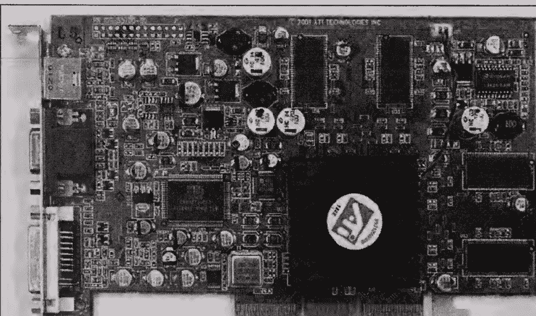

图 1-10 视频适配器

## PC 系统的硬件组件

现代视频适配器包含内存，这样计算机的 RAM 就不用于存储显示内容。有了更大的内存，你可以用更高的分辨率和更多的颜色显示显示。为了节省内存，你的 PC 制造商可能会将系统内存用于文本和图形。虽然使用部分主系统内存可以节省成本，但也可能导致性能下降。

此外，大多数适配器都有自己的图形协处理器用于执行图形计算。这些适配器通常被称为图形加速器。使用图形加速器时，你的计算机渲染图形的速度会更快。

## 声适配器

声适配器（也称为声卡或音频适配器）是一种用于记录和播放声音的适配器卡，如图 1–11 所示。声适配器支持数字音频和乐器数字接口（MIDI）格式。声卡为麦克风或其他声源提供输入端口，为声器和放大器提供输出端口。

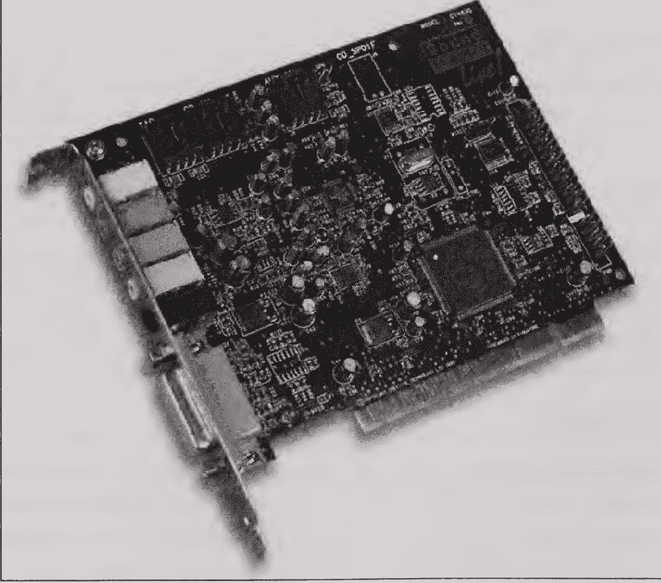

图 1-11 声适配器

## 第 1 章硬件组件

作为声适配器的替代方案，你的 PC 可能带有主板芯片组提供的集成声路。如果你需要安装独立的声卡，可以禁用集成声路。你的 PC 可能具有这种集成音频功能。Intel 于 1996 年引入的 AC'97 提供六通道音频，其效果类似于家庭影院系统的声音。

## 磁盘驱动器控制器

磁盘驱动器控制器控制数据从主板到磁盘驱动器以及反向传输。在 PC 中，控制器通常是单芯片。当你购买计算机时，它带有标准组件（如磁盘驱动器）所需的所有控制器。然而，如果你增加了磁盘驱动器，你可能需要在扩展板上插入新的控制器。

控制器必须设计为与计算机的扩展总线通信。PC 有三种标准的控制器架构——ATA、SATA 和 SCSI。因此，当你购买磁盘驱动器时，必须确保它符合你计算机使用的架构。

## ATA 控制器（并行）

ATA（或称高级技术附加设备）是一种磁盘驱动器实现方式，它将控制器集成在磁盘驱动器本身。ATA 接口的增强版本数据传输速率高达 100 MB/sec；这些增强被称为 ATA/100。

## SATA 控制器（串行）

SATA（或串行技术附加设备）是一种串行链路，ATA 是磁盘驱动器的演进。SATA 提供了比并行 ATA 更快的传输。SATA 接口是并行 ATA 的物理存储。SATA 传输速率达到 150 Mbps，比并行 ATA 快。除了传输速率外，SATA 接口具有许多优势。SATA 驱动器比 PATA 更灵活，且不会产生带宽竞争。SATA 缆线比 PATA 更纤细、更细。

## PC 系统的硬件组件

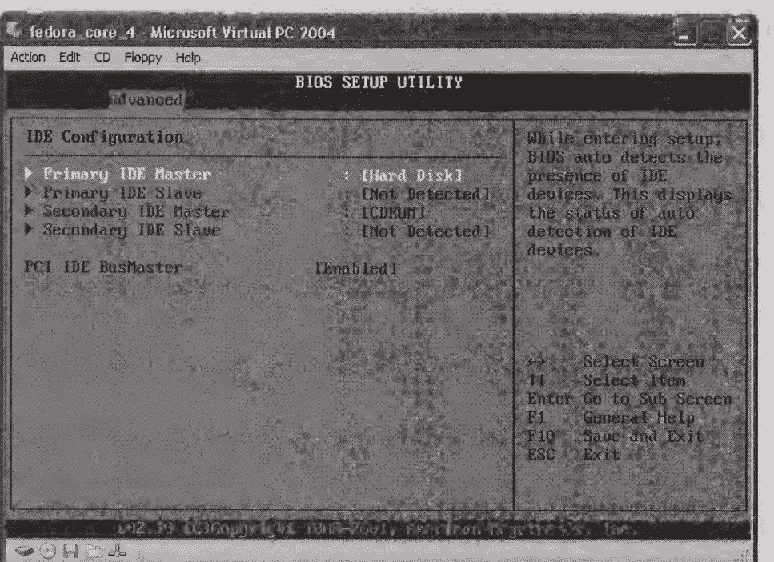

图 1-12 SATA 适配器

> SATA 是比并行 ATA 更好的接口。在购买磁盘驱动器时，请确保它支持你计算机的架构。

## SCSI 控制器

## 存储设备

存储设备指的是用于存储大量数据的各种设备。现代存储设备包括各种类型的磁盘驱动器和磁带驱动器。存储设备与内存不同，质存储设备在计算机关闭时仍能保留数据。

## 第 1 章硬件组件

存储设备的主要类型有：

- 软盘：这些磁盘较慢且容量较小，但很便携。
- 硬盘：这些磁盘非常快且容量比软盘大，但也更贵。某些硬盘系统是便携的（拆式的），但大多数不是。
- 光驱：与使用电磁编码数据的软盘和硬盘不同，光驱使用激光读写数据。光驱具有大容量，但速度不如硬盘。
- 磁带驱动器：这些磁盘相对便宜且通常具有大容量，但不支持随机访问数据。
- USB 驱动器：这些小型便携驱动器使用闪存或外部硬盘在 PC 之间备份或传输数据。

## 软盘

软盘接受一种软性磁盘，因为当你使用时，介质会流动，所以被称为软的。与大多数硬盘不同，软盘（通常称为 floppy）是便携的，这意味着你可以将其从磁盘驱动器中取出。软盘驱动器的访问速度比硬盘慢，容量小，但便宜得多。

软盘驱动器从磁盘磁表面存储和检索数字数据。通过非常靠近磁材料的写头传输电磁通量向磁盘写入信息，改变其极化状态。存在两种极化变化：在计算机的二进制逻辑系统中，一种代表“1”，另一种代表“0”。可以通过反向方式读回信息，因为磁场在读头经过它时会产生电变化。

如果你检查 BIOS 设置，可能会发现你的 PC 有两个软驱动器：软驱 A 和软驱 B，如图 1-13 所示。

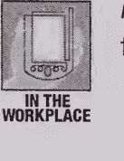

许多计算机不再配备软驱驱动器。它们正在被容量更大的移除式设备所取代。

## 硬盘

硬盘使用旋转盘。和软盘一样，硬盘在磁性介质上读写。典型的硬盘设计包含一个主轴，盘片在轴上以恒定速度旋转。在执行臂上，并沿着盘片移动的是读写/写头，每个盘片面有一个头。执行臂在盘片旋转时沿径向移动，使每个头都能访问整个盘片。

## PC 系统的硬件组件

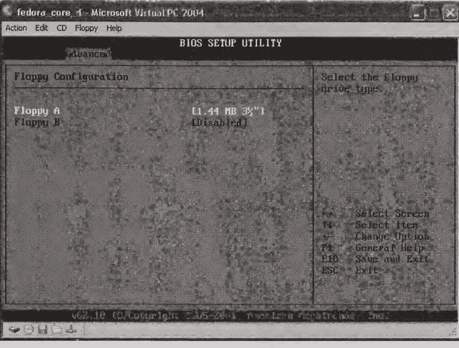

**图 1-13** BIOS 中的软驱驱动器

硬盘连接到磁盘驱动器控制器。根据你所购买的 PC 配置，这些硬盘可能连接到 PATA、SATA 或 SCSI 硬盘驱动器。你也可以将硬盘连接到 USB 端口。


**图 1-14** 硬盘

## 光驱

图 1-15 显示了一种光驱存储设备，它使用激光产生的光而不是磁性来在光盘上存储数据。这些光光盘包括 CD 和 DVD，它们由数以百万计的微凸起和凹槽组成。激光将这些凸起和凹槽读取为零 和 1，计算机可以理解这些信息。

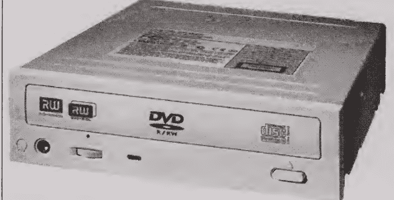

**图 1-15** 光驱

某些类型的光驱包括 CD-ROM、CD-RW、DVD-ROM 和 DVD-RW 驱动器。CD 和 DVD 刻录机（如 CD-R 和 DVD-R 驱动器）使用激光在光盘上同时读写数据。用于写入数据的激光比读取数据的激光要强大得多，因为它“烧录”了光盘上的凸起和凹槽。虽然光驱可以极快的速度旋转光盘，但它们仍然显著远慢于磁性存储数据的硬盘。然而，由于光光介质廉廉且可拆卸，它们是分发计算机软件最常见的格式。

## 磁带机

磁带机是一种在磁带上存储数据的设备，特别是用于备份（见图 1-16）。像普通录音机一样，磁带机在环状的柔性类纤维素玻璃材料上记录数据，这种材料可以被读取和擦除。磁带备份的优点是磁带具有大数据存储容量，与硬盘存储的成本相比非常经济。缺点是磁带机按顺序存储数据，而不是随机存储（如硬盘那样），用户只能从磁带开始并卷动磁带直到找到所需数据，才能访问特定数据。

## USB 驱动器

USB 驱动器是一种小型、便携的闪存设备（如图 1-17 所示），它可以插入任何带有 USB 端口的计算机中，并作为便携式驱动器使用，存储容量高达 2 GB。这些 USB 闪存易于使用，且小到可以装进口袋。

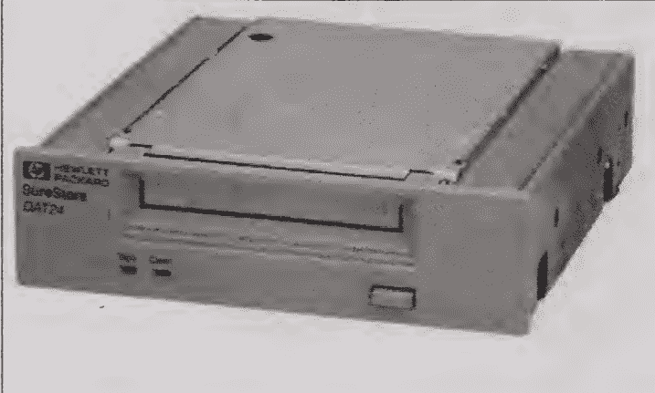

**图 1-16** 磁带机

USB 闪存也被称为跳跃盘、U 盘、钥匙盘或简单的 USB 驱动器。USB 闪存的存储容量小于外接硬盘，但它们更小、更耐用，因为它们不包含任何内部移动部件。


**图 1-17** USB 驱动器

除了闪存卡，USB 驱动器还可能指插入计算机 USB 端口的便携硬盘、CD 驱动器或 DVD 驱动器。便携硬盘是插入计算机外部端口（如 USB 或 FireWire 端口）的磁盘驱动器。此类单元通常用于备份，但也作为辅助存储，在容量上可以与内部驱动器相当。

## 活动 1-2：查看磁盘分区

**所需时间：** 10 分钟

**目标：** 使用“磁盘管理”程序查看磁盘驱动器分配。

**描述：** 在此活动中，你打开控制面板，选择管理工具，然后选择“磁盘管理”。如果你想查看 PC 上的磁盘驱动器分配，此活动非常有用。

1. 如必要，使用 `User01` 和密码 `Password1` 登录你的 PC。
2. 要打开控制面板，点击**开始**然后点击**控制面板**。
3. 如果显示类别视图，点击**切换到经典视图**链接。
4. 要打开“计算机管理”窗口，双击**管理工具**，然后双击**计算机管理**。
5. 要查看分区分配，点击**磁盘管理**。
6. 验证是否存在两个分区分配：一个用于 Windows XP 操作系统，另一个供学生稍后的活动中放置工作。
7. 关闭“计算机管理”和“管理工具”窗口。
8. 保持电脑注销状态进入下一个活动。

## 通信设备

通信设备支持数据从一台 PC 到另一台 PC，或从一个设备到另一个设备的传输。例如，调制解调器、网络接口卡和无线适配器都是通信设备。

## 调制解调器

**Modem** 是调制解调器（modulator-demodulator）的缩写。调制解调器（如图 1-18 左侧所示）允许数字存储的信息以声波的形式传输。调制解调器在这两种形式之间转换。随着有线电视的普及，宽带通信变得触手可及。电缆调制调器（如图 1-18 右侧所示）专为同轴电缆设计的。由于有线电视比电话线路提供更大的带宽，你的电缆调制调器可以实现对万维网的极速访问。

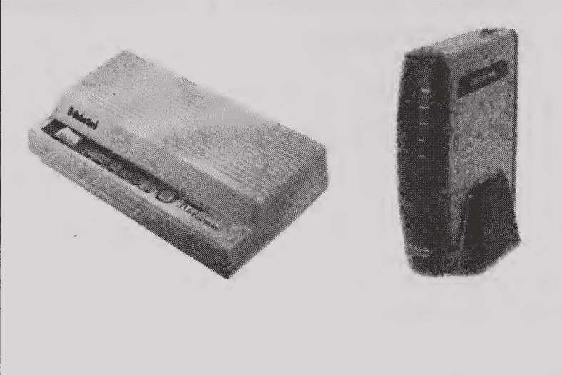

**图 1-18** 电话和电缆调调器

## 网络接口卡

**网络接口卡 (NIC)**（如图 1-19 所示）是插入计算机的扩展板，以便计算机能够连接到局域网（LAN）。网络卡可以是插入计算机总线的扩展卡，也可以是主板上的接口。

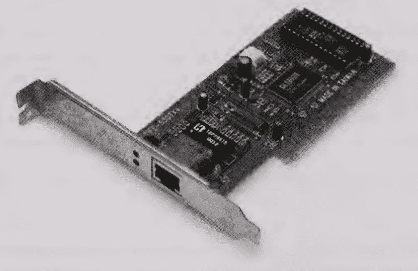

**图 1-19** 网络接口卡

## 无线适配器

**无线适配器**（如图 1-20 所示）允许移动用户通过无线（无线电）连接到局域网。对局域网的访问与通过网络接口卡提供的类似，但会有更大的移动自由。许多新的笔记本电脑主板上内置了无线适配器。如果你的笔记本电脑没有无线适配器，你可以购买无线 PC 卡插入你的笔记本电脑，或者购买 USB 无线适配器。

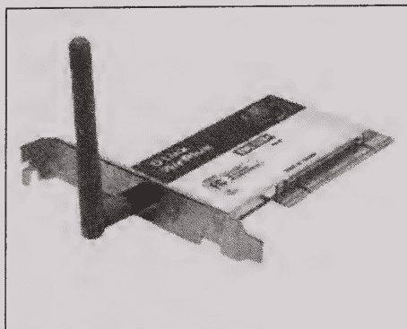

## 便携式计算机

便携式计算机是设计为易于携带和移动的 PC。早期的便携机简单称为便携机。随着便携机尺寸和重量的减轻，它们被称为笔记本电脑，后来被称为笔记本本。

笔记本是用电池或交流电电源的 PC，通常比公文包小，可以轻松携带并在飞机上、图书馆、临时办公室等地方便使用。笔记本通常小于 5 磅。

笔记本通常配备 LCD 屏幕技术的显示器。笔记本使用多种方法将鼠标集成到键盘中，包括触摸板和轨迹球。你的笔记本电脑可能没有与台式计算机相同的端口；例如，笔记本可能仅限于并行端口和 USB 端口。然而，笔记本内置了网络适配器和无线访问。CD-ROM 和 DVD 驱动器可能是内置或外接。

## 键盘

计算机键盘类似于打字机键盘，但包含了额外的按键。键盘的设计用于输入文本以及控制计算机的操作。标准美国键盘有 105 个按键。除了 26 个字母和 10 个数字外，特殊字符键还扩展了字符集。额外的按键用于控制计算机。

## 指针设备

你使用指针设备来移动屏幕上的指针、选择命令、点击按钮、选择文本、创建绘图等。指针设备的示例包括鼠标、轨迹球和触控板。

鼠标由一个金属或塑料制的外壳、一个从外壳底部伸出并在平坦表面滚动的球体，以及外壳顶部的一个或多个按钮组成。当球体在表面上向任何方向移动时，传感器会向计算机发送脉冲，导致响应鼠标的程序定位可见指示器（称为光标）。通过查看光标当前的位置，用户可以通过移动鼠标来调整指针。鼠标按钮用于选择屏幕上的文本或选项。

本质上，轨迹球就是一个倒过来放的鼠标。要移动指针，你用大拇指、手指或手掌旋转球体。球旁边通常有一到三个按钮，你就像使用鼠标一样使用它们。你可能更喜欢轨迹球而不是鼠标，因为轨迹球是固定的，使用不需要很大的空间。

触控板是一种小型触摸敏感垫，在某些笔记本电脑上用作指针设备。通过沿触控板移动手指，你可以移动显示屏上的指针。通过点击触控板或按下触控板下方的按钮来实现。

## 生物识别设备

生物识别是测量和统计分析生物数据的科学与技术。在信息技术中，生物识别通常指用于身份验证测量和分析人体特征（如指纹）的技术。

指纹扫描仪（见图 1-21）有两个基本工作：获取你手指的图像，并确定图像中脊纹和沟谷的模式是否与之前扫描的图像中的模式匹配。当图像匹配时，你被允许访问 PC。许多高端笔记本电脑配备了指纹扫描仪。

## 数字/摄像机

数码相机以数字方式存储图像，而不是记录在胶片上。通常，图像存储在闪存卡上。拍照后，可以将其下载到 PC，然后用图形程序进行处理并打印。

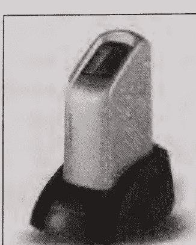

图 1-21 指纹扫描仪

与具有极高分辨率的胶片照片不同，数字照片限于相机内存的大小。

视频摄像机将帧存储在数字磁带上。拍摄完视频电影后，可以将其下载到 PC，然后用视频编辑程序进行处理。

## 输出设备

输出设备提供 PC 的输出。示例包括 CRT 显示器、LCD 面板和打印机。虽然存储设备也可以提供输出，本节仅你用于查看信息的设备。

## CRT 显示器

CRT 是阴极射线管的缩写，是大多数电视和计算机显示屏使用的技术。CRT 显示器一术语通常指外壳，其中显示屏可能仅指屏幕。此外，显示器一词通常意味着图形能力。

显示器最重要的方面是它的屏幕尺寸。像电视一样，屏幕尺寸以对角英寸测量——从一个角到对面角的对角线距离。小型 VGA 显示器的典型尺寸为 15 英寸。17 英寸或更大的显示器通常被称为全屏显示器。

显示器的分辨率表示像素的密集程度。通常，像素越多，产生的图像越清晰。大多数显示器可以显示 1024 比 768 像素，即 SVGA 标准。某些高端型号可以显示 1280 比 1024 像素，甚至 1600 比 1200。

## LCD 面板

LCD 是液晶显示器的缩写，是笔记本电脑使用的一种显示器。LCD 显示器使用两片偏振材料，中间夹有液晶溶液。

通过液体的电流会导致晶体对齐，使光线无法通过它们。因此，每个晶体都像一个快门，要么允许光通过要么阻光。

尽管笔记本电脑几乎专门使用 LCD 作为其平板技术，但 LCD 面板也是平板桌面显示器最流行的选择。

- 在 2003 年底，LCD 显示器的销量首次超过了 CRT 的销量。为你的桌面考虑一台 LCD 面板吧；它在方便的包装内提供了极佳的视野。


## 打印机

打印机是在纸张上打印文本或插图的设备。有不同类型的打印机。就使用的技术而言，你可能选择的打印机属于以下类别：

- 针打印式——通过针撞击墨带来创建字符。每个针产生一个点，点的组合形成字符和插图。
- 喷墨式——在纸上喷射墨水。喷墨打印机产生高质量的文本和图形。
- 激光式——使用与拷贝机相同的技术。激光打印机产生极高质量的文本和图形。

当需要彩色打印时，喷墨打印机可能是你的选择。当需要大量的黑色输出时，你可能想要考虑激光打印机。


## 活动 1-3 查看系统信息

**所需时间**：10 分钟

**目标**：使用系统信息程序查看组件。

**描述**：在此活动中，你打开系统信息窗口并查看 PC 组件。

- 如果需要，用 `User01` 和密码登录 PC。
- 打开“运行”对话框，点击**开始**并点击**运行**。
- 打开系统信息窗口，在文本框中输入 `msinfo32` 然后按回车。
- 查看组件，展开**组件** 文件夹。
- 查看输入组件，展开**输入** 文件夹。


# 硬件组件

6. 查看指针设备的信息，点击指针设备。
7. 对其余组件重复第 5 和 6 步。
8. 关闭系统信息窗口。


9. 保持计算机登录状态进行下一个活动。


## 活动 1-4 查看 PC 上的设备

**所需时间**：10 分钟

1. 如果需要，用 `User01` 和密码登录 PC。

2. 打开控制面板，点击**开始**并点击**控制面板**。

3. 如果显示的是类别视图，点击“切换到经典视图”链接。

4. 打开计算机管理窗口，双击“管理工具”并双击“计算机管理”。

5. 打开设备管理器，点击“设备管理器”。

6. 查看磁盘驱动器的信息，展开“磁盘驱动器”文件夹。

7. 对其余文件夹重复第 6 步。

8. 关闭计算机管理和管理工具窗口。

9. 注销 PC。

# 预防性维护

当你拥有或使用 PC 时，你可能需要对其进行维护。例如，你可能需要定期清洁设备，这可以延长其寿命。你还需要意识到许多潜在危险（包括静电）可能会损坏 PC。当你不再需要 PC 时，该如何处理？本节将讨论所有这些话题。

# 清洁

PC 的死敌是热量，因为过热会加速其脆弱电路的损坏。过热最常见的原因是尘埃和污垢：阻塞的通风口和 CPU 散热扇会导致散热空气无法通过机箱，即使是薄薄的一层灰或污垢也会升高 PC 组件的温度。

## 预防性维护 27

大多数地方，例如灰尘较多的办公室，您的系统可能每隔几个月就需要清洁一次。对于大多数清洁工作，您只需要一罐压缩空气、不掉毛的擦布、棉签以及在碗水中滴几滴温和清洁剂即可。

> **在清洁任何任何组件之前，请务必关闭系统并拔掉电源。切勿将液体直接涂在组件上。将液体喷洒在不掉毛的布上，然后用布擦拭 PC。**

## 清洁外部

从机箱及连接的外围设备外部开始清洁。用温和清洁剂擦拭机箱。清除通风口的任何堵物。使用压缩空气，但不要将灰尘吹入 PC 或其光驱器和软驱驱动器中。

当屏幕上的光标移动异常时，是时候清洁您的鼠标了。如果您的鼠标内有一个球，请打开设备底部的卡扣并取出滚球。找到球外壳内部两个相隔 90 度的滚子。用湿润的棉签清除滚子上的残留物。

将键盘倒过来并摇动，以清除按键上的碎屑。如果这样不够，请用压缩空气（短时间）吹扫它。

擦拭显示器外壳并清除通风口的堵物，注意不要将灰尘推入设备内部。使用标准玻璃清洁剂和不掉毛的擦布清洁屏幕。如果您的显示器有去磁按钮（寻找一个小磁铁图标），请按下它以消除磁干扰。

> **使用非磨损性、不掉毛的布和水时要小心。避免使用玻璃清洁剂或任何含有氨的溶液，因为它会损坏屏幕的塑料表面。**

脏的光学元件应使用柔软、干燥且不掉毛的布进行清洁。手持盘片的外边缘或中心孔，从中心轴向向盘片外边缘轻轻擦拭。更顽固的指纹或污渍可以用浸过水的柔软、干燥且不掉毛的布去除。切勿以圆周运动擦拭盘片。

## 清洁内部

继续清洁机箱内部。在清洁机箱之前，在触摸任何内部组件之前，请采取措施释放静电。您应该在电脑插在电源插座时，触摸电脑机箱的金属框架来释放静电。由于电路通过交流插座接地，静电将得到释放并接地。在清洁机箱内部之前，请确保拔掉电源线。

## 第 1 章硬件组件

使用杀菌擦布去除机箱内部的灰尘。避免触摸任何电路板表面。密切关注各种风扇。用压缩空气喷射这些组件以松动灰尘。为了移除灰尘而非重新分布，您应该使用小型吸尘器。

如果您的 PC 超过四年历史，或者插入主板的扩展卡非常脏，请取下每块卡，用异丙醇清洁其触点并重新插好。然而，如果您的系统不满两年，请确保通过向下按其顶部边缘而不接触其正面，确保每块卡都固固到位。同样，检查电源连接器和内部电缆是否连接良好。

## 静电释放 (ESD)

静电释放是静电从一个导体到另一个不同电位的导体的快速放电过程。静电释放可能会损坏 PC 中的集成电路。每当打开 PC 机箱并暴露其内部结构时（例如添加适配器卡），您可能会因身体积聚的静电而损坏电脑。

电脑的内部结构，尤其是硬盘，对静电极其敏感。如果硬盘受到微小电压击穿，会对硬盘造成相当损害，而在暴露于仅 10 伏电压时就可能损坏主板组件。人类在静电达到 1,500 伏之前无法感知它（在地毯上行走可以产生高达 12,000 伏的静电）。虽然这对人类没有生命威胁，但即使是极低 [此处原文未完]...


## 预防性维护

在大多数地方，例如灰尘较多的办公室，您的系统可能每隔几个月就需要清洁一次。对于大多数清洁工作，您只需要一罐压缩空气、不掉毛的擦布、棉签以及在碗水中滴几滴温和清洁剂即可。

> **在清洁任何组件之前，请务必关闭系统并拔掉电源。切勿将液体直接涂在组件上。将液体喷洒在不掉毛的布上，然后用布擦拭 PC。**

## 清洁外部

从机箱及连接的外围设备外部开始清洁。用温和清洁剂擦拭机箱。清除通风口的任何堵物。使用压缩空气，但不要将灰尘吹入 PC 或其光驱器和软驱驱动器中。

当屏幕上的光标移动异常时，是时候清洁您的鼠标了。如果您的鼠标内有一个球，请打开设备底部的卡扣并取出滚球。找到球外壳内部两个相隔 90 度的滚子。用湿润的棉签清除滚子上的残留物。

将键盘倒过来并摇动，以清除按键上的碎屑。如果这样不够，请用压缩空气（短时间）吹扫它。

擦拭显示器外壳并清除通风口的堵物，注意不要将灰尘推入设备内部。使用标准玻璃清洁剂和不掉毛的擦布清洁屏幕。如果您的显示器有去磁按钮（寻找一个小磁铁图标），请按下它以消除磁干扰。

> **使用非磨损性、不掉毛的布和水时要小心。避免使用玻璃清洁剂或任何含有氨的溶液，因为它会损坏屏幕的塑料表面。**

脏的光学元件应使用柔软、干燥且不掉毛的布进行清洁。手持盘片的外边缘或中心孔，从中心轴向向盘片外边缘轻轻擦拭。更顽固的指纹或污渍可以用浸过水的柔软、干燥且不掉毛的布去除。切勿以圆周运动擦拭盘片。

## 清洁内部

继续清洁机箱内部。在清洁机箱之前，在触摸任何内部组件之前，请采取措施释放静电。您应该在电脑插在电源插座时，触摸电脑机箱的金属框架来释放静电。静电将得到释放并接地。在清洁机箱内部之前，请确保拔掉电源线。

## 第 1 章 硬件组件

使用杀菌擦布去除机箱内部的灰尘。避免触摸任何电路板表面。密切关注各种风扇。用压缩空气喷射这些组件以松动灰尘。为了移除灰尘而非重新分布，您应该使用小型吸尘器。

如果您的 PC 超过四年历史，或者插入主板的扩展卡非常脏，请取下每块卡，用异丙醇清洁其触点并重新插好。然而，如果您的系统不满两年，请通过向下按其顶部边缘而不接触其正面，确保每块卡都固固到位。同样，检查电源连接器和内部电缆是否连接良好。

## 静电释放 (ESD)

静电释放是静电从一个导体到另一个不同电位的导体的快速放电过程。静电释放可能会损坏 PC 中的集成电路。每当打开 PC 机箱并暴露其内部结构时（例如，添加适配器卡），您可能会因身体积聚的静电而损坏电脑。

电脑的内部结构，尤其是硬盘，对静电极其敏感。如果硬盘受到微小电压击穿，会对硬盘造成相当损害，而在暴露于仅 10 伏电压时就可能损坏主板组件。人类在静电达到 1,500 伏之前无法感知它（在地毯上行走可以产生高达 12,000 伏的静电）。虽然这对人类没有生命威胁，但即使是极低


## 预防性维护

在大多数地方（例如灰尘较多的办公室），您的系统可能每隔几个月就需要清洁一次。对于大多数清洁工作，您只需要一罐压缩空气、不掉毛的擦布、棉签以及在碗水中滴几滴温和清洁剂即可。

> **在清洁任何组件之前，请务必关闭系统并拔掉电源。切勿将液体直接涂在组件上。将液体喷洒在不掉毛的布上，然后用布擦拭 PC。**

### 清洁外部

从机箱及连接的外围设备外部开始清洁。用温和清洁剂擦拭机箱。清除通风口的任何堵塞物。使用压缩空气，但不要将灰尘吹入 PC 或其光驱和软驱中。

当屏幕上的光标移动异常时，是时候清洁您的鼠标了。如果您的鼠标内有一个球，请打开设备底部的卡扣并取出滚球。找到球外壳内部两个相隔 90 度的滚子。用湿润的棉签清除滚子上的残留物。

将键盘倒过来并摇动，以清除按键上的碎屑。如果这样不够，请用压缩空气（短时间）吹扫它。

擦拭显示器外壳并清除通风口的堵塞物，注意不要将灰尘推入设备内部。使用标准玻璃清洁剂和不掉毛的擦布清洁屏幕。如果您的显示器有去磁按钮（寻找一个小磁铁图标），请按下它以消除磁干扰。

> **使用非磨损性、不掉毛的布和水时要小心。避免使用玻璃清洁剂或任何含有氨的溶液，因为它会损坏屏幕的塑料表面。**

脏的光学元件应使用柔软、干燥且不掉毛的布进行清洁。手持盘片的外边缘或中心孔，从中心轴向外边缘轻轻擦拭。更顽固的指纹或污渍可以用浸过水的柔软、干燥且不掉毛的布去除。切勿以圆周运动擦拭盘片。

### 清洁内部

继续清洁机箱内部。在清洁机箱之前，在触摸任何内部组件之前，请采取措施释放静电。您应该在电脑插在电源插座时，触摸电脑机箱的金属框架来释放静电。静电将得到释放并接地。在清洁机箱内部之前，请确保拔掉电源线。

使用防静电擦布去除机箱内部的灰尘。避免触摸任何电路板表面。密切关注各种风扇。用压缩空气喷射这些组件以松动灰尘。为了移除灰尘而非重新分布，您应该使用小型吸尘器。

如果您的 PC 超过四年历史，或者插入主板的扩展卡非常脏，请取下每块卡，用异丙醇清洁其触点并重新插好。然而，如果您的系统不满两年，请通过向下按其顶部边缘而不接触其正面，确保每块卡都牢固到位。同样，检查电源连接器和内部电缆是否连接良好。

## 静电释放 (ESD)

静电释放是静电从一个导体到另一个不同电位的导体的快速放电过程。静电释放可能会损坏 PC 中的集成电路。每当打开 PC 机箱并暴露其内部结构时（例如，添加适配器卡），您可能会因身体积聚的静电而损坏电脑。

电脑的内部结构，尤其是硬盘，对静电极其敏感。如果硬盘受到微小电压击穿，会对硬盘造成相当损害，而在暴露于仅 10 伏电压时就可能损坏主板组件。人类在静电达到 1,500 伏之前无法感知它（在地毯上行走可以产生高达 12,000 伏的静电）。虽然这对人类没有生命威胁，但即使是极低电压也可能损坏敏感电子元件。

## 电脑接线与测试

首先，将您的电脑组件放置在将要使用的通用区域：将键盘放在显示器前面，将鼠标放在键盘的右侧或左侧，依此类推。缓慢移动 PC 机箱，直到您可以看到连接器。

在连接任何组件之前，不要开启它们的电源。


您应该按照顺序连接各种线缆。例如，如果您使用的是塔式机箱，从底部连接开始，一直到顶部接口。对于塔式机箱，您可能会按照此顺序完成连接：

1. 找到显示器线并将其连接到蓝色 `DB-15` 母头接口上（该接口有三行每行五个孔）。
2. 如果您有网线，将其插入黑色 `RJ-45` 接口中（它看起来像电话接口，但预留了八根线的空间）。
3. 找到连接到扬声器的音频线（带有亮绿色迷你电话插头的那根），将其插入亮绿色迷你电话接口中。
4. 找到键盘线（带有紫色 6 针插头），将其插入紫色 6 针接口中。
5. 找到鼠标线（带有绿色 6 针插头），将其插入绿色 6 针接口中。
6. 如果您的打印机有 25 针线缆，将其连接到并行口（酒红色 `DB-25` 母头）。
7. 将电源线连接到电源接口。
8. 检查您的连接。如果看起来是正确的，请打开显示器和电脑。

您应该推迟连接 `USB` 设备（键盘或鼠标除外），直到电脑完成启动且您已登录操作系统。`USB` 设备由操作系统初始化，并可以在插入 `USB` 端口时进行配置。

您应该测试每个组件以确定其是否工作正常。例如，`CRT` 显示器或 `LCD` 面板应该显示图像，鼠标应该能移动光标，以此类推。如果您遇到问题，请检查设备到电脑的连接情况。验证每个外部设备是否已通电，并且设备是否已开启。

如有必要，关闭所有组件并纠正问题。例如，如果键盘和鼠标的 6 针插头没有颜色标记，可能会导致两根线接反。

## 章节总结

- 虚拟机技术允许多个操作系统在单台电脑上并发运行。通过虚拟机技术，您可以在 `Windows XP` 内部运行各种操作系统以及 `Linux`。
- 许多硬件组件构成了一台电脑。机箱容纳并保护主要的电子组件。电源是一个密封的金属盒，包含电源转换硬件。主板（或主电路板）包含微处理器、总线、内存和扩展槽。`BIOS` 是在电脑启动期间支持电脑的固件。输入/输出端口（串口、并行口、`USB`）允许连接设备。显卡和声卡允许与用户进行图形和音频通信。磁盘驱动器控制器（如 `ATA`、`SATA` 和 `SCSI`）允许连接硬盘和光驱设备。通过介质、网络适配卡和无线适配器允许与其他设备进行通信。
- 外围设备包括键盘、鼠标、轨迹球、触摸板、指纹扫描仪和数字相机等设备，允许用户进行输入和通信。输出设备包括 `CRT` 显示器、`LCD` 面板和打印机。
- 预防性维护是电脑所有者的责任。为了避免热损坏，请保持电脑清洁。清洁电脑内部外部以及连接的外围设备。
- 许多危险可能会伤害电脑用户或损坏电脑。例如，静电释放会损坏电脑的内部组件。电源和 `CRT` 显示器中的电容器会留存高电压。电气火灾请使用 `ABC` 型或 `C` 型灭火器。
- 某些电脑组件不是内部的，而是连接到电脑上的。颜色标记的接口简化了这些组件的连接。从距离电源接口远的接口开始连接组件。

## 关键术语

**ATA** — 高级技术附件（`Advanced Technology Attachment`）的缩写；通常被称为集成驱动器电子（`IDE`）的磁盘驱动器标准。

**生物识别 (biometrics)** —— 通过测量生理特征验证个人身份的科学与技术。

**BIOS** — 基本输入输出系统（`basic input/output system`）的缩写。在电脑启动时测试电脑和操作系统的基本软件程序集。

**总线 (bus)** —— 用于在电脑组件之间传输数据的硬件线组。

**电缆调制解调器 (cable modem)** — 通过同轴电缆发送和接收数据的设备。

**Centronics 并行接口 (Centronics parallel interface)** —— `PC` 和外设之间并行连接的事实标准，最初由打印机制造商 `Centronics, Inc.` 开发。

**CRT** — 阴极射线管（`cathode-ray tube`）的缩写。标准 `PC` 显示屏的基础。

**数字相机 (digital camera)** — 一种在电子方式而非胶片上存储照片的相机。

**数字视频摄像机 (digital video camera)** — 用于在数字介质上捕捉并存储图像的相机。也称为摄像机。

**ECP (扩展功能端口/Extended Capabilities Port)** — 外设设备的连接端口，最可能是打印机。

**EEPROM** — 电可擦可编程只读存储器（`electrically erasable programmable read-only memory`），一种存储器。

**静电释放 (electrostatic discharge, ESD)** — 来自来源的静电释放，会损坏电脑的内部组件。

**EPP (增强并行端口/Enhanced Parallel Port)** — 外设设备的连接端口。

**EPROM** — 可擦可编程只读存储器（`erasable programmable read-only memory`），一种存储器。

**扩展槽 (expansion slot)** — 允许增加电脑功能的电路板。

**指纹扫描仪 (fingerprint scanner)** — 扫描指纹图像的扫描仪。

**FireWire (火线)** — 数字视频接口，被称为 `IEEE 1394`。

**固件 (firmware)** — 存储在只读存储器中的软件。

**软盘驱动器 (floppy drive)** — 在磁盘上读写数据的设备。

**散热器 (heat sink)** — 吸收并散发产生热量的装置。

**LCD (液晶显示器)** — 液晶显示（`liquid crystal display`），一种显示器。

**内存 (memory)** — 可由微处理器或其他设备读写的半导体。

**微处理器 (microprocessor)** — 中央处理器 (`CPU`)。

**调制解调器 (modem)** — 调制器/解调器的缩写。通过电话线传输数据的设备。

**主板 (motherboard)** — 包含主要组件的电路板。

**鼠标 (mouse)** — 一种常见的设备。


**网络适配卡 (network interface card, NIC)** — 用于连接到局域网的扩展卡。

**光驱 (optical drive)** — 在光盘上读写数据的设备。

**并行口 (parallel port)** — 并行接口的输入/输出端口。

**PATA** — 并行技术附件（Parallel Technology Attachment）的缩写。在 SATA 引入时它与 ATA 相同。

**PROM** — 可编程的只读存储器。

## 复习题

**RAM** — 随机访问内存（random access memory）的缩写。可由微处理器或其他设备读写的半导体电路。

**寄存器 (register)** — 一部分高速内存。

**ROM** — 只读存储器（read-only memory）的缩写。由制造商永久安装的半导体电路。

**RS-232** — 串口通信的行业标准。

**SATA** — 串口技术附件（Serial Technology Attachment）的缩写，串行传输数据到硬盘。

**SCSI** — 小型计算机系统接口（small computer system interface）。用于连接 SCSI 设备到 PC。

**串口 (serial port)** — 串口连接器的输入/输出端口。

**声适配器 (sound adapter)** — 支持录音和播放声音的扩展卡。

**系统板 (system board)** — 见主板。

**带驱 (tape drive)** — 在磁带上读写数据的设备。

**触摸板 (touch pad)** — 一种对手指移动做出反应的指针设备。

**轨迹球 (trackball)** — 一种带有固定壳、可以用手滚动的球的指针设备。

**通用串行总线 (USB)** — 连接电脑的串行线。USB 支持热插。

**U 盘 (USB drive)** — 插入电脑 USB 端口的小型便闪内存卡，作为容量高达 2 GB 的便携硬盘使用。

**显卡 (video adapter)** — 向视频显示器产生视频信号的电子组件。

**无线适配器 (wireless adapter)** — 通过无线连接到无线局域网设备。

- 1. 使用虚拟机技术切换到另一个操作系统是通过

  a. 重启系统

  b. 按下 `F2` 键

  c. 点击另一个操作系统窗口

  d. 注销系统

- 2. 下列操作系统可以使用虚拟机技术？（多选）

  a. Windows 95

  b. Windows 98

  c. Linux

  d. Macintosh

# 第1章 硬件组件

3. Virtual PC 2004 为客户操作系统提供硬件。

- a. 物理的

- b. 逻辑的

- c. 模拟的

- d. 空闲

4. Virtual PC 2004 对物理 PC 的模拟非常精确，以至于你在其中安装的应用程序无法区分虚拟机与真实电脑的区别。

- a. 支持的

- b. 模拟的

- c. 客户

- d. 物理的

5. 硬件是指 PC 硬件的尺寸、配置或物理布局。

- a. 系统板

- b. 主板

- c. 规格形尺寸

- d. 以上均不是

6. 电源（选择所有适用项）

- a. 为 PC 组件提供清洁的电源输入

- b. 是一个密封的金属盒

- c. 具有标准插头，可用于各种组件

- d. 可由用户维护

7. ___________ 是 PC 内部的主电路板。（选择所有适用项）

- a. 系统板

- b. 主板

- c. 规格形尺寸

- d. 以上均不是

8. 所有总线由两部分组成：________ 和 ________。

- a. 地址总线

- b. 内存总线

- c. 数组总线

- d. 数据总线

## 复习题

9. ________ 是程序和数据的电子存储地。

a. EPROM

b. RAM

c. EEPROM

d. ROM

10. 以下哪种内存类型可以用于存储 BIOS 固件？（选择所有适用项）

a. EPROM

b. RAM

c. EEPROM

d. ROM

11. 下列哪些被视为 I/O 端口？（选择所有适用项）。

a. 串口

b. 并口

c. USB

d. 火线 (FireWire)

12. 哪些 BIOS 设置可以分配给串口？（选择所有适用项）。

a. COM1

b. COM2

c. LPT1

d. LPT2

13. ________ 的开发是为了简化外围设备的连接。

a. 串口

b. 并口

c. 通用串行总线 (USB)

d. 以上均不是

14. 下列哪些可以作为硬盘控制器？（选择所有适用项）。

a. ATA

b. PATA

c. SATA

d. SCSI

15. 使用 ATA 控制器时，哪些是可用的？（选择所有适用项。）

a. 带有从盘的主通道

b. 带有主盘的主通道

c. 带有主盘的次要通道

d. 带有从盘的次要通道

16. 数据存储的主要类型是 ____________. . （选择所有适用项。）

a. 软磁盘

b. 硬盘

c. 光盘

d. 磁带

17. 下列哪些是带有闪存存储的微型且便携的设备？（选择所有适用项）。

a. 优存盘 (jump drives)

b. U 盘 (pen drives)

c. 钥匙盘 (key drives)

d. USB 闪盘 (USB drives)

18. 下列哪些是通信设备？（选择所有适用项。）

a. 调制解调器

b. 网卡

c. 无线适配器

d. 显卡

19. 下列哪些是输入设备？（选择所有适用项。）

a. 键盘

b. 鼠标

c. 轨迹球

d. 指纹识别器

d. 触摸板

20. ____________________ 是 PC 的天敌。

a. 脏土

b. 灰尘

c. 热量

d. 污垢

21. 使用 ________________ 溶液擦拭机箱。

- a. 酒精

- b. 砷

- c. 温和清洁

- d. 硒

22. 人类在静电达到 ________________ 伏之前无法感知。

- a. 110

- b. 1,500

- c. 12,000

- d. 25,000

23. 计算机包含哪些毒性成分？（选择所有适用项）。

- a. 铅

- b. 汞

- c. 砷

- d. 镉

24. 使用 _________________ 简化了设备到 PC 的连接。

- a. PC99 设计

- b. 彩色连接器

- c. 线缆连接器

- d. 快速扣式连接器

## 案例项目

### 案例 1-1：使用虚拟机技术

你的老板一直在阅读关于虚拟机的技术。他收到一个请求，需要 10 台新 PC 为工程部运行 Linux 应用程序。工程师们拥有一年前的 PC，运行 Windows XP，配备 1 GB 内存、250 GB 硬盘以及最快的处理器。你的老板希望你写一份报告，探讨在现有 Windows XP 操作系统中使用 Virtual PC 2004 运行 Linux 应用程序的可能性。由于工程师们精通技术，你的报告必须为你的建议提供技术理由。

### 案例 1-2：配置 PC

你有 $1,000 的预算。使用主要 PC 制造商的网站配置一台 PC 和打印机。提供一份指示配置和组件成本的报告。

### 案例 1-3：选择备份设备

你正在为老板执行一个项目，该项目需要在三个月内全力使用 Microsoft Office。你担心如果硬盘上的 500 MB 数据丢失，项目将面临风险。考虑至少三种备份方案。列出每种方案的优缺点。

### 案例 1-4：保持 PC 洁洁

你的老板要求你制定一套程序，以保持工作区域内的 PC 洁净并正常运行。提供有关使用的详细信息。

# 第2章 软件组件

在阅读本章并完成练习后，你能够：

- 描述操作系统的组件

- 描述操作系统的功能

- 描述操作系统与应用程序之间的交互

- 描述常见的操作系统

- 描述适用于 PC 的实用

- 描述适用于 PC 的应用程序

PC 由硬件和软件组成。你在第1章中学习了硬件，现在在本章中学习软件。硬件的传统定义是“你可以触碰的”，软件的传统定义是“让PC运行的指令”。

为了有效使用软件，你需要了解这三种类型的组件。

## 操作系统

操作系统的工作是管理计算机的所有资源。操作系统 (OS) 由许多共同工作的程序组成。思考操作系统的一种方式是将其 PC 的管理者。接下来的章节将探索如何管理 PC。

## 磁盘操作系统 (DOS)

DOS 可以指任何操作系统，但通常用作 MS-DOS（微软磁盘操作系统）的缩写。

DOS 是今天你可以使用的最基本的操作系统之一。DOS 的第一个版本非常原始，但在经过改进后，它提供了操作系统所需的所有功能。DOS 是一种单任务操作系统，一次只能运行一个程序。DOS 的用户界面是命令行界面 (CLI)，这意味着你在与操作系统交互时必须输入文本命令和响应。

> 在本章的整个书中，你将在活动中输入命令。

当 IBM 设计原始 PC 时，配备 250 KB RAM。Intel 8080 处理器可以寻址 1 MB RAM。DOS 的内存用法如图21所示。

## 内核类型

内核是操作系统的核心。内核的工作是保护硬件并确保每个应用程序都得到良好的服务。内核分为两大类：微内核和单体内核。

微内核为硬件提供了一个小得多的界面，如图22所示。它在内核模式下提供极少的处理，例如内存管理和进程间通信 (IPC)，但网络等服务被移动到用户模式执行。这些服务由用户空间程序（称为服务器）实现。

## 操作系统

43

| | |

| :--- | :--- |

| 1040KB | BIOS |

| | 设备 ROM |

| | 视频帧缓冲区 |

| | 未使用的 DOS 任务空间 |

| 640KB | DOS 应用程序 |

| 64KB | DOS |

| | 设备驱动程序 |

| | BIOS 数据区域 |

| 0KB | 中断表 |

图 2-1 DOS 内存使用

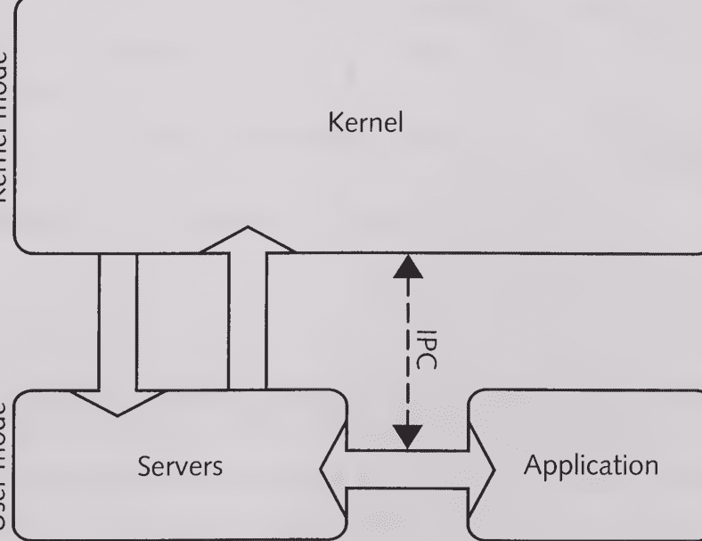

图 2-2 微内核

# 第2章 软件组件

服务器与其他程序一样；它们允许通过启动和停止程序来轻松修改操作系统。例如，对于不支持网络支持的小型机器，只需不启动网络服务器。在理论上，系统也更加稳定，因为某个服务器故障只会停止单个程序，而不会导致内核本身崩溃。

与传统设计相比，微内核的性能通常会大幅下降。这种性能下降在很大程度上是因为进出内核的开销，这被称为上下文切换。**上下文切换**是存储和恢复处理器状态（上下文）的过程，以便多个进程可以共享单个处理器。上下文切换通常需要密集的计算。操作系统的一个一个关键设计因素是尽可能地减少上下文切换的使用。

使用微内核模型实现的操作系统示例包括 Mac OS X 和 MINIX。

**单体内核**在硬件之上提供了一个高层虚拟接口。内存管理、调度器和设备接口等进程在内核模式下执行，如图 2–3 所示。地址空间被限制在进程可以合法访问的内存地址集内。应用程序在用户模式下执行。

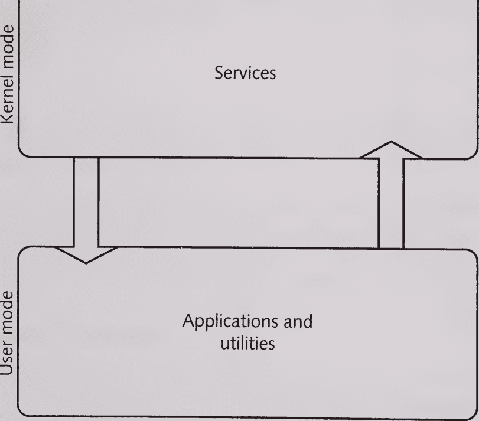

**图 2-3** 单体内核

即使内核模式下服务的每个模块都与整体分离，但代码的集成非常紧密，且难以正确实现。由于所有服务模块都运行在相同的地址空间中，一个模块中的 bug 可能会导致整个系统崩溃。然而，当实现完成且可靠时，组件的紧密集成允许有效利用底层系统的底层功能，使得一个良好的单体内核非常高效。微内核方法的支持者认为，如果代码是错误的，它就不应该属于内核；而且即使代码是正确的，单体内核方法也并无大优势。

实现单体内核模型的操作系统示例包括 Linux、FreeBSD 和 Microsoft Windows XP。这三个操作系统都在运行时加载模块，这使得内核模式能够尽可能高效。当需要时，内核模块可以动态链接到内核，并在不再需要时从内核中取消链接并移除。大多数内核模块被用于设备驱动程序，或作为网络或文件系统等服务。当内核模块被加载时，它就变成了普通内核代码和功能内核的一部分，并拥有与内核代码相同的权利和责任。

## Windows XP 内核和用户模式

图 2–4 显示了 Windows XP 架构的简化视图。

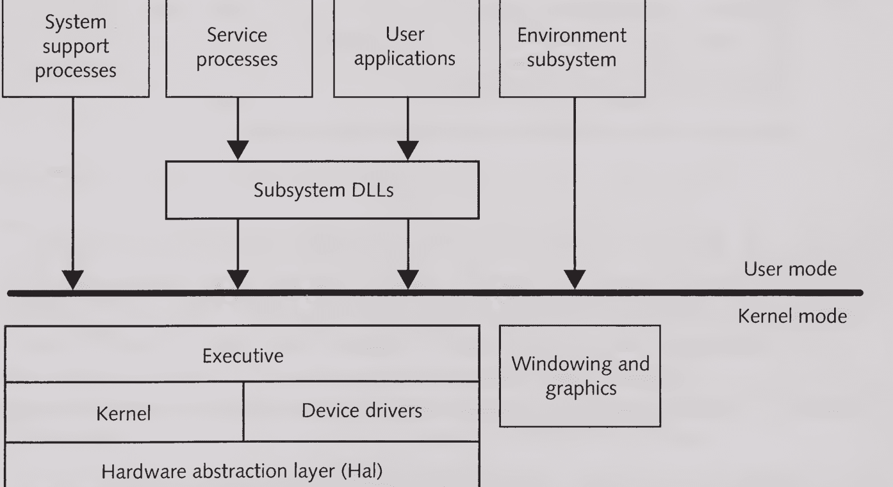

图 2-4 简化 Windows XP架构

注意图 2–4 中划分用户模式和内核模式的水平线。线下方显示的内核模式模块共享一个地址空间——系统空间。所有四种基本类型的用户模式进程都在受保护的地址空间中执行，因此存在于自己的私有地址空间中。

用户模式进程的基本类型有：

- *系统进程*——如登录进程（Winlogin）和会话管理器等非服务进程

- *服务进程*——如 HostWin32 服务，如任务调度程序和打印池化服务；这些进程由服务控制管理器启动

- *用户应用程序*——DOS、Windows 3.1 和 Win32 应用程序


# 第 2 章 软件组件

## 环境子系统

**环境子系统**——向用户应用程序暴露原生 OS 服务；Windows XP 不支持较旧的 POSIX 和 OS/2 环境，但它支持 Win32 环境。

注意图 2-4 中的子系统 DLL。用户应用程序并不直接调用原生 Windows XP 服务。调用通过一个或多个动态链接库传递。**动态链接库 (DLL)** 是一个 Windows 应用程序可以使用的可执行函数或数据的库。DLL 提供一个或多个特定函数，程序通过创建到 DLL 的链接来访问这些函数。然而，DLL 也可以仅包含数据；在这种情况下，DLL 将记录的函数翻译为 Windows XP 内核模式中相应的内部函数，将内核模式与用户应用程序隔离开。

Windows XP 的内核模式组件包括：

- **执行器**——提供基本的 OS 服务，如内存管理、进程和线程管理以及安全
- **内核**——提供底层 OS 功能，如线程调度
- **驱动程序**——将 I/O 请求转换为特定的硬件 I/O 请求；在 Windows XP 中，只有内核可以直接与硬件通信
- **硬件抽象层**——将内核和设备驱动程序与硬件复杂性隔离
- **窗口和图形**——实现窗口接口或图形用户界面 (GUI)

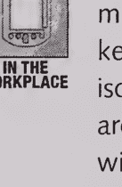

Windows XP 是基于微内核的操作系统吗？实际上，Windows XP 是一种修改的微内核，即混合内核。没有商业操作系统是基于纯微内核的，因为太慢了。在可行的情况下，Windows XP 将功能隔离在用户模式。但出于性能考虑，将其移动到了内核模式。例如，当窗口和图形服务器移动到内核模式时，性能得到了提高。由于这些服务器与图形和打印程序之间频繁交互，减少了所需的上下文切换。

关于这些组件的更多信息，请参见“操作系统的功能”部分。

## Fedora Core 4 内核

与 Windows XP 一样，Fedora Core 4 是一个单体操作系统。图 2-5 显示了 Fedora Core 4 架构的简化视图。

| 用户应用程序 | 用户应用程序 | 用户应用程序 | 用户应用程序 |
| :--- | :--- | :--- | :--- |
| | | | |
| **用户模式** | | | |
| **内核模式** | | | |
| **系统调用** | | | |
| 设备驱动 | 设备驱动 | 设备驱动 | 设备驱动 |

**图 2-5** 简化 Fedora Core 4 架构

注意划分用户模式和内核模式的水平线。作为用户，你通过用户空间与操作系统关联；进程并不直接访问内核。进程通过内核定义的最外层系统调用进行交互。例如，硬件管理在内核空间进行。在内核内部，模块可以调用其他模块。

用户模式不可见的模块集由设备驱动程序和内核子系统组成。Fedora Core 4 内核由五个主要的子系统组成：

- **进程调度器 (SCHED)**——控制处理器的访问。调度器强制执行一种策略，确保进程能够公平地访问处理器，同时确保内核按时执行必要的硬件操作。
- **内存管理器 (MM)**——允许多个进程安全地共享机器的主内存系统。此外，内存管理器支持虚拟内存，允许 Fedora Core 4 支持超过系统可用内存的进程。未使用的内存通过文件系统交换到持久性存储中，并在需要时换回。
- **虚拟文件系统 (VFS)**——VFS 通过向所有设备提供通用的文件接口，抽象了各种硬件设备的细节。此外，VFS 还支持与其他操作系统兼容的多种文件系统格式。
- **网络接口 (NET)**——NET 提供了对多种网络标准和各种网络硬件的访问。
- **进程间通信 (IPC)**——IPC 支持在单个 Fedora Core 4 系统上进行进程间通信的机制。

Fedora Core 4 提供了动态加载的设备驱动程序，这允许在包含系统代码时，无需重新编译内核代码来包含设备驱动。这使得设备驱动程序能够实时加载和卸载，而无需重启操作系统。

关于这些组件的相关信息包含在下一节中。

## 操作系统的功能

如前所述，操作系统的任务是管理 PC 上所有的可用资源。事实上，OS 应该最大限度地利用可用资源，如图 2-6 所示。

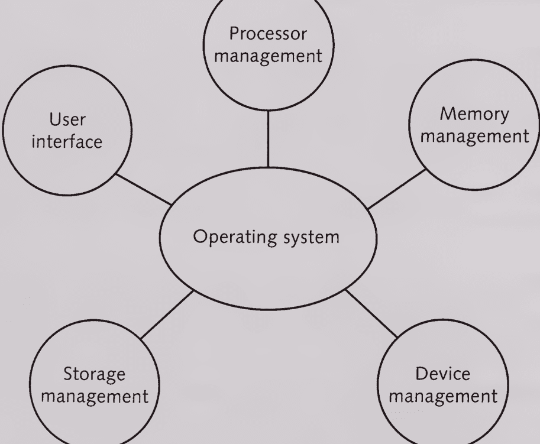

**图 2-6** 操作系统的功能

关于这些功能的信息将在接下来的章节中介绍。

## 处理器管理

微软操作系统是一个单用户、单任务的操作系统，使用命令行界面。单任务操作系统每次只允许一个程序运行。换句话说，如果你正在使用电子表格并想写一份报告，你必须在开始启动文字处理器之前关闭电子表格应用程序。这种做法是低效的，特别是当你需要在报告中引用电子表格中的某些数据时。

像 Windows XP 和 Fedora 4 这样的新操作系统被设计为允许多个程序同时运行，这一过程被称为多任务处理。在这个过程中，程序轮流使用处理器。多任务处理允许单个用户同时拥有一个电子表格和一个文字处理器。

你可能倾向于将一个进程看作一个应用程序，但这并不能完整地描绘进程与操作系统之间关系的全貌。你看到的应用程序确实是一个进程，但应用程序可能会启动一个或多个线程来执行如 shell 检查器或打印等任务。

此外，许多进程在运行的同时，从不提供任何关于它们存在的直接证据。例如，Windows XP 和 Fedora 4 可以同时运行几十个后台进程，以处理内存管理和磁盘管理。

OS 创建进程的目的是运行程序，每个进程至少包含一个线程。线程是“执行线程”的缩写，或一组指令序列。在此语境下，该术语的使用类比于织物中交织线（线程）的数量。通过多线程（并行执行多个线程），一个进程会分成两个或多个同时运行的任务。线程的一个常见用途是让一个线程关注图形界面，而其他线程在后台进行长时间计算。结果是应用程序能够更迅速地响应用户的交互。所有现代操作系统都支持多线程和多任务处理。

由于进程派生的线程共享相同的地址空间，一个线程可以修改另一个线程使用的数据。这既有利也有坏处。好处是它方便了线程之间的通信，但坏处是编写不当的程序可能会导致一个线程无意中覆盖另一个线程使用的数据。多个线程之间共享单个地址空间是多线程编程通常被认为比单线程编程更困难且更容易出错的原因之一。

管理处理器的核心在于确保每个进程和应用程序都能获得足够的处理器时间来正常运行。分配处理器周期的关键在于进程或线程的调度。

多任务处理允许 OS 调度多个任务，用户感知到任务是同时完成的。然而，任务的执行在每个程序之间非常快速地切换，从而产生同时执行的印象。这一过程也被称为任务切换。在单处理器机器上，多任务处理通过让运行中的进程占用处理器一段时间（一个时间片），然后在需要时替换为另一个拥有处理器的进程来实现。

共享 CPU 时间的两种常用方法：

- **协作式多任务处理**——运行的应用程序必须协作共享系统资源。这要求任务在程序员定义的点上自愿放弃控制权。
- **抢占式多任务处理**——OS 根据分配的优先级运行应用程序特定一段时间。当时间到期，任务被抢占，并允许另一个任务访问处理器以获取其时间片。抢占式多任务处理防止单个线程垄占处理器。

也许一个例子可以澄清协作式和抢占式多任务处理的区别。考虑一位带着两个小孩子的年轻妈妈：Jerry 六岁了，Carol 八岁。Carol 显然是姐俩中话最多的那个。当被问到今天发生了什么时，Carol 接过话头并继续说下去。当 Carol 停下来几分钟后，Jerry 才被允许说话。这是多任务处理的一个例子；程序必须到达一个停止点，以便妈妈（操作系统）获得控制权。

现在考虑抢占式多任务处理系统中的妈妈和两个孩子。妈妈询问两个孩子在学校的情况。和之前一样，Carol 先开始。在短时间间隔后，妈妈中断了 Carol，并允许 Jerry 在她的时间段说话。妈妈在两个孩子之间循环，给每个人一个时间片。当 Jerry 说完他的部分后，如果有需要，Carol 也可以获得连续的时间片。在这种情况下，妈妈——保持着对调度的控制。

在具有多个处理器的 PC 上，实现了多处理器处理。多处理器处理传统上是指在系统的任何时刻都使用多个并发线程，而不是单个进程。与多任务处理允许单个 CPU 内运行多个进程一样，多个 CPU 也可以用于执行单个进程内的线程。在对称多处理器（SMP）系统中，多个 CPU 执行程序并将计算负载分布在几个相同的处理器上。Windows XP 支持两个处理器；Fedora 4 支持两个或处理器。

多任务操作系统允许多个用户同时运行程序。Windows XP 通过“快速用户切换”功能支持多用户 PC 共享。通过此功能，如果你需要使用 PC，之前的用户不需要先关闭他的应用程序。

Fedora Core 4 设计为允许 PC 同时支持多个独立用户，允许多个用户与 OS 交互。这意味着你可以登录多个用户账户，并且每个账户都有独立的控制台。

## 内存管理

内存管理是处理计算机内存的行为。在较简单的形式中，这种管理提供了根据程序请求分配内存的方法，并在不再需要时将空内存归还系统以便重用。

原始 DOS 程序被设计在实模式下运行，具有高达 640 KB 的常规内存（见图 2-7）。当可用内存达到 1 MB 时，640 KB 之上的 RAM 被定义为“上内存”。为了支持这些增加的内存，市场上出现了两种规格的扩展卡：XMS（扩展内存规范）和 EMS（扩展内存规范）。XMS 描述了在实模式下使用扩展内存存储数据（但不可执行代码）。EMS 定义了一种符合 Lotus-英特-微软扩展内存规范的 PC 扩展内存类型。EMS 最初被 Lotus 1–2–3 电子表格应用程序使用。

今天，这些内存由从现有内存创建 XMS 或 EMS 的程序提供。内存管理程序旨在控制这些不同的规范：

- **Himemsys**——基础管理器，控制 640 KB 常规内存以上的所有内存；640 KB 之上的区域称为上层内存。常规内存和上层内存的总和 1 MB。内存被分为 64 KB 块，并与设备驱动程序和 I/O 区域共享。
- **Emm386sys**——扩展管理器，控制 1 MB 以上的所有内存；它通常被配置为 XMS 内存，也可以提供 EMS 内存。

在 DOS 中，实模式（real mode）允许一次运行一个程序。实模式的特点是具有 16 位内存地址空间（意味着只能寻址 1 MB 的内存）、可以直接通过软件访问 BIOS 例程和外围硬件，并且在硬件层面没有内存保护或多任务的概念。对此的改进是保护模式（protected mode），其特点是具有平坦地址空间，允许访问 1024 KB 以上的地址，并可以使用 32 位数据路径。保护模式允许虚拟内存和多任务。Windows XP 和 Fedora Core 4 是在保护模式下运行的 32 位操作系统。

内存管理是 Windows XP 和 Fedora Core 4 最重要部分之一。由于今天有许多应用程序在使用，需要的内存比 PC 物理存在的内存多。虚拟内存通过在硬盘上存储不需要的数据和指令，使 PC 看起来比实际拥有更多的内存。当需要这些数据或指令时，操作系统会从硬盘中提取它们。

在虚拟内存中，所有地址都是虚拟地址，中间硬件和软件将虚拟地址映射到物理地址，物理地址识别计算机物理内存中的实际地址（内存）位置。处理器可以寻址的内存量称为物理内存。进程使用的虚拟地址并不代表内存中对象的实际物理位置。相反，操作系统为每个进程维护一个页映射（page map），这是一个用于将虚拟地址转换为相应地址的内部结构。每当线程引用虚拟地址到物理地址时，

为了最大限度地提高管理的灵活性，操作系统可以将内存页在磁盘上的分页文件之间移动。当页被移动到物理内存时，操作系统会更新受影响进程的页映射。当操作系统需要物理内存空间时，它会将最近未使用的物理内存页移动到分页文件。操作系统对物理内存的操控对应用程序是完全透明的，应用程序仅在自己的虚拟地址空间中运行。

在 Windows XP 中，你可以控制分页文件的大小和位置。要找到此信息，右键点击“我的电脑”，点击“属性”，点击“高级”选项卡，点击“性能”下的“设置”按钮，再次点击“高级”选项卡，然后点击“更改”按钮。虚拟内存设置如图 2-8 所示。

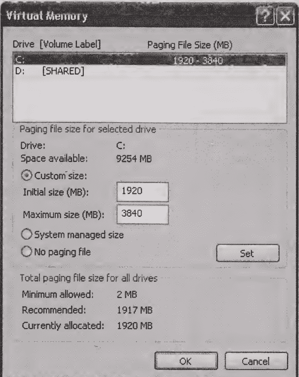

**图 2-8** Windows XP 中的虚拟内存

通过“高级”选项卡，你可以更改缓存和指令存储之间的内存用法。默认选项“程序”允许你的 PC 运行比内存设置为优化缓存时更快。

在任何操作系统系统中内存管理都非常复杂，Fedora Core 4 也不例外。Windows XP 和 Fedora Core 4 的内存管理之间存在若干差异；例如，在 Fedora Core 4 中你可以对如何管理内存做出更详细的决定。你应该在对想要处理的内容和希望实现的目标进行仔细计划和考量后才进行修改。另一个区别是，在 Fedora Core 4 中，你可以查看源代码并确切知道内存是如何管理的；你可以确切知道正在使用哪些算法；你可以使用源代码来扩展你对内存管理的知识。

在 Windows XP 中，如果你有多个物理硬盘，可以通过将页面文件移动到包含 Windows 操作系统的以外的硬盘来提高性能。在 Fedora Core 4 中，可以使用硬盘的整个分区用于虚拟内存。虽然你可以使用文件进行交换（swapping），但你应该使用单独的分区，因为可以排除碎片化的可能，碎片会降低交换性能。

## 设备管理

查看设备管理的一种方法是考虑一个你熟悉的任务：打印。在 Windows XP 和 Fedora Core 4 等操作系统出现之前，单个应用程序提供了控制打印机的软件。例如，DOS 版 Lotus 1-2-3 提供了打印机软件和驱动程序，控制打印机字体、新建等（见图 2-9）。反过来，Lotus 像大多数开发者一样，一直在跟进上市的新打印机。简而言之，这种方法是不可行的。

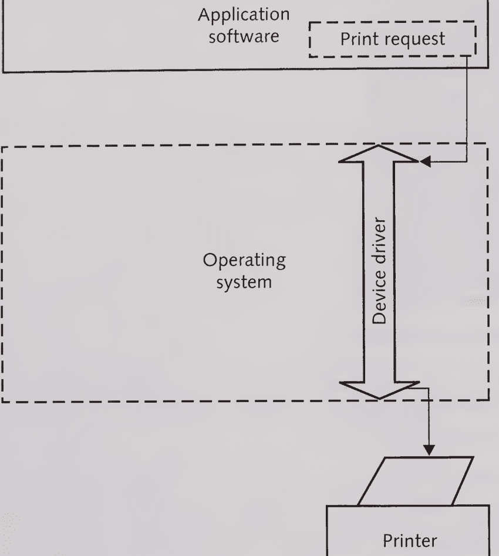

**图 2-9** 应用程序对打印的支持

在 Windows XP 中，操作系统为打印机提供设备驱动程序。设备驱动程序是连接操作系统和硬件的程序模块。声卡、扫描仪和光驱驱动器等硬件设备必须安装适当的驱动程序才能运行。

有了设备驱动程序，像 Lotus 这样的应用程序不再需要自己处理打印机驱动程序，而只需向一个名为**图形设备接口 (GDI)** 的 Windows 组件提供接口。在操作系统内部，设备驱动程序将 GDI 连接到打印机（如图 2-10 所示）。应用程序使用 Windows 语言与 GDI 通信，GDI 与打印机驱动程序通信，进而控制打印机。GDI 具有额外的功能——例如允许应用程序与所有显示设备通信。在这种方案中，打印机驱动程序由制造商负责，尽管微软编写了部分驱动程序。

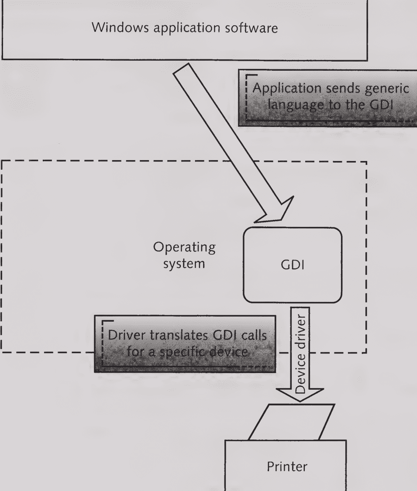

**图 2-10** 操作系统对打印的支持

在 Fedora Core 4 中，打印模型的流程基本相同。应用程序产生 PostScript——一种由 Adobe Systems 开发并销售的页面描述语言——进入 Ghostscript，这是一个基于 Adobe PostScript 和 PDF 文档格式（PDF）页面描述语言解释器的免费软件套件。随后，流程传递给设备驱动程序。Ghostscript 将 PostScript 转换为打印机所需的格式化命令。操作系统为其支持的每个打印机提供打印机驱动程序。

现代操作系统打印系统的基础是打印程序（spooler），如图 2-11 所示。Spool 是联机同步外围操作的缩写。打印程序管理打印任务队列。队列通常与单个打印机关联，用户提交的任务按先来后顺序处理。对于 Windows XP，应用程序生成的输出传递给一个模块，即 GDI。该模块随后调用打印机驱动程序渲染输出。输出随后传递给打印监视器，由其控制到打印机的传输。当用户在前台与其他应用程序交互时，打印工作在后台完成。

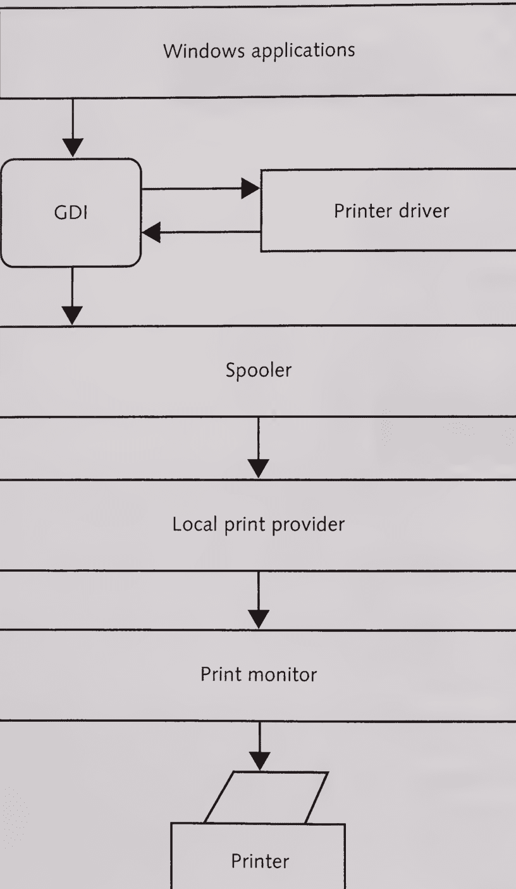

**图 2-11** 打印系统

## 存储管理

在 DOS 中，你使用 `fdisk` 命令创建分区，并使用 `format` 命令为分区准备就绪。`format` 命令为磁盘创建新的根目录和文件分配表。它还可以检查磁盘上的坏道并可以删除所有数据。

> **注意**：不要尝试 `fdisk`。如果你不小心删除了驱动器或分区，将丢失数据。

现代操作系统提供了管理 PC 硬盘存储区域的工具。在 Windows XP 中，磁盘管理（Disk Management）是一个用于管理硬盘及其包含的分区的实用程序。通过磁盘管理，你可以初始化磁盘并使用 FAT、FAT32 或 NTFS 格式化卷，这让你无需重启系统即可执行大多数与磁盘相关的任务；大多数配置更改立即生效。

在 Fedora 4 中，你使用 `fdisk` 命令为硬盘添加分区。在创建分区后，你使用 `mkfs` 命令创建 ext3 文件系统。除了上述任务外，当你使用 PC 时，操作系统还执行许多许多其他任务：

- **文件维护**——提供删除、复制、重命名和查看文件的功能，并管理目录或文件夹
- **安全**——通过支持权限控制来控制对敏感文件的访问
- **配额**——限制单个用户对磁盘空间的使用

## 用户界面

在 DOS 中，你通过命令行界面（CLI）输入命令。CLI 是一种通过键盘向计算机输入一系列文本命令（即字符序列）来与计算机交互的方法。在最简单的情况下，计算机显示一个提示符，你用键盘输入命令并按回车键，计算机就会执行该命令。

CLI 之后，出现了菜单驱动的界面。这种界面以列表的形式向用户展示各种选项和命令；若要进行选择，用户只需在菜单中点击它。在许多程序中，选项是命令行指令文件，这些文件被组合在一起并执行所需的程序。


最新的形态是 GUI（通常读作 "goo"），它是一种用于使用计算机的图形化界面，而不是纯文本界面。Windows XP 就是一个 GUI 界面的示例，如图 2-12 所示。从 GUI 中，你仍然可以使用 CLI。同样地，Fedora 4 提供了许多 GUI 界面，包括 GNOME 和 KDE。GNOME（读作 "nome"）是 GNU 项目的一部分，也是自由软件开源运动的一部分（见图 2-13）。GNOME 是一个运行在 Fedora 4 上的类 Windows 桌面系统。GNOME 的目标是提供一套易于使用的应用程序和一个易于的桌面。

KDE（K Desktop Environment）也试图满足 UNIX 工作站对易用桌面的需求，类似于 Mac OS 或 Windows 的桌面环境（见图 2-14）。与 GNOME 类似，KDE 是开源环境的一部分。KDE 对所有人免费，其源代码供任何人修改。KDE 的开发在互联网上进行，用户在其中分享有关当前改进的信息。

通常情况下，Fedora 4 配置了六种不同类型的控制台供使用。你可能甚至没有意识到这些控制台是可以用的。通常，系统管理员会同时登录 PC 的几个不同控制台（可能使用多个不同的用户 ID）。你可以通过同时按下正在使用的控制台的 `Alt` 和 `F` 键在控制台之间轻松切换。这让你能够同时高效地处理多个任务。

## 交互

操作系统设计用于与 PC 的主要组件——硬件和应用程序进行交互。你需要了解操作系统如何控制硬件，以及它为 PC 上使用的应用程序提供了哪些有价值的服务。本节涵盖了这两类型的交互。

## 第 2 章 软件组件

### 与硬件的交互

Windows XP 和 Fedora 4 对 PC 硬件的交互持有不同观点。Windows 95 之后的所有微软 Windows 版本都实现了 Windows 驱动程序模型（WDM）。WDM 是微软开发的一项技术，用于创建与多个 Windows 操作系统（包括 Windows XP）源代码兼容的驱动程序。WDM 通过将部分设备驱动程序引导到集成在操作系统中的代码部分来工作。WDM 设备驱动程序变得更加精简，代码更少，且运行效率更高。Fedora 4 将设备分为三大类：字符设备、块设备和网络设备。每种方法都有其优点。

### Windows 的硬件视角

WDM 驱动程序有三类：

- **总线驱动程序 (Bus drivers)**——驱动 I/O 总线并提供与设备无关的分槽功能；在 WDM 语境中，总线是指任何挂载了其他物理、逻辑或虚拟设备的设备。Windows XP 包含对这些总线的 WDM 支持：PCI、动态即插即用和串口。

- **功能驱动程序 (Function drivers)**——驱动特定设备；它是设备的主要驱动程序，通常由设备供应商编写。

- **过滤驱动程序 (Filter drivers)**——位于功能驱动程序之上或之下，修改设备行为或添加功能。

### Fedora 4 的硬件视角

Fedora 4 将设备分为三大类：

- **字符设备 (Character devices)**——可以作为字符流被访问；例如键盘和显示器。

- **块设备 (Block devices)**——每次处理一个块的输入输出操作；一个块通常是 512 字节，但可以是任何大小。块设备的示例是硬盘驱动器和 CD 驱动器。

- **网络设备 (Networking devices)**——处理方式不同于字符或块设备；对于字符和块设备，内核使用数据包（网络传输的信息单元）。

## 与应用程序的交互

操作系统提供了一个软件平台，其他称为应用程序的软件可以在之上运行。这些应用程序需要操作系统的支持。以下章节解释了与以下内容的重要交互：

- 安装应用程序
- 运行应用程序
- 管理磁盘和文件
- 连接网络
- 打印文档

### 安装应用程序

当你获得一个软件应用程序时，必须先安装它才能使用。现在大多数应用程序都是从 CD-ROM 安装的。根据需要，操作系统安装应用程序，将程序文件复制到硬盘，在启动菜单或应用程序菜单中创建条目，并为你的使用配置应用程序。在安装期间，应用程序安装程序会将数据写入注册表——该区域存储了硬件连接情况、选定的系统选项、计算机内存设置以及应用程序配置的信息。你可以使用操作系统提供的注册表编辑器 `regedit.exe` 直接编辑注册表。

> 在编辑注册表时必须非常小心。如果你在编辑过程中犯错误，可能会禁用你的计算机。

### 运行应用程序

当你输入命令或点击程序图标时会发生什么？操作系统执行了一系列步骤：

- 当你登录 PC 时，你的权限和组组成由操作系统确定。这些组组成被用于控制对 PC 资源的访问。当线程或进程与文件交互或尝试执行需要权限的系统任务时，操作系统会进行检查以确定你的授权级别。
- 操作系统（OS）为程序提供地址空间（一段可用的内存地址范围）。地址空间具有特定的数值范围；该范围的限制限制了执行进程可用的内存量。
- 操作系统将程序加载到地址空间中，并调度进程线程执行。
- 操作系统监控线程或进程的执行情况。
- 操作系统通过多任务处理共享处理器资源——即在系统中并发运行所有活跃的进程和线程。
- 当执行中的程序提出请求时，输入/输出操作将排队执行。操作系统打开请求的设备并读取请求的数据或将数据写入指定的设备。
- 当程序请求终止时，与设备的连接将被关闭，地址将被释放。

## 管理磁盘和文件

操作系统提供了一个组织的存储系统，以帮助定位文件。数据文件根据不同操作系统的标准以分级结构排列。你需要理解这种安排方式，以便高效地存储通过各种应用程序生成的数据。

Windows XP 实现了一种文件夹结构来存储和组织文件，就像你在文件柜中管理文件夹来组织信息一样。Fedora Core 4 采用与 Windows XP 类似的分级结构组织文件，但使用“目录”（directories）而非“文件夹”（folders）。

在 Windows XP 中，你使用 Windows 资源管理器查看文件夹结构和文件属性。Fedora Core 4 提供了许多工具来查看目录结构和文件名。例如，你将在第 4 章中学习使用 `ls` 和 `tree` 命令。

你还需要意识到“主目录”的概念，在 Fedora Core 4 中，你使用 `/home` 目录。在 Windows XP 中，“家”文件夹是“我的文档”（My Documents）。“我的文档”是“文档和设置”（Documents and Settings）的子文件夹。每个用户都有一个个人的“我的文档”文件夹，如图 2-15 所示。无论哪种情况，操作系统在创建用户账户时创建主目录。当你登录 PC 时，操作系统会指向主目录，你可以在那里访问你的数据文件。

## 连接网络

你的应用程序可以使用存储在中央仓库（如文件服务器）中的共享文件。操作系统为文件共享提供了必要的支持。你需要理解共享，因为它提供了从多台计算机访问文件、数据和信息的能力。

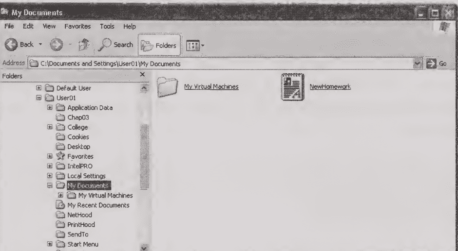

## 图 2-15 我的文档文件夹

你可以设置你的 PC，将硬盘上的目录或文件夹与网络上的其他 PC 共享，如图 2-16 所示。你可以授予所需用户访问权限，并排除其他用户。这种资源共享并不局限于文件。例如，为了节省成本，你可以与网络上的几个人共享一台激光打印机。

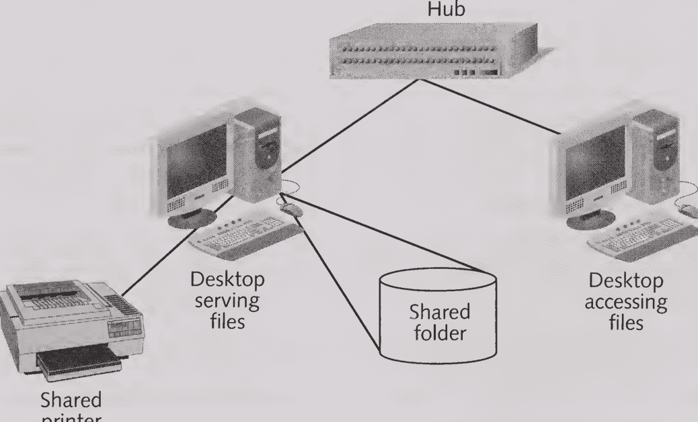

## 图 2-16 通过网络访问文件

基于 Windows 的操作系统通过使用**服务器消息块（SMB）** 通信协议来支持跨网络的文件共享流量。Fedora Core 4 使用 **Samba** 提供了等效的访问能力。

Windows XP 提供了**添加网络位置向导（Add Network Place Wizard）**来定位并连接到网络计算机上的共享文件夹。在 Fedora Core 4 中，你通过 `mount` 命令挂载远程共享。

## 打印文档

大多数文档的主要输出是打印页。操作系统提供了对本地和网络打印机的访问。Windows XP 提供了添加打印机向导来管理你的应用程序。在 Fedora Core 4 中，你使用 `system-config-printer` 程序来设置打印机。一旦打印机安装并配置完成，你就可以按照应用程序的指示使用。

在很大程度上，你对操作系统的选择决定了你可以使用的应用程序。在选择操作系统之前，你应该检查你想要使用的系统的支持要求。


## 常见的 PC 操作系统

许多不同的操作系统运行在 PC 上。你可能没有听说过其中一些（例如，MINIX, XNU, MorphOS, EROS, Chorus 和 Amoeba）。许多操作系统源于主要大学的研究。你可能听过的操作系统（例如，Mac OS X、Fedora Core 4 和 Microsoft Windows）其根源可以追溯到这些研究中的某些。

在本文中你将使用 DOS、Microsoft Windows XP 和 Fedora Core 4。

## DOS

DOS（或磁盘操作系统）是 IBM PC 可用的最早操作系统之一，在 PC 出现很久以前就已经用于 IBM 大型机计算机。在本文中，DOS 指操作系统；你将从 Windows XP 命令控制台使用 DOS 命令。

与其他操作系统一样，DOS 起始于一个人的努力——来自西雅图计算机产品公司的 Tim Patterson。Patterson 创建了 QDOS（即“快速且粗糙的操作系统”），它被微软收购并成为 MS-DOS 的种子。微软发布了多个版本的 DOS，并在 1994 年达到了最后一个版本：

- 1981年8月—DOS 1.0 在 IBM 宣布的 PC 上出现。
- 1982年5月—MS-DOS 1.1 支持 320-KB 双面软盘。
- 1983年3月—MS-DOS 2.0 支持子目录和硬盘。
- 1984年8月—MS-DOS 3.0 支持更大的磁盘。
- 1984年11月—MS-DOS 3.1 支持网络。
- 1988年11月—MS-DOS 4.0 支持分区。
- 1991年6月—MS-DOS 5.0 增加了全屏编辑器和任务交换。
- 1993年3月—MS-DOS 6.0 包含了 DoubleSpace。
- 1994年6月—MS-DOS 6.2 带回了压缩。（某些人认为这是 MS-DOS 的最后一个版本。）

## 常见的 PC 操作系统

你可能会问：“我为什么要学习 DOS？”有几个原因。例如，你需要学习命令行来完成任务，如从一个硬盘拷贝大量文件到另一个硬盘或更改文件属性。此外，如果 Novell 服务器无法工作，可启动的 DOS 可以救急。如果你正在学习成为管理员，你需要尽可能高效地执行任务。一旦你学会了命令，使用命令行是高效的；因此，在 Microsoft Windows 服务器上，有时命令行界面是正确的工具。

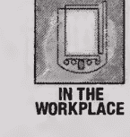

由于操作系统的微妙差异，DOS 在取证中仍有用途。DOS 允许你以 Windows XP 中无法实现的方式与硬盘通信。

## Windows

Windows 是一系列用于 PC 的环境和操作系统，于 1985 年推出，旨在对抗苹果的新系统——Apple Macintosh，后者使用了图形界面。苹果和微软都遵循了 Xerox PARC（帕洛奥图研究中心）开发的系统的足迹。Xerox PARC 以实质上创建了现代 PC 图形界面而闻名。微软通过开发 Windows NT（新技术）继续发展 Windows；公司聘请了数字设备公司（DEC）VMS 的首席架构师 Dave Cutler 来开发一个功能更强大的系统。Cutler 曾在 DEC 开发 VMS 的继任产品，名为 Mica；当 DEC 放弃该项目时，他带着专业知识和一些工程师加入了微软。

微软占据了桌面操作系统 90% 以上的市场。Windows 是专有的闭源软件，这意味着微软拥有软件版权并控制其分发。

微软发布了多个版本的 Windows。第一代 Windows 是基于 DOS 的，并在 Windows Me 终结。Windows NT 线始于 Windows NT 3.1，一直延续到今天的 Windows XP 和 Windows Server 2003。

Windows 时间线出现在此列表中：

- 1985年11月—Windows 1.0 实现了图形界面。然而，应用程序的选择较少，Windows 的销量平平。
- 1987年10月—Windows 2.0 增加了图标和重叠窗口。Windows/386 提供了在扩展内存中同时运行多个 DOS 应用程序的能力。
- 1990年5月—Windows 3.0 是 Windows 环境的彻底重构。它可以处理 640K 以外的内存，并拥有更强大的用户界面。
- 1993年7月—Windows NT 3.1 用于网络服务器、工作站和软件开发机。它基于完全全新的操作系统内核。
- 1993年12月—Windows for Workgroups 3.11 是微软提供的第一个集成 Windows 和网络的软件包。它提供了点对点文件和打印机共享功能，这些功能被高度集成到 Windows 环境中。
- 1994年9月—Windows NT 3.5 提供了改进的性能并减少了内存需求。
- 1995年8月—Windows 95 是一个 32 位系统，提供全抢占式多任务、高级文件系统、线程和网络。
- 1996年6月—Windows NT 4.0 包含高级安全功能、高级网络支持、完整的 32 位操作系统、高级多任务处理和用户管理。
- 1998年6月—Windows 98 提供了类似浏览器的桌面。新硬件支持最新技术，如 DVD、FireWire 和 USB。
- 2000年2月—Windows 2000 (NT 5.0) 提供了一个令人印象深刻的互联网、局域网、外网和管理应用程序平台，并与 Active Directory 紧密集成。
- 2000年9月—Windows Me（Millennium Edition 的缩写）面向家庭用户。它基本上只是对之前 Windows 98 版本中 DOS 代码的升级。
- 2001年10月—Windows XP (NT 5.1) 包含了来自 Windows NT 和 Windows 2000 的 32 位内核和驱动程序集。
- 2003年4月—Windows Server 2003 (NT 5.2) 是一个多功能操作系统，能够处理各种服务器角色。它提供了安全性、可靠性、可用性和可扩展性。

## Fedora Core 4

Fedora Core 4 是 Linux 的一个发行版，是在 GNU 通用公共许可协议下发布的通用操作系统，该协议保证了你共享和更改免费软件的自由。Fedora Core 4 通常被称为“开源”。开源背后的基本思想非常简单：当程序员可以读取、分发和修改某个软件的源代码时，软件就会不断演进。人们改进它、适应它并修复其中的错误，与传统的软件开发缓慢速度相比，这种速度通常是惊人的。

Linus Torvalds 在于芬兰赫尔辛基大学上学期间开发了 Linux 内核。他于 1991 年开始开发 Linux 内核，并于 1994 年发布了 1.0 版本。

Richard Stallman 在于麻省理工学院（MIT）人工智能实验室工作期间开始启动 GNU 项目（“GNU’s Unix”的缩写）。今天，该项目包括汇编器、命令处理器、编译器、调试器、外壳、文本编辑器以及支持开发所需的许多其他实用程序。Linux 使用 X 系统进行图形显示。X 系统（或 X11 系统）由 Jim Gettys 和 Bob Scheitzer 于 1984 年在 MIT 开发。它最初被设计为一个与平台无关的系统，以便学生可以使用许多厂商的计算机。

今天，Fedora Core 4 有许多桌面可用。桌面是图形界面中的主要工作空间。桌面是实际办公桌顶部的隐喻，人们可以在那里找到文件、文件夹和工具。GNOME——由 Miguel Icaza 和他来自墨西哥大学的一些朋友创建——是 Red Hat 发版 Fedora Core 4 的默认桌面。KDE 起于 1996 年；它现在是 SUSE 发行版的默认桌面。GNOME 和 KDE 被称为重量级桌面，因为它们拥有许多功能。Fluxbox 被称为轻量级桌面；它的功能极少，因此对硬件的要求较少。KDE 和 GNOME 都是大多数人的绝佳选择，但许多计算机专业人士和工程师使用 Fluxbox 是因为他们想要尽可能多的 CPU 周期。在本文中将使用 KDE。

## 系统工具

你使用系统工具在你的 PC 上执行各种任务。关键工具包括文本编辑器、配置编辑器和系统信息，下文将对此进行解释。

### 文本编辑器

文本编辑器允许你在文本文件中输入、修改和删除数据。文本文件用于许多用途；例如，你可以在文本编辑器中为程序编写源代码。事实上，大多数源代码都存储在文本文件中。作为网络管理员，你可能会编写脚本，大多数脚本将存储在文本文件中。你将在第 6 章学习如何使用文本编辑器。

大多数系统工具都知道如何处理文本文件。在 DOS 中，`type` 命令在命令提示符中列出文本文件的内容，如图 2-17 所示。例如，你可以使用 `type` 命令显示 `boot.ini` 配置文件的内容。


## 图 2-17 使用 type 命令列出的文本文件

在 Fedora 中，`cat` 命令执行相同的操作，在标准输出设备（计算机显示器）上显示文件内容。见图 2-18。


## 图 2-18 使用 cat 命令列出的文本文件

其他格式的文件需要特定的程序来处理。

### 配置编辑器


作为管理员，你可能需要更新 PC 配置条目；为了这样做，你将使用配置编辑器。在 Windows 内部，你可能需要向注册表（一个分级数据库）添加条目。Fedora Core 4 中大多数控制系统的配置文件以文本文件的形式存储。

## Windows Regedit

`Regedit` 是一种特殊的工具，允许系统管理员编辑注册表项（见图 2-19）。Windows 使用注册表存储对你的 PC 运行至关重要的信息。你需要接触注册表，但请不要尝试编辑。编辑注册表是一项普通用户不应尝试的高级技能。


图 2-19 使用 Regedit 显示的注册表项

## Fedora Core 4 中的 visudo

作为 Fedora Core 4 系统管理员，你通常具有执行任何命令的权限。每个用户根据功能被分为组。每个组通常有一个执行管理组所需命令的组管理员 `/etc/sudoers` 文件持有允许组管理员执行工作所需的特权指令的配置。你必须使用 `visudo` 命令编辑此文件（见图 2-20）。


图 2-20 使用 visudo 编辑

你不应该使用文本编辑器编辑 `sudoers` 文件。编辑此文件的任何微小错误都可能导致 PC 崩溃。

## 系统信息

你可以通过操作系统提供的工具查看有关 PC 的信息。在 Windows XP 中，可以使用帮助支持工具获取有关 PC 处理器的信息。在 Fedora Core 4 中，你可以列出配置文件的内容。例如，Fedora Core 4 中的 `cpuinfo` 文件包含有关处理器的信息。

## XP 我的计算机

我的信息工具提供计算机的摘要信息和配置信息。要访问并使用此工具，请参见活动 2-1。图 2-21 显示了我的信息工具的常规选项卡。

### 活动 2-1：查看处理器信息


**所需时间：** 15 分钟

**目标：** 使用 Windows 帮助支持工具查看有关你 PC 处理器的信息。

**描述：** 在本次活动中，你将查看 PC 的系统信息。如果你想获取关于处理器的类似信息，此活动非常有用。

1. 如必要，使用用户 `User01` 和密码 `Password1` 登录你的 PC。
2. 点击**开始**，点击**帮助和支持**，找到 PC 任务部分，然后点击**使用工具**查看你的计算机信息并诊断问题。
3. 点击**我的计算机信息**，然后点击**查看有关此计算机的通用系统信息**。
4. 等待信息收集。
5. 查看有关处理器的信息。
6. 关闭帮助和支持中心窗口。
7. 保持 PC 登录状态以进行下一个活动。

# 第 2 章 软件组件

## Fedora Core 4 cpuinfo 配置文件

要显示计算机使用的 CPU 类型，在控制台中输入 `cat /proc/cpuinfo` 并按回车。输出结果类似于图 2-22 所示的 Fedora Core 4。

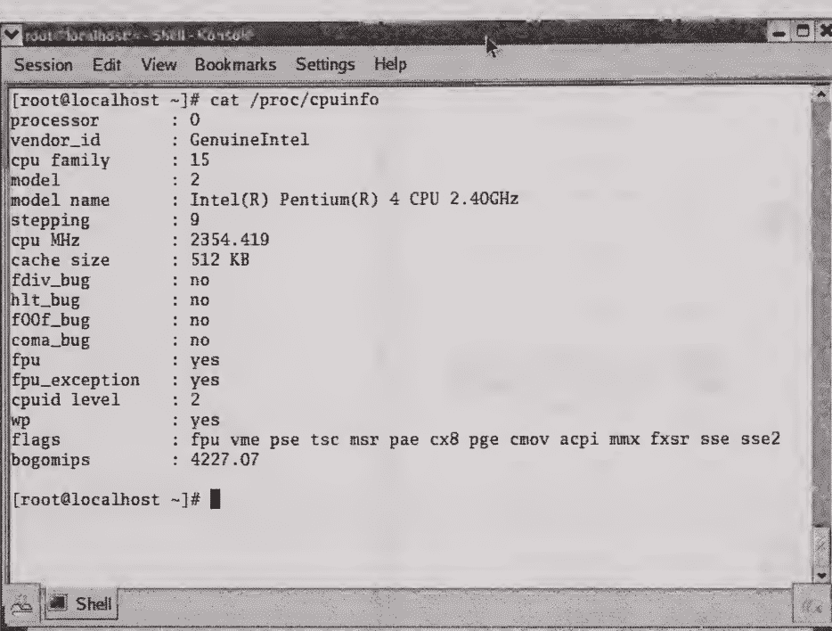

图 2-22 cpuinfo 文件中的 CPU 信息

## 活动 2-2：使用 Fedora Core 4 cat 命令

**所需时间：** 15 分钟

**目标：** 使用 Fedora Core 4 的 `cat` 命令查看有关处理器的信息。

**描述：** 在本次活动中，启动 Virtual PC 2004 并从 Fedora Core 4 打开控制台窗口。在控制台中，你使用 `cat` 命令显示 `cpuinfo` 文件的内容。如果你想查看进程和 PC 的性能，此活动非常有用。

1. 如必要，使用用户 `User01` 和密码 `Password1` 登录你的 PC。
2. 点击**开始**，指向**所有程序**，然后点击**Microsoft Virtual PC**。
3. 点击 **Fedora_core_4 Not running**，然后点击**启动**按钮。
4. 使用用户 `User01` 和密码 `Password1` 登录你的 Fedora Core 4 系统。

要将焦点切换到 Fedora Core 4，点击 Fedora Core 4 桌面内部。要将焦点返回 Windows XP，按住键盘右侧的 Alt 键释放鼠标指针，并点击 Windows XP 桌面。Virtual PC 2004 仅监控右 Alt 键。


5. 要打开第一个控制台窗口，点击**红帽**图标，指向**系统工具**，然后点击 `终端`。
6. 在控制台窗口中，输入 `cat /proc/cpuinfo` 并按**回车**。

> Fedora Core 4 中的命令区分大小写；例如，`cat`、`CAT` 和 `Cat` 是三个不同的命令。在 DOS 或 Windows XP 中，命令不区分大小写。


7. 查看有关处理器的信息。
8. 关闭控制台窗口。
9. 保持 PC 登录状态以进行下一个活动。

## 系统监控器

确切了解 PC 正在发生什么是非常重要的。这些信息可以帮助你识别问题并为 PC 提供可能最好的服务。作为系统管理员，你使用许多工具来执行日常任务。在 Windows XP 中，你可以使用**任务管理器**查看有关系统性能的有用信息；在 Fedora Core 4 中，使用 `top` 命令。

这两个监控器的主要区别在于显示方式。作为系统管理员，最重要的信息在于回答问题：“我需要做什么？”一旦你回答了这个问题，使用 `top` 命令或任务管理器的任务就简单了。

## Windows 任务管理器

你使用任务管理器来监控在计算机上运行的应用程序和进程。例如，使用任务管理器时，你可以选择性地停止挂起的应用程序或进程，这可以帮助你脱困。你可以通过三种方式之一启动任务管理器：

- 按 `Ctrl+Alt+Delete`。
- 按 `Ctrl+Shift+Esc`。
- 右键点击任务栏上的空白区域，并在菜单中点击任务管理器。

你可以使用图 2-23 所示的四个标签页来控制应用程序和进程，并查看系统和网络性能。

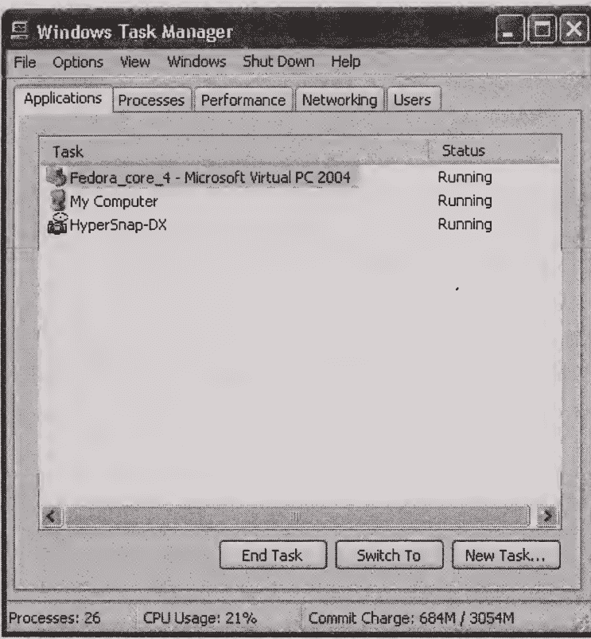

图 2-23 Windows 任务管理器

以下章节将讨论每个标签页。

> 注意：如果你使用的计算机系统处于 Windows 工作组中，或者是一个未安装网络功能的独立系统，则可以使用第五个标签页——“用户”。域网络中的计算机系统则无法使用此标签页。

### 应用程序标签页

从应用程序标签页，你可以判断程序是否挂起或无响应。你可以通过选择该程序并点击“结束任务”按钮来结束程序。你可以使用另外两个按钮切换到列表中的其他项。

### 进程标签页

从进程标签页，你可以查看正在运行的程序。你可以通过选择程序并点击“结束任务”按钮来结束它。你可以使用另外两个按钮切换到列表中的其他项。

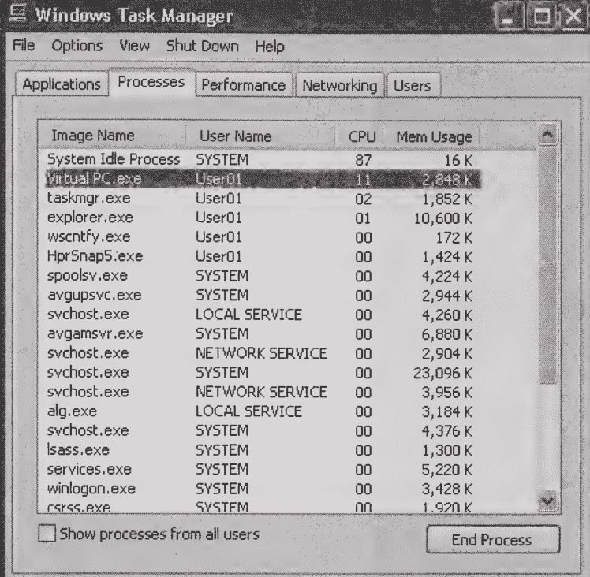

图 2-24 任务管理器中的进程标签页

### 性能标签页

从性能标签页（见图 2-25），你可以查看 CPU 使用率。内存使用率过高可能意味着需要额外的资源。

### 网络标签页

你可以使用网络标签页（如图 2-26）查看网卡活动。网络标签仅在存在网卡时显示。

## 活动 2-3：使用 Windows 任务管理器

**所需时间：** 15 分钟

**目标：** 使用 Windows 任务管理器查看 PC 的性能。

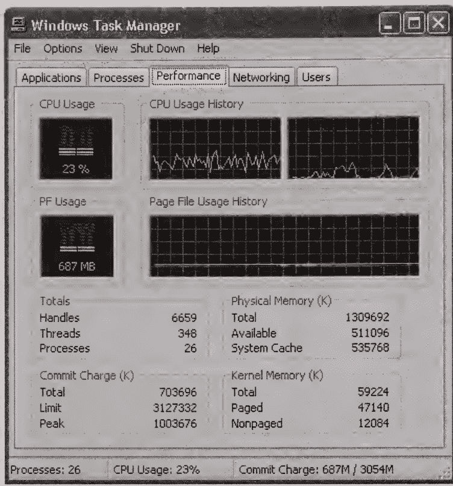

图 2-25 任务管理器中的性能标签页

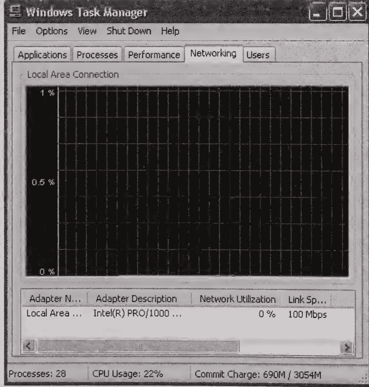

图 2-26 任务管理器中的网络标签页

**描述：** 在本次活动中，你打开任务管理器的应用程序标签页，查看有关正在运行应用程序的信息。打开进程标签页查看 Windows 运行的进程。要快速查看 CPU 性能，点击性能标签页。

1. 如必要，使用用户 `User01` 和密码 `Password1` 登录你的 PC。
2. 右键点击任务栏并点击任务管理器。
3. 如必要，点击应用程序标签页查看哪些应用程序。
4. 查看列出的应用程序。
5. 要查看运行的进程，点击进程标签页。

> 提示：在进程标签页中，可以通过点击列标题进行排序。例如，要找到使用 CPU 资源最多的进程，点击 CPU 标题。

6. 点击性能标签页。
7. 要确定活动对象、所有线程和进程的数量，查看总计部分中的计数器。
8. 查看 Commit 字段中的内存使用情况。
9. 关闭你在本次活动中打开的所有窗口。
10. 保持 PC 登录状态以进行下一个活动。

## Fedora Core 4 top 命令

你可以使用 `top` 命令实时查看处理器活动。该命令显示 PC 上最 CPU 密集型的任务列表，如图 2-27 所示。`top` 命令显示关于处理器状态的各种信息。默认情况下，每五秒更新一次。

显示分为两个部分。下部分显示进程级统计。上部分包含与系统整体状态的信息，例如运行时间、负载平均值、进程计数、CPU 状态以及内存和交换空间的利用统计数据。

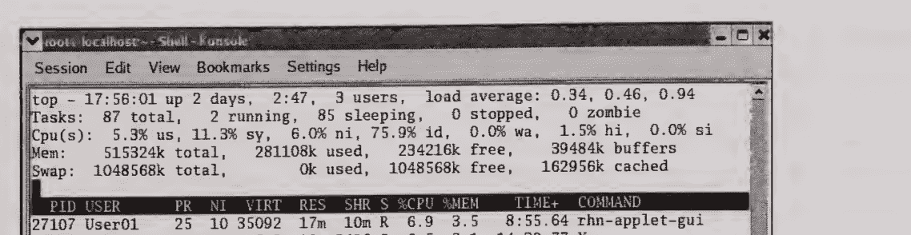

图 2-27 Fedora Core top 命令

屏幕顶部显示以下统计信息：

- **Top**—显示系统运行时间以及系统的三个负载平均值；负载平均值是过去 1、5 和 15 分钟内准备好运行的进程平均数。
- **Tasks**—显示任务总数、运行中的任务、睡眠中的任务、已停止和已放弃的任务。
- **Cpu(s)**—显示各种类别的 CPU 时间百分比，如用户模式、系统模式、“nice” 任务、I/O 等待（`iowait`）以及空闲任务（`nice` 值为值的任务）；`nice` 值越低，进程运行得越快。在任务中花费的时间也计入系统时间和用户时间，因此总和可能超过 100%。
- **Mem**—显示内存使用统计信息，包括总可用内存、空闲内存和用于缓冲区的内存。
- **Swap**—显示交换空间的统计信息，包括总交换空间、已用交换空间、空闲交换空间和缓存交换空间。

列标题标识了每个正在运行的任务所显示的信息：

- **PID**—每个任务的 ID。
- **USER**—任务的用户名。
- **PR**—任务的优先级。
- **NI**—任务的 `nice` 值；负值优先级更高。有用的 `nice` 值包括 19 和 20（受影响的进程仅在系统没有其他程序尝试运行时才运行）以及任何负数（以使进程运行得更快）。该字段中的零值意味着在确定任务的调度能力时不会调整优先级。
- **VIRT**—任务使用的虚拟内存总量。
- **RES**—任务使用的交换物理内存。
- **SHR**—任务使用的共享内存量。
- **S**—状态的份额；状态 `S` 表示睡眠（sleeping），`D` 表示不可中断睡眠，`R` 表示运行（running），`Z` 表示僵尸（zombies），`T` 表示停止或被跟踪（stopped or traced）。这些状态可以通过结尾的 `<` 进行修改以表示负值的进程，`N` 表示正值的进程，或 `W` 表示已交换出的进程。
- **%CPU**—自上次屏幕更新以来占用的 CPU 时间份额，表示为每个处理器总 CPU 时间的百分比。
- **%MEM**—物理内存的份额。
- **TIME+**—CPU 时间，以百秒为单位。
- **COMMAND**—任务的命令名称，如果太长无法在一行内显示，则会被截断；内存中的任务具有完整的命令行，但已交换出的任务仅在括号内有程序名称——例如，`("getty")`。

## 活动 2-4：使用 Fedora Core 4 top 命令

**所需时间：** 15 分钟

**目标：** 使用 Fedora Core 4 `top` 命令查看 PC 的性能。

**描述：** 在此活动中，你启动 Virtual PC 2004，然后从 Fedora Core 4 打开两个窗口。在第二个控制台中，你运行 `top` 命令。在第一个控制台中，你显示该命令的 MAN 页面（文档）。如果你想查看进程和你的 PC 性能，这项活动非常有用。

1. 如必要，使用用户 `User01` 和密码 `Password1` 登录你的 PC。
2. 如必要，点击 **Start**（开始），指向 **All Programs**（所有程序），然后点击 **Microsoft Virtual PC**。
3. 如必要，点击 **Fedora_core_4 not Running**（未运行的 Fedora_core_4），然后点击 **Start** 按钮。
4. 如必要，使用用户 `User01` 和密码 `Password1` 登录你的 Fedora Core 4 系统。
5. 要打开控制台窗口，点击**红帽**（ Fedora）图标，指向 **System Tools**（系统工具），然后点击 **Terminal**（终端）。
6. 要打开第二个控制台窗口，重复步骤 5。
7. 在第二个窗口中，输入 `top` 并按 **Enter**（回车）。
8. 检查 `top` 命令的输出。找到上一节列出的信息。
9. 点击第一个控制台窗口的标题栏，输入 `man top`，然后按 **Enter**。

> 提示：要在 MAN 页面中向下移动，请按空格键或 Page Down。

10. 检查 MAN 页面上的信息。
11. 要退出 MAN 页面，按 `Q` 键关闭控制台窗口。
12. 关闭剩余的控制台窗口。
13. 让 PC 保持注销状态，供下一次活动使用。

## 应用程序

你在 PC 上使用许多应用程序，包括文字处理器、电子表格、演示文软件、Web 浏览器、电子邮件客户端、游戏和图形软件。应用程序由许多共同工作的小程序组成，这并不稀奇。应用程序是人们使用电脑的原因。

Microsoft Office 是由微软创建并为 Windows 开发的程序套件。它的组件包括：

- **Word**—一个文字处理器，被认为是 Office 2003 的主程序；它在文字处理器市场占据主导份额。它的专有 DOC 格式被认为是事实上的标准，尽管其最新版本也支持基于 XML 的格式。
- **Excel**—一个电子表格程序；与 Microsoft Word 一样，它拥有主导的市场份额。它最初是 Lotus 1-2-3 的竞争对手，但最终变成了事实上的标准。
- **PowerPoint**—一种流行的演示程序；用于创建由文本、图形、电影和其他对象组成的幻灯片，这些幻灯片可以在屏幕上显示并由演示者进行导航，或者打印在透明片或幻灯片上。

OpenOffice.org 是一系列紧密工作的应用程序，旨在提供现代办公套件所需的功能。许多组件的设计理念与 Microsoft Office 相似。除了在 Fedora 4 上运行外，它运行在 Windows 95 之后的版本、Solaris 和 FreeBSD 以及 Mac OS 上。其组件包括：

- **Writer**—一个文字处理器，与 Microsoft Word 的外观和感受相似，并提供了广泛的功能和工具；Writer 允许创建 PDF（便携文档格式）文件而无需额外软件。
- **Calc**—一个电子表格程序，与 Excel 相似；它提供了 Excel 不具备的功能，包括根据用户数据布局自动定义图表的系统。Calc 还可以将电子表格直接写入 PDF。
- **Impress**—一种演示程序，与 PowerPoint 相似；Impress 可以将演示文稿导出为 Macromedia Flash (SWF) 文件，使其可以在任何安装了 Flash 播放器的计算机上播放。你也可以用 Impress 创建文件。

如果你运行 Fedora 4，OpenOffice 是一个很好的选择。对于 Windows 用户来说，OpenOffice 是一个便宜的选择。然而，如果你是一个与运行 Microsoft Office 的用户共享文档的学生，Office 学生版对 Windows 将是更好的选择。

Fedora Core 支持的业务应用程序数量仍在增加。表 2-1 列出了应用程序类别以及在 Windows XP 和 Fedora 4 中对应的产品。

### 表 2-1 业务应用程序

| 类别 | Windows XP | Fedora 4 |
|---|---|---|
| Web 浏览器 | Microsoft Explorer | Firefox, Netscape, Opera |
| 电子邮件客户端 | Outlook Express | Evolution, Thunderbird |
| 项目管理 | Microsoft Project | Planner |
| 绘图 | Microsoft Visio | Dia |
| 图像编辑 | Adobe Photoshop | GIMP |
| PDF 阅读器 | Adobe Acrobat | Adobe Acrobat |
| 数据库 | Microsoft Access | Rekali RAD DBMS |
| FTP 客户端 | GlobalScapeFTP | gFTP |

## Windows XP 免费软件

免费软件是供个人免费使用的软件。免费软件经常在网上分发。虽然它是免费提供的，但作者保留了版权，这意味着它不能被更改或出售。表 2-2 适用于 Windows XP 的免费软件示例。

### 表 2-2 Windows XP 免费软件网站

| 类别 | 免费软件产品 | 下载网站 |
|---|---|---|


| Web 浏览器 | Firefox | www.mozilla.org/products/firefox/http://free.grisoft.com/ |
| 杀病毒软件 | AVG | |
| 防火墙 | Zone Alarm | www.zonelabs.com/store/content/company/products/znalm/freeDownload.jsp |

# 第2章 软件组件

表 2-2 Windows XP 免费软件（续）

| 类别 | 免费软件产品 | 下载网站 |
|---|---|---|
| 办公软件套件 | OpenOffice | www.openoffice.org/ |
| 文本编辑器 | Metapad | www.liquidninja.com/metapad/ |

## 活动 2-5：使用 Windows WordPad 应用程序

所需时间：15 分钟

目标：使用 WordPad 应用程序编写短便条。

描述：在此活动中，请使用 WordPad 应用程序编写一个短段落，详细介绍你在 Windows XP 和 Fedora Core 4 的使用体验。（WordPad 是一个默认安装的 Windows 应用程序示例。）如果你想在操作电脑时输入一段短便条，这项活动将非常有帮助。

1. 如必要，请使用 `User01` 和密码 `Password1` 登录你的电脑。
2. 要启动 WordPad，请点击“开始”，指向“所有程序”，指向“辅助工具”，然后点击“WordPad”。
3. 输入一段关于你的 Windows XP 和 Fedora Core 4 使用体验的短便条。
4. 点击“文件”菜单，点击“另存为”，输入 `Noteml`（其中 fml 代表你的姓名缩写），并点击“保存”按钮。
5. 关闭你在本次活动中打开的所有窗口。
6. 保持电脑登录状态，以便进行下次活动。

## 活动 2-6：使用 Fedora Core 4 OpenOffice 应用程序

所需时间：15 分钟

目标：使用 OpenOffice 应用程序编写短便条。

描述：此活动与活动 2-5 类似，但这次你使用的是 Fedora Core 4 应用程序——OpenOffice.org 来编写一个短段落，详细介绍你在 Windows XP 和 Fedora Core 4 的使用体验。（OpenOffice.org 是一个默认安装的 Fedora Core 4 应用程序示例。）如果你想用 Fedora Core 4 应用程序输入短便条，这项活动将非常有帮助。

1. 如必要，请使用 `User01` 和密码 `Password1` 登录你的电脑。
2. 如必要，点击“开始”，指向“所有程序”，然后点击“Microsoft Virtual PC”。
3. 如必要，点击 `Fedora_core_4 Not running`，然后点击“启动”按钮。
4. 如必要，使用 `User01` 和密码 `Password1` 登录你的 Fedora Core 4 系统。
5. 点击红帽图标，指向“Office”，然后点击“OpenOffice.org Writer”。
6. 根据你目前对本文的阅读，输入一段短便条，谈谈你是否可能更倾向于使用 Windows XP 还是 Fedora Core 4。
7. 点击“文件”菜单，点击“另存为”，输入 `Notefml`（其中 fnml 代表你的姓名缩写），然后编辑/点击“保存”按钮。
8. 关闭 OpenOffice.Org Writer 窗口。
9. 点击红帽图标，点击“注销”，然后点击“结束当前会话”按钮。
10. 按右 `Alt` 键，点击 Fedora Core 4 窗口，然后点击“确定”。
11. 关闭任何剩余的打开窗口，注销并关闭电脑。

## 章节总结

- 电脑的软件组件用于执行各种任务。所有组件都协同工作，用户无需干预。每个组件在电脑的整体性能中都起着特定的作用，没有哪个组件比另一个更不重要。电脑资源由运行在操作系统内部的许多程序管理。
- 电脑的第一个操作系统是 DOS。电脑操作系统的核心是内核。内核存在两类：单体内核和微内核。无论使用哪种型号，内核都是确保硬件安全并为每个应用程序服务的地方。
- 操作系统通过控制处理器、内存、设备、存储和用户界面来管理资源。现代操作系统支持抢占式多任务、多线程和虚拟内存。
- 操作系统与硬件和应用程序均交互。例如，操作系统通过安装和运行应用程序来与它们交互。操作系统提供磁盘和网络访问以及打印功能。
- 电脑有许多操作系统。最常见的是 DOS、Windows 和 Fedora Core 4。每种操作系统都从其诞生起不断演进，允许用户使用编辑器、图形用户界面以及如打印机、键盘、显示器和磁盘驱动器等外围设备。最好的操作系统（此处应为优秀的操作系统）是稳定、安全且可扩展的。
- 操作系统与不同的工具配合工作，在你的电脑上执行各种任务。操作系统使用不同的术语和工具来执行这些任务。例如，要更新配置文件，你需要一个配置编辑器。在使用 Windows XP 时，你使用 `Regedit` 更新注册表文件；在 Fedora Core 4 中，你使用 `vi` 命令编辑 `/etc/sudoers` 文件。当你需要监控系统时，在 Windows XP 中使用“任务管理器”，在 Fedora Core 4 中使用 `top` 命令。使用不同类型的编辑器取决于注册表或配置文件是指操作系统、实用程序还是应用程序。
- 你在电脑上使用许多应用程序，包括文字处理器、电子表格和 Web 浏览器。

## 关键术语

- **添加网络位置向导（Add Network Place Wizard）**——Windows XP 中的向导，帮助你找到并连接网络计算机上的共享文件夹。
- **添加打印机向导（Add Printer Wizard）**——Windows XP 中使用的向导，用于让应用程序可以使用打印机。
- **应用程序（application）**——一种帮助用户在电脑上执行任务的程序，例如创建电子表格。
- **块设备（block device）**——以块或字节组而非字符移动信息的设备。例如磁盘驱动器。
- **总线驱动程序（bus driver）**——用于 I/O 总线的 WDM 驱动程序。它提供每个槽位的设备驱动程序功能。
- **字符设备（character device）**——以字符流的形式一次一次传输或接收信息的设备。例如键盘。
- **命令行界面（CLI）**——你用于向操作系统发送命令的程序。
- **配置（configuration）**——用于更新文件的编辑器。
- **上下文切换（context switch）**——存储和恢复处理器状态的过程，以便多个进程可以共享处理器。
- **协作式多任务（cooperative multitasking）**——每个进程控制处理器使用时间的多任务形式。
- **DOS**——一种扩展内存的操作系统。
- **动态链接库（DLL）**——包含可执行函数的库。
- **Emm386.sys**——使用扩展内存的管理器。
- **扩展内存规范（EMS）**——增加内存的技术。
- **快速用户切换（Fast Switching）**——Windows XP 中的功能，允许用户在不退出应用程序的情况下切换帐户。
- **过滤驱动程序（filter driver）**——过滤 I/O 的 WDM 驱动程序。
- **Fluxbox**—— Fedora Core 4 的窗口管理器。
- **免费软件（freeware）**——免费提供的软件。
- **函数驱动程序（function driver）**——驱动设备的 WDM 驱动程序。
- **GDI（图形设备接口）**——一种基于解释器的语言。
- **GNOME**——Fedora Core 4 的默认桌面。
- **GNU 通用许可证（General Public License）**——由软件基金会编写的。
- **Himem.sys**——管理扩展内存使用的设备。
- **主目录（home directory）**——Fedora Core 4 中与用户相关的目录。
- **KDE**——SUSE 的默认桌面。
- **内核（kernel）**——操作系统的核心。内核管理内存、文件和设备，并为应用程序分配系统资源。
- **微内核（microkernel）**——提供较小接口的内核类型。提供最少内核服务；某些服务在用户模式下执行。
- **Windows 安装程序（Windows Installer）**——作为 Windows XP 提供的安装和配置服务。
- **单体内核（monolithic kernel）**——提供高级接口的内核类型。内核处理内存管理、调度和设备接口。
- **挂载命令（mount command）**——Fedora 4 中用于连接网络计算机共享文件夹的命令。该命令管理远程共享。
- **多处理（multiprocessing）**——在单个系统中并行执行指令。
- **多任务（multitasking）**——运行所有活动进程和线程。
- **多线程（multithreading）**——在单个程序内快速运行多个进程。
- **我的文档**——Windows XP 中的用户主目录。
- **网络设备（networking device）**—— Fedora 4 用于网络设备的类别。Fedora 4 内核与这些设备数据包。
- **数据包（packet）**——整体传输到网络另一端的信息单元。
- **物理地址（physical address）**——标识物理内存中实际存储（内存）位置的数字。
- **PostScript**——由 Adobe 开发并营销的页面描述语言。
- **抢占式多任务（preemptive multitasking）**——操作系统中的多任务过程，确保所有活动线程都有执行机会。抢占式多任务防止单个线程占用处理器。
- **保护模式（protected mode）**——Intel 80286 及更高处理器的运行模式，支持多任务、数据和虚拟内存。
- **实时模式（real mode）**——一次允许运行一个程序的运行模式。程序只能访问 1024 KB 内存并使用 16 位数据路径。
- **红帽包管理器（RPM）**——Fedora 4 为应用程序提供安装服务的管理器。
- **Regedit**——允许用户编辑注册表项的应用程序。
- **注册表（Registry）**——Windows XP 用于存储配置一个或多个用户、应用程序和硬件设备所需的信息的中心分级数据库。
- **Samba** —— Fedora Core 4 使用的一种通信协议，用于支持跨网络资源共享。
- **Server Message Block (SMB)** —— Windows 操作系统使用的一种通信协议，用于支持跨网络资源共享。
- **软件组件** —— 一系列可能运行并与操作系统相关的应用程序。
- **标准输出设备** —— 计算机显示器的另一种术语。
- **对称多处理 (SMP)** —— 一种使用负载共享方法在 CPU 之间分配任务的系统。
- **system-config-printer** —— Fedora Core 4 中用于设置打印机的程序。
- **任务管理器** —— 一个用于跟踪计算机上运行任务的进度并为任务提供必要资源的应用程序。
- **文本编辑器** —— 允许用户创建或编辑文本文件的程序。
- **线程** —— 进程执行的基本单元。一个进程可以有多个线程并发运行，每个线程执行不同的工作。
- **top 命令** —— 系统管理员使用的特权 Fedora Core 4 命令，用于查看系统信息。
- **实用程序** —— 用于在系统上执行与系统相关的任务和维护工作的程序。
- **虚拟地址** —— 内存位置，中间硬件和软件将其映射到物理内存。
- **vis 命令** —— Fedora Core 4 中用于编辑 `/etc/sudoers` 文件的命令。
- **Windows 程序模型 (WDM)** —— 一种为 Windows 创建设备驱动程序的 32 位架构。
- **XMS (扩展内存规范)** —— 一种在实模式下使用扩展内存存储数据（但不存储可执行代码）的技术。

## 复习题

1. 下列哪些被认为是操作系统内核的工作？（多选）
   a. 确保应用程序得到妥当的服务
   b. 管理计算机系统中的所有资源
   c. 为计算机系统安装所有硬件
   d. 保护硬件

2. 单体内核 ________ ________ ________。
   a. 在硬件之上提供一个更小的接口
   b. 在监视空间内提供最少的进程
   c. 在硬件之上提供一个高层虚拟接口
   d. 以 Mac OS X 为例

3. 下列哪些接口适用于微内核？（多选）
   a. 它在硬件之上提供一个更小的接口。
   b. 它在监视空间内提供最少的进程。
   c. 它在硬件之上提供一个高层虚拟接口。
   d. Mac OS X 操作系统使用了一个。

4. 下列哪些管理任务是操作系统的功能？（多选）
   a. 处理
   b. 内存
   c. 设备
   d. 存储
   e. 应用程序

5. `type` 和 `cat` 命令用于 ____。
   a. 向文本文件输入文本
   b. 显示文本文件的内容
   c. 修改文本文件
   d. 修改脚本

6. 要编辑 Windows 注册表文件，你需要使用 ____。
   a. Windows Regedit
   b. Fedora Core 4 的 `visudo` 命令
   c. 普通文本编辑器
   d. Microsoft Word

7. 为了执行 `/etc/sudoers` 文件中的特权指令，Fedora Core 4 系统管理员将使用 ____ 来编辑该文件。
   a. Notepad
   b. `vim` 编辑器
   c. `cat` 命令
   d. `visudo` 命令

8. 在 Windows XP 中查看详细的系统使用信息，你会使用 ____。
   a. `top` 命令
   b. Windows 任务管理器
   c. Windows Regedit
   d. `visudo` 命令

9. 下列哪些是 WDM 驱动程序类型？（多选）
   a. 总线驱动程序
   b. 块驱动程序
   c. 功能驱动程序
   d. 过滤驱动程序
   e. 网络驱动程序

10. 下列哪些是 Fedora Core 4 的设备类别？（多选）
    a. 功能设备
    b. 网络设备
    c. 总线设备
    d. 字符设备
    e. 块设备

11. ____________ 是 Fedora Core 4 字符设备的示例。
    a. 键盘
    b. CD 驱动器
    c. 数据包
    d. 磁盘驱动器

12. ____________ 是 Fedora Core 4 块设备的示例。
    a. 串口
    b. 磁盘驱动器
    c. 数据包
    d. 键盘

13. 下列哪些由总线驱动程序控制的 Windows 设备示例？（多选）
    a. PCI
    b. USB
    c. SCSI
    d. 键盘

14. Microsoft Windows 安装 ____________。
    a. 需要单独购买
    b. 需要用户在使用前安装
    c. 在此文本的打印中不存在
    d. 作为 Microsoft Windows XP 操作系统的一部分一起发布

15. 下列哪些适用于磁盘和文件的管理？（多选）
    a. 用户不需要知道存储数据的文件排列方式。
    b. 操作系统使用随机存储系统来组织文件。
    c. Windows XP 和 Fedora Core 4 都有“主”目录的概念，该目录由操作系统为用户账户创建。
    d. 文件组织成文件夹或目录，它们在你的计算机上提供存储系统，帮助你组织信息。

16. Windows XP 中用于文件共享的协议是 ________。
    a. Samba
    b. 添加网络 (Add Network Place)
    c. `mount` 命令
    d. SMB

17. 在 Fedora Core 4 中共享文件，你需要使用 _________
    a. `mount` 命令
    b. 添加网络位置 (Add Network Places)
    c. SMB

18. 下列哪些是操作系统？（多选）
    a. Microsoft Word
    b. Amoeba
    c. Windows
    d. Fedora Core 4

19. 磁盘操作系统 (DOS) 首次用于 _________
    a. Fedora Core 4
    b. PC
    c. Windows XP

20. 下哪些是 OpenOffice 的应用程序？（多选）
    a. Word
    b. Calc
    c. Excel
    d. Impress

## 案例项目

### 案例 2-1：查看 PC 性能

老板担心某些 Windows XP 和 Fedora Core 4 计算机运行接近极限。什么工具可以帮助你获得这些见解？为老板创建一份短报告，说明如何获取这些信息。

### 案例 2-2：比较文字处理应用程序

你发现为工程部门的 PC 采用 OpenOffice 套件可能为公司节省费用。老板对你的建议感兴趣，但想看一份使用 Microsoft Office 与 OpenOffice 的优缺点列表。请准备该列表。

### 案例 2-3：讨论操作系统的功能

你被选中在每周会议上进行关于操作系统功能的简短演讲。为了支持你的演讲，你必须为参会者准备一份讲义。讲义应该总结你学到的该主题的信息。

### 案例 2-4：讨论应用程序如何与操作系统交互

你被要求为财务部门的用户准备简短讲座。他们对进一步了解操作系统如何支持他们使用的应用程序表示感兴趣。老板希望在课程之前查看你的讲义笔记，因此你需要将它们保存到文档中。你的笔记应提供讲义的细节。

# WINDOWS XP 文件系统特性

在 Windows XP 中对选择和使用文件系统做出智能决策之前，你必须了解如何实现该文件系统。具体来说，你需要了解以下信息，本节将对其进行解释：

- 硬盘上存储区域的分配
- 用于访问存储区域的驱动器号的分配
- 可用文件系统的特性

## 磁盘分区

回想第 1 章中介绍的 ATA 控制驱动器的 BIOS 设置，然后参考图 3-1，该图显示每个 PC 磁盘控制器支持一个或两个设备，这些设备可以是硬盘或 CD-ROM 驱动器。为了说明起见，考虑一台 PC，在第一个磁盘控制器上有两个物理硬盘，在第二个磁盘控制器上有一个 CD-ROM 驱动器。

接下来，考虑同一台 PC 如何如图 3–2 所示被划分为分区，或划分为逻辑存储区域。（驱动器号分配将在下一节介绍。）

Windows XP 有两种存储类型：基础存储和动态存储。基础存储是行业标准。使用基础磁盘存储，你可以在 Windows XP 中分配三种存储类型：

- 主分区——作为物理上独立分配单元的磁盘部分
- 扩展分区——从空磁盘空间创建的分区，可以划分为逻辑驱动器
- 逻辑驱动器——在扩展分区内部创建的驱动器

主分区通常包含操作系统。活动主分区包含启动操作系统的文件，例如 Windows XP。每个物理硬盘最多可以有四个分区，或者如果你使用扩展分区。


# 磁盘分区与文件系统概述

每个物理硬盘只能分配一个扩展分区，但你可以在扩展分区内分配多达 24 个逻辑驱动器（Z 是最后一个可用的驱动器号）。

你通常应该为硬盘的剩余部分创建一个扩展分区，然后在此扩展分区内根据需要创建一个或多个逻辑驱动器。当你安装 Windows XP 时，系统会为操作系统创建一个单一的主分区。这种方案在定义存储区域时提供了最大的灵活性。

每个物理驱动器都可能分配一个或多个分区或卷。例如，当你安装 Windows XP 时，系统会要求你指定要安装操作系统的分区。对于大多数安装情况，这将会是第一个物理硬盘上的第一个分区，或者是第一个控制器上主驱动器上的分区。此分区将被分配 `C:` 盘符。在安装期间，此分区将被指示为主分区并标记为活动。活动分区包含操作系统；通过标记为活动，PC 将从此分区加载操作系统。活动分区还包含启动计算机所需的文件。字母 `A:` 和 `B:` 保留给可能存在也可能不存在的两个软驱。

Windows XP 为各种分区和逻辑驱动器分配驱动器号。你应该创建多个存储区域以将操作系统与数据分离。例如，图 3-3 中的分区和逻辑驱动器按以下顺序创建的：

- 第一个物理硬盘上的第一个主分区被分配了驱动器号 `C:`。该分区在安装 Windows XP 时被选中。
- 安装期间 CD-ROM 驱动器接收了驱动器号 `D:`。
- 物理驱动器 0 上扩展分区内的逻辑驱动器分配了 `E:` 和 `F:`。
- 剩余驱动器上的主分区分配了驱动器号 `G:`。
- 剩余物理硬盘扩展分区内的逻辑驱动器分配了字母 `H:` 和 `I:`。

## 图 3-2 两个硬盘和一个 CD-ROM 驱动器上的分区

| 磁盘控制器 0 | 物理驱动器 0 | |
| :--- | :--- | :--- |
| 主分区 C: | 逻辑驱动器 E: | 逻辑驱动器 F: |
| 扩展分区 | | |
| 物理驱动器 1 | | |
| :--- | :--- | :--- |
| 主分区 G: | 逻辑驱动器 H: | 逻辑驱动器 I: |
| 扩展分区 | | |
| 磁盘控制器 1 | CD-ROM D: | |

# 第 3 章 文件系统

## Windows XP 文件系统特性

**图 3-3** 显示添加后字母号的磁盘管理器

你可能观察到，在安装 XP 后，你的操作系统被分配了驱动器号 `C:`，你的 CD-ROM 驱动器被分配了驱动器号 `D:`。这些分配可以通过磁盘管理控制台进行验证，如图 3-4 所示。

**图 3-4** 安装 Windows XP 驱动器号

你可以使用磁盘管理控制台查看驱动器号并更改 CD-ROM 驱动器的驱动器号，如后文活动 3–4 所示。

Windows XP 安装时将驱动器 `D:` 分配给 CD-ROM 驱动器，这很烦人。如果你创建另一个分区，它会被分配驱动器号 `E:`，而你可能希望驱动器号按 `C:` 然后 `D:` 的顺序排列。为了解决这个烦恼，你应该在为第二个分区分配空间之前将 CD-ROM 驱动器重新分配为字母 `R:`。

## FAT16 文件系统

文件分配表（FAT）是一种最初为早期运行的 DOS 开发的文件系统。FAT 文件系统相对简单，支持许多操作系统，包括 Windows XP 和 Linux。

FAT 磁盘上操作系统可以访问的最小空间单位是扇区，通常由 512 字节组成。软盘将文件存储在连续的 512 字节扇区中。一个 5,000 字符的文件需要 10 个扇区（5000/512 = 9.76，或 10 个扇区）。

为了相对高效地管理文件，FAT16 将扇区分组为更大的块簇。簇大小与磁盘分区的大小有关。小分区具有较小的簇大小；大分区需要较大的簇大小。你会遇到从 4 个扇区（或 2048 字节）到 64 个扇区（或 32768 字节）的簇大小，如表 3-1 所示。根据簇的大小，一个 5,000 字符的文件可能存储在一个簇中。然而，如果每个簇使用 8 个扇区，则 5,000 字符的文件可能存储在一个簇中。

### 表 3-1 簇大小对照表

| 扇区数量 | 簇大小 (字节) |
| :--- | :--- |
| 4 | 2,048 |
| 8 | 4,096 |
| 16 | 8,192 |
| 32 | 16,384 |
| 64 | 32,768 |

## NTFS 文件系统特性

FAT；NTFS 不通过线性搜索所有表元素来查找所需文件，而是使用二分搜索算法，这是一种在有序列表中快速定位项的编程技术。

在文件级别，NTFS 支持许多 FAT16 和 FAT32 文件系统不具备的选项。由于这些选项，您在安装 Windows XP 时应该选择 NTFS。最显著选项是：

- **日志记录**——通过事务确保数据写入硬盘，从而提供一种故障保护机制。
- **压缩**——减少存储文件所需的空间。
- **加密**——保护文件免受可能未经授权物理访问敏感存储数据的入侵者的侵害（例如通过偷取笔记本电脑）。
- **安全**——限制只有具有访问权限的用户访问数据。
- **审计**——跟踪对文件的访问或尝试访问的情况。
- **配额**——限制个人在硬盘上存储的文件总大小。

后续章节将介绍有关这些选项的信息。你需要这些信息来有效利用 NTFS。

如果你正在运行 Windows XP 和另一个操作系统（如 Fedora Core 4），你应该将数据存储在 FAT 或 FAT32 分区上。

### 日志记录——确保数据写入

使用日志记录的文件系统在操作系统崩溃或异常停止时，可以维护硬盘的数据完整性。NTFS 提供了一种故障保护文件系统，它可以针对硬盘扇区损坏或硬盘写入期间的断电进行自我修复——写入操作要么完成，要么被取消。事务的使用意味着不存在不完整的硬盘写入，且你不会在硬盘写入过程中丢失数据。

如果 Windows XP 在写入操作期间检测到扇区已损坏，Windows XP 会将该扇区标记为损坏，并将数据写入另一个扇区。

断电的情况更为复杂。如果在正在写入数据时发生断电，操作系统将重启并发现事务未完成。此时，系统会处理该事务并完成写入操作，从而确保断电没有导致数据丢失。

### 压缩——节省空间

Windows XP 系统支持压缩，这是一种减少存储数据块所需空间的方法。通过压缩，你不需要额外的软件来减小硬盘上文件的大小。例如，文字处理文档包含大量的空白和重复字符。压缩文件在访问时必须解压缩，在重新写回硬盘之前必须重新压缩。由于此原因，你应该将压缩留给不常用的文件和文件夹。

### 加密——保护数据

当你使用加密时，只有作为文件创建者的你才能查看文件内容。任何其他人尝试查看文件都会看到乱码并被拒绝访问。对你来说，文件看起来是正常的；当应用程序访问时，它会自动解密。在正常情况下，即使是管理员无法查看加密文件。但在紧急情况下，管理员可能会解密文件。文件可以被加密或压缩，但不能两者兼得。你可能觉得无法查看其他用户的文件是一种限制，但 Windows XP 是为了安全原因专门设计的。例如，你可能拥有敏感文件的加密副本。加密可以防止管理员和其他人员分发这些文件。

### 安全——限制访问

就像你会把贵重物品放在箱子里以防他人偷窃一样，Windows XP 控制对文件和文件夹的访问。要打开锁箱，你需要钥匙，且只有钥匙能打开它。Windows XP 控制钥匙（账户）和锁（权限）。

在 Windows XP 中，你需要用户账户和密码来访问电脑。在访问文件之前，Windows XP 会通过将你的用户 ID 与具有正确权限（如读取、写入和修改）的用户比较来判断你是否具有权限。如果匹配，则允许访问。如果不匹配，Windows XP 将显示一条指示拒绝访问的消息。

为了简化访问权限的管理，Windows XP 允许将用户账户组织成组，每个组具有不同的权限。例如，管理员可以将经理的用户账户放在“管理员”组，普通用户放在“用户”组，访客放在“访客”组。然后，根据每个组访问数据的需求，管理员可能拥有修改权限，用户可能有读取和写入权限，而访客可能只有读取权限。这些关系如图 3-5 所示。

#### 表 3-2 NTFS 权限

| NTFS 权限 | 允许的访问 |
| :--- | :--- |
| 读取 | 允许用户或组读取文件。 |
| 写入 | 允许用户或组创建文件。 |
| 读取和执行 | 允许用户或组运行并执行应用程序。 |
| 修改 | 允许用户或组修改和删除文件，并执行读取、写入以及读取和执行权限允许的所有操作。 |
| 完全控制 | 允许用户或组执行所有其他 NTFS 权限允许的操作。 |

Windows XP 设计用于为文件和文件夹提供安全保护。虽然你可能永远不需要指定这些权限（这是管理员的工作），但你必须意识到这种安全系统的存在是为了保护电脑上的数据。

### 审计——跟踪访问

Windows XP 部署了审计来跟踪之前对 NTFS 数据的访问尝试。由于审计需要大量的处理资源和硬盘空间，因此它默认不是“开启”的。

当启用审计时，你可以配置 Windows XP 来跟踪某些事件。当发生这些事件中的任何一个时，Windows XP 会在安全日志中记录。每个条目都包含有关访问的信息，包括事件类型、发生日期、触发事件的用户以及其他相关信息。

除非你是管理员或其他被授予访问安全日志权限的用户，否则你无法读取它。但你需要意识到，管理员可能已启用审计，以跟踪对工作电脑上敏感数据的访问。

### 配额——限制存储

当多个用户共享一台电脑时，可以配置 Windows XP 来执行配额，即限制每个用户在硬盘每个存储区域可以存储的数据量。配额是针对单个用户和单个存储区域设置的（也就是说，管理员不能为一组人限制空间）。尝试存储数据超过配额的用户将收到错误消息，指示硬盘已满。通过查阅日志文件，管理员可以确定谁达到了配额限制或警告限额。

## 光介质文件系统

你可能熟悉 CD-ROM，它们是光盘的一种形式。例如，你可能用过 CD-ROM 安装操作系统或应用程序。光盘是一种使用数字化光束运行的计算机存储介质。Windows XP 支持两种用于光介质的文件系统：

- **UDF（通用磁盘格式）**：由光存储协会开发。它的设计是为了实现主要操作系统之间的读写互操作，以及可擦写介质与一次性写入介质之间的兼容性。DVD 基于 UDF；它也是 CD-R 和 CD-RW 的选项。
- **CDFS（紧凑光文件系统）**：并不是独立的文件系统；相反，它是 ISO 9660 的松散别名，ISO 9660 是一种让许多平台都能读取 CD-ROM 的文件系统。

## 活动：查找文件系统信息

1. 要开始查找有关文件系统的信息，请在搜索文本框中输入 `file systems` 并按回车键。
2. 找到并点击“在 NTFS、FAT 和 FAT32 之间选择”链接。
> 如果你没有看到“在 NTFS、FAT 和 FAT32 之间选择”链接，请告知你的导师。
3. 阅读右侧窗格中关于选择文件系统的信息。
4. 阅读完信息后，关闭“帮助和支持”窗口。
5. 保持 PC 登录状态，以便进行下项活动。

# Fedora Core 4 文件系统特性

在对 Fedora Core 4 中选择和使用文件系统做出明智决策之前，你必须了解如何实现该文件系统。具体而言，你需要了解以下信息，本节将对这些进行解释：

- 硬盘上分区的分配
- 在分区上创建文件系统
- 在文件系统上创建和管理目录及文件
- 可用文件系统的特性

物理驱动器上的每个分区都有一个名称，然后根据你想要使用的文件系统类型进行格式化。分区上的文件系统随后会被“挂载”到挂载点上，以便在启动时自动或在需要时手动访问。目录和文件在这些文件系统上创建和管理。

## 磁盘分区

回想第 1 章中介绍的 ATA 控制驱动器的 BIOS 设置。为了想象 Fedora Core 4 文件系统，请参阅图 3-1，该图说明了物理设备的设置。使用 ATA 技术，你可以连接多达四个驱动器；每台 PC 可能有两个控制器（主和从），每个控制器都支持两个驱动器（主设备和从设备）。

如图 3-6 所示，硬盘最多可以有四个主分区。第一个物理驱动器命名为 `hda1`。扩展分区命名为 `hda2`。在 `hda` 上创建的后续主分区命名为 `hda3` 和 `hda4`。

第一个逻辑分区（命名为 `hda5`）包含在物理扩展分区 `hda2` 中。其他硬盘上的分区布局方式相同——主分区 (`hdb1`)、扩展分区 (`hdb2`)，以及在需要时创建的主分区 (`hdb3` 和 `hdb4`)。第二个控制器将包含一个 CD-ROM 驱动器 (`hdc`)。

### 图 3-6 Fedora Core 4 在两个硬盘和一个 CD-ROM 驱动器上的分区情况

#### 磁盘控制器 0

| 物理驱动器 0 | | | |
| :--- | :--- | :--- | :--- |
| 主分区 `/dev/hda1` | 逻辑分区 `/dev/hda5` | 逻辑分区 `/dev/hda6` | |
| 扩展分区 `/dev/hda2` | | | |

#### 磁盘控制器 1

| 物理驱动器 1 | | | |
| :--- | :--- | :--- | :--- |
| 主分区 `/dev/hdb1` | 逻辑分区 `/dev/hdb5` | 逻辑分区 `/dev/hdb6` | |
| 扩展分区 `/dev/hdb2` | | | |

| 磁盘控制器 1 | CD-ROM `/dev/hdc` | | |

## 驱动器分区命名规范

硬盘上的每个分区都被赋予一个名称，由设备名称后跟分区号组成。每个物理驱动器可以分配一个或多个分区。默认情况下，第一个安装的 IDE 驱动器称为 `hda`，第二个称为 `hdb`；第一个 SCSI 驱动器称为 `sda`，第二个称为 `sdb`，以此类推。

例如，当你安装 Fedora Core 4 时，系统会要求你指定想要安装操作系统的分区。此安装通常在第一个物理硬盘的第一个分区上进行，或者在第一个控制器上的主驱动器上进行，命名为 `hda1`。随后，启动过程将引用此主分区来加载和运行操作系统的信息。

`fdisk` 命令被称为分区表操纵程序；它显示带有相应文件系统的分区表。该命令具有以下语法：

```
fdisk [ -l ] [ -v ] [ -s partition ] [ device ]
```

- `-v`：打印 `fdisk` 程序的版本号
- `-l`：列出 `/dev/hda`、`/dev/hdb`、`/dev/sda`、`/dev/sdb`、`/dev/sdc`、`/dev/sdd`、`/dev/sde`、`/dev/sdf`、`/dev/sdg` 的分区表，然后退出
- `-s partition`：如果此分区不是 DOS 分区（即其 ID 大于 10），则在标准输出上打印分区的大小

`fdisk` 命令的结果所示如图 3-7 所示。

**图 3-7** 使用 fdisk 安装后的 Fedora Core 4 分区名称

## Fedora Core 4 中的物理驱动器与文件系统

Fedora Core 4 的分区是根据你想使用的文件系统类型进行格式化的：FAT16、FAT32 或 ext3。你可以使用 `mkfs` 命令为特定的文件系统格式化并定义硬盘分区。

### Fedora Core 4 中的文件系统

扩展 2 文件系统 (`ext2`) 是 Fedora Core 4 中使用最广泛的文件系统。`ext2` 提供了与 Windows XP 的 NTFS 相同的功能：

- 压缩——减少存储文件所需的空间
- 加密——保护文件免受可能获得未经授权访问的入侵者
- 日志——记录操作以便在崩溃后恢复
- 配额——限制用户使用的磁盘空间量
- 检查——检查文件系统完整性
- 扩展——允许超过四个主分区的限制
- 链接——支持硬链接
- 权限——控制对文件和目录的访问
- 快照——允许文件系统恢复到之前的状态
- 审计——记录对文件的访问情况
- 映射——支持内存映射文件

常见 Linux 文件系统类型对比：

- `ext2`——基础的、不支持日志的文件系统
- `ext3`——支持日志的文件系统，在 Fedora Core 4 中更可靠
- `ext4`——支持大文件和更高效的文件系统（后续版本）
- `FAT16`——一种较旧的文件系统
- `FAT32`——支持更大分区的文件系统
- `NTFS`——Windows 的文件系统，Fedora Core 4 可以读取它，但写入功能受限
- `UFS`——适用于 Unix 的通用文件系统
- `JFS`/`XFS`/`Btrfs`——现代高性能日志文件系统


# 第 3 章 文件系统

- 3. 要开始查找有关文件系统的信息，请在搜索文本框中输入 `file systems` 并按回车键。

- 4. 找到并点击[在 NTFS、FAT 和 FAT32 之间选择](链接)。

> 如果你没有看到“在 NTFS、FAT 和 FAT32 之间选择”链接，请告知你的导师。

- 5. 阅读右侧窗格中关于选择文件系统的信息。

- 6. 阅读完信息后，关闭“帮助和支持”窗口。

- 7. 保持 PC 登录状态，以便进行下项活动。

## Fedora Core 4 文件系统特性

在对 Fedora Core 4 中选择和使用文件系统做出明智决策之前，你必须了解如何实现该文件系统。具体而言，你需要了解以下信息，本节将对这些进行解释：

- 硬盘上分区的分配
- 在分区上创建文件系统
- 在文件系统上创建和管理目录及文件
- 可用文件系统的特性

物理驱动器上的每个分区都有一个名称，然后根据你想要使用的文件系统类型进行格式化。分区上的文件系统随后会被“挂载”到挂载点上，以便在启动时自动或在需要时手动访问。目录和文件在这些文件系统上创建和管理。

## 磁盘分区

回想第 1 章中介绍的 ATA 控制驱动器的 BIOS 设置。为了想象 Fedora Core 4 文件系统，请参阅图 3-1，该图说明了物理设备的设置。使用 ATA 技术，你可以连接多达四个驱动器；每台 PC 可能有两个控制器（主和从），每个控制器都支持两个驱动器（主设备和从设备）。

硬盘最多可以有四个主分区，如图 3-6 所示。第一个物理驱动器命名为 `hda1`。扩展分区命名为 `hda2`。在 `hda` 上创建的后续主分区命名为 `hda3` 和 `hda4`。

第一个逻辑分区（命名为 `hda5`）包含在物理扩展分区 `hda2` 中。其他硬盘上的分区布局方式相同——主分区 (`hdb1`)、扩展分区 (`hdb2`)，以及在需要时创建的主分区 (`hdb3` 和 `hdb4`)。第二个控制器将包含一个 CD-ROM 驱动器 (`hdc`)。

### 磁盘控制器 0

| 物理驱动器 0 | | | |
| :--- | :--- | :--- | :--- |
| 主分区 `/dev/hda1` | 逻辑分区 `/dev/hda5` | 逻辑分区 `/dev/hda6` | |
| 扩展分区 `/dev/hda2` | | | |
| 物理驱动器 1 | | | |
| 主分区 `/dev/hdb1` | 逻辑分区 `/dev/hdb5` | 逻辑分区 `/dev/hdb6` | |
| 扩展分区 `/dev/hdb2` | | | |

### 磁盘控制器 1

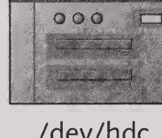

图 3-6 Fedora Core 4 在两个硬盘和一个 CD-ROM 驱动器上的分区情况

Fedora Core 4 为硬盘分配了名为分区的逻辑存储区域。分区表位于驱动器的 0 扇区。Fedora Core 4 需要其根文件系统至少一个分区。

## 驱动器分区命名规范

硬盘上的每个分区都被赋予一个名称，由设备名称后跟分区号组成。每个物理驱动器可以分配一个或多个分区。默认情况下，第一个安装的 IDE 驱动器称为 `hda`，第二个称为 `hdb`；第一个 SCSI 驱动器称为 `sda`，第二个称为 `sdb`，以此类推。

例如，当你安装 Fedora Core 4 时，系统会要求你指定想要安装操作系统的分区。此安装通常在第一个物理硬盘的第一个分区上进行，或者在第一个控制器上的主驱动器上进行，命名为 `hda1`。随后，启动过程将引用此主分区来加载和运行操作系统的信息。

`fdisk` 命令被称为分区表操纵程序；它显示带有相应文件系统的分区表。该命令具有以下语法：

```
fdisk [ -l ] [ -v ] [ -s partition ] [ device ]
```

- `-v`
  打印 `fdisk` 程序的版本号

- `-l`
  列出 `/dev/hda`、`/dev/hdb`、`/dev/sda`、`/dev/sdb`、`/dev/sdc`、`/dev/sdd`、`/dev/sde`、`/dev/sdf`、`/dev/sdg` 的分区表，然后退出

- `-s partition`
  如果此分区不是 DOS 分区（即其 ID 大于 10），则在标准输出上打印分区的大小

`fdisk` 命令的结果所示如图 3-7 所示。

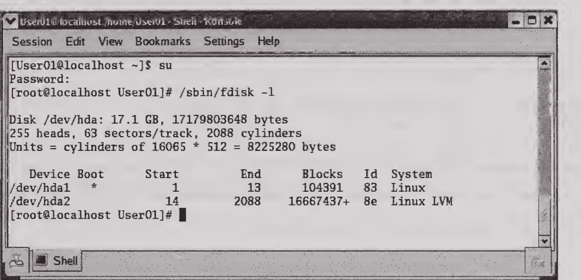

图 3-7 使用 fdisk 安装后的 Fedora Core 4 分区名称

## Fedora Core 4 中的物理驱动器

Fedora Core 4 的分区是根据你想使用的文件系统类型进行格式化的：FAT16、FAT32 或 ext3。你可以使用 `mkfs` 命令为特定的文件系统格式化并定义硬盘分区。

## Fedora Core 4 中的文件系统

扩展 2 文件系统 (ext2) 是 Fedora Core 4 中使用最广泛的文件系统。Ext2 提供了与 Windows XP 的 NTFS 相同的功能：

- 压缩——减少存储文件所需的空间
- 加密——保护文件免受可能获得未经授权访问的入侵者
- 日志——记录操作以便在崩溃后恢复
- 配额——限制用户使用的磁盘空间量
- 检查——检查文件系统完整性
- 扩展——允许超过四个主分区的限制
- 链接——支持硬链接
- 权限——控制对文件和目录的访问
- 快照——允许文件系统恢复到之前的状态
- 审计——记录对文件的访问情况
- 压缩——在文件系统上进行数据压缩
- 映射——支持内存映射文件
- 日志——通过日志确保数据的一致性

- ext2——基础的、不支持日志的文件系统
- ext3——支持日志的文件系统
- ext3——在 Fedora Core 4 中更可靠的文件系统
- FAT16——一种较旧的文件系统
- FAT32——支持更大分区的文件系统
- NTFS——Windows 的文件系统，Fedora Core 4 可以读取它，但写入功能受限
- UFS——适用于 Unix 的通用文件系统
- JFS2——一种用于光刻光盘的文件系统
- XFS——现代 Linux 文件系统，适用于高并发
- Btrfs——先进的日志文件系统


# 第 3 章 文件系统

- 3. 要开始查找有关文件系统的信息，请在搜索文本框中输入 `file systems` 并按回车键。
- 4. 找到并点击[在 NTFS、FAT 和 FAT32 之间选择](链接)。
> 如果你没有看到“在 NTFS、FAT 和 FAT32 之间选择”链接，请告知你的导师。
- 5. 阅读右侧窗格中关于选择文件系统的信息。
- 6. 阅读完信息后，关闭“帮助和支持”窗口。
- 7. 保持 PC 登录状态，以便进行下项活动。

## Fedora Core 4 文件系统特性

在对 Fedora Core 4 中选择和使用文件系统做出明智决策之前，你必须了解如何实现该文件系统。具体而言，你需要了解以下信息，本节将对这些进行解释：

- 硬盘上分区的分配
- 在分区上创建文件系统
- 在文件系统上创建和管理目录及文件
- 可用文件系统的特性

物理驱动器上的每个分区都有一个名称，然后根据你想要使用的文件系统类型进行格式化。分区上的文件系统随后会被“挂载”到挂载点上，以便在启动时自动或在需要时手动访问。目录和文件在这些文件系统上创建和管理。

## 磁盘分区

回想第 1 章中介绍的 ATA 控制驱动器的 BIOS 设置。为了想象 Fedora Core 4 文件系统，请参阅图 3-1，该图说明了物理设备的设置。使用 ATA 技术，你可以连接多达四个驱动器；每台 PC 可能有两个控制器（主和从），每个控制器都支持两个驱动器（主设备和从设备）。

硬盘最多可以有四个主分区，如图 3-6 所示。第一个物理驱动器命名为 `hda1`。扩展分区命名为 `hda2`。在 `hda` 上创建的后续主分区命名为 `hda3` 和 `hda4`。

第一个逻辑分区（命名为 `hda5`）包含在物理扩展分区 `hda2` 中。其他硬盘上的分区布局方式相同——主分区 (`hdb1`)、扩展分区 (`hdb2`)，以及在需要时创建的主分区 (`hdb3` 和 `hdb4`)。第二个控制器将包含一个 CD-ROM 驱动器 (`hdc`)。

### 磁盘控制器 0

| 物理驱动器 0 | | | |
| :--- | :--- | :--- | :--- |
| 主分区 `/dev/hda1` | 逻辑分区 `/dev/hda5` | 逻辑分区 `/dev/hda6` | |
| 扩展分区 `/dev/hda2` | | | |
| 物理驱动器 1 | | | |
| 主分区 `/dev/hdb1` | 逻辑分区 `/dev/hdb5` | 逻辑分区 `/dev/hdb6` | |
| 扩展分区 `/dev/hdb2` | | | |

### 磁盘控制器 1


图 3-6 Fedora Core 4 在两个硬盘和一个 CD-ROM 驱动器上的分区情况

Fedora Core 4 为硬盘分配了名为分区的逻辑存储区域。分区表位于驱动器的 0 扇区。Fedora Core 4 需要其根文件系统至少一个分区。

## 驱动器分区命名规范

硬盘上的每个分区都被赋予一个名称，由设备名称后跟分区号组成。每个物理驱动器可以分配一个或多个分区。默认情况下，第一个安装的 IDE 驱动器称为 `hda`，第二个称为 `hdb`；第一个 SCSI 驱动器称为 `cda`，第二个称为 `hdb`，以此类推。

例如，当你安装 Fedora Core 4 时，系统会要求你指定想要安装操作系统的分区。此安装通常在第一个物理硬盘的第一个分区上进行，或者在第一个控制器上的主驱动器上进行，命名为 `hda1`。随后，启动过程将引用此主分区来加载和运行操作系统的信息。

`fdisk` 命令被称为分区表操纵程序；它显示带有相应文件系统的分区表。该命令具有以下语法：

```
fdisk [ -l ] [ -v ] [ - partition ] [ device ]
```

- `v`：打印 `fdisk` 程序的版本号
- `-l`：列出 `/dev/hda`、`/dev/hdb`、`/dev/sda`、`/dev/sdb`、`/dev/sdc`、`/dev/sdd`、`/dev/sde`、`/dev/sdf`、`/dev/sdg` 的分区表，然后退出
- `-s partition`：如果此分区不是 DOS 分区（即其 ID 大于 10），则在标准输出上打印分区的大小

`fdisk` 命令的结果所示如图 3-7 所示。


图 3-7 使用 fdisk 安装后的 Fedora Core 4 分区名称

## Fedora Core 4 中的物理驱动器

Fedora Core 4 的分区是根据你想使用的文件系统类型进行格式化的：FAT16、FAT32 或 ext3。你可以使用 `mkfs` 命令为特定的文件系统格式化并定义硬盘分区。

## Fedora Core 4 中的文件系统

扩展 2 文件系统 (ext2) 是 Fedora Core 4 中使用最广泛的文件系统。Ext2 提供了与 Windows XP 的 NTFS 相同的功能：

- 压缩——减少存储文件所需的空间
- 加密——保护文件免受可能获得未经授权访问的入侵者
- 日志——记录操作以便在崩溃后恢复
- 配额——限制用户使用的磁盘空间量
- 检查——检查文件系统完整性
- 扩展——允许超过四个主分区的限制
- 链接——支持硬链接
- 权限——控制对文件和目录的访问
- 快照——允许文件系统恢复到之前的状态
- 审计——记录对文件的访问情况
- 压缩——在文件系统上进行数据压缩
- 映射——支持内存映射文件
- 日志——通过日志确保数据的一致性


# Fedora Core 4 文件系统

Fedora Core 4 的分区是根据你想使用的文件系统类型进行格式化的：`FAT16`、`FAT32` 或 `ext3`。你可以使用 `mkfs` 命令为特定的文件系统格式化并定义硬盘分区。

## Fedora Core 4 中的文件系统

扩展 2 文件系统 (`ext2`) 是 Fedora Core 4 中使用最广泛的文件系统。`Ext2` 提供了与 Windows XP 的 `NTFS` 相同的功能：

- 压缩——减少存储文件所需的空间
- 加密——保护文件免受可能获得未经授权访问的入侵者
- 日志——记录操作以便在崩溃后恢复
- 配额——限制用户使用的磁盘空间量
- 检查——检查文件系统完整性
- 扩展——允许超过四个主分区的限制
- 链接——支持硬链接
- 权限——控制对文件和目录的访问
- 快照——允许文件系统恢复到之前的状态
- 审计——记录对文件的访问情况
- 压缩——在文件系统上进行数据压缩
- 映射——支持内存映射文件
- 日志——通过日志确保数据的一致性

## Fedora Core 4 文件系统特性

在对 Fedora Core 4 中选择和使用文件系统做出明智决策之前，你必须了解如何实现该文件系统。具体而言，你需要了解以下信息，本节将对这些进行解释：

- 硬盘上分区的分配
- 在分区上创建文件系统
- 在文件系统上创建和管理目录及文件
- 可用文件系统的特性

物理驱动器上的每个分区都有一个名称，然后根据你想要使用的文件系统类型进行格式化。分区上的文件系统随后会被“挂载”到挂载点上，以便在启动时自动或在需要时手动访问。目录和文件在这些文件系统上创建和管理。

## 磁盘分区

回想第 1 章中介绍的 `ATA` 控制驱动器的 `BIOS` 设置。为了想象 Fedora Core 4 文件系统，请参阅图 3-1，该图说明了物理设备的设置。使用 `ATA` 技术，你可以连接多达四个驱动器；每台 PC 可能有两个控制器（主和从），每个控制器都支持两个驱动器（主设备和从设备）。

硬盘最多可以有四个主分区，如图 3-6 所示。第一个物理驱动器命名为 `hda1`。扩展分区命名为 `hda2`。在 `hda` 上创建的后续主分区命名为 `hda3` 和 `hda4`。

第一个逻辑分区（命名为 `hda5`）包含在物理扩展分区 `hda2` 中。其他硬盘上的分区布局方式相同——主分区 (`hdb1`)、扩展分区 (`hdb2`)，以及在需要时创建的主分区 (`hdb3` 和 `hdb4`)。第二个控制器将包含一个 `CD-ROM` 驱动器 (`hdc`)。

### 磁盘控制器 0

| 物理驱动器 0 | | | |
| :--- | :--- | :--- | :--- |
| 主分区 `/dev/hda1` | 逻辑分区 `/dev/hda5` | 逻辑分区 `/dev/hda6` | |
| 扩展分区 `/dev/hda2` | | | |
| 物理驱动器 1 | | | |
| 主分区 `/dev/hdb1` | 逻辑分区 `/dev/hdb5` | 逻辑分区 `/dev/hdb6` | |
| 扩展分区 `/dev/hdb2` | | | |

### 磁盘控制器 1


图 3-6 Fedora Core 4 在两个硬盘和一个 CD-ROM 驱动器上的分区情况

Fedora Core 4 为硬盘分配了名为分区的逻辑存储区域。分区表位于驱动器的 0 扇区。Fedora Core 4 需要其根文件系统至少一个分区。

## 驱动器分区命名规范

硬盘上的每个分区都被赋予一个名称，由设备名称后跟分区号组成。每个物理驱动器可以分配一个或多个分区。默认情况下，第一个安装的 `IDE` 驱动器称为 `hda`，第二个称为 `hdb`；第一个 `SCSI` 驱动器称为 `sda`，第二个称为 `sdb`，以此类推。

例如，当你安装 Fedora Core 4 时，系统会要求你指定想要安装操作系统的分区。此安装通常在第一个物理硬盘的第一个分区上进行，或者在第一个控制器上的主驱动器上进行，命名为 `hda1`。随后，启动过程将引用此主分区来加载和运行操作系统的信息。

`fdisk` 命令被称为分区表操纵程序；它显示带有相应文件系统的分区表。该命令具有以下语法：

```
fdisk [ -l ] [ -v ] [ -s partition ] [ device ]
```

- `-v`：打印 `fdisk` 程序的版本号
- `-l`：列出 `/dev/hda`、`/dev/hdb`、`/dev/sda`、`/dev/sdb`、`/dev/sdc`、`/dev/sdd`、`/dev/sde`、`/dev/sdf`、`/dev/sdg` 的分区表，然后退出
- `-s partition`：如果此分区不是 `DOS` 分区（即其 ID 大于 10），则在标准输出上打印分区的大小

`fdisk` 命令的结果所示如图 3-7 所示。


图 3-7 使用 fdisk 安装后的 Fedora Core 4 分区名称

## Fedora Core 4 中的物理驱动器

Fedora Core 4 的分区是根据你想使用的文件系统类型进行格式化的：`FAT16`、`FAT32` 或 `ext3`。你可以使用 `mkfs` 命令为特定的文件系统格式化并定义硬盘分区。


# 第 3 章 文件系统

- 3. 要开始查找有关文件系统的信息，请在搜索文本框中输入 `file systems` 并按回车键。
- 4. 找到并点击[在 NTFS、FAT 和 FAT32 之间选择](链接。

> 如果你没有看到“在 NTFS、FAT 和 FAT32 之间选择”链接，请告知你的导师。

- 5. 阅读右侧窗格中关于选择文件系统的信息。
- 6. 阅读完信息后，关闭“帮助和支持”窗口。
- 7. 保持 PC 登录状态，以便进行下项活动。

## Fedora Core 4 文件系统特性

在对 Fedora Core 4 中选择和使用文件系统做出明智决策之前，你必须了解如何实现该文件系统。具体而言，你需要了解以下信息，本节将对这些进行解释：

- 硬盘上分区的分配
- 在分区上创建文件系统
- 在文件系统上创建和管理目录及文件
- 可用文件系统的特性

物理驱动器上的每个分区都有一个名称，然后根据你想要使用的文件系统类型进行格式化。分区上的文件系统随后会被“挂载”到挂载点上，以便在启动时自动或在需要时手动访问。目录和文件在这些文件系统上创建和管理。

## 磁盘分区

回想第 1 章中介绍的 ATA 控制驱动器的 BIOS 设置。为了想象 Fedora Core 4 文件系统，请参阅图 3-1，该图说明了物理设备的设置。使用 ATA 技术，你可以连接多达四个驱动器；每台 PC 可能有两个控制器（主和从），每个控制器都支持两个驱动器（主设备和从设备）。

硬盘最多可以有四个主分区，如图 3-6 所示。第一个物理驱动器命名为 `hda1`。扩展分区命名为 `hda2`。在 `hda` 上创建的后续主分区命名为 `hda3` 和 `hda4`。

第一个逻辑分区（命名为 `hda5`）包含在物理扩展分区 `hda2` 中。其他硬盘上的分区布局方式相同——主分区 (`hdb1`)、扩展分区 (`hdb2`)，以及在需要时创建的主分区 (`hdb3` 和 `hdb4`)。第二个控制器将包含一个 CD-ROM 驱动器 (`hdc`)。

## 文件系统创建

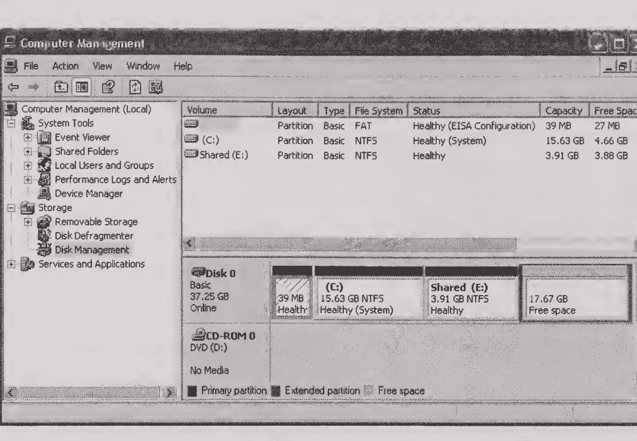
图 3-8 磁盘 0 上的区域

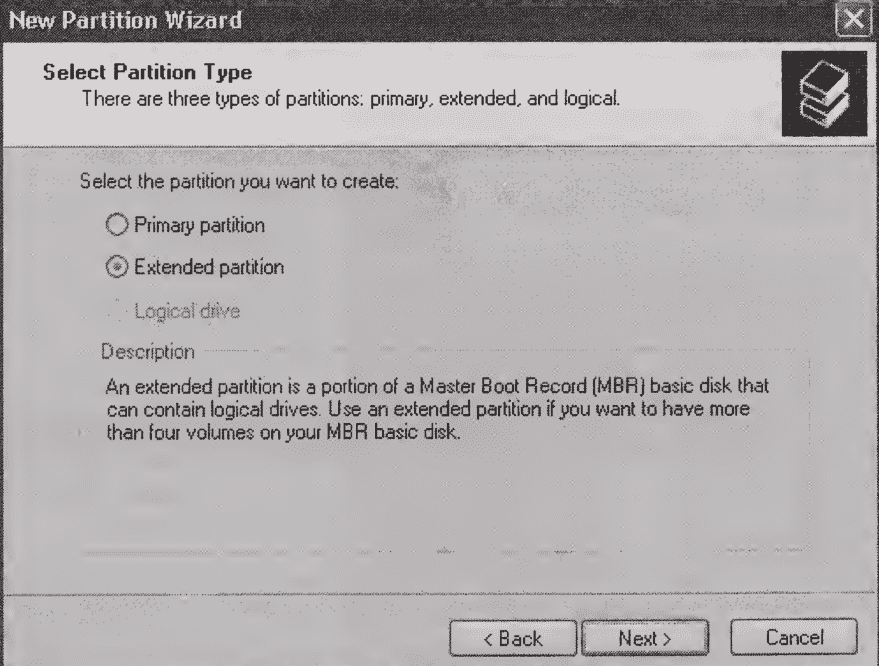
图 3-9 已选择扩展分区选项

在接下来的对话框中，你将指定为扩展分区预留的存储空间大小。例如，如果你想将硬盘的剩余部分用于扩展分区，可以在“分区大小（MB）”字段中保留默认值，如图 3-10 所示。

接下来，你可以在刚刚创建的扩展分区中创建一个逻辑驱动器。只需重新打开“新建分区向导”（`New Partition Wizard`），选择“新建逻辑驱动器”（`New Logical Drive`），并指定逻辑驱动器的大小。在接下来的对话框中，你可以为驱动器分配一个字母，如图 3-11 所示。

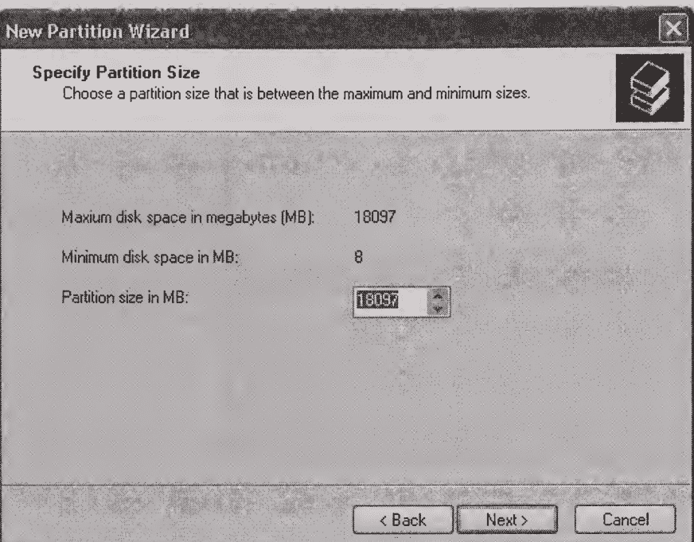
图 3-10 指定分区大小

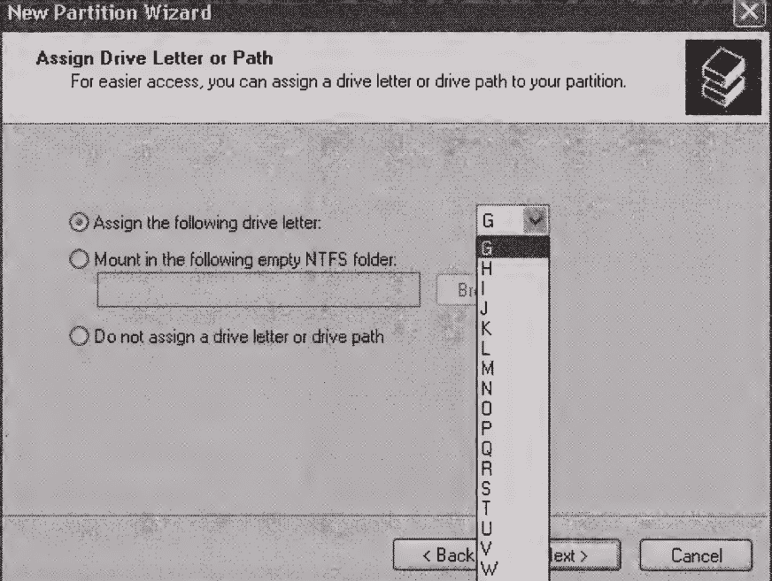
图 3-11 分配驱动器字母

在“分配驱动器字母或路径”（`Assign Drive Letter or Path`）对话框中，你有三个选项：

- **分配以下驱动器字母**（`Assign the following drive letter`）——要为驱动器分配字母，请点击此选项，然后从列表框选择一个字母。
- **挂载到以下空 NTFS 文件夹**（`Mount in the following empty NTFS folder`）——通过此选项，你可以从另一个分区的文件夹引用该分区或逻辑驱动器。此挂载选项类似于 Linux 中的挂载（`mount`）。例如，你可以点击 C 盘上的某个文件夹，该文件夹链接到扩展分区中的逻辑驱动器。如果你打算挂载此文件夹，请注意它不能包含任何数据文件。你将在活动 3–9 中挂载一个光驱驱动器。
- **不分配驱动器字母或路径**（`Do not assign a drive letter or path`）——如果你想延迟分配驱动器字母或路径，请点击此选项。这在你想要为分区或逻辑驱动器分配字母之前更改现有驱动器字母时非常有用。

最后，在使用分区之前必须对其进行格式化。在接下来的“格式化分区”（`Format Partition`）对话框中，你可以配置若干选项，如图 3-12 所示：

- **不格式化此分区**（`Do not format this partition`）——点击此按钮选择文件系统。
- **使用以下设置格式化此分区**（`Format this partition with the following settings`）——点击此按钮为分区建立任何或所有设置。
- **文件系统**（`File system`）——从 FAT、FAT32 或 NTFS 中选择文件系统。
- **分配单元大小**（`Allocation unit size`）——指定要使用的簇大小（最好让 Windows XP 做出此决定）。
- **卷标**（`Volume label`）——输入你想显示在此卷关联的卷标。
- **执行快速格式化**（`Perform a quick format`）——加速格式化操作；你应该只对已知状况良好的以前格式化过的分区使用此选项。
- **启用文件和文件夹压缩**（`Enable file and folder compression`）——指示文件和文件夹将自动压缩（仅对 NT 文件系统可用）。

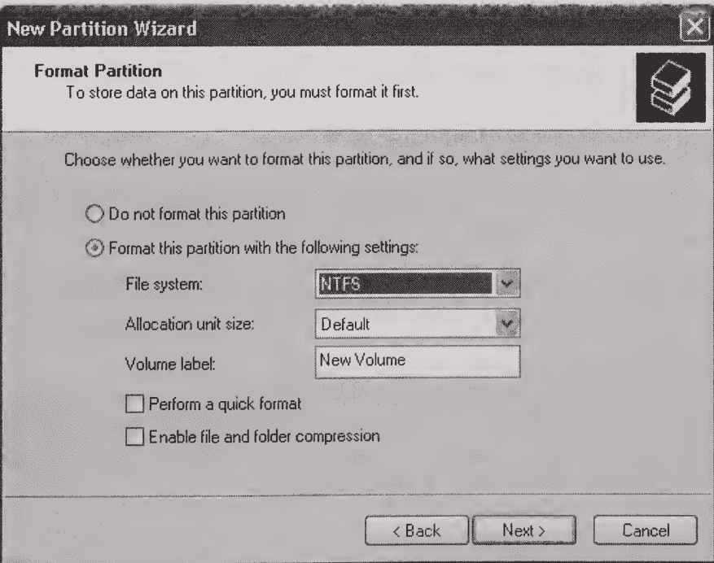
**图 3-12** 格式化选项

选择格式化选项后，点击“下一步”，然后点击“完成”按钮格式化驱动器。

## 活动 3-3：创建逻辑驱动器

**所需时间：** 20 分钟

**目标：** 在 Windows XP 的扩展分区内创建一个逻辑驱动器。
**描述：** 在此活动中，你打开“计算机管理”程序并选择“磁盘管理”。你创建一个扩展分区，然后在扩展分区内创建一个逻辑驱动器。如果你想在 Windows XP 中创建带有文件系统的存储区域，此活动将非常有用。

1. 如必要，使用 `User01` 和密码 `Password` 登录你的 PC。
2. 要打开控制面板，点击**开始**，然后点击**控制面板**。
3. 如果显示的是类别视图，点击**切换到经典视图**。
4. 要打开计算机管理窗口，点击**管理工具**，然后点击**计算机管理**。
5. 要打开磁盘管理控制台，点击**磁盘管理**。
6. 找到磁盘 0 的**未分配**（`Unallocated`）区域。如果你在磁盘 0 上没有看到**未分配**区域，请告知你的导师。
7. 要启动新建分区向导，右键点击磁盘 0 上的**未分配**区域并点击**新建分区**。
8. 在阅读欢迎消息后，点击**下一步**。
9. 要创建扩展分区，点击**扩展分区**选项，阅读**描述**（`Description`），然后点击**下一步**。
10. 在“指定分区大小”对话框中，点击**下一步**接受建议的大小。
11. 检查设置信息并点击**完成**。
12. 接下来，你需要在扩展分区内创建一个逻辑驱动器。要再次启动新建分区向导，右键点击磁盘 0 上扩展分区区域内的**空闲空间**并点击**新建逻辑驱动器**。
13. 双击**下一步**。
14. 要设置逻辑驱动器的大小，在“分区大小（MB）”框中输入 **500** 并点击**下一步**。
15. 接受右侧显示的驱动器字母，点击**分配以下驱动器字母**，然后点击**下一步**。
16. 在格式化分区对话框中，点击**使用以下设置格式化此分区**，并在卷标中输入 **Format**。
17. 检查设置并点击**完成**。
18. 如果你在驱动器上没有看到“良好”字样，请告知导师。
19. 关闭此活动打开的所有窗口。
20. 登录 PC 以进行下一个活动。

## 活动 3-4：更改驱动器字母

**所需时间：** 10 分钟

**目标：** 在 Windows XP 中更改逻辑驱动器的字母。
**描述：** 在此活动中，你打开计算机管理并选择磁盘管理，然后重新挂载驱动器。如果你想在 Windows XP 中更改驱动器字母，此活动将非常有用。

1. 要打开控制面板，点击**开始**，然后点击**控制面板**。
2. 要打开计算机管理窗口，点击**管理工具**，然后点击**计算机管理**。
3. 要打开磁盘管理控制台，点击**磁盘管理**。
4. 右键点击要更改的驱动器并选择**更改驱动器字母或路径**。
5. 在对话框中，选择**分配以下驱动器字母**，然后从列表框选择一个新字母。
6. 点击**确定**。
7. 确认驱动器字母已更改。
8. 关闭此活动打开的所有窗口。
9. 注销 PC 以进行下一个活动。

## 表 3-3 Fedora Core 4 默认目录（续）

| 默认值 | 说明 |
| :--- | :--- |
| `/usr` | 此目录包含各种用户定义文件。 |
| `/var` | 此目录包含通常大小变化的文件，例如日志文件、打印槽文件和各种动态文件。 |
| `/tmp` | 此目录包含临时文件。 |

当你创建一个文件系统时，你会使用 `fdisk` 命令创建一个新分区，如图 3-13 所示。你需要具有超级用户权限才能使用此命令。你可以配合多个交互式参数使用 `fdisk` 命令。

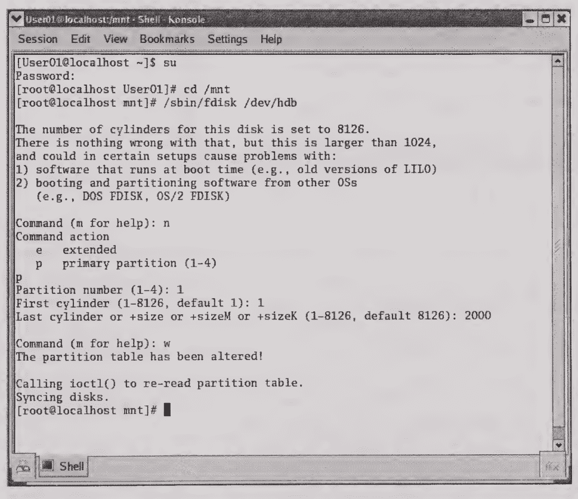
图 3-13 使用 fdisk 创建新分区

接下来，你使用 `mkfs` 命令创建文件系统。这使得文件系统能够存储文件。你需要具有超级用户权限才能使用此命令。

例如，你可以使用以下 `mkfs` 命令在软盘上创建文件系统。该命令将文件系统定义为 `ext2`，但你也可以选择使用 `msddos` 分区。`-t` 选项指定文件类型，`/dev/fdb0` 指定目标设备。

```
mkfs -t ext2 /dev/fdb0
```

在下一个命令中，`-c` 选项告诉操作系统标记坏块并避免向其写入。

```
mkfs -t ext3 -c /dev/hdb1
```

图 3-4 和活动 3-5 展示了如何使用 `mkfs` 创建新分区。

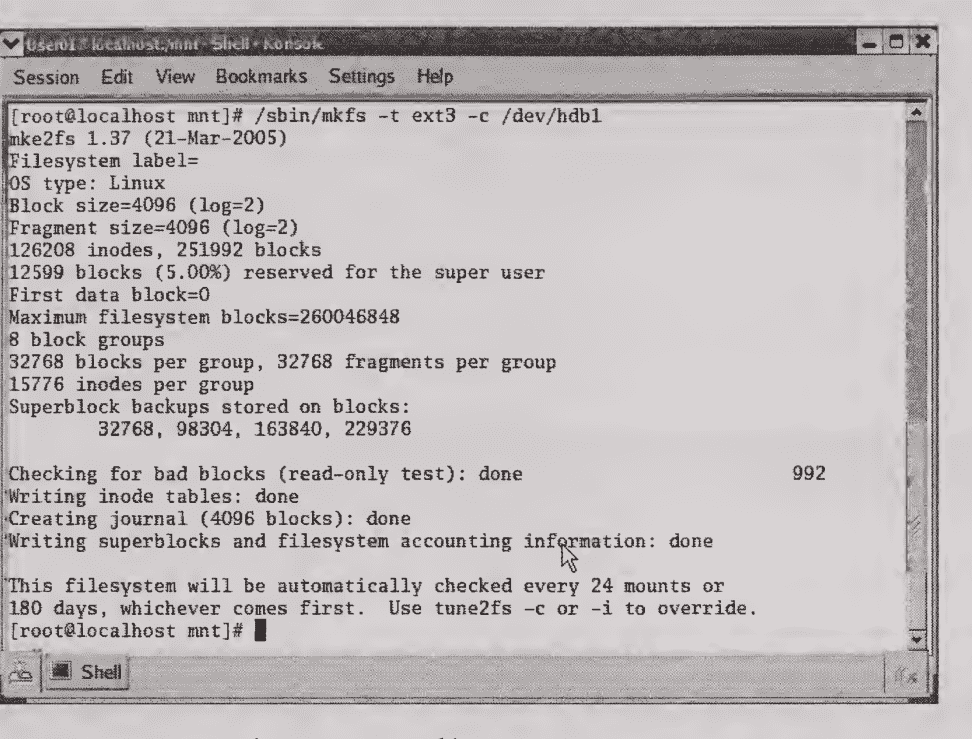
图 3-4 使用 mkfs 创建 Fedora Core 4 文件系统

如果你需要在当前文件系统上创建一个挂载点，首先需要使用 `mkdir` 命令在文件系统中创建一个目录。该命令的作用类似于 Windows XP 命令行中的 `MD` 命令。例如，你可以输入：

```
mkdir /home/User01/mydirectory
```


此活动是可选的。要完成活动 3-5，你的硬盘需要有空空间以便在虚拟机上创建分区。

# 活动 3-5：创建 Fedora Core 4 文件系统

**所需时间**：15 分钟

**目标**：在 Fedora Core 4 中手动创建文件系统。

**描述**：在此活动中，你将使用 `fdisk` 和 `mkfs` 命令在 Fedora Core 4 中创建文件系统。此活动非常有用，例如当你需要创建一个新分区和文件系统，并为数据留出存储区域时。

1. 如必要，使用用户 `User01` 和密码 `Password1` 登录你的 PC。
2. 如必要，点击“开始”，指向“所有程序”，然后点击“Microsoft Virtual PC”。
3. 如必要，点击“未运行的 Fedora_core_4”，然后点击“启动”按钮。
4. 如必要，使用用户 `User01` 和密码 `Password1` 登录你的 Fedora Core 4 系统。


5. 右键点击桌面并点击“Konsole”。
6. 确保你具有超级用户权限。如必要，输入 `su` 和密码 `Secret`。
7. 要启动 `fdisk` 工具，输入 `/sbin/fdisk /dev/hdb` 然后按回车。
8. 对于分区，按下 `n` 然后按回车。
9. 对于主分区，按下 `p` 然后按回车。
10. 对于分区号，按下 `1` 然后按回车。
11. 对于起始柱面，按下 `1` 然后按回车。
12. 对于结束柱面，按下 `4000` 然后按回车。
13. 要保存更改，按下 `w` 然后按回车。要创建文件系统，输入 `/sbin/mkfs -t ext3 /dev/hdb1` 然后按回车。
14. 注意命令输出中关于新文件系统的信息。
15. 要关闭 Konsole 窗口，输入 `exit` 然后按回车。
16. 保持 Fedora Core 4 登录状态进行下一个活动。

# 挂载文件系统

Windows XP 和 Fedora Core 4 在挂载文件系统的方法上相当不同，但每种方法都有其优点。如前所述，Windows XP 为各种分区、卷或 CD-ROM 驱动器分配驱动器号。这些“预挂载”的存储项（可移动驱动器除外）通常无需用户干预即可供 PC 用户使用。

为了理解这些方法之间的区别，想象有一栋有很多房间的房子。在 Windows XP 的房子里，当你进入正门时，所有房间的灯都会亮。Windows XP 希望通过提供所有存储区域以牺牲 PC 性能为代价优化用户便利性。在 Fedora Core 4 的房子里，你会在进入每个房间时打开该房间的灯，离开时关灯。Fedora Core 4 希望通过只提供需要的区域以牺牲用户便利性为代价来优化性能。

本节解释了如何在两个操作系统中访问存储区域。

## 活动 3-7：移除驱动器的挂载点

**所需时间**：10 分钟

**目标**：在 Windows XP 中移除挂载点。

**描述**：在此活动中，你打开“计算机管理”程序，选择“磁盘管理”，找到想要卸载的驱动器。如果你想在 Windows XP 中移除挂载点，此活动非常有用。

1. 如果必要，使用用户 `User01` 和密码 `Password1` 登录你的电脑。
2. 要打开控制面板，点击“开始”，然后点击“控制面板”。
3. 要打开“计算机管理”窗口，点击“管理工具”，然后点击“计算机管理”。
4. 要打开“磁盘管理”控制台，点击“磁盘管理”。
5. 右键点击“逻辑 (F:)”区域，然后点击“更改驱动器号和路径”。
6. 要移除挂载点，点击“(C)\Mount Drive F”，点击“删除”按钮，然后点击“是”。
7. 要打开 Windows XP 资源管理器，右键点击“(C:)”区域，然后点击“打开”。
8. 要移除之前挂载驱动器的文件夹，右键点击“Mount Drive F”文件夹，点击“删除”，然后点击“是”。
9. 关闭你在此活动中打开的所有窗口。
10. 保持电脑注销状态以进行下一个活动。

## 活动 3-8：移除逻辑驱动器

**所需时间**：10 分钟

**目标**：在 Windows XP 中移除逻辑驱动器和扩展分区。

**描述**：在此活动中，你打开“磁盘管理”控制台并删除逻辑驱动器和扩展分区。如果你想移除不再需要的分区，此活动非常有用。

1. 如果必要，使用用户 `User01` 和密码 `Password1` 登录你的电脑。
2. 要打开控制面板，点击“开始”，然后点击“控制面板”。
3. 要打开“计算机管理”窗口，点击“管理工具”，然后点击“计算机管理”。
4. 要打开“磁盘管理”控制台，点击“磁盘管理”。
5. 要移除逻辑驱动器，右键点击“逻辑 (F:)”区域，点击“删除逻辑驱动器”，然后点击“是”按钮。
6. 要移除扩展分区，右键点击空闲空间区域，点击“删除分区”，然后点击“是”按钮。
7. 关闭你在此活动中打开的所有窗口。
8. 保持电脑登录状态以进行下一个活动。

# 挂载 Fedora Core 4 文件系统

记住，Fedora Core 4 为每个分区分配名称，然后将这些分区挂载到由文件系统定义的挂载点上。挂载是使文件系统变得可用的过程。挂载后，你可以在挂载点访问你的文件。你必须拥有超级用户权限才能挂载文件系统。

某些分区在安装时默认被创建并启动。这些相同的分区在操作系统启动时会自动挂载。如果你想在操作系统启动时自动挂载另一个分区，你必须在 `/etc/fstab` 文件中为该分区输入条目行。

与 Windows 类似，挂载的驱动器使你的数据存储更易访问，并让你具有根据使用情况管理数据的活性。例如，当 `/dev/hba2` 驱动器的空间开始变得不足时，你可以将目录移动到另一个具有更多可用磁盘空间的格式化物理驱动器，然后将其挂载为 `/dev/hba2`。

挂载分区应该是本地目录结构的一部分，无论它们实际上是在本地还是在网络上的另一台机器上。因此，在另一个分区上挂载 Fedora Core 4 对操作系统没有区别。

`/etc/rc.d` 中的一个脚本执行 `mount -a` 命令，该命令会自动挂载 `/etc/fstab` 中列出的所有文件系统，除非指定了 `noauto` 选项。结果是文件系统（包括硬盘和 CD-ROM 驱动器）将在电脑启动时挂载并可用。

如果你的 CD-ROM 驱动器没有自动挂载，那么创建它是一个好主意，例如 `/mnt` 自动挂载设备。使用 `mount` 命令将文件系统挂载到分区，如下：

```
mount -t type device mount-point
```

| 选项 | 说明 |
| :--- | :--- |
| `mount -h` | 打印帮助信息 |
| `mount -V` | 打印版本字符串 |
| `mount -l` | 列出所有挂载的文件系统 |
| `-l` | 添加 ext2 和 ext3 标签 |
| `-n` | 挂载文件系统但不写入 `/etc/mtab` |
| `-r` | 以只读方式挂载文件系统 |
| `-w` | 以读写方式挂载文件系统（默认） |
| `-t` | 指定文件类型 |

目前支持的文件类型有 `ext2`、`ext3`、`iso9660`（默认）、`msdos`、`nfs`、`ufs`、`umsdos` 和 `vfat`。如果你在 `mount` 命令中没有 `-t` 来指定文件类型，或者指定了 `auto` 类型，超级块将被锁定。超级块包含一个识别为 UFS 的数字。

## 活动 3-9：管理 Fedora Core 4 文件系统

**所需时间**：10 分钟

**目标**：在 Fedora Core 4 中管理文件系统（挂载/卸载操作）。

**描述**：在此活动中，你将练习挂载和卸载文件系统。

1. 如果必要，使用用户 `User01` 和密码 `Password1` 登录你的 Fedora Core 4 系统。
2. 打开终端（Konsole）。
3. 切换到超级用户：`su -`（密码 `Secret`）。
4. 创建挂载点：`mkdir /mnt/newdisk`。
5. 挂载之前创建的分区：`mount -t ext3 /dev/hdb1 /mnt/newdisk`。
6. 验证挂载：`df -h /mnt/newdisk`。
7. 卸载文件系统：`umount /mnt/newdisk`。
8. 关闭终端窗口。

# 管理 Windows XP 文件系统

本节介绍了如何在 Windows XP 和 Fedora Core 4 中管理文件系统。在 Windows XP 中，你可以使用“本地磁盘属性”对话框来辅助文件系统管理。在 Fedora Core 4 中，你可以使用 `fsck` 命令并管理交换空间。

Windows XP 提供了许多工具来帮助管理文件系统的日常运行。以所选驱动器的“本地磁盘属性”对话框作为起点（见图 3-19）。

## 管理文件系统

如果你没有看到“安全”选项卡，说明你正在使用简单共享。如果启用了该功能，将显示文件共享界面而不是“安全”和“共享”选项卡。默认情况下，这种新的用户界面实现在 Windows XP 家庭版，以及在工作组中工作的 Windows XP 专业版中。如果你关闭文件共享，“安全”和“共享”选项卡就会出现，你可以指定哪些用户和组可以共享文件夹。要禁用文件共享，点击“开始”，指向“我的电脑”，点击“工具”菜单，点击“文件夹选项”，然后点击“查看”选项卡。在“高级设置”部分，取消勾选“简单文件共享（推荐）”框，然后点击“确定”。

你需要管理员权限来查看和更改“共享”和“配额”选项卡中的信息。如果你没有管理员权限，这两个选项卡将不会显示。

本地磁盘属性对话框中的工具被分为六个选项卡，接如下节所示。

## 常规选项卡

“常规”选项卡提供了管理驱动器可用磁盘空间的有用信息和选项（见图 3-19）：

- **类型**—本地磁盘是 PC 上的硬盘
- **文件系统**—指示驱动器上的文件系统类型
- **已用空间**—显示驱动器上的已用空间量
- **可用空间**—显示驱动器上的未用空间
- **容量**—显示磁盘驱动器的总容量
- **磁盘清理**—删除临时和 Internet 文件
- **压缩驱动器以节省磁盘空间**—减少存储在驱动器上的文件和文件夹所占空间
- **允许索引服务对此磁盘建立索引以进行快速文件搜索**—允许你通过关键字快速搜索文档；你可以控制索引中的信息

## 工具选项卡

“工具”选项卡（见图 3-20）提供了三个与驱动器相关的工具，你可以使用这些工具专注于你的磁盘调优：

- **检查错误**—扫描驱动器损坏；扫描期间驱动器不可用，如果驱动器上有大量文件，扫描可能需要很长时间
- **碎片整理**—分析驱动器是否存在碎片（文件部分散布在硬盘上）；碎片整理工具会找到碎片的文件和文件夹并按顺序重新排列，以提高磁盘性能
- **备份**—将文件和文件夹的内容复制一份以保护宝贵数据；此选项在 Windows XP 家庭版中不可用

## 硬件选项卡

“硬件”选项卡（见图 3-22）提供了 PC 上所有驱动器的信息和设置访问。你可以使用“硬件”选项卡中的以下选项来查看你的硬盘信息并保持其高效运行：

- **名称和类型**—显示驱动器的名称和类型
- **疑难解答按钮**—链接到“帮助和支持”，你可以在那里接收有关指定设备疑难排除的信息
- **属性按钮**—建立与快速移除 USB 驱动器相关的策略（无需访问任务栏上的“安全删除”图标），并启用写入缓存（即数据在内存中并对驱动器进行优化写入）

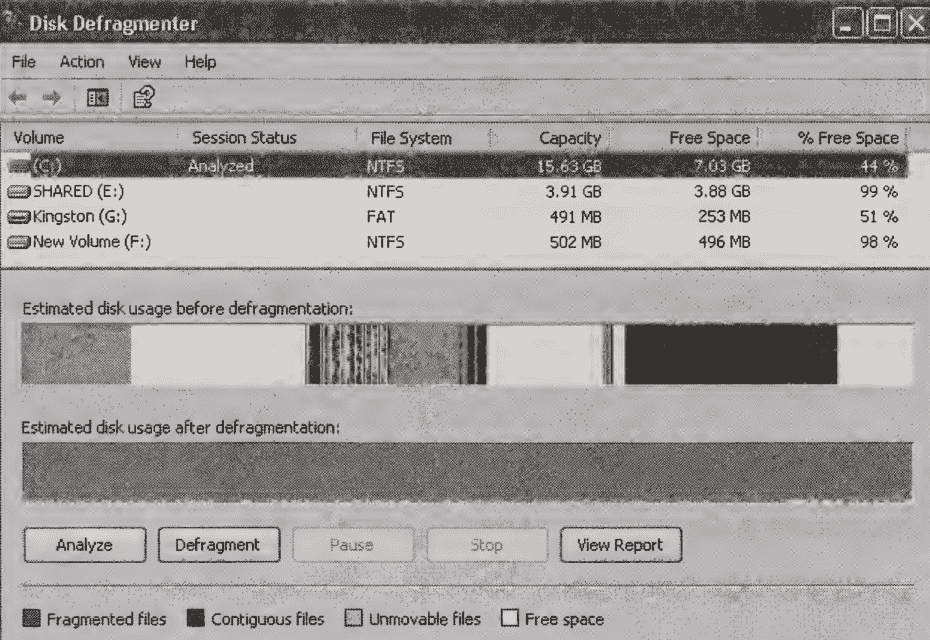

碎片整理前的估计磁盘使用情况：

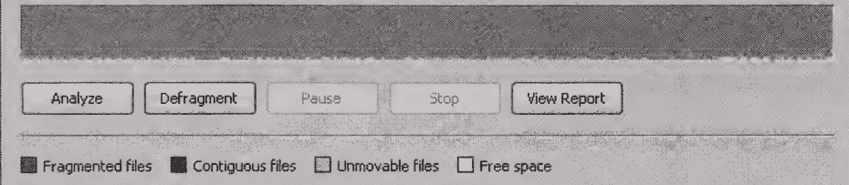

**图 3-21** 磁盘碎片整理

**图 3-22** 硬件选项卡，本地磁盘属性对话框

## 共享选项卡

通过“共享”选项卡（见图 3-23），你可以共享驱动器的全部内容，其他用户可以从其他计算机访问此共享驱动器。默认情况下，对话框中会显示隐藏的 `C$`。如果你具有管理员权限，可以为本地磁盘 (C) 的完整内容创建额外共享。要这样做，点击“新建共享”按钮，在“共享名称”文本框中输入名称，点击“权限”按钮，勾选适当的“允许”复选框，然后点击“确定”。你需要了解这些设置。

当你共享驱动器时，任何通过网络访问的用户都可以访问驱动器。

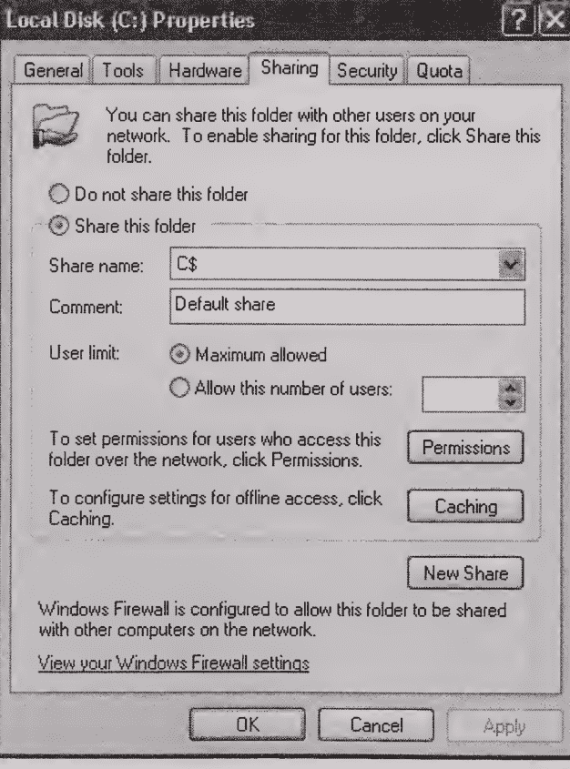

**图 3-23** 共享选项卡，本地磁盘属性对话框

## 安全选项卡

通过“安全”选项卡（见图 3-24），你可以设置对硬盘的 NTFS 权限。如果你具有管理员权限，可以管理用户组的 NTFS 权限。要修改 NTFS 权限，勾选每个组的“允许”并点击“确定”。

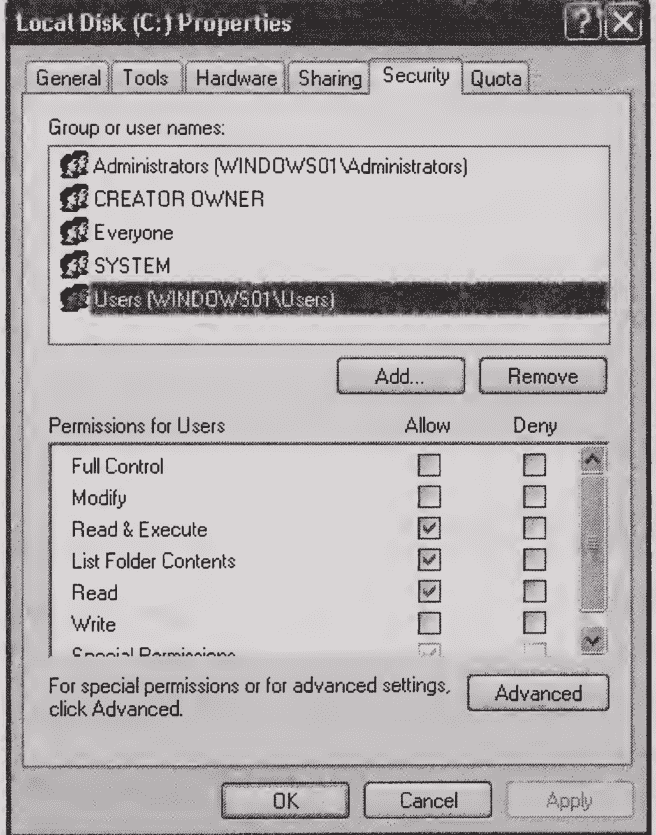

**图 3-24** 安全选项卡，本地磁盘属性对话框

## 配额选项卡

配额选项卡跟踪并控制卷的磁盘空间。管理员可以配置 Windows XP 防止过度使用磁盘空间。示例见图 3-25。

配额选项卡包含以下选项：

- **启用配额管理**—切换配额。开启后，操作系统可以配置磁盘配额。
- **拒绝超过配额的用户磁盘空间**—如果选择此选项，超过限制的用户将收到 Windows XP 的“磁盘空间不足”错误，并且在删除或移动文件之前无法向驱动器写入附加数据。对于受影响的程序来说，看起来驱动器已满。
- **不限制磁盘使用**—如果选择此选项，当用户超过限制时会创建日志记录，但不会限制使用。
- **限制磁盘空间为**—此选项指定了作为驱动器新用户允许使用的磁盘空间量，以及在写入系统日志之前必须使用的磁盘空间量。
- **设置警告级别为**—此选项与“限制磁盘空间为”类似，但仅建立警告条件。超过警告级别时，系统日志中会放置警告条目；但用户不会收到通知。
- **用户超过配额限制时记录事件**—此选项每当你超过配额限制时，会在系统日志中放置一个条目。
- **用户超过警告级别时记录事件**—此选项每当你超过警告级别时，会在系统日志中放置一个条目。

配额管理中一个有用的额外功能是向用户发送已达到警告级别的消息。相反，目前是在系统日志中创建消息，只有管理员会收到限制已到的通知。

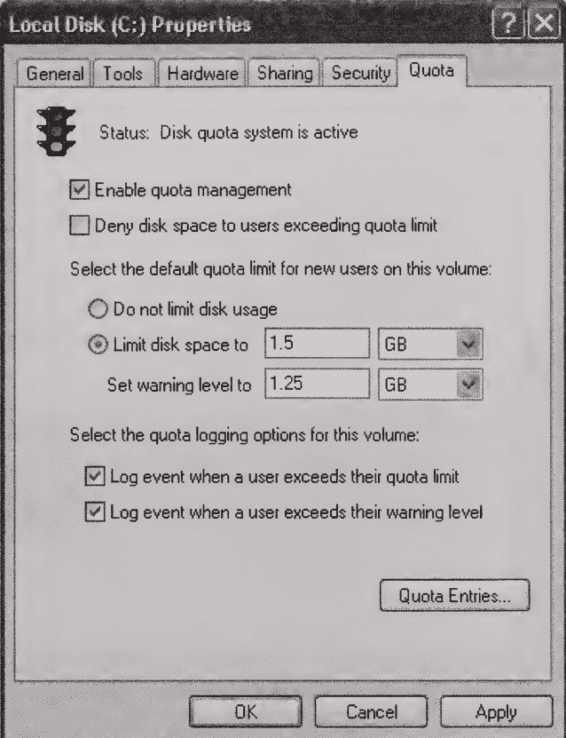

**图 3-25** 配额选项卡，本地磁盘属性对话框，操作系统跟踪磁盘使用情况。

## 活动 3-10：查看文件系统属性

**所需时间**：10 分钟

**目标**：查找 Windows XP 中文件系统的信息。

**描述**：在此活动中，你将打开“磁盘管理”控制台并查看驱动器的本地属性。例如，如果你想确定驱动器上可用空间的信息，此活动将非常有用。

1. 如必要，请使用用户 `User01` 和密码 `Password1` 登录你的电脑。
2. 要打开“控制面板”，点击“开始”，然后点击“控制面板”。
3. 要打开“计算机管理”窗口，点击“管理工具”，然后点击“计算机管理”。
4. 要打开“磁盘管理”控制台，点击“磁盘管理”。
5. 右键点击 `C:\` 区域，然后点击“属性”。
6. 查看你电脑上 C 盘的属性。
7. 关闭在此活动中打开的所有窗口。
8. 保持 PC 注销状态以进行下一个活动。

## 活动 3-11：分析驱动器碎片情况

**所需时间**：20 分钟到两小时，取决于硬盘的大小和电脑的速度。

**目标**：确定 Windows XP 中的驱动器是否存在碎片。


**描述：** 在此活动中，你将打开“磁盘管理”控制台并分析驱动器的碎片情况。如果你想确定驱动器是否适合碎片整理，此活动将非常有用。

1. 如必要，请使用用户 `User01` 和密码 `Password1` 登录你的电脑。
2. 要打开“控制面板”，点击`开始`，然后点击`控制面板`。
3. 要打开“计算机管理”窗口，点击`管理工具`，然后点击`计算机管理`。
4. 要打开“磁盘管理”控制台，点击`磁盘管理`。
5. 右键点击 `C:\` 区域，然后点击`属性`。
6. 要分析驱动器的碎片情况，点击`工具`选项卡，点击`立即整理`按钮，然后点击`分析`按钮。
7. 等待分析完成。
8. 要查看分析报告，点击`查看报告`按钮。
9. 检查卷信息和碎片最多的文件，然后点击`关闭`按钮。
10. 关闭在此活动中打开的所有窗口。
11. 保持 PC 登录状态以进行下一个活动。

## 管理 Fedora Core 4 文件系统

本节将向你介绍如何在 Fedora Core 4 中管理文件系统。你可以使用 `fsck` 命令并管理交换空间。

## 文件系统检查与修复

有时，断电或非正常关机可能会导致文件损坏和操作系统错误。如果发生这种情况，操作系统将无法将缓冲区缓存（一种用于快速访问存储数据项的特殊内存区域）与磁盘内容进行同步。要检查并修复文件系统错误，请使用 `fsck` 命令。

Fedora Core 4 在启动时会自动检查文件系统，就像 Windows XP 使用 `chkdsk` 工具一样，因此你也应该使用 `fsck` 命令来检查 Fedora Core 4 系统并修正任何问题。`fsck` 命令在语法上与你之前在本章中使用的 `mkfs` 命令相似。该命令的格式为 `fsck -l`；例如，你曾对 ext3 文件系统使用 `fsck -t ext3`：

```
fsck -t ext3 /dev/sda2
```

注意：你只应该在未挂载或只读系统上运行 `fsck` 命令。`fsck` 命令返回的退出码是以下条件的总和，如表 3-4 所示。例如，如果得到的退出码为 3，说明文件系统错误已修复，电脑需要重启。

| 表 3-4 fsck 命令的退出码 | 描述 |
| :--- | :--- |
| 0 | 无错误 |
| 1 | 文件系统错误已修复 |
| 2 | 电脑应重新启动 |
| 4 | 文件系统错误未修复 |
| 8 | 操作错误 |
| 16 | 使用或语法错误 |
| 128 | 共享错误 |

## 交换空间管理

交换空间用于实现分页，分页是一个在内存不足时将内存页写入磁盘，并在需要时将其读回物理内存的过程。这一过程有助于提高性能，允许许多程序在原本无法放入物理内存的情况下同时运行。在“创建文件系统”部分中，这种空间被称为交换文件或交换分区。交换分区可以产生更好的性能，因为磁盘块保证是连续的。然而，在交换文件的情况下，磁盘块可能会分散在文件系统中。要查看你有多少交换空间，只需在命令提示符中输入 `free`。该命令报告内存使用情况，包括内存和交换的总数，以及已使用、空闲和缓存的空间量。所有数字均以 1024 字节为单位报告。图 3-6 和活动 3-12 显示了如何在 Fedora 4 中显示内存和交换系统的可用空间。

## 活动 3-12：分析可用空间

**所需时间：** 10 分钟

**目标：** 使用 `free` 命令查看 Fedora Core 4 系统的内存和交换空间信息。

**描述：** 在此活动中，你将使用 `free` 命令。如果你需要内存和交换空间信息，此活动将非常有用。

1. 如必要，使用用户 `User0` 和密码 `Password1` 登录你的电脑。
2. 如必要，点击`开始`，指向`所有程序`，然后点击`管理工具`。
3. 如必要，点击`运行中的 Fedora 4`并点击`开始`。
4. 如必要，使用 `User0` 和密码 `Password1` 登录 Fedora 4。
5. 右键点击桌面并点击`终端`。
6. 确保你有超级用户权限。如必要，输入 `su` 和密码 `Secret1`。
7. 要查看内存和交换空间信息，输入 `/usr/bin/free` 并按回车。
8. 对输出的内存和交换空间信息进行记录。
9. 要关闭 Fedora 4 终端窗口，输入 `exit` 并回车，再次输入 `exit`。
10. 点击红色帽子图标，点击`注销`，然后点击`结束会话`。
11. 按 `Alt` 键，关闭 Fedora 4 窗口，然后点击`确定`。
12. 关闭所有打开的窗口，注销。

## 章节总结

- 硬盘上的存储区域用于存储程序和数据。存储区域可以通过主分区或扩展分区中的逻辑驱动器来实现。Windows 支持 FAT16、FAT32 和 NTFS 系统。Fedora Core 4 支持 FAT16、FAT32、ext2 和 ext3 文件系统。
- NTFS 提供日志记录、压缩、加密、安全、审计和配额选项。
- Windows XP 使用磁盘管理控制台来管理存储区域，并为存储区域分配驱动器。

## 关键术语

- 审计：操作系统用于检测和记录安全相关事件的过程。
- 基础磁盘：包含基本分区、扩展分区和逻辑设备的磁盘。
- 二分查找：一种在顺序列表中快速查找项的编程技术。
- 缓冲区缓存：存储频繁使用数据的内存区域。

## 第3章 文件系统

- **逻辑驱动器** (logical drive) — 在扩展分区内创建的驱动器。
- **主文件表** (master file table, MFT) — 特殊文件，包含使用 NTFS 创建的每个文件的属性。用于在硬盘上定位文件。
- **NTFS** (新技术文件系统) — Windows XP 新安装安装的默认文件系统；首次用于 Windows NT。
- **分区** (partition) — 驱动器上的逻辑存储区域。
- **主分区** (primary partition) — 硬盘的一部分，作为物理独立的分配单元运行。
- **份额/配额** (quota) — 对用户超过文件系统资源限制限制的限制。它允许管理员有效地管理多个用户共享的磁盘空间。
- **扇区** (sector) — 磁盘上最小的存储单位；通常为 512 字节。
- **简单文件共享** (simple file sharing) — 工作组环境中 Windows XP 的默认文件共享模式。
- **存储器区域** (storage area) — 磁盘上可以为文件系统分配或格式化的区域。它可以是主分区、扩展分区或逻辑驱动器。
- **子目录** (subdirectory) — Windows XP 中相关文件的逻辑分组。
- **超级块** (superblock) — UFS 文件系统的一部分，包含一个标识码以及描述文件系统几何结构、统计和行为参数的数字。
- **交换文件** (swap file) — 硬盘上的一个隐藏文件，用于存放无法放入内存的程序和数据文件。操作系统根据需要将数据从交换文件移动到内存，并将数据从内存移到交换文件以为新数据留空间。
- **太字节** (terabyte) — 高容量存储的单位。1 太字节约为 1 万亿字节。
- **用户组** (user groups) — 由一个或多个用户账户组成的安全对象。在 Windows XP 中，一个用户可以是多个用户组的成员。
- **虚拟文件分配表** (virtual file allocation table, VFAT) — 首次用于 Windows 95 的文件系统，支持文件名。
- **卷** (volume) — 硬盘上固定数量的存储。

## 复习题

1. 你在 Windows XP 中可以分配哪些存储类型？（选择所有适用项。）
   a. 激活分区
   b. 扩展分区
   c. 逻辑驱动器
   d. 主分区

2. 你可以在硬盘上最多分配 .............. 个主分区。
   a. 1
   b. 2
   c. 3
   d. 4

3. 当你在 Windows XP 中硬盘分配存储区域时，每个存储区域 ..............（选择所有适用项。）
   a. 是动态可用的
   b. 接收下一个可用的驱动器号
   c. 需要文件系统
   d. 必须格式化

4. FAT32 文件系统支持高达 ......................
   a. 2 GB
   b. 16 GB
   c. 32 GB
   d. 2 terabytes

5. NT 文件系统支持高达 .....................
   a. 2 GB
   b. 16 GB
   c. 32 GB
   d. 2 terabytes

6. NTFS 提供哪些选项？（选择所有适用项）。
   a. 压缩
   b. 加密
   c. 审核
   d. 配额

7. 你可以使用哪些选项在 Windows XP 中创建存储区域？（选择所有适用项）。
   a. 硬盘上的空空间
   b. 硬盘上的未分配区域
   c. 扩展分区内的空空间
   d. 扩展分区内的未分配区域

8. 你可以在 Windows XP 的格式分区对话框中选择哪些选项？（选择所有适用项）。
   a. 文件系统
   b. 分配单元大小
   c. 压缩
   d. 加密

9. 在 Windows XP 中，________________ 被映射到使用 NT 文件系统的卷上的空文件夹上。
   a. 驱动器点
   b. 驱动器文件夹
   c. 挂载驱动器
   d. 挂载文件夹

10. 你可以从本地磁盘属性对话框的“常规”选项卡查看哪些项目？（选择所有适用项。）
    a. 使用空间
    b. 空闲空间
    c. 未分配空间
    d. 容量

11. 你可以从本地磁盘属性对话框的“工具”选项卡选择哪些项目？（选择所有适用项。）
    a. 格式化
    b. 检查错误
    c. 空间分配
    d. 调整分区

12. 你可以从本地磁盘属性对话框的“配额”选项卡定义哪些设置？（选择所有适用项。）
    a. 禁止用户使用空间
    b. 通知用户剩余空间
    c. 限制磁盘空间为
    d. 当用户超过配额限制时记录事件

13. `mkfs` 命令用于：
    a. 为 Windows XP 创建文件系统
    b. 在设备上构建 Fedora Core 4 文件系统
    c. 管理 Windows XP 中的分区
    d. 什么都不做；它不是有效命令

14. 在 Fedora Core 4 中，如果你想在 OS 启动时自动挂载另一个分区，你必须在 ________________ 为该分区包含一个条目。
    a. `/dev/hba1`
    b. `/dev/hba2`
    c. `/etc/partition`
    d. `/etc/fstab`

15. 在 Fedora Core 4 中，你使用 _________ 命令检查分配给分区的命名规范。
    a. `mkfs`
    b. `fsdk`
    c. `dkfs`
    d. `fdsk`

16. 在 Fedora Core 4 中，每个驱动器通过以下哪些进行标识？（选择所有适用项。）
    a. 设备名称
    b. 序列号
    c. 分区号
    d. 序列名称

17. Fedora Core 4 根至少需要 ________ 个分区。
    a. 一个
    b. 两个
    c. 三
    d. 四个

18. 以下哪项是挂载存储的用处？（选择所有适用项。）
    a. 提供灵活性
    b. 让你的存储更易访问
    c. 让你的存储更易访问
    d. 提供存储

19. 关于跨网络的分区，以下哪项是正确的？（选择所有适用项。）
    a. 提供本地
    b. 无法运行
    c. 对 OS 有影响
    d. 对 OS 没有影响

20. ext2 提供哪些选项？（选择所有适用项。）
    a. 压缩
    b. 加密
    c. 日志
    d. 配额

21. 使用 `fdisk` 创建分区时交互式输入哪些参数？（选择所有适用项。）
    a. `n`
    b. `q`
    c. `p`
    d. `c`

22. `free` 命令报告哪些信息？（选择所有适用项。）
    a. 使用空间
    b. 空闲空间
    c. CPU 周期
    d. 存储类型

23. 你在 Fedora 4 中可以分配哪些存储类型？（选择所有适用项。）
    a. 目录
    b. 扩展分区
    c. 逻辑驱动器
    d. 主分区

24. `fsck` 命令的哪些结果是有效的？（选择所有适用项。）
    a. 0
    b. 20
    c. 64
    d. 2

25. 以下哪些项是 CD-ROM 设备的有效文件类型？（选择所有适用项。）
    a. ext3
    b. UDF
    c. ISO 9660
    d. ext2

26. Fedora 安装自动创建哪些文件系统？（选择所有适用项。）
    a. root
    b. mine
    c. minix
    d. boot

## 案例 3-1: Windows 文件系统

你的老板要求你分析 Windows XP 可用的文件类型。她希望你提供一个以文件类型为列、文件系统属性为行的摘要表。此外，她还希望你给出建议并说明理由。

## 案例 3-2: 在 Fedora Core 4 中添加第二个文件系统

你的客户系统空间已不足，希望你增加空间。她需要你设计一种可以被 Windows XP 和 Fedora Core 4 使用的额外文件系统。此外，她希望你给出建议并说明理由。

## 案例 3-3: 解释 NTFS 选项

你的老板接受了使用 NTFS 文件系统的建议。请准备一份列出可用选项的报告。读者是管理层，因此报告应尽量避免技术术语。

## 案例 3-4: Fedora Core 4 中的快速数据恢复

你的老板委托你为一个新项目设置 Fedora Core 4 系统。快速文件恢复和数据完整性极其重要。请推荐使用的 Fedora Core 4 文件类型并说明理由。

## 案例 3-5: 在 Windows XP 中创建存储区域

为你的桌面技术人员编写一份在 Windows XP 中分配存储区域的程序。你的公司有一个现有标准，每个硬盘允许有一个主分区。该程序必须允许桌面技术人员创建以下分配：

- C--引导/系统分区
- D--数据
- R--光驱

## 案例 3-6: 配置交换空间

你被要求设计一个在未来三年内需要进行扩展的系统。请准备一份配置系统交换空间的建议，基于保持数据访问并最小化系统管理和设计的原则。

你应该学习使用目录结构，以充分利用文件系统的底层技术。了解如何导航目录可以让你对如何在电脑上组织文件有深刻的见解。在本章中，你将使用各种命令和技术来处理目录，学习文件管理技术以保持你的目录结构更新，并学习使用软盘和其他可移动驱动器来存储和传输数据。

## 目录结构

在开始布局目录之前，考虑校园地图的例子。当你刚进入校园时，可能用过这个常用工具。图 4–1 中的地图显示了一个虚构校园的建筑；它的比例可能比你学校使用的地图小得多，但它应该能演示如何组织信息。


图 4-1 校园地图

当向地图中添加部门时，布局会发生什么变化？例如，如果你需要收集每栋建筑中多个部门的更多信息怎么办？如图 4–2 所示，由于额外信息的加入，校园地图变得混乱。仔细观察，你可能还会发现并不是所有的部门都列在其中。校园地图通常带有带有晦涩字母和神秘缩写字的图例，以区分不同的建筑。此外，如果你需要有关部门提供的课程信息，地图格式将不再提供必要的信息。

为了存储关于部门的详细信息，需要一种更好的方法。一种替代方案可以是文件柜，每个抽屉代表一栋建筑。在抽屉内部，需要用隔板将牛皮文件夹分开，以防止部门信息错。许多办公部门仍在使用这种方法来组织信息。然而，这个系统可能不适用于你，特别是当你需要在家里或学校实验室的电脑上访问信息时。

为了让计算机解决方案对你有效，校园信息需要组织成一个列表，通常称为目录结构。这种结构并不稀奇；例如，它类似于电话簿，其中黄页中的信息按字母顺序组织在类别中，例如“披萨”或“餐厅”。对信息进行分类使其更容易找到。当你再次查看图 4-1 时，你会发现校园地图已经有了你开始将信息组织成目录的第一组内容。

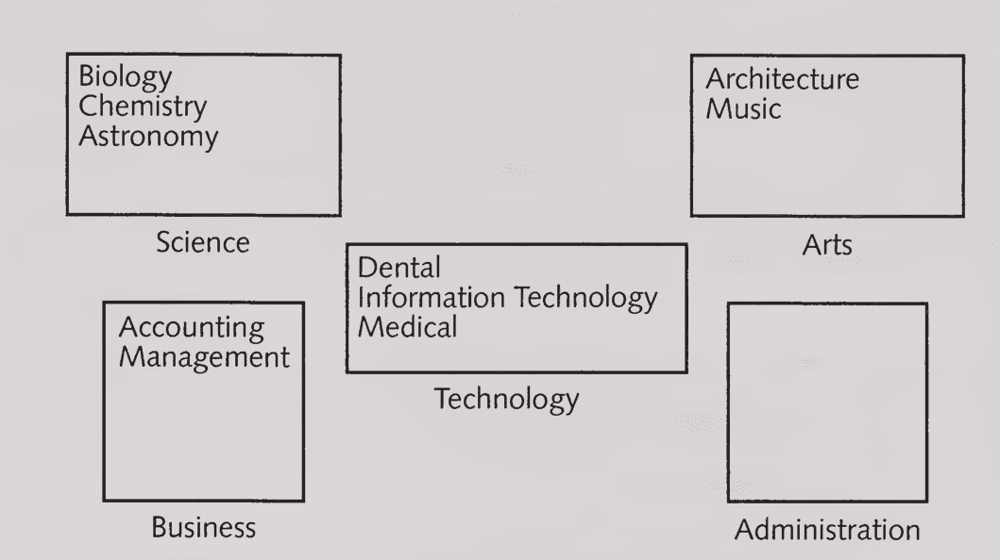

图 4-2 校园中的部门

在图 4-3 中，你的目录轮廓开始成型。“Campus”是主目录，随后按字母顺序排列建筑。这种排序使得在添加下一组信息时，更容易隔离有关每个部门的信息。

Campus

图 4-3 校园目录的开始

加上你在图 4-2 中收集的信息，你可以将部门放置在正确的建筑下。在图 4-4 中，你可以看到部门也按字母顺序进行了排序，以便于搜索。当你需要为每个部门添加、删除或修改部分时，你可以对特定的部门或建筑进行操作，而不影响其他存储的信息。目录结构使你能够高效地访问信息。

在计算机系统中处理组织良好的信息，你有许多选择。一旦信息在 Windows XP 和 Fedora Core 4 中以目录结构的形式存在，你就可以使用各种工具和命令来访问存储信息的特定区域。以下章节将介绍如何处理存储的信息。

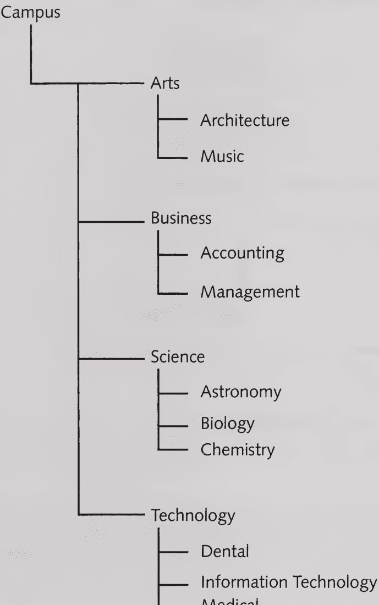

**图 4-4** 扩展的校园目录结构

## 显示目录结构

你的操作系统使用目录结构（或树形）来组织电脑上的文件。你可以显示该结构，也可以在其中更改你的关注点。如果需要，你可以显示目录结构中的文件名。以下章节将介绍这些主题。

### 在 Windows XP CLI 中显示目录结构

通过命令行界面 (CLI)，你可以发布命令来查看目录结构并执行其他任务。使用 CLI，用户通过在指定行上输入命令来对视觉提示做出响应，接收操作系统的响应，输入另一个命令，依此类推。在 Windows XP 中，命令提示符是 CLI 窗口中光标闪烁的行区域。


# 在查看目录结构时

在查看目录结构时，可以在两个命令（`TREE` 和 `DIR`）之间选择。当你需要定位单个文件或一组文件时，可以指定你搜索匹配哪些字符。这些主题将在下面的示例中解释。

## Windows 命令行解释器

Windows 有两个称为命令行解释器的控制台，它们接受命令并执行你指定的任务。这两个控制台 `command.exe` 和 `cmd.exe` 支持相同的命令。

在 Windows XP 中，你可以点击“开始”，点击“运行”，输入 `cmd` 并按回车来打开 `cmd.exe` 控制台（见图 4-5）。你也可以点击“开始”，指向“所有程序”，指向“辅助工具”，然后点击“命令提示符”来打开控制台。

```
C:\WINDOWS\system32>cmd
Microsoft Windows XP (Version 5.1.2601)
(C) Copyright 1985-2001 Microsoft Corp.
C:\Documents and Settings\User0\>
```

**图 4-5** cmd.exe 控制台

在 Windows 95 和 98 中，命令行解释器被称为 Command.com；它在 Windows XP 中保留了下来。与 Windows 95 和 98 不同，Windows XP 并没有加载 MS-DOS 操作系统然后在上方运行 Windows。因此，当你在 Windows XP 中运行 Command.com 控制台（见图 4-6）时，你是在“模拟 DOS”。要在 XP 中打开命令控制台，点击开始、运行，输入命令并按回车。

## 使用 TREE 命令显示结构

要查看磁盘上目录的图形表示，你需要 `TREE` 命令。图 4-7 显示了本章解释的示例目录结构。

`TREE` 命令显示当前目录及其下方所有的子目录。该命令具有以下语法：


图 4-6 Command.com 控制台


图 4-7 通过 TREE 命令显示的目录结构

```
TREE [drive:] [path] [/F] [/A]
```

- `/F` 显示每个文件夹中的文件名
- `/A` 使用 ASCII 字符代替扩展字符

如果你省略路径，`TREE` 命令显示目录结构（在命令提示符中输入路径）。要指定目录结构，输入目录的位置。例如，要显示 User0 的 My Documents 文件夹，输入 `"C:\Documents and Settings\User0\My Documents"` 而不是 `[drive:][path]`。因为该目录是一个长文件名——可以包含小写、大写、空格且超过 200 个字符的名字——你可以选择用引号排除驱动器和路径。

由于 Windows XP 不将空格视为分隔符，以下两个命令产生相同的结果：

```
TREE "C:\Documents and Settings\User0\My Documents"
TREE C:\Documents and Settings\User0\My Documents
```

为了在 `TREE` 命令显示的结构中包含文件名，你可以添加 `/F` 开关。使用 `/A` 开关，可以排除扩展字符——欧洲字符和其他不是标准 ASCII 文本的字符。

> 请记住，Windows XP 中的命令是不区分大小写的。例如，你可以输入命令 `TREE` 命令，也可以输入 `tree` 或 `Tree`。

## 活动 4-1：在 Windows XP CLI 中创建目录结构

**所需时间：** 10 分钟

**目标：** 在 Windows XP CLI 中创建示例目录结构。

**描述：** 在此活动中，你登录电脑，打开命令提示符并运行一个程序文件来创建你将在后续活动中使用的示例目录结构。

1. 使用用户 **User01** 和密码 **Password1** 登录你的电脑。
2. 点击**开始**(Start)，指向**所有程序**(All Programs)，指向**辅助工具**(Accessories)，然后点击**命令提示符**(Command Prompt)。
3. 要运行创建本章示例所需的目录和文件的程序文件，在命令提示符处输入 `MakeDS` 并按**回车**(Enter)。
> 如果你看到以下消息：“MakeDS 不是内部或外部命令、可程序或批处理文件”，请联系你的导师。
4. 验证目录树结构已出现。
5. 保持电脑登录以进行下一个活动。

## 活动 4-2：在 Windows XP CLI 中显示目录结构

**所需时间：** 15 分钟

**目标：** 在 Windows XP CLI 中显示目录结构。

**描述：** 在此活动中，你打开命令提示符并查看随本书提供的示例目录结构的目录树。如果你想查看硬盘上的目录结构，此活动将非常有用。

> 在完成后续活动之前，你必须先完成活动 4-1。

## 第 4 章目录命令

1. 如必要，使用用户 User01 和密码 Password1 登录你的电脑。
2. 点击开始，指向所有程序，指向辅助工具，然后点击命令提示符。要进入包含 College 目录结构的驱动器，输入 `E:` 并按回车。
3. 要显示示例目录结构，输入 `TREE` 并按回车。
> 如果你没有看到示例目录树，请告知你的导师。
> 注意
4. 检查命令提示符窗口中的信息。
5. 要进入包含 User01 目录结构的驱动器，输入 `C:` 并按回车。
> 若要清除屏幕上之前的输入，输入 `CLS` 并按回车。
> 提示
6. 要显示 User01 目录结构，输入 `TREE` 并按回车。
> 如果你没有看到 User01 目录树，请告知你的导师。
> 注意
7. 要查看 User01 目录树，使用命令提示符窗口右侧的滚动条。
8. 要查看带有文件名的 User01 目录结构，输入 `TREE /F` 并按回车。
9. 保持电脑登录以进行下一个活动。

## 在 Windows XP CLI 中显示文件名

使用 `DIR`（目录）命令在 CLI 中显示文件和子目录名称。`DIR` 命令具有以下语法：

```
DIR [drive:] [path] [filename] [/[:sortorder]] [/P] [/S] [/W]
[drive:] [path] [filename]
```

- `/O` 指定按顺序排序的文件、目录和要列出的文件
- `sortorder N` 按名称字母顺序进行排序
- `sortorder S` 按大小排序（最小的优先）

## 显示目录结构

- `sortorder E` 按扩展名字母顺序进行排序
- `sortorder D` 按日期和时间（最旧）排序
- `sortorder G` 先对目录分组
- `sortorder -` 添加前缀以反转顺序
- `/P` 在每显示一屏信息后暂停
- `/S` 显示指定目录及所有子目录中的文件
- `/W` 使用宽格式

若要列出关于文件的信息，输入 `DIR` 后跟上位置和文件名。例如，要列出示例文件 homework.doc 的信息，你将输入：

```
DIR "C:\Documents and Settings\User0\My Documents\homework.doc"
```

使用 `/W` 开关，你可以跨屏幕列出文件名。若要在每列出一组文件名后暂停屏幕，请使用 `/P` 开关。要控制排序顺序，请使用 `/O` 开关。例如，按文件大小排序文件，请使用开关 `/O:S`。如果你不指定排序顺序，将先按字母顺序列出目录。

## 在 Windows XP CLI 中使用通配符

你有时可能会玩扑克牌或其他使用通配符的纸牌游戏。如果你听到“2 是万能的（Deuces are wild!）”，那么“2”可以替换牌中的任何其他牌。

Windows XP CLI 也使用通配符。当你输入命令时，可以使用两个通配符字符来识别一组文件：问号（`?`）和星号（`*`），或星。

在命令中，问号代表你想要查看的任何单个字符。例如，以下命令将产生当前目录中任何以“mem”开头、后跟最多三个字符的文件列表。

```
DIR mem?.txt
```

此命令将匹配以下任何一个文件名：memo.txt, memory.txt, mem49.txt 和 memsey.txt。

- `*` 代表任何未知字符的字符串。例如，`*.*` 代表具有任何扩展名的所有文件名，这是 `DIR` 命令的默认范围。（你可能知道 `*.*` 的读法是“star dot star”。）。例如，以下命令将列出当前目录下所有具有 .DOC 扩展名的文件：

```
DIR *.DOC
```

## 第 4 章 目录命令

若要列出驱动器上所有按日期排序的 DOC 文件，你将输入：

```
DIR *.DOC /S /O:D
```

表 4-1 显示了通配符字符的示例。为了加快查找速度，你应该学习这些字符。

| 通配符 | 解释 |
| --- | --- |
| `*` | 任何扩展名或无扩展 |
| `*.txt` | 具有 .txt 扩展的文件 |
| `M*` | 以 M 或 m 开头（不区分大小写） |
| `H*.rpt` | 以 H 或 h 开头（不区分大小写）并以 .rpt 结尾 |
| `?op.*` | 任意字符开头后跟 op |
| `Year??04.xls` | 以 Year 开头，后跟两个字符、数字 04 以及 .xls |
| `Bud19??.xls` | 以 Bud 开头后跟二十世纪的任意年份以及 .xls |

## 活动 4-3：在 Windows XP CLI 中显示文件名

**所需时间：** 15 分钟

**目标：** 在 Windows XP CLI 中显示文件。

**描述：** 在此活动中，你打开命令提示符并查看随本书提供的示例目录结构。如果你想查看硬盘上的目录结构，此活动将非常有用。

在完成后续活动之前，你必须先完成活动 4-1。

1. 如必要，使用用户 User01 和密码 Password1 登录你的电脑。
2. 点击开始，指向所有程序，指向辅助工具，然后点击命令提示符。
3. 要显示 User01 目录结构，输入 `DIR /S /P E:\` 并按回车。
> 如果你没有看到 User01 文件，请告知你的导师。
4. 查看命令提示符中的信息。
5. 重复步骤 4 直到“按任意键继续”消息消失。
6. 要显示排序后的 User01 目录结构，`DIR /S /P /O:N E:\User01.*` 并按回车。
7. 查看命令提示符中的信息并按空格键。
8. 重复步骤 7 直到“按任意键继续”消息消失。
9. 使用 `/O:S` 开关重复步骤 6 到 8。
10. 保持电脑登录以进行下一个活动。

## 使用 Windows Explorer 显示目录结构

Windows Explorer 是 Windows XP 的一部分，为访问文件提供了图形化用户界面。要打开 Windows Explorer，点击开始，指向所有程序，指向辅助工具，并点击 Windows Explorer。

Windows Explorer 使用两个窗格，如图 4-8 所示。左窗格显示一个或多个驱动器的目录结构。右窗格显示左窗格中选中项的结构和文件。


**图 4-8** 在 Windows Explorer 中显示的目录结构

要显示电脑上的可用驱动器，展开“我的电脑”。要查看你在本章之前使用的目录结构，展开“Shared (E:)”，展开左窗格中的剩余文件夹，点击左窗格中的 College。

## 第 4 章目录命令

在 Windows 资源管理器右侧窗中查看文件时，提供了几种方法来排列和识别文件。当文件夹打开时，可以通过右键点击右侧窗中的空白处并指向“视图”来访问以下选项。空白处是指窗口中的任何空白区域。

- **缩略视图（Thumbnails）** 在文件夹图标上显示文件夹的图像，以便你快速识别内容。
- **瓷格视图（Tiles）** 将你的文件和文件夹以图标形式显示。这些图标比“图标”视图中的图标大，并且你选择的排序信息出现在文件或文件夹名称旁。
- **胶片视图（Filstrip）** 适用于包含图片的文件夹。你的图片将以单行缩略图的形式显示。
- **图标视图（Icons）** 将你的文件和文件夹以图标形式显示。文件名显示在图标下方；但不会显示排序信息。
- **列表视图（List）** 将文件夹的内容显示为文件或文件夹名称列表，每个名称前都有一个小图标。
- **详细视图（Details）** 列出打开的文件夹的内容以及文件的详细信息，包括名称、类型、大小和修改日期。

## 活动 4-4：在 Windows XP GUI 中显示目录结构

**所需时间：** 15 分钟

**目标：** 在 Windows XP GUI 中显示目录结构。

**描述：** 在此活动中，你打开 Windows 资源管理器并查看目录结构。如果你想在完成其他活动之前回顾结构，此活动非常有用。

> 你必须在完成活动 4-1 之前才能完成后续活动。

1. 如果必要，使用 User01 和密码 Password1 登录你的电脑。
2. 点击“开始”，指向“所有程序”，指向“辅助工具”，然后点击“Windows 资源管理器”。
3. 要转到包含示例目录结构的驱动器，展开“我的计算机”并点击“共享 (E:)”。
4. 要在左侧窗中显示示例目录结构，依次展开“User01”、“College”、“Arts”、“Business”、“Science”，然后展开“Technology（技术/Technology）”。
5. 要查看右侧窗中的文件，点击“Arts”。
6. 要更改右侧窗中文件的显示方式，右键点击右侧窗中的空白处，指向“视图”，并点击“缩略图”。
7. 对剩余的视图选项重复第 6 步。
8. 关闭 Windows 资源管理器。
9. 保持电脑登录状态以进行下一个活动。

## 在 Fedora Core 4 中显示目录结构

与 Windows XP 类似，Fedora Core 4 的目录和文件按分级目录结构组织。作为超级用户，你可以安排结构中任何地方的信息。作为普通用户，你可以操作目录树中“分支”下的目录和文件。

Fedora Core 4 可能配置为打开命令行。否则，如果系统打开图形用户界面（通常是 KDE 或 GNOME），你可以右键点击桌面并选择“终端”，打开终端窗口以访问 CLI。

当你登录到主目录（例如 `/home/User01`）时，主目录是所有普通用户的常规起始目录。作为普通用户，你只有权限操作自己目录内的目录和文件。然而，如果系统管理允许，你可以在系统目录中显示信息。

> Fedora Core 4 中的路径包含正斜杠 (`/`) ，而不是 Windows XP CLI 中使用的反斜杠 (`\`) 。

## Fedora Core 4 命令语法

每个操作系统都有一套输入命令的通用逻辑或语法。Fedora Core 4 具有以下命令语法：

```
Command [options] [parameter1] [parameter2] [parameter3]
```

每个执行的命令产生三个流：`stdin`（输入）、`stdout`（输出）和 `stderr`（错误）。考虑以下命令：

```
ls -l
```

命令的结果是目录的详细列表和返回的错误，显示在显示器上的 "stdout" 和 "stderr"。"stdin" 是当前目录列表。

根据原则，Fedora Core 4 CLI 命令通常结合使用，不仅可以定制结果输出的内容，还可以定制其输出的格式。在执行命令时，你可以使用三种方法：

- **同一行、顺序命令行处理。** 你将输入以下命令来生成目录内容和当前目录的顺序、长列表显示。

```
ls -l /etc ; pwd
```

`ls` 和 `pwd` 命令按顺序独立执行。分号符号表示顺序执行。每个命令的输出是单独生成的。

- **管道式（Piped）、顺序命令处理。** 你将输入以下命令来以分页的、长列表格式化的方式显示目录内容：

```
ls -l /etc | more
```

`ls` 和 `more` 命令按顺序顺序执行，管道符号（位于反斜杠键上）将 `ls` 命令的输出“管道”到 `more` 命令中，以便在显示之前进行进一步处理。

- **批处理顺序处理。** 为了保存并稍后作为解释批处理文件执行，你将输入以下命令：

```
ls -l /etc
pwd
```

结果将是 `/etc` 目录内容和当前目录的长列表显示。`ls` 和 `pwd` 命令将按顺序独立执行。下一节将更详细地解释 `ls` 命令。

> 注意：请记住 Fedora Core 4 中的命令是区分大小敏感的。

## 在 Core 4 CLI 中显示目录和文件

要查看磁盘上的目录和文件列表，请使用 `ls` 命令。默认情况下，该命令显示当前目录并按字母顺序对列表。以下行显示了 `ls` 语法：

```
ls [options] [location]
```

`ls` 有以下选项：

- `-a` 显示隐藏文件
- `-C` 按列列出项目
- `-d` 列出目录而不是内容

## 显示目录结构

要对磁盘上的目录和文件列表（或任何超出屏幕显示的内容）进行分页，请使用 `more` 命令。当你使用该命令时，按回车键逐行查看，按空格键分页。

要列出你的目录树，请使用 `ls` 命令：

```
ls -RI /etc | more
```

要列出 hosts 文件的大小（块）和 inode 号，输入以下命令：

```
ls -IS /etc/hosts
```

要列出文件或目录的详细信息，输入以下命令：

```
ls -l /etc/hosts
```

表 4-2 是使用 `-l` 选项的定义。

### 表 4-2 使用 -l 命令的长列表定义

| 列（配合 sort 命令使用） | 说明 |
|---|---|
| 文件类型 | 第一列的第一个字符表示文件类型（例如，“d”表示目录，“-”表示文件，“L”表示链接）。 |
| 权限 | 第一列还显示文件或目录的权限、所有者、组和其他用户。 |
| 链接数 | 第二列显示链接到文件的链接数或目录中的子目录数。目录始终包含 "."（当前目录）和 "..”（父目录）。父目录包含当前目录且在目录树中高一级。 |
| 所有者 | 第三列是文件或目录的所有者。 |
| 组 | 第四列是所有文件或目录的组。 |
| 大小 | 第五列是文件或目录的大小。 |


## 表 4-2 使用 `ls -l` 命令的长列表列定义（续）

| 列（配合 `sort` 命令使用） | 说明 |
|---|---|
| 日期 | 第六列显示文件的创建日期或最后修改日期。 |
| 时间 | 第七列是创建时间或最后修改时间。 |
| 名称 | 第八列显示目录或文件名。 |

`ls` 命令提供了许多有用的选项。例如，要列出隐藏文件以及非隐藏文件，你需要输入：

```
ls -a /etc/ | more
```

要更改文本文件中行的排列顺序，你需要输入：

```
ls -S /etc/hosts
```

如果不指定排序顺序，文件将按字母顺序列出。要反向排序，请输入以下内容：

```
ls -r
```

配合 `-C` 选项使用 `ls` 命令，可以只显示文件名并使其在屏幕上四列。例如：

```
ls -C /etc/ | more
```

为了在列出每页文件时进行翻页，可以将 `ls` 命令的输出管道到 `more` 命令。例如：

```
ls -l /etc | more
```

要控制列表中项目出现的顺序，可以将 `ls` 命令的输出管道到 `sort` 命令。首个 `sort` 命令根据 `ls` 列表中的第九字段对列表进行排序，即字母顺序的文件名。第二个 `sort` 命令反转该排序。

```
ls -1 /etc | sort -k9
ls -1 /etc | sort -rk9
```

`sort` 还有许多其他选项。其语法为：

```
sort [options] [files]
```

你可以在 `sort` 命令中使用以下切换开关：

- `-b` 忽略前导空格
- `-d` 在排序时仅考虑空格和字母数字字符，而不考虑特殊字符和非打印字符
- `-f` 排序时忽略大小写
- `-r` 反转比较结果
- `-o [filename]` 将结果写入文件而不是标准输出

## 显示目录结构

要显示当前目录的完整路径文件名，请使用 `pwd`（打印工作目录）命令。该命令与 `more` 命令具有超出本书范围的页定义选项。`pwd` 和 `more` 命令的语法如下：

```
pwd [options]
more [options]
```

## 在 Fedora Core 4 CLI 中使用通配符

与 Windows XP 一样，Fedora Core 4 CLI 使用通配符。当输入命令时，可以使用通配符指定一组文件。

Fedora Core 4 使用与 Windows XP 相同的通配符：问号（`?`）和星号（`*`）。在命令中，`?` 代表你想要匹配的任何单个字符。例如，以下命令将产生当前目录下任何以“host”开头、后跟接四个未知字符的文件名列表。

```
ls host????
```

此命令将匹配以下任何一个文件名：hostuser、hostome、hostname 和 host1234。

通配符 `*` 代表任何字符字符串。使用 `.*` 表示带有任何扩展名的所有文件名。

> Linux 文件名可以包含扩展名，但它们不像在 Windows XP 中那样用于建立相同的文件类型关联和识别。

## 活动 4-5：显示 Fedora Core 4 目录结构中的文件

**要求：** 15 分钟

**目标：** 查找 Fedora Core 4 中文件和目录的信息。

**描述：** 在此活动中，使用 `ls` 命令查找有关 Fedora Core 4 系统文件系统的信息。如果你想查看硬盘的目录结构，此活动将非常有用。

1. 如必要，使用用户 `User01` 和密码 `Password` 登录你的 PC。
2. 如必要，点击 **Start**，指向 **All Programs**，然后点击 **Microsoft Virtual PC**。
3. 如必要，点击 **Fedora_core_4 Not running**，然后点击 **Start** 按钮。
4. 如必要，使用用户 `User01` 和密码 `Password1` 登录你的 Fedora Core 4 系统。右键点击桌面并点击 **Konsole**。
5. 输入 `ls /etc -l | more` 然后按 **Enter**。

## 第 4 章 目录命令

要继续由 `more` 命令启用的分页，可以按空格键查看一整页，或按回车键一次查看一行。

6. 要关闭 Fedora Core 4 Konsole 窗口，输入 `exit` 然后按回车。
7. 保持 PC 登录状态以进行下一个活动。

## 导航目录结构

导航目录结构类似于爬树。在爬之前，你会向上看并树枝。你可以从树枝之间攀爬，移动到较小的树枝，并退回到某个树枝。你使用类似的技术来查看或导航 PC 硬盘驱动器的目录结构。接下来的章节将解释 Windows XP 和 Fedora Core 4 中的这些技术。

## 在 Windows XP CLI 中导航目录结构

在任何时候，你都在目录结构的某个特定目录内工作。此位置被称为工作目录或当前目录。你可以使用 `CHDIR` 或 `CD`（更改目录）命令来更改工作目录的位置。`CD` 命令具有以下语法：

```
CD [/D] [drive:path]
```

- `CD ..` 指定父目录
- `CD /` 显示根目录
- `CD path` 切换到指定的目录

只要命令行解释器保持打开状态，命令提示符就会显示当前目录。当你指定路径时，命令提示符会变为当前位置。要更改相对于当前目录的位置，你有三种选择：

- `CD ..` 返回上目录
- `CD /` 切换到根目录
- `CD path` 切换到指定的目录

## 导航目录结构

要更改绝对位置，必须提供以斜杠（`/`）开头的完整路径。示例显示：

```
E:\User01>TREE
Folder listing
卷序列号为 0000
E:\
```

要相对切换到 College，可以使用 `CD` 命令。命令提示符从 `E:\` 变为 `E:\User01\College`。

要绝对切换到 Technology，你需要输入以下命令：

```
CD \User01\College\Technology
```

要从子目录返回上一级，使用 `CD` 命令。命令提示符从 `E:\User01\College\Technology` 变为 `E:\User01\College`。

## 活动 4-6：在 Windows XP CLI 中更改当前位置

**要求：** 15 分钟

**目标：** 在 Windows XP CLI 中更改目录结构中的当前位置。

**描述：** 在此活动中，你打开命令提示符并更改目录结构中的当前位置。如果你想在完成其他活动之前更改位置，此活动非常有用。例如，你可以通过列出子目录中的文件名在目录间切换。

> 你必须先完成活动 4-1 才能完成以下活动。

1. 如必要，使用用户 `User01` 和密码 `Password1` 登录你的 PC。
2. 点击 **Start**，指向 **All Programs**，指向 **Accessories**，然后点击 **Command Prompt**。
3. 要进入示例目录结构，输入 `CD /D E:\User01` 并按回车。
4. 要显示示例目录结构，输入 `TREE` 并按回车。
5. 要相对切换到 User01 目录结构，输入 `CD College` 并按回车。
6. 验证命令提示符为 `E:\User01\College`。
7. 在 College 目录结构内绝对切换到 Technology，输入 `CD \User01\College\Technology` 并按回车。
8. 验证命令提示符为 `E:\User01\College\Technology`。
9. 要返回上一级目录，输入 `CD ..` 并按回车。
10. 验证提示符为 `E:\User01\College`。
11. 要在当前目录下更改绝对位置，输入 `CD /Technology` 并按回车。
12. 验证提示符为 `E:\User01\College\Technology`。
13. 要返回上一级目录，输入 `CD ..` 并按回车。
14. 要导航目录，输入 `CD Business` 并按回车，然后输入 `CD Management` 并按回车。
15. 验证提示符为 `E:\User01\College\Business\Management`。
16. 关闭命令提示符窗口。
17. 保持电脑登录状态以便下一个活动。

## 在资源管理器中导航目录结构

要导航之前所示的示例目录结构，你可以点击资源管理器左侧格中的文件夹。位置会发生变化，右侧格会刷新。例如，要进入当前文件夹，点击左侧格中的 `Science`，如图 4–10 所示。


图 4-10 导航到 Science 文件夹

## 活动 4-7：在 Windows GUI 中导航目录结构

**所需时间：** 15 分钟

**目标：** 在 Windows XP GUI 中更改目录结构中的当前位置。

**描述：** 此活动与活动 4–6 类似，不同之处是你使用的是资源管理器而不是 Windows XP CLI。

在完成以下活动之前，你必须完成活动 4-1。

1. 如果需要，使用用户 `User01` 和密码 `Password1` 登录你的电脑。
2. 点击**开始**，指向**所有程序**，指向**附件**，然后点击**我的资源管理器**。
3. 要转到包含示例目录结构的驱动器，展开**我的电脑**，然后点击**共享 (E:)**。
4. 要在左侧格中显示目录结构，展开 `User01`，展开 `College`，展开 `Arts`，展开 `Business`，展开 `Science`，然后展开 `Technology`。
5. 要更改相对于 User01 目录结构的位置，点击左侧格中的 **College**。
6. 验证地址为 `E:\User01\College`。
7. 要更改 College 目录结构内的绝对位置，点击左侧格中的 **Technology**。
8. 验证地址为 `E:\User01\College\Technology`。
9. 要返回上一级目录，点击左侧格中的 **College**。
10. 验证提示符为 `E:\User01\College\`。
11. 要在左侧格中导航目录，点击 **Business** 然后点击 **Management**。
12. 验证地址为 `E:\User01\Business\Management`。
13. 保持电脑登录状态以便下一个活动。

## 在 Fedora Core 4 中导航目录结构

与 Windows XP 一样，你可以在 CLI（命令行）中使用 `cd` 命令来更改工作（当前）目录的位置。`cd` 命令具有超出本书范围的页面定义选项。该命令语法为：

```
cd [options] [location path]
```

## 在 Fedora Core 4 CLI 中使用绝对路径和相对路径

与 Windows XP 一样，你可以使用绝对路径方法或相对路径方法更改目录结构中的当前目录。每个目录还包含一个指向当前目录的 `.` 条目和一个指向父级目录的 `..` 条目。

例如，如果你的当前目录是 `/technology/dental/`，且你想切换目录到 `/business/accounting/`，你有两个选择。首先，你可以参考图 4-7 所示的目录结构并使用绝对路径方法输入以下命令：

```
cd /college/business/accounting
```

其次，你可以参考之前的目录结构并使用相对路径方法输入以下命令：

```
cd ../business/accounting
```

要返回一个子目录并向结构中向上移动一级，你需要输入：

```
cd ..
```

## 活动 4-8：在 Fedora Core 4 中导航目录结构

**所需时间：** 15 分钟

**目标：** 更改 Fedora Core 4 中的当前目录。

**描述：** 在此活动中，你使用 `cd` 命令更改 Fedora Core 4 目录树中的当前目录。如果你想在列出子目录中的文件名之前更改目录结构中的级别，此活动非常有用。

1. 如果需要，使用用户 `User01` 和密码 `Password1` 登录你的电脑。
2. 如果需要，点击**开始**，找到**所有程序**，并点击**Microsoft Virtual PC**。
3. 如果需要，点击 **Fedora_core_4 Not running** 然后点击**Start**。
4. 如果需要，使用用户 `User01` 和密码 `Password1` 登录你的 Fedora Core 4 系统。右键点击桌面并点击**Console**（控制台）。
5. 输入 `pwd` 然后按回车。
6. 记录下你当前目录的位置。
7. 输入 `cd /dev` 然后按回车。
8. 输入 `pwd` 然后按回车。
9. 要关闭 Fedora Core 4 控制台窗口，输入 `exit` 然后按回车。
10. 保持电脑登录状态以便下一个活动。

## 操作目录

随着你的目录结构的增长，你可能需要创建、重命名或删除目录。在 Windows CLI 中，你使用 `MD` 命令创建目录，使用 `RDIR` 命令删除目录。

## 在 Windows CLI 中创建目录

要创建目录，使用 `MD` 命令。该命令语法为：

```
MD [directory name]
```

例如，要在当前位置创建一个名为 Test 的目录，输入：

```
MD Test
```

创建一个嵌套目录，你可以指定完整路径：

```
MD C:\User\Documents
```

## 在 Windows CLI 中删除目录

要删除目录，使用 `RDIR` 命令。该命令语法为：

```
RDIR [directory name]
```

注意，`RDIR` 只删除空目录。要删除目录及其所有内容，请使用 `/S` 参数：

```
RDIR /S [directory name]
```

## 活动 4-9：在 Windows CLI 中创建目录

**所需时间：** 15 分钟

**目标：** 使用 Windows CLI 创建并删除目录。

**描述：** 在此活动中，你将使用 `MD` 和 `RDIR` 命令管理目录结构。

1. 如果需要，使用用户 `User01` 和密码 `Password1` 登录你的电脑。
2. 验证提示符为 `E:\User01\College`。
3. 输入 `MD Projects` 并按回车创建 Projects 目录。
4. 输入 `TREE` 验证目录已创建。
5. 输入 `MD Projects\WebDesign` 并按回车在 Projects 中创建一个名为 WebDesign 的子目录。
6. 输入 `TREE` 验证结构。
7. 输入 `RDIR Projects\WebDesign` 删除 WebDesign 子目录。
8. 输入 `TREE` 验证文件夹已删除。
9. 输入 `RDIR Projects` 删除 Projects 文件夹。
10. 保持电脑登录状态以便下一个活动。

## 在 Windows GUI 中创建目录

要在目录结构中创建文件夹，请导航到左侧格中的父文件夹 `Science` 并右键点击空白处。指向**新建**（如图 4-12 所示），然后点击**文件夹**。在“新建文件夹”字样上输入名称并按回车。例如，要创建一个名为 Physics 的文件夹，点击左侧格中的 `Science`，右键点击右侧格空白处并输入 Physics。

## 活动 4-10：在 Windows GUI 中创建目录

**所需时间：** 15 分钟

**目标：** 使用 Windows GUI 创建并删除目录。

**描述：** 在此活动中，你将使用资源管理器创建一个新的目录结构。

1. 如果需要，使用用户 `User01` 和密码 `Password1` 登录你的电脑。
2. 打开资源管理器。
3. 导航到 `E:\User01\College`。
4. 通过右键点击空白处并选择“新建>文件夹”创建一个名为 Projects 的文件夹。
5. 进入 Projects 文件夹并创建一个名为 WebDesign 的文件夹。
6. 通过右键点击 WebDesign 文件夹并选择“删除”将其删除。
7. 删除 Projects 文件夹。
8. 保持电脑登录状态以便下一个活动。

## 第4章 目录命令


图 4-12 创建物理目录

3. 要恢复本节之前使用的示例目录和文件，请在命令提示符处输入 `MakeDS` 并按 **回车**。
4. 点击**开始**，指向**所有程序**，指向**附件**，然后点击**我的资源管理器（Windows Explorer）**。
5. 要转到包含示例目录结构的驱动器，展开**计算机**，然后点击**共享 (E:)**。
6. 要在左窗格中显示示例目录结构，展开 `User01`，展开 `College`，展开 `Arts`，展开 `Business`，展开 `Science`，然后展开 `Technology`。
7. 要更改相对于 User01 目录结构的位置，请点击左侧窗格中的 **College**。
8. 验证地址为 `E:\User01\College`。
9. 要创建一个新的学院目录，右键点击右窗格中的空白处，指向**新建**，点击**文件夹**，然后在“新建文件夹”上覆盖输入 **Liberal Arts**。完成后按**回车**。
10. 要更改相对于 User01 目录结构的位置，点击左侧窗格中的 **Liberal Arts**。


## 操作目录

### 验证地址与创建部门目录

11. 验证地址为 `E:\User01\College\Liberal Arts`。

12. 要创建一个新的部门目录，右键点击右窗格中的空白处，指向**新建**，点击**文件夹**，然后在“新建文件夹”上覆盖输入 `English`。完成后按**回车**。

13. 重复步骤 12，创建 `法语（French）`、`德语（German）` 和 `西班牙语（Spanish）`。

14. 保持电脑登录状态以进行下项活动。

# 在 Fedora Core 4 中创建目录

与 Windows XP 一样，你有时需要在 Fedora Core 4 目录结构中创建目录。例如，如果你的学院在艺术组中添加了打印部门，你需要在 Arts 目录中添加相应的子目录。在 Fedora Core 4 中添加目录时，你必须拥有父目录的权限，或者以超级用户身份登录。

要创建目录，请使用 `mkdir [options] [directory name]` 命令。其命令语法为：

```
mkdir [directory name]
```

`mkdir` 命令具有以下选项：

- `-p`：根据需要创建目录，但如果目录已存在则不显示错误
- `-v`：为每个创建的目录显示一条消息

例如，如果你的当前目录是 `/technology/dental/`，并且你想在 arts 目录中添加一个打印目录，你首先需要导航到 `/arts`。然后使用 `mkdir` 命令创建目录。

```
cd /college/arts
mkdir printing
```

要使用绝对路径创建打印子目录，请输入以下任一命令：

```
mkdir /college/arts/printing
mkdir ../../arts/printing
```

# 活动 4-11：在 Fedora Core 4 中创建目录

**所需时间：** 15 分

**目标：** 在 Fedora Core 4 中创建目录。

**描述：** 在此活动中，你打开命令提示符并使用 `mkdir` 命令在 Fedora Core 4 目录结构中创建目录。

- 如必要，使用 `User01` 和密码 `Password1` 登录你的电脑。
- 如必要，点击**开始**，进入**所有程序**，然后点击 `Fedora_core_4 Not running`，然后点击**启动**按钮。
- 如必要，使用 `User01` 和密码 `Password1` 登录你的 Fedora Core 4 系统。右键点击桌面并点击**控制台**。
- 输入 `pwd` 然后按**回车**。记录你当前的目录位置（例如 `/home/User01/`）。
- 输入 `mkdir newdir` 然后按**回车**。
- 输入 `ls` 然后按**回车**。
- 你应该看到你的新目录，`newdir`。
- 输入 `cd newdir` 然后按**回车**。
- 输入 `mkdir mysecondir` 然后按**回车**。
- 输入 `ls` 然后按**回车**。
- 你应该看到你的新目录，`mysecondir`。
- 关闭控制台窗口。
- 保持电脑登录状态以进行下项活动。

# 在 Windows XP CLI 中删除目录

当不再需要某个目录或其中的文件时，可以删除该目录。在 CLI 中使用 `RMDIR` 或 `RD`（删除目录）命令来删除子目录。`RD` 命令具有以下语法：

```
RD [/S] [/Q] [drive:]path
```

- `/S`：删除指定目录中的所有目录和文件以及本身；使用此命令删除目录树
- `/Q`：在静默模式下运行，这意味着系统在使用 `/S` 命令删除目录树之前不会询问确认

`RD` 命令的语法对驱动器和路径的解释与之前描述的 `CD` 命令类似。要删除子目录，你有两个选择：

- `RD path`——从当前位置“相对”删除旧的子目录
- `RD \path`——从当前位置“绝对”删除旧的子目录

如果你使用 `/S` 开关来删除指定的目录及其子目录，系统会要求你通过按 `Y` 键来确认选择。`/Q` 切换允许你在脚本文件中使用 `RD` 命令，而不需要用户响应。

例如，要删除 Science 目录，你可以输入 `RD /S \User01\College\Science` 然后按回车。


图 13 删除目录

当你不在该目录中时，无法执行 `RD` 命令。如果你尝试，会弹出错误消息，如图 14 所示。


图 14 错误消息

# 活动 4-12：在 Windows CLI 中删除目录

**所需时间：** 15 分

**目标：** 在 Windows CLI 中删除目录。

1. 如必要，使用 `User01` 和密码 `Password1` 登录你的电脑。
2. 点击**开始**，进入**所有程序**，点击命令提示符。
3. 要恢复本节之前使用的示例目录和文件，请在命令提示符处输入 `MakeDS` 并按**回车**。
4. 如果你不在示例目录，输入 `CD E:\User01` 然后按回车。
5. 要显示示例目录结构，输入 `TREE` 然后按回车。
6. 要更改相对于 User01 目录结构的位置，输入 `CD College` 然后按回车。
7. 验证地址为 `E:\User01\College`。
8. 要删除 Science 目录，输入 `RD /S \User01\College\Science` 然后按回车，按 `Y` 键，然后按回车。
9. 要显示目录结构，输入 `TREE` 然后按回车。
10. 要不经确认删除 Business 目录，输入 `RD /S /Q Business` 然后按回车。
11. 显示目录结构，输入 `TREE` 然后按回车。
12. 关闭命令提示符窗口。
13. 保持电脑登录状态以进行下项活动。

# 在 Windows XP GUI 中删除目录

你可以通过点击资源管理器侧窗格中的文件夹来导航目录。这样做会更改位置并刷新右侧窗格。如果你需要删除目录，在左侧窗格中右键点击要删除的文件夹，点击**删除**，并通过点击**是**按钮确认你的选择。例如，要删除 Music 文件夹，在右窗格中右键点击 Music，点击**删除**，然后确认删除，如图 15 所示。


图 15 删除目录

当你从硬盘删除项目时，Windows XP 会将其放入回收站。如果你后悔了从资源管理器执行的删除，可以从回收站检索回被删除的项目，这提供了一个实用的缓冲。

> **注意：** 从软磁盘或网络驱动器删除的项目将是永久删除的，不会放入回收站；从命令提示符窗口删除的项目也不会放入回收站。

如果你想“撤销”或将已删除的文件夹还原到原始位置，请双击桌面上的回收站图标，右键点击已删除的文件夹并点击**还原**，如图 16 所示。


图 16 还原已删除文件夹

回收站中的项目会一直保留，直到你决定从计算机中永久删除它们。然而，这些项目仍然会占用硬盘空间。当回收站装满时，Windows XP 会自动清理出足够的空间以容纳最近删除的文件夹和文件。


如果你的硬盘空间不足，请清空回收站。你还可以限制回收站的大小，以限制它占用的硬盘空间。

## 活动 4-13：在 Windows XP 图形界面中删除目录

**所需时间：** 15 分钟

**目标：** 在 Windows XP 图形界面中删除目录结构中的一个文件夹。

**描述：** 在此活动中，你打开 Windows 资源管理器并删除目录结构中的一个文件夹。如果你想删除不再需要的文件夹，此活动将非常有用。

1. 如果必要，使用用户 `User01` 和密码 `Password1` 登录你的电脑。
2. 点击**开始**，指向**所有程序**，指向**辅助工具**，然后点击**命令提示符**。
3. 要恢复示例目录和文件，请在命令提示符处输入 `MakeDS` 并按**回车**。
4. 点击**开始**，指向**所有程序**，指向**辅助工具**，然后点击**我的资源管理器**。
5. 要进入包含示例目录结构的驱动器，展开**我的电脑**，然后点击**共享 (E:)**。
6. 要在左侧窗格中显示示例目录结构，展开 `User01`，展开 `College`，展开 `Arts` 并展开 `Technology`。
7. 要更改相对于 User01 目录结构的位置，点击左侧窗格中的 `College`。
8. 验证地址为 `E:\User01\College`。
9. 要删除 Arts 目录，右键点击右侧窗格中的 Arts 文件夹，点击**删除**，然后点击**是**。
10. 要删除 Technology 目录，右键点击右侧窗格中的 Technology 文件夹，点击**删除**，然后点击**是**。
11. 关闭 Windows 资源管理器。
12. 保持电脑登录状态以进行下一个活动。

# 在 Fedora Core 4 中删除目录

要从 Fedora Core 4 树中删除目录，你必须拥有所有权或以超级用户身份登录并使用 `rmdir`（删除目录）命令。其命令语法如下：

```
rmdir [options] directory[s]
```

`rmdir` 命令具有以下选项：

- `-p`：根据需要尝试删除路径中的每个目录组件
- `-v`：为每个已删除的目录显示一条消息

例如，如果你的当前目录是 `/technology/dental/`，并且你想删除 arts 目录下的 printing 目录，你首先需要导航到 `/arts`。然后，使用 `rmdir` 命令删除 printing 目录。

```
cd /college/arts
rmdir printing
```

> 虽然可以使用绝对路径和相对路径方法，但直接导航到父目录通常更安全。


如果你使用 `rmdir` 命令配合 `-p` 选项在 Printing 目录下创建了多个子目录，现在需要删除整个分支，你可以使用目录路径 `/home/User01/personal/budget/`，如果你需要删除 `/personal/budget/` 目录，你需要输入以下内容：

```
rmdir -p personal/budget
```

遗憾的是，如果任何一个目录包含文件，这种方法将不起作用。例如，你可能在 budget 目录中创建了几个文件，现在需要删除整个分支。你可以使用 `rm` 命令配合 `-r` 或 `-R` 选项进行递归删除。

```
cd /home/User01
rm -ir personal OR rm -iR personal
```

> 这里的 `rm` 命令不是笔误；它用于删除文件。由于 Linux 不会对删除操作进行警告，因此你应该使用 `-i` 选项，除非你不是以批模式运行命令，否则会被提示要删除的文件。例如，你可以输入 `rm -ir personal` 或 `rm -iR personal`。稍后我们将介绍更多关于 `rm` 命令的知识。

## 活动 4-14：在 Fedora Core 4 中删除目录

**所需时间：** 15 分钟

**目标：** 在 Fedora Core 4 中删除目录。

**描述：** 在此活动中，使用 `rmdir` 命令从 Fedora Core 4 目录树中删除目录。如果你想删除不再需要的目录，此活动将非常有用。

> 在完成以下活动之前，你必须完成活动 4-11。

1. 如果必要，使用用户 `User01` 和密码 `Password1` 登录你的电脑。
2. 如果必要，点击**开始**，指向**所有程序**，然后点击 **Microsoft Virtual PC**。
3. 如果必要，点击 `Fedora_core_4 Not running` 然后点击**启动**按钮。
4. 如果必要，使用 `User01` 和密码 `Password1` 登录你的 Fedora Core 4 系统。右键点击桌面并点击**控制台**。
5. 输入 `pwd` 然后按**回车**。记录你当前的目录位置。你应该处于你的主目录（例如，`/home/User01/`）。
6. 输入 `rmdir mynewdir/mysecondcdir` 然后按**回车**。

> 如果你在这些任何一个目录中放置了文件，此命令将无法工作，因为你不能在先删除文件的情况下删除目录。在这种情况下，输入以下命令之一：
> ```
> rm -ir mynewdir
> rm -iR mynewdir
> ```

7. 输入 `ls` 然后按**回车**。
8. 你不应该看到 `mynewdir` 或 `mysecondcdir`。
9. 要关闭 Fedora Core 4 窗口，输入 `exit` 并按**回车**。
10. 保持电脑登录状态以进行下一个活动。

# 操作文件

你可以执行四项任务来保持你的文件更新：

- 将一个或多个文件复制到备用位置。
- 将文件或目录从一个文件夹移动到另一个文件夹，或从一个驱动器移动到另一个驱动器。
- 重命名文件和目录。
- 从计算机中删除文件。

## 在 Windows XP 中复制文件

在 Windows XP 中复制文件时，可以使用 `COPY` 命令将一个或多个文件复制到备用位置。本节介绍了如何复制、移动、重命名和删除文件。

### 在 Windows XP 中使用 COPY 命令

使用 `COPY` 命令将文件内容复制到新位置。该命令具有以下语法：

```
COPY [/V] source [destination]
```

- `source`：指定要复制的文件
- `destination`：指定新文件的位置/或名称
- `/V`：验证新文件是否已写入

例如，要从 `\Science` 复制 `Budget.xls` 文件到 `\Chemistry`，你将输入：

```
COPY \Budget.xls \Chemistry
```

尽管 `COPY` 命令很少发生错误，但 `/V` 开关可以让你验证关键数据是否已记录。此开关会减慢 `COPY` 命令的速度，因为操作系统必须检查记录在磁盘上的每个扇区。

### 使用 XCOPY 命令

当你需要对要复制的内容有更多控制时，请使用 `XCOPY` 命令。`XCOPY` 命令与 `COPY` 命令类似，但它有更多的开关。当你想要从一个目录或驱动器批量复制文件到另一个，或者将整个目录复制到新目的地时，可以使用这个强大的命令。`XCOPY` 命令具有以下语法：

```
XCOPY source [destination] [/P] [/S] [/E] [/V] [/Q] [/F] [/L]
```

- `source`：指定要复制的文件
- `destination`：指定新文件的位置/或名称
- `/P`：在创建每个目标文件之前提示
- `/S`：复制目录和子目录但不包括空目录
- `/E`：复制目录和子目录，包括空目录
- `/V`：验证每个新文件
- `/Q`：复制时不显示文件名
- `/F`：复制时显示完整的源和目标文件名
- `/L`：显示所选文件的文件名，但不进行复制

例如，如果你需要备份 College 子目录和文件，假设你已经创建了 Backup 目录，将输入以下命令：

```
XCOPY /S \User01\College \User01\Backup
```

如果你还没有创建 Backup 目录，将收到此消息：

```
\User01\Backup 指定的是文件名还是目录名（F = 文件，D = 目录）？
```

在这种情况下，你通过输入字母 `D` 来回答。

如果你想复制文件、目录结构并验证文件是否成功复制，你将输入：

```
XCOPY /E /V \User01\College \User01\Backup
```

## 在 Windows XP CLI 中移动文件

使用 `MOVE` 命令将文件内容移动到新位置并重命名文件和目录。如果你想移动一个或多个文件，该命令具有以下语法：

```
MOVE [/Y | -Y] [drive:] [path]filename[,] destination
```

如果你想重命名目录，`MOVE` 命令具有以下语法：

```
MOVE [/Y |-Y] [path:]dirname1 dirname2
```

- `[drive:][path] filename1`：指定你想要移动的文件（文件）的位置和名称
- `Destination`：指定新的目标，可以包含驱动器号和冒号、目录名称或两者的组合；如果你只移动一个文件，可以包含文件名以便在移动时重命名该文件
- `[drive:][path]dirname1`：指定你想要重命名的目录
- `dirname2`：指定目录的新名称

`MOVE` 命令与 `COPY` 命令相似，但有一个例外：源文件始终会从磁盘中删除。其语法也与 `COPY` 命令相似；但是，你必须输入一个目标位置。即使你已经位于要移动文件的目录，也必须输入该目录。

`MOVE` 命令具有重命名子目录的能力，这对于想要重新组织目录结构的人来说非常有用。例如，要将建筑系（Architecture）从艺术学院（Arts）移动到科学学院（Science），你需要输入：

```
MOVE \User01\College\Arts\Architecture \User01\College\Science
```

`MOVE` 命令的一个用途是重命名子目录。例如，要将牙科（Dental）子目录的名称改为牙科助理（Dental Assistant），你需要输入：

```
MOVE \User01\College\Technology\Dental "\User01\College\Technology\Dental Assistant"
```

由于 `Dental Assistant` 包含空格，你可能需要使用引号。

## 在 Windows XP CLI 中重命名文件


# 使用 REN（或 RENAME）命令重命名文件

该命令具有以下语法：

```
RENAME [drive:][path]filename1 filename2
REN [drive:][path]filename2
```

注意，你不能为目标指定新的驱动器或路径。

例如，要重命名 `Budget.xls` 文件，你需要输入：

```
REN Budget.xls Budget2006.xls
```

你可以使用通配符（`*` 和 `?`）使得一系列文件中的部分名称发生更改，但旧名称和新名称的长度必须相同。例如，要将当前目录下所有 `.txt` 文件的扩展名改为 `.bak`，你需要输入：

```
REN *.txt *.bak
```

## 在 Windows XP CLI 中删除文件

使用 `DEL`（或 `ERASE`）命令删除一个或多个文件。该命令具有以下语法：

```
DEL [/P] [/S] [/Q] names
ERASE [/P] [/S] [/Q] names
```

`names` 指定要删除的一个或多个文件或目录列表；你可以使用通配符删除多个文件。如果你指定了一个目录，则目录中的所有文件都将被删除。

- `/P` 在删除每个文件之前提示确认
- `/S` 从所有子目录中删除指定的文件
- `/Q` 在静默模式下运行，这意味着在使用全局通配符进行删除之前不会询问确认

你可以使用 `DEL` 命令删除一个或多个文件。例如，要删除 `Homework.doc` 文件，你需要输入：

```
DEL \User01\Homework.doc
```

要删除 `User01` 子目录下的所有 `.doc` 文件，你需要输入：

```
DEL /S \User01\*.doc
```

## 活动 4-15：在 Windows XP CLI 中操作文件

**所需时间：** 15 分钟

**目标：** 在 Windows XP CLI 的目录结构中操作文件。

**描述：** 在此活动中，你将打开命令提示符并在目录结构内处理文件。如果你需要复制、移动、重命名和删除文件，这项活动非常有用。

1. 如必要，使用 `User01` 和密码 `Password1` 登录你的电脑。
2. 点击“开始”，指向“所有程序”，指向“辅助工具”，然后点击“命令提示符”。
3. 要恢复示例目录和文件，输入 `MakeDS CD /D E:\User01` 并按回车。
4. 如果你不在该目录结构，输入 `XCOPY /S /E College\.* Backup` 并按回车。
5. 要备份目录结构，输入 `TREE /F Backup` 并按回车，然后按 `D` 键。
6. 查看带有目录结构的文件，输入 `CD \User01\College\Arts` 并按回车。
7. 验证提示符为 `E:\User01\College\Arts`。
8. 将目录数据库复制到 Architecture 子目录，输入 `COPY catalog.mdb Architecture` 然后按回车。
9. 要将预算文件移动到 Arts 子目录，输入 `MOVE Architecture\budget0210.xls` 并按回车。
10. 要更改相对于目录结构的位置，输入 `CD \User01\College\Science\Chemistry` 并按回车。
11. 验证提示符为 `E:\User01\College\Science\Chemistry`。
12. 要重命名预算文件，输入 `REN Budget01030.xls BudgetChemistry.xls` 并按回车。
13. 要更改相对于目录结构的位置，输入 `CD \User01\College\Science\Biology` 并按回车。
14. 验证提示符为 `E:\User01\College\Science\Biology`。
15. 要删除预算文件，输入 `DEL Budget01020.xls` 并按回车。
16. 查看带有目录结构的文件，输入 `TREE /F \User01\College`。
17. 关闭命令提示符。

## 在 Fedora Core 4 中操作文件

你可以使用 Fedora Core 4 CLI 来复制、移动、重命名和删除文件。

### 在 Fedora Core 4 CLI 中复制文件

要从目录树中复制文件或目录，请使用 `cp` 命令。其命令语法如下：

```
cp [options] [source path] [target path]
cp [options] [source path] [target directory]
cp [options] [source directory] [target directory]
```

`cp` 命令具有以下选项：

- `-f, --force`：如果无法打开已的目标文件，此命令将将其删除并重试
- `-i`：覆盖前进行提示；建议使用此选项以防止破坏性错误
- `-l`：创建链接而非复制
- `-R` 或 `-r`：递归复制目录
- `-s`：创建符号链接而非复制文件
- `-v`：在命令执行时显示操作活动

例如，如果你想将 `/college/science/chemistry` 下的 `Budget.xls` 文件复制到 `/college/arts/music`，请输入以下命令：

```
cp /college/science/chemistry /college/arts/music
```

如果你有多个 `Budget.xls` 文件需要复制，请输入以下命令：

```
cp /college/science/chemistry/* /college/arts/music
```

如果你正在复制目录树中的一个分支，且存在多个深层嵌套目录，你可以使用 `-R` 或 `-r` 选项：

```bash
cp -r /college/science/chemistry/* /college/
```

### 在 Fedora Core 4 中移动文件

Fedora Core 4 中移动文件或目录的命令与 Windows XP 的体验非常相似。你可以使用 `mv` 命令将文件或目录的内容移动到新位置。在操作的同时，你还可以使用该命令重命名文件。`mv` 命令的语法如下：

```
mv [options] [source] [target]
mv [options] [source] [target directory]
```

`mv` 命令具有以下选项：

- `-f`：在覆盖前显示提示；此命令用于批处理，为用户提供指令
- `-i`：同样在覆盖前显示提示，但此命令通常用于交互式处理，作为安全措施以防止错误
- `-v`：在命令执行时显示操作活动

`mv` 命令与 `cp` 命令类似，但有一个例外：源文件始终会从原目录中删除。语法也与 `cp` 命令相似，因为你始终需要输入目标位置。即使你已经处于想要移动文件的目录中，也必须输入目录名称。

> 你可以使用 `.`（当前目录元字符）作为当前位置的相对引用。

你也可以使用 `mv` 命令移动子目录，这对于重新组织目录结构非常有用。例如，要将建筑系（Architecture Department）从艺术学院移动到科学学院，你需要输入：

```bash
mv /User01/college/architecture /User01/college/science
```

### 在 Fedora Core 4 CLI 中重命名文件

你可以使用 `mv` 命令重命名文件或目录。例如，要将牙科系（Dental Department）更改为牙科助理（Dental Assistant），你需要输入：

```bash
mv /User01/college/technology/dental "/User01/college/technology/dental assistant"
```

由于 "dental assistant" 包含空格，因此需要引号。与解释文件名中空格 Windows XP 不同，Fedora Core 4 要求使用引号括围包含空格的文件名。

### 在 Fedora Core 4 CLI 中删除文件

要从目录树中删除文件和目录，请使用 `rm` 命令。默认情况下它不会删除目录。`rm` 命令的语法如下：

```
rm [options] file[s]
```

`rm` 命令具有以下选项：

- `-i`：在任何删除操作前提示；交互式程序强烈建议使用此选项
- `-R` 或 `-r`：递归删除目录内容
- `-v`：在命令执行时显示操作活动

你可以使用 `rm` 命令删除一个或多个文件。例如，要删除 `homework.doc` 文件，你需要输入：

```bash
rm /User01/homework.doc
```

要删除 `/User01` 子目录下所有的 `.doc` 文件，你需要输入：

```bash
rm /User01/*
```

由于 Linux 不会对删除操作进行警告，除非你以批处理模式运行命令（例如 `rm -i /User01/*`），否则你应该使用 `-i` 选项，并在每个要删除的文件处进行提示。

## 活动 4-17：在 Fedora Core 4 中操作文件

**所需时间：** 15 分钟

**目标：** 在 Fedora Core 4 中复制、移动和删除文件。

**描述：** 在此活动中，你将在 Fedora Core 4 目录树中使用 `cp`、`mv` 和 `rm` 命令。如果你需要复制、移动、重命名和删除文件，此活动将非常有帮助。

在完成以下活动之前，必须完成活动 4-11。

1. 如果必要，使用 `User01` 和密码 `Password1` 登录你的 PC。
2. 如果必要，点击“开始”，指向“所有程序”，然后点击“Microsoft Virtual PC”。
3. 如果必要，点击未运行的 `Fedora_core_4` 然后点击“启动”按钮。
4. 如果必要，使用 `User01` 和密码 `Password1` 登录你的 Fedora Core 4 系统。右键点击桌面并点击“Konsole”。
5. 输入 `pwd` 并按回车，然后记录你当前的目录位置。你应该处于主目录中（例如 `/home/User01`）。
6. 使用 `mkdir` 创建新目录。
7. 使用 `cd` 切换该目录。
8. 使用 `cp` 将文件复制到该目录。
9. 使用 `mv` 重命名文件。
10. 使用 `rm` 删除文件。
11. 使用 `-i` 选项以确保安全删除。

# 在 Windows XP GUI 中使用可移动驱动器

与 Windows XP CLI 一样，你可以使用 Windows XP GUI 格式化磁盘。格式化后，你可以将文件从硬盘复制到磁盘，或从应用程序直接将文件存储到磁盘。

## 在 Windows XP GUI 中格式化可移动驱动器

要格式化磁盘，在软驱器上点击右键。在 Windows 资源管理器中，右键点击“3½软磁盘 (A:)”选项，然后点击“格式”。会出现“格式 3½软磁盘 (A:)”对话框，如图 4-19 所示。如果你确定磁盘良好，请勾选“快速格式”框。点击“开始”按钮开始格式化。


图 4-19 在 Windows XP GUI 中格式化磁盘

你可以使用 Windows 资源管理器将文件复制到格式化的磁盘。例如，复制 `homework.doc` 文件，你需要导航到包含文件的子目录，右键点击 `homework.doc`，然后点击“复制”。接下来，在左窗格中导航到“3½软磁盘 (A:)”驱动器，右键点击右窗格的空白处，然后点击“粘贴”。

## 从应用程序存储文件

除了从硬盘复制文件到磁盘，你还可以直接将文件保存到磁盘。例如，要保存记事本中输入的文件，点击“文件”菜单，点击“另存为”，在列表框中点击“保存”，点击“3½软磁盘 (A:)”，在文本框中输入文件名，然后点击“保存”。

## 使用可移动驱动器存储应用程序数据

## 活动 4-19：在 Windows XP GUI 中使用可移动驱动器

**所需时间：** 15 分钟

**目标：** 使用 Windows XP GUI 使用可移动驱动器。

**描述：** 在此活动中，你使用 Windows 资源管理器操作可移动驱动器。如果你使用磁盘传输和存储数据文件，此活动非常有用。例如，你可能需要通过磁盘提供课堂练习的答案。

1. 如必要，使用 `User01` 和密码 `Password1` 登录你的电脑。
2. 点击“开始”，指向“所有程序”，指向“辅助工具”，然后点击“Windows 资源管理器”。
3. 将磁盘放入 `A` 驱动器。
4. 要格式化磁盘，展开“我的电脑”，右键点击“3½软磁盘 (A:)”，点击“格式化”，然后点击“开始”按钮。
5. 要将文件复制到磁盘，点击“Shared (E:)”，展开“User01”，展开“College”，点击“Arts”，右键点击“Catalog.mdb”，点击“复制”，右键点击“3½软磁盘 (A:)”，并点击“粘贴”。
6. 要验证文件是否已复制，点击“3½软磁盘 (A:)”并查看右窗格。
7. 关闭 Windows 资源管理器。

## 在 Fedora Core CLI 中使用可移动驱动器

与 Windows XP 一样，你在 Fedora Core 4 中使用可移动驱动器来存储和传输数据（例如到磁盘）。在使用磁盘之前，你必须将其**卸载（unmount）**并格式化。接下来，你**挂载（mount）**磁盘驱动器并从硬盘复制文件。有关使用 `mount` 和 `unmount` 命令的说明，请参阅第 3 章。

## 在 Fedora Core 4 CLI 中格式化可移动驱动器

要对磁盘进行低级格式化，请使用 `floppy` 命令。通常你不需要格式化磁盘，因为它们是预格式化的。当你格式化磁盘时，`floppy` 命令具有以下语法：

```
floppy [--options] [target device]
```

`floppy` 命令具有以下选项：

- `--probe, -p`：探测可用的软驱；`floppy` 命令会创建并列出所有检测到的软驱
- `--srcwc`：列出在 `/etc/floppy` 中配置的软驱
- `--capacity, -c`：显示软驱的格式容量；选项有 C（显示磁道数）、B（显示每个磁道的块数）和 S（显示以字节为单位的块大小）
- `--format, -f`：格式化软驱中的磁盘
- `--ext2`：在格式化的磁盘上创建 ext2 (Linux) 文件系统
- `--fat`：在格式化的磁盘上创建 FAT (DOS) 文件系统
- `--noprompt, -n`：防止显示容量和 `--format` 命令产生的详细过程信息（这些信息通常默认显示）
- `--eject`：将磁盘从驱动器弹出（仅限 IDE 软驱）

## 在 Fedora Core 4 CLI 中将文件复制到可移动驱动器

你可以使用 `cp` 命令将文件复制到格式化的磁盘或 USB 驱动器。例如，要复制名为 `homework.doc` 的文件，你需要导航到包含文件的子目录并使用以下命令之一：

```
cp homework.doc /dev/fd0
cp homework.doc /dev/sda0
```

# 章节总结

- 你可以使用目录结构在文件和文件夹中组织和维护信息。了解如何管理目录使你能够对文件执行各种任务，并增加你存储信息的可移植性。Windows XP 和 Fedora Core 4 中的目录结构组织方式是类似的。
- 为了帮助你显示目录内容，你可以使用命令行界面 (CLI)。你在命令行输入的命令由命令行解释器执行。
- 你可以使用目录结构在文件和文件夹中组织和维护信息。了解如何管理目录使你能够对文件执行各种任务，并增加你存储信息的可移植性。Windows XP 和 Fedora Core 4 中的目录结构组织方式是类似的。
- 为了帮助你显示目录内容，你可以使用命令行界面 (CLI)。你在命令行输入的命令由命令行解释器执行。
- 你可以使用目录结构在文件和文件夹中组织和维护信息。了解如何管理目录使你能够对文件执行各种任务，并增加你存储信息的可移植性。Windows XP 和 Fedora Core 4 中的目录结构组织方式是类似的。
- 为了帮助你显示目录内容，你可以使用命令行界面 (CLI)。你在命令行输入的命令由命令行解释器执行。

...（注：原文此处存在大量重复段落，翻译已按要求保留逻辑并确保无漏）

## 关键术语

- **绝对路径 (absolute path)**：指向文件的路径，从驱动器标识和根目录开始，完整文件名结束。
- **CD**：更改当前目录的命令。
- **命令行界面 (CLI)**：用户输入命令的界面形式。
- **命令行解释器 (command-line interpreter)**：接受键盘输入的命令并按照指示执行任务的程序。命令行解释器是操作系统的一部分，负责加载应用程序并引导它们之间的信息流。
- **命令行提示符 (command prompt)**：命令行窗口内的行区域，通常由闪烁的光标指示，你可以在此处输入 MS-DOS 或 Linux 命令。
- **COPY**：将文件从一个磁盘复制到另一个磁盘的 MS-DOS 命令。
- **cp**：用于复制文件的 Linux 命令，与 MS-DOS 中的 `COPY` 命令类似；搜索文件的目录和存储新文件的目录。
- **DEL**：用于删除文件的 MS-DOS 命令。在系统重新分配文件所占空间之前，文件仍然存储并可以恢复。
- **DIR**：指示计算机显示当前目录下文件和子目录的 MS-DOS 命令。
- **ERASE**：永久删除文件的 MS-DOS 命令。
- **主文件名 (home filename)**：分配给文件的纯文本名称，可以是 200 个字符或更多；可以包含大小写字母以及空格。
- **ls**：指示计算机显示当前目录或指定目录的文件和子目录的 Linux 命令。
- **mkdir**：指示计算机在文件夹当前目录下创建目录或子目录的 Linux 命令。
- **挂载 (mount)**：使物理磁盘计算机文件系统可访问。
- **MOVE**：将文件或文件夹从一个目录移动到另一个目录的 MS-DOS 命令；与 MS-DOS 中使用的 `MOVE` 命令类似
- **mv**：用于将文件或文件夹从一个目录移动到另一个目录的 Linux 命令；与 MS-DOS 中使用的 `MOVE` 命令类似。


- **管道符号 (pipe symbol)**：在 PC 键盘上显示为斜杠 (`\`) 的垂直线 (`|`)。该符号用于 MS-DOS 和 Linux 将一个命令的输出传输到第二个命令的输入。

- **RD**：删除目录的 MS-DOS 命令。

- **相对路径 (relative path)**：由工作目录隐含的路径。如果用户引用文件且未输入完整路径，则工作目录将变为用户所引的文件路径。

- **REN** — MS-DOS 用于重命名文件的命令。

- **rmdir** — 用于删除目录的 Linux 命令。在删除目录之前，必须删除该目录中的所有文件夹。

- **sort** — 用于按特定顺序组织文件的命令。文件可以按字母升序或降序排列。

- **standardized channels** — 标准化通道——在两个设备之间传输信息的路径或链接。

- **stderr** — Linux 中的错误数据流。

- **stdin** — Linux 中的输入数据流。

- **stdout** — Linux 中的输出数据流。

- **terminal window** — 与操作系统交互以输入命令行函数的窗口界面。

- **TREE** — MS-DOS 中用于生成目录或子目录文件图形视图的命令。

- **unmount** — 将磁盘或设备从活动状态中移除。

- **white space** — 空白——页面或窗口中的空白区域，有助于其平衡和视觉吸引力。

- **wildcard character** — 通配符——你可以在命令中使用的代表一个或多个未知字符的字符。通配符非常有用，例如指定多个文件名。

- **working directory** — 工作目录——当前目录的另一种说法。

- **XCOPY** — MS-DOS `COPY` 命令的增强版本，具有额外功能。

## 复习题

- 1. 目录结构用于：
   a. 组织 PC 上的信息
   b. 创建帮助学生在校园建筑间穿行的地图
   c. 在文件柜中查找文件夹
   d. 提供关于文件内容的详细信息

- 2. CLI 是哪些的缩写：
   a. 核心语言解释器
   b. 内容行解释器
   c. 命令行界面
   d. 命令行解释器

- 3. 哪些操作系统首先加载 MS-DOS？（选择所有适用）
   a. Linux
   b. Windows 95
   c. Windows XP
   d. Windows 98

- 4. `TREE` 命令用于：
   a. 显示单个文件的内容
   b. 列出磁盘上的目录和子目录
   c. 组织磁盘上的文件
   d. 列出目录中的文件

- 5. 当你为文件使用长时，你可以：
   a. 使用小写字母
   b. 使用大写字母
   c. 在单词之间留空格
   d. 文件名不超过 200 个字符

- 6. `DIR` 命令用于：
   a. 显示单个文件的内容
   b. 列出磁盘上的目录和子目录
   c. 组织磁盘上的文件
   d. 列出目录中的文件

- 7. 通配符在命令中用于 ________。（选择所有适用）。
   a. 匹配单个字符以指定一组文件
   b. 匹配字符字符串以指定一组文件
   c. 匹配相同扩展名的文件
   d. 加快访问文件的过程

- 8. 哪些项可用于在 Windows XP 中显示目录结构？（选择所有适用）。
   a. 资源管理器
   b. 目录管理器
   c. Windows 控制台或命令提示符
   d. Windows 目录查看器

- 9. 显示文件或目录名称，使用 ____________ 命令。
   a. `REN`
   b. `DIS`
   c. `DIR`
   d. `SHOW`

- 10. 你可以在 Fedora Core 4 中打开一个 ____________ 来访问 CLI。
   a. Windows 控制台
   b. 终端窗口
   c. 目录查看器
   d. 命令提示符

- 11. 登录 Fedora Core 4 的常规用户会自动放置在 ________ 目录中。
   a. systems
   b. root
   c. home
   d. user

- 12. Fedora Core 4 中每个执行的命令具有哪三个数据流？（选择所有适用）
   a. stdprnt
   b. `stdin`
   c. `stdout`
   d. `stderr`

- 13. 用于“管道”命令的符号是：
   a. `\\`
   b. `?`
   c. `/`
   d. `|`

- 14. Fedora Core 4 中显示你的目录和文件的命令是：
   a. `dir`
   b. `cd`
   c. `show`
   d. `ls`

## 复习题 195

- 15. 当你将 `more` 命令与 `ls` 命令配合使用时，___
   a. 所有关于文件和目录的信息同时出现
   b. 你可以逐页滚动列表页
   c. 什么都不会发生；你需要使用 `less` 命令
   d. 系统提示你提供额外的文件信息

- 16. 在 Windows XP 中更改目录，你可以使用以下哪些命令？（选择所有适用）：
   a. `cddir`
   b. `changedDIR`
   c. `CD`
   d. `CHDIR`

- 17. 相对路径 \___（选择所有适用）：
   a. 当命令提示符未列出目录路径时，隐含为当前工作目录
   b. 在 Windows 中，在目录路径前以符号 (`\`) 开始
   c. 在 Linux 中，在目录路径前以符号 (`/`) 开始
   d. 目录路径前不需要符号

- 18. 绝对路径 \___（选择所有适用）：
   a. 指向文件的路径，以驱动器标识开头，根目录以完整文件名结束
   b. 在 Windows 中，在目录路径前以符号 (`\`) 开始
   c. 在 Linux 中，在目录路径前以符号 (`/`) 开始
   d. 目录路径前不需要符号

- 19. 在 Fedora Core 4 中，更改目录的命令是 \___
   a. 与 Windows 相同，在未列出路径时隐含为当前工作目录
   b. 与 Windows 相同但不区分大小写
   c. 复杂的
   d. 能够使用标准化通道进行移动

- 20. 标准化通道是___（选择所有适用）：
   a. 用于在目录树中移动
   b. `..` 的另一种术语
   c. 必须购买的方式
   d. 用于获取特定信息

## 196 第四章目录命令

- 21. 空白是。（选择所有适用）。
   a. 用于区分窗口中的对象
   b. 用于提供较长的名称
   c. 用于访问窗口菜单
   d. 通过移动光标访问

- 22. 在 Fedora Core 4 中创建目录，使用 ________________。
   a. `cddir`
   b. `dir`
   c. `makedir`
   d. `mkdir`
   e. `chdir`

- 23. Windows XP 中可以使用哪些命令删除目录及其文件？（选择所有适用。）
   a. `RM`
   b. `RDDIR`
   c. `RD`
   d. `RMDIR`

- 24. 在 Fedora Core 4 中删除目录：
   a. 目录不能包含任何文件
   b. 你需要使用 `rm` 命令
   c. 使用与 Windows 相同的命令
   d. 你需要使用 `rmdir` 命令

- 25. Windows 中的移动命令和 Fedora Core 4 中的 `mv` 命令：
   a. 将文件内容复制到另一个位置，保留原始文件
   b. 可以互换使用
   c. 将文件移动到另一个位置
   d. 处理时自动重命名文件

## 案例 4-1 解释相对路径和绝对路径

你的同事问你：“在使用 `CD` 命令时，相对路径和绝对路径有什么区别？”你会告诉同事什么？写一个简单的解释，清晰地回答问题并包含示例说明你的观点。

## 案例 4-2 复制文件

你被要求在一次技术用户会议上进行关于复制文件的简短演示。为观众准备一份材料，解释 `COPY` 和 `XCOPY` 命令的至少八种用法。

## 案例 4-3 在 Fedora Core 4 中使用 list 命令

你被要求清理工作文件系统。必须删除所有与 Cramden 项目相关的文件。“CP”前缀是这些文件名标准的一部分。写一个列表命令，显示所有以“CP”开头的目录名和文件名；确保包含隐藏文件。

## 案例 4-4 在 Fedora Core 4 中移动目录树分支

你负责一个课外俱乐部的数据。你需要将“程序会议”文件从一个主席处移动到另一个主席处。每个主席在俱乐部文件系统的目录树中都有分支。列出移动这些文件所需的步骤和命令。

# 第5章：文件与文件属性

在阅读本章并完成练习后，你将能够：

- 描述文件的内容，并指出创建特定文件的应用程序
- 描述文件属性的用途
- 根据名称或内容查找文件

在使用应用程序时，你正在与文件打交道。你需要能够识别文件的内容，并知道使用哪种应用程序来打开和修改文件。你还需要知道如何使用文件的属性来访问文件。

本章还解释了如何通过文件名或内容搜索文件。当你需要某些信息但不确定文件名时，或者当你不知道文件名但对文件内容有一定了解时，搜索是非常有用的。

## 文件的内容

当你使用个人电脑（PC）时，你处理的是被称为“文件”的离散信息。操作系统（OS）在文件系统中存储程序模块。当你运行应用程序时，你会通过文件名保存文档，以便日后检索和使用。你需要知道如何识别文件的内容，以及特定操作系统在处理文件时会采取的操作。

接下来的章节将解释 Windows XP 和 Fedora Core 4 中的文件内容。

### Windows XP 中的文件内容

当你保存文件时，Windows XP 应用程序会在文件名末尾添加扩展名。扩展名通常是文件名中点（`.`）之后的三个字母。文件扩展名通常指示文件中存储的数据类型。例如，在 `default.htm` 中，文件扩展名是 `.htm`，它将该文件识别为 HTML 文档。操作系统使用扩展名来确定哪个程序可以处理该文件。


Windows 中与程序关联的有数千计的文件扩展名。要查看识别这些扩展名的网站，请尝试 try.www.file-ext.com。

在 MS-DOS 统治的时代，文件扩展名不能超过三个字符。虽然这种限制不再适用，但它仍然是一种常见的做法；遵循这一人为限制的扩展通常被称为短扩展名。长扩展名是指任何超过三个字符的扩展。例如，HTML 文档的短扩展名是 `.htm`，而长扩展名是 `.html`。

### 查看 Windows XP 中的文件扩展名

Windows 会跟踪电脑使用的扩展名。要查看 Windows XP 中注册的文件扩展名，点击“开始”，点击“文件夹选项”，点击“文件类型”选项卡（见图 5-1）。例如，Microsoft WordPad 文档的文件类型为 `.doc`。除非你有管理员权限，否则无法添加或更改这些扩展名。

### 文件关联

Windows XP 使用文件扩展名来识别文件关联。文件关联还部分指定了操作系统如何处理不同的文件类型。这些关联包括：

- 字体 Windows 资源管理器中为文件显示什么图标
- 文件的快捷菜单中显示哪些命令
- 用户双击文件时由哪个应用程序打开

## 文件的内容 201页


**图 5-1** Windows XP 中的文件扩展名

### Windows 资源管理器中的图标显示

Windows 资源管理器根据与文件类型关联的图标为文件显示不同的图标（见图 5-2）。你可以使用文件夹选项框中的“文件类型”选项卡设置这些图标。要访问对话框并更改文件图标，请点击“文件类型”选项卡上的“高级”按钮，然后点击“更改图标”按钮。


**图 5-2** Windows 资源管理器中的图标

## 第5章 文件与文件属性

### 文件快捷菜单中的命令

当你右键点击文件图标时，会弹出一个快捷菜单。该菜单通常包含一组适用于你所点击对象的操作列表，如图 5-3 所示。例如，某些菜单选项会出现在所有快捷菜单中。你始终拥有创建快捷方式、删除文件、重命名文件或查看其属性的选项。然而，“打开”和“打印”菜单选项是针对此类文件（如在 WordPerfect 中使用的文字处理文档）特定的。此外，注意“打开”选项加粗的，这意味着当双击文件名时，“打开”是默认选项。你的电脑在右键菜单上可能有不同的选项。


**图 5-3** 右键菜单

### 打开应用程序

当你双击文件图标时，Windows XP 会在其关联的应用程序中打开文件。例如，如果用户双击 `Wordpad Document.doc` 文件，操作系统会在 Wordpad 中打开该文件，因为 Wordpad 在系统中与 `.doc` 文件关联，且默认操作被定义为“打开”（见图 5-4）。要在“文件夹选项”对话框中更改默认操作，请选择你想要的文件类型，然后点击“文件类型”选项卡上的“高级”按钮。

### Windows XP 中的应用程序

你应该了解在处理文件时可能会遇到的常见扩展名。例如，如果你收到同事发来的带有附件的电子邮件，并且你了解常见的文件扩展名，那么你可以在打开附件之前评估该文件的价值。或者，如果同事给了你一个移动驱动器，你可以识别在上面创建文件的应用程序。

## 文件的内容 203页


**图 5-4** 文件类型对话框

表 5-1 列出了应用程序的一些常见文件扩展名，以及这些扩展名与关联应用程序的简要描述。通过这些信息，你可以确定是否具有读取和更新文件所需的应用程序。

### 表 5-1 常见应用程序及其文件扩展名

| 类别 | 扩展名 | 应用程序 |
| --- | --- | --- |
| 数据库 | `.dbf` | dBase |
| | `.mdb` | MS Access 数据库 |
| 电子邮件 | `.wab` | Outlook 邮箱 |
| | `.pst` | Outlook 信箱 |
| 桌面出版/图形 | `.cgm` | Corel Draw 图形 |
| | `.pub` | Publisher |
| | `.wpg` | WordPerfect Draw |
| 绘图/图表 | `.csv` | 逗号分隔值 Excel |
| | `.drw` | Corel Draw 绘制 |
| 演示文 | `.ppt` | PowerPoint 演示 |
| | `.pps` | StarOffice 演示稿 |
| 电子表格 | `.sdc` | Lotus 2-3 |
| | `.wks` | Excel |
| 文字处理 | `.bps` `.doc` | Works 文档 Word |
| | `.dot` | Microsoft Word 模板 |
| | `.rtf` `.sdw` | 富文本格式 StarOffice 文档 StarOffice |
| | `.wpd` `.wps` | WordPerfect 文档 Works WordPerfect |

## 第5章 文件与文件属性

计算机编程学生是本书的目标读者，你会发现表 5-2 对你非常有帮助。用它来识别源文件的编程语言，有助于你使用正确的编译器。

### 表 5-2 常见源文件

| 扩展名 | 描述 |
| --- | --- |
| `.asc` `.txt` | ASCII 文本 |
| `.c` | C 源码 |
| `.cbl` | COBOL 程序 |
| `.cpp` | C++ 源码 |
| `.lib` | 程序库 |
| `.pl` | PERL 脚本 |
| `.py` | Python 脚本 |
| `.vb` | VBScript |

表 5-3 列出了你可能会遇到的许多 Internet 文件扩展名和格式。这些信息有助于解决与特定文件类型相关的浏览器问题。

### 表 5-3 常见 Internet 文件

| 扩展名 | 描述 |
| --- | --- |
| `.asp` | Active Server Pages |
| `.gif` | Serve 图交换格式 |
| `.htm` 或 `.html` | 超文本标记语言 |
| `.jpg` 或 `.jpeg` | 联合摄影专家组压缩 |
| `.mid` | 乐器数字接口音频 |
| `.mov` | QuickTime 电影 |
| `.mp2` | 移动图像专家组音频，层 2 |
| `.mp3` | 移动图像专家组音频，层 3 |
| `.mpg` | 移动图像专家组 Mpeg 视频广播电视 |

# 文件内容 205

## 表格 5-3 常见 Internet 文件（续）

| 扩展名 | 说明 |
|---|---|
| `.mpg3` | 运动图像专家组 HDTV |
| `.pdf` | Adobe Acrobat Reader |
| `.ra` | RealAudio |
| `.tif` | 标记图像格式 |

表格 5-4 列出了你在使用 Windows XP 时最可能遇到的文件。这些信息可以帮助你使用 Windows XP 文件；例如，你可能需要与供应商讨论某个应用程序的问题。

## 表格 5-4 常见 Windows XP 文件

| 操作系统 | 扩展名 | 说明 |
|---|---|---|
| DOS | `.arc` | Pk 压缩包 |
| DOS/Windows | `.bak` | 备份 |
| DOS | `.bat` | 批处理 |
| Windows | `.bmp` | 位图图形 |
| DOS | `.cfg` | 配置 |
| Windows | `.clp` | 剪贴板 |
| Windows | `.cmd` | 命令 |
| DOS/Windows | `.com` | 可执行文件 |
| Windows | `.dll` | 动态链接库 |
| Windows | `.drv` | 设备驱动程序 |
| Windows | `.dun` | 拨号网络导出 |
| DOS/Windows | `.eps` | 封装的 PostScript |
| DOS/Windows | `.exe` | 可执行文件 |


# Windows 文件扩展名对照表

| 操作系统 | 扩展名 | 类型 |
| :--- | :--- | :--- |
| Windows | .hlp | 在线帮助 |
| Windows | .ico | 图标 |
| DOS/Windows | .ini | 程序信息 |
| DOS/Windows | .iso | CD 镜像 |
| Windows | .ink | 快捷方式 |
| Windows | .log | 程序日志 |
| Windows | .msc | 通用控制 |
| DOS/Windows | .pif | 程序信息 |
| DOS/Windows | .ps | PostScript |
| Windows | .swp | 交换文件 |
| Windows | .ttf | Windows True 类型字体 |
| Windows | .wav | Windows 音频 |
| Windows | .zip | Zip 压缩 |

# Fedora Core 4 中的文件内容

与 Windows XP 一样，Fedora Core 4 中的文件名可以包含文件扩展名，操作系统中的应用程序包含关联关系，可以以你可以使用的格式打开文件。例如，如果你打开一个 `.swx` 扩展的文件，可能会出现 OpenOffice Writer 作为“候选项”。然而，由于 Fedora Core 4 会自动读取头部信息来检查文件类型，因此从命令行界面 (`CLI`) 打开文件时不需要扩展名。

Fedora Core 4 中越来越多的图形用户界面 (`GUI`) 正在演变为对某些类型的文件和关联使用扩展名，就像 Windows XP 一样。列出所有文件应用程序的默认扩展名超出了本书的范围，但显示了一些通用类型供参考。例如，表 5-5 列出了 Fedora Core 4 中可用的 Zip 文件扩展名。在 Windows XP 中，只有一种此类扩展。

## 表 5-5 Fedora Core 4 压缩和归档文件的扩展名

| 扩展名 | 类型 |
| :--- | :--- |
| .bz2 | 使用 `bzip2` 压缩的文件 |
| .gz | 使用 `gzip` 压缩的文件 |
| .tar | 使用 `tar` 存档的文件（“tape archive”的缩写），也称为 tar 文件 |
| .zip | 使用 Zip 压缩的文件，常见于 MS-DOS 应用程序；Linux 中大多数压缩文件使用 `gzip` 压缩，因此找到 Linux 文件的 zip 归包很罕见 |
| .tgz | 一个 `tar` 经过 `gzip` 处理的文件 |

## 表 5-6 Fedora Core 4 多媒体文件的扩展名

| 扩展名 | 类型 |
| :--- | :--- |
| .au | 音频文件 |
| .wav | 音频文件 |
| .gif | GIF 图像文件 |
| .html 或 .htm | HTML Internet 文件 |
| .jpg | JPEG 图像文件 |
| .pdf | 文档的电子图像 |
| .png | PNG 图像文件（Portable Network Graphic 的缩写） |
| .txt | 普通 ASCII 文本文件 |
| .xpm | 图像文件 |

表 5-7 和 5-8 列出了 Fedora Core 4 系统配置文件、安装包文件和编程文件的扩展名。

## 表 5-7 Fedora Core 4 系统配置和安装包文件的扩展名

| 扩展名 | 类型 |
| :--- | :--- |
| .conf | 配置文件 |
| .rpm | 用于安装软件的 Red 包管理器文件 |

## 表 5-8 Fedora Core 4 编程文件

| 扩展名 | 类型 |
| :--- | :--- |
| .c | C 语言源代码 |
| .pl | PERL 脚本 |
| .sh | Shell 脚本 |

与 XP 不同，当你在 Fedora Core 4 中保存文件时，应用程序将文件和目录属性存储在 `inode` 中。`inode` 包含关于文件或目录的各种信息，包括其（参见表 5-9）。在 Fedora Core 4 中，当你使用命令列出、查看或执行文件时，文件名不需要扩展名。

图 5-5 显示了你可以使用的另一种用于在 Fedora Core 4 中确定文件类型的方法：带有 `-1` 选项的 `ls` 命令。`ls` 命令的语法在第 4 章中解释过。要查看设备文件夹中的文件列表，请使用 `/dev`。如果你使用 `| more` 命令，输出将一次显示一个屏幕；行数取决于控制台窗口的大小：

```
ls -1 /dev | more
```


图 5-5 查看 Fedora 4 文件类型

## 208 第 5 章 文件属性

> **注意**：在 Fedora Core 4 中，文件名可以包含文件和指向文件的指针。

在运行 `ls` 命令后看到的文件类型列在表 5-9。

## 表 5-9 Fedora 4 文件类型

| 符号 | 类型 |
| :--- | :--- |
| - | 普通文件 |
| d | 目录 |
| l | 链接 |
| c | 特殊文件 |
| s | 套接字 |

有关文件类型的更多信息请访问以下网站：

www.redhat.com/docs/manuals/RHL-9/getting-started/s1-managing-file.html

当你在 Fedora Core 4 中访问文件时，在尝试查看之前确定文件类型很有用。这就是 `file` 命令派上用场的地方；你可以用它检查文件的种类。

## 表 5-10 文件类型说明

| 类型 | 说明 |
| :--- | :--- |
| Text | ASCII 字符 |
| Executable | 二进制程序 |
| Data | 其他类型 |

# 在 Fedora Core 4 中查看文件

你可以使用多个命令查看 Fedora Core 4 的内容，包括 `cat` 命令（参见图 5-7）。你还可以使用此命令合并文件。

## 文件内容 209


图 5-6 使用 Fedora 4 `file` 命令

例如，要查看文件内容，你可以输入：

```
cat -bsT canoe
```

## 5-7

### `more` 命令

`more` 命令具有以下基本语法和格式选项：

```
more [-dlfpcsu] [file ...]
```

- `+num`：指定屏幕大小（行）
- `-d`：在 `more` 命令提示你继续或退出后显示“[按 h 查看说明!]”
- `-l`：防止 `more` 命令将 `^L`（分页符）视为特殊字符并在任何包含分页符的行后暂停
- `-f`：统计逻辑行而不是屏幕行（行不折叠）
- `-p`：不滚动，而是清除屏幕并显示文本
- `-c`：不滚动，而是从顶部开始绘制每个屏幕，并清除每行的剩余部分
- `-s`：将多个空行压缩为一个
- `-u`：抑制下划线
- `+num`：从行 `num` 开始

例如，你可以输入以下命令来显示 `red_canoe` 文件的内容：

```
more -dfs red_canoe
```


图 5-8 使用 Fedora 4 `more` 命令

## 活动 5-1：在 Fedora Core 4 中查看文件

**所需时间**：15 分钟

**目标**：使用 `file` 和 `cat` 命令查看文件信息。


### 使用文件属性

**描述**：在本次活动中，你登录电脑，启动 Microsoft Virtual PC，并登录 Fedora Core 4。接下来，将目录更改到你的主目录 (`/home/User01`) 并显示有关文件的信息。如果你需要查看文件信息，此活动将非常有用。

1. 如果必要，使用 `User01` 和密码 `Password1` 登录你的 PC。
2. 如果必要，点击“开始”，指向“所有程序”，然后点击“Microsoft Virtual PC”。
3. 如果必要，点击“未运行的 Fedora_core_4 (Not running)”，然后点击“启动”按钮。
4. 如果必要，使用 `User01` 和密码 `Password1` 登录你的 Fedora Core 4 系统。
5. 右键点击桌面并点击“Konsole”。
6. 如果你不在主目录 (`/home/User01`)，输入 `cd /home/User01` 然后按回车键。
7. 要显示文件系统表的文件的属性，输入 `file /etc/fstab` 然后按回车键。
8. 要显示文件系统表的内容，输入 `cat /etc/fstab` 然后按回车键。
9. 要关闭 Konsole 窗口，输入 `exit` 然后按回车键。
10. 让 Fedora Core 4 保持登录以进行下次活动。

# 使用文件属性

Windows XP 维护了某些与其用途相关的属性。文件属性是附加在文件上的限制性标签，用于描述和规范其用途。这些属性大多由 Windows XP 的各个组件维护并自动处理，因此你无需操作属性即可使用 Windows XP。然而，操作它们的属性并不困难，而且有时非常有用。接下来的章节解释了与文件属性相关的常用技术。

# 在 Windows XP CLI 中使用文件属性

DOS 中的每个文件都有四个属性。每个文件在目录中有一个项目，该项目包含四个位，每个位对应四个属性中的一个。如果位设置为 1，则开启属性；如果设置为 0，则关闭属性。

四个 DOS 属性是：

- **只读 (Read-only)**——设置后，你可以读取文件内容，但不能修改它。
- **归档 (Archive)**——当文件被创建时，归档位设置为开启，在备份时设置为关闭。如果文件被修改，归档位将重新开启。这样，备份软件就可以查看每个文件的归档位，并确定其是否需要备份。
- **系统 (System)**——系统属性将文件标记为系统文件，主要起到警告作用。
- **隐藏 (Hidden)**——隐藏属性防止其他命令看到文件。默认情况下，当隐藏属性设置为开启时，`DIR` 命令不会列出文件。

# 查看 DOS 文件属性

你可以使用 `ATTRIB` 命令查看 DOS 文件属性，并确定如何访问特定文件。`ATTRIB` 命令具有以下用于显示文件属性的语法：

```
ATTRIB [drive:] [path] [filename] [/S]
```

- `[drive:] [path] [filename]`：指定供 `ATTRIB` 处理的一个或多个文件
- `/S`：匹配当前文件夹及所有子文件夹中的文件

`ATTRIB` 命令的语法与你在第 4 章学过的 `DIR` 命令类似。例如，要查看 `\Documents and Settings\User0\My Documents` 目录的属性，你应该输入：

```
ATTRIB /S ":\Documents and Settings\User0\My Documents.*"
```

由于 `ATTRIB` 命令会处理匹配的文件，你必须输入通配符。如果没有通配符，将没有文件匹配。图 5-9 显示了 My Documents 文件夹中的示例文件。


图 5-9：查看 DOS 文件属性

## 活动 5-2：查看 DOS 文件属性

**所需时间**：15 分钟

**目标**：在 Windows XP CLI 中显示 DOS 文件属性。

### 使用文件属性 213

**描述**：在本次活动中，你打开命令提示符，访问示例文件并查看目录结构的属性属性。如果你想查看硬盘上的文件属性，此活动将非常有用。

1. 如果必要，使用 `User01` 和密码 `Password1` 登录你的 PC。
2. 点击“开始”，指向“所有程序”，指向“辅助工具”，然后点击“命令提示符”。
3. 要创建带有属性的示例目录和文件，在命令提示符中输入 `MakeHRS` 并按回车键。

> 如果你看到以下消息：“`MakeHRS` 不是内部或外部命令、可运行的程序或批文件”，请联系你的导师。此外，确保你的数据文件已在 `e:\User01` 目录中创建。


4. 要查看 Level1 的文件属性，输入 `ATTRIB Level1\*.*` 然后按回车键。
5. 验证列出了 9 个文件。
6. 要查看 Level2 的文件属性，输入 `ATTRIB Level1\Level2\*.*` 然后按回车键。
7. 验证列出了 12 个文件。
8. 要转到新位置，输入 `CD /D e:\User01\Level1` 然后按回车键。
9. 要尝试查看文件信息，输入 `DIR File07.txt` 然后按回车键。
10. 验证你收到了“找到文件 (File Found)”消息。
11. 要查看单个文件的属性，输入 `ATTRIB File07.txt` 然后按回车键。
12. 要退出命令提示符，输入 `EXIT` 然后按回车键。
13. 让 Fedora Core 4 保持登录以进行下次活动。

# 设置 DOS 属性

当你想要设置文件属性时，可以使用 `ATTRIB` 命令。通过 DOS 文件属性，`ATTRIB` 命令具有以下语法：

```
ATTRIB [drive:] [path] [filename] [/A[:][attributes]]
```

- `[drive:] [path] [filename]`：指定驱动器和要列出的文件
- `/A`：
  - `D` 代表目录
  - `R` 代表只读文件
  - `H` 代表隐藏文件
  - `A` 代表准备归档的文件
  - `S` 代表系统文件
  - `-` 是表示“非 (not)”的前缀

- 只读
- 归档
- 系统
- 隐藏

# 使用文件属性使用 DIR 命令

当你想要查看带有特定 DOS 文件属性的文件时，可以使用 `DIR` 命令。通过 DOS 文件属性，`DIR` 命令具有以下语法：

```
DIR [drive:] [path] [filename] [/A[:][attributes]]
```

- `[drive:] [path] [filename]`：指定驱动器和要列出的文件
- `D` 代表目录
- `R` 代表只读文件
- `H` 代表隐藏文件
- `A` 代表准备归档的文件
- `S` 代表系统文件
- `-` 是表示“非 (not)”的前缀

当你列出带有属性的目录时，图 5–11 显示了带有隐藏属性的文件。


图 5-10：隐藏目录的效果

## 活动 5-3：设置 DOS 属性

**所需时间**：15 分钟

**目标**：在 Windows XP CLI 中设置 DOS 文件属性。

## 第 5 章 文件与文件属性


**图 5-11** 通过文件属性选择的文件

## 活动 5-4：使用 DIR 命令配合 DOS 文件属性

**所需时间**：15 分钟

**目标**：在此活动中，你将打开命令提示符并在选择 DOS 文件属性文件的同时查看文件信息。如果你想查看硬盘上的隐藏文件或系统文件，此活动非常有用。

**描述**：在此活动中，使用用户名 `User01` 和密码 `Password1` 登录你的电脑。

1. 如必要，使用用户名 `User01` 和密码 `Password1` 登录你的电脑。
2. 点击“开始”，指向“所有程序”，指向“辅助工具”，然后点击“命令提示符”。
3. 要刷新带有属性的示例目录和文件，在命令提示符中输入 `MakeHRS` 并按回车。
4. 要查看 Level1 目录下的隐藏文件，输入 `DIR /AH Level1` 并按回车。
5. 验证列出了 6 个文件。
6. 要查看 Level1 和 Level2 下的只读文件，输入 `DIR /S /AR Level1` 并按回车。
7. 验证列出了 10 个文件。
8. 要查看 Level1 和 Level2 下的系统文件，输入 `DIR /S /AS Level1` 并按回车。
9. 验证列出了 3 个文件。
10. 要查看 Level1 和 Level2 下的隐藏系统文件，输入 `DIR /S /AHS Level1` 并按回车。
11. 验证列出了 2 个文件。
12. 要退出命令提示符，输入 `EXIT` 并按回车。
13. 保持电脑登录状态以进行下一个活动。

# 使用文件属性使用 XCOPY 命令

你可以配合 DOS 文件属性使用 `XCOPY` 命令。当你想要复制具有特定文件属性的文件时，此命令非常有用。在配合 DOS 文件属性使用 `XCOPY` 命令时，其语法如下：

```
XCOPY source [destination] [/A [/M] [/H] [/K]]
```

- `source`：指定要复制的文件
- `destination`：指定新文件的位置和/或名称
- `/A`：仅复制设置了归档属性的文件；不更改属性
- `/M`：仅复制设置了归档属性的文件；关闭归档属性
- `/H`：复制隐藏和系统文件
- `/R`：覆盖只读文件
- `/K`：复制属性；通常情况下，`XCOPY` 会重置只读属性

图 5-12 显示了通过 `XCOPY` 命令复制的隐藏文件属性。你可以使用 `/A` 或 `/M` 切换开关复制需要备份的选定文件。


图 5-12 属性使用的 XCOPY

> **注意**：记住，在 Windows XP 中命令是不区分大小写的。例如，图 5-12 中显示的 `XCOPY` 命令是大写的，但你也可以使用小写字母。

当你使用 `/A` 切换开关时，系统只会复制那些设置了归档属性的文件。归档属性不会被重置。这被称为差分备份，因为系统备份了自上次全备以来的所有不同内容。


使用 `/A` 切换开关并配合 `/M` 切换开关，`XCOPY` 命令只会复制设置了归档属性的文件。然而，当你使用 `/M` 切换开关时，归档属性会被重置。这被称为增量备份，因为它只备份自最近备份以来的文件。

## 活动 5-5：使用 DOS 文件属性使用 XCOPY

**所需时间：** 15 分钟

**目标：** 在命令行 (CLI) 中配合 DOS 文件属性使用 `XCOPY` 命令。

**描述：** 在此活动中，你将打开命令提示符并在选择 DOS 文件属性文件的同时复制文件。如果你想根据 DOS 属性的设置来复制文件，此活动非常有用。

1. 如必要，使用用户名 `User01` 和密码 `Password1` 登录你的电脑。

2. 点击**开始**，指向**所有程序**，指向**附件**，然后点击**命令提示符**。

3. 要刷新带有属性的示例目录和文件，在命令提示符中输入 `MakeHRS` 并按**回车**。

4. 要进入示例目录，输入 `CD /D e:User01` 并按**回车**。

5. 要在 `Level1` 下创建一个新子目录，输入 `MD e:User01\Level1\Level2` 然后按**回车**。

6. 要将 `Level2` 的隐藏文件复制到 `Level2`，输入以下命令并按**回车**：

```
XCOPY /H Level1\Level2 Level1\Level2
```

7. 验证复制了 2 个文件。

8. 要将 `Level2` 的只读文件复制到 `Level1`，输入 `XCOPY /R Level1\Level2 Level1` 并按**回车**。

9. 当出现消息“Overwrite E:\User01\Level1\File01.txt (Yes/No)” 时，按**Yes**。

10. 验证复制了 3 个文件。要退出命令提示符，输入 `EXIT` 并按**回车**。

11. 保持电脑登录状态以进行下一个活动。

## 在 XP GUI 中使用文件属性

除了之前列出的 DOS 属性外，Windows XP 还提供了额外的属性：

- 索引——设置后，系统会对文件夹或文件进行索引，以便通过搜索功能轻松访问。索引创建后，你可以搜索包含关键词或短语的文档。


- 压缩——设置后，文件夹或文件将在 NTFS 卷上压缩。无法同时压缩和加密。

- 加密——设置后，文件夹或文件将在 NTFS 卷上加密。无法同时压缩和加密。

这些选项以复选框的形式出现在高级对话框中，如图 5-13 所示。


图 5-13 文件属性

压缩和加密将在后续章节中详细介绍。

## 活动 5-6：查看 Windows 文件属性

**所需时间：** 15 分钟

**目标：** 在 GUI 中查看文件属性。

**描述：** 在此活动中，你将打开资源管理器并查看文件的 XP 属性。如果你想通过属性对话框查看文件属性，此活动非常有用。

1. 如必要，使用用户名 `User01` 和密码 `Password1` 登录你的电脑。

2. 点击**开始**，指向**所有程序**，指向**附件**，然后点击**命令提示符**。

3. 要刷新带有属性的示例目录和文件，在命令提示符中输入 `MakeHRS` 并按**回车**。

4. 点击**开始**，指向**所有程序**，指向**附件**，然后点击**资源管理器**。

5. 进入包含示例目录结构的驱动器，展开**我的电脑**，点击**本地 (E:)**，然后点击 `User01` 文件夹。

6. 进入 `Level1` 文件夹，点击右侧面板中的 `Level1` 文件夹。

7. 要查看 `File001` 的属性，右键点击 `File001` 文件并点击属性。

8. 验证只读和隐藏复选框均未勾选。

9. 点击**高级**按钮。

10. 验证归档属性复选框已勾选。

11. 连续点击取消。

12. 在资源管理器中，点击**工具**菜单，点击**文件夹选项**，切换到**视图**选项卡，然后勾选“显示隐藏文件、文件夹和驱动器”。要查看 `File005` 的属性，点击 `File005` 文件并点击属性。

13. 验证只读和隐藏复选框均已勾选。

14. 连续点击取消。

15. 退出命令提示符，输入 `EXIT` 并按回车。

16. 关闭资源管理器。

17. 保持电脑登录状态以进行下一个活动。

3. 要刷新带有属性的示例目录和文件，在命令提示符处输入 `MakeHRS` 并按回车。

4. 点击“开始”，指向“所有程序”，指向“附件”，然后点击“我的 资源管理器”。

5. 转到包含示例目录结构的驱动器，展开“我的电脑”，点击“Shared (E:)”，然后点击“User01”文件夹。

6. 点击右窗格中的 `Level1` 文件夹。

7. 要查看 `Level1` 文件夹的高级属性，右键点击 `Level1` 文件夹并点击“属性”。

8. 点击“高级”按钮，勾选“压缩内容以节省磁盘空间”选框，点击“确定”，然后点击“应用”。

9. 将“将更改应用于此文件夹、子文件夹和文件”选项保持不变，然后双击“确定”。

10. 点击 `Level1` 文件夹。

11. 验证文件描述已从黑色变为蓝色。要退出命令提示符，输入 `EXIT` 然后按回车。

12. 关闭 Windows 资源管理器。

13. 保持电脑 登录状态以便下一个活动。

## 在 Windows XP 中使用加密

加密由加密文件系统 (EFS) 提供，该系统在 Windows XP 上自动安装。加密禁止他人查看文件内容。只有加密该文件的用户或管理员才能解密文件。管理员账户被称为恢复代理，它拥有一个可以解密任何文件的全局密钥。

> 注意：压缩和加密属性是互斥的。例如，如果文件被压缩了，则在加密之前必须先解压缩。

## 活动 5-8：在 Windows XP 中加密文件

**所需时间：** 15 分钟

**目标：** 在 Windows XP 的 GUI 中加密文件夹中的文件。

**描述：** 在此活动中，你打开 Windows 资源管理器并加密目录结构中的文件。如果你想保护数据文件的内容，此活动将非常有用。

1. 如果必要，使用 `User01` 和密码 `Password1` 登录你的电脑。

2. 点击“开始”，指向“所有程序”，指向“附件”，然后点击“命令提示符”。

3. 要刷新带有属性的目录和文件，在命令提示符处输入 `MakeHRS` 并按回车。

4. 点击“开始”，指向“所有程序”，指向“附件”，然后点击“我的 资源管理器”。

5. 转到包含示例目录结构的驱动器，展开“我的电脑”，点击“Shared (E:)”，然后点击“User01”文件夹。

6. 点击右窗格中的 `Level1` 文件夹。

7. 要查看 `Level1` 文件夹的高级属性，右键点击 `Level1` 文件夹并点击“属性”。

8. 点击“高级”按钮，勾选“加密内容以保护数据”选框，点击“确定”，然后点击“应用”。

9. 将“将属性应用于此文件夹、子文件夹和文件”选项按钮保持不变，然后点击“确定”。

10. 读取出现的“应用属性错误”消息，点击“全部忽略”按钮，然后点击“确定”。


> 你无法加密设置了系统属性的文件。

11. 点击 `Level1` 文件夹。

12. 验证文件描述已从黑色变为绿色。

13. 点击 `Level2` 文件夹。

14. 验证除 `File010` 外，所有文件描述都已从黑色变为绿色。要退出命令提示符，输入 `EXIT` 并按回车。

15. 关闭 Windows 资源管理器。

16. 保持电脑 登录状态以便下一个活动。

## 在 Fedora Core 4 中使用文件属性

与 Windows XP 不同，Fedora Core 4 中的文件系统具有文件属性，尽管它们很少使用。为了完整性起见，你应该在这里回顾它们。

你可以使用 `lsattr` 命令查看 Fedora Core 4 扩展文件系统的文件属性（见 5-14）。你只能在目录和普通文件上设置这些属性。可能的属性有：

- `a` ("无访问时间")——每当你访问具有此属性的文件或目录时（无论是读取还是写入），其最后访问时间都不会更新。

- `a` ("仅允许追加")——如果为文件设置了此属性并处于打开写入状态，你可以执行的唯一操作是向原有内容追加数据。如果为目录设置了此属性，你只能向其添加文件；你不能重命名或删除现有文件。

- `d` ("不可转储")——`dump` 是用于备份的标准工具。当 `dump` 正在进行时，具有此属性的文件或目录将不被考虑在内。

- `i` ("不可变")——你无法修改具有此属性的文件或目录。

- `s` ("安全删除")——当你删除具有此属性的文件或目录时，它在磁盘上占用的区块将被用零覆盖。

- `S` ("同步模式")——当文件或目录具有此属性时，所有修改都是同步的，并立即写入磁盘。


图 5-14 使用 Fedora Core 4 的 `lsattr` 命令

`lsattr` 命令的语法和选项为：

```
lsattr [options] [file(s)]
```

- `-R` 递归列出目录及其内容的属性

- `-V` 显示程序版本

- `-a` 列出目录中的所有文件，包括以 `.` 开头的文件。

## 使用 DIR 命令查找文件

`DIR` 命令支持通配符：问号 (`?`) 和星号 (`*`)。使用问号替换单个字符，使用星号替换未知字符。

## 在 Windows XP 中查找文件

Windows XP CLI 提供了某些命令，当你知道文件名的一部分时，你应该学会如何高效地使用这些命令。

## 活动 5-9：使用 DIR 和通配符查找文件

**所需时间：** 15 分钟

**目标：** 在 Windows XP CLI 中使用带通配符的 `DIR` 命令。

**描述：** 在此活动中，你打开命令提示符并在通配符的帮助下查找文件。当你知道文件名的一部分时。

- 4. 要查看以“ab”开头的文件名，输入 `DIR ab*.txt` 并按回车键。

- 5. 验证是否列出了六个文件。

- 6. 要查看第三个字符为“b”的文件名，输入 `DIR ??b*.txt` 然后按回车键。

- 7. 验证是否列出了四个文件。

- 8. 要查看包含三个字符且第一个字符为“a”的文件名，输入 `DIR a?.txt` 然后按回车键。

- 9. 验证是否列出了六个文件。

- 10. 要查看第二个字符为“9”的文件名，输入 `DIR ?9*.txt` 然后按回车键。

- 11. 验证是否列出了两个文件。

- 12. 关闭命令提示符窗口。

- 13. 保持电脑 登录以进行下一个活动。

## 使用 FIND 命令查找文件

使用 DOS `FIND` 命令在 ASCII 文件中定位特定的文本字符串，并将包含该信息的行发送到控制台或文件。此命令对于查找列表中的单行数据非常有用——它能将列表简化为仅包含你想要查看的信息的文件。

当你搜索文件时，`FIND` 命令具有以下语法：

```
FIND [/V] [/C] [/N] [/I] "string" [[drive:]][path]filename[[...]]
```

- `/V` 显示所有不包含指定字符串的行

- `/C` 只显示包含该字符串的行数

- `/N` 在显示的行左侧显示行号

- `/I` 在搜索字符串时忽略字符的大小写

- `"string"` 指定要查找的文本字符串

- `[drive:]][path]filename` 指定要搜索的文件或文件

文本字符串必须包含在引号中。当配合 `/I` 选项使用时，命令不区分大小写。该命令会按要求查找精确文本，因此你可以用它搜索部分单词。

例如，要查找包含“Good”的文件，请使用以下命令：

```
FIND /I "Good" *.*
```

结果如图 5-16 所示。

**图 5-16** 根据内容查找文件

“大于”运算符 (`>`) 和“小于”运算符 (`<`) 符号与 `FIND` 命令配合使用，重定向输出。回想，大多数 DOS 命令将其输出发送到标准输出设备或命令提示符窗口。DOS 重定向符将输入或输出重定向到默认输出（屏幕）或默认输入（键盘）以外的地方。

使用 `>` 重定向程序的输出。例如，如果你输入：

```
A:\FIND /i "Good" *.dirfile
```

`DIR` 命令的输出将直接发送到 `dirfile`，覆盖文件中已有的任何内容。要将输出追加到现有文件，请使用“大于”运算符 (`>>`)。如有必要，DOS 会创建目标文件。

使用 `<` 将输入重定向到命令，并使用 `MORE` 逐屏查看输出块。因此，`DIR /s .*` 命令会产生一个在屏幕上“滚动”的文件列表，可以使用以下命令：

```
DIR /s .* dirlist
MORE < dirlist
```

第一条命令创建一个名为 `dirlist` 的文件，其中包含目录列表；第二个命令显示一屏幕的信息，并在底部暂停：

```
More
```

在屏幕底部。然后，你按任意键即可查看另一屏幕的信息。（你也可以用 `DIR /P` 命令这样做，但 `MORE` 还有其他用途。）

你可以配合此重定向使用 `FIND` 命令，这大大增强了它的灵活性。例如，当你输入：

```
FIND /I "Football"<Winners.txt>Football.txt
```

`FIND` 命令在文件 "Winners.txt" 中找到所有包含 "Football" 的行，并将输出存储在名为 "Football.txt" 的文件中。

## 活动 5-10：使用 FIND 命令查找文件

**所需时间：** 15 分钟

**目标：** 在 Windows XP CLI 中使用 `FIND` 命令通过检查一组文件的字符来定位文件。

**描述：** 在此活动中，你打开命令提示符并查找包含特定字符的文件。如果你知道文件中包含的单词全部或部分，想要定位文件，此活动非常有用。

1. 如必要，使用 `User01` 和密码 `Password1` 登录你的电脑。

2. 点击“开始”，指向“所有程序”，指向“工具”，然后点击“命令提示符”。

3. 为了刷新搜索活动的示例文件，在命令提示符处使用 `MAKEABC` 并按回车键。

4. 要查看包含区分大小写的字符“ab”的文件名，输入 `FIND "ab" ..*` 然后按回车键。

5. 验证识别出了两个文件。

6. 要查看包含大写或小写字符“ab”的文件名，输入 `FIND /I "ab" ..*` 然后按回车键。

7. 验证识别出了七个文件。

8. 要查看包含区分大小写的字符“bbb”的文件名，输入 `FIND "bbb" ..*` 然后按回车键。

9. 验证没有识别出任何文件。

10. 要查看包含大写或小写字符“bbb”的文件名，输入 `FIND /I "bbb" ..*` 然后按回车键。

11. 验证识别出一个文件。

12. 要查看包含区分大小写的字符“123”的文件名，输入 `FIND "123" ..*` 然后按回车键。

13. 验证识别出了两个文件。

14. 要查看包含大写或小写字符“bc”的文件名，输入 `FIND /I "bc" ..*` 然后按回车键。

15. 验证识别出了五个文件。

16. 关闭命令提示符窗口。

17. 保持电脑 登录以进行下一个活动。

## 使用 FINDSTR 命令查找文件

你可能更喜欢使用 `FINDSTR` 代替 `FIND` 命令。`FINDSTR` 更有用，因为它对搜索过程提供了更多控制。在文件中查找字符串时，`FINDSTR` 命令具有以下语法：

```
FINDSTR [/B] [/E] [/L] [/R] [/S] [/I] [/X] [/V] [/N] [/M] [/O] [/P] [/C:string] strings... filename
```

- `/B` 匹配开头

- `/E` 匹配行尾

- `/L` 字面查找字符串

- `/R` 使用正则表达式

- `/S` 在当前目录和所有子目录中搜索

- `/I` 指定搜索忽略大小写

- `/X` 打印精确匹配的行

- `/V` 只打印不包含匹配的行

- `/N` 在每行前打印行号

- `/M` 如果文件包含匹配项则只打印文件名

- `/O` 在每行前打印字符偏移量（位置）

- `/P` 跳过不可打印字符的文件

- `/C:string` 使用指定的字符串作为字面字符串

- `strings` 指定搜索的文本

例如，要查找包含“good”或“fool”的文件，请使用以下命令：

```
FINDSTR /I "good fool" *.*
```

结果如图 5-17 所示。

表 5-3 显示了一些用于查找各种文本字符串的示例。

| 表达式 | 解释 |
|---|---|
| `FINDSTR "hello there"` | 在 `Greeting.txt` 中查找 "hello" 或 "there" |
| `FINDSTR /c: "hello there"` | 在 `Greeting.txt` 中查找 "hello there" |
| `FINDSTR Windows Proposal.txt` | 在 `Proposal.txt` 中查找所有单词 "Windows"（大写 W） |
| `FINDSTR /s /i Windows` | 在当前目录及所有子目录中搜索包含 "Windows" 的文件，不区分大小写 |

## 活动 5-11：使用 FINDSTR 命令查找文件

**所需时间：** 15 分钟

**目标：** 在 Windows XP CLI 中使用通配符使用 `FINDSTR` 命令。

**描述：** 在此活动中，你打开命令提示符并查找包含特定字符的文件。

4. 要查看包含 "The" 的文件名，输入 `FINDSTR "The" *.*` 然后按回车键。

5. 确认识别了 11 个文件。


# 第5章 文件和文件属性

## 使用 FINDSTR 命令

- 6. 要查看包含 "never" 和/或 "good" 的文件的文件名，输入 `FINDSTR "never good" *.*` 然后按回车。
- 7. 确认识别了两个文件。
- 8. 要查看包含 "never good" 的文件的文件名，输入 `FINDSTR /C"never good" *.*` 然后按回车。
- 9. 确认识别了 1 个文件。
- 10. 要查看包含 "rocks" 和/or "rules" 的文件的文件名，输入 `FINDSTR "rocks rules" *.*` 然后按回车。
- 11. 确认识别了 1 个文件。
- 12. 关闭当前登录的 PC，以便进行下一个活动。

## 使用正则表达式使用 FINDSTR 命令

FINDSTR 命令可以在任何 ASCII 文件或多个文件中查找你正在寻找的文本。然而，有时你只知道想要匹配的部分信息。例如，你可能需要找到一个包含 "TEX" 字符的文件。在这种情况下，FINDSTR 命令具有使用正则表达式搜索文本模式的强大能力。

正则表达式是用于指定文本模式的记法，而不是字符字符串。记法使用字面字符和元字符。正则表达式语法中没有特殊含义的每个字符都是字面字符，并匹配该字符的出现次数。例如，字母和数字就是字面字符。元字符是在正则表达式语法中具有特殊意义的符号（运算符或分隔符）。

### 表 5-14 正则表达式快速参考表

| 字符 | 取值 |
| --- | --- |
| `*` | 通配符：任意字符。重复上一个字符或类的零次或多次 |
| `^` | 行位置：行首 |
| `$` | 行位置：行尾 |
| `[class]` | 匹配所有提供的可能情况中单个字符的字符；例如，`[abcd]` 匹配 "a"、"b"、"c" 或 "d" |
| `[^class]` | 反类；除列出的特殊字符以外的所有字符 |
| `[x-y]` | 指定字符范围；例如，`[a-zA-Z0-9]` 匹配任何字母或数字 |

### 表 5-14 正则表达式快速参考表（续）

| 字符 | 取值 |
| --- | --- |
| `\x` | 指定用字面字符使用的元字符，例如，要将元字符 "$" 作为字面字符使用，输入 `\$` |
| `\Xyz` | 指定匹配单词开头的字符；例如，`\Win` 会匹配以 "Win" 字符开头的单词 |
| `xyz\>` | 指定匹配单词结尾的字符；例如，`downs\>` 会匹配以 "dows" 字符结尾的单词 |

正则表达式语法中的特殊字符在结合使用时最强大。表 5-15 列出了正则表达式的示例以及对每个表达式的解释。

| 表达式 | 解析 |
| --- | --- |
| `.*` | 匹配任何字符字符串 |
| `w.*ing` | 匹配以 "w" 开头并以 "ing" 结尾的任何字符串 |
| `goo*` | 匹配以 "go" 开头并跟随零或多次 "s" 的任何字符串 |
| `[ABC]` | 匹配 "A"、"B" 或 "C" 的任何出现 |
| `[^ABC]` | 匹配不包含 "A"、"B" 或 "C" 的任何文本 |
| `[A-C]` | 仅匹配字符 "A"、"B" 或 "C" |

要查找包含以 "lab" 开头单词的文件（如图 5–18 所示），使用以下命令：

```
FINDSTR /R "lab.*" *.*
```

图 5-18 使用正则表达式使用 FINDSTR

## 活动 5-12：使用 FINDSTR 和正则表达式查找文件

**所需时间：** 15 分钟

**目标：** 在 Windows XP CLI 中结合正则表达式使用 FINDSTR 命令。

**描述：** 在本次活动中，你打开命令提示符并使用正则表达式查找文件。当你知道文件中包含的模式时，此活动非常有用。

- 1. 如必要，请使用 User01 和密码 Password1 登录你的 PC。
- 2. 点击“开始”，指向“所有程序”，指向“辅助工具”，然后点击“命令提示符”。
- 3. 要为搜索活动创建示例文件，在命令提示符中输入 `MakeQuote` 并按回车。
- 4. 要查看包含字符 "x"、"y" 或 "z" 的文件的文件名，输入 `FINDSTR /R "[xyz]" .*` 然后按回车。
- 5. 确认识别了 4 个文件。
- 6. 要查看不包含字符 "x"、"y" 或 "z" 的文件的文件名，输入 `FINDSTR /R "[^xyz]" .*` 然后按回车。
- 7. 确认识别了 12 个文件。
- 8. 要查看以 "r" 结尾的文件名，输入 `FINDSTR /R "*r>" .*` 然后按回车。
- 9. 确认识别了 7 个文件。
- 10. 要查看包含以 "r" 开头单词的文件名，输入 `FINDSTR /R "^r" .*` 然后按回车。
- 11. 确认识别了 1 个文件。
- 12. 要查看包含以 "r" 开头单词的文件名，输入 `FINDSTR /R "^r" .*` 然后按回车。（等待，OCR 检查：原文此处也是 12）
- 12. 要查看包含以 "r" 开头单词的文件名，输入 `FINDSTR /R "^" .*` 然后按回车。
- 13. 确认识别了 4 个文件。
- 14. 要查看包含 "go" 的文件文件名，输入 `FINDSTR /R "go*" .*` 然后按回车。
- 15. 确认识别了 4 个文件。
- 16. 关闭命令提示符。
- 17. 保持 PC 登录以便进行下一个活动。

## 在 Windows XP 中使用搜索伴侣查找文件

Windows XP 提供了一个名为搜索伴侣（Search Companion）的功能，这可能是搜索的最直接的方法。如果你只知道名称的一部分，或者知道修改的时间。

要打开搜索伴侣，点击“开始”然后点击“搜索”。搜索结果将打开，如图 5–19 所示。从左侧面板，你可以定制你的搜索。

如果你不知道文件名或文件中的任何文本，或者想进一步缩小搜索范围，选择剩余选项中的一个或多个：

- **位置**——点击此列表并选择要搜索的驱动器、文件夹或网络。
- **何时修改的？**——点击此按钮查找在特定日期之间创建或修改的文件。你可以选择此类选项，如上周、一个月、过去一年。此外，你可以指定修改文件的日期范围。

### 图 5-20 按类型搜索

- **大小有多大？**——点击此按钮查找特定大小的文件。你可以选择此类选项，如小型（小于 100 KB）、中等（小于 1 MB）和大型（大于 1 MB）。当然，你也可以指定最小文件大小作为搜索标准。
- **更多高级选项**——点击此按钮并使用一系列复选框指定额外的搜索标准。你可以将其扩展到系统文件夹、隐藏文件和文件夹以及子文件夹。

通过主搜索结果窗口中的更改设置选项，你可以按照以下选项控制搜索伴侣的使用：

- **使用动画屏幕字符**——从四个动画字符中选择一个，或关闭动画字符。
- **使用索引服务（用于更快的本地搜索）**——切换索引服务的开启或关闭（该服务默认关闭）。
- **更改文件和文件夹行为**——选择标准选项来协助搜索，或选择可以手动添加到搜索标准的高级选项。

### 图 5-21 按日期搜索

## 活动 5-13：使用搜索伙伴和通配符查找文件

**所需时间：** 15 分钟

**目标：** 使用搜索伙伴和通配符在 Windows XP 中查找文件。

**描述：** 在此活动中，你将搜索伙伴查找文件。如果你想定位文件但只知道文件名某些字符，此活动非常有用。

- 1. 如必要，使用用户 `User01` 和密码 `Password1` 登录你的电脑。
- 2. 点击“开始”，指向“所有程序”，指向“辅助工具”，然后点击“命令提示符”。
- 3. 为了为查找活动创建示例文件，在命令提示符处输入 `MakeABC` 并按回车。
- 4. 要查看包含字符“ab”的文件名，点击“开始”，点击“所有文件和文件夹”，在名称文本框中输入 `ab`，点击列表箭头中的“查看”，点击“共享 (E:)”，然后点击“搜索”（参见图 5-22）。
- 5. 确认列出了七个文件，然后点击“返回”。
- 6. 要查看包含字符“bbb”的文件名，在“文件名（全部或部分名称）”文本框中输入 `bbb`，然后点击“搜索”。
- 7. 确认识别出一个文件，然后点击“返回”。
- 8. 要查看包含字符“bc”的文件名，在“文件名（全部或部分名称）”文本框中输入 `bc`，然后点击“搜索”。
- 9. 确认识别出五个文件，然后点击“返回”。
- 10. 要查看以字符“A”开头、第二位为任意字符、第三位为“B”且后续有零或多个字符的文件名，在“文件名（全部或部分名称）”文本框中输入 `aB*`，然后点击“搜索”。
- 11. 确认识别出四个文件。
- 12. 关闭命令提示符和搜索窗口。
- 13. 保持电脑登录以进行下一个活动。

## 活动 5-14：使用搜索伙伴查找文件

**所需时间：** 15 分钟

**目标：** 使用搜索伙伴在 Windows XP 中查找文件。

**描述：** 在此活动中，你将使用搜索伙伴查找文件。如果你想定位文件并且知道文件中包含的字符，此活动非常有用。

- 1. 如必要，使用用户 `User01` 和密码 `Password1` 登录你的电脑。
- 2. 点击“开始”，指向“所有程序”，指向“辅助工具”，然后点击“命令提示符”。
- 3. 为了为查找活动创建示例文件，在命令提示符处输入 `MakeQuote` 并按回车。
- 4. 要查看包含 "good" 的文件名，点击“开始”，点击“搜索”，点击“所有文件和文件夹”，在“文件中的单词或短语”文本框中输入 `good`，点击列表箭头中的“查看”，点击“共享 (E:)”，然后点击搜索。
- 5. 确认列出了两个文件，然后点击“返回”。
- 6. 要查看包含 "lab" 的文件名，在“文件中的单词或短语”文本框中输入 `lab`，然后点击“搜索”。
- 7. 确认定位了两个文件，然后点击“返回”。
- 8. 为了确定搜索伙伴是否能找到包含带有正则表达式字符的文件，在“文件中的单词或短语”文本框中输入 `lab*`，然后点击“搜索”。
- 9. 确认没有找到任何文件，因为搜索伙伴不使用正则表达式。
- 10. 关闭命令提示符和搜索窗口。
- 11. 保持电脑登录以进行下一个活动。

## 在 Fedora Core 4 中查找文件

`find` 命令通过根据优先级规则从左到右评估搜索表达式来搜索目录树，然后列出匹配该表达式的文件。如果所有文件都成功处理，则 `find` 命令返回状态码 0；如果发生错误，则返回大于 0 的状态码。搜索表达式由以下元素组成：

- **选项** 这些元素影响整体操作而非特定文件的处理，并且始终返回真值。
- **测试** 这些元素返回真或假值。
- **操作** 这些元素具有副作用，并返回真或假值。

所有这些元素都通过运算符分隔。当省略操作符时，假设使用 `-and` 或或运算符。表 5-16 列出了 Fedora 4 `find` 命令中表达式的优先级，按升序排列。

### 表 5-16 Fedora 4 find 命令中表达式的优先级

| 表达式 | 描述 |
| --- | --- |
| `( expr )` 括号 | 括号的作用与数学表达式相同，用于强制优先级并改变操作执行的顺序 |
| `! expr` | `!` 符号意味着表达式的反结果返回真值 |
| `-not expr` | `-not` 运算符意味着表达式的反结果返回真值 |
| `-and expr` | `-and` 运算符意味着两个表达式均为真 |
| `-o expr` | `-o` 运算符意味着表达式中任意一个为真 |
| `, expr` | 逗号运算符隐含为逻辑与 |

### 表 5-17 Fedora 4 find 命令使用的测试语法

| 测试语法 | 描述 |
| --- | --- |
| `+n` | 大于 n |
| `-n` | 小于 n |
| `n` | 等于 n |

### 表 5-18 Fedora 4 find 命令使用的文件类型

| 类型 | 描述 |
| --- | --- |
| `c` | 字符 |
| `b` | 块 |
| `d` | 目录 |
| `p` | 命名管道 |
| `f` | 普通文件 |
| `l` | 符号链接 |
| `s` | 套接字 |
| `d` | 门 (Solaris) |

`find` 命令的语法和选项如下：

- `-daystart` 将（`-amin`, `-atime`, `-cmin`, `-ctime`, `-mmin`, `-mtime`）从当天开始而不是 24 小时前
- `-depth` 在处理目录本身之前处理其内容
- `-maxdepth 层` 在命令行参数下方指定的目录层级（非负整数）
- `-mindepth 层` 在指定的目录层级之外不应用任何测试或操作（非负整数）
- `-xdev` 不进入其他文件系统
- `-amin n` 文件最后访问于 n 分钟前
- `-atime n` 文件最后访问于 n*24 小时前
- `-cmin n` 文件状态最后改变于 n 分钟前
- `-ctime n` 文件状态最后改变于 n*24 小时前
- `-empty` 文件为空且普通文件或目录
- `-fstype type` 文件位于类型为 type 的文件系统中；接受的类型有 Dos, Fat, NTFS, ext2 和 ext3；使用 `-printf` 选项查看可用的文件系统类型
- `-gid n` 组 ID 为 n
- `-iname pattern` 搜索常见的名称模式；与 `-name` 类似，但不区分大小写
- `-inum n` 文件具有 n 个链接
- `-name pattern` 在文件名中查找模式；使用元通配符 `*`
- `-size n[bk]` 文件使用空间单位；默认单位是 512 字节块
- `-type c` 文件类型，其中 c 代表类型
- `-user username` 文件所有者为用户（允许数字用户 ID）
- `-print` 在标准输出设备上打印完整文件名，后跟一个换行符
- `-prune` 如果未给出 `-depth`，则为真；不进入当前目录

例如，要使用 `find` 命令查找目录，可以输入：

```
find /etc -type d |
```

结果如图 5-23 所示。

图 5-23 使用 Fedora Core 4 的 find 命令查找目录

要使用 `find` 命令查找链接，你可以输入：

```
find /etc -type l | more
```

结果如图 5-24 所示。

图 5-24 使用 Fedora Core 4 的 find 命令查找链接

## 练习 5-15：在 Fedora Core 4 中查找文件

**所需时间：** 15 分钟

**目标：** 使用 `find` 命令根据文件类型查找文件。

**操作描述：** 在此活动中，你将切换到你的主目录（`/home/User01`）并显示带有符号链接和目录的文件。

1. 如必要，使用 `User01` 和密码 `Password1` 登录你的 PC。
2. 如必要，点击“开始”，指向“所有程序”，然后点击“Microsoft Virtual PC”。
3. 如必要，点击 `Fedora_core_4 未运行`，然后点击“启动”按钮。
4. 如必要，使用 `User01` 和密码 `Password1` 登录你的 Fedora Core 4 系统。
5. 右键点击桌面并点击“Konsole”。
6. 如果你不在主目录（`/home/User01`），输入 `cd /home/User01` 然后按回车。
7. 若要显示符号链接，输入 `find /etc -type l | more` 然后按回车。
8. 若要显示目录，输入 `find /etc -type d | more` 然后按回车。
9. 要关闭 Konsole 窗口，输入 `exit` 然后按回车。
10. 要关闭 Fedora Core 4，点击红色图标，点击“注销”，然后点击“结束当前会话”按钮。
11. 要关闭 Microsoft Virtual PC，按右 Alt 键，关闭 Fedora Core 4 窗口，然后点击“确定”。
12. 关闭所有剩余打开的窗口，注销并关闭你的 PC。

## 章节总结

- 文件可以具有不同类型的内容。在 Windows XP 中你可以通过扩展名或在 Fedora Core 4 中通过其文件头信息来确定文件类型。文件的内容有助于错误处理、应用程序选择、故障排除和其他文件处理。你可以在标准显示器上或另一个文件中，作为整体或分段查看文件的内容。
- 文件属性提供了有关文件访问权限的信息。Windows XP 和 Fedora Core 4 具有不同的文件属性。
- 随着目录的建立，会添加更多文件。有许多选项可以帮助你找到这些文件。例如，当你不知道所需文件的确切名称时，可以使用通配符来替换文件名或文件类型中的未知信息。你可以按名称、类型或内容搜索文件。使用 FIND 和 FINDSTR 命令在文件中查找所需的信息。

## 复习题

## 核心术语

- **ATTRIB** — 用于查看 DOS 文件属性的命令。
- **cat** — 用于通过将文件的全部内容一次性重定向到输出设备来显示文件内容的命令。


**extension**（扩展名）——文件名后的一组字符，用于扩展或澄清其含义，或将文件识别为某类别的成员。扩展名可能由用户或程序分配。

**file**（文件）——存储的基本单元，允许计算机将一组信息与另一组区分开来。

**file attribute**（文件属性）——附加在文件上的限制性标签，用于描述和规范其用法；示例包括隐藏、系统、只读等。在 MS-DOS 中，这些信息作为文件目录条目的一部分存储。

**filename**（文件名）——分配给文件的字母、数字和允许符号的集合，用于将其与磁盘上特定目录中的所有其他文件区分开来。文件名是用户保存和请求数据块的标签。

**FIND** — DOS 中用于在 ASCII 文件中查找特定文本字符串的命令。信息发送到控制台或文件。

**find** — Fedora Core 4 中用于搜索根目录文件的命令。

**FINDSTR** — DOS 中用于在任何 ASCII 文件中查找精确文本字符串的命令。信息发送到控制台或文件。

**inode**（索引节点）—— Fedora Core 4 存储文件和目录属性的地方。inode 包含有关文件或目录的各种信息，指示其类型。

**lsattr** — Fedora Core 4 中查看文件属性的命令。

**metacharacter**（元字符）——嵌入程序源或数据流中的字符，传递有关其他字符的信息，而不是表示字符本身。

**regular expression**（正则表达式）——符号、标识符、值和操作符的组合，在求值时产生结果。

## 复习题

1. 文件扩展名 __________. .（选择所有适用项）。

   a. 在 Windows XP 和 Fedora Core 4 操作系统中都需要

   b. 通常是三个字母且位于逗号之后

   c. 通常是三个字母且位于句号之后

   d. 通常暗示类型

2. 文件关联：

   a. 指定了 [ ] 的某些方面

   b. 指定了你正在使用

   c. 指代

   d.

   e. 指定了 [ ] 的

3. 以下哪些是常见扩展？

   a. .mdb

   b. .pub

   c. .xls

   d. .exe

   e. .doc

4. 在处理文件时，知道扩展名有助于

   a. 确定文件

   b. 确定文件

   c. 确定哪些

   d. 确定文件

5. 以下哪些是常见扩展？

   a. .exe

   b. .cpp

   c. .pl

   d. .txt

   e. .gif

6. 以下哪些是常见扩展？

   a. .lib

   b. .txt

   c. .htm

   d. .gif

   e. .asp

7. 以下哪些是系统扩展？

   a. .bat

   b. .txt

   c. .dll

   d. .exe

   e. .bak

8. 在 Fedora Core 4 中，文件属性

   a. 是必须的

   b. 不是必要的

   c. 与……相同

   d. 用于

9. 在 Windows XP 中，哪些是文件的常见扩展？

   a. .gz

   b. .tar

   c. .zip

   d. .bz2

   e. .tgz

10. 在 Fedora Core 4 中，哪些是文件的常见扩展？

    a. .gz

    b. .tar

    c. .zip

    d. .bz2

    e. .tgz

11. 在 Fedora Core 4 中查看文件，使用 ________ 命令。

    a. FIND

    b. cat

    c. find

    d. less

12. cat 命令通过

    a. 将内容重定向到标准

    b. 需要文件操作

    c. 可以使用重定向符号 “”

    d. 在使用 more 时一次显示页

13. DOS 中的每个文件都有

    a. 一个

    b. 两个

    c. 三个

    d. 四

14. more 命令：

    a. 用于复制文件内容

    b. 用于文件属性

    c. 用于查看文件内容

    d. 用于查看硬件配置

15. 隐藏属性（选择所有适用项）：

    a. 导致你的文件变为

    b. 除非使用 DIR 命令否则不可见

    c. 用于防止文件被其他看到

    d. 默认不通过 DIR 命令列出

16. DOS 中查看属性的命令是：

    a. VIEW

    b. FIND

    c. ATTRIB

    d. FILE_ATTRIB

17. 压缩文件（选择所有适用项）：

    a. 减小文件大小

    b. 减少文件夹内所有文件占用的空间

    c. 可能导致性能损失

    d. 不建议且不应该

    e. 不能在加密之前进行

18. 文件加密（选择所有适用项）：

    a. 如果文件已压缩则无法进行

    b. 与压缩相同

    c. 禁止其他用户查看加密文件的内容

    d. 在 Windows XP 中可用

    e. 用于减小文件大小

19. Fedora Core 4 中的属性（选择所有适用项）：

    a. 与 Windows XP 不同

    b. 很少使用

    c. 可以使用 lsattr 查看

    d. 与在 Windows 中发现的相同

## 复习题 247

- 20. 正则表达式 ____________。（多项选择）。

a. 使用字面字符和元字符

b. 是一种用于指定文本模式的符号法，而不是精确的字符字符串

c. 在 ASCII 文件中搜索精确文本时很有帮助

d. 示例为 "[A-C]"

- 21. 在 ASCII 文件中搜索精确文本的命令是：

a. find

b. SEEK

c. SEARCH

d. FIND

c. FINDSTR

- 22. Windows XP 中的 DIR 命令类似于 Fedora Core 4 中的 ____________ 命令。

a. find

b. more

c. less

d. ls

- 23. 你可以使用 Windows XP 搜索伴侣（Search Companion）使用哪些标准搜索标准？（多项选择）。

a. 文件名全部

b. 文件名部分

c. 按日期

d. 按作者

- 24. 使用 Windows XP 搜索伴侣时，可以使用以下哪些标准进一步缩小搜索范围？（多项选择）。

a. 修改日期

b. 作者

c. 程序

d. 大小

- 25. Fedora Core 4 中的 find 命令 ____________。（多项选择）。

a. 用于在文件内搜索文本

b. 用于搜索目录

c. 用于搜索链接

d. 用于根据文件类型搜索文件

## 案例项目

### 案例 5-1：为 Windows XP 同事复制文件

考虑一种场景：你想给一位同事提供 A 盘磁盘上默认目录中的所有文件，但 `.bak` 扩展名的文件除外。你的 PC 还有一个备份驱动器。你使用 `XCOPY` 命令仅复制标记为归档属性（archive attribute）的文件。描述实现此目标的步骤，并提供你计划使用的命令示例。

### 案例 5-2：为 DOS 文件属性演示文做准备

你被要求就 DOS 文件属性进行一次简短演示，并配发讲义。演示应提供文件属性的定义、至少三个设置它们的示例，以及至少五个结合 `DIR` 和 `XCOPY` 命令使用它们的的示例。

### 案例 5-3：使用 Fedora Core 4 为取证调查选择文件

你的公司正在调查一家公司的文件和库存。该公司被怀疑伪造了其库存记录。你的公司要求你找到并显示（保持目录结构完整）所有在特定日期之后最后修改过的库存文件。列出并解释你需要执行的步骤，包括完成此工作的合理命令。请记住，你可能会发现许多装满文件的目录，并且必须考虑资源效率。

### 案例 5-4：使用 Fedora Core 4 设计备份计划

你在一家专门为中小企业提供备份和恢复服务的系统管理公司工作。你的老板要求你为一个新客户（一家小公司）设计一个备份系统。列出并解释你需要执行的步骤，包括用于选择上周文件的备份命令行详细信息。请记住，你可能会发现许多装满文件的目录，并且必须考虑资源效率。

你只需要设计用于为备份选择文件的命令行，而不需要实际的备份命令。

# 第 6 章

## 文本编辑器

在读完本章并完成练习后，你将能够：

* 理解常用文本编辑器的功能
* 在文本编辑器中处理单个文件和多个文件
* 使用 `cut`、`copy` 和 `paste` 命令处理文件中的文本行
* 在文档中搜索字符串
* 在文档中搜索并替换字符串
* 描述常用文本编辑器的菜单选项

你使用文本编辑器来创建和修订文本文件，这些文件包含重要的系统配置数据和程序源信息。在本章中，你将学习使用三个文本编辑器：DOS Edit、Windows XP TextPad 和 Fedora Core 4 Vim。在安装操作系统时，默认会安装 DOS Edit 和 Vim 程序。第三个程序 TextPad 是一个功能完备的文本编辑器，你可以下载进行免费试用并在 Windows XP 中使用。

在简要概述之后，你将开始学习这三个文本编辑器，包括处理多个文件、搜索字符串和替换字符串。你还将继续学习在第 5 章中介绍的正则表达式的威力。

## 常用文本编辑器概述

本章从三个文本编辑器的简要概述开始：DOS Edit、TextPad 和 Vim。不要忽视 DOS Edit 的价值；如果操作系统崩溃，它可能是你在 PC 上的唯一选择。在使用 DOS Edit 期间学到的技能也让你更轻松地过渡到 Vim 编辑器。

### DOS Edit 概述

DOS Edit 是一种文本编辑器，允许你创建、编辑、脚本和打印 ASCII 文本文件。例如，你可以编辑编译器的程序文件或操作系统使用的脚本文件。

使用 DOS Edit 中的菜单选项（见图 6-1）来选择命令、输入数据并指定偏好。菜单命令将贯穿书中进行解释。DOS Edit 还包含一个帮助菜单，可以更详细地解释程序技术和命令。

使用键盘键在菜单之间导航。你可以通过按下空格键或按住 Alt 键按下对应菜单选项的第二个键来选择菜单项。例如，你可以通过按住 Alt 键并按下 S 键在 DOS Edit 中保存文档。这种组合键（缩写为 `Alt+S`）被称为快捷键。

虽然 DOS Edit 可以使用鼠标，但你应该学会使用键盘操作该程序，以防鼠标不可用。在 DOS Edit 中使用键盘可以为你在 Fedora 4 中使用 Vim 编辑器做准备。

**图 6-1 DOS Edit 窗口**

### TextPad 概述

TextPad 是一个功能完备的文本编辑器，提供了广泛的功能，包括你在字处理器中预期的许多功能。对于在 Windows 下工作的专业程序员来说，TextPad 是首选编辑器。

你可以从 `www.textpad.com/download/index.html` 下载 TextPad 版本进行评估。下载免费，但如果你决定保留它，则必须支付软件费用。

除了剪切和粘贴功能外，你可以使用 TextPad 纠正常见的输入错误；使用命令更改单词大小；以及调整单词、字符和行。其他命令允许你缩进文本块、分割或合并行以及插入整个文件。你可以撤销或重做任何更改或多次更改，直到第一次更改。你还可以在行上插入书签标记文件位置，然后通过书签编辑行。

TextPad 根据 Windows 用户界面指南创建，因此初学者和经验用户都应该觉得它易用。如果你知道如何使用 Windows 应用程序，你应该适应 TextPad（见图 6-2）。

**图 6-2 TextPad 窗口**

### Vim 概述

Vim 是一种强大的跨平台编辑器，许多计算机专业人员用它编写计算机程序和文本文档。如图 6-3 所示，Vim 是 Visual Improved 的缩写。与你到目前为止所接触的编辑器不同，你不是通过菜单学习 Vim 编辑器的。

如果你质疑为什么需要学习另一个文本编辑器，请注意 Vim 具有某些优势。例如，你为课程编写的文档将是脚本、数据文件和源代码，计算机会读取并处理它们，因此你需要一个能够提供比“输入”更多功能的编辑器。Vim 根据你的任务提供多种编辑选项。例如，在编辑模式下，你可以对文件进行细微更改，而无需让整个文档处于编辑状态。

```
VIM - 增强版 Vi
版本 6.3.71
由 Bram Menaar 等人编写
由 github.com 修改
Vim 是开源的并可以免费分发
成为注册 Vim 用户！
输入 :help-register-<回车> 获取信息
输入 :q<回车> 退出
输入 :help<回车> 或 <F1> 获取帮助
输入 :help version-<回车> 获取版本信息
0,0-1
```

**图 6-3 Vim 编辑器**

如果你写过几个程序，你会发现自己并没有把所有时间都花在输入新文本上，而是花费了大量时间来编辑现有文本。Vim 编辑器有三种具有不同特征的模式，可以帮助你在编辑会话期间完成特定的任务：

**插入模式（Insert mode）**——使用此模式输入文本；输入 `i` 在此模式下开始输入文本。

**命令/编辑模式（Command/Edit mode）**——这是编辑器的默认模式；使用它修改文本。此模式允许你仅修改需要更改的文本部分，而让整个文档暴露在更改之下。（在许多书中，这被称为普通模式/命令模式。本书使用*编辑模式*一术语，因为它用于编辑文本文档。）

**可视模式（Visual mode）**——使用此模式高亮文本并执行复制和粘贴操作。光标置于文本上；当使用方向键移动光标时，文本会被高亮。

要在这些模式之间切换，请按 `Esc` 键。记住这一点很重要，因为你只能在编辑模式下退出编辑器。

## 处理文件

当你需要处理一个文件时，你会在文档编辑器中打开它，如图 6-4 所示。完成文件编辑后，你必须保存它——否则你的更改将会丢失。

当然，你也可以从创建一个新文档开始。或者，你可能会发现打开多个文件并在它们之间切换是有益的。

本文中使用的编辑器是行编辑器——你一次只创建或编辑文档的一行。当你完成一行时，按回车键结束该行并跳转到下一行的开头。因为你使用文本编辑器来创建脚本或源程序，所以一次创建一个是恰当的方法。

在接下来的章节中使用这三个编辑器中的每一个时，你将学习这些以及其他技术。

**图 6-4 处理文件**

## 在 DOS Edit 中处理文件

你在 DOS Edit 程序中使用文档窗口处理文件。你可以从创建一个文件或打开现有文件开始。要创建一个文件，在命令提示符处输入 `edit` 启动 DOS Edit，并在文档窗口中开始输入。完成一行后按回车键。

要打开现有文件，按 `Alt+F` 然后按 `O` 键。当“打开（Open）”对话框出现（如图 6-5 所示），输入你想打开的文件名。你也可以按 `Alt+F` 切换到文件列表，使用方向键高亮所需的文件，然后按回车。如果你在选择文件之前需要更改目录，按 `Alt+D` 切换到目录。使用方向键高亮所需的目录并按回车。

**图 6-5 DOS Edit 中的打开对话框**

要打开第二个窗口，按 `Alt+V` 然后按 `S` 键。在窗口中，你可以看到文档的另一个部分。当两个文档中出现相同的行时，你在第二个窗口中做的更改会出现在第一个窗口中。在编辑文档时，按 `F6` 键在两个窗口之间移动。

在许多编辑操作中，你需要访问另一个文件。在打开此文件之前，打开第二个窗口，然后按 `F6` 切换到它。使用之前的指令在第二个文档中打开文件。

除非你想放弃在文档窗口中做的更改，否则在退出 DOS 或打开新文件之前，请保存文件。要保存现有文件，按 `Alt+F` 然后按 `S` 键。要保存新文件或以新名称保存文件，按 `Alt+F`，再按 `A` 键，然后在“保存（Save）”对话框的“文件名（File Name）”字段中输入名称（见图 6-6）。如果你需要在不同的目录中保存文件，按 `Alt+D` 切换到目录列表。使用方向键高亮所需的目录并按回车。

**图 6-6 DOS Edit 中的另存为对话框**

## 活动 6-1：在 DOS Edit 中创建和使用多个文件

时间：15 分钟

**目标：**在 Windows XP 命令行界面（CLI）中使用 DOS Edit 文本编辑器创建文件。

**描述：**在此活动中，你打开命令提示符，进入 DOS 并输入两个短程序文件。如果你想在 DOS Edit 中创建文件，此活动非常有用。

> 如果你打错了字，不要纠正它们。你将在活动 6-5 中纠正它们。

1. 如果必要，使用 **User01** 登录你的 PC。
2. 在命令提示符处输入 `edit` 启动 DOS Edit。
3. 在文档窗口中开始输入。
4. 完成一行后按回车键。
5. 在 DOS Edit 中点击 File，然后 Start。
6. 完成一行后按回车键。
7. 如果需要，使用 **User01** 登录你的 PC。
8. 在命令提示符处输入 `edit` 启动 DOS Edit。
9. 在文档窗口中开始输入。
10. 完成一行后按回车键。
11. 在 DOS Edit 中点击 File，然后 Start。
12. 完成一行后按回车键。
13. 在 DOS Edit 中点击 File，然后 Start。
14. 完成一行后按回车键。
15. 在 DOS Edit 中点击 File，然后 Start。
16. 完成一行后按回车键。
17. 下一个活动。

| 语句 | 描述 |
| :--- | :--- |


# 第 6 章 文本编辑器

## HTML 文档结构示例

| 语句 | 描述 |
| :--- | :--- |
| `<!DOCTYPE HTML PUBLIC "-//W3C//DTD HTML 4.01//EN" "http://www.w3.org/TR/REC-html41.dtd">` | 文档类型 |
| `<html>` | 根 |
| `<head>` | 头部 |
| `<title>My Program</title>` | 标题 |
| `</head>` | 头部结束 |
| `<body>` | 主体 |
| `Hello World` | 内容 |
| `</body>` | 主体结束 |
| `</html>` | 根结束 |

## 活动 6-1：在 DOS Edit 中创建文件

**所需时间：** 15 分钟

**目标：** 在 Windows XP CLI 中使用 DOS Edit 创建文件。

**描述：** 在此活动中，你打开 DOS Edit 并创建一个简单的 HTML 文件。

1. 如果必要，使用 `User01` 登录你的 PC。
2. 在命令提示符处输入 `edit` 启动 DOS Edit。
3. 在文档窗口中开始输入。
4. 完成一行后按回车键。
5. 在 DOS Edit 中点击 `File`，然后 `Start`。
6. 完成一行后按回车键。
7. 下一个活动。

## 处理文件 257


图 6-7 显示水平文档的 TextPad

如果你正在使用工作空间并关闭了一个文件而不是工作空间本身，文件将从工作空间移除。数据不会丢失，但该文件不再由工作空间管理。如果你在打开工作空间后打开文件，它将被工作空间管理。

## 活动 6-2：在 TextPad 中创建和使用多个文件

**所需时间：** 15 分钟

**目标：** 在 Windows XP 图形用户界面 (GUI) 的 TextPad 编辑器中创建文件。

**描述：** 在此活动中，你打开 TextPad 并创建两个短程序文件。你为这两个文件创建一个工作空间。如果你需要在 TextPad 中创建文件，此活动将非常有用。

> **注意：** 如果你打错了字，不要纠正。你将在活动 6-6 中纠正它们。

1. 如果必要，使用 `User01` 和密码 `Password1` 登录你的电脑。
2. 点击“开始”，指向“所有程序”，然后点击 TextPad。
3. 在阅读“今日提示”后，点击“关闭”。
   如果你觉得“今日提示”很烦，请取消勾选“启动时显示提示”复选框。
4. 输入表 6-1 中的语句，每行末尾按回车键。
5. 要保存文件，点击“文件”菜单然后点击“另存为”。
6. 要切换到 E 盘，点击“我的电脑”图标，点击“共享 (E:)”项，点击“User01”文件夹，在文件名框中输入 `doctype.html`，然后点击“保存”。
   如果出现以下消息：“`E:\User01\doctype.html` 已存在。确定要替换它吗？”，点击“是”。
7. 要打开第二个文档，点击“文件”菜单然后点击“新建”。
8. 要平铺窗口，点击“窗口”菜单然后点击“水平平铺”。
9. 输入表 6-2 中的语句，每行末尾按回车键。
10. 要保存文件，点击“文件”菜单然后点击“另存为”。
11. 在文件名框中输入 `program1.html`，然后点击“保存”。
12. 要保存工作空间，点击“文件”菜单，指向“工作空间”，然后点击“另存为”。
13. 在文件名框中输入 `FirstProgram`，然后点击“保存”。
14. 要退出 TextPad，点击“文件”菜单然后点击“退出”。
15. 保持电脑登录状态以进行下次活动。

## 在 Vim 中处理文件

你可以在 Fedora 4 的命令行中输入 `vim` 命令来打开 Vim 编辑器。如果你在命令中指定了文件名，文件将在普通模式/命令模式（即 Vim 编辑模式，在本文中称为*编辑模式*）下打开。编辑模式对于编辑现有文件非常有用，但如果你想输入新文本，可以切换到插入模式；如果你想高亮文本并执行复制和粘贴操作，可以切换到可视模式。

如果你输入 `vim` 然后再输入多个文件名，将打开多个文件进行编辑，尽管只有列表中的第一个文件可以立即查看。要访问其他已打开文件，你必须处于编辑模式；输入 `Esc` 切换模式，然后输入 `:next` 查看列表中的下一个文件。要返回上一个文件，输入 `:previous`。如果你尝试超出打开文件的数量，Vim 会告诉你有列表中没有更多文件了，如图 6-8 所示。


**图 6-8** 在 Vim 中使用 `:next` 命令

剪切、复制和粘贴操作在多个打开的文件上有效，因为它们共享相同的缓冲区区域。当你从一个文件复制或剪切文本后，可以将其粘贴到另一个已打开的文件。如果你不确定正在使用哪个文件，输入 `:args`；活动文件周围会出现括号，如图 6-9 所示。

你也可以使用 `:split` 命令打开多个文件，这在你已经打开了一个文件并需要打开或创建另一个文件时非常有用。例如，如果你输入 `:split myname`（如图 6-10 所示），将打开另一个窗口。光标会移动到顶部窗口创建的新文件中，当你拆分屏幕时，必须通过每个文本输入区域下方的状态栏来跟踪你正在编辑哪个文件。编辑命令适用于两个窗口，因此它并不总是有助于确定你正在使用哪个窗口。要在窗口之间移动，请连续输入两次 `Ctrl+W`。

> **警告：** 使用拆分屏幕时要小心。虽然处理多个文件很有用，但没有什么能阻止你创建多个拆分窗口。你可以很容易地打开过多的窗口，导致困惑并弄乱你的文档。


**图 6-9** 使用 `:args` 命令的结果


**图 6-10** 使用拆分屏幕

## 活动 6-3：在 Vim 中使用多个文件（分屏编辑）

**所需时间：** 20 分钟

**目标：** 在 Fedora 4 的 Vim 编辑器中使用分屏查看多个文件。

**描述：** 在此活动中，你使用 `:split` 命令打开多个文件并进行编辑。

1. 如果必要，使用 `User01` 和密码 `Password1` 登录你的电脑。
2. 点击“开始”，指向“所有程序”，然后点击“Microsoft Virtual PC”。
3. 如果必要，点击 `Fedora_core_4_Not running` 然后点击“开始”按钮。
4. 右键点击桌面并点击 `Konsole`。
5. 输入 `vim doctype.html` 并按回车。
6. 输入 `:split program1.html` 并按回车。
7. 连续输入两次 `Ctrl+W` 在窗口间切换。
8. 通过将光标移动到文件、输入 `q` 并按回车来退出一个文件。
9. 要退出第二个文件，输入 `q` 并按回车。
10. 如果提示保存更改，你可以输入 `q!` 丢弃或保存它们。
    此练习旨在演示分屏视图，因此你不应该有任何更改。
11. 要关闭 Konsole 窗口，输入 `exit` 并按回车。
12. 保持 Fedora 4 登录状态以进行下次活动。

## 活动 6-4：从命令行在 Vim 中打开两个文件

**所需时间：** 15 分钟

**目标：** 通过在命令行中使用 `vim` 命令一次打开两个文件，在 Fedora 4 的 Vim 编辑器中查看多个文件。

**描述：** 在此活动中，你使用 `vim` 命令同时打开两个文件。使用编辑模式命令在文件之间移动。如果你想处理多个文件但不需要同时查看它们，此活动将非常有用。

1. 如果必要，使用 `User01` 和密码 `Password1` 登录你的电脑。
2. 点击“开始”，指向“所有程序”，然后点击“Microsoft Virtual PC”。
3. 如果必要，点击 `Fedora_core_4_Not running` 然后点击“开始”按钮。
4. 右键点击桌面并点击 `Konsole`。
5. 若要打开两个文件，在命令行中输入 `vim doctype.html program1.html` 并按 `Enter`。文件打开时，第一个文件的名称“doctype.html”应该出现在编辑器窗口的底部。
6. 若要显示另一个文件，输入 `:next` 并按 `Enter`。`program1.html` 文件将出现在编辑器窗口中。
7. 若要返回上一个查看的文件，输入 `:previous` 并按 `Enter`。`doctype.html` 文件应该出现。
8. 再次输入 `:previous` 并按 `Enter`。编辑器底部的 Edit 行将显示错误信息“Cannot go before first file”（无法跳到第一个文件之前）。
9. 要确定你正在查看的文件名，输入 `:args` 并按 `Enter`。两个文件名将出现在编辑器底部的 Edit 行；括号表示你正在查看 `doctype.html`。
10. 若要退出并返回命令行，输入 `:q` 并按 `Enter`。如果你做了更改，系统会提示你输入 `:q!` 然后按 `Enter` 来放弃保存。
    如果你不小心进入插入模式，请按 `Esc` 返回编辑模式。
11. 若要关闭 Konsole 窗口，输入 `exit` 然后按 `Enter`。
12. 保持 Fedora Core 4 登录以进行下一次活动。

## 处理文本行

在接下来的章节中，你将学习如何在三个编辑器中处理单行文本。例如，在处理文本行时，可以使用剪切（cut）、复制（copy）和粘贴（paste）命令。这些命令的原理类似于使用剪刀和胶带等物理工具来剪切和粘贴纸。一旦学会了剪切和粘贴，你的编辑将变得更加高效。当然，如果你需要复制文本，可以使用复制和粘贴来代替。

## 在 DOS Edit 中处理文本行

如图 6-11 所示，剪切、复制和粘贴操作都使用一个名为“编辑缓冲区”（edit buffer）的临时存储区域。将项目放入缓冲区会覆盖其中之前的条目。在用 DOS Edit 中工作时，你可以剪切、复制和粘贴一行或多行文本。当你高亮文本时，它会从文档中移除并放入缓冲区。

复制操作与剪切类似。然而，复制会将高亮文本保留在文档中，并将相同的文本放入缓冲区。在剪切或复制文本后，使用粘贴操作将缓冲区中的文本插入到文档的光标所在位置。如果你在粘贴之前已经在文档中高亮了文本，则缓冲区中的文本将替换高亮文本。

**图 6-11** 剪切、复制和粘贴操作

要高亮想要剪切或复制的文本，首先使用方向键或光标移动键将光标置于第一个字符处（见表 6-3）。然后，结合 Shift 键高亮文本。例如，按下 `Shift+End` 可以高亮从光标到行尾的所有字符。要剪切，按 `Alt+E` 然后按 `T` 键。要复制，按 `Alt+E` 然后按 `C` 键。

### 表 6-3 光标移动键

| 键 | 描述 |
| :--- | :--- |
| `Home` | 将光标移动到当前行开头 |
| `End` | 将光标移动到当前行结尾 |
| `Up` | 向上滚动一行 |
| `Down` | 向下滚动一行 |
| `Page Up` | 向上滚动一屏 |
| `Page Down` | 向下滚动一屏 |
| `Ctrl+Home` | 滚动到文档顶部 |
| `Ctrl+End` | 滚动到文档底部 |
| `Ctrl+Left` | 向左移动一个单词 |
| `Ctrl+Right` | 向右移动一个单词 |

只有在先使用剪切或复制命令将文本放入编辑缓冲区后，才能使用粘贴命令。通过方向键或光标移动键移动光标来指示新文本的位置。粘贴文本，按 `Alt+E` 并按 `P` 键。

分别剪切、复制和粘贴文本时，使用快捷键 `Ctrl+X`、`Ctrl+C` 和 `Ctrl+V` 非常方便。这些组合键适用于 DOS Edit、TextPad 以及其他 Windows XP 应用程序。

## 活动 6-5：在 DOS Edit 中处理文本行

**所需时间：** 15 分钟

**目标：** 在 Windows XP CLI 中使用 DOS Edit 处理行。

**描述：** 在此活动中，你打开 DOS Edit 并编辑之前编写的程序。如果你想在 DOS Edit 中编辑文件，此活动非常有用。

> **注意：** 在开始此活动之前，必须完成活动 6-1。

1. 若要关闭 Konsole 窗口，输入 `exit` 然后按 `Enter`。
   （此处省略了原文中重复的步骤，逻辑与前一致）
2. 保持 Fedora Core 4 登录以进行下一次活动。


## 在 TextPad 中打开工作区与编辑文本

2. 点击“开始”，指向“所有程序”，然后点击 TextPad。

3. 阅读完“每日提示”后，点击“关闭”。

4. 要打开工作区，点击“文件”菜单，指向“工作区”，然后点击 `1 E:\User01\FirstProgram.tws`。

5. 在 `E:\User01\doctype.html` 窗口内点击。

6. 对照表 6-1 检查你之前输入的文本。

7. 使用光标移动键移动到你发现的任何错误处，然后输入修正内容。

8. 在 `E:\User01\program1.html` 窗口内点击。

9. 对照表 6-2 检查你之前输入的文本。

10. 使用光标移动键移动到你发现的任何错误处，然后输入修正内容。

11. 要进入 `doctype.html` 窗口，点击 `E:\User01\doctype.html` 窗口中第一行的第一个字符并点击。

12. 要高亮文本，点击“编辑”菜单并点击“全选”。

13. 要复制文本，点击“编辑”菜单并点击“复制”。

14. 要进入 `program1.html` 窗口，点击 `E:\User01\program1.html` 窗口中第一行的第一个字符。

15. 要创建一个空行并将光标置于第一行的第一个字符，按 `Enter` 键然后按上方向键。

16. 要从 Windows 剪贴板粘贴文本，点击“编辑”菜单并点击“粘贴”。

17. 要保存文件，点击“文件”菜单并点击“全部保存”。

18. 要保存工作区，点击“文件”菜单，指向“工作区”，然后点击“保存”。

19. 要进入 `program1.html` 窗口，点击 `E:\User01\program1.html` 窗口。

20. 要在 Web 浏览器中查看程序，点击“视图”菜单并点击“在浏览器中查看”。

21. 关闭 Internet Explorer 和 TextPad。

22. 保持 PC 登录以进行下一个活动。

## 在 Vim 中处理文本行

Vim 编辑器的优势之一在于处理文本文档的方式。关键在于练习 Vim 提供的各种行编辑选项。例如，要从文档中剪切一行，使用方向键将光标移动到你想删除的任何地方，然后输入 `dd` 命令。如果你有多行要删除，可以在输入 `dd` 之前输入一个数字；指定的行数将被剪切并放入缓冲区区域。例如，输入 `20dd` 可从文档中删除 20 行文本。如果你操作失误——例如，输入了 2 而不是 20——请在继续操作前输入 `u`。


不要在 Vim 中使用鼠标剪切文本。光标将无法正确定位，你可能会无意中删除你不想剪切的行。

在粘贴剪切的行之前，你必须先决定是在光标之前还是之后粘贴。输入大写 `P` 则在光标前粘贴文本，输入小写 `p` 则在光标后粘贴文本。同样，如果操作失误，可以通过输入 `u` 来撤销操作。

你应该在视觉模式下复制文本。首先，将光标置于你想开始复制的地方，按 `Esc` 并输入 `v`。你应该会在屏幕底部看到“VISUAL”字样。要将文本放入缓冲区，按 `y`（代表“yank”，即抓取）。文本已准备好粘贴。与你在本章中使用的其他编辑器相比，你应该在剪切或复制文本后尽快从缓冲区中粘贴文本。

与其他编辑器不同，Vim 中的整个文档并不是直接暴露在编辑命令下的。图 6–12 展示了文本文档在编辑模式下的状态。将文档想象成其上方有一层保护层——当你修改它时，文档的其余部分不会受到影响。

与你已经使用的编辑器一样，你可以将其存储在缓冲区中。然而，它会被下次剪切的文本覆盖。当你决定剪切或复制文本时，应该立即粘贴；否则，你可能会忘记该文本，并在下次剪切时覆盖缓冲区中的内容。


**图 6-12** Vim 中的编辑模式

## 活动 6-7：在 Vim 中处理文本行

**所需时间：** 20 分钟

**目标：** 在 Fedora Core 4 的 Vim 编辑器中编辑文本。

**描述：** 在此活动中，你使用 Vim 编辑文本行。打开本章之前创建的文件，使用编辑命令修改文本行并撤销修改。如果你需要修改文本文档并撤销不需要的编辑，此活动非常有用。

> 在开始此活动之前，你必须完成活动 6-3。

1. 如必要，使用 `User01` 和密码 `Password1` 登录你的 PC。

2. 点击“开始”，指向“所有程序”，然后点击 TextPad。

3. 阅读完“每日提示”后，点击“关闭”。

4. 要打开工作区，点击“文件”菜单，指向“工作区”，然后点击 `1 E:\User01\FirstProgram.tws`。

5. 在 `E:\User01\doctype.html` 窗口内点击。

6. 对照表 6-1 检查你之前输入的文本。

7. 使用光标移动键移动到你发现的任何错误处，然后输入修正内容。

8. 在 `E:\User01\program1.html` 窗口内点击。

9. 对照表 6-2 检查你之前输入的文本。

10. 使用光标移动键移动到你发现的任何错误处，然后输入修正内容。

11. 要进入 `doctype.html` 窗口，点击 `E:\User01\doctype.html` 窗口中第一行的第一个字符并点击。

12. 要高亮文本，点击“编辑”菜单并点击“全选”。

13. 要复制文本，点击“编辑”菜单并点击“复制”。

14. 要进入 `program1.html` 窗口，点击 `E:\User01\program1.html` 窗口中第一行的第一个字符。

15. 要创建一个空行并将光标置于第一行的第一个字符，按 `Enter` 键然后按上方向键。

16. 要从 Windows 剪贴板粘贴文本，点击“编辑”菜单并点击“粘贴”。

17. 要保存文件，点击“文件”菜单并点击“全部保存”。

18. 要保存工作区，点击“文件”菜单，指向“工作区”，然后点击“保存”。

19. 要进入 `program1.html` 窗口，点击 `E:\User01\program1.html` 窗口。

20. 要在 Web 浏览器中查看程序，点击“视图”菜单并点击“在浏览器中查看”。

21. 关闭 Internet Explorer 和 TextPad。

22. 保持 PC 登录以进行下一个活动。

*(注：由于原始文本存在大量 OCR 识别导致的重复，此处译文已根据逻辑流程进行了合并去重)*

## 搜索文本字符串

5. 要切换到 E 盘，按下 `Alt+D`，使用方向键移动到 `[-E-]` 项目，然后按 `Enter`。

6. 要选择 User01 目录，使用方向键移动到 User01 条目，然后按 `Enter`。

7. 要打开文件，按下 `Alt+F`，使用方向键移动到 `program1.htm`，然后按 `Enter`。

8. 要搜索 "html" 的第一次出现，按下 `Alt+S`，按下 `F` 键，输入 `title`，然后按 `Enter`。

9. 验证单词 "title" 已高亮。

10. 要返回文档开头，按下 `Ctrl+Home`。

11. 要搜索 "html" 的第一次出现，按下 `Alt+S`，按下 `F` 键，输入 `html`，按下 `Alt+C`，然后按 `Enter`。

12. 验证 "html" 的第一次出现已高亮。

13. 要搜索 "html"，按下 `Alt+S`，按下 `F` 键，按下 `Alt+W` 并按 `Enter`。

14. 验证 "html" 的第一次出现已高亮。

15. 要重复搜索以查找更多次数的 "html"，按下 `F3`。

16. 验证没有符合搜索标准的匹配项，然后按 `Enter`。

17. 要搜索并将单词 "Hello" 替换为 `Goodbye`，按下 `Alt+S`，按下 `R` 键，按下 `Alt+W`，按下 `Alt+N`，在 Find 字段中输入 `Hello`，按 `Tab`，在 Replace With 字段中输入 `Goodbye`，然后按 `Enter`。

18. 要跳过替换，按下 `S` 键然后按 `Enter`。

19. 要关闭 DOS Edit，按下 `Alt+F` 并按下 `X` 键。

20. 在命令提示符处输入 `exit` 并按 `Enter`。

21. 保持 PC 登录状态以便下次活动。

## 在 TextPad 中搜索文本字符串

要打开图 6-14 所示的 Find 对话框，你有以下选项。对话框会在关闭之前一直显示在屏幕上。

- 点击 Search 菜单，然后点击 Find。
- 按 `Alt+S` 然后按 `F` 键。
- 按 `F5` 键。

在 Find 文本框中输入字符串。要使用之前的搜索字符串，点击 Find 列表箭头然后点击该文本字符串。

**图 6-14** TextPad 中的 Find 对话框

如果你在打开 Search 对话框之前高亮了一个文本字符串，该字符串将出现在 Find what 文本框中。

> **提示**
>
> 输入搜索字符串后，你有以下选项可以定制你的搜索：
>
> - **Text**——指定一个文本字符串。
> - **Hex**——指定**十六进制**格式的搜索字符串，这是一种以 16 为基数的计数系统。
> - **Match whole words**——查找单词形式的文本出现。
> - **Match case**——查找具有给定大小写模式的文本。
> - **Regular expression**——指定搜索字符串为正则表达式。
> - **Wrap searches**——如果你正在向下搜索，在到达文档末尾后将从文档开始继续搜索。如果你正在向上搜索，在到达文档开头后将从文档末尾继续搜索。
> - **Up**——搜索光标位置上方的文档。
> - **Down**——搜索光标位置下方的文档。
> - **Extend selection**——从光标位置扩展选择到匹配的文本；这将高亮文档中的文本。
> - **In all documents**——在所有文档中同时查找搜索模式的下一个实例；此选项在文档平铺显示时效果最佳。

要重复搜索，点击 Search 菜单然后点击 Find Next，或者按 `Ctrl+F`。如果你正在反向搜索，点击 Search 菜单然后点击 Find Previous，或者按 `Ctrl+Shift+F`。

## 活动 6-9：在 TextPad 中搜索文本字符串

**所需时间：** 15 分钟

**描述：** 在此活动中，你打开 TextPad 并在你之前创建的文件中搜索文本。如果你想学习如何使用 TextPad 搜索文本，此活动将非常有帮助。

> 在开始此活动之前，你必须完成活动 6-2 和 6-6。

1. 如必要，使用 `User01` 和密码 `Password1` 登录你的 PC。

2. 点击 `Start`，指向 `All Programs`，然后点击 `TextPad`。

3. 在阅读每日提示后，点击 `Close`。

4. 要打开工作空间，点击 `File` 菜单，指向 `Workspace`，然后点击 `1 E:\User01\FirstProgram.tws`。

5. 点击 `E:\User01\program1.html` 窗口内部。

6. 要搜索标题行，点击 `Search` 菜单，点击 `Find`，在 what 文本框中输入 `title`，然后点击 `Find Next`。

7. 验证 “title”已高亮，然后点击 `Close`。

8. 要返回文档开头，按下 `Ctrl+Home`。

9. 要搜索 "html" 的第一次出现，按下 `Alt+S`，按下 `F` 键，输入 `html`，然后按 `Enter`。

10. 验证 "html" 的第一次出现已高亮。

11. 要重复搜索以查找更多次数的 "html"，按下 `F3`。

12. 验证没有符合搜索标准的匹配项。

13. 要搜索 "html"，按下 `Alt+S`，按下 `F` 键，按下 `Alt+W` 并按 `Enter`。

14. 验证 "html" 的第一次出现已高亮。

15. 要搜索并将单词 "Hello" 替换为 `Goodbye`，按下 `Alt+S`，按下 `R` 键，按下 `Alt+W`，按下 `Alt+N`，在 Find 字段中输入 `Hello`，按 `Tab`，在 Replace With 字段中输入 `Goodbye`，然后按 `Enter`。

16. 要跳过替换，按下 `S` 键然后按 `Enter`。

17. 要关闭 DOS Edit，按下 `Alt+F` 并按下 `X` 键。

18. 在命令提示符处输入 `exit` 并按 `Enter`。

19. 保持 PC 登录状态以便下次活动。

## 第 6 章

17. 跳过替换，点击 Find Next。

18. 点击 Close。

19. 关闭所有文件，点击 No。

20. 保持 PC 登录状态以便下次活动。

正如你在第 5 章中学到的，正则表达式可以帮助你描述字符串中的模式。表 6-4 提供了更多使用正则表达式的示例。

## 表 6-4 TextPad 中使用的正则表达式

| 表达式 | 解释 |
| :--- | :--- |
| `[]` | 查找单个字符（例如，“b.t”匹配 bat, bet 和 bot）查找括号内的任意一个字符，或由连字符分隔的字符范围（例如，“[aeiou-z]”匹配 bat, ben, bit 和 bop；“[A-Za-z]”匹配任意字母，“x[0-9]”匹配 x0, x1... x9） |
| `^` | 查找不在字符之后的字符；例如，“^b[aut]”匹配 bat, bit 和 bot 查找行开头的字符（例如，“^the”仅在“the”是行第一个单词时匹配） |
| `$` | 查找行尾的字符，排除换行符（例如，“end$”仅在“end”是最后一个单词时匹配） |
| `\<` | 查找单词的开头 |
| `\>` | 查找单词的结尾 |
| `\f` | 查找分页符（来自进送）字符 |
| `\n` | 查找换行符，这对于匹配跨行边界的表达式非常有用；其后面不能跟 `*`、`+` 或 `{` |
| `*` | 匹配零个或多个前导字符（例如，“bo*p”匹配 bp, bop 和 boop） |
| `?` | 匹配零或一个前导字符（例如，“bo?”匹配 bp 和 bop，但不匹配 boop） |
| `+` | 匹配一个或多个前导字符（例如，“bo+” 匹配 bop 和 boop，但不匹配 np） |
| `{count}` | 匹配指定数量的前导字符（例如，“bo\{2\}p”匹配 bop） |
| `{min,}` | 匹配至少指定数量的前导字符（例如，“bo\{1,\}p”匹配 bop 和 boop，但不匹配 bp） |

# 搜索字符串 277


在学习正则表达式时，RegEx Coach 非常有帮助。你可以在 `www.weitz.de/regex-coach/` 免费使用该工具。

## 活动 6-10：在 TextPad 中使用正则表达式搜索字符串

**目标：** 使用 Windows TextPad 编辑器通过正则表达式搜索文本。

**描述：** 在此活动中，你将打开 TextPad 并使用正则表达式搜索文本。如果你想学习使用 TextPad 搜索文本，此活动将非常有用。

**所需时间：** 15 分钟

1. 如必要，请使用 `User01` 和密码 `Password1` 登录你的电脑。

2. 点击“开始”，指向“所有程序”，然后点击 TextPad。

3. 阅读完“每日提示”后，点击“关闭”。

4. 输入表 6-5 中的语句，在每行末尾按 `Enter` 回车键。

### 表 6-5 示例文本字符串

| 语句 |
| :--- |
| I bet a bit on the big red bag. |
| Ben went to bat in the bottom of the fourth. |
| The boy at the bay was bitten by a bug. |
| I want to buy a boa for my wife. |
| Was it a bug or a bee? |
| A big box was sent from the Boo and Bop. |

5. 要打开“另存为”对话框，点击“文件”菜单然后点击“另存为”。

6. 要切换到 User01 文件夹，点击“我的电脑”图标，点击 `Shared (E:)` 条目，然后点击 User01 文件夹。

7. 要保存文件，在“文件名”文本框中输入 `expressions.txt`，然后点击“保存”。

8. 要搜索包含以“b”开头并后跟元音和“t”的行，点击“搜索”菜单，点击“查找”，在“查找内容”文本框中输入 `b[aeiou]t`，勾选“正则表达式”复选框，然后点击“标记全部”按钮。

9. 验证有三行被标记。

10. 要清除书签，点击“搜索”然后点击“所有书签”。

11. 要搜索包含以“b”开头并后跟元音和另一个字符的三个字符的行，在“查找内容”文本框中输入 `b[aeiou].`，然后点击“标记全部”按钮。

12. 验证所有六行均被标记。


# 第 6 章 文本编辑器

## 活动 6-11：在 Vim 中搜索字符串

**所需时间：** 10 分钟

**目标：** 在 Fedora Core 4 的 Vim 编辑器中搜索字符串。

**描述：** 在此活动中，你使用 Vim 搜索字符串。打开文件并使用完整单词、单个字母和 `*` 键搜索文本。搜索后清除高亮为下一次搜索做准备。此活动适用于需要查找特定单词、字母或特殊字符。在开始此活动之前，必须完成活动 6-3。

1. 如必要，请使用 User01 和密码 Password1 登录你的电脑。
2. 如必要，点击“开始”，指向“所有程序”，然后点击 Virtual PC。
3. 如必要，点击 Fedora 4 然后点击“开始”按钮。
4. 如必要，请使用 User01 和密码 Password1 登录 Core 4 系统。
5. 右键点击桌面并点击 Console。
6. 要在 Vim 编辑器中打开文件，在命令行输入 `vim program.html`。打开时，编辑器底部应出现文件名 program.html。
7. 要查找“World”，输入 `:/World`。关闭高亮，输入 `:noh`。
8. 要查找文本中的所有“e”，输入 `:/e`。注意所有字符都被高亮（在下一个活动中，当文本嵌入其他文本时使用正则表达式）。
9. 使用方向键将光标置于“h”处的 HTML 标签。
10. 要查找文档中的所有 HTML 标签，输入 `*`。标签应被高亮。屏幕底部用于搜索文本的正则表达式。
11. 要退出会话，输入 `:q`。
12. 要关闭 Console 窗口，输入 `exit`。
13. 保持 Fedora 4 系统登录。

## 活动 6-12：在 Vim 中使用正则表达式搜索字符串

**所需时间：** 15 分钟

**目标：** 使用 Vim 编辑器通过正则表达式搜索。

**描述：** 在此活动中，你使用 Vim 搜索文本文档。此活动帮助你在不确定拼写或字符时搜索文本。了解如何处理高亮文本有助于未来使用 Vim。

1. 如必要，请使用 User01 和密码 Password1 登录你的电脑。
2. 如必要，点击“开始”，指向“所有程序”，然后点击 Virtual PC。
3. 如必要，点击 Fedora 4 然后点击“开始”按钮。
4. 如必要，请使用 User01 和密码 Password1 登录 Core 4 系统。
5. 右键点击桌面并点击 Console。
6. 要为此活动创建文件，在提示符处输入 `vim expressions.txt`。
7. 进入插入模式，按 `i`。
8. 输入表 6-5 中的语句，在每行末尾按 Enter。这是你在活动 6-10 中使用的相同文本。
9. 进入编辑模式，按 `Esc`。
10. 要保存文件，输入 `w` 并按 Enter。
11. 要搜索包含以“b”开头并后跟元音和“t”的行，输入 `:/b[aeiou]t`。
12. 验证文本的前三行有正确的高亮。
13. 要清除高亮，输入 `:noh`。
14. 要搜索包含以“b”开头并后跟元音和另一个字符的三个字符的行，输入 `:/b[aeiou]`。
15. 验证所有六行都有正确的高亮。
16. 要清除高亮，输入 `:noh`。
17. 要搜索包含以“b”开头并后跟“e”或“o”再后跟“b”或“t”的行，输入 `:/b[eo][bt]`。
18. 验证文本的前两行有正确的高亮。
19. 要清除高亮，输入 `:noh`。
20. 要搜索包含以“b”开头并后跟两个“e”或“o”的单词的行，输入 `:/b[eo]\{2,\}`。
21. 验证“bee”被高亮。
22. 要搜索包含以“B”开头并后跟两个“e”或“o”的单词的行，输入 `:/B[eo]{2}`。
23. 验证“Boo”被高亮。

> Vim 编辑器的搜索区分大小写，因此第 20 步中的搜索没有像你在活动 6-10 使用 TextPad 时那样高亮“Boo”单词。

24. 要关闭 Vim 编辑器，输入 `:q`。
25. 要关闭 Console 窗口，输入 `exit`。
26. 保持 Fedora 4 系统登录以进行下一次活动。

## 表 6-6 Vim 编辑器中使用的正则表达式（续）

| 表达式 | 解释 |
|---|---|
| `*` | 匹配前一个字符的零个或多个（例如，“bo*”匹配 bop 和 boop） |
| `\<count\>` | 匹配指定数量的前一个字符（例如，“bo\2\+\+”） |

## 活动 6-13：在 DOS Edit 中查找和替换文本字符串

**所需时间：** 15 分钟

**目标：** 在 Windows XP CLI 的 DOS Edit 中查找并替换文本。

**描述：** 在此活动中，你搜索一个文本字符串并将其替换另一个。如果你想在 DOS Edit 文件中多次相同的文本，此活动非常有用。

1. 如必要，使用用户名 `User01` 和密码 `Password1` 登录电脑。
2. 点击 **Start**（开始），指向 **All Programs**（所有程序），指向 **Accessories**（附件），然后点击 **Command Prompt**（命令提示符）。
3. 要打开 DOS Edit，在命令提示符处输入 `edit` 然后按 **Enter**。
4. 要打开现有文件，按 `Alt+F` 并按 **O** 键。
5. 要切换到 E 盘，按 `Alt+D`，使用方向键移动到 **[-E-]** ，然后按 **Enter**。
6. 要选择 **User01** 目录，使用方向键移动到 **User01** 项，按 **Spacebar**（空格键），然后按 **Enter**。
7. 要打开文件，按 `Alt+F`，使用方向键移动到 expressions.txt，然后按 Enter。
8. 要将第一个实例“bit”替换为“five”，按 `Alt+S`，按 `R` 键，输入 `bit`，Tab，输入 `five`，按两次 Enter，然后按 `Esc`。
9. 验证第一句已变为“I bet if a five on the red bag.”
10. 要将单词“bug”的每次出现替换为“wasp”，按 `Alt+S`，按 `R` 键，输入 `bug`，按 Tab，输入 `wasp`，按 `Alt+A`，然后按 Enter。
11. 验证两个“bug”已更改为“wasp”。
12. 要将单词“Boo”的每次出现替换为“Boot”，按 `Alt+S`，按 `R` 键，输入 `Boo`，按 Tab，输入 `Boot`，按 `Alt+C`，按 `Alt+A`，然后按 Enter。
13. 验证一个“Boo”已更改。
14. 要在不保存文件的情况下退出 Edit，按 `Alt+F`，按 `X` 键，然后按 `Alt+N`。
15. 在命令提示符处输入 `exit` 并按 Enter。
16. 保持电脑登录状态以进行下一个活动。

## 在 TextPad 中查找和替换字符串

要打开替换对话框（见图 6-16），你有以下选项。对话框将留在屏幕上，直到你完成替换。

- 点击 Search（查找）菜单，然后点击 Replace（替换）。
- 按 `Alt+S` 然后按 `R` 键。
- 按 `F8` 键。

## 活动 6-14：在 TextPad 中查找和替换字符串

**所需时间：** 15 分钟

**目标：** 使用 Windows TextPad 编辑器查找并替换文本字符串。

**描述：** 在此活动中，你搜索一个文本字符串并将其替换另一个。如果你想在 TextPad 文件中多次相同的文本，此活动非常有用。

1. 如必要，使用用户名 `User01` 和密码 `Password1` 登录电脑。
2. 点击 **Start**，指向 **All Programs**，然后点击 **TextPad**。
3. 阅读完每日提示（Tip of the Day）后，点击 **Close**。
4. 要打开 Open 对话框，点击 **File** 菜单并点击 **Open**。
5. 要切换到 User01 文件夹，点击 **My Computer** 图标，点击 **Shared (E:)** 项，然后点击 **User01** 文件夹。
6. 要打开文件，在 **File name** 框中点击 **expressions**。
7. 要将以 "b" 开头的单词大写，点击 **Search** 菜单，**Replace**，输入 `b[a-z]+`，按 **Tab** 键，使用 `&`，点击 **Match case** 复选框，勾选 **Regular expression** 复选框，然后 **Replace All**。
8. 验证以 "b" 开头的单词现在以 "B" 开头。
9. 要将单词“bug”的每次出现替换为“wasp”，在 **Find** 文本框中输入 `bug`，按 Tab，输入 `wasp`，然后 **Replace All**。
10. 验证两个“bug”已更改为“wasp”。
11. 要将单词“Boo”的每次出现替换为“Boot”，在 **Find** 文本框中输入 `Boo`，按 Tab，输入 `Boot`，点击 **Match case** 复选框，然后 **Replace All**。
12. 验证一个 Boo 已更改。
13. 点击 **Close**。
14. 要不保存文件而编辑 TextPad，点击 **File** 菜单，点击 **Exit**，然后点击 **No**。
15. 保持电脑登录状态以进行下一个活动。

## 在 TextPad 中使用正则表达式查找和替换字符串

你可以使用 TextPad 的查找替换功能结合正则表达式来扩展搜索。结合表 6-7 中的替换表达式在本章早期学到的正则表达式。

### 表 6-7 TextPad 中的替换表达式

| 表达式 | 定义 |
|---|---|
| `\0` to `\9` | 替换匹配整个模式的文本 |
| `&` | 替换匹配标记表达式 (`\0` 等于 `&`) |
| `\f` | 替换分页（换页） |
| `\v` | 替换序列 |
| `\n` | 替换换行符 |
| `\p` | 替换剪贴板内容 |
| `\t` | 替换制表符 |
| `\xd` | 替换十六进制代码 "dd"（必须是两位数字，排除 "00"） |
| `\u` | 强制下一个替换字符为大写 |
| `\l` | 强制下一个替换字符为小写 |
| `\U` | 强制所有替换字符大写 |
| `\L` | 强制所有替换字符小写 |
| `\E` 或 `\e` | 取消之前的 `\U` 或 `\L` 表达式 |

例如，你可以查找单词 "paste"：

```
Find what: paste
```

将其替换为剪贴板的内容：

```
Replace with: \p
```

接下来，你可以查找任何以大写字母开头的单词：

```
Find what: [A-Z][a-z]+
```

将其全部替换为大写：

```
Replace with: \U&
```

## 查找和替换字符串

或者，你可以将光标放在每行的开头：

```
Find what: ^
```

并插入连续行号：

```
Replace with: \i
```

如果行从 1 开始，使用 `\i`。如果从 100 开始，使用 `\i(100)`。

使用正则表达式的替换还可以利用标记表达式的概念，它指示要替换文本的位置。标记表达式是以字符 `\(` 开头并以 `\)` 结尾的正则表达式。一个正则表达式可以有多达五个标记表达式，根据它们在正则表达式中的顺序编号。相应的替换表达式是 `\x`，其中 x 在 1 到 9 之间。

例如，如果 `\([a-z]+\) \([a-z]+\)` 匹配 "wrong way"，`\2 \1` 将其替换为 "way wrong"。

## 活动 6-15：在 TextPad 中使用正则表达式查找和替换字符串

**所需时间：** 15 分钟

**目标：** 使用正则表达式查找和替换文本

**描述：** 在此活动中，你打开文本编辑器并使用正则表达式查找和替换文本。如果你想使用正则表达式替换 TextPad 中的文本，此活动非常有用。

1. 如必要，使用用户名 `User01` 和密码 `Password1` 登录电脑。接下来，点击 **Start**，指向 **All Programs**，然后点击 **TextPad**。
2. 阅读完每日提示后，点击 **Close**。


### 3. 要打开 Open 对话框，点击 **File** 菜单并点击 **Open**。

### 4. 要切换到 User01 文件夹，点击 **My Computer** 图标，点击 **Shared (E:)** 项，然后点击 **User01** 文件夹。

### 5. 要打开文件，在 **File name** 框中点击 **expressions**。

### 6. 要将以 "b" 开头的单词大写化，点击 **Search** 菜单，**Replace**，输入 `b[a-z]+`，按 **Tab** 键，使用 **&**，点击 **Match case** 复选框，勾选 **Regular expression** 复选框，然后 **Replace All**。

### 7. 验证以 "b" 开头的单词现在以 "B" 开头。

### 8. 要交换第一句中 "Big" 和 "red" 的位置，在 **Find** 文本框中输入 `\(Big\+\(red\)`，按 Tab 键，输入 `\2 \1`，然后 Replace All。

### 9. 验证第一句中的 "red" 和 "Big" 已交换位置。


### 10. 验证一个 Boo 已更改。

### 11. 点击 **Close**。

### 12. 要不保存文件而编辑 TextPad，点击 **File** 菜单，点击 **Exit**，然后点击 **No**。

### 13. 保持电脑登录状态以进行下一个活动。

### 10. 要在文档中标记行号，点击“查找内容”框，输入 `^`，按 Tab 键，输入 `i -`，然后点击“全部替换”。

### 11. 验证行号后是否跟有一个连字符。

### 12. 点击“关闭”。

### 13. 要在不保存文件的情况下退出 TextPad，点击“文件”菜单，点击“退出”，然后点击“否”。

### 14. 保持 PC 处于注销状态以进行下项活动。

## 在 Vim 中搜索和替换字符串

在 Vim 中，用于搜索和替换的术语是替换（substitution）；在使用 Vim 帮助文档之前，你需要了解这一点。光标的位置是导致 `:substitute` 命令感到沮丧的原因，尽管有些用户将其归于命令本身。用于搜索和替换的基本命令语法是以下之一，用户无需指定范围：

```
:substitute /pattern/string
/sub /pattern/string
/s /pattern/string
```

图 6-17 显示了在未指定范围的情况下搜索替换操作的效果。在更改后，光标将定位在下一行。


图 6-17 未使用范围的 :substitute 命令

## 搜索和替换字符串

如果 Vim 找不到模式并进行替换，你可能会感到沮丧。如果是这样，请考虑搜索整个文档还是仅搜索其中的范围范围。基本搜索不包含整个文档；它只搜索光标所在行中的模式，如果搜索未找到内容，则会显示错误消息。要在整个文档上执行搜索替换操作，在 `:substitute` 命令之前放置一个 `%`（见图 6-18）。


图 6-18 使用 % 使用的 :substitute 命令

你可以使用以下搜索替换语法和选项：

`:[range] sub /{pattern}/{string} [&] [c] [g]`

`[range]` 指定你想要搜索模式的行；如果你不确定要指定的行范围，可以使用通配符 `%`，它将从文档开始开始搜索。示例将所有出现的 "bug" 替换为 "wasp"：

```
% sub /bug/wasp
```

以下是一些你可以用于改进搜索替换操作的标志，配合简单的说明会非常有帮助：

- `[&]` 使用上一次的搜索模式；如果在之前的搜索中使用了标志，搜索行为将有所不同。为了在搜索中保持相同的标志，请使用以下命令：

  `: sub &&`

- `[c]` 确认每次替换；此标志将显示一个带有单字母选项的问题：

  - 'y' 是，替换此匹配项
  - 'l' 是，替换此匹配项
  - 'n' 跳过此匹配项并进入下一个匹配项
  - 'Esc' 退出替换
  - 'a' 替换此项及所有剩余的匹配项
  - 'q' 向上滚动屏幕（同于 Ctrl+E）
  - '^Y' 向下滚动屏幕（同于 Ctrl+Y）

- `[g]` 在行内或指定范围内执行全局替换

当使用正则表达式时，搜索替换操作会更有效；事实上，没有它们，高级搜索几乎是不可能的。学习这些选项的许多组合起初看起来令人生畏，但随着时间的推移，你会发现自己喜欢的并频繁使用它们。特殊字符（在 Vim 编辑器中称为“魔法”字符）在搜索模式和字符串中用通配符。表 6-8 列出了正则表达式中常用的一些魔法字符。

## 表 6-8 用于搜索和替换的魔法字符

| 魔法字符 | 特殊含义 |
| :--- | :--- |
| `\/` | 将文本替换为整个匹配模式 |
| `\\` | 将文本替换为第一对 () 中的匹配模式 |
| `\2` | 将文本替换为第二对 () 中的匹配模式 |
| `\n` | 将文本替换为第 n 对 () 中的匹配模式 |
| `\9` | 将文本替换为第九对 () 中的匹配模式 |
| `\u` | 将下一个字符转换为大写 |
| `\l` | 将下一个字符转换为小写 |
| `^M` | 将一行分为两部分；要输入此命令，按 Ctrl+V 然后按 Enter |
| `\b` | 插入一个退格字符（在文本中可能显示为 `^H`） |
| `\t` | 插入一个制表符字符 |
| `\\` | 插入单个反斜杠 |

以下示例显示了如何在正则表达式中使用这些特殊字符来执行搜索和替换：

```
: s/a|b/xxx/0xxx/g
:s\/([abc]\])\[[efg]\]/\2/1g
:s/abcde^M/
```

- 将 “a b” 修改为 “xxxx xxxxxx”
- 将 “af bg” 修改为 “fa fa gb”
- 将 “abcd” 修改为 “abc”；de” 将放在下一行

## 活动 6-16：在 Vim 中搜索和替换字符串

所需时间：20 分钟

目标：在 Vim 编辑器中搜索并替换字符串。

描述：在此活动中，使用 `:substitute` 命令对单行、整个文档和行范围进行字符串搜索和替换。如果你需要更改文本，此活动非常有用。

1. 如果必要，使用 User01 登录 PC。
2. 如果必要，点击“开始”，指向“所有程序”，然后点击“Virtual PC”。
3. 如果必要，点击“Fedora_core_4 Not running”然后点击“开始”按钮。
4. 如果必要，使用 User01 登录你的 Core 4 系统。
5. 右键点击桌面并点击“Konsole”。
6. 要打开你在之前的活动中创建的文件，输入 `expressions.txt`。
7. 要将 “bit”替换为 “five”，输入 `:sub/bit/five/c` 并按 Enter。
8. 回答确认问题，输入 `y` 并按 Enter。
9. 回答确认问题，输入 `a`。
10. 要将所有出现的 “bug”替换为 “wasp”，输入 `:sub/bug/wasp/c` 并按 Enter。
11. 要更改某范围行，输入 `:sub/bug/wasp/g`。
12. 要撤销搜索替换操作，按 `u`。
13. 要调回上次输入的命令，使用向上箭头。
14. 要删除字符，使用 Backspace 键。
15. 要保存文件，输入 `:wq` 并按 Enter。
16. 要关闭 Konsole 窗口，输入 `exit` 并按 Enter。
17. 保持 PC 处于注销状态以进行下项活动。

## 活动 6-17：在 Vim 中使用正则表达式搜索字符串

所需时间：15 分钟

目标：在 Vim 编辑器中使用正则表达式搜索并替换字符串。

描述：在此活动中，你使用 `:substitute` 命令结合正则表达式搜索和替换文本。如果你想在 Vim 编辑器中替换文本，此活动有用。

1. 如果必要，使用 User01 和密码 Password1 登录 PC。
2. 如果必要，点击“开始”，指向“所有程序”，然后点击“Virtual PC”。
3. 如果必要，点击“Fedora_core_4 Not running”然后点击“开始”按钮。
4. 如果必要，使用 User01 登录你的 Core 4 系统。
5. 右键点击桌面并点击“Konsole”。
6. 要打开你在之前的活动中创建的文件，输入 `expressions.txt` 并按命令提示符。
7. 对于替换，按 Enter 然后按 `u` 直到所有的 “a” 不再有 “x”。
8. 注意字母 “a” 仍然被高亮。要关闭高亮，输入 `:nohl` 或 `:nohl` 并按 Enter。
9. 输入 `:%sub/wasp/bugs^MWow/**` 并按 Enter。

> 你必须正确输入 `^`，你必须同时按下 Ctrl、Shift 和 V 键并按 Enter。^ 会出现在命令行中。只有你才能输入命令的剩余部分。

11. 验证其中一行仅包含 "Wow"，而另一行以 "Wow" 开头。
12. 若要在在此活动中不保存更改并退出，请输入 `:q!` 并按回车。
13. 让 Fedora Core 4 保持登录状态用于下一个活动。

# 编辑器参考

本节包含使用 DOS Edit、Windows TextPad 和 Fedora Core 4 Vim 中所有菜单和菜单选项的参考材料。随着对每种编辑器的经验增加，你将学习你偏好并认为最有用的菜单命令。

# DOS Edit 参考

以下章节介绍了有关 DOS Edit 中菜单和命令的信息。

## DOS Edit 中的文件菜单

按住 Alt 键可以打开编辑器顶部的菜单。按 F 键打开文件菜单（见图 6-19），并从以下命令中选择以处理文件。


图 6-19 DOS Edit 中的文件菜单

要选择菜单选项，请使用方向键并按回车，或者使用下列表中由下划线指示的快捷键。例如，按 P 打印。

- 新建—打开一个新窗口来编辑新的文本文件。
- 打开—打开“打开”对话框，以定位并加载现有的文本文件到编辑器中；例如，你可以编辑之前保存到硬盘的文件。
- 保存—将你的更改保存到文件中；如果该文件是新的，则会显示“另存为”对话框。
- 另存为—打开“另存为”对话框以存储文件；保存文件后，你可以在编辑器中继续对其进行工作。
- 关闭—完成文件工作后关闭文件；如果你自上次保存以来做过更改，系统将提示你保存文件。
- 打印—打印到端口 LPT1 本地打印机；注意，DOS 编辑器并非为配合局域网打印机而设计。
- 退出—退出编辑器；如果你自上次保存以来做过更改，系统将提示你保存文件。

## DOS Edit 中的编辑菜单

要打开编辑菜单并访问程序的编辑选项（如图 6-20 所示），请突出显示要编辑的文本并按 Alt+E。要从以下菜单选项中进行选择，请按与下划线字母对应的键。例如，按 T 访问剪切文本的选项。


- 剪切—从编辑缓冲区移除突出显示的文本；选择文本后，你可以按 `Ctrl+X` 进行剪切。
- 复制—将突出显示的文本放入编辑缓冲区；复制快捷键为 `Ctrl+C`。
- 粘贴—将编辑缓冲区的内容放置在光标位置；粘贴快捷键为 `Ctrl+V`。
- 清除—从屏幕上移除突出显示的文本；快捷键为 Delete。

> 不要被快捷选项误导。例如，你按 Alt+T 访问剪切选项，然后按 `Ctrl+X` 剪切你选择的文本。

复制、剪切和清除命令要求你先突出显示文本。使用方向键或表 6–9 中列的光标移动键将光标移动到你想突出显示的第一个字符，然后使用 Shift 键加任意一个移动键来选择文本。例如，按 `Ctrl+Shift+Right`（其中 Right 是右方向键）来突出显示单词。你也可以通过按住 Shift 键并连续按右方向键来突出显示文本。

在使用粘贴命令之前，你必须使用剪切或复制命令将字符放置在文本的新位置，使用表 6–9 中的选项移动光标。

### 表 6–9 光标移动键

| 键 | 功能 |
| :--- | :--- |
| Home | 将光标移动到当前行首 |
| End | 将光标移动到当前行行尾 |
| Up | 向上滚动一行 |
| Down | 向下滚动一屏 |
| Page Up | 向上滚动一屏 |
| Page Down | 向下滚动一屏 |
| Ctrl+Home | 滚动到文档顶部 |
| Ctrl+End | 滚动到文档底部 |
| Ctrl+Left | 向左移动一个单词 |
| Ctrl+Right | 向右移动一个单词 |

## DOS Edit 中的搜索菜单

使用搜索菜单在文档中查找文本。当你正在寻找特定的单词或短语但不知道其确切位置时，此菜单非常方便。你可以搜索给定文本字符串的一个或多个出现处。此外，你还可以用其他文本替换文本字符串。按 Alt+S 打开搜索菜单，如图 6–21 所示。


图 6-21 DOS Edit 中的搜索菜单

当搜索菜单打开时，按与下划线字母对应的键选择选项：

- 查找—在光标之后查找查找内容字段中指定的搜索字符串的第一个出现处。你还可以使用“仅匹配整个单词”或“区分大小”选项进行搜索。
- 重复上一次—重复上一次搜索的条件；如果文件是新的，则会显示“另存为”对话框。
- 替换—用其他文本替换文本字符串。

## DOS Edit 中的视图菜单

视图菜单（见图 6-22）允许你打开或关闭窗口，当你处理多个文件时非常有用。例如，你可以从一个窗口复制并粘贴到另一个窗口，或者使用两个窗口编辑同一个文件。按 F6 键切换窗口。


图 6-22 DOS Edit 中的视图菜单

按 Alt+V 打开视图菜单并按与下划线字母对应的键选择选项：

- 分屏—打开第二个编辑窗口；快捷键为 F6。
- 调整大小—如果有两个窗口，使用上下方向键调整活动窗口。按回车接受新大小，或按 Esc 取消。快捷键为 Ctrl+F8。
- 关闭窗口—如果有两个窗口，关闭活动窗口。快捷键为 Ctrl+F4。

## DOS Edit 中的选项菜单

从选项窗口，你可以更改选项设置。你还可以更改文本、突出文本和其他项目的颜色。按 Alt+O 打开选项菜单并按与下划线字母对应的键选择选项：

- 设置—更改默认的八个字符设置，并将默认打印机端口改为 LPT1。
- 颜色—更改 DOS Edit 中的颜色方案。

在使用文本编辑器时，你可能希望更改颜色方案。例如，蓝色背景上的黄色文字易于阅读。


## DOS Edit 中的帮助菜单

当你不确定如何在 DOS Edit 中使用命令时，按 Alt+H 打开帮助菜单。菜单打开后，按 C 选择“命令”选项，查看 DOS Edit 中使用的快捷键列表。按 A 选择“关于”选项，查看 DOS Edit 的版本和版权日期。

> 当菜单出现时，使用方向键移动到感兴趣的项目，然后按 F1 键获取有关突出显示命令的帮助信息。


## 活动 6-18：回顾 DOS Edit 中的选项

所需时间：15 分钟

目标：在 Windows XP CLI 中回顾 DOS Edit 的选项。

描述：在此活动中，你打开命令提示符，打开 DOS Edit 并查看菜单结构。如果你想学习 DOS 菜单，此活动非常有用。

1. 如必要，使用 User01 和密码 Password1 登录 PC。
2. 点击“开始”，指向“所有程序”，指向“辅助工具”，然后点击“命令提示符”。
3. 要打开 DOS Edit，在命令提示符处输入 `edit` 并按回车。
4. 要选择“文件”菜单，按 Alt+F。
5. 要查看“打开”对话框的内容，按 O 键。完成后，按 Esc。
6. 重复第 4 和第 5 步查看“另存为”和“打印”选项。
7. 要查看“编辑”菜单，按 Alt+E。查看菜单项和快捷键，然后按 Esc。
8. 要选择“搜索”菜单，按 Alt+S。
9. 要查看“查找”对话框，按 F 键。完成后，按 Esc。
10. 重复第 8 和第 9 步查看“替换”选项。
11. 要查看“视图”菜单，按 Alt+V。
12. 要拆分窗口，按 S 键。
13. 要关闭窗口，按 Alt+V 然后按 C 键。
14. 要选择“选项”菜单，按 Alt+O。
15. 要查看“设置”选项，按 S 键。完成后，按 Esc。
16. 要选择“帮助”菜单，按 Alt+H。
17. 要查看“编辑”命令，按 C 键。
18. 要查看更多命令，按 Page Down（向下）键。完成后，按 Esc。
19. 要关闭 DOS Edit，按 Alt+F 然后按 X 键。
20. 如果提示要保存文件，按 Alt+N。
21. 要关闭命令提示符，输入 `exit` 然后按回车。
22. 保持 PC 登录以进行下一个活动。

## TextPad 参考

本节总结了 TextPad 中可用的菜单和命令。

## TextPad 文件菜单

TextPad 提供了广泛的面向文件的选项。要选择“文件”菜单，请点击。当“文件”菜单打开时，你可以访问以下列表中的选项。点击菜单项进行选择。

- 新建（New）—打开一个新窗口开始编辑文本文件；快捷键为 `Ctrl+N`。
- 打开（Open）—打开一个对话框以定位并加载现有文本文件到编辑器中；快捷键为 `Ctrl+O`。例如，你可以编辑之前保存的文件。
- 关闭（Close）—关闭活动文档的所有视图；关闭关闭时，系统会提示你保存文档。
- 关闭所有（Close All）—关闭所有文档；如果你修改了文档，在关闭前会提示你保存。


# TextPad 文件菜单

- **保存（Save）**—保存对文件所做的更改；如果是新文件，将出现“保存”对话框以便为文件命名。快捷键为 `Ctrl+S`。
- **另存为（Save As）**—打开“保存”对话框以存储文件；保存文件后，你可以在编辑器中继续对其进行操作。快捷键为 `F12`。
- **保存所有（Save All）**—保存所有修改过的文档；如果是新文件，将出现“保存”对话框以便为文件命名。快捷键为 `Ctrl+Shift+S`。
- **还原（Revert）**—还原活动文档的上次保存状态；在 TextPad 丢弃更改或重新加载文件之前，系统会提示你确认。
- **重命名（Rename）**—更改活动文档的文件名将其移动到另一个文件夹。
- **工作空间（Workspace）**—打开最近使用的工作空间。
- **管理文件（Manage Files）**—复制、重命名、删除或更新文件的时间戳；快捷键为 `F3`。
- **打印（Print）**—从“打印”对话框指定打印选项并打印活动文档；快捷键为 `Ctrl+P`。
- **打印预览（Print Preview）**—在打印前查看文档；快捷键为 `Ctrl+Shift+P`。
- **页面设置（Page Setup）**—配置活动文档的页边距、重复的页脚行以及打印选项。
- **发送（Send）**—将活动文档通过电子邮件发送给他人。
- **退出（Exit）**—结束 TextPad 会话；如有必要，系统会提示你保存文档。

要同时打开多个文件，按住 `Ctrl` 键并在“打开”对话框中选择两个文件。你也可以点击并拖动来选择多个文件，或者按住 `Shift` 键并点击想要打开的文件。

# TextPad 编辑菜单

要选择“编辑”菜单，点击它。当菜单激活时，你可以访问以下列表中的选项。点击菜单项进行选择。

- **撤销（Undo）**—撤销上次命令；你可以通过反复使用此命令来撤销自上次保存文件以来进行的每次更改。快捷键为 `Ctrl+Z`。
- **重做（Redo）**—取消上次命令；快捷键为 `Ctrl+Y`。
- **剪切（Cut）**—从文档中删除选定文本并放入剪贴板；快捷键为 `Ctrl+X`。
- **复制（Copy）**—将文档中的选定文本复制到剪贴板；快捷键为 `Ctrl+C`。
- **粘贴（Paste）**—将剪贴板的内容插入光标位置，或替换当前选择；快捷键为 `Ctrl+V`。
- **剪切其他（Cut Other）**—剪切文本并追加到已移动到剪贴板的文本。
- **复制其他（Copy Other）**—复制文本并追加到已移动到剪贴板的文本。
- **插入（Insert）**—插入若干对象，包括文件名、日期时间和。
- **删除（Delete）**—删除选定文本。
- **更改大小写（Change Case）**—更改大小写。
- **变换（Transpose）**—交换左右边距。
- **增大缩进（Increase Indent）**—增加缩进；快捷键为 `Ctrl+I`。
- **减少缩进（Reduce Indent）**—减少缩进；快捷键为 `Shift+I`。
- **合并（Join）**—合并行；快捷键为 `Ctrl+J`。
- **填充（Fill）**—用选定的行填充数据块。

## 参考

“搜索”菜单中的若干项适用于书签。你可以在单独的行以及搜索模式的所有出现处放置视觉书签。你可以对标记的行进行剪切、复制或删除。与物理书签不同，文本书签允许你在长文件中保存位置，并通过点击菜单快速找到该位置。

# TextPad 搜索菜单

通过“搜索”菜单，你可以访问以下功能：

- **搜索（Search）**—指定搜索模式；快捷键为 `F5`。
- **查找下一个（Find Next）**—查找下一个出现处；快捷键为 `Ctrl+F`。
- **查找上一个（Find Previous）**—查找上一个出现处；快捷键为 `Shift+F`。
- **在文件中查找（Find In Files）**—在文件中定位；快捷键为 `Ctrl+5`。
- **替换（Replace）**—替换文本；快捷键为 `F8`。
- **转到（Go To）**—将光标移动到指定的行、页或书签；快捷键为 `Ctrl+G`。
- **下一个跳转（Jump Next）**—跳转到搜索窗口中的下一个项目；快捷键为 `F4`。
- **上一个跳转（Jump Previous）**—跳转到搜索窗口中的上一个项目；快捷键为 `Shift+F4`。
- **切换书签（Toggle Bookmark）**—在当前行设置或清除书签；快捷键为 `Ctrl+2`。
- **下一个书签（Next Bookmark）**—转到包含书签的下一行；快捷键为 `F2`。
- **上一个书签（Previous Bookmark）**—转到包含书签的上一行；快捷键为 `Shift+F2`。
- **反转所有书签（Invert All Bookmarks）**—移除有书签的行的，并在没有的地方添加。
- **清除所有书签（Clear All Bookmarks）**—清除活动文档中的所有书签；快捷键为 `Ctrl+Shift+F2`。
- **匹配括号（Match Bracket）**—跳转到匹配左右括号；快捷键为 `Ctrl+M`。

# TextPad 视图菜单

通过“视图”菜单，你可以控制编辑窗口周围的信息量。当你点击“视图”菜单时，可以访问以下内容：

- **状态栏（Status Bar）**—显示或隐藏窗口底部的状态栏。
- **剪贴库（Clip Library）**—显示或隐藏剪贴库，它是组织成文件“书的文本剪贴集；每个书可以包含任意数量的剪贴。例如，剪贴库包含 ASCII 字符和 HTML 标签。
- **文档选择器（Document Selector）**—显示或隐藏文档选择器，显示打开的文档列表并允许切换；快捷键为 `F11`。
- **文档标签（Document Tabs）**—显示或隐藏用于切换文档的标签；这些标签出现在窗口底部，指示哪些文件已打开。
- **全屏（Full Screen）**—将当前视图调整为满屏并在屏幕底部放置全屏图标。
- **工具栏（Toolbars）**—显示用于自定义工具栏按钮的对话框。
- **垂直滚动条（Vertical Scroll Bar）**—显示或隐藏活动视图中的垂直滚动条；快捷键为 `Ctrl+Q,V`。
- **水平滚动条**—在活动视图中显示或隐藏水平滚动条；快捷键为 `Ctrl+Q, H`。
- **行号**—在活动视图中显示或隐藏行号；快捷键为 `Ctrl+Q, L`。
- **可见空格**—在活动视图中将空格、制表符和段落标记显示为可见字符；快捷键为 `Ctrl+Q, I`。
- **在 浏览器中**—在默认 Web 浏览器中显示活动 HTML 文档。
- **文档属性**—显示活动文档的属性；快捷键为 `Alt+Enter`。


# TextPad 工具菜单

TextPad 中的工具提供了指向 Java 编译器和运行环境的链接，以及用于文件比较、拼写检查和排序的功能。要在“工具”菜单中选择选项，请点击该菜单然后点击相应选项：

- **比较文件**—查找两个文本文件之间的差异；在出现的“文本文件”对话框中指定这两个文件。快捷键为 `Ctrl+F9`。
- **拼写**—检查活动文档的拼写；快捷键为 `F7`。
- **排序**—使用你在“排序所选行”对话框中指定的标准对所选行进行排序；快捷键为 `F9`。
- **转换为 DOS**—在 ANSI 和 DOS 之间转换活动文档中的字符集；Windows通常通常 ANSI 代码集，而 DOS 应用使用 DOS 代码集。
- **管理器**—打开 Windows 管理器；快捷键为 `Alt+F3`。
- **停止**—终止输出重定向到“命令结果”窗口的活动工具；快捷键为 `Ctrl+Break`。
- **运行**—启动另一个应用程序；你可以将其输出重定向到“命令结果”窗口。
- **工具**—启动你已添加到“工具”菜单的应用程序；你可以向菜单添加最多 32 个应用程序。快捷键为 `Ctrl` 加你为应用程序指定的数字（1 到 32）。

# TextPad 宏菜单

宏是录制的键盘按键序列或鼠标动作序列。你可以录制宏来自动化重复任务。录制宏后，你可以从“宏”菜单中选择它进行播放。你也可以从 TextPad 下载预录制的宏；详情请访问 `www.textpad/add-ons/macros.html`。

当你有一段相同的编辑命令需要重复，或有一段文本需要插入时，按键宏会非常有用。你可以录制一个未命名的（临时）宏和最多 64 个命名的宏，它们会被添加到“宏”菜单中。

宏播放完成后，你可以选择“撤销”命令来取消宏所做的任何更改。

要在“宏”菜单中选择以下选项之一，请点击菜单然后点击相应选项：

- **录制**—启动并停止宏录制器；快捷键为 `Ctrl+Shift+R`。
- **暂停**—暂停宏录制器。
- **播放**—播放已录制的未命名（临时）宏；快捷键为 `Ctrl+R`。
- **多次播放**—多次播放选定的宏；快捷键为 `Ctrl+F7`。
- **保存**—保存录制的宏。
- **用户宏**—以默认播放模式播放选定的宏。

# TextPad 配置菜单

TextPad 的最优秀功能之一是你可以配置它以支持你想要的工作方式。使用“首选项”对话框可以配置与 TextPad 相关的任何内容；选择和选项是无限的。要在“配置”菜单中选择以下选项之一，请点击菜单并点击相应选项：

- **块选择模式**—在块（列）选择和普通选择模式之间切换；此命令在自动换行模式下可用。快捷键为 `Ctrl+Q, B`。
- **自动换行**—在自动换行模式之间切换；如果文件包含较长行，你可以选择在指定的列位置处换行。快捷键为 `Ctrl+Q, W`。
- **只读**—将活动文档设为只读或编辑；如果你已修改了文档，则此命令无效。快捷键为 `Ctrl+Q, E`。
- **同步滚动**—在同步滚动模式之间切换；启用后，状态栏上会显示“同步”。滚动一个视图将所有其他文档的视图滚动相同的距离。快捷键为 `Ctrl+Q, Y`。
- **启用撤销**—启用或禁用撤销编辑的能力；快捷键为 `Ctrl+Q, U`。禁用此选项可以加快宏和“全部替换”命令的速度。
- **新文档类**—启动向导创建文档类，该类用于为一组文件定义属性。例如，你可以为用于新编译器的源文件创建一个文档类。
- **首选项**—打开“首选项”对话框并配置各种设置；快捷键为 `Ctrl+Q, P`。

# TextPad 窗口菜单

要同时编辑多个文件并在文件之间复制粘贴，你可以使用 TextPad 的多文档界面 (MDI)。要在“窗口”菜单中选择以下选项之一，请点击菜单然后点击相应选项：

- **分屏**—将活动窗口拆分为两个或四个窗格。
- **水平平铺**—在屏幕上水平排列多个窗口。
- **错叠**—以重叠方式排列多个窗口，从屏幕左上角到右下角。
- **管理器**—排列最小化的图标。
- **搜索结果**—切换到显示上次搜索的窗口。
- **命令结果**—显示命令输出；快捷键为 `Ctrl+Enter`。

# TextPad 帮助

当你需要学习如何执行特定任务时，点击“帮助”菜单。你可以选择以下选项：

- **技术支持**—提交问题报告。
- **常见问题**—查看常见问题解答。
- **网上的 TextPad**—打开 `www.textpad.com`。
- **许可代码**—输入你的许可代码。
- **购买信息**—阅读关于购买 TextPad 的信息。
- **今日提示**—显示 TextPad 提示。
- **关于 TextPad**—显示系统资源信息。

如果你购买并注册了版本，“帮助”菜单上会出现“更新”选项。


# 第 6 章 编辑器

要在没有鼠标的情况下使用 TextPad，请参考表 6-10 的快捷键及其执行的操作列表。

| 快捷键 | 动作 |
| :--- | --- |
| 左鼠标键 | 点击鼠标移动光标位置 |
| `Ctrl+Home` | 移动到文件开头 |
| `Ctrl+End` | 移动到文件结尾 |
| `Home` | 移动到行的第一个非空格字符 |
| 双击 `Home` | 移动到左边界 |
| `End` | 移动到行尾 |
| 右箭头 | 向右移动一个字符 |
| 左箭头 | 向左移动一个字符 |
| 下箭头 | 向下移动一行 |
| 上箭头 | 向上移动一行 |
| `Ctrl+W` | 向右移动一个单词 |
| `Page Up` | 向上翻一页 |
| `Page Down` | 向下翻一页 |
| `Ctrl+右箭头` | 向右移动一个单词 |
| `Ctrl+B` | 向左移动一个单词 |
| `Ctrl+左箭头` | 向左移动一个单词 |
| `Alt+Home` | 移动到第一可见行的开头 |
| `Alt+End` | 移动到最后可见行的开头 |
| `Ctrl+下箭头` | 向下滚动一行 |
| `Ctrl+上箭头` | 向上滚动一行 |

表 6-10 TextPad 快捷键

9. 滚动到右侧面板的底部并点击“功能摘要”（Summary of Features）链接。
10. 阅读功能摘要并关闭 TextPad 帮助窗口。
11. 关闭 TextPad 窗口。
12. 保持 PC 登录状态以进行下项活动。

# Vim 参考

本节总结了 Vim 编辑器中可用的菜单和命令。

## Vim 文件选项

通常，你不会在 Vim 编辑器中创建文件。然而，如果你需要用新名称创建一个文件的副本，可以输入 `:w` 然后使用当前文件的内容创建另一个新文件。在编辑器内工作时要打开另一个文件，可以使用分屏选项。在 Vim 中，Save（保存）和 Save As（另存）选项非常相似；例如，你可以通过 `:w` 命令执行这两者。唯一的区别是你可以在 Save 选项中提供文件名。

表 6-11 提供了你已经在其他编辑器中看到的常用文件（File）菜单选项的简要列表、对应的 Vim 命令、模式以及如何使用该命令。

### 表 6-11 Vim 中不存在的文件命令

| 常用文件选项 | 命令 | 模式 | Vim 命令的特殊说明 |
|---|---|---|---|
| New (新建) | `:e filename` | Edit | 创建文件；你可以在文件打开并保存状态下使用此命令 |
| Open (打开) | N/A | N/A | 在命令行打开文件而不是在编辑器中打开，除非你正在使用分屏 |
| Save (保存) | `:w` | Edit | 保存文件；如果文件未关联文件名，将提示你提供一个 |
| Save As (另存为) | `:w filename` | Edit | 使用列出的文件名保存文件；如果需要创建新文件，请使用不同的名称 |
| Print (打印) | `:print` | Edit | 不将文本保存到外部打印机，而是在光标处显示文本 |
| Close (关闭) | `:q` or `:ql` | Edit | 关闭文件；如果未保存，将提示你保存；若要在不保存的情况下，请在命令后加上 `!` |
| Exit (退出) | `:ex` or `:xit` | Edit | 仅在已更改时退出；若要在不保存的情况下退出，请在命令后加上 `!` |

## Vim 编辑选项

Vim 中的许多编辑命令与 DOS Edit 类似，但存在一些明显的区别。例如，Vim 没有复制文本的显式命令，尽管你可以在 Edit（编辑）模式和 Visual（可视）模式下复制。在 Visual 模式下，你可以查看想要复制的高亮文本。

表 6-12 列出了编辑命令及其对应的 Vim 命令。

### 表 6-12 Vim 编辑命令

| 编辑命令 | Vim 命令 | 模式 | Vim 命令的特殊说明 |
| --- | --- | --- | --- |
| Cut (剪切) | `#dd` | Edit | 如果你用数字替换 `#` 符号，Vim 将从文件中剪切指定数的行 |
| Cut (剪切) | `#dw` | Edit | 使用此命令每次剪切一个单词，如果将 `#` 替换为数字则剪切多个单词 |
| Cut (剪切) | `#x` | Edit | 单独使用 `x` 剪切一行；在其前面加上数字可以剪切多个一个字符 |
| Copy (复制) | N/A | Visual Mode | 要复制文本，首先按 `Esc` 键切换到 Visual 模式；将光标置于你想要复制的第一个字符上，然后使用方向键选择剩余文本进行复制 |
| Paste (粘贴) | `p` or `P` | Edit | 将光标或复制的文本粘贴到光标前，使用大写 `P`；要粘贴到光标后，使用小写 `p` |
| Clear (清除) | N/A | N/A | 在 Vim 中清除文本；注意此命令的工作方式与其他文本编辑器不同 |

## Vim 搜索选项

搜索命令初看起来看起来很奇怪；然而，你会发现它们非常有帮助。在表 6-13 中，你再次可以看到 Vim 和 DOS Edit 之间的差异。

### 表 6-13 Vim 中使用的搜索命令

| 常用搜索命令 | Vim 命令 | 模式 | Vim 命令的特殊说明 |
| --- | --- | --- | --- |
| Find (查找) | `??pattern` | Edit | 在文件中向后搜索模式 |
| Find (查找) | `//pattern` | Edit | 在文件中向前搜索模式 |
| Find (查找) | `*` | Edit | 要为特定单词或命令搜索并高亮整个文档，将光标置于要搜索的文本上按星号 (`*`) 键 |

### 表 6-13 Vim 中使用的搜索命令（续）

| 常用搜索命令 | Vim 命令 | 模式 | Vim 命令的特殊说明 |
|---|---|---|---|
| Repeat Last Find (重复上次查找) | N/A | Edit | 要检索上一次搜索参数，将光标置于 Edit 行，使用向上箭头，然后按 `Enter` 选择模式；缓冲区存储了 Edit 行上使用的最后 8 条命令 |
| Replace (替换) | `r` or `R` | Edit | 输入 `r` 或 `R`，允许你覆盖文本而不是插入新文本；此命令很少使用 |

## Vim 视图选项

为了在同一个编辑窗口内查看两个程序，Vim 允许你分屏。当你在编程课程中处理多个文件时，这是一个非常强大的工具。

## Vim 编辑器选项

Vim 编辑器选项不像其他编辑器那样容易访问。一个有用的功能是背景（background）选项；许多用户发现默认背景需要更深。要查看可用的编辑器选项，在 Edit 模式的命令行输入 `:set`，如图 6-23 所示。要获取更多关于这些命令的信息，可以使用 Vim 随附的详尽帮助系统。


## Vim 帮助

Vim 编辑器带有一个详尽的帮助手册，但初次使用可能会感到压力。要访问帮助，首先按 `Esc` 进入 Edit 模式，然后输入 `:help`。


第一个帮助页面是主页（`main`）。帮助页包含了访问各个区域的说明。一旦你掌握了它们，将会非常有用。例如，当光标位于一对竖线（`|`）之间时，如图 6-24 所示。

 6-24 在 Vim 中导航帮助手册

你不需要通过主页访问帮助。也可以输入 `:help` 加上命令或主题。例如，6-25 显示了搜索结果。

## 活动 6-20：使用 Vim 命令和帮助手册

**所需时间：** 15 分钟

**目标：** 使用 Vim 编辑器和帮助手册。

**描述：** 在此活动中，你将打开 Vim 编辑器和帮助手册。如果你想学习如何使用 Vim，此活动将非常有帮助。

1. 如果需要，以 `User01` 和密码 `Password1` 登录 PC。

 6-25 搜索主题

2. 如果需要，点击 `Start`，指向 `All Programs`，然后点击 `Microsoft Virtual PC`。

3. 如果需要，点击 `Fedora_4 Not running` 然后点击 `Start` 按钮。

4. 如果需要，以 `User01` 和密码 `Password1` 登录 `Fedora Core 4` 系统。

5. 右键点击桌面并点击 `Konsole`。

6. 要打开 Vim 编辑器，在命令提示符输入 `vim` 并按回车。

7. 要激活插入模式，输入 `I`。在编辑器底部会出现 `INSERT` 字样且介绍文本保留。

8. 输入 `This is just a Test`。介绍文本会在你输入第一个字母时消失。

> **NOTE** 如果你不在意在活动期间查看介绍文本，可以跳过此步骤。

# 核心术语

- **命令/编辑模式（Command/Edit mode）** — Vim 编辑器接受文件更改的状态。
- **十六进制（hexadecimal）** — 一种以 16 代替 10 作为基数的数制。十六进制使用数字 `0–9` 和大写字母 `A–F` 表示数字 `0–15`。
- **插入模式（Insert mode）** — 一种运行模式，Vim 编辑会将字符推向屏幕右侧而不是覆盖原有内容。使用插入模式向文件中输入信息。
- **宏（macro）** — 在应用程序中，一组你记录并保存在短键码或宏下的按键序列和指令。宏通过用较短的版本替换重复的（有时是冗长的）系列按键操作来节省时间。
- **分屏窗口（Split Window）** — 将程序的显示区域划分为两个或多个部分的方法，这些部分包含不同的文件或显示同一文件的不同部分。
- **TextPad** — 一种用于 Windows 操作系统的高全功能文本编辑器。
- **文本字符串（text string）** — 文件中的字符序列，你可以对其进行显示、打印或处理。
- **可视模式（Visual mode）** — Vim 编辑器高亮文档中字符的运行模式。当你选择文本进行复制或粘贴操作时，可视模式最为有用。
- **工作区（workspace）** — 一个文件或区域，你可以在其中放置常用资源，以便更容易地管理项目或项目环境。

## 复习题

1. 文本编辑器用于 _________。（选择所有项）。
   - a. 编辑文件
   - b. 创建文件
   - c. 执行宏
   - d. 编译文件

2. 常见的文本编辑器包括 _________。（选择所有项）。
   - a. `DOS Edit`
   - b. `Vim` 编辑器
   - c. `Windows XP`
   - d. `TextPad`

3. 学习 `DOS Edit` 为使用以下做准备：
   - a. `TextPad`
   - b. `Vim` 编辑器
   - c. `Windows XP`
   - d. 没有可以比较的。

4. `DOS Edit` 中常见的文件菜单选项有 __________（选择所有项）。
   - a. 查找 (`Find`)
   - b. 保存 (`Save`)
   - c. 新建 (`New`)
   - d. 退出 (`Exit`)

5. `DOS Edit` 中常见的编辑菜单选项有 __________（选择所有项）。
   - a. 清除 (`Clear`)
   - b. 复制 (`Copy`)
   - c. 剪切 (`Cut`)
   - d. 粘贴 (`Paste`)

6. 复制、剪切和清除命令需要：
   - a. 超过三个字符的文本
   - b. 使用编辑模式
   - c. 高亮
   - d. 特殊字符

7. `TextPad` 是 __________（选择所有项）。
   - a. 与 `DOS Edit` 相似
   - b. 一个强大的文字处理器
   - c. 一个全功能的文本编辑器
   - d. 一个新用户易于学习的 `Windows XP` 编辑器

8. 在 `TextPad` 中复制文本时，它被放在 _________。
   - a. 编辑器内的特殊缓冲区
   - b. 编辑器内的缓冲区栈
   - c. `Windows` 剪贴板
   - d. 编辑会话中的一个文件

9. 你可以使用 `TextPad` 来 ________________。（选择所有项）。
   - a. 创建和编辑文本文档
   - b. 创建和编辑计算机程序
   - c. 运行 `Java` 应用程序
   - d. 编译 `Java` 程序

10. `TextPad` 中的 `Clip Library` 对存储 ________________ 有帮助。
    - a. 图片
    - b. 剪贴板文本
    - c. 压缩文档
    - d. 文本剪辑

11. 你可以使用 `Vim` 编辑器来 ________________。（选择所有项）。
    - a. 创建和编辑文本文档
    - b. 创建和编辑计算机程序
    - c. 运行 `Java` 应用程序
    - d. 编译 `Java` 程序

12. 下列哪是 `Vim` 编辑器中的模式？（选择所有项）
    - a. 插入 (`Insert`)
    - b. 虚拟 (`Virtual`)
    - c. 编辑 (`Edit`)
    - d. 应用 (`Application`)

13. 在 `Vim` 编辑器中保存文件，输入 ________________。（选择所有项）。
    - a. `:w`
    - b. `:wq`
    - c. `:s`
    - d. `:wf`

14. 下列哪些编辑器可以使用鼠标操作？（选择所有项）
    - a. `DOS Edit`
    - b. `TextPad`
    - c. `Vim` 编辑器
    - d. 以上都是

15. 在 `Vim` 编辑器中删除五行，将光标置于第一行并输入：
    - a. `d5`
    - b. `dd`
    - c. `5dd`
    - d. `delete`

16. 在 `Vim` 编辑器中关闭文件，你必须在输入 `quit` 之前先处于 ________ 模式。
    - a. 编辑 (`Edit`)
    - b. 虚拟 (`Virtual`)
    - c. 插入 (`Insert`)
    - d. 模式无关。

17. 在 `Vim` 编辑器中从插入模式切换到编辑模式，按下 ________ 键。
    - a. `i`
    - b. `Insert`
    - c. `Enter`
    - d. `Esc`

18. 在 `TextPad` 中，以下哪些是查看多个文件的选项？（选择所有项：）
    - a. 水平 (`Horizontal`)
    - b. 垂直 (`Vertical`)
    - c. 级联 (`Cascaded`)
    - d. 隐藏 (`Hidden`)

19. 在 `TextPad` 中保存文件以便编译在 `Options` 菜单中。
    - a. 选择菜单中的选项。
    - b. 像保存其他文件一样保存它们。
    - c. 从 `File Format` 框中选择。
    - d. 从 `File Format` 框中选择。

20. 在 `Vim` 编辑器中使用 `split` 命令来。（选择所有项）
    - a. 分割你的屏幕
    - b. 同时查看多个文件
    - c. 在文件之间使用一个缓冲区来存储复制的文本
    - d. 在不关闭正在工作的文件的情况下创建文件

21. 你可以使用正则表达式：
    - a. 搜索字符串
    - b. 搜索并替换
    - c. 进行数学计算
    - d. 进行比较

22. 要关闭 `Vim` 编辑器中的高亮，你可以输入（选择所有项）：
    - a. `:no`
    - b. `:noh`
    - c. `:nh`
    - d. `:qhl`

23. 下列哪个搜索命令会找到文档中所有以字母 "w" 开头、包含任何元音并以字母 "s" 结尾的单词？
    - a. `/w[aeiou]s`
    - b. `/waeious`
    - c. `/aeious`
    - d. `\waeious`

24. 正则表达式的另一种名称是：
    - a. 用 tab 分隔的表达式
    - b. 用花括号括起的表达式
    - c. 以 `/` 开头并以 `/` 结尾的表达式
    - d. 

25. 你可以使用正则表达式进行：
    - a. 搜索
    - b. 编辑
    - c. 格式化
    - d. 变形

# 案例

## 6-1 比较文本编辑器

你走过教室时听到两个同学在聊天。他们正在讨论他们使用的文本编辑器的优势。一个同学问：“我为什么需要 `Notepad` 以外的编辑器？”你会回答？

## 6-2 在 DOS Edit 中使用键盘命令

你正在为 `DOS Edit` 编辑器准备演示文稿。你预见到会有人问你关于鼠标的使用，但你没有涵盖这个话题。你将如何证明强调键盘命令？

## 6-3 解释常用编辑命令

你的老师希望你为初学者开发一份常用编辑命令快速表并发布在实验室。选择你认为最有用的 10 个编辑命令并包含使用示例。

## 6-4 解释搜索替换表达式

你的公司要求你准备一份关于在 `Vim` 编辑器中使用各种正则表达式的演示文稿。开发 10 种不同的搜索替换语句并解释它们的工作原理。

## 6-5 为什么要购买 TextPad？

`Windows XP` 自带两个可以编辑文件的程序——`Notepad` 和 `WordPad`。你为什么可能想购买另一个 Windows 文本编辑器，例如 `TextPad`？

# 第 7 章 命令行

## 使用命令行

为了直观地了解命令控制台中发生了什么（无论是 `Windows XP` 中的命令提示符还是 `Fedora Core 4` 中的终端控制台），请参阅图 7-1 并执行以下步骤：

1. 在键盘上输入命令。在通过 `STDIN`（标准输入）传输后，这些字符会在控制台上回显。
2. 当你按下回车键时，命令处理器将接管并执行相应的操作。
3. 如果命令在处理时产生错误，错误信息将通过 `STDERR`（标准错误）传递并在你的显示器上显示。其他输出通过 `STDOUT`（标准输出）传递并在显示器上显示。


你可以重定向输入或输出——例如，你可以在文本文件中编写命令，并通过将文件传递给 `STDIN` 作为命令处理器的输入。同样，你可以重定向命令处理器的输出，并让文本文件接受 `STDOUT` 的输出。

你还可以根据后续章节的描述，根据自己的喜好个性化控制台外观。

## 在 Windows XP CLI 中使用命令行

你可以使用 `Windows XP CLI` 配置你的命令提示符、使用命令提示符复制粘贴文本、浏览命令历史以及补全文件名和目录名。以下章节将解释这些主题。

> **NOTE** 微软的下一个主要操作系统 `Windows Vista` 可能包含一个名为 `MSH`（`Microsoft Shell`，代号 `Monad`）的增强型命令行界面，它结合了传统 `Linux Shell` 功能与面向对象的 `.NET` 框架。

## 自定义 CLI 窗口

你可以使用命令提示符中的 `CLI` 菜单来自定义窗口。要访问此菜单，请右键点击命令提示符的标题栏（见图 7-2）。从此菜单中，你有以下操作 `CLI` 的选项：

- **恢复（Restore）** — 从任务栏恢复命令提示符，任务栏是 `Windows XP` 中选择已打开应用程序的图形工具栏。
- **移动（Move）** — 使用方向键移动命令提示符。
- **大小（Size）** — 使用方向键调整命令提示符的大小。
- **最小化（Minimize）** — 将命令提示符最小到任务栏。
- **最大化（Maximize）** — 将命令提示符最大化。
- **关闭（Close）** — 关闭命令提示符。
- **编辑（Edit）** — 编辑命令提示符中的行，编辑子菜单中的选项将在本章稍后的“使用命令提示符编辑菜单”中解释。
- **默认值（Defaults）** — 永久更改命令提示符中的默认设置，更改不会出现在当前窗口中，但会出现在后续命令提示符中。
- **属性（Properties）** — 使用属性框仅更改当前窗口的设置；但是，你随后可以选择对从快捷方式打开的任何命令提示符应用永久更改。


图 7-2 命令提示符菜单

点击默认值菜单可以更改影响所有后续命令提示符的默认设置。例如，如果你需要增加命令提示符的垂直尺寸，此对话框将很有帮助。

## 从控制台窗口属性对话框的选项选项卡中，你可以设置以下选项：

- **光标大小（Cursor Size）** — 将光标大小更改为线条、半块或全块。
- **显示选项（Display Options）** — 选择一个与其他程序共享文本的窗口，或选择全屏以运行显示图形的 `DOS` 程序；按 `Alt+Enter` 在窗口和全屏模式之间切换。
- **缓冲区大小（Buffer Size）** — 指定缓冲区中可以存储的命令数。
- **缓冲区数量（Number of Buffers）** — 指定多少个进程拥有不同的缓冲区。
- **丢旧重复（Discard Old Duplicates）** — 消除缓冲区中的重复命令以节省缓冲区空间。
- **快速编辑模式（QuickEdit Mode）** — 使用鼠标标记文本而无需使用编辑菜单上的标记工具。
- **插入模式（Insert Mode）** — 启用在打字时在光标处插入文本，而不是覆盖模式。
- **自动补全（AutoComplete）** — 启用自动完成命令；你可以按 `Tab` 键循环遍历目录中的项目。

从命令提示符中点击属性菜单可以打开“命令提示符”属性对话框（见图 7–3），并进行仅影响当前命令提示符的更改。在字体选项卡中，可以显示字体的像素大小和形状，然后在“所选字体”中验证你的选择。

从布局选项卡中，你可以选择命令提示符的屏幕缓冲区和窗口大小。你有以下选择：

- **屏幕缓冲区大小 - 宽度（Screen Buffer Size – Width）** — 设置缓冲区每行存储的字符数。
- **屏幕缓冲区大小 - 高度（Screen Buffer Size – Height）** — 设置内存中存储的行数；如果屏幕缓冲区的高度小于当前窗口大小，会出现滚动条。
- **窗口大小 - 宽度（Window Size – Width）** — 设置屏幕上可容纳的字符数。
- **窗口大小 - 高度（Window Size – Height）** — 设置屏幕上可容纳的行数。
- **窗口位置 - 左上（Window Position – Left and Top）** — 如果勾选“让系统设置窗口”，则指定命令提示符的像素位置。
- **系统定位窗口（Left system position window）** — 允许操作系统自动定位窗口。

从“命令提示符”属性对话框的颜色选项卡中，你可以为屏幕文本、屏幕背景、弹出文本和弹出背景选择颜色。


图 7-3 命令提示符菜单

## 活动 7-1：自定义命令提示符

**自定义命令提示符**

**所需时间**：15 分钟

**目标**：在 `Windows XP` 中自定义命令提示符

**描述**：在此活动中，你将根据自己的需求自定义命令提示符。

1. 点击 `Start`，然后 `命令提示符`。
2. 右键点击命令提示符的标题栏，点击 `属性`。
3. 从选项选项卡中，如有必要，点击 `中` 或 `大`。
4. 要更改命令历史的缓冲区大小，通过箭头增加缓冲区的值。
5. 要使用鼠标进行复制粘贴操作，勾选 `快速编辑模式`。
6. 要在打字时启用插入模式而不是覆盖模式，勾选 `插入模式`。
7. 为当前窗口设置之前的设置，点击 `确定`。
8. 要再次显示“命令提示符”对话框，右键点击命令提示符的标题栏，点击 `属性`。
9. 要更改字体大小，点击 `字体` 选项卡，在 `大小` 列表中点击所需的字体大小，然后在 `所选字体` 预览框中查看大小。调整 `大小` 列表直到找到合适的大小。
10. 要增加屏幕缓冲区大小，点击 `布局` 选项卡，通过箭头增加相应的高度。调整高度直到找到合适的大小。
11. 要增加窗口大小，通过箭头增加相应的高度值，然后在 `窗口预览` 框中查看大小。调整大小直到找到合适的大小。
12. 要更改命令提示符中屏幕文本的颜色方案，点击 `颜色` 选项卡，点击 `屏幕文本` 按钮，点击 `蓝色`，点击 `屏幕背景` 按钮，然后点击 `黄色`。如果这些颜色不合适，重复此操作并尝试组合。
13. 要更改命令提示符中弹出文本的颜色方案，点击 `颜色` 选项卡，点击 `弹出文本` 按钮，点击 `黑色`，点击 `弹出背景` 按钮，然后点击 `白色`。如果这些颜色不合适，重复此操作并尝试组合。当颜色合适时，点击 `确定`。
14. 要仅对你启动此窗口的快捷方式应用之前的设置，点击 `启动此窗口的修改快捷方式` 按钮，然后点击 `确定`。
15. 在命令提示符处输入 `exit` 然后按回车键。
16. 保持电脑登录状态以进行下一个活动。

## 使用命令提示符编辑菜单

要显示命令提示符的编辑菜单（参见图 7–4），右键点击其标题栏，然后点击 `编辑`（`Edit`）。


图 7-4 命令提示符编辑菜单

你可以通过编辑菜单执行以下任务：


- 标记—Mark—使用 `Shift` 键和方向移动键在命令提示符中标记文本。
- 复制—Copy—将标记的文本复制到 Windows 剪贴板。
- 粘贴—Paste—从 Windows 剪贴板粘贴已复制文本。
- 全选—Select All—标记命令提示符中的所有文本。
- 滚动—Scroll—开启滚动；当标题栏出现“滚动命令提示符”时，使用方向键在窗口内滚动。按 `Esc` 键关闭滚动。
- 查找—Find—显示一个对话框，用于在命令提示符中查找文本字符串。

你无法从命令提示符中剪切文本。

如果你想在命令提示符中使用鼠标，请勾选本章之前讨论过的快速编辑模式（`QuickEdit Mode`）。在启用快速编辑模式时，复制文本只需拖动鼠标选择文本，然后按 `Enter` 键将其放入 Windows 剪贴板。在命令提示符中粘贴文本，将光标置于插入点，然后右键点击。

如果你想复制文本但尚未启用快速编辑模式，右键点击命令提示符的标题栏，选择编辑（`Edit`），然后点击标记（`Mark`）。将光标置于要复制文本的开头，按住 `Shift` 键并反复按方向键。按 `Enter` 键将选中的文本放入 Windows 剪贴板。在命令提示符中粘贴文本，将光标置于插入文本的位置，右键点击命令提示符的标题栏，然后从出现的菜单中选择粘贴（`Paste`）。

使用查找（`Find`）选项来定位命令提示符中的文本。右键点击命令提示符的标题栏，选择编辑（`Edit`），然后点击查找（`Find`）。在查找框中输入文本，然后点击查找下一个（`Find Next`）按钮。如果你需要查找文本的其他出现处，请反复点击查找下一个按钮。完成后点击取消（`Cancel`）。

## 活动 7-2：使用命令提示符编辑

**所需时间：** 15 分钟

**目标：** 使用命令提示符编辑菜单将文本复制到 Windows XP 剪贴板。

**描述：** 在此活动中，你打开命令提示符，复制文本到剪贴板，并通过粘贴到 TextPad 中查看复制的文本。在 TextPad 中创建一个命令并将其复制到 Windows 剪贴板，返回命令提示符并在那里粘贴该命令。如果你想练习在命令提示符中复制和粘贴文本，此活动非常有用。


> 你必须在开始此活动之前完成活动 7-1。


1. 如必要，使用用户 `User01` 和密码 `Password1` 登录你的 PC。
2. 点击**开始（`Start`）**，然后点击**命令提示符（`Command Prompt`）**。
3. 为了在文本窗口中填充示例文本，输入 `DIR` 然后按**回车（`Enter`）**。
4. 使用鼠标高亮命令提示符中的行。
5. 右键点击命令提示符的标题栏，指向**编辑（`Edit`）**，然后点击**复制（`Copy`）**。
6. 要打开 TextPad 编辑器，点击**开始（`Start`）**，指向**所有程序（`All Programs`）**，然后点击**TextPad**。
7. 要粘贴剪贴板内容，点击 TextPad 中的**编辑（`Edit`）**菜单，然后点击**粘贴（`Paste`）**。
8. 要在 TextPad 中打开第二个窗口，点击**文件（`File`）**菜单，然后点击**新建（`New`）**。
9. 在第二个 TextPad 窗口中创建命令行，输入 `DIR` 然后按**回车（`Enter`）**。
10. 要将命令复制到剪贴板，点击**编辑（`Edit`）**菜单，点击**全选（`Select All`）**，点击**编辑（`Edit`）**菜单，然后点击**复制（`Copy`）**。
11. 关闭所有 TextPad 窗口。如有必要，点击**不保存（`Save None`）**。
12. 返回命令提示符，在命令提示符处输入 `CLS` 然后按**回车（`Enter`）**。
13. 要从 Windows 剪贴板粘贴，右键点击命令提示符的标题栏，点击**编辑（`Edit`）**菜单，然后点击**粘贴（`Paste`）**。
14. 验证 `DIR` 命令显示了目录列表。
15. 在命令提示符处，输入 `exit` 然后按**回车（`Enter`）**。
16. 为下一个活动让 PC 保持注销状态。

## 使用命令历史

如果你想重用在当前命令提示符会话中使用过的命令，请点击窗口内部并按向上方向键。第一次按显示上一个命令，第二次按显示再上一个命令，以此类推。如果你回得太远，按向下方向键在列表中回退。

如果你想查看命令列表，请按 `F7`（参见图 7-5）。使用方向键在列表中上下移动，然后按 `Enter` 将高亮的命令复制到提示符中。按 `Esc` 键关闭窗口。


图 7-5 命令历史

## 使用快捷键

随着你对命令提示符技能的提高，你可以使用功能键来加快命令输入。表 7-1 列出了你可以使用的功能键及其功能。

| 快捷键 | 功能 |
| :--- | :--- |
| `F1` | 返回上一个字符（同向右方向键） |
| `F2` | 复制当前行直到光标处 |
| `F3` | 返回上一个命令 |
| `F4` | 删除光标右侧的字符 |
| `F5` | 显示历史记录中的上一个命令并停在顶部（同向上方向键） |
| `F6` | 插入行尾内容 |
| `F7` | 显示命令列表并执行高亮的命令 |
| `F8` | 按数字检索命令 |
| `F9` | 搜索匹配的命令 |
| `Esc` | 清空命令行 |
| `Insert` | 切换插入模式的开启 |
| `Home` | 将光标移动到行首 |
| `End` | 将光标移动到行尾 |
| `Delete` | 删除光标上方的字符 |
| `Backspace` | 删除光标左侧的字符 |
| 向上方向键 | 显示历史记录中的上一个命令并停留在 |
| 向下方向键 | 显示历史记录中的下一个命令并停留在底部 |
| 向右方向键 | 返回一个字符 |
| 向左方向键 | 光标向左移动一个字符 |

作为使用快捷键的示例，考虑 `F2`，它对于重复命令的一部分非常有用。例如，假设历史记录中的当前命令是 `CD "Program Files"`，而你想向上移动一个目录。按 `F2` 复制不包含 "T" 的行，如图 7-6 所示。按 `Enter` 执行命令。


图 7-6 命令完成

# 第 7 章 命令行

重定向运算符 (`>`) 将在本章稍后的“控制台重定向”部分中介绍。

- 4. 要获取 Sales 文件的列表，按向上箭头，直到出现 `DIR Sales*.txt` 命令，然后按回车。
- 5. 要找到包含 2005 年费用信息的文件，按向下箭头，直到出现 `FIND "05" exp.*` 命令，然后按回车。
- 6. 要找到包含 Sales 信息的文件，按向下箭头，直到出现 `FINDSTR "Sales" ..*` 命令，然后按回车。
- 7. 要回溯上一个命令，按 `F3`。
- 8. 要回溯到特定字符之前的命令，按 `F2` 然后按 `Shift+S`。
- 9. 要将 `FINDSTR` 命令更改为 `FIND` 命令，反复按 `F1` 直到出现 "Sales" ..*，然后按回车。要查看命令历史并选择命令，按 `F7`，使用方向键找到 `FINDSTR "Sales" .*`，然后按回车。
- 10. 保持命令提示符打开以进行下一个活动。
- 11. 保持 PC 登录状态以进行下一个活动。

## 补全文件名和目录名

命令行的一个实用功能是文件名和目录名的补全。当你输入命令且不确定所需的目录名或文件名时，可以使用它。

该补全功能默认未启用，但你可以输入以下命令在编辑期间使用它：

```
CMD /F:ON
```

执行该命令后，标题栏将发生变化，指示文件名和目录名补全已开启。

要使用补全功能，在命令提示符中输入部分目录名或文件名，然后按组合键；系统会自动补全。按 `Ctrl+D` 补全目录条目，按 `Ctrl+F` 补全文件名。

例如，你可以输入以下部分命令：

```
CD \pro
```

然后按 `Ctrl+D` 提供 Program Files 目录（见图 7-7）。


图 7-7 目录名补全

你也可以输入：

```
DIR myF
```

然后按 `Ctrl+F` 补全为 `myfile.txt`。

如果有多个目录或文件名与输入的字符匹配，再次按下组合键以移动到下一个实例。当你找到所需的文件或目录时，按回车完成命令。如果未找到匹配项，系统会发出蜂声。

## 活动 7-4：使用文件名和目录名补全

**所需时间：** 10 分钟

**目标：** 使用文件名和目录名补全功能定位文件和目录。

**描述：** 在此活动中，你打开命令提示符并练习使用文件名和目录名补全功能。如果你需要帮助补全目录名和文件名，此活动非常有用。

> 你必须在开始此活动之前完成活动 7-3。如果你关闭了命令提示符，请重复活动 7-3 中的第 2 和第 3 步。

- 1. 返回到活动 7-3 中使用的命令提示符。
- 2. 要为当前会话开启文件名和目录名补全，输入 `CMD /F:ON` 并按 **回车**。
- 3. 要切换目录到 `E:\User01`，输入 `CD ..` 然后按 **回车**。
- 4. 要查看 Accounting 目录中的文件，输入 `DIR Acc`，按 `Ctrl+D`，然后按 **回车**。
- 5. 要切换到 Accounting 目录，输入 `CD Acc`，按 `Ctrl+D` 然后按回车。
- 6. 使用 `FINDSTR` 命令补全文件名，输入 `FINDSTR “05” bud`，按 `Ctrl+F`，然后按回车。
- 7. 离开命令提示符以进行下一个活动。
- 8. 保持 PC 登录状态以进行下一个活动。

## 控制台重定向

与其将命令的输出显示在屏幕上，不如将其重定向到文件或打印机。例如，你可以使用 `>` 符号将 `DIR` 命令的输出重定向到名为 listedlist 的文件，如下所示：

```
DIR /S *.* > dirlist
```

当你需要记录目录中的文件时，可以使用这种技术。使用文本编辑器，你可以读取重定向文件的内容，或者可以使用输出结果生成报告。

要将输出发送到本地打印机，请在命令中使用打印机端口：

```
DIR /S *.* > prn
```

你可以在重定向命令中使用本地打印机端口（如 `PRN`、`LPT1`、`LPT2` 和 `LPT3`）或网络打印机。要将输出重定向到网络打印机，使用 UNC（通用命名约定）格式 `\servername\printername` 指定打印机，其中分别替换实际服务器名称和打印机名称：

```
DIR /S *.* > \Windows99\Printer
```

你可以通过在命令后使用 `<` 轻松地重定向输入：

```
MORE < dirlist
```

> `MORE` 过滤器命令将在下一节中讨论。


你可以在同一个命令中同时使用输入和输出重定向，正如你在本章后面将看到的。

## 使用过滤器命令

过滤器对于将命令的输出重定向到输入非常有用。

## 使用命令行

在两个命令之间输入“`|`”符号以建立它们之间的连接。例如，你将经常配合管道符使用 `MORE` 过滤器。

`MORE` 过滤器一次显示一个屏幕（24 行）的信息，随后显示 `-- More --` 提示。在查看完屏幕内容后，按空格键查看另一个屏幕。例如，要逐个屏幕地显示目录中的文件，请使用以下命令：

```
DIR /s *.* | MORE
```

`MORE` 过滤器具有以下语法：

```
command-name | MORE [/E] [/C] [/P] [/S] [/Tn] [+n]
```

- `command-name` 指定要显示其输出的命令
- `/E` 启用扩展功能
- `/C` 在显示页面之前清除屏幕
- `/P` 展开换页符字符
- `/S` 将多个空行压缩为单行
- `/Tn` 将制表符扩展为 `n` 个空格（默认值为 8）
- `+n` 从第 `n` 行开始显示输出

如果启用了扩展功能，在 `-- More --` 提示符处可以接受以下命令：

- `P n` 显示接下来的 `n` 行
- `/ S n` 跳过接下来的 `n` 行
- `/ F` 显示下一个文件
- `/ Q` 退出
- `/ =` 显示行号
- `/ ?` 显示帮助信息
- `/ <space>` 显示下一页
- `/ <enter>` 显示下一行

你可以组合过滤器——例如，一种技术是将一个 `FIND` 过滤器的输出馈给另一个 `FIND` 过滤器。由于你知道 `/V` 关会选择不包含指定字符串的行，你可以使用以下系列管道过滤器来显示文件名以及包含 "<DIR>" 或 "File(s)" 或 "Total:" 的行：

```
FIND /V "<DIR>" dirlist | FIND /V "File(s)" | FIND /V "Total"
```

第一个 `FIND` 命令删除包含 "<DIR>" 字符的行，并将剩余行传递给下一个 `FIND` 命令。第三个 `FIND` 命令作用于第二个 `FIND` 命令的输出，删除包含 "File(s)" 的行，并显示结果行。

## 第 7 章 命令行

## 活动 7-5：使用命令提示符过滤器

**所需时间：** 10 分钟

**目标：** 使用重定向和管道使用 `FIND`、`SORT` 和 `MORE` 过滤器。

**描述：** 在此活动中，你打开命令提示符并练习使用常用过滤器。如果你想学习使用 `FIND`、`SORT` 和 `MORE` 过滤器，此活动非常有用。

> 在开始此活动之前，必须完成活动 7-3。如果你关闭了命令提示符，请重复活动 7-3 中的步骤 2 和 3。

1. 回到你在活动 7-3 中使用的命令提示符。
2. 要将目录列表重定向到文件，输入 `DIR > list` 然后按回车。
3. 要重定向并显示 list 文件的内容，输入 `MORE < list` 然后按回车。
4. 要消除包含 "<DIR>" 的行并管道结果，输入 `FIND /V "<DIR>" list | MORE` 然后按回车。
5. 要消除包含 "<DIR>" 的行并按文件名排序，输入 `FIND /V "<DIR>" list | SORT /40 | MORE` 然后按回车。
6. 要消除包含 "<DIR>" 和 "Bytes" 的行并按文件名排序，输入 `FIND /V "<DIR>" list | FIND /V "bytes" | SORT /40 | MORE` 然后按回车。
7. 在命令提示符处，输入 `exit` 并按回车。
8. 保持 PC 登录以进行下一个活动。

## 在 Fedora Core 中使用命令行

Fedora Core 4 中的 CLI 类似于 Windows XP 中的 CLI。然而，Fedora Core 4 的 CLI 提供了在后续节中解释的附加功能。

## 使用命令行符号

要在 Fedora Core 4 中使用命令行，你不仅应该知道你想对文件做什么，还应该知道要使用何种类型的符号。表 7-3 列出了许多常见的命令行符号及其使用方法。在本章的后半部分，你将学习如何使用这些符号编写脚本来执行基础的文件处理任务。

## 使用命令行 337

## 表 7-3 Fedora Core 4 命令行符号

| 符号 | 描述 |
| --- | --- |
| `..` | 指当前目录父目录的相对引用（用户当前工作的目录） |
| `.` | 指当前目录的相对引用 |
| `/` | 路径名中目录和文件之间的分隔符（例如，“/etc/bin" 是从文件系统顶级目录开始的完整或绝对路径引用，而 "../myfiles" 是从当前目录结束处开始的相对路径引用） |
| `~` | 指用户主目录的相对引用（例如，`cd ~/`） |
| 变量符号 | `$` 显示变量的内容（例如，`$PATH`） |
| 命令行语法符号 | `|` 在同一行命令上分隔命令并从左到右独立执行每个命令；每个命令执行的产生输出（或 STDOUT 流）被馈给下一个命令的执行 |
| `;` | 在同一行命令上分隔命令并从左到右独立执行每个命令；每个命令执行的产生输出（或 STDOUT 流）不会被馈给下一个命令的执行 |
| `&&` | 分隔语句值 | 执行多个逻辑与（AND）命令直到一个失败或全部执行完毕 |
| `&` | 在后台运行脚本 |
| `||` | 执行多个逻辑或（OR）命令直到一个测试通过或全部失败 |
| `!` | 执行逻辑非（NOT）命令以反转匹配条件 |
| 重定向符号 | `>` 将输出重定向到文件；如果文件已存在，则覆盖 |
| `>>` | 类似于 `>` 但会将输出追加到文件末尾 |
| `<` | 将文件内容重定向到输入 |
| `*` | 通配符语句中的零或多个字符 |
| `?` | 通配符语句中的单个字符 |
| `[]` | 定义可能匹配的字符列表 |
| `\` | 将下一个字符解释为字面量而非选项 |

## 第 7 章 命令行

表 7-3 Fedora Core 4 命令行符号（续）

| 符号 | 描述 |
| --- | --- |
| 文件结构位置 | `~` 当程序生成输出时替换 |
| 分组符号 | `()` 在测试或查询中组合语句；它们提供与数学相同的执行优先级控制 |
| `{}` | 允许组合命令；例如 `{report.rpt, .out}` 显示为 `report.rpt, .out` |
| `$` | 在程序中替换 变量 |

## 活动 7-6：在 Fedora Core 中使用命令提示符历史

**所需时间：** 15 分钟

**目标：** 使用命令提示符历史定位、修改和重用之前的命令。

**描述：** 在此活动中，你打开 Konsole 窗口并练习使用命令历史和完成键。如果你想学习使用命令提示符历史，此活动非常有用。

1. 如果必要，使用用户 `User01` 和密码 `Password1` 登录到 PC。
2. 如果必要，点击 **Start**，指向 **All Programs**，然后点击 **Microsoft Virtual PC**。


### 步骤

3. 如果必要，点击 `Fedora_core_4 Not running` 然后点击 `Start` 按钮。

4. 如果必要，使用用户 `User01` 和密码 `Password1` 登录你的 Fedora Core 4 系统。

5. 如果必要，右键点击桌面并点击 `Konsole`。

6. 在命令提示符处输入表 7-4 中的每一行命令，在每行末尾按 `Enter`。

**表 7-4 用于说明命令提示符历史的命令**

| 命令 |
| :--- |
| `mkdir accounting` |
| `cd accounting` |
| `echo Budget 2005 > budget05` |
| `echo Budget 2006 > budget06` |
| `echo Sales 2005 > sales05` |
| `echo Sales 2006 > sales06` |
| `echo Expenses 2005 > expense05` |
| `echo Expenses 2006 > expense05` |
| `cat budget05` |
| `echo Update 2005 >> budget05` |
| `cat budget05` |
| `ls` |
| `ls exp*` |
| `ls s*` |

7. 要获取所有创建的文件列表，按`向上方向键`直到出现 `ls` 命令，然后按`回车键`。

8. 要查找以 "s" 开头的文件，按`向上方向键`直到出现 `ls s*` 命令，然后按`回车键`。

9. 要查看第一个输入的命令，按`向上方向键`直到出现 `mkdir` 命令。

10. 要查看 `budget05` 文件的内容，按`向下方向键`直到出现 `cat budget05` 命令，然后按`回车键`。

11. 要开始一个命令，输入 `cat b` 然后按 `Esc`。

12. 要查看所有以 "b" 开头的文件列表，再次按 `Esc`。

13. 要完成命令并显示文件内容，输入 `5` 然后按`回车键`。

14. 要关闭 Konsole 窗口，输入 `exit` 然后按`回车键`。

15. 保持 Fedora Core 4 登录状态进行下一次活动。

---

## 活动 7-7：在 Fedora Core 4 中导航目录

**所需时间：** 15 分钟

**目标：** 使用 `.` 和 `..` 命令在目录之间导航并定位目录中的文件。

**描述：** 在此活动中，你将打开 Konsole 窗口并练习使用命令行在不同目录之间导航并访问其中的文件。如果你想使用 `.` 和 `..` 命令来处理目录和文件，这项活动非常有帮助。

1. 如必要，使用用户 `User01` 和密码 `Password1` 登录你的电脑。

2. 如必要，点击“开始”，指向“所有程序”，然后点击“Microsoft Virtual PC”。

3. 如必要，点击“Fedora_core_4 未运行”，然后点击“启动”按钮。

4. 如必要，使用 `User01` 和密码 `Password1` 登录你的 Fedora Core 4 系统。

5. 右键点击桌面并点击 `Konsole`。

6. 为此活动创建另一个目录，输入 `mkdir payroll` 然后按回车键。

7. 要访问 payroll 目录，输入 `cd payroll` 然后按回车键。

8. 在不离开 payroll 目录的情况下查看 budget06 文件，输入以下命令然后按回车键：

```
cat ../accounting/budget06
```

9. 在留在 payroll 目录的同时，列出父目录中的所有文件，输入 `ls ../` 然后按回车键。

10. 要列出父目录及所有子目录中的所有文件，输入 `ls ..*` 然后按回车键。

11. 在不离开 payroll 目录的情况下，在 accounting 目录中创建一个新目录，输入 `mkdir ../accounting/pastdue` 然后按回车键。

12. 从 payroll 目录访问 pastdue 目录，输入以下命令然后按回车键：

```
cd ../accounting/pastdue
```

13. 回到主目录，输入 `cd` 然后按回车键。

14. 要关闭 Konsole 窗口，输入 `exit` 然后按回车键。

15. 保持 Fedora Core 4 登录状态进行下一次活动。

---

## 活动 7-8：在 Fedora Core 中列出和查看文件

**所需时间：** 10 分钟

**目标：** 列出目录中的所有文件（包括隐藏文件），并查看隐藏文件的内容。

**描述：** 在此活动中，你将打开 Konsole 窗口并练习 `ls` 命令查看目录中的所有文件。你还将使用带有管道符号的 `cat` 命令查看隐藏文件的内容，并熟悉 bash 历史记录和配置文件。如果你需要查看隐藏文件并使用管道符号帮助控制文件内容的滚动显示，这项活动非常有帮助。

1. 如必要，使用用户 `User01` 和密码 `Password1` 登录你的电脑。

2. 如必要，点击“开始”，指向“所有程序”，然后点击“Microsoft Virtual PC”。

3. 如必要，点击“Fedora_core_4 未运行”，然后点击“启动”按钮。

4. 如必要，使用 `User01` 和密码 `Password1` 登录你的 Fedora Core 4 系统。

5. 右键点击桌面并点击 `Konsole`。

6. 要列出主目录中的所有文件（包括隐藏文件），输入 `ls -a` 然后按回车键。

7. 要查看 bash 历史文件的内容，输入 `cat .bash_history` 然后按回车键。

> bash 历史文件记录了在命令行中输入的所有命令。如果你需要复制某个命令，可以使用 bash 历史文件配合特殊命令来实现。熟悉历史记录文件可以节省你的时间。

8. 要逐行查看 bash 历史文件的内容，输入 `.bash_history | more`。持续按回车键直到回到命令行。

9. 要开始一个命令，输入 `cat b` 然后按 `Esc`。

10. 要查看所有以 "b" 开头的文件列表，再次按 `Esc`。

11. 要完成命令并显示文件内容，输入 `5` 然后按回车键。

12. 要关闭 Konsole 窗口，输入 `exit` 然后按回车键。

13. 保持 Fedora Core 4 登录状态进行下一次活动。

---

## 活动 7-9：从命令行使用 Windows XP 帮助

**所需时间：** 20 分钟

**目标：** 使用 Windows XP 帮助。

**描述：** 在此活动中，你将打开命令提示符并探索帮助。如果你需要使用命令的帮助，这项活动非常有帮助。

1. 如必要，使用用户 `User01` 和密码 `Password` 登录你的电脑。

2. 如必要，点击`开始`然后点击`命令提示符`。

3. 要查看命令列表，输入 `HELP | MORE` 然后按回车键。

4. 要向前浏览帮助列表，反复按`空格键`。

5. 要查看 `XCOPY` 命令的信息，输入 `XCOPY /? | MORE` 然后按回车键。

6. 如必要，按`空格键`查看剩余信息。

7. 要滚动命令提示符，点击并拖动右侧滚动条。

8. 重复步骤 5 到 7，执行以下命令：`COPY`、`DATE`、`DEL`、`DIR`、`FIND`、`FINDSTR`、`MD`、`MOVE`、`PRINT`、`RD`、`RENAME`、`RMDIR`、`SORT`、`TIME`、`TREE`、`TYPE` 和 `VER`。

9. 在命令提示符处，输入 `EXIT` 然后按回车键。

10. 保持电脑登录进行下次活动。

---

## 在 Fedora Core 4 中访问帮助页

帮助页（manual 的缩写）是 Fedora Core 4 中引用命令的帮助文件。帮助页的结构与你在 Windows XP 中使用的帮助文件不同。帮助页最初可能让人压力，但一旦你理解了它们的结构以及需要寻找的内容，帮助页就会变得有用。

帮助页为命令显示以下信息：

- **Name**——命令名称
- **Synopsis**——命令的语法
- **Description**——命令的描述或用法
- **Options**——命令可以使用的各种开关
- **Definitions**——正则表达式或环境变量
- **Diagnostics**——与命令相关的返回码
- **Bugs**——指向或描述与命令相关的任何已知错误

---

## 第 7 章 命令行

可用的命令选项数量初令人望而生畏。例如，图 10 显示了当你在命令行输入 `man` 时出现的信息列表。


**图 10** 手页信息

---

## 活动 7-10：使用 Fedora Core 4 手页

**所需时间：** 15 分钟

**目标：** 使用帮助页研究 `grep` 命令及其 `-c`、`-l`、`-m`、`-n` 和 `-v` 开关。（你将在本章后面的部分学习更多关于使用 `grep` 命令及其开关的知识）。

**描述：** 在此活动中，你将使用 Konsole 窗口练习使用带开关的 `man` 命令来查看 `grep` 命令的描述、语法和选项。如果你需要访问帮助页并研究不同的命令及其选项，此活动非常有用。

1. 如果必要，使用用户名 `User01` 和密码 `Password1` 登录你的电脑。

2. 如果必要，点击 `开始`，指向 `所有程序`，然后点击 `Microsoft Virtual PC`。

3. 如果必要，点击 `Fedora_core_4 Not running` 然后点击 `开始` 按钮。

4. 如果必要，使用用户名 `User01` 和密码 `Password1` 登录你的 Fedora Core 4 系统。

5. 右键点击桌面并点击 `Konsole`。

6. 要访问 `grep` 命令的帮助页，输入 `man grep` 然后按回车键。

7. 要查找其中一个开关的信息，按向下页键直到找到 `-c` 开关并阅读它的功能。

8. 重复步骤 7，以查找 `-l`、`-m`、`-n` 和 `-v` 开关。

9. 要退出帮助页，输入 `q`。

10. 要关闭 Konsole 窗口，输入 `exit` 然后按回车键。

11. 保持 Fedora Core 4 登录状态以进行下一个活动。

---

## 显示文件内容

本节讨论了你可以在 Windows XP 和 Fedora Core 4 中用于显示文件列表的一些命令。你可以使用 `PRINT` 和 `TYPE` 命令在 Windows XP 中显示文件内容。在 Fedora Core 4 中，你可以使用 `less`、`cut`、`head`、`tail` 和 `grep` 命令。

### 在 Windows XP CLI 中显示文件内容

在书的前面，你学习了使用 `FINDSTR` 和 `MORE` 命令显示文本文件的内容。你还可以使用两个命令——`PRINT` 和 `TYPE`。

使用 `PRINT` 命令，你可以将文本文件的内容输出到打印机。该命令的语法如下：

```
PRINT [/device] [[drive:]][path]filename[...]]
```

`/device` 指定打印设备。

你可以使用本地打印机端口（如 `PRN`、`LPT1`、`LPT2` 和 `LPT3`）或网络打印机作为输出设备。要将输出重定向到网络打印机，请使用 UNC 格式 `\\servername\printername` 指定打印机，其中分别替换实际服务器名称和打印机。

使用 `TYPE` 命令在标准输出设备上显示文本文件的内容。该命令的语法如下：

```
TYPE [drive:] [path] filename
```

---

## 活动 7-11：在 Windows XP CLI 中显示文件内容

**所需时间：** 10 分钟

**目标：** 显示文件内容。


**描述：** 在此活动中，你打开命令提示符并探索显示文本文件内容的几种技术。如果你需要评估文本文件内容的替代方案，此活动非常有用。

1. 如果必要...

---

### 在 Fedora Core 4 中显示文件内容

**`less`** 命令类似于 `more` 之处在于它允许你向前移动文件，但你也可以使用 `less` 反向移动文件。由于 `less` 命令不需要读取整个文件，因此你可以更快地访问较大的文件。该命令的语法如下：

```
less [-+]NpsS [FILE]
```

### 使用 `less` 命令的一些选项：

- `-p pattern` 导致文件从匹配模式的第一次出现开始读取
- `-s` 导致多个空行被压缩为单个空行以便显示
- `-S` 导致长行的超出部分被丢弃
- `-N` 显示行号

图 7-11 展示了使用以下 `less` 命令从模式的第一次出现开始显示文件内容的结果：`less -Np "rc.d" /etc/initabb`


**图 7-11** Fedora Core 4 使用 less 命令从文件中提取的行（记录）。主命令使用 `-d` 和 `-f` 选项，除非被重定向，否则会将提取的字段打印到标准输出。

`cut` 命令的语法为：`cut [OPTIONS]... [FILE]`。

你可以在 `cut` 命令中使用以下选项：

- `-c` 通过起始字符和长度定义切割位置
- `-d` 指定要使用的分隔符
- `-f` 定义字段编号

---

## 第 7 章 命令行

例如，图 7-12 显示了使用以下 `cut` 命令打印行第三个字段的结果：`cut -d : -f3 /etc/passwd`


**图 7-12** Fedora Core 4 cut 命令结果

例如，图 7-13 显示了使用以下 `cut` 命令打印行第一个字段的结果：`cut -d : -f1 /etc/passwd`


**图 7-13** Fedora Core 4 cut 命令结果

例如，图 7-14 显示了使用以下 `head` 命令打印文件前 15 行的结果：`head -n15 /etc/passwd`


**图 7-14** Fedora Core 4 head 命令结果

例如，图 7-15 显示了使用以下 `tail` 命令打印文件最后 20 行的结果：`tail -n20 -v /etc/passwd`


**图 7-15** Fedora Core 4 tail 命令结果

---

## 第 7 章 命令行


你可以使用 `grep` 命令搜索文件并打印所有匹配搜索的行。你还可以列出行号和计数来总结搜索结果。必要时，你可以使用通配符如 `*` 和 `?` 来完善搜索。该命令的语法和选项如下：

```
grep [options] PATTERN [FILE...]
```

- `-C N` 输出 N 行上下文；用于格式化
- `-c` 抑制正常输出，而是打印每个输入文件的匹配行数
- `-i` 忽略搜索和输入文件的大小写
- `-L` 抑制正常输出，而是打印每个没有匹配项的文件名
- `-l` 抑制正常输出，而是打印每个至少有一个匹配项的文件名；命令在匹配到一次后停止
- `-m N` 在达到 N 次匹配后停止处理文件
- `-n` 在每个匹配行的开头添加行号
- `-o` 仅打印行的匹配部分
- `-R`、`-r` 递归读取每个目录下的所有文件；你可以使用此选项处理文件系统的整个分支
- `--include=PATTERN` 表示文件在被搜索之前必须包含的模式
- `--exclude=PATTERN` 表示文件必须包含的模式以*不*被搜索
- `-v` 反转匹配模式
- `-x` 仅选择整行的精确匹配

例如，图 7-16 显示了 `grep` 命令的执行，该命令打印了 `/etc/passwd` 文件中包含“root”模式的行号、计数和实际文本行：

```
grep -n "root" /etc/passwd
```


**图 7-16** Fedora Core 4 grep 命令结果

当 `grep` 命令的执行结果显示了多行内容时，你可能想要使用 `more` 命令来帮助显示信息。你可以将两个命令管道连接在一起，这样无需滚动屏幕即可查看信息：

```
grep -n "nologin" /etc/passwd | more -10
```

使用此命令的结果如图 7-17 所示。注意在显示信息的末尾高亮显示了 `--More--`。用户可以按回车每次查看 10 行信息。

---

## 第 7 章 命令行


**图 7-17** 使用管道运行 `grep` 命令的结果

## 活动 7-12：在 Fedora Core 4 中显示文件内容

**所需时间：** 10 分钟

**目标：** 使用各种命令显示文件内容。

**描述：** 在此活动中，你打开 Vim 编辑器，然后使用几个命令来显示文本文件的内容。如果你想评估显示文本内容的替代方案，此活动将非常有用。

1. 如必要，使用 `User01` 和密码 `Password1` 登录你的 PC。
2. 如必要，点击 `Start`（开始），找到 `All Programs`（所有程序），然后点击 `Microsoft Virtual PC`。
3. 如必要，点击 `Fedora_core_4 Not running`（未运行），然后点击 `Start`（启动）按钮。
4. 如必要，使用 `User01` 和密码 `Password1` 登录你的 Fedora Core 4 系统。
5. 右键点击桌面并点击 `Konsole`。
6. 要在不显示介绍文字的情况下打开 Vim 编辑器，在命令提示符处输入 `vim courselist` 然后按 `Enter`（回车）。
7. 要进入插入模式，输入 `i`，然后输入表 7-5 中的文本，在每行末尾按 `Enter`。

**表 7-5** courselist 文件的文本

| botany |
| :--- |
| biology |

**表 7-5** courselist 文件的文本（续）

| accounting |
| :--- |
| finance |
| chemistry |
| english |
| programming |
| engineering |
| art |
| calculus |
| networking |

8. 要保存文件，按 `ESC`；输入 `wq`；然后按 `Enter`。
9. 要使用 `cat` 命令显示 courselist 文件的内容，输入 `cat courselist` 然后按 `Enter`。
10. 要使用 `less` 命令显示 courselist 文件的内容，输入 `less < courselist` 然后按 `Enter`。
11. 要退出 `less` 命令并返回命令行，输入 `q`。
12. 要按升序显示内容，输入 `sort courselist`。
13. 要按降序显示，输入 `sort -r courselist`。
14. 要关闭窗口，输入 `exit`。
15. 离开 Fedora Core 4，进入下一个活动。

## 活动 7-13：使用 grep 显示文件内容

**所需时间：** 10 分钟

**目标：** 使用 grep 命令显示内容。

**描述：** 在此活动中，你使用 grep 命令的切换来显示文件。

1. 如必要，使用 `User01` 和密码 `Password1` 登录。
2. 如必要，点击 `Start`，找到 `All Programs`，然后点击 `Microsoft Virtual PC`。
3. 如必要，点击 `Fedora_core_4 Not running`，然后点击 `Start` 按钮。
4. 如必要，使用 `User01` 和密码 `Password1` 登录你的 Fedora Core 4 系统。
5. 右键点击桌面并点击 `Konsole`。
6. 要查找包含“b”的文件名，输入 `grep "b" courselist` 然后按 `Enter`。
7. 要忽略大小写，使用 grep 的 `i` 参数。
8. 要查找包含“a”的行，输入 `grep "a" courselist` 然后按 `Enter`。
9. 要查找不包含“e”的行，输入 `grep -v "e" courselist` 然后按 `Enter`。
10. 要查找包含“nologin”的行，输入 `grep "nologin" /etc/passwd | more` 然后按 `Enter`。
11. 要退出 `less` 命令，输入 `q`。
12. 要关闭窗口，输入 `exit`。
13. 离开 Fedora Core 4。

## 创建脚本文件

脚本文件是组合在一个文档中的指令行，用于自动化任务。在本节中，你将通过添加功能来构建脚本文件。

## 六步解决法

对于大多数问题，解决能力是可以习得的。系统化的流程：

1. 阅读问题说明并命名项目。
2. 阅读问题说明并编写描述性总结。
3. 阅读问题总结并列出输入元素。
4. 阅读问题总结并列出显示（输出）元素。
5. 阅读问题总结并列出处理步骤。
6. 阅读问题总结并定义常量和变量。

为了说明这六步，假设你需要创建一个列出所有 `.txt` 扩展名且包含“06”文件名的脚本。从列出 Accounting 目录开始：

Directory of E:\User01\Accounting

| 1/12/2005 02:11 PM | <DIR> | | |
| 1/12/2005 02:11 PM | <DIR> | | |
| 1/12/2005 02:07 PM | 14 | Budget05.txt | |
| 1/12/2005 02:07 PM | 14 | Budget06.txt | |
| 1/12/2005 02:07 PM | 16 | Expense05.txt | |
| 1/12/2005 02:07 PM | 17 | Expense06.txt | |
| 1/12/2005 02:07 PM | 704 | list | |
| 1/12/2005 02:07 PM | 13 | Sales05.txt | |
| 1/12/2005 02:07 PM | 13 | Sales06.txt | |
| | 8 File(s) | 1,450 bytes | |
| | 2 Dir(s) | 27,859,714 bytes | |

## 在 Windows XP 中创建批处理程序

批处理程序或批文件是包含一个或多个 Windows XP 命令的无格式文本文件，扩展名为 `.bat` 或 `.cmd`。当你在命令提示符处输入批处理程序的名称时，文件中的命令将作为一个组执行。

### 第 7 章 命令行

任何在命令提示符下使用的 Windows XP 程序也可以在批处理程序中使用。此外，某些 Windows XP 命令是专为批处理程序设计的，包括 `CALL`、`ECHO`、`FOR`、`GOTO`、`IF`、`PAUSE`、`REM`、`SET` 和 `SHIFT`。

在接下来的章节中，你将学习创建批处理程序来自动化重复任务。

## 使用批处理参数

批处理参数可以包含你在执行批处理程序时需要传递的任何信息。参数 `%0` 到 `%9` 通过空格、逗号或分号分隔。参数 `%0` 是批处理程序执行时在命令行中显示的批处理名称。参数 `%1` 代表批处理命令后的第一个字符串，`%2` 代表第二个字符串，依此类推。

例如，要将内容从 Folder1 复制到 Folder2（其中 `%1` 替换为值 Folder1，`%2` 替换为值 Folder2），请在名为 `myfile.bat` 的批处理文件中输入以下内容：

```
XCOPY %1\.* %2
```

要运行该文件，输入以下命令：

```
mycopy.bat C:\folder2
```

这与在批处理文件中输入以下命令的效果相同：

```
XCOPY C:\folder1\*.* E:\folder2
```

你也可以对批处理参数使用修饰符。修饰符使用当前驱动器和目录信息将批处理参数扩展为部分或完整的文件或目录名称。例如，你可以输入 `~` 然后输入适当的修饰符。表 7-6 列出了你可以在此扩展中使用的修饰符。

**表 7-6** 批处理参数修饰符

| 修饰符 | 说明 |
| :--- | :--- |
| `%~1` | 扩展 `%1` 并移除任何周围的引号 |
| `%~f1` | 将 `%1` 扩展为完全限定路径名 |
| `%~d1` | 将 `%1` 扩展为驱动器号 |
| `%~p1` | 将 `%1` 扩展为路径 |
| `%~n1` | 将 `%1` 扩展为文件名 |
| `%~x1` | 将 `%1` 扩展为文件扩展名 |
| `%~s1` | 将 `%1` 扩展为仅包含短名称的路径 |
| `%~a1` | 将 `%1` 扩展为文件属性 |
| `%~t1` | 将 `%1` 扩展为文件的日期和时间 |
| `%~z1` | 将 `%1` 扩展为文件大小 |

表 7-7 列出了修饰符和限定符的可能组合及其示例，你可以使用它们获取复合结果。

**表 7-7** 复合结果示例

| 修饰符 | 说明 | 示例 |
| :--- | :--- | :--- |
| `%~dp1` | 将 `%1` 扩展为驱动器和路径 | `C:\Shared\` |
| `%~nx1` | 将 `%1` 扩展为文件名和扩展名 | `Program1.html` |
| `%~ftza1` | 将 `%1` 扩展为类似 `DIR` 的输出行 | `10/24/2005 08:28 PM 94 Program1.html` |

## 使用 ECHO 命令显示文本

使用 `ECHO` 命令向标准输出设备显示文本。该命令的语法为：

```
ECHO [{on|off}] [message]
```

- `{on|off}` 指定是否开启或关闭命令回显功能
- `message` 指定你想在屏幕上显示的文本

当不带参数使用时，`ECHO` 命令会显示当前的回显设置。当回显关闭时，`ECHO message` 命令非常有用，例如，用于显示长几行的消息而不显示其他命令，你可以在批处理程序中的 `ECHO` 命令之后包含多个 `ECHO` 命令。要防止某行被回显，请在批处理程序的命令前插入一个 `@`。要在屏幕上显示一个空行，请输入 `ECHO` 后跟一个点。

下面的示例显示了一个短小的批处理程序，它包含一个三行消息，且消息前后各有一个空行：

```
@ECHO off
ECHO.
ECHO this batch program
ECHO formats and checks
ECHO new disks
ECHO.
```

## 使用 FOR 命令重复命令

`FOR` 命令允许你针对特定项目（如文本字符串、文件名和目录）执行命令。该命令的语法为：

```
FOR {%%variable} IN (set) DO [CommandLineOptions]
```

- `%%variable` 语法中的必需部分，表示一个可替换的参数；变量区分大小写，并且必须用字母值表示，例如 `%%A`、`%%B` 或 `%%C`
- `(set)` 语法中的必需部分，指定你想要用指定的命令处理的一个或多个文件、目录、值范围或文本字符串（括号也是必需的）
- `command` 语法中的必需部分，指定你想要对指定的 `(set)` 中的每个文件、目录、值范围或文本字符串执行的命令
- `CommandLineOptions` 指定你想与指定的命令一起使用的任何命令行选项

`set` 参数可以表示一系列文本字符串。当你使用 `FOR` 命令时，`set` 中的第一个值将替换 `%%variable`，然后指定的命令将处理该值。此过程一直持续到处理完与 `set` 值对应的所有项目。使用 `FOR` 命令时，`IN` 和 `DO` 关键字是必需的；如果省略其中任何一个，就会出现错误消息。

下面的示例程序说明了文本字符串的使用：

```
@ECHO off
FOR %%V IN (Blue Green Red) DO @ECHO %%V
```

输出如图 7-18 所示。

## 使用 GOTO 命令进行分支

`GOTO` 命令允许你将控制转移到批处理程序内的特定标签。这对于创建循环或跳过代码段很有用。`GOTO` 命令的语法为：

```
GOTO [label]
```

标签是一个后面跟着冒号 (`:`) 的名字。例如：

```
:label
ECHO This is a label
```

## 使用 IF 命令做出决策

`IF` 命令允许你仅在满足特定条件时执行操作。`IF` 命令的语法为：

```
IF [condition] [command] [ELSE command]
```

- `[condition]` 要进行评估的条件
- `[command]` 如果条件为真则执行的操作
- `[ELSE command]` 如果条件为假则执行的操作

你可以使用 `IF` 命令比较字符串、数字和文件属性。例如：

```
IF %1=="Hello" ECHO The argument is Hello
IF %errorlevel% GEQ 0 ECHO The command succeeded
```

`IF` 命令还可以用于检查文件的存在性：

```
IF EXIST myfile.txt ECHO File exists
```

如果找不到 `product.dat` 文件，将出现以下消息：

```
IF NOT EXIST product.dat ECHO product.dat missing
```

你无法使用 `IF` 命令直接测试目录，但空设备（`NUL`）存在于每个目录中。因此，你可以通过测试空设备来确定目录是否存在。以下示例测试了目录的存在性：

```
IF EXIST c:\mydir\nul GOTO process
```

## 调用其他批处理程序

你可以在不停止父程序的情况下从另一个程序调用批处理程序。调用的语法如下：

```
CALL [[Drive:][Path] FileName [BatchParameters]]
```

- `[Drive:][Path] FileName` 指定你想要调用的批处理程序的位置和名称；`FileName` 参数必须具有 `.bat` 或 `.cmd` 扩展名。
- `BatchParameters` 指定批处理程序所需的任何命令行信息，包括批处理参数（`%0` 到 `%9`）或变量（例如 `%%variable`）。

例如，要从另一个批处理程序运行 `child.bat` 程序，请在父批处理程序输入以下命令：

```
CALL child
```

如果父批处理程序接受两个批处理参数，并且你想将参数传递给 `child.bat`，请在父批处理程序中使用以下命令：

```
CALL child %1 %2
```

## 等待用户响应

使用 `PAUSE` 命令暂停批处理程序的处理，并显示提示用户按任意键继续的程序。`PAUSE` 命令的语法如下：

```
PAUSE
```

当你在批处理程序暂停时，会显示以下消息：

```
Press any key to continue ...
```

如果你怀疑批处理程序因为无限循环而“失控”，或者你改变了主意不再允许程序完成，按 `Ctrl+C` 停止程序。将出现以下消息：

```
Terminate batch job (Y/N)?
```

如果你按了 `Y`（表示是），批处理程序将结束，控制权返回给操作系统。然后你可以在运行可能不想处理的批处理文件部分之前插入 `PAUSE` 命令。

要创建一个提示用户在其中一个驱动器中更换磁盘的批处理程序，请输入以下命令：

```
@ECHO off
:begin
COPY a:*.*
ECHO Please put a new disk into drive A
PAUSE
GOTO begin
```

在此示例中，A 驱动器磁盘上的所有文件都被复制到当前目录。在显示的命令提示你将另一个磁盘放入 A 驱动器后，`PAUSE` 命令暂停以便更换磁盘，然后你可以按任意键继续处理。此特定的批处理程序会在无限循环中运行。`GOTO begin` 命令将解释器发送到批处理文件的 `:begin` 标签。要停止批处理程序，请按 `Ctrl+C` 然后按 `Y`。

## 给批处理程序添加注释

`REM` 命令允许在批处理文件中包含注释（备注）。语法为：

```
REM [comment]
```

在输入 `REM` 后，你可以指定任何想要作为注释包含的字符字符串。这是为批处理文件编写文档的良好习惯。例如，你应该在每个批处理程序文件中添加如下的备注：

```
REM Program: Backup
REM Author: Ron Carswell
REM Date: November 10, 2006
REM Purpose: Copy chapters to removable USB drive
```

## 更改批处理参数的位置

`SHIFT` 命令更改批处理文件中批参数的位置。该命令不需要任何参数：

```
SHIFT
```

`SHIFT` 命令通过将每个参数复制到前一个参数来更改 `%0` 到 `%9` 批处理参数的值。换句话说，`%1` 的值被复制到 `%0`，`%2` 的值被复制到 `%1`，依此类推。此命令对于编写一个对任意数量参数执行相同操作的批处理文件非常有用。

没有反向的 `SHIFT` 命令。在使用该命令后，你无法恢复之前存在的第一个批处理参数（`%0`）。

例如，要创建一个显示参数中所列文件内容的批处理程序（从第一个参数开始并位移剩余参数），我们使用以下命令：

```
:loop
TYPE %1 | MORE
SHIFT
IF "%1" == "" GOTO end
GOTO loop
:end
```

## 环境变量

命令行提示符环境由决定操作系统行为的变量定义。你可以使用两种类型的环境变量——系统变量和局部变量——来定义命令处理器的行为或整个操作系统环境的行为。系统环境变量定义全局操作系统环境的行为。局部环境变量定义当前命令行提示符实例中环境的行为。

系统环境变量在操作系统中预设，并对所有 Windows XP 进程可用。只有具有管理员权限的用户才能更改系统变量。

你使用局部环境变量来控制批处理程序的运行。这些环境变量仅在你保持登录到计算机并打开相同命令行提示符时可用。

你在批处理程序中使用许多预定义的环境变量（见表 7-9）。例如，要显示当前日期和时间，你可以使用以下命令：

```
ECHO Today is %DATE% at %TIME%
```

**表 7-9** 预定义环境变量

| 变量 | 类型 | 描述 |
| :--- | :--- | :--- |
| `%APPDATA%` | 局部 | 返回数据位置 |
| `%COMPUTERNAME%` | 系统 | 返回计算机名称 |
| `%DATE%` | 系统 | 返回当前日期 |


# 预定义环境变量

| 变量 | 类型 | 描述 |
| :--- | :--- | :--- |
| `%ERRORLEVEL%` | 系统 | 返回错误代码 |
| `%HOMEDRIVE%` | 系统 | 返回驱动器字母 |
| `%HOMEPATH%` | 系统 | 返回路径 |
| `%HOMESHARE%` | 系统 | 返回主目录 |
| `%OS%` | 系统 | 返回操作系统 |
| `%PATH%` | 系统 | 返回可执行文件路径 |
| `%PROCESSOR_ARCHITECTURE%` | 系统 | 返回架构 |
| `%PROCESSOR_IDENTIFIER%` | 系统 | 返回标识符 |
| `%PROCESSOR_LEVEL%` | 系统 | 返回数字 |
| `%PROCESSOR_REVISION%` | 系统 | 返回版本 |
| `%RANDOM%` | 系统 | 返回随机数 |
| `%SYSTEMDRIVE%` | 系统 | 返回包含驱动器 |
| `%SYSTEMROOT%` | 系统 | 返回系统根目录 |
| `%TIME%` | 系统 | 返回当前时间 |
| `%USERNAME%` | 系统 | 返回登录用户 |
| `%WINDIR%` | 系统 | 返回目录 |

## 命令行

### 表 7-9 预定义环境变量（续）

| 变量 | 类型 | 描述 |
| :--- | :--- | :--- |
| `%ECHO%` | 系统 | 返回 echo 设置 |

你使用 `SET` 命令显示、创建或删除环境变量。变量名不区分大小写，但其内容包含空格。

不带参数使用时，`SET` 命令显示环境设置。语法为：

```
SET [[/A [expression]]] [/P [variable=]]
```

- `/A`：将字符串设置为数值表达式
- `/P`：将输入行设置为变量
- `variable`：指定要设置的变量
- `string`：指定要与之关联的字符串

如果你配合 `SET` 命令使用 `/A` 选项，可以进行算术运算。表 7-10 列出了算术运算符。

### 表 7-10 算术运算符

| 操作 | 运算符 |
| :--- | :--- |
| 乘 | `*` |
| 除 | `/` |
| 加 | `+` |
| 减 | `-` |
| 取模 | `%` |

你可以使用取模运算符 (`%`) 获得两个整数除法的余数。例如，`12 % 5` 返回 `2`。

Windows XP 包含环境变量 `%RANDOM%`。该变量在每次执行 `%RANDOM%` 时都会包含一个 0 到 32767 的随机数。你可以使用随机数自动生成临时文件名，但也可以用它玩玩。取一个随机数，进行一些运算，然后用它来模拟随机掷骰：

```
SET /A dice=%RANDOM% 6 +1
ECHO %dice%
```

要让批处理文件等待用户输入，可以使用以下命令：

```
SET /P Choice=输入你的选项
```

要实现一个允许用户控制变量的菜单，可以使用以下几行代码：

```
@ECHO OFF
ECHO 1. 设置变量
ECHO 2. 清除变量
ECHO 3. 显示变量内容
SET /P Choice=输入你的选择 (1, 2, 3)
```

## 活动 7-14：创建用于文件操作的交互批处理文件

**所需时间：** 15 分钟

**目标：** 创建并执行两个批处理文件。

### 第7章 命令行

**描述：** 在此活动中，你将打开命令提示符，打开 DOS Edit 编辑，然后输入并执行批文件。在 DOS Edit 中修改第一个批文件，然后执行第二个。如果你想学习创建操作目录和文件的批文件，此活动将非常有帮助。

1. 如必要，使用用户 `User01` 和密码 `Password1` 登录电脑。
2. 点击**开始**（Start），然后点击**命令提示符**（Command Prompt）。
3. 要打开 DOS Edit，在命令提示符处输入 `EDIT` 然后按**回车**（Enter）。
4. 要关闭命令行显示，输入 `@ECHO OFF` 然后按**回车**。
5. 对程序进行注释，输入 `REM This BAT file lists folders and files` 然后按**回车**。
6. 继续进行程序注释，输入 `REM which matches a typed parameter` 然后按**回车**。
7. 要显示输入的参数，输入 `ECHO You typed %1` 然后按**回车**。
8. 要显示文件夹或文件名，输入 `DIR /S %1` 然后按**回车**。
9. 要保存文件，按 `Alt+F` 然后按 `A` 键。
10. 要切换 E 盘，按 `Alt+D`，使用方向键移动到 `[-E-]` 条目，然后按**回车**。
11. 要选择 User01 目录，使用方向键移动到 `User01` 条目然后按**回车**。
12. 要编辑文件名并保存文件，按 `Alt+N`，在文件名文本行输入 `activity1.cmd`，然后按**回车**。
13. 要退出 DOS Edit，按 `Alt+F` 然后按 `X` 键。
14. 要更改目录，输入 `CD /D E:\User01` 然后按**回车**。
15. 要运行批程序，在命令提示符处输入 `activity1.cmd` 然后按**回车**。如有必要，按**空格键**（Spacebar）。
16. 验证文件名已显示。
17. 要再次打开 DOS Edit，在命令提示符处输入 `edit` 然后按**回车**。
18. 要打开你创建的文件，按 `Alt+F` 然后按 `O` 键。
19. 要选择文件名并打开文件，按 `Alt+F`，使用方向键移动到 `activity1.cmd`，如有必要按**空格键**，然后按**回车**。
20. 编辑第一条注释为 `REM This BAT file creates a folder`。
21. 编辑第二条注释为 `REM and two files`。
22. 编辑下一条语句为 `ECHO You typed %1 %2 and %3`。
23. 移除 `DIR /P /S %1` 语句。
24. 要创建子目录，输入 `MD %1` 然后按**回车**。
25. 要切换到子目录，输入 `CD %1` 然后按**回车**。
26. 在子目录中创建文件，输入 `ECHO is the first file > %2` 然后按**回车**。
27. 在子目录中创建另一个文件，输入 `ECHO This is the second file > %3` 然后按**回车**。
28. 要显示文件名，输入 `DIR /P /S` 然后按**回车**。
29. 要保存文件，按 `Alt+F` 然后按 `S` 键。
30. 要退出 DOS Edit，按 `Alt+F` 然后按 `X` 键。
31. 在命令提示符处输入 `activity1 FileA FileB` 然后按**回车**。如有必要，按**空格键**。
32. 在命令提示符处，输入 `exit` 然后按**回车**。
33. 保持电脑登录以进行下次活动。

## 活动 7-15：创建用于文件创建和删除的交互式批文件

**所需时间：** 15 分钟

**目标：** 创建并执行两个批文件。

**描述：** 在此活动中，你将打开 DOS Edit，输入并执行一个使用输入变量控制程序的批文件。如果你想创建能够文件创建和删除做出决策的批文件，此活动将非常有帮助。

1. 如必要，使用用户 `User01` 和密码 `Password1` 登录电脑。
2. 点击**开始**（Start），然后点击**命令提示符**（Command Prompt）。
3. 要打开 DOS Edit，在命令提示符处输入 `edit` 然后按**回车**。
4. 要关闭命令行显示，输入 `@ECHO OFF` 然后按**回车**。
5. 对程序进行注释，输入 `ECHO THIS BAT file creates a list of files` 然后按**回车**。
6. 输入 `ECHO or removes a list of files` 和 `ECHO You typed %1` 然后按**回车**。
7. 要回显参数，输入 `parameter %1`。
8. 要测试 Delete 参数，输入 `IF [%1] == [Delete] GOTO delete` 然后按**回车**。
9. 要测试 Create 参数，输入 `IF [%1] == [Create] GOTO create` 然后按**回车**。
10. 要发布错误消息，输入 `ECHO The correct syntax is activity2 Create or activity2 Delete` 然后按**回车**。
11. 完成错误消息，输入 `ECHO The Create and Delete are case sensitive` 然后按**回车**。
12. 完成错误消息，输入 `ECHO The correct syntax is activity2 Create or activity2 Delete` 然后按**回车**。
13. 完成错误消息，输入 `ECHO The Create and Delete are case sensitive` 然后按**回车**。
14. 完成错误消息，输入 `ECHO The correct syntax is activity2 Create or activity2 Delete` 然后按**回车**。
15. 完成错误消息，输入 `ECHO The Create and Delete are case sensitive` 然后按**回车**。
16. 完成错误消息，输入 `ECHO The correct syntax is activity2 Create or activity2 Delete` 然后按**回车**。
17. 完成错误消息，输入 `ECHO The Create and Delete are case sensitive` 然后按**回车**。
18. 完成错误消息，输入 `ECHO The correct syntax is activity2 Create or activity2 Delete` 然后按**回车**。
19. 完成错误消息，输入 `ECHO The Create and Delete are case sensitive` 然后按**回车**。

## 第 7 章 命令行

### 执行权限

在创建和运行 shell 脚本时，请记住在运行它之前必须更改文件的权限。文件拥有所有者、用户组以及其他人的权限。你可以使用 `ls -l` 命令显示这些权限。

详情行中的第一个字符是文件类型。你的脚本将用一个连字符 `-` 表示该脚本是一个文本文件。详情行接下来的三个字符表示所有者（创建者）的权限——`r=`、`w=` 和可执行的 `x=`。再接下来的三个字符表示组的权限——这些可能应该是 `r-x`，因为你不希望任何人更改你的脚本。

表 7-12 展示了权限是如何显示和分配的：

| 命令输出 | 权限 | 所有者 | 组 | 其他人 |
| :--- | :--- | :--- | :--- | :--- |
| `ls -l /home/myScript` | 644 | | | |
| `-rw-r--r-- 1 User01 User01 303 Dec 4 13:54 myScript` | | rw- | r-- | r-- |
| | | 4+2+0=6 | 4+0+0=4 | 4+0+0=4 |
| | | rwx | r-x | r-x |
| `chmod 755 myScript` | 755 | | | |
| `-rwxr-xr-x 1 User01 User01 303 Dec 4 13:60 myScript` | | rwx | r-x | r-x |
| | | 4+2+1=7 | 4+0+1=5 | 4+0+1=5 |

> **注意：** 第一个 `User01` 标识表示用户。第二个 `User01` 表示该用户所属的组。在该系统上，用户和组都是 `User01`，因为该用户不属于任何组。用户和组可以是不同的。

`chmod` 修改文件的权限。以下命令将文件的权限更改为 `-rwxr-xr-x`：

```
chmod 755 myScript
-rwxr-xr-x 1 User01 User01 303 Dec 4 13:60 myScript
```

设置好权限后，你就可以执行 `myScript` 了。

### 文件扩展名

与你在 Fedora Core 4 中使用的其他文件类型一样，在脚本文件上使用扩展名是可选的。然而，为了避免与其他文件类型混淆，某些系统管理员倾向于在脚本上使用 `.sh` 扩展名。

### 脚本参数

与 Windows XP 一样，脚本参数可以包含执行批处理程序时需要传递它的任何信息。参数 `$0` 到 `$9` 由空格、逗号或分号分隔。参数 `$0` 是在执行批处理时在命令行上显示的批处理命令名称。参数 `$1` 代表批处理命令之后输入的第一个字符串，`$2` 代表第二个字符串，依此类推。表 7-13 包含了命令行参考参数的列表。

例如，若要将内容从 `myFile1` 复制到 `myFile2`（其中 `$1` 被替换为值 `myFile1`，`$2` 被替换为 `myFile2`），输入以下 `cp` 命令：

```
cp /home/myFile1 /home/myFile2
```

#### 表 7-13 Fedora Core 4 脚本中的命令行参数参考

| 修饰符 | 说明 |
| :--- | :--- |
| `$1, $2, ..$n` | 在脚本中引用命令行参数的方式 |
| `$#` | 显示命令行参数计数（用于显示和迭代分隔符） |
| `$@` | 表示实际的命令行参数列表，每个参数周围都带有引号（用于显示和迭代分隔符） |
| `$*` | 表示实际的命令行参数列表（用于显示和迭代分隔符） |

### 条件执行

在 Fedora Core 4 中，许多程序员开发了小型、简单的脚本例程，你通常在多个脚本中使用它们。这些脚本需要允许重复和条件处理的结构。这些结构应该具有两个重要的属性：

- 多次执行的命令行应只编写一次，以避免一致性错误。这种简单性也使得脚本易于维护。
- 结构必须提供清晰的选择。

## 活动 7-16：创建一个用于处理目录和文件的脚本

**所需时间：** 15 分钟

**目标：** 使用脚本创建一个目录和文本文件。

**描述：** 在此活动中，你使用 Vim 编辑器创建一个脚本文件，该脚本将添加新目录、在目录内添加新文件并向文件中添加文本。如果你想培养创建脚本技巧，这项活动非常有帮助。

1. 如果必要，使用 `User01` 和密码 `Password11` 登录你的 PC。
2. 如果必要，点击**开始 (Start)**，指向**所有程序 (All Programs)**，然后点击 **Microsoft Virtual PC**。
3. 如果必要，点击 `Fedora_core_4 Not running`，然后点击**启动 (Start)**。
4. 如果必要，使用 `User01` 和密码 `Password1` 登录你的 Fedora Core 4 系统。
5. 右键点击桌面并点击 **Konsole**。
6. 要打开 Vim 编辑器，请在命令提示符处输入 `vim createNew.sh` 并按**回车 (Enter)**。
7. 要进入插入模式，输入 `i`。
8. 要开始脚本头，在文件的第一行输入 `#!/bin/bash` 并按**回车 (Enter)**。
9. 要继续编写程序文档，输入 `#This script creates a directory and new file` 并按**回车 (Enter)**。
10. 要完成程序文档，输入 `#Text is entered and also appended to the new file` 并按**回车 (Enter)**。
11. 要创建目录，输入 `mkdir newone` 并输入 `echo "This is entered into a new file in the new directory" > newone/testing.txt` 并按**回车 (Enter)**。
12. 要创建一个新文件并在其中输入文本，输入 `echo "Another line has been added to the test file text." >> newone/testing.txt` 并按**回车 (Enter)**。
13. 要向文件中添加一些空行，按三次**回车 (Enter)**。
14. 要提供程序退出指令，输入 `exit 0`。
15. 要保存文件并返回命令行，按 `Esc`，输入 `wq`，然后按**回车 (Enter)**。
16. 输入以下命令并按**回车 (Enter)** 以更改新脚本的权限：
    `chmod 755 createNew.sh`
17. 要运行脚本，输入 `./createNew.sh` 并按**回车 (Enter)**。
18. 要查看新目录，输入 `ls` 并按**回车 (Enter)**。
19. 要选择 newone 目录，输入 `cd newone` 并按回车 (Enter)。
20. 要列出目录中的文件，输入 `ls` 并按回车 (Enter)。
21. 要查看新文件的内容并验证其是否包含那两行信息，输入 `cat testing.txt` 并按**回车 (Enter)**。


# 活动 7-17：在 Fedora Core 4 中创建一个脚本以说明 for 结构的作用

所需时间：15 分钟

目标：创建一个使用 for 结构的脚本。

描述：在此活动中，你打开 Konsole 窗口并使用 Vim 编辑器创建一个脚本。该脚本将在 for in 循环中显示屏幕列表。如果你想培养创建使用循环脚本的技巧，这项活动非常有帮助。

1. 如果必要，使用 User01 和密码 Password1 登录你的 PC。

2. 如果必要，点击**开始 (Start)**，指向**所有程序 (All Programs)**，然后点击**Microsoft Virtual PC**。

3. 如果必要，点击 **Fedora_core_4 Not running**，然后点击**启动 (Start)** 。

4. 如果必要，使用 User01 和密码 Password1 登录你的 Fedora Core 4 系统。

5. 右键点击桌面并输入 `Konsole`。

6. 要打开 Vim 编辑器，在命令提示符处输入 `vim createlist.sh` 然后按回车 (Enter)。

7. 要进入插入模式（Insert mode），输入 `i`。接着输入表 7-14 中的文本，在每行末尾处按回车 (Enter)。

## 表 7-14 用于 createlist.sh 脚本的文本

| 内容 |
| :--- |
| `#!/bin/bash` |
| `for arg in "$var1" "$var2" "$var3" ... "$varN"` |
| `plant in Daisy Geranium Grass Oak Juniper Fern` |
| `do` |
| `echo $plant # 每种植物单独占行。` |
| `done` |
| `exit 0` |

8. 要保存文件并返回命令行，按 `Esc`，输入 `:wq`，然后按回车 (Enter)。

9. 输入以下命令并按回车 (Enter) 以更改新脚本的权限：

```
chmod 755 createlist.sh
```

10. 要运行脚本，输入 `./createlist.sh` 并按回车 (Enter)。

11. 注意脚本的标准输出显示。

12. 要关闭 Konsole 窗口，输入 `exit` 然后按回车 (Enter)。

13. 要关闭 Fedora Core 4，点击 Red Hat，点击**注销 (Log Out)**，然后点击**结束当前会话 (End Current Session)** 。

14. 要关闭 Microsoft Virtual PC，按右 Alt 键，关闭 Fedora Core 4 窗口，然后点击 OK。

15. 关闭任何剩余的打开窗口，注销并关闭你的 PC。

## 章节总结

- 使用命令行快速执行任务。如果你无法使用命令行，了解如何使用命令行将很有帮助。
- Fedora Core 4 中的 man 页面提供了关于语法、用法、错误的信息。每个操作系统都有自己的方法。
- 脚本可以自动化目录管理。使用命令行快速执行任务。
- 命令行是无法访问 GUI 的唯一界面。

## 关键术语

- **批处理程序（batch program）**：一种与用户交互的程序。
- **chmod 命令**：在 Fedora 4 中更改权限的命令。
- **比较**：IF 命令使用的比较运算符。
- **cut 命令**：在 Fedora 4 中提取行字段的命令。

## 术语

- **ECHO 命令**：向标准输出显示文本的命令。
- **环境变量**：确定命令行为的命名存储位置。有两种类型——系统和本地。你需要管理员权限使用系统变量；可以使用本地环境变量。
- **FOR 命令**：执行指定次数代码段的命令。语法根据任务而异。
- **in 命令**：for 的 Fedora 4 版本。你可以根据 in 使用它。
- **GOTO 命令**：你在 Windows XP 中用于跳转到其他语句的命令；跳转或跳转的高级等价物。
- **grep（全局正则表达式打印）命令**：在 Fedora 4 中搜索文件或关键词的命令。
- **head 命令**：在 Fedora 4 中从文件中打印前 10 行（默认）到标准输出的命令。
- **IF**：Windows XP 命令，当判断表达式结果为真时执行语句块；如果包含 ELSE 子句，则在结果为假时执行其语句。
- **if else 结构**：在 Fedora 4 中在包含 ELSE 子句时类似于 Windows XP 中的 IF 命令。
- **if fi 结构**：在 Fedora 4 中类似于 Windows XP 中的 IF 命令。
- **less 命令**：在查看文件内容时允许向后移动的命令。
- **man 页面**：Fedora 4 中的帮助文档。
- **参数（parameters）**：在操作开始或程序评估之前赋予变量的值。参数可以是字符串、数字或另一个参数名。
- **PAUSE 命令**：Windows XP 中临时停止程序或命令运行的命令。
- **REM 命令**：Windows XP 中向程序或批文件添加注释（备注）的命令。
- **脚本**：由一组指令组成，用于控制应用程序或工具程序的功能；这些指令通常使用应用程序或工具的规则和语法。
- **SET 命令**：Windows XP 中显示、创建或删除环境变量的命令。
- **SHIFT 命令**：Windows XP 中更改批处理文件中参数位置的命令。

## 第 7 章 命令行

- **synopsis** — Fedora Core 4 手册页中用于描述命令语法的术语。
- **tail 命令** — Fedora Core 4 中的一个命令，通常用于打印文件的最后 10 行或字节。对于大文件，这可以更快地访问文件中的数据。
- **taskbar（任务栏）** — Windows 操作系统中用于选择活动应用程序的图形工具栏。
- **TYPE 命令** — 一种 Windows XP 命令，用于在标准输出设备上显示文本文件的内容。
- **UNC（通用命名规范）格式** — 一种在网络上命名文件的系统，以便在从任何网络化计算机访问时，它们具有相同的路径名。
- **while 命令** — 一种允许按指定次数执行一组语句的命令。

## 复习题

1. GUI 是以下内容的缩写：
   a. 优秀的用户界面（great user interface）
   b. 好的用户想法（good user ideas）
   c. 图形用户界面（graphical user interface）
   d. 良好的用户交互（good user interaction）

2. 为什么要使用 CLI？（选择所有适用项）
   a. 它提供了更快的执行任务的方式，例如重命名多个文件。
   b. 它可能会启发你远离计算机编程。
   c. 它比图形用户界面消耗更少。
   d. 它允许你创建强大且多功能的命令。

3. 任务栏是 ________（选择所有适用项）
   a. 在 Windows OS 中配合鼠标使用
   b. 在命令行中使用访问命令
   c. 用于列出 OS 目前无法完成的操作
   d. 用于列出当前可选择的应用程序

4. 命令历史是 ________。
   a. PC 规格的历史文档
   b. 如果你需要回想以前使用过的命令，则它很有用
   c. 在 Fedora Core 4 中不存在
   d. 不可靠，应谨慎使用

5. Fedora Core 4 中的 man 手页显示 ________。（选择所有适用项）：
   a. 命令的概要（synopsis）
   b. 命令的描述
   c. 与命令相关的已知错误（bugs）
   d. 你可以随命令使用的选项

6. 在 Fedora Core 4 脚本中，你应该使用以下哪个命令来获取文件的最后字节？
   a. tail
   b. last
   c. lastbytes
   d. head

7. 在 Windows XP 批处理文件中放置注释的命令是：
   a. #
   b. /\*
   c. Comments:
   d. REM

8. 在基本形式下，Fedora Core 4 中的 grep 命令 ________.
   a. 打印到标准输出设备
   b. 从文件中删除数据
   c. 在文件中搜索特定模式
   d. 向文件中追加数据

9. 环境变量被归类为 ________。（选择所有适用项）。
   a. 局部的（Local）
   b. 系统（System）
   c. 字符（Character）
   d. 基础（Fundamental）

10. Fedora Core 4 中的 head 命令 ________.
    a. 提供头部记录的详细描述
    b. 仅输出第一条（或头部）记录
    c. 输出文件的前 10 行
    d. 仅与 tail 命令配合

11. 你可以在 Windows XP 中使用 SET 命令处理环境变量。（选择所有适用项。）
    a. 打印（print）
    b. 创建（create）
    c. 删除（remove）
    d. 显示（display）

12. 以下哪个命令更改了 Fedora Core 4 中文件的权限？
    a. setpermission
    b. 以上均不是；权限是预设的
    c. SET
    d. chmod

13. 你在 Fedora Core 4 中为 ________ 设置权限。（选择所有适用项。）
    a. 所有者（owner）
    b. 组（group）
    c. 特殊其他（special else）
    d. 其他所有人（everyone else）

14. 六步问题解决过程 ..（选择所有适用项。）
    a. 帮助为问题提供解决方案
    b. 不能用于编写脚本
    c. 帮助组织信息以提供解决方案
    d. 可适用于任何问题集

15. 在 Windows XP 批处理程序中使用 PAUSE 命令防止其失控 ...（选择所有适用项。）
    a. 暂时停止程序失控
    b. 暂时停止程序以提问
    c. 永久停止程序从该点开始执行
    d. 为程序提供逃逸点

16. UNC 格式指的是：
    a. 通用命名规范（Universal Naming Convention）格式
    b. 联合国会议格式（United Nations Conference）
    c. 联合国会格式（Unified Nations Congressional）
    d. 通用命名国会格式（Universal Naming Congressional）

17. 编写脚本或批文件是为了 ________。（选择所有适用项）。
    a. 组织并提供常用命令
    b. 提供维护文件的复杂逻辑语句
    c. 产生更多工作
    d. 使用特定命令

18. 在 Windows XP 中显示文件内容，你可以使用 ________ 命令。（选择所有适用项）。
    a. SET
    b. REM
    c. PRINT
    d. TYPE

19. 在 Fedora Core 4 中显示文件内容，你可以使用 ________。（选择所有适用项）。
    a. cat
    b. head
    c. tail
    d. less

20. 在 Windows XP 或 Fedora 4 中使用哪些符号将输出重定向到文件？
    a. <
    b. >
    c. ->
    d. <>

21. 在 Windows XP 或 Fedora 4 中使用哪些符号从文件重定向输入？
    a. <
    b. >
    c. ->

22. 你可以使用哪种命令在程序中执行分支？
    a. BRANCH
    b. GO
    c. GOTO
    d. TO

23. Windows XP 中的批处理可以使用以下哪些扩展名？（选择所有适用项）
    a. .exe
    b. .cmd
    c. .bat
    d. .sh

24. Fedora 4 中的脚本可以使用以下哪些扩展名？
    a. .exe
    b. .cmd
    c. .bat
    d. .sh

25. 以下哪些命令在 Windows XP 中被视为过滤命令？（选择所有适用项）
    a. FOR
    b. FIND
    c. MORE
    d. SORT

## 案例项目

### 案例 7-1：在 Windows XP 中显示系统变量

使用六步问题解决过程创建一个命令文件，显示登录用户的帐户。包含计算机名称、操作系统和处理器架构。使用相应的文本显示环境变量。

### 案例 7-2：为 Windows XP 创建演示菜单

使用六步问题解决过程创建一个命令文件，显示以下指令：

- A - A 内容
- B - B 内容
- C - 结束

用户应输入大写或小写的 A、B 或 C。使用 `IF` 命令选择 `GOTO` 位置。为 A、B、C 标签提供示例代码。

### 案例 7-3：显示计算机的 IP 地址

使用六步问题解决过程创建一个命令文件，使用 `IPCONFIG` 命令的输出显示 IP 信息。参考以下示例：

```
C:\>IPCONFIG
Windows IP 配置

以太网适配器局域网连接：

连接特定的 DNS 后缀    : satx.rr.com
IP 地址. . . . . . . . . . . . . . . . : 192.168.0.8
子网掩码 . . . . . . . . . . . . . . . . : 255.255.255.0
默认网关 . . . . . . . . . . . . . . . . : 192.168.0.1
```

你可以通过将 `IPCONFIG` 命令的输出通过到另一个查找该行的命令来确定 IP 地址（示例中的 192.168.0.8）。

### 案例 7-4：为调用程序创建演示命令文件

使用六步问题解决过程创建三个命令文件。主程序将调用另外两个程序并显示适当的消息。当用户输入 `ECHOHI` 执行主程序时，调用程序显示问候消息。否则，当用户输入 `ECHOBYE` 时调用程序显示告别消息。

### 案例 7-5：创建处理文件的脚本

使用六步问题解决过程在 Fedora 4 中创建一个脚本，使用本章的 `createlist.sh` 脚本。修改后的脚本必须将信息写入文件，然后按降序向用户显示信息。

### 案例 7-6：创建一个用于备份文件的脚本

使用六步问题解决流程，在 Fedora Core 4 中创建一个脚本，列出 `/etc` 目录并将列表重定向到你主目录中名为 `dir_list` 的文件中。列出文件内容并修改脚本以更改 `dir_list` 文件中的文件名。

> 在此案例中不要修改实际的 `/etc` 目录；请修改 `dir_list` 文件的内容。

# 第 8 章 图形用户界面

在读完本章并完成练习后，你将能够：

- 使用开始菜单和应用程序菜单
- 定制桌面
- 访问本地数据资源
- 访问网络资源

图形用户界面（或 GUI，有时读作“gooey”）是一种通过操纵图标和窗口等视觉元素与 PC 交互的方法。施乐公司（Xerox）开发了第一个 GUI 作为其 Alto 计算机的主要接口，大多数现代 GUI 都源于此。除了图标和窗口外，GUI 还由菜单、单选框按钮和复选框等图形元素组成，并使用鼠标或轨迹球等指向设备来操作这些元素。微软在其第一个版本的 Windows 中使用了这些许多思想；Macintosh 操作系统和 Fedora Core 4 中的 X Window 系统也支持 GUI。你可以使用 Motif、Qt (KDE) 和 GTK+ (GNOME) 等工具包扩展 X Window。

使用 GUI 的一个好处是它与其他程序中的 GUI 相同。一旦你精通了 GUI，就可以轻松学会其他 GUI 程序并缩短学习曲线。

在本章中，你将学习 Fedora Core 4 中的 Windows 开始菜单和应用程序菜单。你还将学习如何定制桌面以及如何访问本地和网络数据资源。使用 GUI 访问网络资源非常简单。

## 使用开始菜单和应用程序菜单

Fedora Core 4 中的 Windows 开始菜单和应用程序菜单是应用程序的“发射台”，因为它们都包含指向存储在硬盘上的程序的指针。这些指针被称为快捷方式。在接下来的章节中，你将学习使用和定制这些菜单。

### 使用 Windows XP 开始菜单和任务栏

你可以通过点击屏幕左下角的开始菜单访问 Windows XP 计算机上最实用的项目，包括程序和文档。你还可以通过右键点击并打开属性对话框来控制哪些项目出现在开始菜单上。Windows XP 的默认安装在开始菜单中包含了“我的最近文档”、“我的图片”、“我的音乐”、“我的电脑”和“我的位置”的图标。

使用任务栏在打开的程序之间快速切换。任务栏包含每个打开窗口的按钮，其中活动窗口会被高亮显示。点击任务栏上的不同按钮可以切换到另一个窗口。

本节解释了如何定制和使用开始菜单以及任务栏。

### 开始菜单视图

在 Windows XP 中，查看开始菜单有两种选择。图 8–1 所示的默认开始菜单是初次启动 Windows XP 时显示的那个。


图 8-1 默认开始菜单

本章中开始菜单的插图可能会显示默认菜单中不包含的项目。这些细微的差异出现是因为这些项目在之前的章节中被添加的，以便于正文中的示例。

如果你使用的是 Windows XP 之前的 Windows 版本，你可能更喜欢使用经典开始菜单（参见图 8–2）。活动 8-1 解释了如何切换到此菜单视图。


图 8-2 经典开始菜单

### 活动 8-1：在 Windows XP 中切换开始菜单

所需时间：15 分钟

目标：定制 Windows XP 中的开始菜单。


# 描述

在此活动中，你将在默认开始菜单和经典开始菜单之间切换。如果你想尝试两个版本的开始菜单，此活动很有用。

1. 如果需要，使用 `User0` 和密码 `Password1` 登录你的 PC。
2. 要切换到经典开始菜单，右键点击“开始”，点击“属性”，点击“经典开始”选项按钮，然后点击“确定”。
3. 点击“开始”，点击“程序”，查看可用程序。
4. 点击“文档”，查看之前打开的文档列表。
5. 要查看运行对话框，点击“运行”，然后点击“取消”。
6. 要返回到默认开始菜单，右键点击“开始”，点击“属性”，点击“开始菜单”选项按钮，并点击“确定”。
7. 点击“开始”，指向“所有程序”，查看可用程序。
8. 要查看“我的文档”文件夹中的文档，点击“开始”然后点击“我的文档”。
9. 要查看之前打开的文档列表，点击“开始”然后点击“我的最近文档”。
10. 要查看计算机上可用的哪些驱动器，点击“开始”然后点击“我的电脑”。
11. 要查看运行对话框，点击“运行”。完成后点击“取消”。
12. 关闭任何打开的窗口。
13. 保持 PC 处于登录状态以进行下一个活动。

## 定制开始菜单

Windows XP 中的开始菜单比早期的 Windows 版本有更多定制选项。例如，菜单会识别谁登录了系统并自动添加经常使用的程序。

开始菜单列表框分为两个部分：

- **固定项目列表**：这些程序显示在分隔线上方，你可以随时使用它们。默认情况下，`Internet Explorer` 和 `Outlook` 出现在列表中。
- **最频繁使用的列表**：这些程序显示在分隔线下方，如图 8-3 所示，此列表包含你最常用的程序。


**图 8-3** 显示固定项目和频繁使用的开始菜单

“我的文档”、“我的图片”和“我的音乐”文件夹可以从开始菜单访问。

如果你更喜欢默认版本的开始菜单，可以通过右键点击开始菜单、点击“属性”、点击“开始菜单”按钮，然后点击旁边的“自定义”按钮来定制。在“自定义”对话框的“常规”选项卡中（参见图 8-4），你可以自定义表 8-1 列出的设置。

### 表 8-1

| 开始菜单全局项目 | 选项 |
|---|---|
| 开始菜单上的图标大小 | 大小 |
| 常用程序快捷方式的数量 | 0 到 30 个程序 |
| 清除列表 | 删除最频繁使用的程序列表 |
| 显示浏览器 | 默认仅列出 Internet Explorer，例如 Hotmail、Outlook（Office 的一部分）和 Outlook Express |
| 显示电子邮件客户端 | |


**图 8-4** 定制开始菜单对话框的常规选项卡

在“自定义开始菜单”对话框的“高级”选项卡中（参见图 8–5），你可以自定义表 8-2 列出的设置。（你将在活动 8–3 中处理这些设置。）

### 表 8-2

| 开始菜单高级项目 | 目的 |
|---|---|
| 将鼠标悬在菜单上时打开子菜单 | 指向菜单以打开它 |
| 高亮新安装的程序 | 发现新安装的程序 |
| 列出最近打开的文档 | 显示最近打开的 15 个文档或文件的列表 |

高级选项卡还包含开始菜单项目列表，它可以让你控制哪些项目出现在开始菜单中。表 8–3 讨论了这些项目；你将在活动 8–3 中处理此列表。


**图 8-5** “自定义开始菜单”项目列表的“高级”选项卡

**表 8-3** 开始菜单中的选项用途

| 列表框中的选项 | 用途 |
|---|---|
| 控制面板 | 将“控制面板”显示为链接或菜单，或从开始菜单中移除它 |
| 启用拖放 | 允许你通过拖放快捷方式将其添加到开始菜单或子菜单中 |
| 收藏 | 添加一个包含你喜欢网站的菜单；当你经常访问相同的网站时请使用此选项 |
| 帮助和支持 | 在开始菜单中添加指向“帮助和支持”的链接 |
| 我的电脑 | 将“我的电脑”显示为链接或菜单，或从开始菜单中移除它 |
| 我的文档 | 将“我的文档”显示为链接或菜单，或从开始菜单中移除它 |
| 我的音乐 | 将“我的音乐”显示为链接或菜单，或从开始菜单中移除它 |
| 我的网络位置 | 在开始菜单中添加指向“我的网络位置”的快捷方式 |
| 我的图片 | 将“我的图片”显示为链接或菜单，或从开始菜单中移除它 |
| 网络连接 | 显示网络连接数据、显示“网络连接”文件夹，或从开始菜单中移除它 |

### 表 8-3 开始菜单列表框中的选项（续）

| 列表框中的选项 | 用途 |
|---|---|
| 打印机和传真 | 在开始菜单中添加指向“打印机”文件夹的快捷方式 |
| 运行 | 在开始菜单中添加指向“运行”命令的快捷方式 |
| 滚动程序 | 当程序数量超过开始菜单可显示的数量时，滚动滚动列表 |
| 搜索 | 在开始菜单中添加指向“搜索”程序的快捷方式 |
| 设置程序访问和默认值 | 在开始菜单中添加指向“程序访问和默认值”的快捷方式 |
| 系统管理工具 | 允许你在“所有程序”菜单或“程序”和“开始”菜单上显示系统管理工具，或从开始菜单中移除它 |

默认开始菜单有许多可以自定义的选项，你应该花些时间学习它们。如果你最近从以前的 Windows 版本切换到 Windows XP，这些选项可能会让你感到困惑。你可以按照活动 8-2 中的步骤向默认开始菜单中添加程序快捷方式。


## 活动 8-2：向默认开始菜单添加快捷方式

**所需时间**：10 分钟

**目标**：添加一个允许你从开始菜单启动程序的快捷方式。

**描述**：在此活动中，你将向默认开始菜单中添加一个程序快捷方式。如果你想从开始菜单快速启动程序，此活动将非常有用。

1. 如必要，使用用户名 `User01` 和密码 `Password1` 登录你的电脑。
2. 如必要，通过右键点击“开始”，点击“属性”，然后点击“开始菜单”选项，切换到默认开始菜单。
3. 要显示高级开始菜单选项，点击开始菜单选项旁边的“自定义”按钮，然后点击“高级”。
4. 如必要，勾选“启用拖放”复选框，以允许将快捷方式拖到开始菜单上。（你将在稍后的活动中使用此功能。）
5. 双击“确定”。
6. 要为“纸牌游戏”添加桌面图标，在桌面的空白区域右键点击，指向“新建”，点击“快捷方式”，点击“浏览”按钮，展开“我的电脑”，展开“本地磁盘 (C:)”，滚动并展开 `WINDOWS`，滚动并展开 `system32`，滚动并点击 `sol.exe`，然后点击“确定”。点击“下一步”，在 `sol.exe` 上方输入 `Solitaire`，然后点击“完成”。
7. 要固定纸牌游戏图标，在桌面上右键点击纸牌游戏图标，然后点击“固定到开始菜单”。
8. 要测试你添加到开始菜单的内容，点击“开始”，在固定项目列表中找到你的纸牌游戏快捷方式，并点击纸牌游戏快捷方式。
9. 要从固定项目列表中移除添加的内容，点击“开始”，右键点击纸牌游戏图标，然后点击“从开始菜单取消固定”。
10. 关闭所有打开的窗口。
11. 保持电脑注销状态以进行下一个活动。

## 活动 8-3：自定义默认开始菜单

**所需时间**：10 分钟

**目标**：自定义开始菜单。

**描述**：在此活动中，你将自定义默认开始菜单，以控制“控制面板”小程序（微型、单功能实用程序）的显示。如果你想控制开始菜单上的显示选项，此活动将非常有用。

1. 如必要，使用用户名 `User01` 和密码 `Password1` 登录你的电脑。
2. 要显示高级开始菜单选项，右键点击“开始”，点击“属性”，点击“自定义”按钮，然后点击“高级”选项卡。
3. 勾选“当鼠标悬停在子菜单上时打开子菜单”复选框。
4. 双击“确定”。
5. 点击“开始”，点击“所有程序”，指向“附件”，然后点击“计算器”。注意，只有在你点击后，“所有程序”才打开。
6. 关闭计算器。
7. 重复步骤 2，勾选“当鼠标悬停在子菜单上时打开子菜单”。
8. 双击“确定”。
9. 点击“开始”，点击“所有程序”，指向“附件”，然后点击“计算器”。注意，只有在你点击后，“所有程序”才打开。
10. 要打开控制面板，点击“开始”并指向它。
11. 重复步骤 2，点击“开始菜单”选项按钮。
12. 要打开控制面板，点击“开始”并指向它。
13. 关闭所有窗口。
14. 保持电脑登录状态以进行下一个活动。

## 自定义经典菜单

如果你不想使用默认开始菜单，可以切换到经典开始菜单。与默认版本一样，你可以自定义经典开始菜单并为其添加内容（你将在活动 8-4 中添加快捷方式）。

你可以向经典菜单添加许多常用的程序和文件夹，包括控制面板、网络连接、打印机和传真以及收藏。图 8-6 显示了你可以选择添加到经典菜单的复选框，表 8-4 描述了这些项目。


**图 8-6** 菜单选项

### 表 8-4 经典开始菜单选项

| 经典开始菜单选项 | 用途 |
|---|---|
| 管理工具 | 将管理工具添加到开始菜单 |
| 收藏 | 添加包含你喜欢网站的菜单；当你经常访问相同的网站时请使用此选项 |
| 注销 运行 | 将注销命令添加到开始菜单；允许使用运行命令 |
| 启用拖放 | 允许你通过拖放快捷方式将其添加到开始 |
| 展开控制面板 | 启用时，将控制面板选项显示为子菜单；否则，打开控制面板窗口 |
| 展开我的文档 | 启用时，将我的文档显示为子菜单；否则，打开我的文档文件夹 |
| 展开我的图片 | 启用时，将我的图片显示为子菜单；否则，打开我的图片文件夹 |
| 展开网络连接 | 启用时，将网络连接显示为子菜单；否则，打开网络连接文件夹 |
| 展开打印机 | 启用时，将打印机显示为子菜单；否则，打开打印机文件夹 |
| 滚动程序 | 控制程序显示所有选项还是允许水平滚动 |
| 在开始菜单中显示小图标 个性化菜单 | 减小开始菜单上图标的大小；在你工作时跟踪菜单选项，仅显示部分列表 |

滚动程序和个性化菜单选项可能会很讨厌，因为它们会让某些项目从开始菜单中消失。如果你想选择这些项目，请记住这一点。

## 活动 8-4：向经典开始菜单添加快捷方式

**所需时间**：10 分钟

**目标**：自定义经典开始菜单。

**描述**：在此活动中，你将向经典开始菜单中添加一个纸牌游戏程序的快捷方式。如果你想自定义经典开始菜单，此活动将非常有用。

> **注意**：在执行以下活动之前，你必须完成活动 8-2，将纸牌游戏（Solitaire）图标放在桌面上。

1. 如必要，请使用 `User01` 和密码 `Password1` 登录你的电脑。
2. 要切换到经典开始菜单，右键点击“开始”，点击“属性”，点击“经典开始菜单”选项按钮，然后点击“确定”。
3. 点击并拖动纸牌游戏图标跨越桌面直到它位于“开始”按钮上；不要松开鼠标。当开始菜单出现时，将纸牌游戏图标拖到开始菜单上的“程序”项目，然后在“程序”子菜单中松开鼠标按钮。
4. 要检查步骤 3 是否生效，点击“开始”，点击“程序”，然后点击“纸牌游戏”。
5. 若要重新排列开始菜单上的条目，右键点击“开始”，点击“属性”，点击“自定义”按钮，点击“排序”按钮，然后双击“确定”。
6. 点击“开始”，点击“程序”，并查看排序后的条目。
7. 关闭所有打开的窗口。
8. 保持电脑登录状态以进行下一个活动。

## 活动 8-5：自定义经典开始菜单

**所需时间**：10 分钟

**目标**：自定义经典开始菜单。

**描述**：在此活动中，你将自定义经典开始菜单。如果你需要为了自己的目的设置菜单，此活动将非常有用。

1. 如必要，请使用 `User01` 和密码 `Password1` 登录你的电脑。
2. 如必要，通过右键点击“开始”、点击“属性”并点击“经典开始菜单”选项按钮切换到经典开始菜单。
3. 要显示自定义经典开始菜单的选项，点击经典开始菜单选项按钮旁“自定义”按钮。
4. 勾选“显示收藏”复选框。
5. 如必要，勾选“启用拖放”复选框以允许快捷方式进入开始菜单。
6. 要显示所有开始菜单项目，取消勾选“使用个性化菜单”复选框（见图 8-7）。
7. 双击“确定”。
8. 点击“开始”，然后指向“收藏”查看 Internet 快捷方式。
9. 关闭所有打开的窗口。
10. 保持电脑登录状态以进行下一个活动。


**图 8-7** 自定义经典开始菜单

## 使用任务栏

任务栏——横跨屏幕底部的窄框——是 Windows XP 界面的关键元素。任务栏中的某些关键项目如图 8-8 所示：

- **开始按钮**——启动程序或查找文档。
- **快速启动工具栏**——为常用的程序添加快捷方式。
- **应用程序按钮**——为每个打开的应用程序显示按钮；点击按钮查看其关联程序。
- **通知区域**——查看数字时钟图标。

### 移动和调整任务栏大小

你可以增大任务栏的大小并更改它在屏幕上的位置。要增大尺寸，将鼠标指针悬停在任务栏的外部边缘并拖动指针。要移动任务栏，点击任务栏中的空白区域并将其拖动到所需位置。你将在活动 8-6 中移动并调整任务栏大小。

如果你无法调整大小或移动任务栏，它可能被锁定以防止更改。如果是这样，右键点击任务栏空白区域并取消勾选“锁定任务栏”复选框。


**图 8-8** Windows XP 任务栏中的项目

### 向任务栏添加工具栏

你可以向任务栏添加表 8-5 列出的工具栏。活动 8-7 解释了如何添加任务栏。

#### 表 8-5 你可以添加到任务栏的工具栏

| 工具栏 | 添加的内容 |
|---|---|
| 地址 | 网页地址 |
| 链接 | Internet Explorer 链接 |
| 语言栏 | 文本服务（仅在安装了 Microsoft Office 时显示） |
| 桌面 | 所有桌面图标副本 |
| 快速启动 | 启动指定程序的快捷方式 |
| 新工具栏 | 来自文件夹的图标集 |

### 在任务栏上分组程序

当你同时处理多个程序时，任务栏可能会因为按钮过多而拥挤，因此 Windows 提供了分组功能来帮助管理打开的文档和程序：

- 用同一程序打开的文档始终在任务栏中并排出现，以便你轻松找到它们。
- 如果你打开的文档多于 Windows 在任务栏按钮上表示的数量，用特定程序打开的所有文档将合并为一个按钮，并标记为程序名称。
- 按钮上的箭头表示此程序中打开了许多文档。点击箭头查看打开的文档列表。

## 活动 8-6：定位、调整大小和隐藏任务栏

**所需时间**：10 分钟

**目标**：在 Windows XP 中操作任务栏。

**描述**：在此活动中，你将操作桌面上的任务栏。如果你想移动、调整大小或隐藏任务栏，此活动将非常有用。

1. 如必要，请使用 `User1` 和密码 `Password1` 登录你的电脑。
2. 如必要，右键点击任务栏的空白区域并取消勾选“锁定任务栏”。
3. 要移动任务栏，点击任务栏中的空白区域并将其拖动到所需位置。
4. 要增大尺寸，将鼠标指针悬停在任务栏的外部边缘并拖动指针。
5. 要缩小它，用鼠标抓取任务栏边缘。
6. 右键点击任务栏空白区域并勾选以下项（见图 8-9）：**自动隐藏任务栏、任务栏置顶、分组按钮、显示快速启动**。
7. 点击“确定”。要让它重新出现，将鼠标指针移到底部。
8. 取消勾选“自动隐藏”。
9. 关闭所有打开的窗口。
10. 保持电脑登录状态以进行下一个活动。


## 活动 8-7：自定义任务栏工具栏

**所需时间**：10 分钟

**目标**：自定义任务栏工具栏。

**描述**：在此活动中，你将查看并自定义任务栏工具栏，包括 Internet 链接。你可能已经知道快速启动工具栏允许无需使用开始菜单即可创建快捷方式。如果你需要自定义任务栏工具栏，此活动将非常有用。

1. 如必要，请使用 `User01` 和密码 `Password1` 登录你的电脑。
2. 右键点击任务栏空白区域，指向“工具栏”，点击“链接”（见图 8-10），右键点击任务栏空白区域，指向“工具栏”，然后点击“桌面”。
3. 点击任务栏链接旁的 `>>` 符号查看 Internet 工具栏的内容。
4. 点击任务栏桌面旁的 `>>` 符号查看桌面工具栏的内容。
5. 如必要，右键点击任务栏空白区域，指向“工具栏”，然后点击“快速启动”。
6. 将纸牌游戏图标从桌面拖动并释放到开始按钮旁边的快速启动栏上。
7. 要快速打开纸牌游戏，点击快速启动栏上的“纸牌游戏”。

> 要从任务栏上删除纸牌游戏图标，右键点击该图标，点击“删除”，然后点击“是”。


**图 8-10** 工具栏子菜单


**图 8-9** 任务栏属性

## 使用 Fedora Core 4 应用程序菜单


# 第 8 章 图形用户界面

就像 Windows 开始菜单一样，你可以使用 Fedora Core 4 应用程序菜单来选择系统上的应用程序。该菜单由红帽子表示，如图 8-11 所示。你在 Fedora Core 4 中控制应用程序菜单的工具与 Windows 类似，尽管在某些情况下它们的名称和组织方式不同。


**图 8-11** Fedora Core 4 中的应用程序菜单

你可以使用图 8-12 所示的“菜单编辑器”修改与应用程序菜单相关的图标和标题。要打开此编辑器，点击红帽图标，点击“偏好”，点击“更多偏好”，然后从子菜单中选择“菜单编辑器”。如果你将鼠标指针悬停在应用程序名称上，将会出现有关该应用程序的简短描述。

## 活动 8-8：使用 Fedora Core 4 菜单编辑器

**所需时间：** 10 分钟

**目标：** 导航菜单编辑器并修改 Fedora Core 4 中应用程序菜单的外观。

**描述：** 在此活动中，你打开菜单编辑器并探索修改应用程序菜单的选项。如果你想配置 Fedora Core 4 中的应用程序菜单，此活动将非常有帮助。

1. 如必要，使用用户 `User01` 和密码 `Password1` 登录你的电脑。
2. 如必要，点击 `Start`，指向 `All Programs`，然后点击 `Microsoft Virtual PC`。
3. 如必要，点击 `Fedora_core_4 Not running`，然后点击 `Start` 按钮。
4. 如必要，使用用户 `User01` 和密码 `Password1` 登录你的 Fedora Core 4 系统。
5. 点击面板上的**红帽**图标。
6. 要更改应用程序菜单的配置，点击 `Preferences`，点击 `More Preferences`，然后点击 `Menu Editor`。
7. 要放置新分隔线的区域，点击 `Control Center`。该名称应被高亮显示。
8. 要插入新的分隔线，点击 `File` 菜单并点击 `New Separator`。Control Center 上方会出现一条新的分隔线。
9. 点击并拖动分隔线到 Control Center 名称上方，然后释放鼠标。

> 如果线条消失了，你可能将其掉到了 Control Center 正上方的部分。要纠正这一点，点击加号展开该部分，点击分隔线，然后将分隔线拖到 Control Center 上方。

10. 要保存更改，点击 `File` 菜单并点击 `Save`。
11. 要退出菜单编辑器，点击 `File` 菜单并点击 `Quit`。
12. 要验证应用程序菜单的更改，点击**红帽**图标。观察系统工具与 Control Center 之间的分隔线。
13. 要关闭应用程序菜单，将鼠标指针移动到桌面并点击。
14. 保持 Fedora Core 4 登录状态以进行下一个活动。

## 使用 Fedora Core 4 面板

在 Fedora Core 4 中，任务栏被称为“Panel”。Panel 与 Windows XP 任务栏之间的主要区别是程序图标的外观。两个任务栏都有启动菜单、互联网图标以及你可以添加或删除的其他应用程序。要自定义面板，在面板上的空白区域上点击右键，然后使用出现的子菜单（见图 8-13）。

> 在 Fedora Core 4 中，“Panel”与“taskbar”同义。首选术语是 Panel。


**图 8-13** Fedora Core 4 中的面板

出现在面板上的项目分组为小部件、应用程序、面板或特殊按钮，如图 8-14 所示。


**图 8-14** 面板子菜单选项

要配置面板，在面板的空白区域点击右键，然后点击 `Configure Panel`。会出现 Configure Panel 窗口，如图 8-15 所示。窗口的左侧包含更改任务栏位置、长度和大小的选项，这在你运行某些应用程序时可能有所帮助。当你需要一次打开多个窗口时，面板上显示窗口的方式可能会有所帮助。

## 活动 8-9：使用 Fedora Core 4 面板

**所需时间：** 10 分钟

**目标：** 通过向面板添加项目来修改 Fedora Core 4 面板。

**描述：** 在此活动中，你向面板添加 Terminal 图标作为特殊按钮。如果你想配置 Fedora Core 4 中的面板，此活动将非常有用。

1. 如必要，使用用户 `User01` 和密码 `Password1` 登录你的电脑。
2. 如必要，点击 `Start`，指向 `All Programs`，然后点击 `Microsoft Virtual PC`。
3. 如必要，点击 `Fedora_core_4 Not running`，然后点击 `Start` 按钮。
4. 如必要，使用用户 `User01` 和密码 `Password1` 登录你的 Fedora Core 4 系统。
5. 点击面板上的**红帽**图标。
6. 要配置面板，在面板的空白区域点击右键，然后点击 `Configure Panel`。会出现 Configure Panel 窗口，如图 8-15 所示。窗口的左侧包含更改任务栏位置、长度和大小的选项，这在你运行某些应用程序时可能有所帮助。当你需要一次打开多个窗口时，面板上显示窗口的方式可能会有所帮助。

# 定制 Fedora Core 4 桌面

Fedora Core 4 在定制方面拥有最灵活的 GUI 环境之一，因此你有很多许多选项来更改桌面外观。本节仅解释其中一些常见的选项。

> **注意**
>
> 如果你与其他用户共享一个账户，请不要对桌面进行过多的定制。

## 使用桌面右键菜单

你可以通过右键点击桌面的空白区域来访问桌面右键菜单（见图 8-18）。使用此菜单创建文件夹目录、打开 Konsole 窗口、从“运行”命令窗口执行运行命令、管理应用程序。桌面右键菜单在 Windows XP 中被称为快捷菜单。


**图 8-18** 桌面右键菜单

> **注意**
>
> 当你右键点击桌面上的图标或文件时，会根据你的选择出现不同的菜单。了解菜单选项可能非常有用；例如，桌面菜单通常允许你在不打开文件的情况下移动或复制文件。

桌面右键菜单还提供了指向桌面配置窗口的链接（见图 8-19），在该窗口中你可以更改屏幕背景、桌面行为、多桌面的设置、屏幕保护程序以及当前显示设置。根据你的需要更改这些设置；过多的定制会分散注意力。


**图 8-19** 桌面配置选项

## 使用控制中心

在定制方面，控制中心的索引拥有最广泛的项目列表。要打开控制中心，点击红帽图标，然后从“应用程序”中选择“控制选项”。当你从列表中选择一个桌面项目时，会显示一个较大的子图，你可以修改的各个设置将出现在窗口的右侧，如图 8-20 所示。

控制中心是更改系统任何部分的中心位置，尽管某些更改需要 root 密码。要更改桌面的显示，使用“外观与主题”选项，它可以让你管理窗口的背景和颜色方案，以及字体、图标等。使用“桌面”选项可以修改桌面的行为、面板设置或任务栏。


**图 8-20** 控制中心

## 活动 8-11：使用桌面右键菜单修改 Fedora Core 4 桌面

**所需时间：** 10 分钟

**目标：** 使用 Fedora Core 4 中的桌面右键菜单修改桌面。

**描述：** 在此活动中，你打开桌面右键菜单，选择“配置桌面”并修改桌面。如果你想从右键菜单修改 Fedora Core 4 桌面，此活动非常有用。

1. 如必要，使用 `User01` 和密码 `Password1` 登录你的 PC。
2. 如必要，点击 `Start`，指向 `All Programs`，然后点击 `Microsoft Virtual PC`。
3. 如必要，点击 `Fedora_core_4 Not running`，然后点击 `Start` 按钮。
4. 如必要，使用 `User01` 和密码 `Password1` 登录你的 Fedora Core 4 系统。
5. 要打开桌面上的右键菜单，右键点击桌面的空白区域。
6. 要打开允许你更改桌面的窗口，点击 `Configure Desktop`。
7. 要为桌面选择新背景，点击“Background”列表框上的箭头。
8. 滚动查看背景选择。通过点击它们并观察窗口右侧的示例显示来选择你喜欢的项。
9. 要应用所选背景，点击 `Apply`。
10. 要关闭 Configure Desktop 窗口，点击 `OK`。
11. 为下一个活动，保持 Fedora Core 4 注销状态。

## 活动 8-12：在 Fedora Core 4 中使用控制中心配置桌面

**所需时间：** 10 分钟

**目标：** 使用控制中心修改桌面。

**描述：** 在此活动中，你将控制中心对桌面进行几处修改。如果你想定制 Fedora Core 4 桌面，此活动很有帮助。

1. 如必要，使用 `User01` 和密码 `Password1` 登录你的 PC。
2. 如必要，点击 `Start`，指向 `All Programs`，然后点击 `Microsoft Virtual PC`。
3. 如必要，点击 `Fedora_core_4 Not running`，然后点击 `Start` 按钮。
4. 如必要，使用 `User01` 和密码 `Password1` 登录你的 Fedora Core 4 系统。
5. 要打开控制中心，点击**红帽图标**，然后点击 `Control Center`。
6. 要展开“Appearance & Themes”选项，点击窗口左侧列表中 Appearance & Themes 旁边的 `+` 符号。
7. 开始更改桌面字体的过程，
8. 要为桌面选择新背景，点击。
9. 滚动列表。
10. 滚动大小。
11. 要关闭 Control Center 窗口，点击 `OK`。
12. 要应用更改，点击 `Apply`。
13. 要关闭窗口，点击 `Quit`。
14. 退出 Fedora Core 4 登录。

# 访问本地资源

使用 GUI 工具，你可以访问文件、目录和驱动器的分级结构。在后续章节中，你将继续学习 Explorer（你已经在第 4 章介绍了它）。此外，你将学习使用本地资源。

## 使用 Explorer

**Windows Explorer**（见图 8-21）是 Windows 中的一种程序，用于定位文件。你可以通过点击桌面上的“我的电脑”或“我的文档”来打开它。本节介绍了如何使用 Explorer。


**图 8-21** Windows Explorer

> 你的计算机可能比图 8-21 显示的少。

## 使用我的文档

你创建或保存的文档存储在我的文档文件夹中，与其他用户分开。当你使用 Windows 应用程序时，你应该将所有文件存储在我的文档和相关的子文件夹中。账户适用于每个共享计算机或网络服务器的用户；你的我的文档与你的账户绑定。你需要管理员权限才能访问其他用户的我的文档。

## 使用回收桶

正如书中提到的，回收桶给了你第二次检索删除文件或将其恢复到原始位置的机会。回收桶（见图 8-22）装满了你删除的内容，直到你决定通过清空回收桶从计算机中永久删除它们。如果硬盘空间不足，你应该清空回收桶。某些文件可能太大，无法通过回收桶删除；你必须立即删除此类文件。默认情况下，回收桶只能占用硬盘容量的 10%。你将在活动 8-13 中使用回收桶。

# 访问本地数据资源

如果你厌倦了搜索伴侣的动画狗，可以右键点击它并选择一个新角色，或者关闭动画。如果你喜欢这个动画角色，可以要求它表演杂技。


## 在 Windows 资源管理器中使用文件菜单

文件菜单会动态调整，以满足你在资源管理器中选择的文件或文件夹的特定要求。图 8-23 显示了典型文件的文件菜单，尽管如果你选择另一种文件类型，可能会看到不同的选项。


**图 8-23** Windows 资源管理器中的文件菜单

当你选择一个文件夹然后点击文件菜单时，你会再次看到不同的菜单选项。例如，如果你选择“我的音乐”文件夹并打开文件菜单，你会看到一个“打开”选项用于打开文件夹，以及一个“添加到播放列表”选项，让你将音频文件添加到媒体播放器列表中。

当你在 Windows 资源管理器中选择文档时，通常在文件菜单中会有以下选项：

- **打开**—在创建该文件的应用程序中打开文件（如果已安装该程序）。
- **打印**—打开并打印文件。
- **使用程序打开**—选择用于打开文件的应用程序。
- **发送到**—将文件发送到“目标”，该目标可以是桌面的快捷方式、软盘或其他目的地。
- **创建快捷方式**—为所选项目创建快捷方式。
- **删除**—删除所选项目并将其发送到回收站。
- **重命名**—更改所选项目的名称。
- **属性**—打开所选项目的属性对话框，并查看诸如项目大小和创建日期之类的属性。
- **关闭**—关闭 Windows 资源管理器。

在 Windows 资源管理器中右键点击文件或文件夹时，文件菜单中的许多选项也可用。


## 在 Windows 资源管理器中使用编辑菜单

通过 Windows 资源管理器的编辑菜单（见图 8-24），你可以对单个文件或一组选定的文件进行操作。


**图 8-24** Windows 资源管理器中的编辑菜单

与文件菜单一样，编辑菜单也会动态调整，以满足所选文件或文件夹的特定要求。不可用的选项将显示为灰色。当你选择文件或文件夹时，通常在编辑菜单中有以下选项：

- **撤销**—取消上一次文件操作。
- **剪切**—移除所选项目并复制到剪贴板。
- **复制**—将所选项目复制到剪贴板。
- **粘贴**—放置剪贴板中的项目。
- **粘贴快捷**—放置剪切或复制的快捷方式。
- **复制到文件夹**—选择复制项目的位置。
- **移动到文件夹**—选择移动项目的位置。
- **全选**—选择所选文件夹中的所有项目。
- **反选**—更改当前选择状态，使所有未选项目被选中，反之亦然。


要选择连续的文件或文件夹，请选择第一个项目，按住 `Shift` 键，然后点击系列中的最后一个项目。要选择不连续的文件或文件夹，请按住 `Ctrl` 键并点击每个项目。

## 在 Windows 资源管理器中使用视图菜单

通过视图菜单（见图 8-25），你可以自定义当前资源管理器窗口中项目的显示。


**图 8-25** Windows 资源管理器中的视图菜单


你在视图菜单中拥有以下选项：

- 工具栏——显示或隐藏工具栏。
- 状态栏——在窗口底部添加或删除状态栏信息。
- 资源管理器栏——显示或隐藏菜单下方的资源管理器栏上的项目。
- 缩略图——使用缩略图显示项目。
- 平铺——使用瓷砖格式显示项目信息。
- 图标——使用图标显示项目。
- 列表——以列表形式显示项目。
- 详细信息——显示窗口中每个项目的信息。
- 排图标——使用各种标准重新排列窗口中的项目。
- 选择详细信息——打开对话框，让你从显示中添加或删除详细信息。
- 转到——导航到文件夹。
- 刷新——刷新内容。

# 第 8 章 图形用户界面

## 使用其他资源管理器菜单

你可以使用收藏菜单组织、收藏并访问喜欢的网站。相同的菜单和选项在你的 Internet Explorer 浏览器版本中也会出现。工具菜单提供了可以增强你使用 Windows 资源管理器的选项。例如，你可以使用工具菜单访问网络资源，正如本章稍后描述的那样。最后，帮助菜单提供了协助你使用资源管理器的信息。

## 活动 8-13：管理回收站

**所需时间**：10 分钟

**目标**：使用回收站删除和恢复文件及文件夹。

**说明**：在此活动中，你删除一个文档并从回收站恢复它。接着，你清空回收站。如果你想恢复已删除的文件，此活动非常有用。

1. 如必要，使用 `User01` 和密码 `Password1` 登录你的 PC 并点击。
2. 如必要，通过右键点击“开始”、点击“属性”、点击开始菜单按钮，然后点击“确定”，切换到默认开始菜单。
3. 点击“开始”，然后点击“我的文档”文件夹。
4. 右键点击右格中的空白区域，点击“新建”，点击“文本文档”，在“新建文本文档”上输入“Delete Me”，然后按回车。
5. 右键点击 `Delete Me` 图标，点击“删除”，然后点击“是”。
6. 在“我的文档”窗口中，点击最小化按钮——标题栏右侧三个按钮中的第一个——使窗口临时消失并变成任务栏上的图标。


7. 点击桌面上的`回收站`图标。
8. 右键点击`Delete Me` 图标，然后点击`还原`。
9. 点击回收站窗口中的`最小化`按钮。
10. 点击任务栏上的`我的文档`图标，再次查看“我的文档”窗口。
11. 验证 `Delete Me` 图标已返回`我的文档`文件夹。
12. 右键点击 `Delete Me` 图标，点击`删除`，然后点击“是”。
13. 点击任务栏上的`回收站`图标查看回收站窗口。
14. 点击`清空回收站`，然后点击`是`。
15. 验证文件夹中不再出现 `Delete Me` 图标。
16. 关闭所有窗口。
17. 保持登录状态进行下一个活动。

## 在 Fedora Core 中使用 Konqueror

Fedora Core 中的文件管理工具被称为 `Konqueror`。当你选择桌面上的主图标时，`Konqueror` 会打开一个与资源管理器类似的窗口（图 8-26）。虽然 `Konqueror` 实际上是一个文件管理器和浏览器，但此处仅讨论它的文件管理属性。


图 8-26 Fedora 4 中的 Konqueror

## 在 Konqueror 中使用位置菜单

位置菜单的功能用于配置 `Konqueror` 的行为。例如，标签页功能在处理多个目录时非常有用。对于 `Konqueror` 新手来说，位置菜单中的某些选项可能有些困惑。

要查找文件，点击 `Konqueror` 菜单栏上的位置菜单，然后点击打开。打开位置窗口如图 8-27 所示。


要定位文件或文件夹的路径，你可以选择文件或文件夹图标；会弹出一个较小的窗口让你输入更具体的信息。你也可以使用该窗口创建新文件夹。

### 访问本地数据资源

- **删除（Delete）**：从硬盘中永久删除垃圾箱中的项目；除非你勾选“不再询问”框，否则系统会要求确认所有删除操作。
- **复制文件（Copy Files）**：将当前目录下的选中文件复制到指定的目录。
- **移动文件（Move Files）**：将当前目录下的选中文件移动到指定的目录。
- **新建（Create New）**：创建文件夹、文件以及各种设备的链接。
- **修改文件类型（Edit File Type）**：更改文件扩展名、应用程序和服务的默认顺序以及鼠标点击选项。
- **属性**：列出选中文件的属性。
- **选择**：目录中的一个或所有文件。

## 在 Konqueror 中使用查看菜单

`Konqueror` 的查看菜单中的“查看模式”选项提供了多种查看目录的方案，如图 8-28 所示。你还可以使用“查看”菜单查看隐藏文件，并使用“显示详细”子菜单显示文件的详细信息。


**图 8-28** 查看菜单中的“查看模式”子菜单

## 使用其他菜单和选项帮助管理文件

`Konqueror` 提供了额外的菜单和访问方式来帮助管理文件：

- **（Go）菜单**：使用此菜单访问常用应用程序和网站的快捷方式；该菜单还提供了访问垃圾箱的路径。
- **书签菜单**：使用此菜单组织、标记书签并访问你喜爱的网站；在 Windows 资源管理器中，这被称为“收藏”。
- **工具菜单（Tools）**：如果你将 `Konqueror` 作为文件管理器使用，工具栏将如图 8-29 所示显示；如果你正在查看网页信息并将 `Konqueror` 作为浏览器使用，该菜单的外观略有不同。


图 8-29 文件管理器模式下的工具菜单

- **设置菜单（Settings）**：此菜单不仅用于设置 `Konqueror` 应用程序的环境；你还可以用它来配置工具栏、面板、快捷方式和配置文件。
- **窗口菜单（Window）**：使用此菜单修改 `Konqueror` 中的视图；例如，你可以拆分视图以帮助分类文件，并利用标签页功能管理目录。当你打开标签页时，可以从菜单目录中选择文件夹，以列出与该目录相关的所有文件。你可以通过选择标签页访问目录及相应的文件。
- **帮助菜单（Help）**：此菜单与其他许多 GUI 帮助菜单类似，但被称为“手册”（Handbook）。你可以按主题在手册内搜索。一个新增功能是“Konqueror 简介”选项，它提供了应用程序的交互式导览，以及实用的提示和技巧（见图 8-30）。

### 访问本地数据资源


图 8-30 Konqueror 帮助

## 活动 8-14：在 Konqueror 中使用查看模式列出文件信息

**所需时间**：10 分钟

**目标**：使用查看模式在 `Konqueror` 的文件列表中列出额外的文件属性。

**描述**：在此活动中，你打开 `Konqueror`，点击“查看”菜单，选择“查看模式”，然后选择“详细列表视图”。当你需要在 `Konqueror` 中查看文件的不同信息时，此活动非常有帮助。

1. 如必要，使用用户 `User01` 和密码 `Password1` 登录你的 PC。
2. 如必要，点击“开始”，指向“所有程序”，然后点击 `Microsoft Virtual PC`。
3. 如必要，点击 `Fedora_core_4 Not running`，然后点击“启动”按钮。
4. 如必要，使用 `User01` 和密码 `Password1` 登录你的 Fedora 4 系统。
5. 要打开 `Konqueror` 应用程序，双击桌面上的`主目录`图标。
6. 要查看 User01 目录下的文件的详细信息，点击`查看`菜单，然后点击`查看模式`。

> `Konqueror` 会记住你上次访问的目录。如果没有显示 User01 目录，你必须先选择它才能查看文件详情。

7. 要列出目录中文件的详细信息，点击`详细列表视图`。
8. 要查看详细信息较少的列表，重复步骤 6，然后点击`信息列表视图`。
9. 关闭 `Konqueror` 窗口。
10. 保持 Fedora Core 4 登录以进行下一个活动。

## 访问网络资源

当你谈到网络资源时，通常指的是服务器资源上的共享文件夹和文件、他人计算机上的共享资源以及共享打印机。

简单来说，网络是由通过通信路径互连的一系列计算机设备或节点组成的。网络的规模差异很大，从你书房里的两台 PC 到连接整个跨国集团的数千台计算机不等。

由于有整本书都专门介绍网络主题，本节旨在提供快速概述。

### 客户端/服务器网络

客户端/服务器模型已成为网络的核心思想。该术语描述了两台计算机之间的关系，即客户端提出请求，而服务器履行请求。

在图 8-31 中，客户端提出请求，服务器提供网络资源。


图 8-31 客户端/服务器关系

### 点对点网络

你可能熟悉的另一种网络类型是点对点网络。点对点网络中的桌面计算机同样兼任客户端和服务器。一个例子是小型办公/家庭（SOHO）网络，如图 8-32 所示；顶部是连接互联网的 DSL/调制解调器。


图 8-32 SOHO 网络

### 我的位置

我的位置显示共享计算机、打印机和其他网络资源的快捷方式。每当你打开共享网络资源时，我的位置都会自动创建这些快捷方式。

要打开我的位置，点击开始并点击“我的计算机”。在“其他位置”下，点击“我的位置”。如果你想为网络上的共享文件夹和资源创建新的快捷方式，点击“添加网络位置”启动添加网络位置向导。

当你的计算机位于工作组时，我的位置会显示工作组任务（示例见图 8-33）。双击工作组图标以搜索共享工作组的计算机、打印机和资源。如果你的计算机连接到的工作组少于 32 台计算机，Windows 会在我的位置中自动工作组共享资源的快捷方式。

使用“其他位置”链接可以帮助你找到的地方，例如我的计算机、网络位置和你的桌面。根据你所在的文件夹，“我的位置可能提供指向“我的文档”和“共享文档”文件夹的链接。


图 8-33 工作组计算机

Windows XP 允许你通过被称为 UNC（通用命名法）的语法来引用网络共享。使用 UNC 标记需要知道服务器和共享的名称。然后你可以在运行对话框中输入 UNC 来打开网络位置的文件夹，如图 8-34 所示。


图 8-34 从运行对话框访问网络共享

## 活动 8-15：使用添加网络位置向导连接到网络共享

### 访问网络资源

**描述**：在此活动中，你将使用“添加网络位置向导”连接到网络共享。如果你想要访问网络数据的快捷方式，此活动将非常有用。

1. 如必要，使用 `User01` 和密码 `Password1` 登录你的电脑。
2. 如果你以前执行过此操作并需要删除该网络位置，点击“开始”，点击“我的网络位置”，右键点击该网络位置，点击“删除”，点击“是”，然后关闭“我的网络位置”窗口。
3. 点击“开始”，然后点击“我的网络位置”。
4. 在窗口左侧的“网络任务”部分，点击“添加网络位置”。
5. 在“添加位置向导”中，点击“下一步”。
6. 选择“选择另一个位置”选项按钮，然后点击“下一步”。
7. 在“Internet 或网络地址”字段中，输入文件夹名称 `\instructor01\share01`，其中 `instructor01` 和 `share01` 分别是教师提供的服务器名称和共享名称。
8. 点击“下一步”。


你可以通过在“为此网络位置输入名称”字段中输入新名称来更改共享文件夹的名称（即在电脑上显示的名称）。


点击“下一步”，然后点击“完成”。新添加的网络位置（共享文件夹将在新窗口中打开。共享文件夹的快捷方式将以你指定的名称出现在“我的网络位置”中。

### 网络打印机

共享打印机供网络上的多个用户使用是有意义的。网络管理员负责在网络上设置“共享”打印机。

## 活动 8-16：使用添加打印机向导连接网络打印机

**所需时间**：10 分钟

**目标**：使用添加打印机向导安装网络打印机。

**描述**：在此活动中，你将使用“添加打印机向导”安装网络打印机。如果你的网络需要共享打印机，此活动将非常有用。


1. 如必要，使用 `User01` 和密码 `Password` 登录你的电脑。
2. 如果你以前执行过此操作并需要删除打印机，点击“开始”，点击“打印机和传真”，右键点击已安装的打印机，点击“删除”，点击“是”，然后关闭“打印机和传真”窗口。
3. 点击“开始”，点击“打印机和传真”，点击“添加打印机”链接，然后点击“下一步”。
4. 点击“网络打印机，或连接另一台计算机的打印机”选项按钮，然后点击“下一步”。
5. 点击“连接到此打印机（或浏览打印机）”选项按钮。
6. 在“名称”文本框中输入 `\instructor01\printer01`，其中 `instructor01` 和 `printer01` 分别是教师提供的服务器名称和打印机名称（见图 8-35完成后完成后点击“下一步”。


图 8-35 指定网络打印机

7. 等待打印机被检测到，点击“下一步”。
8. 检查摘要信息，然后点击“完成”。
9. 关闭所有打开的窗口。
10. 保持电脑登录状态以进行下一个活动。

## Fedora 4 中的网络资源

如果你在安装 Fedora Core 4 后添加或替换网络硬件，你必须使用命令行或图形配置工具来配置新硬件。要查看和配置网络客户端，你有两个选择：

- 使用组合命令编辑 `/etc/sysconfig` 目录下的文件。
- 通过 Fedora Core 4 GUI 或使用 `system-config-network` 命令配置硬件。

以下章节包含了一些重要要点，可以帮助你将带有网卡 (NIC) 的客户端计算机配置到网络。正如你之前读到的，客户端向服务器请求服务。你可以使用两种协议——DNS 和 DHCP——来确定网络中的配置地址。

**DNS（域名系统）**：提供从域名到 IP（互联网协议）地址的转换。域名对用户是可读的，但对网络设备不是；例如，`www.bestbook.org` 对用户来说是有意义的。另一方面，IP 地址仅对网络设备可读（例如 `191.15.101.17`）。

> **注意**：如果没有可用的 DNS 服务器，你无法使用域名来定义 IP 地址。

**DHCP（动态主机配置协议）**：在客户端请求时提供网络信息，包括客户端 IP 地址、子网掩码（一种与客户端 IP 地址结合以“定义”网络边界的点分十进制地址）、网关 IP 地址、DNS IP 地址和域名。

> **注意**：如果没有可用的 DNS 服务器，你必须静态定义网络信息。

## Fedora Core 4 中的命令行网络接口配置

在 Fedora Core 4 命令行中，你可以使用 `ifconfig` 命令检查和配置网络接口，包括 IP 地址和子网掩码。该命令用于更改地址和操作接口的语法如下：

```bash
ifconfig [interface] [address] [netmask] [options]
```

## 活动 8-17：在 Fedora Core 4 中使用 ifconfig 检查网络接口

**所需时间**：10 分钟

**目标**：使用 `ifconfig` 命令检查网络接口配置。

**描述**：在此活动中，你将打开终端并使用 `ifconfig` 查看网络接口信息。

1. 如必要，使用 `User01` 和密码 `Password1` 登录你的 PC。
2. 如必要，点击“开始”，指向“所有程序”，然后点击 `Microsoft Virtual PC`。
3. 如必要，点击 `Fedora_core_4 Not running`，然后点击“开始”按钮。
4. 如必要，使用 `User01` 和密码 `Password1` 登录你的 Fedora Core 4 系统。
5. 右键点击桌面并点击“Konsole”。
6. 你应该处于主目录 (`/home/User01`)。如果不是，输入 `cd` 并按回车。
7. 要确认你是否处于主目录，请输入 `pwd` 并按回车。
8. 输入 `/sbin/ifconfig` 并按回车。
9. 注意下 IP 地址、广播地址、掩码和硬件地址的信息。
10. 注意下“status”（状态）和“traffic”（流量）指示器。
11. 要关闭 Konsole 窗口，输入 `exit` 并按回车。
12. 要关闭 Fedora Core 4，点击红帽图标，点击“注销”（Log Out），然后点击“结束会”（End Session）按钮。
13. 要关闭 `Microsoft Virtual PC`，按右侧 Alt 键，关闭 Fedora Core 4 窗口，然后点击“确定”。
14. 关闭所有剩余窗口，注销并关闭你的 PC。

## 本章总结

- 图形用户界面 (GUI) 提供许多你用于操作应用程序的菜单。使用“开始”菜单在 Windows GUI 环境中启动应用程序；使用“应用程序”菜单在 Fedora Core 4 中启动应用程序。
- 你可以在 Windows XP 和 Fedora Core 4 中定制 GUI 桌面。你可以修改桌面的外观；窗口、菜单和光标的行为；以及图标的位置。每个操作系统都有修改桌面的不同方法。


- 在 Windows XP 和 Fedora Core 4 中，你有多种选项访问本地存储的数据。如果你不知道文件或文件夹的位置，请使用搜索工具。只要你没有清空回收站或垃圾桶，就可以分别从 Windows XP 和 Fedora Core 4 中找回被删除的文件和文件夹。在 Windows XP 中，你使用 `Windows 资源管理器` 来组织和查看文件；在 Fedora Core 4 中，使用 `Konqueror` 执行这些任务。

- Windows XP 和 Fedora Core 4 中访问网络数据的工具是类似的。访问可能需要不同层级的管理员权限。

## 关键术语

- `applet` — 一种微型单功能程序。

- 应用程序菜单 (`Application menu`) — Fedora Core 4 GUI 中的一个菜单，用于打开应用程序和工具（类似于 Windows XP 中的“开始”菜单）。

- 客户端/服务器 (`client/server`) — 用于局域网的安排，将应用程序处理在请求服务的“客户端”计算机和响应请求的“服务器”计算机之间划分。客户端计算机是一台独立计算机。服务器可以是时分环境中的 PC、小型计算机或大型机。

- 桌面上下文菜单 (`desktop context menu`) — 当你点击 Fedora Core 4 桌面上的空白区域时出现的子菜单。

- 域名系统 (`DNS`) — 互联网主机同时拥有域名地址和 IP 地址的系统。用户需要域名地址，该地址会自动转换为数值 IP 地址，数据包路由软件会使用该地址。

- `ifconfig` 命令 — Fedora Core 4 中的一个命令，用于配置网络接口，包括 IP 地址和子网掩码。

- `Konqueror` — Fedora Core 4 的工具，允许你定位并打开文件夹以及访问 Web。

- 液晶显示器 (`LCD`) — 一种薄平显示器，在电池供电电子设备中越来越常见，因为它消耗电量较少。

- 我的位置 (`My Places`) — Windows XP 中使用的内置浏览器应用程序。

- 网络 (`network`) — 一组可以相互通信的计算机和关联设备。网络可以通过电缆建立永久连接，也可以通过电话或其他链路建立临时连接。

- 面板 (`Panel`) — Fedora Core 4 中相当于 Windows XP 任务栏的组件。

- 对等网络 (`peer-to-peer network`) — 由两个或多台相互通信并共享数据的兼容计算机组成的网络。每台计算机或节点在责任方面被认为是平等的，并作为网络中其他计算机的服务器。

- 回收站 (`Recycle Bin`) — Windows XP 中存放从硬盘删除的文件和文件夹的文件夹。如有必要，你可以恢复被删除的文件和文件夹。回收站由垃圾桶图标表示。

- 快捷方式 (`shortcuts`) — 桌面图标，你可以通过点击它们在 GUI 环境中立即访问应用程序、文本文件、文件夹和网页。

- 开始菜单 (`Start menu`) — Windows XP 中的一个菜单，用于选择应用程序、工具和命令。当你点击“开始”图标时会出现此菜单。

- `Windows 资源管理器` (`Windows Explorer`) — 一个允许你定位和打开文件文件夹的工具。

## 复习题

1. 在 Windows XP 中启动应用程序，请使用 ____________________。

   a. 应用程序菜单
   b. 开始菜单
   c. 启动菜单
   d. 控制中心

2. Windows 使用 ____________________________________________________。（选择所有适用项）。

   a. 默认应用程序菜单
   b. 默认开始菜单
   c. 简单开始菜单
   d. 经典开始菜单

3. 在 Fedora Core 4 中启动应用程序，请使用 ________________________。

   a. 应用程序菜单
   b. 开始菜单
   c. 启动菜单
   d. 配置菜单

4. 你可以使用任务栏来 ________________________________________。（选择所有适用项）。

   a. 监控当前任务
   b. 在打开的应用程序之间移动
   c. 修改开始任务栏的配置
   d. 修改当前任务栏设置

5. 如果任务栏无法移动，________________。

   a. 不要担心
   b. 通过右键点击任务栏空白区域并勾选“锁定任务栏”来解锁
   c. 双击它
   d. 无

6. 菜单自定义是为了 ________________。

   a. 提供常用应用程序的快捷方式
   b. 删除不常用的应用程序
   c. 修改字体、配色方案
   d. 分组应用程序

7. 开始菜单上的程序列表被分为部分。

   a. 1
   b. 2
   c. 3
   d. 4

8. 下列项目通常出现在 Windows 任务栏上？（选择所有适用项）。

   a. 开始按钮
   b. 文件菜单
   c. 时钟
   d. 打开应用程序

9. 下列选项默认出现在 Windows 开始菜单中？（选择所有适用项）。

   a. 我的电脑
   b. 我的文档
   c. 我的音乐
   d. 我的图片

10. 在 Fedora Core 4 中，任务栏通常被称为 .

    a. 菜单
    b. 任务栏
    c. 面板 (`Panel`)
    d. 文件

11. 你可以定制桌面以提供 .。（选择所有适用项）。

    a. 运行中应用程序的快速访问
    b. 常用应用程序的快捷方式
    c. 有组织的工作空间
    d. 桌面隐私保护

12. 在 Fedora Core 4 中向桌面添加项目需要从 . 选择。（选择所有适用项）。

    a. 小程序 (`applets`)
    b. 应用程序
    c. 面板 (`panels`)
    d. 特殊按钮

## 复习习题 439

19. 客户端计算机 \_\_\_\_\_\_\_\_\_\_\_\_。

   - a. 为其他计算机及其用户提供网络资源
   - b. 访问或使用网络资源
   - c. 为公司的客户购买备用
   - d. 也被称为“哑”终端

20. 服务器计算机 \_\_\_\_\_\_\_\_\_\_\_\_\_\_\_。

   - a. 为其他计算机及其用户提供网络资源
   - b. 访问或使用网络资源
   - c. 为公司的客户购买备用
   - d. 也被称为“哑”终端

21. 下列哪些资源可以被服务器共享？（选择所有适用项。）

   - a. 内存
   - b. 处理器
   - c. 磁盘文件
   - d. 打印机

22. 在 Windows 中，以下哪一个是显示网络上计算机、打印机和其他资源快捷方式的应用程序？

   - a. 控制中心 (`Control Center`)
   - b. 开始菜单 (`Start menu`)
   - c. 我的网络位置 (`My Network Places`)
   - d. 配置菜单 (`Configuration menu`)

23. 名称 `\Servername\Sharename` 是 \_\_\_\_\_\_\_\_\_\_\_\_\_\_\_\_ 记法的示例。

   - a. 宇宙命名连接 (`Universe Named Connection`)
   - b. 统一命名连接 (`Union Named Connection`)
   - c. 通用命名规范 (`Universal Naming Convention`)
   - d. 命名规范 (`Union Naming Convention`)

24. 你在 Fedora Core 4 中用于配置网络接口的命令是 \_\_\_\_\_\_\_\_\_\_\_\_。

   - a. `route`
   - b. `switch`
   - c. `ifconfig`
   - d. `sysconfig`

## 案例项目

### 案例 8-1：在 Windows XP 中选择经典和默认菜单

George 在升级到 Windows XP 专业版之前一直使用 Windows NT 工作站和 Windows 2000 专业版，现在他希望你在选择默认开始菜单和经典开始菜单之间给出建议。你会给 George 什么建议？请解释默认开始菜单的特性，并解释他选择经典开始菜单将丢失哪些功能。

### 案例 8-2：研究 Fedora Core 4 中的背景和字体组合

你被要求准备一个关于用户在处理桌面背景和字体时做出糟糕选择的演示文稿。在你的演示中，你需要研究三种不同的背景选择，每种选择对应不同的字体。你的演示应该包含关于字体大小和图标的信息、它们在不同背景下的外观，以及不同背景如何与字体配合。你还能读清文字吗？字体是否太窄或太粗？图标是否被背景遮挡？你应该包含选择背景和字体的建议。

### 案例 8-3：使用 UNC 连接到远程共享

Susan 询问是否有快速方法可以在不使用“我的网络位置”的情况下连接到 `FileSvr001` 服务器上的 `Project` 文件夹。告诉 Susan 如何连接到远程共享。

## 第 9 章

## 应用

- 在阅读完本章并完成练习后，你将能够：
  - 访问帮助信息
  - 使用 Web 浏览器访问互联网
  - 安装 `Squeak` 并用它创建对象和脚本

应用程序是任何直接为用户（或在某些情况下为另一个程序）执行特定功能而设计的程序。本文中提到了好几个应用程序，包括文本编辑器（如 `DOS Edit`、`TextPad` 和 `Vim`）以及文字处理器（如 `WordPad`）。

在学习使用 Windows XP 和 Fedora Core 4 中的帮助工具后，你将了解更多关于应用程序。例如，你将学习使用 Web 浏览器搜索互联网。接下来，你将安装 `Squeak`——一个可以在两个操作系统中运行的应用程序——然后使用 `Squeak` 创建对象和脚本。

## 访问帮助

如果你在 Windows XP 或 Fedora Core 4 中工作，并且对如何完成任务有疑问，在向老师或同学寻求帮助之前，应该检查手边的可用资源。在以下章节中，你将学习使用 Windows XP 和 Fedora Core 4 中的帮助功能。

### 使用 Windows XP 中的帮助和支持中心

帮助和支持中心 (`HSC`) 是一个综合资源，提供了帮助你学习 Microsoft Windows XP 的实用建议、教程和演示。使用搜索功能、索引和目录查看 Windows XP 帮助资源。

要打开它，点击“开始”，然后点击“帮助和支持”。打开屏幕上的每个项目都是更多信息或帮助的链接（见图 9-1）。如果你使用过以前版本的 Windows 并想知道微软自 Windows 2000 专业版以来引入了哪些功能，“Windows XP 新功能”将是一个很好的起点。


图 9-1 帮助和支持中心

除了帮助资源，你还可以利用 `HSC` 从单一位置利用各种服务并执行重要的支持任务：

- 通过 `Windows Update` 保持计算机下载最新更新
- 研究硬件和软件是否兼容 Windows XP
- 使用 `系统信息` (`System Information`) 等工具管理和维护计算机
- 从微软产品支持服务和你的计算机制造商获取最新的支持信息和帮助新闻

### 我的计算机信息

我的计算机信息工具（见图 9–2）提供了计算机的摘要信息。例如，你可以用它来确认系统配置。要访问此工具，从“开始”菜单点击“帮助和支持”，点击“选择任务”部分，点击“我的计算机信息”。


图 9-2 我的计算机信息

### 系统状态

要确定计算机的健康状况，选择图 9-2 中的“查看系统状态”选项。出现的屏幕（见图 9-4）提供了调查区域的信息。如果你的计算机出现问题，应该始终检查此屏幕。你需要管理员权限才能查看硬件部分。

状态视图包含许多可以帮助你解决问题的条目：

- 过时的应用程序和设备驱动程序——此表应为空。
- 系统软件——此表显示操作系统、安装日期和帮助链接。
- 硬件——此表显示各种硬件组件的状态、是否需要更新以及显示链接。
- 硬盘——此表显示磁盘分区和使用情况。
- 随机存存储器 (`RAM`)——此表显示检测到的内存 (`RAM`) 量和最低要求。


图 9-4 状态视图


图 9-6 “我的计算机”窗口的软件视图

## 活动 9-1：在 Windows XP 中查看系统信息

**所需时间：** 10 分钟

**目标：** 查看 PC 的通用系统信息。

**描述：** 在此活动中，你查看 PC 的系统信息。如果你需要获取类似信息来解决问题，此活动非常有用。

1. 如必要，使用 `User01` 和密码 `Password1` 登录你的 PC。
2. 点击**开始**，点击**帮助**和**支持**，找到“选择任务”部分，然后点击**查看计算机信息和诊断问题的工具**。
3. 点击**我的计算机**，然后点击**关于此计算机的通用系统信息**。
4. 等待信息收集。
5. 记录任何可能帮助你排除错误的特定信息。
6. 关闭所有已打开的窗口。
7. 为了下次活动，保持 PC 登录状态。

## 活动 9-2：在 Windows XP 中查看已安装软件

**所需时间：** 10 分钟

**目标：** 查看 PC 上安装的 Microsoft 软件信息。

**描述：** 在此活动中，你查看你的计算机上安装的软件列表。如果你需要获取类似信息来解决问题，此活动非常有用。例如，“启动程序”组中的程序列表可以提供关于系统启动工作方式的宝贵见解。

1. 如必要，使用 `User01` 和密码 `Password1` 登录你的 PC。
2. 点击**开始**，点击**帮助**和**支持**，找到“选择任务”，然后点击**查看计算机信息和诊断问题的工具**。
3. 点击**我的计算机**，然后点击**查看此计算机上安装的 Microsoft 软件列表**。
4. 等待信息收集。
5. 关闭所有窗口。
6. 为了下次活动，保持 PC 注销状态。

## 使用 Fedora Core 4 帮助中心

要访问 KDE 帮助中心（见图 9–7），点击任务栏上的红帽子，然后从菜单中点击“帮助”。这些选项与 Windows XP 帮助中的选项类似。当你点击 KDE 帮助中心中的房子图标时，你可以直接访问你的主页。


图 9-7 Fedora Core 4 KDE 帮助中心

通过访问 KDE 常见问题 (`FAQ`)，你可以快速上手，如图 9-8 所示。在发布问题之前，你应该浏览一下 `FAQ`——你可能不是第一个问这个问题的人，因此 `FAQ` 可能会提供快速答案。


图 9-8 KDE 帮助中心 FAQ

由于帮助中心提供了大量信息，它使用系列基于硬质书划分的标签页来帮助你导航。三个标签页是：目录、搜索和术表：

- 目录——此标签页为帮助提供了像书一样的目录。例如，图 9-9 所示的“教程”部分可以让你对 Fedora Core 4 的操作有良好的了解。尝试《快速入门指南》和《KDE 视觉指南》。
- 搜索——此标签页提供了一个索引工具，让你找到信息。
- 术表——此标签页列出了 KDE 中的专业术语（见图 9–10）。


图 9-9 KDE 帮助中心教程


图 9-10 KDE 帮助中心术表

## 活动 9-3：通过 KDE 帮助中心访问在线帮助

**所需时间：** 15 分钟

**目标：** 访问 KDE 帮助中心的支持信息。

**描述：** 在此活动中，你访问并调查 Fedora Core 4 的 KDE 帮助中心。如果你需要访问 Fedora Core 4 中的帮助，此活动非常有用。

1. 如必要，使用 `User01` 和密码 `Password1` 登录你的 PC。
2. 如必要，点击**开始**，指向**所有程序**，然后点击 `Microsoft Virtual PC`。
3. 如必要，点击 `Fedora_core_4 未运行`，然后点击**启动**按钮。
4. 如必要，使用 `User01` 和密码 `Password1` 登录你的 Fedora Core 4 系统。
5. 要访问帮助信息，点击 Fedora Core 4 左下角的红帽子图标，然后点击**帮助**以访问 KDE 帮助中心。
6. 点击帮助界面上的 **KDE**。
7. 关闭所有窗口。
8. 为了下次活动，保持 PC 登录状态。

## 使用 浏览器访问互联网

浏览器是你用来访问互联网的软件程序。第一个广泛使用的浏览器名为 `Mosaic`，它是在国家超级计算机应用中心开发的。在本节中，你将学习使用两个 Web 浏览器——`Internet Explorer` 和 `Firefox`。


# 使用浏览器访问互联网

在 Web 上随机移动很容易，但要找到特定信息可能更棘手。当你读书时，当前页总是逻辑上衔接在前一页。然而，在互联网上，你必须主动决定去向哪里。这就是为什么人们经常谈论“浏览”网络，就像他们在图书馆里浏览书架一样。

## 使用 Internet Explorer 浏览 Web

每个页面都由一个称为统一资源定位符 (URL) 的互联网地址标识。换句话说，URL 标识了网站的位置。图 9-11 显示了 Internet Explorer 工具栏和地址栏。

可以通过在地址栏中输入地址来访问页面。你也可以使用工具栏上的“后退”和“前进”按钮在你访问过的网站之间移动。

可以通过点击页面内的超链接（通常称为链接）从一个网页移动到另一个。超链接将带你进入不同的位置或同一页的不同位置。

当你将鼠标指针悬停在链接上时，Internet Explorer 会检测到链接并将指针改为指向的手。超链接通常带有下划线或以不同的颜色显示，表示它们是“热”的，即可点击的。可点击的链接在指针悬停其上方通常会改变外观。

**门户网站**——带有指向各种信息的链接的页面——也是浏览互联网引导你获取可用信息的有用工具。例如，尝试 `www.yahoo.com` 或 `www.msn.com`。


**图 9-11** Internet Explorer 工具栏和地址栏

- 工具栏
- 历史记录按钮
- 带有 URL 的地址栏

## 活动 9-4：使用 Internet Explorer 浏览网页

**所需时间：** 15 分钟

**目标：** 使用 Internet Explorer 浏览网页。

**描述：** 在此活动中，你将访问一个门户网站查找有关汽车功能和定价的信息。这项活动很有用，因为它向你展示了如何在网上查找信息。

1. 如必要，使用用户 `User01` 和密码 `Password1` 登录 PC。
2. 点击 `Start`（开始），然后点击固定区域中的 `Internet` 以启动 Internet Explorer。
3. 在地址栏中输入 `www.msn.com`，然后点击 `Go`（到）按钮。

> 如果你尝试访问以“.com”结尾的网站，请输入 URL 的唯一部分（例如“msn”），然后按 `Ctrl+Enter`。“www”和“.com”将自动添加到你在地址栏中输入的名称之后。

4. 找到并点击 `Autos`（汽车）链接。
5. 继续浏览，直到你找到一辆符合你的需求且在预算内的汽车。
6. 关闭所有窗口。
7. 保持 PC 登录状态以便下次活动。

## 在 Fedora Core 4 中使用 Firefox 浏览网页

与 Windows XP 一样，你通过在地址栏中输入地址在 Fedora Core 4 浏览器中访问网站。使用工具栏上的“后退”和“前进”按钮可以在当前浏览会话期间访问过的网站之间移动。你可以通过点击超链接在页面之间跳转。

尽管界面图标和布局不同，但 Fedora Core 4 中 Firefox 浏览器的行为与 Internet Explorer 非常相似（见图 9–12）。当你将鼠标悬停在链接上时，Firefox 会检测到链接并将指针改为手指。与 Windows 浏览器一样，超链接带有下划线或显示不同的颜色，以指示文本是“热点”或可点击。

在 Firefox 中有多种方法访问网站。例如，你可以使用 `Tools`（工具）菜单中的 `Search`（搜索）选项，或使用 `Bookmarks`（书签）菜单（在 Windows XP 中称为 Favorites）来存储、管理和访问经常使用的 URL。你还可以使用 `Go`（前往）菜单访问访问过的网站历史，这些历史按访问以来的天数、周和月进行组织。当你需要访问以前访问过但未创建书签的网站时，这个 History（历史）选项非常有帮助。


**图 9-12** 带有导航工具栏的 Firefox 浏览器

## 活动 9-5：使用 Firefox 浏览网页

**所需时间：** 15 分钟

**目标：** 使用 Firefox 浏览网页。

**描述：** 在此活动中，你将访问一个门户网站查找主题信息。这项活动很有用，因为它展示了如何访问网上的分类信息。

1. 如必要，使用用户 `User01` 和密码 `Password1` 登录 PC。
2. 如必要，点击 `Start`，指向 `All Programs`（所有程序），然后点击 `Microsoft Virtual PC`。
3. 如必要，点击 `Fedora_core_4 Not running` 然后点击 `Start` 按钮。
4. 如必要，使用 `User01` 和密码 `Password1` 登录你的 Fedora Core 4 系统。
5. 要打开 Firefox，点击红色图标，从弹出的菜单中点击 `Internet`，然后点击 `Firefox Web Browser`。
6. 在地址栏中输入 `www.amazon.com`，然后点击 `Go` 按钮。

> 使用 Internet Explorer，你只需在 Firefox 的地址栏中输入“amazon”，然后按住 `Ctrl` 键点击 `Go` 即可访问该网站。

7. 点击 `Electronics`（电子产品）链接。
8. 继续浏览找到你负担得起的电子设备。
9. 关闭所有打开的窗口。
10. 保持 PC 登录状态以便下次活动。

## 活动 9-6：在 Firefox 中标记书签

**所需时间：** 10 分钟

**目标：** 在 Firefox 中创建书签以供以后参考。

**描述：** 在此活动中，使用 Firefox 为两个流行的网站标记书签。

1. 如必要，使用 `User1` 和密码 `Password1` 登录 PC。
2. 如必要，点击 `Start`，指向 `All Programs`，然后点击 `Microsoft Virtual PC`。
3. 如必要，点击 `Fedora_core_4 Not running` 并点击 `Start` 按钮。
4. 如必要，使用 `User1` 和密码 `Password1` 登录你的 Fedora 4 系统。
5. 要打开 Firefox，点击红色图标，从弹出的菜单中点击 `Internet`，然后点击 `Firefox Web Browser`。
6. 在地址栏中输入 `www.amazon.com` 并点击 `Go` 按钮。
7. 当网页出现时，点击 `Bookmarks` 菜单，然后点击 `Bookmark This Page`（标记此页）。在 `Name` 字段中输入 `Amazon book store` 并点击 `Add`（添加）。
8. 在地址栏中输入 `dogpile.com` 并点击 `Go` 按钮。
9. 当网页出现时，点击 `Bookmarks` 菜单，然后点击 `Bookmark Page`（标记页面）。在 `Name` 字段中输入 `Dogpile search engine` 并点击 `Add`。
10. 点击 `Bookmarks` 菜单并记录你添加的两个书签。
11. 关闭所有打开的窗口。
12. 保持 PC 登录状态以便下次活动。

## 使用 Internet Explorer 搜索网页

如果你想在网上查找信息，你需要像图书馆这样的搜索引擎。为了组织网络，目录将其划分为艺术、科学、健康和商业等主题。为了检查网络上的大量文档，搜索引擎使用被称为机器人（bots）、蜘蛛（spiders）或爬虫（crawlers）的程序。机器人是沿着超链接跳转的软件程序。当机器人发现新站点时，它会将信息发送回主站进行索引。由于文档是最动态的发布形式之一，它们不断更新。

为了对索引项进行排名，搜索引擎使用复杂的算法；搜索引擎公司希望保护其方法免受竞争对手影响，并让网站所有者难以操控。网页的特定查询排名取决于：

- 与查询的相关性
- 整体链接人气
- 是否因滥用受到惩罚

搜索引擎理解你需求的能力有限。它只是机械地从索引中查找你指定的关键词或短语；它并不理解你的关键词的含义或它们对你为什么重要。对于搜索引擎来说，关键词只是一个字符串。它不知道计算机程序和世界程序的区别。

通用规则是：你比电脑聪明。使用你的智能；搜索引擎很快但很笨。阅读帮助并利用可以完善搜索的选项。

如果你正在搜索一个名词，请记住大多数名词都是其他名词的子集。使用描述你所需求的最小子集。换句话说，在开始之前通过指定范围来帮助搜索引擎。例如，如果你想买车，如果输入关键词“Ford”，就不要输入“car”。更好的方法是输入“Ford 经销商”以及你所在的城市名称。

使用“+”字符来包含你预计会在相关文档中找到其他关键词，并使用“-”字符来排除项目。随着网络增长和更多文档的发布，排除项目尤为重要。如有必要，你可以多次运行初始查询，每次都增加你的相关结果列表。例如，如果你想了解高血压，可以尝试“hypertension” AND “treatment”。如果你想了解生活方式的改变为了尽量减少高血压的发生率，尝试输入“hypertension” AND “exercise” AND “diet” AND NOT “treatment”。

## 活动 9-7：使用 Internet Explorer 搜索网络

**所需时间：** 15 分钟

**目标：** 使用 Internet Explorer 搜索网络。

**描述：** 在此活动中，你将 Internet Explorer 访问搜索站点以查找有关某个主题的信息。这项活动很有用，因为你需要能够在网络上搜索信息，例如在哪里购买汽车。

1. 如必要，使用用户名 `User01` 和密码 `Password1` 登录你的电脑。
2. 点击 `Start`，然后点击固定区域中的 `Internet` 以启动 Internet Explorer。
3. 在地址栏中输入 `www.google.com`，然后点击 `Go` 按钮。
4. 当 Google 网站出现时，输入你的搜索字符串，然后点击 `Google Search` 按钮。例如，要查找福特 Mustang 的信息，输入“Ford Mustang New Prices”。
5. 尝试使用额外的关键词来完善你的搜索。
6. 关闭所有打开的窗口。
7. 保持电脑登录状态以进行下一个活动。

## 使用 Firefox 搜索网络

由于搜索引擎存在于互联网上，而 Firefox 浏览器仅仅是访问网络的工具，因此在 Firefox 中搜索的过程与在 Internet Explorer 中非常相似。布尔语法和搜索查询的解析是相同的。

要从 Firefox 浏览器访问搜索功能，你可以点击 `Tools` 菜单中的 `Web Search`，或者在地址栏中输入搜索引擎的 URL 并在 Firefox 主页上执行搜索。

> 你可以通过点击 Firefox 右上角 `Go` 按钮右侧的向下箭头来定义你想要使用的搜索引擎。

## 活动 9-8：使用 Firefox 搜索网络

**所需时间：** 15 分钟

**目标：** 使用 Firefox 搜索网络。

**描述：** 在此活动中，你将使用 Firefox 访问搜索站点以查找有关某个主题的信息。这项活动很有用，因为你需要能够在网络上搜索信息。

1. 如必要，使用用户名 `User01` 和密码 `Password1` 登录你的电脑。
2. 如必要，点击 `Start`，指向 `All Programs`，然后点击 `Microsoft Virtual PC`。
3. 如必要，点击 `Fedora_core_4 Not running`，然后点击 `Start` 按钮。
4. 如必要，使用用户名 `User01` 和密码 `Password1` 登录你的 Fedora Core 4 系统。
5. 要打开 Firefox，点击 `red hat` 图标，从出现的菜单中点击 `Internet`，然后点击 `Firefox Web Browser`。
6. 在 Firefox 中，点击 `Tools` 菜单，然后点击 `Web Search`。光标移动到导航栏中的搜索窗口。
7. 在搜索窗口中输入 `Fedora Core 4` 并按 `Enter`。
8. 当搜索结果出现时，向上和向下滚动并查看链接。
9. 关闭所有打开的窗口。
10. 保持电脑登录状态以进行下一个活动。

## 配置 Internet Explorer

尽管你可能认为 Internet Explorer 的默认安装已经足够了，不需要配置浏览器，但事实并非如此。例如，如果你从不打开浏览器时显示的默认主页，你就应该选择一个不同的主页。你还应该知道如何通过偶尔删除复制到硬盘上的临时 Internet 文件来恢复磁盘空间。

要配置 Internet Explorer，从 `Tools` 菜单中选择 `Internet Options`。出现 `Internet Options` 对话框，如图 9–13 所示。以下部分解释了 Internet Explorer 的配置设置。


**图 9-13** Internet Options 对话框

### 普通设置

你可以使用 `Internet Options` 对话框 `General` 选项卡中的设置自定义 Internet Explorer 以符合你的喜好。在活动 9-9 中，你将在 Internet Explorer 中配置这些设置。你可以自定义以下项目：

- **Home page**（主页）——主页是你每次打开 Internet Explorer 时显示的网页。
- **Temporary Internet files**（临时 Internet 文件）——你可以通过删除最近 Web 会话期间存储在计算机上的文件和 Cookie 来恢复磁盘空间。**Cookies** 是收集并存储关于你的个人信息以及网页浏览偏好的小文件。
- **History**（历史）——历史是你过去几天和几周访问的所有网站和网页的列表；当你输入 Web 地址时，历史列表出现在地址栏下方。当列表变得太长时，可能很难找到你网站。

## 活动 9-9：在 Internet Explorer 中选择普通设置

**所需时间：** 15 分钟

**目标：** 配置 Internet Explorer 中的 General 选项卡设置。

**描述：** 在此活动中，你将主页设置为最近访问的网站。根据你的使用情况，你可能还需要清理 Cookie、保存的 Internet 文件以及最近访问的网站历史。这项活动很有用，因为它展示了如何对 Internet Explorer 执行基本的配置任务。

1. 如必要，使用用户名 `User01` 和密码 `Password1` 登录你的电脑。
2. 点击 `Start`，然后点击固定区域中的 `Internet` 以启动 Internet Explorer。
3. 在地址栏中输入 `www.google.com`，然后点击 `Go` 按钮。
4. 在 Firefox 中，点击 `Tools` 菜单，然后点击 `Web Search`。
5. 要打开 Firefox，点击 `red hat` 图标，从出现的菜单中点击 `Internet`，然后点击 `Firefox Web Browser`。
6. 在 Firefox 中，点击 `Tools` 菜单，然后点击 `Web Search`。光标移动到导航栏中的搜索窗口。
7. 在搜索窗口中输入 `Fedora Core 4` 并按 `Enter`。
8. 当搜索结果出现时，向上和向下滚动并查看链接。
9. 关闭所有打开的窗口。
10. 保持电脑登录状态以进行下一个活动。
11. 关闭所有打开的窗口。
12. 保持电脑登录状态以进行下一个活动。

## 安全区域

安全区域为管理安全环境提供了一种简单灵活的方法。你可以通过将站点分组并为每个区域分配安全级别来设置区域。Internet Explorer 包含以下区域：

- **Internet zone**（Internet 区域）——当你安装 Internet Explorer 时，它将所有站点归入 Internet 区域并处于中等安全级别。此级别有助于安全浏览，但在下载潜在危险的内容之前会提示。
- **Local intranet zone**（本地局域网区域）——适用于组织内网上的网站。你应该设置此区域，使其中的所有站点都在防火墙内部。从公司管理员处获取内部网络的详细信息。
- **Trusted sites zone**（信任站点区域）——此区域允许你添加信任的网站，包括合作伙伴或可靠实体。默认情况下，此区域被分配低安全级别；你可以在信任网站上执行更广泛的操作。
- **Restricted sites zone**（限制站点区域）——使用此区域添加你不信任的网站。限制站点被分配高安全级别，这意味着你只能执行极少数非常安全的操作。网页可能无法正常运行或显示。

图 9-16 让你了解这些区域是如何运作的。防火墙作为内部网络和外部世界之间的保护边界。代理服务器作为计算机和互联网之间的中介，并过滤对网站的访问。你定义安全区域相对于防火墙的位置——本地局域网区域位于防火墙之后，其他三个区域通常位于它之外。

## 自定义安全设置

要为你的网页浏览设置更多安全性，点击 `Internet Options` 对话框 `Security` 选项卡上的 `Custom Level` 按钮。出现 `Security Settings` 对话框，如图 9-17 所示。

使用 `Settings` 启用或禁用特定的安全选项，这些选项被分为以下类别：

- **ActiveX controls and plug-ins**（ActiveX 和插件）——你可以使用这些自定义选项来批准、下载和运行带有网络环境中相互作用的 ActiveX 控制（软件组件）的脚本。


**图 9-17** 安全设置对话框

- **下载（Downloads）**——这些选项指定你是否可以下载文件或字体。
- **脚本（Scripting）**——这些选项指定你是否可以下载脚本。
- **用户验证（User authentication）**——这些选项帮助指定你登录网站的方法。
- **其他杂（Miscellaneous）**——这些选项控制广泛的其他操作。

微软提供了客户端软件，用于监控支持的软件（如 `ActiveX` 和可执行文件）的下载。如果某个软件经过了数字签名，`Internet Explorer` 可以验证其源自开发者，并且没有人对其篡改过。然而，有效的数字签名并不能保证软件没有问题——它仅仅意味着软件没有被修改过。同样，没有签名的软件也并不证明该软件是危险的。

你还可以使用安全设置对话框来重置你定义的任何自定义设置。如果你想恢复 `Internet Explorer` 的默认设置，此选项将非常有用。表 9-1 汇总了你在“重置自定义设置”框中可以选择的安全级别。

**表 9-1** 安全级别

| 级别 | 保护措施 | 内容 | 适用区域 |
|---|---|---|---|
| 低 (Low) | 最少保护和警告提示 | 大多数内容可以下载并运行 | 信任站点 |
| 中低 (Medium-Low) | 最少保护和警告提示 | 大多数内容可以下载并运行 | 本地局域网 |
| 中 (Medium) | 安全浏览且保持功能 | 在下载潜在不安全的内容前提示 | 互联网 |
| 高 (High) | 最安全级别，但功能最少 | 禁用较低的功能 | 受限制站点 |

在浏览网页时保护计算机安全是一种平衡艺术。你对软件下载和其他内容的接触越多，面临的风险就越大。例如，你可能想避免下载可能损坏硬盘数据的软件的风险。然而，你的设置设置得越严格，网页的可用性和实用性就越低。

## 活动 9-10：在 Internet Explorer 中设置安全区域

**所需时间：** 20 分钟

**目标：** 配置 `Internet Explorer` 中的安全区域。

**描述：** 在此活动中，你将查看并指定四个安全区域的默认安全设置。你将微软网站添加到“信任站点”区域。如果你需要为安全区域选择安全设置，此活动将非常有用。

> **注意：** 如果“默认级别”按钮呈灰色，你必须为本次活动激活它。点击“自定义级别”按钮，点击“重置”，点击“是”，然后点击“确定”。

5. 点击**默认级别**按钮，将安全级别设置为“中”，如图 9–18 所示。
6. 点击并拖动滑块到“中低”级别，查看警告消息，并点击**确定**。
7. 注意与图 9–18 相比所发生的安全变化。
8. 点击**默认级别**按钮再次将安全级别设置为“中”。


**图 9-18** Internet 安全级别设置为“中”

9. 点击“选择 Web 内容区域以指定其安全设置”下的**本地局域网**图标。
10. 点击**默认级别**按钮，将安全级别设置为“中低”。
11. 点击“选择 Web 内容区域以指定其安全设置”下的**信任站点**图标。

> **注意：** 若要从信任站点列表中删除 `www.microsoft.com`，请点击“站点”按钮，在网站列表中点击 `www.microsoft.com`，点击“删除”按钮，然后点击“确定”。

12. 要将微软添加为信任站点，点击**站点**按钮，取消勾选**此区域**中的**对所有站点进行服务器验证 (https:)**复选框，在“将此网站添加到此区域”文本框中输入 `www.microsoft.com`（见图 9–19），点击**添加**按钮，然后点击**确定**。
13. 点击**默认级别**按钮将安全级别设置为“低”。
14. 点击“选择 Web 内容区域以指定其安全设置”下的**受限制站点**图标。
15. 点击**默认级别**按钮将安全级别设置为“高”。
16. 点击**确定**。


**图 9-19** 微软网站已添加到信任区域

17. 关闭所有打开的窗口。
18. 保持 PC 登录状态以进行下一个活动。

## 在网页上设置隐私

你可以在 `Internet` 选项对话框的“隐私”选项卡中配置以下隐私偏好，如图 9-20 所示：

- 设置互联网区域的隐私级别；默认情况下，此级别设置为“中”。
- 从偏好文件导入自定义隐私设置。
- 自定义高级设置，以覆盖你隐私级别中对 cookie 的处理。
- 为你的隐私级别自定义隐私设置。


**图 9-20** 对话框中的“隐私”选项卡

## 在配置隐私偏好

在浏览网页时保护计算机安全是一种平衡艺术。你对软件下载和其他内容的接触越多，面临的风险就越大。例如，你可能想避免下载可能损坏硬盘数据的软件的风险。然而，你的设置设置得越严格，网页的可用性和实用性就越低。

在线输入的某些信息可用于识别或联系你，因此你可能不想分享你的姓名、电子邮件地址、电话。然而，网站只能访问你提供的信息。`Internet Explorer` 支持隐私偏好平台（`P3P`），它可以控制信息的使用。在使用互联网时，你需要注意许多网站使用称为 cookie 的小文件来跟踪偏好。你可以在 `Internet` 选项的隐私选项卡中管理这些设置。

网站使用两种类型的 cookie：

- **会话 cookie** 在关闭浏览器时删除。
- **持久性 cookie** 更具永久性。

Cookie 的另一个区别是第一方和第三方 cookie。**第一方 cookie** 由相同域的服务器存储；**第三方 cookie** 由不同域的服务器存储。

你可以通过移动隐私选项卡上的滑块来控制你想要的隐私级别：

- **禁用所有 cookie**——防止所有网站存储 cookie，并防止网站读取现有的 cookie。
- **高**——防止没有 `P3P` 隐私策略的网站存储 cookie 以及未经你同意的情况下获取个人信息。
- **中**——防止没有 `P3P` 隐私策略的网站存储第三方 cookie 或在未经你同意的情况下使用个人信息；此设置还防止未经同意使用第一方 cookie。
- **中（默认值）**——此设置与“高”类似，有一个重要区别是：中设置允许在未经同意使用个人信息的第一方 cookie 在关闭浏览器时删除。
- **低**——允许网站在你的计算机上存储 cookie，包括没有 `P3P` 隐私策略或未经同意的第三方 cookie。第三方 cookie 在关闭浏览器时删除。
- **允许所有 cookie**——允许网站在你的计算机上存储 cookie。创建 cookie 的网站可以读取它们。

> **注意：** 自定义隐私设置不会覆盖“禁用所有 cookie”和“允许所有 cookie”设置，但它们会覆盖高、中、中和低隐私设置。

## 导入自定义隐私设置

如果你的组织想要标准化所有用户的隐私设置，请点击隐私选项卡中的“导入”按钮，从文件导入自定义隐私设置。你可以从隐私组织或互联网或其他网站下载自定义设置文件，这可以防止用户访问可疑内容的网站。

## 使用 浏览器访问 Internet

点击“隐私”选项卡中的“高级”按钮，可以查看“高级隐私设置”对话框，如图 9–21 所示。你可以使用这些设置来覆盖 `Internet` 区域内所有网站的自动第一方和第三方 Cookie 处理。你应该勾选“始终允许会话 Cookie”框，因为会话 Cookie 在您关闭 `Internet Explorer` 时会自动删除。此设置在保护隐私和让网站在您当前访问期间识别您之间取得了实用的平衡。如果网站在您切换页面时无法识别您的身份，您可能无法在 Web 上进行导航。


**图 9-21** 高级隐私设置对话框

在配置隐私偏好后，`Internet Explorer` 可以按以下方式处理 Cookie：

- 阻止存储所有 Cookie，这可能会阻止你访问某些网站。
- 阻止第一方 Cookie（由同一域的 Web 服务器存储的 Cookie）。
- 阻止第三方 Cookie（由不同域的 Web 服务器存储的 Cookie）。
- 在不通知你的情况下允许存储所有 Cookie。

## 活动 9-11：为 Internet 区域设置隐私

**所需时间：** 15 分钟

**目标：** 为 `Internet` 区域配置 `Internet Explorer` 隐私设置。

**描述：** 在此活动中，你为 `Internet` 区域选择隐私设置，以便在浏览 Web 时保护隐私。你希望其他人无法拦截和读取你发送和接收的信息，并希望控制网站如何使用你提供的个人信息。如果你在使用 `Internet` 时担心隐私，这项活动非常有用。

1. 如必要，使用 `User01` 和密码 `Password1` 登录 PC。
2. 要启动 `Internet Explorer`，点击“开始”，然后点击固定区域中的“Internet”。
3. 要打开隐私选项，点击“工具”菜单，点击“Internet 选项”，然后点击“隐私”选项卡。
4. 点击“默认”按钮，然后拖动块到“阻止所有 Cookie”。
5. 查看图 9-22 所示的解释。


**图 9-22** 阻止所有 Cookie

6. 点击并拖动块到“高”并查看解释。
7. 重复针对“中高”、“中”、“低”和“接受所有 Cookie”的第 6 步。
8. 点击“默认”按钮将安全级别设置为“中”。
9. 要允许为 Prometric 网站 (`www.test.com`) 使用 Cookie，点击“站点”按钮，在“Web 地址”文本框中输入 `www.test.com`（见图 9–23），点击“允许”按钮，然后点击“确定”。

> **注意：** 要删除现有的已批准站点，点击 `www.test.com` 并点击“删除”按钮。

10. 点击“确定”。


**图 9-23** 接受来自 Prometric 网站的 Cookie

11. 关闭所有打开的窗口。
12. 保持 PC 登录状态以进行下一个活动。

## 在 Internet Explorer 中处理 Web 内容

你可以在选项对话框的“内容”选项卡上配置以下 Web 内容偏好，如图 9–24 所示：

- 配置设置以阻止令人反感的网站。
- 建立其他方的身份。
- 控制个人信息的传输。

以下章节将讨论你可以控制的每个内容区域。


**图 9-24** Internet 选项对话框中的“内容”选项卡

## 使用内容顾问

使用内容顾问阻止访问包含反感材料的网站。例如，你的组织可能希望阻止访问对其员工没有业务价值的网站。你可以在四个领域调整内容分：语言、裸露、性和暴力。

你通过输入管理员密码来保护内容顾问设置，这允许管理员开启或关闭内容顾问以更改其用户的设置。你可以添加提示来帮助管理员记住密码；每当 `Internet Explorer` 提示输入密码时，就会显示提示。你还可以配置 `Internet Explorer`，让用户通过输入管理员密码来访问受限的 Web 页面。

`Internet Explorer` 安装时带有一个基于 `Internet` 内容分协会 (`ICRA`) 工作的内容分系统。`ICRA` 通过标记赋予了公众（特别是带有年幼儿童的父母）对 Web 内容做出明智决策的能力。Web 作者填写描述其网站内容的 `ICRA` 调查问卷；作为回报，`ICRA` 提供了一段 Web 作者可以包含在其网站上的短段 `HTML` 代码。


有关不同级别及其如何解释的更多信息，请访问 `www.icra.org/decode`。内容顾问会显示每种类型的级别。表 9-2 显示了每个等级的内容：

| 等级 | 语言 | 裸露 | 性 | 暴力 |
|---|---|---|---|---|
| 0 | 无害的俚语 | 无裸露 | 无性行为 | 无暴力 |
| 1 | 轻微的脏话 | 暴露性装扮 | 性体触碰 | 打斗 |
| 2 | 中度粗俗 | 适度裸露 | 亲热接吻 | 血腥 |
| 3 | 淫秽手势 | 部分裸露 | 显性触摸 | 杀戮 |
| 4 | 粗俗的语言 | 挑逗性裸露 | 性活动 | 肆无无忌的暴力 |

你可以将内容分设置为任何级别。默认情况下，所有内容分设置为 0。当内容顾问开启且网站的分级超过你设置的级别时，`Internet Explorer` 将阻止访问该站点。允许站点功能允许你指定。

## 使用网络浏览器访问互联网 475

为了在互联网上处理客户服务，您的组织可以从商业 `CA`（证书颁发机构）获取证书。为了在内部网上处理类似的服务，您的组织可以获得许可发行自己的证书。

## 控制个人信息的传输

在“内容”（`Content`）选项卡的“个人信息”区域中，您可以清除部分 `Internet Explorer` 历史记录以及传输到网站的信息的访问设置。例如，您可以点击“自动完成”（`AutoComplete`）按钮并修改 Web 地址和表单的自动完成设置，如图 9-26 所示。点击“表单”（`Forms`）按钮，可以清除“历史”文件夹中您在网页中输入的所有条目。您还可以定期清除“历史”文件夹中的所有用户名和密码条目，这样其他人无法查看这些隐私信息。


**图 9-26** 自动完成设置

点击“内容”选项卡上的“我的配置文件”（`My Profile`）按钮并点击确定以打开配置文件助手（`Profile Assistant`）工具（见图 9-27），该工具允许您在与网站共享人口统计信息时维护计算机的隐私和安全。您将个人信息存储在计算机上的用户配置文件中。网站可以向您的配置文件请求信息，但在允许访问之前，您必须提供同意。

当网站发出请求时，配置文件助手会显示请求摘要，如表 9-3 所示。使用这些信息验证是哪个网站正在发出请求，选择要共享的信息（如果有），并查看网站打算如何处理这些信息。


**图 9-27** 配置文件助手选项

### 表 9-3 网站请求摘要

| 选项 | 描述 |
| --- | --- |
| “请求者名称”已向您请求信息 | 显示请求者的名称 |
| 站点 | 显示请求站的 URL |
| 请求的配置文件信息 | 清除您不想发送的任何项目的复选框标记 |
| 始终允许此站点查看已选项目 | 将该站点添加到列表中，该站点无需通知即可访问您的配置文件 |
| 编辑配置文件 | 编辑发送到此站点的配置文件信息作为例外 |
| 隐私 | 传输是加密或未加密的 |

## 使用连接选项卡

使用“`Internet` 选项”对话框的“连接”（`Connections`）选项卡（见图 9–28）设置 `Internet` 连接并配置 `LAN` 设置。


**图 9-28** Internet 选项对话框中的连接选项卡

> **注意：** 建立拨号 `Internet` 连接超出本文范围。

点击“局域网设置”（`LAN Settings`）按钮为 `Internet Explorer` 指定 `LAN` 连接设置。您的网络管理员可以配置您的网络，使 `Internet Explorer` 在首次启动时自动进行自定义。这有助于减少管理开销，并可能减少关于浏览器设置的帮助热电话次数。动态主机配置协议（`DHCP`）和域名系统（`DNS`）支持自动检测浏览器设置。自动检测设置如图 9-29 所示。

作为自动配置的替代方案，您组织的网络管理员可以选择指定用于代理服务器的手动设置。输入网络管理员提供的代理服务器地址和端口号。手动设置示例见图 9-30。勾选“对本地地址不代理服务器”将加速访问本地局域网上的 Web 服务器。


**图 9-29** 自动检测


**图 9-30** 手动代理服务器设置

## 使用程序选项卡

使用“`Internet` 选项”对话框的“程序”（`Programs`）选项卡（见图 9–31），您可以指定 `Windows` 用于 `Internet` 服务（如电子邮件和新闻组）的程序。如果您勾选“`Internet Explorer` 应该检查其是否为默认浏览器”框，`Internet Explorer` 将验证自己是否为默认浏览器。如果不是，系统会询问您是否将 `Internet Explorer` 设为默认浏览器。


**图 9-31** Internet Explorer 的程序选择

## 使用高级选项卡

从“`Internet` 选项”对话框的“高级”（`Advanced`）选项卡（见图 9-32），您可以配置辅助功能、浏览、`HTTP`、多媒体、打印和安全选项。

> **注意：** 如果您对图 9-32 显示的某个选项需要说明，请点击右上角的问号；光标将变为带有问号的指针。要查看某个选项的帮助信息，将光标移动到该选项并点击。


## 配置 Firefox 浏览器


与在 Fedora Core 4 中使用的许多应用程序一样，您可以根据自己的喜好自定义 Firefox。例如，Firefox 打开默认主页文件 `file:///usr/share/doc/HTML/index.html`，但您可以选择任何想要的主页。以下章节解释了您自定义 Firefox 的选项。


图 9-32 Internet 选项对话框中的高级选项卡

### 使用视图菜单自定义字体大小和工具栏

您可以使用 Firefox 中的“视图”菜单自定义工具栏、状态栏、侧边栏、字体大小和其他细节：

- 工具栏—显示或隐藏 Firefox 中的导航和书签工具栏。
- 状态栏—显示或隐藏浏览器窗口底部的状态栏；状态栏指示请求的 Web 页的状态。
- 侧边栏—显示或隐藏侧边栏。
- 文字大小—增大或减小字体。

## 在 Firefox 中自定义常规设置

配置文件助手工具允许您在与网站共享人口统计信息时维护计算机的隐私和安全。您将个人信息存储在计算机上的用户配置文件中。网站可以向您的配置文件请求信息，但在允许访问之前，您必须提供同意。

当网站发出请求时，配置文件助手会显示请求摘要，如表 9-3 所示。使用这些信息验证是哪个网站正在发出请求，选择要共享的信息（如果有），并查看网站打算如何处理这些信息。


图 9-27 配置文件助手选项

点击“内容”选项卡上的“我的配置文件”按钮并点击确定以打开配置文件助手工具（见图 9-27），该工具允许您在与网站共享人口统计信息时维护计算机的隐私和安全。您将个人信息存储在计算机上的用户配置文件中。网站可以向您的配置文件请求信息，但在允许访问之前，您必须提供同意。


图 9-26 自动完成设置

### 活动 12：选择常规设置

**所需时间：** 15 分

**目标：** 配置并记录常规设置

**描述：** 在此活动中，您选择常规设置，包括主页、更改字体大小和选择语言。

1. 如果必要，使用 User1 登录 Fedora_4。
2. 如果必要，点击“开始”，然后点击“程序”。
3. 如果必要，使用 User1 登录您的 PC。
4. 如果必要，使用 User1 登录。
5. 要打开 Firefox，点击红色图标，从出现的菜单中点击“Internet”，然后点击“Firefox 浏览器”。
6. 在地址栏输入 `www.mozilla.com`，然后点击“转”按钮。
7. 点击“编辑”菜单，然后点击“首选项”。
8. 点击“首选项”对话框中的“常规”图标。
9. 使用“当前页面”按钮将 `www.mozilla.com` 设置为主页页。
10. 点击“字体和颜色”按钮，选择“最小字体”列表框，选择 20 或更大的字体大小，然后双击确定。网页中的文本应该变大许多。
11. 要再次更改字体大小，重复步骤 7 到 10。
12. 点击“编辑”菜单，然后点击“首选项”。点击“语言”按钮，点击“选择语言添加”列表。选择您希望用于显示其他国家 Web 页的一种或两种语言，然后点击确定。
13. 要关闭“首选项”对话框，点击确定。
14. 关闭任何打开的窗口。
15. 保持 PC 登录以进行下一个活动。

## 在 Firefox 中保护隐私

Firefox 中的隐私选项允许您管理旨在保护计算机的缓存。您应该定期清除这些缓存以提高性能和安全性。巨大的过时缓存会减慢您的网页浏览，存储密码等个人信息存在安全风险；黑客可能读取并窃取您的敏感信息。

要设置 Firefox 的隐私选项（见图 9–34），点击“编辑”菜单，点击“首选项”，然后点击窗口左侧的“隐私”图标。

您可以管理以下项目以保护使用 Firefox 时的隐私。点击项目可以查看更多更多选项：

- 历史—设置保存访问过的 URL 历史的天数；您可以通过“清除”按钮清除此缓存。
- 保存的表单信息—保存已输入的表单信息以便填写多个表单；您可以通过“清除”按钮清除此缓存（见图 9–35）。

# 使用 浏览器访问网络 483


**图 9-34** Firefox 中的隐私选项


**图 9-35** Firefox 中保存的表单信息

- 保存的密码——设置此选项让 Firefox 保存密码；你可以点击“查看保存的密码”按钮查看保存的密码，点击“设置主密码”按钮为保存的密码设置主密码，并点击“清除”按钮清除此缓存（见图 9-36）。

# 第 9 章 应用


图 9-36 在 Firefox 中保存密码

- 下载管理器历史——Firefox 会跟踪下载的文件，你应该定期删除它们。你可以使用菜单在文件下载成功或 Firefox 退出时删除 Firefox 中的文件，也可以选择手动删除文件。你可以点击“清除”按钮清除此缓存。
- Cookies——你在本章前面的“在网络隐私设置”中已经学习过 Cookies。你可以通过点击“例外”按钮禁止所有 Cookie，或允许某些网站的 Cookie。你还可以只允许来自“源自”网站的 Cookie（有时网站会引用其他网站来加载软件，你可能认为这是一种安全风险），或在“保留 Cookie”菜单中设置只允许 Cookie 持续的时间。如果你保留了 Cookie，它们通常会在 30 天后过期。你可以点击“清除”按钮清除此缓存。
- 缓存——你可以以 KB 为单位指定缓存大小，并点击“清除”按钮清除缓存。为了方便，你可以点击“清除”按钮一次清除所有缓存。

# 活动 9-13：在 Firefox 中设置隐私选项

所需时间：20 分钟

目标：设置 Firefox 隐私选项并清除所有缓存。

描述：在此活动中，你将设置 Firefox 的隐私选项并清除缓存。如果你想在使用 Firefox 时保护自己的隐私，这项活动非常有用。

1. 如果必要，使用 User01 和密码 Password1 登录你的电脑。

# 使用 浏览器访问网络

2. 如果必要，点击“开始”，指向“所有程序”，然后点击“Microsoft Virtual PC”。
3. 如果必要，点击“Fedora_core_4 未运行”然后点击“开始”按钮。
4. 如果必要，使用 User01 和密码 Password1 登录你的 Fedora Core 4 系统。
5. 要打开 Firefox，点击红色图标，在弹出的菜单中点击“互联网”，然后点击“Firefox 浏览器”。
6. 要打开隐私选项，点击“编辑”菜单，点击“选项”，然后点击偏选项对话框中的“隐私”图标。
7. 展开“历史”项并点击“清除”按钮以清空历史缓存。在“记住过的页面”文本框中输入 20，以指定地址历史中保留多少 URL。
8. 展开“保存的密码”项并点击“记住密码”按钮开始保存你的密码。
9. 展开“Cookies”项并勾选“允许网站设置 Cookie”复选框。勾选“仅限源网站”复选框以防止网站为另一个网站设置 Cookie（这在网站配对投放其他网站广告时有时发生）。点击“例外”按钮并输入网站名称以防止在电脑上保存 Cookie。
10. 点击“缓存”项并在“使用量”文本框中输入 40000，以更改临时网页缓存的大小。
11. 点击“全部清除”按钮清除所有缓存。接下来，点击“清除信息”按钮。
12. 关闭任何打开的窗口。
13. 保持电脑登录状态以进行下一个活动。

# 在 Firefox 中自定义 Web 功能

Firefox 中的“Web 功能”选项允许你为网站设置行为规则以保护你的电脑。要在 Firefox 中设置这些规则（见图 9–37），请点击“编辑”菜单，点击“选项”，然后点击窗口左侧的“Web 功能”图标。

你可以配置以下项目：

- 阻止弹出窗口——点击此项可停止烦人的弹出窗口出现。并不是所有弹出窗口都是广告，因此你可以通过“允许的网站”按钮指示哪些网站。
- 允许网站安装软件——启用此选项允许网站在你的电脑上安装软件。更安全的选项是禁用此功能，但通过点击“允许的网站”按钮并在下一个对话框中输入网站来指示允许的网站（见图 9–38）。

# 486 第 9 章 应用


图 9-37 在 Firefox 中自定义 Web 功能


图 9-38 允许的网站对话框

# 使用 浏览器访问网络 487

- 加载图像——启用此选项允许图像在浏览器窗口中加载。此选项默认启用，因为大多数用户倾向于在使用浏览器时看到图形。你可以通过点击“例外”按钮指定允许的网站。
- 仅限源网站——点击此框将“加载图像”选项限制为源网站；有时网站引用其他网站来加载软件，你可能认为这是一种安全风险。
- 启用 Java——Java 是一种用于构建某些网站的语言。你必须点击此复选框以便 Java 在 Firefox 中运行。
- 启用脚本——JavaScript 是一种脚本语言（与 Java 不同），允许网页具有交互功能。你必须点击此复选框以便 JavaScript 在 Firefox 中运行。


### 活动 9-14：在 Firefox 中设置 Web 功能

所需时间：15 分钟

目标：打开 Firefox Web 功能窗口并设置若干选项。

描述：在此活动中，你设置启用和禁用弹出窗口、图像加载、Java 网站和 JavaScript 的选项。如果你需要更多信息，这项活动很有帮助。

1. 如果必要，使用 User01 和密码 Password1 登录你的电脑。
2. 如果必要，点击“开始”，指向“所有程序”，然后点击“Microsoft Virtual PC”。
3. 如果必要，点击“Fedora_core_4 未运行”，然后点击“开始”按钮。
4. 如果必要，使用 User01 和密码 Password1 登录你的 Fedora Core 4 系统。
5. 要打开 Firefox，点击红帽子图标，在弹出的菜单中点击“互联网”，然后点击“Firefox Web 浏览器”。
6. 点击“编辑”菜单，点击“选项”，然后点击“Web 功能”图标。
7. 勾选“阻止弹出窗口”复选框以阻止弹出窗口。点击“允许的网站”按钮并输入 `www.mozilla.org` 以允许该网站的弹出窗口。
8. 取消勾选“允许网站安装软件”复选框以禁用网站安装软件。
9. 勾选“加载图像”复选框以启用图像加载。点击“例外”按钮并输入 `www.example.com` 以阻止该网站的图像加载。
10. 勾选“启用 Java”复选框以启用 Java。
11. 勾选“启用脚本”复选框以启用 JavaScript。
12. 点击“确定”关闭“选项”对话框。
13. 关闭任何打开的窗口。
14. 保持电脑登录状态以进行下一个活动。

## 在 Firefox 中选择高级选项

Firefox 中的高级选项指的是导航和安全功能；这些概念在本章稍前的 Internet Explorer 章节中已经解释过。要选择高级选项（参见图 9-40），在 Firefox 中，点击“编辑”菜单，点击“选项”，然后点击窗口左侧的“高级”图标。


图 9-40 配置 Firefox 的高级选项

## 第 9 章应用程序

- 可访问性——选择选项提高 Firefox 的可访问性。
- 浏览——选择选项使浏览更方便，包括调整图像大小、自动滚动和平滑滚动。
- 标签页浏览——使用标签页帮助您在 Firefox 中浏览，或在访问另一个页面时使用新窗口。
- 安全——设置各种安全协议选项，例如 SSL。
- 证书——管理证书信息和身份验证。
- 验证——管理证书验证协议。


### 活动 9-16：在 Firefox 中使用高级选项

**所需时间：** 20 分钟

**目标：** 在 Firefox 浏览器中使用高级选项。

**描述：** 在此活动中，您将启用 Firefox 中的标签功能。如果您想在一个窗口中打开并显示多个 Web 页面，此活动非常有用。

1. 如果必要，使用用户 `User01` 和密码 `Password1` 登录您的 PC。
2. 如果必要，点击“开始”，指向“所有程序”，然后点击“Microsoft Virtual PC”。
3. 如果必要，点击“Fedora_core_4 未运行”，然后点击“开始”按钮。
4. 如果必要，使用用户 `User01` 和密码 `Password1` 登录您的 Fedora Core 4 系统。
5. 若要打开 Firefox，点击“红帽子”图标，从菜单中点击“Internet”，然后点击“Firefox Web Browser”。
6. 要访问高级选项，点击“编辑”菜单，点击“选项”，然后点击“高级”图标。
7. 展开“标签页浏览”，然后在最新窗口中勾选新标签页。为了在使用浏览器时始终使用标签栏，请取消勾选“当仅打开一个站点时隐藏标签栏”。
8. 点击“确定”关闭“选项”对话框和“首选项”对话框。接下来，关闭并重新打开 Firefox 浏览器以激活新的标签菜单设置。
9. 在浏览器中，右键点击新标签栏，然后从出现的菜单中点击“新建标签页”。
10. 注意这个新的空白标签页，然后在地址窗口中输入 `www.amazon.com`。点击“转到”。网页出现在原始浏览器内的新标签页页中。
11. 关闭所有打开的窗口。
12. 保持 PC 处于登录状态，以便进行下一个活动。

### 安装应用程序

在购买或下载应用程序后，您必须安装它。您在第 2 章中学习了 Microsoft Windows 安装程序和红帽包管理器 (RPM)；这些安装程序通常会自动执行安装程序程序中的大部分后续任务：

- 准备 PC 并完成任何安装前的步骤，例如创建所需的目录。
- 解压缩应用程序（大多数应用程序都经过压缩以减小设置文件的大小）。
- 运行设置或安装程序，将程序模块放在正确的目录中并为使用做好准备。
- 配置程序。
- 清理并移除不再需要的文件。

以下章节提供了安装 Squeak 的信息，这是您可以在 Windows XP 和 Linux 操作系统中使用的应用程序之一。安装 Squeak 后，您将使用它在每个操作系统中创建对象和脚本。

## 在 Windows XP 中安装 Squeak 应用程序

**Squeak** 是 Smalltalk 编程语言的开源实现（参见图 9-41）。**Smalltalk** 由 Xerox PARC 研究中心的研究员 Alan Kay、Dan Ingalls 等人在 20 世纪 70 年代发明。在经过 Apple 和惠普等公司的审查后，该语言作为 Smalltalk-80 发布。

Squeak 和 Smalltalk 语言继续进化并受到活跃开发社区的支持。因此，在您安装了 Squeak 或任何其他应用程序后，您应该经常查询互联网，确定是否需要下载任何更新或程序补丁以保持应用程序更新。


某些应用程序还有严格的许可协议，规定了您如何使用它们。由于像 Squeak 这样的应用程序可以被下载，您必须阅读许可协议。

> Squeak 可以在 `www.squeak.org` 获取。


## 活动 9-17：在 Windows XP 中安装 Squeak

**所需时间：** 15 分钟

**目标：** 在 Windows XP 中安装 Squeak。

**描述：** 在此活动中，您从 Internet 下载 Squeak 并使用 WinZip 帮助安装。如果您从压缩包安装应用程序，此活动非常有帮助。

1. 如果必要，使用 `User01` 和密码 `Password1` 登录 PC。

2. 要打开 Internet Explorer，点击**开始**按钮然后点击**Internet**。

3. 点击地址栏，输入 `www.squeak.org`，然后按回车。

4. 要选择正确的下载链接，点击右侧下载框中的**Windows**。

5. 当你想打开或保存文件时，点击**保存**。

6. 当“另存为”文本框出现时，验证 `User01` 为您保存文件的目录。如果目录未在列表中，点击**我的电脑**，点击`(E:)`，然后点击**User01** 文件夹。

7. 要创建文件夹，点击**新建文件夹**图标。在高亮文本上输入 `Squeak`，然后按回车。

8. 要打开文件夹并开始下载，点击 Squeak 文件夹并点击**保存**。下载完成后，点击**关闭**。

9. 关闭所有剩余打开的窗口。

10. 要访问新文件夹，点击**开始**按钮，点击**我的电脑**，点击`(E:)`，点击**User01**，然后点击**Squeak** 文件夹。

11. 要提取压缩文件，右键点击下载的 Zip 文件，点击**提取所有文件**，在提取向导中点击**下一步**，点击**下一步**接受目录，然后点击**完成**。

12. 要在桌面创建 Squeak 快捷方式，右键点击 `Squeak.exe` 文件并将其拖到桌面。从子菜单中选择**在此处创建快捷方式**。您可以点击并拖动新快捷方式到更好的位置。

13. 关闭所有打开的窗口。

14. 保持 PC 处于登录状态；您将在稍后的活动中继续使用 Squeak。

## 在 Fedora Core 4 中安装 Squeak

Windows XP 和 Linux 操作系统都有许多应用程序可供，但它们的安装程序取决于你使用的操作系统。例如，在 Fedora Core 4 中安装 Squeak 需要超级用户权限，涉及的步骤比 Windows XP 的安装多出几步。此外，Fedora Core 4 中的安装（活动 9-18）使用脚本文件访问互联网、获取正确的文件、解压文件并将其放置在正确的文件夹中。脚本文件有助于实现自动化安装，而 Windows XP 的安装需要你手动移动文件。

## 活动 9-18：在 Fedora Core 4 中安装 Squeak

**所需时间：** 30 分钟

**目标：** 使用下载的脚本文件在 Fedora Core 4 中安装 Squeak 应用程序。

**描述：** 在此活动中，你将使用下载的脚本安装 Squeak。如果你想在 Fedora Core 4 中使用脚本安装应用程序，此活动将非常有帮助。

> 本活动在安装期间需要连接到互联网。

1. 如必要，使用 `User0` 和密码 `Password1` 登录你的电脑。

2. 如必要，点击 **开始**，指向 **所有程序**，然后点击 **Microsoft Virtual PC**。

3. 如必要，点击 `Fedora_core_4 未运行`，然后点击 **启动** 按钮。

4. 如必要，使用 `User0` 和密码 `Password1` 登录你的 Fedora Core 4 系统。

5. 要打开 浏览器，点击面板上的 **Web 浏览器** 图标。

6. 要访问 Squeak 网站，选中地址栏中的文本，输入 `www.squeak.org` 并按 **回车**。

7. 点击网页左侧的 **Documentation（文档）**。

8. 在网页中心附近，点击 Quick Facts（快速事实概览） 区域中的 **Squeak FAQ**。

9. 在 FAQ 的 Introductory Questions（入门问题）列表中，点击 **我如何为 Linux 安装 Squeak?**。

10. 对于此安装，你需要下载三个文件。如果你不知道文件将下载到哪里，点击浏览器的 **Edit（编辑）**菜单，然后点击 **Preferences（首选项）**。

# 安装应用程序 495

如果你知道文件将下载到哪里，请跳到第 12 步。

11. 在 Preferences 对话框中，点击 Downloads（下载）图标。如必要，点击 `Ask me where to save every file`，然后点击 **OK（确定）**。

12. 要开始下载 Linux 安装文件，点击 `install-squeak.sh`。

13. 当询问你想对该文件进行什么操作时，点击 **Save to Disk（保存到磁盘）**，然后点击 **OK**。

14. 在下一个对话框中，确认文件夹为 Home，然后点击 **Save（保存）**。下载开始。

15. 关闭所有打开的窗口。

16. 要打开 Console（控制台）窗口，右键点击 de 桌面并点击 **Konsole**。

17. 要运行安装程序，你必须拥有 root 权限。输入 `su`，按回车，输入 `Secret`（密码）作为密码，然后按回车。

18. 要安装文件，在命令提示符处输入 `/bin/sh install-squeak.sh` 然后按回车。你指定的脚本将从互联网检索所需文件并将其安装到正确的目录中。当此过程结束时，消息会通知你第一次使用 Squeak 时需要运行不可避免的文件。

19. 在命令行中输入 `exit` 并按回车退出 root 目录。

20. 要完成安装，输入 `insqueak` 然后按回车。

21. 展开窗口并花一点时间阅读 `ReadMe.txt` 文件。界面提供了气泡来解释不同的图标并帮助你学习 Squeak 环境。

22. 要关闭 Squeak，点击桌面区域访问 **World（世界）** 菜单，并从菜单中选择 **quit（退出）**。

23. 如果在退出前提示你是否保存更改，请点击 **No（否）**。

24. 关闭所有打开的窗口。

25. 保持电脑处于登录状态，以进行下一个活动。

## 在 Squeak 中创建对象

Squeak 使用的 Smalltalk 语言是一种面向对象的编程语言。Smalltalk 使用作为独立单元协同工作的对象——每个对象都有自己的数据以及作用于该数据的方法或函数。使用 2D 和 3D 编程环境的现代应用程序都采用了面向对象的编程。如果你考虑在动画、图形设计或游戏编程领域发展，你将会遇到更多教授对象的编程课程。

在 Squeak 中，每个项目都被视为一个对象，包括图标、窗口、绘图和菜单。例如，应用程序的桌面被称为 **World** 对象。当你点击桌面时，会显示 **World** 菜单，如图 9–42 所示。菜单也被视为一个对象；你可以通过点击图钉图标将其移动或放置在桌面上。

图 9-42 Squeak World 菜单

你可以通过按住 Alt 键、点击对象，然后操作其周围出现的“句柄”来与任何对象交互。因为 **World** 菜单是一个对象，你可以显示它的句柄，如图 9–43 所示。

图 9-44 Squeak logo

## 活动 9-19：在 Windows XP 中创建 Squeak 对象和脚本

**所需时间：** 30 到 45 分钟

**目标：** 使用 Squeak 创建对象和脚本。

**描述：** 在此活动中，你使用 Squeak 创建一个对象并对其进行动画。如果你需要在 Squeak 中创建并操作对象，此活动非常有用。

执行操作之前必须完成活动 9-17。

1. 如必要，使用 `User0` 和密码 `Password1` 登录你的电脑。

2. 要启动 Squeak，点击桌面上的 Squeak 图标。如果你尝试打开 Squeak 时看到警告，点击 **Run**。

3. 当询问是否要检查服务器上的更新或维护修复时，点击 **No（稍不）**。

4. 要打开 Supplies 面板，点击 **Supplies** 标签。如必要，点击并拖动标签直到出现两行供应对象（如图 9–45 所示）。

5. 点击并拖动 **Playground** 对象图标到 Squeak 桌面。

图 9-45 Supplies

> 要折叠窗口，点击左上角的圆形。如果你不确定点击哪个图标，将鼠标悬停在上方以显示帮助文本。

6. 如果你没有将 **Playground** 对象放在桌面所需的的位置，按住 Alt 键并点击 **Playground** 对象以显示句柄。在 **Playground** 对象顶部，点击移动图标。（将鼠标悬停在图标上方查看哪个是移动图标。）根据需要移动对象。

7. 再次按 Alt 并点击 **Playground** 对象。点击 **Viewer**。

8. 要更改 **Playground** 对象的名称，点击对象左侧的 **Viewer** 图标（如图 9–46）。当你将鼠标悬停在该图标上时，会出现气泡显示“为我打开一个 Viewer”。

9. 在 **Viewer** 面板的顶部，点击 **Playground**，输入 `NightSky` 并按回车。注意所有脚本语句发生了变化。

10. 要更改 **NightSky** 对象的背景颜色，找到出颜色和边界的脚本面板。点击“`NightSky’s color`”脚本语句右侧的颜色框以显示颜色框和吸管工具。

图 9-46 Viewer

## 安装应用程序 499


图 9-45 Supplies（耗品/物料）选项卡


图 9-46 查看器句柄

11. 要选择背景颜色，将吸管工具移动到你喜欢的蓝色并点击。夜空（**NightSky**）背景随之改变。

12. 点击 **Supplies** 卡，然后点击并拖动星星图标到播放场（**Playfield**）（见图 9–47）。

13. 要检查星星对象的方向，按 Alt 键，点击播放场中的星星，点击星星对象顶部的菜单图标，然后点击方向句柄。

14. 要更改星星对象的动画前进方向，按 Alt 键并点击对象以显示所有句柄——包括方向句柄，点击并移动它所指向的箭头（即中间的箭头）。如图 9–48 所示。


图 9-48 星星对象的方向指针

15. 要访问星星对象的脚本语句，点击查看器（**Viewer**）图标打开查看器菜单。

16. 要开始编写脚本，将 `Star forward by 5` 脚本拖到到桌面。会打开一个名为 scripts（脚本）的新面板。

17. 要更改脚本名称，点击 `script1`，输入 `makeCircles`，然后按回车键（见图 9–49）。


图 9-49 makeCircles 脚本

18. 要为脚本添加另一行，点击并拖动 `Star turn by 5` 脚本语句到 `makeCircles` 脚本中。脚本面板中会出现一个绿色框，帮助你放置语句。

19. 让星星对象完成圆形运动，找到“motion”（运动）面板分类，然后将 `Star wrap` 脚本语句拖到 `makeCircles` 脚本中。

20. 要查看对象使用的圆，找到“pen use”（画笔使用）面板分类。将 `Star penDown` 脚本语句从 false 更改为 true，并将 `Star-Color` 语句更改为夜空对象可见的颜色。

21. 要以滴答模式（ticking mode）下运行脚本，点击时钟图标。你的对象开始在屏幕上移动。再次点击时钟图标暂停（图 9–50）。

22. 要保存项目，点击 **Navigator（导航）** 卡，点击 **PUBLISH IT!**，在 **Please describe this project（请描述此项目）** 对话框中输入项目信息，然后点击 **OK**。

23. 在 **Publish Project（发布项目）** 对话框中，点击 **Save on local disk only（仅保存到本地磁盘）**。不要选择文件夹；默认选择了 **Squelets** 文件夹。

24. 在 **Navigator** 抽屉中，点击 **QUIT**。当询问是否退出时，点击 **Yes**。

25. 关闭所有已打开的窗口。

26. 保持 PC 登录状态以进行下次活动。

## 活动 9-20：在 Fedora Core 4 中创建 Squeak 对象和脚本

**所需时间：** 20 分钟

**目标：** 使用 Squeak 应用创建一个对象和一个脚本。

**描述：** 在此活动中，你将创建一个对象并对其制作动画。如果你需要为游戏程序、媒体或其他项目创建图形，此活动非常有用。

> 注意 你必须在完成活动 9-18 之前才能执行以下活动。

1. 如必要，以 `User` 身份登录你的 PC。

2. 在 **Navigator** 抽屉中，点击 **QUIT**。当询问是否退出时，点击 **Yes**。

3. 关闭所有已打开的窗口。

4. 保持 PC 登录状态以进行下次活动。

## 安装应用程序 503


图 9-50 makeCircles 脚本输出


- 1. 要选择背景颜色，将吸管工具移动到你喜欢的蓝色并点击。夜空（NightSky）背景随之改变。

- 2. 点击 Supplies 卡，然后点击并拖动星星图标到播放场（Playfield）（见图 9–47）。

- 13. 要检查星星对象的方向，按 Alt 键，点击播放场中的星星，点击星星对象顶部的菜单图标，然后点击方向句柄。

- 14. 要更改星星对象的动画前进方向，按 Alt 键并点击对象以显示所有句柄——包括方向句柄，点击并移动它所指向的箭头（即中间的箭头）。如图 9–48 所示。

- 15. 要访问星星对象的脚本语句，点击查看器（Viewer）图标打开查看器菜单。

- 16. 要开始编写脚本，将 `Star forward by 5` 脚本拖到到桌面。会打开一个名为 scripts（脚本）的新面板。

- 17. 要更改脚本名称，点击 script1，输入 makeCircles，然后按回车键（见图 9–49）。

- 18. 要为脚本添加另一行，点击并拖动 `Star turn by 5` 脚本语句到 makeCircles 脚本中。脚本面板中会出现一个绿色框，帮助你放置语句。

- 19. 让星星对象完成圆形运动，找到“motion”（运动）面板分类，然后将 `Star wrap` 脚本语句拖到 makeCircles 脚本中。

- 20. 要查看对象使用的圆，找到“pen use”（画笔使用）面板分类。将 `Star penDown` 脚本语句从 false 更改为 true，并将 `Star-Color` 语句更改为夜空对象可见的颜色。

- 21. 要以滴答模式（ticking mode）下运行脚本，点击时钟图标。你的对象开始在屏幕上移动。再次点击时钟图标暂停（图 9–50）。

- 22. 要保存项目，点击 Navigator（导航）卡，点击 PUBLISH IT!，在 Please describe this project（请描述此项目）对话框中输入项目信息，然后点击 OK。

- 23. 在 Publish Project（发布项目）对话框中，点击 Save on local disk only（仅保存到本地磁盘）。不要选择文件夹；默认选择了 Squelets 文件夹。

- 24. 在 Navigator 抽屉中，点击 **QUIT**。当询问是否退出时，点击 **Yes**。

## 关键术语

**ActiveX 控制** — 基于微软 ActiveX 的可重用软件组件，为 Web 网页、应用程序和软件开发工具添加交互性和功能。

**机器人（bot）** — 一种在网络或互联网上执行重复或耗时任务的程序。例如，在互联网上，机器人会搜索网站和新闻组以获取信息，然后将其索引在数据库或其他记录保存系统中；也称为爬虫（spider）。

**Cookie（cookies）** — 在万维网上，Web 服务器存储的用于识别网站访问者的数据数据块。当用户返回到同一个网站时，浏览器会将 cookie 的副本发送回服务器。Cookie 还可以指示服务器发送自定义版本的 Web 网页、向用户提交账户信息并用于其他管理目的。

**数字证书（digital certificate）** — 从可靠来源从互联网下载的保证性软件。数字证书提供了有关软件的信息，例如作者身份、软件向证书颁发机构注册的日期以及防篡能力衡量。

**硬编码（hard coded）** — 程序或应用程序中旨在处理特定情况的数据。将这些数据硬编码到程序中会使其依赖于特定值，而不是用户可以输入的值。

**超链接（hyperlink）** — 一种可以将你从一个 Web 位置移动到另一个位置的连接。超链接可以是一个单词、短语、符号或图像。它可以带你进入同一个网站的不同部分或不同的网站。超链接文本通常带有下划线，或显示为与正文不同的颜色。

**对象（object）** — 一种将数据与操作该数据的方法绑定的编程机制。

**面向对象编程（object-oriented programming）** — 一种关注离散对象集合编程风格，这些对象由自包含的数据和方法组成。

**门户（portal）** — 作为一个互联网网关的网站。门户是链接、内容和服务的集合，旨在引导用户发现感兴趣的信息、新闻、天气、娱乐、商业网站、聊天室等。

**搜索引擎（search engine）** — 在互联网上，一种在 Web 文件、新闻组和存档中搜索关键词和短语的程序。某些搜索引擎专门用于单个网站。另一些则使用多个站点，利用代理程序作为爬虫来收集可用文件和数据库的列表并将其存储以便搜索。

**Smalltalk（小谈）** — 一种面向对象的语言，开创了许多用户界面概念，例如包含数据和例程的对象，以及用户可以选择以执行任务的屏幕图标。

**Squeak** — Smalltalk 语言的一种开源、功能完实现，免费且具有高度可移植性。

**统一资源定位符（URL）** — Web 浏览器中用于定位互联网上资源的地址。

**区域（zone）** — 在局域网（LAN）上，较大连接网络组内部的一个用户子组。

## 复习习题

- 1. 应用程序可以是一个 \_\_\_\_\_\_（选择所有适用）。

  a. 文本编辑器

  b. 文字处理器

  c. 文本文档

  d. 游戏

- 2. 你可以使用 Windows XP 帮助和支持中心来 \_\_\_\_\_\_（选择所有适用）：

  a. 从专业支持人员获取在线帮助

  b. 使用系统还原工具撤销对计算机的更改

  c. 获取最新的支持

  d. 寻求玩电脑游戏的技巧

- 3. “我的电脑”信息工具提供 \_\_\_\_\_\_

  a. 计算机的详细信息

  b. 计算机的摘要信息

  c. 帮助和支持选项

  d. 关于浏览器的信息

- 4. Fedora Core 4 等同于 Windows XP 帮助和支持的是 \_\_\_\_\_\_\_\_

  a. 支持

  b. 帮助和支持

  c. 如何做

  d. KDE 帮助中心

- 5. Mozilla Firefox 和 Windows Internet Explorer 都被称为 \_\_\_\_\_\_\_。

  a. 工具栏

  b. 菜单

  c. Web 浏览器

  d. 网站

- 6. URL 是 \_\_\_\_\_\_\_ 的缩写。

  a. 统一改革语言 (United Reform Language)

  b. 统一改革定位符 (Uniform Reform Locator)

  c. 统一资源定位符 (United Resource Locator)

  d. 统一资源定位符 (Uniform Resource Locator)

## 复习题 507

- 7. URL 用于 ____________________。

  a. 识别任何网站的位置

  b. 启动浏览器

  c. 访问桌面上的应用程序

  d. 访问桌面上的浏览器

- 8. 超链接是 ____________________。

  a. 用于访问桌面上的应用程序

  b. 用于识别任何网站的位置

  c. 仅在浏览器内使用

  d. 用于访问互联网上的网站

- 9. 门户网站是 ____________________。（选择所有适用。）

  a. 带有指向各种信息链接的页面

  b. 在互联网上通行的有用工具

  c. 互联网可用内容的指南

  d. 用于诸如 www.yahoo.com 或 www.msn.com 等网站

- 10. 你可以使用 ____________________ 访问网站。（选择所有适用。）

  a. 链接

  b. 浏览器的“历史”选项

  c. 书签

  d. Web 搜索

- 11. 搜索引擎用于 ____________________。（选择所有适用。）

  a. 调查 Web 并构建它们的 Web 页面数据库

  b. 检查 Web 上的许多文档

  c. 仅从一个特定来源查找信息

  d. 秘密编写程序

- 12. 搜索引擎的其他术语包括 ________________。（选择所有适用。）

  a. 蠕虫 (worms)

  b. 爬虫 (crawlers)

  c. 机器人 (bots)

  d. 蜘蛛 (spiders)

## 第9章 应用程序

- 13. RPM 是 \_\_\_\_\_\_ 的缩写。

  a. 真实程序管理器 (Real Program Manager)

  b. 资源管理 (Resource Management)

  c. 红帽包管理器 (Red Hat Package Manager)

  d. 红程序管理器 (Red Program Manager)

- 14. 应该清除缓存，因为 \_\_\_\_\_\。（选择所有适用。）

  a. 它们太方便了

  b. 系统请求可能会变慢

  c. 密码可能被盗

  d. 存在安全风险

- 15. 区域（zone）是 \_\_\_\_\_\。（选择所有适用。）

  a. 管理安全的网站

  b. 保护系统免受不安全内容的影响

  c. 用于浏览

  d. 用于

- 16. 包含在内的区域是（选择所有适用）

  b. 互联网

  c. 受信网站

  d. 受限网站

- 17. Cookie 用于 Web 网站。

  a. 为新服务器赚钱

  b. 维护偏好等设置

  c. 防止浏览器关闭

  d. 防止浏览器访问

- 18. 对象

  a. 仅是数据

  b. 仅是方法

  c. 由数据和方法组成

  d. 不包含数据

- 19. 面向对象编程 \_\_\_\_\_\_\_\_\_\_\_\_\_\_\_\_\_\。（选择所有适用。）

  a. 使用对象

  b. 与任何范式不同

  c. 用于 Smalltalk

  d. 用于许多 2D 和 3D 语言

- 20. .zip 扩展名的文件 \_\_\_\_\_\_\_\_\_\_\_\_\_\_\_\_\_\_\_\_\_\。（选择所有适用。）

  a. 包含一个或多个压缩或存储的文件

  b. 需要使用归档工具处理

  c. 比创建它的原始文件大

  d. 通常比创建它的原始文件或文件小

- 21. 在 Squeak 中，桌面被称为 \_\_\_\_\_\_\_\_\_\_\_\_\_\_\_\_\_\_\_\。

  a. 桌面 (Desktop)

  b. 世界 (World)

  c. 项目 (Project)

  d. 菜单 (Menu)

- 22. 你可以使用 \_\_\_\_\_\_\_\_\_\_\_\_\_\_\_\_\_\_\_\_访问 Squeak 对象。

  a. 句柄 (handles)

  b. 助手 (helpers)

  c. 挂钩 (hangers)

  d. 悬停 (hovers)

- 23. 应用程序安装程序用于 \_\_\_\_\_\_\_\_\_\_\_\_\_\_\_\_\_\_\_\。（选择所有适用。）

  a. 准备 PC 并完成任何预安装步骤

  b. 解压缩应用程序

  c. 运行设置或安装程序，将程序模块放在正确的目录并准备好使用

  d. 配置程序

- 24. 微软 Windows Installer 和红帽包管理器

  a. 压缩工具

  b. 编译器

  c. 面向对象的编程语言

  d. 应用程序安装程序

## 案例项目

## 案例 9-1：使用微软帮助与支持

一位朋友请求你检查她的电脑，该电脑安装了 Windows XP。你需要了解该电脑上安装了哪些硬件和软件。你的朋友以管理员权限登录了电脑。获取朋友电脑“概览”的最快方法是什么？

## 案例 9-2：配置 Internet Explorer

你志愿者支持一家小型非营利组织，该网络由 10 台电脑组成，所有电脑都安装了 Windows XP 专业版。用户通过安装了 Internet 连接共享 (ICS) 的单一计算机连接互联网。经理担心员工在访问网站时的隐私保护。你将如何配置 Internet Explorer 以满足经理的顾虑？请用业务术语而非技术术语表达答案。

## 案例 9-3：使用 Squeak

一个想从事动画事业的朋友对你在活动 9-19 和活动 9-20 中完成的项目感兴趣。你的朋友请求你帮助她为一个包含三颗恒星和一个月亮的夜空编写脚本。这些星星应该看起来在月亮周围随机移动。

## 案例 9-4：使用 KDE 帮助教程

使用 KDE 帮助教程并通过 KDE 帮助中心访问 UNIX 手页，然后写一份关于你学到的 Fedora Core 4 的总结。将你学到的内容与你对 Fedora Core 4 的现有知识进行比较和说明。

## 第 10 章

## 操作系统管理

在阅读本章并完成练习后，你将能够：

- 执行任务管理

- 监控性能

- 修改用户密码

- 使用文件权限

操作系统管理是处理计算机资源配置和管理的信息技术通用领域。在本章中，你将学习管理在你的 PC 上执行的进程，并测量 PC 的性能。你还将检查 PC 安全的两个重要方面：密码和文件权限。

## 第 10 章 操作系统管理

## 执行任务管理

有时，你的电脑可能因为你不理解的原因而运行缓慢且无响应。通过使用 Windows XP 和 Fedora Core 4 中的任务管理工具，你可以探索影响 PC 性能的因素。

### 在 Windows XP 中管理任务

正如你在第 2 章中所学到的，Windows XP 任务管理器提供了有关电脑上运行的程序和进程的信息，并显示这些进程的常见性能测量值。本节对任务管理器提供了更全面的解释。

在你学习使用任务管理器之前，你将学习一种在没有执行系统工具的管理员权限运行系统工具的技术。

### 使用“以身份运行”功能

你可以使用“以身份运行”功能（在 Fedora Core 4 中类似于 `sudo` 命令）访问需要管理员权限的系统工具并确定问题的原因。了解原因可能有助于解决问题。有关“以身份运行”功能的详情，请参见活动 10-1。


### 活动 10-1：以管理员权限运行计算机管理工具

**所需时间：** 15 分钟

**目标：** 从权限限制的账户运行需要管理员权限的程序。

**描述：** 在此活动中，你练习使用“以身份运行”功能来运行需要管理员权限的程序。此活动有助于排除故障，而无需让用户注销账户来干扰他们。

1. 如果必要，使用 User01 和密码 Password1 登录你的 PC。

2. 点击“开始”，点击“控制面板”，然后双击“管理工具”。

3. 在“管理工具”文件夹中，右键点击“计算机管理”，然后点击“以身份运行”。你的屏幕应类似于图 10-1。点击以下用户选项按钮。如有必要，在“用户名”框中输入 Administrator。在“密码”文本框中输入 Secret1，然后点击“确定”。

4. 点击“设备管理器”。

5. 点击“查看”，点击“按类型资源”，然后展开“中断请求 (IRQ)”。

6. 检查 IRQ。


图 10-1 选择用户

1. 关闭“计算机管理”窗口。

2. 保持 PC 登录状态以进行下一个活动。

### 使用任务管理器

使用任务管理器监控电脑上活跃的应用程序和进程。你还可以停止挂起的应用程序或进程，这有助于你的电脑运行得更好。你可以通过三种方式之一打开任务管理器（见图 10-2）：

- 按 `Ctrl+Shift+Esc`。

- 右键点击任务栏的空白区域并点击“任务管理器”。

- 如果你的 PC 不使用“欢迎界面”功能，按 `Ctrl+Alt+Delete` 并点击“任务管理器”。

使用任务管理器中的四个标签卡来控制应用程序、进程以及系统和网络性能。以下章节描述了每个标签卡。

> 注意：如果你的电脑处于 Windows 工作组中，或者是没有安装网络功能的独立系统，则可以使用名为“用户”的第五个标签卡。域网络中的计算机系统无法使用此标签卡。

### 使用任务管理器中的“应用程序”标签卡

从“应用程序”标签卡（见图 10-2），你可以判断程序是否没有响应。你可以通过选择该程序并点击“结束任务”按钮来杀死该程序。另外两个按钮允许你切换到列表中的程序或启动一个程序。


图 10-2 任务管理器

### 使用任务管理器中的“进程”标签卡

你可以使用任务管理器中的“进程”标签卡（见图 10-3）列出所有运行的进程。每个进程旁边会显示额外信息，包括用户名、处理器使用率（CPU 列）和内存使用率（Mem 列）。显示取决于可见哪些列。

可以通过点击列名对列数据进行排序。

你可以自定义任务管理器以显示特定列以满足需求。打开任务管理器，点击“进程”标签卡，点击“查看”菜单，然后选择“列”。在出现的对话框中（见图 10-4），勾选你想显示的列并点击“确定”。

默认情况下，任务管理器显示最小数据集。你可以选择许多列，但以下是最重要的：

- 内存使用量：进程的工作集，即其正在使用的内存量。

- 内存峰值：该进程自运行以来使用的内存内存。

- 页面错误：该进程被迫从页面文件重新加载内存的次数。

- 虚拟内存大小：该进程未使用的内存分页到磁盘的大小。

- 基准优先级：此进程的优先级。


图 10-3 任务管理器中的进程标签卡


图 10-4 在任务管理器中选择列

### 使用任务管理器中的“性能”标签卡

为了帮助排除电脑故障，你可以确定哪些程序消耗最多的处理器或内存。例如，CPU 值异常高的程序可能是挂起的，内存使用量极大的程序可能存在内存泄漏，即进程在无限制地使用内存。要停止进程，请选择该进程并点击“结束”按钮。

> 警告：注意在杀死进程时要小心。你可能会导致你的电脑不稳定或丢失内存中的价值数据。


从“性能”标签卡（见图 10-5），你可以快速查看电脑的 CPU 使用情况和页面文件使用情况。你还可以查看电脑上的其他各种项目，这些对于排除故障的价值较低。CPU 持续超过 85% 表示处理器速度不足。高页面活动率表明电脑需要额外的 RAM（随机存取存储）。


图 10-5 任务管理器中的性能标签卡

# 在任务管理器中使用网络选项卡

你可以使用“网络”选项卡（见图 10-6）来查看与你的计算机网卡相关的网络活动图表。该选项卡仅在存在网卡时才会显示。


图 10-6 任务管理器中的网络选项卡

# 活动 10-2：在 Windows XP 中控制进程

**所需时间：** 15 分钟

**目标：** 使用任务管理器管理进程。

**描述：** 在此活动中，你将练习使用任务管理器和一个名为 `winhelp` 的 16 位程序（Windows 3.1 遗留应用程序）来控制进程。你查看运行中的进程并验证它们是否正在响应；通过终止相应的进程来确定 `ntdvm`、`wowexec` 和 `winhelp` 程序之间的关系；检查处理器、内存（RAM）和网络活的性能。此活动对于排故障与应用程序、进程、性能和网络相关的问题很有用。

1. 如果必要，使用用户 `User0` 和密码 `Password1` 登录你的电脑。

2. 点击“**开始**”，指向“**所有程序**”，指向“**杂杂**”，然后点击“**记事本**”。

3. 在任务栏的空白处点击右键，并点击“**任务管理器**”。

4. 如果必要，点击“**应用程序**”选项卡查看运行中的程序。

5. 点击“**新建任务**”按钮，在“打开”列表框输入 `winhelp`，点击“**确定**”，然后最小化 Windows 帮助窗口。

> 注意 `winhelp` 会启动 16 位版本的 Windows 帮助——一个旧的帮助程序——它以黑色窗口的形式出现。你稍后将结束该应用程序。

6. 点击“**进程**”查看活动进程（见图 10-7）。


图 10-7 活动进程

7. 找到 `ntdvm.exe`、`wowexec.exe` 和 `winhelp.exe` 进程，它们显示在图 10-7 列表顶部。

> 注意 `ntdvm.exe` 程序（NT 虚拟机）会创建一个虚拟 DOS 机器来运行 DOS 程序。`wowexec.exe`（windows on windows 可执行程序）程序创建了运行 16 位（windows 3.1）程序所需的环境。

8. 点击 `winhelp.exe` 进程，点击“**结束进程**”按钮，阅读消息，然后点击“**是**”。注意 `wowexec.exe` 和 `ntdvm.exe` 进程仍然存在。

9. 点击 `ntdvm.exe` 进程，点击“**结束进程**”按钮，阅读消息，然后点击“**是**”。注意 `wowexec.exe` 和 `ntdvm.exe` 进程已被移除。

10. 点击“**查看**”菜单然后点击“**选择列**”。如果必要，勾选复选框：内存使用量、页故障、虚拟内存大小和基优先级。完成后，点击“**确定**”。

11. 展开 Windows 任务管理器并查看进程统计数据。

12. 要查看哪个程序在使用最多的 CPU（处理器周期），双击 CPU 按钮。

13. 要查看哪个程序在使用最多的内存，双击 内存使用量（Mem Usage）按钮。

14. 点击“**性能**”选项卡并查看 CPU 使用率和 CPU 使用历史。

15. 点击 Windows 任务管理器标题并将窗口拖动到另一个位置。

16. 观察当你移动 Windows 任务管理器窗口时 CPU 的峰值情况。

17. 点击“**网络**”选项卡查看网络使用情况。

18. 关闭所有打开的窗口。

19. 保持电脑登录状态以备进行下一次活动。

# 在 Fedora Core 4 中管理任务

本节解释了你可以用于管理 Fedora 4 任务的许多命令，包括 `ps` 和 `kill`。

# 使用 ps 命令

`ps` 命令列出正在运行的系统进程，识别它们的所有者，并显示使用了多少系统资源。你可以在命令行界面控制这些进程。每当执行一个程序或命令时，内核都会为该进程分配一个称为 PID（进程 ID）的标识符。`ps` 命令的语法为：

```
ps [options]
```

表 10-1 Fedora Core 4 ps 命令选项

| 条目 | 描述 |
| --- | --- |
| e | 选择所有进程 |
| f | 显示完整的详细列表 |
| p | 通过 PID 选择特定进程 |
| t | 选择与特定 tty（物理终端）相关的进程 |

图 10-8 显示了当你输入以下命令时如何访问属于你 ID 的进程：

`ps | more -d22`


图 10-8 User0 的进程

父进程会产生子进程。`ps` 显示中的第一个数字表示子 PID，第二个数字表示父 PID。子进程 16873 指示了图 10-9 底部的 `/bin/bash` 进程。

# 使用 kill 命令

使用 `kill` 命令结束你需要停止的进程。该命令通过向一个进程或多个进程发送许多信号之一来工作；你必须对要停止的进程、用户进行具体的（且非常仔细的）指定。

```
kill PID
```

`kill` 的常用用法是挂起（SIGHUP）一个进程。当之前的命令不起作用时，使用以下命令来停止该 PID 的进程：

```
kill -9
```

使用 `-9` 时，`kill` 命令更强大。它的信号名称是 SIGKILL，因为它会清理所有进程。

# 第10章 操作系统管理

8. 要杀掉你启动的最新 `bash shell` 进程，输入 `kill -9 child_PID_value`，将命令中的 `child_PID_value` 替换为正确的 PID，然后按回车。

9. 验证屏幕上是否出现了“Killed”消息。

10. 要验证最后一个 `bash` 进程已消失，输入 `ps -ef` 并按回车。注意，只显示了一个 `bash` 进程。

11. 关闭所有打开的窗口。

12. 保持 PC 登录状态以进行后续活动。

## 监控性能

通过使用 Windows XP 和 Fedora Core 4 中的性能监控工具进行实时和周期性观察，你可以获取关于 PC 健康状况的重要信息。通常情况下，可接受的性能是一个主观判断，不同 PC 之间差异很大。要高效地使用这些工具，你需要了解数据是如何收集的、收集了什么类型的数据，以及如何使用这些数据使系统保持最佳性能。

例行监控从建立一组默认的跟踪计数器开始。你可以使用这些计数器建立性能基准——即在典型使用和工作负载期间你能够可靠预期的性能水平。

瓶颈是任何降低 PC 性能的因素。在确定正确解决方案时，采用系统的方法调查瓶颈至关重要。

## 在 Windows XP 中监控系统性能

使用 Windows XP 中的系统监视器以图表、直方图或报告形式收集并查看系统内存、磁盘、处理器、网络和其他活动的实时数据。要打开系统监视器，点击“控制面板”，双击“管理工具”，然后点击“性能”。默认情况下，这三个计数器显示在系统监视器中（见图 10-12）：

- `Pages/sec`——提供 PC 使用硬盘存储或检索与内存相关数据频率的般指示；如果该值超过 20，则你需要分析分页活动。

- `Avg. Disk Queue Length`（平均磁盘队列长度）——显示等待磁盘访问的操作系统请求数；此数字应稳定在磁盘柱数加二上。

- `Processor Time`（处理器时间）——衡量处理器实际在生产性线程上工作的时间，无论它处理忙碌请求有多频繁；如果你的计数器值持续超过 85%，你可能需要升级处理器。


## 监控性能 525

要添加计数器，点击工具栏上的 `+`。出现“添加计数器”对话框，如图 10-13 所示。对话框包含以下项目的选项：

- `Computers`（计算机）——使用对话框顶部的控件选择你所选项目作为性能对象的源 PC；或通过在相应的框中输入计算机名称来选择网络上的另一台计算机。

- `Performance object`（性能对象）——从此菜单选择你想要监控的 PC 区域。你可以选择内存、处理器或物理磁盘。

- `Counters`（计数器）——选择你选择进行监控的性能对象的所有实例或特定计数器；计数器取决于你选择的性能对象。

- `Instances`（实例）——当单个系统上存在多个同类型对象时，选择所有实例或要测量的特定实例；例如，如果你选择了处理器性能对象，实例列表将显示指定计算机上所有活跃的处理器。如果你有多个处理器，你将在列表中看到“Total, 0, 1”。

## 监控磁盘性能

磁盘使用统计有助于你平衡 PC 的负载。系统监视器提供了物理磁盘计数器，用于诊断故障排除和测量物理卷上的活动。微软推荐以下物理磁盘计数器，你可以在活动 10–5 中访问并设置它们：

- `% Disk Time`（磁盘时间百分比）——磁盘忙碌程度般指标；如果计数器值超过 90%，请检查“当前磁盘队列长度”。


**图 10-13** 添加计数器对话框

- `Disk Reads/sec`（每秒读取次数）——磁盘每秒能完成的读取次数；此计数不应超过磁盘驱动器的制造商规格。

- `Disk Writes/sec`（每秒写入次数）——磁盘每秒能完成的写入次数；此计数不应超过磁盘驱动器的制造商规格。

## 活动 10-5：在 Windows XP 中监控磁盘性能

**时长：** 10 分钟

**目标：** 使用系统监视器管理磁盘性能。

**描述：** 在此活动中，添加推荐的计数器以练习使用系统监视器监控磁盘性能。

> 因为图表上的峰值受磁盘活动量的限制，你可能在图表上只能看到有限的。

1. 如必要，使用 `User01` 和密码 `Password1` 登录你的 PC。

2. 点击**开始**，点击**控制面板**，双击**管理工具**，然后点击**性能**。

3. 要清除现有的计数器，点击图 10-12 所示的**新建计数器集**按钮。

4. 要打开“添加计数器”对话框，点击系统监视器工具栏上的 `+` 按钮。

5. 要选择你的计算机，点击“使用计数器”。

6. 要添加计数器，点击性能对象菜单。滚动并点击物理磁盘。再次滚动并点击 `% Disk Time`。点击实例列表中的 0, 1（可能不同），点击解释，阅读计数器说明，并点击添加。

7. 要添加下一个计数器，滚动并点击 `Disk Reads/sec`。点击实例列表中的 0, 1（可能不同），阅读其说明，并点击添加。

8. 重复步骤 7 以添加 `Disk Writes/sec`。

9. 点击关闭并观察计数器的变化。

10. 要模拟活动，点击开始，指向所有程序，指向附件，然后点击记事本。

11. 要查看计数统计数据，点击图 10-12 所示的高亮按钮，点击 `Disk Reads/sec`，并观察统计数据的变化。注意图表上的 `Disk Reads/sec` 线已高亮。

12. 重复步骤 11 以添加 `Disk Writes/sec`。

13. 关闭所有打开的窗口。

14. 保持 PC 登录状态以进行后续活动。

## 内存

如果你的 PC 频繁分页，可能存在内存短缺。分页发生在 PC 访问硬盘以存储或检索内存页时。虽然某些分页活动是可以接受的，因为它允许 XP 使用超过实际的内存，但持续分页是对性能的消耗。因此，减少分页可以显著提高 PC 的响应速度。以下计数器推荐用于内存使用和分页；你可以在活动 10-6 中访问并设置它们：

- `Available Mbytes`（可用兆字节）——指示操作系统保留内存内存；如果该值持续几分钟低于 4 MB 或 RAM 的 5%，则你的计算机可能内存短缺。

- `Cache Bytes`（缓存字节）——监控文件系统缓存使用的字节数；结合 `Available MBytes` 计数器使用。如果该值超过 4，你可能需要增加 RAM。

- `Pages/sec`——提供 PC 使用硬盘存储或检索与内存相关数据频率的般指示；如果该值超过 20，则你需要分析分页活动。

- `Page Faults/sec`（每秒页错误）——提供请求的信息必须从另一个内存位置或分页文件检索的频率；高值可能表示问题，你应该关注代表实际磁盘读取或写入的硬页错误。记住，磁盘访问远慢于 RAM。

## 活动 10-6：在 Windows XP 中监控内存性能

**所需时间：** 10 分钟

**目标：** 使用系统监视管理内存性能。

**描述：** 在此活动中，你将添加推荐计数器来练习使用系统监视监控内存性能。由于图表的峰值受内存活动量的限制，你可能在图表上看到有限的活动。

1. 如果必要，使用用户 `User01` 和密码 `Password1` 登录你的电脑。

2. 点击**开始**，点击**控制面板**，双击**管理工具**，然后点击**性能**。

3. 要清除现有的计数器，点击图 10-12 所示的**新建计数器集**按钮。

4. 要打开“添加计数器”对话框，点击系统监视工具栏上的 `+` 按钮。

5. 要选择你的计算机，点击**使用本地计算机计数器**选项按钮。

6. 要添加计数器，点击**性能对象**菜单。向下滚动并点击**内存**。再次滚动并点击**可用内存字节**。点击**解释**按钮，阅读该计数器的说明，然后点击**添加**。

7. 要添加下一个计数器，滚动并点击**缓存字节**，读取该计数器的说明，然后点击**添加**。

8. 对“每秒页数”和“每秒页错误数”重复步骤 7。

9. 点击**关闭**并观察计数器的变化。

10. 要模拟活动，点击**开始**，指引到**所有程序**，指引到**辅助程序**，然后点击**记事本**。

11. 要查看计数器统计数据，点击图 10-12 所示的**高亮**按钮，点击**缓存字节**计数器，并观察显示的统计数据变化。

12. 对“每秒页数”和“每秒页错误数”重复步骤 11。

13. 关闭所有打开的窗口。

14. 保持电脑登录状态以进行下一个活动。

## 监控性能 529

## 监控处理器使用情况

处理器和系统对象计数器提供了有关处理器使用情况的有用信息。你需要这些信息来有效调优你的电脑。你应该监控以下计数器；要访问和设置，请参 10-7。

- `处理器时间`——衡量处理器实际在生产性线程上工作的时间与忙于处理请求的频率；如果此计数器的值持续超过 85%，你可能需要升级处理器。

- `每秒中断数`——处理器接收和处理中断的平均速率（以每秒事件数计算）。

- `处理器队列长度`——处理器队列中准备就绪执行的线程数；此计数器位于系统对象下。每个处理器的处理器队列持续少于 10 个线程通常是可以接受的。

## 活动 10-7：在 Windows 中监控处理器使用情况

所需时间：10 分钟

目标：使用系统监视管理处理器使用情况。

描述：在此活动中，你将添加推荐计数器来使用系统监视分析和监控处理器使用情况。

> 图表的峰值受处理器活动量的限制，你可能在图表上看到有限的活动。

1. 如果必要，使用用户 `User01` 和密码 `Password1` 登录你的电脑。

2. 点击开始，点击控制面板，双击管理工具，并点击性能。

3. 要清除现有的计数器，点击图 10-12 所示的新建计数器集按钮。

4. 要打开“添加计数器”对话框，点击系统监视工具栏上的 `+` 按钮。

5. 要选择你的计算机，点击使用本地计算机计数器选项按钮。

6. 要添加默认计数器（% 处理器时间），点击解释按钮，读取该计数器的说明，然后点击添加。

7. 要添加下一个计数器，滚动计数器列表，点击每秒中断数，读取该计数器的说明，然后点击添加。

8. 要添加最后一个计数器，点击性能对象菜单。向下滚动并点击系统。再次滚动并点击处理器队列长度，读取该计数器的说明，然后点击添加。

9. 点击关闭并观察计数器的变化。

10. 要模拟活动，点击开始，指引到所有程序，指引到辅助程序，然后点击记事本。

11. 要查看计数器统计数据，点击图 10-12 所示的高亮按钮，点击每秒中断数计数器，并观察统计数据变化。

12. 对处理器队列长度计数器重复步骤 11。

13. 关闭所有打开的窗口。

14. 保持电脑登录状态以进行下一个活动。

## 第 10 章操作系统管理

## 在 Fedora Core 4 中监控系统性能

当你监控性能时，通常会寻找内存使用率、CPU 使用率、输入/输出使用率、延迟时间和队列等统计数据。后续章节描述的命令提供了这些统计信息以及监控性能的简介。

## /Proc 文件系统

Fedora Core 4 包含一个名为 `/proc` 文件系统的命令行报告和信息控制系统。要访问这些信息，请使用 `cat` 命令和不同的内核参数。内核或系统信息包含在 `/proc` 目录的文件中。`/proc` 文件被称为伪文件系统，它直接与内核接口并存储在内存中。

本章仅涵盖了许多内核参数中的几个；请参见表 10–2 的内核值部分列表。要查看可用内核值的完整列表和描述，请查阅 `proc` 手册。你可以使用 `/proc` 文件系统执行以下类型的系统相关任务：

- 性能和内存信息
- 查看和修改运行时参数
- 查看硬件信息
- 查看和修改网络参数
- 查看统计信息

### 表 10-2 内核系统值

| 条目 |  |
| :--- | :--- |
| iomem | 内存输入/输出统计 |
| mounts | 已挂载文件系统统计数据 |
| stat | 可读格式的进程状态 |
| disks | 磁盘统计数据 |


## 监控系统性能

| 字段 | 说明 |
|------|------|
| swaps | 以 XP 中使用虚拟内存的方式使用的交换文件 |
| loadavg | 最后 1、5 和 15 分钟内运行进程的平均数 |

### 查看内核统计数据

要查看内核统计数据，请切换到 `/proc` 目录并输入：

```bash
cd /proc
ls
```

### 查看系统和已挂载文件系统的性能统计数据

切换到 `/proc` 目录并输入：

```bash
cd /proc
cat stat
cat mounts
```

### 查看交换统计数据、平均负载和输入/输出使用率

切换到 `/proc` 目录并输入：

```bash
cd /proc
cat swaps
cat loadavg
cat iomem
```

## 使用 top 命令

`top` 命令持续显示系统统计数据，默认情况下每 5 秒更新一次。`top` 命令输出基于 CPU 密集型进程。`top` 的基本语法为：

```bash
top [options]
```

要启动迭代 5 次且延迟为 10 秒的 `top` 实用程序，请输入以下命令：

```bash
top -n5 -d10.00
```

> `top` 命令会消耗大量内存，因此您应该仅将其用于故障排除和调优；不要让它一直运行。完成后，按 `q` 退出 `top` 显示。

### top 命令的基本字段

（此处原文缺少具体字段表格内容）

## 使用 free 命令

`free` 命令显示系统中空闲、已用和交换内存的数量。空闲和已用内存量以千字节（KB）显示；如果您想以兆字节（MB）查看读取结果，可以在 `free` 命令后加上 `-m` 选项。

## 使用 watch 命令

`watch` 命令产生系统空闲空间数量的实时统计。默认延迟为两秒。您可以通过设置间隔来控制输出频率，并可以通过 `Ctrl+C` 终止输出。要使用该命令，请输入：

```bash
watch free
```

## 使用 vmstat 命令

`vmstat` 命令报告进程状态、内存消耗、分页活动、I/O 操作和 CPU 使用情况。它通常提供自上次重启以来的平均值，或者如果您指定了秒为单位的时间间隔所需的迭代次数，它可以报告当前时间段的使用情况。命令会持续报告直到您中断它。

### vmstat 命令的基本字段

- **Procs**: 运行中和睡眠的进程数
- **Swap**: 用于输入输出的分页内存量
- **us**: 用户空间消耗总 CPU 时间的百分比
- **sy**: 内核消耗总 CPU 时间的百分比
- **wa**: 等待 I/O 的总 CPU 时间的百分比
- **id**: 空闲总 CPU 时间的百分比

图 10–21 显示了在您输入以下命令后，`vmstat` 命令如何执行 5 秒延迟和 10 次迭代：

```bash
vmstat 5 10
```

## 使用 uptime 命令

`uptime` 命令显示自上次系统重启以来的时间，显示过去 1、5 和 15 分钟的 CPU 平均负载，并描述有多少用户已登录。要使用该命令，只需输入 `uptime`。

## 活动 10-8：在 Fedora Core 4 中显示空闲内存统计

**所需时间：** 5 分钟

**目标：** 显示空闲内存统计。

**描述：** 在此活动中，您将使用 `free` 命令显示空闲内存统计。如果您需要查看和监控 Fedora Core 4 系统的内存，此活动非常有用。

1. 如果必要，使用 **User01** 和密码 **Password1** 登录您的 PC。
2. 如果必要，点击 **Start**（开始），指向 **All Programs**（所有程序），然后点击 **Microsoft Virtual PC**。
3. 如果必要，点击 **Fedora_core_4 Not running**，然后点击 **Start** 按钮。
4. 如果必要，使用 **User01** 和密码 **Password1** 登录您的 Fedora Core 4 系统。
5. 右键点击桌面并点击 **Console**（控制台）。
6. 要显示内存统计，输入 `free` 然后按 **Enter**（回车）。
7. 注意系统过去 1、5 和 15 分钟的平均负载。
8. 关闭所有打开的窗口。
9. 保持 PC 登录以进行下一次活动。

## 活动 10-9：在 Fedora Core 4 中实时监控性能

**所需时间：** 15 分钟

**目标：** 显示实时统计数据。

**描述：** 在此活动中，您将使用 `top` 命令显示实时统计数据。如果您需要查看和监控 Fedora Core 4 系统的内存，此活动非常有用。

1. 如果必要，使用 **User01** 和密码 **Password1** 登录您的 PC。
2. 如果必要，点击 **Start**（开始），指向 **All Programs**（所有程序），然后点击 **Microsoft Virtual PC**。
3. 如果必要，点击 **Fedora_core_4 Not running**，然后点击 **Start** 按钮。
4. 如果必要，使用 **User01** 和密码 **Password1** 登录您的 Fedora Core 4 系统。
5. 右键点击桌面并点击 **Console**（控制台）。
6. 要显示内存统计，输入 `free` 然后按 **Enter**（回车）。
7. 注意系统过去 1、5 和 15 分钟的平均负载。
8. 关闭所有打开的窗口。
9. 保持 PC 登录以进行下一次活动。

## 活动 10-10：从内核查看系统统计

**所需时间：** 10 分钟

**目标：** 显示最新数据。

**描述：** 在此活动中，您将使用 `cat` 命令显示系统统计数据。如果您需要查看和监控 Fedora Core 4 系统的内存，此活动非常有用。

1. 如果必要，使用 **User01** 和密码 **Password1** 登录您的 PC。
2. 如果必要，点击 **Start**（开始），指向 **All Programs**（所有程序），然后点击 **Microsoft Virtual PC**。
3. 如果必要，点击 **Fedora_core_4 Not running**，然后点击 **Start** 按钮。
4. 如果必要，使用 **User01** 和密码 **Password1** 登录您的 Fedora Core 4 系统。
5. 右键点击桌面并点击 **Console**（控制台）。
6. 要显示内存统计，输入 `free` 然后按 **Enter**（回车）。
7. 注意系统过去 1、5 和 15 分钟的平均负载。
8. 关闭所有打开的窗口。
9. 保持 PC 登录以进行下一次活动。

## 更改用户密码

身份验证是验证用户是其所称身份的过程。在允许访问 PC 之前，必须通过操作系统的验证。User ID（通常称为用户名）用于识别计算机用户。密码是与 User ID 配对的字符序列；它们确保只有授权用户可以使用用户名登录。当您输入正确的 User ID 和密码时，即可被允许访问计算机。

以下章节解释了创建有效密码的规则以及如何重置密码。

### 使用强密码

防止恶意入侵者的第一道防御是强用户密码。密码可能是计算机安全认证方案中最薄弱的环节。当您使用弱密码时，可以在几小时内被破解。强密码可能需要几天或几周才能破解，这阻止了大多数入侵者的尝试。强密码具有以下特征：

- 至少六个字符。
- 包含大小写字母、数字和特殊字符（如 `@` 和 `#`）。
- 在第二到第六个位置之间包含一个符号。
- 与之前使用的密码有显著差异。
- 不包含姓名或用户名。
- 不是常见的名称或单词。

Windows XP 中的密码最多可包含 127 个字符；Fedora Core 4 中的密码包含 128 个字符。除了密码，您可以使用短语，它比加密的密码更容易记忆。考虑以下短语：

```
ThisIsthePA$$forthisCourse
```

虽然强密码可以是复杂的，但您应该尝试记住它。如果您必须将其写下来，请将密码存储在安全的地方。不要把它贴在键盘下的便利签上或其他任何显而易见的地方。

## 活动 10-11：创建强密码

**所需时间：** 10 分钟

**目标：** 验证并创建符合强密码标准的密码。

**描述：** 在此活动中，你将检查密码示例，以确定它们是否符合强密码的要求。如果你想使用强密码，此活动将很有用。

1. 验证表 10-3 中的密码是否符合强密码的要求。如果不符合，请解释原因。

**表 10-3** 指定密码是否为强密码

| 密码 | 是强密码吗？(Y/N) | 如果不是，为什么？ |
|------|---|---|
| Windows | | |
| Linux2005 | | |
| Linux_2005 | | |
| Windows2005 | | |
| Linux2005rules | | |
| Windows#2005#rules | | |
| Iwillusewindows#1 | | |

2. 重写表 10-4 中的示例密码，以符合强密码的要求。

**表 10-4** 将密码重写为强密码

| 示例密码 | 修正后的密码 |
|---|---|
| Windows | |
| Mark | |
| password1 | |
| linux | |
| Mark1 | |
| short | |
| VeryLongPassword | |
| _Linux2005 | |
| Linux | |
| ####### | |

## 在 Windows XP 中重置用户密码

如果你的计算机是一个工作组成员，你可以使用控制面板中的“用户账户”程序来更改登录 Windows XP 时输入的密码。该过程非常简单：你输入当前密码、想要的新密码，然后再次输入以确认。你也可以输入一个单词或短语来帮助记忆新密码。如要在 Windows XP 中重置你的用户密码，请参见活动 10–12。

## 活动 10-12：在 Windows XP 中重置用户密码

**所需时间：** 10 分钟

**目标：** 重置已登录 Windows XP 的用户的密码。

**描述：** 在此活动中，你打开控制面板中的“用户账户”程序，并重置 User01 账户的密码。如果你想重置用户密码，此活动将很有用。

1. 如果必要，使用 **User01** 和密码 **Password1** 登录你的电脑。
2. 要打开“用户账户”程序，点击**开始**，点击**控制面板**，然后双击**用户账户**。
3. 当“用户账户”窗口出现时（如图 10–24 所示），找到并点击“选择要更改的账户”下的 **User01**。
4. 点击随后出现的窗口中的**更改我的密码**链接（见图 10–25）。
5. 在“输入当前密码”文本框中输入 **Password1**（或你的当前密码），然后按 **Tab** 键。

> 为了确保其他学生未来可以访问该 PC，你应该选择 Password1、Password2、Password3 ... 系列中的下一个密码。

6. 在“输入新密码”文本框中输入 **Password2**（或你的新密码）（见图 10–26）并按 **Tab** 键。
7. 在下一个文本框中再次输入 **Password2**（或你的新密码）以确认你的密码，然后按 **Tab** 键。
8. 点击“更改密码”按钮。
9. 重复步骤 4 到 8，以便在后续活动中将密码改回 **Password1**。
10. 保持 PC 处于登录状态以进行下一个活动。

## 在 Fedora Core 4 中管理密码

密码是 Fedora Core 4 安全性不可或缺的一部分，也是对用户而言系统安全中最可见的部分。与 Windows XP 一样，密码提供了一种称为“验证”的安全级别。你的公司需要有一套涵盖禁止和首选密码的密码策略。

公司的系统管理员负责重置密码并设置 Fedora Core 4 执行这些策略的规则。密码策略通常涉及以下问题：

- 如何强制允许和禁止的密码
- 如何设置强制更改密码的频率
- 如何处理丢失或忘记的密码
- 用户关于密码的责任

## 在 Fedora Core 4 中更改用户密码

上列表中前三个策略超出了本书的范围，但最后一个是用户的责任。用户需要定期更改密码，要么按照系统管理员配置的间隔，要么按照用户设置的计划。要更改密码，输入 `passwd` 命令：

```bash
passwd
```

系统将确认你想要更改密码，然后提示你输入。

## 活动 10-13：在 Fedora Core 4 中更改用户密码

**所需时间：** 10 分钟

**目标：** 更改密码。

**描述：** 在此活动中，你将使用 `passwd` 命令更改用户密码。如果你想在 Fedora Core 4 中管理密码，此活动将很有用。

1. 如果必要，使用 **User01** 和密码 **Password1** 登录你的电脑。
2. 打开终端（Console）。
3. 输入 `passwd` 命令并按 **Enter**。
4. 在提示输入当前密码时，输入 **Password1** 并按 **Enter**。
5. 在提示输入新密码时，输入 **Password2** 并按 **Enter**。
6. 再次输入 **Password2** 确认新密码并按 **Enter**。
7. 系统将显示密码更新成功的消息。
8. 保持 PC 处于登录状态以进行下一个活动。

## 使用权限

### NTFS 文件系统

如果你计划与其他用户共享文件夹和文件，你应该使用 NTFS 文件系统。FAT 和 FAT32 文件系统允许共享，但它们不支持所需的权限。只有 NTFS 允许链接账户和组。


## 使用本地组

你可以使用本地组来简化资源的管理和授权。你应该创建定义用户集合的组。例如，从事销售活动的用户可以放入销售组，新入的销售人员可以添加到该组，以便他们都能访问资源。同样，如果某人从销售部转到广告部，她在销售组中的用户账户需要移除并添加到广告组。

## 活动 10-14：在 Windows XP 中创建本地用户组

**所需时间：** 15 分钟

**目标：** 创建本地用户组。

**描述：** 在此活动中，你将创建一个由用户账户组成的本地组。此活动很有用，可以帮助你回答关于使用本地组的问题。

1. 如果必要，使用 `User01` 和密码 `Password1` 登录你的电脑。
2. 点击**开始**，点击**控制面板**，双击**管理工具**，然后点击**计算机管理**。
3. 展开窗格中的**本地用户和组**，点击**组**，显示如图 10-27 所示的窗口。

> 如果在此活动之前完成且需要删除 Students 用户组，右键点击右侧的 Students，点击“删除”，并点击“是”。

4. 右键点击**组**，点击**新建组**，在组名文本框中输入 **Students**，并在描述文本框中输入 **Local User Group for Students**。
5. 点击**添加**，点击**高级**，点击**查找**，点击 `User01` 用户账户，按住 `Ctrl` 键并点击其余 `Userxx` 账户（xx 为两位数字），然后双击**确定**。
6. 点击**创建**按钮，然后点击**关闭**。
7. 关闭任何已打开的窗口。
8. 保持电脑开启以便进行下项活动。

# 使用文件权限

## 分配共享文件夹权限

当与网络上的用户共享文件夹时，你必须指定你愿意赋予特定用户的访问级别。你还必须通过允许访问适当资源和禁止未经授权的访问来平衡安全与功能。对于共享访问，Windows XP 提供了表 10-5 所示的共享文件夹权限。

### 表 10-5 Windows XP 共享文件夹权限

| 共享文件夹权限 | 定义 |
| :--- | :--- |
| 读取 | 显示共享文件夹内的文件夹和文件，并执行文件夹中包含的程序 |
| 更改 | 拥有与读取权限相关的所有权限，还允许你向共享文件夹添加文件夹和文件，并允许删除现有文件 |
| 完全控制 | 拥有与更改权限相关的所有权限；还允许你更改文件权限并获取文件资源的所有权（如果你拥有适当的 NTFS 权限） |

在分配权限时要小心。只赋予反映特定用户所需业务目标的权限。在访问共享内容后，你只能通过使用 NTFS 权限来阻止访问。

## 活动 10-15：在 Windows XP 中分配共享权限

**所需时间：** 15 分钟

**目标：** 为文件夹分配共享权限。

**描述：** 在此项活动中，你创建一个文件夹并以适当的权限将其共享。此项活动很有用，因为它将帮助你回答有关共享权限的问题。

1. 如有必要，使用 `User01` 和密码 `Password1` 登录你的电脑。
2. 要启用对共享资源的远程访问，点击“开始”，点击“控制面板”，双击“文件夹选项”，点击“查看”选项卡，滚动并取消勾选“使用文件共享（推荐）”复选框，然后点击“确定”。
3. 点击“开始”，点击“我的电脑”，点击“共享 (E:)”；然后点击 `User01` 文件夹。
4. 右键点击右侧，指向“新建”，点击“文件夹”，在“新建文件夹”上输入 `Projects`，然后按回车。
5. 右键点击 `Projects` 文件夹，点击“共享和安全”，点击“共享此文件夹”选项按钮，然后点击“权限”按钮。
6. 点击“添加”，点击“位置”按钮，点击 `WINDOWS01`，点击“确定”，在“输入要选择的对象名称文本框中输入 `Students`，点击“检查名称”按钮（见图 10-28），然后点击“确定”。
7. 要将权限限制为所选组，点击 `Everyone` 组，点击“删除”按钮，然后双击“确定”。
8. 关闭任何已打开的窗口。
9. 保持电脑登录以便进行下项活动。

## 分配 NTFS 权限

作为管理员，你保护 NTFS 卷上的文件夹和文件。值得注意的是，你必须使用 NT 文件系统才能使用 NTFS 权限。如果你没有访问用户账户的权限，或者不是分配了权限的组的成员，你就无法访问该帐户或组的文件。

你分配文件夹权限来控制对文件夹及其其中包含文件的访问。表 10-6 列出了可以分配给文件夹的 NTFS 权限。

### 表 10-6 NTFS 文件夹权限

| 权限 | 描述 |
| :--- | :--- |
| 列出文件夹内容 | 允许查看子文件夹和文件的名称 |
| 读取 | 允许查看文件和子文件夹名称，并查看文件夹属性、所有权权限 |
| 读取和执行 | 拥有与列出文件夹内容和读取权限相关的所有权限；还允许遍历文件夹 |
| 写入 | 允许在文件夹内创建文件和子文件夹，更改文件夹属性并查看所有权和权限 |
| 修改 | 拥有与读取和执行以及写入权限相关的所有权限；还允许删除文件夹 |
| 完全控制 | 允许你更改权限、获取所有权、删除子文件夹和文件，并执行由其他权限授予的操作 |

你分配文件权限来控制对文件的访问。表 10-7 列出了可以分配给文件的 NTFS 权限。

### 表 10-7 NTFS 文件权限

| 权限 | 描述 |
| :--- | :--- |
| 读取 | 允许查看文件和子文件夹名称，并查看文件夹属性、所有权和权限 |
| 读取和执行 | 拥有与列出文件夹内容和读取权限相关的所有权限；还允许遍历文件夹 |
| 写入 | 允许在文件夹内创建文件和子文件夹，更改文件夹属性并查看所有权和权限 |
| 修改 | 拥有与读取和执行以及写入权限相关的所有权限；还允许删除文件夹 |
| 完全控制 | 允许你更改权限、获取所有权、删除子文件夹和文件，并执行由其他权限授予的操作 |

## 多重 NTFS 权限

虽然可以分配给单个用户账户，但更有效的是分配给组。作为多个组的成员，每个组分配的权限会被合并。此规则的例外是“拒绝”。当拒绝权限时，它会覆盖任何其他权限。

NTFS 权限应用于整个卷。在确定用户的有效权限时，你必须检查特定资源的权限。

## 权限继承

当你创建或复制子文件夹或文件时，它默认继承父文件夹的权限。这种概念被称为权限继承，如图 10-29 所示。创建 `Accounting` 文件夹后，它继承了权限。同样，`Accounts Receivable` 继承了 `General` 文件夹的权限。

如果你不希望对父文件夹的更改影响它们，可以阻止子文件夹和文件继承。当你选择阻止继承时，必须选择以下选项之一：

- 从父文件夹复制继承权限。
- 移除继承权限并仅保留你分配的权限。

> 当你处理权限并遇到灰色的权限复选框时，你知道你需要阻止继承。在几乎所有情况下，你可以从父文件夹复制继承权限。移除不必要的权限比从头开始要容易得多。

## 结合共享文件夹权限和 NTFS 权限

你使用共享权限授予对网络资源的访问。在之前的节中，你遇到过共享文件夹权限，其提供的安全性有限。共享权限提供对整个目录结构的访问，从共享文件夹到所有子文件夹，因此你很少在不使用 NTFS 权限的情况下使用这些权限。

为了有效使用这些权限，你必须将它们结合起来访问网络资源。你可以使用共享文件夹权限授予网络文件夹的访问，并使用 NTFS 权限保护你文件系统中的资源。

要确定给定网络资源的有效权限，您需要完成以下三个步骤：

1. 合并共享文件夹权限（请记住，“拒绝” `Deny` 会阻止访问并覆盖其他权限）。
2. 合并 NTFS 文件夹权限（再次，“拒绝” `Deny` 会覆盖其他权限）。
3. 确定哪种权限的限制性最大——这就是有效权限。

图 10-30 展示了这三个步骤。共享文件夹权限合并后的权限为“完全控制”。NTFS 权限——“读取”、“写入”和“修改”合并为“修改”。在“完全控制”和“修改”之间，限制性更大的是“修改”。

## 在 NTFS 卷中移动和复制文件

在 Windows XP 中不同 NTFS 卷之间复制或移动文件和文件夹时，请记住文件或文件夹将继承目标文件夹的权限。当文件或文件夹在 NTFS 分区内部移动时，它们不需要重新创建，这意味着它们在移动后仍保留原始权限。

当在不同的 NTFS 卷之间移动文件或文件夹时，它必须在目标卷上创建，这意味着移动的文件或文件夹将继承目标文件夹的权限。

请注意，`FAT16` 和 `FAT32` 文件系统都不支持 NTFS 权限——只有 NTFS 支持。同样，当文件移动或复制到格式化为 `FAT16` 或 `FAT32` 的分区时，NTFS 权限会被移除。

表 10-8 总结了在相同或不同卷上移动和复制操作对权限的影响。注意，相同卷是保留权限的唯一选项。

### 表 10-8 移动和复制操作对权限的影响

| 操作/目标 | 相同卷 | 不同卷 |
| :--- | :--- | :--- |
| 移动 | 保留 | 继承 |
| 复制 | 继承 | 继承 |

## 活动 10-16：在 Windows XP 中分配 NTFS 权限

**所需时间：** 15 分钟

**目标：** 为文件夹分配 NTFS 权限。

**描述：** 在此活动中，您将为文件夹分配 NTFS 权限。此活动将帮助您回答关于使用 NTFS 权限的问题。

1. 如必要，使用用户 `User01` 和密码 `Password1` 登录电脑。
2. 点击**开始**，点击**我的电脑**，点击**共享 (E:)**，然后点击 `User01` 文件夹。
3. 右键点击 `Projects` 文件夹，点击**共享和安全**，然后点击**安全**选项卡。
4. 检查 NTFS 权限（如图 10-31 所示），然后点击**确定**。
5. 点击**添加**，在“输入对象名称”文本框中输入 `Students`，点击**检查名称**按钮，点击**确定**，勾选**允许修改**复选框（“允许”与“修改”的交叉点），然后点击**应用**。
6. 点击**高级**按钮，取消勾选**从父级继承**复选框，然后点击**复制**按钮。
7. 连续点击**确定**。
8. 点击 `Projects` 文件夹，右键点击右键，指向**新建**，点击**文本文档**，然后按**回车**。
9. 右键点击**新建文本文档**，点击**属性**，点击**安全**选项卡，点击 `Students (WINDOWS01\Students)`，并检查继承的权限（如图 10-32 所示）。
10. 关闭所有打开的窗口。
11. 保持登录状态以进行下一个活动。

## 活动 10-17：分析共享和 NTFS 权限

**所需时间：** 10 分钟

**目标：** 分析共享和 NTFS 权限以确定有效权限。

**描述：** 在此活动中，您将合并共享权限、合并 NTFS 权限，并为给定场景确定有效权限。如果此活动有助于您回答有关安全的用户问题，它将很有用。

参考图 10-33 和表 10-9，为以下场景指定合并权限和有效权限：Sally 是 `Everyone`（所有人）、`Executive`（管理层）和 `Finance`（财务）组的成员。

| 共享权限 | NTFS 权限 |
| :--- | :--- |
| Everyone - 读取 | Everyone - 读取 |
| Accounting - 拒绝所有访问 | Accounting - 修改 |
| Executive - 读取 | Executive - 读取 |
| Finance - 更改 | Finance - 修改 |
| Marketing - 读取 | Marketing - 写入 |

## Linux 文件权限

```bash
[User01@localhost ~]$ cd
[User01@localhost ~]$ touch myScript
[User01@localhost ~]$ ls -l myScript
-rw-rw-r-- 1 User01 User0 0 Dec 29 16:01 myScript
[User01@localhost ~]$ chmod 755 myScript
[User01@localhost ~]$ ls -l myScript
-rwxr-xr-x 1 User01 User0 0 Dec 29 16:01 myScript
[User01@localhost ~]$
```

> 注意：这种权限可能是危险的，因为运行他人程序的能力允许其他用户在程序运行期间享受该权限。黑客获取超级用户权限的方法就是他们退出运行程序并保留资源权限。

要为所有者设置此位，你可以输入以下命令：

`chmod +s myfile`

当多个用户需要访问某些文件时，此属性非常有用。通常，一个组会在同一目录下工作，并需要相同的权限和系统资源。

GUID 位（“set group ID”的缩写）与 SUID 非常相似。如图 10-36 所示，要为组设置此位，你可以输入以下命令：

`chmod g+s myfile`

查看这些权限选项，你可以输入以下命令：

```bash
cd ~
ls -l myScript
chmod u+s myScript
ls -l myScript
chmod 755 myScript
ls -l myScript
chmod g+s myScript
ls -l myScript
chmod 755 myScript
ls -l myScript
chmod +s myScript
ls -l myScript
```

## 设置粘滞位

设置粘滞位确保只有在目录中创建文件的所有者（当然还包括 root）才能删除该文件，并防止他人的恶意或意外删除。当设置粘滞位时，“其他（Others）”权限位的第三位会出现“t”，如图 10-37 所示。

要为文件设置粘滞位，请输入以下命令：

```bash
cd ~
ls -l myScript
chmod +t myScript
ls -l myScript
```

## 活动 10-18：在 Fedora Core 4 中更改文件权限

**所需时间：** 10 分钟

**目标：** 更改文件的权限。

**描述：** 在此活动中，你创建一个文件并更改其权限，使其从默认权限变为可执行。当你想要确保其他用户可以运行你的程序时，此活动非常有帮助。

1. 如必要，使用 `User01` 和密码 `Password1` 登录你的 PC。
2. 如必要，点击 **开始**，指向 **所有程序**，然后点击 **Microsoft Virtual PC**。
3. 如必要，点击 `Fedora_core_4 未运行`，然后点击 **启动** 按钮。
4. 如必要，使用 `User01` 和密码 `Password1` 登录你的 Fedora Core 4 系统（如果你已完成活动 10-13，请使用你使用的密码）。
5. 右键点击桌面并点击 **控制台 (Console)**
6. 为了确保你处于正确的目录，输入 `cd ~` 然后按 **回车**。
7. 要创建一个空文件，输入 `touch thisProgram` 然后按 **回车**。
8. 要查看此新文件，输入 `ls -l thisProgram` 然后按 **回车**。注意权限，其中没有任何一项包含可执行程序。
9. 要更改文件权限，输入 `chmod 755 thisProgram` 然后按 **回车**。


- 10. 要查看文件权限的更改，输入 `ls -l thisProgram` 然后按 **回车**。
- 11. 注意新的权限，所有三者（所有者、组和其他用户）都可以执行 `thisProgram`。
- 12. 关闭所有打开的窗口。
- 13. 保持 PC 登录以进行下一个活动。

# 活动 10-19：在 Fedora Core 4 中设置所有者 SUID 和组 GUID

**所需时间：**10 分钟

**目标：**更改文件的所有者 SUID 和组 GUID。

**描述：**在此活动中，你为文件设置所有者 SUID 和组 GUID。如果你想确保组中的每个人在运行程序时都能访问相同的系统资源，此活动非常有帮助。

> 在开始后续活动之前，你必须完成活动 10-18。

- 1. 如必要，使用 `User01` 和密码 `Password1` 登录你的 PC。
- 2. 如必要，点击 **开始**，指向 **所有程序**，然后点击 **Microsoft Virtual PC**。
- 3. 如必要，点击 **Fedora_core_4 未运行**，然后点击 **启动** 按钮。
- 4. 如必要，使用 `User01` 和密码 `Password1` 登录你的 Fedora Core 4 系统（如果你已完成活动 10-13，请使用你使用的密码）。
- 5. 右键点击桌面并点击 **控制台 (Console)**。
- 6. 为了确保你处于正确的目录，输入 `cd ~` 然后按 **回车**。
- 7. 要更改文件，输入 `ls -touch thisProgram` 然后按 **回车**。
- 8. 要更改文件设置 SUIDs，输入 `ls -l thisProgram` 然后按 **回车**。
- 9. 要更改文件设置 SUIDs，输入 `chmod +s thisProgram` 然后按 **回车**。
- 10. 要查看文件权限的更改，输入 `ls -l thisProgram` 然后按 **回车**。
- 11. 要更改所有者 SUIDs 和组 GUIDs，输入 `chmod g+s thisProgram` 然后按 **回车**。
- 12. 要查看文件权限的更改，输入 `ls -l thisProgram` 然后按 **回车**。
- 13. 保持 PC 登录以进行下一个活动。

# 在 Fedora Core 4 中设置可执行位

- 设置粘滞位 (Sticky Bit)
- 使用文件权限
- 活动 10-18：在 Fedora Core 4 中更改文件权限
- 活动 10-19：在 Fedora Core 4 中设置所有者 SUID 和组 GUID

## 章节总结

- 当需要使用资源时，任务管理器可以显示性能。
- 在需要系统系统时，使用任务管理器来验证性能。
- **瓶颈**：当多个进程竞争资源时发生的性能问题。
- **free 命令**：在 Core 4 中用于显示空闲和使用的内存。
- **内存泄漏**：程序未正确释放内存导致的。
- **passwd 命令**：在 Fedora Core 4 中，用于更改密码。
- **PID**：在 Core 4 中唯一标识进程的数字。
- **/proc 文件系统**：与内核交互并用于报告、修改参数的系统。
- **ps 命令**：在 Core 4 中，用于提供运行进程的“快照”。
- **伪文件系统**：像文件系统但专门为系统构建的。
- **粘滞位**：分配给文件和目录的访问标记。设置后，你只能修改和删除你拥有的文件。
- **uptime 命令**：显示计算机系统或相关硬件运行的时间或百分比。
- **用户 ID**：识别计算机用户的名称。通常配合密码提供登录访问权限。
- **vmstat 命令**：通常报告进程状态、内存消耗、I/O 操作和 CPU 使用情况。
- **watch 命令**：在 Core 4 中用于重复运行命令。

## 复习题

- 1. 使用 Windows XP 任务管理器可以。（选择所有）
   - a. 安装 Windows XP
   - b. 提供运行计算机上的程序的信息
   - c. 为运行的进程提供常见的性能测量
   - d. 提供运行进程的信息

- 2. Windows XP 的以身份运行类似于 Fedora Core 4 中的 __________ 命令。
   - a. run
   - b. go
   - c. su
   - d. runs

- 3. 你可以使用 Windows XP 的以身份运行来。（选择所有）
   - a. 访问需要执行权限的系统工具
   - b. 运行管理工具以确定问题原因
   - c. 在 Windows XP 中运行所有应用程序
   - d. 解决问题

- 4. 使用任务管理器中的“进程”选项卡查看（选择所有适用项。）
    - a. 计算机上运行的进程名称
    - b. 处理器
    - c. 内存使用情况
    - d. 正在发生的冲突

- 5. 在 Fedora Core 4 中，你使用命令列出运行的进程。
    - a. view
    - b. kill
    - c. ps
    - d. top

- 6. 在 Fedora Core 4 中，你使用命令停止进程。
    - a. ps
    - b. kill
    - c. top
    - d. stop

- 7. 在 Windows XP 中，磁盘使用统计有助于
    - a. 确定哪些应用程序无法在你的系统中运行
    - b. 确定哪些升级是必要的
    - c. 平衡上传到你的 PC 的数据
    - d. 平衡 PC 的工作负载

- 8. 你可以使用 Fedora Core 4 中的 `/proc` 文件系统来（选择所有适用项。）
    - a. 查看并修改运行时参数
    - b. 查看性能和内存信息
    - c. 查看硬件信息
    - d. 查看统计信息

- 9. 在 Fedora Core 4 中，`top` 命令（选择所有适用项。）
    - a. 监控系统统计数据并实时显示
    - b. 为正在运行的最 CPU 密集型进程不断更新控制台输出
    - c. 用于杀死进程
    - d. 用于监控进程

- 10. 在 Fedora Core 4 中，`top` 命令 ____________。（选择所有适用项。）
    - a. 使用了大量内存
    - b. 主要用于故障排除和调优
    - c. 查看进程非常高效
    - d. 应该一直保持运行

- 11. 频繁的分页 ______________
    - a. 是正常现象
    - b. 表明你可能存在内存短缺
    - c. 表明你有大量的内存占用
    - d. 不会影响性能

- 12. 高 CPU 使用率是 ____________（选择所有适用项。）
    - a. 由持续大于 85% 的值指示出
    - b. 表明处理器速度不足
    - c. 表明你的系统需要更多 RAM
    - d. 由高分页文件活动率指示出

- 13. 高分页文件活动率是 ____________
    - a. 由持续大于 85% 的值指示出
    - b. 表明处理器速度不足
    - c. 表明你的系统需要更多 RAM
    - d. 由高 CPU 使用率指示

- 14. 强密码 ____________（选择所有适用项。）
    - a. 不包含名称或用户名
    - b. 包含至少六个字符
    - c. 是容易记忆的常用短语
    - d. 与你之前的密码显著不同

- 15. 在 Windows XP 中安全地共享所需权限的文件夹和文件，请使用文件系统。
    - a. NT
    - b. FTS
    - c. FAT32
    - d. FAT

- 16. 文件夹权限用于 ______________
    - a. 将分页降至最低
    - b. 控制这些进程中文件夹和文件的访问
    - c. 维护处理器
    - d. 控制内存使用

## 复习题

567

- 17. 关于 NTFS，下列哪种说法是正确的？
    - a. 需要支持 NTFS 权限。
    - b. FAT16 和 FAT32 文件系统不支持其权限。
    - c. 当文件文件夹移动或复制到格式化为 FAT16 或 FAT32 的分区时，其权限会被移除。
    - d. FAT16 和 FAT32 文件系统支持其权限。

- 18. 在 Fedora Core 4 中，当权限列的第一位为 "_" 时，该文件类型是 ________。
    - a. 目录
    - b. 套接字
    - c. 链接
    - d. 普通文件

- 19. 在 Fedora Core 4 中，当权限列的第一位为 "d" 时，文件类型是 ________。
    - a. 目录
    - b. 套接字
    - c. 链接
    - d. 普通文件

- 20. 在 Fedora Core 4 中，文件的三个可能的权限类型是 ________、________ 和 ________。
    - a. 读 (read)
    - b. 写 (write)
    - c. 可执行 (executable)
    - d. 隐藏 (hidden)

- 21. 在 Fedora Core 4 中，粘滞位 (sticky bit) ________ 防止文件不被更改
    - a. 保留文件
    - b. 防止文件被其他用户意外删除
    - c. 防止另一个用户的恶意删除
    - d. 确保只有在目录中创建文件的所有者才能删除该文件

- 22. 在 Fedora Core 4 中，设置 `rw-` 表示文件权限为 ________
    - a. 只读
    - b. 读和执行
    - c. 读和写
    - d. 读、写和执行

- 23. 在 Fedora Core 4 中，设置 `r-x` 表示文件权限为
    - a. 只读
    - b. 读和执行
    - c. 读和写
    - d. 读、写和执行

- 24. 在 Fedora Core 4 中，你可以使用命令来确定 ________ 的数量。
    - a. ps
    - b. top
    - c. kill
    - d. free

- 25. 在 Fedora Core 4 中，你可以使用命令更改文件的用户、所有者和组权限。
    - a. ps
    - b. free
    - c. passwd
    - d. chmod

## 案例项目

# 案例 10-1：使用任务管理器观察性能

你在一家本地公司实习，响应一个用户关于她的 Windows 电脑运行缓慢的投诉。你会使用哪些功能来研究这个问题？解释你的选择。

# 案例 10-2：调查性能问题

你在一家提供服务的公司工作。一名员工告诉他他的系统运行良好，但在访问信息时不可不可忍地卡顿。解释你将如何调查性能。

# 案例 10-3：使用共享和 NTFS

你正在面试桌面支持技术员。公司所有的电脑都运行 Windows XP。Upali 在加入财务部之前是会计部的成员。他正尝试访问具有图 10-38 所示共享和 NTFS 权限的文件夹。你如何让 Upali 访问？

| 共享权限 | NTFS 权限 |
| :--- | :--- |
| 所有人 - 完全控制 | 所有人 - 读取 |
| 会计部 - 拒绝所有 | 会计部 - 修改 |
| 执行层 - 读取 | 财务部 - 修改 |
| 财务部 - 修改 | 财务部 - 写入 |
| 营销部 - 读取 | 营销部 - 写入 |

图 10-38 共享和 NTFS 权限

# 案例 10-4：调查用户访问问题

你的编程部门上周末安装了新的客户端系统。你接到 Janey 的电话，她无法使用系统。她可以登录并进入初始界面，但当她点击日历时，会出现错误消息“未找到日历”。你的同事告诉你，日历模块已安装在服务器上，并且经过开发部门测试。你如何使用 `ls` 和 `chmod` 命令调查此访问问题？

+ 阅读此附录并完成练习后，你能够：
* 在不同进制之间转换数字（十进制、二进制和十六进制）
* 使用 ASCII 参考表查看指定字符的十进制和十六进制等值
* 描述布尔、字符、整数和浮点数据类型

本文介绍了十进制、二进制和十六进制之间的关系，并解释了如何在不同进制之间进行转换。它还提供了有关 ASCII 字符集的信息。

## 计数系统

PC 并不使用为人知的十进制来表示数值。相反，PC 通常使用二进制计数系统，并使用十六进制数来表示较大的二进制值。在为 PC 编程时，你应该熟悉表 A-1 中列出的三种计数系统。这些计数系统将在后续章节中进行描述。

## 表 A-1 计数系统

| 名称 | 基数 | 符号 |
| --- | --- | --- |
| 十进制 | 基 10 | 无或 D |
| 二进制 | 基 2 | B |
| 十六进制 | 基 16 | H 或 0x |

## 十进制数

你使用十进制计数系统（基 10）已经足够久了，以至于你可能认为它是理所当然的。在十进制中，10 个不同的符号来表示数值：0, 1, 2, 3, 4, 5, 6, 7, 8 和 9。因为系统的“基数”是 10，你可以用单个数字表示所有小于 10 的值。然而，一旦达到 10，你就需要第二列数字来表示该值。当你达到 100 时，你需要第三列，依此类推。每一列都通过 10 的更高次方来区分，这就是为什么十进制系统被称为基 10。

十进制、二进制和十六进制系统之间唯一的真实区别是使用了不同的基数来区分这些列。在整个附录中，这些列的值被称为位值。

每个基 10 位置的值显示在以下列中。脱号符号（^）表示指数——例如，`10^2` 对于 10 来说是 2 次方，或者说 `10 × 10`，等于 100。

| 10^4 | 10^3 | 10^2 | 10^1 | 10^0 |
| --- | --- | --- | --- | --- |
| 10000 | 1000 | 100 | 10 | 1 |

当你看到像 "123" 这样的数字时，你可能不会过多考虑该数值的组成。然而，记住小学时期的知识，“1”是百位的值，“2”是十位上的数字，“3”是个位上的值。每当数值超过 10 的幂次方时，就需要一个新的列或位置：

```
1 * 10^2 + 2 * 10^1 + 3 * 10^0 =
1 * 100 + 2 * 10 + 3 * 1 =
100 + 20 + 3 =
123
```

在美国和其他国家，每三个十进制数字都用逗号隔开，以便让更大的数字更容易读。例如，数字 123,456,789 比 123456789 更容易阅读和理解。

## 二进制数

二进制计数系统（基 2）只有两个符号来表示数值：0 和 1。因为数字计算机的硬件使用称为“门”的电子电路，这些电路仅使用开启（On）和关闭（Off）这两个值来表示信息，因此二进制是计算机使用的一种方便的计数系统。

每个二进制列位置的值见表 A-2。注意，这些位置的工作原理与基 10 的位置相同；唯一的区别是，每当数值超过 2 的幂次方时，就需要一个新的列或位置：

## 表 A-2 2 的幂

| 2^7 | 2^6 | 2^5 | 2^4 | 2^3 | 2^2 | 2^1 | 2^0 |
|---|---|---|---|---|---|---|---|
| 128 | 64 | 32 | 16 | 8 | 4 | 2 | 1 |

正如逗号被用于分隔十进制数并提高其可读性一样，二进制系统中每四位数字后都会添加一个空格。例如，以下二进制值：

1010111110110010

写为：

1010 1111 1011 0010

## 十六进制数

二进制数只使用两个值，用二进制中快速表示大量数字会变得难以处理。例如，为了表示数值 911，你需要 10 个二进制位。十六进制计数系统（基 16）解决了这个问题。有 16 个不同的符号来表示数值，而不仅仅是两个：0, 1, 2, 3, 4, 5, 6, 7, 8, 9, A, B, C, D, E, 和 F。因为十六进制的“基数”比二进制大得多，你只需要三个值（38F）就可以表示 10 个二进制位的 911。

> 注意，十六进制使用字母 "A" 到 "F" 来表示大于 9 的单个数字。

表 A-3 显示了二进制、十进制和十六进制计数系统之间的关系。该表显示了 0 到 15 十进制值转换为二进制和十六进制的所有转换。

## 附录 A 计数系统和数据表示

在编程中，大多数编译器要求十六进制数的首位为 0，并要求末尾加上 H 以表示使用十六进制。

## 表 A-3 数字转换

| 二进制 | 十进制 | 十六进制 |
| 0000 | 0 | 00 |
| 0001 | 1 | 01 |
| 0010 | 2 | 02 |
| 0011 | 3 | 03 |
| 0100 | 4 | 04 |
| 0101 | 5 | 05 |
| 0110 | 6 | 06 |
| 0111 | 7 | 07 |
| 1000 | 8 | 08 |
| 1001 | 9 | 09 |
| 1010 | 10 | A |
| 1011 | 11 | B |
| 1100 | 12 | C |
| 1101 | 13 | D |
| 1110 | 14 | E |
| 1111 | 15 | F |

十六进制使用字母 "A" 到 "F" 来表示大于 9 的单个数字。

正如逗号被用于分隔十进制数并提高其可读性一样，二进制系统中每四位数字后都会添加一个空格。例如，以下二进制值：1010 1111 1011 0010。

在编程中，大多数编译器要求十六进制数的首位为 0，并要求末尾加上 H 以表示使用十六进制。

## 数字之间的转换


在美国和其他国家，每三个十进制数字都用逗号隔开，以便让更大的数字更容易读。例如，数字 `123,456,789` 比 `123456789` 更容易阅读和理解。二进制计数系统（基 2）只有两个符号来表示数值：`0` 和 `1`。因为数字计算机的硬件使用称为“门”的电子电路，这些电路仅使用开启（On）和关闭（Off）这两个值来表示信息，因此二进制是计算机使用的一种方便的计数系统。

每个二进制列位置的值见表 A-2。注意，这些位置的工作原理与基 10 的位置相同；唯一的区别是，每当数值超过 2 的幂次方时，就需要一个新的列或位置。

## 二进制转十进制

每个基 10 位置的值显示在以下列中。脱符号（`^`）表示指数——例如，`10^2` 对于 10 来说是 2 次方，或者说 `10 × 10`，等于 `100`。

当你看到像 `123` 这样的数字时，你可能不会过多考虑该数值的组成。然而，记住小学时期的知识，“1”是百位的值，“2”是十位上的数字，“3”是个位上的值。每当数值超过 10 的幂次方时，就需要一个新的列或位置：

```
1 * 10^2 + 2 * 10^1 + 3 * 10^0 =
1 * 100 + 2 * 10 + 3 * 1 =
100 + 20 + 3 =
123
```

十进制、二进制和十六进制系统之间唯一的真实区别是使用了不同的基数来区分这些列。在整个附录中，这些列的值被称为位值。

## 十六进制转二进制

二进制数只使用两个值，用二进制中快速表示大量数字会变得难以处理。例如，为了表示数值 `911`，你需要 10 个二进制位。十六进制计数系统（基 16）解决了这个问题。有 16 个不同的符号来表示数值，而不仅仅是两个：`0, 1, 2, 3, 4, 5, 6, 7, 8, 9, A, B, C, D, E, 和 F`。因为十六进制的“基数”比二进制大得多，你只需要三个值（`38F`）就可以表示 10 个二进制位的 `911`。

> 注意，十六进制使用字母 "A" 到 "F" 来表示大于 9 的单个数字。

表 A-3 显示了二进制、十进制和十六进制计数系统之间的关系。该表显示了 0 到 15 十进制值转换为二进制和十六进制的所有转换。

## 十进制转二进制

一种将十进制数转换为二进制数的方法是使用长除法，如图 A-1 所示。遵循以下步骤：

1. 重复将十进制数除以 2，将每次除法操作的余数作为二进制答案的一部分。从右到左记录余数。
2. 每个商都成为下次除法的除数。例如，将 `13` 除以 `2` 得到商 `6`，`6` 成为下一步的除数。
3. 继续除以直到得到商 `0`，这将产生二进制答案的最后一位（最左侧）数字。

## 活动 A-2：将十进制数转换为二进制

**所需时间：** 10 分钟

**目标：** 将十进制数转换为二进制。

**描述：** 在此活动中，你将练习将十进制数转换为二进制。要进行此转换，请重复将十进制数除以 2，使用上一节解释的方法。

通过为每个十进制数提供二进制等值来完成表 A-5。可以使用草稿纸进行计算。

**表 A-5 十进制转二进制转换答案**

| 十进制 | 二进制 |
| --- | --- |
| 5 | |
| 10 | |
| 16 | |
| 25 | |
| 31 | |
| 49 | |

## 将十六进制数转换为十进制数

要将十六进制转换为十进制，只需将十六进制数分列，并在每个十六进制数字上方写上列的位值。由于十六进制系统使用的底数是 16，位值是使用 16 的幂计算的，如表 A-6 所示。

**表 A-6 16 的幂**

| 16^6 | 16^5 | 16^4 | 16^3 | 16^2 | 16^1 | 16^0 |
| --- | --- | --- | --- | --- | --- | --- |
| 16,777,216 | 1,048,576 | 65,536 | 4,096 | 256 | 16 | 1 |

执行以下操作：

忽略末尾的 H，并在每个二进制数字上方写位值：

```
256 16
2 3 9
```

将每个数字乘以其列值，然后相加每个位置的乘积：

```
2 * 256 + 3 * 16 + 9 * 1
512 + 48 + 9 = 569
```

## 附录 A 计数系统与数据表示

## 活动 A-3：将十六进制数转换为十进制数

**所需时间：** 10 分钟

**描述：** 在此活动中，你将练习将十六进制数转换为十进制。要进行此转换，请在每个十六进制数字上方写上列的位值，将每个数字乘以其列值并相加乘积。

通过为每个十六进制数提供十进制等值来完成表 A-7。可以使用草稿纸进行计算。

# 表 A-7 十六进制转十进制转换答案

| 十六进制 | 十进制 |
| --- | --- |
| 5H | |
| 10H | |
| 1AH | |
| 2EH | |
| 31H | |
| 4BH | |

## 将十进制数转换为十六进制

将十进制转换为十六进制的一种方法是使用长除法，如图 A-2 所示并在后续步骤中解释。你曾用类似的方法将十进制转换为二进制：

1. 将十进制数除以 16，使用每次除法操作的十六进制余数作为答案的一部分。从右向左记录数。
2. 每个商变为下一次除法操作的除数。例如，将 `569` 除以 `16` 得到 `35`，这成为下一个除以 `16` 的数。
3. 继续除法直到商为 `0`，这将产生十六进制答案的最后（最左侧）数字。

如果余数在 10 到 15 之间，你必须将答案将其转换为 `A (10)` 到 `F (15)` 之间对应的十六进制值。有关十进制转十六进制的另一个示例以及有用的转换表，请参见图 A-3。第一次除法的余数为 10，由十六进制数字 `A` 表示。

## 计数系统转换 579

```
$569 = 16 \times \frac{569}{48} + \frac{80}{9} = 16 \times \frac{35}{32} + 3 = 16 \times \frac{2}{0} + 2$
```

**图 A-2 十进制转十六进制的示例**

```
$3946 = 16 \times \frac{246}{32} + \frac{74}{10} = 16 \times \frac{246}{16} + \frac{80}{6} = 16 \times \frac{15}{0} + 15 = 10 = A$
```

| Dec | 十进制 |
| --- | --- |
| 0 | 0 |
| 1 | 1 |
| 2 | 2 |
| 3 | 3 |
| 4 | 4 |
| 5 | 5 |
| 6 | 6 |
| 7 | 7 |
| 8 | 8 |
| 9 | 9 |
| 10 | A |
| 11 | B |
| 12 | C |
| 13 | D |
| 14 | E |
| 15 | F |

**图 A-3 十进制转十六进制的另一个示例**

## 活动 A-4：将十进制数转换为十六进制

**所需时间：** 10 分钟

**目标：** 将十进制数转换为十六进制。

**描述：** 在此活动中，你将练习将十进制数转换为十六进制。要进行此转换，重复将十进制数除以 16，使用每次除法的余数作为答案的一部分。从右向左记录余数。

- 每个商变为下一次除法的除数。例如，将 `569` 除以 `16` 得到 `35`，这成为下一个除以 `16` 的数。
- 继续除法直到商为 `0`，这将产生十六进制答案的最后（最左侧）数字。

如果余数在 10 和 15 之间，你必须在答案中将其转换为 `A (10)` 到 `F (15)` 之间对应的十六进制值。

通过为每个十进制提供十六进制等值来完成表 A-8。使用草稿纸进行计算。

**表 A-8 十进制转十六进制答案**

| 十进制 | 十六进制 |
| --- | --- |
| 5 | |
| 10 | |
| 75 | |
| 88 | |
| 126 | |
| 500 | |

## 二进制转十六进制

一个位是一个二进制数字——`0` 或 `1`。为了让二进制数更易读，将位分成四一组，如图 A-4 所示。从右向左分组。如果剩余组少于四位，则在左侧补零。

将二进制转换为十六进制时，有一个简单的规则：每四位转换为一个字符，如转换表 A-4。例如，转换二进制数 `0101`，查看转换表找到数字：`5`。

## 活动 A-5：二进制转十六进制

**所需时间：** 10 分钟

**目标：** 将二进制转换为十六进制。

**描述：** 在此活动中，你将练习将二进制转换为十六进制。要进行此转换，使用上一节解释的方法和转换表 A-4。

通过为每个二进制数提供十六进制等值来完成表 A-9。使用草稿纸进行计算。

**表 A-9 二进制转十六进制答案**

| 二进制 | 十六进制 |
| --- | --- |
| 0000 | 0 |
| 0001 | 1 |
| 0010 | 2 |
| 0011 | 3 |
| 0100 | 4 |
| 0101 | 5 |
| 0110 | 6 |
| 0111 | 7 |
| 1000 | 8 |
| 1001 | 9 |
| 1010 | A |
| 1011 | B |
| 1100 | C |
| 1101 | D |
| 1110 | E |
| 1111 | F |

## 十六进制转二进制

要完成此转换，使用上一节规则的反逆操作。每个十六进制字符可以转换为四位，如图 A-5 所示。例如，转换字符 `A`，查看表找到二进制数：`1010`。对剩余字符重复查找。

| 十六进制 | 二进制 |
| --- | --- |
| 0 | 0000 |
| 1 | 0001 |
| 2 | 0010 |
| 3 | 0011 |
| 4 | 0100 |
| 5 | 0101 |
| 6 | 0110 |
| 7 | 0111 |
| 8 | 1000 |
| 9 | 1001 |
| A | 1010 |
| B | 1011 |
| C | 1100 |
| D | 1101 |
| E | 1110 |
| F | 1111 |

**图 A-5 十六进制转二进制**

## 活动 A-6：将十六进制数转换为二进制

**所需时间：** 10 分钟

**目标：** 将十六进制转换为二进制。

**描述：** 在此活动中，你将练习将十六进制转换为二进制。要进行此转换，使用上一节解释的方法和转换表 A-5。

通过为每个十六进制数提供二进制等值来完成表 A-10。使用草稿纸进行计算。

**表 A-10 十六进制转二进制答案**

| 十六进制 | 二进制 |
| --- | --- |
| 05H | |
| 1CH | |
| 75H | |
| 8FH | |
| 126H | |
| 500H | |

## 使用 Windows XP 计算器转换数字

你可以使用 Windows XP 中的计算器（见图 A-6）检查你的答案。要打开计算器，点击“开始”，指向“所有程序”，指向“辅助工具”，然后点击“计算器”。在“标准”视图中，你可以进行十进制计算。

**图 A-6 标准视图下的计算器**

检查数字转换时，“科学”视图更有。切换到此视图，点击“查看”菜单然后点击“科学”（见图 A-7）。

**图 A-7 科学视图下的计算器**

从选择要转换数字的底数开始。在计算器顶部选择十六进制 (base 16)、十进制 (base 10) 或二进制 (base 2)。输入要转换的数字。（如果你更习惯于使用键盘上的数字键盘输入数字，请按 `Num Lock` 键然后输入）。要转换数字，点击 `Hex`、`Dec` 或 `Bin` 选项按钮。

## 584 附录 A 计数系统与数据表示

如果你想查看带有间隔空格的十六进制和二进制数，请点击“查看”（View）菜单，然后点击“数字分组”。

### 活动 A-7：使用 Windows XP 计算器转换数字

**所需时间：** 10分钟

**目标：** 使用 Windows XP 计算器将数字从一种进制转换为另一种。

**描述：** 在此活动中，你向计算器输入一个十进制数并将其转换为十六进制或二进制。

1. 使用 `User01` 和密码 `Password` 登录你的电脑。
2. 点击“开始”(Start)，指向“所有程序”(All Programs)，指向“附件”(Accessories)，然后点击“计算器”(Calculator)。
3. 要开启科学视图，点击“查看”(View)菜单并点击“科学”(Scientific)。
4. 点击“Dec”选项按钮。
5. 按下 `2` 键，按两次 `0` 键，然后按下 `6` 键。
6. 点击“Hex”选项按钮。
7. 点击“查看”(View)菜单并点击“数字分组”(Digit grouping)。
8. 点击“Bin”选项按钮。
9. 关闭所有打开的窗口。
10. 保持电脑登录状态以进行下一个活动。

## 使用 ASCII 字符

由于计算机只能理解数字，因此它需要一种代码将“a”或“@以及某些操作转换为数字。这些代码中最常见的是 ASCII（读音为 "ask-key"），代表美国信息交换标准（American Standard for Information Exchange）。ASCII 由美国国家标准协会（ANSI）于 1968 年定稿。标准 ASCII 字符集由 0 到 127 的 128 个十进制数字组成，这些数字被分配给字母、数字、标点符号和最常见的特殊字符。

ASCII 字符根据以下指南进行代码分配：

- 前 32 个字符（ASCII 码 0 到 31）形成了一组特殊的非打印字符，称为控制字符。这些控制字符现在已经过时，但它们曾控制文本的打印方式。
- 第二组 32 个代码包含各种标点符号、特殊字符和数字。
- 第三组 32 个代码保留给大写字母和六个特殊符号。
- 第四和五组 32 个代码保留给小写字母、五个额外的特殊符号以及另一个控制字符（删除）。

表 A-11 显示了 ASCII 字符及其相应的十进制和十六进制值。不包括过时的控制字符。

该表使用符号 `0x` 作为十六进制的符号。


## 表 A-11 ASCII 字符及其相应的十进制和十六进制值

| 字符 (空格) | Dec | Hex | 字符 | Dec | Hex | 字符 | Dec | Hex |
|---|---|---|---|---|---|---|---|---|---|
| | | 32 | 0x20 | | 64 | 0x40 | | 96 | 0x60 |
| ! | 33 | 0x21 | A | 65 | 0x41 | a | 97 | 0x61 |
| " | 34 | 0x22 | B | 66 | 0x42 | b | 98 | 0x62 |
| # | 35 | 0x23 | C | 67 | 0x43 | c | 99 | 0x63 |
| $ | 36 | 0x24 | D | 68 | 0x44 | d | 100 | 0x64 |
| % | 37 | 0x25 | E | 69 | 0x45 | e | 101 | 0x65 |
| & | 38 | 0x26 | F | 70 | 0x46 | f | 102 | 0x66 |
| ( | 39 | 0x27 | G | 71 | 0x47 | g | 103 | 0x67 |
| ) | 40 | 0x28 | H | 72 | 0x48 | h | 104 | 0x68 |
| * | 41 | 0x29 | I | 73 | 0x49 | i | 105 | 0x69 |
| | | 42 | 0x2a | J | 74 | 0x4a | j | 106 | 0x6a |
| + | 43 | 0x2b | K | 75 | 0x4b | k | 107 | 0x6b |
| , | 44 | 0x2c | L | 76 | 0x4c | l | 108 | 0x6c |
| - | 45 | 0x2d | M | 77 | 0x4d | m | 109 | 0x6d |
| . | 46 | 0x2e | N | 78 | 0x4e | n | 110 | 0x6e |
| / | 47 | 0x2f | O | 79 | 0x4f | o | 111 | 0x6f |
| 0 | 48 | 0x30 | P | 80 | 0x50 | p | 112 | 0x70 |
| 1 | 49 | 0x31 | Q | 81 | 0x51 | q | 113 | 0x71 |
| 2 | 50 | 0x32 | R | 82 | 0x52 | r | 114 | 0x72 |
| 3 | 51 | 0x33 | S | 83 | 0x53 | s | 115 | 0x73 |
| 4 | 52 | 0x34 | T | 84 | 0x54 | t | 116 | 0x74 |
| 5 | 53 | 0x35 | U | 85 | 0x55 | u | 117 | 0x75 |
| 6 | 54 | 0x36 | V | 86 | 0x56 | v | 118 | 0x76 |
| 7 | 55 | 0x37 | W | 87 | 0x57 | w | 119 | 0x77 |
| 8 | 56 | 0x38 | X | 88 | 0x58 | x | 120 | 0x78 |
| 9 | 57 | 0x39 | Y | 89 | 0x59 | y | 121 | 0x79 |
| : | 58 | 0x3a | Z | 90 | 0x5a | z | 122 | 0x7a |
| ; | 59 | 0x3b | [ | 91 | 0x5b | { | 123 | 0x7b |
| < | 60 | 0x3c | \ | 92 | 0x5c | \| | 124 | 0x7c |

## 586 附录 A 计数系统与数据表示

表 A-11 ASCII 字符及其相应的十进制和十六进制值

| 字符 | Dec | Hex | 字符 | Dec | Hex | 字符 | Dec | Hex |
|---|---|---|---|---|---|---|---|---|
| = | 61 | 0x3d | ] | 93 | 0x5d | ~ | 125 | 0x7d |
| > | 62 | 0x3e | ^ | 94 | 0x5e | | 126 | 0x7e |


| ? | 63 | 0x3f | | 95 | 0x5f | (del) | 127 | 0x7f |

由于大多数现代计算机使用 8 位字节（可以表示 256 个不同的值），ASCII 字符集现在提供了 128 个字符作为扩展 ASCII。这些扩展字符集取决于平台和区域，因此有多个可用集合。TextPad 中提供了一个扩展字符集的示例，你将在活动 A-9 中看到。


## 活动 A-8：使用 ASCII 字符码

**所需时间：** 10分钟

**目标：** 查询 ASCII 字符的代码。

**描述：** 在此活动中，练习查询 ASCII 字符的十进制和十六进制代码。使用表 A-11 中的转换关系为给定的 ASCII 字符填充表 A-12 中的相应代码。

## 表 A-12 ASCII 字符的十进制和十六进制代码

| 字符 | 十进制 | 十六进制 |
|---|---|---|
| * | | |
| 4 | | |
| Q | | |
| f | | |
| space | | |
| Bell | | |


## 活动 A-9：使用 TextPad 输入 ASCII 字符

**所需时间：** 10分钟

**目标：** 使用 TextPad 在文档中输入 ASCII 字符。

**描述：** 在此活动中，你使用 TextPad 中的剪贴板（`Clip Library`）输入 ASCII 字符。剪贴板支持 256 个字符，包括扩展 ASCII 字符集。

1. 使用 `User01` 和密码 `Password1` 登录你的电脑。
2. 点击**开始**(`Start`)，指向**所有程序**(`All Programs`)，然后点击**TextPad**。
3. 如必要，点击**查看**(`View`)然后点击**剪贴板**(`Clip Library`)显示剪贴板。
4. 按下 `"` 键。
5. 在剪贴板中找到并点击 `i;` 字符（位于 161）。
6. 输入 `Cuidado`。
7. 在剪贴板中找到并点击 `ó` 字符（位于 243）。
8. 输入 `"Careful!" he shouted.` 然后按**回车**(`Enter`)。
9. 检查文本并进行任何必要的修正。
10. 关闭所有打开的窗口。

## 表示数据类型

在电脑中，硬件和软件对数据执行操作。编程并不要求理解二进制表示，但它很有帮助。

位被组合在一起称为字节；每个字节（8 位）可以表示 256 个符号。在现代计算机中，2 或 4 字节的组合称为字，可以表示更大的数据块。

浮点数是可以包含小数部分的数字。通常情况下，浮点运算速度慢且精确度低于定点（整数）运算，后者处理的数字范围更大。浮点意味着包含小数值，例如 `3.14`、`-0.982` 或 `-0.087`。

浮点表示类似于科学计数法，这是表示非常大或非常小的数字的有用方法。以下是科学计数法的示例：

```
47,300 = 4.73 x 4
0.00000021 = 2.1 x 10^-8
```

浮点数有两种尺寸：单精度 `float` 和双精度 `double`。随随 Fedora 4 的 `g++` 编译器提供了表 A-14 中列出的浮点尺寸：

| 类型 | 长度 | 最大值 |
|---|---|---|
| float | 4 字节 | 3.4E ± 38 (7 位数字) |
| double | 8 字节 | 1.7E ± 308 (15 位数字) |

表 A-14 浮点尺寸

## 活动 A-10：提供数据类型

**所需时间：** 10分钟

**目标：** 为示例数据提供存储所需的所需的的数据类型。

**描述：** 在此活动中，你通过完成表 A-15 为示例数据指定数据类型。

| 数据示例 | 数据类型 |
|---|---|
| A | |
| 1024 | |
| 66 | |
| 1023.996 | |
| # | |
| -32700 | |
| -88888.778 | |
| 65000 | |
| -2,000,000,000 | |
| 777777789 | |

表 A-15 数据类型的答案


# 术语表

绝对路径 — 以驱动器标识符和根目录开始，或以网络共享开始，并以完整文件名结束的文件路径。

基本磁盘 — 包含基本卷（如主分区、扩展分区和逻辑驱动器）的磁盘。

ActiveX 控制 — 基于微软 ActiveX 技术的可重用软件组件，可为网页、应用程序和软件工具提供交互性和功能。

批处理程序 — 一种执行时不需要与用户进行交互的程序。

二分查找 — 一种在顺序列表中快速定位项的编程技术。

添加网络向导 — Windows XP 中的一个向导，帮助你查找并连接到网络计算机上的共享文件夹。

生物识别 — 通过测量生理特征来验证个人身份的科学与技术。

添加打印机向导 — Windows XP 中的一个向导，用于让你的应用程序可以使用打印机。

BIOS — 基本输入/输出系统的缩写。一组本质的软件程序，用于在启动时测试 PC 并启动操作系统。

小程序（applet） — 一个小型、单功能的实用程序。

应用程序 — 帮助用户在 PC 上执行任务的程序，例如创建电子表格。

块设备 — 以块或字节组形式移动信息的设备。例如磁盘驱动器。

应用程序菜单 — Fedora 4 GUI 中的一个菜单，用于打开应用程序和实用程序（类似于 Windows XP 中的开始菜单）。

机器人（bot） — 一种在网络或互联网上执行重复或耗资源任务的程序。例如在互联网上，机器人可能会搜索新闻网站和新闻并索引到数据库或其他记录系统中；也称为爬虫。

ATA — 高级技术附件（Advanced Technology Attachment）的缩写；磁盘驱动器标准通常被称为集成驱动器（IDE）。

瓶颈 — 当多个进程竞争资源且它们同时消耗同一资源时发生的性能问题。

ATTRIB — 用于查看 DOS 文件属性的命令。

缓冲区缓存 — 存储已使用数据值的内存区域。

审计 — 操作系统用于检测和记录与安全相关事件的过程。

身份验证 — 在多用户或网络系统中，系统验证用户登录信息的过程。将用户的用户名和密码与授权列表进行比较，如果系统检测到匹配，则根据用户的权限授予访问。

总线 — 用于在 PC 组件之间传输数据的硬件线路组集。

总线驱动程序 — 用于 I/O 总线的 WDM 驱动程序。它提供了作为设备驱动程序的插槽功能。

基准 — 在典型使用和工作负载期间可以预期的性能水平。

缆调制解调器 — 一种通过同轴电缆发送和接收数据的设备。

cat — 通过将文件项重定向到输出设备来显示文件内容的命令。

压缩 — 减少存储数据块所需空间的方法。

CD — 更改当前目录的命令。在 Linux 或 UNIX 中该命令必须全小写。

配置编辑器 — 帮助你创建或编辑包含 PC 特定操作指令文件的特殊程序。

Centronics 并行接口 — PC 与外设之间并行数据交换的事实标准，最初由打印机制造商 Centronics, Inc. 开发。

上下文切换 — 存储和恢复处理器状态（上下文）的过程，以便多个进程可以共享单个处理器。

Cookies — 在广域网上，Web 服务器存储在客户端系统上的数据块，用于在用户返回同一网页时识别访问者，此时浏览器会将 Cookie 发送回服务器。Cookies 还可以指示服务器向用户发送自定义版本的 Web 页面（带有账户信息）以及用于其他管理目的。

字符设备 — 以字符形式逐个字符地传输或接收信息的设备。例如键盘。

chmod — Fedora Core 4 中更改文件权限的命令。

客户端/服务器 — 局域网中一种安排，工作在请求服务的“客户端”计算机和响应请求的“服务器”计算机之间划分。客户端是独立的计算机。服务器可以是时间共享环境中的 PC、小型计算机或大型主机。

协作多任务处理 — 一种多任务形式，每个进程都控制其维持 CPU 控制的时间长度。

簇 — 由固定数量扇区组成的磁盘存储单元。

簇地址 — 硬盘上簇的位置。

COPY — 一种 MS-DOS 命令，用于将文件从一个磁盘复制到另一个磁盘。

cp — 用于复制文件的 Linux 命令，类似于 MS-DOS 中的 COPY 命令。

CRT — 阴极射线管（cathode-ray tube）的缩写。标准 PC 显示器的基础。

命令行提示符 — 命令窗口内的一个线条区域，通常由闪烁的光标指示，你可以在其中输入 MS-DOS 或 Linux 命令。

当前目录 — 活动目录路径末尾的目录；它是请求文件时首先搜索的目录，除非指定其他目录，否则它是新文件的存储目录。

命令/编辑模式 — Vim 编辑器切换文件的状态。

命令行界面 (CLI) — 你用于向操作系统发送命令的程序。

cut — Fedora Core 4 中从文件的行中提取字段或从文件中提取整个记录的命令。

命令行解释器 — 接受键盘输入的命令并按指示执行任务的程序。命令行解释器通常是操作系统的一部分，负责加载应用程序并引导它们之间的信息流。

解压缩 — 压缩的反向操作；将压缩文件的内容恢复为原始形式。

磁盘碎片 — 将文件的部分写入硬盘上连续扇区的过程。

比较 — Windows XP 使用的运算符。

DEL — 一种 MS-DOS 命令，用于永久删除文件。

EEPROM — 电可擦除只读存储器。一种可以被擦除内存芯片。

桌面菜单 — 点击 Fedora 4 空白区域时出现的子菜单。

静电放电 (ESD) — 静电从外部源（如人手）释放到集成电路，通常会导致损坏。

数码相机 — 一种通过电子而非胶片摄影的相机。

Emm386.sys — 创建扩展内存的管理器。

数字证书 — 确保从互联网下载的软件来自可靠来源的保证。数字证书提供有关软件的信息，例如作者身份和日期。

环境变量 — 你用于确定命令和操作符行为的命名位置。有两种类型——系统环境变量和本地环境变量。你可能可以使用管理员权限使用环境变量来控制批处理文件的运行。

DIR — 一种 MS-DOS 命令，用于构建当前目录下的文件和子目录列表。

EP — 外设设备的连接。

域名系统 (DNS) — 互联网主机同时托管域名地址和 IP 地址的系统。

EP — 可擦除可编程存储器的缩写。一种在制造后可以重新编程的内存芯片。

DOS — 对任何在启动或重启时从磁盘设备加载的操作系统的泛指。

ERASE — 一种 MS-DOS 命令，用于永久删除文件或文件夹。

动态磁盘 — 包含动态卷（如简单卷）的磁盘。动态磁盘存储被划分为未使用分区。

扩展卡 — 插入 PC 总线以增加额外功能的电路卡。

扩展分区 — 可划分为一个或多个逻辑驱动区的分区。

动态库 (DLL) — Windows XP 应用程序可以使用的可执行函数或数据库。

## 词汇表

FAT12 — 一种文件系统，最早用于 DOS，使用 12 位扇区地址。

FAT16 — 一种文件系统，最早用于 DOS，使用 Windows 95 OSR 16 位扇区地址。

FAT32 — 一种文件系统，最早用于 DOS，在 Windows 95 OSR2 中使用 32 位扇区地址（目前使用其中 28 位）。

文件 — 存储的基本单位，使计算机能够区分一组信息与另一组信息。

文件分配表 (FAT) — DOS 在格式化磁盘时在磁盘上创建的数据结构。

文件属性 — 附加到文件上的限制性标签，用于描述和规范其用法；示例包括隐藏、系统、只读和归档。在 MS-DOS 中，该信息作为文件目录条目的一部分存储。

文件系统 — 用于命名、存储和组织文件的整体结构。文件系统由文件、目录（或文件夹）以及定位和访问这些项目所需的信息组成。

文件名 — 用于识别文件的一字母、数字和符号集合，以将其与磁盘上特定目录下的其他文件区分来。文件名是用户保存并请求数据块的标签。

过滤驱动程序 — 一种 WDM 驱动，用于过滤设备、设备类或总线的 I/O 请求。

FIND — DOS 中的命令，用于在 ASCH 文件中查找特定的文本字符串。信息发送到控制台或文件。

find — Fedora Core 4 中的命令，用于搜索根目录下的文件。

FINDSTR — DOS 中的命令，用于在任何 ASCH 文件中查找精确的文本字符串。信息发送到控制台或文件。

指纹扫描仪 — 一种读取人类指纹并与存储的指纹图像数据库进行比较的扫描仪。

FireWire — 一种提供高速通信的 PC way数字视频总线接口标准。FireWire 也称为 IEEE 1394。

固件 — 存储在只读存储器 (ROM) 中的软件程序。

软盘驱动器 — 一种读写软盘的设备。

Fluxbox — 一种在 Fedora Core 4 上提供的窗口管理器。

飞返变压器 — CRT 显示器中的变压器，可产生高达 20,000 伏特的电压。

for in — Fedora Core 4 版本的 for 命令。你可以根据任务执行需要，在使用不带 in 的情况下该命令并改变语法。

FORMAT — Windows XP 中执行指定次数代码段的命令。语法可以根据任务循环的需求而变化。

外形尺寸 — 设备的物理尺寸和形状。通常用于定义 PC 磁盘的大小。

格式化 — 准备文件系统以使磁盘能够存储程序和数据。

碎片化 — 同一个文件的部分分散在驱动器不同区域的现象。

free — Fedora 4 中的命令，用于显示空内存和已用内存量。

免费软件 — 个人使用免费提供的软件。它们经常在 Web 上分发。

函数驱动程序 — 一种驱动单个设备的 WDM 驱动程序。

GDI (图形设备接口) — 微软窗口的语言接口。

Ghostscript — 一套基于 AdobeScript 和可移动文档格式 (PDF) 页面语言解释器的免费软件集。

GNOME — 红帽 Fedora Core 4 的默认桌面。

GNU 通用公共许可证 — 由自由软件基金编写的一系列程序，用于提供免费的 UNIX 环境。（GNU 代表 GNU's Not UNIX。）

goto 命令 — 你在 Windows XP 程序中使用的命令，用于将执行转移到其他语句；这是分支或跳转指令的高级等效物。

ifconfig 命令 — Fedora 4 中的命令，用于配置网络接口，包括 IP 地址和子网掩码。

grep 正表达式 (expr) 命令 — Fedora 4 中的命令，通过关键词搜索文件。

if fi 结构 — Fedora 4 中的命令，其工作方式类似于 Windows XP 中的 IP 命令。

硬编码 — 程序或应用程序中旨在处理特定情况的数据。硬编码到程序中的数据使其依赖于特定值而非用户输入。

inode — Fedora 4 应用程序存储文件和目录属性的地方。inode 包含关于文件或目录的各种信息，包括其类型。

硬盘 — 一种读写一个或多个柔性盘片的驱动器。

插入模式 — Vim 编辑器的一种操作模式，将光标推向屏幕右侧并覆盖内容。使用插入模式首先向文件中输入信息。

head 命令 — Fedora 4 中的命令，将文件的前 10 行（默认）打印到标准输出。

KDE — SUSE 发行版 Fedora 4 的默认桌面。

散热器 — 一种吸收并消耗电子设备（如微处理器）产生热量的设备。

内核 — 操作系统的核心。内核管理内存、文件和外围设备，并启动应用程序和分配系统资源。

进制 — 一种以 16 为数的数字系统。进制使用数字 0–9 和大写字母 A–F 表示数字。

kill 命令 — 在编程或操作系统中停止或终止进程。

Himem.sys — 管理扩展内存和高内存区域的设备。

Conqueror — Fedora 4 的工具，允许你打开和关闭文件夹并访问 Web。

home — 所有用户的常规目录。

LCD — 液晶显示器的缩写。一种使用液晶的显示器类型。

主目录 — 包含用户文件的目录。

超链接 — 指向文档的链接。

if fi — Fedora 4 中的命令，其工作方式类似于 Windows XP 中的 IP 命令。

长文件名 — 长于 8 个字符的文件名。

液晶显示 — 一种使用液晶的显示器。

模式 — Vim 编辑器的一种操作模式，将光标推向屏幕右侧并覆盖内容。

ls — 列出内容的命令。

lsattr — 显示文件属性的命令。

外形尺寸 — 设备的物理尺寸和形状。通常用于定义 PC 磁盘的大小。

格式化 — 准备文件系统以使磁盘能够存储程序和数据。

碎片化 — 同一个文件的部分分散在驱动器不同区域的现象。

free — Fedora 4 中的命令，用于显示空内存和已用内存量。

免费软件 — 个人使用免费提供的软件。它们经常在 Web 上分发。

函数驱动程序 — 一种驱动单个设备的 WDM 驱动程序。

GDI (图形设备接口) — 微软窗口的语言接口。

Ghostscript — 一套基于 AdobeScript 和可移动文档格式 (PDF) 页面语言解释器的免费软件集。

GNOME — 红帽 Fedora Core 4 的默认桌面。GNU 通用公共许可证 — 由自由软件基金编写的一系列程序，用于提供免费的 UNIX 环境。（GNU 代表 GNU's Not UNIX。）

宏 — 取代任务的指令集。

man pages — Fedora 4 中的帮助文档。

主文件表 (MFT) — 包含每个文件属性的特殊文件。

内存 — 存储数据的区域。

内存泄漏 — 程序未释放内存导致的额外内存消耗。

元字符 — 嵌入程序中的字符。

微内核 — 一种提供更小接口的内核。内核模式提供服务。

微处理器 — 单个芯片上的中央处理单元 (CPU)。

Windows 安装 — 操作系统的一部分安装和配置服务。

mkdir — 创建目录的 Linux 命令。

调制解调器 — 调制/解调器的缩写。一种允许 PC 通过电话线传输数据的设备。

单体内核 — 一种提供高级接口的内核。内核模式处理内存管理。

主板 — 包含 PC 主要组件的主电路板。

mount — 使物理磁盘对计算机文件系统可用。

mount 命令 — Fedora 4 中的命令，用于连接网络计算机上的共享文件夹。

鼠标 — 一种常见的指针设备。


# 词汇表

## A

**MOVE** — 移动文件或文件夹 命令。

**多处理** — 单台计算机内多个处理器的同时执行。

**多任务** — 同时运行所有进程和线程。

**多线程** — 在单个程序内快速运行多个进程。

**mv** — 将文件或文件夹移动到另一个目录的 Linux 命令。

**My Documents** — Windows XP 中的用户主目录。

**My Places** — Windows XP 中内置的浏览器应用程序。

**网络** — 可相互通信的计算机和设备组。

**网卡 (NIC)** — 用于将计算机连接到局域网的扩展卡。

**网络设备** — Fedora 4 用于网络设备的类别。

**NTFS (新技术文件系统)** — Windows 新安装的默认文件系统。

**对象** — 一种将数据与操作数据的方法紧密结合的编程机制。

**面对象编程** — 一种编程风格，专注于一组离散的对象，这些对象由自包含的数据和方法组成。

**门户网站** — 一个作为互联网入口的网站。门户是链接、内容和服务的集合，旨在引导用户获取感兴趣的信息、新闻、天气、娱乐、商业网站、聊天室等。

**光学驱动器** — 一种向光盘（紧凑型光盘）读写数据的磁盘驱动器。

**数据包** — 网络中作为整体从一个设备传输到另一个设备的信息单元。

**PostScript** — 一由 Adobe Systems 开发并营销的描述语言。

**面板 (Panel)** — Fedora Core 4 中对应于 Windows XP 任务栏的组件。

**抢占式多任务** — 一种多任务进程，操作系统确保所有线程都有执行的机会。抢占式多任务防止单个线程垄用处理器。

**并行端口** — 用于并行接口设备的输入输出连接器。

**主分区** — 硬盘的一部分，作为物理上独立的分配单元运行工作。

**参数 (parameters)** — 在编程中，赋予变量的值，发生在操作开始时或程序评估表达式时。参数可以是字符串、数字或另一个参数名。

**/proc 文件系统** — Fedora Core 4 中的一种命令行报告和控制系统，直接与内核交互并存储在内存中。它用于系统相关任务，如性能、内存信息以及查看和修改运行时参数。

**分区 (partition)** — 硬盘上的逻辑存储区域。

**passwd 命令** — Fedora Core 4 中更改用户密码的命令。

**PROM** — 可编程只读存储器的缩写。

**PATA** — 并行高级技术附件（Parallel Advanced Technology Attachment）的缩写。`PATA` 与 `ATA` 相同，在 `SATA` 引入后被取代。

**保护模式** — Intel 80286 及更高处理器的的一种运行模式，支持多任务、安全和虚拟内存。

**PAUSE** — 一种 Windows 命令，用于临时停止程序或命令的运行。

**ps 命令** — Fedora Core 4 中用于提供运行进程“快照”的命令。

**点对网络** — 由两或多台兼容的计算机组成的网络，它们进行通信并共享数据。每台计算机（或节点）在责任方面被认为是平等的，并充当网络中其他计算机的服务器。

**伪文件系统** — 一种类似于文件系统但经过特殊构建以与系统特定区域交互的系统；它由系统维护而非用户维护。

**物理地址** — 一个标识计算机物理内存中实际存储（内存）位置的数字。

**配额 (quota)** — 对用户超过文件系统资源限制能力的限制。它允许管理员高效地管理用户使用的磁盘空间。

**PID** — Fedora Core 4 用于唯一标识进程的数字。

**RAM** — 随机存取存储器的缩写。可以被微处理器或其他设备读取或写入的半导体存储器。

**RD** — MS-DOS 中删除目录的命令。

**管道符号 (pipe symbol)** — 出现在 PC 键盘上反斜杠（`\`） `Shift` 键上的垂直线（`|`）。该符号在 MS-DOS 和 Linux 中用于一个命令的输出传输到第二个命令的输入。

**实时模式** — 一种允许一次只执行一个程序的运行模式。程序只能访问 1024 KB 的内存并使用 16 位数据路径。

## B

**回收箱** — Windows XP 中存放你从硬盘删除的文件的文件夹。如有必要，你可以恢复被删除的文件和文件夹。回收箱由垃圾桶表示。

**脚本** — 一个由一组指令组成的程序，用于控制应用程序或实用程序的某些功能；这些指令通常使用应用程序或实用程序的规则和语法。

**红帽包管理器 (RPM)** — Fedora 4 为应用程序提供安装服务的管理器。

**SCSI** — 小型计算机系统接口（small computer system interface）的缩写。用于将 SCSI 设备连接到 PC。

**Edit** — 一个允许用户编辑注册表（`Registry`）条目的应用程序。

**搜索引擎** — 在互联网上，一种在 Web 新闻、新闻组和存档中搜索关键词和短语的程序。某些搜索引擎用于单个 Web 网站。其他的搜索多个站点，使用此类代理来收集可用文件列表并存储供用户搜索。

**寄存器** — 一小部分高速内存。

**注册表 (Registry)** — Windows 用于的分级数据库，用于存储配置一个或多个用户、应用程序和硬件设备所需的信息。

**扇区 (sector)** — 磁盘上空间最小单元；通常为 512 字节。

**正则表达式** — 符号、标识符、值和操作符的组合，在评估时产生结果。

**串口** — 用于串口的输入输出连接器。

**相对路径 (relative path)** — 由当前目录隐含的路径。如果用户输入的命令引用文件且未输入完整路径，则当前工作目录将成为用户所引用文件的路径。

**服务消息块 (SMB)** — Windows 操作系统用于支持跨网络资源共享的通信协议。

**SET 命令** — 一种 Windows XP 命令，用于显示、创建或删除环境变量。

**REM 命令** — 一种 Windows XP 命令，用于向程序或批文件添加注释（备注）。

**SHIFT 命令** — 一种 Windows XP 命令，用于更改批文件中参数的位置。

**REN** — MS-DOS 中重命名文件的命令。

**快捷方式** — GUI 环境中的桌面图标，你可以点击它们立即访问应用程序、文本文件、文件夹和 Web 页面。

**rmdir** — Linux 中删除目录的命令。在删除目录前，该目录必须是空的。

**简单文件 (simple file)** — Windows XP 中相关文件的逻辑分组。

**ROM** — 只读存储器。

**线程** — 程序执行的基本单元。一个进程可以有多个并发线程，每个线程执行不同的工作。

**交换空间 (swap)** — 磁盘上用于为内存腾空间的文件。

**系统配置 (system config)** — 一种设置程序。

**服务消息块** — 一种用于跨网络共享的通信协议。

**sort** — 按升序或降序组织文件的命令。

**SATA** — 串行技术附件（Serial Technology Attachment）。

**音频适配器** — 支持录制和播放的扩展卡。

## C

**系统** — UFS 文件系统的一部分，包含标识数字和其他数字。

**分割** — 将程序分成两个或多个部分的方法。

**tail** — Fedora Core 4 中打印文件最后 10 行的命令。

**标准输出 (standard output)** — 

**磁带驱动器** — 用于在磁带上读写数据的设备。

**标准化** — 信息通过的路径或链接。

**任务管理器** — 一个用于跟踪进的应用程序。

**开始菜单** — Windows 中选择应用程序、实用程序和命令的菜单。点击开始图标时会出现此菜单。

**任务栏** — Windows 中用于选择活动应用程序的图形工具栏。

**标准错误 (stderr)** — 

**太字节** — 高容量存储的度量。一个太字节约为 1 万亿字节。

**标准输入 (stdin)** — 

**终端窗口** — 与系统的交互界面。

**粘性位 (sticky bit)** — 你可以分配文件和目录的访问标记。当目录设置粘性位时，用户只能修改和删除其所有的文件。

**文本编辑器** — 允许你创建或编辑文件的。

**TextPad** — Windows 系统中的全功能文本编辑器。

**存储区域** — 可以分配或格式化的区域。可以是主分区、扩展分区或逻辑驱动器。

**文本字符串** — 文件中你可以显示、处理或打印的字符序列。

**子目录** — Windows XP 中的逻辑分组。

**超块 (superblock)** — UFS 文件系统的一部分，包含描述文件系统几何结构、统计和行为参数的标识数字和其他数字。

**top 命令** — Fedora Core 4 用于系统信息的特权命令。

**触摸板** — 屏幕上手指移动的指针设备。

**鼠标** — 一种具有固定外壳的指针设备，包含一个你用手滚动的球。

**对称多处理 (SMP)** — 一种使用负载均衡方法在 CPU 之间分配任务的系统。

**TREE** — MS-DOS 用于生成目录或子目录文件图形视图的命令。

**TYPE 命令** — 一种 Windows XP 命令，在标准输出设备上显示文本文件。

**摘要** — Fedora Core 4 页面中描述命令语法的术语。

**系统板** — 见主板。

**UNC（通用命名规范）格式** — 一种在网络上命名文件的系统，使其在从任何网络计算机访问时具有相同的路径名。

**统一资源定位符（URL）** — 一种在 Web 浏览器中用于定位互联网资源的地址。

**通用串行总线（USB）** — 一连接到 PC 的串行总线，`USB` 端口支持热插。

**unmount（卸载）** — 将设备或磁盘从活动状态中移除。

**uptime 命令** — 一个显示计算机系统或相关硬件运行并可用的时间长度或百分比的命令。

**USB 驱动器** — 一种小型、便携的闪存内存卡，插入 PC 的 `USB` 端口，功能类似于存储容量高达 2 GB 的硬盘器。

**用户组（user groups）** — 一个连接一个或多个用户账户的安全对象。在 Windows XP 中，一个用户可以是多个用户组的成员。

**用户 ID** — 一个识别计算机用户的名称。它通常配合密码使用，提供对可用系统的登录访问。`User ID` 也称为用户名。

**实用程序（utility）** — 在操作系统上执行与系统相关的任务和维护工作的程序。

**视频适配器（video adapter）** — 向视频显示器生成视频信号的电子组件。

**虚拟地址（virtual address）** — 中间硬件和软件映射到物理内存内存位置。

**虚拟文件分配表（VFAT）** — Windows 95 首次使用的文件系统，支持长文件名。

**可视模式（Visual mode）** — `Vim` 编辑器的一种操作模式，用于高亮文档中的字符。在选择复制或粘贴命令时，可视模式最为有用。

**visudo 命令** — Fedora Core 4 中用于编辑 `/etc/sudoers` 文件的命令。

**vmstat 命令** — 一个通常报告自上次重启以来进程状态、内存消耗、I/O 操作和 CPU 使用率平均值的命令。如果你提供了秒数间隔和所需的迭代次数，也可以使用该命令来报告当前时间段。

**卷（volume）** — 硬盘上使用的固定量。

**watch free** — Fedora Core 4 中用于重复运行命令的命令。当你将 `watch` 与另一个命令结合时，默认每两秒在 `Konsole` 上查看输出。

**while 命令** — 一个允许你按指定次数执行一组语句的命令。

**空白区域（white space）** — 页面或窗口的空白区域，有助于布局和视觉吸引力。

**通配符（wildcard character）** — 你可以在命令中用于表示一个或多个字符的字符。字符非常有用，例如指定多个文件名。

**Windows 驱动程序模型（WDM）** — 用于为 Windows 创建驱动程序的 32 位架构。

**Windows 资源管理器（Windows Explorer）** — 一个 Windows 实用程序，允许你查找和打开文件及文件夹。

**无线适配器（wireless adapter）** — 一种支持通过无线电连接到无线局域网实现无线连接的设备。

**工作目录（working directory）** — 当前目录的术术。`工作空间（workspace）` — 一个你可以在其中放置资源的文件或区域，以便方便地管理项目或项目环境。

**XCOPY** — 一个功能更强大的 MS-DOS `COPY` 命令版本，具有额外的功能。

**XMS（扩展内存规范）** — 一种在实际内存中使用扩展内存存储数据（但不可执行）的技术。

**区域（zone）** — 在局域网上，大型连接网络组内部的一组用户子组。

# 索引

## 符号

*   `&`（和符号）, 337
*   `*`（星号）, 151, 157, 159, 224, 231–232, 337, 350
*   `@`（at符号）, 157, 337, 540
*   `\`（反斜杠）, 155, 161, 337
*   `^`（脱帽符号）, 231
*   `:`（冒号）, 359
*   `{`（大括号）, 338
*   `$`（美元符号）, 231, 337, 338
*   `"`（双引号）, 231, 337, 540
*   `!`（感叹号）, 337
*   `/`（斜杠）, 155, 157, 337
*   `-`（连字符）, 456
*   `(`（括号）, 239, 338
*   `%`（百分号）, 289
*   `.`（句号）, 231–232, 337
*   `|`（管道符）, 156, 334–335, 337, 351–352
*   `+`（加号）, 456
*   `#`（井号/）, 540
*   `?`（问号）, 151, 224, 337, 337, 350
*   `;`（分号）, 337
*   `'`（单引号）, 338
*   `[]`（方括号）, 337
*   `~`（波浪号）, 337

## A

*   `Acrobat Reader` (Adobe), 205
*   `ActiveX 控制` (Microsoft), 462, 463
*   添加计数器对话框, 525, 526
*   添加驱动器号或路径对话框, 118
*   添加网络位置向导, 63, 428–429
*   添加打印机向导, 64, 429–430
*   地址栏, 400
*   管理实践, 512–513
*   `Adobe Acrobat Reader`, 205
*   `Adobe Acrobat Photoshop`, 381
*   `Adobe Acrobat PostScript` 描述, 55
*   文件扩展名及, 205
*   高级属性对话框, 219
*   添加边界, 469
*   添加选项对话框, 490
*   添加隐私设置对话框, 469
*   添加标签页, 479, 480
*   算法, 100
*   `ANSI` (美国标准), 15, 303, 584
*   杀病毒软件, 81
*   `Apple Macintosh`, 65
*   微内核模型, 44
*   `OpenOffice` 及, 80
*   用户界面, 559
*   `Applets`（小程序）, 41, 80–83
*   应用程序(s), 406, 407
*   文件扩展名及, 202–205
*   已安装的状态, 446–447, 388
*   交互, 61–62
*   概述, 441–510
*   对齐命令, 300
*   所有文件和文件夹, 234, 236
*   修改选项, 553
*   允许安装网站选项, 485
*   允许列表网站, 488
*   `Amazon.com`, 454, 455, 490
*   `AMD` 处理器, 6
*   美国标准交换. 另参见 `ASCII`（美国标准交换）(`&`), 337
*   分析, 126, 131
*   `About TextPad`, 305
*   绝对路径, 161
*   `AC` (激活), 4
*   `Access` (Microsoft), 81, 203
*   辅助功能, 479, 490
*   会计文件夹, 550–551
*   应文件夹, 551
*   `Acrobat` (Adobe), 215
*   应用程序菜单, 388–435
*   标签页, 74, 53–519
*   归档文件, 211
*   文件扩展名及, 206
*   算术运算, 365
*   按图标对齐, 420
*   对齐命令, 305
*   `ASCII`（美国标准交换）字符, 586–587
*   `CLI` 及, 148
*   命令, 204, 206
*   查找文件, 226–228
*   `FINDSTR` 命令及, 231
*   文本编辑器, 250, 302
*   使用, 584–587
*   视频适配器, 12
*   `ASP` (Microsoft Active Server Pages), 204
*   分配驱动器号选项, 113
*   `as` (`*`), 151, 157, 159, 224, 231–332, 370
*   `at` 符号 (`*`), 157, 354, 357
*   `AT`（高级技术）模型, 4
*   `ATA` 控制驱动器, 94–95, 103–104
*   `ATTRIB` 命令, 212, 213
*   属性描述, 211–223
*   文件, 211–225
*   使用, 211–212
*   音频文件, 205, 206. 另参见
*   描述, 100, 102–103
*   文件系统及, 106
*   浏览器及 463, 490
*   描述, 540
*   自动完成方法, 322, 475
*   可用兆字节计数器, 527, 528
*   平均 磁盘队列长度, 524

## B

*   返回按钮, 451
*   后斜杠 (`\`), 155, 161, 337
*   备份选项, 125
*   备份文件属性, 217
*   文件系统及, 125, 205, 217
*   文件扩展名及, 205
*   带宽, 111
*   基线, 524
*   基础磁盘存储, 94
*   批文件, 57, 156, 365–368. 另参见批处理
*   批程序(s). 另参见添加注释, 362
*   调用其他, 361
*   创建, 355–368
*   描述, 355
*   参数, 356–357, 362–363
*   位, 587. 另参见二进制计数系统转换/, 574–582
*   描述, 573–574
*   二分查找算法, 100
*   生物识别设备, 213
*   `BIOS` (输入/输出系统) `ATA` 控制, 15
*   文件系统及, 94
*   软磁盘驱动器, 16
*   串口及, 10
*   设置, 8–9
*   阻塞弹出窗口选项, 485, 487
*   块选择模式命令, 304
*   书签, 423, 453, 453
*   清除, 278
*   前往, 302
*   书签菜单, 423, 455
*   布尔数据类型, 587
*   布尔语法, 457
*   机器人, 456
*   `Bourne` (shell), 369
*   浏览器(s). 另参见 `Firefox` (Mozilla); `Internet Explorer`
*   配置, 458–479
*   数字证书及, 473–475
*   文件扩展名及, 204–205
*   概述, 451–490
*   个人信息及, 475–476
*   `Web` 内容偏好, 471–473
*   缓冲区, 132, 482, 484, 485, 527, 528


# 索引

## 数字

- 大小, 322, 334
- TextPad 及, 264
- 缓冲区大小选项, 322, 324
- bus 描述, 7
- 驱动程序, 60
- bzip2, 206

## C

- C (高级语言), 204, 207, 369, 588
- C shell, 369
- C++ (高级语言), 204, 588
- 代码现代, 20–221
- 电缆 PC9 窗口及, 30–31
- 连接序列, 329
- 缓存字节计数器, 527, 528
- 缓存, 132, 482, 484, 485, 527, 528
- calc, 80–881
- 计算器, 395–583–584
- 电容器, 28, 29
- 容量选项, 125
- 脱帽符号 (^), 231
- As (证书机构), 474–475
- 级联命令, 305
- 敏感性, 357

## 情况

- 清除, 27
- `cat` 命令, 68, 72–708, 209
- `CD` 命令, 160–164, 165
- CDFS (紧凑磁盘文件系统), 103
- CD-ROM 驱动程序, 187
- 文件系统及, 103
- mentiling–123, 126
- Centronics Corporation, 112
- Centronics 并行接口, 112

## 符号

- 更改图标, 201
- 更改权限按钮, 545
- 更改视图, 547
- 更改视图, 443
- 字符(s)
    - 数据, 587
    - 设备, 60
    - 元-, 231–232
- 子章节, 224–225
- `CHDIR` 命令, 160
- `chmod` 命令, 370
- 选择详细, 420
- 清空所有书签命令, 302
- 清除命令, 294–205
- 清除历史, 460
- ClearType 字体, 409–410

## cli (命令行界面)

另见 命令行

- 获取帮助, 341–345
- 批处理程序和, 355–368
- 在其中更改当前位置, 172
- 命令历史和, 327, 329–331
- 命令行符号和, 336–338
- 自定义, 323–326
- 描述, 52, 47, 319–386
- 目录结构和, 146–n156–169
- 文件属性, 213–216
- 过滤命令和, 332–336
- 查找编辑器, 224–249
- 任务和, 371
- 重定向命令和, 320, 332, 334, 336, 337
- 脚本文件, 354–355, 369–378
- 快捷键, 327–328
- 六步问题解决流程, 254–255
- 使用, 320–341
- 通配符字符和, 151–152
- 窗口, 321–323
- 在其中处理文件, 176–186, 354–355

## 客户端/服务器模型

另见 服务器

- 剪贴板命令, 302
- 剪贴板
    - CLI 和, 326
    - 描述, 301
    - 文本编辑器, 301
- 全部关闭, 299
- 关闭命令, 256, 294, 299, 321, 418
- 关闭窗口命令, 297
- 簇(s)
    - 地址, 98
    - 描述, 98
    - 大小, 328
- `cmd.exe` 命令, 150
- `cmd`, 147
- COBOL, 204
- 冒号 (c), 359
    - 背景, 498–499
    - 浏览器和, 452, 481
    - 链接, 452
    - 方案, 327, 332
    - 表, 322

## 命令(s)

另见 行；(按名称列出)

- 扩展, 359–361
- 历史, 327, 329–331
- 提示符, 146–147
- 语法, 155–156

## 行(s)

另见 命令；(命令行接口)

- 解释器, 147
- 网络和, 431–433
- 处理, 排序, 156

## 命令列表

- 命令结果命令, 305
- `command.ie`, 148
- 命令/编辑模式, 252
- 覆盖(按名称列出)
- 文件命令, 420
- 每日提示命令, 305
- 切换书签工具栏命令, 302, 419
- `top` 命令, 77, 78–80, 532–534, 535
- 转置命令, 300
- `TREE` 命令, 147–148, 150
- `Type` 命令, 68, 125
- 销命令, 300, 418, 422
- `uptime` 命令, 537–538
- 用户宏命令, 304
- 用户工具命令, 303
- 垂直滚动条命令, 302
- 可视空格命令, 303
- `visudo` 命令, 69–70
- `vstat` 命令, 336–537
- `watch free` 命令, 534–536
- `while`, 373
- 换行命令, 304
- 工作区命令, 299
- `XCOPY` 命令, 176, 177, 217–218, 314
- 承诺费用字段, 77
- 通信设备, 200–222 还有特定设备
- 比较命令, 305
- CompareOp 值, 360, 378
- 节省磁盘空间的内容选项, 221
- 压缩驱动器节省磁盘空间选项, 125

## 压缩

- 描述, 101, 492
- 启用, 219, 220
- 文件属性, 100, 101
- 文件名扩展, 206
- 使用, 220–251
- 数量, 220–221

## 计算机管理控制

- 文件系统和, 131
- 碎片和, 131–132
- 逻辑驱动器和, 118–121
- 权限和, 546–548
- 移除点, 120
- 运行功能, 512–513
    - 条件执行, 371–375
    - 配置编辑器, 69–70
    - 配置文件, 207
    - 配置菜单
        - 块模式命令, 304
        - 启用命令, 304
        - 新文档命令, 304
        - 偏好命令, 305
        - 只读命令, 304
        - 同步滚动命令, 304
        - 换行命令, 304
    - 配置面板, 407
    - 确认删除消息, 181
    - 连接标签页, 476–478
    - 连接器
        - 编码, 301
        - 类型, 31
        - SMP 和, 50
        - 任务管理器, 和 74, 75
        - `top` 命令, 和 77–79, 532–534
    - 崩溃, 446
    - 创建新命令, 423
    - 创建快捷命令, 418
    - `creator.sh`, 377–378
    - 比较到从, 57–580
    - 描述, 572–573
    - 解压缩, 101
    - 碎片级别按钮, 464, 465
    - 碎片, 125–127
    - 碎片选项, 125–127
    - `DEL` 命令, 179, 180
    - 删除离线内容, 460
    - 删除命令, 300, 418, 423
    - 删除 Cookie, 460
    - 删除逻辑驱动器, 120
    - 删除分区选项, 121
    - CRL (关键列表), 474
    - CRT (阴射线管) 显示器, 24
    - 处置, 29
    - 电压和, 29
    - 大括号 {}, 338
    - 当前目录, 160
    - 磁盘队列长度, 525
    - 控制台对话框, 321–325
    - 内容顾问, 472–473
    - 内容偏好, 471–473
    - 内容标签页, 449–471, 475–476

## 控制中心

- 转换为 DOS 命令, 303
- 接受, 468–481
- 阻塞, 468–490
- 清除, 484
- 描述, 459
- 第一方, 467, 468, 469
- 缩进和, 467, 468
- 第三方, 467, 468, 469
- 会话, 467, 468, 469
- 冷却系统, 4–5
- 复制和操作, 263–271
- 光标移动, 264–295
- 光标大小选项, 322
- 自定义按钮, 463
- 自定义开始菜单, 391–392
- 剪切解析选项, 263–271
- 剪切命令, 294–295, 300–301, 308–347, 318, 422
- CuteFTP, 65
- 用户拒绝空间, 129
- 右键菜单, 411–413
- 桌面 PC, 案例用, 4
- 桌面工具栏, 400
- 桌面视图, 154
- 设备驱动程序。另见 设备管理
- `COPY` 命令, 176, 177, 217–218, 314, 178, 180, 187, 268–294, 300–301, 316, 422
- 复制文件命令, 423
- 复制到文件夹命令, 419
- `ip` 命令, 183, 184, 190
- `cpuinfo` 文件
- 资源，本地, 414–426
- 存储, 186–190

## CPUs (中央处理器)

- 平均负载统计, 537–538
- 关于信息，审查, 70–71
- 监控/管理, 49–50, 74, 75–514–517, 529–534, 538–538
- 多任务处理, 50
- 恢复, 57–589
- DATE, 342
- DC (直接), 4
- 调试器, 446
- DEC (数字设备), 65
- 十进制数字，ASCII 字符集, 585–586
- 数字相机, 24
- 数字证书, 473–475
- 数字, 490
- 命令, 150, 151, 212, 218, 332
- 目录，另见 目录
- 在其中更改, 346
- 命令和, 330–335
- 默认, 62
- 创建, 166–170
- 默认, 62
- 主页, 330–335
- 导航, 339–340
- 移除, 170–175
- 根, 74
- 文本编辑器, 253–254
- 在其中工作, 162–163
- 目录，另见 目录
- 块, 144
- 目录, 146
- 描述, 62
- 磁盘服务, 15
- 磁盘清理, 125
- 磁盘控制器, 14
- 磁盘硬盘器, 97
- 磁盘管理, 98
- 磁盘系统创建, 108
- 磁盘系统属性, 111
- 磁盘系统碎片, 131–132
- 逻辑驱动器, 118–121
- 磁盘读取/秒, 526
- 磁盘时间, 527
- 磁盘写入/秒, 526
- 丢弃, 29
- DLL (动态链接库), 46
- 文件名扩展, 205
- DNS (域名系统)
- OS (操作系统)。另见 DOS
    - CLI 和, 326
    - 转换, 303
    - 描述, 62
    - 设备管理和, 95
    - 文件属性, 217–218
    - 内存映射, 51
    - 存储和, 56
    - 文本编辑器, 253–254
- 用户界面, 325

## E

- `E` 命令, 357, 366–368
- ECP (扩展能力端口), 11
- 文件类型字段命令, 423
- 编辑菜单, 294–325, 329–330, 418–419, 422–423
    - 对齐命令, 300
    - 更改清除命令, 294–305
    - 复制命令, 268, 294–305, 300–301, 325, 416, 429
    - 复制到文件夹命令, 419
    - 复制文件命令, 423
    - 创建新命令, 423
    - 剪切命令, 294–295, 300–301, 308–347, 318, 422
    - 剪切命令, 300
    - 编辑文件类型命令, 423
    - 填充块命令, 300
    - 查找命令, 325
    - 增加缩进命令, 300
    - 插入命令, 300
    - 插入选择命令, 419
    - 合并行命令, 300
    - 标记清除命令, 301

## 索引 (续)

- 移动文件命令, 423
- 移动到文件夹命令, 419
- 移动崩溃命令, 422
- 粘贴命令, 294–295, 300, 325, 422, 419
- 粘贴存储命令, 419
- 属性命令, 423
- 重做命令, 300
- 缩小内命令, 300
- 重新格式命令, 300
- 重命名命令, 422
- 滚动命令, 325
- 全选命令, 268, 301, 325, 419
- 选取命令, 423
- 转置命令, 300
- 撤销命令, 300, 418, 422
- 编辑命令, 260–281, 300, 310
- EEPROM（电可编程只读存储器）, 8
- EFS（加密文件系统）, 221
- EIA（电子电气工业联盟）, 10
- 电可编程只读存储器。（电可编程只读存储器）EEPROM
- 电子电气工业联盟。*EIA ELSE* 类, 360
- Emm386.sys, 52
- EMS（扩展内存规范）, 51–52
- 启用拖放选项, 394, 397, 338
- Java 任务选项, 487
- Java Script 选项, 487
- Java 配额管理选项, 129
- 撤销命令, 304
- 将内容加密以进行搜索数据选项, 222
- 加密文件系统。*EFS*（加密文件系统）加密。*另见*描述, 101
- 数字证书和, 473–475
- 文件属性, 219
- 文件系统和, 100–101, 219, 221–222 使用, 221–222
- 结束当前会话按钮, 562
- 结束进程按钮, 516, 518
- 结束任务按钮, 513
- 输入许可证, 305
- 环境子系统, 环境变量 CLI 和 363 描述, 363
- EPP（增强并行端口）, 11
- EPROM（可擦可编程只读存储器）, 8
- EQU 运算符, 360
- ERASE 命令
- 错误()
    - 命令语法, 155
    - 调试器, 446
    - 文件系统和, 125, 126, 129, 132, 155, 语法, 132
- 错误检查选项, 125
- ESD（静电释放）, 28
- `/etc/passwd`, 348, 351
- 以太网, 432
- Excel (Microsoft) 描述, 80
- 文件名扩展名和, 203
- 异常按钮, 484
- 感叹号) (1), 337, 540
- EXE（可执行）文件命令, 和, 205
- 文件扩展名和, 370–371, 558. *另见权限*
- 执行, 条件的, 371–375
- 退出命令, 294, 299, 307
- 压缩和, 220–221
- 编辑菜单, 418–419
- 目录结构和, 153–155, 163–164
- 加密和, 221
- 文件关联和, 200–201
- 文件属性和, 219–220
- 文件管理和, 62
- 图标外观在, 201, 打开, 153, 303
- 可移动设备和, 188–189 移除目录和, 415–420
- 查看菜单和, 419–420
- 处理文件, 180–182
- 资源管理器栏命令, 420
- ext2 文件系统, 115
- ext26 文件系统, 106
- ext3f 文件系统, 132
- 扩展能力端口。见 ECP（扩展能力端口）
- 扩展参与方。另见 描述, 94
- 文件系统创建, 108–112

## F

- 风扇, 清洁, 26
- FAQs（常见问题）, 305, 449, 494
- 快速用户切换, 50
- FAT（文件分配）文件系统 描述, 98–99
- 磁盘管理和, 57 权限和, 546
- FAT12 文件系统, 98
- FAT16 文件系统, 描述, 98–99
- 软磁盘和, 107 权限和, 553
- FAT32 文件系统, 描述, 99
- 磁盘管理和, 57 文件名和, 107 权限和, 546, 553
- 收藏按钮, 452
- 收藏列表, 452
- 收藏菜单, 393, 423
- 文件菜单, 293–294, 299–307, 417–418
- 查找和替换, 282–293
- 文件。另见 文件;
    - 关联, 200–201
    - 内容, 201
    - 复制, 178–180, 183, 185–188, 190, 183
    - 关闭命令, 299
    - 关闭命令, 294, 299, 307, 418
    - 查找命令, 226–230, 238–241, 301, 308, 325
    - 查找对话框, 272–273
    - 过滤, 333, 335, 336
    - 创建, 245–255, 367–368
    - 删除, 179, 180, 181, 184–185, 376–368
    - 删除命令, 418
    - 退出命令, 294, 297, 301
    - 在文件中命令, 301
    - 第一个命令, 301
    - `FIND` 命令, 229–233, 276, 345
    - 显示内容, 345–354


# 索引

- 查找, 224–242
- 图标, 340–361
- 打开命令, 265, 293, 299, 307, 417
- 打开方式, 417
- 页面命令, 294, 299, 307, 417
- Firefox (Mozilla), 81, 479–490
  - 高级选项, 489–490
  - 书签和, 453, 455
  - 使用浏览 Web, 453–454
  - 普通设置, 480–482
  - 历史列表, 452, 459, 460
- 火电, 29
- 管理, 621–422
- 移动, 177–180, 182, 183–186
- 重命名, 178, 180, 182, 184–186
- 属性命令, 418
- 快速命令, 405
- 重命名命令, 299, 418
- 恢复命令, 299
- 全部保存命令, 268, 299
- 另存为命令, 188, 274, 299, 305
- 快捷菜单, 205
- 编辑器和, 252–263
- 类型, 557–558
- 查看, 208–210, 341
- 处理, 176, 199–248
- 发送命令, 299
- 发送到命令, 417
- 工作区命令, 299
- 文件。另见 文件扩展名
- FireWire (IEEE 1394) 标准
  - 端口, 9
  - 固件, 8–9
- 第三方命令, 467, 468, 469
- Flash (Macromedia), 81
- Flash Player (Macromedia), 81
- 浮点数据, 588
- 软磁盘命令, 190–191
- 软磁盘。另见 软磁盘
  - 磁盘, 16–17
- 文件属性解码, 211–223
  - DIR 命令和, 215–218
  - 设置, 213–216
  - 查看, 219–220
- 文件命令, 208, 299
- 文件准备就绪选项, 220
- 打开文件对话框, 256
- 文件。另见 特有系统
  - 特性, 94–104
  - 检查, 123–133
  - 创建, 108–117
  - 描述, 93–142
  - CLI 和, 330–331, 358, 371
  - 显示, 148, 150–153
  - 文件系统和, 148
  - 长文件名, 108
- 文件扩展名。另见 文件名
  - CLI 和, 358, 371
  - 与应用程序常用, 202–205
  - 描述, 200–206
  - Firefox 和, 488
  - 查看, 200
  - Zip 文件和, 492
- 文件块命令, 300
- 胶片视图, 154
- 过滤命令, 332–336
- 加密和, 100–101, 219, 222
- 信息, 103–104
- 挂载, 117–124
- 属性, 121
- 修复, 132–133
- 文件夹。另见 目录
  - 选项对话框, 201
  - 选项卡, 449
- GNOME, 57
- Go 按钮, 457, 460
- Go 命令, 310, 420
- Google.com, 455, 457
- GOTO 命令, 359, 368
- 表头行, 369
- 散热器, 55
- 应用程序和, 442–451
- CLI 和, 341–345
- Konqueror 和, 224–425
- Vim 手手册, 310–312
- 增大大小, 409–411
- 用于构造的, 373–375, 377–388
- 格式命令, 56, 186–187
- 格式化磁盘, 108–117
- 碎片整理, 313–332
  - 描述, 125–126
  - 空闲空间选项, 125, 338
- 免费软件, 81–82
- fck 命令, 132
- fish 文件, 121–122
- 完全控制权限, 102, 548, 549, 550
- 全屏命令, 302
- 全屏模式, 302, 480
- 组创建, 546–548, 101–102
- 使用, 546
- GTR 运算符, 360
- GUI（图形用户界面）
  - 访问资源和, 414–426
  - 描述, 57–59, 387–440
  - 内核和, 46
  - 开始菜单和, 393
- HELP 命令, 342
- 帮助菜单, 297, 305–306, 424–425
  - 输入许可证代码, 305
  - 常见问题命令, 305
  - 帮助主题, 305
  - 订单信息命令, 305
  - 技术支持命令, 305

# 索引 609

- 历史记录列表, 452, 459, 460, 482
- 历史选项, 453
- 用户目录, 62, 114, 155
- 主页, 459, 479, 481
- 水平滚动条, 303
- HTML (超文本标记语言)
  - 内容顾问和, 472
  - 文件扩展名和, 200, 204, 206
  - 文本编辑器和, 255, 281, 302
- HTTP (超文本传输协议), 479
- 超链接，参见 URLs (统一资源定位符)
  - 可点击的, 453
  - 颜色, 452
  - 描述, 451
  - 连字符 (-), 456
- IBM PC (个人电脑), 4, 42
  - DOS 和, 65–66
  - 文件系统和, 98
  - 串口端口和, 10
- Icaga, Miguel, 67
- 图标，参见
  - 布局, 305
  - 文件扩展名对应, 205
  - 文件, 120, 154
  - 开始菜单, 397
- 图标命令, 420
- 图标视图, 154
- ICRA (互联网内容分协会), 172, 473
- id: 字段, 536
- IDE (集成驱动器电子), 14
- IF 命令, 359–361
- if if else 结构, 372
- if if 结构, 372
- ifconfig 命令, 431–433
- 图像
  - GIF, 204, 206
  - JPEG, 204, 206
  - 在浏览器窗口中加载, 487
  - 调整大小, 490
- Impress, 81
- 在网络浏览器中命令, 303
- 增加缩进命令, 300
- 索引服务, 125, 218
- Ingalls, 441
- 继承父选项, 553
- 喷喷打印机, 25. 参见打印机
- inode, 207
- 输入设备, 22–24. 参见特定设备
- 插入所有书签命令, 302
- 插入模式, 252, 258, 313, 332
- 插入模式选项, 322
- 实例, 525
- 整数类型, 588
- 国际标准组织).参见 ISO (国际标准组织)
- 互联网连接, 设置, 476–478
- Internet Explorer, 451, 452 (微软). 参见
  - 用其浏览网页, 451–452
  - 配置, 458–479
  - 数字证书和, 473–475
  - 普通设置, 459–462
  - 在其中处理网页内容, 471–472
  - Internet 选项对话框, 458–479
  - , 451–452
  - 个人信息和, 475–476
  - 隐私偏好, 467–471
  - 程序选择, 478–479
  - 用其搜索网络, 455–457
  - 安全和, 561–566
  - 开始菜单和, 390, 391, 393
  - dnd 区域和, 561–562
- Internet 选项框, 458–479
- Internet 区域, 461–462
- 中断秒计数器, 529, 530
- 插入选择命令, 419
- I/O (输入/输出) 端口描述, 9–10
- 驱动程序驱动和, 060
- IP (网际协议) 地址, 431–433
- IPC (进程间通信), 22, 48
- IRQ (中断请求), 513
- ISO (国际标准组织), 103, 107

# J

- Java, 487
- JavaScript, 487
- Lines 命令, 300
- 日志记录, 100
- JPEG (联合图像专家小组) 图像, 204, 206
- 跳到下一个命令, 301
- 跳到上一个命令, 302

# K

- Kay, Alan, 491
- KDE 帮助中心, 448–451
- 内核, 67, 530–531
  - 描述, 42–48
  - 系统值, 32
  - 查看统计数据, 339–340
- 键盘
  - 清洁, 27
  - 快捷键和, 327–328
  - 键，参见数字证书和, 473–475
  - 公钥/私钥, 473–475
  - 击键宏, 304
- kill 命令, 520–522
- 创建 Conquer, 546–548
- 清洁命令, 299
- 编辑菜单, 422–423
  - 描述, 421–426
- 匹配命令, 302
- 本用户和组窗口, 546–547
- 最大化选项, 321
- Korn shell, 369
- 语言工具栏, 400
- LAN (局域网), 21–22, 30, 433, 476–478. 参见免费网络, 538
- 用户超过计数器时记录事件, 527–529
- 用户超过泄漏限制时记录事件, 563
- 用户超过级别选项时记录事件, 130
- 管理, 51–53, 527
  - 创建, 112–113
  - 描述, 94
  - 移动, 118–119
  - 133–134
  - 查找选项, 234
  - 命令, 156–158, 208
- 菜单编辑器, 404
  - 描述, 231–232
  - 布局选项卡, 322
- Metapad, 82
- MFT (主文件表), 99
- Mica, 65
- ClearType 字体和, 409–410
- 平均负载统计数据, 537–538
- less 命令, 347
- 小于运算符, 227
- 信息, 回审查, 70–71
- 选项, 322
- 监控/管理, 49–50, 74, 75, 514–517, 529–534, 537–538
- 多任务处理和, 50
- 链接. 还有可点击的 URL (统一资源定位符), 452, 453
- 描述, 451, 501
- top 命令和, 77–79, 532–534
- List 命令, 420
- 列出文件夹内容, 549
- 列表, 154
- 文件扩展名和, 203
- 加载图像选项, 487
- 局域网, LAN (本地 局域网)
- 本地磁盘属性对话框, 124–130
- 本地局域网区域, 461–462, 445

# M

- Macintosh GUI, 65
- OpenOffice 和, 80
- 用户界面, 59
- 宏。参见宏菜单
  - 描述, 303, 313
  - 击键, 304
- 多播放命令, 304
- 暂停命令, 304
- 播放命令, 304
- 录制命令, 304
- 保存命令, 304
- 用户宏命令, 304
- 维护
  - 清洁, 28–29
  - 设备, 29–30
  - 预防性, 26
- 手页
  - 访问, 341–345
  - 描述, 341–345
- Microsoft Internet Explorer, 参见
  - 用其浏览网页, 451–452
  - 配置, 458–479
  - 普通设置, 459–462
  - 在其中处理网页内容, 471–472
  - Internet 选项对话框, 458–479
  - , 451–452
  - 个人信息和, 475–476
  - 隐私偏好, 467–471
  - 程序选择, 478–479
  - 用其搜索网络, 455–457
  - 安全和, 561–566
  - 开始菜单和, 390, 391, 393
  - dnd 区域和, 561–562
- Internet 区域, 461–462
- Microsoft Visio, 81
- Microsoft Windows 2003, 66
- Microsoft Word, 80
  - 文件扩展名和, 204
- 设备, 60
- 配置命令, 431–433
- 局域网 (LAN), 21–22, 30, 433, 476–478
- 点对点, 427
- 权限和, 552
- 打印机, 429–430
- 最小化选项, 321
- mkdir 命令, 116, 166–190
- mkts 命令, 115, 132
- MM (内存管理器), 47–48
- 调制解调器, 20–21
- 修改, 102, 549, 552
- 高级选项, 489–490
- 书签和, 453, 555
- 浏览网页, 453–454
- 自定义网页功能, 485–487
- 普通设置, 482–486
- 历史记录列表, 452, 459, 460, 482
- 隐私和, 482–485
- 用其搜索网络, 457–458
- MSH (微软外壳), 320
- MSN.com, 452, 453, 460
- 多播放命令, 304
- 多任务处理, 50
- 资源, 426–434
- 共享，连接, 428–429
- 任务管理器和, 75, 76, 517
- 网络连接文件夹, 393, 396, 397

# N

- 网络 (微软), 320
- 网络(s), 48
- 客户端/服务器, 426
- 配置信息, 查看, 133–434
- 连接到, 62–63
- MIDI (乐器数字接口)
- 音频适配器和, 13
- miniAT, 4

# 612

# 索引

# O

- Outlook Express (Microsoft), 81, 203, 390, 391
- 输出设备 (out devices), 24–26
- 网络标签 (Networking tab), 75, 76, 517
- 新建命令 (New command), 293, 299, 307
- 新建计数器设置 (New Counter setup), 526, 528
- 新建文档按钮 (New Document button), 256
- 新建文档类命令 (New Document Class command), 304
- 新建逻辑驱动器选项 (New Logical Drive option), 109–110, 112
- 新建分区向导 (New Partition Wizard), 108–110, 112
- 新建共享按钮 (New Share button), 128
- 新建任务 (New Task built), 517
- 新建工具栏 (New toolbar), 400
- 网卡 (NICs (network interface card)), 21, 431, 218–439
- 记事本 (Notepad), 故事文件, 188
- 通知区域 (Notification area), 399
- NTFS (新技术系统)。另见文件 (files);NTFS 权限
  - 文件属性和, 218–473
  - 文件系统创建和, 110–111
  - 卷，移动/复制文件
  - 配额和, 120–139
  - 在...中, 553
- NTFS 权限, 102, 128, 129. 另见 NTFS (新技术文件系统);权限 (permissions)
  - 分析 (analysis), 355–550, 553–554
  - 分配，带有共享文件夹权限
  - 权限, 551–552, 555–557
  - 管理 (managing), 543–546
  - tvdm (虚拟机)程序, 517, 518
- 缓冲区数量选项 (Number of Buffers option), 322
- 编号系统 (numbering systems)。另见特定系统 (specific systems)
  - 描述 (described), 571–574
  - 它们之间的转换, 574–584
- 对象 (object)
  - 创建 (creating), 495–504
  - 描述 (described), 495
  - 面向对象编程 (object-oriented programming), 495
- 攻击性网站 (offensive web sites), 472–473

# P

- P3P (隐私偏好平台), 467–468
- 数据包 (packets), 60
- 缺页 (page faults), 514, 519
- 每秒页计数器 (Page/sec counter), 527
- 页面设置命令 (Page Setup command), 299
- 每秒页计数器 (Pages/sec counter), 524
- Office (Microsoft), 80
- Office 命令 (Office command), 256, 299, 307, 417
- 打开对话框 (Open dialog box), 253, 272, 298
- 打开目录 (Open Directory), 455
- 用...打开命令 (Open With command), 417
- 当我用选项悬停在上面时打开子菜单 (Open submenus when I pause on them with my option), 395
- OpenOffice 描述 (OpenOffice described), 80–82
  - 使用 (working with), 407–408
- OpenOffice.org, 80
- 操作系统
  - 通用 (common), 64–67
  - 描述 (described), 42–48
  - 功能 (functions of), 59–64
  - 交互 (interactions with), 59–64


- 管理 (management), 511–569
- 性能 (performance), 75, 76, 516–517, 519, 524–540
- 任务管理 (task management and), 512–524

光盘 (optical discs)
- 清洁 (cleaning), 27
- 描述 (described), 18
- 文件系统和, 103–104

光学存储协会 (Optical Storage Association), 103

列出的选项 (options (listed by))
选项菜单 (Options menu)
- 颜色命令 (Colors command), 297
- 设置命令 (Settings command), 297
- 选项标签 (Options tab), 322

表达式的执行顺序 (order of procedure, for expressions), 239
排序信息命令 (Ordering Information command), 305
OS/2, 46
Outlook (Microsoft), 203
- 描述 (described), 406–407
- 使用 (working with), 407–408

并行端口 (parallel ports)
- 描述 (described), 11
- PC99 连接器和, 31

参数 (parameter)
- 批处理程序 (batch program), 355–368
- 改变位置 (changing the position of), 362–363
- 描述 (described), 356–357
- 修饰符 (modifiers), 356
- 脚本 (script), 371
- 括号 (parentheses), 239, 338

分区 (partition)
- 删除 (deleting), 121
- 描述 (described), 94–105
- 驱动器号规范和 (drive-letter conventions and), 95–98
- 信息 (information), 107–108
- 改进 (betterment), 121–123
- 命名规范 (naming conventions), 105–106
- 查看 (reviewing), 20

密码命令 (password command), 544
密码 (password)
- 浏览器和 (browsers and), 472, 483, 485
- 修改/重置 (changing/reset), 540–545
- 字符限制 (character restrictions), 540
- CLI 和 (CLI and), 348, 351
- 内容作者和 (Content Author and), 472
- 创建 (creating), 541
- 主密码 (master), 483
- 重置 (resetting), 541–544
- 存储 (storing), 540
- 强密码 (strong), 541
- 监管，个人信息，控制传输 (supervisory, personal information, controlling the transmission of), 475–476

Photoshop (Adobe), 81
物理驱动程序 (physical drivers), 54–56
- 安装/带有 (installing/with), 64, 62–430
- 网络 (network), 429–430

粘贴命令 (Paste command), 294–295, 300, 325, 326, 429
快捷命令 (Shortcut command), 419
模式识别 (pattern recognition), 337
Patton, Tim, 64
驱动器 (drives), 106

PIX (进程 ID)
- 描述 (described), 519
- 杀死命令 (kill and), 523–524
- 端口 (ports), 332
- 开始菜单 (Start menu and), 394

暂停命令 (Pause command), 304, 361–362
PDF (便携格式), 206
- 点对点网络 (peer-to-peer networks), 427

隐私 (privacy)
- 高级设置 (advanced settings), 469
- 与 Firefox 和, 482–485
- 偏好 (preferences), 467–468
- 设置 (setting up), 466–471

PC99 系统设计, 30
55, 80, 2014,
Priv标签 (Priv tab), 466–469
权限 (privileges), 管理的 (administrative), 512–513
问题解决 (problem-solving), 六步 (six-step), 254–255
百分比符号 (%), 89
性能磁盘 (performance disk), 525–527
- 监控 (monitoring), 75, 716–517, 519, 524–550

ps 命令, 519–521
进程队列长度计数器 (Process Queue Length counter), 529
% 处理器时间 (% Processor Time), 524, 529

处理器 (Processors)
- 默认 (default), 558
- 描述 (described), 102–543
- 可执行 (executable), 370–371
- 文件系统和 (file systems and), 102, 128, 129, 157
- 继承 (inheritance), 550–551–553
- 本地用户组和 (local user groups and), 546–548
- 管理 (managing), 545–547, 557–561
- 观察 (observing), 557–558
- 共享 (share), 547–549

平均负载统计 (average load statistics for), 537–538
关于信息 (information about), 查看 (reviewing), 70–71
监控/ (monitoring/), 49–50, 74, 715–514, 524, 529, 537–538
多任务 (multitasking, and), 50
SMP 和, 50
文件扩展名和 (filename extensions and), 205
井号 (#), 540

电源供应 (power supplies)
- 描述 (described), 4,5
- 维护 (maintenance and), 29

PowerPoint (Microsoft), 80
偏好命令 (Preferences command), 305
偏好对话框 (Preferences dialog box), 305, 480–481
上一个书签命令 (Previous Bookmark command), 302
- 描述 (described), 94

文件系统命令和 (file system command and), 108–112
打印命令 (Print command), 294, 299, 307, 345, 417
打印视图命令 (Print View command), 299

打印机 (printer)
- 浏览器和 (browsers and), 479
- 描述 (described), 255
- 任务管理器和 (Task Manager and), 74, 75,
- top 命令 (top command) 和, 77–79, 532–534

配置辅助工具 (Profile Assistant tool), 475–476
程序标签 (Programs tab), 478–479
PROM (可编程只读存储器), 8
属性命令 (Properties command), 418, 423
属性对话框 (Properties dialog box), 321
属性选项 (Properties option), 321
受保护模式 (protected mode), 52
代理服务器 (proxy servers), 477–488
代理命令 (proxy command), 519–520
伪系统 (pseudo-system), 330–532
Publisher (Microsoft), 203
Python, 204
只读文件 (Read-only file attribute), 211, 220
RealAudio 文件, 205
读/写头 (read/write heads), 16
实时监控 (real-time monitoring), 539
记录命令 (Record command), 304

回收站 (Recycle Bin)
- 描述 (described), 415–416
- 恢复目录 (restoring directories from), 172–173

重定向偏移 (redirection offset), 330, 332, 334
软件包管理器 (Red Hat Package Manager), 61, 207, 491
重做命令 (Redo command), 300
减少缩进命令 (Reduce Indent command), 300
刷新命令 (Refresh command), 420

注册表 (Registry)
- 描述 (described), 69

注册表编辑器 (Registry Editor), 61, 69
- 安装应用程序 (installing applications), 61
- 正则表达式 (regular expressions), 286–288, 292–293

FINDSTR
TextPad, 274, 276–282
相对路径 (relative path), 160

可移动设备 (removable devices)
- 复制文件到... (copying files to), 187–188, 190
- 数据存储 (data storage and), 186–190
- 格式化 (formatting), 196–190
- 删除按钮 (Remove button), 120

REN 命令, 178, 299, 422
重复上一次 (Repeat Last command), 309
替换命令 (Replace command), 296, 301
需要服务器验证 (Require server verification)
- 此区域的所有站点 (all sites in this zone), 465
恢复选项 (Restore option), 321
限制区域 (Restricted sites zone), 461
还原命令 (Revert command), 299
rm 命令, 175, 184–186
RMDIR 命令, 170–171, 174–175
根目录 (root directories), 56–114
ROM (只读存储器), 8
RPM (Red Hat Manager), 61, 207, 491
RS-2 标准, 130–171
以...运行 (Run As feature), 512–513
运行命令 (Run command), 303, 305, 394
运行对话框 (Run dialog box), 389–393
/Q 切换, 170
问号 (?), 151, 159, 224, 337, 350
快速命令 (Quick command), 405
快速格式化选项 (Quick Format option), 188
快速启动工具栏 (Quick Launcher toolbar), 399, 400, 401, 402
QuickEdit 模式, 322, 324, 325
QuickTime, 204

配额 (quota)
- 描述 (described), 100, 103
- 限制 (limits), 129
- 管理 (managing), 129–130
- 配额标签 (Quota tab), 129–130
- 引号符号 (quotation symbols), 337–338

RAM (随机访问内存)。另见 DOS 和 42
- 描述 (described), 8
- 管理 (managing), 51, 527
- 监控 (monitoring), 445, 516–517
要求 (requirements), 445
视频适配器和 (video adapters and), 13
RD 命令, 170–171
读取权限和执行权限 (Read & Execute permissions), 102, 549, 550
只读命令 (Read Only command), 304
读取权限 (Read permissions), 102, 547, 549, 550, 552, 558
/S 切换, 170
安全移除图标 (Safe Removal Icon), 127
SATA (串行) 控制器, 14–15
全部保存命令 (Save All command), 268, 299
另存为命令 (Save As command), 187, 277, 294, 299, 307
保存对话框 (Save Dialog box), 254, 256
保存命令 (Save command), 293, 299, 304, 307, 405
SCHED (进程调度器), 47
Scheiber, Col, 67
科学视图 (Scientific view), 583

屏幕 (screen)。另见显示器 (monitors)
- LCD, 22–25, 279, 409, 分辨率, 410
屏幕缓冲区大小 (Screen Buffer size option), 327

脚本 (script)
- 浏览和 (brows), 463
- 创建 (creating), 354–355, 369–378, 498–504
- 描述 (described), 354, 379
- 文件扩展名和 (filename extensions and), 207
- 参数 (parameters), 371
- Squeak, 498–500

滚动命令 (Scroll command), 325
滚动程序选项 (Scroll Programs option), 394
滚动条，隐藏/显示 (scrollbars, hiding/displaying), 302–303
滚动模式 (scrolling modes), 304
- 文件系统和 (file systems and), 100–101, 102, 106, 125, 129
- 与 Internet Explorer 和 (Internet explorer and), 490
- 防火墙 (firewalls), 461

SIGKILL, 521
简单文件共享 (simple file sharing), 125
- 禁用 (disabling), 125
单引号 (,), 338
六步问题过程 (six-step problem process), 254–255

SCSI (小型计算机系统)
- 控制器, 15

搜索缓冲区 (Search buffer), 452
比较 (Comparison), 233–338
搜索引擎 (search engines), 452, 455–457
搜索菜单 (search menu), 295
顺序索引 (sequential indexing), 337
小型足迹 PC (small footprint PC), 4
SMP (对称多处理), 50
组件 (components), 41–92
清除书签命令 (Clear All Bookmarks), 302
全部选择命令 (Select All command), 268, 299, 325, 327, 419
选择命令 (Select command), 547
串口端口 (serial ports), 334
发送命令 (Send command), 299
发送到... (Send To command), 417
大小选项 (Size option), 321
Smalltalk, 495
软件视图 (software view), 446–447
Solaris, 80
纸牌牌 (Solitaire), 395–398
排序命令 (sort command), 158, 303
排序过滤器 (sort filter), 334, 306
串行技术 (serial Technology), 477–488
服务进程 (service), 46
SET 命令, 364–365
设置主密码 (Set Master), 483
设置警告级别选项 (Set warning level to), 130
设置命令 (Settings command), 297
设置菜单 (Settings menu), 424
文件 (files), 205, 206
分屏命令 (Split command), 305
分屏屏幕 (split screens), 259–262
分窗口命令 (Split Window command), 296–297
方括号 (,), 337
Squeak
重复上一次命令 (Repeat Last command), 309
替换命令 (Replace command), 296, 301
替换下一个 (Replace Next command), 301
切换书签命令 (Toggle Bookmark command), 302
搜索程序 (Search program), 394


# 索引

## 搜索与结果

- **搜索结果命令** (`Search results`), 305
- **搜索结果窗口** (`search results window`), 234
- **搜索标签** (`search tab`), 449
- **搜索与替换操作** (`search-and-replace operation`), 282–293

## 对象与安装

- **创建对象** (`creating objects`), 495–504
- **描述** (`described`), 491
- **安装** (`installing`), 491–495

## 分析与分配

- **分析** (`analyzing`), 555–557
- **分配** (`assigning`), 548–549
- **合并** (`combining`), 555–557
- **描述** (`described`), 547–552

## 共享与脚本

- **共享标签** (`Sharing tab`), 125, 128
- **壳脚本** (`shell scripts`), 207, 369
- **SHIFT 命令**, 362–363

## 快捷方式

- **快捷键** (`shortcut keys`), 327–328
- **快捷菜单** (`shortcut menu`), 202
- **快捷方式** (`shortcuts`. *另见图标*)
  - **创建** (`creating`), 493
  - **描述** (`described`), 388, 435
  - **快捷键**, 394–395, 397–398
  - **视图**, 388–394

## 信息与文本

- **信息, 查看**, 25–26, 70–73, 444–447
- **文本**
  - **查找**, 271–282
  - **启动组表**, 446–447
  - **启动状态**, 302, 419, 480
  - **显示器**, 73–77
  - **支持进程**, 46
  - **工具**, 68–80
  - **大小**, 480
  - **字符串** (`strings`), 271–283
  - **在 Text-Pad 中处理行**, 263

## 标准流与系统

- **STDERR** (`标准错误`), 155, 320
- **STDIN** (`标准输入`), 155, 320, 337
- **STDOUT** (`标准输出`), 155, 320, 337
- **系统管理工具**, 394
- **系统文件属性**, 212
- **系统信息程序**, 25–26
- **系统监器**
  - **描述**, 524–526
  - **内存和**, 528–529
- **系统状态视图**, 445–446
- **System-config-network 命令**, 431
- **System-config-printer 程序**, 64

## 编辑器与存储

- **所有特定编辑器**
  - **共同**, 250–252
  - **描述**, 68, 249–318
- **TextPad**
  - **ASCII 字符和**, 586–587
  - **粘位** (`sticky bits`)
    - **描述**, 560
    - **设置**, 560–561
  - **光标移动键**, 264–265
  - **描述**, 249, 250–251
  - **下载, 推断**, 298–306
  - **查找并替换操作**, 284–288
  - **停止命令**, 303
- **存储区域**, 93
- **设备**, 15–19
- **管理**, 56–57

## 字符串与子网

- **strings**
  - **描述**, 271
  - **查找**, 271–293
- **子目录**, 98
- **子网掩码**, 431–433
- **替换**, 288–293
- **SUID** (`用户设置 ID`) **位位**, 558–559, 562–563
- **超级块**, 122
- **查找文本字符串**, 271–272
- **快捷键**, 394–395, 397–398
- **查看菜单选项**, 306–307
- **处理文件, 在**, 252–263
- **处理行, Text-**, 263–273
- **管理员密码**, 472
- **备品和**, 498–499, 503
- **Swad 字段**, 536

## 交换空间

- **交换文件**
  - **描述**, 114
  - **文件扩展名和**, 205
- **交换分区**, 133
- **交换空间**
  - **描述**, 133
  - **管理**, 133–134

## Web 与缩略图

- **Web 端 TextPad**, 305
- **第三方 Cookie**, 467, 468, 469. *另见 cookies*
- **通过**, 缩略图命令, 420
- **缩略图视图**, 154, 155
- **TIFF** (`标记信息格式`),
- **波浪号** (`~`), 337

# T

## 标签与任务

- **标签页浏览选项**, 490
- **标签隐藏/显示**, 302
- **tail 命令**, 349–350
- **磁带驱动器**, 189
- **ar 归档文件**, 206
- **任务管理器**
  - **应用程序标签**, 74, 77, 513–519
  - **描述**, 73–77
  - **网络标签页**, 75, 76
  - **性能标签页**, 75, 76, 516–517
  - **进程标签页**, 74, 75, 714–514, 518
  - **启动**, 73, 53
  - **使用**, 513–517
- **水平平铺命令**, 256, 305
- **垂直平铺命令**, 305
- **平铺命令**, 420
- **平铺视图**, 154
- **每日提示** (`Tip of the Day`), 257–258, 305
- **每日提示命令**, 305
- **切换书签命令**, 302

## 工具与工具栏

- **工具**
  - **自定义**, 402–403, 480
  - **Firefox 和**, 480
  - **Internet Explorer 和**, 452
  - **任务栏**, 400–403
- **工具栏命令**, 302, 419
- **任务调度器**, 46
- **任务栏**
  - **在上面添加工具**, 400
  - **CLI 和**, 321
  - **描述**, 321, 380
  - **在上面对组进行分组**, 400–401
  - **移动/调整大小**, 399–402
  - **工具栏**, 400–403
  - **使用**, 388–389, 399
- **技术支持命令**, 305
- **太字节**, 99
- **终端会**, 408
- **终端窗口**, 155
- **测试 PC**, 30–32
- **同步滚动命令**, 304
- **概要**, 343, 380
- **语法错误**, 132. *另见 system*
- **产生**, 536
- **崩溃, 诊断**, 446

## 终端与类型

- **PC 接口和**, 31
- **端口**, 9, 11, 31
- **全屏**, 302
- **比较文件命令**, 303
- **转换为 DOS 命令**, 303
- **资源管理器命令**, 303
- **运行命令**, 303
- **排序命令**, 303
- **拼写检查命令**, 303
- **停止命令**, 303
- **使用当前命令**, 460
- **使用本地选项**, 527, 528
- **使用个性化菜单选项**, 398
- **使用简单文件共享** (`选项`), 458
- **使用以下方法平滑字体边缘**, 514, 519
- **窗口大小命令**, 297
- **触摸板**, 23
- **状态栏命令**, 419
- **缩略图命令**, 420
- **平铺命令**, 420
- **工具栏命令**, 402, 419
- **转置命令**, 300
- **TREE 命令**, 147–148, 150
- **受信任站点区域**, 461, 455–466
- **类型命令**, 68, 125–345
- **用户帐户**, 542–544
  - **创建**, 546–548
  - **描述**, 101–102
  - **使用**, 546
- **可见空间**, 303
- **视图模式**, 423, 425–426
- **查看保存的密码**, 483
- **查看报告按钮**, 131
- **用户界面属性**, 558–560
- **用户工具命令**, 303
  - **选项**, 310–312
- **用户界面选项**
  - **赫尔辛基大学**, 67

## UNIX 与 URL

- **UNIX**
  - **文本编辑器和**, 256
  - **界面**, 59
  - **运行时间**, 537–538
- **URLs** (`统一资源定位符`). *另见*
  - **地址栏**, 241, 452
  - **描述**, 451–452
- **视图**, 296–327, 303, 309, 419–480
  - **排列命令**, 420
  - **选择详细信息命令**, 420
  - **库命令**, 302
  - **关闭窗口命令**, 297
  - **详细信息命令**, 420
  - **文档属性**, 303
  - **文档选择器**, 302
  - **文档标签页命令**, 302
  - **资源管理器命令**, 420
  - **Firefox 和**, 453, 457, 482
  - **个人信息和**, 476
  - **搜索引擎和**, 456
  - **字段**, 536
- **虚拟地址**, 525
- **虚拟内存设置**, 52–53
- **大小**, 514
- **虚拟 PC** (`Microsoft`)
  - **BIOS 设置和**, 8–9–3
- **可见空间命令**, 303
- **Visio** (`Microsoft`), 81, 203
- **USB** (`通用串行`)
  - **描述**, 11
  - **文件系统和**, 117–128
  - **闪存驱动器**, 18–19
  - **高速**, 11

## V 相关

- **在查找替换操作中**, 228–293
- **在查找字符串中**, 279–282
- **分屏和**, 259–262
- **查看编辑器选项**, 309
- **处理文件**, 258–263
- **处理行**, 269–271
- **撤销命令**, 300, 418
- **Vim 编辑器**
  - **描述**, 251–252
  - **在特殊字符中**, 290
  - **模式**, 252
  - **参考**, 270–310
  - **脚本和**, 376–377
- **UNC** (`统一命名规范`), 322
  - **CLI 和**, 345
- **/V**, 176
- **验证协议**, 420
- **/var 目录**, 115
- **变量**, 337
- **VBScript** (`Microsoft`), 204
- **垂直滚动命令**, 302
- **VFAT** (`虚拟文件分配表`), 99
- **VFS** (`虚拟文件系统`), 48
- **VGA 显示器**, 24, 31
- **视频适配器**, 12–13

---

本书旨在附带四张 CD 盘销售。如果本书未包含四张 CD 盘，您并不会无法获得所购产品的全部价值。

如果书中的磁盘/CD 盘缺失或包含这些物品的包装已被打开，则本书无法退货。通过打开并破坏此包装的封条，您表示同意受以下协议的约束：

本产品包含的软件可能受版权保护，在这种情况下，所有权利归相应的版权持有者所有。您许可在单台计算机上使用由出版社及其许可方版权的软件。您可以根据需要复制和/或修改软件，以便在单台计算机上使用。出于任何其他目的制作软件副本都违反了美国版权法。

本软件按“现状”出售，不提供任何形式的明示或隐含保证，包括但不限于对适销性和特定用途适用性的隐含保证。出版社及其推销商或分销商均不对因使用本程序而引起的任何指的或实际的损害承担责任。（某些州不允许免除隐含保证，因此此类排除可能不适用于您。）

# Windows® XP 与 Linux 并行操作系统指南

《Microsoft Windows XP 与 Linux 并行操作系统指南》深入研究了 Microsoft Windows XP 专业版和 Red Hat Linux Fedora 4 的功能和特性。其独特的并行方法在两种操作系统中介绍了重要概念并对其进行了探索。书中重点强调了计算机程序员、数据库管理员和网络管理员对这些行业支持的操作系统的使用。广泛的内容涵盖了命令行和图形界面的使用、文件系统以及文本编辑器，并以应用程序和任务/进程管理作为结束。

# 《Windows® XP 与 Linux 并行操作系统指南》的主要特征：

- 包含 Red Hat Linux Fedora 4 软件。
- 内容对应广泛信息技术职位的需求，包括计算机程序员和网络管理员。
- 提供复习题、活动和案例项目，以强化概念、提高技能并为学生在课堂和工作场所的成功做好准备。
- 通过 `Microsoft Virtual PC 2004`，结合 Windows XP 专业版和 Red Hat Linux Fedora 4 的活动，并行介绍操作系统概念。

# 关于作者

Ron Carswell、Heidi Webb 和 Terrill Freese 在圣安东尼奥学院（`San Antonio College`）教授各种网络、操作系统和编程课程。Ron 拥有德克萨斯大学的工商管理学士学位和贝勒大学的工商管理硕士学位。Heidi 拥有德克萨斯州立大学的计算机科学学士学位和圣玛利亚大学的计算机科学硕士学位。Terrill 拥有利诺伊大学的应用计算机科学学士学位和诺瓦东南东部大学的培训与教育课程硕士学位。Ron 的认证资格包括 A+, N+, C+, MCSA, MCSE, CCNA 和 MCDST。Terrill 获得了 CCNA 和 CCIAI 认证。

《Linux+ Linux 认证指南，第二版》ISBN: 0-619-21621-2，作者：Jason W. Eckert 和 M. John Schitka

《Linux 系统管理完全指南》ISBN: 0-619-21616-6，作者：Nicholas Welles

《70-270: MCSE Microsoft Windows XP 专业版指南，第二版，增强版》ISBN: 0-619-21751-0

# CENGAGE 技术

获取您的终身学习解决方案，请访问 `course.cengage.com` 在您当地的学院书店或我们指定的在线商店 `www.ichapters.com` 购买我们的任何产品
