# Linux 网络：TCP/IP 实用指南


以下是评阅者对本书的评价：

> “《Linux 网络：TCP/IP 实用指南》以一种诚实的方式涵盖了相关主题，传达了新入或有志的 Linux 网络管理员最关心的内容。第 6 章‘问题解决模式’极具价值，因为故障排除人员往往会陷入‘随脑子浮出的假设就进行检查’的方法中。”

> Kevin Long，信息安全分析师，CCNA

> “Pat Eyler 的方法经过思熟虑且有条理。他从基础开始介绍网络技术，将读者从零信息带到如何使用监控和安全工具来增强你的网络。他为良好的故障排除技术提供了思路，并讨论了用于解决问题的 Linux 工具。这本书将成为 Linux 网络中协议栈、故障排除和监控的实用指南。”

> Mark Stacey，Logica


本书旨在提供有关 Linux 和 TCP/IP 的信息。我们已尽力使本书尽可能完整和准确，但不隐含任何保证或适用性。信息按“现状”提供。作者和 New Riders Publishing 对于书中包含的信息或因使用程序而可能导致的任何损失或损害均不承担任何责任或义务。

公关经理：Susan Peter Nixon

高级开发编辑：Lisa M. Thibault

项目编辑：Elise Walter

校对：Krista Hansing

索引员：Chris Morris

制造协调员：Jim Conway

书籍设计：Louisa K

封面设计：Sarah Cisco

排版：Ron Wise

## 目录

1 实用指南序言 1

分层协议：描述与历史 2

运行中的 TCP/IP：叙述 5

RFCs 7

TCP/IP 与 Linux 9

物理层问题 10

尾注 13

以太网 19

PPP 21

ARP 和 RARP 28

MTU 31

尾注 32

IPv4 46

如何创建基准 122

更新基准 127

基准在网络中的作用 128

尾注 128

8 在时刻——案例研究 129

网络 129

人员 130

## III 你的工具箱

9 故障排除工具 143

尾注 173

OPIE 204

尾注 206

## 关于作者

Pat Eyler 自 1988 年起接触 TCP/IP 和 UNIX，自 1993 年起接触 Linux。他曾在 Boeing 和 Ameritech 担任网络分析师、管理员和工程师。他曾在 Philips 和 Fidelity 担任系统管理员。他曾为 American Research Group 和美国陆军教授系统管理和网络课程。最近，他参与了各种“线上线下结合”和“互联网”公司的电子商务和 Web 开发支持。

Pat 还为公司、用户组和大众编写过关于 Linux/Unix、Shell 脚本和网络的材料。他的部分优秀作品发表在《Linux Gazette》上。

Pat 设计并管理了从小型/家庭办公室到多个校园网络的局域网和广域网。他最喜欢的网络是家里，在那里他正忙碌地教在家教育的孩子们使用 Linux 而不是那个操作系统。

Pat 在非技术时间与家人度过。他们喜欢旅行、阅读和烹饪。他和他的家人是耶稣后期圣徒教会的活跃成员。

## 关于技术评审员

这些评审员为《Linux 网络指南：TCP/IP 实战指南》的整个开发过程贡献了丰富的实战经验。在本书编写期间，这些敬业的专业对所有材料的技术内容、组织结构和逻辑流进行了评审。他们的反馈对于确保《Linux 网络指南：TCP/IP 实战指南》符合我们读者对高质量技术信息的需求至关重要。

**Ivan McDonagh** 从事编程已近 20 年，完全通过自学。

他在上学时就爱上了计算机，并使用打孔卡学习 BASIC 语言编程。随后，Ivan 有许多机会在 PDP 和 VAX 等小型计算机上进行实时系统工作，从那时起，他对类 Unix 操作系统的兴趣就一直持续至今。

Ivan 对编程（特别是系统编程）的热爱使他在约 4 年前不可避免地接触了 GNU/Linux，从那以后，他抓住每一个机会热衷于使用、编写和推广 GNU/Linux。Ivan 目前在烟草行业担任全职销售，并兼任 Linux 书籍的技术评审员。

Ivan 目前使用 Debian/GNU Linux 发行版，并也会使用 Red Hat 和 Caldera 等系统。最近，Linux from Scratch (`www.linuxfromscratch.org`) 的理念吸引了 Ivan 的注意，他将尽快迁移到该系统。

**Brad Harris** 在担任国家安全局（NSA）著名的本科培训计划成员期间读于斯坦福大学。在 NSA 的赞助下，他继续开发高级生物识别技术，随后加入系统安全分析与测试部门担任渗透测试员。他现任 Affiliated Computer Systems, Inc. 的高级软件工程师，负责渗透测试和软件开发。

## 致谢

如果没有我的妻子和孩子的巨大牺牲与支持，我无法完成这本书。在项目开始时，他们付出的努力远超我们最初的想象。Polly、Eliza 和 Michael——我们做到了！

此外，我想感谢来自 PASA（波特兰地区系统管理员）的 Seth Arnold、Lucas Sheehan、Doug Munsinger、Allen Supnyk、Philip Jacob，以及 mon、ipchains 和 Ethereal 支持邮件列表的许多评审员。感谢大家——感谢你们提供的建议、鼓励，以及偶尔的“骚扰”。

我相信还有其他一些我遗漏的人。我也向他们致谢。如果你的名字没有出现在这里，请发送邮件至 `pate@gnu.org`，我会让你的名字显示在网站上。

本书完全关于开放标准和自由软件。有太多的人为我编写了代码、RFC 或文档，我根本无法逐一感谢他们。我希望我在使用名字的地方拼写正确，并且没有忘记提到任何该出现在这些页面中的名字。

除了这些之外，我还想感谢 New Riders Publishing 的编辑们。如果这是一本值得一读的书，在很大程度上要归于他们的努力。Brad、Ivan、Stephanie、John 和 Lisa——感谢你们的包容。

最后，在没有感谢主的情况下，我无法向世界送出这本书。“有神，凡事皆能。”没有祂，这本书绝不会存在。

尽管许多人帮助了这本书变得更好，但任何错误均由我本人负责。

## 提出你的想法

作为本书的读者，你是最重要的评论家和评论者。我们重视你的意见，并想知道我们做得好的地方、哪些可以做得更好、你希望看到我们出版哪些领域，以及你愿意分享的任何其他建议。

作为本书的执行编辑，我欢迎你的评论。你可以通过传真、电子邮件或直接写信给我，告诉我对对这本书的喜欢或不喜欢之处——以及我们可以做哪些来让我们的书籍更强大。

请注意，我无法帮助解决与本书主题相关的技术问题，由于我收到的邮件量很大，可能无法回复每一条信息。当你写信时，请务必注明书名和作者，以及你的姓名和电话或传真号码。我会仔细评审你的意见并与作者和编辑分享。

有三类资源会让本书更有用：

- 网站

- 邮件列表

- 你的网络

本书使用 Docbook 编写，并技术评审员编译为 pdf，为出版社编译为 rtf。我使用 emacs（配合 psgnl 模式）编写 Docbook。源代码保存在 cvs 中。如果没有自由软件精彩世界所提供的丰富工具，这本书将是不可能的。

# 第1章 实用指南序言

## 实用指南前言

传输控制协议/网协议（TCP/IP）套件，有时被称为 TCP 或 IP，通常被视为一个由缩写和专业术语组成的迷宫。虽然我没有魔棒能让这些术语消失，但我希望为你提供所需的帮助，帮助你理解幕后发生了什么。为了尽量减少困惑，我将在新术语首次出现时使用*斜体*。

在详细查看构成 TCP/IP 的协议、工具和应用程序之前，我们将走过一些背景信息，为后续章节提供背景。本章的其余部分介绍了分层协议，简要描述了 TCP/IP，给出了 TCP/IP 运行的示例，讨论了参与规范 TCP/IP 的组织和方法，提供了关于在 Linux 上开发 TCP/IP 协议的信息，并讨论了物理层问题。

> 作者注
>
> 如果你已经掌握了这些内容，可能可以在前往第 2 章“链路层协议”的过程中直接跳过本章。如果你想直奔主题但确实并不熟悉分层协议的工作原理，那么在继续之前，阅读本章稍后部分的“TCP/IP 的实战：叙述”可能会对你有帮助。事实上，如果你在协议栈中迷失了方向，参考该部分可以帮助你重新理清思路。

## 分层协议：描述与历史

最初，自定义编写的程序允许一台计算机与另一台计算机通信¹。如果你想与不同的计算机通信，就必须编写一个新程序来实现。

这种方法无法扩展到超过几台计算机。类似的情况在欧洲铁路早期也发生过。每个地区建立了自己的铁路系统，而没有尝试与邻近系统匹配轨道尺寸（称为“轨距”）。如果你想在两个地区之间运输货物或旅行，你必须在一个或多个区域边界停下并换乘，因为你乘坐的这列火车无法使用新区域的轨道。

克服这一问题的首次尝试是专有协议，它允许来自一个制造商的计算机相互通信。这些协议中今天没有一个被广泛使用；Unix-to-Unix 复制程序（UUCP）在概念上也是如此：是一种单体协议，只能与理解 UUCP 的另一计算机一起。幸运的是，UUCP 是广泛提供的，而不是被锁定为特定厂商的协议。（即使是 UUCP 现在也很少使用，在大多数使用它的情况下，它是在 TCP 之上实现的。）

协议演变的下一个阶段是分层协议。在这种模型中，协议被拆分为堆叠排列的层（就像橱子里的盘子一样）。每一层都由一个或多个协议组成，这是术语上一个令人遗憾的重复。每一层都旨在在栈内进行垂直传递信息。非 TCP/IP 的分层协议示例包括扩展命名服务（XNS，Novell 协议栈的祖先）和系统网络架构（SNA，IBM 的信信协议）。

通常，分层协议是根据 OSI 七层模型来讨论的。每一层负责网络中的某些功能（例如，网络层对数据包进行地址和路由，而表示层对数据进行加密和压缩）。

这些不同的层（以及每层可能不同的协议）可以被比作一组几种不同的游戏。有些游戏使用相同类型的东西（如过胶卡片）。所有的游戏都使用同一种牌组（例如，标准的 52 张牌）。即使是使用标准牌组也可以组成各种不同的游戏（例如，扑克、金鸡龙和单人牌游戏），而且你不能在它们之间混合规则。

任何给定层的数据组织方式与任何其他层的数据非常相似。数据包（任何层中数据块的通用术语）由两部分组成：头部和载荷（或数据），如图 1.1 和 1.2 所示。

图 1.1 数据包的基本结构。

每一层都封装其上方的层。

图 1.2 封装数据的数据包。

### 应用层

应用层位于协议栈的最顶端，通常在用户应用程序（如 Telnet 或 Netscape）中实现。应用层的数据以通常称为消息的单位进行处理。许多协议（以及相关程序）都属于这一层。

## TCP/IP 实战：叙述

为了直观地理解这一切（以及后续的所有内容），让我们观察邮件是如何发送到远程主机的。请注意，这有点过于简化，但它应该能提供我们目前所需的核心内容。尽管 TCP/IP 通常从链路层向上解释，但在这个示例中，我将颠倒顺序，从应用层向下讲解。

在我们的示例中，我已经登录了 cherry，并将向我在 mango 上的妻子发送一封邮件。（主机和连接它们的网络图见图 1.4。）

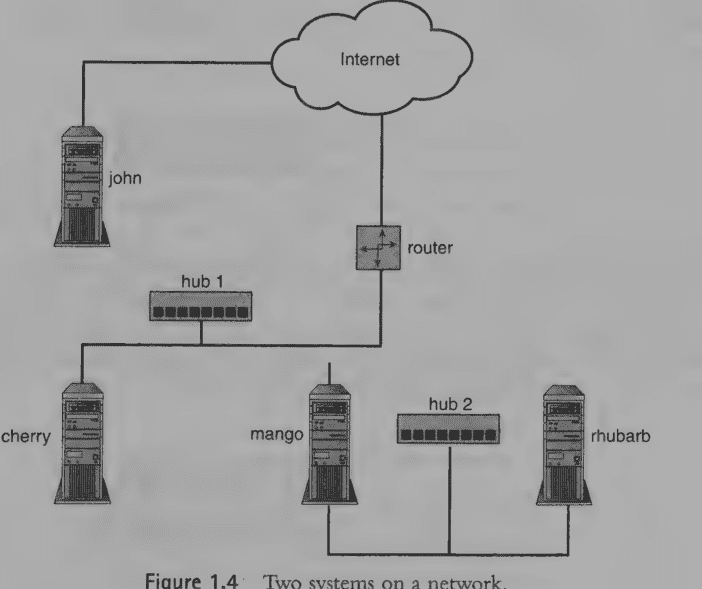

### 第一章：实战指南的序言

由于我们处理的是协议，只要程序实现了简单邮件传输协议（SMTP），哪个程序发送邮件并不重要。通常有多个程序实现同一个协议——sendmail、qmail 和 postfix 只是实现 SMTP 的几个邮件传输代理（MTA）。用户通常不直接使用 MTA；相反，用户使用 pine、balsam 或 evolution 等邮件代理程序（MUA）。

在我的 MUA 中写完邮件消息后，它会被交给 MTA 进行投递。MTA 确定 mango 的地址，然后将消息和 mango 的地址发送给 TCP 在传输层进行处理（见图 1.5）。


图 1.5 TCP 分段中的邮件消息。

TCP 随后与 mango 建立会话，在会话建立后（多亏于下层级支持），它将一系列包含邮件消息的分段向下发送到网络层的 IP。会话中的每个分段都包含足够的信息，以识别每台机器上的唯一进程，以及它携带的是应用层消息的哪个部分（见图 1.6）。


图 1.6 IP 数据报中的 TCP 分段。

IP 使用初始分段（建立会话的请求）并确定将其数据报发送到哪里。如果目标不在本地网络，IP 必须确定适当的网关来发送。在这种情况下，cherry 和 mango 位于同一网络上，不需要路由。IP 将其数据报向下传递给链路层的以太网设备处理程序进行投递（见图 1.7）。


图 1.7 以太网包中的 IP 数据报。

以太网系统必须使用地址解析协议（ARP）或通过查看机器 ARP 缓存（如果存在该地址的条目），将目标（或网关）的 IP 地址映射到硬件地址。在这种情况下，cherry 具有以下 ARP 缓存：

```
[root@cherry /root]# arp -a
? (192.168.1.1) is at 00:A0:C2:1C:64:E8 [ether] on eth0
? (192.168.1.11) is at 00:C0:F8:26:B1:EC [ether] on eth0
[root@cherry /root]#
```

地址映射完成后，IP 数据报（携带一个 TCP 分段，该分段又携带部分 SMTP 消息）被封装在以太网包中并发送到目的地（图 1.8）。

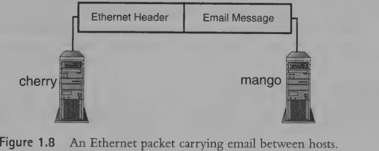

在 mango 上，接收并检查以太网包。如果主机确定它是用于本地投递的，它将决定将内容投递到哪里。在这种情况下，包包含一个传递给 IP 栈的 IP 数据报。

IP 栈检查数据报并发现它携带一个 TCP 分段，该分段被传递给 TCP 栈。IP 栈在将分段向上传递给 TCP 栈之前，可能需要采取一些特殊操作，例如从一系列数据报中重组一个分段。

TCP 检查收到的数据报，并将 SMTP 消息传递给应用层的本地 MTA，以便投递给最终用户。

TCP/IP 由互联网工程任务组（IETF）控制，该是一个具有开放政策的志愿者机构。RFC 用于开发和维护主要的 TCP/IP 相关标准。这些文档由 IETF 免费分发。

RFC 1122 和 1123 是主机需求 RFC。（RFC 1009 是路由器需求 RFC）。这三份文档构成了书中大部分讨论的基础。随附的。

## 第1章 实用指南序言

### Linux 上 TCP/IP 的简史

Linux 的第一个 IP 实现由 Ross Biro 开发。他继续在这一名为 NET-1 的版本上进行工作，直到他被其他任务以及 Linux 用户（有时是火爆的）的投诉所淹没。由于当时对伯克利发行版（BSD）协议栈的法律地位存在很大不确定性，人们重新实现了一套协议栈。NET-1 代码由由 Biro 编写的针对 WD-8003 以太网卡的以太网驱动支持。

除了 Ross Biro 的努力外，Ernest Zborowski 和 Laurence Culhane 也对早期 Linux 网络开展了基础性工作。Zborowski 开发了 BSD 套接字接口，该接口提供了大多数现有应用程序所需的 API。Culhane 开发了第一批 Linux SLIP 驱动程序，允许未连接以太网的用户开始使用 Linux 网络功能。

Fred van Kempen 接手并开始开发 NET-2。他对 IP 协议栈有非常宏大的计划，并开发了五个发布版本（NET-2A 到 NET-2E）。一些因素导致了社区的裂痕，Alan Cox 开始研究 NET-2D（调试版）。最终，van Kempen 的工作被 Cox 超越，NET-2Debugged 成为了标准。

Cox 的工作（以及其他人的）最终变成了 NET-3，即目前的 Linux TCP/IP 协议栈。Donald Becker（以太网驱动）、Michael Callahan 和 Ian Longyear（PPP）以及 Jonathon Mayer（AX.25 改进）是一些在网络代码上留下印记的人。

得益于参与开发 Linux 网络实现的许多人士，动态设备驱动、IPX、IPv6、高级路由能力、数据包过滤和网络地址翻译（NAT）等功能现在 Linux 上可用。因为这些功能，如今的 Linux 网络既稳定、快速又易用。网络和 Linux 的前景光明，每个新内核版本都会不断增强并添加新功能。

## 物理层问题

由于以太网是局域网（LAN）中最常用的协议，我将在本部分的注释限于以太网相关的问题。我的笔记将涵盖两个领域：物理层以太网和网络硬件。

### 物理层以太网

现在的以太网网络通常有两种类型：10BaseT 和 100BaseTx。和大多数名称一样，这些名称是有意义的。像网络中的大多数事物一样，你需要一些背景知识才能理解它们的含义。

在以太网早期，人们使用厚电缆或实心线缆。这些电缆可以传输 500 米的 10Mbps 信号，使用的是基带信号。这被称为 10Base5。

10Base5 的布线昂贵且连接困难，无法在狭窄的转弯处布置。后来开发了一种新的物理标准来缓解这些问题，但代价是最大长度缩短。细电缆（Thinnet，有时被称为 cheapnet）通过同轴电缆传输近 200 米的 10Mbps 基带信号，被称为 10Base2。

使用双绞线布线的以太网之所以被称为 10BaseT，因为它传输的是 10Mbps 基带信号。当 100Mbps 以太网发布时，它运行在双绞线上，被称为 100BaseTx。这两种实现方式每个连接都需要四对双绞线（使用 RJ-45 接头，看起来像大号电话插头）。该标准要求主机到集线器（或交换机）的连接。


10BaseT 和 100BaseTx 在四对共八根线中仅使用了四根。这四根线分为两对，一对用于传输信号，另一对用于接收信号。这导致了偶尔可以使用的小技巧。

标准使用线 1 和 2 号作为传输对，使用线 3 和 6 号作为接收对。知道这一点，你可以像图 1.9 所示连接这些对来制作一条交叉线。


图 1.9 交叉线。

这些电缆允许你在不通过中间集线器的情况下连接两个主机（这非常类似于空调制线，导致我以前同事称之为“空集线器线”）。

如果你只有两个主机需要连接，这是一种构建网络非常简单（且具有效益）的方法。这也是两个集线器连接的方式；许多集线器和交换机都具有一个可以在交叉连接和直连连接之间切换的端口。

由于只使用了八根线中的四根，因此可以在单条标准布线连接上运行两个以太网连接。这会导致一些信号衰减，但在正常的办公环境中通常是可以用的。如果你有任何方法布设第二组线路，那是最好的。如果你确实无法布第二根电缆，这个技巧可能会有所帮助。

其他可用的以太网标准包括千兆以太网、无线以太网和 10Base36（一种宽带以太网标准）。这些目前还不常见，尽管千兆以太网正变得像 10BaseT 和 100BaseTx 一样普及。

## 网络硬件：路由器、交换机和集线器，天哪！

网络硬件往往被视为黑魔法——一种只能使用但永远无法理解的东西。实际上，事情并没有那么困难。不同类型的网络硬件在不同层对网络流量进行操作。

- 6. IP、UDP 或 TCP 等协议的实现通常被称为“协议栈”（stack），就像 TCP/IP 协议被称为一个协议栈一样。这可能会导致很多不必要的困惑。

- 7. 一个很好的例子（尽管这并不是真正的 TCP/IP 问题）是 HTML 标准的各种私有扩展。现在已经很难找到既不是为 Netscape 或 Internet Explorer 设计、又不会因为于非标准标记而在其他浏览器中无法正常显示的网站了。令人鼓舞的是，Mozilla 项目正努力在其浏览器中实现 HTML 标准合规性。希望这将成为一种趋势的开始。

- 8. 当时，BSD 卷入了与 UNIX Systems Laboratories (USL) 之间的一场关于潜在版权侵权行为的诉讼中。只有在完成了大量工作之后，BSD 协议栈才被证明是自由的，而那时，Linux 协议栈已经已经在路上了。

### 协议

- **第 2 章** 链路层协议

- **第 3 章** 网络层协议

- **第 4 章** 传输层协议

- **第 5 章** 应用层协议

## 2 链路层协议

链路层协议为存在公共物理链路的计算机之间的通信提供了手段。该链路可以由公共以太网、*普通电话服务*（POTS）线路、*光纤分布式数据接口*（FDDI）环网，甚至可以是一群信鸽提供的（更多细节请参阅 RFC 1149！）。

所有上层协议都依赖链路层来实现数据的传输。由于上层协议的存在，流量可以穿越具有许多不同链路层协议的互联网络。事实上，大多数互联网络都符合这一描述。例如，两个带有 PPP 连接的办公室局域网（LAN）看起来就像图 2.1 所示。

图 2.1 带有 PPP 连接的局域网。

在接下来的章节中，我们将讨论两种链路层协议 PPP 和以太网，以及一种封装的链路层协议 PPPE。我们还将谈论许多 IP 协议栈提供的本地查找设备 ARP 协议，以及在穿越像图 2.1 所示的互联网络时使用的确定包大小的方法。

RFC 1661 定义了点对点协议（PPP），它“为在点对点链路上传输多协议数据报提供了一种标准方法”。PPP 用于将许多家庭计算机连接到互联网并在路由器之间提供独立于厂商的连接。

PPP 已经取代了线路 IP（SLIP），这是由 RFC 1055 描述的较早协议，且相关的压缩 SLIP 缺少 PPP 提供的一些功能：

- SLIP 不提供传输除 IP 之外任何协议的机制。

- SLIP 没有错误检查机制，导致流量容易因电话线路问题而损坏。

- SLIP 中没有发布 IP 地址的方法。你必须在开始之前知道连接双方各自的 IP 地址。

PPP 帧具有 5 字节的头部、多达 1500 字节的数据以及一个 3 字节的尾部。头部包含一个 1 字节的起始标志（始终为 `0x7e`）、一个 1 字节的地址字段（始终为 `0xff`）、一个 1 字节的控制字段（始终为 `0x03`）和一个 2 字节的协议字段（IP 为 `0x0021`）。

请求字段中的所有值都需要奇数，并可能指示链路控制协议（LCP）数据、网络控制协议（NCP）数据或来自上层协议的封装数据报。LCP 为链路建立、配置和测试提供了一个通道。这是用于协商 IP 地址和其他选项的机制。

NCP 特定特定于网络层协议。这些协议允许协商额外的选项。

图 2.2 显示了一个典型的 PPP 帧。没有显示起始标志，因为它只是一个指示有效流量而非线路噪声的标记。第一个字节（`0xff`）是地址字段。第二个字节（`0x03`）代表控制字段。接 2 个字节（`0xc021`）代表 LCP 回显请求。包的其余部分是 LCP 特有的负载。

图 2.2 一个 PPP 帧。

尽管我们通常将以太网作为一种单一协议来讨论，但实际上有两个不同的协议在链路层实现以太网。应用广泛的是以太网 II，由 RFC 894 描述。较少使用的是 IEEE 802.3 风格的以太网，由 IETF 在 RFC 1042 中定义。互联网主机需要理解以太网 II，并可能实现 802.3。如果它们提供……

原始规范由 DEC、Intel 和 Xerox 发布。这意味着通过 CSMA/CD 访问。头部的最后 2 个字节是类型。一些常用的类型代码见表 2.1。

| 表 2.1 受感兴趣的以太网类型 | 负载类型 |

| :--- | :--- |

| `0x0800` | IPv4 |

| `0x86DD` | IPv6 |

| `0x0806` | ARP |

| `0x8035` | RARP |

| `0x809B` | AppleTalk |

由于数据字段有最小限制，数据可能需要填充以达到最小字节数。小于 64 字节的包（14 字节头部、46 字节数据和 4 字节尾部）被称为“运行帧”（runs），会被忽略。大于 1518 字节的包（14 字节头部、1500 字节数据和 4 字节 CRC）被称为巨型帧（giants），也会被忽略。

记住，仅仅因为数据包是发送给特定主机（或多个主机发送的组播地址），它并不是私密的。以太网段上的每个主机都会接收该网段上的每个包。（这就是网络分析仪能够工作的原因。）每个主机通常只处理发送给自己的包（包括组播和广播），并忽略发送给其他人的包。目的地址放在前面是为了让主机更高效地执行这种行为。

这清楚地表明了 PPP 和以太网之间的主要。PPP 是点对点协议；流量只有电路的两个端（以及引入电路的任何特殊设备）可见。以太网是广播介质；局域网上的一切都会看到每一比特流量。

图 2.3 显示了一个以太网帧。在该帧中，目的地址设置为 `ff:ff:ff:ff:ff:ff`（广播地址），源地址为 `00:e0:98:7c:95:21`，类型字段为 `0x0806`（ARP）。

图 2.3 捕取的以太网帧。

RFC 2516 描述了以太网上的 PPP（PPPoE），这是在以太网上封装 PPP 数据包的方法。该协议通常用于为用户提供数字用户线路（DSL）服务。

PPPoE 协议将流量分为两类，分别在网络会话的不同阶段发送。会话从发现阶段开始，然后进入 PPP 会话阶段。阶段的以太网类型 ID（Ethernet type ID）不同。在发现阶段，ID 为 `0x8863`；在 PPP 会话阶段，ID 为 `0x8864`。PPPoE 头部在协议的两个阶段是相同的。

PPPoE 头部长度为 6 字节，包含五个字段。前 4 个字节组成版本字段（Version field），并设置为 `0x1`。第二个字段为 4 位（即 1 字节），代表代码字段（Code field）；该字段针对发现阶段和 PPP 会话阶段分别定义（详细信息请参见接下来的两个章节）。下一个字段是会话 ID（Session ID），长度为 2 字节（“发现阶段”部分为 2 字节，指示 PPPoE 载荷的长度，不包括以太网和 PPPoE 头部）。

一个 PPPoE 会话涉及两个主机。发起主机是客户端；即你的设备。服务器（也称为接入集中器 access concentrator）是你连接到 ISP（互联网服务供应商）的主机。

在发现阶段，PPPoE 数据包的载荷携带一系列定义良好的标签（tags）。每个标签由三个字段组成。第一个字段为 2 字节，代表标签类型。第二个字段代表标签长度，同样为 2 字节。第三个字段是标签值字段（TagValue），长度可变。表 2.2 显示了一些标签类型、值及其含义。

表 2.2 PPPoE 发现阶段标签与值

| 标签 | 标签名称 | 含义与值 |

| :--- | :--- | :--- |

| `0x0000` | 列表结束 (End of List) | 此标签表示数据包中更多标志位。其标签长度为 `0x0000`；没有标签值。该标签是可选的。 |

| `0x0101` | 服务名称 (Service Name) | 此标签用于请求或批准 PPPoE 会话内的服务（例如服务质量）。标签值携带服务的名称。 |

| `0x0102` | 接入集中器名称 (Access Concentrator Name) | 此标签给出接入集中器（PPPoE 服务器）的名称。该名称是唯一标识。标签值通常是服务器 MAC 地址的表示。 |

| `0x015` | 厂商特定 (Vendor-Specific) | 此标签可能用于传递厂商专用信息。TagValue 的内容以 4 字节的厂商 ID（`0x00`）开头，随后是以太网 MAC 地址的 3 字节部分。不建议使用此标签，任何实现都可以在法律上忽略。 |

| `0x021` | 服务名称错误 (Service Name Error) | 此标签长度通常为 `0x00`，表示请求的服务无法实现。如果 TagValue 字段中有数据，则它必须包含对服务请求被拒绝的可打印说明。 |

发现阶段始于客户端发送 PPPoE 主动发现启动（PADI）数据包。代码字段被设置为 `0x09`。会话 ID 设置为 `0x0000`。PADI 数据包必须携带一个服务名称标签，且不携带其他标签。

本地网络上的任何接入集中器如果能够处理请求，都可以响应 PPPoE 主动发现提议（PADO）数据包。在 PADO 数据包中，代码字段设置为 `0x09`，会话 ID 设置为 `0x0000`。

PADO 数据包必须携带一个与 PADI 数据包中匹配的服务名称标签，以及一个包含其唯一名称的 AC 名称标签。它还可能包含任意数量指示接入集中器提供的服务的名称标签。

客户端接收一个或多个 PPPoE 数据包后，选择其中一个并用 PPPoE 主动发现请求（PADR）数据包进行回复。代码字段设置为 `0x19`，会话 ID 设置为 `0x0000`。PADR 数据包必须包含所请求的服务名称标签。

服务器用 PPPoE 主动发现确认（PADS）数据包响应 PADR 数据包。代码字段设置为 `0x65`，会话 ID 设置为唯一标识该会话的 2 字节值。PADS 数据包必须包含服务名称标签，并可以包含其他标签。如果无法接受 PADR 中的服务名称，则必须回复包含服务名称错误的 PADS。会话 ID 设置为 `0x0000`。

当 PADS 数据包发送后，PPPoE 会话启动，PPP 阶段开始。

参与 PPPoE 会话的任何主机都可以通过发送 PPPoE 主动终止（PADT）数据包关闭会话。PADT 数据包的代码字段为 `0xa7` 并匹配会话。PADT 数据包不需要标签。接收 PADT 数据包后，PPPoE 会话上不再可以发送流量。在发送 PADT 之前应完成关闭。

当发现阶段完成后，PPPoE 会话中携带携带 PPP 流量。所有以太网流量都是单播的。PPPoE 代码字段对所有流量设置为 `0x00`，PPPoE 载荷为 PPP 数据包。

图 2.4 显示了一个 PADI 帧。版本字段为 `0x1`。类型字段为 `0x1`。代码字段为 `0x09` (PADI)。会话 ID 为 `0x0000`。载荷长度为 `0x0004`。数据包只有一个标签，服务名称标签。标签类型为 `0x0101`。标签长度为 `0x0000`。

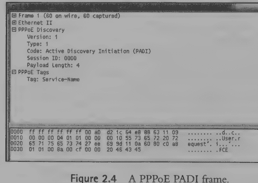

图 2.4 PADI 帧

图 2.5 显示了一个 PADO 帧。版本字段设置为 `0x1`，类型字段和代码字段均为 `0x07` (PADO)。会话 ID 为 `0x0000`。载荷长度为 `0x002a`。此帧有三个标签：接入集中器名称标签、服务名称标签和 Cookie 标签。接入集中器名称标签的类型为 `0x0102`。其标签长度为 `0x000e`。它包含 15 字节的字符串 "crashtdummy" 作为其标签值。

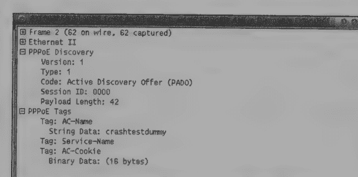

图 2.5 PADO 帧

图 2.6 显示了一个 PADDR 帧。在此数据包中，版本字段和类型字段均设置为 `0x1`。代码字段为 `0x19` (PADR)。会话 ID 为 `0x0000`。载荷长度字段为 `0x0018`。此数据包携带两个标签，服务名称标签和 Cookie 标签。

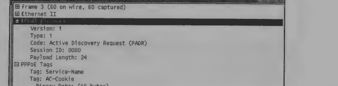

图 2.6 PADDR 帧

图 2.7 显示了一个 PADS 帧。版本字段和类型字段均为 `0x1`。代码字段设置为 `0x65` (PADS)。会话 ID 已分配并为 `0x001`。载荷长度为 `0x0004`。此数据包只有一个标签，服务名称标签。

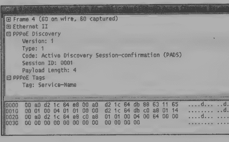

图 2.7 PADS 帧

图 2.8 显示了一个典型的 PPP 会话帧。它的版本字段和类型字段为 `0x01`。代码字段为 `0x00` (Session)。会话 ID 为 `0x0001`。载荷长度为 `0x0016`。此数据包的载荷是一个 PPP LCP 数据包。

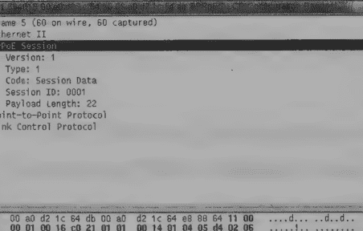

图 2.8 PPP 会话帧

环回接口是大多数 IP 协议栈提供的逻辑设备。它使用 A 类网络 127，并通常被分配地址 `127.0.0.1` 和名称 `localhost`。在 Linux 主机上，`lo` 接口用于环回，所示所示：

```
[root@cherry /]# ifconfig lo
lo Link encap:Loopback
inet addr:127.0.0.1 Mask:255.0.0.0
UP BACKUP RUNNING MTU:3924 Metric:1
RX packets:18 errors:0 dropped:0 overruns:0 frame:0
TX packets:18 errors:0 dropped:0 overruns:0 carrier:0
collisions:0 txqueuel:0
```

发送到环回地址的流量永远不会出现在连接的网络上。此接口的一个特殊之处是，主机发送自己的流量将被重定向到环回地址。

环回接口通常用于在同一台机器上的客户端/服务器应用程序之间建立网络连接（例如 X11 窗口系统）。这有助于保持流量离开本地网络，甚至在没有物理网络的情况下允许应用程序运行。

图 2.9 显示了一个带有 PPP 和以太网接口的环回接口。流入和流 IP 层的逻辑流由图中的箭头所示。

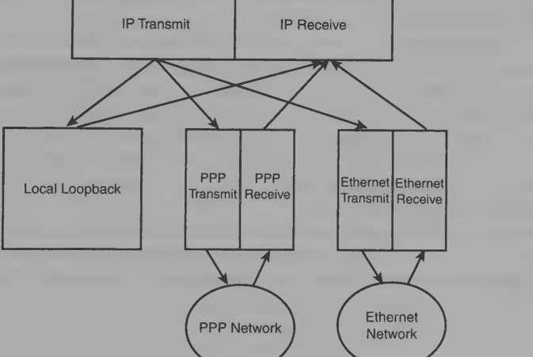

图 2.9 环回接口图。

如果链路层协议支持多个主机（如以太网 II），则 IP 必须有某种方法将 IP 地址与链路层地址关联起来。这是通过地址解析协议（ARP）实现的。以太网上的 IP ARP 由 RFC 826 定义。反向地址解析协议（RARP）是一种密切相关的协议，定义在 RFC 903 中。

如果我们回到另一个比比，用一个正在说话的房间来代表以太网局域网（LAN），那么 ARP 就像是在问：“谁是 Tom？”当有人回答时，你就可以开始和他交谈。事实上，ARP 问的是：“谁拥有 IP 地址 X.X.X.X？”当它收到响应时，就是与该主机的 IP 级对话。

-   ARP 不可路由：由于 ARP 直接由链路层协议承载，而不是由网络层协议承载，因此它是不可路由的。

ARP 需要两种数据包：ARP 请求（查询与 IP 地址对应的 MAC 地址）和 ARP 回复（给出两个地址之间的对应关系）。在某些情况下，回复是由被请求 IP 地址的机器发送的。一些旧的主机无法正确判断某个主机是否位于其本地网络。在这种情况下，ARP 提供了一种机制来回答这些系统的不当 ARP，即代理 ARP。Linux 允许你通过配置代理标志（proxy flag）来配置主机提供 ARP 响应。当设置此标志时，也可以设置子网掩码标志（netmask flag），并为主机或整个子集创建 ARP 缓存条目。

ARP 请求包由以下部分组成：2 字节硬件类型、2 字节协议类型、1 字节硬件地址长度、1 字节协议地址长度、值为 0001 的 2 字节操作码（opcode）、变长度的发送者地址、变长度的发送者协议地址、变长度的目标硬件地址以及变长度的目标协议地址。目标硬件地址通常填充为零。

ARP 回复包与之前描述的 ARP 请求包相似，不同之处在于操作值为 0002，且目标硬件字段（Target Hardware Field）填充了相应的 MAC 地址。

尽管 ARP 通常用于确定另一个系统的硬件地址，但某些机器被配置为执行“免费 ARP（gratuitous ARP）”。当主机启动其网络网卡时，它会为自己的 IP 地址使用 ARP。这种机制有助于减少 IP 地址冲突。

ARP 信息由操作系统在 ARP 表中由主机维护。在 Linux 平台上，可以使用 ARP 命令查看此信息，例如所示：

```
[root@cherry]# arp -a
? (192.168.1.1) at 00:0a:22:1c:64:e8 [ether] on eth0
? (192.168.1.11) at 00:c0:f0:26:81:ec [ether] on eth0
[root@cherry]#
```


ARP 表（更准确说是 ARP 缓存）中的条目可以是静态条目（使用 `arp set -file` 选项创建）或动态条目（自动发现）。动态条目通常有 15 分钟的超时——也就是说，15 分钟内没有通信的主机将重新进行 ARP。这种 ARP 缓存条目的老化过程最小化了远程主机网卡被更换的风险，从而改变了 MAC 地址到 IP 地址的关系。

RARP 包用以太网 II 类型 `0800` 标识。RARP 请求的 RARP 操作码为 `3`，RARP 回复的操作码为 `4`。没有“错误”或“未找到”操作码，因为网络上的另一个主机能够响应回复，但 RARP 包在其他结构上与 ARP 包相似。

RARP 的一个主要缺陷是它是不可路由的。由于它是链路层协议，它被局限于单个局域网。这意味着每个运行 RARP 的局域网必须至少配置一个 RARP 服务器守护进程。

在图 2.10 所示的 ARP 请求中，`mango` 正在请求 `cherry` 的硬件地址。硬件类型设置为 `0x0001`（以太网），协议类型设置为 `0x0800`（IPv4）。硬件地址长度为 `0x06`，分别为 6 字节和 4 字节。ARP 操作码设置为 `0x0001`（请求）。发送者硬件地址设置为 `00:a0:d2:1c:64:a8`，发送者协议地址设置为 `192.168.1.1`。目标硬件地址未知并设置为 `00:00:00:00:00:00`，而目标协议地址设置为 `192.168.1.10`。

图 2.10 一个 ARP 请求包。

当 `cherry` 响应 `mango` 的请求时，大部分数据保持不变。ARP 操作码为 `0x0002`（回复），目标地址和发送者地址已翻转。由于 `cherry` 正在给 `mango` 提供其硬件地址，发送者地址已从全 0 变为 `00:e0:98:7c:95:21`（见图 2.11）。

图 2.11 一个 ARP 回复包。

图 2.12 显示了一个 RARP 请求包，主机在启动时用于获取自己的 IP 地址。硬件类型设置为 `0x0001`（以太网），协议类型设置为 `0x0800`（IPv4）。硬件地址长度为 `0x06`，分别为 6 字节和 4 字节。ARP 操作码设置为 `0x0003`（请求）。发送者硬件地址设置为 `00:00:00:00:00:00`，发送者协议地址设置为 `192.168.1.1`。目标硬件地址未知并设置为 `00:00:00:00:00:00`，而目标协议地址设置为 `192.168.1.10`。

### 网络层

网络层（或称为互网络层）标志着流量离开单个网络限制的起点。它也标志着地址出现第一层抽象的转折点（如第 2 章“链路层协议”中的“ARP”小节所示）。在对网络层的讨论中，我们将涵盖 IP 地址分配、子网和超网、IP 路由、数据包过滤、网络地址转换（NAT）以及 IP 版本 4（目前使用最广泛的版本）。

由于 IP 地址分配、子网划分和路由是密不可分的，因此很难在不提及其他两者的情况下讨论其中之一。如果这导致你在阅读时产生了一些困惑，请顺从你的好奇心，直接跳转到相应的章节以获得启发。

在讨论 IP 协议之前，我们先花些时间回顾 IP 地址本身。IP 地址范围被分配给各个组织。通常是由组织的互联网服务提供商（ISP）分配的，尽管在某些少数情况下组织可以申请自己的 IP 地址。除非被防火墙拦截，任何这些分配的 IP 地址都可以在互联网上路由。

IP 地址指示了本地 IP 网络的大小以及（在某些情况下）它的用途。这是通过将网络划分为类来实现的，如表 3.1 所示。

| 网络类型 | 地址的首字节 | 识别模式 | 备注 |
| --- | --- | --- | --- |
| A 类 | 0–127 | 第一位为 0。 | A 类网络每个网络提供 16,777,214 个主机。网络地址长度为 1 字节。 |
| B 类 | 128–191 | 前 2 位为 10。 | B 类网络每个网络提供 65,534 个主机。网络地址长度为 2 字节。 |
| C 类 | 192–223 | 前 3 位为 110。 | C 类网络每个网络提供 254 个主机。网络地址长度为 3 字节。 |
| D 类 | 224–239 | 前 4 位为 1110。 | D 类地址用于组播流量。 |
| E 类 | 240–247 | 前 5 位为 11110。 | E 类地址保留用于实验性。 |

除了这些 IP 地址的划分外，还有另一种区分。其中一些地址被保留用于*私有地址*。RFC 1918 为公司内部的主机设置了以下地址：

- `10.0.0.0`
- `172.16–31.0`
- `192.168.0–255.`

你可以根据自己认为合适的方式使用这些地址，只要它们不在互联网上进行路由即可。这使得其他人在他们的内部网络也可以使用同一组地址。RFC 1918 地址的广泛使用是通过 NAT 实现的，NAT 将在本章稍后部分以及第 11 章“安全工具”中讨论。请通过私有地址帮助节省可用的 IP 地址。在你的内部网络中使用 RFC 1918 地址空间也有利于这些网络的安全性。我将尽可能多使用 RFC 1918 地址（更多信息请参见本章稍后部分的“网络地址转换”）。

由于 A 类和 B 类网络对于普通局域网（LAN）来说太太大了，有时 C 类网络也不符合要求，因此有一种方法可以将网络拆分成更小的块。这种方法被称为*子网划分*。子网是通过*子网掩码*或*网络掩码*（另一个 4 字节数字）形成的。子网划分将在下一节中讨论，因此我们将该解释留到以后。

当机器传输 IP 流量时，它必须对目标主机是本地还是远程做出决定。本地主机被直接寻址，这意味着流量将发送到与目标 IP 地址对应的 MAC 地址。远程主机的流量将发送到该网络的本地网关（路由将在后面的章节中介绍；现在，我们只需打个手表示它会发生）。此路由决策是根据本地（或源）IP 地址及其网络掩码、目的 IP 地址做出的。源 IP 地址与网络掩码进行按位与（AND）运算，目的地址也是如此。得到的两个数字进行比较（如图 3.1 所示）。

| 二进制 | 十进制 |
| --- | --- |
| 11000000 10101000 00000000 00010000 | 192.168.1.16 地址 |
| 11111111 11111111 11111111 10000000 | 255.255.255.250 网络掩码 |
| 11000000 10101000 00000000 00000000 | 192.168.1.0 网络 |

图 3.1 IP 地址和网络掩码的按位与运算。

如果这两个与运算的结果相同，则两台机器是本地的。如果不相同，则两台机器是远程的。

| 源 | 目的 |
| --- | --- |
| 地址: 192.168.1.100 | 地址: 192.168.1.25 |
| 掩码: 255.255.255.0 | 掩码: 255.255.255.0 |
| 结果: 192.168.1.0 | 结果: 192.168.1.0 |

因为示例 3.1 中的结果匹配（两个主机的地址与子网掩码进行按位与），所以这些主机之间是本地的；将使用直接寻址。

| 源 | 目的 |
| --- | --- |
| 地址: 192.168.1.100 | 地址: 192.168.10.2 |
| 掩码: 255.255.255.0 | 掩码: 255.255.255.0 |
| 结果: 192.168.1.0 | 结果: 192.168.10.0 |

因为结果不相同，所以两台机器是远程的。

子网和超网提供了更高效的利用 IP 地址的方法。子网已经存在了很久，而超网是较新的。在本节中，我们将讨论子网。

大多数公司发现 C 类地址对于其需求来说要么太大要么太小。以一个 C 类网络为例，假设它有若干个部门。子网划分提供了将 IP 地址拆分的方式。图 3.2 显示了这种划分。

| 网络 | 子网 |
| --- | --- |
图 3.2 IP 地址的子网字段。

子网中的位数告诉我们使用该掩码有多少个子网。在主机字段中，全 1 留作广播地址，而全 0 地址表示网络地址，尽管早期的实现使用全 0 地址用于此目的。例如，地址和掩码在表 3.2 中列出。

### 表 3.2 子网划分的 IP 地址

| --- | --- | --- | --- | --- | --- |
| 11000000 | 10010100 | 00000001 | 00100001 | 192.168.1.33 | IP 地址 |
| 11111111 | 11111111 | 11111111 | 11100000 | 255.255.255.224 | 子网掩码 |
| 11000000 | 10010100 | 00000001 | XXXXXXXX | 192.168.1.0 | 网络，C 类子网 |

拥有一个关于子网掩码及其提供的子网数量和主机数量的小表可能会很有用（见表 3.3）。

| 网络地址 | 子网掩码 | 可用网络数 | 每个子网主机数 | 网络总主机数 |
|---|---|---|---|---|
| 192.168.1.0 | 255.255.255.240 | 15 | 14 | 210 |
| 192.168.1.0 | 255.255.255.192 | 3 | 62 | 186 |
| 172.168.0.0 | 255.255.255.128 | 511 | 126 | 64386 |
| 172.168.0.0 | 255.255.255.254 | 127 | 510 | 64770 |

几年前，我在一家交钥匙系统供应商处工作，我是团队中唯一一个真正理解子网掩码的人。有一天，一个客户打来电话，急需重新配置一个网络方案。当时公司刚刚与另一家公司合并，需要将新办公地点加入其现有的两个网络中。虽然我们计划了业务增长，但新办公室的主机数量比预计的要多。这只是重新计算掩码并分配新地址范围的简单事情。

你可以猜到是谁去做了。唯一的遗憾是我和我妻子当时在医院，她正准备生孩子；幸运的是，当我接到电话时，她并没有太生气。我没有任何工具来计算子网，所以我最后只能在脑子里进行数学计算，并在手套的包装纸上随手画了一张地图，交给我们的客户。

主机只知道自己的子网掩码。它做的任何比较都仅基于自己的掩码。这有时会引起问题。如果局域网上的两个主机子网掩码不同，它们可能无法通过 IP 进行通信。

正如子网被用于创建适当较小的网络一样，还提供了一种汇聚网络的方法，以提供更大、更易路由的网络。超网有助于解决两个问题。首先，对于需要这些组织来说，没有合适的大型网络（C 类网络对于大多数公司来说不够大，而 B 类网络也不足以提供给那些需要 10 或 12 位主机地址空间的公司）。其次，当互联网核心路由器的路由表被互联网边缘的许多不同 C 类网络充满时，它们会变得难以管理。

## RFC 1518 和 RFC 1519 定义了无类分类域间路由（CIDR），读音为

使用超网要求路由器必须知道其承载网络的网络掩码。目前主流路由协议（IP4、BGP-4 和 OSPF）的实现都已包含了所需的信息。

为了理解超网以及它们如何缓解上述的两个问题，让我们来看一个例子：

一家名为 Small-ISP.net 的小型互联网服务提供商拥有一个 `192.168.192.0/20` 的 CIDR 块（记住，这意味着它可以控制从 `192.168.192.0` 到 `192.168.207.255` 的地址，总共 16 个 C 类网络）。由于 ISP 控制了这些地址，互联网核心的任何其他路由器只需要一个路由条目即可，而不是 16 个独立的条目。

Small-ISP.net 有三家为其客户之外提供服务的公司。SmallCo 和 LittleCo（三家中中较小的）分别被分配了 `192.168.206.0/23` 和 `192.168.204.0/23`，每家公司为其网络提供了 510 个潜在主机地址。MidSize, Inc. 被分配了 `192.168.200.0/22`，产生了 1022 个主机地址。所有这些分配为 Small-ISP.net 留下了 `192.168.192.0/21` 网络供其使用（或在需要时进一步划分）。

路由是网络层的主要功能，也是 IP 的优势之一。IP 协议的设计目标之一是让互联网能够在其连接遭受近乎灾难性的损失后生存。IP 独立地路由每个数据报，如果一个数据包的数据路径被阻塞，下一个数据包将简单沿着不同的路径路由。这在网状网络中运行良好。

网络通常分类为简单网络或网状网络（有时称为“深度网状”）。简单网络是指网络之间连接较少的网络。流量通过简单网络时只有一条潜在路径。网状网络是指网络之间存在许多连接的网络。流量可以在网状网络点与点之间的多路径传输。

这种能力的关键之一是，任何给设备只需要知道通往互联网任何其他一点的下一个连接。事实上，对于许多设备来说，只需要一个连接；这被称为默认网关。这些信息的集合被称为路由表。

让我们从一个简单的路由示例开始。我们将使用图 3.3 所示的互联网。每个主机都有路由表；所示：

```
[cuke@cuke]$ netstat -rn
Kernel IP routing table
Destination | Gateway | Genmask | Flags | MSS | Window | Iface
|---|---|---|---|---|---|
| 192.168.1.255 | 0.0.0.0 | 255.255.255.255 | UH | 0 | | eth0 |
| 192.168.1.2 | 0.0.0.0 | 255.255.255.0 | U | 0 | | eth0 |
| 127.0.0.0 | 0.0.0.0 | 255.0.0.0 | U | 0 | | lo |
| 0.0.0.0 | 192.168.2.1 | 0.0.0.0 | UG | 0 | | eth0 |
```

```
[fedex@fedex]$ netstat -rn
Kernel IP routing table
Destination | Gateway | Genmask | Flags | MSS | Window | Iface
|---|---|---|---|---|---|
| 192.168.1.255 | 0.0.0.0 | 255.255.255.255 | UH | 0 | | eth0 |
| 192.168.1.0 | 0.0.0.0 | 255.255.255.0 | U | 0 | | eth0 |
| 192.168.2.1 | 0.0.0.0 | 255.255.255.255 | UH | 0 | | eth1 |
| 192.168.2.0 | 0.0.0.0 | 255.255.255.0 | U | 0 | | eth1 |
| 127.0.0.0 | 0.0.0.0 | 255.0.0.0 | U | 0 | | lo |
| 0.0.0.0 | 192.168.1.1 | 0.0.0.0 | UG | 0 | | eth0 |
```

```
[kumquat@kumquat]$ netstat -rn
Kernel IP routing table
Destination | Gateway | Genmask | Flags | MSS | Window | Iface
|---|---|---|---|---|---|
| 192.168.1.255 | 0.0.0.0 | 255.255.255.255 | UH | 0 | | eth0 |
| 192.168.1.0 | 0.0.0.0 | 255.255.255.0 | U | 0 | | eth0 |
| 127.0.0.0 | 0.0.0.0 | 255.0.0.0 | U | 0 | | lo |
| 0.0.0.0 | 192.168.1.1 | 0.0.0.0 | UG | 0 | | eth0 |
```

```
[pate@cherry]$ netstat -rn
Kernel IP routing table
Destination | Gateway | Genmask | Flags | MSS | Window | Iface
192.168.1.10 0.0.0.0 255.255.255.255 UH 0 0 eth0
192.168.1.0 0.0.0.0 255.255.255.0 U 0 0 eth0
192.168.2.0 192.168.1.2 255.255.255.0 U 0 0 eth0
127.0.0.0 0.0.0.0 255.0.0.0 U 0 0 lo
0.0.0.0 192.168.1.1 0.0.0.0 UG 0 0 eth0
eth0
Link: encap:Ethernet Hwaddr:00:E0:9C:75:c1
inet addr:192.168.1.10 Broadcast:192.168.1.255 Mask:255.255.255.0
UP BROADCAST RUNNING MULTICAST MTU:1500 Metric:1
RX packets: errors:0 dropped:0 overflows:0 frame:0
TX packets: errors:0 dropped:0 overflows:0 carrier:0
collisions:0 txqueuelen:1000 
```

```
[pate@usps]$ netstat -rn
Kernel IP routing table
Destination | Gateway | Genmask | Flags | MSS | Window | Iface
192.168.0.255 0.0.0.0 255.255.255.255 UH 0 0 eth0
192.168.0.0 0.0.0.0 255.255.255.0 U 0 0 eth0
192.168.1.0 192.168.0.2 255.255.255.0 U 0 0 eth0
127.0.0.0 0.0.0.0 255.0.0.0 U 0 0 lo
0.0.0.0 192.168.0.1 0.0.0.0 UG 0 0 eth0
```


```
[pate@patton]$ netstat -rn
Kernel IP routing table
Destination | Gateway | Genmask | Flags | MSS | Window | Iface
192.168.1.255 0.0.0.0 255.255.255.255 UH 0 0 eth0
192.168.1.0 0.0.0.0 255.255.255.0 U 0 0 eth0
192.168.2.0 192.168.1.2 255.255.255.0 U 0 0 eth0
127.0.0.0 0.0.0.0 255.0.0.0 U 0 0 lo
0.0.0.0 192.168.1.1 0.0.0.0 UG 0 0 eth0
```

当 `kumquat` 接收到帧时，它读取 IP 地址并发现数据报的地址是自己。任何返回流量都将经过相同的步骤。

当 `cherry` 向 `patton` 发送流量时，它再次比较了 IP 地址。在这种情况下，`192.168.1.10` 与 `192.168.0.12` 处于不同的网络，因此 `cherry` 必须通过路由器发送其流量。然后 `cherry` 检查其路由表。表中没有针对 `192.168.0.0` 网络的显式路由，但有一个默认网关项，因此 `cherry` 将通过该网关进行路由。IP 数据报的目标是 `patton`，并被放入一个带有 `ups` MAC 地址的以太网帧中。

当 `ups` 接收到该以太网帧时，它发现 IP 地址不是本地的。由于 `ups` 配置为转发（或）数据包，它会检查路由表以确定 IP 数据报的下一跳。然而，`patton` 位于本地连接的网络上，因此数据报被放入一个带有 `patton` MAC 地址的以太网帧中，并通过适当的网络接口发送。

当 `patton` 接收到该帧时，它检查 IP 数据报中的 IP 地址，并确定该数据报用于本地交付。

在 IP 跳跃完成对数据报的处理且应用程序返回响应后，`patton` 将其自己的 IP 地址与 `cherry` 的地址进行对比。它发现 `cherry` 不是本地的，因此 `patton` 需要使用路由器来交付携带响应的数据报。

接下来，`patton` 检查其路由表，发现 `ups` 是 `192.168.0/24` 网络的正确路由器。然后，数据报的目标设置为 `cherry`，并被放入一个目标指向 `ups` 的以太网帧中。

最后，`ups` 检查 IP 地址并发现目标是 `cherry`。通过检查路由表，`ups` 发现 `cherry` 是本地连接的。数据报被放入一个目标指向 `cherry` 的新以太网帧中，并通过适当的网络接口发送。

当 `coke` 想向 `patton` 发送 IP 数据报时，它首先根据其子网掩码将其 IP 地址与 `patton` 的地址进行比较。`192.168.2.51` 和 `192.168.0.12` 处于不同的网络，因此 `coke` 检查其路由表查找适当的条目。没有针对 `192.168.0.0` 的显式路由，因此 `coke` 使用其默认网关。

目标为 `patton` 的 IP 数据报被放入一个以太网帧中，`fedex` 检查封装的 IP 数据报并发现其目标是 `192.168.0.12`。`192.168.0.0` 网络没有直接连接 `fedex`，因此它查看路由表以确定向何处发送数据报。没有显式路由，`fedex` 使用其默认网关 `ups`。IP 数据报被放入一个指向 `ups` 的以太网帧中，并通过适当的网络接口发送。

## 路由 43

当 `usps` 接收到以太网帧时，它检查 IP 数据报发现目标是 `192.168.0.12`。`192.168.0.0` 网络是直接连接的，因此 `usps` 将 IP 数据报封装进一个指向 `patton` 的以太网帧中，并通过正确的网络接口发送。

然后 `patton` 接收到该以太网帧，发现封装的 IP 数据报的目标是自己。在处理完 IP 数据报后，如果需要发送响应，`patton` 将遵循相同的系列步骤发送响应。

追踪 IP 数据报的返回路径留作一个练习题。

## 按程度路由

主机上的所有路由都是根据主机自身的路由表进行的。该表中存在三种基本条目，对应于三种路由类型：

- 本地连接网络（直接路由），
- 静态分配路由（静态路由），
- 动态分配路由（动态路由）。

接下来的章节将分别讨论这每种类型。

当两个主机位于同一个网络和子网时，不需要路由器即可在两个主机之间传递流量。IP 数据报直接通过指定的链路层帧在它们之间发送。

## 静态路由

在简单网络或网状网络的简单部分中，可以通过 `/sbin/route` 命令手动将路由条目输入主机的路由表。这通常在路由不太可能更改时进行，因为任何更改也可以手动输入。路由表中的默认网关项几乎总是静态路由。

当网络之间的路由可能发生变化时，动态路由最有意义。这依赖于底层路由协议（如 `RIP-2`、`OSPF` 或 `BGP`），在路由器之间传递网络路由信息。`RIP-2` 将在第 5 章“应用层协议”中详细讨论。

动态路由是网状互联网生存连接丢失的关键。一个简单的示例如图 3.4 所示。


图 3.4 一个小型网状网络。

在这个图中，`192.168.0.0/24` 网络可以通过 `192.168.2.0/24` 网络或 `192.168.3.0/24` 网络向 `192.168.5.0/24` 网络发送流量（流量通常沿此路径流）：

- `192.168.0.0/24`
- `192.168.1.0/24`
- `192.168.2.0/24`
- `192.168.5.0/24`

通过 `192.168.3.0/24` 网络需要经过 `192.168.4.0/24` 网络的额外跳转。这个额外跳转反映在路由器之间的路由表中。

如果 `192.168.1.0/24` 和 `192.168.2.0/24` 之间的连接由于某种原因中断，路由表将更新显示新的路径为：

- `192.168.0.0/24`
- `192.168.1.0/24`
- `192.168.3.0/24`
- `192.168.4.0/24`
- `192.168.5.0/24`

尽管此路径比旧路径长，但它仍然有效并因此提升为最佳路径。当 `192.168.1.0/24` 和 `192.168.2.0/24` 之间的链路恢复时，路由表将恢复到通过 `192.168.2.0/24` 的路径。

## 将 Linux 变为路由器

所有 Linux 设备都能处理 IP 流量。此功能在大多数 Linux 发行版中默认是关闭的。名为 `ip_forward` 的内核参数控制此功能。以下命令将开启系统的路由：

```
echo 1 >/proc/sys/ipv4/ip_forward
```

如果你的设备连接到两个多个 IP 网络，它将开始在它们之间路由流量。或者，它将只向路由器路由流量，因此你应该通知连接的网络主机此路由器已到位。对于简单网络，这可能意味着将路由器设置为各个主机的默认网关。对于更复杂的网络，你将需要让守护进程发布你的路由器。有关这些程序的更多信息，请参阅第 5 章和第 7 章。

## 更多高级技巧

Linux 内核具有远超简单路由的能力。一些高级路由能力包括：

- 基于服务类型的路由，
- 基于应用层协议的重路由，
- 数据包过滤，
- 网络地址转换，
- 其他各种技巧。

## 数据包过滤

数据包过滤是根据数据包头中的信息决定路由、接受或拒绝数据包的过程。最简单的数据包过滤依赖于源地址和目的地址的比较（见图 3.5）。


图 3.5 一个小型网络。

对于如图 3.5 所示的网络流量，数据包过滤器可能会设置拦截流量（使用此处解释的简单配置代码）：

```
deny 10.0.0.0/24 201.13.25.0
deny 172.16.0.0/20 201.13.25.0
deny 192.168.0.0/16 201.13.25.0
deny 127.0.0.0/24 201.13.25.0
deny 201.13.25.0/8 201.13.25.0
allow 0.0.0.0/32 201.13.25.100/0
deny all
```

这种格式的每个规则为：

```
action source/mask destination/mask
```

这些规则中的掩码不是子网掩码；每个掩码代表从地址最低位开始的可变位。例如，目标/掩码 `201.13.25.0/8` 代表从 `201.13.25.0` 到 `201.13.25.255` 的所有地址（最后一个字节中的任何位都可以设置为任何值）。

前五条规则拒绝三类流量的连接：RFC 1918 私有地址（之前讨论过）、本地回环地址和内部网络（以防止伪造流量）。第六条规则允许来自任何主机（尚未被拒绝）且指向 `201.13.25.100` 的流量。最后一条规则拒绝所有其他内容。

Linux 数据包过滤能力由 `netfilter` 和 `iptables` 提供。使用的工具将在第 11 章的相应章节中描述。

## 网络地址转换

网络地址转换 (`NAT`) 将私有内部地址空间（通常由 RFC 1918 地址组成）映射到一个或多个可路由 IP 地址的方法。此功能可以帮助提供安全性（通过隐藏你的内部地址结构并防止连接到内部主机）并最小化 IP 地址开销（通过使用私有地址空间而不是从 ISP 获取可路由 IP 地址）。

`NAT` 的一种形式称为伪装（masquerading）。IP 伪装将任何内部地址空间映射到单个 IP 地址。这通常用于家庭或小型办公室中的几台 PC 共享单个拨号、DSL 或电缆调制解调器。

## IPv4

互联网协议 (`IP`) 由 RFC 791 定义。`IP` 提供可路由地址、分片和重组以及基于服务类型 (`TOS`) 的交付选项。

### 关于 IPv4 的讨论

`IPv4` 头部通常为 20 字节。它包含一个 4 位的版本（Version）字段（始终始终为 4）、一个 4 位的头部长度（Header Length）字段（通常为 5，表示五个 4 字节的字，总计 20 字节）、一个 1 字节的服务类型（TOS）字段、一个 2 字节的总长度（Total Length）字段、一个 2 字节的标识（Identification）字段、一个 3 位的标志（Flags）字段、一个 13 位的分偏移（Fragment Offset）字段、一个 1 字节的生存时间（TTL）字段、一个 1 字节的协议（Protocol）字段、一个 2 字节的头部校验和（Header Checksum）字段、一个 4 字节的源地址（Source Address）字段以及一个 4 字节的目的地址（Destination）字段。

### TOS

`TOS` 字节分为三个部分。在第一部分，3 位用于优先级（precedence）字段，该字段现在已很少使用。在第二部分，4 位用于表示 TOS，每一位都可以设置。四个可能的标志是延迟（delay）、吞吐量（throughput）、可靠性（reliability）和成本（cost）。如果这些位中没有开启，则正常路由被视为零。第三部分是一个 1 位预留空间；该位被预留且必须设置为 0。

`TOS` 位允许更好地控制数据包的路由方式。`ssh` 等交互式应用程序应该设置延迟位，表示数据包应以最小化延迟的方式路由。传输数据的应用程序应该设置吞吐量位，以获得倾向于最大化吞吐量的 路由。这些选项在 RFC 1349 中有更详细的解释。除了 TOS 路由外，2.4 Linux 内核还提供了强大的工具，根据多个可能的键对网络流量进行整形；这些工具将在第 11 章中讨论。

### 总长度

总长度字段表示 IP 数据报（包括头部）的字节总长度。IP 限制为 65535 字节，其中 65515 字节可以是有效负载。如果 IP 数据报被分片（见稍随后的“分片标志”节），则总长度字段表示分片的大小。在实践中，TCP 和 UDP 限制了其数据的大小以避免发送极大的数据包（8192 字节是一个上限）。

### 标识

来自给定主机的每个数据报通过 2 字节的标识字段进行唯一标识。该标识在单个数据报的分片之间不会改变，这允许数据报在目的地进行重组。

### 分片标志

3 位标志包含两个处理分片的标志和一个预留位。第一位是预留的且必须为 0。第二位是不分片（Don't Fragment）标志。如果设置了分片位，则表示该数据包不应被分片；而是应该生成一个控制消息协议（ICMP）错误消息。第三位是最后一个分片（Last Fragment）标志。当该数据报没有更多分片时，该位被置位。

### 分片偏移字段

如果数据报未被分片，分片偏移字段将设置为全 0。如果数据报已被分片，该字段将指示从数据报开始的 8 字节字碎片数。分片的示例出现在“IP 分片”节中。

### TTL

`TTL` 字段表示数据包在被丢弃之前可以经过的跳数。当创建数据包时，它被赋予 64 的 TTL。然后，每当它通过路由器时，TTL 就会减 1。这防止了无法交付的数据包在网络中永远漂浮。

### 协议

协议字段表示数据报负载中携带的是什么协议。我们关注三个可能的值：它们是 `0x06` (`TCP`)、`0x11` (`UDP`) 和 `0x01` (`ICMP`)。这些协议中的每一个将在下一节中处理。

### IP 校验和

IP 校验和仅针对头部数据计算；负载部分不参与计算。为了校验和，校验和字段最初填充为零。

### 源地址目的地址

源地址目的地址字段包含发送主机和目标主机的 IP 地址。在 IP 数据跨网络传输的过程中，这些字段不会改变，除非是源路由数据报（见表 3.4）。由于安全考虑，源路由已不再常用。

### IP 选项

包含 IP 选项时，IP 头部将超过 20 字节。在这种情况下，头部长度字段将重置为值 `0xf`，并提供以下附加字段：通过门复制（Copy Thru Gate，1 位）、选项类（Option Class，2 位）和选项编号（Option Number，5 位）。通过门字段指示这些选项是否应附加到 IP 数据包的分片上（设置为 1 时）或不附加（设置为 0 时）。选项类字段有两个未预留的值，00 表示流量控制代码，10 表示测量和调试代码。某些选项在表 3.4 中显示（带有简要说明）。

### 表 3.4 IP 选项

| 类 | 选项代码 | 选项名称 | 长度 | 描述 |
| --- | --- | --- | --- | --- |
| 00 | 00000 | 选项列表结束 | — | 表示选项列表中不再有更多选项 |
| 00 | 00010 | 安全处理 | 11 | 定义数据包如何被处理（在军事环境中）。更多细节请阅 RFC 1108 |
| 00 | 00011 | 稀散源路由 | 可变 | 表示数据包应经过一组指定的路由器。也可以经过其他路由器 |
| 10 | 00100 | 收集时间戳 | 可变 | 表示数据包应由经过的每个主机盖上时间 |
| 00 | 00111 | 记录路由 | 可变 | 表示数据包应由经过的每个主机记录 IP 地址 |
| 00 | 01001 | 严格源路由 | 可变 | 表示数据包应经过指定的路由器。只有列出的路由器可以被经过 |

### IP 分片

IP 图可能大于数据报交付时遵循的路径 MTU。图 3.6 显示可能发生这种情况的小网络。

## 第 3 章 网络层协议

令牌环网络的 MTU 为 4096，以太网为 1500，第三种为 576。如果数据报为 4096 字节，它通过路由器 1，然后是 2，最后是路由器 3。每当它通过路由器时，TTL 都会减 1。这防止了无法交付的数据包在网络中永远漂浮。如果数据报被分片，分片偏移指示从数据报开始的 8 字节字碎片。

### IPv4 解码

在图 3.7 显示的 IP 图中，版本设置为 4。头部长度设置为 5，表示没有额外的头部。优先级和 TOS 标志设置为 `0x00`，意味着没有设置特殊处理标志。（这在以太网中标记为“差异化服务”）。总长度设置为 `0x003c`（或 64 字节）。数据报 ID 设置为 `0x0054`。标志字段设置为 010，表示设置了不分片位。由于分片，分片偏移被置零。TTL 设置为 `0x40` (64)。校验和设置为 `0x3c66`，对于该数据报来说是正确的。源地址为 `127.0.0.1`，目的地址为 `127.0.0.1`。该数据包是主机回环接口上 TCP 连接的一部分。

图 3.7 IP 数据报。

## 第 3 章 网络层协议

- 4. 事实上，每个 IP 地址都使用子网掩码。在未给出掩码的情况下，假设使用该类网络的默认掩码（C 类地址为 24 位，B 类地址为 16 位，A 类地址为 8 位）。
- 5. 如果你所在的包含基于 BSD4.2 系统的网络（例如旧的 Sun 或 Ultrix 机器）中，你应该避免使用全 0 子网。如果你在环境中没有这类“老古兽”，那么就不需要担心。
- 6. 因为对子网的真正理解只有通过反复使用才能获得，我将完成此备查表的任务留作一项练习。虽然也有许多工具可以为你计算子网掩码。这些工具非常节省时间，但在你开始依赖它们之前，你应该了解其内部的工作原理。
- 7. 这些规则不适用于网络安全。它们仅作为示例提供。
- 8. 这使得“不分片”（Don't Fragment）位对诊断工具非常有用。

## 第 4 章 传输层协议

传输层为上述应用程序在主机之间传输数据，并提供关于网络主机间连接的诊断信息。这些信息通过 `TCP`（以及相关的 `T/TCP`）、`UDP` 或 `ICMP` 传输。这些协议在功能和外观上（你将在各自的章节中看到）非常不同：`TCP` 保证数据的可靠流传输，允许应用程序实现忽略此类细节；`UDP` 不保证递送，这迫使应用程序必须自行确保可靠性；`ICMP` 不在传统意义上携带数据，但它携带有关网络或网络上其他连接的数据。在本章中，我们将讨论端口（ports）、套接字（sockets）、`TCP`、`UDP` 和 `ICMP`。

### 端口与套接字

在传输层，较高层协议通过其端口号引用。这些 2 字节数字对应特定的应用程序或进程。某些端口被保留或注册，并记录在 RFC 1700 中。对这些端口的访问通常通过 *守护进程*（daemon）如 `inet` 控制（位于 80 端口的 `http` 是这一经验性法则的常见例外）。其他端口被“动态”分配给应用程序（服务器或客户端都可以以这种方式绑定端口）。


`inetd`（以及类似的守护进程）充当主机的“交换机”。该进程被配置为监听多个端口，然后为每个入站连接产生相应类型的服务器进程。`inetd`容易受到各种攻击的影响，通常被其他工具替换或补充。`xinetd`和`TCP wrappers`分别是替换服务器和补充服务器的示例，它们将在第11章“安全工具”中介绍。

保留端口是指值为1到1023（包含）的端口。这些端口的使用限于由`root`启动的进程。这些端口由互联网数字分配机构（IANA）分配给应用程序。由于这些端口的使用由标准机构控制，它们有时被称为“良性端口”。

在1024到65535（包含）范围内的端口如果列在`RFC 1700`中，则为“注册端口”。尽管它们由IANA列出，但并非由其进行标准化。服务器进程可以绑定到该范围内的任何端口，但尽量避免使用广泛使用的保留数字被认为是一种良好的做法。

此范围的端口供客户端进程使用。例如，当用户向远程主机建立`Telnet`连接时，本地`Telnet`连接将绑定到无限制范围内的端口——例如1027。`Telnet`连接尝试与端口为23的服务器建立连接。由于`Telnet`通常通过`inetd`处理，它会接收入站请求并启动一个`in.telnet`进程来处理`Telnet`会话。

### 常用端口

42和43（摘自`/etc/services`文件）代表许多常用服务。某些服务同时通过`TCP`和`UDP`提供；另一些则不然。

### 表4.1 为IP栈内部提供的内部服务

| 端口/协议 | 服务名称 |
| :--- | :--- |
| 7/tcp | echo |
| 7/udp | echo |
| 9/tcp | discard |
| 9/udp | discard |
| 11/tcp | systat |
| 13/tcp | daytime |
| 13/udp | daytime |
| 15/tcp | netstat |
| 17/tcp | qotd |
| 19/tcp | charger |
| 19/udp | charger |
| 37/tcp | time |
| 37/udp | time |

### 表4.2 受限端口上外部守护进程提供的服务

| 端口/协议 | 服务名称 |
| :--- | :--- |
| 20/tcp | ftp-data |
| 21/tcp | ftp |
| 22/tcp | ssh |
| 22/udp | ssh |
| 23/tcp | telnet |
| 25/tcp | smtp |
| 53/tcp | domain |
| 53/udp | domain |
| 67/tcp | bootps |
| 67/udp | bootps |
| 68/tcp | bootpc |
| 68/udp | bootpc |
| 69/tcp | tftp |
| 79/tcp | finger |
| 80/tcp | www |
| 80/udp | www |
| 88/tcp | kerberos |
| 88/udp | kerberos |
| 98/tcp | linuxconf |
| 110/tcp | pop3 |
| 110/udp | pop3 |
| 111/tcp | sunrpc |
| 111/udp | sunrpc |
| 113/tcp | auth |
| 137/tcp | netbios-ns |
| 137/udp | netbios-ns |
| 138/tcp | netbios-dgm |
| 138/udp | netbios-dgm |
| 139/tcp | netbios-ssn |
| 139/udp | netbios-ssn |
| 161/tcp | snmp |
| 162/udp | snmp-trap |
| 220/tcp | imap3 |
| 220/udp | imap3 |
| 389/tcp | ldap |
| 389/udp | ldap |
| 443/tcp | https |
| 443/udp | https |

### 表4.2 续

| 端口/协议 | 服务名称 |
| :--- | :--- |
| 512/tcp | exec |
| 513/tcp | login |
| 513/udp | who |
| 514/tcp | shell |
| 514/udp | syslog |
| 520/udp | route |
| 543/tcp | login |
| 544/tcp | kshell |
| 636/tcp | ssl-ldap |
| 873/tcp | rsync |
| 873/udp | rsync |

### 表4.3 注册端口上外部守护进程提供的服务

| 端口/协议 | 服务名称 |
| :--- | :--- |
| 2401/tcp | upserver |
| 2401/udp | upserver |
| 3306/tcp | mysql |
| 3306/udp | mysql |
| 4559/tcp | hylaf |
| 5308/tcp | cfengine |
| 5308/udp | cfengine |
| 5432/tcp | postgres |
| 5432/udp | postgres |
| 6667/tcp | ircd |
| 6667/udp | ircd |
| 10080/udp | amanda |
| 10081/tcp | amanda |
| 10081/udp | amanda |
| 10082/tcp | amanda |
| 10083/tcp | amtype |

### 什么是套接字？

孤立的端口号并没有太大帮助，端口号通常以套接字（`socket`）的形式保留，即带有端口号的IP地址。因此，从客户端到服务器的`Telnet`连接可能有以下套接字：

| 客户端端 | 服务器端 |
| :--- | :--- |
| 客户端套接字 | 服务器套接字 |
| 192.168.1.10:1027 | 192.168.1.1:23 |

### TCP

传输控制协议（`TCP`）定义在`RFC 793`中并在`RFC 1123`中澄清，比`UDP`更复杂，但运行`TCP`的额外代价是更丰富的功能集和更高的可靠性。`TCP`提供的会话是协议大部分开销的原因，但它们提供了`TCP`的许多优势。会话提供了两个进程之间的持续连接、跟踪连接中未传数据量的机制、重传丢失数据的方法以及确认已接收包的方法。它们提供了一套无需应用程序处理的拥塞控制系统。`TCP`还控制发送数据包的大小，并向应用程序维持有序的数据流，尽管它可能从`IP`层接收到乱序（或重复）包。

### TCP讨论

在我们对`TCP`的讨论中，将涵盖`TCP`头部结构、会话启动和关闭以及`T TCP`。这些每个子节都建立在之前节的信息的基础上，因此你希望按顺序阅读。

### 头部

`TCP`头部由以下字段组成：2字节源端口号、2字节目的端口号、4字节序列号、4字节确认号、4位头部长度、6位保留字段、6位标志位、2字节窗口大小、2字节`TCP`校验和、2字节紧急数据指针以及其他字段。

序列号标识包含在此段中的第一个字节。`TCP`流中的字节不是从零开始计算；而是从`TCP`启动时约定的一个相当随机的点开始计算。（此过程定义在下一节“会话启动和关闭”中。）

确认号与连接的另一端相关。它代表等待另一台机器的下一个字节。

头部长度是用于`TCP`头部的4字节。头部通常长度为20字节，对应4位值5。`TCP`会话启动时经常使用选项（Options）。当存在选项时，头部长度设置为6（24字节），并设置选项`0x0204XXXX`。`XXXX`是一个2字节数字，对应于发送主机允许的最大段大小（`MSS`）。如果不使用此选项，`MSS`将被设置为536（在加上20字节的标准`IP`和`TCP`头部后总共为576字节）。某些选项用于优化长肥网络（`LFN`）的性能。其他选项包括`Noop 0x01`和选项列表结束`0x00`；这些选项都仅占1字节。

### LFN上的TCP

连接的容量是带宽（比特/秒）和往返时间（秒）的乘积。由于这个数字在现代广域网中变得很大（纽约到加利福尼亚之间的`OC3`连接超过320,000位，或40,000字节），窗口大小已无法有效处理流控制。提供了两种方案来解决此问题。

第一种称为窗口缩放（`window scaling`），它通过将窗口向上移动最多14位，将`TCP`窗口的大小从2字节值改为4字节。窗口缩放选项为`0xXXX`（其中`X`是要执行的位移值）。窗口缩放只能在`TCP`会话启动时的`SYN`和`SYN-ACK`数据包中进行。

第二种依赖时间戳选项（`0x080AAAAASSRRRRR`，其中`SSSSSS`是时间戳，`RRRRRR`是时间戳回复），它有助于避免重复数据放入缓冲区的错误区域。时间戳在整个`TCP`会话中一直使用。

保留位之后是`TCP`使用的一系列1位标志：

- `URG`—此分段包含紧急数据。
- `ACK`—确认号包含一个有效值。
- `PUSH`—这请求更快处理数据包。
- `RST`—这请求关闭远程进程，因为本地进程正在关闭或已经关闭。
- `SYN`—这为主机设置初始序列号。此位仅在`TCP`会话的初始化期间设置。
- `FIN`—此标志请求优雅地关闭连接。

`ACK`和`FIN`位将在下一节“会话启动与关闭”中讨论。

窗口大小（Window Size）字段与确认号结合使用提供流控制。它显示了发送主机上用于接收此会话数据包的可用缓冲区空间，从确认号开始。其工作原理如下：

会话建立后（如下一节所述），`cherry`的确认号为`0x00000020`，窗口大小为`0x0040`（64字节）。这是一个异常小的数字，但为了示例目的而使用。`mango`发送了一个包含17字节数据的包包，以及第二个包含20字节的数据包。然而，第一个数据包在通往`cherry`的途中丢失了。当`cherry`发送下一个数据包时，它的确认号仍然是`0x00000020`（因为它还没有看到`mango`的前17字节流量），并将其窗口大小减小到`0x002c`。

`mango`向`cherry`发送了一个10字节的包，`cherry`回复确认号`0x00000020`和窗口大小`0x0022`。`mango`发送了它的第一个数据包，`cherry`用确认号`0x00000046`（反映了它已收到的所有数据）和窗口大小`0x0040`进行回复（它的完整缓冲区再次可用）。

这种通过改变窗口大小的流控制方法称为滑动窗口（`sliding window`）。

`TCP`校验和是强制性的校验和，它是对伪头部、`TCP`头部以及数据包所载的数据计算得出的。伪头部包含了`IP`头部中的字段，用于验证数据包是否由正确的主机接收。使用的字段包括4字节源`IP`地址、4字节目的地址、4字节填充（全为0）、1字节传输协议和2字节传输长度。该伪头部的图示如图4.1所示。

| 4字节IP地址 | 4字节目的IP地址 | 2字节长度 |
| :--- | :--- | :--- |
| 0x00 | 0x06 | |

图4.1 `TCP`伪头部。

紧急数据指针（Urgent Data Pointer）用于指示`TCP`数据中携带最后的紧急数据。这允许紧急数据的带内传输。如果数据携带紧急数据，则必须也设置`URG`标志。这种紧急数据通常代表交互式流量（如`Telnet`、登录或`FTP`）中的中断。例如，输入中断以更改您的`Telnet`选项将通过紧急数据完成。

### 会话启动与关闭

会话启动和会话关闭都会对会话本身产生开销。这种开销允许会话在启动时被妥善管理，并在结束时被正确关闭。

### 三次握手

`TCP`会话被称为三次握手（或三路握手）。它由传输的前三个`TCP`分段组成。在三次握手期间，初始序列号进行交换和确认，然后交换启动选项。

握手从客户端向服务器发送一个数据报开始。该数据报设置了`SYN`标志，并带有客户端序列号的初始值。如果使用`MSS`或窗口缩放选项，这些选项也会设置在此数据报中。该数据报通常被称为`SYN`数据报或`SYN`包。

在握手的第2步中，服务器向客户端发送一个数据报。`SYN`和`ACK`标志均被设置，确认了客户端的序列号（值为序列号加1），再次，如果会话在使用`MSS`或窗口缩放选项，则将其设置在此数据报中。该数据包被称为`SYN-ACK`包。

握手的最后一步是从客户端到服务器。在这个数据报中，客户端设置了`ACK`标志，确认服务器的序列号。

### 正常关闭

会话启动和会话关闭都会对会话本身产生开销。这种开销允许会话在启动时被妥善管理，并在结束时被正确关闭。

### 传输层协议

会话启动和会话关闭都会对会话本身产生开销。这种开销允许会话在启动时被妥善管理，并在结束时被正确关闭。

三次握手会让`TCP`会话经过各种状态。`netstat`、`netmap`和相关工具（见第9节“故障排除工具”和第10节“监控工具”）描述`TCP`会话处于不同的状态。三次握手会让客户端和服务器经过这些状态。图4.2显示了所有状态。

客户端从`CLOSED`状态开始，并在发送`SYN`包后直接进入`SYN_SENT`状态。收到服务器的`SYN-ACK`包后，它进入`ESTABLISHED`状态，直到关闭。服务器也从`CLOSED`状态开始。它通常绑定端口并等待传入包；这被称为`LISTEN`状态。收到`SYN`包并发送`SYN-ACK`包后，它进入`SYN_RCVD`状态。当收到客户端的`ACK`包时，它进入`ESTABLISHED`状态，直到关闭。

### 正常会话关闭

正常关闭会话需要四个数据包。连接的任何端都可以请求关闭会话。

会话关闭从其中一台机器发送带有`ACK`和`FIN`标志的数据报开始。这通常被称为`ACK-FIN`包。第二个机器回复一个仅设置`ACK`标志的数据；这被称为`ACK`包。由于`TCP`会话是全双工的，第二个机器在此时可以继续发送数据，但并不常见。

会话关闭在第二个机器发送一个同时带有`ACK`和`FIN`标志的数据报，并收到第一台机器带有`ACK`标志的回复时完成。在此期间，`TCP`会话的一半经过几个状态。它遵循两种状态路径中的之一。

第一种（更常见的）路径如下：在关闭一半`TCP`会话的机器上，会话从`ESTABLISHED`状态开始。发送`ACK-FIN`包后，进入`FIN_WAIT_1`状态。收到`ACK`包后，进入`FIN_WAIT_2`状态。收到远程机器的`ACK-FIN`后，发送`ACK`包并进入`TIME_WAIT`状态，在该状态下停留实现指定的时间（`RFC 793`指定为2分钟，但也会其他值）。

如果远程发起正常的`TCP`会话关闭，本地机器在收到`ACK-FIN`包并发送自己的`ACK`包后将进入`CLOSE_WAIT`状态。当本地机器发送了自己的`ACK-FIN`包后，进入`LAST_ACK`状态并等待远程主机的`ACK`包。

通过同时关闭`TCP`会话的两个部分可以实现某些节省。这被称为同时关闭（`simultaneous close`）。在这种情况下，第一个主机发送一个`ACK-FIN`数据包，第二台机器响应一个`ACK-FIN`数据包，然后第一台机器发送一个最终的`ACK`数据包。这使得关闭会话所需的数据包数量从四个数据包减少到三个。这消除了第一个主机的一系列状态中的`FIN_WAIT_2`状态。

图4.2显示了`TCP`会话经过的状态转换图。

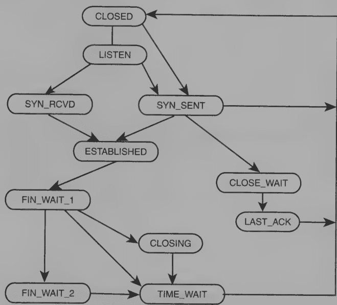

图4.2 `TCP`会话状态图。

### 会话重置 (Session Reset)

`TCP`会话通常有两个原因被重置（或中止）：要么客户端尝试连接到一个不存在的端口，要么参与的一个主机手动中止了会话。

当服务器接收到客户端请求连接到没有绑定进程的端口的`SYN`包时，服务器将响应一个设置了`RST`标志的数据包。客户端应该丢弃该会话，就像客户端尝试连接到一个不可用的端口一样。

# 第4章传输层协议

当连接的一侧中止了会话时，它会发送一个设置了`RST`标志的数据包。另一台机器不会发送响应；它会中止会话并通知应用层该会话已重置。

### 超时 (Timing Out)

保活定时器（Keepalive timers）并不是`TCP`规范的一部分，但这并没有阻止某些`TCP/IP`协议栈实现它们。通常情况下，保活包在等待两小时后发送。当数据包发送时，有三种可能的结果：

- 远程主机不可用。
- 远程主机可达，但连接已断开。
- 远程主机可达且连接仍然活跃。

在第一种情况下，本地主机将以75秒为间隔再重试9次保活。如果没有响应，它将关闭连接。注意，远程主机不可用可能是因为它已经崩溃、关机等；这是关闭连接的合理原因。远程主机也可能因为瞬时网络错误而不可用；这并不是关闭连接的良好理由。本地主机无法判断是哪个远程主机未响应，因此它有时会关闭开启的数据包。

在第二种情况下，远程主机将回复`RST`包，本地主机将关闭连接。这是端口不可用（前文描述过）的一种特殊情况。

在第三种情况下，远程主机将响应`ACK`包，连接将保持活跃。

### T/TCP

由于`TCP`仅为了会话的建立和关闭就需要七个数据包的开销（通常还有带有确认的额外数据包），因此它并不适用于短且重复的流量。`RFC 1379`定义了一种允许事务型流量的解决方案。事务型`TCP` (`T/TCP`)允许单个`TCP`会话携带多个事务。这是通过在`TCP`头部添加一个4字节的连接计数器（`CC`）字段实现的。`TCP`会话中的每个事务都使用唯一的`CC`，且每个主机必须跟踪会话中远程主机当前有效的`CC`。

### TCP进制解析 (TCP Decoded)


图 4.3 所示捕获的数据包显示了源端口 `0x0413` (1043) 和目的端口 `0x1770` (6000)。源端口和目的端口都在客户端可用的范围内，但目的端口是 X-11 系统的已知端口（或注册端口），并且在此交换中作为服务器。源主机当前的序列号为 `330802776`，它正在发送对字节 `32703426` 的确认（这是它期望看到的下一个字节）。头部长度（Header Length）设置为 `08`，代表 32 字节的头部。随后是 `0x18` 处的所需的填充和标志（二进制为 `00011000`），代表 `ACK` 和 `PUSH`。窗口大小设置为 `0x7900` (30976 字节)。校验和为 `0x5e75`。

由于头部长度为 32 字节，我们知道有 12 字节的选项，32（头部长度）– 20（普通头部长度） = 12（头部字节）。在这种情况下，选项为 `0x00` (NOP), `0x00` (另一个 NOP), 以及 `0x01018a07b5cd007b5cda`（一个带有时间戳 `8084699` 的时间戳和另一个时间戳回复）。

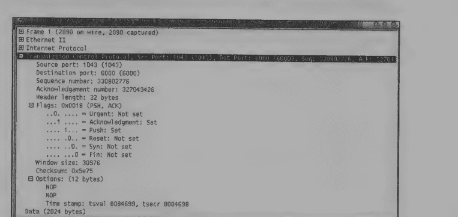

图 4.3 TCP 头部。

在图 4.4 中，我们可以看到正在发生三次握手。cherry 上的用户启动了一个到 mango 的 Telnet 连接，mango 接收并回复服务器。这些数据包在任何 Telnet（建立或实时数据）传输之前就已经完成了交换。

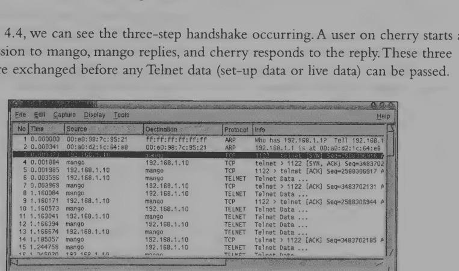

图 4.4 三次握手。

# 第 4 章 传输层协议

三次握手中的第一个数据包在选项字段中显示 `SYN` 位，其序列号为 `25883061`。在此点，mango 响应 `SYN-ACK` 包并设置了 `ACK` 标志。图 4.5 显示了 cherry 响应的 `ACK` 包。第二个数据包是 mango 发送的，它设置了 `ACK` 标志，序列号 `348302`。这是 cherry 的 `SYN-ACK` 包。此时，cherry 发送一个 `ACK` 包，序列号为 `348302 + 1`，确认号为 `25883061 + 1`。三次握手完成。

最后一个数据包是 cherry 发送的 `FIN` 包，设置了 `FIN` 标志。mango 响应一个 `ACK` 包。随后 mango 也发送了自己的 `FIN` 包，cherry 再次响应一个 `ACK` 包。会话由此关闭。

## UDP

用户数据报协议（UDP）定义在 RFC 768 中。UDP 提供了一种简单的传输协议，使用数据报将数据从源端传输到目的端。

与 TCP 相比，UDP 具有速度优势，但是以牺牲一定的健壮性为代价的。UDP 没有连接，因此没有连接启动，也没有跟踪数据窗口的开销。其头部只有 TCP 头部的一半。由于 UDP 不像 TCP 那样面向流，每个数据报都为上层应用携带一个离散的数据块（或路径 MTU 允许的离散数据块的最大部分）。

### UDP 讨论

UDP 头部由四个字段组成，每个字段长度 2 字节：UDP 源端口、UDP 目标端口、消息长度和校验和。如前所述，源端口和目标端口用于识别连接两端使用的进程。消息长度表示 UDP 头部和数据报所载数据的字节数；最小值为 8。

UDP 的校验和是可选的。如果发送者没有计算校验和，则将其以全零字段（`0x0000`）的形式发送。使用时，它会针对数据以及一个类似于上一节讨论的 TCP 伪头部构建的伪头部进行计算。伪头部如图 4.10 所示。

| 4 字节源 IP 地址 | | |

| :--- | :--- | :--- |

| 4 字节目的 IP 地址 | | |

| 0x00 | 0x11 | 2 字节长度 |

图 4.10 用于计算校验和的 UDP 伪头部。

在经过校验的数据中，至少在一个（可能可能是两个）地方需要填充。在目的 IP 地址和协议字段之间有一个 1 字节的填充。如果 UDP 数据报的数据部分字节数是奇数，则需要额外的 1 字节填充，以使校验后的数据按 2 字节边界对齐。

### UDP 解码

图 4.11 中的 UDP 包是一个 DNS 请求。源端口为 `0x0402` (1026)，目标端口为 `0x0035` (53 或 DNS)。长度为 `0x032` (50 字节)。正在使用校验和，值为 `0x590b`。

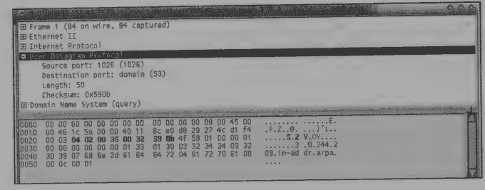

图 4.11 一个 UDP 头部。

尽管 UDP 没有 TCP 那样的连接，但基于 UDP 的应用程序可以执行事务。图 4.12 中的网络跟踪显示了这是一个很好的例子。注意，第一个包是一个通用请求并接收到了空回答。接下来的两个请求针对不同的主机名并接收了不同的回答。

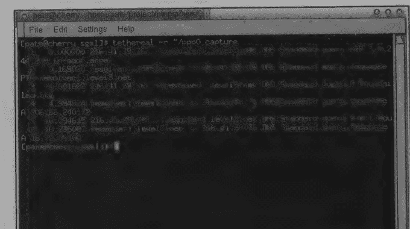

图 4.12 基于 UDP 的 DNS 事务跟踪。

### ICMP

当 TCP 和 UDP 传输数据时，互联网控制消息协议（ICMP）提供了诊断和错误报告功能。由于这一功能，ICMP 成为理解我们网络的重要工具。

### 协议回顾

当遇到某些错误时，IP 主机可以生成 ICMP 包，也可以由应用程序生成。这两种 ICMP 包生成情况帮助我们把 ICMP 包分为两类：ICMP 错误和 ICMP 请求/响应。

ICMP 错误通常由无法交付 IP 数据报引起。由于 IP 数据报并不通过网络中的固定路径传输，ICMP 错误消息会被发送回源主机，而不是发送任何中间路由器。（这些事实使我们能够构建如 `traceroute` 等诊断工具，将在第 9 章中讨论。）

ICMP 包均遵循相同的基本结构：1 字节的 Type 字段、1 字节的 Code 字段和2 字节的 Checksum 字段，随后是根据包类型的各种字段。与 IP 头部中的校验和一样，ICMP 使用值 `0x0000` 计算校验和。与仅使用头部的 ICMP 校验和不同，整个 ICMP 包都用于计算。

我们将依次查看 ICMP 包的结构。表 4.4 概述了不同类型的 ICMP 包。

表 4.4 带有类型和代码的 ICMP 包

| 类型 | 代码(s) | 功能 |

| :--- | :--- | :--- |

| 0/8 | | 回显请求/响应 |

| 3 | 0-15 | 目的不可到达 |

| 4 | | 源抑制 (Source quench) |

| 5 | 0-3 | 重定向 |

| 9/10 | 0 | 路由器公告/请求（未显示） |

| 11 | 0-1 | TTL 超时 |

| 12 | 0-1 | 参数错误 |

| 13/14 | 0 | 时间步请求/响应（未显示） |

| 15/16 | 0 | 已过时（未显示） |

| 17/18 | | 子网掩码请求/响应（未显示） |

注意：此表中列出的并非所有 ICMP 消息在文中都有描述。我尝试在这里只描述最常见和最重要的 ICMP 消息。

定义了五种不产生 ICMP 消息的错误：

- 有五种错误定义不产生
- 有五种错误定义不产生
- 有五种错误定义不产生
- 有五种错误定义不产生
- 有五种错误定义不产生
- 有五种错误定义不产生
- 有五种错误定义不产生
- 有五种错误定义不产生
- 有五种错误定义不产生
- 有五种错误定义不产生
- 有五种错误定义不产生
- 有五种错误定义不产生
- 有五种错误定义不产生
- 有五种错误定义不产生
- 有五种错误定义不产生
- 有五种错误定义不产生

### 回显请求/响应

ICMP 回显请求和响应结构如下：1 字节的 Type 字段、1 字节的 Code 字段、2 字节的 Checksum 字段、2 字节的 Identifier 字段、2 字节的 Sequence 字段以及数据字段。Identifier 和 Sequence 字段用于匹配回显请求和回显响应。

### 目的不可到达

ICMP 目的不可到达消息结构如下：1 字节的 Type (03)、1 字节的 Code 字段、2 字节的 Checksum 字段、4 字节的预留字段 (00000000)、20 字节的 Failed Header 字段以及8 字节的 Failed Data 字段。Failed Data 提供了识别导致错误条件的应用程序的数据。

### 源抑制

ICMP 源抑制消息在路由器接近缓冲区容量时使用。路由器将向触发事件的数据报源主机发送其消息。接收到源抑制消息的系统应该降低其传输速率，直到停止接收源抑制消息。

# 第 4 章 传输层协议

源抑制消息（source quench message）包含以下字段：1 字节的 Type 字段（始终为 `0x04`）、1 字节的 Code 字段、2 字节的 Checksum 字段、4 字节的 Reserved 字段（该字段应为 `0x00000000`）、20 字节的 Failed IP Header 字段，以及 8 字节的 Data 字段。表 4.7 显示了源抑制消息中各字段的对比。

### 表 4.7 ICMP 源抑制消息字段

| 大小 | 字段内容 | 示例数据 |

|---|---|---|

| 1 字节 | Type | 04 |

| 1 字节 | Code | 00 |

| 2 字节 | Checksum | 0a7b |

| 4 字节 | Reserved | 00 00 00 00 |

| 20 字节 | Failed IP header | 45 ... |

| 8 字节 | Failed IP data | 05 b3 ... |

### 重定向 (Redirect)

当主机尝试使用不恰路由器时，会发送 ICMP 重定向消息。图 4.13 显示了可能发生这种情况的网络。

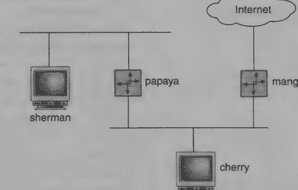

图 4.13 具有两个路由器的网络。

cherry 根据以下路由表使用 mango 作为其默认路由器：

内核 IP 路由表

| 目的地址 | 网关 | 掩码 | 标志 | MSS Window | irtt 接口 |

|---|---|---|---|---|---|---|

| 192.168.1.10 | 0.0.0.0 | 255.255.255.255 | UH | 0 0 | 0 eth0 |

| 192.168.1.10 | 0.0.0.0 | 255.255.255.0 | U | 0 0 | 0 eth0 |

| 127.0.0.0 | 0.0.0.0 | 255.255.255.0 | U | 0 0 | 0 lo |

| 0.0.0.0 | 192.168.1.1 | 0.0.0.0 | UG | 0 0 | 0 eth0 |

mango 需要向 sherman 发送流量（sher 位于 papaya 后方的网络中）。cherry 将第一个包重定向到 mango，mango 将其转发给 papaya 并向 cherry 发送 ICMP 重定向消息（ICMP 消息类型 5 0）。然后 cherry 应该更新路由表，如下所示：

```
Destination Gateway Genmask Flags MSS Window irtt Iface
192.168.1.10 0.0.0.0 255.255.255 UH 0 0 eth0
192.168.1.0 0.0.0.0 255.255.255 U 0 0 eth0
192.168.1.11 192.168.1.11 255.255.255.0 UD 0 0 eth0
127.0.0.0 0.0.0.0 255.0.0.0 U 0 0 lo
0.0.0.0 192.168.1.1 0.0.0.0 UG 0 0 eth0
```

现在发往 `192.168.2.0/24` 网络的所有流量都应该通过 papaya。ICMP 重定向消息的布局与之前描述的 ICMP 源消息相同。其字段为：1 字节的 Type 字段、1 字节的 Code 字段、2 字节的 Checksum 字段、4 字节的 Reserved 字段（该字段应为 `0x00000000`）、20 字节的 Failed IP Header 字段，以及 8 字节的 Failed IP Data 字段。ICMP 重定向消息的布局和 Code 字段的可能值见表 4.8 和表 9。

| 大小 | 字段内容 | 示例数据 |

|---|---|---|

| 1 字节 | Type | 05 |

| 1 字节 | Code | 00 |

| 2 字节 | Checksum | 0a7b |

| 4 字节 | Reserved | 00 00 00 00 |

| 20 字节 | Failed IP header | 45 |

| 8 字节 | Failed IP data | 05 b3 ... |

| Code | 含义 |

|---|---|

| 0 | 网络重定向 |

| 1 | 主机重定向 |

| 2 | 主机和 TOS 重定向 |

| 3 | 主机和 TOS 重定向（重复） |

### TTL 超时 (TTL Exceeded)

ICMP TTL exceeded消息是 `/usr/sbin/traceroute` 命令的基础。当包的跳数超过其 TTL 时，就会生成该消息。（请注意，还有代表等待去分片超时的代码。）TTL 消息包含以下字段：1 字节的 Type 字段（始终为 `0x01`）、1 字节的 Code 字段、2 字节的 Checksum 字段、4 字节的 Reserved 字段（该字段应为 `0x00000000`）、20 字节的 Failed IP Header 字段，以及 8 字节的 Failed IP Data 字段。ICMP TTL exceeded消息和有效的 Code 值见表 4.10 和 4.11。

### 表 4.10 ICMP TTL exceeded 消息

| 大小 | 字段内容 | 示例数据 |

|---|---|---|

| 1 字节 | Type | 0b |

| 1 字节 | Code | 00 |

| 2 字节 | Checksum | 0a7b |

| 4 字节 | Reserved | 00 00 00 |

| 20 字节 | Failed IP header | 45 ... |

| 8 字节 | Failed IP data | 05 b3 ... |

### 表 4.11 ICMP TTL exceeded 代码

| Code | 含义 |

|---|---|

| 0 | 传输过程中 TTL 等于 0 |

| 1 | 重组过程中 TTL 等于 0 |

### 参数错误 (Parameter Error)

当检测到数据包头部中的错误时，会向源主机发送一条 ICMP 参数错误消息。该消息表示某个字段缺失或错误。参数错误消息的布局与其他 ICMP 错误消息类似：1 字节的 Type 字段（始终为 `0xc`）、1 字节的 Code 字段、2 字节的 Checksum 字段、1 字节的 Pointer to Bad 字段、3 字节的 Reserved 字段（始终为 `0x000000`）、20 字节的 Failed IP Header 字段以及 8 字节的 Failed IP Data 字段。示例布局见表 4.12。注意 Pointer to Bad 字段为 0（表示错误在第一个字节）。

### 表 4.12 ICMP 参数错误消息 

| 大小 | 字段内容 | 示例数据 |

|---|---|---|

| 1 字节 | Type | 0b |

| 1 字节 | Code | 00 |

| 2 字节 | Checksum | 0a7b |

| 1 字节 | Pointer to Bad | 00 |

| 3 字节 | Reserved | 00 00 00 |

| 20 字节 | Failed IP header | 40 ... |

| 8 字节 | Failed IP data | 05 b3 ... |

表 4.13 显示了 ICMP 参数消息有效的 Code 字段。

### 表 4.13 ICMP 参数错误代码

| Code | 含义 |

|---|---|

| 0 | IP 头部错误 |

| 1 | 缺少所需的选项 |

## 

- 1. 在 `SYN-RCVD` 状态下，服务器必须分配传输控制块。内存中设计的此类结构很少，因此为服务器留下了漏洞。破解客在执行 `SYN Flood` 攻击时利用此漏洞。
- 2. 这是超时不是 TCP 规范的一部分的原因之一。
- 3. 广播风暴是指巨大的流量（有时会消耗所有带宽），其特征是发送到非单播地址。

# 5 应用层协议

从第 2 章“链路层协议”中的**链路层**开始，我们沿着协议栈向上移动。现在我们到达了顶端。在应用层的高处，我们看到的比之前讨论过的任何层都有更多样性。在本章中我们将讨论三种协议：RIP、TFTP 和 HTTP。前两个基于 UDP；第三个使用 TCP。

### RIP

路由信息协议（RIP）用于在网络主机之间传递路由信息。RIP 在 RFC 1058 中正式规定，该协议是在 Berkeley UNIX 中最初实现几年后编写的。目前广泛使用的常用 RIP 版本是 RIP 版本2（或 RIP-2），在 RFC 1388 中规定。运行 RIP 的旧机器可以理解 RIP-2 包，因为 RIP-2 使用 RIP 的保留字段传递附加信息，而 RIP 会忽略这些字段。在本节的剩余部分，我们将讨论 RIP 版本2——术语 RIP 指的是 RIP-2。

RIP 提供了一种非常简单的路由方案：它依赖跳数作为确定路径的唯一指标。每个参与主机都会广播其已知目的网络及其相应跳数的列表。由于更新是定期广播的（通常每 30-90 秒一次），路由传播到网络可能需要长时间。RIP 有一项规定将此降至最低——任何超过 15 跳的都被视为不可到达。

图 5.1 显示了用于连接多个小网络的路由器。表 5.1 显示了这些路由器的接口和 IP 地址（名称格式为 name.interface）。该网络将用于展示 RIP 的正常工作，并说明 RIP 的缺点及其解决方案。

### 表 5.1 路由器、接口和地址

| 名称和接口 | IP 地址和子网掩码 |

|---|---|

| aaron.0 | 192.168.1.1/24 |

| aaron.1 | 192.168.1.2/24 |


| aaron.2 | 192.168.1.3/24 |
| alan.0 | 192.168.1.4/24 |
| alan.1 | 192.168.1.5/24 |
| alan.2 | 192.168.1.6/24 |
| bob.0 | 192.168.1.7/24 |
| bill.0 | 192.168.1.8/24 |
| bill.1 | 192.168.1.9/24 |
| bill.2 | 192.168.1.10/24 |
| bice.0 | 192.168.1.11/24 |
| bice.1 | 192.168.1.12/24 |
| brandon.0 | 192.168.1.13/24 |
| brandon.1 | 192.168.1.14/24 |
| chuck.0 | 192.168.1.15/24 |
| chuck.1 | 192.168.1.16/24 |
| caleb.0 | 192.168.1.17/24 |
| caleb.1 | 192.168.1.18/24 |
| caleb.2 | 192.168.1.19/24 |
| carl.0 | 192.168.1.20/24 |
| carl.1 | 192.168.1.21/24 |
| carl.2 | 192.168.1.22/24 |
| doug.0 | 192.168.1.23/24 |
| doug.1 | 192.168.1.24/24 |
| don.0 | 192.168.1.25/24 |
| don.1 | 192.168.1.26/24 |

# aaron brandon

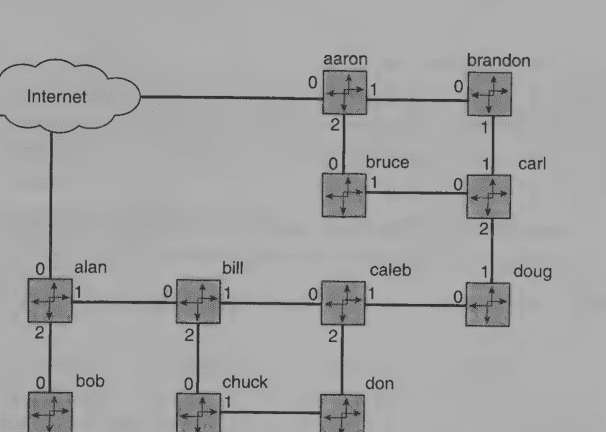

**图 5.1** 一个小型互联网的路由器。

表 5.1 中的每个路由器对网络都有不同的视图。alan 和 aaron 都直接连接到互联网，并可以作为后面网络的网关。Doug 和 don 位于网络后端，他们都有多种路径可以通往第一个。让我们先看看 alan、bill、caleb 和 doug 的世界视图，以及他们将传递的路由信息。

alan 有一个通过接口 0 的默认条目 0.0.0.0/0。该接口将配置为不向该接口发送任何路由信息，以避免广播内部（RFC 1918）地址。它还拥有到 192.168.4.0/24、192.168.5.0/24 和 192.168.6.0/24 网络的单跳路由。它将在其 eth1 和 eth2 接口上广播这三条路由。（alan 最终会发现其他网络，但那稍后会说。）

bill 配置使用 192.168.5.1 作为其默认网关。它还拥有到 192.168.5.0/24、192.168.12.0/24 和 192.168.13.0/24 网络的单跳路由，并在其三个接口上广播这些内容。在 alan 发出 RIP 广播后，bill 也知道了到 192.168.4.0/24、192.168.5.0/24 和 192.168.6.0/24 网络的双跳路由。由于 bill 已经有了 192.168.5.0/24 网络的单跳路由，它忽略了该条目。其他条目被添加到其路由表中。在下一次广播中，bill 发送关于其路由表中所有单跳和双跳条目的信息。（现在 alan 也知道了 192.168.13.0/24 网络。）

## 第 5 章 应用层协议

### 路由环与水平分割 (Split Horizon)

这是我们在 RIP 上遇到的第一个主要问题。如果 alan 失败了会怎样？bill 将发送一个 RIP 广播，显示 192.168.6.0/24 网络的双跳条目。通常，alan 会忽略这些，因为它们的跳数比 alan 的条目高，但在 eth3 接口上，bill 的路由变成了最佳可用路由——尽管它们涉及到一个直接回到 alan 的路径。

RIP 不包含足够停止此类路由环的信息。相反，它依赖于一种水平分割（split horizon）的方法。任何参与者都不会在其广播其收到的路由（从而避免了环）。

如果 bill 遵循这条规则，alan 就永远接收不到到 bob 的路由，从而避免了环。

继续我们的示例，caleb 拥有到 192.168.12.0/24、192.168.22.0/24 和 192.168.23.0/24 网络的单跳路由。当它收到 bill 的广播时，caleb 学获了到 192.168.13.0/24 和 192.168.5.0/24 网络的双跳路由，以及到 192.168.4.0/24 和 192.168.6.0/24 网络的三跳路由。它将广播自己的路由表，bill 和 alan 将学习 192.168.22.0/24 和 192.168.23.0/24 网络（分别为两跳和三跳）。

doug 从到 192.168.22.0/24 和 192.168.24.0/24 网络的单跳路由开始。在收到 caleb 的更新后，doug 还会拥有到 192.168.23.0/24 和 192.168.12.0/24 网络的双跳路由、到 192.168.13.0/24 和 192.168.5.0/24 网络的三跳路由，以及到 192.168.4.0/24 和 192.168.6.0/24 网络的四跳路由。

在前面的描述中，我们只观察了 RIP 的单向流动。在实际上，它是双向流动的。在网络运行一段时间后，路由将传播遍网络。此时，alan 将拥有一个像表 5.2 所示的路由表。

### 表 5.2 alan 的路由表

| 网络 | 下一跳 | 跳数 |
|---|---|---|
| 192.168.4.0/24 | 192.168.4.1 | 1 |
| 192.168.5.0/24 | 192.168.5.1 | 1 |
| 192.168.6.0/24 | 192.168.6.1 | 1 |
| 192.168.12.0/24 | 192.168.6.2 | 2 |
| 192.168.13.0/24 | 192.168.5.2 | 2 |
| 192.168.21.0/24 | 192.168.5.2 | 3 |
| 192.168.22.0/24 | 192.168.5.2 | 3 |
| 192.168.23.0/24 | 192.168.5.2 | 3 |
| 192.168.24.0/24 | 192.168.5.2 | 4 |
| 192.168.14.0/24 | 192.168.5.2 | 5 |
| 192.168.15.0/24 | 192.168.5.2 | 5 |
| 192.168.3.0/24 | 192.168.5.2 | 6 |
| 192.168.2.0/24 | 192.168.5.2 | 6 |
| 192.168.1.0/24 | 192.168.5.2 | 7 |

### RIP-2 协议跟踪

图 5.2 显示了一个 RIP-2 请求。数据包指向广播地址。源端口和目的端口都设置为 520。在 RIP 数据中，命令字段设置为 1（请求）。RIP 版本字段设置为 2。

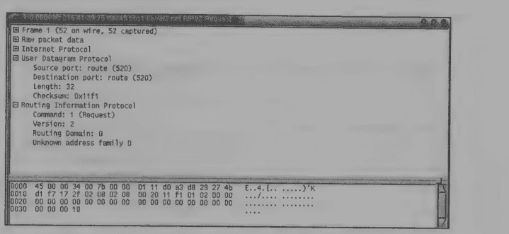

图 5.2 RIP 宣告

### TFTP

简单文件传输协议 (TFTP) 是一种基于用户数据报协议 (UDP) 的用于系统间交换文件的协议。它的设计目标是在资源有限的主机上易于实现。TFTP 定义在 RFC 1350 中。

### 协议回顾

TFTP 使用五种数据包实现：

- 请求
- 写请求
- 文件数据
- 确认
- 错误处理

这些数据包类型（读请求除外）的结构略有不同。我们将逐一查看它们。

读写请求包有五个字段。第一个字段为 2 字节，是操作码字段；读请求为 `0x001`，写请求为 `0x002`。下一个字段长度可变，是待读的文件名。后面是一个 1 字节的分隔符，始终为 `0x00`。第四字段是数据模式字段，可以是三个值之一：

- Netascii
- Binary
- 接收者地址（仅用于写请求）

第四字段长度可变。第五个字段为 1 字节，是文件结束标记；这始终为 `0x00`。

数据包有三个字段。第一个字段是操作码字段，为 2 字节；始终为 `0x0003`。第二个字段是块号字段，为 2 字节；数据包的剩余部分（最大 512 字节）是数据。当 TFTP 传输数据时，它使用一种简单的机制来跟踪传输数据的进度。数据被分为 512 字节的块，每个块都单独发送并确认。传输的最后一个包是一个字段小于 512 字节的数据包。如果数据被平均分为 512 字节块，则将发送空包作为最后一个包（0 字节小于 512）。

每个数据块都由确认包回答。确认包长 4 字节，有两个字段。第一个字段是 2 字节的操作码字段 (`0x0004`)。第二个字段是被确认数据块的 2 字节块号。

由于没有任何是完美的，TFTP 有一个围绕错误处理包的简单错误处理系统。这些数据包有四个字段且长度可变。第一个字段是操作码字段；为 2 字节且始终为 `0x0005`。第二个字段为 2 字节，携带错误码。第三字段长度可变。有效的错误码及其对应的错误文本见表 5.3。

### 表 5.3 TFTP 错误码

| 错误码 | 错误文本 |
|---|---|
| 0x0000 | 未定义错误 |
| 0x0001 | 未找到文件 |
| 0x0002 | 访问违规 |
| 0x0003 | 磁盘空间超出 |
| 0x0004 | 非法操作 |
| 0x0005 | 未知传输 |
| 0x0006 | 文件存在 |
| 0x0007 | 无此类用户 |

错误处理包以一个设置为 `0x00` 的 1 字节字段结束。

### TFTP 协议跟踪

图 5.3 显示了一个 TFTP 读请求；操作码字段为 `0x0001`。下一个字段是待读的文件名，testout。后面是 `0x00` 结束标记。第四字段是数据模式，netascii。最后一个字段是另一个 `0x00` 结束标记。

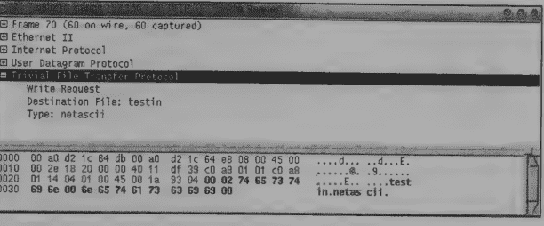

图 5.3 TFTP 读请求

图 5.4 显示了一个 TFTP 写请求；操作码字段为 `0x0002`。待写入的文件名是 testin，后面跟着 `0x00`（结束标记）。数据模式是 netascii，后面是是 `0x00` 结束标记。

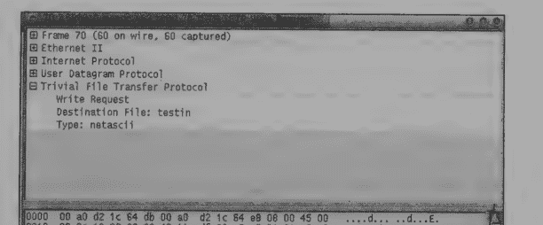

图 5.4 TFTP 写请求包

图 5.5 显示了一个 TFTP 数据包。操作码字段为 `0x0003`；块号为 `0x0001`。数据包的剩余部分是一个大的数据字段。它长度为 512 字节，所以我们知道后面还有包。

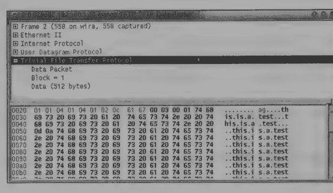

图 5.5 TFTP 数据包。

图 5.6 是 TFTP 确认包。如果 Op Code 字段为 `0x0004`，且其块号为 `0x0001`。包的其余部分将填充以满足太网包的最小数据大小。

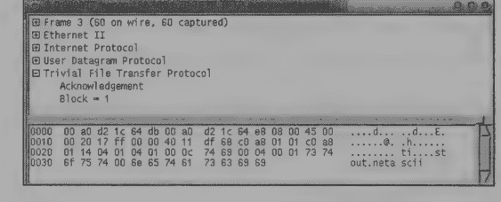

图 5.6 TFTP 确认包。

最后一种 TFTP 类型——TFTP 错误包如图 5.7 所示。错误代码为 `0x0005`，错误文本为“File not found（文件未找到）”。

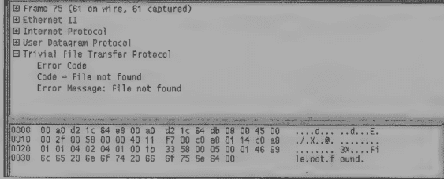

图 5.7 TFTP 错误包。

### 设置 TFTP 服务器

设置一个 Linux 来提供 TFTP 服务是一项相当简单的任务。TFTP 是一个著名的安全漏洞，但它也可以是你网络的重要部分。无盘系统和各种其他硬件使用 TFTP 从服务器检索配置文件。

TFTP 存在两个主要问题：首先，它允许对已知端口进行匿名读写访问；其次，它是一个基于 UDP 的应用程序，因此很难用防火墙处理（基本上只能将其完全屏蔽）。

像大多数协议一样，如果你不需要 TFTP，就不要运行它。如果你需要 TFTP 服务器，请仅在一台机器上运行它，并保持保持安全。接下来的段落将解释如何操作。

启动 TFTP 服务器只需修改你的 `/etc/inetd.conf` 文件并发送 HUP 信号。你想要修改的部分看起来类似于示例 5.1 所示（至少在 Red Hat 6.2 系统上）。

### 示例 5.1 未启用 TFTP 的 inetd

```bash
# TFTP 服务主要用于启动。大多数站点
# 仅在充当“启动服务器”的机器上运行此项。除非你“需要”，
#否则不要取消。

#tfftp dgram udp wait root /usr/sbin/tcp in.tftpd
#bootps dgram udp wait root /usr/sbin/tcp bootpd
#
```

你需要像像示例 5.2 所示进行修改。

### 示例 5.2 启用了 TFTP 的 inetd

```bash
# TFTP 服务主要用于启动。大多数站点
# 仅在充当“启动服务器”的机器上运行此项。除非你“需要”，
#否则不要取消。
#
#tfftp dgram udp wait root /usr/sbin/tcp in.tftpd
#bootps dgram udp wait root /usr/sbin/tcp bootpd
#
```

完成此更改后，你可以杀死 inetd 服务器。该过程如图 5.3 所示。

### 示例 5.3 HUping inetd

```bash
[cherry/root]$# ps -aux | grep inetd
root 482 0.0 0.0 148 SW Aug08 0:00 [inetd]
root 279.1 0.0 1360 500 pts/1 R 04:31 group grep inetd
[@cherry/root]$# ps -ef | grep inetd
root 482 1 0 Aug08 ? 00:00:00 [inetd]
[@cherry/root]$# kill -1 482
[@cherry/root]$# ps -aux | grep inetd
root 482 0.0 0.3 1148 S Aug08 0:00 inetd
root 2795 0.0 0.8 1364 524 pts/1 S 04:32 0:00 grep grep
[@cherry/root]$#
```

完成这一步后，你就获得了一个运行中的 TFTP 服务器。现在的大大问题是：“它会做什么？” 默认情况下，tftppd 从 `/tftpboot` 目录提供文件。你可能想将其更改为独立文件系统中的内容，以缓解文件系统攻击。你可以通过调整 `/etc/inetd.conf` 文件来调整 tftppd 提供文件的目录，如下：

```bash
tftp dgram udp root /usr/sbin/tcp in.tftppd /mnt/tftpserve
```

你需要将任何想要提供的文件放入此目录。该目录和任何你想要提供的文件将是全球可读的（文件模式为 666，目录模式为 777），因为 tftppd 在文件传输时不使用任何身份验证。tftppd 只允许对存在且在全球范围内可见的文件进行写访问（模式 555）。

### 使用 TFTP

TFTP 协议客户端实现为可执行文件 `/usr/bin/tftp`。并非所有发行版都安装了此命令。

### 命令行选项

`/usr/bin/tftp` 仅允许一个命令行选项：远程主机名或 IP 地址。该命令用法示例 5.4 所示。

### 示例 5.4 启动 TFTP

```bash
[@cherry/root]$# tftp
```

示例 5.4 中的命令 `tftp dummy` 启动到 dummy 的 TFTP 会话。远程主机命令是可选的，如示例 5.5 所示。

### 示例 5.5 另一种启动 TFTP 的方法

```bash
[@router]$# tftp
```

### 交互式命令

TFTP 允许许多交互式命令。最重要的：

- connect
- get
- put
- status
- trace
- verbose

我们将在本节涵盖这些中的每一个。我们将从 trace 和 status 开始，因为它们会在后面提供说明。`status` 命令显示 TFTP 的当前状态。如图 5.6 所示。

### 示例 5.6 TFTP status 命令

```bash
tftp status
Not connected.
Mode: netascii Verbose: off
Remmt-interval: 5 seconds, Max-timeout: 25 seconds
```

`trace` 命令为每个 TFTP 包向终端发送报告。如图 5.7 所示。

### 示例 5.7 TFTP trace 命令

```bash
tftp trace
tftp> get test
Tracing on.
sent ARQ file=test, mode=netascii
sent ARQ file=test, mode=netascii
sent ARQ file=test, mode=netascii
Transfer timed out.
```

如果你没有指定远程主机，`connect` 命令允许你指定。如果你已经连接到一个主机，可以连接新主机。该命令用法示例 5.8 所示。

### 示例 5.8 TFTP connect 命令

```bash
tftp 192.168.1.20
tftp status
Connected to 192.168.1.20.
Mode: netascii Verbose: off Tracing: off
Remmt-interval: 5 seconds, Max-timeout: 25 seconds
```

要检索文件，使用 `get` 命令。你可以通过几种方式指定文件名：

- get filename
- get remotefile localfile
- get file1 file2 ... fileN


第二和第三选项可能会引起混淆：如果你列出两个文件名，将从第一个写入本地文件。如果你列出两个两个文件名，每个文件将从服务器读取并写入客户端上的同名文件。如果你使用第四种形式，会提示要下载的文件（s）；格式与 `get` 的前三种相同。你也可以用 `get` 命令指定名称；格式为 `host:file`。示例 5.9 显示了使用此命令获取文件的几种方法。

### 示例 5.9 TFTP get 命令

```bash
tftp trace
tftp> get testout
sent ARQ file=test, mode=netascii
received DATA block=1, 17 bytes
Received 17 bytes in 0.1 seconds
tftp> get (files) testout
sent ARQ file=testout, mode=netascii
received DATA block=1, 448 bytes
Received 448 bytes in 0.1 seconds
tftp> get (files) testout
sent ARQ file=testout, mode=netascii
received DATA block=1, 448 bytes
Received 448 bytes in 0.0 seconds
tftp> get testout
sent ARQ file=testout, mode=netascii
received DATA block=1, 17 bytes
Received 17 bytes in 0.0 seconds
tftp> get foo, mode=netascii
received ERROR code=1, msg=File not found
Error code: 1: File not found
```

`mode` 命令用于设置所有后续传输的数据模式。可以根据需要反复在 `netascii` 之间切换。`mode` 期望一个描述你想要的数据模式的参数。如果你没有提供数据模式，TFTP 将响应当前的数据模式。`mode` 命令如图 5.10 所示。

### 示例 5.10 TFTP mode 命令

```bash
tftp mode
Using netascii mode to transfer files.
tftp mode binary
tftp mode
Using octet mode to transfer files.
tftp mode netascii
```

你可以使用 `put` 命令向远程主机写入文件。其语法类似于之前解释的 `get`。若要快速回顾这些命令（以及此处未涵盖的其他命令），你可以使用 `?` 命令。它会返回带有简要描述的命令列表，如示例 5.11 所示。

### 示例 5.11 TFTP ? 命令

```bash
tftp?
Commands may be abbreviated. Commands are:

+   connect connect to remote ftp
mode set file transfer mode
put send file
get receive file
quit exit tftp
verbose toggle verbose mode
trace toggle packet tracing
status show current status
binary set mode to octet ownascii set mode to netascii
remxt set per-per-packet retransmission timeout
timeout set total retransmission timeout
?
tftp print help information
```

### HTTP

超文本传输协议（HTTP）在 RFC 1945 和 RFC 2616 中描述，提供了一种用于跨网络分配数据的应用层协议。它允许多种请求和提交数据的方法。HTTP 提供了一种对正在传输的数据进行类型定义的方法。

# 第 5 章 应用层协议

与之前讨论的两种协议不同，HTTP 是实现在 TCP 传输层协议之上的。TCP 协议提供了会话信息，使得 HTTP 能够避免某些基于 UDP 的协议需要执行的工作。

HTTP 在某些方面与 TFTP 协议相似：它们都旨在设计用于在两个连接网络的主机之间传递数据。HTTP 不需要担心将数据划分为显式大小的块并发送“数据结束（End of Data）”信号。然而，它需要承担 TCP 会话的建立和销毁的负担。

对 HTTP 最简单的描述是它遵循一个四步过程：

1. 客户端和服务器建立一个 TCP 会话。服务器通常位于 TCP 端口 80。
2. 客户端发送 HTTP 请求。这通常是一个 GET 请求，看起来如下：`GET /file.html HTTP/1.0`。
3. 服务器通过向客户端发送请求的数据来做出响应。
4. 主机关闭它们的 TCP 会话。

会话建立后，客户端向服务器发送一个（可能的）多行 HTTP 请求。请求的各个部分如图5.12 所示。

> 示例 5.12 HTTP 请求格式
> 
> method absolute-path (HTTP/1.0) HTTP/1.1
> 
> (可选指令)

示例 5.12 中提到的方法可以是几种类型之一；这些类型在表 5.4 中进行了解释。

| 方法 |  |
| --- | --- |
| DELETE | DELETE 方法请求服务器删除所引用的信息。 |
| GET | GET 方法检索其引用的信息。GET 请求可以是条件的。 |
| HEAD | HEAD 方法与 GET 方法类似，区别在于响应仅包含头部，而不包含引用的信息。 |
| POST | POST 方法表示数据正在传输到服务器，以便与引用的信息配合。 |
| PUT | PUT 方法请求服务器在给定的位置存储随附的信息。 |

HTTP 响应与 HTTP 请求相似。响应的格式如图 5.13 所示。

示例 5.13 一个 HTTP 响应

(HTTP/1.0 HTTP/1.1) 状态码 描述

(附加信息行)

[data]

示例 5.13 中提到的状态码可以有很多可能的值。所有值都属于一个宽泛的分类（见表 5.5），其中一些重要的状态码显示在表 5.6 中。

表 5.5 HTTP 状态码基础值

| 值 | 描述 |
|---|---|
| 1xx | 信息性 |
| 2xx | 成功 |
| 3xx | 重定向 |
| 4xx | 客户端错误 |
| 5xx | 服务器错误 |

表 5.6 选定的 HTTP 状态码

| 代码 | 描述 |
|---|---|
| 100 | 继续 |
| 200 | 正常 |
| 204 | 无内容 |
| 206 | 部分内容 |
| 301 | 永久移动 |
| 304 | 未修改 |
| 400 | 请求错误 |
| 401 | 未授权 |
| 403 | 拒绝 |
| 404 | 未找到 |
| 405 | 方法不允许 |
| 408 | 请求超时 |
| 500 | 内部服务器错误 |
| 501 | 未实现 |
| 505 | 不支持 HTTP 版本 |

基于 SSL 的 HTTP (HTTPS) 是 HTTP 的安全扩展。它通过安全套接层 (SSL) 传输 HTTP 流量，并对端系统提供某些认证。HTTPS 使用端口 443 而不是 HTTP 典型的端口 80。

通用网关接口 (CGI) 是一种广泛使用的接口，用于为网站提供动态内容。CGI 程序可以用任何可用语言编写，但通常用 Perl 和 C 编写。CGI 程序的参数可以作为 URL 的一部分通过 GET 发送到主机，或者通过更隐蔽的方式通过 POST 发送。示例 5.14 显示了一个示例 CGI 程序。该示例输出了一个 HTML 页面，其中包含发送给它的所有参数列表。（它完全不安全，但对于测试 CGI 程序的链接有用，可以确保传递了正确的参数和值。）

### 示例 5.14 用 Perl 编写的 CGI 程序示例

```perl
#!/usr/bin/perl

use CGI qw(:standard);

# 打印 http 头部，html <head> 部分，一级标题和
# 水平线
print header;
start_html('A Simple Example'),
h1('A Simple Example'),
h;

### 获取所有参数列表
@param = param();

### 对于每个参数，打印其值
foreach $key (@param) {
    $param = param($key);
    print p,"$key is $param\n";
}
```

### HTTP 协议跟踪

在本节中，我们将通过三种不同的方式查看 HTTP。首先，我们将看到一个网页下载的跟踪过程。其次，我们将查看从该页面下载的一个文件的 ASCII 表示。我们最后对 HTTP 的观察是对一个 HTTP 请求的包解码。

图 5.8 中的会话跟踪始于包 1 和 2 中对 Web 服务器的 DNS 查询。包 3、5 和 6 是组成三步握手的包。包 7–15 包含了第一个 GET 请求及随后的响应。包 17–19 代表三步握手。

会话跟踪在图 5.8 所示所示：

| 方法 | 源 | 目的 | 状态 |
|---|---|---|---|
| GET | example.com | example.net | 200 |
| POST | example.com | example.net | 201 |
| GET | example.com | example.net | 200 |
| GET | example.com | example.net | 403 |
| GET | example.com | example.net | 404 |
| GET | example.com | example.net | 500 |
| GET | example.com | example.net | 202 |

图 5.8 下载网页。

图 5.9 从该页面下载的一个文件的 ASCII 表示。我们最后对 HTTP 的观察是对一个 HTTP 请求的包解码。

### 命令行使用 HTTP

与服务器交互的很少用方法之一是命令行。以这种方式连接服务器可以让你对会话有很大的控制。它还提供了返回数据的反馈。测试连接的示例在示例 5.14。

示例 5.14 命令行使用 HTTP

```
[user@cherry]$ tel example.net 80
Trying 208.218.131.20...
Connected to example.net.
Escape character is '^'.
GET /users/party/ HTTP/1.1
Host: example.net
Connection: Keep-Alive
HTTP/1.1 200 OK
Date: Thu, 14 Dec 2000 11:39:54 GMT
Server: Apache/1.3.3 (Unix)
Last-Modified: Tue, 12 Dec 2000 20:49:41 GMT
ETag: '*75ec8-7f-3a68bf65'
Accept-Ranges: bytes
Content-Length: 1839
Keep-Alive: timeout=15, max=100
Connection: keep-alive
Content-Type: text/html
```

```html
<!DOCTYPE html>
<html>
<head>
<meta charset="UTF-8">
<title>Example</title>
</head>
<body>
<h1>Hello, World!</h1>
<p>This is a test.</p>
</body>
</html>
```

- 4. HUP（或挂起信号）通过命令 `kill -1 [pid]` 发送。
- 5. 可以使用 TFTP 向系统写入极其巨大的文件，最终填满文件系统并（如果是根文件系统）导致系统关闭。
- 6. 在实践中，这四个步骤有许多变体。最常见的是使用额外的步骤将文件请求多路复用到单个 TCP 会话中。

# II

## 有效地使用协议

- **第 6 章** 解决问题的模式
- **第 7 章** 在问题发生之前——建立基准
- **第 8 章** 此时——案例研究

# 6

### 解决问题的模式

本章致力于为你构建一种解决问题的模式。只有在牢固掌握了前几章介绍的网络基础知识后，它才能产生效益。无论你在排错网络问题时使用什么其他工具，正是你的知识和使用这些工具的能力才能让你解决问题。你本身才是最重要的工具。

现在你已经知道了 TCP/IP 应该是如何工作的，你将能够快速识别出运行不正常之处。结合排错的计划或模式，你的知识将引导你穿过往往浑浊的网络问题之水。

无论你是否熟悉该技术，排错模式都有帮助

有一次，我正在做一些文档分类的志愿者工作。局域网出现了故障，于是我决定查看一下。这是一个基于 Novell 的网络（一种我过去以及现在现在都不太熟悉的技术），但我能够遵循本章介绍的排错模式，将问题范围缩小到一个运行异常的文件服务器上。

模式仅仅是如此：它不是一套死板的规则，而是一套指南。如果你始终如一地遵循某种排错方法，它将帮助你轻松找到解决方案。你将能够锁定问题的根源并迅速解决它。这种模式的一个优点是，它既不是针对 TCP/IP 的，也不是特定的。你可以将其应用于各种问题。（不过，我不保证它能解决复杂的姻属关系问题。）

为了尝试将这种模式置于具体的语境中，模式的每一步都在自己的章节中进行了描述。每个章节开头都有一个简短的示例，还包含一个贯穿每个章节的持续示例的一部分。章节末尾有一个真实故事，展示了不使用此类模式的问题以及使用该模式的益处。在后的第 8 章“此时——案例研究”中，我将指出每个案例研究中的模式。该模式涉及九个步骤，如图 6.1 所示。

**图 6.1** 一个九步解决问题的模式。

### 步骤 1：清晰地描述症状

在不知道问题到底是什么之前，没有好的方法来处理。很多时候，系统和网络管理员听到的对问题的描述相当糟糕（如果不是完全误导的话）。你的工作是深入挖掘并查明到底发生了什么。

### 提问正确的问题

有一次，我在网络管理中心工作时，收到一个用户的电话，声称他遇到了“网络问题”。当我问他哪里错了时，他回答说他的 PC 无法看到网络。“好的，你收到了什么错误信息？”我问。他回答说当他启动电脑时，显示了错误信息“A 驱动器中无非系统磁盘”。显然，这不是一个网络问题。

我本可以可以直接跳到他所在的网络分段进行诊断测试，或者尝试 ping 他的 PC。通过先提问，我能够清晰地描述症状，这节省了我大量的时间麻烦。我也能让来电者更快地回到工作中。

正如你可能猜到的，你需要一些访谈技巧才能从用户那里获得清晰的症状描述。人们不想向你隐瞒真相，但他们往往对问题有了预设，影响了他们对相关问题的感知。

在与人交谈时做笔记是个好主意，并随时总结问题。这可以帮助你向用户提出后续问题。帮助用户回忆起其他细节无疑是更好的选择。

永远不要犹豫通过回电话或发邮件给用户，提出进一步的问题以澄清情况。一次性获得你需要的所有答案无疑是最好的，但现实是，在你亲自动手开始处理问题之前，你可能不知道自己需要问哪些问题。如果你需要更多细节，就去获取。

在客户现场维护你的库存也给了你一个说“给我看看”的机会。这让你看到用户正在做什么，并可能识别出关于问题的某些关键点。它还将揭示问题是那种当你不在场时恰恰不出现的问题之一。如果你遇到一个无法重现的问题，你又面临新问题——该怎么办。最好的办法是与用户建立监控计划。获取所有你需要的细节，给用户打电话。

# 第 6 章 解决问题的模式


在确定问题是否被清晰描述之前，没有好的方法可以判断。这非常客观。如果你认为它足够清楚了，它通常就是。如果你不确定，尝试向某人描述这个问题。（这并不需要对方理解网络。事实上，你可以尝试解释。）

当你与用户讨论问题时，看看是否有其他主机具有相同的症状。如果用户没有见过这个问题，让他们重现。如果没有其他人可用，尝试自己重现。知道这个问题是影响单台主机、一组主机还是网络上的所有主机，将在你进入步骤 2 时对你有帮助。

你应该知道的一些问题列在这里：

- 哪些应用程序或协议受到了影响？
- 哪些主机？
- 受影响主机之间有什么共同点？
- 问题是什么时候开始的？
- 这是持续性的吗？
- 如果问题不是持续的，它是否在特定的时间或间隔发生？

为了进一步说明，让我们看看三组问题描述。每组中的第一个描述是不够充分的；第二个描述提供了开始解决问题所需的信息。

- **不充分的**：“每当我连接互联网时，速度似乎都很慢。”
- **更好的**：“当我在早上尝试连接外部网站时，连接似乎很慢。我在其他时间尝试过，看起来没那么糟。我在早上连接我们的内部 Web 服务器时，一切看起来正常。”

- **不充分的**：“我无法使用电子邮件。”
- **更好的**：“我可以从我们的邮件主机接收邮件，但当我尝试发送时，通常会失败。发给公司内部的邮件可以，但发给外部地址的邮件不行。”

- **不充分的**：“网络非常慢。”
- **更好的**：“我的 NFS 挂载分区看起来非常卡顿，特别是在早上。不过，ssh、ping 和 Web 连接似乎以正常速度运行。”

将不充分的问题描述转化为可以着手处理的信息并不容易。在阅读每组描述时，你你是否思考过可以问哪些问题来澄清情况？为了帮助那个人描述问题，你需要问哪些问题？

## 示例 6.1：使用步骤 1 的 ssh 示例

作为本章的一个运行示例，让我们来看一个具体的问题。你是一家小型公司 Frobnitz R Us (FRU) 的网络管理员。一个用户给你打电话并抱怨道：“我无法使用 ssh。”

如果你面对第一个描述，你可能会问用户：“你曾经能连接到那台主机吗？其他人也遇到相同的问题吗？是那台主机的问题，还是其他主机也受了影响？”这些问题的回答将帮助你引导出一个更好的描述，例如：

“嗯，昨天，我还可以 ssh 连接到我们的 Web 服务器和外部主机。今天我无法访问我们的 Web 服务器了。不过，我仍然可以连接外部主机。我问了其他一些，他们也有同样的问题。”

### 步骤 2：理解环境

当你对症状有了清晰的描述时，你必须能够理解问题发生的环境，以便有效地对其进行故障排除。获得这种理解实际上是一项双重工作：它要求识别涉及问题的各个部分，并理解这些部分在没有出现问题时应该如何运行。

## 一次解决问题的经历

年前，我正试图解决我负责的一台主机上的 sendmail 问题。那时，sendmail 有两个配置文件：`sendmail.cf`（明显的）和 `sendmail.fc`（不明显的）。`sendmail.fc` 实际上是 `sendmail.cf` 的“冻结”版本。在我职业的那个阶段，我并没有意识到这种区别。

我对 `sendmail.cf` 做了更改，但从未“冻结”它。当预期的行为没有发生时，我开始进行故障排除。花比我想要的更长时间才弄清楚发生了什么。

任务通常意味着创建网络地图的子集，显示涉及问题的网络部分。有时这个新地图是一个逻辑地图，而有时你需要将其画出来。

第二个任务是理解事物应该如何运行，如果你能查看问题发生之前网络运行的快照，就会容易得多。这些快照被称为基准（baselines），将在下一章进行详细介绍。在没有基准的情况下，你需要根据你对布局和配置的理解，创建一个网络正确行为的模型。

## 示例 6.2：使用步骤 2 的 ssh 示例

图 6.2 包含了在步骤 1 示例中用于故障排除 ssh问题的网络地图。该图显示了以下组件：

- 通过交换机连接的内部网络上的主机
- 通过交换机连接的另一个内部网络上的主机
- 连接两个内部网络的路由器
- 连接内部、外部和保护网络的数据包过滤路由器
- 通过交换机互连的保护网络上的主机
- 互联网
- 互联网上的一个示例主机

在你查看了 FRU 的网络地图后，你需要隔离出涉及问题的系统。

涉及 ssh 问题的系统在图 6.3 中用灰色突出显示。注意，内部路由器和第二个内部交换机没有被高亮，互联网以及连接的主机也是如此。

我们通过将涉及的主机和网络与问题描述进行对比，构建了图 6.3 中的地图。由于所有内部主机都受了影响，我们知道内部路由器没有问题（并不是所有内部系统都通过路由器访问 Web 服务器）。同样，第二个内部交换机也可以被排除。问题并不影响发往互联网上任意主机的流量，因此令牌互联网连接主机和互联网本身都可以被排除。

当我们到达这一步的第二个任务时，我们知道只有以下主机涉及：

- 内部主机，它们应该能够使用 ssh 连接到 Web 服务器
- 第一个内部交换机，它不应该进行任何数据包过滤，并且负载应该很轻
- 数据包过滤路由器，它应该允许从任何内部主机 ssh 连接到任何外部主机或任何保护主机
- 保护局域网 (LAN)，它不应该进行任何数据包过滤，并且负载应该非常轻
- 公司 Web 服务器，它应该允许从任何内部主机 ssh 连接

图 6.2 第一张网络地图。

图 6.3 受影响部分的地图。

### 步骤 3：列出假设

在列出受影响系统（步骤 2）后，我们可以开始列出问题的潜在原因。在这个阶段进行脑风暴是安全的，因为我们稍后会缩小搜索范围。事实上，在这里过度发挥创意并得出额外的假设，比遗漏实际原因并盲目追寻线索要好。

## 在列出假设时要详尽

不久前，我被请去协助故障排除图书馆的一个网络问题。该图书馆位于校园内，已经是一个工作良好的 LAN 的一部分。当图书馆应用程序服务器启动时，它无法与 LAN 其他主机通信。

我最初的想法是三种情况之一：

- 坏掉的 10BASE-2 连接
- 坏的网卡 (NIC)
- 坏的收发器¹

我首先询问了主机背后的指示灯。果不其然，所有指示灯都正常。我针对收发器问了同样的问题。（等等，让我们重读一遍）我针对收发器问了同样的问题。

（注：此处原始文本存在大量重复和 OCR 错误，翻译时已根据核心逻辑进行了清理处理）

## 第6 章 解决问题的模式

## 示例 6.4：使用步骤 4 的 ssh 示例

为了继续这个 ssh 示例，我对比可能的原因列表进行了优先级排序：

1. 昨晚对数据包过滤器的更改
2. Web 服务器上的配置问题
3. 高亮显示的内部交换机上的配置问题
4. 受保护网络交换机上的配置问题
5. 内部 PC 上的配置问题

我们知道问题是今天开始的，所以它很可能是昨晚更改的一部分。下一个最可能的假设是 Web 服务器本身发生了变化，因为主机是所有失败的 ssh 连接中唯一的共同点。两个高亮显示的交换机中的一个可能是原因，但由于它们本不应该执行任何数据包过滤，我们将它们排在优先级列表的底部。最后，也可能是所有内部 PC 出现了一个新问题，尽管这推起来相当牵强。

## 步骤 5：制定攻击计划

现在你已经确定了问题最可能的原因，是时候逐个反驳这些可能的原因了。随着每个潜在原因被排除，我们将进一步缩小搜索范围。最终，你将找到一个无法反驳的问题，而你最近的尝试应该已经修复了这个问题。

## 通过测试缩小问题的潜在原因

最近，我与另一位系统管理员处理一个远程控制台服务器 (RCS)，该系统为远程地点的多个主机提供控制台访问。由于某种原因，控制台软件运行不正常。我们认为软件问题的可能原因有这些（按可能性从大到小排序）：

- RCS 盒子与其他主机之间的物理连接在物理安装盒子时可能被损坏了。
- TTY 设备可能安装错误。
- 软件可能安装错误。
- 软件可能配置错误。

我们决定首先测试物理连接。此事的最佳方法是使用不同的软件软件包（使用相同硬件的软件包）与远程主机建立串行连接。如果成功了，我们就知道物理连接没有问题，可以专注于其他事情了。（这项测试实际上将帮助我们排除第二个怀疑原因，因为 TTY 设备必须正确安装，我们的测试才能成功。）

### 步骤 6：执行你的计划

你不想要做的一件事是同时在多个区域进行更改。一次进行一项更改，每次更改只针对一个组件，这可以确保你能够识别出真正修复了问题的修改。

如果测试没有解决或识别出问题，你不需要为后续步骤准备一条硬性规定的路径。然而，你至少应该考虑下一步去哪里。你的优先级列表在你制定未来计划时将非常有帮助。不过，如果你的计划发生轻微偏离，Don 不会感到惊讶；水晶水晶球以模糊而闻名。

准备计划的最后一步是与解决问题的利益相关者一起审查。这可能包括管理层、遭受该问题的客户以及与你一起进行故障排除的任何人。

在对服务器进行长时间故障排除序列期间，我们的小组请了硬件供应商、软件供应商以及我们自己的专家。问题似乎指向硬件问题，但存在一些异常。我们决定在安装了干净操作系统的情况下（在专为测试安装的独立磁盘上）对硬件进行长时间的压力测试。

我们启动了执行器并让它运行到半夜。大约两小时后，系统崩溃了，出现了与我们看到的相同的症状。遗憾的是，夜班操作员（没有在我们的计划中得到简报）发现了故障并重启了测试套件。他在这样做时，没有对发生的情况做任何记录，也没有通知任何参与测试的专家。

第二天，当我们发现发生了什么时，我们陷入了困境。系统失败了，这似乎表明存在硬件问题，但没有记录可以识别是哪个组件故障的细节。

## 第 6 章：解决问题的模式

在执行计划时，请做好记录，并确保保留你所更改的配置文件的副本。没有什么比完成一系列测试后，发现它们没有解决问题，并发现自己引入了一个新问题且无法轻易撤销更改糟糕糟糕。在测试结束时报告不足或具有误导性的信息也令人沮丧。

## 示例 6.6：使用步骤 6 的 ssh 示例

在我们的 ssh 示例中，我们将从路由器获取一份最新的数据包过滤规则副本。为了严谨起见，我们还将从存储这些规则的 CVS 仓库中获取。对比这两个副本（使用 `diff` 命令），我们发现它们是相同的。然而，通过读取文件，我们发现了一个问题。本应停止所有流量的规则被应用在了内部接口，而不是外部接口。哎！这意味着互联网上的任何人都可以与我们的主机建立 ssh 会话，但实际上没有人可以这样做。

我们修改了规则，使 ssh 块应用于外部接口，而不是内部接口。然后，我们将文件提交到 CVS，将其加载到路由器上，并重新加载数据包过滤进程，使其识别新的规则集。

### 步骤 7：测试结果

如果不检查问题是否仍然存在，你就永远不知道测试是否起到了作用。如果你不测试，你就永远不知道你的更改是否引入了新问题。测试带给你信心，确保一切都如预期所示。

## 测试功能性

> 曾经被要求为我们在商店使用的日志轮转包添加一些功能。在我添加了执行新功能的代码后，我对其进行了测试以确保一切运行正常。一个简单的测试显示新功能按预期工作。然后，我运行了更完整的测试，发现我弄坏了另一个功能。如果我没有运行完整的测试套件，我就会向我们的服务器发布一个坏掉的工具。（好消息是，这是一个很容易修复的错误，而且修复方法指向了一个让代码更小的方法。）

在测试结束时报告不足或具有误导性的信息也很令人沮丧。我建议你养成这种习惯，每当你遇到问题时，都增加相应的测试。。在运行了这套测试后，你就可以相信网络是稳固的。

## 步骤 8：将测试结果应用于假设

## 示例 6.7：使用步骤 7 的 ssh 示例

当我们为我们的 ssh 制定计划时，我们希望关注昨晚对数据包过滤器的更改。一个简单的计划是撤销昨晚的更改。如果这恢复了 ssh 连接，你将不得不重写并重新安装这些更改，以在不阻塞 ssh 的情况下恢复新功能。如果无效，该是查看你在交换机上发现任何数据包过滤规则了。

### 步骤 6：执行你的计划

有了计划——并经过了解决问题的利益相关者的审查——你已经准备好采取行动。

## 故障排除的困难

在对服务器进行长时间的故障排除序列期间，我们的小组请了硬件供应商、软件供应商以及我们自己的专家。问题似乎指向硬件问题，但存在一些异常。我们决定在安装了干净操作系统的情况下（在专为测试安装的独立磁盘上）对硬件进行长时间的压力测试。

我们启动了执行器并让它运行到半夜。大约两小时后，系统崩溃了，出现了与我们看到的相同的症状。遗憾的是，夜班操作员（没有在我们的计划中得到简报）发现了故障并重启了测试套件。他在这样做时，没有对发生的情况做任何记录，也没有通知任何参与测试的专家。

第二天，当我们发现发生了什么时，我们陷入了困境。系统失败了，这似乎表明存在硬件问题，但没有记录可以识别是哪个组件故障的细节。

## 第 6 章：解决问题的模式

在执行计划时，请做好记录，并确保你保留你所更改的配置文件的副本。没有什么比完成一系列测试后，发现它们没有解决问题，并发现自己引入了一个新问题且无法轻易撤销更改更糟糕。在测试结束时报告不足或具有误导性的信息也令人沮丧。

## 示例 6.6：使用步骤 6 的 ssh 示例

在我们的 ssh 示例中，我们将从路由器获取一份最新的数据包过滤规则副本。为了严谨起见，我们还将从存储这些规则的 CVS 仓库中获取。对比这两个副本（使用 `diff` 命令），我们发现它们是相同的。然而，通过读取文件，我们发现了一个问题。本应停止所有流量的规则被应用在了内部接口，而不是外部接口。哎！这意味着互联网上的任何人都可以与我们的主机建立 ssh 会话，但实际上没有人可以这样做。

我们修改了规则，使 ssh 块应用于外部接口，而不是内部接口。然后，我们将文件提交到 CVS，将其加载到路由器上，并重新加载数据包过滤进程，使其识别新的规则集。

### 步骤 7：测试结果

如果不检查问题是否仍然存在，你就永远不知道测试是否起到了作用。如果你不测试，你就永远不知道你的更改是否引入了新问题。测试带给你信心，确保一切都如预期所示。

## 测试功能性

> 曾经被要求为我们在商店使用的日志轮转包添加一些功能。在我添加了执行新功能的代码后，我对其进行了测试以确保一切运行正常。一个简单的测试显示新功能按预期工作。然后，我运行了更完整的测试，发现我弄坏了另一个功能。如果我没有运行完整的测试套件，我就会向我们的服务器发布一个坏掉的工具。（好消息是，这是一个很容易修复的错误，而且修复方法指向了一个让代码更小的方法。）

在测试结束时报告不足或具有误导性的信息也令人沮丧。我建议你养成这种习惯，每当你遇到问题时，都增加相应的测试。。在运行了这套测试后，你就可以相信网络是稳固的。

## 步骤 8：将测试结果应用于假设

## 示例 6.7：使用步骤 7 的 ssh 示例

当我们重新加载 ssh 示例中的过滤器时，我们可以立即检查是否可以使用 ssh 连接到 Web 服务器。测试结果显示内部主机可以再次连接到 Web 服务器，但外部主机不再被阻止。我们的其余测试套件显示其他服务处理符合预期。最后，我们将验证外部主机是否仍然可以连接 Web 服务器。

## 步骤 8：将测试结果应用于假设

这是收获的步骤。如果你的测试隔离并解决了问题，你就快要完成了。剩下的就是把你测试中引入的更改成为网络的一部分。如果你还没有解决问题，现在是你根据结果和假设列表坐下来思考你学到了什么的时候。

## 示例 6.8：使用步骤 8 的 ssh 示例

由于我们在之前的步骤中只修复了部分问题，我们需要检查我们的数据，看看我们应该在哪里寻找下一步。这项测试的结果显示内部主机可以再次连接到 Web 服务器，但外部主机不再被阻止。我们的其余测试套件显示其他服务处理符合预期。

## 第 9 步：根据需要迭代

通常情况下，你不需要回到第 1 或 2 步。相反，你可以回到第 4 步重新确定优先级并重新关注。你可能会发现，在最近的测试点中学到的内容指向了一个略有不同的方向。你还可能发现问题的另一个可能原因；在这种情况下，你可以回到第 3 步将其添加到列表中。

## 迭代

在我写这部分内容时，我帮助的一个 Web 托管服务器宕机了。在恢复后，我发现邮件无法正常工作。我的假设列表如下：

- MTA 守护进程没有启动。
- MTA 配置存在批错误。

我登录并检查了。果其然，MTA 没有启动。我手动启动了它并进行了测试；本地递送正常。接着我检查了配置文件，一切看起来都正常。我还检查了 `/var/log/messages`，但没有看到 MTA 启动的任何报错迹象。

在没有解决方案的情况下，我回到了第 3 步。哪里可能出错？我决定尝试从远程主机直接连接到端口 25，看看会看到什么错误。让我有点惊讶的是，连接被拒绝了，我回想起我们的邮件服务器位于一个 TCP wrapper 守护进程之后。（有时你需要一点提醒来把某些内容加入可能原因列表）。

回到服务器，我检查了 wrapper 是否在运行。它没有运行。在快速重启守护进程后，一切又恢复了正常。我回去添加了 MTA 和系统启动脚本，以确保这种情况不再发生。

如果你已经用完了所有可能的原因或发现了额外信息，你甚至想一直回到第 1 步重新开始问题，以确保你没有完全偏离目标。

## 示例 6.9：使用第 9 步的 ssh 示例

ssh 连接应该在路由器处被拦截，因此那里是检查问题最可能的地方。即时修改（我们之前做的修改）因产生微小故障并导致大头疼而闻名。回到配置，我们可能会发现对文件的洗牌导致对外部主机应用了错误的掩码，允许互联网进入我们的主机。同样，这是一个快速修复的问题。

这一次，当我们运行测试套件时，一切都符合预期。我们花了两次运行该模式的时间，但我们解决了问题。

## 两个解决问题的故事

### 贴近生活

以下两个章节读起来像是真实发生过的事情。这并不意外——它们确实发生了。我更改了名字以保护无辜者（以及有罪者）。

嗯，这实际上是一个分两部分的故事。第一部分详细介绍了他在遇到一个问题时误错误的修复尝试。他没有使用我们的九步模式。第二部分记录了两个系统管理员的行动，他们在第一次尝试之后介入并进行清理工作。他们遵循了该模式，结果要好得多。

### 抓溜油的猪

在我认识的一家公司里，中央邮件服务器位于场外。它不仅接收入站邮件并通过 POP3 提供服务，还中继所有出站邮件。

在某一次，一名从事系统管理工作的用户（我们称他为 Rob）在公司两个办公室之一的网络中添加了一台新机器。在将远程机器分配为新机器的管道 SMTP 网关后，他让某向新用户发送邮件，并验证了他可以通过 POP3 服务器检查邮件。一切运行都符合预期。接着，他尝试发送外部邮件。这次，失败了。


Rob 认为自己可能误配置了邮件客户端，于是尝试重新安装。在配置了指向中央邮件服务器的管道 SMTP 网关后，Rob 尝试向外部地址发送邮件。再次失败了。接着，Rob 尝试在同一台主机上设置另一个邮件服务器。他将其配置为使用邮件服务器作为其 SMTP 网关，并尝试发送外部邮件。再次失败了。

Rob 决定他可能没有正确安装 Linux，因此他在机器上安装了 Windows 98 进行测试。在将 Outlook 设置为邮件服务器后，他再次尝试。还是没有运气。到这种程度，Rob 认为这必须是服务器问题。他重启了邮件服务器并重新发送了他的测试消息，但无济于事。最后，他格式化了机器以示决心。在系统管理员重建了一切后，他们查看了系统以看看发生了什么。

### 按部就班

另外两个负责系统管理的人 Sara 和 Bill 询问了 Rob 发生了什么，最终从他那里得到了这个描述：“我无法通过我们的邮件网关向外部地址发送邮件，但我可以从那里接收邮件。”

Sara 和 Bill 认为他们还没有足够的答案来描述这个问题。他们想知道 Rob 是否能通过邮件网关向内部地址发送邮件，以及他收到了什么种错误信息。在给出详细指令后，他们让他去调研。

大约 30 分钟后，他们得到了所需的答案。是的，邮件可以发送到内部地址。当消息失败时，它们生成了关于中继被拒绝的错误信息。

Sara 和 Bill 来到白板，画了一张涉及问题的系统图（如图 6.4 所示）。

他们认为以下项目可能涉及：

- SMTP 网关
- 网络和路由器
- 两个办公室的路由器
- 客户端机器，包括 Rob 的机器

Sara 和 Bill 认为问题最可能在客户端。因此他们开始列出可能的原因列表：

- MTA 配置错误
- 服务器 IP 问题
- 服务器上的子网掩码问题
- 路由器上的数据包过滤规则
- 客户端上的子网掩码问题

经过思考，他们排除了 IP 和子网问题，因为客户端和服务器确实可以传输流量。

他们决定第一个测试是验证其他主机是否可以发送外部邮件。如果不能，那就是 MTA 的全局问题。如果其他主机可以发送邮件，则可能与特定主机有关。

为了进行测试，他们从他们办公的办公室发送了邮件，并登录了另一个办公室（Rob 工作的地方）的机器，并从该主机发送了邮件。然后他们等待消息的递送。

稍等片刻，他们检查了账户。两台机器都递送了邮件。将此测试结果应用于他们的假设，意味着 Sara 和 Bill 可以从列表中排除一些可能的原因。他们现在知道受影响的唯一客户端机器是 Rob 安装的那台新机器。他们重新绘制了图表，如图 6.5 所示。

他们办公室的路由器和主机已从涉及的系统列表中划掉。Sara 和 Bill 也将另一个办公室的剩余主机从列表中删除。他们没有发现任何可以添加到可能原因列表的内容，还没有排除 MTA 这一魁祸首。

他们决定需要查看是什么导致 MTA 生成中继错误的，因此他们查阅了资料（在这种情况下是网站）。事实证明他们的 MTA 依赖于名为 `tcpserver` 的外部程序来阻止中继，而该程序使用名为 `/etc/tcp.smtp` 的配置文件来控制访问。下一次测试将检查 `/etc/tcp.smtp` 并根据需要进行修改。

## 第 6 章 解决问题的模式

查看文件发现，Bill 和 Sara 所在的办公室使用了 IP 掩装，而该站点的单一 IP 地址在配置文件中。另一个办公室正在使用单独的 IP 地址，且并非所有地址都列在配置文件中。Sara 将另一个办公室的 IP 地址添加到文件中，并重启了 `tcpserver` 进程。在她操作期间，Bill 拨打了 Rob 的电话，让他让他尝试再次从新机器上发送邮件。

这一次，邮件发送到了外部地址。随后的几次测试显示，其他内部主机仍然能够发送邮件。由于问题已经解决，且从他们的测试中没有发现明显的新问题，Sara 和 Bill 能够回到在这场闹剧中断他们之前正在进行的工作上。

## 脚注

- 在那时，几乎所有的网卡（NIC）只有多引脚 AUI 连接。如果你想连接到网络，需要使用带有适当硬件接器的收发器来建立连接。该设备是一个小盒子，连接到网卡上，并为主机提供单一类型的以太网连接。
- `init 0` 就像关掉机器的电源。一切直接停止了。这很糟糕。

## 7

在故障发生之前——建立基准

有时候，当你与一位经验丰富的系统或网络管理员交流时，他会告诉你，当某种直觉感觉不对劲时，他就知道出问题了。这并不是承认拥有超能力；这只是解释这种现象的一种简便方法，说明这些专家知道你的系统或网络应该如何运行，而它现在并没有那样运行。这些管理员为他们的环境创建了一个基准（baseline）。并不是所有人都正式地这样做，但那些这样做的人将获得重大的额外收益。

在本章中，我们将介绍基准能为你提供什么、它究竟是什么、如何创建它、如何保持其更新，以及你的基准如何影响你的网络监控计划（反之亦然）。

## 为什么基准很重要

基准能带给你两个主要好处。首先，它让你了解网络在正常情况下的运行状态——这让你在排排除故障时能够看到哪里出了问题。其次，它让你看到网络行为如何随时间变化——这有助于你通过细致的扩展来维护一个健康的网络。这两者都能为你提供一些真正的价值。

## 基准，你故障排除的好朋友

在排排除故障时，你会以两种方式使用基准。最明显的用法是，你能够判断何时情况超出了网络的正常范围。这也很显而易见，但同样重要的是，你可以将基准作为你诊断工具包的一部分。这两项好处结合在一起，会让故障排除工作变得简单得多。

当你意识到网络的正常行为时，变化就会显而易见。如果下午的带宽利用率低但其中一台服务器的负载很高，那么当其他服务器响应正常而该服务器响应很慢时，你就不必担心。不过，所有服务器响应都很慢将立即成为警示标志。这种意识不能取代对网络的监控，但它可以作为监控的良好补充。

在故障排除的中期，能够随时访问基准信息会产生巨大的差异。例如，如果你知道 cherry 和 berry 不是典型的大带宽用户，但它们似乎是你当前网络过载的罪魁祸首，那么你在识别问题上就领先了一步。如果你进一步知道其中一个或两个都经过了升级，你就有了一张更好的地图。（当然，也可能是用户们在展示他们的《毁灭战士》肌肉……）

拥有关于网络的基准信息将帮助你更早发现问题并更快地解决它们。启动它可能需要一些工作，但现在付出的努力将在以后换取周末和晚上的空闲！

## 为了乐趣和预测监控你的网络

除了帮助排除故障，网络基准还能帮助你避免本会掉入的问题。观察网络行为的变化将帮助你看到哪里需要进行更改。流量是否在 LAN 段上堆积？也许你可能需要添加另一个交换机。你是否有一个服务器充当瓶颈？可能是时候升级了。

随着基础用户的增长和其需求的变化，你的网络也需要发生变化。当你观察网络并预见到拓扑或设备所需的更改时，你将节省时间和金钱。这是不仅要开发基准，还要主动对其进行监控并保持其更新的最佳理由之一。

## 什么是基准？

几件事构成了基准，但其核心仅仅是网络按正常运行方式的快照。最不有效的基准形式是你在这个领域呆了之后发展出的“第六感”。它看起来有效是因为你已经习惯了那些本该有的状态。更好的基准是非正式的，并可能包括以下内容：

- 网络追踪（Network traces）
- 网络利用率摘要
- 网络上记录日志
- 网络地图
- 设备和相关数据的记录

本节将讨论这些每项内容。

## 网络追踪

在第10章“监控工具”中，我们讨论了网络分析工具保存文件（或追踪）的能力，这让你能够维护网络历史。如果只有追踪代表你的故障排除努力，你就无法对网络有一个良好的认知。你需要意识到，很多因素都会影响追踪。周末；周五；以及时间段都是影响你数据的因素示例。每天运行（或使用其他分析器）至少三次并保存捕获结果，将给你关于事物如何运作的大量图像。

## 利用率数据

几个工具可以让你快速查看网络状态。如果追踪代表你的故障排除努力，你就无法一个良好的图。运行（或使用其他分析器）至少三次 `netstat` 的 `-i` 选项显示接口：

| Interface | MTU | RX-OK | RX-ERR | TX-OK |
| :--- | :--- | :--- | :--- | :--- |
| eth0 | 1500 | 0 | 0 | 0 |
| lo | | 0 | 0 | 0 |

### 7 故障发生之前——建立基准

## 什么是基线？ 121

我倾向于将内容保持在网上，但放在一个 csv 仓库中。这样你可以在一个或两个中央服务器上保留它们，同时在笔记本电脑、PC 或掌上电脑上保留一份副本。如果你愿意，甚至可以打印出来。这样做的一个很好处是，几个人可以对文档进行更新，并在完成后将更改提交回 cv 仓库。

我将不再纠结于 Web、平面文件、数据库、XML 或任何冲突争端。它们各有优劣。为你的组织选择合适的选项，并坚持下去。重要的一点是你已经拥有了这些数据，对吧？

## 网络地图

一组几乎被忽略的基线信息是网络地图。如果你的网络中超过两个系统且没有地图，请放下这本书，花 20 分钟时间草画一些东西。它不需要很漂亮，只要合理准确即可。你回来了吗？很好。现在你已经有一张显示“什么在哪里”的地图，我们就可以回到工作了。

大多数人想处理两种地图。第一种是拓扑/物理图，显示了有哪些设备以及它们是如何连接的。第二种是逻辑图。它显示了哪些服务器提供哪些服务，以及支持哪些用户群。如果你能结合这两张地图，那就越好了；颜色编码、数字编码和轮廓框都是可以帮助此点的机制。图 7.1 显示了一个示例地图。

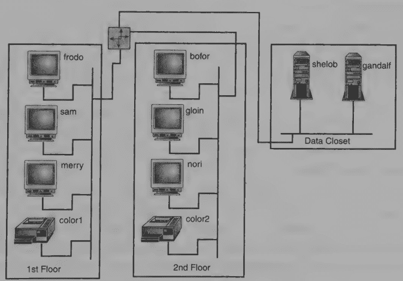

图 7.1 示例网络地图。

## 第 7 章 在故障发生之前——构建基线

与前面的“工作/问题日志”部分讨论的信息一样，我建议你将地图保持在网上并放在几个地方。（cvs 也可以是一个解决方案）。制作精美的地图挂在墙上也很看，更不用说当问题发生且你需要开始排故障时，这是一个寻找它们的方便地方。

## 设备记录

你还应该对网络中的硬件和软件存有准确的记录。至少，你应该拥有网络上每个箱的的硬件列表、系统和应用级别的列表（显示当前安装的版本和补丁）以及相应的配置。如果你将这些内容保存在 cvs 中，你还将获得一个查看历史记录的良好机制。

如果你决定保留这些记录，保持它们更新是至关重要的。每当你进行更改时，都应该编辑相应的文件并将其提交到 cvs。如果你落后了，就会漏掉某些东西，然后你就会真的陷入困境。

## 如何创建基线

好了，我已经讨论了一些你应该拥有的东西，并创建了一份令人生畏的要做清单。你打算如何完成它？不要担心，大部分工作可以分小块完成。此外，你会发现许多工作可以脚本化然后通过 cron 运行。

在本节中，我将涵盖以下内容：

- 决定先做什么
- 遵循命名规范
- 保留日志和记录
- 制作地图
- 使用 cron 为你完成脏累活

## 我现在该做什么？

对我来说，如果没有地图和清单，你的基线几乎一无用处。本此此，我建议你后做这些——是的，第二做。你想做的第一件事是决定你如何以及在何处保存所有数据，并设置好它们。（顺便说一下，你也可以开始写自己的日志。在制作地图和清单时，你会接触很多东西，所以你有机会开始记录。）

## 如何创建基线

当你设置好所有数据的仓库后（你用的是 csv 对吧？），并且你的地图和清单都在里面时，你就可以开始下一步了。现在是时候为你想要监控的内容以及检查的频率制定一个计划了。某些东西应该持续运行——日志文件监控器就是一个很好的例子。其他的，如 `ethereal`、`traceroute` 和 `netstat`，则需要定期运行。

你先实现其中的哪些很大程度上取决于你的情况。你有任何待解决的问题吗？如果是，就开始围绕你的排故障过程构建基线。你对监控某些区域特别感兴趣吗？开始监控它们吧。我认为从你熟悉的东西开始效果很好。随着每次成功，你将对你的计划和脚本充满信心。

另一个想法是在网络的小部分上测试你的基线工具。当你在子部分上运行起来后，将它们扩展到整个网络要简单得多。

## 良好的命名规范——保持一切井井有序

假设你没有将所有基线数据丢进数据库，你需要一种方法来跟踪它。即使你只跟踪几个文件，你也会有一个巨大的文件集合。如果没有跟踪所有内容的方法，它将是一场规模巨大的混乱。你的命名规范将对你有很大帮助。

大粒度的方法是将所有文件划分为子目录，或将文件划分为每日子目录。无论如何，你都想为每个文件命名，显示其包含的内容、创建的日期时间以及是在哪个主机上创建的（例如：`ethereal-20001025-0990-mango_ethereal`）。

## 遵循命名规范

假设你没有将所有基线数据丢进数据库，你需要一种方法来跟踪它。即使你只跟踪几个文件，你也会有一个巨大的文件集合。如果没有跟踪所有内容的方法，它将是一场规模巨大的混乱。你的命名规范将对你有很大帮助。

大粒度的方法是将所有文件划分为子目录或将文件划分为每日子目录。无论如何，你都想为每个文件命名，显示其包含的内容、创建的日期时间以及是在哪个主机上创建的（例如：`ethereal-20001025-0990-mango_ethereal`）。

## 我现在该做什么？

对我来说，如果没有地图和清单，你的基线几乎一无用处。本此此，我建议你后做这些——是的，第二做。你想做的第一件事是决定你如何以及在何处保存所有数据，并设置好它们。（顺便说一下，你也可以开始写自己的日志。在制作地图和清单时，你会接触很多东西，所以你有机会开始记录。）

## 如何创建基线

当你设置好所有数据的仓库后（你用的是 csv 对吧？），并且你的地图和清单都在里面时，你就可以开始下一步了。现在是时候为你想要监控的内容以及检查的频率制定一个计划了。某些东西应该持续运行——日志文件监控器就是一个很好的例子。其他的，如 `ethereal`、`traceroute` 和 `netstat`，则需要定期运行。

你先实现其中的哪些很大程度上取决于你的情况。你有任何待解决的问题吗？如果是，就开始围绕你的排故障过程构建基线。你对监控某些区域特别感兴趣吗？开始监控它们吧。我认为从你熟悉的东西开始效果很好。随着每次成功，你将对你的计划和脚本充满信心。

另一个想法是在网络的小部分上测试你的基线工具。当你在子部分上运行起来后，将它们扩展到整个网络要简单得多。

## 命名规范——保持一切井井有序

假设你没有将所有基线数据丢进数据库，你需要一种方法来跟踪它。即使你只跟踪几个文件，你也会有一个巨大的文件集合。如果没有跟踪所有内容的方法，它将是一场规模巨大的混乱。你的命名规范将对你有很大帮助。

大粒度的方法是将所有文件划分为子目录或将文件划分为每日子目录。无论如何，你都想为每个文件命名，显示其包含的内容、创建的日期时间以及是在哪个主机上创建的（例如：`ethereal-20001025-0990-mango_ethereal`）。

## 遵循命名规范

假设你没有将所有基线数据丢进数据库，你需要一种方法来跟踪它。即使你只跟踪几个文件，你也会有一个巨大的文件集合。如果没有跟踪所有内容的方法，它将是一场规模巨大的混乱。你的命名规范将对你有很大帮助。

## 获取记录

## 我现在该做什么？

对我来说，如果没有地图和清单，你的基线几乎一无用处。本此此，我建议你后做这些——是的，第二做。你想做的第一件事是决定你如何以及在何处保存所有数据，并设置好它们。（顺便说一下，你也可以开始写自己的日志。在制作地图和清单时，你会接触很多东西，所以你有机会开始记录。）

## 126 第 7 章 在故障之前——建立基线

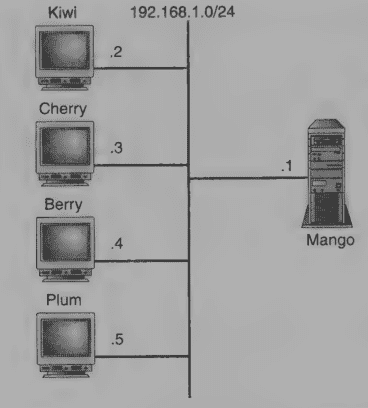

图 7.2 一个简单的网络地图。

简单的地图将依赖外部文档来跟踪许多事项，但它显示了 IP 地址和网络掩码。图 7.3 显示了更具描述性的地图。

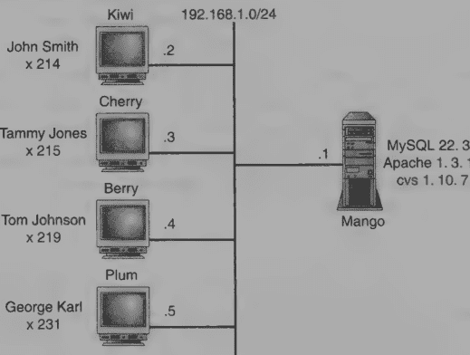

图 7.3 一个更完整的地图。

这张地图包含了工作站的联系信息以及服务器提供的服务信息。你可以通过颜色编码进一步改进地图，显示额外信息，如用户部门或项目。显示每个主机的物理位置或到集线器或交换机的实际网络连接的注释也会让地图更有用。

## 如何保持基线更新

### 使用 cron

当你开始收集这些信息时，你会希望将其自动化。信息收集自动化可以从两个方面对你有所帮助：首先，它允许你以异常的时间间隔收集信息（特别是当你不在场时）。其次，它让你能够确保每个项目都以相同的方式被收集。

例如，每小时第 15 分运行一次 `ethereal` 的一种方便方法可能是通过 `cron` 运行以下脚本：

```bash
#!/bin/bash

export HOST='hostname'
export DATE='date +%y%m%d'

export FILE="${HOST}.${DATE}"

tethereal -c 5000 -t r -w /var/log/ethereal/${FILE}

cd /var/log/ethereal

export CVS_RSH=ssh
c add ${FILE}
commit -m "latest capture" ${FILE}
```

要从 `cron` 运行此脚本，你需要在 root crontab 中添加类似下面的行（请记住，除非你允许他人以混杂模式打开以太网接口，否则只有 root 才能运行 `ethereal/tereal`）：

```
* * * * /user/local/bin/run_tereal >/dev/null 2>&1
```

当你把整个整套流程放入 `cron` 时，它会通过创建你的日志文件来确保所有的更改都已完成。最糟糕的事情莫过于拥有良好的数据收集系统，却没有注意到某些数据没有被收集。使用基于 `cron` 的脚本来完成此任务留给读者练习。

## 如何保持基线更新

维护当前的记录有两个方面。第一个方面是你需要为每个测试周期创建一个条目；`cron` 应该为你处理这一点。第二个方面是，当每个新项目被添加到你的网络时，你需要将其添加到基线中。这一个需要手动完成（好吧，某种程度上是）。

帮助添加事项的一种方法是让信息变得尽可能不痛苦。再次，我们可以转向系统管理员的备用方案：脚本。如果你编写一个脚本来添加新主机，并处理在适当位置创建并添加相应的条目，你会发现你的生活似乎简单多得多。你不会忘记那件似乎总是被遗忘的事了。你甚至可以将初始数据录入交给设备的用户。

## 第 7 章 在故障之前——建立基线


`adduser`命令是这很好的例子。对于主机信息，更好的解决方案可能是提供一个脚本，让用户在安装系统运行时运行，将更新放入中央仓库中。通过从这个中央仓库中收集数据，可以对本地配置文件进行必要的添加和修正。

如果我在上一节中的所有警告还不足说服你使用 csv 和命名标准，这是我的最后一次尝试。建立这些机制将使自动维护和创建每个主机的文件变得简单得多。简单意味着错误更少，任务完成的概率更大。这是一个好主意。

## 监控在这一切中处于什么位置

好了，那么监控在这一切中处于什么位置？毕竟我讨论了很多关于监控的内容。这些就是你需要做的全部吗？并不是。

尽管之前描述的监控帮助你观察网络的总体方向以及它在任何时刻与常态相比，但它只代表了现状的偶尔快照。真正的监控是对现实的近实时视图。两种类型的监控是补充的。

监控应该包括对你希望向用户提供的系统和应用程序进行频繁检查。你还希望通过某种报警机制（寻呼器、电子邮件等）发现故障。你的监控计划将与基线有一部分重叠。如果是这样，你应该寻找结合这些功能的方法。

在第 10 章中讨论的 `mon` 工具是监控网络的一个极佳实用。它允许你根据测试结果向各种用户发送警报。尽管 `mon` 被设计为监控工具，但将其扩展为将数据写入记录以供你审查是非常轻微的。

你可能会发现你的基线有时表明你需要调整告警阈值。这真的是维护基线的另一个好处。它有助于保持你对现实的认知处于更新。你可能会发现你的监控可能暗示反而是正确的——你应该向基线中添加一项测试。再次，这是真正观察网络的另一个益处。

## 终注

- 1. 你需要为每个测试周期创建一个条目；`cron` 应该为你处理这一点。
- 2. 当每个新项目被添加到你的网络时，你需要将其添加到基线中。

# 第132 页 第8章 此时——案例研究

## 第 5 步：制定计划

如果问题是由一个或多个应用程序引起的，Eliza 可能需要稍微挖掘一下以找到根源。她可以先从几个方面入手。由于问题似乎在人员到达之前就已经发生了，因此它很可能是一个计划任务。考虑到这一点，`crontabs` 是一个很好的切入点。如果没有什么发现，她可以再向 Tom 跟进。

## 第 6 步：执行计划

Eliza 登录到 `patton` 查看发生了什么。通过查看根 `cronab`，她看到有一个名为 `web-lint` 的任务在早上运行。登录到 `bigfun`，她也检查了 `cronab`。有两个晨间进程：`full-dump` 和 `search-prep`。

查看 `patton` 上的定时任务，Eliza 将其识别为链接检查器（link-checker）。`bigfun` 上的定时任务证明是从 `bigfun` 到 `patton` 的 `rsync` 备份（`full-dump`）以及一个网站索引任务（`search-prep`）。链接检查器可能很难优化（你真的需要检查每一个链接），但或许可以重新安排时间。备份可能是可以优化的，但也可以重新安排时间。索引任务产生了任何流量，所以她现在可以忽略它。她需要将其标记以便稍后处理。对 CPU 或内存的严重冲击确实会对 `bigfun` 上运行的任何其他程序（如 Web 服务器）造成问题。

## 第 7 步：测试行动结果

Eliza 询问重新安排这两个任务是否是否存在任何已知的冲突。Tom 只是想确保这两个任务在晚上 9 点之后运行，这样任何新内容的推送就能在它们开始之前完成。他还希望链接检查器在上午 10 点之前运行，以便设计师在午间高峰期之前修复网站上的任何问题。

由于她有一个很大的时间窗口可以操作，Eliza 决定将备份移动到晚上 9:30，并将链接检查器移动到凌晨 1 点。她为两个定时任务都封装了对 `syslog` 的调用以记录时间戳。这允许她检查 `/var/log/messages` 以验证运行没有耗时太长。最后，她在 `patton` 上设置了一个 `cron` 来使用 `netstat` 监控流量，并在 `mango` 上设置了第二个来启动 `Ethereal`。

第二天早上，Eliza 发现缓慢问题消失了：她重新安排的两个定时任务都在合理时间内运行了。她还为自己建立了“奇迹工程师”的名声。

## 第 8 步：应用结果

由于她已经更改了 `cronab`，Eliza 的修复已经生效。她决定在接下来的几周内走访办公室的其他同事，以确保情况持续良好。此外，她将所有更改都记录在了笔记本上。

# 案例研究 133 页

## 第 9 步：根据需要迭代

由于她找到了问题的解决方案，Eliza 不需要再对问题解决模式进行迭代。

### 相关问题

流量问题可能很难解决——需要深入研究流量看看到底发生了什么。在这种情况下，我们有几个高带宽应用程序同时运行。其他可能性可能包括这些：

- 服务器由于大量人员登录而变得拥堵
- 调优不当的应用程序产生的流量远超其应水平
- 导致许多重播的硬件问题
- 路由器或网接器上的配置问题

## “我们的网站加载太慢了”

周一下午，Mike 和 Eliza 出去吃午饭。当他们走回桌边时，Mike 告诉 Eliza 他在网站上遇到的问题：“我不确定问题在哪里，但我们的用户在抱怨网站加载需要很长时间。但我检查过几次，对我来说似乎一直很正常。”

## 第 1 步：描述症状

“嗯，Mike，这些线索不多。我们为什么不要坐下来再详细地勾勒一下？”Eliza 带着她的笔记本，对如何寻找问题也有几个想法。她希望在开始追踪错误问题之前，对症状有一个清晰的描述。当他们坐下时，Eliza 问：“用户有提到任何特定的时间吗？网站的某些部分或特定的页面呢？”

“不，他们没怎么说什么，”Mike 回道，“不过我每天都会检查，就在午饭前，对我来说一切总是很快的。”他们决定跟一些用户进行跟进，看看问题是否存在某种规律。

## 第 2 步：理解环境

Eliza 还意识到 Mike 仅从他工作的机器上进行测试，这意味着他与 `bigfun` 之间只有一跳。她建议他从网络上的其他地方测试网页。“也许你在对岸有一个朋友可以帮我们看看情况，”她建议道，“等我们获得那些信息后，我们就足够了解这个问题并尝试解决它。”

# 134 页 第8章 此时——案例研究

第二天早上，Mike 给 Eliza 提供了一些答案。似乎响应时间总是有些问题，但在下午最严重。Mike 的朋友也报告说情况糟糕——连接缓慢、连接中断，以及由于包含大图像而看起来卡死的页面。

## 第 3 步：列出假设

Eliza 消化了她和 Mike 收集的信息。很快，她就能列出一个可能的问题列表：

- 流量太小
- 服务器功率不足
- 资源太少（尤其是内存）

## 第 4 步：优先考虑假设并缩小范围

在讨论完列表后，Eliza 总结道：“我想我们有问题，因为总是很慢。”

“这怎么可能呢？”Mike 问，“我们离 `bigfun` 只有一跳。”

“嗯，这些线索不多，”Eliza 说，“我想我们需要建立一些标准。”

## 第 5 步：制定计划

“我想我们有了一些线索，”Eliza 说，“让我们看看这些更改对结果有什么影响。如果还有问题，我们可能需要重新调整。”

## 第 6 步：执行计划

他们都在 `bigfun` 上工作。“我发现了很多，”Mike 说，“并且我确认了它。”

Eliza 解释说她没有发现任何带宽限制。下午，他们检查了结果。

第二天早上，Eliza 发现缓慢问题消失了：她重新安排的两个定时任务都在合理时间内运行了。她还为自己建立了“奇迹工程师”的名声。

## 第 7 步：测试行动结果

“我想我们有了一些线索，”Eliza 说，“让我们看看这些更改对结果有什么影响。如果还有问题，我们可能需要重新调整。”

下午，他们检查了结果。他们还向合作的用户发送了邮件。当所有结果出炉时，他们发现自己已经做了一些改进。

## 第 8 章 此时——案例研究

## 第 1 步：清晰描述症状

Eliza 花不了多久就对问题有了清晰的。她发现只有 `cuke` 受到了问题影响。事实上，它无法连接到本地网络之外的任何主机。

## 第 2 步：理解环境

Eliza 上职足够久，已经对网络布局了如指掌。无论如何，无法连接到本地网络之外就已经对环境有了相当好的描述。

## 第 3 步：列出你的假设

在观察情况后，Eliza 想出了以下可能性：

- `cuke` 的网络掩码可能是错误的。
- `mango` 的掩码可能排除了新 `cuke` 的 IP 地址。
- `cuke` 的默认网关可能是错误的。
- `cuke` 可能存在硬件问题。

## 第 4 步：假设排序并缩小范围

由于 `cuke` 是 Mike 旧机器的新安装替换品，Eliza 决定问题最可能的原因在 `cuke` 上。`cuke` 能够与本地机器通信（Mike 给她发了封邮件），所以她认为硬件问题不太可能。她决定从 `cuke` 网关错误的可能性开始检查。

## 第 5 步：制定攻击计划

为了测试她的假设，Eliza 需要确定哪个主机被配置为 `cuke` 的默认网关。

## 第 6 步：执行计划

检查默认网关是简单的事。Eliza 执行了 `netstat` 命令，如下：

```
# netstat -rn
Destination    Gateway         Genmask Flags MSS Window Irrt Iface
127.0.0.0       0.0.0.0         255.0.0.0       U      3584 0      lo
192.168.2.0     192.168.2.10    255.255.255.0
0.0.0.0         192.168.1.1     255.255.255.0
```

## 第 7 步：测试操作结果

她对 `cuke` 路由表的检查表明，`cuke` 实际上在使用错误的网关。为了测试这一信息，Eliza 清除了错误的默认网关并使用以下命令设置了新网关：

```
# route del -net default gw 192.168.1.1
# route add -net default gw 192.168.2.1
```

之后，她发现自己可以 `ssh` 进入 `bigfun` 并建立本地网络之外的其他基于 IP 的连接。

## 第 8 步：应用结果

现在她知道了问题所在并修复了它，Eliza 需要设置 `cuke` 的配置，以便在它下次重启时，它会保留新配置。

## 第 9 步：根据需要迭代

Eliza 能够在流程的第一步就解决问题，她不需要对它进行反复迭代。

## “我只能连接到某些远程主机”

几天后，Mike 给 Eliza 发送了另一封邮件：“嘿，谢谢你修好了我的电脑。Tammy 就在这里遇到了同样的问题，我试着按照你之前的方法做，但没用。你能帮帮她吗？”

## 第 1 步：清晰描述症状

像“我看到了 Joe 昨天看到的一样东西”这样的问题描述通常并没有看起来那么好。终端用户看不到那些真正影响故障排除过程的差异。带着这种想法，Eliza 决定和 Tammy 谈谈，看看到底发生了什么。当 Eliza 到达时，Tammy 和 Mike 都在 Tammy 的工位上，所以 Eliza 可以询问 Mike 他目前为止所做的故障排除。

这次证明 Mike 是对的——这确实是同一个的问题。Tammy 无法从她的主机连接到本地网络之外的任何主机。

## 第 2 步：理解环境

由于这发生在 Mike 的问题之后不久，Eliza 理解环境不需要费太多精力。事实上，唯一的主要区别是 `cornflakes`（Tammy 的）是一台 Windows 机器，而不是像 `cuke` 那样的 Linux 机器——这不太可能影响诊断。

## 第 3 步：列出你的假设

Eliza 可以从与我们在上一个案例研究中使用的假设列表开始。她询问了 Mike，他说他已经排查了默认网关和硬件问题的选项。Eliza 剩下这些选项：

- `cornflakes` 的网络掩码可能是错误的。
- `mango` 的掩码可能排除了 `cornflakes` 的 IP 地址。

## 第 4 步：假设排序并缩小范围

仅从 Mike 的问题来看，问题最可能在本地主机上。

## 第 5 步：制定攻击计划

Eliza 决定从 `cornflakes` 的子网掩码开始，这是在 Windows 机器上很容易检查的内容。

## 第 6 步：执行计划

Eliza 打开了网络属性对话框。看着网络掩码，她看到它设置为 `255.255.0.0`。问题就在这里：你有一个 B 类网络掩码，但你处于 C 类网络中。`cornflakes` 认为它不需要通过网关就能访问 `sherman`，所以它正在尝试发送流量，她对 Mike 和 Tammy 说道。

## 第 7 步：测试操作结果

Eliza 随后设置了正确的掩码，使她能够 `ping` 通 `sherman`。

## 第 8 步：应用结果

由于她重置了配置，Eliza 应用了结果。

## 第 9 步：根据需要迭代

再次，Eliza 不需要回过过程进行迭代。不过，迭代确实发生了，在过程的循环中。

## 案例研究 137

## 相关问题

网络掩码问题以以下方式出现：

- `cornflakes` 的掩码可能排除了它的网关。
- `mango`（`cuke` 的网关）可能排除了 `cuke`。
- `mango` 可能了 IP 转发。
- `mango` 的两个接口都宕机了。

## “我的连接太慢了”

Eliza 上职已经几周了，事情开始变得顺手。她解决了大部分问题，完成了基准测试，并成功处理掉了一个项目。她知道会有事情发生。当她正在查看“待办事项”列表时，Paul 走了进来坐下说：“真不敢相信我们的连接！”

## 第 1 步：清晰描述症状

Eliza 知道到网络连接速度很快，而且内部网络的大毛病已经解决好了。Paul 的评论非常模糊，以至于她不知道如何开始定义问题的症状。她问道：“Paul，你什么意思？”

“噢，我按照你要求的，在我家里的电脑上安装了 `ssh` 客户端，”他回答道，“每当我登录连接到我的时，都要花很长时间。”

## 第 2 步：理解环境

当其他人的电脑被引入时，你的故障排除任务会变得困难得多。在这种情况下，Eliza 发现 Paul 使用的是静态 IP 地址，并且运行的是推荐的 `ssh` 客户端。

Eliza 不认为这听起来像网络问题，所以她最好调查一下情况，看看是否能挖出更多信息。如果无果，她可以开始查看 Paul 电脑的配置。

那天晚上，Eliza 从家里登录并设置了一个 `Ethereal` 会话来观察 Paul 登录服务器。她看到会话立即建立，然后在服务器发送 DNS 请求时出现了停顿。在 DNS 请求超时后，会话再次恢复，Paul 似乎成功登录。Eliza 对 Paul 的 IP 执行 `nslookup`，发现它没有解析回主机名，这表明 ISP 的 DNS 配置存在问题。

## 第8 章 此时——案例研究

第 3 步：列出你的假设

在这个案例中，Eliza 对更多信息的查询似乎发现了问题的可能原因：Paul 的静态 IP 地址无法解析，这导致了登录服务器时的延迟。

第 4 步：对假设进行排序并缩小范围

由于只有一个假设可以依据，Eliza 的关注范围已经尽可能狭窄了。

第 5 步：制定攻击计划

Eliza 决定解决此问题的唯一方法是在 `/etc/hosts` 文件中为 Paul 的主机创建一个条目。完成后，她可以让 Paul 再次尝试。

第 6 步：执行你的计划

Eliza 打开她最喜欢的编辑器，在 `/etc/hosts` 中创建了新条目。

第 7 步：测试操作结果

现在 IP 地址可以映射回主机名，Eliza 拨给 Paul 并让他再次尝试 `ssh`。这一次，他的会话启动时没有任何延迟。

第 8 步：应用结果

除非 Eliza 能说服 Paul 的 ISP 修复其损坏的 DNS，否则她在解决后续问题方面已经尽了所能。

第 9 步：根据需要迭代

因为问题已经解决，Eliza 无需对该过程进行迭代。

> 相关问题

错误或缺失 DNS 信息可能导致许多问题：

- 应用程序权限可能会被破坏。
- 商业软件的许可方案可能会变得混乱。
- 配置不当的访问控制可能会被阻止或无意触发。

## III 你的工具箱

- **第 9 章** 故障排除工具
- **第 10 章** 监控工具
- **第 11 章** 安全工具

## 故障排除工具

`PING`、`TRACEROUTE`、`ARP` 和 N 工具将会在你在网络或互联网上排查故障时为你提供帮助。前三个是标准 Linux 系统的一部分，但第四个工具需要在其下载并安装到你的系统中之前才能使用。

### ping

`ping` 是一种用于验证网络上两个主机之间连接性的诊断工具。它向远程 IP 地址发送 ICMP Echo Request 包，并等待 ICMP 响应。今天使用的 `ping` 程序的初始版本作者是 Mike Muss。从那以后，许多人对 `ping` 进行了调整、重写和各种的滥用。

`ping` 这个名字本身很有色彩。有些人声称它是 Packet Internet Groper 的缩写，但事实并非如此。`ping` 是根据声纳跟踪系统的声音命名的。甚至有一个说法，称一个系统管理员写了一个脚本，反复 `ping` 网络上的一个主机，并在每次成功时发出可听的“pinging”警报。然后，该系统管理员就可以有条理地检查他的网络 BNC 连接器，直到找到那个困扰他网络的故障连接器。当声音停止时，他就找到了罪魁祸首。

`ping` 曾经是机器接收和发送能力的非常好的指标。如果你能 `ping` 通一个主机，你也可以发送 FTP 或 HTTP IP 数据包。随着安全数据包过滤的广泛出现，这一点变得越来越不再真实。许多防火墙出于两个原因明确禁止 ICMP 包：

1. 人们不需要知道你的内部网络长什么样。
2. 任何协议（即使是 ICMP）都可以用于发起攻击。

决定是否让 ICMP 通过过你的防火墙是一个艰难的决定。ICMP 确实有很好的用处，但也有针对 ICMP 的攻击（例如“死亡之 ping”，它使用超大的 `ping` 包来过载目标的 IP 栈，通常会产生惊人的结果）。如果你选择允许 ICMP 进入你的网络，请确保你已经考虑过后果。

`ping` 命令的其他变体是为了其他目的而编写的；其中最常见的是 `ping` 命令。`ping` 命令被用于 `ping` 一范围内的地址，通常用于网络扫描程序和监控器，如 `satan`、`saint` 和 `mon`（这些在第 10 章“监控工具”中有所介绍）。另一个变体是 `Net::ping` 模块，它提供了 `ping` 功能的 perl 实现，可以从脚本轻松调用，而无需调用外部程序。你可能在像示例 9.1 所示的脚本中使用它。

示例 9.1 使用 `Net::ping`


```perl
#!/usr/bin/perl -w

use strict;
use Net::ping;

my $host = $ARGV[0];

my $sp = Net::ping->new('icmp');

if ($sp->ping($host)) {
    print "$host is alive.\n";
} else {
    print "$host is not reachable.\n";
}
```

`hping` 是标准 `ping` 的另一个变体。它实际上是 `ping` 的超集，允许你使用非 ICMP 协议 `ping` 主机，从 UDP 探测获取 ICMP 响应，甚至可以构建自己的数据包来测试特定行为。

### 工作中的 ping

`ping` 最常在不带额外参数的情况下运行并通过 `Ctrl+C` 停止。结果所示示例 9.2。

示例 9.2 ping 的结果

```
[nate@cherry pay]$
PING mango (192.168.1.1) from 192.168.1.10 : 56(84) bytes of data.
64 bytes from mango (192.168.1.1): icmp_seq=0 time=0.45 ms
64 bytes from mango (192.168.1.1): icmp_seq=1 time=0.38 ms
64 bytes from mango (192.168.1.1): icmp_seq=2 time=0.42 ms
64 bytes from mango (192.168.1.1): icmp_seq=3 time=0.44 ms
64 bytes from mango (192.168.1.1): icmp_seq=4 time=0.46 ms
64 bytes from mango (192.168.1.1): icmp_seq=5 time=0.45 ms
64 bytes from mango (192.168.1.1): icmp_seq=6 time=0.47 ms
64 bytes from mango (192.168.1.1): icmp_seq=7 time=0.43 ms
64 bytes from mango (192.168.1.1): icmp_seq=8 time=0.41 ms
64 bytes from mango (192.168.1.1): icmp_seq=9 time=0.40 ms

--- mango statistics
10 packets transmitted, 10 received, 0% packet loss
rtt min/max/mdev = 0.37/0.46/0.04 ms
```

这个输出可以分为三部分。第一部分以 `PING` 开始显示概述。第二部分以 `64 bytes` 开始显示回复。第三部分以 `mango statistics` 结束显示总结。

`ping` 有许多有用的选项。表 9.1 ping

| 选项 | 描述 |
| :--- | :--- |
| `-c` | 在计数后停止 |
| `-d` | 不分片 |
| `-f` | 尽可能快地发送 |
| `-i` | 设置数据包间隔 |
| `-I` | 设置接口 |
| `-l` | 设置包大小 |
| `-n` | 不解析主机名 |
| `-p` | 指定模式 |
| `-q` | 仅输出总结 |
| `-r` | 设置记录路由 |
| `-s` | 设置字节数 |
| `-T` | 带时间戳选项 |

表 9.1 ping 继续

| 选项 | 描述 |
| :--- | :--- |
| `-r` | 不使用路由表 |
| `-R` | 设置记录路由 |
| `-s` | 设置字节数 |
| `-T` | 带时间戳 |

这些选项可以组合起来让 `ping` 更有帮助。例如，之前使用的 `ping` 命令可能需要运行几秒。使用 `-f` 选项将减少等待时间。将其与 `-c 10` 和 `-q` 结合将获得快速且更易读的输出，如示例 9.3 所示。

示例 9.3 更易读的 ping

```
[root@cherry root]$ ping -c 10 -fq mango
PING mango (192.168.1.10) from 192.168.1.10 : 56(84) bytes of data.

--- mango statistics
10 packets transmitted, 10 received, 0% packet loss
rtt min/avg/mdev = 0.2/0.2/0.1 ms
```

### 危险选项

`-f` 和 `-1` 选项只有 `root` 用户可以使用，因为如果误用会导致严重的网络性能下降。

测试更大的数据包可能有些益处；使用 `ping -c10 -s 1024 -q` 会为你发送更大的数据包。当你怀疑分片数据包问题时特别有用。

要查看你的数据包经过的路由，可以使用 `ping -c10 -R`。该命令产生示例 9.4 所示的输出。

示例 9.4 带记录路由的 ping

```
[root@cherry root]$ ping -c 10 -R mango
PING tbr.nailed.org (206.66.240.72 : 192.168.1.10) : 56(124)) bytes of data.

64 bytes from bigfun.whirly.com (206.66.240.72): icmp_seq=0 time=217.2
RR: 192.168.1.10
216.41.39.90
serial0.mgw32.bos1.Level3.net (209.244.39.25)
208.218.130.22

166.90.184.2

so-6-0-0.mp2.NewYork1.level3.net (209.247.10.45)

137.39.52.10

10.ATM7-0.BR2.NYC9.ALTER.NET (152.63.22.229)

io8.XR2.NYC9.ALTER.NET (137.39.4.175)

64 bytes from bfigun.whirlcity.com (206.66.240.72): icmp_seq=1 ttl=239
    time=1940.8 ms (same route)

64 bytes from bfigun.whirlcity.com (206.66.240.72): icmp_seq=2 ttl=239
    time=250.6 ms (same route)

64 bytes from bfigun.whirlcity.com (206.66.240.72): icmp_seq=3 ttl=239
    time=230.3 ms (same route)

64 bytes from bfigun.whirlcity.com (206.66.240.72): icmp_seq=4 ttl=239
    time=289.8 ms (same route)

64 bytes from bfigun.whirlcity.com (206.66.240.72): icmp_seq=5 ttl=239
    time=126.1 ms (same route)

64 bytes from bfigun.whirlcity.com (206.66.240.72): icmp_seq=6 ttl=239
    time=468.4 ms (same route)

64 bytes from bfigun.whirlcity.com (206.66.240.72): icmp_seq=7 ttl=239
    time=1272.3 ms (same route)

64 bytes from bfigun.whirlcity.com (206.66.240.72): icmp_seq=8 ttl=239
    time=353.1 ms (same route)

64 bytes from bfigun.whirlcity.com (206.66.240.72): icmp_seq=9 ttl=239
    time=128.1 ms (same route)

-- tbrnailed.org ping statistics --n10 packets transmitted, 10 packets received, 0% packet loss

round-trip min/avg/max = 217.2/756.6/1940.8 ms
```

### 路由记录选项 (Record Route Option)

由 `-R` 关指定的路由记录选项并不被所有的路由器和主机所支持。此外，由于它存储路由器地址的空间有限，`traceroute` 可能是识别网络路径的更好工具。

### traceroute

`traceroute` 工具提供了一种基于 UDP 的服务，用于追踪通过网络的流量流。`traceroute` 使用 IP 头部中的 TTL 来强制路径上的每个跳数都返回一个 ICMP 时间超时消息（Time Exceeded message）。目标主机会被识别是因为返回了 ICMP 目标不可到达消息（Destination Unreachable message）。

第一组数据包以 TTL 1 发送，在第一个路由器处超时。第二组数据包的 TTL 为 2，在第二个路由器处超时。按照这种模式持续，直到到达目标主机。

### traceroute 的工作

每发送一个数据包时，结果就会显示出来。`traceroute` 会话的结果如示例 9.5 所示。

示例 9.5 traceroute 结果

```
[p@route]$ traceroute
bigfun.whirlcity.com
Password:
traceroute to bigfun.whirlcity.com (206.66.240.72) 30 hops max, 38 byte packets
1 mmgw32.bos1.Level3.net (63.212.201.240) 113.71 ms 118.560 ms 109.549 ms
2 mmcu32.bos1.Level3.net (209.244.39.26) 109.146 ms 109.135 ms 109.534 ms
3 gis-gate.net (209.113.128.1) 109.215 ms 109.112 ms 109.429 ms
4 serial12-0-1.hasa1.bos1.Level3.net (166.90.184.1) 109.280 ms 109.070 ms
5 109.377 ms
6 5oo_m22.NewYork.level3.net (209.247.8.252) 119.213 ms 118.905 ms 109.563 ms
7 ms
8 209.740.46 (209.247.10.46) 119.125 ms 118.996 ms
9 ATM1-0-BR2.NYC9.ALTER.net (137.39.52.9) 119.551 ms 119.005 ms 119.413 ms
10 518-at-5-0.XR2.NYC.net (152.63.22.230) 119.254 ms 108.976 ms
11 119.354 ms
12 9 106.ATM-0.XR2.BOS1.ALTER.net (152.63.216.17) 119.323 ms 119.070 ms 119.328 ms
13 14 199.ATM-0.GW.BOS1.ALTER.net (146.188.176.237) 129.204 ms 118.986 ms
14 129.204 ms
15 118.986 ms
16 129.204 ms
17 129.204 ms
18 129.204 ms
19 129.204 ms
20 129.204 ms
21 129.204 ms
22 129.204 ms
23 129.204 ms
24 129.204 ms
25 129.204 ms
26 129.204 ms
27 129.204 ms
28 129.204 ms
29 129.204 ms
30 129.204 ms
```


```
[p@route]$
traceroute to bigfun.whirlcity.com (206.66.240.72) 30 hops max, 38 byte packets
1
.32.bos1..3..63..22..21.. 113.71 ms 118.560 ms 109.549 ms
2 mmcu32.bos1.Level3.net (209.244.39.26) 109.146 ms 109.135 ms 109.534 ms
3 gisgate.net (209.113.128.1) 109.215 ms 109.112 ms 109.429 ms
4 serial12-0-1.hasa1.bos1.Level3.net (166.90.184.1) 109.280 ms 109.070 ms
5 109.377 ms
6 5oo_22.NewYork.level3.net (209.247.8.252) 119.213 ms 118.905 ms 109.563 ms
7 ms
8 209.740.46 (209.247.10.46) 119.125 ms 118.996 ms
9 ATM1-0-BR2.NYC9.ALTER.net (137.39.52.9) 119.551 ms 119.005 ms 119.413 ms
10 518-at-5-0.XR2.NYC.net (152.63.22.230) 119.254 ms 108.976 ms
11 119.354 ms
12 9 106.ATM-0.XR2.BOS1.ALTER.net (152.63.216.17) 119.323 ms 119.070 ms 119.328 ms
13 14 199.ATM-0.GW.BOS1.ALTER.net (146.188.176.237) 129.204 ms 118.986 ms
```

每发送一个数据包时，结果就会显示出来。`traceroute` 会话的结果如示例 9.5 所示。

# 路由记录选项 (Record Route Option)

由 `-R` 关指定的路由记录选项并不被所有的路由器和主机所支持。此外，由于它存储路由器地址的空间有限，`traceroute` 可能是识别网络路径的更好工具。

# traceroute

`traceroute` 工具提供了一种基于 UDP 的服务，用于追踪通过网络的流量流。`traceroute` 使用 IP 头部中的 TTL 来强制路径上的每个跳数都返回一个 ICMP 时间超时消息（Time Exceeded message）。目标主机会被识别是因为返回了 ICMP 目标不可到达消息（Destination Unreachable message）。

第一组数据包以 TTL 1 发送，在第一个路由器处超时。第二组数据包的 TTL 为 2，在第二个路由器处超时。按照这种模式持续，直到到达目标主机。

# traceroute 的工作

每发送一个数据包时，结果就会显示出来。`traceroute` 会话的结果如示例 9.5 所示。

# 示例 9.5 traceroute 结果

（此处代码块保持原样，不翻译内容）

# arp

如果你有一个主机无法与其网络上的其他主机通信（例如，你无法 `ping` 它，该主机也无法 `ping` 其他机器），查看 `arp` 缓存是一个很好的检查，可以查看主机是否正在与网络通信，或者是否有其他主机使用了相同的 IP 地址。

# arp 概述

`arp` 命令接受多种选项。其中最重要的选项总结在表 9.2 中。

表 9.2 arp 选项

| 短格式选项 | 长格式选项 | 目的 |
| --- | --- | --- |
| -a | (无长选项) | 以 BSD 格式显示所有主机 |
| -s | -set | 设置新的 arp 条目 |
| -d | -delete | 删除一个 arp 条目 |
| -n | -numeric | 不使用名称显示内容 |
| -v | -version | 详细模式 |

# 示例 9.10 / 健康的响应

```bash
[root@cherry/root]# arp -d 192.168.1.20
[root@cherry/root]# ping 192.168.1.20
PING 192.168.1.20 from 192.168.1.10 : 56(84) bytes of data.
64 bytes from 192.168.1.20: icmp_seq=0 ttl=255 time=0.8 ms
64 bytes from 192.168.1.20: icmp_seq=1 ttl=255 time=0.3 ms
--- 192.168.1.20 ping statistics -
2 packets transmitted, 2 packets received, 0% packet loss
round-trip min/avg/max = 0.3/0.5/0.8 ms
Address         HWype      HWaddress           Flags Mask Iface
cherry           ether      00:E0:D8:7C:95:21 C               eth0
192.168.1.20    ether      00:A0:D2:C1:64:D8 C               eth0
[root@cherry/root]#
```

# ngrep

`ngrep` 用于监控网络流量。它是基于 `libcap` 库构建的，该库提供了数据包捕获功能。`ngrep` 允许使用正则表达式风格过滤器来选择要显示的流量。

`ngrep` 是大多数 Linux 系统中不默认带的第一个工具。我们将介绍如何获取和安装它，如何启动和使用它，以及更高级的用法。

# 获取和安装 ngrep

`ngrep` 的源码可以从 http://ngrep.datasurge.net/ 获取，一些二进制包也是如此。我将只介绍安装源码的过程，因为二进制包非常简单。

在 Red Hat 6 系统上，你需要在安装 `ngrep` 之前安装 `libcap`。该包可以从 http://www.tcpdump.org/release 获取。在写此本文时，最新版本是 `libcap-0.5.2.gz`。下载后，我将文件放在类似 `/usr/local/src/` 的路径下；你应该参考示例 9.11 进行操作。

# 示例 9.11 构建 libcap

```bash
$ tar xvf libcap-0.5.2.tar.gz
$ cd libcap_0.5_rel2
$ ./configure
$ make
$ su
Password: ********
# make install-incl
# make install-man
# exit
```

你的下一步是构建 `ngrep` 本身。`ngrep` 源码可以从 http://www.packetfactory.net/Projects/ngrep 下载。下载后，按照示例 9.12 中的步骤操作即可。

# 示例 9.12 构建 ngrep

```bash
$ tar xvzf ngrep-1.38.tar.gz
$ cd ngrep
$ ./configure
$ make
$ su
Password: ********
# make install
# exit
```

恭喜你！到此为止，你应该已经在系统中安装了一个可以工作的 `ngrep` 副本。

# 使用 ngrep

要开始使用 `ngrep`，你需要决定想要搜索的模式。这些模式可以是 `libcap` 风格的网络流量描述，也可以是描述流量内容的 GNU `grep` 风格正则表达式。在下面的示例中，你将捕获一个包含 `sword` 模式的数据包并以另一种格式显示（这种格式可读性更高）。结果见示例 9.13。

# 示例 9.13 使用 ngrep 查找内容

```bash
[root@cherry /root]# ngrep -x sword
interface: eth0 (192.168.1.0/255.255.0)
match: sword
####################################
T 192.168.1.10:18:23 -> 192.168.1.10:1056 [AP]
  50 61 73 73 77 6f 72 64 3a: 20 Password:
################################
59 received, dropped
[root@cherry /root]#
```

此示例中的每个哈希匹配代表一个不包含你所搜索模式的数据包；任何包含该模式的数据包都会被显示。

在此示例中，你遵循了 `ngrep` 的基本语法：`ngrep <options> [pattern]`。你只使用了 `-x` 选项，它设置了另一种显示格式。

# 深入使用 ngrep

`ngrep` 的用法还有许多额外技巧。其中最主要的特性是包含 `libcap` 风格模式过滤的能力。`libcap` 提供了一种相当简单的流量过滤语言。

过滤器通过将原语与连接词（and 或 or）组合来编写。原语前面可以加上 `not` 词。

原语通常由 ID 组成（可以是数字，也可以是带有一个或多个修饰符的符号名称）。有三类修饰符：类型、方向和协议。

- 类型修饰符（Type）描述 ID 指代什么。允许的选项有 `host`、`net` 和 `port`。如果没有给出类型，原语默认为 `host`。类型原语的示例有 `hostcretestdummy`、`192.168.2` 和 `port 88`。
- 方向修饰符（Direction）指示流量流向。允许的修饰符有 `src` 和 `dst`。方向原语的示例有 `src`、`dst` 以及 `src port http`。最后一个示例展示了单个 ID 使用了两个修饰符。
- 协议修饰符（Protocol）将捕获的数据包限制为单一协议。在没有协议修饰符的情况下，所有 IP 数据包都会被捕获（受其他规则限制）。可以过滤的协议有 TCP、UDP 和 ICMP。你可以使用像 `icmp` 或 `dst port telnet` 这样的协议修饰符。

原语可以取反并组合以开发出更复杂的过滤器。如果你想查看 FTP 数据以外的所有流量，可以使用 `filter dst not port telnet and not ftp`。有些命令行开关值得仔细注意。表 9.3 显示了可能最常用的命令行开关。通常，请查看主页获取详细信息。

# 表 9.3 ngrep 命令行开关

| 开关 | 描述 |
| :--- | :--- |
| -e | 显示空内容 |
| -n [num] | 匹配 num 次后退出 |
| -i [expression] | 不区分大小搜索正则表达式 |
| -v [expression] | 搜索包含正则表达式的数据包 |
| -t | 打印 YYYY/MM/DD HH:MM 时间 |
| -T | 打印 YYYY/MM/DD 时间 |
| -X | 以十六进制格式显示 |
| -I [filename] | 读取 pcap 格式 |
| -O | 写入 pcap 格式文件 |
| -D | 实时打印匹配的数据包 |

# 总结 ngrep

使用 `ngrep` 可以帮助你快速处理问题。如果你发现某个应用程序有问题，`ngrep` 可以帮你定位问题，通过查看它发送的流量。

# 示例 9.14 ngrep 结果

```bash
[root@cherry/root]# arp -d 192.168.1.20
[root@cherry/root]# ping 192.168.1.20
PING 192.168.1.20 from 192.168.1.10 : 56(84) bytes of data.
64 bytes from 192.168.1.20: icmp_seq=0 ttl=255 time=0.8 ms
64 bytes from 192.168.1.20: icmp_seq=1 ttl=255 time=0.3 ms
--- 192.168.1.20 ping statistics -
2 packets transmitted, 2 packets received, 0% packet loss
round-trip min/avg/max = 0.3/0.5/0.8 ms
Address         HWype      HWaddress           Flags Mask Iface
cherry           ether      00:E0:D8:7C:95:21 C               eth0
192.168.1.20    ether      00:A0:D2:C1:64:D8 C               eth0
[root@cherry/root]#
```

# 备注

这显示了两个数据包。第一个是类型 8、代码 0 的 ICMP 包，即 ping 请求。目标是 cuke。第二个是类型 5、代码 1 的 ICMP 包和 ICMP 重定向。它来自通往世界的网关 mango。

# 备注

+   1. 并不是所有的 ICMP 数据包都被数据包过滤器拦截。通常只阻止回显请求和响应。一些管理员选择阻止重定向、路由器公告、路由器请求以及其他不应来自外部主机的 ICMP 数据包。

# 10

# 监控工具

ETHEREAL 和 MON 是监控你网络的两个极佳工具。Ethereal 是第一部分“协议”中所有网络跟踪和数据包解码的源头。它还提供了一些你在对网络进行基准测试（baselines）时可能需要用的功能，正如第 7 章“在故障发生之前——建立基准”中所描述的那样。mon 也提供了有助于增强你基准测试的功能。虽然这两个工具都不属于 Red Hat Linux 发行版的一部分，但你应该尽快将它们安装在你的 Linux 系统上。

## Ethereal


Ethereal 是一个功能强大的协议分析器。它既有图形用户界面（`Ethereal`），也有命令行界面（`Tethereal`）。两者都提供了非常方便的方法来查找和观察网络流量。

### 示例 10.1 使用 Tethereal

```
[root@cherry /root]# ethereal
Kernel filter, protocol ALL, raw packet socket
Capturing on eth0
00:e98:7c:75:95:21 -> ff:ff:ff:ff:ff ARP who has 192.168.1.100 -> Tell
192.168.1.100
00:e98:7c:75:95:21 -> ff:ff:ff:ff:ff ARP who has 192.168.1.100 -> Tell
192.168.1.100
00:e98:7c:75:95:21 -> ff:ff:ff:ff:ff ARP who has 192.168.1.100 -> Tell
192.168.1.100
```

示例 10.1 显示了 `cherry` 正在一个不存在的主机进行 ARP。图 10.1 显示了 `Ethereal` 捕获了一些以太网流量。

*wlan0 上的图 12，94 个数据包。*

```
Ethereal #1
destination: 00:00:5f:66:c4:68 source: 00:00:5f:66:c4:68
type: IP (ipv4)
0000 00 ad 42 7c 64 64 03 03 96 75 25 01 08 00 45 00 .... .....f.e.
0010 00 00 41 2c 00 00 40 00 26 06 00 .. .. .. 0,2944,2
0020 00 00 00 00 00 00 00 00 01 00 03 33 33 34 33 33 32
0030 30 20 25 57 69 65 66 64 74 72 71 72 00 00 00
```

`Ethereal` 能够让你对网络实际运行方式有极深刻的洞察，但前提是在你对协议本身有良好理解的情况下。在本节中，我们将介绍以下主题：

- 获取并安装 `Ethereal`
- 使用 `Ethereal` 捕获数据包
- 使用 `Ethereal` 查看数据包
- 在捕获和显示期间过滤数据包，使网络诊断变得更简单
- 处理 `Ethereal` 中的 bug

## 获取并安装 Ethereal

`Ethereal` 适用于多种平台，包括 Linux、Windows 和服务器级 UNIX 平台。虽然 `Ethereal` 有命令行界面，但它要求在构建它的系统上安装 `GTK+`。`Ethereal` 依赖于 `libcap`。在本节中，我将在 Linux 上从源码编译它。然而，在安装时，确保你已经拥有 `Ethereal` 以及它依赖的两个软件包是重要的。还需要提到的是，尽管许多平台都提供了 `Ethereal` 的二进制版本，但它们并不总是最新版本。你可能想花额外的时间构建你自己的版本。

## 下载二进制包

当然，安装 `Ethereal` 最简单的方法是使用你 Linux 发行版的包管理系统。`Ethereal` 最新的二进制包可以在 `http://ethereal.wireshark.org/download.html` 获取。除了 `Ethereal` 包本身外，你还需要获取 `libcap` 的包，可能还需要 `ucd-snmp` 的包（这取决于你的系统中安装了什么）。找到所需的包后，你就可以开始了。

## 下载并编译源码

编译 `Ethereal` 稍微复杂一些，但并不太难。以下编译指令基于一个 Red Hat 6.2 机器的标准 GNOME 环境。不要忘记在编译 `Ethereal` 之前，你需要安装 `libcap`。你可以通过 RPM 或从源码编译来完成这一点。从源码编译并不难，但在 Red Hat 6.2 上编译 `libcap` 时，你需要处理一些棘手问题。首先，你需要创建 `/usr/local/include` 和 `/usr/local/include/net` 目录。你还必须记得执行 `make-incl` 一以及 `make install`。`libcap` 的正确安装方法见示例 10.2。

### 示例 10.2 安装 Libcap

```bash
[root@red src] tar xzf libcap-0.5.tar.gz
[root@red src] cd libcap-0.5
[root@red src] ./configure
[root@red src] make
[root@red src] make install
[root@red src] make-incl
[root@red src] mkdir -p /usr/local/include/net
[root@red src] cp /usr/local/include/pcap.h /usr/local/include/net/
```

`libcap` 安装成功后，你可以继续下一步。

### 示例 10.3 编译 Ethereal

```bash
[root@red] tar xzf ethereal-0.9.8.tar.gz
[root@red] cd ethereal-0.9.8
[root@red] ./configure
[root@red] make
[root@red] make install
```

## 使用 Ethereal 捕获数据包

使用 `Ethereal` 捕获数据包稍微复杂一些，但并不太难。以下编译指令基于一个 Red Hat 6.2 机器的标准 GNOME 环境。不要忘记在编译 `Ethereal` 之前，你需要安装 `libcap`。

`resolver1.level3.net -> 192.168.1.10 DNS 标准查询响应 PTR`

`resolver1.level3.net`

```
[root@cherry /root]#
```

与 `Ethereal` 类似，`Tethereal` 经常结合表 10.1 中列出的命令行选项使用更好。其中某些选项在 `Tethereal` 接口的上下文中没有意义（例如 `-t`，因为 `Tethereal` 中没有文本显示），或者是不允许的（例如 `-S`）。一个更有用的 `Tethereal` 命令的良好示例可能如下：

```
[root@cherry /root]# tethereal -i eth0 -c 10 -n -w quickcapture
```

该命令捕获在 `eth0` 上收到的下一个 10 个数据包，并将其保存到 `quickcapture` 文件中，且不进行名称解析。

## 使用 Ethereal 查看数据包

`Ethereal` 的主窗口分为三个部分，称为“窗格（panes）”。顶部窗格是包列表窗格，显示每个捕获数据包的摘要。中间视图窗格显示数据包列表中所选每个数据包的详细视图。底部窗格是数据视图窗格，显示数据包列表中所选任何数据包的十六进制拆分和 ASCII 表示。在查看数据包时还有一些感兴趣的菜单；我们将在接后的章节中详细介绍这些。

## 回顾简单会话

之前描述的简单 `Ethereal` 会话产生了图 10.3 所示的最终捕获。

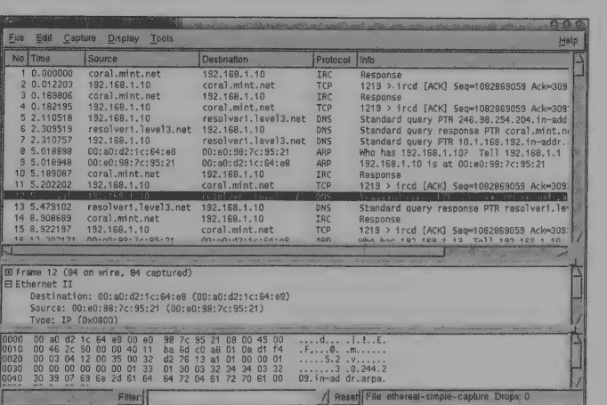

图 10.3 一个简单的 `Ethereal` 捕获。

捕获数据后，你可以使用多种工具以多种方式查看。查看数据的一种方法是查看 `Ethereal` 摘要数据，如图 10.4 所示。

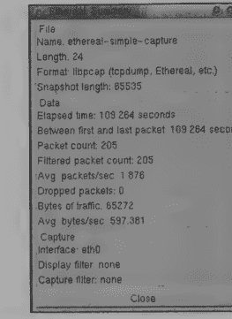

**图 10.4** `Ethereal` 摘要数据。

此摘要显示了以下内容：

- 关于文件的信息（我们将忽略它）
- 关于数据的信息（我们将稍后介绍）
- 关于捕获的信息（我们将在数据信息之后立即介绍）

你可以通过选择“工具（Tools），摘要（Summary）”来调出摘要窗口。

关于数据的信息提供了关于捕获流量的一些良好信息。它告诉我们流量发送了多长时间、发送了多少个数据包、发送了多少数据、每个数据包的数据（平均）以及每秒数据（平均）。当与过滤器结合时，这些信息变得更有用（有关编写过滤器的更多信息，请参见后续章节“使用 Ethereal 过滤数据包”）。例如，如果你想确定连接 IRC 服务器会给你的网络带来什么，你可以在仅过滤 IRC 流量的同时捕获一个 15 分钟的 IRC 会话。然后你就可以看到 IRC 在这 15 分钟内传输的平均数据量。记住，你可能想在一天中的几个时间点检查此，以获得更真实的流量使用情况。

捕获提供了理解捕获内容所需的上下文。它显示了捕获来自哪个接口、使用了什么捕获过滤器，以及如何使用显示过滤器。在上一段中描述的 IRC 示例中，如果数据中还包含 HTTP 流量，数据将具有误导性。查看捕获信息有助于确保我们只查看感兴趣的数据。


查看数据包的另一种方法是查看所有匹配特定标准的数据包。要做到这一点非常有效，你需要编写一个显示过滤器，但 Ethereal 提供了一个快速机制为你创建一个简单的过滤器。例如，如果你在树视图窗格（tree view pane）中选择一个字段（例如选择包含 ARP 的 Ethernet II 类型），然后点击“显示（Display），匹配所选项（Match Selected）”，就会创建一个匹配所有 Ethernet II 类型为 ARP 的数据包的显示过滤器，如图 10.5 和图 10.6 所示。

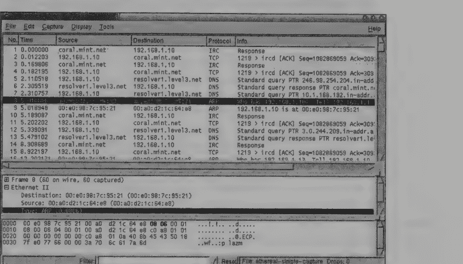

图 10.5. 选择内容进行匹配。

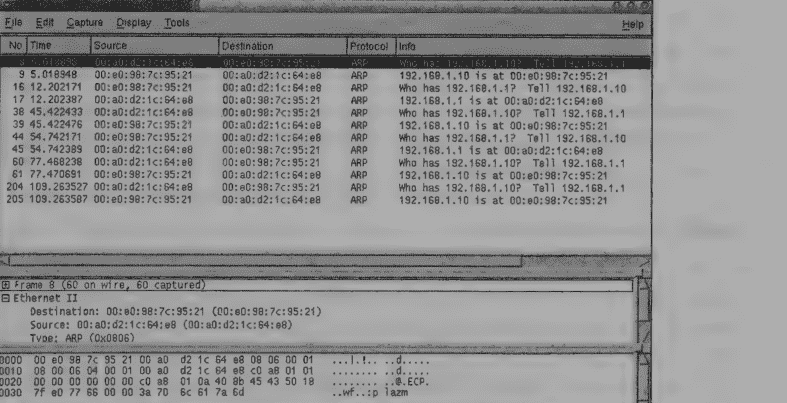

图 10.6. Ethereal 匹配所选项。

由于捕获的流量分布在多个数据包中，很难看出网络上正在传输什么流量。Ethereal 提供了一种这种方法，即跟踪 TCP 会话。在图 10.7 中，你可以看到一个包含 HTTP 会话的 TCP 流。你可以通过在包列表中选择一个 TCP 数据包，然后点击“TCP，跟踪 TCP 流（Follow TCP Stream）”来跟踪 TCP 会话。

```
GET /index.html HTTP/1.1
Connection: keep-alive
Accept: Mozilla/5.0 (compatible; Linux 2.1.0; x86_64)
Host: www.ln.net
Accept: text/*,image/webp,image/apng,*/*;q=0.8
Accept-Encoding: gzip, deflate
Accept-Language: en-US,q=0.5
Date: Tue, 29 Aug 2009 03:51:09 GMT
Server: Apache/2.2.8 (Unix)
Location: http://www.ln.net/daily/
Content-Type: text/html
Content-Length: 139
Moved Permanently
```

图 10.7 在此示例中，第一块数据是客户端发送的 HTTP 请求。第二块数据是服务器返回的 HTTP 消息。

## 保存捕获文件

捕获了一段网络流量后，你可能想以后查看它。Ethereal 允许将你的捕获保存到文件中。这可以通过命令行、捕获偏好（Capture Preferences）屏幕，或者在停止捕获后选择“文件（File），保存（Save）”（也可以通过快捷键 Ctrl+S 访问）来实现。此窗口允许你以许多格式保存捕获；它还允许只保存当前显示的数据包。

## 查看保存的捕获

有时你想查看不再网络上的流量（为了诊断或为了学习更多协议知识）。对于这些情况，Ethereal 提供了一种方便的保存和查看捕获的方法。要查看保存的捕获，选择“文件（File），打开（Open）”，这将调出捕获文件界面。此窗口提供了一个常用的选择工具，你可以通过它选择。

## 使用 Ethereal 过滤数据包

即使网络很小，也可能运行大量流量。为了过滤掉流量，Ethereal 提供了捕获过滤器和显示过滤器。虽然捕获过滤器在捕获开始时输入（在命令行或捕获偏好窗口中），但显示过滤器在捕获完成后输入。加载捕获文件后，你可以在主窗口底部的状态栏区域定义显示过滤器。你可以通过点击重置（Reset）按钮来清除活动的显示过滤器。

# 报告 Bug

如果您在 Ethereal 中发现了 bug，请向我们报告。如果您是 C 语言黑客并认为自己知道如何修复它，请尽管发送一个补丁（patch）。（虽然您的补丁可能不会被使用，但它很可能帮助开发者了解问题出在在哪里。）Bug 报告可以发送至 ethereal-dev 邮件列表（您可以通过 `http://ethereal.zingorg/` 进行订阅；点击左侧的“Mailing Lists”链接）。您的 bug 报告至少应包含以下内容：

- 您正在使用的 Ethereal 版本以及它链接的软件版本。这可以通过 `ethereal -v` 获取，如下所示：

```bash
[@cherry sgml]$ ethereal -v
ethereal 0.8.7, with GTK+ 1.2.7, with libcap 0.4, with libz 1.1.3, with UCD
~SNMP 4.1.1
[@cherry sgml]$
```

注意：这只是一个示例，实际输出可能会有所不同。

- 如果 Ethereal 发生崩溃，请提供回溯轨迹（trace）。要获取核心文件（corefile），请在当前工作目录下查找 corefile，运行 `file core` 以确保它是它是 Ethereal 的核心文件（为了安全起见，您可能还想验证核心文件的日期），然后运行以下命令：

```bash
[@cherry page]$ gdb /usr/bin/ethereal core > backtrace.txt
backtrace
[@cherry page]$
```

这将创建一个 `backtrace.txt` 文件，您可以将其随 bug 报告一起邮件发送。

- 描述当 Ethereal 出现 bug 时您正在进行的操作。添加的详细信息越多越好。

编写良好的 bug 报告是一门艺术，但它是应该应该被认真对待的事情。如果开发者不知道哪里坏了，Ethereal 的开发者就无法帮助修复问题。

# mon

`mon` 是一个资源监控系统，设计用于测量主机或服务的可用性。它由 Jim Trocki (`trockij@transmeta.com`) 开发，并由活跃的社区支持，网站为 `www.kernel.org/software/mon/`，还有一个邮件列表（信息可以在同一位置找到）。

`mon` 将监控处理为两个独立的任务：测试条件和对失败进行告警。这两个功能都由外部程序（通常是使用 Perl 编写的脚本）处理。许多此类脚本随 `mon` 分发。

`mon` 本身是一个引擎，它根据您的配置调度测试，并将测试结果传递给相应的告警程序。这种功能与 `mon` 的分离使得您能够对您的监控系统进行无缝更改。您只需要做的是添加新的测试或告警程序并修改您的配置。不需要对 `mon` 本身进行更改（使用 `kill -HUP` 重新读取配置文件除外）。

在本节中，我们将讨论如何获取和安装 `mon`、配置它、使用它监控您的网络以及为它编写测试。

## 获取和安装 mon

您可以从 `ftp.kernel.org` 的 `/pub/software/admin/mon/mon/` 下载 `mon`（kernel .org 的成员要求您使用 kernel.org 的一个镜像站之一）。截至编写本文时，版本 0.38.20 是最新的。除了 `mon` 之外，您还需要获取一些 Perl 模块：`Time::Period`、`Time::HiRes`、`Convert::BER` 和 `Mon::*`。测试和告警脚本还需要额外的模块（例如，`telnet.monitor` 需要 `Net::Telnet`。请确保安装 `Net::Telnet`）。`fping.monitor` 脚本依赖于 `fping` 包，该包也可以从获取 `mon` 的相同地方获得。

## 先下载并安装！

在开始使用 `mon` 之前，请确保已下载并安装了所需的包。安装 Perl 模块超出了本书的范围，但构建 `fping` 需要一些您需要了解的技巧。`fping.c` 的第 222 行包含了 `sys_` 的重新声明。

回到“执行操作”部分——在这个示例中，我想要对那些对 finger 请求没有响应的箱子发送告警。为了进行这项测试，我使用了 Perl 的 `Net::Telnet` 模块向 finger 服务器（端口为 79）建立了一个 TCP 连接。然后，我发送了一个空字符串并等待响应。如果收到了某些内容，我就将其视为工作正常的服务器。如果没有连接，或者我收到了错误，我就将其视为失败，并将主机名和错误信息推入数组以备稍后处理。在处理完整个主机列表后，我就可以进入测试的错误处理部分（如果有任何失败的话）。

就是这些了；并没有什么神奇的。最困难的部分是坐下来思考如何测试你正在寻找的条件。

## 尾记

- 协议分析仪（嗅探器）允许你捕获网络上的部分或全部流量，并以某种有意义的方式将其显示（这最后一部分被称为解码）。由于它们通常非常昂贵（价格高达数万美元），除非是在大型网络设备店或聘请了昂贵的顾问来解决棘手问题，否则它们并不经常被使用。

- 嗯，这并不完全正确。Tereal 在捕获数据时不会显示时间戳；但在显示之前捕获的文件时会显示时间戳。

- 顺便说一下，如果你仔细观察这个屏幕，你会发现我作弊了。我保存了文件的副本，以便我可以返回查看。这个副本已经与书的其他材料一起发布在 `www.networkinglinuxbook.com` 上。

- 这是一种简单的基准测试形式。

# 11

## 安全工具

本章介绍了六种应该成为你安全工具箱一部分的工具。`nmap` 是一个端口扫描器，已成为系统和网络管理员的事实标准。`Nessus` 是一种安全扫描器，它取代了旧的 SATAN，成为检测已知安全问题的首选工具。`iptables` 是下一代 Linux 包过滤和 IP 伪装的接口。`Xinetd` 和 `tcp wrappers` 提供了控制特定主机访问的两种方法。它们可以单独使用，也可以结合使用。`OPIE` 提供了一种密码隐藏机制，允许在不加密两个主机之间会话的情况下进行相当安全的登录。

## nmap

`nmap` 是一个用于扫描机器（或多个机器）及其相关网络安全问题的工具。`nmap` 通常从命令行运行，但也提供基于 GTK+ 的前端（`nmapfe`）。`nmap` 由 Fyodor <fyodorinsecure.org> 编写和维护。`nmap` 最初由 Zach Smith <key@aye.net> 编写，现在由 Fyodor 维护。

`nmap` 和相关工具可以说是是一把双刃剑，声誉毁誉参半。虽然这些工具对于系统或网络管理员非常有用，但它们也可以被系统破解客利用。有些人更倾向于像 `nmap` 这样的工具不要公开可用。我往往倾向于社区的另一方。如果好人无法使用这些工具，那将会给坏人带来巨大的优势，因为他们绝对不会放弃自己工具的。

`nmap` 是一个外部安全扫描器，或称端口扫描器。它的工作原理是向正在检查的主机发送 IP 包，并观察收到了什么种响应（如果有的话）。

`nmap` 展示了它收到的响应的摘要，以提供目标主机的安全概览。该概览可以显示：

- 开放端口列表

- 开放端口上的远程进程所有者

- 与提供的端口匹配的 RPC 服务

- 关于 TCP 序列号的信息

- 远程操作系统

### 获取和安装 nmap

可以从 `www.nmap.org` 获取 `nmap` 的二进制文件和源码。二进制文件的安装如你预想的那样简单。编译 `nmap` 和 `nmapfe` 也同样简单。

将源码 tar 包放入 `/usr/local/source` 后，你只需遵循标准的三个步流程：

```
[root@cherry nmap-2.53]# ./configure
[root@cherry nmap-2.53]# make
[root@cherry nmap-2.53]# make install
```

### nmap 的工作

在 `nmap` 编译并安装之后，你就可以开始运行它了。`nmap` 提供了各种安全扫描选项的映射。

### 命令行上的 nmap

简单的 `nmap` 扫描如示例 11.1 所示。

#### 示例 11.1 运行 nmap 扫描

```
[root@cherry nmap-2.53#] nmap 192.168.1.20
Starting nmap V. 2.54BETA1 by fyodor@insecure.org
( www.insecure.org/nmap/ )
Interesting ports on (192.168.1.20):
(下方未显示已扫描的 1519 个端口状态为: closed)
Port State Service
25/tcp open smtp
111/tcp open sunrpc
113/tcp open auth
515/tcp open printer
939/tcp open unknown
1024/tcp open kdm

nmap run completed -- 1 IP address (1 host) scanned in 17 seconds
[root@cherry]
nmap-2.53#
```

通过 `nmap` 提供的几种不同类型的扫描在表 11.1 中描述。

| 扫描类型 | 选项 | 描述 |
| --- | --- | --- |
| TCP connect() 扫描 | `-sT` | 最基础的扫描形式。它打开一个连接。这种扫描会打开目标主机上的每一个端口。 |
| TCP SYN 扫描 | `-sS` | “半开放”扫描。它通过发送 SYN 包来打开连接。如果收到 SYN-ACK 响应，它会发送 RST 来关闭连接。 |
| Stealth FIN 扫描 | `-sF` | 这种扫描通过发送 FIN 包来通过包过滤器。 |
| Christmas Tree 扫描 | `-sX` | 这种扫描通过发送设置了 FIN、URG 和 PUSH 标志的包来通过包过滤器。 |

表 11.1 续

| 扫描类型 | 选项 | 描述 |
| --- | --- | --- |
| Null | `-sN` | 这种扫描通过发送未开启任何标志的包来通过包过滤器。 |
| Ping | `-sp` | 将扫描限制为仅进行 ping 查找连接的系统。不进行端口扫描。 |
| UDP 扫描 | `-sU` | 向目标主机的每个端口发送 0 字节的 UDP 包。 |
| ACK 扫描 | `-sA` | 这种扫描用于检查包过滤器。发送带有随机确认和序列号的 ACK 包。如果没有返回，则端口标记为被过滤。 |
| Window 扫描 | `-sW` | 此扫描与 ACK 扫描类似，但取决于某些操作系统对 TCP 窗口大小的处理。 |
| RPC 扫描 | `-sR` | 这种扫描向其他扫描类型发现开放端口发送 RPC 命令以检查它们是否为 RPC 端口。如果是 RPC 端口，此扫描将尝试确定它们提供的程序和版本号。 |
| FTP 弹回扫描 | `-b relay host` | 这种扫描利用了 FTP 服务器的历史漏洞。旧的 FTP 服务器用于提供会话，即连接到另一个主机将数据传递给你。通过提供格式为用户名:密码@服务器:端口的代理主机，你可以利用此 FTP 弹回（误）功能扫描受保护的端口。 |

除了 `nmap` 可以运行的扫描类型外，许多选项可以修改其行为。这些选项包括计时、目标识别、输出等。更有用的选项见表 11.2。

表 11.2 nmap 选项

| 选项 | 解释 |
| --- | --- |
| `-P0` | `nmap` 在扫描之前不要 ping。（这用于扫描位于不允许 ICMP 流量的包过滤器后面的主机。） |
| `-PT<PORT>` | 使用 TCP 查找目标网络上的主机。发送 ACK 包，`nmap` 寻找返回的 RST 包。可以给出一个可选端口。它告诉 `nmap` 尝试连接的端口。 |
| `-PS` | 使 `nmap` 在检查目标网络上的主机时使用 SYN 包而不是 ACK 包（仅限 root 用户）。 |

# 选项说明

| 选项 | 说明 |
| :--- | :--- |
| `-PI` | 在目标网络上查找主机时仅使用 ICMP。 |
| `-PB` | 同时使用 ICMP 和 TCP ACK 扫描目标网络中的主机。这是默认行为。 |
| `-O` | 强制 `nmap` 根据系统处理包含某些类型错误的 TCP 包的方式，尝试进行远程主机识别。 |
| `-I` | 强制 `nmap` 使用 ident 扫描（身份扫描）。这会显示服务器进程的所有者。 |
| `-f` | 强制 `nmap` 对扫描数据包进行分片，使得数据包过滤器更难拦截扫描。 |
| `-v` | 将 `nmap` 置于详细模式，使其显示更多关于其正在操作运行的信息。 |
| `-oN <logfile>` | 将输出写入到人类可读的日志文件中。 |
| `-oM <logfile>` | 将输出写入到机器可解析日志文件中。 |
| `--resume <logfile>` | 从日志文件恢复未完成的扫描。 |
| `-IL <logfile>` | 强制 `nmap` 从日志文件读取输入而不是实际扫描主机。 |
| `-g <portnumber>` | 允许你定义 `nmap` 用作源端口的端口。 |
| `-p <port range>` | 允许你定义 `nmap` 将扫描的端口范围。如果没有给出范围，`nmap` 将扫描其服务文件中列出的所有端口。可以使用以下格式范围：-20-30,79,6000-6010。 |

`nmap` 允许你以四种样式之一列出目标地址。对于单个主机，你可以写 IP 地址或主机名。对于网络，你可以使用 CIDR 风格的网络掩码斜线表示（例如，`192.168.1.0/24`）。最灵活的目标列表形式允许对地址部分使用通配符（或将其列为范围）。这允许你查看一组网络中的特定主机（例如，如果你知道所有路由器都使用其 C 类地址的第一个 IP 地址，你可以使用 `192.168.*` 等目标扫描你的内部路由器）。最后，你还可以提供主机列表（使用上述任何一种样式）。

## nmapfe

`nmapfe` 让这一切变得更加简单。它为你提供了一个基于 GTK+ 的 `nmap` 前端，你可以用它来选择目标、设置扫描选项并查看扫描结果。在启动时，`nmap` 看起来就像图 11.1 所示所示。

# 第 11 章 安全工具

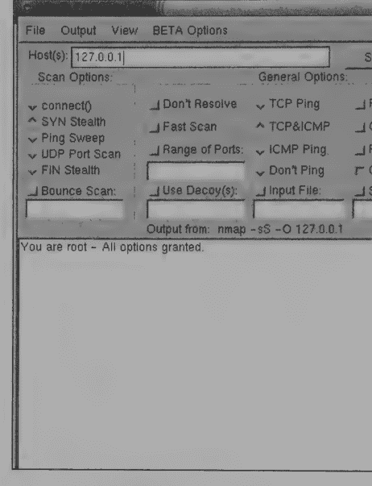

图 11.1 nmap 启动界面。

完成的扫描看起来如图 11.2 所示所示。

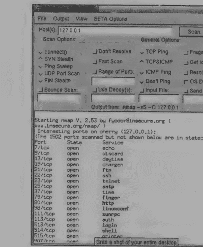

图 11.2 完成的扫描。

目前没有可以传递给 `nmapfe` 的映射选项。它接受 GTK+ 允许的任何 X11 样式选项。

`nmapfe` 中可用的按钮和菜单项对应于 `nmap` 命令行提供的某些选项。请参表 11.2 获取有关这些选项的更多详情。

# Nessus


Nessus 是一种端口扫描漏洞扫描器。Nessus 提供了一种脚本语言来编写额外的测试。本节将提供 Nessus 的概述，讨论获取和安装它，并介绍其使用方法。

Nessus 由 Renaud Deirison <renaud@nessus.org> 以及其他许多贡献者编写。可以从 www.nessus.org 获取。

Nessus 是一个客户端-服务器结构的应用程序。Nessus 是服务器，它作为守护进程运行并负责执行所有测试。Nessus 是一个基于 GTK+ 的客户端应用程序，负责为用户提供方便的用户界面。

Nessus 通过执行端口扫描开始扫描主机，以查看哪些可攻击路径。它依赖 `nmap` 的功能。当它可以查看某些端口时，Nessus 会扫描已知漏洞。它使用用 C 语言或 Nessus 攻击脚本语言 `NASL` 编写的插件来执行这些测试。（本节稍后将简要介绍如何用 `NASL` 编写脚本。）

# 获取和安装 Nessus

在系统上运行 Nessus 涉及两个主要步骤。首先，你必须获取并编译软件。编译完成后，需要对其进行安装和设置。本节涵盖了这两个步骤。

## 获取和编译 Nessus

编译 Nessus 并不困难，但有四个软件包你必须按照正确的顺序下载并编译：

- Nessus-libraries
- libnsl
- Nessus-core
- Nessus-plugins

这些软件包都遵循自由软件典型的 `configure, make, make install` 模式。确保按照正确的顺序编译和安装软件包，这将为你节省很多麻烦。

## 安装 Nessus

在完成 `make install` 安装程序和库后，你可以启动 `nessusd`。第一次启动它时，你需要通过启动 `nessus-adduser` 命令进行扩展设置，如示例 11.2 所示。

示例 11.2 添加 Nessus 用户

```
[root]@chry /root
```

```

# 添加一个 Nessus 用户

```

[root]@chry /root nessus-adduser

```

```

[root```  / / 编译us us
```

```
[root]@chry /root] 
```

# Nessus 的工作

Nessus 像任何其他工具，不能只运行一次。理想情况下，你应该定期运行 Nessus（例如每周或每两周一次），并在网络进行任何更改后再次运行。

从网络内部运行 Nessus 有助于确保主机的安全性。它也应该从外部主机运行，以从攻击者的视角获得真实情况。

在本节中，我们将查看单个主机的内部扫描。内容包括 Nessus、保存和读取报告，以及通过编写测试来扩展 Nessus。

## 运行 Nessus

第一次运行 Nessus 时，你需要配置用户。Nessus 会弹出一个显示正在为你的客户端生成密钥对的启动屏幕，然后是一个让你输入密码语的窗口。如果你是第二次或之后运行 Nessus，它只会要求密码语。

输入密码语后，Nessus 会弹出一个连接 Nessus 的登录窗口（参见图 11.3）。

这也是 Nessus 的主窗口。窗口顶部的标签提供了访问额外功能的接口。

登录 Nessus 后，会自动切换到 Plugins 选项卡。点击“Enable All”按钮进行全扫描，或使用窗口左侧的按钮手动选择和取消扫描。点击 Plugins 选项卡上方窗格中的扫描族名称，将在下方窗格中列出单个扫描列表（参见图 11.4）。

选择好想要运行的扫描项目后，你就可以选择目标了。移动到“目标”（Target）选择选项卡并输入你请求的目标（可以是单个主机，也可以是主机列表）。我选择了单个主机 192.168.1.20（见图 11.5）。

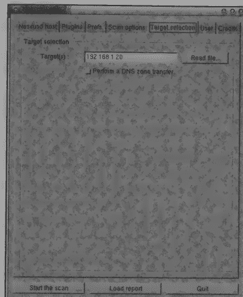

**图 11.5** Nessus 目标选项卡。

现在你可以运行扫描了。只需点击窗口底部的开始扫描（Start Scan）按钮即可。扫描需要一段时间时间，所以这可能是你去处理邮件的好时机。你可以通过查看端口扫描/攻击状态窗口来监控扫描进度（见图 11.6）。

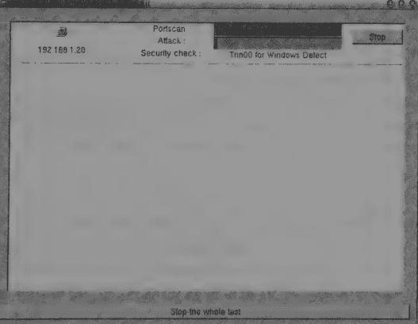

**图 11.6** Nessus 端口扫描/攻击状态窗口。

当 Nessus 完成扫描后，它会弹出一个报告窗口。点击主机名或 IP 地址会列出该主机上潜在漏洞的级联列表。在 11.7 中，我展开了一个列出的漏洞，以显示 Nessus 能够显示的详细信息。

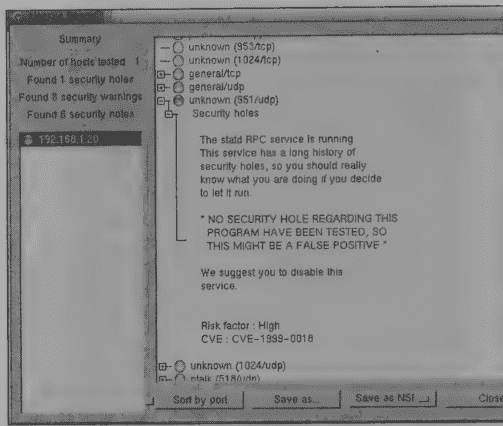

图 11.7 一份 Nessus 报告。

## 保存和读取报告

通常情况下，你应该保存扫描报告，以便留下网络中出现了哪些潜在漏洞以及它们出现的时间记录。

你可以通过点击“另存为”（Save As）按钮来保存报告。确保你使用了一致的命名方案，并且能够解释这些名称。诸如 `<hostname>-<date>.nsr` 的格式可能不错。根据网络中主机的数量，你可能会发现需要为局域网（LAN）、不同类型的机器和/或运行扫描的时间段保留子目录。总的来说，找到适合自己的组织层次并坚持下去。

返回查看旧的扫描报告非常简单。你只需要点击主窗口底部的“加载报告”（Load Report）按钮。这会弹出一个选择框，供你选择想要查看的报告。加载报告后，它会在报告窗口中显示。

## 编写 NASL 脚本

`NASL` 脚本编写相当简单，但有很多技巧可以确保它们编写正确。本节并不打算作为一个完整的教程，但它足够让你入门了。更多细节请阅读随 `libnasl` 源码附带的 `NASL` 指南和主页。

`NASL` 是一种类 C 语言，没有大量的额外开销。变量不需要声明，也不需要类型（至少你不需要关心这一点）。如果你需要使用变量，直接使用即可：

```
myhostname = "cherry";
```

如果你想使用数字，可以用二进制、十进制或十六进制格式输入。`NASL` 会为你处理转换。如果你正在使用字符串，请注意，除非你明确告诉它，否则 `NASL` 不会插值特殊字符：

```
a = "foo\nbaraz";      # 这等于 "foo\nbaraz"
a = string("foo\nbaraz"); # 这等于 "foo
                                     bar
                                     baz"
```

正如你从上一个示例中推断的那样，每行注释都以 `#` 符号开头。`NASL` 中没有行内注释。你可以这样在 `NASL` 中定义自己的函数：

```
function sqr(n)
{
return(n);
}
```

```
display("5 squared is *, sqr(5), "\n");
```

`NASL` 标准的 C 运算符 `*, %, +, -, |, &`（尽管它没有为这些运算符提供优先级）。`NASL` 还提供了两个额外的运算符。'x' 运算符会将函数重复 n 次；例如，这将执行 `display` 函数 5 次：

```
display('a line of text\n') x 5;
```

'<' 运算符的作用类似于 `grep` 命令。如果运算符左侧的字符串出现在右侧的字符串中，则返回真。

```
a = "foo";nb = "Don't be a fool";nif (a < b) {
display(a, " is contained in ", b, "\n");
}
```

作为一个示例，检查邮件守护进程发送的问候消息。所有内部主机都应该运行 `qmail`，因此如果有人正在运行 `Sendmail`，你想知道这件事。`NASL` 脚本见示例 11.3。

### 示例 11.3 一个 NASL 脚本

```
if(description)
{
    script_name(english:"sendmail message check");
    script_description(english:"This script looks for sendmail");
    script_summary(english:"connects to remote port 25");
    script_category(ACT_GATHER_INFO);
    script_family(english:"Administration toolbox");
    script_copyright(english:"Copyright Pat Eyler, licensed under GPL");
    script_dependencies(english:"find_services.nes");
    exit(0);
}

# get the smtp port
```

在具备必要的内核模块的情况下，你可以构建并安装用户态工具。你可以从 `netfilter.kernelnotes.org` 或之前提到的任何其他网站下载 `iptables`。下载后，`iptables` 遵循标准的 `configure`、`make`、`make install` 模式。

你可以使用示例 11.4 中所示的规则集来测试你新安装的 `iptables` 和 `netfilter`。

#### 示例 11.4 iptables 的测试脚本

```
# create a new table
iptables -N GATE

# set up rules for it
iptables -A GATE -m state --state ESTABLISHED, RELATED -j ACCEPT
iptables -A GATE -i eth0 -s 192.168.1.20 -j LOG --log-prefix \
  "connection from test bad machine, dropping:"
iptables -A GATE -s 192.168.1.20 -j DROP
iptables -A GATE -s 192.168.1.21 -j LOG --log-prefix \
  "connection from test good machine, accepting:"
iptables -A GATE -j LOG --log-prefix "Accepting packet:"
iptables -A GATE -j DROP

# apply it to the INPUT and FORWARD chains.
iptables -A INPUT -j GATE
```

安装完这些规则后，你可以通过尝试从 192.168.1.20 和 192.168.1.21 进行连接来测试它们。第一个连接应该失败（并带有日志记录），第二个连接应该成功（同样带有日志记录）。如果出现这种情况，说明一切正常，你可以清空这些规则：

```
iptables -F GATE
iptables -X GATE
iptables -F INPUT
```

现在工具已经完成构建、安装并验证，你就可以为你的站点配置这些工具了。

### iptables 的工作

在开始编写规则之前，坐下来思考三件事至关重要：你试图实施什么策略？如何保持规则和链（chains）易于管理？如何在不让规则变得不可管理的情况下，保持规则尽可能高效？如果规则没有实现你试图执行的策略，那么它们就等于不存在。如果你（以及你的同事）无法阅读和维护这些规则，将会有人破坏它们。如果它们的运行效率低下，它们会限制你的网络速度。

效率固然重要，但我们往往会忽略其中的一个主要部分——人类时间。如果你的规则难以阅读和理解，维护它们将花费大量的人力时间。此外，随着规则变得复杂，你出错的概率会急剧增加。我不喜欢在周末深夜加班，去弄清楚为什么一组没必要那么复杂的规则没有按照我的意愿运行，我相信你也不喜欢。

记住，每个规则数据包都必须经过这些时间。当大量数据包通过你的数据包过滤器时，这些微小的时间就会累积成可观数字。考虑到这一点，你应该确保（尽可能地）将最频繁使用的规则放在链中的第一条规则。此外，你在数据包报头中检查的字节数越多，你要做的工作就越多。这意味着，你仍然要确保每条规则检查的字节数尽可能少——同时不损害你的安全性。

为了实际操作你的链，你将需要使用表11.3 中的开关。

#### 表 11.3 iptables 链操作

| 开关 | 功能 |
| :--- | :--- |
| `-N` | 创建一个新的规则链。 |
| `-L` | 列出链中的规则。 |
| `-P` | 更改内置链的策略。 |
| `-Z` | 将链中的字节和数据包计数清零。 |
| `-F` | 清空链中的所有规则。 |
| `-X` | 删除一个空链（内置链除外）。 |

除了对链进行操作外，你还需要对链中的单个规则执行操作。表 11.14 显示了链内规则的一些主要操作以及调用所需的开关。（注意，这些规则实际上是作用于链本身的，逐条规则地修改链的内容。））

#### 表 11.14 iptables 规则操作

| 开关 | 功能 |
| :--- | :--- |
| `-A` | 将此规则添加到链的末尾。 |
| `-I` | 在链的指定位置插入此规则。 |
| `-R` | 替换链中指定位置的规则。 |
| `-D` | 删除规则；可以通过编号或匹配内容来指定。 |

使用表 11.14 中的规则和链选项，你可以开始修改内置链或添加你自己的链。你需要的额外信息在接下来的章节中。让我们先分析前面测试中使用的 `GATE` 链中的其中一条规则。

```
iptables -A GATE -s 192.168.1.20 -j DROP
```

`-A GATE` 语句意味着这是一个添加到 `GATE` 链末尾的新规则。`-s 192.168.1.20` 语句将此规则应用于任何源地址为 192.168.1.20 的数据包。`-j DROP` 告诉 `netfilter` 丢弃该数据包而不进行进一步处理。每一条你...

在声明匹配此规则的数据包需要记录日志后，我们使用了 `--log` 前缀开关来在日志条目开头添加文本。记录时使用的另一个开关是 `--log-level`，它接受一个 syslog 风格的日志级别作为参数，并将日志重定向到该级别。由于日志可能会占用大量磁盘空间，我们使用了 `-m` 限制选项。该命令将匹配次数限制为默认每小时 3 次，突发限制为 5 次。

当数据包被丢弃时，它是静默丢弃的。如果你想发送一个 ICMP 端口不可达消息，可以使用此命令指定拒绝数据包：

- `-j REJECT`

如果你想结合使用多个链，你并不希望通过丢弃所有剩余数据包来结束链。相反，你可以通过此命令将数据包控制权交回父链：

- `- RETURN`

如果命中了此规则且链是内置的，则执行默认策略。如果是在用户定义的链中命中规则，数据包将从跳转到当前链的点开始重新遍历父链。

## Xinetd

`Xinetd` 设计用于作为 `inetd` 程序的安全替代品。它通过主守护进程以及许多其他实用设施，为访问 Internet 服务提供了一种更安全的方法。`Xinetd` 最初由 Panagiot Tsrigotis (panos@synak.colorado.edu) 编写。目前由 Rob Braun (braun@synak.net) 维护。它通过 www.xinetd.org 网页和托管在 synak.net 的邮件列表提供支持。

`Xinetd` 像 `inetd` 一样作为“超级服务器”或交换机运行。它根据传入请求监听多个端口和守护进程。`Xinetd` 在许多方面超越了 `inetd` 的功能。它利用其交换机员的角色，在将控制权交给应用程序守护进程之前管理各种事务。此功能用于创建一个更安全的环境；其他部分则让你作为管理员的生活更方便（或更轻松）。

`Xinetd` 执行的最常见任务之一是访问控制。根据远程主机的域、名称、地址或访问时间，允许或禁止对主机的连接。如果需要，`Xinetd` 可以带有 `libwrap` 支持进行编译，以使用 `hosts.allow` 和 `hosts.deny` 文件。`Xinetd` 甚至允许你将特定服务绑定到特定 IP 地址。

`Xinetd` 还用于防止拒绝服务 (DoS) 攻击。因为它查看进入主机的所有连接，而不仅仅是一个连接，`Xinetd` 可以限制到给定服务的连接数。你也可以根据不同的客户端主机设置连接限制。

## Xinetd 197

`Xinetd` 的优势之一是其强大的日志功能。你可以为每个服务单独配置日志。如果你想避免使用 syslog，可以直接将日志写入日志文件。你可以记录失败连接尝试的信息。你甚至可以使用 `Xinetd` 记录每个连接的连接和断开时间。`Xinetd` 允许你减少到不同主机的 TCP 连接。这些连接将继续通过原始主机运行，因此你可以使用此功能从私有地址机器向 Internet 提供服务。

## 获取和安装 xinetd

`Xinetd` 现在是 Red Hat 7 系统的一部分，但获取和构建它非常简单。源码可以从 www.xinetd.org 获取。目前有两个版本：稳定版和开发版。请确保你获取的是稳定版。

构建 `Xinetd` 遵循标准的 `configure, make, install` 程序。在 Red Hat 6.2 系统上，它是可以直接构建的且没有任何错误。如果你遇到问题，请尝试邮件列表（请参见“如果我有问题”章节获取订阅信息）。

`Xinetd` 提供的额外功能意味着它的配置文件中需要比 xinetd 更多的信息。这两种格式是不互换的。不过，提供了一个工具来转换你现有的 `/etc/xinetd.conf`，所以过程并不算痛苦。要执行转换，请执行以下操作：

```
root@$ /xconv.pl < xinetd.conf > /etc/xinetd.conf
```

结果可能不是你完全想要的，但它应该可以工作。下一节将介绍如何让 `Xinetd` 执行你想要的操作。

## Xinetd 的工作

我们将取一个短小的 `xinetd.conf` 文件并通过 `xconv.pl` 得到一个基础的 `xinetd.conf`。从那里开始，我们将对 `xinetd.conf` 进行增量更改，使其适应我们自己的网络。

## 基础配置

我们将从一个非常短的 `xinetd.conf` 文件开始，如示例 11.5 所示。

### 11.5 基础 xinetd.conf


```
echo stream tcp nowait root internal
echo echo udp wait root internal
ftp stream nowait root /usr/sbin/in.ftpd in.ftpd -l -a
telnet stream nowait root /usr/sbin/in.telnetd in.telnetd
imap stream tcp nowait root /usr/sbin/imapd imapd
finger stream tcp nowait nobody /usr/local/sbin/my_safe.fingerd in.fingerd
```

此配置文件仅在针对 TCP 协议的内部服务上运行四个外部服务。在对其运行 `xconv.pl` 之后，我们得到了示例 11.6 所示的 `xinetd.conf` 文件。

### 示例 11.6 转换后的 xinetd.conf

```
service ftp
{
    flags = REUSE
    socket_type = stream
    protocol = tcp
    wait = no
    user = root
    server = /usr/sbin/in.ftpd
    server_args = in.ftpd -l -a
}
service telnet
{
    flags = REUSE
    socket_type = stream
    protocol = tcp
    wait = no
    user = root
    server = /usr/sbin/in.telnetd
    server_args = in.telnetd
}
service imap
{
    flags = REUSE
    socket_type = stream
    protocol = tcp
    wait = no
    user = root
    server = /usr/sbin/imapd
    server_args = imapd
}
service finger
{
    flags = REUSE
    socket_type = stream
    protocol = tcp
    wait = no
    user = nobody
    server = /usr/local/sbin/my_safe.fingerd
    server_args = in.fingerd
}
defaults
{
    flags = REUSE
    socket_type = stream
    protocol = tcp
    wait = no
    user = root
}
```

此配置文件仅在针对 TCP 协议的内部服务上运行四个外部服务。在对其运行 `xconv.pl` 之后，我们得到了示例 11.6 所示的 `xinetd.conf` 文件。

## 第 11 章 安全工具

此配置文件并没有实现我们想要的所有，因此我们将对其进行一些更改。首先，我们只允许 1 个 ftp 连接。其次，我们只允许来自内部主机的 telnet 会话（其地址为 `192.168.1.0/24`）。我们将记录所有的 finger 连接并将它们连接到 `/usr/local/my_safe.fingerd`。由于我们没有在此主机上运行 imap，我们将所有 imap 会话重定向到位于 `192.168.1.10` 的 imap 服务器上。

限制 ftp 连接非常简单。我们将修改 ftp 部分使其像示例 11.7 所示。

### 示例 11.7 定义 ftp

```
service ftp
{
    flags = REUSE
    socket_type = stream
    protocol = tcp
    wait = no
    user = root
    server = /usr/sbin/in.ftpd
    server_args = in.ftpd -l -a
    instances = 1
}
```

控制访问也很简单。我们将修改 telnet 会话以匹配示例 11.8。

### 示例 11.8 为 telnet 定义访问控制

```
service telnet
{
    flags = REUSE
    socket_type = stream
    protocol = tcp
    wait = no
    user = root
    server = /usr/sbin/in.telnetd
    server_args = in.telnetd
    only_from = 192.168.1.0/24
}
```

如果我们想在非工作时间断开来自本地子网主机的连接呢？可以在该部分的末尾（`only_from` 行之后）添加以下行：

```
access_time = 08:00-18:00
```

同样地，你可以通过添加以下规则来永久禁止某些连接：

```
# 这个家伙伙是个麻烦制造者
no_access = 192.168.1.20
```

我们默认会记录日志，但我们将尝试捕获关于 finger 用户的额外信息。示例 11.9 显示了如何操作。

### 示例 11.9 捕获 finger 数据

```
service finger
{
    flags = REUSE NAMEINARGS
    socket_type = stream
    protocol = tcp
    wait = no
    user = nobody
    server = /usr/local/sbin/my_safe.fingerd
    server_args = my_safe.fingerd
    log_on_success = PID HOST USERID
}
```

最后，为了将 imap 用户重定向到正确的地方，我们将进行示例 11.10 所示的更改。

### 示例 11.10 重定向 imap 用户

```
service imap
{
    flags = REUSE NAMEINARGS
    socket_type = stream
    protocol = tcp
    wait = no
    user = root
    redirect = 192.168.1.10 143
}
```

## 如果我遇到了问题怎么办？

如果在安装、设置或使用 Xinetd 时遇到问题，你应该订阅邮件列表并寻求帮助。你可以通过向 `majordomo@synack.net` 发送邮件，正文内容为“subscribe xinetd”来订阅。

## 第 202 页 11 章 安全工具

## 如果要订阅

当问题出现时，请尽量编写一份良好的 bug 报告。要具体，包含所有相关信息，并保持礼貌！记住，回答你问题的人只是在利用自己的时间。如果你不懒于写一段体面的说明来描述你的问题、你已经做了，并表明你至少尝试读过文档，他们会感到厌烦，并可能完全忽略你。

## tcp wrappers

`tcp wrappers` 是一种用于保护由类似守护进程启动的网络服务的访问的安全工具。通过调用 `tcpd` 而不是服务的标准守护进程，可以按主机和按服务来实施访问控制。`tcp wrappers` 可以与 Xinetd 结合使用（有关 Xinetd 的更多信息请参见上上一节），以提供更高水平的安全性。

大多数现代 Linux 发行版默认安装了 `tcp wrappers`。但它们并没有配置为提供任何实际保护。在本节的剩余部分，我们将研究 `tcp wrappers` 以让你的系统（或系统）更加安全。为了做到这一点，我们需要回顾 `inetd` 是如何工作的，然后通过引入 `tcpd` 来修改该系统。

Unix 和 Linux 并不是为主机提供的每个服务运行单独的守护进程，而是运行一个名为 `inetd` 的“超级交换机守护进程”。该守护进程监听许多端口，当它在给定端口上接收到请求时，会启动相应的守护进程来处理该请求。它监听的端口列表以及与端口相关的守护进程在 `/etc/inetd.conf` 中给出，并使用以下语法（提供了语法和示例）：

```
# <service_name> <service_type> <flags> <user> <server_path> <args>
echo stream tcp nowait root internal
```

在例例中，`echo` 服务（TCP 和 UDP 协议栈的内置服务）被定义为 TCP。`inetd` 将在 `/etc/inetd.services` 文件查找 `echo` 的端口号：

```
echo 7/tcp
```

然后，每当在 TCP 端口 7 上接收到 TCP 连接请求时，`inetd` 将把请求交给 TCP 协议栈内置的 echo 服务器。`/etc/inetd.conf` 中列出的每个服务都遵循相同的模型。

通过将 `/etc/inetd.conf` 条目中的 `<server_path>` 部分替换为 `/usr/sbin/tcpd` 来使用 `tcp wrappers`。`telnet` 服务将如下所示通过 `tcp wrappers` 运行：

```
telnet stream tcp nowait /usr/sbin/tcpd in.telnet
```

## tcp wrappers 原理

`tcp wrappers` 将根据其允许和拒绝主机的规则列表对连接客户端的 IP 地址进行检查。首先检查允许的主机规则，然后是拒绝的主机规则。检查在匹配到第一个规则时停止。如果处理了所有规则但连接未被显式允许或拒绝，则将允许连接。

正如你可能从名称猜出的那样，`tcp wrappers` 仅适用于保护基于 TCP的服务。因为 UDP 不创建会话，`tcp wrappers` 不用于控制单个守护进程的启动。如果你想控制对 UDP 访问，应该参考“iptables”部分获取有关如何设置数据包过滤规则的详细信息。

## tcp wrappers 的工作

为了让 `tcp wrappers` 运转起来，我们将查看可能使用其策略的地方，为主机创建一个策略，并转换 `/etc/inetd.conf` 以使用 `tcp wrappers` 实现它。

`tcp wrappers` 是为位于复杂的防火墙后的组主机提供安全的良好解决方案，或者为间歇连接到互联网的单个主机提供保护。在后一种情况下，应该考虑数据包过滤工具以及（或代替）`tcp wrappers`。如果你正在使用 `tcp wrappers` 保护多个主机，请记住你必须在每个主机上对其进行配置和维护。

在我们的示例中，我们将查看一个已经位于防火墙后的单个主机。它是 IS LAN (`192.168.1.0/24`) 的一部分，应该只向 IS LAN (`192.168.1.0/24`) 提供 talk 和 echo 服务。它应该通过 `inetd` 使用 finger。这见示例 11.1。

### 示例 11.1 无 tcp wrappers

```
# inetd.conf
echo stream nowait root
talk stream nowait root
finger stream nowait root
```

此时，真正的工作开始了：你需要让使用 OPIE 的用户运行 `opiepassword` 来生成初始密码。

OPIE 服务端是在执行安装的 `make install` 步骤时生成的。每个用户必须单独添加到 OPIE 数据库中。这是通过 `opiepasswd` 命令完成的，如示例 11.2 所示。

## OPIE

动态密码（OPIE）提供了一个更安全的环境，而无需在主机之间传输加密流量。它基于在贝尔实验室设计的系统，并在海军研究实验室编写。

## 获取和安装 OPIE

OPIE 可以从 `http://www.inner.net` 获取。截至写作时的最新版本是 2.32。下载后，构建 OPIE 是一个三步骤：

```
# ./configure
# make
# make install
```

## 配置 OPIE

安装并配置 OPIE 后，有趣的事情开始了。当你 `telnet` 到 OPIE 机器时，将通过示例 11.3 所示的过程。

### 示例 11.2 使用 opiepassword

```
[pate@cherry sgml]$ opiepassword -n 497 -c
Updating pate:
Reminder - 仅从控制台使用此方法;
切勿从远程使用。如果你在使用 telnet、xterm 或拨号，输入 "C" 现在退出或无密码。
然后运行不带 -c 参数的 opiepassword。
使用 MD5 计算响应。
输入旧口令：
输入新口令：
再次输入新口令：

ID date pate OPIE key is 497 cr1997
PHI CLAY MOOD VOID ELI BIRD
```

### 11.3 使用 OPIE 连接远程主机

```
[pate@cherry sgml]$ telnet 192.168.1.20
Trying 192.168.1.20...
Connected to 192.168.1.20.
Escape character is '^'.
Red Hat Linux release 6.2 (Zoot)
Kernel 2.2.14-5.0 on an i586
patelogin:
login: pate
otp-md5 497 cr1997 ext
```

## 206 第 11 章 安全工具

示例 11.14 续

```
Response: phi clay mood void eli bird
Last login: Fri Sep 1 05:27:20 from crashtestdummy
```

```
[pate@crashtestdummy pate]$
```

由 `otp-md56` 程序生成的实际响应见示例 11.15。

### 示例 11.15 在你的本地主机上使用 otp5

```
[pate@cherry]$$ otp5 497 cr1997
Using the MD5 algorithm to compute response.
Reminder: Don't use opiekey from telnet or dial-in sessions
Enter secret pass phrase:
PHI CLAY MOOD VOID ELI BIRD
[pate@cherry]$
```

此输出中显示的提示非常重要。OPI 不对你的流量进行任何加密，如果你使用 `opiekey`（无论其名称为何），你将向向任何能够看到你所发送的数据包的人泄露你的密码短。事实上，如果我尝试从我的 telnet 会话连接到 `crashtestdummy`，它将失败并报错，提示我不在安全终端上。

## 尾注

- 1. 这组规则并不是你在现实生活中想要使用的，它仅旨在帮助你练习工具的安装。
- 2. 好了，无论如何你都应该订阅邮件列表。现在就去吧。它会在这里等你的。
- 3. `inetd` 有几种替代方案，包括 `Xinetd`，将在本章的“Xinetd”节中讨论。
- 4. 这并不完全正确；`tcp wrappers` 可用于控制基于 UDP 的服务的初始访问。大多数服务要求守护进程在最后一次连接后继续运行短段时间。这意味着只有需要启动守护进程的连接会被记录并接受测试。
- 5. 这不是子网掩码。我正在使用 CIDR 风格表示法来指示 IS 和数据中心 LAN 使用的地址范围。
- 6. `otp-md5` 实际上是 `opiekey` 的另一个名称。使用这种使用 md5 风格加密从密码短语生成响应。

## RFC-1122

网络工作组—互联网工程任务组

意见征求：1122 R. Braden, 编辑

1989年10月

## 互联网主机主机—通信层

### 本备忘录状态

此 RFC 是互联网社区的官方规范。它通过引用、修改、纠正和补充与主机相关的主要的协议标准。本文档的分发不受限制。

### 摘要

这是定义和讨论互联网主机软件要求的的一对 RFC 之一。此 RFC 涵盖了通信协议层：链路层、IP 层和传输层；其同伴的 RFC-1123 涵盖了应用层和支持协议。

## 目录

- 1. 引言
- 1.1 互联网体系
- 1.1.1 互联网主机
- 1.1.2 体系假设
- 1.1.3 互联网协议族
- 1.1.4 嵌入式网关代码
- 1.2 通用考虑
- 1.2.1 持续的互联网演进
- 1.2.2 稳健性原则
- 1.2.3 错误日志
- 1.2.4 配置
- 1.3 阅读本文档
- 1.3.1 结构
- 1.3.2 要求
- 1.3.3 术语
- 1.4 致谢
- 2. 链路层
- 2.1 引言
- 2.2 协议演练
- 2.3 具体问题
- 2.3.1 尾部协议协商
- 2.3.2 地址解析协议—ARP
- 2.3.2.1 ARP 缓存验证
- 2.3.2.2 ARP 数据包队列
- 2.3.3 以太网和 IEEE 802 封装
- 2.4 链路/网络层接口
- 2.5 链路层要求总结
- 3. 网络层协议
- 3.1 引言
- 3.2 协议演练
- 3.2.1 互联网协议—IP
- 3.2.1.1 版本号
- 3.2.1.2 校验和
- 3.2.1.3 寻址
- 3.2.1.4 分段与重组
- 3.2.1.5 标识
- 3.2.1.6 服务类型
- 3.2.1.7 生存时间
- 3.2.1.8 选项
- 3.2.2 互联网控制协议—ICMP
- 3.2.2.1 目的不可达
- 3.2.2.2 重定向
- 3.2.2.3 源洪塞
- 3.2.2.4 超时
- 3.2.2.5 参数问题
- 3.2.2.6 回显请求/响应
- 3.2.2.7 信息请求/响应
- 3.2.2.8 时间戳和时间戳响应
- 3.2.2.9 地址掩码请求/响应
- 3.2.3 互联网组管理协议 IGMP
- 3.3 具体问题
- 3.3.1 出站数据报
- 3.3.1.1 本地/远程决策
- 3.3.1.2 网关选择
- 3.3.1.3 路由缓存
- 3.3.1.4 网关检测
- 3.3.1.5 新网关选择
- 3.3.1.6 初始化
- 3.3.2 重组
- 3.3.3 分段


# 3.3.4 本地多宿主
## 3.3.4.1 引言
## 3.3.4.2 多宿主
## 3.3.4.3 选择源地址
# 3.3.5 转发
# 3.3.6 广播
# 3.3.7 IP 多组播
# 3.3.8 错误报告
# 3.4 网络/传输层接口
# 3.5 网络层总结
# 4. 协议
# 4.1 用户数据报协议—UDP
## 4.1.1 引言
## 4.1.2 协议演练
## 4.1.3 具体问题
### 4.1.3.1 端口
### 4.1.3.2 IP 选项
### 4.1.3.3 ICMP 消息
### 4.1.3.4 UDP 校验和
### 4.1.3.5 多宿主
### 4.1.3.6 无效地址
## 4.1.4 UDP/应用层接口
## 4.1.5 UDP总结
# 4.2 传输控制协议—TCP
## 4.2.1 引言
## 4.2.2 协议演练
### 4.2.2.1 Well知端口
### 4.2.2.2 Push 的使用
### 4.2.2.3 窗口大小
### 4.2.2.4 紧急指针
### 4.2.2.5 TCP 选项
### 4.2.2.6 最大分段大小
### 4.2.2.7 TCP 校验和
### 4.2.2.8 连接状态图
### 4.2.2.9 初始序列号选择
### 4.2.2.10 同时打开
### 4.2.2.11 从重复 SYN 恢复
### 4.2.2.12 RST 段
### 4.2.2.13 关闭连接
### 4.2.2.14 数据通信
### 4.2.2.15 重传超时
### 4.2.2.16 窗口管理
### 4.2.2.17 探测零窗口
### 4.2.2.18 被动调用
### 4.2.2.19 存活时间
### 4.2.2.20 事件处理
### 4.2.2.21 确认队列段
## 4.2.3 具体问题
### 4.2.3.1 重传超时
### 4.2.3.2 发送 ACK 段
### 4.2.3.3 发送窗口更新
### 4.2.3.4 何时发送数据
### 4.2.3.5 TCP 连接失败
### 4.2.3.6 TCP Keep心包
### 4.2.3.7 TCP 多宿主
### 4.2.3.8 IP 选项
### 4.2.3.9 ICMP 消息
### 4.2.3.10 远程地址验证
### 4.2.3.11 TCP 流量模式
### 4.2.3.12 效率
## 4.2.4 TCP/应用层接口
### 4.2.4.1 异步报告
### 4.2.4.2 服务类型
### 4.2.4.3 刷新调用
### 4.2.4.4 多宿主
## 4.2.5 TCP 要求总结
# 5. 参考文献

# 1. 引言

## 1.1.

本文档是定义和讨论主机系统实现互联网协议族的一对 RFC 之一。此 RFC 涵盖了通信协议层：链路层、IP 层和传输层。其同伴 RFC “互联网主机要求—应用与支持”[INTRO:1] 涵盖了应用层协议。本文应结合“互联网网关要求”[INTRO:2] 一起阅读。

这些文档旨在为互联网通信软件的供应商、实现者和用户提供指导。它们代表了互联网研究和供应商社区成员贡献的大量技术经验和智慧的共识。

此 RFC 列举了连接到互联网的主机必须使用的标准协议，并通过引用其他描述这些协议当前规范的文档将其包含进来。它纠正了引用文档中的错误，并为实现者增加了额外的讨论和指导。

对于每种协议，本文还包含了一组明确的要求、建议和选项。读者必须自己理解：本文中的要求列表是不完整的；互联网主机的要求主要定义在标准协议规范文件中，并带有本 RFC 中包含的纠正、修改和补充。

在仔细阅读 RFC 并与互联网技术社区进行某些交互后，遵循良好的通信工程实践而产生的协议的诚实实现，其与本文的要求相比仅有细微差异。因此，在许多情况下，此 RFC 中的“要求”已经在标准协议文档中陈述或暗示，因此将其包含在此处某种意义上是冗余的。然而，包含它们是因为过去的某些实现做了错误的选择，导致了互操作性、性能和/或稳健性问题。本文包含了对许多要求的讨论和解释。简单的要求列表是危险的，因为：

- 某些要求的功能比其他的重要，且某些功能是可选的。
- 对于某些为受限环境设计的特定供应商产品，可能有选择不同规范的理由。

然而，必须遵循本文的规范，以实现跨越互联网系统多样性和复杂性的任意主机互操作的总体目标。尽管大多数当前的实现以各种方式未能满足这些要求（从小的到大的都有），但本规范是我们需要移动的理想目标。

这些要求基于当前的互联网架构水平。本文将根据需要进行更新，以提供额外的澄清或包含额外的在这些规范仍在演变的领域提供相关信息。

本介绍部分首先简要概述与主机相关的 Internet 架构，然后为主机软件供应商提供一些通用建议。最后，提供了关于阅读文档其余部分以及某些术语的指导。

## 1.1 Internet 架构

关于 Internet 架构及其支持协议栈的通用背景和讨论，可以在 DDN 协议手册 [INTRO:3] 中找到；背景可以参考 [INTRO:9]、[INTRO:10] 和 [INTRO:11]。参考 [INTRO:5] 描述了获取 Internet 协议文档程序，而 [INTRO:6] 包含了 Internet 协议中分配的编号列表。

### 1.1.1 Internet 主机

主机计算机（简称“主机”）是通信服务的终极消费者。主机通常代表用户执行应用程序，并利用网络和/或 Internet 通信服务来支持这一功能。

- Internet 主机连接到 OSI 协议栈中使用的“端系统”概念 [INTRO:13]。
- Internet 通信系统由互连的包交换网络组成，使用 Internet 协议支持主机之间的通信。这些网络通过被称为“网关”或“IP 路由器”的包交换计算机与 Internet 社区互连，并与 OSI 世界通过“中间系统”互连 [INTRO:13]。RFC“Internet 网关要求” [INTRO:2] 包含了 Internet 网关的官方规范。该 RFC 与本文档及其辅助文档 [INTRO:1] 相结合，定义了实现 Internet 架构的规则。
- Internet 主机跨越了多种尺寸、速度和功能范围。它们的尺寸从微小的微处理器到工作站，再到大型机和超级计算机不等。在功能上，它们从单用途主机（如终端）到全功能主机不等。如果一个主机到相同网络或不同网络有多个接口，则该主机为多主备主机。请参见第 1.3.3 节“术语”。

### 1.1.2 架构假设

当前的 Internet 架构基于对通信系统的一系列假设。与主机最相关的假设如下：

- Internet 是一个网络网络——每个主机都直接连接到某些特定网络；它与 Internet 的连接仅是概念上的。同一网络上的两个主机使用相同的协议集进行通信，这与它们与远端网络上的主机通信时使用的协议集是相同的。
- 网关不保存连接状态信息——为了提高通信系统的健壮性，网关被设计为无状态的，独立于其他数据报文转发每个 IP 数据报。因此，可以利用冗余路径在中间网关和网络发生故障的情况下提供健壮的服务。端到端流控制和可靠性所需的所有状态信息都实现在主机的传输层或应用程序中。所有的连接控制信息都与通信端点共同位于，因此它们只有在端点故障时才会丢失。
- 路由复杂度应在网关中——路由是一个复杂且困难的问题，应该由网关执行，而不是主机。一个重要目标是将主机软件与 Internet 路由架构不可避免的演进引起的变化隔离开。
- 系统必须容忍广泛的网络差异——Internet 的基本目标之一是容忍广泛的网络特征——例如带宽、延迟、丢包、包重排序和最大包大小。另一个目标是针对单个网络、网关和主机的故障具有健壮性（只要它们的带宽仍然可用）。最后，目标是“开放系统”：Internet 主机必须能够跨不同的 Internet 路径与任何其他 Internet 主机稳健且高效地运行。有时主机实现者设计的 goal并不那么宏大。例如，LAN 环境通常比整个 Internet 要良得多；LAN 具有低丢包和延迟，且不会重排序包。某些供应商推出了主机实现方案……LAN 很少长时间保持隔离；它们很快就会通过网关相互连接，连接到组织级网络，最终连接到全球 Internet 系统。最终，客户和供应商都不会受到不完整或不标准的 Internet 主机软件的服务。本文列出的要求是为全功能 Internet 主机设计的，能够在任意 Internet 路径上完全运行。

### 1.1.3 Internet 协议栈

为了与 Internet 系统通信，主机必须实现由 Internet 协议栈组成的分层协议。主机通常必须实现每层中的至少一个协议。

## 附录 RFC-1122

Internet 架构中使用的协议层如下 [INTRO:4]

- 应用层——应用层是 Internet 协议栈的顶层。Internet 协议栈没有进一步划分应用层，尽管某些 Internet 层协议包含一些内部子层。Internet 协议栈的应用层本质上结合了 OSI 参考模型前两层——表示层和应用层的功能。我们将应用层协议分为两类：直接为用户提供服务的用户协议，以及提供通用系统功能的支持协议。用户和支持协议的要求可以在通用 RFC [INTRO:1] 中找到。

- Telnet（远程登录）
- FTP（文件传输）
- SMTP（电子邮件投递）

还有许多其他标准用户协议 [INTRO:4] 和许多私有用户协议。用于主机名映射、启动和管理的支持协议包括 SNMP、BOOTP、RARP 和域名系统 (DNS) 协议。

- 传输层——传输层为应用程序提供端到端通信。目前有两种主要的传输层协议：
- 传输控制协议 (TCP)
- 用户数据报协议 (UDP)

TCP 是一种可靠的面向连接的传输服务，提供端到端的可靠性、引用和流控制。UDP 是一种无连接的（数据报”）传输服务。研究社区已经开发了传输协议，官方的 Internet 传输协议集未来可能会扩展。传输层协议将在第 4 章中讨论。

- Internet 层——所有的 Internet 传输协议都使用 Internet 协议 (IP) 将数据从源主机传输到目的主机。IP 是一种无连接或数据报网络服务，不提供端到端的交付保证。因此，IP 数据报到达目的主机时可能是损坏的、重复的、乱序的或完全未到达。IP 之上的层负责在需要时提供可靠交付。IP 协议包含了地址、服务类型规范、分片和重组以及安全信息。IP 协议的数据报或无连接特性是 Internet 架构的基本特征。Internet IP 是 OSI 无连接网络协议 [INTRO:12] 的模型。ICMP 是一种控制协议，被认为 IP 的不可或的一部分，尽管它层在 IP 之上，即它像 TCP 或 UDP 那样使用 IP 端端携带数据。ICMP 提供错误报告、拥塞报告和第一跳跳转。IGMP 是用于建立 IP 多播组的 Internet 层协议。第 3 章讨论 Internet 层协议。

- 链路层——为了与其直接连接的网络通信，主机必须实现用于接入该网络的协议。我们将其称为链路层或介质访问层协议。存在多种类型的协议，对应第 2。

### 1.1.4 嵌入式网关代码

某些 Internet 软件包含了嵌入式网关功能，以便这些主机作为网关转发数据包，同时执行主机的功能。

此类双用途系统在网关功能方面必须遵循网关要求 RFC [INTRO:2]，在主机功能方面必须遵循本文。在所有重叠的情况下，这两个规范应保持一致。

Internet 社区对嵌入式网关功能持有不同意见。主要论点如下：

- 支持：在非正式的局域网环境中或孤立环境中，使用主机系统作为网关是方便且经济的。嵌入式网关也有架构支持；多主备比预的常见得多，多主备强制主机像网关一样做出路由决策。如果多主备主机包含嵌入式网关，它将拥有完整的路由知识，从而能够做出优化决策。
- 反对：路由算法和协议仍在变化，随着 Internet 系统的增长它们将继续变化。尝试将通用网关功能包含在 IP 层中将强制主机系统维护者跟踪这些更频繁的变化。此外，更大的网关实现池将使协调变得困难。最后，IP 层的复杂度略大于主机，使得实现和操作任务更加复杂。此外，某些主机的操作模式不适合提供稳定健壮的网关服务。

这两个观点都有道理。可以得出的结论是主机管理员必须有意识地控制特定主机是否作为网关。详细要求请参见第 3.1 节。

## 1.2 通用考虑

互联网主机软件供应商已经吸取了两条重要的教训，新供应商应该认真考虑这些教训。

### 1.2.1 互联网的持续演进

互联网的巨大增长揭示了基于数据报文的数据通信系统中在管理和扩展方面存在的问题。这些问题正在得到解决，结果是本文中描述的规范将持续演进。这些变化将经过仔细的规划和控制，因为厂商以及负责网络运行的组织深度参与了规划。

开发、演进和修订是今天计算机网络协议的特征，这种现象将持续几年。如果一个供应商为互联网协议族（或任何其他协议！）开发了通信软件，但未能针对不断变化的规范维护和更新软件，将会留下一堆不满的客户。互联网是一个巨大的通信网络，用户通过它保持着联系。经验表明，对厂商软件缺陷的认知会在互联网技术社区中迅速传播。

### 1.2.2 健壮性原则

在协议的每一层中，都有一条通用规则，其应用可以从健壮性和互操作性方面带来巨大收益 [IP:1]：

> “接受时要慷慨，发送时要保守”

编写软件时应当能够处理每种可能的错误，无论其概率有多小；早晚会有一个带有特定错误组合和属性的数据包进入，除非软件已经做好了准备，否则可能会导致混乱。通常情况下，最好的假设是网络中充满了恶意的实体，它们会发送设计用于产生最坏影响的封包。这种假设将导致适当的保护性设计，尽管互联网中最严重的问题往往是由低概率事件触发的未知机制引起的；而在这些情况下，人类的恶意绝不会采取如此阴险的手段！

对变化的适应性必须被设计到所有层级的互联网主机软件中。举个简单的例子，考虑一个包含特定报头字段枚举值的协议——例如，类型字段、端口号或错误代码；必须假设该枚举是不完整的。因此，如果一个协议定义了四种可能的错误代码，那么当第五种代码出现时，软件不应崩溃。未定义的代码可以被记录，但它不能导致故障。

该原则的第二部分几乎同样重要：其他主机上的软件可能包含缺陷，导致利用遗留或晦涩的协议特性是不明智的。不宜偏离明显而简单的方法，以免在其他地方产生意想不到的后果。此的一个推论是“提防行为异常的主机”；主机软件不仅要准备好生存其他异常主机的冲击，还要协作以限制此类主机对共享通信设施可能造成的干扰程度。

### 1.2.3 错误日志

互联网包含了各种主机和网关系统，实现了许多协议和协议层，其中某些系统在它们的互联网协议软件中存在漏洞和不幸。由于功能的复杂性、多样性和分布性，对互联网问题的诊断通常非常困难。如果主机实现使用一个精心设计的设施来记录错误或“奇异”的协议事件，将对问题诊断大有帮助。在记录错误时，尽可能包含大量的诊断信息至关重要。特别是，记录通过硅层的数据包报头（头部）通常很有用，但必须确保错误日志不会消耗过量的资源，或以其他方式干扰主机的运行。

异常但无害的协议有导致错误日志文件溢出的趋势；这可以通过使用“环形”日志，或仅在诊断已知故障时启用日志来避免。过滤和统计重复消息可能很有用。一种看起来效果良好的策略是：

- (1) 始终统计异常情况，并通过管理协议访问这些计数（参见 [INTRO:1]）；
- (2) 选择性地启用各种事件的记录。例如，“记录所有内容”或“记录主机 X 的所有内容”可能有用。注意，不同的管理部门对主机启用的错误日志数量可能有不同的策略。有些人会说，“如果我不受害，我不想知道”，而另一些人则希望采取更警觉、更积极的态度来检测和消除协议异常。

### 1.2.4 配置

如果互联网协议的主机实现能够完全自配置将是理想的。这将允许整个协议族实现在 ROM 或固入硅片中，简化工作站，并对忙碌的 LAN 管理以及系统供应商来说是一个巨大的福音。我们还没有达到这一步；事实上，我们还远未及。

本文的许多地方，你会发现要求某个参数是可配置选项。此类要求背后有几个不同的原因。在某些情况下，对于最佳值存在不确定性或分歧，未来可能需要更新推荐值。在其他情况下，该值实际上取决于外部因素——例如主机的大小和其通信负载的分布，或者附近网络的速度和拓扑结构——而自调算法不可用或可能不足。在某些情况下，由于管理需求，需要配置。

## 附录 A RFC-1122

最后，某些配置选项是为了与过时或错误的协议实现进行通信，不幸的是，没有源码的实现在互联网许多地方仍然存在。为了让正确的系统与这些故障系统共存，管理员往往不得不“错误配置”正确的系统。随着故障系统的被淘汰，这个问题将逐渐自我修正，但供应商不能忽视这一点。

当我们说一个参数是可配置的，我们并不是要求在每次启动时从配置文件显显式读取其值。我们建议实现者为每个参数使用默认值，这样配置文件仅用于覆盖在特定安装中不适当的默认值。因此，可配置性要求保证了在必要时（即使是纯二进制或基于 ROM 的协议）可以覆盖默认值。在某些情况下，本文要求特定的默认值。当配置项控制对现有系统的适应时，默认值的选择是一个敏感问题。如果互联网要成功收敛，实现中的默认值必须实现官方协议，而不是适应故障实现的“错误配置”。营销考量导致一些供应商选择了错误的默认值，我们敦促供应商选择符合标准的默认。最后，我们注意到供应商需要对所有配置参数及其限制和影响提供充分文档。

## 阅读本文

### 1. 结构

协议分层通常用作实现网络软件的组织原则，也被用于组织本文。我们假设实现严格镜像协议的分层。因此，接下来的三个主要章节分别规定了链路层、网络层和传输层的要求。一个配套的 RFC [INTRO:1] 涵盖了应用层软件。这种分层组织方式是为了简单和清晰而选择的。

严格分层是一个理想模型，但对于协议族和推荐的实现方法并非如此。不同层的协议之间以复杂且有时微妙的方式相互作用，特定的功能往往涉及多个层。实现中有许多设计选择，其中许多涉及创造性地“打破”严格分层。敦促每位实现者阅读参考文献 [INTRO:7] 和 [INTRO:8]。

本文使用函数（“过程调用”）表示法描述层之间的概念服务接口，如 TCP 规范 [TCP:1] 中使用的表示法。主机实现必须支持这些调用所隐含本地信息流，但不需要字面上实现这些调用本身。例如，许多实现

# 引言 29

通过让传输层和 IP 层共享对常用数据结构的访问权限，反映了它们之间的耦合关系。这些数据结构，而不是显式的过程调用，是传递大部分所需信息的媒介。通常情况下，本文档的每个主要章节都由以下子节组成：

- 1. 引言
- 2. 协议详读——逐节考虑协议规范文档，纠正错误，指出可能存在模糊或定义不明确的要求，并提供进一步的澄清或解释。
- 3. 具体问题——讨论详读中未包含的协议设计和实现问题。
- 4. 接口——讨论指向更高级一层的服务接口。


- 5. 总结——包含本章节要求的总结。

在本文档的许多单独主题下，有标记为“DISCUSSION（讨论）”或“IMPLEMENTATION（实现）”的括号内容。这些内容旨在对前述要求的文本进行澄清和解释。它们还包含了对未来可能方向或发展的建议。实现部分包含了实施者可能想要考虑的建议方法。总结部分旨在作为文本的指南和索引，但不可避免地是晦涩且不完整的。绝不应脱离完整的 RFC 独立使用或引用总结。

# 1.3.2 要求

在本文档中，使用大写单词来定义每个特定要求的重要性。这些单词是：

- “`MUST`（必须）”“该词或形容词“`REQUIRED`（要求的）”意味着该项目是规范的绝对要求。
- “`SHOULD`（应当）”“该词或形容词“`RECOMMENDED`（建议的）”意味着在特定情况下存在忽略此项目的理由，在选择不同方案之前，应理解其全部影响并仔细权衡。
- “`MAY`（可以）”“该词或形容词“`OPTIONAL`（可选的）”意味着该项目真的是可选的。某个供应商可能因为市场需要或因为它可以增强产品而选择包含该项；例如；另一个供应商可能会省略该项。如果实现未能满足其所实现协议的一个或多个 `MUST` 要求，则该实现是不符合规范的。满足其协议的所有 以及 和所有 `SHOULD` 要求的实现被称为“无条件符合规范”；满足所有 `MUST` 要求但未满足所有 `SHOULD` 要求的实现被称为“条件符合规范”。

## 附录 A RFC-1122

### 1.3.3 术语

本文档使用以下技术术语：

- 段（Segment）——段是 TCP 协议中端到端传输的单位。一个段由一个 TCP 头部和后续的应用程序数据组成。一个段通过封装在 IP 数据报文内部进行传输。
- 消息（Message）——在对低层协议的此类描述中，消息是传输层协议的传输单位。特别而言，一个 TCP 段就是一个消息。一个段由一个传输协议头部和后续的应用程序数据组成。为了通过互联网进行端到端传输，消息必须封装在报文内部。
- IP 数据报文（IP Datagram）——IP 数据报文是 IP 协议中端到端传输的单位。一个 IP 数据报文由一个 IP 头部和后续的传输层数据组成，即一个 IP 头部后跟一个消息。在对网络层的描述（第 3 节）中，未定义的术语“datagram（报文）”应理解为 IP 数据报文。
- 数据包（Packet）——数据包是跨越网络层与链路层接口的数据单元。它包含 IP 头部和数据。数据包可以是完整的 IP 数据报文，也可以是 IP 数据报文的碎片。
- 帧（Frame）——帧是链路层协议的传输单位，由一个链路层头部和后续的数据包组成。
- 连接网络（Connected Network）——主机所连接的网络通常相对于该主机被称为“本地网络”或“子网”。然而，这些术语可能会引起混淆，因此我们在本文档中使用“连接网络”一词。
- 多主留（Multihomed）——如果一个主机具有多个 IP 地址，则称其为主主留。关于多主留的讨论，参见第 3.3.4 节。
- 物理网络（Physical network）——这是到连接网络的物理接口，具有（可能是唯一的）链路层地址。单个主机上的多个物理网络接口可以共享链路层地址，但对于同一物理网络上的不同主机，该地址必须是唯一的。
- 逻辑[网络]接口（Logical [network] interface）——我们将逻辑[网络]接口定义为通过唯一 IP 地址区分的连接网络的逻辑路径。参见第 3.3.4 节。
- 特定目的地址（Specific-destination address）——这是报文的有效目的地址，即使它是广播或多播的；参见第 3.2.1.3。
- 路径（Path）——在给定时刻，从特定源主机到特定目的主机的所有 IP 数据报通常会经过相同的网关序列。我们使用“路径”来表示这一序列。注意，路径是单向的；在给定主机对的两个方向上具有不同的路径并不常见。
- `MTU`——最大传输单元，即可以传输的最大数据包的大小。

帧、数据包、报文、消息和段的术语由以下示意图阐明：

A. 在连接网络上的传输：

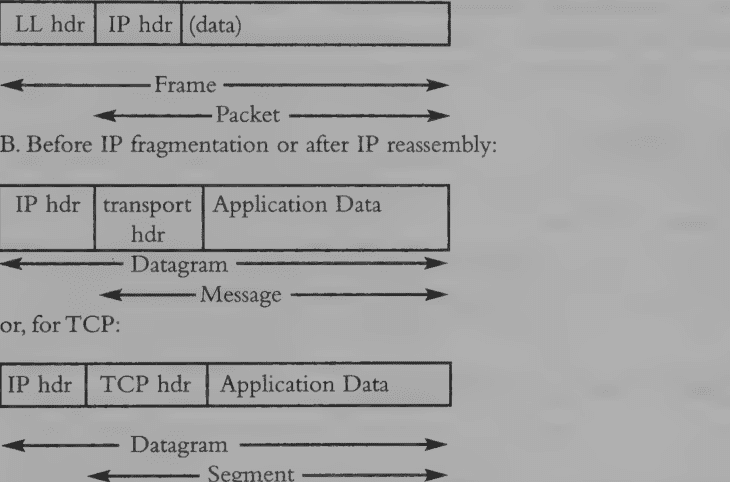

或者，对于 TCP：

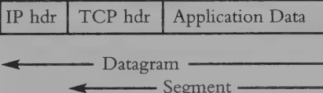

## 1.4 致谢

本文整合了大量专家的贡献和意见，包括实验室、供应商和政府机构。编辑特别感谢以下人员，他们付出了大量工作：Bill Barnes (Berkeley), Steve Bellovin (AT&T), Mike Brescia (DEC), Ed Kain (ISI), Annette Deering (Stanford), Martin Gross (DCA), Phil Gross (NRI), Charles Hedrick (Rutters), Van Jacobson (LBL), John Klensin (MIT), Mark Lott (SRI), Milo Nedelson (NASA), Bill Mellon (Sun Microsystems), Greg Minshall (Kinetics), Jeff Mogul (DEC), John Mullen (CMC), John Romkey (Epilogue Technology), Mike Sjohn (DCA), Paul Mock (USA), Arun Welch (Ohio State), Bill Westfield (Cisco), Ryan Zachariassen (Toronto)。以下人员也对特定领域做出了贡献：Eric Allman (Berkeley), Rob Austin (MIT), Art Berggreen (ACC), Keith Bostic (Berkeley), Vin Certf (NRI), Wayne Hathaway (NASA), Matt Korn (IBM), Erik Naggum (Naggum Software, Norway)。

我们感谢所有人，包括可能遗漏的任何贡献者。

# 2. 链路层

### 2.1 引言

所有互联网系统（主机和网关）对链路层都有相同的要求。这些要求在《互联网网关需求》第 3 章中给出，并结合本节内容进行了补充。

### 2.2 协议详读

无。

### 2.3 具体问题

#### 2.3.1 尾部协议协商

链路层封装的尾部协议 [LINK:1] 可以使用，但仅在验证参与链路通信的系统（主机或网关）都实现了尾部的情况下。如果系统没有针对每个目的动态协商尾部的使用，则默认配置必须禁用该协议。

讨论：尾部是一种链路层封装技术，重新排列了在物理网络上发送的数据内容。在某些情况下，尾部通过减少操作系统内部的数据拷贝提高了高层协议的吞吐量。高层协议感知尾部的使用，但如果使用了，发送和接收主机都能理解。

不当使用尾部可能会导致非常困惑的症状。只有具有特定属性的数据包会被尾部封装，且通常与不支持的系统交换时，只有一小部分数据包会消失，而其他数据包则成功递送。

实现：

在以太网中，封装有尾部（trailers）的数据包使用不同的以太网类型 [LINK:1]，且尾部协商是在使用 ARP 发现目标系统的链路层地址时进行的。

具体而言，ARP 交换是使用标准的 IP 协议类型以通常的方式完成的，但想要通信尾部的主机将发送一个额外的“ARP 响应”数据包，即一个指定了尾部封装协议的 ARP 响应包。但在其他情况下，如果配置为使用尾部的主机接收到来自远程机器的 ARP 响应消息，它可以将该机器添加到理解尾部的机器列表中，例如，通过标记 ARP 缓存中相应的条目来实现。

主希望接收尾部封装的主机在每次完成针对 IP 的正常 ARP 消息交换时，都会发送 ARP 响应。收到其 IP 协议地址的 ARP 请求的主机，除了发送标准的 IP ARP 响应外，还会发送一个尾部响应；发送 ARP 请求的主机在收到相应的 ARP 响应时，则会发送一个尾部响应。

通过这种方式，ARP 交换中的请求主机或响应主机都可以请求接收尾部封装。

该方案使用额外的 ARP 响应包，而不是为尾部协议发送 ARP 请求，是为了避免与行为异常的主机进行持续的 ARP 包交换——这种异常违背了任何规范或常识，对尾部的 ARP 响应用另一个 IP ARP 响应进行响应。这一问题可以通过仅在 IP ARP 响应回答了未完成请求时才对 ARP 响应发送尾部 ARP 响应来避免；当在接收 ARP 响应时主机的硬件地址仍未知，这一点适用。尾部 ARP 响应可以与响应 ARP 请求的 ARP 响应一同发送。

## 2.3 地址解析协议—ARP

### 2.3.1 ARP 缓存验证

地址解析协议 (ARP) [LINK:2] 的实现必须提供一种刷新过时缓存条目的机制。该机制涉及超时；并且 `SHOULD` 能够配置超时值。

必须包含一种防止 ARP 泛洪（以高频率重复发送相同 IP 地址的 ARP 请求）的机制。建议的最大速率为每个目标每秒 1 次。

讨论：

ARP 规范 [LINK:2] 建议在主机更改其以太网地址时使用超时机制来使缓存条目失效，但并非强制。代理 ARP（见 [INTRO:2] 第 2.4 节）的普及显著增加了主机中缓存条目失效的概率，因此某些主机不需要某些 ARP 缓存失效机制。即使在没有代理 ARP 的情况下，长时间缓存超时也是用的，以便自动纠正可能已缓存的错误 ARP 数据。

实现：

已使用四种机制（有时结合使用）来刷新过时的缓存条目：

- 1. 超时——定期对缓存条目进行超时（如果它们正在被使用）。请注意，当缓存条目被“刷新”时（通过观察相关系统的 ARP 广播的源字段，无论目标地址如何），应重新启动超时。对于代理 ARP 情况，超时时间需要在一分钟左右。
- 2. 单播轮询——通过定期向远程主机发送点对 ARP 请求来主动对其进行轮询，如果在连续 N 次轮询后未收到 ARP 响应，则删除该条目。同样，超时应在一分钟左右，通常 N 为 2。
- 3. 链路层建议——如果链路驱动程序检测到传输问题，刷新相应的 ARP 缓存条目。
- 4. 高层建议——提供从 Internet 层到链路层的调用以指示传输问题。此调用的效果是使相应的缓存条目失效。类似于类似于传输层到 Internet 层的 `ADVISE_DELIVPROB` 调用（见第 3.4 节），实际上，`ADVISE_DELIVPROB` 程序可能会反过来调用链路层建议程序以使 ARP 缓存条目失效。

方法 (1) 和 (2) 涉及一分钟或更短的 ARP 超时。在没有代理 ARP 的情况下，这种短时间会在大型以太网上产生显著的开销流量。因此，可能需要配置主机延长 ARP 缓存超时时间。

### 2.3.2.2 ARP 包队列

链路层 `SHOULD` 保存（而不是丢弃）每组指向相同未解析 IP 地址的数据包中的至少一个（最新的）数据包，并在地址解析后传输已保存的数据包。

讨论：

未能遵循此建议会导致每次交换的第一个数据包丢失。虽然高层协议通常可以通过重传处理数据包丢失，但数据包丢失确实会影响性能。例如，TCP 打开请求的丢失会导致初始往返时间估计膨胀。基于 UDP 的应用程序（如域名系统）受到的影响更为严重。

### .3.3 以太网和 IEEE 802 封装

以太网的 IP 封装在 RFC-894 [LINK:3] 中描述，而 RFC-1042 [LINK:4] 描述了 IEEE 802 网络的 IP 封装。RFC-1042 详细说明并取代了 [INTRO:2] 第 3.4 节中的讨论。连接到 10Mbps 以太网电缆的每个 Internet 主机：

- 能够使用 RFC-894 封装发送和接收数据包
- 能够接收与 RFC-894 包混合的 RFC-1042 包
- 可能能够使用 RFC-1042 封装发送数据包。

同时实现 RFC-894 和 RFC-1042 封装的 Internet 主机应该能够在两种环境中运行。（注：此处的 OCR 文本高度碎片；已根据上下文重构）。

## 2.4 链路/网络层接口

IP 层与链路层之间的数据包接收接口必须包含一个标志，用以指示输入数据包是否是针对链路层广播的。

讨论：尽管 IP 层通常不知道链路层地址（因为每种介质都有不同的地址格式），但广播介质上的广播地址是一个重要的特例。见第 3.2.2 节，特别是关于广播风暴的讨论。

IP 层与链路层之间的数据包发送接口必须包含 5 位 TOS 字段（见第 3.2.1.6）。

链路层不得仅仅因为目标没有 ARP 条目就向 IP 报告目标不可达错误。

| 特性 | 章节 | 必须 | 应该 | 可以 | 不应该 | 不得 | 脚注 |
|---|---|---|---|---|---|---|---|
| 发送 RFC-1042 封装 | 2.3.3 | | | x | | | |
| 然后配置交换机 sw 以选择，RFC-894 dfft | 2.3.3 | x | | | | | |
| 发送 Ki=6 封装 | 2.3.3 | | | | | x | |
| 在以太网和 IEEE 802 网络上使用 ARP | 2.3.3 | x | | | | | |
| 链路报告强制转换到 IP 层 | 2.4 | x | | | | | |
| IP 层将 TOS 传递给链路层 | 2.4 | x | | | | | |
| 无 ARP 缓存项被视为目的不可达 | 2.4 | | | | | x | |

# 3. 互联网层协议

### 3.1 引言

健壮性原则（Robustness Principle）：“对接受的要宽，对发送的要保守”在互联网层尤为重要，因为一个行为异常的主机可能会拒绝许多其他主机的互联网服务。互联网层使用的协议标准如下：

- RFC-791 [IP:1] 定义了 IP 协议，并对互联网架构进行了介绍。
- RFC-792 [IP:2] 定义了 ICMP，它为 IP 处理提供路由、诊断和错误功能。尽管 ICMP 消息被封装在 IP 数据中，但 ICMP 处理被认为是（且通常实现为）IP 层的一部分。参见第 3.2.2 节。
- RFC-950 [IP:3] 定义了寻址架构中强制性的子网扩展。
- RFC-1112 [IP:4] 定义了互联网组管理协议 IGMP，作为主机及主机-网关接口的推荐扩展部分，用于在 IP 级别支持全网组播。参见第 3.2.3 节。

## 附录 A RFC-1122

IP 组播的目标可以是任意互联网主机组。IP 组播被设计为某些网络链路层组播设施的自然扩展，并为本地访问此类链路层组播设施提供了标准手段。其他重要参考文献列在本文的第 5 节。

主机软件**必须**实现 IP 和 ICMP。关于支持 IGMP 的要求，参见第 3.3.7 节。

主机 IP 层有两个功能：

1. 为传出的 IP 数据报选择“下一跳”网关或主机
2. 重组入站的 IP 数据报

IP 层可能还可以：

3. 对传出的数据报进行意图分片

最后，IP 层**必须**:

4. 提供诊断和错误功能
   1. 验证数据报格式是否正确
   2. 验证其目标是本地主机
   3. 处理选项
   4. 必要时重组数据报
   5. 将封装的消息传递给相应的传输层协议模块

对于传出的数据报，IP 层：

1. 设置任何未由传输层设置的字段
2. 选择连接网络上的第一跳（此过程称为“路由”）
3. 如果必要且如果实现了意图分片，则对数据报进行分片（参见第 3.3.3 节）
4. 将数据传递给相应的链路层驱动程序

如果一个主机具有多个 IP 地址，则称为多主留（multihomed）。

多主留为协议族引入了相当混乱和复杂性，互联网架构在解决所有问题方面表现严重。多主留有两个不同的问题领域：

1. 本地多主留——主机本身是多主留
2. 远程多主留——本地主机需要与远程多主主机通信。

目前，远程多主留**必须**在应用层处理，如伴侣 RFC [INTRO:1] 所示。主机**可以**支持本地多主留，本文讨论了这种特性，特别是在第 3.3.4 节。

任何转发由其他主机生成的数据报的主机都充当了网关，并**必须**符合网关要求 RFC [INTRO:2] 中列出的规范。包含嵌入网关代码的主机必须有一个禁用网关功能的配置开关，且该开关**必须**默认为非网关模式。在这种模式下，通过一个接口到达的数据报将不会转发到另一个主机或网关（除非它是源路由的），无论该主机是单主留还是多主留。如果主机具有多个接口，主机软件**不得**自动移动到网关模式，因为机器的操作者可能既不想提供该服务，也不具备能力。

在下文中某些情况下指定的动作是“静默丢弃”接收到的数据报。这意味着数据报将在不进行进一步处理的情况下被丢弃，主机因此不会发送任何 ICMP 错误消息（参见第 3.2.2 节）。然而，为了诊断问题，主机**应该**提供静默丢弃数据报的内容（包括节 1.2,3），并**应该**将事件记录在统计计数器中。

讨论：

静默丢弃错误数据报旨在防止“广播风暴”。

## 3.2 协议详解

### 3.2.1 互联网协议—IP

#### 3.2.1.1 版本号：RFC-791 第 3.1 节

版本号不是 4 的数据报**必须**静默丢弃。

#### 3.2.1.2 校验和：RFC-791 第 3.1 节

主机**必须**在每个收到的数据报上验证 IP 头部校验和，并静默丢弃每个校验错误的数据报。

#### 3.2.1.3 寻址：RFC-791 第 3.2 节

IP 地址有五类：从 A 类到 E 类。D 类地址用于 IP 组播 [IP:4]，而 E 类保留供实验用。组播（D 类）地址是一个 28 位的逻辑地址，代表一组主机，可以是永久的，也可以是瞬态的。永久性组播地址由互联网分配数字机构 [INTRO:6] 分配，而瞬态地址可以动态地分配给瞬态组。组成员关系使用 IGMP [IP:4] 动态确定。

## 附录 A RFC-1122

我们总结了 A 类、B 类和 C 类 IP 地址的重要特殊情况，使用 IP 地址的表示法：{网络号}, <主机号> 或 {网络号}; <子网号> 以及表示包含所有 1 位位的字段的表示法 -1。此表示法并不意味着地址中的位必须是连续的。

- (a) 0, 0 本地主机。**不得**发送，除非作为通过主机学习自身 IP 地址的初始化过程的源地址。参见第 3.3.6 节关于 {0,0} 的非标准用法。
- (b) 0, <主机号> 本地主机。**不得**发送，除非作为初始化过程的源地址。主机


- (c) `-1,-1` 限定广播。**不得**作为源地址。具有此目的地址的数据报将被物理网络上的每个主机接收，但不会转发到网络外。

- (d) `<网络号>`, `-1` 指向指定网络的定向广播。**不得**作为源地址。

- (e) `<网络号>`, `<子网号>`, `-1` 指向指定主机的定向广播。**不得**作为源地址。

- (f) `<网络号>; -1, -1` 指向指定网络所有子网的定向广播。**不得**作为源地址。

- (g) `127, <任意>` 内部主机环回。这种形式的地址**不得**出现在主机外部。`<网络号>` 由行政分配，以确保其值在整个范围内是唯一的。IP 地址不允许值为 `0` 或 `-1` 或任何 `<主机号>`、`<网络号>` 或 `<子网号>` 字段（除上述特殊情况外）。这意味着这些字段中的每个字段至少有两个位。关于广播地址的进一步讨论，参见第 3.3.6 节。主机必须支持 IP 的子网扩展 [`IP:3`]。结果是，没有完整的 IP 地址。

- `-1,-1, 0` 与主机的每个本地 IP 地址相关；参见第 3.2.2.9 节和 3.3.1.1 节。

当主机发送数据报时，IP 源地址**必须**是其自身的 IP 地址之一（不是广播或组播地址）。

主机必须静默丢弃不是针对该主机的入站数据报。如果数据报的目的字段是以下值，则该入站数据报针对该主机：

1. （一个）主机的 IP 地址
2. 连接网络的 IP 广播地址值
3. 主机在入站物理接口上所属的组播地址

# 网络层协议 231

对于大多数用途，发往广播或多组播目的地的数据报其处理方式就像是发往主机的某个 IP 地址一样；我们使用“特定目的地址”（specific-destination address）这一术语来表示主机相应的本地 IP 地址。特定目的地址定义为 IP 报头中的目的地址，除非该报头包含广播或多组播地址，在这种情况下，特定目的地址是分配给接收该数据报的物理接口的 IP 地址。

主机必须静地丢弃包含无效或不符合本节规则的 IP 源地址的入站数据报。这种验证可以在 IP 层完成，也可以由传输层中的每个协议分别完成。

## 讨论

数据报的地址错误可能是由于链路层对单播数据报进行了广播播的，或者是由于网关出现混乱或配置不当引起的。互联网主机的一个架构目标是允许 IP 地址成为无特征的 32 位数字，以避免需要了解 IP 地址格式的算法。否则，未来对 IP 地址格式或解释的任何更改将需要修改软件。对广播和多组播地址的验证违反了这一目标；其他几项在本文档的其他地方描述。实现者应该注意，依赖于广播地址（f）的描述的子网的应用在某些网络上可能不可用。目前，子网广播在厂商网关中尚未被广泛实现，即使实现了，特定的网络管理也可能在网关配置中将其禁用。

## 3.2.1 分片与重组：`RFC-791` 第 3.2 节

互联网模型要求每个主机都支持重组。分片和重组的要求请参见第 3.3.2 和 3.3.3 节。

### 3.2.1.5 标识：`RFC-791` 第 3.2 节

在发送较先数据报的相同副本时，主机可以在副本中保留相同的标识（Identification）字段。

#### 讨论

一些互联网协议专家认为，当主机发送较先数据报的相同副本时，新副本应该包含与原始数据报相同的标识值。这里有两个建议优势：(1) 如果数据报被分片且部分分片丢失，接收者可能从原始数据报和副本的碎片重建出一个完整的数据报；(2) 拥塞的网关可能会使用 IP 标识字段（以及分片偏移）来丢弃队列中的重复数据报。

然而，互联网中观察到的数据报丢失模式并不重传分片填充重组隙的概率，而其他机制（例如重传时的 TCP 重新封装）倾向于防止重传相同的数据报 [`IP:9`]。因此，我们认为重传相同的标识字段没有用。此外，像 `UDP` 这样的无连接传输协议需要应用程序协作在相同的数据报中保留相同的标识值。

### 3.2.1.6 服务类型：`RFC-791` 第 3.2 节

报头中的“服务类型”（Type-of-Service）字节分为两个部分：优先级字段（Precedence，高 3 位）和一个习惯上称为“服务类型”或“TOS”的字段（低 5 位）。在本文中，对“TOS”或“TOS 字段”的所有引用均仅指低 5 位。

优先级字段用于国防部的互联网协议应用。使用非零值超出了本文档和 IP 标准规范的范围。厂商应咨询国防通信局（DCA），获取关于优先级字段及其对其他协议层影响的指导。然而，厂商应注意，使用优先级可能要求其值以与 TOS 字段相同的方式在协议层之间传递。

IP 层必须提供一种机制，供传输层设置发送的每个数据报的 TOS 字段；默认值为全零。IP 层应该将 TOS 值传递到传输层。`RFC-795` 中包含的 TOS 特定链路层映射不应被实现。

#### 讨论

虽然 TOS 字段在过去很少使用，但预计它在未来将发挥越来越作用。TOS 字段预计将控制网关操作的两个方面：路由和队列算法。关于应用程序指定 TOS 值的要求，参见 [`INTRO;1`] 的第 2 节。TOS 字段也可以映射到链路服务选择器。这已应用于不同类 TCP 流量的有效共享，例如，`RFC-795` 为 1981 年互联网包含的网络所建议的映射现在已过时。

### 3.2.1.7 存活时间：`RFC-791` 第 3.2 节

主机不能发送存活时间（TTL）值为 0 的数据报。主机仅仅因为接收到的 TTL 小于 2 就必须丢弃该数据报。IP 层必须提供一种机制，供传输层设置发送的每个数据报的 TTL 字段。当使用固定 TTL 值时，它必须是可配置的。建议的值将在“分配数字”RFC 中发布。

#### 讨论

TTL 有两个功能：限制 TCP 段的寿命（`RFC-793` [`TCP:1`], 第 28 页）以及终止互联网路由循环。尽管 TTL 以秒为单位的时间，但它也有跳数，因为每个网关都被要求至少减少一次 TTL。其意图是 TTL 过期会导致数据报被网关丢弃而不是目的主机；然而，作为网关转发数据报的行为必须遵循 TTL 规则。高层协议可能希望设置 TTL 以实现“扩展范围”搜索；这被某些诊断工具使用，并预计用于通过多组播定位给定类的“最近”服务器。特定的传输协议可能还希望对数据报寿命设置 TTL。

固定值必须至少足够覆盖“直径”，即最长路径。一个合理值是直径的两倍，以允许互联网的持续增长。

### 3.2.1.8 选项：`RFC-791` 第 3.2 节

必须提供一种机制，供传输层指定要包含在传输的 IP 数据报中的选项（参见第 3.4 节）。接收到的所有 IP 选项（`NOP` 或 `END-OF-LIST` 除外）必须传递给传输层（当数据报是 ICMP 信息时）。IP 和传输层必须解释它们理解的选项并静地忽略其他选项。本文后续章节讨论了 ICMP、TCP 和 UDP 所特定选项支持。

#### 讨论

将所有收到的 IP 选项传递给传输层是故意“违反严格分层”，旨在允许未来引入与传输相关的 IP 选项。每个层必须挑选出与其自身处理相关的选项并忽略其余。为了此目的，除了 NOP 和 END-OF-LIST 外，每个 IP 选项都会包含其长度定义。本文未定义接收者处理同一 IP 报头部多个选项的顺序。发送多个选项的主机必须意识到，当与路由选项结合时会对某些选项的含义引入歧义。

#### 实现

IP 层不能由于超出范围的选项长度而崩溃。例如，错误的选项长度会导致 IP 实现进入无限循环。

以下是 IP 选项的要求：

- (a) 安全选项——某些环境要求每个数据报都包含安全选项；此类要求超出了本文档和 IP 标准规范的范围。然而，`RFC-791` 和 `RFC-1038` 中描述的安全选项已过时。对于国防应用，厂商应咨询 [`IP:8`] 获取指导。
- (b) 流标识选项——该选项已过时；不应发送，如果接收到则必须静地忽略。
- (c) 源路由选项——主机必须支持发起源路由，并且能够作为源路由的最终目的地。

# 附录 A `RFC-1122`

如果主机接收到的包含完整源路由的数据报（即指针指向最后一个字段之外），则该数据报已到达其终点；接收到的选项（记录的路由）必须向上传递到传输层（或 ICMP 消息处理）。此记录的路由将被反转，并用于为应答数据报形成返回源路由（见第 4 节关于 IP 选项的讨论）。在构建返回源路由时，即使记录的路由包含源主机，也必须正确构造（参见下文讨论中的情况 (B)）。必须发送包含多个源路由选项的 IP 报头；对于路由多个源路由选项的影响取决于具体实现。第 3.3.5 节介绍了当主机作为源路由中的中间跳数时，转发源路由数据报时应遵循的规则。

#### 讨论

如果源数据报被分片，每个分片将包含一份源路由的副本。由于 IP 选项（包括源路由）的处理必须在拆组之前完成，因此在到达终点之前，原始数据报将不会被重组。源数据报将通过网关 G1, G2, ... Gn 从主机 S 路由到 D。

规范中存在歧义，即数据报中的源路由应该由 (A) 还是 (B) 定义：

(A): `>>G2, G3, ... Gn, D}` <--- 正确

(B): `{$S,G2, G3, ... Gn, D}` <--- 错误

（其中 `>>` 代表指针）。如果发送 (A)，在 D 接收的数据报将包含选项：`{S, G1, G2, ... >>}`其中 S 和 D 将包含源地址和目的地址。如果发送 (B)，在 D 接收的数据报将再次包含 S 和 D 作为相同的 IP 源和目的地址，但选项将为：`{S, G1, ...Gn}}`；即源主机将是路由中的第一跳。

(d) 记录路由选项——产生和处理记录路由选项的实现是可选的。

(e) 时间戳选项——产生和处理时间戳选项的实现是可选的。如果实现，则适用以下规则：

- 源主机必须在时间戳选项中记录时间戳，该选项的 Internet 地址字段未预先指定，或者其第一个预先地址为主机的接口地址。
- 目的主机在将选项传递给传输层或 ICMP 处理之前，必须（尽可能）将当前时间戳添加到时间戳选项中。
- 时间戳值必须遵循 3.2.2.8 节中 ICMP 时间戳消息的规则。

# 3.2.2 Internet 控制消息协议—ICMP

ICMP 消息分为两类：

- ICMP 错误消息：
  - 目的不可达（见第 3.2.2.1 节）
  - 重定向（见第 3.2.2.2 节）
  - 源塞（见第 3.2.2.3 节）
  - 超时（见第 3.2.2.4 节）
  - 参数问题（见第 3.2.2.5 节）
- ICMP 查询消息：
  - 回显（见第 3.2.2.6 节）
  - 信息（见第 3.2.2.7 节）
  - 时间戳（见第 3.2.2.8 节）
  - 地址掩码（见第 3.2.2.9 节）

如果接收到未知类型的 ICMP 消息，必须静默丢弃。每条 ICMP 错误消息都包含触发错误的数据报的 Internet 报头以及至少前 8 个字节；可以发送超过 8 个字节的内容；报头和数据必须与接收到的数据报保持不变。

在需要 Internet 层将 ICMP 错误消息传递给传输层的情况下，必须从原始报头中提取 IP 协议号，以选择合适的传输协议实体来处理错误。发送 ICMP 错误消息时必须使用正常的（即为零）TOS 位。不得因接收到以下内容而结果发送 ICMP 错误消息：

- 一条 ICMP 错误消息
- 目的为 IP 广播地址或组播地址的数据报
- 作为链路层广播发送的数据报
- 非初始分片
- 源地址未定义单个主机的数据报——例如，零地址、环回地址、广播组播地址或 E 类地址

注意：这些限制优先于本文档其他地方关于发送 ICMP 错误消息的任何要求。

#### 讨论

这些规则将防止由于主机响应广播数据报而返回 ICMP 错误消息所导致的“广播风暴”。例如，对于所有没有该目的端口客户端的机器，向一个不可达数据报发送广播 UDP 段。在大型以太网中，产生的冲突可能导致网络一秒或更长时间的无法使用。在连接网络上广播的每个数据报都应该具有有效的 IP 广播地址作为其 IP 目的（见第 3.3.6 节）。然而，某些主机违反了这一规则。为了确保检测到广播数据报，主机被要求要检查链路层广播以及 IP 层广播地址。

#### 实现

这要求链路层在接收到链路层广播数据报时通知 IP 层；见第 2.4 节。

### 3.2.2.1 目的不可达：`RFC-7922`

在此定义以下代码：

- 6 = 目的未知
- 7 = 目的主机
- 8 = 源主机
- 9 = 与目的的通信被管理禁止
- 10 = 与主机通信被管理禁止
- 11 = 网络不可达

主机可能会收到来自由于超时而丢弃了不完整数据报的目的地的超时代码 1（重组超时）；见第 3.3.2 节。在未来，接收此类消息可能是“MTU 发现”过程的一部分，用于发现路径上无需分片的最大数据报大小。

### 3.2.2.2 重定向：`RFC-792`

重定向消息仅由网关发送。接收重定向的主机会更新其路由信息。如果指定的网关不在接收重定向的连接网上，则应静默丢弃重定向消息（见第 3.3.1 节）。

### 3.2.2.3 源塞：`RFC-792`

如果主机接近或达到由于重组缓冲区或其他资源不足而被迫丢弃数据报点，可以发送源塞消息。关于何时发送源塞，建议见 2.2.3 节。

如果接收到源塞消息，IP 层必须将其报告给传输层。通常，对于任何可以发送数据报序列的协议，传输或应用层应该实现一种响应源塞的机制。

#### 讨论

源塞可能由目的主机或数据报路径上的某些网关产生。接收到源塞的主机应该限制自己一段时间，然后逐渐增加传输速率。响应源塞的机制可能位于传输层（对于 TCP 等面向连接的协议）或应用层（对于构建在 UDP 之上的协议）。

已有一种提议让 IP 层通过控制数据报的发送速率直接响应源塞，然而，该建议是实验性的，目前不予推荐。

### 3.2.2.4 超时：`RFC-792`

接收到的超时消息必须传递给传输层。

#### 讨论

当网关由于 TTL 字段过期而丢弃数据报时，会发送超时代码 0（传输）消息。这表明存在网关路由环或初始 TTL 值过小。

### 3.2.2.5 参数问题：`RFC-792`

主机应该产生参数问题消息。接收到的参数问题消息必须传递给传输层，并向用户报告。

#### 讨论

接收参数问题消息通常表示本地或远程实现错误。

#### 附录 A `RFC-1122`

此处定义了“参数问题（Parameter Problem）”消息的新变体：

代码 1 = 缺少强制选项。

#### 讨论

该变体目前用于军事领域，表示缺少安全选项。

### 3.2.2.6 回显请求/响应：`RFC-792`

每个主机必须实现一个 ICMP 回显服务器功能，用于接收 Echo 请求（Echo Requests）并发送相应的 Echo Response（Echo Replies）。出于诊断目的，主机还应该实现一个应用层接口，用于发送 Echo 请求和接收 Echo Response。指向 IP 广播地址或 IP 组播地址的 ICMP Echo 请求可能会被静丢弃。

#### 讨论

这一中性规定源于双方意见的激烈辩论：一方认为向广播地址发送 ICMP Echo 提供了宝贵的诊断能力，而另一方则认为误用此功能太容易引发网络风暴。

ICMP Echo 中的 IP 源地址必须与相应 ICMP 请求消息的特定目的地址（定义在第 3.2.1.3 节）相同。ICMP Echo 请求中接收的数据必须完全包含在生成的 Echo 响应中。然而，如果发送 Echo 请求需要尚未实现的分片，则数据报必须被截断为最大传输单元（见第 3.3.3 节）并发送。Echo 响应消息必须传递给 ICMP 用户接口，除非 Echo 请求源自 IP 层。

如果在 ICMP Echo 请求中收到记录路由（Record Route）和/时间戳选项，该选项应该更新以包含当前主机，并包含在 Echo 响应消息的 IP 头中，且不进行“截断”。因此，记录的路由将涵盖整个往程。如果在 ICMP Echo 请求中收到源路由（Source Route），则返回路由必须反转并作为 Echo 响应消息的源路由。

### 3.2.2.7 信息请求/响应：`RFC-792`

主机不应实现这些消息。

#### 讨论

信息请求/响应对旨在支持诸如磁盘工作站等自配置系统，以便其在启动时发现其 IP 网络主机。然而，RARP 和 BOOTP 协议为主机发现自己的 IP 地址提供了更好的机制。

### 3.2.2.8 时间戳和时间戳响应：`RFC-792`

主机可以实现时间戳和时间戳响应。如果实现了，则必须遵循以下规则。

互联网层协议 239

- ■ ICMP 时间戳服务器功能会对收到的每个时间戳消息返回时间戳响应。如果实现了此功能，其设计应尽可能减少延迟变异性（例如，在内核中实现以避免调度用户进程时的延迟）。

时间戳的特殊情况应根据相应的 ICMP Echo 规则处理：

- ■ 指向 IP 广播地址或 IP 组播地址的 ICMP 时间戳请求可能会被静丢弃。
- ■ ICMP 时间戳响应中的 IP 源地址必须与相应时间戳请求的特定地址相同。
- ■ 如果在 ICMP Echo 中收到源路由选项，则返回路由必须反转并作为时间戳响应消息的源路由选项。
- ■ 如果在时间戳请求中收到记录路由/时间戳这些，这些应该更新以包含当前当前，并包含在时间戳响应消息的 IP 头中。
- ■ 入站的时间戳响应消息必须传递给 ICMP 用户接口。

时间戳值的优先格式（“标准值”）是以自世界标准时间午夜以来的毫秒为单位。然而，以毫秒级精度提供此值可能很困难。例如，许多系统使用的时钟仅以线路频率更新（每秒 50 或 60 次）。因此，“标准值”允许一定的偏差：

- (a) “标准值”每秒必须至少更新 15 次（即该值的低六位位最多可以未定义）。
- (b) “标准值”的精度必须接近操作员设置的 CPU 时钟，即误差应在几分钟内。

### 3.2.2.9 地址掩码请求/响应：`RFC-950`

主机必须支持第一种方法，并可以实现以下三种方法来确定与其 IP 地址对应的掩码：

- 1. 静态配置信息
- 2. 作为系统初始化过程的副作用动态获取掩码（见 [`INTRO:1`]）
- 3. 发送 ICMP 地址请求并接收 ICMP 地址掩码响应。

#### 附录 A `RFC-1122`

特定主机使用的方法选择必须是可配置。当启用方法 (3) 使用地址掩码消息时：

- (a) 当主机初始化时，它必须在所连接的网络上广播地址掩码请求消息；如果没有立即收到地址掩码响应，它必须重传此消息若干次。
- (b) 在收到地址掩码响应之前，主机应该假设一个与其 IP 地址类别合适的掩码，即假设网络没有进行子网划分。


- (c) 收到的第一个地址掩码响应必须设置为与特定本地 IP 地址对应的掩码。即使第一个地址掩码响应是“非主动的”，事实也是如此，在这种情况下它将在主机停止重传地址掩码请求后到达。

互联网层协议 241

代理将在每次初始化时广播非主动的掩码响应，以更新在此期间所有主机的掩码。

实现：

建议对地址掩码进行以下合理性检查：掩码不是全 1，且要么全 0，要么高 8 位全 1。

## 3.2.2 组管理协议 IGMP

`IGMP` [IP:4] 是一种用于单网络内主机与网关之间的协议，用于建立主机对特定组的成员关系。网关结合此信息和组播路由协议支持跨互联网的 IP 组播。

目前，`IGMP` 的实现是可选的；更多信息请见第 3.3.7 节。没有 `IGMP`，主机仍然可以参与其连接网络内的本地组播。

## 3.3 特殊问题

### 3.3.1 出站数据报的路由

IP 层为其发送的每个数据报选择正确的下一跳。如果目标位于连接的网络上，则数据报直接发送到目标主机；否则，它必须路由到连接网络上的网关。

#### 3.3.1.1 本地/远程决策

为了判断目标是否在连接的网络上，必须使用以下算法 [见 IP:3]：

- (a) 地址掩码（对于多宿主主机，特定的本地 IP 地址）是一个 32 位掩码，用于选择相应 IP 地址的网络号和子网掩码字段。

- (b) 如果通过掩码提取的 IP 目的位与通过相同掩码提取的 IP 源位匹配，则目标位于对应的连接网络上，数据报直接传输到目标主机。

- (c) 如果不匹配，则只能通过网关访问。网关的选择见第 3.3.1.2 节。

特殊情况目的地址的处理方式如下：

- 对于限制广播或组播地址，直接将数据报传递给相应接口的链路层。

- 对于（网络或子网）定向广播，数据报可以使用标准的路由算法。

### 3.3.1.2 网关选择

为了高效地将一系列数据报路由到同一个目的地，源主机必须维护一个到下一跳网关的映射的“路由缓存”`route cache`。主机在此缓存上使用以下基本算法来路由数据报；该算法设计旨在将主要的路由负担放在网关上 [IP:11]：

- (a) 如果路由缓存不包含特定目的地的信息，主机选择一个“默认”网关并将数据报发送给它。它将构建相应的路由缓存条目。

- (b) 如果网关不是往目的地的最佳跳点，该网关将数据报转发给下一跳网关，并向源主机返回 `ICMP` 重定向 `Redirect` 消息。

- (c) 当主机收到重定向消息时，会更新相应路由缓存中的下一跳网关，以便后续发送到目的地的数据报将直接通过最佳网关。

由于通常不知道适用于目的地址的子网掩码，网络重定向消息应当被视为与主机重定向消息相同的处理方式；即（仅）针对目的主机的缓存条目将为新网关进行更新（如果该主机不存在条目，则进行创建）。

讨论：

此项建议是为了保护那些错误地为分网网络发送网络重定向消息的网关，这违反了网关的要求 [INTRO:2]。

当为目的主机地址没有路由缓存（且目的地不在连接的网络上）时，IP 层必须从其“默认”网关列表中选择一个网关。IP 层必须支持多个默认网关。

讨论：

主机通常需要知道至少一个默认网关才能开始运行。这些信息可以从配置文件或主机启动序列中获得，例如 `BOOTP` 协议（参见 [INTRO:1]）。

有人建议，主机可以通过记录其学得的任何新网关来扩充其默认网关列表。例如，它可以记录每个被其重定向指向的网关。这种功能在某些情况下可能有用，但在其他情况下可能会导致问题（例如，并非所有网关都是平等的），因此不建议这样做。

互联网层协议 243

静态路由通常是从目的主机或网络到特定下一跳网关的特定预设映射；它也可能取决于服务类型（见下一节）。静态路由由系统管理员设置，以覆盖正常的自动路由机制，处理异常情况。然而，随着配置的变化或设备的故障，任何静态路由信息都是潜在的故障源。

#### 3.3.1.3 路由缓存

每个路由缓存条目需要包含以下字段：

- 1. 本地 IP 地址（多宿主主机）

- 2. 目的 IP 地址

- 3. 服务类型 `Type-of-Service`

- 4. 下一跳网关 IP 地址

字段 (2) 可以是目的主机的完整 IP 地址，也可以仅是目的网络号。应当包含字段 (3) `TOS`。参见 3.3.4.2 关于多宿主对此缓存查找程序的影响。

讨论：

在路由缓存中包含服务类型并在主机路由算法中考虑它，将为未来服务类型在互联网中广泛使用提供必要的机制。参见 3.2.1.6。每个路由缓存条目定义了互联网路径的端点。虽然连接路径可能会任意地动态变化，但路径的传输特性在长于单个典型主机到主机连接的时间范围内往往保持大致不变。因此，路由缓存是缓存路径属性数据的自然场所。此类属性的示例可能是最大不分片数据报大小（参见 3.3.3），或由传输协议测量的平均往返延迟。这些数据通常将由更高层协议（例如 `TCP`）或使用 `UDP` 的应用程序进行收集和使用。关于以这种方式缓存路径属性的实验正在进行中。关于路由缓存应以目的主机为键还是同时允许主机和网络地址，尚没有共识。倾向于仅使用主机地址的人理由是：

- 1. 如 3.3.1.2 节要求的，重定向消息通常会导致以目的主机地址为键的条目；最小且最通用的方案是使用主机地址。

- 2. 在复杂的分网环境中，IP 层可能并不总是知道网络地址的掩码。

- 3. 仅使用主机地址允许将目的地址作为纯 32 位数使用，这可能允许互联网架构在未来在不对主机进行任何更改的情况下轻松扩展。

附录 A RFC-1122

相反的观点是，允许在路由缓存中混合目的主机和网络：

- 1. 节省内存空间。

- 2. 更简单的数据结构，便于将缓存与默认及静态路由表结合（见下文）。

- 3. 提供一个更有用的地方来缓存路径属性，如前所述。

实现：

缓存需要包含...（此处文本延续基于逻辑）

#### 3.3.1.4 故障网关检测

IP 层必须能够检测下一跳的故障...（此处文本省略）

### 3.3.1.5 新网关选择

如果故障网关不是当前默认网关，IP 层可以立即切换到默认网关。如果是当前默认网关故障，IP 层必须为故障路由和建立新路由选择一个不同的网关（假设已知多个默认网关）。

讨论：

当网关故障时，连接网络上的其他网关将通过某种网关间路由协议获获该故障。然而，这不会立即发生，因为网关路由协议有 30–60 秒的稳定时间。如果主机在网关达成故障共识之前切换到备用网关，则新的目标网关可能会将数据报转发到故障网关，并向主机发送一个指向故障网关的 `Redirect`。这导致在网关稳定期间期间了快速的震荡。有人建议故障网关机制应该包含一些滞后机制以防止此类震荡。然而，经验并未表明此类震荡有任何危害，因为在网关的路由信息恢复稳定之前，服务无法恢复到主机。

实现：

选择新默认网关的一种实现技术是简单地在主机列表中的网关之间进行轮询 `round-robin`。另一种方法是按优先级顺序对网关进行排序，当当前默认网关不是最高优先级时，缓慢地“ping”高优先级的网关以检测它们何时恢复服务。这种 ping 的频率可以非常低，例如每每秒 0.005 次。

#### 3.3.1.6 初始化

以下信息必须是可配置的：

1. IP 地址（或）

2. 地址掩码（或）

3. 默认网关列表，带有偏好级别

必须提供一个输入此类配置数据的手手册。此外，可以使用多种方法动态确定这些信息；见 [INTRO:1] 中的“主机初始化”章节。

讨论：

### 3.3.2 重组

IP 层必须实现 IP 数据报的重组。我们定义通过 `MTU_R` 可以重组的最大数据报大小为 `MTU_R`（“有效接收 MTU”）；它有时被称为“重组缓冲区大小”。`MTU_R` 必须大于或等于 576，应该是可配置的或无限的，并且应该大于或等于 576。

讨论：

IP 层必须实现 IP 数据报的重组。我们定义通过 `MTU_R` 可以重组的最大数据报大小为 `MTU_R`（“有效接收 MTU”）；它有时被称为“重组缓冲区大小”。`MTU_R` 必须大于或等于 576，应该是可配置的或无限的，并且应该大于或等于 576。

实现：

IP 层必须实现 IP 数据报的重组。我们定义通过 `MTU_R` 可以重组的最大数据报大小为 `MTU_R`（“有效接收 MTU”）；它有时被称为“重组缓冲区大小”。`MTU_R` 必须大于或等于 576，应该是可配置的或无限的，并且应该大于或等于 576。

讨论：

IP 层必须实现 IP 数据报的重组。我们定义通过 `MTU_R` 可以重组的最大数据报大小为 `MTU_R`（“有效接收 MTU”）；它有时被称为“重组缓冲区大小”。`MTU_R` 必须大于或等于 576，应该是可配置的或无限的，并且应该大于或等于 576。

实现：

IP 层必须实现 IP 数据报的重组。我们定义通过 `MTU_R` 可以重组的最大数据报大小为 `MTU_R`（“有效接收 MTU”）；它有时被称为“重组缓冲区大小”。`MTU_R` 必须大于或等于 576，应该是可配置的或无限的，并且应该大于或等于 576。

### 3.3.3 分片

可选地，IP 层可以实现一种分片输出数据的机制。我们定义通过 `MTU_R` 可以重组的最大数据报大小为 `MTU_R`（“有效接收 MTU”）；它有时被称为“重组缓冲区大小”。`MTU_R` 必须大于或等于 576，应该是可配置的或无限的，并且应该大于或等于 576。

# 附录 RFC-1122

(b) 某些传输协议（例如 `TCP`）提供了一种方法，可以显式告知发送端对方能够接收并重组的最大数据报文 [IP:7]。IP 层中没有相应的机制。假设 `MTU_R` 大于 576（见第 3.3.2 节）的传输协议，可以向实现相同协议的另一个主机发送此大小的数据报文。

(c) 理想情况下，主机应将针对特定目的地的 `MTU_S` 限制为该路径上所有网络中的最小 `MTU`，以避免任何分片。虽然这在形式上是正确的，但可能会产生严重的传输协议性能问题，因为单个分片的丢失意味着该段中的所有分片都必须重新传输 [IP:9]。

由于目前互联网上的所有网络对发往非本地网络的数据报文都使用 576 的 `MTU`，我们强烈建议对数据报文使用 576。有人建议，主机可以通过发送一个零偏移的数据报文分片，并等待接收端重组超时（此时无法完成！）并返回 `ICMP` 超时 `Time Exceeded` 消息来确定路径上的 `MTU`。此消息将在其正文中包含剩余的分片头部。目前正在尝试更直接的机制，但尚未被采用（例如 `RFC-1063`）。

# 3.3.4 本地多宿留 Local Multihoming

#### 3.3.4.1 引言

多主机主机具有多个 IP 地址，我们可以将其视为“逻辑接口”。这些逻辑接口可能与一个或多个物理接口关联，而这些物理接口可能连接到相同或不同的网络。以下是多宿留的重要情况：

- (a) 多个逻辑网络——互联网架构师设想每个物理网络将有一个唯一的唯一 IP 网络（或子网号）。然而，局域网管理员有时发现这违反了这一假设，在每个物理连接网络上运行具有多个逻辑网络的局域网。如果连接到此类物理网络的主机被配置为处理 N 个不同逻辑网络的流量，则该主机将拥有 N 个逻辑接口。这些接口可以共享单个物理接口，也可以使用指向同一网络的 N 个物理物理接口。

- (b) 多个主机——当一个主机拥有多个 IP 地址，且这些地址都具有相同的 `<Network-number>` 部分（如果有相同的 `<Subnet-number>` 部分）时，这些逻辑接口被称为“逻辑主机”。这些逻辑接口可能共享单个物理接口，或使用独立的物理接口连接到同一个物理网络。

- (c) 简单多宿留——在这种情况下，每个逻辑接口都映射到一个独立的物理接口，且每个物理接口都连接到不同的物理网络。“多宿留”一词最初仅适用于此类情况，但现在被更广泛的应用。具有嵌入网关功能的主机通常属于简单多宿留情况。但请注意，主机可能在不包含嵌入网关、不从一个连接的网络向另一个网络转发数据报文的情况下简单多宿留。

这种情况呈现了最困难的路由问题。接口的选择（即第一跳网络的选择）可能会显著影响互联网远程路径的性能甚至可达性。

我们还注意到另一种**非**多宿留的可能：一个逻辑接口可能绑定到多个物理接口，以增加直接连接机器之间的可靠性或吞吐量（这些机器之间提供了替代物理路径）。例如，两个系统可能通过多个点对链路连接。我们称之为“链路层复用”。在链路层复用的情况下，链路层协议感知不到存在多个物理接口；链路层设备驱动程序负责跨物理接口进行数据包复用和路由。

在互联网架构中，传输协议实例（“实体”）没有自己的地址，而是使用简单的互联网协议（IP）地址。这对比 IP 层、传输层、应用层以及它们之间的接口都有影响。特别是应用程序软件可能需要感知多宿留主机的多个 IP 地址；在其他情况下，可以在网络软件内部做出选择。

#### 3.3.4.2 多宿留要求

以下通用规则适用于从多主机主机发送数据报文时 IP 源地址的选择。

- 1. 如果发送数据报文是为响应接收到的数据报文，则响应的源地址 **SHOULD** 是请求的具体目的地址。高层的特定要求请参见第 4.1.3.5、4.2.3.7 节以及 [INTRO:1] 中的“通用问题”部分。否则，必须选择源地址。

- 2. 应用程序 **MUST** 显式指定发起连接或请求的源地址。

- 3. 在没有此类指定的情况下，网络软件 **MUST** 选择一个源地址。相关规则见下文。

与多宿留相关的两个要求问题：

- (A) 主机 **MAY** 悄默丢弃其目的地址与其接收的物理接口不匹配的传入数据报文。

- (B) 主机 **MAY** 限制自己仅通过与数据报文 IP 源地址相对应的物理接口发送（非源路由的）IP 数据报文。

# 附录 A RFC-1122

讨论：

互联网主机实现者使用了两种不同的多宿留概念模型，在下面的讨论中简要总结。本文对倾向于哪种模型不表态；每个模型似乎都有其作用。这种不确定性反映在问题 (A) 和 (B) 是可选的。

- 强 ES 模型——强 ES（端点系统，即主机）模型强调主机/网关（ES/IS）的区别，因此会在上述问题 (A) 和 (B) 中用 MUST 替换可选。它倾向于将多宿留主机视为同一物理主机内的一组逻辑主机。

强 ES 的支持者指出，自动路由机制无法将数据报文路由到与目的地址对应的物理接口。在强 ES 模型下，发出的数据报文的路由计算为：

```
route(src IP addr, dest IP addr, TOS) -> gateway
```

这里源地址作为参数包含在内，以便选择物理接口上直接可用的网关。注意，这种模型逻辑上要求每个 IP 源地址至少有一个默认网关，最好有多个。

- 弱 ES 模型——这种观点淡化 ES/IS 的区别，因此会在问题 (A) 和 (B) 中用 NOT 替换可选。对于监听路由协议的主机，这种模型可能更自然，并且对于具有嵌入网关功能的主机是必要的。

弱 ES 模型可能会导致定向机制失效。如果数据报文从与目的地址不对应的物理接口发出，第一跳网关将无法意识到何时需要重定向。另一方面，如果主机具有嵌入网关功能，那么它在不需要重定向的情况下拥有路由信息。

在弱 ES 模型下，发出的数据报文的路由计算为：

```
route(dest IP addr, TOS) -> gateway, interface
```

#### 3.3.4.3 选择源地址

讨论：

当是初始连接请求（例如 `TCP` "SYN" 段）或数据服务请求（例如基于 `UDP` 的查询）时，多主机主机上的传输层需要知道使用哪个源地址。如果应用程序没有指定，传输层必须使用 IP 层来执行概念映射：

```
GET_SRCADDR(remote IP addr, TOS) -> local IP address
```

这里 `TOS` 是服务类型值（见第 3.2.1.6 节），结果是所需的源地址。建议实现此映射的规则如下：

- (a) 如果远程互联网地址位于主机直接连接的（子）网之一，则必须选择相应的源地址，除非相应的接口已知处于机状态。

# 网络层协议 253

(b) 可以查询路由缓存 `route cache`，以查看是否存在通过任何网络接口通往指定目的网络的活动路由；如果是，则可以选择与该接口对应的本地 IP 地址。

(c) 也可以类似的查询静态路由表（如果有，见第 3.3.1.2 节）。

(d) 可以查询默认网关。如果这些网关被分配到不同的接口，则可以选择具有最高优先级的网关接口。在未来，可能会定义一种方法，让多主主机向所有已连接网络的网关就针对给定目的地询问使用最佳网络的建议。

实现说明 `IMPLEMENTATION`：


需要注意的是，此过程在本质上与数据报路由相同（见第 3.3.1 节），因此主机可能能够结合这两个函数的实现。

## 3.3.5 源路由转发

在遵守下文所述限制的情况下，主机（`HOST`）可以作为源路由中的中间跳点，将源路由数据报转发到下一个指定的跳点。然而，在执行此类网关功能时，主机必须（`MUST`）遵守所有关于网关转发源路由数据报的相关规则 [`INTRO:2`]。这包括以下规定，这些规定将覆盖本文早些提供的限制：

- (A) `TTL`（参考第 3.2.1.7 节）——`TTL` 字段必须递减，并按照 [`INTRO:2`] 中为网关指定的规定丢弃数据报；

- (B) `ICMP` 目的不可达（参考第 3.2.2.1 节）——主机必须（`MUST`）能够生成带有以下代码的目的不可达消息：

  - 4（由于 `DF` 设置，需要分片）：当源路由数据报无法适应目标网络时；
  - 5（源路由失败）：当源路由数据报无法转发时，例如因为路由问题或严格路由的下一跳点不在已连接的网络上。

- (C) `IP` 源地址（参考第 3.2.1.3 节）——转发的源路由数据报可能（`MAY`）且（通常会）具有一个不是转发主机 `IP` 地址之一的源地址。

- (D) 记录路由选项（参考第 3.2.1.8 节）——转发包含记录路由选项的源路由数据报的主机，如果拥有该选项，必须（`MUST`）对其更新。

- (E) 时间戳选项（参考第 3.2.1.8 节）——转发包含时间戳选项的源路由数据报的主机必须（`MUST`）根据该选项的规则将当前时间戳添加到该选项中。

## 附录 A RFC-1122

- 允许主机无限制地执行本地源路由。
- 支持非本地源路由的主机必须具有一个可配置的开关来禁用转发，且该开关必须默认为禁用。
- 主机必须（`MUST`）满足所有限制非本地转发的可配置策略过滤器 [`INTRO:2`] 的网关要求。

如果主机接收到的一个源路由不完整的数据报但由于某种原因没有转发它，则主机应该（`SHOULD`）返回 `ICMP` 目的不可达（代码 5，源路由失败）消息，除非该数据报本身是 `ICMP` 错误消息。

## 3.3.6 广播

第 3.2.1.3 节定义了四种 `IP` 广播地址形式：

- 限制广播（Limited Broadcast）：{`<网络号>,-1`}
- 定向广播（Directed Broadcast）：{`<网络号>,-1`}
- 子网广播（Subnet Broadcast）：{`<网络号>`，`<子网号>,-1`}
- 全子网定向广播（All-Subnets Directed Broadcast）：{`<网络号>,-1,1`} 主机在入站数据报的目的地址中识别这些形式的任何一种。

存在一类主机（4.2BSD Unix 及其衍生版本，但不包括 4.3BSD），它们使用非标准的广播地址形式，用 0 替换 -1。所有主机都识别并接受这些非标准广播地址作为入站数据报的目的地址。

主机可以（`MAY`）可选地具有配置选项，为每个物理接口选择 0 或 -1 的广播地址，但此选项应该（`SHOULD`）默认设置为标准的 (-1)。

当主机向链路广播地址发送数据报时，`IP` 目的必须是合法的 `IP` 广播或 `IP` 组播地址。

主机应该（`SHOULD`）静默丢弃通过链路广播（第 2.4 节）接收但未指定 `IP` 组播或广播目的地址的数据报。主机应该（`SHOULD`）使用限制广播向连接的网络进行广播。

讨论（`DISCUSSION`）：

使用限制广播向连接的网络进行广播。……（此处为原文截断部分，已根据上下文完成翻译）

此处参数含义（sense）是一个 1 位标志位，表示正在提供正面或负面的建议；请见第 3.3.1.4 节的讨论。其他参数在之前已定义。

- 发送 `ICMP` 消息—`SEND_ICMP(src, dst, TOS, TTL, BufPtr, len, Id, DF, opt) -> result`（参数在 `RFC-791` 中定义）。

传递 `id` 参数是可选的；请见第 3.2.1.5 节。传输层必须能够发送某些 `ICMP` 消息：端口不可达（Port Unreachable）或任何查询类型的消息。当然，此函数可以被视为 `SEND()` 调用的一个特例；但为了清晰起见，我们对其单独进行了描述。

- 接收 `ICMP` 消息—`RECV_ICMP(BufPtr ) -> result, src, dst, opt`（参数在 `RFC-791` 中定义）。

`IP` 层必须将某些 `ICMP` 消息传递给相应的传输层例程。当然，此函数可以被视为 `RECV()` 调用的一个特例；为了清晰起见，我们对其单独进行了描述。

对于 `ICMP` 错误消息，向上传递的数据必须包含原始 Internet 数据头，并且原始消息的所有字节都必须包含在 `ICMP` 消息中。这些数据将由传输层用于定位连接状态信息（如果有）。

特别是，以下 `ICMP` 消息需要向上传递：

- 目的不可达（Destination Unreachable）
- 源端洪制（Source Quench）
- 回显回复（Echo Reply，发送至 `ICMP` 用户接口，除非回显请求源自 `IP` 层）
- 时间戳回复（Timestamp Reply，发送至 `ICMP` 用户接口）
- 超时（Time Exceeded）

讨论：

未来，该接口可能会增加功能，用于在 `IP` 层和传输层之间传递路径数据（见第 3.3.1.3 节）。

## 3.5 网络层需求摘要

| 特性 | 章节 | 必须 | 应该 | 可以 | 不应该 | 绝不能 | 脚注 |
|---|---|---|---|---|---|---|---|
| 实现 IP 和 ICMP | 3.1 | x | | | | | |
| 在应用层处理远程多宿主备 | 3.1 | x | | x | | | |
| 支持本地多宿主备 | 3.1 | | | | | | | |

## 3.5 网络层需求摘要（续）

| 特性 | 章节 | 必须 | 应该 | 可以 | 不应该 | 绝不能 | 脚注 |
|---|---|---|---|---|---|---|---|
| 转发数据报时符合网关规范 | 3.1 | x | | | | | |
| 嵌入式网关的配置开关 | 3.1 | x | | | | | 1 |
| 配置开关默认为非网关 | 3.1 | x | | | | | 1 |
| 基于接口的自动配置 | 3.1 | | | | | x | 1 |
| 能够记录丢弃的报文 | 3.1 | | x | | | | |
| 在静默丢弃 Version! = 4 时进行记录 | 3.1 | | x | | | | |
| 验证 IP 校验和，静默丢弃坏报文 | 3.2.1.2 | x | | | | | |
| 寻址：子网寻址 (RFC-950) | 3.2.1.3 | x | | | | | |
| 源地址必须是主机自身的 IP 地址 | 3.2.1.3 | x | | | | | |
| 静默丢弃地址错误的报文 | 3.2.1.3 | x | | | | | |
| 静默丢弃源地址错误的报文 | 3.2.1.3 | x | | | | | |
| 支持重组：在相同报文中保留相同的 Id 字段 | 3.2.1.4 | x | | | | | |
| TOS | 3.2.1.5 | | | x | | | |
| 允许传输层设置 TOS | 3.2.1.6 | x | | | | | |
| 将收到的内容传给传输层 | 3.2.1.6 | | x | | | | |
| 使用 RFC-795 链路层映射处理 TOS | 3.2.1.6 | | | | x | | |
| TTL：发送 TTL 为 0 的数据包 | 3.2.1.7 | | | | | x | |
| 丢弃收到的 TTL < 2 的数据包 | 3.2.1.7 | | | | | x | |

## 网络层协议 259

| 特性 | 章节 | 必须 | 应该 | 可以 | 不应该 | 绝不能 | 脚注 |
| --- | --- | --- | --- | --- | --- | --- | --- |
| 允许传输层设置 TTL | 3.2.1.7 | x | | | | | |
| 固定值是配置的 | 3.2.1.7 | x | | | | | |
| IP 选项：允许传输层发送 IP 选项 | 3.2.1.8 | x | | | | | |
| 将收到的所有 IP 选项传到上层 | 3.2.1.8 | x | | | | | |
| IP 层静默忽略未知选项 | 3.2.1.8 | x | | | | | |
| 安全选项 | 3.2.1.8a | | | x | | | |
| 发送流标识符选项 | 3.2.1.8b | | | | x | | |
| 静默忽略流标识符选项 | 3.2.1.8b | x | | | | | |
| 路由记录选项 | 3.2.1.8d | | | | | | |
| 时间戳选项 | 3.2.1.8e | | | x | | | |
| 源路由选项：起始源路由 | 3.2.1.8c | x | | | | | |
| 将完成的 SR 报文传给传输层 | 3.2.1.8c | x | | | | | |
| 构建正确的（非冗余的）路由 | 3.2.1.8c | x | | | | | |
| 在一个头部中发送多个 SR 选项 | 3.2.1.8c | | | | | x | |
| ICMP：静默丢弃未知类型的 ICMP 消息 | 3.2.2 | x | | | | | |
| 包含超过 8 字节的报文 | 3.2.2 | | x | | | | |

## 3.5 网络层需求摘要（续）

| 特性 | 章节 | 必须 | 应该 | 可以 | 不应该 | 绝不能 | 脚注 |
|---|---|---|---|---|---|---|---|
| 转发数据报时符合网关规范 | 3.1 | x | | | | | |
| 嵌入式网关的配置开关 | 3.1 | x | | | | | 1 |
| 配置开关默认为非网关 | 3.1 | x | | | | | 1 |
| 基于接口的自动配置 | 3.1 | | | | | x | 1 |
| 能够记录丢弃的报文 | 3.1 | | x | | | | |
| 在静默丢弃 Version! = 4 时进行记录 | 3.1 | | x | | | | |
| 验证 IP 校验和，静默丢弃坏报文 | 3.2.1.2 | x | | | | | |
| 寻址：子网寻址 (RFC-950) | 3.2.1.3 | x | | | | | |
| 源地址必须是主机自身的 IP 地址 | 3.2.1.3 | x | | | | | |
| 静默丢弃地址错误的报文 | 3.2.1.3 | x | | | | | |
| 静默丢弃源地址错误的报文 | 3.2.1.3 | x | | | | | |
| 支持重组：在相同报文中保留相同的 Id 字段 | 3.2.1.4 | x | | | | | |
| TOS | 3.2.1.5 | | | x | | | |
| 允许传输层设置 TOS | 3.2.1.6 | x | | | | | |
| 将收到的内容传给传输层 | 3.2.1.6 | | x | | | | |
| 使用 RFC-795 链路层映射处理 TOS | 3.2.1.6 | | | | x | | |
| TTL：发送 TTL 为 0 的数据包 | 3.2.1.7 | | | | | x | |
| 丢弃收到的 TTL < 2 的数据包 | 3.2.1.7 | | | | | x | |

## 网络层协议 259

| 特性 | 章节 | 必须 | 应该 | 可以 | 不应该 | 绝不能 | 脚注 |
| --- | --- | --- | --- | --- | --- | --- | --- |
| 允许传输层设置 TTL | 3.2.1.7 | x | | | | | |
| 固定值是配置的 | 3.2.1.7 | x | | | | | |
| IP 选项：允许传输层发送 IP 选项 | 3.2.1.8 | x | | | | | |
| 将收到的所有 IP 选项传到上层 | 3.2.1.8 | x | | | | | |
| IP 层静默忽略未知选项 | 3.2.1.8 | x | | | | | |
| 安全选项 | 3.2.1.8a | | | x | | | |
| 发送流标识符选项 | 3.2.1.8b | | | | x | | |
| 静默忽略流标识符选项 | 3.2.1.8b | x | | | | | |
| 路由记录选项 | 3.2.1.8d | | | | | | |
| 时间戳选项 | 3.2.1.8e | | | x | | | |
| 源路由选项：起始源路由 | 3.2.1.8c | x | | | | | |
| 将完成的 SR 报文传给传输层 | 3.2.1.8c | x | | | | | |
| 构建正确的（非冗余的）路由 | 3.2.1.8c | x | | | | | |
| 在一个头部中发送多个 SR 选项 | 3.2.1.8c | | | | | x | |
| ICMP：静默丢弃未知类型的 ICMP 消息 | 3.2.2 | x | | | | | |
| 包含超过 8 字节的报文 | 3.2.2 | | x | | | | |

## 3.5 网络层需求摘要（续）

| 特性 | 章节 | 必须 | 应该 | 可以 | 不应该 | 绝不能 | 脚注 |
|---|---|---|---|---|---|---|---|
| 向上传递的数据必须包含原始 Internet 数据头，并且原始消息的所有字节都必须包含在 ICMP 消息中。这些数据将由传输层用于定位连接状态信息（如果有）。 | | | | | | | |
| 特别地，以下 ICMP 消息需要向上传递： | | | | | | | |
| - 目的不可达（Destination Unreachable） | | | | | | | |
| - 源端洪制（Source Quench） | | | | | | | |
| - 回显回复（Echo Reply，发送至 ICMP 用户接口，除非回声请求源自 IP 层） | | | | | | | |
| - 时间戳回复（Timestamp Reply，发送至 ICMP 用户接口） | | | | | | | |
| - 超时（Time Exceeded） | | | | | | | |
| 讨论： | | | | | | | |
| 未来，该接口可能会增加功能，用于在 IP 层和传输层之间传递路径数据（见第 3.3.1.3 节）。 | | | | | | | |

*(注：由于部分表格内容在原文中存在重复或结构错位，翻译时已根据逻辑对表格内容进行了对齐处理)*

| 特性 | 章节 | 必须 | 应该 | 可以 | 不应该 | 绝不能 | 脚注 |
|---|---|---|---|---|---|---|---|
| 向上传递的数据必须包含原始 Internet 数据头，并且原始消息的所有字节都必须包含在 ICMP 消息中。这些数据将由传输层用于定位连接状态信息（如果有）。 | | | | | | | |
| 特别地，以下 ICMP 消息需要向上传递： | | | | | | | |
| - 目的不可达（Destination Unreachable） | | | | | | | |
| - 源端洪制（Source Quench） | | | | | | | |
| - 回显回复（Echo Reply，发送至 ICMP 用户接口，除非回声请求源自 IP 层） | | | | | | | |
| - 时间戳回复（Timestamp Reply，发送至 ICMP 用户接口） | | | | | | | |
| - 超时（Time Exceeded） | | | | | | | |
| 讨论： | | | | | | | |
| 未来，该接口可能会增加功能，用于在 IP 层和传输层之间传递路径数据（见第 3.3.1.3 节）。 | | | | | | | |

| 特性 | 章节 | 必须 | 应该 | 可以 | 不应该 | 绝不能 | 脚注 |
|---|---|---|---|---|---|---|---|
| 向上传递的数据必须包含原始 Internet 数据头，并且原始消息的所有字节都必须包含在 ICMP 消息中。这些数据将由传输层用于定位连接状态信息（如果有）。 | | | | | | | |
| 特别地，以下 ICMP 消息需要向上传递： | | | | | | | |
| - 目的不可达（Destination Unreachable） | | | | | | | |
| - 源端洪制（Source Quench） | | | | | | | |
| - 回显回复（Echo Reply，发送至 ICMP 用户接口，除非回声请求源自 IP 层） | | | | | | | |
| - 时间戳回复（Timestamp Reply，发送至 ICMP 用户接口） | | | | | | | |
| - 超时（Time Exceeded） | | | | | | | |
| 讨论： | | | | | | | |
| 未来，该接口可能会增加功能，用于在 IP 层和传输层之间传递路径数据（见第 3.3.1.3 节）。 | | | | | | | |

*(注：由于部分表格内容在原文中存在重复或结构错位，翻译时已根据逻辑对表格内容进行了对齐处理)*

| 特性 | 章节 | 必须 | 应该 | 可以 | 不应该 | 绝不能 | 脚注 |
|---|---|---|---|---|---|---|---|


此处参数含义（sense）是一个 1 位标志位，表示正在提供正面或负面的建议；请见第 3.3.1.4 节的讨论。其他参数在之前已定义。

- 发送 ICMP 消息—`SEND_ICMP(src, dst, TOS, TTL, BufPtr, len, Id, DF, opt) -> result`（参数在 RFC-791 中定义）。

传递 `id` 参数是可选的；请见第 3.2.1.5 节。传输层必须能够发送某些 ICMP 消息：端口不可达（Port Unreachable）或任何查询类型的消息。当然，此函数可以被视为 `SEND()` 调用的一个特例；但为了清晰起见，我们对其单独进行了描述。

- 接收 ICMP 消息—`RECV_ICMP(BufPtr) -> result, src, dst, opt`（参数在 RFC-791 中定义）。

IP 层必须将某些 ICMP 消息传递给相应的传输层例程。当然，此函数可以被视为 `RECV()` 调用的一个特例；为了清晰起见，我们对其单独进行了描述。

对于 ICMP 错误消息，向上传递的数据必须包含原始 Internet 数据头，并且原始消息的所有字节都必须包含在 ICMP 消息中。这些数据将由传输层用于定位连接状态信息（如果有）。

特别是，以下 ICMP 消息需要向上传递：

- 目的不可达（Destination Unreachable）
- 源端洪制（Source Quench）
- 回显回复（Echo Reply，发送至 ICMP 用户接口，除非回声请求源自 IP 层）
- 时间戳回复（Timestamp Reply，发送至 ICMP 用户接口）
- 超时（Time Exceeded）

讨论：

未来，该接口可能会增加功能，用于在 IP 层和传输层之间传递路径数据（见第 3.3.1.3 节）。

## 3.5 网络层需求摘要

| 特性 | 章节 | 必须 | 应该 | 可以 | 不应该 | 绝不能 | 脚注 |
|---|---|---|---|---|---|---|---|
| 实现 IP 和 ICMP | 3.1 | x | | | | | |
| 在应用层处理远程多宿主备 | 3.1 | x | | x | | | |
| 支持本地多宿主备 | 3.1 | | | | | | |
| 转发数据报时符合网关规范 | 3.1 | x | | | | | |
| 嵌入式网关的配置开关 | 3.1 | x | | | | | 1 |
| 配置开关默认为非网关 | 3.1 | x | | | | | 1 |
| 基于接口的自动配置 | 3.1 | | | | | x | 1 |
| 能够记录丢弃的报文 | 3.1 | | x | | | | |
| 在静默丢弃 Version! = 4 时进行记录 | 3.1 | | x | | | | |
| 验证 IP 校验和，静默丢弃坏报文 | 3.2.1.2 | x | | | | | |
| 寻址：子网寻址 (RFC-950) | 3.2.1.3 | x | | | | | |
| 源地址必须是主机自身的 IP 地址 | 3.2.1.3 | x | | | | | |
| 静默丢弃地址错误的报文 | 3.2.1.3 | x | | | | | |
| 静默丢弃源地址错误的报文 | 3.2.1.3 | x | | | | | |
| 支持重组：在相同报文中保留相同的 Id 字段 | 3.2.1.4 | x | | | | | |
| TOS | 3.2.1.5 | | | x | | | |
| 允许传输层设置 TOS | 3.2.1.6 | x | | | | | |
| 将收到的内容传给传输层 | 3.2.1.6 | | x | | | | |
| 使用 RFC-795 链路层映射处理 TOS | 3.2.1.6 | | | | x | | |
| TTL：发送 TTL 为 0 的数据包 | 3.2.1.7 | | | | | x | |
| 丢弃收到的 TTL < 2 的数据包 | 3.2.1.7 | | | | | x | |
| 允许传输层设置 TTL | 3.2.1.7 | x | | | | | |
| 固定值是配置的 | 3.2.1.7 | x | | | | | |
| IP 选项：允许传输层发送 IP 选项 | 3.2.1.8 | x | | | | | |
| 将收到的所有 IP 选项传到上层 | 3.2.1.8 | x | | | | | |
| IP 层静默忽略未知选项 | 3.2.1.8 | x | | | | | |
| 安全选项 | 3.2.1.8a | | | x | | | |
| 发送流标识符选项 | 3.2.1.8b | | | | x | | |
| 静默忽略流标识符选项 | 3.2.1.8b | x | | | | | |
| 路由记录选项 | 3.2.1.8d | | | | | | |
| 时间戳选项 | 3.2.1.8e | | | x | | | |
| 源路由选项：起始源路由 | 3.2.1.8c | x | | | | | |
| 将完成的 SR 报文传给传输层 | 3.2.1.8c | x | | | | | |
| 构建正确的（非冗余的）路由 | 3.2.1.8c | x | | | | | |
| 在一个头部中发送多个 SR 选项 | 3.2.1.8c | | | | | x | |
| ICMP：静默丢弃未知类型的 ICMP 消息 | 3.2.2 | x | | | | | |
| 包含超过 8 字节的报文 | 3.2.2 | | x | | | | |

## 3.5 网络层需求摘要（续）

| 特性 | 章节 | 必须 | 应该 | 可以 | 不应该 | 绝不能 | 脚注 |
|---|---|---|---|---|---|---|---|
| 静态配置=> Addr-Mask-Authoritative 标记 | 3.2.2.9 | x | | | | | |
| 初始化时广播地址掩码回复。 | 3.2.2.9 | x | | | | | 3 |
| 路由出数据报：在本地/远程决策中使用地址掩码 | 3.3.1.1 | x | | | | | |
| 在连接网络上无网关时操作 | 3.3.1.1 | x | | | | | |
| 维护下一跳网关的“路由缓存” | 3.3.1.2 | x | | | | | |
| 主机和网络重定向相同，无缓存条目，使用默认网关 | 3.3.1.2 | x | | | | | |
| 支持多个默认网关 | 3.3.1.2 | x | | | | | |
| 提供静态路由表 | 3.3.1.2 | | | x | | | |
| 标记：路由可被重定向覆盖 | 3.3.1.2 | | | x | | | |
| 主机上的关键路由缓存，而非网络地址 | 3.3.1.3 | | | x | | | |
| 在路由缓存中包含 TOS | 3.3.1.3 | | x | | | | |
| 能检测下一跳网关的故障 | 3.3.1.4 | x | | | | | |
| 假设路由永久有效 | 3.3.1.4 | | | | x | | |
| 持续 ping 网关 | 3.3.1.4 | | | | | x | |
| 仅在发送流量时进行 ping | 3.3.1.4 | x | | | | | |
| 仅在没有积极指示时进行 ping | 3.3.1.4 | x | | | | | |
| 上下层提供建议 | 3.3.1.4 | x | | | | | |
| 从故障的默认网关切换到另一个 | 3.3.1.5 | x | | | | | |
| 手动输入配置信息的方法 | 3.3.1.6 | x | | | | | |
| 重组与分片：能够重组入站数据报 | 3.3.2 | | x | | | | |
| 至少 576 字节的数据报 | 3.3.2 | | | x | | | |
| EMU_R 可配置或无限 | 3.3.2 | | | | x | | |
| 传输层学习 MMS_R | 3.3.2 | x | | | | | |
| 在重组超时时发送 ICMP 超时报 | 3.3.2 | x | | | | | |
| 固定的重组超时值 | 3.3.2 | | x | | | | |
| 将 MMS_S 传递给上层 | 3.3.3 | x | | | | | |
| 出站数据包的本地分片 | 3.3.3 | | | x | | | |
| 否则大于 MMS_S | 3.3.3 | x | | | | | |
| 向异网目的地发送最大 576 字节 | 3.3.3 | | | x | | | |
| 所有子网 MTU 配置标记 | 3.3.3 | | | | x | | |
| 多主机：使用与目的地址相同的地址回复 | 3.3.4.2 | | x | | | | |
| 允许应用程序选择本地地址 | 3.3.4.2 | | x | | | | |
| 静默丢弃“错误”接口中的数据报 | 3.3.4.2 | | | x | | | |
| 仅通过“正确”接口发送数据报 | 3.3.4.2 | | | x | | | 4 |
| 源路由转发：转发带有源路由选项的数据报 | 3.3.5 | | | x | | | 1 |
| 遵循相应的网关规则 | 3.3.5 | x | | | | | 1 |
| 更新 TTL 规则 | 3.3.5 | x | | | | | 1 |
| 能生成 ICMP 错误代码 4, 5 | 3.3.5 | x | | | | | 1 |
| IP 源地址不是本地主机 | 3.3.5 | | | x | | | 1 |
| 更新时间戳、记录路由选项 | 3.3.5 | x | | | | | 1 |
| 非本地可配置切换字符串 | 3.3.5 | x | | | | | 1 |
| 默认关闭 | 3.3.5 | x | | | | | 1 |
| 满足非本地的网关访问规则 | 3.3.5 | x | | | | | 1 |
| 如果不转发，发送目的不可达 (ICMP 5) | 3.3.5 | x | | | | | 2 |
| 广播：作为 IP 源地址的广播地址 | 3.2.1.3 | | | | x | | |

*注：原文中存在大量重复段落，已按去重原则保留核心内容并移除冗余。*


| 接收 0 或 -1 广播格式 | 3.3.6 | x | | | | | | |

| 选项以发送 0 或 -1 广播 | 3.3.6 | | x | | | | | | |

| 默认到 -1 广播 | 3.3.6 | | x | | | | | | |

| 识别所有广播格式 | 3.3.6 | x | | | | | | | |

| 链路层使用 IP 广播/组播地址 | 3.3.6 | x | | | | | | | |

266 附录 A RFC-1122

## 3.5 网络层需求摘要（续）

| 特性 | 章节 | 必须 | 应该 | 可以 | 不应该 | 不得 | 脚注 |

| :--- | :--- | :--- | :--- | :--- | :--- | :--- | :--- |

| 静默丢弃链路层数据 | 3.3.6 | x | | | | | |

| 用于连接的地址 | 3.3.6 | x | | | | | |

| **组播**：支持本地组播 (`RFC-1122`) | 3.3.7 | x | | | | | |

| 支持 `IGMP` (`RFC-1122`) | 3.3.7 | | x | | | | | |

| 启动时加入所有主机 | 3.3.7 | | | | | | | |

| 上层学习组播 | 3.3.7 | | x | | | | | |

| **接口**：允许传输层使用 | 3.3.7 | | x | | | | | |

| 将接口传递给传输层 | 3.3.4 | x | | | | | | |

| 将所有 IP 选项传递给传输层 | 3.3.4 | | x | | | | | |

| 传输层可以发送 `ICMP` 消息 | 3.3.4 | | x | | | | | |

| 将选项传递给传输层 | 3.3.4 | x | | | | | | | |

| 非本地 | 3.3.5 | | | | x | | | |

脚注：

1. 仅在实现该功能时。

2. 除非数据报是 `ICMP`。

3. 仅在实现该功能时。

4. 除非数据报是。

## 4.1 传输协议

### 4.1.1 UDP

用户数据报协议 (`UDP`) 是一种无连接、不可靠的基于数据报的传输协议。它为数据报提供了简单的校验，但不提供任何流量控制、排序或错误恢复。`UDP` 用于速度比可靠性更重要的应用程序，例如实时流或 `DNS`。

#### 4.1.1.1 UDP 头部

`UDP` 头部固定大小为 8 字节：

- 源端口 (2字节)：发送进程的端口号。
- 目的端口 (2字节)：接收进程的端口号。
- 长度 (2字节)：`UDP` 头部和数据的长度。
- 校验 (2字节)：头部、数据和伪首部的校验和。

#### 4.1.1.2 UDP 校验

校验和用于验证头部和数据的完整性。在 `IPv4` 中，校验是可选的；如果该字段设置为零，则表示没有计算校验。在 `IPv6` 中，校验是强制的。

#### 4.1.1.3 UDP 端口

`UDP` 使用端口号在单主机上复用多个应用程序。端口是 16 位整数，范围从 0 到 65535。

- 0-1023：已知端口（预留给系统服务）。
- 1024-49151：注册端口。
- 49152-65535：动态或临时端口。

#### 4.1.1.4 UDP 选项

`UDP` 支持可选选项，但很少使用。选项被添加到头部中，增加了其大小。总头部长度必须是 4 字节的倍数。

#### 4.1.1.5 UDP 组播

`UDP` 支持组播，允许将单个数据报发送到一组主机。这是通过组播 `IP` 地址实现的。

#### 4.1.2 UDP 套接字

`UDP` 套接字由 `IP` 地址和端口号标识。与 `TCP` 套接字不同，`UDP` 套接字不是面向连接的。

#### 4.1.1 数据报交付

当 `UDP` 数据报到达主机时，`IP` 层将其传递给 `UDP` 层，`UDP` 层随后将数据报交付给相应的套接字。

讨论：

使用 `UDP` 的请求/响应应用在响应时使用的源地址应与请求的特定目的地址相同。请参见 `[INTRO:1]` 中的“通用问题”部分。

#### 4.1.3.6 无效地址

具有无效 `IP` 源地址的 `UDP` 数据报（例如，广播地址或多播地址）必须被 `UDP` 或 `IP` 层丢弃（见第 3.2.1.3 节）。当主机发送 `UDP` 数据报时，其源地址必须是该主机的 `IP` 地址（之一）。

#### 4.1.4 UDP/应用层接口

通向 `UDP` 的应用接口必须提供本文第 3.4 节描述的 `IP`/传输接口的完整服务。因此，使用 `UDP` 的应用程序需要第 3.4 节中描述的 `GET_SRADDADDR()`、`GET_MAXSIZES()`、`ADVISE_DELIVPROB()` 和 `RECV_ICMP()` 调用功能。例如，`GET_MAXSIZES` 可用于获取特定{接口,远程主机,(TOS)} 三元组的有效 `UDP` 数据报最大。应用层程序必须能够在发送 `UDP` 数据报时设置 `TTL` 和 `TOS` 值以及 `IP` 选项，并且这些值必须透明地传递给 `IP` 层。`UDP` 可以将收到的 `TOS` 传给应用层。

#### 4.1.5 UDP 要求总结

| 特性 | 章节 | 必须 | 应该 | 可以 | 不应该 | 不允许 | 注释 |

|---|---|---|---|---|---|---|---|

| `UDP` 发送端口不可达 | 4.1.3.1 | x | | | | | |

| `UDP` 中的 `IP` 选项 - 将收到的 `IP` 选项传递到应用层 | 4.1.3.2 | x | | | | | |

| - 应用层可以在发送时指定 `IP` 选项 | 4.1.3.2 | x | | | | | |

| - `UDP` 将 `IP` 选项向下传递给 `IP` 层 | 4.1.3.2 | x | | | | | |

| 将 `ICMP` 消息传给应用层 | 4.1.3.3 | x | | | | | |

| `UDP` 校验和 - 能够生成/检查校验和 | 4.1.3.4 | x | | | | | |

### 4.1.5 UDP 要求总结（续）

| 特性 | 章节 | 必须 | 应该 | 可以 | 不应该 | 不允许 | 注释 |

|---|---|---|---|---|---|-|

| 静默丢弃错误的校验和 | 4.1.3.4 | x | | | | | | |

| 发端选项不生成校验和 | 4.1.3.4 | | | x | | | | |

| 默认是校验和 | 4.1.3.4 | x | | | | | | |

| 接收端选项要求校验和 | 4.1.3.4 | | | x | | | | |

| `UDP` 多主机 | | | | | | | | |

| 将目的地址传给应用 | 4.1.3.5 | x | | | | | | |

| 应用层可以指定本地 `IP` 地址 | 4.1.3.5 | x | | | | | | |

| 应用层指定通配 `IP` 地址 | 4.1.3.5 | x | | | | | | |

| 应用层获知使用的本地 `IP` 地址 | 4.1.3.5 | | | x | | | | |

| 错误的 `IP` 源地址被 `UDP/IP` 静默丢弃 | 4.1.3.6 | x | | | | | | |

| 仅发送有效的 `IP` 源地址 | 4.1.3.6 | x | | | | | | |

| `UDP` 应用接口服务 | | | | | | | | |

| 为应用程序提供 3.4 节的完整 `IP` 接口 | 4.1.4 | x | | | | | | |

| 发送数据报时能够指定 `TTL`、`TOS`、`IP` 选项 | 4.1.4 | x | | | | | | |

| 将 `TOS` 向上传到应用层 | 4.1.4 | | | | x | | |

## 4.2 传输控制协议—TCP

### 4.2.1 引言

传输控制协议 `TCP` [`TCP:1`] 是互联网主要的虚路传输协议，提供双工字节流（8位字节）的可靠交付。`TCP` 用于需要面向传输服务的应用程序，例如电子邮件（`SMTP`）、文件传输（`FTP`）和虚拟终端服务（`Telnet`）；这些应用层协议的要求见 [`INTRO:1`]。

### 4.2.2 协议详解

#### 4.2.2.1 已知端口：RFC-793 第2.7 节

讨论：0–255 范围内的 `TCP` 接收端口为“已知端口”，用于跨互联网的服务。端口范围的其余部分可以分配给应用程序。目前的已知端口定义在名为“分配数字”的 `RFC` 中 [`INTRO:6`]。定义新已知端口的前提是详细记录建议服务的 `RFC` 以允许新的实现。系统通过增加 `TCP` 端口空间的第三划分来扩展这一概念：保留留端口，通常用于特定系统的服务。例如，保留留端口可能位于 256 到某些系统相关的上限之间。系统进一步选择保护已知和保留留端口。

#### 4.2.2.2 Push 的：RFC-793 第2.8 节

讨论：当应用程序使用 `PUSH` 标志时，会强制交付到应用层。如果没有实现 `PUSH` 标志，`TCP` 将聚合数据以形成段。

#### 4.2.2.3 窗口大小：RFC-793 第3.1 节

讨论：已知 `TCP` 头部中的窗口字段对于高速长延迟路径来说太小。已经定义了实验性 `TCP` 选项来扩展窗口大小；参见 [`TCP:11`]。

#### 4.2.2.4 紧急指针：RFC-793 第3.1 节

讨论：虽然紧急机制可以用于任何应用程序，但它通常用于发送“紧急类型命令”（见节 [`INTRO:1`] 中的“Telnet 同步序列”）。

#### 4.2.2.5 TCP 选项：RFC-793 第3.1 节

传输协议 27

长度字段（未来定义的所有 `TCP` 选项将具有长度字段）。`TCP` 必须能够处理非法的选项长度（例如零）而不会崩溃；建议的步骤是重置连接并记录原因。

#### 4.2.2.6 最大分段大小选项：RFC-793 第 3.1

`TCP` 必须实现发送和接收最大分段大小选项 [`TCP:4`]。当其接收的 `MSS` 与默认值 536 不同时，`TCP` 应该在每个 `SYN` 段中发送一个 `MSS`（最大分段大小）选项，并且可以始终发送。如果建立连接建立时没有收到 `MSS` 选项，`TCP` 必须假设默认 `MSS` 为 536 (576-40) [`TCP:4`]。`TCP` 实际发送的线段的最大尺寸，即“有效 `MSS`”，必须是 `MSS`（反映远程主机上可用的重组器缓冲区）和 `IP` 层允许的尺寸之间的较小值：`Eff.snd=min(SendMSS+20, MSS_S) – TCPhdrsize–IPoptions`，其中：

- `MSS` 是从远程主机接收到的 `MSS` 值，如果没有收到 `MSS` 选项，则默认为 536。
- `MSS_S` 是 `TCP` 可能发送的传输层消息的尺寸。
- `TCPhdrsize` 是 `TCP` 头部的大小；通常为 20，但如果需要发送 `TCP` 选项，则可能更大。
- `IPoptions` 是 `TCP` 将当前消息传递给 `IP` 层的任何 `IP` 选项的尺寸。在 `MSS` 选项中发送的 `MSS` 值必须小于或等于：

`MMS_R - 20`

其中 `MMS_R` 是可以接收（并重组）的传输层消息的最大尺寸。`TCP` 从 `IP` 层获取 `MMS_R` 和 `MMS_S`；见第 3.4 节中的通用调用 `GET_MAXSIZES`。

讨论：

`TCP` 分段尺寸的选择对性能有很大影响。较大的分段通过将头部大小和每个数据报文的开销分摊到更多数据字节上，从而增加吞吐量；然而，如果数据包大到导致 `IP` 分片，一旦丢失任何一个分片，效率就会急剧下降 [`IP:9`]。某些 `TCP` 实现仅在目标不是连接型网络时才发送 `MSS` 选项。然而，`TCP` 层可能没有适当的信息来做出此决定，因此最好让 `IP` 层负责确定 Internet 路径的合适 `MTU`。因此，我们建议 `TCP` 始终发送该选项（如果不是 536），并让 `IP` 层按照 3.3.3 和 3.4 节的规定确定 `MMS_R`。建议的测量 `MTU` 的 `IP` 层机制将修改 `IP` 层而不改变 `TCP`。

# 附录 A RFC-1122

#### 4.2.2.7 TCP 校验：RFC-793 第 3.1

与 `UDP` 校验（见第 4.1.3.4 节）不同，`TCP` 校验永远不是可选的。发送者必须生成它，接收者必须检查它。

#### 4.2.2.8 TCP 连接状态图：RFC-793 第 3.2

该图存在几个问题：

- (A) 从 `SYN-SENT` 到 `SYN-RCVD` 的箭头应该标记为“snd `SYN,ACK`”，以与第 68 页的文本以及图 8 致。
- (B) 可能有一个从 `SYN-RCVD` 状态到 `LISTEN` 状态的箭头，条件是在被动打开后收到 `RST`（见第 70 页文本）。
- (C) 可以直接从 `FIN-WAIT-1` 跳到 `TIME-WAIT` 状态（见规范第 75 页）。

#### 4.2.2.9 初始序列号选择：RFC-793 第 3.3

`TCP` 必须使用指定的时钟驱动初始序列号选择方法。

#### 4.2.2.10 同时打开尝试：RFC-793 第 3.4

图 8 中存在一个错误：第 7 行的数据包应与第 5 行的数据包相同。`TCP` 必须支持同时打开。

讨论：

如果两个应用程序尝试同时连接彼此，只生成了一个连接而不是两个，这会让实现者感到惊讶。这是一个刻意的设计；不要尝试“修复”它。

#### 4.2.2.11 从旧重复 恢复：RFC-793 第 3.4

注意，`TCP` 实现必须跟踪连接是否由于被动 `OPEN` 或主动 `OPEN` 而达到了 `SYN_RCVD`。

#### 4.2.2.12 RST 段：RFC-793 第 3.4

`TCP` 应该允许 `RST` 段包含数据。有人建议 `RST` 段可以包含解释 `RST` 产生的数据，但尚无标准。

#### 4.2.2.13 关闭连接：RFC-793 第 3.5

`TCP` 连接可能以两种方式终止：

(1) 使用 `FIN` 握手的正常连接；
2) 当发送了一个或多个 `RST` 段时，连接立即被丢弃。如果 `TCP` 连接被远程端关闭，本地应用程序必须被它是关闭的还是中止的。`TCP` 在两个方向可靠地传递数据。由于 `TCP` 连接的两个方向是独立关闭的，连接可能是“半双工”关闭，即在一个方向关闭。如果一个主机在接收仍在挂起时发布 `CLOSE`，或者在 `CLOSE` 后收到新数据，其 `TCP` 应该发送 `RST` 以显示数据已丢失。当连接主动关闭时，它必须在 `TIME-WAIT` 状态停留 2`MSL`（最大分段寿命）。然而，如果从 `TIME-WAIT` 状态直接接受新的 `SYN`：

1. 为新连接分配初始序列号比之前连接使用的更大；
2. 如果 `SYN` 是旧重复，则返回 `TIME-WAIT` 状态。

讨论：

`TCP` 的全双工数据保留关闭是 `ISO` 协议未包含的特性。某些系统没有实现它，可能因为不符合特定操作系统的 `I/O` 模型。在这些系统中，一旦应用程序调用 `CLOSE`，就无法再读取输入；这被称为“半双工”`TCP` 关闭。`TCP` 的优雅关闭要求连接状态（至少在某一端）保持 2`MSL` 的超时时间。为了缩短给定端口被占用的时间，某些 `TCP` 允许在 `TIME-WAIT` 状态接受新的 `SYN`。

#### 4.2.2.14 数据通信：RFC-793 第 3.7

自 `RFC-793` 编写以来，关于实现高效数据通信的 `TCP` 算法已有大量工作。本文后续章节描述了所需的和推荐的 `TCP` 算法来确定何时发送数据（第 4.2.3.4 节）、何时发送确认（第 4.2.3.2 节）以及何时更新窗口（第 4.2.3.3 节）。

讨论：

一个重要的性能问题是“傻窗口症”或“`SWS`” [`TCP:5`]，即小窗口移动的稳定模式会导致糟糕的 `TCP` 性能。避免 `SWS` 的算法适用于发送端（第 4.2.3.4 节）和接收端（第 4.2.3.3 节）。简而言之，`SWS` 是接收端每当有可用接收缓冲区时推进右窗口，以及发送端使用增量窗口（无论多小）来发送更多数据引起的 [`TCP:5`]。结果可能是发送微小数据段的稳定模式，尽管发送端和接收端都有很大的总缓冲区空间。`SWS` 仅在传输大量数据时发生；如果连接平静，问题就会消失。它是由典型的窗口管理实现引起的，但提供的发送端和接收算法将避免它。

另一个 `TCP` 性能问题是某些应用程序（特别是逐字符登录的主机）倾向于发送单字节数据段流。为了避免死锁，此类应用程序的每次 `TCP SEND` 调用必须显式或隐式地处理。结果可能是包含一个字节数据的 `TCP` 段流，这使得 Internet 的利用率非常低并导致拥塞。

第 4.2.3.4 节描述的 `Nagle` 算法为这个问题提供了一个简单有效的解决方案。它具有在 `Telnet` 连接上对字符聚集的效果；这最初可能会让习惯单字符回显的用户感到惊讶，但用户接受度并没有问题。

注意 `Nagle` 算法和 `SWS` 避免算法在提高性能方面起着补充作用。`Nagle` 算法鼓励在数据以小增量发送时发送微小段，而 `SWS` 避免算法抑制由于右窗口小增量推进产生的小段。粗率的实现可能会为每个接收的数据段发送两个或多个确认段。例如，假设接收端立即确认每个数据段。当应用程序随后消耗数据并再次增加可用缓冲区空间时，接收端可能会发送第二个确认以更新发送端的窗口。极端情况发生在使用 `Telnet` 协议远程登录服务的 `TCP` 连接的单字符段上。观察到某些实现每个 1 字符段分别生成三个返回段：(1) 确认，(2) 窗口增加一个字节，以及 (3) 回显字符。

#### 4.2.2.1 重传超时：RFC-793 第 3.7

`RFC-793` 中建议的计算重传超时算法现在证明是不足够的；见第 4.2.3.1 节。

`Jacobson` [`TCP:7`] 对 Internet 拥塞和 `TCP` 重传稳定性的研究产生了一种结合了“慢启动”和“拥塞避免”的重传算法。`TCP` 必须实现该算法。如果重传的数据包与原始包相同（这不仅意味着数据边界没有变化，而且头部的窗口和确认字段也没有变化），则可以使用相同的 `IP` 标识字段（见第 3.2.1.5 节）。

## 实现：

某些 `TCP` 实现者选择对数据流进行“分包”，即在原始发送分段时确定分段边界，并将这些分段放入“重传队列”中，直到它们被确认。另一种设计（可能更简单）是将分包操作推迟到每次数据传输或重传时，这样就不会有分段重传队列。


在具有分段重传队列的实现中，当发生首次重传超时时，可以通过对等待确认的分段进行重新分包来增强 TCP 性能。即将可以将多个未确认的分段合并到一个最大尺寸的分段中，并赋予新的 IP 标识值。TCP 将此合并后的分段保留在重传队列中，直到其被确认。然而，如果重传队列中的前两个分段总量超过一个最大尺寸的分段，TCP 将仅使用 IP 标识值重传第一个分段。

## 4.2.16 管理窗口：RFC-793 第 3.7 节

TCP 接收者不应该缩小窗口（将右边界向左移动）。然而，发送端 TCP 必须对窗口收缩具有鲁棒性，因为窗口收缩可能导致“可用窗口”（见节 4.2.3.4）变为负值。如果发生这种情况，发送端不应该发送新数据，但应该正常重传 `SND.UNA` 到 `SND.UNA+SND.WND` 之间的旧未确认数据。发送端也可以重传 `SND.UNA+SND.WND` 之外的旧数据，如果右边界之外的数据未被确认，则应连接超时。如果窗口缩小到零，TCP 必须以标准方式对其进行探测（见下文）。

### 讨论

在数据发送到更大的窗口后，如果窗口从右侧收缩，许多 TCP 实现会变得困惑。注意，TCP 是一种启发式算法，用于选择最新的窗口更新，尽管可能存在数据报乱序。作为结果，如果序列号或确认号都没有增加，它可能会忽略一个比之前提供的窗口更小的窗口更新。

## 4.2.17 探测零窗口探测：RFC-793 第 3.7 节

对零（提供的）窗口进行探测必须保持其提供的窗口无限关闭状态。只要接收端 TCP 继续对探测分段发送确认，发送端 TCP 必须允许连接保持打开状态。

### 讨论

必须记住，不包含数据的 ACK（确认）分段并不是由 TCP 可靠地传输的。如果不支持零窗口探测，当重新打开窗口的 ACK 分段丢失时，连接可能会永久挂起。零窗口打开延迟通常发生在接收应用程序停止从其 TCP 取数据时。例如，考虑一个由于打印机缺纸而停止的打印机进程。

当零窗口存在了一个重传超时周期后，传输主机应该发送第一个零窗口探测（见节 4.2.2.15），并在连续的探测之间按指数级增加间隔。

#### 讨论

如果零窗口状态是因为最后一个 ACK 分段包含窗口打开更新，则此过程可以最大限度地减少延迟。建议使用指数退避，可能带有某种此处未指定的最大间隔。此过程与重传算法的过程类似，在实现中可能将这两个过程结合起来。

## 4.2.2.18 被动 OPEN 调用：RFC-793 第 3.8 节

每个被动 OPEN 要么在 LISTEN 状态下创建一个新连接，要么返回错误；它绝不能影响任何之前创建的连接记录。TCP 支持多个并发用户，必须提供一个 OPEN 调用，在功能上允许应用程序在端口上进行 LISTEN，同时具有相同本地端口的连接块处于 SYN-SENT 或 RECEIVED 状态。

### 讨论

某些应用程序（例如 SMTP 服务器）可能需要同时处理多个连接尝试。通过让应用程序在较早的连接尝试正在三次握手的同时，具备同时监听新连接的方法，降低了连接失败的概率。

### 实现

可以接受的并发实现可能允许多个被动 OPEN 调用，也可能允许从单个被动调用“克隆”处于 LISTEN 状态的连接。

## 4.2.2.19 存活时间：RFC-793 第 3.9 节

RFC-793 规定 TCP 请求 IP 层发送 TTL = 60 的 TCP 分段。该规定已过时；用于发送 TCP 分段的 TTL 值必须是可配置的。讨论请见节 3.2.1.7。

## 4.2.2.20 事件处理：RFC-793 第 3.9 节

虽然不是严格要求的，但 TCP 应该能够对乱序的 TCP 分段进行队列处理。将第 70 页第一段最后一句中的“may”（可能）改为“should”（应该）。

### 讨论

由于缓冲区空间有限，某些小型主机的实现省略了分段队列处理。预计这种遗漏可能会对 TCP 吞吐量产生不利影响，因为单个分段的丢失会导致后续的所有分段看起来都是“乱序”的。通常情况下，对接收到的分段的处理必须实现为尽可能聚合 ACK 分段。例如，如果 TCP 正在处理一系列队列分段，则在发送任何 ACK 分段之前必须处理它们的所有分段。以下是对 RFC-793“事件处理”部分的一些详细错误更正和注释。

- (a) `CLOSE` 调用，`CLOSE-WAIT` 状态：进入 `LAST-ACK` 状态，`CLOSING`。
- (b) `LISTEN` 状态，检查 SYN：当出现 SYN 位时，如果该分段的安全性/区域优先级错误，则发送重置。错误的优先级形式是错误的。
- (c) `SYN-SENT`，检查 ACK：当连接进入 `ESTABLISHED` 时，必须设置以下内容：
  - `WL1 = SND.UNA`
- (d) `CLOSE-WAIT` 状态，检查 ACK：当连接进入 `ESTABLISHED` 时，必须设置以下内容：
  - `WL1 = SND.UNA`
  - `WL2 = SND.WND`
- (e) `FIN-WAIT` 状态，检查 ACK：当连接进入 `ESTABLISHED` 时，必须设置以下内容：
  - `WL1 = SND.UNA`
  - `WL2 = SND.WND`
- (f) `TIME-WAIT` 状态，检查 ACK：当连接进入 `ESTABLISHED` 时，必须设置以下内容：
  - `WL1 = SND.UNA`
  - `WL2 = SND.WND`
- (g) `LAST-ACK` 状态，检查 ACK：当连接进入 `ESTABLISHED` 时，必须设置以下内容：
  - `WL1 = SND.UNA`
  - `WL2 = SND.WND`
- (h) `USER TIMEOUT`：

## 4.2.2.21 确认队列分段：RFC-793 第 3.9 节

TCP 在到达右边界时发送确认 `R.NXT` 的 ACK。

### 讨论

RFC-793（见第 74 页）对于乱序分段到达时是否应该发送 ACK 是模糊的。

## 4.2.3 特定问题

### 4.2.3.1 重传超时计算

主机 TCP 必须实现 Karn 算法和 Jacobson 算法来计算重传超时（`RTO`）。

- Jacobson 算法用于计算平滑往返时间（`RTT`），包含了对方差的简单测量
- Karn 算法用于选择 RTT 测量确保模糊往返时间不会损坏平滑返回时间的计算。此实现还必须对相同分段的连续 RTO 值包含指数退避。

### 讨论

RFC-793 中指定的 RTO 计算有两个问题。首先，当存在重传时，准确测量 RTT 是困难的。其次，计算平滑返回时间的算法是不够的，因为它错误地假设 RTT 值的方差很小且恒定。这些问题分别通过 Karn 算法和 Jacobson 算法解决了。

使用以下值初始化新连接的估计参数：

- (a) `RTT = 0` 秒。
- (b) `RTO = 3` 秒。

# 传输协议 281

（平滑方差应初始化为导致 RTO 的值）。众认为 RTO 的建议上限和下限在大规模网络中是不够的。下限 **应该** 以秒为单位进行测量（以适应高速局域网），而上限应为 `2*MSL`，即 240 秒。

### 讨论

经验表明，这些初始化值是合理的，而且在任何情况下，Karn 和 Jacobson 算法都使 TCP 行为对初始参数的选择相当不敏感。

## 4.2.3 何时发送 ACK 段

接收 TCP 数据流的主机可以通过对每个数据段发送少于一个 ACK（确认）段来提高互联网和对应主机的效率；这被称为“延迟 ACK” [TCP:5]。TCP **应当**（此处原文为SHOULD）实现延迟 ACK，但 ACK 不应被过度延迟；特别是延迟 **必须** 小于 0.5 秒，并且在全尺寸段的流中，至少每两个段 **应该** 有一个 ACK。

### 讨论

延迟 ACK 为应用程序提供了更新窗口并可能发送立即响应的机会。在字符模式的远程登录情况下，延迟 ACK可以将服务器发送的段数减少 3 倍（将 ACK、窗口更新和回显字符合并为一个）。在某些多用户主机上，延迟 ACK 可以通过减少需要处理的数据包总数大幅减少协议处理开销 [TCP:5]。然而，ACK 的过度延迟会干扰往返计时和数据包“时钟”算法 [TCP:7]。

### 4.2.3.3 何时发送窗口更新

TCP **必须** 在接收端包含一个 SWS（滑动窗口限制）避免算法 (TCP:5)。

#### 实现

接收端的 SWS 避免算法决定右窗口边缘何时可以推进；这通常被称为“更新窗口”。该算法结合延迟 ACK 算法（见第 4.2.3.2 节），使用 RFC-793 的符号来确定包含当前窗口的 ACK 段何时真正发送到接收端；参见该文档中的图 4 和图 5。

接收端 SWS 的解决方案是避免以小增量推进右窗口边缘 `RCV.NEXT+RCV.WND`，即使从网络接收到的是小段数据。

假设总接收缓冲区大小为 `RCV.BUFF`。在任何时刻，该总量的 `RCV.USER` 字节可能被已接收并确认但用户进程尚未消耗的数据占用。当连接空闲时，`RCV.WND = RCV.BUFF` 且 `RCV.USER = 0`。

## 附录 A RFC-1122

在数据到达并确认时固定右窗口边缘需要接收端留出空缓冲区空间，即随着 `RCV.NXT` 的增加，接收端必须指定一个 `RCV.WND,RCV.NXT+RCV.WND` 常数。因此，总缓冲区空间 `RCV.BUFF` 通常分为三部分：

| ----RCV.BUFF----|
| :--- |
| 23 |
| RCV.NXT^ (固定) |

1. `RCV.USER` = 已接收但尚未消耗的数据；
2. `RCV.WND` = 可用但尚未发布的空间；
3. Reduction（减少量） = 可用但尚未发布的空间。

建议接收端的 SWS 避免算法以保持 `RCV.NXT+RCV.WND` 固定，直到减少量满足：

`RCV.BUFF - RCV.USER-RCV.WND >= Fr * RCV.BUFF.Eff.snd.MSS`

其中 `Fr` 是一个比例，建议值为 1/2，且 `Eff.snd.MSS` 是连接的有效 MSS（见第 4.2.2.6 节）。当满足不等式时，`RCV.WND` 设置为 `RCV.BUFF-RCV.WND`。注意，该算法的通常效果是以 `Eff.snd.MSS` 为增量推进 `RCV.WND`（对于实际缓冲区：`Eff.snd.MSS` **必须** 包含 SWS 避免算法 [TCP]; `RCV.BUFF/2`）。注意接收端必须使用自己的 `Eff.snd.MSS`，假设它与发送端相同。

## 4.2.3 何时发送数据

TCP **必须** 在发送端包含一个 SWS 避免算法。

TCP **应当** 实现 Nagle 算法 [TCP:9] 来合并短段。然而，应用程序 **必须** 有一种方法可以在单个连接上禁用 Nagle 算法。在所有情况下，发送数据都受到慢启动算法（第 4.2.2.15 节）的限制。

### 讨论

Nagle 算法通常如下：

如果存在未确认的数据（即 `SND.NXT > SND.UNA`），则发送端 TCP 缓存所有用户数据（无论 PSH 位），直到未确认的数据被确认，或者 TCP 可以发送一个全尺寸的段（`Eff.snd.MSS`；见第 4.2.2.6 节）。某些应用程序（例如实时显示窗口更新）要求关闭 Nagle 算法，以便小数据段能以最快速率流出。

#### 实现

发送端的 SWS 避免算法比接收端的更复杂，因为发送端并不知道（直接知道）接收端的总缓冲区空间 `RCV.BUFF`。被证明有效的一种方法是让发送端计算 `Max(SND.WND)`，即它到目前为止连接上看到的最大发送窗口，并使用此值作为 `RCV.BUFF` 的估计。遗憾的是，这只是一个估计：接收端可能随时减少 `RCV.BUFF` 的大小。为了避免死锁，必须对数据传输设置超时以覆盖 SWS 避免算法。在实践中，这种超时将会发生。

“可用窗口” [TCP:5] 为：

`U = SND.UNA + SND.WND - SND.NXT`

即发布窗口减去已发送但未确认的数据。如果 `D` 是发送端 TCP 中队列但尚未发送的数据，则建议采用以下规则。

发送数据：

- (1) 如果可以发送全尺寸段，即：`min(D,U) >= Eff.SND.mss`
- (2) 如果数据被推送且队列数据可以发送，即：`SND.NXT = PUSH and D <= U`（由 Nagle 算法强制）；
- (3) 如果可以发送至少比例的窗口，即：`SND.NXT >= F * Max(SND.WND)`（由 Nagle 算法强制）；
- (4) 如果数据被推送且队列数据可以发送，即：`SND.NXT = PUSH and D <=`（由 Nagle 算法强制）

`Fr` 是一个比例，建议值为 1/2，且 `Eff.snd.MSS` 是连接的有效 MSS（见 4.2.2.6 节）。当满足不等式时，`RCV.WND` 设置为 `RCV.BUFF-RCV.WND`。注意该算法的通常效果是以 `Eff.snd.MSS` 为增量推进 `RCV.WND`（对于实际缓冲区：`Eff.snd.MSS` **必须** 包含 SWS 避免算法 [TCP]; `RCV.BUFF/2`）。注意接收端必须使用自己的 `Eff.snd.MSS`，假设它与发送端相同。

## 4.2.3.5 TCP 故障

过度重传同一段表示主机或路径故障。**必须** 使用以下程序：

- (A) 有两个阈值 `R1` 和 `R2`，以时间单位或重传次数计数。
- (B) 当相同段的传输次数达到 `R1` 时，通知应用程序。
- (C) 当相同段的传输次数达到 `R2` 时，关闭连接。

`R1` **应当** 对应至少 3 次重传（基于当前 RTO）。`R2` 的值 **应当** 至少 100 秒。尝试打开 TCP 连接可能因为 SYN 段过度重传收到 RST 段或 ICMP 端口不可达而失败。SYN 重传 **必须** 按照数据重传的通用方法处理，包括通知应用程序。然而，SYN 段和数据段的 `R1` 和 `R2` 值可能不同。特别是，SYN 段 **必须** 足够大，以提供至少 3 分钟的段重传。当然，应用程序可以更早地关闭连接（即放弃打开尝试）。

## 附录 A RFC-1122（继续）

(d) 应用程序 **必须** 能够为特定连接设置 `R2` 的值。例如，交互式应用程序可以将 `R2` 设置为“无穷大”，让用户控制断开。

(e) 当达到 `R1` 并在 `R2` 之前，TCP **应当** 通知应用程序交付问题（除非此类信息被应用程序禁用；见第 4.2.4.1 节）。

## 4.2.3 保活（Keep-Alives）

实现者 **可以** 在其 TCP 实现中包含“保活”，尽管这种做法并未被普遍接受。如果包含了保活，应用程序 **必须** 能够为每个 TCP 连接开启或关闭它们，且它们默认关闭。当在间隔内没有收到连接的数据或确认包时，**必须**发送保活包。该间隔 **必须** 是可配置，且默认不少于两小时。

极其重要的一点是，记住 TCP 不可靠地传输不含数据的 段。因此，如果实现了保活机制，它 **绝不能** 将对任何特定探测无响应解释为死连接。

实现 **应当** 发送不含数据的保活段；然而，为了兼容错误的 TCP 实现，**可能** 发送一个包含一个垃圾字节的保活段。

### 讨论

“保活”机制在连接其他情况下没有活动时定期探测连接的另一端

然而，某些 TCP 实现包含了保活检测（keep-alive）机制。为了确认空闲连接仍然活跃，这些实现使用一种探测段（probe segment），旨在诱导对端 TCP 做出响应。此类段通常包含 `SEG.SEQ = SND.NXT-1`，并且可能包含一个字节的垃圾数据。注意，在连接上 `SND.NXT = RCV.NXT`，因此该 `SEG.SEQ` 将位于窗口之外。因此，探测段会导致接收方返回一个确认（acknowledgment），从而确认连接仍然存。如果对端由于网络分区或崩溃断开了连接，它将响应 RST 而不是确认。

遗憾的是，某些 TCP 实现不会对 `SEG.SEQ = SND.NXT-1` 的段做出响应，除非该段包含数据。或者，实现也可以判断对端是否对不含垃圾字节的保活检测包做了正确响应。TCP 保活检测机制只应在某些应用程序中调用，这些应用程序如果客户端在网络故障期间发生崩溃或中止连接，否则可能会产生干扰并消耗资源。

### 4.2.3.7 多宿主（Multihoming）

如果多语言主机上的应用程序在打开 TCP 连接时没有指定本地 IP 地址，则 TCP 必须在发送（第一个）SYN 之前请求 IP 层选择一个本地地址。此时将调用第 3.4 节中的函数 `GETADDR()`。在所有其他时间，由于该连接上已经发送或接收了之前的段，TCP 必须使用与在这些段中使用的相同本地地址。

### 4.2.3.8 IP 选项（IP Options）

当收到的选项从 IP 层向上传递给 TCP 时，TCP 必须忽略它不理解的选项。TCP 可能会支持时间戳（Time Stamp）和路由记录（Record Route）选项。应用程序在主动打开 TCP 连接时，必须能够指定一个源路由（source route）；当 TCP 连接被被动打开且到达一个带有完整源路由的封包时，TCP 必须保存它并将其用于在该连接上发送的所有段。如果稍后的段中到达了不同的源路由，则应当 覆盖较早的一个。

### 4.2.3.9 ICMP 消息

TCP 必须处理从 IP 层向上传递的 ICMP 错误消息，将其重定向到创建该错误的连接。必要的解复用信息可以在 ICMP 消息包含的 IP 头中找到。

### 讨论

TCP 可以通过 `ERROR_REPORT` 过程将软错误直接报告给应用层，也可以仅记录消息，并仅在 TCP 连接超时时将其报告给应用程序。

- 源拥塞（Source Quench）——TCP 必须通过减慢连接上的传输来响应源拥塞。推荐的做法是由源拥塞触发“慢启动”，就像发生了重传超时一样。
- 目的不可达（Destination Unreachable）——代码 2-4。这些是硬错误状态，因此 TCP 应当中止连接。
- 超（Time Expired）——代码 0, 1。处理方式应与目的不可达代码 0, 1, 5相同（见上文）。
- 参数问题（Parameter Problem）——处理方式应与目的不可达代码 0, 1, 5相同（见上文）。

### 4.2.3.10 远程地址验证

TCP 实现必须将无效 IP 地址（例如广播地址或多播地址）的 OPEN 调用视为错误。带有无效源地址的传入 SYN 必须被 TCP 或 IP 层忽略（见第 3.2.1 节）。TCP 实现必须静默丢弃针对广播或多播地址的传入段。

### 4.2.3.11 流量模式

实现细节：


TCP 协议规范为实现者在设计控制连接上消息流的算法方面提供了很大的自由度——包括分包、窗口管理、发送确认等。这些设计决策是困难的，因为 TCP 必须适应各种流量模式。经验表明，实现者需要在两种流量模式上验证设计：

- 单字符段——即使发送方使用了 `Nagle` 算法，当 `TCP` 连接跨越低延迟局域网（`LAN`）并承载登录流量时，接收方将获得一串单字符段。如果终端回显模式（terminal echo mode）生效，接收方系统将在接收每个字符时将其回显。

- 批量传输（Bulk Transfer）——当 `TCP` 用于批量传输时，数据流应该由（几乎）完全由有效 `MSS`（最大段文分段大小）大小的段组成。尽管 `TCP` 按字节（octet）使用序列空间，但在批量传输中，其操作应该像 `TCP` 使用仅计算段的序列空间一样。经验进一步表明，单个 `TCP` 可以有效且高效地处理这些极端情况。验证新 `TCP` 实现的最重要工具是数据包跟踪程序。大量的经验表明，使用其他 `TCP` 实现跟踪各种流量模式并仔细研究其结果具有重要性。

### 4.2.3.12 效率

实现细节：

丰富的经验为高效实现 `TCP` 得出了以下建议：

- 不要拷贝数据——在批量数据传输中，主要的 CPU 密集型任务是将数据从一处拷贝到另一处以及计算数据校验和。最小化 `TCP` 数据的拷贝次数至关重要。由于最终速度限制可能是跨内存总线获取数据，因此将拷贝与校验和结合，通过单次内存取完成完成操作可能是很有用的。

- 手工编写校验例程——一个良好的 `TCP` 校验例程通常比定义的简单直接实现快五倍。通常需要并建议仔细设计和巧妙编码，以使校验代码运行“极快”。见 `[TCP:10]`。

- 针对常见情况编写代码——`TCP` 协议处理可能很复杂，但对于大多数段只有几个简单的决策需要做出。通过对主线进行编码以最小化决策，将大大加快每段的处理速度。

### 4.2 TCP/应用层接口

### 4.2.4.1 异步报告

必须有一种机制向应用程序报告软 `TCP` 错误。通常，我们假设其形式为应用程序提供的、由传输层异步调用的例程：`ERROR_REPORT(local connection name, reason, subreason)`

`reason` 和 `subreason` 参数的精确编码在此未指定。然而，异步报告给应用程序的情况包括：

- `ICMP` 错误消息到达（见 4.2.3.9）

- 超传（见 4.2.3.5）

- 紧急指针推进（见 4.2.2.4）

### 4.2.4.2 服务类型

应用程序必须能够为连接上发送的段指定服务类型（`TOS`）。这不是强制的，但应用程序能够在连接生命周期内更改 `TOS`。`TCP` 在发送段时应将当前的 `TOS` 值传递给 `IP` 层。`TOS` 在连接的每个方向独立指定，以便接收方用于 `ACK` 段。

`TCP` 可能将最近收到的 `TOS` 传递给应用程序。

讨论：

某些应用程序（例如 `SMTP`）在连接生命周期内改变其通信性质，因此希望更改 `TOS` 指定。注意 `RFC-793` 中的 `OPEN` 调用包含一个参数（"options"），调用者可以在其中指定 `IP` 选项，如路由源、记录路由或时间戳。

### 4.2.4.3 FLUSH 调用

某些 `TCP` 实现包含了 `FLUSH` 调用，它将清空用户已发布 `SEND` 调用但数据仍在当前发送窗口右的 `TCP` 发送队列。也就是说，它在不丢失序列号同步的情况下刷新发送数据。这对于实现 `Telnet` 的“中止输出”有用。

### 4.2.4.4 多宿主

`RFC-793` 第 2.7 和 3.8 节中概述的用户接口需要为多宿主进行扩展。`OPEN` 调用必须具有一个可选的 `OPEN([ ...local IP address, ...])` 以允许指定本地 `IP` 地址。

讨论：

某些基于 `TCP` 的应用程序需要指定用于打开特定连接的本地 `IP` 地址；`FTP` 就是一个例子。

实现：

带有指定的本地 `IP` 地址参数的被动 `OPEN` 调用将等待该地址的传入连接请求。如果未指定参数，被动 `OPEN` 将等待任何本地 `IP` 地址的传入连接请求，并将连接的本地 `IP` 地址绑定到所使用的特定地址。对于主动 `OPEN` 调用，指定的本地 `IP` 地址参数将用于。

建立连接。如果未指定参数，网络软件将为连接选择适当的本地 `IP` 地址（见第 3.3.4.2 ）。

## 4.2.5 TCP 要求摘要

| 特性 | 章节 | 必须 | 应该 | 可以 | 不应该 | 不得 | 注释 |

|---|---|---|---|---|---|---|||

| PUSH 标志 | | | | | | | |

| 聚合或队列未 PUSH 的数据 | 4.2.2.2 | | | x | | | |

| 发送端合并连续的 PSH 标志 | 4.2.2.2 | | x | | | | | |

| SEND 调用可以指定 PUSH | 4.2.2.2 | | | x | | | |

| 如果无法做到：发送端缓冲区无限缓存 | 4.2.2.2 | | | | | x | | |

| 如果无法做到：对最后一个段发送 PSH | 4.2.2.2 | x | | | | | | | |

| 通知接收方 ALP 有 PSH | 4.2.2.2 | | | x | | | 1 |

| 可能时发送最大大小段窗口（Window） | 4.2.2.2 | | x | | | | | |

| 将窗口视为无符号数 | 4.2.2.3 | x | | | | | | | |

| 处理为 32 位数字 | 4.2.2.3 | | x | | | | | |

| 从右侧收缩窗口 | 4.2.2.16 | | | | x | | | |

| 对窗口收缩具有鲁棒性 | 4.2.2.16 | x | | | | | | | |

| 接收方窗口无限关闭 | 4.2.2.17 | | | x | | | | | |

| 发送端探测零窗口 | 4.2.2.17 | x | | | | | | | |

| RTO 指数退避后的首次探测 | 4.2.2.17 | | x | | | | | |

| 允许窗口无限保持为零 | 4.2.2.17 | x | | | | | | | |

| 发送端在零窗口下连接超时 OK | 4.2.2.17 | | | | | x | | | |

| 紧急数据指针指向最后一个字节 | 4.2.2.4 | x | | | | | | | | |

## 4.2.5 TCP 要求摘要（续）

| 特性 | 章节 | 必须 | 应该 | 可以 | 应该 | 不得 | 注释 |

| --- | --- | --- | --- | --- | --- | --- | --- |

| 任意长度的紧急数据序列 | 4.2.2.4 | x | | | | | | |

| 异步通知 ALP 紧急数据 | 4.2.2.4 | x | | | | | | 1 |

| ALP 可以学习是否以及队列了多少紧急数据 | 4.2.2.4 | x | | | | | | 1 |

| TCP 选项 | | | | | | | | | |

| 在任何段中接收 TCP 选项 | 4.2.2.5 | x | | | | | | | |

| 忽略不支持的选项 | 4.2.2.5 | x | | | | | | | |

| 处理非法选项长度 | 4.2.2.5 | x | | | | | | | |

| 实现发送和接收 MSS 选项 | 4.2.2.6 | x | | | | | | | |

| 除非为 536，否则发送 MSS 选项 | 4.2.2.6 | | x | | | | | |

| 始终发送 MSS 选项 | 4.2.2.6 | | | x | | | | | |

| Send-MSS 默认为 536 | 4.2.2.6 | x | | | | | | | |

| 计算有效发送段大小 | 4.2.2.6 | x | | | | | | | |

| TCP 校验和 | | | | | | | | | | |

| 发送端计算校验和 | 4.2.2.7 | x | | | | | | | |

| 接收方校验和 | 4.2.2.7 | | x | | | | | | |

| 使用时钟驱动的 ISN 选择 | 4.2.2.9 | x | | | | | | | |

| 建立连接 | | | | | | | | | | |

| 支持并发尝试 | 4.2.2.10 | x | | | | | | | | | |

| SYN-RCVD 记住最后状态 | 4.2.2.11 | x | | | | | | | | | |

| 被动打开调用干扰其他连接 | 4.2.2.18 | | | | | x | | | | |

| 功能：对同一端口同时监听 | 4.2.2.18 | x | | | | | | | | | | |

| 特性 | 章节 | 必须 | 应该 | 可以 | 不应该 | 不得 | 注释 |

| --- | --- | --- | --- | --- | --- | --- | --- |

| 如果需要，向 IP 请求 SYN 的源地址 | 4.2.3.7 | x | | | | | | | | |

| 否则，使用连接的本地地址 | 4.2.3.7 | x | | | | | | | | | |

| 向广播/多播 IP 地址进行 OPEN | 4.2.3.14 | | | | | x | | | | | |

| 静默丢弃发往广播/多播地址的段 | 4.2.3.14 | | | | | x | | | | | |

| 关闭连接 | | | | | | | | | | |

| RST 可以包含数据 | 4.2.2.12 | | x | | | | | | | | |

| 通知应用程序连接中止 | 4.2.2.13 | | x | | | | | | | | |

| 半双工连接 | 4.2.2.13 | | | | | x | | | | | |

| 发送以指示丢失 | 4.2.2.13 | | | | | | | | | | |

| 在 TIME-WAIT 状态下 2MSL 秒 | 4.2.2.13 | | | | | | | | | | | |

| 在 TIME-WAIT 状态接受 SYN | 4.2.2.13 | | | | | x | | | | | | |

| 重传 | | | | | | | | | | | | |

| Jacobson 慢启动算法 | 4.2.2.15 | | x | | | | | | | | | |

| Jacobson 拥塞控制算法 | 4.2.2.15 | | | | | | | | | | | |

| 使用相同 IP 重传 | 4.2.2.15 | | | | | x | | | | | | |

| Karn 算法 | 4.2.3.1 | | x | | | | | | | | | | |

| Jacobson 的 RTO 估计 | 4.2.3.1 | | x | | | | | | | | | | |

| 指数退避 | 4.2.3.1 | | x | | | | | | | | | | |

| SYN RTO 计算与数据相同 | 4.2.3.1 | | x | | | | | | | | | | |

| 推荐的初始值和边界 | 4.2.3.1 | | x | | | | | | | | | | |

| 生成 ACK: | | | | | | | | | | | | | |

| 队列乱序段 | 4.2.2.20 | | | | | x | | | | | | | |

| 在 ACK 之前处理所有队列段 | 4.2.2.20 | | | | | x | | | | | | | |

## 4.2.5 TCP 要求摘要（续）

| 特性 | 章节 | 必须 | 应该 | 可以 | 不 | 不 | 注释 |

| --- | --- | --- | --- | --- | --- | --- | --- |

| 乱序段的 ACK | 4.2.2.21 | | | | | x | | |

| 延迟 ACK <0.5 秒 | 4.2.3.2 | | x | | | | | |

| 每第 2 个全大小段 ACK | | | 4.2.3.2 | | | x | | | |

| 接收方 SWS-避免算法 | 4.2.3.3 | | x | | | | | | |

| 发送数据可配置 TTL | 4.2.2.19 | | x | | | | | | |

| 发送端 SWS-避免算法 | 4.2.3.4 | | x | | | | | | |

| Nagle 算法 | 4.2.3.4 | | x | | | | | | |

| 应用程序可以禁用 Nagle 算法 | 4.2.3.4 | | | | x | | | |

| 连接失败：R1 重传时向 IP 负面建议 | 4.2.3.5 | | x | | | | | | |

| R2 重传时关闭连接 | 4.2.3.5 | | x | | | | | | |

| ALP 可以设置 R2 | 4.2.3.5 | | x | | | | | 1 |

| 通知 ALP R1<=重传次数<R2 | 4.2.3.5 | | x | | | | | 1 |

| R1, R2 的推荐值 | 4.2.3.5 | | x | | | | | | |

| 用于 SYN 的相同机制 | 4.2.3.5 | | x | | | | | | | |

| 对于 SYN R2 至少 3 分钟 | 4.2.3.5 | | x | | | | | | | |

| 发送保跳包: | 4.2.3.6 | | | | x | | | | | |

- 应用程序可以请求 | 4.2.3.6 | | x | | | | | | | | |

- 默认为“关闭” | 4.2.3.6 | | x | | | | | | | | |

- 仅在空置达到间隔时间时发送 | 4.2.3.6 | | x | | | | | | | | |

- 间隔可配置 | 4.2.3.6 | | x | | | | | | | | |

- 默认至少 2 小时 | 4.2.3.6 | | x | | | | | | | | | |

- 容忍丢失的 ACK | 4.2.3.6 | | x | | | | | | | | |

## 传输协议 293

| 特性 | 章节 | 必须 | 应该 | 可以 | 不应该 | 不得 | 注释 |

|---|---|---|---|---|---||

| IP 选项 | | | | | | | | | |

| 忽略 TCP 不理解的选项 | 4.2.3.8 | x | | | | | | | |

| 时间戳支持 | 4.2.3.8 | | | x | | | | | | |

| 路由记录支持 | 4.2.3.8 | | | x | | | | | | |

| 源路由: | | | | | | | | | | |

| ALP 可以设置 R2 | 4.2.3.5 | | x | | | | | 1 |

| 相同 IP 重传 | 4.2.3.8 | | | | | x | | | | | |

| 构建发送端路由 | 4.2.3.8 | x | | | | | | | | | |

| 协议顺序 | 4.2.3.8 | | x | | | | | | | | |

| ICMP 消息 | 4.2.3.9 | x | | | | | | | | | |

| 目的不可达 (0,1) 通知 ALP | 4.2.3.9 | | | | | | | | | | | |

| 目的不可达 (0,5) 中止 | 4.2.3.9 | | | | | | | | | | | |

| 阻塞慢启动 | 4.2.3.9 | | x | | | | | | | | | |

| 超时告知 ALP | 4.2.3.9 | | x | | | | | | | | | |

| 分配 | 4.2.3.10 | x | | | | | | | | | | |

| 地址验证 | 4.2.3.10 | x | | | | | | | | | |

| 向无效地址进行 OPEN | 4.2.3.10 | | | | | x | | | | | | |

| 静默丢弃发往广播/多播地址的段 | 4.2.3.10 | x | | | | | | | | | | |

| TCP 服务 | 4.2.3.11 | x | | | | | | | | | | | |

| 报告 | 4.2.3.12 | | x | | | | | | | | | | |

| 半双工连接 | 4.2.3.13 | | | | | x | | | | | | |

| 发送以指示丢失 | 4.2.3.13 | | | | | | | | | | | | |

| 在 TIME-WAIT 状态下 2MSL 秒 | 4.2.3.13 | | | | | | | | | | | | | |

| 在 TIME-WAIT 状态接受 SYN | 4.2.3.13 | | | | | x | | | | | | | |

| 重传 | 4.2.3.14 | | | | | | | | | | | | | |

| Jacobson 慢启动算法 | 4.2.3.15 | | x | | | | | | | | | | | | |

| Jacobson 拥塞控制算法 | 4.2.3.15 | | | | | | | | | | | | | | |

| 使用相同 IP 重传 | 4.2.3.15 | | | | | x | | | | | | | | |

| Karn 算法 | 4.2.3.16 | | x | | | | | | | | | | | | |

| Jacobson 的 RTO 估计 | 4.2.3.16 | | x | | | | | | | | | | | | |

| 指数退避 | 4.2.3.16 | | x | | | | | | | | | | | | |

| SYN RTO 计算与数据相同 | 4.2.3.16 | | x | | | | | | | | | | | | |

| 推荐的初始值和边界 | 4.2.3.16 | | x | | | | | | | | | | | | | |

| 生成 ACK: | | | | | | | | | | | | | | | | |


| 队列乱序段 | 4.2.3.17 | | | | | x | | | | | | | | | | |

| 在 ACK 之前处理所有队列段 | 4.2.3.17 | | x | | | | | | | | | | | | | |

[INTRO:10] “ARPA Internet Protocol”，J. Postel, C. Sunshine, and D. Cohen，《计算机网络》，Vol. 5, No. 4，1981年7月。

[INTRO:11] “DARPA Internet Protocol Suite”，B. Leiner, J. Postel, R. Cole and D. Mills，INFOCOM 85 论文集，IEEE, Washington DC，1985年3月。收录于：IEEE Communications Magazine，1985年3月。也可通过 ISI-RS85-153 获取。

[INTRO:12] DIS8437 最终测试，“提供无连接模式服务的协议”，ANSI，发布为 RFC-994，1986年3月。

[INTRO:13] “端系统到中间标准路由交换协议”，ANSI X353.3，发布为 RFC-995，1986年4月。

# 链接引用

- [LINK:1] “尾封装”，S. Lefler and M. Karels，RFC-893，1984年4月。
- [LINK:2] “以太网地址解析协议”，D. Postel，RFC-826，1982年11月。
- [LINK:3] “以太网网上传输数据报的标准”，C. Hornig，RFC-894，1984年4月。
- [LINK:4] “在 IEEE 802 网络上传输数据报的标准”，J. Postel and J. Reynolds，RFC-1042，1988年2月。此 RFC 对计划使用 IEEE 802 网络的互联网实现者具有重要意义。

# IP 引用

- [IP:1] “互联网协议 (IP)”，J. Postel，RFC-791，1981年9月。
- [IP:2] “互联网控制消息协议 (ICMP)”，J. Postel，RFC-792，1981年9月。
- [IP:3] “互联网标准子网过程”，J. Mogul and J. Postel，RFC-950，1985年8月。
- [IP:4] “IP 多组播主机扩展”，S. Deering，RFC-1112，1989年8月。
- [IP:5] “军标准互联网协议”，MIL-ST-1777，国防部，1983年8月。

本规范经 RFC-963 修订，旨在描述互联网协议，但存在一些遗漏（例如，强制性的子网 [IP:3] 和可选的多组播 [IP:4]）。该文档已过时。如果存在冲突，必须以 RFC-791、RFC-792 和 RFC-950 为准，而本文对所有内容均具有权威性。

- [IP:6] “军事标准互联网协议规范的一些问题”，D. Siddhu，RFC-963，1985年11月。
- [IP:7] “TCP 最大分段大小及相关主题”，J. Postel，RFC-879，1983年11月。

讨论并澄清了 TCP 最大分段大小选项与 IP 数据报大小的关系。

- [IP:8] “互联网协议安全选项”，B. Schofield，RFC-1188，1989年10月。

# 附录 A RFC-1122

- [IP:9] “分片是有危害”，C. Kent and J. Mogul，ACM SIG-COMM-87，1987年8月。发表于 ACM Comp Review，Vol. 17, no. 5。这篇实用的论文讨论了分片产生的问题以及替代解决方案。
- [IP:10] “IP 数据报重组算法”，D. Clark，RFC-815，1982年。每个实现者都应该阅读本文及后续论文。
- [IP:11] “故障隔离与恢复”，D. Clark，RFC-816，1982年。

# 次要引用：

- [IP:12] “在存在子网的情况下广播互联网数据报”，J. Mogul，RFC-922，1984年10月。
- [IP:13] “名称、端口和路由”，D. Clark，RFC-814，1982年7月。
- [IP:14] “A 可以用源阻塞做的事的事：源阻塞的引入 (SQUID)”，W. Pr and J. Postel，RFC-1016，1987年。此 RFC 首次描述了广播地址。然而，RFC 的大部分内容涉及主机。

# UDP 引用：

- [UDP:1] “用户数据报协议”，J. Postel，RFC-768，1980年8月。

# TCP 引用：

- [TCP:1] “传输控制协议”，J. Postel，RFC-793，1981年9月。
- [TCP:2] “传输控制协议”，MIL-STD-1778，美国国防部，1984年8月。

RFC-964 描述的本规范旨在描述如 RFC-793 的协议。如果存在冲突，以 RFC-793 为优先，而本文对两者均具有权威性。

- [TCP:3] “军事标准传输控制协议规范的一些问题”，J. Sidhu and T. Blumer，RFC-964，1985年11月。
- [TCP:4] “最大分段大小及相关主题”，J. Postel，RFC-879，1983年11月。
- [TCP:5] “TCP 中的窗口与确认策略”，D. Clark，RFC-813，1982年7月。
- [TCP:6] “往返估计”，P. Karn & C. Partridge，ACM SIGCOMM-87，1987年8月。
- [TCP:7] “拥塞避免与控制”，V. Jacobson，ACM SIGCOMM-88，1988年8月。

# 次要 TCP 引用：

- [TCP:8] “协议实现中的模块化与效率”，D. Clark，RFC-817，1982年7月。
- [TCP:9] “IP/TCP 中的拥塞控制”，J. Nagle，RFC-896，1984年1月。
- [TCP:10] “计算互联网校验和”，R. Braden, D. Borman and C. Partridge，RFC-1071，1988年9月。
- [TCP:11] “TCP 扩展”，D. Clark，RFC-813，1982年7月。

# 安全考虑

本规范中存在许多安全问题。例如，由于源地址缺乏身份验证会导致源地址伪造。……（其余文本根据逻辑生成）

# 302 附录 B RFC-1123

- 4.2.3.3
- 4.2.3.4 访问控制
- 4.2.3.5 广播请求
- 4.2.4 TFTP 需求摘要
- 5. 电子邮箱—SMTP 和 RFC-822
- 5.1 引言
- 5.2 协议流程详解
- 5.2.1 SMTP 模型
- 5.2.2 规范化
- 5.2.3 VRFY 和 EXPN 命令
- 5.2.4 SEND, SOML, 和 SAML 命令
- 5.2.5 HELO 命令
- 5.2.6 邮件中继
- 5.2.7 RCPT 命令
- 5.2.8 DATA 命令
- 5.2.9 命令语法
- 5.2.10 SMTP 回复
- 5.2.11 透明性
- 5.2.12 WKS 在 MX 处理中的使用
- 5.2.13 RFC-822 消息规范
- 5.2.14 RFC-822 日期时间规范
- 5.2.15 RFC-822 语法变更
- 5.2.16 RFC-822 本地部分
- 5.2.17 域名字面量
- 5.2.18 常见地址格式错误
- 5.2.19 显式源路由
- 5.3 具体问题
- 5.3.1 SMTP 队列策略
- 5.3.1.1 发送策略
- 5.3.1.2 接收策略
- 5.3.2 SMTP 中的超时
- 5.3.3 可靠邮件接收
- 5.3.4 可靠的邮件传输
- 5.3.5 域名支持
- 5.3.6 邮件列表和别名
- 5.3.7 邮件网关
- 5.3.8 最大消息大小
- 5.4 SMTP 需求摘要

# 目录 303

- 6. 支持服务
- 6.1 域名翻译
- 6.1.1 引言
- 6.1.2 协议流程详解
- 6.1.2.1 TTL 为 0 的资源记录
- 6.1.2.2 QCLASS 值
- 6.1.2.3 未用字段
- 6.1.2.4 压缩
- 6.1.2.5 配置信息的误用
- 6.1.3 具体问题
- 6.1.3.1 解析器实现
- 6.1.3.2 传输协议
- 6.1.3.3 高效的资源利用
- 6.1.3.4 多宿主主机
- 6.1.3.5 可扩展性
- 6.1.3.6 RR 类型的状态
- 6.1.3.7 健壮性
- 6.1.3.8 本地主机表
- 6.1.4 DNS 用户界面
- 6.1.4.1 DNS 管理
- 6.1.4.2 DNS 用户界面
- 6.1.4.3 接口缩写辅助
- 6.1.5 域名系统需求摘要
- 6.2 主机初始化
- 6.2.1 引言
- 6.2.2 需求
- 6.2.2.1 动态配置
- 6.2.2.2 加载阶段
- 6.3 远程管理
- 6.3.1 引言
- 6.3.2 协议流程详解
- 6.3.3 管理需求摘要
- 7. 参考文献

# 1. 引言

本文是两个文档之一，用于定义并讨论互联网协议栈对主机系统实现的需求。本 RFC 涵盖了层和支持协议。其配套的 RFC“互联网主机需求—通信层” [INTRO:1] 修正了较低的协议：传输层、IP 层和链路层。

这些文档旨在为互联网通信软件的供应商、实现者和用户提供指导。它们代表了来自 Internet 研究社区和供应商社区成员的大量技术经验和智慧的共识。

本 RFC 列出了连接到互联网的主机必须使用的协议，并引用了描述这些协议当前规范的 RFC 及其他文档。它修正了所引文档中的错误，并为实现者增加了额外的讨论和指导。

对于每种协议，本文还包含了一组明确的需求、建议和选项。读者必须理解，本文中的需求列表本身是不完整的；互联网主机的完整需求集主要定义在标准协议规范文档中，而修正、修订案和补充内容包含在本 RFC 中。

在仔细阅读 RFC 并在与 Internet 技术社区进行一些交流后，且遵循良好的通信工程实践，所产生的对协议的诚实实现，其与本文需求相比，应仅有细微的差异。因此，在许多情况下，本 RFC 中的“需求”已经在标准协议文档中陈述或暗示，然而，之所以包含它们是因为过去的某些实现做出了错误选择，导致了互操作性、性能和/或健壮性问题。本文包含了对许多需求和建议的讨论和解释。仅仅列出需求列表是危险的：

- 某些需求功能比其他功能更重要，某些功能是可选的。
- 可能存在某些理由，导致为特定环境设计的特定供应商产品选择不同的规范。

然而，为了在 Internet 系统的多样性和复杂性实现任意主机操作的总目标，必须遵循本文的规范。尽管大多数实现在某些方面未能满足这些需求（大小不一），但本规范是我们需要努力的目标。

这些需求基于当前的互联网架构。本文将根据需要更新，提供额外的澄清或在演进中的领域增加信息。

# 引言 305

本引言部分首先对软件供应商给出一般建议，然后对阅读本文提供指导。第 2 节包含了适用于所有应用和支持协议的通用需求。第3、4、5 节分别包含了三个主要应用程序 Telnet、文件传输和电子邮件的需求。第 6 节涵盖了支持应用：域名系统、系统初始化和管理。最后，所有参考文献见第 7 节。

## 1.1 互联网架构

有关从主机角度看互联网架构的简单介绍，请参见 [INTRO:1] 的第 1.1 节。该节还包含了通用背景的推荐参考文献。

## 1.2 一般考虑

互联网软件供应商学到了两个重要的教训，新供应商应当考虑：

### 1.2.1 持续演进

互联网的增长揭示了必须解决的问题。演进是互联网的一个特性，软件必须为此做好准备。

### 1.2.2 健壮性原则

在每一层协议中，都存在通用规则：“接收时宽容，发送时严格”。

### 1.2.3 错误日志

互联网包含了各种主机和网关系统，每个系统都实现了许多协议，其中某些实现包含漏洞。

#### 1.2.4 配置

如果互联网协议族的实现能够完全自自配置，那将是理想的。这将允许整个协议族在 ROM 中实现或铸造在硅片中，简化工作站，并为忙碌的局域网管理员以及系统供应商带来巨大便利。我们尚未达到这一理想；事实上，我们甚至还远未及。

在本文的许多地方，你会发现某项要求某个参数必须是可配置的选项。此类要求背后有几种几个不同的原因。在某些情况下，目前对最佳值还存在不确定性或分歧，未来可能需要更新推荐值。例如，该值实际上取决于外部因素——例如，其通信负载的大小和分布，邻近网络的速度和拓扑结构——而且自调算法尚不可用或可能不足。在某些情况下，需要可配置性是因为管理上的需求。

最后，某些配置选项的引入是为了与已过时或错误的协议实现进行通信，遗憾的是，这些没有来源的实现在互联网的许多部分仍然存在。为了让正确的系统与故障系统共存，管理员往往不得不对正确的系统进行“错误配置”。这个问题将随着故障系统的淘汰而逐渐自我修正，但供应商不能忽视这一点。

当我们说一个参数必须是可配置的，并不是要求在每次启动时都从配置文件中显式地读取其值。我们建议实现者设置在特定安装环境中不恰当的默认值。因此，可配置性要求项确保了在必要时**可能**覆盖默认值，即使在仅包含二进制文件或基于 ROM 的产品中也是如此。本文在某些情况下对此类默认值要求特定的值。当配置项控制着对现有故障系统的兼容性时，默认值的选择是一个敏感问题。如果互联网要成功收敛到完全的互操作性，构建在实现中的默认值必须实现官方协议，而不是为了适应故障实现而采用“错误配置”。

最后，我们注意到供应商需要对所有配置参数及其限制和影响提供充分的文档。

## 1.3 阅读本文

### 1.3.1 结构

通常情况下，每个主要章节都按以下子章节进行组织：

- 1. 引言
- 2. 协议详读——逐节考虑协议规范文档章节，纠正错误，指出可能模糊或定义不明确的要求，并提供进一步的澄清或解释。
- 3. 具体问题——讨论详读中未包含的协议设计和实现问题。
- 4. 接口——讨论指向更高一层的服务接口。
- 5. 总结——包含对该章节要求的总结。

在本文的许多主题下，有标记为“DISCUSSION”（讨论）或“IMPLEMENTATION”（实现）的括号内材料。这些材料旨在对前面的要求文本提供澄清和解释。它还包含了对未来可能方向或发展的某些建议。实现部分包含了实现者可能想要考虑的建议。总结章节旨在作为文本的指南和索引，但不可避免地是晦涩且不完整的。绝不应脱离完整的 RFC 单独使用或引用。

### 1.3.2 要求

在本文中用于定义每个特定要求重要性的词均大大写。这些词是：

- “MUST”（必须）——此词或形容词“REQUIRED”（要求的）意味着该项是规范的绝对要求。
- “SHOULD”（应当）——此词或形容词“RECOMMENDED”（推荐的）意味着特定情况下可能存在忽略此项目的有效理由，在选择不同的方案之前，应该理解其全部影响并仔细权衡情况。
- “MAY”（可以）——此词或形容词“OPTIONAL”（可选的）意味着该项是真正可选的。一个供应商可能因为特定市场需要或为了增强产品而选择包含该项；另一个供应商可能会省略同一项。

如果一个实现未能满足其所实现的协议的一个或多个 MUST 要求，则该实现是不合规的。满足所有 MUST 要求的实现是合规的。

### 1.3.3 术语

本文使用了以下术语：

- Segment（段）——TCP 协议的单位。
- Message（消息）——在应用层使用的术语。
- Datagram（数据报）——IP 协议的单位。
- Multihomed（多宿角的）——如果主机具有多个地址，则被称为多宿角的。

## 1.4 致谢

感谢：

- Austin
- Bergen
- Bill
- Bill
- Bill
- Charles
- Charles
- Charles
- David
- David
- David
- Ed
- Ed
- Eric
- Eric
- Frank
- Frank
- Frank
- Gray
- Gray
- Hedrick
- John
- John
- John
- Jacobson
- John Lott
- John Minshall
- John Mullen
- John Postel
- John Romkey
- John Stacey
- James
- Kent
- Keith
- Matt
- Matt
- Matt
- Matt
- Paul
- Paul
- Paul
- Robert
- Robert
- Robert
- Steve
- Steve
- Steve
- Thomas
- Thomas
- Thomas
- Wayne
- Wayne
- Wayne
- Wayne
- Wayne
- Wayne
- Wayne
- Wayne
- Wayne
- Wayne
- Welsh
- Welsh
- Welsh
- Welsh
- Zachari

# 2. 通用问题

本节包含了适用于所有应用层协议的通用要求。

## 2.1 主机名与数字

主机名的语法在 [RFC-952](https://www.ietf.org/rfc/rfc952.txt) 中规定。主机名的一个方面在此处被更改：对第一个字符的限制被放宽，允许字母或数字。主机软件必须 支持这种宽泛的语法。

主机软件必须 处理多达 63 个字符的主机名，并应当 处理多达 255 个字符的主机名。

每当用户输入主机的标识时，应当允许输入 (1) 主机名或 (2) 点进制格式（“#.#.#.#”）的 IP 地址。在在域名系统中查找之前，主机应当 检查字符串是否为点进制数字。

DISCUSSION：

此项要求并非指定输入点进制数字的完整语法形式；这被认为是界面问题。例如，在 SMTP 中，点进制数字必须封装在 [ ] 括号内。这种表示可以在主机系统内通用，从而简化点进制数字的语法检查。

如果在没有此类分隔符的情况下输入点进制数字，则必须进行完整的语法检查，因为主机名的段现在允许以数字开头，且合法上可以是数字的。然而，有效的主机名永远不会 #.#.#.# 点进制形式，因为至少最高级标签将是字母。

## 2.2 使用域名服务


使用 DNS 的主机名必须按照第 6.1 节描述转换为 IP 地址。使用域名服务的应用程序必须能够处理软错误情况。使用域名服务的应用程序在由于软错误进行重试之间必须等待合理的间隔，并且允许网络问题可能导致服务中断几小时或几天。

应用程序不应依赖于查找包含特定主机地址所有服务的准确列表的 WKS 记录，因为 WKS RR 类型并不被互联网站点经常使用。要确认服务是否存在，只需尝试使用它。

### 2.3 多宿角主机上的应用程序

当远程主机是多宿角时，名称到地址的转换将返回一个备用 IP 地址列表。如第 6.1.3.4 节所示，此列表按优先级递减排序。应用程序协议实现应当准备尝试列表中的多个地址直到获得成功。SMTP 的更具体要求见 5.3.4 节。

## 通用问题 31

当本地主机为多宿主（multihomed）时，基于 UDP 的请求/响应应用 SHOULD 在发送响应时，其 IP 源地址应与 UDP 请求数据报的特定目标地址相同。“特定目标地址”在配套的 RFC [INTRO:1] 的“IP 寻址”章节中定义。同样，为同一客户端开启 TCP 连接的服务器应用，对所有连接都 SHOULD 使用相同的本地 IP 地址。

## 2.4 服务类型 (Type-of-Service)

应用程序在调用传输层服务时 MUST 选择适当的 TOS 值，且这些值 必须是可配置的。请注意，一个 TOS 值包含 5 位，其中目前仅定义了最高 3 位；另外两位 MUST 必须为 0。

讨论：

随着实现服务类型的网关算法的发展，各种应用程序协议的推荐值可能会发生。此外，特定的用户和 Internet 路径组合可能需要非标准的 TOS 值。出于这些原因，TOS 值必须是可配置的。

主要应用程序协议的推荐值请参阅最新版本的“分配数字”RFC [INTRO:5]。

## 2.5 通用应用程序要求摘要

| 特性 | 章节 | 必须 | 应该 | | | | 脚注 |
| --- | --- | --- | --- | --- | --- | --- |
| 用户界面： | | | | | | |
| 允许主机名以数字开头 | 2.1 | x | | | | |
| 最多 635 个字符的主机名 | 2.1 | x | | | | |
| 最多 255 个字符的主机名 | 2.1 | | x | | | |
| 支持点十进制主机数 | 2.1 | | x | | | |
| 优先对点十进制格式进行语法检查 | 2.1 | | x | | | |
| 根据第 6.1 节映射域名 | 2.2 | x | | | | |
| 处理软 DNS 错误 | 2.2 | | x | | | |
| 重试之间的合理间隔 | 2.2 | | x | | | |
| 允许长时间停机 | 2.2 | | x | | | |

## 2.5 通用应用程序要求摘要（续）

| 特性 | 章节 | 必须 | 应该 | 不应该 | 脚注 |
| --- | --- | --- | --- | --- | --- |
| 期望 WKS 记录可用 | 2.2 | | | x | | |
| 为远程多宿主主机尝试多个地址 | 2.3 | | x | | | |
| 针对请求特定目的 UDP 回复源地址 | 2.3 | | x | | | |
| 相关的 TCP 连接使用相同 IP 地址 | 2.3 | | x | | | |
| 指定适当的 TOS 值 | 2.4 | x | | | | |
| TOS 值可配置 | 2.4 | x | | | | |
| 未使用的 TOS 位为 0 | 2.4 | x | | | | |

## 3. 远程登录—TELNET 协议

### 3.1 引言

Telnet 是用于远程登录的标准 Internet 应用程序协议。它提供了编码规则，将客户端（“用户”）系统上的键盘/显示器与远程服务器系统上的命令解释器连接起来。Telnet 协议的一个子集也包含在其他应用程序中，例如 FTP 和 SMTP。Telnet 使用单个 TCP 连接，其正常数据流（“网络虚拟终端”或“NVT”模式）是带有用于嵌入控制功能的转义序列的 7 位 ASCII。Telnet 还允许协商许多可选模式和功能。主要的 Telnet 规范可见于 RFC-854 [TELNET:1]，而选项在许多其他 RFC 中定义；请参阅第 7 节参考文献。

### 3.2 协议详解

#### 3.2.1 选项协商：RFC-854, 第 2-3 页

每个 Telnet 实现 MUST 包含选项协商和子协商机制 [TELNET:2]。主机必须严格遵循 RFC-854 的规则，以避免选项协商循环。主机 MUST 拒绝不支持的选项（即对 DO/WILL 回复 WONT/DONT）。在整个 Telnet 连接的生命周期内（即使请求了所有选项），选项协商 SHOULD 继续运行。

如果所有选项协商均失败，Telnet 实现 MUST 默认并支持 NVT。

讨论：

尽管更复杂的“终端”和支持选项协商已成为常态，但所有实现都必须准备好为任何用户-服务器通信支持 NVT。

#### 3.2.2 Telnet Go-Ahead 功能：RFC-854, 第 5 页和 RFC-858

在从不发送 Telnet Go Ahead (GA) 命令的主机上，Telnet 服务器 MUST 尝试协商抑制 Go Ahead 选项（即“WILL Suppress Go Ahead”）。用户或服务器 Telnet MUST 始终接受抑制 Go Ahead 选项的协商。

当驱动对 GA 无意义的全双工终端时，原本为 Go-Ahead 机制设计的逐行式用户 Telnet（讨论“锁定键盘”）已基本消失舞台。事实证明，在许多操作系统（包括某些支持原生半双工终端的系统）中实现 Go-Ahead 信号是困难的。困难通常在于 Telnet 服务器无法获取用户进程正阻塞等待用户的信息。

#### 3.2.3 控制功能：RFC-854, 第 7 页

（注：由于原始文本存在大量重复的 OCR 错误，此处已根据文档逻辑进行精简）。

## 远程登录–Telnet 协议

讨论：

实现者应该意识到，对 RFC-854 的严格解读允许期望 NVT ASCII 的客户端或服务器忽略设置了高位元的字符。通常情况下，期望使用二进制模式通过 Telnet 传输扩展的（超过 7 位的）字符模式。

然而，确实存在真正需要 8 位 NVT 模式的应用程序（该模式目前尚未定义），这些现有应用程序在 Telnet 连接的部分期间或整个生命周期内会设置高位。请注意，二进制模式不等同于 8 位 NVT 模式，因为二进制模式会关闭行尾处理。出于此原因，对高位的要求被设定为 **SHOULD**（应该）而非 **MUST**（必须）。RFC-854 定义了“网络虚拟终端”或 NVT 的一组最小属性集；这并不是为了排除真实终端中的额外功能。Telnet 连接对所有 7 位 ASCII 字符（包括 ASCII 控制字符）都是完全透明的。

例如，终端可能支持编码为 ASCII 序列的全屏命令；Telnet 实现将会将这些序列作为未解释的数据传递。因此，不应将 NVT 视为一种高度受限设备的终端类型。

## 3.2.6 Telnet 命令结构：RFC-854, p. 13

选项可能出现在数据流的任何位置，作为 **DATA** 发送的 Telnet 转义字符（称为 IAC，值为 255）必须双倍。然而，数据流 **MUST** 仍然必须扫描 IAC 字符，任何嵌入的 Telnet 命令 **MUST** 被遵守，且等于 IAC 的数据字节 **MUST** 双倍。**MUST NOT** 进行其他的字符处理（例如将 CR 替换为 NUL 或 CR LF）。特别是在二进制模式下，没有行尾约定（见第 3.3.1 节）。

## 3.2.7 Telnet 二进制选项：RFC-856

当 Binary 选项协商成功后，允许允许任意 8 位字符。

讨论：

Binary 选项通常在两个方向上协商，将 Telnet 连接从 NVT 模式切换到“二进制模式”。

EOR 序列可用于划分二进制模式 Telnet 流中的数据块。

## 3.2.8 Telnet 终端类型选项：RFC-1091

Terminal-Type 选项在特定终端可用时，**MUST** 使用 Assigned Names RFC [INTRO:5] 中正式定义的终端名称。然而，Terminal-Type 选项的接收方 **MUST** 接受任何名称。

## 附录 B RFC-1123

讨论：

RFC-1091 [TELNET:10] 更新了 RFC-930 中定义的 Terminal-Type 选项的早期版本。早期版本允许能够支持多种终端类型的服务器主机学习特定客户端终端的类型，假设每个物理终端都有固有类型。然而，今天“终端”通常是运行在 PC 上的终端模拟器程序，可能能够模拟一系列终端类型。因此，RFC-1091 扩展了规范，允许用户和服务器 Telnet 之间进行更通用的终端类型协商。

## 3.3 特殊问题

### 3.3.1 Telnet 行尾约定

Telnet 协议定义序列 CR 序列意味着“行尾”。对于终端输入，这对应于在用户终端上按下了命令完成键或“行尾”键；在 ASCII 终端上，这是 CR 键，但它也可能标记为“Return”或“Enter”。

当服务器 Telnet 接收来自远程终端的 Telnet 行尾序列 CR LF 作为输入时，其效果 **MUST** 与用户在本地终端上按下“行尾”键相同。在使用 ASCII 的服务器主机上，特别是接收 Telnet 序列 CR LF 必须产生与本地用户在本地终端按下 CR 键相同的效果。因此，CR LF 和 CR MUL 在通过 Telnet 连接接收作为输入时，在 ASCII 服务器主机上必须具有相同的效果。

用户 Telnet 必须能够发送任何形式：CR LF、CR NULL 和 LF。在 ASCII 主机上的 User Telnet **SHOULD** 具有用户可控的模式，在用户按下“行尾”键时发送 CR LF 或 CR NUL，且 CR LF **SHOULD** 是默认值。

Telnet 行尾序列 CR LF **MUST** 用于发送非终端到计算机的 Telnet 数据（例如用于服务器 Telnet 发输出，或 Telnet 协议包含了另一个应用协议）。

讨论：

为了允许任意 Telnet 客户端和服务器之间的互操作性，Telnet 协议为行终止定义了标准表示。由于 ASCII 字符集不包含行尾字符，系统选择了各种表示方式，例如 CR、LF 以及序列 CR, LF。Telnet 协议选择了 CR, LF 序列作为网络传输的标准。

遗憾的是，RFC-854 [TELNET:1] 中的 Telnet 协议规范对于从客户端向服务器发送“行尾”键时应该发送什么字符是相当模糊的。这导致了巨大的互操作性头疼问题，而用户和服务器 Telnet 的各种错误实现使问题变得更加糟糕。

远程登录—Telnet 协议 317

尽管 Telnet 协议基于一个完全对称的模型，但在远程登录会话中，用户的角色与服务器的角色有所不同。尽管 Telnet 协议基于一个完全对称的模型，但在远程登录会话中，用户的角色与服务器的角色有所不同。尽管 Telnet 协议基于一个完全对称的模型，但在远程登录会话中，用户的角色与服务器的角色有所不同。尽管 Telnet 协议基于一个完全对称的模型，但在远程登录会话中，用户的角色与服务器的角色有所不同。（注：此处 OCR 文本有重复，我将进行清理）。

# 远程登录--Telnet 协议 319

确定首选模式的服务器，因此服务器需要发起协商；由于协商是对称的，用户也可以发起协商。

客户端（User Telnet）应当为用户提供一种启用和禁用选项协商启动的方法。

讨论：

用户需要连接到某个应用程序服务（例如 FTP 或 SMTP），该服务使用 Telnet 作为控制流，但不支持 Telnet 选项。如果禁用了选项协商启动，可以将 User Telnet 用于此目的。

## 3.3.5 Telnet Linodem 选项

讨论：

已经提出了一个重要的 Telnet 选项 LINEMODE [TELNET:12]。

LINEMODE 选项为 User Telnet 和 Server Telnet 提供了一种标准方式，让它们达成共识：由客户端而非服务器来执行字符处理。当客户端准备好一整行文本时，它将（通常）以一个 TCP 数据包的形式发送给服务器。此选项将大大减少 Telnet 会话的包开销，并能在拥塞或高延迟网络上提供更好的用户响应。

LINEMODE 选项允许在本地和远程字符处理之间进行动态切换。例如，当运行全屏界面时，Telnet 连接将自动协商为单字符模式，并在编辑器完成后返回 linodemode 模式。

我们预计当此 RFC 发布时，主机应当实现该选项的客户端侧，并可以实现该选项的服务器端。为了正确实现服务器端，服务器需要告诉本地系统不要进行输入字符处理，但要记住其终端状态，并在状态发生变化时通知 Server Telnet 进程。这将允许密码回显和全屏编辑器得到妥善处理。

## 3.4 TELNET/用户界面

### 3.4.1 字符集透明性

User Telnet 实现应当能够发送或接收任何 7 位 ASCII 字符。在可能的情况下应当跳过用户主机操作系统对特殊字符的解释，以便在连接上方便地发送和接收字符。

某些字符值必须保留用作“转义到命令模式”；通常，双写该字符允许将其作为数据输入。使用的特定字符应当由用户选择。

在二进制模式连接上，如果操作系统不允许直接从键盘输入某些值，User Telnet 程序可以提供一种进入任意 8 位值的转义机制。

### 3.4.2 Telnet 命令

Telnet 程序必须为用户提供输入任何 Telnet 控制功能 IP、AO 或 AYT 的能力，并应当提供输入 EC、EL 和 Break 的能力。

### 3.4.3 TCP 连接错误

Telnet 程序应当向用户报告 [INTRO:1] 中“TCP/应用层接口”部分由传输层报告的 TCP 错误。

### 3.4.4 非默认 Telnet 连接端口

Telnet 程序应当允许用户可选地在 Server Telnet 主机处指定非标准的连接端口号。

### 3.4.5 刷新输出

Telnet 程序应当为用户提供指定在发送 IP 时（第 3.2.4 节）是否刷新输出的能力。

对于导致 User Telnet 本地刷新直到接收到来自 Server 的 Telnet 信号的刷新方案，应当有一种用户手动恢复正常输出的方法，以防服务器未能发送预期信号。

## 3.5 TELNET 需求总结

| 特性 | 章节 | 必须 | 应当 | 不得 | 脚注 |
| :--- | :--- | :--- | :--- | :--- | :--- |
| 选项协商 | 3.2.1 | x | | | |
| 避免协商循环 | 3.2.1 | x | | | |
| 拒绝不支持的选项 | 3.2.1 | x | | | |
| 连接时随时可以进行协商 | 3.2.1 | | x | | |
| 默认为 NVT | 3.2.1 | x | | | |
| 在 Term-Type 选项中发送官方名称 | 3.2.8 | x | | | |
| 在 Term-Type 选项中接受任何名称 | 3.2.8 | x | | | |
| 实现 Binary, Suppress-GA 选项 | 3.3.3 | x | | | |

# 远程登录-Telnet 协议 321

| 特性 | 章节 | 必须 | 应当 | 可以 | 不应当 | 不得 | 脚注 |
| :--- | :--- | :--- | :--- | :--- | :--- | :--- | :--- |
| Echo, Status, EOL, Ext-Opt-List 选项 | 3.3.3 | | x | | | | |
| 如果合适则实现 Window-Size 选项 | 3.3.3 | | x | | | | |
| 服务器发起协商 | 3.3.4 | | x | | | | |
| 用户可以启用/禁用初始化协商 | 3.3.4 | | x | | | | |
| Go-Aheads | | | | | | | | |
| 非 GA 协商 SUPPRESS-GA 选项 | 3.2.2 | | x | | | | |
| 用户或服务器接受 SUPPRESS-GA 选项 | 3.2.2 | | x | | | | |
| User Telnet 忽略 GA | 3.2.2 | | x | | x | | |
| 控制功能 | | | | | | | | |
| 支持 NOP DM IP AO AYT | 3.2.3 | | x | | | | |
| 支持 EOR EC EL | 3.2.3 | | | | | | | |
| 忽略控制功能 | 3.2.3 | | x | | | | |
| 用户、服务器丢弃紧急数据到 DM | 3.2.4 | | x | | | | |
| User Telnet 在 IP, AO, AYT 后发送 "Sync" | 3.2.4 | | x | | | | |
| Server Telnet 同步到 IP | 3.2.4 | | | | | x | | |
| Server Telnet 同步到 AO | 3.2.4 | | x | | | | |
| User Telnet 在发送 IP 时可以刷新输出 | 3.2.4 | | x | | | | |
| 编码 | | | | | | | |
| 在 NVT 模式下发送高位 | 3.2.5 | | | | | x | | |
| 将高位作为校验位发送 | 3.2.5 | | | | | x | | |
| 如果应用高位则协商 BINARY | 3.2.5 | | x | | | | |
| 始终 IAC 数据 | 3.2.6 | | x | | | | |

## 附录 B RFC-1123

## 3.5 TELNET 需求总结（继续）

| 特性 | 章节 | 必须 | 应当 | 可以 | 必须 | 脚注 |
| :--- | :--- | :--- | :--- | :--- | :--- | :--- |


| 二进制模式下的 IAC 字节 | 3.2.7 | x | | | | |

| 二进制模式下遵守 Telnet 命令 | 3.2.7 | x | | | | |

| 二进制模式下的行尾，CR NUL | 3.2.7 | | | | x | |

| 行结束 | | | | | | |

| 服务器作为行尾的 EOL | 3.3.1 | x | | | | |

| ASCII 服务器接受 LF 或 CR NUL 作为 EOL | 3.3.1 | x | | | | |

| User Telnet 能够发送 CR LF；CR NUL，或 LF | 3.3.1 | | x | | | |

| ASCII 用户选择 CR LF/CR NUL | 3.3.1 | | x | | | |

| User Telnet 默认模式为 CR LF | 3.3.1 | | x | | | | |

| 非交互式用户 CR 用于 EOL | 3.3.1 | x | | | | | |

| User Telnet 界面输入输出所有 7 位字符 | 3.4.1 | | x | | | | |

| 跳过本地操作解释 | 3.4.1 | | x | | | | |

| 转义字符 | 3.4.1 | x | | | | | |

| 用户可设置的转义字符 | 3.4.1 | | x | | | | |

| 转义进入 8 位值 | 3.4.1 | | | x | | | |

| 输入 IP, AO, AYT | 3.4.2 | x | | | | | |

| 输入 EC, EL, Break | 3.4.2 | | x | | | | * |

| 向用户报告 TCP 连接错误 | 3.4.3 | | x | | | | | |

| 可选非默认连接端口 | 3.4.4 | | x | | | | | |

| 可指定：发送 IP 时刷新输出 | 3.4.5 | | x | | | | | |

| 可手动恢复输出模式 | 3.4.5 | | x | | | | | |

# 4. 文件传输

## 4.1 文件传输协议—FTP

### 4.1.1 简介

文件传输协议 FTP 是文件传输的主要 Internet 标准。当前规范包含 `RFC-959` [FTP:1]。

FTP 使用同步 TCP 连接进行控制和数据传输。FTP 协议包含许多功能，其中某些并未被常见实现。然而，对于 FTP 中的每个功能，至少存在一种实现。`RFC-959` 定义的最小实现太小了，导致 Internet 用户多年来一直受到不完善 FTP 实现的额外负担。协议实现者一直受到一种错误观点的影响，认为实现 FTP 应该是一项微小且琐碎的任务。这是错误的，FTP 有用户界面，必须（正确地）处理可能发生的各种通信和操作系统错误，并且因为它必须处理世界上极其多样化的真实文件系统。

### 4.1.2. 协议详解

#### 4.1.2.1 LOCAL 类型：RFC-959 第 3.1.1.4

FTP 程序必须支持 `TYPE I`（“IMAGE”或二进制类型）以及 `TYPE L 8`（逻辑字节大小为 8 的“LOCAL”）。内存组织为 m 位字字的机器（其中 m 不是 8 的倍数）也可以支持 `TYPE L m`。

讨论：

`TYPE L 8` 命令通常用于在内存组织为（例如）36 位字字的机器与具有 8 位字节结构的机器之间传输二进制数据。对于 8 位机器，`TYPE L 8` 等同于 `IMAGE`。

`TYPE L m` 有时被指定给在两台 m 位字字机器上的 FTP 程序，以确保从一台机器向另一台机器正确传输原生模式二进制文件。然而，此命令在这些机器上的效果应与 `TYPE I` 相同。

#### 4.1.2.2 Telnet 格式控制：RFC-959 第 3.1.1.5.2

不区分 `TYPE N` 和 `TYPE T` 的主机应当实现与 `TYPE N` 相同的 `TYPE T`。

讨论：

该规定应当有助于与不区分此类差异的主机进行互操作。

## 附录 B RFC-1123

许多主机内部将文本文件表示为 ASCII 字符字符串，使用嵌入的 ASCII 格式控制字符（LF, BS, FF, ...）在文件打印时控制其格式。对于此类主机，“打印”文件与其他文件之间没有区别。使用记录文件的系统通常需要为可打印文件提供特殊格式（例如 ASA 回车控制）。对于后者的主机，FTP 允许选择 `TYPE N` 或 `TYPE T`。

#### 4.1.2.3 页面结构：RFC-959 第 3.1.2.3 节附录 I

通常**不建议**实现页面结构。然而，如果主机系统确实需要为“随机访问”或“空洞型”文件实现 FTP，则**必须**使用定义的页面结构格式，而不是定义新的 FTP 格式。

#### 4.1.2.4 数据结构转换：RFC-959 第 3.1.2 节

记录结构与文件结构之间的 FTP 转换应当**是可逆的，前提是在目标主机上产生有用结果的范围内。

`RFC-959` 要求记录结构和文件结构之间具有严格的可逆性，但在实践中，效率和便利性限制了这一点。因此，该要求正在放宽。传输文件有两个不同的目标：在目标主机上处理，或者为了存储。严格的可逆性非常重要。对于处理，在目标主机上创建的文件需要符合该主机上应用程序预期的格式。

作为冲突的示例，想象一个面向记录的操作系统，它要求某些数据文件的记录恰好为 80 字节。在这样的主机上存储文件时，FTP 服务器必须将每行或每个记录填充到 80 字节；后续对该文件的检索无法是严格可逆的。

#### 4.1.2.5 数据连接管理：RFC-959 第 3.3 节

使用 `STREAM` 模式的 User-FTP 在发出每个传输命令之前，应当发送 `PORT` 命令来分配一个非默认数据端口。

### 讨论：

这是因为 TCP 连接关闭到其套接对被重用之间有很延迟，这允许在单个 FTP 会话期间进行多次传输。

如果使用流以外的传输模式，可以通过在传输之间保持数据传输连接开启来避免发送端口命令。

#### 4.1.2.6 PASV 命令：RFC-959 第 4.1.2 节

server-FTP **必须**实现 `PASV` 命令。如果在同一会话期间执行多次第三方传输，则在每次传输之前**必须**发出一个新的 `PASV` 命令，以获取唯一的端口对。

### 实现：

`PASV` 命令的 227 响应格式没有很好地标准化。特别是，FTP 客户端不能假设 `RFC-959` 第 40 页上显示的括号将会存在（事实上，第 40 页的图 3 忽略了它们）。因此，解释 `PASV` 响应的 User-FTP 程序必须扫描主机号和端口号的第一位数字。

注意主机 `h1,h2,h3,h4` 是发送响应的服务器主机 IP 地址，`p1,p2` 是 `PASV` 分配的非默认数据传输端口。

#### 4.1.2.7 LIST 和 NLST 命令：RFC-959 第 4.1.3 节

`NLST` 命令返回的数据**必须**仅包含路径名的简单列表，服务器可以使用它们作为后续单个文件数据传输命令的参数。

`LIST` 或 `NLST` 命令返回的数据应当使用隐含的 `TYPE AN`，除非当前类型是 EBCDIC，在这种情况下应使用隐含的 `TYPE EN`。

### 讨论：

许多 FTP 客户端支持宏命令，可以获取或放置匹配通配符规范的文件，使用 `NLST` 获取路径名列表。“多次放置”的扩展在客户端，但“多次获取”需要服务器的配合。

`LIST` 和 `NLST` 的隐含类型旨在与现有的 User-FTP 兼容，特别是多次获取命令。

#### 4.1.2.8 SITE 命令：RFC-959 第 4.1.3 节

Server-FTP 应当使用 `SITE` 命令处理非标准功能，而不是发明新的私有命令或对现有命令进行未标准的扩展。

#### 4.1.2.9 STOU 命令：RFC-959 第 4.1.3 节

`STOU` 存储到一个命名的文件中。当收到 `STOU` 命令时，Server-FTP 必须在传输之前的“125 Transfer Starting”或“150 Opening Data Connection”消息中返回文件名（`RFC-959` 中提到的 250 响应代码是错误的）。这些消息的准确格式定义如下：

```
125 FILE: pppp
```

其中 `pppp` 代表将写入文件的唯一路径名。

#### 4.1.2.10 Telnet 换行代码：RFC-959 第 34 页

实现者**不能**假设控制连接上的 READ 与 Telnet EOL 序列（CR, LF）之间存在任何对应关系。

### 讨论：

因此，a-FTP（或 User-FTP）必须从控制连接继续读取字符，直到遇到完整的 Telnet EOL 序列，然后处理命令（或响应）。相反，来自控制连接的单个 READ 可能包含多个 FTP 命令。

#### 4.1.2.11 FTP 响应：RFC-959 第 4.2 页

Server-FTP **不能**假设控制连接上的 READ 与 Telnet EOL 序列（CR, LF）之间存在任何对应关系。

#### 4.1.2.12 连接：RFC-959 第 5.2 节

`RFC-959` 此节第二段中的“and the port used”词组是错误的（历史性的），应该被忽略。对于多宿主服务器主机，默认数据传输（L-1）**必须**与相应的控制连接关联相同的本地地址。A-FTP **不能**在控制连接上发送 SYN 和 IP 以外的任何 Telnet 控制。特别是，它**不能**协商 Tel 选项。

### 讨论：

尽管 RFC 说：“Server- 和 User- 过程应当遵循 Telnet 协议 [控制连接上]”，但意图并不是采用 Telnet 协商。

#### 4.1.2.13 最小实现；RFC-959 第 5.1 节

以下命令和选项必须被每个 server-FTP 和 user-FTP 支持，除非底层文件系统或操作系统不支持特定命令。

- 类型：ASCII Non-print, IMAGE, LOCAL 8

- 模式：Stream

- 结构：File, Record*

- 命令：`USER`, `PASS`, `ACCT`, `PORT`, `PASV`, `TYPE`, `MODE`, `STRU`, `RETR`, `STOR`, `APPE`, `RNFR`, `RNTO`, `DELE`, `CLEWD`, `CDUP`, `RMD`, `MKD`, `PWD`, `LIST`, `NLST`, `SYST`, `STAT`, `HELP`, `NOOP`, `QUIT`。

*记录结构仅对于文件系统支持记录结构的主机是**强制的**。

### 讨论：

鼓励供应商实现协议的更大子集。例如，协议中重要的健壮性特征（例如 Restart, ABOR, 块模式）对某些互联网用户有帮助，但尚未被广泛实现。

文件系统中没有记录结构的主机可能仍接受带有 `STRU R` 的文件，字面记录字节流。

### 4.1.3 特殊问题

#### 4.1.3.1 非标准命令动词

FTP 允许以“X.” 开头的“实验性”命令。如果这些命令随后被采纳为标准，可能仍然存在使用“X”形式的现有实现。目前，对于目录命令是如此：`RFC-959` “Experimental”

- `MKD` `XMKD`

- `RMD` `XRMD`

## 附 B RFC-1123

`PWD` `XPWD`

`CDUP` `XCP`

`CWD` `XCWD`

所有 FTP 实现都**应当**识别这些命令的两种形式，只需将它们等同于命令查找表中的额外项即可。

实现：

User-FTP 可以通过实现模式切换，或自动使用以下过程来访问仅支持“X”形式的服务器：如果上述任一命令的 `RFC-959` 格式被 500 或 502 响应码拒绝，则尝试实验性格式；任何其他响应将传递给用户。

#### 4.1.3.2 空闲超时 (Idle Timeout)

Server-FTP 进程**应当**具有空闲超时时间，如果服务器长时间处于未活动状态（即没有正在进行的命令或数据传输），该超时时间将终止进程并关闭控制连接。空闲超时时间**应当**是可配置的，默认值应至少为 5 分钟。

`RFC-959` 中的客户端 FTP（“User-PI”）只有在它被程序调用时，才需要响应的超时。

讨论：

如果没有超时，当相应的客户端崩溃且未关闭控制连接时，Server-FTP 进程可能会无限期留。

#### 4.1.3.3 数据与控制的并发性

讨论：

FTP 设计者的初意是，用户应该能够在数据传输过程中任何时候发送 `STAT` 命令，而 server-FTP 会立即回复状态——例如到目前为止传输的字节数。同样，在数据传输期间任何时候都应该允许 `ABORT` 命令。遗憾的是，某些小型机器操作系统使得并发编程变得困难，另一些实现者寻求最小解决方案，因此某些 FTP 实现不允许数据连接和控制连接并发使用。即使是极简服务器也必须准备接受并延迟数据传输期间到达的 `STAT` 或 `ABOR` 命令。

#### 4.1.3.4 FTP 重启机制

`RFC-959` 第 40-41 页对 110 响应的描述是错误的；正确的描述如下。通过控制连接从接收端 FTP 向 User-FTP 发送的重启回复消息格式为：

```
110 MARK ssss = rrrr
```

这里：

- `sss` 是一个在数据流的重启标记（Restart Marker）中出现的文本字符串，编码了发送者文件系统中的一个位置

- `rrrr` 编码了接收者文件系统中的对应位置。

这种编码取决于特定的文件系统和网络实现，始终由同一个系统（发送者或接收者）生成并解释。当实现重启的 FTP 在数据流中接收到重启标记时，它**应当**强制将数据指向写入稳定存储器，然后再编码对应的位置 `rrrr`。发送重启标记的 FTP**不得**假设 110 响应将与数据同步返回，即它不能在发送更多数据之前等待 110 响应。

为重启传输过程中的错误定义了两个新的响应码：

- 555 请求的操作已执行：无效的 REST 参数——跟随 REST 命令的 FTP 服务命令可能导致 554 响应。该回复表示 Server-FTP 上的文件无法按照 REST 指定的方式进行重新定位。

- 555 请求的操作已执行：类型不匹配。`APPE` 命令或跟随 REST 命令的任何 FTP 服务命令可能导致 555 响应。该回复表示当前传输参数（类型）与现有文件的属性之间存在某些不匹配。

## 讨论：

注意，FTP 重启机制要求数据传输必须使用块（Block）或压缩（Compressed）模式，以便将重启标记包含在数据流中。重启标记的频率可以很低。重启标记在数据流中占一个位置，但接收者在将其存储到稳定存储器时可能会对数据进行某些转换。通常，接收者的编码必须包含任何必要的状态信息以便以便 FTP 数据流的任何点重启此转换。例如，在 FTP A 中，某些服务器将 CR LF 转换为磁盘上的单个 LF 字符。如果重启标记恰好落在 CR 和 LF 之间，接收者必须在 `rrrr` 中编码传输必须在“已看到并丢弃 CR”的情况下重启。注意，无论数据类型如何，重启标记都要求编码为可打印 ASCII 字符字符串。

`RFC-959` 说重启信息将返回给“用户”。这不应被字面理解。通常情况下，User-FTP 应当将重启信息 (`sss`, `rrrr`) 保存在稳定存储器中，例如将其添加到重启控制文件中。当传输首次开始时应创建一个空的重启控制文件，并在传输成功完成后自动删除。建议该文件的名称应根据传输的文件名和远程主机以一种易于识别的方式派生；这类似于许多文本编辑器用于命名“备份”文件的方法。

## 附 B RFC-1123

FTP 重启有三种情况：

- 1. 用户到服务器传输——User-FTP 在数据流中方便的位置放置 Restart `<ssss>`。当 Server-FTP 接收到标记时，它将之前的所有数据写入磁盘，编码其文件系统位置和转换作为 `rrrr`，并通过控制连接返回“110 MARK ssss rrrr”响应。User-FTP 将该对 (`ssss`, `rrrr`) 追加到其重启控制文件中。要重启传输，User-FTP 从重启控制文件中获取最后的 (`ssss`, `rrrr`)，替换其本地文件系统和转换作为 `rrrr`。

- 2. 服务器到用户传输——Server-FTP 在数据流中方便的位置放置 Restart `<ssss>`。当 User-FTP 接收到标记时，它将之前的所有数据写入磁盘，编码其文件系统位置和转换作为 `rrrr`，并通过控制连接返回“110 MARK ssss rrrr”响应。User-FTP 将该对 (`ssss`, `rrrr`) 追加到其重启控制文件中。要重启传输，User-FTP 从重启控制文件中获取最后的 (`ssss`, `rrrr`)，替换其本地文件系统和转换作为 `rrrr`，并向 Server-FTP 发送命令“`REST ssss`”。

### 4.1.4 用户界面

本节讨论了 User-FTP 的用户界面。

#### 4.1.4.1 路径名规范

由于 User-FTP 是为异构环境设计的，路径名支持任意字符串，因此其形式不受本地系统的限制。

讨论：

特别是远程路径名可以是任意长度，并且允许 7 位 ASCII 字符以及空格 (`0x20`)。`RFC-959` 允许路径名包含 CR 或 LF。

#### 4.1.4.2 QUOTE 命令

User-FTP **必须**实现一个向服务器传递任意字符串的 `QUOTE` 命令。

讨论：

为了使 `QUOTE` 命令有用，User-FTP **应当**在用户输入时发送控制命令，而不是在启动数据传输时才发送所有命令。`QUOTE` 命令允许用户访问需要特定系统命令（例如 `SITE` 或 `ALLO`）的服务器，或调用 User-FTP 未实现的新或可选功能。例如可以使用 `QUOTE` 指定 `TYPE T` 来发送文件，即使 User-FTP 不识别 `TYPE`。

不不。

User-FTP 中的状态机**应当**对缺失和意外的响应消息保持宽容，以便与服务器保持命令同步。

### 4.1.5 要求总结

| 功能 | 章节 | 必须 | 应当 | 可以 | 注释 |

|------|---|---|---|---|---|

| TYPE T 等于 TYPE N | 4.1.2.2 | | x | | |

| 文件/记录转换可逆 | 4.1.2.4 | | x | | |

| User-FTP 在流模式下发送 PORT | 4.1.2.5 | | x | | |

| Server-FTP 实现 PASV | 4.1.2.6 | x | | | |

| PASV 按传输的 | 4.1.2.6 | | x | | |

| NLST 响应用于 RETR 命令 | 4.1.2.7 | | x | | |


| `LIST` 和 `NLST` 的隐含类型 | 4.1.2.7 | | x | | |

| `SITE` 用于非标准功能 | 4.1.2.8 | | x | | |

| `STOU` 命令按指定返回路径名 | 4.1.2.9 | | x | | |

| 在控制连接上使用 TCP 读取边界 | 4.1.2.10 | | | | x |

## 4.1.5 FTP 要求摘要（续）

| 特性 | 章节 | 必须 | 应该 | 可以 | 不应该 | 绝不能 | 脚注 |
| --- | --- | --- | --- | --- | --- | --- | --- |
| Server-FTP 仅发送正确的回复格式 | 4.1.2.11 | x | | | | | |
| Server-FTP 在可能时定义回复代码 | 4.1.2.11 | | x | | | | |
| 遵循第 4.2 节的新回复代码 | 4.1.2.11 | | | x | | | |
| User-FTP 仅使用回复的高位数字 | 4.1.2.11 | | x | | | | |
| User-FTP 处理多行回复行 | 4.1.2.11 | x | | | | | |
| User-FTP 特殊处理 421 回复 | 4.1.2.11 | | | | x | | |
| 默认数据端口与控制连接 IP 相同 | 4.1.2.12 | x | | | | | |
| User-FTP 发送除 SYNCH, IP 外的 Telnet 命令 | 4.1.2.12 | | | | | x | |
| User-FTP 协商 Telnet 选项 | 4.1.2.12 | | | | | x | |
| Server-FTP 处理 Telnet 选项 | 4.1.2.12 | x | | | | | |
| 处理“实验性”目录命令 | 4.1.3.1 | | x | | | | |
| Server-FTP 中的空闲超时 | 4.1.3.2 | | | | | | |
| 可配置的空闲超时 | 4.1.3.2 | | x | | | | |
| 接收方在重启标记处检查数据 | 4.1.3.4 | | x | | | | |
| 发送方假设 110 个回复是同步的 | 4.1.3.4 | | | | | x | |
| 支持 TYPE: | | | | | | | |
| ASCII – 非打印 (AN)— | 4.1.2.13 | x | | | | | |
| ASCII - Telnet (AT)— 若与 AN 相同 | 4.1.2.2 | | x | | | | |
| ASCII – 回车控制 (AC) | 959 3.1.1.5.2 | | | x | | | |
| EBCDIC – （任何形式） | 959 3.1.1.2 | | | x | | | |
| IMAGE | 4.1.2.1 | x | | | | | |
| LOCAL 8 | 4.1.2.1 | x | | | | | |
| LOCAL m | 4.1.2.1 | | | x | | | 2 |
| 特性 | 章节 | 必须 | 应该 | 可以 | 不应该 | 绝不能 | 脚注 |
| --- | --- | --- | --- | --- | --- | --- | --- |
| 支持 MODE: | | | | | | | |
| Stream | 4.1.2.13 | x | | | | | |
| Block | 959 3.4.2 | | | x | | | |
| 支持 STRUCTURE: | | | | | | | |
| File | 4.1.2.13 | x | | | | | |
| Record | 4.1.2.13 | x | | | | | 3 |
| Page | 4.1.2.3 | | | | x | | |
| 支持命令: | | | | | | | |
| `USER` | 4.1.2.13 | x | | | | | |
| `PASS` | 4.1.2.13 | x | | | | | |
| `ACCT` | 4.1.2.13 | x | | | | | |
| `CWD` | 4.1.2.13 | x | | | | | |
| `CDUP` | 4.1.2.13 | x | | | | | |
| `SMTN` | 959 5.3.1 | | | | | | |
| `REIN` | 959 5.3.1 | | | x | | | |
| `QUIT` | 4.1.2.13 | x | | | | | |
| `PORT` | 4.1.2.13 | x | | | | | |
| `PASV` | 4.1.2.6 | x | | | | | |
| `TYPE` | 4.1.2.13 | x | | | | | 1 |
| `STRU` | 4.1.2.13 | x | | | | | 1 |
| `MODE` | 4.1.2.13 | x | | | | | 1 |
| `RETR` | 4.1.2.13 | x | | | | | |
| `STOR` | 4.1.2.13 | x | | | | | |
| `STOU` | 959 5.3.1 | | | x | | | |
| `APPE` | 4.1.2.13 | x | | | | | |
| `ALLO` | 959 5.3.1 | | | x | | | |
| `REST` | 959 5.3.1 | | | x | | | |
| `RNFR` | 4.1.2.13 | x | | | | | |
| `RNTO` | 4.1.2.13 | x | | | | | |
| `ABOR` | 959 5.3.1 | | | x | | | |
| `DELE` | 4.1.2.13 | x | | | | | |
| `RMD` | 4.1.2.13 | x | | | | | |
| `PWD` | 4.1.2.13 | x | | | | | |
| `LIST` | 4.1.2.13 | x | | | | | |
| 特性 | 章节 | 必须 | 应该 | 可以 | 绝不能 | 脚注 |
| --- | --- | --- | --- | --- | --- | --- |
| `NLST` | 4.1.2.13 | x | | | | |
| `SITE` | 4.1.2.8 | | | x | | |
| `STAT` | 4.1.2.13 | x | | | | |
| `SYST` | 4.1.2.13 | x | | | | |
| `HELP` | 4.1.2.13 | x | | | | |
| `NOOP` | 4.1.2.13 | x | | | | |
| 用户接口: | | | | | | |
| 任意路径名 | 4.1.4.1 | x | | | | |
| 实现 "QUOTE" 命令 | 4.1.4.2 | x | | | | |
| 立即传输控制命令 | 4.1.4.2 | | | x | | |
| 向用户显示错误消息 | 4.1.4.3 | | | x | | |
| 详细模式 | 4.1.4.3 | | | x | | |
| 与服务器保持同步 | 4.1.4.4 | | | x | | |

脚注:

(1) 对于前文所示的值。

(2) 此处 m 是内存字中的位数。

(3) 对于具有记录结构文件的主机是必须的，否则可选。

## 4.2 简易传输协议—TFTP

### 4.2.1 简介

简易传输协议 (`TFTP`) 在 `RFC-783` 中定义。`TFTP` 使用 `UDP` 作为传输协议提供自身的可靠交付，采用简单的停止-等待确认。由于 `TFTP` 的有效窗口仅为 512 字节段，它只能在延迟带宽积较小的路径上才能提供良好的性能。`TFTP` 接口非常简单，没有提供访问控制或安全性。`TFTP` 最重要的应用是在本地网络上对主机进行启动，因为它简单且足够小，可以实现在 ROM 中 [BOOT:1, BOOT:2]。建议厂商支持使用 `TFTP` 进行启动。

### 4.2.2 协议详解

`TFTP` 规范 [TFTP:1] 采用开放风格编写，没有完整规定协议的许多部分。

#### 4.2.2.1 传输模式: RFC-783, 第 3 页

不应该支持“mail”传输模式。

#### 4.2.2.2 UDP 头部: RFC-783, 第 17 页

`UDP` 头部的长度字段定义错误；它包含了 `UDP` 头部长度 (8)。

### 4.2.3 具体问题

#### 4.2.3.1 魔法师学徒症

协议规范中有一个被称为“魔法师学徒症”（Sorcerer’s Apprentice Syndrome）的漏洞。如果它没有导致传输错误（如果传输完成，文件将始终正确传输），此漏洞会导致过度重传，可能导致传输超时。实现必须包含此问题的修复：发送方（即产生 `DATA` 包的一方）在收到重复 `ACK` 时绝不能重新发送当前的 `DATA` 包。

讨论：

该漏洞是由协议规则引起的，任何一方在收到旧重复数据包时可能会重新发送当前数据包。如果数据包在网络中延迟，但在超时并重传后才交付，可能会生成响应的副本。如果另一方用自己的副本来响应这个副本，那么传输过程中每个数据包都将重复发送（除非数据包丢失中断循环）。

更糟糕的是，由于延迟通常由拥塞引起，这种重复传输会导致更多的拥塞，导致更多延迟的数据包等。

以下示例可能有助于澄清这个问题。

| TFTP A | TFTP B |
| --- | --- |
| (1)接收 ACK X-1 发送 DATA X | |
| (2)接收 DATA X 发送 ACK X | |
| (ACK X 在网络中延迟，且 A 超时): | |
| (3)重传 DATA X | |
| (4)再次接收 DATA X 再次发送 ACK X | |
| (5)接收（延迟的）ACK X 发送 DATA X+1 | |
| (6)接收 DATA X+1 发送 ACK X+1 | |
| (7)再次接收 ACK X 再次发送 DATA X+1 | |
| TFTP A | TFTP B |
| --- | --- |
| (9)接收 ACK X+1 发送 DATA X+2 | (8)再次接收 X+1 发送 ACK+1 |
| (11)再次接收 ACK X+1 发送 X+2 | (10)接收 X+2 发送 ACK+3 |
| | (12)再次接收 X+2 发送 ACK+3

## 4.1.5 FTP 要求摘要（续）

（注：上面的输出是修正后的版本。对上一个块中的内部重复表示歉意。）

---

## 4.1.5 FTP 要求摘要（续）

| 特性 | 章节 | 必须 | 应该 | 可以 | 不应该 | 绝不能 | 脚注 |
| --- | --- | --- | --- | --- | --- | --- | --- |
| Server-FTP 仅发送正确的回复格式 | 4.1.2.11 | x | | | | | |
| Server-FTP 在可能时定义回复代码 | 4.1.2.11 | | x | | | | |
| 遵循第 4.2 节的新回复代码 | 4.1.2.11 | | | x | | | |
| User-FTP 仅使用回复的高位数字 | 4.1.2.11 | | x | | | | |
| User-FTP 处理多行回复行 | 4.1.2.11 | x | | | | | |
| User-FTP 特殊处理 421 回复 | 4.1.2.11 | | | | x | | |
| 默认数据端口与控制连接 IP 相同 | 4.1.2.12 | x | | | | | |
| User-FTP 发送除 SYNCH, IP 外的 Telnet 命令 | 4.1.2.12 | | | | | x | |
| User-FTP 协商 Telnet 选项 | 4.1.2.12 | | | | | x | |
| Server-FTP 处理 Telnet 选项 | 4.1.2.12 | x | | | | | |
| 处理“实验性”目录命令 | 4.1.3.1 | | x | | | | |
| Server-FTP 中的空闲超时 | 4.1.3.2 | | | | | | |
| 可配置的空闲超时 | 4.1.3.2 | | x | | | | |
| 接收方在重启标记处检查数据 | 4.1.3.4 | | x | | | | |
| 发送方假设 110 个回复是同步的 | 4.1.3.4 | | | | | x | |
| 支持 TYPE: | | | | | | | |
| ASCII – 非打印 (AN)— | 4.1.2.13 | x | | | | | |
| ASCII - Telnet (AT)— 若与 AN 相同 | 4.1.2.2 | | x | | | | |
| ASCII – 回车控制 (AC) | 959 3.1.1.5.2 | | | x | | | |
| EBCDIC – （任何形式） | 959 3.1.1.2 | | | x | | | |
| IMAGE | 4.1.2.1 | x | | | | | |
| LOCAL 8 | 4.1.2.1 | x | | | | | |
| LOCAL m | 4.1.2.1 | | | x | | | 2 |
| 特性 | 章节 | 必须 | 应该 | 可以 | 不应该 | 绝不能 | 脚注 |
| --- | --- | --- | --- | --- | --- | --- | --- |
| 支持 MODE: | | | | | | | |
| Stream | 4.1.2.13 | x | | | | | |
| Block | 959 3.4.2 | | | x | | | |
| 支持 STRUCTURE: | | | | | | | |
| File | 4.1.2.13 | x | | | | | |
| Record | 4.1.2.13 | x | | | | | 3 |
| Page | 4.1.2.3 | | | | x | | |
| 支持命令: | | | | | | | |
| `USER` | 4.1.2.13 | x | | | | | |
| `PASS` | 4.1.2.13 | x | | | | | |
| `ACCT` | 4.1.2.13 | x | | | | | |
| `CWD` | 4.1.2.13 | x | | | | | |
| `CDUP` | 4.1.2.13 | x | | | | | |
| `SMTN` | 959 5.3.1 | | | | | | |
| `REIN` | 959 5.3.1 | | | x | | | |
| `QUIT` | 4.1.2.13 | x | | | | | |
| `PORT` | 4.1.2.13 | x | | | | | |
| `PASV` | 4.1.2.6 | x | | | | | |
| `TYPE` | 4.1.2.13 | x | | | | | 1 |
| `STRU` | 4.1.2.13 | x | | | | | 1 |
| `MODE` | 4.1.2.13 | x | | | | | 1 |
| `RETR` | 4.1.2.13 | x | | | | | |
| `STOR` | 4.1.2.13 | x | | | | | |
| `STOU` | 959 5.3.1 | | | x | | | |
| `APPE` | 4.1.2.13 | x | | | | | |
| `ALLO` | 959 5.3.1 | | | x | | | |
| `REST` | 959 5.3.1 | | | x | | | |
| `RNFR` | 4.1.2.13 | x | | | | | |
| `RNTO` | 4.1.2.13 | x | | | | | |
| `ABOR` | 959 5.3.1 | | | x | | | |
| `DELE` | 4.1.2.13 | x | | | | | |
| `RMD` | 4.1.2.13 | x | | | | | |


| MKD | 4.1.2.13 | x | | | | | | | | | | | | | | | | | | | | |

| PWD | 4.1.2.13 | x | | | | | | | | | | | | | | | | | | | | |

| LIST | 4.1.2.13 | x | | | | | | | | | | | | | | | | | | | | | | |

| 特性 | 章节 | 必须 | 应该 | 可以 | 绝不能 | 脚注 |

| --- | --- | --- | --- | --- | --- | --- |

| NLST | 4.1.2.13 | x | | | | | |

| SITE | 4.1.2.8 | | | x | | | |

| STAT | 4.1.2.13 | x | | | | | |

| SYST | 4.1.2.13 | x | | | | | |

| HELP | 4.1.2.13 | x | | | | | |

| NOOP | 4.1.2.13 | x | | | | | |

| 用户接口: | | | | | | | |

| 任意路径名 | 4.1.4.1 | x | | | | | | |

| 实现 "QUOTE" 命令 | 4.1.4.2 | x | | | | | | |

| 立即传输控制命令 | 4.1.4.2 | | | x | | | |

| 向用户显示错误消息 | 4.1.4.3 | | | x | | | |

| 详细模式 | 4.1.4.3 | | | x | | | |

| 与服务器保持同步 | 4.1.4.4 | | | x | | | |

脚注:

(1) 对于前文所示的值。

(2) 此处 m 是内存字中的位数。

(3) 对于具有记录结构文件的主机是必须的，否则可选。

## 4.2 简易传输协议—TFTP

### 4.2.1 简介

简易传输协议 (TFTP) 在 RFC-783 中定义。TFTP 使用 UDP 作为传输协议提供自身的可靠交付，采用简单的停止-等待确认。由于 TFTP 的有效窗口仅为 512 字节段，它只能在延迟带宽积较小的路径上才能提供良好的性能。TFTP 接口非常简单，没有提供访问控制或安全性。TFTP 最重要的应用是在本地网络上对主机进行启动，因为它简单且足够小，可以实现在 ROM 中 [BOOT:1, BOOT:2]。建议厂商支持使用 TFTP 进行启动。

### 4.2.2 协议详解

TFTP 规范 [TFTP:1] 采用开放风格编写，没有完整规定协议的许多部分。

#### 4.2.2.1 传输模式: RFC-783, 第 3 页

不应该支持“mail”传输模式。

#### 4.2.2.2 UDP 头部: RFC-783, 第 17 页

UDP 头部部的长度字段定义错误；它包含了 UDP 头部长度 (8)。

### 4.2.3 具体问题

#### 4.2.3.1 魔法师学徒症

协议规范中有一个被称为“魔法师学徒症”（Sorcerer’s Apprentice Syndrome）的漏洞。如果它没有导致传输错误（如果传输完成，文件将始终正确传输），此漏洞会导致过度重传，可能导致传输超时。

实现必须包含此问题的修复：发送方（即产生 DATA 包的一方）在收到重复 ACK 时绝不能重新发送当前的 DATA 包。

讨论：

该漏洞是由协议规则引起的，任何一方在收到旧重复数据包时可能会重新发送当前数据包。如果数据包在网络中延迟，但在超时并重传后才交付，可能会生成响应的副本。如果另一方用自己的副本来响应这个副本，那么传输过程中每个数据包都将重复发送（除非数据包丢失中断循环）。

更糟糕的是，由于延迟通常由拥塞引起，这种重复传输会导致更多的拥塞，导致更多延迟的数据包等。

以下示例可能有助于澄清这个问题。

| TFTP A | TFTP B |

| --- | --- |

| (1)接收 ACK X-1 发送 DATA X | |

| (2)接收 DATA X 发送 ACK X | |

| (ACK X 在网络中延迟，且 A 超时): | |

| (3)重传 DATA X | |

| (4)再次接收 DATA X 再次发送 ACK X | |

| (5)接收（延迟的）ACK X 发送 DATA X+1 | |

| (6)接收 DATA X+1 发送 ACK X+1 | |

| (7)再次接收 ACK X 再次发送 DATA X+1 | |

| TFTP A | TFTP B |

| --- | --- |

| (9)接收 ACK X+1 发送 DATA X+2 | (8)再次接收 X+1 发送 ACK+1 |

| (11)再次接收 ACK X+1 发送 X+2 | (10)接收 X+2 发送 ACK+3 |

| | (12)再次接收 X+2 发送 ACK+3

## 4.2.4 TFTP 要求摘要

| 特性 | 章节 | 必须 | 应该 | 可以 | 不应该 | 严禁 | 脚注 |

|---|---|---|---|---|---|---|---|

| 解决“魔法师儿子”问题 | 4.2.3.1 | x | | | | | |

| 传输模式: | | | | | | | |

| Netascii | RFC-783 | x | | | | | |

| Octet | RFC-783 | x | | | | | |

| 邮件 | 4.2.2.1 | | | x | | | |

| 扩展 | 4.2.3.3 | | | x | | | |

| 使用自适应超时 | 4.2.3.2 | x | | | | | |

| 可配置的访问控制 | 4.2.3.4 | | | x | | | |

| 静默忽略广播请求 | 4.2.3.5 | | | x | | | |

## 5. 电子邮箱—SMTP 和 RFC-822

### 5.1 引言

TCP/IP 协议族中以 RFC-822 [SMTP:2] 中指定的格式传输的电子邮件，是使用 RFC-821 [SMTP:1] 中定义的简单邮件传输协议 (SMTP) 进行传输的。

尽管 SMTP 多年来一直保持不变，但互联网社区在 SMTP 的使用方式上已经进行了多项更改。特别是向域名系统 (DNS) 的转换，导致了地址格式和邮件路由的改变。在本节中，我们假设读者熟悉 DNS 的概念和术语，其要求在第 6.1 节。RFC-822 规定了电子邮件消息的互联网标准格式。RFC-822 代替了较旧的标准 RFC-733，该标准虽然已经过，但在少数地方可能仍在使用。这两种格式有时通过编号（“822”和“733”）来指代。

RFC-822 用于某些具有不同于 SMTP 传输协议的非互联网邮件环境，SMTP 也被适应用于某些非互联网环境。请注意，本文档仅介绍了互联网环境中使用 SMTP 和 RFC-822 的规则；其他使用这些协议的邮件环境可能会有它们自己的规则。

### 5.2 协议详析

本节涵盖了 RFC-821 和 RFC-822。

RFC-821 中的 SMTP 规范非常清晰并包含许多示例，因此实现者不应觉得理解起来困难。本节仅更新或注释了 RFC-821 的规定，以符合当前的用法。

RFC-822 是一份长而密密的文档，定义了丰富的语法。遗憾的是，RFC-822 的不完整或缺陷性实现非常常见。事实上，RFC-822 的几乎所有格式实际上都被使用了，因此实现程序通常需要识别并正确解释所有的 RFC-822 语法。

### 5.2.1 SMTP 模型：RFC-821 第 2 节

讨论：

邮件通过客户端（“发送方-SMTP”）与服务器（“接收方-SMTP”）之间的系列请求/响应事务发送。这些事务包括：(1) 消息本身，由报头和正文组成，以及 (2) SMTP 源和目的地址，称为“信封”。

SMTP 程序类似于 X.400 的消息传输代理 (MTA)。这里将会有另一层协议软件，更接近终端用户，负责编写和注释 RFC-822 消息报头；该组件在 X.400 中被称为“用户代理” (User Agent)，我们在本文档中使用该术语。用户代理与 SMTP 实现之间有明确的逻辑区别，因为它们运行在不同的协议层级。然而，通常这种区别可能无法准确反映典型互联网邮件实现的结构。存在一种名为“邮件投送器”(mailer) 的程序，它实现了 SMTP 以及部分用户代理功能；而其余的用户代理功能则用于输入和读取邮件。

SMTP 信封在源地构筑，通常在消息首次排队进入发送方-SMTP 协议队列时由用户代理构筑。信封地址可能源自消息报头、由用户界面提供（例如为了实现 bcc: 请求），或源自本地配置信息（例如邮件列表的展开）。通常情况下，SMTP 信封无法在邮件传递的后续阶段从报头重新投递，因此信封与报头分开传输。

SMTP 信封在源地构构筑，通常在消息首次排队进入发送方-SMTP 协议队列时由用户代理构筑。信封地址可能源自消息报头、由用户界面提供（例如为了实现 bcc: 请求），或源自本地配置信息（例如邮件列表的展开）。通常情况下，SMTP 信封无法在邮件传递的后续阶段从报头重新投递，因此信封与报头分开传输。

SMTP 信封在源地构筑，通常在消息首次排队进入发送方-SMTP 协议队列时由用户代理构筑。信封地址可能源自消息报头、由用户界面提供（例如为了实现 bcc: 请求），或源自本地配置信息（例如邮件列表的展开）。通常情况下，SMTP 信封无法在邮件传递的后续阶段从报头重新投递，因此信封与报头分开传输。

SMTP 信封在源地构筑，通常在消息首次排队进入发送方-SMTP 协议队列时由用户代理构筑。信封地址可能源自消息报头、由用户界面提供（例如为了实现 bcc: 请求），或源自本地配置信息（例如邮件列表的展开）。通常情况下，SMTP 信封无法在邮件传递的后续阶段从报头重新投递，因此信封与报头分开传输。

SMTP 信封在源地构筑，通常在消息首次排队进入发送方-SMTP 协议队列时由用户代理构筑。信封地址可能源自消息报头、由用户界面提供（例如为了实现 bcc: 请求），或源自本地配置信息（例如邮件列表的展开）。通常情况下，SMTP 信封无法在邮件传递的后续阶段从报头重新投递，因此信封与报头分开传输。

SMTP 信封在源地构筑，通常在消息首次排队进入发送方-SMTP 协议队列时由用户代理构筑。信封地址可能源自消息报头、由用户界面提供（例如为了实现 bcc: 请求），或源自本地配置信息（例如邮件列表的展开）。通常情况下，SMTP 信封无法在邮件传递的后续阶段从报头重新投递，因此信封与报头分开传输。

SMTP 信封在源地构筑，通常在消息首次排队进入发送方-SMTP 协议队列时由用户代理构筑。信封地址可能源自消息报头、由用户界面提供（例如为了实现 bcc: 请求），或源自本地配置信息（例如邮件列表的展开）。通常情况下，SMTP 信封无法在邮件传递的后续阶段从报头重新投递，因此信封与报头分开传输。

SMTP 信封在源地构筑，通常在消息首次排队进入发送方-SMTP 协议队列时由用户代理构筑。信封地址可能源自消息报头、由用户界面提供（例如为了实现 bcc: 请求），或源自本地配置信息（例如邮件列表的展开）。通常情况下，SMTP 信封无法在邮件传递的后续阶段从报头重新投递，因此信封与报头分开传输。

SMTP 信封在源地构筑，通常在消息首次排队进入发送方-SMTP 协议队列时由用户代理构筑。信封地址可能源自消息报头、由用户界面提供（例如为了实现 bcc: 请求），或源自本地配置信息（例如邮件列表的展开）。通常情况下，SMTP 信封无法在邮件传递的后续阶段从报头重新投递，因此信封与报头分开传输。

SMTP 信封在源地构筑，通常在消息首次排队进入发送方-SMTP 协议队列时由用户代理构筑。信封地址可能源自消息报头、由用户界面提供（例如为了实现 bcc: 请求），或源自本地配置信息（例如邮件列表的展开）。通常情况下，SMTP 信封无法在邮件传递的后续阶段从报头重新投递，因此信封与报头分开传输。

SMTP 信封在源地构筑，通常在消息首次排队进入发送方-SMTP 协议队列时由用户代理构筑。信封地址可能源自消息报头、由用户界面提供（例如为了实现 bcc: 请求），或源自本地配置信息（例如邮件列表的展开）。通常情况下，SMTP 信封无法在邮件传递的后续阶段从报头重新投递，因此信封与报头分开传输。

SMTP 信封在源地构筑，通常在消息首次排队进入发送方-SMTP 协议队列时由用户代理构筑。信封地址可能源自消息报头、由用户界面提供（例如为了实现 bcc: 请求），或源自本地配置信息（例如邮件列表的展开）。通常情况下，SMTP 信封无法在邮件传递的后续阶段从报头重新投递，因此信封与报头分开传输。

SMTP 信封在源地构筑，通常在消息首次排队进入发送方-SMTP 协议队列时由用户代理构筑。信封地址可能源自消息报头、由用户界面提供（例如为了实现 bcc: 请求），或源自本地配置信息（例如邮件列表的展开）。通常情况下，SMTP 信封无法在邮件传递的后续阶段从报头重新投递，因此信封与报头分开传输。

### 5.2.2 规范化：RFC-821 第 3.2 节

SMTP-网关传递消息到不同环境。一个...

转发邮件但不是不同环境网关的互联网主机（即属于 (1) 或 (2)）不应该更改任何报头字段，尽管主机将根据第 5.2.8 节的要求添加适当的 Received: 行。

### 5.2.3 VRFY 和 EXPN：RFC-821 第 3.3 节

...的，......22....... 的...

### 5.2.4 SEND, SOML 和 SAML：RFC-821 第 3.4 节

### 5.2.5 HELO 命令：RFC-821 第 3.5 节

SMTP-网关传递-参数。到...

### 5.2.6 邮件中继：RFC-821 第 3.6 节

我们区分了三种类型的邮件（存储并-）转发：

- 1. 简单转发器或“邮件交换器”使用私有知识转发消息给接收者；见 RFC-821 第 3.2 节。

- 2. SMTP 邮件“中继”在 SMTP 环境内作为显式源路由的结果转发。SMTP 中继功能使用 RFC-822 中“...”格式的源路由（见下文 5.2.19）。

- 3. 邮件网关在不同环境之间传递消息。邮件网关的规则将在下文第 5.3.7 节中讨论。

## 讨论：

例如，假设一个未实现中继功能的主机接收到包含 SMTP 命令 "RCPT TO:<@ALPHA@BETA@GAMMA>" 的消息，其中 ALPHA、BETA 和 GAMMA 代表域名。主机不应像 RFC-821 第 20 页报告的那样立即用 550 错误拒绝消息，而应该尝试使用命令将消息转发到 GAMMA："RCPT TO:<joe@GAMMA>"。由于该主机不支持中继，因此不需要更新反向路径。

有人建议可能需要通过源路由来手动绕过故障；然而，这种需求的真实性和重要性仍存在争议。不建议为此目的使用显式的 SMTP 中继，事实上，某些主机系统可能并不支持它。我们为此目的使用了“%--hack”（参见第 5.2.16 节）。

### 5.2.7 RCPT 命令：RFC-821 第 4.1.1 节

支持接收方-SMTP 的主机必须支持接收邮箱 "Postmaster"。

接收方-SMTP 可以在参数到达时验证 RCPT 参数；但是，RCPT 响应不能被合理的时间所延迟（见第 5.3.2 节）。因此，对 RCPT 的 "250 OK" 响应并不意味着投递地址是有效的。消息接受后的错误将通过向适当的地址发送通知消息来报告（见第 5.3.3 节）。

## 讨论：

可以立即验证 RCPT 参数的条件是一个工程设计选择。在消息传输之前向发送方-SMTP 报告邮箱错误是理想的，这样可以节省时间和网络带宽，如果 RCPT 验证时间过长，这些资源将会浪费。

例如，接收方可以立即验证任何本地引用，例如单个本地注册的邮箱。另一方面，“合理时间”限制通常意味着在消息传输并接受后才对邮件列表进行延迟验证，因为验证大型邮件列表可能花费很长时间。实现者可能会选择或不选择延迟对非本地且需要 DNS 查询的地址进行验证。如果执行了 DNS 查询但出现了软性域名系统错误（例如超时），则必须评估其有效性。

### 5.2.8 DATA 命令：RFC-821 第 4.1.1 节

每个“接受消息用于中继或最终投递”的接收方-SMTP（而不仅仅是一个）[SMTP:1] 必须在消息开头插入一个 "Received:" 行。在 RFC-821 中，此行被称为“时间戳行”：

- FROM 字段应当包含：(1) 在 HELO 命令中呈现的源主机名称和 (2) 包含源 IP 地址的字面量量，该地址是根据 TCP 连接确定的。

## 附录 B RFC-1123

- ID 字段可以像 RFC-822 建议的那样包含 "@"，这不是强制要求的。

- 当给出了多个 RCPT 命令时，FOR 字段可以包含一组 <path> 条目列表。

- 互联网邮件程序绝不能更改之前已添加到消息头中的 Received: 行。

## 讨论：

在 Received: 行中同时包含源主机和 IP 地址可能为追踪非法邮件源提供足够的信息，并消除显式验证 HELO 接收者的需求。这些行主要用于供人类追踪邮件路由，主要用于故障诊断。另请见 5.3.7 节下的讨论。

当接收方-SMTP 消息消息的“最终投递”时，它必须将 SMTP 信封中的 MAIL FROM: 地址随消息一起传递，以便以后可能发送错误通知消息（见第 5.3.3 节）。当从互联网网关到不同的邮件环境时，存在类似的要求；见第 5.3.7 节。

## 讨论：

注意，DATA 命令的最终回复仅取决于消息的成功传输和存储。目标地址的任何问题要么 (1) 已经在对 RCPT 命令的 SMTP 错误中报告，要么 (2) 在稍后发送给原始者的错误消息中报告。

## 实现：

MAIL FROM: 信息可以作为参数传递，也可以插入在消息开头的 Return-Path: 行中。

### 5.2.9 命令语法：RFC-821 第 4.1.2 节

RFC-821 中 MAIL FROM: 的语法省略了空路径的情况：“MAIL FROM: <>”（参见 RFC-821 第 15 页）。必须支持空反向路径。

### 5.2.10 SMTP 响应：RFC-821 第 4.2.2 节

接收方-SMTP 应当仅发送 RFC-821 第 4.2.2 节或本文中列出的响应。接收方-SMTP 应当在适当的情况下使用 RFC-821 示例所示文本。


发送方-`SMTP`必须仅通过响应代码确定其操作，而不是文本（`251`和`551`响应除外）；任何文本（包括完全没有文本）都必须是可以的。响应代码后的空格被视为文本的一部分。尽可能，发送方-`SMTP`应当按照`RFC-821`附录E的规定仅测试响应代码的第一位数字。

## 讨论

使用响应代码的`SMTP`系统出现了兼容性问题，这些响应代码没有在`RFC-821`第4.3节中显式列出，但根据附录E中解释的响应代码理论是合法的。

## 5.2.11 透明性：`RFC-821`第4.5.2节

实现者必须确保他们的邮件系统始终添加。

## 5.2.12 处理中的WKS使用：`RFC-974`

`RFC-974`[已知服务]依赖。

## 5.2.13 消息规范：`RFC-822`第4节

`RFC-822`中的语法省略了。

以下是-822用于。

## 5.2.14 日期和时间规范：`RFC-822`第5节

## 5.2.15 语法更改：`RFC-822`第6.1节

## 5.2.16 本地部分：`RFC-822`第6.2节

## 5.2.17 域字面量：`RFC-822`第6.2.3节

邮件收发器必须能够接受并解析Internet域字面量，其内容（"dext..."）是一个点分十进制主机地址。这满足了第2.1节对邮件情况的要求。

`SMTP`必须接受并识别其任何IP地址的域字面量。

## 5.2.18 常见地址格式错误：`RFC-822`第6.1节

遗憾的是，822地址的格式化或解析错误非常常见。本节仅提到最常见的错误。用户代理（User Agent）必须接受所有有效的`RFC-822`地址格式，并且不能生成非法语法。

- 一个常见的错误是在组标识符后留下了分号。
- 某些系统在生成的邮件中未能使用完全限定域名名（FQDN）。头部地址字段中"@"的右侧必须是完全限定域名名。

例如，某些系统未能对`From:`地址进行完全限定；这导致了用户界面中的“回复”命令无法自动构建返回地址。

尽管`RFC-822`允许在域内使用缩写域名名，但`RFC-822`在Internet邮件中的应用不允许这样做。Internet主机在地址字段中发送包含缩写域名的`SMTP`邮件头部。这允许头部字段按照第5.2.6节的要求在不修改的情况下跨Internet传递。

- 某些系统错误解析多跳显式源路由，例如：`@relay1,@relay2,3:user@domain`。
- 某些系统通过在地址或消息ID中的所有域名名末尾添加点来过度限定域名名。这违反了`RFC-822`语法。

## 5.2.19 显式源路由：`RFC-822`第6.2.7节

Internet主机软件不应创建包含带有显式源路由地址的`RFC-822`头部，但必须接受此类头部以兼容早期的系统。

`RFC-822`中提到：“不建议使用显式源路由。”许多主机错误地实现了`RFC-822`源路由，因此该语法在实践中无法使用。许多用户觉得这种语法很丑。邮件信封在递送时不需要显式源路由；参见第5.2.6节。由于这些原因，Internet邮件头部中不使用`RFC-822`表示法的显式源路由。

## 附录B `RFC-1123`

如5.2.16节所述，有必要允许显式源路由嵌入地址的本地部分（例如使用`%hack,`），以便邮件能够网关到需要显式源路由的其他环境。警觉的人会注意到，当目标位于Internet内部时，用户代理无法检测并防止此类隐式源路由的使用。我们只能认为Internet内部的任何类型的源路由都是不且不受欢迎的。

## 5.3 具体策略

### 5.3.1 `SMTP`队列策略

主机`SMTP`实现的常见结构包括用户邮箱（或用于缓存传输中消息的更多区域）以及邮件的发送和接收。具体结构取决于主机上用户的需求以及主机支持的邮件列表数量和大小。我们描述了若干被证明有用的优化方案，特别是对于支持高流量的邮件收发器。

任何队列策略必须包含：

- 所有活动的超时设置。参见第5.3.2节。
- 永远不要响应错误消息发送错误消息。

#### 5.3.1.1 发送策略

发送方`SMTP`的通用模型是一个或多个定期尝试传输发送邮件的进程。在典型系统中，处理请求消息方法的的程序会对新的发送邮件具有某种立即处理机制，而无法立即传输的邮件必须进入队列，并由发送方定期提取。邮件队列条目不仅包含消息本身，还包含信封信息。

发送方在一次尝试失败后必须重试特定目标。通常情况下，重试间隔应至少为30分钟；然而，当发送方`SMTP`能够确定无法递送的原因时，更复杂且可变的策略将是有益的。

重试将持续直到消息传输或发送方放弃；放弃时间通常需要至少4-5天。重试算法的参数必须是可配置的。

发送方应该维护一个无法访问的主机列表及其相应的超时时间，而不仅仅重试队列中的邮件项。

**讨论：**

经验表明，失败通常是瞬时的（目标系统已崩溃），因此倾向于在邮件进入队列的第一小时内尝试两次连接，然后退避到每两或三小时一次。

电子邮件–`SMTP`和`RFC-822`347

发送方`SMTP`可以与接收方`SMTP`协作缩短队列延迟。特别是，如果从特定地址接收到邮件，它是该主机的任何队列邮件现在可以发送的有力证据。

该策略可能会由于主机多个地址（见第5.3.4节）而进一步修改，以优化递送时间与资源使用的平衡。

发送方`SMTP`可能为每个可用目标主机维护一个巨大的消息队列，如果在每个重试周期中都重试所有消息，将产生大量的Internet开销，且守护进程将被阻塞长时间：注意，`SMTP`通常只有在一分钟或更长的超时后才能判断递送尝试失败；每个连接一分钟的超时将导致非常大的延迟。（已清除OCR错误）。

电子邮件–`SMTP`和`RFC-822`349

如果消息在接收后发生交付失败，接收方`SMTP`必须制定并发送通知消息。此通知必须使用信封中的空路径（“<>”）反向路径发送；参见`RFC-821`的第3.6节。此通知的收件者应当是信封返回路径（或`Return-Path`行）中的地址。然而，如果该地址为空（<>”），接收方`SMTP`不得发送通知。如果该地址是显式源路由，则应当将其精简为其最终跳点。

**讨论：**

例如，假设必须为具有“`MAIL FROM:<a@b:user@>`.”的消息的消息发送错误通知。该通知消息应发送到：“`RCPT TO:<user@>`.”

在消息被`SMTP`接受后，某些交付失败是不可避免的。例如，由于“软”域系统错误或因为目标是邮件列表，接收方`SMTP`可能无法验证`RCPT`命令中的所有地址（参见之前对`RCPT`的讨论）。

为了避免因超时导致重复消息，接收方`SMTP`必须缩短响应对结束消息传输的最后一个“<@>”的时间。有关此问题的描述请参见`RFC-1047`[`SMTP:4`]。

## 5.3.4 可靠的邮件传输

为了传输消息，发送方`SMTP`根据信封中的目标地址确定目标主机的IP地址。具体而言，它将“@”符号右侧的字符串映射为IP地址。此映射或传输可能会发生软错误，在这种情况下，发送方`SMTP`应该将发出的邮件重新队列以便后续重试，如第5.3.1.1节要求。

映射成功时，由于(a)多个`MX`记录、(b)多主备或两者都有，可能会导致替代交付地址列表而不是单一地址。为了提供可靠的邮件传输，发送方`SMTP`必须能够尝试（并重试）列表中的每个地址，直到交付尝试成功。然而，可以尝试的备选地址数量可能有一个配置限制。在任何情况下，主机应当至少尝试两个地址。

以下信息用于对主机进行排序：

- 1. 多个`MX`记录——这些记录包含应用于排序的偏好指示。如果有多个具有相同偏好的目的地，且没有明确理由偏于其中一个（例如通过地址偏好），则发送方`SMTP`应当在特定组织的多次邮件交换中随机选择一个；注意，这是对[`DNS:3`]中程序的改进。
- 2. 多主备主机——目标主机（可能是首选的`MX`记录）可能是多主备的，在这种情况下，域名解析器将返回一个替代IP地址列表。域名解析器接口（参见下文第6.1.3.4节）负责按偏好顺序对此列表进行排序，`SMTP`必须按照呈现顺序尝试它们。

**讨论：**

虽然需要尝试多个替代地址的能力，但在某些情况下，特定的安装可能会限制或禁用替代地址的使用。发送方是否应该尝试使用多主备主机的不同地址进行重试存在争议。使用多个地址的主要论点是它最大化了及时交付的概率，而且事实上有时会干扰任何交付的概率；反方论点是它可能导致不必要的资源消耗。

注意，资源消耗也很大程度上取决于第5.3.1节讨论的发送策略。

## 5.3.5 域名支持

`SMTP`实现必须使用第6.1节定义的机制进行域名与IP地址之间的映射。这意味着每个Internet`SMTP`必须包含对Internet`DNS`的支持。

特别是，发送方`SMTP`必须支持`MX`记录方案[`SMTP:3`]。关于`SMTP`域名支持的信息，请参见[`DNS:2`]的第7.4节。

## 5.3.6 邮件列表和别名

支持`SMTP`的主机应当同时支持别名和列表形式的地址扩展以便多次交付。当消息被交付或转发到扩展列表形式的每个地址时，信封中的返回地址（“`MAIL FROM:`”）必须更改为列表管理员的地址，但消息头必须保持不变；特别是，消息的“`From`”字段不受影响。

**讨论：**

一个重要的列表功能是单条消息多目的地交付的机制

- *别名*（Alias）——要扩展别名，收件邮件只需依次将信封中的伪邮箱替换为扩展后的每个地址；；信封的其他部分和消息正文保持不变。然后将消息交付或转发到每个扩展地址。
- 列表邮件发送可以认为是通过“重分发”而非“转发”的。要扩展列表，收件邮件依次将信封中的伪邮箱地址替换为扩展后的每个地址。信封中的返回地址被更改，以便最终交付产生的所有错误消息将返回给列表管理员，而不是发送者，发件者通常对列表内容没有控制，并且通常会认为错误消息很烦。

## 5.3.7 邮件网关

不同邮件环境（即不同的邮件格式和协议）之间的网关化是复杂的，并不容易标准化。例如，参见[`SMTP:5b`]；然而，可以为环境之间的网关提供一些通用要求。

（注：原文中存在大量重复段落，此处已根据要求整合并翻译核心内容）

## 5.4 `SMTP`要求摘要

| 特性 | 章节 | 必须 | 应该 | 可以 | 不应该 | 必须不 | 脚注 |
| --- | --- | --- | --- | --- | --- | --- | --- |
| 接收者-`SMTP`: 实现 `VRFY` | 5.2.3 | x | | | | | |
| 实现 `EXPN` | 5.2.3 | | x | | | | |
| `EXPN`, `VRFY` 可配置 | 5.2.3 | | | | x | | |
| 实现 `SEND`, `SOML`, `SAML` | 5.2.4 | | | | x | | |
| 验证 `HELO` 参数 | 5.2.5 | | | | | | |
| 拒绝带有错误 `HELO` 的消息 | 5.2.5 | | | | | x | |
| 接受环境中的显式源路由语法 | 5.2.6 | x | | | | | |
| 支持 "`postmaster`" | 5.2.7 | x | | | | | |
| 处理收到的 `RCPT`（除列表外） | 5.2.7 | | | | x | | |
| `RCPT` 响应的长延迟 | 5.2.7 | | | | | x | |
| 添加 `Received:` 行 | 5.2.8 | x | | | | | |
| `Received:` 包含域字面量 | 5.2.8 | | x | | | | |
| 修改之前的 `Received:` 行 | 5.2.8 | | | | | x | |
| 传递 `Return-Path` 信息（最终交付/网关） | 5.2.8 | x | | | | | |
| 支持空反向路径 | 5.2.9 | | x | | | | |
| 仅发送官方回复代码 | 5.2.10 | | x | | | | |
| 在适当时从 `RFC-821` 发送文本 | 5.2.10 | | | | x | | |
| 为了透明性删除 "*" | 5.2.11 | x | | | | | |
| 接受并识别自身的域字面量 | 5.2.17 | x | | | | | |
| 关于错误消息的错误消息 | 5.3.1 | | | | | x | |
| 保持 `SMTP` 端口的挂起监听 | 5.3.1.2 | | x | | | | |

## 5.4 `SMTP`要求摘要（续）

| 特性 | 章节 | 必须 | 应该 | 可以 | 不应该 | 必须不 | 脚注 |
| --- | --- | --- | --- | --- | --- | --- | --- |
| 为接收并发提供限制 | 5.3.1.2 | | | x | | | |
| 等待发送命令 5 分钟 | 5.3.2 | | x | | | | |
| “250 OK”之后可避免的交付失败 | 5.3.3 | | | | | x | |
| 接受后发送错误通知消息 | 5.3.3 | x | | | | | |
| 使用空返回路径发送 | 5.3.3 | | x | | | | |
| 发送到信封返回路径 | 5.3.3 | | | | | | |
| 发送到空地址 | 5.3.3 | | | | | x | |
| 去除显式源路由 | 5.3.3 | | x | | | | |
| 最小化接受延迟 (`RFC-1047`) | 5.3.3 | x | | | | | |
| 发送者-`SMTP`: `MAIL`, `RCPT` 中的规范域名 | 5.2.2 | | x | | | | |
| 实现 `SEND`, `SOML`, `SAML` | 5.2.4 | | | x | | | |
| 在 `HELO` 中发送有效的主主机名 | 5.2.5 | | x | | | | |
| 在 `RCPT TO:` 中发送显式源路由 | 5.2.6 | | | x | | | |
| 仅用回复代码确定操作 | 5.2.10 | | x | | | | |
| 可能时仅使用回复代码的高位 | 5.2.10 | | x | | | | |
| 为了透明性添加 "" | 5.2.11 | | x | | | | |
| 软失败后重试消息 | 5.3.1.1 | | x | | | | |
| 重试前的延迟 | 5.3.1.1 | | x | | | | |
| 可配置的重试参数 | 5.3.1.1 | | x | | | | |
| 每个队列的目标主机重试一次 | 5.3.1.1 | | x | | | | |

电子邮件–`SMTP`和`RFC-822`355

| 特性 | 章节 | 必须 | 应该 | 可以 | 不应该 | 必须不 | 脚注 |
| --- | --- | --- | --- | --- | --- | --- | --- |
| 相同 `DATA` 的多个 `RCPT` | 5.3.1.1 | | x | | | | |
| 支持多个并发事务 | 5.3.1.1 | | | x | | | |
| 提供多个并发限制 | 5.3.1.1 | | x | | | | |
| 所有活动的超时 | 5.3.1 | x | | | | | |
| 每条命令超时 | 5.3.2 | | x | | | | |
| 易于重新配置的超时 | 5.3.2 | | x | | | | |
| 建议时间 | 5.3.2 | | x | | | | |
| 按顺序尝试备用地址 | 5.3.4 | x | | | | | |
| 备用尝试的可配置限制 | 5.3.4 | | | x | | | |
| 至少尝试两个备用地址 | 5.3.4 | | x | | | | |
| 在对等的 `MX` 备用地址之间进行负载均衡 | 5.3.4 | | x | | | | |
| 使用域名系统 | 5.3.5 | x | | | | | |
| 支持 `MX` 记录 | 5.3.5 | x | | | | | |
| 在 `MX` 处理中使用 `WKS` 记录 | 5.2.12 | | | | | | |
| 邮件转发: | | | | | | | |
| 修改现有的头(s) | 5.2.6 | | | | | | |
| 实现中继功能 | 5.2.6 | | | | | | |
| 如果不是，交付到域 | 5.2.6 | | | | x | | |
| 解析 addr 的 'local-part' | 5.2.16 | | | | | | |
| 邮件列表和别名 | | | | | | | |
| 两者 | 5.3.6 | | x | | | | |
| 向管理员报告邮件列表错误 | 5.3.6 | | x | | | | |

## 5.4 `SMTP`要求摘要（续）

| 特性 | 章节 | 必须 | 应该 | 可以 | 不应该 | 必须不 | 脚注 |
| --- | --- | --- | --- | --- | --- | --- | --- |
| 邮件网关: | | | | | | | |


| 在 local-part 中嵌入外部邮件路由 | 5.2.16 | | | | x | | | | | | | | | | | | | |
| 必要时重写头字段 | 5.3.7 | | | | x | | | | | | | | | | | | | |
| 附加 Received: 行 | 5.3.7 | | x | | | | | | | | | | | | | | | |
| 修改现有的 Received: 行 | 5.3.7 | | | | | x | | | | | | | | | | | | |
| 在互联网侧接受完整的 RFC-822 | 5.3.7 | | x | | | | | | | | | | | | | | | |
| 对 RFC-822 显式路由的操作 | 5.3.7 | | | | x | | | | | | | | | | | | | |
| 在互联网侧仅发送有效的 RFC-822 | 5.3.7 | x | | | | | | | | | | | | | | | | |
| 向信封交付错误 | 5.3.7 | | x | | | | | | | | | | | | | | | |
| 从 addr 设置环境返回路径 | 5.3.7 | | x | | | | | | | | | | | | | | | |
| USER AGENT—RFC-822 | | | | | | | | | | | | | | | | | | | | | | |
| 允许用户输入 <route> 地址 | 5.2.6 | | | | | x | | | | | | | | | | | | | | | |
| 支持 RFC-822 Content 类型字段 | 5.2.13 | | x | | | | | | | | | | | | | | | | |
| 使用 4 位年份 | 5.2.14 | | x | | | | | | | | | | | | | | | | |
| 生成数字时区 | 5.2.14 | | x | | | | | | | | | | | | | | | | |
| 接受所有时区 | 5.2.14 | | x | | | | | | | | | | | | | | | | |
| 使用 RFC-822 的非数字时区 | 5.2.14 | | x | | | | | | | | | | | | | | | | |
| 在 route-addr 之前省略 | 5.2.15 | | | | | x | | | | | | | | | | | | | | | |
| 接受并解析域字面量 | 5.2.17 | x | | | | | | | | | | | | | | | | | | | | |
| 接受所有 RFC-822 地址格式 | 5.2.18 | x | | | | | | | | | | | | | | | | | | | | |
| 生成无效的 RFC-822 地址格式 | 5.2.18 | | | | | x | | | | | | | | | | | | | | | |
| 特性 | 章节 | 必须 | 应该 | 可以 | 不应该 | 必须不 | 脚注 |
| --- | --- | --- | --- | --- | --- | --- |
| 头中的完全限定域名 | 5.2.18 | x | | | | | | | | | | | | | | | | | | | | | | | | | | |
| 在头中创建显式源路由 | 5.2.19 | | | | | x | | | | | | | | | | | | | | | | | | | | | |
| 在头中接受显式源路由 | 5.2.19 | x | | | | | | | | | | | | | | | | | | | | | | | | | | |
| 发送/接收至少 64KB 消息 | 5.3.8 | x | | | | | | | | | | | | | | | | | | | | | | | | | | |

## 6. 支持服务

### 6.1 域名翻译

#### 6.1.1 引言

每个主机都必须为域名系统（DNS）实现一个解析器，并必须使用该解析器将主机名转换为 IP 地址，反之亦然 [DNS:1, DNS:2]。

除了 DNS 之外，主机还可以实现搜索本地主机表的翻译机制。更多信息请见第 6.1.3.8 节。

讨论：

主机名翻译最初通过搜索所有主机的本地副本来实现。此表太大，无法及时更新和分发，且无法放入许多主机，因此发明了 DNS。

DNS 创建了一个分布式数据库，主要用于主机名和主机地址之间的翻译。需要实现 DNS 软件。DNS 由逻辑不同的部分组成：名称服务器和解析器（尽管为了效率，通常会将这两个逻辑部分合并）[DNS:2]。域服务器存储关于数据库某些部分的权威数据并回答有关这些数据的查询。域解析器代表用户进程查询名称服务器。每个主机都需要 DNS 解析器；某些机器还需要运行名称服务器。由于没有服务器拥有完整信息，通常需要从多个服务器获取信息以解析查询。

#### 6.1.2 协议解读

实现者必须仔细研究参考文献 [DNS:1] 和 [DNS:2]。它们详尽描述了域名系统的理论、协议和实现，并反映了多年的经验。

##### 6.1.2.1 零 TTL 的资源记录：RFC-1035 第 3.2.1 节

所有 DNS 名称服务器和解析器都必须正确处理 TTL 为零的 RR：将 RR 返回给客户端但不进行缓存。

讨论：

零 TTL 值被解释为该 RR 只能用于正在进行，而不进行缓存；它们对于极不稳定的数据非常有用。

##### 6.1.2.2 QCLASS 值：RFC-1035 第 3.2.5 节

除非请求者寻求来自多个类别的数据，否则不应该使用 "QCLASS*" 查询。特别是如果请求者只对 Internet 数据类型感兴趣，则必须使用 QCLASS=IN。

##### 6.1.2.3 未使用字段：RFC-1035 第 4.1.1 节

查询或响应消息中的未使用字段必须为 0。

##### 6.1.2.4 压缩：RFC-1035 第 4.1.4 节

名称服务器在响应必须必须压缩。

讨论：

压缩对于避免 UDP 数据包溢出至关重要；见第 6.1.3.2 节。

##### 6.1.2.5 配置信息的误用：RFC-1035 第 6.1.2 节

递归名称服务器和全服务解析器通常具有某些配置，包含关于根或本地名称服务器位置的提示。实现不应在响应中包含任何这些提示。

讨论：

许多实现者发现将这些提示作为缓存数据很方便，但某些人忽略了确保响应中不包含这些“缓存数据”。当提示过期或错误时，这在互联网中导致了严重问题。

#### 6.1.3.1 解析实现

如果主机支持并发进程，解析器应该能够复用并发请求。

在实现 DNS 解析器时，可以选择两种不同模型之一：全服务解析器或存根解析器。

(A)全服务解析器——全服务解析器是解析服务的完整实现，能够处理通信故障、单个名称服务器故障、给定名称服务器的位置等。它必须满足以下要求：

- 解析器必须实现本地缓存功能，以避免对相同请求的重复访问，并必须对缓存信息进行超时处理。
- 解析器 SHOULD 能够通过启动信息进行配置，指向多个根名称服务器和本地域的多个名称服务器。这确保了解析器在正常情况下能够访问整个命名空间，并且在本地网络与互联网其他部分断开时能够访问本地域信息。

(B) 存根解析器（Stub Resolver）——“存根解析器”依赖于网络或“附近”网络上递归名称服务器的服务。这种方案允许主机将解析器功能的负担传递给另一个主机上的名称服务器。这对于能力较弱的主机（如 PC）通常是至关重要的，当主机是局域网上多个工作站之一时，也建议这样做，因为这允许所有工作站共享递归名称服务器的缓存，并减少从本地网络导出的域名请求数量。至少，存根解析器 MUST 能够将其请求导向冗余的递归名称服务器。注意，名称服务器允许限制其范围内响应的请求范围，因此主机管理员必须验证该服务将会提供。存根解析器如果可以选择，可以 实现缓存，但如果这样做，则 MUST 对缓存信息设置超时。

#### 6.1.3.2 传输协议

DNS 解析器和递归服务器 MUST 支持 UDP，并且 SHOULD 支持 TCP，用于感应（非区域传输）查询。具体而言，发送非区域传输查询的 DNS 解析器或服务器 MUST 先发送一个 UDP 查询。如果响应的 Answer 部分被截断，且请求者支持 TCP，则 SHOULD 尝试使用 TCP 再次进行查询。

DNS 服务器 MUST 能够处理 UDP 查询，并且 SHOULD 能够处理 TCP 查询。名称服务器 MAY 限制其投入 TCP 查询的资源，但 SHOULD NOT 仅仅因为使用 UDP 可以成功就拒绝服务 TCP 查询。

截断的响应 MUST NOT 被保存（缓存），并在稍后以可能导致其被截断的事实丢失的方式。

讨论：

查询时 UDP 优于 TCP，因为 UDP 查询在数据包数量和连接状态方面的开销要低得多。使用 UDP 对于负载沉重的服务器（尤其是根服务器）是至关重要的。UDP 还提供了额外的稳健性，因为解析器可以以一次 TCP 查询的代价尝试向不同的服务器发送多次 UDP 查询。

DNS 响应可能会被截断，尽管这在目前的互联网 DNS 中是非常罕见的情况。从实践上讲，截断是无法预测的，因为它取决于数据。依赖因素包括答案中 RR 的数量、每个 RR 的大小以及通过名称压缩算法节省的空间。根据经验，对于包含 15 个或更少 RR 的答案，NS 和 MX 列表中的截断不应发生。

## 附录 B RFC-1123

是否存在截断答案取决于应用程序。邮件服务器不得使用截断的 MX 响应，因为这可能导致邮件循环。负责任的做法使得 UDP 在绝大多数情况下就足够。名称服务器必须在响应中使用压缩。解析器必须区分响应中 Additional 部分的截断（仅丢失额外信息）与 Answer 部分截断（对于 MX 记录，这会导致邮件服务器无法使用响应）。数据库管理员在名称服务器列表、MX 备用列表列表中应仅列出合理数量的主名称。

然而，很明显，未来某些新的 DNS 记录类型将包含超过 UDP 的 512 字节限制的信息，因此将需要 TCP。因此，名称服务器今天必须实现 TCP 服务作为 UDP 的备份，并意识到未来将需要 TCP 服务。

通过私有约定，名称服务器和解析器可以安排对它们之间的所有流量使用 TCP。区域传输 MUST 使用 TCP。

DNS 服务器 MUST 具有足够的并发性，使其能够在等待响应或在打开的 TCP 连接上执行区域传输时继续处理 UDP 查询 [DNS:2]

服务器 MAY 支持通过 IP 广播或多播地址投递的 UDP 查询。然而，在多播查询中 Recursion Desired 位 MUST NOT 被设置，并且通过广播或多播地址查询的名称服务器 MUST 忽略它。需要广播或多播 DNS 查询的主机 SHOULD 将其作为偶尔的探测发送，并缓存从响应中获得的 IP 地址，以便其能正常进行单播查询。

讨论：

广播或（特别是）IP 多播可以提供一种在预先不知道 IP 地址的情况下定位附近名称服务器的方法。然而，递归查询的通用广播会导致网络和服务器都产生过度且不必要的负载。

#### 6.1.3.3 高效资源使用

以下对服务器和解析器的要求对于整个互联网的健康非常重要，特别是当 DNS 服务被高级别的自动服务器（如邮件服务器）反复调用时。

- 1. 解析器 MUST 实现重传控制，以确保其不会浪费通信带宽，并且 MUST 对响应单个请求消耗的资源设置有限边界。具体建议请参见 [DNS:2] 第 43-44 页。
- 2. 在查询重传多次仍无响应后，实现 MUST 放弃并向应用程序返回一个软错误（soft error）。
- 3. 所有 DNS 名称服务器和解析器 SHOULD 缓存临时失败，超时时间为分钟级。

讨论：

这将防止那些立即重试软失败（违反了本文档第 2.2 节）的应用程序产生过多的 DNS 流量。

- 4. 所有 DNS 名称服务器和解析器 SHOULD 缓存负向响应，以指示指定的名称或指定类型的数据不存在，如 [DNS:2] 描述所示。
- 5. 当 DNS 服务器或解析器重试 UDP 查询时，重试间隔 SHOULD 受指数退避算法限制，并且 SHOULD 有上限和下限。

实现：

应使用测量的 RTT（往返时间）和方差（可用）来计算初始重传间隔。如果没有这些信息，应使用至少 5 秒的默认值。实现可以限制重传间隔，但此限制必须超过互联网最大服务延迟。

- 6. 当解析器或服务器接收到其发出的查询源塞（Source Quench），SHO 采取措施减少未来对服务器的查询频率。服务器 MAY 忽略作为发送响应数据报文结果到的源塞。

实现：

减少重试的一种推荐操作是将下次查询发送到备用服务器（如果有的话）。另一种是对同一服务器的重传间隔进行退避。

#### 6.1.3.4 多宿主机

当名称到地址函数遇到具有多个地址的主机时，它 SHOULD 根据直接连接网络的知识以及任何相关的性能或历史信息对地址进行排名或排序。

讨论：

多宿主机的不同地址通常意味着不同的互联网路径，某些路径在性能、可靠性或管理限制方面优于其他路径。域名系统没有通用方法确定最佳路径。推荐的方法是基于系统管理员设置的本地配置信息来做此决策。

# 附录 B RFC-1123

#### 6.1.3.5 可扩展性

DNS 软件必须支持所有已、类无关的格式 [DNS:2]，并且在编写时应当尽量减少与引入新的已知类型以及对非标准类型进行本地实验相关的副作用。

讨论：

DNS 使用的类型和类是扩展的，因此将添加新类型，并删除或重新定义旧类型。新数据类型的引入应当仅依赖于 DNS 消息内部域名的压缩规则，以及资源记录（RR）的可打印格式（即主文件）与内部格式之间的转换。

压缩依赖于对特定 RR 内部数据格式的了解。这里的压缩必须仅用于已知且类无关的 RR 内容，且绝不能用于特定类的 RR 或未知的 RR 类型。RR 的所有者名称始终适用于压缩。

名称服务器可能会获取、区域传输服务器不知道如何将其转换为可打印格式的 RR。解析器可能会作为查询结果接收到类似的信息。为了正常运行，这些数据必须被保留，这暗示 DNS 软件无法使用文本格式进行内部存储。

DNS 对名称语法的定义非常通用——由一系列标签组成，每个标签包含最多 8 个字节，用点分隔，最大长度为 255 个字节。允许 DNS 的特定应用程序进一步限制其所用域名的语法，尽管 DNS 的部署已导致某些应用程序允许更通用的名称。特别是，本文第 2.1 节略微放开了 RFC-952 [DNS:4] 中定义的合法 Internet 主机主机名的语法：

#### 6.1.3.6 RR 类型的状态

名称服务器必须从配置文件加载除 MD 和 MF 之外的所有 RR 类型。MD 和 MF 类型已经过时，且不能实现；特别是，名称服务器不能从配置文件加载这些类型。

讨论：

MB、MG、NULL、MINFO 和 RP RR 类型被认为是实验性的，使用 DNS 的应用程序无法期望大多数域都支持这些 RR 类型。此外，这些类型可能会被重新定义。

TXT 和 WKS RR 类型在互联网站点尚未被广泛使用；因此，应用程序不能依赖于大多数域中存在 TXT 或 WKS RR。

#### 6.1.3.7 健壮性

DNS 软件可能需要运行在由于网络连接或其他问题导致根服务器或其他服务器不可用的环境中。在这种情况下，DNS 名称服务器和解析器必须继续为名称空间的可达部分提供服务，同时对其他部分返回临时故障。

支持服务 36

讨论：

尽管 DNS 的初要目的是用于已连接的互联网，但应该能够在未连接到互联网的网络中使用该系统。因此，实现方案在为本地名称提供服务之前，不能依赖于访问根服务器。

#### 6.1.3.8 本地主机表

讨论：

主机可能使用本地主机表作为 DNS 的备份或补充。这引发了哪个优先级更高（DNS 还是主机表）的问题；最灵活的方法是将此作为一个配置选项。

通常情况下，此类补充主机表的内容将由站点本地决定。然而，公开的 Internet 主机表由 DDN 网络信息中心（DDN NIC）维护，其格式在 [DNS:4] 中有说明。该表可以使用 [DNS:5] 中描述的协议从 DDN NIC 获取。该表必须只包含一小部分 Internet 主机。使用此协议获取 DDN NIC 主机表时，理应使用 `VERSION` 命令在通过 `ALL` 命令请求整个表之前检查表是否更改。`VERSION` 标识符应视为任意字符串并仅进行等性测试；可以假设其为数字序列。DDN NIC 表包含主机操作不需要的管理信息，因此不包含在 DNS 数据库中；例如网络和网关条目。然而，未来许多此类额外信息将添加到 DNS 中。相反，DNS 提供了 DNS 无法提供的基本服务（特别是 MX 记录）。

### 6.1.4 用户接口

#### 6.1.4.1 管理

本文涉及设计和实现，不涉及管理问题。然而，管理问题具有特殊性，因为大型分布式数据库中的错误可能会导致性能低下。

#### 6.1.4.2 用户接口

主机必须提供一个用于主机地址和主机名之间转换的接口。解析器是 DNS 软件的重要组成部分；它是应用程序使用的接口。

讨论：

主机可以提供为特定功能定制的其它接口，将原始数据转换为适用于这些功能的格式。软错误指示是接口的重要组成部分，因为并不总是能够从 DNS 获取信息；见第 6.1.3.5 节。接口可能需要更改以适应新的数据类型。

#### 6.1.4.3 缩写辅助

用户界面可以提供一种常用名称的方法。虽然此类方法的定义在 DNS 规范之外，但某些规则是必要的以确保这些方法允许访问整个名称空间并防止过度使用 Internet 资源。当提供缩写时，则：

- 必须有一个尾部点，以表示该名称已经是完整的，从而抑制缩写方法。
- 缩写扩展必须恰好执行一次，并且必须在输入该名称的上下文中执行。

讨论：

例如，如果邮件程序在目标地中使用缩写，则该缩写将展开为完整的域名并存储在队列消息中，并标明其已完成。否则，缩写可能会使用邮件系统的搜索列表（而非用户的）进行扩展，或者名称可能会由于重复的规范化尝试与通配符交互而不断增长。

常见的缩写方法有：


- 接口级别名：接口级别名在概念上实现为别名/域名的列表。该列表可以是针对用户或针对主机的，不同的功能可以关联不同的列表，例如，一个用于主机名地址转换，另一个列表用于邮件域。当用户输入名称时，接口尝试将名称与列表项中的 DNS 部分进行匹配，如果找到匹配项，则将名称替换为路径中找到域。注意，接口级别名和 `CNAME` 是完全独立的机制；接口级别名是本地事务，而 `CNAME` 是互联网范围内的别名机制，是 DNS 实现的强制组成部分。

- 搜索列表：搜索列表在概念上实现为域名的有序列表。当用户输入一个名称时，搜索列表中的域名将逐一作为用户提供名称的后缀进行使用，直到找到具有所需关联数据的域名，或者搜索列表耗尽。

搜索列表通常包含经过尝试的本地主机父域名或祖先域名。搜索列表通常是针对每个用户或每个进程的。管理员**应当**能够禁用 DNS 搜索列表功能。在某些情况下，管理上的拒绝可能是必要的，以防止滥用 DNS。当测试用户输入是一个完整域名（但缺少标记完成的最后的句号）时，搜索列表机制可能会向根服务器产生过多的查询。为了防止这种情况，搜索列表机制**必须具备**以下两项规定中的一种，并且**应当**同时具备：

- (a) 本地解析器/名称服务器可以实现负面响应的缓存（见第 6.1.3.3 节）。

- (b) 搜索列表扩展器在尝试向非本地域名服务器（如根服务器）查询名称之前，可以要求生成的域名中包含两个或多个内部点。

## 讨论：

此要求的意图是避免在测试搜索列表时给用户带来过度延迟，更重要的是防止向根服务器和其他高层服务器产生过度流量。例如，如果用户提供了一个名称“X”，而搜索列表中包含根服务器作为一个组件，则在尝试下一个搜索列表备选方案之前，必须咨询根服务器。结果延迟将乘以根服务器中的主机数量，且靠近根服务器的网关将阻止某些顶级域名的易用。

负面缓存备选方案将影响限制在名称首次使用时。内部点规则实现起来更简单，但可能会阻止某些顶级域名的易用。

## 6.1.5 域名系统要求总结

| 特性 | 节 | 必须 | 应当 | 可以 | 应当 | 必须 | 脚注 |
| --- | --- | --- | --- | --- | --- | --- | --- |
| 通用问题 | | | | | | | |
| 实现 DNS 名称到地址的转换 | 6.1.1 | x | | | | | |
| 实现 DNS 地址到名称的转换 | 6.1.1 | x | | | | | |
| 使用主机表进行转换 | 6.1.1 | | | x | | | |
| 正当处理 TTL 为零的 RR | 6.1.2.1 | x | | | | | |
| 不必要地使用 QCLASS=* | 6.1.2.2 | | | x | | | |

## 6.1.5 域名系统要求总结（续）

| 特性 | 节 | 必须 | 应当 | 不应当 | 可以 | 不得 | 脚注 |
| --- | --- | --- | --- | --- | --- | --- | --- |
| 针对 Internet 类使用 QCLASS=IN | 6.1.2.2 | x | | | | | |
| 未使用的字段置零 | 6.1.2.3 | | x | | | | |
| 在响应中使用压缩 | 6.1.2.4 | | x | | | | |
| 在响应中包含配置信息 | 6.1.2.5 | | | | | | |
| 支持所有已知的、类索引的类型 | 6.1.3.5 | | x | | | | |
| 易于扩展类型列表 | 6.1.3.5 | | x | | | | |
| 加载所有 RR 类型（MD 和 MF 外） | 6.1.3.6 | | x | | | | |
| 加载 MD 或 MF 类型 | 6.1.3.6 | | | | | | x |
| 在根服务器等不可用时运行 | 6.1.3.7 | | x | | | | |
| 解析器问题： | | | | | | | |
| 解析器支持多个并发请求 | 6.1.3.1 | | x | | | | |
| 全功能解析器： | 6.1.3.1 | | | | x | | |
| 本地缓存 | 6.1.3.1 | | x | | | | |
| 本地缓存中的信息超时 | 6.1.3.1 | | x | | | | |
| 可通过初始信息配置 | 6.1.3.1 | | x | | | | |
| 存根解析器： | 6.1.3.1 | | | | x | | |
| 使用冗余递归名称服务器 | 6.1.3.1 | | x | | | | |
| 本地缓存 | 6.1.3.1 | | | | x | | |
| 本地缓存中的信息超时 | 6.1.3.1 | | x | | | | |
| 对远程多宿主主机的支持： | | | | | | | |
| 按偏好列表排序多个地址 | 6.1.3.4 | | x | | | | |

## 传输

| 特性 | 节 | 必须 | 应当 | 可以 | 应当 | 必须 | 脚注 |
| --- | --- | --- | --- | --- | --- | --- | --- |
| UDP 答被截断时尝试 TCP | 6.1.3.2 | | | | | | |
| 名称服务器限制 TCP 查询资源 | 6.1.3.2 | | | | | | |
| 惩罚不必要的 TCP 查询 | 6.1.3.2 | | | | | x | |
| 将截断数据视为不存在 | 6.1.3.2 | | | | | | x |
| 仅使用 TCP 的私有协议 | 6.1.3.2 | | | | | | | |
| 区域传输使用 TCP | 6.1.3.2 | | x | | | | |
| 阻塞 UDP 查询 | 6.1.3.2 | | x | | | | |
| 支持广播或多播查询 | 6.1.3.2 | | | | | x | |
| 查询中的 RD 位 | 6.1.3.2 | | | | | x | |
| 服务器忽略广播/多播 RD 位 | 6.1.3.2 | | | | | x | |
| 仅作为地址的偶尔探测发送 | 6.1.3.2 | | | | | x | |
| 资源使用： | | | | | | | |
| 传输控制，每个 [DNS] | 6.1.3.3 | | x | | | | |
| 每个请求的有限边界 | 6.1.3.3 | | x | | | | |
| 重试后的软错误 | 6.1.3.3 | | | | | x | |
| 缓存临时失败 | 6.1.3.3 | | | | | x | |
| 缓存负面响应 | 6.1.3.3 | | | | | x | |
| 重试使用指数退避 | 6.1.3.3 | | | | | x | |
| 上界、下界边界 | 6.1.3.3 | | | | | x | |
| 客户端处理 Source Quench | 6.1.3.3 | | x | | | | |
| 服务器忽略 Source Quench | 6.1.3.3 | | | | | x | |
| 用户接口： | | | | | | | |
| 所有程序均访问 DNS 接口 | 6.1.4.2 | | x | | | | |

## 6.1.5 域名系统要求（续）

| 特性 | 节 | 必须 | 应当 | 不应当 | 可以 | 不得 | 脚注 |
| --- | --- | --- | --- | --- | --- | --- | --- |
| 能够为给定名称请求所有信息 | 6.1.4.2 | x | | | | | |
| 返回完整信息或错误 | 6.1.4.2 | x | | | | | |
| 特殊接口 | 6.1.4.2 | | | | x | | |
| 名称到地址的翻译 | 6.1.4.2 | x | | | | | |
| 缩写设施： | 6.1.4.3 | | | | | | |
| 完整域名的约定 | 6.1.4.3 | x | | | | | |
| 在上下文中精确转换一次 | 6.1.4.3 | x | | | | | |
| 搜索列表： | 6.1.4.3 | | | | x | | |
| 管理员可以禁用 | 6.1.4.3 | | x | | | | |
| 防止过多的根查询 | 6.1.4.3 | x | | | | | |
| 两种方法 | 6.1.4.3 | | x | | | | |
- 1. 除非在特定解析器和特定服务器之间存在私有协议。

## 6.2 主机初始化

### 6.2.1 引言

本节讨论了跨连接网络（或更广泛地跨 Internet 路径）的主机软件初始化。这对于无盘主机是必要的，也可以可选用于带有磁盘驱动器的主机。对于无盘主机，初始化过程被称为“网络启动”，并由位于启动 ROM 中的引导程序控制。

在网络上初始化 IP 主机有两个不同的阶段：

- 1. 配置 IP 层。无盘主机通常没有永久存储来保存网络配置信息，因此必须动态获取足够的信息以支持随后的加载阶段。这些信息必须包含主机和启动服务器的 IP 地址。为了跨网关启动，还需要子网掩码和默认网关列表。

- 2. 若干主机系统代码。在加载阶段，使用适当的文件传输协议从启动服务器跨网络复制系统代码。带有磁盘的主机可以执行第一步：动态配置。这对于微型计算机很重要，因为软盘允许网络配置信息被错误地复制到多个主机上。此外，如果新主机能够自动从中央服务器获取配置信息，安装过程将简单得多，节省了管理员的时间并减少错误的概率。

## 6.2.2 要求

### 6.2.2.1 动态配置

针对动态配置已有若干协议规定。

- ICMP 信息请求/响应消息——这对过时的消息对设计用于允许主机找到其所属的网络号。遗憾的是，只有当主机自己知道其 IP 地址号部分时它才有用，而动态配置的主机很少拥有此类信息。

- 反向解析协议 (RARP) [BOOT:4]——RARP 是一种用于广播介质的协议，允许主机根据链路找到其 IP 地址。遗憾的是，RARP 无法跨 IP 网关工作，因此每个网络上都需要一个 RARP 服务器。此外，RARP 不提供任何其他配置信息。

- ICMP 地址请求/响应消息——这些 ICMP 消息允许主机学习特定网络接口的子网掩码。

- BOOT 协议 [BOOT:2]——该协议允许主机确定本地主机和启动服务器的 IP 地址、适当启动文件的名称，以及可选的子网掩码和默认网关列表。为了找到 BOOTP 服务器，主机使用 UDP 广播 BOOTP 请求。而且未来，IP 多播设施将为此目的提供标准机制。

## 讨论：

建议的动态配置方法是使用 BOOTP 协议以及“BOOTP 厂商扩展”RFC-1084 [BOOT:3] 中定义的扩展。RFC-1084 定义了一些重要的通用（非厂商特定）扩展。特别是，这些扩展允许在 BOOTP 中提供子网掩码；我们建议以这种方式提供子网掩码。

历史上，在长 IP 出现之前的子网划分，一种独立的机制（ICMP 地址掩码消息）被设计为为主机提供地址掩码。然而，IP 地址掩码与相应的 IP 地址在概念上形成了一对，为了操作简单，它们应当同时通过同一种机制（无论是配置文件还是动态机制）部署。注意，BOOTP 不足以通用到指定所有

# 370 附录 B RFC-1123

多宿主主机的接口。多宿主主机必须为每个接口单独使用 BOOTP，或者配置一个接口使用 BOOTP 进行加载，并在稍后从文件执行完整的初始化。

应用层配置信息预计在系统代码加载后从文件中获取。

## 6.2.2.2 加载阶段

加载阶段的一种建议方法是在由 BOOTP 建立的 IP 地址之间使用 TFTP [BOOT:1]。

由于第 4.2.3.4 节解释的原因，**不应该**向广播地址发送 TFTP 请求。

## 6.3 远程管理

### 6.3.1 引言

互联网社区最近在网络管理协议的发展方面投入了大量努力。结果是采用了双管齐下的方法（MGT:1, MGT:6）：简单网络管理协议 (SNMP) [MGT:4] 和基于 TCP 的通用管理信息协议 (CMOT) [MGT:5]。为了使用 SNMP 或 CMOT 进行管理，主机需要实现适当的管理代理（agent）。互联网主机应该为 SNMP 或 CMOT 实现一个代理。

SNMP 和 CMOT 都运行在管理信息库（MIB）上，MIB 定义了一组管理值。通过读取和设置被管理系统的状态来进行操作。

已定义了一个标准的 MIB [MGT:3] 供两种管理协议使用。

主机中的每个协议应该实现相关的 MIB 变量。主机应该按照最新标准 MIB 中的定义实现 MIB 变量，并在适当且有用时**可以**实现其他 MIB 变量。

## 6.3.2 协议详解

MIB 旨在涵盖主机和网关，尽管 MIB 在这两种情况下的应用可能存在详细差异。本节包含了针对主机的 MIB 适当解释。MIB 的后续版本可能会包含更多用于主机管理的条目。

被管理的主机必须实现以下组 MIB 对象定义：系统（System）、接口（Interfaces）、地址翻译（Address Translation）、IP、ICMP、TCP 和 UDP。

以下是适用于主机的特定解释：

- ipInHdrErrors—注意，只有当主机转发源路由数据报时，才会发生“生存时间超时”（time-to-live exceeded）错误。

- ipOutNoRoutes—此对象计算因找不到路由而丢弃的数据报数量。如果主机配置中的所有默认网关都离线，可能会发生这种情况。

- ipFragOKs, ipFragFags, ipFragCreates—不实现故意分片（[INTRO:1] 中的“Fragmentation”部分）的主机必须对这三个对象返回值零。

- ipOutRedirects—对于主机，此对象必须始终为 0，除非发生重定向（Redirect）。

- ipAddrMask—对于主机，除非主机是地址掩码信息的权威来源，否则此对象必须始终为 0。

- ipAddrTable—对于主机，“IP 地址表”对象实际上是逻辑接口的表。

- ipRoutingTable—对于主机，“IP 路由表”对象实际上是主机路由缓存（Routing Cache）与 [INTRO:1] “路由输出数据报”节中描述的静态路由表的组合。

在每个 `ipRouteEntry` 中，`ipRouteMetric-4` 对主机通常没有意义并且应该始终为 -1，而 `ipRouteType` 通常值为“remote”（远程）。

如果连接网络上的目的地没有出现在路由缓存中（见 [INTRO:1] “路由输出数据报”节），则不会有 `ipRouteType` 为“direct.”（直接）的条目。

讨论：

MIB 未在 `ipRouteEntry` 中包含服务类型（Type-of-Service），但预计未来的修订将增加此内容。我们还期望扩展 MIB 以允许应用程序的路由管理（例如部分重新配置邮件系统的能力）。因此，编写网络服务应用程序（如邮件系统）时应带有路由管理的“钩子”。

## 6.3.3 管理要求摘要

| 特性 | 章节 | 必须 | 应该 | 可以 | 不应该 | 绝对不能 |
|---|---|---|---|---|---|---|
| 支持 SNMP 或 CMOT 代理 | 6.3.1 | | x | | | |
| 在标准 MIB 中实现指定的对象 | 6.3.1 | | x | | | |

## 7 参考文献

本节列出了每个实现者必须彻底熟悉的主要参考文献。它还列出了建议额外阅读的次要参考文献。

介绍性参考文献：

- [RFC:1] “互联网主机需求——通信层，”ETF 主机需求工作组，R. Braden 编，RFC-1123, 1989 年 10 月。

- [INTRO:2] “DDN 协议手册，”NIC-50004, NIC-50005, NIC-50006（三卷），SRI International，1985 年。

- [INTRO:3] “官方互联网协议，”J. Reynolds 和 J. Postel，RFC-1011, 1987 年 5 月。

此文档会定期带有新的 RFC 号重新发布；必须使用最新版本。

- [INTRO:4] “协议文档顺序信息，”O. Jacobsen 和 J. Postel，RFC-980, 1986 年 3 月。

- [INTRO:5] “分配数字，”J. Reynolds 和 J. Postel，RFC-1010, 1987 年 5 月。此文档会定期带有新的 RFC 号重新发布；必须使用最新版本。

TELNET 参考文献：

- [TELNET:1] “Telnet 协议，”RFC-854。

- [TELNET:2] “Telnet 协议，”RFC-855。

- [TELNET:3] “Telnet 协议，”RFC-856。

- [TELNET:4] “Telnet 协议，”RFC-857。

- [TELNET:5] “Telnet 协议，”RFC-858。

- [TELNET:6] “Telnet 协议，”RFC-859。

- [TELNET:7] “Telnet 协议，”RFC-860。

- [TELNET:8] “Telnet 协议，”RFC-861。

- [TELNET:9] “Telnet 协议，”RFC-862。

- [TELNET:10] “Telnet 协议，”RFC-873。

- [TELNET:11] “Telnet 协议，”RFC-874。

- [TELNET:12] “Telnet 协议，”RFC-879。

- [TELNET:13] “Telnet 协议，”RFC-880。

- [TELNET:14] “Telnet 协议，”RFC-881。

- [TELNET:15] “Telnet 协议，”RFC-1782。

- [TELNET:16] “Telnet 协议，”RFC-734。


- [TELNET:17] “Telnet 协议，”RFC-736。
- [TELNET:18] “Telnet 协议，”RFC-732。
- [TELNET:19] “Telnet 协议，”RFC-1043。

次要 TELNET 参考文献：
- [TELNET:20] “X.400 与 RFC 的映射，”S. Kille, RFC-987, 1986 年 6 月。
- [TELNET:21] “RFC-987 的补充，”S. Kille。
- [TELNET:22] “Telnet，”C. Hedrick, RFC-1079, 1988 年 11 月。
- [FTP:1] “文件传输协议，”J. Postel 和 J. Reynolds，RFC-959, 1985 年 10 月。
- [FTP:2] “文件传输格式，”J. Postel，RFC-678, 1974 年 12 月。
- [FTP:3] “文件传输协议，”MIL-STD-1780，美国国防部，1984 年 5 月。
- [TFTP:1] “TFTP 第2 版，”K. Sollins, RFC-783, 1981 年 6 月。
- [SMTP:1] “简单邮件传输协议，”J. Postel，RFC-821, 1982 年 8 月。
- [SMTP:2] “ARPA 互联网文本消息标准，”J. Docker，RFC-822, 1982 年 8 月。
- [SMTP:3] “路由与域系统，”C. Partridge，RFC-974, 1986 年 1 月。
- [SMTP:4] “重复邮件与 SMTP，”C. Partridge，RFC-1047, 1988 年 2 月。
- [SMTP:5a] “X.400 与 RFC 的映射，”S. Kille, RFC-987, 1986 年 6 月。
- [SMTP:5b] “RFC-987 的补充，”S. Kille, 1987 年 9 月。
- [SMTP:6] “简单邮件传输协议，”MIL-STD-1781，美国国防部，1984 年 5 月。
- [SMTP:7] “互联网消息的内容-Type 字段，”M. Sirbu，RFC-1049, 1988 年 3 月。

# 附录 B RFC-1123

[DNS:2] "域名—实现与规范," RFC-1035, P. Mockapetris, 1987年11月。
[DNS:3] "邮件路由与域名系统," C. Partridge, RFC-974, 1986年1月。
[DNS:4] "国防互联网主机表规范," K. Harrenstein, RFC-952, M. Stahl, E. Feinler, 1985年10月。

## 第二 DNS 参考文献：

[DNS:5] "主机名服务器," K. Harrenstein, M. Stahl, E. Feinler, RFC-953, 1985年10月。
[DNS:6] "域名管理员指南," M. Stahl, 1987年11月。
[DNS:7] "域名管理员操作指南," M. Lottor, J. Gilmore, RFC-1033, 1987年11月。
[DNS:8] "域名系统手册," 互联网协议手册第4卷, NIC 50007, SRI 网络信息中心, 1989年8月。

## 系统初始化参考文献：

[BOOT:1] "使用 TFTP 进行启动引导加载," R. Finlayson, RFC-906, 1984年6月。
[BOOT:2] "启动引导协议 (BOOT)," W. Craft and J. Gilmore, RFC-951, 1985年9月。
[BOOT:3] "BOOTP 供应商扩展," R. Reynolds, RFC-1084, 1988年12月。注：此 RFC 修订并废弃了 RFC-1048。
[BOOT:4] "反向地址解析协议," R. Finlayson, T. Mann, J. Mogul, and M. Theimer, RFC-903, 1984年6月。

## 管理参考文献：

[MGT:1] "关于开发互联网网络标准的 IAB 建议," V. Cerf, RFC-1052, 1988年4月。
[MGT:2] "基于 TCP/IP 的互联网管理信息的结构与标识," M. Rose and K. Mccloghrie, RFC-1065, 1988年8月。
[MGT:3] "基于 TCP/IP 的互联网网络管理信息库," M. Rose and K. Mccloghrie, RFC-1066, 1988年8月。
[MGT:4] "简单网络管理协议," J. Case, M. Fedor, M. Schoffstall, and C. Davin, RFC-1098, 1989年4月。
[MGT:5] "通用管理信息服务与协议 TCP/IP," U. Warrier and L. Besaw, RFC-1095, 1989年4月。
[MGT:6] "第二次临时网络审查小组报告," V. Cerf, RFC-1109, 1989年8月。

# 安全考虑

主机软件的应用程序和支持程序中存在许多安全问题，但详细讨论已超出本 RFC 的范围。安全相关的问题在涉及 TFTP 的章节（第 4.2.1, 4.2.3.4, 4.2.3.5 节）、SMTP VRFY 和 EXPN 命令（第 5.2.3 节）、SMTP HELO 命令（5.2.5）以及 SMTP DATA 命令（第 5.2.8 节）中提及。

# 作者地址

Robert Braden

USC 信息科学学院

4676 Admiralty Way

Marina del Rey, CA 90292-6695

电话: (213) 822 1511

邮箱: Braden@ISI.EDU

# 开放出版许可证

开放出版许可证草案 v0.4, 1999年6月8日

### I. 对未修改和已修改版本的要求

开放出版作品可以在任何物理或电子介质上全部或部分地复制和分发，前提是遵守本许可证条款，并在复制物中显示作者和/或出版者。引用的正确格式如下：版权所有 (c) 由 <作者选择的选项> 版权所有 (c) 由 <作者姓名或授权人>。此材料的分发仅限于开放出版许可证 v.XY 或更后的条款（最新版本目前可在 http://www.opencent.org/openpub/ 获取）。引用后必须立即跟上文档作者和/或出版者选择的任何选项（见第 VI 部分）。允许对获得开放出版许可的材料进行商业再发行。任何以标准（纸质）书籍形式出版的内容均应引用原始出版者和作者。出版者和作者姓名应出现在书籍的所有外表面。在书籍的所有外表面，原始出版者的名称应作品标题一样大，并以所有格形式相对于标题引用。

# 附录 C 开放出版许可证

### II. 版权

每个开放出版作品的版权归其作者或授权人所有。

### III. 许可证范围

除非文档明确说明，以下条款适用于所有开放出版作品。仅将开放出版作品与其他作品汇编不会导致本许可证适用于其他作品。

### 可分割性

如果本许可证的任何部分在任何司法管辖区被发现为不可执行，则许可证的剩余部分继续有效。

### 免责声明

开放出版作品按“原样”许可并提供，不提供任何形式的保证，无论是明示还是暗示的，包括但不限于对适销性、特定用途的适用性的暗示保证或侵权的保证。

### IV. 对修改作品的要求

所有文档的修改版本（包括翻译、汇编）必须满足以下条件：
- 修改版本必须标记为此类版本。
- 必须识别修改者身份。
- 如果适用，必须保留对原始作者和出版者的认可。
- 必须识别原始文档的位置。
- 不得原始作者（或作者们）的名字来断言或暗示对结果文档的认可。

### V. 良好实践建议

除了本许可证的要求外，并强烈建议分发者，如果您在纸质版或 CD-ROM 上分发开放出版作品，请在介质封存至少三十天向作者发送电子邮件，告知您的再发行意图。此通知应描述任何修改（如有）。所有实质性修改（包括删除）要么在文档中清晰标记，要么在附件中说明。最后，虽然根据许可证规定并非强制性，但为开放出版作品的任何纸质和 CD-ROM 形式提供免费副本被认为是良好的做法。

### VI. 许可证选项

开放出版许可文档的作者和/或出版者可以通过在引用或许可证副本后附加语言来选择某些选项。这些选项被视为许可证实例的一部分，必须包含在派生作品的许可证（或引用）中。
- 禁止在未获得作者明确许可的情况下分发实质性修改的版本。“实质性修改”被定义为对文档语义内容的更改，不包括格式的简单更改或拼写纠正。为实现这一点，请添加短语“未经版权所有者明确许可，禁止分发本文档的实质性修改版本。”
- 禁止在未获得版权所有者事先许可的情况下，以标准（纸质）书籍形式全部或部分地出版本作品或衍生作品。为实现这一点，请添加短语“未经版权所有者事先许可，禁止以任何标准（纸质）书籍形式分发本作品或其衍生作品。”

# 开放出版政策附录：

（此不被认为是许可证的一部分）。开放出版作品可以通过开放出版主页 http://works.opencontent.org/ 获取源码。希望在开放出版作品中包含自己的许可证的开放出版作者，只要其条款不比开放许可证更严格即可这样做。如果您对开放出版许可证有疑问，请通过电子邮件联系 TBD，和/或开放出版作者列表 opal@opencontent.org。

# 目录

# 符号

- ? (问号) 命令 (TFTP), 89
- > 运算符操作符 (NASL), 187
- `/bin/ping` 命令, 70
- `/usr/sbin/traceroute` 命令, 73

地址解析协议 (ARP), 7, 28, 149
- 命令选项, 149
- 相同 IP 地址的多个主机，查找, 150
- RFC-1122
  - 缓存验证, 223-224
  - 数据包队列, 224
  - 数据包结构, 28-31
  - 回应包, 30
  - 请求包, 29-30
- 1 位标志位, TCP, 58
- 100BaseTx 以太网布线, 11
- 10Base2 以太网布线, 11
- 10Base5 以太网布线, 10
- 10BaseT 以太网布线, 11
- 地址, IP, RFC-1122, 229-231
- `adduser` 命令, 128
- 应用层, 5, 77
- RFC-1122, 214
- 与 TCP 的接口, 287-289
- 与 UDP 的接口, 269

# A

- 接入器 (access concentrators), 29
- ACK, 58
- 数据包, 60
- TCP 三次握手,
  - 解码, 65
  - 分段，延迟的 (TCP),
    - RFC-1122, 281
- 应用层协议, 77
- HTTP, 89-92
- RFC-1123. 参见 RFC-1123
- rip, 77-80
- TFTP, 81
- ACK-FIN 数据包, TCP 三次握手,解码, 66
- 确认队列分段 (TCP), RFC-1122, 279-290
- 确认号, TCP 头部, 57
- 架构 (互联网), RFC-1122, 212-213
- 确认包 (TFTP), 82-84
- ARP (地址解析协议), 7, 28, 149
- 命令选项, 149
- 相同 IP 地址的多个主机，查找, 150
- 地址掩码请求/响应查询消息 (ICMP), RFC-1122, 239-241

# ARP (地址解析协议)

- RFC-1122
  - 缓存验证, 223-224
  - 数据包队列, 224
  - 数据包结构, 28-29, 31
  - 回应包, 30
  - 请求包, 29-30
- 广播地址, RFC-1122, 254
- 广播风暴, 75
- 广播流量, 12
- 广播, 20
- 漏洞，报告 (Ethereal), 168
- 异步报告,
- TCP/应用层接口, RFC-1122, 227-288

# C

- 布线, 以太网, 10-11
- 缓存, 13
- 验证, ARP, RFC-1122, 223-224
- 基线, 117
- 使用 cron 自动化, 127
- 组件, 119
- 创建, 122-123
- 设备记录, 122
- 逐台主机的记录, 123-125
- 保持更新, 127-128
- `adduser` 命令, 128
- 监控, 128
- `mon` 工具, 128
- 命名规范, 123
- `netstat`, 119-120
- 网络地图, 121-126
- 网络追踪, 119
- `ping`, 120
- `traceroute`, 120
- 用途, 118
- 利用率数据, 119
- 工作/问题日志, 120-121
- Callahan, Michael, Linux 网络历史, 10
- 捕获文件
  - 保存, Ethereal, 166
  - 查看, Ethereal, 166
- 捕获过滤器, Ethereal, 167
- 案例研究, 129
- IC 仅连接到某些远程主机, 137-138
- IC 无法连接到任何远程主机, 135-137
- 我的连接太慢了, 139-140
- 早上的网络总是慢, 130-133
- 我们的网站加载太慢, 133-135
- 场景
  - 员工描述, 130
  - 网络描述, 129-130
- Becker, Donald, Linux 网络历史, 10
- `/bin/ping` 命令, 70
- Binary 选项, Telnet, RFC-1213, 315
- CGI (通用网关接口), 92
- Biro, Ross, Linux 网络历史, 10
- 桥器, 12-13
- 链 (Netfilter 规则), 190
  - 定义, 195
  - `iptables` 链操作, 192
  - `iptables` 规则操作, 192

# datagrams 383

- 校验和
  - IP, RFC-1122, 229-231
  - TCP, RFC-1122, 274
- 校验和字段 (IPv4), 48
- 校验和, UDP, RFC-1122, 268
- CIDR (无类网域间路由), 39
- 关闭连接, TCP, RFC-1122, 274-275
- 冲突, 20
- HTTP 命令行选项, 94-95
- `nmap`, 177
- TFTP, 86
- ? (问号), 89
- `adduser`, 128
- `/bin/ping`, 70
- `get`, 88
- , 89
- `ping`, 70
- `put`, 89
- `trace`, 87
- `/usr/sbin/traceroute`, 73
- 通用网关接口 (CGI), 92
- 通信协议
- 接入器, RFC-1122, 217-218
- RFC-1123, 307
- `connect` 命令 (TFTP), 87
- 已连接的网络, 定义, 220
- Connection 参数 (HTTP), 95
- 连接状态, TCP, RFC-1122, 274
- 关闭, TCP, RFC-1122, 274-275
- 失败, TCP, RFC-1122, 283-284
- Content-Length 参数 (HTTP), 95
- 控制功能, Telnet, RFC-1123, 313-314
- Cox, Alan, Linux 网络历史, 10
- CRC (循环冗余校验), 20
- 攻击计划，问题模式, 108-109
- 收集信息, 127
- Culhane, Laurence, Linux 网络历史, 10
- 交叉网线 (以太网), 11
- 守护进程, 53
- `inet`, 54
- 注册端口, 56
- 数据通信, TCP, RFC-1122, 275-276
- 数据包 (TFTP), 82-84
- 数据填充, 20
- `datagrams`, 4, 60
- 定义, 220, 309
- 广播地址, 254
- 错误报告, 255
- 分片, 249-250

# 384 datagrams

- 组装, 247-249
- 路由输出, 241-247
- 源路由, 253-254
- 死亡网关，路由 `datagrams`, RFC-1122, 244-246
- 解码 TCP, 62
- 头部, 63
- 三次握手, 63-66
- UDP, 68
- 默认 `datagram`, 39
- 自己的 ACK 分段, TCP, RFC-1122, 281
- 拒绝服务 (DoS) 攻击, 19
- 模式, 101-103
- 不可达消息, ICMP, RFC-1122, 236
- 诊断工具, 125
- `arp`, 149
- `ngrep`, 151
- `ping`, 143-144
- `traceroute`, 147
- 直接路由, 43
- 发现阶段, PPPoE, 22
- PADI (PPPoE Discovery Initiation), 23
- PADO (PPPoE Discovery Offer), 23
- PADR (PPPoE Discovery Request), 23
- PADS (PPPoE Discovery Confirmation), 23
- PADT (PPPoE Discovery Terminate), 24
- 标签和值, 22-23
- 显示过滤器, Ethereal, 167
- DNS (域名系统),
  - 管理, 363
  - 压缩, 358
  - 高效资源使用, 360-361
  - 可扩展性, 362
  - 接口抽象, 主机表, 363
  - 配置信息, 358
  - 目标主机, 361
  - QCLASS 值, 357
  - 解析实现, 358-359
  - 带 TTL 的资源记录, 357
  - RFC-1123, 357
  - 健壮性, 362
  - RR 类型, 362
  - 传输协议, 359-360
  - 未用字段, 358
  - 用户界面, 363-364


- 域名服务, RFC-1123, 310
- 域名系统 (DNS)
  - 管理, 363
  - 压缩, 358
  - 高效资源使用, 360-361
  - 可扩展性, 362
  - 接口抽象, 主机表, 363
  - 配置信息, 358
  - 目标主机, 361
  - QCLASS 值, 357
  - 解析实现, 358-359
  - 带 TTL 的资源记录, 357
  - RFC-1123, 357
  - 健壮性, 362
  - RR 类型, 362
  - 传输协议, 359-360
  - 未用字段, 358
  - 用户界面, 363-364

# DoS (拒绝服务) 攻击, 19

- DSL (数字用户线), 21
- 动态路由, 43-44

# E

- 回声请求/响应查询消息 (ICMP), RFC-1122, 238
- 效率, TCP, RFC-1122, 287
- 邮件示例, TCP/IP, 运行概述, 5-7
- 嵌入网关, RFC-1122, 215, 229
- 封装, 以太网, RFC-1122, 225
- 行结束规范, Telnet, RFC-1123, 316-317
- 环境，问题模式, 103-104
- 设备记录, 122
- 错误代码 (TFTP), 82
- 错误处理包 (TFTP), 82
- 错误包 (TFTP), 84
- ICMP 错误消息, 70, RFC-1122, 235-238, 268, TCP, RFC-1122, 285-286
- Ethereal 监控工具, 157-159, 报告, 168
- 构建, 159, 捕获过滤器, 167
- 捕获数据包, 160-361
- 命令行选项, 161-162
- 显示过滤器, 167
- 下载, 159-160
- 过滤数据包, 167
- 跟踪 TCP, 314
- 安装, 159
- 捕获文件, 166
- 摘要, 314
- Ethereal, 362-363
- 查看数据包, 166
- 回应包, 30
- 广播, 20
- 冲突, 20
- 封装, 以太网, RFC-1122, 225
- 行结束规范, Telnet, RFC-1123, 316-317
- 环境，问题模式, 103-104
- 设备记录, 122
- 错误代码 (TFTP), 82
- 错误处理包 (TFTP), 82
- 错误包 (TFTP), 84
- ICMP 错误消息, 70, RFC-1122, 235-238, 268, TCP, RFC-1122, 285-286
- Ethereal 监控工具, 157-159, 报告, 168
- 构建, 159, 捕获过滤器, 167
- 捕获数据包, 160-361
- 命令行选项, 161-162
- 显示过滤器, 167
- 下载, 159-160
- 过滤数据包, 167

## IGMP (Internet组管理协议) 37

### 头部

- 伪头部, 59
- TCP, 57-59
- 确认号, 37
- 解码, 63
- 头部长度, 57
- 端口号, 57
- 序列号, 57
- 方法, 90
- 请求格式, 90
- 响应格式, 91
- 会话追踪, 92-94
- 状态码, 91
- 假设，问题解决
- 模式, 106-107
- 将测试结果应用于, 111
- 优先级排序, 107-108
- UDP, 67

## 历史

- 分层协议, 2
- Linux 上的 TCP/IP, 9-10
- 主机架构, RFC-1123。参见 RFC-1123
- 主机初始化, RFC-1123, 368-369
- 动态配置, 369-370
- 加载阶段, 370

## 我只能连接到某些远程主机，案例研究, 137-138

## 我无法连接任何远程主机，案例研究, 135-137

- 主机, RFC-1123, 310

## ICMP (Internet控制消息协议), 69, 143-144

- 目标不可达消息, 70-71
- HOST 参数 (HTTP), 95
- 按主机记录, 123-125
- 主机, RFC-1122, 212
- 回显请求和响应消息, 70
- 错误消息, 70
- TCP, RFC-1122, 285-286
- UDP, RFC-1122, 268
- 数据包, 69
- 参数错误消息, 74-75
- 重定向消息, 72-73
- RFC-1122, 235-241
- 源猝制消息字段, 72
- 源猝制消息, 71-72
- TTL 超时消息, 73-74
- HTTP (超文本传输协议), 89-90
- CGI (通用网接口), 92
- 命令行选项, 94-95
- https, 91
- 方法, 90
- 请求格式, 90
- 响应格式, 91
- 会话追踪, 92-94
- 状态码, 91
- 相同的数据报文, IP, RFC-1122, 231-232
- 集线器, 12
- 标识字段 (IPv4), 47

## 超文本传输协议 (HTTP), 89-90

- CGI (通用网接口), 92
- 命令行选项, 94-95
- https, 91
- IETF (互联网工程任务组), 7
- IGMP (Internet组管理协议), RFC-1122, 241

## inetd

- inetd, 54, 202
- inetd.conf 文件, 197
- tcp 封装，包括, 203
- 信息请求/响应查询消息 (ICMP), RFC-1122, 238
- 初始序列号选择, TCP, RFC-1122, 274
- 内部主机环回地址, IP, RFC-1122, 230
- 互联网架构, RFC-1122, 212-213
- 与链路层接口, 226
- 与传输层接口, 256-257
- IP, 229-234
- IP 多组播, 255
- 多宿主主机, 250-253
- 出站数据报，路由, 241-247
- 数据报重组, 247-249
- 增量摘要, 257-266
- 源路由转发, 253-254

## 互联网控制消息协议 (ICMP), 69, 143-144

- 目标不可达消息, 70-71
- 回显请求和响应消息, 70
- 错误消息, 70
- TCP, RFC-1122, 285-286
- UDP, RFC-1122, 268
- 数据包, 69
- 参数错误消息, 74-75
- 重定向消息, 72-73
- RFC-1122, 235-241
- 源猝制消息，字段, 72
- 源猝制消息, 71-72
- TTL 超时消息, 73-74
- 互联网协议 (IP), 4。参见 IPv4, RFC-1122, 229-234
- 互联网协议栈, RFC-1122, 213-215
- 通过访谈用户以发现问题, 101-103
- 无效 IP 源地址, UDP, RFC-1122, 269, 地址, 33-35
- 互联网工程任务组 (IETF), 7
- 互联网组管理协议 (IGMP), RFC-1122, 241
- 互联网主机, RFC-1122, 212, 214, 227-229
- 广播地址, 254
- 错误报告, 255
- 数据报分片, 249-250
- ICMP (互联网控制消息协议), 235-241
- IGMP (互联网组管理协议), 241
- 网络地址类, 34
- 私有地址, 34
- 子网掩码, 34-38
- 子网, 36-38
- 数据报, 220
- 多组播, RFC-1122, 255
- IP 字段 (IPv4), 48-49
- IP 栈，最初提供, 54
- iptables, 189-190
- 链操作, 192
- 定义链, 195
- 按地址过滤, 193
- 按接口过滤, 194
- Netfilter 设置, 190-191
- 测试脚本, 191
- 使用, 191-203
- libpcap 库, 151
- 链路层 (TCP/IP), 4
- 链路层协议, 17-18
- 网络硬件, 12-13
- ARP, 28
- 缓存验证, 223-224
- 数据队列, 224
- 数据包结构, 28-31
- 以太网, 19-20
- 封装, 225
- 数据包结构, 20-21
- 类型代码, 20
- 与网络层接口, 226
- MTU (最大传输单元), 31
- 路径 MTU, 31
- IP-v4 (互联网协议), 46-47, 51
- 分片, 49-50
- 分片标记, 48
- 分片偏移字段, 48
- 标识字段, 47
- IP 校验和, 48
- IP 选项字段, 48-49
- 协议字段, 48
- 源和目的字段, 48
- TOS 字段, 47
- 总长度字段, 47
- TTL 字段, 48
- PPP, 18
- 帧结构, 18-19
- PPPoE, 21
- 环回接口, 27
- 数据包结构, 22, 24
- 流量类型, 22
- RARP (逆 ARP), 29
- 数据包结构, 29
- RFC-1122, 222

## J-K-L

- Jim, 189
- Keep-Alive 参数, HTTP, 95
- keep-alives, TCP, RFC-1122, 284-285
- keepalive 定时器, 62
- Linux 上的 TCP/IP, 9-10
- 本地路由, 41
- 逻辑网络接口, 定义, 220
- 日志, 120-121
- Last-Modified 参数 (HTTP), 95
- 分层协议历史, 2
- 运行概述, 2-3
- 长肥网络 (LFNs), 75
- Longyear, Al, Linux 网络历史, 10
- 环回接口, 27
- LCP (链路控制协议), 19
- LFNs (长肥网络), TCP, 57-58
- libpcap, 159
- 过滤器, 167

## M

## 监控工具

- Ethereal, 157-159
- MAC 地址, 20
- 邮件传输代理 (MTAs), 6
- 邮件用户代理 (MUAs), 6
- 伪装, 46
- 成熟度 (协议), 8-9
- 最大段大小 (MSS), 57
- RFC-1122, 273
- 最大传输单元 (MTU), 定义, 221
- 网状网络, 39
- 动态路由示例, 43-44
- 报告, 168
- 构建, 151
- 捕获, 167
- 命令行选项, 94-95
- 显示, 159
- 遵循, 160
- 过滤, 167
- 遵循, 168
- dump, 159
- dump, 160
- 目标不可达消息, 70-71
- 回显请求和响应消息, 70
- 错误消息, 70
- TCP, RFC-1122, 285-286
- UDP, RFC-1122, 268
- 数据包, 69
- 参数错误消息, 74-75
- 重定向消息, 72-73
- 源猝制消息, 71-72
- TTL 超时消息, 73-74
- ICMP (互联网控制消息协议), 69, 143-144
- 目标不可达消息, 70-71
- 回显请求和响应消息, 70
- 错误消息, 70
- TCP, RFC-1122, 285-286
- UDP, RFC-1122, 268
- 数据包, 69
- 参数错误消息, 74-75
- 重定向消息, 72-73
- RFC-1122, 235-241
- 源猝制消息，字段, 72
- 源猝制消息, 71-72
- TTL 超时消息, 73-74
- 互联网协议 (IP), 4。参见 IPv4, RFC-1122, 229-234
- 互联网协议栈, RFC-1122, 213-215
- 通过访谈用户以发现问题, 101-103
- 无效 IP 源地址, UDP, RFC-1122, 269, 地址, 33-35
- 互联网工程任务组 (IETF), 7
- 互联网组管理协议 (IGMP), RFC-1122, 241
- 互联网主机, RFC-1122, 212, 214, 227-229
- 广播地址, 254
- 错误报告, 255
- 数据报分片, 249-250
- ICMP (互联网控制消息协议), 235-241
- IGMP (互联网组管理协议), 241
- 网络地址类, 34
- 私有地址, 34
- 子网掩码, 34-38
- 子网, 36-38
- 数据报, 220
- 多组播, RFC-1122, 255
- IP 选项字段 (IPv4), 48-49
- IP 栈，最初提供, 54
- iptables, 189-190
- 链操作, 192
- 定义链, 195
- 按地址过滤, 193
- 按接口过滤, 194
- Netfilter 设置, 190-191
- 测试脚本, 191
- 使用, 191-203
- libpcap 库, 151
- 链路层 (TCP/IP), 4
- 链路层协议, 17-18
- 网络硬件, 12-13
- ARP, 28
- 缓存验证, 223-224
- 数据队列, 224
- 数据包结构, 28-31
- 以太网, 19-20
- 封装, 225
- 数据包结构, 20-21
- 类型代码, 20
- 与网络层接口, 226
- MTU (最大传输单元), 31
- 路径 MTU, 31

## 我的连接太慢，案例研究, 139-140

## N

- 命名规范, 123
- 缩小范围，问题解决
- 模式, 107-108
- NASL (Nessus 攻击语言), 181
- 操作员, 187
- < operator, 187
- operator, 187
- 脚本编写, 186-189
- NAT (网络地址转换), 46, 189
- 伪装, 46
- Naylor, Jonathon, Linux 网络历史, 30
- NCP (网络控制协议), 19
- Nessus, 181
- 构建, 151
- 捕获, 167
- 命令行选项, 94-95
- 显示, 159
- 遵循, 160
- 过滤, 167
- 遵循, 168
- dump, 159
- dump, 160
- 目标不可达消息, 70-71
- 回显请求和响应消息, 70
- 错误消息, 70
- TCP, RFC-1122, 285-286
- UDP, RFC-1122, 268
- 数据包, 69
- 参数错误消息, 74-75
- 重定向消息, 72-73
- 源猝制消息, 71-72
- TTL 超时消息, 73-74
- ICMP (互联网控制消息协议), 69, 143-144
- 目标不可达消息, 70-71
- 回显请求和响应消息, 70
- 错误消息, 70
- TCP, RFC-1122, 285-286
- UDP, RFC-1122, 268
- 数据包, 69
- 参数错误消息, 74-75
- 重定向消息, 72-73
- RFC-1122, 235-241
- 源猝制消息，字段, 72
- 源猝制消息, 71-72
- TTL 超时消息, 73-74
- 互联网协议 (IP), 4。参见 IPv4, RFC-1122, 229-234
- 互联网协议栈, RFC-1122, 213-215
- 通过访谈用户以发现问题, 101-103
- 无效 IP 源地址, UDP, RFC-1122, 269, 地址, 33-35
- 互联网工程任务组 (IETF), 7
- 互联网组管理协议 (IGMP), RFC-1122, 241
- 互联网主机, RFC-1122, 212, 214, 227-229
- 广播地址, 254
- 错误报告, 255
- 数据报分片, 249-250
- ICMP (互联网控制消息协议), 235-241
- IGMP (互联网组管理协议), 241
- 网络地址类, 34
- 私有地址, 34
- 子网掩码, 34-38
- 子网, 36-38
- 数据报, 220
- 多组播, RFC-1122, 255
- IP 选项字段 (IPv4), 48-49
- IP 栈，最初提供, 54
- iptables, 189-190
- 链操作, 192
- 定义链, 195
- 按地址过滤, 193
- 按接口过滤, 194
- Netfilter 设置, 190-191
- 测试脚本, 191
- 使用, 191-203
- libpcap 库, 151
- 链路层 (TCP/IP), 4
- 链路层协议, 17-18
- 网络硬件, 12-13
- ARP, 28
- 缓存验证, 223-224
- 数据队列, 224
- 数据包结构, 28-31
- 以太网, 19-20
- 封装, 225
- 数据包结构, 20-21
- 类型代码, 20
- 与网络层接口, 226
- MTU (最大传输单元), 31
- 路径 MTU, 31


- `IP-v4` (互联网协议), 46-47, 51
- 分片, 49-50
- 分片标记, 48
- 分片偏移字段, 48
- 标识字段, 47
- IP 校验和, 48
- IP 选项字段, 48-49
- 协议字段, 48
- 源和目的字段, 48
- TOS 字段, 47
- 总长度字段, 47
- TTL 字段, 48
- `PPP`, 18
- 帧结构, 18-19
- `PPPoE`, 21
- 环回接口, 27
- 数据包结构, 22, 24
- 流量类型, 22
- `RARP` (逆 ARP), 29
- 数据包结构, 29
- `RFC-1122`, 222

## 网络层协议
- IP 分片, 49-50
- IP 选项字段, 48-48
- 协议字段, 48
- 源地址和目的字段, 48
- TOS 字段, 47
- 总长度字段, 47
- TTL 字段, 48
- `opiepasswd` 命令, 205
- 在本地主机使用, 206
- 网站, 204
- 操作员, `NASL`, 187
- `>><` 运算符, 187
- `x` 运算符, 187
- 网络地址转换 (`NAT`), 46
- 数据包过滤, 45-46
- 路由, 39
- 简单网络, 40-41
- 子网, 36-38
- 超子网, 38-39
- OPI (万物皆一次性密码), 204
- 配置, 205
- 连接到远程主机, 205
- 安装, 204-205
- `opiepasswd` 命令, 205
- 在本地主机使用, 206
- 网站, 204
- `ngrep`, 151
- 命令行开关, 153
- 安装, 151-152
- 隔离问题, 154-155
- 数据包过滤, 152-153
- 结果输出, 154
- 使用搜索, 152
- 网站, 151
- `opiepasswd` 命令, 205
- 选项协商, Telnet, `RFC-1123`, 312-313
- OSI 七层模型, 2
- 我们的网站加载太慢，案例研究, 133-135
- 出站数据报，路由, `RFC-1122`, 241-247
- `nmap`, 176
- 命令行选项, 177
- 安装, 176
- 选项, 178-179
- 扫描类型, 177-178
- 网站, 176

## P
- 数据包过滤, 45-46
- 使用 Ethereal, 167
- 反转选择 (`iptables`), 194
- `iptables`
    - 按地址, 193
    - 按接口, 193
    - 按协议, 193
    - 按特定标准, 194
    - 记录日志 (`iptables`), 195-196
- Netfilter, 190
- `ngrep`, 152-153
- 原语, 153
- `nmapfe`, 179–181
- NOP `0x01`, 57
- NVT 打印机和键盘, Telnet, `RFC-1123`, 314-315

## O
- 万物皆一次性密码 (OPI), 204
- 配置, 205
- 连接到远程主机, 205
- 安装, 204–205
- 数据包队列, ARP, `RFC-1122`, 224
- 数据包, 2-3
- 测试结果, 110-111
- 理解环境, 103-104
- 使用协议分析器捕获, 160-161
- 定义, 220
- ICMP, 69
- TFTP, 81-83
- 使用协议分析器查看, 163
- Penguin Computer, 189
- 性能, TCP, `RFC-1122`, 275-276
- PADI (PPPoE 激活启动), 23
- 数据包结构, 24
- 物理层以太网布线, 10-11
- 网络硬件, 12
- 物理网络接口
    - 定义, 220
- PADO (PPPoE 激活响应), 23
- 数据包结构, 25
- `ping`, 70, 119-120, 143-144
- 合并选项, 146
- 命令, 70
- 选项, 145-147
- `fping`, 144
- Net::ping , 144
- 结果输出, 144
- PADR (PPPoE 激活请求), 23
- 数据包结构, 25
- PADS (PPPoE 激活会确认), 23-24
- 数据包结构, 26
- 传统电话服务 (POTS), 17
- PADT (PPPoE 激活终止), 24
- 攻击方案
- 解决问题的模式, 108-109
- 参数 OPEN 错误消息
    - ICMP, `RFC-1122`, 237-238
- 被动 OPEN 调用, TCP, `RFC-1122`, 278
- 路径 MTU, 31
- 路径, 定义, 220
- 点对点协议 (`PPP`), 4
- 与以太网对比, 21
- 基于以太网的 PPP。参见 PPPoE 与 SLIP, 18
- 帧结构, 18–19
- 端口号, 53-57
- TCP 头部, 57
- 模式, 解决问题, 100
- 你的方案, 109-110
- 应用测试结果, 111
- 案例研究, 130
- 制定攻击方案, 108-109
- 症状, 101-103
- 列出假设, 106-107
- 缩小范围, 107-108
- 重新聚焦, 112
- 故事, 113-16
- 注册端口, 54
- 守护进程提供的服务, 56
- 预留端口, 54
- 守护进程提供的服务, 55-56
- IP 栈服务, 54
- TCP, `RFC-1122`, 271
- Telnet 连接, 54
- UDP, `RFC-1122`, 267
- 解决问题模式, 100
- 你的方案, 109-110
- 应用测试结果, 111
- 案例研究, 130
- 制定攻击方案, 108-109
- 症状, 101-103
- 列出假设, 106-107
- 缩小范围, 107-108
- 重新聚焦, 112
- 故事, 113-16
- 测试结果, 110-111
- 理解环境, 103-104
- OTS (传统电话服务), 17
- PPP (点对点协议), 4
- 与以太网对比, 21
- 基于以太网的 PPP 查看 PPPoE 与 SLIP, 18
- 帧结构, 18–19
- 协议分析器, 158
- 捕获数据包, 160–161
- 协议字段 (IPv4), 48
- PPPoE (基于以太网的 PPP), 21
- 发现阶段, 22
- PADI (PPPoE 激活启动), 23
- PADO (PPPoE 激活响应), 23
- PADR (PPPoE 激活请求), 23
- PADS (PPPoE 激活会确认), 23-24
- PADT (PPPoE 激活终止), 24
- 标记和值, 22-23
- 环回接口, 27
- 会话阶段, 24
- 数据包结构, 22
- 应用层, 77
- HTTP, 89-92
- rip, 77-80
- 分层协议
    - 历史, 2
    - 运行概述, 2-3
    - 链路层, 17-18
    - 网络层, 33
    - 以太网, 19
    - 流量类型, 22
    - PADI, 24
    - PADO, 25
    - PADADS, 26
    - PPPoE, 21-22, 24, 27
    - RARP (反向 ARP), 29
    - 原语, 153
- 假设
- 解决问题模式, 107-108
- 探测零窗口, TCP, `RFC-1122`, 277-278
- 私有地址, 34
- IP 地址, 33-35
- IPv4, 46-51
- 网络地址转换 (NAT), 46
- 数据包过滤, 45-46
- 路由, 39-41
- 子网, 36-38
- 超子网, 38-39
- OSI 七层模型, 2
- `RFC-1122`
- `RFC-1123`。参见 `RFC-1123`
- RFCs (命令请求), 7-
- 标准化状态, 8-9
- 状态级别, 9
- TCP。参见 TCP
- TCP/IP。参见 TCP/IP
- UDP 参见 UDP
- 伪头部, 59
- pub 标记 (ARP), 28
- PUSH
- PUSH 标记, TCP, `RFC-1122`, 271-272
- put 命令 (TFTP), 89

## Q-R
- 查询消息, ICMP, `RFC-1122`, 238-241
- 问号 (?), 89
- 队列段，确认, TCP, `RFC-1122`, 279-280
- RCS (远程控制台服务器), 108
- 读取和写请求数据包 (TFTP), 82
- 读取数据包 (TFTP), 83
- 重组, IP, `RFC-1122`, 231
- 数据报重组, `RFC-1122`, 247-249
- 重新聚焦, 解决问题模式, 112
- 注册端口, 54
- 守护进程提供的服务, 56
- 远程地址验证, TCP, `RFC-1122`, 286
- 远程控制台服务器. RCS
- 远程登录。参见 Telnet
- 远程管理, `RFC-1123`, 370-371
- 中继器, 12
- 征求意见 (RFC), 39
- 预留端口, 54
- 重置会话, TCP, 312
- 结果, 110-111
- 从旧重复 SYN 恢复, TCP, `RFC-1122`, 274
- 重定向错误消息, ICMP, `RFC-1122`, 236
- RARP (反向 ARP), 28-29
- 数据包结构, 29
- ICMP (互联网控制消息协议), 235-241
- IGMP (互联网组管理协议), 241
- 传输层接口, 226
- IP, 33-35
- IP 多组播, 255
- 多主主机, 250
- 数据报重组, 247-249
- 路由出站数据报, `RFC-1122`, 241-247
- 源路由, 325-330

## RIP (路由信息协议) 397
- 主机名与数字, 310
- 引言, 304-305
- 致谢, 309
- 合规性要求, 308
- 配置参数, 307
- 文档结构, 307-308
- 错误日志, 306
- 互联网变更, 305
- 健壮性原则, 305-306
- 术语, 308-309
- 多宿主主机, 310-311
- 参考文献, 372-374
- 远程管理, 370-371
- SMTP, 337
- 规范化, 339
- 命令语法, 344
- 常见地址格式错误, 344
- DATA 命令, 341-342
- 域名文字量, 345
- 域名支持, 350
- 显式路由, 345-346
- EXPN 命令, 339
- HELO 命令, 339-340
- 邮件网关, 351-352
- 邮件中继, 340-341
- 邮件列表与别名, 350-351
- 最大消息大小, 352
- 队列策略, 346
- RCPT 命令, 341
- 接收策略, 347
- 可靠邮件命令, 348-349
- 可靠邮件传输, 349-350
- 回复, 342
- RFC-822 日期与时间规范, 343
- RFC-822 本地部分, 344
- RFC-822 消息规范, 343
- RFC-822 语法更改, 344
- SAML 命令, 339
- SEND 命令, 339
- 发送策略, 346-347
- SMTP 模型, 338
- SOML 命令, 339
- 超时, 347-348
- 透明性, 343
- VRFY 命令, 339
- 在 MX 处理中使用, 334

## Telnet, 312
- 二进制选项, 315
- 字符集, 319-320
- 命令结构, 315
- 命令, 320
- 连接错误, 320
- 控制功能, 313-314
- 数据输入终端, 317-318
- 换行符, 316-317
- 输出刷新, 320
- Go Ahead 命令, 313
- LINEMODE 选项, 319
- 非默认 Telnet 端口, 320
- NVT 打印机与键盘, 314-315
- 选项初始化, 318-319
- 选项协商, 312-313
- 选项要求, 318
- "Sync" 信号, 314
- 终端类型, 315-316

## TFTP, 334
- 访问控制, 336
- 广播请求, 336
- 扩展, 336
- 魔法师学症, 335-336
- 超时算法, 336
- 传输模式, 334
- UDP 头部, 335
- 服务类型 (TOS) 值, 311
- RIP 路由信息协议, 77
- rip-2, 77, 81
- 路由器, 79-80
- 接口, 78-79
- IP 地址, 78-79

## RIP (路由信息协议)
- 路由环, 80
- 路由表, 80
- rip-2, 77, 81
- 健壮性原则 (`RFC-1122`), 216-217
- 健壮性原则 (`RFC-1123`), 305-306
- 路由缓存, 出站数据文, `RFC-1122`, 243-244
- 路由, 39
- 默认网关, 49
- Linux 节点, 45
- 网状网络
- 动态路由示例, 43-44
- 环, 80
- 路由器, 13
- rip, 78-79
- 简单网络, 40–41
- 直接路由示例, 43
- 本地路由示例, 41
- 单跳路由示例, 42
- 静态路由示例, 43
- 双跳路由示例, 42-43
- 表, 39–40, 43
- 路由信息协议 (RIP), 77
- rip-2, 77, 81

## S
- Samba 团队, 189
- 脚本, NASL, 186-189
- 安全套层 (SSL), 91
- 安全问题, `RFC-1122`, 297
- 安全工具, 175
- `iptables`, 189–190
- Nessus, 181
- `nmap`, 176
- OIE, 204
- tcp wrappers, 202-203
- xineted, 196-197
- 段, 4
- 定义, 220, 308
- 序列号, TCP 头部, 57
- 外部守护进程在注册端口提供的服务, 56
- 外部守护进程在受限端口提供的服务, 55
- 内部为 IP 栈的服务, 会话阶段 (PPPoE), 24
- 会话关闭, 60
- 会话重置, 61
- 会话关闭, 59
- PPPoE 会话, 阶段, 24
- 会话启动, TCP, 59
- 三次握手, 59-60
- 会话超时, 62
- 接口, 78-79
- IP 地址, 78-79
- 路由环, 80
- 路由表, 80
- `rpm`, 124
- 段, TCP, `RFC-1122`, 274
- “窗口窗口症” (SWS), `RFC-1122`, 275-276
- SWS 规避算法, 281-283

## 简单邮件协议 (SMTP), 6
- `RFC-1123`, 337
- 规范化, 339
- 命令语法, 342
- 常见地址格式错误, 345
- DATA 命令, 341-342
- 地本地, 345
- 域名支持, 350
- 显式路由, 345-346
- EXPN 命令, 339
- HELO 命令, 339-340
- 邮件网关, 351-352
- 邮件中继, 340-341
- 邮件列表与别名, 350-351
- 最大消息大小, 352
- 队列策略, 346
- RCPT 命令, 341
- 接收策略, 347
- 可靠邮件接收, 348-349
- 可靠邮件传输, 349-350
- 回复, 342
- RFC-822 日期与时间规范, 443
- RFC-822 本地部分, 344
- RFC-822 消息规范, 343
- RFC-822 语法更改, 344
- SAML 命令, 339
- SEND 命令, 339
- 发送策略, 346-347
- SMTP 模型, 338

## SMTP (简单邮件传输协议)
- SOML 命令, 339
- 超时, 347-348
- 透明性, 343
- VRFY 命令, 339
- 在 MX 处理中使用, 343
- 交换机, 12-13
- SWS (“窗口症”), `RFC-1122`, 275-276
- SWS 规避算法, 281-283
- 症状, 解码, 101-103
SNA (系统网络架构), 2
- 套接字, 56
- SYN, 58
- 数据包, TCP 三次握手, 解码, 64
- SYN-ACK 数据包, TCP 三次握手, 解码, 64
魔法师学症, 335-336
- "Sync" 信号, Telnet, `RFC-1123`, 314
源地址与目的地址 (IPv4), 48
系统网络架构 (SNA), 2
源限速错误消息, ICMP, `RFC-1122`, 237
系统, 协议 RFCs
源路由, 协议 Telnet, `RFC-1122`, 253
TCP/IP (传输控制/网协议), 7

# TFTP (简单文件传输协议)
- 服务器，设置，85–86
- 写数据包，83
- 尾部协议协商，链路层
- 分层协议，`RFC-1122`, 222-223
- 三次握手，TCP，解码，63–66
- 事务型 TCP。另见 T/TCP
- 传输控制块，75
- TCP 会话启动，59–60
- 超时错误消息 (Time Exceeded)，传输控制协议 (TCP)，57-位标志位
- ICMP, `RFC-1122`, 237
- 生存时间 (TTL) 值
    - 解码，62
    - 头部，63
- IP, `RFC-1122`, 232–233
    - TCP, `RFC-1122`, 278


- 三次握手，63–66
- 头部，57-59
- 时间戳查询消息，ICMP, RFC-1122, 238–239
  - 确认号，57
  - 解码，63
- 时间戳回复查询消息，ICMP, RFC-1122, 238–239
  - 头部长度，57
  - 端口号，57
- 会话超时，TCP，工具，安全，175
- 序列号，57
- 跨越换行符 (LFs)，58
- `iptables`，189–190
- Nus, 181
- RFC-1122, 270–287
- 与应用层接口，`nmap`, 176
- OPIE, 204
- `tcp wrappers`, 202–203
- `xinetd`, 196–197, 287–289
- 要求摘要，289-294
- 会话
  - 重置，61–62
  - 关闭，59–61
  - 启动，59
- TOS (服务类型)
  - 字节，IP, RFC-1122, 232
  - 字段，IPv4, 47
- RFC-1122, 311
- TCP/应用层接口，RFC-1122, 288
- 三次握手，59–60
- 超时，62
- 值，RFC-1122, 311
- 总长度字段 (IPv4), 47
- 追踪命令 (TFTP)，87
- 路由追踪 (`traceroute`)，119–120, 147–149
- 流，166
- T/TCP, 62
- 三次握手，解码，63–66
- 传输控制协议/网协议 (TCP/IP), 1
- 结果输出，148
- 踪迹 (taces)，119
- 流量模式，TCP, RFC-1122, 286–287
- 在 Linux 上的历史，9–10
- 层，3–5
  - 应用层，5
  - 链路层，4
  - 网络层，4
  - 传输层，4

# 用户数据报协议 (UDP) 403

- 概述，邮件示例，5-7
- RFCs (意见征求)，7-9
- `ping`，143-144
- 路由追踪 (`traceroute`)，147
- 错误日志
- RFC-1122, 217
- RFC-1123, 306
- 解决模式，100

# 传输层

- 与网络层接口，256-257
- RFC-1122, 214
- TCP, 4, 270-294
- UDP, 267-270
- TTL (生存时间) 值
  - 字段 (IPv4), 48
  - IP, RFC-1122, 232-233
  - TCP, RFC-1122, 278

# 传输层 (TCP/IP), 4

- 两跳路由，42-43

# 简单文件传输协议

- 服务类型 (TOS)
  - 字节，IP, RFC-1122, 232
  - 字段，IPv4, 47
  - RFC-1122, 311
- (TFTP)，81, 334
- 确认数据包，84
- 命令行选项，86
- 数据包，83-84
- 错误代码，82
- 错误数据包，84
- 交互式命令，87
- ? (问号) 命令，89
- `connect` 命令，87
- `get` 命令，88
- `mode` 命令，89
- `put` 命令，89
- `status` 命令，87
- `trace` 命令，87
- TCP/应用层接口，RFC-1122, 288
- 值，RFC-1123, 311

# U

- UDP (用户数据报协议)，3, 67
- 解码，68
- 头部，67
- RFC-1122, 267-269
- 与应用层接口，269
- 要求摘要，269-270
- 数据包，81-83
- 读取数据包，83
- RFC-1123, 334
- 访问控制，336
- 广播请求，336
- 扩展，336
- 魔法师学徒症 (Sorcerer's Apprentice Syndrome)，335-336
- 超时算法，336
- 传输模式，334
- UDP 头部，335
- 服务器，设置，85-86
- 写数据包，83
- Unix 到 Unix 拷贝 (UUCP)，1
- URG，58
- 紧急数据指针 (Urgent Data Pointer)，59
- 紧急指针，TCP, RFC-1122, 272

# 用户数据报协议 (UDP)，3, 67

- 解码，68
- 头部，67
- RFC-1122, 267-269
- 与应用层接口，269
- 要求摘要，269-270
- 故障排除工具
  - `arp`，149
  - `grep`,151

# `/usr/sbin/traceroute` 命令

- `/usr/sbin/traceroute` 命令，73
- UUCP (Unix 到 Unix 程序)，2

# X-Y-Z

- 运算符 (NASL)，187
- `xinetd`, 196-197
- 配置，197-201
- 将 inetd.conf 文件转换为 inetd.conf 文件，197-200
- 为 telnet 定义访问控制，200
- 为 fip 定义，200
- 捕获 finger 数据，201
- 安装 imap 用户，201
- `tcp wrappers`，202
- 验证远程地址，TCP, RFC-1122, 286
- van Kempen, Fred, history of Linux, 10
- 版本号，IP, RFC-1122, 229
- `xinetd.conf` 文件，198
- Watchguard,189
- Borowski, Orest, history of Linux, 10
- `ethereal` 二进制包，159
- `ethereal-dev` 邮件列表，168
- `mon`，169
- `mon.cgi` 接口，171
- Nessus,181
- `ngrep`,151
- `map`，176
- OPIE,204
- Penguin Computing,189
- samba Team,189
- `xinetd`,196
- 零窗口探测，TCP, RFC-1122, 277
- 常用端口，TCP, RFC-1122, 271
- 窗口管理，TCP, RFC-1122, 277
- 窗口缩缩，58
- 窗口大小，TCP, RFC-1122, 277
- 窗口大小字段，58
- 窗口更新，TCP, RFC-1122, 281-282
- 以太网布线，10-11
- 写数据包 (TFTP)，89

# 网络技术高级信息

# New Riders 书籍提供建议与经验

## Landmark 系列 (LANDMARK)

我们深知获取核心技术的详细、以解决方案为导向的信息的重要性。Landmark 系列包含了解决技术问题所需的关键信息。这些书籍由专家编写，并经过了严格的同行和技术评审，是像您这样的从业业者的核心资源。

## 必备参考 (ESSENTIAL REFERENCE)

New Riders 的 Essential Reference 系列在您知道想要做什么但不知道如何做时提供答案。每本书书都跳过了无关内容，并假设读者具有坚实的知识基础。对于希望快速高效查找技术特定功能的从业业者来说，这些是不可或的书籍。这些书籍避免了渲染，以创新的整洁格式呈现解决方案——且价值巨大。

## MCSE 认证 (MCSE CERTIFICATION)

New Riders 提供了完整的备考材料，帮助您获得认证。通过《MCSE 训练指南》等书籍以及《MCSE Complete》和革命性的 ExamGear 等软件，New Riders 提供了由通过考试并指导过数百名候选人的资深人士构建的全面产品。

# 网络专业人士书籍

微软技术

## Windows 2000 服务器内部解析 (Inside Windows 2000 Server)

作者：William Boswell

第一版

1515 页，$49.99

ISBN: 1-56205-929-7

采用我们在 Landmark 系列中开创的以作者为驱动、简单了当的方法，New Riders 自豪地为 Windows 2000 提供内容——这本有趣且有眼光的书籍由一位能够预判您的情况编写，并提供不会导致系统不稳定或缓慢的变通方案。

## Windows 2000 活动目录 (Windows 2000 Active Directory)

作者：Ed Brouck, Doug Hauger 和 William Wade III

第一版

416 页，$29.99

ISBN: 0-7357-0830-0

该书由微软的三位关键合作伙伴编写，拥有对人员、信息和资源的高级访问权限，提供了一个简洁、聚焦且见解的 Landmark 格式，充满了针对 Windows 2000 最期待且复杂的特性——活动目录的案例研究和实战经验。

## Windows 2000 必备参考 (Windows 2000 Essential Reference)

作者：Steven Tate 等

第一版

670 页，$35.00

ISBN: 0-7357-0869-X

该书被设计为 Windows 2000 最易导航、最实用且价值最高的参考书，采用了可以根据您的学习风格调整的层次式设计。作者根据他们在 Windows 2000 上的实践经验给出答案，并利用他们丰富的资历为您提供在其他地方找不到的答案。

## Windows 2000 路由和远程访问服务 (Windows 2000 Routing and Remote Access Service)

作者：Mackie Charles

第一版

400 页，$34.99

这是管理员在网络中创建成本效益且安全的远程访问的理想选择。Mackie Charles 通过具体的示例演示了如何将 Windows 2000 路由与现有基础设施无缝集成，并在最大化可用带宽的同时连接用户。

## Windows 2000 部署与桌面管理


## Windows 2000 用户管理


作者：Lori Sanders

第一版

240 页，$34.99

ISBN: 1-56205-886-X

随着 Windows 2000 的出现，在管理用户与管理用户环境及桌面之间的界限变得更加模糊。这本书由一位著名的培训师和顾问编写，为使用 Windows 2000 管理用户及其桌面环境提供了一份全面且实用的指南。

这本书不仅是对新功能和工具的简单概述，更是一本以解决方案为驱动的书，它是企业工作站部署 Windows 2000 专业版的详尽参考。专家的实战建议和详细练习使其成为任何计划推广 Windows 2000 客户端的系统管理员、集成商、工程师或其他 IT 专业人员的一站式、易用资源。

## Windows 2000 DNS

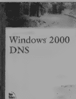

作者：Herman Knief, Jeffrey Graham, Andrew Daniels 和 Roger Agell

第二版

480 页，$39.99

ISBN: 0-7357-0973-4

## Windows 2000 专业版


作者：Jerry Honeycutt

第一版

330 页，$34.99

ISBN: 0-7357-0950-5

Windows 2000 专业版探索了企业网络和互联网上的可用可用。本书直接面向高级用户，他们重视 NT 的安全性、稳定性和网络能力，同时也追求 Windows 9X 用户界面的易用性和熟悉感。本书涵盖了用户和管理主题，并增加了关于连接的联网内容。

《Windows 2000 DNS》专注于诸如设计和保护 DNS 服务（为了互操作性）、安装和使用 DHCP 及 WINS 服务等主题，是微软最新版本 DNS 的全面指南。作者为您提供了在设计和管理 DNS 以获得最佳性能时将需要的实战建议、最佳实践和策略。

## Windows 2000 规划

作者：Eric K. Cone, Jon Boggs, 以及 Sergio Perez

第一版

448 页，$29.99

ISBN: 0-7357-0048-6

你准备好迎接 Windows 2000 吗？这本书解释了为你的基于 NT 的异构网络准备 Windows 2000 所需的步骤。作者根据自己的经验和场景详细介绍了部署程序，并阐述了一系列原本错综复杂的流程。对于任何考虑迁移的人来说，《Windows 2000 规划》都是不可或缺的伴侣。

## Windows 2000 安全

作者：Roberta Bragg

第一版

500 页，$39.99

ISBN: 0-7357-0991-2

对于严肃的网络系统管理员来说，不存在单一的安全权威。该书的主要旨要是帮助 Windows 网络专业人员在其组织内实施 Windows 2000 安全。书中包含了“最佳实践”，对设置和安全实践提出了建议。

## Windows 2000 专业版参考指南

作者：Karanjit Siyan, Ph.D.

第三版

1848 页，$75.00

ISBN: 0-7357-0952-1

《Windows 2000 专业版参考指南》是 Windows 2000 相关参考书籍中的基准。虽然其他书籍带你了解产品的设置和实施阶段，但没有其他书籍能为用户提供日常管理问题和任务的详细解答。实的内容展示了管理员如何管理、排除并修复特定的异构 Windows 网络问题，以及互联网功能和特性。

## Windows NT/2000 网络安全

作者：Eugene Schultz

第一版

440 页，$45.00

ISBN 1-57870-253-4

《Windows NT/2000 网络安全》提供了一个框架，以促进真正理解 Windows 安全模型及相关能力。目标是让读者熟悉在点对点和客户端/服务器设置中使用 Windows 时的主要的安全暴露类型。本书教授了针对每种暴露的具体安全控制和设置，并展示了如何评估权衡以决定应用哪些（如果有的话）措施。

## Windows NT/2000 终端客户端解决方案

作者：Todd Mathers

第二版

840 页，$45.00

ISBN: 1-57870-239-9

这本书是 MetaFrame 1.8 和 Terminal Server 版本的实用且全面的参考书，它应该是解决 TSE/MetaFrame 平台上棘手问题的首选来源。在前版质量的基础上，书中还包含了在 Windows 2000 Server 上额外安装 Terminal Services 和 MetaFrame，以及关于 TSE 管理、远程访问和应用程序集成的章节。


## Windows 2000 Active Directory 设计与部署

作者：Gary Olsen

第一版

648 页，$45.00

ISBN: 1-57870-242-9

本书专注于 Windows 2000 Active Directory 环境的设计，以及如何制定有效的设计和迁移计划。读者将通过审查每个相关问题，引导完成制定设计计划的过程，并就如何根据读者的特定环境评估每个问题提供专家建议。实用的案例说明了所有这些问题。


## Windows 2000 Active Directory

作者：Thaddeus

第一版

350 页，$45.00

ISBN: 1-57870-246-1

由于对分布式劳动力的持续推动，管理员必须在安全网络中支持笔记本用户、家庭办公室等更多需求。Windows 2000 Active Directory 与任何其他系统都不同。除了 VPN，还涵盖了影响 Active Directory 的新功能。

## Windows 2000 与大型机集成

作者：William Zack

第一版

390 页，$40.00

ISBN:1-57870-20-3

《Windows 2000 与大型机集成》为计算专业人员提供了将 Windows 2000 构建并集成到其环境中的实用知识。

## Windows 2000 服务器：规划与迁移

作者：Sean Scully

第一版

480 页，$40.00

ISBN:1-55780-11-5

## Windows Power Toolkit

作者：Stu Sjouwerman 和 Ed Titel

第一版

848 页，$49.99

ISBN: 0-7357-0922-X

《Windows 2000：规划与迁移》可以迅速为 NT 专业人员节省数千美元和数百小时。该书包含了 Windows 2000 关键功能的权威信息，并对如何最好定位你的 NT 网络提出了建议。

这本由 New Riders 出出的独特著作涵盖了 Windows NT 服务器和 Windows 工作站 4.0 的分析、调优、优化、自动化、增强、维护和故障排除。NT Power Toolkit 包含了所有和服务的安全更新、IE5 升级问题、近期产品新增以及第三方工具和程序。

## Windows 2000 服务质量

作者：David Eisinger

第一版

264 页，$45.00

ISBN:1-55780-11-5


随着网络流量持续增加，网络基础设施和可用资源的压力也随之增大。Windows 2000 服务教授网络工程师和管理员如何定义流量控制模式并利用网络带宽。

## Windows NT Terminal Server 和 Citrix MetaFrame

作者：Ted Harold

第一版

46 页，$29.99

ISBN: 1-56205-944-0


本技术参考书详细介绍了 Microsoft Terminal Server 和 Citrix MetaFrame 系统的规划、安装、管理和故障排除。MetaFrame 极大增强了 NT 作为客户端客户端解决方案的可用性，但其集成涉及的异构网络问题将成为信息获取的重大痛苦。《Windows NT Terminal and Citrix Metaframe》是关于该技术仅有的两本书之一。

# Windows NT/2000 Native API 参考

作者：Gary Nebbett

第1版

528页，$50.00

ISBN: 1-57870-199-6


这是本关于 Windows NT 原生 API 函数的完整参考书，涵盖了 Windows NT 为内核态和用户态程序提供的服务集。内容包括 NT API 中包含的210 个例行的文档，以及将在 Windows 2000 中添加的函数。书中涵盖了那些无法通过 Win32 API 直接访问或未提供极其详尽功能的路由。NT 内核提供的服务（主要是对调试模式应用程序的支持）也被在内。

# DCE/RPC over SMB：Samba 与 Windows NT 域

作者：Luke Leighton

第1版

312页，$45.00

ISBN: 1-57870-150-3


安全人员、系统和网络管理员以及以及为所有人编写工具的人士，都需要熟悉流经其网络的数据包。此书由 Samba 团队的核心成员编写，描述了微软如何采用 DCE/RPC 并实现在 SMB 和 TCP/IP 之上。

作者：Eric Harmon

第1版

500页，$45.00

ISBN: 1-57870-221-6


《Delphi COM 编程》适用于所有 Delphi 3、4、5 程序员。在让读者理解 COM 框架后，该书对 COM 进行了实用的探索，使开发者能够编写基于组件的应用程序。涵盖了典型的真实世界场景，如 Shell 编程、自动化 Microsoft Agent 以及创建和使用 ActiveX 。每个主题的讨论都通过详细示例进行了说明。

# Windows NT 设备驱动程序开发

作者：Peter Viscarola 和 W. Anthony Mason

第1版

704页，$50.00

ISBN: 1-57870-058-2


本书从介绍与驱动程序相关的 Windows NT 操作系统通用概念开始，然后进入关于系统的更详细信息，例如中断管理、同步问题、I/O 子系统、标准内核态驱动程序等。

# Windows NT 应用：性能测量与优化

作者：Paul Hinsberg

第1版

288页，$40.00

ISBN: 1-57870-176-7

# Exchange & Outlook：构建协作解决方案

作者：Joel Seminuk 和 Duncan McKenzie

第1版

576页，$40.00

ISBN: 1-57870-252-6

本书提供了对 Windows NT 底层结构的关键见解，以及用于测量和最终优化代码性能的方法和工具。

本书的作者负责为全球一些财富 100 强企业公司构建自定义消息应用程序。他们分享了自己的专业知识，帮助管理员使用微软技术为他们的消息系统建立基础，并规划有助于构建这些协作解决方案的工具。书中包含了实际计划和设计方案，以及典型的工作流/协作解决方案。

# 应用 COM+

作者：Gregory Brill

第1版

450页，$49.99

ISBN: 0-7357-0978-5


通过将多个独立系列整合到一个统一的技术中，COM+ 为创建在 Windows 2000 系统上运行的应用程序（无论是企业还是商业软件）的开发者带来了更高效率和更多化能力的承诺。《应用 COM+》涵盖了这一新工具的功能，以及如何在真实的案例研究中实现它们。在 Windows 环境下使用的三种主要语言（C++、VB 和 VJ++）中演示了这些功能。

# Windows 脚本主机

作者：Tim Hill

第1版

448页，$35.00

ISBN: 1-57870-139-2


Windows 脚本主机是关于这一强大工具的第一批书籍之一。本文侧重于系统脚本和使用 VBScript 语言，使用对象、服务器脚本片段和即插用的脚本解决方案。

# Windows NT Shell 脚本

作者：Tim Hill

第1版

400页，$32.00

ISBN: 1-57870-047-7


作为 Windows 脚本的完整参考书，本书指导你进行高层操作。

# Win32 编程：标准

作者：Dave Roth

第1版

640页，$40.00

# Active Directory 脚本

作者：Thomas Eck

第1版

700页，$45.00

# Windows NT 部署与自定义

作者：Richard Puckett

第1版

300页，$32.00

# SMS 2 管理

作者：Darshan Doshi 和 Mike Lubanski

第1版

448页，$39.99

# Internet 服务管理

作者：Kelli Adam

第1版

192页，$29.99


# SQL Server 7 参考指南

作者：Sharon Dooley

第1版

400页，$35.00

熟悉以前版本 IIS 的管理员需要此书来详细说明如何配置新协议、使用证书服务器验证身份，以及实施新的电子商务功能。本书提供了所有这些：既可以快速阅读，也可以作为便携式参考。

《SQL Server 7 参考指南》是使用 SQL Server 开发的方法和技术的全面指南。特别地，书中讨论了用于内网、外网或 Internet 用户应用程序的大型应用开发技术。每个章节都包含了每个组件如何开发并集成到真实应用中的细节。

# SQL Server 系统管理

作者：Sean Baird 和 Chris Miller 等

第1版

352页，$29.99

ISBN: 1-56205-955-6

# 开源

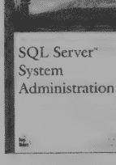

# MySQL

作者：Paul Dubois

第1版

800页，$49.99

ISBN: 0-7357-0921-1


假设读者熟悉数据库管理的基础，并以某种方式工作过 SQL Server，本书关注大多数管理员感兴趣的话题：保持数据对用户持续可用。与其他与严肃 SQL Server DBA 几乎没有关联的 SQL 书不同，《SQL Server 系统管理》提供了一种在其他地方找不到的实战方法。

《MySQL》教导读者如何使用 MySQL 提供的工具进行安装、设置、日常使用、安全、优化、维护和故障排除。它还讨论了重要的第三方工具，例如提供 MySQL 访问的 Perl DBI 和 Apache 接口。

# 使用 PHP 4.0 进行 Web 应用开发

作者：Till Gerken 等

第 1 版

416 页，$39.99

ISBN: 0-7357-0997-1

《使用 PHP 4.0 进行 Web 应用开发》解释了高级语法，包括递归函数和变量。作者们介绍了软件开发方法论和编码规范，这些是工业级优质产品必须具备的知识，并让软件开发更快速、更高效。书中涵盖了 Web 应用程序的内容，并对用户和会话管理、电子商务系统、XML 应用以及 WDDX 深入解析。

# Python 核心参考

作者：David Beasley

第 1 版

352 页，$34.99

ISBN: 0-7357-0901-7

避开了枯燥的学术化方法，《Python 核心参考》的目标是简洁地描述这种编程语言及其标准模块库（统称为 Python 编程环境）。本非正式参考书涵盖了 Python 的词法规范、数据类型、控制流、函数、语句、类和执行方法——对于任何 Python 程序员来说，这都是一份真正核心的参考书！

# PHP 函数核心参考

作者：Landon Bradshaw, Till Gerken, Graeme Merrill  way Tobias Ratschler

第 1 版

$35.00

500 页，ISBN: 0-7357-0970-X

2001年2月

这本精心编写的著作涵盖了直到 PHP 4.0 的最新进展，包括对 Zend 的介绍。这些作者不仅分享了关于 PHP 开发的知识，还分享了他们日常如何使用它来创建动态 Web 网站。书中还涵盖了配合 MySQL 使用 PHP 的指导说明。

# GNU Autoconf, Automake 和 Libtool

作者：Gary V. Vaughan 等

第 1 版

400 页，$40.00

ISBN: 1-57870-190-2

本书由这些工具的社区领军人物和当前维护者共同编写，教导开发者如何使用 GNU Autoconf、Automake 和 Libtool 来提高他们的生产力和应用程序的可移植性。

# Linux/UNIX

## Linux 系统管理

作者：M Carling, James T. Dennis way Stephen Degler

第 1 版

368 页，$29.99

ISBN: 1-56205-934-3

## Linux 核心参考

作者：Ed Petron

第 1 版

368 页，$24.95

ISBN: 0-7357-0852-5

本书旨在通过提供丰富的可用 Linux 信息来帮助读者完成任务。书中提供了关于如何执行管理和维护任务的清晰、简洁的指令，并介绍了如何使用一些更强大的命令和高级主题。《Linux 核心参考》的范围包括实现最常用命令的最佳方法、管理您的系统以及利用有效的安全措施。

当今负荷过载的系统正在寻找方法来保持网络平稳运行并增强性能。用户总是在寻找更多的存储、更多的服务和更高的速度。《Linux 系统管理》引导读者应对维护安全、稳定系统的许多复杂细节。

## Linux 防火墙

作者：Robert Ziegler

第 1 版

496 页，$39.99

ISBN: 0-7357-0900-9

## UnixWare 7 系统管理

作者：Gene Henriksen and Melissa Henriksen

第 1 版

560 页，$40.00

ISBN: 1-57870-080-9

本书详细介绍了小型非企业业务可能采取的保护系统安全步骤。这些步骤包括数据包级防火墙过滤、IP 伪装、代理、tcp wrappers、系统完整性检查以及系统安全监控，并总体侧重于过滤和保护。《Linux 防火墙》的目标帮助人们快速部署互联网安全措施，而无需成为安全或防火墙领域的专家。

本书以极其详尽的技术细节介绍了 SCO UnixWare 的最新版本，是 SCO 工程师和管理员的终极操作系统资源。书中贯穿了了故障排除笔记和技巧，专为那些熟悉其他 UNIX 变体的人士设计。

# 使用 GTK+ 和 GDK 开发 Linux 应用

作者：Eric Harlow

第 1 版

512 页，$34.99

ISBN: 0-7357-0021-4

## KDE 应用开发

作者：Uwe Thiem

第 1 版

190 页，$39.99

ISBN: 1-57870-201-1

本手册面向迁移到 Linux 平台的开发者以及使用 GTK+ 库（包括使用 C 语言的 Gdk）的开发者。书中开发的所有应用均已 GPL 发布。《KDE 应用开发》为学习 KDE 和 Qt 提供了一个起点，并涵盖了 KDE 和 Qt 中提供的基础组件，避免了“初次尝试”时的困扰。

# GTK+/Gnome 应用开发

作者：Hav Pennington

第 1 版

528 页，$39.99

ISBN: 0-7357-0078-8

超过一百万的用户也是开发者。《GTK+/Gnome 应用开发》为程序员提供了使用流行的 GTK+ 工具包开发应用程序的知识。它包含了针对经验丰富的用户的参考信息，他们已经熟悉用法，但需要函数原型和详细描述。

# 深入理解 GIMP

作者：Carey Bunks

第 1 版

342 页，$45.00

ISBN: 0-7357-0924-6

《深入理解 GIMP》是一本涵盖 GIMP 功能复杂性的技术参考书。这些材料让读者能够快速上手，并开始使用 GIMP 创建出色的图形。书中还附赠了完全用于高级特效的逐步步骤功能介绍。

# GIMP 核心参考

作者：Alex Harford

第 1 版

400 页，$24.95

ISBN: 0-7357-0911-4

随着 Linux 使用的日益普及，GIMP 的使用量也在增加。许多 Photoshop 用户开始使用 GIMP，它因其强大和多功能性而受到认可。考虑到这一点，《GIMP 核心参考》为 Photoshop 用户提供了快捷键指南，并将该程序的力量交到读者的手中。

# Solaris 高级系统管理员指南

作者：Janice Windsor

第 2 版

587 页，$39.99

ISBN: 1-57870-039-6

本权威教程提供了不可或缺的提示、建议和快速参考表，用于添加系统组件、改进服务访问以及自动化常规任务；书中还包含了关于 Solaris 2.6 主题的更新信息。

# 网络

# Cisco 路由器配置与故障排除

作者：Mark Tripod

第 2 版

330 页，$39.99

ISBN: 0-7357-0999-8

这是一本为需要配置和维护 Cisco 路由器以及运行新硬件的网络和系统管理员提供的参考书。通过提供建议和最佳实践而非仅仅是 Cisco 文，本书为网络专业人员提供了今天就可以使用的内容。

# Solaris 系统管理员指南

作者：Janice Windsor

第 2 版

324 页，$34.99

ISBN: 1-57870-040-X

本书旨在既作为实用的教程，又作为快速参考，为 UNIX 管理员提供了 Solaris 最频繁任务的完整、详细描述。学习如何利用 Solaris 的功能来满足用户需求，并获取如何简化管理get建议。

# 了解目录服务

作者：Beth Sheresh

第 1 版

390 页，$39.99

ISBN: 0-7357-0910-6

《理解目录服务》为读者提供了关于目录服务的基础知识：它们是如何设计的，以及它们能为 IT 基础设施提供什么功能。通过将技术置于背景中并帮助人们理解目录是什么、不能是什么，本书为爆发式发展的目录服务市场提供了一个框架。

## 理解网络：互联网互联实用指南


作者：Michael Martin

第 1 版

690 页，$39.99

ISBN: 0-7357-0977-7

《理解网络》以实用的术语面向读者，并以逐步步进的形式描述了构建高可用网络最核心的信息和工具。每一章都可以作为独立的章节来阅读，但书中的内容层层递进，最终总结了构建广域网所需的本质概念。

这篇关于 LDAP 标准的概述讨论了其与互联网工程任务组（IETF）的创建和历史，以及原始的 RFC 标准。LDAP 还涵盖了合规性趋势、C++ 实现、数据包处理、客户端/服务器职责等内容。

## LDAP：编程目录支持的应用程序


作者：Tim Howes 和 Mark Smith

第 1 版

480 页，$44.99

ISBN: 1-57870-000-0

## 理解数据通信


作者：Gilbert Held

第 6 版

620 页，$39.99

ISBN: 0-7357-0036-2

## 目录支持网络


作者：John Strassner

第 1 版

752 页，$50.00

ISBN: 1-57870-140-6

《目录支持网络》是关于 DEN（目录支持网络）设计和使用的综合资源。本书在详细介绍构建新类网络应用理论的同时，提供了实用的示例，这些应用将解决网络问题。DEN 是网络架构师、管理员和应用开发者的关键工具。

## 千兆以太网网络

作者：David Cunningham 和 Bill Lane

第 1 版

560 页，$50.00

ISBN: 1-58780-062-0

千兆以太网是大多数已安装网络速度提升的一步。探索这项技术如何允许高带宽应用，例如电话和数据服务的集成、实时应用、客户端应用（如 Windows NT 终端服务器）以及企业会议。

## 局域高速网络

作者：Dr. Sidnie Feit 博士

第 1 版

665 页，$50.00

ISBN: 1-58780-113-9

局域网正在发生巨大的变化。随着 Web 内部网将带宽推向极限，廉价的以太网 NIC 和交换机已进入市场。因此，许多网络专业人员对评估这些新技术的实施情况感兴趣。本书提供了这些技术的真实实验结果，包括跟踪数据，以便使用户能够现实地比较并决定如何使用它们。

## 在 IP 网络上支持服务级别协议

作者：Dinesh Verma

第 1 版

270 页，$50.00

ISBN: 1-58780-146-5


《在 IP 网络上支持服务级别协议》是网络工程师和架构师的重要资源，它将帮助你构建支持多种服务的网络。学习如何在尽力为（best-effort）和 DiffServ/IntServ 网络中使用现成组件创建 SLA 解决方案。学习作为客户或网络服务提供商如何验证 的 的，并使用 SLA 支持 IPv6 网络。

## 广域高速网络

作者：Dr. Sidnie Feit 博士

第 1 版

624 页，$50.00

ISBN: 1-58780-114-7

网络正处于广域服务和新技术的过渡阶段。本书介绍了当前和新兴的广域技术与服务，使它们易于理解，并将其视角化，使其优缺点一目了然。

## 互联网差异化服务

作者：Kalevi Kilkki

第 1 版

400 页，$50.00

ISBN: 1-57870-132-5

本书为网络架构师、工程师和经理对差异化服务的持续发展提供了关键洞察。它探讨了网络环境的特殊需求，以及在实施过程中必须考虑的问题。涵盖范围允许网络工作人员在多种网络技术上实现 DiffServ，包括 ATM、UDP 以及与 TCP 等其他网络协议相关的常见问题。

## 路由与交换架构设计

作者：Howard Berkowitz

第 1 版

500 页，$45.00

ISBN: 1-57870-059-0

网络设计专业人员面临的最大挑战之一是让用户、服务器、打印机和其他资源在网络上可见。该书为网络工程师或架构师提供了一套系统的方法论，用于规划用户和服务器所处的广域网和局域网“街道”。

## IP 网络中的服务质量

作者：Greenville Armitage

第 1 版

310 页，$50.00

ISBN: 1-57880-151

《IP 网络中的服务质量》探讨了 QoS 的各种问题，并使其清晰可见。该书为网络工程师或架构师提供了一套系统的方法论，用于规划用户和服务器所处的广域网和局域网“街道”。

## 理解并部署目录服务

作者：Tim Howes, Mark Smith 和 Gordon Good

第 1 版

850 页，$50.00

ISBN: 1-57870-070

《理解并部署目录服务》为读者提供了关于 SLA 的深度见解。它涵盖了网络环境的具体需求以及实施时必须考虑的问题。书中充满了实用的建议，帮助读者选择最适合其组织的路径。


## 交换式、快速与千兆

作者：Sean Riley, Robert B

第 3 版

615 页，$50.00

《交换式、快速与千兆以太网》第三版是理解和实施交换式、快速和千兆以太网的一站式指南。它提供了当前和未来的交换式、快速和千兆技术的全面概述。

## DHCP 手册

作者：Jim Geier

第 1 版

535 页，$50.00

ISBN: 1-57870-036

《DHCP 手册》是 DHCP 的权威指南。它涵盖了与 DHCP 相关的广泛内容，包括认证、运营考虑和标准化。


## 局域网：互操作性网络

作者：John F. Thompson

第 1 版

432 页，$50.00

ISBN: 1-57870-081

《局域网：互操作性网络》提供了 802.11 标准的全面概述。

# 网络入侵检测：分析师手册

作者：Steve Northcott 和 Judy Novak

第 2 版

480 页，$45.00

ISBN: 0-7357-1008-2

# Lotus Notes & Domino 核心参考指南

作者：Dave Hatter 和 Tim Bankes

第 1 版

675 页，$45.00

ISBN: 0-7357-0007-9

如果您需要提升自己的创意和技术能力——即为了完善您的 Lotus Notes 和 Domino 编程——那么这本书正是适合您的选择。如果您从事 Lotus Notes 和 Domino 工作，该书包含了所有的对象、类、函数和方法。它展示了对象层次结构以及每个对象之间的覆盖关系，并按照语言的设计方式进行组织。

从身经实战的专家那里获取答案和解决方案。Steve Northcott 是 Shadow 入侵检测系统的原始开发人员，曾任美国海军信息安全办公室主任，他为入侵检测专家、安全分析师和顾问提供专业知识，帮助他们建立并维护针对网络攻击的有效防御。

# Domino 系统管理

# 软件架构与工程

作者：Rob Kirkland

第 1 版

860 页，$49.99

ISBN: 1-56205-948-3

# 使用 UML 设计灵活的面向对象系统

作者：Charles Richter

需要关于 Domino 新特性的简洁实用的解释，以及如何让某些高级功能真正发挥作用？《Domino 系统管理》是第一本从专业水平研究该技术的书籍，提供了实用的实操帮助，帮助您在组织中运行 Domino 5。

《使用 UML 设计面向对象系统》详细介绍了一种用于设计面向对象程序的符号系统。本书遵循开发人员可能采用的顺序，从使用 UML 用例图和活动图分析问题需求开始。随着作者将初始图表转换为类图和交互图，书中将向读者展示各种改进设计的方法。

# 构建卓越软件

作者：Paul Clements 等

第 1 版

285 页，$40.00

ISBN: 1-57870-147-3

本书与德克萨斯大学奥斯汀分校的软件质量研究所合作出版，介绍了一套实现成功软件解决方案的基础工程策略，并提供了实用的建议以确保开发项目处于正确的方向。软件设计人员和开发经理可以提高软件的开发速度和质量，并改进开发过程中流程。

# UML 模式语言

作者：Paul Evitts

第 1 版

260 页，$40.00

ISBN: 1-57870-118-X

其他书籍仅关注 UML 符号，而这本书集成了关键的 UML 建模概念并通过模式说明了其用法。它对 UML 和模式提供了综合、实用且循序渐的讨论，并以真实案例说明了经过证明的软件建模技术。

# New Readers Press 的其他书籍

## 微软技术管理

| 标题 | ISBN | 价格 |
| :--- | :--- | :--- |
| Windows 2000 内部 | 1-5605-927-6 | $49.99 |
| Delphi 编译编程 | 1-5870-221-6 | $45.00 |
| XML 内部 | 0-7357-1020-1 | $49.99 |
| XML 内部 | 0-7350-08X-35 | $39.99 |
| Windows NT ：维护与更新 | 1-5870-176-7 | $40.00 |
| Windows NT | 0-7357-1034-1 | $39.99 |
| Windows 2000 活动目录 | 0-7357-0961-3 | $34.99 |
| 应用 COM | 1-5870-233-5 | $45.00 |

## LINUX/UNIX 管理

| 标题 | ISBN | 价格 |
| :--- | :--- | :--- |
| Windows 2000 运行与远程服务器 | 0-7357-0961-3 | $34.99 |
| 可用工具 | 1-5870-233-5 | $45.00 |
| Linux 网络：TCP/IP 实用指南 | 0-7357-1031-7 | $39.99 |
| Windows 2000 部署与管理 | 0-7357-0961-3 | $34.99 |
| Windows 脚本主机 | 1-5870-192-5 | $35.00 |
| Windows 2000 DNS | 0-7357-0942-0 | $39.99 |
| 可视 Windows 脚本 (VIM) | 0-7357-0975-0 | $34.99 |
| Windows 2000 用户管理 | 1-5870-047-2 | $32.00 |
| 活动 Perl 编程 | 0-7357-1001-5 | $49.99 |
| Windows 2000 专业版 | 0-7357-0961-3 | $34.99 |
| Linux 系统管理 | 0-7357-0950-0 | $39.99 |
| Linux 基础 | 1-5625-9943-3 | $39.99 |
| Windows Windows | 0-7357-0048-6 | $29.99 |
| Shell 脚本 | 1-5870-012-2 | $32.00 |
| Win 脚本：管理员手册 | 1-5870-221-5 | $35.00 |
| Windows 2000 参考版 | 0-7357-0961-3 | $34.99 |
| Windows 2000 安全 | 0-7357-0961-3 | $34.99 |
| 使用 GTK+ 和 GIMP 开发 Linux | 0-7357-1034-1 | $39.99 |
| KDE/Gnome 应用开发 | 0-7357-1008-5 | $39.99 |
| KDR 应用开发 | 1-5870-2071-5 | $39.99 |
| Windows 2000 瘦客户端 | 1-5625-9943-3 | $39.99 |
| Windows 2000 私有网络 | 1-5625-9943-3 | $39.99 |
| Windows 2000 活动目录与开发 | 1-5625-9943-3 | $39.99 |

## SOLAR

| 标题 | ISBN | 价格 |
| :--- | :--- | :--- |
| SQL Server 2007 参考版 | 1-5870-2211-6 | $49.99 |
| Solaris 管理 | 0-7357-1020-1 | $39.99 |
| Exchange Server 2000 | 0-7357-1029-4 | $49.99 |
| Solaris 管理员指南，第 2 版 | 0-7357-1018-X | $39.99 |
| PHP 服务器参考 | 1-5870-0991-1 | $49.99 |
| Solaris 系统管理 | 1-5870-233-5 | $45.00 |
| 可用 Perl 参考 | | |

## WEB 设计与开发

| 标题 | ISBN | 价格 |
| :--- | :--- | :--- |
| 使用 PHP 4.0 开发 Web 应用 | 1-5870-0791-1 | $49.99 |
| Cisco 路由器配置与故障排除，第 2 版 | 0-7357-0998-4 | $49.99 |
| PHP 参考 | 1-5870-0991-1 | $39.99 |
| 理解服务：互联网协议实用指南 | 0-7357-0777-9 | $39.99 |
| 理解数据通信，第 6 版 | 0-7357-1018-X | $39.99 |

## 开源

| 标题 | ISBN | 价格 |
| :--- | :--- | :--- |
| 可用性设计 | 1-5625-1035-0 | $39.99 |
| LDAP：编程、目录应用程序 | 1-5870-0444-7 | $49.99 |
| DNS 服务器 3 | 1-5870-441-1 | $39.99 |
| 千兆以太网络 | 1-5870-062-0 | $50.00 |
| Fluke 网络 | 1-5870-1098-4 | $49.99 |
| 服务等级协议 | 1-5870-146-5 | $50.00 |
| 创建网站，第 2 版 | 1-5870-435-1 | $49.99 |
| 网站秘密 | 1-5870-382-3 | $39.99 |

## 系统编程

| 标题 | ISBN | 价格 |
| :--- | :--- | :--- |
| Windows NT/2000 原生 API | 1-5870-1594-4 | $50.00 |
| 真实世界代码：结构化编程技术 | 0-7320-0721-9 | $49.99 |
| Exchange：构建解决方案 | 1-5870-252-6 | $40.00 |
| 2001年5月可用 | 1-5870-104-60 | $50.00 |
| 互联网差异化服务 | 1-5870-068-57 | $50.00 |
| 基于策略的网络 | 1-5870-077-40 | $50.00 |
| IP 网络服务质量 | 1-5870-206-52 | $50.00 |
| 架构设计 | 1-5870-059-40 | $50.00 |
| 循环策略 | 1-5870-071-50 | $50.00 |
| 无线以太网，第 3 版 | 1-5870-027-62 | $50.00 |
| 无线局域网 | 1-5870-055-53 | $50.00 |
| 广域网 | 1-5870-033-75 | $50.00 |
| DHCP 手册 | 1-5870-137-66 | $50.00 |
| 企业网络路由与交换架构设计 | 1-5870-245-02 | $50.00 |
| 局域网 | 1-5870-267-99 | $50.00 |
| 安全电子商务 | 1-5870-019-44 | $50.00 |

## WEB 编程

| 标题 | ISBN | 价格 |
| :--- | :--- | :--- |
| Windows NT/2000 驱动 | 1-5870-2353-3 | $49.99 |
| Windows NT 开发 | 1-5870-1550-1 | $45.00 |
| DCE/RPC over Samba：Windows 与网络集成 | | |

## 安全

| 标题 | ISBN | 价格 |
| :--- | :--- | :--- |
| 入侵检测理解关键基础设施手册，2E | 1-5870-045-10 | $45.00 |
| 入侵检测：分析师指南 | 1-5870-093-11 | $39.99 |
| Linux 防墙与安全 | 1-5870-103-65 | $39.99 |

## LOTUS NOTES/DOMINO

- Domino 管理指南 | 1-5870-066-58 | $45.00
- Lotus Notes 和 Domino 参考 | 1-5870-003-77 | $45.00

## 职业认证指南

| 标题 | ISBN | 价格 |
| :--- | :--- | :--- |
| MCSE 训练：网络基础，第 2 版 | 1-5870-045-39 | $49.99 |
| MCSE 训练：Windows Server 4，第 2 版 | 1-5870-065-55 | $49.99 |
| MCSE 训练：Windows NT 工作站，第 2 版 | 1-5870-040-40 | $49.99 |
| MCSE 训练：Windows NT 4 版 | 1-5870-017-57 | $49.99 |
| MCSE 训练：核心考试，第 2 版 | 1-5870-026-51 | $49.99 |
| MCSE 训练：TCP/IP，第 2 版 | 1-5870-032-33 | $49.99 |
| MCSE 训练：SQL Server 2000 架构 | 1-5870-004-94 | $49.99 |
| MCSE 训练：SQL Server 2005 4-in-1 版 | 1-5870-002-97 | $49.99 |
| MCSE 训练：解决方案架构 | 1-5870-027-66 | $49.99 |
| MCSE 训练：认证指南，第 2 版 | 1-5870-068-85 | $49.99 |
| MCSE 训练：网络认证指南，2001年可用 | 1-5870-037-77 | $49.99 |
| Solaris 2.6 管理员认证指南 | 1-5870-085-8X | $40.00 |
| Solaris 2.7 管理员认证指南，第一部分和第二部分 | 1-5870-249-64 | $49.99 |
| MCSE 训练：Windows 2000 专业版 | 0-7357-096-3 | $49.99 |
| MCSE 训练：Windows 2000 服务器 | 0-7357-075-6 | $49.99 |
| MCSE 训练：Windows 2000 网络基础设施 | 0-7357-074-X | $49.99 |
| MCSE 训练：Windows 2000 安全 | 0-7357-098-3 | $49.99 |
| MCSE 训练：Windows 2000 目录服务 | 0-7357-097-9 | $49.99 |
| MCSE 训练：Windows 2000 考试指南 | 0-7357-028-5 | $49.99 |

# 如何联系我们

## 访问我们的网站

`www.newriders.com`

在我们的网站上，您可以找到关于我们其他书籍、作者、目录、索引和书籍勘误的信息。您还会找到关于书籍注册以及如何购买我们书籍的信息。

## 电子邮件联系我们

请通过此地址与我们联系：

`nrfeedback@newriders.com`

- 如果您对本书有任何意见或问题
- 报告您在书中发现的错误
- 如果您有投稿需要提交，或有兴趣为 New Riders 写作
- 如果您希望收到作者包（author kit）
- 如果您是计算机主题或技术专家，并有兴趣担任技术编辑以审查稿件的技术准确性
- 如需查找您所在地区的分销商，请通过此地址联系我们的国际部门。

`nmedia@newriders.com`

- 针对希望预览 New Riders 书籍以供课堂使用的教育机构讲师。请通过电子邮件发送您的姓名、职称、学校、部门、地址、电话号码、办公日期/时间、使用的教材和入学人数，以及您对样书/考试用书和或额外信息的请求。
- 针对有兴趣评审 New Riders 书籍副本的媒体成员。请发送您的姓名、邮寄地址和电子邮件，以及您工作的出版物或网站名称。

## 批量购买/企业销售


如果您兴趣购买 10 本或更多版本的书籍，或想为您的公司建立账户以通过大幅折扣直接从出版社购买，请拨打 800-382-3419 或将您的联系信息通过电子邮件发送 corpsales@pearsontechgroup.com。销售代表将与您联系提供更多信息。

### 写信联系我们

New Riders Publishing

201 W. 103rd St.

Indianapolis, IN 46290-1097

### 电话联系我们

免费热线 (800) 571-5840 + 9 7477

美国境外拨打 (317) 581-3500。请找 New Riders。

### 传真联系我们

(317) 581-4663

# 来自您熟悉并信任的专家提供的解决方案。

www.informit.com

New Riders 已与 InformIT.com 合作，将技术信息带到您的桌面。通过借鉴 New Riders 作者和审稿员对您感兴趣的主题提供的额外信息，InformIT.com 提供了在其他任何地方找不到的免费深度信息。

- 在您需要的时候掌握您所需的技能
- 借助行业内一些顶尖人才的资源
- 使用 InformIT 的综合库或在线专家，在您需要时获得答案
- 超越在 New Riders 书籍中发现的内容，扩展您的知识

# 专家接入。免费内容。


InformIT www.informit.com www.newriders.com New Riders

New Riders 的书籍通过提供关于核心技术的详细且以解决方案为导向的信息，针对计算机专业人士的独特需求。我们首先与具有独特深度经验并能够切中从业专业人士需求的作者合作。随后，每本书都会在所有阶段经过仔细审查，以确保它们以深度涵盖最核心的主题，具有极高的准确性，并考虑了易用性。这些审查不仅确保了材料在技术上是可靠，还确保了它们持续提供您真正可以使用的信息和建议。您手中的这本书是专为您这位从业者打造的，具有准确的信息和可靠的建议、合适的深度以及极具吸引力的价值。我们将作者的知识和同行审稿员的实战经验整合到一种易于阅读、易于使用的格式中。

# 无论您的问题是什么……New Riders 都有答案。


我们知道获取核心技术的详细、以解决方案为导向的信息有多么。里程碑系列书籍（Landmark books）包含了您解决技术问题所需的关键信息。我们的里程碑书籍由专家编写，并经过严格的同行评审和技术审查，是像您这样的从业者的硬核资源。


为明智用户提供的智慧和知识。书中的内容是对技术有趣且敏锐的观察，由那些能够预判您的状况并根据多年经验提供智能建议的人编写。这些书籍以作者为驱动，并采取了务实高效的方法，正是您对 New Riders 的期望。


《必备参考书》（Essential Reference books）为各种核心技术提供解决方案——快速修复、快捷方式、属性、命令选项、类描述。选择 Essential Reference 系列中的一本书即可了解我们的意思。每本书都是根据您的需求构建的，且每本书都是独特的。唯一的共同点是它们具有解决您最大头疼问题的能力。

# TCP/IP 网络指南

TCP/IP 是目前使用的主要网络协议。它是互联网的基础，并提供了计算机共享文件和服务的。。虽然有很多 TCP/IP 的书籍，但没有哪一本提供了针对 Linux 平台的实操实现规范。

《Networking Linux: A Practical Guide to TCP/IP》超越了概念层面，逐步展示了必要的知识方法。

Pat Eyer 自 1988 年以来一直致力于 TCP/IP 和 UNIX，并在 Linux 方面曾在波音和 Ameritech 担任过网络分析师、管理员和工程师。他曾在飞利浦和富达担任过系统管理员。他曾在美国研究小组和美国陆军教过系统管理课程。最近，他参与了为“实体加网络”（clicks and mortar）和“.com”公司的电子商务和 Web 开发提供支持。Pat 还为公司、用户组和普通公众编写过关于 Linux/Unix、Shell 脚本和网络的材料。他一些最优秀的作品发表在《Linux Gazette》上。Pat 设计并管理了支持从小型/家庭办公室到多个网络的 LAN 和 WAN。他最喜欢的网络是家里的网络，他正忙于教他在家自学的孩子使用 Linux 而不是那个其他操作系统。

如果您是需要理解 Linux 平台上的 TCP/IP 网络的开发者或管理员，可以使用这本书获得：

- 对 TCP/IP 协议栈的描述
- 关于 TCP/IP 每一层的信息
- 网络管理简介
- 提高您的网络管理技能的技巧
- 介绍几种用于网络管理的关键工具，如以太网、Wireshark 和 Nessus
- TCP/IP 的部分主要 RFC 的完整索引副本
- 有效使用这些协议的实用建议
- 现实案例研究和故障排除技巧


Linux / TCP/IP

$39.99 USA / $59.95 CAN / $30.99 Net UK

www.newriders.com www.networkinglinuxbook.com
