# 动物行为与神经网络

## 前言

本书旨在探索神经网络模型在动机、个体发育和进化层面上解释动物行为的潜力。我们的重点在于基于神经系统的运作原理来理解行为。动物行为学、心理学和行为生态学已经产生了大量的行为理论，但这些理论通常不是以神经系统的运作术语来表述的。我们认为，通过神经网络模型可以实现这一点。我们将专注于一般原则，而不是详细分析特定的神经系统或神经结构。因此，尽管神经系统表现出令人困惑的复杂性，我们在大部分情况下都会避免深入其中。原因是我们希望探索将神经系统的通用和基本考量引入行为模型中，能获得多少理解和预测能力。做出这一选择也有实际原因。首先，虽然关于神经系统的实证知识越来越详细，但我们往往不知道某个特定的细节是反映了一个普遍且重要的原则，还是一个不那么重要的偶然因素。因此，在我们理解了更一般的问题之前，我们宁愿不包含太多的细节。其次，我们不太可能详细了解超过少数几个物种的神经系统。因此，有用的行为理论应该尽可能地从特定神经系统的特征中抽象出来。确实，神经系统在许多方面在分类群（例如昆虫和哺乳动物）之间存在差异。如果行为的一般原则存在，它们必须源于神经系统总体架构或其细微细节之外的东西。也有可能我们的希望无法实现，简单的神经网络被证明不是满意的行为模型。我们对此可能性持开放态度。本书不会对此事做出定论，但希望能表明进一步探索行为神经网络模型是值得的。

我们的模型将试图包含（通常以简化形式）大多数，如果不是所有神经系统共有的特征。首要的特征当然是神经系统由相互连接的神经元构成。我们还将考虑神经元生理学的主要事实、神经元如何相互作用、受体的特性及其在感觉器官中的组织方式，以及神经系统如何与身体接口。利用这些知识构建行为模型并不是一种非常常见的研究策略。例如，行为主义者认为对行为机制的探究只是推测。认知心理学家虽然在大多数方面与行为主义者相反，但做出了实际上类似的断言，即在对“智能行为”和“认知”的分析中可以忽略生理学。相反，动物行为学家和一些动物心理学家认为行为是具体生物机制的产物，并且可以富有成果地对其进行研究。

本书的一个主题是，这项工作的部分内容预示了行为神经网络模型的重要方面。然而，令人惊讶的是，这并没有导致神经网络在动物行为理论中的广泛使用。我们将努力改善这一状况，并展示这些模型在动物行为众多领域的潜力，从行为的机制到行为的进化。

在撰写本书时，我们不得不探索一些我们经验较少的研究领域。这非常有回报性，并让我们对动物行为和神经网络都有了新的认识。然而，我们无法提出一个成熟的、基于神经网络模型的行为理论，也无法完整地涵盖现有的文献。我们可能遗漏了一些重要的工作，对此我们向读者和作者们表示歉意。

## 谁应该阅读这本书？

我们主要设想的读者是动物行为学的学生，但我们希望这本书也能引起认知科学家、工程师以及对动物行为感兴趣的、使用神经网络的人士的兴趣。事实上，本书提出了许多动物行为理论的概念，这些概念在动物学和行为心理学之外知之甚少，并展示了它们与神经网络模型之间的联系。

## 如何阅读这本书

本书分为六章。对神经网络模型的数学方面不感兴趣（或对其非常熟悉）的读者可以跳过第2章的大部分内容。然而，我们建议他们至少阅读第一部分（不包括第2.1.3节）。以下是各章的大纲。

- **第1章**：从探讨解释行为意味着什么开始，讨论动机性、个体发生学和进化论解释之间的差异。我们列举了一些行为模型的基本要求，然后向读者介绍不同的建模传统。介绍了信息学（黑箱）模型与生理模型之间的区别。最后，我们非正式地介绍了人工神经网络，并概述了它们作为动物行为模型的潜力。
- **第2章**：提供了最常用类型的神经网络的技术描述。我们考虑了单个神经细胞模型、前馈网络和循环网络，以及使网络执行特定任务并使网络根据输入进行组织的方法。提供了网络能实现目标的具体例子，以及对关键特性的简单数学分析。最后一节向读者介绍了神经网络的计算机模拟。
- **第3章**：描述了一种对行为建模的一般方法，并用它来开发针对刺激反应、动机、决策、行为序列和运动控制的神经网络模型。该方法包括基于感觉生理学知识的网络输入的逼真建模，以及一个将大脑与身体和外部世界（而不是像通常所做的那样在个体与外部世界之间）分开的概念边界。我们还比较了神经网络与其他方法，如动物学和行为学理论以及控制论。
- **第4章**：考虑了关于个体发生学的一些一般问题，如基因在构建大脑网络中的作用以及记忆的物质基础。讨论了学习的机制，并考虑了更新网络记忆的各种方法。我们展示了一些神经网络在学习以及经典条件反射、操作性条件反射、知觉学习和印记等个体发生现象中的应用。
- **第5章**：考虑了行为的进化。大多数关于行为进化的理论研究表明，对表型的限制很少。我们讨论了神经网络可以告诉我们关于神经系统可能限制的内容，以及这些限制如何影响进化。我们提供了一些关于动物交流中行为进化的具体例子。
- **第6章**：总结了我们在本书中的探索如何教会我们关于行为以及作为理解行为工具的神经网络的看法。我们将神经网络模型与其他行为方法进行比较，并考虑了未来研究必须面临的一些挑战。

## 致谢

我们感谢出版社邀请我们撰写本书，并在书的实现过程中提供编辑支持。我们感谢斯德哥尔摩大学动物学系，本书的大部分工作是在那里完成的。我们的研究由瑞典研究委员会、瑞典银行三百年基金、玛琳与马库斯·瓦伦堡基金会以及意大利教育、大学和研究部（通过向Emanuele A. Iannini（阿奎拉大学实验医学系）和Vincenzo Di Lazzaro（罗马天主教大学神经学研究所）提供的资助）资助。SG得到了他的家人和女友的鼓励和经济支持，并受到了罗马认知科学与技术研究所（CNR）的热情款待。我们从自由软件社区开发的工具中受益匪浅，包括GNU/Linux操作系统、许多GNU项目工具以及LaTeX。

我们对本书涵盖主题的理解，得益于与许多同事的讨论，特别是Anthony Arak, Gianluca Baldassarre, Jerry Hagan, Liselotte Jansson, Björn Merker, Stefano Nolfi, Daniel Osorio, Domenico Parisi 和 Peter Wallén。Michael Ryan 和一位匿名审稿人对该书早期的草稿提供了有用的评论。

## 神经网络与动物行为

# 第一章：理解动物行为

本书的主题是动物行为。什么是动物行为，理解动物行为意味着什么？正如我们将在本章中看到的那样，这些问题有几个答案，取决于研究传统和人们打算理解什么。同时，不同的行为理论具有大致相同的范围：

- 它们处理动物作为一个整体如何与其物理、生态和社会环境相互作用，特别是通过接收感觉刺激和行为动作（如运动模式、信息素释放、体色变化等）。
- 它们试图解释、预测或控制动物的行为。
- 它们考虑内部因素（如记忆和生理状态）不易获得的情况。

除了我们的理论兴趣外，对行为知识还有巨大的实际需求。与动物打交道的人，如动物园管理员、农民、动物训练师、兽医和保护主义者，持续需要这种知识。

动物学和比较心理学是处理行为的两个主要研究传统。在这些学科中，将行为探索为外部刺激和容易观察到的因素（如物种、年龄和性别）的函数，过去和现在都非常重要。另一方面，如生理状态和记忆等内部因素是通过行为观察、事件历史和时间流逝间接研究或推断的。这种差异的原因在于，在我们遇到动物行为的大多数情况下，监测和控制外部情境并记录行为相对容易，但对内部因素的获取通常有限。然而，忽视内部因素无疑存在缺点。首先，很明显，外部因素不是行为的唯一原因。动物对相同的食物可能会有截然不同的反应，例如，取决于饥饿程度和对类似食物经历的记忆。其次，从纯粹的行为观察中重建行为机制是困难的，关于内部机制的生理学知识可能极大地促进行为模型的发展。

但是，在神经系统复杂性、身体生理学与行为水平理解需求之间，适当的妥协是什么？内部因素在行为模型中的作用一直是一个存在很大争议的话题。其中最著名的辩论是行为主义者（试图完全避免内部因素）和认知心理学家（反而鼓励对内部过程进行理论化）之间的对立（Leahey 2004; Skinner 1985; Staddon 2001; 参见 1.3.5 节）。我们将在第 6 章详细讨论这个问题。简而言之，我们的立场是：内部因素对于理解行为至关重要，但同时我们也支持行为主义者（当然也包括动物行为学家）专注于行为研究这一观点，并认为他们对行为理解的贡献非常重要。

在本章中，我们首先探讨了针对行为的各种不同解释类型。然后，我们向读者介绍行为的主要理论，重点讲解其结构以及用于解释行为的因果因素。最后，我们引入神经网络模型，我们将在这本书中将其作为理解行为的潜在框架进行探索。

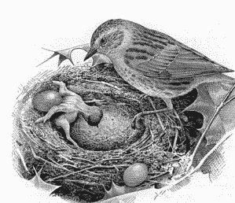

图 1.1 一只新孵化的杜鹃雏鸟将养父母的蛋推出巢外。这种行为近因解释与其远因解释并不相同。近因解释是雏鸟背部的触觉敏感受体引发了一连串行为反应，最终导致蛋被驱逐。远因（或进化论）解释则是拥有编码这种行为的基因的雏鸟，比没有这些基因的雏鸟生存得更好，因为它们不需要与养兄弟姐妹分担养父母的养育努力。经艺术家 David Quinn 许可，转载自 Davies (1992)。

## 1.1 行为的原因


在生物学中，通常承认两种类型的因果解释：近因解释和远因解释（Baker 1938; Mayr 1961）。近因解释诉诸于动机变量、经历和基因型作为行为的原因。远因解释则指导致行为进化的选择压力和其他因素。这两种因果解释是独立且互补的，服务于不同的目的：一种不能取代另一种。为了阐明这一概念，Lorenz (1981; §1.6) 提供了以下示例。汽车的远因当然是出行。然而，如果发动机坏了，远因并不能让它重新运转：我们需要知道发动机是如何工作的（近因）。图 1.1 提供了这一区别在行为背景下的另一个例子。请注意，原则上，我们可以独立地学习近因和远因。然而，两者也是相关的（因为行为是进化的结果并影响进化），我们可能会通过同时考虑两者而更快地了解其中一方。

Niko Tinbergen 在定义动物行为学的范围时，提出了一套更详细的解释集合（Tinbergen 1963）。他并没有仅仅区分近因和远因，而是主张必须回答四个问题才能理解行为。这些问题通常概括如下：

- 什么导致行为在特定时刻出现，行为机制如何运作？
- 行为在个体一生中是如何发展的？
- 行为的进化历史是什么？
- 行为如何促进生存和繁殖？

前两个问题涉及近因解释。将其分为两部分，使我们能够暂时将行为机制与其随时间的变化分开研究，这是一项我们将加以利用的优势。Tinbergen 的第三个问题旨在描述进化变化，而不涉及任何因果解释。第四个问题，按其表述方式，并不严格地指因果解释，而是指所谓的终极或功能性解释。这些解释通过逻辑跳跃，将行为的效果（对生存和繁殖的贡献）作为行为本身的原因。然而在实践中，第四个问题通常涵盖对进化结果的真实因果研究，即研究自然选择和其他因素如何改变进化种群中的行为。关于动物行为解释的更多讨论，可参见 Alcock 和 Sherman (1994), Dewsbury (1992, 1999), 以及 Hogan (1994a)。在本书中，我们考虑与 Tinbergen 的观点密切相关的三种因果解释：

- 动机
- 个体发育
- 进化

对我们而言，理解行为意味着拥有对所有这些问题的答案，本书的结构便是基于这一分类。这三种解释考察不同现象的成因，并调用不同的原因，具体如下：

动机解释涉及个体行为，其目标是根据外部刺激和内部生理状态等变量来预测行为，并理解行为机制（Hogan 1994a）。术语“动机”指的是行为上通常可逆且往往是短期的变化。一个例子是动物如何利用行为来调节食物和水的摄入。其他例子包括感知、决策、运动控制等机制。这些主题在第 3 章中涵盖。

个体发育（Ontogeny）指的是行为机制在个体一生中的发展。个体发育的原因包括基因型和个体经历的所有体验。发生的变化包括神经系统结构的变化和记忆变化，导致行为上通常长期且较不可逆的变化（Hogan 1994a）。具体现象包括学习、成熟、遗传倾向和神经系统的发展。第 4 章专门探讨学习和其他个体发育现象。

最后，`行为的进化`（或其他任何性状）发生在个体种群中，并通过种群基因库的变化表现出来（Futuyama 1998）。遗传变化的原因包括突变、重组、自然选择和随机事件。选择可能来自非生物环境、其他物种或同种个体的行为。这些是第 5 章的主题。在具有文化的物种中，必须考虑额外因素，但这超出了本书的范围。

## 1.2 行为模型的框架

### 1.2.1 行为映射：从动机状态到反应

本书的核心以及大多数讨论的起点是这样一个假设：行为可以根据关于相关`动机变量`的知识来描述和预测。这些仅仅是进入行为动机解释的变量。例如，摄食行为可能由食物刺激的存在与饥饿的结合引起，如图 1.2 所示。行为研究的一部分在于识别动机变量，如今，许多已知变量包括激素水平等生理变量，以及物体形状和颜色、交配叫声结构等外部变量。在给定时间点所有动机变量的集合即为动物的`动机状态`。行为完整描述为每种可能的动机状态分配一个行为反应。在数学上，我们可以用函数 `$m$` 来表达这一概念，该函数建立了动机状态集合 `$\mathbf{X}$` 到反应集合 `$\mathbf{R}$` 的映射。后者包含行为库及其他反应，如激素分泌。如果我们用 `$\mathbf{x}$` 和 `$\mathbf{r}$` 分别指代单一状态和反应，我们可以写成

表 1.1 行为映射如何进入行为的不同解释。

| 解释层次 | 动机 | 个体发育 | 进化 |
| :--- | :--- | :--- | :--- |
| **问题** | 行为映射具有什么性质？ | 行为映射是如何确定的？ | 进化如何改变行为映射？ |
| **原因** | 外部刺激和内部状态 | 基因、经历 | 环境（物理、生物、社会）、突变、随机 |
| **效应** | 行为反应 | 行为映射 | 发育行为映射的遗传密码 |
| **重要状态** | 身体和神经系统的内部状态 | 记忆和神经系统连接性 | 基因频率和基因型 |

$$ \mathbf{r} = m(\mathbf{x}) \quad (1.1) $$

我们将 `$m$` 称为`行为映射`。这个表达听起来可能很技术性，但它实际上指的是所有行为研究者熟悉的东西。例如，刺激-反应关系、决策规则或反应梯度等概念都是行为映射的例子。也就是说，它们都可以写成方程 (1.1) 的形式，只需适当选择输入和输出空间以及映射函数 `$m$`。我们使用“行为映射”这一表达有几个原因。首先，它不依附于任何特定的建模传统，但我们在所有行为理论中都能识别出行为映射。其次，行为映射的概念为我们对“理解行为”在不同解释层次上的含义提供了明确的定义（表 1.1）。第三，我们的书探索神经网络作为行为映射。

行为映射可能是随机的，而非确定性的。这意味着为每种可能的行为反应分配一个概率，而不是精确预测哪一个会发生。行为中是否真的存在随机性是一个 largely 未解决的问题（例如参见 Dawkins & Dawkins 1974）。我们没有试图解决这个困难的问题，而是注意到上述形式体系中可能包含随机因素。例如，我们可以包含随机变化的动机变量（第 3 章）。

### 1.2.2 状态转移方程：动机状态的变化

除了行为映射的知识外，如果我们想要预测行为序列，还需要知道动机状态如何随时间变化。这种变化可能反映了环境的变化（例如，特定食物来源的可获得性）或动物内部的变化（例如，激素水平改变）。本书研究外部和内部因素的双重影响。然而，就状态变化而言，我们主要关注的是动物内部的变化：首先，这些变化由动物体内的过程引起，而大多数外部状态的变化独立于个体发生；其次，内部状态使动物能够随时间组织其行为，并检测感官输入中的时间模式（见第 3 章）。

从形式上讲，状态变化可以用以下形式的方程来描述：

$$\mathbf{x}(t+1) = \mathbf{M}(\mathbf{x}(t), \mathbf{r}(t)) \quad (1.2)$$

该方程简单地表明，时间 `$t + 1$` 的状态是时间 `$t$` 的状态和系统在时间 `$t$` 的响应（为简化起见，考虑的是离散时间而非连续时间）的函数。在系统论中（Metz 1977; Minsky 1969），方程 (1.2) 被称为`状态转移方程`，而方程 (1.1) 则是系统的`响应函数`或`输出函数`。下文以及后续章节中都会出现状态转移方程的示例。

### 1.2.3 个体发育和进化中的行为映射

综上所述，动机解释关注特定行为映射的属性，即行为响应如何由动机状态引起。要全面理解动机过程，还需要理解动机状态转移。行为的个体发育和进化解释处理的是不同的原因和结果。

在个体发育解释中，结果是行为映射，而原因是个体的基因和经历。因此，个体发育考虑的是该映射如何在个体的一生中发展和变化。它还涵盖了先天与后天的问题。可以用数学方式将行为映射表示为基因型 `$g$` 和经历历史 `$h$` 的函数：

$$m = f(g, h) \quad (1.3)$$

然而，我们更倾向于基于状态的方法。动物不会存储其全部历史；相反，其经历导致状态变量 `$W$` 发生变化，从而决定行为映射的属性。从形式上讲，我们可以写成：

$$m = f(W) \quad (1.4)$$

大多数个体发育和学习模型，包括基于神经网络的模型，都属于此类。请注意，个体发育过程的状态变量与动机过程的状态变量不同。个体发育中最明显的状态变量是记忆，而学习是记忆变化的关键机制（记忆状态转移）。状态转移方程可能很复杂，并取决于当前状态、基因型、动机状态和响应。

最后，为了理解行为的遗传进化，我们必须考虑进化动力学和一类新的状态变量：基因。基因频率和基因型 `$g$` 的变化是由物理、生态和社会环境，以及突变和其他产生新基因型的机制引起的。进化并不直接改变行为映射；遗传进化的效果更像是一个用于开发行为映射的遗传程序。

### 1.2.4 对行为模型的要求

综上所述，要理解行为，我们需要描述行为映射和状态转移方程的方法。理想情况下，行为模型应满足以下要求：

- **通用性**：我们在物种之间以及（在较小程度上）物种内部观察到了行为的高度多样性。通用行为模型的基本结构应允许形成多种多样的行为映射。
- **鲁棒性**：无论我们寻求何种解释，机制都应表现出一定的鲁棒性；否则，行为将容易受到任何遗传或环境干扰的影响。因此，小干扰不应导致性能的重大变化。
- **学习**：从经历中学习是动物行为的普遍特征。模型应允许学习，并且学习应现实地与行为映射相结合。


**个体发育**：个体的行为系统是通过一系列事件发展的，在这些事件中，基因、发育中的个体和环境相互作用。模型的结构应允许行为映射从零开始逐步发展到成年形式。

**进化**：为了使进化发生，必须存在影响行为机制发育的遗传变异。在模型中，应能够指定基因如何控制行为映射和学习机制的特征。此外，模型应允许神经系统从非常简单形式进化到在例如鸟类和哺乳动物中观察到的复杂形式。

## 1.3 行为模型的结构

存在多种多样的行为模型，通常是为特定目的（如学习或感知的研究）而开发的。动物行为理论的重要贡献来自动物行为学传统（McFarland 1974a; McFarland & Houston 1981; Simmons & Young 1999）和比较心理学（Mackintosh 1994），但也来自神经科学（Cacioppo et al. 2000; Gazzaniga 2000; Kandel et al. 2000）和计算机科学（Wilson & Keil 1999）。在这里，我们从模型结构的角度考虑不同的建模传统。结构我们简单地指的是模型的基本机制，例如，动机模型如何从动机变量生成响应。迄今为止，我们尚未为我们考虑的模型提供任何结构。为行为模型添加结构包括对真实动物的特征做出假设，如感觉器官、中枢过程、记忆、运动控制以及可用的响应。这意味着什么，以下将变得清晰。

### 1.3.1 操作性模型和生理模型

我们需要什么样的结构，当然取决于我们的目标。我们可以大致区分操作性模型和生理模型。*操作性模型*旨在现实地描述行为，但其结构并不旨在模拟动物的内部结构。此类模型通常被称为*黑箱模型*，以表明对潜在机制的不关注。另一方面，*生理模型*试图考虑产生行为的更多生理学因素，*例如*身体和神经系统生理学。

正如以下所述，大多数人行为和动物行为的模型都是操作性模型。*操作性模型*更容易构建，因为只需要精确描述输入-输出关系，而且我们对如何实现这种关系有较少的限制。例如，我们可以使用最新的计算机模式识别算法，而不是弄清楚一堆相互连接的神经元是如何识别任何事物的。只要我们不声称与观察结果的一致性意味着内部结构的同一性，这就是合理的。另一个有利于操作性模型的因素是，与行为相比，生理学更难观察或控制。

生理模型和操作性模型之间的一个关键区别，也是区分它们的全部意义所在，在于生理模型的结构并非仅从行为观察中推断出来，而是至少部分基于生理学知识。这样做有几个动机。一个是理解行为的神经生理学。另一个信念是，生理模型可以是更准确的行为模型，因为其结构更紧密地反映了动物的内部结构。

在接下来的部分中，我们将从主要研究传统的角度考虑行为模型的结构，*即*使用哪些行为映射和状态方程。我们还讨论模型在多大程度上是操作性或生理性的。这将使我们在整本书中都能比较神经网络与其他建模传统，突出差异和相似之处。

### 1.3.2 结构很少或没有的模型

一些行为模型对内部结构很少做假设，允许同样容易地形成任何输入-输出关系。这种无约束的模型主要用于描述目的和行为进化研究中。创建无约束行为映射的一种简单方法是动机因素和行为响应安排在一个*查找表*中，其中每个条目代表特定的输入，条目的内容代表行为输出（图 1.3）。通过为每种可能的历史（包括当前情况）包含一个表条目，可以考虑事件的历史。因此，*查找*表可以涵盖学习，但不是在其通常的*改变*刺激-反应关系或记忆的意义上。相反，特定个体历史的效果是从表中读取一个响应而不是另一个响应。

更明确地描述事件序列的一种方法是将它们安排在一个*树结构*中。随着时间展开，沿着树前进，根据采取哪些决定而跟随一个分支或另一个分支。这种树模型可以描述经历的历史，并允许每种历史有唯一的响应。在博弈论内部开发了一种特定类型的树模型，被称为博弈的*扩展式描述*（图 1.4；Fudenberg & Tirole

| 动机状态 | 行为反应 |
|---|---|
| 饥饿 | 寻找食物 |
| 非常饥饿 | 寻找食物 |
| 饥饿 + 有食物 | 进食 |
| 捕食者存在 | 逃跑 |
| ... | ... |

图 1.3 查找表。通过在表中找到特定的动机状态，即可找到相应的行为反应。此特定示例对应于图 1.2 中的行为映射。

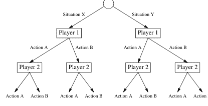

图 1.4 两个个体（“玩家”）之间博弈的扩展形式描述。每个玩家有两种可能的行动，标记为 A 和 B。顶部节点表示博弈可以在情况 X 或 Y 中开始，这超出了玩家的控制范围。根据发生的情况，玩家 1 决定执行行动 A 还是 B。根据玩家 1 的行动，玩家 2 随后做出决定。博弈的扩展形式表示还可以说明玩家对外部情况或彼此行动拥有不完全信息的情形。

(1992)。扩展形式比简单的树状结构更加精细，因为它可以同时考虑玩家观察到的事件和未观察到的事件。扩展形式描述和查找表都可以扩展到连续变量。例如，在查找表的情况下，表格变成了一个将连续输入转换为输出的函数。

查找表在进化生物学中的行为建模中占主导地位，其目标是在给定的生态或社会条件下寻找最大化适合度（或食物摄入率等其他货币）的行为映射（Grafen 1991）。表格更常被称为*策略*，但它保留了对每种可能情况下行为准则的说明含义。对可以实施的行为映射的限制通常很弱，主要通过两种方式引入。首先，不同行为的执行成本可能不同。其次，为了获得更合理（e.g., 对猎物和捕食者的最大奔跑速度做出假设）的结果，可用行为的集合通常受到限制。然而，在允许的行为映射中，假设形成任何行为映射都是同样容易的这一点仍然成立（*例如*，Kamil 1998）。

无结构模型提供了完全的灵活性，但也有缺点。首先，它们对行为机制没有洞察力。其次，每个反应都是独立于其他反应设定的。因此，没有先验理由说明对相似输入的反应应该产生相似的输出。出于同样的原因，在新情况下的反应是不确定的，因为查找表中不存在相应的条目。相比之下，动物行为作为刺激或情境之间相似性的函数表现出明显的规律性（第 3.3 节）。无结构模型不现实，还因为存储对每种可能事件历史的反应需要巨大的记忆。当然，动物在决定做什么时不会回忆其全部历史。相反，其行为机制经历状态的成功变化，当前状态部分取决于事件的历史。这些模型的最后一个缺点是，由于没有学习的位置，每个表条目必须在基因上进行编程。我们将在本书中多次回到这些问题，特别是在关于进化的第 5 章中。

### 1.3.3 作为动机状态函数的行为

在本节中，我们考虑试图基于有限数量的动机变量预测行为的模型。大多数动机模型都属于这一类型（*例如*，Bolles 1975; McFarland 1971; McFarland & Houston 1981; Metz 1977）。动机变量通常被归类为外部刺激（系统输入）或内部因素（系统状态变量）。外部刺激可以以多种方式变化：不同的感觉器官可能被刺激，且每种方式都有许多不同。内部因素的例子包括水分平衡、激素水平和记忆。我们将在第 3 章中详细阐述这种区别。

相关的动机变量通常从行为观察中识别，通常结合功能考虑（*例如*，必须将体温保持在限制范围内以便生命继续）。动机状态也可以从动物的近期历史中识别（*例如*，饥饿程度随距上一餐的时间增加；Bolles 1975）。有时，因果因素是从观察数据的统计分析（Heiligensberg 1974; Wiepkema 1961）或通过引入生理考虑中推导出来的。例如，进食和饮水的模型可能考虑胃中的伸展感受器、从胃中摄取水的速率以及监测血液或身体其他部位细胞水分水平的感受器（McFarland & Baker 1968; Toates 1986, 1998）。包括动机状态在内的状态概念，如今也在动物行为的进化理论中发挥着重要作用（Houston & McNamara 1999）。

既然相关变量已经确定，下一个问题是如何在行为模型中组合它们。这是结构问题。数学定义的行为映射的一个简单且经典的例子是刺激控制的加总模型。这些试图通过了解对其单独组成的反应来预测对复合刺激的反应。例如，对于由三个刺激组成的复合刺激，模型可以形式化如下。为了描述哪些刺激存在，我们引入动机状态 `x = (x1, x2, x3)`，若刺激 `i` 存在则 `xi = 1`，否则为 0。然后我们将对复合刺激的反应定义为其分量的效应之和：

$$r = W1 x1 + W2 x2 + W3 x3$$


其中 $W_{i}$ 是对刺激 $i$ 的反应。只有存在的刺激会影响反应，因为对于不存在的刺激 $x_{i}=0$。请注意状态变量与模型结构之间的分离，状态变量描述哪些刺激存在，而模型结构描述如何从状态获得反应，即通过加权和。具有这种结构的模型是所谓的刺激加总定律（Leong 1969; Lorenz 1981; Seitz 1940–1941, 1943; Tinbergen 1951）以及心理模型，如 Rescorla 和 Wagner (1972) 和 Brough (1975)。请注意，一些 $x_{i}$ 可以代表内部因素。在后一种情况下，外部和内部因素将相加组合以产生反应。当然，还有其他组合因素的方式（图 1.5; Krantz & Tversky 1971; McFarland & Houston 1981），且单个 $x_{i}$ 可能不仅取 0 和 1 的值。

另一个重要的理论概念是阈值。首先考虑基于单个动机变量的值是否执行特定行为的问题，例如对于给定的饥饿水平是否进食。一个常见的想法是，如果动机变量超过阈值 $T$，则执行该行为。阈值也可以应用于状态变量的组合，如公式 (1.5) 中的加权和。也就是说，假设对给定刺激情境的反应发生当且仅当：

$$w_{1}x_{1} + w_{2}x_{2} + w_{3}x_{3} \geq T \tag{1.6}$$

当不相容的反应同时被动机激发时，会出现更复杂的情况（Ludlow 1980, 1976; McFarland 1989; McFarland & Sibly 1975）。例如，饥饿且口渴的动物不能同时饮水和进食。通常，假设不同的行为或行为子系统相互“竞争”，这意味着动物将表现出对应于最高动机的子系统（McFarland 1999）。

阈值和决策的概念可以推广为动机状态空间中的*决策边界*。生物体的动机状态 **x** 表示为多维状态空间中的一个点，每个点分配一种反应。然后通过设置决策边界定义空间中的不同区域。同一区域内的状态产生相同的行为，但越过决策边界会导致行为改变（McFarland 1999; McFarland & Houston 1981）。

为了理解行为序列是如何生成的，我们还需要考虑动机状态如何变化，因为更新的状态将决定后续反应（McFarland 1971）。这是一个在多个水平和时间尺度上运作的复杂问题。早期的动机状态转换理论基于驱动概念（Hinde 1970）。假设每种行为由单个内部因素（“驱动”）控制，该驱动随时间积累，并且每次行为被引发时都重置为低值。自那以后，已识别出多种状态转换机制，纯驱动可能很少见。动机状态转换和行为序列的建模在很大程度上得益于控制论和系统论的应用，为动机过程建模提供了迄今为止最精细的方法（McFarland 1971; Metz 1977; Toates 1998; Toates & Halliday 1980）。一个重要的概念是反馈机制（McFarland 1971; Toates 1998）。许多行为过程可以自然地被视为控制对生存和繁殖重要的内部和外部变量。例如，蜥蜴可以通过在其领地的较暖和较冷之间移动来调节其体温。反馈使系统能够对由先前行动或环境引起的状态变化做出反应。图 1.6 描绘了两个运动控制机制的框图，一个没有反馈回路，一个有反馈回路。

然而，对行为的控制不仅限于来自行为后果的反馈。在动物体内，已识别出许多参与行为序列生成的状态变量。这些状态如何变化在很大程度上取决于其性质，可能涉及神经系统固有过程（例如，内部时钟）、生理状态和神经系统之外的过程（例如，激素、水分和能量状态）以及感知到的外部事件和环境（例如，社会刺激）或这些类别的任何组合。

#### 1.3.3.1 小结

动机状态的概念已被证明是有益的，基于该概念的模型取得了显著的成就。一个重要贡献是

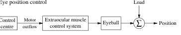

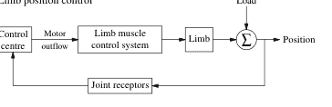

图 1.6 眼球和肢体位置控制系统的大纲，展示了开环控制和闭环控制的两个原则。肢体控制系统中的反馈回路允许对肢体偏离预期位置的任何偏差进行修正。经 McFarland (1971) 允许转载。

确立了行为系统可以被看作动力系统（McFarland 1971; McFarland & Houston 1981; Metz 1977），通过补充描述行为映射（输出函数）的方程，利用更新动机状态的状态转移方程（Houston & McNamara 1999; McFarland & Houston 1981）。然而，就其当前的应用而言，基于动机状态的模型也存在一些弱点。首先，控制理论在动物行为中的应用很少考虑学习（虽然学习控制是可能的，见 Sutton & Barto 1998; Widrow & Stearns 1985）。其次，动机因素是从行为观察以及有时从关于身体生理学的知识中推断出来的，但模型的结构仅从行为观察中推断。例如，“反应阈值”的概念受到批评，并且它能否令人满意地描述动物决策仍然不清楚（第 3.7 节）。第三，在某些情况下，将神经系统的某个方面视为控制问题所能获得的洞见尚不清楚（例如，刺激识别）。

### 1.3.4 动物学习理论

行为层面的学习模型主要是在心理学内部发展起来的（Dickinson 1980; Mowrer & Klein 2001; Pearce 1997）。这些模型倾向于关注记忆的变化，记忆被认为由事件之间的“联想强度”组成，通常是一个或多个刺激与一种行为反应之间（Dickinson 1980; Pearce 1997; Rescorla & Wagner 1972）。用我们的话说，这些模型研究行为映射如何通过学习而变化。刺激与反应之间的联想强度通常写作 *V*。一类重要的学习模型预测在重复的实验试次中联想强度 Δ*V* 的变化，其中刺激与事件（如食物给予，经典条件反射或操作条件反射；第 4 章）相关联。在这种情况下，假设 *V* 根据以下方程（或类似方程；Brough 1975; Bush & Mosteller 1951; Rescorla & Wagner 1972）变化：

Δ*V* = *η*(λ − *V*)

其中 *η* 调节变化速度，*λ* 是在给定实验中 *V* 可达到的最大值（受刺激强度及与刺激配对的性质等变量影响，见第 4.5 节）。用系统术语来说，方程 (1.7) 是一个以联想强度为状态变量的状态转移方程。为了将状态转化为行为，进一步假设对刺激的反应可能性是 *V* 的递增函数：

*Pr*(反应) = *f*(*V*)

换句话说，*V* 可以被视为反应的趋势。请注意，这与我们在讨论动机状态时提到的将状态与行为联系起来的问题相同。

这些模型的一个有趣应用涉及几个不同刺激对行为的相对影响。如果刺激 1、刺激 2 等同时存在，假设它们的总联想强度是各个刺激联想强度的总和：

*V*<sub>TOT</sub> = Σ<sub>*i*</sub> *V*<sub>*i*</sub>

其中 *V*<sub>*i*</sub> 是刺激 *i* 的联想强度，求和涵盖了在给定实验试次中存在的所有刺激。*V*<sub>*i*</sub> 的变化遵循：

Δ*V*<sub>*i*</sub> = *η*(λ − *V*<sub>TOT</sub>)

为了更清楚地看到模型与行为映射形式化的关系，我们如上所述（见方程 1.5）引入变量 *x*<sub>1</sub>、*x*<sub>2</sub> 等，使得如果刺激 *i* 存在，则 *x*<sub>*i*</sub> = 1，如果不存在，则 *x*<sub>*i*</sub> = 0。然后我们可以将完整模型写为一对方程：

⎧ *Pr*(反应) = *f*(Σ<sub>*j*</sub> *V*<sub>*j*</sub>*x*<sub>*j*</sub>)

⎩ Δ*V*<sub>*i*</sub> = *η*(λ − Σ<sub>*j*</sub> *V*<sub>*j*</sub>*x*<sub>*j*</sub>)*x*<sub>*i*</sub>

第一个方程是行为映射，第二个方程是描述行为映射如何因经验而变化的状态转移方程。请注意，计算总联想强度的方程与我们之前考虑的总和模型（方程 1.5）中计算反应的方程相同，尽管符号略有不同。对学习的关注意味着权重，即联想强度，被包含在状态变量中，即可变化的变量。而在方程 (1.5) 中，由于关注点是针对不同刺激组合的反应而非学习，它们被作为固定参数。

动物学习理论中的学习模型是操作性模型。其结构是从行为观察中推断出来的。它们关注联想强度的变化而非行为本身，但也会做出关于行为的预测（否则无法对其进行测试）。然而，关于反应函数 *f* 的详细假设很少提供，复杂的动机情境也未被研究。

### 1.3.5 认知模型


我们所说的`认知模型`是指具有认知心理学和计算机科学风格的模型（通常合称为`认知科学`，自 20 世纪 50 年代末至今发展而来（Cre ver 1993; Leahey 2004; Wilson & Keil 1999））。认知模型的主要特点是对信息表征和处理的强烈关注。传统的认知科学旨在研究人类，但如今在动物认知主题下有大量研究，甚至有一本以此命名的期刊（Balda et al. 1998; Bekoff et al. 2002; Dukas 1998a; Gallistel 1990; Mackintosh 1994; Pearce 1997; Shettleworth 1998）。认知心理学的经典研究方案主张，任何智能生物或机器都可以完全通过运行在存储信息上的程序来理解。因此，可以忽略实际使用的硬件，无论是计算机还是大脑（Neisser 1967）。

虽然认知模型的主要目的是理解大脑如何表征和处理信息，但它们也预测行为并基于此类预测进行评估。在这方面，认知建模与动物学习理论相似（可以认为自 20 世纪 70 年代以来，这两个领域越来越接近）。认知模型的结构规定了记忆如何根据经验更新（状态转移方程）以及反应如何基于存储在记忆中的信息决定（行为映射，或反应函数）。通常，记忆以功能术语描述为关于世界知识的内部表征，例如对位置、角度、速度、条件概率的了解（例如，Gallistel 1990）。决策和记忆更新在特定意义下是“计算”的，即对符号的操作，非常符合形式数学的意义。以下两个例子说明了这些典型方面。

第一个例子涉及沙漠蚁 *Cataglyphis bicolor* 在缺乏明显路标时导航的能力（Wehner & Platt 1972; Wehner & Srinivasan 1981）。在漫长且曲折的食物搜寻过程中，这些蚂蚁能够沿着大致笔直的路径瞄准它们的巢穴。Gallistel (1990) 提出，蚂蚁通过不断计算到巢穴的方向和距离来实现这一点。这种计算基于通过视觉系统获得太阳方位角；蚂蚁移动的速度，可能通过大脑的运动指令获得；以及太阳当前的方位角。后者借助描述太阳运行轨迹并基于内部时钟的内部“太阳星表函数”计算得出。这些输入使动物能够在坐标系统中计算其位置，随后从中计算到巢穴的方向和距离。该模型在图 1.7 中展示（进一步讨论见第 6 章）。

第二个例子说明了另一种认知方法，该方法认为生物生活在不确定世界中，并可以通过观察学习世界。许多实证研究表明，动物和人类对与外部世界互动中显现的时间相关性或偶联性是敏感的（Dickinson 1980; Mackintosh 1994; Shanks 1995）。这催生了一种观点，认为中枢神经系统作为一个“统计机器”运行（Shanks


图 1.7 *沙漠蚂蚁（Cataglyphis bicolor）导航的认知模型*。坐标 $x$ 和 $y$ 是描述蚂蚁相对于巢穴（坐标系原点）位置的内部变量。外部输入包括蚂蚁行进方向与太阳之间的角度（$\alpha$）以及蚂蚁的速度 $S$。模型内部的一个函数根据一天中的时间来计算太阳方位角 $\sigma$。模型的输出是来自家的方位角和距离，假设这些输出用于指导行为。经 C. R. Gallistel 允许，重印自 Gallistel (1990)。

(1995)。在这样的系统中，记忆将由此类用于统计决策并根据经验更新的条件概率组成。从这些例子中应能看出，认知模型的要素是被提出的，因为假设它们服务于某种功能。速度、距离和条件概率的表征之所以存在，是因为动物需要导航、寻找食物、躲避捕食者等。这种功能考量在典型认知模型中的主导地位对模型产生了两方面的影响。首先，它模糊了近端解释和终极解释之间的区别（图 1.1）。然而，记忆的功能是存储信息这一事实并不是对记忆如何工作的解释。其次，对功能和符号信息处理的强调使甲壳动物的研究受到抑制。（基于 Wine & Kravue 1982。）该网络一端包括尾部的触觉感受器，另一端包括连接到肌肉的运动神经元。中间神经元处理来自感受器的信息，如果触觉刺激足够强，则向运动神经元发送指令，使甲壳动物能够快速远离刺激。经 Simmons 和 Young (1999) 允许，重印自 *Nerve Cells and Animal Behaviour*（剑桥大学出版社）。

## 1.4 神经网络模型

本书探讨作为行为模型的神经网络，也称为*人工神经网络、连接主义网络或模型、并行分布式处理模型和神经计算机*。在含义明确时，我们称之为神经网络模型，或简称为神经网络或网络。为了避免模型与现实之间的混淆，在涉及真实动物时，我们谈论生物神经网络或神经系统。本节简要介绍神经网络模型；下一章将更详细地介绍它们。

神经网络模型的基本特征是其受生物神经网络的启发。作为一个说明性的例子，图 1.8 描绘了甲壳动物神经系统的一部分。它由相互连接的神经元组成，通常以个体间一致的方式连接，形成一个相互作用的细胞网络。一些神经元是*感受器*；即，它们将物理刺激（如振荡的气压/声音）转化为传递给其他神经元的电信号或化学信号。其他神经元是*效应器*；即，它们代表神经系统对身体的输出。一些效应器连接到肌肉（运动神经元），而另一些则分泌影响身体其他细胞的化学物质。既不是感受器也不是效应器的神经元统称为*中间神经元*。显然，它们的组织结构对神经系统的运作至关重要。


图 1.9 前馈人工神经网络的示例。左上：一种简单的架构，其中输入节点直接连接到单个输出节点。右上：具有多个输出节点的神经网络。底部：在输入和输出之间增加了一层节点的神经网络（“隐藏节点”）。

神经网络模型可以包含我们在图 1.8 中看到的所有特征。它通过将基本的类神经元单元（称为节点或单元）连接成网络来模拟神经系统的架构。每个节点通常与其他许多节点有链接或连接。节点可以像神经元一样激发或抑制彼此的活动。刺激通过人工感受器和感觉器官进入网络，输出单元的活动代表行为模式或肌肉收缩（取决于分析水平）。虽然神经系统由许多细胞组成（线虫约有 1000 个，鸟类和哺乳动物则有数十亿个），但其建模被简化了，因为它们的运作通常可以被描述为许多本质相同的神经元具有规则连接模式的集体作用。

神经网络模型可以具有不同的架构、工作原理和目的。书中将反复研究的一种流行架构是由输入节点层、零个或多个中间层和输出节点层组成的前馈网络（图 1.9，另见图 1.8）。神经网络的一个重要特性是，除了可以解释为模型神经系统外，它们也是数学定义的模型。通常，每个节点的活动是一个数字，无论是连续的（例如，在 0 和 1 之间）还是离散的（例如，“激活”为 1，“未激活”为 0）。我们将节点 $i$ 的活动写为 $z_i$。索引 $i$ 从 1 运行到 $N$（节点的总数），用于识别每个节点。假设节点活动是总输入的递增函数 $f$，即

表 1.2 一个行为映射图，解释为简单的进食模型，该模型可以通过一个包含两个输入节点和一个输出节点的网络实现。

| 输入值 | 输入解释 | 期望输出值 | 期望输出解释 |
| :--- | :--- | :--- | :--- |
| (0,0) | 不饿，无食物 | 0 | 不进食 |
| (0,1) | 不饿，有食物 | 0 | 不进食 |
| (1,0) | 饿，无食物 | 0 | 不进食 |
| (1,1) | 饿，有食物 | 1 | 进食 |

节点从网络中的其他节点接收输入，记为 $y_{i}$。因此

$$z_{i}=f\left(y_{i}\right)$$

反过来，总输入被计算为其他节点活动的加权和。形式上，这表示为

$$y_{i}=\sum_{j} W_{i j} z_{j}$$

数量 $W_{i j}$ 被称为*权重*，表示从节点 $j$ 到节点 $i$ 的连接强度，类似于生物突触的强度。两个节点之间不存在连接由 $W_{i j} \equiv 0$ 表示。公式 (1.12) 和 (1.13) 是大多数神经网络模型的基本构建模块。网络中的所有节点都基于此类方程运行，但函数 *f* 的选择可能不同。一个重要的例外是模拟感受器的节点，其活动应反映在我们要模拟的刺激条件下相应感受器的活动。当一个节点模拟感受器时，我们通常将其活动写为 $x$ 而不是 $z$。同样，输出节点的活动通常写为 $r$。这与之前用于一般行为映射图的符号一致。


作为使用神经网络进行行为建模的一个简单例子，考虑一种动物，它根据饥饿程度和食物可得性来决定是否进食。更准确地说，当满足以下两个条件时动物会进食：(1) 它感到饥饿，且 (2) 食物可得；但如果这些条件只满足其一或都不满足，则不会进食。我们的网络模型有两个输入节点直接连接到一个输出节点。输入节点 $i$ 的活动是 $x_{i}\left(i=1,2\right)$，对应到输出节点的权重是 $W_{i}$。我们假设，如果总输入 $W_{1} x_{1}+W_{2} x_{2}$ 超过阈值 $\theta$，则输出节点处于激活状态（这被解释为进食）。为简化起见，我们假设节点要么处于激活状态（$x_{i}=1$），要么处于非激活状态（$x_{i}=0$）。第一个输入节点在动物需要能量时处于激活状态（“饥饿”节点）；第二个节点在食物可得时处于激活状态（“食物”节点）。因此，存在四种可能的输入模式，网络应只对其中一种做出反应（表 1.2）。这必须通过调节三个参数 $W_{1}, W_{2}$ 和 $\theta$ 来实现。解很简单：其中一个权重必须小于 $\theta / 2$，另一个必须大于 $\theta / 2$，且 $\theta>0$。在这种选择下，当两个输入都激活时，输出节点接收到的输入为 $W_{1}+W_{2}$，这大于 $\theta$，符合进食所需的条件。如果食物结束，或者饥饿停止，其中一个 $x_{i}$ 会降为 0，进食随之停止。因此，网络可以决定是否进食，整合关于饥饿和食物可得性的信息。该模型显然是简化的，将在第 3 章进一步展开。例如，请注意，“食物”节点的假设并没有解释为什么某些刺激被视为食物而其他刺激不是。“饥饿”节点更贴近现实，因为它可能对应于对血糖水平敏感的神经元，位于哺乳动物的下丘脑和肝脏等部位（Toates 2001）。

前一个例子使用了最简单的网络类型，其特征是多个输入节点直接连接到一个输出节点（图 1.9，左上角）。这种网络完全由单个方程描述

$$r=f\left(\sum_{i} W_{i} x_{i}\right) \quad(1.14)$$

该方程与之前综述中的一些动物行为学和心理模型非常相似（或者取决于 $f$，完全相同）。我们将多次讨论这种基本网络。然而，通常来说，神经网络模型要复杂一些。额外的输出细胞允许多于一种类型的反应，并且在输入节点和输出节点之间添加一个或多个中间节点层，可以显著增强形成输入–输出关系的能力。最后，递归连接（反馈回路）使网络能够处理时间，即响应输入的时间序列，并在时间上组织输出。

### 1.4.1 神经网络模型的特征

神经网络模型具有许多对行为研究者特别有吸引力的特征，我们将试图在本书中传达这些特征。这里简要总结了这些特征，将在后续章节中做更充分的论证。我们首先考虑第 7 页上的需求列表：

- **多功能性：** 神经网络模型可以实现几乎任何行为映射图（Haykin 1999）。特定的网络可以适配多种需求，通过考虑不同的网络架构可以获得更多的灵活性。

- **鲁棒性：** 少量节点或连接损坏很少会对神经网络的运行产生重大影响。每项任务的性能由许多节点分担，记忆编码在大量的连接权重中（当然，这对非常小的网络或神经系统不成立）。

- **学习：** 自其诞生之初，学习一直是神经网络研究的重要组成部分。网络可以通过改变连接权重的过程进行学习，这些过程可以是自主的，也可以是在外部指导下进行的。从生理学的角度来看，大多数训练程序具有多个或许多不切实际的特征，但在过去几十年中，这一领域的进步是稳步的。

- **个体发育：** 迄今为止，神经网络模型尚未系统地应用于行为个体发育问题。一些应用已经开发出来，并取得了令人鼓舞的结果（第 4 章）。

- **进化：** 神经网络模型的各种特征，如架构、学习规则以及连接和节点的属性，可以假设来自不同的“基因”。可以建立行为进化的计算机模拟，以研究进化出什么网络来解决特定任务。此类研究仍处于起步阶段。其中一个障碍是我们仍然忽略了很多关于基因如何控制神经系统发育的知识。

神经网络模型的其他特征也与行为建模相关：

- **结构约束：** 这些模型的结构本质上基于对神经系统的知识：它并非从行为观察或功能考虑中推断得出。在这个意义上，神经网络模型在行为模型中是独特的。当正确使用这种约束时，可以大大降低引入在生物神经系统中没有对应物的过程的风险。

- **并行处理：** 神经网络中的处理主要是并行而非串行的，就像数字计算机那样。这意味着从接收刺激到产生反应的过程可以在少得多的操作周期内发生，每个周期包含成千上万甚至数百万个同时进行的计算。这是匹配神经系统在广泛条件下快速反应能力的重要一步。

- **概括性：** 在新情境中，动物表现出基于类似过去条件的系统性概括，这是它们面对世界能力的关键部分。由于其结构，许多网络模型自然地具有概括能力。与那些忽略概括（第 1.3.2 节）或仅仅假设概括发生（第 3.3.3 节）的模型相比，这是一个巨大的优势。

- **确定性和可访问性：** 由于神经网络模型是形式化指定的，因此可以详细研究其所有操作细节。可以使用动力系统理论、计算机模拟等工具进行研究，或者像神经生理学家研究神经系统那样进行研究。例如，可以研究当网络的特定部分受损或移除时会发生什么。这可以为网络运行提供见解，并且可以与神经系统的损伤研究进行比较。

- **统一性力量：** 神经网络模型可以应用于行为的各个方面：刺激处理、中央处理和运动控制。神经网络可以学习，并且记忆的基础（连接权重）是明确的。相反，大多数行为方法针对特定方面（如感知或认知），在产生统一的行为理论方面可能存在困难。

### 1.4.2 简短的历史

神经网络模型的历史根植于试图理解神经系统和行为的努力，始于 19 世纪末 Santiago Ramón y Cajal、Camillo Golgi 和其他人发现神经系统由复杂的细胞网络组成。神经网络模型的发展——

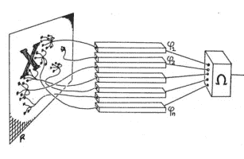

**图 1.10** Rosenblatt（1958; 1962）的感知器，由 Minsky & Papert（1969）描绘。每个 $\varphi$ 假设根据基于有限数量感受器状态的简单计算结果而取 0 或 1。求和单元 $\Omega$ 对 $\varphi$ 执行加权求和。如果总和大于阈值，则感知器响应 $\Psi$ 为 1；如果总和小于阈值，则响应为 0。经 Minsky and Papert（1969）*Perceptrons*，The MIT Press 许可重印。

els, however, are also rooted in mathematics, theories for intelligent machines and philosophy (Crevier 1993; Minsky 1969; Wang 1995).

神经网络模型的发展于 1943 年真正起步，当时 Warren McCulloch 和 Walter Pitts 描述了节点网络（即所谓的**形式神经元**）如何执行任意逻辑运算。这些节点要么对输入做出响应，要么不做出响应，其计算方式是对网络中其他节点的激活状态进行加权求和（McCulloch & Pitts 1943）。这种计算节点总输入的方法在随后的几乎所有神经网络模型中都被保留了下来。McCulloch 和 Pitts 工作的一个重要方面在于，神经处理可以用数学公式来表述。六年后，Donald Hebb 出版了他的著名著作*行为的组织*（*The Organization of Behavior*），其中除其他内容外，还包含了一种理论，解释了神经元之间连接强度如何作为记忆发挥作用，以及这种记忆如何作为经验的结果而变化（Hebb 1949）。也许是第一个完整的神经网络模型是由 Frank Rosenblatt（1958, 1962）设计并在计算机上模拟的。他的“感知器”如图 1.10 所示。Rosenblatt 工作的一项重要内容是提供了一种学习算法，使感知器能够解决广泛的分类问题，其中许多输入模式中的每一个都应被分配到两个类别之一。Bernard Widrow 和 Marcian Hoff 进一步开发了学习算法，引入了一种训练两层网络的通用程序（Widrow & Hoff 1960），后来被称为 $\delta$ 规则（第 2.3.2 节）。

1969 年，Minsky 和 Papert 的著作*Perceptrons* 使早期对神经网络模型的热情有所收敛，该书指出了感知器的一些严重局限性。感知器无法解决所有分类问题，有些原则上可解决的问题在实际操作中非常难以解决（第 2 章）。作者还认为多层网络也会存在类似的局限性，但事实证明这是错误的。Minsky 和 Papert 还承认，递归网络（具有反馈回路）可能具有更强的能力（第 2 章和第 3 章），但由于各种原因没有对此进行讨论。其中一个原因是希望将并行计算机（即神经网络）与传统串行计算机进行比较；递归网络同时具有串行和并行元素，因此被搁置一旁。选择感知器也在于其相对的数学简单性，这使得综合分析成为可能。尽管如此，这本书仍然非常有趣，并包含了许多关于神经网络的见解，这些见解可能也适用于生物神经系统。


20 世纪 80 年代见证了一系列重要出版物，激发了神经网络理论和应用研究的新浪潮。多层网络的高效学习算法得到了广泛传播，例如现在广为人知的反向传播算法，并且表明多层前馈网络可以克服感知器的一些局限性（Ackley et al. 1985; Haykin 1999; Rumelhart et al. 1986）。递归网络也得到了研究，并描述了如何在递归网络中存储信息（Amit 1989; Cohen & Grossberg 1983; Hopfield 1982）。Kohonen（1982）也发表了他在自组织映射方面的研究成果，展示了简单的学习规则如何基于经验组织网络，而无需外部指导。James McClelland 和 David Rumelhart 编辑的两卷书*并行分布式处理：认知的微观结构探索*（*Parallel Distributed Processing: Explorations in the Microstructure of Cognition*）对于神经网络在认知心理学中的传播至关重要（1986; Rumelhart & McClelland 1986）。

迄今为止，人工神经网络的研究已经产生了一个庞大的理论体系（*例如* Arbib 2003; Haykin 1999）。神经网络已被证明是一种强大的解释工具，应用于各种现象，如感知、概念学习、运动技能的发展、人类语言习得以及失忆症和脑损伤的研究（Arbib 2003; Churchland 1995; Churchland & Sejnowski 1992; McClelland & Rumelhart 1986）。最近，多个领域取得了进展。其中一个领域是研究更强大和/或更符合生物学现实的网络架构，*例如* 能够处理时间的递归网络（Elman 1990; Jordan 1986）。基础研究的核心领域包括如何训练网络以解决特定任务，以及它们如何从经验中学习而没有明确的监督。从目前的观点来看，一个重要的问题是开发更符合生物学现实的学习机制。许多训练网络的方法是不现实的，因为它们是外在于网络的，而不是内置于网络本身的，但已经取得了显著改进（第 2 章和第 4 章）。这是一个需要更多研究的领域，重要的是要认识到，尽管取得了所有进展，仍有许多问题有待解决。需要进一步研究的其他领域包括，*例如*，网络发育的遗传控制，以及如何应对不切实际的倒摄干扰（新的学习破坏早期记忆）（French 1999）。

前述神经网络模型历史的概述当然远非完整。*例如*，神经网络模型的发展也受益于我们在神经生理学理解上的进步。*例如*，视觉感知中视野的发现（Hubel & Wiesel 1962）以及对无脊椎动物学习的研究（Kandel et al. 2000; Morris et al. 1988）。还有一些工程应用可能对生物学和行为具有巨大潜力，*例如* 机器人研究（McFarland & Bösser 1993; Nolfi & Floreano 2000; Webb 2001）。基于神经网络设计功能性的机器人迫使工程师思考进化在动物身上所解决的类似设计问题。这对生物学家来说往往具有启发性，因为它突出了那些否则可能被忽略或视为微不足道的设计问题。*例如*，生物学家和心理学家常常跳过基于视网膜图像识别刺激的问题。这是一个远非微不足道的任务，从事机器人工作的人被迫考虑这个问题。对神经网络模型更完整的历史感兴趣的读者，请参考 Arbib（2003）和 Haykin（1999）。

### 1.4.3 动物行为研究中的神经网络模型

动物行为的研究者似乎理所当然地应该接受神经网络模型，但事实并非如此。情况恰恰相反。除了少数例外，在动物学家、行为生态学家和动物心理学家中，神经网络模型通常被忽视。*例如*，大多数动物行为教科书都没有涉及它们。当然，最重要的例外是神经动物学家（Cliff 2003; Simmons & Young 1999），但他们的重点主要不在于本章讨论意义上的通用行为理论。神经网络现在在神经科学中越来越流行（*例如* Dayan & Abbott 2001），其中我们对学习机制理解的最新和重要进展在很大程度上依赖于神经网络模型（第 4 章）。

当然，动物行为的研究者经常思考行为背后的神经机制。*例如*，Ivan Pavlov 和 Edward Thorndike 都对其行为观察背后的神经结构进行了推测。现在常用作神经网络研究标签的“连接主义”概念也可以追溯到这些先驱（Kandel et al. 2000; Morrow & Klein 2001）。较少被认可的是动物学家和动物心理学家提出的一系列类网络模型（Baerends 1971; Brough 1975; Fentress 1976; Hinde 1970; Horn 1967; Sutherland 1959; Thompson 1965）。图 1.11 展示了其中三个模型。左上角 Baerend's（1971）的模型与 Rosenblatt 的感知器（图 1.10）相似，并延续了动物学求和模型的传统（第 1.3.3 节）。响应产生自来自“评估单元”（*E*）信号的加权和，这些单元反过来分析来自感受器（*R*）的信号。Brough（1975；在第 3 章中讨论）的模型具有类似的结构，并重新发现了 Widrow 和 Hoff 于 1960 年首次发布的学习规则。图 1.11 还展示了 Thompson 1965 年的模型。其目的是说明泛化（对不同刺激的相似反应）如何从类似刺激由部分重叠的神经元集合处理这一事实中产生。这是一个经典的思想，存在于 Pavlov（1927）中，也存在于当前的神经网络模型中（第 3 章）。图中最后一个模型是 Sutherland 早在 1959 年提出的迷人模型。它描绘了一个带有可调节连接的多层网络，时间大致与 Rosenblatt 发布其感知器工作相同（Sutherland 1959, 1964; Sutherland & Mackintosh 1971）。有趣的是，这些生物学家和心理学家的早期努力在与同年积极追求神经网络的人工智能领域的那部分社区几乎没有任何联系或极少联系的情况下发展起来。

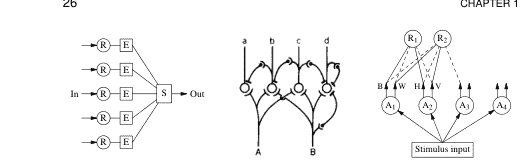

图 1.11 早期的类网络模型。左图：Barends（1971）的模型（重绘版）；R 是单元 E 感受野内的一个受体，它评估接收到的输入；S 对来自 E 单元的信号进行求和。中图：Thompson（1965）提出的关于泛化背后的神经电路的建议，其中物理上不同的刺激（A 和 B）可能激活重叠的神经元集合，从而引发相似的行为（较小的圆圈代表抑制性神经元）。经 Mostofky 主编的《Stimulus Generalization》出版方许可重印。© 1965 年，斯坦福 Leland Stanford Jr. 大学理事会。右图：Sutherland 的学习模型（Sutherland 1959, 1964; Sutherland & Macintosh 1971）。`A_i` 是一个分析器，它沿某个刺激维度对刺激进行检查。`R` 是一个反应单元，可以连接到不同的分析器上。实线表示现有的反应连接，虚线代表其他可能的连接。在本图中，`A_1` 分析亮度并区分黑色（`B`）和白色（`W`），而 `A_2` 区分水平（`H`）和垂直（`V`）方向。学习被假定为由两部分组成：(1) 学习使用与辨别相关的分析器，以及 (2) 学习将正确的反应连接到相关的分析器上。

那么，为什么神经网络模型在当前动物行为理论中常常缺失呢？一个原因可能是神经网络研究主要源于人工智能领域，其强烈关注点在于人类而非一般的动物。迄今为止，关注人类的神经网络研究远多于关注其他动物的研究。例如，该领域最高产的科学家之一詹姆斯·麦克莱伦德（James McClelland）写道：

> 连接主义认知建模是一种通过使用由简单的、类似神经元的处理单元组成的模拟网络来理解人类认知机制的方法。（McClelland 1999；强调为后加）

如果不回顾历史，这种对人类的关注似乎并非出于动机，因为理解比人类生物体复杂程度较低的有机体的行为神经基础更容易。研究传统的差异也可能阻碍了动物行为神经网络模型的发展。动物行为领域的大多数工作都是实证性的，而神经网络模型则源自一个理论研究社区。在动物行为研究者中，对于利用神经网络模型非常有帮助的计算机仿真技术和形式化数学并没有得到广泛应用。术语障碍也可能起到了一定作用。例如，生物学中的术语 *adaptive*（适应的）被严格用来指代因为增加了个体繁殖率（适合度）而进化出来的性状。在工程和认知科学中，*adaptive system*（自适应系统）这一表达有更广泛的范围，指任何能够改变以更好地实现其目的的系统。因此，工程师可能会谈论 *adaptation*（适应），而生物学家则会谈论 *learning*（学习）。另一个例子是，神经网络理论中提到的 *self-organization*（自组织），而行为学家会谈论 *learning*（学习）或 *development*（发展），实验心理学家则会谈论 *perceptual learning*（知觉学习）。诸如 *reinforcement*（强化）和 *association*（联想）等重要术语也有略微不同的用法。


总之，传统的行为学和动物心理学思维中包含了许多神经网络模型的种子，但神经网络理论的发展主要发生在这些学科之外。神经网络模型在动物行为研究中尚未获得广泛的普及，但如今对神经网络的兴趣正在增长，尤其是在动物心理学家中。

### 1.4.4 网络模型的多样性：我们的方法

要将神经网络应用于动物行为，我们需要决定使用哪些特定的模型。这并不总是容易的。神经网络模型有多种形式和用途。有些模型受生物学或心理学动机驱动，其目标从神经机制的细微细节到人类最高级的心理功能不等。还有一些模型主要旨在用于机器智能和工程应用，较少关注生物真实性。然而，出于实际和理论原因，后者对于模拟动物行为仍然具有兴趣。在本书中，只要能够解释我们所研究的行为，我们就尽量使用简单的网络。采用这种方法有几个原因。首先，不应过早地且无端地引入复杂性。我们可以试图从一开始就包含神经系统的所有已知细节，但这会导致一个与真实系统一样难以理解的模型。理解复杂结构的唯一方法是从中抽象出各个部分，或者研究更容易分析的简化模型。简化模型的关键测试在于它在多大程度上捕捉了真实动物行为的本质特征。如果它能做到这一点，那么模型受神经启发而非基于其他隐喻这一事实，应被视为一种优势而非阻碍。

其次，我们需要易于理解且实用的动物行为模型。我们还需要的是一般性的模型，而非特定于某种行为和特定物种的模型。动物行为这一主题涵盖了从由少数细胞组成的神经系统到灵长类大脑的复杂性的物种，我们知道许多行为现象具有惊人的普遍性。

第三，不应夸大不同网络模型之间的差异。从罗森布拉特（Rosenblatt）的 `perceptron` 等简单模型出发，我们可以逐渐以多种方式增加复杂性。例如，我们可以添加更多层节点、递归连接以及更复杂的节点动力学。因此，我们可以从简单模型逐渐获得复杂模型，并研究在此过程中它们的特性如何变化。这在研究从简单到复杂行为的进化时也是相关的（第 5 章）。

在实践中，我们的方法意味着多层前馈网络在离散时间下运行是我们模型的首选。事实上，大多数神经网络的应用都属于这种类型。如果此类模型被证明不足以分析给定的行为发现，我们会考虑额外的元素，如递归连接或连续时间动力学。请注意，我们并不否认详细模型的重要性。如果神经网络模型要实现其承诺，未来将包含简单、直观、通用且实用的模型，以及更接近真实神经系统的详细模型。

## 章节总结

- “行为”是一个合理的分析层次。它在行为学、心理学、行为生态学和进化生物学中具有理论重要性，并对许多在动物园、兽医诊所、农场等地与动物工作和生活的人具有实际重要性。
- 解释行为包括了解动机因素如何控制反应，行为如何在个体的一生中发展，以及进化如何塑造行为。理解实际的内部过程也可能很重要。
- 大多数理解动物行为的尝试都是从行为观察和功能考虑中推断出模型。这对大部分行为学、实验心理学和认知心理学来说都是正确的。一个主要的例外是神经行为学，它研究神经系统如何产生行为。
- 神经网络模型提供了开发行为模型的潜力，这些模型不仅基于行为观察，还基于神经系统的实际结构。这能否带来关于行为知识的增加？我们的目标是探索这个问题。
- 我们也触及了一些关于如何对行为建模的基本问题，从神经生理学到“认知”。一个重要问题是如何处理动物的内部状态。我们将在全书中以及结尾章节中回归这些问题。

## 延伸阅读

行为学的行为学和生物学理论：

- Eibl-Eibesfeldt I, 1975. *Ethology: The Biology of Behavior*. New York: Holt, Rinehart & Winston.
- Hinde RA, 1970. *Animal Behaviour*. Tokyo: McGraw-Hill Kogakusha, 2 edition.
- Krebs JR, Davies NB, 1987. *An Introduction to Behavioural Ecology*. London: Blackwell, 2 edition.
- McFarland DJ, 1999. *Animal Behaviour: Psychobiology, Ethology and Evolution*. Harlow, England: Longman, 3 edition.

神经行为学：

- Ewert JP, 1985. Concepts in vertebrate neuroethology. *Animal Behaviour* 33, 1–29.
- Simmons PI, Young D, 1999. *神经细胞与动物行为*。英国剑桥：剑桥大学出版社，第 2 版。

动物学习理论、动物认知、人类认知：

- Klein SB, 2002. *学习：原理与应用*。纽约：麦格劳-希尔，第 4 版。
- Mackintosh NJ 编辑，1994. *动物学习与认知*。纽约：学术出版社。
- Pearce JM, 1997. *动物学习与认知*。东萨塞克斯郡霍夫：心理学出版社，第 2 版。
- Shanks DS, 1995. *联想学习心理学*。英国剑桥：剑桥大学出版社。

关于行为主义与认知心理学之间讨论：

- Leahey TH, 2004. *心理学史*。新泽西州恩格尔伍德克利夫斯：普雷肯斯霍尔，第 6 版。
- Staddon JER, 2001. *新行为主义：心智、机制与社会*。东萨塞克斯郡霍夫：心理学出版社。

神经网络模型：

- Arbib MA, 2003. *脑理论与神经网络手册*。马萨诸塞州剑桥：麻省理工学院出版社，第 2 版。
- Churchland PM, 1995. *理性引擎，灵魂居所：大脑中的哲学之旅*。马萨诸塞州剑桥：麻省理工学院出版社。
- Churchland PS, Sejnowski T, 1992. *计算大脑*。马萨诸塞州剑桥：麻省理工学院出版社。
- Dayan P, Abbott LF, 2001. *理论神经科学：神经系统的计算与数学建模*。马萨诸塞州剑桥：麻省理工学院出版社。
- Haykin S, 1999. *神经网络：全面基础*。纽约：麦克米伦，第 2 版。

## 第二章

## 神经网络模型基础

本章从技术角度介绍神经网络模型，并探讨其神经生理学根源。旨在让读者理解神经网络模型的工作机制以及如何构建它们。我们首先介绍神经生理学的基本概念，然后将其概括为网络节点的简单数学模型。接着，我们展示将节点连接成网络的不同方式，并讨论不同网络的功能。随后，我们探讨如何设置网络连接，使网络按照预期运行。最后，我们讨论了神经网络的计算机仿真。

## 2.1 网络节点

在第 1 章中，我们看到神经网络模型由相互连接的节点组成，其灵感来源于生物神经元。神经网络模型中的节点通常比神经元简单得多，仅包含对网络集体运作显得重要的特征。这些特征的最小集合可以概括如下：

- 节点可以处于不同的状态，包括不同的活动水平和内部变量的可能不同取值。
- 节点彼此连接，并通过这些连接相互影响。
- 节点对其他节点的影响取决于节点自身的活动以及连接的属性（兴奋性或抑制性、弱或强等）。

下面，我们简要描述神经元的运作方式（有关更多细节，请参阅 Dayan & Abbott 2001; Kandel et al. 2000; 以及 Simmons & Young 1999），然后介绍我们将在全书中使用的简单节点模型。

### 2.1.1 神经元与突触

神经元有许多不同的类型，并且以不同的方式相互作用（图 2.1; Gibson & Connors 2003; Kandel et al. 2000; Simmons & Young 1999; Toledo-Rodriguez et al. 2003）。神经元拥有输出通路，通过它们影响其他神经元；同时也拥有输入通路，通过它们受到影响。我们首先回顾脉冲神经元及其通过化学突触的相互作用。然后，我们考虑非脉冲神经元以及通过电突触和神经调质发生的相互作用。

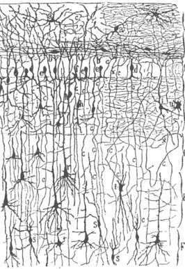

图 2.1 一只八天大的兔子下枕叶皮层的神经网络部分。大写字母标记在解剖学上可区分的皮层层，小写字母标记不同的神经元类型。绘图由 Ramón y Cajal 完成，重印自 De Felipe & Jones (1989)。

*脉冲神经元* 的显著特征是其能够产生称为*脉冲*或*动作电位*的电脉冲。这些脉冲可以沿神经元的轴突传播，轴突是一种从细胞体延伸出来的细长分支结构。轴突可以延伸几毫米到几十厘米的距离，从而实现了神经元之间的短程和远程相互作用。这些相互作用的数量往往惊人。例如，每立方毫米的小鼠皮层大约包含 $10^{5}$ 个神经元，估计有 1 到 3.5 公里的轴突，每个神经元大约连接到 8000 个其他神经元（Braienberg & Schütz 1998; Schütz 2003）。


神经元通过称为*突触*的结构相互连接。在突触处，一个神经元（称为*突触前*）的轴突与另一个神经元（称为*突触后*）的一个*树突*相遇。树突形成类似轴突的结构，但通常更短且分支更多。轴突是输出通路，而树突是输入通路。当沿突触前神经元轴突传播的脉冲到达化学突触时，它会引起化学物质（*神经递质*）的释放，这些物质可以兴奋或抑制突触后神经元，即通过改变神经元的电势来促进或阻止脉冲的产生。这种效应的强度取决于突触前神经元释放的神经递质数量，以及突触后神经元对神经递质的敏感性。总之，这些因素决定了突触的“强度”，即突触前神经元影响突触后神经元的程度。基础工作已将习惯化和经典条件反射等基本学习现象归因于突触数量和效能的变化，而非神经元之间连接模式的变化（第 4 章；Kandel et al. 2000）。

突触前神经元释放的神经递质的兴奋性或抑制性作用是短暂的。对脉冲神经元的简单描述是，它们会追踪在短暂时间窗口内到达的兴奋性和抑制性输入，该窗口延伸至过去几十毫秒。每当该时间窗口内兴奋性和抑制性输入的平衡超过阈值时，就会产生一个脉冲。因此，兴奋性和抑制性输入之间的差异越大，单位时间内神经元产生的脉冲就越多。神经元活动通常用脉冲频率来表示，以赫兹衡量（1 Hz = 每秒 1 个脉冲）。生理学限制了大多数神经元的脉冲频率，上限为几百赫兹，尽管在某些神经元中可以观察到接近 1000 Hz 的速率。

了解神经元活动如何随输入变化而改变通常非常重要。对于将光、化学浓度、声波等转换为信号并传递给其他神经元的受体细胞也是如此。一般来说，神经元对输入的变化呈非线性响应；即，以固定步长增加输入并不会使输出在每个步长都增加相同的量（图 2.2; Simmons & Young 1999; Torre et al. 1995; 以及 Simmons & Young 1999 的综述）。

如前所述，非脉冲神经元也存在。它们对其他神经元的影响连续依赖于神经元的电势，例如，通过神经递质释放速率的连续变化（Burrows 1979; Simmons & Young 1999）。同样，化学突触并不是神经元相互作用的唯一方式。例如，神经元可能通过电突触或缝隙连接相连。这些连接允许神经元交换电流，从而在不产生脉冲的情况下改变彼此的电势。电突触通常存在于无脊椎动物的神经系统或脊椎动物的感觉器官中（Simmons & Young 1999）。最近，它们在哺乳动物的皮层中也被发现（Gibson & Connors 2003）。神经元还通过向细胞外液释放相对寿命较长的物质（称为神经调质）相互影响。这些物质可以改变神经系统中大面积区域神经元的属性，有时可持续数小时。例如，某些神经元可能变得更加易兴奋，而另一些则更不易兴奋（Dickinson 2003; Harris-Warrick & Marder 1991; Hasselmo et al. 2003）。

神经元的活动不仅取决于外部输入，还取决于内部因素。例如，神经元对输入变化的响应具有特征性的延迟（图 2.3，左）。此外，对恒定输入的响应往往根本不恒定（Wang & Rinzel 2003）。神经元可能会习惯化，即降低其对恒定输入的输出（图 2.3，右），或者产生振荡活动。神经元也可能在没有输入的情况下自发活动，这一点将在第 3.8 节关于运动模式产生的讨论中涉及。

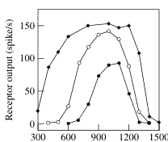

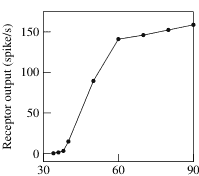

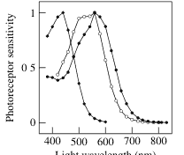

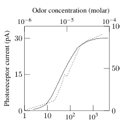

**图 2.2** **神经元对输入物理特性变化的反应。**

**左上：** 狨猴（squirrel monkey）耳部神经节细胞对不同强度下频率变化的声音的反应：50 分贝（实心圆圈）、60 分贝（空心圆圈）和 80 分贝（菱形）。**右上：** 同一细胞对频率为 1100 Hz 且强度变化的声音的反应（数据来自 Rose 等人，1971 年）。**左下：** 环尾狐猴（*Macaca fascicularis*）视网膜中三种视锥细胞对不同波长光线的相对敏感度（数据来自 Baylor 等人，1987 年）。**右下：** 斑纹东美螈（*Triturus cristatus*）光感受器对强度变化光的输出（实线，左侧和底部标度；数据来自 Forti 等人，1989 年），以及嗅觉受体对不同气味剂浓度的输出（虚线，顶部和右侧标度；数据来自 Menini 等人，1995 年）。请注意这两条曲线与上方面板中曲线的相似形状。

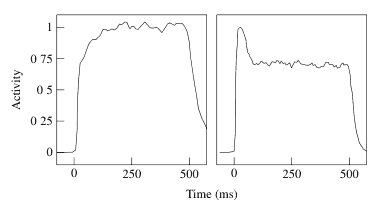

**图 2.3** 暗适应光感受器对 500 毫秒闪光的反应。左：摇蚊（*Tipula*）光感受器缓慢接近稳态活动水平（活动水平以峰值活动的比例表示）。右：寄蝇（*Sarcophaga*）光感受器迅速达到活动峰值，随后进入较低的稳态活动水平（活动水平以最大活动的比例表示）。数据来自 Laughlin（1981 年）。

### 2.1.2 基本节点模型

我们现在在数学上定义网络节点和连接。网络中的节点由整数索引；一般节点用小写字母表示，例如 $i$ 或 $j$。节点 $i$ 的活动是一个非负数，记为 $z_{i}$。其生物学对应物是神经元的短期平均脉冲频率，或者对于非脉冲神经元，是神经元内外部的电位差（另见 Dayan & Abbott 2001；§1.2）。所有网络节点的活动可以收集在向量 **z** 中：

$$\mathbf{z} = \begin{pmatrix} z_1 \\ z_2 \\ \dots \\ z_N \end{pmatrix} \tag{2.1}$$

其中 $N$ 是节点数量。节点之间通过权重相互连接，权重是对应于生物突触强度的连续数值。连接节点 $j$ 到节点 $i$ 的权重记为 $W_{ij}$。为了紧凑地表示网络中的所有权重，我们引入*权重矩阵* **W**，它可以表示为一个具有 $N$ 行和 $N$ 列的数组：

$$\mathbf{W} = \begin{pmatrix} W_{11} & W_{12} & \dots & W_{1N} \\ W_{21} & W_{22} & \dots & W_{2N} \\ \dots & \dots & \dots & \dots \\ W_{N1} & W_{N2} & \dots & W_{NN} \end{pmatrix} \tag{2.2}$$

神经网络模型的首要关键假设是，节点 $j$ 传递给节点 $i$ 的输入等于乘积 $W_{ij}z_{j}$。这建模了这样一个生物学事实：突触前神经元对突触后神经元的影响取决于突触前神经元的活动强度和突触强度的共同作用。节点 $i$ 接收到的总输入记为 $y_{i}$，计算为所有接收输入之和：

$$y_{i} = \sum_{j} W_{ij}z_{j} \tag{2.3}$$

其中索引 $j$ 遍历网络中的所有节点。缺失特定的连接简单表示为 $W_{ij} = 0$。方程 (2.3) 可以更紧凑地写为向量之间的关系：

$$\mathbf{y} = \mathbf{W} \cdot \mathbf{z} \tag{2.4}$$

其中 $\mathbf{y}$ 是所有输入的向量，$\mathbf{W} \cdot \mathbf{z}$ 是 $\mathbf{W}$ 和 $\mathbf{z}$ 之间的矩阵乘积。也就是说，$\mathbf{W} \cdot \mathbf{z}$ 只是简写形式，表示其第 $i$ 个元素为 $\sum_{j} W_{ij}z_{j}$ 的向量（矩阵和向量代数在神经网络中的应用详见 Dayan & Abbott 2001 和 Haykin 1999）。

第二个关键假设涉及节点接收的输入如何引起节点活动。表达节点输入与节点活动之间关系的函数 $f$ 称为传递函数：

$$z_{i} = f(y_{i}) \tag{2.5}$$

从生物学角度来看，传递函数体现了关于神经元如何响应输入的假设。然而在实践中，传递函数也应该便于操作。最简单的传递函数是恒等函数，即节点输出等于节点输入：

$$f(y) = y \tag{2.6}$$

由于简单性，该函数用于神经网络模型的数学分析中，但如果我们回顾节点活动应建模神经元的脉冲频率或电位，它存在缺点。这两个量都限制在一个范围内，而且脉冲频率不能为负。这导致了输入幅度和神经元活动之间的曲线关系（图 2.2），而方程 (2.6) 无法捕捉到这一点。此外，重要的是，仅使用恒等传递函数的网络只能实现有限的一组输入-输出映射（见章节 2.2.1.1 和 2.3.1.1）。

一个简单的解决方案是使用逻辑函数。图 2.4 展示了一些示例。逻辑函数的输出总是正数且小于 1；后者可以解释为对应于神经元的最大活动水平。逻辑函数具有以下形式

$$f(x) = \frac{1}{1 + e^{-a(y-b)}} \tag{2.7}$$


其中参数 $a$ 和 $b$ 可以设置为近似经验传递函数。通过调整它们，可以调节节点在零输入下的活动以及活动随输入增加而上升的陡峭程度（图 2.4，另见图 2.2）。然而，从图 2.2 中可以清楚地看出，即使是逻辑函数也不能令人满意地描述所有类型的神经元，特别是为了建模感受器，需要不同的函数。这个问题将在第 3 章中讨论。

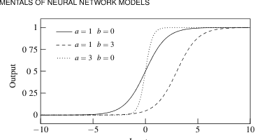

**图 2.4** 对于几种参数选择的逻辑函数，方程 (2.7)。请注意其与图 2.2 右部分曲线的相似性。

目前介绍的基本节点模型在图 2.5 中总结，并形式化为

$$z_{i}=f\left(\sum_{j} w_{j} z_{j}\right) \tag{2.8}$$

相应地，整个网络的操作可以符号化表示为 $\mathbf{z}=f(\mathbf{W} \cdot \mathbf{z})$。显然，这个模型比神经元和突触简单得多。然而，事实证明它在构建行为和神经系统模型方面非常有用。在神经网络研究中，根据研究的具体目标，既使用更简单的节点，也使用更复杂的节点。有时使用更简单的节点是为了简化数学分析。一个例子是只有两个状态，“活跃”和“不活跃”的节点（Amit 1989；McCulloch & Pitts 1943）。更复杂的节点有许多用途，其中之一是研究神经元生理学。例如，Bush & Sejnowski（1991 年）根据照片重建了几个神经元的分支结构，Lytton & Sejnowski（1991 年）将它们模拟为复杂的电气网络，精确地重现了观察到的脉冲模式。然而，具有如此复杂节点的网络将非常难以构建和理解。此外，我们并不保证通过包含更多细节就能得到更好的行为模型。我们仍然忽略神经系统的运行中哪些神经元特征至关重要，哪些较不重要（Graham & Kado 2003 年）。因此，我们将使用之前描述的基本节点开始，并在需要建模行为现象时再添加复杂性。

### 2.1.3 更高级的节点

本节展示了如何发展基本节点以包含神经元的额外特征。首次阅读时可以跳过，因为我们的大多数网络模型将使用之前描述的基本节点。我们首先询问如何计算节点对随时间变化的输入 $y(t)$ 的响应活动。最简单的可能性是将时间解释为离散*时间步*的序列，并使用方程 (2.8) 根据 $t$ 时刻的节点输入计算 $t+1$ 时刻的节点活动：

$$z(t+1)=f(y(t)) \tag{2.9}$$

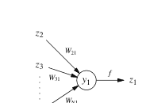

图 2.5 基本节点模型。节点 1 通过权重 $W_{12}, \ldots, W_{1N}$ 接收来自节点 $2, \ldots, N$ 的输入。接收到的总输入为 $y_1 = \sum_{j=2}^N W_{1j} z_j$；该输入通过传输函数 $f$ 处理以产生节点活动 $z_1$。

这个方程的关键特性是，节点活动完全由节点输入决定。另一方面，神经元活动可能取决于最近的活动历史等因素。换句话说，神经元不能即时跟随输入的变化。例如，图 2.3 显示摇蚊（cranefly）光感受器对光刺激的产生存在一定的反应延迟。这可以通过让 $z(t+1)$ 成为 $z(t)$ 和 $f(y(t))$ 的加权平均值来模拟：

$z(t+1) = kf(y(t)) + (1-k)z(t)$ (2.10)

因此，下一个时间步的节点活动不仅取决于当前输入，还取决于当前活动，其比例由参数 $k$ ($0 < k < 1$) 给定。如果 $k$ 很小，$z(t+1)$ 倾向于接近 $z(t)$；因此，节点对输入变化的响应较慢。方程 (2.10) 通常写成活动从一个时间步到下一个时间步的变化 $\Delta z(t) = z(t+1) - z(t)$ 的形式。如果我们从两边减去 $z(t)$ 并写 $1/k = \tau$，我们得到

$\tau \Delta z(t) = f(y(t)) - z(t)$ (2.11)

参数 $\tau$ 被称为节点的时间常数：$\tau$ 越小，$z(t)$ 的变化速度就越快。图 2.6 表明，摇蚊光感受器可以用方程 (2.11) 很好地描述，其中 $\tau = 35$ ms。方程 (2.11) 也是对连续时间中节点动力学的简单模型的近似（主要区别在于，在连续时间中，增量 $\Delta z(t)$ 被时间导数 $dz(t)/dt$ 取代）。

方程 (2.10) 与方程 (2.9) 有什么关系？如果输入是恒定的，由方程 (2.11) 计算出的 $z(t)$ 值最终将达到一个稳态，该稳态与后者预测的稳态（即与方程 2.5 相同）相等。稳态是通过设置 $\Delta z(t) = 0$（无变化）获得的，在这种情况下，方程 (2.11) 变得与方程 (2.9) 相同。稳态以由 $\tau$ 给出的速率接近；因此，如果输入在远长于 $\tau$ 的时间尺度上变化，这两个方程是等价的。这证明了当我们不关注短期响应时使用方程 (2.9) 的合理性。

我们现在展示如何通过添加内部状态来模拟神经元的其他特性。我们的例子是感觉习惯化（或适应），如图 2.6 所示。我们引入一个单一的状态变量 $h$，代表习惯化的水平，并假设节点接收到一个抑制性输入 $-h$：

$\tau \Delta z(t) = f(y(t) - h(t)) - z(t)$ (2.12)

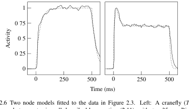

图 2.6 两个拟合图 2.3 中数据的节点模型。左：摇蚊 (*Tipula*) 光感受器可以用方程 (2.11) 很好地描述，其中 $\tau = 35$ ms。右：肉蝇 (*Sarcophaga*) 光感受器可以用方程 (2.12) 和 (2.13) 很好地描述，其中 $\tau = 10$ ms，T = 25 ms，$a = 0.5$。

直观上，$h$ 应该在节点强烈活跃时增加，在节点活动较低时减少。这是通过以下方程实现的：

$T\Delta h(t) = a y(t) - h(t)$ (2.13)

其中 T 是第二个时间常数，$a$ 调节习惯化的效果。后者可以通过计算由恒定输入 $y$ 产生的稳态节点活动来观察。在上面的方程中设置 $\Delta z(t) = 0$ 和 $\Delta h(t) = 0$，我们得到关于稳态值 $z$ 和 $h$ 的两个方程：

$z = f(y - h)$

$h = ay$ (2.14)

这隐含了 $z = f((1 - a)y)$。因此，习惯化节点的稳态与非习惯化节点的稳态相同，后者输入被因子 $1 - a$ 减小。图 2.6 表明，这个简单模型可以准确地描述肉蝇的习惯化光感受器。Benda & Herz (2003) 表明，更复杂的习惯化类型可以用简单模型描述。具有少数内部变量的模型也已针对神经元的其他特性开发，如自发活动（Wang & Rinzl 2003）。

## 2.2 网络架构

节点之间的连接模式定义了*网络架构*，它决定了网络的许多属性。在以下部分，我们将介绍一些与行为建模相关的架构。我们将首先考虑*前馈网络*，之所以这样命名，是因为节点活动单向地从输入节点流向输出节点，没有任何反馈连接。*循环网络*，即带有反馈连接的网络，将在后面考虑。

在描述神经网络时，我们保留了通常用于行为图的符号（第 1 章）。输入空间和输出空间可以通过选择某些节点作为*输入节点*，其他节点作为*输出节点*来定义。例如，前者可以模拟感受器，后者模拟运动神经元（连接到肌肉）或分泌激素或其他化学物质的神经元（第 3 章）。既不是输入节点也不是输出节点的节点传统上被称为*隐藏节点*。我们将网络输入向量写为 $\mathbf{x}_1, \mathbf{x}_2$ 等。希腊字母索引指代不同的输入，拉丁字母索引指代特定节点。因此，$x_{\alpha i}$ 是由输入 $\mathbf{x}_{\alpha}$ 激发的输入节点 $i$ 的活动。同样，$r_{\alpha j}$ 是对输入 $\mathbf{x}_{\alpha}$ 的响应下输出节点 $j$ 的活动。如上所述，字母 $y$ 和 $z$ 将分别继续用于通用节点的输入和输出。

### 2.2.1 前馈网络

第 19 页的图 1.9 展示了一些前馈网络。假设网络外部的刺激激活网络的输入节点。这种激活模式在对应于节点“层”的多个步骤中进行处理。每一层的活动通过连接矩阵传播到下一层。可能存在任意数量的层，尽管两层和三层网络最为常见。前馈处理是神经系统的重要组织原则，例如在信息从感受器到达大脑的方式中。虽然纯粹的前馈处理很少见，但我们将看到这些网络是行为的有用模型。此外，前馈网络是更复杂架构的重要组成部分。

#### 2.2.1.1 感知器

我们考虑的第一个网络架构是所谓的感知器（Minsky & Papert 1969; Rosenblatt 1958, 1962）。它由一个通过权重向量 $\mathbf{W}$ 接收多个输入的单一节点组成，如第 19 页的图 1.9 所示。由于其简单性，感知器由单个方程完全指定：


$r = f\left(\sum_{j} W_{j}x_{j}\right) = f(\mathbf{W} \cdot \mathbf{x})$    (2.15)

（参见方程 2.8，并注意在这种简单情况下，我们只需要一个索引来标记权重）。感知器可以有几种解释方式。它可以模拟一个非常简单的神经系统，其中几个感受器直接连接到一个输出神经元；或者它可以作为更大系统的构建模块。在他开创性的工作中，Rosenblatt 将 $x_{j}$ 视为简单*特征检测器*的输出，例如，报告视觉场景的特定方面（参见图 1.11 中的“分析器”）。感知器必须组合关于单个特征存在或缺失的信息，以对整个输入模式做出是/否决策，例如关于它是否属于某个类别。为此，Rosenblatt 使用了一个假设只有值 0 和 1 的传输函数，如下所示：

$f(y) = \begin{cases} 1 & \text{如果 } y > \theta \\ 0 & \text{否则}\end{cases}$    (2.16)

### 表 2.1 解释为觅食简单模型的行为映射，该模型无法由具有两个输入节点和一个输出节点的感知器实现。前两列，每列分为两部分，分别提供输入和输出的数学描述和解释。第三列显示了如何选择感知器参数以实现单个输入-输出映射。然而，没有一组参数可以实现所有四个映射。

| 输入 | | 期望输出 | | 在以下条件下获得的期望输出 |
| :--- | :--- | :--- | :--- | :--- |
| 值 | 解释 | 值 | 解释 | |
| (0,0) | 全黑 | 0 | 不吃 | $\theta > 0$ |
| (0,1) | 黑和白 | 1 | 吃 | $W_2 > 0$ |
| (1,0) | 白和黑 | 1 | 吃 | $W_1 > 0$ |
| (1,1) | 全白 | 0 | 不吃 | $W_1 + W_2 < \theta$ |

其中 $\theta$ 是作为阈值的数字：如果总输入 $y = \mathbf{W} \cdot \mathbf{x}$ 高于阈值，输出将为 1；否则，输出将为 0。Rosenblatt 还设计了一种算法来调整权重，以便将一组输入模式正确分类为两类。例如，我们可以使用此算法来解决第 20 页讨论的觅食控制问题。

然而，感知器无法实现所有的行为映射。考虑一个具有两个模拟光感受器的输入节点和一个其活动被解释为捕食猎物的输出节点的感知器。每个感受器在未捕获或捕获少量光时反应为 0，在捕获大量光时（例如，当白色物体反射的光到达感受器时）反应为 1。模型生物遇到两种潜在的猎物。全白色的猎物不可口，应该被忽略。我们假设白色猎物的存在反射足够的光到视网膜，总是激活两个感受器。第二种猎物则应该被吃掉。它的存在只激活一个感受器（例如，因为它更小），产生两种可能的输入模式：(0,1) 和 (1,0)。所需的行为映射显示在表 2.1 中，被称为异或问题（XOR）。表中最后一列显示必须如何选择三个感知器参数 $W_1$、$W_2$ 和 $\theta$ 以实现每个输入-输出映射。例如，如果 $W_1 \times 0 + W_2 \times 1 = W_2$ 大于 $\theta$，感知器会对 (0,1) 做出反应（表第二行）。问题是，四个条件不能由同一组参数同时满足：如果 $W_1$ 和 $W_2$ 单独都大于正数 $\theta$，那么和 $W_1 + W_2$ 不能小于 $\theta$！感知器的局限性将在下面进一步讨论（另见 Minsky & Papert 1969）。

#### 2.2.1.2 从感知器到行为

一些修改使感知器更适合行为建模，尽管其计算局限性并未消除。Rosenblatt 的阈值机制（方程 2.16）意味着相同的输入总是产生相同的输出。相比之下，动物对给定刺激的反应通常是可变的

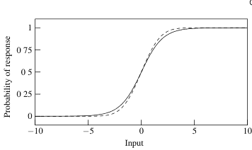

图 2.7 节点对输入做出反应的概率，对应两种不同的传递函数选择。实线：公式 (2.7)，其中 a = 1 且 b = 0。虚线：公式 (2.18)，其中 σ = 0.5，且 ε 取自标准正态分布。

因为刺激并非影响行为的唯一因素。我们可以通过遵循两条略有不同的途径来弥补这一不足。通过第一条途径，我们可以使用一个从 0 平滑上升到 1 的传递函数 f（图 2.4），并将节点活动解释为动物对刺激做出反应的概率：

Pr(reaction to x) = f(W · x) (2.17)

通过第二条途径，保留阈值机制，但在 y 中加上一个随机数 ε 后再应用该机制，例如 ε 取自标准正态分布。形式上，我们用以下公式替换公式 (2.16)：

r = \begin{cases} 1 & \text{if } y + σ\epsilon > \theta \\ 0 & \text{otherwise} \end{cases} (2.18)

其中 σ 是一个正数，用于调节随机性的权重。由于每次呈现 x 时 ε 都会重新随机抽取，因此对 x 的输出现在变得可变。然而，这并不意味着行为完全是随机的，因为根据公式 (2.18)，随着输入 y = W · x 的增加，对 x 做出反应的概率会稳步增加。如图 2.7 所示，使用公式 (2.17) 或公式 (2.18) 得到的平均行为之间可能几乎没有差异。在前一种情况下，感知器输出被直接解释为做出反应的概率。这在理论分析以及将模型与关于平均行为的数据进行比较时非常方便。后一种传递函数可用于生成对每次输入呈现的个别反应，这在行为模拟中（第 2.3.4 节）是必要的。

通过结合考虑公式 (2.17) 和公式 (2.6)，我们可以获得一个对刺激做出反应的非常简单的模型：

Pr(reaction to x) = W · x (2.19)

并进一步假设如果 W · x < 0 则概率为 0，如果 W · x > 1 则概率为 1。通过这种方式，我们可以将简单计算的结果解释为动物对刺激做出反应的概率。我们将在下文看到，这个简单模型对于理解神经网络的某些重要工作原理非常有帮助。在第 3 章中，我们将把公式 (2.19) 应用于许多行为现象。

#### 2.2.1.3 通用前馈网络

有可能构建比感知器更强大的前馈网络。例如，我们可以添加输出节点（第 19 页的图 1.9）。在运动控制研究中，输出节点可以模拟控制单个肌肉的运动神经元。在这种情况下，网络产生的输出模式序列将对应肌肉收缩序列（第 3.8.8 节）。在对行为建模时，通常将每个输出节点的活动解释为执行特定行为模式的倾向更为方便。决定实际执行哪种行为的一种方法是假设最活跃的节点始终主导控制。或者，我们可以将节点的活动解释为执行相应行为的（相对）概率。我们将在第 3.7 节中看到，如果存在随机因素，这两种规则都可以从输出节点之间的相互抑制中产生。

前馈网络也可以通过添加额外层进行扩展（第 19 页的图 1.9）。如果 $z_i$ 是第 $i$ 层节点，且 $\mathbf{W}^{(i)}$ 是从第 $i$ 层到第 $i + 1$ 层的权重矩阵，则通用前馈网络的操作可以概括为 $\mathbf{z}_{i+1} = f(\mathbf{W}^{(i)} \cdot \mathbf{z}_i)$。这类网络通常被称为*多层感知器*，能够解决比仅具有输入层和输出层的网络更广泛的问题。事实上，给定足够的隐单元且节点传递函数是非线性的情况下，多层感知器能够实现任意的输入输出映射（Haykin 1999）。例如，表 2.1 中的行为映射（感知器无法实现）可以通过如图 2.8 所示的简单多层网络轻松实现。如果隐节点的传递函数是线性的，可以证明多层网络等效于没有隐层的网络。原因是单个权重矩阵足以在输入空间和输出空间之间执行任何线性变换。我们将在第 3.4 节中看到，多层线性网络仍然值得研究。在第 3 章中，我们还将使用一些非线性多层网络来建模对线性网络来说过于复杂的行为。

### 2.2.2 递归网络

前馈网络可以实现任何具有固定输入输出关系映射，但无法实现输出取决于先前输入的映射。例如，前馈网络无法区分输入序列 $\{\mathbf{x}_1, \mathbf{x}_2\}$ 和 $\{\mathbf{x}_2, \mathbf{x}_1\}$。在两种情况下，第二个时间步对 $\mathbf{x}_2$ 的输出都是相同的，因为前馈网络的输出仅由当前输入决定。因此，前馈网络的时间处理能力非常有限。虽然可以进行一些改进（第 2.3.5 节），但递归网络是分析输入序列和生成输出序列的更优越的替代方案。递归网络的关键架构元素是*反馈回路，或称为递归连接*。这意味着节点在某一时刻的活动可以受到该节点先前时刻活动的影响。通常，这种影响是通过其他节点在中间时刻的活动媒介实现的。换句话说，在前馈网络中，只有权重充当过去的记忆，而在递归网络中

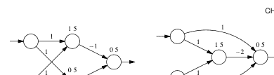

图 2.8 两个实现表 2.1 中输入输出映射的网络（异或问题，或 XOR）。节点传递函数为公式 (2.16)；每个节点上方的数字是阈值。读者可以验证，在输入模式 (0,0)、(1,1)、(0,1) 和 (1,0) 中，只有后两者激活输出节点。


节点的活动也是记忆的源泉。递归性是神经系统的常见特征，并支撑着它们更精密的能力。例如，反馈在大脑中非常常见，既存在于不同的皮层区域内，也存在于皮层区域之间。

递归网络的行为可能非常多样化（Amit 1989; Dayan & Abbott 2001; Hertz et al. 1991）。对于恒定输入，递归网络可能稳定到持续的活动模式（针对不同输入可能是不同的模式），它可能反复循环通过一系列状态，或者表现出 irregular 的行为。当输入随时间变化时，网络通常不会稳定到一种活动模式，而是会生成一系列输出模式，原则上具有任意复杂性。因此，递归网络似乎是建模动物行为时间结构的有前途的工具，但也是一个处理起来并非自明了的工具。在第 2.3.5 节中，我们将展示几种递归架构以及如何构建具有所需属性的递归网络。在后续章节中，我们将应用递归网络进行行为建模。

我们以一个技术说明结束，初次阅读时可以跳过，但在使用递归网络时应予考虑。为了处理递归网络，我们需要一种方法来计算随时间推移的节点活动，即网络的动力学。最简单的方法是考虑离散时间步，并使用公式 (2.8) 根据时间 *t* 的活动计算时间 *t*+1 所有节点的活动：

$$z_{i}(t+1)=f\left(\sum_{j} W_{i j} z_{j}(t)\right) \quad (2.20)$$

这种简单动力学在某些情况下是足够的，但通常有缺点。其主要特点是所有节点同时更新，仿佛有一个“全局时钟”同步了网络（*同步动力学*）。相比之下，神经系统中的神经元可以在任何时间改变其活动，独立于其他神经元的状态。一个神经元的改变会以改变输入的形式影响其他神经元（由于尖峰传播时间和突触传递时间而存在一定延迟）。给定相同的权重，同步动力学可能产生比更现实的连续时间动力学不同的结果。此外，对更新过程的小改动或少量噪声都可能改变网络行为（Amit 1989）。克服这些缺陷的一个明显方法是使用连续时间，但在许多情况下，稍微修改公式 (2.20) 就足够了。例如，我们

可以使用公式 (2.11)，其中 $y(t) = \sum_j W_{ji} y_j(t)$（详见 2.1.3 节）。后者实际上是简单连续时间模型的离散时间近似（由于数字计算机是按时间步长运行的，因此在计算机模拟中，这种近似总是必要的）。另一种可能性如下。在每个时间步，我们随机确定节点的顺序。然后更新第一个选中的节点。当我们更新第二个节点时，我们使用第一个节点更新后的活动，依此类推对所有节点进行操作。由于每个时间步的随机顺序都不同，该过程模拟了真实神经系统中的无协调动力学，因此被称为*异步动力学*（Amit 1989）。通过这种方式获得的任何结果显然对更新操作顺序的变化具有鲁棒性。

## 2.3 实现特定的输入-输出映射

网络实现的输入-输出映射当然取决于权重的值。在实践中，与神经网络相关的大部分工作都涉及权重的设置。到目前为止，我们考虑过的问题中，合适的权重可以通过直觉或使用简单的数学方法来找到。在本节中，我们描述了一些强大的权重设置方法，这些方法可以处理更复杂的问题。在下一节中，我们将描述根据输入组织网络权重的程序，而不是寻求实现特定的输入-输出映射。

权重设置方法可以被视为现实世界现象的模型，即神经系统中突触如何变化，或者仅仅作为构建处理特定任务的工具，而不作其他额外声明。这里侧重于后者观点，而第 4 章涵盖生物学习。我们的目标是构建一个网络，该网络能产生 $\mu$ 个指定的输入-输出映射：

$$

m(\mathbf{x}_\alpha, \mathbf{W}) = \mathbf{d}_\alpha \quad \forall \alpha = 1, \dots, \mu \tag{2.21}

$$

其中 `m` 是网络实现的输入-输出映射，`W` 表示所有网络权重，`d_alpha` 是对输入 `x_alpha` 的期望输出模式。公式 (2.21) 是一个由 $\mu$ 个方程组成的系统，其中未知数是网络权重。直接分析这些方程通常非常具有挑战性，或者根本不可行。唯一可以用简单数学彻底处理的情况是线性网络，即所有节点都具有线性传递函数的网络，例如公式 (2.6)。在介绍更通用的权重设置技术之前，我们将讨论这种情况（最后会对具有非线性输出节点的网络进行简要说明）。

### 2.3.1 线性网络中的权重设置

如果所有节点的传递函数都是线性的，则可以通过形式化方法找到满足公式 (2.21) 的权重，或者可以证明它们不存在。我们从一个线性感知机开始，即公式 (2.19)，以及单个输入-输出映射。这对应于 $\mu = 1$ 且 `m(x_1, W) = W · x_1` 的公式 (2.21)。在这种情况下，很容易检查出，单个要求 `W · x_1 = d_1` 由形式为

$$

\mathbf{W} = c_1 \mathbf{x}_1 \tag{2.22}

$$

的权重向量满足，其中 `c_1 = d_1 / (x_1 · x_1)`。此外，如果我们向 `W` 添加一个向量 `u`，使得 `u · x_1 = 0`，结果不会改变。总之，该任务的一般解形式为

$$

\begin{cases} \mathbf{W} = \frac{d_1}{\mathbf{x}_1 \cdot \mathbf{x}_1}\mathbf{x}_1 + \mathbf{u} \\ \mathbf{u} \cdot \mathbf{x}_1 = 0 \end{cases} \tag{2.23}

$$

通过扩展这一推理，可以证明实现 $\mu$ 个输入-输出映射的权重向量可以写为

$$

\begin{cases} \mathbf{W} = \sum_{\alpha=1}^{\mu} c_\alpha \mathbf{x}_\alpha + \mathbf{u} \\ \mathbf{u} \cdot \mathbf{x}_\alpha = 0 \quad \forall \alpha = 1, \dots, \mu \end{cases} \tag{2.24}

$$

然而，`c_alpha` 的一般表达式并不像公式 (2.23) 中那样简单。我们将展示如何在有两个输入-输出映射的情况下解决此问题。这个简单的任务将贯穿本节，用于说明和比较不同的权重设置技术。可能有必要将其想象为一个判别任务，其中 `x_1` 需要映射到高输出，而 `x_2` 映射到低输出，尽管该过程对所有期望输出都是一样的。

根据公式 (2.24)，我们猜测 `W` 应该具有形式 `c_1 x_1 + c_2 x_2`，因此我们的任务是找到满足要求 `W · x_alpha = d_alpha` 的 `c_1` 和 `c_2` 的值。如果我们用 `c_1 x_1 + c_2 x_2` 替换 `W`，这些要求可以表示为

$$

\begin{aligned} (c_1 \mathbf{x}_1 + c_2 \mathbf{x}_2) \cdot \mathbf{x}_1 &= c_1 \mathbf{x}_1 \cdot \mathbf{x}_1 + c_2 \mathbf{x}_2 \cdot \mathbf{x}_1 = d_1 \\ (c_1 \mathbf{x}_1 + c_2 \mathbf{x}_2) \cdot \mathbf{x}_2 &= c_1 \mathbf{x}_1 \cdot \mathbf{x}_2 + c_2 \mathbf{x}_2 \cdot \mathbf{x}_2 = d_2 \end{aligned} \tag{2.25}

$$

为了简洁起见，我们写 `x_alpha · x_beta = X_{alpha beta}`：

$$

\begin{aligned} X_{11}c_1 + X_{12}c_2 &= d_1 \\ X_{12}c_1 + X_{22}c_2 &= d_2 \end{aligned} \tag{2.26}

$$

（注意 `X_{12} = X_{21}`）。上述是关于未知数 `c_1` 和 `c_2` 的二元线性方程组。它可以通过多种方法求解，得出

$$

\begin{aligned} c_1 &= \frac{d_1 X_{22} - d_2 X_{12}}{X_{11} X_{22} - X_{12}^2} \quad \quad c_2 &= \frac{d_2 X_{11} - d_1 X_{12}}{X_{11} X_{22} - X_{12}^2} \end{aligned} \tag{2.27}

$$


作为练习，读者可以检查这些表达式确实使得 $\mathbf{W} \cdot \mathbf{x}_1 = d_1$ 且 $\mathbf{W} \cdot \mathbf{x}_2 = d_2$。如果网络需要满足许多输入-输出映射，同样的技术也适用，但计算变得单调乏味。数值或形式化数学软件将派上用场，而线性代数教科书将提供理论基础。

注意，公式 (2.24) 用向量 $\mathbf{x}_\alpha$ 表示权重向量 $\mathbf{W}$。这为"$\mathbf{x}_\alpha$ 已被'存储在内存中'"这一直观陈述提供了具体的解释。此外，它允许人们理解对于一般输入 $\mathbf{x}$ 的输出，通过 $\mathbf{x}$ 与 $\mathbf{x}_\alpha$（以及向量 $\mathbf{u}$）的关系来解释。这将在第 3 章中讨论。

即使输出节点不是线性的，公式 (2.24) 也成立。这样的网络可以写为 $\mathbf{r} = f(\mathbf{W} \cdot \mathbf{x})$。我们提及这种情况，因为非线性输出节点常被用于将网络输出限制在 0 和 1 之间，并将其解释为响应概率。证明基于以下观察：要求 $d_\alpha = f(\mathbf{W} \cdot \mathbf{x}_\alpha)$ 可以写为 $d_\alpha = \mathbf{W} \cdot \tilde{d}_\alpha$，其中 $\tilde{d}_\alpha = f^{-1}(d_\alpha)$，$f^{-1}$ 是 $f$ 的反函数。因此，我们回到了线性问题，尽管 $d_\alpha$ 的值不同。这意味着 $f$ 的不同选择会导致 $c_\alpha$ 的值不同，但不改变权重向量的结构。

### 2.3.1.1 线性网络的局限性和能力

在这里，我们扩展关于感知机局限性的评论（第 40 页），通过询问公式 (2.21) 中的任务何时可以通过感知机解决。然后我们将推理扩展到一般线性网络。确定任务何时无法解决是很容易的。事实上，线性网络 $\mathbf{r} = \mathbf{W} \cdot \mathbf{x}$ 的定义意味着

$$
\mathbf{r}(\mathbf{x}_\alpha + \mathbf{x}_\beta) = \mathbf{r}(\mathbf{x}_\alpha) + \mathbf{r}(\mathbf{x}_\beta) \tag{2.28}
$$

因为 $\mathbf{W} \cdot (\mathbf{x}_\alpha + \mathbf{x}_\beta) = \mathbf{W} \cdot \mathbf{x}_\alpha + \mathbf{W} \cdot \mathbf{x}_\beta$（来自公式 2.8）。换言之，输入的总和的输出等于每个输入的输出之和（确实，这是线性的技术含义）。因此很清楚，如果一个输入-输出映射中，例如 $\mathbf{x}_\gamma = \mathbf{x}_\alpha + \mathbf{x}_\beta$ 但 $\mathbf{d}_\gamma \neq \mathbf{d}_\alpha + \mathbf{d}_\beta$，则该映射无法由线性网络实现。一般来说，如果在输入 $\mathbf{x}_1, \dots, \mathbf{x}_n$ 中，存在某个输入，例如 $\mathbf{x}_\beta$，可以写为其他输入的加权和，例如

$$
\mathbf{x}_\beta = \sum_{a \neq \beta} b_a \mathbf{x}_a \tag{2.29}
$$

（对于某些 $b_a$ 的选择），那么除非

$$
\mathbf{d}_\beta = \sum_{a \neq \beta} b_a \mathbf{d}_a \tag{2.30}
$$

否则不存在实现公式 (2.21) 中输入-输出映射的权重向量 $\mathbf{W}$。也就是说，输出之间必须保持与输入之间相同的关系。反之，如果无法将任何 $\mathbf{x}_a$ 写为公式 (2.29) 的形式，则公式 (2.21) 中的输入-输出映射可以由线性网络对任意选择的 $\mathbf{d}_a$ 实现。事实上，读者可能已经注意到，如果 $X_{11}X_{22} = X_{12}^2$（分式分母消失），公式 (2.27) 是没有意义的。这恰好发生在 $\mathbf{x}_1 = b\mathbf{x}_2$ 时，这是公式 (2.29) 的一个特例。事实上，在这种情况下我们有

$$
\begin{align*} X_{11} &= \mathbf{x}_1 \cdot \mathbf{x}_1 \\ X_{22} &= b^2 \mathbf{x}_1 \cdot \mathbf{x}_1 \\ X_{12} &= b \mathbf{x}_1 \cdot \mathbf{x}_1 \end{align*} \tag{2.31}
$$

因此 $X_{11}X_{22} = X_{12}^2 = b^2(\mathbf{x}_1 \cdot \mathbf{x}_1)^2$。关于此主题的更多信息可在线性代数教科书（线性方程组章节）中寻找。

## 2.3.2 梯度下降法（$\delta$ 规则，反向传播）

在本节及下一节中，我们将介绍一种需要所谓的**目标函数**才能运作的权重设定方法。这些方法可以用于原则上任意复杂度的非线性网络。事实上，这些方法非常通用，适用于任何具有可调参数的输入-输出映射（Mitchell 1996; Widrow & Stearns 1985）。*目标函数*简单地衡量网络的性能。它可以表明实际映射与期望映射之间的差异有多大（*误差度量*），或者它们之间有多接近（*性能度量*）。在每种具体情况下使用何种度量，往往取决于便利性以及部分历史偶然性。如果我们使用误差度量，目标就是找到使其最小化的权重；而性能度量则应被最大化。因此，神经网络中的权重设定可以被视为一个函数最小化或最大化问题（Aubin 1995; Widrow & Stearns 1985）。

虽然有许多性能度量方法在使用中（第 2.3.3 节），但*平方误差*是迄今为止最受欢迎的误差度量。相对于任务 (2.21)，其定义如下。我们首先通过对每个输出节点期望输出与实际输出的偏差平方和进行求和，来引入相对于输入-输出对（$\mathbf{x}_{\alpha}, \mathbf{d}_{\alpha}$）的误差：

$$E_{\alpha}(\mathbf{W}) = \frac{1}{2} \sum_i (d_{\alpha i} - r_{\alpha i}(\mathbf{x}_{\alpha}))^2 \tag{2.32}$$

记号 $E_{\alpha}(\mathbf{W})$ 强调误差是权重的函数。前面的系数二分之一仅用于简化后续的记号。相对于方程 (2.21) 中整个任务的平方误差定义为

$$E(\mathbf{W}) = \sum_{\alpha} E_{\alpha}(\mathbf{W}) \tag{2.33}$$

显然，平方误差越小，我们越接近满足方程 (2.21) 的要求。只有当平方误差消失时，期望的映射才建立起来。

我们现在准备展示误差最小化的*梯度下降*方法。让我们考虑一个只有两个权重的网络，$\mathbf{W} = (W_1, W_2)$，并假设相对于任务的平方误差 $E(W_1, W_2)$ 对于 $W_1$ 和 $W_2$ 的每个值都是已知的。三元组 $(W_1, W_2, E(W_1, W_2))$ 可以表示为三维坐标空间中的一个点。当权重变化时，$E(W_1, W_2)$ 也随之变化，该点描绘出一个被称为*误差曲面*的表面（图 2.9）。这允许我们可视化不同权重选择下的误差值。减小误差的最快方法是在误差曲面上沿斜率向下最陡峭的方向行进。为了找到对应于这种方向的权重变化，人们考虑相对于曲面的*梯度*向量。这写作 $\nabla E(\mathbf{W})$，定义为其分量是 $E(\mathbf{W})$ 对权重的（偏）导数的向量：

$$\nabla E(\mathbf{W}) = \begin{pmatrix}\frac{\partial E(\mathbf{W})}{\partial W_{11}}\\\vdots\\\frac{\partial E(\mathbf{W})}{\partial W_{NN}}\\\end{pmatrix} \tag{2.34}$$

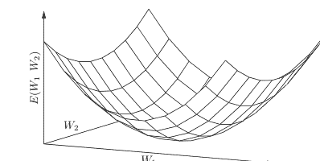

*图 2.9 具有两个权重的网络的误差曲面。对于给定任务，曲面在 ($W_1$，$W_2$) 处的高度是该特定权重选择相对于此任务的误差 $E(W_1, W_2)$。*

可以证明，该向量指向最陡峭上升的方向。因此，为了下降误差曲面，人应当沿相反方向行进。此外，步长不应过长：由于要遵循的路径通常会是弯曲的，行进方向需要定期更新。这一推理通过写出权重 $W_i$ 的更新量 $\Delta W_i$ 的形式化：


$$\Delta W_i = -\eta\nabla_i E(\mathbf{W}) \tag{2.35}$$

其中 $\nabla_i E(\mathbf{W})$ 是梯度向量的第 $i^{\text{th}}$ 个分量（即 $E(\mathbf{W})$ 对 $W_i$ 的导数），$\eta$ 是一个校准步长的小正数。一旦方程 (2.35) 应用于所有权重，梯度会重新计算，然后方程 (2.35) 再次应用，如此反复，直到误差降低到令人满意的低数值。也就是说，梯度下降是一个*迭代过程*，方程 (2.35) 在每次迭代中应用。请注意，尽管我们从只有两个权重的例子开始，方程 (2.35) 可以应用于具有任意数量权重的网络。

我们必须考虑两个在图 2.9 中不明显的重要复杂情况。事实上，该图描绘了一个特别有利的案例，其中误差曲面有唯一的最小值，且梯度始终指向沿较短路径通向最小值的方向。通常，这两者都不能保证成立。误差曲面可能有多个极小值，其中只有一两个是令人满意的。此外，遵循梯度可能导致一条非常长的路径，而如果对误差曲面有更全面的了解，本可以避开这条路径。为梯度方法辩护，我们可以说，在仅拥有误差曲面*局部*信息的情况下（例如，关于如果权重从当前值略微改变，误差会如何变化），取最陡下降路径是合理的。这里介绍的基本算法可以通过许多方式改进，正如 Haykin (1999) 和 Golden (1996) 中解释的那样。

### 2.3.2.1 增量规则

为了计算平方误差及其梯度，人们需要了解所有输入的响应以及当改变任何权重时它如何变化。实际的输入-输出机制可能不具备所有这些信息的知识。例如，输入-输出对必然以序列形式体验，要记住之前的输入和输出需要网络外部的记忆。如果没有这种记忆，能做的最好的事情是计算相对于当前输入的误差，即方程 (2.32)，而不是完整的平方误差，即方程 (2.33)。这导致了对神经网络（特别是前馈网络）中梯度方法最著名的应用。当应用于没有隐藏节点的网络时，该方法被称为 `δ` 规则，此名称由 McClelland 和 Rumelhart (1985) 命名，但早在 Widrow 和 Hoff (1960) 时期就以不太吸引人的最小均方（least-mean-squares）算法之名为人所知。我们从一个单输出节点开始，在这种情况下，瞬时误差为（为简单起见，我们在方程 2.32 中去掉了索引 $\alpha$）：

$$E = \frac{1}{2}(d - r)^2 \tag{2.36}$$

其中 $r = \mathbf{W} \cdot \mathbf{x}$ 是对 $\mathbf{x}$ 的响应。为了计算导数 $\partial E/\partial W_i$，首先注意到导数 $\partial r/\partial W_i$ 仅仅是 $x_i$。因此

$$\begin{align*} \frac{\partial E}{\partial W_i} &= -(d - r)\frac{\partial r}{\partial W_i} \\ &= -(d - r)x_i \end{align*} \tag{2.37}$$

因此，遵循方程 (2.35)，每个权重增加

$$\Delta W_i = \eta(d - r)x_i \tag{2.38}$$

这就是 `δ` 规则。之所以这样命名，是因为 McClelland 和 Rumelhart (1985) 将差值 $d - r$ 写作 `δ`，从而得出了更简单的表达式

$$\Delta W_i = \eta\delta x_i \tag{2.39}$$

（在去掉索引 $\alpha$ 后，我们要回忆一下，$\mathbf{x}$ 代表当前输入，即那些必须建立期望输出 $d_\alpha$ 的 $\mathbf{x}_\alpha$ 之一；同样，$\delta$ 是相对于当前输入的误差）。

可以证明，`δ` 规则将找到一个权重向量，在展示不同输入的过程中，该向量保持接近于最小化总平方误差的那个向量，前提是输入以随机顺序展示且 `η` 足够小（Widrow & Stearns 1985）。因此，在没有隐藏层网络的情况下，一次处理一个输入并不是一个严重的限制（因为这些网络的误差曲面有单个最小值；参见 Widrow & Stearns 1985）。

`δ` 规则如此受欢迎的一个原因是，方程 (2.38) 可以通过以下方式推导和理解，且无需太多数学知识（Blough 1975; 扩展自 Rescorla & Wagner 1972）。项 $d - r$ 是期望输出与实际输出之间的差异，当实际反应低于（高于）期望反应时，它是正的（负的），当实际行为与期望行为匹配时，它是零。也就是说，$d - r$ 具有与期望响应变化相同的符号。此外，实际输出偏离期望输出越多，其绝对值就越大。因此，它

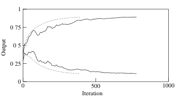

可用于指挥大致近似量级的正或负权重变化。将 $d - r$ 乘以 $x_i$ 的进一步效果是更多地改变那些连接到更活跃输入节点的权重，其直观的合理性在于这些权重对 $x$ 的错误输出贡献最大。

`δ` 规则可以轻松地解决前面介绍的任务示例。图 2.10 中的实线是学习曲线（网络输出作为算法迭代次数的函数），来自使用 `δ` 规则解决该任务的模拟。虚线显示，完全梯度下降（基于完整的平方误差，公式 2.33）能更快、更平滑地解决同一任务。完全梯度下降的公式 simply 是 `δ` 规则公式对所有输入-输出关系求和：

$$ \Delta W_{i} = \eta \sum_{\alpha} (d_{\alpha} - r_{\alpha}) x_{\alpha i} \quad (2.40) $$

`δ` 规则也可以扩展到非线性输出节点，其中 $r = f(W \cdot x)$。重复导致公式 (2.38) 的步骤，我们得到

$$ \Delta W_{i} = \eta (d - r) f'(W \cdot x) x_{i} \quad (2.41) $$

唯一的增加项是 $f'(W \cdot x)$。实际上，即使输出节点是非线性的，也可以使用公式 (2.38)（Hinton 1989）。`δ` 规则也可以应用于具有更多输出节点的网络。权重矩阵 $W$ 被视为由权重向量 $W_1, \dots, W_p$ 组成，其中 $W_j$ 连接输入节点到输出节点 $j$。由于这些权重向量彼此独立，只需将 `δ` 规则分别应用于每一个，得到

$$ \Delta W_{ij} = \eta (d_{j} - r_{j}) x_{i} \quad (2.42) $$

### 2.3.2.2 反向传播

反向传播是 `δ` 规则向具有隐藏层的前馈网络的推广。虽然梯度下降是一个老概念，但在 Rumelhart 等人 (1986) 发表反向传播算法之前，它在神经网络领域并未得到充分挖掘。为简单起见，我们从具有单个隐藏层的网络开始。我们写 **V** 为从输入到隐藏节点的权重；**h** 为隐藏节点的活性；以及 **W** 为从隐藏到输出节点的权重。因此，输出节点 $k$ 的活性为

$$ r_k = f \bigg ( \sum_i W_{ki} h_i \bigg ) \quad (2.43) $$

其中

$$ h_i = f \bigg ( \sum_j V_{ij} x_j \bigg ) \quad (2.44) $$

技术上，反向传播算法可以通过计算上述方程关于权重的导数，然后使用梯度下降公式（公式 2.35）来获得。然而，该算法也可以从 `δ` 规则开始进行描述。首先注意，隐藏层和输出层构成了一个两层网络，我们可以用 `δ` 规则对其进行训练：

$$ \Delta \mathbf{W}_{ki} = \eta f' ( y_k ) \delta_k h_i \quad (2.45) $$

其中 $y_k = \sum_i W_{ki} h_i$ 是输出节点 $k$ 接收到的输入，且 $\delta_k = d_k - r_k$。我们缺少的是一个改变输入和隐藏节点之间权重的公式。似乎我们不能再次使用 `δ` 规则，因为对于隐藏节点*我们没有期望输出的概念*，这意味着我们无法计算 `δ` 项。事后看来，解决方案相当简单：相对于隐藏节点 $i$ 的项 $\delta_i$，是相对于输出节点的项 $\delta_k$ 的加权和，其中 $\delta_k$ 的权重正好是 $W_{ki}$，即连接隐藏节点 $i$ 到输出节点 $k$ 的权重（Haklyn 1999; O'Reilly & Munakata 2000）。形式上，

$$ \delta_i = \sum_k \delta_k W_{ki} \quad (2.46) $$

现在既然 `δ` 项已定义，我们可以像往常一样应用 `δ` 规则：

$$ \Delta \mathbf{V}_{ij} = \eta f' ( y_i ) \delta_i x_j \quad (2.47) $$


其中 $y_i = \sum_j V_{ij} x_j$。公式 (2.45) 和 (2.47) 构成了反向传播算法。该算法可以轻松推广到具有多个隐藏层的网络，利用后续层的 $\delta$ 项来定义前几层的 $\delta$ 项。这种 $\delta$ 项的逆向构造赋予了该算法其名称。

### 2.3.3 随机搜索

随机搜索是设置网络权重的一种日益流行的方法，主要原因是其在许多实际案例中的简单性和强大功能。随机搜索方法也被称为*遗传算法*或*进化算法*，原因很快就会明了（Holland 1975; Mitchell 1996）。基本程序如下。从一个初始网络开始，通常具有随机设置的权重，生成一些“变异体”。变异体在几个权重上不同于初始网络且彼此不同，通常通过添加一个小随机数来随机挑选并修改这些权重。然后，通过性能度量（通常称为*适应度*）对变异体和初始网络进行评估。后者被构建为通过期望行为最大化。保留产生最高性能的网络，并重复变异、评估和选择的过程，直到获得具有满意性能的网络，或者直到人们怀疑这种情况永远不会发生。基本算法可以在多个方面进行修改，例如，从一次迭代到下一次迭代保留多个网络，或使用不同的方法生成变异体（这可能包括例如网络架构和节点属性的变化）。

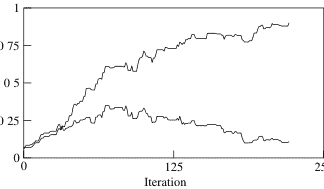
图 2.11 随机搜索模拟。一个具有 10 个输入节点和线性输出节点的感知器类网络通过随机搜索进行训练，以反应输出 0.9 对输入 $\mathbf{x}_1$ 和对 $\mathbf{x}_2$ 输出 0.1。

为了说明随机搜索，我们考虑我们的示例任务，使用公式 (2.15) 配合逻辑斯蒂传输函数（公式 2.7）。我们需要定义一个性能函数，当任务解决时达到其最大值。由于网络输出限制在 0 和 1 之间，量 $|d_a - r_a|$（对于给定输入-输出映射，实际输出与期望输出之差的绝对值）可以在 0 和 1 之间变化，其中 0 是其期望值。因此，量 $1 - |d_a - r_a|$ 的期望值是 1，并且当 $r_a$ 越接近 $d_a$ 时，该量增加。如果我们确实需要建立两个输入-输出映射，我们可以如下定义性能函数：

$$ p(\mathbf{W}) = \sqrt{(1 - |d_1 - \mathbf{r}(\mathbf{x}_1)|)(1 - |d_2 - \mathbf{r}(\mathbf{x}_2)|)} \quad (2.48) $$
（平方根使 $p(\mathbf{W})$ 在其整个范围内以相似的速度增加）。$p(\mathbf{W})$ 的最大值为 1，且仅在 $r_1 = d_1$ 且 $r_2 = d_2$ 时达到。公式 (2.48) 可以轻松推广到任意数量 $\mu$ 的输入-输出映射：

$$ p(\mathbf{W}) = \sqrt[\mu]{\prod_{a=1}^{\mu}(1 - |d_a - \mathbf{r}(\mathbf{x}_a)|)} \quad (2.49) $$

图 2.11 展示了使用最简单的随机搜索算法的模拟结果，其中每次迭代生成单个变异体网络。与梯度下降（图 2.10）相比，任务进度更不规则。虽然在这个简单案例中这是一个缺点，但在更复杂的任务中，这可能是一种福分。我们已经观察到，梯度下降方法可能会达到误差表面上不满意的局部最小值。随机搜索不太容易（但并非免疫）发生这种失败，因为偶尔的大变异可能会使网络走出局部最小值。此外，随机搜索方法可以模拟遗传进化，从而允许我们研究行为的进化（第 5 章）。

### 2.3.4 从有限信息中学习（强化学习）

到目前为止描述的权重设置方法基于对期望行为映射的详细知识。这里我们描述需要较少信息的技术。例如，知道输出是否正确可能就足够了。这些技术通常被称为*强化学习*，因为它们类似于动物心理学中的操作性条件反射实验（Barto 2003; Sutton & Barto 1998; 见第 4 章）。在这些实验中，动物（显然）不知道实验者希望训练什么行为，但可以跟踪哪些行为受到奖励或惩罚（即“强化”）。人工系统中的强化学习通常通过增加在给定情况下后跟积极结果的行为的概率，并降低后跟消极结果的行为的概率来实现。在一个自包含的学习装置中，这显然需要一个识别事件为积极或消极的机制，我们将在第 4 章中讨论。

在我们的示例任务中，强化学习可以按以下方式实现。首先，必须将网络输出解释为一种行动，而不是执行该行动的概率。这是通过使用阈值传输函数来实现的，使得输出节点要么活跃（解释为执行行动）要么不活跃。此外，我们使用随机阈值节点（公式 2.18）对同一输入生成可变的输出。这允许网络对同一刺激尝试不同的反应，这对于发现有利反应至关重要。如果接收到强化，设 $\lambda=1$；否则设 $\lambda=0$。那么改变权重的规则是

$$
\Delta W_{i}=
\left\{
\begin{array}{cc}
\eta\left(r-\mathbf{W} \cdot \mathbf{x}\right)x_{i} & \text { 若 } \lambda=1 \\
\eta\left(1-r-\mathbf{W} \cdot \mathbf{x}\right)x_{i} & \text { 若 } \lambda=0
\end{array}
\right. \quad (2.50)
$$
其中，如果行动已执行，则 $r=1$；否则 $r=0$。为了理解公式 (2.50)，请注意两个表达式都具有 $\delta$ 规则的相同形式，其中 $r$ 和 $1-r$ 被作为期望反应（Widrow et al. 1973）。因此，如果执行行动导致了强化，它就被视为目标。这也有效抑制对输入的回应，在这种情况下，不执行行动会被强化。

既然网络输出是二值的（反应或不反应），$d_i$ 不能被解释为期望输出。其解释反而是，$d_i$ 是如果网络对 $\mathbf{x}$ 做出反应，随后接收到强化的概率。图 2.12 展示了公式 (2.50) 模拟的结果。结果是网络以概率 $d_i$ 执行该行动。

如果强化可以取连续范围内的值，例如在 0 和 1 之间，则很有用将公式 (2.50) 的两部分合并为单个公式

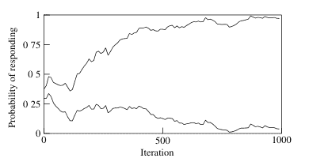
图 2.12 针对图 2.10 和 2.11 中相同问题的强化学习模拟。

如下所示（Barto 1995）：

$\Delta \mathbf{W}_{t}=\eta\left(\lambda(r-\mathbf{W} \cdot \mathbf{x})+\beta(1-\lambda)(1-r-\mathbf{W} \cdot \mathbf{x})\right) \mathbf{x}_{t}$ (2.51)

如果 $\lambda=1$ 或 $\lambda=0$，该公式分别退化为方程 (2.50) 的上半部分或下半部分（但下半部分的学习率是 $\eta \beta$ 而不是 $\eta$）。如果 $\lambda$ 取中间值，$\Delta \mathbf{W}_{t}$ 是方程 (2.50) 中两部分的加权和，其权重为参数 $\hat{\beta}$。可以证明，被称为*关联奖励惩罚规则*的方程 (2.51) 在 $\hat{\beta}$ 取值较小时表现最佳，例如 0.01 或 0.05。尽管如此，方程 (2.51) 的第二部分很重要，因为它调节当所采取的行动导致较差强化时的权重变化。

### 2.3.5 学习关于时间

到目前为止，我们讨论了如何实现对没有时间结构的输入输出映射。在这里，我们考虑那些能够通过设置权重，使得给定的输入序列产生期望的输出序列的算法。我们考虑离散时间步（第 2.2.2 节），并写为 $\mathbf{x}(t)$，即时间 $t$ 的输入。

不同的网络架构被用来处理时间。一种想法是保持前馈架构，但复制输入层，使其包含不同时间的输入副本。这被称为*时延*网络。因此，如果有 $N$ 个输入节点接收输入 $\mathbf{x}(t)$，那么网络将有第二组 $N$ 个节点，其输入为 $\mathbf{x}(t-1)$，依此类推（图 2.13，顶部）。在前馈网络中介绍的所有设置权重技术都可以应用。例如，类感知机网络可以通过 $\delta$ 规则学习，以响应序列 $\{\mathbf{x}_{1}, \mathbf{x}_{2}\}$，但不响应 $\{\mathbf{x}_{2}, \mathbf{x}_{1}\}$。这对于标准前馈网络（第 2.2.2 节）来说是不可能的，但时延网络只是将这两个序列视为两个不同的输入模式，从而可以引发不同的输出。然而，这种处理时间的简单方法有几个缺点。首先，它可能需要非常大的网络。例如，如果我们认为神经系统中的信号在毫秒级时间内传播，我们需要几百份输入层副本来覆盖大约 $1 \mathrm{~s}$ 的间隔。神经系统似乎并没有以这种方式管理时间（Buonomano & Karmarkar 2002）。其次，一切都被以相同的权重记住，即使是不重要的事情。


循环网络为时间处理提供了优越的替代方案。这些网络可以构建比简单记录过去更有用的输入序列表示。不同的循环架构已被分析，例如内部节点之间的反馈网络（Elman 1990）或从输出节点到内部节点的反馈（Jordan 1986）。这两个特性可能都很有用，并且在神经系统中都很重要（第 3 章）。我们如何在循环网络中建立期望的输入输出映射？从技术和生物真实性角度来看，这个问题都很困难。可以应用概念上类似于 $\delta$ 规则和反向传播的梯度下降技术，但计算误差梯度更加困难（Doya 2003; Haykin 1999）。另一方面，随机搜索技术的扩展更容易。我们只需要一个考虑输入和输出*序列*而不是单个输入输出映射的性能函数。然而，请注意，可能的序列数量随所考虑的时间步数指数增长。因此，随机搜索的朴素扩展可能是不可行的。甚至为每个输入序列规定正确的输出这一任务也可能是禁止性的。事实上，时间依赖性任务通常甚至不表述为输入输出映射。例如，考虑一个必须控制模型手臂以使其能够够到物体的网络。分析所有可能的输入序列以确定哪种网络动作更有可能导致够到物体，然后将此教导给网络，实际上是不可能的。另一方面，任务明确表述为“够到物体”。在这种情况下，通常最实际的方法是定义一个在更高层考虑任务的绩效函数，例如，一个随着手臂接近物体而增加的函数（Nolfi & Floreano 2000）。对学习重要的时间因素将在第 4 章进一步考虑。

## 2.4 在没有具体指导的情况下组织网络

到目前为止，我们考虑了如何建立一些给定的输入输出映射，但不是所有权重设置程序都是这种类型。另一种可能性是探索当网络暴露于输入序列并给定权重变化规则时，权重是如何发展的。例如，关于神经元和突触的实验数据或直觉可能暗示了特定的权重变化规则。然后我们可以调查新兴的权重组织是否类似于神经系统的某个特征。或者，权重变化规则可能旨在产生特定的网络组织，例如减少输入模式噪声或增强某些特征的输入输出变换。与前一节相比，在这些情况下，网络组织在没有关于是否正在构建现实或有用的输入输出映射的具体反馈的情况下出现。这导致了自组织的术语。然而，应记住的是，除了网络本身的属性外，出现的任何组织都关键地依赖于提供给网络的输入。

特别有趣的是考虑基于可能在神经元之间结处可用的信息的权重变化规则。这可能包括，例如，两个神经元的状态变量以及描述细胞外环境状态的变量，如神经调节剂的丰度。这些评论将在第 4.2 节中展开。我们现在展示几个例子，说明如何从以下简单规则中产生有趣的权重组织：

$\Delta W_{ij} = \eta(z_i - a)(z_j - b)$

其中 $z_i$ 和 $z_j$ 是由 $W_{ij}$ 连接的节点的活动，而 $a$ 和 $b$ 是两个常数。方程 (2.52) 意味着如果 $z_i > a$ 且 $z_j > b$ 或如果 $z_i < a$ 且 $z_j < b$，则 $W_{ij}$ 将增加，否则减少。我们考虑图 2.14 中的网络，其中一个输出节点接收来自排列成简单模型视网膜的节点的输入。我们用由扩散兴奋斑点组成的输入图案喂养这个网络（图 2.15，左侧），并在每次展示后应用方程 (2.52)。在重复这些步骤几百次后，我们将权重可视化为灰度图像。图 2.15 展示了最初随机权重矩阵如何发展出不同组织的三个例子。后者通常被称为*感受野*，因为它们描述节点从视网膜的哪部分接收输入。因此，具有图 2.15 中所示感受野的节点将优先反应分别落在视网膜清晰界定部分、视网膜左侧部分以及视网膜除特定部分外的任何位置的图像。在一个具有许多此类节点的网络中，每个节点可以反应视网膜不同部分的刺激

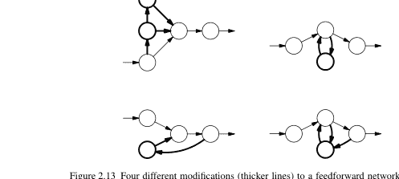

**图 2.13** 前馈网络的四种不同修改（粗线），增加了某些时间处理能力。每个圆圈代表一组节点。左上：一个没有反馈但具有引入输入延迟的多个前馈路径的网络。通过这种方式，一些节点的当前活动代表过去收到的输入（显示了两个延迟步骤）。右上：Elman (1990) 的“简单循环网络”，它利用隐藏节点组之间的反馈来构建依赖于输入时间结构的内部状态。左下：网络输出被反馈为输入。因此，网络可以结合当前输入和过去输出的信息（Jordan 1986）。右下：前两种架构的组合。

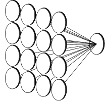

图 2.14 用于自组织模拟的网络架构。输入节点排列在一个二维网格中，模拟视网膜上受体的物理排列。

视网膜，并且后续的处理阶段可以利用这些信息来执行诸如定位物体或在环境中定向等任务。

如何产生一个覆盖整个视网膜的接收野网络？仅仅添加彼此独立操作的输出节点是不够的。事实上，图 2.16（左）表明大多数节点发展出非常相似的接收野（这意味着输入序列是权重组织的强决定因素）。如果在呈现输入之后、更新权重之前，我们将除了最活跃节点以外的所有节点的活动设置为零，我们会获得更好的结果。从生物学角度来讲，这可能对应于神经元之间强烈的相互抑制。以这种方式获得的接收野在视网膜上分布得更加均匀，如图 2.16（右）所示。为了理解原因，仅考虑两个节点，并假设由于初始权重的差异，节点 1 对输入 **x** 的反应比节点 2 更强。那么，根据方程 (2.52)，节点 1 对 **x** 和类似输入的敏感性将增加，而节点 2（其活动已被设为零）对相同输入的敏感性将降低。这种权重的变化使得节点 1 对类似于 **x** 的输入比节点 2 更活跃的可能性更大。总之，我们有一个自我强化的过程（正反馈），它赋予两个节点对不同输入模式的敏感性。

## 2.5 使用自己的模型

希望使用神经网络研究动物行为的学者可以选择多种软件工具，其中许多工具在 Hayes 等人（2003）以及 `http://www.faqs.org/faqs/ai-faq/neural-nets/part5` 中进行了综述。然而，这类软件的重点往往不是动物行为。在这里我们为初学者提供了一些指南。我们将软件广泛分为神经网络模拟器、通用编程语言和科学计算软件。

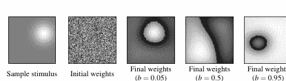

**图 2.15** 使用方程 (2.52) 和图 2.14 中的网络进行模拟（输入网格为 $100 \times 100$ 个节点）。从左到右：刺激样本使输入网格的一部分节点兴奋；初始权重配置；权重的三种组织形式，对应于方程 (2.52) 中参数 $b$ 的三种选择，且 $\eta=5, a=0.05$。从左到右：兴奋中心和抑制边缘，兴奋和抑制半球，抑制中心和兴奋边缘。模拟由 1000 次呈现类似于图中所示的随机放置在模型视网膜上的刺激组成。每次呈现后，方程 (2.52) 被应用于所有权重。较浅的灰色代表较强的权重；负权重比刺激样本中最深的灰色更暗。

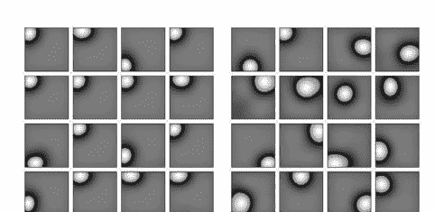

**图 2.16** 由方程 (2.52)（其中 $a=0.5$ 且 $b=0.05$）在两个不同网络中诱导出的权重组织。左：在类似图 2.14 的网络中发展的接收野，但该网络有 16 个独立的输出节点（每次呈现输入时所有权重都独立更新）。右：在相似网络中发展的接收野，但 16 个输出节点之间有强抑制（仅更新馈送到最活跃节点的权重）。在后一种情况下，接收野分布得更加均匀。


```C
#include <stdio.h>  /* these two lines are needed to use */
#include <math.h>  /* functions printf() and exp(); see below*/

/* this function calculates node input, see equation (2.3) */
/* W = weight vector, x = input vector, n = size of W and x */
float weighted_sum( float *W, float *x, int n ) {
   int i;
   float y= 0.;
   for( i=0; i<n; i++ )  y += W[i]*x[i];
   return y;
}

/* logistic node transfer function, see equation (2.7) */
float transfer_function( float y ) {
   return 1/(1+exp(-y));
}

/* a C program starts executing from the “main” function */
int main( void ) {
   float x[] = { 1, 1, 1, 1};  /* input vector */
   float W[] = { 1, 0, 1, 0 };  /* weight vector */
   float y;             /* input to output node */
   float z;             /* activity of output node */
   y = weighted_sum( W, x, 4 );    /* calculate y */
   z = transfer_function( y );      /* apply the transfer function */
   printf( “Output is %f\n”, z );  /* print result */
   return 0;            /* end of the program */
}
```

列表 2.1 一个模拟具有 `N = 4` 个输入节点和 1 个输出节点的两层网络的 C 程序。数字表示为 `float` 类型的变量，向量表示为此类变量的数组。`int` 类型的变量表示整数（例如，向量索引）。表达式 `x[i]` 是数组 `x` 的第 `i` 个元素（C 索引从 0 开始）。函数 `weighted_sum` 和 `transfer_function` 分别将方程 (2.3) 和方程 (2.7) 翻译出来，并提供模拟两层网络的基本结构。解释性注释包裹在 `/*` 和 `*/` 之间。

神经网络模拟器是即用型程序，通常具有图形用户界面，专门用于研究神经网络。一些最发达的模拟器旨在进行神经生理学上逼真的模拟（Hayes 等人 2003 及其中的参考文献）。它们倾向于考虑神经元的许多细节，结果导致具有许多状态变量和参数的节点模型，而这些目前对行为建模的价值尚不确定（参见 2.1.2.2 节末尾）。神经网络模拟器也在人工智能、计算机科学和工程领域得到开发。此类软件的缺点是，它通常需要一些技术背景，并且倾向于关注与动物行为不同的问题。两个相当通用的神经网络模拟器，虽然需要一些学习，但对于初学者来说并不太难，且不需要编程，分别是 `PDP++`（[http://psych.colorado.edu/~orcelli/PDP++/PDP++/PDP++.html](http://psych.colorado.edu/~orcelli/PDP++/PDP++/PDP++.html)）和 `JavaNNS`（[http://www-ra.informatik.uni-tuebingen.de/software/JavaNNS/welcome.html](http://www-ra.informatik.uni-tuebingen.de/software/JavaNNS/welcome.html)）。前者专注于（人类）认知，包括行为层面的现象（O'Reilly & Munakata 2000），而后者对网络模型的解读则更为中立。

使用通用编程语言（如 Pascal、C、C++ 等）而不使用特定软件进行神经网络研究也是可能的。这些语言本身不具备神经网络的知识，但简单的神经网络模拟可以容易地实现。例如，要模拟一个具有一个输出节点的两层网络，只需要两个数字数组来存储输入和权重向量，一个数字用于响应，以及计算加权和并定义传递函数的能力。作为一个例子，列表 2.1 展示了一个完整的 C 程序，它计算具有单个输出节点和权重 **W** = (1, 0, 1, 0) 的两层网络对输入 **x** = (1, 1, 1, 1) 的输出。该程序在大多数其他编程语言中看起来不会太大差别。人们还开发了语言的扩展，称为 *库*，使得用少量工作就能编程更复杂的模拟。通常，这些库提供数据结构来表示各种网络架构，以及执行常见任务的能力，如计算网络响应或梯度下降学习。对于有一定编程经验或希望开始编程的读者来说，探索这些语言扩展可能是有益回报的。许多神经网络库列在 [http://www.faqs.org/faqs/ai-faq/neural-nets/part5](http://www.faqs.org/faqs/ai-faq/neural-nets/part5)。

科学计算软件非常适合希望使用相当直接的编程语言模拟简单或中等复杂网络的初学者。关键见解是，神经网络的运算可以用向量和矩阵代数来表示，而这有着广泛的支持。下面我们在 Octave（[http://www.octave.org](http://www.octave.org)，免费提供）和 Matlab（[http://www.mathworks.com](http://www.mathworks.com)）程序常用的语法中呈现了一些例子。类似的软件，尽管编程语法不同，包括 Scilab（[http://www.scilab.org](http://www.scilab.org)，免费提供）和 Mathematica（[http://www.wolfram.com](http://www.wolfram.com)）。后续章节中的许多模型只需要比以下例子稍多的编程，我们鼓励读者尝试复现我们的部分结果。我们并不期望没有编程经验的读者理解以下代码的每一行，而是希望他们能对使用科学软件进行神经网络编码有一个大致的了解。

### 2.5.1 两层前馈网络

在科学软件中，简单的神经网络编码相当紧凑。例如，以下代码与列表 2.1 等效：

```
function r = f( y )
    r = 1 ./ (1+exp(-y)); % cf. equation (2.7)
end

x = [ 0 1 0 1];        % input vector
W = [ 1 1 1 1];        % weight vector
r = f( W*x )          % cf. equation (2.17)
```

注意最后一行如何几乎逐字地翻译方程 (2.17)，其中 $\hat{W} * \hat{x}$ 等同于加权和的记法 **W** · **x**。按照惯例，如果相应的行*没有*以分号结尾，则计算结果会被打印出来；因此上述代码将显示 `r` 的值，即 `r = 0.88080`。

```matlab
1  N = 10;            % number of input nodes
2  d = 0.9;           % desired output
3  t = 0.0001;        % target error
4  eta = 0.01;        % rate of weight change
5
6  x = rand(N,1); % random input vector (uniform distribution)
7  W = randn(1,N); % random weight vector (normal distribution)
8
9  e = 2*t;                       % does not matter so long as <et
10 while(e > t)
11  r = W*x;                 % calculate output
12  W = W + eta*(d-r) * x'; % change weights
13  e = .5*(d-r)^2;         % calculate error
14 end
```

列表 2.2 使用 `δ` 规则在具有 `N = 10` 个输入节点和 1 个输出节点的两层网络中建立单输入-输出映射的代码。


技术注释：输入向量 `$x$` 后面的撇号 (`$^{\prime}$`) 表示 `$列$` 向量（一个只有一列但有多行的矩阵），而 `$\bar{w}$` 是一个 `$行$` 向量（一个只有一行但有多列的矩阵）。这种区别虽然在这本书中不是至关重要的，但在矩阵代数中很重要，因此在科学软件中被严格执行。简而言之，矩阵乘法 `$\bar{w}^T x$` 只有当 `$\bar{w}$` 是行向量且 `$x$` 是列向量时，才是加权和 `$\Sigma_i W_i X_i$`。进一步的解释可以在线性代数教科书（Hsiung & Mao 1998）中找到。

对具有许多输出节点的网络进行编码很容易。实际上，如果我们提供一组输入值向量，之前定义的传递函数将返回一个变换值的向量（这需要在第 2 行编写 `$./$` 而不是 `$/` 以执行正确的向量操作）。在实践中，这意味着具有更多输出节点的网络通过用适当的权重矩阵替换上述权重向量即可简单地编码。例如，具有两个输出节点的网络编码如下：

```matlab
1 x = [ 0 1 0 1 ]';
2 W = [ 1 1 1 1
        2 2 2 2 ]; % weights of 1st output node
                    % weights of 2nd output node
3 r = F( W*x )
```

这将显示 `$r = [ \ 0.88080 \ \ 0.98201 ]$`，显示两个节点的输出。扩展到多层网络也是微不足道的。以下示例计算了一个具有四个输入节点、三个隐藏节点和两个输出节点的三层网络的输出：

```matlab
1 x = [ 0 1 0 1 ]';     % input vector
2 W = [ 1 1 1 1
        2 2 2 2         % weights from input to hidden nodes
        3 3 3 3 ];      % (3x4 matrix)
3 V = [ 1 1 ];          % weights from hidden to output nodes
4 r = F( V*F( W*x ) )   % (2x3 matrix)
```

### 2.5.2 $\delta$ 规则

通过 `$\delta$` 规则建立多个输入-输出映射的算法如下：

```matlab
N = 10;                  % number of input nodes
M = 4;                  % number of input-output mappings
t = 0.0001;             % target error
eta = 0.01;             % rate of weight change

rand(*seed*,time());    % initialize random number generator
d = rand(1,M);          % M random outputs
x = rand(N,M);          % M random inputs arranged in a matrix
W = randn(1,N);         % random weight vector

e = 2*t;

while( e>t )           % while error is too big
    e = 0;             % reset error
    for i = randperm(M)     % loop through inputs in random order
        r = W * x(:,i);     % calculate output: to x(:,i)
        W = W + eta*(d(i)-r)*x(:,i);  % change weights
        e = e + .5*(d(i)-r)^2;        % add to error
    end
end
```

列表 2.3 将列表 2.2 的代码推广到多个输入-输出映射。第 14 行中的表达式 `randperm(M)` 给出从 1 到 M 的数字的随机排列。第 15 行和第 16 行中的表达式 `x(:,i)` 是矩阵 `x` 的第 *i* 列，即第 *i* 个输入向量。

1. 创建输入-输出对。
2. 将权重设置为小的随机数。
3. 将总误差设置为零。
4. 将输入按随机顺序排列。
5. 遍历所有输入：
   - a. 计算输出。
   - b. 使用 `$\delta$` 规则改变权重（第 2.3.2.1 节）。
   - c. 计算该输入的误差，并添加到总误差中。
6. 如果总误差足够低，则结束；否则返回第 3 步。

列表 2.2 是该算法针对单个输入-输出映射的实现，而列表 2.3 是推广到任意数量输入-输出映射（示例中为 4 个）。最后，列表 2.4 展示了如何通过计算辅助向量 G 中的完整梯度，然后使用方程 (2.35) 更新权重，来实现完整的梯度下降。

### 2.5.3 随机搜索

这里是对最简单的随机搜索算法的描述：

1. 定义一个性能函数。
2. 创建两个权重向量。`$W_1$` 代表迄今为止找到的最佳向量；`$W_2$` 是一种改进尝试。
3. `$W_1$` 初始化为小的随机数。
4. 将 `$W_2$` 设置为等于 `$W_1$`。
5. 向 `$W_2$` 中随机选定的权重添加一个小随机数（为正数或负数的概率相等）。
6. 评估 `$W_2$` 的性能，并将其与 `$W_1$` 的性能进行比较。
7. 如果 `$W_2$` 表现更好，则它取代 `$W_1$` 成为迄今为止的最佳向量。
8. 如果性能令人满意，则结束；否则返回第 4 步。

列表 2.5 实现了一个输入-输出映射的此算法。

```matlab
1 M = 4; % number of input-output mappings
2 N = 10 % number of input nodes
3 t = 0.001; % target error
4 eta = 0.01; % rate of weight change
5
6 d = rand(1,M); % M random outputs
7 x = rand(N,M); % N random inputs arranged in a matrix
8 W = randn(1,10); % random weight vector
9
10 e = 2*t;
11 while( e>t ) % while error is too big
12 e = 0; % reset error
13 G = zeros(size(W)); % gradient vector, same size as W
14 for i = randperm(M) % loop through inputs in random order
15 r = W * x(:,i); % calculate output to input i
16 G = G - (d(i)-r)*x(:,i)*' % update gradient
17 e = e + .5*(d(i)-r)^2/% update error
18 end
19 W = W - eta*G; % change weights, equation (2.40)
20 end
```

列表 2.4 是列表 2.3 的修改版，使用完整的梯度下降代替 `$\partial$` 规则（参见第 2.3.2.1 节）。辅助向量 `$\nabla$` 存储误差梯度。


```matlab
1 function p = perf( W, x, d ) % performance function: reaches
2 p = 1 - abs(d - W*x ); % a maximum of 1 when W*x=d
3 end;
4
5 N = 10; % number of input nodes
6 d = 0.9; % desired output to x
7 t = .9999; % target performance
8
9 x = rand(N,1); % create a random input vector
10 W = randn(1,N); % create a random weight vector
11
12 p1 = perf( W1, x, d ); % initial performance
13
14 while ( p1<t ) % while performance too low
15 W2 = W1; % let W2 equal W1
16 i = ceil( N*rand() ); % choose a weight to mutate
17 W2(i) = W2(i) + .01*randn(); % add small random number
18
19 p2 = perf( W2, x, d ); % calculate performance of W2
20 if( p2>p1 ) % accept W2 if it performs better
21 W1 = W2;
22 p1 = p2;
23 end
24 end
```

列表 2.5 用于最简单随机搜索算法的代码，用于在两层网络中建立单个输入-输出映射。表达式 `i=ceil(N*rand())` 通过选择 `[0, 1]` 之间的一个随机数，乘以 `N`，最后向上舍入到下一个整数，从而选择 1 到 `N` 之间的随机整数。

## 章节摘要

- 神经网络是由相互连接的节点组成的数学模型，旨在捕捉神经元和突触的最重要特征。
- 即使是简单的网络也能解决看似与行为建模相关的任务。
- 通用前馈网络可以实现任意的输入-输出映射，前提是每个输入的固定输出。存在许多强大的权重设置技术来实际找到适当的权重。
- 其他权重设置技术可用于根据传入输入（例如，编码统计规律性）来组织网络，而不是实现所需的输入-输出映射。
- 循环网络增加了处理复杂输入序列和生成时间结构化输出序列的能力。尽管存在许多技术，但循环网络通常更难训练。
- 如果神经网络的数学分析过于困难，我们可以使用现成的软件或编程自己的程序在计算机上对其进行模拟。

## 延伸阅读

Arbib MA, 2003. *The Handbook of Brain Theory and Neural Networks*. Cambridge, MA: MIT Press, 2 edition. 关于神经网络的约 300 篇文章的合集，从不同的视角进行探讨。

Dayan P, Abbott LF, 2001. *Theoretical Neuroscience: Computational and Mathematical Modeling of Neural Systems*. Cambridge, MA: MIT Press. 许多主题从单个神经元到大规模网络模型，都以正式但易于理解的方式处理。

Haykin S, 1999. *Neural Networks: A Comprehensive Foundation*. New York: Macmillan, 2 edition. 对神经网络技术上几乎所有重要内容的全面介绍，具有良好的跨领域联系。

Mitchell M, 1996. *An Introduction to Genetic Algorithms*. Cambridge, MA: MIT Press. 随机搜索方法的通用介绍。

# 第三章

# 行为的机制

本章介绍了行为短期和可逆变化的神经网络模型（传统上称为*动机*）。涵盖的主题包括对刺激的反应、决策制定以及运动控制。在我们的术语中，这些是*给定行为*映射的属性（第一章）。相比之下，*学习和本体发育*（发展）对应于行为映射的变化，将在第四章中讨论。

## 3.1 行为系统的分析

在考虑神经网络模型之前，我们将详细讨论动机变量的性质，它们如何引起行为，以及它们如何进入行为系统模型。目的是构建一个概念框架，以便方便地分析行为的物质原因，这一讨论建立在 1.1 节的基础上。

动机变量通常分为外部和内部（McFarland 1999）。前者通常被称为*刺激*。例如，孔雀的求偶行为可能由孔雀雌鸟提供的视觉刺激引起或激励。刺激被感觉器官捕捉，在这种情况下是孔雀的眼睛，然后由识别机制处理，以确定是否存在孔雀雌鸟。最后，运动机制产生可观察到的求偶行为。这种感觉处理、决策制定和运动控制的划分虽然并非普遍有效，但通常很方便，本章将使用这种划分方式。

孔雀是否进行求偶还取决于内部动机变量。例如，一只饥饿的孔雀可能会寻找食物而不是求偶。内部变量可以进一步分为身体状态变量和神经系统状态变量（参见 McFarland 1987 中的 **感觉器官**）。前者被称为*身体状态*。示例包括身体水分量、血糖水平、体温等。神经系统状态可以进一步分为*记忆状态*和*调节状态*。*记忆*指的是长期存储，编码在结构特性中，例如神经元之间连接的模式和强度。*调节状态*指的是那些严格意义上不属于记忆，但确实有助于在时间上构建行为的状态。实例包括神经元的活动状态或神经递质和神经调节剂的浓度（请注意，*短期记忆*这一术语用于许多现象，可能既暗示神经系统活动，也暗示突触强度的变化；Gibbs 1991; Gibbs & Ng 1977）。

| 感觉模式 | 感受器 | 身体部位 |
| :--- | :--- | :--- |
| 视觉 | 杆状细胞和锥状细胞 | 眼睛 |
| 听觉 | 毛细胞 | 耳朵（柯蒂器） |
| 嗅觉 | 嗅觉神经元 | 嗅觉黏膜 |
| 味觉 | 味觉受体细胞 | 舌面上的味蕾 |
| 旋转加速度 | 毛细胞 | 耳朵（半规管） |
| 线性加速度 | 毛细胞 | 耳朵（椭圆囊和球囊） |
| 触压觉 | 神经末梢 | 各处 |
| 温度觉 | 神经末梢 | 各处 |
| 痛觉 | 裸露神经末梢 | 各处 |
| 关节位置和运动 | 神经末梢 | 各处 |
| 肌肉长度 | 神经末梢 | 肌梭 |
| 肌肉张力 | 神经末梢 | 高尔基腱器官 |
| 动脉血压 | 牵张感受器 | 颈动脉窦和主动脉弓 |
| 中心静脉压 | 牵张感受器 | 大静脉和心房壁 |
| 肺部充气 | 牵张感受器 | 肺实质 |
| 血液温度（头部） | 神经元 | 下丘脑 |
| 动脉 O₂ 分压 | 神经元？ | 颈动脉体和主动脉体 |
| 脑脊液 pH 值 | 神经元 | 延髓 |
| 血浆渗透压 | 神经元 | OVLT（大脑内部） |
| 葡萄糖水平 | 神经元 | 下丘脑，肝脏 |

区分神经系统状态和身体状态的原因是，后者可以像外部刺激一样对待。事实上，外部刺激和身体状态都通过专门的感受器影响行为，这些感受器将各种物理现实转化为神经活动。内部感觉确实比外部感觉多，甚至更多。例如，表 3.1 列出了已知存在于人类中的感觉：超过一半是内部感觉。因此，对 external 刺激和身体状态建模，相当于了解外部和内部条件如何刺激相关的感觉器官。正如并非所有感觉都是外部的一样，神经系统也不仅产生显性行为。内部反应包括对内部器官的控制以及专门神经细胞分泌激素。迄今为止介绍的行为系统的概念组件总结在图 3.1 中。

记忆和调节状态在关键方面与身体状态不同：它们的功能仅仅是调节行为。像水分量这样的身体状态确实影响行为，但首先，水分的存在是由于机体的生理特性。神经系统状态之所以重要，是因为它们允许信息的存储和行为在时间上的构建。没有它们，行为将完全受当前感官输入的驱动。例如，对

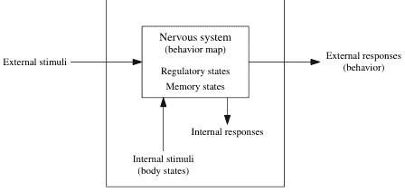

图 3.1 行为系统的主要概念组件。

刺激的响应可能会因包含一个随反复刺激而缓慢变化的状态变量而延迟（见下文）。


为了理解行为序列如何展开，我们不仅需要知道在每个瞬间产生什么反应，还需要了解状态变量如何变化。这些相互作用既是生物现实的核心，也是状态空间建模方法的核心（`1.2` 节）。考虑以下示例：当雄性鸽子向雌性求偶时，她可能会以展示兴趣的方式在行为上做出反应。此外，雄性求偶引起一系列内部变化，最终导致雌性产卵并下蛋（Lehrman et al. 1965）。当雄性开始求偶时，雌性尚未准备好繁殖。相反，来自求偶的视觉刺激导致脑部活动，包括神经分泌，最终导致卵泡刺激素（FSH）分泌到血液中。FSH 刺激卵泡生长，并伴随同一组织分泌雌激素。雌激素反过来影响大脑，使雌性在获得适当的外部刺激后准备好交配并参与筑巢。外部刺激、身体和大脑之间的进一步相互作用导致产卵、下蛋和孵蛋。实验清楚地表明，求偶雄性的存在以及雌性需要一定量的刺激来开始繁殖的重要性。这种安排具有功能性意义，因为它保护雌性免受仅短暂求偶的雄性的侵害（也许是因为它们已经与其他雌性配对）。它也展示了外部和内部状态变量如何共同带来功能性行为。此处，大脑和血液中的激素水平可以被视为随时间积累的调节状态。总的来说，重要的是将行为和身体生理视为一个整体，牢记大脑导致生理变化以及显性行为。

在下文中，我们将应用这里介绍的概念来构建行为的神经网络模型。我们关注外部刺激、身体状态和调节状态如何控制行为，而将记忆状态的研究留给下一章。在本章中，记忆（网络连接的模式和强度）被视为固定参数，不发生变化（`1.2` 节）。

## 3.2 构建神经网络模型

本章旨在展示神经网络如何让我们对上面考虑的各种状态变量进行建模。简言之，外部刺激和身体状态被视为相同，并通过模拟外部和内部感觉器官的输入节点影响网络。调节状态可以来自网络内部的反馈回路，这些回路可以在某些节点中建立持续的活动。此外，可以包含特殊变量来模拟非神经系统活动的调节状态（例如，激素）。记忆自然对应于连接权重（我们回顾一下，在动机模型中记忆被视为固定参数，而在学习和本体发育模型中记忆是可以变化的状态变量，见 `1.1` 节）。

### 3.2.1 一个入门示例

在实践中，构建神经网络模型包括选择网络架构、设置网络权重以及测试模型。为了将模型与现实联系起来，我们还需要解释输入和输出节点。也就是说，我们必须知道如何将物理刺激情况（包括身体状态）转换为网络输入，并且必须能够判断网络输出是否与观察到的行为一致。为了说明这些主题，我们从展示神经网络如何模拟特定行为的简单示例开始：区分两个视觉刺激。后者是一个十字形和一个矩形，网络应仅对十字形做出反应。这可以通过前馈网络实现，如图 3.2 所示。网络的第一部分是一个由 5 × 5 个节点组成的模拟视网膜，十字形和矩形可以投射在视网膜上。输入节点的活动被传递到由 10 个隐藏节点组成的层（图中为简单起见仅显示 3 个），每个节点都与所有输入节点相连。网络由一个与所有隐藏节点相连的输出节点完成。输出节点的活动被解释为网络对刺激做出反应的概率。

尽管只有两个刺激，但问题并非微不足道，因为相同的刺激可以产生许多不同的输入模式。图 3.3 显示了通过将十字形投射到视网膜上的不同位置获得的一些视网膜图像。在大多数情况下，十字形的形状会变得模糊。尽管存在这些复杂性，使用 `2.3` 节中介绍的权重设置算法（例如，反向传播或随机搜索），可以相对容易地获得对十字图像做出反应而对矩形图像不做出反应的网络。我们完全按照 `2.3.3` 节和 `2.5.3` 节中描述的后者使用。结果是一个行为映射，可以正确地对两种类型的刺激做出反应，如图 3.4 所示。

这个简单示例已经暗示了神经网络的几个重要特征。其中一个特征，已经强调过很多次，是将网络自然解释为模拟神经系统，包括从刺激开始的所有步骤

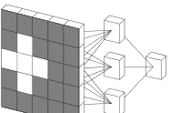

图 3.2 前馈网络的模型视网膜受到十字形刺激的激励，导致输入节点产生一种活动模式。该模式通过网络传递以生成输出响应，该响应被解释为对刺激做出反应的概率。

对反应的输出。第二个特点是能力和灵活性。尽管识别问题相当复杂，但我们无需详细考虑它：权重设置算法可以自行找到合适的权重。我们可以轻松引入更多的刺激和更多的反应，从而产生越来越复杂的行为图谱。同一基本结构能够实现许多行为图谱这一事实非常重要，因为它允许个体灵活性（学习）和进化灵活性（第 5 章）。如果每个问题都必须通过专用机制来解决，行为系统将非常复杂且难以构建。

第三个特点涉及对新奇刺激的回应。考虑到我们的例子，有人可能会反驳说，我们极大地简化了问题，因为我们在测试网络时仅使用了每个刺激可能投影的无数视网膜图像中的少数几种。网络对未包含在权重设置过程中的图像如何反应？实际上，我们已经进行了此测试。网络仅用图 3.3 中的*一半*十字图像进行了训练，但图 3.4 中的测试涵盖了*所有*图像。使用更多图像进行测试会产生类似的结果。我们将在下文看到，神经网络能够很好地复现动物对新奇刺激的反应方式。

### 3.2.2 更复杂的模型

通常，行为神经网络模型包括一个或多个模拟特定感觉器官的输入节点组、一个包含感受器与效应器之间连接（直接的或通过隐藏节点介导的）的内部架构，以及最终模拟神经系统如何控制肌肉并产生其他生理反应的效应器。内部架构有许多潜在有用的选择。例如，某些权重可能是固定的，而另一些则可能随经验变化或作为成熟过程的结果而变化。通常，拥有一个或少数几层固定的输入处理层，随后连接到一个具有可调整权重的网络，该网络可以被建模为对处理后的模式做出灵活响应（第 3.4 节）是非常有用的。另一个可能的架构元素是一个内部时钟，它允许网络根据一天中的不同时间改变对不同输入的敏感度。该时钟可以像输入节点一样将活动馈送到网络，也可以由网络节点构建而成。

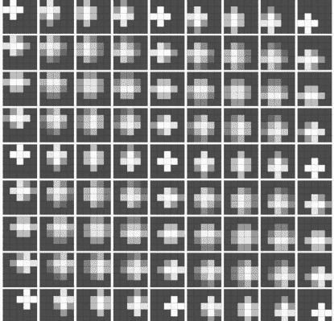

图 3.3 5 × 5 模型视网膜接收十字形视觉刺激，表明相同的刺激根据其落在视网膜上的位置不同，可以产生截然不同的活动模式。每个视网膜节点根据其覆盖刺激部分的比例保持活动状态（较浅的灰色对应较高的活动度）。完全未被覆盖的节点具有 0.05 的背景活动；完全被覆盖的节点具有 1 的活动度。

不同部分应有多复杂，取决于我们的目标以及我们要建模的行为的复杂性。例如，如果我们关注对刺激的反应或决策制定，我们通常避免建模肌肉控制，并仅用一个输出节点的活动来表示动物的反应。另一方面，运动控制模型必须在网络的输出部分包含更多细节。图 3.5 提供了一些关于如何将神经网络组件组合成动机模型的示例。

在第 1 章中，我们强调，为了解释行为序列，行为模型除了预测当前行为外，还必须预测动物的动机状态如何变化。这里我们面临几种不同的情况。调节状态是系统内部的，因此应作为系统自身动力学的一部分进行更新。例如，接收递归连接的节点会根据网络中其他节点的活动进行更新。其他调节状态，

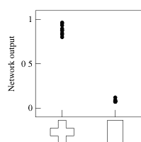

图 3.4 前馈网络（包含 10 个隐藏节点）对由十字和矩形粘贴在视网膜不同位置产生的视网膜图像的反应（图 3.3）。十字在水平和垂直方向上以 0.25 的长度步长平移（假设输入节点是边长为 1 的正方形），结果是图 3.3 中的 81 张图像。对 2 × 3 矩形应用相同的程序，产生 117 张图像。网络权重通过第 `2.3.3` 节和 `2.5.3` 节所述的随机搜索获得。

例如模拟激素水平的状态，可能需要特殊的更新方程。模拟身体生理的状态变量是网络外部的，仅作为对反应结果的间接后果而改变。例如，喝水仅作为摄入水的后果影响水的体积。行为还可能改变与环境的关系（例如位置和方向），导致在更晚的时间产生不同的输入。如果行为可以改变物理或社会环境，则后续输入中可能发生更微妙的变化。我们将在下文看到这些不同情况的实例。

### 3.2.3 设置网络权重

一旦确定了网络架构，我们需要调整网络权重，使模型根据某些要求运行。对网络行为的要求可能来自对动物的观察，也可能来自功能考量，例如能够在特定环境中生存。本章不关心如何获得合适的权重：我们将它们视为给定条件（在实践中，我们使用第 2 章描述的方法来寻找合适的权重）。第 4 章从理解学习和行为个体发育的角度考虑权重变化。

### 3.2.4 测试模型

如何测试神经网络模型以及一般的行为模型？首先，模型应该能够复现专门用于开发该模型或解决所赋予的功能任务的观察结果。虽然这是一个基本要求，但对于像神经网络这样灵活的系统来说，这可能很容易实现。另一个重要的测试是在未包含在拟合程序中的情况下评估模型。我们将经常使用这两个条件。如果我们要开发生理模型，模型应与关于神经系统功能的已知生理数据一致。在下文和下一章中，我们将描述几个有神经生理学支持的神经网络模型。

### 3.2.5 感受器空间

基于我们的主观经验，我们倾向于假设动物知道那里有什么刺激，并可以直接访问颜色、大小和距离等特征。一些行为模型实际上做出了类似的假设（参见 `3.3.3` 节）。然而，感知往往比表面看起来更复杂。

例如，黄色对我们来说是一种无法分解为组件的颜色，但实际上它是通过整合三种光感受器的信号感知到的。图 3.3 是理解感受器信号难度的另一个例子。


神经网络与神经系统之间的类比鼓励我们更详细地考虑感知。我们将使用`感受器空间`一词，指代在考虑感觉器官如何接收刺激的情况下构建的网络输入空间。下文的大多数结果取决于网络输入构建的一定程度的真实感，但构建一个适当模拟特定物理情况的感受器空间并不总是显而易见的。一个基本事实是，只有那些可以被接收的物理刺激的方面才能影响行为。例如，某些动物物种可以感知紫外线，而其他物种则不能。如果我们只考虑光的物理特性，我们无法理解为什么只有某些物种能够区分仅在紫外线成分上不同的光。通常，我们需要考虑单个感受器对刺激物理特征的敏感度，以及感受器在感觉器官中的排列。也要注意，思考感受器自然包括刺激呈现时的`索引/背景`，作为动物接收的刺激的一部分：背景的变化简单地建模为刺激的变化。

对感觉生理学的研究揭示了不同动物物种感官之间的相似性和差异（Coren 等 1999；Gegenfurtner & Sharpe 1999；Goldsmith 1990；Warren 1999；Zeigler & Bischof 1993）。可以突出一些基本相似性，用于构建关于刺激如何激活感觉器官的简单但通用的模型（另见 图 2.2）：

- 感受器通常对刺激维度（例如光波长或声音频率）的特定值最为敏感；随着物理刺激偏离最大敏感值，感受器活动以有序的方式下降。
- 一个重要例外是强度维度：当物理刺激的强度增加（减少）时，对该刺激敏感的感受器的活动也会增加（减少）。
- 由于感受器具有不同的特征（即使在一个感觉器官内），给定的刺激通常会引发分布式的活动模式，其中一些感受器被强烈激活，一些中等，一些微乎其微。
- 即使在没有明显刺激的情况下，感受器通常也是轻微活动的，而不是完全静止（例如，安静房间中的声音感受器）。

## 3.3 对刺激的反应

预测动物如何对外部刺激做出反应是一个非常常见的问题，伦理学和心理物理学中的行为学者已经广泛研究了这个问题（Baerends & Drent 1982；Hinde 1970；Lorenz 1981；Mackintosh 1974, 1994；Pearce 1997；Tinbergen 1951）。动物行为学家通常谈论“刺激选择”，实验心理学家则谈论“刺激控制”。在实践中，我们通常知道

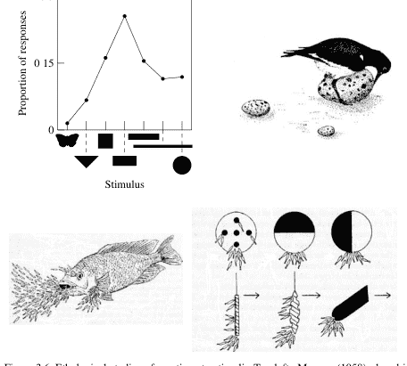

动物会对一组熟悉的刺激做出反应，我们希望预测它对单个或多个测试刺激的反应（图3.6）。在本节中，我们在基于实际实验建模的任务上测试了双层和三层神经网络，并展示这些网络与动物反应非常相似。为了理解基本的生物学问题以及神经网络如何应用于此，考虑一个对刺激 `S⁺` 做出反应而忽略背景刺激 `B` 的动物（符号 `S⁺` 在实验心理学中是传统的，用于表示已建立反应的刺激，例如通过经典条件反射或操作性条件反射）。问题是：动物将如何对其他刺激做出反应？我们的模型是一个简单的网络，由一组直接连接到一个输出节点的输入节点组成（第2.2.1.1节；技术细节见图3.9）。我们需要该网络复现图3.7中的输入-输出映射。输入模式 `s⁺` 模拟 `S⁺` 并应在网络的输出节点中产生高活动度，解释为对 `S⁺` 的反应。如第2章所介绍，`s⁺` 是一个`向量`，其元素 `sᵢ` 是输入节点 `i` 的活动度。输入模式 `b` 模拟低强度背景，并应在输出节点中产生低活动度。`b` 和 `s⁺` 之间的区别在于向节点阵列中心增加活动度。这模拟了一个事实，即刺激通常以不同程度激活许多感受器，其中一些细胞活性最高，一些轻微活跃，另一些则不受影响。例如，当 `S⁺` 是单一声音频率时，许多物种耳朵中声音感受器的活动度将与该图形相当相似。在这种解释中，`b` 将模拟寂静或环境噪声，此时所有感受器都保持低水平活性。

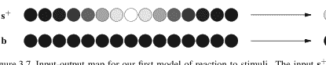

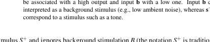

网络可以轻易区分 `s⁺` 和 `b`，并且可以通过第2.3节中介绍的技术获得解决该任务的权重向量。在以下部分中，我们假设辨别能力已建立，并探索网络如何对类似实际实验中使用的新型输入模式做出反应。在继续之前，我们介绍模式间`重叠`的概念（也称为`标量积`或`内积`）。重叠比网络数学更易于操作，并且使我们能够理解简单网络（以及在一定范围内更复杂的网络）是如何工作的。只要网络是行为的良好模型，重叠也使我们能够预测动物对刺激的反应。形式上，模式 `a` 和 `b` 之间的重叠写为 `a⋅b`，定义为：

```
a⋅b = Σᵢ aᵢbᵢ				(3.1)
```

其中索引 `i` 遍历网络层中的所有节点（通常我们考虑输入层，因此 `a` 和 `b` 是输入模式）。这在实践中意味着什么？第一个方面对应于`重叠`一词的日常用法：相似的输入模式倾向于比不相似的输入模式重叠更多。第二个方面与激活强度有关：如果我们增加 `a` 中元素的值，`a` 与 `b` 的重叠会增加。总之，基于公式 (3.1)，我们可以说如果 `a` 和 `b` 在`相同节点上具有高活性`，则重叠 `a⋅b` 较大。公式 (3.1) 也适用于二维模式（索引 `$i$` 仅标识节点，并不暗示它们以任何特定方式排列）。例如，图3.3中彼此接近的模式比相距较远的模式重叠更多。在后续内容中，我们将更熟悉重叠的概念，并查看其在实践中的应用。

重叠有用的原因可以总结如下。读者可能记得第2章中提到，网络节点本质上计算输入向量和权重向量之间的重叠（第40页的公式2.15）。特别是，具有单个输出节点的双层网络的响应完全可以通过输入模式和权重向量之间的重叠来描述。反过来，权重向量可以表示为熟悉模式的加权和（第2.3.1节）。因此，可以根据输入模式与熟悉模式之间的重叠来预测对输入模式的响应，而无需显式考虑网络。

### 3.3.1 泛化梯度

动物对刺激的反应通常通过沿特定物理维度（如声音频率或光波长）修改熟悉的刺激来探索。这些测试被称为`泛化测试`，结果在维度上的响应曲线被称为`泛化梯度`。泛化在心理学（Kalish 1969a,b,c,d; Mackintosh 1974）、动物行为学（Baerends & Drent 1982; Baerends & Kruijt 1973）和行为生态学（Enquist & Arak 1998; Ryan 1990）中已被广泛研究。这些实证研究表明，泛化是一种基本现象。泛化的主要特征独立于我们研究的物种（例如，人类、大鼠、鸡、鸽子、金鱼或蝴蝶）、刺激涉及的行为系统（例如，饥饿、口渴或性）、探测的感觉模式（例如，视觉、声音或触觉）以及反应是习得的还是天生的（Ghirlanda & Enquist 2003）。

下面我们沿两种重要的刺激维度分析我们的模型，称为`重排`和`强度`维度（细节如下）。这些是实证研究最多的维度，并且可以在感受器空间上给出简单的解释。这两种类型的维度在动物实验中产生非常不同的结果，因此是刺激控制模型的良好测试。测试程序在概念上与动物泛化研究相同：建立如图3.7所示的行为映射，然后观察网络对一组模拟特定实证测试的刺激的反应。

#### 3.3.1.1 重排维度

沿“重排维度”改变刺激意味着改变刺激的`模式`，同时保持总`强度`不变（至少大致不变）。一个例子是声音频率的变化。当频率增加或减少时，对原始频率最敏感的耳中感受器受到的刺激较少，而一些其他感受器变得更加活跃（Fay 1970; Galizio 1985; Jenkins & Harrison 1960）。对于视觉刺激，受刺激

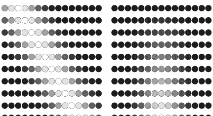

图 3.8 通过改变公式 `$x_i = I + h\exp(-(i - m)^2 / 2\sigma^2)$` 中一个参数获得的刺激维度，其中 `$x_i$` 是线性输入阵列中位置 `$i$` 处节点的活动度。最活跃的节点位于位置 `$i = m$`，其活动度为 `$I + h$`。左：通过改变 `$m$` 获得的重排维度。右：通过改变 `$h$` 获得的强度维度。参数值（当未改变时）为 `$I = 0.2$`（背景活动度），`$h = 0.5$`（超过背景活动度的最大水平），`$m = 8$`（最大活跃节点的位置），`$\sigma = 3$`（调节活动度在离开最大活跃节点时下降的速度）。

感受器的空间分布可能会改变，而刺激的总量保持不变，例如当改变刺激的位置或方向时（另见第3.4节）或当改变物体形状并保持其大小不变时。改变单色光的波长（至少在有限范围内）是另一个例子（Hanson 1959; Marsh 1972; Ohinata 1972）。实际上，为所有感官构建重排维度几乎有无穷无尽的方法。


沿重排维度的实证泛化梯度几乎总是呈钟形，最大反应在 s$^\dagger$ 或接近 s$^\dagger$ 处观察到（Ghirlanda & Enquist 2003）。图3.9将实证发现与我们的模型进行了比较。可以看出，网络模型的泛化与真实动物非常相似。我们通过平移输入层上 s$^\dagger$ 的活动模式来构建我们的重排维度，获得了图3.8（左）中的一组刺激。我们也可以采用其他重排维度，同时仍获得钟形梯度。这可以通过直观理解网络的权重向量或关于重叠的推理来理解。我们考虑这两种解释。对应于图3.7中行为映射的权重值描绘在图3.10中。我们看到既有正权重也有负权重。s$^\dagger$ 模式主要刺激与正权重相连的输入节点，这解释了为什么网络对 s$^\dagger$ 反应强烈。相反，**b** 同等地刺激与正权重和负权重相连的节点。因此，对 **b** 的输出较低。现在让我们转向泛化。在通过重排 s$^\dagger$ 获得的测试模式中，中心的高值元素已被移除，并与较低值的元素交换（见图3.8，左）。

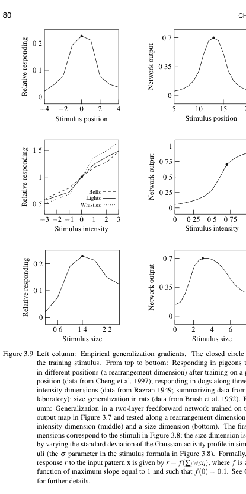

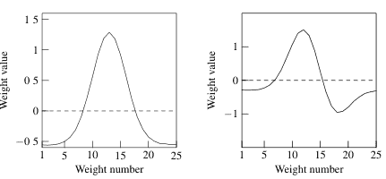

图 3.10 训练两层网络以解决图 3.7（左）和图 3.11（右）中判别任务所得到的权重值。

因此，链接到正权重的节点将接收较少的输入，而链接到负权重的节点则接收更多的输入。相对于 $ s^{+} $，刺激被重排得越多，其高数值元素与高数值权重相匹配的部分就越少。因此我们看到，随着重排程度的增加，网络输出下降，而最大输出恰好对应于 $ s^{+} $（无重排）。

通过考虑重叠度，我们也可以得出相同的结论。我们在 2.3.1 节中展示过，在图 3.7 中的行为图谱建立后，对任何测试刺激 $ \mathbf{x} $ 的反应（几乎）等于

$$ r(\mathbf{x}) = f(c_{1}\mathbf{s}^{+} \cdot \mathbf{x} + c_{2}\mathbf{b} \cdot \mathbf{x}) \quad (3.2) $$

其中数字 $ c_{1} $ 和 $ c_{2} $ 使得 $ r(s^{+}) $ 和 $ r(b) $ 具有期望值（见 2.3.1 节）。因此，对 $ \mathbf{x} $ 的反应取决于它与 $ \mathbf{s} $ 和 $ \mathbf{b} $ 的重叠。在当前情况下，后者（与 $ \mathbf{b} $ 的重叠）兴趣不大：因为 $ \mathbf{b} $ 是均匀的，且所有测试刺激都是 $ s^{+} $ 的重排，所以重叠 $ \mathbf{b} \cdot \mathbf{x} $ 是常数，不会对输出的差异产生贡献。与 $ s^{+} $ 重叠度的变化才是导致对测试刺激反应不同的原因。容易看出，相对于 $ s^{+} $，$ \mathbf{x} $ 被重排得越多，它与 $ s^{+} $ 的重叠就越少。

### 3.3.1.2 强度维度

与重排不同，沿强度维度改变刺激不会改变哪些感受器被刺激；相反，所有感受器的活性会同时增加或减少。沿强度维度的经验泛化梯度不是钟形的：梯度单调增长，比 $ S^{+} $ 强度更高的刺激会诱发更强的反应。这一发现已在许多维度上得到复现，包括声音强度（Razran 1949; Zielinski & Jakubowska 1977）、光强度（Razran 1949; Tinbergen et al. 1942）和化学浓度（Tapper & Halpern 1968）。图 3.9 展示了一些例子。

为了测试我们的网络模型如何沿强度维度泛化，我们使用了一组不同的刺激，其中 $ s^{+} $ 中活性峰的高度发生变化（图 3.8，右图）。这模拟了当刺激强度增加时，在感受器（或其他神经元）中观察到的感受器活性增加。图 3.9 显示网络沿强度维度生成单调梯度。该结果解释如下：如果我们增加测试刺激的强度，它与 $S^+$ 的重叠增加幅度大于其与 $\mathbf{b}$ 的重叠增加幅度，从而导致输出增加。

### 3.3.1.3 其他维度

大多数关于泛化的经验研究都针对重排维度或强度维度。一个例外是大小泛化（Dougherty & Lewis 1991; Grice & Saltz 1950; Magnus 1958; Mednick & Freedman 1960）。例如，一系列大小各异的圆圈。大小泛化是视觉刺激特有的，尽管我们可以想象其他感官也有类似的维度。大小泛化梯度通常是不对称的，对于比 $S^+$ 更大的刺激反应更强（Ghirlanda & Enquist 2003）。我们的网络模型也表现出类似的泛化，如图 3.9 所示。

有时使用的刺激并不位于简单的刺激维度上。例如，在行为生态学中，动物经常被呈现具有自然刺激修饰的变体，这些变体在许多维度上发生变化（图 3.6）。受体空间方法的一个优势是，只要我们能确定刺激如何刺激受体，就可以针对任何刺激生成关于反应的预测。例如，我们可以轻松生成关于相对 $S^+$ 在强度和重排两方面都发生变化的刺激反应的预测。这种灵活性的另一个例子是由添加或删除离散刺激组成的复合刺激。例如，将 $S^+$ 与一个新异刺激 $A$ 一起呈现，通常比单独呈现 $S^+$ 产生较弱的反应（外部抑制；Pavlov 1927; Pearce 1987）。这可以通过以下事实来解释：输入模式 **a**（模拟刺激 A），在其与 $S^+$ 不同的程度上，主要会激活链接到负权重的节点。因此，模拟 A 和 $S^+$ 同时存在的向量也将向负权重提供更强烈的输入。

### 3.3.2 更细的判别

到目前为止，我们分析了刺激 $S^+$ 与其缺失（或背景 B）之间的判别。这里我们分析在引入与 $S^+$ 相似的“负刺激” $S^-$ 后的泛化。这意味着动物对 $S^+$ 有反应，但对 $S^-$ 或 B 没有反应。添加负刺激在重排维度和强度维度上都会引入新的现象。让我们首先考虑重排。广泛的经验数据表明，如果 $S^+$ 和 $S^-$ 足够接近，沿刺激维度的泛化不再围绕 $S^+$ 对称。梯度仍呈钟形，但向远离 $S^-$ 的方向偏移。最大反应确实发生在 $S^+$，但发生在离 $S^-$ 更远的刺激处（Hanson 1959）。心理学家将这种现象称为峰值偏移（Hanson 1959; Mackintosh 1974）。行为生态学家也注意到，熟悉刺激的新异变体，被称为超常刺激，可能会比熟悉刺激本身诱发更强的反应（Tinbergen 1951）。图 3.6 中的蛎鹬就是一个经典例子。通常，我们可以将此类现象称为反应偏差。我们在 3.3.1.2 节中已经看到，存在有利于对更强刺激做出反应的偏差。

我们可以通过添加一个类似 $s^+$ 的输入模式 $s^-$ 来模拟相似刺激之间的判别，而网络不应对此做出反应。一个实例是图 3.11 中的输入输出图谱，其中 $s^-$ 是 $s^+$ 的重排。这是沿重排维度（如声音频率或光波长）进行精细判别的良好模型。图 3.10 展示了训练网络执行此判别后所得到的权重。正权重对应于 $s^+$ 强度较高的节点，负权重对应于 $s^-$ 强度较高的节点。然而，最大的正权重并不完全匹配 $s^+$：它们向远离 $s^-$ 的方向偏移。这意味着最大反应不会在 $s^+$ 处，如图 3.12（右图）所示。就重叠而言，对测试刺激 x 的反应现在应通过考虑其与 $s^+$ 和 $s^-$ 的重叠来解释。后者倾向于减少 x 的反应。峰值偏移的产生是因为该维度上的某些刺激保留了与 $s^+$ 的大部分重叠，但与 $s^-$ 的重叠显著较少。峰值偏移也可以被视为源于记忆参数之间的相互作用，因为相同的权重编码了对 $s^+$ 和 $s^-$ 两者的反应。在第 5 章中，我们将讨论这一现象的进化意义。

在强度维度上也可以观察到反应偏差，即当动物被训练以判别两种相似强度时。当 $S^+$ 比 $S^-$ 强度更强时，泛化梯度与 $S^+$ 与背景判别时获得的非常相似（事实上，后者可以被视为强度非常低的 $S^-$）。然而，如果 $S^-$ 比 $S^+$ 强度更高，结果则有些出人意料。泛化梯度随强度增加而减小，而不是增加。这表明控制反应的并非强度本身，而是强度维度上记忆之间的干扰。

相似强度刺激之间的判别可以通过从图 3.8（右图）的维度中选取 $s^+$ 和 $s^-$ 来建模。在这里我们遇到了模型的一个局限性，即两层网络无法实现 $s^+$ 强度低于 $s^-$ 的输入输出图谱。从技术上看，这是因为三个刺激 b、$s^+$ 和 $s^-$ 在网络输入空间中位于一条直线上（即其中一个可以写成另外两个的加权和；见 2.3.1.1 节）。沿着这样的直线，两层网络（或任何线性网络）的输出要么一直增加，要么一直减少，要么保持恒定。添加一层非线性节点可以消除这一局限性。三层网络轻松解决了该任务并现实地进行了泛化，如图 3.12 所示。为了完整性，我们指出三层网络也复现了先前考虑的发现（Ghirlanda & Enquist 1998）。

### 3.3.3 与其他模型的比较


## 行为生态学与刺激反应

行为生态学家和心理学家广泛研究了动物如何对刺激做出反应（Baerends & Drent 1982; Hinde 1970; Kalish 1969a,b,c,d; Lorenz 1981; Mackintosh 1974）。我们可以区分两个密切相关的问题。第一个问题涉及如何对刺激建模；即行为机制的输入是什么？第二个问题则是行为机制如何基于此类输入运作。

## 输入-输出映射建模

图 3.11 两种相似刺激 `s⁺` 和 `s⁻` 之间区分度的输入-输出映射建模（见图 3.7）。网络必须对 `s⁺` 做出反应，同时忽略 `s⁻` 和背景刺激 `b`。

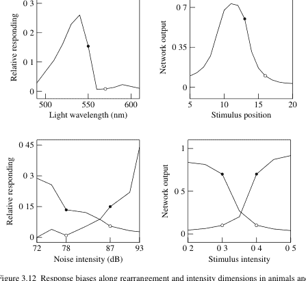

图 3.12 动物和网络在重排维度（rearrangement）和强度维度上的反应偏差。左上图：鸽子对 550-nm 光做出反应，但对 570-nm 光不做出反应的光波长泛化数据（源自 Marsh 1972）。右上图：在图 3.11 的行为映射上训练后，网络对图 3.8（左）中刺激的反应输出。左下图：大鼠对某一噪声强度做出反应（实心圆），但对另一强度不做出反应（空心圆）的噪声强度泛化数据（源自 Huff 等人 1975）。右下图：三层网络在图 3.8（右）强度维度上的输出。该网络通过随机搜索（第 2.3.3 节）进行训练，使其对强刺激做出反应而对较弱刺激不做反应（上升梯度），或者反之（下降梯度）。模型刺激的相对强度大致匹配 Huff 等人（1975）使用的物理刺激的相对强度。

## 叠加模型

一种常见的方法是假设动物“知道”哪些刺激存在或不存在；即，这些信息可直接被行为机制获取。基于此，通常假设对复合刺激（例如同时存在光和声音）的反应是各组成刺激独立贡献之和（*叠加模型*）。因此，对三个刺激同时存在的反应可以写为

$$ r(1,2,3) = W_1 + W_2 + W_3 $$

其中 `$W_i$` 是元素 `i` 的贡献。当只有刺激 1 和 2 存在时的反应由 `r(1,2) = W_1 + W_2` 给出。许多联想学习心理学模型遵循这种方法（Atkinson & Estes 1963; Rescorla & Wagner 1972）；在此语境下，`$W_i$` 被称为刺激 `i` 与反应之间的*联想强度*。对不同刺激的贡献求和也是多种“认知”记忆模型的重要成分，例如*实例理论*（Shanks 1995 第 3 章）。动物行为学家也使用公式 (3.3)，称之为*异质叠加定律*（Baerends & Kruijt 1973; Lorenz 1981; Seitz 1940–1941, 1943）。用神经网络术语来说，该模型等同于假设每个输入节点仅对给定刺激做出反应。这种“检测器”节点在刺激存在时活动值为 1，在刺激缺席时活动值为 0（第 1.3.3 节）。因此，公式 (3.3) 可以写成一个两层网络：

$$ r = \sum_i W_i x_i $$

其中 `$x_i$` 在刺激 `i` 缺席时为 0，存在时为 1。

叠加模型的主要问题是它们只能处理可以分解为离散成分的刺激。无法处理沿物体大小、声音频率和光波长等连续维度的泛化。

## 梯度相互作用理论

Spence (1937) 和 Hull (1943) 的*梯度相互作用理论*则专门处理此类问题。Spence 假设，当对具有某连续维度上特定值的刺激建立反应时，其周围会形成一个“兴奋梯度”。该维度上具有不同值的刺激因此会诱发与梯度在该点高度成正比的反应。如今看来，这似乎只是承认泛化的发生，但在 Spence 写作时，泛化梯度尚未被观察到！Spence 利用梯度作为理论结构，表明围绕 `$S^+$` 的兴奋梯度与围绕 `$S^-$` 的抑制梯度之间的相互作用可能导致梯度的移位，从而诱导动物更偏好比 `$S^+$` 本身离 `$S^-$` 更远的刺激（*移置*）。这比 Hanson (1959) 观察到实际移位梯度早了 20 多年。尽管取得了这些成功，Spence 理论及其由 Hull (1943, 1949) 提出的改进方案的主要缺点仍然是：泛化是被假设的，而非被解释的。该理论无法预测为何会观察到特定形状的梯度，例如为何强度泛化梯度不是钟形的（Ghirlanda 2002）。此外，该理论还有一个与叠加模型互补的缺陷：它无法处理离散刺激！

## Blough 模型

Blough (1975) 的模型结合了叠加传统和梯度相互作用传统的特征。Blough 假设每个沿特定维度的刺激都会激活一组“刺激元素”。与早期的叠加模型不同，每个刺激激活许多元素，而不同刺激诱导部分重叠的活动模式。对活动模式的反应仍由公式 (3.4) 给出，但 `$x_i$` 是代表元素 `i` 激活程度的连续值。Blough 进一步假设每个元素在该维度上都有一个“偏好”值，在此值处活动最大。随着实际刺激值偏离“偏好”值，元素活动以平滑方式减小。此方案在连续维度上生成的活动模式匹配图 3.8（左）中的刺激。

从形式上看，Blough 的模型与本文讨论的两层神经网络相同。然而，关键区别在于对“刺激元素”的解释。Blough 将其视为某种任意的抽象工具，这是为了准确描述行为所必须付出的代价。这招致了相当大的批评（Pearce 1987, 1994）。相反，我们将“元素”解释为受体的模型，这赋予了它们具体的解释，并建立了一种构建输入模式的通用方法。第一个后果是离散刺激与连续维度之间的差异消失了。不仅连续维度，所有刺激情境都作为输入模式表示，正如真实感觉器官所发生的那样（Blough 则建议将其模型与 Rescorla & Wagner 的叠加模型合并，结果为一套用于“刺激内”泛化的联想强度集合和一套用于“刺激间”泛化的集合）。此外，网络输入与感觉器官活动模式之间的对应关系使模型能够解释那些在形式上相同的模型（如 Blough 的和 Rescorla & Wagner 的模型）中需要额外假设的现象。两个例子是强度泛化（第 3.3.1.2 节）和外部抑制（第 82 页）。前者通常通过引入偏好对强刺激做出反应的即席解释来解释，但只有部分成功（Ghirlanda 2002）。后者有时被解释为注意力的结果。第三个例子是*叠加*。如果 `$r_1$` 和 `$r_2$` 是对刺激 1 和 2 的反应，对复合刺激 (1,2) 的反应通常小于 `$r_1 + r_2$`（Hull 1943）。实现这一点的一个简单方法是假设输出节点具有非线性传输函数，借助神经元操作中的非线性。然而，我们也可能注意到，1 和 2 同时存在的物理情境并未在感觉器官中诱导出一个等于单独呈现 1 和 2 所诱导模式之和的活动模式。通常，总活动量较小（例如由于受体中的非线性），从而自然地产生小于 `$r_1 + r_2$` 的反应。

## 神经网络类刺激控制模型

我们在第 1 章中看到，在动物行为学内发展了若干类似神经网络的刺激控制模型（第 1.3 节和第 1.4 节）。特别是，我们讨论了第 26 页图 1.11 中所示的 Baerends 和 Sutherland 的模型。这里我们考虑另一个例子，它源自 Baerends 及其同事在银鸥（*Larus argentatus*）取卵行为上的出色工作。简而言之，如果卵意外从巢中掉落，海鸥会将其取回巢中（许多其他鸟类也如此；参见，例如，图 3.34）。观察到诸如罐头和石头等奇异物体有时会在海鸥巢中找到，这促使了研究

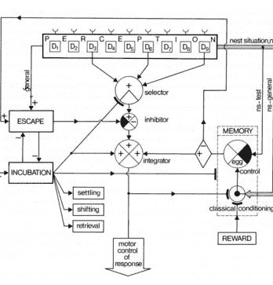

关于决定海雀将物体衔回巢穴的因素。基于在巢穴边缘放置物体的无数测试，Baerends及其同事能够建立一个详细的模型，说明各种特征（颜色、斑点、大小和形状）以及其他动机因素如何决定刺激引发取回行为的有效率。所得到的模型如图3.13所示。卵的探测分两步进行。首先，一个刺激由服务于通用视觉的多个“特征检测器”进行处理。其中一些检测器（例如对应于“椭圆形”、“有斑点的物体”等）向专门用于确定是否存在卵的“卵检测器”提供输入。输出信号不是“是”或“否”，而是基于存在的卵特征以及每个特征的有效性得出的连续值。不同特征根据类似于公式 (3.3) 的总和模型相互作用。这可以解释为什么不同刺激在引发取卵行为方面的效率各不相同。最后，卵检测器结合恐惧或对真实卵的经验等其他动机因素来确定行为。正如我们在第 1.4.3 节中所论述的，这类模型为何没有导致神经网络模型更广泛的使用，这一点并不显而易见。


认知心理学中的一些模型对刺激控制采取了相当不同的方法。在这里，我们只能讨论一个非常流行的概念，即泛化是由刺激在“心理空间”中表征之间的距离决定的（Shanks 1995; Shepard 1987; 另见第 1.3.5 节）。因此，两个刺激的表征越接近，它们之间发生的泛化就越大。心理空间中的距离与刺激之间的物理相似性（即更相似的刺激在空间中位置更近）有关，但也考虑了由于学习而导致的距离变化（Shanks 1995）。这些理论的一个缺点是，目前它们无法预测心理空间看起来是什么样的（Staddon & Reid 1990）。相反，代表点之间的距离是为了重现观察到的泛化而拟合的（Nosofsky 1986; Shanks 1995; Shin & Nosofsky 1992）。然而，这并不总是行得通。例如，强度泛化无法用这种方式令人满意地描述（Ghirlanda 2002）。简而言之，问题在于知道刺激 `S₁` 与 `S₂` 在给定距离处并不能告诉哪个刺激更强烈。可以引入额外的假设来处理强度（例如诉诸于不同刺激的“偏差”、“注意”或“显著性”；Johannesson 1997; Nosofsky 1987, 1991），但由此产生的模型不再仅仅基于距离。相比之下，如果将刺激强度现实地建模为输入节点更大的活动，神经网络可以自然地处理刺激强度。对此主题感兴趣的读者参阅 Ghirlanda (2002)。

总之，行为学和心理学的思考包含了许多用于行为神经网络模型的种子，而其他一些方法则明显不同。神经网络相较于类似甚至形式上等价的模型所具有的优势，源于它们被解释为神经系统模型，而非黑箱模型或抽象认知过程模型。这种解释强调了准确知道刺激如何进入生物体以及如何被处理的重要性。刺激是什么以及它的组成部分是什么通常是任意的，这导致了关于诸如`公式 (3.4)`等模型的功能和局限性的混淆（Ghirlanda 2005）。同时，前面讨论的许多现象源于网络架构的基本特性，例如处理的分布式性质。因此，引入一点生理学知识就能带来巨大回报。例如，为了预测沿刺激维度的泛化是钟形还是单调的，只需要知道该维度是被感知为重新排列还是强度梯度。我们不需要知道，例如，受体的具体生物化学。这种源于基本特性的观点与观察到的泛化现象在物种和类群之间的普遍性相符（Ghirlanda & Enquist 2003）。另一方面，要解释为什么人类和鸽子的光波长泛化梯度显示出系统性差异，我们需要诉诸于它们视觉装置的更精细细节，例如光感受器及其后续神经通路之间的差异。

## 3.4 感觉处理

迄今为止分析过的简单模型没有显示出感觉处理和决策之间的明确分离。在两层前馈网络中，感觉处理和决策是“打包”在一起的，而增加第三层引入了一定的分离潜力。在中枢神经系统中，除了最简单的系统外，受体后的神经层立即保存感觉信息，而决策发生在离感觉器官更远的地方（Ewert 1980, 1985; Kandel et al. 2000; Simmons & Young 1999）。换言之，处理的一部分独立于动物最终如何对刺激做出反应。图 1.8 说明了具有最少感觉处理的情况，而人类对视觉刺激的处理则是另一个极端，建立在多层和许多并行处理通路上（Kandel et al. 2000）。

为什么决策不是直接基于感觉器官的信息做出的？起初，这听起来可能很矛盾。生物体可用的所有感觉信息在受体层面已经存在。事实上，从技术意义上说，感觉处理导致信息的减少。技巧在于受体的活动模式被转化为后续层中更有利于决策的活动模式（Haykin 1999）。事实上，现实世界的许多属性在受体活动中表现得很差。同一物体可以产生非常不同的活动模式，错误地暗示这些模式来自不同的物体（图 3.3）。复杂的辨别，例如在第 2.2.1.1 节中遇到的异或 `XOR` 问题，也是受益于输入模式处理的情况。

在神经生理学研究中，可以发现许多类型的感觉处理。侧向抑制是一个例子，它使关于刺激变化的信息可用于决策或进一步的感觉处理。一个重要的概念是感受野（Kandel et al. 2000; Simmons & Young 1999）。这个术语指的是感觉器官（或任何其他神经层）中刺激能够激发后续层中一个细胞的部位。例如，一个神经元可能只对落在视网膜限制部位上的刺激做出反应，因此该部位被称为该神经元的感受野。在更抽象的意义上，感受野也可以指能够激发神经元的输入模式。在中枢神经系统中发现了许多类型的感受野（Hubel 1988; Kandel et al. 2000）。一个著名的例子是猫视觉皮层中的方向敏感细胞，由 Hubel 和 Wiesel (1962) 发现。这些细胞中的每一个都对投射在视网膜小部分的线条的方向敏感，对特定方向的线条反应最大。

### 3.4.1 通过侧向连接进行处理

侧向连接是一种特殊的递归形式，发生在同一层中的节点之间（图 3.14）。侧向连接，以及前馈和反馈连接，在中枢神经系统中是清晰可辨的。事实上，解剖学上可识别的神经元群内部的连接通常比不同神经元群之间的连接更丰富，例如在大脑中（Kandel et al. 2000）。与前馈和反馈一样，*侧向*一词指的是连接相对于已识别的输入-输出方向的取向。以下给出侧向连接在感觉处理中可能扮演的角色的两个例子（其在决策中的作用在第 3.7 节中讨论）。

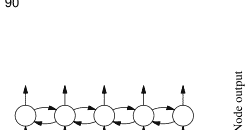

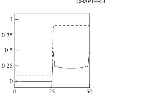

图 3.14 左：相邻节点之间的侧向反馈连接。右：通过抑制性侧向连接进行输入转换（`公式 3.5`）。节点阵列接收一个尖锐的边缘作为输入（虚线），并在边缘附近以增强的活动响应（实线）。网络节点使用第 2.2.2 节中描述的异步过程进行更新。

我们的第一个例子是*侧向抑制*，其含义很简单：每个节点抑制其邻居。抑制可能仅限于最近的邻居，或者延伸到更长的范围。侧向抑制可以突出输入中的变化，例如在视觉处理中（Coren et al. 1999）。这种效应可以通过使用具有由以下公式给出的侧向连接的一维节点阵列来演示：

$$L_{ij} = \begin{cases} 0 & \text{if } i = j \\ \frac{1}{-2|i-j|} & \text{otherwise} \end{cases} \quad (3.5)$$

也就是说，节点 `j` 以与它们之间的距离 `|i - j|` 成反比的强度抑制节点 `i`。除了来自其他节点的抑制外，我们假设有一个兴奋性输入 `x_i` 到达节点 `i`。图 3.14 显示了当该网络受到代表“边缘”的输入向量 **x** 刺激时的输出，即从低值到高值的急剧过渡。节点活动的轮廓清楚地揭示了边缘的位置。其机制相当简单。由于节点受到邻近节点活动的抑制，因此位于边缘附近的节点由于边缘左侧节点活动较低而受到的抑制较少。

图 3.15 以图形方式说明了侧向连接的另一种可能结构，其中相隔大约 25 个距离的节点（阴影区域）相互兴奋，而不同距离的节点则相互抑制。结果是，该网络对具有相距 25 个单独峰值的输入最敏感（换句话说，该网络对给定的空间频率特别敏感）。图 3.15 显示了网络的总输出（所有节点活动的总和）作为

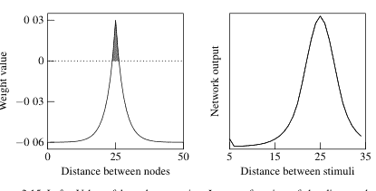

**图 3.15** 左图：在图 3.14 所示架构的网络中，横向连接 `L_{ij}` 的值作为节点 `i` 和 `j` 之间距离的函数。兴奋性权重来自距离约为 25 的节点（阴影区域），而其他节点的权重为抑制性。该函数的确切形式为 `L_{ij} = \frac{1}{100}(9\exp(-\frac{1}{3}||i-j|-25|)-6)`。右图：递归网络对输入的响应（所有节点活动的总和），输入由两个片段组成，每个片段激活 5 个节点，响应随片段间距离变化。该网络由一维排列的 50 个节点组成，这些节点通过如图左侧面板所示的横向连接 `L_{ij}` 相互连接。其他细节见图 3.14。

两个长度均为 5 的片段之间距离的函数；当两个片段相距 25 个节点时，输出达到最大值。

### 3.4.2 沿“困难”维度的泛化

边缘和线条是现实世界中重要结构的一个例子，它们在受体层面的表征较差。线条的长度、粗细和方向等属性只能通过结合许多受体的信息推导出来。例如，考虑一条垂直线在视网膜上投射的图像（为简单起见，假设该线总是落在视网膜上的相同位置）。如果我们稍微倾斜这条线，它会影响到全新的一组受体，而之前受影响的受体中只有极少数受影响。因此，现实世界（或其在视网膜上的投影）中的微小变化在受体层面引起了巨大的跳跃。但这对动物来说似乎无关紧要。动物对不同线条方向的泛化，就像对光波长或声音频率的变化一样顺畅（图 3.16 中的封闭圆圈；注意线条方向是一个重排维度）。


目前采用的网络在这种及类似情况下泛化能力非常差（图 3.16 中的虚线）。原因是响应直接基于输入活动模式的匹配程度。为了解决这个问题，我们将重点放在动物中广泛存在的一个感觉处理过程上，即空间组织化的感受野。这意味着给定层中的神经元并不从前一层的所有神经元或随机的子集中接收输入。相反，每个神经元通常从空间上相邻的神经元收集输入。这种处理例如发生在脊椎动物的视网膜中，其中视网膜神经节细胞将整合了许多邻近感光细胞输出的信号传递给大脑。一个简单的例子如图 3.17 所示。我们在一个三层前馈网络中使用这种组织，其中隐藏节点连接到输入层中相邻节点的一个子集。为简单起见，我们假设这些权重是固定的，而隐藏节点和输出节点之间的权重被设置为区分垂直线和无线的情况。如图 3.16 中的实线所示，这样的网络能真实地泛化到不同方向的线条。就匹配程度而言，感受野的作用是将匹配度较低的输入模式转换为隐藏节点中匹配度较高且随线条方向变化更平滑的活动模式。这使得由隐藏节点和输出节点组成的两层网络能够进行平滑泛化。

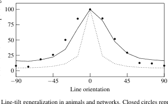

**图 3.16** 动物和网络中的线条倾斜泛化。封闭圆圈复现了一项实验的数据，在该实验中，鸽子被训练在垂直线显示在发光钥匙上时啄击，而在无线时不啄击（Bloomfield 1967）。线条展示了在类似任务上训练的两个不同网络模型的泛化情况。两个网络都拥有 $100 \times 100$ 的人工视网膜，可投射不同方向的 $60 \times 4$ 矩形。虚线代表两层网络（输入节点直接连接到输出节点）的较差泛化能力。实线展示了具有空间组织化感受野的三层网络（图 3.17）更真实的泛化能力。我们使用了 1000 个感受野，随机分布在视网膜上，呈圆形，半径为 7 个节点。

值得注意的是，我们的三层网络的相同行为也可以由具有适当权重矩阵的两层网络实现（因为模型仍然是线性的；参见第 2.3.1.1 节）。另一方面，正如我们所见，仅仅训练一个两层网络来识别垂直线与无线的存在并不会产生这样的矩阵。添加诸如更多层和非线性节点等特性也无济于事。原因在于，训练过程对泛化没有任何要求。另一方面，赋予网络感受野在某种程度上预示了同一物体可能以不同的方向出现。我们可以说，这样的网络具有对不同方向进行泛化的倾向（参见第 4.2.3 节）。这表明感受野至少在某种程度上是适应泛化的，因为它们为网络提供了不是网络结构“免费”提供的能力。增加输入模式之间匹配度的一个缺点是辨别变得更加困难。第 2.4 节和第 4.7.2 节包含有关感受野发生学的一些信息。

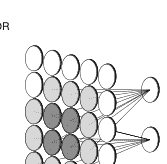

**图 3.17** 在一个具有 5 × 5 视网膜的小型网络中，空间组织化的重叠感受野。显示了两个输出节点，每个节点都从视网膜的一个子集（浅灰色）收集输入。深灰色表示两个输出节点感受野中都包含的输入节点。

### 3.4.3 知觉恒常性

*知觉恒常性* 指的是动物对同一物理刺激做出相似响应的能力，尽管该刺激可能产生许多不同的受体活动模式（图 3.3）。在许多物种和感觉模态中都观察到恒常性现象（Walsh & Kulikowski 1998）。可以想象出两种不同的解释。为了明确起见，我们考虑视觉。第一种可能性是动物拥有过许多不同情境的先验经验，并学会（或被选择）对每种情境做出相同的反应。第二种可能性是感觉处理进行了一些“魔法”，以补偿视网膜图像的变化。证据表明，恒常性可能源于这两种可能性的结合（Walsh & Kulikowski 1998）。动物在识别熟悉物体的变换图像方面通常非常擅长，远胜于简单的两层网络。另一方面，识别并不总是完美的。这并不令人惊讶，因为一般来说，如果不了解物体的结构，我们无法判断两个视网膜图像是否来自同一个物体。随着对变换图像经验的积累，识别能力会提高，且似乎需要对刺激有一些熟悉度。即使是非常熟悉的刺激，从典型视点识别的速度也比从不典型视点识别得快（Walsh & Kulikowski 1998）。换句话说，虽然我们经常对恒常性现象感到惊讶（尤其是如果我们试图在计算机中编程类似能力时），但我们也必须认识到，动物并不总是以相同的方式对熟悉物体在新情境中的表现做出反应。例如，图 3.16 中的实验数据表明，训练过对垂直线反应的鸽子对线条的所有方向反应并不一致。这加强了这样一种观点：对相关刺激的经验是恒常性现象的有力决定因素。一个例子来自果蝇（*Drosophila*）实验，果蝇似乎缺乏实现恒常性的感觉机制，至少对于非运动视觉刺激是这样。在这些实验中，对投射在果蝇复眼一部分的刺激的学习并没有转移到眼睛的其他部分（Dill et al. 1993）。有趣的是，在人类中也获得了类似的结果（Dill & Edelman 2001; Dill & Fahle 1998; Kahn & Foster 1985）。

我们现在考虑神经网络如何实现对物体方向恒常性的一个简单例子。这也许是一个最简单的例子，说明了特定经验如何与预先存在的网络结构相互作用以产生知觉恒常性。我们已经看到，具有空间组织化感受野的网络（图 3.17）在对单一方向进行训练后（图 3.16 中的实线），能够真实地泛化到不同方向的线条。如果进一步训练网络对少数几个更多方向做出响应，它对任何方向的线条都会做出相同的反应，如图 3.18 所示，从而有效实现恒常性。该图还表明，以相同方式训练的两层网络离这一结果相去甚远。因此，该模型展示了恒常性如何源于“良好”的泛化加上相对有限的经验。这与来自动物行为的信息一致。动物在对特定刺激或刺激类型经历很少时似乎并不表现出恒常性，但随着经验的增加，恒常性很快得以实现。不过，我们并不怀疑神经系统比我们的简单模型更智能（关于模型和数据参见 Arbib 2003 和 Walsh & Kulikowski 1998）。

### 3.4.4 刺激“过滤”和“特征检测器”

感觉处理的传统描述是它过滤掉对动物无关的信息（McFarland 1999; Simmonds & Young 1999）。这种作用计数是有效的但不完整的。一个更一般的描述是，感觉处理将输入模式转换为相继神经层中的活动模式。这种转换确实涉及到“过滤”（即使神经元对某些刺激或刺激维度相对不敏感），但也与例如主成分分析和其他信号分析技术（Field 1995; Haykin 1999）有相似之处。这包括在牺牲其他维度的同时强调某些刺激维度，以及构建在原始输入中不明显的新维度。

刺激过滤通常被认为是由“特征检测器”完成的，即只有当刺激具有特定特征时才响应的神经元（图 3.13；Simmons & Young 1999）。在动物行为学中，这一概念与动物基于由特定特征或特征组合识别的“信号刺激”进行响应的想法联系起来（Lorenz 1981; Tinbergen 1951）。图 3.13 是一个经典的例子。关于识别在整体上基于特征检测器的想法，目前在心理学和认知科学中仍然是一个充满活力的辩论话题（Field 1995; Schyns et al. 1998）。Rolls 和 Deco（2002）展示了几个基于特征检测器的网络模型。然而，从前面的章节可以看出，即使没有任何特征检测器，神经网络也非常有能力。这并不排除在具有三层或更多层的网络中，可能会出现可以被描述为“特征检测器”的处理模式（通过训练或进化）的可能性（例如 Kohonen 2001）。然而，这些并不完全类似于经典的线条和边缘检测器的想法。一个例子（引自 Arbib et al. 1998）来自对青蛙视网膜的研究。Lettvin et al.（1959）将视网膜神经节细胞（其轴突形成视神经）分为四种类型。第 3 型细胞被描述为对小型移动物体做出反应，这很容易让我们称它们为“猎物检测器”。然而，更好的描述是，这些细胞响应于进入其感受野的移动边缘，而不是响应于感受野内存在猎物。大脑中的进一步处理决定了青蛙是否会对移动物体进行捕捉。同样，第 4 型细胞更好的描述是测量视觉场景的变暗，而不是“捕食者检测器”（这里的联系是捕食者从上方来时通常会在青蛙身上投下阴影）。

总之，我们认为感觉处理的更好描述是它使相关信息可用于决策和行为控制。在网络模型和神经系统中发现的感觉野在几个方面似乎与经典的特征检测器想法不同。首先，它们往往更具通用性。例如，青蛙视网膜中的第 3 型细胞在各种视觉刺激的处理中都很重要，而不仅仅是针对猎物。其次，它们的调谐不如以前那么尖锐。例如，“线条检测器”会以不同程度反应于许多类型的物体，尽管线条可能是该细胞反应最强烈的刺激。最后，感知学习和其他发现表明，神经系统可能比一组固定的特征检测器所暗示的更具动态性（第 4 章；Schyns et al. 1998 及其后续评论）。

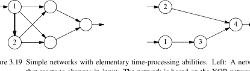


图 3.19 具有基本时间处理能力的简单网络。左：一个对输入变化做出反应的网络。该网络基于图 2.8（左）中的异或网络，增加了一个连接（较粗的箭头）且只有一个节点的输入。右：一个具有检测运动能力的基本机制（Hassenstein & Reichardt 1959）。节点 1 的输出通过节点 3 延迟，然后与节点 2 的输出合并。只有当节点 2 和 3 同时提供输入时，节点 4 才会反应。如果节点 1 和 2 仅对刺激变化做出反应，该机制是更具选择性的运动检测器（否则对两个节点的恒定输入也会引起反应；参见 2.1.3 节关于合适的节点模型）。

## 3.5 时间模式

时间模式是世界的一个非常相关的特征。持续时间、节奏和其他时间结构对于动物交流中使用的许多视觉和听觉展示至关重要。不同种类的啄木鸟是一个有趣的例子。它们可以根据其鼓击声（通过敲击树干等共振物体产生的一系列节律性声音）进行识别。不同种类的啄木鸟在鼓击声的持续时间、频率和幅度上存在差异。时间模式对于检测运动（Simmons & Young 1999）也至关重要，这可能有许多用途，例如检测猎物或捕食者（Eweret 1985; Lettvin et al. 1959）。当在环境中移动时，例如为了保持直线行进（3.5.1 节），视觉图像如何在视网膜上移动也很重要。

显然，对时间模式的反应不能基于单一时间点的感觉信息。单次敲击不能区分啄木鸟种类，单个视觉图像也不能告诉物体是接近还是远离。因此，为了基于时间模式做出决策，需要超越受体级别的感觉处理。必须以某种方式保留关于先前刺激的信息，并使其可用于决策机制。时间结构最简单的例子可能是输入的变化。想象一个输入信号 `x(t)` 大部分时间是恒定的，但有时值从 0 变为 1 或反之。图 3.19 中的网络仅对变化做出反应，并忽略输入恒定的时期。要看到这是如何实现的，请注意该网络是从第 44 页图 2.8 中的网络衍生而来的。修改很简单，即现在节点 2 接收来自节点 1 的输入，而不是来自外部刺激。通过这种方式，节点 1 和 2 分别保持值 `x(t)` 和 `x(t−1)`。因此，对变化的反应等同于当节点 1 和 2 中恰好有一个活跃时的反应，这正是图 2.8 中的网络被设计用来做的事情。通过对网络组织的一小点改变，时间模式被转换为同一时间节点的活跃模式，可用于进一步处理和决策。

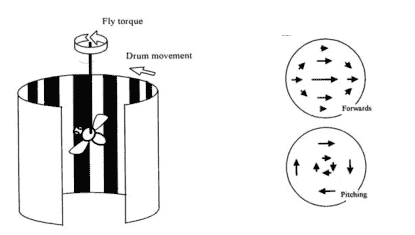

图 3.20 左：用于研究苍蝇光运动反应的装置。右：流场的例子（见正文）。经 Simmons 和 Young（1999）允许重印。*Nerve Cells and Animal Behavior*，Cambridge University Press。

图 3.19 展示了另一个例子：一个提供有关运动某些信息的基本网络（Hassenstein & Reichardt 1999）。节点 1 的输出被延迟（通过节点 3），然后与节点 2 的输出合并；节点 4 具有阈值，仅当节点 2 和 3 同时提供输入时才会被激活。由于延迟，这意味着节点 1 在节点 2 之前的一段时间受到刺激，就像移动物体经过视网膜时发生的情况一样。由于刺激节点 2 早于节点 1 不会产生反应，因此该电路还对运动方向敏感。虽然其神经结构仍未知，但在苍蝇中已鉴定出功能类似的机制（Simmons & Young 1999）。

### 3.5.1 苍蝇的光运动反应

生物学家常常惊叹于动物执行复杂任务的能力。虽然某些能力可能需要非常特定的工程，但我们也可以认识到，通用原理可以被使用，而不必重新发明。其中一个原理是，通过利用先前神经层的信息，我们通常可以构建更有用的表示，使任务变得稍微简单一些。考虑一只像苍蝇这样的动物，它需要依靠来自周围环境的持续反馈来保持特定的飞行航线。我们可以通过将一只被固定的苍蝇放在带有垂直条纹的圆筒内（图 3.20）来研究苍蝇如何使用环境信息。如果圆筒旋转，苍蝇会感知到偏离预定航线的情况，并做出反应以相对于圆筒的运动保持航线（Simmons & Young 1999）。这种视觉输入与飞行控制运动之间的转换被称为*光运动反应*。

光运动反应是如何实现的？要直接依赖运动检测器（图 3.19）是不够的，因为偏离预定航线时，在视觉场的不同部分产生的输入变化是不同的。然而，特定的航线（直线飞行、转弯、接近地面等）会在整个视野上产生全球性的运动模式，称为流场（Simmons & Young 1999；图 3.20）。例如，对于眼睛位于侧面的动物，直线移动会在两只眼睛上产生相同的流场，而转弯则会产生相反的流场。因此，流场是一个有趣的例子，展示了如何将分散在许多感受器上的感觉信息转换为更简单的维度，以便更容易地做出决策。

在果蝇大脑中已识别出对作为流场监测者反应的神经元，实证研究表明，这是通过整合与图 3.19 中功能等效的运动检测器的信号来实现的。已经提出了一些关于如何实现这一点的简单模型，这些模型建立在果蝇视觉系统已知的结构和功能特性之上。Harrison 和 Koch (2000) 构建了一个由一个人工神经元组成的电路，该神经元简单地加总接收来自光传感器阵列的线性运动检测器阵列的输出。一半的检测器调谐到一个方向上的运动，另一半则调谐到相反方向。运动检测器信号的总和因此估计了旋转的方向和速度。该电路被放置在一个类似图 3.20 中的装置中，并接受了该装置中与果蝇实验相同的刺激。电路的输出被解释为运动指令时，能够抵消装置产生的视旋转，其行为类似于果蝇。Planta 等人 (2002) 开发了一个具有类似架构的神经网络，但包含四个不同的运动检测器阵列，分别调谐到不同的方向，并接收来自两个摄像头的输入。这些输入进入四个节点，因此这些节点可以对由左/右旋转和上/下平移产生的流场做出反应。这些节点的输出控制着一个飞行机器人（长度超过 1 米的齐柏林飞艇）的四个螺旋桨，允许以不同的速度前进、左右转弯以及改变高度。机器人的任务是在不改变高度的情况下直线飞行。当打开飞行控制机制时，这一任务得以相当精确地完成，而当关闭时则完成得相当糟糕。因此，该网络能够纠正机器人相对较差的空气动力学特性。

### 3.5.2 筒头蛙的鸣叫识别

Phelps 和 Ryan (1998) 在研究筒头蛙 (*Physalaemus pustulosus*) 及其相关物种的发声通讯方面，开发了一种将神经网络应用于对时间结构产生行为反应的有价值的应用（另见 Phelps 2001; Phelps & Ryan 2000）。这项工作的目标是深入了解雌性识别机制如何影响雄性鸣叫的进化（第 5 章）。技术挑战在于筒头蛙鸣叫的重要方面是在时间上展开的。Phelps 和 Ryan 使用了一种循环网络，Elman (1990) 之前已证明该网络能够检测时间中的结构。该网络如图 2.13（第 56 页）所示。它由一个三层前馈网络组成，并增加了一组通过循环连接与第一组相连的第二组隐藏节点。网络输入节点模拟青蛙的耳朵，每个节点对一系列声音频率敏感。实际的雄性鸣叫以小间隔采样，为每个鸣叫获取一组时间切片。这些切片逐个输入到网络中（这是对神经系统内发生的连续时间处理的一种近似）。模型耳朵在每个时间点的活动被发送到第一组隐藏节点。这连接到输出节点和第二组隐藏节点，后者将其活动反馈回第一组。通过这种反馈，第一组内部节点的输入成为过去和当前输入的函数。这使得网络能够随着时间建立内部状态，并对一系列鸣叫切片中的时间结构变得敏感。网络通过随机搜索（“进化”）算法（第 2.3.3 节）进行训练，以响应筒头蛙的鸣叫，但不响应相同频率范围内的噪声。训练后，网络能够准确区分不同物种的鸣叫，并且还能预测真实雌性的反应，无论是对熟悉还是新颖的刺激（第 202 页的图 5.14；Phelps 2001; Phelps & Ryan 1998）。

## 3.6 多源信息和杂乱信息

与任务相关的信息通常来自许多不同的来源。例如，导航的线索可以来自磁场、地面地标以及太阳和星星等天体的位置。此外，这些线索并不总是存在，有时也不可靠（例如，天空可能多云）。有观点认为，动物可能会使用“经验法则”或“简单启发式方法”来应对这种情况，这些方法只考虑一个或少数几个线索，并丢弃关于其他线索的信息（Stephens & Krebs 1986）。我们的直觉表明，经验法则比更完整的策略更容易实现。然而，对于神经网络来说，丢弃信息并不一定比将其纳入考量更容易。事实上，神经网络的一个重要方面是它们使得整合各种信息变得容易。通过不同的感受器，各种外部和内部事件都可以转换为神经活动的“通用货币”（表 3.1）。此外，循环连接允许网络建立调节状态，从而对时间模式保持敏感。传入的信息是精确的还是杂乱无章的并不重要。网络能够决定什么是重要的，例如，通过降低传递来自不可靠来源的输入的权重。


神经网络这些特性如何帮助我们理解行为，可以通过候鸟的导航来说明。关于什么信息引导这种非凡能力的建议一直在稳步增加。清单包括上述线索，以及气味、次声波、惯性力、重力和科里奥利力等（Alerstam 1993）。与此同时，出现了一种询问究竟哪一个被“实际”使用的趋势。但为什么不使用所有来源呢？只要信息可以被接收，神经网络就可以自然地整合许多种信息。这也提供了更鲁棒的解决方案，即使某些信息来源不可用也能正常工作。该机制也可以对来源的当前可靠性保持敏感。生物导航系统体现这些原则这一点最终在鸽子身上得到了证明。在晴天磁场发生畸变时，它们能找到回家的路；在天空多云时，它们可以利用磁场。随着关于鸟类定向和导航的数据越来越多，多源假设获得了支持。今天，人们普遍认为鸽子使用各种信息，包括三种罗盘和其他补充信息（Alerstam 1993）。

## 3.7 决策的中心机制

这里的决策是指动物采取一种行为行动而不是另一种行为这一事实，并不暗示意识或意图（McFarland 1999）。一种简单的观点是，只要相关的因果因素存在，行为就会发生。但进一步的思考以及实证观察表明，决策是一个更复杂的问题（Hinde 1970; McFarland 1999; McFarland & Sibly 1975）。一个基本的考虑是，动物通常一次只能做一件事，而不相容行为的因果因素可能同时存在。一只既饿又渴的动物可能同时有食物和水，但它不能同时进食和饮水。一般来说，许多活动对生存和繁殖是必要的，但在任何给定时间只能执行其中一个或少数几个。因此，决策是以合理的方式在时间上结构化行为，同时考虑动物的内部状态和外部条件（McFarland 1999）。在本节中，我们旨在表明神经网络具有类似动物的决策的自然能力，并且可以体现行为学、心理学和控制论内部开发的许多思想（综述见 Baerends 1982; McFarland 1999; Shellsworth 1998; Toates 2001）。我们首先考虑单个决策如何受到动物内部状态以及外部刺激的影响，然后考虑活动之间的决策。

### 3.7.1 行为与身体状态（稳态）

前面的几节考虑了非常简单的决策。唯一的因果因素是外部刺激，决策是是否做出反应。我们对这种决策的模型是具有单个输出节点的网络，其活动被视为反应的概率。这里我们继续讨论这种简单的决策，但引入身体状态（内部刺激）作为额外的因果因素。不同活动之间的决策将在后面考虑。

身体状态和外部刺激都通过专门化感受器感知（表 3.1）。因此，要模拟身体状态，我们不需要新概念，而需要了解它们是如何被感知的。然而，一个关键的区别是，身体生理要求诸如水量、体温、血糖水平等变量保持在严格的范围内以维持生命。这被称为实现稳态，行为往往起着关键作用。例如，在阳光和阴影之间移动是调节体温的有力方式，爬行动物等动物大量依赖于此。

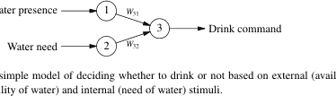

我们以一个简单的饮水模型开始讨论稳态的神经网络模型。生物体不断失水，必须通过饮水来补充。因此，稳态饮水的神经网络模型应解释身体水分含量如何保持在身体生理所需水平附近。该模型由三个节点组成，如图 3.21 所示。节点 1 和 2 将关于身体水分含量和水可用性的信息传递给节点 3。与本章节前面介绍的模型类似，假设节点 3 的活性对应于饮水的概率：

$$ Pr(\text{在时间 } t \text{ 饮水}) = z_3(t) = W_{31}z_1(t) + W_{32}z_2(t) \quad (3.6) $$

要将这个通用方程转化为一个饮水模型，我们需要更具体地说明：(1) 当生物体饮水和未饮水时，水量如何随时间变化；以及 (2) 哪些内部和外部刺激构成了饮水决策的原始材料。请注意，包括身体状态和外部刺激在内的所有模型都需要此类假设。

设 `v(t)` 表示时间 `t` 时的身体水分含量。我们假设在任何时刻的失水量为 `-a v(t)`（与水量成正比），且饮水以恒定速率 `b` 增加水量：

$$ v(t+1) = \begin{cases} -a v(t) & \text{如果未饮水} \\ -a v(t) + b & \text{如果饮水} \end{cases} \quad (3.7) $$

现在让我们考虑网络输入。该模型有两个输入节点。节点 1 模拟能够感知水分不足的细胞（表 3.1）。假设该节点按以下方式运行：

$$ z_1(t) = \begin{cases} V - v(t) & \text{如果 } v(t) < V \\ 0 & \text{否则} \end{cases} \quad (3.8) $$

参数 `V` 可视为水位调节的设定点，即应维持的理想水位。我们很快就会回到这个概念。根据方程 (3.8)，如果生物体水分充足甚至过剩，节点 1 不活动；否则，其活性与水分不足的程度成正比。人们认为具有类似特性的神经元确实存在，例如在哺乳动物的中枢神经系统中（Toates 2001；表 3.1）。节点 2 是一个“水检测器”；也就是说，当且仅当水可接近时，它是活跃的：

$$ z_2(t) = \begin{cases} 1 & \text{水存在} \\ 0 & \text{水缺失} \end{cases} \quad (3.9) $$

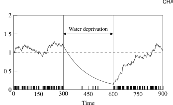

图 3.22 图 3.21 中饮水模型的行为示例。虚线：需维持的身体水分含量（方程 (3.8) 中 `V` 的值）。实线：实际水分含量。水平轴上的标记：饮水发生的时间。在 300 到 600 时间之间水不可用。

这种粗略的识别模型在此用于简化，可以根据前述内容替换为更现实的模型。

通过适当的权重，该模型可以将水平衡维持在设定点 `V` 附近，如图 3.22 所示。该图还显示了当水在一段时间内变得不可用时会发生什么：尽管持续失水，但不会发生饮水。因此，网络可以整合来自外部和内部刺激的信息，如果适当的外部条件不存在，就会克制执行由内部动机驱动的行为。当水重新引入时，饮水以高频率恢复，直到水分不足被消除。请注意，在严重不足的情况下，即使水不存在也会偶尔发生饮水（图 3.21）。事实上，如果水分含量特别低，节点 2 会给节点 3 贡献比平时更大的输入，这可能导致即使在节点 1 没有输入的情况下也有相当大的饮水概率。动物确实可能在动机非常高时，在不适当的条件下执行某种行为。动物行为学家将此称为真空活动。例如，脱水鸽子可能会试图从光滑闪亮的表面喝水（参见 McFarland 1987 中的[重定向行为](https://example.org/redirected_behavior)），或经常访问通常有水的地方（我们的模型过于粗糙，无法区分由口渴驱动的不同行为）。另一个经典例子是长期缺乏配偶的鸽子，可能会向填充的鸽子甚至一块布求偶（Hinde 1970）。

当然，动物体内饮水的控制更为复杂。除了通过渗透压感受器感知的水位外，饮水还受胃部水分存在和因摄入水而导致的口腔刺激等因素控制。这些额外控制因素的功能原因是水从胃移动到其他组织需要时间。在渗透压感受器能够感知到水分含量变化之前，可能已经饮用了过量的水。我们的模型忽略了这一复杂性。

多个控制因素的存在与人工装置中设定点的简单示例（如恒温器）相悖。因此，设定点类比被认为具有误导性（Toates 1980, 1986）。进一步的批评涉及模型仅基于*负反馈*运行这一事实。这里的*反馈*是指系统通过专门的感觉器，将受控变量的实际值与设定点或理想值进行持续比较。*负*是指当感知到偏离设定点时，会采取导致符号相反之变化的行动。负反馈控制是动物实现稳态的一个重要方面，但并非唯一方面（Toates 1986）。例如，鸡在黄昏前的一小时内吃得更多（Hogan 1998）。这并不反映需求的增加，而是对夜间不会进食的预期。图 3.23 显示了一个改进的神经网络饮水模型，它可以考虑来自许多来源的信息。我们包括了临时的水分储存，即胃，水从胃转移到身体的其余部分，以及能够感知胃中水分并从而抑制饮水的感受器（胃伸展感受器）。如有必要，还可以包括其他因素。该模型还有一个“时钟”组件（即周期为 24 小时的时间变化输入）。这为决策系统提供了时间变化输入，并允许昼夜节律的影响（另见第 3.7.5.2 节）。

### 3.7.2 在替代方案中进行选择

如前所述，动物决策研究的基本观察出发点是，不兼容的活动可能同时被激发。对于狮子而言，水坑可能同时激发饮水和捕猎，如果动物既饿又渴的话；但捕猎要求狮子藏在水边，而饮水要求造访水边。在动物行为学中，这被称为*冲突情境*（Hinde 1970; McFarland 1999; Tinbergen 1952），意指去做不兼容之事的倾向之间的冲突。在某些物种中，少数固定规则支配着此类冲突的解决（图 3.24），但在大多数情况下，动物的内部状态和外部条件影响着做出的决策。

大多数决策理论都诉诸于这样一个核心概念：互不兼容的活动相互抑制（Hinde 1970; Tinbergen 1952）。例如，图 3.13 中 Baerend 的模型就展示了孵卵和逃跑行为之间的相互抑制。尽管这种机制很受欢迎，但似乎只有少数几次具体研究过它（Amarri & Arbib 1977; Didday 1976; Ludlow 1980）。


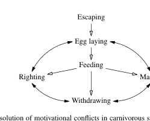

图 3.24 肉食性螺类（腹足纲：`侧鳃类`）中动机冲突的解决。从一种活动指向另一种活动的空心箭头表示前者抑制后者；双向实心箭头表示没有严格的等级关系。`正位`指动物从倒置位置翻转为直立的动作。将动物倒置并提供食物会在进食和`正位`之间引起冲突。动物会进食，并在进食后等待长达 1 小时再翻转直立。有趣的是，提供给已吃饱动物的食物也会抑制`正位`。改编自 Davis (1979) 和 Toates (1998)。

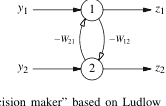

图 3.25 一个基于 Ludlow (1980) 的简单“决策者”。节点 1 和 2 之间的权重是抑制性的。

此类最简单决策机制仅由两个相互抑制的节点组成（图 3.25），可形式化为

$$
\begin{align}
&z_1(t+1)=f(y_1(t)-W_{12}z_2(t)) \\
&z_2(t+1)=f(y_2(t)-W_{21}z_1(t))
\end{align} \quad (3.10)
$$

其中 $y_i(t)$ 是节点 $i$ 来自网络其他部分接收的输入，正数 $W_{12}$ 和 $W_{21}$ 给出抑制强度。传递函数 $f$ 将节点活性限制在 0 和 1 之间，但其他方面是线性的：

$$
f(y)=\left\{
\begin{array}{lll}
0 & y\leq0\\
y & 0<y<1\\
1 & y\geq1
\end{array}\right.\quad (3.11)
$$

该电路的特性如下。如果权重 $W_{12}$ 和 $W_{21}$ 都小于 1，节点 1 和 2 可以同时处于活跃状态；即决策并非保证。然而，如果两个权重都等于或大于 1，网络会进入 $z_1$ 和 $z_2$ 中只有一个不为零的状态；即做出了决策。权重越大，决策所需的时间越短（即在关闭一个节点之前，方程 3.10 的迭代次数越少）。图 3.26

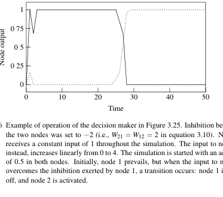

展示了使用 $W_{12} = W_{21} = 2$ 的一个决策示例。节点 1 在整个模拟过程中接收恒定的输入 $y_1(t) = 1$，但节点 2 的输入从 0 增加到 4。需要注意的是，仅凭节点 2 的输入大于节点 1 的输入（即 $y_2(t) > y_1(t)$）并不足以发生切换。相反，节点 2 必须接收到大于其从节点 1 获得的抑制量的输入，即 $y_2(t) > W_{21}z_1(t)$。在模拟中，$y_2$ 在 $t = 13$ 时超过了 $y_1$，此时 $y_2(13) = 1.04$ 且 $y_1(13) = 1$。然而，此时节点 2 从节点 1 接收的抑制量等于 $W_{21}z_1 = 2$，因此其总输入仍为负值。尽管 $y_2$ 继续增加，但直到 $t = 26$ 且 $y_2 = 2.08$ 时才会发生过渡。在此点，节点 2 开始产生 0.08 的正输出。这在一定程度上抑制了节点 1，进而降低了施加在节点 2 上的抑制力。因此，节点 2 的输出将进一步增加，显然这一过程将持续直到节点 1 完全关闭。这是一个`正反馈`的示例；即对变化的反应是朝同一方向的进一步变化，而不是像负反馈那样朝相反方向变化。

Ludlow（1980）表明，这种简单的机制可以协调诸如`图 3.21`中的多个系统，从而实现针对多个变量的稳态。Diday（1976）使用类似的机制来模拟青蛙的猎物选择（该决策涉及攻击哪种潜在的两种猎物）。若要考虑两种以上活动之间的决策，我们只需包含更多的输出节点即可。如果所有节点都强烈相互抑制，活动之间的过渡将很快，且在任一给定时间只执行一种活动（有时被称为 `winner-take-all` 系统）。然而，如果某些连接缺失，或者某些节点兴奋其他节点，则可能出现更复杂（也更有意思）的结果。当然，抑制性连接不必全部相等，在这种情况下，从一种活动切换到另一种活动可能比反向切换更容易。我们可以按照行为学的行为理论（Tinbergen 1951）所建议的那样，通过多次复制基本决策网络，将决策安排成层次结构，如`图 3.27`所示。`图 3.28`展示了经典行为学中的一个示例。通过让每个活动由更多节点来表示，我们可以获得更多的可能性，这也更加符合现实。如果相对于一个活动的节点向相对于其他活动的节点投射强度不同的连接，施加的有效抑制将取决于具体哪些节点处于活跃状态。这意味着，例如，某些刺激可能比其他刺激更有效（例如，一种食物可能说服动物开始进食，而另一种则不能）。我们也可以通过向某些或所有节点添加随机输入来模拟决策的变异性。其中大多数可能性在很大程度上尚未被探索。

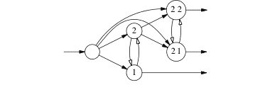

`图 3.27` 具有两层结构的决策层次结构示例。节点 2.1 和 2.2 控制的活动之间的决策只有在节点 2 处于活跃状态时才会进行，即只有当节点 1 和节点 2 之间的决策倾向于后者时才会进行。该图还表明，相同的输入可能会影响多个层面的决策制定，这在动物行为研究中已有观察（Baerends 1976; Gallistel 1980; Hogan 2001; Tinbergen 1951）。为简单起见，我们仅描绘了一个输入节点，但决策制定节点可以从多个来源接收输入。另见 Hogan（1994b, 2001）。

### 3.7.3 行为的稳定性

决策除了被做出外，还应该具有合理的稳定性。想象一下，我们的狮子既渴又饿，决定去喝水。如果喝水的效果仅仅是解渴，正如我们可能会天真地猜测的那样，口渴感会迅速降到饥饿感之下。因此，动物会停止喝水并去躲藏，这是捕猎所必需的。然而，在短暂躲藏后，由于动物喝得很少，口渴感又会增加，循环会再次发生。另一个例子是蜥蜴通过在阴影和阳光之间移动来调节体温。如果蜥蜴太冷，它会去晒太阳。但如果它在达到舒适的温度时立即进入阴影，它很快就会再次变冷，并需要回到阳光下。蜥蜴会在阳光和阴影之间快速振荡。这种不稳定性在工程中被称为`抖动`（dithering），在动物中很少观察到。

`图 3.25`中的决策制定机制提供了一些防止抖动的保障，如`图 3.29`所示。这个模拟与`图 3.26`中的模拟在时间 28 之前是完全相同的，即当节点 1 到节点 2 的过渡正在进行时。在此点，节点 2 的输入开始随时间线性减少，在时间 50 时达到 0。节点 1 的输入恒定为 1。这种设置可以模拟随着受节点 2 控制的活动被执行，其因果因素的减少，例如喝水开始后喝水的因果因素减少。与人们可能预期的相反，这种减少并不会立即导致返回到活动 1。相反，活动 2 的因果因素必须显著减少，才会发生切换。如前所述，从 2 切换到 1 的条件是 $y_{1} > W_{12}y_{2}$。这意味着，如果 $W_{12}$ 足够大，即使节点 2 的输入小于节点 1 的输入，网络也可以持续处于活动 2 状态（形式上，$y_{1} < W_{12}y_{2}$ 与 $y_{1} > y_{2}$ 是兼容的，前提是 $W_{12} > 1$）。


`图 3.28` Tinbergen 的行为系统层次模型，以刺鱼（*Gasterosteus aculeatus*）的繁殖行为为例。最高层由`主要本能`组成。第二层是`子系统`，第三层是个体活动（例如，属于筑巢子系统的收集巢材和粘合）。在这些层面，系统之间的竞争减少，相互抑制确保在任一给定时间只有一个系统控制行为。在较低层面存在产生连贯运动模式的“协调性”相互作用（第 3.8 节）。“Weiss”标签将该模型与 Weiss（1941）的运动协调神经生理模型的层级联系起来。经牛津大学出版社许可，重印自 Tinbergen（1951）。


`图 3.29` `图 3.25`中决策制定电路的决策稳定性。此模拟与`图 3.26`中的模拟在时间 28 之前是完全相同的，即刚启动从节点 1 到节点 2 的过渡之后。在此点，节点 2 的输入开始线性减少，在时间 50 时达到 0。然而，节点 2 不会立即关闭，而是保持活跃一段时间。

### 3.7.4 犹豫不决

尽管行为总体上是稳定的，但偶尔也会观察到犹豫不决，并且行为学家对此进行了广泛研究（Hinde 1970）。例如，动物在陌生的环境中面对熟悉的食物时，可能会不确定是接近还是回避。在类似条件下，可能会出现几种不同的结果：

1. 动物可能会在行为之间振荡，例如先接近然后后退（这对任何尝试喂过半驯化动物的人来说都是熟悉的现象）。
2. 两种行为共有的组成部分可能会出现（例如，行走既适用于接近也适用于回避）。
3. 两种行为中任意一种的组成部分的混合可能会出现。
4. 可能会出现与冲突行为似乎无关的第三种行为（转移活动）。
5. 在活动之间切换可能需要几次尝试（例如，休息了一段时间的鸟可能会在真正起飞前做几次尝试）。


这些问题很复杂，尚未使用神经网络模型进行研究。我们可以推测，至少**图 3.25**所示类型的决策制定网络中可能会出现其中一些现象。例如，活动之间较长的过渡时间可能源于抑制权重没有远大于 1。同样，如果节点之间的抑制较弱，几个节点可能会同时活跃，至少持续一段时间。这可以解释混合行为模式或多种动机活动共有的行为组成部分的出现。经典行为学对转移活动的解释也可以在神经网络中实现。其思想是两种冲突的行为通过相互抑制相互抵消，从而允许表达
第三种行为（关于详细讨论参见 Hinde 1970）。这将要求代表冲突活动的节点之间产生强烈的相互抑制，同时对代表浮出水面活动的节点施加较弱的抑制。后者将继续受到通常因果因素的影响，这与动物行为学的发现是一致的。例如，van Iersel 和 Bol（1958）以及 Rowell（1961）发现，在三趾鸥和红头灰雀中，羽毛被弄湿会增加在接近-回避冲突情境下正常梳理行为和位移梳理行为的频率。

### 3.7.5 行为在时间上的组织

通常，行为必须在时间上具有一定的组织才能具有功能性（第 3.1 节）。动物比我们目前考虑的具有更具体的需求。例如，进食的问题并不止于决定吃东西：一系列不同的活动（例如，寻找和处理食物以及吞咽）必须在一个功能性行为序列中进行协调。在本节中，我们将展示如何通过适当结构化决策机制来实现对行为序列的若干要求。

为了理解行为序列，我们必须牢记，一种行为反应可能会部分改变引起该反应的动力状态（第 1.2.2 节和第 3.2.2 节）。这可能通过两条途径发生。首先，行为可能会导致动物在稍后时间感知到的外部或内部环境发生变化。例如，饮水会改变身体水分体积，而这本身是饮水的一个因果因素。其次，决策机制内的状态可能会改变。例如，当某个行为序列必须在刺激没有显著或可靠变化的情况下执行时，就需要这种改变。我们将这种状态称为*调节性状态*（第 1.2 节）。上面检查的简单决策者（图 3.25）已经拥有对其能力至关重要的调节性状态。事实上，该网络不仅仅是由输入驱动的。例如，在图 3.29 中，`t` = 21 和 `t` = 35 时的输入是相同的，但活动模式却是相反的。递归抑制连接能够具体地构建一种“调节性状态”，该状态实施于节点 1 和 2 的活动中，从而使网络能够克服犹豫不决。因此，这两个节点履行了双重功能：直接控制行为的输出功能和调节功能。在接下来的内容中，我们将考虑调节性状态在行为结构化中的作用的其他例子。关于动物如何在时间上组织行为的进一步讨论，可参见 Hinde（1970）和 McFarland（1999）。

#### 3.7.5.1 随时间积累的内在状态

作为我们的第一个例子，考虑一种仅在刺激存在特定时间后才产生的反应。例如，在单配制物种中，雌性往往不会立即对雄性的求偶做出反应。这在功能上是合理的，因为雄性可能会求偶而不愿意与雌性建立结合关系，而且愿意结合的雄性往往更坚持不懈（Wachtmeister & Enquist 2000；另见第 69 页）。延迟反应的另一个例子出现在雄性大鼠的性行为中。大鼠在有接受交配的雌性在场时，并不会立即尝试交配，而是经历一系列最终导致交配的行为。


图 3.30 左：能够延迟反应的简单递归网络（公式 3.12）。右：对时间步 5 之前为低、之后为高的输入的样本反应。虚线：具有随机设置权重的网络。实线：具有适当设置权重的网络（使用了基本的随机搜索算法；第 2.5.3 节）。

图 3.30 中的简单网络能够对刺激产生延迟反应。形式上，网络响应由下式给出：

$$r(t + 1) = f\left(W_{1}x(t) + W_{2}r(t) - W_{3}\right) \quad (3.12)$$

请注意，时间 $t$ 时的响应会对输入求和，共同决定时间 $t + 1$ 时的响应。常数负输入 $-W_{3}$ 确保弱刺激不能引起强响应。传递函数 $f$ 是一个 S 形函数，其斜率调节系统从一个小输出到大输出的速度。图 3.30（右）展示了该网络的能力。

在适当条件下随时间积累的内在状态潜在地具有许多用途。刚才描述的基本机制可以包含在更大的网络中，以提供多样化的行为。例如，我们可以通过用一层 $N$ 个输入节点替换单个输入节点来包含一个更强大的识别机制。所得网络的公式化为：

$$r(t + 1) = f\left(\sum_{i=1}^{N} W_{i}x_{i}(t) + W_{N+1}r(t) - W_{N+2}\right) \quad (3.13)$$

该网络对于哪些刺激能够在内在状态中积累可以更具选择性。例如，雌性的同物种雄性可以与异物种雄性区分开来。

另一个有趣的例子是通过考虑图 3.19 中的网络获得的。正如我们所见，该网络对输入的变化做出反应，但对恒定输入不做出反应。如果在输出节点中添加一个延迟机制，网络仅在输入呈现一系列连续变化时才会做出反应。例如，像发光的昆虫或萤火虫这样的动物可以利用这种机制来对由一系列闪光组成的信号做出反应，但对单一闪光不做出反应。


图 3.31 白天的 dustbathing（土浴）分布。左：来自 2 周龄红褐色缅甸原鸡（*Gallus gallus spadiceus*）的经验数据。在实验室中观察了一组 16 只鸟，连续 4 天，每天在 6:00 到 18:00 之间提供光照。这些鸟平均每天土浴 2.2 次，在中午前后更频繁，且在黑暗中从不土浴。（来自 J. A. Hogan 实验室的未发表数据；另见 Hogan 1997；Hogan & van Boxtel 1993。）右：使用图 3.32 中的网络进行的模拟。单个网络运行了 16 × 4 = 64 个模拟天数，产生了与鸟类观察到的相似的土浴模式，平均每天土浴 2.4 次。更多细节参见正文。

#### 3.7.5.2 昼夜节律和“动作特异性能量”

在本节中，我们将说明两个可以组织行为在时间上排布的额外因素。作为一个具体例子，我们考虑土浴（dustbathing），这是许多鸟类的特征行为，其作用是将灰尘散布到羽毛中并保持它们清洁（更多细节参见第 4.7 节）。第一个因素是昼夜节律控制，这意味着行为在一天中的某些时间比其他时间更频繁地执行（例如，关于昼夜节律的导论参见 Toates 1998）。例如，如图 3.31 所示，鸡在中午前后更频繁地进行土浴。昼夜节律控制可能有多种功能。一种是预测事件（例如，在天黑前前往安全的地方）。另一种是为环境噪声提供稳定性（例如，即使天空多云，也不相信天已经黑了）。对鸡的土浴和进食的考虑表明，昼夜节律还可以减少活动之间的冲突。进食在黎明和黄昏达到峰值，白天保持稳定（约 5 分钟/小时）。考虑到动物不在夜间进食，这在功能上是合理的。土浴，正如我们所见，显示出相反的模式；它在中午前后达到峰值，在其他时间很少进行。土浴是一项耗时活动；成年鸟的一次土浴持续近 30 分钟，并且每隔一天进行一次。似乎没有功能性理由表明土浴应在特定时间进行，但观察到的时间减少与进食的冲突。


图 3.32 一个行为（土浴）的最小神经网络模型，由昼夜节律和洛伦兹因子共同控制。后者在行为未进行时增加，在行为进行时减少（由抑制反馈箭头指示）。通过适当选择权重值和因果因素（在正文中解释），该网络可以重现猫头鹰观察到的土浴时间模式（见图 3.31）。

第二种因果因素被 Lorenz（1937, 1981）称为*动作特异性能量*。这一概念源于对真空活动（参见第 102 页）的观察，这些观察表明，当行为未进行时，行为的因果因素可能会随时间自发积累，并且仅在行为进行时减少。虽然 Lorenz 原始模型的许多细节可以受到批评（评述见 Hinde 1970），但动机的自发积累在控制许多活动时似乎很重要（Hogan 1997）。土浴是最清晰的例子之一。被阻止进行土浴一段时间的鸟，一旦允许这样做，就会大量土浴，即使是在正常情况下几乎从不进行土浴的时间。此外，外部操作可以影响土浴的时间，但不能影响其数量，仿佛因果因素有一个有限的预算可用（Hogan 1997; Hogan & van Boxel 1993）。

*总结*来说，虽然昼夜节律控制确保土浴主要发生在白天中部，但洛伦兹因子确保土浴最终会发生。可以推测，如果没有洛伦兹因子，土浴将很容易被更紧迫的活动（如进食和饮水）所主导，从而存在永远不会被执行的风险（McFarland 1999）。

土浴的神经网络模型可以通过包含一个神经“时钟”和土浴的动机来源来建立。图 3.32 展示了一个仅由三个节点组成的最小模型。尽管因果因素不同，该模型的基本架构与我们简单的饮水模型（图 3.21）相同。唯一的区别是节点 3 的活动被解释为土浴的概率而非饮水：

$$Pr(dustbathing \text{ at time } t) = z_3(t) = W_{31}z_1(t) + W_{32}z_2(t) \quad (3.14)$$


（参见公式 3.6）。另一个相似之处是，洛伦兹因子和水分缺失如果在相关行为（土浴或饮水）未进行时都会随时间增加，并在进行时减少。然而，请注意这两个因果因素之间的重要概念差异。水分缺失是身体的一种生理状态，独立于饮水控制机制而存在。相比之下，洛伦兹因子是一种调节性状态，其存在仅仅是为了参与土浴的控制（参见第 3.1 节）。

由公式 `(3.14)` 形式化的简单网络模型可以重现，随着...通过合适选择权重值和因果因素，我们观察到了图 3.31 所示的扑尘行为模式。本节剩余部分将详细解释我们对因果因素和网络参数的选择。可以通过假设节点 1 的活动根据正弦波变化，简单地纳入昼夜节律：

$$z_1(t) = \sin \left( \frac{2\pi}{24}(t-5) \right) \tag{3.15}$$

此函数在 $-1$ 和 $1$ 之间振荡，周期为 24 小时，适合昼夜节律。在函数参数中使用 `t-5` 而非简单的 `t`，确保 `z_1(t)` 在 `t = 11` 时达到最大值，此时更可能发生扑尘行为。在此期间，`z_1` 将为节点 3 提供强烈的兴奋性输入，而在夜间 `z_1` 将为负值，从而抑制节点 3 的活动。

为了模拟洛伦兹因子，我们假设 `z_2` 的时间进程由方程描述：

$$T\Delta z_2(t) = 1 - z_2(t) \tag{3.16}$$

其中 `Δz_2(t)` 是时间步 `t` 时 `z_2` 的变化量（在我们的模拟中，一个时间步对应 1 分钟）。方程 `(3.16)` 的含义是 `z_2` 以由时间常数 `T` 调节的速率趋近于最大值 `1`（在我们的模拟中 `T = 180` 小时）。这类似于一个具有缓慢动力学的节点，接收常数输入 `1`（见第 2.1.3 节）。然而，在一次扑尘行为期间，假设 `z_2` 的活动减少 0.12。最后，网络中的两个权重值分别为 `W_{31} = 0.01` 和 `W_{32} = 0.003`。模型对大多数参数的具体值并不非常敏感，我们可以通过尝试和错误，并在一些启发式考虑（例如，昼夜节律必须在 11:00 左右提供最大输入）的指导下找到合适的值。

### 3.7.6 与控制理论的比较

对动物决策过程的分析很大程度上归功于 *控制理论*。在典型的控制理论模型中，行为被视为 *控制系统* 的一部分，该系统具有明确定义的任务，如维持稳态。负反馈或行为稳定性的必要性等重要概念作为控制问题显得非常清晰（McFarland 1999）。为了构建我们的神经网络模型，我们大量借鉴了控制理论在动物行为中的应用（McFarland 1974a, 1999; McFarland & Sibly 1975）。这种灵感不难发现。图 3.33（上图）展示了一个基于负反馈的简单饮水控制模型（见第 103 页）。该模型将饮水率 `d(t)` 规定为全身水量 `v(t)` 与设定点 `V` 之间差值的函数，如下所示：

$$d(t) = k(V - v(t)) \tag{3.17}$$

其中 `k` 是正常数。这与图 3.21 中的简单模型非常相似，在图 3.21 中，当水存在时饮水的概率是 `W_1 + W_2(V - v(t))`（见方程 3.6）。因此，在这两种情况下，饮水率（或饮水概率）与缺水程度之间都存在线性关系。因此，网络模型可以被看作是负反馈控制实现稳态这一思想的一种实现方式。我们更复杂的饮水模型（图 3.23）同样与图 3.33（下图）中更精细的控制方案相似。


图 3.33 鸽子饮水的两个控制模型图解，说明了反馈机制。（改编自 McFarland 1971。）两个模型都使用全身缺水作为控制因素。在模型 (a) 中，这是饮水的唯一因果因素，而模型 (b) 增加了两个其他因素，即肠道体积和因摄入水分而产生的口腔刺激。当饮水填满肠道时，肠道中的牵张感受器受到刺激并抑制饮水（负反馈）。口腔反馈是正反馈，一旦动物开始饮水，就会暂时增加动机。这种正反馈随时间衰减。模型 (b) 比模型 (a) 能在更精细的时间尺度上描述饮水行为，因为它考虑了动物生理学的更多细节。

控制理论是一个充分发展的框架，既有理论方面也有实践方面。前者使用反馈和前馈控制等概念来解决系统控制的通用问题，后者涵盖对特定控制装置的分析。值得注意的是，这些装置有时具有神经网络的结构。例如，所谓的线性自适应滤波器与两层线性网络相同，可用于稳态控制和其他应用（Kalman 1960; Widrow & Hoff 1960; Widrow & Stearns 1985; Wigner 1949）。然而，这种对机制的分析在控制理论应用于动物行为时发展得较少。在这里，功能性的考虑占主导地位。对稳定决策的需求、如何设置活动之间的切换阈值以及其他重要问题已经得到充分讨论，但动物实际使用的机制考虑较少。这引发了一些争论，例如关于阈值和决策边界等概念是否足以研究动物行为（McFarland 1974b; Toates 1980）。

神经网络使我们能够除了功能外还能解决机制问题。我们已经看到，简单的神经网络可以在不显式考虑阈值或决策边界的情况下做出决策并维持稳态。尽管神经网络的决策模型发展尚不成熟，但我们希望已经证明它们有可能整合控制理论和动物行为学的成果。目前很难看出是否会产生大量新知识，或者神经网络是否只是已知思想更具生物现实性的实现。不过，可以暗示神经网络模型在几个领域可能特别有用。

对刺激的反应和决策过程通常被分开考虑。例如，请注意图 3.33 中的控制模型没有考虑动物如何知道水是否存在。神经网络可以将刺激反应机制与决策过程整合起来。例如，我们可以研究为什么一些刺激比其他的更有效。这种从刺激接收到决策过程的整合模型也可能帮助我们理解为什么神经系统有时会发出非功能性行为指令。

通过提供具体的实现，神经网络还允许对直觉想法进行严格测试。例如，一种建议防止犹豫（在活动之间快速振荡）的机制是某种短期正反馈。换句话说，假设当一种活动获得控制时，它会在动机上获得“提升”，以抵消相关动机因素可能的下降（McFarland 1999）。然而，我们在第 3.7.3 节中看到，由相互抑制（另一个传统想法）做出的决策在没有额外机制的情况下已经相当稳定。

## 3.8 运动控制

通过 *运动控制*，我们指的是神经系统和骨骼肌肉装置如何有助于行为。如今已经确立，运动控制是由中枢神经系统内称为 *中枢模式发生器* 的回路行使的，它们产生自主运动模式，通常与基于感觉反馈的中枢和周围控制相结合（Cohen & Booote 2003; Dean & Cruse 2003; Hinde 1970; Lorenz 1981）。中枢模式发生器的概念似乎最早由 Graham Brown 在 1918 年提出，他表明缺乏感觉输入的老虎仍能产生协调的迈步动作，甚至提出了可能的神经机制（Hill et al. 2003）。然而，这种观点经过一段时间才被接受，因为早期的运动控制概念受到将动物视为反应性、反射驱动机器的观点的影响。运动模式被解释为反射链，其中每个动作产生适当的感觉刺激以引起下一个动作。例如，行走被解释为在步骤过程中由腿部位置、负载和平衡信号变化触发的一系列反射。我们不知道是否有人尝试验证这种安排是否实际有效，但经验研究已经拒绝了这一观点（Dean & Cruse 2003）。Erich von Holst 是最早建立中枢模式发生器神经学证据的人之一（Von Holst 1937，重新刊印于 von


图 3.34 灰雁（*Anser anser*）取卵行为例示了经典动物行为学中用于分析运动模式的两个概念（Lorenz & Tinbergen 1938）。颈部的伸展和回撤动作是刻板且僵硬的（即使卵被移除，这些动作仍会完成），这对应于传统的“固定动作模式”概念。防止卵从喙部滚落的精细调整动作则对应“趋性”，一种由感觉信息引导的定向运动。经牛津大学出版社许可，重印自 Tinbergen (1951)。

Holst 1973；另一项早期工作是 Adrian 1931）。在对蚯蚓运动的研究中，他分离出蚯蚓的背神经节，切断所有传入神经，并将神经节置于生理盐溶液中。尽管没有能触发反射弧的刺激，von Holst 仍记录到了与实际运动观察到的类似的节律性电活动。他还表明，当活动波经过时，分离的蚯蚓体节实际上会发生收缩。

### 3.8.1 行为模式的分析


经典的行为学运动控制理论基于两个概念：`固定动作模式`和`趋性`（Hinde 1970；Lorenz 1935, 1937；Tinbergen 1951）。`固定动作模式`一旦诱发，便在动物体内产生，且不受任何感觉信息的引导。另一方面，`趋性`是一种由感觉信息控制的定向运动成分。就控制论而言，这些概念区分了使用感觉反馈的运动机制和不使用感觉反馈的运动机制（McFarland 1971；另见第 13 页的图 1.6）。同时具有`固定动作模式`和`趋性`成分的行为经典例子是灰雁的取卵行为（图 3.34）。行为学家还观察到，`固定动作模式`似乎是先天性的，即在没有特定经历的情况下发育而成（Berridge 1994）。在关于鸭类求偶行为的著名研究中，`Lorenz` (1941) 甚至表明，这些模式像骨骼一样恒定且具有物种特异性，并且可用于检测系统发育关系。这种恒定性的一个显著例子是斑头秋沙鸭（`Bucephala clangula`）的“甩头”展示，其平均持续时间为 1.29 秒，个体间标准差仅为 0.08 秒（Dane et al., 1959）。

经典行为学仅通过外部刺激在控制行为形式方面缺乏作用来定义`固定动作模式`（Hinde 1970）。这并未排除来自动物体内受体（例如提供肌肉张力信息的本体感受器，图 3.35）的感觉反馈的可能性。换言之，虽然中枢产生模式的思想最受关注，但感觉反馈的重要性也得到了认可。由此形成的观点是，行为由`固定动作模式`的组合构成，这些模式由感觉信息诱发和定向（Hinde 1970；Tinbergen 1951）。

行为学上`固定动作模式`与`趋性`之间的区分是否是对运动现象有用且正确的描述，引发了一些辩论（Hinde 1970）。如今，鉴于对神经系统如何行使运动控制有了更好的了解，这一问题已显得过时（见下文）。然而，这种行为区分在行为层面仍有意义。运动成分的僵硬或灵活程度决定了运动学习的可能性，也决定了我们观察到的行为模式是显得精确还是笨拙。任何特定物种中运动控制的“风格”都是进化过程的结果。例如，灵活性可能与物种所处的环境有关。像斑马这样生活在平滑草原上的动物，其步态种类有限。相比之下，山羊则灵活得多（四条腿可以几乎独立运动），这反映了它们的山地栖息地。

经典行为学强调运动模式的僵硬性，这可以在一定程度上通过行为学家对信号进化的兴趣来理解。信号常常从其他行为中进化而来，这一过程称为`仪式化`（Eibl-Eibesfeldt 1975, Hinde 1970, § 27.3, 另见第 5 章）。这一过程伴随着运动控制的显著改变，通常导致高度刻板的行为。例如，理毛的成分已成为鸭类某些求偶信号的原始材料（Lorenz 1941）。理毛可以针对全身进行，但从理毛进化而来的信号已失去了大部分灵活性，并且总是以完全相同的方式执行。另一个例子是高度刻板的斑头秋沙鸭的甩头展示（如上所述），它源自起飞跳跃。观察者通常可以将这种行为模式与由感觉信息引导的模式区分开来。


图 3.36 控制刺龙虾（`Pulmonarius`；基于 Hooper 2003）贲门节律的神经回路示意图。AB：前部爆发电神经元；PD：贲门舒张神经元（2 个细胞）；VD：心室舒张神经元；IC：下部心神经元；LP：外侧贲门神经元；PY：贲门神经元（8 个细胞）。空心箭头表示抑制性突触。源自 PD 和 VD（阴影部分）的突触导致持续时间更长的抑制。虚线表示电突触，它将突触后细胞的电位向突触前细胞的电位转移。双向存在的连接用双向箭头表示。

### 3.8.2 一个生物学实例

为了说明生物神经系统如何行使运动控制，我们转向刺龙虾的胃贲门神经节及其对消化道的控制。龙虾消化系统中存在多种节律，它们参与食物摄入、操纵以及在消化系统中移动食物。一个研究深入的节律是刺龙虾的贲门节律（Hartline 1979；Hartline & Gassie 1979；Hooper 2003；Mulloney & Selverston 1974）。贲门节律控制贲门，这是一个由阀门和筛板组成的系统，有助于分离食物颗粒以进行进一步消化。控制贲门的回路由 13 个运动神经元和 1 个中间神经元组成（图 3.36）。该贲门回路有三个主要的活动阶段。AB 神经元作为起搏器发挥作用。由于其与 AB 神经元的电耦合，PD 神经元与 AB 神经元同时发放。它们一起强烈抑制网络中的其他细胞。AB 和 PD 与贲门舒张肌形成突触，当它们发放时，打开从胃磨到贲门区域的阀门。这允许食物颗粒流入贲门。LP 神经元与外侧贲门肌形成突触。它是第一个从 AB 和 PD 造成的抑制中恢复的细胞，它的发放导致阀门关闭。IC 细胞与 LP 细胞同相发放，有助于关闭阀门。LP 神经元还抑制 AB 和 PD 神经元，防止它们再次发放。在周期的最后阶段，PY 神经元从抑制中恢复并开始发放。这些神经元控制负责移动筛板以分离食物进行进一步消化的贲门肌肉。VD 细胞通常与 PY 细胞同相发放，但其发放不易与单一运动相关联。

`总之`，这个例子展示了如何通过特定神经元的依次活动和抑制产生节律性运动。从胃磨到贲门的阀门先打开然后关闭；随后移动筛板。贲门网络受许多因素控制，包括 AB 神经元的内源性爆发活动、抑制性连接以及单个细胞的特性。

### 3.8.3 神经网络中的运动模式生成

我们之前已经看到，神经网络能够分析感觉信息并做出适当的决策。在此，我们将展示它们如何也能对运动控制进行建模。在动物体内，行为反应是许多肌肉协调活动的结果。本质上，运动控制可以被看作是从决策（或中枢状态）到肌肉活动的映射，这一过程通过运动神经元的活动模式来实现（Amirikian & Georgopoulos 2003; Flash & Sejnowski 2001）。与感觉处理和决策过程不同（后者的映射是从多输入到少输出），运动控制是从少数模式生成神经元到许多运动神经元的映射。要产生某种特定行为，一些肌肉必须收缩，而另一些肌肉则需舒张。收缩和舒张的程度也可能有所不同。此外，运动行为几乎总是涉及一系列肌肉协调动作，这需要随时间推移的模式生成。事实上，许多行为都涉及将相同的初级运动模式重复多次。这些行为包括运动、咀嚼、用于交流的各种展示动作、呼吸以及心跳。这种周期性可能由振荡性中枢模式发生器（central pattern generator）产生（Bullock 1961; Marder & Calabrese 1996），在中枢神经系统中，它可以由起搏神经元驱动（Wang & Rinzel 2003）和/或通过神经细胞间的相互抑制来驱动（Hill et al. 2003）。许多运动模式并不重复，但仍然是在一段时间内生成的。图 3.37 说明了吞咽涉及一系列由中枢产生的、紧密控制的肌肉协调动作。


图 3.37 狗体内控制吞咽的约二十块肌肉中部分肌肉的收缩序列（Doty & Bosma 1956）。这一序列可由多种类型的刺激引发（例如，口腔中的水或异物），但无论感觉反馈如何失真或被消除，它总是以相同的方式执行（Doty 1951）。经麦克劳希尔公司（McGraw-Hill Companies）许可，转载自 Hinde (1970) 的著作。*Animal Behavior*，McGraw-Hill Kogakusha。

图 3.38 展示了三个能够生成运动模式的简单神经网络示例。第一个网络模拟了一种简单的行为，该行为由单次肌肉活动协调组成（没有序列）。例如，伸展肢体涉及收缩外展肌并舒张内收肌。弯曲肢体则涉及相反的动作。在该网络中，一个指令信号（根据上述机制做出的决策）启动了一个模式发生器（此处仅由一个节点及其与运动神经元的连接组成），该发生器激活了两个运动神经元。为了伸展肢体，连接外展肌的运动神经元受到刺激，而连接内收肌的运动神经元受到抑制。图 3.38 中的第二个网络展示了如何扩展该机制，使得一个运动指令伸展肢体，而另一个指令弯曲肢体。最后，图中的第三个网络展示了如何通过包含一个振荡器节点在模式发生器内产生交替的伸展和折叠。如果振荡器节点的周期为两个时间单位，肢体将在第一个时间单位伸展，在下一个时间单位弯曲，然后再次伸展，以此类推。


从这些示例中，并借助一些想象力，可以看出连接许多运动神经元的模式发生器如何协调许多肌肉的伸展和弯曲，从而使动物能够例如游泳或行走。一个说明性示例是由 Prentice 等人（1998）开发的人类行走网络模型。该模型由两个具有不同功能的网络组成，这是行为数据所暗示的（参见 Prentice et al. 1998 中的参考文献）。第一个网络将恒定输入映射为两个输出节点的交替振荡活动。恒定输入代表以特定速度行走的决策，输入越强意味着速度越快。振荡输出的频率对应于期望速度的行走频率（例如，以每秒步数衡量）。作者使用了一个简单的循环网络来实现这种输入-输出映射。其架构类似于第 56 页图 2.13 中右下角的网络，具有四个隐藏节点和两个用于构建调节状态的节点。模型中的第二个网络是一个具有一个隐藏层的前馈网络。其任务是将第一个网络的简单振荡输出转换为适合行走的肌肉活动模式。作者使用了八个输出节点，每个节点的活动代表行走过程中主要肌肉之一的收缩程度。网络通过反向传播算法进行训练，使用从行走受试者记录的肌肉活动作为期望输出。使用了两组记录数据来训练网络，分别对应受试者以 1.2 和 1.8 米/秒的速度行走的情况。训练后，一个仅包含四个隐藏节点的网络就能产生逼真的行走模式，尽管包含 16 个隐藏节点的网络能更好地捕捉肌肉活动之间的一些细微关系。在随后的测试中，该模型准确再现了在 1.4、1.6 和 2.0 米/秒速度下行进时记录的肌肉活动，反映了前馈网络的自然泛化能力（第 3.3 节）。


图 3.38 展示模式发生器如何将运动指令映射到协调肌肉活动的简单网络。空心箭头表示抑制；实心箭头表示兴奋。在第一个网络中，运动指令导致一个运动神经元兴奋而另一个被抑制，引起一块肌肉收缩而另一块肌肉舒张。第二个网络说明了不同的运动指令（即模式发生器的不同刺激模式）如何产生不同的肌肉协调。如果肌肉是肢体的外展肌和内收肌，该网络可以命令肢体的伸展和弯曲。第三个网络可以产生肢体的交替伸展和弯曲。该网络是在第二个网络的基础上通过添加最左边的两个节点推导而来的：一个常规节点和一个振荡器节点，两者均由运动指令兴奋。振荡器节点在恒定输入下产生高/低输出的交替。当振荡器输出高时，另一个节点被抑制，肢体伸展（外展肌收缩，内收肌舒张）。当振荡器输出低时，另一个节点被运动指令兴奋，肢体弯曲（外展肌舒张，内收肌收缩）。在没有运动指令的情况下，两块肌肉均处于舒张状态。

### 3.8.4 感觉反馈

当然，运动模式的控制并非仅仅是内源性的。行为通常以某种方式指向外部世界，甚至单个运动模式也往往包含部分控制运动的感觉反馈。这种反馈可能来自体内的本体感受器，或来自对刺激敏感的感受器。来自本体感受器和机械感受器的反馈的重要作用在于补偿误差或异常负载，从而保持定向或平衡（Kandel et al. 2000）。外部感受器也可以发挥类似的补偿作用，例如，在保持对移动猎物的定向时。总体而言，实证研究表明，中枢模式生成通常与感觉反馈相互作用（Cohen & Boothe 2003）。

一项早期研究展示了外部和内部反馈控制，即螳螂的捕食行为（McFarland 1971; Mittelstaedt 1957）。该行为可分为定向阶段和打击阶段。螳螂以相对于身体的某个角度用前腿进行打击，该角度由指向猎物的角度控制。为了确定打击的目标，动物使用来自眼睛的感觉信息，测量头部与猎物之间的角度，以及来自本体感受器的信息，测量身体与头部之间的角度。打击过程并不受感觉反馈控制，因此对应于一种固定的动作模式。将行为分为使用感觉反馈的定向阶段和由中枢生成的打击或攻击阶段，这在许多物种中都是常见的（McFarland 1971; Timbergen 1951）。

将感觉反馈引入运动控制的神经网络模型中，至少在原则上是很容易的。例如，生成飞行所需运动模式的网络可以与分析流场以控制飞行的网络（第 3.5.1 节）集成在一起。一个有趣的示例是 Beer 和 Gallagher (1992) 的先驱性研究，他们开发了一个神经网络来控制模拟的类似蟑螂昆虫的行走，如图 3.39 左侧面板所示。六条腿由一个循环网络的相同副本控制（显示在中间面板中）。右侧面板展示了这六个网络如何相互连接以形成完整的行走控制系统。对当前讨论重要的是，每个网络都接收来自测量腿与身体之间角度的本体感受器的感觉反馈。虽然模拟昆虫在没有这种反馈的情况下也能行走，但该反馈使得协调更好，行走速度更快。关于模拟动物和足式机器人运动的其他网络研究由 Beer et al. (1998)、Ijspeert (2003) 以及 Nolfi 和 Floreano (2000) 进行了综述。

从神经网络角度理解运动控制，也许是神经网络研究发展最完善的领域，我们无法在此综述所有相关研究。我们只是想指出，许多运动系统已被详细研究并得到很好的理解。这些系统从非常简单的（例如控制池塘螺（*Lymnaea stagnalis*；Taylor & Lukowiak 2000）空中呼吸的三神经元网络）到相当复杂的（例如七鳃鳗游泳控制（Grillner 1996; Grillner et al. 1995））不等。后者是


**图 3.39 Beer 和 Gallagher（1992）对昆虫步行的模拟描述。** *左图：* 模拟昆虫的示意图。标有黑点的三条腿接触地面；其他腿抬起。如果昆虫的重心（灰色圆圈）落在支撑点（虚线三角形）构成的多边形内，则昆虫是稳定的；否则它会发生倾斜。昆虫根据所有腿对地面施加的合力之和进行运动。*中图：* 用于控制一条腿的神经网络示意图。顶部和底部的圆圈分别代表三个和两个节点。该网络接收来自本体感觉器的输入，该传感器测量腿与身体之间的角度。网络输出被发送到腿部肌肉以及其他网络。*右图：* 控制六条腿的六个网络之间互连的示意图（每个网络由单个圆圈表示）。网络权重通过模拟进化设定，适应度由快速行走给出。结果产生了使用所谓三足步态的高效行走方式，在这种方式中，六条腿被协调成两组各三条的腿，如左图所示。两组腿交替推动，一组推动时另一组抬起。这种步态实际上被快速移动的昆虫所使用。

由于它似乎包含了一般脊椎动物运动的基本要素，因此这一点尤为重要。七鳃鳗通过在其脊髓中产生神经活动的行波来游泳，这导致身体从前往后的波动，从而推动动物向前。基于对底层神经网络的详细神经生理模型，对这种波的生成以及如何调节它以进行转向和以不同速度运动已有深入理解。其他理解透彻的系统包括蟑螂的行走和逃逸（Ritzman 1993）、蟾蜍和青蛙的捕食（Cobas & Arbib 1992; Ewert 1980）以及蛭类的游泳（Brodfuehrer et al. 1995）。

## 3.9 神经系统损伤的后果

神经系统遭受有限的损伤时，其功能往往相对不受影响。当我们把神经系统与人类工程产品（例如电视）进行比较时，这一点尤为明显。另一个例子是计算机程序，有时仅改变一个位（bit）就会使其出错。这种抗损伤能力通过几种途径实现。小型生物神经网络可能会因病变受到严重影响，但往往可以再生。例如，池螺（*L. stagnalis*）通过仅由三个神经元组成的中央模式发生器进行呼吸（Taylor & Lukowiak 2000）。如果任何连接被切断，电路就不能正常工作


**图 3.40 两层神经网络中损伤对重排和大小泛化的影响（第 3.3.1 节）。** 该网络在切断 25 个权重中的 4 个（图 3.10 中的 1、7、14 和 18 号权重）之前（实线）和之后（虚线）进行了测试。

但即使*所有*连接都被切断后也能重新生长！一般来说，小型神经系统对损伤敏感，因为每个神经元和突触都做出了实质性的贡献，往往甚至是独特的贡献。例如，池螺模式发生器中只有一个神经元具备自产生活动的能力（参见第 18 页的图 1.8 和第 118 页的图 3.36）。相比之下，大型神经系统表现出不同程度的冗余性；即，工作量由许多具有相似功能的神经元分担。这对于其稳健性至关重要。此外，神经系统不会被动地接受损伤，即使它们无法替换死去的细胞。广泛的重组（学习）可能会发生，通常可以弥补病变后可用资源减少带来的影响。

神经网络和神经系统在受损后的行为上具有许多相似之处。这主要源于它们共同的网状结构。我们在此需要强调，到目前为止，为了简化处理，我们一直采用极简模型。显然，这些模型，就像小型神经系统一样，对损伤几乎没有抵抗力。例如，对图 3.21 或图 3.25 中网络的任何损伤都会使其无法工作。然而，在这些以及其他情况下，我们可以使用具有相同连接模式但规模更大的网络。例如，图 3.21 中的每个节点都可以被多个节点替换。这样的模型可以以基本上相同的方式工作，同时具有更强的抗损伤能力。网络规模越大，抗损伤能力提高得越快。例如，在具有 25 个输入单元的两层网络中，切断一个或两个连接对其泛化能力的影响微乎其微（图 3.40）。原因是，正如大型神经系统一样，每个节点的功能与其他节点的功能部分重叠。


神经网络模型与神经系统损伤后果的比较已被证明是非常有益的（例如，`Plaut & Shallice 1994`）。针对人类的特定能力（如记忆或语言方面）建立了网络模型，然后对其进行“损伤”，以模拟实际的病变。这些网络往往表现出与神经系统观察到的缺陷相当的功能缺失。

## 章节总结

### 一般原理
- 1. 神经系统基于内部和外部因果因素控制行为。两者都通过专门的感觉器进行感知，这些感觉器可以指向动物体内或体外。
- 2. 神经系统通过构建调节状态（如持久的神经元活动模式）和记忆状态（神经元之间的连接）极大地增强了指挥功能行为的能力。
- 3. 通过其活动，神经系统影响身体和外部环境。这种影响往往以稍后时间输入改变的形式反馈到系统本身。
- 4. 前文过程的神经网络模型可以通过拥有模拟感受器（内部和外部）的输入节点、处理输入模式的内部节点以及其活动被解释为行为或肌肉控制的输出节点来构建。

### 刺激控制
- 1. 只要输入模式的构建考虑了感受器的基本属性（感受器空间方法），许多刺激控制现象会在简单网络中自然涌现。网络解释了泛化曲线的形状以及沿不同刺激维度（重排和强度维度）的反应偏差性质，以及外部抑制和情境刺激效应等其他现象。
- 2. 考虑刺激模式之间的重叠是分析网络和动物如何对新颖刺激进行泛化的强大启发式工具。
- 3. 网络与伦理学和心理学中早期的刺激控制模型有许多相似之处，但由于其作为神经系统模型的具体解释，它们更为强大。这消除许多模糊性，例如什么算作刺激。

### 感觉处理
- 1. 感觉过程的神经网络模型发展成熟，从模拟无脊椎动物的感觉系统到哺乳动物视觉处理的复杂性。
- 2. 这些模型展示了感觉器官的原始信息如何被转换，使其对进一步处理和决策更有用。例如，我们展示了如何：
    - 1. 通过侧向抑制突出输入变化。
    - 2. 感受野构建活动模式，从而更容易实现功能性行为。
    - 3. 将视网膜一小部分上关于运动的局部信号转换为关于动物在环境中如何运动的全局信息。
- 4. 在时间上延伸的信号（如求偶叫声）可以通过递归网络进行分析。

### 决策
- 1. 网络可以实现复杂的决策策略，包括：
    - 外部和内部因素的整合。
    - 不同活动的不同优先级。
    - 层级决策。
    - 活动之间的独立性。
    - 面对变化的输入时保持稳定的决策。
    - 功能性行为序列。
- 2. 网络可以包含控制理论和行为学行为观察中的概念。
- 3. 网络可用于研究非功能性（错误）决策以及功能性决策。

### 运动控制
神经网络对运动控制的建模能力再次源于其将一个活动模式映射到另一个模式的灵活性，以及其与神经系统共享的基本网络结构。运动控制网络模型可以根据以下原则开发：
- 运动控制网络的输入代表执行特定行为模式的决策：该决策被映射到运动神经元的活动模式，进而控制肌肉的伸展和放松。
- 肌肉收缩的时序可以由起搏器神经元、节点之间的依次抑制和兴奋以及时延产生。
- 感觉反馈可用于提高精度、纠正偶然错误并跟踪外部事件。

## 延伸阅读
- Ewert JP, 1985. Concepts in vertebrate neuroethology. *Animal Behaviour* 33, 1–29. 神经行为学的经典之作。
- Ghirlanda S, Enquist M, 2003. A century of generalization. *Animal Behaviour* 66, 15–36. 关于泛化问题的近期综述。
- Grillner S, 1996. Neural networks for vertebrate locomotion. *Scientific American* 274, 64–69. 运动控制神经生物学研究的例子。
- Hinde RA, 1970. *Animal Behaviour*. Tokyo: McGraw-Hill Kogakusha, 2 edition. 试图综合行为学和实验心理学。涵盖对刺激的反应、决策和运动控制，有时还会勾勒行为类似的模型。
Kandel E, Schwartz J, Jessell T, 2000. *神经科学原理*。伦敦：Prentice-Hall，第4版。关于神经生理学最详尽的书籍。
Macintosh NJ, 1974. *动物学习心理学*。伦敦：Academic Press。实验心理学的经典著作，在第9章中对泛化进行了回顾。
McFarland DJ, 1999. *动物行为：心理生物学、行为学与发展*。英国哈尔洛：Longman，第3版。现代行为学的重要教材，涵盖了动物行为的各个方面。
Nolfi S, 2002. 反应型智能体的力量与局限。*神经计算* 42, 119–145。对无内部状态的神经网络在现实环境中能力的惊人分析。
Rumelhart DE, McClelland JL, editors, 1986b. *并行分布式处理：认知微观结构的探索*，第1卷。马萨诸塞州剑桥：MIT出版社。20世纪80年代重新激发人们对神经网络模型兴趣的关键贡献。
Simmons PJ, Young D, 1999. *神经细胞与动物行为*。英国剑桥：剑桥大学出版社，第2版。神经行为学的现代教材，讨论了一些神经网络模型。

## 第四章

## 学习与个体发育
本章讨论行为的个体发育（ontogeny），即行为的发展。许多因素和过程在行为发展中相互作用。其中特别重要的是那些创建神经系统以及支配学习的因素。由于学习对行为的重要性，这里将给予特别关注。我们将首先讨论学习和个体发育是什么，以及它们如何相互关联，并如何与行为及神经系统相关联。随后，我们将详细介绍基本学习过程的神经网络模型，如经典条件反射。学习是一个广泛的主题，我们无法完全涵盖。我们的唯一意图是展示如何应用神经网络模型来研究学习。本章最后将以广义上的行为个体发育作为结论。

### 4.1 什么是对学与个体发育？
在第3章中，我们考虑了什么导致行为在特定时刻发生，或者说行为机制在此时此地如何运作。行为图谱是固定的，我们研究刺激和其他动机变量如何引发行为。记忆（连接权重）和网络布线没有改变。我们一开始问的是，孔雀雌鸟的存在如何导致或激励孔雀的求偶行为。孔雀是否求偶取决于感觉器官（在这种情况下是眼睛）接收的刺激、能够确定雌性是否存在识别机制，以及如激素水平等内部变量。问题在于所有这些因素如何运作以及它们如何相互作用以导致行为。当我们考虑个体发育时，我们问了一个不同的问题：我们想知道特定的机制（行为图谱）如何在个体的一生中建立起来，以及经验和行为如何参与这一过程（第1章）。在孔雀的例子中，我们想知道允许识别雌性的神经机制如何在孔雀的一生中建立起来。
行为的个体发育包含许多现象。研究最多的是狭义上的学习，特别是经典条件反射和工具条件反射（Mackintosh 1974; Pearce 1997）。在第4.2节中涵盖的此类现象是对环境变化的反应，并导致动物对刺激的反应方式发生变化。尽管我们为学习专门设立了一个部分，但应该指出，学习是个体发育的一部分。广义的个体发育指的是从生命早期开始、创造成年行为机器的多种过程。在个体发育研究中存在一些一般性问题。基因如何编码复杂行为，如候鸟的导航？先天与后天之间的相互作用是什么？为什么有时行为在没有经验的情况下也能发展，而在其他情况下学习至关重要？例如，雌性青蛙自发地识别同种雄性的鸣叫，但斑胸草雀（*Taeniopygia guttata*）需要学习它们同种个体看起来的样子。
对*学习*的一个暂定定义可能是“由经验引起的行为变化”。例如，动物可能在看到捕食者之前立即听到特定的声音（比如树叶被踩过的声音）。如果这种经验发生多次，大多数动物会对这种声音变得警惕。然而，经验可能会改变后续行为，而不立即显现出来。例如，仅仅观察不同的物体一段时间，可以促进随后掌握它们之间的辨别（“知觉学习”；见第4.4.2节；Atneave 1957; Gibson & Walk 1956）。因此，学习更好的定义是“由经验引起的记忆变化”，无论这种变化是否立即在行为层面上反映出来。在我们的术语中，我们说在学习模型中记忆被包含在状态变量（可以改变的变量）之中，由学习引起的记忆修改由合适的状态转移方程描述。在神经网络模型中，记忆和学习可以被赋予精确的解释，以反映这一定义。记忆等于连接权重，即神经系统中突触的模拟物。因此，网络的记忆状态由其权重矩阵描述，而学习意味着权重的变化。在这样的模型中，学习因此意味着现有连接的修改，这是第4.7节中描述的神经系统发展的四个阶段中的最后一个。然而，神经系统可能以其他方式具有可塑性（例如，通过神经元的出生和死亡；见Mareschal等人 1996年关于网络模型的论述），使电路也成为记忆的一部分。此外，在神经系统和神经网络中，寿命有限的记忆可以作为网络中的活动模式得以维持。我们将这些称为*调节状态*，以区别于在权重中结构性编码的记忆（第1.2节和第3.7.5节）。

## 4.2 学习的一般方面


对动物学习的实证研究是广泛的（Dickinson 1980; Mackintosh 1974, 1994; Mowrer & Klein 2001）。图4.1说明了此类研究的一个例子，其中动物学会在T迷宫的一端转向一个方向，因为食物在一个末端可用而在另一个末端不可用。在本节中，我们提出了一种通用方法，将关于学习的实证发现建模为神经网络模型中连接权重的变化。我们从理论分析开始，探讨驱动神经系统和神经网络模型中学习的不同因素。基于这种分析，我们讨论了一些学习神经网络模型的能力和生物真实性。

### 4.2.1 学习中的局部因素和全局因素

让我们从神经系统开始。可能导致突触变化的因素可以有用地分为“局部”和“全局”（Bienenstock et al. 1982; Intrator & Cooper 1995; Kandel et al. 2000）。局部因素是指两个神经元之间突触处自然可用的量。例如，包括突触的当前强度以及突触前和突触后神经元的活动（或其他状态变量）。全局因素是指将源自网络其他位置的信息带到突触的信号。全局因素的重要方面是哪些神经元群体受到影响，以及该因素是同等影响每个权重，还是具有更具体的作用模式（见下文）。请注意，*全局*和*局部*术语在此指的是学习因素的*来源*。影响突触的所有因素最终必须是“局部的”，因为它们必须在突触处物理存在。

对全局因素的需求源于这样一个事实：在许多情况下，成功学习所需的信息在当地并不自然存在。行为数据清楚地表明，仅靠局部因素不能负责所有类型的学习。例如，在图4.1的T迷宫中，关键信息是关于哪条分支的选择通向食物。为了发生学习，动作的后果必须根据它们是否导致食物进行评估，但这种评估不能完全在连接刺激和反应的突触处进行。也很明显，局部因素和全局因素需要合适的时间结构。例如，只有当奖励紧随反应之后时，工具条件反射才会发生（见下文）。

在开发生物上合理的学习机制时，一个主要挑战是从神经系统的角度解释全局信号。在学习的神经网络理论中，这个问题与监督学习和无监督学习算法之间常做的区分有关。前者包括在网络之外运作的全局信号，而后者将测量为神经网络内部的学习。注意，全局信号与强化概念有很多共同点，尽管它们并不完全相同（第4.2.3节）。神经生物学研究已经确定了几个大脑部分，它们似乎产生全局（强化）信号并将其广播到大脑的其他部分，例如，通过阿


图4.1 关于动物学习的实验。老鼠被放置在一个T迷宫的起点，该迷宫在一端有食物而在另一端没有。经过多次实验会话，老鼠学会转向食物方向。数据来自Clayton (1969)。


图 4.2 在神经网络模型中，更新连接权重 `$W$` 的机制依赖于局部因素，通常是前一个节点（`$x$`）和后一个节点（`$z$`）的活动，以及全局信号（`$g$`，由一条到达连接并终止于半圆形的线表示）。虚线表示传入和传出连接。

...监测细胞外介质中化学物质的浓度（Martin-Soelch 等人 2001；Pennartz 1996；Schultz 等人 1997；Waelti 等人 2001）。

我们在第 2 章中看到，神经网络理论提供了一套丰富的工具箱，用于在网络模型中实现记忆的改变。这些技术在多大程度上帮助我们理解动物的学习过程？这是一个复杂的问题。学习一直是神经网络研究的核心主题（Arbib 2003；Haykin 1999），但生物真实性并非总是目标，尤其是在工程应用中。从局部因素和全局因素的角度分析神经网络学习算法，可以为理解其生物学合理性提供见解。我们可以通过形式化上述论点来说明，变化 `$\Delta W$` 是当前权重值 `$W$`、前节点 `$x$` 和后节点 `$z$` 的活动或其他状态变量（局部因素）以及全局信号 `$\mathbf{g}$` 的函数。这如图 4.2 所示，并形式化为：

$$\Delta W \, = \, l(\mathbf{W}, x, z, \mathbf{g})$$

其中 `$l$` 是一个合适的函数。在神经系统中，影响突触变化的最重要局部因素似乎是突触前和突触后神经元的状态，特别是突触前神经元在放电时的状态（膜电位、离子浓度等）（Dayan & Abbott 2001 及其引用文献）。在神经网络中，全局因素包括所有影响权重更新但不属于这两个节点及其之间连接的所有变量。全局因素可以通过多种方式控制学习。其中两种主要方式是哪些全局信息进入权重的局部更新机制，以及信息被给予哪些权重（图 4.3）。原则上，全局信号可以传递多种信息。它可能源自连接附近的节点，也可能源自遥远的节点。此外，全局信号可能是单个节点（包括感受器）的输出，也可能是来自整个网络处理的结果，该网络收集来自许多节点和感受器的输入。后者产生了一个非常通用的系统，因为可以将节点和感受器活动到全局信号的几乎任何映射都变得可能。全局信号的特异性控制着哪些连接受到影响，为学习过程增加了进一步的灵活性。例如，全局信号可以传递给控制特定行为模式的节点，但不传递给其他节点。


图 4.3 学习神经网络模型中的全局因素。左图：全局信号的灵活性。全局信号可以源自具有多个或许多输入的网络，从而允许生成多样化的全局信号。右图：全局信号的特异性。全局信号可以作用于所有权重，或者如图所示，仅作用于特定的权重。

如果产生全局信号需要大型网络并需要向每个权重发送高度特异性的信息（例如，向每个权重发送不同的值），那么这一过程将非常具有挑战性。将全局信号传递给局部学习机制的网络在神经系统中很可能受到基因控制（尽管可以设想这些网络的某些方面也可能通过学习发生改变）。我们将在下面的章节中看到，全局信号的概念为理解遗传倾向、先天与后天问题以及学习机制的进化提供了相当大的潜力。

### 4.2.2 学习机制示例

我们现在转向神经网络学习机制的一些具体示例。我们关注这些机制如何体现之前讨论的基本原理，以及它们如何解释一些基本学习现象。

#### 4.2.2.1 赫布学习（Hebbian learning）

在他关于学习神经基础的研究工作中，赫布（Hebb, 1949）提出，如果相邻神经元经常同时活跃，突触就会增强。这一建议的简单实现是：

$$\Delta W = \eta x z \tag{4.2}$$

其中 `$\eta$` 是一个正参数，用于调节学习速度。公式 (4.2) 是局部学习的典型例子，仅基于由权重连接的节点的活动 `$x$` 和 `$z$`。全局信号唯一可能的作用是增加或减少学习速率 `$\eta$`。公式 (4.2) 的一个明显局限是它允许权重增加但不允许减少。这导致权重无限增长（Rochester 等人 1956），并限制了可以学习的内容。例如，刺激在引起反应方面的强度可以增加，但不能减少。可以使用全局信号使 `$\eta$` 变为零甚至负值，从而允许权重减少。我们不知道有任何这种想法的实现，但已经提出了几种以类似精神对公式 (4.2) 的修改（另见下一节）。其中一个发展表达为：

$$\Delta W = \eta zx - \gamma z^2 W$$

其中 `$\gamma$` 是一个正常数（Oja 1982）。该方程的第一部分与公式 (4.2) 相同。第二部分限制了 `$W$` 的增加，因为随着 `$W$` 变大，它减去一个不断增加的量。乘以 `$z^2$` 还具有其他有趣的效果，详见 Oja (1982) 或 Dayan 和 Abbott (2001)。简而言之，公式 (4.3) 产生了一个与输入模式“主成分”匹配的权重向量，即输入空间中输入模式显示出较大变化的维度。因此，Oja 的工作是一个例子，说明了简单的更新规则如何产生捕捉输入模式统计特征的权重。这与神经系统中感受野的个体发生发育有关（第 4.7 节）。公式 (4.3) 也是另一个例子，说明了额外的局部因素（此处为连接值）如何进入更新规则。在第 2.4 节中，我们看到另一种赫布规则，其形式为：

$$\Delta W = \eta (x - a)(z - b)$$

添加参数 `$a$` 和 `$b$` 意味着 `$W$` 可以增加也可以减少（Linsker 1986）。一个简单的假设是 `$a$` 和 `$b$` 是常数。这可以导致第 59 页图 2.15 所示类型的感受野的发展。如果使 `$a$` 和 `$b$` 依赖于过去的活动，将获得更多可能性（例如，见 Dayan 和 Abbott 2001）。

关于发展赫布原始建议的更完整的更新规则讨论，请参阅 Shouval 和 Perrone (1995)、Haykin (1999) 以及 Dayan 和 Abbott (2001)。我们再次强调，这些规则的标志是全局信号起有限作用。这意味着此类规则可以产生“自动”学习，例如知觉的组织（参见第 59 页图 2.15；第 4.4.2 节），但不能模拟依赖环境反馈的学习（O'Reilly 和 Munakata 2000）。

#### 4.2.2.2 强化学习


工具条件作用，如我们之前讨论的，需要一个全局信号来传递关于动物行为后果的信息。所谓的强化学习算法基于类似的思想，即学习由关于网络反应是“好”还是“坏”的全局信号驱动（第 2.3.4 节）。全局信号通常对网络中的许多或所有权重相同。这种信号的一个生物学例子可能是伤害感受系统，它根据疼痛维度为刺激赋予价值（Toates 2001）。我们在第 3 章中已经讨论过这种“价值系统”作为动机过程的一部分。图 4.4 显示了一个具有简单价值系统的网络。


图 4.4 一种使用全局信号来更新网络权重（“强化学习”；第 2.3.4 节）的网络架构。全局信号由一个节点评估并广播到连接感觉器官与反应的所有权重。全局信号可能来自不同的感觉器官（例如，痛觉感受器，左下角节点），也可能来自同一个感觉器官（实线表示）。

后者仅仅是网络的一部分（图中只有一个节点），它接收来自例如对温度或组织损伤敏感的节点的输入。该输入经过处理后，会广播到网络中的权重。然后根据全局信号和局部因素（如前文所述）来更新权重。我们在第 2.3.4 节中证明，这种结构能够学习输入-输出映射，例如，如果某个刺激在过去曾导致积极的后果（由“价值系统”判定），则执行针对该刺激的特定反应。下文中的许多学习模拟都基于第 2.3.4 节中详述的简单强化学习方案。强化学习算法已被扩展以包含由更大网络生成的全局信号（见图 4.3），但我们尚未发现将这些模型系统应用于动物学习的尝试。

尽管用于神经网络的强化学习算法通常与操作性条件反射（instrumental conditioning）相关，但它们也与经典条件反射的研究有关。与操作性条件反射一起，经典条件反射是研究最深入的学习类型（参见例如 Klein 2002; Mackintosh 1974）。关于经典条件反射的功能和进化解释（Dickinson 1980; Klein 2002; Mackintosh 1975）通常认为，当一个刺激（条件刺激，或 CS）预测另一个具有生物学重要性的刺激（非条件刺激，或 US）的出现时，经典条件反射就会发生。因此，要在神经网络模型中解释经典条件反射，我们仍然需要一个价值系统来识别具有生物学重要性的 US。一个区别在于，如第 4.2.3 节所述，在经典条件反射中，条件反应（CR，针对 CS 执行的动作）可能与非条件反应（UR，由 US 自然诱发的反应）不同。

### 4.2.2.3 δ 规则和反向传播

`δ` 规则和反向传播（第 2.3.2 节）是训练神经网络最经常使用的方法。这些算法需要确切知道要产生的输入-输出映射。基于这种知识，每个权重都被修改以减少期望的输入-输出映射与网络当前实现的映射之间的差异，见第 2.3.2 节。这些算法需要为网络中的每个权重计算一个不同的全局信号（通常称为误差信号）。每个信号的也是复杂的，因为它取决于网络中的许多其他权重和节点活动。正是这种对全局信号的精细使用使得反向传播比强化学习更高效，特别是在具有更多层的网络架构中。同时，算法的复杂性使其作为生物学习模型缺乏吸引力。例如，仅仅是为了将全局信号传输到每个权重（更不用说计算它），就需要一个与原网络一样大的网络。因此，研究人员试图开发更简单、更合理的算法，同时保留反向传播的大部分优势。`O'Reilly (1996)` 的算法就是一个例子。在这里，用于更新权重的全局信号是作为网络动力学的一部分近似计算的，并通过类似真实神经系统中看到的循环连接（例如，皮层不同区域之间）进行广播。

### 4.2.3 学习的多样性

动物学习的研究涵盖了许多现象和程序。除了操作性条件反射（参见例如 Klein 2002; Mackintosh 1974; Pearce 1997; Skinner 1938）和经典条件反射（例如，Klein 2002; Mackintosh 1974; Pavlov 1927; Pearce 1997）之外，其他研究领域还包括知觉学习（例如，Gibson 1969; Hall 2001）、习惯化和敏化（Horn 1967; Klein 2002）、亲代印记和性印记（Bolhuis 1991; Immelmann 1972; Lorenz 1935）、鸣叫学习（Slater 2003; Thorpe 1958）和社会学习（Hayes & Galef 1996）。此外，这些广泛的类别包含子类别并容纳了各种发现。

神经网络可以解释这种多样性中的大部分，尽管要探索这些潜力仍需做大量工作。一些神经网络的应用仅基于局部因素（例如，知觉学习的模型，第 4.4 节，以及习惯化；Horn 1967; Kandel et al. 2000），但大多数应用也包含一个设计适当的全局信号，该信号与局部因素相互作用以引起权重变化。一个说明性例子是关于海兔（*Aplysia californica*）各种类型学习的研究。图 4.5 展示了一个简单的网络模型，总结了关于该物种中三种学习现象（习惯化、敏化和经典条件反射）如何产生的神经生物学知识。

另一个关于如何设计网络模型以解释不同类型学习的例子涉及连接是如何更新的。操作性条件反射的模型将包含一种更新机制，改变特定行为与引起该行为本身的刺激之间的连接。另一方面，性印记的模型需要在该行为未执行时，即当动物没有性活动状态时，修改刺激与性行为之间的连接。这需要针对触发学习条件的不同设计。事实上，控制学习的全局因素可能相当复杂。例如，关于经典条件和操作性条件反射的研究


图 4.5 支持海兔（*Aplysia californica*）中习惯化、敏化和经典条件反射的生物神经网络模型（Dudai 1989; Kandel et al. 2000）。

该网络中的每个节点或连接代表动物中的许多节点或连接。在习惯化中，动物的外套膜被触摸。这最初会导致动物缩回其鳃，但随着反复刺激，这种反应逐渐消退。已经证明，习惯化源于 `S1 → M` 连接的减弱，且没有其他神经元的介入。在敏化中，给予尾巴的冲击增强了触摸外套膜诱发鳃缩回的能力。当给予冲击时，会发生两件事。首先，鳃通过 `S2 → M` 连接缩回。其次，通过 `S2 → V` 连接激活 `V` 神经元导致在 `S1 → M` 连接附近释放化学物质，从而使后者增强。其效果强于习惯化引起的效率降低。最后，经典条件反射发生在外套膜被轻触（CS）之后、给予尾部冲击（US）之前。那么，触摸外套膜便能诱发鳃缩回（UR/CR）。条件反射之所以发生，是因为触摸外套膜会在 `S1 → M` 连接内建立一个短暂的内部状态，持续约 1 秒。如果在此时间窗口内 `V` 神经元被激活，化学物质会在 `S1 → M` 突触附近释放，导致其增强。请注意，敏化和经典条件反射依赖于相同的全局信号，即体现在 `V` 神经元中的“价值系统”。区别在于，经典条件反射需要一个额外的（局部）状态变量来跟踪 `S1 → M` 连接是否在近期被激活。

指出，学习可能取决于刺激的预测价值，以及给定情况被视为“令人惊讶”的程度（Dickinson 1989; Kamin 1969）。

学习的多样性现象已在许多神经网络模型中得到探索。例子包括操作性条件反射模型（Sutton & Barto 1981; 另见 Sutton & Barto 1998）、经典条件反射模型（Kehoe 1988; Mauk & Doneyan 1997; Pearce & Hall 1980; Schmajuk 1997; Sutton & Barto 1981; Wngner & Brandon 1989, 2001）、亲代印记模型（Bateson & Horn 1994; O'Reilly & Johnson 1994）和习惯化模型（Horn 1967; Kandel et al. 2000）。

#### 4.2.3.1 学习的限制和 predisposition（先天倾向）

学习的限制和 predisposition（先天倾向）指动物体内的因素，它们使学习朝某些方向倾斜，或使某些行为映射比其他映射更容易建立（Breland & Breland 1961; Hinde & Stevenson-Hinde 1973; Horn 1985；McFarland 1999；Roper 1983）。从功能和进化的角度来看，约束和先天倾向可能确保动物学会正确的事，并在关键时刻迅速学会。

许多研究揭示了约束和先天倾向的存在。例如，经典条件反射有时涉及对条件刺激（CS）的反应不同于对非条件刺激（US）的反应。举例来说，老鼠可能会因预示电击的声音而僵住（freeze），但面对电击本身时则会逃跑。面对预示捕食者存在的刺激时，僵住（以避免被发现）或保持警惕（找出捕食者在哪）通常是合理的，而逃跑则不然。体现这一发现神经网络模型将包含一个全局信号，该信号针对连接条件刺激与未对非条件刺激执行反应的权重。


其他例子包括证明某些联结可以学习而其他联结不能的实验。García 和 Koelling（1966）让老鼠接触含有新奇味道的饮水（参见 Domjan 1980）。这两组老鼠随后经历了由辐射诱发的疾病或电击。后续测试表明，老鼠能轻易学会味道与疾病之间的联结，但无法学会疾病与闪烁灯光和咔哒声组成的复合刺激之间的联结。当用电击取代诱发疾病时，则得到了相反的结果。结果汇总见图 4.6。Shettleworth（1975, 1978）也获得了类似的结果，他试图使用食物和筑巢材料作为强化物，来训练金黄仓鼠执行各种行为（图 4.6）。用于觅食和筑巢的行为模式，如“刨沙”（`scrabble`）和“后肢支撑”（`open rear`），可以用这些强化物进行条件化训练，但用于清洁面部的“洗脸”行为则不行。

先天倾向也见于亲代印记（Bolhuis & Hogan 1999；Horn 1985）以及猴子对蛇的恐惧的观察学习（Mineka & Cook 1988）。在后一种情况下，天真的实验室培育恒河猴观看了另一只猴子在多种刺激存在下表现出恐惧行为的视频。随后，这只猴子被暴露于这些刺激中，以寻找获得性恐惧的证据。这些研究表明，原本不害怕蛇的猴子，在观看另一只猴子对玩具蛇表现出恐惧反应后，会迅速获得强烈的恐惧，而对其他刺激的恐惧则获得得较慢。

另一个不同的例子展示了学习有时如何高度特化以应对特定问题。通常，当要联结的事件之间的延迟较小时，联想学习的速度更快；例如，有效的工具性条件反射通常要求延迟小于一分钟（Roper 1983）。这有功能上的原因。在大多数情况下，随着时间推移，行为与奖励之间因果联系的可能性会迅速降低。然而，变质食物是一个例外，因为它可能在摄入数小时后才导致疾病。这一事实似乎反映在味觉厌恶学习中，即尽管味道与疾病之间的间隔长达数小时，但两者之间的联结依然建立（图 4.7）。

网络模型可以以类似解释不同学习类型的方式来涵盖学习约束和先天倾向。一种可能是不同的感官通路可以访问不同的反应。回想之前的一项实验，其中觅食行为可以用食物进行条件化训练，但自我清洁行为则不行。图 4.8 展示了具有这种先天倾向的网络。一种能够提供更多灵活性的编程此类约束的方法是让全局信号仅针对特定的连接（特异性；见图 4.3）。

### 4.2.3.2 进化的灵活性

如果学习结果由网络架构以及局部和全局因素的适当组合形成，这可能为理解学习的进化提供一些洞察。事实上，适用于行为映射的同样灵活性也适用于学习机制，特别是全局信号（图 4.3）。因此，鉴于网络架构受基因控制，进化可以塑造全局信号以产生各种适应性学习机制。许多观察到的学习现象可以被归类为经典条件反射或工具性条件反射这一事实，可由功能性来解释。一个引人入胜的观点是，学习的全局信号可能源自本身具有学习能力的网络。这对于解释诸如“期望”和“惊讶”等因素可能很重要。正如本文所讨论的，用局部和全局因素的适当组合来模拟大多数类型的动物学习，这是一个令人兴奋的可能性。然而，要充分评估这种前景，还需要做更多的工作，许多生物学习现象迄今为止在神经网络建模中受到的关注很少。

学习与个体发育

141

## 4.3 一般学习现象的网络模型

我们现在考虑神经网络模型如何解释学习现象。我们关注联想学习领域的一系列基本发现，即经典和工具性条件反射（有关详尽综述，见 Klein 2002；Mackintosh 1974）。我们在 Roper（1983）的类似列表基础上，考虑以下现象：

- 获得（Acquisition）：
  - 当强化物被适当施加时，习得的反应在频率和/或强度上逐渐增加。
  - 在经典条件反射中，学习速度或强度随条件刺激（`CS`）强度的增加而增加。
  - 学习速度或强度随强化物大小的增加而增加。
- 消退（Extinction）：
  - 当强化物被撤除时，习得的反应在频率和/或强度上逐渐减少。
  - 如果获得的反应被消退后再次训练，其获得速度通常比第一次快。
- 掩蔽（Overshadowing）：当由不同强度的刺激组成的复合刺激发生条件反射时，条件反射主要发生在强度更大的刺激上。
- 阻滞（Blocking）：对复合刺激中一个元素的先前条件化训练会阻碍对另一元素的后续条件化训练。
- 时间和事件顺序：只有当事件之间的时间间隔小且事件按特定顺序发生时，才会发生联想学习。在经典条件反射中，条件刺激（`CS`）和非条件刺激（`US`）之间的间隔必须很小（通常最多几秒钟），且 `CS` 的出现必须先于 `US` 的出现。在工具性条件反射中，反应及其后果之间的间隔必须小（最多约一分钟），且后果必须紧随反应之后。

### 4.3.1 获得

在图 4.1 中，我们讨论了一个简单的实验，其中老鼠学会了在 `T` 型迷宫末端向一个方向转弯，因为食物在迷宫的一个臂上可用，而在另一个臂上不可用。图 4.9 重现了经验获得曲线以及使用图 4.4 中网络进行的模拟结果。由实验设置产生的刺激被建模为第 77 页图 3.7 所示类型的输入模式。在每个时间步，网络都被呈现此刺激，它可以选择做出反应（解释为向正确方向转弯）或不反应（见 2.2.1.2 节）。随后，权重通过“强化学习”进行更新，方法如下（技术细节见 2.3.4 节）。如果网络反应随后来自价值系统的“良好”信号，则权重将以增加在下一个中再次执行相同反应的可能性方式更新。


图 4.6 学习中的先天倾向。左图：在暴露于诱发疾病的 X 射线或电击前后，饮用美味（调味）水和明亮嘈杂水（与噪音和灯光同时呈现）的比率。暴露于辐射仅导致美味水摄入减少；暴露于电击仅导致明亮嘈杂水摄入减少（数据来自 Garcia & Koelling 1966）。右图：食物强化对金黄仓鼠刨沙、后肢支撑和洗脸行为的影响；仅在食物强化时，刨沙和后肢支撑行为增加（数据来自 Shettleworth 1975, 1978）。


○ 对照组 • 实验组

图 4.7 两个独立实验中味觉厌恶学习的强度随品尝食物与经历疾病之间间隔变化的函数关系（左图数据来自 Garcia et al. 1966；右图数据来自 Smith & Roll 1967）。对照组允许品尝食物（糖精溶液）但未使其生病。请注意，学习涉及避免食用食物，因此图中点越低，学习效果越强。


图 4.8 具有先天倾向的网络。学习可能发生在所有连接上，但从特定感觉器官到特定反应的通路只存在部分。此特定网络可以重现图 4.6（右图）中的数据。

之前展示的实验表明，觅食行为可以用食物进行条件化训练，但自我清洁行为不行。图 4.8 展示了具有这种先天倾向的网络。一种能够提供更多灵活性的编程此类约束的方法是让全局信号仅针对特定的连接（特异性；见图 4.3）。

### 4.2.3.2 进化的灵活性

如果学习结果由网络架构以及局部和全局因素的适当组合形成，这可能为理解学习的进化提供一些洞察。事实上，适用于行为映射的同样灵活性也适用于学习机制，特别是全局信号（图 4.3）。因此，鉴于网络架构受基因控制，进化可以塑造全局信号以产生各种适应性学习机制。许多观察到的学习现象可以被归类为经典条件反射或工具性条件反射这一事实，可由功能性来解释。一个引人入胜的观点是，学习的全局信号可能源自本身具有学习能力的网络。这对于解释诸如“期望”和“惊讶”等因素可能很重要。正如本文所讨论的，用局部和全局因素的适当组合来模拟大多数类型的动物学习，这是一个令人兴奋的可能性。然而，要充分评估这种前景，还需要做更多的工作，许多生物学习现象迄今为止在神经网络建模中受到的关注很少。

学习与个体发育

141

## 4.3 一般学习现象的网络模型

我们现在考虑神经网络模型如何解释学习现象。我们关注联想学习领域的一系列基本发现，即经典和工具性条件反射（有关详尽综述，见 Klein 2002；Mackintosh 1974）。我们在 Roper（1983）的类似列表基础上，考虑以下现象：

- 获得（Acquisition）：
  - 当强化物被适当施加时，习得的反应在频率和/或强度上逐渐增加。
  - 在经典条件反射中，学习速度或强度随条件刺激（`CS`）强度的增加而增加。
  - 学习速度或强度随强化物大小的增加而增加。
- 消退（Extinction）：
  - 当强化物被撤除时，习得的反应在频率和/或强度上逐渐减少。
  - 如果获得的反应被消退后再次训练，其获得速度通常比第一次快。
- 掩蔽（Overshadowing）：当由不同强度的刺激组成的复合刺激发生条件反射时，条件反射主要发生在强度更大的刺激上。
- 阻滞（Blocking）：对复合刺激中一个元素的先前条件化训练会阻碍对另一元素的后续条件化训练。


### 时间和事件顺序
只有当事件之间的时间间隔小且事件按特定顺序发生时，才会发生联想学习。在经典条件反射中，条件刺激（`CS`）和非条件刺激（`US`）之间的间隔必须很小（通常最多几秒钟），且 `CS` 的出现必须先于 `US` 的出现。在工具性条件反射中，反应及其后果之间的间隔必须小（最多约一分钟），且后果必须紧随反应之后。

### 4.3.1 获得
在图 4.1 中，我们讨论了一个简单的实验，其中老鼠学会了在 T 型迷宫末端向一个方向转弯，因为食物在迷宫的一个臂上可用，而在另一个臂上不可用。图 4.9 重现了经验获得曲线以及使用图 4.4 中网络进行的模拟结果。由实验设置产生的刺激被建模为第 77 页图 3.7 所示类型的输入模式。在每个时间步，网络都被呈现此刺激，它可以选择做出反应（解释为向正确方向转弯）或不反应（见 2.2.1.2 节）。随后，权重通过“强化学习”进行更新，方法如下（技术细节见 2.3.4 节）。如果网络反应随后来自价值系统的“良好”信号，则权重将以增加在下一个中再次执行相同反应的可能性方式更新。


图 4.9 动物和网络中行为的获得。左图：图 4.1 数据的复制（大鼠的 T 迷宫学习）。右图：使用图 4.4 中的网络，采用第 2.3.4 节描述的“强化学习”进行的模拟。网络输出被解释为向特定方向转弯的概率（输出节点的传递函数为 `$f(y)=0.5+y$`）。

相同的刺激情境。如果收到“坏”信号，权重会被修改，使得该动作再次被执行的可能性降低。与更活跃节点相连的权重会更新得更多。这导致对更强烈的刺激学习速度更快，如图 4.10 所示，同时也导致权重向量中较大的正权重对应于主要由该刺激激活的节点。这样的权重向量在第 3 章中已经考虑过（第 81 页的图 3.10）。强化物大小对学习的影响通过以下假设涵盖：较大的强化物会导致网络中较大的全局信号，从而增加获得率和最终的反应强度。

### 4.3.2 消退
如果条件反应停止被强化，其强度会逐渐降低，这一发现被称为反应的*消退*。图 4.11 展示了在之前讨论的实验中从 T 迷宫中撤除食物的模拟；对之前与食物相关联的方向进行转弯的偏好下降。这是通过降低与由刺激激活的节点相连的权重来实现的。该图还显示，如果重新恢复强化，反应强度会再次增加。这种“再获得”预计以与原获得相同的速度发生，但这与动物研究相悖。后者表明，当重新引入强化时，动物学习得更快（例如 Scavio & Thompson 1979）。这被称为*节省效应*，它很好地说明了这样一个普遍观点：行为可能并未揭示记忆变化的全貌。在迄今使用的模型中，消退或多或少逆转了获得的效果；因此没有节省现象。图 4.12 描绘了一个表现出节省现象的神经网络模型。在输入节点和输出节点之间添加了一组内部节点。内部节点和输出节点之间的权重像以前一样根据强化的发生而变化。然而，连接输入节点和内部节点的权重变化与


图 4.10 学习速度作为刺激强度的函数。左图：来自 Kamin 和 Schaub (1963) 的大鼠数据。强 `CS`（实心圆）是 81-dB 的噪音；弱 `CS`（空心圆）是 49-dB 的噪音。右图：网络模拟，使用与图 4.9 相同的模型，每次会话包含 60 次学习试验。刺激类似于图 3.8，强刺激的最大活动度为 0.7（实心圆），弱刺激为 0.35（空心圆）。


图 4.11 条件反应的消退和再获得（实心圆）。此模拟是图 4.9 中模拟的理想延续。第 31 至 150 次会话模拟 T 迷宫中食物的缺失（左转弯和右转弯均未得到强化）。在第 151 次会话恢复强化，导致反应的再获得。空心圆复制了图 4.9 中的获得曲线，表明第二次获得并不比第一次快。对于未获强化的试验，学习率降低为强化试验值的十分之一，反映了经验观察结果（例如 Brough 1975 中的讨论）。


图 4.12 通过向图 4.4 的网络添加一层网络层而获得的展现“节省”现象的网络。相应的权重向量根据关联（Hebbian）规则变化，即 `ΔW_i = η_1 x_i x_j - η_2 W_i`。在图 4.13 报告的模拟中，我们设 `η_1 = 5 × 10^{-3}`，`η_2 = 5 × 10^{-4}`。第二个矩阵通过强化学习变化，如 Fig 4.4 所示。

强化的发生有关。相反，它们通过 Hebbian 规则（第 2.4 节）变化，该规则会增加强共激活节点之间连接权重的增加。还假设了权重的自发衰减，因此连接很少活跃或活跃度较低的节点的权重倾向于减少。这两个因素的净效应是增加网络对常见模式的敏感性，这是感知学习的一个粗略例子（参见第 4.4.2 节）。这些权重在消退期间不会减少，这有助于之前习得反应的再获得（图 4.13，左）。

另一种可能的节省机制由不同的考量所提出。在神经系统中，每个神经元与其他神经元形成兴奋性或抑制性突触，但不会两者兼有。因此，每个神经元可被归类为兴奋性或抑制性。由此推断，两个兴奋性神经元只能通过一个抑制性神经元来相互抑制，如图 4.14 所示。该图还展示了一个简化的电路，其中省略了抑制性神经元，但保留了抑制性和兴奋性突触之间的区分。这可以通过拥有两个独立的权重矩阵来建模，例如 `W_E` 和 `W_I`，其权重分别受约束保持为正和负（Dayan & Abbott 2001; Pearce 1987）。

为了了解这如何与节省现象相关，考虑此类网络中的获得和消退。学习算法中唯一的区别在于它不能使权重改变符号。在这样的网络中，获得必然源于兴奋性权重的增长。然而，消退可能通过两种途径发生：兴奋性权重的减少或抑制性权重的增加。如果这些过程中没有一个是特权化的（我们假设如此），它们将同时进行。因此，消退之后，将存在残留的 `W_E` 权重以及非零的 `W_I` 权重。再获得的结果将是 `W_E` 权重从其残留值开始增长，同时 `W_I` 权重减少。这比从零值的 `W_E` 和 `W_I` 权重开始要快


图 4.13 两种节省机制网络模型的模拟。两个面板比较了在“获得-消退-获得”实验模拟中，第一阶段（空心圆）和第二阶段（实心圆）获得阶段的学习速率。左图：使用图 4.12 中的三层网络进行的模拟。右图：使用与图 4.4 相似的两层网络进行的模拟，但每个输入节点与输出节点之间有两个权重连接。一个权重被约束为正，另一个为负（图 4.14）。所有权重上的学习规则是前文模拟中使用的基本“强化学习”算法。


图 4.14 兴奋和抑制的模型。左图：逼真的电路，其中兴奋是直接的，而抑制通过一个抑制节点（底部节点）进行。右图：简化的模型，其中一个节点可以与其他节点建立兴奋和抑制连接，但每个连接的符号是固定的。

（图 4.13，右）。有趣的是，一个看似不相关的解剖学特征，如兴奋性和抑制性突触之间的区分，导致了节省效应，而在许多心理学模型中，这一效应是通过特设假设（ad hoc assumptions）来处理的（Balkenius & Morén 1998）。还可以设想其他的节省机制，例如，存在两个以不同速率变化的突触可塑性位点（Mauk & Donegan 1997）。显然，所讨论的机制并非相互排斥。

### 4.3.3 遮蔽与阻滞
表 4.1 展示了*遮蔽*（overshadowing）和*阻滞*（blocking）实验的典型设计（Kamin 1968; Pearce 1997）。考虑两个刺激 `A` 和 `B`，以及通过同时呈现 `A` 和 `B` 获得的复合刺激 `AB`。遮蔽，在其最广泛的意义下，指的是当针对 `AB` 进行训练时，动物对单独呈现的 `A` 和 `B` 的反应通常不同，以至于其中一个几乎被忽略（*即*，它被另一个“遮蔽”了）。阻滞

### 表 4.1 屏蔽效应与遮蔽效应

| | 预训练 | 训练 | 典型测试结果 |
| :--- | :---: | :---: | :---: |
| 遮蔽效应 | — | `AB` | `R(A) ≠ R(B)` |
| 屏蔽效应： | | | |
| 第 1 组 | — | `AB` | |
| 第 2 组 | `A` | `AB` | `R_2(B) < R_1(B)` |

*注：* `A`、`B` 为刺激物；`R(A)`：对 `A` 的反应。训练过程还包括在缺乏训练刺激物时的非强化。


该设计稍显复杂。在两组以不同方式接受训练的动物之间比较对 $B$ 的反应。对于第一组，训练由 $AB$ 的强化呈现组成。对于第二组，在进行 $AB$ 训练之前，先进行 $A$ 的训练。在训练结束后呈现 $B$ 时，第二组动物的反应远少于第一组。屏蔽效应和遮蔽效应发生的程度各不相同。例如，强烈的 $B$ 刺激物比微弱的刺激物受屏蔽效应的影响更小 (Feldman 1975)。同样地，在遮蔽效应实验中，通常较强的 $A$ 或 $B$ 中的那个主导反应（Mackintosh 1976）。动物也可能表现出倾向于学习某些刺激物而非其他刺激物的倾向，如 4.2.3 节所述。

让我们在一个简单的两层网络中探索这些现象。使用何种学习算法并不重要，但在屏蔽效应中，复现事件的先后顺序至关重要，即需要在 $AB$ 训练之前包含一段仅 $A$ 的训练期。我们从差异很大的刺激物开始（感觉器官上的重叠很少；第 3.3 节），因为这是实验中最常见的情况（例如光和音调）。在网络模型中，遮蔽效应很容易从以下事实推导出来：与较活跃节点相连的权重被修改得更多，因为输入节点活动 $x_{i}$ 是用于建模联想学习（第 2.3 节）的权重更新规则（如强化学习和 $\delta$ 规则）中的乘法因子。在 4.3.1 节中我们看到，这导致对较强烈刺激物的反应习得更快。这里我们指出，当学习完成时（即反应已达到给定强化物的最大可能值），与较活跃节点相连的权重增长最多。因此，在训练期间较活跃的节点最终在更大程度上控制反应。换句话说，如果 A 比 B 更强烈，则预测 B 会被遮蔽。

在屏蔽效应中，训练的第一部分提高了与 A 激活的节点相连的权重，产生了如图 3.10（第 81 页）所示的权重分布。当我们加入 B 时，反应最初会下降（因为如果 B 不同于 A，它会刺激具有负权重的节点；参见第 3.3.3 节）。这会触发进一步的学习，从而使对 AB 的反应增长。然而，被 A 激发的节点开始时具有较大的正权重，而被 B 激发的节点开始时具有较小的负权重。因此，即使相关权重略有增长，对 B 的反应仍将保持微弱。

通过改变 A 和 B 的相似性和相对强度，我们可以得出关于屏蔽效应和遮蔽效应发生的更全面的预测，如图


图 4.15 展示了在遮蔽效应和屏蔽效应设计（表 4.1）上训练两层网络的结果，显示了这些现象中刺激物强度和相似性的预测效应。粗线突出了预测对 $A$ 和 $B$ 的反应（对于遮蔽效应）或两个实验组中对 $B$ 的反应（对于屏蔽效应）相等的点。使用的刺激物类型如图 3.8（第 79 页）所示。

图 4.15 所示。强度的影响与实证数据一致：当 $B$ 更强烈时，发生的遮蔽效应和屏蔽效应较少。不幸的是，我们几乎没有关于相似性影响的数据（实验通常涉及来自不同感觉模态的刺激物）。网络模型预测，如果 $B$ 类似于 $A$，它受屏蔽效应的影响将更小。对于遮蔽效应，模型预测刺激物相似性的影响小得多。这些预测有待测试。

### 4.3.4 时间和事件顺序

到目前为止，我们忽略了关于刺激物时间关系和持续时间的一些问题。在这里，我们考虑基本发现：联想学习仅在外部事件以特定顺序发生并且彼此之间时间间隔很短时才会发生（参见第 141 页；关于后者的某些例外，参见第 4.2.3.1 节以及 Mackintosh 1983；Roper 1983）。显然，一个成功的模型必须体现某种形式的时间表示。类似于第 3.4 节的推理，我们看到，关于刺激物时间关系和持续时间的信息，从定义上讲，在单个时间点的感官上是不可用的。因此，需要某种形式的记忆机制来使学习机制能够获取此类信息。在早期的章节中，我们看到没有内部状态的节点的前馈网络无法实现这种记忆。因此，我们需要引入递归连接和/或更复杂的节点和连接动力学。

为了简化，本节重点关注经典条件反射，但我们的论证可以推广到其他类型的学习。我们首先描述一些主要的实证发现，然后继续探讨不同类型的调节状态如何支撑这些发现。关于学习中时间因素的进一步讨论，包括神经网络模型，请参阅 Balleknieus and Morén (1998)，Buonomeno and Karmakar (2002)，Mackintosh (1974)，Medina and Mavuk


图 4.16 经典条件反射中 CS（条件刺激）和 US（无条件刺激）的时间安排，按刺激间期（ISI，US 和 CS 起始之间的间隔）递增排序。黑色条形表示刺激物开启的时间。在后向条件反射中，US 先于 CS（负 ISI）。在同时条件反射中，CS 和 US 同时呈现（零 ISI）。在延迟条件反射中，US 在 CS 结束时呈现（等于 CS 持续时间的正 ISI）。在痕迹条件反射中，US 在 CS 结束后的一段时间呈现（长于 CS 的正 ISI）。痕迹条件反射的实证结果与延迟条件反射相似（参见图 4.17）。

(2000) 和 Schmajuk (1997)。图 4.16 展示了用于研究经典条件反射中时间因素的 CS 和 US 排列方式。主要变量是刺激间期（ISI），即 CS 起始和 US 起始之间的间隔。如图 4.17 所示，ISI 是学习发生程度的关键决定因素。学习的一个先决条件是 US 必须在 CS 之后至少发生一小段时间（在图中描述的特定情况下约为 50 毫秒）。图 4.17 还显示，在有限的 ISI 范围内观察到最大量的学习，如果 ISI 过长，学习量会下降。在许多物种和行为中观察到了类似的结果（Mackintosh 1974 综述）。

我们的第一个例子涉及对海兔（Aplysia californica）经典条件反射的大量研究。我们在第 137 页的图 4.5 中简要总结了这个研究的网络模型。在这个网络中，经典条件反射依赖于基于两个因素加强 $S_1 \rightarrow M$ 连接。第一个因素是由“价值”节点 V 传递给连接的全局信号。每当 US 发生时，都会传递这个信号。第二个因素是 $S_1 \rightarrow M$ 连接本身的状态变量，设为 q。学习规则是，每当全局信号传递时（即每当 US 发生时），$S_1 \rightarrow M$ 连接加强的程度与 q 在那一刻的值成正比。ISI 曲线产生于 q 的特定动力学。通常，q 的值为 0。然而，当外部刺激激活 $S_1$ 时，q 迅速上升到最大值，然后开始向 0 衰减。因此，如果 US 在 CS 之前传递，则 q = 0，不会发生学习。如果 CS 和 US 同时传递，或者 US 紧随 CS 之后传递且 q 尚未显著增加，情况也相同。如果 ISI 使得 US 传递时 q 具有较大的值，则会发生显著的学习。较长的 ISI 效果越来越差，因为 q 向 0 衰减。关于类似概念的更详细说明，包括 q 动力学的正式规范，可在 Gluck and Thompson


图 4.17 展示了ISI（刺激间期，interstimulus interval）曲线的示例，说明经典条件反射中的学习量如何取决于条件刺激（CS）和非条件刺激（US）之间的间隔（注意水平轴右侧的间断）。参照图 4.16，最左侧的点代表逆条件反射（ISI < 0），下一个点代表同时条件反射（ISI = 0），其余的点代表延迟条件反射（ISI > 0；此处CS持续时间等于ISI）。数据源自Medina和Mauk（2000）关于兔子学习在听到预示不愉快刺激（眼部轻微电击，US）的音调（CS）时眨眼（CR）的研究。

(1987)。在动物中，我们总结为单个变量 $q$ 的内容实际上对应于 $\mathcal { S } _ { 1 }$ 和 $\mathcal { M }$ 神经元内各种化学物质的丰度（参见Kandel等人2000年的第63章）。

我们的第二个例子来自近期关于兔子眨眼条件反射神经基础的研究（综述见例如Medina & Mauk 2000）。眨眼的一个功能是保护眼睛免受有害刺激，而这种反应可以通过标准程序进行经典条件反射。在大多数实验中，会在施加眼部轻微电击（US）之前一段时间播放声音（CS），从而使兔子学会在听到声音后眨那只眼睛（CR）。图 4.17 中的数据指的是使用延迟条件反射（图 4.16c）的此类实验。支撑这种学习的生物神经网络已在小脑中被识别出来。在高度简化的形式下，它可以被描述为由两个子网络和若干通路组成，如图 4.18 所示。关于外部刺激（潜在CS）的信息通过源自大脑其他部位的大量连接到达子网络1和2。每个特定的CS会激活这些连接中约3%的连接，并持续整个CS的持续时间（另有1%的连接仅在CS开始时短暂激活）。US通过兴奋子网络2来命令闭眼。US的发生还控制着两组突触的可塑性，如图中标记的 **W** 和 **V** 所示。这些突触的变化是学习的物质基础。支配这些变化的规则似乎很好地符合关于强化学习的理念。首先，研究表明US的发生向这两组突触传递了一个全局信号。其次，有充分证据表明，每个突触的变化取决于全局信号传递时相邻神经元的活动。因此，尽管网络架构存在差异且进化距离很远，我们在 *Aplysia*（海兔）和兔子条件反射机制中仍看到一些重要的


图 4.18 支撑兔子眨眼条件反射的小脑网络的高度简化方案。`CS`（通常是音调）可以通过直接通路和由递归网络（子网络1，显示为带反馈连接的单个节点）介导的间接通路引发`CR`（闭眼）。后者构建了`CS`的随时间变化的表示，这是网络时序能力的基础。`US`（眼部轻微电击）通过直接通路引发`UR`（闭眼），但同时也通过特定通路影响两组可塑性连接（以半圆形结尾的连接）。更多细节请参见正文。在动物中，递归网络由两个独立的细胞群体组成，称为浦肯野细胞和颗粒细胞。输出网络由小脑核、浦肯野细胞、篮状细胞和星状细胞组成。更多细节请参阅Medina和Mauk（2000）以及Medina等人（2000）。


图 4.19 兔子眨眼条件反射模型中模拟经典条件反射后的网络输出（Medina & Mauk 2000）。网络学会了在适当的时间做出反应，即训练期间交付`US`的时间（图中所示的测试试验中未交付`US`）。三条线分别对应三种刺激间期（`ISIs`）的训练：250 ms（实线）、500 ms（虚线）和 750 ms（点线）。带有匹配样式的方框指示了训练期间`US`开启的时间。`CS`从时间0开始，持续到`US`被交付为止（延迟条件反射；见图 4.16）。请注意，在较长的750 ms间隔下，反应幅度较小，这与图 4.17 中的经验数据一致。

在 *Aplysia* 和兔子条件反射机制中的共同要素。

也许最重要的区别在于子网络1内部存在广泛的递归连接。这些连接不仅使网络能够学习对`CS`做出反应，还能使其学会在正确的时间做出反应。事实上，为了对有害的`US`提供任何保护，眨眼`CR`不应在播放`CS`时执行，而应在`US`即将交付前一刻执行。简而言之，该网络中的时序机制如下。子网络1中的递归连接导致该网络内的活动模式随时间变化，即使`CS`输入是恒定的。子网络1的活动因此隐式地编码了自`CS`开始以来的时间以及`CS`的身份。这种时间表示可以通过增强或减弱特定连接来“读取”。假设我们希望在`CS`开始后 `$t_0$` 时刻让网络做出反应。由于递归连接的存在，子网络1在此时将处于特定的活动状态，例如 `$\mathbf{z}_1(t_0)$`。然后我们可以查看在此状态下哪些节点活动强烈，并增强这些节点与子网络2之间的连接。这增加了每当子网络1处于状态 `$\mathbf{z}_1(t_0)$`（即`CS`开始后 `$t_0$` 时刻）时产生反应的可能性。通过降低子网络1中在其他时间活动强烈的节点权重，也可以实现更精确的时序。这减少了在错误时间产生`CR`的可能性。事实上，有生理学证据表明兔子的脑小脑中既发生突触的增强也发生减弱：当`US`发生时处于活动状态的节点之间的突触会被增强，而当`US`未发生时处于活动状态的节点之间的突触会被减弱。图 4.19 展示了该机制可以产生精确计时响应，重现了Medina等人（2000）的模拟数据。这些作者使用了一个更详细（但也更难理解）的兔子小脑网络模型，我们从中推导出了图 4.18 中的简化架构。关于此类时序模型的进一步讨论，请参阅这篇论文以及Buonomano和Karmakar（2002）和Medina和Mauk（2000），包括存在两组可塑性连接（而非一组）可能带来节省效益的想法（第 4.3.2 节）。

## 4.4 行为上沉默的学习

我们已经注意到，并非所有的记忆变化都能立即在行为层面显现。例如，在我们讨论支撑消退的记忆变化时这一点就很清楚。此外，并非所有的记忆变化都可以与环境中有意义事件（“强化物”）的发生相关联。例如，我们曾提到，仅仅在一定时间内看到某些刺激有助于后来区分它们（Atkinson 1957; Gibson & Walk 1956）。下面我们将考虑另外两个例子。

### 4.4.1 潜伏抑制、新颖性和“注意”

关于潜伏抑制的基本观察结果是，预先单独向动物暴露于某种刺激会减慢学习该刺激与其他事件之间关联的速度（图 4.20；综述见Lubow 1989）。这一简单现象已被彻底研究，并被认为在感知（McLaren & Mackintosh 2000）和联想学习（Lubow 1989）中发挥重要作用。不同的解释方案已被提出以解释潜伏抑制（Mackintosh 2000; Schmajuk 1997; 旧观点综述见Lubow 1989）。大多数方案假设学习率参数在预暴露阶段会降低。此外，学习率可以是刺激特异性的，这允许不同刺激具有不同的学习速度。然而，细节差异很大。在这里，我们讨论Lubow的*条件注意理论*（Lubow 1989）的主要观点。注意的概念在潜伏抑制和其他现象的理论中经常被使用（Lubow 1989），但除非说明注意是什么以及它如何被引导至一个刺激而非另一个，否则它不是一个解释（Johnston & Dark 1986）。Lubow提出将注意具体解释为一种内部反应，它不可直接观察。这种*注意反应*最初对所有刺激都会发生，但根据Lubow的说法，它不能被任何事件强化。因此，预测注意对任何刺激都会下降，尽管下降速率可能不同（有时暂时增加；见Lubow 1989）。注意与学习之间的联系在于，对刺激的注意反应幅度影响动物对其学习的程度。用我们的术语来说，*注意* simply是刺激引发的一种调节状态，且刺激引发这种状态的能力影响对该刺激的学习。

在神经网络范式内，将注意解释为反应特别具有吸引力，因为它使利用生成神经网络模型反应的所有机制成为可能。为了看到Lubow的理论如何实施，考虑一个具有两个输出节点的两层网络。输出节点1产生行为反应，而节点2的活动被解释为刺激引发的注意。两个活动都是按通常方式计算的：给定

**W**$_{i}$ 是向输出节点 *i* 传递刺激的权重向量，该后级节点的活动为 `$z_i = \Sigma_j W_{ij}x_j$`（为了简化，我们使用线性节点）。为了使节点 2 实现 Lubow 的注意性反应，它对于新颖刺激应具有高度活性，并且随着对刺激的单纯暴露而降低其活性。实现这一点 surprisingly 简单。我们假设输入神经元与第二个输出节点之间的所有权重 `W_{2j}` 初始值都很高，例如等于 1，随后根据以下公式变化：

$$\Delta W_{2i} = -\eta_2 z_2 x_i$$

具有这些属性的系统在信号分析背景下被 Kohonen (1984) 称为“新颖性检测器”。对于恒定的输入模式，节点 2 的活动如图 4.21 所示。注意，方程 (4.5) 等同于期望响应为 0 的 `$\delta$` 规则（见第 2.3.2 节）。这是 Lubow 关于注意性反应永远不会得到强化的观点的简单转化，这也意味着我们不需要假设一种用于注意变化的特殊学习规则。还请注意，该规则不需要任何全局信号。如果我们向方程 (4.5) 添加一个正项，我们就能得到一个模型，在该模型中，如果一段时间没有体验某个刺激，新颖性就会恢复。一个例子是

$$\Delta W_{2i} = -\eta_1 z_2 x_i + \gamma(1-W_{2i})$$

其中 `$\gamma > 0$`。当 `W_{2i}` 趋近于 1 时，项 `$1-W_{2i}$` 趋近于零，这为刺激的新颖性设定了上限。现在，我们必须指定新颖性或注意如何影响学习。为了简化，我们考虑使用 `$\delta$` 规则进行学习。我们通过将新颖性作为全局信号纳入，以能够影响学习速率的方式修改标准的 `$\delta$` 规则，如下所示：

$$\Delta W_{li} = \eta_1 z_2 (\lambda-z_2)x_i$$

这与 Lubow 的理论以及大多数潜伏抑制心理学模型中存在的速率调制都一致。根据方程 (4.7)，新颖性越高的刺激学习过程越快，这是复现潜伏抑制现象（图 4.20）所必需的。

在此处可以做出几项考量。首先，关于条件注意理论的更多细节，请参阅 Lubov (1989)。其次，我们指出使用网络模型可以自动得出潜伏抑制中观察到的一些特征，例如潜伏抑制的泛化以及对更强烈刺激的更大抑制（因为新颖性下降得更快；参见 Lubow 1989）。最后，我们不清楚是否有具体的生理学证据支持我们的假设，即新颖性作为全局调节因子影响学习。然而，这一假设可以作为研究动物对新奇反应行为研究的起点。例如，新颖性节点可以抑制输出节点，以模拟大多数动物在新环境中表现出的初始谨慎（Russell 1973）。

### 4.4.2 感觉预备（Sensory preconditioning）

感觉预备现象在以下两阶段实验设计中观察到。在第一阶段，动物同时暴露于两个


图 4.21 方程 (4.5) 的模拟，展示了刺激引起调节学习的全局信号的能力（“注意性反应”，见正文）如何随着对刺激的暴露而减弱。


刺激 $A$ 和 $B$，且没有强化。在第二阶段，对这两个刺激中的一个，例如单独呈现的 $A$，训练一种反应。有趣的发现是，另一个刺激 $B$ 也能获得某种引起反应的能力，尽管只有对 $A$ 的响应得到了强化。感觉预备已在不同的系统类别中报告，如蜜蜂（Müller et al. 2000）、蜗牛（Kojima et al. 1998）和大鼠（Rizley & Rescorla 1972）。它与第 3.3 节讨论的“普通”泛化有两点关键不同。首先，刺激 $A$ 和 $B$ 通常非常不同，甚至往往涉及不同的感觉模态。例如，Kojima et al. (1998) 使用了蔗糖溶液和振动刺激（关于控制泛化的设计，参见 Müller et al. 2000）。其次，也是最重要的，$B$ 要在通过 $A$ 训练后引起任何反应，必须预先暴露于复合刺激 $AB$。而第 3 章讨论的那类泛化，无论是否预先暴露于 $AB$ 都会观察到。这一第二个观察意味着，对 $AB$ 的暴露必须触发记忆变化，这些变化只有在对 $A$ 的反应建立后，才能影响对 $B$ 的反应。

图 4.22 展示了一个简单的感觉预备网络模型，类似于 Hebb (1966) 的建议。它与前馈网络的区别在于增加了由 $A$ 和 $B$ 激活的节点之间的递归连接（这些可能直接是输入节点，或者更现实地，是进一步处理阶段的节点）。递归连接通过一种局部的（Hebbian）学习机制发生变化，该机制增加了经常共同激活的节点之间的权重（见图 4.12）。在模拟开始时，递归连接和前馈连接都很弱（由图 4.22a 中的虚线箭头表示）。同时暴露于 $A$ 和 $B$ 导致通过局部学习机制强化递归连接（图 4.22b）。在此阶段，$B$ 能够在一定程度上激活最初只能由 $A$ 激活的节点。这在行为上并不明显，因为在此阶段两个刺激都不能引起明显的反应。然而，如果网络被训练以对 $A$ 作出反应，递归连接将成为连接由 $B$ 激活的节点与输出


图 4.22 感觉预备的简单网络模型。为了简化，假设刺激 $A$ 和 $B$ 激活不同的节点子集，每个子集用一个圆圈表示。虚线箭头表示存在但非常弱的连接。三个面板代表网络在三个不同时间点的情况：(a) 模拟开始时；(b) 在 $A$ 和 $B$ 同时无强化呈现之后；以及 (c) 在进一步阶段，即 $A$ 有强化呈现之后。更多细节见正文。

节点的路径的一部分，如图 4.22c 所示。这意味着 $B$ 也将能够引起反应。图 4.23 展示了在整个实验过程中由 $A$ 和 $B$ 引起的响应。对 $B$ 的响应保持比对 $A$ 的响应弱，因为我们假设递归连接不能超过某个值；见图 4.12 的图例。就动物学习理论而言，感觉预备涉及建立刺激-刺激关联，而非常见假设的基于经典和操作性条件作用的刺激-反应关联（Mackintosh 1974; Pearce 1997）。这一问题将在下一节中简要讨论。

## 4.5 与动物学习理论的比较

我们在第 3 章中已经看到神经网络与其他行为模型之间的一些相似点和不同点。就学习而言，神经网络与动物学习的心理学理论有许多相似之处，但也存在重要差异。动物学习理论是动物行为研究中最发达的主题之一。它几乎完全基于行为层面的观察和实验发展而来。然而，学习还涉及动物内部的过程和状态（学习机制、记忆）。因此，学习理论包含了许多从行为观察中推断出的关于内部因素的假设。我们现在回顾其中一些假设，并将它们与神经网络模型中的对应假设联系起来。

### 4.5.1 刺激表征

刺激如何表征很重要，因为它可以影响学习模型和刺激反应的预测。在动物学习研究中，刺激根据其自然属性进行识别和表征，例如圆形或音调。它们通常用大写字母如 $A$ 或 $B$ 来表示。刺激的化合物被表示为字母系列，例如 $AB$。这在大多数学习模型中都是如此，包括经典的 Rescorla 和 Wagner (1972) 方程。我们回顾


图 4.23 使用图 4.22 中网络的预训练实验模拟。该模拟涉及两个刺激 A 和 B。实心圆和空心圆分别表示在任意时刻单独呈现 A 或 B 时观察到的网络输出。在第一个阶段（训练次数 0–100），同时呈现 A 和 B，但不进行强化。对 A 或 B 的回应并未改变。在第二个阶段（次数 101–300），对 A 的回应得到强化，而 B 从未呈现。实心圆显示网络对 A 的输出如预期般增长，空心圆显示如果呈现 B，也会引起反应。详情请参阅正文。

在第 3.2.5 节中，我们提到此类模型假设特定刺激被表征为激活一个“刺激元素”。这些活动通常被限制为 0 或 1，分别对应刺激的缺失或存在。这种表征刺激的方式在某些目的是足够的，但也存在缺点。一个问题在于，没有明确的规则来决定什么是刺激，什么是刺激的组合或复合物体，以及如何精确定义刺激之间的相似性。此外，处理刺激的连续变化（例如，强度变化）也没有自然的方法。另一个问题是“情境”。实验期间动物接收到的刺激并不限于实验者感兴趣的刺激，因为动物也会感知测试环境的其他方面。情境有时被考虑为一个额外的刺激，但就像其他刺激一样，缺乏明确的程序（例如，计算不同情境之间的相似性）。

在神经网络模型中，我们可以利用关于感受器和感觉器官（或进一步的处理阶段）的知识来构建网络输入，从而更真实地表征刺激。正如我们在第 3 章中看到的，这种方法提供了更精确的刺激表征，使我们能够模拟刺激的连续和离散变化（即改变一个刺激与添加或移除一个刺激），并清晰地定义刺激之间的相似性和差异性。这种方法的潜在缺点是它更复杂。例如，从物理刺激到感受器活动的转换并不总是显而易见的。然而，正如我们在第 3 章中看到的，考虑感知的一些一般且简单的特征通常就足以解释许多发现。前面的例子表明，这对于学习现象似乎也是成立的。

### 4.5.2 学习

此处*学习*指的是改变行为映射的过程。对动物学习的研究产生了基于外部和内部因素的精细且成功的学习机制理论。许多理论与神经网络模型具有相似之处。例如，Atkinson 和 Estes (1963)、Brough (1975)、Bush 和 Mosteller (1951)、McLaren 和 MacKintosh (2000) 以及 Rescorla 和 Wagner (1972) 的模型都可以纳入神经网络框架。正如在第 3 章中看到的，许多流行模型基于假设由环境刺激激活的“刺激元素”的加权和来预测反应。与神经网络一样，在这些模型中，学习通过权重的变化（在心理学中通常称为*联结强度*）来进行。Rescorla 和 Wagner (1972) 的有影响力的模型规定了一个与 $\delta$ 规则（公式 2.38）相同的权重变化规则，尽管“刺激元素”的活动被限制为 0 和 1 的值（参见前一节）：

$$\Delta W_{i}=\eta\left(d-\sum_{i} W_{i} x_{i}\right) x_{i}$$

Rescorla 和 Wagner 是第一个将公式 (4.8) 应用于行为建模的人，证明它可以复现许多学习现象，如获取、消退、遮蔽和 overshadowing。首次将连续元素用于刺激表征的应用是由 Brough (1975) 提出的；参见第 3.3.3 节。Rescorla-Wagner 方程最初旨在经典条件作用，但 Brough 的模型处理的是操作性条件作用。同样，Pearce (1987, 1994) 的经典条件作用模型也可以应用于操作性条件作用。因此，同一网络模型可以支持经典和操作性条件作用而无需不同的假设，这也许并不令人惊讶。例如，考虑我们在本章大部分中使用的强化学习模型。由“价值系统”提供的信号以相同的方式驱动学习，无论它们是由动物执行的动作（操作性条件作用）还是与动物行为无关的事件（经典条件作用）产生的。只需要强化、行为和特定的刺激情境在时间上具有连续性即可。

#### 4.5.2.1 刺激和内部因素对学习的影响

许多学习现象涉及与一个或两个外部刺激的经历。习惯化和敏感化仅涉及一个刺激，而经典和操作性条件作用需要一个引起行为的第一刺激和一个通常称为*强化物*的第二刺激（在经典条件作用中也称为 US）。实证数据表明这些刺激的性质会影响学习（第 4.3.1 节）。例如，对于更强烈的刺激，学习通常进展得更快（MacKintosh 1974）。为了解释这一点，通常假设公式 (4.8) 中的学习率 $\eta$ 对更强烈的刺激具有更高的值。通过将“刺激元素”解释为模型感受器（或更一般的模型神经元），这可以从神经生理学中推导出来，而不是被假设。事实上，强烈的刺激会更强烈地激活感受器（公式 4.8 中 $x_{i}$ 的值更高），从而产生更大的权重变化（因为 $x_{i}$ 是决定 $\Delta W_{ji}$ 的因素）。在第 4.3.1 节中，关于强化刺激强度的类似论述被提出，而在第 4.3.3 节中讨论了 overshadowing 的原因。


动物（不出所料）需要更多的时间来学习物理上更相似的刺激之间的辨别。预测学习辨别的速度显然需要对刺激之间的相似性进行建模。正如我们之前看到的，这传统上是许多动物学习理论的一个难题。此外，Pearce (1987) 表明，在 (Rescorla & Wagner 1972) 模型中，复合刺激 $AC$ 和 $BC$ 之间的辨别比 $A$ 和 $B$ 之间的辨别解决得更快，尽管前一对刺激共享的“元素”比后一对多。神经网络以及可以解释为网络的模型（如 Blough's (1975) 模型）只要输入模式是基于动物感知的知识现实构建的，就不会受到这些缺点的影响（参见图 5.5 和第 3.3.2 节）。

我们之前还看到了如何在神经网络模型中包含影响学习的内部因素。我们关于新异刺激如何影响学习的简单模型展示了像“注意”这样的抽象概念如何在简单的神经网络中实现。因为对刺激的注意程度是先前经验的函数，该模型也是一个可以学习的“价值系统”的简单例子。

#### 4.5.2.2 动物内部发生了什么变化？

学习导致动物记忆的变化，这可能引起对刺激回应的变化。一个基本问题是这些记忆中存储了什么。在学习理论中，通常提到联结或联结强度（Mackintosh 1974; Rescorla & Wagner 1972）。许多联结被认为连接刺激和反应（Guthrie 1935; Hull 1943; Mackintosh 1974），更强的联结产生更强的反应。然而，刺激之间的联结也被提出。例如，经典条件作用被建模为在 CS 和 US 之间建立联结，而不是在 CS 和反应之间建立联结（Mackintosh 1974; Pearce 1997; Tolman 1949）。确实有实证发现支持这两种类型的联结（例如，参见 Pearce 1997）。我们在这里不回顾这场争论；我们的目的是将一些现有的想法与神经网络模型的建议进行比较。

在神经网络模型中，所有学习都表现为连接权重的变化。一些连接可以解释为刺激-反应连接。例如，在*海兔*（*Aplysia*）的经典条件作用模型中，只有刺激-反应连接被修改（图 4.5）。然而，更复杂的经典条件作用网络模型也可能包含通过学习被修改的刺激-刺激连接（例如，McLaren & Mackintosh 2000）。显然，我们仍然没有完全理解神经网络解释实证发现所需的连接是什么。此外，在网络中，我们发现连接的变化很难解释为刺激-反应或刺激-刺激联结。例如，在知觉学习过程中（参见第 2.4 节和第 4.4.2 节），连接可能会修改以提供更有助于决策的表征

制造（参见第 3.4.4 节和第 3.7 节）。此外，将学习理论中“联想”的概念与网络中节点之间的连接联系起来也面临一些困难。网络使用分布式处理，其中单个连接可能有助于对许多刺激做出反应。另一方面，学习理论通常考虑刺激或反应之间的一对一联想。

在学习理论中，联想的概念也用于区分不同的学习现象。例如，习惯化被视为“非联想学习”（因为该刺激不与环境中的任何其他事件相关联），并与“联想学习”（如经典条件反射和操作性条件反射，之所以这样命名是因为它们涉及两个事件之间的“联想”）形成对比。然而，习惯化可以被描述为在同一模型中初始反应的消退，该模型也用于其他学习现象。我们还看到，在源自对*海兔*（Aplysia）研究的经典条件反射模型中，支持敏化（一种“非联想”学习形式）的神经网络在很大程度上与负责经典条件反射的神经网络重合。因此，学习的神经网络模型并不迫使我们在学习联想和非联想学习之间做出强烈的区分。

### 4.5.3 学习后的反应

在行为层面，通过学习刺激引发的反应变化来研究学习结果。在本书中，我们在行为映射（刺激如何产生反应）和学习（经验如何改变行为映射）之间做出了明确的概念区分。然而，需要注意的是，当我们研究学习时，行为映射的特征也很重要。例如，我们之前看到，假设不同的刺激表示会导致关于学习现象的不同预测。这表明我们不能像大多数学习理论所做的那样，将学习与表示分开研究。

## 4.6 训练动物与训练网络

比较训练动物的方法与训练网络的方法很有趣。据我们所知，这两个领域的发展是相互独立的。动物训练主要基于行为主义时代获得的知识，特别是斯金纳（Skinner）及其追随者的研究（Skinner 1938; Staddon 2001）。这种知识实际有效性的一个例子是由凯勒·布兰德（Keller Breland）、玛丽安·布兰德·贝利（Marian Breland Bailey）和鲍勃·贝利（Bob Bailey）领导的动物训练公司“动物行为企业”（Animal Behavior Enterprises）。应用操作性条件反射的原则，该公司员工在 45 年内为从军事应用到娱乐等目的训练了约 15,000 只动物，涉及 140 个不同物种。2002 年，鲍勃·贝利在斯德哥尔摩的一次研讨会上用以下一句话总结了动物训练的艺术：“训练很简单，但并不轻松。”他的意思是，成功的训练源于将简单原则应用于训练者的目标与动物自身欲望和需求之间的复杂互动。他的总体建议是将训练组织成许多步骤，并简化每个步骤，使其目标对动物来说毫不含糊，这可以通过精确地给予强化来实现。将这些原则应用于训练神经网络将很有趣。也许工程师和其他对神经网络实际应用感兴趣的人能够缩短训练时间，甚至通过小步骤达到用更标准技术难以训练出的复杂技能。


图 4.24 家禽的尘埃浴系统。方框代表假设子系统：负责识别尘埃的感觉机制；负责整合感觉和内部影响的中央尘埃浴机制；负责特定动作的多个运动机制，以及负责尘埃浴过程中动作模式的更高级运动机制。实线指示无需特定经验即可发育的机制及其之间的连接（前功能性的）；虚线指示作为特定功能经验结果而发育的机制及连接。改编自 Vestergaard 等人 (1990) 和 Hogan (2001)。

## 4.7 个体发育

这里的个体发育指的是个体行为或其行为系统在个体整个生命周期中的发展。这一过程在胚胎生命早期就开始了，包括多种过程，其中许多尚未被充分理解。从行为学的角度来看，个体发育特别具有挑战性，因为在任何时刻，动物体内可能发生重要变化，但这些变化直到更晚的时间才在行为中表现出来。

家禽的尘埃浴是行为个体发育的一个说明性例子（图 4.24；Hogan 2001; Larsen et al. 2000; Vestergaard et al. 1990）。我们已经在第 3 章中讨论了调节尘埃浴的动机系统。

| 年龄 | 行为 |
| :--- | :--- |
| 第 1 天 | 啄击 |
| 第 3 天 | 学习尘埃刺激 |
| 第一周 | 出现其他一些运动 |
| 第 8 天 | 出现中央调节的迹象 |
| 第 12 天 | 所有运动均出现 |
| 第 14 天 | 中央调节完全发育 |
| 第二周 | 运动协调 |
| 第一个月 | 达到完全整合 |
| 直到第五个月 | 尘埃浴量的变化 |

尘埃浴由一系列协调的翅膀、脚、头部和身体的运动组成，用于将尘埃分散到羽毛中。其功能是去除脂质并维持良好的羽毛状态。尘埃浴发作中的行为序列从鸟用喙啄击和耙刮基质以及用脚抓挠开始。当鸟坐下时，这些行为继续。然后，鸟通过翅膀的垂直运动将尘埃抛向羽毛，并将头部在尘埃中摩擦。接着它侧身翻滚，彻底将灰尘揉进羽毛。这些动作序列可能会重复几次。尘埃浴以鸟站立并抖动身体结束。

尘埃浴在幼年动物中并未完全形成。相反，它在生命的前几个月内发育。啄击行为在孵化后第一天就会出现，并在第一周内出现一些尘埃浴的特定运动。大约在第 3 天，雏鸟学会将引发尘埃浴的外部刺激。遗传倾向决定了在正常条件下，这种刺激确实是尘埃。一周后，可以观察到对尘埃浴量和时机的某些中央调节。在第二周，所有运动都出现，它们变得协调，并且中央调节发育良好。然而，直到第一个月末，负责识别尘埃的感觉机制才与其他部分整合。这一事件序列总结在表 4.2 中。运动、其协调和中央调节在没有特定经验的情况下发育，而感觉机制及其与中央机制连接的发育需要尘埃浴背景下的特定经验，例如与“尘埃”刺激的经验。

关于行为个体发育的大多数一般观点都可以在尘埃浴中体现。首先，行为通过一系列事件发展，最终达到其成年形式。行为系统的不同成分部分独立于彼此发展，并逐渐固定为正常的成年形式。其结果是，在此过程中看到的行为可能没有什么功能性意义，也不实现任何目标。例如，在感觉机制整合到尘埃浴系统之前，尘埃浴会在任何表面上发生，无论是否有尘埃。一旦其所有感觉、中央和运动成分完全整合，功能性行为就会出现。

其次，为了使发育以“正常”方式进行，通常需要特定的经验（Hogan 2001）。通常只有行为机制的某些方面需要这样的经验，而其他部分则自发发育（图 4.24）。然而，物种和行为之间存在相当大的差异。在许多“较简单”的物种中，大多数行为机制似乎就在需要时已准备就绪。例如，从变态中出来的蝴蝶只要翅膀完全展开就能飞行，无需任何练习。当学习发生时，遗传倾向对于确保学习到适当的内容至关重要（Hogan 2001; Horn 1985）。


第三，个体发育期间动物内部发生的许多变化直到生命后期才在行为中显现。内部变量的可观察性是行为研究的一般问题，但在个体发育情况下尤为突出。因此，发现是什么驱动个体发育并不总是容易的，而且对行为的观察往往难以解释。下面我们将使用一个从广泛的动物行为学研究中出现的一般框架（Bohlius & Hogan 1999; Hogan 1994a, 2001）。它将行为视为由各种类型的感觉、中央和运动成分组成的“构建块”所产生，所有这些都可以独立存在。然后，发育可以理解为成分本身及其关系的变化（Hogan 2001）。当然，这种观点是一种简化（例如，在“感觉”和“中央”机制之间画一条线可能很困难），但它有助于理解个体发育，特别是在行为层面。在我们考虑个体发育的神经网络模型之前，我们将总结关于神经系统个体发育的已知内容。这些问题，特别是基因与神经系统结构和功能之间的关系，也在第 5 章中进行了讨论。

### 4.7.1 神经系统的个体发育

行为个体发育的物质基础在于神经系统的个体发育。行为的所有组织和特异性都是由于神经系统的高度结构化，而非随机组装的神经元。因此，我们的问题是，这种“结构”由什么组成，以及它在个体发育过程中是如何建立的。本质上，如第 3 章所讨论的，结构由多种细胞类型组成，包括受体细胞和效应细胞，以及细胞之间的连接模式。后者往往令人着迷地复杂。存在邻近细胞簇内的连接，但也存在大脑不同部分之间的长距离连接以及与感觉器官和肌肉的连接。连接可以是不同种类的，神经元还可能对激素或神经调节剂敏感或产生它们，从而对其他神经元或器官产生更持久的影响。

近年来，我们对神经系统个体发育的了解有了显著提高。我们可以粗略地识别出神经系统发展的四个步骤（Blass 2001; Kandel et al. 2000; Watson & Stirling 1998; Wolpert et al. 1998）。首先，各种类型的神经元产生并迁移到特定的


图 4.25 神经系统发育的阶段，在一个简单的神经网络中进行说明。阶段 1：神经元诞生并开始迁移到其最终位置。阶段 2：轴突开始向目标细胞生长。阶段 3：建立连接，通常数量巨大且模式不具体。阶段 4：通过削弱或移除某些连接（虚线）并加强其他连接（粗线）来细化连通性。外部刺激在最后两个阶段最为重要。详情请参见 Kandel 等人（2000）和 Wolpert 等人（1998）。

位置，从而形成空间组织。随后是轴突和树突的伸出。各种过程引导轴突到达其目标。这些生长过程导致在细胞之间建立突触连接。最后，还有细化这些连接的过程。这些阶段如图 4.25 所示。对于动物行为的个体发育（ontogeny）而言，大脑不同部分在不同时间以不同速度成熟，以及神经系统的发育不仅限于个体出生前这段时间，这一点也很重要。一个例子是鸣禽鸣唱学习和其他声音产生背后的神经机制的发育（Zeigler & Marler 2004）。在这里，新神经元的诞生、神经元的迁移以及连接的建立与细化发生在出生后很久，甚至成年阶段。该过程遵循一个确定的时间组织，并在行为中体现为感觉学习和运动学习的关键期。

神经系统的发育既受基因控制，也受外部


图 4.26 视觉经验对神经复杂性发育的影响。该示例展示了猫视觉系统中丘脑皮层轴突的末端树突（terminal arbors）。在发育期间剥夺正常的视觉输入会显著降低这些轴突的复杂性。经 Antonini A. Stryker MP. 1993. Rapid remodeling of axonal arbors in the visual cortex. *Science* 260, 1819–1821. © 1993 AAAS. 许可转载。

事件的影响（另见第 5.3 节）。此外，还有各种“自组织”过程。在神经系统非常简单的生物体中，基因控制占主导地位，就好像基因包含了将要实现的网络的“蓝图”。一个研究深入的例子是线虫 `Caenorhabditis elegans`，其神经系统精确地包含 302 个神经元（分为 118 类），约 5000 个化学突触和 600 个电突触（Riddle 1997; Thomas & Locker 1999）。这个神经系统按照细胞分裂和细胞死亡的严格计划发育。然而，`C. elegans` 的网络属性并非全由基因决定，因为这种蠕虫具有学习能力（Hedcock & Russell 1975）。在拥有更大神经系统的物种中，由数百万或数十亿神经细胞组成，并没有精确的“蓝图”。相反，许多发育过程依赖于神经细胞受到基因指令去与其他神经细胞进行选择性接触。这导致了一种“自组织”；这意味着神经细胞生来就具有某些特性，最终导致网络组织的涌现。例如，一种类型的神经细胞可能生长出轴突，找到通往另一组细胞的路径并与之连接。具体哪些细胞会相互接触在基因上并未规定，并且在最初建立的连接中哪些连接会存活下来也并未规定。连接的细化有时取决于自发产生的神经活动，独立于外部刺激。例如，在人类中，视网膜输入向丘脑的隔离发生在出生前，并由视网膜轴突中同步的活动爆发驱动（Galli & Maffei 1988; Kandel et al. 2000; 关于相关的神经网络模型，参见 Linsker 1986）。然而，许多发育过程开放于感觉经验和行为的影响。

不仅突触的效能，甚至网络组织也可能依赖于经验。一种展示环境如何影响大脑个体发育的经典实验类型，包括在两个不同环境中饲养动物，例如大鼠（参见 Rosenzweig & Bennett 1996）。一个“贫乏”的环境可能包括在一个昏暗、安静的房间里的普通笼子，动物没有特别的事情可做。一个“丰富”的环境将包含跑轮、梯子、滑梯和玩具。后者每天更换。在丰富环境中饲养的大鼠具有更厚的皮层，更好的神经元血液供应，更多的胶质细胞，更多的胆碱能神经元，皮层中更多的树突以及更多的树突分支。图 4.26 展示了在幼猫中进行的相关实验结果，比较了开放眼睛和感觉输入被剥夺的眼睛的神经纤维。后者显示出复杂性的显著下降。感觉输入也会导致突触连接的细化；即突触效能的变化。这包括更狭义意义上的学习，这在前面已经涉及过。

### 4.7.2 关于个体发育的神经网络研究

学习，即连接的细化，也就是个体发育的最后阶段，一直是神经网络研究的核心领域。相比之下，关于更广泛意义上的行为个体发育的研究寥寥无几（综述参见 Elman 等人 1996; Nolli 2003）。此外，其中大多数研究仅限于追踪固定网络架构中连接值变化引起的网络行为变化。因此，它们没有考虑神经元的诞生和生长、连接是如何形成的以及控制这些事件的因素。使用这种方法研究的问题包括人类语言习得（Elman 等人 1996; Rumelhart & McClelland 1986a）、知觉学习（Kohen 2001; McLaren & Mackintosh 2000）和印随学习（Bateson & Horn 1994; O'Reilly & Johnson 1994）。

Rumelhart 和 McClelland（1986a）提出了对复杂个体发育过程最早的神经网络研究之一。他们的目标是建模学习说英语的儿童如何获得形成动词过去式的能力。一个前馈网络接收动词词干作为输入，并通过反向传播训练以产生相应的过去式作为输出。图 4.27 分别展示了规则动词和不规则动词的习得曲线。掌握规则动词表现出绩效的稳定增长。另一方面，处理不规则动词的能力在若干次训练会话后显示出突然下降。此时网络似乎已经“掌握”了构建规则动词过去式的相对简单的规则，并错误地使用同一规则来处理不规则动词。随着网络逐个案例地学习每个动词，对不规则动词的绩效再次增加。这项研究作为语法习得模型被广泛讨论，同时也受到批评（Elman 等人 1996; Pinker & Ullman 2002）。在这本书的语境中，这个例子很有趣，因为它表明复杂的学习序列可以从基于固定网络架构内权重更新的学习中产生（见下文）。

另一种仅基于权重变化的神经网络模型被建议用于亲代印随学习（filial imprinting），这是雏鸟（如小鸡或


鸭子）学会接近和跟随其母亲并避开其他物体的过程。学习母亲的特征发生在一个敏感期内，该敏感期从孵化后几乎立即开始，并在一定数量的经验后结束。Bateson 和 Horn（1994）开发了这一过程的神经网络模型，包括预设的遗传权重值和两种更新连接权重的学习机制。该网络（如图 4.28 所示）有一个分析层（对比第 26 页的图 1.11 和第 87 页的图 3.13）、一个识别层和一个执行层。尽管术语不同，该模型是一个前馈网络。两个执行节点命令接近刺激（通常是母亲）或从刺激中退缩。最初，网络中的所有权重都很小，除了直接连接分析层和执行层的权重。这些连接的结果是新孵化的小鸡会接近任何刺激。`Hebb` 学习规则加强了有助于接近遇到的刺激的任何连接。并行地，由于降低权重的第二种学习规则，其他刺激（那些未遇到的）引发接近反应的效能下降，并最终降至零（图 4.28）。这实际上结束了敏感期；随后遇到的任何新刺激都将引发退缩反应。


O’Reilly 和 Johnson（1994）开发了一个具有相似能力但基于鸡的印随学习底层的脑区连通性的不同架构的印随学习模型。特别是，作者推测 `IMHV` 区域的组织，包括循环连接和空间组织的感受野，可能允许即使在其视网膜图像变化时也能稳健地识别印随对象（参见图 3.3 和第 3.4.3 节）。他们还认为，印随学习的主要特征来源于这种稳健识别是如何被学习到的。这些假设通过一个组织类似 `IMHV` 区域且其连接由 `Hebb` 学习修改的循环网络进行研究。对某个物体的反复体验导致网络内部强反馈回路的发展，使得网络最终仅对体验过的物体（或相似物体——网络具有泛化能力）做出反应。随着


**图 4.28** 印随神经网络的模型。左图：模型架构（重绘自 Bateson & Horn 1994）。右图：模拟结果，显示了对印随刺激（实心圆圈）、某种程度相似的刺激（空心圆圈）以及非常不同的刺激（实心菱形）的响应。

正如预期，当投影到视网膜的不同位置时，经历过的事物会被识别出来。将该网络解释为印随模型的关键在于学习过程是单向的。这源于一个事实，即 `Hebbian` 学习依赖于节点的活性：一旦某个物体能够引起响应，其他不同的物体就无法触发学习，因为它们无法激发该网络。另一个有趣的特点是，该模型更容易学会对移动物体做出反应，而不是对静止物体，这是印随研究中一个众所周知的现象（Sluckin 1972）。在该模型中，基于两个连续时刻的视网膜图像很可能来自同一物体的这一事实，运动被用来为物体投影的不同视网膜图像建立单一表征（节点活性模式）（Földiák 1991）。运动在动物学习，特别是在印随中是否扮演相同的角色尚不清楚。总之，该模型解释了印随的几个方面（更多关于现象的综述见 O'Reilly & Johnson 1994），并将印随研究与物体识别的发展结合起来。也许它的主要缺点是，通过诉诸于关于感知学习的一般观念，它并没有完全阐明印随与其他学习过程之间的差异（即，为什么并非所有学习都会在少量经验后终止）。

因此，我们回顾了三项研究，它们通过固定网络架构中的权重变化来建模行为发生学（behavioral ontology）的方面。行为发生的至少一些观察结果可能依赖于这种记忆重组。特别是，先获取一般信息再获取具体信息的策略，以 Rumelhart 和 McClelland (1986a) 关于英语过去时的研究为例，似乎是感知学习的一个普遍特征。在很大程度上，感知学习发生在生命早期，并似乎使神经系统适应动物所生活环境的总体特征。当动物在生命后期面临各种识别和区分问题时，神经系统已经配备了重要的信息，例如构建和使用特定刺激维度的能力（第 3.4 节）。很有可能存在促进感知学习在特定方向发展的倾向，但有趣的是，即使在没有倾向的网络中，简单的学习规则也能实现与功能性行为相关的相当可观的感觉组织。

与其他发生学现象一样，感知学习通常在没有明确的行为表达的情况下发生，也在没有来自环境的反馈的情况下发生。后者在这些现象的网络模型中反映为频繁使用无需全局信号的学习算法（见第 4.2.2 节）。在第 2.4 节中，我们看到了一些简单示例，其中空间组织化的感受野通过 `Hebbian` 学习发展起来（第 59 页的图 2.15）。这些模拟最初使用了一个模型视网膜，其中所有节点以相等的权重向输出节点发送输入。然而，在模拟过程中，根据 `Hebbian` 规则中某个参数的值，可以发展出不同种类的感受野。一个例子是中心-周边感受野（图 2.15，中间），这在视觉系统中也被观察到。在这种感受野中，输出节点被位于模型视网膜中界定清晰的、大致呈圆形的区域的输入节点所兴奋。其他围绕圆形区域排列在圆盘内的输入节点提供抑制性输入。圆盘外的节点对输出节点的影响微乎其微。这一点值得注意，因为它可以解释为感受野发生过程中连接的修剪。在另一个模拟中，我们看到了一个拥有许多由抑制性连接链接起来的输出节点，并经历相同发生过程的网络，可以发展出覆盖整个视网膜的感受野（图 2.16）。

如今，关于在没有来自环境明确反馈的情况下组织网络权重的研究有很多（见，例如，Kohonen 2001 和 Arbib 2003 中的文章）。这些模型经常被关联到关于神经系统发生学的实证发现，但应用于行为发生学的例子尚未充分发展。

### 4.7.3 迈向一个通用框架

前面的结果引人入胜，但行为的发生不能仅仅依赖于固定网络架构内部连接的细化。神经系统还可以从例如神经细胞的数量和连接性方面发展。例如，在雄性斑胸雀（*T. guttata*）中，从 `HVC` 脑核到 `RA` 核的连接主要在 25 到 60 天龄之间生长（Norden & Norderen 1988），在此期间，幼年雄性记忆其他雄性的鸣唱（Zeigler & Marler 2004）。目前，没有基于神经网络来对行为发生学在最大意义上进行建模的通用框架（但见第 5 章；Nolfi 2003）。这里我们勾勒了一些可能的研究方向。

行为发生神经网络的通用模型的目标是提供关于动物发育在行为分析层面表现的相对简单且直观的解释。特别重要的是解释发生学因素，如敏感期和倾向，是如何出现并调节发生的。在神经网络框架内，行为的变化应该通过网络部分及其相互作用如何发展来解释。一般来说，后者可能作为自动成熟过程、行为和感觉经验的结果而发生。一个主要内部过程的例子是类固醇激素对性别分化的影响。图 4.29 展示了类固醇激素如何控制雄性和雌性斑胸雀鸣唱核（`HVC`）的增殖。这也是一个很难仅从行为观察中提取出的过程例子。行为沉默的发生学过程呈现了一个有趣的层级，这在开发模型中可能非常重要。也就是说，运动程序的发展更有可能找到行为表达，因为它直接连接到肌肉。另一方面，感觉机制的重要发展可能会发生，而不会立即对行为产生任何影响，因为将这种变化与行为联系起来连接尚未建立。


**图 4.29** 类固醇激素的存在或缺失可以调节神经系统的发生（Forger 2001）。该图说明了斑胸雀中鸣唱核 `HVC` 的体积如何从大约 20 天龄开始在雄性中增加而在雌性中减少。这已与雄性鸣禽歌唱的发展联系起来（DeVoogd 1991）。

为了完全理解发生，现有的神经网络模型必须以多种方式发展。我们需要额外的状态变量来描述至少网络架构和节点属性。我们还需要规则来改变这些状态（形式上，状态转移方程），以模拟真实神经系统中的变化，如新细胞的生成以及神经细胞组内或组间特定连接的确立。当然，构建通用模型应以关于神经系统如何发展的知识为指导，并必须反映在动物中建立神经网络的物质过程。

特定经验可能很重要，并触发新的发展阶段，导致以突触变化以及神经细胞数量和连接性等其他变化为特征的学习（见前面的例子）。为了考虑内部过程以及与环境因素的相互作用，行为的神经网络发生模型应考虑到有机体与环境之间的动态相互作用。一个例子是系统本身招募新神经细胞作为学习的一部分的网络模型，称为*生成式连接主义架构*（`generative connectionist architectures`）

（Mareschal 等人 1996；Quartz & Sejnowski 1997）。这些模型与观察结果一致，即神经细胞数量和连接量会随经验而增加（见上文）。一个关于个体发育的一般模型还必须解释我们在最终发育阶段到来之前观察到的行为。行为模式在刚出现时通常缺乏功能性意义。例如，雄性鸡在性成熟前很久就会尝试交配（Kruit 1964）。这种行为之所以重要，可能是因为它触发了进一步的发育，但也可能仅仅是发育过程中的副产品。

## 4.8 结论

神经网络是动物学习过程的有力模型，但要建立一个基于神经网络的令人满意的学习理论，仍需进行大量工作。迄今为止，许多学习现象尚未被建模。在许多方面，神经网络中的学习与其他成功的模型（如 Rescorla 和 Wagner 在 1972 年提出的经典学习方程）中的学习类似。然而，神经网络模型提供了一些优势。首先，神经网络可以平滑地利用来自行为观察和神经生物学的知识。大多数学习理论，包括当代理论，仅基于对行为的观察。

第二个优势是，支配学习的内部因素可以得到具体的解释。记忆被定义为连接权重，学习被定义为连接权重的变化。权重变化的机制包括局部因素，例如依赖于突触前和突触后节点的活性，以及通常还来自网络其他部分向特定连接选择性地传递信息的全局信号。基于局部和全局因素，权重变化机制可以被定制，以解释各种学习过程。

第三个优势是，学习的神经网络模型继承了我们第三章中涉及的所有行为系统特征，包括感觉处理、决策和运动控制。学习机制仅作为同一网络操作的一个不同且易于识别的方面，与行为系统集成在一起。例如，学习的神经网络模型可以轻松地包含对刺激的真实处理。一个例子是刺激强度对学习的影响，传统上这通常通过临时假设来处理（见 4.3.1 节）。这种集成的另一个例子是，学习机制可以利用网络作为输入-输出映射的能力，产生和传递指导学习的全局信号（见，例如，前面概述的“注意”模型）。从它们不产生可观察行为的角度来看，这些网络不是行为映射的一部分。


当然，学习的神经网络模型存在挑战和难题。主要挑战之一是研究结果的多样性和学习的复杂性。一个特别尖锐的问题是倒摄抑制，网络常常因此遭受不切实际的损害——当学习新信息时，旧信息几乎可以被完全覆盖（McCloskey & Cohen 1989）。尽管近年来取得了相当多的进展，我们仍然需要理解如何在神经网络中更好地保护记忆（French 1999；Mackintosh 1995；McClelland 等人 1995）。广义个体发育的神经网络模型尚未得到令人满意的开发，需要新的想法。我们需要建模如何生成新节点并获得其属性，如何建立和完善连接，以及这些过程如何适应以产生功能性行为。

学习和个体发育的神经网络模型对于理解自然与养育的问题以及学习的进化也可能很重要。理解基因与行为关系的一个问题在于它们在不同的层面上运作。然而，关于基因如何决定网络架构、学习的局部机制和全局因素的假设，可以为个体发育如何由基因和经验的相互作用产生提供非常具体的模型。神经网络模型还使学习机制的进化更容易理解，因为后者可以用架构、局部机制和全局因素上的选择来表示。这赋予基因对学习过程的控制权，并可以深入了解学习机制的普遍性或专门性。这些问题将在下一章中探讨。

## 章节摘要

- 神经网络模型从连接权重及其变化角度，为（长期）记忆和学习提供了具体的解释。
- 神经网络学习过程，如强化学习、`$\delta$` 规则反向传播，再现了动物学习的主要观察结果。
- 神经网络中更新连接权重（记忆）的局部规则通常是该连接中的活性、权重的当前值和全局信号的函数。这与关于学习神经生理学的现有数据相符。
- 在网络其他地方生成的全局信号允许任何（可用的）信息影响局部权重更新。全局信号可以由完全成熟的网络生成，这为哪些事件可以导致学习提供了进化灵活性。
- 然而，就神经网络而言，学习尚未被完全理解：
  - 大多数学习程序包含生物学上不切实际的特征（例如，反向传播）。
  - 行为静默学习的潜在机制仍部分未解决。我们提出了潜伏抑制、感觉前置条件和知觉学习的简单模型，这些模型可以进一步发展。这些模型体现了神经系统的已知特征（递归性、Hebbian 突触可塑性）并再现了一些主要发现。
- 虽然已经开发了许多有趣的应用，但基于神经网络模型建立行为个体发育的一般框架尚不存在。

## 延伸阅读

动物行为的个体发育：
- Bliss E，主编。2001。*发展心理生物学*。《行为神经生物学手册》第 13 卷。纽约：Kluwer。
- Bolhuis JJ, Hogan JA，主编。1999。*动物行为的发展：读本*。马萨诸塞州麦地恩：Blackwell。
- Hogan JA。2001。行为系统的发展。收录于 Bliss (2001)，229–279 页。
- Hogan JA, Bolhuis JJ，主编。1994。*行为发展的因果机制*。英国剑桥：剑桥大学出版社。

动物学习与记忆：
- Kandel E, Schwartz J, Jessell T。2000。*神经科学原理*。伦敦：Prentice-Hall，第 4 版。
- Klein SB。2002。*学习：原则与应用*。纽约：McGraw-Hill，第 4 版。
- Macintosh NJ。1974。*动物学习心理学*。伦敦：Academic Press。
- Macintosh NJ。1983。学习的一般原则。收录于 Halliday & Slater (1983)，149–177 页。
- Roper TJ。1983。作为生物现象的学习。收录于 Halliday & Slater (1983)，178–212 页。
- Squire LR，主编。1992。*学习与记忆百科全书*。纽约：Macmillan。

神经网络中的学习：
- Arbib MA。2003。*脑理论与神经网络手册*。马萨诸塞州剑桥：MIT Press，第 2 版。
- Haykin S。1999。*神经网络：全面基础*。纽约：Macmillan，第 2 版。

个体发育的神经网络模型：
- Elman JL, Bates EE, Johnston MH, Karmiloff-Smith A, Parisi D, Plunkett K。1996。*重新思考先天：发展的连接主义视角*。马萨诸塞州剑桥：MIT Press。

# 第五章 进化

在本章中，我们将探讨行为和神经系统的进化。除少数例外，所有多细胞动物都有神经系统。系统发育研究表明，神经系统起源于单一源头，因此其历史必然可以追溯到 5 亿多年前。神经系统提供了一种通用的机制，用于接收信息和产生反应，使生物体对其环境具有更大的灵活性。拥有神经系统，生物体可以移动，执行各种活动，进行通信，产生内部反应，如心跳、肠道运动和激素分泌等。存在一些其他解决方案来做其中一些事情，例如在细菌中，但从未达到同样的规模。显然，神经系统在进化术语中是一个成功的故事。

我们在前面章节中已经表明，神经网络模型自然地与神经系统共享许多属性，这基本上是由于共享的网络结构。这表明，神经网络也可以帮助我们理解行为的进化，我们将尝试在下面展示。本章包含两部分，以不同的方式使用神经网络。我们首先考虑行为系统如何进化的普遍问题。我们表明，神经网络满足进化行为系统的许多要求。我们还讨论了这种进化的物质基础，以及从以神经网络形式具体实施行为系统而产生的偏差和约束。在本章的第二部分中，我们展示了如何使用神经网络来研究具体的进化问题，例如通信和社会行为的进化。

这里讨论的一些问题理解尚浅，我们探索的是想法，而不是提供既定事实。例如，请记住，基因与神经系统之间的关系尚未得到很好的理解（第四章），我们也不清楚神经网络在理解此问题及其他行为进化问题上有多有帮助。

## 5.1 行为系统的进化

行为系统是如何进化的，进化偏爱哪些特征？这个问题从动物的基本运作和能力，到特定物种中特定行为模式的适应，范围广泛。行为进化源于神经系统、其受体和感官器官以及骨骼肌肉装置等效应器的进化。正是这些系统的灵活性和局限性，加上选择压力，决定了行为的进化。

在讨论神经网络模型能提供什么见解之前，我们问我们在由进化产生的行为系统中预期能找到的**一般特征**。我们从第一章引入的“查找表”概念出发。查找表是一种理想化的行为机制，它将与每种可能刺激相对应的反应存储在表单元中作为其值（参见第9页的图1.3）。这等价于博弈论和优化论的方法，这些理论传统上寻求对每种可能情况独立的最佳反应（Binmore 1987；Maynard Smith 1982；McNeill 1982；章节1.3.2）。我们现在问：这种理想化的机制能否进化？答案显然是否定的。

第一个原因是，存储该表所需的内存大得**不可能实现**。例如，考虑一个仅包含1000个感受器的感觉器官（昆虫的复眼最多可达200,000个，人眼约有1亿个），每个感受器只能处于“开”或“关”两种状态之一。那么就有`$2^{1000}$`种可能的刺激模式，每一种都需要在表中拥有一个独立的条目。相比之下，对人类大脑存储容量的估计值在`$2^{23}$`到`$2^{52}$`比特之间（Crevier 1993），而基因组的存储容量则更为有限。如果如通常情况那样，必须存储刺激序列而非单一刺激才能做出功能性决策，那么这个问题会更加严峻。

第二个困难涉及如何优化查找表中的条目。进化通过尝试新的解决方案并保留那些改进的创新来进行。然而，由于即使参数数量适中，需要尝试的组合数量也过于庞大，因此进化所能优化的参数数量存在极限。同样的论点也适用于通过学习建立的反应。第三个问题是，对新颖刺激的反应完全未定，因为对应的表条目没有受到任何选择的作用。这一点很重要，因为在进化过程中可能会出现真正新颖的刺激，此外，由现有刺激产生的感觉数据也极具有变异性（图3.3）。

基于这些论点，我们得出结论：只有比查找表具有更**粗糙**的记忆结构（更少的参数）的行为机制才能进化。例如，我们可以拥有一个小型表格，其中仅存储对某些刺激的反应。对其他刺激的反应则可以根据某种规则由存储的反应产生。在这样的系统中，每个记忆参数都会影响对一个以上的刺激的反应，而对每个刺激的反应则由一个以上的参数控制。对新颖刺激的反应将由记忆的当前内容及其结构决定，即产生基于刺激和记忆内容的反应的特定规则。

除了使系统成为可能外，限制记忆参数的数量还有其他优势。选择青睐那些相对于现实表现出某种“**智能**”的机制。例如，相互类似的刺激通常与外部世界的事件共享某种因果关系。“智能”机制可以检测并利用这种规律性，将关于熟悉情境的知识推广到新颖的情境中。查找表无法进行推广，因为每个刺激的反应独立于对其他刺激的反应，无论它们多么相似。另一方面，输出是输入连续函数的行为机制会自动表现出推广性。也就是说，如果S'是S的轻微修改，那么对S'的输出与对`$S$`的输出不会相差太大。最后，限制参数数量还可以简化系统的个体发生过程，因为需要设定的参数更少。


综上所述，我们可以将行为进化的问题视为类似于拟合问题。当我们拟合一个函数到一组点时，我们调整函数参数以根据某种标准达到最佳拟合。我们拟合点的程度取决于我们使用的函数。一阶多项式（$a_0 + a_1x$）只能完美描述直线（拟合$a_0$和$a_1$），而二阶多项式（$a_0 + a_1x + a_2x^2$）可以同时描述直线（当$a_2 = 0$时）和二次曲线形状。在进化的情况下，需要拟合的“点”是对动物行为的要求，我们可以看到选择是一个拟合过程，试图设定神经系统的遗传决定变量，使这些要求尽可能得到满足。

## 5.2 进化行为机制的要求

显然，能够进化的行为部分取决于进化所处理的原材料，即神经系统的特性。下面我们通过列出一些我们认为过去和现在都对行为进化至关重要的行为系统特性，来扩展我们之前的评论。通过“*至关重要*”，我们的意思是这些特性允许神经系统从最简单的形式进化到人类大脑，其灵活性足以适应任何物种的需求。我们也讨论了这些特性在神经网络模型和神经系统中在多大程度上被发现。

### 5.2.1 灵活性与效率

也许一般行为机制最重要的要求是它应该能够实现几乎任何行为映射，包括需要调节状态的映射（第三章）。只有具有这种**灵活性**的系统才能允许行为被自然选择连续地量身定制以适应盛行环境。我们在前面的章节中已经看到，神经网络模型非常灵活。记忆参数（权重）可以适应几乎任何需求，网络架构可以生长、缩小并改变连接模式。已在数学上证明神经网络具有优异的拟合特性；几乎任何映射都可以用这些模型来描述（Funahashi 1989；Haykin 1999；Hornik et al. 1989；McCulloch & Pitts 1943）。构建适当的调节状态的潜力允许网络检测感觉数据中的时间模式并在时间上组织行为（章节3.5、3.7.5和3.8）。

灵活性还源于添加、修改或去除感受器、肌肉和其他效应器的潜力。我们已经注意到，神经网络模型和神经系统都能同样有效地处理任何种类的感觉信息，前提是存在能将刺激转化为神经活动的感受器（章节3.6；Wang et al. 1999）。如果在进化过程中出现了一种新的感受器类型，例如，一个能够学习的神经网络可以立即利用该感受器可能提供的任何新信息，从而利用感觉能力提高的潜力。如果感觉器官下游的机制需要发生巨大变化，这就困难得多。

除了灵活性之外，进化还需要效率，这意味着行为机制应该在利用感受器、神经细胞和连接等资源方面具有经济性，同时速度要快。这对于简单和复杂的神经系统都至关重要，并且似乎自然而然地源自网络架构。值得注意的是，生物系统应该快并不是显而易见的。与例如电子过程相比，生理过程是缓慢或非常缓慢的。尽管如此，行为系统通常是快速的，并且在许多任务中可以超越计算机。原因在于神经网络并行操作，即每个节点或神经元同时与许多其他节点一起操作。相比之下，标准数字计算机通常按顺序操作，在给定时间只执行少量操作。例如，考虑一个三层前馈网络。对输入的反应仅通过两步决定：输入节点的活动引起内部节点的活动，进而引起输出活动。每一步包含许多操作，具体取决于节点数量和现有连接。增加节点或连接的数量并不会增加响应时间，而是增加了每一步执行的操作数量。结果仍然在两步内计算得出。将其与例如决策树进行比较，决策树按顺序操作，随着问题复杂度（需要检查的树节点数量）的增加，所需时间也会增加（图5.1）。总之，并行处理使动物能够快速反应一系列问题，并一眼识别大多数物体。这显然是需要快速反应的情况下的一项重要优势。同样，通过限制部件（连接和细胞）的数量，并将相同部件用于许多刺激-反应关系，也实现了资源的经济性（图5.1）。尽管具有这种灵活性，神经网络以及行为系统似乎也具有一些局限性，这在章节5.3.3中进行了讨论。


图 5.1 前馈神经网络和决策树的速度与经济性（例如用于许多计算机算法中）。前馈神经网络在有限步骤内（等于权重矩阵的数量）做出决策，而在树中搜索可能需要许多步骤。神经网络也往往更经济，因为相同的节点和连接参与处理许多刺激。

### 5.2.2 遗传控制

为了发生遗传进化，行为机制必须在一定程度上受到遗传控制。请注意，这并不排除学习和其他经验对行为的影响。例如，基因可能规定的是一种学习机制，而不是确切地决定行为。行为系统具有同时受遗传信息和经验引导的潜力，而且这种控制似乎在进化过程中可以相当迅速地转移。例如，一些鸣禽可以在没有任何特定经验的情况下发展它们的鸣叫，而另一些则需要学习事件以特定的时间顺序排列（Catchpole & Slater 1995; Slater 2003）。神经网络能够学习这一点已得到充分证实，但只有少数研究探讨了基因对网络特征的控制问题。其中一些工作在第4章中关于行为发生学的背景下进行了讨论。下面我们将讨论一些在行为进化背景下调查遗传控制的其他研究。然而，这个领域尚未充分发展。

### 5.2.3 即使是简单的系统也功能强大

即使是拥有较小神经系统的动物，如线虫，也具有功能性行为。如前几章所见，神经网络模型清楚地表明，即使是非常简单的网络也具有诸如泛化和决策等基本能力。如果不是这样，就很难解释简单的神经系统（因此也包括复杂的神经系统）是如何进化的。像果蝇大脑或渡鸦大脑这样的复杂系统似乎不可能在没有从简单得多的系统开始的连续进化的情况下出现。

### 5.2.4 平滑增量变化的可能性

在进化过程中，一些简单的神经系统已经向更大的复杂性进化。正如刚刚回顾的那样，如果由于发育限制而没有或只有小的表型差距，进化更容易进行（Futuyma 1998）。神经网络模型表明，神经系统可以通过例如逐步添加更多节点或缓慢改变连接模式来平滑地变化。例如，导致产生稍多神经元的基因突变可能导致稍大的记忆容量。像第4.2.3节中检查的那些 predispositions（预置倾向）（特别参见第140页的图4.8）的进化可以通过特定节点组之间连接概率的逐渐变化而发生。此外，增量变化的可能性使得更容易从粗糙的行为进化出高效的行为。神经网络的这种学习能力也可能对此有所贡献，通过将某些架构的行为拉近最优解，从而放大遗传变异的效果并使其暴露于更强的选择——即鲍德温效应（Maynard Smith 1987）。

想象一个具有某种容错能力的生物系统进化也更容易得多。没有这种容忍度的系统在任何扰动（遗传或环境）之后都会变得无用。正如我们在第3.9节中所见，神经网络模型在本质上以及与通过学习补偿损伤的能力方面都具有与神经系统类似的容错性。相比之下，例如，计算机程序可能在微小的故障（如1位变化或意外输入）之后完全失效。总之，网络似乎通常可以通过平滑的变化进行进化，尽管不能排除这种能力受到限制的可能性。

### 5.2.5 处理新情况

我们已强调了对新刺激做出适当反应的重要性。没有这种能力，动物就无法生存。这个问题既包括与经历过的刺激相似的刺激，也包括非常不同的刺激。例如，彼此相似的刺激通常与外部世界的事件有一些因果关系。大多数神经网络模型会自发地泛化，在新情况下尝试在相似熟悉情况下适当进行响应。如第3.3节所述，即使在非常简单的网络中也存在这些能力，这源于记忆和输入处理的分布式特征。此外，动物已经进化出应对新奇性的通用方法，包括探索行为和回避行为（Russell 1973）。然而，神经系统确切地如何检测和应对新奇情况尚未得到令人满意的解释。据我们所知，目前还没有任何神经网络模型从功能或进化的角度来解决这个问题（但参见第4.4.1节）。

## 5.3 行为进化的物质基础

### 5.3.1 神经系统的进化

要研究行为的进化，了解突变或基因新组合能产生什么行为机制的修改似乎是重要的。这个问题很复杂，因为基因并不直接编码行为。相反，它们控制神经系统（包括感受器和效应器）的发生发育，而神经系统反过来控制行为。对神经系统进行的比较解剖学、生理学、生物化学和分子研究表明了一系列神经系统进化的变化方式（Butler & Hodots 1996; Ghysen 2003; Nieuwenhuyss et al. 1998; Nishikawa 1997）。简而言之，情况如下。基于胚胎发育高度保守的分子机制，神经系统通过其组成部分数量和结构的变化而进化，例如通过重复和随后的分化。各部分之间的连接模式也进化，例如当来自一个部分的轴突“侵入”另一个部分时，或者通过连接的丢失。各部分本身也以多种方式进化。最明显的是神经元大小和数量的变化。神经电路的细节也进化。最后，神经细胞通过其生理特性的变化而进化，例如离子通道或突触特性的变化。这可能导致新细胞类型的产生，包括新的感受器。有观点认为，这些变化中的许多可以由控制神经系统发育的相对简单的突变事件来影响（第4章; Butler & Hodgs 1996; Katz & Harris-Warrick 1999; Nishikawa 1997, 2002）。


与其他特征（包括行为）相比，神经系统在进化上是保守的，重大重组很少见（Katz & Harris-Warrick 1999; Nishikawa 1997）。解剖学差异通常很小，即使在大的分类群中也是如此，电路组织通常也是（Katz & Harris-Warrick 1999）。例如，运动的基本神经元组织在远缘关系的脊索动物中得到了保留（Kiehn et al. 1997）。因此，行为的进化似乎主要不是基于解剖学变化。最近的进展反而表明，物种特异性行为进化的物质基础通常是对神经元电路的小幅修改，这可能导致行为的剧烈变化（Katz & Harris-Warrick 1999; Nishikawa 1997, 2002）。这些变化可能涉及细胞连接的方式，但也可能涉及神经元的属性。在这里特别感兴趣的是发现了“多功能”网络（Katz & Harris-Warrick 1999），即能够通过某些参数（如离子通道数量）的小幅修改而产生不同行为模式的电路。在另一端，结构上不同的神经电路似乎已多次进化出来以解决类似问题，可能是因为在一个网络结构内解决给定问题的方式只有寥寥几种（Nishikawa 2002）。

后一点表明，仅提及结构变化是不够的：我们还必须理解这些变化如何与行为功能（选择所作用的对象）相关。一些研究已经提供了这种联系的证据。例如，储食鸟类比非储食物种具有更大的海马体积（Basil et al. 1996; Krebs et al. 1989），在鸣禽中，鸣叫 repertoire（曲目/种类）的大小与HVC鸣叫控制中心的体积之间存在相关性（DeVoogd et al. 1993）。鸣禽用于鸣叫的运动通路的进化复杂性是另一个例子（Catchpole & Slater 1995; Nottebohm et al. 1976; Slater 2003）。但我们应该最感兴趣的是更细粒度的进化变化，例如信息处理、决策或学习方面的变化。例如，关于电鱼和青蛙捕食猎物的最近研究（Nishikawa 1997）表明，适应新型行为（祖先中不存在）可以由神经电路的小幅变化（例如连接模式）引起。

关于我们刚才对神经系统所做的相同论述，也可以应用于感受器（感觉器官）和如骨骼肌肉装置等效应器。例如，光感受器中的色素可以因单个基因突变而改变其敏感性波长，从而产生改进的色觉（Goldsmith 1990; Katz & Harris-Warrick 1999; Wang et al. 1999）。

## 5.3.2 神经网络的进化

要使用神经网络模型研究行为的进化，我们需要对基因如何编码神经网络特性做出假设。可以置于遗传控制下的网络特性包括，例如（Nolfi 2003; Nolfi & Floreano 2000; Rolls & Stringer 2000）：
- 传递函数和节点（神经元）的其他属性。
2. 权重（突触）的特性，例如它们的初始值以及权重变化的规则。
3. 网络架构，包括规模、层数以及层之间或节点组之间的连接模式；另一种更符合生物学现实的假设是，基因编码用于构建网络架构的发育规则。
4. 感受器的特性，其数量以及它们在感觉器官中的组织方式。
5. 骨骼肌肉装置及其他效应器的特性。

尽管存在上述所有可能性，但目前大多数关于神经网络进化的研究仅关注那些在固定架构内决定个体权重的模型基因型（Enquist & Arik 1993, 1998; Huber & Lenz 1996; Kamo et al. 1998; Nolfi & Floreano 2000; Phelps & Ryan 1998）。从行为机制进化的角度来看，这可能是一个不太有趣的情况，因为它将进化限制在给定结构内发展行为映射，而不是发展感受器、架构、学习能力等。基因能够编码个体网络权重这一观点往往甚至是不现实的（另见第 5.1 节）。生物体似乎拥有少于 100,000 个基因，这些基因必须构建整个生物体，而不仅仅是大脑（Maynard Smith & Szathmáry 1995）。人脑拥有 $10^{10}$–$10^{11}$ 个神经元，每个神经元平均约有 10,000 个突触，因此人脑中的突触数量约为 $10^{14}$–$10^{15}$ 个（Rolls & Stringer 2000）。显然，人类基因组无法指定单个突触的权重（Nolfi 2003; Rolls & Stringer 2000）。这种情况也适用于许多其他生物体。然而，在小型神经网络中，基因可能在很大程度上决定单个突触。

文献中提供了许多基于神经网络的有趣的行为进化研究。在第 3.8 节中，我们描述了 Beer 和 Gallagher（1992）的一项研究，该研究表明在模拟昆虫种群中自发进化出了实际在昆虫中观察到的行走模式，这些模拟昆虫的运动是由神经网络控制的（见图 3.39，第 123 页）。Ispewert 及其同事提供了更多有价值的例子（Ispewert 2001, 2003; Ispewert et al. 1998; Ispewert & Kojajabachian 1999）。其中一个例子涉及与水栖到陆栖栖息地转变相关的运动变化。以七鳃鱼游泳的神经网络模型（第 122 页）为起点，Ispewert（2001）添加了前肢和后肢，每对肢体由一个类似于游泳模型中存在的中央模式发生器控制。这种结构存在于蝾螈中，蝾螈既能游泳（方式与七鳃鱼相同）又能行走。此外，蝾螈被认为是现存脊椎动物中与被认为最早登陆的祖先动物亲缘关系最近的。该网络模型经历了模拟进化，适应度由高效的游泳和行走能力决定，进化后的网络能够以不同的速度游泳和行走（取决于输入到中央模式发生器的量），并且能够转身（如果身体的两侧被给予不同的输入）。如果肢体模式发生器关闭，进化后的网络会像蝾螈那样将肢体贴近身体进行游泳；如果所有三个模式发生器都开启，它会以蝾螈的步态行走。


图 5.2 前馈网络的三个阶段的发育过程，该网络由模拟进化产生（Nolfi et al. 1994）。左：每个节点根据遗传指令长出“轴突”，生长量也受节点输入的影响。中：轴突相互接触的节点连接在一起。右：通过消除孤立和非功能性节点获得最终网络。底部的节点代表感受器，顶部的节点代表效应器。重印自 Nolfi 和 Floreano (2002) 的 *Evolutionary Robotics*。MIT Press。

少数研究考虑了除权重之外的网络参数的遗传编码。例如，Rolls 和 Stringer（2000）模拟了三种可以自行通过修改权重来学习的网络中网络参数的进化：模式关联网络（例如经典条件作用）、自关联网络（例如短期记忆）和竞争网络（例如知觉学习）。假设一系列基因控制特定的网络属性，如连接形成的规则、神经元操作和学习。所有三种网络都经历了带有突变和重组的进化。在每一代中，根据网络学习特定任务的能力计算其适应度。在进化过程中，所有三种类型网络的学习能力都有显著提高。

Nolfi 等人（1994）研究了由神经网络控制机器人的导航能力进化，并将网络架构编码如下（另见 Nolfi 2003; Nolfi & Floreano 2000）。基因型显式地编码了节点的数量及其在二维空间中的位置，但连接是基于遗传指令的轴突生长结果（图 5.2）。后者指定了轴突分叉前生长多长以及分叉后的生长方向。节点接收的刺激也可能影响生长。一段时间后，生长停止，轴突接触到的节点被连接起来（在这个模型中，轴突和树突之间没有区别）。最后，通过消除孤立节点或节点组得到网络。

总之，理解进化如何改变行为是困难的，因为行为是基因作用、发育过程和神经系统运行的复杂产物。我们对大脑进化的简短讨论并非旨在提供该领域的概述，而是为了表明神经网络模型可以描述被认为在神经系统进化中重要的许多结构和功能变化。因此，使用神经网络模型可以带来多方面的见解。首先，通过考虑简单模型系统中的行为进化，我们可以获得直觉上的洞察。不幸的是，只有少数研究探索了这些问题，尽管结果表明神经网络模型有助于理解行为和神经系统的进化。

其次，神经网络模型可用于进化模拟，正如本章后面所示。

### 5.3.3 行为机制在进化中的作用


前面我们看到，行为机制的基本设计为行为的进化提供了大量潜力，但很可能这些机制也存在偏向和约束，能够影响进化（Binmore 1987; Dukas 1998a; Maynard Smith 1978; Maynard Smith et al. 1985; Stephens & Krebs 1986）。这种情况的发生至少有两种方式。首先，能够实施高效行为的机制可能并非廉价的：如果构建和维护某种机制的成本过高，它在进化中将不受青睐（Kamil 1998）。其次，也是本节主题，信息处理的局限性和偏向可能使某些行为变得不可能或难以实施，或者使进化偏向于某些方向而非其他方向（Dawkins 1982; Dukas 1998b; Maynard Smith et al. 1985; Stephens & Krebs 1986）。有若干理由预期存在此类约束和偏向。行为系统面临许多需求。自然选择可能倾向于青睐能高效处理多种情境的系统，即使以牺牲特定案例中的完美性为代价。此外，一些缺陷可能源于设计的基本特征，而这些特征在实际中无法改变（例如，神经系统由相互连接的细胞组成）。这一论点也可能适用于特定的组织层次。例如，爬行动物的大脑可能缺乏某些创新，这些创新使得爬行动物无法发展出鸟类可以发展的行为。不幸的是，这些因素在行为进化中的重要性尚未完全理解。我们现在考虑神经网络的某些特征，这些特征可能有助于理解神经系统的偏向和约束如何影响进化。

最普遍的偏向和约束可能源自网络运行的基本原理。也许最重要的原理是关于外部刺激、其他动机因素和记忆如何相互作用以产生反应。在我们的模型中，节点的响应是加权输入的总和的递增函数：

$$ z = f\big( \sum_i W_i x_i \big) \quad (5.1) $$

我们之前将这个加权和称为权重向量 `W` 和输入向量 `x` 之间的`重叠`（第 3.3 节）。这种计算是神经网络模型的基石。最简单的网络（感受器连接到一个输出节点）仅涉及一次重叠计算，而在更复杂的网络中（更多的输出或层，递归），响应是由许多这样的计算产生的。重叠的重要特征在于它将任意数量的输入映射到一个输出，并且能自发地泛化（相似的输入产生相似的输出；第 3.3 节）。此外，通过调整权重，即使是单个重叠计算也可以实现许多输入输出映射。事实上，我们在前面的章节中看到，基于这种计算原理的简单网络可以复现许多行为现象。后者往往使……

# 进化


图 5.3 三层网络比响应发生的突然变化（右）更容易实现平滑的响应轮廓（左）。该网络有 10 个输入节点、5 个隐藏节点和 1 个输出节点。输入节点可以被刺激（值为 1）或不被刺激（值为 0），网络必须作为活动节点数量（“基数”）的函数进行响应，如每个面板中的实线所示。拟合过程包括 5000 次模拟进化迭代（第 2.3.3 和 2.5 节）。使用了所有由零和 1 组成的模式，但拟合算法补偿了不同基数的不同频率（例如，只有一个模式包含 10 个零或 10 个一，但有 252 个模式包含 5 个零和 5 个一）。节点传递函数的参数（第 36 页公式 2.7），包括其斜率，也受进化影响，以避免因这些参数选择不当而导致拟合能力受到限制。

偏差和约束源于重叠（第 3.3 节）。通过考虑重叠在输入变化时如何变化，可以对此进行理解。一般来说，通过增加任何对应于正权重（或负权重）的输入 `x_i`，我们可以增加（或减小）`x` 与 `W` 的重叠。此外，改变 `x_i` 的效果取决于权重的量级（绝对值）。因此，尽管重叠是一种理想化模型，但它捕捉了一个关键事实：突触前神经元影响突触后神经元的能力取决于突触的强度和符号（兴奋性或抑制性）。我们将继续讨论一些可以追溯到重叠特性的偏差和约束的具体例子。

## 5.3.3.1 尖锐阈值与平滑变化

响应中的突然变化（阈值）比平滑变化更难实现。这在所有输出为输入连续函数的网络中都是如此；例如，多层前馈网络。图 5.3 表明，5000 代模拟进化可以准确地将网络拟合到直线上，而对阶跃函数的拟合则差得多。这种约束可能很重要，因为优化理论通常预测阶跃函数作为解，甚至更困难的形状如分段函数。请注意，阈值可以内置于输出节点中（第 2.2.1.2 节），但这样的网络根本不能拟合平滑函数，因此其行为能力会窄得多。


图 5.4 动物和网络对同等强化但强度不同的刺激的反应。左：兔子被训练以对不同强度的音调做出反应。尽管所有刺激都得到了同等强化，但强度较大的刺激引发了更多的反应（数据来自 Scavio & Gomeziano 1974）。右：使用两层前馈神经网络模拟相同的实验。所使用的刺激类似于图 3.8（右）中的那些。刺激强度以最大节点活动度衡量。网络通过强化学习进行训练（第 2.3.4 和 4.2.2 节）。

## 5.3.3.2 刺激强度的影响

神经网络在强度维度上形成输入-输出映射的能力是有限的。我们在第 3.3 节中看到，神经网络模型能逼真地再现动物对强度各异刺激的反应。例如，动物和神经网络模型通常都对更强烈的刺激做出更强烈的反应。即使经过了广泛训练，其中不同强度的刺激获得同等奖励，动物仍然会对更强烈的刺激做出更多响应（图 5.4）。因此，动物很难同等对待不同强度的刺激。我们在第 3.3 节还看到，涉及单个重叠计算的两层网络只能在强度维度上形成单调的响应梯度（即随强度增加或减少）。三层网络原则上可以克服这一限制，因为它可以在给以足够大的隐藏层的情况下，以任意精度拟合任何平滑函数。然而，在实践中，似乎很难消除这种偏差（图 3.12）。此外，可用的节点数量存在实际限制，使用非常大的网络也很可能会降低沿其他维度的泛化能力（见 Haykin 1999 第 6 章）。

## 5.3.3.3 辨别力

动物（或任何机制）的辨别力当然是有限的，而且辨别相似刺激比辨别不同刺激更困难（图 5.5；Hanson 1959；Raben 1949）。一些显著现象（如伪装和拟态）的进化似乎关键地依赖于辨别力的限制（Dittrich et al., 1993）。神经网络模型在面对辨别问题时表现得非常逼真。待辨别刺激之间的差异越小，训练时间越长或越无法辨别（图 5.5）。此外，增加资源（如感受器或内部节点）通常会使辨别更容易。神经网络的一个优势在于，此类约束自然地产生于网络机制，而不是简单地假设或作为辨别成本实施（在进化博弈理论模型中通常这样做）。


图 5.5 刺激相似度对动物和网络辨别学习的影响。左：来自 Hanson (1959) 的数据，他训练了四组各六只鸽子，使其能够辨别波长为 $550\mathrm{~nm}$ 的单色光，并分别辨别 555、560、570 和 $590\mathrm{~nm}$ 的光。该线是幂律 $y=a x^{b}$ 的最佳拟合，在对数-对数尺度上呈现直线（拟合参数为 $a=1213, b=-0.64$）。右：训练两层网络完成第 84 页图 3.11 中的辨别任务的结果，其中 `s+` 的位置不同。随着训练刺激之间距离的增加，达到总平方误差小于 0.01 所需的 `δ` 规则迭代次数大约按幂律减少（使用对数-对数尺度）。

## 5.3.3.4 解之间的偏差

如果存在多种通过改变行为获得选择优势的替代方式，行为机制的特定特征可能会使进化倾向于采用一种替代方式而非另一种。在神经网络模型中，这对应于在模拟进化中找到不同解的难易程度（第 2.3.3 节）。Calabretta 等人 (2004) 提供了一个例子。这些作者使用三层前馈网络来辨别少数几个刺激，这些刺激可以投射到模型视网膜的不同位置。网络有三个输出节点。两个用于根据刺激控制两段式手臂的运动。另一个假设用于命令眼睛向左或向右移动，从而导致视网膜上刺激图像的偏移。网络通过模拟进化进行训练，以对手中的每个刺激做出特定的手臂运动。进化后的网络通过先移动眼睛使刺激在视网膜上居中，然后根据刺激做出相应反应来解决任务。然而，该网络本可以在所有位置识别刺激，这一点在一个眼睛不能移动的模拟中得到了证明。然而，如果眼睛可以移动，第二种解决方案从未进化出来，因为从无序网络出发（即需要更精细的权重组织）到达它更加困难。

另一个重要的问题类别是信号形式的进化，其中行为系统的特性可能会使进化偏向特定方向。同样的信息潜在地可以通过无数种不同的信号传达，动物如何处理感觉信息似乎是形式的主要决定因素。关于此问题的神经网络研究总结在第 5.4.5 节中。

## 5.3.3.5 结论


前面我们提供了神经网络中一些约束和偏差的例子。其他例子可以在 Minsky 和 Papert (1969) 中找到。偏差和约束也可能发生在决策、感受器和效应器，以及从基因到网络的映射中。然而，约束的存在不应改变我们的基本结论，即网络非常灵活，可以实现大多数输入-输出映射和学习程序。大多数约束和偏差是暂时的，尽管一些约束（例如与刺激强度相关的约束）可能非常难以克服。

如果真实神经系统具有与神经网络模型相似的偏差和约束，我们预期这将带来行为进化的一系列后果。一个可能由上述类型约束引起的令人困惑的行为例子是对幼体的反应。进化理论预测，父母应该只照顾自己的幼体，或者在某些情况下，照顾亲属的幼体（Trivers 1972）。然而，在动物中收养非亲属幼体并不罕见（Redondo et al. 1995；Riedman 1982）。也许这是一个进化难以解决的问题，因为它需要对非常相似的刺激做出相反的响应。对幼体更普遍地采取更具攻击性和更少关怀的行为，可能很容易与对自己幼体关怀减少相关联。另一种选择是对幼体更普遍地采取更具关怀的行为。一个引人注目的例子涉及海鸥，它们经常捕食同种的雏鸟。有时，当它们把一只雏鸟带到巢中作为食物时，它们未能杀死它，结果反而收养了这只雏鸟（Graves & Whitin 1980；Parsons 1971）。我们无法证明这种行为是因为辨别力约束而进化出来的，但这一可能性似乎值得考虑。

## 5.4 使用神经网络模型探索进化

现在我们改变焦点。到目前为止，我们已经以一般术语讨论了行为和神经系统的进化。在本章的其余部分，我们将讨论如何使用神经网络模型来研究特定行为程序（通常称为*策略*）的进化。许多论点，以及第 5.4.4 节中的“存在博弈”例子，都基于 Enquist et al. (2002)。

关于探索行为演化，通常有两种常见的理论方法（Grafen 1991）。第一种方法通过行为变量（表型变量）来定义策略，并假设演化直接作用于这些变量。例如，在研究争斗行为的演化时，我们可以定义诸如“如果争夺的资源价值超过阈值，则战斗；否则放弃”这样的策略（Maynard Smith 1982）。通常假设这类策略可以直接从亲代传递给子代，有时也会通过突变发生微小变化。对行为演化的另一种建模方式是假设存在一套编码行为策略的遗传机制。例如，假设替代策略对应于特定基因座上的不同等位基因，或者多个基因座上等位基因的组合（例如 Futuyma 1998）。这两种方法都为理解行为演化提供了大量见解，但这些方法的应用通常没有考虑行为系统的发育过程及其运作机制。神经网络模型使得研究者能够探讨后者如何影响演化，并研究发育程序和行为系统在演化过程中如何变化。

目前只有少数演化研究使用神经网络模型作为行为机制。其中大多数研究利用神经网络作为更具生物学真实性的识别与区分机制（第三章）。所研究的问题包括演化冲突与操纵（Arak & Enquist 1995; Krakauer & Johnston 1995; Wachmeister & Enquist 2000）、拟态的演化（Holmgren & Enquist 1999）、信号形式及信号响应的演化（Bullock & Clift 1997; Enquist & Arak 1994, 1998; Enquist & Leimar 1993; Johnston 1994; Kamo et al. 2002, 1998）、信号演化的重构（Pelps 2001; Phelps & Ryan 1998）、宿主植物选择（Holmgren & Getz 2000）、雌性求偶行为（Wachtmeister & Enquist 2000）、保护色的演化（Merilaita 2003）、觅食行为（Holmgren & Getz 2000）以及学习能力（Rolls & Stringer 2000）。基于神经网络的**行为演化**也在机器人技术中被研究，特别是在所谓的演化机器人领域。更多信息请参考 Nolli 和 Floreano（2000）。

下文首先简要介绍适应行为的建模。然后讨论神经网络如何用于探索行为演化。重点在于探讨那些用更标准方法难以研究的问题。随后是仿真技术的描述。本章以三个例子结束，描述了神经网络如何被用于研究特定的演化问题。第一个例子考察发送者与接收者之间互动中的操纵行为，第二个例子是关于信号形式的演化，第三个例子则是针对某蛙类物种中雄性鸣叫与雌性响应的演化案例研究。

### 5.4.1 标准方法

优化理论和博弈论是当今研究适应行为演化最常见的框架（Houston & McNamara 1999; Krebs & Davies 1977, 1987, 1991; Maynard Smith 1982; Maynard Smith & Price 1973; Parker & Maynard Smith 1990）。它们考虑的是用行为变量描述的策略，或更一般地，用表型变量描述的策略。这些方法的目的是寻找并描述能最大化个体繁殖或某种其他适应性度量的行为。对这种专注于适应性最大化的演化学论证依据在于：假设自然选择将青睐行为策略的变化，直到达到一个终点，在该点个体无法通过使用另一种可行的策略来改善其繁殖成功率（演化平衡）。正式地寻找适应性最大化行为可以通过广泛的数学工具包来实现（Grafen 1999; Houston & McNamara 1999; Maynard Smith 1982; Stephens & Krebs 1986），但更直观的关于哪种策略最佳或产生最多后代的口头论证也很常见。

当个体的适应性不依赖于其他个体的行为或策略时，我们称之为*频率无关选择*；而当个体的适应性取决于其他个体的行为时，则使用*频率依赖选择*这一术语（Futuyma 1998）。信天翁飞行能力的演化很好地说明了频率无关选择。对于身体和翅膀形状的主导选择压力，以及飞行的控制，主要取决于海上的空气动力学条件。可以安全地假设，在整个信天翁适应海洋生活的演化过程中，这些选择压力保持不变。频率无关选择下的演化通常用优化理论来研究（Houston & McNamara 1999），假设演化已经进行了足够长的时间，足以发现最优或接近最优的解决方案。

频率依赖选择下的演化更为复杂，因为选择压力会因演化而发生相应变化。争斗行为是主要受频率依赖选择影响的例子。例如，考虑像鹿角或角这样的武器。它们的成功在很大程度上取决于其他个体使用的武器和防御战术。新武器或防御手段的发明往往会引发反适应的演化，从而降低其效率。频率依赖选择下的可能演化终点通常通过应用*演化博弈论*来研究（Eshel 1996; Houston & McNamara 1999; Maynard Smith 1982）。此类分析旨在寻找那些一旦在种群中确立后便能长期维持的策略（或有时是每个玩家类型的一种策略集合，例如雄性和雌性）（稳定的演化平衡）。具体而言，演化博弈论寻求*演化稳定策略*（ESS）作为演化问题的解决方案。根据定义，如果策略 $s^{*}$ 被种群中所有或几乎所有个体使用，且无法被任何由少数个体使用的替代策略 $s \neq s^{*}$ 所取代，那么 $s^{*}$ 就是一个 ESS（Houston & McNamara 1999; Maynard Smith 1982）。这首先要求 $s^{*}$ 的繁殖成功率至少与任何 $s$ 一样高。这通常被称为*纳什均衡*。为了确保稳定性，ESS 的定义还要求 $s^{*}$ 具有比任何替代策略 $s$ 更高的适应性，或者，如果存在一个初始适应性等同于 $s^{*}$ 的替代策略 $s$，当使用 $s$ 的个体数量增加时，其适应性应变得低于 $s^{*}$ 的适应性。

如果演化过程确实处于稳定平衡状态，关于频率依赖选择下行为的预测可以通过简单地询问演化过程的终点来获得（Houston & McNamara 1999; Maynard Smith 1982）。然而，为了让演化发生，策略必须至少在部分时间处于非平衡状态（Maynard Smith 1978）。如果这些非平衡时期很短，我们可能有理由忽略它们并纯粹用博弈论分析行为。但也存在另一种可能性：某些演化过程从未停止，策略处于近乎连续的流动状态（Dawkins & Krebs 1979; Enquist et al. 2002）。例如，猎物物种与捕食者物种之间的共同演化可能表现为*军备竞赛*，即一系列永无止境的适应与反适应（Armstrong 2000; Dawkins 1982; Dawkins & Krebs 1979; Dieckmann et al. 1995; Slakrin & Maynard Smith 1979）。


演化建模的最新发展增加并修正了我们对演化稳定性的理解（Dieckmann et al. 1995; Eshel 1983; Houston & McNamara 1999; Leimar, in press）。我们现在知道 `ESS` 分析可能无法找到所有平衡点，而且一些潜在的 `ESS` 在自然选择作用下可能无法在演化过程中达到。此外，人们还意识到许多演化问题缺乏稳定的平衡点（Houston & McNamara 1999）。这种理解源于对演化建模更动态的视角，如果我们想了解当演化在非平衡状态下进行时会出现哪些表型，这一视角也是必要的。研究演化的动态过程需要追踪每一代中发生的微小演化步骤。过去十年，此类动态理论经历了显著且令人兴奋的发展，通常被称为*适应动力学*（Dieckmann & Law 1996; Geritz et al. 1998）。

### 5.4.2 神经网络如何做出贡献

神经网络有助于我们在上述标准方法之外进一步研究行为演化。传统 `ESS` 方法和更具动态性的方法的一个共同特征是，它们要么基于行为变量（决策规则），要么基于假设直接决定行为的遗传变量（这两种方法之间的关系越来越被理解；参见例如 Hammerstein 1996; Leimar in press）。与神经系统运作和发育相关的变量很少被考虑。在演化建模中使用神经网络模型的理由当然是其生物学真实性，包括灵活性、效率等特征，但也包括偏差和约束。使用神经网络的另一个理由是其普遍性。对于大多数动物来说，行为机制的基本设计本质上是相同的，物种特异性的行为是在可以由神经网络模型涵盖的框架内演化的。以下是关于如何使用神经网络探索行为演化的讨论。

让我们首先考虑频率无关选择。在此假设下，演化动力学相对简单，我们预期改进会在演化时间内累积。在行为映射是网络的假设下寻找最优解，意味着优化是相对于诸如连接权值和规范网络架构的变量，而不是行为层面的变量或

……决策规则。实现这一点有几种方法。一种选择是利用优化理论来寻找使适应度最大化的神经网络。据我们所知，尚无研究采用这种方法来探讨进化。或者，可以尝试通过进化模拟（见下文）或其他动态方法寻找解决方案。这两种选择未必总能得出相同的结果。前者（当然，前提是我们能够解决优化问题）可以定位最优的网络策略，而后者则对初始网络架构的选择、吸引域和局部适应度最大值（Futuyma 1998）等因素较为敏感。对于频率依赖选择，也存在类似的选项。我们可以使用标准的进化博弈论来寻找进化稳定策略（`ESS`）网络，但据我们所知，尚无人就此进行工作。另一种选择是进化模拟，除了描述进化稳定的行为外，它还可以描述在持续变化且没有稳定性的场景中涌现的行为（见下文）。那么，从这类分析中能获得什么见解？我们在本章及之前的章节中已经看到，神经网络运作的基本特征蕴含了许多潜在的偏差和约束，这些偏差和约束可能会影响进化。类似的偏差很可能也存在于动物中，这是基于神经网络的行为进化研究的一个基石。让我们考虑几个例子。

神经网络清楚地表明，某些输入-输出映射更难（或不可能）实现。即使某个映射在理论上可以实现，行为机制中的偏差仍可能影响进化的方向。Holmgren 和 Getz（2000）提供了一个例子，他们研究了昆虫寄主植物偏好的进化。动物的识别系统用三层神经网络建模，并建立了一个进化模拟，其中网络必须通过感官线索选择那些为幼虫提供更好营养的寄主植物。尽管许多寄主植物的质量相同，网络通常进化得只识别一种植物。这项研究表明，专家策略比通才策略更常见，因为专家策略更易于神经系统形成，因此可能比通才策略更容易进化。

神经网络模型会自发地产生泛化，对相似的刺激做出相似的行为反应（第 3.3 节）。泛化在许多进化问题中也可能很重要；例如，涉及通过许多受体接收的高维刺激（如视觉刺激）的问题。行为系统中的偏差可能会对社会互动的进化产生额外的影响。在这种情况下，自然选择有利于对他人（或生理学或生物化学）行为敏感的策略，使个体能够基于更多信息做出反应。然而，如果个体之间存在进化利益冲突，选择也会有利于那些能够利用他人的社会策略，例如利用行为机制中的偏差。这对操控性策略和信号形式的进化都有影响（见下文例子）。

神经网络也可以提供关于学习如何影响行为进见的洞察。为了分析这类问题，可以使用神经网络作为更现实的学习和记忆模型（第 4 章）。Kamo 关于学习如何影响信号形式进化的研究就是一个例子（Kamo et al. 2002）。他的结果表明，当接收者学会识别信号，且每个接收者只遇到信号几次时，信号将最夸张且成本最高。如果学习机会很多或信号识别是遗传的，则会进化出成本较低且不太夸张的信号。

神经网络的另一种用途可能是直接研究行为系统的进化，让网络的功能如第 5.3.2 节所讨论的那样更自由地进化。这可以提供关于行为以及神经系统功能结构进化的见解。例如，可以尝试理解感觉预处理、学习、调节状态和决策制定机制（即基质）是如何进化的。模拟结果可以与日益增多的关于行为神经生物学的文献进行比较。

### 5.4.3 模拟技术

我们如何用神经网络模型研究行为进化？第 2.3.3 节和第 2.5 节提供了简要的技术介绍和一些例子。大多数模拟围绕以下核心步骤构建：

- 1. 创建一个初始网络种群。
- 2. 计算所有网络的适应度。
- 3. 根据适应度，决定哪些网络“繁殖”以及繁殖多少。
- 4. 对部分网络进行突变。
- 5. 如果满足停止准则，则结束；否则，返回步骤 2。

（我们仅提到“网络”，但可以包括形态学等其他性状。）

除了这种一般程序外，在进行实际模拟之前，还必须确定许多细节。其中之一是如何产生突变体；即哪些变量可以发生突变，以及它们具体如何突变？其他相关细节包括种群大小和繁殖模式。最简单的选择是种群大小为二和无性繁殖。此时，一般程序采取以下形式：

- 1. 选择一个初始网络（网络 1）。
- 2. 计算网络 1 的适应度。
- 3. 复制网络 1，称为网络 2。
- 4. 对网络 2 进行突变。
- 5. 计算网络 2 的适应度。
- 6. 比较网络 1 和网络 2 的适应度。
- 7. 保留适应度较高的网络，并将其标记为网络 1。
- 8. 如果满足停止准则，则结束；否则，返回步骤 2。

这个简单的算法可以沿几个方向发展以适应特定问题。一个明显的扩展是使用较大的网络种群。使用种群引入了一个自然的变异范围，这在模拟进化博弈（频率依赖选择）时尤为重要。在种群中，适应度较高的突变体进入缓慢，适应社会环境可能需要面对一系列不同的表型。还可以通过定义子代网络如何由亲代网络产生来考虑有性繁殖。后者并非微不足道，因为如第 5.3 节所讨论，我们并不完全理解基因如何编码神经系统。最后，我们可以在进化模拟中包含个体和社会学习。这需要基于网络在模拟生命周期中的行为（在此过程中它可以学习）来计算适应度（例如，Kamo et al. 2002）。

### 5.4.4 例子 1：信号发送者与接收者之间的共同进化

这个例子描述了如何用神经网络模型调查发送者-接收者共同进化，并说明了之前讨论的关于行为机制与进化相互作用的一些一般观点。

社会进化的一个重要特征是进化利益冲突。当一个个体（预期繁殖或适应度）的增加可能以牺牲其他个体为代价时，就存在这种冲突（Enquist et al. 2002; Parker 1979）。例如，潜在的猎物会受益于捕食者不攻击，竞争者会受益于对手放弃，忙碌的雌性交配者会受益于雄性停止求偶。这些进化冲突起初可能似乎只是理论上的兴趣，因为很难想象个体如何影响其他个体的决定。然而，自然界中已知有许多成功操纵他人行为的例子。蓝蝴蝶幼虫是一个壮观的例子，它们能够说服蚂蚁将它们带到蚁巢，在那里它们取食蚂蚁的幼虫和蛹（Hölldöbler & Wilson 1990）。

操纵是如何进化并维持的？为了深入了解这个问题，我们将考虑一种简单的进化利益冲突案例，称为*存在博弈*（game of presence）（Enquist et al. 2002）。我们首先介绍这个博弈，然后使用标准博弈论和神经网络模拟进化对其进行分析。有两个玩家，一个行动者（actor）和一个反应者（reactor）。行动者要么在场（`v = 1`），要么不在场（`v = 0`），但没有选择行动的权利。反应者基于行动者是否在场，决定投入的努力 `x`（`x > 0`）。这一结构如图 5.6 所示。在行动者在场的情况下，反应者的收益随 `x` 先增加后减少。行动者对反应者努力的收益随 `x` 持续增加。在行动者不在场的情况下，提供努力 `x > 0` 会给反应者带来负收益。这个博弈的一个简单形式化定义如下：

$$
\begin{aligned}
F_{A}(x) = x \\
F_{R}(x) = \begin{cases} x - x^2 & v = 1 \\ -x^2 & v = 0 \end{cases} \quad (5.2)
\end{aligned}
$$


其中 $F_{A}$ 是行动者的收益（适应度），$F_{R}$ 是反应者的收益。注意两个玩家之间关于反应者应做出的努力量 $x$ 的冲突。类似的冲突普遍存在。例如，在性冲突中（Arnqvist & Rowe 2002; Gavrillets et al. 2001），雌性（反应者）必须在当前生殖投资与未来投资之间进行权衡，而雄性（行动者）则希望雌性在当前生殖中最大化投资（Chapman & Partridge 1996; Rice 1996）。我们将展示在关于行动者和反应者可用的策略的不同假设下，该博弈的三种理论分析。


图 5.6 在场博弈的树状描述（参见正文）。虚线表明努力值可以取许多可能的数值。黑点表示博弈节点，在这些节点上玩家可以决定采取不同的行动方案。

### 5.4.4.1 标准的 ESS 解法

让我们首先求解当前状态的博弈。到目前为止（我们故意）假设反应者是唯一拥有行动选择的玩家。反应者策略由两个努力水平组成，一个用于行为者在场时，另一个用于行为者不在场时。我们通过找出在这两种情况下最大化反应者收益的努力值来求解该博弈。如果行为者在场，最优努力值为 $x=0.5$。行为者和反应者分别获得 $0.5$ 和 $0.25$ 的回报。如果行为者不在场，反应者的最优努力值为 $x=0$。这是一个均衡解（不存在更好的响应策略），并且由于如果反应者策略偏离最优点，自然选择会将其拉回到最优水平，因此它也是进化稳定的。我们可以看到，在 ESS 中不存在操纵。实际上，操纵永远不能成为 ESS 的一部分，因为在均衡状态下反应者的响应必须是最佳的。如果并非如此，反应者将倾向于改变其策略，系统将不会处于均衡状态。

### 5.4.4.2 多次行为者出现及查找表反应者

刚刚分析的博弈可能显得过于琐碎，以至于不值得进行正式分析。然而，它很好地说明了仅考虑均衡解（ESS）以及过度简化所带来的某些问题。在现实中，关于行为者是否存在的信息不会自动提供给反应者，而必须通过感官输入来推断。行为者的存在或缺失由一种对到达反应者的刺激或物理能量（例如光或声）做出反应的机制来检测。即使从不同距离、不同角度，在不同光照条件以及不同背景下观看，行为者也必须被识别出来。我们在第三章中详细讨论了这类问题。

反应者面临的额外复杂情况是，行为者可能呈现出多种外观（图 5.7）。由于这些外观会产生不同的刺激模式，它们可能会引起反应者截然不同的反应。在博弈论中，人们通常会自觉地或无意识地限制所考虑的策略数量，例如通过限制外观数量至传达相关信息所需的最小数量，或者仅考虑单一维度的变化来限制策略。此外，玩家可用的策略是预先规定的


，而进化是一个展开的过程，新策略会随着进化本身的结果而出现。做出这些简化假设有几个很好的理由。一个是使数学分析成为可能。另一个动机是限制博弈解的数量或排除那些被认为不太可能的解。然而，正如我们将看到的，从进化的角度来看，这些假设并不总能得到证明。

为了了解移除这些假设的影响，我们现在重新分析该博弈，允许行为者拥有多种外观，并且反应者策略是一个存储对应每个行为者外观的响应的查找表（参见 1.3.2 节和 5.1 节）。行为者可以通过随机突变改变外观。响应也会受到突变的影响而改变，因此随时间推移，反应者可能会增加或减少对不同外观做出的努力。对该博弈的模拟（详细信息参见 Enquist 等人 2002）具有高度动态性，行为者外观的快速变化伴随着反应者的反适应（图 5.8）。在大多数模拟中，进化出的外观使行为者能够操纵反应者产生 $x>0.5$ 的努力。只有当行为者可用的外观数量被限制为一个时，才发现了稳定的均衡，这对应于我们对博弈的第一次分析。随着可能外观数量的增加，反应者抵御操纵的能力下降，因此产生了更大的努力。还要注意，行为者通常并不使用最有效的外观，因此也表现为非最优行为。

为什么反应者没有进化出对抗操纵的有效对策？这是不可能的，因为反应者对行为者当前未使用的外观的响应对于自然选择是中性的，并受到突变和后续漂变的影响。因此，在任何给定时刻，都存在一组当前未使用的外观，这些外观会刺激反应者产生大于最优值的努力。


图 5.8 在场博弈现实模型模拟，使用各含 1000 个个体的行为者和反应者种群。左图：行为者可用的策略（外观）越多，它们从反应者那里诱发的努力就越大。每个模拟持续 15,000 代（我们展示的是 10 次模拟的平均值，努力仅按最后 10,000 代计算）。模拟始于纳什均衡：所有行为者使用某种特定外观，且所有反应者对任何行为者外观都以最优努力 x = 0.5 做出响应。这种均衡仅在有一种可能外观时稳定，对应于图 5.6 中的简化博弈版本。当有两次或更多外观时，不存在稳定性。努力值波动，信号相互替换（最常见信号的变化率在 0.004 到 0.014 每代之间）。右图：来自一组新的 10 次模拟，其中一半外观使用成本较高。除其他方面与上述相同外，昂贵信号被大量使用。与前次模拟相比，操纵程度略有降低。

当这类外观通过群体中行为者的随机突变产生时，它们会受到自然选择的青睐并迅速传播；这被称为*感官利用*（Basolo 1990; Ryan 1990）。作用于反应者群体的自然选择倾向于使其机制对这些新外观脱敏，将努力值恢复至 x = 0.5 附近。然而，在任何时候，行为者群体中都可能产生能够绕过反应者防御机制的外观。总之，我们的第二次分析与简化模型的结果截然不同。稳定的均衡不存在，博弈类似于一场进化竞赛，其中至少部分玩家被操纵，因此表现为非理性行为。

### 5.4.4.3 多次行为者外观及神经网络反应者

在最后一次分析中，我们将反应者的查找表替换为三层前馈神经网络。这产生了一些有趣的后果。反应者的策略空间不再是独立的努力数组，而是（较少的）网络权重。这是实际反应者（动物）更现实的模型；例如，它能自发地将熟悉的经验推广到新体验（3.3 节）。网络能够感知（例如看到）在多个维度上连续变化的行为者外观。这也意味着我们可以使行为者策略更多样化。即，行为者外观由网络输入节点的激活模式组成（我们仍保留每个行为者只有一种可能外观的简化假设）。图 5.9 展示了该博弈模拟进化的结果。部分 (a) 和 (b) 都展示了平均反应者努力随时间的变化。阴影部分表示反应者被操纵（努力 $x > 0.5$）的时期。首先，允许行为者和反应者使用第 191 页的简单进化算法共同进化 150,000 次迭代（两个图表都显示了这部分）。从这一点起，模拟被分为两部分。在一个部分（a）中，只允许行为者进化。在另一个部分（b）中，只让反应者进化。再经过 150,000 次迭代后，再次引入共同进化。如图所示，在共同进化期间保持了一定程度的操纵。当停止反应者的进化时，行为者操纵效率提高。而当停止行为者进化时，反应者进化出了最优努力。

与前次分析相比，不稳定性仍然存在，反应者花费的努力超过最优值。网络与查找表的一个主要区别在于，网络对新颖刺激更具“智能”。至少有两个因素促成了这一点：网络对非常不同的刺激产生相同响应的 reluctance（犹豫/不情愿），以及存在一个共同的输出机制，使得难以诱发出偏离反应者最优点较大幅度的响应。也就是说，经过一定的进化时间后，网络权重将设置为不可能诱导出远大于 0.5 的努力。

### 5.4.4.4 复杂性

基于对查找表和更智能网络的比较，我们可以问行为机制是否可以变得如此“智能”，以至于有效地消除操纵并恢复博弈论的预测。更精细的机制是否更擅长避免操纵？也许是，但智能的进化后果可能是复杂的。例如，为了更准确地解决问题，通常需要更复杂的机制。比如，拥有更多受体的眼睛允许更精确的辨别。这种增加的复杂性如何影响对新颖刺激的反应？人类比蜗牛更不容易受到操纵吗？人们可能认为，如果更复杂的机制进化出来，它必然比它进化自的机制更好。例如，可以为原始机制添加一个偏差校正装置。但是这种新机制也会有它自己的偏差。通常，虽然增加的复杂性可能在解决当前存在的问题方面运作良好，但当面对新问题时，它不一定工作得更好。事实上，情况可能恰恰相反，因为随着复杂性增加，生物体能感知的不同刺激数量以及易受干扰的生理和生化过程数量也往往会增加。复杂性的增加还可能使性质不同的刺激变得有效。例如，机制在时间上识别图案的能力可能有利于可变的信号胜过恒定信号（Wachtmeister & Enquist 2000）。


图 5.9 使用三层神经网络作为反应者对“在场博弈”（game of presence）进行的模拟。部分 (a) 和 (b) 均展示了平均反应者努力如何随时间变化。反应者的最优努力值为 0.5。阴影部分表示反应者被操纵的时间段（努力值 > 0.5）。首先，允许行动者和反应者基于第 191 页的简单算法共同进化 150,000 次迭代（两个图表均展示了这一部分）。从这一点开始，模拟分为两部分。在一种情况 (a) 下，仅允许行动者进化。在另一种情况 (b) 下，仅允许反应者进化。再经过 150,000 次迭代后，重新引入共同进化。如所示，在共同进化期间，一定程度的操纵得以维持。当反应者的进化停止时，行动者在操纵方面变得更加高效。相反，当行动者的进化停止时，反应者进化出了最优努力值。

#### 5.4.4.5 昂贵表型的积累

在另一项研究中，我们调查了进化冲突与代价之间的关系（Arak & Enquist 1995）。信号由一个 5 × 5 单元格的网格组成。每个单元格的取值范围为 0（黑色）到 1（白色），其中 0.5 对信号携带者的生存是最优的。因此，以生存率降低为衡量的信号代价是单元格数值偏离 0.5 的函数。考虑了两类冲突，一类是行动者（即信号发送者）之间的冲突，他们竞争信号接收者（即反应者）的有利回应。例如，雄性希望被选中胜过其他雄性，而潜在猎物则被丢弃。另一类冲突是行动者和反应者之间关于反应者回应的冲突，如前所述。反应者被建模为三层前馈网络。对于这两种冲突，模拟显示，随着冲突加剧，行动者愿意支付更大的信号代价（图 5.11）。


图 5.10 机制复杂性对操纵的影响。该图展示了在进化过程中，改变反应者人工视网膜的大小如何影响操纵的机会。平均而言，当受体数量增加时，反应者更容易受到操纵。操纵百分比定义为 $100(r-o)/o$，其中 $r$ 和 $o$ 分别是实际反应和最优反应。如果 $r<o$，则操纵定义为零。

### 5.4.5 示例 2：信号形式的进化

使用神经网络模型对信号进化的研究涉及视觉（Enquist & Arak 1998）和听觉（Phelps & Ryan 1998, 2000）信号。下面描述了一些这些结果。神经网络使我们能够研究信号形式进化中难以通过博弈论或其他方法（如统计决策论）来调查的方面。标准博弈论的应用通常有助于预测信号是否会进化以及信号的代价。然而，该理论在预测信号呈现的形式方面成功率要低得多。例如，为什么重复的信号元素和长尾如此普遍？应用神经网络模型开辟了新的研究可能性。借助神经网络模型，我们可以研究感觉器官和神经处理如何影响信号形式的进化。此外，我们还能考虑识别中许多潜在影响信号设计的难题（第 3.3 节和第 3.4 节）。神经网络还可以处理复杂信号（多个变异维度），而博弈论最容易应用于一维或离散信号。

#### 5.4.5.1 自然中的信号

在自然界中，我们发现了极其多样的信号形式。在亲缘关系密切的物种中，信号在形式上的变异性通常远大于非信号性状。例如，鸟类羽毛的颜色在属内的变异性往往比其他形态特征（如喙、翅膀或身体形状）大得多——这对观鸟者来说是一个非常有用的事实。在某些类群中，信号形式也存在相当大的种内变异。所有这些多样性都符合前面的论述，表明不稳定性在信号进化中很常见。一个有趣的观察结果是，信号形式相对独立于环境和系统发生群。珊瑚礁鱼类令人惊叹的多样化体色展示了功能与形式关联问题。已知这些信号具有多种功能，取决于物种、性别和年龄（Andersson 1994; Eibl-Eibesfeldt 1975）。然而，除了某些欺骗情况外，它们的具体外观似乎很少为其功能提供线索。

然而，自然信号也显示了一些共同的主题（图 5.12）。在这里，我们将仅总结最重要的几点。关于真实信号形式的更详细讨论，请参阅 Brown (1975), Cott (1940), Eibl-Eibesfeldt (1975), Enquist and Arak (1998) 和 Smith (1977)。信号通常由若干不同元素组成。常见的是发现其中一些元素被夸张和/或与其他信号元素形成对比。此外，元素可能会重复几次或许多次，并且通常排列成各种对称性。信号还与其他信号以及背景相关。信号可以单独存在时引人注目。但信号之所以引人注目，也因为它们与背景不同。信号的另一个一般特征是其独特性。最极端的情况，达尔文（1872）注意到，旨在引发相反反应的信号在形式上往往是相反的（“对立原则”；图 5.12d）。

#### 5.4.5.2 视觉信号

在多项研究中，我们使用计算机模拟调查了视觉信号形式的进化，其中使用神经网络作为接收者的识别和决策机制。基本模拟算法与之前描述的相同。在大多数模拟中，发送者的适应度受益于接收者的特定反应，而接收者的适应度取决于其区分发送者外观与其他刺激（包括背景）的能力。通过允许多个发送者竞争有利回应，引入了发送者-发送者冲突。通过使接收者并非总是响应发送者的信号都能获利，引入了发送者-接收者冲突。基于类似模拟的多项研究表明，视觉信号的许多共同主题可以生成，例如大小和颜色的夸张、对比、对称和重复（综述见 Enquist & Arak 1998）。似乎有两个主要因素导致了所有这些结果：当前面临的识别/区分问题和网络偏差（第 3.3 节）。图 5.13 展示了一项此类研究，结果是产生了对比元素的块状或对称排列。对称性是信号中一个有趣且普遍的特征（图 5.12）。如果不对称图案需要从多个或许多方向进行识别，对对称性的偏好可以在神经网络中由不对称图案的经验产生（Enquist & Arak 1994; Johnstone 1994）。如果一个网络在两个互为镜像的不对称图案上进行训练，某些对称图案，例如二者的组合，可能会引起比训练图案更强的反应（Enquist & Arak 1994; Enquist & Johnstone 1997; Ghirlanda & Enquist 1999; Johnstone 1994）。这种偏好在真实动物中也被证明存在（Jansson et al. 2002）。重要的是要注意，根据这一解释，壮观的信号不一定是为了准确传递信息。例如，网络（以及真实动物？）可以很容易地训练以从所有方向识别不对称图案。

### 5.4.6 示例 3：Túngara 蛙的鸣叫和雌性反应

我们的最后一个示例是对 Túngara 蛙（*Physalaemus pustulosus*）雄性鸣叫和雌性反应进化的个案研究，由 Steven Phelps 和 Michael Ryan 进行（Phelps 2001; Phelps & Ryan 1998; Ryan 2001）。读者可参阅这些论文及其中的参考文献以获取详细信息。第一步是设计模型受体和网络结构，使其能够对鸣叫作出反应。网络的“人工耳朵”是一个由 15 个单元组成的输入层，每个单元对一定范围的声波频率敏感。由于鸣叫具有重要的时间维度，前馈网络不适用。相反，选择了具有状态或上下文节点的递归网络（Elman 1990; 另见第 3.5.2 节）。网络使用进化算法进行训练，以区分同一频率范围内的雄性真实鸣叫和噪声。进化后的网络随后在 34 种新奇刺激上进行测试，包括相关物种的鸣叫和祖先物种的重建鸣叫。同时记录了真实 Túngara 蛙雌性对相同鸣叫的反应，网络很好地预测了雌性的反应（$r = 0.80$；图 5.14）。

这一结果是递归网络在动物行为研究中首次成功应用之一，但作者们更进一步。他们希望使用神经网络重建这些蛙类雄性鸣叫和雌性反应的进化历史，并研究过去雌性识别系统施加的选择压力如何塑造了雄性的鸣叫。在蛙类中，雄性鸣叫和雌性对同种鸣叫的反应是自发发展的，无需任何功能性经验。Phelps 和 Ryan 此前已证明，雌性蛙对异种和（推测）祖先鸣叫的反应不仅可以由这些测试鸣叫与雌性同种鸣叫的相似程度来预测，还可以


图 5.12 信号形式的某些特征。（a）种子昆虫（*Lygaeus equestris*）身上的对比色。（b）白晶菊（*Chrysanthemum leucanthemum*）的辐射对称性。（c）丽尔湖慈鲷（*Tilapia mariae*）体色中的空间重复性。（d）狗示威与顺从姿态的对立。重印自 Enquist 和 Arak (1998)。载于 R. Dukas 编辑的 *Cognitive ecology*。芝加哥大学出版社。


图 5.13 刺激呈现模式对模拟信号进化的影响。当接收者同时辨别纯黑色刺激和白色背景（a）时，信号进化出黑白对比图案（b）。如果信号以不同的方向呈现，结果则是具有对称性的对比图案（c）。信号最初呈现为随机灰色（a）。


图 5.14 图格拉蛙（Túngara frog）雌性（`P. pustulosus`）的回应与进化后用于从噪音中识别图格拉蛙雄性叫声的神经网络的回应之间的相关性（$r = 0.80$）（第 3.5.2 节；Phelps 2001；Phelps & Ryan 1998）。水平轴：20 个进化后神经网络的平均回应。垂直轴：当与另一个播放噪音的扬声器配对时，接近播放该叫声的扬声器的雌性比例。使用了一组 35 个叫声，包括自然叫声和合成叫声。图中显示了最佳拟合线（$y = 0.62x + 0.1$）。

这取决于该物种与其他被测试物种在系统发育学上的距离。他们建议，雌性青蛙（或它们的大脑）识别雄性叫声的方式受大脑在过去历史中解决类似问题的方式所影响。这是一个合理的预测。由于对雄性叫声的反应是由基因决定的，大脑可能会保留旧反应的痕迹，这些痕迹目前不再表达，因为没有任何叫声与它们匹配，至少在一段进化时间内如此。在更长的时间里，随着神经系统适应新情况并将其重新用于其他目的，对旧叫声的反应很可能会衰减。这一假设非常难以测试，但神经网络模型提供了机会。Phelps 和 Ryan 让网络通过不同的历史进化，`即`，不同的叫声序列，所有序列都以今天同种雄性使用的叫声结束。实际上，这意味着先训练网络识别序列中的第一个叫声，然后在保留迄今为止进化出的网络权重的同时切换到第二个叫声。该过程一直持续，直到网络被训练能够识别当前的雄性叫声。在经过不同历史训练后，将网络反应与真实雌性的反应进行比较。经过该物种重构的进化历史训练的网络，其反应与当今雌性的反应最为相似。尽管具有其他历史的网络同样进化出了识别当前叫声的能力，但它们似乎以不同的方式做到这一点，而这无法预测真实雌性的行为。

## 5.5 结论

对行为进化的研究，加上对个体发育的研究，是神经网络研究中最不成熟的领域。然而，从上述内容应该不难看出，神经网络可以为行为进化提供洞察力，既涉及一般问题，也涉及特定问题。神经网络似乎满足了我们对进化行为机制模型的要求。这些模型还让人们理解了行为进化中的一些奥秘。例如，由于即使非常简单的网络也能力很强，我们可以更好地理解高效的行为如何从粗糙的行为逐渐进化而来。神经网络还为基因、神经系统和行为之间的联系提供了见解。

多项研究利用神经网络来调查行为特定方面的进化。即使使用简单的网络，也获得了引人入胜的结果，例如关于操纵行为的发生和信号形式的进化。显然，许多这样的结果既无法在标准进化博弈论中获得，也无法在使用查表等理想化行为机制时获得。希望这些结果是神经网络捕捉了真实行为系统本质属性的结果。这一观点得到了以下事实的支持：神经网络模型是行为许多方面的好模型，特别是进化的关键方面，如对新奇刺激的反应（第 3.3 节）。

与传统方法相比，神经网络模型也有缺点。其中之一是它们相对复杂。这意味着，虽然原则上可以用形式数学来研究基于神经网络模型的行为进化，但在实践中，我们需要求助于计算机模拟。模拟总是关于特定参数选择，不具备解析解的表达力。因此，为了建立一般性结果，需要在许多不同条件下模拟进化的广泛研究。在提问和选择模型时也要谨慎，以确保结果是可以理解的并具有一定普遍性。为此，建议从简单的模型开始。

我们想以一个警告结束本章。本章由于主题尚不成熟，必然是有些推测性的。我们试图说明神经网络在行为进化研究中的潜力，但我们不知道神经网络在多大程度上会成为可行的研究策略，也不知道针对何种问题可能获得洞察力。

## 章节总结

- 神经网络模型具备研究进化行为系统所需的特性，如灵活性和效率。
- 在进化模拟中，神经网络的所有特性都可以置于基因控制之下，如网络架构、网络节点特性（包括感受器和效应器）以及权重变化规则。
- 因此，神经网络模型可以展示基因进化、神经系统进化与行为进化之间的联系。今天这项研究必然是有些推测性的，因为我们尚未完全理解基因如何编码神经系统。
- 当行为系统的特性不可忽略时，神经网络模型可以补充更标准的方法（例如，ESS 分析）。
- 使用神经网络进行的进化模拟为进化生物学中的具体问题提供了见解，例如刺激识别在信号进化中的作用。

## 进一步阅读

### 神经系统进化：

- Butler AB, Hodos WC, 1996. *Comparative Vertebrate Neuroanatomy: Evolution and Adaptation*. 纽约：Wiley-Liss。
- Ghyssn A, 2003. The origin and evolution of the nervous system. *International Journal of Developmental Biology* 47, 555–562.
- Katz PS, Harris-Warrick RM, 1999. The evolution of neuronal circuits underlying species-specific behavior. *Current Opinion in Neurobiology* 9, 628–633。
- Nishikawa KC, 1997. The emergence of novel functions during brain evolution. *Bioscience* 47, 341–354。
- Osorio DJ, Bacon PB, Whittington PM, 1997. The evolution of arthropod nervous systems. *American Scientist* 85, 244–252。

### 神经网络进化研究：

- Nolfi S, 2003. Evolution and learning in neural networks. In Aribb (2003), 415–418。
- Rolls ET, Stringer SM, 2000. On the design of neural networks in the brain by genetic evolution. *Progress in Neurobiology* 61, 557–579。

### 使用人工神经网络的行为进化研究：

- Enquist M, Arak A, 1998. Neural representation and the evolution of signal form. In Dukas (1998a), 21–87
- Enquist M, Arak A, Ghirlanda S, Wachtmeister CA, 2002. Spectacular phenomena and limits to rationality in genetic and cultural evolution. *Transactions of the Royal Society B* 357, 1585–1594
- Kamo M, Kubo T, Iwasa Y, 1998. Neural network for female mate preference, trained by a genetic algorithm. *Philosophical Transactions of the Royal Society B* 353, 399–406
- Philips SM, Ryan MJ, 1998. Neural networks predict response biases of female túngara frogs. *Proceedings of the Royal Society of London* B265, 279–285

## 第六章

## 结论

在这本书中，我们探索了神经网络在行为建模方面的潜力。结果表明，神经网络可以建模行为的各个组成部分，重现广泛的行为现象。图 6.1 提供了一个简单但完整的动物行为机制模型的概述。该模型包括感觉输入的接收和进一步处理、决策中枢机制以及对肌肉和其他效应器的控制。图中仅显示了几个循环连接，但从原则上讲，系统内任意节点之间的连接都可以被纳入，`例如`，使感觉信息直接影响运动控制。通过包含具有不同动态特性的节点，可以获得额外的灵活性，尽管我们仅简要涉及了这一可能性。通过以适当的方式组合这些组件，几乎可以实现任何行为映射。此外，模型可以包含能够传达来自环境的反馈信号（“强化”）的网络，这些信号可以通过权重变化（即学习，见第 4 章）来修改行为映射。

在最后一章中，我们将评估神经网络作为行为模型的效果，并将其与其他建模方法（特别是认知模型）进行比较。我们重申，我们的目标是理解行为，而我们之所以使用神经网络，是因为我们认为它们能提供更好的行为模型。当然，行为可以用来研究动物内部发生的情况，但这并不是我们的主要目标。关于行为研究不同目标的深刻讨论（重点在于行为主义），请参见 Staddon (2001)。

## 6.1 神经网络是良好的行为模型吗？


在第 1 章中，我们列出了一个通用行为模型应满足的一些要求（第 7 页）。下面，我们复述这些要求（*斜体显示*），并评估神经网络模型在多大程度上满足了它们。我们重申，我们考虑的是从最简单到最复杂的各类动物。我们的兴趣在于行为系统总体上如何运作，以及它们如何在进化过程中变得复杂。人类具有非常特殊的能力，有时与我们最近的亲属共享（Tomasello 1999），这些能力超出了我们的研究范围。目前，我们还没有关于例如人类符号推理的良好神经网络模型。这有时引发了对连接主义方法的强烈批评（Fodor & Pylyshyn 1988; Pinker & Prince 1988）。然而，当我们考虑一般动物时，这些批评的相关性较小。从人类开始意味着从行为的一个非常特殊和复杂的情况开始，而不是从典型或简单的行为开始。


图 6.1 作为一个连接到感受器和肌肉的神经网络建模的行为机制。该模型包括刺激接收、感觉输入处理、中央决策机制以及控制肌肉和其他效应器的部分。一个具有更复杂决策机制的示例在第 106 页的图 3.27 中。

### 6.1.1 通用性

> *我们在行为中观察到巨大的多样性，既存在于物种之间，也存在于物种内部（虽然后者程度较小）。通用行为模型的基本结构应允许形成多样的行为映射。*

我们在整本书中表明，神经网络模型似乎能够实施我们考虑的任何实际行为系统。此外，神经网络可以在单一的基本架构中集成多种特征和子系统，允许对以前被单独处理的领域（*例如*，对刺激的反应、运动控制、控制理论和学习）建立统一的模型。

从形式上讲，已证明具有足够多隐藏节点的三层前向网络可以以任意精度近似从输入空间到输出空间的任何连续映射（Cybenko 1989; Funahashi 1989; Hornik et al. 1989）。更一般地说，循环网络可以重现 practically 任何*序列*的输入-输出映射（Hytöneniemi 1996; Jin et al. 1995; Šima & Opponen 2003）。这些定理保证网络足够通用，能够涵盖我们在动物行为中观察到的多样性，尽管它们并没有展示如何构建实施特定映射的网络。为此，可以使用第 2 章中描述的技术。

### 6.1.2 鲁棒性

> *无论我们要寻找什么样的解释，机制都应显示出一定的鲁棒性；否则，行为将对任何遗传或环境干扰变得脆弱。因此，小的干扰不应导致表现的巨大变化。*

鲁棒性是神经网络的标志，许多研究都证明了这一点。我们在 3.9 节中讨论过这个问题。即使是非常小的网络（几十个小节点）也可以在节点或连接被消除时表现出性能的优雅降级。神经网络在另一个意义上也是鲁棒的，即输入模式的小变化通常导致网络输出的小变化（3.3 节）。

### 6.1.3 学习

> *从经验中学习是动物行为的一个普遍特征。模型应允许学习，并且学习应现实地整合到行为映射中。*

神经网络模型将学习具体解释为连接权重的变化，这对应于神经系统中的突触。然而，为神经网络寻找生物上现实的学习过程一直是一个艰难的斗争（公平地说，其他模型也是如此）。根本问题在于，在可信的学习算法中，权重应仅基于原则上在生物突触处可用的信息进行变化。当学习的目标是基于传入输入的一般特征来组织网络时，这可能不是一个大问题，*例如*，产生 Hubel-Wiesel 类型的感受野（2.4 节和 4.7 节；Kohonen 2001）。事实上，神经网络研究表明，这种组织可以通过 easily available 的信息来实现，如前突触和后突触节点的活动。然而，学习确定的输入-输出关系（*例如*，经典条件反射和操作性条件反射）也需要来自动物行为及其后果的反馈。在早期算法（如反向传播）中，这种反馈与网络本身的功能整合得不好（4.2 节）。所谓的强化学习（2.3.4 节和 4.2 节）代表了一个生物上更合理的替代方案，并可以在网络中实现。最近，其他有前景的算法也出现了（4.2.2 节）。

### 6.1.4 个体发生

> *个体的行为系统在一连串事件中发展，在这些事件中，基因、发育中的个体和环境相互作用。模型的结构应允许行为映射从零逐渐发展到成年形式。*

这可能是当今神经网络模型的一个弱点，并不是因为我们知道神经网络有特定的缺点，而是因为我们对于基因、环境和发育中个体之间相互作用的令人不满意的理解。尽管如此，我们在第 4 章中看到，神经网络允许我们对个体发生进行有趣的推测，并且整个过程看起来至少没那么神秘了。*例如*，由于神经网络允许建模学习，它们展示了控制网络发展的遗传信息如何与环境效应整合。此外，感觉处理能力的个体发生已通过关于感受野发展的网络研究得到阐明，如前一点所述。

### 6.1.5 进化

> *为了让进化发生，必须存在影响行为机制发展的遗传变异。在模型中，应能够指定基因如何控制行为映射和学习机制的特征。此外，模型应允许神经系统从非常简单的形式进化到在*例如*鸟类和哺乳动物中观察到的复杂性。*

对基因控制的神经系统特征的进化进行现实研究，缺乏与上述个体发生相关的知识。然而，复杂系统可以从简单系统进化的这一要求似乎得到了压倒性的满足。即使是非常小的网络也具有非常强的能力，并可以通过多种方式逐步改进，从而从不准确的行为发展到接近完美的行为。此外，我们已经看到神经网络研究有助于理解行为进化的特定问题（第 5 章）。

## 6.2 我们是否使用了过于简单的网络模型？

本书中的大多数分析依赖于在离散时间中运行的简单网络。神经系统复杂得多，并在连续时间中运行。这种复杂性通常在神经行为学和神经科学中被考虑，它们基于对神经机械的重建，包括连接模式的详细描述以及神经元和突触的动态。然而，神经科学的主要目标是理解神经系统，而不是行为。我们已经在第 1 章中陈述并辩护了我们的简约方法。简单模型的优点是更容易理解，并且可能更具通用性，因为它们不包含在物种之间变化的细节。另一方面，总是存在模型过于简单或在其他方面不现实的可能性。简单神经网络行为模型的关键检验在于它们在多大程度上捕捉了真实动物行为的基本特征。如果它们做到了，那么模型简单且受神经启发（而不是基于其他隐喻，如数字计算机）的事实应被视为加分项而不是问题。当然，如果神经系统被证明以与本书中使用的模型截然不同的方式运作，我们的方法就会陷入困境。

## 6.3 与其他模型的比较

在第 1 章中，我们讨论了建模行为的多种方法。神经网络与这些其他方法相比是否有任何优势？劣势又是什么？我们首先谈谈优势。首先，神经网络方法提供了一种物质实现，用于感觉接收、处理、记忆、决策和运动控制，这与神经生物学一致，并且可以建模从刺激接收到行为的整个因果链。网络模型还展示了在建模行为个体发生和先天-后天问题方面的潜力，尽管这些领域尚未得到充分探索。相比之下，大多数建模框架以抽象术语描述动物内部，并且通常只涵盖行为系统的某些方面。例如，网络模型可以将动机过程与学习结合在同一个单一结构中，而今天的动机模型和学习模型往往趋向于专注于各自的范围。相关的考量是：神经网络模型受益于两个独立的信息来源：行为观察和神经生物学。另一方面，大多数其他方法仅基于行为观察进行建模（参见第1.3.6节）。

本书中使用的神经网络模型比典型的神经生物学模型更简单，因此对于概念性和直观理解更为有用。这也赋予了它们某种通用性，而更详细的神经生物学模型可能缺乏这种通用性。如果我们希望将它们用作行为模型，这种通用性是必要的，因为它们需要覆盖动物和行为的多样性。在简化的神经网络和神经生物学之间划清界限既不可能也不 desirable（可取的）。我们的策略始终是尽力最小化神经生物学复杂度，同时不失去行为层面的精度。当前神经生物学的进展很可能通过纠正现有模型和产生新想法来进一步巩固网络方法。研究不完美的和功能障碍的行为，以及神经系统受损后的行为，是神经网络显示出潜力的另一个领域（第3章）。原因是，当问题困难，或者系统遭受损伤时，系统机制的细节变得更加重要，我们不能仅仅考虑系统应该执行什么功能（第1.1节）。

神经网络关于行为进化的见解也许是它们更有趣的贡献之一。神经网络通过提供从简单到复杂、从粗糙到完美的物质解释，使得理解行为进化成为可能。大多数其他模型无法解释这一点。行为生态学仅仅假设最优行为是由进化产生的，而认知、动物行为学和学习模型是静态的。例如，考虑一个认知模型，它规定了一个操作概念或符号信息的数学算法。一旦建立，这样的模型可能运行良好，但对其自身的进化提供很少的见解。有时甚至对算法的小小改变都可能完全破坏其功能。

关于缺点呢？尽管网络模型因过度简化（与神经系统相比）而受到批评，但它们确实比大多数其他行为模型更复杂，即使是简单的网络，理解其中正在发生的事情也可能很困难。当网络仅拟合到行为数据时，这种情况尤为明显。来自不同动机因素的贡献隐藏在这些因素和记忆之间的加权和之中。这与现实发生的情况相似，但并非总是有助于理解。例如，基于控制论的模型可能会更清楚地描述反馈机制。一种担忧是，神经网络引入了不必要的复杂性，而更简单的模型可以做得相当好。与此同时，现实甚至比神经网络更复杂。因此，除非我们包含所有相关细节，否则我们的模型永远不会是完美的行为模型。但那样我们就拥有了一个神经生物学模型，简化带来的所有优势都将消失。


另一个问题是，神经网络凭借其灵活性和生成输入-输出映射的能力，也许引诱人们在不彻底理解模型运作的情况下摆弄不同的成分。重要的是要谨慎行事，通过提出精确的问题，从允许我们分析和理解正在发生的事情的简单模型开始。缺乏理解在进化模拟中可能特别有风险，特别是当复杂问题或网络架构要求进化过程在非常大的状态空间中进行搜索时。

最后，我们在第3章和第4章中看到，学习理论和经典动物行为学理论都与神经网络理论相对一致，而动物行为认知方法的某些部分更难与神经网络模型调和。我们在本书中只考虑了几个认知模型，但它们不能被忽视，因为它们涉及到对输入的响应。网络确实“处理信息”，但它几乎不会根据正式规则操作符号或概念，例如计算机程序那样。然而，这种非符号处理仍然能够识别刺激并做出决定。

如果神经网络不是“认知”的（按照上述狭义定义），它们如何解释通常用“认知”术语解释的动物行为观察？至少有两种可能回答这个问题，我们将在接下来的两节中探讨。第一种可能性是，目前存在的神经网络模型无法解释在动物中观察到的最先进行为控制方式（“认知”）。如果这是真的，那么重要的是要问神经网络是否可以变得“更具认知性”。第二种可能性是，许多关于动物认知的观察确实属于现有神经网络模型的范围。例如，前馈网络是一种非常 capable 的机制，进化并不直接选择概念本身。在进化中重要的是适当的反应、速度以及行为机制的成本。

### 6.4.1 神经网络能否变得“更具认知性”？

拥有某些复杂能力的机制可能确实需要概念和符号操作。网络能否朝这个方向发展，还是说这些过程超出了神经网络的范畴，无论是模型还是实际系统？

让我们首先考虑前馈网络。它们能否形成概念并以符号方式操作它们？一些网络模型确实有代表外部世界抽象层次的“概念节点”（图6.2）。例如，可以假设每当感知到属于特定类的对象时，某个特定节点就是活跃的。这些节点的活性随后由网络以通常方式处理。在这个意义上，任何网络模型都可以处理符号或概念信息。然而，处理将按照网络操作的通常非符号规则发生。此外，这些模型没有解释来自外部世界的刺激如何转化为类别或概念。基于特征检测器的前馈网络在这方面迈进了一步（图6.2，左）。这些网络可以根据特征或特征组合的存在来对刺激进行分类，但特征检测器的操作再次往往只是假设的，而没有在模型中明确实现。有关特征检测器的进一步讨论见第3.4.4节。

我们还应该询问认知前馈网络是否提供任何优势。通常认为认知机制之所以优越，是因为它们可以解决更困难的问题，或者它们加快决策过程，或者它们成本更低。然而，标准的前馈网络在形成输入-输出映射方面已经非常 capable，并且也是快速和经济的。引入概念节点似乎不太可能导致更快或成本更低的网络。事实上，情况可能相反，因为引入特征检测器可能会增加节点和层的数量。例如，要识别特征组合以及单个特征，可能需要大量节点（“组合爆炸”；参见 Rolls & Deaco 2002）。我们还必须记住，仅形成硬（是/否）类别的模型将需要额外的机制来生成平滑的泛化梯度（第3.3.1节）并响应新刺激（第4.4.1节）。

使前馈神经网络更具认知性的另一种方法是引入更多的层。这在感觉处理和决策之间创造了一定程度的独立性，这可以被解释为信息的表示-作为决策依据的信息（第3章）。如果在输出层中引入阈值，这可能促成类别或概念的形成，因为许多不同的刺激可能会以完全相同的方式产生反应（但正如上一段所指出，这会损害平滑的概括能力）。没有阈值的网络可以形成分级类别或概念，这些概念可能近似于硬类别。多层网络是否能够涵盖动物认知的观察结果在很大程度上尚不清楚（参见下文），但增加层数显然具有一些优势。它使网络在形成输入-输出映射方面具有更强的能力（第2.2.1.3节），并且允许感知学习，即那种不直接表现在行为中的学习（第4.4节）。

那么循环网络（recurrent networks）呢？认知科学家和早期的动物行为学家经常批评行为主义，因为它提出了忽视内部因素的S-R（刺激-反应）理论，尽管并非所有行为主义都如此（Staddon 2001）。前馈网络（Feedforward networks）是一种S-R理论，尽管比方说比查找表更复杂。对S-R理论的批判包含重要的洞见，因为包含循环连接或其他类型的内部状态允许比S-R系统内可能的更好的行为控制。实际上，循环网络可以感知刺激中的时间结构，并能产生有组织的行为序列（第3章）。这是通过构建“调节状态”来实现的，即节点活动，通过循环连接，对输入和/或输出的序列敏感。

那么循环网络更具认知性吗？不一定（许多循环网络不能被解释为认知性的，例如用于运动控制的网络），但循环性开辟了新的可能性。例如，部分独立于外部刺激的调节状态可以发展出来（“思维”）。此外，调节状态可以以结构化序列形式出现，这可能被解释为处理的“规则”。这是一个令人兴奋但 largely 未被探索的潜在发展领域。一些循环网络还允许进行诸如基于信息片段检索存储记忆或将刺激分类等操作（Amit 1989; Haykin 1999）。这些网络具备学习能力，因此可以说它们能够“学习概念”，尽管它们似乎尚未作为概念形成的模型进行测试。


**图 6.3** 一个简单的网络能否掌握这种辨别问题，该问题涉及相当抽象的“相同”和“不同”的概念？第一行显示了三个“不同”刺激的例子，第二行显示了由简单图案组成的三个“相同”刺激。Wasserman (1995) 让鸽子完成了类似的任务，表明如果展示由新颖图案组成的“相同”和“不同”的例子，动物会学会对“相同”和“不同”的刺激做出不同的反应，并能很好地进行概括。

### 6.4.2 神经网络能否解释动物认知？

许多经验性发现被作为动物具备“认知”能力的证据提供出来，例如概念形成、数值能力以及符号信息的操纵（Balda et al. 1998; Belkoff et al. 2002; Shettleworth 1998）。然而，对这些发现的替代解释很少被测试，而且存在这种可能性：标准神经网络可以解释动物认知的一些或大多数观察结果。让我们考虑一个关于“相同”和“不同”抽象概念的概念形成例子，如6.3图所示。实验表明，一些动物物种可以学会区分由相同元素组成的图片和由不同元素组成的图片。动物首先通过操作性条件反射训练，只对一种图片做出反应，例如对“相同”图片做出反应而不对“不同”图片做出反应。然后，用由训练期间从未展示过的图片元素组成的“相同”和“不同”例子对动物进行测试。如果动物继续做出适当的反应，这被视为证据，表明辨别是通过使用“相同”和“不同”的概念解决的，而不是，比如说，仅仅通过将每个训练图片与适当的反应相关联（关于数据以及实验方法的细节，参见 Cook 2002; Delius 1994; 和 Wasserman 2002）。

神经网络能否实现这种行为？在某种意义上，我们知道它们可以，因为网络可以形成几乎任何行为映射。问题在于认知行为是否从模拟进化或生物学上合理的机器学习过程中产生。我们不知道这个问题的答案，但结论认为网络即使是前馈网络也无法在这个问题上匹敌动物的能力为时过早。用各种类型的网络，包括前馈网络和循环网络，模拟经验研究似乎很重要，以理清它们在多大程度上能够表现出“认知”行为。如果简单网络失败，我们将得出结论，它们不能解释某些“认知”能力，我们需要发展新理论。但如果网络能够复现这些结果，我们可能会重新考虑我们对动物内部发生的事情的看法，例如，符号操纵在多大程度上对认知行为是必要的。

我们还可以勾勒一些可能来自成功的“相同”和“不同”问题的网络模型的有趣预测。实际上，鉴于我们对网络中概括的了解（第3.3节），我们预期网络不会对所有新奇图片做出完全相同的反应。虽然这可以被解释为未能发展出“相同”概念，但我们也必须认识到动物确实会犯错误（例如，基于80%的正确反应可能会主张成功的概念化）。我们在感知恒常性方面见过类似的情况，其中并非所有熟悉对象的新奇视角都以相同的准确性被识别（第3.4.3节）。在简单的网络模型中，对新奇图片的性能应取决于它与已知图片的相似度，因此我们预期网络在与训练图片相似度较低的新奇图片上犯最多的错误。验证动物（包括人类）是否也如此将非常有趣。这是否意味着没有形成“相同”概念？

### 6.4.3 可观察性问题

如果神经网络可以解释许多看似需要正式符号能力的技能，我们面临着关于内部过程可观察性的另一个重要问题。也就是说，仅通过观察行为我们能对内部机制了解多少？在动物认知和大多数动物心理学中，行为被作为了解动物的唯一窗口。相比之下，神经生物学几乎从其研究神经系统本身的结构和运作中获得所有知识。我们的神经网络方法介于两者之间。

系统论的理论结果表明，对于从一个系统外部了解其内部有什么是存在重要限制的（Kalman 1968; Luenberger 1979; McFarland & Houston 1981; Polderman & Willems 1998）。这对行为学习者来说是一个紧迫的问题。例如，许多研究试图根据行为观察来区分不同类型的记忆模型（例如，原型理论和实例理论；参见 Pearce 1994; Shanks 1995）。这在理论上是否可能是一个重要问题。例如，仅仅通过探索刺激-反应模式来发现神经网络的记忆机制将很困难。让我们用一个著名的关于沙漠蚂蚁航位推测（dead reckoning）研究作为具体例子。Gallistel (1990) 提出了两种


用于该能力的模型。一种模型使用笛卡尔坐标存储蚂蚁的位置，另一种使用极坐标（图 6.4）。在图中，我们还草绘了用于此问题的网络模型。为了论证，我们假设它可以复现蚂蚁的行为。我们应该优先选择哪种模型？它们都完成了任务，这意味着我们无法通过观察正常行为来区分它们。也许我们可以通过实验，在天空中不可能的位置伪造太阳，或者引入第二个“太阳”，来观察两种模型和蚂蚁的反应（但请注意，认知模型没有内置机制来处理这种未预见的情况；网络至少会根据接收到的输入做出某种反应）。我们也可以查看模型内部。很明显，计算细节是不同的。网络不计算正弦和余弦，只计算加权和与传输函数。经典认知科学的观点认为，这些模型在计算层面是相同的（即，它们最终执行相同的功能；见下文），并且应优先选择符号模型，因为它们展示了基本计算。Gallistel 在讨论优先选择哪种认知模型时，建议当引入小误差时，笛卡尔模型比极坐标模型更稳健。另一方面，网络可能被设计得更加稳健，并具有更丰富的状态集合来描述蚂蚁相对于家庭巢穴的当前位置。另一方面，认知模型在理解上可能更简单，并且清楚地表明，蚂蚁可获得的信息足以使航位推测在逻辑上成为可能。

### 6.4.4 进化

我们还必须询问认知模型和神经网络如何与进化相关联。神经网络是一个具有极大通用性的框架，能够实施实际上任何行为映射，并且在其中微小的变化通常会产生微小的影响。这些特性或许有助于理解行为系统如何在进化过程中逐渐变化和改进（参见第 5.2.4 节）。另一方面，认知模型通常关注进化问题的终点或最优解，且模型结构不具通用性，而是特定于该特定问题（除了符征计算这一宽泛框架内）。再次考虑 Gallistel 关于沙漠蚂蚁航位推测的模型（图 6.4）。很难想象该模型在达到最终形态之前的样子，以及它是如何从不完善的机制进化而来的。主要问题在于，该模型没有解释蚂蚁大脑实际上如何实施假定的计算。Marr（1982）在其具有影响力的著作《视觉》（*Vision*，常被认为是完整性的认知宣言）中，认为任何智能机制（例如，神经系统和计算机）的运行应在三个层面理解。最高层面是抽象问题分析的计算层面。其次是算法层面，关注于定义解决给定问题的特定形式化程序。最后一个层面关注算法的物理实现。这种划分的一个重要方面在于，较高层面的问题被认为是独立于较低层面的问题（关于直接关注动物行为的类似观点，见


Gallistel 1990）。这种主张为忽视实现层面提供了依据，导致了当今最常见的认知建模风格。因此，认知模型通常只考虑解决问题的能力，而例如不考虑机制的速度和成本。然而，在进化中，这三者都很重要。在网络模型中，速度和成本可以轻易地通过处理步骤数、节点数以及连接数来定义。相反，估算认知模型的成本和速度是很困难的。例如，计算正弦或対数需要多少时间？除非我们知道这些操作的材料基础，否则我们无法回答这个问题，这使得 Marr 关于以计算或形式化程序定义的认知独立于其物理实现的主张失效（Churchland & Grush 1999）。

如 Marr 这样的认知科学家受到计算机科学和人工智能的启发，但计算机程序的开发与生物进化之间存在明显差异。计算机程序的开发包含 Marr 的这三个层面，大体上正如 Marr 所述。首先，从抽象观点考虑问题，然后编写程序，最后创建程序的物理实现。另一方面，动物智能的进化是由物理实现层面（Marr 的第三层面）的变化引起的，或者更准确地说，是由控制物理实现发展的基因变化引起的。进化的结果也在物理层面显现，而通过算法（决策规则）或计算进行解释，在适当时，是对进化结果的解读。

根据我们的讨论，为了评估与动物智能进化相关的限制和可能性，我们必须考虑物理实现层面。例如，一个问题是否困难，取决于物理层面上什么成为可能，而一个问题在抽象或算法层面是否复杂可能并不总是重要。因此，为了理解认知能力的进化，我们需要了解它们与神经结构和功能的变化之间的关系。


## 6.5 结语

尽管至少在几次中预示了神经网络（第 1.4.3 节），动物行为研究者长期以来忽视了其作为行为模型的潜力。我们的分析表明，神经网络能够体现行为系统的所有元素，并在行为和生理层面提供理解。虽然我们专注于简单网络，但已证明它们具有足够的强大能力来涵盖广泛的行为现象。在必要时可以增加复杂性：我们不提倡简单性，如果它是误导性或错误的。神经网络还可以为不同学科和研究计划之间的讨论提供共同基础。我们还认为，正如前一节所清楚展示的，神经网络和认知模型之间的关系需要进一步探索，包括可能重新评估动物认知观察的含义。希望这两种建模风格能够和解，共同产生对生物智能及其进化的更好理解。

也许我们对神经网络过于热情，但我们希望已经让读者相信，这些模型应该进一步研究，并可能代表我们对行为理解的重要飞跃，结合神经行为学目前的进展，而不沉溺于神经生物学的每一个细节。

## 延伸阅读

- Balda RP, Pepperberg IM, Kamil AC, 编辑，1998。《*Animal Cognition in Nature*（自然中的动物认知）》。伦敦：学术出版社。
- Gallistel CR, 1990。《*The Organization of Learning*（学习的组织）》。马萨诸塞州剑桥：麻省理工学院出版社。
- Shettleworth SJ, 1998。《*Cognition, Evolution, and Behavior*（认知、进化与行为）》。纽约：牛津大学出版社。
- Staddon JER, 2001。《*The New Behaviorism: Mind, Mechanism and Society*（新行为主义：心灵、机制与社会）》。英国东萨塞克斯郡霍夫：心理出版社。
- Wilson RA, Keil FC, 编辑，1999。《*The MIT Encyclopedia of the Cognitive Sciences*（麻省理工学院认知科学百科全书）》。马萨诸塞州剑桥：麻省理工学院出版社。

## 参考文献

- Abrams PA, 2000. 捕食者-猎物相互作用的进化：理论与证据。*Annual Review of Ecology and Systematics* 31, 79–105。
- Ackley D, Hinton GE, Sejnowski TJ, 1985. 玻尔兹曼机的一种学习算法。*Cognitive Science* 9, 147–169。
- Adrian ED, 1931. *Dytiscus marginalis* 孤立神经系统中的电位变化。*Journal of Physiology* 72, 132–151。
- Alcock J, Sherman P, 1994. 直接原因与终极原因二分法在动物行为学中的效用。*Ethology* 96, 58–62。
- Alerstam T, 1993. *Bird Migration*（鸟类迁徙）。英国剑桥：Cambridge University Press。
- Amari S, Arbib MA, 1977. 神经网络中的竞争与合作。载 J Metzler 主编，*Systems neuroscience*（系统神经科学），119–165。纽约：Academic Press。
- Amirikian B, Georgopoulos AP, 2003. 运动皮层：方向性操作的编码与解码。载 Arbib (2003), 690–696。
- Amit D, 1989. *Modeling Brain Function*（脑功能建模）。英国剑桥：Cambridge University Press。
- Andersson M, 1994. *Sexual Selection*（性选择）。新泽西州普林斯顿：Princeton University Press。
- Antonini A, Stryker MP, 1993. 视觉皮层中轴突树突的快速重塑。*Science* 260, 1819–1821。
- Arak A, Enquist M, 1995. 冲突、接收者偏差与信号形式的进化。*Philosophical Transactions of the Royal Society B* 349, 337–344。
- Arbib MA, 主编, 1995. *The Handbook of Brain Theory and Neural Networks*（脑理论与神经网络手册）。马萨诸塞州剑桥：MIT Press。
- Arbib MA, 主编, 2003. *The Handbook of Brain Theory and Neural Networks*（脑理论与神经网络手册）。马萨诸塞州剑桥：MIT Press，第2版。


- Arbib MA, Erdi P, Szentagotthai J, 1998. *Neural Organization: Structure, Function, and Dynamics*（神经组织：结构、功能与动力学）。马萨诸塞州剑桥：MIT Press。
- Armqvist G, Rowe L, 2002. 一组昆虫中两性间的对抗性共同进化。*Nature* 415, 787–789。
- Atkinson RR, Estes WK, 1963. 刺激抽样理论。载 RD Luce, RB Bush 主编，*Handbook of Mathematical Psychology*（数学心理学手册）。纽约：Wiley。
- Attenawe F, 1957. 具有类图式经验的迁移对图案和形状识别学习的影响。*Journal of Experimental Psychology* 54, 81–88。
- Aubin JP, 1995. 作为突触矩阵自适应控制的自主学习。载 Arbib (1995), 527–530。
- Baerends GP, 1971. 鱼类行为的生态行为分析。载 WS Hoar, DJ Randall 主编，*Fish Physiology*（鱼类生理学），第6卷，279–370。伦敦：Academic Press。
- Baerends GP, 1976. 行为的功能组织。*Animal Behaviour* 24, 726–738。
- Baerends GP, 1982. 银鸥及其世界。II. 对蛋壳特征的响应。总体讨论。*Behaviour* 82, 276–411。
- Baerends GP, Baerends-van Roon JM, 1950. *An introduction to the study of cichlid fishes*（慈鲷研究入门）。莱顿：Brill。
- Baerends GP, Brouwer R, Waterbolh HT, 1955. 关于*Lichises reticulatus* (Peters) 的生态行为研究：雄性求偶模式分析。*Behaviour* 8, 249–334。
- Baerends GP, Drent RH, 1982. 银鸥及其世界。II. 对蛋壳特征的响应。*Behaviour* 82, 1–416。
- Baerends GP, Krujit JP, 1973. 刺激选择。载 Hinde & Stevenson-Hinde (1973)。
- Baker JR, 1938. 繁殖季节的进化。载 GR de Beer 主编，*Evolution: Essays on Aspects of Evolutionary Biology*（进化：进化生物学方面论文集）。英国牛津：Oxford University Press。
- Balda RP, Pepperberg IM, Kamil AC, 主编, 1998. *Animal Cognition in Nature*（自然界中的动物认知）。伦敦：Academic Press。
- Balkeunis C, Morén J, 1998. 经典条件作用的计算模型：比较研究。载 Pfeiffer et al. (1998)。
- Barto AJ, 1995. 强化学习。载 Arbib (1995), 804–809。
- Barto AJ, 2003. 强化学习。载 Arbib (2003), 963–968。
- Basit JA, Kamil AC, Balda RP, Fite KV, 1996. 储存食物鸦类间海马体体积的差异。*Brain, Behavior and Evolution* 7, 156–164。
- Basolo A, 1990. 雌性对雄性剑尾鱼（*Xiphophorus helleri*，鱼类：花鳉科）雄性剑尾长度的偏好。*Animal Behaviour* 40, 332–338。
- Bateson P, Horn G, 1994. 印记与识别记忆：一个神经网络模型。*Animal Behaviour* 48, 695–715。
- Baylor DA, Nunn BJ, Siegel JL, 1987. 猕猴（*Macaca fasicularis*）视锥细胞的光谱敏感性。*Journal of Physiology* 390, 145–160。
- Beer RD, Gallagher JC, 1992. 进化动力学神经网络用于自适应行为。*Adaptive Behavior* 1, 91–122。
- Beer RD, Chiel HJ, Quinn RD, Ritzmann RE, 1998. 生物机器人方法研究运动系统。*Current Opinion in Neurobiology* 8, 777–782。
- Bekoff M, Allen C, Burghardt G, 主编, 2002. *The Cognitive Animal*（认知动物）。马萨诸塞州剑桥：MIT Press。
- Benda J, Herz AVM, 2003. 尖峰频率适应的通用模型。*Neural Computation* 15, 2523–2564。
- Berridge KC, 1994. 动作模式的发育。载 Hogan & Bolhuis (1994), 147–180。
- Bienenstock EL, Cooper LN, Munro PW, 1982. 神经元敏感性发育理论：视觉皮层中的方位特异性与双眼交互作用。*Journal of Neuroscience* 2, 32–48。
- Binmore K, 1987. 建模理性玩家。I。*Economics and Philosophy* 3, 179–214。
- Blass E, 主编, 2001. *Developmental Psychobiology*（发育心理生物学），*Handbook of Behavioral Neurobiology*（行为神经生物学手册）第13卷。纽约：Kluwer。
- Bloomfield TM, 1967. 在线倾斜连续体上的峰值转移。*Journal of the Experimental Analysis of Behavior* 10, 361–366。
- Blough DS, 1975. 稳态数据与操作性泛化与辨别定量模型。*Journal of Experimental Psychology: Animal Behavior Processes* 104, 3–21。
- Bolhuis JJ, 1991. 鸟类印记机制：综述。*Biological Review* 66, 303–345。
- Bolhuis JJ, Hogan JA, 主编, 1999. *The Development of Animal Behavior: A Reader*（动物行为发育：选读）。马萨诸塞州莫尔登：Blackwell。
- Bolles RC, 1975. *Theory of Motivation*（动机理论）。纽约：Harper and Row，第2版。
- Braiterberg V, Schüz A, 1998. *Cortex: Statistics and Geometry of Neuronal Connectivity*（皮层：神经元连接的统计与几何学）。柏林：Springer-Verlag，第2版。
- BrelanK, BrelanM, 1961. 生物体的错误行为。*American Psychologist* 61, 681–684。
- BrodBuehrer PD, Debski EA, O'Gara BA, Friesen WO, 1995. 水蛭游泳的神经元控制。*Journal of Neurobiology* 27, 403–418。
- Brown JL, 1975. *The Evolution of Behaviour*（行为的进化）。纽约：Norton。
- Brush FR, Bush RR, Jenkins WO, John WF, Whiting JWM, 1952. 消退和惩罚后的刺激泛化：位移的实验研究。*Journal of Abnormal and Social Psychology* 47, 633–640。
- Bullock S, Cliff D, 1997. 隐含偏好在对称信号人工共同进化中的作用。*Proceedings of the Royal Society of London B* 264, 505–511。
- Bullock TH, 1961. 有规律的神经放电的起源。*Behaviour* 17, 48–59。
- Buonomano DV, Karmarkar UR, 2002. 我们如何感知时间？*Neuroscientist* 8, 42–51。
- Burrows M, 1979. 突触电位影响蝗虫非尖峰神经元的递质释放。*Science* 204, 81–83。


# 参考文献

- Bush P, Sejnowski TJ, 1991. 基于简化通道动力学的重建浦肯野细胞模拟。*Neural Computation* 3, 321–332。
- Bush RR, Mosteller F, 1951. 一个刺激泛化和辨别的模型。*Psychological Review* 58, 413–423。
- Butler AB, Hodas WC, 1996. *Comparative Vertebrate Neuroanatomy: Evolution and Adaptation*（比较脊椎动物神经解剖学：进化与适应）。纽约：Wiley-Liss。
- Cacioppo JT, Tassinary LG, Bernston G, 主编, 2000. *Handbook of Psychophysiology*（心理生理学手册）。英国剑桥：Cambridge University Press，第2版。
- Calabretta R, Di Ferdinando A, Parisi D, 2004. 用于物体识别与泛化的生态神经网络。*Neural Processing Letters* 19, 37–48。
- Catchpole C, Slater P, 1995. *Bird Song: Biological Themes and Variations*（鸟鸣：生物学主题与变体）。英国剑桥：Cambridge University Press。
- Cervantes-Pérez F, 2003. 蛙类和蟾蜍的视觉运动协调。载 Arbib (2003), 1219–1224。
- Chapman T, Partridge L, 1996. 性冲突作为进化的燃料。*Nature* 381, 189–190。
- Cheng K, Spetch ML, Johnson M, 1997. 鸽子的空间峰值转移与泛化。*Journal of Experimental Psychology: Animal Behavior Processes* 23, 469–481。
Churchland PM，1995。*《推理的引擎，灵魂的居所：一部哲学视角的脑部之旅》*。马萨诸塞州剑桥：麻省理工学院出版社。
Churchland PS, Grush R，1999。计算与大脑。载 Wilson & Keil (1999), 155–158。
Churchland PS, Sejnowski T，1992。*《计算大脑》*。马萨诸塞州剑桥：麻省理工学院出版社。
Clayton KN，1969。选择性学习中的奖励与强化：基于学习数学模型的考量。载 JT Tapp 编著，*《强化与行为》*，96–119。纽约：学术出版社。
Cliff D，2003。神经民族学，计算。载 Arbib (2003), 737–741。
Cobas A, Arbib MA，1992。青蛙和蟾蜍的捕食与避敌：定义模式。*《理论生物学杂志》* 157, 271–304。
Cohen AH, Bothe DL，2003。感觉运动相互作用与中央模式发生器。载 Arbib (2003), 1017–1020。
Cohen MA, Grossberg S，1983。竞争神经网络中全局模式形成和平行记忆存储的绝对稳定性。*《IEEE 系统、人与赛博论文》* 13, 815–826。
Cook RG，2002。鸽子的同异概念形成。载 Bekoff 等人 (2002), 229–237。
Coren S, Ward LM, Enns JT，1999。*《感觉与知觉》*。沃斯堡：Harcourt Brace，第5版。
Cott H，1940。*《动物的适应性色泽》*。伦敦：Methuen。
Crevier D，1993。*《人工智能：寻找智能的动荡历史》*。纽约：Basic Books。
Cybenko G，1989。基于Sigmoid函数叠加的近似。*《控制、信号与系统数学》* 2, 303–314。
Dane B, Wakott C, Drury WH，1959。金眼鸭（*Bucephala clangula*）展示行为的形式与持续时间。*《行为》* 14, 265–281。
Darwin C，1872。*《人类与动物的情感表达》*。伦敦：Murray。
Davies N，1992。*《戴菊的行为与社会进化》*，第1卷。英国牛津：牛津大学出版社。
Davis WJ，1979。行为层级。*《神经科学趋势》* 2, 5–7。
Dawkins M, Dawkins R，1974。决策制定的若干描述性和解释性随机模型。载 McFarland (1974a)。
Dawkins R，1982。*《延伸表型》*。纽约：牛津大学出版社。
Dawkins R, Krebs J，1979。种间与种内的军备竞赛。*《伦敦皇家学会学报 B205》*，489–511。
Dayan P, Abbott LF，2001。*《理论神经科学：神经系统的计算与数学建模》*。马萨诸塞州剑桥：麻省理工学院出版社。
Dean J, Cruse H，2003。运动模式生成。载 Arbib (2003), 696–701。
De Felipe J, Jones EG，编辑，1989。*《Cajal论大脑皮层：完整著作的注释译本》*。英国牛津：牛津大学出版社。
Delius J，1994。同一性的比较认知。载 P Bertelson, P Eelen, G Ydewalle 编著，*《心理学国际视野，第1卷》*，25–39。新泽西州希尔斯代尔：Lawrence Erlbaum 协会。
DeVoogd TJ，1991。鸟类鸣唱系统发育及成年功能中的内分泌调节。*《心理神经内分泌学 16》*，41–66。
DeVoogd TJ, Krebs JR, Healy SD, Purvis A，1993。鸣唱曲目规模与相关脑核体积之间的关系：鸣禽中的比较进化分析。*《伦敦皇家学会学报 B254》*，75–82。
Dewsbury DA，1992。关于民族生物学、比较心理学和动物行为学研究的问题。*《民族生物学 92》*，89–107。
Dewsbury DA，1999。近因与终极：过去、现在和未来。*《行为过程 46》*，189–199。
Dickinson A，1980。*《当代动物学习理论》*。英国剑桥：剑桥大学出版社。
Dickinson A，1989。动物条件反射中的期望理论。载 Klein & Mowrer (1989)。
Dickinson PS，2003。无脊椎动物神经系统中的神经调节。载 Arbib (2003), 757–761。
Didday RL，1976。青蛙视顶盖视运动机制的模型。*《数学生物科学 30》*，169–180。
Diekmann U, Law R，1996。共同进化的动力学理论：从随机生态过程中的推导。*《数学生物学杂志 34》*，579–612。
Diekmann U, Marrow P, Law R，1995。捕食者-猎物相互作用中的进化循环：种群动态与红皇后效应。*《理论生物学杂志 176》*，91–102。
Dill M, Edelman S，2001。在复杂形状识别中对物体平移的不完美不变性。*《知觉》* 30, 707–724。
Dill M, Fahle M，1998。人类视觉模式识别的有限平移不变性。*《知觉与心理物理》* 60, 65–81。
Dill M, Wulf R, Heisenberg M，1993。果蝇（*Drosophila*）的视觉模式识别涉及视网膜拓扑匹配。*《自然》* 365, 751–753。
Dittrich W, Gilbert F, Green P, McGregor P, Grecock D，1993。不完美的拟态：鸽子的视角。*《伦敦皇家学会学报》* B251, 195–200。
Domjan M，1980。摄入厌恶学习：独特与通用过程。*《行为研究进展》* 11, 276–336。
Doty RW，1951。刺激模式对反射性吞咽的影响。*《美国生理学杂志》* 166, 142–158。
Doty RW, Bosma JF，1956。反射性吞咽的肌电图分析。*《生理学杂志》* 19, 44–60。
Dougherty DM, Lewis P，1991。马的刺激泛化、辨别学习和峰值偏移。*《实验分析行为学杂志》* 56, 97–104。
Doya K，2003。递归网络：学习算法。载 Arbib (2003), 955–960。
Dudai Y，1989。*《记忆的神经心理学：概念、发现与趋势》*。英国牛津：牛津大学出版社。
Dukas R，编辑，1998a。*《认知生态学》*。芝加哥：芝加哥大学出版社。
Dukas R，1998b。信息处理中的限制及其对进化的影响。载 Dukas (1998a), 89–127。
Eibl-Eibesfeldt I，1975。*《民族生物学：行为生物学》*。纽约：Holt, Rinehart & Winston。
Elman JL，1990。在时间中寻找结构。*《认知科学》* 14, 179–211。


Elman JL, Bates EE, Johnsen MH, Karmiloff-Smith A, Parisi D, Plunkett K，1996。*《重新思考天生论：连接主义视角下的发展》*。马萨诸塞州剑桥：麻省理工学院出版社。

Enquist M, Arak A，1993。女性审美感官对夸张雄性特征的选择。*《自然》* 361, 446–448。

Enquist M, Arak A，1994。对称、美与进化。*《自然》* 372, 169–172。

Enquist M, Arak A，1998。神经表征与信号形态的进化。载 *Dukas* (1998a), 21–87。

Enquist M, Arak A, Ghirlanda S, Wachtmeister CA，2002。遗传与文化进化中壮观现象与理性局限。*《皇家学会学报 B357》*，1585–1594。

Enquist M, Johnstone R，1997。泛化与对称偏好的进化。*《伦敦皇家学会学报 B264》*，1345–1348。

Enquist M, Leimar O，1993。移动生物中合作的进化。*《动物行为 45》*，747–757。

Eshel I，1983。进化与连续稳定性。*《理论生物学杂志 103》*，99–111。

Eshel I，1996。论进化种群稳定性概念的变化：作为进化定量理论中观点变化的反映。*《数学生物学杂志 34》*，485–510。

Ewert JP，1980。*《神经民族学》*。柏林：Springer-Verlag。

Ewert JP，1985。脊椎动物神经民族学中的概念。*《动物行为 33》*，1–29。

Ewert JP, Capranica RR, Ingle DJ，编辑，1983。*《脊椎动物神经民族学进展》*。纽约：Plenum Press。

Fay R，1970。金鱼（*Carassius auratus*）的听觉频率泛化。*《实验分析行为学杂志 14》*，353–360。

Feldman JM，1975。作为添加线索强度函数的阻滞。*《动物学习与行为 3》*，98–102。

Fentress JC，编辑，1976。*《更简单的网络与行为》*。马萨诸塞州萨德伯里：Sinauer Associates。

Field DJ，1995。视觉编码、冗余与特征检测。载 Arbib (1995), 1012–1016。

Flash T, Sejnowski TJ，2001。控制的计算方法。*《当前神经生物学观点 11》*，655–662。

Fodor J, Pylyshyn Z，1988。连接主义与认知架构：批判性分析。*《认知 28》*，3–71。

Földiák P，1991。从变换序列中学习不变性。*《神经计算 3》*，194–200。

Forger NG，2001。神经系统性别差异的发展。载 Blass (2001), 143–198。

## 参考文献

- Forti S, Menini A, Rispoli G, Torre V, 1989. 蝾螈（*Triturus cristatus*）视网膜棒状细胞光转导动力学。*Journal of Physiology* 419, 265–295.
- French R, 1999. 联结网络中的灾难性遗忘：原因、后果及解决方案。*Trends in Cognitive Sciences* 3, 128–135.
- Fudenberg D, Tirole J, 1992. *博弈论*。马萨诸塞州剑桥：MIT出版社。
- Funahashi K, 1989. 神经网络对连续映射的近似实现。*Neural Networks* 2, 183–192。
- Futuyma DJ, 1998. *演化生物学*。马萨诸塞州桑德兰：Sinauer Associates。
- Galizio M, 1985. 人类峰值转移：三刺激辨别训练效应的分析。*Learning and Motivation* 16, 478–494。
- Galli L, Maffei L, 1988. 大鼠视网膜神经节细胞在 prenatal 生活中的自发冲动活动。*Science* 242, 90–91。
- Gallistel CR, 1980. *动作的组织*。新泽西州希尔代尔：Lawrence Erlbaum Associates。
- Gallistel CR, 1990. *学习的组织*。马萨诸塞州剑桥：MIT出版社。
- Ganong WF, 2001. *医学生理学综述*。新泽西州上鞍河：Prentice-Hall International，第15版。
- Garcia J, Ervin FA, Koelling RA, 1966. 强化延迟 prolonged 条件下的学习。*Psychonomic Science* 5, 121–122。
- Garcia J, Koelling RA, 1966. 回避学习中线索与后果的关系。*Psychonomic Science* 4, 123–124。
- Gavrilos S, Arnqvist G, Friberg U, 2001. 通过性冲突进化出的雌性配偶选择。*Proceedings of the Royal Society of London* B268, 531–539。
- Gazzaniga MS, 2000. *新认知神经科学*。马萨诸塞州剑桥：MIT出版社。
- Gegenfurther KR, Sharpe LT, 1999. *色觉*。英国剑桥：剑桥大学出版社。
- Geritz SAH, Kisdí É, Meszéna G, Metz JAJ, 1998. 演化奇异策略与演化树的适应性生长与分枝。*Evolutionary Ecology* 12, 35–57。
- Ghirlanda S, 2002. 强度泛化：一个被忽视主题的生理学与建模。*Journal of Theoretical Biology* 214, 389–404。
- Ghirlanda S, 2005. 作为简单联想学习的回顾性重新评价。*Journal of Experimental Psychology: Animal Behavior Processes* 31, 107–111。
- Ghirlanda S, Enquist M, 1998. 作为刺激控制模型的人工神经网络。*Animal Behaviour* 56, 1383–1389。
- Ghirlanda S, Enquist M, 1999. 刺激控制的几何学。*Animal Behaviour* 58, 695–706。
- Ghirlanda S, Enquist M, 2003. 百年的泛化。*Animal Behaviour* 66, 15–36。
- Ghyssen A, 2003. 神经系统的起源与演化。*International Journal of Developmental Biology* 47, 555–562。
- Gibbs ME, 1991. 记忆形成的行为学与药理学解开。*Neurochemical Research* 16, 715–726。
- Gibbs ME, Ng KT, 1977. 记忆的生理心理学：迈向记忆形成模型。*Biobehavioral Reviews* 1, 113–136。
- Gibson EJ, 1969. *感知学习与发展的原则*。纽约：Appleton-Century-Crofts。
- Gibson EJ, Walk RD, 1956. 长时间暴露于视觉呈现图案对辨别这些图案学习的影响。*Journal of Comparative and Physiological Psychology* 49, 239–242。
- Gibson JR, Connors BW, 2003. 新皮层：化学与电突触。见 Arbib (2003), 725–729。
- Gluck MA, 1991. 适应网络模型中类别学习的刺激泛化与表征。*Psychological Science* 2, 50–55。
- Gluck MA, Thompson RF, 1987. 联想学习与记忆的神经基质建模：一种计算方法。*Psychological Review* 94, 176–191。
- Golden RM, 1996. *神经网络分析与设计的数学方法*。马萨诸塞州剑桥：MIT出版社。
- Goldsmith TH, 1990. 眼睛演化中的优化、约束与历史。*Quarterly Review of Biology* 65, 281–322。
- Grafen A, 1991. 行为生态学中的建模。见 Krebs & Davies (1991), 5–31。
- Grafen A, 1999. 形式达尔文主义、个体作为最大化代理类比以及风险分摊。*Proceedings of the Royal Society of London* B266, 799–803。
- Graham LJ, Kado RT, 2003. 神经元的生物物理马赛克。见 Arbib (2003), 170–175。


- Graves JA, Whiten A, 1980. 银鸥（*Larus argentatus* L.）对陌生雏鸟的收养行为。*Zeitschrift für Teripsyschologie* 54, 267–278。
- Grice GR, Saltz E, 1950. 操作性反应对大小维度变化的刺激泛化。*Journal of Experimental Psychology* 40, 702–708。
- Grüner S, 1996. 用于脊椎动物运动的神经网络。*Scientific American* 274, 64–69。
- Grüner S, Delagina T, Ekeberg Ö, Manira AE, Hill R, Lansner A, Orlovsy G, Wallén P, 1995. 协调七鳃鳗运动与身体定向的神经网络。*Trends in Neuroscience* 18, 270–279。
- Guthrie ER, 1935. *学习心理学*。纽约：Harper。
- Hall G, 2001. 感知学习。见 RR Mower, SB Klein 编辑，*当代学习理论*，367–407。新泽西州Mahwah：Lawrence Erlbaum Associates。
- Halliday TR, Slater PJB, 1983. *基因、发展与学习*，*动物行为*第3卷。英国牛津：Blackwell。
- Hammerstein P, 1996. 达尔文适应、群体遗传学与演化的有轨电车理论。*Journal of Mathematical Biology* 34, 511–532。
- Hanson H, 1959. 辨别训练对刺激泛化的影响。*Journal of Experimental Psychology* 58, 321–333。
- Harris-Warrick RM, Marder E, 1991. 行为神经网络的调节。*Annual Review of Neuroscience* 14, 39–57。
- Harrison RR, Koch C, 2000. 蝇类光运动控制系统的硅实现。*Neural Computation* 12, 2291–2304。
- Hartline DK, 1979. 龙虾（*Palinurus*）胃神经系统中的模式生成。II. 幽门网络刺激。*Biological Cybernetics* 33, 223–236。
- Hartline DK, Gassie DV, 1979. 龙虾（*Palinurus*）胃神经系统中的模式生成。I. 幽门神经元动力学与突触相互作用。*Biological Cybernetics* 33, 209–222。
- Hasselmo ME, Wyble BP, Frans E, 2003. 哺乳动物神经系统中的神经调节。见 Arbib (2003), 761–765。
- Hassenstein B, Reichardt W, 1959. 昆虫如何感知运动？*Umschau* 10, 302–305。
- Hayes CM, Galef BG Jr, 1996. *动物社会学习：文化的根源*。伦敦：Academic Press。
- Hayes RD, Byrne JH, Baxter DA, 2003. 神经仿真：工具与资源。见 Arbib (2003), 776–780。
- Haykin S, 1999. *神经网络：综合基础*。纽约：Macmillan，第2版。
- Hebb DO, 1949. *行为的组织*。伦敦：Wiley。
- Hebb DO, 1966. *心理学教科书*。费城：Saunders，第2版。
- Hedgcock EM, Russell RL, 1975. 线虫（*Caenorhabditis elegans*）的正常与突变温度趋性。*Proceedings of the National Academy of Science of the U.S.A* 72, 4061–4065。
- Heiligenberg W, 1974. 鱼类行为的随机分析。见 McFarland (1974a), 87–118。
- Hertz J, Krogh A, Palmer R, 1991. *神经网络计算理论导入*。马萨诸塞州Reading：Addison-Wesley。
- Hill AAV, Van Hooser SD, Calabrese RL, 2003. 支撑节律运动的半中心振荡器。见 Arbib (2003), 507–511。
- Hinde RA, 1970. *动物行为*。东京：McGraw-Hill Kogakusha，第2版。
- Hinde RA, Stevenson-Hinde J，编辑，1973. *学习的约束*。纽约：Academic Press。
- Hinton GE, 1989. 联结学习过程。*Artificial Intelligence* 40, 185–234。
- Hogan JA, 1994a. 行为系统的结构与发展。*Psychonomic Bulletin & Review* 1, 439–450。
- Hogan JA, 1994b. 行为研究中的因果概念。见 Hogan & Bolhuis (1994)。
- Hogan JA, 1997. 动机能量模型：重新考量。*Applied Animal Behaviour Science* 53, 89–105。
- Hogan JA, 1998. 动机。见 G Greenberg, M Haraway 编辑，*比较心理学手册*，164–175。纽约：Garland。
- Hogan JA, 2001. 行为系统的发展。见 Blass (2001), 229–279。
- Hogan JA, Bolhuis JJ，编辑，1994. *行为发展的因果机制*。英国剑桥：剑桥大学出版社。
- Hogan JA, van Boxel F, 1993. 控制缅甸红原鸡尘浴行为的因果因素：一些结果与模型。*Animal Behaviour* 46, 627–635。
- Holland JH, 1975. *自然与人工系统中的适应*。密歇根州安娜堡：安娜堡大学出版社。
- Hölldobler B, Wilson EO, 1990. *蚂蚁*。柏林：Springer-Verlag。
- Holmgren N, Enquist M, 1999. 拟态演化的动力学。*Biological Journal of the Linnean Society* 66, 145–158。

## 参考文献
- Holmgren N, Getz W, 2000. 感知约束与昆虫寄主植物选择进化：通食者与专食者。*进化生态学研究* 2, 81–106。
- Hooper SL, 2003. 甲壳动物足口胃神经系统。载于 Arbib (2003), 304–308。
- Hopfield JJ, 1982. 具有涌现集体计算能力的人工神经网络和物理系统。*美国国家科学院院刊* 79, 2554–2558。
- Horn G, 1967. 习惯化的神经机制。*自然* 215, 707–711。
- Horn G, 1985. *记忆、印随与大脑*。英国牛津：克拉伦登出版社。
- Hornik K, Stinchcombe M, White H, 1989. 多层前馈网络是万能逼近器。*神经网络* 2, 359–366。
- Houston AI, McNamara JM, 1999. *适应性行为模型*。英国剑桥：剑桥大学出版社。
- Hsiung CY, Mao GY, 1998. *线性代数*。新加坡：世界科学出版社。
- Hubel DH, 1988. *眼睛、大脑与视觉*。纽约：美国科学文库。
- Hubel DM, Wiesel TN, 1962. 猫视觉皮层中的感受野、双眼交互及功能结构。*生理学杂志* 160, 106–154。
- Huber L, Lenz R, 1996. 鸽子对典型刺激类别的归类。*实验心理学季刊* 49B, 111–133。
- Huff RC, Sherman JE, Cohn M, 1975. 反应无关强化在听觉泛化梯度上的一些效应。*行为实验分析杂志* 23, 81–86。
- Hull CL, 1943. *行为原则*。纽约：Appleton-Century-Crofts。
- Hull CL, 1949. 刺激强度动力学（V）与刺激泛化。*心理评论* 56, 67–76。
- Hyvöneniemi H, 1996. 图灵机是循环神经网络。载于 J Alander, T Honkela, M Jakobsson 编辑，《*SteP’96：基因、网络与符号*》, 13–24。赫尔辛基：芬兰人工智能学会。
- Ijspeert AJ, 2001. 一种用于模拟蝾螈水生和陆生步态的连接主义中枢模式发生器。*生物控制论* 84, 331–348。
- Ijspeert AJ, 2003. 运动，脊椎动物。载于 Arbib (2003), 649–654。


# 参考文献

- Ijspeert AJ, Hallam J, Willshaw D, 1998. 从七鳃鱼到蝾螈：演化游泳和行走的神经控制器。载于 Pfeiffer 等人 (1998)。
- Ijspeert AJ, Kodjabachian J, 1999. 七鳃鱼中枢模式发生器的进化与发育。*人工生命* 5, 247–269.
- Immelnann K, 1972. 早期经验对文须雀社会行为发展的影响。*第十八届鸟类学大会论文集, 海牙 1970*, 316–338.
- Intrator N, Cooper LN, 1995. 视觉皮层可塑性的BCM理论。载于 Arbib (1995), 153–157.
- Jansson L, Forkman B, Enquist M, 2002. 对称性接收者偏见的实验证据。*动物行为* 63, 617–621.
- Jenkins HM, Harrison RH, 1960. 辨别训练对听觉泛化的影响。*实验心理学杂志* 59, 246–253.
- Jin L, Nikiforuk P, Gupta M, 1995. 使用动态循环网络近似离散时间状态空间轨迹。*IEEE自动控制汇刊* 40, 1266–1270.
- Johannesson M, 1997. 建模带有显著性的非对称相似性。*英国数学统计心理学杂志* 53, 121–139.
- Johnston WA, Dark VJ, 1986. 选择性注意。*心理学年评* 37, 43–75.
- Johnstone R, 1994. 雌性偏好对称雄性作为配偶识别选择的副产品。*自然* 372, 172–175.
- Jordan M, 1986. 连接主义序列机器中的吸引子动力学和平行性。载于《*认知科学学会第八届年会论文集*》, 531–546。新泽西州希尔斯代尔：劳伦斯·埃劳姆出版社。
- Kahn JI, Foster DH, 1985. 旋转和反射的随机点模式视觉比较作为其位置对称性和视野中分离的函数。*实验心理学季刊* 33A, 155–166.
- Kalish H, 1969a. 替代解释。载于 Marx (1969), 276–297.
- Kalish H, 1969b. 泛化作为基本现象。载于 Marx (1969), 259–275.
- Kalish H, 1969c. 泛化作为假象。载于 Marx (1969), 205–297.
- Kalish H, 1969d. 方法与理论。载于 Marx (1969), 207–218.
- Kalman RE, 1960. 线性滤波和预测问题的新方法。*ASME事务–基础工程杂志* 82D, 35–45.
- Kalman RE, 1968. 与生物学相关的系统论新发展。载于 MC Mesarovic 编辑，《*系统论与生物学*》, 222–232。柏林：施普林格。
- Kamil A, 1998. 关于认知行为学的正确定义。载于 Balda 等人 (1998), 1–28.
- Kamin LJ, 1968. 经典条件反射中的“类注意”过程。载于 MR Jones 编辑，《*迈阿密行为预测研讨会：厌恶刺激*》, 9–31。迈阿密：迈阿密大学出版社。
- Kamin LJ, 1969. 可预测性、惊奇、注意与条件反射。载于 BA Campbell, MR Church 编辑，《*惩罚和厌恶行为*》, 279–296。纽约：Appleton-Century-Crofts。
- Kamin LJ, Schaub RE, 1963. 条件刺激强度对条件情绪反应的影响。*比较与生理心理学杂志* 56, 502–507.
- Kamo M, Ghrilanda S, Enquist M, 2002. 信号形式的进化：习得与遗传识别的影响。*皇家学会学报* B269, 1765–1771.
- Kamo M, Kubo T, Iwasa Y, 1998. 由遗传算法训练的用于雌性配偶偏好的神经网络。*皇家学会哲学汇刊* B353, 399–406.
- Kandel E, Schwartz J, Jessell T, 2000. *神经科学原理*。伦敦：Prentice-Hall，第4版。
- Katz PS, Harris-Warrick RM, 1999. 物种特异性行为底层神经回路的进化。*当前神经生物学观点* 9, 628–633.
- Keheo EJ, 1988. 联想学习分层模型：学会学习及配置。*心理评论* 95, 411–433.
- Kennedy JS, 1983. 之字形运动和投射作为对风媒气味程序化反应：综述。*生理昆虫学* 8, 109–120.
- Kiehn O, Hounsgaard J, Sillar KT, 1997. 脊椎动物脊髓中枢模式发生器的基本构建模块。载于 PSQ Stein, S Grillner, A Selverston, DG Stuart 编辑，《*神经元、网络和运动行为*》, 47–59。马萨诸塞州剑桥：MIT出版社。
- Klein SB, 2002. *学习：原则与应用*。纽约：McGraw-Hill，第4版。
- Klein SB, Mowrer RR, 编辑, 1989. *当代学习理论：巴甫洛夫条件反射与传统学习理论状态*。新泽西州希尔斯代尔：劳伦斯·埃劳姆出版社。
- Kohonen T, 1982. 拓扑正确特征图的自组织形成。*生物控制论* 43, 59–69.
- Kohonen T, 1984. *自组织与联想记忆*。柏林：施普林格。
- Kohonen T, 2001. *自组织映射*。柏林：施普林格，第3版。
- Kojima S, Kobayashi S, Yamanaka M, Sadamoto H, Nakamura H, Fujito Y, Kaway R, Skasikibara M, Ito E, 1998. 蛞蝓 (*Lymnaea stagnalis*) 摄食反应的感觉预处理。*脑研究* 808, 113–115.
- Krakauer D, Johnstone R, 1995. 动物交流中利用和诚实的进化：使用人工神经网络的模型。*皇家学会哲学汇刊* B348, 355–361.
- Krantz DH, Tversky A, 1971. 心理学中合成规则的综合测量分析。*心理评论* 78, 151–169.
- Krebs JR, Davies NB, 编辑, 1977. *行为生态学：一种进化方法*。伦敦：布莱克威尔。
- Krebs JR, Davies NB, 1987. *行为生态学导论*。伦敦：布莱克威尔，第2版。
- Krebs JR, Davies NB, 编辑, 1991. *行为生态学：一种进化方法*。伦敦：布莱克威尔，第3版。
- Krebs JR, Sherry DF, Healy SD, Perry VH, Vaccarino AL, 1989. 贮食鸟类的海马体专业化。*美国国家科学院院刊* 86, 1388–1392.
- Kruit JP, 1964. 缅甸红丛林鸡 (*Gallus gallus spadiceus*) 社会行为的个体发育。*行为补充* 12, 1–201.
- Larsen BH, Hogan JA, Vestergaard KS, 2000. 家鸡灰尘浴行为序列的发展：功能经验的意义。*发育心理生物学* 36, 5–12.
- Laughlin SB, 1981. 无脊椎动物外围系统中的神经原理。载于 H Autrun 编辑，《*无脊椎动物视觉比较生理学与进化：无脊椎动物视觉中心与行为*》, 133–280。柏林：施普林格。
- Leahey TH, 2004. *心理学史*。新泽西州恩格伍德崖：Prentice-Hall，第6版。
- Lehrman DS, Hinde RA, Shaw E, 编辑, 1965. *行为研究进展*。纽约：学术出版社。
- Leimar O, 待出版。多维收敛稳定性与规范适应动力学。载于 U Dieckmann, JAJ Metz 编辑，《*适应动力学要素*》。英国剑桥：剑桥大学出版社。
- Leong CY, 1969. 释放物对 *Haplochromis burtoni*（丽鱼科，硬骨鱼纲）攻击准备度的定量影响。*Zeitschrift für vergleichende Physiologie* 65, 29–50。
- Lettvin JY, Maturana H, McCulloch WS, Pits W, 1959. 蛙眼向蛙脑传递了什么信息。*Proceedings of the Institute of Radio Engineers* 47, 1940–1951。
- Linkser R, 1986. 从基本网络原理到神经架构。*Proceedings of the National Academy of Sciences of the U.S.A.* 83, 7508–7512, 8390–8394, 8779–8783。
- Lorenz KZ, 1935. 鸟类环境中的伙伴。*Journal of Ornithology* 83, 137–413。


Lorenz KZ, 1937. 论本能概念的构成。*Naturwissenschaft* 25, 289–300, 307–318, 324–331。
Lorenz KZ, 1941. 雁形目动物的比较运动研究。*Journal für Ornithologie* 89, 194–294。
Lorenz KZ, 1981. *动物行为学基础*。New York: Springer-Verlag。
Lorenz KZ, Tinbergen N, 1938. 雁类滚卵运动中的趋性运动和本能行为。*Zeitschrift für Tierpsychologie* 2, 1–29。
Lubow RE, 1989. *潜伏抑制与条件化注意理论*。Cambridge, England: Cambridge University Press。
Lubow RE, Rifkin B, Alek M, 1976. 背景效应：刺激预呈现与环境预呈现之间的关系决定后续学习。*Journal of Experimental Psychology: Animal Behavior Processes* 2, 38–47。
Ludlow AR, 1980. 决策者的演化与模拟。In Toates & Halliday (1980), 273–296。
Ludlow AT, 1976. 模型动物的行为。*Behaviour* 58, 172。
Luenberger DG, 1979. *动态系统导论：理论、模型与应用*。New York: Wiley。
Lytron WW, Sejnowski TJ, 1991. 由抑制性中间神经元同步化的皮层锥体神经元模拟。*Journal of Neurophysiology* 66, 1059–1079。
Mackintosh NJ, 1974. *动物学习心理学*。London: Academic Press。
Mackintosh NJ, 1975. 注意理论：刺激与强化之间可联带性的变化。*Psychological Review* 82, 276–298。
Mackintosh NJ, 1976. 遮蔽效应与刺激强度。*Animal Learning & Behavior* 4, 186–192。
Mackintosh NJ, 1983. 学习的一般原理。In Halliday & Slater (1983), 149–177。
Mackintosh NJ, 编辑, 1994. *动物学习与认知*。New York: Academic Press。
Mackintosh NJ, 1995. 人类与鸽子的分类：第二十二次巴特利特纪念讲座。*Quarterly Journal of Experimental Psychology* 48B, 193–214。
Mackintosh NJ, 2000. 抽象与辨别。In C Heyes, L Huber, 编辑, *认知的演化*, 123–142。Cambridge, MA: MIT Press。
Magnus D, 1958. 对 *Argynnis paphia* L.（蛱蝶科，蛱蝶亚科）生物专一性与动物行为学的实验研究。I. 关于求飞反应的光学触发物及其对性别间寻找的意义。*Zeitschrift für Tierpsychologie* 15, 397–426。
Marder E, Calabrese R, 1996. 节律性运动模式产生的原理。*Physiological Reviews* 76, 687–717。
Mareschal D, Schult T, Mareschal D, 1996. 生成性连接主义网络与建构主义认知发展。*Cognitive Development* 11, 571–603。
Marr D, 1982. *视觉*。San Francisco: Freeman。
Marsh G, 1972. 根据兴奋和抑制梯度预测鸽子中的峰值偏移。*Journal of Comparative and Physiological Psychology* 81, 262–266。
Martin-Soeel C, Leenders KL, Chevalley AF, Missimer J, Künig G, Magyar S, Mino A, Schultz W, 2001. 脑中的奖励机制及其在依赖性中的作用：来自神经生理学和神经影像学研究的证据。*Brain Research Reviews* 36, 139–149。
Marx M, 编辑, 1969. *学习：过程*。London: MacMillan。
Mauk MD, Doneyan NH, 1997. 基于小脑突触组织的巴甫洛夫眼睑条件化模型。*Learning & Memory* 4, 130–158。
Maynard Smith J, 1978. 演化中的优化理论。*Annual Review of Ecology and Systematics* 9, 31–56。
Maynard Smith J, 1982. *演化与博弈论*。Cambridge, England: Cambridge University Press。
Maynard Smith J, 1987. 当学习引导演化时。*Nature* 329, 761–762。
Maynard Smith J, Burian S, Kauffman P, Alberch I, Campbell B, Goodwin R, Lande D, 1985. 发育约束与演化。*Quarterly Review of Biology* 60, 265–287。
Maynard Smith J, Price GR, 1973. 动物冲突的逻辑。*Nature* 246, 15–18。
Maynard Smith J, Szathmáry E, 1995. *演化的主要跃迁*。San Francisco: Freeman。
Mayr E, 1961. 生物学中的因果关系。*Science* 134, 1501–1506。
McClelland JL, 1999. 认知建模，连接主义。In Wilson & Keil (1999)。
McClelland JL, McNaughton BL, O’Reilly RC, 1995. 为什么海马体和大脑皮层中存在互补的学习系统：来自连接主义学习和记忆模型的成功与失败的启示。*Psychological Review* 102, 419–457。
McClelland JL, Rumelhart DE, 1985. 分布式记忆以及一般信息和具体信息的表示。*Journal of Experimental Psychology: General* 114, 159–188。
McClelland JL, Rumelhart DE, 编辑, 1986. *并行分布式处理：认知微观结构探索*, 第2卷。Cambridge, MA: MIT Press。
McCloskey M, Cohen N, 1989. 连接主义网络中的灾难性干扰：序列学习问题。In GH Bower, 编辑, *学习的心理学与动机*, 109–164。London: Academic Press。
McCulloch WS, Pitts W, 1943. 神经活动中隐含思想的逻辑微积分。*Bulletin of Mathematical Biophysics* 5, 115–133。
McFarland DJ, 1971. *动物行为中的反馈机制*。London: Academic Press。
McFarland DJ, 编辑, 1974a. *动机控制系统分析*。London: Academic Press。
McFarland DJ, 1974b. 时间共享作为行为现象。In DS Lehrman, JS Rosenblatt, RA Hinde, E Shaw, 编辑, *行为研究进展*, 第4卷, 201–225。London: Academic Press。
McFarland DJ, 编辑, 1987. *牛津动物行为学辞典*。Oxford, England: Oxford University Press。
McFarland DJ, 1989. *动物行为问题*。Harlow, England: Longman。
McFarland DJ, 1999. *动物行为：心理生物学、动物行为学和演化*。Harlow, England: Longman, 第3版。
McFarland DJ, Baher E, 1968. 影响巴波鸽羽毛姿态的因素。*Animal Behaviour* 16, 171–177。
McFarland DJ, Bösser T, 1993. *动物和机器人中的智能行为*。Cambridge, MA: MIT Press。
McFarland DJ, Houston A, 1981. *定量动物行为学：状态空间方法*。London: Pitman Books。


# 参考文献

McFarland DJ, Sibly RM, 1975. 行为最终共同通路。*Philosophical Transactions of the Royal Society of London* B270, 265–293。

McLaren IPL, Mackintosh NJ, 2000. 联想学习的要素模型：I. 潜伏抑制和知觉学习。*Animal Learning & Behavior* 28, 211–246。

McNeill AR, 1982. *动物的最适点*。London: Edward Arnold。

Medina JF, Garcia KS, Nores WL, Taylor NM, Mauk MD, 2000. 小脑中的计时机制：测试大规模计算机模拟的预测。*Journal of Neuroscience* 20, 5516–5525。

Medina JF, Mauk MD, 2000. 小脑信息处理的计算机模拟。*Nature Neuroscience* 3, 1205–1211。

Mednick SA, Friedman JL, 1960. 刺激泛化。*Psychological Bulletin* 57, 169–199。

Menini A, Picco C, Firestein S, 1995. 气味分子在嗅觉受体细胞中诱导的量子式电流波动。*Nature* 373, 435–437。

Merilaita S, 2003. 视觉背景复杂性促进伪装演化。*Evolution* 57, 1248–1254。

Metz HAJ, 1977. 动物行为的状态空间模型。*Annals of System Research* 6, 65–109。

Mineka S, Cook M, 1988. 猴子的社会学习与蛇恐惧的获取。In TR Zentall, BG Galef Jr, 编辑, *社会学习：心理和生物学的视角*。Hillsdale, NJ: Lawrence Erlbaum Associates。

Minsky ML, 1969. *计算：有限与无限机器*。Cambridge, MA: MIT Press。

Minsky ML, Papert SA, 1969. *感知机*。Cambridge, MA: MIT Press。

Mitchell M, 1996. *遗传算法导论*。Cambridge, MA: MIT Press。

Mittelstaedt H, 1957. 螳螂的捕食行为。In BT Scheer, 编辑, *无脊椎动物生理学研究新进展：研讨会*, 1–50。Eugene, OR: University of Oregon Publications。

Morris RGM, Kandel ER, Squire LR, 1988. 学习与记忆的神经科学：细胞、神经回路和行为。*Trends in Neuroscience* 11, 125–179.

Mostofsky DJ, 编辑, 1965. *刺激泛化*。Stanford, CA: 斯坦福大学出版社。

Mowrer RR, Klein SB, 编辑, 2001. *当代学习理论手册*。Hillsdale, NJ: 劳伦斯·厄尔鲍姆协会。

Muloney B, Selverston AI, 1974. 龙虾足胃神经节的组织。*Journal of Comparative Physiology* 91, 1–78.

Müller D, Gerber B, Hellstern F, Hammer M, Menzel R, 2000. 蜜蜂的感官预条件。*Journal of Experimental Biology* 203, 1351–1364.

Neisser U, 1967. *认知心理学*。New York: Appleton-Century-Crofts。

Nieuwenhuys R, Ten Donkelaar H, Nicholson C, 1998. *脊椎动物的中枢神经系统*。New York: Springer。

Nishikawa KC, 1997. 脑进化中新功能的出现。*BioScience* 47, 341–354。

Nishikawa KC, 2002. 神经系统中的进化趋同：来自比较系统发育研究的见解。*Brain, Behavior and Evolution* 59, 240–249。

Nolfi S, 2002. 反应型智能体的力量与局限。*Neurocomputing* 42, 119–145。

Nolfi S, 2003. 神经网络中的进化与学习。见 Arbib (2003), 415–418。

Nolfi S, Floreano D, 编辑, 2000. *进化机器人*。Cambridge, MA: MIT 出版社。

Nolfi S, Miglino O, Parisi D, 1994. 进化神经网络中的表型可塑性。见 JD Nicoud, P Gaussier, 编辑, *从感知到行动会议论文集*。Los Alamitos, CA: IEEE 计算机协会出版社。

Nordeen KW, Nordeen EJ, 1988. 鸣禽学习歌曲期间，发声运动通路内的投射神经元在斑胸草雀中出生。*Nature* 334, 149–151。

Nosofsky RM, 1986. 注意、相似性以及识别-分类关系。*Journal of Experimental Psychology: General* 115, 39–57。

Nosofsky RM, 1987. 整体刺激识别与分类中的注意和学习过程。*Journal of Experimental Psychology* 13, 87–108。

Nosofsky RM, 1991. 刺激偏差、非对称相似性和分类。*Cognitive Psychology* 23, 91–140。

Nottebohm F, Stokes TM, Leonard CM, 1976. 金丝雀鸣唱的中央控制。*Journal of Comparative Neurology* 165, 457–486。

Ohinata S, 1978. 金鱼（*Carassius auratus*）在可见波长连续体上的后辨别转移。*Annual of Animal Psychology* 28, 113–122。

Oja E, 1982. 作为一个主成分分析器的简化神经元模型。*Journal of Mathematical Biology* 15, 267–273。

O’Reilly RC, 1996. 使用局部激活差异的生物可行误差驱动学习：广义再循环算法。*Neural Computation* 8, 895–938。

O’Reilly RC, Johnson M, 1994. 物体识别和敏感期：视觉印随的计算分析。*Neural Computation* 6, 357–389。

O’Reilly RC, Munakata Y, 2000. *认知神经科学的计算探索*。Cambridge, MA: MIT 出版社。

Osorio DJ, Bacon PB, Whittington PM, 1997. 节肢动物神经系统的进化。*American Scientist* 85, 244–252。

Parker Ga, 1979. 性选择和性冲突。见 M Blum, N Blum, 编辑, *昆虫中的性选择和生殖竞争*, 第 4 章, 123–166。New York: Academic Press。

Parker Ga, Maynard Smith J, 1990. 进化生物学中的最优性理论。*Nature* 348, 27–33。

Parsons J, 1971. 银鸥中的食肉行为。*British Birds* 64, 528–537。

Pavlov IP, 1927. *条件反射*。Oxford, England: 牛津大学出版社。

Pearce JM, 1987. 巴甫洛夫条件反射中刺激泛化的模型。*Psychological Review* 94, 61–73。

Pearce JM, 1994. 相似性与辨别：选择性回顾和连接主义模型。*Psychological Review* 101, 587–607。

Pearce JM, 1997. *动物学习与认知*。Hove, East Sussex: Psychology Press, 第 2 版。

Pearce JM, Hall G, 1980. 巴甫洛夫学习的模型：条件刺激而非无条件刺激有效性的变化。*Psychological Review* 87, 532–552。

Pennartz CMA, 1996. 强化学习中的上行神经调节系统：将计算猜想与实证发现进行比较。*Brain Research Reviews* 21, 219–245。

Pfeiffer R, Blumberg B, Meyer JA, Wilson SW, 编辑。1998. *From Animals to Animals 5: 第五次自适应行为模拟会议论文集*。Cambridge, MA: MIT Press。


Phelps SM. 2001. 历史的教训。见 Ryan (2001), 167-180。

Phelps SM, Ryan MJ. 1998. 神经网络预测雌性 túngara 青蛙的反应偏差。*Proceedings of the Royal Society of London B* 265, 279-285。

Phelps SM, Ryan MJ. 2000. 历史影响信号识别：túngara 青蛙的神经网络模型。*Proceedings of the Royal Society of London B* 267, 1633-1699。

Pinker S, Prince A. 1988. 论语言与连接主义：对语言习得并行分布处理模型的分析。*Cognition* 28, 73-193。

Pinker S, Ullman MT. 2002. 过去时之争。*Trends in Cognitive Sciences* 6, 456-463。

Planta C, Conrad J, Jenck A, Verschure P. 2002. 应用于导航任务的果蝇视觉系统的神经模型。见 JR Dorst, 编辑, *人工神经网络：ICANN 2002*，计算机科学讲义, 1268-1274。Berlin: Springer-Verlag。

Plaut D, Shallice T. 1994. *认知神经心理学中的连接主义建模：一个案例研究*。Hove, East Sussex: 劳伦斯·厄尔鲍姆协会。

Polderman JW, Willems JC. 1998. *数学系统理论导论：行为方法*。Berlin: Springer。

Prence SD, Pata AE, Stacey DA. 1998. 简单的人工神经网络模型可以产生人类在不同速度下行走的基本肌肉活动模式。*Experimental Brain Research* 123, 474-480。

Quartz SR, Sejnowski TJ. 1997. 认知发展的神经基础：一个建构主义宣言。*Behavioral and Brain Sciences* 20, 537-596。

Raben MW. 1949. 白鼠通过奔跑反应测量对光照强度差异的辨别。*Journal of Comparative and Physiological Psychology* 42, 254-272。

Ramsay W. 1999. 连接主义，哲学问题。见 Wilson & Keil (1999)。

Razran G. 1949. 条件反应的刺激泛化。*Psychological Bulletin* 46, 337-365。

Real LA. 1994. *进化生态学中的行为机制*。Chicago: 芝加哥大学出版社。

Redondo T, Tortosa F, Arias de Reyna L. 1995. 群体繁殖白鹭中的换巢和异亲抚育。*Animal Behaviour* 49, 1097-1110。

Rescorla RA, Wagner AR, 1972. 巴甫洛夫条件反射理论：强化和非强化有效性的变化。见 AH Black, WF Prokasy, 编辑, *经典条件反射：当前研究与理论*。New York: Appleton-Century-Crofts。

Rice W, 1996. 由雌性进化停滞触发的性拮抗雄性适应。*Nature* 381, 232–234。

Riddle DL, Cameron SL, 编辑, 1997. *C. elegans II*。New York: 冷泉港实验室出版社。

Riedman M, 1982. 哺乳动物和鸟类中异亲抚育和收养的进化。*Quarterly Review of Biology* 57, 405–435。

Ristau CA, 编辑, 1991. *认知动物行为学：其他动物的思维：献给 Donald R. Griffin 的论文章*。Hillsdale, NJ: 劳伦斯·厄尔鲍姆协会。

Ritzman RE, 1993. 蟑螂逃逸的神经组织及其在情境依赖定向中的作用。见 RD Beer, RE Ritzmann, T McKenna, 编辑, *无脊椎动物神经伦理学和机器人中的生物神经网络*, 113–137。New York: Academic Press。

Rizley RC, Rescorla RA, 1972. 二阶条件反射和感官预条件中的关联。*Journal of Comparative and Physiological Psychology* 81, 1–11。

Rochester N, Holland J, Haibt L, Duda W, 1956. 使用大型数字计算机测试细胞组装大脑作用理论。*IRE Transactions on Information Theory* 2, 89–93。

Rolls ET, Deco G, 2002. *视觉的计算神经科学*。Oxford, England: 牛津大学出版社。

Rolls ET, Stringer SM, 2000. 关于通过遗传进化设计大脑中神经网络的探讨。*Progress in Neurobiology* 61, 557–579。

Roper TJ, 1983. 作为一种生物现象的学习。见 Halliday & Slater (1983), 178–212。

Rose JE, Hind JE, Andersson DJ, Brugge JF, 1971. 刺激强度对松鼠猴听神经纤维反应的一些影响。*Journal of Neurophysiology* 34, 685–699。

Rosenblatt F, 1958. 感知器：大脑中信息存储和组织的概率模型。*Psychological Review* 65, 386–408。

Rosenblatt F, 1962. *神经动力学原理*。New York: Spartan Books。

Rosenzweig MR, Bennett EL, 1996. 可塑性的心理生物学：训练和经验对脑和行为的影响。*Behavioural Brain Research* 78, 57–65。

Ruhall CHIF, 1961. 麻雀的置换理毛行为。 *Animal Behaviour* 9, 38-63.

Rumelhart DE, Hinton GE, Williams RJ, 1986. 通过错误反向传播学习内部表征。 *Nature* 323, 533-536.

Rumelhart DE, McClelland JL, 1986a. 关于学习英语动词过去式。 In McClelland & Rumelhart (1986), 216-271.

Rumelhart DE, McClelland JL, editors, 1986b. *Parallel Distributed Processing: Explorations in the Microstructure of Cognition*, volume 1. 麻省理工学院出版社（Cambridge, MA: MIT Press）。（注：此处保留了出版信息原文，或译为：马萨诸塞州剑桥：麻省理工学院出版社。）

Russell PA, 1973. 探索行为与恐惧之间的关系：综述。 *British Journal of Psychology* 64, 417-433.

Ryan M, 1990. 性选择感觉系统及感觉利用。 *Oxford Surveys in Evolutionary Biology* 7, 157-195.

Ryan M, editor, 2001. *Anuran Communication*（无尾目通讯）。华盛顿：史密森尼学会出版社。

Scavio MJ, Gomezano I, 1974. 条件刺激强度对兔子瞬膜条件反射、消退和泛化的影响。 *Pavlovian Journal of Biological Science* 9, 25-34.

Scavio MJ, Thompson RF, 1979. 条件瞬膜反应的消退与重新获得性能变化。 *Bulletin of the Psychonomic Society* 13, 57-60.

Schmajuk NA, 1997. *Animal Learning and Cognition. A Neural Network Approach*. 英国剑桥：剑桥大学出版社。

Schultz W, Dayan P, Read Montague P, 1997. 预测与奖励的神经基质。 *Science* 275, 1593-1599.

Schultz W, 2003. 计算视角下的神经解剖学。 In Arbib (2003), 733-737.

Schyns P, Goldstone R, Thilbaut JP, 1998. 物体概念中特征的发展。 *Behavioral and Brain Sciences* 21, 1-54.

Seitz A, 1940-1941. 几种慈鲷的配对形成：I。 *Zeitschrift für Tierpsychologie* 4, 40-84.


# 参考文献

Seitz A, 1943. 几种慈鲷的配对形成：II。 *Zeitschrift für Tierpsychologie* 5, 74-101.

Shanks DS, 1995. *The Psychology of Associative Learning*。英国剑桥：剑桥大学出版社。

Shepard RN, 1987. 迈向心理科学中的通用泛化定律。 *Science* 237, 1317–1323.

Shettleworth SJ, 1975. 金仓鼠中的强化与行为组织：饥饿、环境与食物强化。 *Journal of Experimental Psychology: Animal Behavior Processes* 1, 56–87.

Shettleworth SJ, 1978. 金仓鼠中的强化与行为组织：葵花籽与巢纸强化物。 *Animal Learning and Behavior* 6, 352–362.

Shettleworth SJ, 1998. *Cognition, Evolution, and Behavior*。纽约：牛津大学出版社。

Shin HI, Nosofsky RM, 1992. 点图案分类与识别的相似性缩放研究。 *Journal of Experimental Psychology: General* 121, 137–159.

Shouval HZ, Perrone MP, 1995. 赫布后学习规则。 In Arbib (1995), 745–748.

Šima I, Orponen P, 2003. 神经网络通用计算：复杂性理论结果综述。 *Neural Computation* 15, 2727–2778.

Simmons PJ, Young D, 1999. *Nerve Cells and Animal Behaviour*。英国剑桥：剑桥大学出版社，第2版。

Skinner BF, 1938. *The Behavior of Organisms*。马萨诸塞州 Acton：Copley 出版集团。

Skinner BF, 1985. 认知科学与行为主义。 *British Journal of Psychology* 76, 291–301.

Slater PJB, 2003. 鸟鸣研究的五十年：动物行为的一个案例研究。 *Animal Behaviour* 65, 633–639.

Slatkin M, Maynard Smith J, 1979. 共同进化模型。 *Quarterly Review of Biology* 54, 233–263.

Sluckin W, 1972. *Imprinting and Early Learning*。伦敦：Methuen，第2版。

Smith JC, Roll DL, 1967. 以 X 射线作为厌恶刺激物的痕迹条件作用。 *Psychonomic Science* 9, 11–12.

Smith W, 1977. *The Behaviour of Communicating: An Ethological Approach*, volume 1。马萨诸塞州剑桥：哈佛大学出版社。

Spence K, 1937. 动物对单一维度内变化刺激物的差异反应。 *Psychological Review* 44, 430–444.

Squire LR, editor, 1992. *Encyclopedia of Learning and Memory*。纽约：Macmillan。

Staddon JER, 2001. *The New Behaviorism: Mind, Mechanism and Society*。英国东萨塞克斯郡豪维：Psychology Press。

Staddon JER, Reid AK, 1990. 关于泛化动力学。 *Psychological Review* 97, 576–578.

Stephens DW, Krebs JR, 1986. *Foraging Theory*。新泽西州普林斯顿：普林斯顿大学出版社。

Sutherland NS, 1959. 刺激分析机制。 In *Proceedings of a Symposium on the Mechanization of Thought Processes*, volume 2, 575–609。伦敦：英王陛下驿站办公室。

Sutherland NS, 1964. 动物的辨别学习。 *Endeavour* 23, 148–152.

Sutherland NS, Mackintosh NJ, 1971. *Mechanisms of Animal Discrimination Learning*。伦敦：Academic Press。

Sutton RS, Barto AG, 1981. 迈向适应网络现代理论：期望与预测。 *Psychological Review* 88, 135–140.

Sutton RS, Barto AG, 1998. *Reinforcement Learning*。马萨诸塞州剑桥：麻省理工学院出版社。

Tapper DN, Halpern BP, 1968. 味觉刺激：行为分类。 *Science* 161, 708–709.

Taylor B, Lukowik K, 2000. *Lymnaea*的呼吸中枢模式发生器：一种可测量和可塑的模型。 *Respiration Physiology* 122, 197–207.

Thomas JH, Lockery S, 1999. 神经生物学。 In IA Hope, editor, *C. elegans: A Practical Approach*。英国牛津：牛津大学出版社。

Thompson RF, 1965. 刺激泛化的神经基础。 In Mostofsky (1965), 154–178.

Thorpe WH, 1958. 鸟类鸣唱模式的学习，特别参考麻雀（*Fringilla coelebs*）的鸣唱。 *Ibis* 100, 535–570.

Tinbergen N, 1948. 什么刺激使蛸母鱼产卵？ *De Levande Natuur* 51, 65–69.

Tinbergen N, 1951. *The Study of Instinct*。纽约：牛津大学出版社。

Tinbergen N, 1952. “派生活动”：其原因、生物学意义、起源以及在进化过程中的解放。 *Quarterly Review of Biology* 27, 1–32.

Tinbergen N, 1963. 近期关于性行为进化的研究。 In F Beach, editor, *Sex and Behavior*。纽约：Wiley。

Tinbergen N, Mcuee BJD, Boerema LK, Varossieau WW, 1942. 天鹅绒蛱蝶（Eumenis (= Satyrus) semele (L.)）的求偶。 *Zeitschrift für Tierpsychologie* 5, 182–226.

Toates FM, 1980. *Animal Behaviour: A Systems Approach*。纽约：Wiley。

Toates FM, 1986. *Motivational Systems*。英国剑桥：剑桥大学出版社。

Toates FM, editor, 1998. *Control of Behaviour*, volume 5 of *Biology: Brain and Behaviour*。柏林：Springer。

Toates FM, 2001. *Biological Psychology: An Integrative Approach*。新泽西州恩格尔伍德克利夫斯：Prentice-Hall。

Toates FM, Halliday TR, 1980. *Analysis of Motivational Processes*。伦敦：Academic Press。

Toledo-Rodriguez M, Gupta A, Wang Y, Zhi Wu C, Markram H, 2003. 新皮层：基本神经元类型。 In Arbib (2003), 719–725.

Tolman EC, 1949. 存在不止一种学习。 *Psychological Review* 56, 144–155.

Tomasello M, 1999. *The Cultural Origins of Human Cognition*。马萨诸塞州剑桥：哈佛大学出版社。

Torre V, Ashmore IF, Lamb TD, Menini A, 1995. 感觉受体细胞中的转导与适应。 *Journal of Neuroscience* 15, 7757–7768.

Trivers RL, 1972. 亲代投资与性选择。 In *Sexual Selection and the Descent of Man, 1871–1971*。伦敦：Heinemann。


van Iersel JJA, Bol ACA, 1958. 两种燕鸥的理羽：置换活动研究。 *Behaviour* 13, 1–88.

Vestergaard KS, Hogan JA, Kruijt JP, 1990. 行为系统的发展：缅甸红丛林鸡的尘土浴：I. 饲养环境对尘土浴组织的影响。 *Behaviour* 112, 99–116.

Von Holst E, 1937. 中枢神经系统秩序的本质。 *Naturwissenschaften* 25, 625–631, 641–647.

von Holst E, 1973. *The Behavioral Physiology of Animals and Man*, volume 1。佛罗里达州科拉尔盖布尔斯：迈阿密大学出版社。1937–1963年论文集，由 Robert Martin 翻译。

Wachtmeister CA, Enquist M, 2000. 一夫一妻制物种求偶仪式的进化。 *Behavioral Ecology* 11, 405–410.

Waelti P, Dickinson A, Schultz W, 2001. 多巴胺反应符合形式学习理论的基本假设。 *Nature* 412, 43–48.

## 参考文献

Wagner AR, Brandon SE, 1989. Evolution of a structured connectionist model of Pavlovian conditioning (AESOP). 载于 Klein & Mowrer (1989), 149–189.

Wagner AR, Brandon SE, 2001. A componential theory of associative learning. 载于 Mowrer & Klein (2001), 23–64.

Walsh V, Kulikowski J, 1998. *视觉恒常性*（*Perceptual Constancy*）。英国剑桥：剑桥大学出版社。

Wang H, 1995. On “computationalism” and physicalism: Some subproblems. 载于 J Cornwell 主编，*自然想象力：科学视野的边界*（*Nature’s Imagination: The Frontiers of Scientific Vision*）。英国牛津：牛津大学出版社。

Wang XJ, Rinzel J, 2003. Oscillatory and bursting properties of neurons. 载于 Arbib (2003), 835–840.

Wang Y, Smallwood PM, Cowan M, Blesh D, Lawler A, Nathans J, 1999. Mutually exclusive expression of human red and green visual pigment-reporter transgenes occurs at high frequency in murine cone photoreceptors. *美国国家科学院院刊*（*Proceedings of the National Academy of Science of the U.S.A*）, 96, 5251–5256.

Warren RM, 1999. *听觉知觉：新的分析与综合*（*Auditory Perception: A New Analysis and Synthesis*）。英国剑桥：剑桥大学出版社，第2版。

Wasserman EA, 1995. The conceptual abilities of pigeons. *美国科学家*（*American Scientist*）83, 246–255.

Wasserman EA, 2002. General signs. 载于 Bekoff 等人 (2002), 175–182.

Webb B, 2001. Can robots make good models of biological behaviour? *行为与脑科学*（*Behavioral and Brain Sciences*）24, 1033–1050.

Wehner R, Flatt I, 1972. The visual orientation of desert ants, *Cataglyphis bicolor*, by means of territorial cues. 载于 R Wehner 主编，*节肢动物视觉系统的信息处理*（*Information Processing in the Visual System of Arthropods*）, 295–302。纽约：施普林格出版社。

Wehner R, Srinivasan MV, 1981. Searching behavior of desert ants, genus *Cataglyphis* (Formicidae, Hymenoptera). *比较生理学杂志*（*Journal of Comparative Physiology*）142, 315–338.

Weiss P, 1941. Self-differentiation of the basic patterns of coordination. *比较心理学专著*（*Comparative Psychology Monographs*）17, 1–96.

Whatson T, Stirling V, 主编, 1998. *发展与灵活性*（*Development and Flexibility*）, *生物学：脑与行为*（*Biology: Brain and Behaviour*）第4卷。柏林：施普林格出版社。

Widrow B, Gupta NK, Maira S, 1973. Punish/reward learning with a critic in adaptive threshold systems. *IEEE系统、人与赛博涅特学汇刊*（*IEEE Transactions on Systems, Man and Cybernetics*）5, 455–465.

Widrow B, Hoff ME Jr, 1960. *自适应开关电路*（*Adaptive switching circuits*）。载于 *IRE WESCON 会议记录*（*IRE WESCON Convention Record*）第4卷, 96–104。纽约：IRE。

Widrow B, Stearns SD, 1985. *自适应信号处理*（*Adaptive Signal Processing*）。新泽西州恩格尔伍德克里夫斯：普伦蒂斯-霍尔出版社。

Wiener N, 1949. *平稳时间序列的内插、外推与平滑*（*The Interpolation, Extrapolation and Smoothing of Stationary Time Series*）。纽约：威利出版社。

Wiepkema PR, 1961. *一种对苦鱼繁殖行为的行为学分析*（*An ethological analysis of the reproductive behaviour of the bitterling*）。*荷兰动物学档案*（*Archives Néerlandaises de Zoologie*）14, 103–199。

Wilson RA, Keil FC, 主编, 1999. *麻省理工学院认知科学百科全书*（*The MIT Encyclopedia of the Cognitive Sciences*）。马萨诸塞州剑桥：麻省理工学院出版社。

Wine JJ, Krase JB, 1982. *小龙虾逃避行为的细胞组织*（*The cellular organization of crayfish escape behavior*）。载于 ED Bliss 主编，*甲壳类生物学*（*The Biology of Crustacea*）, 241–292。纽约：学术出版社。

Wolpert L, Beddington R, Brookes J, Jessel T, Lawrence P, Meyerowitz E, 1998. *发育原理*（*Principles of Development*）。英国牛津：牛津大学出版社。

Zeigler HP, Bischof HJ, 主编, 1993. *鸟类的视觉、脑与行为*（*Vision, Brain and Behavior in Birds*）。马萨诸塞州剑桥：麻省理工学院出版社。

Zeigler HP, Marler P, 主编, 2004. *鸟鸣的行为神经生物学*（*Behavioural Neurobiology of Birdsong*）, *纽约科学院汇刊*（*Annals of the New York Academy of Sciences*）第1016卷。纽约：纽约科学院。


Zielinski K, Jakubowska E, 1977. `CER 分化训练后的听觉强度泛化`（`Auditory intensity generalization after CER differentiation training`）。`实验神经生物学杂志`（`Acta Neurobiologiae Experimentalis`）37, 191–205。

## 索引

获取（`acquisition`），141, 142, 157

动作电位（`action potential`），`参见` 神经元，棘波

动作特异性能量（`action-specific energy`），112

适应（`adaptation`），26, 173, 186–189

自适应滤波器（`adaptive filter`），114

收养（`adoption`），186

阿尔比斯特罗（`albistros`），188

算法（`algorithm`）（认知模型），209, 215, 217

分析器（`analyzer`），`参见` 特征检测器

动物心理学（`animal psychology`），11, 13, 54, 83–86, 155–159

蚂蚁（`ant`），15, 192, 214

`*Aplysia*`（海蛞蝓），136, 148, 151, 159

军备竞赛（`arms race`），189

人工智能（`artificial intelligence`），15, 26, 217

联想学习（`associative learning`），13, 85, 146, 152, 158, 159，`另见` 经典条件反射；操作性条件反射

联想奖惩规则（`associative reward-penalty rule`），55

联想强度（`associative strength`），13, 14, 85, 86, 157

异步网络动力学（`asynchronous network dynamics`），45

注意力（`attention`），86, 88, 151–153

自联想器（`autoassociator`），181

回避（`avoidance`），109, 178

轴突（`axon`），`参见` 神经元

反向传播（`back-propagation`），24, 51, 70, 135, 165, 207

逆向条件反射（`backward conditioning`），148

鲍德温效应（`Baldwin effect`），177

蜜蜂（`bee`），154

行为地图（`behavior map`），4–6, 67, 159，`另见` 行为的解释

行为序列（`behavior sequence`），69, 72, 109, 119

行为主义（`behaviorism`），vii, 1, 17, 159, 205, 212

偏差（`bias`），`参见` 反应偏差

鸟鸣（`bird song`），136, 163, 168, 177, 179

阻断（`blocking`），141, 145, 157

布劳赫模型（`Blough’s model`），14, 85, 157

身体状态（`body state`），67, 100, 112

明亮嘈杂的水（`bright-noisy water`），139

蝴蝶（`butterfly`），76, 192

`*C. elegans*`（秀丽隐杆线虫），164

伪装（`camouflage`），184, 187

基数（`cardinality`），183

猫（`cat`），89, 115

偶然因素（`casual factor`），`参见` 动机

中央模式发生器（`central pattern generator`），115, 119, 180

大脑皮层（`cerebral cortex`），32, 89, 165

鸡（`chicken`），111, 160, 165

昼夜节律（`circadian rhythm`），15, 103, 111, 112

经典条件反射（`classical conditioning`），33, 77, 135, 147, 157, 159, 181

蟑螂（`cockroach`），122, 123

认知模型（`cognitive models`），vi, 1, 15, 88, 95, 210–217

组合爆炸（`combinatorial explosion`）（`在` 检测中），211

比较心理学（`comparative psychology`），`参见` 动物心理学

计算机科学（`computer science`），`参见` 人工智能

概念（`concepts`），210–214，`另见` 同异

条件性注意力理论（`conditioned attention theory`），152

条件刺激（`conditioned stimulus`），135，`另见` 联想学习

冲突（`conflict`），`参见` 进化冲突；动机冲突

约束（`constraint`）
在行为进化中，182–186
在学习上的，`参见 先天倾向性` 刺激

情境性刺激（`contextual stimuli`），156

连续时间网络动力学（`continuous-time network dynamics`），44

控制论（`control theory`），12, 13, 113–116, 209

创造（`create`）
区分（`of discrimination`），`参见` 区分机制, 9, 182, 211
信号（`of signal`），`参见` 信号

求偶（`courtship`），109, 116, 117, 129, 200

青苔（`cyoness`），187

CPG（中央模式发生器），`参见` 中央模式发生器

大蚊（`cranefly`），35, 38, 39

弹涂鱼（`craterfish`），18

CS（条件刺激），`参见` 条件刺激

惯性导航（`dead reckoning`），15, 214

决策边界（`decision boundary`），12，`另见` 阈值

决策制定（`decision making`），12, 100–113
层级式，106
与感官处理，89
其稳定性，106

决策规则（`decision rule`），5

决策树（`decision tree`），8, 176

延迟条件反射（`delay conditioning`），148

延迟反应（`delayed response`），109

`$\delta$ 规则`，23, 50, 62, 135, 146, 153

树突（`dendrite`），`参见` 神经元

剥夺（`deprivation`），102, 112

检测（`detection`），`另见` 特征检测器；识别；感官处理
边缘的（`*of* edge`），90
运动的（`*of* motion`），96
捕食者的（`*of* predator`），95
猎物的（`*of* prey`），95

区分（`discrimination`），46, 70, 82–83, 110, 130, 158
其成本，185

转移活动（`displacement activity`），108

抖动（`dithering`），106, 109, 115

遗传漂移（`drift, genetic`），194

饮水（`drinking`），73, 100–103, 106, 109, 112, 113

驱力（`drive`），12，`另见` 动机

鸭子（`duck`），116, 117, 166

尘土浴（`dustbathing`），111–113, 160

蚯蚓（`earthworm`），116

取卵（`egg retrieval`），86, 116

电鱼（`electric fish`），179

刺激的元素理论（`elemental theory of stimuli`），86

Elman 网络，56

误差（`error`）（在网络学习中），48

ESS（进化稳定策略），188–190

行为学（`ethology`），11, 85–88, 95, 115

进化（`evolution`），2, 3, 6, 8, 54, 98, 135, 208, 215
与拟合的类比，175
行为的（`*of* behavior`），4, 175–178
学习的（`*of* learning`），140, 159, 171
神经系统的（`*of* nervous system`），178–182
与优化，174

进化稳定策略（`evolutionarily stable strategy`），`参见` ESS

进化算法（`evolutionary algorithm`），`参见` 随机搜索

进化生物学（`evolutionary biology`），9, 187

进化冲突（`evolutionary conflict`），187, 190, 192, 197

记忆的原型模型（`exemplar model of memory`），85, 214

预期（`expectation`），140，`另见` 注意力

行为的解释（`explanation of behavior`）
功能的，3
直接原因与终极原因（`proximate vs. ultimate`），2, 209
在本书中，3
廷伯根的四个问题（`Tinbergen’s four questions for`），3

探索（`exploration`），54, 178


扩展式博弈（extensive form game），8

外部抑制（external inhibition），82, 86

消退（extinction），141, 142, 157

恐惧（fear），138

特征检测器（feature detector），40, 85, 87, 95, 211

反馈（feedback），70, 116, 122

负反馈，103, 113

正反馈，58, 105

前馈网络（feedforward network），`参见` 网络架构

打斗（fighting），187, 188

终极原因（final cause），`参见` 行为的解释，功能的

终极解释（final explanation），`参见` 行为的解释，功能的

萤火虫（firefly），111

适应度（fitness），9, 26, 53, 188

固定动作模式（fixed action pattern），116, 122

实蝇（fleshfly），35, 39

流场（flow field），98, 122

蝇（fly），94, 97

觅食（foraging），138, 140, 187

频率依赖（frequency dependence），188, 189, 191

青蛙（frog），17, 95, 98, 105, 123, 130, 179, 200

功能解释（functional explanation），`参见` 行为的解释

存在博弈（game of presence），192–196

博弈论（game theory），8, 174, 185, 187, 188, 190, 193, 196, 198

缝隙连接（gap junction），`参见` 突触，电突触

泛化（generalization），22, 25, 26, 78, 166, 212，`另见` 感官处理；刺激控制

梯度对称性（gradient-symmetry），79, 82

在运动控制中，122

与感受野，91

生成式连接主义架构（generative connectionist architecture），169

遗传算法（genetic algorithm），`参见` 随机搜索

全局信号（global signal）（在网络学习中），140, 168

萤火虫（glow worm），111

山羊（goat），210

山羊（goat），116

鹅（goose），116

优雅退化（graceful degradation），`参见` 鲁棒性

梯度下降（gradient descent），48–52, 56，`另见` 反向传播，$\delta$ 规则

其通用公式，49

其陷阱，49

与随机搜索相比，54

梯度交互理论（gradient-interaction theory），85

研磨（grooving），138, 140

鸥（gull），86, 87, 186

习惯化（habituation）

行为的（`of` behavior），33, 136, 157, 159

神经元的（`of` neuron），33

仓鼠（hamster），138

头部波浪展示（head wave display），116, 117

听觉（hearing），96, 98, 99, 198, 200

赫布学习（Hebbian learning），133, 144, 154, 166, 168

启发式（heuristics），99

层级（hierarchy），106

海马体（hippocampus），179

稳态性（homeostatics），100, 103, 105, 113, 114

激素（hormone），4, 68–70, 73, 162, 169

寄主植物（host plant），190

捕猎（hunting），122

印记（imprinting）

初始印记，138, 165

性印记，136

犹豫不决（indecision），108

## 索引

信息，15，89，99

处理，`参见` 感觉加工；决策

存储，`参见` 学习；记忆

内积，`参见` 重叠

输入–输出机制，`参见` 行为图

实例记忆理论，85，214

操作性条件反射，54，77，134，157，159

智能，174，196

强度，刺激的，81，86，142，184

意向性，210

内部时钟，`参见` 昼夜节律

内部感官，68

内部状态，`参见` 动机

中间神经元，18

刺激间间隔，148

不变性，`参见` 知觉恒常性

ISI，`参见` 刺激间间隔

JavaNNS（模拟软件），60

Jordan 网络，56

七鳃鳗，17，122，180

地标（在导航中），15，99

语言，124，165

潜伏抑制，151–153

潜伏学习，151

横向抑制，89，90，103

异质求和定律，85

学习，6，157，207，`另参见` 联想学习

- 定义，130
- 与进化，190
- 一般问题，45
- 在线性网络中，45
- 局部与全局因素，130
- 在查找表中，8
- 在神经网络中，45–58，130
- 在非线形网络中，47
- 有监督的，45–57，131
- 时间序列，55–57
- 无监督的，57–58，131

学习曲线，51，141

最小均方，`参见` δ 规则

蛭，123

线性网络，46，47，83

龙虾，118

局部极小值（在网络学习中），49

运动，116，123

查找表，8，174，194

洛伦兹因子，`参见` 动机，内源性

食蟹猴，34

磁场，99

操纵，187，190，192

螳螂，122

Mathematica（科学软件），61

Matlab（科学软件），61

矩阵乘积，36

记忆，67，130，158

- 在线性网络中，46

拟态，184，187

一夫一妻制，109

心境，17

动机，3，4，12，67

- 定义，3
- 内源性，111，248
- 内部，109，`另参见` 昼夜节律
- 内部与外部，1–2，67
- 随机的，5，42，54，106

动机冲突，100，103，108，111

运动神经元，18

运动控制，115–123，169

多功能网络，179

多层感知器，`参见` 网络架构，前馈

纳什均衡，188，195，`另参见` ESS

先天-教养问题，6，133，171，208

导航，15，99，181，214

neto 节点，19，164，177

新建筑，138

网络架构，39

- 前馈，40–43，122
- 前馈与循环，43
- 前–后，40
- 循环，43，56，89，98，120，151，212
- 时延，55
- 两层，43

网络节点，`参见` 节点

神经网络，`另参见` 网络架构；节点；权重

- 通用符号，39
- 模拟，58–65

神经神学，17，208，214

神经调节因子，33

神经元，31–33

- 动力学，33
- 模型，`参见` 节点
- 非脉冲式，33
- 突触前和突触后，32，131
- 脉冲式，32
- 传递函数，33

神经科学，208

神经递质，32

蝾螈，34

节点，35–39

- 基本模型，36
- 动力学模型，37–39
- 传递函数，36，54

非联想学习，159

新奇性，71，151–153，174，178

目标函数，48

可观测性，214

Octave（科学软件），61

Oja 学习规则，134

个体发育，3，6，160–170，207

- 定义，3

优化，174，187，189

- 在进化中，174

视动反应，97

方向，刺激的，26，79，89，91，94，200，201

定向反应，116

重叠，25，26，77，79，81–83，86，91–93，146，182，184

隐蔽现象，141，145，157

起搏器，118，119

疼痛，134

模式关联器，181

PCA，`参见` 主成分分析

PDP+（模拟软件），60

孔雀，67，129

峰值偏移，`参见` 反应偏差

知觉，`参见` 感觉加工

感知机，27，`参见` 网络架构

知觉恒常性，71，93

知觉学习，136，144，152，158，167，181，212

表现

- 最大化，53
- 度量，48，57

光感受器，92

生理状态，`参见` 身体状态

预适应，92，133，137，168

- 与全局信号，140

理羽，117

主成分分析，95，134

对立原理，189

显著性，`参见` 注意；强度，刺激的

本体感觉，116，122

原型，214

近因解释，`参见` 行为解释

心理空间，88

心理学，`参见` 动物心理学；认知模型

惩罚，`参见` 强化

目的，210

幽门，118

兔子，32，149–151，184

随机搜索，52，56，70，99

- 与梯度下降，54

行为的随机性，`参见` 动机，随机的

大鼠，109，138，154

理性，`参见` ESS；博弈论；操纵

再获得，`参见` 节约

重排维度，78，91

接收器，信号的，192

感受野，57，89，91，168，207

- 与概括，91

感受器，100


# 索引

感受器空间，75，82，86

识别，98，166，*另参见* 知觉恒常性

- 在进化中，193，198

循环网络，参见 网络架构

重定向行为，102

冗余性，124

反射，115，210

调节，参见 稳态

调节状态，152

调节状态，67，70，109，130，212

强化，54，131，134，157

强化学习，54，141，146，207

Rescorla-Wagner 模型，155

反应偏差，82，182

反应梯度，5

视网膜，89，91，95

奖赏，参见 强化

猕猴，138

节律

- 昼夜，参见 昼夜节律
- 幽门，118

仪式化，117

机器人，181，187

鲁棒性，123，206

经验法则，99

`S⁻`，82

`S⁺`，77

水獭，180

突显性，参见 注意；强度，刺激的

同异概念，213

节约，142，151

标量积，参见 重叠

Scilab（科学软件），61

自组织，27，57，164

发送器，信号的，192

敏感期，168

致敏，136，157，159

感觉利用，195

感觉预条件反射，153

感觉加工，74–75，169，*另参见* 概括；刺激控制

- 在蝇类中，94，97
- 在蛙视网膜中，95
- 模型，77，82，83，86，87

序列，参见 行为序列

交配点，101，102

性行为，109，136

信号刺激，95

信号

- 成本，190，197，198
- 进化，117，198
- 形式，187，198

信号接收器，197

信号发送器，197

模拟，参见 神经网络

同时条件反射，148

尺寸，刺激的，82

嗅觉，34，99

蜗牛，122，123，154

歌声学习，参见 鸟类鸣唱

空间频率，90

脉冲，参见 神经元，脉冲式

决策的稳定性，106

状态转移，5，14

统计决策理论，15，198

刺激控制，75–88，*另参见* 概括；感觉加工

刺激元素，86

刺激过滤，参见 特征检测器

刺激强度，参见 强度，刺激的

刺激选择，参见 刺激控制

刺激–反应，参见 行为图

刺激–刺激联结，155

随机控制，参见 动机，随机的

胃幽门神经节，118

策略，9，186，188

求和（现象），86

求和模型，85，87

超正常刺激，参见 反应偏差

有监督学习，参见 学习

惊奇，140，*另参见* 注意

吞咽，119

游泳，122，123

符号推理，205，213

突触，130，*另参见* 神经元

- 化学性的，32
- 电性的，33
- 模型，参见 权重

同步网络动力学，44

系统论，6，12，214，*另参见* 控制论

T 迷宫，130

味觉，138，139

趋性，116

时间组织，参见 行为序列

思维，213

渴觉，参见 饮水

阈值，11，12，54，183，212

时间模式，96，98，110

时机，行为的，147

廷伯根四个问题，3

蟾蜍，17，123

触觉，2，18

迟条件反射，148

传递函数，参见 神经元；节点

易位，85

Tűngara 蛙，98，200

两层网络，参见 网络架构，前馈

终极解释，参见 行为解释

非条件刺激，135，*另参见* 联想学习，157

无监督学习，参见 学习

US，参见 非条件刺激

真空活动，102，112

价值系统，134，157，158，*另参见* 学习；强化学习

视觉，70，87，90，91，93，96，179，198

行走，119，122

水分平衡，参见 饮水

权重，20

取胜者通吃系统，105

啄木鸟，96

XOR，44

- 在时间上，96

斑马，117

斑胸草雀，130，168，169

齐柏林飞艇，98
