# Novell 认证 Linux 工程师 9 (CLE 9) 学习指南

Robb H. Tracy

## 培训/测试路径

寻求高级 SUSE LINUX 认证的人员：

- Novell CLP 9 认证

（请参见 Novell CLP 培训/测试路径）

（Novell CLE 9 认证必要项）*

先修知识：

对网络有深入的理解。

建议具备网络基础知识（课程 3003）或同等知识/经验。

SUSE LINUX 网络服务：

SLES 9（课程 3057）

SUSE LINUX 安全：SLES 9

（课程 3058）

Novell 实操考试：050-693

Novell CLE 9

（必修实操考试）

Novell 认证 Linux 工程师 9

*Novell CLE 9 认证不需要参加课程。需要获得 Novell CLE 9 认证并通过 Novell CLE 9 实操考试 (`050-693`)。

ROBB H. TRACY

美国以外的销售，请联系：

- SLES 9 环境 22
- 练习 5.1：在 SLES 9 上配置 CUPS 229
- Samba 概述 243
- 使用 Samba 配置 PDC
- 邮件的工作原理 . . . . . . . . . . . . . . . . . . . . . . . . 279
- 对抗邮件病毒 . . . . . . . . . . . . . . . . . . . . . . . . . . . . 319
- 实验 8.2：配置 Nagios . . . . . . . . . . . . . . . 351
- 记录服务器 . . . . . . . . . . . . . . . . . . . . . . . . 394
- 服务器上的安全服务 . . . . . . . . . . . . . . . . . . 399
- 分析日志文件 . . . . . . . . . . . . . . . . . . . . . . . . 421
- 实验 9-1：使用安全工具练习 431
- 在 SLES 9 上实现包过滤防火墙 456
- 使用 YaST 配置防火墙 466
- 使用 YaST 实现 NAT 484
- 缓存分级 486
- 总结 517
- 传统广域网 (WAN) 和远程访问 520
- 使用 VPN 提供广域网连接 522
- 在 SLES 9 上实现 VPN 服务器 527
- 使用 YaST 配置 VPN 534
- 结语：准备 CLI 592

# 关于作者

拥有十年的教学经验，Robb H. Tracy 是信息技术行业的专家。他在犹他州立大学获得了教学技术硕士学位，在那里他向该领域最顶尖的人学习了教学。自 90 年代以来，Robb 一直为主要的硬件软件供应商设计并实施技术课程。他还担任 CompTIA Network+ 认证委员会。2002 年，Robb 共同创立了 NetWare Institute, Inc.，一家领先的技术培训提供商。在不忙完成另一个项目时，可以在山湖上的船上拿着钓竿放松。

# 献辞

本书献给所有对我生活产生影响的人。我的父亲，他教会了我对教学和机械的热爱。我的母亲，教会了我勤奋和奉献的价值。我的导师 Dennis Simmons，教我在所有工作中追求卓越。最后，献给我的妻子和最好的朋友，感谢她在写书期间我的支持和爱。（现在书完了，我承诺去打理景观了！）

# 致谢

书的首页列出 Robb H. Tracy 为作者。然而，这种归属具有误导性。这绝不是一个人的工作。每本书背后都有一个很少获得应有荣誉的团队。他们是确保工作完成的无名英雄。

首先，我想感谢我美丽的妻子 Kimberly 的付出。她支付账单，让孩子们准时上学，并在我努力赶期限时保持我的理智。没有她的支持，这本书永远不会出现。接下来，我想感谢 Jessica、Joshua、Brittany 和 Natasha 在爸爸大多数晚上和周末敲击键盘时的耐心。孩子们，是时候去湖边待会儿了！

我也感谢书背后的制作团队。这些人是把一切胶合在一起的胶水。感谢 Jenny Watson 给我写这本书的机会。感谢你对我的信任！感谢 Emmett Daney 管理开发过程。我曾经历过他的处境，Emmett，你没法睡好觉！

还要感谢 Barbara Rocha 的校对工作。你必须拥有鹰一样敏锐的眼睛才能完成你的工作。感谢你发现我的错别字！说到编辑，还要感谢本书背后的项目编辑 Matt Purcell。他积极向进的态度极具感染力！

最后，衷心感谢 Novell 的 Dave Coughanough。Dave 审核了书中每一个字和每一个练习步骤的技术准确性。他的努力让我保持诚实，并且是无价之宝，大大提高了这本书的整体质量。Dave 花了许多深夜测试书中的实验项目，确保你获得成功的体验。感谢你，Dave！

# 我们想听听你的声音！

作为本书的读者，您是我们最重要的评论家和评论者。我们重视您的意见，并想知道我们做得对的地方、哪里可以做得更好、您希望我们涵盖的话题，以及任何其他愿意传给我们的智慧。

你可以通过发送电子邮件或直接写信给我，让我知道你喜欢或不喜欢这本书的哪些——以及我们可以做什么来让它更好。

请注意，我无法帮助你解决与本书主题相关的技术问题，由于收到的邮件量很大，我无法回复每条信息。

在写信时，请务必包含书名和作者，以及你的姓名、电子邮件地址或电话号码。我会仔细查看您的评论，并与本书的作者和编辑分享。

# 读者服务

欲了解更多关于本书或 Novell Press 其他书籍的信息，请访问我们的网站 `www.novellpress.com`。在搜索字段中输入 ISBN 或书名即可找到您查找的页面。

# Novell 认证 Linux 工程师 (CLE) 9 学习指南

# 认证 Linux 工程师 (CLE) 认证简介

祝贺你选择成为认证 Linux 工程师 (CLE)！通过购买本书，你正在迈向获得目前最热门认证之一的道路。

通过获得 CLE 9 认证，你可以向你的雇主和同事（以及就你自己而言）证明你精通 Linux。这是因为 Novell 的实操测试确保了任何被认证为 CLE 的人都能胜任这项工作。我们稍后会深入探讨这一点。让我们来看本章将涵盖的内容：

- CLE 9 简介
- 环境简介
- 如何使用本学习指南
- CLE 9 实操

## CLE 9 简介

多年来，Novell 认证一直代表信息技术技能的顶峰。Novell 通过认证诺威尔工程师 (CNE) 和认证诺威尔管理员 (CNA) 计划开创了认证行业。

# 第 1 章：认证 Linux 工程师 (CLE) 认证简介

Novell 通过认证 Linux 工程师 9 计划延续了这一崇崇的传统。在讨论 CLE 9 认证之前，你需要了解 CLE 有两个版本。让我们来看看它们的区别。

## CLE 与 CLE 9

如果你熟悉 Novell 的世界，你就知道 Novell 在 2004 年发布了原始 CLE。然而，我们在本书中关注的 CLE 9 认证与原始 CLE 完全不同。

原始 CLE 重点是在 Linux 平台上实现 Novell Linux 服务 (NNLS)。NNLS 是一个移植到 Linux 的传统 Novell 服务套件。它非常酷。你可以在 Linux 上运行 eDirectory、iFolder、NetMail、DirXML 和 iPrint 等服务。

在认证方面，原始 CLE 是 CNE 的 Linux 版本。Novell CLE 多年来变得侧重于实施和管理 Novell 强大的网络服务。事实上，原始 CLE 没有包含许多针对 Linux 的目标。

### 注意

原始 CLE 假设你在进入计划时已经拥有 LPC-1 认证（或等效知识）。

## CLE 9 简介

- 使用“认证 Linux 工程师”（Certified Linux Engineer）这一术语并没有准确描述原始版 CLE 的知识领域。这可能会给你一种印象，认为 CLE 必须是 Linux 的绝对专家。虽然原始版 CLE 确实需要大量的 Linux 知识，但并不是该认证的重点。

出于这些原因，Novell 对 CLE 进行了彻底的改版。正如你可能从上一个列表的第一个项中猜到的那样，CLE 9 不再涵盖 NNLS（NetWare 网络服务）。与第二项一致，CLE 9 现在确实如其名：它是一项高级 Linux 认证（基于 Novell 的 SUSE Linux Enterprise 9 发行版）。任何获得此认证的人都可以被视为 Linux 专家。

## 通往 CLE 的路径

由于认证性质的改变，通往 CLE 的路径也发生了变化。在原始 CLE 中，任何符合建议先决条件的人都可以参加该计划。CLE 9 则并非如此。如果你想获得 CLE 9 认证，必须先获得 Novell 的认证 Linux 专业人员（CLP）认证。

基本上，新 CLE 的工作方式与 CNE 认证类似。在成为 CNE 之前，你必须获得 CNA 认证。CNA 是入门级 NetWare 认证。CNE 是高级得多的认证。CLE 的原理一样：你首先获得 CLP，然后进阶到 CLE。这条路径如图 1.1 所示：

### 图 1.1

通往 CLE 的路径。

在本学习指南中，我假设你已经拥有 CLP（或同等水平的知识）。因此，我将仅讨论 CLP 认证未涵盖的 CLE 目标。

## 第一章：认证 Linux 工程师（CLE）认证简介

图 1.1 所示的路径是为对认证感兴趣的人设计的。然而，参加这些计划的人中，总有一些人对获得认证提供的知识感兴趣，但对实际获得认证并不感兴趣。

Novell 也考虑了这部分人群。对于已经拥有红帽认证工程师（RHCE）或 Linux 专业协会认证 1 级（LPIC-1）认证的人员，还有一条次要路径。这条路径如图 1.2 所示。

### 图 1.2

获取 CLE 知识的替代路径。

为了照顾这类读者，Novell 提供了课程 2019：迁移到 SUSE LINUX。该课程的目标是教每个具有不同 Linux 发行版经验的人士如何在 SUSE Enterprise Linux 服务器（SLES 9）上完成熟悉的任务。

我意识到某些读者可能属于第二类。为了照顾这部分读者，我在学习指南的第 2 章中加入了内容，帮助你快速熟悉 SLES 9 发行版。

除了深厚的 Linux 背景外，在尝试完成本学习指南之前，你还应该对计算机网络有坚实的理解。CLE 9 认证假设你已经获得了 CompTIA 的 Network+ 认证或具有同等经验。

如果你能毫不犹豫地回答：“B 类 IP 地址的默认子网掩码是什么？”那么你可能已经准备好开始学习 CLE 9 了。如果没有，你应该在开始本学习指南之前妥善学习基础网络概念。

既然你已经知道 CLE 是面向谁的以及通往它的路径，让我们让我们回顾一下 CLE 9 认证目标。

## CLE 9 简介

## CLE 9 目标

对于 CLE 9，要意识到你将将被要求既要*掌握*每个目标中的概念，又要*执行*其中指定的任务。

在当今市场上的许多其他 IT 认证中，如果你对某些目标不精通，只要你对剩余的目标有良好的理解，就有可能通过相关考试。基本上，及格线足够低，你即使漏掉一些题目也能通过。

然而，对于 CLE 9，你必须对*所有*目标都有强大的实战知识。直言之，CLE 9 实践考试（Practicum）是一场不留情的及格考试。你可能会惊讶地发现，通过 Novell 实践考试的人比通过的人要多。

### 注意

Novell 为多个认证计划实施了实践考试，包括认证 Linux 专业人员（CLP）。

这是由于 Novell 组织 CLE 9 考试的方式导致的。它将多个目标整合到一个给定的测试场景中。如果你对其中一个目标不精通，可能会导致整个场景失败，从而导致考试不通过。

现在我已经吓到你们了，让我们来谈谈考试所需的知识。获得 CLE 9 认证所需的材料定义了两门 Novell 课程中：

- 课程 3057：SUSE Linux 网络服务
- 课程 3058：SUSE Linux 安全

本学习指南将涵盖这两门课程的目标。这简直是买一送二的优惠！以下是本学习指南涵盖的内容：

- 配置 DNS 服务器
- 配置 DHCP 服务器
- 实现 Samba 提供文件和打印服务
- 使用 CUPS 实现网络打印
- 配置邮件服务
- 使用 SQUID 实现代理服务器
- 监控你的网络流量
- 实现 OpenSL

## 第一章：认证 Linux 工程师（CLE）认证简介

- 使用 Tomcat 实现 Web 服务器
- 实现通用安全实践
- 实现主机安全
- 实现网络安全
- 使用密码学保护服务
- 关联通用防火墙概念
- 实现包过滤
- 实现应用层网关
- 实现 VPN
- 检测入侵者
- 响应安全漏洞

如你所见，这些都是高级话题。在本书中探索这些话题时，我们会玩得很开心。

在掌握了这些目标后，让我们谈谈 CLE 9 考试本身。

## CLE 9 测试环境简介

正如前面提到的，对于 CLE 9，Novell 实施了一项名为实践考试（Practicum）的考试，以确保你真正拥有技能。

注意

仅仅提到“实践考试”这个词就能让许多网络管理员感到恐惧！

CLE 9 不是书面考试，而是在环境中环境中进行测试，证明你有足够的技能。让我们回顾实践考试与传统考试的区别。

## 实践测试与传统测试

在多选题测试中，一些网络管理员多年来发现，很多时候你不需要深入学习就能通过。毕竟，即使你没有任何知识，也有 1 分 4 的概率猜对答案。凭借一点网络背景，许多候选人可以在不真正理解问题背后的概念的情况下别出正确答案。你的分数可能没什么大不了的——但嘿，你通过了！

## 第一章：认证 Linux 工程师 (CLE) 认证简介

这种情况在 CLE 9 实操考试中不会发生。自从 1999 年推出认证目录工程师 (CDE) 认证以来，Novell 一直是实践测试领域的先驱。Novell 的实操考试会向你提供一个场景，然后在没有指导的情况下，要求你确定正确的解决方案并在运行中的服务器上实施该解决方案。随后，将对你的服务器进行评估，以判断你的操作是否正确。如果正确，则通过；如果遗漏了某些内容或操作错误，则不及。

这种策略的优势在于，它真正验证了你是否掌握了目标中指定的技能。你必须做到“知行合一”，否则将惨遭失败。

尽管实操考试伴随着痛苦，但它们实际上对你非常有益。通过实操测试的学生在工作中的表现往往远优于仅通过传统考试的学生。

对于求职者来说，这具有巨大的价值。它让你拥有与雇主谈判的筹码，让你真正证明自己的技能水平。

遗憾的是，多年来其他拥有“认证”的 IT 应聘者让许多雇主大失头。因为他们的技能仅在概念层面得到了验证，其实际工作能力有时低于实际需求。（在很多情况下，这种差距是巨大的。）

实操性认证测试帮助雇主筛选掉资历较低的应聘者。当你申请工作时，如果你成功完成了实操考试，雇主会对你的能力有极大的信心。事实上，由于大量“纸面认证”应聘者的存在，许多雇主表示，现在只有基于实践测试的认证对他们来说有意义。

因此，请注意，实操考试的通过率远低于传统考试。要通过 CLE 9 实操考试，你可能需要花费比准备传统认证考试多倍的时间。

有趣的是，Novell 报告，尽管实操考试的通过率低于传统考试，但大多数候选人认为测试是非常公平的——即使是那些失败的人也是如此。这是因为大多数人不喜欢对无关紧要的要上进行测试。他们尊重能够揭示自己在相关技能方面真实水平的考试——无论通过还是失败！

让我们来谈谈参加 CLE 9 实操考试时会经历什么。

## CLE 9 实操的工作原理

要完成实操（Practicum），你必须向 Novell 教育伙伴中心预约测试。你可以通过访问 `http://practicum.novell.com/partner_search.php` 完成。

## CLE 9 测试环境简介

当你到达测试中心时，你将被分配到一个工作站。实操考试将通过这台计算机交付给你。CLE 9 实操由图 1.4 所示的组件组成。

图 1.4

CLE 实操。

这些组件每个每个的作用将在随后的章节中描述。

## 测试中心计算机

CLE 实操的第一个组件是你将就座的测试中心工作站。从该系统，你将使用 Web 浏览器访问运行在 Novell 服务器上的虚拟服务器。图 1.5 显示了示例的 CLE 考试界面。

实操中的第二个组件是 Novell 服务器。该服务器维护在 Novell 的普罗沃（Provo）校区，并运行 VMware，该产品允许在单台计算机上同时运行多个操作系统。通过使用该产品，Novell 服务器为你提供了访问多个虚拟 SLES 9 服务器的权限。

### 注意

关于 VMware 的更多信息可以在 `http://www.vmware.com` 找到。

CLE 实操界面。

## 虚拟服务器

实操的最后一个组件是运行在 Novell 服务器上的组虚拟服务器会话。每个会话都是独立的 SLES 9 虚拟服务器。这些虚拟服务器已经根据 Novell 测试团队设计的特定场景进行了预配置。

根据你要求完成的场景，你可能会发现这些服务器被刻意配置错误了。要通过考试，你必须纠正任何错误，并在这些虚拟服务器上实施场景的要求。

现在你已经熟悉了 CLE 9 认证以及实操测试环境，让我们来谈谈如何利用这本书来做好准备。

## 如何使用本学习指南

正如我们讨论过的，要通过 CLE 9 考试，你必须具备目标中所反映的理论知识和技术技能。本学习指南旨在为你提供这两个元素元素。

## CLE 9 实操的策略与技巧

首先，每个章节将向你展示与一个或多个 CLE 9 目标相关的概念性内容的彻底回顾。

然后，书中的每一章（本章除外）将为你提供一个或多个动手练习，以帮助你获得通过 CLE 9 考试所需的 SLES 9 技能。随着本指南的不断进行，你将从零开始，一步一步地构建一个完整的 SLES 9 实现方案。

完成这些练习至关重要。CLE 9 实操考试要求你能够完成这些任务。要完成实验室，你将：

- CPU：Pentium III 800MHz 或更高版本
- 内存：至少 256MB
- 硬盘：6GB 或更多
- 外围设备：鼠标、键盘显示器

参加实操考试是非常令人紧张的。如果你教过课或进行过演示，你就知道这种在观众面前出丑（或操作失误）的感觉是多么糟糕。

## CLE 实操的策略与技巧

- 当你开始考试时，你会看到关于如何完成考试的详细说明。千万不要跳过。请严格遵守执行！


- 请记住，你正在通过 TCP/IP 连接虚拟服务器。你绝不要更改 IP 地址、子网掩码、路由器地址或 DNS 服务器。这样做将完全破坏你的访问能力。

- 你将以非 root 用户身份自动登录虚拟服务器。如果你需要权限，请打开终端会话并使用 `su` 或 `sudo` 命令。在任何情况下都不要退出。你无法重新登录。

- 请记住，服务器上运行着提供远程访问的关键进程。除非你绝对确定，否则不要杀死进程。如果你不杀死提供远程访问的进程，你的会话将会关闭。

- 你绝不要退出 X 系统。如果你需要访问命令行提示符，请打开终端会话。

- 如果你需要重启服务器，使用 `reboot` 命令。你绝不要使用 `halt` 或 `logout` 命令。

- 有时当你在虚拟服务器桌面中使用 Web 浏览器时，鼠标光标可能会消失。它可能出现也可以消失。如果你无法恢复光标，必须按 `Ctrl+Q` 退出浏览器并重启。

- 第一次在服务器上加载某些工具可能需要一些时间。在工具加载到虚拟服务器内存中之后，它的运行速度将是正常的。

- 请记住，你正在通过远程访问连接在虚拟服务器上完成考试。它的运行速度会比真实服务器慢得多。请保持耐心，不要盲目点击。

- 阅读场景。CLE 使用一个 CLE 场景。每个场景都略有不同。你在测试中心登录时，将被随机分配一个场景来完成。当你收到场景时，请记住以下几点：

- 彻底分析场景。由于实操的时间限制，你的第一冲动是立即在虚拟服务器上工作。无论如何都要避免这种冲动。必须逐行阅读你的场景。所花费的时间是非常值得的。

- 识别场景中的任何特殊或异常情况。

- 寻找场景中识别出的任何特殊或异常情况。

- 确定场景被认为已解决必须满足哪些标准标准。列出每一项至关重要！

- 确定你可以运行哪些测试来验证每项标准都已成功满足。

- 在阅读场景时，不要假设你的服务器已经配置妥当。根据你的场景，你可能需要隔离并解决各种配置不当的参数。

- 在阅读并分析你的场景后，请再次读一遍！你很可能会发现漏掉了一个或多个项。将这些项添加到你的场景分析中。

- 制定你的策略。在彻底阅读并分析你的场景后，你可能再次会忍不住立即着手处理你的服务器。不惜一切地避免这种冲动！在处理服务器之前，务必使用你的场景分析来制定行动计划。使用草稿纸或白板，识别出解决场景中你必须完成的每项任务。按照它们必须完成的顺序列出。

- 测试你的解决方案。作为整体计划的一部分，你已经确定了将如何测试你的解决方案以确保你完成了场景中的每一项标准。当你完成计划中的每项任务时，实施你的评估计划并验证场景已通过完全测试。你有比平均水平更高的概率发现仍留有一个或多个问题未解决。识别出这些每一个问题，并制定你将如何解决它们的计划。

如果你学习了书中的材料，通过实验练习进行练习，遵循考试说明，制定策略并测试你的实现，这将大大增加你通过 CLE Practicum 考试的几率。

在我们继续之前，让我们回顾一下你在这一章中学到的内容。

## 总结

在本章中，你接触了 Novell 的 CLE 9 认证。你学习了它的目的、受众以及它的交付方式。

然后，你学习了 CLE 9 实务测试环境的性质。你学习了组成实务考试的各种组件。

最后，向你介绍了一些提高通过 CLE 9 实务考试几率的技巧和策略。

下一章将向你简要介绍 SLES 9。之后，其余章节将直接深入探讨 CLE 9 的目标。

# SUSE Linux Enterprise Server 9 简介

本章涵盖了 Novell 认证 Linux 工程师 `CLE` 9 认证的以下前提要求：

1. 描述 SUSE Linux Enterprise Server `SLES` 9 Linux 发行版。
2. 安装 SLES 9。
3. 使用它
4. 管理 SLES 9 系统配置。

在深入学习本书的主题之前，你应该知道 Novell 指定了一些你需要理解的先决技能和任务，以便在准备 CLE 考试时获得成功的体验。回顾第 1 章“认证 Linux 工程师 `CLE` 认证简介”，你应该已经拥有 Novell 的认证 Linux 专业人员 `CLP` 认证，或拥有其他 Linux 认证，例如 `RHCE` 或 `LPIC-1`。

如果你有 `CLP`，你的情况就很乐观。但如果你有不同的 Linux 认证，你将需要 SLES 9 的简要介绍，因为 SLES 9 发行版与其他许多常见的 Linux 发行版略有不同。

## 第二章：SUSE Linux Enterprise Server 9 简介

尽管所有的 Linux 发行版都基于共同的内核，但各种 Linux 供应商围绕内核构建的操作系统差异很大。

在本章中，我们将通过这些差异来带你进入 SLES 9。当然，如果你拥有 `CLP` 认证，你可能已经熟悉本章的内容了。即使如此，我还是建议你务必读完这一章。

- 复习旧知识永远无害。
- 在本章的实验中，你将安装并配置一个基础 SLES 9 系统，该系统将在后续章节的实验中使用。

让我们从向你介绍 SLES 9 Linux 发行版开始。

# SUSE Linux Enterprise Server 9 简介

## 涵盖的测试目标

1. 描述 SUSE Linux Enterprise Server `SLES` 9 Linux 发行版。

SUSE 已经存在很长时间了。与大多数 Linux 发行版一样，它最初在 20 世纪 90 年代初开发并发布。

SUSE 最初建立于德国。那时公司的名称是 `S.U.S.E.`，是 `Software und System Entwicklung` 的缩写。后来，名称改为简单的 `SUSE`。

关于如何发音 SUSE 这个名字，业界一直存在争议。德国 SUSE 员工通常说 `zoo-zah`。

`S.U.S.E.` Linux 的第一个版本 `1.0` 于 1994 年发布。德国 SUSE 在几年维护了一系列发布，直到 2002 年发布的 `8.0` 版本。然后，在 2004 年年中，Novell 收购了 SuSE。收购完成后，Novell 将公司名称改为 `SUSE`。

自从 Novell 收购以来，SUSE 发行版推出了三个版本：

- Novell Linux Desktop `NLD` 9
- SUSE Professional 9
- SUSE Enterprise Server 9 `SLES 9`

CLE 9 认证要求你了解 SLES 9。因此，在课程中，我们仅关注此操作系统。

## 安装 SLES 9

涵盖的测试目标：

2. 安装 SLES 9。

SLES 9 是一个非常快速的。SLES 使用一个名为 `YaST` 的安装和配置实用程序，其全称是“另一个设置工具”。`YaST` 是 SLES 9 的不可分割的一部分。

在实际开始安装之前，你需要验证你的服务器硬件符合 SLES 9 的最低要求。

### SLES 9 系统要求

要安装 SLES 9，您的服务器必须满足以下系统要求：

- 内存：256MB 推荐 512MB
- 硬盘空间：4GB 最小
- 网络接口：1 个以太网接口或调制调器
- 支持的 CPU：`x86`、`AMD64`、`Intel EM64T`、`Itanium`、`IBM Power, zSeries` 和 `S/390`
- 其他硬件：X 兼容的显示适配器和显示器、键盘、鼠标推荐

在本课程中，我们将坚持使用 SLES 的 `x86` 版本。

### 获取 SLES 9

与 Linux 发行版一样，SLES 9 提供免费下载。要获取评估版，请打开浏览器窗口并导航到 `http://www.novell.com/products/linuxenterpriseserver/eval.html`。

选择合适的链接后，系统将提示您登录。

登录后，您将看到用于创建 SLES 9 安装光盘的六个 ISO 镜像链接。

下载镜像后，您将需要创建一组光盘，从上面安装 SLES 9 服务器。这是通过刻录机将 ISO 镜像刻录到光盘的。

## 安装 SLES 9

刻录光盘后，您就可以准备安装 SLES 9 了。

注意
本章的实验练习假设您有一台干净的机器来安装 SLES 9。只要您的驱动器上有大约 4GB 的未分区空间，您就可以在已经安装操作系统的系统上安装 SLES 9。`GRUB` 应该能检测到驱动器上两个启动分区的存在，并添加相应的菜单项。

得益于 `YaST`，SLES 的安装过程非常简单。

注意
您可以使用 `VMware` 以虚拟机的形式安装 SLES 9。您可以从 `http://www.vmware.com` 下载评估版。但是，如果您选择使用 `VMware`，SLES 9 安装程序存在一个问题，会导致图形界面无法读取。要解决此问题，您需要在第一个安装界面上按 `F2` 并选择文本模式 `Text Mode`。

如果您自定义了分区方案，请确保您使用的交换分区大小至少为 500MB。此外，请确保包含根目录的分区至少为 3.5GB。

- 软件 `Software`——选择“软件”将允许您自定义安装期间安装到系统上的软件包。
- 启动 `Booting`——选择此选项允许您配置引导程序类型及其使用的各种参数。
- 时区 `Time Zone`——此选项允许您指定服务器所在的时区。
- 语言 `Language`——此选项允许您指定服务器语言。
- 默认运行级别 `Default Runlevel`——使用此选项，您可以指定系统启动到文本模式终端 `运行级别 3` 还是图形环境 `运行级别 5`。

7. 当完成安装配置后，选择“接受” `Accept`。
8. 当提示开始安装时，选择“安装” `Install`。
9. 当提示时，插入剩余的 SLES 9 安装光盘。随着安装进行，`YaST` 会显示进度指示器。
10. 等待基础安装完成。系统将提示您配置新系统。第一个任务是设置 root 密码。
11. 在“密码”字段中，为 root 账户输入密码；然后选择“下一步” `Next`。
12. 在“网络配置”对话框中，您可以配置以下设置：
- 网络接口 `Network Interfaces`
- DSL 连接 `DSL Connections`
- ISDN 适配器 `ISDN Adapters`
- 调制调器 `Modems`
- 代理 `Proxy`
- VNC 远程管理 `VNC Remote Administration`

`VNC` 代表虚拟网络计算 `Virtual Network Computing`。`VNC` 允许您使用 `VNC` 客户端或支持 Java 的浏览器远程访问服务器桌面。

下一个显示的屏幕取决于你选择的身份验证方法。由于 `LDAP` 功能非常强大，我们将假设你选择了此选项。

20. 在此对话框中，你可以配置以下选项：
- `LDAP Base DN`——记住 `LDAP` 将信息组织为层次级树状结构。树中的每一层要么是容器 `container`，要么是叶节点 `leaf`。容器可以包含其他容器或叶节点条目。叶节点是代表单个网络资源的条目，例如用户账户。在此字段中，你基本上是在标识 `LDAP` 客户端在此层次结构的什么位置查找信息。


## 第 2 章：SUSE Linux Enterprise 9 简介

图 2.17

配置 LDAP 客户端。

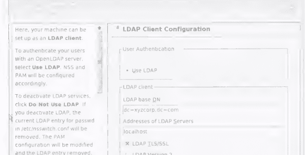

21. 选择“下一步”。将显示图 2.18 所示屏幕：
22. 在“添加新 LDAP 用户”屏幕中，为你的系统添加用户。如果你想添加多个用户，请选择“用户管理”。
23. 完成用户添加后，选择“下一步”。
24. 等待系统进行配置。配置完成后，将显示“发行说明（Release Notes）”屏幕，如图 2.19 所示。
25. 阅读“发行说明”；然后选择“下一步”。
26. 等待硬件进行探测。探测完成后，将显示与图 2.20 相似的屏幕。
27. 通过选择相应的标题（根据需要）来配置你的硬件；然后选择“下一步”。
28. 等待配置更改应用。应用完成后，将显示图 2.21 所示的屏幕：
29. 在“安装完成”屏幕中，选择“完成”。

你现在准备好安装你自己的 SLES 9 服务器系统了。实验练习 2-1 将引导你完成整个过程。

### 图 2.18

添加用户。

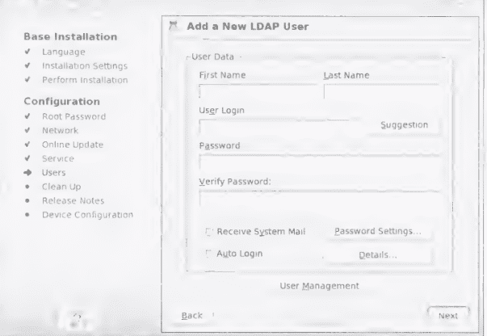

### 图 2.19

SLES 9 发行说明。

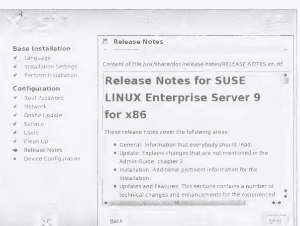

## 第 2 章：SUSE Linux Enterprise Server 简介

图 2.20

检测到的硬件。

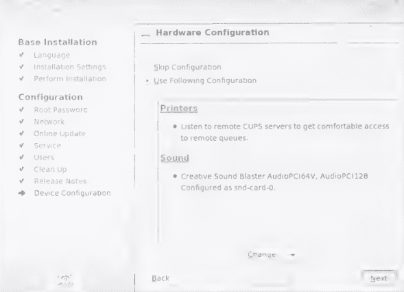

图 2.21

SLES 9 安装完成！

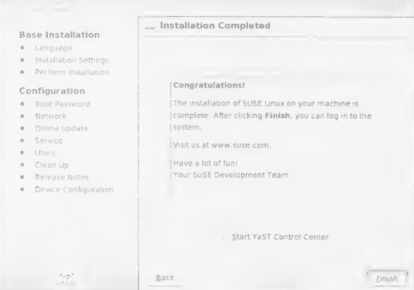

## 实验练习 2.1：安装 SLES 9 服务器

在本次练习中，你将安装并配置一个 SLES 9 服务器系统，你将在课程的剩余部分中使用它。

注意

严格按照此处所示的步骤操作非常重要。如果不这样做，课程后部分的实验练习可能无法正常工作，除非进行大量的重新配置。

此外，你真的应该使用实验系统来完成此练习。这些步骤的假设是你可以将整个硬盘用于 SLES 分区。如果你在已经安装了操作系统的系统上进行安装，你需要确保有足够的空间来安装 SLES。然后你将需要配置 `GRUB`，以便你能够启动到 SLES 或现有的操作系统。

如果你要安装的系统有重要数据，请务必在开始此练习之前进行备份！

如果你想在这一方面省去很多麻烦，我强烈推荐使用 VMware。有了 VMware，你就不必担心管理分区，也不需要担心丢失关键数据。你可以从 `http://www.vmware.com` 下载运行期 30 天的评估版本。

完成此练习，你需要以下物品：
- 一个符合本章早些介绍要求的 PC 系统。
- 一份 SLES 9 副本。

### 图 2.16

配置用户身份验证。

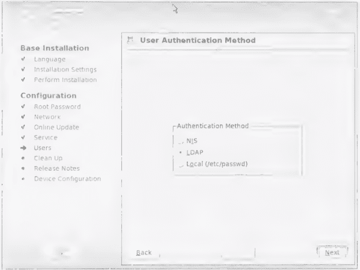

20. 在此对话框中，你可以配置以下选项：
- `LDAP Base DN`——记住 LDAP 将信息组织为层次级树状结构。树中的每一层要么是容器，要么是叶节点。容器可以包含其他容器或叶节点条目。叶节点是代表单个网络资源的条目，例如用户账户。在此字段中，你基本上是在标识 LDAP 客户端在此层次结构的什么位置查找信息。
- `LDAP 服务器地址`——之前我提到过 LDAP 服务器托管的信息可以与其他 LDAP 服务器共享。在此字段中，你可以指定你网络中 LDAP 服务器的地址，并用空格分隔。如果其中一台宕机或在无法访问，你的 LDAP 客户端可以访问托管相同信息的其他服务器，这将让你作为系统管理员的工作变得容易得多。如果你不如何配置这些参数，请使用默认值。

f. 在子网掩码（Subnet Mask）字段中，输入适用于你网络段的相应子网掩码。
g. 选择主机名（Host Name）和名称服务器（Name Server）。
h. 在主机名（Host Name）字段中，输入 `cle19`。
i. 在域名（Domain Name）字段中，输入 `cle19.com`。
j. 在名称服务器（Name Server）字段中，输入分配给你的服务器的 IP 地址。

提示

你之所以这样做，是因为在下一章中，你将在你的 SLES 服务器上配置 BIND 服务。

k. 选择确定（OK）。
i. 选择路由（Routing）。
m. 在默认网关（Default Gateway）字段中，输入适用于你网络段的默认网关路由器的 IP 地址。
n. 选择下一步（Next）。
o. 选择完成（Finish）。
p. 在网络配置（Network Configuration）屏幕上，选择下一步（Next）。

19. 在测试互联网连接（Test Internet Connection）屏幕上，勾选“否，跳过此测试”，然后选择“下一步”。
20. 在服务配置（Service Configuration）屏幕上，选择“下一步”。
21. 在用户身份验证方法（User Authentication Method）屏幕上，确保已勾选 LDAP，然后选择“下一步”。
22. 在 LDAP 客户端配置（LDAP Client Configuration）屏幕上，确保 LDAP 基础 DN 设置为 `cle19, dc=com`，且 LDAP 服务器的 IP 地址设置为 `localhost`，然后选择“下一步”。
23. 在添加新 LDAP 用户（Add New LDAP User）屏幕上，输入以下内容创建新用户。
- 名字（First Name）：Tux
- 姓（Last Name）：Penguin
- 用户登录：tux
- 密码：SuSE789

24. 选择下一步。
25. 在发行说明（Release Notes）屏幕上，阅读发行说明然后选择“下一步”。
26. 在硬件配置（Hardware Configuration）屏幕上，验证你的显示适配和显示器是否已正确检测并配置，然后选择“下一步”。

提示

如果你在 VMware 中通过 VNC 安装，将无法检测到显示器或显示适配器。你必须先从 shell 提示符安装 VMware Tools，然后在安装完成后手动配置显示器。

27. 当提示安装已完成时，选择“完成”。系统将重启并显示登录屏幕。

恭喜！你现在有了一个功能完的 SLES 9 服务器！接下来，你需要学习如何使用 YaST 配置你的服务器。

## SLES 9 的差异

你将注意到的第一个区别之一是挂载 CD 和软盘的目录。如果你熟悉 Red Hat，你就知道在默认情况下，你使用 `/mnt` 目录下的子目录来挂载这些设备，如图 2.22 所示。

图 2.22

Red Hat Linux 系统上的挂载点。


尽管 SLES 9 系统上存在 `/mnt` 目录，但它并不用于挂载可移动媒体。正如图 2.23 所示，软盘和 CD 驱动器的挂载点并不在此目录中。

图 2.23

SLES 9 系统上的 `/mnt` 目录。

```
Linux:/ # ls
bin dev core media opt root ser tmp
hloype lib not proc sbin usr
Linux:/mnt # cd not
Linux/mnt# ls
root
Linux/mnt# #
```

在 SLES 9 系统上，这些设备挂载在 `/media` 目录中。这些挂载点如图 2.24 所示：

图 2.24

SLES 9 系统上的挂载点。

```
linux:/media # ls
/dev/cdrom floppy
linux:/media #
```

你可以在 SLES 9 系统的 `/mnt` 中创建作为可移动媒体驱动器挂载点的目录吗？完全可以。但请注意，你的系统将默认使用 `/media` 中的目录来挂载这些设备。正如图 2.25 所示，SLES 9 系统上的 `fstab` 文件默认配置为使用 `/media`。

图 2.25

在 fstab 中定义的默认挂载点。

```
linux:/mnt # cat /etc/fstab
```

如果你坚持使用 `/mnt` 挂载可移动媒体驱动器，你应该编辑 `fstab` 文件以反映这一偏好。然而，如果你给它一个机会，很快就会发现使用 `/media` 就像使用 `/mnt` 一样舒服了。

你需要理解的 SUSE Linux 另一个关键方面是，1994 年的 SUSE 发行版源自 Slackware 发行版。因为这个原因，SLES 9 以略不同的方式实现初始化。

当系统与运行级别关联时，这些脚本位于 `/etc.d` 目录中的软链接指向哪里。


你可以在 SLES 9 系统的 `/mnt` 中创建作为可移动媒体驱动器挂载点的目录吗？完全可以。但请注意，你的系统将默认使用 `/media` 中的目录来挂载这些设备。正如图 2.25 所示，SLES 9 系统上的 `fstab` 文件默认配置为使用 `/media`。

如果你坚持使用 `/mnt` 挂载可移动媒体驱动器，你应该编辑 `fstab` 文件以反映这一偏好。然而，如果你给它一个机会，很快就会发现使用 `/media` 就像使用 `/mnt` 一样舒服了。

# 实验 2.1：安装一LES SLES 服务器

你需要理解的 SUSE Linux 另一个关键方面是，1994 年的 SUSE 发行版源自 Slackware 发行版。因为这个原因，SLES 9 以略不同的方式实现初始化。

如果你熟悉 Red Hat（以及许多其他 Linux 发行版），你就知道在默认情况下，你使用 `/mnt` 目录下的子目录来挂载这些设备，如图 2.22 所示。

尽管 SLES 9 系统上存在 `/mnt` 目录，但它并不用于挂载可移动媒体。正如图 2.23 所示，软盘和 CD 驱动器的挂载点并不在此目录中。

在 SLES 9 系统上，这些设备挂载在 `/media` 目录中。这些挂载点如图 2.24 所示：

你可以在 SLES 9 系统的 `/mnt` 中创建作为可移动媒体驱动器挂载点的目录吗？完全可以。但请注意，你的系统将默认使用 `/media` 中的目录来挂载这些设备。正如图 2.25 所示，SLES 9 系统上的 `fstab` 文件默认配置为使用 `/media`。

如果你坚持使用 `/mnt` 挂载可移动媒体驱动器，你应该编辑 `fstab` 文件以反映这一偏好。然而，如果你给它一个机会，很快就会发现使用 `/media` 就像使用 `/mnt` 一样舒服了。

# 实验 2.1：安装 SLES SLES 服务器

你需要理解的 SUSE Linux 另一个关键方面是，1994 年的 SUSE 发行版源自 Slackware 发行版。因为这个原因，SLES 9 以略不同的方式实现初始化。

如果你熟悉 Red Hat（以及许多其他 Linux 发行版），你就知道在默认情况下，你使用 `/mnt` 目录下的子目录来挂载这些设备，如图 2.22 所示。

尽管 SLES 9 系统上存在 `/mnt` 目录，但它并不用于挂载可移动媒体。正如图 2.23 所示，软盘和 CD 驱动器的挂载点并不在此目录中。

在 SLES 9 系统上，这些设备挂载在 `/media` 目录中。这些挂载点如图 2.24 所示：

你可以在 SLES 9 系统的 `/mnt` 中创建作为可移动媒体驱动器挂载点的目录吗？完全可以。但请注意，你的系统将默认使用 `/media` 中的目录来挂载这些设备。正如图 2.25 所示，SLES 9 系统上的 `fstab` 文件默认配置为使用 `/media`。

如果你坚持使用 `/mnt` 挂载可移动媒体驱动器，你应该编辑 `fstab` 文件以反映这一偏好。然而，如果你给它一个机会，很快就会发现使用 `/media` 就像使用 `/mnt` 一样舒服了。

# 实验 2.1：安装 SLES SLES SLES 服务器

你需要理解的 SUSE Linux 另一个关键方面是，1994 年的 SUSE 发行版源自 Slackware 发行版。因为这个原因，SLES 9 以略不同的方式实现初始化。

如果你熟悉 Red Hat（以及许多其他 Linux 发行版），你就知道在默认情况下，你使用 `/mnt` 目录下的子目录来挂载这些设备，如图 2.22 所示。

尽管 SLES 9 系统上存在 `/mnt` 目录，但它并不用于挂载可移动媒体。正如图 2.23 所示，软盘和 CD 驱动器的挂载点并不在此目录中。

在 SLES 9 系统上，这些设备挂载在 `/media` 目录中。这些挂载点如图 2.24 所示：

你可以在 SLES 9 系统的 `/mnt` 中创建作为可移动媒体驱动器挂载点的目录吗？完全可以。但请注意，你的系统将默认使用 `/media` 中的目录来挂载这些设备。正如图 2.25 所示，SLES 9 系统上的 `fstab` 文件默认配置为使用 `/media`。

如果你坚持使用 `/mnt` 挂载可移动媒体驱动器，你应该编辑 `fstab` 文件以反映这一偏好。然而，如果你给它一个机会，很快就会发现使用 `/media` 就像使用 `/mnt` 一样舒服了。

# 实验 2.1：安装 SLES SLES SLES SLES 服务器

你需要理解的 SUSE Linux 另一个关键方面是，1994 年的 SUSE 发行版源自 Slackware 发行版。因为这个原因，SLES 9 以略不同的方式实现初始化。

如果你熟悉 Red Hat（以及许多其他 Linux 发行版），你就知道在默认情况下，你使用 `/mnt` 目录下的子目录来挂载这些设备，如图 2.22 所示。

尽管 SLES 9 系统上存在 `/mnt` 目录，但它并不用于挂载可移动媒体。正如图 2.23 所示，软盘和 CD 驱动器的挂载点并不在此目录中。

在 SLES 9 系统上，这些设备挂载在 `/media` 目录中。这些挂载点如图 2.24 所示：

你可以在 SLES 9 系统的 `/mnt` 中创建作为可移动媒体驱动器挂载点的目录吗？完全可以。但请注意，你的系统将默认使用 `/media` 中的目录来挂载这些设备。正如图 2.25 所示，SLES 9 系统上的 `fstab` 文件默认配置为使用 `/media`。

如果你坚持使用 `/mnt` 挂载可移动媒体驱动器，你应该编辑 `fstab` 文件以反映这一偏好。然而，如果你给它一个机会，很快就会发现使用 `/media` 就像使用 `/mnt` 一样舒服了。

# 实验 2.1：安装 SLES SLES SLES SLES SLES 服务器

你需要理解的 SUSE Linux 另一个关键方面是，1994 年的 SUSE 发行版源自 Slackware 发行版。因为这个原因，SLES 9 以略不同的方式实现初始化。

如果你熟悉 Red Hat（以及许多其他 Linux 发行版），你就知道在默认情况下，你使用 `/mnt` 目录下的子目录来挂载这些设备，如图 2.22 所示。

尽管 SLES 9 系统上存在 `/mnt` 目录，但它并不用于挂载可移动媒体。正如图 2.23 所示，软盘和 CD 驱动器的挂载点并不在此目录中。

在 SLES 9 系统上，这些设备挂载在 `/media` 目录中。这些挂载点如图 2.24 所示：


（由于原文中出现了重复的文本块，此处已按要求停止重复输出）`SLES`


# 第 2 章：SUSE Linux Enterprise Server 简介

关于 YaST，你需要了解的第一点是它是一个模块化工具。每个模块都用于配置 SLES 9 系统的特定组件。如果你在 shell 提示符输入 `yast -l`，可以查看 YaST 可用于配置系统的不同模块，如图 2.29 所示。

图 2.29

YaST 模块。

```
root# yast -l
Available modules:
answering_machine
package
backup
hootcopy
bootloader
geck
cd creator
cdrom
common cert
controler
dcp server
install
dash
dns
dnserver
dfi
Firewall
groups
heartbeat
hast
```

需要记住，运行 YaST 必须拥有 root 权限。幸运的是，当你首次启动 YaST 时，如果你还没有以 root 身份登录，将获得切换到 root 的机会。这如图 2.30 所示。

图 2.30

在 YaST 中切换到 root。

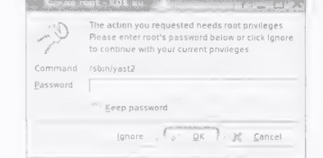

实际上有两个版本的 YaST。在本章中，我们将关注图形版本。你可以通过从系统菜单中选择 YaST 来启动此版本，如图 2.31 所示。

### 图 2.31

从系统菜单访问 YaST。

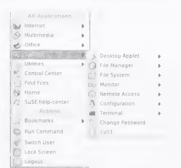

你也可以通过在 shell 提示符中运行 `yast2` 来访问 YaST 的图形版本。如果你选择此选项，可以在运行 `yast2` 之前使用 `su` 命令获取 root 权限。

那么问题来了，如果你需要从远程位置访问服务器上的 YaST 怎么办？例如，假设你正在家里甜睡，却接到了紧急情况：凌晨 3:00 来自公司打来的工作电话。如果能从家里的系统访问办公室服务器上的 YaST 就太好了。否则，你得穿上睡衣开车去上班了。

不要担心，你可以通过两种方式远程访问 YaST。首先，你可以使用本地 Linux 系统在你的 SLES 9 服务器上运行 YaST。要做到这一点，请完成以下操作：

- 1. 在你的本地系统上，打开终端会话。
- 2. 在 shell 提示符处，输入 `ssh -X root@your_server's_IP_address`。
- 3. 使用 root 密码进行验证。
- 4. 运行 `yast2`。

### 提示

如果你安装了 X 客户端（如 WinaXe）和 ssh 工具（如 PuTTY），也可以使用本地 Windows 工作站进行操作。

还有第二个选项：YaST 还提供纯文本版本。可以通过在 shell 提示符（包括远程 ssh 会话）中输入 `yast` 来运行它。YaST 的文本版本如图 2.32 所示。

图 2.32

YaST 的纯文本版本。

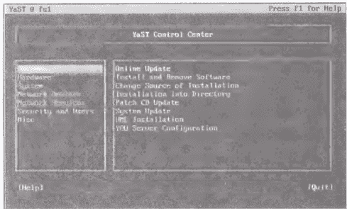

这对于没有运行 X Window 的系统也很有用。许多 Linux 管理员不喜欢 X 为其服务器带来的额外开销，因此他们将系统保持在运行级别 `runlevel 3`。如果你属于这一类，你也可以使用文本版本的 YaST。

让我们看看图 2.33 中 YaST 的布局：主框架显示了各种类别。当你选择其中一个类别时，系统会呈现出图标，这些图标代表分配给该类别的各种 Ya 模块。要使用特定模块，只需点击它即可。

### 注意

使用 YaST 时，你只需要单击类别或模块即可访问它。如果你忘记了并双击了，也不用担心，YaST 会忽略多出来的点击。

当你使用这些模块之一来配置系统时，`/etc` 和 `/etc/sysconfig` 中的配置文件就会被修改。这些文件如图 2.34 所示。

许多服务在两个位置都有配置文件。例如，`xtntpd` 守护进程在 `/etc` 中有一个名为 `ntp.conf` 的配置文件。该文件的部分内容如图 2.35 所示。

### 图 2.33

图形化 YaST 界面。

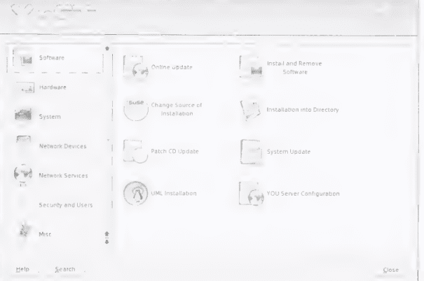

### 图 2.34

`/sysconfig` 中的配置文件。

| /etc/sysconfig # 于 | | |
| :--- | :--- | :--- |
| dhcreld | mailman | scripts |
| dplaymanager | nscid | aidedev |
| aavelin | mouse | security |
| firewall | .BeforeWhereToInstall | services |
| apache | features-config | named |
| apache2 | postfix | sound |
| mintofs | hotting | rfn |
| min | news | sysconfig |
| backup | ntop | suscheep |
| bas | justick | sysmanager | synctl |
| rootloader | kernel | spring |
| bootstrap | personal-firewall | windowmanager |
| bootplash | keyboard | positive |
| clock | language | powusers |
| console | data | proxy | entry |
| crow | root | ybind |
| dhcpt | local | lpserv |

### 图 2.35

`/etc/` 中的 `ntp.conf` 文件。

```
fsl:etc cat ntp.conf
############################################################
## ntp.conf 配置文件。
# 用于文档、Mini HOWTO 和 FAQ 的示例 ntp 配置。
# 更多信息请参见包 'ntp-doc'。
# 版权 (c) 1995-2004 Ulrich Anders, Germany.
# 作者: Michael Anders <anders.de>
############################################################
# 根据惯例，无线电和调制调钟的地址格式为
# /t:u t，其中 t 是时钟时间，u 是 0-25 范围内的单位数。
# 大多数钟或特殊硬件需要这种格式，
# 通常通过添加单位来指定设备。
############################################################
```

这种方法对于没有运行 X Window 的系统也很有用。许多 Linux 管理员不喜欢 X 为其服务器带来的额外开销，因此他们将系统保持在运行级别 3。如果你属于这一类，你也可以使用文本版本的 YaST。

此文件包含了各种控制服务启动方式的参数。例如，你可以配置守护进程以哪个用户运行。如果你的 `ntp.conf` 包含多个提供者，你可以配置先查询哪一个。

本质上，你的 SLES 9 系统配置由 `/etc/sysconfig` 中的文件控制。每当 `/etc/sysconfig` 中的任何文件被修改时，你就需要运行一个名为 `SuSEConfig` 的特殊工具。

`SuSEConfig` 应用各种配置文件中的设置。它还会根据 `/etc/sysconfig` 文件中所做的更改修改其他系统文件。此工具由许多不同的模块组成。这些模块位于 `/sbin/conf.d`，如图 2.37 所示。

图 2.37

`/sbin/conf.d` 中的 SuSEConfig 模块。


### 提示

你也可以手动修改 `/etc/sysconfig` 中的文件。要做到这一点，你必须先通过 `init 1` 切换到运行级别 1。然后可以使用文本编辑器编辑适当的文件。完成后，运行 `SuSEConfig` 应用更改。返回你的原始运行级别。

现在你已经了解了 YaST 如何运作的，你需要学习如何使用 YaST 配置你的 SLES 9 服务器。

图 2.38
使用 SuSEConfig 应用更改。

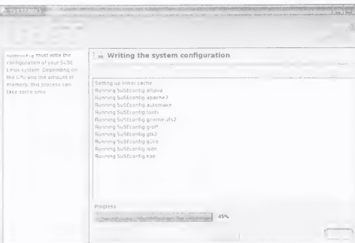

## 使用 YaST 管理 SLES 9

涵盖的测试目标：

- 4. 管理 SLES 9 系统配置。

在我们结束本章并开始深入研究 CLE（命令行编辑器/环境）的核心内容之前，我们需要回顾如何使用 YaST 在 SLES 9 上完成一些基础的管理任务。具体来说，我们将论述以下内容：

- * 管理网络设置
- * 管理服务器硬件
- * 管理用户账户
- * 管理服务

让我们先讨论如何管理网络设置。

## 使用 YaST 管理网络设置

如果你熟悉其他 Linux 发行版，你可能已经知道如何使用 `ifconfig` 管理 IP 参数了。为什么要花时间讨论如何使用 YaST 来完成呢？这关乎效率。

还记得我在本节较早介绍的关于配置 NAT 的示例吗？该原理同样适用于在 SLES 9 上管理 IP 地址参数。让我们来看一个例子。假设你在安装 SLES 服务器时将其配置为动态分配的 IP 地址。直到最近，该配置在你的环境中一直运行良好。

现在，你需要在 SLES 9 服务器上实现一个 http 服务，并且它确实需要分配一个静态 IP 地址。如果你手动进行操作，将需要执行以下步骤：

- 1. 在文本编辑器中，打开接口对应的配置文件，位于 `/etc/sysconfig/network`，如图 2.39 所示。

图 2.39
手动配置网络参数。

```
cat /etc/sysconfig/network | grep ifcfg-fq-eth-id-00:0c:29:ae:23:fb

BOOTPROTO=dhcp

DEVICE="eth0:dev/u0000PT"

STRDOMAIN="local"

IPADDR="192.168.1.47"

NETMASK="255.255.255.0"

GATEWAY="192.168.1.1"

BROADCAST="192.168.1.255"

MTU=1500

SENDMEDIATE

cat /etc/sysconfig/network |
```


- 2. 编辑文件以使用静态 IP 地址。
- 3. 在文本编辑器中打开 `/etc/resolv.conf`，如图 2.40 所示。
- 4. 编辑文件以使用静态 DNS 服务器地址。
- 5. 在文本编辑器中打开 `/etc/sysconfig/network/routes`，如图 2.41 所示。
- 6. 在文件中输入默认路由。
- 7. 运行 `SuSEConfig` 以应用更改。

## 第 2 章：SUSE Linux Enterprise 9 简介

图 2.40
手动设置 DNS 服务器地址。

### Sect: 这是一个服务 `dhcpd` 创建的临时 `resolv.conf`。

### Info: 之前的文件已保存，稍后将恢复。

如果你不希望 `resolv.conf` 被修改，可以设置 `MODIFY_RESOLV_CONF=manually`。这些变量设置在 `etc/sysconfig/network/config` 中

你也可以配置服务 `dhcpd` 不修改它：

如果你不喜欢 `dhcpd` 更改你的名称服务器设置，

那么要么设置 `DHCPCLIENT_MODIFY_RESOLV_CONF=no` 在 `etc/sysconfig/network/dhcp` 中设置 `MODIFY_RESOLV_CONF=(manually)`，

或者

使用 R: 如果你想保留搜索列表，请在 `etc/sysconfig/network/dhcp` 中设置 `DHCPCLIENT_SEARCHLIST=yes`，或者 `(manally)` 设置 Option

### CMD INFO

```
nameserver 192.171.1.65
nameserver 192.171.2.65
fsck /etc #
```

图 2.41
手动配置默认路由器地址。

```
etc/sysconfig/network/routes
default 192.168.1.1
etc/sysconfig/network #
```


提示
你也可以使用命令行工具（如 `ifconfig`、`ip` 和 `routes`）来执行这些任务。然而，请记住，这些更改**不是持久的**。你能够将更改保存到相应的配置文件中，以便在下次系统启动时生效。

这工作量很大。此外，如果你像我一样手指粗大，在进行微调时还可能在配置中引入错误。

相反，你可以使用 YaST 在单个界面中完成相同任务。要在 YaST 中管理网络参数，请完成以下操作：

- 1. 从你的图形桌面，选择 Network（网络）、System（系统）、YaST。
- 2. 提供你的 root 用户密码。
- 3. 在左框中，选择 Network Devices（网络设备）。
- 4. 在右框中，选择 Network Card（网卡）。显示图 2.42 所示的屏幕。

## 图 2.42
在 YaST 中选择要配置的网络接口。

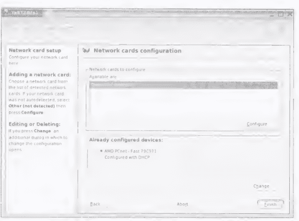

- 5. 在 Already Configured Devices（已配置设备）下，选择 **Change（更改）**。如果某些原因需要配置网络接口，选择 **Change**。

Before we end this chapter and start digging into the meat of the CLE, we need to review how to complete some basic administration tasks on SLES 9 using YaST. Specifically, we're going to talk about the following:

- * Managing network settings (Managing网络 settings)
- *Managing server hardware
- *Managing user accounts
- *Managing services

Let's first talk about how you manage network settings.

## Managing Network Settings Using YaST

If you're experienced with another Linux distribution, you probably already know how to manage IP parameters using `ifconfig`. Why spend time talking about how to do it with YaST? It's all about time.

Remember the example I presented earlier in this section about configuring NAT? The principle applies to managing IP address parameters on SLES 9 as well. Let's look at an example. Suppose that you configured your SLES server to a dynamically assigned IP address when you installed it. This configuration has worked fine in your environment until recently.

Now, you need to implement an http service on your SLES 9 server and it really needs to have a static IP address assigned. If you were to do this manually, you would have to do the following:

- 1. In a text editor, open the appropriate configuration file for your interface, located in `/etc/sysconfig/network`, as shown in Figure 2.39.

Figure 2.39
Manually configuring network parameters.


`cat /etc/sysconfig/network | grep ifcfg-fq-eth-id-00:0c:29:ae:23:fb`

```
BOOTPROTO=dhcp

DEVICE="eth0:dev/u0000PT"

STRDOMAIN="local"

IPADDR="192.168.1.47"

NETMASK="255.255.255.0"

GATEWAY="192.168.1.1"

BROADCAST="192.168.1.255"

MTU=1500

SENDMEDIATE
```

`cat /etc/sysconfig/network |`

## CHAPTER 2: Introduction to the SUSE Linux Enterprise 9

- 2. Edit the file to use a static IP address.
- 3. Open `/etc/resolv.conf` in a text editor, as shown in Figure 2.40.
- 4. Edit the file to use a static DNS server address.
- 5. Open `/etc/sysconfig/network/routes` in a text editor, as shown in Figure 2.41.
- 6. Enter the default route in the file.
- 7. Run `SuSEConfig` to apply the changes.

### FIGURE 2.40
Manually setting the DNS server address.

```
### Sect:      This is a temporary resolv. created by service dhcpd.

### Info:       The previous file has been saved and will be restored later.

If you do not like your resolv.conf to be changed, you can

set MODIFY_RESOLV_CONF=manually. This

variables are set in etc/sysconfig/network/config

You can also configure service dhcpd to not modify it:

If you don't like dhcpd to change your nameserver

settings,

then either set DHCPCLIENT_MODIFY_RESOLV_CONF=no

set MODIFY_RESOLV_CONF=(manually) in

etc/sysconfig/network/dhcp, or

with R: if you want to keep your searchlist, set

DHCPCLIENT_SEARCHLIST=yes in etc/sysconfig/network/dhcp or

(manally) set the Option

### CMD INFO

nameserver 192.171.1.65

nameserver 192.171.2.65

fsck /etc #
```

### FIGURE 2.41
Manually configuring the default router address.

```
etc/sysconfig/network/routes

default 192.168.1.1

etc/sysconfig/network #
```

**TIP**
You can also perform these tasks using command line tools, such as `ifconfig`, `ip`, and `routes`. However, remember that these changes aren't persistent. You need to save the changes to the appropriate configuration files to have them effect the next time the system is booted.

That's a lot of work. In addition, if you have large fingers like mine, you may also introduce errors into the configuration by making tweaks.

Conversely, you can complete the same task in a single interface using YaST. To manage network parameters in YaST, complete the following:

- 1. From your graphical desktop, select Network, System, YaST.
- 2. Supply your root user's password.
- 3. In the left frame, select Network Devices.
- 4. In the right frame, select Network Card. The screen in Figure 2.42 is displayed.

## FIGURE 2.42
Selecting a network interface to configure in YaST.


- 5. Under Already Configured Devices, select **Change**. If, for some reason you need to configure network interface, select **Change**.

## 第 2 章：SUSE Linux Enterprise Server 简介

图 2.38
使用 SuSEConfig 应用更改。


## 使用 YaST 管理 SLES 9

涵盖的测试目标：

- 4. 管理 SLES 9 系统配置。

在我们结束本章并开始深入研究 CLE 的核心内容之前，我们需要回顾如何使用 YaST 在 SLES 9 上完成一些基础的管理任务。具体来说，我们将论述以下内容：

- * 管理网络设置
- * 管理服务器硬件
- * 管理用户账户
- * 管理服务

让我们先讨论如何管理网络设置。

## 使用 YaST 管理网络设置

如果你熟悉其他 Linux 发行版，你可能已经知道如何使用 `ifconfig` 管理 IP 参数了。为什么要花时间讨论如何使用 YaST 来完成呢？这关乎效率。

还记得我在本节较早介绍的关于配置 NAT 的示例吗？该原理同样适用于在 SLES 9 上管理 IP 地址参数。让我们来看一个例子。假设你在安装 SLES 服务器时将其配置为动态分配的 IP 地址。该配置直到最近在你的环境中一一直运行良好。

现在，你需要在 SLES 9 服务器上实现一个 http 服务，并且它确实需要分配一个静态 IP 地址。如果你手动进行操作，将需要执行以下步骤：

- 1. 在文本编辑器中，打开接口对应的配置文件，位于 `/etc/sysconfig/network`，如图 2.39 所示。

图 2.39
手动配置网络参数。

```
cat /etc/sysconfig/network | grep ifcfg-fq-eth-id-00:0c:29:ae:23:fb

BOOTPROTO=dhcp

DEVICE="eth0:dev/u0000PT"

STRDOMAIN="local"

IPADDR="192.168.1.47"

NETMASK="255.255.255.0"

GATEWAY="192.168.1.1"

BROADCAST="192.168.1.255"

MTU=1500

SENDMEDIATE

cat /etc/sysconfig/network |
```

- 2. 编辑文件以使用静态 IP 地址。
- 3. 在文本编辑器中打开 `/etc/resolv.conf`，如图 2.40 所示。
- 4. 编辑文件以使用静态 DNS 服务器地址。
- 5. 在文本编辑器中打开 `/etc/sysconfig/network/routes`，如图 2.41 所示。
- 6. 在文件中输入默认路由。
- 7. 运行 SuSEConfig 以应用更改。

## 第 2 章：SUSE Linux Enterprise 9 简介

图 2.40
手动设置 DNS 服务器地址。

```
### Sect:      这是一个由服务 dhcpd 创建的临时 resolv.conf。

### Info:       之前的文件已保存，稍后将恢复。

如果你不希望 resolv.conf 被修改，可以

设置 MODIFY_RESOLV_CONF=manually。这些

变量设置在 etc/sysconfig/network/config 中

你也可以配置服务 dhcpd 不修改它：

如果你不喜欢 dhcpd 更改你的名称服务器

设置，

那么要么设置 DHCPCLIENT_MODIFY_RESOLV_CONF=no

在 etc/sysconfig/network/dhcp 中设置 MODIFY_RESOLV_CONF=(manually)，

或者

使用 R: 如果你想保留搜索列表，请在

etc/sysconfig/network/dhcp 中设置 DHCPCLIENT_SEARCHLIST=yes，或者

(manally) 设置该 Option

### CMD INFO

nameserver 192.171.1.65

nameserver 192.171.2.65

fsck /etc #
```

图 2.41
手动配置默认路由器地址。

```
etc/sysconfig/network/routes

default 192.168.1.1

etc/sysconfig/network #
```

提示
你也可以使用命令行工具（如 `ifconfig`、`ip` 和 `routes`）来执行这些任务。然而，请记住，这些更改不是持久的。你能够将更改保存到相应的配置文件中，以便在下次系统启动时生效。

这工作量很大。此外，如果你像我一样手指粗大，在进行微调时还可能在配置中引入错误。

相反，你可以使用 YaST 在单个界面中完成相同任务。要在 YaST 中管理网络参数，请完成以下操作：

- 1. 从你的图形桌面，选择 Network（网络）、System（系统）、YaST。
- 2. 提供你的 root 用户密码。
- 3. 在左框中，选择 Network Devices（网络设备）。
- 4. 在右框中，选择 Network Card（网卡）。显示图 2.42 所示的屏幕。

## 图 2.42
在 YaST 中选择要配置的网络接口。


- 5. 在 Already Configured Devices（已配置设备）下，选择 **Change（更改）**。如果某些原因需要配置网络接口，选择 **Change**。（注：此处原文逻辑重复，已按字面翻译）
- 6. （此处原文跳过了第6点直接到第7点）
- 7. 运行 SuSEConfig 以应用更改。

# 第 2 章：SUSE Linux 企业版服务器 简介

图 2.48

在 YaST 中配置硬件。

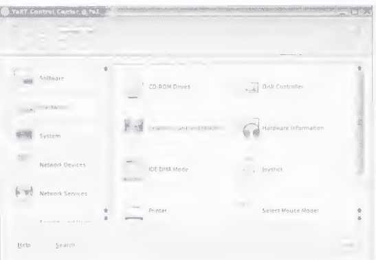

图 2.49

在 YaST 中配置硬盘控制器。

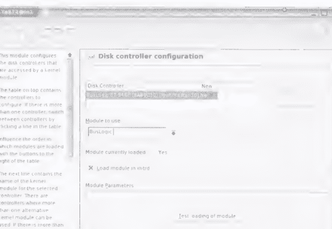

请注意，在此界面中，你可以配置用于设备的模块。
你还可以配置设备模块的加载方式。由于访问挂载在 `/` 目录的磁盘分区必须加载磁盘控制器，因此它被配置为在 `initrd` 中加载。

- 4. 配置针对你硬件的特定参数并选择“完成 (Finish)”。完成后，你的更改将写入相应的配置文件；然后会自动运行 `SUSEconfig` 来应用你的更改。

如果你习惯于手动管理 Linux 硬件模块，我认为你会发现 YaST 让这个过程变得更加简单快速。

除了管理硬件外，你还可以使用 YaST 在你的 SLES 9 服务器上配置用户和组。

# 在 YaST 中配置用户和组

SLES 9 使用用户、组、所有权权限的元素就像任何其他 Linux 发行版一样。此外，你所熟悉的命令行工具同样适用。对于用户，你可以使用 `useradd` 创建新账户。你可以使用 `password` 设置用户密码，使用 `usermod` 修改现有账户，并使用 `userdel` 删除账户。

当你使用 `useradd` 时，将应用 `/etc/login.defs` 和 `/etc/default/useradd` 中的默认值，除非你使用了覆盖这些值的 `useradd` 关选项。这些文件的部分所示图 2.50 和图 2.51。

图 2.50

`/etc/login.defs` 文件。

```
f:cat /etc login.defs | more

/etc/login.defs - pwudits 包的密码审计控制定义。

# 注释行（以 "#" 开头的行）和空行会被忽略。

# 请阅读手册页获取更多信息 (login.defs)。

# 如果我们无法 cd 到主目录，是否允许登录？

# 默认是 yes。

DEFAULT_HOME            yes

# 默认 PATH 设置（登录时使用）：

EMU_PATH                /usr/local/bin:/usr/bin:/bin

# root 的默认 PATH 设置（登录时使用）：

ROOT_PATH               /sbin:/usr/sbin:/sbin

--More---
```

# 第 2 章：SUSE Linux 企业版服务器 9 简介

图 2.51
`/etc/default/useradd` 文件。

```
file:/etc/default a cat ..useradd

GRUB_100

HOME=/home

EXPIRE=-1

SHELL=/bin/bash

SKEL=/etc/sk

GROUP=client,ucp,video,audio

file:/etc/default a #
```


同样，你可以使用 `groupadd` 工具添加组，使用 `groupmod` 工具修改现有组，并使用 `groupdel` 工具删除组。

现在让我们来看一种更快速管理 SLES 9 用户和组的方法：YaST。在 YaST 中管理用户，你需要执行以下操作：

- 1. 在 YaST 中，选择“安全与用户 (Security and Users)” -> “创建和编辑用户 (Create and Edit Users)”
- 2. 如果你配置了系统使用 LDAP 存储用户账户信息，系统将提示你验证 LDAP 目录。输入你的 root 密码，将显示图 2.52 所示屏幕。

图 2.52
在 YaST 中管理用户。

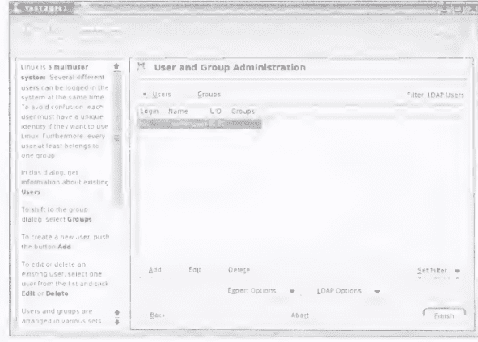

### 提示

许多经验丰富的 Linux 系统管理员在第一次看到这个时会感到困惑，因为只显示了用于身份验证的用户账户。系统用户账户似乎消失了。

别担心，它们还在。YaST 假设如果你正在管理用户账户，你就不想看到系统账户；同样，如果你在处理系统账户，你就不想看到验证用户账户。如果你想查看系统用户账户，选择“设置过滤器 (Set Filter)” -> “系统用户 (System Users)”。

- 3. 要添加用户账户，请执行以下操作：

    - a. 选择“添加 (Add)”显示图 2.53 所示的屏幕。

图 2.53
在 YaST 中添加用户。

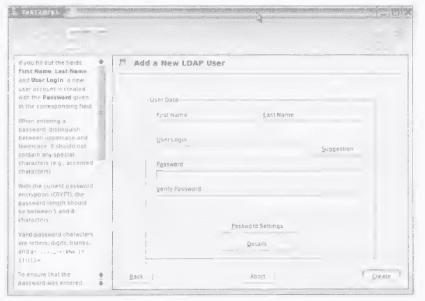

    - b. 为新账户提供所需的参数，包括姓、名、用户登录名和密码。
    - c. 选择“详细信息 (Details)”。显示图 2.54 所示的屏幕。
    - d. 配置用户账户详细信息，包括用户 ID、主目录、登录 shell 和组关系。
    - e. 选择“下一步 (Next)”显示图 2.55 所示的屏幕。

# 第 2 章：SUSE Linux 企业版服务器 9 简介

图 2.54
在 YaST 中配置用户详细信息。

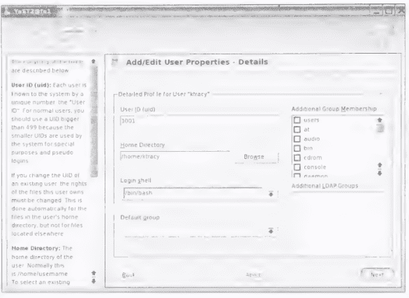

图 2.55
在 YaST 中配置用户详细信息。


    - f. 在此屏幕中，你可以配置用户账户的电子邮件等详细信息。完成后，选择“下一步 (Next)”。

- 4. 要修改现有账户，请执行以下操作：

    - a. 选择要修改的账户。
    - b. 选择“编辑 (Edit)”。
    - c. 配置参数，然后选择“下一步 (Next)”。

- 5. 完成后，选择“完成 (Finish)”。

如你所见，使用 YaST 管理用户会让过程变得更简单。在继续之前，你需要理解一点：如果你配置了 SLES 9 使用 LDAP 存储用户账户，你需要使用 `useradd`。让我们来看一个例子。假设我们需要使用 `useradd` 将用户添加到 LDAP 目录，如图 2.56 所示。

图 2.56
使用 useradd 创建用户。

```
/etc/passwd # useradd dcour
/etc/shadow #
```

注意我没有提供任何额外的选项，因为使用了默认值。现在，如果我打开 YaST 的“创建和编辑用户”，发现我刚刚创建的账户缺失了。但是，如果我选择“设置过滤器 (Set Filter)” -> “本地用户 (Local Users)”，账户就会显示出来，如图 2.57 所示。

图 2.57
在 YaST 中缺失新用户。


图 2.58
在 YaST 中找到了新用户。


## 使用 YaST 管理 SLES 9

要使用 `useradd` 将用户添加到 LDAP 目录，你必须使用两个选项：

- service——指定 `useradd` 将新用户放入 LDAP 目录而不是 `/etc/passwd` 文件。
- binddn（或 `-D`）——允许你指定用于绑定 LDAP 服务的用户账户。

例如，为了使用 `useradd` 将 `dcour` 添加到 LDAP 目录，我会输入以下命令：

```
useradd --service ldap -D cn=administrator,dc=cle9,dc=com dcour
```

记住，administrator 是你在安装期间设置的具有管理 LDAP 目录权限的用户账户。输入命令后，会提示提供管理员密码（在之前的练习中安装的服务器上，它与你的 root 用户密码相同：`tuX123`）。如图 2.59 所示。

图 2.59
使用 useradd 添加用户。

```
root: # useradd --service ldap -D cn=administrator,dc=cle9,dc=com dcour
: LDAP Password:
```

提供密码后，系统会提示用户已添加以及用户位于哪个 LDAP 上下文中。默认情况下，用户被放置在 `ou=people` 容器中。这是所有 LDAP 用户账户所在的地方。你可能会收到错误提示，用户无法添加到某些组。还记得我们的 `/etc/default/useradd` 文件吗？即使我们将账户添加到 LDAP 服务，用户工具程序也会读取该文件以获取默认值。问题在于，该文件中指定的默认组是本地组。它们在 LDAP 目录中并不存在。

为了修复这个问题，你有两个选择。首先，你可以将这些组添加到你的 LDAP 目录。或者，你可以编辑默认文件并删除这些目录。

好消息是，如果 `useradd` 找不到默认目录，用户账户仍然会被创建，如图 2.60 所示。

*(注：原文未提供图 2.60 的具体路径或内容，此处保留逻辑描述)*

## 第 2 章：SUSE Linux Enterprise Server 9 简介

图 2.60
向 LDAP 目录添加新用户。

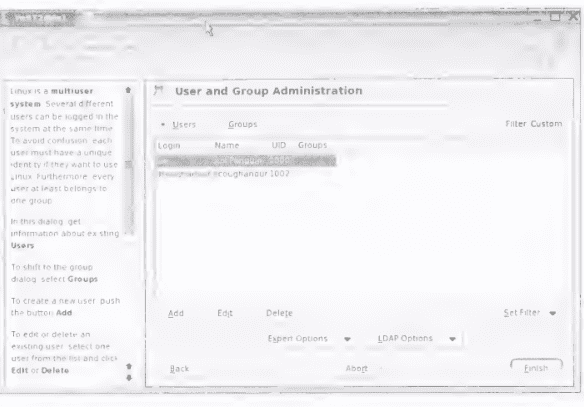

接下来，是时候使用 YaST 管理系统服务了。

## 使用 YaST 管理服务

如果你在其他 Linux 发行版上管理过守护进程（daemons），你就知道必须：

- 在系统上安装该服务。
- 编辑服务的配置文件。
- 启动服务。
- 配置服务自动运行的运行级别（runlevels）。

要安装服务，您可以使用 `rpm` 工具。然后，您使用文本编辑器（如 `nano` 或 `vi`）修改服务的 `.conf` 文件。完成后，您使用 `/etc` 中的初始化脚本运行服务。然后，您使用 `chkconfig` 设置启用该服务的运行级别。
再次，YaST 为您简化了这一过程。让我们来看看是如何操作的。

要在您的系统上安装服务，请完成以下操作：

- 1. 启动 YaST。
- 2. 选择软件（Software），安装和删除软件（Install and Remove Software）。执行后，将显示图 2.61 所示屏幕。在此屏幕中，您可以使用过滤器（Filter）下拉列表按选择（Selection）或软件包组（Package Group）查看软件包。或者，您可以使用搜索（Search）选项来查找特定软件包。

图 2.61
使用 YaST 添加新服务。

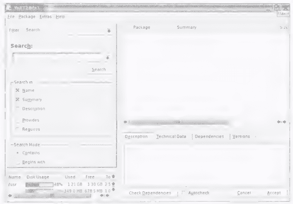

- 3. 标记您想要安装的软件包并选择接受（Accept）。

下一个任务是配置服务。同样，您可以通过 YaST 完成此操作。许多守护进程提供了 YaST 模块，这些模块会在服务安装时加载。

注意

并非所有守护进程都有 YaST 模块。如果您在 YaST 中没有看到相应的项目，则将不得不按照老方法配置服务。

## 第 2 章：SUSE Linux Enterprise Server 9 简介

使用这些模块执行配置任务时，您需要执行以下操作：

- 1. 在 YaST 中，找到用于配置相应服务的模块。大多数与网络相关的模块都在网络服务（Network Service）组中，如图 2.62 所示。

图 2.62
YaST 中的网络服务模块。

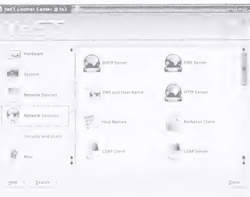

- 2. 选择该模块。
- 3. 每个模块都提供自己的 YaST 界面（我们不会涵盖所有模块）。按照提示配置服务。
- 4. 选择完成（Finish）。

服务安装并配置完成后，接下来的任务是启动服务和设置运行级别。与之前的任务不同，您可以使用 YaST 对您的 SLES 9 服务器上的所有服务执行这些任务。要执行此操作，请完成以下步骤：

- 1. 启动 YaST
- 2. 选择系统（System），运行级别编辑器（Runlevel Editor）
- 3. 选择专家模式（Expert Mode）以显示图 2.63 所示的屏幕。

## 图 2.63
在 YaST 中配置服务。

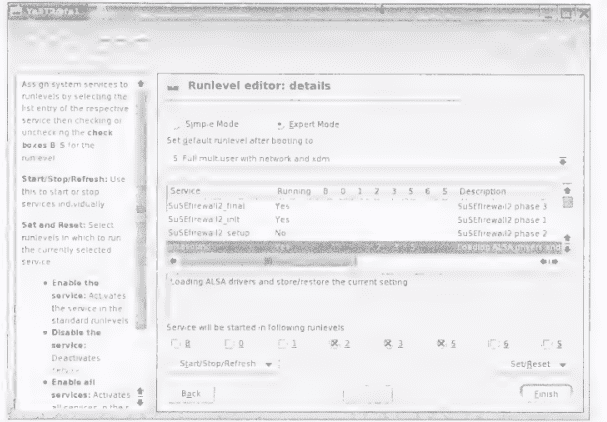

4. 在服务（Services）下，向下滚动并选择您想要修改的服务。
5. 要启动服务，选择启动/停止/刷新（Start/Stop/Refresh），现在启动（Start Now）。
6. 标记服务应该自动启动的运行级别，并选择完成（Finish）。

YaST 非常酷，对吧？正如我之前提到的，YaST 的主要优势在于它让您的管理工作变得更简单、更快且更不容易出错。现在让我们花点时间学习 YaST。

## 实验 2.2：使用 YaST

在本次实验中，您将练习使用 YaST 完成一些典型的 Linux 管理任务。要完成此练习，您需要以下项：

- 您在练习实验 2.1 中安装了 SLES 9 的 PC 系统。
- 您的 SLES 9 副本。

完成以下操作：

- 1. 启动您的 SLES 9 服务器。
- 2. 在身份验证界面，以用户 `tux` 登录，密码为 `SuSE789`（区分大小写）。
- 3. 在桌面上，选择 YaST。
- 4. 当提示输入 root 密码时，输入 `tuX123`。
- 5. 通过以下操作配置您的网络设置：

提示

您的网卡应该在安装期间已经配置过了。我们当时留了一个参数，我们将在本次实验中对其编辑。

- a. 选择网络设备（Network Devices），网卡（Network Card）。
- b. 在已配置设备（Already Configured Devices）下，选择更改（Change）。
- c. 在概览（Overview）屏幕中，标记您的网络接口并选择编辑（Edit）。

提示

您的系统应该根据练习 2.1 配置了静态地址。

- d. 选择主机名（Host Name）和名称服务器（Name Server）。
- e. 确保主机名设置为 `fs1` 且域名设置为 `cle9.com`。
- f. 确保输入了正确的 DNS 服务器地址。
- g. 在 DNS 服务器地址旁边的域搜索 1（Domain Search 1）字段中，输入 `cle9.com`。
- h. 在 DNS 服务器地址旁边的域搜索 1（Domain Search 1）字段中，输入 `cle9.com`。

- 6. 在身份验证界面，以用户 `tux` 登录，密码为 `SuSE789`（区分大小写）。
- 3. 在桌面上，选择 YaST。
- 4. 当提示输入 root 密码时，输入 `tuX123`。
- 5. 通过以下操作配置您的网络设置：

提示

您的网卡应该在安装期间已经配置过了。我们当时留了一个参数，我们将在本次实验中对其编辑。

- a. 选择网络设备（Network Devices），网卡（Network Card）。
- b. 在已配置设备（Already Configured Devices）下，选择更改（Change）。
- c. 在概览（Overview）屏幕中，标记您的网络接口并选择编辑（Edit）。

提示

您的系统应该根据练习 2.1 配置了静态地址。

- d. 选择主机名（Host Name）和名称服务器（Name Server）。
- e. 确保主机名设置为 `fs1` 且域名设置为 `cle9.com`。
- f. 确保输入了正确的 DNS 服务器地址。
- g. 在 DNS 服务器地址旁边的域搜索 1（Domain Search 1）字段中，输入 `cle9.com`。
- h. 在 DNS 服务器地址旁边的域搜索 1（Domain Search 1）字段中，输入 `cle9.com`。

## 第3 章：在 SLES 9 上配置 DNS

你的同事走过来对你说：“嘿，我发现了一个非常棒的搜索搜索网站。直接访问 66.102.7.99 就行。”后来，你正在看电视，看到一个在线拍卖网站的广告。它的标语是：“我在 66.135.192.124 找到了我需要的东西。”这听起来可不太顺口，对吧？

幸运的是，在现实世界中，这不是问题。我们有 DNS。正如你可能知道的，DNS 是一种网络服务，允许你将易记的主机名和域名映射到 IP 地址。在继续深入之前，让我们简单回顾一下 DNS 背后的历史。

## DNS 之前的时代

信不信由，DNS 并不一直伴随着在我们身边。在基于 IP 的计算机网络早期，我们有两种选择：

- 使用任何类型的名称解析。
- 使用 hosts 文件进行名称解析。

正如你所猜的那样，第一种方案并不流行。如果你是一个技术控（如果你正在追求 CLE 2 认证，你就是），你可能可以使用 IP 地址而不是主机名来处理它。这并不容易，但只要你记住了一个频繁使用的 IP 地址列表，可能就能应付过去。

然而，这种方案对于典型的网络用户来说将是一场支持工作的噩梦。你能想象你会收到多少帮助热线电话吗？由于出于某种原因，人类很难记住长数字。我们的大脑倾向于把数字搞乱。

### 注意

一些心理学研究人员研究过这种现象。如果你想玩玩，可以找个朋友尝试这个实验。

让你的朋友说一个数字，并让你背出他刚刚说的数字。然后让你的朋友说两个新数字，让你重复一遍。继续增加数字（确保每次都使用新数字），直到你无法准确重复数字为止。普通人只能回想起 5–9 个数字，然后就无法继续了。

想象一下，如果你把图 3.1 中的备忘录发给你的用户会发生什么。

从我的个人经验来看，我可以告诉你你的电话会被打爆。对于普通用户来说，理解 IP 地址确实很难。

### 图 3.1

没有名称解析的世界。

```
收：：全体员工

发件人：系统管理员

主题：文件存储

你好，

我注意到许多员工正在服务器 10.64.234.1 上保存敏感文件。虽然在这里保存文件是可以接受的，但应该只是临时地这样做。最好情况下，敏感文件应该保存在 10.78.122.56 上。如果你目前在 10.64.234.1 上使用敏感文件，请在方便时尽快将其移动到 10.78.122.56。

如果你有任何问题，请随时拨打我的电话 (x143)。

感谢对此事的关注。

Herbert S. Lautenberg

系统管理员
```


正如此，大多数系统管理员使用了第二种方案。他们没有要求用户记忆 IP 地址，而是使用 `hosts` 文件来提供简单的名称解析。

大多数操作系统都设计为使用某种类型的 `hosts` 文件将主机名映射到 IP 地址。图 3.2 显示了 Linux 系统的示例 `hosts` 文件。

### 图 3.2

一个 Linux `hosts` 文件。

| hosts | 此文件描述了用于 TCP/IP 子系统的多个“主机名到地址”的映射。它主要在启动时使用，此时尚没有 DNS 服务器在运行。在小型系统中，此文件可以替代“named” 服务器。 |
| :--- | :--- |
| **语法** | |
| IP-Address | 全限定主机名 简短主机名 |
| 127.0.0.1 | localhost |
| 192.168.1.47 | fs1.cle9.com fs1 |

在 Linux 系统上，此文件位于 `/etc`。即使是最新的 Windows 操作系统在需要时也有一个可用的 `hosts` 文件。在 Windows XP 系统上，此文件位于 `\windows\system32\drivers\etc` 目录。图 3.3 显示了 Windows 系统的示例 `hosts` 文件：

## 第3 章：在 SLES 9 上配置 DNS

### 图 3.3
一个示例 Windows `hosts` 文件。

**提示**
NetWare 服务器也可以使用 `hosts` 文件。它位于 SYS 卷的 ETC 目录下。

注意图 3.2 和图 3.3，每个映射都单独占一行。其语法如下：

`IP_address Host_Name Alias`

`IP_address` 是你想要将主机名映射到的主机的 IP 地址。`Host_Name` 参数是你想要映射到 IP 地址的字母数字主机名。`Alias` 参数是一个可选的次要主机名，你将其映射到同一个 IP 地址。它通常比主机名短。

例如，在前面的图中，IP 地址 `192.168.1.47` 被映射到主机名 `fs1.cle9.com`。请注意，该参数并不局限于主机名。你也可以使用完全限定域名名 `FQDN`。

**提示**
`FQDN` 由两个元素组成：系统主机名与 DNS 域名的拼接（我们将在本章稍后部分讨论）。在例例中，`fs1` 是主机名，`cle9.com` 是域名。

这可能会引起困惑：在行业中，你经常听到 `FQDN` 被简单称为“域名”。记住，他们可能在谈论 `FQDN`。域名本身可能包含许多不同的主机。`FQDN` 指域名中的一个特定主机。

## DNS 的必要性

`Alias` 参数是你想要映射到指定 IP 地址的更短的、易于记忆的主机名。在前面的图图中，IP 地址 `192.168.1.47` 被映射到主机名 `fs1.cle9.com`。注意，该参数你并不局限于主机名。你也可以使用完全限定域名名 `FQDN`。在图 3.2 和 3.3 中，我们还将 `fs1` 映射到 `192.168.1.47`。

听起来挺简单的对吧？你还能在网络中使用 `hosts` 文件进行名称解析吗？绝对可以。这可以在 Linux 主上通过 `/etc/host` 配置。`hosts` 文件中的 `order` 指令指定了是否使用 `hosts` 文件，如果是，首先查找哪里。

系统管理员仍然使用 `hosts` 文件提供名称服务吗？非常少。虽然编辑 `hosts` 文件来定义映射相对简单，但使用 `hosts` 文件有两个主要的缺点。

首先，在小型网络上维护 `hosts` 文件是可行的。然而，如果网络变得非常大，这将变成一项无法完成的任务。假设，你负责管理一个拥有 800 台主机的 IP 网络。如果你向网络中添加了一个服务器，你必须手动更新 800 台主机以包含新服务器的 IP 地址和主机名。除非你是那种热爱枯燥工作的人，否则这种做法是不可行的，特别是当你的网络是一个不断增长的网络时。

`hosts` 文件的第二个问题与访问互联网有关。如果一个组织只允许少数用户从桌面访问互联网，那么这就不是问题。你可以非常枯燥地维护你用户的 `hosts` 文件，包含你网络中 IP 地址到主机名的映射。

想象一下，如果你想实现 `hosts` 文件以允许用户访问互联网上的主机，你将面临什么问题。基本上，每个访问互联网的用户都需要一个包含所有互联网主机（或至少是你希望他们能够访问的主机）映射的 `hosts` 文件。天哪！这听起来几乎是不可能的。

为了使这成为，互联网主机名的注册由斯坦福大学的 InterNIC（网络信息中心）集中管理。该机构维护着主 `hosts` 文件。早期的系统管理员必须定期下载该文件的新版本。然后他们必须在文件中添加他们自己网络主机的映射。完成后，他们会将该文件复制到网络中的所有系统中。

## 第 3 章：在 SLES 9 上配置 DNS

## DNS 的工作原理

`DNS` 使您的 IP 网络上的名称解析成为一项更易于管理的任务。`hosts` 文件的主要缺点是名称解析是去中心化的。每个计算机系统都有自己的 `hosts` 文件。网络中的任何更改都需要修改每个系统上的每个 `hosts` 文件。

`DNS` 纠正了这一切。如果说 `hosts` 文件是一个去中心化的名称解析系统，那么 `DNS` 就是一个中心化的名称解析系统。

回想一下我们在上一章中安装并配置了 SLES 9 服务器，当时我们为系统配置了 DNS 服务器的 IP 地址，如图 3.4 所示：

### 图 3.4

配置 DNS 解析器的 IP 地址。

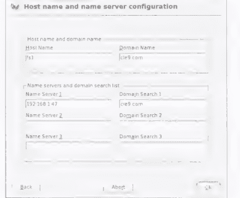

系统不再依赖 `hosts` 文件，而是向 DNS 服务器发送将主机名转换为 IP 地址（反之亦然）的解析请求。

**注意**

尽管您的系统已配置为使用 DNS 服务器进行名称解析，但您仍然可以在 `hosts` 文件中手动输入主机名-IP 地址映射。如果您的 `/etc/host.conf` 文件配置为此，则系统可以使用 `hosts` 文件来解析该特定的主机名。

## DNS 的必要性

这种策略比 `hosts` 文件具有明显的优势。其中关键之一是解析服务在网络中是中的。回想一下我们之前看到的例子。您的网络中有 800 台计算机系统，您刚刚添加了一个新服务器。您需要用服务器的新主机名和 IP 地址更新您的名称解析系统。

我们提到，当使用 `hosts` 文件时，您必须进行 800 次手动更新；每个 `hosts` 文件都必须编辑或复制。然而，使用 `DNS`，您只需要对 DNS 服务器进行一次更新。一旦您添加了映射，网络上的任何主机都可以立即解析该主机名。这为您节省了大量时间。

让我们回顾一下 `DNS` 的工作原理。

## DNS 命名空间

`DNS` 和 `hosts` 文件之间的主要区别之一是 `DNS` 采用了分层的域名域和区域。这种层次结构被称为 `DNS` 命名空间。

作为比较，请参考图 3.2。`hosts` 文件是“扁平”的。“扁平”一术语是什么意思？这意味着该文件没有结构允许记录嵌套在组织单元中。`hosts` 文件中的所有记录都处于同一层。

例如，您可以在单个 `hosts` 文件中输入以下主机名和 IP 地址列表：

| 192.168.1.47 | fs1.cle9.com | fs1 |
| 130.57.4.27 | novell.com | novell |
| 192.168.1.1 | gateway.cle9.com | gateway |
| 195.135.220.3 | www.suse.com | suse |

注意，这些映射并没有以任何特定方式排列。它们没有以任何特定顺序出现，相似记录也没有分组。对于较小的 `hosts` 文件来说，这不是问题。但想象一下，如果 `hosts` 文件中有成百或上千条不同的记录，`hosts` 文件会变得多么混乱。

另一方面，`DNS` 将主机组织成高度结构化的域结构。将这种结构想象成一个倒立树，如图 3.5 所示。

为了理解 `DNS` 域如何组织主机名，让我们分析一个示例域名：`www.novell.com`。

`DNS` 层次结构的顶端是根域名。它由一个简单的点表示，如图 3.5 所示。这将是任何 `DNS` 域名中最右侧的域。

### 图 3.5

`DNS` 域层次结构。

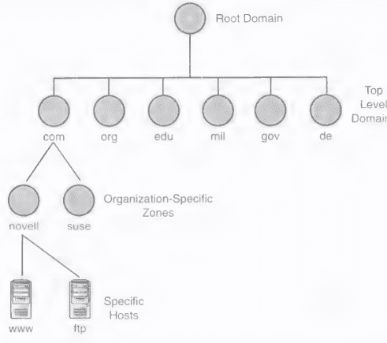

注意 `novell.com` 结尾的点。这个点代表根域名。现在，当您访问网站时，可能不会在 URL 中包含末尾的点。大多数人都不这样做。但是，您应该始终记住，一个编写正确的完全限定域名（`FQDN`）以表示根域的尾部点结尾。

作为一个实验，尝试打开浏览器并在域名名后使用尾部点来访问您喜爱的网站。您发现它是可行的！在图 3.6 中，您看到仅使用这种类型的 URL 打开了 Novell 的网站：

### 图 3.6

在 URL 中使用尾部点。

| 公司 | 解决方案 | 产品 | 咨询 | 培训 | 支持 | 合作伙伴 | 级别 |
| --- | --- | --- | --- | --- | --- | --- | --- |
| Novell | | | | | | | | |

## DNS 的必要性

根域名包含许多顶级域名（TLD）。如果您访问过互联网上的网站，您可能已经熟悉这些顶级域名了，它们包括：

- `com`—包含商业机构。
- `edu`—包含教育机构。
- `org`—包含非营利组织。
- `gov`—包含美国政府机构。

此列表并不是详尽的。在最近几年，增加了新的顶级域名，包括 `tv`、`biz` 和 `info`。此外，还存在特定国家的顶级域名。例如，澳大利亚的顶级域名是 `au`。西班牙的顶级域名在我们的示例 `example.novell.com` 中，下一个域名是 `com`。

在顶级域名内部存在着子域或区域。

**注意**

您有时会听到管理员们争论一个区域是一个域。某些纯主义者认为是。在图 3.5 中，你会注意到 `novell` 区域包含了特定的。

## 使用 DNS 解析主机名

回想使用 `hosts` 文件时，系统需要将主机名解析到 IP 地址。这使得 `DNS` 比 `hosts` 文件更容易管理。

## 第 3 章：在 SLES 9 上配置 DNS

`DNS` 系统使用 `DNS` 服务器，而不是读取本地文件。解析过程如图 3.7 所示：

### 图 3.7

解析过程。

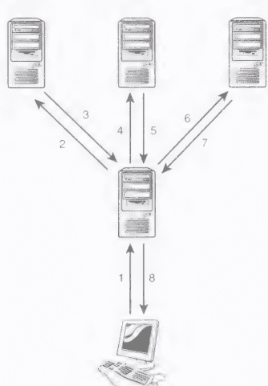

其工作原理如下：

1. 系统向 DNS 服务器发送解析主机名的请求。

**注意**

尽管您的系统已配置为使用 DNS 服务器进行名称解析，但您仍然可以在 `hosts` 文件中手动输入主机名-IP 地址映射。如果您的 `/etc/host.conf` 文件配置为此，则系统可以使用 `hosts` 文件来解析该特定的主机名。

## DNS 的必要性

2. DNS 服务器向根级服务器发送请求。有 13 个服务器。当您安装自己的 DNS 服务器时，它会自动配置这些服务器的 IP 地址，如图 3.8 所示。

### 图 3.8

根级服务器。

| | | |
|---|---|---|
| .ROOT-SERVERS.MET. | 36000 | B.ROOT-SERVERS.MET. |
| | A | 192.228.79.201 |
| | formerly .PSI.MET |
| .ROOT-SERVERS.MET. | 36000 | C.ROOT-SERVERS.MET. |
| | A | 192.33.4.12 |
| | formerly .TERP.UDP |
| .ROOT-SERVERS.MET. | 36000 | D.ROOT-SERVERS.MET. |
| | A | 128.6.10.90 |
| | formerly .MS.GA.GOV |
| .ROOT-SERVERS.MET. | 36000 | E.ROOT-SERVERS.MET. |
| | A | 192.203.230.10 |
| | formerly .ISC.ORG |
| .ROOT-SERVERS.MET. | 36000 | F.ROOT-SERVERS.MET. |
| | A | 192.5.5.241 |
| | More... | |

**提示**

您的 SLES 9 服务器，根级 DNS 服务器的 IP 地址包含在 `/var/lib/named/root.hint` 中。

3. 联系的根级 DNS 服务器向您的 DNS 服务器返回该 FQDN 顶级域权威 DNS 服务器 IP 地址。

4. 您的 DNS 服务器向顶级域名 DNS 服务器发送针对 FQDN 的解析查询。

5. 顶级域名 DNS 服务器向您的 DNS 服务器返回您需要解析的 FQDN 区域权威 DNS 服务器 IP 地址。

6. 您的 DNS 服务器向 FQDN 所在区域的权威 DNS 服务器发送解析请求。

7. 权威 DNS 服务器向您的 DNS 服务器响应 FQDN。

8. 您的 DNS 服务器向请求的系统响应相应的 IP 地址。

## 第 3 章：在 SLES 9 上配置 DNS

此时，发生了一件非常重要的事情。当你的 DNS 服务器解析一个它不是权威源的主机名时，它会将该地址保存在它的名称缓存中。在将来，如果它再次收到解析该相同主机名的请求，它将直接从缓存中提取 IP 地址并对请求系统做出响应，而不是再次通过整个过程。这既节省了时间又节省了网络流量，对于高负载的 DNS 服务器尤其如此。

考虑到这一点，你需要了解关于 DNS 服务器名称缓存的知识。首先，缓存存储在服务器的内存中；它没有保存在文件中。这一点很重要，因为很多时候，系统管理员想要操作其 DNS 服务器的缓存，例如手动编辑它以添加主机，或将其复制到另一个 DNS 服务器。简单来说，你做不到这一点。

这引出了第二点：特定 DNS 服务器上的名称缓存不是持久化的。因为它只存在于内存中，所以如果你在 DNS 服务停止时丢失了它，或者由于你重启了运行该服务的服务器系统，它就会丢失。许多管理员希望将缓存保存到文件中，并在服务恢复时重新加载它。这是一个好主意；与其等待名称缓存重新构建，不如强制服务使用现有缓存，从而节省时间并减少网络流量。遗憾的是，这是无法做到的。

在我们继续之前，我们需要讨论一下 DNS 服务器可以承担的两个角色：主 `master` 或从 `slave`。

## 主、与从 DNS 服务器

当前 DNS 实现的问题之一是容错性。如果你将 DNS 数据库托管在特定的服务器上，而该服务器宕机了，你的网络名称解析就会失效。

为了提供某种程度的冗余，`BIND` 允许你配置主、从 DNS 服务器。对区域文件进行的任何更改都会在主服务器上进行。

另一方面，从 DNS 服务器配置为从主 DNS 服务器获取其区域数据。每隔一段时间，从服务器就会联系主服务器并下载区域数据。这种传输被称为区域传输 `zone transfer`。

通过用主、从服务器配置你的 DNS 实现，你提供了某种程度的容错性。这是因为从 DNS 服务器可以像主 DNS 服务器一样解析主机名。你的工作站不知道两者之间的区别。

事实上，你会发现大多数组织和 ISP 为客户端工作站提供两个或多个 DNS 服务器地址。其中通常是一个主服务器，其他是从服务器。如果你的主服务器宕机，工作站仍然可以使用从服务器进行解析。

除了了解主、从服务器外，你还需要理解 DNS 服务器可以托管的两种区域 `zones`。让我们接下来来看这些。

## 正向-与反向-查找-区域

DNS 服务器可以执行两种类型的查找来执行名称解析任务。第一类型被称为正向查找 `forward lookup`。正向查找是我们在章开头章节中一直关注的查找类型。在执行正向查找时，客户端系统向 DNS 服务器发送请求，要求其将主机名解析为 IP 地址。

然而，这个过程也可以反向运行。这些被称为反向查找 `reverse lookups`。在反向查找期间，客户端系统向 DNS 服务器发送请求，要求其将 IP 地址解析为主机名。

初看之下，你可能会认为 DNS 服务器可以为这两种类型的查找使用相同的区域数据。毕竟，这只是方向问题，对吧？

嗯，情况不是那样。如果你想让 DNS 服务器提供正向和反向查找，你必须创建两个区域：一个正向区域和一个反向区域。这两个区域包含相同的数据；只是格式略有不同。我们将在章的稍后部分查看差异。

现在你已经了解了 DNS 的概念工作原理，你需要学习如何在你的 SLES 9 服务器上实现它。

## 在 SLES 9 上安装 DNS

涵盖的测试目标：在 SLES 9 上安装

现在你已经了解了 DNS 的概念工作原理，你需要学习如何在你的 SLES 9 服务器上实现它。

## 在 SLES 9 上安装 DNS

涵盖的测试目标：在 SLES 9 上安装

## 第 3 章：在 SLES 9 上配置 DNS

- `/etc/init.d/named start` — 启动 `named` 进程。
- `/etc/init.d/named stop` — 停止 `named` 进程。
- `/etc/init.d/named restart` — 重启 `named` 进程。

如果你不想使用完整路径，也可以从 shell 提示符输入 `rcnamed` 并配合 `start`、`stop` 或 `restart` 参数来管理 `named` 进程。

### 图 3.15
BIND 二进制文件。

```
fsl:usecache is on

fsl:usecache #
```


### 提示

如果在 shell 提示符直接输入 `rcscript` 而不带任何参数，将显示可用参数列表。

在系统上安装 BIND 后，你就可以准备在服务器上配置并启动服务了。然而，在此之前，你需要对 BIND 配置文件有深入的理解。

## BIND 配置文件

在本章中，我们将使用 YaST 在你的 SLES 9 服务器上设置 `named` 服务。但是，正如第 2 章“SUSE LINUX Enterprise Server 9 简介”中所讨论的，我认为你彻底理解 YaST 图形界面“底层”正在发生什么至关重要。

考虑到这一点，让我们来看用于配置在服务器上运行的 `named` 服务所需的文件。

## 使用 named.conf 配置 named

你需要熟悉的第一个文件是 `named.conf`。该文件位于 `/etc` 目录下，如图 3.16 所示。

# 图 3.16

`/etc` 下的 `named.conf` 文件。


`named.conf` 是 `named` 服务的的主配置文件。`named.conf` 由指令以及与这些指令关联的块块组成。

### 提示

一个块（block）由括在在大括号内的数据行组成。最后一个括号之后是一个分号。

`named.conf` 文件中的指令包括以下内容：

- `options` — 该指令定义了 `named` 服务的通用配置选项。
- `logging` — 该指令为 `named` 服务配置日志通道。这些通道可能包括将日志信息发送到 `syslog` 服务或特定文件。
- `zone` — 这些指令定义了由 `named` 服务的区域（zones）。

`named.conf` 文件有很多配置参数。此时，我们将关注其中两个。我们将在本章稍后的部分查看其他几个。

你需要注意的第一个参数是 `options` 指令中的 `directory` 参数，如图 3.17 所示。

# 图 3.17
为 `named` 设置工作目录。

```
/etc/named.conf

# 这是 BIND 9 命名服务器的示例配置文件。它在

# 不修改的情况下作为一个缓存命名服务器工作。

# 设置你自己的域的示例配置可以在

# /var/share/doc/packages/named/sample.conf 中找到。

# 所有可用选项的描述可以在

# /usr/share/doc/packages/named/misc/options 中找到。

options {

# directory 语句定义命名服务器的工作目录

directory "/var/lib/named";

# 将 dump 文件和统计文件写入日志子目录。

# 参数相对于根 jail 环境。

ndump-file "/var/log/named_dump.db"

statistics-file "/var/log/named_stats";

};

```

此选项指定了 `named` 服务区域数据库文件所在的目录。默认情况下，这些文件位于 `/var/lib/named`，如图 3.18 所示。

图 3.18
`/var/lib/named` 中名为 `named` 的文件。

```
ls:/var/lib/named # is

127.0.0.1 zone dump localhost.zone master slave

-dev  etc  log  root jail var

fs:/var/lib/named #
```

如果在 `named.conf` 文件中跟随 `directory` 参数的任何目录中指定了 `anyfile`，则假设它位于该特定目录。

你需要熟悉的第二组参数是 `zone` 指令。它们位于文件靠后的位置，`options` 指令之后，如图 3.19 所示。

`named.conf` 中的 `zone` 指令定义了由 `named` 提供的区域。注意图 3.19，一个 `zone` 指令由几个部分组成。

- 区域名称（Zone Name）——区域名称紧跟在 `zone` 指令之后。区域名称包含引号内。在图 3.19 中，定义了三个区域：`.`、`localhost` 和 `0.0.0.127.in-addr.arpa`。

# 图 3.19

`/etc/named.conf` 中的 `zone` 指令。

```
# 以下的区域定义不需要任何修改。第一个

# 是根命名服务器的定义。第二个定义了

# localhost，而第三个定义了针对 localhost 的反向查找。

zone "" in (

    type hint;

    file "root.hint";

);

zone "localhost" in (

    type master;

    file "localhost.zone";

);

zone "0.0.0.127.in-addr.arpa" in (

    type master;

    file "127.0.0.zone";

);

# 包含 namedconf 生成的包含文件。这# 包含了根据 NAMED_CONF_INCLUDE_FILES 配置的所有文件

来自 /etc/sysconfig/named
```

- 命名空间（Name Space）——命名声明跟在区域名称之后。在图 3.19 中，三个区域都配置为使用互联网空间，由 `in` 表示。

### 提示

互联网命名空间几乎是唯一的。在实现 DNS 服务器时，你很难遇到其他命名空间。

- 类型（Type）——类型声明标识服务器将作为主 DNS 服务器还是从用 DNS 服务器。

- 文件（File）——文件声明标识了存储区域数据的文件。文件名包含引号内。在图 3.19 中，你可以看到在 `options` 指令中指定的三个区域。这些根服务器的 IP 地址包含在 `root.hint` 中。

## 第 3 章：在 SLES 9 上配置 DNS

图 3.20
`root.hint` 中的根级 DNS 地址。

| A.ROOT-SERVERS.MET. | IN | A.ROOT-SERVERS.MET. |
|---|---|---|
| 36000 | | 192.41.0.4 |
| MS.EDU | | |
| 36000 | | 192.228.79.29 |
| C.PSI | | |
| 36000 | | 192.33.4.12 |
| TERP.EDU | | |
| 36000 | | 128.0.10.30 |
| NASA.GO | | |
| 36000 | | 192.203.230.10 |
| .root_hint | | 40.1.29z |

这种配置适用于你没有自己的域名，并希望为用户提供浏览网页的能力。

然而，你更有可能需要为使用 `name daemon` 进程的域名提供解析服务。要做到这一点，你需要创建自己的区域文件，并配置 `named` 使用这些文件。

接下来我们来讨论如何操作。

## 创建区域文件

假设你是一个名为 CLE9 的组织的系统管理员（这可太巧了！）。你已经为你的组织获取了 `cle9.com` 域名。在此之前，你将你的 SLES 9 服务器配置为仅缓存名称服务器。然而，你需要配置 `named` 为 `cle9.com` 区域提供权威解析服务。你需要做什么呢？

首先，你需要编辑 `/etc/named.conf` 文件并添加一个新的区域指令。这如图 3.21 所示：

图 3.21

向 `named.conf` 添加新区域。

```conf
# 以下的区域定义不需要修改。第一个是

# 根名称服务器的定义。第二个定义了

# localhost 而第三个定义了 localhost 的反向查找。

zone "" {

  type hint;

  file "root.hint";

}

zone "localhost" in {

  type master;

  file "localhost.zone";

}

zone "0.0.0.127-in-addr.arpa" in {

  type master;

  file "127.0.0.zone";

}

zone "cle9.com" in {

  type master;

  file "master/cle9.conf";

}
```

在这个示例中，我们添加了 `cle9.com` 区域。DNS 服务器将成为该区域的主权威服务器。接下来的我们需要做的是为该区域创建一个文件。注意，我们指定文件为 `master/cle9.com`。因为我们指定了目录为 `/var/lib/named`，因此区域文件将是 `/var/lib/named/master/cle9.com`。

## 第 3 章：在 SLES 9 上配置 DNS

保存文件后，我们需要做的下一步是打开区域文件并添加适当的信息。这里情况会变得稍微复杂。我将向你展示我为 `cle9.com` 区域创建的基础区域文件。这如图 3.22 所示：

图 3.22

`cle9.com` 区域。

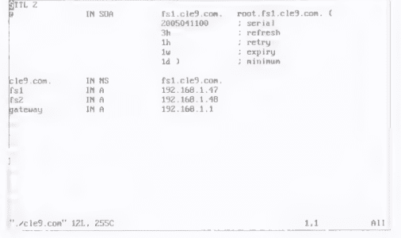

在此区域中，有三个主机：`fs1`、`fs2` 和 `gateway`。让我们更深入地探索区域文件中的每个元素：

- `$TTL`—代表生存时间（Time To Live）。该值指定了每条记录的默认时间。如果记录有一个显式的生存时间值，则其优先级高于此处指定的 `$TTL$` 值。如果未指定单位，则假设该值以秒为单位。图 3.22 显示为 2 秒，这可能是一个太小的值。你也可以通过在值后加 D 来指定以天为单位：例如 `2D`。
- `IN`—指定该文件使用互联网命名空间。
- `SOA`—代表权威起始（Start Of Authority）。`SOA` 实际上是一条记录，就像你在图 3.22 中看到的针对 `fs1` 和 `fs2` 的记录一样。然而，`SOA` 记录有特殊用途。它必须紧跟在 `$TTL` 参数之后。`SOA` 记录的作用是标识以下内容：

- 哪个 DNS 服务器是该区域的权威服务器？在图 3.22 中，`fs1.cle9.com` 被标识为 `cle9.com` 区域的权威 DNS 服务器。

# 在 SLES 上安装 DNS

图 3.23
`www.yahoo.com` 的多个地址。

```
Non-authoritative answer:

www.yahoo.com canonical name = www.yahoo.akadns.net

Name: www.yahoo.akadns.net

Address: 66.94.230.37

Name: www.yahoo.akadns.net

Address: 66.94.230.38

Name: www.yahoo.akadns.net

Address: 66.94.230.40

Name: www.yahoo.akadns.net

Address: 66.94.230.44

Name: www.yahoo.akadns.net

Address: 66.94.230.45

Name: www.yahoo.akadns.net

Address: 66.94.230.46

Name: www.yahoo.akadns.net

Address: 66.94.230.47

Name: www.yahoo.akadns.net

Address: 66.94.230.48

Flags: 0
```

如果你处于上述任何一种情况，都需要配置你的区域文件（zone file），以便 `named` 将 IP 地址解析到单个主机名。此外，你可能还想确保 `named` 不会反复为多地址主机名提供同一个地址。实施多网卡（multi-NIC）服务器或多服务器服务的主要目标之一是负载均衡。如果你的 DNS 服务器仅解析分配给主机的一个地址，那么这个目标就会被破坏。

那么你该做什么？好消息是 `named` 在设计时考虑到了这种场景。如果你有一个具有多个 IP 地址的主机名，你只需要在你的区域中为同一个主机名创建多个 A 记录；每个记录解析到不同的 IP 地址。`named` 守护进程会自动轮询解析到该主机名的地址，从而为你分担服务器或服务的网络负载。这是一种非常强大的功能！

到此时，我们需要切换区域。我们在本主题中讨论的所有内容都是基于正向查找区域（forward-lookup zones）的。在继续之前，我们需要回顾如何创建反向区域（reverse zones）。

# 配置反向查找区域

正如章早期讨论的，反向查找区域的工作方式与标准正向查找区域相反。反向区域不是将主机名解析为 IP 地址，而是将 IP 地址解析为主机名。

在你的 `named` 守护进程执行此类类型的查找之前，你需要为你的正向区域配置一个配套的反向区域。`cle9.com` 区域的反向区域示例如图 3.24 所示：

## 第 3 章：在 SLES 9 上配置 DNS

图 3.24

`cle9.com` 的反向查找区域。

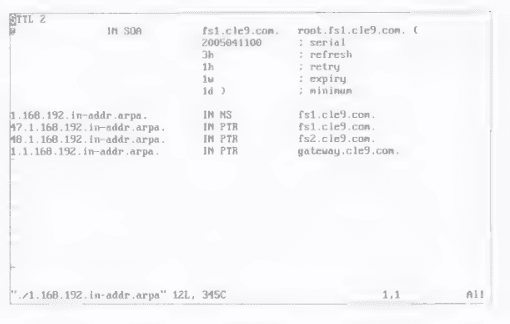

你会发现 `$TTL` 参数和 `SOA` 记录与正向查找区域几乎完全相同。然而，相似之处仅此于此。

在图 3.24 中找到 `NS` 记录。注意它所使用的奇特区域名称。不是 `cle9.com`，区域名称是 `1.168.192.in-addr.arpa`。反向区域名称按以下方式构建：

`reversed_network_address.in-addr.arpa.`

例如，在图 3.24 中，区域内主机的网络地址是 `192.168.1.0`。因此，区域名称为 `1.168.192.in-addr.arpa`。

相应的，区域中的主机按以下方式引用：
`host_portion_address.reversed_network_address.in-addr.arpa.`

例如，`fs1.cle9.com` 的反向主机名是 `47.168.192.in-addr.arpa`。

### 提示

与正向查找区域一样，反向名称中的 FQDN 必须有一个末尾的点。

当反向区域运行时，你可以发送反向解析请求，如图 3.25 所示：

图 3.25
执行反向查找。

```
fs1-retc # Host 192.168.1.47

sf1.168.192.in-addr.arpa domain name pointer fs1.cle9.com.

fs1-retc: #
```

在这个示例中，DNS 服务器已将 IP 地址 `192.168.1.47` 解析为 `fs1.cle9.com`。现在你已经了解了正向和反向区域以及组成它们的文件，你已经准备好在你的服务器上配置 BIND 了。让我们接下来进行这一操作。

# 在 SLES 9 上配置 BIND

在 SLES 9 上配置 BIND，你基本上有两个选择：你可以手动创建并编辑必要的文件，也可以使用 YaST。对于你的 CLE 9 认证，你需要知道如何使用 YaST 完成此操作。让我们深入并执行吧。要在 SLES 9 上配置 BIND，请完成以下操作：

1. 从你的 SLES 9 服务器的桌面启动 YaST。
2. 选择网络服务（Network Services）、DNS 服务器（DNS Server），如图 3.26 所示。

图 3.26
在 YaST 中配置 DNS。


3. 在图 3.24 中找到 NS 记录。注意它所使用的奇特区域名称。不是 `cle9.com`，区域的名称是 `1.168.192.in-addr.arpa`。反向区域名称按以下方式构建：

`reversed_network_address.in-addr.arpa.`

例如，在图 3.24 中，区域内主机的网络地址是 `192.168.1.0`。因此，区域名称为 `1.168.192.in-addr.arpa`。

相应的，区域中的主机按以下方式引用：
`host_portion_address.reversed_network_address.in-addr.arpa.`

例如，`fs1.cle9.com` 的反向主机名是 `47.168.192.in-addr.arpa`。

### 提示

正如正向查找区域一样，反向名称中的 FQDN 必须有一个末尾的点。

当反向区域运行后，你可以发送反向解析请求，如图 3.25 所示：

图 3.25
执行反向查找。

```
fs1-retc # Host 192.168.1.47

sf1.168.192.in-addr.arpa domain name pointer fs1.cle9.com.

fs1-retc: #
```


在这个示例中，DNS 服务器已将 IP 地址 `192.168.1.47` 解析为 `fs1.cle9.com`。现在你已经了解了正向和反向区域以及组成它们的文件，你已经准备好在你的服务器上配置 `BIND` 了。让我们接下来进行这一操作。

# 在 SLES 9 上配置 BIND

在 `SLES 9` 上配置 `BIND`，你基本上有两个选择：你可以手动创建并编辑必要的文件，也可以使用 `YaST`。对于你的 `CLE 9` 认证，你需要知道如何使用 `YaST` 完成此操作。让我们深入并执行吧。要在 `SLES 9` 上配置 `BIND`，请完成以下操作：

1. 从你的 `SLES 9` 服务器的桌面启动 `YaST`。
2. 选择网络服务（Network Services）、DNS 服务器（DNS Server），如图 3.26 所示。

图 3.26
在 `YaST` 中配置 DNS。


3. 在图 3.24 中找到 `NS` 记录。注意它所使用的奇特区域名称。不是 `cle9.com`，区域的名称是 `1.168.192.in-addr.arpa`。反向区域名称按以下方式构建：

`reversed_network_address.in-addr.arpa.`

例如，在图 3.24 中，区域内主机的网络地址是 `192.168.1.0`。因此，区域名称为 `1.168.192.in-addr.arpa`。

相应的，区域中的主机按以下方式引用：
`host_portion_address.reversed_network_address.in-addr.arpa.`

例如，`fs1.cle9.com` 的反向主机名是 `47.168.192.in-addr.arpa`。

### 提示

正如正向查找区域一样，反向名称中的 `FQDN` 必须有一个末尾的点。

当反向区域运行后，你可以发送反向解析请求，如图 3.25 所示：

图 3.25
执行反向查找。

```
fs1-retc # Host 192.168.1.47

sf1.168.192.in-addr.arpa domain name pointer fs1.cle9.com.

fs1-retc: #
```


在这个示例中，DNS 服务器已将 IP 地址 `192.168.1.47` 解析为 `fs1.cle9.com`。现在你已经了解了正向和反向区域以及组成它们的文件，你已经准备好在你的服务器上配置 `BIND` 了。让我们接下来进行这一操作。

# 在 SLES 9 上配置 BIND

在 `SLES 9` 上配置 `BIND`，你基本上有两个选择：你可以手动创建并编辑必要的文件，也可以使用 `YaST`。对于你的 `CLE 9` 认证，你需要知道如何使用 `YaST` 完成此操作。让我们深入并执行吧。要在 `SLES 9` 上配置 `BIND`，请完成以下操作：

1. 从你的 `SLES 9` 服务器的桌面启动 `YaST`。
2. 选择网络服务（Network Services）、DNS 服务器（DNS Server），如图 3.26 所示。

图 3.26
在 `YaST` 中配置 DNS。


3. 在图 3.24 中找到 `NS` 记录。注意它所使用的奇特区域名称。不是 `cle9.com`，区域的名称是 `1.168.192.in-addr.arpa`。反向区域名称按以下方式构建：

`reversed_network_address.in-addr.arpa.`

例如，在图 3.24 中，区域内主机的网络地址是 `192.168.1.0`。因此，区域名称为 `1.168.192.in-addr.arpa`。

相应的，区域中的主机按以下方式引用：
`host_portion_address.reversed_network_address.in-addr.arpa.`

例如，`fs1.cle9.com` 的反向主机名是 `47.168.192.in-addr.arpa`。

### 提示

正如正向查找区域一样，反向名称中的 `FQDN` 必须有一个末尾的点。

当反向区域运行后，你可以发送反向解析请求，如图 3.25 所示：

图 3.25
执行反向查找。

```
fs1-retc # Host 192.168.1.47

sf1.168.192.in-addr.arpa domain name pointer fs1.cle9.com.

fs1-retc: #
```

在这个示例中，DNS 服务器已将 IP 地址 `192.168.1.47` 解析为 `fs1.cle9.com`。


在这个示例中，DNS 服务器已将 IP 地址 `192.168.1.47` 解析为 `fs1.cle9.com`。现在你已经了解了正向和反向区域以及组成它们的文件，你已经准备好在你的服务器上配置 `BIND` 了。让我们接下来进行这一操作。

# 在 SLES 9 上配置 BIND

在 `SLES 9` 上配置 `BIND`，你基本上有两个选择：你可以手动创建并编辑必要的文件，也可以使用 `YaST`。对于你的 `CLE 9` 认证，你需要知道如何使用 `YaST` 完成此操作。让我们深入并执行吧。要在 `SLES 9` 上配置 `BIND`，请完成以下操作：

1. 从你的 `SLES 9` 服务器的桌面启动 `YaST`。
2. 选择网络服务（Network Services）、DNS 服务器（DNS Server），如图 3.26 所示。

图 3.26
在 `YaST` 中配置 DNS。


3. 在图 3.24 中找到 `NS` 记录。注意它所使用的奇特区域名称。不是 `cle9.com`，区域的名称是 `1.168.192.in-addr.arpa`。反向区域名称按以下方式构建：

`reversed_network_address.in-addr.arpa.`

例如，在图 3.24 中，区域内主机的网络地址是 `192.168.1.0`。因此，区域名称为 `1.168.192.in-addr.arpa`。

相应的，区域中的主机按以下方式引用：
`host_portion_address.reversed_network_address.in-addr.arpa.`

例如，`fs1.cle9.com` 的反向主机名是 `47.168.192.in-addr.arpa`。

### 提示

正如正向查找区域一样，反向名称中的 `FQDN` 必须有一个末尾的点。

当反向区域运行后，你可以发送反向解析请求，如图 3.25 所示：

图 3.25
执行反向查找。

```
fs1-retc # Host 192.168.1.47

sf1.168.192.in-addr.arpa domain name pointer fs1.cle9.com.

fs1-retc: #
```


在这个示例中，DNS 服务器已将 IP 地址 `192.168.1.47` 解析为 `fs1.cle9.com`。现在你已经了解了正向和反向区域以及组成它们的文件，你已经准备好在你的服务器上配置 `BIND` 了。让我们接下来进行这一操作。

# 在 SLES 9 上配置 BIND

在 `SLES 9` 上配置 `BIND`，你基本上有两个选择：你可以手动创建并编辑必要的文件，也可以使用 `YaST`。对于你的 `CLE 9` 认证，你需要知道如何使用 `YaST` 完成此操作。让我们深入并执行吧。要在 `SLES 9` 上配置 `BIND`，请完成以下操作：

1. 从你的 `SLES 9` 服务器的桌面启动 `YaST`。
2. 选择网络服务（Network Services）、DNS 服务器（DNS Server），如图 3.26 所示。

图 3.26
在 `YaST` 中配置 DNS。


3. 在图 3.24 中找到 `NS` 记录。注意它所使用的奇特区域名称。不是 `cle9.com`，区域的名称是 `1.168.192.in-addr.arpa`。反向区域名称按以下方式构建：

`reversed_network_address.in-addr.arpa.`

例如，在图 3.24 中，区域内主机的网络地址是 `192.168.1.0`。因此，区域名称为 `1.168.192.in-addr.arpa`。

相应的，区域中的主机按以下方式引用：
`host_portion_address.reversed_network_address.in-addr.arpa.`

例如，`fs1.cle9.com` 的反向主机名是 `47.168.192.in-addr.arpa`。

### 提示

正如正向查找区域一样，反向名称中的 `FQDN` 必须有一个末尾的点。

当反向区域运行后，你可以发送反向解析请求，如图 3.25 所示：

图 3.25
执行反向查找。

```
fs1-retc # Host 192.168.1.47

sf1.168.192.in-addr.arpa domain name pointer fs1.cle9.com.

fs1-retc: #
```


在这个示例中，DNS 服务器已将 IP 地址 `192.168.1.47` 解析为 `fs1.cle9.com`。现在你已经了解了正向和反向区域以及组成它们的文件，你已经准备好在你的服务器上配置 `BIND` 了。让我们接下来进行这一操作。

# 在 SLES 9 上配置 BIND

在 `SLES 9` 上配置 `BIND`，你基本上有两个选择：你可以手动创建并编辑必要的文件，也可以使用 `YaST`。对于你的 `CLE 9` 认证，你需要知道如何使用 `YaST` 完成此操作。让我们深入并执行吧。要在 `SLES 9` 上配置 `BIND`，请完成以下操作：

1. 从你的 `SLES 9` 服务器的桌面启动 `YaST`。
2. 选择网络服务（Network Services）、DNS 服务器（DNS Server），如图 3.26 所示。

图 3.26
在 `YaST` 中配置 DNS。


3. 在图 3.24 中找到 `NS` 记录。注意它所使用的奇特区域名称。不是 `cle9.com`，区域的名称是 `1.168.192.in-addr.arpa`。反向区域名称按以下方式构建：

`reversed_network_address.in-addr.arpa.`

例如，在图 3.24 中，区域内主机的网络地址是 `192.168.1.0`。因此，区域名称为 `1.168.192.in-addr.arpa`。

相应的，区域中的主机按以下方式引用：
`host_portion_address.reversed_network_address.in-addr.arpa.`

例如，`fs1.cle9.com` 的反向主机名是 `47.168.192.in-addr.arpa`。

### 提示

正如正向查找区域一样，反向名称中的 `FQDN` 必须有一个末尾的点。

当反向区域运行后，你可以发送反向解析请求，如图 3.25 所示：

图 3.25
执行反向查找。

```
fs1-retc # Host 192.168.1.47

sf1.168.192.in-addr.arpa domain name pointer fs1.cle9.com.

fs1-retc: #
```


在这个示例中，DNS 服务器已将 IP 地址 `192.168.1.47` 解析为 `fs1.cle9.com`。现在你已经了解了正向和反向区域以及组成它们的文件，你已经准备好在你的服务器上配置 `BIND` 了。让我们接下来进行这一操作。

# 在 SLES 9 上配置 BIND

在 `SLES 9` 上配置 `BIND`，你基本上有两个选择：你可以手动创建并编辑必要的文件，也可以使用 `YaST`。对于你的 `CLE 9` 认证，你需要知道如何使用 `YaST` 完成此操作。让我们深入并执行吧。要在 `SLES 9` 上配置 `BIND`，请完成以下操作：

1. 从你的 `SLES 9` 服务器的桌面启动 `YaST`。
2. 选择网络服务（Network Services）、DNS 服务器（DNS Server），如图 3.26 所示。

图 3.26
在 `YaST` 中配置 DNS。


3. 在图 3.24 中找到 `NS` 记录。注意它所使用的奇特区域名称。不是 `cle9.com`，区域的名称是 `1.168.192.in-addr.arpa`。反向区域名称按以下方式构建：

`reversed_network_address.in-addr.arpa.`

例如，在图 3.24 中，区域内主机的网络地址是 `192.168.1.0`。因此，区域名称为 `1.168.192.in-addr.arpa`。

相应的，区域中的主机按以下方式引用：
`host_portion_address.reversed_network_address.in-addr.arpa.`

例如，`fs1.cle9.com` 的反向主机名是 `47.168.192.in-addr.arpa`。

### 提示

正如正向查找区域一样，反向名称中的 `FQDN` 必须有一个末尾的点。

当反向区域运行后，你可以发送反向解析请求，如图 3.25 所示：

图 3.25
执行反向查找。

```
fs1-retc # Host 192.168.1.47

sf1.168.192.in-addr.arpa domain name pointer fs1.cle9.com.

fs1-retc: #
```


在这个示例中，DNS 服务器已将 IP 地址 `192.168.1.47` 解析为 `fs1.cle9.com`。现在你已经了解了正向和反向区域以及组成它们的文件，你已经准备好在你的服务器上配置 BIND 了。让我们接下来进行这一操作。

# 在 SLES 9 上配置 BIND

在 SLES 9 上配置 BIND，你基本上有两个选择：你可以手动创建并编辑必要的文件，也可以使用 YaST。对于你的 CLE 9 认证，你需要知道如何使用 YaST 完成此操作。让我们深入并执行吧。要在 SLES 9 上配置 BIND，请完成以下操作：

1. 从你的 SLES 9 服务器的桌面启动 YaST。
2. 选择网络服务（Network Services）、DNS 服务器（DNS Server），如图 3.26 所示。

图 3.26
在 YaST 中配置 DNS。


3. 在图 3.24 中找到 NS 记录。注意它所使用的奇特区域名称。不是 `cle9.com`，区域的名称是 `1.168.192.in-addr.arpa`。反向区域名称按以下方式构建：

`reversed_network_address.in-addr.arpa.`

例如，在图 3.24 中，区域内主机的网络地址是 `192.168.1.0`。因此，区域名称为 `1.168.192.in-addr.arpa`。

相应的，区域中的主机按以下方式引用：
`host_portion_address.reversed_network_address.in-addr.arpa.`

例如，`fs1.cle9.com` 的反向主机名是 `47.168.192.in-addr.arpa`。

### 提示

正如正向查找区域一样，反向名称中的 FQDN 必须有一个末尾的点。

当反向区域运行后，你可以发送反向解析请求，如图 3.25 所示：

图 3.25
执行反向查找。

```
fs1-retc # Host 192.168.1.47

sf1.168.192.in-addr.arpa domain name pointer fs1.cle9.com.

fs1-retc: #
```


## 实验 3.1：配置 DNS

在本次实验中，你将使用 YaST 在你的 SLES 9 服务器上配置 DNS 服务。要完成此项实验，你需要使用在实验 2.2 中安装了 SLES 9 的实验 PC 系统。

提示

如果你在进行此实验之前已经访问过 YaST DNS 服务器模块，某些功能可能会略有不同。该模块首次运行时将以向导模式运行。在首次运行之后，你必须手动在左侧框架中手动选择你想要配置的组件。本实验是在模块以向导模式运行的情况下编写的。

完成以下操作：

- 1. 启动你的 SLES 9 服务器。
- 2. 使用密码 `SuSE789` 以 `tux` 身份进行身份验证。
- 3. 启动 YaST。
- 4. 在出现提示时，提供 `tuX123` 的 root 密码。
- 5. 选择网络服务（Network Services）、DNS 服务器（DNS Server）。
- 6. 在转发器设置（Forwarder Settings）屏幕中，选择“下一步”（Next）。
- 7. 在 DNS 区域（DNS Zones）屏幕中，完成以下操作：
    a. 在区域名称（Zone Name）字段中，输入 `cle9.com`。
    b. 选择“添加”（Add）。
    c. 在已配置的 DNS 区域（Configured DNS Zones）下，确保选中了 `cle9.com` 区域；然后选择“编辑区域”（Edit Zone）。
    d. 选择 NS 记录（NS Records）选项卡。
    e. 在要添加名称服务器（Name Server to Add）字段中，输入 `fs1.cle9.com`。
    f. 选择“添加”（Add）。
    g. 选择 SOA 选项卡。
    h. 将 TTL 指令更改为 3 天。
    i. 选择记录（Records）选项卡。
    j. 在记录键（Record Key）字段中，输入 `fs1`。
    k. 确保类型（Type）下拉列表设置为 A。
- l. 在值（Value）字段中，输入你的 SLES 9 服务器 的 IP 地址。
- m. 选择“添加”（Add）。
- n. 选择“确定”（OK）。
- 8. 通过完成以下操作创建一个反向查找区域。
    a. 在 DNS 区域（DNS Zones）屏幕中，为你的网络段输入适当的反向区域的名称。例如，如果你的网络地址是 `192.168.1.0`，你将输入 `1.168.192.in-addr.arpa.`。
    b. 选择“添加”（Add）。
    c. 在配置 DNS 区域（Config DNS Zones）下，选择你的反向区域。
    d. 选择“编辑区域”（Edit Zone）。
    e. 选择 NS 记录（NS Records）选项卡。
    f. 在要添加名称服务器（Name Server to add）字段中，输入 `fs1.cle9.com.`。
    g. 选择“添加”（Add）。
    h. 选择 SOA 选项卡。
    i. 将 TTL 指令更改为 3 天。
    j. 选择记录（Records）选项卡。
    k. 在记录键（Record Key）字段中，输入适用于你 SLES 9 服务器的适当向 FQDN。例如，如果你的服务器的 IP 地址是 `192.168.1.47`，你将输入 `47.1.168.192.in-addr.arpa.`。
    l. 确保类型（Type）下拉列表设置为 PTR。
    m. 在值（Value）字段中，输入 `fs1.cle9.com..`。
    n. 选择“添加”（Add）。
    o. 选择“确定”（OK）。
    p. 在 DNS 区域（DNS Zones）屏幕中，选择“下一步”（Next）。
- 9. 在完成向导（Finish Wizard）中，将启动行为（Start-Up Behavior）标记为“开启”（On）。
- 10. 选择“完成”（Finish）。
- 11. 打开终端会话。
- 12. 在 shell 提示符下输入 `su –` 并提供密码 `tuX123`。
- 13. 在 shell 提示符下输入 `tail /var/log/messages`。
- 14. 验证你的正向区域和反向区域是否已正确加载。
- 15. 通过完成以下操作验证系统是否配置了正确的 DNS 服务器地址：
    a. 在 shell 提示符下，输入 `cat /etc/resolv.conf`。
    b. 应该有一行显示 `nameserver your_server_IP_address` 另一行显示 `search cle9.com`。如果情况不是如此，请使用 YaST 进行必要的更改。（参见特定步骤。）
- 16. 通过完成以下操作测试你的区域：
    a. 在 shell 提示符下，输入 `dig fs1.cle9.com`。这应该解析为你 DNS 服务器的 IP 地址。
    b. 在 shell 提示符下，输入 `host your_server_IP_address`。你的 `named` 守护进程应该返回 `fs1.cle9.com` 作为与 IP 地址关联的主机名。

恭喜！你现在有了一个运行在 SLES 9 上的功能性 DNS 服务器。随着 `named` 的运行，你已经准备好探索一些高级 DNS 特性了。让我们接下来来做这些。

## 高级 DNS 配置

涵盖的测试目标：

- 1. 使用 BIND 配置 DNS 服务器。

你在实验 3.1 中配置的 DNS 服务器非常适用于许多网络。然而，你应该注意一些高级功能和安全问题。尽管有许多可以讨论的主题，但在本主题中我们将关注以下内容：

- 配置转发
- 保护 DNS 服务器
- 配置 LDAP 支持

让我们从配置 DNS 转发开始。

## 配置转发

回在本章开始时，我们讨论了 DNS 名称解析过程是如何工作的。我们说，如果你的 DNS 服务器被要求解析一个它不是权威的主机名，它将首先解析一个它不是权威的主机名……（此处省略重复文本）。

## 第 3 章：在 SLES 上配置 DNS

转发通常在两种情况下实现：

- 你的组织具有 DNS 层次结构。
- 你的网络连接到提供 DNS 服务器的 ISP。

等待，我在 OCR 中看到一些重复。我将根据提供的文本清理 DNS 服务器的逻辑流。

## 第 3 章：在 SLES 9 上配置 DNS

- 在 `chroot` 监狱中运行
- 限制区域传输
- 使用 ACL

让我们先来看看如何将你的 `named` 守护进程放入监狱（jail）中！

## 在 CHROOT 监狱中运行 NAMED

早版本 BIND 版本中的主要问题之一是 `named` 守护进程默认以 `root` 用户身份运行。该服务需要访问文件系统的各种文件，还需要访问系统日志；为了实现这一点，`named` 以 `root` 身份运行。

尽管这实现了目标，但也留下了一个巨大的安全漏洞。由于 `named` 以 `root` 运行，它对整个系统拥有完全且不受限制的访问。如果黑客发现了利用 `named` 守护进程的方法（这确实发生过），他或她就可以获得 root 级权限访问系统。不妙！

为了解决这个问题，你需要配置 `named` 以不同的用户运行。更好情况下，你需要创建一个 `chroot` 监狱并在其中运行 `named`。

### 注意事项

我在这里假设你已经通过 CLP 课程材料了解了 `chroot` 监狱。如果你需要更多信息，请参阅 http://www.novell.com 提供的 SLES 9 文档。

通过这样做，你拒绝了 `named` 的 root 权限，并拒绝它访问文件系统中目录结构之外的任何内容。

那么，如何实现这一点呢？在过去，我们必须手动完成。这是一个相当复杂的过程，不适合胆子小的人。

### 小贴士

http://www.tldp.org 提供了一份非常棒的 HOWTO，它将逐步介绍了该过程。它被称为 `chroot-BIND HOWTO`。

幸运的是，我们不需要担心这个。为什么不呢？在实验练习 2.1 中安装的 BIND 9 版本会自动将 `named` 安装到 `chroot` 监狱中！要验证这一点，请用文本编辑器打开 `/etc/sysconfig/named`，如图 3.36 所示。

图 3.36
在 `chroot` 监狱中运行 `named`。

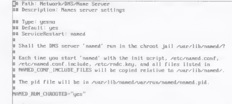

注意，默认情况下，`NAMED_RUN_CHROOTED` 参数被设置为 `yes`。`chroot` 监狱位于 `/var/lib/named`。还要注意，每次启动服务时，各种 `named` 配置文件都会从文件系统的其他位置复制到监狱中，从而消除了 `named` 访问文件系统中其他目录和文件的需求。

由于 `named` 现在默认在 `chroot` 监狱中运行，它不再以 `root` 身份运行。看看图 3.37。

注意到 `named` 使用 `named` 用户账户运行。向 BIND 9 的开发者们致敬！他们确实让我们系统管理员的工作变得简单多得。

现在我们已经讨论了在 `chroot` 监狱中运行 `named`，让我们来看下一个安全主题：限制用户对 DNS 服务器的访问。

## 限制用户对 DNS 服务器的访问

默认情况下，运行在你服务器上的 DNS 服务对任何人开放开放。
根据你的情况，这对你来说可能是一个问题也可能不是。

如果你的 DNS 服务器位于组织防火墙后的局域网内，限制用户访问可能不是问题。由于其位置的原因，能够访问它的用户将是授权用户。

图 3.37
使用 `named` 用户账户运行。

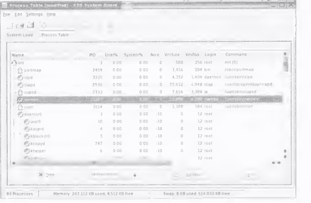

然而，如果你的 DNS 服务器位于组织的非军事化区（DMZ），这是一个非常常见的情况，你可能希望配置限制条件来定义谁可以使用该服务。否则，它对互联网上任何知道你 IP 地址的人都是开放的。

要限制用户访问，请使用 `allow-query` 指令。在你的 `named.conf` 文件中插入此指令允许你指定一个允许向 DNS 服务提交名称解析查询的 IP 地址列表。`allow-query` 指令后面跟着由分号分隔的 IP 地址列表。

### 注意事项

遗憾的是，BIND 没有提供通过用户身份验证控制访问的方法。你唯一的选择是根据发送查询的系统 IP 地址创建限制。

此时，可能可能会说：“哇！我可不想列出每一个允许使用 DNS 服务器的 IP 地址！”你是对的——这可能是一项艰巨的任务，特别是当你的网络很大时。幸运的是，`allow-query` 指令允许你使用网络地址以及 IP 地址。这允许 DNS 服务器响应来自指定网络上所有主机的查询。如图 3.38 所示。

## 图 3.38

限制用户访问。

```
# should be forwarded. 启用此行并将 IP 地址修改为

# 你提供商的名称服务器。最多可以列三个服务器。

# forwarders (192.0.2.1; 192.0.2.2):

# 启用下一项以允许使用 forwarders

# 部分中声明的名称服务器。

# forward first:

allow-query (192.168.1.0/24);

# 启用下一项以允许使用 forwarders

# 部分中声明的名称服务器。

# forward first:

allow-query (192.168.1.0/24);
```

好消息是，你可以锁定区域传输（zone transfers）。这是通过 `named.conf` 文件中的 `allow-transfer` 指令来实现的。该指令允许你指定哪些从服务器向你的服务器发起区域传输。`allow-transfer` 指令后跟着一个服务器的 IP 地址列表，并用分号分隔；或者允许从你的服务器传输区域数据。

如果你想为 DNS 服务器托管的所有区域建立一条通用规则，可以在 `named.conf` 文件的 `options` 语句中插入 `allow-transfer` 指令，就像 `allow-query` 指令一样。示例在图 3.39 所示：

# 图 3.39
限制区域传输。

```
# interfaces;      允许的值为 'any' 和 'none'，或地址的

# 列表;

listen-on-v6 { any };

# 如果本地服务器和互联网之间存在防火墙，

# 可能需要以下三条语句。

query-source = port 53;

# transfer-source = port 53;

modify-source = port 53;

# allow-query 记录包含一个允许查询的网络或 IP 地址

# 列表。默认允许来自所有主机的查询。

allow-transfer { 127.0.0.1 };

# 如果 notify 设置为 yes（默认值），当区域数据更改时，

# 通知消息将发送到其他名称服务器。与其在 'options'

# 部分中设置全局 'notify' 语句，不如单独地

import - 66.31 39c
```

在图 3.39 中，`named` 守护进程被配置为仅允许 IP 地址为 `192.168.1.48` 的 DNS 服务器进行传输。由于它列在 `options` 语句中，此服务器托管的所有区域的区域传输都限制限于这一个从服务器。

假设你没有使用从服务器，并且不希望任何人能够发起区域传输？你也可以通过 `allow-transfer` 指令实现。只需在 `named.conf` 文件的 `options` 语句中的任何位置添加 `allow-transfer` 即可：
`allow-transfer { "none"; };`

你可能会遇到需要基于每个区域来配置区域限制的情况。很多时候，你可能希望 DNS 服务器上的一个区域与一个从服务器同步，而另一个区域与另一个不同的从服务器同步。

## 第 3 章：在 SLES 9 上配置 DNS

这也可以通过 `allow-transfer` 指令来实现。不是将指令放在 `named.conf` 的 `options` 语句中，而是将其放在文件中的区域声明内部。

例如，假设你的 DNS 服务器托管了两个区域：`cle9.com` 和 `somedomomain.com`。你希望将 `cle9.com` 的区域传输限制在 IP 地址为 `192.168.1.48` 的从服务器。你还希望将 `somedomomain.com` 的区域传输限制在 IP 地址为 `192.168.1.49` 的从服务器。为了实现这一点，你为 `named.conf` 文件中的每个区域声明配置其相应的 `allow-transfer` 指令，如下：

```
zone "cle9.com" in {

file "master/cle9.com";

type master;
```


`allow-transfer(192.168.1.48);`

}

```

```

zone "somedomomain.com" in {

file "master/somedomomain.com";

type master;

allow-transfer(192.168.1.49);

}

```

如果你正在管理一个具有许多区域以及针对用户查询和区域传输的复杂访问规则的大型 DNS 实现，你可能考虑为你的 DNS 服务器使用访问控制列表（ACL）来简化此过程。请看下文。

## 使用 ACL

在 DNS 中，你可以定义用于配置限制条件的 ACL。

### 注意
不要将 DNS ACL 与你 Linux 服务器文件系统上使用的 ACL 混淆。它们是完全不同的东西。

通过 DNS ACL，你可以在 `named.conf` 文件中定义一个访问控制列表。然后当你使用 `allow-query` 和 `allow-transfer` 指令时，可以引用这些 ACL。`named.conf` 文件中的通用语法如下：

```
acl acl_name {list_of_addresses};
```

`acl` 语句与 `options` 和 `zone` 语句是并行的。请确保不要将其放在 `options` 语句内部。`acl_name` 参数是你任何想要给 ACL 起的名称。你将在其他指令（如 `allow-query`）中使用此名称来引用该 ACL。`list_of_addresses` 参数是你想要包含在 ACL 中的 IP 地址或网络地址列表。

例如，假设你想要配置 DNS 服务器，使查询限制在两个网段：192.168.1.0 和 192.168.2.0。你可以在 `named.conf` 文件中如下创建 ACL：

```
acl allowedhosts {192.168.1.0; 192.168.2.0};
```

然后，你可以在 `options` 语句中插入引用该 ACL 的 `allow-query` 指令，如下：

使用 ACL 可以节省大量输入工作并防止拼写错误。你还可以通过以下步骤使用 YaST 在 `named.conf` 文件中定义 ACL：

- 1. YaST。
- 2. 选择网络服务（Network Services）、DNS 服务器（DNS Server）。
- 3. 在左侧框中，选择 ACLs。
- 4. 在名称（Name）字段中，为你的 ACL 输入一个名称。
- 5. 在值（Value）字段中，输入你想包含在 ACL 中的 IP 地址。
- 6. 选择完成（Finish）。

让我们在实验 3.2 中在你的 DNS 服务器上练习执行这些任务。

## 实验 3.2：高级 DNS 配置

在本次练习中，你将使用 YaST 配置转发、DNS 安全和 LDAP 支持。为了完成此练习，你将需要使用之前在实验 2.1 中安装了 SLES 9 并在实验 3.1 中配置好的实验 PC 电脑系统。

完成以下操作：

1. 启动你的 SLES 9 服务器。
2. 以用户 `tux` 身份身份验证，密码为 `SuSE789`。
3. 启动 YaST。
4. 在出现提示时，提供根密码 `tuX123`。
5. 选择“网络服务”（Network Services），DNS 服务器”（DNS Server）。
6. 完成以下步骤配置 DNS 转发：
   a. 在左侧框架中，选择“转发器”（Forwarders）。
   b. 勾选“手动设置转发器”（Set Forwarders Manually）。
   c. 在“IP 地址”（IP Address）字段中，输入你的 ISP 服务器的 IP 地址。
   d. 选择“添加”（Add）。
7. 完成以下步骤配置 ACL：
   a. 在左侧框架中，选择“ACL”。
   b. 在“名称”（Name）字段中，输入 `allowedhosts`。
   c. 在“值”（Value）字段中，输入你的网络地址和子网掩码。例如，如果你的网络地址是 `192.168.1.0`，子网掩码是 `255.255.255.0`，则输入 `192.168.1.0/24`。
   d. 选择“添加”（Add）。
8. 完成以下步骤限制网络段内的 DNS 查询：
   a. 在左侧框架中，选择“基本选项”（Basic Options）。
   b. 在下拉列表中选择 `allow-query`。
   c. 在“值”字段中，输入 `{allowedhosts}`。
   d. 选择“添加”（Add）。

第 3 章：在 SLES 9 上配置 DNS

9. 选择“完成”（Finish）。

10. 完成以下步骤验证更改：
    a. 打开终端会话。
    b. 切换到 root 用户。
    c. 在 shell 提示符下输入 `cat /etc/named.conf`。
    d. 验证更改已生效。

11. 完成以下步骤配置 LDAP 支持：
    a. 在 YaST 中选择“DNS 服务器”。
    b. 在左侧框架中，选择“启动”（Start）。
    c. 勾选“启用 LDAP 支持”（Active LDAP Support）。
    d. 在提示需要安装 ldap 时，选择“继续”。
    e. 在提示时，插入你的 SLES 9 光盘；选择“继续”。
    f. 等待软件包安装。
    g. 在 DNS 服务器启动界面，选择“完成”（Finish）。
    h. 在提示 LDAP 服务器密码时，输入 `tu123`。

12. 为了查看服务器上的 LDAP 目录内容，你需要安装 LDAP 客户端。完成以下操作：
    a. 在 YaST 中选择“软件”、“安装/删除”。
    b. 在搜索字段中输入 `ldapclient`，然后选择“搜索”。
    c. 勾选 `ldapclient` 包，然后选择“接受”。
    d. 等待软件包安装。

13. 完成以下操作验证你的 DNS 区域信息已导入 LDAP 目录：
    a. 选择“网络”、“LDAP 客户端”。
    b. 选择“首选项”。
    c. 选择“服务器”。
    d. 选择“localhost”、“编辑”。
    e. 选择“详细”。
    f. 在 DN 字段中输入 `cn=Administrator,dc=9,dc=com`。
    g. 选择“确定”。
    h. 选择“浏览”标签页。
    i. 展开 `localhost`。
    j. 在提示密码时，输入 `tu123`。
    k. 展开 `dc=9,dc=com`。
    l. 展开 `ou=DNS`。
    m. 浏览你的区域记录。

14. 恭喜！你现在拥有了一个与 LDAP 目录集成的加固 DNS 服务器。

本章到此结束。在进入第 4 章“在 SLES 9 上配置 DHCP”之前，让我们回顾一下你学到的内容

## 总结

在本章中，我们首先回顾了 DNS 的工作原理。我们讨论了 DNS 命名空间以及 DNS 服务器解析主机名的过程。然后，我们回顾了正向和反向查找区域的区别。接着，我们讨论了通过实现主/从 DNS 服务器来提高容错能力。

最后，我们在 SLES 9 服务器上实现了 BIND，并回顾了用于配置 named 服务的文件，包括 `named.conf`、`named.hint` 和区域文件。

随后，我们转向了更高级的 DNS 配置问题。首先，我们查看了如何使用转发来加速 DNS 服务器的响应时间。接下来，我们查看了各种 DNS 安全问题。我们回顾了如何在非 root 用户在 chroot 环境中运行 named。我们还讨论了如何使用 DNS ACL 限制对 DNS 服务器的访问。最后，你学习了如何将 DNS 服务器配置集成到 LDAP 目录服务。

我们现在准备进入第 4 章了，在那里将学习如何在 SLES 9 上实现 DHCP 服务器。然而，我们的 DNS 还没有结束。在第 4 章中，你将学习如何将 DNS 服务和 DHCP 服务结合，这样每当 DHCP 服务器分配 IP 地址时，你的 DNS 数据库就会自动更新。

## 在 SLES 9 上配置 DHCP

本章涵盖了 SLES Linux 工程师的以下要求：

1. 使用 DHCP 管理网络。

在上一章中，我们讨论了用户期望在工作开始时能够启动工作站。为了提供此功能，你学习了如何在 SLES 9 服务器上实现 BIND。对于配置网络设置，你可能不想手动操作任何东西——你需要在网络中实现动态主机配置协议（DHCP）来实现过程自动化。在本章中，我们将介绍通过在 SLES 9 服务器上实现 `dhcpd` 来完成这一点。让我们先讨论 DHCP 的工作原理。

第 4 章：在 SLES 9 上配置 DHCP

## 管理网络

涵盖目标：

1. 使用 DHCP 管理网络。

我们理所当然地认为，如今世界上大多数计算机网络都运行在 TCP/IP 协议上。然而，在很久以前情况并非如此。直到 20 世纪 90 年代中期，网络仍然在使用互联网数据包交换 (IPX)、网络输入输出系统 (NetBIOS) 和网际协议 (IP) 之间。如果你有 Novell 网络，运行的就是 IPX；如果你有 Windows 网络，运行的就是 NetBIOS。虽然 IPX 和 NetBIOS 在今天不再被广泛使用，但它们具有一些非常用户友好的独特特性：它们提供了地址分配。只要协议安装好，你只需要配置你的 SLES 9 光盘，因为其路由能力对大多数组织是理想的。然而，IP 必须在每个主机上手动配置。

### 静态配置 IP 地址

如何静态配置 IP 地址？基本上就是手动操作。你作为网络管理员，为网络手动配置以下内容：

- IP 地址
- 子网掩码
- 默认网关
- DNS 服务器地址

对于小型网络，这通常是一个可以完成的任务——虽然很麻烦，但可行。一旦完成了初始配置，随后一切都可以正常运行。然而，对于大型网络（超过 20 台系统），使用静态配置可能会变得完全无法管理。你可能会花费大量时间在配置 IP 上。除了分配地址外，静态配置还会出现其他问题。

首先，网络的一个微小变化都需要大量工作。例如，假设你有一个 300 台主机的网络，你的 DNS 服务器发生了严重的故障。为了保持运行，你将 DNS 服务迁移到了另一台服务器。到目前为止，但为了让网络上的其他主机使用新的 DNS 服务器，你必须在每个系统上手动更改 DNS 服务器地址。正如你可能猜到的，这个过程非常耗时且费精力，会产生组织可能不想付出的成本。

其次，静态 IP 地址在分配方面非常低效。对于某些管理员来说这是一个问题，但对另一些则不是。如果你的组织结合 NAT 路由器使用私有地址方案，你可能不在乎地址策略是否高效。你有足够的地址可用。

注意

在 RFC 1918 中，互联网数字分配机构 (IANA) 指定了任何人都可以用于私有地址的 IP 地址块。这些是 10.0.0.0 到 10.255.255.255（类 A）、172.16.0.0 到 172.31.255.255（类 B）以及 192.168.0.0 到 192.168.255.255（类 C）。

使用这些地址范围的网络通常结合网络地址转换 (NAT) 路由器，连接到使用注册 IP 地址的公共网络。这允许整个网络段仅消耗一个注册地址，该地址被分配给 NAT 路由器的公共接口。

## 第 4 章：在 SLES 9 上配置 DHCP

无论主机是否实际在使用，该地址都是每天 24 小时、每周 7 天都可用的。

例如，假设你的公司有两个班次：白班和夜班。在这种情况下，在任何给定时刻，只有大约一半的员工在现场。同样，在任何时候，只有大约一半的计算机系统处于开启状态。那些关闭状态的半部分即使没有被使用，也在消耗昂贵的注册地址。

你如何解决这些问题呢？你使用动态地址分配策略。

# 动态分配地址

通过动态地址分配策略，你可以在网络中配置一个服务器，当主机连接到网络时自动为它们分配 IP 地址。多年来，已经实施了三种方法：

- RARP
- BOOTP
- DHCP

查看这些方法中的每一种。

## RARP

在 IP 网络的极早期的时代，反向地址解析协议（RARP）被用于为网络主机分配 IP 地址。RARP 的工作方式与地址解析协议（ARP）相反。

要理解如何使用 RARP 分配 IP 地址，你需要了解 IP 地址与 OSI 模型中的网络层相关联。如果你向下移动 OSI 模型到数据链路层，你就无法使用 IP 地址来识别网络主机；你必须使用介质访问控制（MAC）地址。

MAC 地址是一个 48 位的十六进制地址，被固化在世界上每个块网卡的只读存储器（ROM）芯片中。从理论上讲，每个制造的每个网卡都有一个全球唯一的 MAC 地址。任何两个网卡（NIC）都不应该具有相同的 MAC 地址。

如果你想查看分配给网络网卡的 MAC 地址，可以在 shell 提示符下执行 `ifconfig` 命令，如图 4.1 所示。

### 提示

你也可以使用 `ip address show` 命令查看此信息。

### 图 4.1

查看主机的 MAC 地址。

```
f1: # ifconfig

eth0  linkenc=ether 00:0c:29:4e:23:f8 mask:255.255.255.0

       inet addr:192.168.1.47 broadcast:192.168.1.255 mask:255.255.255.0

       inet6 addr:fe80::2bc:29ff:4e:23f8/64 scope Link

       UP BROADCAST,RUNNING,MTU:1500  Metric:0

       RX packets: 189602 dropped: 0 overruns: 0 frame: 0

       TX packets: 29707 dropped: 0 overruns: 0 carrier: 0

       collisions: 0 transmission:10000

       RX bytes:1535654 (1.5 Mb) TX bytes:7386337 (7.0 Mb)

lo     Base address 0x00000

       linkenc=Loopback

       inet addr:127.0.0.1 mask:255.255.0.0

       inet6 addr::1 scope host

       UP_LOOPBACK_RUNNING MTU:65536  Metric:1

       RX packets: 227115 dropped: 0 overruns: 0 frame: 0

       TX packets: 227113 dropped: 0 overruns: 0 carrier: 0

       collisions: 0 transmission:0

       RX bytes:6397069 (60.9 Mb) TX bytes:6397069 (60.9 Mb)
```

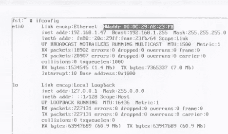

在图 4.1 中，系统中的网卡 MAC 地址为 00:0C:29:AE:23:F8。当你启动两个 IP 主机之间的通信时，发送系统必须将目标系统的 IP 地址解析为 MAC 地址。这是使用 ARP 协议完成的，当你在网络主机上安装 IP 协议时，该协议就会自动安装。

发送主机发送一个 ARP 广播，请求具有指定 IP 地址的主机的硬件地址，如图 4.2 所示。

### 图 4.2

ARP 过程。

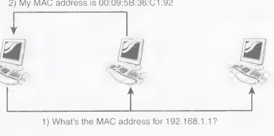

配置了请求 IP 地址的主机对 ARP 响应，所有其他主机都会忽略该请求。响应的主机向发送站回复其 MAC 地址，如图 4.2 所示。

## 第 4 章：在 SLES 9 上配置 DHCP

完成后，发送主机将 IP 地址到 MAC 的映射存储在它的 ARP 表中。你可以在 shell 提示符下通过执行 `arp -a` 命令查看主机上的 ARP 表，如图 4.3 所示：

图 4.3
ARP 表。

```
E1: $ arp -a

? (192.168.1.1) at 00:09:5B:36:C1:92 (ether) eth0

? (192.168.1.46) at 00:08:E9 (ether) eth0
```
*(注：此处根据原文逻辑调整了翻译描述)*

完成完成后，发送主机在它的 ARP 表中存储 IP 地址到 MAC 的映射。你可以在 shell 提示符下通过执行 `arp -a` 命令查看主机上的 ARP 表，如图 4.3 所示：

图 4.3
ARP 表。

```
E1: $ arp -a

? (192.168.1.1) at 00:09:5B:36:C1:92 (ether) eth0

? (192.168.1.46) at 00:08:E9 (ether) eth0
```
*(注：由于原文示例代码似乎截断，此处按原意呈现翻译)*

完成完成后，发送主机在它的 ARP 表中存储 IP 地址到 MAC 的映射。你可以在 shell 提示符下通过执行 `arp -a` 命令查看主机上的 ARP 表，如图 4.3 所示：

图 4.3
ARP 表。

```
E1: $ arp -a

? (192.168.1.1) at 00:09:5B:36:C1:92 (ether) eth0

? (192.168.1.46) at 00:08:E9 (ether) eth0
```

完成完成后，发送主机在它的 ARP 表中存储 IP 地址到 MAC 的映射。你可以在 shell 提示符下通过执行 `arp -a` 命令查看主机上的 ARP 表，如图 4.3 所示：

图 4.3
ARP 表。

```
E1: $ arp -a

? (192.168.1.1) at 00:09:5B:36:C1:92 (ether) eth0

? (192.168.1.46) at 00:08:E9 (ether) eth0
```


完成完成后，发送主机在它的 ARP 表中存储 IP 地址到 MAC 的映射。你可以在 shell 提示符下通过执行 `arp -a` 命令查看主机上的 ARP 表，如图 4.3 所示：

图 4.3
ARP 表。

```
E1: $ arp -a

? (192.168.1.1) at 00:09:5B:36:C1:92 (ether) eth0

? (192.168.1.46) at 00:08:E9 (ether) eth0
```

# 管理 DHCP 网络

注意

有时你会看到自动分配也被称为永久分配。根据我的经验，自动分配模式很少实现。

- 动态分配——在动态分配模式下，你为 DHCP 服务器配置一个 IP 地址范围，该服务器可以将这些地址分配给网络主机。当它收到来自网络主机的请求时，DHCP 服务器将从该范围内获取下一个可用地址，并将其分配给主机，持续一段固定时间，这段时间被称为租期（lease）。当租期到期或主机系统关闭时，该 IP 地址将被释放，并可以分配给另一个网络主机。

使用动态分配模式，DHCP 有助于节省 IP 地址。只有开启了电源并正在使用的系统才会消耗地址。这纠正了静态配置、RARP 和 BOOTP 相关的缺点，在这些模式中，网络上的每个主机无论是否在使用，都会被分配一个 IP 地址。

例如，我们之前我们讨论过一个公司运行两班制员工的场景。如果使用静态地址、RARP 或 BOOTP，网络中的每个系统都必须分配 IP 地址。如果公司有 500 台系统，你就需要 500 个地址。

然而，使用 DHCP，你只对已电源的系统分配地址。在这种情况下，任何给定时间仅需要 250 个左右的地址。对于使用注册 IP 地址的组织来说这是一个真正的优势。

注意

自 1998 年以来，你必须为注册到你组织的每个 IP 地址付费。

正因为有这些优势，DHCP 被广泛应用，你需要了解如何正确实现和维护 DHCP 服务器。在本章中，你将学习如何在你的 SLES 9 服务器上进行操作。

但在在此之前，理解 DHCP 在“内部”发生了什么至关重要。让我们详细查看 DHCP。

# DHCP 的工作原理

关于 DHCP，你需要理解的第一点是它是一种客户端/服务器协议。要让 DHCP 运行，你必须具备以下条件。

## 第 4 章：在 SLES 9 上配置 DHCP

- 运行在你其中一个网络服务器上的 DHCP 服务。
- 运行在网络主机上的 DHCP 客户端服务，这些主机向 DHCP 服务器请求 IP 地址。

要获取 IP 地址，DHCP 客户端和 DHCP 服务器通过图 4.5 所示的过程进行相互通信。

图 4.5
DHCP 过程。

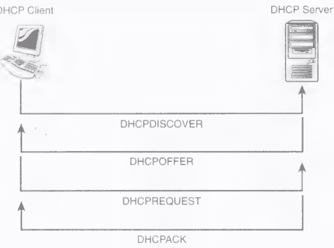

当被配置为 DHCP 客户端的网络主机启动时，它会发送一个 `DHCPDISCOVER` 广播，如图 4.5 所示。DHCP 服务器接收到广播，并从其可用地址范围内选择一个 IP 地址，分配给该 DHCP 客户端。

注意

为了让 DHCP 服务在你的服务器上运行，你必须在网卡（NIC）上启用广播。使用 `ifconfig` 验证是否如此。

服务器创建一个提案，并将 `DHCPOFFER` 消息中的信息发回给请求的主机，如图 4.5 所示。如果网段上存在多个 DHCP 服务器，DHCP 客户端将收到来自每个服务器的 `DHCPOFFER` 消息。

# 管理 DHCP 网络

DHCP 客户端将选择它想要接受的报价。如果发送了多个 `DHCPOFFER` 消息，客户端通常选择收到的第一个。

在选择了一个报价后，DHCP 客户端会发送一个 `DHCPREQUEST` 广播，如图 4.5 所示。此广播完成了两件事：

- 它通知所选的 DHCP 服务器，其已接受的地址信息已被提供。
- 它通知发送了 `DHCPOFFER` 消息的其他 DHCP 服务器，它们的报价已被拒绝，它们可以撤回自己的报价。

### 注意

记住，`DHCPREQUEST` 消息是广播。这就是为什么它可以同时与所有 DHCP 服务器进行通信。

报价被接受的 DHCP 服务器随后用 `DHCPACK` 消息响应 DHCP 客户端，如文所示。`DHCPACK` 消息包含了 IP 地址、子网掩码、网关、DNS 服务器地址以及租期。

DHCP 租期为你的网络管理提供了一个非常有用的工具。要理解 DHCP 租期，你需要了解地址返回地址池的两种方式：

- 如果主机关机。
- 如果租期到期。

RARP 和 BOOTP 协议没有使用租期概念。有了 DHCP，你可以配置主机可以使用地址的时间长度。这取决于你的网络和组织的优先级。长租期产生更少的网络流量，但地址利用率较低；相反，短租期地址利用率更高，但产生更多网络流量。

在有了 DHCP 理论之后，让我们现在来看看如何安装它。

# 第 4 章：在 SLES 9 上配置 DHCP

在 87.5% 消耗时，DHCP 客户端会尝试续约。如果由于某种原因客户端无法与服务器建立连接，它会再次发送 `DHCPREQUEST`，如图 4.6 所示。

图 4.6
DHCP 续约过程。

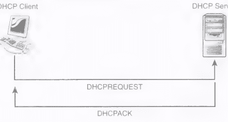

DHCP 服务器随后通过 `DHCPACK` 消息做出响应，确认租期已续约。在本章后面的部分，我们将查看如何配置租期。

# 安装 DHCP 守护

测试目标：

- 使用 DHCP 管理网络

与 DNS 类似，在 SLES 9 上有许多不同的 DHCP 软件包。对于认证，你需要了解如何安装和配置由互联网系统协会（ISC）提供的 DHCP 服务。这是我们在上一章中使用的 BIND 包的同一组织。

要在你的 SLES 9 服务器上安装 DHCP 服务，请完成以下操作：

1. 从 SLES 9 桌面选择 YaST。
2. 在提示时，提供 root 密码。
3. 在左侧框架中，选择“软件”（Software）。
4. 在右侧框架中，选择“安装和删除软件”（Install and Remove Software）。如图 4.7 所示：

图 4.7
YaST 软件界面。

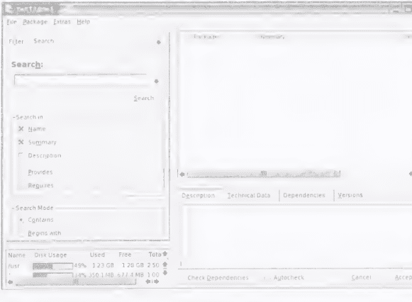

5. 在搜索字段中输入 `dhcp`，然后选择搜索。
6. 勾选 `dhcp`、`dhcp-server`、`dhcp-tools` 和 `yast2-dhcp-server` 模块，如图 4.8 所示：

图 4.8
安装 DHCP 软件包。

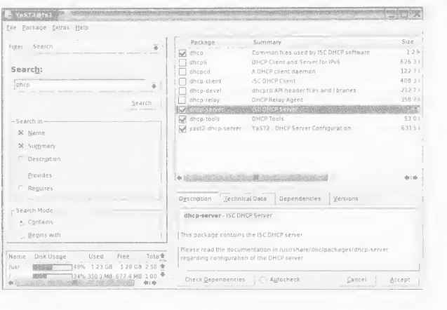

7. 选择“接受”（Accept）。
8. 在提示时，插入相应的 CD。
9. 等待软件包安装且 SuSEconfig 运行。
10. 选择“关闭”（Close）关闭 YaST。

提示

你也可以通过访问 YaST 中的“网络服务”，“DHCP 服务器”来安装 DHCP 软件包。如果该包未安装，DHCP 服务器模块将自动为你安装。

如果你遵循了第 2 章“SUSE LINUX Enterprise Server 9 简介”中实验练习的步骤，你的 SLES 9 系统应该已经安装了 DHCP 服务器软件包。

要验证其是否存在，请打开 YaST 并选择“软件”，>安装和移除软件”。在搜索字段中输入 `dhcp`，然后选择“搜索”。你应该能看到 `dhcp`、`dhcp-server`、`dhcp-tools` 和 `yast2-dhcp-server` 包被标记了蓝色勾选，如图 4.9 所示：

图 4.9
DHCP 服务器已安装。

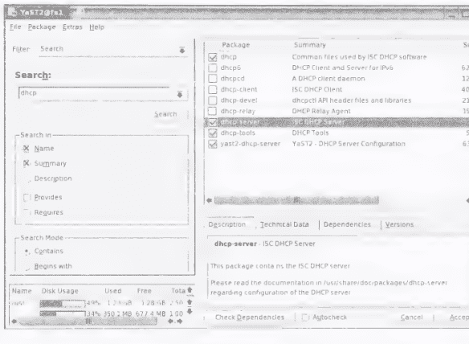

如果由于某种原因，你的 SLES 9 系统没有安装 DHCP 软件包，请按照之前介绍的步骤进行安装。

软件包安装后，使用 `/etc/init.d` 中的 `dhcpd` 初始化脚本来启动和停止服务，如图 4.10 所示：

图 4.10
DHCP 服务器启动脚本。

```
/etc/init.d dhcp # is in db-=

/etc/init.d dhcp #
```

## 第 4 章：在 SLES 9 上配置 DHCP

提供此服务的实际二进制文件是位于 `/usr/sbin` 的 `dhcpd` 可执行文件，如图 4.11 所示。

图 4.11
DHCP 二进制文件。


与其他守护进程一样，你使用 `/etc/init.d/dhcpd` 脚本在你的服务器上启动、停止和重启 DHCP 服务。这是通过调用脚本并提供适当参数来实现的。你可以使用的命令示例包括：

- `/etc/init.d/dhcpd start`——启动 `dhcpd` 守护进程。
- `/etc/init.d/dhcpd stop`——停止 `dhcpd` 守护进程。
- `/etc/init.d/dhcpd restart`——启动 DHCP 守护进程。

如果你不想使用完整路径，可以在 shell 提示符中输入 `rcdhcpd` 并配合 `start`、`stop` 或 `restart` 参数来管理 DHCP 守护进程。与我们在上一章中讨论的命名脚本一样，你可以输入 `rcdhcpd` 来查看可用选项列表。

在系统上安装 DHCP 服务后，你就可以准备好在服务器上配置并启动该服务了。然而，在这样做之前，你需要对 DHCP 守护进程的配置文件有深入的理解。让我们接下来这些。

# 配置 DHCP 守护进程

涵盖目标：

- 使用 DHCP 管理网络。

我可能听起来像在复读，但再次强调，我们本章的重点将放在用于配置 `dhcpd` 的文本文件上。只有完全熟悉它们之后，我们才会查看如何使用 YaST 来加速配置过程。

让我们开始吧；先看一下 `dhcpd` 配置。我们需要查看的第一个是 `/etc/dhcpd.conf`。

# 配置 /etc/dhcpd.conf 文件

`/etc/dhcpd.conf` 文件是服务器上 `dhcpd` 守护进程的主要配置文件。示例的 `dhcpd.conf` 文件如图 4.12 所示：

图 4.12
/etc/dhcpd.conf 文件。

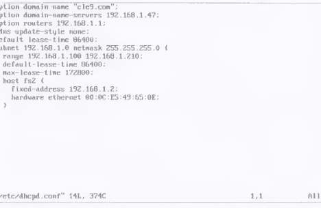

该文件中的关键元素是子网声明（subnet declaration）。它用于定义 `dhcpd` 守护进程可以分配的 IP 地址，这可能是你配置 DHCP 服务时最关心的问题。

## 配置子网

子网声明的语法如下：

```
subnet network_address netmask subnet_mask {

    range start_address end_address;

    default-lease-time lease_duration;

    max-lease-time maximum_lease_duration;

}
```

`network_address` 和 `subnet_mask` 参数用于指定 `dhcpd` 分配地址的网段的网络地址和子网掩码。在图 4.12 中，`dhcpd` 守护进程被配置在地址为 `192.168.1.0` 子网掩码为 `255.255.255.0` 的网段上运行。

`range` 参数标识哪些 IP 地址被分配给网络主机。`start_address` 参数识别该范围内可以分配的首个地址。`end_address` 参数识别该范围内可以分配的最后一个地址。在图 4.12 中，`dhcpd` 守护进程已配置为分配 `192.168.1.100` 到 `192.168.1.210` 范围内的地址。

最后几个参数配置分配的 IP 地址的租约时间。子网块内的 `default-lease-time` 参数设置此地址范围的默认租约时间（以秒）。DHCP 客户端系统必须在此时间范围内续租租约。在图 4.12 中，默认租约时间已设置为 24 小时（86400 秒）。

你可能注意到图 4.12 中有两个 `default-lease-time` 参数。一个位于子网声明内部，另一个位于文件较靠位置。子网声明内的针对特定的地址范围。它会覆盖文件中较靠位置列出的 `default-lease-time` 参数，仅当子网内未指定 `default-lease-time` 时生效。

你需要意识到三个关键参数。首先是 `DHCPD_INTERFACE` 参数。如果你的服务器有多个接口，这个参数非常有用。默认情况下，dhcp 守护进程将绑定到服务器上的所有接口。这可能是你想要的行为，也可能不是。

例如，假设你已经将 Linux 服务器配置为 NAT 路由器，将私有网络连接到公网，这是一种非常常见的实现方式。此外，你希望你的 Linux 服务器提供 DHCP 服务。

在这种情况下，你需要确保 dhcp 守护进程不会响应来自公网接口的 DHCP 请求。否则，它将在公网接口上分发私有网络的 IP 地址。这可不是一件好事。你的帮助台会被来自沮沮用户的用户的电话所淹没，他们正试图弄清楚为什么他们无法访问自己的服务器。

### 注意

我见过非常这种情况。几年前，一位同事为他的私有实验室网络设置了一台运行 DHCP 的服务器。

这台服务器同时也运行着连接到常规公司网络的 NAT 路由器。很快，我们就遭遇了全范围的网络断故障，因为他的 Linux 系统响应 `DHCPDISCOVER` 消息的速度比公司的 DHCP 服务器快。结果是，每个工作站都获取了他分配的 10.0.0.x IP 地址，导致没有人可以收邮件、浏览网页等等。

在这种情况下，你可以使用 `DHCPD_INTERFACE` 参数来配置服务器上的哪个网络接口供 dhcp 守护进程监听 `DHCPDISCOVER` 消息。

在 `/etc/sysconfig/dhcp` 文件中，你也可以配置 dhcp 运行在 chroot 监狱（jail）中，就像我们在上一章中看到的 `named` 守护进程一样。这是通过 `DHCPD_RUN_CHROOTED` 参数实现的，如图 4.14 所示。

运行 chroot 版本的 dhcp 是一项非常建议的做法。如果 dhcp 守护进程被黑客攻破，其或对文件系统的访问将限制在 chroot 监狱的文件结构中。默认情况下，这是 `/var/lib/dhcp`。

正如名称所示，dhcp 守护进程在运行 chroot 监狱时，会在启动时将所有需要的文件复制到 `/var/lib/dhcp`。这些文件包括：

- `/etc/dhcpd.conf`
- `/etc/host.conf`
- `/etc/hosts`
- `/etc/resolv.conf`
- `/etc/localtime`

## 第 4 章：在 SLES 9 上配置 DHCP

图 4.14

启动的 dhcpd。

```
## 某些行对于主机到 IP 地址的解析很重要

# /etc/hosts,host.conf,resolv.conf,(localdomain),/libnss.so.2

# /libnss.so.2 也会在 init 启动时复制到 chroot 监狱中

#（总共约 100kb）

# pid 文件将被复制到 /var/lib/dhcpd/var-dhcpd.pid。

## DHCP_CHROOTED="yes"

# 类型: string

# 默认:

# 服务重启: dhcpd

# 从版本 3 开始，dhcpd.conf 可以包含 include 语句

# 如果你在这里输入文件名，_all.conf

# 文件将被复制到 chroot，其中 dhcpd 将在 chroot

# 监狱监狱中启动（/etc/dhcpd.conf 总是会被复制）

# 为了方便起见，你也可以指定整个目录，例如

# "/etc/dhcpd.conf"。
```


当你在 SLES 9 上安装 dhcpd 时，它默认安装在 chroot 监狱中。相应地，dhcpd 守护进程以 `dhcpd` 用户而不是 `root` 用户运行。这是使用 `/etc/sysconfig/dhcp` 文件中的最后一个关键参数配置的：`DHCP_RUN_AS`，如图 4.15 所示：

图 4.15

以非 root 用户运行 dhcpd。

```
"/etc/dhcpd.conf"

# 示例: /etc/dhcpd.conf.shared /etc/dhcpd.conf.bootp-clients

## DHCP_CONF_FILES=""

# 类型: string

# 默认:

# 服务重启: dhcpd

# 留空或输入 "root" 让 dhcpd 以 root 运行

# 输入 "user" 以用户 "dhcpd" 运行 dhcpd

## DHCP_RUN_AS="dhcpd"

# 类型: string

# 默认:

# 服务重启: dhcpd

# 你希望启动 dhcpd 时的其他参数

#（例如 "-p 1234" 用于监听非标准端口）

## DHCP_OTHER_ARGS="",
```


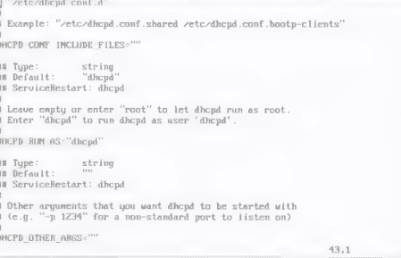

所以不要让此参数为空。如果留空，默认行为是以 root 运行守护进程；这可能不是你想要的。现在你已经了解用于配置服务器上 dhcpd 的文件，可以学习如何使用 YaST 来加速这一过程。

# 使用 YaST 配置 dhcpd

与其他网络服务一样，使用 YaST 在你的服务器上配置 dhcpd 守护进程变得快速简单。

### 注意

第一次在 YaST 中启动 dhcpd 配置模块时，它以向导模式运行。随后它以高级模式启动，我们将讨论。

使用 YaST 配置 dhcpd，请执行以下操作：

1. 启动 YaST。
2. 提示时，提供你的 root 用户密码。
3. 选择 Network Services, DHCP Server。显示图 4.16。

图 4.16
配置服务器设置。

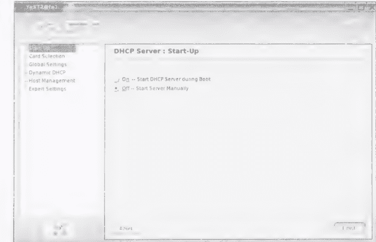

4. 配置 DHCP 服务自动启动，标记为 On；否则标记为 Off。
5. 配置 dhcpd 守护进程应该监听的接口，执行以下操作：
   a. 在左侧面板中，选择 Card Selection。显示图 4.17。

图 4.17
配置 dhcpd 使用的接口。

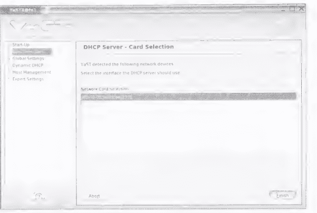

   b. 在 Network Selection 字段中，选择你让 dhcpd 监听 DHCPDISCOVER 消息的网络。
6. 配置适用于所有 DHCP 租约全局选项（除非被子网特定选项覆盖），执行以下操作：
   a. 在左侧面板中，选择 Global Settings。显示图 4.18。
   b. 如果你想将 DHCP 配置存储在 LDAP 目录中，标记 LDAP support。

### 注意

将 DHCP 配置存储在 LDAP 目录中可以提供程度的容错能力。如果运行 dhcpd 的服务器宕机，你可以轻松地在复制了多个服务器上启动守护进程。

   c. 在提供的各个字段中，配置你想分配给客户端的 DHCP 选项。

图 4.18
配置全局选项。

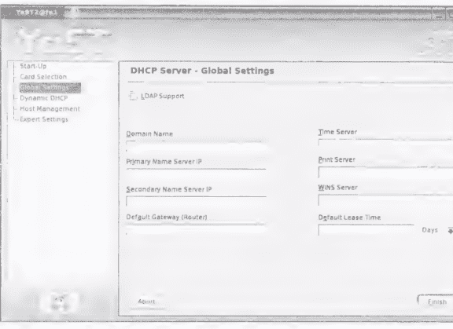

### 提示

这些 DHCP 选项是可选的。你可以配置全部、部分或不。

7. 配置 DHCP 子网，执行以下操作：
   a. 在左侧屏幕，选择 Dynamic DHCP。显示图 4.19。
   b. 在 First IP Address 字段中，输入你想动态分配给 DHCP 客户端的范围内的第一个 IP 地址。
   c. 在 Last IP Address 字段中，输入你想动态分配给 DHCP 客户端的范围内的最后一个 IP 地址。
   d. 在 Lease Time 字段中，输入默认租约时间和最大租约时间。
8. （可选）如果你想为特定 IP 地址到特定计算机系统创建一对一映射，执行以下操作：
   a. 在左侧面板中，选择 Host Management。显示图 4.20。

图 4.19
配置 DHCP 子网。

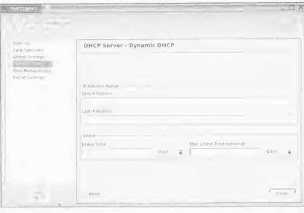

图 4.20
配置一对一映射。

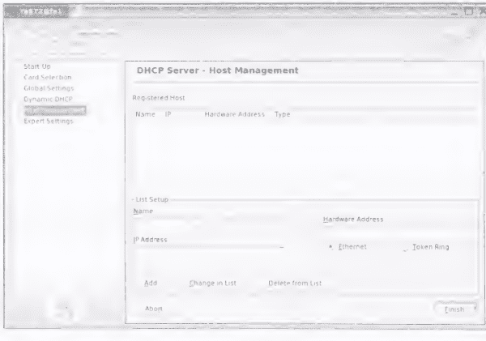

   b. 在 Name 字段中，输入你为创建映射的系统输入的 *hostname*。
   c. 在 IP Address 字段中，输入你想分配给特定主机的 *IP address*。
   d. 在 Hardware Address 下，标记 *Ethernet* 或 *Token Ring*。
   e. 在 Hardware Address 字段中，输入你为创建映射的系统输入的 MAC 地址。确保输入正确的 MAC 地址。
9. 选择 *Finish* 应用你的更改。

够话了！让我们在你的 SLES 9 服务器上运行 DHCP。请参考实验 4.1。

# 实验 4.1：在 SLES 9 上配置 DHCP

在这个实验中，你将在你在第 2 章安装的 SLES 9 服务器上配置 DHCP 守护进程。

### 注意

你真的应该在隔离的实验网段中完成此实验。如果你在生产网段上设置 DHCP 服务器，可能会让很多人对你不满。

完成此实验，你需要以下系统：

1. 运行 named 的 SLES 9 服务器。
2. 一台已安装操作系统的第二个工作站作为 DHCP 客户端。作为选项，你可以从 http://www.novell.com 下载 Novell Linux Desktop 副本并作为 DHCP 客户端。

- e. 在 Default Lease Time（默认租用时间）字段中，指定 1 day
- f. 选择 Next（下一步）。
- 8. 完成以下步骤配置您的 DHCP 子网：
    - a. 在 First IP Address（第一个 IP 地址）字段中，输入您想要分配给 DHCP 客户端的范围内的第一个 IP 地址。
    - b. 在 Last IP Address（最后一个 IP 地址）字段中，输入您想要分配给 DHCP 客户端的范围内的最后一个 IP 地址。

注意
再次，确保使用这些 IP 地址对您来说没有问题。最好在一个隔离的实验室网段上设置此系统，这样您就不会干扰到任何其他系统！

- c. 在 Lease Time（租用时间）字段中，指定 1 day。
- d. 在 Max Lease Time（最大租用时间）字段中，指定 2 days。
- e. 选择 Next（下一步）。
- 9. 选择 Finish（完成）。

提示
在本次练习中，我们不会配置 DHCP 守护自动启动。

- 10. 当提示输入 LDAP 服务器密码时，输入 tuX123。
- 11. 打开终端会话。
- 12. 在 shell 提示符下，输入 `su -`。
-- 13. 在提示时，输入密码 tuX123
- 14. 在 shell 提示符下，输入 `bcdpd start`。
- 15. 完成以下步骤测试您的配置：
    - a. 确保您的工作站系统与 SLES 9 服务器位于同一网络网段。
    - b. 配置您的工作站操作系统使用 DHCP 获取 IP 地址。
    - c. 在您的工作站上打开终端会话。

## 第 4 章：在 SLES 9 上配置 DHCP

提示
我假设您在这一步中使用 Linux 系统作为工作站。如果您使用的是 Windows，请使用 `IPCONFIG /ALL` 命令检查 IP 参数。

- d. 在 shell 提示符下，通过输入 `su –` 并提供密码 tuX123 切换到 root 用户。
- e. 在 shell 提示符下，输入 `ifconfig`。
- f. 验证系统是否能够从您的 DHCP 服务器获取 IP 地址。
- g. 在 shell 提示符下，输入 `route`。
- h. 验证路由列表中是否出现了默认路由项。示例如图 4.21 所示：

图 4.21
通过 DHCP 交付的默认路由。

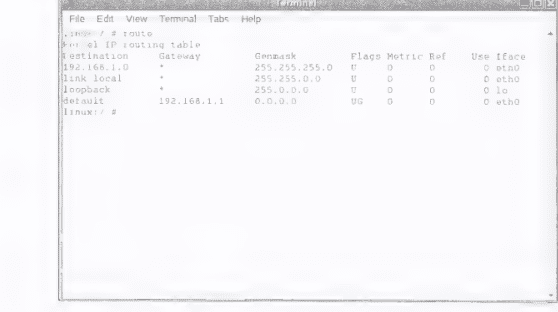

- i. 在 shell 提示符下，输入 `cat /etc/resolv.conf`。
- j. 验证该文件是由 dhcpd 创建的，如图 4.22 所示：

### 图 4.22
通过 DHCP 交付的解析参数。

```
File Edit View Terminal Tabs Help

# terminal

# Bavato ~  这是一个由 service dhcpcd 创建的临时 resolv.conf。

之前的文件已保存，并将稍后恢复。

如果您不想让 resolv.conf 被修改，您

可以使用 MODIFY_RESOLV_CONF DYNAMICALLY。该变量

被放置在 /etc/sysconfig/network/config 中。

您也可以配置 service dhcpcd 不修改它。

如果您不喜欢 dhcpcd 更改您的名称服务器，

要么在 /etc/sysconfig/network/config 中设置

MODIFY_RESOLV_CONF DYNAMICALLY=yes，或者

设置 request domain-name 并手动使用 -s 

运行 dhcpcd。如果您只想保留搜索列表，请

在 /etc/sysconfig/network/dhcp 中设置

KEEPSEARCHLIST=yes，或

手动使用 -x 选项。

# 文件末尾

search dhcp.com

nameserver 192.168.1.147

```

恭喜！您现在有了一个可以工作的 DHCP 服务器。现在，您需要学习如何使用 DHCP 中继代理（DHCP relay agents）。

# 配置 DHCP 中继代理

涵盖的测试目标：
- 使用 DHCP 管理网络。

我们在本章中目前为止配置的 DHCP 服务器在单网段网络上运行良好良好。如果此服务器打算部署在小型组织中，那么我们就绰绰有余了。

然而，正如您可能知道的，中大型组织的网络很可能由许多通过路由器连接的多个网段组成。如果在此类环境中实现此服务器，我们将面临问题。让我们来看看问题所在。

# 路由网络中的 DHCP 问题

您还记得 DHCP 客户端用于发现 DHCP 服务器时使用什么种通信类型吗？是的，它使用广播。这对我们来说意味着一个问题。因为大多数路由器默认情况下不会在网络网段之间转发广播消息。

注意
偶尔，您可能会遇到路由器已配置为转发广播的系统。这不仅会产生大量不必要的网络流量，还会让您的网络面临拒绝服务（DoS）攻击的风险。

某些 DoS 攻击（例如呆鱼攻击/Smurf attack）会创建一个无意的中间网络（替罪羊），该网络被配置为转发广播以替其执行脏工作。

考虑图 4.23 所示的网络：

图 4.23
具有多个网段的网络中的 DHCP。


# 配置 DHCP 中继代理

在此配置中，网段 A 上的 DHCP 客户端能够联系 DHCP 服务器，因为它们位于同一网段。然而，由于广播无法跨越，网段 B 上的 DHCP 客户端将无法访问服务器。您如何让 DHCP 在该网络中工作？

要让 DHCP 在由许多网段组成的网络中工作，有三种方案。第一种方案是配置路由器转发广播。正如我们讨论过的，这不是好主意。第二种方案是在每个网络上实现一个 DHCP 服务器。这样做的问题在于它会增加管理开销。您需要管理多个服务器而不是一个。

另一种方案是实现中继代理。这是一种巧妙的方法。您不需要在每个网段设置 DHCP 服务器，只需配置一个中继代理。中继代理在本地网段上监听来自客户端的 DHCPCOVER 广播。当它收到时，通过可以路由的单播传输将 DHCPCOVER 消息发送到另一网段的 DHCP 服务器。DHCP 服务器发送 OFFER 不是给客户端，而是发送回运行中继代理的系统。中继代理随后将消息发送给 DHCP 客户端。其余 DHCP 协商继续相同的过程。本质上，中继代理充当了 DHCP 服务器和 DHCP 客户端之间的中间人。

提示
不要在同一网段上运行 DHCP 中继代理和 DHCP 服务器。每个网段只需要一个响应 DHCP 广播的服务。

## 第 4 章：在 SLES 9 上配置 DHCP

图 4.24
配置 DHCP 中继代理。

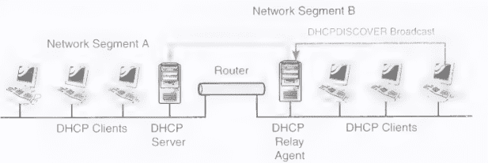

# 配置 dhcrelay 守护进程

`dhcrelay` 守护进程非常容易配置。您首先需要按照以下步骤验证系统中安装了该包：

1. 运行 YaST 并选择 Software, Install and Remove Software。
2. 在 Search字段字段中 dhcp；然后选择 Search。
3. 验证 `dhcp-relay` 包已安装，如图 4.25 所示。
4. 如果包未安装，标记 `dhcp-relay` 包，然后选择 Accept。
5. 按照提示完成安装。

安装包后，您就可以配置该服务了。与您熟悉的其他服务不同，`dhcrelay` 在 `/etc` 中没有 .conf 文件。相反，所有的配置都是通过 `/etc/sysconfig` 中的 `dhcrelay` 文件完成的。该文件如图 4.26 所示。

### 图 4.25

安装 DHCP 中继代理包。

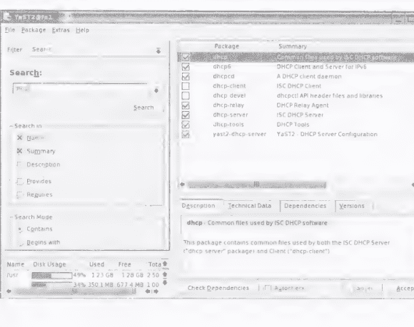

### 图 4.26

`/etc/sysconfig/dhcrelay` 文件。

```
# (interfaces) DHCP 继继代理监听的接口：

# (用空格分隔，例如 "eth0")

# DHCPRELAY_INTERFACES=""

# 类型:      string

# 默认:

# 服务重启: dhcrelay

# DHCP 继继代理使用的 DHCP 服务器

# (用空格分隔，例如 "192.168.0.11 191.168.0.12")

# DHCPRELAY_SERVERS=""

# 类型:      string

# 默认:

# 服务重启: dhcrelay

# 额外选项

# 示例: "-c 8"

# DHCPRELAY_OPTIONS=""
```


你只需要关注三个选项。第一个是 `DHCPRELAY_INTERFACES` 参数。使用此参数指定守护进程应该监听的网络接口。如果你留空该参数，它将监听所有已配置的接口。

## 第 4 章：在 SLES 9 上配置 DHCP

提示

中继代理将同时响应 DHCP 和 BOOTP 客户端消息。

下一个参数是 `DHCPRELAY_SERVERS` 参数。在此参数中，你指定 DHCP 客户端消息的 DHCP 服务器 IP 地址。

最后一个参数是 `DHCPRELAY_OPTIONS` 参数。你可以为 `dhcrelay` 服务插入以下任何一个（或不插入任何）选项：

- `-p alternate_port_number`——默认情况下，中继代理在 IP 端口 67 上运行。你可以使用此选项指定不同的端口号。
- `-d`——配置 `dhcrelay` 在前台运行而不是作为后台服务。
- `-a`——配置 `dhcrelay` 在其转发到 DHCP 服务器的消息中添加 DHCP 选项字段。该字段包含此类信息，例如中继代理发送请求的接口名称以及中继代理的 IP 地址。

在这些选项中，`-a` 选项无疑是最有用的。通过使用此选项，DHCP 服务器可以确定转发的 DHCP 请求来自哪个网段。如果你在 `/etc/dhcpd.conf` 文件中配置了多个子网声明，你应该始终使用 `-a` 选项配置中继代理。这将允许 DHCP 服务器确定使用哪个子网来分配 IP 地址。

编辑 `/etc/config/dhcrelay` 文件后，你可以启动 `dhcrelay` 服务。这通过打开终端会话、切换到 root，然后在 shell 提示符处输入 `dhcrelay start` 来。

由于此服务对你网络的正常运行至关重要，你应该配置 `dhcrelay` 在级别 3 和 5 自动启动。这可以使用 `chkconfig` 命令或通过在 YaST 中选择“系统，运行级别编辑器”（System, Runlevel Editor）来实现，如图 4.27 所示。

## 实现动态 DNS

图 4.27
配置 dhcrelay 自动启动。

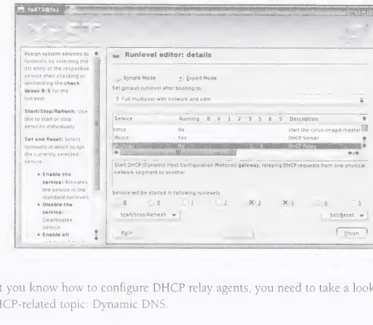

现在你已经知道了如何配置 DHCP 中继代理，你需要查看另一个与 DHCP 相关的主题：动态 DNS（DDNS）。

## 实现动态 DNS

涵盖测试目标：

- 1. 使用 DHCP 管理网络。

如果你不熟悉动态 DNS，可能在想为什么我们在这个 DHCP 章节中要介绍 DNS 主题。动态 DNS 是为了让我们将 DHCP 服务器连接到 DNS 区域。在下一节中，你将学习它是如何工作的。

## DDNS 的工作原理

DNS 的问题之一是区域在本质上是静态的。DNS 服务器仅知道它所服务的区域中有一组记录将主机名映射到 IP 地址，反之亦然。DNS 服务器不知道区域中主机名所代表的特定主机是上线还是离线状态。它不知道该主机是否仍然存在。

## 第 4 章：在 SLES 9 上配置 DHCP

此外，如果你向网络添加主机或更改分配给现有主机的 IP 地址，DNS 服务器并不知道你做了什么。它假设其区域中当前拥有的任何数据都是正确且最新的。

当 DHCP 介入时，这种情况会变得更加恶化。网络主机每天都会分配和重新分配 IP 地址。特定的网络主机在一周内很有可能有多个不同的 IP 地址。

作为负责组织 DNS 服务器的网络管理员，你不可能手动让你的 DNS 区域与 DNS 服务器最新的 IP 分配保持同步。

诚然，对于某些网络来说，这并不是问题。许多 DNS 管理员只关心保持“重要”DNS 记录的更新。这些包括服务器、路由器和打印机等设备。他们不担心在 DNS 区域中放置工作站的 DNS 记录。

然而，请注意，许多网络服务（包括某些网站）配置为对访问它们的主机执行反向查找。基本上，它查看主机声称自己，如果主机名和 IP 地址匹配，则对主机声称所属的 DNS 区域运行 DNS 查询。

## 第 4 章：在 SLES 上配置 DHCP

提示
在配置 DDNS 后，DHCP 服务器 YaST 模块将仅显示专家设置界面。

- d. 如果尚未执行，勾选启动 DHCP 服务器（Start DHCP Server）。
- e. 在“全局选项”（Global Options）下，选择你想要启用 DDNS 的子网。
- f. 选择“编辑”（Edit）。
- g. 选择“动态 DNS”（Dynamic DNS）。显示图 4.32。

图 4.32
在 DHCP 服务器上配置 TSIG 密钥。

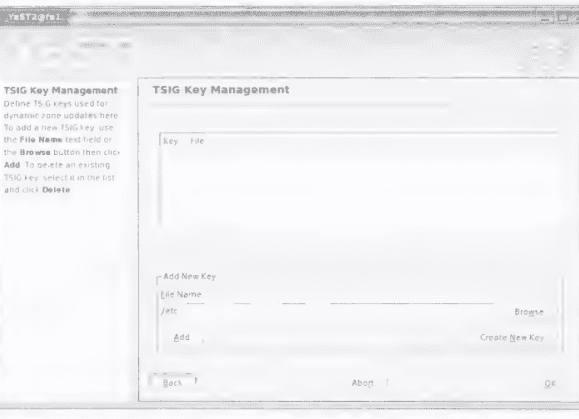

- h. 在“添加新密钥”（Add New Key）字段中，浏览并选择从你的 DNS 服务器复制的 TSIG 密钥。
- i. 选择“添加”（Add）、“确定”（OK）。显示图 4-33。
- j. 勾选为此子网启用动态 DNS（Enable Dynamic DNS for This Subnet）。
- k. 在“正向区域 TSIG 密钥”（Forward Zone TSIG Key）下拉列表中，选择从你的 DNS 服务器复制的 TSIG 密钥。
- l. 在“反向区域 TSIG 密钥”（Reverse Zone TSIG Key）下拉列表中，选择从你的 DNS 服务器复制的 TSIG 密钥。

## 图 4.33

在 DHCP 服务器上启用 DDNS。


- m. 勾选“更新全局动态 DNS 设置”（Update Global Dynamic DNS Settings）。
- n. 在“区域”（Zone）字段中，输入你的正向区域名称。
- o. 在“主 DNS 服务器”（Primary DNS Server）字段中，输入你的 DNS 服务器的 IP 地址。
- p. 在“反向区域”（Reverse Zone）字段中，输入你的反向区域名称。
- q. 在“主 DNS 服务器”（Primary DNS Server）字段中，再次输入你的 DNS 服务器的 IP 地址。
- r. 选择“确定”（OK）。
- s. 选择“确定”（OK）、“完成”（Finish）。

你的 DNS 和 DHCP 服务器现在已连接在一起。当 DHCP 客户端从 DHCP 服务器获取地址时，它们的主机名和 IP 地址将作为 A 记录添加到你的 DNS 区域中，并作为 PTR 记录添加到你的反向 DNS 区域中。

让我们在练习 4.2 的 SLES 9 服务器上尝试一下。

## 实验练习 4.2：在 SLES 9 上配置 DDNS

在本次实验练习中，你将配置 SLES 服务器上的 DHCP 守护进程，以向向你在第 3 章中配置的 DNS 服务器发送动态更新。

> 注意
与练习 4.1 一样，你应该在隔离的网段上完成此练习。

要完成此项练习，你需要以下系统：

- 一台运行着 `named` 和 `dhcpd` 的 SLES 9 服务器。
- 一台已安装操作系统的第二个工作站，用作 DHCP 客户端。作为选项，你可以从 http://www.novell.com 下载 Novell Linux Desktop 副本并将其作为 DHCP 客户端使用。

要在你的系统上配置 DDNS，请完成以下操作：

- 启动你的 SLES 9 服务器并使用用户 `tux` 和密码 `SuSEF789` 进行身份验证。
- 启动 YaST。
- 当提示根密码时，输入 `tux123`。
- 选择“网络服务”（Network Services）、“DNS 服务器”（DNS Server）。
- 取消勾选“活动 LDAP 支持”（LDAP Support Active）。

> 注意
由于 named 在更改区域时必须向 LDAP 目录进行身份验证，否则在此配置下动态更新无法工作。为了简单起见，我们将禁用 DNS 和 DHCP 服务器的 LDAP 支持。

- 选择“完成”（Finish）。
- 选择“DHCP 服务器”（DHCP Server）。
- 在左侧框架中，选择“全局设置”（Global Settings）。

## 实验练习 4.2：在 SLES 9 上配置 DDNS

- 9. 取消选择 LDAP 支持。
- 10. 选择“完成”（Finish）。
- 11. 选择“DNS 服务器”（DNS Server）。
- 12. 通过完成以下步骤配置 TSIG 密钥：
   a. 在左侧框架中，选择“TSIG 密钥”（TSIG Keys）。
   b. 在“密钥 ID”（Key ID）字段中，输入 `fs1key`。
   c. 在“文件名”（File Name）字段中，输入 `/etc/mykey`。
   d. 选择“生成”（Generate）。
   e. 当提示生成密钥时，选择“是”（Yes）。
- 13. 通过以下步骤配置 `cle9.com` 区域以支持更新：
   a. 在左侧框架中，选择“DNS 区域”（DNS Zones）。
   b. 在“已配置区域”（Configured Zones）下，选择 `cle9.com`。
   c. 选择“编辑区域”（Edit Zone）。
   d. 勾选“允许更新”（Allow Updates）。
   e. 在 TSIG 密钥下拉列表中，选择 `fs1key`。
   f. 选择“确定”（OK）。
   g. 选择你的反向区域。
   h. 选择“编辑区域”（Edit Zone）。
   i. 勾选“允许更新”（Allow Updates）。
   j. 在 TSIG 密钥下拉列表中，选择 `fs1key`。
   k. 选择“确定”（OK）。
   l. 选择“完成”（Finish）。

提示
由于你的 DNS 和 DHCP 服务运行在同一台服务器上，因此不需要复制密钥。

- 14. 通过以下步骤配置你的 DHCP 服务器以向你的 DNS 服务器发送更新：
   a. 在 YaST 中，选择“网络服务”（Network Services）、“DHCP 服务器”（DHCP Server）。
   b. 在左侧框架中，选择“专家设置”（Expert Settings）。
   c. 当提示继续时，选择“是”（Yes）。
   d. 如果尚未执行，勾选“启动 DHCP 服务器”（Start DHCP Server）。
   e. 在“全局选项”（Global Options）下，选择你在练习 4.1 中创建的子网。
   f. 选择“编辑”（Edit）。
   g. 选择“动态 DNS”（Dynamic DNS）。
   h. 在“添加新密钥”（Add New Key）字段中，浏览并选择 `/etc/mykey`。
   i. 选择“添加”（Add）、“确定”（OK）。
   j. 勾选“子网动态 DNS”（Dynamic DNS for Subnet）。
   k. 在“正向区域 TSIG 密钥”下拉列表中，选择 `fs1key`。
   l. 在“反向区域 TSIG 密钥”下拉列表中，选择 `fs1key`。
   m. 勾选“更新全局动态 DNS 设置”（Update Global Dynamic DNS Settings）。
   n. 在“区域”（Zone）字段中，输入你的正向区域名称。
   o. 在“主 DNS 服务器”（Primary DNS Server）字段中，输入你的 DNS 服务器的 IP 地址。
   p. 在“反向区域”（Reverse Zone）字段中，输入你的反向区域名称。
   q. 在“主 DNS 服务器”（Primary DNS Server）字段中，再次输入你的 DNS 服务器的 IP 地址。
   r. 选择“确定”（OK）。
   s. 选择“确定”（OK）、“完成”（Finish）。

你的 DNS 和 DHCP 服务器现在已连接在一起。当 DHCP 客户端从 DHCP 服务器获取地址时，它们的主机名和 IP 地址将作为 A 记录添加到你的 DNS 区域中，并作为 PTR 记录添加到你的反向 DNS 区域中。

让我们在练习 4.2 的 SLES 9 服务器上尝试一下。

- 17. 使用 YaST 检查你的区域中的新记录。
   记录更新可能需要 5 分钟才能完成。
   a. 选择“DNS 服务器”。
   b. 选择“DNS 区域”。
   c. 选择 `cle9.com` 区域；然后选择“编辑区域”。
   d. 选择“记录”。
   e. 验证你的工作站的记录已添加，如图 4.35 所示。

## 第 4 章：在 SLES 9 上配置 DHCP

图 4.35
DNS 区域中的 DDNS 记录。

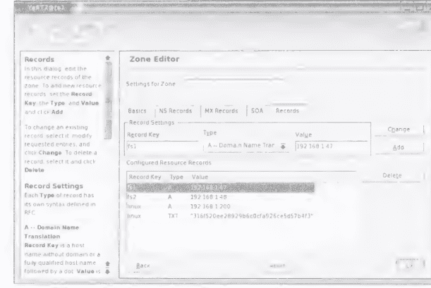

恭喜！你的 DHCP 服务器现在已与 DNS 服务器集成，当它执行 IP 地址时提供即时更新。

这就是本章的内容。在进入第 5 章“在 SLES 上配置 CUPS”之前，让我们回顾一下你学到的。

## 总结

在本章中，你学习了如何在 SLES 9 服务器上实现 DHCP。我们首先回顾了在网络中手动管理 IP 地址分配的困难。我们还回顾了动态分配 IP 地址的三种方法：RARP、BOOT 和 DHCP。

然后，我们深入研究了 DHCP。我们首先回顾了 DHCP 事务过程：DHCPDISCOVER、DHCPPOFFER、DHCPREQUEST 和 DHCPACK。然后我们讨论了 DHCP 中如何实现租约以管理 IP 地址 分配的时间。

## 在 SLES 9 上配置 CUPS

本章涵盖了 Novell 认证 Linux 工程师 (CLE) 9 认证的以下要求：

- 1. 使用 CUPS 配置网络打印服务器。

在第 3 章和第 4 章中，你学习了如何在你的 SLES 9 服务器上设置核心网络基础设施服务（DNS 和 DHCP）。随着这些服务的运行，你的用户就可以来上班、开启系统，并让一切都“正常工作”。

在一切都运行正常后，你的用户现在需要通过网络来提高他们的工作效率。毕竟，组织实施网络并不是为了好玩。网络的安装成本昂贵，维护成本甚至更高。既然这么昂贵，他们为什么要这样做呢？因为它们提高了生产力，从而节省的资金超过了其成本。

网络提供的提高用户效率的最基本的服务之一就是打印。今天，用户认为他们当然可以从工作站将打印作业发送到复印室的打印机。正如前面的章节中讨论的服务一样，用户期望这个过程能够“正常工作”。

在本章中，我们将介绍通过在你的 SLES 9 服务器上实现 `cupsd` 守护进程来实现这一目标。让我们先谈谈 CUPS 打印是如何工作的。

## CUPS 如何工作

涵盖的测试目标：

- 1. 使用 CUPS 配置网络打印服务器。

毫无疑问，Linux 是一个高性能的服务器操作系统。回顾各种互联网网站上提供的任何目标测试，你都会发现，在同类硬件上，Linux 的运行性能远超其他网络操作系统。基本上，Linux 更快、更廉价、更可靠。

遗憾的是，从历史角度来看，有一种网络服务是 Linux 表现并不好的。在过去，Linux 下的网络打印是使用行打印机守护进程 (`lpd`) 完成的。打印作业通过命令行提交到网络打印服务器。对我来说，这并不是什么问题。我们习惯于 Linux Shell，使用 `lp` 或 `lpr` 组合打印作业对我们来说并无困扰。

然而，对于当今任何组织中的普通用户来说，这构成了一个巨大的障碍。大多数用户都是随着 PC 上的图形界面长大的。他们期望在任何生产力应用程序（如电子表格或文字处理器）中点击“文件”->“打印”，并让操作系统神奇地将打印作业发送到网络打印机。使用 `lp` 和 `lpr`，这是不可能的。

为了在职场中可行，Linux 必须提供网络打印服务。我们如何做到这一点？CUPS 是什么？

## 欢迎来到 CUPS 世界

幸运的是，20 世纪 90 年代引入了一种新的打印守护进程——通用 打印系统 (CUPS)。CUPS 使 Linux 成为打印服务器的可行选择。CUPS 是围绕互联网打印协议 (IPP) 构建的。IPP 是 1999 年引入的一种新协议。IPP 是一种基于 IP 的协议，运行在 OSI 模型的应用层，并使用 IPP 端口 631。

注意
IPP 协议定义在一系列 RFC 中。欲了解高层概述，请参阅 RFC 2568。

IPP 的大之处何？两个词：互联网打印！IPP 允许用户通过任何网络（包括本地局域网甚至互联网）将打印作业发送到远程打印机或打印服务器。为了实现这一点，IPP 与超文本传输协议 (HTTP) 1.1 版本紧密集成。HTTP 是一个被广泛实现的稳健协议。

此外，HTTP 可以很方便地扩展。IPP 本身就是 HTTP 协议的扩展。与 HTTP 相关的许多现有功能和方法都被 IPP 利用了。

例如，你可能知道可以使用 HTTP `POST` 方法从客户端系统网页上的表单向 Web 服务器发送数据。IPP 利用了这一功能。IPP 使用 HTTP `POST` 函数将打印作业从客户端系统发送到 IPP 打印机或打印打印服务器。通过 HTTP 方法，IPP 为用户提供了提交、杀死、暂停、重启或查询打印作业的能力。

为了理解 IPP 的完整意义，请想象以下场景：你是一个正在访问偏远城市的销售员。一天晚上回到酒店房间后，你收到了来自家里办公室的电话。你的主管急需在第二天一早之前拿到你的销售演示文稿的打印件。

使用酒店提供的无线网络连接，你打开浏览器并选择你家里办公室的兼容 IPP 的打印机。然后你通过互联网将销售演示文稿打印到打印机。如图 5.1 所示：

图 5.1
使用 IPP 通过互联网打印。

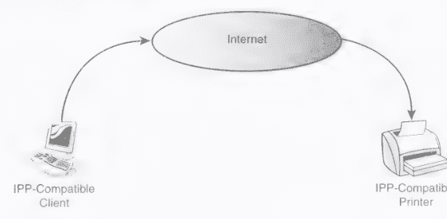

如你所见，IPP 是一种强大的打印协议。它让我们能够做到 10 年前只能梦到的事情。当你在 Linux 系统上实现 CUPS 时，你就获得了 IPP 的所有益处，为用户提供了强大的网络打印解决方案。然而，在实施之前，务必对 CUPS 的工作原理有深入理解。让我们来看看。

## 第 5 章：在 SLES 9 上配置 CUPS

### 体系

CUPS 的设计之初就是为了打印变得尽可能简单。CUPS 守护进程 `cupsd` 会宣告其队列的可用。为了提供此功能，CUPS 由几个部分组成：

- CUPS 调度器 (scheduler)
- CUPS 过滤器 (filters)
- CUPS 后端 (backends)
- CUPS 类 (classes)
- CUPS 前端 (front-end)

让我们看看每个组件扮演的角色。

### CUPS 调度器 (SCHEDULER)

你需要熟悉的组件是 CUPS 调度器。记得我们说过 IPP 是 HTTP 协议的扩展吗？事实上，与 Apache 相关的许多功能在 CUPS 中可用。除了处理打印作业外，CUPS 调度器还充当 Web 服务器，通过浏览器界面提供 CUPS 文档（后文讨论）。

你需要的下一个组件是 CUPS 过滤器。

### CUPS 过滤器 (FILTERS)

要理解 CUPS 过滤器，必须首先理解现代打印机使用多种打印描述语言 (PDL)。在 Linux 系统中，应用程序默认使用 Adobe 的 PostScript PDL 生成打印作业。标准化 PostScript 让编程变得更容易。程序员们不需要为市场上的每种型号打印机设计输出格式，而是以 PostScript 格式化打印作业，依靠打印机内部的 PostScript 解释器对打印作业进行栅化。

注意
打印机栅化过程类似于电视或 CRT 显示器的工作原理。电视通过将 CRT 枪对准屏幕左上角并从向右移动，一次绘制一行来完成一个帧。

打印作业必须经过良好的栅化。在激光打印机的情况下，打印机一次处理一页打印作业。每一页被分成细小的条带，由激光一次一次传输到硒鼓上。

如果你使用兼容 PostScript 的打印机，这种策略效果很好。然而，并非所有打印机都内置 PostScript。为了包含 PostScript 支持，打印机制造商必须向 Adobe 支付高昂的许可费，这会大幅提高设备价格。为了绕过这个问题，许多打印机制造商（如惠普和爱普）使用 ESC/P 打印机控制语言 (PCL) PDL。

注意
除非你在一家处理高端打印的组织工作，否则你作为 CLE 支持的打印机极可能不支持 PostScript。它们实在太贵了。

如果你没有兼容 PostScript 的打印机怎么办？你可以使用 CUPS 过滤器（filters），它可以根据目标打印机的 PDL（打印描述语言）将打印作业从 PostScript 转换为相应的格式。这些过滤器位于 `/usr/lib/cups/filters`，如图 5.2 所示。

图 5.2
CUPS 过滤器。


你需要了解的下一个组件是 CUPS 后端（backends）。让我们接下来来看。

### CUPS 后端
PS 后端是 CUPS 打印系统中的关键组件。后端负责在调度器与实际打印机硬件之间提供接口。CUPS 后端位于 `/usr/lib/cups/backends`，如图 5.3 所示。

图 5.3
CUPS 后端。


如图 5.3 所示，CUPS 为多种不同的打印机接口提供了后端，包括：

- 并行 (Parallel)
- 串口 (Serial)
- USB
- IPP
- lpd
- Novell
- Samba

注意
Samba 后端实际上是随 Samba 包安装的。如果你没有安装 Samba，就不会有该后端。如果你在系统中安装了其他软件包，可能会安装其他后端。例如，如果你在服务器上安装了支持，也将安装一个供 CUPS 使用的后端。当守护进程启动时，系统上安装的每个后端都会向守护进程响应接口上是否连接了打印机，并报告打印机的特定参数，如品牌、型号和其他连接信息。我们将探索的下一个组件是 PPD 文件。

### PPD 文件
PPD 是 PostScript Printer Description（PostScript 打印机描述）。CUPS 使用这些文件来确定给定打印机功能。你系统上配置的每个打印机都关联有一个 PPD。这些 PPD 文件存储在 `/etc/cups/ppd` 中。现在我们需要查看 CUPS 类（classes）。

### CUPS 类
类是 CUPS 打印系统的另一个组件。类是你定义的打印机逻辑组。当定义了一个类后，打印作业将发送到该类而不是特定的打印机。CUPS 守护进程随后确定类中哪些打印机是可用的，并将作业发送给它。这在拥有许多打印机的大型组织中特别。例如，为了增加可管理性，许多组织会为房间特定区域的所有打印机进行配置。如果打印负载很大，房间内可能有四、五台打印机供用户选择。在这种情况下，作为网络管理员，你需要配置房间内的每台打印机。从用户的角度来看，这提了一个了一个困境：他们应该打印到哪台打印机？

墨菲定律的规律在这种情况下起了作用。你是否注意到，无论你选择哪一行，你选择的那一个总是是最慢的？同样，无论你的用户选择房间里的哪台打印机打印，它无例外是正在打印的那一台。CUPS 类 为你解决了这个问题。在前面的示例中，你可以将房间内所有的打印机配置到一个类中。然后你的用户就可以打印到该类，让 CUPS 守护进程自动确定下一个可用打印机并将文档转发给它。此外，CUPS 还提供了配置隐式类（implicit classes）的能力。隐式类是打印服务器组。当打印作业发送到隐式类时，将识别下一个可用打印服务器并将文档发送到那里由服务处理。隐式类为你的打印系统提供了某种容错能力。例如，假设你有一个由三个打印服务器组成的隐式类。如果其中一个发生硬件故障变得不可用，另外两个打印服务器会自动管理负载。这一切对你的用户来说是完全透明的。他们完全不知道发生了任何事情。打印一直进行，每个人都很开心。我们在这里探索的最后一个 CUPS 组件是基于 Web 的管理工具。

### CUPS Web 端管理前端
要在你的 Linux 系统上配置 CUPS 服务，你有两个选择：命令行工具或基于 Web 的图形界面。我两种都用过，Web 界面是最快速简单的方法。

Web 管理界面由 CUPS 调度器提供。记住，CUPS 调度器实际上是一个 HTTP 服务器。因此，它可以作为 CUPS 管理工具提供网页和基于 Web 的应用程序。需要记住的一点是它运行在端口 631，而不是典型 Web 服务器的 80 端口。要访问 CUPS Web 端管理工具，打开浏览器窗口并导航到 `http://your_server_IP:631`。执行后，将显示图 5.4 所示的屏幕。该工具可设置打印机、创建类和管理打印作业。考虑到这些组件，让我们简要回顾它们是如何协同工作为你的网络提供打印解决方案的。

图 5.4
CUPS Web 端管理工具。

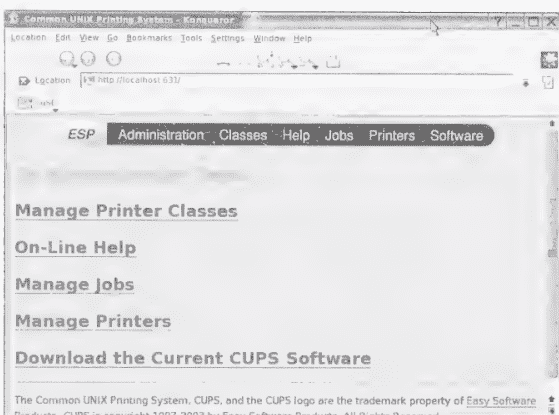

### CUPS 打印过程
当打印作业提交到 CUPS 服务器时，发生如图 5.5 所示的过程：

1. 客户端上的应用程序生成打印作业并发送到服务器上的 CUPS 调度器（cupsd）。
2. 调度器将打印作业保存到队列目录。在此过程中，打印作业被分为两个部分：
    - 打印队列和过滤器信息保存在 `/var/spool/cups` 中，以 cupsd 分配的打印作业编号命名，例如 `c0015`。
    - 要打印的文档本身保存在 `/var/spool/cups` 中，以 cupsd 分配的打印作业编号命名，例如 `d0015`。
3. 打印作业发送到过滤器以转换为相应的 PDL。
4. 转换后的打印作业从过滤器发送到后端。
5. 后端将作业发送到打印机。当后端完成向打印机发送作业时，它通知 cupsd 守护进程，随后从队列中删除打印作业。现在你已经了解 CUPS 打印系统是如何工作的，你需要学习如何在 SLES 9 系统上实现并配置它。

### 在 SLES 9 上安装 CUPS
测试目标涵盖：
- 配置网络打印服务器服务之前章节中探索过的，你可以选择从

对于之前章节中探索过的 DNS 和 DHCP 服务，你可以从各种软件包中选择在 SLES 9 系统上安装特定的进程。CUPS 并非如此。CUPS 只有一个版本，由 Easy Software 提供。这是你通过 CLE 9 认证考试需要了解的软件包。更多信息请访问 `http://www.cups.org`。

要在你的 SLES 9 服务器上安装 CUPS 服务，请完成以下操作：

1. 从 SLES 9 桌面选择 YaST。
2. 提示时输入你的 root 密码。
3. 在左侧框中选择软件。
4. 在右侧框中选择安装和删除软件。显示图 5.6 所示的屏幕。

图 5.6
YaST 软件管理屏幕。

## 第 5 章：在 SLES 9 上配置 CUPS

5. 在搜索字段中，输入 `cups`；然后点击搜索。

6. 勾选以下软件包（如图 5.7 所示）：

- cups
- cups-client（可选）
- cups-drivers
- cups-drivers-stp（可选）
- cups-libs
- cups-SUSE-ppds-dat
- xpp

图 5.7
安装 CUPS 软件包。


7. 点击接受（Accept）。

8. 提示时，插入相应的 CD。

提示

请注意 CUPS 有许多依赖项。完成安装可能需要一些时间。

在安装软件包和运行 SuSEConfig 时请耐心等待。

10. 选择关闭（Close）以关闭 YaST。

如果你按照第 2 章实验练习中的步骤操作，SLES 9 系统应该已经安装了 CUPS 服务器和客户端软件包。

要验证它们是否存在，请打开 YaST 并选择“软件”、“安装和移除软件”。在搜索字段中输入 `cups` 然后点击搜索。你应该能看到带有蓝色复选标记的 CUPS 软件包，如图 5.8 所示。

图 5.8

已安装的 CUPS 软件包。


如果由于某种原因，你的 SLES 9 系统没有安装 CUPS 软件包，请按照之前的步骤进行安装。

软件包安装后，将使用 `/etc/init.d` 中的 `cups` 脚本来启动和停止服务，如图 5.9 所示。

提供此服务的实际二进制文件是位于 `/usr/sbin` 的 `cupsd` 可执行文件，如图 5.10 所示。

## 第 5 章：在 SLES 9 上配置 CUPS

图 5.9
CUPS 启动脚本。


`/sbin:/etc/init.d` # is cups

`/sbin:/etc/init.d` #

```
图 5.10
CUPS 二进制文件。
```

`/sbin:/usr/sbin` # is cupd

`/sbin:/usr/sbin` #

与其他守护进程一样，你使用 `/etc/init.d/cups` 脚本在你的服务器上启动、停止或重启 `cupsd` 守护进程。这是通过调用脚本并提供相应的参数来实现的。你可以使用的命令示例包括：

- `/etc/init.d/cups start`——启动 dhcp 守护进程。
- `/etc/init.d/cups stop`——停止 dhcpd 守护进程。
- `/etc/init.d/cups restart`——重启 dhcpd 守护进程。

如果不使用完整路径，你也可以从 shell 提示符输入 `cups` 并配合 `start`、`stop` 或 `restart` 参数来管理 `cupsd` 守护进程。

在系统上安装 DHCP 服务后，你就可以准备好在服务器上配置并启动 CUPS 服务了。然而，在此之前，你需要对 `cupsd` 守护进程的配置文件有深入的理解。让我们接下来这些这些。

# 在 SLES 9 上使用 CUPS

涵盖的测试目标：

- 1. 使用 CUPS 配置网络打印服务器。

通过本章的前几页，你可能已经得出结论：CUPS 是一个复杂的系统，你是你是正确的。CUPS 的复杂程度高于我们在前面的章节中介绍的 DNS 或 DHCP。幸运的是，尽管其很复杂，但 CUPS 相对容易实现和管理。在本章的这部分，你将学习如何实现。让我们从学习用于配置 CUPS 的文件开始。

## CUPS 配置文件

与任何其他 Linux 服务一样，CUPS 使用 `/etc` 目录下的几个文本文件进行配置。CUPS 配置文件存储在 `/etc` 下的 `cups` 目录中。正如我在书中多次提到的，在开始配置和部署服务之前，你真的应该对这些文件有深入的理解。

为了做到这一点，我们将花费大量时间来审查这些文件。在你熟悉了它们之后，你将学习如何使用 GUI 界面让你的某些管理工作变得更简单、更快速。

注意

在我们今天要查看的文件中，`cupsd.conf` 是你唯一应该尝试手动编辑的文件。CUPS 的作者 Easy Software 建议所有其他文件都应该使用 GUI 界面进行配置。

然而，当我们到达那里时，我们不得不打破传统。与 DNS 和 DHCP 不同，YaST 并不包含配置 CUPS 的模块。相反，我们将使用 CUPS 基于 Web 的管理界面来执行我们的配置工作。

让我们开始吧。我们需要查看的文件是 `cupsd.conf`。

### cupsd.conf

`/etc/cups/cupsd.conf` 文件是你用于配置 `cupsd` 服务的主配置文件。回想我们所说的，cupsd 是一种 HTTP 服务器。示例 `cupsd.conf` 文件如图 5.11 所示。

## 第 5 章：在 SLES 9 上配置 CUPS

图 5.11
cupsd.conf 文件。

```
# Different functionality

##################

##################

# Server Identity

# ServerName 向客户端公布的服务器名称。如果在此处未显式指定，cupsd 将默认使用服务器的主机名。

# ServerAdmin 用户用于联系 CUPS 管理员的电子邮件地址。

# ServerName: domain.com
```

`cupsd.conf` 文件非常长。这里显示了一部分。`cupsd.conf` 由许多控制 cupsd 运行方式的指令组成。在我们继续之前，请理解文件中的指令比我们能涵盖的得多。在本章的这部分，我将介绍一些我认为非常有用的指令。

提示

当你参加 CLE 实践考试时，不要忘记你可以使用服务器上的各种文档。能够查看 man 页或在线 CUPS 文档可能是你的救星！

如果你查看 `cupsd.conf` 文件，你会发现它被划分为几个逻辑分组。这使得找到你需要修改的特定指令相对容易。分组包括：

- Server Identity
- Server Options

在这些组中，你需要熟悉的一些常用 `cupsd.conf` 指令包括：

- Server Identity: `ServerName`——该指令指定向客户端公布的服务器名称。如果在此处未显式指定，cupsd 将默认使用服务器的主机名。
- `ServerAdmin`——该指令指定用户用于联系 CUPS 管理员的电子邮件地址。

- Server Options:
- `LogLevel`——该指令指定存储在日志文件中的详细程度。你必须使用以下选项之一作为该指令的值：
  - none——不记录日志。
  - error——仅记录错误。
  - warn——记录错误和警告。
  - info——记录错误、警告和所有打印请求。（默认）
  - debug——记录来自 cupsd 的几乎所有消息。
  - debug2——记录来自 cupsd 的所有消息。

## 在 SLES 9 上使用 CUPS

- Fax Support
- Encryption Support
- Filter Options
- Network Options
- Security Options

- `MaxCopies`—该指令可用于限制用户为特定打印作业可以请求的副本数量。默认值为 100。

- `MaxJobsPerUser`—该指令可用于限制用户拥有的活跃打印作业数量。默认情况下，没有限制。

- `ServerRoot`—该指令指定 cupsd 使用的配置文件的位置。默认情况下，为 `/etc/cups`。

- `Encryption Support`—加密支持。

- `Certificate`—该指令指定 cupsd 使用的 SSL 证书。默认情况下，为 `/etc/cups/ssl/server.crt`。

- `ServerKey`—该指令指定 cupsd 使用的密钥。默认情况下，为 `/etc/cups/server.key`。

- `Filter Support`—过滤器支持。

- `User`—该指令指定 cupsd 运行的用户。默认情况下，为用户（user）。

- `Group`—该指令指定 cupsd 运行的组。默认情况下，为 lp 。

- `Network Options`—网络选项。

- `Port`—该指令指定 cupsd 运行的 IP 端口。默认情况下，它使用 631 的 IPP 端口。

- `MaxClients`—该指令设置了并发客户端连接数量的限制。默认设置为 100。

- `Browsing Options`—浏览选项。

- `Protocols`—该指令指定 cupsd 是否通过本地网络网段的广播来通告其打印机。默认值为开启（on）。

- `Protocols`—该指令指定 cupsd 应该使用什么协议来发布打印机。你可以使用 cups、sl 或 all（同时使用 cups 和 sl）作为此指令的值。默认值为 cups。

- `BrowseAddress`—该指令指定 cupsd 用于通告其打印机的广播地址。此默认禁用。在启用它之前，cupsd 不会通告其打印机。你应该使用子网的广播地址作为此参数的值。例如，如果你的网络地址是 192.168.1.0，则应使用 192.168.1.255。

# 在 SLES 9 上使用 CUPS

提示

- `Interval`—该指令指定打印机公告之间的间隔，以秒为单位。默认值为 30 秒。

- `ImplicitClasses`—该指令在你的网络上启用隐式类（implicit classes）。此指令默认设置为开启（on）。启用后，可以通过为所有你想在隐式类中的打印机配置相同的名称（例如 HPLJ）来创建一个隐式类。所有具有相同名称的打印机都会自动放入同名的隐式类中。如果客户端系统向打印机名称发送打印作业，它将自动重定向到相关 CUPS 服务器上的第一个可用打印队列。

- `HideImplicitMembers`—如果启用了隐式类，则此指令如果启用，将配置 cupsd 将该类中的所有打印队列显示为单个队列。此指令默认启用。

正如我之前说的那样，没有可用的图形化工具来编辑 cupsd.conf。要进行更改，你拥有可靠的老旧 vi 或 kate 文本编辑器。

当你按照意愿编辑了 cupsd.conf 后，你需要了解 classes.conf 文件的作用。让我们接下来来看这个文件。

# classes.conf

`/etc/cups/classes.conf` 文件用于定义你网络中的打印机类。然而，此文件不包含任何隐式类的参数。在 classes.conf 中只能定义普通的打印机类。图 5.12 显示了示例 classes.conf 文件的一部分。

classes.conf 中的指令包括：

- `<Classname>`—Class 指令用于定义一个类，并且必须作为任何类定义的开始。

- `Info`—Info 指令允许你指定关于你正在定义的类的描述性信息。

- `Location`—Location 指令允许你指定打印机的物理位置，例如“二楼房间”。

- `State`—State 指令允许你设置类的初始状态。可能的值有 Idle（空闲）和 Stopped（停止）。

## 第 5 章：在 SLES 9 上配置 CUPS

图 5.12
classes.conf 文件。


- `Accepting`—该指令指定该类是否可以接受新作业。可能的值有 Yes（是）和 No（否）。

- `Printer`—Printer 指令包含类中的特定打印队列。

- `</Class>`—该指令用于结束类的定义。

你不应该手动编辑此文件。相反，你应该使用 CUPS Web 端工具来配置此文件。

提示
或者，你也可以从 shell 提示符使用 `ipladmin` 程序。要查看如何使用此工具配置 classes.conf，请参阅 ipladmin 手页。

下一个 CUPS 配置文件需要熟悉 printers.conf 文件。

# printers.conf

`/etc/cups/printers.conf` 文件用于配置由 cupsd 打印机。图 5.13 显示了示例 printers.conf 文件的一部分。

- `<Printer name>`—Printer 指令开始一个打印机定义。name 参数指定了正在定义的打印机名称。

- `Info`—Info 指令允许你指定关于你正在定义的打印机的描述性信息。

# 图 5.13
printers.conf。


- `Location`—Location 指令允许你指定打印机的物理位置。

- `DeviceURI`—DeviceURI 指令允许你指定打印机的 URI。它可以采取以下形式：
- IPP 打印机—`ipp://host`
- 并打印机—`parallel://dev`
- USB 打印机—`usb://dev`
- Samba 打印机—`smb://host`

提示
URI 代表统一资源标识符（Uniform Resource Identifier）。它是标识符的一种。URL 是 URI 的类型。典型的 URL 包含协议（http）、主机名（www.com）和资源。

- `MaxClients`—该指令设置了并发客户端连接数量的限制。默认设置为 100。

- `State`—State 指令允许你设置类的初始状态。可能的值有 Idle（空闲）和 Stopped（停止）。

- `Accepting`—该指令指定该类是否可以接受新作业。可能的值有 Yes（是）和 No（否）。

- `</Printer>`—该指令用于结束打印机定义。

图 5.15
mime.convs 文件。


## 在 SLES 9 上配置 CUPS

让我们在 SLES 9 上运行 CUPS。为了实现这一目标，你需要完成以下任务：

- 配置 CUPS 内部员。
- 配置并启动 cupsd。
- 配置 CUPS 打印机。
- 配置 Linux CUPS 客户端。
- 创建类（classes）。

让我们从设置一个用户账户作为 CUPS 内部员开始。

### 配置 CUPS 管理员

为了理解为什么你可能需要配置 CUPS 管理用户账户，你首先需要理解，默认情况下，SLES 9上的 CUPS 并没有配置为使用与 Linux 系统相同的用户账户。相反，CUPS 被配置为使用 Digest（摘要）身份验证。这是通过 `/etc/cups/cups.conf` 文件中的 `AuthType` 指令来控制的。`AuthType` 指令有三个可能的值：

- None—此值配置 CUPS 提供匿名用户访问。使用系统不需要用户名或密码。
- Basic—此值配置 CUPS 使用你 Linux 系统的 `/etc/passwd` 文件来验证用户。
- Digest—此值配置 CUPS 验证用户。这是在 SLES 9 上安装 CUPS 时的默认值。在此配置中，用户账户存储在名为 `password.md5` 的单独文件中，该文件位于 `/etc/cups`。

乍看之下，你可能认为 Basic 身份验证可能是更好的选择。遗憾的是，它有一些缺点。使用 Basic 身份验证时，在验证打印系统时，用户名和密码是以明文传输的。对于大多数网络管理员来说，这让我们彻夜难眠。网络上使用狙击器的人太容易捕获敏感的用户身份验证。

另一方面，Digest 身份验证实际上并没有发送用户名和密码进行验证。相反，它发送用户名和密码的 MD5 校验和。这使其比 Basic 身份验证安全得多。即使有人捕获了校验和，他们也很可能将其解密回原始的用户名和密码。

考虑到这些背景，你现在可以看到为什么我们需要配置 CUPS 管理用户。我们的 root 用户账户在 `password.md5` 文件中并不存在。要在 Digest 身份验证系统中添加管理用户，我们从 shell 提示符使用 `lppasswd` 命令。要在 `password.md5` 文件中创建一个名为 `root` 且属于名为 `sys` 的 CUPS 管理组的管理用户，你需要使用以下命令：

```
lppasswd -g sys -a root
```


进入`/path/to/xxx`目录，找到`xxx.json`。

在你执行此操作之前，将无法使用 CUPS 基于 Web的管理工具。出于安全考虑，SUSE 的人员建议，如果你使用 root，不要使用该密码作为你 Linux 系统 root 用户的密码。

现在已经设置了管理用户，你的下一个任务是配置 `cupsd.conf` 文件。

### 配置 cupsd.conf 文件并启动 cupsd

配置 `cupsd.conf` 的方式很大程度上取决于你实现系统的特定情况。好消息是，对于基本的实现，你不需要做太多。

然而，如之前提到的，你必须启用 `BrowseAddress` 指令，否则 CUPS 将不会发布它的打印机。该指令默认未启用。如果我每问过一次“为什么我的 Linux 客户端看不到我的 CUPS 打印机？”，我就能赚一个镍币。每一次都是因为管理员没有取消 `BrowseAddress` 指令的注释。该指令有以下可能的值：

- `@LOCAL`—此值将导致 CUPS 将其打印机公告广播到系统中的所有本地接口。这是最常用的值。
- `@IF(interface_name)`—如果你在服务器上有多个接口，可以使用此项让 CUPS 将广播发送到特定的网络接口。
- `Broadcast_Address:631`—你也可以指定一个广播地址来发送打印机公告。例如，你可以使用 `255.255.255.255` 或 `192.168.1.255`。如果你使用此选项，请确保在广播地址末尾加上 `:631` 端口号。

注意

`cupsd.conf` 文件指出，如果你使用全网广播地址 `255.255.255.255:631`，打印机公告将发送到系统的所有网络接口，包括拨号连接。使用 `@LOCAL` 值将导致公告仅发送到非拨号网络接口。

启用了 `Browse` 指令的示例 `cupsd.conf` 文件如图 5.16 所示。

图 5.16

在 cupsd.conf 中启用打印机公告。

| 类 A, B, C, 或 D 掩码（即不支持 CIDR）。 |
| :--- |
| 注意：使用“全局”广播地址 (255.255.255.255) |
| 使用默认配置激活 Linux 需求拨号链路 |
| 如果你有局域网（LAN）和拨号链路，请使用 @LOCAL 广播地址 |
| @LOCAL 地址广播到所有点对接口。 |
| 例如，如果你有局域网和拨号链路，请使用特定接口的广播地址（例如 eth0）。 |
| 同样，接口每隔 60 秒自动刷新一次，并可以动态使用。 |
| @LOCAL 值将导致公告仅发送到非拨号网络接口。 |

## 第 5 章：在 SLES 9 上配置 CUPS

这种操作方法因发行版的不同而异。对于你的 CLE 9 认证，你只需要知道如何在 SUSE 客户端系统上进行此操作，这就是我们在这里要做的。

在 Novell Linux Desktop 9 系统上，你可以通过以下步骤配置 CUPS 打印机：

1. 选择系统（System）、管理员设置（Administrator Settings）来启动 YaST。
2. 以你的 root 用户身份进行验证。
3. 选择硬件（Hardware）、打印机（Printer）。如果你在安装操作系统时指定了系统监听 CUPS，将显示图 5.23 所示的屏幕。这是 NLD 的默认设置，因此很有可能是这种情况。如果是这样，你的任务就完成了！如果不是，请继续第 4 步。

图 5.23
正在监听 CUPS 打印机。


4. 如果你的系统尚未配置为监听 CUPS 广播，请执行以下操作：
   a. 在“已安装的打印机和队列”（Already Installed Printers and Queues）下，选择更改（Change）。
   b. 选择添加（Add）。
   c. 勾选“通过 CUPS 网络服务器打印”（Print via CUPS Network Server），如图 5.24 所示。

## 图 5.24
配置 NLD 9 监听 CUPS 服务器。


d. 选择下一步（Next）。

e. 在“连接类型”（Connection Type）屏幕上，勾选“使用广播的 CUPS”（CUPS Using Broadcasting），如图 5.25 所示。

f. 选择下一步（Next）。

g. 在“监听远程 CUPS 服务器”（Listening to Remote CUPS Servers）屏幕上，确保勾选了“监听 IPP 广播包”（Listen to IPP Broadcast Packets）；然后选择确定（OK）。

h. 选择完成（Finish）。

5. 通过完成以下操作来测试配置：
   a. 在 NLD 9 系统上，打开一个可以生成打印作业的应用程序。OpenOffice 在这方面效果非常好。
   b. 选择文件（File）、打印（Print）。你的 CUPS 打印机应该显示为可用打印机，如图 5.26 所示。

通过这个演示，你现在应该开始理解 CUPS 的威力和价值。配置工作是在服务器端完成的，而不是客户端。这在其他网络操作系统提供的各种打印服务中是独特的。如果你对现有的打印机进行更改、删除打印机或添加打印机，你的修改几乎会立即对用户生效。你不需要在各个系统之间来回走重新配置它们。这让你和我的生活都变得轻松。

## 第 5 章：在 SLES 9 上配置 CUPS

图 5.25
配置 NLD 监听 CUPS 广播。


在我们进入实验练习 5.1（在将在那里设置你自己的 CUPS 系统）之前，我们需要为你的 CLE 9 考试涵盖最后一个主题：配置打印机类。

图 5.26
打印打印到 CUPS 打印机。


## 配置 CUPS 打印机类

CUPS 类定义在 `/etc/cups/classes.conf` 文件中。与 `printers.conf` 文件一样，Easy Software 和 SUSE 的人员强烈建议你不要手动编辑此文件。相反，你应该使用 CUPS 基于 Web 的管理工具。要定义打印机类，请在你的 CUPS 服务器上完成以下操作：

1. 从你的服务器启动浏览器。
2. 导航到 `http://localhost:631`。
3. 选择管理（Administration）。
4. 在出现提示时，使用你之前通过 `Ipppasswd` 配置的管理员用户身份进行验证。
5. 在“类”（Classes）下，选择“添加类”（Add Class）。将显示图 5.27 所示的屏幕。

图 5.27
创建打印机类。


## 第 5 章：在 SLES 9 上配置 CUPS

6. 在“名称”（Name）字段中，为该类输入名称。
7. 在“位置”（Location）字段中，为该类服务的打印机输入描述性位置。
8. 在“描述”（Description）字段中，输入该类的描述。
9. 选择继续（Continue）。将显示图 5.28 所示的屏幕。

图 5.28
向类中添加成员。


10. 勾选你想要包含在该类中的打印机；然后选择继续（Continue）。将显示一个屏幕指示该类已添加。
11. 要查看该类，点击显示的链接。将显示图 5.29 所示的屏幕。

从此屏幕，你可以发送测试页面、停止打印机或该类……现在进入实验练习 5.1。

## 第 5 章：在 SLES 9 上配置 CUPS

## 练习 5.1：在 SLES 9 上配置 CUPS

在此练习中，你将在 SLES 9 系统上设置 CUPS 服务器，并配置 Linux 客户端使用它。

完成此练习，你需要：
- 一个安装了 CUPS 的 SLES 9 服务器。
- 一个安装了 CUPS 的 Linux 客户端系统。
- 服务器与客户端之间的网络连接。

### A 部分配置 CUPS 服务器

1. 在 SLES 9 服务器上，启动 CUPS 服务。
2. 打开浏览器并导航到 `http://localhost:631`。
3. 选择管理（Administration）选项卡。
4. 以管理员用户身份进行验证。
5. 进入类（Classes）选项卡并点击“添加类”（Add Class）。
6. 按照提示创建一个新的打印机类。

### B 部分配置 Linux 客户端

1. 在 Linux 客户端系统上，打开 YaST。
2. 导航到系统（System）、管理员设置（Administrator Settings）。
3. 选择硬件（Hardware）、打印机（Printer）。
4. 如果系统已经配置为监听 CUPS 广播，请跳到第 6 步。
5. 如果不是，执行以下步骤：
   a. 在“已安装的打印机和队列”下，选择更改（Change）。
   b. 选择添加（Add）。
   c. 勾选“通过 CUPS 网络服务器打印”。
   d. 选择下一步（Next）。
   e. 在“连接类型”屏幕上，勾选“使用广播的 CUPS”（CUPS Using Broadcasting）。
   f. 选择下一步（Next）。
   g. 在“监听远程 CUPS 服务器”屏幕上，确保勾选了“监听 IPP 广播包”；然后选择确定（OK）。
   h. 选择完成（Finish）。
6. 测试配置：
   a. 在客户端打开应用程序（如 OpenOffice）。
   b. 选择文件（File）、打印（Print）。
   c. 验证 CUPS 打印机是否可用。
   d. 打印测试页面并验证其打印正常。

## 总结

在本章中，你学习了如何在你的 SLES 9 系统上实现 CUPS。我们首先讨论了 IPP 协议。然后，你学习了 CUPS 是围绕 IPP 构建的。

之后，你学习了构成 CUPS 服务的各种组件，包括：

- CUPS 调度器
- CUPS 过滤器 `filters`
- CUPS 后端 `backends`
- PPD 文件
- CUPS 类
- CUPS 基于 Web的管理工具

在了解这些组件的基础上，我们讨论了 CUPS 打印过程，追踪了打印任务从 CUPS 客户端通过 CUPS 服务器到打印机的整个流程。

然后，我们讨论了如何在 SLES 9 服务器上安装 CUPS 软件包。接着，我们花费大量时间检查了配置 CUPS 守护进程 `cupsd` 的各种文件。这些包括：

- `cupsd.conf`
- `classes.conf`
- `printers.conf`
- `mime.types`
- `mime.convs`

最后，我们在 SLES 9 系统上配置了 CUPS。为了实现这一点，我们配置了以下内容：

- 一个 CUPS 管理用户
- `cupsd.conf` 文件
- 一个 CUPS 打印机
- 一个 CUPS 类

你通过实验练习 5.1 在 SLES 9 系统上配置 CUPS，结束了本章的学习。

有了这些 CUPS 背景知识，你准备好进入第 6 章了，在该章中你将学习如何在 SLES 9 服务器上实现 Samba。你可能在本章中注意到，我们没有过多提到从 Windows 工作站到 CUPS 打印机的打印。在第 6 章，你将学习如何实现！

# 为 SLES 9 Windows 客户端配置文件和打印服务

本章涵盖了 Novell 认证 Linux工程师 (CLE) 9 认证的以下要求：

1. 在 SLES 9 上配置主主域控制器 (Primary Domain Controller)。

在本章中，你将学习如何在 SLES 9 系统上实现 Samba。Samba 是所有 Linux 服务中最强大的服务之一。在我看来，Samba 是 Linux 成功进入现代企业网络的关键原因之一。作为一名 CLE 9，你很有可能负责管理你 Linux 网络中的 Samba 部署。

让我们从学习 Samba 的工作原理开始本章。

## Samba 概述

涵盖的测试目标：

1. 在 SLES 9 上配置主主域控制器。

Linux（尤其是 SLES 9）是一个极其出色的网络服务器。Linux 强大、快速、廉价且可靠。正如你在前面的章节中看到的，Linux 可以做到所有昂贵的网络操作系统所能做的一切，而且通常做得更好！

# 第 6 章：为 SLES 9 Windows 客户端配置文件和打印服务

正因如此，Linux 作为服务器在企业网络中正获得越来越多的关注。任何处理过其他操作系统高昂用户许可费用的人都知道，这些费用会变成怎样的“财务黑洞”。而 Linux 无论你有一个用户还是一千个用户，成本都是相同的。

正如你在上一段落中可能注意到的，我说 Linux 相比其他操作系统取得了巨大进展。遗憾的是，Linux 在桌面端的表现并不尽如。这有两个关键原因：

- 从历史上看，Linux 缺乏可用的桌面生产力应用程序。幸运的是，这种情况最近正在好转。OpenOffice 软件套的采用使 Linux 成为桌面可行的选择。然而，Windows 桌面可用应用的广度 Linux 桌面仍然无法企及。
- 普通用户觉得 Linux 有些令人敬畏。对于你和我来说，这不是问题。我们喜欢使用 Linux 作为我们的桌面操作系统。我们知道如何使用它来提高生产力。我们知道如何运行程序、安装服务以及挂载文件系统。遗憾的是，大多数机构的普通用户是在安装了某个版本的 Windows 后学会使用电脑的。他们不想学习新的操作系统。

由于这些原因，Linux 主要在服务器机房确立了自己的地位。在看到它在桌面端被大规模接受之前可能还需要几年。

### 注意

谈到这里，我认为 Linux 社区在这一问题上确实付出了巨大努力。生产力应用（如 OpenOffice.org）以及特定的发行版（如 诺贝尔 Linux 桌面版 Novell Linux Desktop）都是向正确方向迈的一步。

在此之前，我们仍然要处理桌面上的 Windows 问题。这为我们带来了一个困境：我们如何使用 Linux 作为我们的网络操作系统，来提供通常与 Windows 服务器相关的服务？

### 注意

在我的职业生涯中，我有机会成为几个网络操作系统核心团队的成员。在我们的核心团队会议上，负责的产品经理通常对文件和打印服务表现出缺乏兴趣。它们并不非常华丽。他们想要创建最新、最强大网络服务的操作系统。

然而，我观察到的问题是，文件和打印服务是任何网络操作系统的核心。如果你不提供它们（并且提供得好），没人关心该操作系统提供了什么酷炫的服务。

根据经验，典型的 Windows 服务器来自 Windows 客户端的 99% 使用涉及用户文件的存储和网络服务器作业的处理。

# Samba 的世界

Linux（尤其是 SLES 9）是一个极其出色的网络服务器。

Samba 是你可以在 SLES 9 上使用的一个非常酷、非常强大的服务。当你这样做时，你的 Linux 服务器可以模拟一个 Windows NT 服务器。

## Samba 概述

到目前为止，我强调了 Samba 在将 Windows 桌面连接到 Linux 服务器方面的用处。然而，Samba 的作用远远于此。Linux 系统也提供了 Samba 客户端包。该客户端包允许 Linux 桌面连接到运行在 Linux 服务器上的 Samba 服务，或任何 Windows 服务器。

这对于运行异构网络环境的人来说具有某些显著的优势。在过去，同时运行 Windows 和 Linux 的组织大部分时候必须运行两个独立的网络。Windows 系统与 Linux 网络之间不交互也不共享数据，反之亦然。

Windows 网络使用微软域（Microsoft Domains）来验证用户身份，并使用微软网络客户端（Microsoft Client for Networks）提供文件和打印访问。而 Linux 系统通常使用 NIS 验证用户，使用 lpd 或 CUPS 提供打印服务，并使用 NFS 共享文件。正如我们之前讨论过的，让这两个完全不同的网络系统协同工作是一个非常糟糕的过程。

现在，有了 Samba，一切都可以变得非常完美。通过实现 Samba，Windows 和 Linux 系统可以相互交互。使用 Samba 替代 Linux 服务器和桌面上的 NIS+ 和 NFS 就实现了这一点。这使得 Linux 桌面能够与 Linux 和 Windows 服务器通信。同样，Windows 桌面也可以与 Linux 和 Windows 服务器通信。这种场景如图 6.2 所示。

图 6.2

有了 Samba，大家都是一家。


听起来是一个非常友好的世界！Samba 是如何做到这一切的？关键在于所使用的协议。Samba 基于服务器消息块（SMB）协议。让我们先讨论 SMB 的基础知识，以便为你在网络中实现 Samba 做好准备。

# 服务器消息块协议

SMB 协议的最早期版本由 IBM 在 20 世纪 80 年代中期开发。在 90 年代初，Andrew Tridgill 开发了一个运行在 Unix 上的 SMB 实现。Tridgill 先生至今仍领导 Samba 的开发。SMB 协议后来被微软采用并广泛部署，从 Windows 95 和 Windows NT 开始。从那时起它已成为微软网络系统的骨干。

注意
微软使用通用互联网文件系统（CIFS）名称来描述其 SMB 实现。CIFS 与 Samba 的兼容性非常好。

SMB 协议通过调用共享使 SMB 客户端可以使用服务器文件和打印机。共享上的共享资源使用通用命名法（UNC）进行引用。使用 UNC 引用特定共享的语法如下：`\server_name\share_name`

例如，如果我有一个安装并运行 Samba 的 Linux 命名服务器，我可以共享服务器文件系统中的 `/tmp` 目录来存储临时文件。使用 Samba 配置文件（我们稍后会讨论），我可以为 `/tmp` 创建一个共享并给它命名；假设命名为 tempfiles。要引用该共享，我将使用 UNC 路径 `\server1\tempfiles`。

提示
选择此目录进行共享仅为示例。请记住 /tmp 会由系统定期清理。我实际上看到过 Linux 适配员在不告诉用户的情况下共享 /tmp。当用户发现自己的文件消失时，他们会非常生气！

在某些应用程序中，也可以使用 URL 来引用 SMB 共享。这是使用的格式为：`smb://server_name/share_name`

使用上一个例子，我们将使用形为 `smb://server1/tempfiles` 的 URL。

SMB 协议运行在 OSI 模型的应用层和表示层。从核心上说，SMB 是一种文件和打印访问协议。它的工作是为 SMB 客户端提供访问 SMB 服务器文件系统的权限。同样，它被设计为为 SMB 客户端提供访问 SMB 服务器上共享打印机的权限。该协议设计使用操作系统的内部安全系统来决定 SMB 客户端在文件系统中可以不能做什么。在 Linux 中，使用文件系统 ACL（访问控制列表）来控制访问。

SMB 可以通过多种中间层协议实现，包括 IPX。最常见的实现是使用基于 IP 的 NetBIOS SMB。正因如此，你需要对 NetBIOS 有基本的了解，才能有效地管理 Samba 实现。我们将接下来讨论这一点。

# 关于 NETBIOS

NetBIOS（网络基本输入输出系统）是一种运行在 OSI 模型会话层的网络协议。与 SMB 协议一样，NetBIOS 协议最初也是由 IBM 在 20 世纪 80 年代中期开发的。微软随后将 NetBIOS 采用作为 Windows 操作系统的基本网络协议。

由于 NetBIOS 运行在 OSI 模型的会话层，它不具备固有的网际能力。基本上，它被设计在单个网络分段上工作。它不知道如何在路由器之间移动。

为了让 NetBIOS 在路由网络中工作，你必须将其附加在另一个网络层协议之上。多年来开发了各种实现方案，在各种互联网协议（包括 IPX/SPX）之上运行 NetBIOS。然而，最流行的方法是将 NetBIOS 附加在 TCP/IP 或 UDP/IP 之上。SMB、NetBIOS 和 IP 之间的这种关系如图 6.3 所示。

图 6.3

SMB 与 OSI 模型。

| 层 | 协议 |
| :--- | :--- |
| 表示层 | SMB |
| 会话层 | NetBIOS |
| 传输层 | TCP/IP |
| 网络层 | IP |
| 数据链路 | 而异 |
| 物理层 | 而异 |

在此背景下，我们需要能够将 NetBIOS 名称解析为 IP 地址。这听起来很熟悉，不是吗？在第 3 章“在 SLES 9 上配置 DNS”中，我们讨论过将名称解析为 IP 地址。在我们在使用 Samba 时，也可以对 NetBIOS 执行同样的操作。这是通过 WINS（Windows 互联网名称服务）服务器完成的。

## Samba 概述

你还需要记住 NetBIOS 名称的另一个方面。回想一下我们提到的 SMB 协议是基于客户端/服务器网络模型的。该模型由 NetBIOS 协议支持。

记住，NetBIOS 名称最大长度为 15 个字符，每个字符占用一个字节。然而，NetBIOS 名称的长度实际上为 16 字节。NetBIOS 名称的最后一个字节用于标识主机所提供的服务类型。它被称为 NetBIOS 后缀（Suffix）。

工作站在此字节中的值为 00（十六进制）。服务器在此字节中的十六进制值为 20，而域控制器在此字节中的十六进制值为 1C。

### 注意事项

有关用于 NetBIOS 后缀的各种取值信息，请参阅 http://support.microsoft.com 上的知识库文章 163409。

为什么这些都非常重要？在现代的 TCP/IP 世界中，你为什么需要了解 NetBIOS？当你尝试打开 SMB 连接时，NetBIOS 协议用于在发送主机和接收主机之间的 OSI 模型会话层（Session layer）建立连接。如果你你不 NetBIOS，在排排除 SMB 问题时将会非常困难。

带着这些 NetBIOS 背景知识，我们将看看 SMB 通信是如何工作的。

# SMB 协议通信的工作原理

在会话层建立 NetBIOS 会话后，SMB 客户端和 SMB 服务器在 OSI 模型的应用层（Application layers）和表示层（Presentation layers）使用服务器消息块（Server Message Blocks，协议名称）相互通信。这些 SMB 包含特定的结构化命令，用于建立通信并访问共享资源。

为了让你了解 SMB 协议的工作原理，让我们通过一个示例会话。在这种场景中，SMB 客户端工作站上的用户想要在 SMB 服务器上创建一个文件、编辑该文件并保存。涉及的事务如图 6.4 所示。

SMB 采用命令/响应模型。任何节点都可以发布 SMB 命令，任何节点都可以发送 SMB 响应来创建文件。在本文场景中，发送了以下 SMB：

- 1. SMB 客户端向 SMB 服务器发送一个 `SMBNegProt` SMB 命令。该 SMB 告诉服务器它正在使用哪种 SMB 方言（dialect）。然后，服务器向客户端回传一个 `SMBNegProt` 响应，同意一种方言并提供客户端使用的一系列网络参数。

# 第 6 章：为 SLES 9 上的 Windows 客户端配置文件和打印服务

图 6.4
使用 SMB 打开并保存文件。


- 2. 客户端向服务器发送一个 `SMBsessionsetup`。该命令包含用户的用户名和密码。如果服务器接受了凭据，它将响应一个 `SMBsession response`，表示已通过身份验证。
- 3. 客户端向服务器发送一个 `SMBcon` 命令，客户端在其中告诉服务器它想要使用的共享资源。服务器向客户端响应一个 `SMBcon` 响应，表示客户端已获得使用该资源的权限。
- 4. 客户端向服务器发送一个 `SMBcreatenew` 命令，指示服务器创建一个新文件。当文件创建后，服务器会发送一个 `SMBcreatenew` 响应。
- 5. 客户端向服务器发送一个 `SMBopen` 命令，指示其打开刚刚创建的文件。

- 6. 客户端向服务器发送一个 `SMBread` 命令。服务器通过向客户端发送请求的文件进行响应。此时，用户可以在客户端工作站上使用相应的应用程序编辑文件。

编辑完成后，用户保存文件并退出应用程序。相应地，客户端系统向服务器发送一个 `SMBwriteclose` 命令。服务器将文件保存到磁盘并将其关闭。然后它向客户端响应，指示过程是否成功。

有时你会在 SMB 命令末尾看到一个 `X`。`X` 表示在同一个 SMB 中发送了多个命令。例如，如果你看到 `SMBcreatenewX` 命令，它表示服务器应该创建一个新文件，并执行嵌入在 `SMBcreatenew` 命令中的下一个 SMB（例如 `SMBOpen`）。

除了之前列出的命令外，还有许多其他 SMB 命令用于操作服务器上的文件和目录，以及提交打印作业。例如，`SMBcopy` 命令复制文件，`SMBmove` 命令移动文件，而 `SMBspool` 命令打开打开打印池。

在了解了这些 SMB 理论之后，我们现在将讨论如何在你的 Linux 系统上实现和配置 Samba，以创建我们在本章开头谈过的那个愉快、友好的异构世界。我们将从在你的服务器上安装 Samba 软件包开始。

# 在 SLES 9 上安装 Samba

- 1. 在 SLES 9 上配置主域控制器。

与 CUPS 一样，Linux 系统仅提供一个 Samba 软件包。Samba 由开发者团队维护。你可以通过访问 `http://www.samba.org` 了解更多关于他们以及 Samba 产品本身的信息。

Samba 的当前版本是 3.0。这是你在参加 SLES 9 认证考试时需要熟悉的版本。

# 第 6 章：为 SLES 9 上的 Windows 客户端配置文件和打印服务

若要在你的 SLES 9 服务器上安装 Samba 服务，请完成以下操作：

- 1. 从 SLES 9 桌面选择 YaST。
- 2. 根据提示，提供你的 root 密码。
- 3. 在左侧框架中选择“软件”（Software）。
- 4. 在右侧框架中选择“安装和删除”（Install and Remove）。
- 5. 在搜索框中输入 `samba`；然后点击“搜索”（Search）。
- 6. 勾选以下软件包（如图 6.5 所示）：
- `kde3-samba`
- `libsmclient`
- `samba`
- `samba-client`（可选）
- `samba-doc`
- `samba-pdb`
- `samba-winbind`
- `yast2-samba-client`（可选）
- `yast2-samba-server`

### 提示

`samba-client` 和 `yast2-samba-client` 软件包仅在你希望你的 SLES 9 服务器既作为 Samba 服务器又作为 Samba 客户端时才需要。如果你只想作为 Samba 服务器，可以省略这些软件包。

- 7. 选择“接受”（Accept）。
- 8. 根据提示，插入相应的光盘。
- 9. 等待软件包安装。
- 10. 选择关闭 YaST。

与我们为止介绍过的其他产品一样，如果你按照第 2 章“SUSE Linux Server”的步骤操作，你的 SLES 9 系统已经安装了 Samba 服务器和客户端。

要验证这一点，打开 YaST 并选择“软件”、“安装和删除”。在搜索框中输入 `cups`；然后点击“搜索”。你会看到各种 CUPS 软件包标记了蓝勾，如图 6.6 所示。

# 图 6.6

Samba 软件包已安装。

[源文件中缺失图像]

如果由于某种原因，你的 SLES 9 系统上没有安装 Samba 软件包，请按照前面的步骤安装它们。

安装后，你的 SLES 9 系统将使用以下守护进程提供 Samba 服务：

- `smbd`—`smbd` 进程是你的 SMB 服务器。它用于与 SMB 客户端共享 SMB 资源。
- `nmbd`—`nmbd` 进程是 Windows WINS 服务器的 Linux 实现。它为你的 SMB 服务器和 SMB 客户端提供 NetBIOS 到 IP 地址的服务。
- `winbind`—`winbind` 进程将你的 Linux Samba 连接到传统的 Microsoft Windows 网络。通过此进程，你可以配置 Samba 通过运行在单独 Windows 服务器上的域控制器进行身份验证，而不是本地 Linux 服务器。

在安装守护进程后，使用 `/etc/init.d` 中的 `smbd`、`nmbd` 和 `winbind` 脚本来启动和停止 Samba 服务，如图 6.7 所示。

图 6.7
Samba 启动脚本。

在 `/etc/init.d` 中，你还会看到一个名为 `smbfs` 的启动脚本。这是一个文件系统驱动程序，因此它是 Linux 内核本身的一部分。它不是 Samba 软件包的一部分。

当 Samba 软件包安装在系统上后，你就可以准备好在服务器上配置并启动该服务。让我们接下来讨论如何操作。

## 在 SLES 9 上配置 Samba

涵盖测试目标：

- 1. 在 SLES 9 上配置主域控制器 (Primary Domain Controller)。

Samba 是一个非常强大的产品。因此，它的功能非常广泛——可能比我们书中目前为止介绍过的任何产品都要多。要成为一名高效的 Samba 管理员，你需要大量的背景知识——这些知识也是你通过 CLE 9 考试所必需的。

为了让你成为 Samba 专家，我们将涵盖以下主题：

- Windows 网络概述
- 配合 Samba 配置文件的操作
- 如何在 Samba 中启用 Linux 用户
- 在 Samba 上配置 PDC
- 使用 YaST 配置 PDC

我们将从回顾一些基础 Windows 网络概念开始。

## Windows 网络概述

正如我们所讨论的，微软在 20 世纪 90 年采用了 SMB 作为其主要网络系统。正因如此，Windows 网络和 SMB 已经紧密相连。以此类推，Samba 和 Windows 网络概念也变得紧密相连。许多 Windows 功能被织入你 Linux 系统上的某些 Samba 软件包中。

尽管我们可能并不喜欢这样做，但为了成为一名高效的 Samba 管理员，我们必须精通 Windows 网络。如果你是从 Windows 背景进入 CLE 认证的，那么你的优势就很大。然而，如果你像我一样，在 NetWare、Unix 或 Linux 等非 Windows 操作系统上练就技能，那么对我们来说，Windows 网络概念是有些陌生的。

在在本章继续深入之前，我们将花时间回顾 Windows 网络基础知识。否则，当我们遇到 `smb.conf` 文件的特定部分时，你可能会感到困惑。具体来说，我们将涵盖以下内容：

- 工作组 (Workgroups)
- 域 (Domains)
- 域控制器 (Domain Controllers)
- 信任 (Trusts)

## 第 6 章：为 SLES 9 上的 Windows 配置文件和打印服务

注意

注意，我们并不是在本章中让你成为微软认证系统工程师 (MCSE)。我们将以非常基础的水平涵盖这些 Windows 概念。如果你已经精通 Windows，请忍住你的哈欠和偷笑。

让我们从讨论 Windows 工作组开始。

## Windows 工作组

Windows 工作组无非是网络上被分组在一起的主机的逻辑组织。工作组通常局限于单个网络段上的网络主机。可以使用“系统”小部件配置 Windows 参与工作组，如图 6.8 所示。

图 6.8
设置 Windows 工作组。


创建工作组唯一需要做的就是在所有将成为成员的工作站上在“工作组”字段中输入相同的名称。配置完成后，用户可以浏览由成员主机提供的共享资源，如图 6.9 所示。这种浏览功能使得 Windows 网络对用户来说简单得多。用户不再需要知道想要访问的共享资源的 UNC 路径，而是可以通过浏览网络来选择资源。为了使浏览成为可能，工作组中的一台计算机被选为主主浏览器 (master browser)。主浏览器保留了所有主机和共享资源的列表。

图 6.9
在工作组内浏览系统。


提示

主浏览器有时被称为本地主节点 (local master)。浏览功能同样适用于 Windows 域和工作组。我们将在本章稍后讨论域。当工作组中的系统启动时，它们会通过选举来决定由哪个系统担任主浏览器。通过系统负载和主机运行时间长度等因素，其中一个系统会被选为该工作组的主浏览器。

为什么 Windows 组要使用主浏览器？如果没有它，工作组中的每个单独系统都必须去外部查询每个主机以识别资源。这将产生大量不必要的网络流量，特别是在大型工作组中。为了加快速度，仅由主浏览器发现共享资源。然后，当用户浏览网络时，其桌面系统会联系主浏览器获取共享资源列表。这个过程要快得多，产生的网络流量也少得多。Windows 域需要 Windows 服务器，尽管它们并不阻止参与工作组。Windows 9x、ME（服务器版和专业版）、2000（服务器版和专业版）、XP（家庭版和专业版）以及 Server 2003 系统可以共享工作组中的所有资源。这些系统中的任何一个都可以作为工作组的主浏览器。此外，Linux 服务器或客户端也可以参与工作组。事实上，工作组中的 Windows 系统并不知道这种区别。对它们而言，你的 Linux 系统只是另一个 Windows 主机。

尽管工作组听起来很整洁，但它们并没有真正实现。工作组有一个限制了其实用性的主要缺点；即每台计算机系统都必须维护自己的用户账户集。这意味着如果工作组中的用户想要访问另一个系统上的资源，他们必须为该系统配置一个用户帐户。如果用户需要使用多个系统上的资源，他们必须对每个主机进行身份验证。现在，如果所有主机上的用户密码相同，那么这个过程运行得相当良好。远程系统将使用本地用户名和密码进行身份验证。

然而，如果每个系统使用的密码不同，工作组可能会变成用户以及以此推的网络管理员的噩梦。正如你可能猜到的那样，在大型网络中同步用户账户可能迅速变成一项无法完成的任务。此外，由于 NetBIOS 广播机制，在路由网络上实现工作组非常困难。由于这些原因，大型组织中通常不实现工作组。相反，绝大多数大型 Windows 网络都配置为使用域。

## Windows 域

Windows 域是网络上计算机系统的逻辑分组，类似于工作组。

注意

Windows 域与 DNS 域不是一回事。有时，这是新网络管理员感到困惑的地方。

然而，与工作组不同，域使用一个中央用户帐户数据库，域中的所有系统都使用该数据库进行身份验证。不是在每个主机上配置用户帐户，而是在一个服务器上配置用户帐户数据库（即域）。

域修复了与工作组相关的缺陷。首先，域可以跨越路由器，允许它们支持非常大的企业网络。此外，域创建了单一的管理点。所有帐户管理任务都使用一个数据库完成。

域还消除了多次登录用户账户的需求。因为对域内所有资源的访问都由域数据库控制，用户只需对域进行一次身份验证。验证后，他们可以根据所授予权限访问所需的任何域资源。

提示

Windows XP 家庭版只能在工作组中运行。如果要使用域进行身份验证，你需要 Windows XP 专业版。

拥有域数据库的系统被称为域控制器。

## 域控制器

在 Windows 网络中，域控制器是 Windows 服务器（NT、2000 服务器或 Server 2003），运行着名为安全帐户管理器 (SAM) 的服务。

注意

桌面 Windows 系统（如 Windows 9x、Windows 2000 专业版和 Windows XP）无法作为域控制器。如果网络中没有 Windows 服务器，就无法使用域。Windows 工作组是你的唯一选择。

每个域必须有一个或多个域控制器。在 Windows 网络中，有一台服务器被配置为主主域控制器 (PDC)。PDC 是域的“首领”。它是域数据的权威来源。每个域只能有一个 PDC。

然而，从容错性的角度考虑，我们需要多个域控制器。想象一下，在典型的职场中，如果网络中唯一的域控制器宕机会发生什么。没有人能登录，工作无法进行，网络管理员将去查看分类广告中的招聘启事。

为了冗余，Windows 网络可以配置备用域控制器 (BDC)。BDC 拥有来自 PDC 的域数据库副本。如果 PDC 宕机，BDC 将接管，确保网络继续运行。Windows 网络可以有多个 BDC。

## 第 6 章：为 SLES 9 上的 Windows客户端配置文件和打印服务

加入域的桌面级系统可以使用 PDC（主域控制器）或 BDC（备域控制器）来验证域身份，这就像从用 DNS 服务器可以像主 DNS 服务器一样很好地解析名称查询。图 6.10 显示了一个假设域。

图 6.10

典型的 Windows 域。


注意

Windows 服务器也可以存在于域中但不作为 PDC 或 BDC。在这种情况下，它简单被称为成员服务器。

Linux Samba 客户端可以加入 Windows 域吗？完全可以。通过 winbind 守护进程，远程 Windows 域控制器甚至可以处理验证。Linux Samba 服务器可以加入 Windows 域吗？可以；但存在一些局限性。Linux Samba 服务器可以在 Windows NT 网络中充当 PDC。如果 PDC 是另一个 Samba 服务器，它也可以担任 BDC。如果 PDC 是 Windows 服务器，它就不能担任 BDC。

注意

然而，据我了解，这计划在稍后的版本中修复。

Linux Samba 服务器也可以在 Windows NT 域中担任成员服务器。
但是，如果你正在使用 Windows 2000 Server 或 Server 2003，你的选项会少一些。Windows 2000 Server 及更高版本使用 Active Directory 来存储用户账户；Samba 对 Active Directory 的支持非常有限。你的 Linux Samba 服务器只能在 Windows 2000 或 2003 域中作为成员服务器。它不能成为 PDC。

> 提示
如果你的 Windows 服务器运行在原生模式下，则如此。如果你将 Windows 服务器配置为以混合模式运行，你的 Linux Samba 服务器就可以作为成员服务器或 PDC 加入域。

现在你已经理解了工作组和域，接下来你需要理解信任的概念。

## Windows 信任关系

Windows 信任关系有点复杂，大多数管理员并不喜欢使用它们。然而，它们是运行 Windows 网络必要部分，所以我们要学会与它们共处。

你可以在两个 Windows 域之间建立信任关系，允许一个域中的用户访问另一个域的资源；包括共享文件夹或打印机。这种关系本身相对直观且易于配置。

当你配置了具有蜘蛛网般信任关系的多个域时，问题就开始了。我们在此处不会深入探讨这个话题。关于如何处理传递信任，已经写了整本书了。目前，只需理解信任关系的作用，以及 Samba 支持它们即可。

现在你已经理解了工作组、域、域控制器和信任，你准备好在你的 Linux 系统上处理 Samba 配置文件了。

## 使用 Samba 配置文件

与 DNS 和 DHCP 一样，一个优秀的 Samba YaST 模块可以让配置和管理变得轻而易举。然而，正如我之前说的，我认为你理解用于配置 Samba 的实际文本文件是非常关重要的。当你这样做时，可以随时使用 YaST 让你的工作变得快速快捷。

你需要熟悉的文件位于 `/etc/samba` 目录中。它们包括：

- `lmhosts`
- `smbfstab`
- `smbpasswd`
- `smbususers`
- `smb.conf`

让我们从 lmhosts 开始。

## lmhosts

`/etc/samba/lmhosts` 文件的功能与 Linux 系统上的 `/etc/hosts` 文件非常相似。回想一下你的 hosts 文件用于提供主机名到 IP 地址的简单映射。大多数情况下，我们不再频繁使用 hosts 文件了。相反，我们尝试尽可能使用 DNS 服务器来完成这项任务。

图 6.11 所示的 lmhosts 文件提供了 NetBIOS 名称到 IP 的静态映射。


$ `/etc/samba/` `cat` `/lmhosts`

# 此文件提供的功能与 lmhosts 文件为 Windows

# 提供的功能相同，它是将 netbios 名称映射到 ip 地址的另一种方法。

# 更多信息请参阅 smb.conf 手页中的

# 'resolve order' 章节。

127.0.0.1        localhost

`/etc/samba/` #

```


在没有 DNS 服务器的情况下，可以使用 `lmhosts` 提供简单的 NetBIOS 名称解析。像 `/etc/hosts` 一样，我们通常不怎么频繁使用 `lmhosts`。与 `/etc/hosts` 文件相关的所有弱点都适用于 `/etc/samba/lmhosts` 文件。在你的 Linux 服务器上使用 `nmbd` 守护进程可以提供一个更健壮的 NetBIOS 名称解析系统。

## smbfstab

`/etc/samba/smbfstab` 文件用于在你的系统上配置 Samba 客户端。当仅将系统配置为 Samba 服务器时，不需要它。`smbfstab` 文件用于在系统启动时自动挂载远程系统上的共享目录。图 6.12 显示了一个示例 `smbfstab` 文件。

要实现这一点，你需要指定共享项、挂载点、类型（`cifs` 或 `smbfs`）以及各种选项，例如用于验证的用户名和密码。我们需要查看的下一个文件是 `smbpasswd`。

## smbpasswd

`/etc/samba/smbpasswd` 文件是在设置 Samba 服务器时必须注意的关键文件。除了 `smbpasswd` 之外，你可能不需要对前面的配置文件做什么。

## 图 6.12

`/etc/samba/smbfstab`

```
fstab:/etc/samba/ cat /smhosts

# 此文件用于在系统启动时自动挂载

# 系统的共享目录。你指定共享项、挂载

# 点、类型（cifs 或 smbfs）以及各种选项，

# 例如用于验证的用户名和密码。

fstab:/etc/samba/ #
```

## smbususers

`/etc/samba/smusers` 文件用于将用户名映射到服务器。例如，图 6.13 显示了一个 `smusers` 文件。

在 `smusers` 文件中，你使用以下语法：

`Samba服务器用户名 = 客户端用户名`

## 图 6.13

`/etc/samba/smusers`

```
fs:/etc/samba/ cat /smusers

# 此文件允许你将客户端用户名映射

# 到服务器。该用户名为 smuser。

root administrator admin

fs:/etc/samba/ #
```

## smb.conf

`/etc/samba/smb.conf` 是 Samba 配置的核心。你的大部分配置将在此文件中完成。它分为两个部分：全局选项和共享资源。`[global]` 部分用于定义全局范围的选项。共享资源部分用于定义 SMB 客户端可以的服务器资源。默认 `smb.conf` 文件的部分如图 6.14 所示。

## 图 6.14

`/etc/samba/smb.conf`

```
fs:/etc/samba/ cat /smb.conf

# smb.conf 是 Samba 的主配置文件。你可以在

# /usr/share/doc/packages/samba/examples/smb.conf

# 找到一个带注释的版本 SUSE

# 日期:2004-06-30

[global]

group = TUX-MEM

printing = cups

printname = cups

printname case = 750

caps options = none

printer admin = admin, root, administrator

username map = /etc/samba/smusers

may point to = local users

login path = \%s/%profile

login home = %s

[homes]

comment = Home Directories

valid users = @

browsable = No

read only = No

inherit permissions = Yes

[profiles]

More = =
```

让我们先来看 `[global]` 节中的参数。

## smb.conf 的 [GLOBAL] 节
在 `smb.conf` 的 `[global]` 节中实际上有很多可以使用的参数，但其中大多数你可能永远用不到。如果你想查看所有可能的参数的列表，请参阅 `smb.conf` 页面。对于 CLE 认证，你只需要熟悉少数几个参数。这些包括：

- `workgroup`—此参数定义了 Samba 服务器将参与的工作组或域的名称。
- `netbios name`—此参数用于手动设置 Samba 服务器的 NetBIOS 名称。如果你没有在 `smb.conf` 中包含此参数，则 NetBIOS 名称将默认为服务器的主机名。
- `server string`—此参数用于为 Samba 服务器提供描述，该描述将在 Windows 客户端的“我的网络位置”中显示。此文本字符串可以包含你想要的任何值。如果你没有在 `smb.conf` 中包含此参数，`smbd` 将默为 `Samba samba_version_number`，如图 6.15 所示。

图 6.15
`server string` 参数的默认值。


- `os level`—此参数用于配置 Samba 服务器在选举为主主浏览器（master browser）时的表现。如果你不包含此参数，Samba 服务器将被分配为 20 的 `os level`，并将胜过工作组或域中除 PDC 或 BDC 以外的任何 Windows 系统。如果你想确保 Samba 服务器在浏览器选举中胜过任何其他系统，请包含此参数并将其设置为 65。
- `encrypt passwords`—此参数用于配置 `smbd` 使用加密密码。这应该始终设置为 `on`，因为自 Windows 98 以来每个版本的 Windows 都需要加密密码。
- `domain logons`—此参数用于将 Samba 配置为域控制器。当设置为 `yes` 时，Samba 服务器运行 `logeton` 服务，允许用户对域进行身份验证。

# 第 6 章：为 SLES 9 上的 Windows 客户端配置文件和服务

- `domain master`—在配置 PDC 时将此参数设置为 `yes`；在配置服务器作为 BDC 时将其设置为 `no`。
- `preferred master`—此参数将 Samba 服务器配置为工作组或域的首选主浏览器。如果设置为 `yes`，则在服务启动时将强制选举。如果 `domain master` 设置为 `yes`，则 Samba 服务器将赢得选举。
- `passdb backend`—此参数用于识别 Samba 用户账户的存储位置。
- `wins server`—如果你的网络上已经运行了 WINS 服务器，请在你的 `smb.conf` 文件中包含此参数，并将其值设置为 WINS 服务器的 IP 地址。
- `wins support`—如果你的网络中已经没有 WINS 服务器，请使用此参数通过将其值设置为 `yes` 来将 `nmbd` 运行为 WINS 服务器。此参数的默认值为 `no`。
- `loads printers`—这是一个非常有用的参数。如果你在 `smb.conf` 文件中包含此参数，则 `/etc/printcap` 中定义的所有打印机将自动共享给 SMB 客户端使用。

### 注意
还记得第 5 章中我们说 Windows 桌面系统不支持 CUPS 打印机吗？这里是我们的答案！通过使用 Samba，我们可以将 CUPS 打印机共享给 Windows SMB 客户端。Samba 太棒了！

- `security`—这是一个经常被新 Samba 管理员忽略的关键参数。此参数决定了 `smbd` 如何验证用户身份。有五种可能的值：

- `user`—身份验证按用户处理。此值通常用于网络中的工作组。当 `security` 参数设置为 `user` 时，SMB 客户端必须先使用有效的用户名和密码向 Samba 服务器进行身份验证验证，然后才允许访问服务器上的共享资源。如果 `smb.conf` 中没有包含 `security` 参数，则这是默认行为。
- `share`—身份验证按共享项处理。此值通常用于网络中的工作组。当 `security` 参数设置为 `share` 时，系统中的每个共享项都分配了其独立的密码。客户端系统可以通过提供共享项的密码来访问该共享。系统不会检查用户名。
- `domain`—此值通常用于网络中的域。当设置为 `domain` 时，所有的身份验证过程都由远程 PDC 或 BDC 处理。
- `server`—此值通常用于工作组。当设置为 `server` 时，所有的身份验证请求都将转发到另一个 SMB 服务器。这可能是另一个 Samba 服务器，也可能是一个 Windows 系统。
- `ads`—当 Samba 服务器是 Active Directory（活动目录）域的成员时使用此值。当设置为 `ads` 时，所有的身份验证过程将由 AD 域控制器处理。
- `printing`—此参数定义了 Samba 管理的服务器打印系统类型。可能的值有 `CUPS`, `LPRNG`, `PLP`, `SYSV`, `AIX`, `HPUX`, `QNX`, `SOFTQ` 和 `BSD`。大多数情况下，你可能会使用 `CUPS` 进行打印。
- `username map`—此参数允许你指定用于将 SMB 客户端用户名映射到本地系统用户名的文件。用于此目的的默认文件是 `/etc/samba/smbus`。

你需要了解的下一个部分是 `[homes]`。让我们来看看它。

## smb.conf 的 [HOMES] 节
如果你参考图 6.15，你会看到 `smb.conf` 中有一个名为 `[homes]` 的节。该节设计用于自动共享用户的家目录。当用户验证到 Samba 服务器时，家目录将被共享，如图 6.16 所示。

图 6.16
共享的家目录。


除了这些共享目录外，你还可以使用 `smb.conf` 定义你自己的共享目录。我们将看看如何操作。

# 第 6 章：为 SLES 9 上的 Windows 客户端配置文件和服务

## 创建共享目录
你可以共享文件系统中的任何目录。要实现这一点，你需要在 `smb.conf` 文件中添加一个节，语法如下：

```
[share_name]

  comment = share_description

  path = path to shared directory

  other smb_options
```

`share_name` 参数指定共享的名称。然后可以使用以下参数配置共享项：

- `comment`—此参数用于提供共享描述。
- `path`—此参数指定共享目录的完整路径。确保你配置了目录权限。

注意
`path` 参数是必须的。列出的是可选的。

- `browseable`—此参数指定该共享项是否可以在“我的网络位置”中被浏览。如果你不包含此参数，则假设默认值为 `yes`。
- `read only`—如果设置为 `yes`（默认值），则不允许用户在共享目录中创建或编辑文件。
- `writeable`—此参数基本上与 `read-only` 相同，只是方向相反。如果设置为 `yes`，则允许用户在共享目录中创建或编辑文件（假设文件系统权限允许）。
- `public`—当设置为 `yes` 时，此参数允许用户在不提供密码的情况下连接共享目录。因此，用户将以 `nobody` 系统账户身份连接。这仅用于共享级安全。此参数的默认值为 `no`。
- `valid users`—此参数指定允许访问共享项的用户。你可以用逗号分隔多个用户。你也可以通过输入 `@group_name` 来指定组。如果你没有在 `smb.conf` 中包含此参数，则任何人都可以访问该共享项。
- `guest ok`—当设置为 `yes` 时，此参数指定不需要密码即可访问共享资源的用户。默认值为 `no`。
- `printable`—当设置为 `yes` 时，该参数允许客户端系统在共享目录中创建打印缓存文件。默认值为 `no`。

与 `smb.conf` 文件的 `[global]` 部分一样，在配置共享时，还有数以万计的其它参数可以使用——比我们在这里能涵盖的要多得多。再次，其中大多数都是你可能永远不会用到的参数。之前列出的是 Linux 系统文件。要执行操作，你需要使用你日常可能用到的参数向 `smb.conf` 文件中添加一个节（section）。

配置好 `smb.conf` 文件后，你需要完成的下一个任务是为你的用户启用 Samba 账户。

## 启用 Samba 用户账户

如前所述，samba 不使用 `/etc/samba/passwd` 文件来存储用户账户。相反，它使用 `/etc/samba/smbpasswd` 文件。默认情况下，`smbpasswd` 是空的，如 6.17 所示。

图 6.17

一个空的 `smbpasswd` 文件。

```
fsl/etc/samba # cat .../smbpasswd

# This file is the authentication source for Samba if 'passdb backend' is set

# to 'smbpasswd' and encrypt passwords' is 'Yes' in the [global] section of

# /etc/samba/smb.conf

# See section 'passdb backend' and 'encrypt passwords' in the manual page of

# smb conf for more information.

fsl/etc/samba #█
```

提示

除了 `smbpasswd` 文件外，Samba 服务器还可以使用 LDAP 目录或 MySQL 数据库作为用户存储器。对于 CLE，你不需要知道如何这样做，因此我们在这里不介绍它。但是，如果你想尝试一下，可以在 YaST 的“身份”（Identity）选项卡中进行。选择“高级设置”（Advanced Settings）、“用户身份验证源”（User Authentication Sources）、“添加”（Add）。在弹出的对话框中，你可以选择用于 Samba 用户账户的数据库。

如何填充 `smbpasswd` 文件？你使用 `smbpasswd` 工具。要执行此操作，请完成以下步骤：

- 1. 打开终端会话。
- 2. 在 shell 提示符处切换到 root。

# 第 6 章：为 SLES 9  Windows 客户端配置文件和打印服务

提示

如果你以 root以外的任何用户运行 `smbpasswd`，它将仅对当前登录的用户账户执行操作。如果你想管理除你自己以外的账户，必须拥有 root 权限。

- 3. 在 shell 提示符处，输入 `smbpasswd -a username`。示例如图 6.18 所示。

图 6.18

启用 Samba 用户账户。


- 4. 提示时，为 SMB 用户账户输入密码。

提示

关于是否应该为 SMB 用户账户和系统账户使用相同的密码，存在一些争议。我喜欢使用相同的密码，这样我就不需要维护两套独立的密码。然而，那些比我稍微有点安全偏执症的人坚持要求使用不同的密码。我让你由自己决定。

- 5. 提示时，重新输入密码。系统会提示用户账户已添加，如图 6.19 所示。

图 6.19

一个已启用的 Samba 账户。


该用户账户现在位于 `/etc/samba/smbpasswd` 文件中，如图 6.20 所示。

## 图 6.20

`smbpass.sw` 中的 Samba 用户账户。

```
fslet:/etc/samba # passpasswd -a dcoughan

New SMB password

Bridges one SMB password:

Hidden user dcoughan

fslet:/etc/samba # passdb backend for Samba if 'passdb backend' is set

# This file is the authentication source for passdb backend

# to 'passdb' and encrypt passwords' is 'Yes' (in the global) section of

# /etc/samba/smb.conf

# See section 'passdb backend' and 'encrypt passwords' in the manual page of

# smb.conf for more information.

dcoughan 1086:5D2512B808D3B4B851404EE:19931CE5B8FCBDA84551A9FFB84947

SB(i)

fslet:/etc/samba # 1LCT-42AWN65


至此，用户将能够验证登录 Samba 服务器。现在你已经理解了 Windows 网络工作、如何配置 Samba 配置文件以及如何启用 Samba 用户账户，你已经准备好将 Samba 服务器部署为 PDC（主域控制器）了。

## 在 SLES 9 上使用 Samba 配置 PDC

将 Samba 配置为工作组中的 SMB 服务器相对简单。然而，对于你的 CLE 9 认证，你必须知道如何将 Samba 服务器部署为 PDC。为此，你需要执行以下操作：

- 配置 `[global]` `smb.conf` 选项。
- 创建 `[netlog]` 共享。
- 创建 `[profile]` 共享。

### 为 PDC 在 SMB.CONF 中配置 [GLOBAL] 选项

要将你的 Samba 服务器设置为 PDC，你需要根据表 6.1 带有关联的值添加参数：

# 表 6.1 smb.conf 所需参数

| 参数 | 值 |
| :--- | :--- |
| workgroup | 你的域名称 |
| os level | 3 或更高 |
| domain | 域名称 |
| security |  |
| passdb backend | smbpasswd |
| encrypt passwords | Yes |

# 表 6.1 smb.conf 所需参数（继续）

| 参数 | 值 |
| :--- | :--- |
| passdb backend | LDAP |
| encrypt passwords | Yes |
| domain | 你的域名称 |
| security |  |

要为 PDC 设置你的 Samba 服务器，你需要将表 6.2 中的参数及其关联值添加到 `smb.conf`：

# 表 6.2 smb.conf 中可使用的变量

| 变量 | 说明 |
| :--- | :--- |
| `%H` | 主机名 |
| `%U` | 用户名 |
| `%h` | 主机名 |
| `%m` | 域控制器 |
| `%L` | Samba 服务器的 NetBIOS 名称 |
| `%I` | 系统的 IP 地址 |

### 为 PDC 配置 [global] 选项

在 `smglobal.` 选项

要将你的 Samba 服务器设置为 PDC，你需要在 `smb.conf` 中添加以下 节：

## 配置 netlog 共享

在工作组中配置 Samba 运行作为 SMB 服务器相对简单。然而，对于你的 CLE 9 认证，你必须知道如何将 Samba 服务器部署为 PDC。为此，你需要执行以下操作：

- 配置 `[global]` `smb.conf` 选项。
- 创建 `[netlog]` 共享。
- 创建 `[profile]` 共享。

## 配置 profile 共享

在工作组中配置 Samba 运行作为 SMB 服务器相对简单。然而，对于你的 CLE 9 认证，你必须知道如何将 Samba 服务器部署为 PDC。为此，你需要执行以下操作：

- 配置 `[global]` `smb.conf` 选项。
- 创建 `[netlog]` 共享。
- 创建 `[profile]` 共享。

e. 如果你标记了目录，请在“共享路径”（Share Path）字段中输入共享目录的路径。

f. 选择确定。

图 6.22

配置服务器角色。


图 6.23

配置 Samba 启动选项。


# 第 6 章：为 SLES 9  Windows 客户端配置文件和打印服务

图 6.24
配置 Samba 共享。


提示
确保为目录授予适当的权限，以便用户访问。

- 11. 选择“身份”（Identity）选项卡。显示图 6.25 中的屏幕。
- 12. 在“基本设置”（Base Settings）字段中，验证你的域和服务器角色已正确配置。
- 13. 在“WINS”字段中，完成以下操作：
    - a. 如果你想让你的 Samba 服务器也作为 WINS 服务器运行，勾选“WINS 服务器支持”（WINS Server Support）。
    - b. 如果你想使用运行在网络其他地方的 WINS 服务器，勾选“远程 WINS 服务器”（Remote WINS Server）；然后提供 WINS 服务器的 IP 地址。
- 14. 如果你想让 Samba 服务器使用与 Linux 系统主机名不同的 NetBIOS 名称，请在“NetBIOS 主机名”（NetBIOS Host Name）字段中输入该 NetBIOS 名称。否则，留空该字段。

## 图 6.25
配置 Samba 服务器身份。


提示
留空此字段将导致 Samba 使用系统主机作为其 NetBIOS 名称。

- 15. 如果你想在 `smb.conf` 文件中包含向导未处理的其他参数，请执行以下操作：
    - a. 选择“高级设置”（Advanced Settings）、“专家全局设置”（Expert Global Settings）。显示图 6.26 中的屏幕。
    - b. 要添加未列出的参数，选择“添加”（Add）。
    - c. 在“已选选项”（Selected Option）下拉列表中，选择你想添加到 `\smb.conf` 文件中的参数，如图 6.27 所示。
    - d. 选择确定
    - e. 配置参数然后选择确定

提示
你也可以使用“编辑”（Edit）按钮来更改现有参数。

- f. 当你完成高级设置配置后，选择确定。

# 第 6 章：为 SLES 9 Windows 客户端配置文件和打印服务

图 6.26

配置高级 Samba 参数。


图 6.27

向 `smb.conf` 文件添加参数。


- 16. 如果你需要与另一个域建立信任关系，请完成以下操作：
    - a. 选择“信任域”（Trusted Domains）选项卡。显示图 6.28 中的屏幕。

图 6.28
配置信任。


    - b. 选择“添加”（Add）。
    - c. 在“域”（Domain）字段中，输入信任域的。
    - d. 在“密码”（Password）字段中，输入验证信任域所需的密码。你在设置域和配置信任关系时已配置了此密码。
    - e. 选择确定。
- 17. 选择完成。
- 18. 在提示时，提供你的 root 密码。
- 19. 选择确定。
- 20. 通过以下操作启用 Samba 用户：
    - a. 打开终端会。
    - b. 在 shell 提示符下切换到 root。
    - c. 在 shell 提示符下输入 `smbpasswd -a username`。
    - d. 在提示时，为用户提供 SMB `password`。
    - e. 为每个想要访问 Samba 服务器的用户重复此过程。
- 21. 通过完成以下操作添加 `[netlogon]` 共享：

提示
你必须拥有 root 权限执行此操作！

    - a. 运行编辑器（如 `vi`）。
    - b. 在 `[profiles]` 共享之后使用以下语法插入新共享：

```
[netlogon]

comment = Network Logon Service

path = /var/lib/samba/netlogon

browseable = No

guest ok = Yes
```


- c. 保存文件并退出编辑器。
- 22. 完成后，通过输入 `rcsmb restart` 重启你的 Samba 服务器。

## 第 6 章：为 SLE 9 上的 Windows 客户端配置文件和打印服务

- f. 选择“添加”。
- g. 输入你的 Samba 服务器的 IP 地址。
- h. 在 NetBIOS 设置下，勾选“在 TCP/IP 上启用 NetBIOS”，然后选择确定。
- i. 选择“开始”。右键点击“我的电脑”。
- j. 选择“属性”。
- k. 选择“计算机名”。
- l. 选择“更改”。
- m. 在“成员”下，勾选“域”。
- n. 在“域”字段中输入 `CLE9DOM`，然后选择确定。
- o. 当提示具有加入域权限的用户时，输入 `root` 以及密码 `tux123`，然后选择确定。
- p. 等待系统加入域。
- q. 当提示系统已加入域时，选择确定。
- r. 当提示需要重启系统时，选择确定。
- s. 在“系统属性”对话框中，选择确定。
- t. 当提示要重启时，选择是。
- u. 当系统启动后，按下 `Ctrl+Alt+Del`，然后选择“选项”。
- v. 在“登录到”字段中，从下拉列表中选择 `CLE9DOM`。
- w. 使用用户 `jcorry` 和密码 `Annel` 进行身份验证。

**提示**
在最初安装 Windows XP 时，不要尝试加入域。如果你这样做了，你将收到一条错误消息，该消息表明工作站和域控制器之间不存在信任关系。相反，请先安装到简单的工作组中。安装完成后，再使用上述步骤加入域。

23. 从 Windows XP 系统中，选择开始、“我的电脑”。你将看到一个映射到 `jcorry` 的主目录的驱动器，如图 6.29 所示。

图 6.29
映射的 Samba 主目录共享。


你还可以在“我的网络位置”中浏览你的 Samba 服务器，查看其配置的共享资源，如图 6.30 所示。

图 6.30
在 Samba 服务器上浏览共享资源。


## 第 6 章：为 SLES 9 上的 Windows 客户端配置文件和打印服务

注意图 6.30，你在第 5 章配置的 CUPS 打印机已自动共享并准备好为 Windows 客户端提供服务。你不得不喜欢 Samba！

下次你启动 SLES 9 服务器时，你还会看到系统使用你的工作站名称添加了一个新用户账户。当配置为 PDC（主域控制器）时，Samba 使用添加机器脚本（简单地调用旧的 `useradd`）来创建此用户账户。该脚本在 `smb.conf` 中指定。当你进行身份验证时，机器账户用于访问域。

恭喜！你的 Samba 服务器已配置为 PDC。

本章就此结束。在进入第 7 章“在 SLES 9 上实现电子邮件服务”之前，让我们回顾一下你学到的内容。

## 总结

在本章中，你学习了如何在你的 SLES 9 系统上实现 Samba。我们首先讨论了 Samba 如何让你的 Linux 系统在网络上像 Windows 服务器一样运行。Samba 通过实现服务器消息块 `SMB` 协议来实现这一点，这是 Windows 服务器的核心协议。

你还看到了 SMB 协议如何使用 OSI 模型中底层的 NetBIOS 和 TCP/IP 或 UDP/IP 协议来提供打印机和文件共享。

在掌握了 SMB 基础之后，我们探索了用于在你的 SLES 9 服务器上提供 Samba服务的各种软件包。我们回顾了它们的安装过程。

在继续之前，我们回顾了几个关键的 Windows 网络概念，这些概念是 Samba 的核心组件，包括：

- 工作组
- 域
- 域控制器
- 信任

在掌握了 Windows 网络知识后，我们又讨论了用于配置和运行 Samba 服务的各种文件，包括：

- `lmhosts`
- `smbfstat`
- `smbpasswd`
- `smbusers`
- `smb.conf`

然后我们花费了大量时间回顾了 `smb.conf` 的构建方式。你还学习了如何在 `smb.conf` 中创建新的共享。

之后，你学习了如何启用 Samba 用户，以便他们能够从 SMB 客户端系统访问服务器上的共享资源。在本章的剩余页面中，你学习了如何将你的 Samba 服务器配置为主域控制器 `PDC`。

在下一章中，你将学习如何在你的 SLES 9 系统上实现电子邮件。请关注！

# 在 SLES 9 上实现电子邮件服务

本章涵盖了 Novell 认证 Linux 工程师 `CLE` 9 认证的以下要求：

- 1. 使用 SLES 9 作为邮件服务器。

在现代组织中，电子邮件已成为通信骨干。如果你对这一陈述有怀疑，只需访问任何一个邮件服务器故障的办公室。所有高效工作都会停滞。

由于电子邮件已成为大多数网络不可或缺组成部分，你需要知道如何部署和管理邮件服务器。因此，CLE 9 认证要求你能够使用 Postfix 在 SLES 9 上完成此。

让我们从 Postfix 开始本章的介绍。

# Postfix 简介

目标：
- 1. 使用 SLES 9 作为邮件服务器。

## 第 7 章：在 SLES 9 上实现电子邮件服务

- 1. 你可以走去对方的办公室。
- 2. 你可以给对方打电话。
- 3. 你可以给对方写备忘录。

尽管在今天看来可能很陌生，但在那时我们通常选择最后一种。因为提供了纸质记录。每当你发送备忘录时，总是制作两份：一份给对方，一份给自己。

- 1. 你使用文字处理器录入备忘录并打印两份。
- 2. 你将一份备忘录放入文件柜。
- 3. 你将另一份备忘录放入邮箱。
- 4. 你等待一天左右对方的回复。

坦率地说，这是一个非常低效且浪费纸张的过程。例如，假设你需要通知大家野餐。你（或你的行政助理）必须编写一份备忘录，然后为公司每个人制作一份副本。

幸运的是，电子邮件让备忘录过时。我不记得上一次收到纸质备忘录是什么时候了。现在我的邮箱里只有垃圾邮件。所有其他通信都被电子邮件取代了。

你可以争辩，正如我之前暗示的那样，我们变得太依赖电子邮件了。我发现坐在隔壁的同事会通过电子邮件交流，而他们本可以出头面对面谈。

**注意**
如果你已经对其他 Linux 操作系统有一定的经验，可能会对使用 Postfix 感到困惑。Postfix 是你可能已经熟悉的 Sendmail 守护程序的替代品。

我想在学习本章的过程中，你会发现 Postfix 比 Sendmail 更容易操作。在你部署 Postfix 时，可能还会发现它比 Sendmail 可扩展性得多。

# 电子邮件如何工作

为了理解 Postfix 如何工作以及如何部署它，你需要理解电子邮件本身是如何工作的。你首先需要理解的事实是该过程是模块化的。

当消息从发送者发送接收者时，不同的组件扮演不同的角色。这些组件和整体消息传递过程如图 7.1 所示。

图 7.1
邮件处理过程。

## 第 7 章：在 SLES 9 上实现电子邮件服务

让我们回顾一下工作原理。当消息从发送者产生并传输到接收者时，会发生以下步骤：

- 1. 发送工作站上的用户使用电子邮件客户端软件编写电子邮件。该客户端软件被称为邮件用户代理 `MUA`。如果你曾经在 Windows 系统上用过 Outlook Express，或在 Linux 系统上用过 Evolution，那么你就用过 MUA。MUA 并不知道如何将消息发送给预期的接收者。相反，它被配置为将输出消息发送到邮件服务器。
- 2. 当用户在 MUA 中选择“发送”时，它使用简单邮件传输协议 `SMTP` 将消息传输到其配置的邮件服务器。SMTP 是一种非常简单的、基于 IP 的电子邮件协议，运行在端口 25 上，工作在 OSI 模型的上层。SMTP 的唯一目的是在电子邮件代理之间传输邮件消息。

### 提示

SMTP 的增强版本称为扩展简单邮件传输协议 `ESMTP`，也用于将二进制文件（如图形、音频和视频）作为电子邮件消息发送。

- 3. 使用 SMTP，邮件消息从发送者工作站上的 MUA 传输到 MUA 配置为使用的邮件服务器上的邮件传输代理 `MTA`。MTA 是电子邮件系统的“大脑”。在从 MUA 接收邮件消息后，MTA 将邮件消息传输到与其目标系统之间的下一个 MTA。

### 注意

如果消息是发送给同一网域内的另一个用户，消息将由本地 MTA 保留，以便交付给接收者的 MUA。它不会像图 7.1 所示那样在不同的 MTA 之间流转。

例如，如果你向你的同事 Chris（在相邻的隔间工作）发送系列消息，这些消息将不会通过互联网的一系列 MTA 最终到达他那里。相反，它们将发送到 MDA（我们稍后会讨论），并等待交付给你的 MUA。

- 4. 邮件消息在互联网上从 MTA 到 MTA 进行传输，直到最终到达消息接收者所使用的 MTA。MTA 使用 SMTP 协议完成这些传输。
- 5. 目标 MTA 将邮件消息传输到接收者所在系统的邮件投递代理 `MDA`。MDA 的工作是保持消息，直到 MUA 请求它。出于这个原因，MDA 有时被称为邮件存储器 `Message Store`。

- 6. 接收者使用其工作站上的 MUA 连接到 MDA 并拉取电子邮件消息。为了实现这一点，MUA 可以使用邮局协议 `POP` 或互联网消息访问协议 `IMAP`。大多数 MDA 和 MUA 都支持这两种协议。你选择实现哪一个取决于 MUA 需要做什么。请记住以下几点：

- `POP3` 是两个协议中较简单的。POP3 存在于 OSI 模型的上层，并使用端口 110 运行。POP3 基本上设计为从 MDA 拉取消息，并在过程中从 MDA 中删除消息。除此以外，它没有做更多事情。

### 注意

某些 POP3 的实现允许你在服务器上保留消息的副本。

- `IMAP` 是一种更强大的邮件协议。IMAP 同样工作在 OSI 模型的上层；使用端口 143。IMAP 并不下载下载整条消息，而是允许你只拉取消息头，从而让用户决定完全下载哪些消息。IMAP 允许你在 MDA 服务器上保留已下载消息的副本，如果你结合使用基于 Web 的 MUA 和典型的 MUA 客户端，这将非常有用。IMAP 还允许你在 MDA 上创建自定义文件夹来对消息进行排序。

- 7. 接收者使用其工作站上的 MUA 读取来自发送者的消息。

从高层面上来说，这就是电子邮件的工作原理。在下一节中，你将学习 Postfix 如何融入此模型中。

## Postfix 如何工作

Postfix 在图 7.1 所示的模型中作为 MTA 运行。它的职责有三个方面：

- 它接收来自 MUA 的消息。
- 它将接收的消息存储在服务器文件系统的队列中。
- 它将消息从队列转发到它们的下一个目的地。

如前所述，Postfix 使用 SMTP 协议完成这些任务。然而，需要注意的是，Postfix 不包含任何 POP3 或 IMAP 支持。因此，Postfix 作为 MDA 的功能有限。它只能针对发送给本地机器用户账户的邮件消息作为 MDA。

但很可能，你希望用户能够使用自己的 MUA 客户端软件连接到你的邮件服务器并下载他们的消息。为了允许远程 MUA 拉取消息，你必须结合 Postfix 实现 POP3/IMAP 服务。我们将在稍后的章节中讨论如何实现。

为了完成这三项工作，Postfix 使用了一系列模块化的守护进程。如果你曾在 NetWare 或 Linux 上使用过 Novel 的 NetMail 电子邮件服务器，你将熟悉 Postfix 的模块化特性。

Postfix 并没有将要执行的所有服务和功能整合到一个守护进程中，而是使用一个主守护进程 `master daemon` 以及多个工作守护进程，后者仅在需要时启动。当分配给工作守护进程的任务完成后，主守护进程会关闭它们。

主守护进程和工作守护进程作为一个单元共同工作。图 7.2 显示了消息的流。

## 第 7 章：在 SLES 9 上实现电子邮件服务

## 在 SLES 9 上配置 Postfix

涵盖测试目标：

- 1. 使用 SLES 9 作为邮件服务器。

Postfix 是一个有趣的尝试。就像我们在本书中涵盖的其他大多数服务一样，该服务使用 `/etc` 目录下的文件进行配置。正如我们在其他章节中所做的，我们首先查看 Postfix 配置文件；然后讨论如何使用 YaST 图形化配置 Postfix。

在学习过程中，你会发现为什么 Postfix 配置是一场冒险。Postfix 在安装 SLES 9 时会自动安装。安装期间创建的默认配置运行良好。从这个角度来看，PostfixPostfix 是相对容易的。

然而，一旦你尝试在默认值之外自定义 Postfix，你就会发现，在我们涵盖的所有服务中，Postfix 是配置最困难的之一。正如我之前提到的，关于这个主题已经写了整卷书。我们在这里的空间只能涵盖基础配置（这很好，因为这正是 CLE 9 考试所需的知识）。

### 注意

尽管配置 Postfix 可能具有挑战性，但 Sendmail 要困难得多！

Postfix 服务使用 `/etc/init.d` 中的 postfix init 脚本进行启动和停止，如图 7.4 所示。

# 图 7.4


真实的 Postfix 守护进程本身存在于你 SLES 9 系统上的 `/usr/lib/postfix` 目录，如图 7.5 所示。

# 图 7.5


在本章中，我们将运行一个基础 Postfix 部署。然后，为了让你的邮件服务器对远程邮件客户端可用，我们将学习如何为 Postfix 添加 IMAP 和 POP3 支持。

为了完成此任务，我们将涵盖以下主题：

- 在 DNS 服务器上创建 MX 记录
- 配置 Postfix
- 配置 SMTP 身份验证
- 配置 IMAP 和 POP3 支持

你将从学习如何向你的 DNS 服务器添加记录以支持电子邮件开始。

## 第 7 章：在 SLES 9 上实现电子邮件服务

## 配置 MX 记录

一个运行良好的 DNS 服务器是你 Postfix 配置的关键组件。想一想，如果用户需要向 `support@somedomomain.com` 发送电子邮件消息，你的 Postfix MTA 必须能够解析 `somedomomain.com` 的 IP 地址。如果 MTA 无法访问配置恰当的 DNS 服务器，将无法实现。

此外，你网域之外的 MTA 需要能够解析你邮件服务器的 IP 地址；否则，它们将无法从外部获取邮件发送到你网域的 MTA。要实现这一点，你需要配置邮件交换 `MX` 记录。MX 记录标识了负责处理特定网域邮件消息的 MTA。

例如，假设互联网上的某人向 `jcory@cle9.com` 发送电子邮件消息。假设我们为自己的组织注册了 `cle9` 域名，接收用户 MTA 发送消息的 MTA 需要将消息转发给我们的 MTA。然而，请注意，该电子邮件地址仅包含域名：`cle9.com`。MTA 并不知道 `cle9` 网域内的哪台服务器是该网域的 MTA。

为了提供此信息，你需要在 DNS 服务器上配置 MX 记录。要在你的 SLES 9 服务器上执行此操作，你需要完成以下步骤：

1. 启动 YaST。
2. 提示时，提供 root 密码。
3. 选择网络服务 `Network Services`、`DNS 服务器`。
4. 选择 DNS 区域 `DNS Zones`。
5. 选择 MTA 将服务的域；然后选择编辑区域 `Edit zone`。
6. 选择记录 `Records` 选项卡。显示图 7.6 所示的屏幕。
7. 完成以下操作为你的 MTA 创建记录：
    a. 在记录键 `Record Key` 字段中，为你的 MTA 输入一个 DNS 名称：例如 `mail.cle9.com.`。

提示
不要忘记末尾的点！

    b. 确保类型 `Type` 下拉列表设置为 A – 域名解析转换 `A – Domain Name Translation`。
    c. 在值 `Value` 字段中，输入运行 MTA 的服务器的 IP 地址。
    d. 选择添加 `Add`。

# 图 7.6

添加邮件服务器记录。


8. 完成以下操作为你的网域创建 MX 记录：
    a. 在记录键 `Record Key` 字段中，输入由你的 MTA 服务器服务的域名。例如 `cle9.com`。
    b. 在类型 `Type` 下拉列表中，选择 MX—邮件中继 `MX—Mail Relay`。
    c. 在值 `Value` 字段中，输入 MTA 的 DNS 名称（你刚刚创建的）。例如 `mail.cle9.com`。
    d. 选择添加 `Add`。你的已配置资源记录 `Configured Resource Records` 字段应该显示类似于图 7.7 所示的内容。
9. 选择 MX 记录 `MX Records` 选项卡。你应该能看到与图 7.8 类似的内容。

注意
注意图 7.8 中的优先级 `Priority` 字段。如果你有一个区域有多个邮件服务器，你可以在此屏幕上添加它们并设置它们的优先级级别。

10. 选择确定 `OK`。
11. 在 DNS 服务器—DNS 区域 `DNS Server—DNS Zones` 屏幕中，选择完成 `Finish`。

# 图 7.7

`mail.cle9.com` 的记录。


# 图 7.8

`cle9.com` 区域的 MX 记录。


## Postfix 简介

提示
如果你运行了 DDNS，上述过程将不起作用。你会发现更改没有被写入区域文件。

或者，你也可以使用文本编辑器（如 `vi`）手动编辑区域文件。你可以使用图 7.9 所示的 `cle9` 区域文件。

# 图 7.9

带有 MX 记录的区域文件。


在 DNS 服务器准备就绪后，下一步需要配置 Postfix。

## 配置 Postfix

在安装期间，Postfix 会自动配置。配置文件位于 `/etc/postfix`，如下所示。

提示
我并没有开玩笑说配置相当复杂。

通过三种方式配置 Postfix，我倾向于使用 YaST。主要是因为 `main.cf` 可以配置 300 多个参数。如果你每天都处理 Postfix，很容易忘记完成任务所需的参数组合。让 YaST 为你记住它们很好。

然而，YaST 的问题在于它仅允许配置 `main.cf` 参数的小子集。事实上，一些 Postfix 正常运行所需的基本参数无法通过 YaST 修改。因此，你必须了解 `main.cf`！

## 第 7 章：在 SLES 9 上实现电子邮件服务

# 图 7.10

`vi` 中的 `main.cf`。


要修改 `main.cf` 中的参数，你有三种选择：你可以使用传统的文本编辑器，如 `kate` 或 `vi`。你可以使用 `postconf` 命令来更改参数。使用以下语法：


`postconf -e parameter=value`

`-e` 切换告诉 `postconf` 编辑指定的参数。

## 图 7.11

vi 中的示例 `main.cf`。


最后，你可以使用 YaST，如图 7.12 所示。

## 图 7.12

使用 YaST 编辑 `main.cf`。


考虑到这些，让我们看看可能需要处理的一些 `main.cf` 参数。这些包括：

- `queue_directory`—该参数指定 Postfix 用作本地服务器文件系统邮件队列的目录。默认是 `/var/spool/postfix`。
- `mail_owner`—该参数用于指定 postfix 守护进程运行的用户账户。默认是 postfix 系统用户。在 SLES 9 系统上，postfix 用户是两个组的成员：mail 和 postfix，如图 7.13 所示。

# 第 7 章：在 SLES 9 上实现邮件服务

## 图 7.13

`postfix` 用户账户。


- `hostname`—此参数用于指定运行 Postfix MTA（邮件传输代理程序）的服务器的主机名。如果您仅在此参数中输入了主机名，则您需要将 `myomain` 的值设置为您的域名。如果您将 `hostname` 设置为完全限定域名（FQDN），则不需要 `myomain` 参数。系统将自动从 `hostname` 参数的值中解析出您的域名。

注意

确保此参数配置正确！如果没有配置正确，Postfix 将无法正常工作。

- `myomain`—此参数用于指定运行 Postfix 的主机的域名。如果你在 `hostname` 参数中使用了 FQDN，则不需要使用此参数。

提示

Postfix 使用 `$hostname` 和 `$myomain` 变量来存储 `main.cf` 中 `$hostname` 和 `myomain` 参数的值。

- `myorigin`—当发送者在“收件人”地址未包含域名时，此参数用于向邮件收件人消息附加域名信息。启用后，此参数对于办公室内部邮件非常有用。例如，我可以将 `myorigin` 设置为 `cle9.com`。那么，如果我想给隔壁的同事 Chris 发送邮件，我只需将消息发送给 `chris` 而不是 `chris@cle9.com` 即可。

- `inet_interfaces`—此参数用于指定接收邮件消息的网络接口。默认情况下，Postfix 在所有活动的网络接口上监听邮件。

- `proxy_interfaces`—此参数用于指定网络代理服务器的 IP 地址。

- `mysestination`—这是一个关键的参数。它用于定义 Postfix MTA 将服务的域名。

- `home_mailbox`—此参数用于定义用户信箱文件的存储位置。默认情况下，它们存储在 `/var/spool/mail/user_name` 中。这通过通过将此值设置为 `Mailbox` 来配置。您也可以将用户的信箱文件存储在他们的家目录中。要配置此行为，请将此参数设置为用户家目录下信箱目录的相对路径。例如，如果您想将邮件投递到 `/home/user_name/Mail`，您将输入 `Mail` 而在 Mail 后面加上 `/`！

注意

如果您想将邮件投递到稍后讨论的 Cyrus IMAP 服务器，您需要在 `main.cf` 中包含此参数，但应将其设置为空值。

除了 `main.cf` 之外，`/etc/sysconfig/postfix` 文件用于在 SLES 9 系统上配置 Postfix。图 7.14 显示了一个示例 Postfix 文件。

该文件使用 YaST 来配置 Postfix。用于 Postfix 的许多病毒和垃圾邮件保护参数都是通过此文件配置的。我们将在本章后面讨论这些。

配置好 `main.cf` 文件后，接下来您需要为您的 Postfix MTA 配置 SMTP 验证。

## 配置 SMTP 验证

如果您参考图 7.1，会发现 SMTP 协议用于从客户端工作站上的 MUA（邮件用户代理）向您的 Postfix MTA 提交邮件。SMTP 是一个相对简单的协议。它的问题之一就是不验证用户的凭据。

## 图 7.14

`/etc/sysconfig/postfix` postfix 文件。

```
/etc/sysconfig # cat postfix.more
```

```
# Path
    Network/Mail/Postfix

# Description: Basic configuration of the postfix MTA

# Type:
    string

# Default:
    postfix

# Config:
    postfix

# 我们是否使用邮件中继站？

# NOTE: 所有不被视为我目的地的邮件

# (RELAYDEFAULT) 都将发送到此主机

# 如果这一个您的 MX，那么您可能需要在主机名周围

# 使用 [方括号]（例如，relay.example.com）

# 您也可以指定端口号，例如

# relay.example.com:26 或 relay.example.com:25 以防止 MX 查找。

POSTFIX_RELAYHOST=""

# Type:
    string

# Default:
    "

# Config:
    postfix

# 必须具有其子域名的逗号分隔列表
-
```


这让您作为邮件管理员面临一个相当严重的安全问题。在没有任何验证系统的情况下，您的 MTA 将接受任何人的消息并将其转发。当然，您可以使用 `main.cf` 中的参数（我们还没有讨论过）将 SMTP 访问限制在特定的子网或域名。但问题是，您可以在邮件消息的头部中伪造大量信息，使其看起来像是来自特定的子网或域名。

如果没有验证机制，您的邮件服务器被称为“开放中继服务器”（open relay server）。换句话说，它只是简单地通过 SMTP 将发送给它的消息转发给各种收件人，而不检查这些消息是否经过授权。

几年前，我工作的一位同事设置了一个 UnixWare 服务器（那在 Novel Unix 之前）。它运行一个版本的 Sendmail，使用其默认配置时，它不需要任何类型的 SMTP 验证。我和几位同事发现了这一点，并玩得非常开心。使用伪造的发件人地址，我们向毫无防备的同事发送了各种虚假消息。

由于没有任何验证机制，您的邮件服务器被认为是一个开放中继服务器。

由于没有任何验证机制，由于授权的。

## 图 7.15

防止授权转发。


由于没有任何验证机制，由于授权的。

## 图 7.16

使用 SASL 防止授权。


## 图 7.17

安装 Cyrus 软件包。

| 包 | 摘要 |
| :--- | :--- |
| cyrus-imap | 验证并包含 |
| cyrus-crammed | 实现 AM |
| cyrus-sasl-devel | 实现 AM |
| cyrus-sasl-dbauth | 实现 AM |
| cyrus-sasl-otp | 实现 AM |
| cyrus-sasl | 实现 AM |
| per-imap | 模块 cyrus |
| cyrus-sieve | 模块 cyrus |

## Postfix 简介

注意

Cyrus SASL 服务器由卡内基梅大学维护。更多信息，请访问 http://asg.web.cmu.edu/cyrus。

注意图 7.17，这里有一系列 `cyrus-sasl` 软件包，包括 `cyrus-sasl-plain`、`cyrus-sasl-digestmd5` 等。Cyrus SASL 服务器允许您自定义如何管理验证过程。例如，如果您想使用基本认证，您将使用 `cyrus-sasl-plain`。如果您想使用 Digest 认证，您将使用 `cyrus-sasl-digestmd5`。

SASL 服务由 `laslauth` 守护提供。有两个文件用于配置守护进程：

- `/etc/sysconfig/saslauth`
- `/usr/lib/sasl2/smtpd.conf`

看看 `saslauth` 文件。示例文件如图 7.18 所示。

## 图 7.18

在 `/etc/sysconfig/saslauth` 中配置 `saslauth` 守护

```
/etc/sysconfig/saslauth
```

```
# /etc/sysconfig/saslauth

# Path: System/Security/SASL

# Type: listpasswd,kerberos5,pam,imap,shadow,ldap

# Default: pam

# ServiceRestart: saslauth

# saslauth 使用的验证机制。

# 查看 saslauthd 的可用机制。

SASLAUTH_AUTHMECH=pam
```

您可以在此文件中配置的唯一参数是 `SASLAUTH_AUTHMECH`。您使用此参数来指定您想使用的验证机制类型。您有以下选项：

- `pam`—此验证方法指定 `laslauth` 守护进程使用本地服务器上的 PAM 来验证用户。此参数允许您使用系统已配置的 PAM 模块。这是默认（且最灵活）的值，如图 7.18 所示。
- `getpasswd`—此验证方法绕过 PAM 直接访问您的 `/etc/passwd` 文件。显然，如果您使用影子密码，此选项对您将起不起作用。

## 第7章：在 SLES 9 上实现电子邮件服务

- `kerberos4` 或 `kerberos5`——如果你在 Linux 服务器上使用了 Kerberos，这些身份验证方法允许 `saslauthd` 对你的本地 Kerberos 领域进行验证。

- `shadow`—这种身份验证方法允许 `saslauthd` 使用 `/etc/shadow` 文件对 SMTP 用户进行验证。

- `ldap`——这种身份验证方法配置 `saslauthd` 使用 LDAP 目录服务来验证用户。

你还可以使用图 7.19 所示的 `/usr/lib/sasl2/smtpd.conf` 文件配置 `saslauthd`。

## 图 7.19

在 `/usr/lib/sasl2/smtpd.conf` 中配置 `saslauthd` 进程。

```
/usr/lib/sasl2# cat smtpd.conf
```

```
pcheck_method: saslauthd
mech_list: plain login
fs:/usr/lib/sasl2# #
```


你有两个不同的参数可以配置：

- `pwcheck_method`—将此参数设置为 `saslauthd` 可配置 `saslauthd` 进程对 SMTP 用户进行身份验证。
- `mech_list`—此参数指定了用于登录 SMTP 用户的身份验证机制。你可以使用以下机制：

- `plain`—明文身份验证机制以明文形式发送用户名和密码。如果你选择此机制，还应该配置系统使用 TLS 对在客户端和服务器之间传输的数据进行加密。
- `login`—`login` 身份验证机制用于支持使用名为 LOGIN 的 SMTP 验证方案的旧版 MUA 客户端软件。
- `digest-md5`—这种身份验证机制使用 Digest 对 SMTP 用户进行身份验证。要在此使用此参数，你必须配置 `/etc/sysconfig/saslauthd` 中的 `SASLAUTHD_AUTHME` 参数以使用 Digest 身份验证。
- `kerberos`—当你在 Linux 服务器上实现了 Kerberos 领域时，使用这种身份验证机制。

## Postfix 简介

要配置你的 Postfix 实现使用 Cyrus SASL 对 SMTP 用户进行身份验证，请完成以下操作：

1. 验证服务器上已安装适当的 `cyrus-sasl` 软件包。
2. 编辑你的 `/etc/sysconfig/saslauthd` 文件并配置 `SASLAUTH_AUTHME` 参数。

提示
默认值 `pam` 对于大多数部署效果最好。

3. 编辑你的 `/usr/lib/sasl2/pdpd.conf` 文件并将 `pwcheck_method` 的值设置为 `saslauthd`。
4. 将 `mech_list` 的值设置为你在 `/etc/sysconfig/saslauthd` 中配置的身份验证方法。

提示
我建议从 `plain` 和 `login` 的默认值开始。这些最容易操作。在章节后后部分，我们将介绍如何使用 TLS 加密数据。

5. 用文本编辑器打开 `main.cf` 并进行以下更改：

   a. 通过设置 `smtpd_sasl_enable` 的值为 `yes`，配置 Postfix 使用 SASL SMTP 身份验证
   b. 通过设置 `security_options` 的值为 `noanonymous`，禁用任何 SMTP 身份验证
   c. 通过设置 `smtpd_recipient_restrictions` 的值为 `permit_sasl_authenticated, permit_mynetworks, reject_unauth destination`，启用 Postfix 为已验证的 SMTP 用户中继邮件。

6. 启动 `saslauthd` 进程并配置其在运行级别 3 和 5 时自动启动。
7. 重启 Postfix 服务。

此时，你的 Postfix 服务器已配置为使用 Cyrus SASL 服务器对 SMTP 用户进行身份验证。垃圾邮件发送者将消失！

要让基础 Postfix 邮件服务器运行的最后件事是配置 POP3/IMAP 支持。

## 第7章：在 SLES 9 上实现电子邮件服务

### 配置 IMAP 和 POP3 支持

正如我们在本章中多次提到的，Postfix 没有内置的 IMAP 或 POP3 支持。如果你想投递到本地邮件账户，这并不是问题。Postfix 可以做到。

然而，通常大多数组织都需要一个相当健壮的解决方案。你可能不想让用户 `ssh` 到你的邮件服务器来读取邮件。你可能更希望用户使用本地工作站上的邮件客户端发送和接收邮件。

发送部分不是问题。正如我们刚刚讨论的，Postfix 可以使用 SMTP 从 M 接收和发送邮件。然而，如果我们希望用户能够从 Postfix MTA 拉取他们的邮件，那么我们必须配合 Cyrus SASL 服务器和 Postfix 一起实现 POP3 和/IMAP 服务器，如图 7.20 所示。

图 7.20
为 Postfix 添加 POP3/IMAP 支持。


有多种 POP3/IMAP 服务器软件包可以实现此功能。其中一些依赖于 Postfix 将收到的邮件存入邮件池目录 `mail spool directory`。当 MUA 通过 POP3 或 IMAP 协议连接时，POP3/IMAP 服务器从邮件池目录拉取消息并将其发送到邮件客户端。

这种类型的 POP3/IMAP 服务器通常必须与 Postfix 进程安装在同一台服务器上。它在较小的环境中运行良好。`WU-IMAP` 软件包就是这类服务器的示例。

另一方面，某些部署要求将 POP3/IMAP 服务器安装在网络中另一台 Linux 服务器上。对于这种实现方式，你需要使用如 Cyrus IMAP 服务器之类的包。该服务器使用本地邮件传输协议 `LMTP` 从 Postfix MTA 传输邮件。

提示
`LMTP` 协议基于 SMTP 协议。与 SMTP 不同，`LMTP` 设计用于本地网络传输邮件。由于它使用了 `LMTP`，Cyrus IMAP 服务器不需要消息存储在本地队列中。Cyrus IMAP 服务器在具有大量用户和服务器的环境中效果最好。在书中，我们将查看两种类型的 POP3/IMAP 服务器。让我们从 Cyrus IMAP 服务器开始。

### 实现 CYRUS IMAP 服务器

Cyrus IMAP 服务器通过安装 `cyrus-imap`、`perl-Cyrus` 和 `perl-Cyrus-SIEVE` 包来实现，如图 7.21 所示。

图 7.21
安装 Cyrus IMAP 服务器。


配置 Cyrus IMAP 是简单的。要实现这一点，请执行以下操作：

1. 用文本编辑器打开 `/etc/cyrus.conf`，如图 7.22 所示。
2. 取消以下行的注释：
   `imaps`
   `pop3`
3. 确保存在如下行：
   `tmp cmd="lmtpd" socket=imap prefork=0`
4. 保存更改并关闭文件。
5. 在 shell 提示符输入 `cyrus restart` 重启 Cyrus IMAP 服务器。
6. 用文本编辑器打开 `/etc/postfix/master.cf`。

提示
`master.cf` 文件是 Postfix 进程的配置文件。

7. 验证是否存在 `lmtp` 协议的条目，语法如图 7.23 所示。

图 7.23
编辑 `/etc/postfix/master.cf`。

| service | type | private | n | max | user | command |
|---|---|---|---|---|---|---|
| cleanup | unix | - | n | 300 | 1 | root | cleanup |
| qmgr | fifo | - | n | 300 | 1 | root | qmgr |
| activatqp | fifo | - | n | 300 | 1 | root | oqmgr |
| bitmap | fifo | - | n | 0 | root | timmap |
| rewrite | unix | - | n | 0 | root | trivial-retrive |
| bounce | unix | - | n | 0 | root | bounce |
| refer | unix | - | n | 0 | root | bounce |
| choke | unix | - | n | 0 | root | choke |
| kerify | unix | - | n | 10000 | 7 | root | verify |
| flush | unix | - | n | 0 | root | fix |
| proxymag | unix | - | n | 0 | root | proxymag |
| relay | unix | - | n | 0 | root | smip |
| submission | unix | - | n | 0 | root | smip |
| showq | unix | - | n | 0 | root | showq |
| error | unix | - | n | 0 | root | error |
| local | unix | - | n | 0 | root | local |
| virtual | unix | - | n | 0 | root | virtual |
| intp | unix | - | n | 0 | root | intp |
| anvil | unix | - | n | 1 | root | anvil |
| localhost | inet | - | n | 1 | root | smtpd -o content |
| filter | unix | - | n | 0 | root | filter |

8. 保存任何更改并关闭文件。
9. 用文本编辑器打开 `/etc/postfix/main.cf`。
10. 滚动到 `mail_directory` 参数并删除其值，如图 7.24 所示。

图 7.24
编辑 `/etc/postfix/main.cf`。

```
# mail_directory = /usr/share/doc/postfix/mail_manual_pages

# message_directory = /var/share/mail

# home_directory = Postfix 示例配置文件的位置。

# 此参数从 Postfix 2.1 起已废用。

# spool_directory = /var/share/doc/postfix/samples

# readme = Postfix README 文件的位置。

# readme_directory = /var/share/doc/postfix/README_FILES

# canonical_maps = /etc/postfix/canonical

# virtual_maps = /etc/postfix/virtual

# relocated_maps = /etc/postfix/relocated

# transport_maps = /etc/postfix/transport

# sender_maps = /etc/postfix/sender, header_sender, header_recipient

# recipient_maps = /etc/postfix/recipient

# masquade_examples = envelope_sender

# message_size_limit = 0cf

# program_directory = /usr/lib/postfix

# inet_interfaces = 0.0.0.1

# domain_domains = 

# myhostname = hostname, localhost, Mydomain

# defer_transports = 

# disable_lookups = no
```

提示
此配置 Postfix 不将消息投递到邮件队列。

11. 滚动到 `mailbox_transport` 参数。
12. 将 `mailbox_transport` 参数设置为以下值：
    `mailbox_transport=lmtp:unix:/var/lib/imap/socket/lmtp`

注意
此参数指定 Postfix 使用 LMTP 将邮件消息传输到 Cyrus IMAP 服务器 `lmtp:unix:/var/lib/imap/socket/lmtp`，这是您在 `cyrus.conf` 文件中配置的地址。

13. 在文件末尾添加 `home_mailbox` 参数，但不要为其赋值。

注意
这将禁用本地邮件投递。

14. 保存更改并关闭文件。
15. 在 shell 提示符处输入 `rcpostfix` 来重启动 Postfix。

您也可以使用 YaST 配置 Postfix 使用 Cyrus IMAP 服务器。要执行此操作，请执行以下步骤：

1. 启动 YaST。
2. 在提示时，提供您的 root 用户密码。
3. 选择 网络服务，邮件服务器。
4. 输入启动 YaST 邮件服务器模块所需的密码。
5. 等待配置完成。
6. 在左侧框架中，选择本地投递 `Local Delivery`。显示图 7.25 中的屏幕。
7. 在本地投递类型 `Local Delivery Type` 下，勾选 Cyrus IMAP。
8. （可选但建议）在 安全 `Security` 下，勾选启用 `Enabled`。
9. 选择 OK

这就全部完成了！通过配置 SMTP 身份验证并将 Postfix 与 Cyrus IMAP 服务器集成，您简单的 Postfix MTA 变成一个非常强大且廉价的电子邮件服务器解决方案。

然而，我在这里展示的配置是一个简单的 Cyrus IMAP 服务器部署。请注意，我们在同一台服务器上配置了 Postfix 和 Cyrus IMAP。超出此基础配置可能会变得非常复杂。

图 7.25
配置 Cyrus IMAP 支持。


注意
如果您想了解更多关于部署 Cyrus IMAP 的信息，请访问 http://as.web.cmu.edu/cyrus/imapd/。

如果您想实现简单的 POP3/IMAP 部署，请考虑使用 WU-IMAP 服务器。我们将讨论该服务。

### 实现 WU-IMAP 服务器

在您的 SLES 9 光盘上有一个基于 WU-IMAP 服务器的 POP3/IMAP 服务。要使用此服务，您需要配置 Postfix 将邮件消息投递到 `/var/spool/mail` 中的系统邮件队列。包提供的 IMAP 和/或 POP3 守护进程将从队列中提取消息并将其发送到 IMAP 和/或 POP3 电子邮件客户端。

您通过安装 `imap` 包来安装此服务器，如图 7.26 所示。

如果您已经安装了 Cyrus IMAP 服务器（这是 SLES 9 的默认配置），则在安装 `imap` 之前必须先卸载该包。

图 7.26
配置 WU-IMAP 服务器。


安装包后，您需要配置该服务，然后配置 Postfix 以支持它。完成以下操作：

1. 为 WU-IMAP 服务器创建所需的安全证书：

   a. 打开终端会话并切换到 root。
   b. 在 shell 提示符处，输入 `openssl req -new -x509 -nodes -out imapd.pem -keyout imapd.pem`。
   c. 在提示时，提供证书所需的本地化信息。
   d. 在提示通用名称 `Common Name` 时，输入 Linux 服务器的 DNS 名称或 IP 地址。
   e. 在提示电子邮件地址时，输入您的管理员的电子邮件。
   f. 输入 `openssl req -new -x509 -nodes -out pop3d.pem -keyout pop3d.pem`。
   g. 在提示时，提供证书所需的本地化信息。
   h. 在提示通用名称时，输入 Linux 服务器的 DNS 名称或 IP 地址。
   i. 在提示电子邮件地址时，输入您的管理员的电子邮件。

2. 通过完成以下操作配置 POP3 和 IMAP 守护进程：

   a. 启动 YaST。
   b. 在提示时，提供您的 root 密码。
   c. 选择 网络服务，网络服务 `inetd`。
   d. 从列表中选择 `pop3`；然后选择状态 `Status`，如图 7.27 所示。

图 7.27
启用 POP3 服务。


   e. 选择 `pop3`，然后选择状态。
   f. 选择 `imap`；然后选择状态。
   g. 选择 `inetd`，然后选择状态。
   h. 选择完成 `Finish`。
   i. 打开终端会话。
   j. 在 shell 提示符处，切换到 root。
   k. 在 shell 提示符处，输入 `rcinetd restart`。

3. 通过完成以下操作配置 Postfix 与 POP3 和 IMAP 服务集成：

   a. 在 YaST 中选择网络服务，邮件服务器。
   b. 输入启动 YaST 邮件服务器模块所需的密码。
   c. 等待配置完成。
   d. 在左侧框架中，选择本地投递 `Local Delivery`。显示图 7.25 中的屏幕。
   e. 在本地投递类型 `Local Delivery Type` 下，勾选 Cyrus IMAP。
   f. （可选但建议）在 安全 `Security` 下，勾选启用 `Enabled`。
   g. 选择 OK

## 实验 7.1：在 SLES 9 上配置 Postfix


在本实验中，您将配置 Postfix 以集成 POP3 和 IMAP 服务。

## 实验 7.1：配置 Postfix 邮件服务器

- j. 在提示时，对于你的 LDAP 管理员密码，输入 `tuX123`。

- k. 在左侧框架中，选择 Local Delivery（本地投递）。

- l. 在 Local Delivery Type（本地投递类型）下，勾选 File System（文件系统）。

- m. 在 Settings for File System Delivery（文件系统投递设置）下，勾选 Mailbox（邮箱）和 `/var/spool/ma11/SUSER`。

- n. 在左侧框架中，选择 Mailserver Relaying（邮件服务器代理）。

- o. 勾选 Require SASL Authentication（需要 SASL 认证）。

- p. 勾选 Use TLS Only for SASL Authentication（SASL 认证仅使用 TLS）。

- q. 选择 OK。

- 7. 完成以下操作配置启动时自动启动：

    - a. 在 YaST 中，选择 System（系统）、Runlevel Editor（运行级别编辑器）。

    - b. 勾选 Expert Mode（专家模式）。

    - c. 滚动到并选择 `saslauthd`。

    - d. 勾选 runlevels 3 和 5。

    - e. 选择 Start/Stop/Refresh（启动/停止/刷新）、Start Now（立即启动）

    - f. 当提示服务已成功启动时，选择 OK

    - g. 选择 Finish（完成）。

    - h. 当提示将保存更改时，选择 Yes（是）。

- 8. 为 WU-IMAP 服务器创建使用的安全证书：

    - a. 在 shell 提示符处输入 `cd /etc/ssl/certs`。

    - b. 输入 `openssl req -new -x509 -nodes -out imapd.pem -keyout imapd.pem`。

    - c. 在提示时，提供证书所需的地区信息。

    - d. 在提示 Common Name（通用名称）时，输入 `fs1.cle9.com`。

    - e. 在提示电子邮件地址时，输入 `root@cle9.com`。

    - f. 输入 `openssl req -new -x509 -nodes -out ipop3d.pem -keyout ipop3d.pem`。

- g. 在提示时，提供证书所需的地区信息。

- h. 在提示 Common Name 时，输入 `fs1.cle9.com`。

- i. 在提示电子邮件地址时，输入 `root@cle9.com`。

- 9. 通过收集以下内容配置 Postfix 以与 WU-IMAP 服务器协同工作：

    - a. 从 shell 提示符处输入 `vi /etc/postfix/main.cf`。

    - b. 滚动到文件末附近的 `local_recipient_maps` 参数。

    - c. 通过在该参数前放置一个 `#` 来注释掉该参数。

    - d. 保存更改并关闭文件。

    - e. 输入 `rcpostfix restart` 重启 Postfix。

    - f. 在 YaST 中，选择 Network Service（网络服务）。Network Services (inetd)。

    - g. 从呈现的列表中选择 pop3，然后选择 Toggle Status（切换状态）。

    - h. 选择 pop3s；然后选择 Toggle Status。

    - i. 选择 imap；然后选择 Toggle Status。

    - j. 选择 imaps；然后选择 Toggle Status。

    - k. 完成。

    - l. 在 shell 提示符处输入 `rcinetd restart`。

- 10. 完成以下操作为 tux 用户配置 MUA（邮件用户代理）：

    - a. 从 tux 用户账户（你当前应该正在使用的账户），选择 N、Internet、Email、KMail。

    - b. 在 Tip of the Day（今日提示）屏幕上，选择 Close（关闭）。

    - c. 在 KMail 窗口中，选择 Settings（设置）、Configure KMail（配置 KMail）。

    - d. 选择 Identities（标识）；然后选择 Modify（修改）。

    - e. 在 Email Address（电子邮件地址）字段中输入 `tux@cle9.com`；然后选择 OK。

    - f. 选择 Network（网络）。

    - g. 在 Sending（发送）标签页中，选择 Add（添加）

    - h. 在 Transport（传输）屏幕上勾选 SMTP；然后选择 OK

    - i. 在 Name（名称）字段中输入 CLE 9 Mail

    - j. 在 Host（主机）字段中，输入 `fs1.cle9.com`。

    - k. 勾选 Server Requires Authentication（服务器需要认证）

    - l. 在 Login（登录）字段中输入 `tux`。

- m. 在 Password（密码）字段中输入 SuSE789。

- n. 勾选 Store SMTP Password in Configuration File（在配置文件中存储 SMTP 密码）。

- n. 选择 Security（安全）标签页；然后选择 Check What the Server Supports（检查服务器支持的内容）。

- p. 当提示证书测试失败时，选择 Continue（继续）；然后选择 Forever（永久）。客户端应该已经检测到你的 Postfix SMTP 服务器使用 TLS 进行 PLAIN 认证。

**提示**

显示此错误是因为证书是自签的。对于我们在这里所做的，这并不重要。

- q. 选择 OK

- r. 勾选 Send Messages in Outbox Folder for Check（检查发件箱中的发送消息）。

- s. 选择 Receiving（接收）标签页；然后选择 Add（添加）。

- t. 在 Account Type（账户类型）字段中勾选 POP3；然后选择 OK。

- u. 输入以下信息：

    * Name（名称）：CLE 9 Mail

    * Login（登录）：`tux`

    * Password（密码）：SuSE789

    * Host（主机）：`fs1.cle9.com`

- v. 勾选 Store POP Password in Configuration File（在配置文件中存储 POP 密码）。

- w. 选择 Extras（额外）标签页。

- x. 选择 Check What the Server Supports（检查服务器支持的内容）。客户端应该已经检测到你的服务器使用 TLS 加密明文认证。

- y. 选择 OK，OK。

- 11. 完成以下操作向 jcorry 发送邮件消息：

    - a. 选择 Message（消息）、New Message（新消息）

    - b. 在 To（收件人）字段中输入 `jcorry`

    - c. 在 Subject（主题）中添加文本

    - d. 选择 Message（消息）、New Message（新消息）。你应该看到消息已发送。

- 12. 完成以下操作为 tux 用户配置 MUA：

    - a. 从 tux 账户（你当前应该正在使用的），选择 N、Internet、Email、KMail。

    - b. 在 Tip of the Day（今日提示）屏幕上，选择 Close（关闭）。

    - c. 在 KMail 窗口中，选择 Settings（设置）、Configure KMail（配置 KMail）。

    - d. 选择 Identities（标识）；然后选择 Modify（修改）。

    - e. 在 Email Address（电子邮件地址）字段中输入 `tux@cle9.com`；然后选择 OK。

    - f. 选择 Network（网络）。

    - g. 在 Sending（发送）标签页中，选择 Add（添加）

    - h. 在 Transport（传输）屏幕上勾选 SMTP；然后选择 OK

    - i. 在 Name（名称）字段中输入 CLE 9 Mail

    - j. 在 Host（主机）字段中，输入 `fs1.cle9.com`。

    - k. 勾选 Server Requires Authentication（服务器需要认证）

    - l. 在 Login（登录）字段中输入 `tux`。

## 保护 Postfix 免受病毒和垃圾邮件攻击

这就是我们今天面临的局面。幸运的是，我们有一些工具来应对。几分钟后，我们将查看如何将这些工具这些工具。

在开始之前，请注意，这些工具经常会将合法邮件连同垃圾邮件一起过滤掉。你采取的反垃圾邮件措施越强，你拒绝的良好邮件就越多。这会让你的用户比收到大量垃圾邮件更加愤怒。要点在于，你必须根据组织的价值观，通过自己的判断来决定对垃圾邮件的筛选严紧程度。

话如此，让我们来看看用什么来对付垃圾邮件。我们武器库中最好的武器之一是实时黑列表（RBLs）。每当识别出一个垃圾邮件发送系统时（无论是垃圾邮件发送者自己的系统还是中继服务器），它就会被记录在 RBL 服务器的数据库中。

### 注意

RBLs 也称为 DNS 黑列表（DNSBLs）。

然后，你可以配置 Postfix 以根据 RBL 数据库来检查入站邮件。根据结果，可以识别并拒绝垃圾邮件。

互联网上有一些免费的 RBL 服务器供你使用，也有一些需要订阅。请注意，免费的 RBL 服务器在利用率高期间可能响应缓慢。我最喜欢的之一是 spamcop.net。它是免费且相对较快的。

在 `main.cf` 中，有两个用于实现 RBL 的参数：

- `maps_rbl_domains`

- `smtpd_recipient_restrictions`

要在 Postfix 中实现 RBL，你需要将 `maps_rbl_domains` 的值设置为 RBL 服务器的 IP 地址或 DNS 名称。例如，如果你想使用 spamcop.net 的免费服务，你应该将此参数设置为 `bl.spamcop.net`。

然后，你需要使用 `smtpd_recipient_restrictions` 参数配置一系列限制条件。你应该考虑包含以下值（用逗号分隔）：

- `reject_maps_rbl`

- `reject_invalid_hostname`

- `reject_non_fqdn_recipient`

- `reject_non_fqdn_sender`

- `reject_unknown_recipient_domain`

## 第 7 章：在 SLES 9 上实现邮件服务

- `reject_unknown_sender_domain`

- `reject_unauth_pipelining`

YaST 也为此提供了一个非常友好的界面。要使用 YaST 配置反垃圾邮件措施，请完成以下操作：

1. YaST。

2. 选择“网络服务”（Network Services）、“邮件服务器”（Mail Server）。

3. 在左侧框架中，选择“邮件服务器防护”（Mail Server Prevention）。显示图 7.30 所示。

图 7.30

使用 YaST 配置反垃圾邮件措施。


4. 在“基本设置”（Basic Settings）下，根据你的严格程度选择“中等”（Medium）或“困难”（Hard）。

5. 要配置 RBL 服务器，请完成以下操作：

   a. 在“已配置的 RBL 服务器”（Configured RBL Server）旁边，选择“添加”（Add）。

   b. 在“新 RBL 服务器”（New RBL Server）字段中，输入你想使用的 RBL 服务器的 IP 地址或 DNS 名称。

   c. 选择“确定”（OK）。

6. 要配置你自己的限制条件，请完成以下操作：

   a. 在“接收者限制”（`smtpd_recipient_restrictions`）参数旁。显示图 7.31 所示。

图 7.31

添加发送者限制。


   b. 在“发送者地址”（Sender）字段中，输入你想设置限制的发送系统的 IP 地址或 DNS 名称。

   c. 在下拉列表中，选择你想要执行的操作，例如“拒绝”（REJECT）或“丢弃”（DISCARD）。

   d. 选择“确定”（OK）。

7. 选择“确定”（OK）。

垃圾邮件对邮件服务器来说很糟糕。然而，我认为更糟糕的是病毒。让我们讨论如何配置 Postfix 来扫描附件。

## 对抗邮件病毒

病毒是网络管理员的噩梦。在 2003 年和 2004 年，源自邮件的蠕虫和病毒导致了多年以来最严重的干扰。是通过附件实现的。虽然操作系统本身对病毒具有一定的免疫力，但通过 SMTP、POP3 和 IMAP 连接的 Windows 客户端并非如此，尤其是 Microsoft Outlook 客户端。这些干扰是由附件读取受者的通讯录并将自身发送给其中的每个人造成的。这种行为几乎让许多组织的网络陷入瘫痪。

作为阻止病毒传播手段，你可以将病毒扫描机制与 Postfix 集成，在邮件到达工作站之前对其进行处理。

有很多方法可以做到这一点，但我发现最好的方法之一（在 SLES 9 上容易配置的）是 Amavis（代表 A Mail Virus Scanner）。这是本章中我们将处理的软件包。

## 第 8 章：使用 SLES 9 管理网络流量

硬件、配置服务器和工作站操作系统、测试以及解决在过程中不可避免会遇到的问题。在完成了这些艰巨的工作后，我们作为网络管理员，往往认为最困难的部分已经结束了。我们想象着自己双脚架在办公桌上，看着网络像一台润滑良好的机器一样嗡嗡地运行着。

遗憾的是，你我清楚事实并非如此。网络部署只是一个开始。在部署的规划阶段（希望）你已经在实验室环境中对新网络进行了建模，以便在实际安装硬件和操作系统之前解决尽可能多的小毛病。

然而，尽管你尽了努力，你在规划阶段所做的一切仍无法真正预测出当你让用户开始使用网络时，网络将如何做出响应。用户的需求可能会迅速耗尽你网络部署的极限。

要成为一名高效的管理员，你应该定期监控网络上的流量。这样做可以让你在系统导致网络陷入停滞之前，识别出那些占用带宽的大户或进程。

用于监控网络的最优秀工具之一是 ntop。通过你的 CLP 认证学习，你应该已经熟悉 Linux 上的顶级工具 `top`，它用于查看、排序和管理本地系统上运行的进程。`ntop` 工具与 `top` 类似，不同之处它被用于监控网络上的系统。就像你可以使用 `top` 来识别 Linux 系统上的 CPU 占用者一样，你可以使用 `ntop` 来监控网络流量并识别带宽占用者（以及其他内容）。

让我们来谈谈 `ntop` 是如何工作的以及我们可以用它做什么。

## ntop 工作原理

`ntop` 工具是一个基于 Web 的服务，用于获取网络性能的全局视图。`ntop` 的 Web 界面如图 8.1 所示。

`ntop` 工具的独特之处在于它从整体上观察你的网络。它不是从点对点的角度测试通信（例如使用 `ping`），而是一次性监控整个整个网络。

我非常喜欢 `ntop` 的点之一是，你可以从查看网络的全局视图开始。从这个角度，你可以轻松地识别出那些看起来“不对劲”的地方。从那里，你可以深入分析以识别网络中的特定问题。

使用 `ntop` 可以让你网络管理员的工作变得更简单，并为你的机构节省大量资金。与其向网络瓶颈处投入更多带宽（这是我们通常的反应），`ntop` 允许我们识别究竟是什么导致了瓶颈。

修复一个产生过多网络流量的系统，比将整个网络升级到最新、最强大的硬件要容易得多。

图 8.1

`ntop` Web 界面。


为了提供此功能，`ntop` 由以下五个组件组成，如图 8.2 所示：

- ntop host——ntop host 是运行 `ntop` 的 Linux 系统。

- ntop sniffer——ntop sniffer 运行在主机上，并捕获网络线缆上的所有数据包。如你所知，在以太网网络中，数据包被传输到每个主机。只有数据包所指向的主机才会接收它们。所有其他主机都会丢弃这些数据包。ntop sniffer 打破了这一规则。它接受在网络上传输的所有数据包——即使是那些不是指向本地接口的数据包。

### 注意

`ntop` 工具还兼容环形网（Token Ring）以及点对点协议（PPP）连接。在本章中，我们将关注以太网网络，因为这是现在每个人都在使用的网络。

图 8.2

核心组件。


- ntop packet analyzer——ntop 包分析器是 `ntop` 系统中的关键组件。你需要理解，snifferiffer 捕获的数据是完全、彻底原始的。如果你尝试手动翻阅它们，很快就会睡着。更糟糕的是，数据量将是巨大的，以至于你无法看到网络中发生的趋势和问题。包分析器的工作正是就此——解码 sniffer 捕获的数据，并以对我们人类有意义的方式进行组织。


- `ntop` database——在包分析器完成对来自网络发送数据的解码后，它将其存储在 `ntop` 数据库中。默认情况下，`ntop` 使用一个简单的内存缓冲区（称为缓存）来存储解码后的捕获数据。此缓冲区的大小是固定的，每当满时就会定期清理。在非常大的网络上，这个内部缓存可能太小。为了适应这种情况，你可以配置 `ntop` 在内存缓冲区之外额外使用 SQL 数据库（如 MySQL）来存储分析过的网络数据。`ntop` 将不再从缓冲区中刷新旧数据，而是通过 ODBC 驱动程序将其移动到 `/var/lib/ntop/database`。默认情况下，`ntop` 数据库文件位于

- `ntop` report generator——`ntop` 报告生成器用于对 `ntop` 数据库中的分析数据进行格式化，并在基于 Web 的 `ntop` 界面中呈现给管理员。`ntop` 守护进程（daemon）提供了自己的 HTTP 服务器来提供此界面。它不依赖于 Apache。

有了这些背景，现在让我们来看如何在 SLES 9 上安装和配置 `ntop`。

## 在 SLES 9 上安装和配置 ntop

与我们涵盖的其他服务一样，你需要确保 `ntop` 软件包已安装。为此，请按照以下步骤操作：

1. 从 SLES 9 桌面选择 YaST。
2. 在提示时，提供 root 密码。
3. 在左侧框架中选择 Software。
4. 在右侧框架中选择 Install and Remove。
5. 在搜索框中输入 `ntop`，然后选择 Search。
6. 如图 8.3 所示勾选 `ntop` 软件包。

图 8.3

安装 `ntop` 软件包。


7. 点击 Accept。
8. 在提示时，插入相应的光盘。
9. 等待软件包安装。
10. 点击 Close 关闭 YaST。

要验证这一点，打开 YaST 并选择 Software、Install and Remove。你应该能看到如图 8.4 所示的 `ntop` 软件包标有蓝色标记。

图 8.4

`ntop` 软件包已安装。


如果由于某些原因，SLES 9 系统未安装 `ntop` 软件包，请按照之前的步骤进行安装。安装后，使用 `/usr/bin/ntop` 守护进程提供 `ntop` 服务，如图 8.5 所示。

图 8.5

`ntop` 守护进程。

使用 `/etc/init.d` 中的 `ntop` 脚本启动和停止 `ntop` 服务，如图 8.6 所示。

图 8.6

`ntop` 启动脚本。

安装 `ntop` 软件包后，使用图 8.7 所示的 `/etc/sysconfig/ntop` 文件配置 `ntop` 守护进程。

图 8.7

`ntop` 配置文件。

```
## Path: Network/Monitor/Ntop
## Description: ntop 启动参数
## Type: string(0)
## Default: eth0
## Config:
## ServiceRestart: ntop
## 指定 ntop 使用的网络接口
NTOPD_INTERFACE="eth0"

## Type: ip
## Default: 127.0.0.1:3000
## 分离端口 3000 停止 ntop
## 访问 URL http://hostname:3000/

## 请注意，为了在交互模式下程序，需要 HTTP 服务器
NTOPD_PORT="127.0.0.1:3000"

## Type: integer(0:65535)
/stop timer: 1234567
```

## 第 8 章：使用 SLES 9 管理网络流量

在此文件中，你可以配置以下 `ntop` 参数：

- `NTOPD_IFACE`—此参数用于配置 `ntop` 将用于捕获数据包的网络接口。默认情况下，此参数设置为 `eth0`。
- `NTOP_PORT`—此参数用于配置 `ntop` 用于提供 Web 界面的 IP 端口。默认情况下，该端口在本地回环地址上设置为 `3000`。
- `NTOP_SSL_PORT`—此参数用于配置 `ntop` 用于 Web 界面的安全 IP 端口。推荐端口是 `3001`；但是，此选项默认是禁用的。要使用安全端口，你必须为守护进程创建一个 SSL 证书。我们稍后会讨论如何操作。
- `NTOP_USER`—此参数用于配置 `ntop` 运行的用户账户。默认情况下，`ntop` 将以 `wwwrun` 身份运行。

配置好你的 `/etc/sysconfig/ntop` 文件后，你已经准备好在服务器上加载该服务。但是，请注意，在加载 `ntop` 守护进程之前，你必须先从 shell 提示符运行该服务，以配置 `ntop` 将使用的用户账户。（此过程只需完成一次。）执行此操作，请执行以下步骤：

1. 打开终端会话。
2. 从 shell 提示符切换到 root 用户。
3. 在 shell 提示符下，输入 `ntop -A -u wwwrun`。屏幕如图 8.8 所示：

图 8.8

配置 `ntop`。

```
$ ntop -A -u wwwrun
Wed May 18 10:57:29 2005 Initializing gdb databases
Wed May 18 10:57:29 2005 Running as expected user 'wwwrun' (30:B)

Please enter the password for the admin user _
```

注意

`-A` 关用于设置管理员密码。`-u` 关设置 `ntop` 运行的用户账户。

4. 当出现提示时，输入你的 `ntop` 管理员密码。

## 使用 ntop 管理网络流量

此外，如果你启用了 `ntop` 使用安全端口，你还必须为 `ntop` 生成一个证书。要完成此操作，请执行以下步骤：

1. 打开终端会话。
2. 在 shell 提示符下，切换到 root。
3. 在 shell 提示符下，输入 `openssl req -new -x509 -sha -extensions v3_ca -nodes -days 365 -out cert.pem`。屏幕如图 8.9 所示：

图 8.9

为 `ntop` 创建证书。

```
f1: # openssl req -new -x509 -sha -extensions v3_ca -nodes -days 365 -out cert.pem
Generating a 1024 RSA private key
*****
Writing new private key to 'privkey.pem'
*****
You are asked to enter some information that will be incorporated
into your certificate request.
What you are asked to enter is what is called a Distinguished Name or a DN.
有些人可能会创建一个新字段或留空
某些字段将有一个默认值。
如果你输入 '.'，该字段将留空。
Country Name (2 letter code) [US]:
```

注意

我们将在第 9 章“加固 SLES 9 服务器”和第 10 章“使用 SLES 9 实现数据防火墙”中介绍 OpenSSL。

4. 当出现提示时，提供请求的地区和组织信息。
5. 当提示 Common Name（通用名称）时，输入你服务器的 DNS 名称。
6. 当出现提示时，提供你的管理员用户邮箱地址。
7. 在 shell 提示符下，输入 `cat privkey.pem cert.pem > /etc/ntop/ntop-cert.pem`。
8. 在 shell 提示符下，输入 `rm -f privkey.pem cert.pem`。

`ntop` 守护进程现在已正确配置。你可以从 shell 提示符使用 `restart` 命令启动守护进程。启动守护进程后，你应该让它运行一段时间，以便捕获足够的网络数据供你分析。之后，你就可以准备好查看 `ntop` 发现了什么了。接下来我们讨论如何操作。

## 使用 ntop 生成报告

`ntop` 运行后，你可以通过运行浏览器并导航到 `http://IP_address:3000` 来查看网络性能。如果你配置了 `ntop` 使用安全连接，请输入 `https://ip_address:3001`（假设你指定了默认的安全端口 `3001`）。

提示

`/etc/sysconfig/ntop` 文件默认使用 localhost IP 地址 (`127.0.0.1`)。这是出于安全考虑。在此配置下，`ntop` Web 实用程序只能从服务器的桌面访问。如果你需要让你的 `ntop` 页面对网络上的远程系统可用，请将 `NTOP_PORT` 参数中的 `127.0.0.1` 替换为服务器的 IP 地址。

屏幕如图 8.10 所示。

图 8.10

访问 `ntop`。

从此界面，你可以查看从网络中收集的大量数据。`ntop` 守护进程可以执行以下操作：

- 提供网络主节点的详细信息。
- 报告当前流量统计和带宽使用情况。
- 识别消耗带宽最高的主机。
- 报告当前活动连接。
- 本地子网主机之间的流量，以及本地子网与远程主机之间的流量。
- 报告协议使用情况。
- 提供多播流量报告。

这只是 `ntop` 功能冰山一角。我们不会花费大量时间研究每一个功能；如果你想看到 `ntop` 的图形化表示，可以执行以下操作：

1. 在 `ntop` 界面中，选择 Summary。
2. 选择 Historical Data。如图 8.11 所示。

图 8.11

使用 `ntop` 生成网络负载图。

你可以通过选择 Network Load 来查看类似的视图，如图 8.12 所示。

图 8.12

网络负载的另一种视图。

如果你想查看哪些主机在使用最多的带宽，可以选择 Local。如图 8.13 所示。

图 8.13

查看本地子网。

如果你想查看网络吞吐量，可以选择 Protocols。如图 8.14 所示。

图 8.14

查看网络协议。

就是如此。`ntop` 是一个非常强大的工具。是时候在实验 8.1 中进行实践了。

## 实验 8.1：配置 ntop

在本次实验中，你将在 SLES 9 系统上配置 `ntop` 并使用它收集流量统计。完成此实验需要运行运行 DNS、DHCP、Samba、Postfix 和 CUPS 的服务器。如果你处于隔离的实验网段（这是一个非常好的主意），你可能希望使用额外的 Linux 或 Windows 工作站来产生一些流量供 `ntop` 捕捉。

提示

如果你执行实验的网络通过 DSL 连接到互联网，请务小心。`ntop` 工具可能会导致你的 DSL 网关离线。

要在服务器上配置 `ntop`，请完成以下操作：

1. 启动 SLES 9 服务器并使用密码 SuSe789 以 tux 身份。
2. 通过以下步骤配置 `ntop` 守护进程：

   a. 打开终端会话。
   b. 在 shell 提示符下，输入 `su -` 并提供密码 tux123。
   c. 在 shell 提示符下，输入 `vi /etc/sysconfig/ntop`。
   d. 按 Ins 键。
   e. 滚动到 `NTOP_SSL_PORT` 参数并设置为“3001”。
   f. 按 Esc 键；然后输入 exit。
   g. 在 shell 提示符下，输入 `openssl req -new -x509 -sha -extensions v3_ca -nodes -days 365 -out cert.pem`。
   h. 当出现提示时，提供请求的地区信息。当提示组织名称和部门时，输入 CLE9 和 IS。
   i. 当提示 Common Name 时，输入你服务器的 DNS 名称或 IP 地址。
   j. 当提示提供管理员用户邮箱地址时，输入 root@cle9.com。
   k. 在 shell 提示符下，输入 `cat privkey.pem cert.pem > /etc/ntop/ntop-cert.pem`。

## 实验 8.1：配置 ntop

- 1. 在 shell 提示符处输入 `rm -f privkey.pem cert.pem`。
- 3. 完成以下操作首次运行 `ntop`：

  a. 在 shell 提示符处输入 `ntop -A -u wwwrun`。
  b. 当提示输入 `ntop` 管理用户的密码时，输入 `myfile9`。
  c. 在 shell 提示符处输入 `rcnt start` 启动 `ntop` 守护进程。
  d. 让 `ntop` 运行几分钟以收集数据包。如有必要，释放你的工作站并通过连接你之前创建的 Samba 共享来生成一些流量。

4. 完成以下操作通过 `ntop` 查看网络统计：

  a. 在你的 SLES 9 服务器桌面上，启动 浏览器。
  b. 在位置字段中，输入 `https://localhost:3001`。
  c. 提示时，永久接受服务器证书。
  d. 在 `ntop` 界面中，选择 Summary（摘要）、Traffic（流量）。
  e. 滚动到 Network Load（网络负载）饼图并选择 Historical Data（历史数据）图标。
  f. 你的网络负载是多少？
  g. 选择 Summary（摘要）、Network Load（网络负载）。
  h. 此屏幕上的信息与你之前记录的统计数据相比如何？
  i. 选择 IP Summary（IP 摘要）、Local（本地）、Local。
  j. 哪个主机消耗最多的网络带宽？
  k. 选择 All Protocols（所有协议）、Throughput（吞吐量）。
  l. 你的网络网段使用的总带宽是多少？
  m. 探索 `ntop` 界面提供的其他功能。

恭喜！你现在可以使用 `ntop` 这一强大的网络监控工具了！

既然你已经掌握了 `ntop`，我们将通过讨论 Nagios 继续关于网络监控和管理的讨论。

## 第 8 章：使用 SLES 9 管理网络流量

### 使用 Nagios 管理网络流量

涵盖测试目标：

- 1. 使用 `ntop` 和 `Nagios` 监控网络流量。

与 `ntop` 类似，`Nagios` 是一个在 SLES 9 上运行非常良好的监控服务。它们之间有什么区别？`Nagios` 并不监控网络流量，而是监控特定的网络主机以及运行在这些主机上的关键服务。

通过 `Nagios`，你可以配置一组想要在网络上运行的检查。`Nagios` 守护进程运行这些检查并在检测到问题时警告你。与 `ntop` 一样，`Nagios` 为你提供了一个直观的 Web 界面，如图 8.15 所示：

图 8.15


`Nagios` 可以执行以下操作：

- 监控网络主机上运行的服务，例如 Web 服务器、FTP 服务器和邮件服务器。
- 当超过阈值时，通知网络管理员（使用电子邮件或即时消息）。
- 实现冗余的 `Nagios` 监控服务器。
- 验证用户身份并根据账户限制为他们提供自定义的 Web 视图。

让 `ntop` 运行起来相对简单；而让 `Nagios` 运行起来需要一些工作。接下来将学习如何实现。

### 安装和配置 Nagios

你需要做的第一件事是确保系统上安装了 `Nagios` 软件包。使用我们在第 2 章中使用的安装模式，必要的软件应该已经安装在你的 SLES 9 服务器上。这些包括以下内容（如图 8.16 所示）：

**图 8.16**

安装 `Nagios` 软件包。


安装这些软件包后，使用 `/etc/init.d/nagios` init 脚本管理 `Nagios` 服务，如图 8.17 所示。

然而，在启动服务之前，你必须先完成许多配置任务。具体来说，你必须：

- 配置 Apache 支持 `Nagios`。
- 配置 `Nagios` 服务。

图 8.17

`Nagios` init 脚本。

```
fs:/etc/init.d # is nagios
fs:/etc/init.d #
```

从配置服务器上的 Apache Web 服务器以支持 `Nagios` 开始。

### 配置 APACHE 支持 NAGIOS

`Nagios` Web 界面由存储在 `/usr/share/nagios` 中的的一系列 HTML 文件组成，如图 8.18 所示。

图 8.18

`Nagios` Web 文件。

```
fs1:/usr/share/nagios # is
counterthelp nagios main.html robots.txt asgi
docs index.html media side.html stylesheets
fs1:/usr/share/nagios #
```

`Nagios` 服务还使用一系列 CGI 脚本在你的 浏览器中提供实时网络信息。这些脚本存储在 `/usr/lib/nagios/cgi` 中，如图 8.19 所示。

图 8.19

`Nagios` CGI 脚本。

```
fs1:/usr/lib/nagios/cgi # is
common.cgi common.cgi summary.cgi
status.cgi status.cgi status.cgi
graph.cgi graph.cgi metntrap.cgi translate.cgi
p.cgi page.cgi status.cgi
service.cgi service.cgi status.cgi
host.cgi host.cgi logfq.cgi
fs1:/usr/lib/nagios/cgi #
```


注意，这些目录位于服务器上运行的 Apache Web 服务器的文档目录之外。为了让这些文件在 Web 界面中可用，你需要为 Nagios 文件创建 `Alias` 和 `ScriptAlias`。虽然你可以手动编辑 `httpd.conf` 文件并添加这些指令，但 SUSE 的人员已经为你完成了大部分工作。在 `/etc/apache2/conf.d` 目录有一个名为 `nagios.conf` 的文件，如图 8.20 所示。

图 8.20

`nagios.conf` 文件。

```
Alias /nagios/cgi-bin/ /usr/lib/nagios/cgi/
<Directory /usr/lib/nagios/cgi/
  Options FollowSym
  order deny,allow
  deny from all
  allow 127.0.0.1
</Directory>

Alias /nagios/ /usr/share/nagios/
<Directory /usr/share/nagios/
  Options FollowSym
  order deny,allow
  deny from all
  allow 127.0.0.1
</Directory>

# 对于 SSL 服务器
<ScriptAlias /nagios/cgi-bin/ /usr/lib/nagios/cgi/
  Options FollowSym
  Require SSL
  order deny,allow
  deny from all
  allow 127.0.0.1
```

要将 Nagios 与你的 Apache Web 服务器集成，你需要指定 `nagios.conf` 文件作为 `httpd.conf` 的包含项。通过以下步骤实现：

1. 在你的服务器上启动终端会话。
2. 在 shell 提示符处切换到 root。
3. 在 shell 提示符处输入 `vi /etc/sysconfig/apache`。
4. 滚动到 `APACHE_INCLUDE_DIRS` 指令，图 8.21 所示：

图 8.21

配置 Apache。

```
# 这允许你不触碰 /etc/httpd.conf 就添加 VirtualHost 语句，使得升级更容易
# APACHE_INCLUDE_FILES=""

# 类型:
# string
# 默认:
# 这里你可以用空格分隔并命名要包含的目录
# httpd.conf

# 这些目录中的所有文件都由 apache 递归包含

# 如果附加了类似 *.conf 的模式，apache 将使用它。
# 示例: "/etc/apache2/my.conf"
# "/etc/apache2/virtual_hosts/*.conf"
# "/local/*.conf /srv/www/virtual/"
# APACHE_INCLUDE_DIRS ="

# 类型:
# string
# "/etc/sysconfig/apache"
```

提示：如果你还没有这样做，在处理此处时可能应该配置 `APACHE_SERVERADMIN` 和 `APACHE_SERVERNAME` 指令。

5. 将 `APACHE_INCLUDE_DIRS` 的值设置为 `/etc/apache2/conf.d/*.conf`。

注意：这将把 `/etc/apache2/conf.d` 中的所有 `.conf` 文件添加到你的 Apache 配置中。如果你只想添加 `nagios.conf` 文件，可以在 `APACHE_INCLUDE_FILES` 指令（图 8.21 所示）中指定。

6. 按 Esc；然后输入 `:exit`。
7. 在 shell 提示符处输入 `ServiceConfig`。
8. 在 shell 提示符处输入 `rc2 restart`。
9. 打开浏览器窗口并导航到 `http://localhost/nagios/` 来测试配置。应显示图 8.22 所示的屏幕：

图 8.22

Nagios 的 Apache 已正确配置。


在此时，Nagios 并没有在做任何事情。实际的 Nagios 守护进程尚未配置，也没有启动。让我们来看如何配置 Nagios。

### 配置 NAGIOS

Nagios 服务极其灵活。你可以自定义它以完全匹配你的网络。你可以让它变得任意简单或复杂。但请注意，这种高度灵活性是有代价的。配置 Nagios 不是易事。

在本章的这一部分，我将介绍 Nagios 的通用配置步骤。随后在实验 8.2 中，你将实现一个检查本地 Linux 系统的基础 Nagios 配置。然后你需要将所学的内容自定义并适应到实现 Nagios 的特定网络需求。

Nagios 服务使用存储在 `/etc/nagios` 中的文件进行配置。这些文件如图 8.23 所示。

图 8.23

Nagios 配置文件。

```
f:/etc/nagios # is
contactgroup.cfg hosts.cfg resource.cfg
kgi.cfg contacts.cfg minimal.sample send_nca.cfg
dependencies.cfg microcommands.cfg services.cfg
checkcommands.cfg escalations.cfg nagios.cfg timeperiods.cfg
command.cfg hostgroups.cfg nca.cfg
f:/etc/nagios #
```

要配置 Nagios，你需要执行以下操作：

- 配置 `nagios.cfg`
- 配置对象配置文件。

#### 配置 nagios.cfg

`nagios.cfg` 文件是 Nagios 的主配置文件。在安装软件包期间，一个示例 `nagios.cfg` 文件会被复制到 `/etc/nagios`，如图 8.24 所示。

在运行 Nagios 守护进程之前，你需要编辑此文件并为你的网络进行配置。幸运的是，示例 `nagios.cfg` 文件适用于大多数网络。此文件中实际上有大约 100 条指令可以使用。我们在这里只介绍其中几个最重要的。如果你想了解所有指令（那里有很多），请查阅你 Nagios 浏览器窗口中 `http://localhost/nagios` 提供的文档。

## 第 8 章：使用 SLES 9 管理网络流量

图 8.24

示例 `nagios.cfg` 配置文件。

```
## NAGIOS.CFG - Sample Main Config File for Nagios
# Read the documentation for more information on this configuration
# file I've provided some comments here, but things may not be so
# clear without further explanation.
# Last Modified: 07-04-2002.
######################################################################
# LOG FILE
# This is the main log file where service and host events are logged
# for historical purposes This should be the first option specified
# is in the config file!!!
log_file=/var/log/nagios.log
######################################################################
# OBJECT CONFIGURATION FILE(S)
/nagios.cfg items=v1-2-cfg 30
```

你能够关注以下指令：

- `cfg_file`—此指令用于配置将要使用的对象配置文件。我们将在本章稍后的部分讨论什么是对象配置文件。每个对象配置文件都应该使用其单独的 `cfg_file` 指令进行引用。

### 提示

如果你选择使用多个对象配置文件，且它们都位于同一个目录下，你可以使用 `cfg_dir` 指令。这样你就不需要为每个文件创建一个单独的 `cfg_dir` 指令了。

- `log_file`—此指令用于指定你希望存储 Nagios 日志文件的位置。
- `status_file`—此指令用于指定 Nagios 用于存储其所监控的系统当前状态的文件。
- `nagios_user`—此指令用于指定 Nagios 在你的服务器上运行时的用户。
- `nagios_group`—此指令用于指定 Nagios 运行的组。
- `enable_notifications`—此指令用于指定 Nagios 是否发送事件通知。要启用此功能，请将此参数设置为 1。
- `execute_service_checks`—此指令用于指定 Nagios 是否运行你为其配置的检查。要启用此项功能（除非服务器是备用 Nagios 服务器，否则你可能想这样做），请将此指令设置为 1。
- `check_external_commands`—此指令用于指定你是否能够通过 Web 界面手动发送检查命令。如果你想启用此功能，请将此指令设置为 1。
- `use_syslog`—此指令用于指定 Nagios 消息是否记录在服务器的 syslog 中。如果你想启用此项功能，请将此参数设置为 1。
- `log_notifications`—此指令用于指定通知是否写入日志文件。如果你想启用此功能，请将此参数设置为 1。
- `enable_flap_detection`—此指令用于抑制抖动（flap）通知。当被监控的某个服务或系统出现大量问题时，它会发送出大量的通知（称为“抖动”）。启用此选项（通过将其设置为 1）可以抑制这种接踵而来的通知。
- `admin_email`—此指令用于指定本地服务器管理员用户的电子邮件地址。
- `admin_pager`—此指令用于指定本地服务器管理员用户的呼机器号码或呼机邮箱。

在配置好 `nagios.cfg` 文件后，你的下一个任务是创建一个对象配置文件。

# 配置对象配置文件

到目前为止顺利，对吧？`nagios.cfg` 文件与我们目前处理过的任何其他服务的配置没有太大区别。好吧，这里开始变得稍微复杂了一些。你需要做的下一件事是配置一个对象配置文件。这个文件是由 `nagios.cfg` 中的 `cfg_file` 指令指定的。

请参考图 8.23。注意在 `/etc/nagios` 中除了 `nagios.cfg` 之外，还有很多配置文件。你看到的大多数文件都是对象配置文件。什么是对象？它是你想要让 Nagios 配合工作的任何实体。这些对象可以定义在一个大文件中，也可以定义在多个文件中。

### 提示

无论你选择哪种方法，所有想要使用的对象配置文件都必须在 `nagios.cfg` 中被引用。

例如，以下对象由图 8.23 所示的文件定义：

- 联系组 (`contactgroups.cfg`)
- 联系人 (`contacts.cfg`)
- 主机依赖 (`dependencies.cfg`)
- 服务升级 (`escalations.cfg`)
- 主机组 (`hostgroups.cfg`)
- 网络主机 (`hosts.cfg`)
- 命令 (`miscommands.cfg`)
- 网络服务 (`services.cfg`)
- 时间段 (`timeperiods.cfg`)

如果你想使用多文件方法，可以使用 `/etc/nagios templates` 中的示例文件。如果你想使用一个包含所有对象定义的单个文件，可以使用 `/etc/nagios` 中的 `minimal.cfg-sample` 文件作为模板。

### 提示

如果你使用 `minimal.cfg-sample` 作为模板，请务必在使用之前将其重命名为 `minimal.cfg`。

在开始之前，我们将讨论一些 Nagios 术语。在我们处理的各种文件中，你将配置 Nagios 主机和组。这些与 DNS 主机名或 Linux 组无关，而是你为 Nagios 自定义的条目。

## 配置主机和组

要配置你的对象配置文件，请遵循以下步骤：

1. 定义你想要监控的主机。这可以在 `hosts.cfg` 文件中完成，也可以作为单个配置文件的一部分完成。添加以下行：

```
# 通用主机模板
define host {
    use                     generic-host
    host_name               name_of_host
    alias                   alias_for_host
    address                 IP_address_of_host
}

# 真实主机定义
define host {
    use                     generic-host
    host_name               name_of_host
    alias                   alias_for_host
    address                 IP_address_of_host
    check_command           check_host-alive
    max_attempts            100
    notification_interval   120
    notification_period     24x7
    notification_options    d,u,r
}
```

2. 将上面定义的每个主机添加到主机组。这可以在 `hostgroups.cfg` 文件中作为单个配置文件的一部分完成。添加以下行：

```
# 主机组定义
define hostgroup {
    name                    name_of_hostgroup
    alias                   alias_for_hostgroup
    contact_groups          name_of_contactgroup
    members                 comma-separated_list_of_hosts
}
```

3. 配置之前在 `hostgroups.cfg` 中指定的联系组定义。这可以在 `contactgroups.cfg` 文件中完成，也可以作为单个配置文件的一部分完成。添加以下行：

```
# 联系组定义
define contactgroup {
    contactgroup_name       name_of_contactgroup
    alias                   alias_for_contactgroup
    members                 comma-separated_list_of_members
}
```

4. 配置你的联系人。这可以在 `contacts.cfg` 文件中完成，也可以作为单个配置文件的一部分完成。添加以下行：

```
# 联系人定义
define contact {
    contact_name            contact_name
    alias                   full_name_of_contact
}
service_notification_period    workhours

host_notification_period      workhours

service_notification_options    c,r

host_notification_options      d,r

service_notification_commands  notify-by-email

host_notification_commands    host-notify-by-email

email                           jdoe@localhost.localdomain

}
```

对于 `contact_name` 指令，请使用你在 `contactgroups.cfg` 文件中指定的联系人名称。你可以添加多个联系人定义。

5. 配置由 Nagios 监控的服务。这可以通过 `services.cfg` 文件或在单个对象配置文件中完成。添加以下行：

# 通用服务定义模板

```
define service{
name                    generic-service        active_checks_enabled  1
    passive_checks_enabled  1       parallelize_check      1
obsess_over_service       1       check_freshness         0
notifications_enabled     1       event_handler_enabled  1
    flap_detection_enabled  1       process_perf_data       1
retain_status_information 1       retain_nonstatus_information 1
    register                    0
}
```


# 服务定义

```
# 服务定义
define service{
use                     generic-service  ;
    host name               name_of_host
service_description     service_to_be_monitored
is_volatile               0
check_period             24x7
max_check_attempts      3
normal_check_interval   3
retry_check_interval     1
contact_groups          name_of_contactgroup
notification_interval   120
notification_period      24x7
notification_options     w,u,c,r
check_command           plugin_to_be_used
}
```

正如你之前看到的，第一个服务定义仅仅是一个模板，后续的服务定义可以使用 `use` 指令来引用它。这配置了默认设置，文件中的后续服务定义可以使用这些设置。对于 `host_name` 指令，请使用你在定义主机时指定的主机名。

对于 `service_description` 指令，为将被监控的服务创建一个直观的名称。对于 `contactgroups` 指令，输入你之前定义的联系人组名称。

对于 `check_command` 指令，输入你想针对指定主机运行的 Nagios 插件名称。Nagios 插件是一个在指定主机上执行特定功能的可执行文件或脚本。它们通过 `nagios-plugins` 和 `nagios-plugins-extra` 软件包安装。它们存储在你服务器的 `/usr/lib/nagios/plugins` 目录下，如图 8.25 所示：

图 8.25

Nagios 插件。

```
$ /usr/lib/nagios/plugins # ls

$ /usr/lib/nagios/plugins # 
```

例如，如果你想对远程主机的 FTP 服务器运行检查，你将在 `check_command` 指令中指定 `check_ftp` 插件。

正如你可能注意到的，配置 Nagios 需要你进行大量的预计划和自定义配置。然而，我认为你也会同意，在完成后 Nagios 是值得有所付出的，特别是当你负责管理非常大的网络时。

你现在准备好检查你的配置并启动 nagios 守护进程了。

# 检查你的配置并启动 Nagios

由于配置复杂，nagios 守护进程提供了一个验证选项，用于检查你的配置并确保一切运行正常。你通过在 shell 提示符下输入以下命令来实现此：

```
nagios -v nagios.cfg | more
```

请放心，在完全设置正确之前，你可能需要修复许多项目，特别是在你第一次设置 Nagios 的时候。

在你修正了检测到的错误后，你可以在 shell 提示符下输入 `rcnagios start` 来启动守护进程。

让我们在实验 8.2 中尝试一下。

# 实验 8.2: 配置 Nagios

在本次实验练习中，你将在你的 SLES 9 系统上配置 Nagios，并使用它来监控本地运行的 DNS 和 Postfix SMTP 服务。

注意

我们之所以这样做是因为实验的限制。如果你有可用的远程系统，可以自定义这里介绍的步骤来监控该系统。

要完成此练习，你需要一台运行着 DHCP、Samba、Postfix 和 CUPS 的 SLES 9 服务器。要在你的服务器上配置 Nagios，请完成以下操作：

+ 1. 启动你的 SLES 9 服务器并使用密码 `SuSE789` 以 `tux` 身份验证。

2. 通过完成以下步骤将 Nagios 与你的 Apache Web 服务器集成。

   a. 在你的服务器上，打开终端会话。

   b. 在 shell 提示符下，输入 `su -` 并使用密码 `tuX123`。

   c. 在 shell 提示符下，输入 `vi /etc/sysconfig/apache2`。

   d. 滚动到 `APACHE_SERVERADMIN` 的值到 `root@cle9.com`。

   e. 滚动到 `APACHE_SERVERNAME` 指令。

   f. 将 `APACHE_SERVERNAME` 的设置为 `"fs1.cle9.com"`。

   g. 滚动到 `APACHE_CONF_INCLUDE_DIRS` 指令。

   h. 将 `APACHE_CONF_INCLUDE_DIRS` 的设置为 `"/etc/apache2/conf.d/*.conf"`。

   j. 按 Esc；然后输入：`exit`

   k. 在 shell 提示符下，输入 `systemctl restart apache2`。

3. 打开浏览器并导航到 `http://localhost/nagios/` 测试配置。Nagios 主页应该会显示。

# 第 8 章：使用 SLES 9 管理网络

3. 通过以下操作配置 `nagios.cfg` 文件：

a. 在 shell 提示符下，输入 `vi /etc/nagios/nagios.cfg`

b. 验证是否存在以下每个文件的 `config_file=` 指令：

   - `commands.cfg`
   - `contactgroups.cfg`
   - `contacts.cfg`
   - `dependencies.cfg`
   - `escalations.cfg`
   - `hostgroups.cfg`
   - `hosts.cfg`
   - `services.cfg`
   - `timeperiods.cfg`

c. 滚动到 `check_external_commands` 指令并设置为 `1`。

d. 滚动到 `admin_email` 指令并设置为 `root@cle9.com`。

e. 按 Esc；然后输入：`exit`

4. 通过以下操作配置 `cgi.cfg` 文件：

   a. 在 shell 提示符下，输入 `vi /etc/nagios/cgi.cfg`

   b. 滚动到 `use_authentication` 行。

   c. 将 `use_authentication` 的设置为 `0`。

   d. 按 Esc；然后输入：`exit`。

注意

本质上，我们在这里是在允许任何人使用浏览器查看结果。

如果你想使用认证，你需要在 `/etc/apache2/conf.d` 中创建一个包含针对 `/usr/lib/nagios/cgi` 目录的 `AuthOverride` 语句的文件。

然后你需要在目录下创建一个 .htaccess 文件并创建一个用于认证的 htpasswd 文件。有关如何操作的更多信息，请查看 Nagios 浏览器窗口中的文档。

5. 通过以下操作配置 `hosts.cfg` 文件：

   a. 在 shell 提示符下，输入 `kate`。

   b. 选择 `File, Open`；然后打开 `/etc/nagios/hosts.cfg` 文件。

注意

由于涉及大量编辑，我们将在实验中使用 kate 完成这些文件。如果你愿意，也可以使用 vi。

   c. 滚动到 `novel11` 主机定义。

   d. 删除 `novel11` 主机定义及其后的每个主机定义。

   e. 在通用主机定义之后添加以下行：

```
# 'fs1' host definition
define host{
    use                generic-host
    host_name           fs1
    alias               Our CLE9 Server
    address             IP_address_of_fs1
    check_command       check-host-alive
    max_check_attempts  120
    notification_interval 24x7
    notification_options  d,u,r
}
```

   f. 保存对文件的更改。

6. 通过以下操作配置 `hostgroups`：

   a. 在 kate 中，打开 `/etc/nagios/hostgroups.cfg`。

   b. 滚动到 `novell-servers` 组定义。

   c. 删除 `novell-servers` 组定义及其之后所有组定义。

   d. 在文件末尾添加以下行：

   # 'CLE9-Servers' host group definition

```
hostgroup_name CLE9-Servers
alias CLE9 Lab Servers
contact_groups CLE9-admins
members fs1
}
```

- 6. 将你的更改保存到文件中。

- 7. 完成以下步骤以配置你的联系组（contactgroup）：

    - a. 在 kate 中，打开 `/etc/nagios/contactgroups.cfg`。

    - b. 滚动到 `novell-admins` 组定义。

    - c. 删除 `novell-admins` 组定义及其之后的所有组定义。

    - d. 在文件末尾添加以下行：

```
# CLE9-admins' contact group definition
contactgroup{
contactgroup_name CLE9-admins
alias CLE9 Administrators
members tux
}
```

    - e. 将你的更改保存到文件中。

- 9. 完成以下步骤配置你的联系人（contacts）：

    - a. 在 kate 中，打开 `/etc/nagios/contacts.cfg`。

    - b. 滚动到 `daemon` 联系人定义。

    - c. 删除 `daemon` 定义及其之后的所有联系人定义。

    - d. 在文件末尾添加以下行：

```
# 'tuk' contact definition
contact{
contact_name tux
alias Nagios Admin
service_notification_period 24x7
host_notification_period 24x7
service_notification_options w,u,c,r
service_notification_commands notify-by-email
host_notification_commands host-notify-by-email
email tux@cle9.com
}
```

    - e. 将你的更改保存到文件中。

- 10. 完成以下步骤配置 nagios 以监控运行 ns1 上的 DNS 和 SMTP 服务：

    - a. 在 kate 中，打开 `/etc/nagios/services.cfg`。

    - b. 滚动到 `novell1` SMTP 服务定义（在模板定义之后）。

    - c. 删除 `novell1` SMTP 服务定义及其之后的所有服务定义。

    - d. 在文件末尾添加以下行：

```
# Service definition
def service{
  generic-service{
    host_name ns1
    service_description DNS
    is_volatile 0
    check_period 24x7
    max_check_attempts 3
    normal_check_interval 3
    retry_check_interval 1
    contact_groups CLE9-admins
    notification_interval 120
    notification_period 24x7
    notification_options w,u,c,r
    check_command check_dns
  }
}
```

```
# Service definition
def service{
  generic-service{
    host_name ns1
    service_description SMTP
    is_volatile 0
    check_period 24x7
    max_check_attempts 3
    normal_check_interval 3
    retry_check_interval 1
    contact_groups CLE9-admins
    notification_interval 120
    notification_period 24x7
    notification_options w,u,c,r
    check_command check_smtp
  }
}
```

    - e. 将你的更改保存到文件中。

- 11. 在 kate 中打开 `/etc/nagios/dependencies.cfg`

- 12. 删除文件中的所有文本并保存。

- 13. 在 kate 中打开 `/etc/nagios/escalations.cfg`。

- 14. 删除文件中的所有文本并保存。

- 15. 在 kate 中，选择文件（File），全部关闭（Close All）

- 16. 通过完成 `/etc/nagios` 目录来测试你的配置

    - a. 在 shell 提示符下，切换到 `/etc/nagios` 目录

    - b. 在 shell 提示符下，输入 `nagios -v nagios.cfg`。

    - c. 你应该收到一条消息，指示未发现严重问题，如图 8.26 所示。

图 8.26

预检通过！

```
Checked 0 service escalations.
Checking host group escal.
Checked 0 host group escalations.
Checking service dependencies.
Checked 0 service dependencies.
Checking escalations.
Checked 0 host escalations.
Checking host dependencies.
Checked 0 host dependencies.
Checking commands.
Checked 2 commands.
Checking time periods.
Checked 4 time periods.
Checking for circular patterns between hosts...
Checking for circular service execution dependencies...
Checking global event handlers...
Checking absolute_inclusive service processor command...
Checking miss settings.

Total Warnings: 0
Total Errors: 0

This looks okay - No serious problems were detected during the pre-flight check
root:/etc/nagios #
```

- 17. 在 shell 提示符下输入 `rnagios start` 以启动 nagios 守护进程。

- 18. 关闭你的 nagios 浏览器窗口，然后重启浏览器。

- 19. 访问 `http://localhost/nagios/`

- 20. 探索监控（Monitoring）下提供的链接。你应该能看到与图 8.27 显示类似的内容。

## 实验练习 8.2：配置 Nagios

图 8.27

使用 Nagios 进行监控。


恭喜！你现在可以随心所欲使用 Nagios 了。

正如我在练习开始时提到的，你已经学习了如何配置 Nagios。

现在让我们来看看 SNMP。

## 第 8 章：使用 SLES 9 管理网络流量

### 使用 SNMP 管理流量

目标：

- 3. 使用 SNMP 监控。

SNMP 代表简单网络管理协议。如果你熟悉 DNS 或 Novell's eDirectory，你已经熟悉数据是如何分级的。

在 DNS 中，我们有根（.）和顶级域名（TLD），如 com、edu、org 和 net。每个顶级域名下都有特定的组，如 novell.com、use.com 和 tld.org。在这些组中，可以有特定的主机。

MIB 使用了类似的结构。它的顶层是 iso。在 iso 内部是 org。这种顶层结构如图 8.28 所示：

图 8.28

SNMP 组件。


它们的作用如下：

- 管理器（Manager）——SNMP 管理器负责收集数据。

- 代理（Agents）——SNMP 代理运行在硬件上，包括服务器。

- 管理信息库（MIB）——MIB 定义了使用的参数。

MIB 相当复杂。在继续之前，让我们花几分钟回顾一下 MIB 的结构。

### MIB 是如何组织的

MIB 并不是一个真正的数据库。它仅仅定义了结构。

### SNMP 如何工作

SNMP 是一种用于网络设备的协议。如果你熟悉 DNS（到目前你应该已经熟悉）或 Novell's eDirectory，你已经熟悉数据是如何分级的。

MIB 使用了类似的结构。它的顶层是 iso。在 iso 内部是 org。这种顶层结构如图 8.29 所示：

图 8.29

SNMP MIB 结构。


MIB 中一个你必须理解的重要方面是，引用元素的命名规则与我们在 DNS 中使用的习惯相反相反。在 DNS（以及 eDirectory 和 LDAP）中，我们首先引用左侧特定的对象或元素。然后用点分隔层级中的所有级别，直到根目录。

然而，在 SNMP 中，我们的方法恰恰相反。例如，如果我们想引用 `internet`，我们将从左侧的顶层级开始，然后向下工作，形成类似 `iso.org.dod.internet` 的名称。简而言之，dns、eDirectory 和 LDAP 都从底部开始并向上工作。在 SNMP MIB 中，我们从顶部开始并向下挖掘。

此外，与 DNS、eDirectory 或 LDAP 不同，MIB 层次级结构顶部的四层在 SNMP 中并没有太大作用。它们只是存在那里。在互联网层之下的层，我们才开始实际组织我们的信息。

互联网下方有两个子树：`mgmt` 和 `private`。`mgmt` 下方是标准的 SNMP MIB 元素，大多数 SNMP 实现都支持这些元素。`private` 下方是针对特定厂商的标准 SNMP MIB 元素的扩展。IBM、CISCO 和 Hewlett-Packard 在 MIB 的 `private` 下都有各自的子树，用于它们自定义的 MIB 信息。

还有一个名为 `ucdavis` 的子树。这个节点对我们来说很重要，因为它包含了我们在 SLES 9 系统上使用的 Net-SNMP 软件包特定的元素。该层级结构如图 8.30 所示：

### 图 8.30

SNMP MIB 结构的下层。


然而，有时你会看到使用数字表示法引用的 MIB 元素。初一看，你可能会将这种表示法误认为是 IP 地址，直到你发现字节数太多，不可能是 IP 地址。这种数字表示法也被称为对象标识 `OID`。

# 第 8 章：使用 SLES 9 管理网络流量

MIB 中的每一层和每个对象都被分配了一个数字。使用 OID，我们用特定对象或层的名称替换为相关的数字。困难之处在于，分配的数字并没有太大的规律或逻辑。以下是上层的数字列表：

- `iso`: 1
- `org`: 3
- `dod`: 6
- `internet`: 1
- `mgmt`: 2
- `private`: 4
- `enterprises`: 1
- `ucdavis`: 2021
- `ibm`: 2
- `hp`: 11

如果你使用 OID 引用 `ucdavis` 节点，将使用 `1.3.6.1.4.1.2021`。

对 MIB 的访问通过一种名为社区名（community name）的密码控制。有三种社区名：

- 只读社区名 `Read-Only Community Name`
- 读写社区名 `Read/Write Community Name`
- 陷阱社区名 `Trap Community Name`

这些每一个都应该使用不同的密码，这允许你根据提供的社区名进行某种形式的访问控制。

既然你已经了解了 SNMP MIB，接下来你需要理解如何使用 SNMP 进行通信。

## SNMP 通信如何工作

注意图 8.28，线条在两端都有箭头。这是因为 SNMP 通信可以在你的网络上以两种方式发生。首先，SNMP 管理器可以定期轮询它被配置为与网络工作的 SNMP Agent。

## 使用 SNMP 管理网络流量

通过 MIB，它查询有关其关联设备的特定信息。SNMP 管理器汇总这些信息并供网络管理员使用。这类 SNMP 通信被称为轮模式（polled mode）。在轮询模式下，SNMP 通过 UDP 端口 `161` 使用 IP 协议进行通信。

此外，SNMP 还可以陷阱（traps）进行通信。通过 SNMP 陷阱，你为 SNMP Agent 配置某些参数的阈每。每当 Agent 检测到其设备超过超过这些阈之一之一，就会向 SNMP 管理器发送 SNMP 陷阱消息，而不是等待被轮询。基本上，把陷阱想象成紧急通知。Agent 通过 UDP 端口 `162` 使用 IP 协议发送 SNMP 陷阱。

大多数情况下，大多数组织倾向于轮询模式而非陷阱。SNMP 陷阱的一些安全性会让管理员感到压力。其中关键的一点是社区名未加密。如果有人嗅探了这些信息，他们可能会在你的网络上引起很多问题。

现在你已经对 SNMP 有了高层次的理解，让我们讨论如何在 SLES 9 上安装和配置它。

## 在 SLES 9 上安装和配置 SNMP

出于 CLE 9 认证的目的，你需要理解如何使用 Net-SNMP 软件包在 SLES 9 服务器上部署 SNMP。请注意，该软件包并不是一个完整的 SNMP 套件。它主要设计用于作为 SNMP Agent 功能。它作为 SNMP 管理器的能力非常有限。

如果你需要实现 SNMP 管理器，将需要安装额外的软件包。目前，大多数此类软件包不是开源的，这意味着你必须支付（并支付高昂费用）才能获得它们。有一个正在进行中的开源项目叫做 OpenNMS；但它尚未完全开发，未包含在 SLES 9 发行版中。如果你想了解更多关于 OpenNMS 的信息，请访问 `http://www.opensnms.org`。

这一切的重点是在本章中关注将 Net-SNMP 实现为 Agent。幸运的是，该软件包包含了一些命令行工具，我们可以用它们提取由 SNMP 收集的信息；就像一个完整的管理器包一样。

带着这个想法，让我们先讨论在你的服务器上安装 Net-SNMP。

### 在 SLES 9 上安装 NET-SNMP

在 SLES 9 上使用 SNMP 之前，你必须安装所有相关的软件包。在 YaST 中，运行“安装和删除软件”模块并搜索 `snmp`。安装以下软件包，如图 8.31 所示。

### 第 8 章：使用 SLES 管理网络流量

#### 图 8.31

在 SLES 9 上安装 Net-SNMP 软件包。


- `net-snmp`
- `perl-Net-SNMP`
- `perl-SNMP`

安装后，Agent 服务由 `snmpd` 提供。该守护设计仅在轮询模式下工作。这些每一个都应该使用不同的密码，这允许你根据提供的社区名进行某种形式的访问控制。

由于某些原因，如果你使用陷阱，你必须手动启用。

软件包完成后，让我们看看 SLES 9 上如何配置 Agent。

## 在 SLES 9 上配置 SNMP Agent

记得我说过 SNMP 并不简单吗？第一次配置它可能会很困难。幸运的是，`net-snmp` 软件包作者提供了一个简单的向导。要这样做：

1. 打开终端会话。
2. 从提示符切换到 `root`。
3. 切换到 `/etc` 目录。
4. 在提示符处输入 `snmpconf -r -g`。图 8.32 显示：

#### 图 8.32

使用 `snmpconf` 配置 SNMP。

```
snmpconf -r -g_setup
******************************************
=== 开始系统设置 ===
******************************************
你想配置系统信息吗（默认 y）:
```

5. 当询问你想配置信息时，输入 `y`，然后完成以下操作：

   a. 当询问系统位置时，输入服务器物理位置描述。图 8.33 显示：
   b. 当询问联系信息时，输入 SNMP 管理员的电子邮件、电话或地址。
   c. 当询问设置 `sysServices.0` 值时，输入 `n`。

6. 当询问设置 访问控制时，输入 `y`。
7. 当询问设置 SNMPv3 读写用户访问时，输入 `y`；然后完成以下操作：

> 注意
> 为了解决与 SNMP 版本 1 和 2 许多安全性问题，版本 3 实现了基于用户的验证。在版本 1 和 2 中，任何拥有正确社区名的用户都可以访问 SNMP 信息。在版本 3 中，你可以限制访问特定的用户账户。

- a. 当提示输入具有读写权限的 SNMPv3 用户时，输入 `username`
- b. 当询问安全级别时，输入 `auth`
- c. 当询问社区限制 OID 时，按回车。
- d. 当询问创建另一个读写用户时，如果你想添加另一个用户，输入 `y`；否则输入 `n`。

8. 当询问创建只读用户时，输入 `y`；然后完成以下操作：

- a. 当提示时，输入你想赋予只读权限的用户名。
- b. 当询问安全级别时，输入 `auth`
- c. 当询问社区限制 OID 时，按回车。
- d. 当询问创建另一个只读用户时，如果你想添加另一个用户，输入 `y`；否则输入 `n`。

9. 当提示询问是否允许 SNMPv1/v2c 读写社区访问时，输入 `y`；然后完成后续操作。

> 注意
> 执行此操作将允许指定系统上的所有用户对 SNMP 信息进行读/写访问。如果您不想这样做，请输入 `n`。

- a. 在收到提示时，输入读/写访问的社区名称（它是密码的形式）。

> 提示
> 行业惯例是使用 `private` 作为读/写访问的默认社区名称。出于明显的安全考虑，您应该使用其他其他名称。如果每个人都知道密码，那么密码是不安全的！

- b. 在收到提示时，输入您允许进行读/写访问的系统 IP 地址或主机名。如果您想限制访问，请使用 `localhost`。
- c. 在提示输入该社区应限制的 OID 时，按回车键（Enter）。
- d. 在提示要定义另一个读/写社区时，输入 `n`。

10. 当提示询问是否允许 SNMPv1/v2c 只读社区访问时，输入 `y`；然后完成后续操作。

- a. 在收到提示时，输入只读访问的社区名称。

> 提示
> 同样，行业惯例是使用 `public` 作为只读访问的默认社区名称。您应该使用该以外的值！

- b. 在收到提示时，输入您允许进行只读访问的系统 IP 地址或主机名。如果您想限制访问，请使用 `localhost`。
- c. 在提示输入该社区应限制的 OID 时，按回车键（Enter）。
- d. 在提示要定义另一个只读社区时，输入 `n`。

11. 当提示要配置陷阱（traps）时，输入 `n`。
12. 当提示要配置 Agent 监控您的系统时，输入 `y`。

- a. 在收到提示时，输入 1 分钟最大负载量，如图 8.36 所示。

## 使用 SNMP 管理网络流量

#### 图 8.35

配置 `snmpd` 监控 `/`


#### 图 8.36

配置 `snmpd` 监控系统负载。


- b. 在收到提示时，输入 5 分钟最大负载量。
- c. 在收到提示时，输入 15 分钟最大负载量。
- d. 在提示要输入另一个负载文件时，输入 `n`。

16. 如果您想监控本地文件系统中的大小，在提示时输入 `y`；然后完成后续操作。

## 第 8 章：使用 SLES 9 管理网络流量

- - 在收到提示时，输入您想要监控的文件大小路径，如图 8.37 所示：

#### 图 8.37

配置 `snmpd` 监控文件大小。


- - 在收到提示时，输入文件的最大大小阈值（单位为 KB）。
- - 在提示要输入另一个监控的文件时；否则输入 `n`。
- - 如果提示 `/etc/etc` 中已存在 `snmpd.conf` 文件，输入 `overwrite`（覆盖）。

> 提示
> 当您使用 `net-snmp` 软件包时，`/etc` 会会自动创建一个示例 `snmpd.conf` 文件。您可以安全地用 `snmpd.conf` 文件覆盖它。

此外，请注意向导程序显示您需要将 `snmpd.conf` 文件复制到 `/usr/share/snmp`。在 SLES 9 上，您不需要这样做。`snmpd.conf` 可以存在于 `/usr/share/snmp` 也可以存在于 `/etc`。

- 17. 在 shell 提示符处输入 `rcsnmp start` 启动守护进程。

此时，您可以使用 SNMP 管理器监控您的系统。在开始练习 8.3 之前，您首先需要了解 `net-snmp` 包含的几个命令行实用。这些工具可以以各种方式与运行在系统上的 SNMP Agent 进行交互。它们包括：

- `snmntlate`—此工具用于将 OID 名称转换为 OID 数字，反之亦然。

## 使用 SNMP 管理网络流量

- `snmpget`—此工具用于用 GET 命令轮询 SNMP Agent。Agent 将响应所请求参数的值。
- `snmpwalk`—此工具可用于获取 MIB 某个子树内所有参数的值。
- `snmpset`—此工具用于用 SET 命令设置 Agent 上指定参数的值。
- `snmpgetest`—此工具用于测试与 SNMP Agent 的通信。

您将在实验练习 8.3 中练习在您的 SLES 9 服务器上配置 `net-snmp` Agent。

## 实验练习 8.3：配置 SNMP

在本次实验练习中，您将在 SLES 9 系统上配置 `net-snmp`，以部署一个监控系统的 SNMP Agent。

> 注意
> SLES 9 发行版不包含任何可以作为 SNMP 管理器的软件包。在本次练习中，我们将配置一个 Agent，然后使用 `snmpget` 命令模拟来自 SNMP 管理器的轮询请求。

要完成此练习，您需要您的 SLES 9 服务器运行着 DNS、DHCP、Samba、Postfix 和 CUPS。要配置 Agent，请执行以下操作：

1. 在提示询问是否允许 SNMPv1/v2c 读写社区访问时，输入 `y`；然后完成后续操作。
2. 在提示询问是否允许 SNMPv1/v2c 只读社区访问时，输入 `y`，然后完成后续操作。
3. 在提示要配置陷阱（traps）时，输入 `n`。
4. 在提示要配置 Agent 监控您的系统时，输入 `y`。

   - 在提示时，输入 1 分钟最大负载量，如图 8.36 所示。
   - 在提示时，输入 5 分钟最大负载量。
   - 在提示时，输入 15 分钟最大负载量。
   - 在提示要输入另一个负载文件时，输入 `n`。

5. 如果您想监控本地文件系统中的大小，在提示时输入 `y`；然后完成后续操作。

   - - 在提示时，输入您想要监控的文件大小路径，如图 8.37 所示：
   - - 在提示时，输入文件的最大大小阈值（单位为 KB）。
   - - 在提示要输入另一个监控的文件时；否则输入 `n`。
   - - 如果提示 `/etc/etc` 中已存在 `snmpd.conf` 文件，输入 `overwrite`。

6. 在 shell 提示符处输入 `rcsnmp start` 启动守护进程。

此时，您可以使用 SNMP 管理器监控您的系统。在开始练习 8.3 之前，您首先需要了解 `net-snmp` 包含的几个命令行实用。这些工具可以以各种方式与运行在系统上的 SNMP Agent 进行交互。它们包括：

- `snmntlate`—此工具用于将 OID 名称转换为 OID 数字，反之亦然。
- `snmpget`—此工具用于用 GET 命令轮询 SNMP Agent。Agent 将响应所请求参数的值。
- `snmpwalk`—此工具可用于获取 MIB 某个子树内所有参数的值。
- `snmpset`—此工具用于用 SET 命令设置 Agent 上指定参数的值。
- `snmpgetest`—此工具用于测试与 SNMP Agent 的通信。

您将在实验练习 8.3 中练习在您的 SLES 9 服务器上配置 `net-snmp` Agent。

## 实验练习 8.3：配置 SNMP

在本次实验练习中，您将在 SLES 9 系统上配置 `net-snmp`，以部署一个监控系统的 SNMP Agent。

> 注意
> SLES 9 发行版不包含任何可以作为 SNMP 管理器的软件包。在本次练习中，我们将配置一个 Agent，然后使用 `snmpget` 命令模拟来自 SNMP 管理器的轮询请求。

要完成此练习，您需要您的 SLES 9 服务器运行着 DNS、DHCP、Samba、Postfix 和 CUPS。要配置 Agent，请执行以下操作：

1. 在提示询问是否允许 SNMPv1/v2c 读写社区访问时，输入 `y`；然后完成后续操作。

   - a. 在收到提示时，输入读/写访问的社区名称（它是密码的形式）。

   > 提示
   > 行业惯例是使用 `private` 作为读/写访问的默认社区名称。出于明显的安全考虑，您应该使用其他其他名称。如果每个人都知道密码，那么密码是不安全的！

   - b. 在收到提示时，输入您允许进行读/写访问的系统 IP 地址或主机名。如果您想限制访问，请使用 `localhost`。
   - c. 在提示输入该社区应限制的 OID 时，按回车键（Enter）。
   - d. 在提示要定义另一个读/写社区时，输入 `n`。

10. 当提示询问是否允许 SNMPv1/v2c 只读社区访问时，输入 `y`，然后完成后续操作。

    - a. 在收到提示时，输入只读访问的社区名称。

    > 提示
    > 同样，行业惯例是使用 `public` 作为只读访问的默认社区名称。您应该使用该以外的值！

    - b. 在收到提示时，输入您允许进行只读访问的系统 IP 地址或主机名。如果您想限制访问，请使用 `localhost`。
    - c. 在提示输入该社区应限制的 OID 时，按回车键（Enter）。
    - d. 在提示要定义另一个只读社区时，输入 `n`。

11. 当提示要配置陷阱（traps）时，输入 `n`。
12. 当提示要配置 Agent 监控您的系统时，输入 `y`。

    - a. 在收到提示时，输入 1 分钟最大负载量，如图 8.36 所示。

## 使用 SNMP 管理网络流量

#### 图 8.35

配置 `snmpd` 监控 `/`


#### 图 8.36

配置 `snmpd` 监控系统负载。


# 第 8 章：使用 SLES 9 管理网络流量

## 使用 SNMP 管理网络流量

- 在收到提示时，输入您想要监控的文件大小路径，如图 8.37 所示：

图 8.37

配置 `snmpd` 监控文件大小。


- 在提示时，输入文件的最大大小阈值（单位为 KB）。
- 在提示要输入另一个监控的文件时；否则输入 `n`。
- 如果提示 `/etc/etc` 中已存在 `snmpd.conf` 文件，输入 `overwrite`（覆盖）。

提示

当您使用 `net-snmp` 软件包时，`/etc` 会会自动创建一个示例 `snmpd.conf` 文件。您可以安全地用 `snmpd.conf` 文件覆盖它。

此外，请注意向导程序显示您需要将 `snmpd.conf` 文件复制到 `/usr/share/snmp`。在 SLES 9 上，您不需要这样做。`snmpd.conf` 可以存在于 `/usr/share/snmp` 也可以存在于 `/etc`。

- 在 `shell` 提示符处输入 `rcsnmp start` 启动守护进程。

此时，您可以使用 SNMP 管理器监控您的系统。在开始练习 8.3 之前，您首先需要了解 `net-snmp` 包含的几个命令行实用。这些工具可以以各种方式与运行在系统上的 SNMP Agent 进行交互。它们包括：

- `snmntlate`—此工具用于将 OID 名称转换为 OID 数字，反之亦然。
- `snmpget`—此工具用于用 GET 命令轮询 SNMP Agent。Agent 将响应所请求参数的值。
- `snmpwalk`—此工具可用于获取 MIB 某个子树内所有参数的值。
- `snmpset`—此工具用于用 SET 命令设置 Agent 上指定参数的值。
- `snmpgetest`—此工具用于测试与 SNMP Agent 的通信。

您将在实验练习 8.3 中练习在您的 SLES 9 服务器上配置 `net-snmp` Agent。

# 实验练习 8.3：配置 SNMP

在本次实验练习中，您将在 SLES 9 系统上配置 `net-snmp`，以部署一个监控系统的 SNMP Agent。

# 注意

SLES 9 发行版不包含任何可以作为 SNMP 管理器的软件包。在本次练习中，我们将配置一个 Agent，然后使用 `snmpget` 命令模拟来自 SNMP 管理器的轮询请求。

要完成此练习，您需要您的 SLES 9 服务器运行着 DNS、DHCP、Samba、Postfix 和 CUPS。要配置 Agent，请执行以下操作：

1. 在提示询问是否允许 SNMPv1/v2c 读写社区访问时，输入 `y`；然后完成后续操作。
2. 在提示询问是否允许 SNMPv1/v2c 只读社区访问时，输入 `y`，然后完成后续操作。
3. 在提示要配置陷阱（traps）时，输入 `n`。
4. 在提示要配置 Agent 监控您的系统时，输入 `y`。
   - a. 在提示时，输入 1 分钟最大负载量，如图 8.36 所示。
   - b. 在提示时，输入 5 分钟最大负载量。
   - c. 在提示时，输入 15 分钟最大负载量。
   - d. 在提示要输入另一个负载文件时，输入 `n`。
5. 如果您想监控本地文件系统中的大小，在提示时输入 `y`；然后完成后续操作。
   - 在提示时，输入您想要监控的文件大小路径，如图 8.37 所示：
   - 在提示时，输入文件的最大大小阈值（单位为 KB）。
   - 在提示要输入另一个监控的文件时；否则输入 `n`。
   - 如果提示 `/etc/etc` 中已存在 `snmpd.conf` 文件，输入 `overwrite`。
6. 在 `shell` 提示符处输入 `rcsnmp start` 启动守护进程。

此时，您可以使用 SNMP 管理器监控您的系统。在开始练习 8.3 之前，您首先需要了解 `net-snmp` 包含的几个命令行实用。这些工具可以以各种方式与运行在系统上的 SNMP Agent 进行交互。它们包括：

- `snmntlate`—此工具用于将 OID 名称转换为 OID 数字，反之亦然。
- `snmpget`—此工具用于用 GET 命令轮询 SNMP Agent。Agent 将响应所请求参数的值。
- `snmpwalk`—此工具可用于获取 MIB 某个子树内所有参数的值。
- `snmpset`—此工具用于用 SET 命令设置 Agent 上指定参数的值。
- `snmpgetest`—此工具用于测试与 SNMP Agent 的通信。

您将在实验练习 8.3 中练习在您的 SLES 9 服务器上配置 `net-snmp` Agent。

1. 在提示询问是否允许 SNMPv1/v2c 读写社区访问时，输入 `y`；然后完成后续操作。
   - a. 在收到提示时，输入读/写访问的社区名称（它是密码的形式）。

# 提示

行业惯例是使用 `private` 作为读/写访问的默认社区名称。出于明显的安全考虑，您应该使用其他其他名称。如果每个人都知道密码，那么密码是不安全的！

   - b. 在收到提示时，输入您允许进行读/写访问的系统 IP 地址或主机名。如果您想限制访问，请使用 `localhost`。
   - c. 在提示输入该社区应限制的 OID 时，按回车键（Enter）。
   - d. 在提示要定义另一个读/写社区时，输入 `n`。

10. 当提示询问是否允许 SNMPv1/v2c 只读社区访问时，输入 `y`，然后完成后续操作。
    - a. 在收到提示时，输入只读访问的社区名称。

# 提示

同样，行业惯例是使用 `public` 作为只读访问的默认社区名称。您应该使用该以外的值！

    - b. 在收到提示时，输入您允许进行只读访问的系统 IP 地址或主机名。如果您想限制访问，请使用 `localhost`。
    - c. 在提示输入该社区应限制的 OID 时，按回车键（Enter）。
    - d. 在提示要定义另一个只读社区时，输入 `n`。

11. 当提示要配置陷阱（traps）时，输入 `n`。
12. 当提示要配置 Agent 监控您的系统时，输入 `y`。
    - a. 在收到提示时，输入 1 分钟最大负载量，如图 8.36 所示。

图 8.35

配置 `snmpd` 监控 `/`


图 8.36

配置 `snmpd` 监控系统负载。


    - b. 在提示时，输入 5 分钟最大负载量。
    - c. 在提示时，输入 15 分钟最大负载量。
    - d. 在提示要输入另一个负载文件时，输入 `n`。
    - 16. 如果您想监控本地文件系统中的大小，在提示时输入 `y`；然后完成后续操作。

- 在提示时，输入您想要监控的文件大小路径，如图 8.37 所示：

图 8.37

配置 `snmpd` 监控文件大小。


- 在提示时，输入文件的最大大小阈值（单位为 KB）。
- 在提示要输入另一个监控的文件时；否则输入 `n`。
- 如果提示 `/etc/etc` 中已存在 `snmpd.conf` 文件，输入 `overwrite`（覆盖）。

提示

当您使用 `net-snmp` 软件包时，`/etc` 会会自动创建一个示例 `snmpd.conf` 文件。您可以安全地用 `snmpd.conf` 文件覆盖它。

此外，请注意向导程序显示您需要将 `snmpd.conf` 文件复制到 `/usr/share/snmp`。在 SLES 9 上，您不需要这样做。`snmpd.conf` 可以存在于 `/usr/share/snmp` 也可以存在于 `/etc`。

- 在 `shell` 提示符处输入 `rcsnmp start` 启动守护进程。

此时，您可以使用 SNMP 管理器监控您的系统。在开始练习 8.3 之前，您首先需要了解 `net-snmp` 包含的几个命令行实用。这些工具可以以各种方式与运行在系统上的 SNMP Agent 进行交互。它们包括：

- `snmntlate`—此工具用于将 OID 名称转换为 OID 数字，反之亦然。
- `snmpget`—此工具用于用 GET 命令轮询 SNMP Agent。Agent 将响应所请求参数的值。
- `snmpwalk`—此工具可用于获取 MIB 某个子树内所有参数的值。
- `snmpset`—此工具用于用 SET 命令设置 Agent 上指定参数的值。
- `snmpgetest`—此工具用于测试与 SNMP Agent 的通信。

您将在实验练习 8.3 中练习在您的 SLES 9 服务器上配置 `net-snmp` Agent。


此外，请注意向导程序显示您需要将 `snmpd.conf` 文件复制到 `/usr/share/snmp`。在 SLES 9 上，您不需要这样做。`snmpd.conf` 可以存在于 `/usr/share/snmp` 也可以存在于 `/etc`。

- 17. 在 shell 提示符处输入 `rcsnmp start` 启动守护进程。

此时，您可以使用 SNMP 管理器监控您的系统。在开始练习 8.3 之前，您首先需要了解 net-snmp 包含的几个命令行实用。这些工具可以以各种方式与运行在系统上的 SNMP Agent 进行交互。它们包括：

- `snmntlate`—此工具用于将 OID 名称转换为 OID 数字，反之亦然。
- `snmpget`—此工具用于用 GET 命令轮询 SNMP Agent。Agent 将响应所请求参数的值。
- `snmpwalk`—此工具可用于获取 MIB 某个子树内所有参数的值。
- `snmpset`—此工具用于用 SET 命令设置 Agent 上指定参数的值。
- `snmpgetest`—此工具用于测试与 SNMP Agent 的通信。

您将在实验练习 8.3 中练习在您的 SLES 9 服务器上配置 net-snmp Agent。

# 使用 SNMP 管理网络流量

# 实验练习 8.3：配置 SNMP

在本次实验练习中，您将在 SLES 9 系统上配置 net-snmp，以部署一个监控系统的 SNMP Agent。

## 注意

SLES 9 发行版不包含任何可以作为 SNMP 管理器的软件包。在本次练习中，我们将配置一个 Agent，然后使用 `snmpget` 命令模拟来自 SNMP 管理器的轮询请求。

要完成此练习，您需要您的 SLES 9 服务器运行着 DNS、DHCP、Samba、Postfix 和 CUPS。要配置 Agent，请执行以下操作：

1. 在提示询问是否允许 SNMPv1/v2c 读写社区访问时，输入 y；然后完成后续操作。
2. 在提示询问是否允许 SNMPv1/v2c 只读社区访问时，输入 y，然后完成后续操作。
3. 在提示要配置陷阱（traps）时，输入 n。
4. 在提示要配置 Agent 监控您的系统时，输入 y。
   - a. 在提示时，输入 1 分钟最大负载量，如图 8.36 所示。
   - b. 在提示时，输入 5 分钟最大负载量。
   - c. 在提示时，输入 15 分钟最大负载量。
   - d. 在提示要输入另一个负载文件时，输入 n。
5. 如果您想监控本地文件系统中的大小，在提示时输入 y；然后完成后续操作。
   - 在提示时，输入您想要监控的文件大小路径，如图 8.37 所示：
   - 在提示时，输入文件的最大大小阈值（单位为 KB）。
   - 在提示要输入另一个监控的文件时；否则输入 n。
   - 如果提示 `/etc/etc` 中已存在 `snmpd.conf` 文件，输入 overwrite（覆盖）。
6. 在 shell 提示符处输入 `rcsnmp start` 启动守护进程。

此时，您可以使用 SNMP 管理器监控您的系统。在开始练习 8.3 之前，您首先需要了解 net-snmp 包含的几个命令行实用。这些工具可以以各种方式与运行在系统上的 SNMP Agent 进行交互。它们包括：

- `snmntlate`—此工具用于将 OID 名称转换为 OID 数字，反之亦然。
- `snmpget`—此工具用于用 GET 命令轮询 SNMP Agent。Agent 将响应所请求参数的值。
- `snmpwalk`—此工具可用于获取 MIB 某个子树内所有参数的值。
- `snmpset`—此工具用于用 SET 命令设置 Agent 上指定参数的值。
- `snmpgetest`—此工具用于测试与 SNMP Agent 的通信。

您将在实验练习 8.3 中练习在您的 SLES 9 服务器上配置 net-snmp Agent。

## 注意

SLES 9 发行版不包含任何可以作为 SNMP 管理器的软件包。在本次练习中，我们将配置一个 Agent，然后使用 `snmpget` 命令模拟来自 SNMP 管理器的轮询请求。

要完成此练习，您需要您的 SLES 9 服务器运行着 DNS、DHCP、Samba、Postfix 和 CUPS。要配置 Agent，请执行以下操作：

1. 在提示询问是否允许 SNMPv1/v2c 读写社区访问时，输入 y；然后完成后续操作。
   - a. 在收到提示时，输入读/写访问的社区名称（它是密码的形式）。
   ### 提示
   行业惯例是使用 `private` 作为读/写访问的默认社区名称。出于明显的安全考虑，您应该使用其他其他名称。如果每个人都知道密码，那么密码是不安全的！
   - b. 在收到提示时，输入您允许进行读/写访问的系统 IP 地址或主机名。如果您想限制访问，请使用 `localhost`。
   - c. 在提示输入该社区应限制的 OID 时，按回车键（Enter）。
   - d. 在提示要定义另一个读/写社区时，输入 n。
10. 当提示询问是否允许 SNMPv1/v2c 只读社区访问时，输入 y，然后完成后续操作。
    - a. 在收到提示时，输入只读访问的社区名称。
    ### 提示
    行业惯例是使用 `public` 作为只读访问的默认社区名称。您应该使用该以外的值！
    - b. 在收到提示时，输入您允许进行只读访问的系统 IP 地址或主机名。如果您想限制访问，请使用 `localhost`。
    - c. 在提示输入该社区应限制的 OID 时，按回车键（Enter）。
    - d. 在提示要定义另一个只读社区时，输入 n。
11. 当提示要配置陷阱（traps）时，输入 n。
12. 当提示要配置 Agent 监控您的系统时，输入 y。
    - a. 在收到提示时，输入 1 分钟最大负载量，如图 8.36 所示。

# 使用 SNMP 管理网络流量

图 8.35

配置 snmpd 监控 /


图 8.36

配置 snmpd 监控系统负载。


- b. 在提示时，输入 5 分钟最大负载量。
- c. 在提示时，输入 15 分钟最大负载量。
- d. 在提示要输入另一个负载文件时，输入 n。
- 16. 如果您想监控本地文件系统中的大小，在提示时输入 y；然后完成后续操作。

# 第 8 章：使用 SLES 9 管理网络流量

- 在提示时，输入您想要监控的文件大小路径，如图 8.37 所示：

图 8.37

配置 snmpd 监控文件大小。


- 在提示时，输入文件的最大大小阈值（单位为 KB）。
- 在提示要输入另一个监控的文件时；否则输入 n。
- 如果提示 `/etc/etc` 中已存在 `snmpd.conf` 文件，输入 overwrite（覆盖）。

提示

当您使用 net-snmp 软件包时，`/etc` 会会自动创建一个示例 `snmpd.conf` 文件。您可以安全地用 `snmpd.conf` 文件覆盖它。

此外，请注意向导程序显示您需要将 `snmpd.conf` 文件复制到 `/usr/share/snmp`。在 SLES 9 上，您不需要这样做。`snmpd.conf` 可以存在于 `/usr/share/snmp` 也可以存在于 `/etc`。

- 17. 在 shell 提示符处输入 `rcsnmp start` 启动守护进程。

此时，您可以使用 SNMP 管理器监控您的系统。在开始练习 8.3 之前，您首先需要了解 net-snmp 包含的几个命令行实用。这些工具可以以各种方式与运行在系统上的 SNMP Agent 进行交互。它们包括：

- `snmntlate`—此工具用于将 OID 名称转换为 OID 数字，反之亦然。
- `snmpget`—此工具用于用 GET 命令轮询 SNMP Agent。Agent 将响应所请求参数的值。
- `snmpwalk`—此工具可用于获取 MIB 某个子树内所有参数的值。
- `snmpset`—此工具用于用 SET 命令设置 Agent 上指定参数的值。
- `snmpgetest`—此工具用于测试与 SNMP Agent 的通信。

您将在实验练习 8.3 中练习在您的 SLES 9 服务器上配置 net-snmp Agent。

# 实验练习 8.3：配置 SNMP

在本次实验练习中，您将在 SLES 9 系统上配置 net-snmp，以部署一个监控系统的 SNMP Agent。

## 注意

SLES 9 发行版不包含任何可以作为 SNMP 管理器的软件包。在本次练习中，我们将配置一个 Agent，然后使用 `snmpget` 命令模拟来自 SNMP 管理器的轮询请求。

要完成此练习，您需要您的 SLES 9 服务器运行着 DNS、DHCP、Samba、Postfix 和 CUPS。要配置 Agent，请执行以下操作：

1. 在提示询问是否允许 SNMPv1/v2c 读写社区访问时，输入 y；然后完成后续操作。
2. 在提示询问是否允许 SNMPv1/v2c 只读社区访问时，输入 y，然后完成后续操作。
3. 在提示要配置陷阱（traps）时，输入 n。
4. 在提示要配置 Agent 监控您的系统时，输入 y。
   - a. 在提示时，输入 1 分钟最大负载量，如图 8.36 所示。
   - b. 在提示时，输入 5 分钟最大负载量。
   - c. 在提示时，输入 15 分钟最大负载量。
   - d. 在提示要输入另一个负载文件时，输入 n。
5. 如果您想监控本地文件系统中的大小，在提示时输入 y；然后完成后续操作。
   - 在提示时，输入您想要监控的文件大小路径，如图 8.37 所示：
   - 在提示时，输入文件的最大大小阈值（单位为 KB）。
   - 在提示要输入另一个监控的文件时；否则输入 n。
   - 如果提示 `/etc/etc` 中已存在 `snmpd.conf` 文件，输入 overwrite（覆盖）。
6. 在 shell 提示符处输入 `rcsnmp start` 启动守护进程。


- 在提示时，输入文件的最大大小阈值（单位为 KB）。
- 在提示要输入另一个监控的文件时；否则输入 n。
- 如果提示 `/etc/etc` 中已存在 `snmpd.conf` 文件，输入 `overwrite`（覆盖）。

### 提示

当您使用 `net-snmp` 软件包时，`/etc` 会会自动创建一个示例 `snmpd.conf` 文件。您可以安全地用 `snmpd.conf` 文件覆盖它。

此外，请注意向导程序显示您需要将 `snmpd.conf` 文件复制到 `/usr/share/snmp`。在 SLES 9 上，您不需要这样做。`snmpd.conf` 可以存在于 `/usr/share/snmp` 也可以存在于 `/etc`。

- 17. 在 shell 提示符处输入 `rcsnmp start` 启动守护进程。

此时，您可以使用 SNMP 管理器监控您的系统。在开始练习 8.3 之前，您首先需要了解 `net-snmp` 包含的几个命令行实用。这些工具可以以各种方式与运行在系统上的 SNMP Agent 进行交互。它们包括：

- `snmntlate`—此工具用于将 OID 名称转换为 OID 数字，反之亦然。
- `snmpget`—此工具用于用 GET 命令轮询 SNMP Agent。Agent 将响应所请求参数的值。
- `snmpwalk`—此工具可用于获取 MIB 某个子树内所有参数的值。
- `snmpset`—此工具用于用 SET 命令设置 Agent 上指定参数的值。
- `snmpgetest`—此工具用于测试与 SNMP Agent 的通信。

您将在实验练习 8.3 中练习在您的 SLES 9 服务器上配置 `net-snmp` Agent。

# 实验练习 8.3：配置 SNMP

在本次实验练习中，您将在 SLES 9 系统上配置 `net-snmp`，以部署一个监控系统的 SNMP Agent。

## 注意

SLES 9 发行版不包含任何可以作为 SNMP 管理器的软件包。在本次练习中，我们将配置一个 Agent，然后使用 `snmpget` 命令模拟来自 SNMP 管理器的轮询请求。

要完成此练习，您需要您的 SLES 9 服务器运行着 DNS、DHCP、Samba、Postfix 和 CUPS。要配置 Agent，请执行以下操作：

1. 在提示询问是否允许 SNMPv1/v2c 读写社区访问时，输入 `y`；然后完成后续操作。
2. 在提示询问是否允许 SNMPv1/v2c 只读社区访问时，输入 `y`，然后完成后续操作。
3. 在提示要配置陷阱（traps）时，输入 `n`。
4. 在提示要配置 Agent 监控您的系统时，输入 `y`。
   - a. 在提示时，输入 1 分钟最大负载量，如图 8.36 所示。
   - b. 在提示时，输入 5 分钟最大负载量。
   - c. 在提示时，输入 15 分钟最大负载量。
   - d. 在提示要输入另一个负载文件时，输入 `n`。
5. 如果您想监控本地文件系统中的大小，在提示时输入 `y`；然后完成后续操作。
   - 在提示时，输入您想要监控的文件大小路径，如图 8.37 所示：
   - 在提示时，输入文件的最大大小阈值（单位为 KB）。
   - 在提示要输入另一个监控的文件时；否则输入 `n`。
   - 如果提示 `/etc/etc` 中已存在 `snmpd.conf` 文件，输入 `overwrite`（覆盖）。
6. 在 shell 提示符处输入 `rcsnmp start` 启动守护进程。

此时，您可以使用 SNMP 管理器监控您的系统。在开始练习 8.3 之前，您首先需要了解 `net-snmp` 包含的几个命令行实用。这些工具可以以各种方式与运行在系统上的 SNMP Agent 进行交互。它们包括：

- `snmntlate`—此工具用于将 OID 名称转换为 OID 数字，反之亦然。
- `snmpget`—此工具用于用 GET 命令轮询 SNMP Agent。Agent 将响应所请求参数的值。
- `snmpwalk`—此工具可用于获取 MIB 某个子树内所有参数的值。
- `snmpset`—此工具用于用 SET 命令设置 Agent 上指定参数的值。
- `snmpgetest`—此工具用于测试与 SNMP Agent 的通信。

您将在实验练习 8.3 中练习在您的 SLES 9 服务器上配置 `net-snmp` Agent。

## 使用 SNMP 管理网络流量

图 8.35

配置 `snmpd` 监控 `/`


图 8.36

配置 `snmpd` 监控系统负载。


# 第 8 章：使用 SLES 9 管理网络流量

图 8.37

配置 `snmpd` 监控文件大小。


### 提示

当您使用 `net-snmp` 软件包时，`/etc` 会会自动创建一个示例 `snmpd.conf` 文件。您可以安全地用 `snmpd.conf` 文件覆盖它。

此外，请注意向导程序显示您需要将 `snmpd.conf` 文件复制到 `/usr/share/snmp`。在 SLES 9 上，您不需要这样做。`snmpd.conf` 可以存在于 `/usr/share/snmp` 也可以存在于 `/etc`。

- 17. 在 shell 提示符处输入 `rcsnmp start` 启动守护进程。

要配置 Agent，请执行以下操作：

1. 在提示询问是否允许 SNMPv1/v2c 读写社区访问时，输入 `y`；然后完成后续操作。
   - a. 在收到提示时，输入读/写访问的社区名称（它是密码的形式）。
   
   ### 提示
   行业惯例是使用 `private` 作为读/写访问的默认社区名称。出于明显的安全考虑，您应该使用其他其他名称。如果每个人都知道密码，那么密码是不安全的！
   - b. 在收到提示时，输入您允许进行读/写访问的系统 IP 地址或主机名。如果您想限制访问，请使用 `localhost`。
   - c. 在提示输入该社区应限制的 OID 时，按回车键（Enter）。
   - d. 在提示要定义另一个读/写社区时，输入 `n`。

10. 当提示询问是否允许 SNMPv1/v2c 只读社区访问时，输入 `y`，然后完成后续操作。
    - a. 在收到提示时，输入只读访问的社区名称。
    
    ### 提示
    行业惯例是使用 `public` 作为只读访问的默认社区名称。您应该使用该以外的值！
    - b. 在收到提示时，输入您允许进行只读访问的系统 IP 地址或主机名。如果您想限制访问，请使用 `localhost`。
    - c. 在提示输入该社区应限制的 OID 时，按回车键（Enter）。
    - d. 在提示要定义另一个只读社区时，输入 `n`。

11. 当提示要配置陷阱（traps）时，输入 `n`。
12. 当提示要配置 Agent 监控您的系统时，输入 `y`。
    - a. 在收到提示时，输入 1 分钟最大负载量，如图 8.36 所示。
    - b. 在提示时，输入 5 分钟最大负载量。
    - c. 在提示时，输入 15 分钟最大负载量。
    - d. 在提示要输入另一个负载文件时，输入 `n`。


# 第 8 章：使用 SLES 9 管理网络流量

## 使用 SNMP 管理网络流量

图 8.35

配置 `snmpd` 监控 `/`


图 8.36

配置 `snmpd` 监控系统负载。


图 8.37

配置 `snmpd` 监控文件大小。


### 配置步骤

- c. 在提示输入该社区应限制的 `OID` 时，按回车键（`Enter`）。
- d. 在提示要定义另一个只读社区时，输入 `n`。
- 11. 当提示要配置陷阱（traps）时，输入 `n`。
- 12. 当提示要配置 Agent 监控您的系统时，输入 `y`。
  - a. 在收到提示时，输入 1 分钟最大负载量，如图 8.36 所示。
  - b. 在提示时，输入 5 分钟最大负载量。
  - c. 在提示时，输入 15 分钟最大负载量。
  - d. 在提示要输入另一个负载文件时，输入 `n`。
- 16. 如果您想监控本地文件系统中的大小，在提示时输入 `y`；然后完成后续操作。
  - 在提示时，输入您想要监控的文件大小路径，如图 8.37 所示：
  - 在提示时，输入文件的最大大小阈值（单位为 KB）。
  - 在提示要输入另一个监控的文件时；否则输入 `n`。
  - 如果提示 `/etc/etc` 中已存在 `snmpd.conf` 文件，输入 `overwrite`（覆盖）。

提示

当您使用 `net-snmp` 软件包时，`/etc` 会会自动创建一个示例 `snmpd.conf` 文件。您可以安全地用 `snmpd.conf` 文件覆盖它。

此外，请注意向导程序显示您需要将 `snmpd.conf` 文件复制到 `/usr/share/snmp`。在 SLES 9 上，您不需要这样做。`snmpd.conf` 可以存在于 `/usr/share/snmp` 也可以存在于 `/etc`。

- 17. 在 shell 提示符处输入 `rcsnmp start` 启动守护进程。

此时，您可以使用 SNMP 管理器监控您的系统。在开始练习 8.3 之前，您首先需要了解 `net-snmp` 包含的几个命令行实用。这些工具可以以各种方式与运行在系统上的 SNMP Agent 进行交互。它们包括：

- `snmntlate`—此工具用于将 `OID` 名称转换为 `OID` 数字，反之亦然。
- `snmpget`—此工具用于用 `GET` 命令轮询 SNMP Agent。Agent 将响应所请求参数的值。
- `snmpwalk`—此工具可用于获取 MIB 某个子树内所有参数的值。
- `snmpset`—此工具用于用 `SET` 命令设置 Agent 上指定参数的值。
- `snmpgetest`—此工具用于测试与 SNMP Agent 的通信。

您将在实验练习 8.3 中练习在您的 SLES 9 服务器上配置 `net-snmp` Agent。

## 实验练习 8.3：配置 SNMP

在本次实验练习中，您将在 SLES 9 系统上配置 `net-snmp`，以部署一个监控系统的 SNMP Agent。

### 注意

SLES 9 发行版不包含任何可以作为 SNMP 管理器的软件包。在本次练习中，我们将配置一个 Agent，然后使用 `snmpget` 命令模拟来自 SNMP 管理器的轮询请求。

要完成此练习，您需要您的 SLES 9 服务器运行着 DNS、DHCP、Samba、Postfix 和 CUPS。要配置 Agent，请执行以下操作：

1. 在提示询问是否允许 SNMPv1/v2c 读写社区访问时，输入 `y`；然后完成后续操作。
2. 在提示询问是否允许 SNMPv1/v2c 只读社区访问时，输入 `y`，然后完成后续操作。
3. 在提示要配置陷阱（traps）时，输入 `n`。
4. 在提示要配置 Agent 监控您的系统时，输入 `y`。
   - a. 在提示时，输入 1 分钟最大负载量，如图 8.36 所示。
   - b. 在提示时，输入 5 分钟最大负载量。
   - c. 在提示时，输入 15 分钟最大负载量。
   - d. 在提示要输入另一个负载文件时，输入 `n`。
5. 如果您想监控本地文件系统中的大小，在提示时输入 `y`；然后完成后续操作。
   - 在提示时，输入您想要监控的文件大小路径，如图 8.37 所示：
   - 在提示时，输入文件的最大大小阈值（单位为 KB）。
   - 在提示要输入另一个监控的文件时；否则输入 `n`。
   - 如果提示 `/etc/etc` 中已存在 `snmpd.conf` 文件，输入 `overwrite`（覆盖）。
6. 在 shell 提示符处输入 `rcsnmp start` 启动守护进程。

此时，您可以使用 SNMP 管理器监控您的系统。在开始练习 8.3 之前，您首先需要了解 `net-snmp` 包含的几个命令行实用。这些工具可以以各种方式与运行在系统上的 SNMP Agent 进行交互。它们包括：

- `snmntlate`—此工具用于将 `OID` 名称转换为 `OID` 数字，反之亦然。
- `snmpget`—此工具用于用 `GET` 命令轮询 SNMP Agent。Agent 将响应所请求参数的值。
- `snmpwalk`—此工具可用于获取 MIB 某个子树内所有参数的值。
- `snmpset`—此工具用于用 `SET` 命令设置 Agent 上指定参数的值。
- `snmpgetest`—此工具用于测试与 SNMP Agent 的通信。

### 读写社区配置

1. 在提示询问是否允许 SNMPv1/v2c 读写社区访问时，输入 `y`；然后完成后续操作。
   - a. 在收到提示时，输入读/写访问的社区名称（它是密码的形式）。

提示

行业惯例是使用 `private` 作为读/写访问的默认社区名称。出于明显的安全考虑，您应该使用其他其他名称。如果每个人都知道密码，那么密码是不安全的！

- b. 在收到提示时，输入您允许进行读/写访问的系统 IP 地址或主机名。如果您想限制访问，请使用 `localhost`。
- c. 在提示输入该社区应限制的 `OID` 时，按回车键（`Enter`）。
- d. 在提示要定义另一个读/写社区时，输入 `n`。

### 只读社区配置

10. 当提示询问是否允许 SNMPv1/v2c 只读社区访问时，输入 `y`，然后完成后续操作。
    - a. 在收到提示时，输入只读访问的社区名称。

提示

行业惯例是使用 `public` 作为只读访问的默认社区名称。您应该使用该以外的值！

- b. 在收到提示时，输入您允许进行只读访问的系统 IP 地址或主机名。如果您想限制访问，请使用 `localhost`。
- c. 在提示输入该社区应限制的 `OID` 时，按回车键（`Enter`）。
- d. 在提示要定义另一个只读社区时，输入 `n`。


1. 在提示询问是否允许 SNMPv1/v2c 读写社区访问时，输入 `y`；然后完成后续操作。
   - a. 在收到提示时，输入读/写访问的社区名称（它是密码的形式）。
     # 提示
     行业惯例是使用 `private` 作为读/写访问的默认社区名称。出于明显的安全考虑，您应该使用其他其他名称。如果每个人都知道密码，那么密码是不安全的！
   - b. 在收到提示时，输入您允许进行读/写访问的系统 IP 地址或主机名。如果您想限制访问，请使用 `localhost`。
   - c. 在提示输入该社区应限制的 OID 时，按回车键（Enter）。
   - d. 在提示要定义另一个读/写社区时，输入 `n`。

10. 当提示询问是否允许 SNMPv1/v2c 只读社区访问时，输入 `y`，然后完成后续操作。
    - a. 在收到提示时，输入只读访问的社区名称。
      # 提示
      行业惯例是使用 `public` 作为只读访问的默认社区名称。您应该使用该以外的值！
    - b. 在收到提示时，输入您允许进行只读访问的系统 IP 地址或主机名。如果您想限制访问，请使用 `localhost`。
    - c. 在提示输入该社区应限制的 OID 时，按回车键（Enter）。
    - d. 在提示要定义另一个只读社区时，输入 `n`。

11. 当提示要配置陷阱（traps）时，输入 `n`。

12. 当提示要配置 Agent 监控您的系统时，输入 `y`。
    - a. 在收到提示时，输入 1 分钟最大负载量，如图 8.36 所示。
      # 使用 SNMP 管理网络流量
      图 8.35
      配置 snmpd 监控 /
      
      图 8.36
      配置 snmpd 监控系统负载。
      
    - b. 在提示时，输入 5 分钟最大负载量。
    - c. 在提示时，输入 15 分钟最大负载量。
    - d. 在提示要输入另一个负载文件时，输入 `n`。

16. 如果您想监控本地文件系统中的大小，在提示时输入 `y`；然后完成后续操作。
    # 第 8 章：使用 SLES 9 管理网络流量
    - 在提示时，输入您想要监控的文件大小路径，如图 8.37 所示：
      图 8.37
      配置 snmpd 监控文件大小。
      
    - 在提示时，输入文件的最大大小阈值（单位为 KB）。
    - 在提示要输入另一个监控的文件时；否则输入 `n`。
    - 如果提示 `/etc/etc` 中已存在 `snmpd.conf` 文件，输入 `overwrite`（覆盖）。
      提示
      当您使用 net-snmp 软件包时，`/etc` 会会自动创建一个示例 `snmpd.conf` 文件。您可以安全地用 `snmpd.conf` 文件覆盖它。
      此外，请注意向导程序显示您需要将 `snmpd.conf` 文件复制到 `/usr/share/snmp`。在 SLES 9 上，您不需要这样做。`snmpd.conf` 可以存在于 `/usr/share/snmp` 也可以存在于 `/etc`。

17. 在 shell 提示符处输入 `rcsnmp start` 启动守护进程。

此时，您可以使用 SNMP 管理器监控您的系统。在开始练习 8.3 之前，您首先需要了解 net-snmp 包含的几个命令行实用。这些工具可以以各种方式与运行在系统上的 SNMP Agent 进行交互。它们包括：
- `snmntlate`—此工具用于将 OID 名称转换为 OID 数字，反之亦然。
- `snmpget`—此工具用于用 GET 命令轮询 SNMP Agent。Agent 将响应所请求参数的值。
- `snmpwalk`—此工具可用于获取 MIB 某个子树内所有参数的值。
- `snmpset`—此工具用于用 SET 命令设置 Agent 上指定参数的值。
- `snmpgetest`—此工具用于测试与 SNMP Agent 的通信。

您将在实验练习 8.3 中练习在您的 SLES 9 服务器上配置 net-snmp Agent。

# 实验练习 8.3：配置 SNMP

在本次实验练习中，您将在 SLES 9 系统上配置 net-snmp，以部署一个监控系统的 SNMP Agent。

# 注意

SLES 9 发行版不包含任何可以作为 SNMP 管理器的软件包。在本次练习中，我们将配置一个 Agent，然后使用 `snmpget` 命令模拟来自 SNMP 管理者的轮询请求。

要完成此练习，您需要您的 SLES 9 服务器运行着 DNS、DHCP、Samba、Postfix 和 CUPS。要配置 Agent，请执行以下操作：
1. 在提示询问是否允许 SNMPv1/v2c 读写社区访问时，输入 `y`；然后完成后续操作。
2. 在提示询问是否允许 SNMPv1/v2c 只读社区访问时，输入 `y`，然后完成后续操作。
3. 在提示要配置陷阱（traps）时，输入 `n`。
4. 在提示要配置 Agent 监控您的系统时，输入 `y`。
   - a. 在提示时，输入 1 分钟最大负载量，如图 8.36 所示。
   - b. 在提示时，输入 5 分钟最大负载量。
   - c. 在提示时，输入 15 分钟最大负载量。
   - d. 在提示要输入另一个负载文件时，输入 `n`。
5. 如果您想监控本地文件系统中的大小，在提示时输入 `y`；然后完成后续操作。
   - 在提示时，输入您想要监控的文件大小路径，如图 8.37 所示：
   - 在提示时，输入文件的最大大小阈值（单位为 KB）。
   - 在提示要输入另一个监控的文件时；否则输入 `n`。
   - 如果提示 `/etc/etc` 中已存在 `snmpd.conf` 文件，输入 `overwrite`（覆盖）。
6. 在 shell 提示符处输入 `rcsnmp start` 启动守护进程。

此时，您可以使用 SNMP 管理器监控您的系统。在开始练习 8.3 之前，您首先需要了解 net-snmp 包含的几个命令行实用。这些工具可以以各种方式与运行在系统上的 SNMP Agent 进行交互。它们包括：
- `snmntlate`—此工具用于将 OID 名称转换为 OID 数字，反之亦然。
- `snmpget`—此工具用于用 GET 命令轮询 SNMP Agent。Agent 将响应所请求参数的值。
- `snmpwalk`—此工具可用于获取 MIB 某个子树内所有参数的值。
- `snmpset`—此工具用于用 SET 命令设置 Agent 上指定参数的值。
- `snmpgetest`—此工具用于测试与 SNMP Agent 的通信。


- `snmntlate`—此工具用于将 OID 名称转换为 OID 数字，反之亦然。
- `snmpget`—此工具用于用 GET 命令轮询 SNMP Agent。Agent 将响应所请求参数的值。
- `snmpwalk`—此工具可用于获取 MIB 某个子树内所有参数的值。
- `snmpset`—此工具用于用 SET 命令设置 Agent 上指定参数的值。
- `snmpgetest`—此工具用于测试与 SNMP Agent 的通信。

您将在实验练习 8.3 中练习在您的 SLES 9 服务器上配置 net-snmp Agent。

# 实验练习 8.3：配置 SNMP

在本次实验练习中，您将在 SLES 9 系统上配置 net-snmp，以部署一个监控系统的 SNMP Agent。

## 注意

SLES 9 发行版不包含任何可以作为 SNMP 管理器的软件包。在本次练习中，我们将配置一个 Agent，然后使用 `snmpget` 命令模拟来自 SNMP 管理者的轮询请求。

要完成此练习，您需要您的 SLES 9 服务器运行着 DNS、DHCP、Samba、Postfix 和 CUPS。要配置 Agent，请执行以下操作：

1. 在提示询问是否允许 SNMPv1/v2c 读写社区访问时，输入 `y`；然后完成后续操作。
   - a. 在收到提示时，输入读/写访问的社区名称（它是密码的形式）。
   ### 提示
   行业惯例是使用 `private` 作为读/写访问的默认社区名称。出于明显的安全考虑，您应该使用其他其他名称。如果每个人都知道密码，那么密码是不安全的！
   - b. 在收到提示时，输入您允许进行读/写访问的系统 IP 地址或主机名。如果您想限制访问，请使用 `localhost`。
   - c. 在提示输入该社区应限制的 OID 时，按回车键（Enter）。
   - d. 在提示要定义另一个读/写社区时，输入 `n`。

2. 当提示询问是否允许 SNMPv1/v2c 只读社区访问时，输入 `y`，然后完成后续操作。
   - a. 在收到提示时，输入只读访问的社区名称。
   ### 提示
   行业惯例是使用 `public` 作为只读访问的默认社区名称。您应该使用该以外的值！
   - b. 在收到提示时，输入您允许进行只读访问的系统 IP 地址或主机名。如果您想限制访问，请使用 `localhost`。
   - c. 在提示输入该社区应限制的 OID 时，按回车键（Enter）。
   - d. 在提示要定义另一个只读社区时，输入 `n`。

3. 当提示要配置陷阱（traps）时，输入 `n`。

4. 当提示要配置 Agent 监控您的系统时，输入 `y`。
   - a. 在收到提示时，输入 1 分钟最大负载量，如图 8.36 所示。
   - b. 在提示时，输入 5 分钟最大负载量。
   - c. 在提示时，输入 15 分钟最大负载量。
   - d. 在提示要输入另一个负载文件时，输入 `n`。

5. 如果您想监控本地文件系统中的大小，在提示时输入 `y`；然后完成后续操作。
   - 在提示时，输入您想要监控的文件大小路径，如图 8.37 所示：
   - 在提示时，输入文件的最大大小阈值（单位为 KB）。
   - 在提示要输入另一个监控的文件时；否则输入 `n`。
   - 如果提示 `/etc/etc` 中已存在 `snmpd.conf` 文件，输入 `overwrite`（覆盖）。

提示
当您使用 net-snmp 软件包时，`/etc` 会会自动创建一个示例 `snmpd.conf` 文件。您可以安全地用 `snmpd.conf` 文件覆盖它。

此外，请注意向导程序显示您需要将 `snmpd.conf` 文件复制到 `/usr/share/snmp`。在 SLES 9 上，您不需要这样做。`snmpd.conf` 可以存在于 `/usr/share/snmp` 也可以存在于 `/etc`。

6. 在 shell 提示符处输入 `rcsnmp start` 启动守护进程。

此时，您可以使用 SNMP 管理器监控您的系统。在开始练习 8.3 之前，您首先需要了解 net-snmp 包含的几个命令行实用。这些工具可以以各种方式与运行在系统上的 SNMP Agent 进行交互。它们包括：
- `snmntlate`—此工具用于将 OID 名称转换为 OID 数字，反之亦然。
- `snmpget`—此工具用于用 GET 命令轮询 SNMP Agent。Agent 将响应所请求参数的值。
- `snmpwalk`—此工具可用于获取 MIB 某个子树内所有参数的值。
- `snmpset`—此工具用于用 SET 命令设置 Agent 上指定参数的值。
- `snmpgetest`—此工具用于测试与 SNMP Agent 的通信。

# 使用 SNMP 管理网络流量

图 8.35
配置 snmpd 监控 /


图 8.36
配置 snmpd 监控系统负载。


# 第 8 章：使用 SLES 9 管理网络流量

图 8.37
配置 snmpd 监控文件大小。


4. 在提示要配置 Agent 监控您的系统时，输入 `y`。

   - a. 在提示时，输入 1 分钟最大负载量，如图 8.36 所示。
   - b. 在提示时，输入 5 分钟最大负载量。
   - c. 在提示时，输入 15 分钟最大负载量。
   - d. 在提示要输入另一个负载文件时，输入 `n`。

5. 如果您想监控本地文件系统中的大小，在提示时输入 `y`；然后完成后续操作。

   - 在提示时，输入您想要监控的文件大小路径，如图 8.37 所示：
   - 在提示时，输入文件的最大大小阈值（单位为 KB）。
   - 在提示要输入另一个监控的文件时；否则输入 `n`。
   - 如果提示 `/etc/etc` 中已存在 `snmpd.conf` 文件，输入 `overwrite`（覆盖）。

6. 在 shell 提示符处输入 `rcsnmp start` 启动守护进程。

此时，您可以使用 SNMP 管理器监控您的系统。在开始练习 8.3 之前，您首先需要了解 net-snmp 包含的几个命令行实用。这些工具可以以各种方式与运行在系统上的 SNMP Agent 进行交互。它们包括：

- `snmntlate`—此工具用于将 OID 名称转换为 OID 数字，反之亦然。
- `snmpget`—此工具用于用 GET 命令轮询 SNMP Agent。Agent 将响应所请求参数的值。
- `snmpwalk`—此工具可用于获取 MIB 某个子树内所有参数的值。
- `snmpset`—此工具用于用 SET 命令设置 Agent 上指定参数的值。
- `snmpgetest`—此工具用于测试与 SNMP Agent 的通信。

您将在实验练习 8.3 中练习在您的 SLES 9 服务器上配置 net-snmp Agent。

# 实验练习 8.3：配置 SNMP

在本次实验练习中，您将在 SLES 9 系统上配置 net-snmp，以部署一个监控系统的 SNMP Agent。

## 注意

SLES 9 发行版不包含任何可以作为 SNMP 管理器的软件包。在本次练习中，我们将配置一个 Agent，然后使用 `snmpget` 命令模拟来自 SNMP 管理者的轮询请求。

要完成此练习，您需要您的 SLES 9 服务器运行着 DNS、DHCP、Samba、Postfix 和 CUPS。要配置 Agent，请执行以下操作：

1. 在提示询问是否允许 SNMPv1/v2c 读写社区访问时，输入 `y`；然后完成后续操作。

   - a. 在收到提示时，输入读/写访问的社区名称（它是密码的形式）。
   ### 提示
   行业惯例是使用 `private` 作为读/写访问的默认社区名称。出于明显的安全考虑，您应该使用其他其他名称。如果每个人都知道密码，那么密码是不安全的！
   - b. 在收到提示时，输入您允许进行读/写访问的系统 IP 地址或主机名。如果您想限制访问，请使用 `localhost`。
   - c. 在提示输入该社区应限制的 OID 时，按回车键（Enter）。
   - d. 在提示要定义另一个读/写社区时，输入 `n`。

10. 当提示询问是否允许 SNMPv1/v2c 只读社区访问时，输入 `y`，然后完成后续操作。

   - a. 在收到提示时，输入只读访问的社区名称。
   ### 提示
   行业惯例是使用 `public` 作为只读访问的默认社区名称。您应该使用该以外的值！
   - b. 在收到提示时，输入您允许进行只读访问的系统 IP 地址或主机名。如果您想限制访问，请使用 `localhost`。
   - c. 在提示输入该社区应限制的 OID 时，按回车键（Enter）。
   - d. 在提示要定义另一个只读社区时，输入 `n`。

11. 当提示要配置陷阱（traps）时，输入 `n`。

12. 当提示要配置 Agent 监控您的系统时，输入 `y`。

   - a. 在收到提示时，输入 1 分钟最大负载量，如图 8.36 所示。

## 使用 SNMP 管理网络流量

图 8.35

配置 snmpd 监控 /


图 8.36

配置 snmpd 监控系统负载。


   - b. 在提示时，输入 5 分钟最大负载量。
   - c. 在提示时，输入 15 分钟最大负载量。
   - d. 在提示要输入另一个负载文件时，输入 `n`。

16. 如果您想监控本地文件系统中的大小，在提示时输入 `y`；然后完成后续操作。

## 第 8 章：使用 SLES 9 管理网络流量

   - 在提示时，输入您想要监控的文件大小路径，如图 8.37 所示：

图 8.37

配置 snmpd 监控文件大小。


   - 在提示时，输入文件的最大大小阈值（单位为 KB）。
   - 在提示要输入另一个监控的文件时；否则输入 `n`。
   - 如果提示 `/etc/etc` 中已存在 `snmpd.conf` 文件，输入 `overwrite`（覆盖）。

提示

当您使用 net-snmp 软件包时，`/etc` 会会自动创建一个示例 `snmpd.conf` 文件。您可以安全地用 `snmpd.conf` 文件覆盖它。

此外，请注意向导程序显示您需要将 `snmpd.conf` 文件复制到 `/usr/share/snmp`。在 SLES 9 上，您不需要这样做。`snmpd.conf` 可以存在于 `/usr/share/snmp` 也可以存在于 `/etc`。

17. 在 shell 提示符处输入 `rcsnmp start` 启动守护进程。

此时，您可以使用 SNMP 管理器监控您的系统。在开始练习 8.3 之前，您首先需要了解 net-snmp 包含的几个命令行实用。这些工具可以以各种方式与运行在系统上的 SNMP Agent 进行交互。它们包括：

- `snmntlate`—此工具用于将 OID 名称转换为 OID 数字，反之亦然。
- `snmpget`—此工具用于用 GET 命令轮询 SNMP Agent。Agent 将响应所请求参数的值。
- `snmpwalk`—此工具可用于获取 MIB 某个子树内所有参数的值。
- `snmpset`—此工具用于用 SET 命令设置 Agent 上指定参数的值。
- `snmpgetest`—此工具用于测试与 SNMP Agent 的通信。


- `snmpset`—此工具用于用 SET 命令设置 Agent 上指定参数的值。
- `snmpgetest`—此工具用于测试与 SNMP Agent 的通信。

您将在实验练习 8.3 中练习在您的 SLES 9 服务器上配置 net-snmp Agent。

# 实验练习 8.3：配置 SNMP

在本次实验练习中，您将在 SLES 9 系统上配置 net-snmp，以部署一个监控系统的 SNMP Agent。

## 注意

SLES 9 发行版不包含任何可以作为 SNMP 管理器的软件包。在本次练习中，我们将配置一个 Agent，然后使用 `snmpget` 命令模拟来自 SNMP 管理者的轮询请求。

要完成此练习，您需要您的 SLES 9 服务器运行着 DNS、DHCP、Samba、Postfix 和 CUPS。要配置 Agent，请执行以下操作：

1. 在提示询问是否允许 SNMPv1/v2c 读写社区访问时，输入 y；然后完成后续操作。
2. 在提示询问是否允许 SNMPv1/v2c 只读社区访问时，输入 y，然后完成后续操作。
3. 在提示要配置陷阱（traps）时，输入 n。
4. 在提示要配置 Agent 监控您的系统时，输入 y。
   - a. 在提示时，输入 1 分钟最大负载量，如图 8.36 所示。
   - b. 在提示时，输入 5 分钟最大负载量。
   - c. 在提示时，输入 15 分钟最大负载量。
   - d. 在提示要输入另一个负载文件时，输入 n。
5. 如果您想监控本地文件系统中的大小，在提示时输入 y；然后完成后续操作。
   - 在提示时，输入您想要监控的文件大小路径，如图 8.37 所示：
   - 在提示时，输入文件的最大大小阈值（单位为 KB）。
   - 在提示要输入另一个监控的文件时；否则输入 n。
   - 如果提示 `/etc/etc` 中已存在 `snmpd.conf` 文件，输入 overwrite（覆盖）。
6. 在 shell 提示符处输入 `rcsnmp start` 启动守护进程。

此时，您可以使用 SNMP 管理器监控您的系统。在开始练习 8.3 之前，您首先需要了解 net-snmp 包含的几个命令行实用。这些工具可以以各种方式与运行在系统上的 SNMP Agent 进行交互。它们包括：

- `snmntlate`—此工具用于将 OID 名称转换为 OID 数字，反之亦然。
- `snmpget`—此工具用于用 GET 命令轮询 SNMP Agent。Agent 将响应所请求参数的值。
- `snmpwalk`—此工具可用于获取 MIB 某个子树内所有参数的值。
- `snmpset`—此工具用于用 SET 命令设置 Agent 上指定参数的值。
- `snmpgetest`—此工具用于测试与 SNMP Agent 的通信。

您将在实验练习 8.3 中练习在您的 SLES 9 服务器上配置 net-snmp Agent。

### 注意

SLES 9 发行版不包含任何可以作为 SNMP 管理器的软件包。在本次练习中，我们将配置一个 Agent，然后使用 `snmpget` 命令模拟来自 SNMP 管理者的轮询请求。

要完成此练习，您需要您的 SLES 9 服务器运行着 DNS、DHCP、Samba、Postfix 和 CUPS。要配置 Agent，请执行以下操作：

1. 在提示询问是否允许 SNMPv1/v2c 读写社区访问时，输入 y；然后完成后续操作。
   - a. 在收到提示时，输入读/写访问的社区名称（它是密码的形式）。
   ### 提示
   行业惯例是使用 `private` 作为读/写访问的默认社区名称。出于明显的安全考虑，您应该使用其他其他名称。如果每个人都知道密码，那么密码是不安全的！
   - b. 在收到提示时，输入您允许进行读/写访问的系统 IP 地址或主机名。如果您想限制访问，请使用 `localhost`。
   - c. 在提示输入该社区应限制的 OID 时，按回车键（Enter）。
   - d. 在提示要定义另一个读/写社区时，输入 n。
10. 当提示询问是否允许 SNMPv1/v2c 只读社区访问时，输入 y，然后完成后续操作。
    - a. 在收到提示时，输入只读访问的社区名称。
    ### 提示
    行业惯例是使用 `public` 作为只读访问的默认社区名称。您应该使用该以外的值！
    - b. 在收到提示时，输入您允许进行只读访问的系统 IP 地址或主机名。如果您想限制访问，请使用 `localhost`。
    - c. 在提示输入该社区应限制的 OID 时，按回车键（Enter）。
    - d. 在提示要定义另一个只读社区时，输入 n。
11. 当提示要配置陷阱（traps）时，输入 n。
12. 当提示要配置 Agent 监控您的系统时，输入 y。
    - a. 在收到提示时，输入 1 分钟最大负载量，如图 8.36 所示。
    ### 使用 SNMP 管理网络流量
    图 8.35
    配置 snmpd 监控 /
    
    图 8.36
    配置 snmpd 监控系统负载。
    
    - b. 在提示时，输入 5 分钟最大负载量。
    - c. 在提示时，输入 15 分钟最大负载量。
    - d. 在提示要输入另一个负载文件时，输入 n。
    - 16. 如果您想监控本地文件系统中的大小，在提示时输入 y；然后完成后续操作。
    ### 第 8 章：使用 SLES 9 管理网络流量
    - 在提示时，输入您想要监控的文件大小路径，如图 8.37 所示：
    图 8.37
    配置 snmpd 监控文件大小。
    
    - 在提示时，输入文件的最大大小阈值（单位为 KB）。
    - 在提示要输入另一个监控的文件时；否则输入 n。
    - 如果提示 `/etc/etc` 中已存在 `snmpd.conf` 文件，输入 overwrite（覆盖）。
    ### 提示
    当您使用 net-snmp 软件包时，`/etc` 会会自动创建一个示例 `snmpd.conf` 文件。您可以安全地用 `snmpd.conf` 文件覆盖它。
    此外，请注意向导程序显示您需要将 `snmpd.conf` 文件复制到 `/usr/share/snmp`。在 SLES 9 上，您不需要这样做。`snmpd.conf` 可以存在于 `/usr/share/snmp` 也可以存在于 `/etc`。
    - 17. 在 shell 提示符处输入 `rcsnmp start` 启动守护进程。

此时，您可以使用 SNMP 管理器监控您的系统。在开始练习 8.3 之前，您首先需要了解 net-snmp 包含的几个命令行实用。这些工具可以以各种方式与运行在系统上的 SNMP Agent 进行交互。它们包括：

- `snmntlate`—此工具用于将 OID 名称转换为 OID 数字，反之亦然。
- `snmpget`—此工具用于用 GET 命令轮询 SNMP Agent。Agent 将响应所请求参数的值。
- `snmpwalk`—此工具可用于获取 MIB 某个子树内所有参数的值。
- `snmpset`—此工具用于用 SET 命令设置 Agent 上指定参数的值。
- `snmpgetest`—此工具用于测试与 SNMP Agent 的通信。

您将在实验练习 8.3 中练习在您的 SLES 9 服务器上配置 net-snmp Agent。

# 实验练习 8.3：配置 SNMP

在本次实验练习中，您将在 SLES 9 系统上配置 net-snmp，以部署一个监控系统的 SNMP Agent。

## 注意

SLES 9 发行版不包含任何可以作为 SNMP 管理器的软件包。在本次练习中，我们将配置一个 Agent，然后使用 `snmpget` 命令模拟来自 SNMP 管理者的轮询请求。

要完成此练习，您需要您的 SLES 9 服务器运行着 DNS、DHCP、Samba、Postfix 和 CUPS。要配置 Agent，请执行以下操作：

1. 在提示询问是否允许 SNMPv1/v2c 读写社区访问时，输入 y；然后完成后续操作。
2. 在提示询问是否允许 SNMPv1/v2c 只读社区访问时，输入 y，然后完成后续操作。
3. 在提示要配置陷阱（traps）时，输入 n。
4. 在提示要配置 Agent 监控您的系统时，输入 y。
   - a. 在提示时，输入 1 分钟最大负载量，如图 8.36 所示。
   - b. 在提示时，输入 5 分钟最大负载量。
   - c. 在提示时，输入 15 分钟最大负载量。
   - d. 在提示要输入另一个负载文件时，输入 n.
5. 如果您想监控本地文件系统中的大小，在提示时输入 y；然后完成后续操作。
   - 在提示时，输入您想要监控的文件大小路径，如图 8.37 所示：
   - 在提示时，输入文件的最大大小阈值（单位为 KB）。
   - 在提示要输入另一个监控的文件时；否则输入 n。
   - 如果提示 `/etc/etc` 中已存在 `snmpd.conf` 文件，输入 overwrite（覆盖）。
6. 在 shell 提示符处输入 `rcsnmp start` 启动守护进程。

此时，您可以使用 SNMP 管理器监控您的系统。在开始练习 8.3 之前，您首先需要了解 net-snmp 包含的几个命令行实用。这些工具可以以各种方式与运行在系统上的 SNMP Agent 进行交互。它们包括：

- `snmntlate`—此工具用于将 OID 名称转换为 OID 数字，反之亦然。
- `snmpget`—此工具用于用 GET 命令轮询 SNMP Agent。Agent 将响应所请求参数的值。
- `snmpwalk`—此工具可用于获取 MIB 某个子树内所有参数的值。
- `snmpset`—此工具用于用 SET 命令设置 Agent 上指定参数的值。
- `snmpgetest`—此工具用于测试与 SNMP Agent 的通信。

您将在实验练习 8.3 中练习在您的 SLES 9 服务器上配置 net-snmp Agent。

# 实验练习 8.3：配置 SNMP

在本次实验练习中，您将在 SLES 9 系统上配置 net-snmp，以部署一个监控系统的 SNMP Agent。

### 注意

SLES 9 发行版不包含任何可以作为 SNMP 管理器的软件包。在本次练习中，我们将配置一个 Agent，然后使用 `snmpget` 命令模拟来自 SNMP 管理者的轮询请求。

要完成此练习，您需要您的 SLES 9 服务器运行着 DNS、DHCP、Samba、Postfix 和 CUPS。要配置 Agent，请执行以下操作：

1. 在提示询问是否允许 SNMPv1/v2c 读写社区访问时，输入 y；然后完成后续操作。
2. 在提示询问是否允许 SNMPv1/v2c 只读社区访问时，输入 y，然后完成后续操作。
3. 在提示要配置陷阱（traps）时，输入 n。
4. 在提示要配置 Agent 监控您的系统时，输入 y。
   - a. 在提示时，输入 1 分钟最大负载量，如图 8.36 所示。
   - b. 在提示时，输入 5 分钟最大负载量。
   - c. 在提示时，输入 15 分钟最大负载量。
   - d. 在提示要输入另一个负载文件时，输入 n。
5. 如果您想监控本地文件系统中的大小，在提示时输入 y；然后完成后续操作。
   - 在提示时，输入您想要监控的文件大小路径，如图 8.37 所示：
   - 在提示时，输入文件的最大大小阈值（单位为 KB）。
   - 在提示要输入另一个监控的文件时；否则输入 n。
   - 如果提示 `/etc/etc` 中已存在 `snmpd.conf` 文件，输入 overwrite（覆盖）。
6. 在 shell 提示符处输入 `rcsnmp start` 启动守护进程。


9. 当提示询问是否允许 SNMPv1/v2c 读写社区访问时，输入 `y`；然后完成后续操作。

### 注意
执行此操作将允许指定系统上的所有用户对 SNMP 信息进行读/写访问。如果您不想这样做，请输入 `n`。

- a. 在收到提示时，输入读/写访问的社区名称（它是密码的形式）。

### 提示
行业惯例是使用 `private` 作为读/写访问的默认社区名称。出于明显的安全考虑，您应该使用其他其他名称。如果每个人都知道密码，那么密码是不安全的！

- b. 在收到提示时，输入您允许进行读/写访问的系统 IP 地址或主机名。如果您想限制访问，请使用 `localhost`。

- c. 在提示输入该社区应限制的 OID 时，按回车键 `Enter`。

- d. 在提示要定义另一个读/写社区时，输入 `n`。

10. 当提示询问是否允许 SNMPv1/v2c 只读社区访问时，输入 `y`，然后完成后续操作。

- a. 在收到提示时，输入只读访问的社区名称。

### 提示
行业惯例是使用 `public` 作为只读访问的默认社区名称。您应该使用该以外的值！

- b. 在收到提示时，输入您允许进行只读访问的系统 IP 地址或主机名。如果您想限制访问，请使用 `localhost`。

- c. 在提示输入该社区应限制的 OID 时，按回车键 `Enter`。

- d. 在提示要定义另一个只读社区时，输入 `n`。

11. 当提示要配置陷阱 `traps` 时，输入 `n`。

12. 当提示要配置 Agent 监控您的系统时，输入 `y`。

- a. 在收到提示时，输入 1 分钟最大负载量，如图 8.36 所示。

# 使用 SNMP 管理网络流量

图 8.35

配置 `snmpd` 监控 `/`


图 8.36

配置 `snmpd` 监控系统负载。


- b. 在提示时，输入 5 分钟最大负载量。

- c. 在提示时，输入 15 分钟最大负载量。

- d. 在提示要输入另一个负载文件时，输入 `n`。

- 16. 如果您想监控本地文件系统中的大小，在提示时输入 `y`；然后完成后续操作。

# 第 8 章：使用 SLES 9 管理网络流量

- - 在提示时，输入您想要监控的文件大小路径，如图 8.37 所示：

图 8.37

配置 `snmpd` 监控文件大小。


- - 在提示时，输入文件的最大大小阈值（单位为 KB）。

- - 在提示要输入另一个监控的文件时；否则输入 `n`。

- - 如果提示 `/etc/etc` 中已存在 `snmpd.conf` 文件，输入 `overwrite`（覆盖）。

### 提示
当您使用 `net-snmp` 软件包时，`/etc` 会会自动创建一个示例 `snmpd.conf` 文件。您可以安全地用 `snmpd.conf` 文件覆盖它。

此外，请注意向导程序显示您需要将 `snmpd.conf` 文件复制到 `/usr/share/snmp`。在 SLES 9 上，您不需要这样做。`snmpd.conf` 可以存在于 `/usr/share/snmp` 也可以存在于 `/etc`。

- 17. 在 shell 提示符处输入 `rcsnmp start` 启动守护进程。

此时，您可以使用 SNMP 管理器监控您的系统。在开始练习 8.3 之前，您首先需要了解 `net-snmp` 包含的几个命令行实用。这些工具可以以各种方式与运行在系统上的 SNMP Agent 进行交互。它们包括：

- `snmntlate`—此工具用于将 OID 名称转换为 OID 数字，反之亦然。
- `snmpget`—此工具用于用 GET 命令轮询 SNMP Agent。Agent 将响应所请求参数的值。
- `snmpwalk`—此工具可用于获取 MIB 某个子树内所有参数的值。
- `snmpset`—此工具用于用 SET 命令设置 Agent 上指定参数的值。
- `snmpgetest`—此工具用于测试与 SNMP Agent 的通信。

您将在实验练习 8.3 中练习在您的 SLES 9 服务器上配置 `net-snmp` Agent。

# 实验练习 8.3：配置 SNMP

在本次实验练习中，您将在 SLES 9 系统上配置 `net-snmp`，以部署一个监控系统的 SNMP Agent。

### 注意
SLES 9 发行版不包含任何可以作为 SNMP 管理器的软件包。在本次练习中，我们将配置一个 Agent，然后使用 `snmpget` 命令模拟来自 SNMP 管理者的轮询请求。

要完成此练习，您需要您的 SLES 9 服务器运行着 DNS、DHCP、Samba、Postfix 和 CUPS。要配置 Agent，请执行以下操作：

`community cle9public 127.0.0.1`

`community cle9private 127.0.0.1`

`disk / 20%`

`load 10 15 20`

`file /var/log/messages 500000`

`syslocation "CLE9 SNMP Agent Server"`

`syscontact root@cle9.com`

+ c. 特别是，请阅读每个指令文件中包含的注释。

### 提示
此基础文件中显示的指令仅是可用指令的一个极小部分。要探索所有选项，请查看 `snmpnd.conf` 的 man 页面。

+ d. 完成后，按 `q`

+ 23. 通过输入 `snmpget -Tp .1.3.6.1.4.1.2021 | more` 查看 MIB 中的节点节点。

+ 24. 通过完成以下步骤，从 Agent 查看服务器的系统信息：

+ a. 在 shell 提示符处，输入 `snmpget -v2c -c cle9public localhost system.sysDescr.0`。Agent 应该返回有关 SLES 9 服务器的系统信息，如图 8.38 所示。

图 8.38

使用 `snmpget` 轮询 SNMP Agent。

```
fs:/usr/share/snmp/mib snmpget -v2c -c cle9public localhost system.sysDescr.
SNMP2-MIB:sysDescr.0 = STRING: Linux fs1 2.6.5-7.97-default #1 Fri Jul 2 14:21:53 UTC 2004;
fs:/usr/share/snmp/mib *
```

+ b. 在 shell 提示符处，输入 `snmpget -v2c -c cle9public localhost system.sysContact.0`。Agent 应该返回你之前在练习中配置的联系信息。

+ c. 在 shell 提示符处，输入 `snmpget -v2c -c cle9public localhost system.sysUpTime.0`。Agent 应该报告你的服务器运行了多久。

# 第 8 章：使用 SLES 9 管理网络流量

d. 在 shell 提示符处，输入 `snmpget -v2c -c cle9public localhost system.sysLocation.0`。Agent 应该返回你之前在练习中输入的地理位置信息。

### 提示
查看 `/usr/share/snmp/mibs/SNMPv2-MIB.txt` 文件以获取可以调用 Agent 进行 `snmpget` 的其他系统参数列表。你也可以查看 `/usr/share/snmp/mibs/UCD-SNMP-MIB.txt` 文件以查看 MIB 中 udavis 分下的节点。

+ 25. 通过完成以下步骤，使用 `snmpget` 工具检查你的系统负载：

+ a. 在 shell 提示符处，输入 `snmpget -v2c -c cle9public localhost 1Load.1`。Agent 应该返回 1 分钟的平均负载。

+ b. 重复此命令以获取 `1Load.2` 和 `1Load.3` 的值（5 分钟和 15 分钟的平均负载）。

+ 26. 通过输入 `snmpget -v2c -c cle9public localhost dskPercent.1` 检查磁盘空闲百分比。Agent 应该返回 `/` 分区空闲磁盘空间的百分比。

+ 27. 通过输入 `snmpget -v2c -c cle9public localhost fileSize.1` 检查 `/var/log/messages` 的大小。Agent 应该返回文件的大小。

+ 28. 通过输入 `snmpwalk -v2c -c cle9public localhost udavis` 查看你 MIB 中 udavis 节点下所有变量的值。Agent 应该返回所有变量的值。

恭喜你！你现在已经知道如何配置和测试 Agent Agent 了

正如我们之前所说，为了实现全面的 SNMP 部署，你还需要部署一个 SNMP Manager 软件包；你需要通过该包来轮询网络中部署的所有 SNMP Agent。

在结束本章之前，我们还有一个最后一个主题要讨论：网络问题的排排除。为了做到这一点，我们将学习如何使用 `ethereal` 和 `tcpdump`。

# 使用 ethereal 和 tcpdump 排除网络问题

## 使用 ethereal 和 tcpdump 排除网络问题

所涵盖的测试目标：

+ 2. 使用 `ethereal` 和 `tcpdump` 排除网络问题。

网络管理员的生活通常被描述为：几周的完全无聊，伴随着几分钟的绝对恐怖。我的经验是，这是一个相当准确的评估。当网络正常工作时，生活是充满事件的。然而，当问题发生时，恐慌会很快袭。

管理网络问题的关键在于知道如何应对。在本章中，我们不会花大量时间讨论故障排除模型和步骤。我假设你已经理解了这些概念。我们将讨论在网络问题出现时你可以使用的两个工具。如你所知，识别网络问题的源头是出现问题时必须采取的首要步骤之一。`tcpdump` 和 `ethereal` 工具在这方面会有很大帮助。

我们先来谈谈 `tcpdump`。

# 使用 tcpdump

在排除网络通信问题时，`tcpdump` 工具异常有用。`tcpdump` 是一个捕获工具，它可以从网络中收集数据包并将每个包的头部显示在屏幕上供你分析。如果你遇到麻烦，`tcpdump` 可以帮助你追踪源头。

例如，如果网络客户端在挂载 Samba 共享时遇到困难，可以使用 `tcpdump` 捕获服务器和工作站之间交换的 SMB 块。这将让你看到交换过程中发生的细节。

此外，可以配置 `tcpdump` 将捕获保存到文件中。我非常喜欢这个功能。很多时候我运行捕获，进行分析，思考了一段时间，然后发现遗漏了一些。在这种情况下，回到原始捕获文件比重新设置捕获要有用得多。`tcpdump` 可以配置为加载现有捕获文件来捕获新数据。要开始捕获，输入 `-i eth0`。`-i` 选项指定 `tcpdump` 应该捕获的接口。如果你系统中有多个接口，当然可以使用 `eth0` 以外的接口。

使用 SLES 9 管理流量

与其他系统一样，运行 `tcpdump` 必须拥有 root 权限。此命令将捕获网络上发送的所有包，无论它们来自哪里或发送到哪里。在图 8.39 中，`tcpdump` 用于捕获 SLES 9 服务器和笔记本之间 VNC 连接期间交换的数据包。

图 8.39

使用 `tcpdump` 捕获数据包。

```
14:06:498754 ip 192.168.1.23 > fs1.cle9.com:5901: ack 61008 win 1752
14:06:498754 ip 192.168.1.23 > fs1.cle9.com:5901: p 612052:62139(139)
14:06:497371 ip 192.168.1.23 > fs1.cle9.com:5901: p 62191:62163(163)
14:06:49716 ip 192.168.1.23 > fs1.cle9.com:5901: p 612354:612416(62)
14:06:492236 ip 192.168.1.23 > fs1.cle9.com:5901: ack 610388 win 1719
14:06:493686 ip 192.168.1.23 > fs1.cle9.com:5901: ack 610743 win 1678
14:06:501905 ip 192.168.1.23 > fs1.cle9.com:5901: ack 611163 win 1636
14:06:504390 ip 192.168.1.23 > fs1.cle9.com:5901: ack 611552 win 1752
14:06:504961 ip 192.168.1.23 > fs1.cle9.com:5901: ack 611860 win 1721
14:06:507721 ip 192.168.1.23 > fs1.cle9.com:5901: ack 612191 win 1609
14:06:509147 ip 192.168.1.23 > fs1.cle9.com:5901: ack 612416 win 1665
```

`tcpdump` 输出的每一行都代表数据包头部的数据。

图 8.40 标识了 `tcpdump` 示例行中包含的不同元素：

每个头部包含以下信息（参考图 8.40）：

- 数据包发送日期
- 数据包使用的协议
- 数据包的目标地址
- 头部标志
- 数据包的序列号
- ACK 位和下一个包的序列号
- 接收缓冲区


如果你想让 `tcpdump` 在发送指定数量的数据包后自动停止捕获，可以使用 `-c number_of_packets` 选项。如果你想在捕获中获取更多详细信息，可以使用 `-v` 选项。如果你想要更少的信息，使用 `-q` 选项。

使用之前指定的简单命令，捕获的数据包在处理后立即被丢弃。如果你想以后回来查看你的捕获结果（这是一个非常有用的操作），请包含 `-w file_name` 选项。你之后可以使用 `tcpdump` 使用 `-r file_name` 选项来打开捕获文件。

如果你是图形化界面倾向的人，你可能想考虑 `ethereal`。让我们来看这个工具。

# 使用 ethereal

`ethereal` 工具本质上执行与 `tcpdump` 工具相同的功能，但它是图形化的。`ethereal` 工具可以：

- 像 `tcpdump` 一样从网络捕获数据。
- 将捕获保存到文件。
- 从文件中读取捕获（自身的或 `tcpdump` 产生的）。
- 从以、Token Ring、ATM、FDDI 和 PPP 网络捕获数据。
- 使用 `ethereal` 工具在 X-Windows GUI 或 shell 提示符处显示数据。
- 将捕获格式化为 PostScript 文件。
- 过滤数据。

要使用 `ethereal`，你必须首先安装 `ethereal` 软件包，如图 8.42 所示。

你应该已经在本书第二章的练习中安装了该软件包。如果没有，请务必在继续之前安装。

安装软件包后，你可以通过以下步骤使用 `ethereal`：

1. 打开终端会话。
2. 在 shell 提示符处，使用 `su -` 命令切换到 root。
3. 在 shell 提示符处，输入 `ethereal`。显示 `ethereal` 界面，如图 8.43 所示。
4. 要开始捕获，选择 Capture, Start。显示图 8.44 的屏幕。

## 使用 ethereal 和 tcpdump 排除网络故障

图 8.42

安装 `ethereal` 包。


图 8.43

`ethereal` 界面。


# 第 8 章：使用 SLES 9 管理网络流量

图 8.44

在 `ethereal` 中启动数据包捕获。


5. 在捕获选项（Capture Options）屏幕中，配置以下选项：
   - 使用哪个接口进行捕获。
   - 是否使用混杂模式。
   - 捕获过滤器（Capture filter）。
   - 保存捕获结果的文件。
   - 设置停止捕获的限制。
   - 是否在屏幕上实时显示捕获内容。
   - 是否使用名称解析。
6. 选择 OK。
7. 如果你想查看特定数据包的详情，请在顶部窗口中选择它。详情将在显示在底部窗口中。

我想你也会同意，`ethereal` 为分析网络流量提供了一个非常强大且灵活的界面。你可以叫我为 GUI 弱者，但我几乎已经完全转向使用 `ethereal` 和 `tcpdump` 了。我喜欢将 `ethereal` 提供的所有信息都尽在指控的感觉。

你将在实验练习 8.4 中练习使用 `tcpdump` 和 `ethereal`。

## 实验练习 8.4：使用 ethereal 和 tcpdump

在本次实验中，你将使用 `tcpdump` 和 `ethereal` 来捕获并分析网络上的传输数据。

为了完成此练习，你需要一台运行着 DNS、DHCP、Samba、Postfix 和 CUPS 的 SLES 9 服务器。你还需要第二个系统来生成流量。虽然你可以配置这些实用程序使用 `lo` 接口，但结果并不十分有趣。

完成以下操作：

- 启动你的 SLES 9 服务器，并使用密码 `SuSE789` 以 `tux` 身份验证。
- 通过完成以下步骤使用 `tcpdump` 捕获网络流量：
  - 打开终端提示符并使用密码 `tuX123` 输入 `su -`。
  - 在提示符处，输入 `tcpdump -i eth0 -c 1000 -w /tmp/testcapture1`。
  - 从你的系统，通过挂载 SMB 共享、ping SLES 9 系统或向 CUPS 打印机发送打印作业来生成网络流量。
  - 等待捕获完成。你可能需要生成额外的流量以达到 1000 个包。
  - 通过输入 `tcpdump /tmp/testcapture1 | more` 读取捕获结果。
  - 分析捕获结果。
- 通过完成以下步骤使用 `ethereal` 捕获流量：
  - 使用 YaST 安装和删除软件模块，验证你的系统中已安装 `ethereal` 包。
  - 在提示符处，点击 Capture（捕获）、Start（开始）。
  - 验证 Interface（接口）字段中列出了 `eth0`。
  - 清除 Capture Filter（捕获过滤器）字段中的文本。
  - 在 File（文件）字段中，输入 `/tmp/testcapture2`
  - g. 在 Stop Capture（停止捕获）字段中，配置 `ethereal` 在 1 分钟后停止捕获。
  - h. 在 Display Options（显示选项）下，勾选 Update List of Packets in Real Time（实时更新包列表）。
  - i. 在 Name Resolution（名称解析）下，勾选 Enable Network Name Resolution（启用网络名称解析）。
  - j. 选择 OK。
  - k. 使用你的第二个系统生成网络流量。
  - l. 等待捕获进行。
  - m. 完成后，探索捕获的数据包。
  - n. 通过选择 File（文件）、Open（打开）；然后浏览并选择 `/tmp/testcapture`，在 `ethereal` 中查看 testcapture 文件。

就这样！你现在你的管理员工具箱中有了两个强大的网络故障排除工具。

本章到此结束。我们涵盖了大量内容。在进入第 9 章之前，让我们回顾一下你学到的知识。

## 总结

在本章中，你学习了监控网络流量和主机的许多方法。你首先学习了如何在你的 SLES 9 系统上实现 `ntop` 以监控网络流量。你了解到 `ntop` 在尝试识别网络上**消耗过多带宽**的主机时特别有用。

之后，你学习了如何在你的 SLES 9 系统上实现 Nagios。你了解到 Nagios 可以配置为监控网络上的特定主机及其提供的服务。你了解到可以为 Nagios 配置各种阈值，当超过这些阈值时将触发发送通知。

接下来，你进入了 SNMP 的世界。你学习了 Master（主）和 Agent（代理）的角色，以及如何使用 MIB 来定义 Agent 收集的数据。然后你学习了如何使用 `net-snmp` 包在你的 SLES 9 系统上实现 SNMP Agent。你还学习了如何使用包中的各种 SNMP 工具，例如 `snmpget`。

最后，你学习了如何使用两种优秀的流量分析工具：`tcpdump` 和 `ethereal` 来排除网络通信问题。知道这么多时你必须保持谦虚！

请期待；在第 9 章中，我们将讨论如何为你的网络建立安全策略，以及如何检测入侵者。

为了采取这种主动的方法，您应该实施服务器安全计划。该计划应包含以下组件：

- 跟上当前的安全威胁
- 为您的服务器打补丁
- 记录您的 SLES 9 系统
- 物理保护您的服务器
- 保护服务器上的服务
- 保护对服务器的访问

让我们从讨论第一个主题开始：跟上当前的威胁。

## 跟上当前的安全威胁

网络安全最大的问题之一是，作为管理员，我们总是比坏人后一步。每当我们想出一种保护网络免受最新漏洞利用的方法时，他们就会用新的漏洞来攻击我们。

作为网络管理员，跟上最新的网络威胁至关重要，因为这些威胁每周都在变化。保持网络安全的唯一方法就是意识到最新的威胁是什么。

您该如何做到这一点呢？最好的方法是定期访问几个最重要的安全相关网站。在这些，你可以了解最新的漏洞以及如何防御这些漏洞的攻击。值得访问的一些网站包括：

- [http://www.cert.org](http://www.cert.org)—计算机应急响应小组 (CERT) 网站由卡内基梅梅隆软件工程学院维护。它是获取当前威胁的最佳地点之一。CERT 网页包含最新公告的链接，如图 9.1 所示。
- [http://www.us-cert.gov](http://www.us-cert.gov)—由美国政府维护的 US-CERT 网站也包含大量关于网络攻击的信息。示例 US-CERT 安全漏洞公告所示如图 9.2 所示。
- [http://www.novell.com/linux/security/securitysupport.html](http://www.novell.com/linux/security/securitysupport.html)—之前列出的两个网站处理一般的网络安全威胁。对于 SUSE 特定威胁，您应该经常访问此 URL 下的 Novell Linux 安全页面。你可以看到您的 SLES 9 最新安全公告列表，如图 9.3 所示。

## 第 9 章：保护 SLES 服务器

图 9.1

CERT 公告和事件。


图 9.2

US-CERT 安全公告。

| 供应商 & 示例名称 | 漏洞补丁 - 变通方法 | 普通名称 CVE 引用 | 风险 | 来源 |
|---|---|---|---|---|
| 40 Inc | 在许多 Web 服务器使用的 Tomcat 产品中报告了缓冲区溢出漏洞，这可能允许远程攻击者导致拒绝服务并可能执行任意代码。 | | 40D WebStar Tomcat 插件缓冲区溢出 | Securame, 2005年5月8日 |
| WebStar 3.5.3,4 | 在 [http://www.tomcat.com/downloads/webstart.html](http://www.tomcat.com/downloads/webstart.html) 可用更新产品。 | | CAN-2005-017 | Security Focus, 13518, 2005年5月26日 |
| Apple Keylocker 2.2.0.1 | 报告了一个漏洞，可能允许本地用户创建特殊构造内核演示，该演示在加载时将授予内核级访问权限，并访问目标系统上的文件。 | Apple Kernel Remote Users Control Files | Apple Security, Article ID 301713, 2005年5月25日 |
| | 可通过 [http://www.microsoft.com/updates](http://www.microsoft.com/updates) 的 Windows 更新获取关键修复。 | | CAN-2005-1439 | Medium Security Focus, 12794, 2005年3月31日 |
| Local bzip2 10.2.8 | 报告了一个漏洞，在在没有适当组权限的情况下提取包，这可能允许恶意用户修改目标文件的文件属性。 | BZ2 文件权限修改 | Medium Security Focus, Ulanta Security, 10521.1, 2005年5月17日 |
| Mandrea | 详情访问 [http://security.ubuntu.com/notices?package=mandrea](http://security.ubuntu.com/notices?package=mandrea) | | CAN-2005-0853 | Mandrea Linux |

## 实施 SLES 服务器安全计划

图 9.3

SUSE Linux 安全公告。


- [http://www.suse.com/en/business/mailinglists](http://www.suse.com/en/business/mailinglists) — SUSE 邮件列表站点为您提供订阅 SUSE 相关邮件列表的链接；例如 suse-security 和 suse-security-announce。这些如图 9.4 所示。

图 9.4

订阅 SUSE Linux 邮件列表。

毫无疑问，这是一个无所不包的列表。有数百个与安全相关的网站。然而，之前列出的那些是范围内最权威的网站。许多其他安全相关网站的大部分内容来自我们在这里列出的这些网站。如果您访问这些网站并定期阅读这些邮件列表，您就可以跟上安全世界的动态，并可能阻止针对您网络的攻击。

除了跟上这些网站的动态外，您的安全计划中的另一个关键组件应该是保持您的 SLES 9 系统软件更新到最新。让我们接下来讨论如何做到这一点。

## 第 9 章：保护 SLES 9 服务器

## 使用 YOU 保持您的系统软件更新

当运行您服务器的软件发现安全漏洞时，会提供供您下载和应用的更新。这是通过 YOU 完成的。

正如您在本书的预备课程中中学到的那样，YOU 代表 YaST Online Update。它是一个 YaST 模块，您它可以自动下载并安装服务器上的 SLES 9 更新和补丁。要做到此，您需要以下内容：

1. 从浏览器内部，导航到 [http://portal.suse.com](http://portal.suse.com) 并注册您的 SLES 9 服务器。
2. 使用您注册的信息完成以下操作以配置 YOU：
   a. 启动 YaST。
   b. 提示时，提供您的 root 密码。
   c. 在 YaST 中，选择 Software, Online Update。显示如图 9.5 所示的屏幕：

### 图 9.5

使用 YOU 配置服务器更新。


- d. 选择 Configure Fully Automatic Update（配置全自动更新）。
- e. 勾选 Enable Automatic Update（启用自动更新），如图 9.6 所示。

### 图 9.6

配置 YOU 自动更新服务器。


- f. 配置更新发生的时间；选择 OK。
- g. 选择 Next（下一步）。
- h. 选择 YOU HTTPS patch（YOU HTTPS 补丁）；然后选择 Accept（接受）。

注意

在安装任何系统补丁之前，必须安装此 YOU 补丁。

- i. 提示补丁已安装，选择 Finish（完成）。
- j. 等待 suseconfig 运行。
- k. 在 YaST 中，选择 Software, Online Update。
- l. 在欢迎屏幕，选择 Next。
- m. 提示时使用您在步骤1中获得的用户名和密码进行身份验证。
- n. 选择要下载并安装的补丁；然后选择 Accept。
- o. 等待补丁下载并安装。
- p. 完成后，关闭 YaST。

在处理好安全计划的这一组件后，您需要进入下一个组件，即记录您的系统。

## 记录服务器

让我们都承认吧——我们讨厌记录任何东西。这很枯燥、无聊。这是无法避免的。然而，记录服务器可能有助于防止攻击，并在发生攻击时有助于帮助您恢复。

那么，您该如何记录服务器呢？其实非常简单。只需记录有关服务器的信息。可以使用纸笔或文字处理器。无论何种，您都应该记录以下信息：

- 购买日期和供应商联系信息
- 系统名称、型号和序列号。
- 系统 CPU 型号和规格。
- 内存配置。
- 磁盘接口。
- 安装磁盘。
- `/etc/fstab` 中的磁盘分区和挂载点。
- RAID 配置信息。
- 安装的网络接口及其参数（IP 地址、子网掩码等）。
- 安装包列表及其版本号
- `/etc` 中 `.conf` 文件的备份

# 实施 SLES 服务器安全计划

根据我的经验，大型组织通常非常理解这一原则。他们的服务器被锁在特定的区域，只有少数几人可以接触。然而，小型公司往往经常在违反这一原则。

在我的工作中，我访问过许多不同的公司。我无法计数有多少次走进一家小组织的办公室，发现他们将服务器放在一个空闲的隔间里，而且通常远离所有人。我最近访问的一家办公室，他们的服务器竟然就放在前台桌子上，就在接待员旁边！

这为什么是一个问题呢？首先，请记住，你的服务器可能包含了该组织最关键、最有价值的数据。考虑我刚才举的服务器放在前台接待员旁边的例子。让某人（例如竞争对手、企业间谍或普通小偷）走进来、夺走整个系统并冲出门会有有多难？这会非常容易；尤其是如果当时接待员不在座位上。

除了“砸店抢劫”的情况外，将服务器放在易于访问的位置使得某人非常容易访问终端和键盘。现在，我们大家都应该是优秀的管理员，并在每次离开系统时始终注销，对吧？嗯，我们都知道这条规则经常被打破。我们工作着工作着发现自己需要上厕所和/或补充咖啡。我们没有注销，而是让系统保持运行去处理私事，对吧？承认吧，你也这样做过！

遗憾的是，这种做法让某人很容易对你的系统造成各种破坏。他们可以破坏数据、盗取数据、加载恶意程序、盗取密码并修改文件以掩盖踪迹。

### 注意

在 Novell NetWare 世界中，这可能是真正的问题，因为服务器控制台提示符默认加载应用程序和服务时不需要任何类型的身份验证。

几年前，互联网上流传着名为 `burglar.nlm` 的应用程序，它加载后会创建一个隐藏的超级账户，入侵者可以使用该账户获得系统的完全访问权限。你只需要访问控制台提示符大约三秒即可执行此操作。

防止这种情况发生的最佳方法是将服务器放在一个锁起来的空调房间里，只有你和其他少数人有钥匙。


我之前提到的将服务器放在空闲隔间的做法是一个坏主意。首先，那个隔间里没人。包括员工、访客或承包商在内的任何人都可以轻松访问该系统。此外，当你把服务器放在隔间里时，入侵者很容易在做他们的坏勾事时保持隐藏。因为没有人在隔间工作，所以没有人会看隔间（你懂隔间生活是怎样的）。入侵者可以轻易地在不引起注意的情况下大作非为。

# 第 9 章：保护 SLES 9 服务器

除了锁好服务器之外，你还应该考虑在系统上实现 GRUB 密码。设置 GRUB 密码后，在显示 GRUB 启动菜单之前你必须进行身份验证。这阻止了入侵者在 GRUB 启动菜单中指定自定义启动选项的能力。要实现，请完成以下操作：

1. 打开终端会话并切换到 root。
2. 在 shell 提示符处，输入 `grub`。
3. 在 grub 提示符处输入 `md5` 对密码加密。
4. 在密码提示符处，输入你想使用的 GRUB 密码。你将看到密码的哈希版本，如图 9.7 所示。

图 9.7

加密的 GRUB 密码。


5. 启动 YaST 并以 root 用户身份验证。
6. 选择 系统（System）、启动加载程序配置（Boot Loader Configuration）。
7. 在启动加载程序设置界面，选择编辑配置文件（Edit Configuration Files）。
8. 在文件名下拉菜单中，确保选择了 `/boot/grub/menu.lst`。
9. 在 `gfxmenu` 指令下方，添加以下内容：

`password -md5 encrypted_password`

如果可能，你应该使用系统的复制/粘贴功能，以避免在输入指令的加密部分时出现错误。示例如图 9.8 所示。

图 9.8

在 menu.lst 中配置密码。


在此配置下，系统将正常正常启动。但是，你必须在 GRUB 菜单屏幕上按 p 并输入密码，才能配置任何启动选项。

提示

谨慎使用 `lock` 指令。虽然它能将入侵者隔在外，但也会导致你的系统在没有手动干预的情况下无法完全重启。

11. 选择 OK。完成。
12. 重启你的系统。你应该看到一个与图 9.9 类似的屏幕。

图 9.9

受密码保护的 GRUB 菜单。


除了使用 GRUB 密码外，你还应该严密守护服务器。

## 现代计算机网络的悖论

这里存在着现代计算机网络中的一个大悖论之一——我听人说，创建一个完全安全的服务器其实很容易。首先，你移除网卡、软盘驱动器、CD/DVD 驱动器和键盘。然后，你将其锁在衣柜里并销毁钥匙。那台服务器从未真正安全过！然而，它也完全没有用处。

作为网络管理员，你的工作职责之一是决定你想要部署的特定服务是否值得它所带来的安全风险。在某些情况下是值得的；在另一些情况下则不值。如果你决定部署某个特定服务，你需要意识到它引入的漏洞，以及你可能采取哪些措施来尽可能地降低风险。在本章的这一部分，我们将介绍以下主题：

- 分析现有的软件包和服务。
- 实现加密。

让我们先来看分析现有的软件包。

## 分析现有的软件包和服务

安装任何 Linux 发行版的一个主要问题是，它会安装一大堆默认服务，而你既不知道它们也不需要它们。此外，其中某些服务可能会引入安全风险。

例如，大多数发行版默认会在系统上安装某种 MTA（邮件传输代理）。在 Red Hat 和其他发行版上，你会得到 Sendmail。在 SLES 9 上，你得到的是 Postfix。这些 MTA 相对无害，但它们可以被入侵者用来对付你。

我的侄子是一家大型 ISP（互联网服务提供商）的安全主管。他告诉我一次经历，一名入侵者能够劫持他们的一台服务器的 root 用户 telnet 会话（稍后我们将讨论 telnet 的问题）。入侵者知道，一旦 ISP 发现发生了什么他就会丢失连接，因此他使用 Sendmail MTA 将 `/etc/passwd` 和 `/etc/shadow` 邮件发送给了自己。这将允许他使用破解器提取用户账户密码，从而在将来轻松地访问系统。

在这种情况下，使用该托管服务器的客户甚至不知道 Sendmail MTA 的存在。它是默认存在的，没有人对其采取行动。在这种情况下，唯一的入侵者被抓获是因为我侄子拦截了被劫持的 telnet 会话，并观察了入侵者的操作。

这一点是，你应该做的第一件事之一是查看你的系统，安装了哪些服务，并决定你是否需要它们。做到此最简单的方法之一是使用专家模式下的 YaST 运行级别编辑器模块，如图 9.10 所示。

图 9.10

通过 YaST 查看已安装的服务。


如果你运行了一个你不需要的服务，请使用运行级别配置设置禁用该服务。更好的做法是卸载相关的软件包。

此外，你还应该使用 `nmap` 工具来识别服务器上运行的服务所占用的端口。`nmap` 工具是一个强大的端口扫描器，它会扫描你的服务器并让你知道哪些 IP 端口正在使用。

注意

如果你想了解更多关于 nmap 的信息，请访问 http://www.insecure.org。

要使用 nmap，请完成以下操作：

- 使用 YaST 在你的服务器上安装 `nmap` 和 `nmap-gtk` 软件包，如图 9.11 所示。
- 启动 nmap 完成以下操作：
  - 打开一个终端会话并切换到 root 用户。
  - 在 shell 提示符处输入 `nmapfe`。将显示 nmap 图形界面，如图 9.12 所示。

图 9.11

安装 nmap 软件包。


图 9.12

使用 nmap。


提示

`nmap` 工具也可以从 shell 提示符运行。请查看 `nmap` man 手页获取可用选项。

- 完成以下操作运行 TCP 端口扫描：
  a. 在 Target（目标）字段中，输入你服务器的 IP 地址。
  b. 在 Scan Type（扫描类型）下拉列表中，选择 Connect（连接）。
  c. 在 Scanned Ports（已扫描端口）下拉列表中，选择 All（全部）。
  d. 选择 Scan（扫描）。
  e. 等待端口扫描（这可能需要几分钟）。
  f. 记录开放的 TCP 端口；如图 9.13 所示。

图 9.13

TCP 端口扫描结果。


如你所见，图 9.13 中的服务器上运行着许多进程。例如，你可以在 nmap 输出中看到 SMTP（端口 25）、DNS（端口 53）、POP3（端口 110）、IMAP（端口 143）、NetBIOS（端口 139）和 SSH（端口 22）服务正在运行。

- 完成以下操作运行 UDP 端口扫描：
  a. 在 Target（目标）字段中，输入你服务器的 IP 地址。
  b. 在 Scan Type（扫描类型）下拉列表中，选择 Connect。
  c. 在 Scanned Ports（已扫描端口）下拉列表中，选择 All。
  d. 选择 Scan。
  e. 等待端口扫描。
  f. 记录开放的 TCP 端口；如图 9.14 所示。

图 9.14

UDP 端口扫描结果。


你可以看到，图 9.13 中的服务器上运行着许多守护进程。例如，你可以看到 SMTP（端口 25）、DNS（端口 53）、POP3（端口 110）、IMAP（端口 143）、NetBIOS（端口 139）和 SSH（端口 22）服务在 nmap 输出中运行。

## 实现 SLES 9 服务器安全计划

1. 使用 YaST 在服务器上安装 `nessus-core`、`libnas!` 和 `nessus-libraries` 软件包；如图 9.16 所示。

图 9.16

在 SLES 9 上安装 nessus。


2. 打开终端会并使用 `su -` 切换到 root 用户。
3. 完成以下操作以创建 nessus 用户：
   - a. 在 shell 提示符处，输入 `nessus-adder`。
   - b. 在登录提示符处，输入你想要作为 nessus 用户的账号。
   - c. 在身份验证提示符处，按 Enter 键。
   - d. 在提示时，输入你刚刚输入的账户密码。
   - e. 在提示时，如需创建一组规则，按 Ctrl+d。
   
提示

`nessus` 中的规则用于用于限制用户在被测试的远程系统上的操作。要了解如何创建 nessus 规则，请参阅 nessus 手册页或访问 http://www.nessus.com。http://securityfocus.com/infofocus/1741 也有一个关于 nessus 的精彩介绍。

   - f. 在提示配置参数是否正确时，输入 `y`。

4. 完成以下操作以生成 nessus 安全证书：
   - a. 在 shell 提示符处，输入 `nessus-mkcert`。
   - b. 在提示时，输入 CA 证书的有效期（天）。
   - c. 在提示时，输入服务器证书的有效期（天）。
   - d. 在提示时，输入你的 2 位国家代码。
   - e. 在提示时，输入你的州州或省份。
   - f. 在提示时，输入你的位置。
   - g. 在提示时，输入你的组织名称。

5. 在 shell 提示符处输入 `nessusussd start` 启动 nessus 进程。
6. 在 shell 提示符处输入 `nessus &` 启动 nessus 客户端。将显示 nessus 界面，如图 9.17 所示。

FIGURE 9.17

使用 nessus 客户端界面。


7. 完成以下操作以配置扫描：
   - a. 在 Login（登录）和 Password（密码）字段中，使用之前创建的用户身份登录 nessus 服务器
   - b. 在 SSL Setup 屏幕上，勾选 Display（显示）和 Remember the Server Certificate（记住服务器证书）；点击 OK。
   - c. 在提示时，选择 Yes 接受 SSL 证书。
   - b. 在提示某些插件已禁用时，选择 OK。
   - c. 选择 Prefs（偏好）选项卡。注意 nessus 可以配置为运行 nmap 扫描，如图 9.18 所示。

FIGURE 9.18

nessus 与 nmap 的集成。


   - f. 选择你想运行的 nmap 选项。
   - g. 选择 Target Selection（目标选择）选项卡。
   - h. 在 Target(s) 字段，输入你想扫描的主机的 IP 地址。
   - i. 点击 nessus 窗口底部的 Start the Scan（开始扫描）开始扫描。
   - j. 在扫描运行时请等待。这可能需要 15 分钟完成。完成后，将显示图 9.19 所示屏幕。
   - k. 要查看结果，在 Subnet 字段中选择你的子网；然后在 Host 字段中选择你扫描的主机。Port 字段将出现警告和说明列表。
   - l. 在 Port 字段中，选择你想查看的项；然后在 Severity 字段中选择相应的项。将显示说明或警告的文本，如图 9.20 所示。

FIGURE 9.19

nessus 报告。


FIGURE 9.20

nessus 报告详情。


你可能已经注意到，在本章讨论的许多服务的一个关键弱点是它们是以明文传输数据的。对于许多协议，我们可以使用加密来增加一层安全性。让我们让我们讨论一下加密是如何工作的。

## 实现加密

如果你愿意，请跟我一起回想你的小学时代。你是否曾给朋友传过纸条？我知道在如今带有短信功能的无线手机现代时代，这似乎很过时；但当我还是孩子时，纸条是学校里至关重要的通信手段。

毕竟，你们有重要的事情要处理，对吧？你需要决定去哪里踢足球，以及由谁来分队。课间休息非常短暂。

公钥加密相关问题之一就是如何验证公钥的合法性。为了做到这一点，我们使用证书颁发机构（CA）。接下来让我们讨论 CA 是如何工作的。

### CA 如何工作

CA 是一个负责颁发和管理加密密钥的网络服务。当从 CA 请求密钥对时，它会使用指定的加密方案（例如 RSA 或 DSA）同时生成公钥和私钥。

密钥对中的私钥仅提供给请求的实体。它不会与任何其他人共享。相反，密钥对中的公钥提供给任何需要它的人。CA 的关键作用是验证参与加密交换的双方身份如他们所称的那样。

CA 通过颁发公钥证书来实现这一点。公钥证书是一个用私钥签名的数字消息，它提供了公钥与拥有该私钥的组织之间的密码学绑定。证书包含以下信息：

- 组织名称。
- 组织的公钥。
- 证书的过期日期。
- 证书的序列号。
- 签署证书的 CA 名称。
- 来自 CA 的数字签名。

在这方面，你会遇到两种 CA：

- 内部 CA——内部 CA 是由组织维护供内部使用的 CA。当你安装 SLES 9 服务器时，系统使用 OpenSSL 包在你的系统上创建了一个 CA。此 CA 用于为运行在服务器上的服务创建密钥并颁发证书。如果你还记得我们在书中早些时候完成的 Postfix 排除操作，当你通过安全连接访问 WU-IM 服务器时，KMail 客户端发出了警告。它说收到的证书是有效的，但它不是来自受信任的 CA。这是因为该证书来自你自己服务器上的 CA。对于内部通信，这并不代表严重问题。我们信任我们自己。
- 外部 CA——如果你要与外部实体打交道（例如电子商务网站），内部 CA 是不够的。外部实体需要来自受信任的客观第三方的保证，确保他们收到的证书是合法的，并且你确实是你所称的身份。这是通过使用外部 CA 实现的，如 VeriSign 或 GTECyberTrust。这些组织执行与内部 CA 相同的功能。然而，它们是全球受信任的。例如，假设你使用 Firefox 浏览器访问互联网 上的一个安全网站。如果该网站使用外部 CA，你将不会看到在使用内部 CA 时看到的警告。这是因为你的浏览器已经预配置了受信任的 CA 列表，如图 9.21 所示。

图 9.21

Firefox 中受信任的 CA。


现在你的头可能已经晕乎胀胀了。根据我的经验，密码学是最难教授的概念之一。让我们来看一个例子来拨云见日。

假设你正在使用网络浏览器访问 www.hotcomputerparts.com，并且发现了一个你离不开的超快速无线访问点。你已将其放入购物车，并正在在线商店结账。当你将信用卡信息提交给电子商务 Web 服务器时，就会发生图 9.22 所示的过程。

当你在浏览器窗口中输入信用卡信息并点击“提交”时，会发生以下情况：

1. 你的浏览器从外部 CA 请求 www.hotcomputerparts.com 的公钥。
2. CA 将公钥返回给浏览器，然后由浏览器对提交内容进行加密。
3. 浏览器将加密消息发送给 www.hotcomputerparts.com。
4. 另一端的 Web 服务器使用其私钥解密传输内容。

图 9.22

公钥加密的工作原理。


整个过程之所以奏效，是因为只有私钥可以解密由公钥编码的消息。诚然，包括黑客在内的任何人都可以获取图 9.22 中交易的公钥；这就是系统的运行方式。然而，即使他们拥有了公钥，也无法解密信用卡传输内容。这只能通过私钥完成，而私钥从不公开传输。

现在让我们看看如何在 SLES 9 上使用 OpenSSL 为你的系统管理证书。

## 在 SLES 9 上管理证书

当你安装 SLES 9 系统时，服务器上会自动创建一个 CA，如图 9.23 所示。

这是一个内部 CA。你可以用它来加密与服务器的通信。。然而，正如我们之前提到的，大多数客户端（如 KMail 或 Firefox）不会认为此 CA 是受信任的 CA。因此，它会接受由你的 CA 生成的证书，但会产生警告。

注意图 9.23 中的 YaST 屏幕使用了“根 CA”一词。这是因为 CA 可以组织成层级，你可以在根 CA 之下创建从属 CA。然而，根 CA 仍然签署由从属创建的所有证书。你考试中需要学会的操作之一就是创建从属 CA。

图 9.23

服务器上的 CA。


要执行这一点，你需要完成以下操作：

1. 在 `YaST` 中选择安全和用户、CA 管理。
2. 在 CA 列表中选择要创建从属 CA 的 CA。
3. 选择进入 CA。
4. 在提示时输入你的 CA 密码。图 9.24 所示。
5. 选择 `CreateCA`。图 9.25 所示。
6. 在 CA 字段中输入 CA 的名称。
7. 在 Add 按钮旁边输入电子邮件地址；选择 Add。
8. 在相应字段中输入你的组织和地区。
9. 选择 Next。图 9.26 所示。

图 9.24

查看根 CA。


图 9.25

创建从属 CA 的第 1 步


图 9.26

创建从属 CA 的第 2 步


图 9.27

创建从属 CA 的第 3 步

10. 在密码字段中输入密码。
11. 选择 Next。
12. 选择 Create。
13. 选择 Finish。

你也可以创建第二个根 CA。这是通过选择图 9.23 所示的 Create Root CA 选项。创建根 CA 的步骤与创建从属 CA 相同。

一旦准备好 CA，你就可以使用它们为运行在服务器上的服务生成加密数据的证书。事实上，你在本课程早期的练习中已经这样做过多次了。记得那些 `openssl` 命令吗？你可以在 `YaST` 中完成相同的任务（而且简单得多）。要执行此操作，请完成以下：

1. `YaST`。
2. 选择安全和用户、CA 管理。
3. 在 CA 列表中选择你要生成证书的 CA。
4. 选择进入 CA。
5. 在提示时输入你的 CA 密码。
6. 在 CA 属性屏幕上，选择证书。图 9.28 所示：

图 928

CA 属性。


# 第9章：保护 SLES 9 服务器

- 7. 选择“添加”、“添加服务器证书”。
- 8. 在“通用名称”（Common Name）字段中，为证书输入*名称*。
- 9. 在“添加”按钮旁边，输入服务器管理员的*邮箱*地址；点击“添加”。
- 10. 在相应字段中输入您的*组织*和*地区*信息。
- 11. 选择“下一步”。
- 12. 在密码字段中输入*密码*。
- 13. 选择“下一步”。显示图 9.29 所示屏幕。

图 9.29

创建一个新的服务器证书。


- 14. 选择“创建”
- 15. 选择“完成”、“完成”、“完成”。

在掌握了加密学之后，我们需要转移本章剩余部分的注意力。到目前为止，我们讨论的是通过创建服务器安全计划来保护服务器可以采取的预防性措施。现在，我们需要讨论如何监控系统以检测入侵者。

# 监控服务器

涵盖的测试目标：

- 4. 检测入侵者。

在通过服务器安全计划启动并加固系统后，您需要密切关注情况，以尝试检测针对您系统的任何攻击。每当我引入入侵检测的话题时，许多人都会感到非常兴奋，认为我们将谈论某种高科技、超隐形的get设备，能够在入侵者行踪暴露时将其抓获。

但实际上，入侵检测过程涉及到你方面相对简单且有时是些琐碎的体力工作。在尝试识别看起来不协调或不寻常的事物时，还需要大量的直觉。我可以帮助教你完成第一部分。然而，第二部分完全取决于你。你如何培养这种直觉呢？观察和实践！

在本章的这部分，我们将讨论如何通过以下方法检测入侵者：

- 分析日志文件。
- 实施入侵检测系统 (`IDS`)。

让我们从讨论如何分析日志文件开始。

# 分析日志文件

就像犯罪现场一样，检测入侵者涉及到寻找他们留下的线索。在这方面，您最好的资源之一是 SLES 9 系统维护的海量日志文件。大问题是我们要找什么。

在本章中，我可以为您提供一份需要查看的日志文件列表，并推荐可以使用的工具来筛选它们中的所有信息。然而，像侦探一样，您必须培养自己的直觉，这种直觉会告诉您什么时候事情看起来可疑。培养这种直觉的最佳方法是花大量时间审查您的日志文件。这将帮助您对网络的正常情况建立感觉，从而帮助您发现不寻常的情况。考虑到这一点，让我们来看看四个可以分析可疑活动的的日志文件：

- `/var/log/wtmp` — 包含所有已验证系统的用户列表。该文件本身是一个二进制文件。要查看它，请在 shell 提示符中使用 `last` 工具。`last` 的示例输出如图 9.30 所示。

图 9.30

使用 last 分析日志。

```
fsl:/var/log/last -a  Time             still logged in  console
tax       system boot  Tue Jun 7 11:41               (23:15)         console
reboot    system boot  Tue Jun 7 11:38               2.6.5.97-default
tax       system boot  Tue Jun 7 11:37               (11:37)         2.6.5.97-default
reboot    system boot  Tue May 30 15:25               (00:08)         console
tax       system boot  Tue Jun 7 11:25               (72:19)         2.6.5.97-default
reboot    /fs1          Mon May 30 10:18               (15:19)         console
tax       /fs1          Mon May 30 10:18               (00:01)         fs1.cle9
tax       /fs1          Mon May 29 17:45               (00:08)         fs1.cle9
tax       /fs1          Tue Jun 24 23:59               (00:12)         fs1.cle9
tax       /fs1          Tue Jun 24 16:12               (00:11)         fs1.cle9
tax       /fs1          Tue Jun 24 14:04               (01:49)         fs1.cle9
tax       /fs1          Wed May 19 15:54               (00:53)         fs1.cle9
tax       /fs1          Thu May 19 19:49               (01:03)         fs1.cle9
tax       /fs1          Thu May 19 19:31               (00:10)         fs1.cle9
tax       /fs1          Thu May 19 18:56               (00:41)         fs1.cle9
```

# 第 9 章：保护 SLES 服务器

之前列出的日志文件对于检测过去发生的未经授权访问非常有用。如果你需要检查系统当前正在发生什么，可以使用 `who` 命令从 shell 提示符查看谁登录了系统，如图 9.34 所示。

```
$ who -H
NAME      TIME               COMMENT
tux      Jun 8 11:11 (console)
```

当前登录系统的用户。

你还可以使用 `finger` 来查看谁登录了系统，如图 9.35 所示。

```
$ finger
Login    Name             Tty Idle Time  Where
tux              -    3456 Wed 11:11 console
```

如果你面对的是没有经验的入侵者，他或她会在这些日志文件中留下足迹。然而，聪明的入侵者一旦通过身份验证，就会通过修改日志文件来抹除踪迹。如果你面对这种入侵者，你可能永远不会注意到他们的攻击。你可以通过将日志重定向到网络上的另一个 Linux 服务器来实现。要完成这一点，请执行以下操作：

- 1. 在你的服务器上，打开终端会话并使用 `su` 切换到 root。
- 2. 使用文本编辑器（如 `vi`）打开 `/etc/syslog.conf`。
- 3. 在文件开头添加如下行：

> `@IP_Address_of_host`

例如，如图 9.36 所示，由 进程记录的所有消息都被重定向到 IP 地址为 192.168.1.48 的主机。

图 9.36 重定向日志文件。

```
## /etc/syslog.conf - syslog 的配置文件
# 有关此文件格式的更多信息请查看 "man syslog"。
#
# 192.168.1.49
```

- 4. 重启 `syslogd`。
- 5. 配置远程系统接收日志，请完成以下操作：

  a. 在文本编辑器中打开 `/etc/sysconfig/syslog`。
  b. 滚动到 `SYSLOG_PARAMS` 指令。
  c. 将 `SYSLOG_PARAMS` 指令的值设置为 `-r`，如图 9.37 所示。

图 9.37 配置远程主机接收日志文件。

```
## Path: System-Logging
## Description: System Logging
## Type: list(0,1,2,3,4,5,6,7)
## Default: 1
## Config: 
## Service: syslog
## Default loglevel for syslogd
LOGLEVEL=1

## Type: string
## Default: 
## Config: 
## Service: syslog
## if not empty: parameters for syslogd
## for example SYSLOG_PARAMS="-r -s my.domain.com"
SYSLOG_PARAMS="-r"

## Type: string
## Default: 
```

- d. 保存更改并退出文件。
- e. 运行 `SuSEconfig` 应用更改。
- f. 重启 `syslogd`。

除了分析日志文件，你还可以在服务器上实施入侵检测系统 (`IDS`)，以捕捉试图渗透系统的入侵者。让我们讨论如何实现 `IDS`。

# 实现 IDS

`IDS` 的概念在网络领域尚新。然而，`IDS` 正在变得非常流行。基本上，`IDS` 的工作原理与你可能熟悉的反病毒软件类似。反病毒软件通过寻找文件中已知病毒存在的模式来工作。

网络 `IDS` 通过监控网络流量工作，寻找传输中存在可疑活动的模式。就像病毒定义需要定期更新一样，大多数 `IDS` 包也需要定期更新其攻击定义。大多数 `IDS` 包可以检测以下内容：

- 未经授权的访问
- 拒绝服务 (`DoS`) 攻击
- 网络探测

提示：其他 `IDS` 不使用预定义的模式。相反，它们会对网络进行一段时间的监控以建立基准。然后它们寻找不符合基准的流量并分析是否存在攻击。

某些 `IDS` 可以连接到你的网络防火墙。当这些系统检测到攻击或入侵时，可以配置为联系你的防火墙并立即关闭错误的通信。很酷对吧？

`IDS` 因为太新了，经常被许多公司忽略。问题是网络攻击是如此隐蔽，以至于管理员甚至没有意识到它们正在发生。因此，许多系统管理员不需要 `IDS`。通常，如果他们真的实施了一个，他们会对每天在网络上检测到这么多攻击感到震惊和惊讶。

`IDS` 实施在专用系统上。

`IDS` 通常实施在专用系统上。它可以放置在网络中的多个位置。例如，许多组织通过将 `IDS` 放置在非军事化区 (`DMZ`) 来使用基本的 `IDS` 配置；如图 9.38 所示。

注意：下一章将深入讨论 `DMZ`。

# 图 9.38 将 IDS 放置在 DMZ 中。


在这里，它可以检测可能最初穿过组织防火墙的攻击。对入侵检测更认真的人会在 `DMZ` 中放置 `IDS` 以及额外的 `IDS`，如图 9.39 所示。

图 9.39 扩展。


## 第 9 章：保护 SLES 9 服务器的安全

实施过入侵检测系统（`IDS`）的人都认为，这些投入是值得的，但它们绝非完美。当然，入侵者会找到规避它们的方法。然而，`IDS` 可以在攻击发生时通知你，从而让你作为系统管理员的工作变得简单得多。这让你能够在攻击正在进行时将其拦截，而不是在事后从日志文件中获知信息。

考虑到这些，让我们在实验练习 9.1 中练习你在在本章中学习的一些安全技术。

## 实验练习 9-1：使用安全工具练习

在本次实验中，你将练习使用在本章中回顾过的一些安全工具。要完成此练习，你需要一个运行着 `named`、`dhcpd`、`Samba`、`Postfix` 和 `CUPS` 的 SLES 9 服务器。

完成以下操作：

- 1. 启动你的 SLES 9 服务器并使用密码 `SuSE789` 以 `tux` 用户进行身份验证。
- 2. 通过完成以下步骤实现 GRUB 密码：

  a. 打开终端会话并输入 `su -` 切换到 root 用户。
  b. 在 shell 提示符下输入 `grub`。
  c. 在 grub 提示符下通过输入 `md5crypt` 对密码进行加密。
  d. 在密码提示符下，输入 GRUB 密码 `cle19`。你将看到密码的哈希版本。
  e. 使用鼠标光标选中哈希值。
  f. 右键点击；选择“复制”（Copy）。
  g. 启动 `YaST`。
  h. 当提示 root 密码时，输入 `tuX123`。
  i. 选择“系统”（System），“启动程序配置”（Boot Loader Configuration）。
  j. 在启动程序设置界面中，选择“编辑配置文件”（Edit Configuration Files）。
  k. 在文件名下拉列表中，选择 `/boot/grub/menu.1st`。
  l. 在 `gfxmenu` 指令下方添加以下内容：

     `password --md5`
  m. 将光标放在 —md5 之后；右键点击并选择“粘贴”（Paste）。
  n. 滚动到文件中的 `tinux` 条目。
  o. 在 `initrd` 行之后添加一行并输入 `lock`。
  p. 对文件中的 `Floppy` 和 `Failsafe` 条目重复此过程。
  q. 选择“确定”（OK）、“完成”（Finish）。
  - r. 重启你的系统。
  - s. 在 GRUB 菜单中，按 `p`：然后输入密码 `cle19`。
  - t. 从启动菜单中选择 Linux。系统应正常启动。

- 3. 使用 `nmap` 运行 TCP 和 UDP 端口扫描，完成以下操作：

  a. 使用 `YaST` 在你的服务器上安装 `nmap`、`nmap-gtk`、`nessus-core`、`libnasl`、`ness-libraries` 和 `snort` 包。
  b. 打开新终端会话并使用密码 `tux123` 输入 `su -` 切换到 root。
  c. 在 shell 提示符下输入 `nmapfe`。
  d. 在“目标”（Target）字段中，输入服务器的 IP 地址。
  e. 在“扫描类型”（Scan Type）下拉列表中，选择“连接扫描”（Connect Scan）。
  f. 在“已扫描端口”（Scanned Ports）下拉列表中，选择“全部”（All）。
  g. 选择“扫描”（Scan）。
  h. 等待端口扫描完成（这可能需要几分钟）。
  i. 记录服务器上开放的 TCP 端口。
  j. 在“扫描类型”下拉列表中，选择“UDP 端口扫描”（UDP Port Scan）。
  k. 在“已扫描端口”下拉列表中，选择“全部”（All）。
  l. 选择“扫描”（Scan）。
  m. 等待端口扫描完成。
  n. 记录服务器上开放的 UDP 端口。
  o. 选择“退出”（Exit）关闭 Nmap 前端。

- 4. 使用 `nessus` 在你的服务器上运行漏洞扫描，完成以下操作：

  a. 在 shell 提示符下输入 `nessus-adduser` 创建一个 nessus 用户。
  b. 在登录提示符下，输入 `tux`。
  c. 在身份验证提示符下，按回车。
  d. 当提示输入密码时，输入 `SuSE7889`。
  e. 当提示创建一组规则时，按 `Ctrl+d`。
  f. 当询问配置参数是否正确时，输入 `y`。
  g. 在 shell 提示符下输入 `nessus-mkcert` 生成 nessus 安全证书。
  h. 当提示证书有效期时，按回车。
  i. 当提示服务器证书有效期时，按回车。
  j. 当提示时，输入你的 2 位国家代码。
  k. 当提示时，输入你的州或省份。
  l. 当提示时，输入你的地理位置。
  m. 当提示你的组织名称时，输入 `CLE9`。
  n. 当提示证书已创建时，按回车。
  o. 在 shell 提示符下输入 `nessusd start` 启动 nessus 守护进程。
  p. 在 [ shell 提示符下，输入 `nessus &` 启动 nessus 客户端。


## 操作步骤

- q. 在“登录”和“密码”字段中，使用密码 `SuSE789` 身份验证进入 nessus 服务。
- r. 在 SSL 设置界面中，勾选“显示并记住服务器证书”，然后选择“确定”（OK）。
- s. 当提示时，选择“是”（Yes）接受 SSL 证书。

- s. 选择“退出”（Exit）关闭 Nmap 前端。
- n. 记录服务器上开放的 UDP 端口。
- m. 等待端口扫描。
- l. 选择“扫描”（Scan）。
- k. 在“已扫描端口”下拉列表中，选择“全部”（All）。
- j. 在“扫描类型”下拉列表中，选择“UDP 端口扫描”（UDP Port Scan）。
- i. 记录服务器上开放的 TCP 端口。
- h. 等待端口扫描（这可能需要几分钟）。
- g. 选择“扫描”（Scan）。
- f. 在“已扫描端口”下拉列表中，选择“全部”（All）。
- e. 在“扫描类型”下拉列表中，选择“连接扫描”（Connect Scan）。
- d. 在“目标”字段中，输入服务器的 IP 地址。
- c. 在 shell 提示符下输入 `nmapfe`。
- b. 打开新终端会话并使用密码 `tux123` 输入 `su -` 切换到 root。
- a. 使用 YaST 在你的服务器上安装 `nmap`、`nmap-gtk`、`nessus-core`、`libnasl`、`ness-libraries` 和 `snort` 包。

- g. 在 shell 提示符下输入 `nessus-mkcert` 生成 nessus 安全证书。
- h. 当提示证书有效期时，按回车。
- i. 当提示服务器证书有效期时，按回车。
- j. 当提示时，输入你的 2 位国家代码。
- k. 当提示时，输入你的州或省份。
- l. 当提示时，输入你的地理位置。
- m. 当提示你的组织名称时，输入 `CLE9`。
- n. 当提示证书已创建时，按回车。
- o. 在 shell 提示符下输入 `nessusd start` 启动 nessus 守护进程。
- p. 在 shell 提示符下，输入 `nessus &` 启动 nessus 客户端。
- q. 在“登录”和“密码”字段中，使用密码 `SuSE789` 身份验证进入 nessus 服务。
- r. 在 SSL 设置界面中，勾选“显示并记住服务器证书”，然后选择“确定”（OK）。
- s. 当提示时，选择“是”（Yes）接受 SSL 证书。

- 4. 使用 `nessus` 在你的服务器上运行漏洞扫描，完成以下操作：
  a. 在 shell 提示符下输入 `nessus-adduser` 创建一个 nessus 用户。
  b. 在登录提示符下，输入 `tux`。
  c. 在身份验证提示符下，按回车。
  d. 当提示输入密码时，输入 `SuSE7889`。
  e. 当提示创建一组规则时，按 `Ctrl+d`。
  f. 当询问配置参数是否正确时，输入 `y`。

## 总结

在本章中，我们讨论了各种安全主题。首先，我们讨论了如何实施 SLES 9 服务器安全计划。然后我们回顾了该计划的各个部分，包括：

- 跟进当前的安全威胁。
- 使用 YOU 更新服务器软件。
- 对服务器系统进行记录。
- 在锁房间内物理保护服务器。
- 采用 GRUB 密码。
- 向用户讲解密码安全。
- 分析运行的服务和服务软件包。
- 使用 `nmap` 进行扫描。
- 了解与运行的服务相关的漏洞。
- 使用 `nessus` 漏洞扫描。
- 在服务器上实施加密以保护通信。

在讨论了服务器安全计划后，我们转向了如何监控服务器以检测异常行为。我们首先讨论了如何查看日志以识别可能的入侵尝试。我们还讨论了如何将日志重定向到网络上的另一台服务器，以防止入侵者擦除足迹。

最后，我们讨论了如何在服务器上实施 IDS 系统以检测入侵者。我们回顾了如何完成 Snort 的基础配置以达到此目的。

# 在 SLES 9 上实现包过滤防火墙

本章涵盖了 Novell 认证 Linux 工程师 (CLE) 9 认证的以下要求：

- 1. 描述防火墙的工作原理
- 2. 在 SLES 9 上实现包过滤防火墙。
- 3. 在 SLES 9 上实现应用层网关。

作为网络管理员，你最重要的职责之一就是确保你的网络免受入侵者的入侵。正如我们在上一章中讨论过的样，入侵者可以使用各种工具从多个切入点对你的系统构成威胁。

你的网络中需要保护的关键漏洞之一是它与任何公共网络的交互接口。为了做到这一点，你需要实现并管理网络防火墙。在本章中，我们将讨论如何使用 SLES 9 来提供网络防火墙。具体而言，我们将讨论以下内容：

* 防火墙的工作原理。
* 实现包过滤防火墙。
* 实现网络地址翻译 (NAT)。
* 使用 Squid 实现应用层网关。

让我们从讨论第一个主题——防火墙的工作原理开始。

## 防火墙的工作原理

涵盖的测试目标：

- 1. 描述防火墙的工作原理。

今天，你负责的大多数计算机网络可能都以某种形式连接到互联网。我们几乎都认为这是理所当然的。用户期望能够从桌面访问 Web，并能够在互联网上发送和接收电子邮件。

然而，这种互联网连接性对你的网络安全构成了巨大的风险。你必须采取措施，确保互联网上的恶意用户无法破坏你的网络。如果你不这样做，就等同于招致黑客入侵或攻击。你能做的最重要的事情之一是以防火墙的形式，在你的网络和公共网络之间建立一道屏障。

作为网络管理员，你可能已经意识到防火墙的重要性了。你不需要被说服这个想法。但请注意，许多机构的决策者并不认同你的这种关注程度。对于他们中的许多人来说，网络防火墙是一个昂贵且没必要的“网络小东西”。

让我给你举个例子。大约一年前，我访问了一位潜在客户，为某个小型业务网络部署制定竞标方案。在讨论各种方案时，企业主坚决反对在他的办公室内实施任何形式的无线网络。他看到了一个新闻报道关于未加密的家庭网络被劫持的报道，并决定绝不会让它们进入他的业务场所。他拒绝接受我关于 802.11x 传输可以通过加密保护的解释。

在防火墙的话题上，他非常确定他的网络不需要防火墙。我简直大大口呆。他的网络将连接到一个骨干网段（由办公大楼内的所有租户共享），而该网段本身通过 T3 线路连接到互联网。无论我如何努力，都无法说服他这比他的网络使用无线连接要严重得多。因此，我没有接那份工作。尽管我确实想要那笔钱，但我不想承担一个肯定会被破坏的网络的责任。

战争故事说够了，让我们聊聊防火墙是做什么的。

## 防火墙的作用

那么防火墙到底是什么？防火墙是硬件和/或软件的结合，位于你的网络和另一个网络之间。它有一个接口连接到内部网络，第二个接口连接到公共网络。乍一看，你可能会说：“这听起来更像是一个网关或路由器。”虽然防火墙经常与网关/路由器结合使用，但它在网络中的角色非常不同。

防火墙的工作是监控在网络之间流动的流量——包括入站和出站流量。作为管理员，你为防火墙配置了一组规则，定义了允许通过的流量类型。如图 10.1 所示，任何违反规则的网络流量都不被允许通过。

图 10.1

防火墙的作用。


我们为什么要把这种设备称为防火墙呢？这个词实际上源于几个非技术领域。传统的防火墙旨在防止火从一个地方蔓到另一个地方。例如，你的汽车就使用了防火墙。它位于客舱和发动机舱之间。它的工作是防止发动机的火灾蔓延到乘客区域。

网络防火墙的设计是为了做类似的事情——因此使用了“防火墙”这个比喻。它的工作是防止网络中未经授权的访问或攻击造成的损害扩散。

防火墙完成这项任务的方式各不相同。有几种类型的防火墙。你需要熟悉的第一个类型是包过滤防火墙。

## 包过滤防火墙的工作原理

包过滤防火墙运行在 OSI 模型的网络层和传输层。和所有防火墙一样，它有一个接口连接到私有内部网络，另一个接口连接到公共外部网络。

# 第 10 章：在 SLES 9 上实现包过滤防火墙

注意

虽然我们说包过滤防火墙运行在 OSI 模型的网络层和传输层，但它在第 4 层的功能限于 TCP 和 UDP 端口。

包过滤防火墙的工作方式正如其名。所有在私有网络和公共网络之间移动的流量都必须通过包过滤防火墙。在此，防火墙捕获所有入站和出站数据包，并将它们与配置的一组规则进行比较。

包过滤防火墙根据管理员配置的规则过滤源地址、目的地址、源端口、目的端口、协议。如果数据包符合规则，会被转发到下一个网络。如图 10.2 所示。

图 10.2

包过滤防火墙的工作原理。


注意

包过滤防火墙并不一定实施在你的私有网络和公共网络之间。它们也可以实施在特定的网段和 WAN 链路之间。这样做确实增强了你的内部网络安全。

包过滤防火墙非常常见。通常情况下，它们比其他类型的防火墙便宜。事实上，许多硬件路由器都包含某种形式的包过滤功能。

例如，在我家里的办公室有一台花费不到 60 美元的简单路由器。我用它将我的家庭办公室网络通过本地 ISP 连接到 DSL 网络。这台很棒的路由器包含一个简单的包过滤防火墙。我可以设置阻止特定协议或 IP 地址的规则，如图 10.3 所示。

图 10.3

配置简单的包过滤防火墙。


除了便宜之外，与其他类型的防火墙相比，包过滤防火墙非常健壮。包过滤所需的处理较少，因此数据在防火墙中移动得很快。

遗憾的是，包过滤防火墙也有许多弱点。其关键问题是你的配置选项有限。由于你工作在 OSI 模型的网络层和传输层，无法根据与 OSI 模型较高层相关的协议或功能配置规则。

因此，包过滤防火墙无法保护你的网络免受与 OSI 模型较高层相关的攻击。已知攻击可以通过利用包过滤防火墙的开放端口发生。攻击者发送的数据包在防火墙的 IP 地址和端口规则看来是合法的。然而，数据包的内容可能包含恶意内容，可以破坏防火墙后的内部主机。包过滤防火墙没有办法防御这种。

包过滤防火墙在处理数据包之前也不提供任何用户身份验证机制。到达防火墙的所有数据包都根据你配置的规则进行处理，无论它们是谁发送的。

## 第 10 章：使用 SLES 9 实现包过滤防火墙

如果你想实现一个更复杂的防火墙，就必须移动到 OSI 模型中更高的层级。让我们现在开始，并在接下来的内容讨论状态防火墙。

## 状态防火墙的工作原理

状态防火墙在 OSI 模型的传输层和会话层运行，比包过滤防火墙高出一层。状态防火墙并不像包过滤防火墙那样过滤单个数据包。相反，它监控协议会话。为了理解这个概念，让我们来看一个 TCP 连接示例。

如你所知，当系统建立 TCP 连接时，会发生三次握手，如图 10.4 所示。

## 图 10.4

TCP 三次握手。


首先，源主机向目标主机发送 TCP SYN 消息。SYN 消息源自源主机端口1024 之上的随机 IP 端口，发送到目标主机所需服务使用的 IP 端口。

接收后，目标主机响应 TCP SYN/ACK 消息，发回源主机产生第一条消息的相同 IP 端口。源主机向目标主机响应 TCP ACK 消息，连接建立建立。

包过滤防火墙的问题在于，它们不理解任何这些内容。这导致你的网络容易受到基于 TCP 握手的攻击，如图 10.5 所示。

你该如何避免这种情况呢？你使用状态防火墙。包过滤防火墙监控单个数据包，而状态防火墙监控的是连接本身。

在状态防火墙的环境中，TCP SYN 消息被记录在防火墙的状态表中。当 TCP SYN/ACK 消息从目标主机返回时，状态防火墙会检查其状态表，以查看该消息是否是来自保护网络内部的 SYN 消息的合法响应。如果是，状态防火墙允许该消息通过。如果不是，该消息被假为伪造并被丢弃。此过程如图 10.6 所示。

## 图 10.5

伪造的 SYN/ACK 消息。


## 图 10.6

状态防火墙的工作原理。


这不仅允许你的主机在不打开防火墙上大量端口的情况下访问公共网络上的资源，还防止了伪造的 TCP 连接消息进入网络。在当今拒绝服务（DoS）攻击的世界，这是状态防火墙的一个非常有用的方面。

## 第 10 章：使用 SLES 9 实现包过滤防火墙不幸的是，和包过滤防火墙一样，状态防火墙也有一些缺点。因为它们比包过滤防火墙复杂，所以它们需要更多的 CPU 处理，特别是当状态表很大时（这在大规模网络中往往很快发生）。

此外，状态防火墙不验证用户，也不能过滤内容。如果你需要这种级别的安全性，你必须移动到 OSI 模型的应用层并实现应用级网关。

## 应用级网关的工作原理

应用级网关（也称为代理服务器）运行在 OSI 模型的应用层。通常，它们与特定的第 7 层协议相关，例如 HTTP。这意味着通用的应用级网关只关注管理其决定支持的协议的流量。然而，也有不特定于协议的通用应用级网关。我们将在章节后半部分详细讨论它们。

它们还能做包过滤防火墙和状态防火墙无法做的一件事：验证用户。这允许应用级网关对你局域网（LAN）和外部网络之间数据流的方式提供大量的控制。此外，有些还负责过滤用户请求的内容。


应用级网关通常实现为你网络上的用户与公共网络（如互联网）上的主机之间的中间节点。通常，会配置包过滤或状态防火墙，使其不允许单个用户的工作站直接访问公共网络上的主机。相反，对公共网络资源的请求（例如来自 Web 服务器的 HTML 页面）将被重定向到应用级网关。

然后，应用级网关要求用户提供有效的用户名和密码。身份验证后，应用级网关将检查请求，以查看其是否符合管理员建立的规则。

如果通过了测试，请求将转发到公共网络上的主机。这里酷的一点是，公共网络上的远程主机看到请求源自应用级网关。它不知道请求源自防火墙背后的工作站。

应用级网关从远程主机检索资源，然后将其转发给最初请求该资源的内部网络主机。

### 注意

如果你实现了一个 HTTP 缓存代理服务器，服务器会在向远程 Web 服务器请求页面之前，检查请求的网页是否存在于其缓存中。如果存在，它将从缓存中取出并发送给用户。这可以大大减少你互联网连接的流量。当页面不在缓存中时，它向远程 Web 服务器请求页面并将其保存在缓存中。此过程如图 10.7 所示。

## 图 10.7

应用级网关的工作原理。


# 第 10 章：使用 SLES 实现包过滤防火墙

应用级网关听起来很棒——而且确实如此。我接触过的大多数组织都会某种形式的应用级网关。然而，它们是有代价的。由于它们的复杂性，它们需要大量的处理能力，通常需要专用硬件。

现在你已经知道了三种类型的防火墙：包过滤、状态和应用级。在什么地方使用哪一个？哪一个优于另一个？为了回答这些问题，让我们讨论实施防火的一些通用指南。

## 防火墙实施的设计

你可能听过“三思而后行”的格言。这句话在实施防火墙时和木工时一样适用。如果你在网络上胡乱无章地安装防火墙，你应该坐下来规划如何放置和配置你的防火墙。如果不这样做，很有可能会过滤掉合法流量并允许未经的流量进入。以下是你应该做的：

- 定义安全策略。
- 规划边界防火墙。
- 规划非军事化区（DMZ）。
- 规划内部防火墙。

## 定义安全策略

实施防火时要完成的第一的任务是为你的组织网络定义安全策略，如果还没有创建的话。

然而，要理解，取决于你的组织，你可能对该安全策略拥有完全、很少或完全没有控制权。无论如何，在实施防火之前，必须定义该策略。

### 注意

考虑到近年来我们经历的各种安全漏洞，我注意到我与之交道的多数机构都倾向于光谱中严厉的一侧。网络泄露带来的成本（包括生产力损失甚至诉讼费用）正迫使大多数机构尽可能紧紧锁定各项环节。

考虑到这一点，你的安全策略至少应包含以下元素：

- 一份“可接受使用”声明，定义了内部用户允许在其工作站以及整个网络上执行的操作内容。

### 创建可接受使用政策

在创建你的可接受使用声明时，有几点需要记住。这些是我多年来在几家高科技公司工作时观察到的。

首先，不要固执且缺乏灵活性。记住，网络是为了方便机构的工作。如果你的可接受使用政策变成了阻碍，那么网络的整个目的就彻底落空了。

让我给你们举个例子说明我的意思。在20世纪90年代初，我受雇于一家高科技公司，为员工和客户创建一些基于网络的多媒体培训材料。

然而，在我被聘用后，信息部门拒绝安装我完成工作所需的开发软件。（在他们入职的前六周里，他们甚至没有为我分配一台电脑。）他们还拒绝分配部署材料所需的网络存储空间（我本可以在那里创建这些材料）。真是个“有趣”的工作地方——才不是！

其次，让你的可接受使用声明易于获取。更好的办法是给每个用户一份副本进行阅读并签字。

我在90年代为之过的另一家高科技公司在这一点上遇到了问题。他们有一份可接受使用声明，但不断修改它并嫉妒地守护着它。结果是？员工完全不知道自己可以做什么和不能做什么。此外，经理们也不知道哪些是允许的，哪些是不允许的，导致了执行标准不一。

例如，我在公司的一位好朋友因为给朋友发送即时消息而陷入了巨大的麻烦。他完全不知道这是不可接受的。事实上，这可能本就不不可接受。因为可接受使用声明太难获取了，没人知道。

例说明：就在我朋友隔间不远处，坐着一个员工（他有一个不同的经理）。有几次当我走进他的隔间时，发现他在浏览器中打开的页面是如此冒犯，至于会让任何正常、理智的人作呕……我的经理对此只字未提。这简直是一场等待发生的敌对环境诉讼！

要点是，建立一份可接受使用声明并让所有人都能免费获得，以免对什么允许、什么不允许产生误解。

- 一张识别所有网络入口的图表，例如 T 传输连接、WAN 链路和调制解器组。
- 一份必须向公共网络上的匿名用户提供的服务列表，例如 Web 服务器和 FTP 服务器。
- 一份必须向外部网络上的信任用户（如移动销售人员、承包商和合作伙伴）提供的服务列表。
- 一份必须提供给内部用户但外部网络用户无法访问的服务列表。
- 一张网络图，识别需要免受网络内其他网段影响的内部网段。例如，你可能希望保护会计/工资部门使用的网段免受内部网络所有其他用户的访问。
- 允许从内部网络流向外部网络的协议列表。
- 允许从外部网络进入内部网络的协议列表。

再次，这是一个建议包含在你的安全策略中的项目列表。你机构的价值观将决定什么是重要的，什么是不重要的。

在建立安全策略之后，下一步是规划你的边界防火墙。

## 规划你的边界防火墙

有了安全策略，你就可以准备规划防火墙部署了。与安全策略一样，有许多配置网络上防火墙的不同方法。取决于你机构的安全策略，每种方法都是有效的。

规划防火墙时的一个关键要素应该是“树篱”（hedgerows）的概念。树篱和防火墙到底有什么关系？让我解释一下。

在我后院和邻居的后院之间，我种了一排常绿树篱作为天然围栏。我喜欢开放的环境，所以我最初对围栏的想法很抵触。然而，我的邻居非常喜欢动物——很多动物。鸡、兔子、狗、火鸡——你能提到的他们全都有。

我也喜欢动物——只是不像他们那么多。我必须得做些事来防止动物进入我的院子。于是，我种了树篱。现在，如果你种过树篱，你就知道它不是单一植物。树篱实际上是由排成一线的多棵常绿植物组成的。它是一道很好的围栏。它有刺，所以动物钻不过去。

树篱过了一段时间效果很好。然后发生了几件事。首先，一些非常大胆的小动物发现了树篱中的某些空隙，并开始在下面的土里挖掘。因此，随着体体更大的动物开始使用这些洞，它们挖的小洞越挖越大。组成树篱的某些植物开始枯死。不多——只是这里那里几个。要点是？很快，我那漂亮的围栏就变得完全透风了。

幸运的是，我的邻居决定在他那边竖起一道真正的围栏。现在我们有了层层防御；围栏旁挨着树篱。

围栏、兔子和防火墙有什么关系？实际上，我们可以从中学习到一点。关键点是，单一的屏障是不够的。诚然，比没有要好。然而，一旦屏障被突破，一切都可以进来。对于我的后院是如此，对于你的防火墙也是如此。

为你的网络实施单层防火墙就像我的树篱。它能用一阵子，但只要有一个入侵者闯进来，他们就可以随所欲为地威胁你的整个工作。

### 防火墙的工作原理

#### 注意

当我 20 世纪 90 年代开始接触防火墙时，上述列表中的选项通常是大家使用的默认策略。那时候我们比现在信任得多。而现在，第二个选项是默认设置。我怀疑你可能永远不会看到使用第一个选项配置的防火墙。

- 你是否会默认允许所有出站流量，仅阻止特定类型或目的？
- 你是否会阻止所有出站流量，除非是特定的类型或目的？
- 防火墙必须开放哪些端口以允许外部流量通过？例如，你是否要实现一个需要在防火墙后可供公共访问的 Web 服务器？如果是这样，你需要在边界防火墙上开放端口 80，可能还有端口 443。

再次，如何决定配置边界防火墙取决于你和你的组织。然而，我建议你采取谨慎态度。如果有选择，我宁愿处理一个网络内部的、让我感到不悦的员工，因为我的防火墙不让他把他的音乐共享程序运行到互联网，从而导致了一场进入网络的重大攻击。

在规划好边界防火墙之后，你接下来需要规划你的非军事化区（DMZ）。

## 规划你的 DMZ

如果你不熟悉防火墙，你可能会问 DMZ 到底是什么鬼。情况是这样的：假设你为一家拥有约 500 名员工的小型公司管理网络。该公司营销和销售产品的主要手段是通过网站。

如果你将运行公司网站的 Web 服务器位于边界防火墙的公共侧，你就面临了一个重大的安全问题。几乎没有什么东西能阻止公共网络上的任何人黑进 Web 服务器主机。你不希望那样发生。

如果你把它放在边界防火墙后面，会发生什么？除非你在防火墙上开放 80 和 443 端口，否则互联网上的任何人都无法访问你的 Web 服务器。如果发生这种情况，你的公司将关门大，你也会失业。

如果你开放了 80 和 443 端口，来自互联网的用户就可以访问你的网站。然而，你也会在整个网络中打开两个小黑洞，如图 10.10 所示。

## 第 10 章：使用 SLES 9 实现包过滤防火墙

图 10.10

在边界防火墙中开放端口。


这可能是一件坏事，特别是处理 Web 服务器时。大量的漏洞利用了这种场景——通过防火墙的 80 端口获取 Web 服务器的访问权限，然后利用各种漏洞对 Web 服务器造成各种损害。

那么你该怎么办？你需要保护你的网络和你的 Web 服务器，但你也需要让互联网用户可以使用该 Web 服务器。你可以通过创建一个非军事化区（DMZ）来实现这一点。

如何做到这一点？首先，你必须接受一个事实：你必须在边界防火墙上开放端口，让互联网用户使用你的 Web 服务器。这是一个痛苦的现实。正如我们刚刚讨论的，这在你的网络上创建了一个相对不安全的区域。

关键是在边界防火墙背后的内部网络上实施第二道防火墙来限制低安全区域，如图 10.11 所示。

通过这种方式，你在网络中创建了两个区域。因为你的 Web 服务器位于边界防火墙后一个网络网段，且开放了几个端口，所以我们说它位于 DMZ 中。DMZ 是你网段上的一个低安全区域。你不会把绝对没有放在那里的东西放在 DMZ 中。DMZ 不是存放工资单服务器或研发服务器的地方！

## 防火墙如何

图 10.11

创建 DMZ。


然而，一个公共可访问的 Web 服务器应该被放在那里。你可能会问：“如果 Web 服务器托管的是一个电子商务网站怎么办？”这是一个严重的问题。这台服务器对于黑客来说是一座金矿，由于 DMZ 的安全水平较低，它需要额外的保护。你如何做到这一点？你为服务器配置了自己的基于主机的防火墙。这道防火墙运行在服务器上，用于保护它本身。

由于你在边界防火墙后面实施了第二道内部防火墙，你将过滤的低安全区域限制在了单个网段内。DMZ 后的第二道内部防火墙可以是包过滤防火墙或状态检测防火墙，取决于你组织的需求。你的网络其他部分隐藏了这第二道防火墙。还记得我在本章前面提到的关于树篱的话吗？这里没有任何行动。没有后院迁移！

你在规划防火墙规则时应该遵循的通用规则是：源自安全内部网络的流量应该允许进入并通过 DMZ。

例如，用户应该能够使用浏览器访问互联网。同样，如果 DMZ 中的 Web 服务器使用数据库，那么数据库应该能够位于网络的高安全区域，而 Web 服务器保留在低安全区域。

然而，源自低安全或无安全区域的流量不允许传输到高安全区域。

你有两种方式实现 DMZ。第一种如图 10.11 所示。在这种配置中，使用了两道防火墙：一个在边界，一个在 DMZ 后面。这需要更多的硬件，并需要你管理两个系统。边界防火墙的攻击不会影响内部防火墙。

单防火墙三接口系统需要的硬件较少，只需要维护一个系统。但它引入了单点故障。如果防火墙宕机，一切都会随之崩溃。

## 第 10 章：使用 SLES 9 实现包过滤防火墙

然而，为了创建 DMZ，我们为网络添加了第三个接口。为内部网络建立了高安全规则。为接口建立了允许公共访问的低安全规则。这如图 10.12 所示。

图 10.12

创建 DMZ 的另一种方式。


哪种方式最好？两者都有优缺点。

在你规划好 DMZ 之后，你需要做的的工作是规划你的内部防火墙。

## 规划内部防火墙

内部防火墙？防火墙不是应该保护你的网络免受外部威胁吗？是的，它们在内部网络安全方面也非常出色。这都回到了我之前提到的树篱比喻。入侵者或攻击者必须越过的障碍越多，对你就越有利。

此外，记住上一章提到的许多威胁来自内部。无论你是在处理想要制造问题的愤怒员工，还是试图损害或盗取公司财产的员工，或者仅仅是想看看做什么的调皮员工，使用内部防火墙都可以像防火墙保护你免受外部威胁一样保护你的内部网络。

那么你如何计划实施内部防火墙呢？回想之前我建议你的安全策略应该定义内部网络的哪些区域需要受到内部网络其他区域的保护。这些可能包括处理财务、人力资源或研发的部门。如果网络包含需要内部保护的敏感数据，你应该考虑实施内部防火墙。示例如图 10.13 所示。

图 10.13

实施内部防火墙。


在这个例中，在内部网络上实施了一道内部防火墙。这道防火墙配置了规则以保护研发网络网段以及人力资源网络网段。

## 在 SLES 9 上实现包过滤防火墙

涵盖的测试目标：

- 2. 在 `SLES 9` 上实现包过滤防火墙。

回想在本章前面的部分，我提到过防火墙可以使用专用的硬件防火墙，也可以使用标准服务器硬件结合软件来实现。

对于你的 `CLE 9` 认证，你需要了解如何在 `SLES 9` 服务器上实现包过滤防火墙。与我们在书中介绍的其他许多服务一样，实现方法有两种。你可以使用 `iptables` 命令行工具配置防火墙，也可以使用 YaST 防火墙模块。

就像我们之前做一样，我们将讨论如何实现这两种方法。我知道这听起来像是在复读，但我真的认为，你了解 GUI 界面背后的原理是非常重要的。然而，在了解了之后，既然可以使用 YaST 通过几次鼠标点击完成相同的任务，为什么还要花所有时间去打字呢？

考虑到这一点，让我们先谈谈如何使用 `iptables` 在 `SLES 9` 上实现包过滤防火墙。

## 使用 iptables 实现包过滤防火墙

Linux 防火墙的核心是一个名为 `iptables` 的包，它自 Linux 内核 2.4 版本引入以来一直可用。该包包含在 `SLES 9` 发行版中，也可以从 `http://www.netfilter.org` 获取，如图 10.14 所示。

YaST 防火墙模块是 `SLES 9` 上实现包过滤防火墙的一个可选模块，它仅仅是用于配置系统上 `iptables` 的 GUI 前端。

提示

YaST 防火墙模块虽然使用了 `iptables`，但它提供的灵活性不如手动配置 `iptables` 那么高。然而，它让防火墙的初始配置变得快得多！

旧版本的 Linux 内核没有使用 `iptables` 创建防火墙。相反，2.0 版本使用了 `ipfwadm`，2.2 版本使用了 `ipchains`。如果你访问 `http://www.ldp.org` 上的 Linux 文档项目，你会发现针对这些旧版本的包有很多防火墙 HOWTO 可用。

图 10.14

使用 `iptables` 包进行包过滤。


Linux 下包过滤是由 Linux 内核本身完成的。要在你的服务器上使用 `iptables`，内核在编译时必须包含了 `netfilter` 架构。该架构允许内核执行我们想要的的防火墙功能。该架构在安装 `SLES 9` 时默认包含。要配置内核实际过滤数据包的方式，你需要使用 `iptables` 工具。

你 `SLES 9` 上的 `iptables` 工具用于配置 Linux 内核将用于执行包过滤功能的防火墙规则。`iptables` 使用你配置的规则与内核通信，告诉内核哪些数据包应该通过防火墙，哪些应该被丢弃。

你 Linux 内核中的 `netfilter` 架构使用表（tables）和链（chains）的概念来创建防火墙规则。这些术语听起来有点困惑，但“链”是你实现的一条规则，用于决定 Linux 内核如何处理入站数据包。`netfilter` 架构使用 filter 表来配置简单的包过滤规则。filter 表中包含三个默认链：

- `FORWARD`—`FORWARD` 链是一系列针对通过 Linux 系统中的接口在网络之间传输的数据包的规则列表。
- `INPUT`—`INPUT` 链包含针对本地系统的数据包的规则。
- `OUTPUT`—`OUTPUT` 链包含源自本地系统的数据包的规则。

## 第 10 章：使用 SLES 9 实现包防火墙

注意

默认的 `netfilter` 架构还包括 `nat` 表和 `mangle` 表。我们将在本章稍后讨论它们。如果你在使用 `iptables` 命令时没有显式指定表，它默认使用 filter 表。

每条链都有四个可以配置的策略：

- `ACCEPT`—该策略允许流量通过。
- `DROP`—该策略规定流量是不允许的，并且丢弃数据包而不通知源系统。
- `QUEUE`—该策略将流量挂起，将其递送到定义的位置，以便在该处进行检查或修改。
- `REJECT`—该策略规定流量是不允许的，并向源系统发送回指示此情况的消息。

使用 `iptables`，你可以在链内部创建规则。这些规则指定了一组条件，以及当数据包满足这些条件时内核应该采取的操作。你可以向链中添加多条规则。你添加的每条规则都会被分配一个数字。例如，你添加的第一条规则被分配数字 1。使用 `iptables`，你可以添加规则、删除规则、插入规则和追加规则。使用 `iptables` 的基本语法如下：

```
iptables -t table_name command options
```

你可以配合 `iptables` 使用的命令包括：

- `-L`—列出链中的所有规则。
- `-N`—创建一个新链。

注意

你可以通过输入 `iptables -N chain_name` 创建自己的链。然后你可以使用 `-A` 选项向链中添加规则，就像对默认链操作一样。然后你可以使用 `-j` 选项调用自定义链。

## 在 SLES 9 上实现包过滤防火墙

- `-A`—向链末尾追加规则。
- `-I`—向链中插入规则。
- `-R`—替换链中的规则。
- `-D`—从链中删除规则。
- `-F`—删除链中的所有规则（也称为刷新）。
- `-P`—设置链的默认策略。


你可以使用 `iptables` 配置的选项：

- `-p`—指定协议。
- `--sport`—指定源端口。
- `--dport`—指定目的端口。
- `-s ip_address/mask`—指定源地址。
- `-d ip_address/mask`—指定目的地址。
- `-j`—指定数据包匹配规则时的操作。
- `-i interface`—指定接收数据包的接口。
- `-o interface`—指定发送数据包的接口。

## 第 10 章：使用 SLES 实现防火墙

注意

这里介绍的选项只是 `iptables` 的子集。要查看所有选项，请查看 `iptables` 手页。

例如，如果你想为 INPUT 链设置一个丢弃所有入站包的默认策略，输入：

```
iptables -P INPUT DROP
```

要配置 FORWARD 链丢弃所有包，输入：

```
iptables -P FORWARD DROP
```

要配置内核忽略针对本地系统的 PING 包，输入：

```
iptables -A INPUT -s 0/0 -p ic -j DROP
```

要配置防火墙允许来自任何 Web 服务器的所有入站包，输入：

```
iptables -A FORWARD -p tcp -s 0/0 --sport 80 -j ACCEPT
```

如果你想配置防火墙允许所有来自 eth0 上的 192.168.2.0 网段的入站包，输入：

```
iptables -A INPUT -i eth0 -s 192.168.2.0/24 -j DROP
```

如果你只想列出规则，输入以下：

```
iptables -L
```

默认情况下，你的 SLES 9 系统没有定义任何规则，如图 10.15 所示。

图 10.15

显示 iptables 规则。

如果你想删除 FORWARD 链中的第一条规则，输入：

```
iptables -D FORWARD 1
```

## 在 SLES 9 上实现数据包过滤防火墙

如果你想删除过滤器表中的所有规则，请输入：

```
iptables -t filter -F
```

使用之前描述的语法，你可以使用 `iptables` 创建一系列强大的规则，以决定数据如何通过你的防火墙。根据你的组织安全策略来确定哪些流量是允许的，哪些是不允许的。你可以遵循的通用模型是：首先使用 `iptables` 的 `-P` 设置内核的默认过滤行为。设置默认行为后，使用 `iptables` 配置网络所需的针对默认行为的例外规则。

例如，假设你正在使用 SLES 9 系统作为内部网段与连接互联网的网段之间的数据包防火墙。你的内部网络地址为 `192.165.1.0`，组织的 DNS 服务器位于另一个网段，IP 地址为 `192.165.2.254`。

你想锁定除 HTTP 请求和响应以及 DNS 查询和响应之外的所有流量。你可以配置以下规则：

- `iptables -P FORWARD DROP`——该命令配置过滤器默认锁定所有路由流量。
- `iptables -A FORWARD -m tcp -p tcp -s 192.165.1.0/24 -d 0/0 --dport 80 -j ACCEPT`——该命令配置过滤器允许向 80 端口的 Web 服务器发送出站 HTTP 请求。
- `iptables -A FORWARD -m tcp -p tcp -s 0/0 --sport 80 -d 192.165.1.0/24 -j ACCEPT`——该命令配置过滤器允许来自任何 80 端口 Web 服务器的入站 HTTP 响应。
- `iptables -A FORWARD -m udp -s 192.165.1.0/24 -d 192.165.2.254 --dport 53 -j ACCEPT`——该命令配置过滤器允许内部网络向 192.165.2.254 的 53 端口的 DNS 服务器发送出站 DNS 查询。
- `iptables -A FORWARD -m udp -s 192.165.2.254 --sport 53 -d 192.165.1.0/24 -j ACCEPT`——该命令配置过滤器允许来自 192.165.2.254 的 53 端口 DNS 服务器的入站 DNS 响应。

除了协议、地址和端口外，你还可以使用 `iptables` 定义适用于数据包状态的规则，允许你创建一种状态检测防火墙。这是通过 `-m state` 选项实现的，允许你使用以下状态创建规则：

- `NEW`——该状态与启动新连接的数据包有关。例如，对于 TCP 连接，这将是 TCP SYN 包的数据包。
- `ESTABLISHED`——该状态与作为已建立连接的一部分交换的数据包有关。
- `RELATED`——该状态与属于与另一个连接相关的连接的数据包有关。例如，一个 FTP 会话将建立两个连接：数据连接和控制连接。对于任何给定的 FTP 会话，FTP 数据连接与 FTP 控制连接都是相关的。
- `INVALID`——该状态与未知是否属于已建立连接的孤立数据包有关。

例如，如果你想创建一个状态检测规则来阻止所有尝试通过路由器的无效数据包，请输入：

```
iptables -A FORWARD -m state --state INVALID -j DROP
```

必须记住，用 `iptables` 创建的任何规则都不是持久的。如果你重启了系统，它们将永远丢失！如果你实现了一套非常复杂的规则，这可能会让你说出一些你妈妈不希望你说的话。

为了保留你的规则，你可以使用 `iptables-save` 命令将表写入文件。然后你可以使用 `iptables-restore` 命令从你创建的文件中恢复表。

让我们在实验 10.1 中练习一下 `iptables` 吧：

### 实验 10.1：使用 iptables 创建数据包过滤防火墙

在本次实验中，你将使用 `iptables` 在你的 SLES 9 系统上配置一个非常简单的数包过滤防火墙。要完成此练习，你需要一台运行着 DNS、DHCP、Samba、Postfix 和 CUPS 的 SLES 9 服务器。你还需要一台额外的 NLD 或 Windows 工作站来测试防火墙。

要在服务器上用 `iptables` 配置简单的防火墙，请完成以下操作：

1. 启动你的 SLES 9 服务器并以用户 `tux` 身份验证，密码为 `SuSE789`。
2. 从你的 NLD 或 Windows XP 系统执行以下操作：
   a. Ping 你的 SLES 9 服务器并验证其有响应。
   b. 从命令提示符运行 `nslookup`，并验证你可以使用你的 SLES 9 系统解析域名。
   c. 打开浏览器并验证你可以从运行在你的 SLES 9 系统上的 Apache Web 服务器打开默认网页 (`http://fs1.cle19.com`)。
3. 完成以下操作配置内核使用 `iptables` 过滤器：
   a. 打开终端会话。
   b. 在 shell 提示符下，输入 `root` 密码为 `SuSE789`。
   c. 在 shell 提示符下，输入 `modprobe iptables`。
   d. 在 shell 提示符下，输入 `iptables -t` 列出当前配置的规则。
4. 完成以下操作拦截 ICMP 流量：
   a. 打开终端会话。
   b. 在 shell 提示符下，输入 `root` 密码为 `SuSE789`。
   c. 在 shell 提示符下，输入 `modprobe iptables`。
   d. 在 shell 提示符下，输入 `iptables -t` 列出当前配置的规则。
5. 完成以下操作拦截 Web 服务器流量：
   a. 打开终端会话。
   b. 在 shell 提示符下，输入 `root` 密码为 `SuSE789`。
   c. 在 shell 提示符下，输入 `modprobe iptables`。
   d. 在 shell 提示符下，输入 `iptables -t` 列出当前配置的规则。
6. 完成以下操作拦截 DNS 流量：
   a. 打开终端会话。
   b. 在 shell 提示符下，输入 `root` 密码为 `SuSE789`。
   c. 在 shell 提示符下，输入 `modprobe iptables`。
   d. 在 shell 提示符下，输入 `iptables -t` 列出当前配置的规则。

## 第 10 章：在 SLES 9 上实现数据包过滤防火墙

### 使用 YaST 配置数据包过滤防火墙

无疑，`iptables` 是创建数据包过滤防火墙的强大工具。它为你提供了极佳的定制性和灵活性。

然而，`iptables` 的问题在于，你必须一条一条地创建规则。即使你使用 `-P` 来建立默认策略，配置即使是中等复杂的防火墙，也需要一条接一条地手动配置规则。出错的风险很高，需要花费数小时艰辛的排错工作来确定哪一行代码导致了问题。

这就是 YaST 派上用场的地方。与我们之前配置的其他服务一样，YaST 让 SLES 9 上繁琐的过程变得更快更简单，同时消除了错误。YaST 提供的工具允许你使用常用选项配置相当高级防火墙。完成后，你始终可以使用 `iptables` 编辑 YaST 为你创建的链，以满足你网络需求的方式进行自定义。

YaST 防墙模块用于配置 `/etc/sysconfig/SuSEfirewall2` 文件，`SuSEConfig` 使用该文件来配置 `iptables`。

要使用 YaST 通过 `iptables` 配置你的数据包过滤防火墙，请完成以下操作：

1. 在你的 SLES 9 服务器上，启动 YaST。
2. 提示时，提供你的 `root` 用户密码。
3. 选择“安全与用户”（Security and Users），防火墙”（Firewall）。显示图 10.18 所示。
4. 在“外部接口”（External Interface）下拉列表中，选择连接到外部网络的接口。
5. 在“内部接口”（Internal Interface）下拉列表中，选择连接到内部网络的接口。
6. 选择“下一步”（Next）。显示图 10.19 所示。
7. 勾选服务器上应该通过防火墙向外部网络开放的服务。
8. 选择“专家”（Expert）。显示图 10.20 所示。
9. 在“附加 TCP 服务”（Additional TCP services）字段中，输入服务器上应通过防火墙向外部网络开放的服务的端口号，并用空格分隔。
10. 选择“确定”（OK）。
11. 选择“下一步”（Next）。显示图 10.21 所示。

FIGURE 10.18

选择用于防火墙的接口。


FIGURE 10.19

选择允许通过防火墙的服务。


FIGURE 10.20

添加允许通过防火墙的附加服务。


FIGURE 10.21

配置防火墙功能。


12. 从以下选项选择：
- 转发流量并进行伪装（Forward Traffic and Do Masquerading）——此选项启用系统上的网络地址转换（NAT）。我们将在本章稍后讨论 NAT。
- 保护内部网络（Protect from Internal Network）——如果选择此选项，则指定内部网络上的主机只能显式向它们提供的服务。
- 保护所有运行的服务（Protect All Running Services）——如果选择此选项，将配置防火墙拒绝访问服务器上运行的所有 TCP 和 UDP 服务，除非你在上一个屏幕中标记了这些服务。
- 允许跟踪路由（Allow traceroute）——选择此选项允许你的服务器响应 ICMP 消息。
- 将 IPSec 数据流量视为内部（Treat IPSec Data Traffic as Internal）——此选项配置防火墙将成功解密的 IPSec 数据包视为来自内部网络。
13. 选择“下一步”（Next）。显示图 10.22 所示：

FIGURE 10.22

配置防火墙日志选项。


14. 配置你的日志和调试选项，然后选择“下一步”（Next）。显示图 10.23 所示：

FIGURE 10.23

激活防火墙。


15. 选择“继续”（Continue）

提示

注意 YaST 配置了你的防火墙在启动机时自动启动。

使用 YaST 配置 `iptables` 后，你可以从提示符处运行 `iptables -L -v` 命令来查看已配置的规则，如图 10.24 所示。

从这里开始，你可以使用 `iptables` 命令编辑任何规则以满足你组织安全策略的要求。

在练习使用 YaST 建立防火墙之前，我们需要再讨论一个主题：网络地址转换（NAT）。

## 在 SLES9 上实现网络地址转换 (NAT)

`NAT` 是一个可以在 SLES 9 上实现的极其实用的功能。

注意

大多数其他操作系统（如 Windows）也提供 NAT 功能。NAT 允许你将网络隐藏在路由器之后。当数据包从内部网络通过路由器时，NAT 会剥离源地址并替换为自己的外部地址。

### NAT 的优势

NAT 解决了网络管理员必须处理的许多问题。首先是 IP 地址短缺。如你可能所知，任何参与公共网络的 IP 主机必须具有全球唯一的 IP 地址。两个主机不能具有相同的地址。这带来了许多问题。由于 IP 地址的极度短缺，大多数 A 类和 B 类地址范围已被占用。根据你所在组织的规模，很有可能拥有一个或多个 C 类地址范围，每个范围仅允许 254 台主机。

此外，注册 IP 地址相当昂贵。最近，组织已经开始为它们的注册 IP 地址付费。如果你有大量用户，成本会迅速增加。

在这方面，NAT 是真正的救星。通过 NAT，你只需要一个注册 IP 地址即可将整个网络连接到外部网络。内部网络中的所有主机可以使用它们想要的任何 IP 地址。外部网络（需要注册地址）上的所有流量似乎都来自 NAT 路由器外部接口上的那个注册地址。

虽然你可以在 NAT 路由器后面任何地址范围，但你应该使用 RFC 1918 定义并由互联网分配数字机构（IANA）专门为此目的保留的三个不可路由私有 IP 地址范围之一。这些包括：

- A 类：`10.0.0.0 – 10.255.255.255`
- B 类：`172.16.0.0 – 172.31.255.255`
- C 类：`192.168.0.0 – 192.168.255.255`

任何人都可以使用这些范围内的任何地址而无需注册。例如，如图 10.25 所示，NAT 路由器被配置在内部网络段和需要注册 IP 地址的外部网络段之间。

FIGURE 10.25

基础 NAT 配置。


NAT 路由器有两个接口——一个连接到内部网络，另一个连接到外部网络。连接到外部网络的接口被分配了注册 IP 地址 `137.96.2.254`。内部接口被分配的 IP 地址为 `10.0.0.254`。内部网络上的主机使用 `10.0.0.0`（所谓的“十类网”）私有 IP 寻址方案。

使用此配置，当内部网络上的主机访问外部网络上的资源时，该请求被认为来自 `137.96.2.254`，而不是 `10.0.0.x`。这意味着整个网络网段（可能包含数百个主机）仅消耗了一个注册的 IP 地址。

NAT 的第二个好处是它可以隐藏内部网络。尽管 NAT 本身并不是防火墙，但它在 OSI 模型的网络层创建了一个防火墙。由于 NAT 的工作方式，外部网络上的主机无法访问内部网段上的主机。这安全性不言而喻！

### TIP

有一种方法可以让 NAT 路由器后的主机对外部网络上的主机可用——例如，如果你在内部网络中有一个需要被公开访问的 Web 服务器。


要做到这一点，你必须为 NAT 路由器添加一个额外的外部接口，或者为现有接口通过第二个注册 IP 地址实现多宿主（multihome）。然后，你在第二个注册 IP 地址与你想要公开访问的主机的内部 IP 地址之间创建一个静态的一一一 NAT 映射。

基本上，通过 NAT，你既获得了注册 IP 地址的节省，还获得了一个强大的防火墙。还不错！让我们更深入地探索 NAT 是如何工作的。

## NAT 如何工作

当我第一次学习到 NAT 时，我的第一个念头是：“NAT 路由器到底是如何跟踪哪个响应是发给哪个主机的？”如果你思考一下，在一个高度利用的网络网段上，NAT 路由器每秒可能有数百个请求通过内部网络发往外部网络上的主机。NAT 路由器必须跟踪它从外部网络接收的所有响应包，并将它们与源内部主机相关联。为了实现这一点，NAT 使用端口号，如图 10.26 所示。

### 第 10 章：使用 SLES 9 实现数据包过滤防火墙

图 10.26

NAT 的工作原理。


工作原理如下：

首先，内部网络上的主机生成一个 IP 数据包并发送到 NAT 路由器。NAT 路由器从包中移除内部 IP 地址，并替换为分配给其外部接口的注册 IP 地址。

然后，NAT 路由器在其外部接口上选择一个随机的高端口来转发数据包。NAT 路由器在内存中维护一张表，列出每个内部 IP 地址以及用于向外部网络转发请求的相应端口号。

随后，NAT 路由器将数据包转发到外部网络上的目标主机。当外部主机响应时，NAT 路由器参考该表来确定数据包应该去何处。确定后，NAT 路由器将数据包的目标地址替换为发起请求的内部主机的 IP 地址，并将包转发给它。通信完成后，NAT 使用的端口将返回到空闲端口池中，准备根据需要重新分配。

为了提供此功能，NAT 路由器维护一个包含 5,000 个可用 TCP 连接端口的池、一个包含 5,000 个可用 UDP 连接端口的池，以及一个包含 5,000 个可用 ICMP 连接端口的池。

## 实验 10.1：使用 iptables 创建数据包过滤防火墙

如你所示，NAT 路由器能够处理的并发连接数有一个理论限制。在达到 5,000 个连接限制后，NAT 路由器必须做出艰难的决定。它不希望被排队等待端口释放的新请求所困扰。

因此，为了确保数据持续流动，NAT 路由器将丢弃表中中最旧的端口到地址映射，允许新流量使用空闲端口。具体而言，路由器会查找以下内容：

- 任何空闲超过 8 小时的连接。
- 任何等待 TCP 三次握手完成时间超过 2 分钟的连接尝试。

带着这些 NAT 理论，让我们看看在 SLES 9 上如何实现 NAT。

## NAT 在 SLES 9 上如何实现

SLES 9 上 NAT 的优点在于它是使用 `netfilter` 内核基础设施和 `iptables` 实现的。回想我们之前对数据包过滤防火墙的讨论。我们提到这种防火墙是使用 `filter` 表配置的。NAT 是使用 `nat` 表来实现的。`nat` 表中的链如图 10.27 所示。

图 10.27

`nat` 表中的链。

```
fsl: # iptables -t nat -L
Chain PREROUTING (policy ACCEPT)     destination
  Target     prot opt source
Chain POSTROUTING (policy ACCEPT)   destination
  Target     prot opt source
Chain OUTPUT (policy ACCEPT)       destination
  Target     prot opt source
Flink #
```

注意，这些表与 `filter` 表使用的表有所不同。`nat` 表使用 `PREROUTING`、`POSTROUTING` 和 `OUTPUT` 链，而不是 `INPUT`、`FORWARD` 和 `OUTPUT`。`PREROUTING` 链包含应用于入站数据包的规则。`POSTROUTING` 链包含应用于输出数据包的规则。`OUTPUT` 链是我们要关注的。

### 第 10 章：使用 SLES 9 实现防火墙

就像 `filter` 表一样，`nat` 表中的 `OUTPUT` 链应用于源自系统的输出包。要使用 `nat` 表，你必须通过 `modprobe` 向内核添加 `iptables_nat` 模块。

例如，假设我们有两个接口的 SLES 9 系统。`eth0` 连接到外部网络，`eth1` 连接到内部网络。要在该系统上启用 NAT，输入以下命令：

```
iptables -t nat -A POSTROUTING -o eth0 -j MASQUADE
```

在 Linux 世界，你经常听到 NAT 被称为伪装（masquerading），因为为了实现它使用了 `masquerade` 动作。执行此命令后，`POSTROUTING` 规则如图 10.28 所示。

图 10.28

在 `POSTROUTING` 链中配置 MASQUADE


你还需要启用 IP 转发。你可以通过编辑 `/etc/sysconfig/sysctl` 并 `IP_FORWARD` 设置为 `yes` 来实现。如图 10.29 所示。

也可以通过 shell 提示符输入 `echo 1 > /proc/sys/ipv4/ip_forward`。完成后，保存文件更改并运行 `sysconfig` 以应用更改。之后，你的服务器就可以作为 NAT 路由器运行。当然，除非你之前配置过，否则所有其他过滤功能尚未启用。

接下来，你需要将内部网络上的所有主机配置为使用 NAT 路由器的内部 IP 地址作为默认网关。之后，你的内部主机就能通过路由器与外部主机通信。

图 10.29

启用 IP 转发。

```
## Type: yes
## Default: no
## Service: boot.ipconfig
## 是否在启动时启用动态 IP 补丁？(yes/no)
IF_DPMP="no"
## Type: yes
## Default: yes
## SYN 洪水保护（参见 /usr/src/linux/Documentation/Configure.help）(yes/no)
IF_TCP_SYNCOOKIES="yes"
## Type: yes
## Default: no
## 可运行时参数：转发 IP 包。
## 是路由器吗？(yes/no)
IF_FORWARD="yes"
```


### 图 10.30

通过 SLES 9 NAT 路由器 ping。


内部网段上配置了一个 Windows XP 系统，IP 地址为 `10.0.0.20`。默认路由已配置为 SLES 9 系统内部网络侧的 IP 地址：`10.0.0.254`。该工作站能够通过路由器 ping 通到外部网络上的主机——在本例中为 `192.168.1.1`。

### 第 10 章：在 SLES 上实现包过滤防火墙

再次，外部网络上的主机会将所有流量视为来自 NAT 路由器的外部接口。在这种情况下，`192.168.1.1` 并不知道 `10.0.0.20` 实际上发送了 ping 包。它认为这些包来自 `192.168.1.47`。

这引出了一个问题：你是否可以在过滤表（`filter table`）和 `nat` 表上设置规则并同时运行它们？换句话说，你可以同时运行数据包过滤防火墙和 NAT 路由器吗？那是肯定的。两者可以很好地共存。在过滤表中配置你的数据包过滤规则；然后在 `nat` 表中通过 `POSTROUTING` 配置地址伪装（masquerading）。

由于转换过程发生在 `netfilter` 处理过程的最后，因此所有防火墙规则都会首先应用。然后，`nat` 表规则会在数据包离开服务器之前被应用。很巧妙，对吧？

在我们开始练习 10.2 之前，我希望你理解你真的需要了解防火墙和 NAT。在我的日常工作中，我有机会访问许多客户的现场。我合作的每一个客户都使用防火墙来保护其网络，并在网络中部署了至少一个 NAT 路由器。如果你打算在 IT 行业工作，你很可能会频繁地使用 NAT 路由器和防火墙。

现在，就像配置防火墙一样，你也可以使用 YaST 在系统上配置 NAT。只需点击一下即可。你将在练习 10.2 中学习如何操作。在本次练习中，你将使用 YaST 配合地址伪装创建一个更高级的数据包过滤防火墙。

## 实验练习 10.2：使用 YaST 创建包过滤防火墙和 NAT 路由器

在本次实验练习中，你将使用 YaST 在你的 SLES 9 系统上配置一个更复杂的数据包过滤防火墙。你还将在系统上启用 NAT 路由。

为了完成此练习，你需要一个运行着 DNS、DHCP、Samba、Postfix 和 CUPS 的 SLES 9 服务器。你还需要第二个网络网卡安装到你的 SLES 9 服务器中。最后，你需要一台额外的 NLD 或 Windows 工作站来测试防火墙。完成以下操作：

- 1. 关机 SLES 9 服务器。
- 在你的 SLES 9 服务器中安装第二个网络网卡。

> 提示
>
> 如果你使用 VMware，这非常简单。只需为虚拟机添加第二个网络适配器。确保外部网段适配器配置为桥接模式（Bridged mode），内部网段适配器配置为主机模式（Host-Only mode）。然后，将你工作站上的适配器也配置为主机模式。

- 3. 如图 10.31 所示重新配置你的网络布线。

图 10.31

实验练习 10.2 的设置。


### 第 10 章：在 SLES 9 上实现包过滤防火墙

注意

基本上，我是让你将 NLD 或 Windows 工作站移动到内部网段。你可以使用网络集线器/交换机创建此网段，也可以使用交叉线连接工作站和服务器的网卡。如果你使用 VMware，请参考此前的提示。

- 4. 将你的 NLD 或 Windows 工作站的 IP 地址更改为 `10.0.0.4`，子网掩码为 `255.0.0.0`。

如果你已经在 `eth0` 上使用了 `10.x.x`，则请改用 `192.168.1.4`。如果是这样，请相应调整后续步骤，将服务器上的 `eth1` 接口以及工作站上的默认路由设置为 `192.168.1.254`。

- 5. 将你的 NLD 或 Windows 工作站的默认路由更改为 `10.0.0.254`
- 6. 启动你的 SLES 9 服务器并以用户 `tux` 身份验证，密码为 `SuSE789`。
- 7. 当提示配置新网卡时，选择 Yes，然后完成以下操作：
    - a. 提示时，输入 root 密码 `tuX123`。
    - b. 在“要配置的网卡”下，勾选你的新适配器，然后选择“配置”。
    - c. 在“网络地址设置”屏幕中，记录网络设备 ID（Network Device ID）。
    - d. 在“选择设置方法”下，勾选“静态地址设置”（Static Address Setup）。
    - e. 在“IP 地址”字段中，输入 `10.0.0.254`。
    - f. 在“子网掩码”字段中，输入 `255.0.0.0`。
    - g. 选择“完成”。
- 8. 完成以下操作配置你的防火墙：
    - a. 在 YaST 中，选择“安全与用户 > 防火墙”（Security and Users > Firewall）。
    - b. 在“外部接口”下拉列表中选择连接到外部网络的接口。

> 提示
>
> 如果你不记得是哪个，请从 shell 提示符使用 `ifconfig` 命令。确保将 `eth0` 配置为外部接口，将 `eth1` 配置为内部接口。

    - c. 在“内部接口”下拉列表中选择连接到内部网络的接口，然后选择“下一步”。
    - d. 勾选以下：
        - HTTP
        - SMTP
        - POP3
        - IMAP

# 在 SLES 9 上实现应用级网关

涵盖测试目标：

- 3. 在 SLES 9 上实现一个应用级网关。

到目前，我们已经为 SLES 9 系统配置了两个网络接口，配置了数据包过滤防火墙，并开启了地址伪装（masquerading）。该系统目前运行良好。事实上，我见过许多组织都在使用这种配置。

然而，这种配置可以做得更好。我们目前的网络存在两个问题。首先，我们内部网络上的每台工作站都可以完全且不受限制地访问外部网络（包括互联网）。除了一些数据包过滤防火墙规则外，我们对用户可以访问的内容没有太多控制。

其次，我们的数据包过滤防火墙只查看第 3 层和少量的第 4 层进行过滤。入侵者或攻击者完全可以向我们的防火墙发送合法的数据包，并利用数据包本身的恶意内容来引发各种问题。

我们需要解决这些问题。我们需要实现一个应用级网关（也称为代理），强制内部网络上的所有用户都通过它来访问互联网。这样做可以减少我们的网络流量（通过缓存），让我们对用户在互联网上访问的内容拥有更多控制权，并为防火墙解决方案增加第 7 层保护。

在本章的这一部分，我们将深入探讨代理。具体来说，我们将介绍：

- 代理的类型
- 缓存层次结构
- 通用代理
- 特定协议代理

让我们先来看看作为网络管理员可能会遇到的各种类型的代理。

# 代理服务器的类型

在关于代理服务器的讨论中，你可能会听到人们使用一系列令人眼花缭乱的术语来描述它们。我们将在花几页时间来区分所有的术语。

让我们先讨论通用代理和特定协议代理之间的区别。

## 通用代理与特定协议代理

到本章为止，我们讨论的所有代理都是特定协议代理。也就是说，该代理是为一种特定协议（如 HTTP/HTTPS 或 FTP）提供应用级网关服务而设计的。

还有另一种类型的应用级网关称为通用代理（generic proxy）。正如其名所示，通用代理并不关注特定的应用程序。相反，它为 TCP 或 UDP 连接提供应用级网关功能。

当你看到这里时，你可能会说：“等一下！那些不是应用层协议！”你说得对。虽然通用代理在技术上是一个应用级网关，但它在 OSI 模型中的运行层比特定协议代理要低得多。

当客户端发送网络资源请求时，客户端首先连接到通用代理服务器。然后，通用代理代表客户端与托管该资源的服务器建立连接。随后，它在客户端和服务器之间转发数据。对于特定协议代理，提供资源的服务器看到的连接源自通用代理。它并不知道请求实际上是来自另一个系统。

通用代理的优点是它不是针对特定应用程序的。对于特定协议代理，如果你想提供应用级防火墙，则必须为你想要提供的每个上层协议实现一个单独的代理。另一方面，通用代理由于它与 TCP 和 UDP 工作，因此可以与所有的应用层协议配合。

通用代理的缺点是，由于它们在 OSI 模型中的运行层较低，无法提供我们与特定协议代理相关的同等程度的功能。某些代理确实提供了用户验证功能（例如使用 SOCKS 协议的 Dante）；然而，它们无法过滤或缓存内容。

除了通用代理之外，还有一种你需要注意的应用级网关：透明代理（transparent proxies）。

## 透明代理

在传统的应用级网关中，客户端系统必须配置为使用该代理。例如，如果你实现了一个 HTTP 代理，你的用户的 Web 浏览器必须配置为使用它。

然而，你可以使用你的网络路由器来创建透明代理。透明代理不需要配置每个客户端去使用代理服务器，而是通过配置你的网络路由器，自动将特定类型的流量重定向到代理。

如果你使用 Linux 系统作为 NAT 路由器和代理服务器，可以使用 `iptables` 轻松地实现这一点。要创建一个透明代理，你需要在数据包首次到达路由器、在处理和转发之前对其进行拦截。

因此，你需要在 NAT 表的 `PRERUTING` 链中设置一条规则，匹配特定端口的流量并将其重定向。例如，如果你想在 HTTP 流量（在端口 80 上）到达 NAT 路由器时，将其重定向到位于同一台服务器上的代理服务，可以输入以下命令：

```
iptables -t nat -A PRERUTING -p TCP --dport 80 -j REDIRECT --to-port proxy_server_port
```

透明代理可以减少你为了让用户工作站与代理服务器配合而所需的配置工作。透明代理的缺点是它们不适用于所有的应用层协议（尽管它们对 HTTP 流量效果非常好）。

考虑到这些概念，我们现在来谈谈缓存层次结构。

## 缓存层次结构

通过许多缓存代理服务器，你可以将多个缓存代理配置成缓存层次结构。在缓存层次结构中，你在网络的父/子关系中配置了多个缓存代理服务器。目标是防止单个代理缓存服务器必须处理来自网络中用户的所有请求。

> 注意
>
> 记住，应用级网关（代理）需要大量的处理能力。在大型组织中，通过单个代理汇聚所有网络流量会导致服务器崩溃。

缓存层次结构的示例见图 10.32。在这个示例中，一个代理拥有三个子代理。每个子代理被称为一个兄弟节点（sibling）。假设图 10.32 中的客户端系统向其配置使用的代理服务器从远程 Web 服务器请求一个页面。

正如代理服务器一样，它会检查自己的缓存以查看是否有请求的页面。如果有，就会返回给请求服务器。但是，如果没有，它将使用缓存层次结构来避免去互联网获取页面。

在这样做之前，它会首先检查每个兄弟节点的缓存。这是通过互联网缓存协议（ICP）实现的，它是一种运行在 UDP/IP 之上的上层协议。每个兄弟节点通过 ICP 回复它们是否拥有请求的页面。

图 10.32

示例缓存层次结构。

(img/9a8db5c8d556a70e5a1096951da47ec_498_0.png)

如果是肯定的，原始代理将决定从哪个缓存中提取资源。如果有多个兄弟节点给出肯定响应，原始代理将使用 ICP 确定哪个兄弟节点的响应速度最快，并通过超文本缓存协议（HTCP）从其提取请求的资源。

示例请参考图 10.33。在这个示例中，发生了以下情况：

- 1. 客户端系统向其代理服务器请求 `http://www.suse.com/index.html`。
- 2. 代理服务器缓存中没有该资源，因此通过 ICP 向兄弟节点发送请求。


- 3. 其中一个兄弟节点没有请求的页面并给出否定响应。

- 4. 另一个兄弟节点拥有请求的资源并给出肯定响应。页面通过 HTTP 从其缓存中传输到原始代理服务器。

- 5. 页面传输给请求客户端系统。

如果所有兄弟节点都没有请求的资源，原始代理将通过 ICP 联系父代理。如果父代理缓存中有请求的页面，它将将其提取并发送回原始代理。如果没有，父代理将联系互联网上的实际 Web 服务器获取页面，并为请求系统拉取页面，如图 10.34 所示。

# 第 10 章：使用 SLES 9 实现包过滤防火墙

图 10.33

缓存层次结构的运行示例。


图 10.34

连接父级缓存。


如你所示，使用缓存层次可以可以减少网络流量，特别是与互联网的连接。它还可以减轻主代理缓存服务器的负载，并提高响应时间和吞吐量。

实现缓存层次结构的通用规则是：在组织中的每个子网上实现兄弟代理缓存，并为所有配置的兄弟节点设置父级代理缓存服务器。

在考虑到这些背景信息的情况下，现在让我们转换思路，开始处理特定的代理包。让我们来看几个通用的代理服务器包。

## 实现通用代理服务器

对于 CLE 9 认证，你需要熟悉通用代理服务器和特定协议的代理服务器。然而，认证的重点是特定协议的代理，因此我们将先简要讨论几个通用代理；然后在在本章的剩余部分中详细介绍 Squid。

让我们从使用 rinetd 开始。

### 将 RINETD 作为通用代理使用

`rinetd` 是一个基于 TCP 的通用代理守护进程，你可以将其安装在 SLES 9 系统上。要使用它，你必须首先在服务器上安装 `rinetd` 包，如图 10.35 所示。

图 10.35

安装 `rinetd` 守护进程。


安装完成后，使用 `/etc/rinetd.conf` 文件对 `rinetd` 守护进程进行配置。然而，该文件在安装期间不会创建。包 `/usr/share/doc/packages/rinetd` 提供了一个示例的 `rinetd.conf` 文件（如图 10.36 所示），你可以对其进行编辑并复制到 `/etc`。

## 图 10.36

示例 `rinetd.conf` 文件。

```
# 这是一个 rinetd 的示例配置文件
# 请参考 rinetd 手册页，根据你的个人需求进行调整
# 并将其复制到 /etc/rinetd.conf

# FORWARD 规则
# 一个简单的转发规则
# 格式: <bindaddress> <bindport> <connectport>
# 将所有连接重定向到“本地”IP 地址的 80 端口
206.125.6.81，这是一个虚拟接口，通过 rinetd 转发到
# 地址 10.1.1.2 的 80 端口，该地址通常是防火墙内部
# 无法直接路由到外部世界的机器。
# 服务名定义在文件 /etc/services 中
# 如果 bindaddress 和 connectaddress 接受地址和主机名
# 可选地，可以提供另一列（sourceaddress）来指定
# 在出站连接上特定绑定的本地地址。
206.125.6.81 80 10.1.1.2 80

 rinetd.conf 示例第 1-5 行，共 12 行
```

在该文件中，你可以配置 ALLOW 规则、DENY 规则和 FORWARD 规则。此时，你需要理解的是，就像 netfilter 链中的规则一样，你在 `/etc/rinetd.conf` 中定义的规则是有顺序的。

例如，如果你在文件开头定义了一个 ALLOW 规则（在任何 FORWARD 规则之前），它将全局应用于所有后续的转发规则。如果你在 FORWARD 规则之后定义了 ALLOW 规则，那么该 `rinetd` 规则仅适用于相关的 FORWARD 规则。请阅读 `/usr/share/doc/packages/rinetd` 中的示例 `rinetd.conf` 文件以获取有关其工作原理的细节。

ALLOW 和 DENY 规则的语法如下：

```
ALLOW IP_address
```

```
DENY IP_address
```

> 提示：你不能在 ALLOW 或 DENY 规则中使用主机名。

在 `IP_address` 参数中，你可以使用 `?` 和 `*` 字符来指定地址或主机范围。例如，如果你想允许来自 192.168.1.0 子网的所有流量，请添加如下规则：

```
ALLOW 192.168.1.*
```

同样地，如果你想拒绝来自同一子网的流量，添加如下规则：

```
DENY 192.168.1.*
```

在 `/etc/rinetd.conf` 文件中，你还配置了 FORWARD 规则。这些是配置文件最重要的规则。它们用于指定到达特定接口的 TCP 流量转发到哪里。FORWARD规则的语法如下：

`local_IP_address port remote_host_IP_address port`

例如，假设 `rinetd` 的 IP 地址为 192.168.1.47。你想让到达此接口的所有流量转发到 10.1.1.2。你创建如下内容：

```
192.168.1.47 80 10.1.1.2 80
```

你还可以通过在配置中添加以下内容指定 `rinetd` 日志的位置：

```
logfile /var/log/rinetd.log
```

非常简单对吧？在配置了 `rinetd` 之后，让我们来看另一个代理：Dante。

### 实现 DANTE

Dante 是一个健壮但相对简单的代理。如果你需要实现具有更高级功能（例如用户验证）的代理，你可能想考虑 Dante。

Dante 是一个支持 SOCKS4 和 SOCKS5 协议的 SOCKS 代理服务器。它是高度可配置的并提供了多种安全功能。

要安装 Dante，可以使用 `dante-server` 包：

```
```

安装完成后，配置文件位于 `/etc/sockd.conf`。该文件在安装期间不会创建，因此你需要手动创建。可以在 `/usr/share/doc/dante-server/` 找到示例配置文件。

#### Dante 配置

`sockd.conf` 文件分为几个部分。是一些最重要的选项：

- `internal`：指定 Dante 监听传入连接的接口或地址。
- `external`：指定 Dante 用于出站连接的接口或地址。
- `client`：定义连接代理服务器的客户端规则。
- `pass`：定义通过代理服务器的流量规则。
- `method`：定义使用的验证方法。

以下示例显示了 `sockd.conf` 的基础配置：

```
internal = 0.0.0.0 port = 1080
external = eth0

client {
    from = 0.0.0.0/0
    to = 0.0.0.0/0
}

pass {
    from = 0.0.0.0/0
    to = 0.0.0.0/0
    method = username
}
```

在此示例中，Dante 将监听所有接口的 1080 端口，并使用 `eth0` 接口进行出站连接。任何客户端都可以连接代理，但他们必须使用用户名和密码进行验证。

配置配置文件后，你可以使用以下启动 Dante 守护进程：

```
service sockd start
```

## 第 10 章：在 SLES 9 上实现数据包防火墙

- `user.notprivileged`—指定守护进程默认运行的用户账户。

例如，假设你的 Dante 守护进程运行在一个具有两个接口的 SLES 9 服务器上。内部接口被分配了 IP 地址 192.168.2.254；外部接口被分配了 IP 地址 23.5.67.1。你希望用户通过 PAM 进行身份验证。你可以像下面所示，在 `sockd.conf` 中配置一个简单的服务器配置（Server Configuration）部分：

```
internal: 192.168.2.254 port +1080
external: 23.5.67.1
method: pam
clientmethod: pam
user.privileged: root
user.notprivileged: dante
```

在配置完 `sockd.conf` 的服务器配置部分后，接下来你需要配置规则（Rules）部分。该部分本身又分为两部分：

- 客户端规则（Client Rules）——此部分用于设置允许用户连接到代理的规则。
- Socks 规则（Socks Rules）——此部分用于设置定义用户身份验证后采取什么操作的规则。用户必须先被客户端规则接受，Socks规则才会生效。

客户端规则以 `client pass` 或 `client deny` 开始。Socks 规则以 `pass` 或 `deny` 开始。这些关键字告诉 `sockd` 守护进程如何处理连接。对于这两种类型的规则，你都可以使用 `from` 和 `to` 关键字来指定要匹配的源 IP 和目的 IP 地址。

在客户端规则下，`from` 关键字指定建立连接的客户端系统的 IP 地址。`to` 参数指定 `sockd` 守护进程运行的 IP 地址（即接受客户端请求的地方）。

在 socks 规则下，`from` 关键字同样指定建立连接的客户端系统的 IP 地址。然而，`to` 关键字指定客户端系统尝试连接的远程主机的 IP 地址。

这对你来说可能没什么意义，所以让我给你举几个例子。假设你想为你的 Dante 服务器建立一条规则，限制服务器仅接受来自 192.168.2.0 子网内主机的连接，并希望 Dante 在其监听的任何接口上接受连接。你还希望用户在连接时强制身份验证。为了实现这一点，你创建一个格式如下的客户端规则：

```
client pass {
    from: 192.168.2.0/24 port 1-65535 to: 0.0.0.0
    method: pam
}
```

让我们进一步假设有一个充满病毒的网站，你不希望你的用户使用它。它的 IP 地址是 205.172.1.45。你可以通过配置如下 socks 规则来阻止对该网站的访问：

```
block {
    from: 0.0.0.0/0 to: 205.172.1.45
}
```

再假设你遇到了一个问题，用户在工作期间花费了太多时间在互联网上玩多人游戏《创世纪夺霸》（Quake）。你想要完全封锁《创世纪夺霸》游戏使用的 IP 端口。为了做到这一点，你可以添加如下 socks 规则：

```
block {
    from: 0.0.0.0/0 to: 0.0.0.0/0
    port: 27660
}
```

你可以在客户端规则和 socks 规则中使用广泛的选项；比我们这里能涵盖的要得多。查看 `sockd.conf` 的 man 页面以获取你可以在规则中使用的所有关键字列表。

配置好规则后，你可以在 shell 提示符中输入 `rcsockd start` 在服务器上启动 Dante 服务。

在 `sockd` 运行后，你需要配置你的客户端应用程序来使用代理。大多数浏览器都支持像 Dante 这样基于 SOCKS 的代理服务器。检查浏览器的代理配置选项卡是否提供了启用 SOCKS 并指定 Dante 代理服务器的选项，如图 10.39 所示。

好了，通用代理就介绍到这里。现在让我们关注特定应用程序的代理服务器。在你的 CLE 9 认证中需要了解的包是 Squid。

### 使用 Squid 实现特定应用程序代理

Squid 是一个非常流行的特定应用程序代理服务器。它包含在我用过的几乎每一个 Linux 发行版中。Squid 充当具有缓存功能的 HTTP 代理。

## 第 10 章：在 SLES 9 上实现数据包过滤防火墙

图 10.39

配置 Konqueror 使用 Dante SOCKS 代理。


现在，每当我在课上或对话中提到 Squid 时，总有人跳出来断言类似的话：“什么？你为什么要要在服务器硬件之上运行你的代理缓存？我只会使用 XYZ 公司的代理缓存设备。”

从性能的角度来看，这些观点是有道理的。诚然，运行在专用硬件上的代理缓存设备在性能上可能比 Squid 有轻微优势。我的回答是：“这轻微的性能优势对你来说值多少钱？代理缓存设备很贵！相反，Squid 几乎是免费的。此外，运行 Squid 的硬件可以很容易地升级。需要更快的 CPU？没问题。需要更快的硬盘？没问题。需要更多内存？再次，去大多数硬件代理服务器试试吧！如果有选择的话，我任何时候都愿意选择 Squid 代理。”

说够了，让我们回到 Squid 的话题。Squid 自 20 世纪 90 年代中期就存在了。由于它已经存在很长时间了，Squid 非常稳定且功能丰富；使其成为代理缓存解决方案的极佳选择。

就像任何其他应用网关一样，Squid 代理服务器对硬件的要求非常高。如果你的系统要承担沉重的代理流量，你应该考虑使用非常高端的硬件。由于缓存中存储的文件很大，你应该使用采用某种小块条带化形式的 RAID 解决方案。不要忽略磁盘大小。你需要为缓存分配大量的磁盘空间。根据你的网络情况，我建议缓存分配至少不低于 40GB（是的，我说是 40GB！）。

你还应该使用你能负担得的最快的处理器。Squid 提供的网关功能消耗大量的 CPU 周期。内存 也是一个重要的考虑因素。好了，它不仅重要，而且是关键。如果可用内存过低，Squid 的吞吐量就会暴跌。这是因为 Squid 在内存中缓存硬盘条目以便快速访问。

通常规则是，Squid 每 1GB 磁盘空间消耗约 32MB 内存。这听起来可能不多，但记住，一个频繁使用的代理每天会消耗约 5GB 的磁盘缓存。如果你为缓存配置了 40GB 的磁盘存储，你可能仅就需要 1280MB 的内存！请务必规划你的部署。

#### 安装 SQUID

当然，在使用之前，你必须在服务器上安装 Squid。在 SLES 9 下，这大部分可以通过 YaST 轻松完成。在搜索字段中选择“软件”（Software），“安装和删除软件”（Install and Remove Software），输入 `squid`，然后如图 10.40 所示勾选 `squid` 包。

图 10.40

安装 Squid。


## 第 10 章：在 SLES 9 上实现防火墙

在图 10.40 中，你会注意到 SLES 9 发行版中还有另一个 Squid 包 `squidguard`。我强烈建议这个包以及基础 Squid 服务器。`squidGuard` 是 Squid 的一个插件，允许你创建内容过滤规则。

点击“接受”（Accept）安装包。安装 Squid 后，你需要进行一些繁密的配置工作来让你的代理缓存服务器工作。让我们谈谈如何操作。

#### 使用 squid.conf 配置 Squid

安装 Squid 后，你使用图 10.41 所示的 `/etc/squid/squid.conf` 文件进行配置。

图 10.41

`/etc/squid/squid.conf` 文件。


我会先预告你，这个文件令人生畏。有超过 200 种不同的指令可以使用。幸运的是，该文件也有大量的注释。如果你想学习 Squid，最好的方法之一就是坐下来通读整个文件。我们没有空间来涵盖所有内容。

然而，让我们看看你需要在 `squid.conf` 中关注的一些选项。在 `squid.conf` 文件中，这些选项被称为标签（tags）。它们被组织成逻辑分组，包括

## 在 SLES9 上实现应用层网关

- 网络选项
- 邻居选择算法
- 缓存大小
- 日志文件路径和缓存目录
- 管理参数

例如，图 10.42 显示了网络选项部分。

图 10.42

`/etc/squid/squid.conf` 中的 Network 部分。

```
setting all; while in other cases it refers to a valid
  option the comments for that keyword indicate if this is this
  case.

NETWORK OPTIONS
  TAG: http_port
    Usage: hostname:port
    1.2.3.4:port

Squid 监听 HTTP 客户端请求的套接字地址。可以指定多个套接字地址：
三种形式：仅端口、带端口的主名以及IP 地址。如果你指定了主机名或 IP
地址，Squid 将套接字绑定到特定的
地址。这替换了旧的 'tcp, incoming address'
选项。很可能，你不需要绑定到特定的
地址，所以你可以仅使用端口号
/squid.conf (lines 13-75/360)
```

好消息是，大多数标签都有与其关联的默认值。这些值中的大多数适用于基本安装。我们将深入使用 `squid.conf` 文件的许多部分。首先，我们需要查看一些基础配置参数。

#### 基础配置标签

在配置 Squid 时，你首先需要设置几个基本标签，以控制服务的运行方式。再次，有很多标签；但是，大多数标签的默认值可以满足我们的需求。你可能需要自定义的标签（以及你在 CLE 9 认证中需要了解的标签）如表 10-1：

## 第 10 章：实现 SLES 9 数据包过滤防火墙

### 表 10.1

重要的 Squid 标签

| 章节 | 标签 | 描述 |

| --- | --- | --- |

| 网络选项 | `http_port` | Squid 监听客户端的端口。你可以指定仅端口，或者一个 IP 地址和端口（如果你安装了多个接口）。默认端口为 3128。你可以通过在文件中添加 `http_port` 标签来配置 Squid 监听多个端口。 |

| | `icp_port` | Squid 监听并向其他代理服务器发送 ICP 消息的端口。默认值为 3130。 |


| | `htcp_port` | Squid 用于从兄弟服务器或代理服务器的缓存中提取内容的端口。默认值为 4287。 |

| 邻居选择算法 | `cache_peer` | 用于建立缓存分级。语法为 `cache_peer host type port icp_port` 选项。例如，如果我想将 fs2 配置为兄弟节点，我会使用 `cache_peer fs2 sibling 3128 3130`。如果我想将 fs2 配置为父节点，我会输入 `cache_peer fs2 parent 3128 3130`。 |

| 缓存大小 | `cache_mem` | 指定用于处理存储在磁盘缓存中的对象的 RAM 数量（字节字节）。默认为 8MB。 |

| | `cache_swap_low` and `cache_swap_high` | 指定磁盘缓存使用的低水位和高水位（百分比）。当达到 `cache_swap_low` 时，Squid 将开始从缓存中转出旧文件。当达到 `cache_swap_high` 数值时，Squid 将真正开始大量清理缓存中的旧内容。默认值：`cache_swap_low: 90` `cache_swap_high: 95` |

| | `maximum_object_size` | 指定存储在磁盘缓存中的文件最大大小（KB）。任何大于此的文件都不会被保存。默认值为 4096KB。 |

| | `minimum_object_size` | 指定存储在磁盘缓存中的文件最小大小（KB）。任何比此小的文件都不会被保存。默认值为 0KB。 |

## 在 SLES 上实现应用层网关

| 章节 | 标签 | 描述 |

| --- | --- | --- |

| | `maximum_object_size_in_memory` | 指定存储在 RAM 缓存中的文件最大大小（KB）。任何大于此的文件都不会保留在 RAM 中。默认值为 8KB。 |

| 日志文件路径和缓存目录 | `cache_dir` | 指定文件系统中用于存储缓存文件的目录。语法如下：`cache_dir type size path L1 L2`。`type` 指定了 Squid 使用的存储格式。默认是 `ufs`。`path` 选项指定缓存所在的目录。默认是 `/var/squid/cache`。`size` 选项指定你想要分配给缓存的空间。默认是 100MB（太小了）。`L1` 选项指定了缓存目录中创建的第一级子目录数量。默认是 16。`L2` 选项指定了缓存目录中创建的二级子目录数量。默认是 256。 |

| | `cache_access_log` | 指定 Squid 访问日志的位置和名称。默认是 `/var/log/squid/access.log`。 |

| | `cache_log` | 指定 Squid 日志文件的位置。默认是 `/var/log/squid/cache.log`。 |

| 管理参数 | `cache_mgr` | 指定管理员的电子邮件。 |

| | `cache_effective_user` | 如果由 root 启动 Squid，此参数定义用户。 |

| | `cache_effective_group` | 如果由 root 启动 Squid，此参数定义组。 |

## 第 10 章：实现数据包过滤防火墙

在配置 Squid 时，你首先需要设置几个基本标签，以控制服务的运行方式。再次，有很多标签；但是，大多数标签的默认值可以满足我们的需求。你可能需要自定义的标签（以及你在 CLE 9 认证中需要了解的标签）如表 10-1：

### Network section (in `/etc/squid/squid.conf`)

`/etc/squid/squid.conf` 中的 Network 部分：

```
NETWORK OPTIONS
  TAG: http_port
    Usage: hostname:port
    1.2.3.4:port
```

Squid 监听 HTTP 客户端请求的套接字地址。可以指定多个套接字地址：

三种形式：仅端口、带端口的主名以及IP 地址。如果你指定了主机名或 IP 地址，Squid 将套接字绑定到特定的地址。这替换了旧的 'tcp, incoming address' 选项。很可能，你不需要绑定到特定的地址，所以你可以仅使用端口号

`/squid.conf` (lines 13-75/360)

好消息是，大多数标签都有与其关联的默认值。这些值中的大多数适用于基本安装。我们将深入使用 `squid.conf` 文件的许多部分。首先，我们需要查看一些基础配置参数。

## 基础配置标签

在配置 Squid 时，你首先需要设置几个基本标签，以控制服务的运行方式。再次，有很多标签；但是，大多数标签的默认值可以满足我们的需求。你可能需要自定义的标签（以及你在 CLE 9 认证中需要了解的标签）如表 10-1：

### 配置 ACLs

Squid 访问控制列表 (ACLs) 也配置在 `squid.conf` 中。此部分显示在 10.42。

`acl` 的语法为：

```
acl name type
```

`name` 选项是你为 acl 定义的名称。你指定的 `type` 取决于 acl。考虑以下 acl 标签：

`acl MySubnet src 192.168.1.0/24`

此标签定义了一个名为 `MySubnet` 的 acl。acl 类型是源系统 IP 地址。条件是任何位于 192.168.1.0 子网且掩码为 255.255.255.0 的系统。注意 acl 并没有说做什么，它只是定义了条件。

要指定对 acl 执行什么，你需要使用 `http_access` 标签。该标签用于定义应用于你定义的 acl 的实际规则。`http_access` 标签的语法如下：

```
http_access allow|deny acl_name
```

本质上，你使用 `acl` 标签定义一个 acl，然后使用 `http_access` 标签指定当引用的 acl 条件满足时该做什么。

### 提示

你可以在条件部分指定多个值。只需在它们之间留空格即可。你可以为同一个 acl 名称使用多个 `acl` 标签，为 acl 的条件部分定义多个值。

## 第 10 章：在 SLES 9 上实现包过滤防火墙

```
acl MySubnet src 192.168.1.0/24
http_access allow MySubnet
```

这将配置 Squid，允许任何 IP 地址为 192.168.1.x 且子网掩码为 255.255.255.0 的系统访问代理服务器。

在使用 `acl` 和 `http_access` 标签时，至关重要的一点是要理解 `squid.conf` 文件中 `acl` 标签的顺序非常重要。你可以按照你喜欢的顺序将它们放在文件的任何位置，只要它们出现在你的 `http_access` 标签之前即可。

然而，`squid.conf` 文件中 `http_access` 标签的顺序是绝对重要的。事实上，它是至关重要的。因为当 Squid 接收来自客户端的入站流量时，它按照标签在文件中出现的顺序来处理 `http_access` 标签。

一旦 Squid 找到匹配的 `http_access` 标签，它就会停止，不再处理文件中剩余的 `http_access` 标签。为了节省处理时间，你应该将最常用的 `http_access` 规则放在前面，将较冷门的 `http_access` 规则放在后面。

### 提示

如果 Squid 处理了所有 `http_access` 规则但没有找到任何匹配项，它将应用文件中最后一个访问规则完全相反的规则。因此，你应该始终在列表末尾包含一个 `deny all`（拒绝所有）或 `allow`（允许）规则，以确保未经授权的流量无法通过。

`squid.conf` 文件包含一组默认的 acl 和规则。在设置初始环境时，你可能应该保持这些设置不变。这些默认设置所示：

```conf
#推荐的最小配置：
acl all src 0.0.0.0/0.0.0.0
acl manager proto cache_object
acl localhost src 127.0.0.1/255.255.255.255
acl to_localhost dst 127.0.0.0/8
acl SSL_ports port 463
acl Safe_ports port 80      # http
acl Safe_ports port 21      # ftp
acl Safe_ports port 443 563  # https, sews
acl Safe_ports port 70      # gopher
acl Safe_ports port 210     # wais
acl Safe_ports port 1025-65535 # 未注册
acl Safe_ports port 280     # http-mgmt
acl Safe_ports port 488     # gss-http
acl Safe_ports port 591     # filemaker
acl Safe_ports port 777     # multiling http
acl CONNECT method CONNECT
```

## 在 SLES 上实现应用级网关

```conf
#推荐的最小 cachemgr 配置：
# 仅允许 localhost 访问 cachemgr
http_access allow manager localhost
http_access deny manager
# 拒绝到未知端口的请求
http_access deny !Safe_ports
# 禁止 CONNECT 到非 SSL 端口
http_access deny CONNECT !SSL_ports
http_access allow localhost
# 最后拒绝对此代理的所有其他访问
http_access deny all
```

注意，此配置定义了以下 acl：

- `all`
- `manager`
- `localhost`
- `Safe_ports`
- `CONNECT`

`CONNECT` acl 可能会让人有点困惑。注意它指定了一个名为 `CONNECT` 的方法。Squid 使用此方法直接通过代理服务器连接安全的 HTTP 请求。由于 HTTPS 通信的敏感性，Squid 不缓存它们。相反，它只是直接将它们透通过。

`http_access deny CONNECT SSL_ports` 规则拒绝所有直接通过代理服务器连接的尝试，除非是在 `Safe_ports` acl 中定义的（`acl Safe_ports port 443 563`），该 acl 指定了目标主机上的 443 和 563 端口。

此外，注意为这些 acl 定义的规则按以下顺序执行这些任务：

- 缓存管理员只能从本地主机访问代理。
- 拒绝对未知端口的请求。注意，这是通过在 `http_access` 标签的 `Safe_ports` acl 名称之前放置 `!` 实现的。该字符表示“非”。因此，该规则拒绝任何未包含在 `Safe_ports` acl 中的端口。
- 允许访问 SSL 端口。
- 允许从本地主机访问。
- 拒绝所有其他流量。

## 第 10 章：在 SLES 9 上实现包过滤防火墙

### 提示

记住最后一条规则应该是 `deny all` 或 `allow all`，以确保未经授权的流量不会溜之隙。

如果你仔细阅读这些规则，你会发现开箱即用的情况下 Squid 几乎是完全锁定的。只允许本地机器上的用户访问。因此，为了在网络环境中运行 Squid，你需要在 `squid.conf` 中添加以下 acl：

`acl our_networks src_subnet/your_mask`

例如，如果你想为网络网段 192.168.2.0 提供访问权限，子网掩码为 255.255.255.0/24：

`acl our_networks src 192.168.2.0/24`

这设置了 acl；接下来你需要配置规则。如果你向下滚动 `squid.conf` 到一半处，你会看到一个插入允许访问规则的好位置，如图 10.44 所示。

## 图 10.44

插入允许访问的规则。

```conf
# 拒绝到未知端口的请求
http_access deny !Safe_ports
# 禁止 CONNECT 到非 SSL 端口
http_access deny CONNECT !SSL_ports
# 最后拒绝对此代理的所有其他访问
http_access deny all
```

注意，文件已经包含了一个准备好的 `http_access` 标签。

`http_access allow all`

## 在 SLES 上实现应用级网关

完成后，你可以使用 `squid restart` 命令重启 Squid，基础系统就绪了。然而，注意此配置与我们在本章介绍的通用代理并没有太大。访问是通过 IP 地址和端口号控制的。缺少了什么？认证！

使用 Squid 这种高级代理的关键优势之一是你可以让用户在使用代理之前提供用户名和密码。这让你对谁可以访问代理具有巨大的控制力。

Squid 使用的认证机制在 `squid.conf` 的外部程序选项中进行配置。Squid 可以使用基础认证（使用系统账户存储）、摘要认证（使用其自己的用户账户数据库）或微软的 NTLM 认证过程。`squid.conf` 文件包含了示例代码，你可以取消注释并使用它们来配置用户。这些行如图 10.45 所示

## 图 10.45

认证示例行。

```conf
#推荐的最小配置：
# auth_param basic program (取消注释并完成此行)
# auth_param basic children 5
# auth_param basic realm proxy-caching web server
# auth_param digest realm_interval 7 minutes
# auth_param digest nonce max_duration 30 minutes
# auth_param digest nonce max_count 50
# auth_param ntlm proxy-caching web server
# auth_param ntlm program (取消注释并完成此行以激活)
# auth_param ntlm children 5
# auth_param ntlm max_challenge 0
# auth_param ntlm limit 2 minutes
# auth_param ntlm use statistics off
```

## 配置 Squid 认证

如果 Squid 运行在存储用户账户服务器上，你可以配置基础认证使用主机的 PAM 来认证用户。要实现此操作，你首先需要取消注释行：

```conf
auth_param basic program (取消注释并完成此行)
```

# 第 10 章：使用 SLES 9 实现包过滤防火墙

此行定义了基础认证机制将使用什么程序来验证用户身份。要使用 PAM，你需要指定 Squid 使用 `pam_auth` 程序。你需要编辑前面的行，使其内容如下所示：

`auth_param basic program /usr/sbin/pam_auth`

接下来，你需要指定应该并发运行多少个后台认证进程。通常情况下，五个进程就足够了；但是，如果你的代理服务器被频繁使用，你可能需要增加此值。实现此目的的行位于你的 `squid.conf` 文件中，如下：

`auth_param basic children 5`

接下来，我们必须定义认证将服务的领域（realm）。这听起来很困惑，但其实并非如此。领域仅仅是指提供认证的服务。在这种情况下，它就是 Squid 代理缓存 Web 服务器。实现此目的的行位于你的 `squid.conf` 文件中，并且已经取消了注释。它的内容如下：

`auth_param basic realm Squid proxy-caching web server`

接下来，你需要指定用户提供的凭据在 Squid 系统中有效期多久。实现此目的的行在你的 `squid.conf` 文件中，并且已经取消了注释。它的内容如下：

`auth_param basic credentialsttl 2 hours`

2 小时的默认值通常足够了。

你的工作还没有完成。你刚刚设置的标签仅针对认证系统。它们并没有真正验证用户。为了实现这一点，我们必须回到 `squid.conf` 中的 acls 和规则部分，并配置系统来验证用户。

首先，我们需要创建一个 acl 来列出允许使用代理的用户。这是通过使用 `proxy_auth` 类型完成的。其语法为 `acl name proxy_auth REQUIRED`。例如：

```
acl MyUsers proxy_auth REQUIRED
```

**注意**

`REQUIRED` 条件用于指定使用账户存储器中的所有用户。如果你只想让某些用户能够通过认证并使用代理，可以将 `REQUIRED` 替换为特定用户列表（用空格隔开），例如 `jcorry dcoughanux tux`。

最后，你需要添加一条规则，允许经过身份验证的用户访问代理。这的操作方法与之前讨论的相同。例如，使用上述 acl，你可以输入：

```
http_access allow MyUsers
```

记住，`http_access` 规则是按照它们在文件中出现的顺序进行处理的。你可能想尽早检查认证情况，因此上述规则应该出现在你规则列表的第一位（或接近第一位）。

我们在这里要讨论的 Squid 配置的最后一个元素是如何过滤内容。让我们接下来处理这一部分。

# 使用 SQUID 过滤内容

除了用户认证外，特定协议代理与通用代理相比的另一个显著优势是，它们可以过滤通过代理的内容。这对于 HTTP 代理来说特别有用且重要。

内容过滤在职场中正成为日益日益的问题。在 20 世纪 90 年代初，当桌面首次连接到互联网时，大多数机构的通用可接受策略是告诉员工确保他们只将其用于工作相关目的。基本上，这是一套基于信誉的制度。


唉，时代变得真快。今天的 IT 环境大不相同。我们发现，互联网对大多数人来说诱惑太大，难以抵御。有些用户在工作日的大部分时间都在浏览与工作无关的网站。提供互联网访问的初衷是提高员工生产力。事实上，事实证明结果适得其反。

此外，20 世纪 90 年代后期，“敌意职场”诉讼激增。这些诉讼的结果是，员工成为主要责任，确保一名员工不会为所有其他员工营造敌意工作环境。

这种责任延伸到了互联网访问。在本章早些时候，我告诉过你一次，我走进同事的隔间，在他的电脑屏幕上看到了一些我真的不想看的东西。问题就在于。很可能，当你为一个特定机构工作时，你需要确保员工无法访问产生敌意环境的互联网内容。

这是 Squid 异光的领域之一。通过我们的 `squid.conf` 文件，我们可以创建 `acls` 和规则来过滤掉我们想要阻止的网站。这是通过 `url_regex` 和 `uppath_regex` `acl` 类型实现的。

`url_regex` 类型用于匹配特定的 URL。`uppath_regex` 类型用于匹配 URL 之后指定的路径。它不匹配 URL 本身。

例如，假设你想阻止名为 `www.restrainingorderwaitingtohappen.com` 的网站。要实现这一点，你会使用 `url_regex` 类型创建一个 `acl`，如下：

```
acl DontGoThere url_regex -i restrainingorderwaitingtohappen.com
```

`-i` 选项指定该 `acl` 是区分大小写的。显然，为每个想要阻止的网站创建 `acl` 可能会变成一项繁杂的任务。幸运的是，有人已经为你完成了这项工作。如果你访问 http://www.squidguard.org/blacklist/，你可以下载一个预编译的网站黑名单。那么，你不需要手动输入每一个你想阻止的网站，而是可以告诉 Squid 使用来自 squidguard.org 的黑名单文件。

**提示**

squidguard.org 的人员还制作了一种名为 `squidGuard` 的 Squid 插件，你可以用它来过滤内容。

要实现这一点，你会创建一个如下 `acl`：

```
acl DontGoThere url_regex -i restrainingorderwaitingtohappen.com
```

（注：后续 OCR 文本存在大量重复和乱码，已根据核心逻辑进行整合翻译。）

## 实验练习 10.3：在 SLES 上实现 Squid

- vii. 标记为所有协议使用相同的代理服务器。
- viii. 选择 OK，OK。
- 10. 在你的工作站上打开浏览器并导航到 http://www.suse.com 来测试代理。Novell 的 SUSE 主页应该会加载。
- 11. 关闭你的浏览器窗口。
- 12. 通过完成以下操作检查日志文件：
    a. 在 shell 提示符处，输入 `less /var/log/squid/store.log`
    滚动查看访问 www.suse.com 时创建的条目。
    b. 按 q。
    c. 在 shell 提示符处，输入 `less /var/log/squid/access.log`
    滚动查看访问 www.suse.com 时创建的条目。
    d. 按 q。
- 13. 在 vi 中打开 `/etc/squid/squid.conf` 并完成以下操作以配置 Squid 验证用户身份：
    a. 滚动到身份验证部分的推荐最小配置处。
    b. 去掉名为 `#auth_param basic program <取消注释并完成此行>` 的这一行前面的 # 号。
    c. 将该行修改为：`auth_param basic program /usr/sbin/pam_auth`
    d. 滚动到你的 `acls` 列表
    e. 添加以下 `acl`：
    `acl MyUsers proxy_auth REQUIRED`
    记住在 proxy 和 auth 之间插入一个下划线 (_)。
    g. 滚动到写有 `INSERT YOUR OWN RULES HERE...` 的行。
    g. 在 `... allow our_networks` 规则之前添加以下规则：
    `http_access allow MyUsers`
    h. 按 Esc，然后输入 :exit。
- i. 通过输入 `rcsquid restart` 重启 Squid。 
- j. 通过在你的工作站上打开浏览器并访问 http://www.google.com 来测试配置。
- k. 你应该会被提示输入 Squid *username* 和 *password*，如图 10.46 所示。

FIGURE 10.46
正在向代理服务器进行身份验证。


- l. 在 User Name 字段中，输入 `jcorry`
- m. 在 Password 字段中，输入 `Annel`
- n. 选择 OK。应该会显示 Google 主页。
- 14. 通过完成以下操作配置内容过滤：
    a. 在 shell 提示符处，输入 `vi /etc/squid/squid.conf`
    b. 滚动到你的 `acls` 列表。
    c. 按 Ins。
    d. 添加一个内容如下的新 `acl`：
    `acl DontGoThere url_regex -i novell`
    务必记住下划线。
    e. 滚动到写有 `INSERT YOUR OWN RULES HERE....` 的地方。
    f. 在你允许 MyUsers 的规则之前，添加以下规则：
    `http_access deny DontGoThere`
    g. 按 Esc；然后输入：`:exit`
    h. 在 shell 提示符处，输入 `rcsquid restart`。

TIP
在生产环境中，你会输入 `rcsquid reload`。`restart` 选项会清除所有当前连接。`reload` 选项则不会。

- i. 从你的工作站打开 http://www.novell.com 来测试你的配置。你应该会看到“Access Denied”（拒绝访问）页面，如图 10.47 所示。

FIGURE 10.47
被 Squid 拦截访问。


- 15. 通过完成以下操作使用 calamaris 工具分析你的 Squid 日志文件：
    a. 在 shell 提示符处，切换到 `/var/log/squid` 目录。
    b. 在 shell 提示符处，输入 `cat ./access.log | calamaris -a -F > access.html`。
    c. 从屏幕底部的面板选择 N, Run Command
    e. 在 Run Command 对话框中，选择 Options。
    e. 勾选 Run as Different User（以不同用户运行）。
    f. 确保 root 在 Username 字段中。
    g. 在 Password 字段中输入 `tux123`。
    h. 在 Command 字段中，输入 `kfmclient openProfile webbrowsing`；然后选择 Run。
- i. 在 Konquerer 中打开 `/var/log/squid/access.html` 文件。显示图 10.48 中的页面：

FIGURE 10.48
calamaris 代理报告。


- j. 滚动查看来自你的 Squid 代理服务器的统计数据。

就是这样！你现在你的 SLES 系统上运行了一个强大的代理服务器。

这一章内容非常充实。我打赌你头都大了！让我们复习一下学到的内容。

## 总结

我们在这一章中讨论了广泛的话题。首先，我们讨论了防火墙的般。然后我们讨论了包过滤防火墙——基于 IP 地址和端口过滤数据包——你了解到这种防火墙主要运行在 OSI 模型的网络层。然后我们讨论了状态检测防火墙如何工作——你了解到这种防火墙运行在 OSI 模型的传输层。

图 11.1

典型的 WAN。


图 11.2

典型的远程访问解决方案。


## 第 11 章：使用 SLES 9 实现虚拟专用网络

这两种解决方案都存在已经一段时间了，并且应用非常广泛。然而，它们也有一些明显的缺点：

- 用于 WAN 链路的专线可能非常昂贵。
- 专线在两端都需要昂贵的硬件，且这些硬件不易于设置和配置。
- 调制解调器组昂贵，且难以配置和维护。
- 并发连接受限于入电话线路的数量和调制解调器组的数量。
- 当远程用户地理位置较远时，会产生长途费用。

这就是 VPN 发挥用场的地方。让我们看看 VPN 能为 XYZ 做什么。

### 使用 VPN 提供 WAN 连接和远程访问

VPN 可用于消除 WAN 链路所需的专线，以及远程访问所需的调制解调器和电话线路。它是如何做到的？VPN 将组织的私有网络扩展到诸如互联网的公共网络上。

例如，让我们回顾一下 XYZ 对 WAN 连接的需求。XYZ 无需从电信供应商处租用线路，而是可以将每个仓库的网络连接到互联网，如图 11.3 所示。

每当分机构的主机需要与总部的主机通信（或反之亦然）时，它只需简单地通过互联网传输数据即可。

VPN 还可以通过互联网为远程用户提供网络访问。让我们回到 XYZ 的情况。XYZ 无需维护调制解调器组、支付多条电话线路并产生长途费用，而是可以使用 VPN 解决方案允许用户通过互联网连接到家庭网络，如图 11.4 所示。

## 图 11.3

将 VPN 作为 WAN。


在这个示例中，出差的销售人员使用酒店提供的无线接入接入，通过互联网连接到总部网络。有了这个连接，她可以处理文件、提交订单并发送打印任务，就像她坐在公司总部的办公桌前一样。

她也不会局限于提供无线接入的酒店。如果她在家里工作，她也可以使用调制解调器和她的个人拨号 ISP 账户，通过互联网访问办公室网络。

与我们之前讨论的传统解决方案相比，VPN 具有以下优势：

- 与传统的 WAN 专线相比，实施 VPN 的相关成本要少得多。
- 与传统的 WAN 专线相比，维护 VPN 的成本也要少得多。
- 如果公司业务扩大，VPN 可以轻松扩展以容纳额外的站点，而不需要额外的专线。一切都通过互联网进行。

## 第 11 章：使用 SLES 9 实现虚拟专用网络

图 11.4

使用 VPN 进行远程访问。


- 随着公司的增长，VPN 还可以轻松扩展以支持更多用户。它不受限于可用电话线路的数量或调制解调器组的数量。
- 实施和维护 VPN 的成本远低于调制解调器组和 RAS 服务器解决方案。
- VPN 消除了远程用户拨号连接到调制解调器组时产生的长途费用。

这些优势使得 VPN 成为一种极吸引力的 WAN 和远程访问解决方案。然而，你确实有几个需要注意的缺点：

- VPN 造成了这样局面，即你的网络依赖于一个你无法控制的组件：互联网。如果像 2003 年和 2004 年发生的那样，发生了大规模的蠕虫或 DoS 攻击，传输速度可能会大幅缓慢，而你无能为力。
- VPN 需要额外的数据处理，这在一定程度上可能会影响性能。

然而，根据你在前两个章节中中学的知识，你可能会说：“等一下！我发现了另一个弱点！难道有人会在互联网上拦截我的 VPN 数据并用它侵入我的网络吗？” 无需担心，VPN 已经考虑好了。接下来，让我们讨论它们如何处理这个问题。

### VPN 与安全

显然，你不希望你组织的敏感数据以明文形式在互联网上传输。为了保持数据安全，VPN 采用了高水平的安全性，使你的数据对任何试图获取它的人都失效。VPN 的核心组件是隧道技术（tunneling）。

需要两个 VPN 主机来创建一个 VPN 隧道。每个主机都作为隧道的端点。当你通过 VPN 在互联网上建立隧道传输数据时，你将内部网络数据封装在标准的 IP 数据包中。互联网上的主机和路由器并不知道，当你在 VPN 的点之间移动数据时，它们所处理的 IP 数据包实际上包含了来自你内部网络的数据包。这一过程如图 11.5 所示。

图 11.5

VPN 中的数据隧道化。


发送 VPN 将数据封装在 IP 包中并发送到互联网。接收系统解封装并处理数据，就像它源自内部网络一样。

## 第 11 章：使用 SLES 9 实现虚拟专用网络

你可以使用多种协议通过 VPN 在互联网上传输数据。这些包括：

- PPTP：PPTP 代表点对点隧道协议。它主要用于 Windows 网络。它在 OSI 模型的链路层运行。
- L2TP：L2TP 代表二层隧道协议。它是之前讨论的 PPTP 协议的扩展。它在 OSI 模型的链路层运行。
- IPsec：IPsec 代表 IP 安全。它是一个在 OSI 模型的网络层运行的标准。IPsec 提供了两种隧道协议：认证头（AH）提供验证发送者的方法；封装安全负载（ESP）提供加密的方法。IPsec 还提供了互联网密钥交换（IKE），用于在 VPN 主机之间协调安全密钥。

考虑到这一点，让我们来看设置 VPN 的组件。

### VPN 组件

要设置 VPN，你需要准备好几个关键组件。这些如图 11.6 所示。

你需要：

- VPN 服务器：VPN 服务器的工作是与其他 VPN 服务器或客户端建立连接。它提供用户身份验证、加密和封装服务。
- VPN 客户端：VPN 客户端是运行在主机系统上的软件。该软件用于与 VPN 服务器建立 VPN 隧道，对用户进行身份验证，并封装/解封装 VPN 数据。
- VPN 隧道：这是使用之前讨论的隧道协议建立的点对点连接。

将所有这些整合在一起，你就有了一个 VPN。请注意，通常使用专用 VPN 路由器来替代 11.6 所示的传统防火墙/路由器。这些路由器针对 VPN 流量进行了优化和调整，可以显著提高你的吞吐量。

图 11.6

VPN 组件。


这一点很重要，因为我听到的关于 VPN 的抱怨之一是隧道协议带来的开销会显著降低速度，特别是在流量巨大的网络中。然而，VPN 的低成本和易于实施通常足以补偿速率的下降。

我知道这个设计看起来有点复杂，但 VPN 的实施其实非常简单。接下来我们将学习如何操作。

### 在 SLES 上实现 VPN 服务器

涵盖测试目标：

- 1. 在 SLES 9 上实现 VPN。

配置 VPN 服务器比我们在书中处理过的其他服务要稍微复杂一点，但并没多少。在开始之前，你需要在服务器上安装必要的包。为此，运行 YaST 安装和删除软件模块并搜索 `ipsec`。安装 `freesen`、`ipsec-tools` 和 `yast2-ipsec` 包，如图 11.7 所示。

## 第 11 章：在 SLES 9 上实现虚拟专用网络

图 11.7

安装 VPN 包。


在本章中，我们将使用的 VPN 服务器基础是 FreeSwan/WAN 软件包，如图 11.7 所示。FreeSwan/WAN 是 Free Secure Wide Area Network（免费广域网）的缩写。FreeSwan/WAN 是 IPsec 的一个开源实现。FreeSwan/WAN 由以下组件组成：

- 内内核 IPsec (KLIPS)—该组件是 Linux 内核的扩展。它负责封装/解封装。
- pluto—这是一个守护进程，负责 VPN 连接中的密钥交换以及 VPN 用户的身份验证。

在服务器上安装了必要的软件包后，你就可以开始配置过程了。要在 SLES 9 上运行 VPN 服务器器，你需要执行以下操作：

- 创建并导出安全证书。
- 配置 `/etc/ipsec.conf`。

随着学习的深入，你首先将花一些时间查看 VPN 服务器的配置文件。然后，你将学习如何在 YaST 中更快地完成相同的操作。让我们从学习如何为你的 VPN 服务器导出供使用的证书开始

### 创建和导出证书

正如我们讨论过的，VPN 隧道使用加密来防止互联网上的窥探者看到我们的私有数据。因此，你需要为隧道两端的主机创建并导出证书。这些证书将用于加密 VPN 流量。

提示

当你安装 `ipsec` 软件包时，系统会自动为你生成私钥和公钥并将其保存到 `/etc/ipsec.secrets` 文件中。然而，这些仅用于身份验证。身份验证之后，你需要我们在此处生成的证书来加密 VPN 传输的实际内容。

要执行此操作，请完成以下步骤：

1. 打开终端会话并使用 `su -` 切换到 root 用户。
2. 通过完成以下操作创建目录结构：
   a. 切换到 `/etc` 目录
   b. 在 shell 提示符处输入 `mkdir directory`
   我喜欢使用有助于我跟踪我正在处理 VPN 隧道哪一端的目录名称，例如 `ca-left` 或 `fs-left`。正如你稍后将看到的，你必须在 VPN 隧道的两端完成此过程。如果你忘记了哪些证书属于服务器，那将非常麻烦。
   无论你决定如何为这些目录命名，请务必为它们设置权限，以便其他人无法获取！
3. 创建以下目录：
   - certs
   - newcerts
   - private
   - crl
4. 通过完成以下操作配置 OpenSSL 默认设置：
   a. 在 shell 提示符处输入 `vi /etc/ssl/openssl.cnf`。


b. 滚动到 `HOME` 目录并设置为 `/etc/directory`。

c. 滚动到 `[ CA_default ]` 下的 `dir` 指令。

d. 将 `dir` 的值设置为 `/etc/directory`。

- 保存更改并关闭文件。

- 验证当前目录是否为 `/etc/directory`。

- 在 shell 提示符处输入 `openssl req -newkey rsa:2048 -x509 -days 365 -keyout private/cakey.pem -out cacert.pem` 创建自签名根证书。

- 根据提示，为私钥输入口令。

- 根据提示，输入你的地理位置信息。

- 根据提示，输入你的组织信息。

- 根据提示，输入你的个人信息。

- 在 shell 提示符处，`touch index.txt ; echo 01 > serial`

- 在 shell 提示符处输入 `openssl req -new -keyout private/ca_prv_key.pem -out certs/ca_req.pem -days 365` 创建证书签名请求。

- 根据提示，输入口令。

- 根据提示，输入你的地理位置信息。

- 根据提示，输入你的组织信息。

- 根据提示，输入你的个人信息。

- 根据提示，为证书输入挑战密码。

- 当提示可选的公司名称时，按回车键。

- 输入 `openssl ca -policy policy_anything -notext -out certs/newcertert.pem -infiles certs/ca_req.pem` 签名证书签名请求。

- 根据提示，输入口令。

- 当提示签名证书时，输入 `y`。

- 当提示提交时，输入 `y`。

4. 重复这些步骤，在另一个参与隧道的宿主机上生成证书。

密钥生成后，你就可以准备编辑 VPN 配置文件了。让我们接下来来讨论如何做到这一点。

## 配置 `/etc/ipsec.conf`

你的 VPN 服务器的行为通过 `/etc/ipsec.conf` 文件进行配置，其部分内容如图 11.8 所示。

### 在 SLES9 上实现 VPN 服务器

图 11.8

`/etc/ipsec.conf` 文件：

```
# /etc/ipsec.conf FreeSwan IPsec 配置文件
# RSID: ipsec.conf.in.v 1.11 2003/06/13 23:28:41 sam Exp $

# 这一行：/usr/share/doc/packages/freesman/ipsec.conf-sample

# 手册：
# ipsec.conf

# 帮助：
# http://www.strongsec.com/freesman/install.htm

# 版本 2.0 符合 ipsec 规范
# 基础配置
# 调试控制："none" (对于大多数)，"all" 用于列表。
# 存活
# 证书吊销列表处理
# 关键间隔 600
# 严格策略
# 默认设置 = 0 (关闭)
# 开启 (如果安装了补丁)
```

该文件中包含四个部分：

- 基础配置——该部分包含用于配置 `pluto` 守护进程的基本参数。如图 11.8 所示。
- 默认设置——该部分用于配置连接的默认参数。可以在文件中再次声明以覆盖它们。
- 机会性加密——该部分配置机会性加密。默认情况下禁用机会性加密。
- 连接定义——该部分用于定义和配置连接。

为了深入研究此文件，我们需要花时间讨论所使用的术语：

- 网关到网关 VPN——该术语指的是连接两个网关的 VPN 配置。在这种情况下，假设网关具有静态 IP 地址。
- 漫游者——该术语指的是另一种 VPN 配置，远程用户连接到笔记本电脑或个人电脑（漫游客户端）。此外，漫游者可能在其网络中的某处使用了 NAT 路由器来隐藏其身份。
- 左和右——在整个 `ipsec.conf` 文件中，你会看到左和右这两个术语。它们指的是 VPN 隧道的端点。如果你画出隧道图，左指的是左主机，右指的是右主机。遗憾的是，现实并非如此简单。通常的约定是使用左指向自己的系统（客户端或服务器），右指向隧道另一端的主机。
- 手动密钥——对于手动密钥，VPN 隧道两端的主机共享一个共同密钥。为了实现这一目标，你必须在设置隧道之前手动（安全地！）在主机之间拷贝共同密钥。
- 自动密钥——对于自动密钥，VPN 隧道两端的主机相互进行身份验证并交换密钥。

`/etc/ipsec.conf` 文件预定义了一个示例连接供你使用。如图 11.9 所示。

图 11.9

示例连接定义。

```
auto-ignore
#conn Osec1
#  auto-ignore
# 在此处添加连接
# 示例 VPN 连接
#            conn sample
#              # 左安全网关，其后的子网，下一跳
#            left=defaultroute
#            right=%defaultroute

#            leftcert=left-Cert.pem
#            leftsubnet=172.16.0.0/24
#              # 右安全网关，其后的子网，下一跳
# 向左，
#            right=10.12.12.1
                   right="(右安全网关的区分识别码)"
#            rightsubnet=192.168.1.0/24
                  # 授权此连接，但并不实际启动 ipsec
  auto=startup
#            # 取消此连接。
```

要配置连接，你需要理解连接定义中的以下元素：

# 在 SLES 9 上实现 VPN 服务器

- `left`—指定隧道左端的 IP 地址。如果系统只有一个接口，可以将其设置为 `%defaultroute`，以使用默认路由接口的 IP 地址。
- `leftcert`—指定用于 VPN 的证书文件。
- `leftsubnet`—如果 VPN 服务器同时用用作路由器，则此参数使用 `ip_address/mask` 语法指定路由器另一侧的子网。
- `lefinthop`—此参数用于指定默认网关的 IP 地址。如果你在 `left` 中使用了 `%defaultroute`，则不需要此参数。
- `leftid`—指定左侧主机的身份。在 SLES 9 中，该身份是从用于加密数据的证书文件中获取的，稍后我们将看到这一点。
- `leftrasagikey`—指定左侧主机使用的公钥。设置为 `%cert` 值会让 `ipsec` 从证书中提取密钥。
- `right`—指定隧道右端的 IP 地址。你可以使用 `%any` 来标识任何可以作为隧道右端的主机。
- `rightsubnet`—如果右侧主机是路由器，此参数使用 `ip_address/mask` 语法指定路由器另一侧的子网。
- `rightcert`—指定用于 VPN 的证书文件。
- `rightthop`—此参数用于指定默认网关的 IP 地址。如果你在 `right` 中使用了 `%defaultroute`，则不需要此参数。
- `rightid`—指定右侧主机的身份。在 SLES 9 中，该身份是从用于加密数据的证书文件中获取的，稍后我们将看到这一点。
- `auto`—此参数可以设置为 `add` 或 `start`。当设置为 `add` 时，`ipsec` 将加载配置但不建立连接；设置为 `start` 时，`ipsec` 将加载配置并尝试建立连接。

让我们来看示例连接定义：

```
conn server2
authby=rasig
auto=add
esp=aes,3des
keytries=3
left=...
leftcert=/etc/ipsec.d/certs/newcert.pem
leftid-emailAddress=root@cle9.com,CN=fs1,OU=IS,NTI,L=Sq,ST=Utah,C=US
leftrsasigkey=%cert
leftsubnet=10.0.0.0/8
pfs=yes
right=192.168.1.48
rightcert=/etc/ipsec.d/certs/cert_01.pem
rightid=emailAddress=root@c69.com,CN=fs2,O=US,OU=NTI,L=Sq,ST=Utah,C=US
rightrsasigkey=%cert
```

在这个示例中，VPN 隧道的左端 IP 地址为 192.168.1.47。它是一个路由器，后面有一个地址为 10.0.0.0 的子网。隧道右端的主机 IP 地址为 192.168.1.48。它不是路由器，后面没有子网。另外请注意，公钥（`leftrsasigkey` 和 `rightrsasigkey`）是从每个主机的相应证书文件中提取的。

要建立 VPN 隧道，你需要将此文件复制到左右两端主机上，将相应的证书和密钥文件复制到列出的位置，并通过输入 `rcipsec start` 在两个主机上启动 `ipsec`。

你也可以使用 YaST 在 SLES 9 上配置 VPN。让我们看看如何操作。

# 使用 YaST 配置 VPN

YaST VPN 模块用于配置 SLES 9 上 VPN 隧道的末端。要实现此操作，请完成以下步骤：

1. 通过完成以下操作在左右主机之间分发证书和密钥：
   a. 准备一个软盘驱动。
   b. 在磁盘上创建一个名为 `rightCert` 的目录。
   c. 将右侧主机的证书和密钥文件复制到此目录。
   d. 在磁盘上创建另一个名为 `leftCert` 的目录。
   e. 将左侧主机的证书和密钥文件复制到此目录。

2. 在左主机上启动 YaST。

3. 选择“安全与用户”（Security and Users）、VPN。显示如图 11.10 所示。

4. 选择“启用 VPN 服务”（Enable VPN Services）。

5. 当提示选择证书时，选择“是”（Yes）。显示如图 11.11 所示。

# 在 SLES 9 上实现 VPN 服务器

图 11.10

初始 YaST VPN 屏幕。


图 11.11

配置 VPN 证书。


# 第 11 章：使用 SLES 9 实现虚拟专用网络

6. 通过完成以下操作配置你的 VPN 证书：
   a. 在“当前视图”（Current View）下拉列表中，选择“CA 证书”（CA Certificates）。
   b. 选择“导入”（Import）；然后浏览并选择你的 CA 证书。
   c. 在“当前视图”下拉列表中，选择“证书”（Certificates）。
   d. 选择“导入”（Import）；然后浏览并选择你的证书。
   e. 在“当前视图”下拉列表中，选择“密钥”（Keys）。
   f. 选择“导入”（Import）；然后浏览并选择你的私钥。
   g. 选择“下一步”（Next）。显示如图 11.12 所示：

图 11.12

配置 VPN 角色。


7. 通过完成以下操作配置你的 VPN 连接：
   a. 如果你正在为远程客户端配置 VPN 服务器，选择“战士服务器”（Server for Warriors）。如果你正在将系统配置为 VPN 客户端，选择“战士客户端”（Warrior client）。如果你正在连接两个服务器连接（分机构/家庭办公室场景），选择“自定义”（Custom）。出于我们的目的，我们将执行这些步骤。
   b. 选择“下一步”（Next）。
   c. 提示时，为连接输入名称；然后选择“确定”（OK）。显示如图 11.13 所示：

# 在 SLES 9 上实现 VPN 服务器

图 11.13

配置左主机。


d. 在“本地 IP 地址”下拉列表中，选择左服务器的 IP 地址或 `%default`。
e. 如果系统充当子网之间的网关，标记为“网关”（Gateway）；然后从“本地子网”（Local Subnet）下拉列表中选择网关后的子网。
f. 在“证书”（Certificate）字段中，确保已选择你的主机的证书文件。
g. 验证来自证书文件的主机 ID 显示在“标识”（Identification）字段中；然后选择“下一步”（Next）。
h. 在“远程地址”（Remote Address）下拉列表中执行以下操作之一：
   - 如果你正在配置战士服务器，选择 `%any`。
   - 如果你正在配置服务器到服务器连接，输入远程服务器的 IP 地址。
i. 如果远程服务器将作为另一个子网的网关，标记为“网关”（Gateway）；然后从“远程子网”（Remote Subnet）下拉列表中选择子网。
j. 在“证书”字段中，选择“导入”（Import）、“导入”（Import）。
k. 从软盘中浏览并选择右侧主机的证书文件。

# 第 11 章：使用 SLES 9 实现虚拟专用网络

图 11.14

配置右主机。


l. 选择“下一步”（Next）。
m. 在“证书”下拉列表中，选择刚刚导入的证书。
n. 验证从证书获取的主机 ID 显示在“标识”字段中。
o. 选择“下一步”（Next）。
p. 在“启动期间”（During Boot）下拉列表中，选择以下之一：
   - 启动连接（Initiate Connection）：此选项将立即尝试连接远程系统。如果远程不可用，将导致连接失败。
   - 准备连接（Prepare Connection）：此选项将打开并监听连接请求。（大多数情况下是此选项。）
   - 忽略连接（Ignore Connection）：此选项将不会加载连接。
q. 选择“确定”（OK）
r. 选择“完成”（Finish）。

此时，VPN 隧道的左端已经建立。现在你需要配置隧道的右端。完成以下操作：

1. 在右主机上启动 YaST。
2. 选择“安全与用户”、VPN。
3. 选择“启用 VPN 服务”。
4. 提示选择证书时，选择“是”（Yes）。
5. 通过完成以下操作配置你的 VPN 证书：
   a. 在“当前视图”下拉列表中，选择“CA 证书”。
   b. 选择“导入”（Import）；然后浏览并选择你的 CA 证书。
   c. 在“当前视图”下拉列表中，选择“证书”。
   d. 选择“导入”（Import）；然后浏览并选择你的证书。
   e. 在“当前视图”下拉列表中，选择“密钥”。
   f. 选择“导入”（Import）；然后浏览并选择你的私钥。
   g. 提示时，输入你的 RSA 密钥密码。
   h. 选择“下一步”（Next）

6. 通过完成以下操作配置你的 VPN 连接：
   a. 配置正在创建的连接类型（我们假设为“自定义”）。
   b. 选择“下一步”（Next）。
   c. 提示时，为连接输入名称；然后选择“确定”（OK）。
   d. 在“本地 IP 地址”下拉列表中，选择右服务器的 IP 地址（或 `%default`）。
   e. 如果系统充当子网之间的网关，标记为“网关”（Gateway）；然后从“本地子网”下拉列表中选择网关后的子网。
   f. 在“证书”字段中，确保已选择你的右主机的证书文件。
   g. 验证从证书获取的主机 ID 显示在“标识”字段中；然后选择“下一步”（Next）。
   h. 在“远程地址”下拉列表中，输入左服务器的 IP 地址。
   i. 如果远程服务器将作为另一个子网的网关，标记为“网关”（Gateway）；然后从“远程子网”下拉列表中选择其子网。

## 第 11 章：使用 SLES 实现私有网络

- i. 选择“下一步”（Next）。
- m. 在“证书”（Certificate）下拉列表中选择您刚刚导入的证书。
- n. 验证“标识”（Identification）字段中已从证书中正确提取左侧主机的 ID。
- o. 选择“下一步”（Next）。
- p. 在“启动期间”（During Boot）下拉列表中，选择以下其中之一：
  * 启动连接（Initiate Connection）
  * 准备连接（Prepare Connection）
  * 忽略连接（Ignore Connection）
- q. 点击“确定”（OK）
- r. 点击“完成”（Finish）。

如果您是第一次执行此操作，我强烈建议使用 YaST 在两个主机上设置连接。完成后，仔细检查两个系统上的 `ipsec.conf` 文件，查看 YaST 是如何形成连接的。

此外，检查对 `ipsec.secrets` 文件所做的更改。您应该会看到末尾添加了一个条目，指定了私钥的位置及其口令，如图 11.15 所示。

## 图 11.15

`ipsec.secrets` 的更改。


```
53-a965c6e-e227-4f9b-a76d-c3b5c208d4e61
e8414623-b3c9-44bc-a135-0356e8b3341f
f711b976-7e61-43eda-08114556e08a134b
e08d6e0b1-2e0c-4771-9455-39f4159940f
  key = 00000000-0000-0000-0000-000000000000
  secret = 0777777-777-4478-88---7777110011
nnnn 77777777-7777-7777-7777-777777777777
  ike = 11111111-1111-1111-1111-111111111111
  enc = aes256-cbc
  auth = sha256
  modp = 2048

  key = 88888888-8888-8888-8888-888888888888
  secret = 2222222-222-3322-99--222222000000

  conn =-v1-with-sha256
  key = c1c2c3c4-c5c6-c7c8-c9c0-c1c2c3c4c5c6
  secret = d1e2f3a4-b5c6-d7e8-f9a0-b1c2d3e4f5a6

  conn =-v1-with-sha256
  key = e1f2a3b4-c5d6-e7f8-a9b0-c1d2e3f4a5b6
  secret = 0a1b2c3d-4e5f-6a7b-8c9d-0e1f2a3b4c5d

  conn =-v1-with-sha256
  key = 9a8b7c6d-5e4f-3a2b-1c0d-9e8f7a6b5c4d
  secret = 5a6b7c8d-9e0f-1a2b-3c4d-5a6b7c8d9e0f

  conn =-v1-with-sha256
  key = 3a4b5c6d-7e8f-9a0b-1c2d-3a4b5c6d7e8f
  secret = 1a2b3c4d-5e6f-7a8b-9c0d-1a2b3c4d5e6f
```

- 不要更改 "that" 的标识：

  `rsa /etc/ipsec.secrets;key="key123"`

  `secrets expires = 12-20-28 (UTC)`

为了安全起见，您应该保持此文件的安全。

让我们在实验 11.1 中练习在两个主机之间建立 VPN 连接。

## 实验 11.1：使用 YaST 创建 VPN

在本次实验中，您将使用 YaST 在两个主机之间创建 VPN 连接。要完成此项练习，您需要您的 SLES 9 服务器以及您的 NLD 系统。我们将使用来自 SLES 9 系统的 ipsec 模块对 NLD 中的 YaST 进行调优。请完成以下操作：

- 1. 通过完成以下步骤在 NLD 系统上配置 YaST ipsec 模块：

  a. 启动您的 NLD 系统并身份验证。

  b. 将您的 SLES 9 CD 2 插入 NLD 系统的光驱驱动器。

  c. 切换到 `/media/cdrom/noarch` 目录。

  d. 将 `yast2-ipsec-2.9.noarch.rpm` 文件拷贝到工作站的 `/tmp` 目录。

  e. 移除 SLES 9 CD。

  f. 选择“系统”（System）、“管理员设置”（Administrator Settings）。

  g. 在提示时输入您的密码。

  h. 选择“软件”（Software）、“安装源”（Source of Installation）。

  i. 在软件源屏幕上，选择“添加”（Add）、“本地目录”（Local Directory）。

  j. 在目录路径输入 `/tmp`；然后选择。

  k. 在提示产品信息时选择“继续”（Continue）。

  l. 选择“完成”（Finish）。

  m. 选择“安装软件”（Install and Software）。

  n. 在字段中输入 `ipsec`；然后选择。

  o. 勾选 FreeSwan、`ipsec-tools` 和 `yast2-ipsec` 包，然后选择“接受”（Accept）。

  p. 在“自动更改”（Automatic Changes）屏幕上选择“继续”。

  q. 按提示进行安装。

  r. 完成后，关闭 YaST。

- 2. 通过以下步骤准备您的 SLES 9 服务器：

  a. 启动 SLES 9 服务器并使用 `tux` 身份验证。

  b. 打开 shell 符并使用 `su` 切换到 root，密码为 `tux`。

  c. 在 shell 符输入 `service stop`。

  d. 在 shell 符输入 `firewall stop -t nat`。

  e. 在 shell 符输入 `iptables -F`。

  f. 使用 `iptables -L` 验证表均为空。

  g. 输入 `echo 1 > /proc/sys/ipv4/ip_forward` 启用转发。

- 3. 通过以下步骤在 SLES 9 服务器上生成证书和密钥：

  a. 在 shell 符切换到 `/etc` 目录。

  b. 在 shell 符输入 `mkdir ca-left`。

  c. 切换到 `/etc/ca-left` 目录。

  d. 创建以下目录：

    - `certs`

    - `newcerts`

    - `private`

    - `crl`

  e. 在 shell 符输入 `vi /etc/ssl/opens.cnf`。

  f. 滚动到 `HOME` 指令并将其设置为 `/etc/ca-left`。

  g. 滚动到 `| CA_default |` 下的 `dir` 指令。

  h. 将 `dir` 的值设置为 `/etc/ca-left`。

  i. 按 Esc 键，然后输入 `:exit`。

  j. 验证当前目录为 `/etc/ca-left`；然后输入 `openssl req -newkey rsa:2048 -x509 -days 365 -keyout private/cake.pem -out cacert.pem` 创建自签名根证书。

  k. 在提示时，为私钥输入口令 `test`。

  l. 在提示时，输入您的组织信息。

  m. 在提示通用名称（Common Name）时，输入服务器的 DNS 名称或 IP 地址。

  n. 在提示电子邮件时，输入 `tux@cle9.com`。

  o. 在 shell 符输入 `touch index.txt ; echo 1 > serial`。

  p. 在 shell 符输入 `openssl req new -keyout private/ca_prv_key.pem -out certs/ca_req.pem -days 365` 创建证书请求。

  q. 在提示时，输入口令 `test`。

  r. 在提示时，输入您的组织信息。

  s. 在提示通用名称时，输入服务器的 DNS 名称或 IP 地址。

  t. 在提示电子邮件时，输入 `tux@cle9.com`。

  u. 在提示时，为证书输入挑战密码（challenge password）`test`。

  v. 在提示可选公司名称时，按回车。

  w. 输入 `openssl ca -policy policy_anything -notext -out certs/newcert.pem -infiles certs/ca_req.pem` 证书请求。

  x. 在提示时，输入口令 `test`。

  y. 在提示签名证书时，输入 `y`。

  z. 在提示提交时，输入 `y`。

- 4. 将磁盘插入 SLES 9 服务器的软驱驱动器并挂载。

- 5. 将 `/etc/ca-left` 目录拷贝到软盘；然后挂载磁盘。

- 6. 通过以下步骤在您的 NLD 工作站上生成证书和密钥：

  a. 打开终端会话并使用 `su -` 切换到 root。

  b. 切换到 `/etc` 目录。

  c. 在 shell 符输入 `mkdir ca-right`。

  d. 切换到 `ca-right` 目录。

  e. 创建以下目录：

    - `certs`

    - `newcerts`

    - `private`

    - `crl`

  f. 在 shell 符输入 `vi /etc/ssl/openssl.cnf`。

  g. 滚动到 `HOME` 指令并将其设置为 `/etc/ca-right`。

  h. 滚动到 `| CA_default |` 下的 `dir` 指令。

  i. 将 `dir` 的值设置为 `/etc/ca-right`。

  j. 按 Esc 键，然后输入 `:exit`。

  k. 验证当前目录为 `/etc/ca-right`，然后输入 `openssl req -newkey rsa:2048 -x509 -days 365 -keyout private/cakey.pem -out cacert.pem` 创建自签名根证书。

  l. 在提示时，为私钥输入口令 `test`。

  m. 在提示时，输入您的组织信息。

  n. 在提示通用名称时，输入 NLD 工作站的 DNS 名称或 IP 地址。

  o. 在提示电子邮件时，输入 `tux@cle9.com`。

  p. 在 shell 符输入 `openssl req new -keyout private/ca_prv_key.pem -out certs/ca_req.pem -days 365` 创建证书请求。

  q. 在提示时，输入口令 `test`。

  r. 在提示时，输入您的组织信息。

  s. 在提示通用名称时，输入 NLD 工作站的 DNS 名称或 IP 地址。

  t. 在提示电子邮件时，输入 `tux@cle9.com`。

  u. 在提示时，为证书输入挑战密码 `test`。

  v. 在提示可选公司名称时，按回车。

  w. 输入 `openssl ca -policy policy_android -notext -out certs/newcert.pem -infiles certs/ca_req.pem` 证书请求。

  x. 在提示时，输入口令 `test`。

  y. 在提示签名证书时，输入 `y`。

  z. 在提示提交时，输入 `y`。

- 7. 将您的磁盘插入 NLD 工作站的软盘驱动器并挂载它。

- 8. 将 `/etc/ca-right` 目录拷贝到软磁盘；然后卸载磁盘。

- 9. 通过完成以下步骤，在您的 SLES 9 系统上配置隧道的左端：

  a. 将您的磁盘插入 SLES 9 服务器的软盘驱动器。

  b. 在 shell 提示符下输入 `mount -t vfat /dev/fd0@ /media/floppy` 挂载软盘。

  c. 在您的 SLES 9 服务器上启动 YaST。

  d. 当提示时，提供 root 密码 `tuX123`。

  e. 选择安全与用户（Security and Users）、VPN。

  f. 如果提示需要安装 FreeSAWAN，选择继续（Continue）；然后按照提示插入光盘。

  f. 选择启用 VPN 服务（Enable VPN Services）。

- 10. 通过完成以下步骤，配置 VPN 证书：

  a. 当提示导入证书时，选择是（Yes）。

  b. 在“当前视图”（Current View）下拉列表中，选择 CA 证书（CA Certificates）。

  c. 选择导入（Import）；然后浏览并选择 `/etc/ca-left/cacert.pem`。

  d. 在“当前视图”（Current View）下拉列表中，选择证书（Certificates）。

  e. 选择导入（Import）；然后浏览并选择 `/etc/ca-left/certs/newcert.pem`。

  f. 在“当前视图”（Current View）下拉列表中，选择密钥（Keys）。

  g. 选择导入（Import）；然后浏览并选择 `/etc/ca-left/private/cakey.pem`。

  h. 当提示 RSA 密码时，输入 `test`；然后选择下一步（Next）。

- 11. 通过完成以下步骤配置连接定义：

  a. 当提示定义连接时，选择是（Yes）。

  b. 在“选择连接类型”（Choose the Connection Type）下，选择自定义（Custom）；然后选择下一步（Next）。

## 第 11 章：使用 SLES 9 实施虚拟专用网络

c. 当提示时，输入连接名称 `host2host`。

d. 在“本地 IP 地址”（Local IP Address）下拉列表中，选择您的服务器的 IP 地址。

e. 勾选“作为网关”（Act as Gateway）；然后在“本地子网”（Local Subnet）下拉列表中选择 `10.0.0.0/8` 子网。

f. 在“证书”（Certificate）字段中，确保已选择您的左主机的证书文件。

g. 验证证书文件中的主机 ID 是否显示在“标识”（Identification）字段中；然后选择下一步（Next）。

h. 在“远程地址”（Remote Address）下拉列表中，输入您的 NLD 工作站的 IP 地址。

i. 在“证书”（Certificate）字段中，选择导入（Import）、导入（Import）。

j. 浏览并选择右主机的证书文件 `/media/floppy/ca-right/certs/newcert.pem`。

k. 选择下一步（Next）。

l. 在“证书”（Certificate）下拉列表中，选择您刚刚导入的证书。通常它命名为 `cert_02.pem`。

m. 验证“标识”（Identification）字段是否已从证书中正确提取了右主机的 ID；然后选择下一步（Next）。

n. 在“启动期间”（During Boot）下拉列表中，选择“准备连接”（Prepare Connection）。

o. 选择确定（OK），然后选择完成（Finish）。

此时，VPN 隧道的左端已经建立。现在，您需要在您的 NLD 工作站上配置隧道的右端。

1. 通过完成以下步骤，在您的 NLD 工作站上配置 VPN：

a. 在您的 NLD 工作站上启动 YAST

b. 当提示时，提供您的 root 密码。

c. 选择安全与用户（Security and Users）、VPN

d. 选择启用 VPN 服务（Enable VPN Services）。

e. 当提示导入证书时，选择是（Yes）。

2. 通过完成以下步骤配置您的 VPN 证书：

a. 在“当前视图”（Current View）下拉列表中，选择 CA 证书（CA Certificates）

b. 选择导入（Import）；然后浏览并选择 `/etc/ca-right/cacert.pem`。

c. 在“当前视图”（Current View）下拉列表中，选择证书（Certificates）。

d. 选择导入（Import）；然后浏览选择 `/etc/ca-right/certs/newcert.pem`

e. 在“当前视图”（Current View）下拉列表中，选择密钥（Keys）。

f. 选择导入（Import）；然后浏览选择 `/etc/ca-right/private/cakey.pem`

g. 当提示您的 RSA 密钥密码时，输入 `test`

h. 选择下一步（Next）。

3. 通过完成以下步骤配置您的 VPN 连接：

a. 当提示定义连接时，选择是（Yes）。

b. 选择自定义（Custom）；然后选择下一步（Next）。

c. 当提示输入连接名称时，输入 `host2host`；然后选择确定（OK）

d. 在“本地 IP 地址”（Local IP Address）下拉列表中，选择您的工作站的 IP 地址。

e. 在“证书”（Certificate）字段中，确保已选择您的右主机的证书文件。

f. 验证证书文件中的主机 ID 是否显示在“标识”（Identification）字段中；然后选择下一步（Next）。

g. 在“远程地址”（Remote Address）下拉列表中，输入您的 SLES 9 服务器的 IP 地址。

h. 勾选“作为网关”（Act as Gateway）；然后在“远程子网”（Remote Subnet）下拉列表中输入 `10.0.0.0/8`。

i. 在“证书”（Certificate）字段中，选择导入（Import）、导入（Import）。

j. 浏览选择 `/media/floppy/ca-left/newcert.pem`

k. 选择下一步（Next）。

l. 在“证书”（Certificate）下拉列表中，选择您刚刚导入的证书。通常它命名为 `cert_02.pem`。

m. 验证“标识”（Identification）字段是否已从证书中正确提取了右主机的 ID；然后选择下一步（Next）。

## 第 12 章：整合汇总：为你的服务器添加 OpenSLP 和 Tomcat

协议，例如互网络数据交换 (`IPX`) 协议或 `NetBIOS`——换句话说，就是让网络上的主机尽可能容易地找到它们需要使用的服务。

为了理解 SLP 在 IP 网络上是如何运作的，我们必须先回溯过去，看看以前是如何使用基于 IPX 的网络进行服务广告的。这是通过服务公告协议（SAP）实现的。

## 使用 SAP 广播服务


回到 20 世纪 80 年代末和 90 年代初的“旧时代”，IPX 协议是应用最广泛的网络协议之一，这很大程度上是因为 Novell 的 NetWare 服务器操作系统运行了它。IPX 是一种非常易于使用的协议。就像我们在书中讨论过的 NetBIOS 一样，你只需要将服务器或工作站接入网络插口，该协议就会自动完成配置。你不需要 DHCP 来动态分配地址，不需要 DNS 服务器来解析网络地址中的主机名。因为 IPX 使用了（并且仍在使用）服务公告协议（SAP）。

当基于 IPX 的服务器启动时，它会提供其服务（如文件、打印或目录服务），并使用 SAP 协议进行广播。无论网络上的其他人员是否想要使用这些服务，服务器都会定期向整个网络发送 IPX 广播，描述它拥有的服务以及其网络地址。如果某个服务关闭，服务器将停止广播它。如果启动了新服务，服务器将开始广播它。本质上，SAP 为网络上定位服务提供了一种非常动态、易于使用的方法。

类比一下，想象你正坐在教室里。每隔 60 秒，教室里的每个学生都会站起来宣布自己的名字，然后重新坐下。本质上，这就是 SAP 的工作方式。

这种策略非常有效。如果你曾在 Windows 工作站上用过 Novell 的客户端软件登录 IPX 服务器，你就知道网络是如何定位到你想要登录的服务的。Novell 客户端通过监听网络上的 SAP 广播来生成树和服务的列表，如图 12.1 所示。

在大多数情况下，SAP 是网络管理员的福音，因为涉及的配置很少或无需手动配置。一切都是“即插即用”。然而，SAP 也存在两个相关问题。首先，SAP 可能会是一个真正的带宽大户。参考图 12.1，想象一下如果网络上有数百个服务器和客户端会发生什么。每个服务都会广播其可用性，无论是否有人想要使用。你网络的大部分带宽可能会被这些不需要的流量耗尽。

- 使用 hosts 文件——我们在书的早些部分详细讨论过此选项。虽然在非常小的网络中使用 `/etc/hosts` 可能是定位网络服务的可行方案，但如果网络中的主机数量超过约 10 个，它就会变得完全无法管理。

- 使用 DHCP——定位网络服务的另一种选项是向客户端交付包含服务名称及其 IP 地址的 DHCP 选项。这种策略是有效的且被频繁实施。该策略的缺点是它不包含任何状态信息。换句话说，无论服务是否正在运行，DHCP 服务器都会交付服务名称和 IP。

- 使用 DNS——这是 IP 网络中经常用于定位服务的另一种选项。通过使用 DNS，你可以为特定服务创建一个记录，该记录解析为提供服务的主机的 IP 地址。这种策略具有与 DHCP 类似的某些缺点。DNS 服务器解析服务主机名时，无论该服务是否实际可用。本质上，它缺乏 SAP 的动态特性（这种特性曾让管理员的生活变得非常轻松）。

为了在 IP 网络上提供与 IPX 相关的这种动态服务发现，Novell 与其他几供应商共同编写了 RFC 2165 和 RFC 2608，它们定义了服务定位协议（SLP）。

SLP 在 IP 网络上提供的自动化程度类似于 SAP 在 IPX 网络上提供的程度。它还消除了一些与 SAP 相关的问题。由于 SAP 广播可用性的方式，它通常被归类为推协议（push protocol），而 SLP 被归类为拉协议（pull protocol）。

让我们详细看看 SLP 如何在不像 SAP 那样消耗大量带宽的情况下提供网络服务发现。

## SLP 的工作原理

SLP 使用运行在网络服务器和工作站上的软件代理。当在运行 `slpd` 守护进程的主机上启动一个 SLP 感知服务时，它会向 SLP 代理注册自己。当主机需要定位服务时，其代理会发送一个带有服务描述的请求。拥有信息的代理将用必要信息响应请求。这一过程如图 12.2 所示。

图 12.2

使用 SLP 查找服务。

SLP 响应以 URL 的形式发送。URL 的格式与你在网页浏览器中使用的 URL 略有不同。URL 的通用格式如下：

`service_name:protocol:reg-type:obj-key:hostname:port:`

SAP 被归类为推协议，因为它会向所有人发送信息，无论他们是否想要。在 SLP 中，服务信息仅在被请求时才发送。

### SLP 代理 (AGENTS)

SLP 使用三种代理：

- 用户代理 (UA)—UA 用于应用程序或服务来定位网络上的服务。UA 查询服务代理（SA）或目录代理（DA）以检索相关信息。UA 总是实现的，并在服务启动时自动启动。

- 服务代理 (SA)—SA 运行在服务提供者（服务器）上。与 UA 类似，SA 总是实现的，并在服务启动时自动启动。当 SLP 感知的应用程序或服务在服务器运行时，它会在 SA 注册自己。SA 维护本地服务器上当前可用服务的列表。如果服务关闭，它将从 SA 中注销。SA 监听来自 UA 的请求。如果 SA 知道

- 目录代理 (DA)—DA 是网络服务信息的集中存储库。默认情况下，DA 不像 SA 和 UA 那样自动加载。你必须手动实现它们。部署时，SA 将它们知道的服务注册到 DA。在这种配置下，SA 不再响应 UA 请求。UA 直接查询 DA 来定位

SLP 范围（scope）是与一个或多个目录代理关联的服务分组。本质上，范围是你组织网络资源的一种。当你在大型或地理分布的组织中部署 SLP 时，范围非常有用。

例如，假设你的组织由几个作为独立业务单元运行的部门组成。一个灯泡部门和一个 DVD 播放部门。你可以为每个业务单元配置一个范围，以便纸制品部门的用户通过 SLP 只能看到该部门的网络资源。

同样，灯泡部门和 DVD 播放部门的用户有自己的范围，其中包含特定部门的网络资源。如果网络资源跨部门使用，你可以创建一个包含这些资源的范围。

## 第 12 章：整合汇总：在服务器上添加 OpenSLP 和 Tomcat

### SA 仅模式

SLP 的默认模式是 SA 仅模式。在这种模式下，网络中没有配置 DA（目录代理）。每个服务器运行一个 SA 和一个 UA。每个客户端工作站运行一个 UA。此配置如图 12.3 所示。

图 12.3 在 SA 仅模式下使用 SLP。


在此配置中，本地主机上感知 SLP 的服务向本地 SA 注册自己。SA 维护本地服务器上已知的所有服务列表。例如，如果在服务器上启动了 Postfix 进程，它将立即向 SA 注册。

> 注意
> 当服务停止时，它会从 SA 中注销。

UA 不会广播此信息。相反，它被动地等待来自 UA 的请求。当客户端工作站上的应用程序需要使用网络服务时，应用程序会将请求发送给本地 UA。然后，UA 向整个网络发送组播包，查询指定服务的位置。

在继续之前，我们需要讨论一下组播的概念。虽然组播听起来与广播相似，但它们有很大区别。网络广播是面向所有主机的网络传输。网络上的每个主机都会接收广播数据包并对其进行处理。

相反，组播是从单个源主机发送到多个接收主机的消息。然而，与广播不同，该传输并不是发送给所有网络主机。相反，它只发送给配置了监听组播的主机。配置了监听组播的主机是组播组的成员。通过使用组播代替广播，SLP 使用的网络带宽比 SAP 少得多。

在我们一直讨论的 SLP 配置中，所有的 SA 都是组播组的成员。当 UA 发送请求指定服务信息的组播时，所有的 SA 都会接收并处理该查询。如果 SA 识别出该服务并拥有所请求的信息，它将向 UA 发送单播响应。

> 注意
> 单播是指从单个主机发送到单个接收主机的网络传输——在这种情况下，就是运行发送请求的 UA 的主机。

如果 SA 没有拥有任何关于所请求服务的信息，它将忽略该请求且不对 UA 做出响应。此过程如图 12.4 所示。

图 12.4

从服务代理请求服务位置


在图 12.4 中，工作站 UA 请求 Postfix MTA 的位置。组播组中的所有服务器 SA 都接收并处理了请求。前两个 SA 对所请求的服务并不了解，因此它们忽略了请求。然而，第三个 SA 拥有 MTA 的信息，因此它使用单播传输将适当的 URL 回给 UA。

这是实现 SLP 默认配置。它对于少于约 25 台服务器和几百客户端的小型网络效果良好；但对于大于此规模的网络，它可能不是最佳选择。尽管 SLP 使用了组播，但在大型网络中，组播请求的流量仍可能消耗大量的网络带宽。

在这种情况下，你可能需要配置一个或多个 DA。

### DA 模式

通过在你的网络上实现一个或多个 DA，你可以显著减少网络上的 SLP 流量。如前所述，DA 充当 SLP 信息的中央存储。与 SA 仅模式一样，网络中的每个服务器都运行一个 UA 和一个 SA。每个客户端工作站运行一个 UA。但在 DA 模式下，你选择一个或多个服务器不仅运行 SA 和 UA，还运行一个 DA。

当你这样做时，网络上的 SA 会改变它们的行为。它们仍然在各自的服务器上注册感知 SLP 的应用程序和服务，但它们不再响应来自 UA 的请求。

在 DA 模式下，当 SA 首次启动时，它会发送一个 DA 发现组播包。如果 DA 做出响应，SA 将使用单播传输将它知道的所有服务注册到 DA 中。此后，SA 将不再响应 UA 的请求。如果 SA 没有发现 DA，它将默认退回到 SA 仅模式并响应 UA 的请求。

在 DA 模式下，你为客户端工作站 UA 配置 DA（或多个 DA）的 IP 地址，以便它们向其发送请求。当 UA 需要定位某个服务时，它会直接向配置好的 DA 发送单播请求。DA 处理查询并再次使用单播传输响应所请求的信息。此配置如图 12.5 所示。

图 12.5

从目录代理请求服务。


当服务关闭时，本地 SA 会在 DA 中注销该服务。

从图 12.5 可以看出，使用 DA 需要网络管理员投入更多工作进行配置。但在较大的网络中，节省的带宽是值得的。

### 软件包

这些软件包包含以下内容：

- `openslp-server`——提供 DA 功能的软件包。
- `openslp`——提供 SLP 客户端。
- `kio-slp`——用于集成浏览器的可选软件包。
- `yast2-slp`——提供一个用于浏览服务的 YaST 模块。

在完相应的软件包后，你接下来需要在服务器上启用组播。

### 配置组播路由

根据你选择的模式，你需要在服务器上开启某种程度的组播支持。默认情况下，大多数 Linux 发行版禁用了组播。要进行检查，打开终端并执行 `netstat -nr`。如果你看到目标为 224.0.0.0 的路由，说明组播已启用。如果没有，你需要启用它。

在未添加组播路由的系统中，netstat 的输出如图 12.7 所示。

图 12.7

没有组播路由的 netstat 输出：

```
netstat -nr
Kernel IP routing table
Destination     Gateway         Flags MSS  ttl Iface
192.168.1.0      0.0.0.0         255.255.255.0   U      0 0 eth0
169.254.0.0      0.0.0.0         255.255.255.0   U      0 0 eth0
10.0.0.0         0.0.0.0         255.0.0.0       U      0 0 eth1
127.0.0.0        0.0.0.0         255.0.0.0       U      0 0 in
0.0.0.0          192.168.1.1     0.0.0.0         UG     0 0 eth0
Flt: 0
```

在已添加组播路由的系统中，netstat 的输出如图 12.8 所示。

如果你需要添加组播路由，请完成以下步骤：

- 1. 从 shell 提示符，通过输入 `su -` 并输入 root 用户密码切换到 root 用户账户。
- 2. 输入以下命令：

  `route -net 224.0.0.0 netmask 240.0.0.0 dev eth0`

### 3. 再次输入 `netstat -nr` 以验证多播路由是否已添加。

图 12.8

添加多播路由后的 netstat -nr 输出。

| 目的 (Destination) | 网关 (Gateway) | 掩码 (Genmask) | 标志 (Flags) | MSS 窗口 | irtt 接口 (Iface) |
|---|---|---|---|---|---|
| 192.168.1.1 | 0.0.0.0 | 255.255.255.0 | U | 0 | eth0 |
| 169.254.0.0 | 0.0.0.0 | 255.255.0.0 | U | 0 | eth0 |
| 10.0.0.0 | 0.0.0.0 | 255.0.0.0 | U | 0 | eth0 |
| 127.0.0.1 | 0.0.0.0 | 255.0.0.0 | U | 0 | lo |
| 224.0.0.0 | 152.168.1.1 | 0.0.0.0 | UG | 0 | eth0 |

请注意，此路由不是持久的。如果你重启服务器，路由信息将会丢失。要使其持久化，请 `/etc/sysconfig/network/routes` 文件中添加如下条目（假设你使用 eth0 作为网络设备）：

```
224.0.0.0 240.0.0.0 eth0
```

配置完成后，slp 守护进程将使用图 12.9 所示的端口在 UA 及其 SA 之间进行通信：

图 12.9

SLP 端口：

```
netstat -ant /etc/services | grep slp
eicon-slp 1440/tcp Eicon Service Location (Protocol)
eicon-slp 1440/udp Eicon Service Location (Protocol)
slp 1605/tcp Salvation Manager (남자 Protocol)
slp 1605/udp Salvation Manager (남자 Protocol)
pslp 1790/tcp Simple Socket Library's Portmaster
pslp 1798/udp Simple Socket Library's Portmaster
slp-notify 1047/tcp SLP Notification
slp-notify 1047/udp SLP Notification
censer-proxy 3191/tcp Consensus SSL Proxy
censer-proxy 3191/udp Consensus SSL Proxy
```

有了这些背景知识，你就可以开始在服务器上开始配置 SLP 守护进程了。

### 配置 SLP.CONF 文件

当安装完成并添加多播路由后，`slpd` 守护进程会被复制到 `/usr/sbin`，其配置文件 `slp.conf` 会被复制到 `/etc`。

在初始安装后，`slpd` 守护进程配置为以 SA 模式运行。要创建一个 DA，你必须编辑图 12.10 所示的 `slp.conf` 文件。

图 12.10

`slp.conf` 文件的部分内容。

```
# ... 以及一个 DA。SLP DA 功能由 SLPLIB 封装。
################################################################################
# 静态范围和静态 DA 配置
# 此选项是一个由逗号分隔的字符串列表，表示 DA 或 SA 在发送
# 请求或注册范围时允许的唯一范围，
# DA 必须支持（默认值为 "DEFAULT"）
# slp.confScope=myScope,myScope,myScope

# 所有报告的地址，其中 DA 代理将使用特定的 DA。如果
# 此设置用于动态 DA 发现（默认使用动态 DA 发现），
# 将使用哪些 DA。
# slp.Addresses=myDA,myDA,myDA

# DA 特定配置
# slp.conf times=7-23-92 14:42
```

以下是你可以在 `slp.conf` 文件中配置的参数列表：

- `slp.useScopes`--此参数有两个功能。在仅限 SA 模式下，该参数指定本地 SA 允许注册其服务的范围。如果 `slpd` 守护进程以 DA 模式运行，该参数指定与本地 DA 关联的范围名称。默认值为 DEFAULT。
- `slp.DAAddresses`--此参数强制本地 SA 在启动时不对 DA 进行多播。它强制 SA 使用单播与此处列出的特定 DA 注册其服务。此功能默认启用。
- `slp.isbroadcastOnly`--此参数强制本地 DA 和 SA 使用广播而非多播。此功能默认禁用。在正常情况下，你可能永远不需要启用此参数。这样做将极大增加你的网络流量。
- `slp.passiveDADetection`--此参数配置本地 SA 被动地发现目录代理（Directory Agents）。默认值设置为 TRUE。
- `slp.activeDADetection`--此参数指定本地 SA 主动发现 DA。如果你静态配置了 SAs 以连接特定的 DA，则通常会实现此项。
- `slp.DAActiveDiscoveryInterval`--如果启用了 `slp.activeDADetection`，此参数指定活动 DA 发现传输之间的秒数。如果设置为 0，则将禁用。

图 12.12

PP1.....


11111: SLP 浏览器

.

的使用 YaST 浏览网络上注册的 SLP 服务。图中 11.12 显示了：

图 12.12

YaST SLP 浏览器模块。

d. 如果没有显示任何服务，请输入 `rslpd restart` 然后再次尝试 c 步骤。

e. 通过选择屏幕左侧的项目来浏览与您的 SLP 代理注册的服务。当你执行此操作时，将显示注册服务的服务类型和 URL，如图 12.13 所示。

图 12.13

在 YaST 中浏览 SLP 注册的服务。


f. 选择“完成”。

- 6. 完成以下步骤使用 Konqueror 查看已注册的 SLP 服务：

    - a. 在 shell 提示符下，输入 `kfmclient openProfile webbrowsing`

    - b. 在“位置”（Location）字段中输入 `slp/`：将显示图 12.14 所示的屏幕。

    - c. 使用显示的图标浏览由 `slpd` 进程注册的服务。

# 第 12 章：整合一切：为您的服务器添加 OpenSLP 和 Tomcat

非常简单，对吧？使用 SLP，你可以为您的 IP 网络创建一个动态位置服务。这将比手动配置 DNS 记录或 DHCP 选项节省大量时间。

图 12.14

在 Konqueror 中浏览 SLP 注册的服务。


在前面的练习中，你能够浏览运行在服务器上的启用了 SLP的服务。但对于那些不感知 SLP 的该怎么办？接下来让我们来讨论静态 SLP 注册。

# 使用 slpfd 静态注册服务

正如你在实验练习 12.1 中所看到的，许多 Linux 服务已经能够感知 SLP。当在您的服务器上安装了感知 SLP 的服务时，它会在 `/etc/slpd.reg.d` 中创建一个注册文件，如图 12.15 所示。

图 12.15

SLP 注册文件。

```
fs1:/etc/slpd.reg.d $ ls
      inn.reg samba.reg ssh.reg unc.reg xntp.reg
fs1:/etc/slpd.reg.d
```

这些注册文件非常简单。例如，考虑图 12.16 中运行在 SLES 9 系统上的 VNC 服务的注册文件。

图 12.16

VNC SLP 注册文件。

```
################ registration file

# 通过 kde 登录 OpenSLP 注册登录
# 通过 kde 注册 UMC 远程登录
# 你还需要允许远程登录

# 为 kde 注册 UMC 服务 (knetwork 中的 KDE UMC 客户端)
service:remotopdesktop.kde:vnc://$HOSTNAME:5901.65535
tcp:port=5901
description:VNC remote login (1024x768)

# 为 krde 注册 UMC 服务 (knetwork 中的 KDE UMC 客户端)
service:remotopdesktop.kde:vnc://$HOSTNAME:5902.65535
tcp:port=5902
description:VNC remote login (1280x1024)

# 为 kde 注册 UMC 服务 (knetwork 中的 KDE UMC 客户端)
service:remotopdesktop.kde:vnc://$HOSTNAME:5903.65535
tcp:port=5903
description:VNC remote login (1600x1200)
vnc.reg line 1-23 of 23 lines
```

注意，每个 VNC 服务都有使用以下的注册行：

`service_name:protocol://$host_name:port,language,registration_timeout`

在图 12.16 中，定义了 `remotopdesktop.kde`。使用的协议是 `vnc`。服务从环境变量中获取系统主机名。服务提供在端口 5901 上。注册语言为英语。`65535` 的值用于禁用注册超时（值为 `0` 则将禁用注册）。

`parameter` 参数用于指定服务运行在 TCP 端口 5901 上。`description` 参数是一个提供服务描述的文本字符串。

如图 12.16 所示，可以在同一个文件中定义多个相关的服务注册。当加载 slp 进程时，会读取 `/etc/slp.reg` 中的每个文件并注册关联的服务。要注册您自己的服务，请在此目录下创建一个以 `.reg` 结尾的文件，使用之前描述的语法定义服务。

您也可以使用 `/etc/slp.reg` 文件来注册服务。该文件的功能与 `/etc/slp.reg.d` 目录中的单独注册文件非常相似。然而，该文件在一个文件中包含了所有的服务注册。图 12.17 显示了 `/etc/slp.reg` 文件的一个部分。

让我们在实验练习 12.2 中实际注册一个服务。

# 图 12.17

VNC SLP 注册文件。

```
############################################################
# OpenSLP 注册文件
# 可用于为不使用 SLP 注册注册的遗留应用程序注册服务
# 格式和内容符合 RFC 2604 规范，因此
# 解析器会忽略注释。在 OpenSLP 中，SLP 作为
# 用户 和 DA 运行。SLP 功能由 libslp 库封装。
############################################################
Comment
#service-url,language,lifetime,(service type)
#(tag="service-list")
#(attr="all")
#(attribute="all")

# 以下是该文件的条目
/etc/slp.reg lines 1-23
```

# 实验练习 12.2：为 CUPS 创建静态 SLP 注册

在此练习中，你将为之前在书中配置的 CUPS 服务创建一个 SLP 注册文件。要完成此练习，你需要在您的服务器上配置并运行 DNS、CUPS 和 SLP 进程。完成以下操作：

1. 启动您的 SLES 9 服务器并使用密码以您的用户身份验证。

2. 打开终端会并使用密码切换到 root。

3. 在 shell 提示符下，输入 `vi /etc/slpd.reg.d/cups.reg`。

4. 按 `i`，然后在新文件中输入以下内容：

`service:cups://$HOSTNAME:631,en,65535`

`tcp:port=631`

`description=CUPS Server`

5. 按 `Esc`；然后输入 `:exit`。

6. 在 shell 提示符下，输入 `rslpd restart`。

7. 在 shell 提示符下，输入 `kfmclient openProfile webbrowsing`。

8. 在“位置”字段中输入 `service:cups:631`。

9. 您的 CUPS 页面应该如图 12.18 所示。

就是这些。你现在是一个 SLP 大师了！在我们结束这本书之前，还有一个你需要熟悉的话题：Tomcat。让我们来看这个服务。

图 12.18

CUPS 页面。


## 第 12 章：整合整合：在服务器上添加 OpenSLP 和 Tomcat

### Tomcat 的工作原理

Tomcat 服务是一个内置了 Java 的 Web 服务器。使用 Tomcat，网页可以在被请求时进行编译，允许你创建极具动态性且相关的内容。

Java 是一种在过去十年中被广泛使用的编程语言。Java 在设计时特别考虑了可移植性，这意味着你可以用 Java 编写应用程序或 applet，然后在任何操作系统上运行它，而无需修改代码。

Tomcat 基于 servlet/容器 Web 服务器模型。该模型基于两个组件。没错，你猜对了：servlets（服务端程序）和容器（containers）。当我第一次学习 servlet 和容器时，费了很大脑筋。希望本章能以一种不那么困惑的方式向你传这些概念。让我们先来看看什么是 servlet。

Servlet 是一个由 Tomcat 运行的小型独立 Java 应用程序。Tomcat 本身是一个 servlet 引擎或“容器”，用于运行 servlet。当 Tomcat 接收到请求时，它会将相应的 servlet 加载到内存中处理请求，并生成返回给客户端的网页。

你可能会问：“那 Apache 呢？如果你正在实现 Tomcat，还需要它吗？”答案是肯定的。虽然 Apache 和 Tomcat 都是 Web 服务器，但它们的设计各是为了履行特定的角色。Apache Web 服务器设计用于提供静态网页。它在这方面工作非常出色，是世界上最快的 Web 服务器之一。然而，Apache 无法生成动态网页。如果你想用 Apache 实现这一点，就必须将其与某种动态内容引擎集成。这就是 Tomcat 发挥用场的地方。

尽管 Tomcat 可以提供 Web 内容，但其稳健性不如 Apache。为了兼顾两者的优点，Tomcat 通常与 Apache 结合使用；每个服务司其职。

Apache 默认配置在端口 80 和 443 上运行。而 Tomcat 则监听端口 8080 以接收请求。在你的服务器上使用 Tomcat 之前，你必须在服务器上安装相应的软件包，如图 12.20 所示。

这些软件包包括：

- jakarta-tomcat：此包包含 Tomcat servlet 容器，旨在支持 Java servlet 和 Java 服务端页面 (JSP)。

- apache-jakarta-tomcat-connectors：此包包含模块，允许将 Tomcat 与 Apache 1.3 Web 服务器集成。如果你的服务器运行的是 Apache 2，则不需要此包。

- apache2-jakarta-tomcat-connectors：此包包含模块，允许将 Tomcat 与 Apache 2.0 Web 服务器集成。

#### 图 12.20

安装 Tomcat。


- jakarta-tomcat-doc：此包包含 Tomcat 文档（内容非常多）。

- jakarta-tomcat-examples：此包包含示例，你可以使用它们学习如何实现 Tomcat。

要安装这些软件包，启动 YaST 并导航到“安装和删除软件”模块。在搜索字段中，输入 `tomcat` 并选择**搜索**。勾选你的软件包后，将弹出一个对话框，提示 YaST 不知道使用哪种 Java 运行时环境。选择 **Install java2**，如图 12.21 所示。

安装好必要的软件包后，是时候学习一些基本的 Tomcat 配置概念了。让我们开始吧。

### 在 SLES 9 上配置 Tomcat

配置 Tomcat 与我们在书中处理过的其他产品有所不同。安装后，Tomcat 文件位于 `/usr/share/tomcat`，如图 12.22 所示。

#### 图 12.21

安装 Java 运行时环境。


#### 图 12.22

`/usr/share/tomcat` 中的 Tomcat 文件。

```
ls /usr/share/tomcat # ls -l
total 3
drwxr-xr-x 6 root 254 Jan 13 14:31
drwxr-xr-x 8 root 2144 Jan 13 14:30 bin
drwxr-xr-x 2 root 1144 Jan 13 14:31 common
drwxr-xr-x 5 root 120 Jan 13 14:31 conf -> /srv/www/tomcat/conf
drwxr-xr-x 1 root 1311 Jan 13 14:31 log -> /srv/www/tomcat/logs
drwxr-xr-x 5 root 25 Jan 13 14:31 lib-x64
drwxr-xr-x 4 root 96 Jan 13 14:31 shared
drwxr-xr-x 1 root 1711 Jan 13 14:31 temp -> /srv/www/tomcat/temp
drwxr-xr-x 1 root 28 Jan 13 14:31 webapps
```

`conf` 目录包含 Tomcat 的配置文件。`log` 目录包含日志文件。`lib-x64` 目录包含 Tomcat 使用的库。`webapps` 目录包含 Web 应用程序。`temp` 目录用于临时文件。`shared` 目录包含共享库。

`conf` 目录是实际实际位置的符号链接。如果你想更改 Tomcat 的配置，应该编辑 `conf` 目录下的文件。

#### 图 12.23

Tomcat 配置文件。


`server.xml` 文件是 Tomcat的主配置文件。它用于定义连接器、引擎、主机和其他组件。例如，`<Connector>` 用于定义 Tomcat 监听的端口。

```xml
<?xml version="1.0" encoding="UTF-8"?>
<Server port="8005" shutdown="SHUTDOWN">
  <Service name="Catalina">
    <Connector port="8080" protocol="HTTP/1.1"
               connectionTimeout="20000"
               redirectPort="8443" />
...
    <Host name="localhost" appBase="webapps" unpackWARs="true" autoDeploy="true">
...
    </Host>
  </Service>
</Server>
```

`server.xml` 文件相当复杂，但为了正确配置 Tomcat，理解它的原理是非常重要的。

#### 图 12.24

`server.xml` 中的 XML 结构。


在图 12.24 中，`<Connector>` 元素具有以下属性：

- className

- port

- minProcessors

- maxProcessors

- enableLookups

- appBase

- acceptCount

```
<Engine>
<Host>
  <Context>
  </Context>
</Host>
</Engine>
</Service>
</Server>
```

`<Server>` 元素位于 `server.xml` 中 XML 结构的根节点。该元素代表整个 Tomcat 服务。`server.xml` 文件中只能有一个 `<Server>` 元素。图 12.25 显示了带有默认端口、shutdown 和 debug 属性的默认 `<Server>` 元素。

图 12.25

`server.xml` 中的 `<Server>` 元素。

```
<Server port="8005" shutdown="SHUTDOWN" debug="0">
```

`port` 属性配置 Tomcat 监听 SHUTDOWN 命令的 IP 端口。默认值为 8005，如图 12.25 所示。`shutdown` 属性配置必须发送到 Tomcat 以关闭关闭的文本字符串。默认值令人惊讶地是 SHUTDOWN。

`server.xml` 中的 `<Server>` 元素内部包含多个 `<Service>` 元素。默认情况下，`server.xml` 中定义了两个 `<Service>` 元素：Catalina 和 Tomcat-Apache。图 12.26 显示了 Catalina `<Service>` 元素。

图 12.26 `server.xml` 中的 `<Service>` 元素。

```
<!-- Define the Tomcat Stand-Alone Service -->
<Service name="Catalina">
```

图 12.27 显示了 Tomcat-Apache `<Service>` 标签。

图 12.27

`server.xml` 中的 Tomcat-Apache `<Service>` 元素。

```
<!-- Define an Apache-Connector Service -->
<Service name="Tomcat Apache">
```

# 第 12 章：整合合宜：将 OpenSLP 和 Tomcat 引入你的服务器

`<Service>` 元素定义了一组 `<Connector>` 和 `<Engine>` 元素，这些元素反过来定义了 Tomcat 如何接收请求。Catalina 服务定义了独立 Tomcat，它可以直接接收来自 Web 客户端的 HTTP 请求。Tomcat-Apache 服务定义了 Tomcat 如何接收来自 Apache Web 服务器的请求。

Catalina 服务内部包含几个 `<Connector>` 元素，它们为独立 Tomcat 服务定义了 8080、8009 和 8082 端口。图 12.28 显示了其中一些 `<Connector>` 元素。

图 12.28

`server.xml` 中的 Catalina-`<Connector>` 元素。


```
<!-- Define a non-SSL Connector HTTP/1.1 Connector on port 8080 -->
<Connector port="8080"
           maxThreads="150" maxSpareThreads="25"
           enableLookups="false" redirectPort="8443" acceptCount="100"
           connectionTimeout="20000">

  <!-- To disable timeouts, set connectionTimeout value -->

  <!-- To use gzip compression you could set the following properties -->
  compression="on"
  compressionMinSize="2048"
  noCompressionNoUserAgents="mozilla, traivia"
  compressionMimeType="text/html,text/xml"

  <!-- Define a SSL Connector HTTP/1.1 Connector on port 8443 -->
<Connector port="8443"
           maxThreads="150" maxSpareThreads="25"
           enableLookups="false" disabledClientTimeout="true"
</Connector>
<!-- server.xml Lines: 111-122 (12 lines) -->
```

Tomcat-Apache 服务还包含一个 `<Connector>` 元素。如图 12.29 所示，该元素配置 Tomcat 使用 8008 端口与 Apache Web 服务器通信。

图 12.29

`server.xml` 中的 Tomcat-Apache `<Connector>` 元素。

```
<Service name="Tomcat-Apache">
  <Connector className="org.apache.catalina.connector.Http1Connector"
             port="8008" protocol="HTTP/1.1" maxProcessors="75"
             enableLookups="true" appBase="webapps"
             acceptCount="10" debug="0">
```

每个 `<Service>` 元素内部还有一个一个 `<Engine>` 元素。该元素定义了如何处理请求。Catalina 服务包含了图 12.30 显示的 `<Engine>` 元素。

图 12.30

Catalina 服务内部的 `<Engine>` 元素。

```
<!-- Define the top level container in our container hierarchy -->
<Engine name="Catalina" defaultHost="localhost" debug="0">
```

图 12.30 中的元素包含了 `name`、`defaultHost` 和 `debug` 属性。我们设置了引擎的名称，并定义了哪个服务器将接收来自独立 Tomcat 服务的 HTTP 请求。

Tomcat-Apache 服务也包含一个 `<Engine>` 元素，如图 12.31 所示。

图 12.31

Tomcat-Apache 服务内部的 `<Engine>` 元素。

```
<Engine className="org.apache.catalina.warp.WarpEngine"
name="Apache" debug="0">
```

该元素包含了 `className` 和 `name` 属性。这些属性指定了将处理来自 Apache Web 服务器请求的 Java 类。它们还配置了引擎的名称。

Catalina 服务的 `<Engine>` 元素内部包含一个 `<Host>` 元素，如图 12.32 所示。

图 12.32

Catalina 服务内部的 `<Host>` 元素。

```
<!-- Define the default host -->
<Host name="localhost" appBase="web" debug="0">
```

`<Host>` 元素定义了 `name`、`appBase` 和 `debug` 属性。我们设置了虚拟主机的名称，并定义了存储 Web 应用程序的目录。`appBase` 属性指定了 Web 应用程序目录的路径。`debug` 属性用于启用或禁用该主机的调试功能。

# 第 12 章：整合为一体：为你的服务器添加 OpenSLP 和 Tomcat

图 12.34

Tomcat Web 服务器管理工具。


你可以使用此工具配置你的 `server.xml` 文件以及其他 Tomcat 服务参数。如果你在 `server.xml` 的 XML 代码上遇到困扰，使用此工具是启动 Tomcat 的极佳方法。

你还可以使用在 `tomcat-users.xml` 中配置的角色和用户来访问基于 Web 的 Tomcat 应用程序管理器。要为此，请完成以下操作：

- 1. 在文本编辑器中打开 `/usr/share/tomcat/server/webapps/manager/WEB-INF/web.xml`。
- 2. 滚动到 `<servlet-class>org.apache.catalina.servlets.ManagerServlet</servlet-class>` 元素并将其更改为：`<servlet-class>org.apache.catalina.servlets.HTMLManagerServlet</servlet-class>`
提示
更改此行会将应用程序管理器的行为更改为基于 HTML 的详尽界面。
- 3. 保存文件更改并关闭它。
- 4. 在具有 root 权限的 shell 提示符中输入 `rcttomcat restart` 来重启 Tomcat。
- 5. 在浏览器窗口中打开 `http://localhost:8080/manager/html`。
- 6. 当提示身份验证时，输入你为 `manager` 角色配置的用户名和密码。显示图 12.35 中的页面。

图 12.35

Tomcat Web 应用程序管理器页面。


现在你已经知道如何设置 Tomcat，可以在实验练习 12.3 在你的 SLES 9 系统上进行练习。

## 实验练习 12.3：在 SLES 9 上实现 Tomcat

在此练习中，你将在你的 SLES 9 系统上安装并配置 Tomcat。然后你将在你的服务器上配置一个示例 Web 应用程序。完成以下操作：

- 启动你的 SLES 9 服务器并以 `tux` 用户身份验证，密码为 `SuSE789`。

通过完成以下操作在你的服务器上安装 Tomcat：

- 启动 `YaST`。
- 提示时，提供 root 密码 `tux123`。
- 选择 Software（软件）、Install and Remove Software（安装和移除软件）。
- 在 Search（搜索）字段中输入 `tomcat`，然后选择搜索以下包：
  - `apache2-jakarta-tomcat-connectors`
  - `jakarta-tomcat`
  - `jakarta-tomcat-doc`
  - `jakarta-tomcat-examples`
- 勾选 Select Accept（选择接受）。
- 当提示存在依赖冲突时，安装 `java2`；然后选择 OK-Try Again（确定-重试）。
- 在 Automatic Changes（自动更改）界面，选择 Continue（继续）。
- 根据提示插入 CD。
- 等待包安装。
- 完成后，选择 Finish（完成）。

通过完成会话来配置 Tomcat：

- 打开终端会话。
- 在 shell 提示符处，输入 `su -` 切换到 root，密码为 `tux123`。
- 在 shell 提示符处，输入 `cd /usr/share/tomcat/conf`
- 在 shell 提示符处，输入 `cp ./server.xml ./server.xml.full`
- e. 在 shell 提示符处，输入 `cp ./server-minimal.xml ./server.xml`。

注意

为了本次练习，我们不需要一个与 Apache 集成的完整 Tomcat 服务器。相反，可以使用 `server-minimal.xml` 文件创建一个运行在 8080 端口的简单独立 Tomcat 服务器。

- f. 在 shell 提示符处，输入 `less ./server.xml`
- g. 注意到最小的 `server.xml` 文件仅包含 Catalina 服务元素，其中包含一个运行在 8080 端口的连接器元素。
- h. 按 `q`。
- 4. 通过完成以下操作配置管理员和应用程序管理器工具：
  - a. 在 shell 提示符处，输入 `vi ./tomcat-users.xml`。
  - b. 按 `Ins`。
  - c. 向 `<tomcat-users>` 元素添加以下元素：
```
<role rolename="manager" />
<role rolename="admin" />
<user username="boss" password="test" roles="manager,admin"/>
```
  - d. 按 `Esc`；然后输入 `:exit`。
  - e. 在 vi 中打开 `/usr/tomcat/server/webapps/manager/WEB-INF/web.xml`。
  - f. 滚动到 `<servlet-class>org.apache.catalina.manager.ManagersServlet</servlet-class>` 元素。
  - g. 将此元素更改为：
```
<servlet-class>org.apache.catalina.servlets.HTMLManagerServlet</servlet-class>
```
  - h. 按 `Esc`；然后输入 `:exit`。
  - i. 通过在 shell 提示符处输入 `rcttomcat start` 测试配置。
  - j. 在 shell 提示符处，输入 `tail /var/log/messages` 验证 Tomcat 是否无错误启动。
  - k. 在 shell 提示符处，输入 `rcttomcat stop`。
- 5. 安装基于 Web 的应用程序。
  - a. 在 shell 提示符处，输入 `tail /var/log/messages` 验证 Tomcat 是否无错误启动。
  - k. 在 shell 提示符处，输入 `rcttomcat stop`。

恭喜你！你顺利通过了一系列极其艰巨的 Linux 服务和概念。你的头可能感觉快要爆炸了。

在结束之前，我想花几页纸的时间，为你完成 CLE 9 实务考试提供一些最后的应对策略。

## 结语：准备 CLE 9 实务考试

回想第 1 章中提到的，CLE 9 实务考试是一场基于场景的现场考试。你面对的不是一组测试你概念知识的问题列表，而是一个以“业务需求文档（BRD）”形式呈现的部署场景。BRD 包含了一份你为了完成该场景而必须满足的要求和期望列表。

你会发现 BRD 是基于 CLE 9 目标设计的。不过，请注意，实务考试场景可能不会包含所有的 CLE 9 目标。哪些会入选，哪些又不会？我完全不知道。Novel 公司开发 CLE 9 实务考试的那些同事们是我的朋友，他们对考试场景中的内容守口如瓶。他们非常擅长保守守密。

### 注意事项

这触及了我非常反感的一点。当我浏览互联网上与 CLE 相关的网站时，经常会遇到一些人恳求通过了 CLE 的考者泄露考试内容。对于那些诚实学习的人来说是不公平的，而且坦率地说，你这样做也是在害自己。努力学习并为自己获取知识。这能磨练品格！

如果你做过顾问，你就知道根据 BRD 进行工作就是“现实生活”。顾问通常在项目开始时与客户坐在一起，并制定出某种形式的 BRD（许多公司称之为“工作说明书”，Statement of Work, SOW）。BRD 通常会包含在顾问与客户之间的合同中。

BRD 对顾问和客户都起到了保护作用。它确保了所完成的工作有明确规定。顾问清楚地知道客户期望什么。如果顾问未能完成 BRD 中指定的任何项目，他或她就违约了，并可能无法获得报酬。

BRD 同时也为顾问提供了保护。一旦 BRD 确立并发布招标，客户就不能对 BRD 进行根本性的更改或向其添加项目。如果你雇佣了承包商盖房子，你就知道它是如何运作的。如果你在施工开始后尝试更改建筑规格（“亲爱的，我们不能把浴室移到房子的另一侧吗？”），他们会向你收取极其昂贵的变更订单费用（或直接告诉你“没门！”）。那是因为你正在更改合同的要求。

## 结语：准备 CLE 实务考试

当你坐下参加 CLE 9 实务考试时，你将扮演一个被聘佣部署 SLES 9 网络的顾问。你将获得一个 BRD 形式的场景，你你必须在虚拟网络上对其进行部署。

正如第 1 章所讨论，CLE 实务考试是在系列虚拟机上进行的。你必须绝对确保自己已经满足了场景中指定的每一项要求。记住，CLE 实务考试是一项及格/不及格的考试。如果你未能满足场景中的任何一个要求，你将无法通过整个考试。我强烈建议你回顾第 1 章介绍的答题策略并将其牢记于心。这样做将帮助你成为少数真正通过 CLE 9 考试的人员之一！

除了记忆这些策略外，在参加考试之前你还应该进行大量的练习。像我们在书中做的那样，一个接一个部署单个服务相对容易。然而，在没有书籍帮助且在时间限制的情况下，在一个统一的系统中一次部署所有服务要困难得多。

### 小贴士

如果在参加 CLE 9 考试期间卡住了，记住 YaST 的大多数屏幕都提供了选项和提示，可以帮助你完成特定任务的具体策略。此外，所有的页面以及 `/user/share/doc` 中的产品文档都可以供你使用。许多 CLE 候选人忘记了这些是可用的！

最好的准备方法是在不看书的情况下部署我们涵盖的每个服务。如果你能做到这一点，你的状态就会很好。再次强调，通过 CLE 考试的关键在于大量的练习。（我说的够足够吗？）

这就像足球比赛一样。如果你在只读过这项运动的情况下就上场，你的团队极不可能获赢。是的，你可能知道所有的规则和最佳战术，但你将无法执行它们。然而，如果你的团队在赛赛之前已经练习到精疲力竭，你获胜的机会就会大得多。

在 CLE 9 实务考试中成功也是同样的。光有概念知识是不够的。你必须非常熟悉系统，而你唯一的方法就是练习、练习、再练习。

话如此，让我们回顾一下在本章中学到的内容。

# 第 12 章：整合一切：为你的服务器添加 OpenSLP 和 Tomcat

## 总结

在本章中，你首先接触了服务定位协议（SLP）。你学习了 SLP 用于创建一种服务定位自动化，这种自动化以前在 IPX 和 NetBIOS 协议中就有。然后我们回顾了三种 SLP 代理：

- 用户代理 (`UAs`)
- 服务代理 (`SAs`)
- 目录代理 (`DAs`)

接着我们讨论了 SLP 部署的各种方式，包括仅 SA 模式和 DA 模式。考虑到这些，我们接着讨论了如何使用 `slp.conf` 文件配置 `slpd` 守护进程。然后我们学习了如何配置。

应用程序。参见实用用程序

- ARP (地址解析协议), 143
- 动态分配 IP 地址, 142
- BOOT, 145
- DHCP, 145-147
- RARP, 142-145
- 非对称加密 (CAs), 412-415
  - 根 (root), 419-430
  - 从属 (subordinate), 415, 419
- 认证
  - 基础 (Basic), 212
  - 摘要 (Digest), 212
  - SMTP, 293, 297-299
  - Squid, 507-509
  - 用户 (users), 36
- 可浏览参数 (browsable parameter), 256
- Browse Address 指令
  - CUPS, 212
  - cupsd.conf 文件, 206
  - BrowseInternal 指令, 207
  - BrowseProtocols 指令, 206
  - Browsing 指令, 206
- 业务需求文档 (BRDs), 592

## CAs (证书机构)

缓存 (caches)

- 层级结构, 486, 489
- 命名, 94
- cache_access_log_tag, 501
- cache_dir_tag, 501
- cache_effective_group_tag, 501
- cache_effective_user_tag, 501
- cache_log_tag, 501
- cache_mem_tag, 501
- cache_mgr_tag, 501
- cache_peer_tag, 501
- cache_swap_log_tag, 501
- cache_low_tag, 501
- 认证 (AH) 协议, 526
- AuthType 指令, 211
- auto 参数, 533
- 自动密钥化, 532
- 后端 (CUPS), 194-195
- 基础认证, 212
- BDCs (备份域控制器), 247


# BIND (伯基利互联网域名系统), 96

- 二进制, 100
- 配置文件, 100-105
- 在 `SLES 9` 上配置, 111, 115-117
  - 基础选项, 112
  - 日志选项, 112
  - NS 记录, 113
  - SOA 记录, 115
  - 启动选项, 116
  - 区域 (zones), 113-115
- 历史, 96
- 安装, 96-100
- 反向查找区域, 109-111
- 启动脚本, 99
- 区域文件, 105-108
- DNS 记录, 108
- 主机名, 107
- 互联网命名空间, 106
- 多 IP 地址, 108
- SOA, 106
- TTL, 106

# 块 (blocks), 101

# BOOT 协议, 145

# 边界 (防火墙), 448-451

# BRDs (业务需求文档), 592

# 广播

- CUPS, 219
- 多播 (multicasts), 比较，556

# CAs (证书机构), 36, 413-415

- 配置, 36
- 外部, 413
- 内部, 413
- 根, 419-420
- 从属, 415, 419-420

# CERT (应急响应小组)

网站, 389

# 证书 (certificates)

- ntop 实用程序, 331
- 公钥, 413

# VPS (虚拟服务器)

- 配置, 534
- 创建/导出, 529-530
- 路径认证, 8

# 认证 Linux 专业人员 (CLP), 7

# `cfg_file_directory`, 344

# CGI 脚本, 340

# 链 (chains)

- nat 表, 475
- 数据包防火墙规则, 457

# 检查 external_commands 指令, 345

# chroot 列表, 124-125

# root-BIND HOWTO Web 服务器, 124

# CIFS (通用互联网文件系统), 234

# Class 指令, 207-208

# 类 (CUPS), 195-196

- 隐式, 116
- 打印机 (Printer), 220-222
- `classes.conf` 文件, 207-208

# CLE 9 认证, 6

# `clientmethod` 参数, 493

# 客户端 (clients)

- CUPS
  - 广播, 219
  - 配置, 217, 220
  - 服务器, 218
- Dante SOCKS 代理文件, 495
- DHCP, 157
- LDAP, 371
- samba, 248
- VPN, 526

# CLP (认证 Linux 专业人员), 7

# CNAME 记录, 108

# .com 域名, 91

# 命令行工具, 370-371

# 命令

- `findatrs`, 563
- `findscopes`, 563
- `findsvrs-type`, 563
- `findsvtypes`, 563
- `iptables` 软件包, 458
- `modprobe`, 65
- `rmmod`, 65
- `postconf`, 290
- `sliptool` 实用程序, 563
- SMB, 239

# `comment` 参数, 256

# 通用互联网文件系统 (CIFS), 234

# 通用 Unix 打印系统 (CUPS), 194-195

# 通信 (communications)

- 加密
  - 非对称, 412-415
  - 概述, 411-438
  - 对称, 412
- SMB 协议, 237-239

# SNMP, 362-363

# 计算机应急小组 (CERT)

网站, 389

# 配置文件

- BIND, 100-105
- Cyrus, 302-303
- `classes.conf`, 207-208
- `cupsd.conf`, 203-207
- `mime.conf`, 210
- `time.types`, 210
- `printer.conf`, 208-210
- IPsec, 530-534
- 基础配置, 531
- 连接, 531-533
- 左/右, 532
- 参数, 532
- Nagios, 340
- Postfix, 289-293
- samba, 249
- 目录共享, 256-257
- `smb.conf`, 252-255, 259-260
- `smbpasswd`, 250
- `smbirs`, 251-252
- `sockd.conf`, 492
- 客户端应用程序, 495
- 服务器配置, 494
- `squid.conf`, 502-506
- ACLs, 498-499
- 认证, 507-509
- 配置标签, 499-501
- 内容过滤, 509-510
- VPN, 530-534

# 配置

- AMA, 320-321
- 反垃圾邮件, 318-319
- Apache, 340-342
- 在 `SLES 9` 上 BIND, 111, 115-117
  - 基础选项, 112
  - 日志选项, 112
  - NS 记录, 113
  - SOA 记录, 115
  - 启动选项, 116
  - 区域, 113
- CAs, 36
- 管理员指令, 211-212
- BrowseAddress 指令, 212
- 客户端, 217, 220
- `cupsd` 进程, 213
- 打印机类, 220-222
- 打印机, 214, 217
- Cyrus IMAP 服务器, 301-304

# DDNS, 171-181

- 编辑, 180
- TSIG 密钥, 177
- 区域, 177

# DHCP

- 客户端, 157
- 全局选项, 162
- 接口, 162
- 实验, 166-169
- 一一一映射, 163
- 继代理, 172-174
- 启动选项, 161
- 子网, 163

## 配置

- `dhcpd` 进程
  - `etc/dhcpd.conf` 文件, 155-158
  - `etc/sysconfig/dhcpd` 文件, 300-301
- DNS
  - 转发, 121-123
  - 实验, 118-120, 135-137
  - LDAP 支持, 132-134
  - 区域, 113
- 组, 67-69, 73
- GRUB 密码, 396-397
- 硬件, 338
- ID, 426, 429-430
- DMZ, 426
- 软件包, 428
- 放置, 427
- 智能软件包, 428-429
- IMAPPOP 支持, 300-301
- Cyrus IMAP 服务器, 301-304
- WU-imap 服务器, 305-308
- IP 地址, 140-142
- LDAP 客户端, 237
- MX 记录, 286-289
- Nagios, 343
- 联系人, 347
- 主机, 346-347
- 主配置文件, 343-345
- 对象配置文件, 345-349
- 服务, 348
- 验证, 349
- NAT, 475-478
- NIC, 298
- 实用工具, 330-331
- OpenLDAP 服务器, 366
- OpenSSL
  - 配置文件, 561-563
  - 多播路由, 560-561
  - 数据包防火墙, 441
  - `iptables`, 456-462
  - 实验, 463-465, 479-483
  - YaST, 466-470
  - Postfix, 284-285
  - 协议, 302
- 反向查找区域, 109-111
- 根 CAs, 419-420
- samba, 249
- 高级参数, 265
- 身份, 264
- 实验, 269-273
- 共享, 260-262
- `smb.conf` 文件, 259-260
- 启动选项, 262
- 信任, 267
- WINS 服务器, 264
- `saslauth` 进程, 297-298
- `SLES 9`, 34-36
- `SLES 9` 安装, 28-29
- `SLES 9` 带有, 76-77
- SASL 服务, 295-296
- 安全, 294-295
- SNMP 代理, 365-371
- Squid, 498-509
- ACLs, 498-499
- 认证, 507-509
- 配置标签, 499-501
- 内容过滤, 509-510
- VPN, 530-534
- 从属 CAs, 415-419
- 实验, 511-516
- 系统, 57
- Tomcat, 575
- 实验, 586-589
- `server.xml` 文件, 578, 581-582
- XML, 577-578
- 用户, 36
- 认证, 536-538
- 连接, 536-538
- 534
- 实验, 541-548
- 右端, 539-540
- WU-imap 服务器, 305-308
- 并发, 475
- TCP 三次握手, 442
- VPN, 531-533
- 配置, 536-538
- 右端, 539-540
- `<Connector>` 元素, 580
- 超超时参数, 493
- 联系人 (Nagios), 347
- 容器, 574
- 内容过滤, 509-510
- `<Context>` 元素, 581
- `etc/sysconfig/dhcpd` 文件, 158-160
- 加密。参见加密
- 实验, 166-169
- CUPS (通用 Unix 打印系统), 194-195
- `dhcrelay`, 172-174
- 管理员账户, 211-212
- `named`, 124-125
- 后端, 194-195
- `ntop`, 328
- 二进制, 201
- `pluto`, 528
- 广播, 219
- Postfix, 282, 285
- 类, 195-196
- `rinetd`, 489-491
- Samba, 242
- 广播, 219
- `laslauth`, 297-298
- 配置, 217, 220
- `snmptd`, 364
- 服务器, 218
- Dante 软件包, 491-495
- 配置文件, 203
- 安装, 492
- `classes.conf`, 207-208
- `sockd.conf` 文件, 492
- `cupsd.conf`, 203-207
- 客户端应用程序, 495
- `mime.conf`, 210
- 规则, 494-495
- `mime.types`, 210
- 服务器配置, 494
- `printers.conf`, 208-210
- SOCKS 协议, 401
- `cupd` 进程, 213
- DAAs (目录代理), 555, 558-559
- 过滤器, 193-194
- 数据加密标准 (DES), 412
- 历史, 190
- DataDir 指令, 205
- 安装, 199-202
- DDNS (动态 DNS), 175-177
- IPP, 190-91
- 配置, 177-181
- 实验, 224-226
- 实验, 182-185
- 概述, 192
- 安全, 177

## dhcp 守护进程

- 实验, 166-169
- YaST 配置, 161-165
- 全局选项, 162
- 接口, 162
- 一对一映射, 163
- 启动选项, 161
- 子网, 163
- 用户访问, 125, 128
- 区域传输, 128-130
- 备用服务器, 94
- 启动选项, 116
- 区域
  - 配置, 113
  - 传输, 94
- 文档服务器, 394
- `documentRoot_directive`, 205
- 域控制器 (Windows), 247-248
- 域登录参数, 253, 259
- 域主参数, 254, 259
- 域名系统系统，参见 DNS
- 域参数, 254
- 域, 91, 246-247
- 下载, SLE 9, 22-244
- `DHCP_INTERFACE` 参数, 159
- `DHCP_RUN CHROOTED` 参数, 159
- `hcrelay` 守护进程, 172-174
- `DHCP_RELAY_OPTIONS` 参数, 174
- `DHCP_RELAY_SERVERS` 参数, 174
- 数字认证, 212
- 数字签名算法 (DSA), 412
- 数字签名, 412
- `allow-query`, 126
- `allow-transfer`, 129
- `AuthType`, 211
- `BrowseAddress`, 212
- `classes.conf`, 202
- `cupsd.conf`, 205-207
- `agros.cfg` 文件, 334-345
- `printers.conf`, 208
- Snort 软件包, 429
- 区域, 102-104
- DSA (数字签名算法), 412
- 动态 DNS，参见 DNS
- 动态主机配置协议，参见 DHCP
- 动态 IP 地址分配, 142
- BOOTP, 145
- DHCP, 145-147
- RARP, 142-145
- 动态网页，参见 Tomcat

## 目录

## E

- LDAP, 73
- 共享, 256-257
- webscape, 576
- .domain u, 91
- 元素 (XML), 577
- Connector, 580
- Context, 581
- Engine, 580
- Host, 581
- 目录代理 (DAs), 555, 558-559
- 目录参数, 101
- 磁盘分区, 28
- DMZ (非军事化区), 126
- 防火墙, 451-454
- IDS 部署, 426
- DNS (域名系统), 88
  - 优势, 89
  - BIND 配置, 111, 115-117
  - 容错性, 94
  - 转发, 121-123
  - 层次结构, 89
- 服务器, 579
- 服务, 579
- 规则, 582
- 邮件
  - Postfix, 281
  - 文件, 289-293
  - 配置, 284-285
  - 守护进程, 285
  - IMAP/POP3 支持, 300-308
  - 实验, 309-315
  - 模块化守护进程, 282
  - MTA, 282-284
  - MX 记录, 286-289
  - 队列, 283
  - SMTP 认证, 293, 297-299
  - 启动脚本, 285
  - 进程, 279-281
  - SMTP, 280
  - 垃圾邮件防护, 316-319
  - 病毒, 319-321
- 主机名
  - 组织, 89-91
  - 解析, 91-94
  - 实验, 118-120, 135-137
  - LDAP 设置, 132-134
  - 查找, 95
  - 主服务器, 94
  - 命名空间, 89-91
  - DNS 出现前的历史, 84-87
  - 记录, 108
  - 安全, 123
  - ACLs, 130-132
  - `named` 守护进程，运行, 124-125

# guest ok 参数

# enable_flap_detection 指令, 345

# enable_notifications 指令, 344

# 封装安全载荷 (EPS) 协议, 526

# 存储, 231

# tomcat-users.xml, 582-585

# 区域

# 加密密码参数, 253, 260

# 加密

- 非对称, 412-415
- 根, 419-420
- 从属, 415, 419
- 创建, 105-109
- DNS 记录, 108
- 主机名, 107
- 互联网命名空间, 106
- 多 IP 地址, 108
- SOA, 106
- GRUB 密码, 396-397
- 概述, 411-413
- 对称性, 412
- VPN, 531
- 内容过滤, 509-510
- `findattrs` 命令, 563
- `findscopes` 命令, 563
- `findservice-type` 命令, 563
- `findtypes` 命令, 563
- 防火墙, 438-439
- `end_address` 参数, 156


- SMTP (邮件传输协议), 280
- ESP (封装安全载荷), 526
- 应用级网关
  - 边界, 448-451
  - DMZ, 451-454
  - 互联网, 454
  - 数据包过滤, 439
  - 使用 `iptables` 实现, 456-462
  - 使用 YaST 实现, 465-470
  - 实验, 465-479
  - 安全策略, 446-448
  - 有状态的, 422-444
- 转发 (DNS), 121-123
- `etc/dhcpd.conf`, 155-158
- `etc/sysconfig/dhcpd.conf`, 158-160
- `ethereal`, 380-382
- 接口, 380
- 实验, 383-384
- 包安装, 380
- 数据包缓存, 380
- `ext_service_checks` 指令, 344
- FQDN (完全域名), 63, 86
- Free/WAN (广域网) 软件包, 528
- `stab` 文件, 488
- FTP 服务, 406
- 完全域名 (FQDNs), 91
- 可扩展标记语言 (XML), 577
- 外部As, 413
- 外部参数, 493
- 登录失败, 422
- 使用, 422
- 容错性 (DNS), 94
- 应用级网关，参见应用级网关
- 创建, 237
- 参见配置文件
- `etc/dhcpd.conf`, 155-158
- `etc/sysconfig/dhcpd.conf`, 158-160
- `stab`, 48
- `hosts`, 85-582
- 通用属性, 491-495
- Dante 软件包, 491
- 安装, 492
- `sockd.conf` 文件, 492-495
- OOCKS 协议, 491
- `tuned.守护进程`, 489-491
- `[global]` 区域 (`smb.conf` 文件), 253-255
- `gov域`, 206
- 分析, 421-425
- 预测, 424-425
- Nagios, 346-348
- PPD, 195
- Reiser 文件系统, 288
- `ngroupadd` 工具, 68
- 组，配置, 67-79
- GRUB 密码, 396-397
- `guest ok` 参数, 256
- 保存, 239
- `server.xml`, 578-582
- `slp.conf`, 561-563

- `Info` 指令, 207-208
- `init` 脚本, 49
- 安装硬件
  - 配置, 38
  - 参数, 156
  - 服务器, 65-67
- AMaVis, 320
- BIND, 96-100
- CUPS, 199-202
- Cyrus IMAP 服务器, 301
- `cyrus-imap` 软件包, 295
- `dante-软件包`, 492
- 帮助, 59-
- `HideImplicitMembers` 指令, 207
- 层次结构
  - DHCP 软件包, 151, 154
  - `ethereal` 软件包, 380
  - Nagios, 339
  - Net-SNMP 软件包, 363-364
  - `top` 工具, 327
- OpenSSL, 559
- `rinced` 守护进程, 489
- `sambos`, 242-242
- 缓存, 486-489
- DNS, 89
- 历史数据加载, 333
- 主邮件邮箱目录参数, 293
- `[homes]` 区域 (`smb.conf`, 255)
- SLES 9, 25
- 下载, 22-24
- 硬件配置, 38
- 互联网连接, 34
- 实验, 41-46
- LDAP 客户端, 37
- 网络设置, 29
- NIC, 29
- Element, 581
- `hosts`
  - 文件, 85-87
  - 组, 346-348
  - Nagios, 346-348
- `names`
  - Release Notes, 38
  - 根密码, 29
  - 服务，配置, 34-36
  - 系统要求, 22
  - 用户, 36-38
- VMware, 25
- VNC, 32
- DNS 组织, 89-91
- NetBIOS 名称, 236
- 解析, 91-94
- 区域文件, 107
- Tomcat, 581
- 查看, 334
- VPN, 536
- 主机名: 参数, 107
- HTTP (缓存协议), 487
- `http_port` 标签, 500
- `http_access` 标签, 504
- `http_port` 标签, 500
- Yaast , 29
- Snort 软件包, 428-429
- Squid, 497-498
- Tomcat, 574
- VPN 软件包, 527
- DNS (互联网分配机构), 141, 472
- ICP (互联网缓存协议), 486
- `ip_port` 标签, 500
- `identities` (Samba), 264
- IDS (入侵检测系统), 426
- DMZ 部署, 426
- 实现, 426-430
- 软件包, 428
- Snort 软件包, 428-429
- IMAP (邮件访问协议), 281
- Postfix 支持, 300-301
- Cyrus IMAP 服务器, 301-308
- 安全问题, 406
- 隐式类, 196
- 隐式指令, 207
- `inet` 参数, 293
- 接口, 380
- Nagios, 338
- `essus` 客户端, 408
- `net top`, 324
- 内部, 413
- 互联网参数, 493
- 互联网连接, 34
- 互联网分配数字 (IANA), 141, 472
- ICP (互联网缓存协议), 486
- 邮件访问协议。参见 IMAP
- 互联网打印协议 (IPP), 190-191

## Location directive
- 互联网系统联盟 (ISC), 96
- 互联网数据包交换 (IPX), 140
- 入侵检测
- IDS, 426-430

## J - K - L
- DMZ 部署, 426
- 实现, 426-430
- 软件包, 428
- 放置, 427
- Snort 软件包, 428-429
- 日志文件分析, 421-425
- 当前登录用户, 424
- `fail`, 422
- `lastlog`, 423
- 消息, 423
- 重定向, 424-425
- `twmp`, 421
- Java, 574-575
- `kio_slp` 软件包, 560
- KLIPS (内核 IP 安全), 528
- L2TP (二层隧道协议), 526
- 实验
- 入侵检测系统。We IDs
- `itime_parameter`, 493
- IP (互联网协议), 140
- IP 地址
  - CUPS 配置, 224-226
  - DDNS, 182-185
  - DHCP 配置, 166-169
  - DNS 配置, 118-120, 135-137
  - `ethereal`, 383-384
  - Nagios 配置, 351-357
  - `top` 配置, 336-337
  - 数据包过滤, 463-465, 479-483
  - Postfix 邮件服务器, 309-315
  - Samba 作为 PDC, 269-273
  - 安全, 431-434
  - SLES 9 安装, 41-46
- SLP
  - 分配, 146-147
  - 动态分配, 142
  - BOOTP, 145
  - DHCP, 145-147
  - RARP, 102-145
  - `hos` 文件, 85-87
  - 多个, 108
  - 名称解析, 184
  - 参数, 86, 108
  - 私有, 141
  - 注册, 141
  - 静态配置, 140-122
- IP (互联网协议), 190
- IPsec (IP 安全), 526
- `ipsec.conf`, 530-534
  - 基本配置, 531
  - 连接, 531
  - 左侧/右, 532
  - 机会加密, 531
  - 参数, 532
  - 配置, 565-568
- CUPS 注册, 571
- SNMP 配置, 372-376
- Squid 配置, 511-516, 383-384
- `tcpdump`, 323
- Tomcat 配置, 586-589
- VPN 配置, 541-548
- YaST, 780
- `last` 工具, 421
- `lastlog` 工具, 423
- L2TP (隧道隧道协议), 526
- LDAP (分层目录访问协议)
  - 客户端, 373
- `iptables` 软件包 (数据包过滤防火墙), 456-462
  - 链, 457
  - 命令, 458
  - 实验, 463-465
  - `netfilter` 基础设施, 457
  - 规则, 460-462
- 目录, 73
- DNS 支持, 132-134
- `left` 参数, 532
- `leftcert` 参数, 533
- `leftid` 参数, 533
- `leftnextop` 参数, 533
- `leftrasikey` 参数, 533
- `leftsubnet` 参数, 533
- Linux 桌面, 230
- Linux 专业协会认证第一级 (LPI), 18
- `imhosts` 文件, 250
- 加载打印机参数, 254

## 日文件
- 分析, 421-425
- `modprobe`, 65
- 当前登录用户, 424
- 删除, 65
- `faillog`, 422
- 加载, 65
- `lastlog`, 423
- SuSeconfig, 57
- `messages`, 423
- YaST, 52
- `wtmp`, 421

## 挂载
- 重定向, 424-425
- 挂点
- 登录, 422
- `Istab` 文件, 48
- `LogLevel` 指令, 205
- 红帽 Linux 系统, 46
- `log_file` 指令, 344
- SLES 9, 47
- 日通知指令, 345
- 可移动介质驱动器, 480

## 查找
- MTAs (邮件传输代理), 280
- DNS, 95
- 多组播, 556, 561
- 反向, 109-111
- MX 记录, 108, 286-289
- LPIC-1 (Linux 专业协会认证 1 级), 8
- `mydystination` 目录参数, 293
- `mydnline` 目录参数, 292
- `myhostname` 目录参数, 292
- MAC (媒体访问控制) 地址, 142
- `myorigin` 目录参数, 292
- 邮件所有者目录参数, 291
- Nagios, 338
- 邮件传输代理 (MTAs), 280
- Apache 支持, 340-342
- `main.conf`, 289-293, 303
- CGI 脚本, 340
- 管理信息基础 (MIB), 359-362
- 配置, 343
- SNMP (SNMP), 395
- 配置文件, 340

## 管理
- 联系人, 347
- 网络设置, 59-61, 642
- 主机, 346-347
- 网络流量。参见网络工具: Nagios; SNMP
- 实验练习, 351-357
- 服务器硬件, 65-67
- 主配置, 343-345
- 服务, 747
- 对象文件, 345-349
- 手动密钥, 532
- 服务, 348
- URL 映射, 582
- 验证, 349
- 主查询
- 安装, 339
- 主浏览器, 245
- 主 DNS 服务器, 94
- `nagios.cfg` 文件, 343, 345
- `mastercf` 文件, 302
- `nagios.conf` 文件, 340
- `MaxClients` 指令, 206
- `nagios_group` 指令, 344
- `MaxCopies` 指令, 206
- `nagios_user` 指令, 344
- `maximum_object_size_tag`, 500
- 空间参数, 107
- `MaxJobsPerUser` 指令, 206
- `named` 守护进程, 124-125
- MDAs (消息投递代理), 280
- `named.conf` 文件, 100-105
- `mch_list` 参数, 296
- 缓存, 94
- 媒体访问控制 (MAC) 地址, 142
- NetBIOS 解析, 226-237
- 消息投递代理 (MDAs), 280
- 解析, 84-87
- 日文件, 423
- SNMP, 360
- 方法参数, 493
- 命名空间 (DNS), 89-91
- MIB (管理信息基础), 359-362
- NAT (网络地址转换), 471-475
- 社区名称, 362
- 优势, 471-473
- 命名规范, 360
- 并发连接, 475
- 结构, 360
- 配置, 475-478
- `mime_types` 文件, 210
- `nessus` 工具, 406-409
- `minimum_object_size_tag`, 500
- Net-SNMP 软件包, 363-364
- `netsl.activeDADetection` 参数, 562
- `netsl.DAActiveDiscoveryInterval` 参数, 562
- `netsl.DAAddresses` 参数, 562
- `netsl.DAHeartBeat` 参数, 563
- `netsl.isBroadcastOnly` 参数, 562
- `netsl.isDA` 参数, 563
- `netsl.passiveDADetection` 参数, 562
- `netsl.useScopes` 参数, 562
- NetBIOS (网络基本输入/输出系统), 140
- 域名解析, 236-237
  - SMB 关系, 235-237
- `netbios` 名称参数, 253
- `netlogon`, 260
- 网络地址转换。参见 NAT
- 网络配置对话框, 29
- 网络
  - DHCP 服务器, 170-172
  - 历史数据加载, 333
  - 主机, 334
  - 打印 (CUPS)
    - 帐户, 211-212
    - 宣告打印, 194-195
    - 后端, 201
    - 广播, 195-196
    - 类别, 217-220
    - 配置文件, 203-210
  - 配置打印, 214, 217
  - `cupd` 守护进程, 213
  - 过滤器, 193-194
  - 历史, 190
  - 安装, 199-202
  - IPP, 190-191
  - 实验练习, 224-226
  - 概述, 192
  - 软件包, 300
  - PPD, 195
  - 打印机文件, 220-222
  - 打印过程, 197-198
  - 调度器, 192-193
  - 服务器, 218
  - 启动, 201
  - 基于 Web 的界面, 196
  - 网站, 199
  - 设置, 59-61, 64
  - SLES 9 设置, 29
  - 吞吐量, 334
  - 流量管理。参见 Nagios; SNMP
  - `tcpdump`, 377-380
  - 虚拟。参见 VPN
  - 域控制器, 247-248
  - 域, 246-247
  - 信任关系, 249
  - 工作组, 244-246
- `network_address` 参数, 155
- NIS 服务, 46
- NICs (网卡), 29
- `nmap` 工具, 401, 404
- 守护进程, 245
- NLS (Novell 企业服务), 6
- Linux 桌面 (NLD), 21
- Linux 安全, 389
- 服务器, 123
- NS 记录, 108
- 证书, 331
- 兼容性, 325
- 组件, 325-327
- 配置, 329-331
- 守护进程, 328
- 数据库组件, 326
- 历史数据加载, 333
- 主机, 325, 334
- 实验练习, 336-337
- 概述, 324
- 数据包分析器, 326
- 端口, 327-332
- 嗅探组件, 325
- 启动脚本, 228
- 吞吐量, 334
- Web 接口, 32
- `NTOP_IFACE` 参数, 330
- `NTOP_PORT` 参数, 330
- `NTOP_SSL_PORT` 参数, 330
- `NTOP_USER` 参数, 330
- 对象配置文件 (Nags), 345-349
- 目标, 9-10
- OpenLDAP 服务器, 36
- OpenEMS, 363
- OpenSLP
  - 配置文件, 561-563
  - 安装, 559
  - 多组播路由, 560-561
  - 软件包, 560

## openslp-server 软件包
- `openslp-server` 软件包, 560


- 机会加密, 531

- org 域, 91

- level 参数, 253, 259

- PCL (打印控制语言), 193

- PDCs (主域控制器), 247

- Samba 服务器作为, 259

- 高级参数, 265

- 使用 YaST 配置, 261-268

- 域名, 261

- 身份标识, 264

- 实验练习, 269-273

- nellowsoft 共享, 260

- profiles 共享, 260-261

- 共享, 262

- cyrus-sasl, 295

- CUPS, 200

- Dante, 491-495

- DHCP, 151, 154

- FreeSWAN, 528

- IDK, 426-442

- iptables, 456-462

- 链, 457

- 命令, 458

- 实验练习, 463-465

- netfilter_infrastructure, 457

- 规则, 460-462

- smb.conf 全局选项, 259-260

- 启动选项, 262

- 信任, 267

- WINS 服务器支持, 264

- Windows 域控制器, 247

- PDLs (打印机描述语言), 193

- pla 守护进程, 256

- 点对点隧道协议 (PPTP), 526

- 轮询模式 (SNMP), 363

- POP (邮局协议), 281

- Postfix, 300-301

- Cyrus IMAP 服务器, 301-304

- WU-IMAP 服务器, 305-308

- 安全问题, 406

- Nagios, 339

- Net-SNMP, 363-384

- OpenSL, 560

- Samba, 240-242

- Snort, 428-429

- snidguard, 948

- Tomcat, 574

- 查看, 404

- VPN, 527

- 直接端口, 206

- 体育, 461-404

- Post 协议 (POP), 281

- postconf, 290

- Postfix, 281

- 数据包过滤防火墙, 439

- 使用 iptables 配置, 456-462

- 链, 457

- 命令, 458

- 实验练习, 463-465

- netfilter_infrastructure, 457

- 规则, 460-462

- 使用 YaST 配置, 460-470

- 配置文件, 289-293

- 守护进程, 285

- 邮件病毒, 319-321

- IMAP/POP 支持, 300-301

- Cyrus IMAP 服务器, 301-304

- WU-IMAP 服务器, 305-308

- 数据包, 345

- tcpdump, 377

- 参数, 256

- 密码, 398

- GRUB, 396-397

- 保护, 398

- SLES, 9, 29

- 安全, 398-399

- 路径, 7-8

- 模块化守护进程, 282

- MTA, 284-288

- MX 记录, 286-289

- SMTP 认证, 293-299

- 安全问题, 406

- 公钥

- 测试中心, 13

- 技巧/策略, 15-17

- 虚拟服务器, 14

- 首选主参数, 254, 260

- PreserveJob 指令, 205

- PreserveJobHistory 指令, 205

- 主域控制器。参见 getDCs

- 可打印参数, 256

- 打印机类别 (CUPS), 220-222

- 打印控制语言 (PCL), 193

- 打印机描述 (PDLs), 193

- Printers.conf 文件, 208-210

- EPS, 526

- ESMTP, 280

- HTCP, 487

- ICP, 486

- IMAP, 281

- Postfix 支持, 300-308

- 安全问题, 406

- IP, 140

- IPP, 190-191

- IPX, 140

- POP, 281

- Postfix 支持, 300-308

- 安全问题, 406

- RARP, 142, 145

- SAP, 552-553

- SLES 9 安装, 32

- SLP, 554

- 代理, 555

- CUPS 注册文件实验练习, 371

- DA 模式, 558-559

- 实验练习, 565-568

- SA-Only 模式, 556-557

- 范围, 555

- SMB, 233-234

- 命令, 239

- 通信, 237-239

- 文件, 237-239

- NetBIOS 关系, 235-237

# SMTP

- 认证, 293-299

- 安全问题, 406

# SNMP

  - Agent, 365-371

  - 通信, 362-363

  - 组件, 358-359

  - 配置, 372-376

  - 管理, 359

  - MIB, 359-362

  - Net-SNMP 软件包, 363-364

  - 轮询模式, 363

  - 安全, 366, 406

  - 陷阱, 363

# SOCKS, 491

- 隧道, 526

# PostScript 兼容性, 193

- 栅化, 193

- Windows vs. Linux, 231

- 私有地址, 141

- 配置文件共享, 260-261

- 协议特定代理, 485

# 协议

- 代理

  - 特定。参见 Squid

  - 通用, 141

  - Dante 软件包, 491-495

  - rietet 守护进程, 489-491

  - 协议特定, 485

  - 透明, 485

# 代理接口目录参数

- AH, 526

- ARP, 145, 145

- ROOTOP, 145

- DHCP.参见 DHCP

# 公钥

- 412-415

## 公共参数

public parameter, 256

pwcheck_method_parameter, 298

Road Warriors, 531

role element, 582

root

queue目录参数, 291

queue (Postfix), 283

CAs (证书颁机构), 419-420

域名, 90

密码

保护, 398

MF/N: 29

YaST: 52

范围参数, 156

RARP (反向地址解析协议) 142, 145

NAT, 473-475

优势, 471-473

并发连接, 475

配置, 475

VPN, 526

RAS (远程访问服务器), 520

栅化, 193

RBLs (区域名单), 317-319

只读参数, 256

rpm实用程序, 97

RSA (里斯特-沙密尔-阿德曼), 412

iptables 软件包, 460-462

sockd.conf 文件, 494-495

Squid, 504-506

红帽认证工程师 (RHCE), 8

红帽 Linux

init 脚本, 49

挂载点, 46

修改日志文件, 424-425

注册

SA-Only 模式 (SLP), 555-557

Samba

客户端, 248

配置文件, 249

目录共享, 256-257

infosts, 250

smb.conf, 255

smbfstab, 250

smbpasswd, 250

smbusers, 251-252

安装, 240-242

terview, 231-233

软件包, 240-242

IP 地址, 141

服务, 569-570

Reiser 文件系统, 28

代理代理 (DHCP), 172-174

发行说明, 38

远程访问, 520-522

远程访问服务器 (RSA), 520

可移动媒体驱动器, 48

报告

nessus, 409

top, 332-334

要求

设备, 15

系统, 22

解析

主机名, 91, 94

NetBIOS 名称, 236-237

限制

用户访问, 128

区域传输, 128-130

反向地址解析协议 (RARP),

反向查询, 95, 109-111

RHCE (红帽认证工程师), 8

right 参数, 533

tightcert 参数, 533


`rightid` 参数, 533

`nexttherop` 参数, 533

`rightasigkey` 参数, 533

`tightubnet` 参数, 533, 533

`riened` 进程, 489-494

里斯特-沙密尔-阿德曼 (RSA), 412

`rmod`, 65

is PDC.

高级参数, 265

使用 `YaST` 配置, 261-268

域名, 261

身份, 264

实验练习, 269-273

`netlog` 共享, 260

配置文件 共享, 260-261

共享, 262

`smb.conf` 全局选项, 259-260

启动选项, 262

信任, 267

WINS 服务器支持, 264

SMB 协议, 233-234

命令, 239

`commations`, 237-239

文件, 237-239

NetBIOS 关系, 235-237

用户帐户, 257-259

Windows 网络, 243

域控制器, 247-248

域名, 246-247

信任关系, 249

工作组, 244-256

SAP (广告协议), 552-553

SAs (服务代理), 555-557

SASL (简单身份验证与安全层服务), 295-299

`cyrus-auth` 软件包, 295

`saslauthd` 进程, 297-298

`SASLAUTH_AUTHME` 参数, 297

扫描端口, 401, 404

调度器 (CUPS), 192-193

脚本

BIND 启动, 99

CGI, 40

`init`, 49

启动

CUPS, 201

`ntop`, 328

Postfix, 285

Samba, 242

System V 类型 `init`, 49

安全

CAs, 413-413

外部, 413

内部, 413

`root`, 419-420

从属, 415, 419

DDNS, 177

DNS, 128

ACLs, 130-132

`named` 进程, 运行, 124

用户访问, 125

区域传输, 128-130

加密

非对称, 412-415. 见 CAs

概述, 411-413

对称, 412

入侵检测

IDS, 426-430

日志文件, 421-425

实验练习, 431-434

软件包, 404

参数, 254, 260

密码, 398-399

策略

许可使用, 447-448

物理位置, 394-395

`root` 密码, 398

服务, 399

FTP, 406

NIS, 406

POP3/IMAP, 406

端口扫描, 401, 404

SMTP, 406

SNMP, 406

`telnet`, 405

查看, 400

SMTP 认证, 294-295

SNMP, 366

系统漏洞分析, 406

威胁, 389-391

VPNs, 525-526

网站, 381-393

`<Server>` 元素, 579

Server Block SMB 协议, 233

`server`参数, 255

字符串参数, 253

`serverxml` 文件, 578-582

`ServerAdmin` 指, 205

`ServerCertificate` 指, 206

`ServerName` 指, 205

`ServerRoot` 指, 206

配置文件, 301-304

安装, 301

网站, 305

DHCP

配置, 161-165

见 `dhcpd`

`etc/dhcpd.conf` 文件, 155-158

`etc/sysconfig/dhcpd` 文件, 158-160

安装, 151, 154

IP 地址, 145-147

实验练习, 166-169

租约, 149

代理代理, 172-174

路由网络, 170-172

事务过程, 148-150

磁盘分区, 28

DNS, 94

文档化, 394

GRUB 切换, 396-397

硬件, 65-67

Novell 实践, 13

OpenLDAP, 36

定义, 446-448

文档, 394

GRUB 切换, 396-397

服务器

物理位置, 394-395

Postfix。见 Postfix

RAS: 520

`root` 密码, 398

虚拟, 14

VPN, 526

WU-IMAP, 305-308

`<Service>` 元素, 579

服务广告协议 (SAP), 552-553

服务代理 (SAs), 555-557

服务位置协议。见 SLP

启动选项, 116

区域, 113-115

下载, 22

`init` 脚本, 49

安装, 25

下载, 24

硬件配置, 38

Internet 连接, 34

实验练习, 41-46

LDAP 客户端, 37

网络设置, 29

NICs, 22

协议, 32

发行说明, 38

`root` 密码, 29

服务, 34-36

设置, 28-29

用户, 36-38

VMWare, 25

VNC, 32

YaST 进度指示, 29

挂载点, 47

可移动驱动器, 挂载, 48

系统要求, 22

YaST, 51

配置

SLES, 9, 34-36

YaST, 66-77

桌面, 230

FTP, 406

安装, 75

管理, 74-77

Nagios, 348

NIS, 406

端口扫描, 401, 404

SASL, 295-298

`cyrus-sasl` 软件包, 295

`sasl` 进程, 297-298

版本, 298-299

安全, 399, 405-406

SLP, 569-570

SMTP, 406

SNMP, 406

`telnet`, 406

查看, 400

`service.cfg` 文件, 348

`servlets`, 574

共享名称, 256

共享参数, 254

`netlogon`, 260

配置文件, 260-261

Samba

签名 (数字), 412

简单身份验证与安全层。见

简单邮件传输协议。见 SMTP

简单网络管理协议。见 SNMP

保存 DNS, 94

SLES 9 (SUSE Linux 版), 20-211

- 仅文本版 YaST, 54

- 威胁（安全）, 389-391

- 吞吐量（网络）, 334

- 生存时间 (TTL), 106

- 提示（实战）, 15-17

- TLDs（顶级域）, 91

- Tomcat, 574

  - 管理工具. 583

  - 管理用户. 582

  - 应用程序管理器工具. 584

    - 配置. 575

    - 实验, 586-589

    - 角色, 583

    - `server.xml` 文件, 578-582

    - `tomcat-users.xml` 文件, 582-585

    - XML, 577-578

    - 包含, 574

    - 主机, 581

    - 安装, 574

    - 软件包, 574

    - 请求处理, 580

    - Servlets, 574

    - 关, 579

    - URLs 映射, 582

- `tomcat-users.xml` 文件, 582-585

- 顶级域 (TLDs), 91

- 传统测试, 10-12

- 事务签名 (TSIGs), 177

- 透明代理, 485

- Tridgew, Andrew, 233

- 网络故障排排除

  - `ethereal`, 380-382

  - `dcp`. 377-390

- 信任

  - Samba, 267

  - Windows, 249

- TSIGs（事务签名）, 177

- TTL（生存时间）, 106

- 隧道 (VPNs), 525-530

# U

- UAs（用户代理）, 555

- 更新, 392-393

- URIs（统一资源标识符）, 209

- URLs（统一资源定位符）, 582

- US-CERT 网站, 389

- 用户代理 (UAs), 555

- 用户指令, 206

- 用户参数, 254

- `user.notprivileged` 参数, 494

- `user-privileged` 参数, 493

- `useradd` 工具. 67

- 用户名映射参数, 255

- 用户

  - 访问, 125, 128

  - 账户, 257-259

  - 添加

    - LDAP 目录, 73

    - SLES 9

    - YaST, 69

    - 管理. 582

    - 身份验证, 36

    - 配置, 67-69

    - 详情, 69-71

    - LDAP 目录, 73

    - `use_syslog` 指令, 345

  - 工具

    - AMaVis, 320-321

    - 命令行, 370-371

    - `ethereal`, 380-382

    - 安装 `ethereal` 软件包, 380

    - 接口, 380-384

    - 数据包捕获, 380

    - `faillog`, 422

    - `groupadd`, 68

    - `last`, 421

    - `lastlog`, 423

    - Nagios, 338

    - Apache 支持, 340-342

    - CGI 脚本, 340

    - 配置文件, 340

    - 配置, 343

    - 联系人, 347

    - 主机, 346-347

    - 安装, 339

    - 实验, 351-357

    - 主配置文件, 343-345

    - 对象配置文件, 345-349

    - 服务, 348

    - 验证, 349

    - Web 界面, 338

    - `essus`, 406-409

    - 映射, 401, 404

  - `top`

    - 证书, 331

    - 兼容性, 325

    - 组件, 325-327

    - 配置文件, 329

    - 配置, 330-331

    - 历史数据加载, 333

    - 查看主机, 334

    - 阻塞, 327

    - `wins server` 参数

    - 实验, 336-337

    - `top` 守护进程, 328

    - 览, 324, 327

    - 报告, 332-334

    - 启动脚本, 328

    - 吞吐量, 334

    - Web 界面, 324

- `rpm`, 97

- `slptool`, 563

- `smbpasswd`, 257

- SNMP, 372-376

- `tcpldump`, 377-380

  - 实验, 383-384

  - 输出, 378

  - 数据包捕获, 377

- Tomcat, 583-584

- `youderad`, 67

- YOU, 392-393

  - 连接, 531-533

  - 缺点, 524

  - FreeS/WAN 软件包, 528

  - 关关, 531

  - 手动配置, 532

  - 软件包, 527

  - 远程访问, 522

  - Road Warriors, 531

  - 路由器, 526

  - 安全, 525-526

  - 服务器, 526

  - 隧道, 525-526

  - 以及 WAN, 522

# W

- 有效用户参数, 256

- 查看

  - 主机, 334

  - 网络吞吐量, 334

  - 软件包, 404

  - 端口, 401, 404

  - 服务, 400

- WANs（广域网）, 520-522

  - 优点, 523

  - 自动配置, 532

  - 证书, 529-530

  - 客户端, 526

  - 组件, 526-527

  - 配置文件, 530-534

  - 基本配置, 531

  - 连接, 531-533

  - 左/右, 532

  - 机会性加密, 531

  - 参数, 532

  - 配置, 534-540

  - 证书, 534

  - 连接, 536-538

  - 主机, 536

  - 实验, 541-548

  - 右侧, 539-540

  - 角色, 536

- VPNs（私有网络）, 519

  - 虚拟服务器（实战）, 14

  - VNC, 32

  - Vare, 13, 25

- VPNs（私有网络）, 32

- WANs（广域网）, 520-522

  - `winbind` 守护进程, 242

  - 网络, 243

  - 域控制器, 247-248

  - 域, 246-247

  - 信任关系, 249

  - 工作组, 244-246

  - 打印, 231

- WINS 服务器, 264

- `wins server` 参数, 254

- `wins` 支持参数, 254

- 工作组（Windows）, 244-246

- 可写参数, 256

- `tmp` 文件, 421

- WU-IMAP 服务器, 305-308

- SLES 9 安装

  - 硬件配置, 38

  - Internet 连接, 34

  - LDAP 客户端, 37

  - 网络设置, 29

  - NICs, 29

  - 协议, 32

  - `root` 密码, 29

  - 服务, 34-36

  - 用户, 36-38

- VNC, 32

# X - Y

- XML（可扩展标记语言）, 577

- YaST（另一个设置工具）, 21

  - 访问, 52-53

  - ACLs, 131

  - 反欺骗措施, 318-319

  - BIND 配置, 111, 115-117

  - 基本选项, 112

  - 安装, 96-97

  - 登录选项, 112

  - NS 记录, 113

  - SOAR 记录, 115

  - 启动选项, 116

  - 区域, 116

  - 配置文件, 54

  - DHCP 配置, 161-165

  - 全局选项, 162

  - 接口, 162

  - 一对一映射, 163

  - 软件包, 151, 154

  - 启动选项, 161

  - 子网, 163

  - SuSEConfig 模块, 57

  - 系统配置, 57

  - 仅文本版, 54

  - 用户/组, 66-73

    - 添加, 69

    - 详情, 69

    - LDAP 目录, 73

  - VPNs 配置, 534, 537-540

    - 证书, 534

    - 连接, 536-538

    - 主机, 536

    - 实验, 541-548

    - 右侧, 539-540

    - 角色, 536

- `yaast2-slp` 软件包, 560

- 另一个设置工具, YaST

- YOU（YaST 在线更新）, 392-393

# Z

- 图形界面, 53-54

- 安装和移除软件, 404

  - 实验, 372

  - 模块, 52

  - 网络设置, 59-61

  - `top`, 327

- 在线更新 (YOU), 392-393

- 数据包过滤防火墙, 466-470

- `root`, 52

- 运行级别, 400

- `samba` 作为 PDC, 261

  - 高级参数, 265

  - 域名, 261

  - 身份, 264

  - 共享, 262

  - 启动选项, 262

- WINS 支持, 264

- 服务器硬件, 65-67

- 服务, 74-77

- 区域, 91

- 能够, 117

- DMZ, 126

  - `dns`, 113

  - `dns` 记录, 108

  - 主机名, 107

  - 多 IP 地址, 108

  - SOA, 106

  - 反向查找, 109-111

- 传输, 94-130

- Linux 内核开发, 第二版

- SUSE LINUX Server 9 管理员

- Novell 认证专业人员 (CLP) 指南

- 扩展选择

- Novell Enterprise Server 手册, NetWare 版

- Novell Linux 实战

- Novell Enterprise Server 手册, SUSE Linux 版

- Novell Press 是 Novell 授权的关于 Novell 产品及相关技术的书籍出版社。通过 Novell 与 Pearson Education 的合作，Novell Press 将 Novell 员工的专家知识与 Pearson 的编辑营销经验相结合，推出了市场上最好的 Novell 产品及开源技术书籍。Novell Press。

Novell 认证 Linux 工程师 9 (CLE 9)指南

获取认证，保持认证！

Novell 认证 Linux 工程师 9 认证帮助网络专业人员建立高级 SUSE 管理技能。随着越来越多的雇主寻求才华工程师，拥有此认证的你将大受欢迎。

本官方 Novell Press 指南是帮助复习网络基础、SUSE 网络服务以及 SUSE 安全的关键，通过这些知识你可以通过 Novell Practice 050-693（Novell 认证 Linux 工程师 9 实战考试），成为 Novell 认证 Linux 工程师。

专家培训师和课程开发人员 Robb Tracy 帮助你评估技能水平，以便专注于需要改进的领域。他还带给你学习所需的实用知识、经过测试的技术和真实场景，以便你能够完成实战考试要求的任务。

书中包含帮助通过考试所需的内容：

- Novell Practice 050-693：Novell 认证 Linux 工程师 9 实战

此外详细涵盖：

- 在 SUSE Linux Server 9 上配置高级网络服务

- 使用 BIND 配置 DNS 服务器

- 使用 DHCP 管理网络


# SUSE Linux Enterprise 网络配置主题

- 将 Samba 作为主域控制器
- 使用 CUPS 设置网络打印服务器
- 使用 SUSE Linux Server 作为邮件服务器
- 使用 Squid 作为 HTTP/HTTPS 代理
- 监控网络流量
- 优化网络服务器
- 执行复杂场景下的故障排除
- 设计安全的 SUSE Linux Enterprise 网络环境
- 设置防火墙、数据包过滤和入侵检测系统
