# Novell 认证 Linux 工程师 (Novell CLE) 学习指南 (Novell Press)

## 致谢

- **采购编辑**：Jenny Watson
- **开发编辑**：Emmett Dulaney
- **责任编辑**：Charlotte Clapp
- **项目编辑**：Matt Purcell
- **校对编辑**：Bart Reed
- **索引编制**：Chris Barrick
- **校对**：Kathy Bidwell
- **技术编辑**：David Coughanour
- **出版协调**：Vanessa Evans
- **设计师**：Gary Adair
- **页面布局**：Juli Cook

## 关于作者


凭借 10 年的教学经验，**Robb H. Tracy** 是信息技术培训行业的专家。他拥有犹他州立大学的教育技术理学硕士学位。在那里，他向该领域一些最杰出的人物学习了教学和学习原则。

自离开大学以来，Tracy 自 1994 年起为主要的行业硬件和软件供应商设计和实施技术培训课程。他在 1990 年代曾在 Novell, Inc. 工作，为自 NetWare 4.11 以来所有的 CNE 培训项目开发教学材料。他还曾担任 CompTIA Network+ 认证委员会成员。

2002 年，Tracy 共同创立了 Nebo Technical Institute, Inc.，这是一家领先的技术培训开发服务提供商。在匆匆赶完又一个项目之余，人们常常能看到他拿着钓鱼竿，在高山湖泊的小船上放松身心。

## 献词

这本书献给我生命中所有带来改变的人。献给我的父亲，是他让我爱上了教学以及所有机械事物。献给我的母亲，是她让我明白了努力工作和奉献精神的价值。

## 致谢

本书的扉页将 Robb H. Tracy 列为作者。然而，这种归属具有误导性。这绝不是一项一个人的工作。每本书背后都有一支团队，他们很少获得应有的认可。他们是默默无闻的英雄，确保工作得以完成。

首先，我要感谢我的美丽妻子 Kimberley 的努力。她付清了账单，准时送孩子们上学，并在我努力实现截止日期时保持了我的理智。没有她的支持，这本书就不可能问世。其次，我要感谢 Jessica、Joshua、Brittany 和 Natasha 的耐心，因为爸爸在大多数夜晚和周末都在键盘上忙碌。是时候让孩子们去湖边玩玩了！

我还要感谢这本书背后的制作团队的努力。这些人是将所有事物联系在一起的纽带。感谢 Jenny Watson 给予我写这本书的机会。我感激你对我的信任！也要感谢 Emmett Dulaney 管理开发过程。我以前也身兼此职，你知道那意味着睡眠不足。谢谢你，Emmett！

还要感谢 Bart Reed 的校对努力。做他这份工作，你需要拥有鹰一般的眼睛。谢谢你抓出了我的拼写错误！说到编辑，还要感谢 Matt Purcell，他是这本书的项目编辑。他积极的态度具有感染力！

最后，我要向 Novell 的 Dave Coughanour 表示巨大的感谢。Dave 审查了本书中的每一个字和每一步练习，以确保技术准确性。他的努力让我保持诚实，并极大地提升了这本书的整体质量。Dave 花了许多深夜测试书中的实验练习，确保您拥有成功的体验。谢谢你，Dave！

## 我们期待聆听您的心声

作为本书的读者，*你*是我们最重要的批评者和评论者。我们珍视你的意见，并渴望了解我们做对了什么，哪些方面可以做得更好，哪些领域你希望我们发布相关内容，以及你愿意分享的任何其他见解。

你可以通过电子邮件或直接写信给我，告诉我你对这本书喜欢或不喜欢的地方——以及我们可以做些什么来改进我们的书籍。

> 请注意，我无法协助解决与本书主题相关的技术问题，并且由于我收到的邮件数量巨大，我可能无法回复每一封信息。

当你写信时，请务必附上本书的标题和作者，以及你的姓名和电子邮件地址，或电话号码。我将认真审阅你的评论，并与参与本书编写的作者和编辑分享。

电子邮件：feedback@novellpress.com

邮寄地址：Mark Taber

副出版总监

Novell Press/Pearson Education

美国印第安纳州印第安纳波利斯市东96街800号，邮编 46240

## 前言

**欢**迎来到 Novell 企业 Linux 服务的世界！正如你在本书后续章节中将会看到的那样，Novell 再次革新了信息技术行业，将其世界闻名的网络服务从传统的 NetWare 平台迁移到了新兴的 Linux 操作系统。

通过让组织有机会在一个极其廉价却又高度稳定的操作系统上提供 Novell 的生产力增强服务，Novell 树立了一个其他厂商难以企及的标准。相应地，Novell 培训服务推出了 NNLS 的认证计划：认证 Linux 工程师（CLE）。

鉴于 CLE 认证的复杂性，Novell 希望确保考生真正精通 NNLS。为此，Novell 为该认证实施了一项实操测试。要通过考试，你必须不仅要能说，更要能行。

获得 CLE 认证，意味着你可以向全世界证明，你实际上能够管理一个 NNLS 部署，而不仅仅是在多选考试中回答一系列关于该产品的问题。这为在竞争激烈的就业市场中带来强大的竞争优势。

然而，这种实操测试方式意味着 CLE 考试比你可能参加过的其他大多数认证考试都要困难得多。CLE 实操考试的通过率低于大多数书面 IT 认证考试。要通过考试，你必须充分准备。

这正是本书的用武之地！通过阅读本书，完成实验练习，并研究结尾处的练习场景，你将比一般的 CLE 考生准备得更加充分。

在第 1 章“CLE 实操考试简介”中，我向你介绍 NNLS 产品和 CLE 认证计划。我还提供了一些重要的考试技巧和策略，这些将增加你通过考试的机会。

在第 2 章“SUSE Linux 简介”中，你将学习部署和管理 NNLS 实施所需的一些基本 Linux 技能。你还将学习如何安装 Linux 服务器，为部署 NNLS 做好准备。

在第 3 章“Linux 管理与配置”中，你将学习一些中级 Linux 技能，这也是管理 NNLS 所必需的。

在第 4 章“Novell 企业 Linux 服务 (NNLS) 简介”中，你将深入了解 NNLS 产品，包括其组成部分、特性和优势。在第 5 章“NNLS 安装与管理”中，你将通过在 Linux 服务器上安装 NNLS 来动手实践。你还将学习如何实施和管理服务器上的 eDirectory 树。你还将学习如何使用 Red Carpet 守护进程保持 NNLS 实施的更新。

在第 6 章“使用 eGuide 和 Linux 用户管理管理用户账户”中，你将学习如何使用 eDirectory 和 eGuide 提供公司通讯簿门户。你还将学习如何使用 NNLS 的 Linux 用户管理组件将 Linux 用户身份验证重定向到 eDirectory 树。

在第 7 章“使用 DirXML 同步用户身份”中，你学习了 NNLS 最强大且复杂组件之一的基本知识：DirXML。你将学习如何配置一个基本的分隔文本驱动程序和一个更高级的 eDirectory 驱动程序。

在第 8 章“使用 iFolder、Samba 和 NetStorage 实施文件服务”中，你学习了如何使用 iFolder 在保护数据完整性的同时提高文件的可访问性。你还学习了如何使用 eDirectory 身份验证实施 Samba 共享，以及如何通过 NetStorage 为用户提供基于 Web 的服务器文件系统访问。

在第 9 章“使用 iPrint 实施打印服务”中，你学习了如何使用 iPrint 部署基于位置自动化的打印系统。在第 10 章“使用 NetMail 实施电子邮件服务”中，你学习了如何部署基于 Web 的模块化邮件服务器：NetMail。

在第 11 章“使用 Virtual Office 将所有内容整合在一起”中，你学习了如何使用 Virtual Office 将所有不同的 NNLS 组件整合到一个统一的基于 Web 的界面中。最后，在第 12 章“CLE 练习场景”中，将为你呈现一个假设公司的 NNLS 部署场景，让你有机会为 CLE 实操考试进行练习。

随着你阅读本书的深入，我的目标是为你提供一次高质量的学习体验。我希望你发现本书编写良好且易于理解。我也希望你能发现它是 CLE 考试的充分准备材料。然而，没有文本是完美的。如果你有改进建议、希望增加的特性或认为需要做出的更正，请随时通过 support@nebo-tech.com 给我发送电子邮件。

祝你在 CLE 认证追求中好运！

## 第 1 章

## CLE 实操考试简介

祝贺你选择成为认证 Linux 工程师！购买本书，你就踏上了获得当前最热门新认证之一的道路。

获得 CLE 认证，你就向你的雇主和同事证明你真正精通 Linux 上的 Novell 服务。这是因为 Novell 的实操测试策略确保任何获得 CLE 认证的人真的能胜任该工作。这里不允许纸上谈兵！稍后我们将深入探讨 CLE。现在，让我们看看本书将涵盖什么内容。


本章概述了 Novell 最新的认证计划——Novell 认证 Linux 工程师（`CLE`）。以下主题将被涵盖：

- `CLE` 简介
- `CLE` 测试环境简介
- `CLE` 应试策略

# `CLE` 简介

多年来，Novell 认证一直是 IT 行业培训的顶峰。Novell 通过认证 Novell 工程师（`CNE`）和认证 Novell 管理员（`CNA`）项目开创了认证行业。

Novell 通过认证 Linux 工程师项目延续了这一古老的传统。为什么要设立一个全新的认证？因为 `CLE` 认证的产品性质与以往的 Novell 产品截然不同。让我们看看要成为 `CLE` 必须了解的产品性质：Novell 企业 Linux 服务。

# Novell 企业 Linux 服务

2003 年，Novell 将两个非常强大的世界融合在一起。在一个世界中，有 Linux，这是当今最健壮、稳定且经济实惠的网络操作系统之一。这些因素促成了 Linux 的普及。

每年，Linux 都渗透到越来越多的组织中。根据 IT 行业组织 IDC 的说法，“Linux 服务器已连续六个季度实现年度营收增长，证明它们不是一时的风头技术”（来源：IDC 全球季度服务器追踪器，2003 年 11 月）

在另一个世界中，驻留的是 Novell 久经考验的网络服务。历史上，这些服务仅在 Novell 的高端 NetWare 服务器操作系统上提供。虽然 Novell 最终将其中一些服务移植到了 Windows Server 平台，但极少有服务可在 Linux 上使用。

2003 年，Novell 通过推出 Novell 企业 Linux 服务（`NNLS`）改变了这一切。在该产品中，Novell 将其著名的服务，如 `iPrint`、`iFolder`、`NetStorage`、`Virtual Office` 和 `DirXML`，移植到 Linux 平台上运行。首次，这些久经考验的服务在非 NetWare 的操作系统上可用。

这种融合的好处值得注意，原因有几点。系统管理员可以实施一个可靠、廉价且拥有完全支持的开源网络操作系统。拥抱 Linux 允许他们显著降低系统至关重要的总拥有成本（TCO）。

使用 `eDirectory`，管理员可以将 `NNLS` 实施配置为独立系统，或将其集成到现有的 Novell `eDirectory` 环境中。根据现有的网络平台，`eDirectory` 还为管理员提供了广泛的用户身份管理工具和选项。

`NNLS` 不需要采用“推倒重来”的部署方式。通过 `NNLS` 组件，管理员可以将现有的 NetWare、Windows 域或 Active Directory 用户帐户与 `NNLS` 系统上的 `eDirectory` 进行同步。

此外，终端用户还能享受 Novell 生产力增强服务带来的好处。这些服务为用户提供了完成日常任务所需的工具，无论是在办公室、家中还是在旅途中。

例如，假设一位用户某晚在家时接到电话，通知她一份她正在撰写的报告需要在清晨第一时间完成。过去，她可能不得不开车赶回办公室来完成报告，从而耗费宝贵的通勤时间。

然而，借助 `NNLS`，她可以通过浏览器界面使用 `iFolder` 从家中计算机访问她的文件。当她完成报告后，在家中做的所有更改都会同步到工作地点 Linux 服务器上的文件中。由于 `iFolder` 仅同步她所做的更改，她的拨号连接带宽可以轻松应对这一任务。

借助 `iPrint`，她可以安全地从家中将文档打印到办公室的彩色激光打印机上，这样她早上到达时文档就已经准备好了。使用 `NetMail`，她还可以从家中预订会议室并发送会议邀请——用于与同事在早上开会审查报告，然后再提交。

## 为什么是 `CLE`？

大家可能已经看出来了，实施和管理 `NNLS` 要求系统管理员必须精通 Linux 和 Novell 服务。根据 `CLE` 的要求，获得认证是非常困难的。原因有两个。

首先，你必须深入掌握 Linux 操作系统以及 Novell `NNLS` 服务背后的技术。你需要了解以下内容：

- 如何管理 `SUSE Linux Enterprise Server 8` 系统，包括管理用户、组、权限、所有权、进程和服务。
- 如何安装 `NNLS`。
- 如何在 Linux 上管理 `eDirectory`。
- 如何配置和管理 `eGuide`。
- 如何使用 Linux 用户管理（`LUM`）在 `eDirectory` 中管理 Linux 用户帐户。
- 如何实施 `DirXML`（相信我，这绝非易事）。
- 如何管理 `iFolder` 和 `NetStorage`。
- 如何部署 `iPrint`。
- 如何实施 `NetMail`。
- 如何配置 `Virtual Office`，将这些服务整合到一个单一界面中。

其次，Novell 实施了一项实操考试，后文将详细讨论，以确保你确实具备所需的技能。你不仅要能够部署 `NNLS` 系统，而不仅仅是用 2B 铅笔填涂答题卡。

在研究新认证需求时，Novell 发现，有许多管理员具备强大的 Linux 技能，同样，也有许多管理员具备强大的 Novell 技能。然而，在行业中，同时具备 Novell 和 Linux 技能的管理员相对较少。

鉴于此，Novell 设计并实施了 `CLE` 认证项目。`CLE` 项目由两部分组成：

- **`NNLS` 课程材料**——本学习指南或 Novell 的 `3015` 课程为你提供了通过 `CLE` 考试所需的技能和知识。
- **`CLE` 实操考核**——`CLE` 不使用笔试，而是采用动手实操的现场考试，以证明你在 Linux 和 Novell 两个领域都具备足够的技能。

我无法过分强调为实操考核做好充分准备的重要性。对于多项选择题，多年来许多网络管理员发现，即使不复习也能应付。毕竟，即使没有任何知识，你有四分之一的机会猜对答案。具备一点网络背景知识的许多考生都能辨别出正确选项。

实操考核并非如此。你必须能够“言行一致”，否则你将惨败。许多考生确实如此。

话虽如此，让我们来看看 `CLE` 认证的目标受众。

## `CLE` 适合谁？

在设计 `CLE` 时，Novell 遇到了某种困境。`CLE` 应该面向需要 Linux 培训的现有 Novell 系统管理员，还是应该面向需要学习如何使用 Novell 服务的现有 Linux 管理员？

经过大量辩论后，Novell 决定同时考虑这两类候选人。问题就变成了从哪里开始。是深入教授 Linux 和 `eDirectory`，还是假设学员具备一定的熟练程度？Novell 选择了后者。

因此，`CLE` 考试和课程材料（包括本*学习指南*）假设你已经对基本的 Linux 概念和命令有相当好的掌握。Novell 建议你在完成课程材料或参加 `CLE` 考试之前，先完成 `LPI`（Linux 专业协会）一级认证（或具备同等水平的经验）。

Novell 也意识到，并非所有 `CLE` 候选人都具备先决的 Linux 知识。Novell 也意识到许多候选人的 Linux 技能可能已经过时。

为了照顾这类学员，`CLE` 目标的第一部分涵盖了非常基础的 Linux 技能和任务。这些技能大约占 `CLE` 考试的 10%。

Novell 工作人员审查了实施和管理 `NNLS` 服务所需的各项任务，以确定在 `CLE` 目标中包含哪些 Linux 技能。从中，他们确定了所需的基本 Linux 技能，并将其添加到认证的目标列表中。

据此，本*学习指南*的第一部分将简要介绍 Linux。但请注意，这不会是一次详尽的复习。如果你几乎没有或没有任何 Linux 经验，你应该花一些时间了解该产品，然后再完成本*学习指南*或参加 `CLE` 考试。为此，你应该购买或借阅以下三项物品：

- **一本易读的 Linux 学习指南**——不幸的是，目前市场上许多 Linux 指南写得不好，且往往假设读者拥有的知识远超普通新用户。请寻找面向新用户群体的书籍。
- **一份 `SUSE Linux Enterprise Server 8` 副本**——你可以从 `http://www.novell.com` 下载评估版。这是好消息。坏消息是 `SLES 8` 分装在四张光盘上。每张光盘的下载大小接近 650MB。除非你拥有非常快的互联网连接，否则你可能需要从当地电脑商店或从 `http://www.suse.com` 购买一份副本。你可能会问：“我为什么不能使用 Red Hat 或其他 Linux 发行版？”`CLE` 目标是针对 `SLES 8` 编写的。这是在 `CLE` 考试中以及在本学习指南中预期你使用的发行版。
- **一台奔腾 II 或更高性能的 PC 作为实验机**——虽然使用 `grub` 或 `lilo` 引导加载器可以让 Linux 和 Windows 在同一 PC 硬件上共存，但对于作为新学习者，在你对操作系统积累经验之前，使用专用硬件是个好主意。

有了这些物品，请通读 Linux 学习指南并熟悉操作系统。那时，你就准备好完成本学习指南和 `CLE` 考试了。

Novell 还假设你具备一定的 `eDirectory` 经验。你需要了解树、对象、属性、权限、容器、叶子和继承等概念。如果这些术语让你感到困惑，你需要额外的培训。

第 5 章“`NNLS` 安装和管理”提供了 `eDirectory` 概念的详细但简明的概述。请先尝试使用本章的内容。如果这仍然不足以让你跟上进度，Novell 提供了一门 `eDirectory` 基础课程（`3017` 课程），你可以考虑参加。


除了 Linux 和 eDirectory 之外，在尝试完成本学习指南之前，你还应具备扎实的计算机网络背景知识。CLE 认证假设你已经拥有 CompTIA 的 Network+ 认证或具备同等经验。

如果你能不假思索地回答“B 类 IP 地址的默认子网掩码是多少？”这个问题，那么你可能已经准备好开始 CLE 的学习了。如果不能，你最好购买 Network+ 学习材料并在完成本学习指南之前进行复习。

## CLE 目标

带着这些信息，我们准备好回顾 CLE 目标了。请注意，你需要了解每个目标中指定的概念并执行相关任务。

在许多认证考试中，即使你对少数几个目标不够熟练，只要你对其余大部分目标有较好的理解，也有可能通过相关的考试。

然而，对于 CLE 认证，你必须对所有目标都有扎实的实用知识。坦白地说，CLE 实践考试是一项毫不留情的“通过/不通过”制考试。未通过的考生人数多于通过者。这是由于 Novell 设计 CLE 考试的方式所致，本章后续内容将对此进行更深入的探讨。

Novell 的 CLE 考试将多个目标整合到特定的测试场景中。如果你缺乏对其中任何一个目标的熟练度，你可能无法通过整个场景，从而导致考试不及格。

CLE 认证的目标如下：

- 描述 Linux 的特征。
- 使用 Linux 命令行界面。
- 管理 Linux 文件系统。
- 管理 Linux 应用程序。
- 管理 Linux 网络接口。
- 描述 Novell Nterprise Linux Services (NNLS)。
- 执行 NNLS 安装。
- 使用 Red Carpet 管理 NNLS。
- 描述 eDirectory 的用途。
- 描述 eDirectory 的工作原理。
- 执行 eDirectory 管理任务。
- 使用 iManager 管理用户对象。
- 使用 eGuide 查看用户信息。
- 使用 Linux 用户管理 (LUM) 访问 Linux 服务器。
- 描述 DirXML 的用途。
- 描述 DirXML 的工作原理。
- 在 Linux 上安装 DirXML 入门包。
- 为 DirXML 实施分隔文本驱动程序。
- 为 DirXML 实施 eDirectory 驱动程序。
- 描述 iFolder 的用途和架构。
- 安装并配置 iFolder。
- 描述 Samba 的用途和架构。
- 安装并配置 Samba。
- 描述 NetStorage 的角色和功能。
- 安装并配置 NetStorage。
- 识别 iPrint 的优势。
- 描述 iPrint 的工作原理。
- 安装并配置 iPrint。
- 使用 iPrint 进行打印。
- 识别 NetMail 的功能。
- 描述 NetMail 组件。
- 描述 NetMail 的工作原理。
- 安装 NetMail。
- 配置和使用 NetMail。
- 描述 Virtual Office。
- 安装 Virtual Office。
- 配置 Virtual Office。

## 如何使用本学习指南

要通过 CLE 考试，你必须具备目标中所反映的理论知识和技术技能。本 *学习指南* 旨在提供这两方面的内容。

首先，本 *学习指南* 的每一章都介绍了与每个 CLE 目标相关的概念信息。对于概念信息较多的章节，你会在末尾发现一个“理解检查”练习，你可以用它来验证自己是否已经掌握了所介绍的信息。

花时间来完成这些练习至关重要。利用结果来识别你可能需要复习的信息。这样做会大大增加你通过 CLE 考试的可能性。

其次，除了本章之外，本学习指南的每一章都包含一个或多个动手练习，以帮助你获得通过 CLE 考试所需的 Linux 和 NNLS 技能。随着你阅读本指南的深入，你将从零开始，逐步构建一个完整的 NNLS 实现。

再次强调，完成这些练习绝对至关重要。CLE 考试要求你能够在实际的 NNLS 环境中完成这些任务。

这与当今 IT 行业大多数认证考试不同。它们通常要求你完成一项仅测试你对概念性主题掌握程度的考试。而 CLE 另一方面，则测试你执行目标中指定任务的能力。

为了完成这些练习，你需要以下设备：

- **一台实验室 PC**——该计算机必须符合以下规格：
  - **CPU**——Pentium III 800MHz 或更高
  - **内存**——至少 512MB
  - **硬盘**——4GB 或更多
  - **外设**——打印机、显示器、鼠标和键盘
- **一份 NNLS 1.0 副本**——Novell 在 `http://www.novell.com` 提供 NNLS 的评估副本。
- **一份 SLES 8 副本**——Novell 在 `http://www.novell.com` 提供 SLES 8 的评估副本。值得注意的是，NNLS 可以在其他 Linux 发行版上运行。然而，受支持的发行版仅有 SUSE Linux Enterprise Server 8 和 Red Hat Enterprise Server 2.1。由于 CLE 目标中指定了 SLES 8，因此本 *学习指南* 使用的是此发行版。如果你选择使用其他发行版，动手练习中的某些步骤可能无法正常工作。

### CLE 测试环境简介

让我们更详细地讨论一下 CLE 考试。如前所述，CLE 考试被称为“实践”考试，你可能会听到它被称为“CLE 实践考试”。它们指的是同一事物。

### 为什么使用实践考试

IT 行业的传统认证考试通常为学生提供一系列多项选择题、填空题和配对题，如图 1.1 所示。

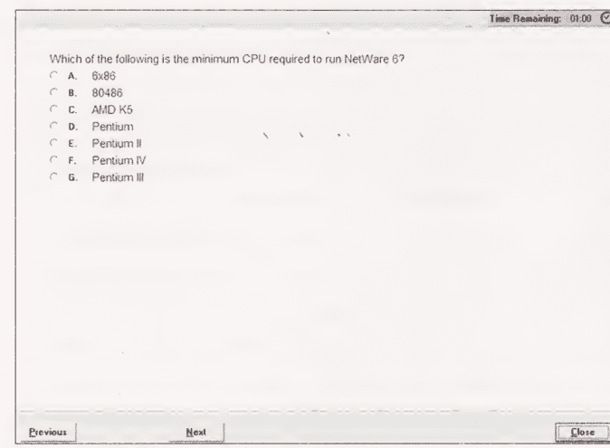

这类考试的优势在于它们非常有效地评估你对理论概念的掌握程度。它们也更容易创建和交付。

它们的弱点在于无法测试你实际执行目标中指定任务的能力。换句话说，它们倾向于评估你知道什么，而不是你能做什么。你可能以前听说过“纸上认证”（paper certified）这个术语。这个术语指的是那些通过了认证的多项选择考试，但实际上无法在工作中履行职责的网络管理员。Novell 希望确保这种情况不会发生在 CLE 认证中。

自 1999 年推出认证目录工程师（CDE）认证以来，Novell 一直是实践测试领域的先驱。Novell 实施的考试会向你呈现一个场景，然后要求你在没有指导的情况下，确定正确的解决方案并正确实施该解决方案。

这种策略的优势在于它真正验证了你是否已经掌握了目标中规定的技能。

通过实践考试的学生比仅通过传统考试的学生更有可能在工作中表现更好。对于求职者来说，这价值很高。它赋予了你与雇主谈判的筹码，使你能够提供更高程度的技能验证。

不幸的是，“已认证”的 IT 求职者多年来让许多雇主失望过。因为他们的技能仅在概念层面得到验证，其实际工作能力有时低于工作所需的标准。

实践认证测试有助于雇主筛选出资质较弱的求职者。当你申请工作时，如果你成功完成了实践考试，雇主对你能力的确信程度会更高。

然而，你应该意识到，实践考试的通过率往往远低于传统考试。要通过 CLE 实践考试，你可能需要花费比准备传统认证考试多两倍的时间来备考。有趣的是，Novell 报告称，尽管 CLE 考试的通过率低于传统考试，但大多数考生认为考试是公平的——甚至包括那些未通过的考生。本章稍后会给出具体的备考建议。

## CLE 实践考试是如何运作的

CLE 实践考试由图 1.2 中所示的组件组成。

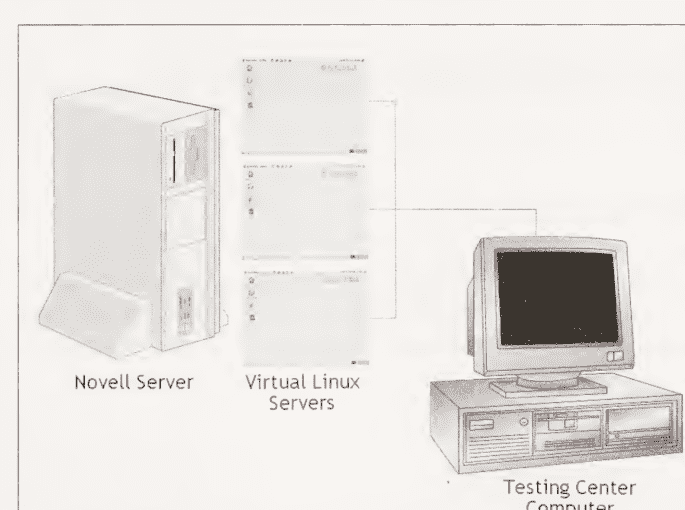

**图 1.2**

CLE 实践考试。

这些每个组件的作用如下。

### 测试中心计算机

CLE 实践考试的第一个组件是测试中心计算机。为了完成实践考试，你必须与 Novell 教育合作伙伴中心安排测试。你可以通过访问 `http://practicum.novell.com/partner_search.php` 来实现。在测试中心，你将使用测试中心计算机上的 Web 浏览器来访问运行在 Novell 服务器上的虚拟服务器。图 1.3 显示了 CLE 考试界面。

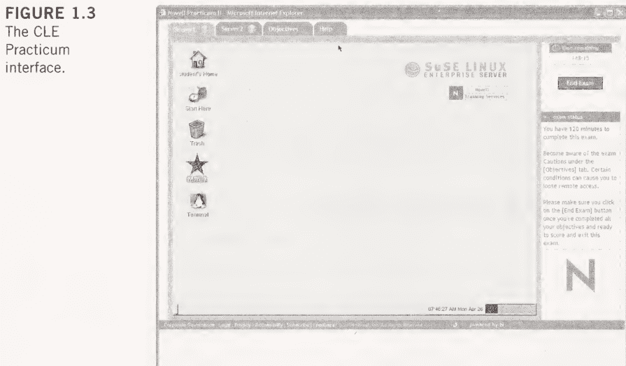

### Novell 服务器

实践考试的第二个组件是 Novell 服务器。该服务器维护在 Novell 的普罗沃校园内，用于运行 VMware，这是一种允许在单台计算机上同时运行多个操作系统的產品。有关 VMware 的更多信息可以在 `http://www.vmware.com` 找到。

### 虚拟服务器

实践考试的最后一个组件是在 Novell 服务器上运行的一组虚拟服务器会话。每个会话代表一台 SUSE Linux 服务器。这些服务器已经使用特定场景进行了预配置。

根据您需要完成的具体场景，您可能会发现这些服务器被故意配置错误。为了通过考试，您必须纠正所有错误，并在这些虚拟服务器中实施该场景的要求。

## CLE 实操考核提示与策略

当您在测试中心参加 CLE 实操考核时，请务必牢记以下提示。它们能为您省去许多麻烦！


严格按照所有说明行事！当您开始考试时，您将看到关于如何完成考试的详细说明。切勿跳过阅读这些说明。

您是通过 TCP/IP 连接访问虚拟服务器的。您**绝不应该**更改虚拟服务器的 IP 地址、子网掩码、路由器地址或 DNS 服务器地址。这样做会破坏您访问它们的能力。

系统将自动以非 root 用户身份登录到虚拟服务器。如果您需要 root 级别的访问权限，应打开一个终端会话并使用 `su` 命令。**在任何情况下都不应注销**。您将无法重新登录。

请记住，虚拟 Linux 服务器上运行着几个关键进程，它们在测试中心为您提供远程访问。除非您完全确定清楚某个进程的作用，否则不要终止正在运行的进程。如果您不小心终止了提供远程访问的进程，您的会话将会被关闭。

您**绝不应该**退出 X Windows 系统。如果需要访问 Shell 提示符，请打开一个终端会话。

如果需要重启服务器，请使用 `reboot` 命令。**绝不应该**使用 `halt` 或 `logout` 命令。

偶尔在使用虚拟服务器桌面上的 Mozilla 浏览器时，鼠标光标可能会消失。它可能会也可能不会自动返回。（有时快速晃动鼠标可以使其重新出现。）如果您无法找回光标，必须通过按 `Ctrl+Q` 退出 Mozilla，然后重新启动它。

首次在您服务器上加载 iManager 可能需要一些时间。请耐心等待。一旦它被加载到虚拟服务器的内存中，之后它应该能以合理速度运行。

请记住，您正在通过远程访问 Web 连接在一个虚拟服务器上完成考试。它的运行速度将远慢于真实的服务器。请保持耐心，不要“手点得过快”。

如前所述，通过 CLE 实操考核所需的努力将远远多于传统的认证考试。在您开始研究 CLE 目标之前，我们需要在本章中花些时间讨论一些应试策略，这些策略将有助于您成功完成实操考核。

### 阅读场景

请记住，CLE 实操考核是基于场景的。Novell 拥有许多不同的 CLE 场景。每一个场景都略有不同。当您在测试中心登录时，您将随机被分配其中一个场景以完成考试。

当您收到您的场景时，请牢记以下几点：

- 仔细阅读场景。由于实操考核有时间限制，您的第一反应可能是立即开始在虚拟 Linux 服务器上工作。请务必避免这种冲动。您必须逐行通读您的场景。花时间阅读是值得的。
- 在阅读时，仔细分析场景的细节。您的测试中心应提供草稿纸或白板供您做笔记。请使用这些材料记录以下信息：
    - 场景中确定的问题或错误状态是什么？
    - 场景中是否有任何特殊或不寻常的条件？
    - 需要满足哪些标准才能使场景被视为已解决？（列出每个项目至关重要！）
    - 您可以运行哪些测试来验证每个成功标准是否已满足？
- 在阅读场景时，不要假设您的服务器已正确配置。根据您的场景不同，您可能需要隔离并解决各种配置错误的参数。
- 在您通读并分析完场景后，再读一遍！您很可能会发现自己错过了一两个项目。将这些项目添加到您的场景分析中。

### 制定您的策略

在您彻底阅读并分析了场景之后，您会再次受到诱惑，想要立即跳进去开始在您的虚拟服务器上工作。请务必避免这种冲动！

在开始处理您的服务器之前，必须使用您的场景分析来制定行动计划。再次使用测试中心的草稿纸或白板，确定您为解决场景中的状况必须完成的每一项任务。按照它们必须完成的顺序列出它们。

### 实施您的计划

当您彻底分析了场景并制定了策略后，现在您可以顺应冲动，实际上开始在虚拟服务器上工作了。如果您组织得当，应该能够迅速且有章法地完成该场景。

在执行过程中，重要的是您要留意那些在场景中未过多描述的潜在隐藏问题。随时准备重新评估您的计划。

### 测试解决方案

作为您整体计划的一部分，您应该已经确定了如何测试您的解决方案，以确保您已完成场景中的每个标准。（值得注意的是，许多 CLE 候选人未能完成这一简单任务。）

当您完成计划中的每项任务后，实施您的评估计划并验证场景是否真正完成。

您有很大的几率会发现仍有**一个或多个**问题未解决。识别每一个问题，并再次制定解决这些问题的计划。

如果您研究本书中的材料，通过实验练习进行实践，遵循考试说明，制定策略，并测试您的实施，您将大大增加通过 CLE 实操考核的机会。让我们回顾一下本章所学的内容。

## 摘要

在本章中，您被介绍了 Novell 的 CLE 认证。您了解了它的目的、受众以及交付方式。

随后，您了解了 CLE 实操测试环境的性质。您了解了组成实操考试的各个组件。

最后，我们为您提供了一些提高通过 CLE 实操考试几率的应试提示和策略。

在接下来的两章中，您将会学习 Linux 的基础知识。之后，随着书的进展，我们将深入探讨 NNLS 的各个组件。

# 第 2 章

## SUSE Linux 简介

本章涵盖了 Novell 课程 3015：Novell 企业 Linux 服务的以下测试目标：

- 描述 Linux 的特征。
- 使用 Linux 命令行界面。
- 管理 Linux 文件系统。

在本章中，我们将介绍安装和管理 Novell 企业 Linux 服务 (NNLS) 实施所需的 Linux 概念和技能的一般概述。如果您已经具备扎实的 Linux 背景，您可能可以跳过直接前往第 3 章“Linux 管理和配置”。

## Linux 概述

覆盖的测试目标：

- 描述 Linux 的特征。

如第 1 章“CLE 实操考试简介”中所述，Novell 在设计认证 Linux 工程师 (CLE) 认证时面临一个艰难的决定。它是应该面向需要学习如何管理其在 Linux 平台上已经熟悉的 Novell 产品和服务的现有 Novell 认证 Novell 工程师 (CNE)，还是应该面向需要学习如何使用 Novell 产品和服务的 Linux 专业人士？

经过大量的讨论和辩论，Novell 决定让这项认证同时面向两类受众。为了适应那些可能没有 Linux 背景的人员，Novell 在 CLE 中包含了一系列涵盖一些基本 Linux 概念的目标。

本学习指南中的本章和第三章简要介绍了 Linux，并回顾了一些常见的 Linux 管理任务。请注意，Novell 假定你在参加本课程之前具备一定的 Linux 经验。

本章和第三章的内容并不旨在让你成为 Linux 专家。相反，它们旨在帮助你学习完成学习指南中稍后出现的练习所需的关键任务。如第一章所述，如果你是 Linux 新手，可能需要获取额外的 Linux 学习材料。

如果你已经熟悉 Linux 操作系统，你可以跳过本章，直接阅读第四章“Novell Nterprise Linux Services (NNLS) 简介”，并将本章和第三章作为参考。

## Linux 的历史回顾

Linux 在计算机软件世界中是一个相当特殊的存在。大多数软件产品，无论是应用程序还是操作系统，都是作为有计划且组织良好的工作的一部分开发而成的。通常，软件公司首先识别客户需求。然后，他们组建一个设计团队来制定产品需求文档（PRD）。

PRD 中的任务分配给软件开发团队，他们编写各自负责的代码部分。开发的代码会被检查，产品会通过一系列 alpha 和 beta 阶段测试周期进行测试。如果产品符合预期（或者至少大致接近），成品就会发货给客户。

在客户使用产品一段时间后，软件公司会发现其缺陷，修订过程将再次从头开始这个循环。

Linux 的诞生并不符合这种企业产品开发周期。相反，是一个人——Linus Torvalds——最初在芬兰赫尔辛基大学读研究生期间开发出来的。

在 20 世纪 90 年代初的学习期间，Torvalds 对一个名为 Minix 的自由软件产品产生了兴趣。Minix 是一个商业开发的 Unix 操作系统版本，用于教育目的。荷兰大学教授 Andrew S. Tanenbaum 开发了 Minix，它的外观和行为类似于 Unix，但完全是从头编写的。当时，有三种主要的操作系统可用：

- MS-DOS（以及 PC-DOS 和 DR-DOS 等其他变体）
- Mac OS
- Unix

这些每个操作系统的源代码都受到专利和版权的严格保护。在较早的时间点，Unix 的源代码曾被提供给大学用于教学目的。然而，这种做法后来停止了，这使得 Tanenbaum 无法有效向学生讲授操作系统的内部工作原理。为此，他开发了一个小型的 Unix 内核教育版本，他将其称为 Minix。其目的是为学生提供可以访问源代码的真实操作系统。预示着未来趋势，Tanenbaum 在他的教科书《操作系统：设计与实现》中包含了 Minix 的源代码。


受 Tanenbaum 及其 Minix 操作系统的启发，Torvalds 在 1991 年开发了他自己的 Unix 克隆版本，并将其命名为 Linux。重要的是要注意，Torvalds 最初并没有开发一个包含完整应用程序和实用工具套件的完整操作系统。相反，1991 年 10 月 5 日发布的 Linux 0.02 版本仅提供 Linux 内核和三个实用工具：`bash`（一种命令行界面）、`update`（一种用于刷新文件系统缓冲区的工具）和 `gcc`（一种 C++ 编译器）。

> **注意**：有趣的是，Tanenbaum 和 Torvalds 并不总是相处融洽。据报道，他们曾进行过多场激烈的电子邮件讨论。

在一个前所未有的举动中，Torvalds 将 Linux 源代码通过互联网向任何想要下载的人免费开放。Torvalds 甚至更进一步，邀请其他程序员完善和增强他的代码。从那时起，Linux 成为了一个全球协作项目。Linux 内核 1.0 版于 1994 年发布。自那以来的结果简直令人惊叹。

## 关于 GNU

如果不介绍 GNU's Not Unix (`GNU`)，对 Linux 历史的讨论将是不完整的。GNU 运动对 Torvald 开发 Linux 产生了重大影响。

在 20 世纪 80 年代初，麻省理工学院（MIT）的一位名叫 Richard Stallman 的程序员对软件开发的专有性质提出了异议，因此他在 1983 年启动了 GNU 项目。该项目致力于推动可自由分发的源代码的发展。Stallman 认为，源代码不应受到复制、修改和重新分发的限制。他相信，允许程序员修改应用程序的源代码将产生更好的软件。

随后，诸如 GNU C 编译器（`gcc`）等强大的应用程序被开发出来，其中许多被编写为在 Linux 上运行。Linux 上可用的众多强大 GNU 应用程序的存在，是将 Linux 内核从爱好者项目转变为一个能够执行实际工作的强大工具的关键因素。

Linux 本身是在 GNU 通用公共许可证（`GPL`）下授权的，该许可证确保操作系统的源代码将对任何想要的人保持自由可用。任何人都可以自由下载 Linux 内核的源代码，根据自己的需求对其进行修改，然后重新编译和运行。

这是 Linux 的一个非常重要的方面，因为大多数软件供应商不提供其产品的源代码。为了进一步保护自己，大多数供应商在其最终用户许可协议（`EULA`）中都有一个禁止用户反向编译软件的条款。

> **注意**：*反向编译是一个过程，在此过程中针对二进制文件运行一个特殊应用程序，将该文件作为代码重新生成为文本文件。生成的代码并不是原始源代码的完全副本，但它可以非常接近。*

## Linux 发行版

你可能已经知道，有许多不同的 Linux 发行版可用。在这些选择中，有 SUSE Linux、Red Hat Linux、Slackware Linux 以及许多其他版本。这是 Linux 的又一个独特特征——几乎所有其他操作系统都是由单一供应商开发和营销的。例如，唯一开发和销售 OS X 的供应商是 Apple Inc. 你无法从 Novell 或 Microsoft 处获得 Mac OS 的他们的版本。

然而，对于 Linux，有许多不同的独立公司，每家都销售自己的发行版。

`GPL` 还允许开发人员将自己的实用工具和应用与内核捆绑在一起，创建所谓的*发行版*（distribution）。

打个比方，假设你想购买最新版 Windows 的副本。如果 Windows 是在 `GPL` 下授权的，你会发现当地的电脑店有来自许多不同软件供应商的数百种不同“风味”的操作系统，其中只有一个是 Microsoft。

每种风味与其他略有不同；尽管它们仍然基于相同的操作系统内核。一种可能针对提供基于 Web 的服务进行了优化，另一种可能针对视频编辑进行了优化。想象一下能够筛选不同的风味，找到最适合你想要做的事情的那一个。

听起来很牵强——但对于 Linux 来说，这正是你所能拥有的。许多不同的软件供应商采用基本的 Linux 内核，根据他们的规范进行修改和重新编译，捆绑一些增值应用程序，并将其作为自己的 Linux 发行版重新分发。

今天，确切地说，有超过 100 种不同的发行版可用。本课程将使用 Novell 的 SUSE Linux 作为运行 `NNLS` 的发行版。然而，第二章和第三章中教授的大多数概念和技能都可以转移到几乎任何其他发行版。你可以通过访问 `http://www.linuxiso.org` 了解更多关于这些 Linux 发行版的信息。

## Linux 在计算机系统中的作用

现在让我们转向讨论 Linux 在计算机系统中所起的作用。相信与否，这实际上是许多人感到困惑的一个问题。由于过去二十年内销售的绝大多数 PC 系统都安装了 MS-DOS 或 Windows 的某个版本，许多最终用户并不理解操作系统的模块化作用。

许多人倾向于将操作系统视为 PC 的不可分割的组成部分。我遇到过许多用户，他们误以为 Linux 是运行在 DOS 或 Windows 之上某种应用程序。我礼貌地向他们解释，Linux 是一个操作系统，而不是应用程序，它是用来*替代* DOS 或 Windows 的。换句话说，它是 Windows 的替代品，而不是互补的应用程序。

即便有了上述解释，许多人仍然难以接受将 Windows 或 DOS 从系统中移除并改用 Linux 作为操作系统的做法。为了避免这种误解，让我们来探讨一下操作系统的通用角色。

所有操作系统，无论是 DOS、Windows、Mac OS、Unix、NetWare 还是 Linux，在计算机系统中都提供四个关键功能：

- **应用程序平台**——应用程序通常不直接访问系统硬件。操作系统提供了一个可以运行应用程序的平台。操作系统管理和优先化应用程序对系统的访问。

- **文件存储**——操作系统提供了一种从系统存储设备中写入、组织和检索数据的方式。

- **安全性**——大多数现代操作系统都是多用户系统。它们使用由系统管理员配置来规则来识别系统的授权用户以及他们在系统内可以执行的操作。

- **硬件协调者**——操作系统的一个关键角色是为应用程序提供对系统资源的便捷访问。它提供了一种让应用程序寻址系统、将信息放入 RAM、读写硬盘信息以及与打印机、COM 端口或网络板等外设通信的方式。应用程序程序员无需从头编写代码来执行这些任务，因为大多数操作系统都包含预先编写好的可重用例程，供程序员用于与系统硬件交互。它还提供了管理键盘等系统输入和输出设备的方法。

操作系统之间的区别在于它们的设计方式以及它们如何履行这些角色。正如你可能猜到的，某些操作系统比其他操作系统更能胜任这些角色。

## 介绍 Linux 用户界面

为了让操作系统有用，它必须提供一个接口，使最终用户能够轻松地与其通信。Linux 提供两种用户界面：

- **命令行界面**——Linux 的基本接口是命令行界面。用户通过在 shell 提示符处输入命令与操作系统通信。图 2.1 展示了一个常见的 Linux shell 提示符。


**图 2.1**

Linux 命令行界面。

- **X 窗口系统图形界面**——在图形用户界面占主导地位的世界中，仅具备命令行的操作系统可能会遇到一些阻力。当今世界上有许多计算机用户，包括最终用户和系统管理员，从未使用过命令行界面。为了使其更易于使用，XFree86 项目开发了一个在 Linux 上运行的 X 窗口系统。使用基础的 XFree86 系统加上窗口管理器（如 GNOME 或 KDE），用户可以在图形环境中与 Linux 内核交互。图 2.2 展示了 SUSE Linux 上的 GNOME 图形界面。

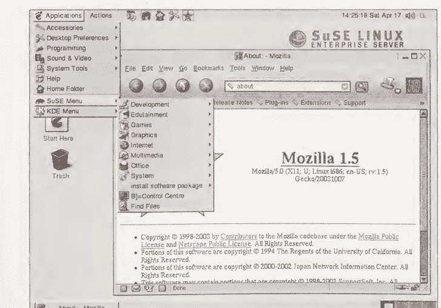

**图 2.2**

Linux 图形界面。

## 介绍 Linux 文件系统

如本章前面所述，操作系统承担的一个关键角色是管理一个存储系统，允许从软盘驱动器和硬盘等存储设备中写入和检索文件。

Linux 使用与其他你可能熟悉的操作系统非常相似的层次化文件系统。请考虑图 2.3 中所示的 Windows 文件系统。

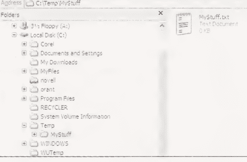

**图 2.3**

Windows 文件系统。

在 Windows 文件系统的顶部是根目录。在此示例中，它是 `C:\`。

> **实际案例**
>
> 从技术上讲，`C:` 标识分配给 `NTFS` 分区的驱动器字母。反斜杠 `\` 表示该分区上文件系统的根目录。

文件或目录可以存在于根目录内。有时这些被称为子目录。子目录可以包含其他子目录或文件。在此示例中，有一个名为 `MyStuff.txt` 的文件。它位于 `MyStuff` 目录中。`MyStuff` 是 `Temp` 目录的一个子目录；而 `Temp` 本身又是根目录 `\` 的一个子目录。

为了描述文件 `MyStuff.txt` 的位置，你将在文件名前加上该文件的路径。在此示例中，你会使用 `C:\Temp\MyStuff\MyStuff.txt`。


Linux 的工作方式非常相似。但是，有一些差异你需要了解。请考虑图 2.4 作为一个示例。

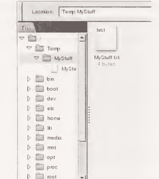

**图 2.4**

Linux 文件系统。

与 Windows 文件系统一样，这里也有一个根目录。不同之处在于，Linux 根目录不是用 `\` 引用的，而是用 `/` 引用的。根目录包含子目录和文件。在此示例中，有一个名为 `MyStuff.txt` 的文件，位于 `MyStuff` 目录中。该目录是 `Temp` 目录的一个子目录——而 `Temp` 本身又是根目录 `/` 的一个子目录。

请注意，到目前为止，唯一的明显差异是没有驱动器字母，以及斜杠的方向。Windows（以及 DOS）在目录结构中使用反斜杠字符（`\`）。而另一方面，Linux 使用正斜杠（`/`）。

然而，Windows 文件系统和 Linux 文件系统之间还有更重要的差异。让我们在随后的章节中调查 Linux 文件系统的一些最关键方面，你需要理解这些才能在课程中取得成功。

### 大小写敏感性

回忆我们的 Windows 示例：你可以通过 `C:\TEMP\MYSTUFF\MYSTUFF.TXT`、`C:\TEMP\MYSTUFF\MyStuff.txt`、`C:\Temp\MyStuff\MYSTUFF.TXT` 或任何其他大小写字符的组合来引用指定为 `C:\Temp\MyStuff\MyStuff.txt` 的文件。Windows（或 DOS）下的文件和目录名称不区分大小写。

然而，在 Linux 下，文件和目录名称非常区分大小写。在此处给出的示例中，正确的路径和文件名是 `/Temp/MyStuff/MyStuff.txt`。如果你尝试将此文件引用为 `/TEMP/MYSTUFF/MYSTUFF.TXT` 或 `/temp/mystuff/mystuff.txt`，它将失败。根据用于定义 Linux 文件系统的标准，这两个名称指向完全不同的文件和目录。

### 挂载点

Windows 文件系统使用驱动器字母——在给出的示例中，驱动器字母是 C。NTFS 和 FAT 文件系统使用驱动器字母来唯一地识别硬盘上的分区。驱动器上可能有一个或多个分区（每个分区都分配了各自的驱动器字母），也可能只有一个涵盖整个驱动器的分区。每个驱动器字母下方都有自己的层次结构。

另一方面，Linux 不使用驱动器字母。与 Windows 一样，Linux 文件系统可以使用多个分区，但 Linux 文件系统不使用为每个分区分配新的驱动器字母，而是使用挂载点将每个分区整合到同一个层次结构中。

挂载点只是文件系统中指向另一个 Linux 分区的一个目录。这个分区可以是同一系统中的同一硬盘上的分区，可以是同一系统中不同硬盘上的分区，甚至是另一台 PC 中硬盘上的远程文件系统。

> **注意**
>
> 要挂载远程文件系统，你必须使用网络文件系统（NFS）服务。

当你切换到设置挂载点的目录时，Linux 文件系统会将你带到不同的分区或文件系统。

例如，假设你使用 Linux 系统编辑视频素材。你处理的原始文件占用大量空间，你需要向系统添加一个新的 200GB 硬盘。

为此，你首先需要分区并格式化该驱动器。然后，你可以在现有文件系统中创建一个目录，用于挂载新的分区——例如，在 `/home/rtracy/rawfootage`。然后，你可以使用 `mount` 命令将新的硬盘挂载到文件系统中。

> **实际案例**
>
> 要在系统每次启动时自动挂载该分区，你可以将一项条目放入 `/etc/fstab` 文件——这是一个文件系统表。我们将在本书的后文中介绍 `fstab` 文件。

为了将文件保存到新的硬盘上，你只需将其保存到 `/home/rtracy/rawfootage`，它就会被自动重定向到新磁盘。

这种比喻同样适用于 CD、DVD 或软盘等可移动设备。请回想一下，在 Windows 文件系统中，软盘驱动器和 CD/DVD 驱动器会被分配独立的驱动器字母。

在 Linux 中，这些设备会被挂载并整合到 Linux 文件系统的单一统一层次结构中。在 SUSE 系统上，CD 或 DVD 默认挂载在 `/media/cdrom` 目录中。软盘默认挂载在 `/media/floppy` 目录中。SUSE 使用 `/mnt` 目录来挂载本地硬盘或远程 NFS 文件系统。

> 使用 `mount` 命令，你实际上可以将 CD 或软盘挂载到文件系统中你指定的任何目录。

在其他 Linux 发行版中，例如 Red Hat，CD/DVD 的默认挂载目录是 `/mnt/cdrom`。软盘的默认挂载目录是 `/mnt/floppy`。

另一个区别在于，在 Windows 系统中，一旦你将软盘或 CD/DVD 插入系统，它立即可用。而在 Linux 中，这取决于你使用的发行版。在一些系统上，当你插入 CD、DVD 或软盘时，必须手动挂载后才能访问它。

其他系统可能会运行一个进程来检测光盘或软盘的插入，并自动将其挂载到 `/etc/fstab` 文件中指定的默认挂载目录。

## Linux 分区

Windows 和 Linux 文件系统之间的一个关键区别在于所使用的分区类型。Windows 95、98 和 Me 提供 FAT16 和 FAT32 分区类型。Windows NT、2000 和 XP 提供 FAT32 和 NTFS 分区类型。

虽然 Linux 实际上可以将其分区挂载到其层次树中，但 Linux 文件系统本身使用非常不同类型的分区。较旧的 Linux 发行版使用 EXT2 分区。较新的发行版使用 EXT3（Red Hat 及其他）或 ReiserFS（SUSE）分区类型。

EXT3 和 ReiserFS 分区使用一种称为日志记录（journaling）的过程。为了理解日志记录，你需要了解系统的一个关键职责是保护数据完整性。

实现这一目标的方法之一是记录文件系统中每个文件的信息，例如其大小、最后修改的日期和时间，以及其路径。

在 EXT2 分区中，不当的系统关机可能会导致部分缓存数据未能正确写入磁盘。

当系统随后重启时，`fsck`（文件系统检查）实用程序会自动检测到该问题并尝试修复。这个过程的问题是，`fsck` 可能需要大量时间才能修复所有问题，具体取决于文件系统的大小。

EXT3 和 ReiserFS 通过一种称为日志记录的过程来弥补这一点。简单来说，日志记录过程在实际操作发生之前，记录将在文件系统所有文件上执行的每个操作。如果发生不当关机，系统只需检查日志并将其与文件的实际状态进行对比。任何因不当关机而遗漏的操作都可以快速识别并随后完成。这使得关机不当的系统比使用 EXT2 分区的系统能更快地恢复启动。

另一个区别在于使用的分区数量。在大多数 Windows 系统中，单盘系统通常只使用单个分区，如图 2.5 所示。

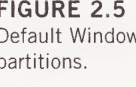

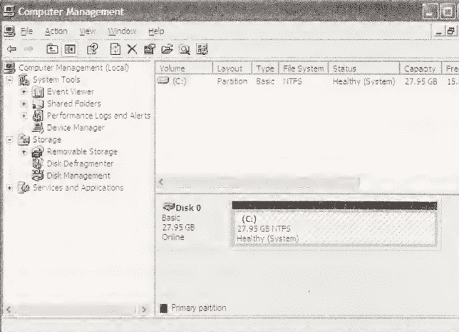

然而，在大多数 Linux 系统中，默认情况下有三个分区，如图 2.6 所示。

```
Br1: # fdisk /dev/sda

Command (m for help): p

Disk /dev/sda: 295 heads, 63 sectors, 522 cylinders
Units = cylinders of 16065 * 512 bytes

 Device Boot     Start   End Blocks Id System
/dev/sda1 *          1     2 16033+ 83 Linux
/dev/sda2           3    68 530145 82 Linux swap
/dev/sda3         69   522 3646755 83 Linux

Command (m for help):
```

### 图 2.6

默认的 Linux 分区。

- **/boot**—该分区是 EXT2、EXT3 或 ReiserFS 分区，通常大小为 50MB 到 100MB。该分区由图 2.6 中显示的分区列表中的第一个条目表示。请注意，它是唯一标记为可启动的分区。它包含 Linux 启动文件。由于它是可启动分区，它必须位于硬盘的前 1,024 个柱面内，但这通常不成问题。大多数 Linux 安装程序可以自动为你划分硬盘，并确保该分区位于磁盘上的正确位置。如果你决定手动划分驱动器，或者正在创建双启动系统，这就会成为一个问题。

- **/**—该分区是 EXT2、EXT3 或 ReiserFS 分区，并挂载在层次文件系统的根目录。它包含 Linux 系统文件、实用程序和用户文件。它由图 2.6 中显示的第三个分区表示。


### Swap（交换分区）
如果你熟悉 Windows，你会知道自 Windows 3.0 以来的每个版本都会在硬盘上创建一个交换文件。Linux 的做法略有不同。Linux 不使用文件系统中的文件，而是使用专用的交换分区。这是图 2.6 中显示的第二分区。同样，如果你让 Linux 安装程序为你划分驱动器，它应该会自动为你确定合适的大小。如果你手动划分硬盘，一般经验法则是交换分区的大小至少应与系统中的 RAM 容量相同。

## Linux 引导加载程序

*引导加载程序（bootloader）*是一小部分驻留在 PC 系统中第一个硬盘引导扇区的软件。当 PC 启动时，主板上的系统 BIOS 首先获取系统控制权。它运行各种测试，以验证系统内存、硬盘等关键硬件部件是否可用且正在响应。完成后，BIOS 会搜索引导加载程序。如果在预定位置找到它，BIOS 会将系统控制权移交给引导加载程序。

引导加载程序软件配置了操作系统启动文件在硬盘上的位置。如果安装了多个操作系统，可以配置引导加载程序向用户呈现一个简单的菜单，允许他们选择要加载的操作系统。

所有操作系统都附带某种引导加载程序。在 Linux 系统中有两个常用的引导加载程序：

- `Linux Loader (LILO)`—`LILO`引导加载程序曾用于早期的 Linux 系统。由于它曾非常流行，大多数现代发行版仍将 `LILO` 作为可选的引导加载程序提供安装。`LILO` 的配置参数存储在图 2.7 中所示的 `/etc/lilo.conf` 文件中。如果你对此文件进行了任何更改，在重启系统之前需要在 shell 提示符下输入 `lilo`，否则更改不会生效。

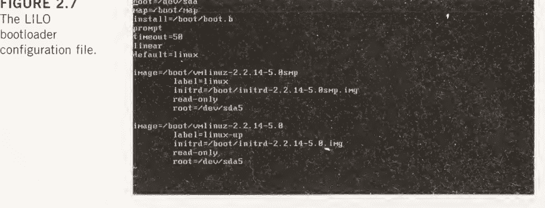

- `Grand Unified Boot Loader (GRUB)`—`GRUB` 是大多数较新的 Linux 发行版使用的默认引导加载程序。与 `LILO` 一样，你可以通过编辑其配置文件来自定义 `GRUB` 的工作方式。实际上有两个文件需要注意：`/etc/grub.conf` 和 `/boot/grub/menu.lst`。图 2.8 中显示了 `menu.lst` 文件。

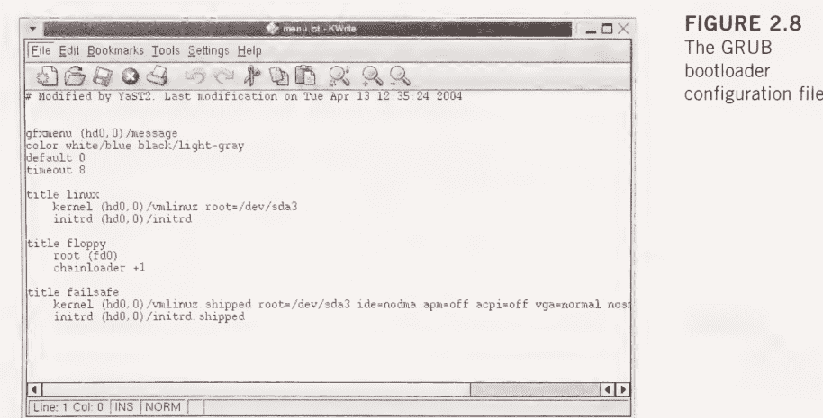

## Linux 用户简介

在真正安装新的 SUSE Linux 服务器之前，我们要讨论的最后一个话题是 Linux 用户账户。大多数现代操作系统都是多用户系统；这意味着多个人可以在同一台 PC 上使用相同的操作系统。当系统首次启动时，你必须使用有效的用户名和密码进行身份验证，之后才允许对系统进行其他操作。

> **注意**：Linux 实际上将这一概念推得更远。使用本指南未涵盖的各种实用程序和配置，多个用户可以*同时*使用相同的操作系统。

大多数 Linux 安装程序在首次创建系统时默认创建两个用户。第一个是 `root` 用户。该账户是超级用户账户。它相当于 Windows 系统中的 Administrator（管理员）账户或 NetWare 系统中的 Admin（管理员）账户。`root` 账户默认拥有系统中所有文件、服务和用户账户的所有权限。

在大多数安装例程中创建的第二个账户是一个通用用户账户，由你命名，对系统具有有限的访问权限。由于 `root` 账户权限如此之大，大多数系统管理员实际上除非必要，否则不会使用它。对于日常任务，他们会作为对系统具有有限访问权限的通用用户进行身份验证。当他们需要执行 root 级任务时，他们会在 shell 提示符下使用 `su –` 命令切换到 `root` 账户。

问题在于，如果管理员以 `root` 身份进行身份验证并整天保持登录状态，就会造成一个微小的安全漏洞，使未授权用户可以利用该漏洞。例如，考虑如果系统管理员以 `root` 身份登录后暂时离开去取她发送到打印机的几份文件，会发生什么。在她离开期间，一个不道德的人可能就有足够的时间利用 root 级别的访问权限来破坏系统。

为了避免这种情况，你应作为普通用户登录到系统中，仅在绝对必要时才切换到超级用户账户。

> 注意
>
> 如果你经常使用 `root` 账户，你的 Linux 系统管理员同行很可能会无情地取笑你！

每次创建新的用户账户时，系统都会自动在 `/home` 目录中为该用户创建一个主目录，如图 2.9 中为学生用户所示。

### 图 2.9
用户的主目录。

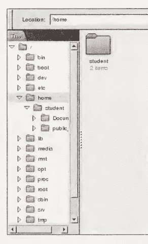

这个规则的例外是 `root` 用户。该用户账户拥有自己专属的主目录，称为 `/root`。

## 实验 2.1：安装新的 SUSE Linux 服务器

到目前为止，本学习指南侧重于为您提供 Linux 的总体概览。目标是让您获得足够的知识来安装您自己的 SUSE Linux 服务器。在此之后，我们的大部分工作都将在服务器本身上进行。在完成此步骤之前，我们无法继续。

要完成此练习，您需要以下物品：

- `一台实验室 PC`——此 PC 必须满足第 1 章中列出的规格。

> **务必备份此服务器上您希望保留的任何数据！** **我们将在本实验室中进行的安装将覆盖驱动器上的所有数据。**
>
> **作为替代方案，您可能需要考虑使用 VMWare, Inc. 公司的 VMWare Workstation。** 一旦安装在 Windows 2000 或 XP 工作站上，它允许您安装多个来宾操作系统，这些系统运行在 Windows 主机操作系统顶部的窗口中。有关更多信息，请参见 **http://www.vmware.com**。

- `您的 SLES 8 副本`——这包含在本学习指南中。

请确保您的系统配置为首先从 CD 驱动器启动。使用 BIOS 的 CMOS Setup 程序将其配置为这样。

要完成此练习，请执行以下操作：

1. 从 SUSE Linux Enterprise Server 8 CD 启动您的系统。
2. 在**安装**屏幕上，按下与最高可能屏幕分辨率对应的功能键。例如，如果想要选择 **1024×768**，请按 **F5**。如果遇到分辨率问题，请尝试较低的分辨率设置或尝试**文本模式**。
3. 选择**安装**。
4. 在**许可协议**屏幕上，选择**接受**。
5. 在**语言选择**屏幕上，选择您的语言，然后选择**接受**。
6. 在**安装设置**屏幕上，确保键盘布局和鼠标设置对于您的硬件是正确的。
7. 选择**分区**，然后选择**创建自定义分区设置**。
8. 选择**下一步**。
9. 标记您的硬盘驱动器，然后选择**下一步**。
10. 如果收到消息询问是否使用硬盘上剩余的可用空间，请选择**否**。
11. 选择**使用整个硬盘**，然后选择**下一步**。
12. 向下滚动并选择**软件**。
13. 选择**详细选择**。
14. 确保仅选择了以下产品组（取消选择不在此列表中的任何项）：
    a. Gnome 系统
    b. KDE 桌面环境
    c. 简单 Web 服务器
    d. LSB 运行时环境
    e. 帮助与支持文档
    f. 图形基础系统
    g. YaST2 配置模块
    h. 分析工具
    i. DHCP 和 DNS 服务器
    j. SLES 管理工具
15. 在 Filter 下拉列表中，选择**搜索**。
16. 在搜索框中，输入 **gettext**，然后选择**搜索**。
17. 在右侧窗格中，标记 **gettext** 软件包。
18. 在搜索框中，输入 **locate**，然后选择**搜索**。
19. 在右侧窗格中，标记 **findutils-locate** 软件包。
20. 选择**接受**。
21. 向下滚动并选择**时区**。
22. 从显示的列表中，选择您的时区，然后选择**接受**。
23. 选择**接受**以继续。
24. 当提示开始安装时，选择**是，安装**。
25. 当提示时，将 UnitedLinux CD 1 插入系统的 CD 驱动器，并选择**确定**。等待文件复制。
26. 当提示时，将 UnitedLinux CD 2 插入系统的 CD 驱动器，并选择**确定**。等待文件复制。
27. 当提示时，将 SUSE Enterprise Linux 8 CD 1 插入系统的 CD 驱动器，并选择**确定**。等待系统初始化。
28. 当出现 root 用户配置屏幕时，输入密码 **novell**，然后选择**下一步**。
29. 在**添加新用户**屏幕上，使用以下信息创建用户账户：
    - **名**—Student
    - **姓**—Student
    - **用户登录名**—student
    - **密码**—novell
30. 选择**下一步**。
31. 在**桌面设置**屏幕上，验证是否已检测到正确的视频卡和监视器。

> 建议使用最低 1024×768 的屏幕分辨率。

32. 标记 ***图形桌面环境***，然后选择**接受**。
33. 如果出现打印机警告，请选择**跳过检测**。


### 34. 按如下方式配置您的网卡：

a. 选择`网络接口`。

b. 选择`更改`。

c. 确保选中 `eth0`，然后选择`编辑`。

d. 选择`静态地址设置`。

e. 在`IP 地址`字段中，为网络输入适当的 `IP 地址`。

f. 在`子网掩码`字段中，为网络输入适当的 `子网掩码`。

> 如果您的服务器将驻留在您工作场所的网络上，请务必获得您的组织网络管理员的许可才能部署此服务器。此外，请与管理员协商以获得静态 IP 地址分配。如果您在未经他们允许的情况下随意获取一个并开始使用，他们往往会变得有点暴躁。

g. 选择`主机名`和`名称服务器`。

h. 在`主机名`字段中，输入 `CLE1`。

i. 在`域名`字段中，输入 `CLE.com`。

j. 选择`下一步`。

k. 选择`路由`。

l. 在`默认网关`字段中，输入默认网关的 IP 地址（如果有）。

m. 选择`下一步`。

n. 再次选择`下一步`。

o. 选择`完成`。

### 35. 检查您的安装设置，然后选择`下一步`。系统将重新启动。

### 36. 系统重新启动后，从`会话类型`下拉列表中选择 `gnome`。

### 37. 使用密码 `novell` 以 `root` 身份进行身份验证。

### 38. 如果您看到与终端图标图像相关的错误消息，请选择`确定`。然后完成以下操作以纠正错误：

a. 右键单击`终端图标`（它看起来像一只裸脚），然后选择`属性`。

b. 选择`无图标`按钮。

c. 向下滚动并选择 `gnome-term-linux.png`（它看起来像一只坐着的企鹅），然后单击`确定`。

d. 单击`关闭`。

e. 选择`操作，注销`。

f. 选择`保存当前设置`，然后单击`确定`。

g. 系统重新启动后，使用密码 `novell` 以 `student` 身份登录。

恭喜！现在您拥有一个功能齐全的 SUSE Linux 实现。在本章的剩余部分以及第 3 章中，我们将花一些时间学习如何使用该系统。

## 使用 Linux 命令行

- 使用 Linux 命令行界面。

Linux 提供了两种与操作系统通信的界面：图形界面和命令行界面。

尽管图形界面通常更容易使用，但本课程后续必须执行的许多任务最好从命令行完成。为此，Novell 在 CLE 认证中包含了一个目标，要求您展示您知道如何使用命令行。

为了允许用户通过命令行与内核交互，Linux 使用称为 `shell` 的命令行解释器。

### Linux Shell

如果您曾经使用过 MS-DOS 或 Novell 的 NetWare，您就已经熟悉命令行 shell 的概念了。Shell 只是一个命令解释器，允许您从键盘输入命令与操作系统内核进行交互。图 2.10 展示了一个典型的命令行界面。


**图 2.10**

Linux 命令行界面。

## 第 2 章 SUSE Linux 简介

在 MS-DOS 中，`COMMAND.COM` 提供了这种功能。与 Linux 的许多其他方面一样，你有多种不同的 Shell 可供选择。你可以尝试其中几个，然后选定你最喜欢的一个。一些更流行的 Shell 包括以下：

- `sh` (Bourne Shell)

- `bash` (Bourne-again Shell)

- `csh` (C Shell)

- `tcsh` (Tom's C Shell)

- `zsh` (Z Shell)

选择哪种 Shell 很大程度上是个人喜好的问题。如果你尝试每一种，你可能会发现它们的工作方式大致相同。

当你引导到命令提示符或在你的 Linux 系统上打开一个终端会话时，会使用一个默认 Shell。大多数发行版默认使用 `bash` Shell。

要确定你正在使用哪个 Shell，请在 Shell 提示符下输入 `env` 命令。该命令会列出当前登录用户的所有环境变量。其中一个变量就是当前正在使用的 Shell，如图 2.11 所示。

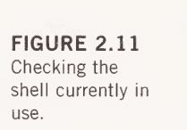

```text
student@CLE1:~> env
LESSKEY=/etc/lesskey.bin
TERM=xterm
INFOPATH=/usr/local/info:/usr/share/info:/usr/info
MANPATH=/usr/local/man:/usr/X11R6/man:/opt/gnome/man
HOSTNAME=CLE1
DISPLAY=:0.0
HOST=CLE1
TERM=linux
SHELL=/bin/bash
LC_ALL=en_US.ISO-8859-1
GNOME_PATH=/opt/gnome:/usr
ZUML=/usr/l1bp45
HOME=/usr/lib/java/jre
USER=student
LS_COLORS=no-00:fi-00:di-01:34:ln-01:36:pi-40;33:so-01;35:bd-01;33:30:cd-01;33:or-40;31:mi-01;05:su-01;34:sg-01;33:ca-01;33:tw-01;30:eo-01;36:ex-01;32:co-40;33:cm-00:30:in-00:30
S_COLORS=0:4:3:3:4:magenta:cd=33:ln=blue:or=red:ow=green:tw=white:ex=green
```

在这个例子中，可以看到当前正在使用 `bash` Shell，如 `SHELL` 变量所示。如果你想改变正在使用的 Shell，只需在当前 Shell 提示符下输入 `shell` 命令。例如，如果你正在运行 `bash` 并希望使用 `zsh`，只需在 Shell 提示符下输入 `zsh` 即可。要停止使用新的 Shell 并返回到原来的 Shell，请输入 `exit`。

Linux 完全有能力让 80x86 CPU 在 Real mode（实模式）下运行，这允许你同时运行多个命令行会话，即使你没有使用 XFree86 图形界面。每个会话都可以运行自己的程序，且互不干扰。

如果你正在运行一个程序，然后需要访问命令提示符，这会非常有用。例如，假设你正在安装 NNLS，并到达安装程序需要访问许可软盘的一步。你意识到你忘记插入并挂载软盘了。你可以简单地打开另一个会话，在第二个会话中挂载软盘，切换回第一个会话，并继续安装。

在继续之前，我需要指出这可以通过两种方式完成。首先，从基于文本的 Shell 提示符，你可以打开备用的命令行屏幕，每个屏幕都能独立于其他屏幕运行自己的程序。

其次，在 X Window System 内部，使用多个命令行界面可以通过两种不同的方式实现。第一种，也是最简单的方法是，简单地打开多个终端会话。每个终端会话都可以独立于其他会话运行自己的一组程序，如图 2.12 所示。

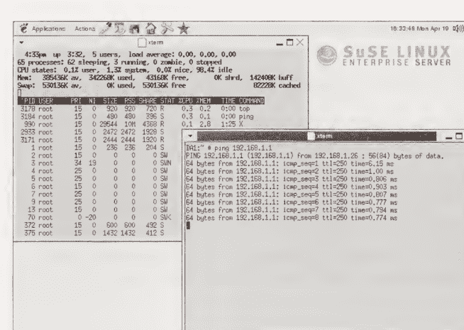

**图 2.12**

运行多个终端会话。

第二种方法是按 `Ctrl+Alt+功能键`。这将切换到基于文本的 Shell 提示符。这非常有用，因为某些任务，例如在 NNLS 中创建 eDirectory 用户，只能在基于文本的 Shell 提示符下完成。使用 `Ctrl+Alt+F1` 切换到第一个基于文本的控制台屏幕，`Ctrl+Alt+F2` 切换到第二个，依此类推，直到 `F6`。要切换回来，请按 `Alt+F7`，你将返回到你的 X Window System 会话。

如果你在没有运行 X Window System 的情况下运行你的 Linux 系统，只需按 `Alt+功能键` 即可在 Shell 提示符之间切换。例如，要切换到第三个备用控制台屏幕，只需按 `Alt+F3`。

## 从命令行使用 Linux 命令

要在 Linux 命令行上输入命令，你只需在 Shell 提示符下输入命令名称。

如果你熟悉在 Windows 或 DOS 下使用命令提示符，有一些重要的差异你必须注意。首先，虽然 Linux 实现了一个与 DOS 中使用的 `PATH` 变量类似的变量，但其用法不同。Windows 或 DOS 命令解释器会检查命令提示符下指定文件所在的当前目录，以及 `PATH` 变量中指定的目录。

> 注意 `PATH` 变量是一个环境变量，包含一个目录列表。

Linux 的工作方式类似；然而，它不会在本地目录中查找指定的文件。对于刚接触 Linux 的人来说，这是一个巨大的障碍。由于他们有 DOS 和 Windows 的先前经验，他们期望能够切换到可执行文件所在的目录并从命令行运行它。

相反，Linux 会搜索其 `PATH` 变量中的所有目录。典型的 Linux `PATH` 环境变量如图 2.13 所示。


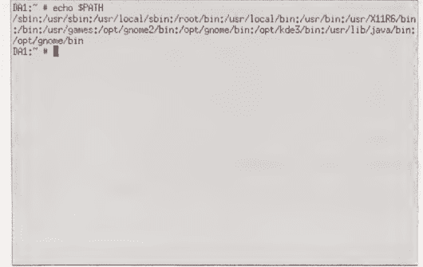

**图 2.13**

`$PATH` 变量。

有三种方法可以绕过这个问题：

- 你可以提供可执行文件的完整路径。例如，如果你想运行位于 `/usr/myfiles` 中名为 `helloworld` 的可执行文件，你可以在 Shell 提示符下输入 `/usr/myfiles/helloworld`。
- 你可以切换到可执行文件所在的目录。然后在命令前加上 `./`。在上面的例子中，我会切换到 `/usr/myfiles` 目录，然后在 Shell 提示符下输入 `./helloworld`。`./` 字符表示当前目录。通过在命令前加上它们，你告诉 Shell 程序在命令指定的文件中寻找当前目录。
- 你可以将 `./` 添加到 `PATH` 变量中。这将指示命令解释器无论当前目录在哪里，都检查本地目录。

你需要知道的另一个问题是我们在本章前面简要讨论过的。Linux 文件名和目录名是区分大小写的。因此，Linux 命令也是区分大小写的。如果你要运行的可执行文件是 `HelloWorld`，你必须在命令提示符下使用 `HelloWorld`。`HelloWorld`、`HELLOWORLD` 或 `helloWorld` 都不会工作。Linux 将每个视为不同的文件。

这也适用于目录名。如果你调用 `/usr/myfiles/helloWorld`，你必须使用准确的大小写输入命令。`/Usr/MyFiles/helloworld` 会将命令解释器指向完全不同的目录结构。

需要知道的最后一个问题是每个用户都有自己独立的 `PATH` 变量。如果你以 root 身份登录，你的 `PATH` 变量中将包含一些目录，这些目录如果你以其他用户身份登录将不存在。

## 常用的 Linux 命令

当你逐渐熟悉 Linux 操作系统时，你会发现有一些非常强大的命令是你反复使用的。以下是一些常用命令的列表：

> 还有许多其他 Linux 命令。不幸的是，涵盖所有内容超出了本学习指南的范围。如果你想了解更多关于 Linux 命令的信息，请参阅 Linux 参考书籍。

- `halt`—此命令关闭操作系统，只能由 root 运行。
- `init0`—此命令也关闭操作系统，只能由 root 运行。
- `reboot`—此命令关闭并重新启动操作系统。只能由 root 运行。
- `init6`—此命令关闭并重新启动操作系统。只能由 root 运行。
- `man`—此命令显示指定命令的手册页。这是一个非常有用的学习工具。如果你不确定如何使用任何命令，使用 `man` 来显示其手册页。你可以按 `q` 退出 man 页。
- `info`—此命令显示指定命令的帮助页。显示的信息往往比同一命令的 man 页更详细。
- `su`—此命令切换当前用户。例如，如果你以 `fred` 身份登录，需要切换到用户账户 `mary`，你可以输入 `su mary`。此命令最常用于切换到超级用户账户。如果你不提供用户名（也就是说，你只是输入 `su`），此实用程序假设你想切换到 root 账户。如果你输入 `su -`，你会切换到 root（超级用户）用户账户，并应用其所有环境变量。

> 因此，`su` 命令经常被误解为“super user”（超级用户）的缩写。事实上，它是“switch user”（切换用户）的缩写。

## Shell 实用程序

- `env`—此命令用于显示当前登录用户的环境变量。`env` 的输出结果如**图 2.11** 所示。请注意，其中包含用户名、默认 shell 和系统主机名等项目。
- `echo`—此命令用于在屏幕上显示一行文本。它在显示环境变量时非常有用。例如，如果你想查看 `HOSTNAME` 变量的当前值，可以输入 `echo $HOSTNAME`。如果你想查看当前登录用户的用户名，可以输入 `echo $USER`。

  > **实际应用**
  >
  > 该命令中使用的 `$` 告诉 `echo` 工具，其后的字符串是一个变量，而非字面字符串。如果你省略了 `$`，`echo` 命令将仅会在屏幕上显示文本 `HOSTNAME`。
- `top`—此命令是一个非常实用的工具，用于显示当前在系统中运行的所有进程的列表。你可以按多种标准对它们进行排序，包括 CPU 使用率、内存使用率、进程 ID 等。你还可以使用 `top` 来终止挂起的进程。要退出 `top` 工具，请按 `q`。
- `which`—此命令用于显示 shell 命令的完整路径。例如，如果你想知道 `top` 命令的完整路径，可以输入 `which top`。
- `whoami`—此命令用于显示当前登录用户的用户名。
- `netstat`—此命令用于显示网络状态，包括当前连接、路由表、多播成员资格和统计信息。
- `route`—此命令用于管理操作系统的路由表。你可以添加、删除和修改路由信息。
- `ifconfig`—此命令用于管理系统中的网络接口。如果你曾在 Windows NT、2000 或 XP 上花费大量时间，你很可能熟悉 `IPCONFIG` 命令。使用它你可以释放和更新 DHCP 连接、分配 IP 地址等。`ifconfig` 命令的用途与此非常相似。如果你输入 `ifconfig` 而不带任何参数，它将显示你的网络接口的当前配置参数。`ifconfig` 工具位于 `/sbin` 目录中。默认情况下，root 用户的 `PATH` 变量中包含此目录。你仍可以非 root 用户身份运行它，但你必须从 `/sbin` 目录中显式调用它。
- `yast2`—此命令在 SUSE Linux 系统中用于提供菜单驱动界面以配置系统。它既可以在基于文本的 shell 提示符下以纯文本形式使用，也可以在 X Window 系统下作为 GUI 工具使用。这是一个非常有用的工具。使用它，你可以执行以下操作：
  - 安装或移除软件。
  - 运行在线更新。
  - 配置外围设备，如打印机、声卡、鼠标设备、图形卡和显示器。
  - 配置网络接口。
  - 管理用户账户。
  - 分区硬盘驱动器。
  - 运行系统备份。

  > **实际应用**
  >
  > 在 Red Hat 系统中，等效的工具是 `setup`。
- `startx`—如果你的 Linux 系统配置为启动到 shell 提示符，你可以在此提示符下输入此命令来启动 XFree86 图形界面。

  > **实际应用**
  >
  > 在 Linux 领域，启动到 shell 提示符被称为*运行级别 3*。启动到 XFree86 图形环境被称为*运行级别 5*。关于运行级别的详细讨论将在第 3 章中进行。

在实施 NNLS 时，你会发现你需要频繁使用这些工具。为了确保你理解这些工具，让我们通过一个实验来练习使用它们。

## 实验练习 2.2：使用 Linux 命令行

在这个练习中，你将使用新安装的 SLES 8 服务器来练习使用常用的 Linux 命令，并回答一些棘手的问题。请查阅本章末尾的“练习答案”部分获取答案。

1. 启动你的服务器，并以密码 `novell`、会话类型 `gnome` 登录用户 `student`。
2. 完成以下操作：
   a. 在顶部栏中，选择终端图标。
   b. 你如何确定当前登录的用户是谁？（提示：有三种方法。）
   c. 在 shell 提示符下，输入 `su –` 切换到 root 账户。
   d. 当提示输入密码时，输入 `novell`。
   e. 在 shell 提示符下，输入 `reboot`。
3. 当服务器重启后，以密码 `novell`、会话类型 `gnome` 登录用户 `student`。
4. 再次打开一个终端会话。你如何确定你正在使用哪个 shell？（提示：有两种方法。）
5. `top` 实用程序的完整路径是什么？
6. 你主目录的完整路径是什么？
7. 通过完成以下操作来确定哪个正在运行的进程使用了最多的 CPU 时间：
   a. 在 shell 提示符下，输入 `top`。
   b. 输入 `P`（务必使用大写 P）。
   c. 哪个进程使用了最多的 CPU 时间？
   d. 打开第二个终端会话。
   e. 输入 `xclock`。
   f. 进程的排序是否发生了变化？
8. 通过完成以下操作来确定你的网络板使用哪个中断：
   a. 打开一个新的终端会话。
   b. 输入 `su` – 并提供密码 `novell` 以切换到 root 账户。
   c. 输入 `ifconfig`。
   d. `eth0` 使用哪个中断？
9. 假设你需要使用 `route` 命令在服务器上启用多播。你如何确定所需的开关和参数？
10. 关闭所有终端会话。

在本章末尾检查你的答案。如果你答对了，你就准备好继续学习如何操作 Linux 文件系统了。

## 操作 Linux 文件系统

**覆盖的测试目标：**


# 3. 管理 Linux 文件系统

为了有效地管理 Linux 服务器，你必须对 Linux 文件系统有透彻的理解。我们之前在本章中已经介绍了这个话题，但在接来的部分中，我们将更深入地探讨。

## 默认 Linux 文件系统结构

如果你熟悉 Windows 或 DOS，当你第一次遇到默认的 Linux 目录结构时，可能会感到完全困惑。它们之间几乎没有相似之处。

这是因为它们基于完全不同的标准。Linux 目录结构基于 Linux 标准基础（LSB）。LSB 项目的目标是鼓励各种 Linux 发行版遵守一套操作系统标准，包括文件系统组织方式。其目的是确保发行版之间的兼容性。

LSB 内部包含文件系统层级（FSH）标准。它定义了目录结构、命名标准和用途。有关 LSB 的更多详细信息，请访问 http://www.linuxbase.org。

全面审查所有默认 Linux 目录超出了本学习指南的范围。然而，Novell 的工作人员认为这一点足够重要，因此将其纳入了 CLE 考试。以下是你需要熟悉的常见 Linux 目录，以便在 CLE 实践考试中取得成功：

- `/bin`—此目录包含你在本章前面学到的大多数有用的命令行程序和 shell。其中包括 `echo`、`bash`、`zsh`、`su` 和 `netstat` 等。
- `/dev`—此目录在 Linux 文件系统中具有特殊用途——它包含代表系统硬件特殊链接的文件。例如，`/dev` 中有一个名为 `sda` 的文件。如果系统中存在第一个 SCSI 硬盘驱动器，此文件即指向该驱动器。如果你有第二个 SCSI 硬盘驱动器，`sdb` 文件将引用第二个驱动器。`hda` 文件指向系统中的第一个 IDE 硬盘驱动器。`fd0` 文件是指向软驱 A 的链接。
- `/etc`—此目录包含系统中各种应用程序和实用程序的文件。例如，本章前面提到的 `fstab` 文件就位于此目录中。你的 `hosts` 文件也位于此目录中。如果你需要配置 web 服务器，你会使用位于 `/etc` 的 `httpd` 子目录中的 `httpd.conf` 文件。由于此目录中的文件用于配置本地系统，因此一个 Linux 系统中的 `/etc` 目录文件与其他 Linux 系统中的文件不同。
- `/home`—此目录包含除 `root` 之外系统中每个用户的主目录。
- `/mnt`—此目录用作远程 NFS 文件系统的挂载点。它也用于挂载远程服务器上的 Samba 共享。在某些发行版（如 Red Hat）中，它用于挂载软盘和 CD 等可移动媒体。
- `/media`—此目录是 SUSE Linux 独有的。它用作可移动媒体的挂载点。
- `/root`—此目录是 `root` 用户的主目录。默认情况下，只有 `root` 可以查看此目录。
- `/tmp`—此目录用于存储由应用程序创建的临时文件。
- `/usr`—此目录用于存储二进制程序文件。例如，X Window 系统的计算器程序 `gcalc` 就存储在 `/usr/bin` 目录中。

> **实际应用**
>
> 许多人认为 `usr` 代表 "user"（用户）。这是不对的。缩写 `usr` 代表 Unix System Resources（Unix 系统资源）。

- `/var`—此目录有多种用途。手册页存储在这里，日志文件也存储在这里。诸如 `named` 和 `dhcpd` 等服务的数据文件也存储在这里。你还将看到 NNLS 也在此处存储其许多数据文件。

> **警告**
>
> 由于存储在 `/var` 中的数据可能会变得非常大（特别是安装了 NNLS 之后），你应该确保 `/var` 所在分区有大量的空闲空间。一些 NNLS 管理员实际上会向系统添加额外的磁盘，对其进行分区，并将其挂载到 `/var` 上，以确保不会用尽空间。

在本课程中，您将大量使用这些目录，因此建议将它们的名称和用途牢记于心。

请记住，这些是系统默认创建的目录结构。你可以随意修改该结构或创建自己的附加结构。但是，如果你这样做，请务必记录你的更改。未来的系统管理员可能会从你手中接管系统，他们需要知道你将在何处放置哪些内容。

## 命令行文件系统实用工具

与其他操作系统一样，Linux 提供了一套可用于管理文件系统的实用工具。这些工具包括创建目录、复制文件、移动文件、删除文件、移除目录、查看文件内容等功能。

根据我的经验，在图形化环境中学习职业技能的系统管理员，在面对命令行文件系统实用工具时往往会感到有些紧张。我曾听到他们提出这样的论点：如果可以使用图形化实用工具（例如 X Window System），为什么还要费心学习这些实用工具的命令行版本？

在 Windows 环境中，他们的论点有一定道理。Windows 的命令行实用工具通常不如其图形化对应工具功能强大。

但 Linux 并非如此。有两个很好的理由去学习如何使用 Linux 的命令行工具。首先也是最重要的，许多 Linux 系统管理员和部署人员实际上会在没有 X Window System 的情况下安装他们的系统。他们希望服务器系统运行得尽可能快，不希望“浪费” CPU 周期去重绘图形界面。其次，Linux 的命令行文件系统实用工具通常比其图形化对应工具功能更强大。大多数经验丰富的管理员都持此观点，更倾向于使用命令行实用工具而非其图形化等价物。

简而言之，要成为一名优秀的 Linux 系统管理员，你仅仅必须知道如何有效地使用命令行。鉴于此，让我们回顾一下一些最常用的命令行文件管理实用工具。请注意，本学习指南不会深入讲解使用这些命令所需的语法细节。你可以使用 `man` 命令来了解每个实用工具的具体使用方法。

### 请记住，这些命令是区分大小写的！

- `cat` – 此命令用于在屏幕上显示文本文件的内容。DOS 中的等效命令是 `TYPE`。其语法为 `cat _file_name_`。例如，要将系统日志的内容打印到屏幕，你可以输入 `cat /var/log/messages`。
- `cp` – 此命令用于复制文件。其语法与 MS-DOS 中使用的 `COPY` 命令非常相似。只需输入 `cp source_file destination_file` 即可。
- `cd` – 此命令与其 DOS 对应命令 `CD` 非常相似。它用于在文件系统中更改目录。其语法为 `cd directory_name`。
- `dir` – 此命令与 DOS 命令 `DIR` 非常相似。它用于显示目录内容的列表。其语法为 `dir directory_name`。如果未提供目录名称，它将显示当前目录的内容。如果添加 `-o` 开关，还将显示文件的所有者以及权限分配（将在下一章中讨论）。
- `find` – 此命令用于搜索目录或文件。例如，你可以输入 `find /tmp` 来查找 `/tmp` 目录及其子目录中的所有文件。
- `grep` – 此命令非常强大。它用于在文件中搜索表达式。其语法为 `grep expression file_name`。如果使用 `-i` 开关，`grep` 在搜索文件时将忽略大小写。该实用工具对于在大型日志文件中搜索特定文本非常有用。
- `less` – 此命令与 `more` 命令相关。它通常与另一个命令（如 `dir`、`ls` 或 `cat`）一起使用，以便一次暂停一屏显示较长的输出。例如，如果你对一个大型目录（如 `/usr/bin`）执行 `dir -o`，输出会迅速滚过屏幕，让你来不及阅读。相反，如果你输入 `dir /usr/bin -o | less`，输出将在每屏暂停，让你可以阅读文本。此命令还允许你向前或向后翻阅显示内容（这是 `more` 命令做不到的）。
- `locate` – 此命令与 `find` 命令类似。它用于在文件系统中搜索文件。它使用一个特殊的搜索数据库来加速搜索过程。`updatedb` 命令用于初始构建该数据库。要定位文件，请输入 `locate file_name`。

例如，你可以输入 `locate gnome-term-linux.png` 来定位你在 GNOME 中用作终端图标的图形文件。

- `ls` – 此命令与 `dir` 命令类似。它用于显示目录的内容。其语法为 `ls directory_name`。如果未提供目录名称，它将显示当前目录的内容。如果你附加 `-l` 开关，还将显示目录中文件的所有者和权限。
- `mkdir` – 此命令用于在文件系统中创建目录。它类似于 DOS 中的 `MD` 命令。其语法为 `mkdir path/directory_name`。如果你省略路径，目录将在当前目录中创建。
- `more` – 此命令与 `less` 命令类似。它与另一个命令（如 `dir`、`ls` 或 `cat`）一起使用，以便一次暂停一屏显示较长的输出。例如，如果你输入 `dir /usr/bin -o | more`，输出将在每屏暂停，让你可以阅读文本。


- `mv` – `mv` 命令类似于 DOS 下的 `MOVE` 命令。它用于在文件系统中移动文件。它还可以用于就地重命名文件。此命令的语法为 `mv source_path/file destination_path`。

- `pwd` – 此命令显示当前目录。

- `rm` – 此命令类似于 DOS 下的 `DEL` 命令。它用于删除文件系统中的文件。其语法为 `rm file_name`。

- `rmdir` – 此命令类似于 DOS 下的 `RD` 命令。它用于从文件系统中删除目录。其语法为 `rmdir directory_name`。

- `tail` – 这是一个非常有用 的命令，用于查看文本文件（如日志文件）中的条目。日志文件随时间推移可能会变得非常大。很多时候，你实际上只需要查看文件中的最后几条条目。`tail` 命令就适用于这些情况——它显示文本文件的最后 10 行（虽然可以配置为显示更多行）。其语法为 `tail file_name`。在排查 Linux 系统故障时，我发现最有用的工具之一就是对 `/var/log/messages` 文件使用 `tail`。通过使用 `-f` 参数，你可以持续监控该文件。

上述命令在维护 Linux 系统时非常有用，特别是当安装了 NNSL 时。此时，我们需要深入讨论几种你必须知道如何使用的实用工具，以便在你的 Linux 系统上安装和配置 NNS。这些工具包括 `mount`、`tar`、`gunzip` 和 `vi`。

## 使用 mount 命令

为了在你的 Linux 系统上安装 NNLS，你必须知道如何使用 `mount` 命令。此命令未包含在前面的列表中，是因为你需要深入了解其用法。每次你在 Linux 服务器的驱动器中插入软盘或 CD/DVD 光盘时，你可能都需要使用 `mount` 命令。

> **TIP**
>
> 一些 Linux 发行版使用自动挂载守护程序，它可以检测系统中的新磁盘并自动挂载它。

`mount` 命令的语法如下：

```
mount -t filesystem_type device mount_point
```

`mount` 命令支持许多不同的文件系统类型。对于 CLE 认证来说，实际上只需要关注两种。第一种是 ISO9660 文件系统。大多数数据光盘都使用它。另一种是 VFAT 文件系统。大多数软盘都使用它。

> **TIP**
>
> 从技术上讲，软盘可以使用任何支持该介质类型的文件格式进行格式化。然而，在本书中，我们将使用的软盘都将使用 FAT 文件系统格式化。这使得它们可以在 Windows 和 Linux 系统中都 readable。

请查看 `mount` 的手册页以了解支持的文件系统完整列表。

要在 SUSE Linux 系统上挂载软盘，你需要插入磁盘，然后输入 `mount -t vfat /dev/fd0 /media/floppy`。

> **NOTE**
>
> 请记住，你不必使用 `/media/floppy` 目录。你可以将磁盘挂载到文件系统中的任何位置。但是，许多应用程序在寻找软盘时硬编码为在 `/media/floppy` 中查找。

在 Red Hat 系统上，你会使用相同的命令，但会将软盘挂载到 `/mnt/floppy` 目录中。

如果你在 `fstab` 文件中有正确的条目，你就不必指定文件系统类型或挂载点。请参见图 2.14 中显示的 `fstab` 文件。

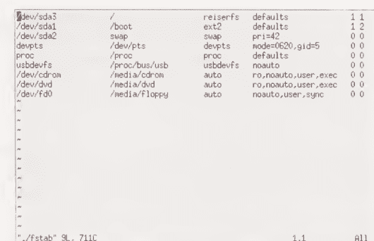

### 图 2.14

`fstab` 文件。

请注意，`/dev/fd0` 被配置为自动挂载到 `/media/floppy`。因此，你可以输入以下命令来挂载软盘：

```
mount /dev/fd0
```

你可以自定义 `fstab` 文件，使挂载过程更加简便。为此，请使用以下命令：

```
ln -s /dev/fd0 /dev/floppy
```

#### 注意

要了解如何使用 `ln` 创建链接，请输入 `man ln` 查看其手册页。

在你的系统上执行此命令后，会在 `/dev` 中创建一个名为 `floppy` 的文件，并在它与 `/dev/fd0` 文件之间创建一个符号链接。执行完成后，你只需输入以下命令即可在系统中挂载软盘：

```
mount /dev/floppy
```

CD 的挂载方式与软盘类似。在 SUSE Linux 系统中，将 CD 插入 CD 驱动器，然后输入以下命令：

```
mount -t iso9660 /dev/cdrom /media/cdrom
```

Red Hat 系统的挂载方式相同，只是默认挂载点为 `/mnt/cdrom`。

## 第 2 章 SUSE Linux 简介

注意在图 2.14 中，`fstab` 文件中有一个 `/dev/cdrom` 条目，配置其自动挂载到 `/media/cdrom` 目录。因此，你可以使用简化的 `mount` 命令来挂载 CD，如下所示：

```
mount /dev/cdrom
```

如果你的系统的 `fstab` 文件没有 `/dev/cdrom` 条目，你可以像处理软盘驱动器那样创建自己的符号链接。检查 `fstab` 文件中的 CD 驱动器条目。如果你的 CD 驱动器是次要 IDE 通道上的主驱动器（大多数 PC 制造商都是这样配置的），它在 `/dev` 中对应的链接将是 `hdc`。你可以输入以下命令来为 `/dev/cdrom` 创建符号链接：

```
ln -s /dev/hdc /dev/cdrom
```

一旦创建了这个链接，前面的 `mount` 命令就能正常工作。要访问已挂载的软盘或 CD，只需更改目录到挂载点即可。该介质上的文件将可以在该目录中访问。

请务必记住，在卸载之前不得移除已挂载的介质。你会注意到，一旦挂载，在卸载之前就无法打开 CD 驱动器门。然而，没有任何机制阻止你直接移除已挂载的软盘。

这可能是一个严重的问题。对软盘上文件所做的更改可能不会立即写入磁盘。卸载介质会立即将所有更改写入磁盘。如果在不卸载的情况下移除介质，文件可能会损坏。

要卸载已挂载的软盘，请输入以下命令：

```
umount /dev/floppy
```

或

```
umount /dev/fd0
```

要卸载已挂载的 CD，请输入以下命令：

```
umount /dev/cdrom
```

> 你也可以使用挂载点目录配合 `umount` 命令。例如，你可以输入 `umount /media/floppy` 来卸载软盘。

## 管理归档文件

在了解了挂载可移动介质的概念之后，本章仍需涵盖几个更多主题。Novell 希望你了解如何处理 Linux 归档文件，为 CLE 实操考试做准备。

大多数操作系统都有专门编写的程序，可以将多个文件压缩成一个 zip 文件。你之前可能从互联网下载过 zip 文件，或者收到过通过电子邮件发送的 zip 文件。

Linux 也有用于处理压缩文件的实用工具。不过，它与你可能在 Windows 或 Macintosh 平台上使用过的工具略有不同。Linux 使用两个独立的实用工具：`tar` 和 `gzip`。`tar` 实用工具（意为 *tape archive*，即磁带归档）用于将 Linux 文件系统上的多个文件合并为一个文件。磁带归档文件通常以 `.tar` 扩展名结尾。此归档文件未经压缩。

`gzip` 实用工具用于压缩文件。它可以用来压缩文件系统中的任意文件，但最常用于压缩归档文件。

`gunzip` 文件用于解压缩文件。使用 `gzip` 压缩的文件通常带有 `.gz` 扩展名。

如果你看到一个扩展名为 `.tar.gz` 的 Linux 文件，你知道这是一个使用 `gzip` 压缩的归档文件。

> **压缩归档文件有时被称为 tarballs（tar 球）。**

解压缩和提取 `tarball` 文件有两种方法。第一种方法是使用 `gunzip` 命令解压缩文件，语法为 `gunzip file_name`。文件解压缩后，你会发现它自动丢失了 `.gz` 扩展名。例如，如果你正在解压缩 `mystuff.tar.gz`，`gunzip` 过程产生的结果文件将是 `mystuff.tar`。

解压缩后，使用 `tar` 命令提取归档，语法为 `tar -xvf file_name`。`x` 选项告诉 `tar` 实用工具提取现有的归档文件。`v` 选项告诉 `tar` 实用工具在屏幕上显示提取过程的进度。`f` 选项告诉 `tar` 实用工具，紧随其后的文本字符串是要处理的文件名。

> **v 选项是可选的，但 x 和 f 选项不是。**

`tar` 实用工具还可以同时解压缩和提取，这是管理 `tarball` 文件的第二种方法。为此，只需在 `tar` 命令中添加 `-z` 选项并针对 `*.tar.gz` 文件运行它。这将自动解压缩并提取归档。例如，如果你有一个名为 `mystuff.tar.gz` 的 `tarball`，你可以输入 `tar -zxvf mystuff.tar.gz` 来解压缩并提取它。

### 编辑文本文件


我们要在本章中讨论的最后一个主题是编辑文本文件。Linux 与 Windows 的独特之处之一在于，大多数 Linux 配置更改都是通过编辑文本文件完成的。

如果你熟悉 Windows，你知道其大多数配置参数都存储在注册表中。注册表中的数据存储在一系列二进制文件中，这些文件只能用 `REGEDIT` 或 `REGEDIT32` 等二进制文件编辑器进行编辑。

另一方面，Linux 配置参数存储在一系列文本文件中，这些文件主要位于 `/etc` 目录中。

哪种方法更好？我猜测这个问题非常主观。我个人更喜欢编辑文本文件。对我来说，它们直观得多。在 Windows 中，我打开注册表键时不得不绞尽脑汁才能理解的情况太多了。而在文本文件中，程序员（并且通常会这样做）会将各种参数的文档作为注释包含在文件中。

大多数 Linux 发行版都包含多种文本编辑器，包括图形界面和命令行编辑器，你可以使用它们来编辑这些配置文件。

### 从命令行使用 vi

最常用的一种编辑器是 `vi`——一个命令行文本编辑器。根据你的发行版，你可能安装了 `vi` 或 `vim`（即 `vi improved`，vi 的改进版）。要在 `vi` 中打开文件进行编辑，请输入以下命令：

```
vi /path_to_file/file_name
```

执行此操作后，`vi` 启动并加载指定文件。例如，如果你需要编辑 `smb.conf` 文件（用于配置 Samba 服务），你可以输入 `vi /etc/samba/smb.conf`。执行后，将显示如图 2.15 所示的内容。

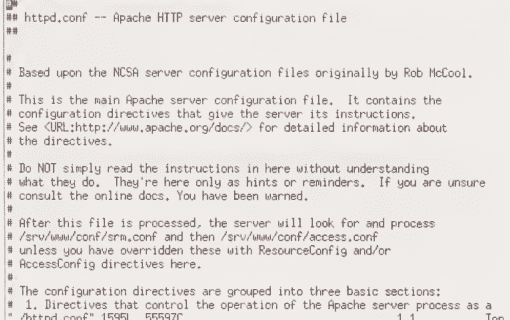

如果你习惯使用 Windows 下的记事本等文本编辑器，一开始可能会觉得 `vi` 有点令人困惑。你需要明白，`vi` 运行在两种不同的模式下：插入模式（Insert mode）和命令模式（Command mode）。

插入模式用于实际编辑文件。然而，当文件最初在 `vi` 中打开时，它是处于命令模式打开的。这就是图 2.15 中显示的内容。要编辑文件，你必须通过按 `Ins` 键或按 `i` 键进入插入模式，如图 2.16 所示。

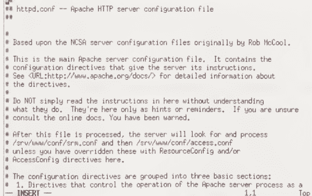

注意在图 2.16 中，当你处于插入模式时，屏幕底部会出现 `-INSERT-` 文本。当你处于命令模式时，此文本会消失，如图 2.15 所示。在插入模式下，你可以像使用其他任何文本编辑器一样编辑文件。要返回命令模式，请按 `Esc` 键。

在命令模式下，你可以输入命令来操作文件。要在命令模式下输入命令，你必须先键入 `:`。这会显示一个类似于命令提示符的界面，你可以在这里输入 `vi` 命令（参见图 2.17）。

#### 图 2.17

输入 `vi` 命令。

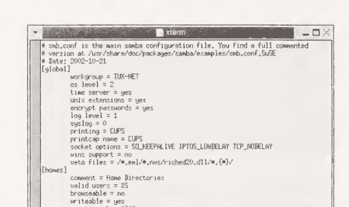

注意，你将在屏幕底部看到一个冒号（`:`）和光标，如图 2.17 所示。该光标用于向 `vi` 发送命令。例如，要退出 `vi` 并保存对当前打开文件所做的所有更改，你需要在命令提示符处输入 `exit` 或 `:q`。要退出 `vi` 而不保存文件更改，你需要输入 `quit!` 或 `:q!`。

全面回顾所有 `vi` 命令超出了本书的范围。幸运的是，`vi` 有一个完善的帮助系统可供使用。在 shell 提示符下，输入 `vimtutor` 以了解更多信息。

## 使用图形工具编辑文本文件

如果你不熟悉基于文本的编辑器，也可以使用 X Window System 环境中的几种图形化文本编辑器来编辑 Linux 配置文件。

在 Red Hat 系统中，你可以使用 `gedit` 工具。打开一个终端会话，并在 shell 提示符处输入 `gedit`。你也可以通过选择 `主菜单`、`程序`、`应用程序`、`gedit` 来运行它。这样做时，屏幕看起来如图 2.18 所示。

你会发现 `gedit` 的工作方式与 Windows 系统中的记事本工具非常相似。

在 SUSE Linux 系统中，你可以使用 `KWrite` 工具在图形环境中编辑文本文件。你可以通过选择 `应用程序`、`KDE 菜单`、`编辑器`、`KWrite` 来运行 `KWrite`。这样做时，会出现如图 2.19 所示的屏幕。

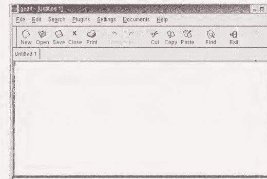

#### 图 2.18

使用 `gedit` 编辑文本文件。

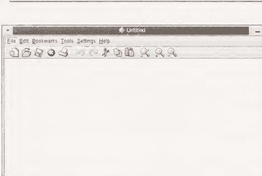

#### 图 2.19

使用 `KWrite` 编辑文本文件。

当你了解如何使用 `mount`、`tar`、`gunzip` 和 `vi` 时，你就具备了完成初始 NNLS 安装所需的技能。在继续之前，请确保你能够在实验练习 2-3 中使用这些工具。

## 实验练习 2.3：管理 Linux 文件和目录

在这个练习中，你将使用本章介绍的各种工具来完成常见的文件系统任务。答案位于本章末尾。完成以下操作：


在这个练习中，你将面对几种假设的情况，这些情况会指导你检查几个日志文件以查找错误消息。如果你的系统运行正常，你可能根本看不到任何错误消息。这完全没问题。（事实上，这是好事！）这个练习的目的是让你获得使用这些工具本身的经验，而不是排查实际问题。

- 1. 启动你的 Linux 服务器，并使用密码 `novell` 以 `student` 用户身份进行身份验证。
- 2. 打开一个终端会话。
- 3. 通过输入 `su -` 并提供密码 `novell` 切换到 root 用户账户。
- 4. 假设你的 Linux 服务器出现了问题，你想检查 `messages` 文件中是否有任何包含“error”一词的条目。完成以下操作：
  - a. 在 shell 提示符处，输入 `grep -i error /var/log/messages`。


使用 `-i` 选项指示 `grep` 工具忽略大小写，并在指定文件中查找搜索字符串的任何实例。
  - b. 你找到了哪些错误条目？
- 5. 假设你的系统刚刚再次发生了一个错误。你需要检查 `messages` 文件的末尾以查看发生了什么。
  - a. 在 shell 提示符处，输入 `tail /var/log/messages`。
  - b. 文件中记录的最后 10 条消息是什么？
- 6. 你决定在消息写入 `messages` 文件时捕获它们，以尝试在错误发生时捕捉到它。完成以下操作：
  - a. 在 shell 提示符处，输入 `tail -f /var/log/messages`。

`-f` 选项指示 `tail` 工具监控指定文件的更改，并在发生时在屏幕上显示它们。


  - b. 打开一个新的终端会话。
  - c. 在 shell 提示符处，输入 `su .`
  - d. 使用密码 `novell` 进行身份验证。
  - e. 通过输入 `exit` 注销你的超级用户会话。
  - f. 检查 `tail` 工具显示的消息。
  - g. 切换到 `tail` 正在运行的终端会话并按 `Ctrl+C` 退出 `tail`。
- 7. 通过完成以下操作练习挂载和卸载可移动媒体：
  - a. 通过在 shell 提示符处输入 `whoami` 确保你有 root 访问权限。如果你没有以 root 身份登录，使用 `su` 命令切换到该用户。
  - b. 将你的 SUSE Linux CD 插入服务器的 CD 驱动器。
  - c. 如果未自动挂载，输入 `mount -t iso9660 /dev/cdrom /media/cdrom`。
  - d. 通过输入 `cd /media/cdrom` 访问 CD 上的文件。
  - e. 通过输入 `ls` 生成 CD 上的文件列表。
  - f. 通过输入 `ls -l` 生成 CD 上文件的详细列表。
- 8. 通过完成以下操作练习管理文件和目录：
  - a. 在 shell 提示符处，通过输入 `mkdir /tmp/files` 在 `/tmp` 中创建一个名为 `files` 的新目录。
  - b. 使用 `ls` 或 `dir` 命令，选择挂载的 CD 上的一个文件进行复制。
  - c. 通过输入 `cp ./file_name /tmp/files` 将此文件复制到 `/tmp/files`。
  - d. 通过输入 `cd /tmp/files` 切换到 `/tmp/files` 目录。
  - e. 通过输入 `ls -l` 验证文件已复制。
  - f. 通过输入 `rm ./file_name` 删除你刚刚复制的文件。


- g. 通过输入 `cd /` 切换到文件系统的根目录。
- h. 通过输入 `rmdir /tmp/files` 删除你创建的目录。
- i. 如果被要求确认，输入 `y`。
- j. 通过输入 `umount /dev/cdrom` 卸载 CD。
- k. 将 CD 从 CD 驱动器中取出。

## 9. 练习编辑文件

> **警告** 完成此练习的这一步骤非常重要。创建的文件将在下一章的实验练习中使用。

- a. 通过输入 `cd /tmp` 切换到 `/tmp` 目录。
- b. 使用 `vi` 通过输入 `vi ./scriptfile.txt` 创建一个新的文本文件。
- c. 按 `Ins` 键进入插入模式。
- d. 在文件中输入以下文本：

```
echo "Changing to the /var/log directory."
cd /var/log
echo "Running grep to check for errors."
grep -i error messages
cd /tmp
echo "The script is now finished."
```

- e. 按 `Esc` 退出插入模式并返回到命令模式。
- f. 通过输入 `:exit` 保存对文件的更改。
- g. 通过输入 `cat ./scriptfile.txt` 验证文件的文本已正确输入。

> **实际应用** 如果你在此时尝试执行该脚本，你会发现它无法运行。你必须配置文件的权限使其可执行。这将在下一章完成。

- 10. 通过输入 `exit` 关闭 root 会话。
- 11. 关闭你的终端会话。

此练习到此结束。你现在应该知道如何使用 `su`、`grep`、`tail`、`whoami`、`mount`、`ls`、`mkdir`、`cp`、`rm`、`rmdir` 和 `umount` 命令。在下一章，你将学习用户、组和权限。在那之后，你就准备好安装自己的 NNLS 实现。

## 练习答案

将以下与你练习中得出的结果进行比较。

### 实验练习 2.2

- **2b.** 你可以通过检查 shell 提示符文本、输入 `env` 或输入 `echo $USER` 来确定当前登录的用户。
- **4.** 你可以通过输入 `env` 或输入 `echo $SHELL` 来确定正在使用的 shell 程序。
- **5.** top 的完整路径是 `/usr/bin`。你可以通过输入 `which top` 找到它。
- **6.** 如果你以 student 身份登录，你的主目录是 `/home/student`。你可以通过输入 `env` 或输入 `echo $HOME` 来确定。
- **7c.** 答案因情况而异。
- **7f.** 答案因情况而异。
- **8d.** 答案因情况而异。
- **9.** 你可以通过输入 `man command_name` 来学习如何使用任何 Linux 命令。在这种情况下，你可以输入 `man route`。

### 实验练习 2.3

- **4b.** 答案因情况而异。
- **5b.** 答案因情况而异。

## 总结

在本章中，我们介绍了 Linux 系统。讨论的主题如下：

- 您学习了 Linux 从 Unix 和 Minix 演变而来的历史。
- 您还了解到 Linux 是在 GPL 许可证下分发的，该许可证允许开发人员修改 Linux 源代码并重新编译操作系统。我们讨论了操作系统的功能以及 Linux 如何履行这些角色。
- 我们向您介绍了 Linux 命令行接口和 X Window System 图形界面。我们还介绍了 Linux 文件系统的概念，如挂载点、分区和引导加载程序。
- 我们向您介绍了 Linux 用户，包括默认的 root 用户账户。
- 您学习了 Linux Shell，如 `sh`、`bash` 和 `tcsh`。您还学习了常用的 Linux 命令，如 `ifconfig`、`halt`、`reboot` 和 `whoami`。
- 您学习了默认的 Linux 文件系统结构以及存储于诸如 `/usr`、`/bin/` 和 `/etc` 等目录中的文件。
- 您还学习了常用的 Linux 命令行实用程序，如 `grep`、`tail`、`cp`、`mv`、`mkdir`、`rm` 和 `rmdir`。我们还深入讨论了如何使用 `mount` 命令。您学习了如何挂载 CD 和软盘。您还学习了如何使用 `ln` 创建符号链接文件，以及如何编辑 `fstab` 文件以便于挂载。
- 我们讨论了如何使用 `tar` 和 `gunzip` 实用程序管理 Linux tarball 文件。您还学习了如何使用 `vi` 和 `KWrite` 编辑文本文件。

在下一章中，我们将深入探讨 Linux 用户、组和权限。我们还将讨论如何管理 Linux 应用程序和进程。之后，您将学习如何配置和管理 Linux 网络接口。

# 第 3 章

## Linux 管理与配置

本章涵盖 Novell Course 3015: Novell Enterprise Linux Services 的以下测试目标：

- 1. 管理 Linux 文件系统。
- 2. 管理 Linux 网络接口。
- 3. 管理 Linux 应用程序。

## 管理 Linux 用户和组

涵盖的测试目标：

- 1. 管理 Linux 文件系统。

在上一章中，我们介绍了 Linux 文件系统。在本章中，我们将更深入地探索该文件系统，并特别关注 Linux 如何保护文件系统中的信息安全。

## Linux 文件系统安全

回顾之前的讨论，Linux 是一个多用户操作系统。当安装 SUSE Linux 服务器时，你创建了 root 和 student 两个用户。你还可以创建许多其他用户。根据系统的使用情况，甚至可能拥有数十甚至数百个用户。

这是 Linux 的一个非常强大的方面，但也带来了一些问题。假设你的系统上有四个用户——root、Kimberly、Josh 和 Jessica——并且每个用户都可以完全访问系统上的所有文件。Kimberly 使用 Linux 系统编辑数字视频，这涉及到使用非常大的文件。相比之下，Josh 使用该系统准备报告和电子表格，这些文件很小。

当 Josh 登录时，他注意到系统磁盘空间不足，因此决定清理一些文件。当然，他不想删除自己的文件，所以他浏览文件系统，寻找属于其他用户的条目，并注意到 Kimberly 的一些文件超过 12GB。Josh 认为这些文件显然在浪费空间，并决定删除它们。

Josh 还探查了 `/usr/bin` 目录，并决定也删除其中的一些文件。毕竟谁还需要像“grep”和“dig”这样奇怪名字的文件呢？

想象一下，当 Kimberly 再次登录，发现她的视频文件不见了时她会有多难过。想象一下，当发现一些管理文件丢失时，root 会感到如何。这绝对是个坏消息。

## 真实世界

### Windows 与多用户

如果你使用的是旧版本的 Microsoft Windows，例如 Windows 95 或 98，那么你可能会遇到这种情况。这些操作系统允许你创建单独的用户账户。然而，每个用户对文件系统中的每个文件都有完全访问权限，包括操作系统文件。这对许多系统管理员来说是一个挑战。

为了降低成本，许多拥有多班员工的公司让不同班次的员工使用相同的工作站。经常发生的情况是，白班员工到来时，发现轮班或夜班员工删除了他的文件。

Windows 的较新版本，如 Windows 2000 和 XP，通过允许管理员创建无法访问系统文件且无法访问其他用户文件的用户账户，解决了这个问题。

为了防止这种情况，Linux 实施了一个文件系统安全系统，使用以下组件：

- 用户
- 组
- 权限
- 所有权

以下各部分将探讨这些组件中的每一个。

## Linux 用户

与其他多用户操作系统一样，Linux 使用用户账户。在安装 Linux 系统期间，默认总是创建一个用户账户：root。

root 用户账户对整个系统拥有完全访问权限。任何以 root 身份登录的人都可以打开、修改、复制或删除文件系统中的任何文件。这个用户账户拥有巨大的权限，必须谨慎使用。

如本书前文所述，绝不要以 root 身份登录来执行常规的日常工作。这条规则可以防止两个问题。首先，它消除了当离开工位时，有人使用你的 root 账户在你的系统中搞破坏的可能性。其次，它防止你不小心在自己的系统中搞破坏。本章稍后我会解释原因。

出于这些原因，你应该始终以普通系统用户身份登录，以在系统上执行常规任务。当你需要 root 级别的访问权限时，在 shell 提示符下使用 `su` 命令切换到 root 账户。完成后，务必在 shell 提示符下使用 `exit` 命令切换回你的普通账户。

大多数 Linux 安装例程允许你在安装期间创建一个或多个普通用户账户。

> **提示**
> 某些 Linux 发行版在*要求*你在安装期间至少创建一个普通用户账户。


安装完成后，你可以使用 SUSE 系统上的 `YaST2` 来创建新的用户账户。如果你正在使用 GNOME 或 KDE，只需选择`应用程序、SUSE 菜单、系统、YaST2`。

这样做后，YaST 控制中心会出现。选择`安全与用户`，然后选择`编辑和创建用户`。将出现`用户和组管理`屏幕，如图 3.1 所示。

> **提示**
>
> 如果你正在非图形会话中工作，可以在 shell 提示符下输入 `yast2`。

要创建新用户，选择`添加`。要修改现有用户，选择`编辑`。要删除现有用户，选择`删除`。

# 第 3 章 Linux 管理与配置

## 图 3.1

在 YaST 中创建新用户。

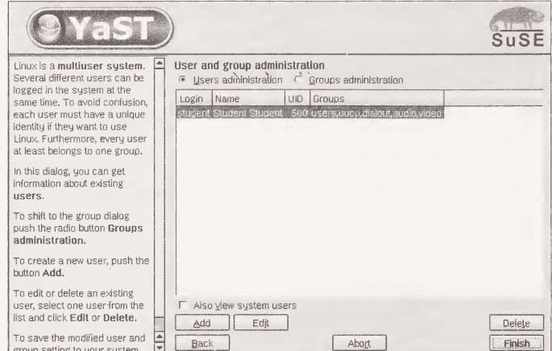

在 Linux 系统中，用户账户信息保存在位于 `/etc` 目录下的 `passwd` 文件中。一个典型的 `passwd` 文件如图 3.2 所示。

## 图 3.2

`passwd` 文件中的用户账户。

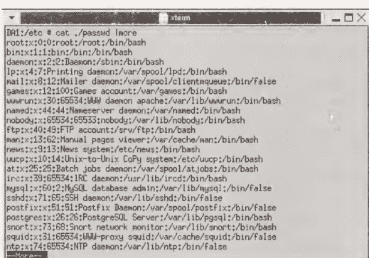

请注意，`passwd` 文件由信息行组成。每一行代表单个用户账户`记录`。每一行（或记录）上出现七个独立的信息片段。这些被称为`字段`，并由冒号 (`:`) 字符分隔。按顺序，这些字段如下：

- 用户名——这是用户登录系统时输入的名称。
- 密码——请注意，每个账户看起来都有一个密码为“x”。这是因为 `passwd` 文件实际上并不包含用户的密码。稍后我们将详细解释这一点。
- `用户 ID`——这是系统分配给每个用户账户的编号。每个用户 ID 在系统中都是唯一的。两个用户不能拥有相同的 ID。
- `组 ID`——这是用户所属组的 ID 编号。多个用户可以属于同一个组，因此拥有相同的组 ID 编号。
- `全名`——这是用户的全名。此参数是可选的。
- `主目录`——这是文件系统中用户主目录的路径。
- `Shell`——这是将呈现给用户的默认 shell 类型。

如果你仔细查看图 3.2，你会注意到每个用户账户似乎都被分配了 x 作为密码。这是因为用户密码实际上并不存储在 `passwd` 文件中。

为防止这种情况，用户密码以加密形式存储在位于 `/etc` 目录下的 `shadow` 文件中。一个典型的 `shadow` 文件如图 3.3 所示。

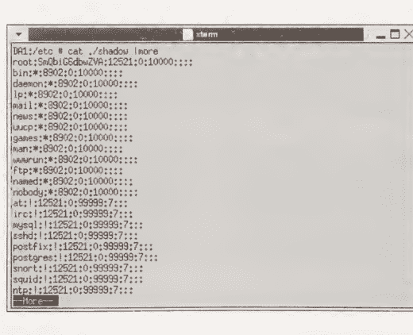

**图 3.3**

`shadow` 文件中的用户密码。

> **警告**
>
> 可以安装你的 Linux 系统，使密码存储在 `passwd` 文件中。根据你使用的 Linux 发行版，在安装过程中应该会显示一个屏幕，询问你是否希望将密码影子化（或类似文本）。你应该始终使用影子密码。如果你不这样做，它们将出现在 `passwd` 文件中。

注意图 3.3，与 `passwd` 文件类似，`shadow` 文件中的每一行都代表一个用户记录。每个用户记录包含九个由冒号分隔的字段：

- `用户名` — 这与在 `passwd` 文件中使用的名称相同。
- `密码` — 此字段包含用户的加密密码。
- `最近更改` — 此字段列出了密码最后更改的日期。
- `最小天数` — 此字段列出了用户可以保留相同密码的最少天数。
- `最大天数` — 此字段列出了用户可以保留相同密码的最多天数。
- `警告` — 您可以配置系统，使得用户在密码到期前几天收到提示。此字段列出了在到期前显示警告的天数。
- `允许非活动` — 您可以配置系统，使得用户在密码过期后仍可以登录几天。此字段包含允许的天数。
- `过期` — 此字段列出了用户密码过期的日期。
- `(未使用字段)`

要在 SUSE 系统上更改这些值，您可以使用 `YaST`。访问`编辑和创建用户`选项，选择您想要修改的用户。然后选择`编辑，密码设置`。将显示如图 3.4 所示的屏幕。

## 图 3.4

修改用户密码设置。

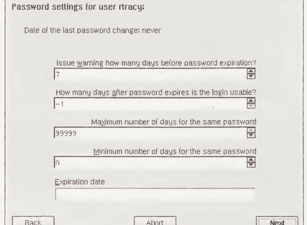

仔细查看 root 用户账户的记录。注意密码看起来像是一串复杂的字符。这实际上是加密形式的密码。此系统上 root 的密码实际上是 `novell`。因此，您不应该直接使用文本编辑器编辑 `shadow` 文件。您应该使用 `YaST` 等系统实用工具来更改用户密码。

## Linux 组

Linux 不仅通过用户区分账户，还使用组。一个`组`仅仅是用户账户的集合。乍一看，组和用户似乎有些冗余。组是非常强大的管理实体，特别是在处理大量用户账户时。

举例说明，假设您在一个 Linux 系统上有 40 个用户账户。所有这些用户对文件系统中的一组目录都需要相同的权限。如果没有组，您将不得不手动为每个用户分配权限。

> 提示
>
> 权限将在本章稍后介绍。

但是，使用组，您可以使所有 40 个用户账户成为单个组的成员。然后，您只需为该组分配一次权限。组的每个成员自动获得分配给该组的权限。

作为一般规则，您应该先创建组并为其分配权限，然后将用户添加到这些组中。之后，再为那些需要与组内其他成员不同访问权限的特定用户分配个别权限。目标是尽量减少直接分配给单个用户账户的权限数量。

例如，假设您有 40 个需要相同级别系统访问权限的用户。您可以为这些用户创建一个组，为该组分配权限，并使这 40 个用户成为该组的成员。进一步假设，这 40 个用户中的一个需要超出组提供的额外访问权限。然后，您可以为该特定用户分配额外的权限。

以这种方式管理系统可以大大减少您的管理工作量。假设您拥有前述的 40 个用户的系统，并在系统上安装了一个新应用程序。每个用户都需要访问该应用程序的文件。如果使用组来管理访问权限，您只需进行一次权限更改。另一方面，如果选择为每个单独的用户而不是使用组分配权限，则需要进行 35 处更改。

在 40 个用户的系统中，这听起来可能并不那么复杂。然而，假设您管理的是一个拥有数百名用户的 Linux 系统。管理权限所需工作量的差异就会变得更加明显。

在处理组时，您应该记住几个重要的点。首先，只有两个用户可以更改分配给文件或目录的组以及相关权限：root 和文件/目录所有者。

其次，不能有未分配组的用户账户。每个用户必须是至少一个组的成员。在 SUSE Linux 系统中，默认情况下，在创建用户账户时，每个用户都被设置为 `users` 组的成员。

在图 3.5 中，用户 `tracy` 刚刚被创建。可以看到 `tracy` 被设置为 `users` 组的成员，与系统安装期间创建的学生账户相同。

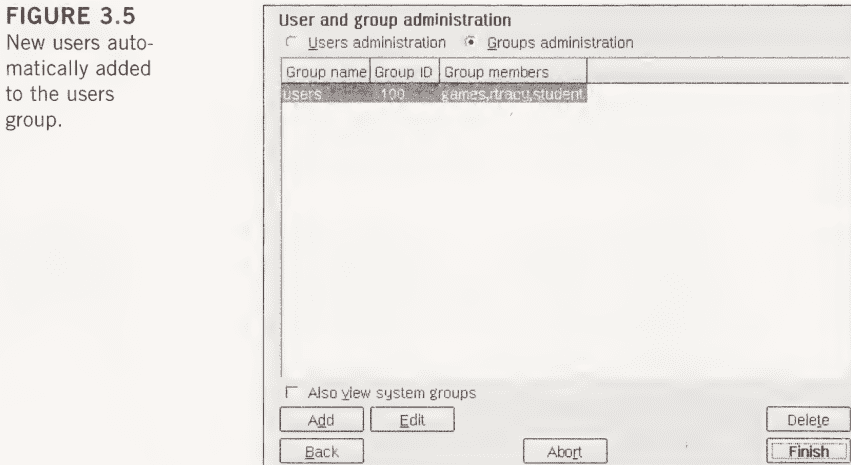

需要注意的是，用户可以成为多个组的成员。用户通过在 shell 提示符下输入 `newgrp new_group_name` 切换到不同的组（并获得新组的权限）。当他们这样做时，系统会提示他们提供新组的密码，下文将对此进行讨论。

组信息存储位于 `/etc` 目录中的 `group` 文件中。该文件如图 3.6 所示。

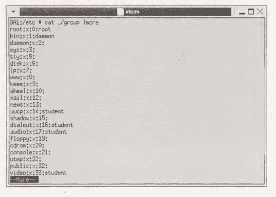

**图 3.6**

`group` 文件中的组。

就像 `passwd` 和 `shadow` 文件一样，`group` 文件中的每一行都代表单个组的记录。记录中的字段由冒号分隔。`group` 文件中的字段包括以下内容：

- `组名` — 此字段包含组的名称。
- `密码` — 您可以选择性地要求该组的成员在切换到新组时提供密码。
- `组 ID (GID)` — GID 是分配给组的唯一数字。
- `组成员` — 此字段列出了被指定为该组成员的用户。

您可能注意到，与 `passwd` 文件一样，`group` 文件中的 x 代表密码。如果您在安装过程中配置系统使用 shadow 密码（应该这样做），组密码将保存在 `/etc` 目录中的 `gshadow` 文件中。典型的 `gshadow` 文件如图 3.7 所示。

在图 3.7 中，创建了一个名为 `test` 的示例组，并分配了密码 `novell`。但是您会注意到，文件中密码的文本看起来像随机字符。

正如 `shadow` 文件一样，`gshadow` 文件中的密码是加密的。因此，您不应该尝试使用文本编辑器编辑 `gshadow` 文件来更改或添加组密码。

如果需要管理 SUSE Linux 系统上的组，您可以使用 `YaST` 实用工具。选择`应用程序，SUSE 菜单，系统，YaST2`。

**图 3.7**

`gshadow` 文件中的组密码。

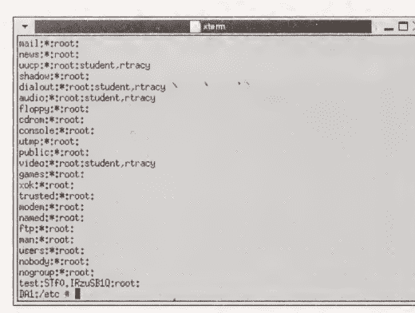

执行此操作后，会出现 YaST 控制中心。选择`安全和用户，组管理，编辑和创建组`。将显示如图 3.8 所示的屏幕。

**图 3.8**

在 YaST 中管理组。


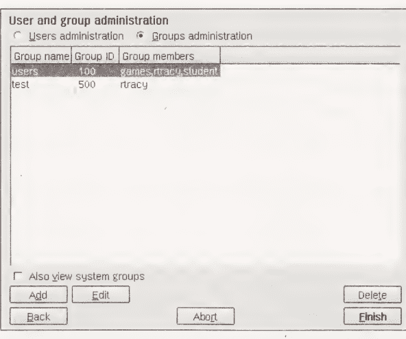

如果要添加新组，请选择**添加**。如果需要修改现有组，请选择该组，然后选择**编辑**。如果需要删除组，请选择它，然后选择**删除**。

## 管理文件所有权和权限

**涵盖的测试目标：**

- 1. 管理 Linux 文件系统。

到目前为止，我们已经讨论了 Linux 安全系统的两个元素：用户和组。现在将介绍另外两个元素：文件所有权和文件权限。

### 文件所有权

在 Linux 系统中，每个文件和目录都有一个所有者。默认情况下，最初创建文件或目录的用户会自动被指定为其所有者。

要查看特定文件或目录的所有者，您可以浏览到 GNOME 文件管理实用程序并右击它。然后选择**属性，权限**。将显示如图 3.9 所示的屏幕。

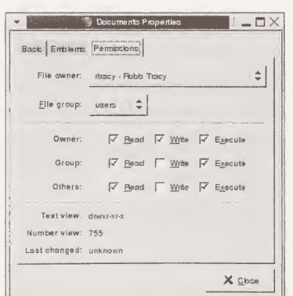

图 3.9 查看所有权。

在此图中，可以看到 Documents 的所有者是用户 ttracy。文件或目录的所有者可以更改，但只有 root 用户具有此能力。

这可以在图 3.9 所示的 GNOME 文件管理界面中完成，或者使用 `chown` 命令从 shell 提示符执行。

> **提示** 要了解如何使用 `chown`，请在 shell 提示符处输入 `man chown`。

## 文件权限

我在此前的章节中已经暗示了 *权限* 的概念。

简而言之，权限决定了用户或组对文件或目录的访问级别。Linux 使用三种不同的基本权限：

- 读取

- 写入

- 执行

您需要记住，这些权限可以分配给目录或文件。特定权限提供的功能取决于它是分配给单个文件还是目录。

读取权限允许用户在文件系统中查看文件、打开文件并查看其内容。对于目录，它允许用户在文件系统中查看目录、打开目录并查看其中包含的文件或子目录。

写入权限允许用户修改文件的内容并保存更改。对于目录，它允许用户在目录内创建、删除或修改文件或子目录。

执行权限允许用户运行文件。这在创建脚本文件时特别有用，您将在本章的实验室练习中这样做。

文件或目录的权限分配给三个不同的实体：

- 文件或目录的所有者

- 分配给文件或目录的组

- 其他用户

分配给文件或目录所有者的权限定义了文件所有者拥有的访问级别。分配给组的权限定义了分配给属于该文件/目录组的用户的访问级别。

分配给“其他人”的权限定义了授予已成功认证到系统，但不是文件或目录所有者且不属于该文件/目录组的用户的访问级别。

您会看到这三个权限被简称为 *所有者*、*组* 和 *其他*。

请考虑图 3.10 中分配给 **example.txt** 文件的权限。

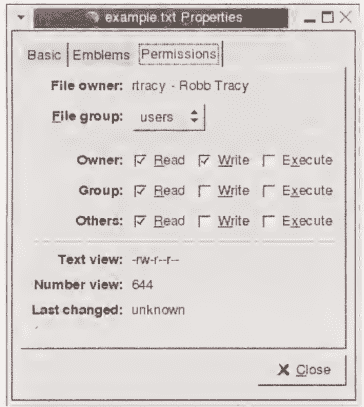

### 图 3.10

权限。

用户 **rtracy** 创建了该文件，因此是其所有者。注意，所有者被分配了对该文件的读取和写入权限。因此，用户 rtracy 可以打开此文件，读取其内容，修改其内容并保存更改。rtracy 用户还可以删除此文件。

注意，**users** 组已被分配给该文件。之所以进行此分配，是因为文件所有者 rtracy 是 users 组的成员。属于 users 组的用户被授予对文件的读取权限。这允许他们打开文件并读取其内容。然而，他们不能保存对该文件的任何更改。他们也不被允许删除该文件。

注意，**其他人** 也被分配了读取权限。这意味着任何登录到系统但不是 users 组成员的用户也可以打开文件并读取其内容。同样，用户不被允许保存对文件的任何修改，也不能删除它。

让我们更仔细地检查图 3.10。注意在权限分配下方的两行 **文本视图** 和 **数字视图**。

在我们的图形计算世界中，我们有点被易于阅读的对话框宠坏了，例如图 3.10 中显示的那样。在 X Windows 系统和 GNOME 之前，Linux 管理员仍然必须管理权限。他们通过 Linux 命令行实用程序做到这一点（您现在仍然可以）。其中关键的一个是 **chmod** 实用程序。

Linux 文件系统中的每个文件或目录都有一个分配给它的数字，代表其权限。

`chmod` 实用程序不接受诸如 "Read"（读取）、"Write"（写入）或 "Execute"（执行）这样的参数。相反，它期望接收数字形式的权限分配。在图 3.10 中，您会注意到分配给 `example.txt` 的权限显示为 644。数字 644 是所有权限分配的摘要。

如果您刚接触 Linux，这可能有点令人困惑。644 如何等同于所有者的读取和写入、组的读取以及其他人的读取？

每个数字代表分配给每个实体的权限。第一位数字代表分配给文件或目录所有者的权限。第二位数字代表分配给组的权限。最后一位数字代表分配给其他人的权限。这种关系如图 3.11 所示。

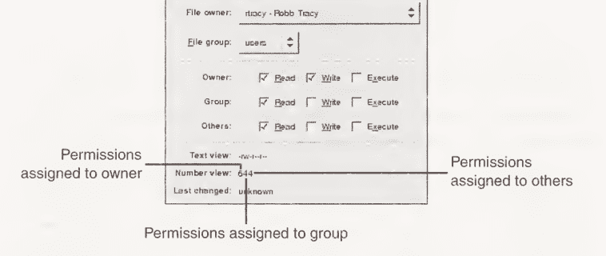

现在我们已经确定了各个数字代表什么，我们需要讨论每个数字的值代表什么。您需要理解，每个数字是分配给每个权限的三个值的总和：

- 读取权限：4

- 写入权限：2

- 执行权限：1

- 未分配权限：0

> **现实世界** 如果您曾经在 SCSI 设备背面使用跳线器来配置其 SCSI ID 号，那么这对您来说会很熟悉。对于 SCSI 设备（如 CD-ROM 驱动器），ID 是分配给 **设备** 上三个或四个跳线器的值的总和。跳线器 1 分配值 1，跳线器 2 分配值 2，跳线器 3 分配值 4。如果在跳线器 2 和 3 上安装短路器，SCSI ID 设置为 6。如果只在跳线器 1 上安装短路器，SCSI ID 设置为 1。如果不在任何跳线器上安装短路器，SCSI ID 设置为 0。**在 Linux 中以数字形式表示权限的工作方式与此相同。

如果分配了某个权限，其值将加到相应数字的值上。如果没有分配，则向该数字的值添加空值（0）。

这对许多 Linux 用户来说可能是一个难以理解的概念。让我们看几个例子。

注意图 3.11 中所有者被分配了读取和写入权限。未分配执行权限。644 中的第一位数字代表所有者的权限。第一位数字是读取和写入权限值的总和：

- 读取：4

- + 写入：2

- + 执行：0

- = 权限 6

此外，注意组只被分配了读取权限。

因此，第二位数字的值为

- 读取：4

- + 写入：0

- + 执行：0

- = 权限 4

同样适用于其他人数字的值：

- 读取：4

- + 写入：0

- + 执行：0

- = 权限 4

结果是权限 644。让我们通过另一个例子。

假设一个文件的权限为 750。每个实体被分配了什么权限？

让我们看看第一个权限，7。获得值 7 的唯一方法是分配所有权限，如下所示：

```
Read:       4
+ Write:     2
+ Execute:   1
= Permission 7
```

我们知道文件所有者已被授予对该文件的所有权限。第二位数字的值为 5。获得 5 的唯一方法是分配读取和执行权限，如下所示：

```
Read:       4
+ Write:     0
+ Execute:   1
= Permission 5
```

任何属于分配给该文件的组的用户都拥有该文件的读取和执行权限。最后一位数字的值为 0。获得此值的唯一方法是不分配任何权限：

```
Read:       0
+ Write:     0
+ Execute:   0
= Permission 0
```

任何不是文件所有者且不属于分配给该文件的组的认证用户对该文件没有任何权利。

如果您使用 `chmod` 命令，您可以使用这种数字权限表示法将权限分配给文件或目录。

例如，如果您希望将文件的完整权限分配给 `example.txt` 的所有者，但拒绝其他任何人任何权限，您会切换到文件所在的目录并输入 `chmod 700 ./example.txt`。

早些时候，我提到图 3.10 中有两行额外的行。我们已经检查了 **数字视图** 行。我们现在需要关注 **文本视图** 行。

如果您在基于文本的 Linux 环境中工作，您将无法使用像 GNOME 文件管理器这样的高级工具来查看文件和目录的权限。相反，您可以使用 `ls` 或 `dir` 命令。

> **现实世界**
>
> 许多组织不在其 Linux 服务器上安装 X Windows 系统。在任何操作系统上使用图形用户界面 (GUI) 都需要占用 CPU 的时间。图形屏幕必须定期刷新

（重新绘制）。每当这种情况发生时，CPU 的注意力就会从当前工作转移过去，以处理 GUI 的请求。

如果您输入 `ls`，当前目录的内容将被显示，如图 3.12 所示。

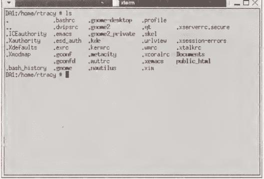

但是，如果您使用 `dir` 命令或 `ls -1` 命令，您将看到当前目录的内容及其分配的权限，如图 3.13 所示。

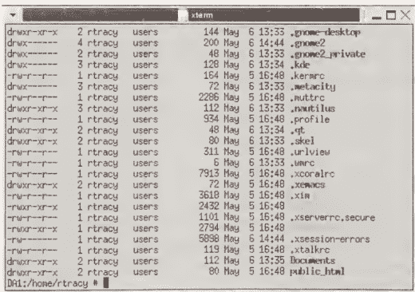


第一列显示分配给特定文件或目录的权限。第二列列出文件或目录的所有者。第三列显示分配给文件或目录的组。

例如，在图 3.13 中定位 `Documents` 目录。注意其权限为 `drwxr-xr-x`。`Documents` 的所有者是 `rtracy` 用户。分配给 `Documents` 的组是 `users`。

让我们关注第一列。第一个字符是 `d` 或 `-`。第一个字符仅用于标识该项目是目录 `d` 还是文件 `-`。

第二、第三和第四个字符列出分配给**所有者（Owner）**的权限，如图 3.14 所示。

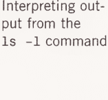

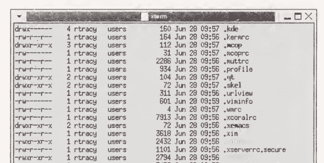

在此示例中，`public_html` 目录的所有者具有**读取（Read, r）**、**写入（Write, w）**和**执行（Execute, x）**权限。

第五、第六和第七个字符标识分配给**组（Group）**的权限。在此示例中，组被分配了**读取（Read, r）**和**执行（Execute, x）**权限。未分配的权限由 `–` 字符标识。

> **提示**
>
> 如果您想更改分配给文件或目录的组，可以使用 `chgrp` 命令。要了解如何使用此命令，请在 Linux shell 提示符下输入 `man chgrp`。您也可以在 X Windows 系统接口中的 GNOME 文件管理工具中完成此操作。

最后，第八、第九和第十个字符指定分配给**其他用户（Others）**的权利。在图 3.14 中，其他用户被分配了**读取（Read, r）**和**执行（Execute, x）**权限。

## 实验室练习 3.1：管理 Linux 安全

在这个练习中，您将处理 Linux 用户、组、所有权和权限。请完成以下步骤：

- 1. 启动您的 Linux 服务器，并使用密码 `novell` 以**学生（student）**用户身份进行身份验证。
- 2. 打开一个终端会话。
- 3. 通过输入 `su -` 并提供密码 `novell` 来切换到 root 用户账户。
- 4. 通过完成以下操作创建一个新的文本文件：
  - a. 在 shell 提示符下，输入 `cd /tmp`。
  - b. 在 shell 提示符下输入 `vim ./example.txt`，创建一个名为 **example.txt** 的新文本文件。
  - c. 按 `Ins`。
  - d. 对于文件内容，输入 `This is a text file`。
  - e. 按 `Esc`，然后输入 `:exit`。
- 5. 在 shell 提示符下输入 `ls -l example.txt` 来检查 **example.txt** 的属性。

**example.txt** 文件的所有者是谁？它被分配给了哪个组？

如果您正确完成了这些步骤，root 应该是 **example.txt** 的所有者，并且 root 组应被分配给该文件。

**example.txt** 自动分配了哪些权限？

所有者应被分配**读取**和**写入**权限。组应被分配**读取**权限。其他用户应被分配**读取**权限。

通过完成以下操作测试权限：

- 1. 在 shell 提示符下，输入 `exit`。
- 2. 在 shell 提示符下，输入 `cd /tmp`。
- 3. 选择 **应用程序（Applications）**、**KDE 菜单（KDE Menu）**、**编辑器（Editors）**、**KWrite**。
- 4. 选择 **文件（File）**、**打开（Open）**。
- 5. 浏览并选择 `/tmp/example.txt`，然后单击 **确定（OK）**。
- 6. 在第一行后添加一行，内容为“This is the second line.”。
- 7. 选择 *文件（File）, 保存（Save）*。

您能够保存文件吗？为什么？

您应该会看到一条警告，表明您没有写入权限。请记住，您现在是以学生用户身份进行身份验证的。该用户既不是文件所有者，也不是 root 组的成员。这使得分配给其他用户的权限适用。其他用户仅被分配了读取权限。

继续执行以下步骤：

- 1. 在警告对话框中，单击 **确定（OK）**。
- 2. 选择 *文件（File） > 退出（Quit）*。
- 3. 当提示保存更改时，选择 **否（No）**。

通过完成以下操作更改分配给 `example.txt` 的权限：

- 1. 在您的终端会话中，输入 `su –` 并提供密码 `novell`。
- 2. 输入 `cd /tmp`。
- 3. 通过在 shell 提示符下输入 `chmod 640 /example.txt` 来移除其他用户的读取权限。
- 4. 通过在 shell 提示符下输入 `ls –l example.txt` 来验证分配给 `example.txt` 的权限。它应该被分配了 `-rw-r-----` 权限。
- 5. 在 shell 提示符下输入 `exit`。

现在尝试以学生用户身份访问 `example.txt`：

- 1. 选择 **应用程序（Applications）**、**KDE 菜单（KDE Menu）**、**编辑器（Editors）**、**KWrite**。
- 2. 选择 **文件（File）**、**打开（Open）**。
- 3. 浏览并选择 `/tmp/example.txt`，然后单击 **确定（OK）**。

您能看到 `example.txt` 的内容吗？为什么？

如果您正确分配了权限，您将无法看到文件的内容。作为学生用户，您对该文件没有任何权限。

通过完成以下步骤创建一个受限制的文件夹：

- 1. 在您的终端会话中，输入 `su –` 并提供密码 `novell`。
- 2. 在会话提示符下，输入 `cd /tmp`。
- 3. 通过在会话提示符下输入 `mkdir HideMe` 创建一个名为 **HideMe** 的目录。
- 4. 通过在会话提示符下输入 `chmod 640 ./HideMe`，使 HideMe 目录对除 root 或 root 组以外的任何人受限。
- 5. 输入 `exit`。

通过完成以下步骤，尝试以学生用户身份访问 HideMe 目录：

- 1. 在会话提示符下，输入 `cd /tmp`。
- 2. 通过输入 `ls |more` 生成 `/tmp` 内容的列表。

您是否看到 HideMe 目录被显示？

您应该能够查看该目录。

现在尝试通过输入 `cd /tmp/HideMe` 切换到 HideMe 目录。

您能够切换到 HideMe 目录吗？为什么？

您应该会收到一条消息，指示您没有适当的权限来访问该目录。

通过完成以下步骤执行脚本文件：

- 1. 通过输入 `su -` 并输入密码 `novell` 切换回 root 用户账户。
- 2. 通过输入 `cd /tmp` 切换到 `/tmp` 目录。
- 3. 在 shell 提示符下，输入 `ls scriptfile.txt`。
- 4. 您应该看到您在上一章创建的 `scriptfile.txt` 文件。此文件包含一系列可以在文件内执行的命令。如果您跳过了那个练习，请现在回去并根据实验室说明创建文本文件。
- 5. 通过输入 `cat ./scriptfile.txt` 验证 `scriptfile.txt` 是否包含正确的命令。您应该看到您在上一个练习中输入的命令。
- 6. 通过输入 `./scriptfile.txt` 尝试执行该文件。

会发生什么？为什么？

您应该会看到一条消息，指示拒绝运行该文件的权限。这是因为未授予执行权限。

通过以下步骤继续：

- 1. 通过在 shell 提示符下输入 `chmod 777 .` `scriptfile.txt` 向所有用户授予执行权限。
- 2. 通过输入 `.` `scriptfile.txt` 执行脚本。

这次会发生什么？

文件应该会执行命令。

要在完成此实验室练习时，请在 shell 提示符下输入 `exit`。

这就是这个实验室练习的内容。您现在知道如何管理基本的 Linux 文件系统权限。您接下来将学习如何管理系统的网络配置。

## 管理 Linux 网络配置

- 涵盖的测试目标：
  - 2. 管理 Linux 网络接口。

随着 Linux 文件系统安全性的介绍结束，我们准备开始讨论基本的 Linux 网络配置任务。为了通过 CLE 认证，Novell 期望您知道 `eth0` 这个术语的含义，以及如何执行一些简单的任务，例如分配 IP 地址或子网掩码。

### Linux 网络接口

如果您是从 Windows 世界进入 Linux 领域的，您可能习惯使用控制面板来管理 Windows 网络接口，如图 3.15 所示。

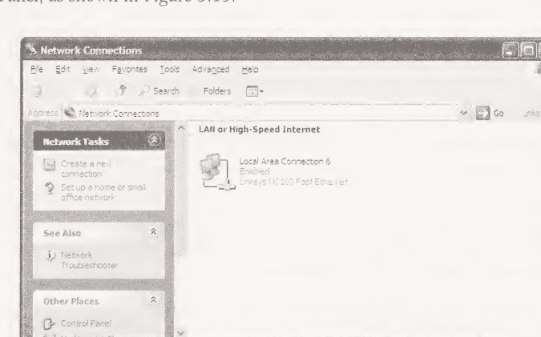


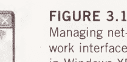

请注意，每个接口都被分配了一个名称，例如 `本地连接 1（Local Area Connection 1）`、`本地连接 2（Local Area Connection 2）`等。

管理 Linux 网络接口略有不同。Linux 以太网接口标记为 `eth0`、`eth1`、`eth2` 等。安装在系统中的每个网卡都被分配了这些标签之一。

大多数现代 PC 系统使用外围部件互连（PCI）扩展总线来实现模块化扩展板。PCI 插槽被分配一个以 1 开始的编号，如图 3.16 所示。

## 第 3 章 Linux 管理与配置

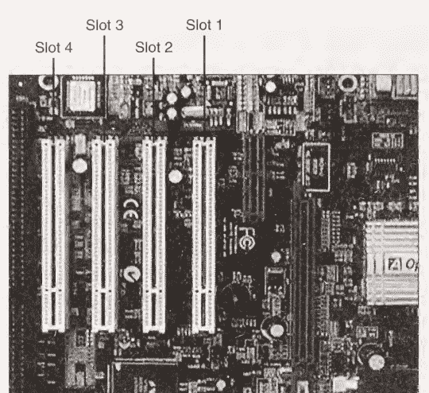

**图 3.16**

PCI 插槽。

默认情况下，如果系统中只有一个网络板，它会被分配给 `eth0`。如果系统中安装了多个网络接口，安装在编号最低的 PCI 插槽中的板卡会被分配给 `eth0`，安装在编号次低的 PCI 插槽中的板卡会被分配给 `eth1`，依此类推。

表面上看这很简单。但是，如果你的主板使用集成网络板，情况就会变得复杂起来。

> **提示** 集成网络板是指直接集成在主板硬件内部的网络板。扩展插槽中没有安装独立的网络板。主板上提供了一个 RJ-45 接口用于插入以太网线。

如果你只使用一个网络接口，且它是集成接口，它会自动被分配给 `eth0`。然而，如果你同时使用集成接口和安装在扩展插槽中的网络板，那么两者中的任何一个都可能被分配给 `eth0`。

一些主板制造商设计的电路板使得集成设备（如网络板）会被分配比安装在 PCI 扩展插槽中的设备更低的插槽编号。我遇到过许多系统，其中内置网卡被分配了一个非常高的编号，而第一个 PCI 扩展插槽却被分配了编号 1。

如果遇到这种情况，你可以手动交换接口之间的 `eth0` 和 `eth1`。不过，我发现更简单（也更快）的方法是直接交换插入两个接口 RJ-45 插孔中的网线。

### 关于网络板

在不久以前，管理网络服务器要求你熟悉多种不同扩展总线类型下的各种网络板。在 20 世纪 90 年代中期，一些较流行的网络标准包括以太网（Ethernet）、令牌环（Token Ring）和 Arcnet。你还必须知道如何配置 8 位和 16 位 ISA、16 位和 32 位 MCA、EISA 以及 VLB 扩展总线中的网络板。

如今，选择变得不那么令人困惑了。几乎大多数网络板都是 32 位 PCI 板。在高端服务器系统中，你可能会遇到 64 位 PCI 板。你使用的大多数系统很可能只使用这两种类型的板卡之一。

偶尔，你可能会遇到通信网络 `riser` 卡（CNR）网络板。这些是体积非常小的网络板。它们在服务器系统中很少见。

好消息是，你处理的大多数系统可能只有一个网络接口。你需要执行的大多数管理任务将针对 `eth0`。

还有一个其他接口需要注意，它存在于所有 Linux 系统中，即使那些没有安装网络板的系统也不例外：`lo`。`lo` 接口是本地环回接口（localhost loopback interface）。它通常被分配 IP 地址 `127.0.0.1`。

此接口始终指向宿主系统。许多 Linux 应用程序和服务需要 `lo` 接口存在才能正常工作。

### 使用 ifconfig 管理 Linux 网络接口

在安装 Linux 系统时，你可以为网络接口配置各种参数，例如 IP 地址、子网掩码和默认网关。在某个时间点，你可能需要修改此配置。

这可以使用 `ifconfig` 命令完成。`ifconfig` 是一个非常强大的命令。它可以用于分配 IP 地址、修改子网掩码以及执行许多其他任务。

它还可以用于查看当前的网络配置。如果在 Linux 系统的 shell 提示符下输入 `ifconfig`，它将显示系统中安装的所有网络接口的详细信息。此输出显示在图 3.17 中。

**图 3.17**

`ifconfig` 命令的输出。

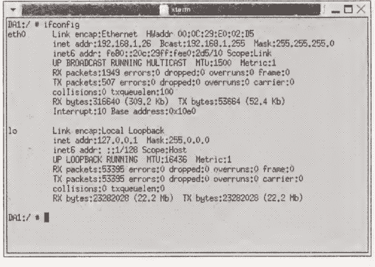

> **提示**
>
> `ifconfig` 命令只能由 root 用户运行。

请注意，在图 3.17 中，这个特定的 SUSE Linux 系统安装有两个接口：`eth0` 和 `lo`。`eth0` 接口是一个以太网接口，其参数如表 3.1 所列。

**表 3.1**

网络参数

| 参数 | 值 |
| :--- | :--- |
| 板卡 MAC 地址 | 00:0C:29:E0:02:D5 |
| IP 地址 | 192.168.1.26 |
| 子网掩码 | 255.255.255.0 |
| 检测到的以太网冲突 | 0 |
| 板卡中断 | 10 |
| 板卡 I/O 地址 | 0x10e0 |

`ifconfig` 实用程序也可用于配置 Linux 网络接口。其一般语法如下：

```
ifconfig Linux_接口 参数
```

例如，如果你只想查看 `eth0` 接口的当前设置，可以输入 `ifconfig eth0`。一些更有用的参数（也是 CLE 认证所需知道的参数）包括表 3.2 中所示的那些。

**表 3.2**

`ifconfig` 参数

| 参数 | 功能 | 示例 |
| :--- | :--- | :--- |
| ip_address | 为指定接口分配 IP 地址。（如右侧示例所示，命令中无需包含“ip_address”文本。） | `ifconfig eth0 10.0.1.30` |
| netmask mask | 为指定接口分配子网掩码。 | `ifconfig eth0 netmask 255.0.0.0` |
| down | 禁用指定接口。 | `ifconfig eth1 down` |
| up | 启用指定接口（如果它之前被禁用了）。 | `ifconfig eth1 up` |

### 在 YaST 中配置 Linux 网络接口

如果命令行让你感到头疼，别担心。你也可以使用 YaST 在图形化 X Windows 系统环境中配置 Linux 网络接口。

要运行 YaST，请在 GNOME 中选择**应用程序**、**SUSE 菜单**、**系统**、**YaST2**。你还可以通过打开终端会话，使用 `su -` 命令切换到 root 用户，然后在 shell 提示符下输入 `yast2` 来运行该程序。

> **警告**
>
> 如果你未经过 root 身份验证，在启动 YaST 之前，系统将要求你提供 root 用户的密码。

如果你从 GNOME 中运行 YaST，将出现图 3.18 中所示的屏幕。

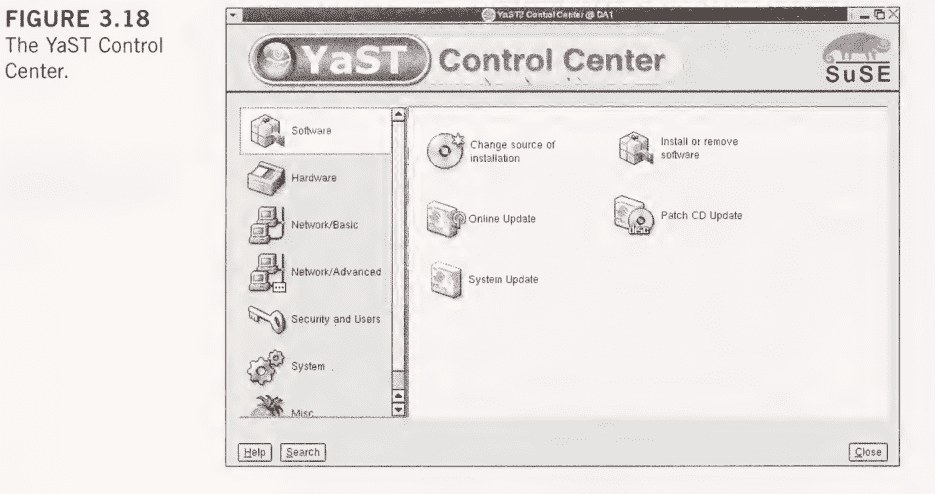

在 YaST 中，选择**网络/基本**，然后选择**网卡配置**。将显示图 3.19 中所示的屏幕。

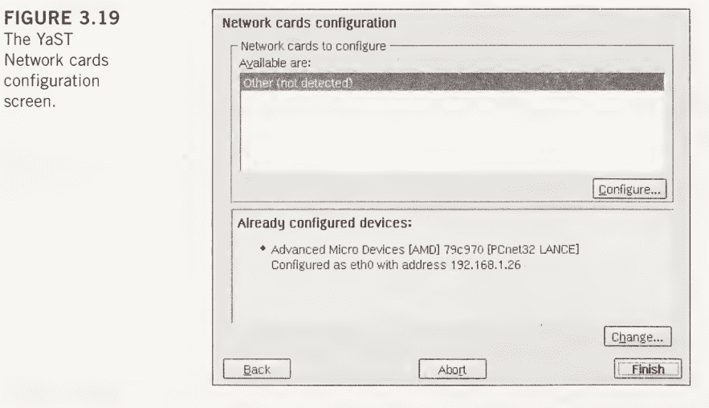

如果你刚刚在系统中安装了新的网络板，未配置的设备将显示在**可用设备**下方的**待配置网卡**字段中。要配置它，请选择**配置**，随后将出现一系列屏幕，引导你完成为接口分配 IP 地址、子网掩码、默认网关地址和 DNS 服务器地址的过程。

如果需要修改分配给现有接口的参数，请在**已配置设备**字段下选择**修改**。执行此操作后，将显示图 3.20 中所示的屏幕。

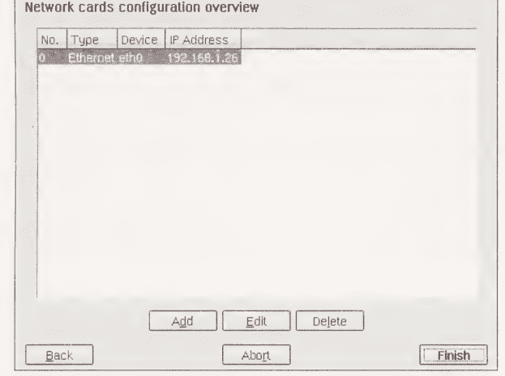

**图 3.20**

在 YaST 中修改现有接口。

请注意，你的每个接口都列在列表中。图 3.20 中显示的系统只有一个网络板，因此只列出了 `eth0`。

识别你想修改的接口并选中它。然后选择编辑。执行此操作后，将出现图 3.21 中所示的屏幕。

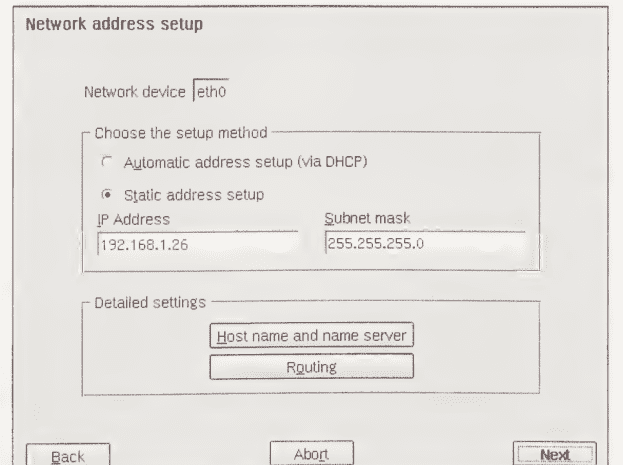

**图 3.21**

在 YaST 中修改网络地址。

如果你希望系统从 DHCP 服务器动态分配 IP 地址，请勾选**自动地址设置**（通过 DHCP）。

> **警告**
>
> 如果你打算在 Linux 服务器上安装 Novell N!terprise Linux Services，你不应该使用动态 IP 地址。许多 NNLS 组件要求使用静态 IP 地址分配。

如果你打算使用静态 IP 地址分配，请勾选**静态地址设置**。然后在相应字段中输入 IP 地址和子网掩码。

此时，你必须决定是否需要配置 DNS 服务器地址和默认路由器。如果你使用静态 IP 地址分配，你应该配置这些参数。

有时，默认路由器也被称为*默认网关、网关路由器*，或者简称为*路由器*。

如果你使用的是从 DHCP 服务器获取的动态地址分配，你可能需要也可能不需要配置这些地址。请检查你的 DHCP 服务器是否已配置适当的 DHCP 选项以自动提供这些参数。如果是，你就不需要手动配置这些参数。


然而，有时特定的 DHCP 服务器并未配置为提供这些地址。如果你的 DHCP 服务器属于此类情况，你将需要手动配置这些参数。

> **提示**
>
> 大多数网络管理员会配置他们的 DHCP 服务器自动提供 DNS 服务器和默认路由器地址。仅提供 IP 地址而不提供这两个其他关键参数是没有多大意义的。

要配置系统的主机名和 DNS 服务器地址，请单击`主机名和名称服务器`。执行此操作后，将出现图 3.22 中所示的屏幕。

在主机名字段中，输入你的 Linux 系统的主机名。在域名字段中，输入你组织的域名。

在`名称服务器`字段中，输入你组织的主、备（可选）和第三（可选）DNS 服务器的 IP 地址；然后单击`下一步`。

若要改为配置默认路由器，请单击`路由`。执行此操作后，将出现图 3.23 中所示的屏幕。

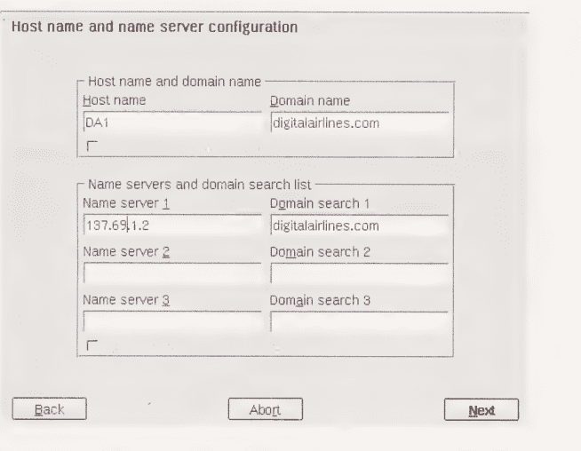

**图 3.22**

在 YaST 中修改 DNS 服务器地址。

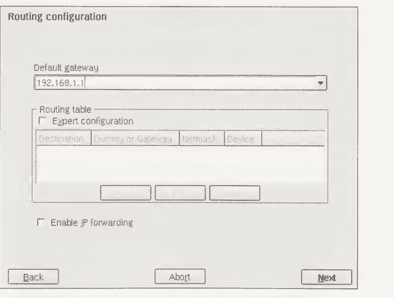

**图 3.23**

在 YaST 中修改默认网关地址。

在 **Default gateway**（默认网关）字段中，输入您网络的默认网关 IP 地址，然后单击 **Next**（下一步）。

> 您会注意到此屏幕上还有其他几个参数。对这些参数的完整讨论超出了本书的范围。更多信息，请参见 [Linux 网络管理员指南](http://www.tldp.org/LDP/nag2/index.html)。

**注意**

当您对网络接口的配置设置感到满意时，单击 **Next**（下一步），然后单击 **Finish**（完成）。此时，该接口将处于禁用状态，并应用您所配置的更改。在此过程中，将显示如图 3.24 所示的屏幕。

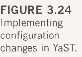

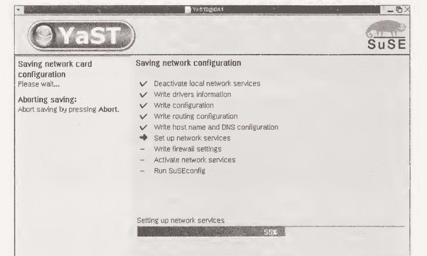

当更改应用后，接口将重新启动。Linux 的一个优点是，在进行此类更改后，无需重启系统。如果您曾使用过旧版本的 Windows，您就知道这些操作系统即使在网络配置进行微小更改时也要求完全重启。

> **注意**
>
> 较新版本的 Windows，如 Windows 2000 和 XP，在对网络配置进行更改后不需要重启系统。

现在您可以通过选择 **Close**（关闭）来关闭 YaST 控制中心。

# 管理 Linux 应用程序和服务

覆盖的测试目标：

- 3. 管理 Linux 应用程序。

正如我们在第 2 章“SUSE Linux 简介”中讨论的那样，操作系统的关键功能之一是提供一个运行应用程序和服务的平台。要有效管理 Linux 系统，您需要知道如何安装和卸载软件包、启动和停止服务，以及管理正在运行的进程。

## 安装 Linux 软件包

您可能已经熟悉在 Windows 系统上安装应用程序。通常，您将安装 CD 放入系统的 CD 驱动器中。`AUTORUN.INF` 文件会自动启动安装程序，该程序通常命名为 `SETUP.EXE`。

在 Linux 系统上安装应用程序略有不同。在 SUSE Linux 上，应用程序通常通过以下三种不同的方式进行分发和安装：

- 从 tarball 归档中提取文件并运行安装脚本
- 使用 `rpm` 命令
- 使用 YaST 控制中心

许多应用程序使用 tarball 分发包进行安装。正如我们在上一章中讨论的那样，Linux 使用 tar 和 gzip 实用程序将多个文件合并为单个磁带归档文件（tar 文件），然后将其压缩为 gzip 文件（tarball 文件）。图 3.25 显示了六个示例 tarball 文件。

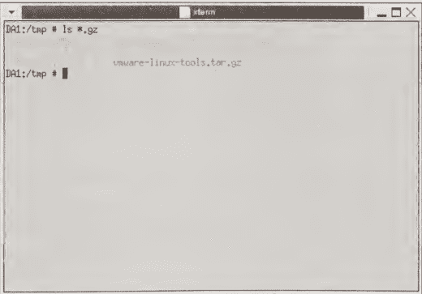

使用 `tar -zxvf` 命令，您可以将这些归档提取为其组件文件。此时，分发中应包含一个您可以运行的安装脚本，用于安装应用程序。

在图 3.26 中，来自图 3.25 的 `vmware-linux-tools.tar.gz` tarball 已提取到 `vmware-tools-distrib` 目录中。在此目录中有一个名为 `vmware-install.pl` 的文件。运行此文件将安装 `vmware-tools` 应用程序。

**图 3.26**

一个 tarball 安装脚本。

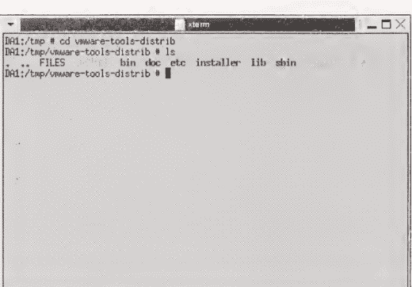

Linux 应用程序也通常作为红帽软件包管理器（RPM）文件进行分发。这些文件要求您使用 `rpm` 实用程序，该实用程序包含在许多 Linux 发行版中。

> 并非所有 Linux 发行版都包含 `rpm` 实用程序。基于 Debian Linux 的发行版使用 Debian 软件包管理器。红帽和 SUSE 使用 `rpm`。

使用 RPM 软件包而不是 tarball 的优点在于，许多应用程序依赖于系统中安装的其他应用程序或服务。`rpm` 实用程序可以查询要安装的 RPM 软件包以识别其依赖项。然后它可以检查宿主系统，确保在安装新软件包之前这些依赖项已经安装。

如果它们未安装，`rpm` 会警告您缺失的依赖项，给您机会在安装它们之前继续操作。这可以为您省去很多麻烦。多年前，当我刚开始学习 Linux 时，我从一个 tarball 文件安装了一个应用程序。随应用程序附带的 readme 文件没有列出任何依赖项。然而，当我第一次尝试运行它时，它报告了一个缺失的依赖应用程序并停止了执行。

我下载并安装了缺失的应用程序，并第二次尝试运行该应用程序。它再次报告了另一个缺失的依赖项并退出。我安装了此应用程序。猜猜当我第三次尝试运行该应用程序时发生了什么？它又发生了。还有另一个依赖项缺失。经过大量的工作，我终于让该应用程序运行起来。

在使用 RPM 软件包时，您不会遇到这类问题。所有缺失的依赖项都会提前报告，以便您一次性处理它们。

要安装 RPM 软件包，请执行以下操作：

1. 打开终端会话，并使用 `su -` 命令切换到 root 用户账户。
2. 导航到存储 RPM 软件包的目录。
3. 在会话提示符处，输入 `rpm -i package_filename`

在此模式下，应用程序将安装，但屏幕上没有进度指示器。如果您希望在安装软件包时看到进度指示器，请使用带有 `-ihv` 开关的 `rpm`。

RPM 软件包的另一个优点是它们非常容易卸载。要执行此操作，请输入 `rpm -e package_name`。请注意，安装要求您使用软件包文件名，而卸载要求您使用*软件包*名称。例如，如果我要在我的系统上安装 NTP 软件包，我将使用软件包文件名 `ntp-4.1.1-1.i386.rpm` 与 `rpm` 实用程序。

但是，如果我稍后要卸载此软件包，我将使用软件包名称 `ntp` 与 `rpm` 实用程序。

您还可以使用 YaST 控制中心来安装 RPM 软件包。左栏包含 Software（软件）选项，如图 3.27 所示。

要在 YaST 中安装软件包，请完成以下步骤：

1. 双击 **Install or remove software**（安装或删除软件）。将出现如图 3.28 所示的屏幕。
2. 选择您要安装的软件包。
3. 单击 **Accept**（接受）。

如果您想安装除随您的 SUSE 发行版附带软件包之外的软件包，您需要使用 YaST 控制中心中 **Software**（软件）下的 **Change source of installation**（更改安装源）选项（如图 3.27 所示），指向存储 RPM 软件包的目录。

# 第 3 章

# Linux 管理与配置

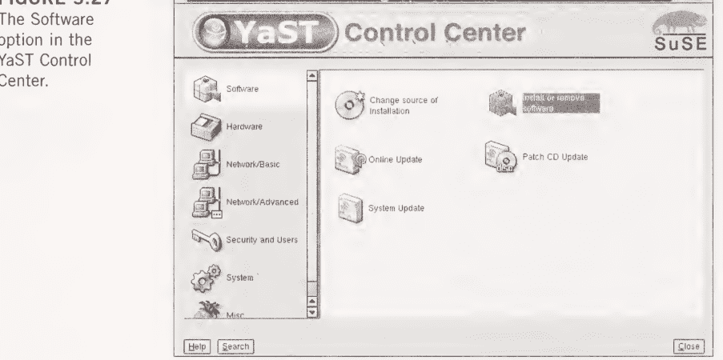


## 管理 Linux 服务

在管理 Linux 系统（以及参加 CLE 考试）时，您需要的一项关键技能是启动和停止 Linux 服务。在介绍此主题之前，我们需要讨论*服务*和*应用程序*之间的区别。这两个概念之间的界限相当模糊。一般来说，应用程序是终端用户以某种方式交互的程序。例如，Mozilla 网络浏览器是一个应用程序。YaST 控制中心也是一个应用程序。

另一方面，Linux 服务是在后台持续运行的程序。用户通常看不到界面，通常也不与程序交互。例如，Apache 网络服务器是一个 Linux 服务。网络时间协议（NTP）也是一个服务。Linux 服务通常被称为守护进程。

服务通常以与常规应用程序相同的方式进行安装。它们可能作为 tarball 或 `rpm` 文件进行分发。

话虽如此，您需要知道如何在您的 Linux 系统上启动和停止服务。

在您的 SUSE 服务器上的 `/etc/init.d` 目录中，您将找到用于启动和停止服务的脚本，如图 3.29 所示。


## 图 3.29

init.d 目录中的脚本文件。

> 在 Red Hat Linux 系统上，这些脚本位于 `/etc/rc.d/init.d`。

要在您的 SUSE Linux 系统上启动服务，请打开终端会话，切换到 root 用户账户，并切换到 `/etc/init.d` 目录。然后在 shell 提示符处输入 `./service_name start`。

例如，如果您想在系统上启动 Tomcat 小应用程序服务器，您将输入 `./tomcat start`。

您可以通过输入 `./service_name stop` 来停止服务。例如，要停止 tomcat 服务器，您将输入 `./tomcat stop`。

如果您需要关闭服务并重启它，您可以输入 `./service_name restart`。

> 注意
>
> 并非所有 Linux 发行版和服务都支持重启选项。

你也可以在执行这些相同任务时，无需先切换到 `/etc/init.d` 目录。在 SUSE Linux 系统上，你可以在服务名称前加上 `rc`。例如，如果你当前的目录是 `/var` 并且需要停止 Tomcat 服务，你可以输入 `rctomcat stop`。启动和重启选项也可以通过此快捷方式使用。

> 提示
>
> 在 Red Hat Linux 系统上，你可以通过输入 `service service_name start|stop|restart` 来完成相同操作。例如，要在不切换到 `/etc/rc.d/init.d` 的情况下停止 Red Hat 系统上的 Tomcat 服务，你可以输入 `service tomcat stop`。

在管理你的 Linux 系统时，你会发现有些服务希望系统每次启动时都运行，而另一些则只需在需要时才启动。配置服务的默认状态是通过 `chkconfig` 命令完成的。该命令指定了给定的 Linux 服务将在哪些运行级别上自动启动。

运行级别（runlevel）是 Linux 的一种操作模式。有六个 Linux 运行级别：

- 0—系统关机。
- 1—系统以单用户模式启动，并启用网络。
- 2—系统以多用户模式启动，大多数服务被禁用。
- 3—系统启动，多用户启用，除 X 窗口系统外大多数服务启用。如果你将系统启动到非图形化的 Shell 提示符，你就处于运行级别 3。
- 4—未分配。此运行级别可由系统管理员自定义配置。
- 5—系统启动，多用户启用，包括 X 窗口系统在内的大多数服务启用。如果你的系统启动到图形化登录界面，你就处于运行级别 5。
- 6—系统重启。

使用 `chkconfig` 工具，你可以配置服务在特定运行级别的默认状态。该工具的语法为 `chkconfig service_name levels`。

例如，要配置 Tomcat 服务在运行级别 3 和 5 上自动启动，你需要打开一个终端会话，切换为 root 用户，并输入 `chkconfig tomcat 35`。

> 提示
>
> 在 Red Hat 系统上，`chkconfig` 的语法略有不同。要配置 Tomcat 在此系统上在运行级别 3 和 5 自动启动，你需要输入 `chkconfig -35 tomcat on`。

你还可以通过编辑 `/etc/inittab` 文件来配置默认的系统运行级别以及自动启动的服务。

## 管理 Linux 进程

当 Linux 服务或应用程序当前正在运行时，它被称为一个*进程*。每个 Linux 进程都被分配一个唯一的进程 ID `PID`。大多数 Linux 发行版都包含一个实用工具，让你可以查看当前正在运行的进程。在 SUSE 系统上，你可以使用 `top` 工具。只需打开一个终端会话，并在 Shell 提示符下输入 `top`。

此时，会显示如图 3.30 所示的屏幕。


**图 3.30**

top 工具中显示的正在运行的进程。

请注意在 top 显示界面中，正在运行的服务或应用程序显示在 COMMAND 列中。在 PID 列中，你可以查看分配给该进程的 PID。你还可以查看有关进程的多种信息，例如它已运行多长时间，占用了多少内存，以及占用了多少 CPU 时间。

你可以使用表 3.3 中的命令来格式化 top 中信息的显示方式，并管理正在运行的进程。

| **命令** | **结果** |
| :--- | :--- |
| c | 在 COMMAND 列中显示完整路径。 |
| P | 按 CPU 使用率排序显示。 |
| M | 按内存使用率排序显示。 |
| N | 按 PID 排序显示。 |
| T | 按运行时间排序。 |
| A | 按运行时长（age）排序。 |
| k | 杀死正在运行的任务。（如果你遇到挂起的进程，这非常有用。） |
| q | 退出 top 工具。 |

你还可以使用 `kill` 命令从命令行杀死正在运行的进程。要使用此工具，你需要知道要杀死的进程的 PID。你还需要知道你想发送的信号。要查看有效信号的列表，请输入 `kill -l`。共有 63 种不同的可能信号，但其中两个最有用的是 `#15` (`TERM`) 和 `#9` (`KILL`)。如果你不提供信号编号，默认使用 `TERM`。

`kill` 命令的语法是 `kill -s signal pid`。如果你试图停止一个挂起的进程，你应该先尝试使用 `kill` 和 `TERM` 信号。如果不起作用，接下来你应该尝试 `KILL` 信号。

例如，假设我在 GNOME 桌面上运行 xclock，由于某种原因它挂起了。xclock 的 PID 是 9541。要使用 `TERM` 信号杀死它，我可以输入 `kill 9541` 或 `kill -s 15 9541`。

你还可以使用 `killall` 命令来停止挂起的进程。这个实用工具比 `kill` 命令更为强硬。它向任何使用指定名称的进程发送信号。

与 `kill` 命令类似，你可以发送特定信号，或者使用默认的 `TERM`。除了 PID 之外，你需要为 `killall` 提供要杀死的进程名称。要发送一个简单的带有 `TERM` 信号的 `killall`，你需要在 Shell 提示符下输入 `killall service_name`。例如，如果 Tomcat 服务挂起，你可以在 Shell 提示符下输入 `killall tomcat`。

## 实验练习 3.2：安装 Linux 产品和进程管理

在本练习中，你将要在服务器上安装 Mozilla 网页浏览器。然后你将练习管理 Linux 进程。请完成以下步骤：

> 警告
>
> 此实验假设你的 Linux 服务器可以访问互联网。

1. 启动你的 Linux 服务器，并使用密码为 **novell** 的 **student** 用户进行身份验证。在 Shell 提示符下输入 `su –` 切换到 root 用户账户。
2. 你的 SUSE Linux 发行版附带旧版本的 Mozilla，这是在系统安装时安装的。你需要使用较新的版本才能访问 Novell 的基于 Web 的 NNLS 管理工具。为此，你需要完成以下步骤：
    a. 选择 **应用程序、互联网、WWW、Mozilla**。
    b. 在你的 Mozilla 窗口中，浏览到 http://www.mozilla.org。
    c. 将最新版本的 Mozilla 下载到 `/tmp`。你必须使用 1.5 或更高版本。
    d. 下载完成后，关闭浏览器窗口。
    e. 打开一个终端会话。
    f. 输入 `su –` 并提供密码 **novell** 以切换到 root 用户账户。
    g. 输入 `cd /tmp` 以切换到 `/tmp` 目录。
    h. 在 Shell 提示符下，输入 `ls`。请注意，你从 Mozilla.org 下载的文件是一个 tarball 文件。例如，如果你下载了 Mozilla 1.6，你将看到一个名为 `mozilla-i686-pc-linux-gnu-1.6-installer.tar.gz` 的文件。
    i. 输入 `tar –zxvf ./.mo` 然后按 Tab 键来解压 tarball。请注意，文件名的其余部分会自动补全。Linux 的 Tab 补全功能使输入长文件名变得更加容易。
    j. 在 Shell 提示符下，输入 `ls`。你现在应该看到一个名为 `mozilla-installer` 的新目录，归档中的文件已解压到其中。
    k. 输入 `cd mozilla-installer`。
    l. 通过输入 `./mozilla-installer` 启动安装脚本。
    m. 此时，会出现一个图形安装向导，具体取决于你下载的 Mozilla 版本。按照提示完成典型的安装，安装目录为 `/usr/local/mozilla`。


# 为桌面创建新版本的 Mozilla 图标

通过完成以下步骤，为你的桌面上创建新版本的 Mozilla 的图标：

1. 在桌面上的任何位置右键单击。
2. 选择 New Launcher（新建启动器）。
3. 在 Name（名称）字段中，输入 Mozilla。
4. 在 Generic Name（通用名称）字段中，输入 Mozilla。
5. 在 Command（命令）字段中，输入 `/usr/local/mozilla/mozilla`。
6. 选择 No Icon（无图标）按钮。
7. 为你选择的 Mozilla 浏览器图标选择一个你喜欢的图标。
8. 点击 OK（确定）。
9. 关闭任何打开的浏览器窗口；然后双击桌面上的 Mozilla 图标来测试你的新启动器。
10. 应该会显示图 3.31 所示的 Mozilla 浏览器。


# 在服务器上安装 Pure-FTP 服务

要完成以下步骤，在您的服务器上安装 Pure-FTP 服务：

1. 通过选择 应用程序、SUSE 菜单、系统、YaST2 在服务器上启动 YaST。
2. 系统提示时，输入 root 用户的密码（novell）。
3. 选择 安装或移除软件。
4. 在 过滤器 下拉列表中，选择 软件包组。
5. 选择 zzz All。
6. 在右上角的框架中，向下滚动并选择 `pure-ftpd`。
7. 单击 接受。
8. 系统提示时，插入 UnitedLinux 1.0 CD #2，然后单击 确定。
9. 等待软件包安装完成。
10. 安装完成后，单击 关闭。

> 执行此操作时，您会注意到 YaST 返回密码错误但仍会继续运行。您可以安全地忽略该错误消息。

# 管理服务器上的 pure-ftpd 服务

请按照以下步骤管理服务器上的 pure-ftpd 服务：

1. 打开终端会话，通过输入 `su -` 并输入密码 novell 切换到您的 root 用户账户。
2. 在 shell 提示符下，输入 `cd /etc/init.d`。
3. 输入 `ls`。您应该看到用于 pure-ftpd 守护程序的脚本，如图 3.32 所示。


**图 3.32**

pure-ftpd 脚本。

4. 通过在 shell 提示符下输入 `chkconfig -1 pure-ftpd` 来检查 pure-ftpd 配置为何种自动启动运行级别。
5. 您应该看到 pure-ftpd 未配置为在任何运行级别自动启动。输入 `./pure-ftpd start` 启动 pure-ftpd 服务。
6. 输入 `chkconfig pure-ftpd 35` 配置 pure-ftpd 在运行级别 3 和 5 自动启动。
7. 输入 `chkconfig -1 pure-ftpd` 验证此更改。

# 练习管理 Linux 进程

现在，您可以通过完成以下步骤练习管理 Linux 进程：

1. 在 shell 提示符下，输入 `top`。
2. 输入 `P` 按 CPU 使用率排序显示。

您的系统中哪个进程使用的 CPU 周期最多？

1. 打开一个新的终端会话。
2. 使用 `su -` 命令切换到 root 用户。
3. 输入 `killall top` 终止 top 进程。注意第一个终端会话中的 top 进程已终止，如图 3.33 所示。

**图 3.33**

终止 top 进程。


# 实现和配置 NTP

在本章结束之前，我们需要讨论另一个主题——时间同步。在实施 Novell Netrise Linux 服务之前，至关重要的是配置所有将被安装到同一 eDirectory 树中的服务器，使其内部时钟同步。

## 为什么时间必须同步

许多新 eDirectory 管理员未能理解时间同步在其网络中的绝对重要性。对于许多其他网络操作系统而言，服务器时钟同步虽然是件好事，但并非真正必要。

然而，对于 eDirectory 来说，这是绝对关键的。原因在于 eDirectory 数据库本身的性质。eDirectory 是一个*分布式*数据库。它可以配置为驻留在网络中的单个服务器上（这是一个非常糟糕的主意），也可以配置为驻留在网络中的多个服务器上。

eDirectory 实现了两个概念：分区和复制。分区允许您将数据库划分为逻辑块。如果您拥有大型、地理分散的组织，这将非常有用。

例如，假设您的组织在盐湖城、圣塔昆和 Idaho Falls 设有办公室。在您的 eDirectory 树中，您可能为每个位置都有容器。您可以为每个容器以及树根创建分区，如图 3.34 所示。


**图 3.34**

分区 eDirectory 树。

通过对树进行分区，您在 eDirectory 数据库中创建三个逻辑划分。eDirectory 的关键特性之一是您可以为每个分区创建多个副本（称为*replicas*）并将其存储在树中的多个服务器上。

在图 3.34 的示例中，盐湖城服务器可以持有树根分区、SLC 分区、SAN 分区和 IDA 分区的副本。其他服务器也可以持有所有分区的副本。

所有副本中的信息会定期同步。eDirectory 确保所有副本中的所有数据保持一致。

如果发生灾难且某台服务器宕机，eDirectory 树将继续正常运行，因为系统会检测到服务器丢失，并提升存储在另一台服务器上的副本用于替换丢失的信息。

这种高程度的容错性是 eDirectory 背后的关键价值主张之一。然而，这种数据库设计高度依赖于每台服务器设置为相同的日期和时间。

eDirectory 使用时间戳来跟踪操作。例如，在图 3.34 中，假设 Santaquin 的一位管理员更改了用户密码。然后，一小时后，Idaho Falls 的一位管理员再次更改了同一用户的密码。如果所有服务器上的时间同步，则没有问题。事件序列得以保留并实施。

但是，如果时间不同步，数据库的连续性可能会丢失。eDirectory 可能会失去对哪个操作先发生、哪个操作后发生的追踪。

> **提示** 如果 eDirectory 检测到数据库中时间戳超前于当前时间的操作，它将通过发出所谓的*合成时间*来尝试保持数据一致性。

保持所有服务器上的系统时钟同步非常重要。在“过去”，当 eDirectory（当时称为 NDS）仅运行在 NetWare 上时，时间同步相对容易。NetWare 实现了 Timesync 协议，该协议自动检测服务器是树中安装的第一台服务器还是后来的服务器。

如果您的服务器是树中的第一台服务器，它将被自动配置为单一参考时间提供者。随后的服务器将被自动配置为次要时间消费者。次要服务器会查询单一参考服务器并调整其日期和时间以与之匹配。

如今，当使用 NetWare 以外的操作系统的服务器时，您需要做更多工作来同步时间。eDirectory 现在运行在多种平台上。Timesync 协议仅在 NetWare 上运行。要在 NetWare、Linux 和 Windows 服务器之间同步时间，您必须使用一种可以在这三者上运行的时间同步协议。

在本书中，我们将使用网络时间协议（NTP）来同步时间。NTP 是一款开源产品，可以在多种平台上同步时间。您可以在 http://www.ntp.org 了解更多关于 NTP 的信息。

在配置 NTP 之前，您需要规划您的 NTP 部署。您需要确定哪些服务器提供时间，哪些服务器消费时间。

NTP 的一个非常有用的特性是您可以使用它与互联网上的时间提供者同步时间。互联网上许多公开可访问的 NTP 时间提供者直接从美国海军原子钟获取时间。

> 您可以使用的一个 NTP 时间服务器列表可在 http://www.eecs.udel.edu/~mills/ntp/servers.html 找到。

一种常用的 NTP 时间同步策略如图 3.35 所示。


**图 3.35**

一种常用的 NTP 时间同步

在此配置中，组织中的一台服务器用于从互联网上的 NTP 时间提供者获取时间。这是组织时间提供者。组织中的其他服务器随后被配置为从组织时间提供者获取时间。

> **提示**
>
> NTP 服务可以同时作为时间提供者和时间消费者。在图 3.35 中，组织时间提供者同时承担这两种角色。

当然，配置 NTP 策略的方法还有很多。一些组织配置其所有服务器直接从互联网上的公共 NTP 时间提供者获取时间。其他组织并不关心与互联网上的时间提供者同步。相反，他们将组织中的一台服务器指定为 NTP 时间提供者，并配置其他服务器从中获取时间。


非常大的组织可能会实现时间提供者的层级结构。这是可能的，因为 NTP 使用了 *strata*（层）的概念。关于 NTP 的详细讨论超出了本书的范围。如果您想了解更多关于 NTP 的内容，请查看可在 http://www.tldp.org/HOWTO/TimePrecision-HOWTO/index.html 找到的 Time Precision HOWTO 文档。

对于我们的目的而言，我们只需要确保网络中每台将安装到 eDirectory 树中的服务器都配置为与其他服务器同步时间。

在 Linux 服务器上，这是通过 `xntpd` 守护程序完成的。当您安装 SUSE Linux 服务器时，`xntp` 软件包应该已经默认安装，如图 3.36 所示。

**图 3.36**

安装 `xntp` 软件包。


如果由于某种原因未安装此软件包，你应当按照本章前一节中介绍的步骤进行安装。

> **警告**
>
> 如果你打算使用 NTP 在 Linux 服务器之间同步时间，可以使用 NTP 守护程序的 4.x 版本。但是，该版本与 NetWare 服务器上的 NTP 服务不兼容。如果你需要将 Linux 服务器与 NetWare 服务器进行同步，你需要卸载 4.x 版本，然后在你的 Linux 服务器上下载并安装 NTP 守护程序的 3.x 版本。

软件包安装完成后，你需要配置服务并启动它。NTP 守护程序通过位于 `/etc` 目录下的 `ntp.conf` 文件进行配置，如图 3.37 所示。


### 图 3.37

使用 `ntp.conf` 文件配置 `xntpd` 守护程序。

请注意，文件中的第一个条目是一个参数，内容为 `server 127.127.1.0`。此参数提供了一种后备策略。如果 `xntpd` 守护程序无法联系到已配置的 NTP 时间提供者，它将查询系统 BIOS 时钟以获取时间。此参数默认会添加到你的 `ntp.conf` 文件中。

若要配置 `xntpd` 守护程序从 NTP 时间提供者获取时间，请在 `ntp.conf` 文件中输入以下参数：

```console
server time_provider_IP_address
```

例如，如果你希望服务器从 IP 地址为 10.0.0.1 的时间提供者获取时间，请输入 `server 10.0.0.1`。

完成后，你应该保存 `ntp.conf` 文件的更改并退出文本编辑器。

现在，在启动 `xntpd` 守护程序之前，还有几个步骤需要完成。NTP 协议有些“挑剔”。如果你的服务器时间与 NTP 时间提供者的时间相差超过 17 分钟，NTP 协议会认为该时间源“疯狂”，并拒绝同步。

因此，在启动 `xntpd` 守护程序之前，你需要将系统时间尽可能接近时间提供者的时间。这涉及三个步骤：

1. 通过在 shell 提示符下输入 `tzselect` 来配置服务器的时区。按照时区向导的提示设置时区，如图 3.38 所示。


2. 使用 `date` 命令手动设置服务器的系统时间。`date` 命令要求你以 `mmddhhmmyyyy` 格式提供当前日期和时间。例如，如果当前日期和时间是 2004 年 8 月 30 日 晚上 8:30，你应该输入 `date 083020302004`。请注意，小时使用 24 小时制表示。

3. 通过输入 `ntpd time_provider_IP_address` 与 NTP 时间提供者执行一次性同步。例如，如果你的时间提供者 IP 地址是 `10.0.0.1`，你应该输入 `ntpd 10.0.0.1`。你可能需要运行此命令多次。作为一般原则，你应该反复运行该命令，直到该命令报告的偏移量小于 1 秒。

> 如果 `xntpd` 守护程序正在运行，则无法运行 `ntpd` 命令。

此时，你的服务器时钟应与时间提供者的时钟同步。但是，如果你保持这种状态，你的服务器时间很快就会偏离时间提供者的时间。

为防止这种情况发生，请编辑你的 `ntpd.conf` 文件（如前所述），并为你的时间提供者添加一个 **server** 条目。完成后，在 shell 提示符下输入 `/etc/init.d/xntpd start` 以启动服务器上的 `xntpd` 服务。

默认情况下，`xntpd` 服务未配置为自动启动。你需要通过在 shell 提示符下输入 `chkconfig xntpd 35` 来确保服务器每次启动时都启动 `xntpd` 服务。

一旦 `xntpd` 守护程序运行起来，你就可以使用 `ntpq` 命令来查看其配置使用的时间提供者。打开一个终端会话并输入 `ntpq -p`。

## 实验室练习 3.3：实现 NTP

在这个练习中，你将在服务器上配置并运行 NTP 守护程序。完成以下步骤：

> **警告** 此实验室假设你的 Linux 服务器可以访问互联网。

1. 安装系统时，NTP 软件包应已默认安装。通过以下操作验证是否如此：
   - a. 打开一个终端会话。
   - b. 输入 `su` - 并提供密码 `novell` 以切换到 root 用户账户。
   - c. 在 shell 提示符下，输入 `ls /etc/xntpd`。如果存在 `xntpd` 初始化脚本，则该软件包已安装。如果没有，请使用本章中获得的技能使用 YaST 安装 `xntpd` 守护程序。

2. 通过完成以下操作配置 NTP，使其与互联网上公开可用的 NTP 服务器同步时间：
   - a. 在 shell 提示符下，输入 `vi /etc/ntp.conf`。
   - b. 向下滚动至内容为 `"server 127.127.1.0 # local clock"` 的那一行。
   - c. 在该行下方添加一个新行。
   - d. 打开浏览器窗口并导航至 http://www.eecis.udel.edu/~mills/ntp/servers.html。
   - e. 滚动到浏览器窗口底部，选择 **Public NTP Secondary (stratum 2) Time Servers** 链接。
   - f. 从提供的列表中，识别出一个地理位置离你较近的时间服务器的 IP 地址。
   - g. 切换回你的终端会话。
   - h. 在你刚刚创建的新行中，输入 `server IP_address_of_time_server`。例如，如果你选择了内华达大学的时间服务器，你应该输入 `server 131.216.1.101`。
   - i. 通过在每行开头添加星号（#）字符来注释掉 **local clock** 行和 **fudge** 行。
   - j. 按 **Esc** 键，然后输入 `:quit`。

3. 通过在 shell 提示符下输入 `tzselect` 来配置你的服务器时区。按照时区向导的提示设置你的时区。

4. 通过在 shell 提示符下输入 `date mmmddhhmmyyyy` 来手动设置你服务器的系统时间。例如，如果当前日期和时间是 2004 年 8 月 30 日 晚上 8:30，你应该输入 `date 083020302004`。

5. 通过在 shell 提示符下输入 `ntpd date_time_server_IP_address` 与 NTP 时间提供者执行一次性同步。例如，如果你选择了内华达大学的 NTP 时间服务器，你应该输入 `ntpd 131.216.1.101`。

6. 多次运行此命令，直到该命令报告的偏移量小于 1 秒。

7. 通过在 shell 提示符下输入 `/etc/init.d/xntpd start` 来启动 `xntpd` 守护程序。你应该能看到成功消息。

8. 通过输入 `ntpq -p` 验证时间是否已同步。偏移量参数应小于 1 秒。

恭喜！你现在已经知道如何使用 NTP 在 SLES 8 系统上同步时间了。

### 总结

本章内容到此结束。在本章中，我们涵盖了 Linux 概述主题的最后一部分。我们讨论了：

- 如何管理 Linux 用户和组。
- 如何管理 Linux 权限。
- 如何管理 Linux 网络配置。
- 如何管理 Linux 应用程序和服务。
- 如何实施和配置网络时间协议（NTP）。

在下一章中，你将了解 NNLS 及其组成系统的各个组件。然后，在第 5 章“NNLS 安装和管理”中，你将有机会实际在你的系统上安装 NNLS！

# 第 4 章

Novell 企业 Linux 服务 (NNLS) 简介

本章涵盖了 Novell 课程 3015 的以下测试目标：

Novell 企业 Linux 服务：

1. 描述 Novell 企业 Linux 服务 (NNLS)。

## NNLS 简介

覆盖的测试目标：


# 描述 Novell 企业 Linux 服务 (NNLS)

在之前的章节中，你花费了一些时间学习管理 Linux 服务器上 Novell 企业 Linux 服务 (NNLS) 实现所需的基本 Linux 任务。如果你已经熟悉 Linux，你可能会注意到，在第 2 章“SUSE Linux 简介”和第 3 章“Linux 管理和配置”中，我们只是略知一二。如前所述，这些章节（及相关 CLE 目标）的目的并不是让你一夜之间成为 Linux 专家。

> NNLS 的正式名称是 Novell 企业 Linux 服务。然而，在这本书中，我们将从此处开始使用其缩写。请记住，当你看到 NNLS 时，我们指的是 Novell 企业 Linux 服务产品。

相反，Novell 的专家们分析了剩余的认证 Linux 工程师 (CLE) 目标，识别出你需要了解的 Linux 技能

## 什么是 NNLS？

自 20 世纪 80 年代以来，Novell 一直是网络操作系统（NOS）行业的*领导者*。在早期，这种领先地位是通过 NetWare 操作系统建立的，它主要在局域网（LAN）上提供文件和打印服务。在此之前，这类服务主要由昂贵的 Unix 系统提供。

Novell 采取了创新的途径，创建了一个运行在 x86 Intel CPU 上的 NOS。这使得企业能够使用相对廉价的服务器硬件提供文件和打印服务。事实上，你甚至不需要购买服务器硬件；你只需获取任何带有网络板的桌面系统，并在其上安装 NetWare 即可。NetWare 是一个如此高效的操作系统，以至于你可以从现成的桌面系统中获得合理的性能。即使在今天，你偶尔也会遇到仍然在旧的 80486 系统上运行 NetWare 服务器的组织。

然而，在 NetWare 的早期阶段，存在一个显而易见的问题。用户账户是局限于每个服务器的本地账户。如果你的组织只实施了一个服务器，这不成问题。但是，对于可能拥有数百台服务器的大型机构来说，这是一个严重的障碍。要使用特定服务器提供的服务，你必须在该服务器上拥有一个用户账户。

在小规模情况下，这听起来并不太糟，但想象一下一家拥有数千名用户和数百台服务器的公司所面临的行政噩梦。在那种环境下，你必须管理多台服务器上的重复用户账户、密码和权限。

相信我，这可能变得非常繁琐。我在 20 世纪 90 年代早期担任的第一份网络管理工作的职责就涉及这种情况。我的组织有四个由路由器连接的局域网；每个网络都由其自己的 NetWare 3.1 服务器提供服务。这听起来不太糟糕，但我还有一千多名需要访问每个服务器的用户。维护一致的用户账户和密码很困难。

对于最终用户来说，这也同样困难。如果他们登录到某一台特定服务器，但随后需要访问保存在另一台服务器主目录中的文件，或者打印到由另一台服务器服务的打印机时，他们必须重新向每台服务器进行身份验证。

> Linux/Unix 系统今天仍面临类似的困境。许多管理员使用 Linux 网络信息服务（NIS）来消除维护重复用户账户的需求。有关 NIS 的更多信息，请访问 http://www.linux-nis.org/。

在 20 世纪 90 年代中期，Novell 通过为 NetWare 平台引入 Novell 目录服务（现在称为 eDirectory）而改变了行业格局。目录服务提供了一个目录树，其中包含所有用户账户、服务器、打印机和其他网络资源。

每个用户在树中只有一个用户账户，并被授予访问其他网络资源的权限。借助目录服务，管理员只需担心每个用户的单个用户账户。此外，用户只需进行一次身份验证即可使用网络资源。

在 20 世纪 90 年代末和 21 世纪初，Novell 通过提供一系列目录启用的产品和服务来增强 NetWare，从而显著提高了最终用户的生产力。这些包括诸如 iFolder、iPrint、原生文件访问协议（NFAP）、NetDrive、NetStorage、eGuide、GroupWise、ZENworks、Virtual Office 和 NetMail 等产品。

如果你曾经使用过这些服务中的任何一个，你就知道它们有多强大。用户仅使用拨号连接和 Web 浏览器就可以从家里访问他们的工作文件。他们可以基于 Web 的界面选择要打印的打印机，并自动将正确的驱动程序下载到他们的工作站。

用户还可以使用 eGuide 在 Web 浏览器中查看公司联系信息并发送电子邮件消息。

2003 年，Novell 再次做出了创新举措，开始将这些服务移植到 Linux 平台上，同时也移植到其久负盛名的 NetWare 操作系统上。这一切都是 Novell 于 1999 年宣布的 oneNet 战略的一部分。

> 自 oneNet 宣布以来，人们一直在问：“这意味着 Novell 要放弃 NetWare 吗？” 根据编写本书时发布的最新 Novell 新闻稿，Novell 计划继续开发 NetWare。这是有道理的，因为 Novell 拥有庞大的 NetWare 安装基数。将其最流行的服务移植到 Linux 有助于扩大潜在的安装基数。正如你稍后在本书中将看到的那样，安装了 NNLS 的 Linux 服务器可以被配置为与同一 eDirectory 树中的 NetWare 服务器协同工作。

oneNet 战略的主要目标之一是让网络服务无论用户身处何地都可用。如果一位高管正在远程城市准备演示文稿，她应该能够就像回到她的办公桌一样，从她的酒店房间访问公司的网络资源。

如果用户在晚上在家时收到紧急的信息请求，他不必开车返回办公室。他应该能够在家访问网络资源，并在那里完成分配的任务。

oneNet 战略由以下服务组成：

- **Novell Nterprise**——oneNet 战略的一个关键组成部分是 Nterpise 产品线。NNLS 是其中的一部分，这些产品提供了前文讨论的服务，为组织网络资源提供“随处”访问。
- **Novell Nsure**——Nsure 系列由提供身份安全管理服务的产品组成。
- **Novell exteNd**——Novell 的 exteNd 产品线提供基于 Web 的应用程序开发平台。
- **Novell Ngage**——Novell 还提供 Ngage 咨询和培训服务，以部署 oneNet 产品。

在我们阅读本书剩余章节的过程中，你将看到 Linux 上的 NNLS 如何符合 Novell oneNet 战略的目标。

## NNLS 组件

**涵盖的测试目标：**

- 描述 Novell Nterpise Linux 服务（NNLS）。

现在让我们转向讨论 NNLS 中提供这些服务的各个组件。在此之前，你需要知道 NNLS 1.0 目前并不支持所有 Linux 发行版。支持的发行版包括以下版本：

- Red Hat Enterprise Linux AS 2.1
- Red Hat Enterprise Linux ES 2.1
- SUSE Linux Enterprise Server 8

NNLS 不支持特定发行版这一事实并不一定意味着它不兼容。我发现它在 Red Hat 7.3、Red Hat 9 和 SUSE 8.2 上运行非常好。然而，我在 Red Hat 8 上安装时遇到了问题。

如果你偏好某个特定的发行版，请随意尝试在上面安装 NNLS。但请注意，如果你遇到问题并试图拨打 Novell 的技术支持号码，他们只会告诉你只在受支持的发行版上安装 NNLS。

组成 NNLS 的各个组件将在下列章节中讨论。

### 身份管理

为了管理你的网络并保持其安全，NNLS 为你的 Linux 服务器提供了 eDirectory 8.7.3。如前所述，eDirectory 是 Novell 目录服务（NDS）的最新版本。使用 eDirectory，你可以分配控制个人用户对网络资源访问级别的权限。

> 与许多其他网络操作系统不同，eDirectory 极难被黑客入侵。如果你阅读各种黑客网站，你会看到要入侵 eDirectory，你必须获得 eDirectory 数据库文件的实际副本。如果没有对服务器硬件的物理访问权限，这不是件容易的事。

NNLS 还包括 eGuide 2.12。eGuide 是一个基于 Web 的应用程序，允许你查询任何符合 LDAP 标准的数据库并显示结果信息。eGuide 最常与 eDirectory 一起实施，以创建基于 Web 的用户和资源组织目录。

除了这两个产品之外，NNLS 还包括功能强大的 Novell DirXML 产品的入门包版本。DirXML 可以将你的 eDirectory 数据库与其他目录服务和数据库同步，例如 Windows NT 域和活动目录。它甚至可以用来同步另一个 eDirectory 数据库。

通常实施 DirXML 的方式是配置 eDirectory 作为网络信息的中央、权威来源。当你在 eDirectory 中进行更改（例如创建新用户）时，DirXML 会在同步的应用程序中复制该更改。

NNLS 还包括 Linux 用户管理 2.1（LUM）产品。LUM 是一项功能强大的服务，允许你将身份验证从标准 Linux 身份验证机制重定向到 eDirectory。

这些产品中的每一个都将在本书的后续章节中进行更深入的探讨。

### 文件管理


除了身份管理外，NNLS 还提供文件管理服务。这套产品的核心目标是允许最终用户无论物理位置在哪里，都能以相同的权限访问其文件。

例如，贵公司的一位外勤销售人员应该能够像在总公司一样轻松地从她酒店房间访问服务器上的演示文稿文件。

使这一切成为可能的组件之一是 Novell 的 iFolder 2.1.2 产品。iFolder 是一个文件同步工具。用户文件集中存储在 iFolder 服务器上。这些文件使用 iFolder 客户端或 iFolder 浏览器界面同步到用户工作站。

这允许用户在本地处理他们的文件。当用户对其中一个文件进行修改时，iFolder 客户端会自动将更改同步回 iFolder 服务器。

> 由于 iFolder 仅同步文件发生的更改而不是整个文件，因此在缓慢的互联网连接下也能非常高效地工作。

如果用户使用不同的工作站来访问她的文件，最新版本会自动从 iFolder 服务器同步下来。

iFolder 的一个关键优点是它可以消除大量的文档版本问题。在“旧日”，用户经常通过电子邮件给自己发送文档。如果用户需要在家处理文档，他可能会从办公室给自己发送一封电子邮件。然后，在家里，他会查看邮件并下载附件。完成后，他再次将最新版本通过电子邮件发回给自己。最后，回到办公室时，他会打开邮件并下载附件。

这样做会产生同一文档的三个独立版本。这很容易导致错误的版本被删除。iFolder 消除了这个问题。因为文件是自动同步的，所以始终只有一个文件版本。

iFolder 的另一个好处在于，如果网络管理员称职，中央 iFolder 服务器通常会有规律地进行备份。如果服务器宕机，可以轻松地从磁带备份中恢复其数据。因此，用户文件得到了备份保护。

NNLS 还提供 NetStorage 3.0 产品。NetStorage 是一个简单但功能强大的产品。它允许您使用 web 浏览器访问服务器上的文件。虽然它不像 iFolder 那样同步您的文件，但它确实允许您通过互联网访问工作文件。这在紧急情况下可能是一个真正的救星。NetStorage 还支持共享目录，使工作组团队内的协作成为可能。

NNLS 还包含 Samba 2.2.8a。如果您以前没有使用过 Samba，那您将会大开眼界。在 Linux 上运行的 Samba 允许 Linux 服务器处理服务器消息块（SMB）消息。简而言之，这使得您的 Linux 服务器能够模拟 Windows NT 文件和打印服务器。

这在组织使用 Linux 服务器配合 Windows 工作站时特别有价值。通过实施 Samba，用户可以将驱动器和打印机映射到看似 Windows 服务器上的共享。然而，这些共享实际上指向的是您 Linux 服务器上的目录或打印机。NetStorage 产品也利用 Samba 来实现其大部分功能。

## 打印管理

与 NNLS 中包含的文件管理服务类似，打印管理组件的目标是提供用户从任何位置无缝打印的能力。想象一下，您在家中的工作站上编辑文档，然后能够将在公司悉尼办公室的打印机上打印出来。

使用 NNLS 和 iPrint 5.0 可以实现这一点。iPrint 是一个强大的产品，它使用互联网打印协议（IPP）将您的 Linux 服务器转变为互联网打印服务器。用户可以打开基于 web 的办公室楼层平面图，并点击他们想要发送文档的打印机。如果他们没有安装该打印机的正确驱动程序，iPrint 会在发送文档之前自动将驱动程序下载到工作站。

## 消息服务

在当今的商业世界中，电子邮件是任何网络实施中不可或缺的一部分。为了满足这一需求，NNLS 包含 NetMail 3.5 产品。NetMail 提供了一个非常强大的消息和日历解决方案，同时也非常容易配置和管理。使用它，用户可以发送和阅读电子邮件消息，安排会议，以及预订组织资源，如会议室。

## 协作服务

NNLS 最有用的组件之一是其协作产品：Virtual Office 1.0.1。Virtual Office 是一个 web 门户，允许用户创建虚拟团队。这些虚拟团队可以通过聊天小程序进行协作，发送电子邮件消息，共享上传的文件，以及安排会议。

Virtual Office 还为用户提供了基于浏览器的统一接口，以访问 NNLS 服务，如电子邮件、iPrint 和 eGuide。

## 版本管理服务

询问任何 Linux 管理员，他都会告诉您，管理工作站操作系统文件更新是他花费大量时间的一项任务。

NNLS 包含 Red Carpet 1.4 守护进程，您可以使用它来管理安装在 Linux 服务器上的产品，包括下载和安装 NNLS 组件的更新。

## 基于 Web 的管理

忠实于 Novell 的 oneNet 战略，NNLS 可以使用基于 web 的管理工具进行管理。基于 web 的管理具有显著的优势。

想象一下，您负责管理一台运行 NNLS 的 Linux 服务器。凌晨 3:00，您接到公司夜班经理的电话，告知其中一名员工被提拔为团队负责人，需要经理办公区特定打印机的权限。（顺便说一下，这件事很紧急，绝对不能等到您明天早上来上班。）

如果没有基于 web 的管理工具，您将被迫起床，开车去上班，在 eDirectory 树中为用户对象分配权限，然后再开车回家。总的来说，这是时间的一种非常低效的使用方式。

借助 NNLS 的基于 web 的管理组件，这样一通电话（虽然令人烦恼）可以在几分钟内通过您家用电脑上的 web 浏览器处理完毕。由于 NNLS 使用加密技术，您不必担心敏感的网络信息被黑客截获。

NNLS 包含三个基于 web 的管理工具：

- `iManager 2.0.2` — iManager 是 Novell eDirectory 的主要管理工具。它用于管理用户，管理 eDirectory 服务（如 DirXML），以及备份树。iManager 使用基于角色的管理。这允许您创建管理角色，为其分配任务，然后将其与特定用户关联。这会向用户自动授予他们在树中完成您分配任务所需的权限。
- `iMonitor` — iMonitor 是一个高级 eDirectory 故障排除和维护工具。您可以使用它来检查 eDirectory 数据库的整体健康状况，并修复您发现的任何问题。
- `NetMail WebAdmin 4.0` — WebAdmin 是一个基于 web 的工具，用于在 NNLS 中实施和管理 NetMail 3.5 服务。

这些工具使 NNLS 的管理相对容易。现在让我们把注意力转向 Novell 与开源运动之间的关系。

## Novell 与开源

**涵盖的测试目标：**

- 1. 描述 Novell Netware Enterprise Linux Services (NNLS)。

在我们结束本章并开始安装 NNLS 到您的服务器之前，我们需要简要讨论一下 Novell 与开源运动的关系。作为其 oneNet 战略的一部分，Novell 已开始接纳开源软件。我们在第 2 章中简要谈过开源。如果您记得，在 GPL 许可证下开发的产品源代码可以自由供任何人下载。

一旦您下载了它，您就可以合法地修改代码以适应您的需求，然后编译它。这项协议背后的规定是您的更改必须公开分享。只要满足此条件，您就可以授权和重新分发您的应用程序。

您可能想知道 Novell 为什么选择接纳开源社区。我相信这个决定背后有许多原因（大多数

我当然无法知晓内情）。然而，有一个明显的优势脱颖而出：Novell 产品线的一个主要缺点在于第三方开发者为其编写的应用程序很少。NetWare 可加载模块（NLMs）非常难以编写。

20 世纪 90 年代末的许多行业分析师都将此问题视为 Microsoft Windows NT 和 2000 服务器相对于 NetWare 的重要优势。通过转向开源策略，Novell 使其系统向现有的大量开源应用程序开放。由于开源产品是免费分发的，Novell 产品的总拥有成本（TCO）对于组织而言可以显著降低。

Novell 还通过开放其一些最受欢迎产品的源代码来回报开源社区，例如 iFolder。

### 摘要

在本章中，我们涵盖了以下内容：

- NNLS 简介
- NNLS 组件
- Novell 与开源

本章到此结束。是时候停止谈论 NNLS 并开始实施它了。在下一章中，你将学习如何安装 NNLS，以及如何管理 eDirectory。

# 第 5 章

# NNLS 安装与管理

本章涵盖了 Novell 3015 课程：Novell 企业 Linux 服务的以下测试目标：

- 执行 NNLS 安装。
- 使用 Red Carpet 管理 NNLS。
- 描述 eDirectory 的用途。
- 描述 eDirectory 的工作原理。
- 执行 eDirectory 管理任务。
- 使用 iManager 管理用户对象。

到目前为止，我们回顾了实施和管理 NNLS 所需的基本 Linux 技能。你还被介绍了构成 NNLS 产品的各个组件。

在本章中，我们将着手开始，在第二章“SUSE Linux 简介”中实现的 SUSE Linux 服务器上安装 NNLS。安装 NNLS 后，我们将讨论如何使用 Red Carpet 保持实施环境的最新状态。之后，我们将深入研究 eDirectory，并介绍一些基本管理概念。


### 安装 NNLS

涵盖的测试目标：

- 执行 NNLS 安装。

要开始 NNLS 安装过程，你必须完成的第一个任务是获取产品的副本。NNLS 的分发方式与当今市场上的其他软件产品略有不同。你不能跑去当地的电脑商店从货架上买一份副本。

NNLS 仅通过互联网分发。要获取副本，你必须访问 http://www.novell.com 或授权 Novell 经销商的网站。在这些网站上，你会找到一个允许你购买产品副本的链接。

当你执行购买时，你会收到一封电子邮件，其中包含 NNLS 可下载的链接。你需要确保收到三个独立的项目：

- **NNLS 1.0 CD** —— 你应该看到一个允许你下载 NNLS 版本 1.0 副本的链接。你将收到的文件是一个 ISO 映像。ISO 映像是包含 ISO 9660 光盘（CD）完整映像的文件。请注意，这个 ISO 映像文件包含 NNLS CD 的完整内容。它将会是一个非常大的下载——超过 300MB，所以千万不要试图用调制解调器下载，否则在下载完成时你可能已经退休了。即使使用 256Kbps 的 DSL 连接，下载也需要大半天的时间。

- **NNLS 1.0 辅助 CD** —— 你的电子邮件还应包含下载 NNLS 1.0 辅助 CD 的第二个 ISO 映像的链接。与 NNLS ISO 映像一样，这个文件非常大，你不应该尝试用调制解调器下载。它包含 Novell GroupWise Collaboration Client for Windows、Novell NetDrive 客户端（for Windows）以及 DirXML 驱动程序（本课程后续部分将讨论）。

- **Novell 国际密码基础设施（NICE）密钥文件** —— 你的电子邮件消息还应包含一个允许你下载 NICI 文件（\*.nfk）的链接，这是 eDirectory 所必需的。这个文件实际上相当小（只有几 KB），并不作为 ISO 映像分发。只需将此文件复制到软盘即可。在 NNLS 安装过程中，安装例程将在挂载在 `/media/floppy`（或在 Red Hat 系统上为 `/mnt/floppy`）的软盘上查找此文件。

一旦你下载了 ISO 映像，你需要决定如何使用它们来安装 NNLS。你有两个选项，第一个是使用光盘刻录机将 ISO 映像刻录到光盘上。这是许多人容易混淆的一点。当我说“将 ISO 映像刻录到光盘”时，我指的不是将 ISO 映像文件本身放在光盘上。相反，我们的意思是你使用光盘刻录软件从 ISO 映像文件中提取所有单独文件并将其刻录到光盘上。大多数光盘刻录软件包都能做到这一点；然而，许多不能。请查看你的软件包文档，看看它是否支持从 ISO 映像刻录。

光盘刻录完成后，将其插入你的 Linux 服务器的光盘驱动器并挂载它。此时，你准备好开始预安装过程了。

你还有一个从 ISO 映像文件安装的第二种选择。使用 `mount` 命令，Linux 允许你将映像文件本身挂载到文件系统中的一个挂载点，就好像它是一张 CD 一样。要做到这一点，首先将 ISO 映像文件下载到你的服务器；然后输入以下命令：

```
mount -o loop /image_path_and_filename /mount_point
```

在图 5.1 中，NNLS 映像文件名为 **nnls.iso**，保存在 **/tmp** 目录中。使用 **mount** 命令，它被挂载在 **/media/iso** 目录中。


一旦映像被挂载，ISO 映像内的文件即可供你使用以安装 NNLS。

> **在图 5.1 中，我将 ISO 映像挂载到 `/media/iso` 目录。该目录默认不存在。它是之前使用 `mkdir` 命令创建的。**

Novell 提供评估版本，你可以下载用于学习目的。这可以在 http://www.novell.com/products/linuxservices/ 获取。

评估版本不包含辅助 CD。此版本仅授权用于 90 天的评估期，并且 Novell 不提供任何支持。对于学习目的来说，这个版本工作得非常好。

### 图 5.1

挂载 ISO 映像。

一旦你下载了合适的文件并通过将 NICI 文件复制到软盘创建了许可证磁盘，你就准备好开始准备你的 SUSE Linux 系统以安装 NNLS 了。

### 为安装 NNLS 做准备

如果你像我一样，当你获得一个新软件时，你的第一反应就是立刻把 CD 插进去开始安装（反正谁需要文档呢）。对于许多软件包，你可以用这种方法蒙混过关。

然而，对于 NNLS，你应避免这种冲动，务必谨慎。与其他产品不同，在安装之前，你必须彻底规划和准备你的系统。为此，你需要执行以下操作：

- 满足系统要求。

- 确保 NTP 正常工作。

- 配置 SLP。

- 启用多播。

- 配置你的 hosts 文件。

- 收集在安装程序期间必须提供的所有必需数据。

> 我再怎么强调在完成这些步骤之前开始安装的重要性也不为过。如果你不这样做，你的安装很可能会失败。即使它确实完成了，你的 NNLS 实施也很可能无法正确运行。这里提供的信息是许多早期 NNLS 用户痛苦经验的结果。庆幸你没有不得不通过艰难的方式学习这些知识！

让我们从回顾你为了满足有效使用 NNLS 的要求而必须达到的系统要求开始。

### 满足系统要求

在我们接下来的几章中，你会发现 NNLS 由一整套产品组成。这使得 NNLS 成为一个非常强大的 Linux 解决方案，提供从 eDirectory 的身份管理到 Virtual Office 的协作服务等一系列功能。

提供所有这些服务需要你的服务器拥有大量的处理能力。你真的不应该在 CPU 速度、内存或硬盘空间上节省。

尽管你可能能够在极简系统上安装 NNLS，但该产品的性能将较差。

让我们从运行 NNLS 的服务器硬件要求开始。

### 硬件要求

NNLS 的最低硬件要求包括以下内容：

- 服务器级 PC 系统——尽管可以在运行 Linux 的桌面硬件上安装 NNLS，但你从专门设计用作服务器的硬件中获得的性能最佳。

    > 服务器级系统旨在优化磁盘和扩展总线 I/O 操作。例如，高质量的服务器系统通常会实现基本的 RAID 阵列以及 64 位 PCI 总线。

- Pentium II 233MHz 或更快的 CPU——这是 Novell 规定的最低 CPU。实际上，我在一台使用 PII CPU 的系统上安装过 NNLS。系统性能非常差。为了获得足够的性能，我强烈建议至少使用 PIII。在生产环境中，我不会在比 Pentium 4 更慢的系统上实施 NNLS。

- 512MB 内存——我经常被问到是否真的需要这么多内存，因为这对许多管理员来说似乎太多了。然而，答案是肯定的。事实上，512MB 是最低要求。NNLS 安装脚本会检查系统中的内存量，如果少于 512MB，它会发出警告。即使有 512MB，系统性能充其量也仅为“合格”。如果你同时运行 iFolder、eDirectory、Virtual Office、NetMail 和 DirXML，系统速度会变得极慢。为了获得更好的性能，你真的应该使用 1GB 或更多内存。

- 30GB 空闲硬盘空间——Novell 发布的这一规格有些误导性，因为听起来好像需要这么多空闲空间才能安装 NNLS。然而，NNLS 实际上只需要大约 1GB 的空闲磁盘空间。Novell 推荐这么多空闲磁盘空间，以容纳诸如 iFolder 等产品用户存储需求。不过，关于磁盘空间有一个问题，你需要了解。NNLS 对 `/opt` 目录需要最少 100MB，对 `/usr` 目录需要 310MB。你需要确保这些目录所在的分区（或多个分区）在磁盘上有至少这么多可用的空闲空间。此外，NNLS 安装还需要 `/var` 目录最少 350MB 空间。

然而，NNLS 在此目录中存储 iFolder 用户数据，因此你需要确保 `/var` 所在的分区上有至少 10GB–20GB 的空闲空间。

这些硬件要求是基于假设你将在一台服务器硬件上运行所有 NNLS 服务的假定编写的。虽然可以做到这一点，但考虑将不同的服务器专门用于特定服务可能更实用。根据你的企业中用户的数量，你可以考虑每个服务最少实施一台服务器。一些服务，如 iFolder，甚至可以分布在几台服务器上。

除了这些硬件规格外，NNLS 还有一些严格的软件要求。

### 软件要求

要安装 NNLS，你必须运行以下发行版之一：

- SLES 8

- Red Hat AS 2.1

- Red Hat ES 2.1

这并不是说 NNLS 不能在其他 Linux 发行版或版本上运行。我尝试过几种，并且取得了良好的成功。但是，Novell 不支持在 SLES 8 和 Red Hat AS/ES 2.1 以外的任何系统上运行 NNLS。对于生产环境中的服务器，拥有供应商支持至关重要，因此确保使用受支持的发行版。


NNLS 还要求安装 `gettext` 包才能运行其安装脚本。检查你的系统并验证它是否存在。取决于你安装 Linux 时选择的安装配置文件，它可能已默认安装，也可能未安装。如果没有，你可以下载最新版本，或者安装你发行版 CD 上的版本。如果你遵循了 Lab Exercise 2.1 中的步骤，你的服务器上已安装此包。

你的服务器还需要分配一个静态 IP 地址。许多 NNLS 产品要求服务器继续在使用它们安装时使用的相同 IP 地址。使用 DHCP 为服务器分配地址会导致这些产品在新地址动态分配时停止工作。同样，如果你遵循了 Lab Exercise 2.1 中的步骤，你的服务器应该已经安装了静态 IP 地址。

除了这些软件要求外，NNLS 还有几个产品依赖项。接下来我们将讨论这些依赖项。

### 产品依赖项

如果你使用 Linux 有一段时间了，你就了解 *依赖项* 的概念。许多 Linux 应用程序和服务在编写时都假设其他某些应用程序或服务已经安装并在系统中运行。

NNLS 有几个产品依赖项。NNLS 安装脚本会检查你的系统，以验证所需的包是否已安装。如果识别出缺失的依赖项，安装例程将自动安装缺失的包。然而，对于 CLE 认证，Novell 希望你知道这些依赖项是什么：

- 随 NNLS 附带的 Tomcat 版本要求在同一服务器上安装 JVM 1.4.1_02。
- Linux 用户管理 (LUM) 要求网络中的某处安装 eDirectory 8.7.1 或更高版本。它不必与 LUM 安装在同一服务器上。
- DirXML 要求在同一服务器上安装 eDirectory 8.7.1 或更高版本。
- eGuide 要求在同一服务器上安装 Apache Web Server 2.0.45、JVM 1.4.1_02 和 Tomcat 4.1.24。
- 随 NNLS 附带的 Samba 版本要求网络中的某处安装 eDirectory 8.7.1 或更高版本。它不必与 Samba 安装在同一服务器上。
- iFolder 要求在同一服务器上安装 Apache Web Server 2.0.45。它还要求网络中的服务器上安装 eDirectory 8.7.1 或更高版本。它不必与 iFolder 安装在同一服务器上。
- NetMail 要求网络中的某处安装 eDirectory 8.7.1 或更高版本。它不必与 NetMail 安装在同一服务器上。
- iManager 要求在同一服务器上安装 Apache Web Server 2.0.45、JVM 1.4.1_02 和 Tomcat 4.1.24。它还要求网络中的服务器上安装 eDirectory 8.7.1 或更高版本。它不必与 iManager 安装在同一服务器上。
- iPrint 要求在同一服务器上安装 Apache Web Server 2.0.45。它还要求网络中的服务器上安装 eDirectory 8.7.1 或更高版本。它不必与 iPrint 安装在同一服务器上。
- Virtual Office 要求在同一服务器上安装 Apache Web Server 2.0.45、JVM 1.4.1_02、Tomcat 4.1.24 和 iManager 2.0。它还要求网络中的服务器上安装 eDirectory 8.7.1 或更高版本。它不必与 Virtual Office 安装在同一服务器上。

在满足这些先决条件后，你需要做的下一件事是验证你服务器上的 NTP 守护程序是否正确同步时间。

### 验证时间是否同步

在安装 NNLS 之前，你需要验证网络上的时间是否已同步。许多刚接触 eDirectory 的人低估了此操作的重要性。如果时间未与树中的其他服务器同步，NNLS 安装程序将不允许你将 NNLS 安装到现有的 eDirectory 树中，这一点至关重要。

即使你正在使用 NNLS 实施安装新树，且你的服务器将是该树中唯一的服务器，配置时间同步仍然是良好的规范。你服务器的时间应与第 3 章“Linux 管理和配置”中提到的公共 NTP 时间源提供的时间相匹配，或者与你组织网络上的时间服务器相匹配。

想象一下如果你没有这样做，而你的服务器时钟比正确时间慢 23 小时会怎样。只要它是树中唯一的服务器，就不会有问题。但是，如果你后来试图将新服务器安装到树中，你必须将新服务器的时钟调回以匹配第一个服务器的时间，然后才能进行安装。

这可能听起来不是大事，但要意识到许多 Linux 进程和应用程序不喜欢将系统时间设置为过去的日期。你很可能会在第二个服务器上遇到与 NNLS 服务无关的问题。简而言之，即使它是树中唯一的服务器，你最好与可靠的时间提供商同步你的服务器。

在第 3 章中，我们详细讨论了 NTP 配置。你应该确保你的 `ntp.conf` 文件已正确配置，并且 `xntpd` 守护程序在你的服务器上正在运行。你可以通过在服务器上打开终端会话并输入

```
ntpq -p
```

在 shell 提示符下检查你的时间同步状态。

### 实现 SLP

请记住，NTP 使用*非理智时间*（insane time）的概念。如果你本地服务器上的时间与时源之间的偏差超过 1000 秒（大约 17 分钟），NTP 守护进程会认为该时间提供者不可靠，并停止与之同步。因此，定期检查同步状态并确保同步仍在进行是个好主意。

如果同步丢失，请完成以下操作：

1. 在 shell 提示符下，输入 `/etc/init.d/xntpd stop` 停止 NTP 守护进程。
2. 在 shell 提示符下输入 `date MMDDHHmmYYYY`，手动将系统时钟设置为与正确时间非常接近。将 MM 替换为当前月份（两位数字格式）。将 DD 替换为当前日期。将 HH 替换为当前小时（使用 24 小时制）。将 mm 替换为当前分钟，并将 YYY 替换为当前年份。
3. 设置好时间后，在 shell 提示符下输入 `ntpdate provider_IP_address` 手动与你选定的时间提供者同步。重复运行此命令几次，直到报告的偏移量（以毫秒显示）小于 1 秒为止。
4. 输入 `/etc/init.d/xntpd start` 重新启动 NTP 守护进程。

完成上述操作后，你的下一个任务是实现并配置服务定位协议（SLP）。

在安装 NNLS 之前，你需要在 Linux 服务器上配置并运行 SLP。

> **警告**
>
> 如果你曾经在 NetWare 平台上操作过 eDirectory，你就会知道安装过程中创建的默认 SLP 配置运行得非常良好。在安装之前，你不需要进行任何手动配置。
>
> 然而，当在 Linux 上运行 eDirectory 时，至关重要的一点是，你必须在安装 NNLS 之前安装并运行好 SLP 配置。

NNLS 的关键目标是为增强终端用户生产力同时减少帮助台呼叫而设计提供多种网络服务。你网络上的其他主机，无论是工作站还是服务器，都需要能够识别和定位这些服务。Novell 一直以其易于管理而著称，使这一过程变得简单。

### 使用 SAP 通告服务

早期，eDirectory 并不运行在 Windows 或 Linux 服务器上。它唯一运行的平台是 Novell NetWare：

> **提示** 最初版本的 eDirectory 被称为 Novell Directory Services（NDS）。

那时，NetWare 没有原生支持 TCP/IP 协议。你必须改用 Internetwork Packet Exchange（IPX）协议。IPX 是一种非常容易使用的协议；基本上，你只需将服务器或工作站插入网络端口，该协议就会自动配置自己。你不需要 DHCP 来动态分配地址。你也不需要 DNS 服务器将主机名解析为网络地址。这是因为 IPX 使用（现在也在使用）服务通告协议（SAP）。

当 IPX 服务器启动时，它提供的所有服务，如文件、打印和目录服务，都会使用 SAP 协议来通告其可用性。无论是否有人希望使用这些服务，它们都会定期向整个网络发送广播，描述它们提供的服务及其网络地址。如果某项服务关闭，它将停止自我通告。

打个比方，想象你正坐在教室里上课。每隔 60 秒，班里的每个学生都会站起来，宣布他的名字以及他当前坐的课桌，然后坐下。基本上，SAP 就是这样工作的。

这种策略效果非常好，如果你曾经在 Windows 工作站上使用 Novell 的客户端软件登录 IPX 服务器，你就知道你可以浏览网络以选择要登录的 eDirectory 树和服务器。Novell 客户端通过简单地监听网络线上的 SAP 广播来生成树和服务器的列表，如图 5.2 所示。


在大多数情况下，SAP 对网络管理员来说是一种享受，因为它涉及很少或没有手动配置。一切都能正常工作。然而，这种实现有两个问题。首先，SAP 可能成为带宽的消耗大户。参考图 5.2，想象一下如果网络上有几百台服务器和成千上万的客户端会发生什么。无论是否有人希望使用它，每个服务都会通告其可用性。你网络带宽的大部分可能会被子不必要的流量消耗掉。


第二个问题是 SAP 依赖于 IPX。当 Novell 重写 eDirectory 以在 TCP/IP 主机上运行时，它不得不为服务的定位想出一种新方法。Novell 本来可以使用静态方法，如 hosts 文件或通过 DHCP 提供的选项。Novell 系统管理员已经习惯了 SAP 的自动化特性。使用 hosts 文件需要大量的手动配置。使用 DHCP 选项要好一些；然而，它不携带任何状态信息。换句话说，无论服务是启动还是关闭，它都会提供服务地址。

为了让目录服务像在 IPX 下那样保持正常工作，Novell 与几家其他行业厂商合作编写了 RFC 2165 和 RFC 2608，它们定义了服务定位协议（SLP）。

SLP 在 TCP/IP 网络上提供了类似于 SAP 在 IPX 网络上提供的自动化级别。它还消除了与 SAP 相关的一些问题。由于 SAP 以这种方式广播服务可用性，它通常被归类为*推*（push）协议，而 SLP 被归类为*拉*（pull）协议。

让我们仔细看看 SLP 如何在不使用像 SAP 那样大量带宽的情况下提供网络服务发现。

## SLP 如何工作

SLP 使用在服务器和工作站上运行的软件代理。当 SLP 感知服务启动时，它会向服务器上的代理注册自己。当主机需要定位服务时，其代理会发出一个包含服务描述的请求。拥有所请求信息的代理会用必要信息响应该请求。此过程如图 5.3 所示。

SLP 响应以 URL 的形式发送。不过，URL 的格式与你在网络浏览器中使用的 URL 略有不同。URL 的一般格式如下：

`*service*:*service_name*://*service_address_or_hostname*`

### 图 5.3

使用 SLP 查找服务。


以下是与 eDirectory 服务相关的示例 URL：

- **LDAP 服务器** — `service:ldap://192.168.1.100:389`
- **eDirectory 树** — `service:NDAP:novell://CLE-TREE.`

SLP 不使用 SAP 所使用的那种全网服务通告广播。服务信息只在被请求时发送。此外，所请求的信息只发送给请求它的主机。通过这种方式实现 SLP，Novell 有效地减少了与 SAP 相关的高带宽使用率。

我们来谈谈 SLP 使用的不同类型的代理。

### SLP 代理

以下列表详细介绍了三种类型的 SLP 代理：

- **用户代理（UA）** — UA 由应用程序或服务用于定位网络上的服务。UA 向服务代理或目录代理查询以获取包含所请求服务信息的 URL。UA 始终被实现，并且在 SLP 服务启动时自动启动。
- **服务代理（SA）** — SA 运行在服务提供者（服务器）上。与 UA 一样，SA 始终被实现，并且在 SLP 服务启动时自动运行。当 SLP 感知的应用程序或服务在服务器上运行时，它会向 SA 注册。SA 维护本地服务器上所有当前可用服务的列表。如果某项服务关闭，它会向 SA“注销”。通过这样做，SA 维护了一个动态的服务数据库。SA 监听来自 UA 的请求。如果 SA 拥有特定 UA 请求的服务记录，它便会响应服务名称和地址。SA 还可以配置为将其服务注册到目录代理。
- **目录代理（DA）** — DA 是网络上服务信息的集中存储库。默认情况下，DA 不会自动

它们像 SA 和 UA 一样被实现和运行。你必须手动实现它们。部署后，SA 会向 DA 注册其已知的所有服务。在此配置中，SA 不再响应 UA 请求。相反，UA 直接查询 DA 以定位服务信息。

SLP 也可以配置为使用*作用域*。SLP 作用域是与一个或多个目录代理（Directory Agents）关联的一组网络服务。本质上，*作用域*是您在网络上组织资源的一种方式。

当您在非常大型或地理分散的组织中部署 SLP 时，作用域非常有用。例如，假设您的组织由几个部门组成，每个部门作为独立的业务单元运作。您有一个造纸部门、一个灯泡部门和一个 DVD 播放器部门。

您可以为每个业务单元配置一个作用域，使得造纸部门的用户通过 SLP 只能看到该部门内的网络资源。同样，灯泡部门和 DVD 播放器部门的用户拥有各自的作用域，其中仅包含特定于其部门的网络资源。如果存在跨部门使用的网络资源，您可以创建一个包含这些资源的作用域。

如果您的组织在地理上分布广泛，作用域也非常有用。假设您的组织在国家的不同地区设有三个不同的办事处。与其要求 SLP 请求通过广域网（WAN）链接访问远程 DA，您可以选择在每个地点设置一个 DA，并将这些 DA 的作用域配置为仅限于本地网络资源。

考虑到这些信息，您已准备好了解 SLP 在您的网络上运行的不同方式。

### 仅 SA 模式

SLP 的默认模式是仅 SA（SA-Only）模式。在此模式下，网络中没有配置任何 DA。每台服务器运行一个 SA 和一个 UA。每个客户端工作站运行一个 UA。此配置如图 5.4 所示。

在此配置中，本地服务器上的支持 SLP 的服务会向本地 SA 注册。SA 维护本地服务器上所有已知服务的列表。例如，如果在服务器上启动了 *eDirectory* 守护进程，则 *eDirectory* 树和所有位于本地服务器上的 *eDirectory* 分区都会注册到 SA。

**当服务停止时，它会从 SA 取消注册。**


#### 图 5.4 在仅 SA 模式下使用 SLP。


SA 不广播此服务信息。相反，它被动等待来自 UA 的请求。当客户端工作站上的应用程序需要使用网络服务时，该应用程序将请求发送给本地 UA。然后，UA 向整个网络发送多播，询问指定服务的位置。

在继续之前，我们需要讨论*多播*的概念。虽然多播听起来类似于广播，但它们有很大的不同。网络*广播*是发送到所有主机的网络传输。网络上的每个主机都会接受广播包并处理它们。

另一方面，多播是源自单个源主机并发送到多个接收主机的消息。与广播不同，传输不是发送到所有网络主机。相反，它仅发送到配置为监听多播的主机。配置为监听多播的主机是多播组的成员。通过使用多播而不是广播，SLP 比 SAP 使用少得多的网络带宽。

在我们的 SLP 配置中，所有 SA 都是多播组的成员。当 UA 发送其请求指定服务信息的多播时，所有 SA 都会接收并处理该查询。如果某个 SA 识别出该服务并拥有所请求的信息，它会向发出请求的 UA 发送单播响应。

> **提示** 单播是**从单个主机发送到单个接收主机的网络传输**；在这种情况下，是运行发出请求的 UA 的主机。

如果 SA 没有关于所请求服务的任何信息，它将忽略该请求，并不向 UA 作出响应。此过程如图 5.5 所示。

在图 5.5 中，工作站 UA 请求定位 CLE-TREE eDirectory 树。多播组中的所有服务器 SA 都接收并处理该请求。前两个 SA 不了解所请求的服务，因此忽略该请求。然而，第三个 SA 拥有关于 CLE-TREE 的信息，因此使用单播传输向 UA 发回相应的 URL。


#### 图 5.5 从服务代理请求服务位置。

这是您的 NNLS 系统的默认配置。对于拥有大约 25 台或更少服务器的小型网络，其工作效果尚可。然而，对于更大的网络，这可能不是最佳选择。即使 SLP 使用多播而不是广播，来自多播请求的流量仍可能使用过量的网络带宽。

如果您的网络很大，您可能需要配置一个或多个 DA。

### DA 模式

通过在网络上实施一个或多个 DA，您可以显著减少网络上的 SLP 流量。如前所述，DA 充当 SLP 信息的中央存储库。与仅 SA 模式一样，网络中的每台服务器都运行一个 UA 和一个 SA。每个客户端工作站运行一个 UA。然而，在 DA 模式下，您选择一台或多台服务器除了运行 SA 和 UA 之外，还运行 DA。

这样做时，网络上的 SA 会改变其行为。它们仍然注册各自服务器上的支持 SLP 的应用程序和服务，但不再响应来自 UA 的请求。

在 DA 模式下，当 SA 首次启动时，SA 会发送一个 DA 发现多播报文。如果 DA 响应，SA 将使用单播传输将其知道的所有服务注册到 DA。之后，SA 将不再响应 UA 请求。如果 SA 未发现 DA，它们将默认回退到仅 SA 模式，并响应 UA 请求。

在 DA 模式下，您使用想要发送请求的 DA（或 DAs）的 IP 地址配置客户端工作站 UA。当 UA 需要定位服务时，它会直接向配置的 DA 发送单播请求。DA 将处理该查询并返回所请求的信息——再次使用单播传输。

此配置如图 5.6 所示。

#### 图 5.6 从目录代理请求服务。


当服务关闭时，本地 SA 向 DA 取消注册该服务。


如您从图 5.6 中可以看到，使用 DA 需要网络管理员进行更多的配置工作。然而，在大型组织中，节省的带宽通常是值得付出这些努力的。

DA 模式还防止其他问题。回想一下，仅 SA 模式严重依赖多播传输。然而，大多数硬件和软件路由器默认配置为不允许多播流量跨越网络段。如果您组织中的服务器位于由路由器分隔的不同网络段上，您必须启用多播路由才能使用 SLP 在仅 SA 模式下运行。

作为一种更好的替代方案，Novell 建议您在路由器的每一侧实施 DA。我前面提到，默认情况下 SA 仍然依赖多播传输来发现 DA。但是，您可以手动配置每个 SA，使其包含您希望其注册服务的 DAs 的 IP 地址。通过这样做，多播流量几乎被消除。在本章后面探讨 SLP 守护进程配置文件时，我们将讨论如何执行此操作。

既然您理解了 SLP 的概念架构，您需要学习如何实现和配置 SLP 守护进程。

### SLP 守护进程

如果你正在 NetWare 或 Windows 上运行 eDirectory，那么 SLP 的配置选项和任务非常直接。然而，在 Linux 上，你需要考虑几个问题。

第一个问题是选择 SLP 守护进程。你有两个软件包可供选择：

- `slpusera`——此 SLP 守护进程随 NNLS 提供，并默认安装在你的系统上。该包提供 UA 和 SA。但是，它不包含 DA 功能。如果你在一个大型网络上使用 SLP 并且需要实现 DA，则不能使用此软件包。
- `OpenSLP`——此产品提供一个完整的 SLP 守护进程，包括 UA、SA 和 DA。它比 NNLS 附带的 `slpusera` 守护进程更强大、更可靠。

> **警告**
>
> 如果在安装 NNLS 之前你的系统上已安装 `OpenSLP`，安装脚本会检测到它，并且不会安装 `slpusera` 守护进程。我强烈建议使用 `OpenSLP` 而不是 `slpusera` 守护进程。事实上，甚至 Novell 也建议使用 `OpenSLP` 而不是其自己的软件包。

CLE 认证仅要求你知道如何实现 `slpusera` 守护进程。然而，我听到很多关于其可靠性不佳的报告。因此，我们将在本章中涵盖 `slpusera` 和 `OpenSLP`。在此之前，我们需要讨论如何在你的 Linux 服务器上启用组播。

### 配置组播路由

根据你的选择模式，你的服务器需要一定程度的 SLP 支持。默认情况下，大多数 Linux 发行版都禁用了组播支持。要检查这一点，请打开终端会话，并在 shell 提示符下输入 `netstat -nr`。如果你看到一个目标为 `224.0.0.0` 的路由，则已启用组播路由。如果没有，你需要启用它。

图 5.7 显示了未添加组播路由的系统中 `netstat -nr` 命令的输出。

图 5.8 显示了已添加路由的系统中 `netstat -nr` 的输出。

#### 图 5.7

无组播路由时 `netstat -nr` 的输出。


#### 图 5.8

已添加组播路由时 `netstat -nr` 的输出。


如果需要添加组播路由，请完成以下步骤：

1. 从 shell 提示符开始，通过输入 `su -` 并输入 root 用户密码切换到 root 用户账户。
2. 输入以下内容：
   ```
   route add -net 224.0.0.0 netmask 240.0.0.0 dev eth0
   ```
3. 再次输入 `netstat -nr` 以验证组播路由是否已添加。

请注意，此路由不是持久的。如果你重新启动服务器，路由信息将丢失。为了使其持久，向 `/etc/sysconfig/network/routes` 文件添加一个条目，内容如下（假设你正在使用 `eth0` 作为网络接口）：

```
224.0.0.0 0.0.0.0 240.0.0.0 eth0
```

添加组播路由后，你准备好开始配置服务器上的 SLP 守护进程了。如前所述，你需要选择是使用随 NNLS 提供的 `slpusera` 守护进程还是 `OpenSLP` 守护进程。接下来将介绍两者的配置任务。

### 配置 slpusera 守护进程

如果没有安装 `OpenSLP`，NNLS 安装脚本会自动在你的服务器上安装 `slpusera` 守护进程。默认情况下，它配置为在服务器上加载 SA 和 UA。

`slpusera` 守护进程在 NNLS 安装期间安装后，你可以通过编辑位于服务器 `/etc` 目录中的 `slpusera.conf` 文件来配置它。默认的 `slpusera.conf` 文件如图 5.9 所示。

```
Refer man pages to set the following parameters and remove # for the parameter
#net.slp.MTU =
#net.slp.isBroadcastOnly =
#net.slp.isMulticastOnly =
#net.slp.MulticastRadius =
#net.slp.useScopes =
#DA.PORT =
```

**图 5.9**

`slpusera.conf` 文件。

你可以在 `slpusera.conf` 文件中配置以下参数：

- `net.slp.MTU`——此参数指定 SA 用于处理请求的最大路径单元。默认值为 `1400`。
- `net.slp.isBroadcastOnly`——此参数指定请求是作为组播还是广播发送。当设置为值 `0`（默认值）时，此参数配置守护进程仅使用组播。当设置为值 `1` 时，它配置守护进程使用广播而不是组播。
- `net.slp.isMulticastOnly`——此参数用于防止本地 SA 在 DA 模式下运行。当此参数设置为值 `1` 时，SA 在启动时将不会尝试发现网络中的 DA。它不会将其服务注册给发现的 DA。默认值 `0` 配置 DA 以正常模式运行。
- `net.slp.MulticastRadius`——此参数指定 SA 组播包的时间生存 (TTL) 值。默认值为 32。
- `net.slp.useScopes`——此参数指定本地 SA 在注册或查询服务时允许使用的范围列表。
- `DA_ADDR`——此参数用于静态配置本地 SA 与其要注册服务的 DA 或 DAs 的 IP 地址。

> **提示**
>
> 回想前面提到的，SA 默认在启动时会发出 DA 发现组播消息。如果它们发现 DA，则向其注册服务。如果没有，它们默认为仅 SA 模式。然而，如果你为 `DA_ADDR` 参数列出了 IP 地址，SA 将不会这样做。相反，它会联系指定的 DAs 并将服务仅注册给它们。
>
> 如果你的网络路由器未配置为转发组播流量，这是一个非常有用的参数。通过在此参数中指定 DA，你的 SA 将使用单播传输来联系它。
>
> 语法如下：
> `DA_ADDR = DA_IP_address, scope_name`

配置好 `slpusera.conf` 文件后，你需要重启 `slpusera` 守护进程。这是使用位于 `/etc/init.d` 中的 `slpusera` 脚本来完成的。

> **提示**
>
> 在其他发行版（如 Red Hat）上，脚本位于 `/etc/rc.d/init.d`。

要停止守护进程，打开终端会话并输入 `/etc/init.d/slpusera stop`。要启动守护进程，打开终端会话并输入 `/etc/init.d/slpusera start`。由于 SLP 对于 eDirectory 和其他 NNLS 组件的运行至关重要，你应该使用 `chkconfig` 命令使服务在每次系统启动时自动启动。为此，在 shell 提示符下输入 `chkconfig slpusera 345`。

### 配置 OpenSLP

如前所述，Novell 实际上建议你不要在任何拥有超过少数几台服务器或 eDirectory 树具有许多分区和副本的实现中使用 `slpusera` 守护进程。如果你想在 Linux 服务器上实现 DA，这一点尤其适用，因为 `slpusera` 守护进程不包含 DA 功能。

> **警告**
>
> Novell 在 NetWare 和 Windows 上的 SLP 实现包括 DA 功能。许多管理员倾向于在这些平台之一上的网络中实现 DA，并配置 Linux 服务器上的 `slpusera` 守护进程以将其 SA 注册到这些 DAs。我以前这样做过并取得了相当好的成功。然而，我也与这样做并遇到严重问题的管理员交谈过。我站在 Novell 一边，说不要麻烦使用 `slpusera` 守护进程。请使用 `OpenSLP`。

在这些情况下，建议在安装 NNLS 之前安装并配置 `OpenSLP` 开源 SLP 软件包。


NNLS 安装程序将自动检测系统上存在 OpenSLP 软件包，并且不会安装 `slpusera` 守护进程。OpenSLP 可以免费从 [http://www.openslp.org](http://www.openslp.org) 获得，形式为 tarball 和 RPM 软件包。在本书中，我们将只使用 RPM 版本。

下载后，软件包非常容易安装。打开终端会话并切换到 OpenSLP RPM 软件包所在的目录。然后输入：

```
rpm -i ./OpenSLP_package_filename
```

安装完成后，OpenSLP 守护进程 `slpd` 被复制到 `/usr/sbin`，其配置文件 `slpd.conf` 被复制到 `/etc`。

初始安装后，`slpd` 守护进程配置为运行在仅 SA 模式，类似于前面讨论的 `slpusera` 守护进程。要创建 DA，你必须编辑 `slpd.conf` 文件，如图 5.10 所示。


以下是你可以在 `slpd.conf` 文件中配置的参数列表：

- `net.slp.useScopes`——此参数有两个功能。如果 `slpd` 守护进程运行在仅 SA 模式，此参数指定哪些
本地服务注册表（SA）允许注册其服务的范围。如果 `slpd` 守护进程以目录代理（DA）模式运行，此参数指定与本地 DA 关联的 scope 的名称。默认值为 `DEFAULT`。
- `net.slp.DAAddresses`—此参数强制本地 SA 在启动时不向 DA 发送多播请求。相反，它强制 SA 使用单播方式向此处列出的特定 DA 注册其服务。默认情况下，此功能处于禁用状态。
- `net.slp.isBroadcastOnly`—与 `slpusa` 守护进程使用的参数类似，此参数强制本地用户代理（UA）和 SA 在定位服务时使用广播而不是多播。默认情况下，此功能处于禁用状态。在正常情况下，您可能永远不需要启用此参数。启用它会大大增加网络流量。
- `net.slp.passiveDADetection`—此参数配置本地 SA 被动地发现目录代理。默认值设置为 `TRUE`。
- `net.slp.DAActiveDiscoveryInterval`—如果被动 DA 检测参数设置为 `FALSE`，此参数指定主动 DA 发现传输之间的秒数。默认值为 `900` 秒。如果将其设置为 `0`，则将其禁用。
- `net.slp.interfaces`—如果您的 Linux 服务器有多个网络接口，可以使用此参数指定本地 DA 和 SA 应监听的网络接口。默认情况下，它们监听所有接口。
- `net.slp.isDA`—如果希望启用本地 DA，需要使用此参数。请记住，当守护进程运行时，UA 和 SA 始终会运行。要运行 DA，必须将此参数设置为 `TRUE`。默认值为 `FALSE`。
- `net.slp.DAHeartBeat`—此参数配置目录代代理心跳数据包之间的秒数。默认值为 10800 秒（3 小时）。

要配置 `slpd` 守护进程，只需编辑 `/etc/slp.conf` 文件，并根据网络需求进行必要的更改。完成后，即可准备启动服务。

**提示** 在本章的实验环境中，您将创建一个 DA 并为其配置一个 scope。

与 `slpusa` 守护进程类似，`slpd` 守护进程会在 `/etc/init.d` 目录中放置一个名为 `slpd` 的初始化脚本文件。在其他发行版中，例如 Red Hat，该文件位于 `/etc/rc.d/init.d` 目录中。

要运行 `slpd` 守护进程，请打开一个终端会话并输入 `/etc/init.d/slpd start`。正如我们之前讨论 `slpusa` 守护进程时所述，对于 NNLS 组件的正常运行，Linux 服务器上运行 SLP 至关重要。您应该使用 `chkconfig` 命令配置 `slpd` 守护进程，使其在运行级别 3、4（可选）和 5 上自动启动。为此，请在 shell 提示符下输入 `chkconfig slpd 345`。

一旦守护进程运行起来，您可以使用作为 OpenSLP 包一部分安装的 `slptool` 实用工具来验证您的配置是否正常工作。

使用 `slptool` 的语法如下：

```
slptool options commands
```

您可以与 `slptool` 一起使用以下选项：

- `-v`—显示版本信息。
- `-s scope_name`—指定 scope 列表以限制查询范围。

您可以与 `slptool` 一起使用以下命令：

- `findsrvs service_type`—显示指定类型的已注册服务。
- `findatrs URL`—显示具有指定 URL 的已注册服务。
- `findsrvtypes URL`—列出可用的服务，但不列出其 URL。
- `findscopes`—显示本地 UA 和 SA 所知晓的所有 DA 已知的所有 scopes。

重要的是，请记住您系统的 SLP 配置对于 NNLS 安装的正常运行至关重要。我强烈建议您在开始 NNLS 安装过程之前，先安装并配置系统上的 OpenSLP。为此，我们将执行实验练习 5.1。

### 实验练习 5.1

在本练习中，您将在之前章节中安装并配置的 Linux 服务器上安装 OpenSLP。然后，您将修改 `slp.conf` 文件以创建一个 DA。

**警告** 开始之前请注意：本练习要求您访问 Internet 上的网站并下载文件。在前几章中，我们练习了配置 SLES 8 服务器上的网络接口。如果您的系统连接到具有 Internet 访问权限的公司网络，这不会造成问题。

如果您的公司网络不提供 Internet 访问，或者您在家中设置了系统且仅拥有拨号访问，这可能会造成困难。在 Linux 服务器上配置调制解调器超出了 CLE 认证和本书的范围。如果需要这样做，请访问 Linux 文档项目 http://www.tldp.org，在那里您可以找到解释如何配置系统中的调制解调器并创建 PPP 连接的多个指南。

需要注意的是，您将被引导从 Internet 下载一个包。本练习中指定的 URL 和链接在撰写本文时是正确的。

完成以下操作：

1. 启动您的 Linux 服务器，并以密码为 `novell` 的 `student` 用户身份进行身份验证。
2. 打开浏览器窗口并导航到 http://www.openslp.org。
3. 向下滚动到下载部分，如图 5.11 所示，并点击 **Take me to the download page**（带我去下载页面）链接。

**图 5.11**

OpenSLP 下载页面。


4. 在最新稳定版标题下，选择最新的 OpenSLP 二进制包文件，并将其下载到服务器的 `/tmp` 目录。

> 在编写本书时，最新的稳定版是 1.0.10。
5. 打开终端会话。
6. 在 shell 提示符下，输入 `su` 并提供密码 `novell` 以切换到 root 用户账户。
7. 在 shell 提示符下，输入 `cd /tmp` 切换到 `/tmp` 目录。
8. 输入 `rpm -i .OpenSLP_file_name` 安装 OpenSLP 包。例如，在编写本书时，当前稳定版是 1.0.10。安装此包的命令为 `rpm -i ./openslp-1.0.11-1.i386.rpm`。
9. 等待包安装完成。
10. 安装完成后，即可配置 `slp.conf` 文件以创建 DA。在 shell 提示符下，输入 `vi /etc/slp.conf`。
11. 按 `Ins` 键进入插入模式。
12. 向下滚动并找到 `net.slp.useScopes` 行。
13. 删除该行开头的注释字符（`;`）。
14. 删除行末尾的文本字符串 `myScope1, myScope2, myScope3`。
15. 在 `net.slp.useScopes = text` 之后输入 `CLEScope`。完成后，该行应如下所示：`net.slp.useScopes = CLEScope`

    这将配置您的 DA 服务于名为 `CLEScope` 的 scope。
16. 向下滚动并找到行 `net.slp.isDA`。
17. 删除该行开头的注释字符（`;`）。该行现在应如下所示：`net.slp.isDA = TRUE`

    这将在您的服务器上启用本地 DA。请记住，当服务启动时，SA 和 UA 会自动运行。
18. 滚动到 `net.slp.DAAddresses` 行。删除该行开头的注释字符（`;`），并将此参数的值设置为服务器的 IP 地址。
19. 其余参数的功能可以保持默认值用于您的实现。按 Esc 进入命令模式。
20. 输入 `:exit` 保存文件更改并退出 vi。


21. 在 shell 提示符下输入 `/etc/init.d/slpd start` 启动 `slpd` 守护进程。

22. 在 shell 提示符下输入 `chkconfig --list slpd`。验证 `slpd` 守护进程是否已配置为在运行级别 3、4 和 5 上自动启动。如果没有，请输入 `chkconfig slpd 345`。

23. 使用 `slp` tool 实用工具验证 SLP 是否已正确配置。

在 shell 提示符下，输入 `slptool findscopes`。

`slptool` 实用工具应找到您配置的 DA 所服务的 CLE scope，如图 5.12 所示。


如果 `slptool` 找到了 CLE scope，则您的 SLP 实现已正确配置，您已准备好继续为 NNLS 安装准备您的系统。

### 配置 hosts 文件

你需要完成的下一个任务是配置系统的 `hosts` 文件。根据发行版和版本的不同，有时操作系统的安装过程会生成一种无法让 NNLS 正确解析主机名的 hosts 文件。

基本上发生的事情是，服务器主机名的别名被添加到了回环地址中。例如，文件中可能包含类似以下内容的内容：

```
127.0.0.1 CLE-1 localhost.localdomain localhost
```

或者

```
127.0.0.1 localhost.localdomain localhost CLE-1
```

请检查位于 `/etc` 目录下的 `hosts` 文件，并确认回环地址行中是否出现了服务器的主机名。如果你在 `hosts` 文件中发现了这个问题，请使用 `vi` 编辑器删除回环地址行中的服务器主机名。

完成后，该行应显示为以下内容：

```
127.0.0.1 localhost.localdomain localhost
```

你还应确保 `hosts` 文件中包含如下记录：

```
Server_IP_Address   Server_DNS_Name   Server_Hostname (alias)
```

以下是一个示例：

```
192.168.1.35    CLE1.CLE.com    CLE1
```

完成后，你的 `hosts` 文件应与图 5.13 中所示的内容类似。

完成此步骤后，你需要做的下一件事是建立到互联网的连接。

### 建立活跃的互联网连接

要安装 NNLS，你需要在开始安装流程之前建立活跃的互联网连接。NNLS 包含一个名为 Red Carpet 的组件，该组件会自动更新 NNLS 产品（我们将在本章稍后详细介绍 Red Carpet）。Red Carpet 守护进程必须在安装期间检测到活跃的互联网连接，才能配置其网络设置。


如果你没有活跃的连接，Red Carpet 仍然会安装，但其配置将不准确。不幸的是，你无法手动编辑该配置。如果你在没有活跃互联网连接的情况下安装，你必须在稍后互联网连接可用时，先卸载再重新安装 NNLS 的 Red Carpet 组件。

一旦你的互联网连接建立好，你需要做的下一件事是收集安装 NNLS 所需的信息。

#### 收集安装所需的数据

在安装 NNLS 的过程中，系统会提示你提供许多用于配置 NNLS 组件的数据；这些数据包括用户名和密码、IP 地址以及各种其他配置参数。在开始安装流程之前，明智的做法是提前收集好所有这些信息。

如果你没有这样做，安装过程可能会不得不耐心等待你查找某个请求参数的值。你应该准备表 5.1 中显示的信息。

### NNLS 安装数据

| NNLS 组件 | 所需数据 | 描述 |
| :--- | :--- | :--- |
| `eDirectory` | NICI 文件位置和文件名 | 这是你下载的 NICI 文件的路径和文件名。你应将包含此文件的软盘插入服务器的软驱，并在开始安装前将其挂载到 `/media/floppy` 目录。NNLS 安装脚本被编码为在此目录中查找该文件。 |
| | 安装新树还是安装到现有树？ | 你必须指定你是要安装一个新的 eDirectory 树还是安装到现有的树中。 |
| | 树名称 | 你在此处提供的数据取决于你是安装新树还是安装到现有树中。如果你正在安装一个新的 eDirectory 树，你必须确定一个唯一的名称。如果你正在安装到现有的树中，你必须在此提示下提供其名称。 |
| | 现有服务器 IP 地址 | 如果你正在安装到现有的树中，你需要知道已经存在于该树中的服务器（NetWare、Linux 或 Windows）的 IP 地址。如果你正在安装到新的树中，系统不会提示你提供此信息。 |
| | 带有上下文的 Admin 名称 | 同样，你在此处提供的值取决于你是安装到新的还是现有的 eDirectory 树中。如果你正在安装到现有的 eDirectory 树中，你必须提供树管理员用户的类型化名称（例如，`cn=admin.o=CLE`）。<br><br>如果你正在安装一个新的树，你也必须提供此信息。该信息将用于创建树的管理员用户账户。 |
| | Admin 密码 | 这是你的管理员用户的密码。如果你正在安装到新的树中，你提供的值将被指定为管理员的密码。<br><br>如果你正在安装到现有的树中，你必须提供现有管理员用户的密码。 |
| | 服务器上下文 | 此参数指定你希望你的服务器在 eDirectory 树中的位置。如果你正在安装到新的树中，上下文将自动为你创建。如果你正在安装到现有的树中，你应该提前使用另一台服务器上的 iManager 创建该上下文。安装脚本不会在树中为你创建上下文。 |
| | LDAP 端口 | 此参数表示你的 LDAP 服务器将使用的 TCP/IP 端口。默认值为 `389`。除非有冲突，否则你应该使用默认值。 |
| | 安全 LDAP 端口 | 此参数表示 LDAP 服务器将使用的安全端口。默认值为 `636`。同样，你应该使用默认值。 |
| | HTTP 端口 | 此参数表示 iMonitor 使用的端口。默认值为 `81`。 |
| | 安全 HTTP 端口 | 此参数表示 iMonitor 使用的安全端口。默认值为 `444`。 |
| `Linux 用户管理` | LDAP 服务器 IP 地址 | 这是运行 LDAP 的 eDirectory 服务器的 IP 地址，LUM 将使用它进行身份验证。这可以是树中的任意服务器。在本书中，我们将使用与 LUM 和 eDirectory 安装在同一台服务器上的 LDAP 服务。 |
| | Admin 名称和上下文 | 此参数是你的树的 admin 用户。它与你在 eDirectory 安装部分指定的用户相同。<br>你必须提供管理员用户的类型化名称（例如，`cn=admin.0=CLE`）。 |
| | Admin 密码 | 此参数是分配给你的管理员用户对象的密码。 |
| | LDAP 端口 | 此参数指定 LUM 将使用哪个 TCP/IP 端口与 LDAP 服务器通信。默认值为 `389`。如果你将 LDAP 服务器配置为使用不同的端口号，请务必在此处输入。 |
| | 安全 LDAP 端口 | 此参数指定用于与 eDirectory 树中的 LDAP 服务器通信的安全 TCP/IP 端口。默认值为 `636`。如果你将 LDAP 服务器配置为使用不同的安全端口号，请务必在此处输入。 |
| | 分区根 | 此参数指定 LDAP 服务器开始搜索 eDirectory 对象的最顶层上下文。<br>你必须提供容器的类型化名称，例如 `o=CLE`。 |
| | 工作站上下文 | 在安装 LUM 期间，将在你的树中创建一个 LUM 工作站对象。<br>此参数指定你希望创建此对象的位置。<br>你必须使用类型化名称，例如 `o=CLE`。<br>此上下文必须与你之前指定的分区根上下文相同或位于其中。 |
| | 将使用 eDirectory 的 PAM 服务 | 你必须决定希望使用哪些服务进行 eDirectory 身份验证。你可以从 ftp、su、sshd、rsh、login、rlogin 和 passwd 中进行选择。 |
| `DirXML` | 树名称 | 此参数指定将安装 DirXML 的树的名称。在本书中，我们将使用之前指定的 eDirectory 树。 |
| | Admin 名称和上下文 | 此参数指定之前指定的树的管理员用户。你必须使用类型化名称，例如 `cn=admin.o=CLE`。 |

## 表 5.1

| NNLS 组件 | 所需数据 | 描述 |
| :--- | :--- | :--- |
| eGuide | 管理员密码 | 此参数是先前指定的管理员用户对象的密码。 |
| | LDAP 服务器 IP 地址 | 此参数是用于对用户进行 eDirectory 身份验证的 LDAP 服务器的 IP 地址。 |


## LDAP 端口
此参数指定 eGuide 用于与 LDAP 服务器通信的 TCP/IP 端口。默认值为 389。如果已配置 LDAP 服务器使用不同的端口号，请确保在此处输入该端口号。

## 安全 LDAP 端口
此参数指定 eGuide 用于与 eDirectory 树中的 LDAP 服务器通信的安全 TCP/IP 端口。默认值为 636。如果已配置 LDAP 服务器使用不同的安全端口号，请确保在此处输入该端口号。

## 管理员名称和上下文
此参数指定树的管理员用户。必须使用带类型的名称，例如 `cn=admin.o=CLE`。

## Samba

### eDirectory 服务器 IP 地址
对于此参数，需要提供 eDirectory 树中某台服务器的 IP 地址。该服务器必须托管至少一个 eDirectory 分区的 Master 或 Read/Write 副本。

### 管理员名称和上下文
此参数指定 eDirectory 树的管理员用户。必须使用带类型的名称，例如 `cn=admin.o=CLE`。

### 管理员密码
此参数是先前指定的管理员用户对象的密码。

### LDAP 服务器 IP 地址
此参数是用于对用户进行 eDirectory 身份验证的 LDAP 服务器的 IP 地址。

### Samba 代理用户
eDirectory 使用代理用户账户向 Samba 服务分配权限。这允许该服务在 eDirectory 树中执行某些操作。在安装过程中，会自动创建此用户并分配相应的权限。

在此提示处，您指定希望用于代理用户的名称。只要该名称尚未在树中使用过，您可以使用任何有效的用户名称。

### Samba 代理用户密码
此参数用于创建 Samba 代理用户的密码。您可以使用任何有效的密码。

### LDAP 端口
此参数指定 Samba 用于与 LDAP 服务器通信的 TCP/IP 端口。默认值为 `389`。如果已配置 LDAP 服务器使用不同的端口号，请确保在此处输入该端口号。

### 安全 LDAP 端口
此参数指定 Samba 用于与 eDirectory 树中的 LDAP 服务器通信的安全 TCP/IP 端口。默认值为 `636`。如果已配置 LDAP 服务器使用不同的安全端口号，请确保在此处输入该端口号。

## iFolder

### LDAP 服务器 IP 地址
此参数是用于对用户进行 eDirectory 身份验证的 LDAP 服务器的 IP 地址。

### LDAP 端口
此参数指定 iFolder 用于与 LDAP 服务器通信的 TCP/IP 端口。默认值为 `389`。如果已配置 LDAP 服务器使用不同的端口号，请确保在此处输入该端口号。

### LDAP 管理员名称和上下文
对于此参数，应使用 eDirectory 树的管理员用户。必须使用带类型的名称，例如 `cn=admin.o=CLE`。

### 管理员密码
此参数是先前指定的管理员用户对象的密码。

### iFolder 服务器 IP 地址
此参数指定要安装 iFolder 的服务器的 IP 地址。

### iFolder 管理员用户名
此参数允许您委派 iFolder 管理任务。您可以指定希望授予 iFolder 管理访问权限的用户名称。这些用户必须与先前指定的管理员用户名位于同一个 eDirectory 上下文中。用户名之间必须用分号分隔。

### iFolder 用户数据路径
此参数指定在 Linux 服务器文件系统中存储用户文件的位置。默认路径为 `/var/opt/novell/ifolderdata`。

## NetMail

### 管理员名称和上下文
此参数指定 eDirectory 树的管理员用户。必须使用带类型的名称，例如 `cn=admin.o=CLE`。

### 管理员密码
此参数是先前指定的管理员用户对象的密码。

### NetMail 主 DNS 服务器
此参数指定您组织 DNS 服务器的 IP 地址。

### NetMail 备用 DNS 服务器
此参数指定您组织备用 DNS 服务器的 IP 地址。此参数是可选的。

### NetMail 服务器的域名
此参数指定您组织的域名。

### NetMail WebAccess HTTP 端口
此参数指定提供对 WebAccess 电子邮件界面不安全访问的 TCP/IP 端口。默认端口为 `52080`。

除非存在端口或防火墙过滤冲突，否则应使用默认值。

### NetMail WebAccess 安全 HTTP 端口
此参数指定提供对 WebAccess 电子邮件界面安全访问的 TCP/IP 端口。默认端口为 `52443`。

除非存在端口或防火墙过滤冲突，否则应使用默认值。

### NetMail LDAP 端口
此参数指定用于填充 NetMail 地址簿的端口。默认端口为 `52389`。

## iManager

### iManager 服务器 IP 地址
除非存在端口或防火墙过滤冲突，否则应使用默认值。此参数指定要安装 iManager 的服务器的 IP 地址。在本书中，我们将在安装 eDirectory 的同一台服务器上安装 iManager。

### 管理员名称和上下文
此参数指定 eDirectory 树的管理员用户。必须使用带类型的名称，例如 `cn=admin.o=CLE`。

### 管理员密码
此参数是先前指定的管理员用户对象的密码。

### iManager PCO 密码
此参数指定 iManager 通过 LDAP 以门户容器对象 `PCO` 身份向 eDirectory 进行身份验证时使用的密码。如果在树中的其他服务器上安装 iManager，每个实例必须使用相同的 PCO 密码。

### LDAP 服务器 IP 地址
此参数指定用于向 eDirectory 进行身份验证的 LDAP 服务器的 IP 地址。

### LDAP 端口
此参数指定 iManager 用于与 LDAP 服务器通信的 TCP/IP 端口。默认值为 `389`。如果已配置 LDAP 服务器使用不同的端口号，请确保在此处输入该端口号。

### 安全 LDAP 端口
此参数指定 iManager 用于与 eDirectory 树中的 LDAP 服务器通信的安全 TCP/IP 端口。

默认值为 `636`。如果已配置 LDAP 服务器使用不同的安全端口号，请确保在此处输入该端口号。

### WebAdmin HTTP 端口
此参数指定 WebAdmin 将运行的不安全 HTTP 端口。默认值为 `8018`。

除非存在端口冲突或防火墙过滤问题，否则应坚持使用默认值。

### WebAdmin HTTP 端口
此参数指定 WebAdmin 将运行的安全 HTTP 端口。默认值为 `8020`。

除非存在端口冲突或防火墙过滤问题，否则应坚持使用默认值。

## iPrint

### 管理员名称和上下文
此参数指定 eDirectory 树的管理员用户。必须使用带类型的名称，例如 `cn=admin.o=CLE`。

### 管理员密码
此参数是先前指定的管理员用户对象的密码。

### iPrint 服务器 IP 地址或主机名
此参数指定将安装 iPrint 的服务器的 IP 地址。

服务器必须位于 eDirectory 树中，并且必须托管某个分区的 Master 或 Read/Write 副本。

## 表 5.1（续）

| NNLS 组件 | 所需数据 | 描述 |
|---|---|---|

### 虚拟办公室（Virtual Office）

#### eDirectory 服务器 IP 地址或主机名
此参数指定将安装虚拟办公室的服务器的 IP 地址。该服务器必须位于 eDirectory 树中，并且必须托管某个分区的 `主副本` 或 `可读写副本`。

#### 管理员名称和上下文
此参数指定 eDirectory 树的管理员用户。你必须使用带类型名称，例如 `cn=admin,o=CLE`。

#### 管理员密码
此参数是之前指定的管理员用户对象的密码。

#### NetStorage 认证服务器
此参数指定用于认证 NetStorage 用户的服务器的 IP 地址。该服务器必须位于 eDirectory 树中并安装了 LDAP。

#### NetStorage 代理用户
在此提示下，你必须提供 eDirectory 树中某个用户的名称，该用户将用于提供对 NetStorage 服务的代理访问。在本书中，我们将简单地使用树管理员。你必须使用带类型名称。

#### NetStorage 代理用户密码
此参数提供之前指定的用户的密码。


| | NetStorage 用户上下文 | 此参数指定将在其中搜索 NetStorage 用户的 eDirectory 树中最顶层的上下文。在此指定上下文下的所有上下文都将包含在搜索操作中。 |

| | iFolder 服务器 IP 地址或主机名 | 正如你将在本书稍后了解到的，NetStorage 和 iFolder 紧密相关。此可选参数指定你希望用作 NetStorage 存储位置的 iFolder 服务器的 IP 地址。 |

| 红地毯客户端（Red Carpet Client） | 管理员电子邮件地址 | 此可选参数指定你希望 NNLS 更新消息发送到的电子邮件地址。 |

| | 代理服务器 | 如果你希望红地毯客户端通过代理服务器连接到 Internet，请选择 **是**。否则，请选择 **否**。 |

| | 代理服务器联系 URL | 如果你对前面的参数选择了 **是**，你需要使用此参数来指定代理服务器的 URL。 |

| | 代理用户名 | 如果你之前对代理服务器参数选择了 **是**，你需要使用此参数来提供代理服务器的用户名。 |

| | 代理用户密码 | 如果你之前对代理服务器参数选择了 **是**，你需要使用此参数来提供你的代理服务器用户名的密码。 |

正如你所见，这是一份你需要收集的大量信息列表。在开始 NNLS 安装之前，你应该创建一个所需信息的列表，并在过程中保持其方便查阅。

有了这些信息，你几乎准备好开始安装 NNLS 了。然而，你需要意识到在安装过程中可能会遇到的一些重要问题。

## 安装过程中应避免的陷阱

NNLS 安装例程有几个怪癖，可能会给你带来很大的痛苦。不过，如果你意识到它们，处理起来就相当容易。在本节中，我们将介绍其他管理员发现过的问题（这样你就不用自己摸索了）。在安装 NNLS 时，请记住以下几点：

- 当提示输入主机名时，不要包含服务器的域名。许多管理员错误地认为安装脚本要求输入服务器的主机名和域名（例如 CLE1.CLE.com）。如果你将域名与主机名一起包含，eDirectory 将不会正确安装，你会挠着头纳闷为什么你的所有 NNLS 组件都不工作。

- 注意端口冲突，尤其是与 Apache Web 服务器相关的冲突。NNLS 会在你的服务器上自动安装新版本 Apache。如果 Apache 已经在你的系统上运行，NNLS 安装例程将关闭它，并将其运行级别配置更改为不自动启动。

新的 Apache 服务器的配置文件位于 `/etc/opt/novell/httpd`，默认文档根目录设置为 `/var/opt/novell/httpd/htdocs`。需要记住的重要点是，旧版和新版 Apache 都配置为在 80 和 443 端口上运行。

表 5.2 列出了各种 NNLS 组件使用的所有默认端口分配。请注意，如果列出了两个端口，第一个端口是不安全端口，第二个列出的端口是安全端口。

## 默认 NNLS 端口

| NNLS 组件 | 默认端口 |

|---|---|

| Apache Web 服务器 | 80, 443 |

| eDirectory | 524 |

| iMonitor | 8008, 8010 |

| iPrint | 631, 443 |

| LDAP | 389, 636 |

| Tomcat | 8080 |

| Samba | 137, 138, 139 |

| NetMail WebAdmin | 8018, 8020 |

| NetMail LDAP | 52389 |

| NetMail WebAccess | 52080, 52443 |

| NetMail 日历访问协议 | 1026 |

| NetMail SMTP 代理 | 25 |

| NetMail POP 代理 | 110, 995 |

| NetMail IMAP 代理 | 143, 993 |

| NetMail NMAP 代理 | 689 |

- 在安装期间，NNLS 将其中一些手册页放置在 `/opt/novell/man` 目录中，该目录不在 `MANPATH` 变量中。要将此路径添加到 `MANPATH` 变量中，请在 NNLS 安装完成后打开终端会话。在 shell 提示符处，输入 `MANPATH=$MANPATH:/opt/novell/man`。此命令将新路径添加到 `MANPATH` 变量中已存在的目录。

> **警告**
>
> 请务必记住在 `MANPATH` 前包含 `$`，如示例所示。这将随后的文本指定为变量。如果你忘记了 `$`，`MANPATH` 将被视为字面文本字符串，从而覆盖当前存储在 `MANPATH` 变量中的目录。虽然你的 NNLS 手册页可以工作，但你所有系统手册页将无法工作。

然后在 shell 提示符处输入 `export MANPATH`。此时，你的系统手册页和 NNLS 手册页都可用了。

- 确保你的系统 DNS 服务器正在运行。NetMail 安装过程将尝试联系它以验证域和主机信息。如果它无法联系服务器，NetMail 产品将无法正常工作。

- 如果你在中止安装脚本并开始安装包之后，你必须先卸载 eDirectory，然后再尝试重新安装 NNLS。为此，请打开终端会话，并在 shell 提示符处输入 `/usr/bin/nds-uninstall1`。

- 有时，安装后新的 NNLS Apache Web 服务器无法启动。这提出了一个严重问题，因为你的大多数 NNLS 管理工具都依赖于它。

    - 基本上发生的情况是，新的 Apache 服务器的进程 ID（PID）文件没有更新为服务的正确状态。它指定服务已经在运行。

    - 当 `novell-httpd` 守护程序尝试启动时，它会检查其相关的 PID 文件。当它读取到该进程据称已经在运行时，它会自动关闭。

    - 如果你怀疑发生了这种情况，请检查你的 `/var/log/boot.log` 文件是否有此类消息。如果你找到了，只需删除 `/var/opt/novell1/httpd/run/httpd.pid` 文件，然后启动 `novell-httpd` 守护程序。

信不信由你，现在是时候开始在系统上安装 NNLS 了！让我们来看看具体操作。

### 安装 NNLS

在你挂载下载好的 ISO 镜像（或刻录在 CD 上并挂载）、建立时间同步、配置好 OpenSLP 并收集好安装前数据之后，你终于准备好开始安装过程了。

为此，请在服务器上打开终端会话，并切换到你的 ISO 文件或 CD 挂载的目录。通过输入 `. /install.sh` 来开始安装。

你将做出的早期决策之一是你想要执行快速安装还是自定义安装。让我们回顾一下这些选项的工作原理。

#### 快速 NNLS 安装

顾名思义，快速安装旨在要求管理员仅提供最少输入。要执行快速安装，你只需要提供以下数据：

- 你下载的 NCI 文件的路径

- 新的 eDirectory 树的名称

- 树管理员用户对象的上下文和密码

此选项听起来非常容易。但请注意，它并不适合所有人。为了简化流程，快速安装选项会在未经过您输入的情况下为您做出许多假设。

例如，此选项假设您希望安装一个新的 eDirectory 树。如果您希望将 NNLS 服务器安装到现有的 eDirectory 树中，则必须使用自定义选项。

此外，快速选项会将所有 NNLS 组件安装在同一台服务器上。对于小型组织或实验室测试而言，这种场景可能非常合适。然而，如果您正在为大型组织在生产环境中部署 NNLS，将所有组件放在同一台服务器上可能无法达到您所需的性能水平。如果您需要在一组服务器之间分配 NNLS 组件（以提供一定程度的负载均衡），您需要使用自定义选项。

快速选项还将服务分配给使用前面提到的默认 NNLS TCP/IP 端口。如果这会在您的服务器上造成端口冲突问题，您需要使用自定义安装来定制端口号分配。

此外，请注意，快速选项还将您为管理员用户指定的上下文用作所有其他组件的上下文。如果您需要定制您的树，那么同样，您需要使用自定义安装选项。

然而，如果快速选项的限制符合您的要求，请尽管使用它。我多次进行安装和配置，快速选项确实让管理员的工作轻松了许多。您只需启动它，提供它所需的少数几个参数，然后就可以在它完成安装时离开。

我观察到的另一个快速选项的关键好处是，它往往能产生更多成功的 NNLS 安装。这与脚本的编写方式关系不大，而与管理员所需的输入更少有关，因此出错的几率也更低。

自定义安装选项需要大量的信息，管理员很容易输入错别字、提供错误的信息，或者误解所请求的信息。

快速选项还为您提供了一种能力，可以使用应答文件（response file）来自动化安装过程。基本上，您做的是从 Novell 的网站下载应答文件，为您的组织和网络编辑该文件的文本，然后让安装脚本指向此文件。

这样做时，安装脚本将从文件中读取所需的数据，而不是在屏幕上显示提示供您响应。图 5.14 显示了快速安装应答文件中的用户输入部分。

请注意图 5.14，您只需在相应的字段中填写本来会在屏幕上提示您输入的信息。如果您只安装一台或两台 NNLS 服务器，使用应答文件的好处并不明显。然而，如果您要安装许多服务器，它可以真正地节省时间。


```
# >>> Required General Directives and Parameters <<<
# Do not modify the following.
CONFIG_INSTALL_LICENSE_AGREEMENT=yes
CONFIG_INSTALL_EXPRESS=yes

# >>> eDirectory <<<

CONFIG_EDir_NFK_FILE=<>
CONFIG_EDir_TREE_NAME=<>
CONFIG_EDir_ADMIN_CONTEXT=<>
CONFIG_EDir_ADMIN_PASSWORD=<>

# >>> NetMail <<<

CONFIG_NETMAIL_DOMAIN=<>
```


快速安装应答文件可以从 http://www.novell.com/documentation/lg/nnls/answers/express.txt 下载。

> **警告** 我强烈建议您使用 Kwrite、vi 或其他 Linux 文本编辑器来编辑此文件。某些 Windows 文本编辑器会破坏 Linux 文本文件中的 CRLF 字符。如果发生这种情况，该文件将无法与 NNLS 安装脚本一起工作。

编辑完文件后，在您的服务器上创建一个名为 `/etc/opt/novell` 的目录，并将应答文件保存为 `nterprise_linux_services_install.conf`。然后，使用 `-s` 选项运行安装脚本（例如，`./install.sh -s`）。

如果您在安装时需要比快速选项提供的更多灵活性，您应该使用自定义安装选项。

#### 自定义 NNLS 安装

自定义安装选项完成时间更长，并增加了管理员错误的风险，但它也为您提供高度的灵活性。通过自定义安装，您可以执行以下操作：

- 在多台不同的服务器之间分配 NNLS 组件。

  - 如前所述，这强烈推荐给大型组织。在同一个系统上运行所有 NNLS 组件所需的服务器算力是相当可观的。

  - 如果您有成千上万的用户同时请求服务，系统可能会慢得令人发指。自定义选项允许您指定每个组件应放置在哪个服务器上。通过在各服务器之间划分负载，NNLS 可以提供出色的高负载性能。

  - NNLS 的一个优点是，它会检查您选择的每台服务器的适当依赖项，并为您安装缺失的软件包（如果有的话）。

- 安装到现有的 eDirectory 树中或创建一个新树。

- 定制 NNLS 组件使用的各种对象在树中的存储位置。

由于您必须提供的大量数据，最好先填写本节前面提到的表 5.1。

与快速选项一样，您可以使用应答文件来自动化安装过程。由于自定义安装需要管理员提供更多的信息，您必须使用不同的应答文件。自定义安装的文件可从 http://www.novell.com/documentation/lg/nnls/answers/custom.txt 下载以供参考。

与快速应答文件一样，您必须使用 Linux 文本编辑器编辑该文件以提供所需信息。然后，您必须将该文件保存为 `/etc/opt/novell/enterprise_linux_services_install.conf`，并使用 `-s` 选项运行安装脚本。

一旦您选择了想要使用的安装类型，您就可以开始操作了！在下一个实验练习中，我们将使用详细步骤执行一次完整的自定义安装。从高层级来看，安装 NNLS 需要遵循的步骤如下：

1. 在您的 Linux 服务器上挂载 NNLS 1.0 CD 或 ISO 镜像。

2. 在您的 Linux 服务器上挂载包含 NICI 文件的软盘。

3. 打开终端会话，并通过输入 `su -` 并提供您的 root 用户密码切换到 root 用户账户。

4. 切换到 NNLS 1.0 CD 或 ISO 镜像挂载的目录。

5. 通过输入 `./install.sh` 启动安装。

6. 当提示时，输入 `i` 指定您想要安装 NNLS。

7. 此时，您必须决定是要执行快速安装还是自定义安装。如果您想要进行快速安装，当提示时输入 `y`；否则，通过按 `Enter` 使用默认值 `[no]`。

8. 识别您要安装的 NNLS 组件。

9. 当提示时，接受许可协议。

10. 当提示 NICI Foundation Key 文件的位置时，输入 NICI 文件的路径和文件名。

11. 在每个提示中输入请求的参数（详见表 5.1）。

12. 当提示时，通过输入 `y` 查看安装摘要。

13. 如果您需要更改任何参数，输入 `y` 并按照屏幕上显示的说明操作。

14. 当您对配置感到满意时，通过输入 `f` 开始安装。

15. 等待所有软件包安装和服务配置完成。

16. 当提示时，通过输入 `y` 查看 readme 文件。

17. 通过输入 `y` 将安装设置保存在日志文件中。此日志文件可用作应答文件。通过编辑此文件，您可以使用它来执行后续 NNLS 服务器的自动化安装。

18. 卸载您的 CD 或 ISO 镜像以及软盘。

这就是全部内容了！让我们在实验练习 5.2 中实际操作一遍。

## 实验练习 5.2：安装 NNLS 前的准备

时刻终于来临！你已经具备了安装 NNLS 的充分准备。在这个练习中，你将在本书早期章节中安装和配置过的 Linux 服务器上安装 NNLS。

在本实验中，你将在同一台服务器上安装所有 NNLS 组件。对于实验室练习而言，这是可以接受的做法。但是，对于生产服务器，你应当在多台服务器之间分配各个组件。

**警告**

开始前请留意：与本章之前的练习一样，本练习要求你访问互联网上的网站并下载 NNLS 的评估版本。

你需要可靠的互联网连接来执行此操作。在撰写本练习时，我假设你已将系统设置在通过局域网（LAN）拥有互联网访问权限的工作环境中。在这种情况下，NNLS 的下载大约需要不到一小时的时间。

如果你打算使用家庭系统中的调制解调器尝试此操作，请确保为 NNLS 的下载留出足够的时间。

由于其大小超过 300MB，你应该在前一夜开始下载并让它通宵运行。但是，请注意，许多拨号 ISP 会定期检查其当前 PPP 连接的活动状态。然后，它们会终止那些看似不活动的连接。

即使你正在大量下载，它们也可能认为你的连接不活动并断开你的连接。（我自己已经多次遇到过这种情况。）

与之前的练习一样，实验室中指定的 URL 和链接在撰写时是正确的。

在本实验中，我假设你已经在系统上配置了 xntpd 守护进程，并且已实现 SLP。

要安装 NNLS，请完成以下步骤：

1. 启动你的 Linux 服务器，并使用密码为 **novell** 的 **student** 用户进行身份验证。

2. 打开一个终端会话。

3. 输入 `su -` 并提供密码 **novell**，切换到 root 用户帐户。

4. 输入 `netstat -nr` 验证路由表中是否已添加多播路由。你应该看到目标为 224.0.0.0 的路由。如果没有，请输入 `route add -net 224.0.0.0 netmask 240.0.0.0 dev eth0` 以添加多播路由。如果你这样做，你需要停止并重启 slpd 守护进程。

5. 在 shell 提示符下输入 `ntpq -p` 验证 NTP 是否正常工作。如果时间未正确同步，请按照本章前面介绍的步骤重新同步。

6. 在 shell 提示符下输入 `slptool findscopes` 验证 SLP 是否正常工作。该实用程序应显示 CLEScope 范围。如果未看到，请确保 `slp.conf` 文件已按照实验练习 5.1 中的说明进行配置，并且 slpd 守护进程正在运行。

7. 完成以下步骤以下载 NNLS 1.0 评估 ISO 映像：

    a. 在你的 Linux 服务器上，打开 Mozilla 并浏览到 `http://www.novell.com/products/linuxservices/`。

    b. 在企业 Linux 服务主页上，点击 **Download the Eval** 链接。

    c. 在企业 Linux 服务下，点击 **Click Here to Download** 链接。

    d. 在 NNLS 下载页面上，点击 **Download Now** 链接。

    e. 如果你已经拥有 Novell.com 配置文件，请输入你的用户名和密码，然后点击 **Login**。

    f. 如果你没有 Novell.com 配置文件，请选择 **Create a Profile**，然后按照提示创建你自己的个人配置文件。

    g. 在 `Novell_Enterprise_Linux_Services_1.0.iso` 旁边选择 **Download**。

    h. 将文件保存到 `/tmp`。

    i. 等待下载完成。

8. 当第一个下载集完成后，通过完成以下操作下载你的 NCI 文件：


### a.
在浏览器窗口中，导航到 `http://www.novell.com/products/edirectory/customer_license.htm`。

### b.
在客户许可屏幕上，阅读许可协议，然后点击 `I Accept`。

### c.
点击 `Request a Novell eDirectory 8.7.x 250,000 User (128 Bit) Encryption License` 链接。

### d.
填写联系信息、问卷和隐私/授权表格，然后点击 `Submit`。你的评估许可将发送到你指定的电子邮件地址。

### e.
打开电子邮件消息，并将发送给你的 `.nfk` 和 `.nlf` 文件保存到软盘。记下你的文件名称以用于安装期间。

## 9. 通过完成以下操作检查你的 hosts 文件：

### a.
在你的 shell 提示符下，输入 `vi /etc/hosts`。

### b.
验证你的服务器（CLE1）的主机名是否不包含在 localhost 记录的任何位置。

### c.
验证是否存在包含服务器 IP 地址、其完全限定主机名（域名）及其短主机名（别名）的记录。

将你的 hosts 文件与图 5.13 中显示的 hosts 文件进行比较。

## 10. 验证你的服务器具有活动的互联网连接。

## 11. 通过完成以下步骤在服务器上配置 DNS：

> **警告**
>
> 要完成稍后使用 NetMail 的实验室练习，必须配置一个 DNS 服务器以服务于 CLE.com 区域，并为 `CLE1.CLE.com` 创建一个解析到你服务器 IP 地址的 A 记录。
>
> 如果你的组织中有一位非常友善的 DNS 管理员，你可以让该管理员为你配置此区域并跳过此步骤。如果没有，你需要设置自己的 DNS 服务器。配置 `named` 守护进程（已自动安装在你的服务器上）即可完成此操作。

### a.
打开一个终端会话。

### b.
输入 `su -` 并提供密码 `novell`，切换到你的 root 用户帐户。

### c.
在你的服务器上，输入 `vi /etc/named.conf`。

### d.
滚动到文件底部。你应该看到一行写着 `# You can insert further zone records....` 的内容。将光标放在该行文本下方的行首。

### e.
按 `Ins`。

### f.
输入以下内容：

```text
zone "cle.com" in {
    type master;
    file "named.hosts";
};
```

### g.
按 `Esc`。

### h.
输入 `:exit`。

### i.
输入 `vi /var/named/named.hosts`。这将在 `/var/named` 目录中创建一个名为 `named.hosts` 的新文本文件。

### j.
按 `Ins`。

### k.
输入以下内容：

```text
; Zone file for CLE zone
;
; The full zone file
;
$TTL 3D
@   IN   SOA   CLE1.CLE.com. admin.CLE.com. (
             200302151    ; serial  #
             8H           ; refresh, seconds
             2H           ; retry, seconds
             4W           ; expire, seconds
             1D )        ; minimum, seconds
;
NS   CLE1            ; name server
localhost   A   127.0.0.1
CLE1         A   *your_server's_IP_address*
;
```

> 请务必按 Enter 键并在文件最后一行后留下一个空白行！**警告**

### l.
按 `Esc`。

### m.
输入 `:exit`。

### n.
通过输入 `/etc/init.d/named start` 启动 `named` 守护进程。

### o.
在 shell 提示符下输入 `chkconfig named 345`，配置 `named` 守护进程自动启动。

### p.
通过输入 `tail /var/log/messages` 检查你的消息文件以查看 `named` 启动错误。确保启动期间没有遇到任何错误。解决报告的任何错误。

### q.
运行 YaST。

### r.
选择 `Network/Basic, Network Card Configuration`。

### s.
在 `Already Configured Devices` 下，选择 `Change`。

### t.
点击 `Edit`。

### u.
选择 `Host Name` 和 `Name Server`。

### v.
如果显示 resolver 配置文件错误，点击 `Modify`。

### w.
在 `Name Server 1` 字段中，输入你服务器的 IP 地址。

### x.
在 `Domain Search 1` 字段中，输入 `cle.com`。

### y.
选择 `Next, Next, Finish`。

### z.
点击 `Close`。

### aa.
通过输入 `nslookup` 测试你的 DNS 服务器。

### bb.
在提示符下，输入 `cle1.cle.com`。你的 DNS 服务器应将该名称解析为你服务器的 IP 地址。

### cc.
在提示符下，输入 `www.novell.com`。你的 DNS 服务器应将该名称解析为 Novell 的 web 服务器 IP 地址。

### dd.
输入 `exit`。

## 12. 通过完成以下步骤挂载你的 ISO 映像和软盘：

### a.
在 shell 提示符下，通过输入 `mkdir /media/iso` 创建一个用于挂载 ISO 映像的目录。

### b.
在 shell 提示符下，输入以下命令：

```text
mount -o loop /tmp/Novell_Enterprise_Linux_Services_1.0.iso /media/iso
```

### c.
通过输入 `cd /media/iso;` 然后输入 `ls` 来验证映像是否正确挂载。你应该看到 NNLS 安装文件，如图 5.1 所示。

### d.
将你的 NCI 磁盘插入服务器的软盘驱动器。

### e.
在 shell 提示符下，输入 `mount -t vfat /dev/fd0 /media/floppy`。

至此，你的系统已为 NNLS 安装做好了准备。让我们在实验 5.3 中进行安装。

# 实验 5.3：安装 NNLS

在本实验中，你将安装 NNLS。如果你尚未完成实验 5.1 和 5.2，请在尝试本实验之前先完成它们。

要安装 NNLS，请完成以下步骤：

## 1. 通过自定义安装来安装 NNLS，并完成以下步骤：

- a. 验证当前目录是否为 `/media/iso`。
- b. 在 shell 提示符下，输入 `. /install.sh`。
- c. 根据提示，输入 `i` 进行安装。
- d. 当提示是否使用快速安装时，输入 `no`。
- e. 现在将提示你选择要安装的 NNLS 组件。在本书中，我们将预先安装所有组件。然后，随着你完成后续章节的学习，你将配置每个产品。输入 `a` 以选择所有产品。
- f. 输入 `f` 以完成选择。
- g. 在许可协议屏幕上，按空格键，直到提示你同意许可协议。
- h. 当提示同意许可时，输入 `y`。

## 2. 通过完成以下步骤提供 eDirectory NNLS 安装参数：

- a. 当提示 NICI 文件位置时，输入 `/media/floppy/file_name.nfk`。
- b. 根据提示，输入 `1` 以创建新的 eDirectory 树。
- c. 当提示树名称时，输入 `CLE-TREE`。
- d. 当提示 eDirectory 端口时，按 Enter。
- e. 当提示管理员名称和上下文时，输入 `cn=admin.ou=1f.o=CLE`。


- f. 当提示输入管理员用户密码时，输入 `novell`。

- g. 当提示服务器上下文时，按 `Enter`。

- h. 当提示 LDAP 端口号时，按 `Enter`。

- i. 当提示安全 LDAP 端口号时，按 `Enter`。

- j. 当提示 iMonitor HTTP 端口时，按 `Enter`。

- k. 当提示 iMonitor 安全 HTTP 端口时，按 `Enter`。

### 警告
确保在将 NNLS 部署到生产环境时，为管理员用户使用不同的密码。你可能会惊讶地发现，在企业环境中有多少 eDirectory 管理员用户对象使用的密码是 *novell*。

## 3. 通过完成以下步骤配置 NNLS 的 LUM 组件：

- a. 当提示 LDAP 服务器 IP 地址时，输入你服务器的 IP 地址。
- b. 当提示管理员名称和上下文时，按 `Enter`。
- c. 当提示管理员用户密码时，按 `Enter`。
- d. 当提示 LDAP 端口时，按 `Enter`。
- e. 当提示安全 LDAP 端口时，按 `Enter`。
- f. 当提示分区根时，按 `Enter`。
- g. 当提示工作站上下文时，按 `Enter`。
- h. 当提示选择将使用 eDirectory 进行身份验证的服务时，输入 `a` 以选择所有服务；然后输入 `f`。

### 提示
请注意，NNLS 安装脚本会记住之前输入的其他组件的值，并自动将其用作其他 NNLS 组件的默认值。你只需按 `Enter` 即可使用这些默认值。

## 4. 通过完成以下步骤配置 DirXML 参数：

- a. 当提示提供 eDirectory 服务器 IP 地址时，按 `Enter`。
- b. 当提示管理员用户名称和上下文时，按 `Enter`。
- c. 当提示管理员用户密码时，输入 `novell`。
- d. 当提示安全 LDAP 端口时，按 `Enter`。

## 5. 通过完成以下步骤配置 eGuide：

- a. 当提示 LDAP 服务器 IP 地址时，输入你服务器的 IP 地址。
- b. 当提示 LDAP 服务器端口时，按 `Enter`。
- c. 当提示安全 LDAP 端口时，按 `Enter`。
- d. 当提示 LDAP 管理员用户名和上下文时，按 `Enter`。
- e. 当提示管理员用户密码时，输入 `novell`。

## 6. 通过完成以下步骤配置 Samba：

- a. 当提示提供 eDirectory 服务器 IP 地址时，按 `Enter`。
- b. 当提示管理员用户名称和上下文时，按 `Enter`。
- c. 当提示管理员用户密码时，输入 `novell`。
- d. 当提示 LDAP 服务器 IP 地址时，按 `Enter`。
- e. 当提示 Samba 代理用户名时，按 `Enter`。
- f. 当提示 Samba 代理用户密码时，输入 `novell`。
- g. 当提示 LDAP 服务器端口时，按 `Enter`。
- h. 当提示安全 LDAP 端口时，按 `Enter`。
- i. 如果提示删除现有的 Samba 软件包，按 `Enter`。

## 7. 通过完成以下步骤配置 iFolder：

- a. 当提示 LDAP 服务器 IP 地址时，按 `Enter`。
- b. 当提示 LDAP 服务器端口时，按 `Enter`。
- c. 当提示 LDAP 管理员用户名和上下文时，按 `Enter`。
- d. 当提示管理员用户密码时，输入 `novell`。
- e. 当提示 iFolder 服务器 IP 地址时，输入你服务器的 IP 地址。
- f. 当提示输入 iFolder 管理员用户名时，按 `Enter`。
- g. 当提示提供 iFolder 用户数据路径时，按 `Enter`。

## 8. 通过完成以下步骤配置 NetMail：

- a. 当提示提供管理员用户名和上下文时，按 `Enter`。
- b. 当提示提供管理员用户密码时，输入 `novell`。
- c. 当提示提供 NetMail DNS 服务器地址时，输入你服务器的 IP 地址。
- d. 当提示提供 NetMail 辅助 DNS 服务器地址时，输入你组织的辅助 DNS 服务器地址（如果存在）。此参数是可选的。
- e. 当提示你的 NetMail 域时，按 `Enter`。
- f. 当提示你的 WebAccess HTTP 端口时，按 `Enter`。
- g. 当提示你的 WebAccess 安全 HTTP 端口时，按 `Enter`。
- h. 当提示你的 NetMail LDAP 端口时，按 `Enter`。
- i. 当提示将安装 iManager 的服务器 IP 地址时，输入你服务器的 IP 地址。
- j. 当提示管理员用户名称和上下文时，按 `Enter`。
- k. 当提示管理员用户密码时，输入 `novell`。
- l. 当提示提供 eDirectory 服务器 IP 地址时，输入你服务器的 IP 地址。
- m. 当提示 LDAP 服务器端口时，按 `Enter`。
- n. 当提示 iManager WebAdmin HTTP 端口时，按 `Enter`。
- o. 当提示 iManager WebAdmin 安全 HTTP 端口时，按 `Enter`。

## 9. 通过完成以下步骤配置 iPrint：

- a. 当提示你的 eDirectory 树名称时，按 `Enter`。
- b. 当提示管理员用户名称和上下文时，按 `Enter`。
- c. 当提示管理员用户密码时，输入 `novell`。
- d. 当提示提供 eDirectory 服务器 IP 地址时，输入你服务器的 IP 地址。

## 10. 通过完成以下步骤配置 Virtual Office：

- a. 当提示提供 eDirectory 服务器 IP 地址时，输入你服务器的 IP 地址。
- b. 当提示管理员用户名称和上下文时，按 `Enter`。
- c. 当提示管理员用户密码时，输入 `novell`。
- d. 当提示 NetStorage 身份验证域主机时，按 `Enter`。
- e. 当提示 NetStorage 代理用户名和上下文时，按 `Enter`。
- f. 当提示 NetStorage 代理用户密码时，输入 `novell`。
- g. 当提示用户上下文时，输入 `o=CLE`。

> 在上一步中请小心。由于你为许多参数按下了 Enter，很容易在此步骤中误按。

- h. 当提示 iFolder 服务器 IP 地址时，按 `Enter`。

## 11. 通过完成以下步骤配置 Red Carpet：

- a. 当提示 Red Carpet 管理员的电子邮件地址时，输入你的电子邮件地址。如果你想为你的管理员用户对象使用 NetMail 账户，你可以输入 `admin@cle.com`。
- b. 根据提示，指定你的服务器是否使用代理服务器。

## 12. 通过完成以下步骤结束安装：

- a. 当提示查看安装摘要信息时，按 `Enter`。
- b. 如果需要做出任何更改，输入 `yes` 并进行必要的修改。如果你对当前设置感到满意，请输入 `no`。

## 13. 等待 NNLS 安装完成。这可能需要长达 15 分钟。

## 14. 安装完成后，将提示你查看 readme 文件。输入 `y` 以查看它。

## 15. 当提示将安装设置保存到文件时，输入 `y`。

## 16. 使用 `umount` 命令卸载您的 ISO 映像和软盘。

## 17. 通过完成以下操作来验证您的安装：

- a. 通过选择桌面图标运行 Mozilla，并打开 `http://your_server_IP_address`。您应该能看到 NNLS 主页显示出来。各种 NNLS 组件的链接应该显示在页面的左侧。
- b. 在 Mozilla 中浏览至 `https://your_server_IP_address:8010` 以打开 iMonitor。如果提示您，请选择**永久记住此证书**；然后选择**继续**。如果出现安全窗口，请单击**确定**。
- c. 单击 **NDS iMonitor** 链接。
- d. 使用密码 `novell` 以 `admin` 身份进行身份验证。


- e. 单击 `Known Servers`（已知服务器）链接。您应该能看到您的服务器列表。
- f. 关闭您的 Web 浏览器。

18. 通过完成以下操作来更新 `$MANPATH` 变量：
- a. 打开一个终端会话。
- b. 在 shell 提示符下，输入 `MANPATH=$MANPATH:/opt/novell11/man`。
- c. 输入 `export MANPATH`。
- d. 关闭终端会话。

恭喜！您的服务器上现在拥有一个功能完善的 NNLS 部署。您可能想知道那些文件最终出现在系统中的哪里。让我们讨论一下 NNLS 的文件位置。

## NNLS 文件位置

安装后，NNLS 文件被放置在 `/opt/novell` 目录及其子目录中。在 `/opt/novell/lib` 中是使用各种 NNLS 组件的共享库文件。在 `/opt/novell/bin` 中是 NNLS 可执行文件和实用程序。在 `/opt/novell/product_name/bin` 中是产品特定的二进制文件。在 `/opt/novell/include` 中是产品特定的头文件。

iFolder 用户的数据保存在 `/var/opt/novell` 中。各种 NNLS 组件的日志文件保存在 `/var/opt/novell/log` 中。

NNLS 配置文件放置在 `/etc/opt/novell` 中。在此目录内，每个 NNLS 产品都有一个子目录。在这些子目录中，您将找到相应产品的 conf 文件。

`/var/novell/nici` 目录存储您的服务器的 Novell 国际加密基础设施（NICI）文件。

`/var/nds` 目录存储您的 eDirectory 数据库（DIB 文件）和日志文件。

现在让我们讨论如何在初始安装完成后安装 NNLS 组件。

## 安装后 NNLS 组件

您在 NNLS 安装过程中可能已经注意到，您不必安装每个 NNLS 组件。您可以挑选并选择您需要的产品。这样做时，您会注意到 NNLS 安装脚本会自动识别必须安装的支持您指定产品的依赖项。

然而，时不时地，您可能会发现在初始安装完成后想要添加一个 NNLS 组件。这可以通过简单地挂载您的 NNLS ISO 映像或 CD 并再次运行安装脚本来完成。当您到达组件选择屏幕时，您会注意到您之前安装的产品被标记为“已安装”。

选择您想要安装的额外产品，并按照您进行初始安装时的方式继续安装。

当您完成额外组件的安装后，您需要重新启动 Apache 和 Tomcat。您可以通过打开一个终端会话并输入 `/etc/init.d/novell-httpd restart` 然后 `/etc/init.d/novell-tomcat4 restart` 来执行此操作。

随着初始系统配置和 NNLS 安装的完成，我们准备继续前进，开始使用构成 NNLS 的各种独立组件。在本章剩余的页面中，我们将研究 Red Carpet 和 eDirectory。

## 使用 Red Carpet 更新 NNLS

**涵盖的测试目标：**

2. 使用 Red Carpet 管理 NNLS。

如果您曾经负责管理大型组织的软件更新——无论是操作系统还是应用程序——您就知道这是一项多么困难的任务。幸运的是，NNLS 包含一个使此过程更容易的组件。

正如您在安装服务器时所见，NNLS 包含 Red Carpet 组件。Red Carpet 是 Novell 收购 Ximian 时获得的一项技术。Red Carpet 守护进程（`rcd`）用于自动下载您的 NNLS 实现的软件更新。

Red Carpet 允许您将多个 NNLS 服务器组合在一起并同时更新它们。Red Carpet 的一个非常实用的功能是在应用更新之前检查并应用依赖项。

如果您曾经使用过 Linux 更新，您就会知道这有多有帮助。考虑以下典型场景：您收到关于您的 Linux 发行版更新的消息。您下载并开始应用它。安装停止，因为更新在您系统上缺少一个依赖项。

您浏览网络以定位依赖项并下载它。然而，当您尝试安装它时，它报告它也有一个系统上缺少的依赖项。您下载并安装它。然后您安装第一个缺失的依赖项，然后重新启动更新的安装。

然而，当您这样做时，更新报告另一个缺失的依赖项，整个周期重新开始。

Red Carpet 消除了这种挫折感。Red Carpet 总是随 NNLS 安装。`rcd` 守护进程在安装过程中自动配置为 Novell 的 Red Carpet 服务器。

让我们看看构成 Red Carpet 产品的各个部分以及它们如何协同工作以提供自动更新。

### 构成 Red Carpet 的组件

NNLS 的 Red Carpet 组件由以下元素组成：

- 以 RPM 包形式存在的更新文件。
- Red Carpet 频道。频道是一组软件包。通常根据诸如 Linux 发行版或产品等标准定义频道。例如，Novell 提供 NNLS 频道。您还可以订阅 Red Hat Linux 或 SUSE Linux 的频道。
- Red Carpet 守护进程（`rcd`）。`rcd` 守护进程负责在您的本地 Linux 系统上安装更新。使用 `rug` 实用程序配置和管理 `rcd` 守护进程。Red Carpet 还包含一个插件，允许您使用 iManager 在基于 Web 的界面中管理 `rcd` 守护进程。

让我们讨论如何配置和使用 Red Carpet。

### 配置 Red Carpet

如前所述，有两种方式配置由 NNLS 安装的 `rcd` 守护进程：`rug` 命令行实用程序和 iManager。

如果您选择使用 `rug`，请注意它基于每个服务器进行操作。如果您想要管理多个服务器上的 `rcd` 更新，您需要使用 iManager。

> **提示**
>
> **对于 CLE 认证，您不需要知道如何使用 rug。**

能够管理服务器组的更新具有强大的功能。因此，CLE 设计者选择专注于 iManager 而不是 `rug`。这就是我们要在这本书中采取的重点。我们要讨论的第一个任务是创建 RCD 组。

### 创建 RCD 组

当您创建一个 RCD 组时，您首先在 eDirectory 中创建一个特殊的组对象，然后创建您想要更新的 NNLS 服务器成为该组的成员。为此，请完成以下步骤：

1. 打开 Web 浏览器并导航至 `https://your_server_IP_address/nps/iManager.html`。
2. 以您的 admin 用户身份进行身份验证。
3. 在 Resource Management（资源管理）下，选择 `Create RCD Group`（创建 RCD 组）。此时将出现图 5.15 中显示的屏幕。


**图 5.15** 创建一个 RCD 组对象。

4. 在 `RCD Group Name`（RCD 组名称）字段中，输入组对象的名称。
5. 在 `Context`（上下文）字段中，输入您希望组对象驻留的 eDirectory 树中的上下文。这可以是您希望的树中的任何位置。

> **警告**
>
> 如果您是 eDirectory 的新手，并且对术语“对象”和“上下文”感到困惑，请暂时别急。在本章的最后部分，我们将深入讨论 eDirectory 的概念。

6. 单击 `确定` 创建对象。
7. 当提示对象已创建时，单击 `确定`。

创建对象后，现在您需要将当前树中存在的 NNLS 服务器对象填入组中。为此，您需要执行以下操作：

1. 在 iManager 中，选择 Resource Management（资源管理）下的 `Modify RCD Group`（修改 RCD 组）链接。
2. 根据提示，浏览并选择您刚刚创建的 RCD 组对象，然后单击 `确定`。此时将出现图 5.16 中显示的屏幕。


### 图 5.16

修改 RCD 组对象。

- 3. 在 `设备列表` 标题下，选择 `新建`。
- 4. 选择 `NCP 服务器`。NCP 服务器是指安装了 eDirectory 且位于目录树中的任何服务器。您也可以通过网络选择安装了 Red Carpet 但未安装 eDirectory 的独立 Linux 服务器，方法是选择 `Red Carpet 守护进程` 而不是 `NCP 服务器`。
- 5. 单击 `确定`。
- 6. 在提示时，浏览并选择要加入 RCD 组的 NNLS 服务器；然后单击 `确定`。在图 5.17 中，CLE1 服务器已被添加到 RCD 组。您可以重复此步骤，直到组对象中填入了足够的服务器。


### 图 5.17

已填充的 RCD 组对象。

- 7. 当您完成向组中添加服务器后，单击 `完成`。


请记住，您可以创建多个 `RCD` 组对象，并根据功能、分布、地理位置或其他任何标准将服务器填充到它们中。例如，您可以为所有 `Red Hat` 服务器创建一个 `RCD` 组，并为所有 `SLES 8` 服务器创建另一个 `RCD` 组。

在创建并填充您的 `RCD` 组对象后，接下来需要配置产品更新。

### 管理 NNLS 产品更新

与创建 `RCD` 组对象一样，您使用 `iManager` 来管理 `rcd` 产品更新。通过执行以下步骤来完成此操作：

- 1. 在 `iManager` 中，在 **资源管理** 下选择 **管理 RCD 组**。
- 2. 浏览并选择您刚刚创建的组。
- 3. 选择 **获取设备**。组中的 `NNLS` 服务器将显示在 **设备列表** 字段中，如图 5.18 所示。


### 图 5.18

管理 `RCD` 组对象。

- 4. 单击 **确定**。将显示图 5.19 中的屏幕。

注意图 5.19 中显示的三个选项卡：软件、通道和偏好。让我们快速回顾一下每个选项卡的功能。

#### 软件选项卡

软件选项卡允许您查看以下选项：

- **更新** — 此选项（如图 5.19 所示）显示当前可用的更新。注意，提供了一个 **重要性** 选项，可帮助您判断显示的更新有多关键。如果您向右滚动，会注意到显示了 **新版本** 和 **当前版本** 列。这些列允许您比较更新版本号与当前安装包版本号。您可以在此屏幕上部署更新：标记所需的软件包，然后选择 **更新**。


### 图 5.19

管理更新。

- **已安装** — 此选项（如图 5.20 所示）显示组中服务器上已安装的软件包。如果要删除某个软件包，只需标记它，然后单击 **移除**。


### 图 5.20

已安装的软件包。

- **可用** — 此选项（如图 5.21 所示）显示 `RCD` 组中服务器上可安装的软件包。要安装软件包，请在显示的列表中对其进行标记，然后单击 **安装**。

**图 5.21**

可用的软件包。


- **搜索** — 此选项（如图 5.22 所示）允许您在任何 `rcd` 通道中查找特定的软件包。

**图 5.22**

搜索软件包。


- **历史记录** — 此选项显示已安装或已移除的软件包列表。

现在让我们看看通道选项卡。

#### 通道选项卡

通道选项卡（如图 5.23 所示）允许您订阅使软件保持最新状态所需的通道。

要订阅通道，请对其进行标记，然后单击 **确定**。现在让我们关注偏好选项卡。


### 图 5.23

通道选项卡。

#### 偏好选项卡

偏好选项卡允许您管理和配置 `rcd` 设置。在此屏幕中所做的更改将应用于 `RCD` 组中的所有成员 `NNLS` 服务器。提供以下选项：

- **常规** — 此选项（如图 5.24 所示）允许您配置 `Red Carpet` 服务器的 `URL`，您的服务器上的 `rcd` 守护进程将从该服务器下载更新。对于 `NNLS` 服务器，您应该使用当前已配置的 `URL`。


### 图 5.24

常规选项。

- **缓存** — `rcd` 守护进程默认会在缓存中保存其下载的更新。这允许您轻松重启或恢复失败或中断的安装，而无需重新下载整个软件包。缓存选项页面（如图 5.25 所示）允许您配置这些更新的存储位置以及清空缓存的间隔时间。

### 图 5.25

缓存选项。


- **高级** — 高级选项页面（如图 5.26 所示）允许您配置各种 `rcd` 参数，例如刷新间隔、日志级别和通知消息。它还允许您远程关闭或重启 `RCD` 组的成员 `NNLS` 服务器。

### 图 5.26

高级选项。


- **激活** — 激活选项页面用于激活您的高级 `Red Carpet Express` 服务（如果您选择购买该服务）。

让我们通过完成实验练习 5.4 来练习使用 `rcd`。

### 实验练习 5.4：使用 rcd 更新 NNLS

在这个实验中，您将使用 `rcd` 在服务器上安装一个更新。

与本章前面的实验一样，此实验要求您的服务器能够访问 Internet。如果您在没有建立 Internet 连接的情况下安装了 `NNLS`，则需要使用 `NNLS` 安装脚本来卸载 `Red Carpet` 组件。然后建立您的 Internet 连接并重新安装 `Red Carpet`。

要安装 `NNLS` 更新，请完成以下步骤：

- 1. 如有必要，使用密码 `novell` 以您的 `student` 用户身份登录您的 `Linux` 服务器。
- 2. 选择桌面上的 `Mozilla` 图标启动 Web 浏览器，并打开 `https://your_server's_IP_address/nps/iManager.html`。

您可以从服务器桌面或从远程工作站执行此操作。

- 3. 在 **用户名** 字段中，输入 `admin`。
- 4. 在 **密码** 字段中，输入 `novell`；然后单击 **登录**。
- 5. 如有提示，请接受由您的服务器颁发的安全证书。
- 6. 在 **角色和任务** 下，向下滚动到 **资源管理**。
- 7. 通过完成以下步骤创建一个 `RCD` 组：
    - a. 选择 **创建 RCD 组**。
    - b. 在 **RCD 组名称** 字段中，输入 `NNLSUpdates`。
    - c. 在 **上下文** 字段中，浏览并选择 `IFCLE`；然后单击 **确定**。
    - d. 当提示该组已创建时，单击 **确定**。
- 8. 通过完成以下步骤将 `NNLS` 服务器填充到 `RCD` 组中：
    - a. 在 **资源管理** 下，选择 **修改 RCD 组**。
    - b. 在 **RCD 组名称** 字段中，浏览并选择 `NNLSUpdates.IFCLE` `RCD` 组（如果尚未指定）。
    - c. 单击 **确定**。
    - d. 在 **设备列表** 下，选择 **新建**。
    - e. 在新设备对话框中，标记 `NCP` 服务器；然后单击 **确定**。
    - f. 在名称字段中，浏览并选择 `CLE1.IFCLE`；然后单击 **确定**。
    - g. 单击 **完成**。
- 9. 通过完成以下步骤下载 `NNLS Tomcat` 服务的更新：

> **警告** 本实验中指定的软件包在本书撰写时可用。如果您在执行这些步骤时发现可用性已更改，请随意选择不同的更新。但是，如果您这样做，本书后续实验中的步骤可能与您在服务器上看到的屏幕不匹配。

    - a. 在 **资源管理** 下，选择 **管理 RCD 组**。
    - b. 在 **管理 RCD 组** 屏幕中，确保 **RCD 组名称** 字段中包含您的 `NNLSUpdates.IFCLE` `RCD` 组；然后单击 **确定**。
    - c. 在 **软件-更新** 选项卡中，向下滚动并标记 `novell-tomcat4` 更新。
    - d. 单击 **更新**。
    - e. 在 **待安装软件包** 屏幕中，单击 **确定**。
    - f. 等待软件包下载。
    - g. 当提示更新已安装时，选择 **历史记录** 链接。
    - h. 验证更新是否已安装。您应该看到与 **图 5.27** 中类似的条目。

### 图 5.27

`Red Carpet` 更新成功。


就是这样！你现在拥有一个完全正常运行的 `NNLS` 系统，并且知道如何使用 `Red Carpet` 下载和更新系统。在本章的其余部分，你将学习如何管理已安装在系统上的 `eDirectory` 服务。

## 管理 eDirectory

**涵盖的测试目标：**

- 3. 描述 `eDirectory` 的目的。
- 4. 描述 `eDirectory` 的工作原理。
- 5. 执行 `eDirectory` 管理任务。
- 6. 使用 `iManager` 管理用户对象。


到目前为止，我们几次短暂接触了 `eDirectory` 的话题。每次我都说：“别担心，稍后会详细讨论。”幸运的是，“稍后”终于到了。是时候谈谈 `eDirectory` 了。

掌握本章此部分所呈现的概念和技能至关重要。正如我们稍后将讨论的那样，`eDirectory` 是 `NNLS` 的支柱。如果你不理解 `eDirectory`，你将无法有效地管理 `NNLS` 系统。

即使你已经熟悉 `eDirectory`，我也强烈建议你阅读此内容。你很可能是在 `NetWare` 平台上学习 `eDirectory`（或其前身 `Novell Directory Services`）的。`eDirectory` 在 Linux 上的大多数概念是相同的。然而，如果你不了解，一些关键差异可能会让你陷入困境。

不再耽搁，让我们深入 `eDirectory` 的世界。

### 目录服务到底是什么？

如果你是 `eDirectory` 的新手，你可能会问：“这个目录服务到底是怎么回事？”如果你曾学习过使用 Windows NT 域或 Linux `passwd` 文件管理用户账户，你会惊讶于目录服务能做什么。

本质上，目录服务是一个分层数据库，用于存储关于网络资源的信息。

> **注意** 我们这里讨论的目录服务是基于 `X.500` 目录服务标准的。你可能会听到这类目录被称为`全功能目录`。多年来，许多软件供应商试图将他们的平面文件用户数据库宣称为“目录”。

我第一次听到`目录`这个术语时，是在 20 世纪 90 年代中期，我脑海中浮现出电话簿的形象。这个类比并不远。然而，全功能目录可以存储的不仅仅是用户信息。

让我们回顾一下历史。回想一下在前面的章节中，我讲述了我的第一份网络工作，当时我负责一个组织的 `NetWare 3` 网络。

`NetWare 3`（以及 `NetWare` 的更早版本）使用名为`bindery`的平面文件数据库来存储用户账户和组。我网络中的每台服务器都有自己独立的 `bindery`。我的组织约有 1200 名用户，每人都有自己的账户。每个人都需要访问我负责的每台 `NetWare` 服务器上的资源。

这需要我在组织内的所有服务器上保持用户账户和密码同步。不用说，在工作的头几个月里，我几乎全在做这件事。我的用户只期望使用一个单一密码访问所有网络资源。

如果他们在某个 `bindery` 用户账户中更改了密码，他们期望该密码在访问网络中的其他服务器时也能正常工作。最终确实可以，但必须在我接到他们的投诉并手动更改其他服务器上的账户信息之后才行。

几个月后，我对这种状况感到非常厌烦，并编写了一些不错的小程序，可用于在服务器之间同步账户；但这仍然是一个手动过程。如果我忘了运行它们，账户会很快不同步，帮助台电话就会开始涌来。

当新成员加入或离开组织时，这种情况也带来了问题。我必须要在所有服务器上创建多个账户或删除多个账户。

此外，用户账户的每个版本都有不同的受托人分配和登录脚本。谈谈工作保障吧。

如果你曾经管理过部署多台服务器的 Linux 网络，你就面临过类似的问题。请记住，Linux 用户和组是本地于服务器的。为了解决这个问题，许多 Linux 管理员使用 `NIS+` 服务，该服务在 Linux 服务器之间同步用户账户。`eDirectory` 改变了这一切。通过此服务，网络上的所有服务器都安装到 `eDirectory` 树中。用户账户也在树中创建。用户拥有一个单一账户，即可访问网络资源。

用户不再登录到特定服务器，而是向 `eDirectory` 树进行身份验证。从这里开始，他们可以访问被授予权限的任何网络数据或资源，无论资源由哪台服务器托管。

此外，可以轻松编写访问目录信息的应用程序。正如你将在本书后续看到的那样，所有 `NNLS` 组件都正是这样做的。它们使用 `eDirectory` 信息来控制访问、显示信息和提供服务。

`eDirectory` 承担以下主要角色：

- 在中心存储库中存储网络数据
- 将网络数据组织成逻辑结构
- 提供访问网络数据的标准化方法
- 控制对网络数据的访问
- 保护网络数据的安全

现在让我们讨论 `eDirectory` 是如何工作的。

### eDirectory 的工作原理

在讨论 `eDirectory` 如何工作时，我们将停留在概念层面。最近，我有机会与实际上编写 `eDirectory` 代码的 Novell 软件开发人员一起工作，了解该产品内部的工作机制。仅几分钟之后，我就头晕目眩了（尽管我把自己当作 `eDirectory` 的老手！）。我们将讨论以下主题：

- `eDirectory` 树的结构
- `eDirectory` 命名约定的工作方式
- `eDirectory` 权限的工作方式
- `eDirectory` 如何采用轻量级目录访问协议 (`LDAP`) 标准

### eDirectory 树的结构

回想一下，我之前提到过 `eDirectory` 是一个分层数据库。在讨论这是什么之前，让我们先谈谈它不是什么。

Windows NT 域、Linux `passwd` 文件和 `NetWare` `bindery` 都被视为平面文件数据库（即非分层的）。这是因为这些数据库中的条目不能包含其他数据库条目。

许多刚接触目录服务的人争辩说这并不完全正确，因为他们认为，这些数据库中的组由用户账户组成。这是不正确的。在这些数据库中的一个组中，用户是组的`成员`。实际的用户账户本身位于组之外；用户账户实际上并不`包含`在组内。

另一方面，分层的 `eDirectory` 数据库以非常不同的方式处理事情。你必须首先理解，`eDirectory` 数据库中的条目被称为`对象`。数据库中有两类通用对象：

- `容器对象`——容器对象可以包含其他数据库对象。为了做一个简单的比较，容器对象类似于文件系统内的目录。文件系统目录可以包含文件或目录。
  - 同样，`eDirectory` 容器对象可以包含其他容器对象，或`叶子对象`。容器对象用于组织目录数据。容器对象可用于按地理位置、业务单元或组织职能来组织数据。
- `叶子对象`——叶子对象代表 `eDirectory` 数据库中的网络资源。这些可以是物理资源，如用户、打印机和服务器。也可以是逻辑网络资源，如组、配置文件和模板。
  - 延续前面开始的类比，叶子对象类似于文件系统内的文件。在文件系统中，文件包含实际数据。文件不能包含目录或其他文件。
  - 同样，`eDirectory` 数据库中的叶子对象不能包含任何其他对象。

所有 `eDirectory` 对象，无论是容器还是叶子，都包含在 `eDirectory` 树中。每个 `eDirectory` 树都有一组规则，定义树中可存在的对象类型及其可驻留的位置。这组规则被称为`模式`。一个简单的 `eDirectory` 树如图 5.28 所示。


### 图 5.28

#### eDirectory 树

图 5.28 展示了您在早期实验练习中安装的 `eDirectory` 树。请注意，该 `eDirectory` 树的名称为 `CLE-TREE`。树是层级结构中最顶层的容器。树内有一个名为 `CLE` 的容器对象。在 `CLE` 内部，有一个名为 `IF` 的另一个容器对象。在 `IF` 内部包含多个叶子对象，包括 `admin user` 对象和您创建的 `RCD Group` 对象。

这引出了一个我在多年来观察到的问题。许多从 Windows NT、`NetWare` `bindery` 或 Linux/Unix `passwd` 文件背景转到 `eDirectory` 的网络管理员，在安装 `eDirectory` 时犯了一个关键错误。

一般来说，一个组织应该只有一个 `eDirectory` 树。然而，由于他们以往使用这些其他平面文件数据库的经验，管理员会将组织中每个 `eDirectory` 服务器安装到各自的树中。

一位 Novell 技术支持工程师曾告诉我一个实例，她接到了一通支持电话，打电话的人正是犯了这个错误。在询问了几个探索性问题以试图弄清客户的问题后，她发现该管理员在其网络中拥有超过 50 台 `eDirectory` 服务器，并将每台服务器都安装到了自己的树中。

如果您这样做，您将被困在一个并不比您迁移过来的平面文件数据库系统好多少的系统上。每个树都独立于网络中的其他树运行。请记住，您应该（并且确实应该）将所有服务器安装到同一个 `eDirectory` 树中。

您可能已经注意到，在图 5.28 中，代表 `CLE` 和 `IF` 容器的图标是不同的。这是因为它们代表不同类型的容器对象。在 `eDirectory` 中，树容器内部有三种类型的容器：

- `国家对象`—国家对象只能驻留在树的顶部，直接位于树对象内部。国家对象只能包含组织对象或别名对象。国家对象只能使用标准化的两字母国家缩写命名，例如 `US`、`FR` 和 `UK`。
  - 使用国家对象是可选的；请注意，我们在安装 `NNLS` 时配置的 `eDirectory` 树中并未使用国家对象。
- `组织对象`—组织对象只能驻留在树对象或国家对象内部。组织对象可以包含除国家对象和其他组织对象之外的任何 `eDirectory` 对象。它们可以包含组织单元对象以及树架构中定义的任何叶子对象。
  - 请注意，在您安装的树中，`CLE` 容器是一个组织对象。


- **组织单元对象**—组织单元对象是可以驻留在组织对象或其他组织单元对象内部的容器对象。组织单元对象可以包含 eDirectory 架构中定义的其他任何对象，但不包括国家对象和组织对象。它们甚至可以包含其他组织单元对象。

根据这些对象相关的规则，eDirectory 实施者经常使用几种标准的树设计。第一种，也是最常见的，就是您用来创建 eDirectory 树的那种设计。在树的下方是一或多个组织对象。

在每个组织对象内部有一或多个组织单元对象，每个对象包含组成树的各种叶子对象以及其他组织单元对象。

您也可以设计您的树，使树对象下方有一或多个国家对象。在每个国家对象内部是有组织对象，每个组织对象又包含组织单元对象。

您还可以设计您的树，使树的根部有一或多个组织对象，每个组织对象都包含叶子对象。

哪种设计最好？这是一个非常主观的问题。最适合您组织的设计可能对另一个组织完全不起作用。在设计 eDirectory 树时，应遵守一些通用规则。

首先，您应该按地理位置、业务部门、分部或其他组织标准来组织树的上层。例如，如果您的组织在丹佛、博伊西和安纳波利斯设有办公室，您可以为每个位置在树的顶部创建组织对象。

如果您的组织在几个国家设有办公室，您可以创建代表每个国家的国家对象，并位于 eDirectory 树的顶部。

您不必使用地理位置来设计树的顶层。您也可以使用逻辑标准，例如业务部门或职能。例如，如果您的公司位于单一位置，但有五个不同的业务部门，您可以为它们中的每一个在树的顶部创建一个组织单元。

这是我们在安装树时使用的比喻。请注意，我们最顶层的容器是一个名为 CLE 的组织。我们的最顶层是按认证类型组织的。使用此标准，例如，我们可以扩展我们的树，以包含 CNE、CNA 和 LPI 的组织。

一旦您设计好了树的上层，就需要设计树的下层。与树的上层一样，您应该使用一些组织标准来设计树的下层。这些标准可以是业务职能、地理位置或业务部门。

在我们的 eDirectory 树中，我们选择按地理位置来组织树的下层。我们唯一的组织单元是 IF，它代表爱达荷州爱达荷瀑布市。随着我们阅读本书，我们将添加更多代表地理位置的组织单元。

对所有 eDirectory 设计规则和指南的完整审查超出了本书的范围。但是，如果您遵循这里介绍的基本规则，您就会处于良好的状态。

如前所述，eDirectory 除了容器对象外还使用叶子对象。典型的 eDirectory 树中有许多不同类型的叶子对象。我们没有时间和空间在这里审查它们全部。但是，我们将讨论一些最常用的类型：

- **用户对象**—用户对象可能是最常用的一类 eDirectory 对象。用户对象代表树中的用户。用户使用这些对象来对树进行身份验证。对网络资源的访问由您授予这些对象的权限来控制。

- **组对象**—组对象是可以填充用户对象的特殊对象。组对象有助于使树的管理变得更加容易。假设您有 150 个用户，他们都需要对相同的网络资源拥有完全相同的访问权限。如果没有组对象，您将不得不为每个用户对象手动配置权限分配。

然而，通过使这 150 个用户成为单个组对象的成员，您可以将权限分配给该组对象。作为组成员的用户会自动获得已分配的权限。管理一组分配比管理 150 个分配要容易得多。

- **模板对象**—标准 eDirectory 架构包含一个模板对象。模板对象使添加新用户的过程更加高效。您将所有用户共有的信息添加到模板对象中。

这可能包括诸如业务地址和传真号码之类的信息。然后，当您创建新用户时，将其与模板对象关联，模板对象会自动用这些信息填充新用户对象，从而为您节省大量输入工作。

- **组织角色对象**—组织角色对象非常有用。要了解这些对象如何工作，请考虑以下情况：假设您需要将某些管理权限委托给 eDirectory 树中的一个用户。您希望此人在人员被聘用时能够将新用户添加到树中。

您有的一个选项是将必要的权限分配给您想要委托此权限的用户。但是，假设该用户在该组织的其他地方移动了。您将不得不记得取消分配之前赋予的权限，并将其重新分配给其他人。

组织角色对象使这一点变得容易得多。与其将权限分配给用户对象，不如将必要的权限分配给组织角色对象。然后将您想要委托权限的用户设为该角色的占据者。

当您这样做时，用户会自动获得分配给组织角色对象的权限。如果您需要更改委托给不同的员工，只需从角色中移除以前的占据者并添加新用户即可。

- **别名对象**—别名对象类似于 Windows 系统上的快捷方式文件或 Linux 系统上的链接文件。这些文件都充当指向文件系统其他位置资源的指针。指针文件本身包含的信息很少。

eDirectory 树中的别名字对象的工作方式几乎相同。它们是占位符，指向树中其他位置的某个对象。它们常用于用户对象。

假设你有一个名叫 L.Morgan 的用户。她的用户对象位于 IFCLE 中。她最近被晋升并搬到了犹他州盐湖城的办公室。你已将她的用户对象移至 SLC.CLE。然而，她仍试图以 L.Morgan.IFCLE 的身份向树进行身份验证。如果你在 IFCLE 容器中为 L.Morgan 创建一个别名字对象，并指向她在新位置的用户对象，她就能登录成功。

- **服务器对象**——服务器对象表示已安装到树中的 eDirectory 服务器。请注意图 5.28，我们安装的 CLE1 服务器在树中有一个对象。

- **打印机对象**——打印机对象表示网络中的一个物理打印机。

eDirectory 对象还有多种其他类型，例如 LDAP 对象、SAS 对象、KMO 对象、SSL 对象、许可证对象等等。我们这里不打算详细讲解它们。如果你碰巧遇到某个特别想了解的对象，请查阅可在 http://www.novell.com 获取的 eDirectory 8.7.3 文档。

### eDirectory 命名约定

如果你是 eDirectory 的新手，你可能会对我们引用 eDirectory 对象的方式感到困惑。例如，我们使用了对象名称 `L.Morgan.IFCLE` 和 `CN=admin.OU=IFO.CLE`。让我们回顾一下这些含义。我们将从 *上下文* 的概念开始。

#### eDirectory 上下文

术语 *上下文* 仅指对象在树中的位置。它是包含该对象的所有容器对象的列表。

上下文与 Linux 文件系统中的 *完整路径* 概念非常相似。例如，你的 Linux 文件系统中 `slpd` 初始脚本的完整路径是 `/etc/init.d/`。完整路径 simply 是从根目录开始，按顺序列出包含该特定文件的所有目录。在这个例子中，`slpd` 存在于 `init.d` 目录中，而 `init.d` 目录又存在于 `etc` 目录中。`etc` 目录本身位于根目录 `/` 中。

eDirectory 对象的引用方式也是如此。不同之处在于路径的方向。在 Linux 文件中系统中，你从左侧的根目录开始，向右深入直至到达文件。eDirectory 对象上下文的方向则相反。

让我们看看 `admin.IF.CLE` 对象（参见图 5.28）。`L.Morgan` 对象位于 `IF` 容器中，而 `IF` 容器位于 `CLE` 容器中。容器之间用点号（`.`）分隔。

eDirectory 的一个良好特性是，对象名称和上下文不区分大小写。名称 `lmorgan.if.cle` 被认为与 `LMORGAN.IF.CLE` 完全相同。

现在让我们看看有类型命名和无类型命名。

#### 有类型命名和无类型命名

引用 eDirectory 对象有两种方式。一种称为有类型命名，另一种称为无类型命名。

还记得你安装 `NNLS` 时被要求提供树的 admin 用户名称吗？你被指示输入 `CN=admin.OU=IO=CLE`。这是有类型命名的一个例子。

有类型命名要求你在名称中指定对象的类型。所有叶对象的有类型标识符为 `CN=`。组织单元对象（`OU`）的有类型标识符为 `OU=`。组织对象（`O`）的有类型标识符为 `O=`。国家对象（使用频率不高）的有类型标识符为 `C=`。

假设你在 `SLC.CLE` 上下文中创建了一个名为 `Engineers` 的组对象。其有类型名称将是 `CN=Engineers.OU=SLC.O=CLE`。

如果使用无类型命名，你只需将该对象简单称为 `Engineers.SLC.CLE`。到目前为止这还比较简单。现在是时候用相对名称和区分名称来让你感到困惑了。

#### 相对名称与区分名称

我从 1990 年代中期就开始教授 eDirectory（当时称为 NDS），而对新 eDirectory 管理员来说，最难理解的概念之一就是相对名称和区分名称的概念。

要理解这些概念，你必须首先理解当前上下文的概念。理解这一概念最简单的方法是将其与 Linux 文件系统中的当前上下文实现进行比较。如果你使用 `cd` 命令切换到 `/etc` 目录，你的文件系统当前上下文就是 `/etc`。这是你当前在分层目录结构中“所在位置”。

在 eDirectory 树中也是同样工作的。你的当前上下文就是你在树中“所在位置”。

在此前提下，我们来谈谈树中的区分名称。区分名称列出了对象名称及其上下文，一直回溯到树的根。区分名称总是以点号（`.`）开头。


例如，你刚刚安装的 eDirectory 树中 `admin` 用户的区分名称是 `.admin.IF.CLE`。这个名称以点号开头，然后列出对象本身的名称（`admin`），接着提供对象上下文直至树的根（`IFCLE`）。

这就构成了区分名称。有类型区分名称会在区分名称中添加类型标识。例如，`.CN=admin.OU=IF.O=CLE` 是你的 `admin` 用户对象的有类型区分名称。

另一方面，相对名称是对象名称与其所在容器（直至当前上下文而非树根）的连接。相对名称不以点号开头。

例如，如果你的当前 eDirectory 上下文是 `.IF.CLE`，你的 `admin` 用户的相对名称 simply 是 `admin`。这是因为它驻留在当前上下文内。

然而，假设当前 eDirectory 上下文现在是 `.CLE`。你的 `admin` 对象的相对名称是对象名称（`admin`）加上对象驻留在其中的容器（直至当前上下文，即 `IF`）。因此，如果你的当前上下文是 `CLE`，你的 `admin` 用户对象的相对名称是 `admin.IF`。

与区分名称一样，相对名称也可以是有类型的或无类型的。相对名称 `admin.IF` 是一个无类型相对名称的例子。该相对名称的有类型版本是 `CN=admin.OU=IF`。请记住，相对名称不以点号开头，而区分名称则否则。

至此，我们准备讨论 eDirectory 的 `权限`。

### 处理 eDirectory 权限

前面我提到，eDirectory 的一个关键角色是控制对网络资源的访问。分配 eDirectory 权限即为此目的。

eDirectory 权限在某些方面类似于 Linux 文件和目录权限。权限指定特定用户和组可以对文件系统中的文件或目录执行哪些操作。

eDirectory 权限指定树中的一个对象可以对另一个对象执行什么操作。当一个对象被授予另一个对象的权限时，第一个对象被称为第二个对象的 `受信者`（trustee）。例如，如果你授予 `LMorgan` 对 `Engineers` 组对象的权限，`LMorgan` 用户对象就成为 `Engineers` 对象的受信者。eDirectory 权限包括以下各项：

- `监督者`（Supervisor）——监督者权限授予受信者所有权限。受信者可以创建、删除或修改对象。这是一种非常强大的权限，仅在极少数情况下分配。
- `浏览`（Browse）——浏览权限允许受信者在树中看到该对象。
- `创建`（Create）——当容器对象的受信者被分配创建权限时，该受信者可以在容器中创建新对象。你不能将创建权限分配给叶对象的受信者。
- `重命名`（Rename）——此权限允许受信者修改对象的名称。
- `删除`（Delete）——此权限允许受信者删除对象。

> `提示`：对象权限也称为 `条目权限`（entry rights）。旧版本的 eDirectory 使用前者术语；较新版本使用后一个术语。

还可以管理 eDirectory 中的第二组权限。这些称为 `属性权限`（property rights）。

> `提示`：属性权限也称为 `属性权限`（attribute rights）。

要理解属性权限，你需要知道每个 eDirectory 对象都具有属性。每个属性又至少有一个值。例如，用户对象具有如名、姓、职位、位置、电话号码、传真号码、地址等属性。

对象权限指定受信者如何操作实际对象。属性权限指定受信者可以对对象属性的值做什么。

例如，你可以授予你组织的行政助理修改用户对象的电话号码、传真号码和地址属性的权限。

以下是可以分配给受信者的属性权限：

- `监督者`（Supervisor）——监督者属性权限允许受信者完全访问指定的属性。

# 第 5 章 NNLS 安装与管理

## 管理继承

理解 eDirectory 权限默认通过一种称为`继承`的机制在树中向下传递至关重要。理解继承的最佳方式是通过一个示例。

假设你的组织已经变得非常庞大，你需要帮助管理 eDirectory 树。你决定授予用户 `LMorgan.IFCLE` 对树中 `CLE` 容器的浏览、创建和重命名权限，以便她可以在树中创建、删除和修改对象。

你对 `CLE` 容器的权限分配会向下传递到层级中 `CLE` 下方的对象。换句话说，通过继承，`LMorgan.IFCLE` 获得 `CLE` 下方所有其他对象的权限。例如，如果在 `SLC.CLE` 上下文中有一个名为 `V Hammer` 的用户对象，即使没有明确授予她该对象的权限，`LMorgan.IFCLE` 也拥有 `V Hammer.SLC.CLE` 对象的浏览、创建和重命名权限。

受信者通过继承而非明确权限分配获得的对象权限称为`有效权限`。

这就是管理对象获得整个 eDirectory 树权限的方式。请参阅图 5.29。

**图 5.29**

`Admin` 作为树对象的受信者。


在 NNLS 安装期间，你的 `admin` 用户对象被设为树对象的受信者并授予主管权限。此分配向下传递到树中所有子容器以及这些容器内的叶对象。

这使得 `admin` 用户对象拥有整个 eDirectory 树的主管有效权限。

继承的概念也适用于 `[Public]` 账户。`[Public]` 不是用户对象，而是一个提供 eDirectory 树来宾访问权限的账户。注意图 5.30 中显示 `[Public]` 已被授予树对象的浏览权限。

**图 5.30**

`[Public]` 对树的权限。


由于 `[Public]` 是一个无需身份验证的来宾用户账户，此权限分配允许未经身份验证的用户浏览树。它不让他们登录或以任何方式修改树中的数据。此功能在 eDirectory 客户端工作站登录期间使用。用户可以浏览树以找到其上下文和服务器对象，从而进行登录。

eDirectory 树中的继承概念使管理树变得更加容易。想象一下，如果你每次想要进行受信者分配时都必须对每个对象进行明确的权限分配，那将需要多少工作量。

然而，有时你并不希望这些权限向下传递到树中。回到前面的示例，记住我们授予 `LMorgan.IFCLE` 对树中 `CLE` 容器的浏览、创建和重命名权限。假设在 `IF` 容器内有一个名为 `Finance` 的容器，你组织的财务主管的用户对象位于此处。出于安全原因，你不想让 `LMorgan.IFCLE` 拥有除浏览权限以外的其他权限来访问此容器。

在 eDirectory 中，你可以阻止继承。这通过两种方式实现，第一种是在你希望继承终止的层级进行明确的权限分配。请参阅图 5.31。


**图 5.31**

使用明确的权限分配阻止权限。

在此，`LMorgan.1FCLE` 被设为 `Finance` 组织单元对象的受信者，并仅被授予该对象的浏览权限。此明确分配覆盖并阻止了 `LMorgan.1FCLE` 通过继承获得的容器权限。

使用继承权限过滤器（`IRF`）也可以阻止继承权限。`IRF` 用于阻止特定对象继承某些特定权限。请参阅图 5.32。

**图 5.32**

实施 `IRF`。


在图 5.32 中，`Finance` 容器对象上放置了一个 `IRF`。带有勾选标记的权限允许通过并被继承。*未*标记的权限将被阻止且不被继承。`IRF` 对明确授予受信者的权限没有影响。

例如，如果你将浏览、创建和重命名权限授予不同的用户对象对 `Finance` 容器，尽管有 `IRF`，他或她也会获得这些权限。`IRF` 仅影响从树层级上方某处继承的权限。

必须谨慎使用 `IRF`。想象一下，如果你阻止了对给定容器的所有权限，且树中没有其他人对该容器进行明确分配，会发生什么：包括 `admin` 在内的所有人的所有访问权限都将被切断。

在 NDS 的“旧时代”，当时使用的管理工具允许你这样做。时不时地，你会听到有人通过 `IRF` 切断了 eDirectory 的整个分支，并且无法恢复的可怕故事。

如今，如果你试图使用 `iManager` 等实用程序执行此操作，你将收到一个严厉的警告，指出如果实施该 `IRF`，树中将没有其他人能够访问该容器。

你刚刚接受了 eDirectory 基础知识的速成课程。与第 2 章和第 3 章一样，你只获得了开始工作所需的足够知识。

现在，我们将改变方向，讨论两个更深入的 eDirectory 概念：`分区`和`复制`。

## 管理 eDirectory 分区与复制

要理解 eDirectory 的分区和复制，你必须首先认识到 eDirectory 是一个分布式且可复制的数据库。这可能与你过去使用的其他类型的数据库大不相同。它肯定与 Linux 和 Windows NT 用户账户的管理方式不同。

eDirectory 数据库可以在单个服务器上运行，但并非必须如此。它可以分布在多个服务器上。这就是当服务器被安装到 eDirectory 树中时发生的情况。


eDirectory 树也可以*分区*。如前所述相对命名的概念一样，分区是新 eDirectory 管理员最难理解的概念之一。

基本上，分区允许你将数据库划分为几个部分，每个部分称为一个*分区*。分区在树中以逻辑方式在容器级别创建。分区中最顶部的容器称为*分区根*。

考虑我们在实施 NNLS 时安装的树。我们可以在树的三个不同级别潜在地创建分区——一个在树根，一个在 CLE 组织对象级别，一个在 IF 组织单元级别。

每个分区可以放置在 eDirectory 树中的不同服务器上。这样做的目的是为了性能。想象一下，如果你有一个巨大的网络，用户遍布全球。如果 eDirectory 运行在单个服务器上，每个用户每次想要登录或使用网络资源时都必须访问该服务器。远程用户必须消耗昂贵的 WAN 带宽来做到这一点。

通过分区，你可以将 eDirectory 数据库划分为几个部分，并将这些部分放置在不同的服务器上。这在这些服务器之间分散负载，提高性能。它还允许你将包含特定位置用户所需数据的分区放置在本地服务器上。

例如，如果你的组织在丹佛、博伊西和安纳波利斯设有办事处，你可以将包含博伊西特定用户和数据的 eDirectory 树分区放置在博伊西的服务器上（丹佛和安纳波利斯同理）。然后，当用户需要登录或使用网络资源时，他们不需要跨越 WAN 链接。他们所需的信息对他们来说是本地的。

你还需要理解分区中的父级和子级关系。参考我们之前的示例，我们可以在之前配置 Potential 的树中潜在地创建三个分区。注意分区以层级方式存在；位于 eDirectory 树顶部的树根分区下方有两个分区——一个在 CLE 容器级别，一个在 IF 容器级别。

### 属性权限

- **比较**—比较属性权限允许受信者使用布尔表达式查询指定属性的值。例如，你可以查询对象以查看其电话号码值是否等于 555-555-5555。比较权限仅返回 TRUE 或 FALSE 响应。比较权限不允许你查看属性的实际值。

- **读取**—读取属性权限允许受信者查看指定属性的值。它不允许受信者以任何方式修改该属性。

- **写入**—写入属性权限允许受信者修改指定属性的值。

- **添加自身**—添加自身属性权限是一个有趣的权限。它允许受信者对属性值进行有限访问。它仅允许受信者将指定属性的值设置为受信者对象的名称（因此术语为*添加自身*）。

还有一个关键的 eDirectory 权限方面需要你理解：*继承*。

在这种情况下，树根分区被称为CLE分区的“父分区”，因为它在树层次结构中位于更高层级。CLE分区被称为根分区的“子分区”。同样，CLE分区是IF分区的父分区，而IF分区是CLE分区的子分区。

在eDirectory中，父/子关系仅在上下一个级别之间有效，因此IF分区不是树根分区的子分区，也不是其孙分区。

早在20世纪90年代初，我第一次了解分区时，吓得要死。我有一些硬件故障的经验，而将数据库分割并在几台服务器之间分发的想法让我感到恶心。如果其中一台服务器宕机怎么办？整个数据库可能会因为其中一部分数据消失而变得损坏。

Novell明智地考虑到了这种现实情况。除了将eDirectory数据库划分为分区外，你还可以将每个分区的多个副本放置在不同的服务器上。每个副本称为*副本*（replica）。

eDirectory被设计为使得管理员（例如，更改密码）对一个副本所做的更改可以快速复制到该分区的所有其他副本。所有托管给定分区副本的服务器都被称为*副本环*（replica ring）的成员。每个副本都有一个名为**Replica**的属性。该属性包含给定分区的副本环中所有其他服务器的列表。

eDirectory使用此机制来确保给定分区的所有副本中的数据始终同步，从而无论使用哪个副本执行给定的网络操作，数据始终是最新的。

对于任何给定的分区，可以在树中的服务器上放置四种不同类型的副本：

- **主副本**（Master replica）——主副本是在定义分区时创建的。每个分区只能有一个主副本。正如你在图5.33中看到的，当安装eDirectory时，自动创建了一个涵盖整棵树的分区。默认情况下，你的CLE1服务器上放置了该分区的主副本。

由于CLE1是树中唯一的服务器，因此该分区只有一个副本。所有主要的分区操作，如移动、合并和创建，都必须从主副本发起。

读/写副本——读/写副本是主副本的精确副本。读/写副本可用于对树进行身份验证并对树中的对象进行修改。所进行的更改会同步到分区的所有其他副本，包括主副本。


## 图 5.33

默认分区和复制。

你可以创建任意数量的分区读/写副本。但是，Novell建议你不要创建超过约10个，以便将网络上的同步流量降至最低。

读/写分区可以被配置为**过滤副本**（Filtered replicas）。在常规读/写分区中，主副本的所有数据都会被同步。在过滤副本中，你配置复制使得只有特定数据从主副本进行复制。例如，你可能希望分区只包含用户对象。你可以配置副本上的过滤器，以防止除用户对象以外的任何内容被复制到过滤副本中。

只读副本——只读副本与读/写副本类似，不同之处在于它们不能用于对树中的对象进行修改。这是因为它们只能从主副本接收更新，而不能发送更新。只读副本不经常使用。与读/写副本一样，你可以创建过滤只读副本。但是它们并不是很有用——我从未见过有人真正使用过它们。

► **从属引用**（Subordinate Reference）——从属引用（SR）是一个难以理解的概念。SR实际上并不是副本。它们不包含分区数据。它们更像是一个快捷方式或指针，提供指向实际数据位置的引用。

SR是自动创建的。你不能自己创建它们。只有当某个分区副本存在于特定服务器上，且该分区有一个或多个子分区，但服务器没有这些子分区的副本时，SR才会被创建。SR简单地指向放置子分区实际副本的服务器。

这种分区和复制方案的优势相当显著。分区方面将负载分布在多台服务器上，从而极大地提高了网络性能。复制确保了网络中每个分区的多个副本被放置在多台服务器上。

如果一台服务器宕机，持有该分区副本的其他服务器会自动介入并处理任何网络请求。最终用户可以继续工作，仿佛什么都没发生一样。

让我们在实验练习5.5中练习eDirectory的基本概念。

## 实验练习 5.5：管理 eDirectory

在这个实验中，你将练习创建、删除和修改eDirectory对象，以及处理eDirectory分区。完成以下任务：

1. 通过打开Web浏览器（使用桌面上的Mozilla图标）并导航到`https://your_server's_IP_address/nps/iManager.html`来启动**iManager**。

2. 如果提示接受来自服务器的安全证书，点击**确定**。

3. 在**用户名**字段中，输入**admin**。

4. 在**密码**字段中，输入**novell**，然后点击**登录**。

5. 通过完成以下步骤在**CLE**容器中创建一个新的组织单元：

    - a. 向下滚动到**eDirectory管理**并选择**创建对象**。

    - b. 在**可用对象类**字段中，向下滚动并选择**组织单元**，然后点击**确定**。

    - c. 在**组织单元名称**字段中，输入**SLC**。

    - d. 在**上下文**字段中，输入**CLE**，然后点击**确定**。

    - e. 当提示操作成功时，点击**确定**。

    - f. 通过选择**修改对象**来验证对象是否已创建。

    - g. 在**对象名称**字段旁边，点击**浏览**按钮。

    - h. 选择**浏览**。

    - i. 在**CLE**旁边，选择**蓝色下箭头**。你应该看到列出的两个容器：*IF*和*SLC*。

    - j. 选择**取消**、**取消**。

6. 通过完成以下步骤在*IF*和*SLC*容器中创建一个新的用户：

    - a. 选择**创建对象**。

    - b. 在**可用对象类**字段中，向下滚动并选择**用户**，然后点击**确定**。

    - c. 在相应字段中输入以下信息：

        - 用户名：**CGrayson**

        - 名：**Christopher**

        - 姓：**Grayson**

        - 上下文：IF.CLE

        - 密码：novell

        - 标题：**Director**

        - 位置：**Idaho Falls, Idaho Office**

        - 部门：**Training**

        - 电话：555-555-5555

        - 传真号：555-555-4444

        - 电子邮件地址：cgrayson@cle.com

    - d. 选择**确定**。

    - e. 当提示将用户转换为LUM对象时，点击**取消**。

    - f. 重复此过程以创建以下用户：

        - 用户名：**DCoughanour**

        - 名：**Dave**


- 姓：`Coughanour`
- 上下文：`SLC.CLE`
- 密码：`novell`
- 标题：`President`
- 位置：`Salt Lake City, Utah Office`
- 部门：`Executive Management`
- 电话：555-555-5555
- 传真号：555-555-4444
- 电子邮件地址：`dcoughanour@cle.com`

### 7. 通过完成以下步骤授予`CGrayson`对`IF`容器的管理权限：
- a. 在`iManager`中，向下滚动到`权限`并选择`修改受托人`。
- b. 在`对象名称`字段中，输入`IF.CLE`，然后点击`确定`。
- c. 选择`添加受托人`。

### 8. 通过完成以下步骤，验证 `CGrayson.IFCLE` 是否具有你分配的权利：
- a. 在 `iManager` 中，选择 `查看有效权限`（`View Effective Rights`）。
- b. 在 `受托人名称`（`Trustee Name`）字段中，输入 `CGrayson.IFCLE`，然后点击 `确定`（`OK`）。
- c. 在 `对象名称`（`Object Name`）字段中，浏览并选择 `IFCLE`。
- d. 在 `属性名称`（`Property Name`）字段中，选择 `条目权限`（`Entry Rights`）。你应能看到 `浏览`（`Browse`）、`创建`（`Create`）、`重命名`（`Rename`）和 `删除`（`Delete`）权限已列出。
- e. 在 `对象名称`（`Object Name`）字段中，浏览并选择 `CLE`。
- f. 选择 `条目权限`（`Entry Rights`）。`CGrayson.IFCLE` 对 `CLE` 容器应只有 `浏览`（`Browse`）权限。
- g. 点击 `完成`（`Done`）。

> `CGrayson.IFCLE` 拥有 `浏览`（`Browse`）权限，因为树中的每个用户都与 `[Public]` 在安全上等效。请记住，`[Public]` 对树根拥有 `浏览`（`Browse`）权限。

### 9. 通过完成以下步骤创建一个 `组织角色`（`Organizational Role`），并将 `DCoughanour.SLC.CLE` 设为该角色的使用者：
- a. 在 `iManager` 中，选择 `eDirectory 管理`（`eDirectory Administration`）下的 `创建对象`（`Create Object`）。
- b. 在 `可用对象类`（`Available Object Classes`）字段中，选择 `组织角色`（`Organizational Role`），然后点击 `确定`（`OK`）。
- c. 在 `组织角色名称`（`Organizational Role Name`）字段中，输入 `Manager`。
- d. 在 `上下文`（`Context`）字段中，输入 `CLE`，然后选择 `确定`（`OK`），`确定`（`OK`）。
- e. 选择 `修改对象`（`Modify Object`）。
- f. 在 `对象名称`（`Object Name`）字段中，输入 `Manager.CLE`，然后点击 `确定`（`OK`）。
- g. 在下拉列表中，选择 `角色使用者`（`Role Occupant`）。
- h. 在 `角色使用者`（`Role Occupant`）字段中，浏览并选择 `DCoughanour.SLC.CLE`。
- i. 点击 `确定`（`OK`）。

### 10. 通过完成以下步骤，授予 `Manager.CLE` 对 `CLE` 容器的管理员权限：
- a. 在 `iManager` 中，向下滚动到 `权限`（`Rights`），并选择 `修改受托人`（`Modify Trustees`）。
- b. 在 `对象名称`（`Object Name`）字段中，输入 `CLE`，然后点击 `确定`（`OK`）。
- c. 选择 `添加受托人`（`Add Trustee`）。
- d. 选择 `浏览`（`Browse`）。
- e. 浏览并选择 `Manager.CLE`。
- f. 在 `Manager.CLE` 旁边，选择 `分配的权限`（`Assigned Rights`）。
- g. 在 `条目权限`（`Entry Rights`）行，标记 `浏览`（`Browse`）、`创建`（`Create`）、`重命名`（`Rename`）、`删除`（`Delete`）。
- h. 选择 `完成`（`Done`）、`确定`（`OK`）、`确定`（`OK`）。

### 11. 通过完成以下步骤，验证 `DCoughanour.SLC.CLE` 是否具有你分配给 `Manager.CLE` 的权限：
- a. 在 `iManager` 中，选择 `查看有效权限`（`View Effective Rights`）。
- b. 在 `受托人名称`（`Trustee Name`）字段中，输入 `DCoughanour.SLC.CLE`，然后点击 `确定`（`OK`）。
- c. 在 `对象名称`（`Object Name`）字段中，浏览并选择 `CLE`。
- d. 选择 `条目权限`（`Entry Rights`）。你应能看到 `浏览`（`Browse`）、`创建`（`Create`）、`重命名`（`Rename`）和 `删除`（`Delete`）权限已列出。
- e. 在 `对象名称`（`Object Name`）字段中，浏览并选择 `.CLE-TREE`。
- f. 选择 `条目权限`（`Entry Rights`）。`DCoughanour.SLC.CLE` 对树根应只有 `浏览`（`Browse`）权限。
- g. 重复此过程以检查 `DCoughanour` 对 `IF` 和 `SLC` 容器的有效权限。他对每个容器应具有 `浏览`（`Browse`）、`创建`（`Create`）、`重命名`（`Rename`）和 `删除`（`Delete`）权限。
- h. 点击 `完成`（`Done`）。

### 12. 通过完成以下步骤，在 `CLE`、`IF` 和 `SLC` 级别划分 `eDirectory` 树：
- a. 在 `分区`（`Partitions`）和 `副本管理`（`Replica Management`）下，选择 `创建分区`（`Create Partition`）。
- b. 在 `容器`（`Container`）字段中，输入 `CLE`，然后点击 `确定`（`OK`）。
- c. 等待过程完成。
- d. 当提示分区已完成时，选择 `重复任务`（`Repeat Task`）。
- e. 使用前面的步骤，在 `IFCLE` 和 `SLC.CLE` 容器级别创建分区。

### 13. 通过完成以下步骤，验证你的分区是否已创建，并且你的服务器持有每个分区的主副本（`Master replica`）：
- a. 在 `iManager` 中，选择 `查看分区信息`（`View Partition Information`）。
- b. 在 `分区`（`Partition`）字段中，选择 `浏览`（`Browse`）图标。
- c. 选择 `浏览`（`Browse`）。
- d. 浏览并选择 `CLE 分区`。
- e. 点击 `确定`（`OK`）。
- f. 验证分区是否存在，并且你的服务器持有主副本。
- g. 重复前面的步骤以检查 `IFCLE` 和 `SLC.CLE` 分区。
- h. 完成后，点击 `关闭`（`Close`）。
- i. 通过选择 `副本视图`（`Replica View`）来检查你的副本状态。
- j. 在分区或服务器对象中，输入 `CLE1.IF.CLE`，然后点击 `确定`（`OK`）。
- k. 你应能看到你的服务器拥有树中四个分区的主副本：树根、`CLE`、`IF.CLE` 和 `SLC.CLE` 分区。这显示在图 5.34 中。


**图 5.34**

副本视图。

> **警告**
>
> 如果我们的树中有多个服务器，我们可以将每个分区的其他副本放置在它们上面。但是，由于我们只有一个单服务器树，我们必须使用 **图 5.34** 中显示的复制方式。

1. 点击 `完成`（`Done`）。


该练习到此结束。你学习了如何创建 `eDirectory` 对象、修改其属性、分配 `eDirectory` 权限以及划分树。让我们继续讨论 `eDirectory` 如何与轻量级目录访问协议（`LDAP`）配合工作。

## eDirectory 和 LDAP

覆盖的测试目标：

- 描述 `eDirectory` 如何工作。
- 执行 `eDirectory` 管理任务。

随 `NNLS` 安装的 `eDirectory` 版本包含一个非常强大的 `LDAP` 服务器。`LDAP` 是一组标准，为存储在目录（如 `eDirectory`）中的信息提供受控访问。

在我们进一步深入之前，我们需要对 `LDAP` 的性质做一些澄清。`LDAP` 的概念往往会让很多人困惑，即使是那些对目录服务很有经验的人也是如此。

如前所述，`LDAP` 是一种协议，允许程序员编写应用程序，这些应用程序可以读写符合 `X.500` 目录标准的目录服务（因此名为轻量级目录访问协议）。

`LDAP` 本身并不是像许多人认为的那样是一个目录服务。这种混淆源于我们在行业中频繁使用 *LDAP 服务器* 这个术语。更准确的术语应该是 *LDAP 服务*。`LDAP` 服务器本身不包含任何信息，例如容器或对象。它只是允许你访问符合 `LDAP` 标准的目录服务（如 `eDirectory`）中的信息。这显示在图 5.35 中。


`LDAP` 协议的目标是提供一种访问目录信息的通用方式。如图 5.35 所示，程序员可以使用供应商建立的原生目录访问协议或 `LDAP` 调用来访问目录中的系统信息。

如果没有 `LDAP`，程序员将为每个需要编写应用程序的目录服务学习一整套新的 API。使用 `LDAP`，他们只需学习一组协议，就可以用于许多不同的目录服务。

### eDirectory 和 LDAP 术语的对应

对于 `eDirectory` 管理员来说，另一个混淆点在于 `eDirectory` 和 `LDAP` 之间术语和命名约定的差异。让我们回顾一下其中最常见的一些：

- 在 `LDAP` 术语中，*对象*（object）被称为 *条目*（entry）或 *记录*（record）。
- 对象 *属性*（properties）被称为 *属性*（attributes）。
- `eDirectory` *上下文*（contexts）被称为 *命名上下文*（naming contexts）。
- `eDirectory` 客户端 *连接*（connections）被称为 `LDAP` *绑定*（binds）。

你还需要了解命名标准的差异。回想一下，`eDirectory` 对象名称可以是带类型的或无类型的，相对的名称或可分辨的名称。使用 `LDAP` 语法时，树中的对象总是使用带类型的可分辨名称来引用。

另一个区别是分隔符。在 `eDirectory` 标准中，使用点 (`.`) 来分隔对象。使用 `LDAP` 语法时，使用逗号 (`,`) 代替。

例如，如果你有一个名为 `CGrayson` 的 `eDirectory` 对象，位于 `IF.CLE` 容器中，它被（带类型地）称为 `.CN=CGrayson.OU=IF.O=CLE`。当使用 `LDAP` 语法引用同一个对象时，你会使用 `cn=CGrayson,ou=IF,o=CLE`。

`LDAP` 语法不区分大小写。然而，常见的用法是实际使用全小写字母。

考虑到这些点，让我们看看 `LDAP` 如何与 `eDirectory` 集成。

### eDirectory LDAP 集成

在 `NNLS` 实施期间安装在服务器上的 `LDAP` 服务与 `eDirectory` 紧密集成。`LDAP` 服务二进制文件 (`nldap`) 位于 `/usr/sbin`。在 `eDirectory` 树中，你将看到两个用于配置和管理 `LDAP` 服务的对象：

- `LDAP 服务器对象`—`LDAP` 服务器对象会自动创建在你的服务器对象所在的同一上下文中。它的名称为 `LDAP Server – your_server_name`，如图 5.36 所示。此对象存储你的 `LDAP` 服务的配置信息。当服务启动时，它会读取此对象以获取其配置参数。

### LDAP Group 对象

`LDAP Group` 对象还用于存储 `LDAP` 配置参数。该对象在安装过程中也会自动创建，并放置在与服务对象相同的上下文中，如图 5.36 所示。其名称为 `LDAP Group – your_server_name`。单个 `LDAP Group` 对象可以与树中的多个 `LDAP` 服务器相关联，使它们共享公共配置。如果网络和目录树规模非常大，这会非常有益。


**图 5.36**

`eDirectory LDAP` 对象。

### LDAP 绑定到 eDirectory

当客户端通过 `LDAP` 服务绑定到 `eDirectory` 时，前文讨论的 `eDirectory` 规则和权限同样适用，就好像客户端使用原生 `eDirectory` 调用访问目录一样。

如果 `LDAP` 客户端在未提供用户名或密码（即匿名）的情况下访问目录，它将被认证为 `[Public]` 并授予对目录树根的浏览权限（除非您修改了 `[Public]` 的默认权限分配）。

使用 `LDAP Group` 对象，您可以更改默认的匿名用户。您可以在树中创建一个用户，分配匿名 `LDAP` 用户所需的权限，并将新用户与 `LDAP Group` 关联。修改 `LDAP Group` 对象的属性（如图 5.37 所示）即可实现此操作。请记住，代理用户不能有密码或任何密码限制。

除非有非常充分的理由，否则建议保留默认的 `[Public]` 级别访问权限。您赋予该代理的权限将自动授予未认证的 `LDAP` 客户端。您应当谨慎行事。


如果 `LDAP` 客户端访问目录并提供有效的用户名和密码，则使用这些凭证进行认证。与认证用户对象关联的有效权限将授予该 `LDAP` 客户端。

鉴于此，让我们简要讨论如何使用 `LDAP` 和文本文件将对象导入您的树中。

### LDAP 数据互换格式 (LDIF)

`LDAP` 的一个非常实用的功能是 `LDAP` 数据互换格式 (`LDIF`) 规范。它允许您在简单的文本文件中定义目录对象（使用标准化格式），并将该文件导入目录树中。

您可以在文件中完成添加、删除和修改操作。您可以在同一文件中执行多个操作。详细讨论完整的 `LDIF` 规范超出了本书的范围。然而，我们将探索一个符合 `LDIF` 的文本文件中的两个示例条目：

> **注意** 如果您想了解有关创建 `LDIF` 文件的更多信息，请访问 http://developer.netscape.com/docs/manuals/directory/admin30/ldif.htm。

```
version: 1
dn: cn=mhuffman,ou=IF,o=CLE
changetype: add
objectclass: inetOrgPerson
sn: Huffmann
title: Manager

dn: cn=jcorry,ou=SLC,o=CLE
changetype: delete

dn: cn=cgrayson,ou=IF,o=CLE
changetype: modify
replace: title
title: Vice President
```

如果将此信息保存在文本文件中，就可以将其导入您的 `eDirectory` 树。该文件在 `IFCLE` 容器中创建一个名为 `mhuffman` 的新用户对象。

此文件中的第二个操作从 `SLC.CLE` 容器中删除一个名为 `jcorry` 的用户（假设该用户已存在于此）。最后一个操作修改 `IFCLE` 中的 `cgrayson` 对象，并更改其 `title` 属性的值。

`eDirectory` 包含一个名为 *Import Convert Export* 实用工具 (`ice`) 的工具，可用于将 `LDIF` 文件导入树中，以及将对象 *从* 树中导出到 `LDIF` 文件。`iManager` 包含一个图形界面，可用于配置 `ice` 作业并运行 `ice` 引擎以导入文件。

让我们在实验练习 5.6 中练习导入 `LDIF` 文件。

### 实验练习 5.6：导入 LDIF 文件

在这个实验中，您将创建一个 `LDIF` 文件，该文件向树中导入新用户并修改现有用户。完成以下步骤：

1. 如有必要，启动您的服务器并使用密码为 `novell` 的 `student` 用户进行认证。
2. 打开一个终端会话。
3. 输入 `su -` 并提供密码 `novell`，以切换到 `root` 用户账户。
4. 在 `shell` 提示符下，输入 `vi /tmp/newuser.ldif`。
5. 按 `Ins` 键。
6. 将以下文本输入到文件中：


```
version: 1
dn: cn=mhuffman,ou=IF,o=CLE
changetype: add
objectclass: inetorgperson
sn: Huffman
title: Manager

dn: cn=cgrayson,ou=IF,o=CLE
changetype: modify
replace: title
title: Vice President
```

7. 按 `Esc` 键。

8. 输入 `:quit`。

9. 通过打开 web 浏览器并导航至 `https://your_server's_IP_address/nps/iManager.html` 来启动 iManager。

10. 在 **eDirectory 维护实用工具**下，选择 **导入转换导出向导**。

11. 在 **欢迎** 屏幕上，标记 **从磁盘文件导入数据**，然后单击 **下一步**。

12. 在 **文件类型** 下拉列表中，选择 `LDIF`。

13. 在 **要导入的文件** 字段中，浏览并选择 `/tmp/newuser.ldif`。

14. 在 **高级设置** 下，取消勾选 **遇到错误时退出**。

15. 标记 **运行详细模式并添加没有更改类型的记录**，然后单击 **下一步**。

16. 在 **服务器名称/IP 地址** 字段中，输入您的服务器 IP 地址。

17. 在 **端口** 字段中，输入 `636`。

18. 在 **DER 文件** 字段中，输入 `/etc/opt/novell/SSCert.der`。

19. 标记 **认证登录**。

20. 在 **用户 DN** 字段中，输入 `cn=admin,ou=IF,o=CLE`。

21. 在 **password** 字段中，输入 `novell`。

22. 在 **高级设置** 下，取消勾选 **使用 LBURP**。

23. 标记 **允许前向引用**，然后单击 **下一步**。

24. 选择 **完成**。

25. 等待文件导入。

26. 当提示过程完成时，单击 **关闭**。

27. 在 **eDirectory 管理**下，使用 **修改对象** 任务验证 `mhhuffman.IFCLE` 对象是否已创建，以及 `cgrayson.IFCLE` 对象的 `title` 是否已修改。

我们已完成对 LDAP 的介绍。理解这里介绍的 LDAP 基础知识至关重要。回顾一下，我之前说过 eDirectory 是 NNLS 的骨干，因为所有组件都依赖于它。然而，这些组件也依赖于 LDAP 来访问 eDirectory 信息。

现在，让我们讨论如何在 Linux 上管理 eDirectory。

## 在 Linux 上管理 eDirectory

**涵盖的测试目标：**

- 5. 执行 eDirectory 管理任务。

在 Linux 上管理 eDirectory 时，您将主要使用以下三个工具：

- 命令行实用工具

- iManager

- iMonitor

在本节中，我们将讨论每个工具的基本用法。我们还将介绍如何执行 eDirectory 健康检查。

### 命令行实用工具

在 Linux 平台上，eDirectory 包含若干可从命令行使用的实用工具，用于管理您的 eDirectory 数据库。详细讨论每个实用工具超出了本书的范围。在可能的情况下，我们将使用 iManager 和 iMonitor 作为主要的管理工具。

NNLS 中包含的 eDirectory 命令行实用工具列表见表 5.3。

**表 5.3**

# eDirectory 命令行实用工具

| 实用工具 | 描述 |

| :--- | :--- |

| `/etc/init.d/ndsd` | `ndsd` init 脚本用于启动和停止服务器上的 eDirectory 服务。<br><br>它与其他 init 脚本的使用方式类似，带有 `start` 或 `stop` 修饰符。例如，要停止服务，请输入 `/etc/init.d/ndsd stop`。<br><br>要启动服务，请输入：`/etc/init.d/ndsd start`。 |

| `Ldapconfig` | `ldapconfig` 实用工具可用于配置树中的 LDAP 服务器和 LDAP Group 对象。<br><br>在 shell 提示符下输入 `man ldapconfig` 以查看该实用工具使用的各种参数。 |

| `Ndsbackup` | `ndsbackup` 实用工具用于将 eDirectory 目录树的逻辑结构保存到文件中。如果树中的对象发生问题，您可以使用此实用工具从先前创建的备份文件中恢复它们。 |

| `Ndsconfig` | `ndsconfig` 实用工具用于配置 eDirectory 目录树本身。<br><br>可用于创建新目录树、修改现有目录树、向现有目录树添加服务器或从目录树中移除服务器。<br><br>在 shell 提示符下输入 `man ndsconfig` 以查看该实用工具使用的各种参数。 |

| `Ndslogin` | `ndslogin` 实用工具用于检查 eDirectory 认证是否正常工作。<br><br>运行时，您提供一个用户名作为修饰符（例如，`ndslogin cgrayson.if.c1e`）。然后该实用工具提示您输入用户密码。该实用工具随后测试、认证并报告结果。 |

| `Ndsmerge` | 此实用工具可用于将两个独立的 eDirectory 目录树合并为一个目录树。<br><br>这可能是一个敏感的操作。在尝试之前，请在 shell 提示符下输入 `man ndsmerge` 并阅读准备目录树和服务器的说明。 |

| `Ndsrepair` | 由于 eDirectory 的复制和分布式特性，由于通信链路故障和其他问题，错误可能会潜入数据库。<br><br>`ndsrepair` 实用工具可用于检查本地 eDirectory 数据库中的错误并修复它们。<br><br>要运行完整的无人值守修复，请在 shell 提示符下输入 `ndsrepair -U`。<br><br>要查看该实用工具的所有可用选项，请在 shell 提示符下输入 `man nds repair`。 |

## 表 5.3（续）

| 实用程序 | 描述 |

| :-------- | :------------------------------------------------------------------------------ |

| `Ndsstat` | `ndsstat` 实用程序用于显示本地 eDirectory 服务器的信息。它显示树名称、服务器可分辨名称以及已安装的 eDirectory 版本。要使用该实用程序，只需在 shell 提示符下输入 `ndsstat` 即可。 |

| `Ndstrace` | 此实用程序可用于跟踪 eDirectory 的内部活动。此实用程序具有许多选项和参数。有关如何使用此实用程序的更多信息，请查看 `ndstrace` man 手册页。 |

在使用这些实用程序时，您需要记住的一件事是它们是*以服务器为中心*的。也就是说，它们只配置本地服务器上的 eDirectory 服务。

如果您的 eDirectory 树很大并且包含许多服务器，这可能会变得繁琐。在这种情况下，您应该使用 iManager 和 iMonitor。事实上，在 CLE 考试中，您应该首先使用 iMonitor 和 iManager 完成所有可能完成的工作。只有当无法使用这两个实用程序执行任务时，才应考虑使用命令行实用程序。

### 使用 iManager

Novell 的 iManager 是一种基于 Web 的实用程序，用于管理您的 eDirectory 树。在本书的练习中，我们已经多次使用过 iManager。通过打开 web 浏览器并访问 `http://your_server_address/nps/iManager.html` 即可访问 iManager。

执行此操作后，将显示 iManager 身份验证页面，如图 5.38 所示。

iManager 使用 eDirectory 来控制访问权限。您可以在 iManager 中执行的任务取决于您在此页面中提供的凭据。

您应该知道 iManager 使用 LDAP 进行身份验证。如果您正在身份验证的用户存在于与您的服务器对象以及 LDAP Server 和 LDAP 组对象相同的上下文中，则只需提供无类型的用户名即可。


**图 5.38**

iManager 身份验证页面。


在之前的练习中，您只需输入 `admin` 即可进行身份验证。如果您想使用其他用户，则必须使用 LDAP 语法提供该用户的有类型可分辨名称。例如，如果我是 Christopher Grayson 并希望对我们刚安装的 CLE-TREE 进行身份验证，我将在用户名字段中输入 `cn=cgrayson,ou=IF,0=CLE`。

身份验证后，将显示 iManager 主页，如图 5.39 所示。


**图 5.39**

iManager 主页。

请注意，屏幕左侧显示了一个标记为 `角色和任务` 的框架。默认情况下，iManager 显示其配置的所有*角色*和*任务*。

角色是以黑色文本显示的上级标题。这些是单个任务的分组。

任务是您可以使用 iManager 执行的具体作业。它们作为链接显示在角色标题下方。

如果您的权限在 eDirectory 树中不足以执行某项任务，当您尝试完成该任务时，右侧框架中将显示一条消息。如果您拥有适当级别的权限，则右侧框架中将显示完成所选任务所需的界面。

iManager 的出色功能之一是能够配置基于角色的服务（RBS）。默认情况下，未配置 RBS，这就是 iManager 为所有用户显示所有角色和任务的原因。如果您配置 RBS，可以将特定角色和任务与特定用户关联。执行此操作时，用户将自动获得在 eDirectory 树中完成相关任务所需的所有权限。

例如，您可以将用户与支持台角色关联，如图 5.40 所示。


当该用户身份验证到 iManager 时，他或她仅在左侧框架中看到支持台角色。用户将自动获得在指定树区域内清除入侵者锁定、创建用户和设置用户密码所需的权限。

现在，让我们将注意力转向本章要介绍的最后一个 eDirectory 管理工具：iMonitor。

## 使用 iMonitor

iMonitor 与 iManager 的目的不同。iManager 主要用于管理树——执行添加用户、创建组和分配权限等日常任务。

另一方面，iMonitor 专门设计用于监视和故障排除树中服务器上的 eDirectory 数据库。您可以基于服务器、分区或副本查看当前的 eDirectory 操作。

iMonitor 以两种不同的模式运行：*直接模式*和*代理模式*。简而言之，当您使用 iMonitor 在处理 eDirectory 数据库和服务的服务器上访问 iMonitor 时，iMonitor 正在以直接模式运行。

在代理模式下，您在一个 eDirectory 树的服务器上访问 iMonitor，然后使用它来管理树中另一台服务器上的 eDirectory 数据库和服务。这是 iMonitor 的一个非常有用的功能。如果您将 NNLS 服务器安装到已安装运行旧版本 eDirectory 或 NDS 的服务器所在的现有 eDirectory 树中，您可以使用代理模式来管理这些服务器以及您的 NNLS 服务器。

要访问 iMonitor，请运行 web 浏览器并打开 `https://your_server_IP_address:8010/nds`。执行此操作时，iMonitor 将显示身份验证屏幕，如图 5.41 所示。


与 iManager 不同，您使用标准的 eDirectory 命名约定来对 iMonitor 进行身份验证。例如，如果您想以先前安装的树中的 admin 用户身份进行身份验证，请在用户名字段中输入 `admin.IFCLE`。

与 iManager 一样，您可以在 iMonitor 中执行的任务受控于分配给用于对树进行身份验证的用户对象的权限。

iMonitor 中的大多数任务要求您使用的用户对象对服务器对象具有监管者（Supervisor）权限。这可以是您的树管理员用户，也可以是另一个您已授予服务器对象权限的用户。

身份验证后，将显示 iMonitor 主页，如图 5.42 所示。

iMonitor 主页显示服务器上 eDirectory 代理的摘要。您可以快速查看副本环中副本的同步状态以及服务器上运行的各种 eDirectory 进程的状态。

iMonitor 的一个关键作用是检查 eDirectory 树的健康状况。现在让我们谈谈它是如何进行的。

# 第 5 章 NNLS 安装和管理

**图 5.42**

iMonitor 主页。


### 使用 iMonitor 执行 eDirectory 健康检查

如前所述，eDirectory 使用分布式复制数据库。该服务以及数据库数据分布在树中的各个服务器之间。在大多数情况下，eDirectory 运行完美。目录信息在各个副本环周围同步，eDirectory 进程按计划发生。

然而，可能会出现某些干扰目录正常运行的情况。以下任何一项都可能导致 eDirectory 数据库中出现错误：

- 服务器之间的网络连接断开
- 时间同步丢失
- 硬件故障
- eDirectory 文件损坏

这只是可能向树中引入错误的网络问题的部分列表。幸运的是，Novell 提供了几种可用于修复这些错误的工具，其中 iMonitor 是关键工具之一。在本节中，我们将介绍如何使用 iMonitor 执行 eDirectory 健康检查。

您需要理解这些健康检查有多重要——实际上，如果长时间放任不管，大多数 eDirectory 问题会自动修复。经验丰富的 eDirectory 管理员将此称为“让树沉淀下来”（letting the tree settle down）。“时间能治愈所有伤痛”这句话非常适用。

多年来，我观察到许多 eDirectory 管理员立即着手尝试手动修复树中的问题。然而，这些问题中的大多数最终都会随时间自动修复。

然而，有时确实需要手动干预。如果放任不管时间过长，某些 eDirectory 问题会传播到整个树结构中，导致严重的问题。

你应该怎么做？定期进行 eDirectory 健康检查，以确保一切功能正常。如果你拥有一个相对静态的 eDirectory 树（意味着树中很少发生更改），你应该每月运行一两次全面的健康检查。

如果你拥有一个非常动态的树，并且经常进行更改，你应该更频繁地运行健康检查——甚至高达每周一次或两次。

在执行任何重大的树操作之前，例如创建分区、添加副本或将服务器添加到树中，你也应该运行健康检查。

使用 iMonitor，执行以下基本 eDirectory 健康检查：

- 检查树中所有服务器上的 eDirectory 版本。
- 验证树中所有服务器上的时间已同步。
- 检查分区连续性。这包括确保树中每个分区的所有副本都能相互通信。

你也可以执行高级 eDirectory 健康检查。我们在此不涵盖该过程，因为它不是通过 CLE 考试所必需的，并且它此时所需的 eDirectory 知识和经验超出了你目前的水平。

总之，高级健康检查包括上述项目，并增加以下流程：

- 检查树中所有服务器上的 eDirectory 架构是否已同步。
- 检查停滞的讣告（obituaries）。每当你在 eDirectory 树中修改、移动或删除对象时，都会生成讣告。原始信息会被保留一段时间以保存对象的历史记录，直到更改同步到环中的所有副本。当更改完全同步后，讣告会被标记为可清除，并从系统中移除。如果有讣告停滞，这表明副本环中某处存在同步问题，必须予以解决。
- 检查外部引用。当你访问树中未实际存储在本地服务器副本上的信息时，会创建外部引用。eDirectory 创建一个指向树中不同服务器上实际数据的快捷方式，称为外部引用。
- 检查*limber*进程的状态。每当你对树中的服务器进行更改，例如更改服务器名称或 IP 地址时，eDirectory 会使用称为*limber*的流程将新信息传播到树中的其他服务器。如果没有 limber 流程，例如更改服务器的 IP 地址，将完全破坏其参与的副本环。此健康检查部分确保该流程正常工作。

要在 iMonitor 中运行基本健康检查，请完成以下步骤：

1. 打开网络浏览器并导航至 `https://*your_server_IP_address*:8010/nds`。
2. 以管理员用户身份进行身份验证。
3. 在左侧框架中，选择 `Agent Configuration`。将显示如图 5.43 所示的页面。


4. 向下滚动列表并记下已安装的 eDirectory 版本。
5. 向下滚动并验证时间已同步。
6. 在左侧框架中，向下滚动至 `Links` 标题并选择 `Agent Synchronization`。将显示如图 5.44 所示的页面。


##### 注意

请注意，**Agent Configuration** 标题下也有一个 **Agent Synchronization** 链接。务必选择位于 **Links** 下的那个链接。

7. 检查 **Errors** 和 **Last Successful Sync** 字段。**Errors** 字段应为 **0**。**Last Successful Sync** 字段显示整个环自上次成功同步以来经过的时间。它应该是在最近发生的。

8. 你会注意到每个分区都有其信息行。每行的右端是一组链接。对于每个分区，选择其 **Continuity** 链接。

9. 验证每个分区的 **Errors** 字段为 **0**，且 **Last Successful Sync** 是最近发生的。

10. 在 **Links** 下，选择 **Agent Process Status**。将显示如图 5.45 所示的页面。


11. 识别架构同步状态、讣告状态、外部引用状态或 limber 状态显示的任何错误代码。

12. 通过完成以下操作在你的服务器上运行全面的无人值守修复过程：

    a. 在 iMonitor 工具栏中，选择 **Repair** 图标。将显示如图 5.46 所示的页面。

    **图 5.46**

    iMonitor 修复页面。

    

    b. 勾选 **Run in Unattended Mode**。

    c. 选择 **Start Repair**。

    d. 等待修复过程完成。

就这么简单！如果你定期对你的 eDirectory 树执行此程序，可以帮助确保它继续正常运行。

### 总结

我们在本章中确实涵盖了很多内容。首先，我说明了 NNLS 是如何分发的，以及你如何获取评估副本用于本书的实验室练习。然后，我们讨论了为准备 NNLS 安装需要完成的五项任务：

- 满足系统要求。

- 确保 NTP 正常工作。

- 配置 SLP。

- 启用组播。

- 配置你的 hosts 文件。

然后，我们讨论了快速安装和自定义安装之间的区别，并在你的服务器上执行了自定义安装。接下来讨论的主题是如何使用红地毯守护进程 `rccd` 来自动化 NNLS 中的更新过程。然后你完成了一个实验室练习，其中你使用红地毯将更新下载到你的系统并应用它。

解决了红地毯问题后，我对你提供了一个关于 eDirectory 工作原理的简明综述，包括对象、属性、权限、语法、分区和复制。我们还讨论了 eDirectory 如何与 NNLS LDAP 服务集成。

然后我们将注意力转向讨论用于管理 eDirectory 的各种管理实用程序，包括各种命令行实用程序（如 `ndsconfig` 和 `ndsbackup`）、iManager 和 iMonitor。

为了结束本章，我们花了一些时间讨论如何使用 iMonitor 执行 eDirectory 健康检查以及如何修复 eDirectory 数据库。

在下一章，我们将转向下一个你需要知道如何部署的两个 NNLS 组件，以通过 CLE 考试：eGuide 和 Linux 用户管理 `LUM`。

## 第 6 章

## 使用 eGuide 和 Linux 用户管理管理用户账户

本章涵盖 Novell Course 3015: Novell Nterprise Linux Services 的以下测试目标：

1. 使用 eGuide 查看用户信息。

2. 使用 Linux 用户管理 `LUM` 访问 Linux 服务器。

在上一章中，我们介绍了如何在服务器上安装 Novell Nterprise Linux Services `NNLS` 以及如何管理在此过程中实现的 eDirectory 和 LDAP 服务。

在本章中，你将学习如何使用两个利用 eDirectory 和 LDAP 的 NNLS 组件：eGuide 和 Linux 用户管理。

### 使用 eGuide

涵盖的测试目标：

1. 使用 eGuide 查看用户信息。

如果你曾在大型组织工作过，你知道寻找你需要联系的特定员工的信息是多么令人沮丧。过去，这主要依靠组织的行政助理来保持所有联系人信息的最新。一般程序如下：每位行政助理输入一份员工及其电话号码和电子邮件地址的列表。他或她打印数百份副本并将其分发给所有员工在

一周之内，这份清单就会过时，因此需要再次更新并重新分发。几周之后，它再次过时，于是又分发了一个新副本。很快，组织内会流通着同一份文档的多个版本，其中大部分都已过时。

NNLS 旨在改善这种状况（在这个过程中还节约了大量纸张），通过提供一款名为 *eGuide* 的产品来实现。eGuide 充当一个强大的组织通讯录。eGuide 利用 LDAP 从任何符合 LDAP 标准的目录服务中动态提取最新的组织信息，并在 web 浏览器中显示，如图 6.1 所示。


让我们首先讨论一下 eGuide 的工作原理。

### eGuide 的工作原理

要了解 eGuide 的工作原理，我们首先需要花几分钟回顾一些基本的 eDirectory 概念。回想一下前一章提到的内容，eDirectory 对象（有时称为 *条目*）由属性（有时称为 *特性*）和值组成。属性是对象的特性，例如名字、姓氏或电话号码。值是与属性相关的数据，例如 Mike、Huffman 或 555-555-5555。

每个 eDirectory 树都有一组称为 *架构* 的规则。架构包含树中允许的每种对象类型的定义、哪些对象可以包含其他对象（包含规则），以及分配给每个对象类的属性列表。

当我们创建前几章实验练习中的用户对象时，您看到了用户对象的一些基本属性，例如名字、姓氏、上下文、职位、地点、电话号码、传真号码和电子邮件地址。

实际上，eDirectory 树中用户对象的属性要多得多。在图 6.2 中，我们正在修改 **mhuffman.IFCLE** 用户对象的特性。默认显示的页面是“常规”页面。然而，在图 6.2 中，您可以看到有许多特性页面，包含一系列不同的属性，您可以使用这些属性来描述用户对象。


**图 6.2**

用户对象属性。

对 eGuide 来说，最有用的一组属性是 **用户配置文件** 下的 **商业信息** 页面，如图 6.2 中突出显示的那样。此页面允许您填充各种用户对象属性，例如：

- 员工 ID

- 公司

- 职位名称

- 地点

- 部门

- 经理

- 助理

- 直接下属

- 电话号码

- 传真号码

- 手机号码

- 寻呼机号码

- 助理电话号码

- 电子邮件地址

- 街道

- 邮件收件人

- 城市

- 州/省

- 邮政编码

- 国家

其中一些属性如图 6.3 所示。


使用这些属性，eGuide 可以创建一个功能丰富的在线组织通讯录。利用经理、助理和直接下属属性，您甚至可以使用 eGuide 生成组织架构图。

使用 eGuide 而不是行政助理备忘录的一个最大优点是，eGuide 显示的信息是动态的。如果新员工被雇用，其信息立即可用。如果员工离开组织或在组织内改变职位，再次，这些变化会立即反映在 eGuide 中。

这对所有相关方来说都是一个巨大的优势。几年前，我在一家中型公司工作。在工作七年后，我积累了成堆的基于纸张的组织架构图和电话列表。最终，这家公司实施了 eGuide，使用起来方便多了。如果您需要联系某人，只需访问 eGuide 网站并查找其联系信息即可。如果您需要知道某个特定团队的所有成员，只需在 eGuide 中查找经理，即可看到其所有直接下属。

让我们谈谈如何管理您的 eGuide 实施。

### 管理 eGuide

您可以通过打开浏览器窗口并导航到 `https://your_server_IP_address/eGuide` 来访问您的 eGuide 主页。请注意，URL 是区分大小写的。如果您在 URL 中输入 **eguide** 或 **Eguide**，您将收到“页面未找到”错误。

当您访问此 URL 时，会显示 eGuide 登录页面，如图 6.4 所示。


**图 6.4**

登录 eGuide。


eGuide 使用 LDAP 对 eDirectory 进行身份验证，因此您需要使用 LDAP 语法输入用户名。例如，如果您需要以 mhuffman.IFCLE 进行身份验证，请在用户名字段中输入 `cn=mhuffman,ou=IF,o=CLE`。

由于 eGuide 使用 LDAP 访问目录数据，因此它可用于除 eDirectory 以外的其他目录服务。如果您的组织使用多个目录服务或多个 eDirectory 树，您可以配置 eGuide 同时从所有源拉取数据（只要目录服务符合 LDAP 标准即可）。

为此，请完成以下步骤：

1. 打开 web 浏览器并导航到 `https://your_server_IP_address/eGuide`。
2. 以您的管理员用户身份对 eGuide 进行身份验证。
3. 在 eGuide 主页上，选择 `管理工具`；将出现图 6.5 中的屏幕。

> 提示 管理工具链接仅当您以管理员用户身份进行身份验证时才可用。


4. 在左侧窗格中，在 `配置` 下，选择 `LDAP 数据源`。
5. 点击 `新建`。将出现图 6.6 中显示的屏幕。


6. 在提供的字段中，输入您正在连接 eGuide 的 LDAP 服务的适当数据。
7. 点击 `保存`。

如果您想编辑现有的 LDAP 源，可以如 图 6.7 所示，选择 `特性` 标题下的 `编辑` 链接。


**图 6.7**

编辑现有的 LDAP 数据源。

请注意，在安装过程中已预先配置 eGuide 以访问您的 eDirectory 树中的数据。一般来说，除非您对树本身进行重大更改，或者决定访问不同树或其他目录服务中的数据，否则您可能不需要在此屏幕上进行许多更改。

但是，您可能希望更改 eGuide 在您的树中搜索信息的方式。这是通过编辑 `属性` 选项卡下的参数来完成的，如图 6.8 所示。


**图 6.8**

配置 eGuide 搜索功能。

标记为“启用”的属性将包含在搜索结果中。标记为“可搜索”的属性将显示在 eGuide 客户端页面上的可搜索条件列表中，如图 6.9 所示。标记为“可编辑”的属性可以由用户在 eGuide 界面中修改。

**图 6.9**

配置 eGuide 属性。


eGuide 客户端页面上有一个名为 `编辑信息` 的链接。选择此链接时，会显示一个界面，允许当前登录的用户修改标记为可编辑的属性值；如图 6.10 所示。

**图 6.10**

在 eGuide 中编辑用户对象属性。


实验练习 6.1 允许您花时间使用 eGuide。

### 实验练习 6.1：使用 eGuide

在这个实验中，您将向 eDirectory 树中添加用户并填充他们的商业信息属性。然后，您将使用 eGuide 在树中搜索信息。最后，您将配置 eGuide 使用的对象属性。完成以下步骤：

1. 通过打开 web 浏览器并导航到 `https://your_server's_IP_address/nps/iManager.html` 来启动 iManager。
2. 以密码 `novell` 的身份验证为 `admin`。
3. 使用 eDirectory 管理下的创建对象任务，在您的树中创建以下具有相应属性的用户对象：

> 注意

> 创建每个用户后，您将看到一个 LUM 屏幕。对于每个用户，请在此屏幕上点击取消。

| 用户 | 属性 | 值 |
|:---|:---|:---|
| JCorry | 名字 | Jason |
| | 姓氏 | Corry |
| | 上下文 | IF.CLE |
| | 密码 | novell |
| | 职位 | 工程师 |
| | 地点 | 爱达荷州，爱达荷瀑布办公室 |
| | 部门 | 培训 |
| | 电话 | 555-555-5551 |
| | 传真 | 555-555-5552 |
| | 电子邮件地址 | jcorry@cle.com |
| JJackson | 名字 | Jim |
| | 姓氏 | Jackson |
| | 上下文 | IF.CLE |
| | 密码 | novell |
| | 职位 | 工程师 |
| | 地点 | 爱达荷州，爱达荷瀑布办公室 |
| | 部门 | 培训 |
| | 电话 | 555-555-5553 |

## Linux 用户管理操作

**涵盖的测试目标：**

- 访问具有 Linux 用户管理 (LUM) 功能的 Linux 服务器。

NNLS 中的 LUM 组件充当本地 Linux 系统与 eDirectory 之间的桥梁。LUM 代表着 eDirectory 技术的一次巨大飞跃。

eDirectory 实际上早在 1998 年就移植到了 Linux 上。我记得第一个版本可供测试时的情景。我参加了一个在挤满了 Linux 管理员的房间中举办的培训课程。我们所有人都屏息以待，希望能看到 eDirectory 运行在我们钟爱的平台上。

我们顺利完成了课程中的安装部分，没有任何意外。但不久之后，问题开始出现。产品本身运行正常——是它的工作方式引起了大家的困惑。

正如你可能知道的那样，Linux 管理员通常具有探究的精神。因此，在安装部分结束后，大多数学生没有在听讲师讲课（说实话，他讲得也不怎么有趣），而是纷纷开始实验和摆弄 eDirectory 服务。

由于这种探索，我们在集体意识的某个瞬间意识到，eDirectory 和 Linux 认证系统之间没有任何连接。鉴于我们过去使用 NetWare 的经验，我们原本完全指望可以使用 eDirectory 来认证 Linux 用户。结果却发现，Linux 用户仍然通过 `passwd`、`shadow` 和 `group` 文件进行管理。eDirectory 和 Linux 之间毫无关联。

要认证到 eDirectory，你必须使用 Novell 客户端从 Windows 或 DOS 工作站登录。要登录到 Linux 服务器，你必须在服务器控制台的登录提示符处进行认证。本质上，eDirectory 只是将 Linux 作为运行平台，而并未用于实际管理该服务器本身。

不用说，班上所有学生都感到非常失望，并向讲师指出了这个问题。他用一种奇怪的眼神看着我们，说了句类似“嗯，当然不会啊”的话，好像我们……

### 4. 修改用户对象

使用 `eDirectory Administration` 下的 `Modify Object` 任务，在 `Business Info` 页面中为树中的以下用户对象添加指定的属性值，以修改这些对象。

| 用户 | 属性 | 值 |
|:---|:---|:---|
| D Nelson | Email Address | djackson@cle.com |
| | First Name | Diana |
| | Last Name | Nelson |
| | Context | IFCLE |
| | Password | novell |
| | Title | Administrative Assistant |
| | Location | Idaho Falls, Idaho Office |
| | Department | Training |
| | Telephone | 555-555-5550 |
| | Fax | 555-555-5552 |
| M.Hoffmann | Email Address | dhoffmann@cle.com |
| | First Name | Michele |
| | Last Name | Hoffmann |
| | Context | SLC.CLE |
| | Password | novell |
| | Title | Business Development Specialist |
| | Location | Salt Lake City, Utah Office |
| | Department | Executive Management |
| | Telephone | 555-555-5554 |


| | Fax | 555-555-5552 |

| | Email Address | mhoffmann@cle.com |

| B Johnson | First Name | Brian |

| | Last Name | Johnson |

| | Context | SLC.CLE |

| | Password | novell |

| | Title | Director of Sales and Marketing |

| | Location | Salt Lake City, Utah Office |

| | Department | Executive Management |

| | Telephone | 555-555-5555 |

| | Fax | 555-555-5552 |

| | Email Address | bjohnson@cle.com |

| CValdez | First Name | Cindy |

| | Last Name | Valdez |

| | Context | SLC.CLE |

| | Password | novell |

| | Title | Administrative Assistant |

| | Location | Salt Lake City, Utah Office |

| | Department | Executive Management |

| | Telephone | 555-555-5556 |

| | Fax | 555-555-5552 |

| | Email Address | cvaldez@cle.com |

| 用户 | 属性 | 值 |

|:---|:---|:---|

| DCoughanour.SLC.CLE | Employee ID | 0001 |

| | Company | CLE, Inc. |

| | Manager | none |

| | Assistant | CValdez.SLC.CLE |

| | Direct Reports | CValdex.SLC.CLE, BJohnson.SLC.CLE, MHoffmann.SLC.CLE |

| | Mobile Phone | 555-444-5555 |

| | Street | 100 W. 500 S. |

| | Mailstop | 101 |

| | City | Salt Lake City |

| | State | Utah |

| | ZIP | 84602 |

| | Country | USA |

| BJohnson.SLC.CLE | Employee ID | 0002 |

| | Company | CLE, Inc. |

| | Manager | DCoughanour.SLC.CLE |

| | Assistant | CValdez.SLC.CLE |

| | Direct Reports | None |

| | Mobile Phone | 555-444-5556 |

| | Street | 100 W. 500 S. |

| MHoffmann.SLC.CLE | Mailstop | 101 |

| | City | Salt Lake City |

| | State | Utah |

| | ZIP | 84602 |

| | Country | USA |

| | Employee ID | 0003 |

| | Company | CLE, Inc. |

| | Manager | DCoughanour.SLC.CLE |

| | Assistant | CValdez.SLC.CLE |

| | Direct Reports | None |

| | Mobile Phone | 555-444-5510 |

| CValdez.SLC.CLE | Street | 100 W. 500 S. |

| | Mailstop | 101 |

| | City | Salt Lake City |

| | State | Utah |

| | ZIP | 84602 |

| | Country | USA |

| | Employee ID | 0010 |

| | Company | CLE, Inc. |

| | Manager | DCoughanour.SLC.CLE |

| | Assistant | None |

| | Direct Reports | None |

| | Mobile Phone | 555-444-5511 |

| CGrayson.IF.CLE | Street | 100 W. 500 S. |

| | Mailstop | 101 |

| | City | Salt Lake City |

| | State | Utah |

| | ZIP | 84602 |

| | Country | USA |

| | Employee ID | 0004 |

| | Company | CLE, Inc. |

| | Manager | DCoughanour.SLC.CLE |

| | Assistant | DNelson.IF.CLE |

| | Direct Reports | JJackson.IF.CLE, JCorry.IF.CLE, DNelson.IF.CLE |

| JCorry.IFCLE | Mobile Phone | 555-444-5558 |

| | Street | 1548 S. 113 E. |

| | Mailstop | 202 |

| | City | Idaho Falls |

| | State | Idaho |

| | ZIP | 83404 |

| | Country | USA |

| | Employee ID | 0005 |

| | Company | CLE, Inc. |

| | Manager | CGrayson.IFCLE |

| | Assistant | DNelson.IFCLE |

| | Direct Reports | None |

| JJackson.IFCLE | Mobile Phone | 555-444-5512 |

| | Street | 1548 S. 113 E. |

| | Mailstop | 202 |

| | City | Idaho Falls |

| | State | Idaho |

| | ZIP | 83404 |

| | Country | USA |

| | Employee ID | 0006 |

| | Company | CLE, Inc. |

| | Manager | CGrayson.IFCLE |

| | Assistant | DNelson.IFCLE |

| | Direct Reports | None |

| JJackson.IFCLE | Mobile Phone | 555-444-5513 |

| | Street | 1548 S. 113 E. |

| | Mailstop | 202 |

| | City | Idaho Falls |

| | State | Idaho |

| | ZIP | 83404 |

| | Country | USA |

| DNelson.IFCLE | Employee ID | 0007 |

| | Company | CLE, Inc. |

| | Manager | CGrayson.IFCLE |

| | Assistant | None |

| | Direct Reports | None |

| | Mobile Phone | 555-444-5514 |

| | Street | 1548 S. 113 E. |

| | Mailstop | 202 |

| | City | Idaho Falls |

| | State | Idaho |

| | ZIP | 83404 |

| | Country | USA |

#### 5. 测试数据

通过完成以下步骤来测试数据：

- a. 在浏览器窗口中打开 `https://your_server_IP_address/eGuide`。
- b. 以 `admin` 身份认证到 eGuide，密码为 `novell`。
- c. 在 `Find People`（查找人员）下拉列表中，选择 `Last Name`（姓氏）和 `Starts With`（以...开头）。
- d. 在 `Find People`（查找人员）字段中输入 `co`，然后选择 `Search`（搜索）。
- e. 你应该能在搜索结果中找到 Dave Coughanour 和 Jason Corry。查看 eGuide 从 eDirectory 中获取的信息。


- f. 选择 `Organizational Chart`（组织架构图）选项卡。将显示你在用户对象属性中定义的组织结构。

#### 6. 配置 eGuide 显示的属性

通过完成以下步骤来配置 eGuide 显示的属性：

- a. 在 eGuide 中，选择 `Administration Utility`（管理实用工具）。
- b. 选择 `LDAP Data Sources`（LDAP 数据源）。
- c. 在 `New_Data_Source`（新数据源）行中，选择 `Edit`（编辑）。
- d. 选择 `Attributes`（属性）选项卡。
- e. 为以下属性勾选相应的复选框：

| 属性 | 复选框 |
|:---|:---|
| Company | Enable |
| directreports | Enable, Searchable |
| facsimiletelephonenumber | Enable, Searchable, Editable |
| Manager | Enable, Searchable |
| telephonenumber | Enable, Searchable, Editable |

- f. 点击 `Save`（保存）。
- g. 点击 `Launch eGuide Client`（启动 eGuide 客户端）图标。
- h. 在第一个 `Find People`（查找人员）下拉列表中，验证前面的可搜索属性是否包含在列表中。
- i. 搜索 `DCoughanour` 用户对象。验证之前配置的属性是否已显示。

这就是关于 eGuide 的全部内容了。它是一款非常稳健的产品，开箱即用的表现非常出色。你在浏览上述内容时可能已经注意到，部署它确实不需要太多的管理干预。

完成 eGuide 配置后，接下来你将了解 NNLS 的 Linux 用户管理组件。

期待着不可能的事情发生。幸运的是，Novell 意识到了这一事实，并在 NNLS 中包含了 LUM。

> `Novell` 实际上在 NNLS 之前就开始研究这个问题了。LUM 源自 Novell 的账户管理（Account Management）产品线。 使用过两者后你会发现，LUM 的使用要简单得多，而且运行可靠得多。

LUM 让 eDirectory 做我们在 1998 年一直期望它做到的事：`它通过 eDirectory 将身份验证重定向到 Linux 系统。` Linux 用户无需在 passwd 文件中存在条目即可*无需*认证到系统。

仅凭这一点，就使 eDirectory 在 Linux 平台上物超所值。回顾第四章“Novell Nterprise Linux Services (NNLS) 简介”，我们讨论了在多个服务器上同步 Linux 用户和组账户所面临的管理挑战。此前，解决这个问题你有两个选择：

- 你可以手动同步账户。在非常大的网络中，这可能是一项艰巨的任务。
- 你可以实现 NIS+。NIS+ 是一种开源服务，用于在 Linux 系统之间同步账户。

无论哪种方式，都不是一项容易的任务。

使用 eDirectory 管理 Linux 用户账户会让管理员的生活轻松许多。eDirectory 作为所有网络信息的中央存储库，无需在多个系统之间尝试同步账户。

> 重要的是，你要理解 eDirectory 并不同步用户账户。

使用 eDirectory 时，组织中的每个用户只需要一个用户账户。你向单个用户账户分配权限，以控制该用户可以和不能使用哪些资源。

回忆上一章我们安装 NNLS 时的情景。我们配置 NNLS 将支持 PAM 的服务的身份验证重定向。PAM 代表*可插拔身份验证模块*（Pluggable Authentication Modules）。PAM 使用一系列共享库文件来创建模块化的身份验证系统。它允许管理员自定义特定服务（如登录或 ftp）所使用的身份验证机制。

诸如 ftp、login 等 Linux 服务已被重定向以使用 eDirectory 用户账户，而不是 passwd 文件中的用户账户。这在实现 Samba 时尤其有用。我们将在后续章节中更详细地讨论此主题。

### LUM 如何与 eDirectory 配合工作

当安装 LUM 时，它会扩展 eDirectory 模式（如果你对 eDirectory 不太熟悉，可能不知道这意味着什么）。回顾第五章“NNLS 安装和管理”，我说过 eDirectory 模式定义了树中允许的对象，定义了它们的属性，并指定了包含规则。

实现 NNLS 时安装的基本模式并不是静态的。你可以向树中添加、删除或修改对象类和属性。LUM 安装时正是这样做的。它扩展模式并将 LUM 特定的属性添加到默认的用户、组和模板对象类中。如图 6.11 所示，用户对象获得了一个名为 Linux Profile（Linux 配置文件）的新属性页。


用户对象添加了以下属性：

- 用户 ID
- 主要组 ID
- 主要组名称
- 登录 Shell
- 主目录
- 注释

在图 6.12 中，你可以看到组对象类也添加了一个名为 Linux Profile（Linux 配置文件）的新属性页。


**图 6.12** 组对象的 Linux 配置文件页面。

组对象添加了以下属性：

- 组 ID
- uamPosixWorkstationList
- 描述
- memberUid

LUM 还扩展模式，向树中添加两种新类型的对象，如表 6.1 所列。

**表 6.1** LUM eDirectory 对象

| LUM 对象 | 描述 |
| :--- | :--- |
| Linux 工作站 | 包含 Linux 系统的访问控制信息。每个 Linux 系统在树中都有一个关联的工作站对象。 |
| Linux 配置 | 包含 LUM 配置信息。 |

安装 LUM 还会向系统中添加表 6.2 中列出的组件。

**表 6.2** LUM 组件

| LUM 组件 | 位置 | 描述 |
| :--- | :--- | :--- |
| `nss_nam.so` | `/usr/lib` | 从 eDirectory 树中检索用户和组信息。此模块使用 LDAP 访问 eDirectory。 |
| `nss_nam.so` | `/usr/bin/` | 用于配置服务器上的 LUM。 |
| `pam_nam.so` | `/usr/lib/security` | 使用 eDirectory 提供 Linux 服务器上的身份验证、账户和密码管理服务。 |

这些新对象和模块在 LUM 中起着关键作用。重定向到 eDirectory 时遇到的一个问题之一是上下文（context）的问题。回忆一下，eDirectory 使用分层数据库结构。对象通过其用户名及其上下文（例如，`DCoughanour.SLC.CLE`）进行引用。另一方面，Linux passwd 文件是一个平面文件。用户账户没有按层次结构排列。

这引发了一个新问题：在一个之前没有该概念的系统上，如何处理上下文问题？为解决此问题，LUM 为 Linux 用户提供了一种称为无上下文登录（contextless login）的身份验证过程，顾名思义即可。用户可以使用典型的 Linux 用户名登录到 Linux 系统。

LUM `nss_nam.so` 模块将用户在登录期间提供的无上下文用户名解析为 eDirectory 树中特定系统的工作站对象。该对象在图 6.13 中显示。


工作站对象包含已获准访问 Linux 系统的所有组的列表。这显示在图 6.14 中。


只有属于这些组的用户才被允许对 Linux 系统进行身份验证。在图 6.14 中，只有 `IFEmployees.IFCLE` 组或 `SLCEmployees.SLC.CLE` 组的成员才被允许对 `CLE1` Linux 系统进行身份验证。

用户提供的用户名将与关联的 LUM 组中的用户名进行比较。如果找到匹配项，用户将经过身份验证，并且其 Linux 配置文件将用于配置系统环境。

让我们更详细地看看这个重定向过程。

#### LUM 重定向如何工作

LUM 重定向基于集成到 Linux 中的名称服务切换（Name Service Switch，NSS）组件。NSS 允许你配置希望在系统中如何进行身份验证。NSS 配置由 `/etc/nsswitch.conf` 文件控制。


安装 LUM 时，NNLS 安装脚本会修改 `nsswitch.conf` 文件。修改后的文件如图 6.15 所示。

注意，`passwd`、`shadow` 和 `group` 的参数已通过添加字符串 `nam` 进行了修改。按照图 6.15 所示配置系统，登录时它将首先查找 passwd 文件中的用户。这是由 `files` 指令配置的。

如果在那里找不到，它将使用 eDirectory 进行身份验证。这是由 `nam` 指令配置的。该系统配置为在 eDirectory 之后使用 NIS+（如果我们确实已在系统上安装了 NIS+）。这是由 `nisplus` 指令配置的。

## 第 6 章

使用 eGuide 和 Linux 用户管理管理用户账户


安装脚本还修改了 `/etc/pam.d` 目录中用于登录、ftp 和 ssh 等服务的 PAM 文件，以使用 eDirectory 进行身份验证。修改后的登录服务文件如图 6.16 所示。


如图 6.16 所示，`login` 已配置为使用 LUM `pam_nam.so` 模块。此模块将身份验证请求重定向到 `nss_nam.so` 模块。

当 `nss_nam.so` 模块接收到请求时，它会联系名为 `named` 的 LUM 守护程序。此服务从你的 eDirectory 树中检索并缓存信息。如果正在执行身份验证的用户名已在守护程序的缓存中，它将返回关联用户对象的可分辨名称（即对象名称及其上下文）。否则，它向 eDirectory 查询信息，返回可分辨名称，并将信息存储在其缓存中。

可以使用 `/etc/nam.conf` 配置文件或运行 `namconfig` 实用程序来配置 `named` 守护程序。典型的 `nam.conf` 文件如图 6.17 所示。


```
base-name=CLE
admin-fdn=admin.cn.our.if.o=CLE
preferred-server=192.168.1.36
positive-time-to-live=600
run-threads=5
schemas=f2307
enable-persistent-cache=YES
user-hash-size=211
group-hash-size=211
persistent-cache-entries-aging-interval=36000
persistent-cache-refresh-period=28800
persistent-cache-refresh-flag=all
create-home=no
type-of-authentication=2
certificate-file=gyesder
ldap-ssl-port=636
ldap-port=389
support-alias-names=no
support-outside-base-context=no
```

`/etc/nam.conf` *$9L, 46%*

本文件中的参数解释见表 6.3。

### namcd 配置参数

| 参数 | 说明 |
| :--- | :--- |
| `base-name` | 此参数标识 LUM 安装所在的 eDirectory 树中的基础容器。 |
| `admin-fdn` | 此参数指定 eDirectory 树管理员用户的名称。 |
| `preferred-server` | 此参数列出 `namcd` 守护进程要使用的 eDirectory LDAP 服务器的 IP 地址。 |
| `positive-time-to-live` | 此参数指定对象信息在 `namcd` 守护进程的缓存中保留的时间（以秒为单位）。此值范围为 `1` 到 `2147483647` 秒。默认值为 `600`。如果您的树是静态的，您可以增加此值，因为从缓存读取比从树中读取快得多。但是，如果您的树经常发生变化，您可能希望保持当前值甚至降低它。这样做是为了确保缓存中的数据与当前树数据匹配。 |
| `num-threads` | 此参数标识守护进程并发使用的 CPU 线程数。默认值为 `5`。此参数可设置为 `1` 到 `25` 个线程之间的值。 |
| `Schema` | 此参数标识守护进程配置要使用的树的 eDirectory 模式版本。 |
| `enable-persistent-cache` | 此参数启用或禁用 `ncsd` 守护进程的缓存。 |
| `user-hash-size` | `ncsd` 守护程序使用哈希算法加密其缓存中的数据。此参数指定哈希大小。Novell 建议您使用等于或大于树中用户数量 0.25 倍的质数值。默认值为 `211`。 |
| `group-hash-size` | 此参数与前面的参数相同，但适用于组。推荐值相同：树中组数量的 0.25 倍。默认值为 `211`。 |
| `persistent-cache-entries-aging-interval` | 此参数指定时间间隔（以秒为单位），之后 `ncsd` 守护进程缓存中的信息将从持久缓存中移除。此值范围为 `1` 到 `2147483647` 秒。默认值为 `7200`。 |
| `persistent-cache-refresh-period` | 此参数指定 `ncsd` 守护程序从 eDirectory 刷新缓存中信息的频率（以秒为单位）。此值范围为 `1` 到 `2147483647` 秒。默认值为 `28800`。 |
| `persistent-cache-refresh-flag` | 此参数指定在刷新期间，是否将所有用户和组信息包含在缓存中，还是仅包含当前正在使用的信息。默认值为 `all`。另一个可能的值为 `accessed`。 |
| `create-home` | 指定是否为创建用户的主目录。此值可以是 `yes` 或 `no`。默认值为 `no`。 |
| `type-of-authentication` | 此参数指定是否使用 SSL（2）或不使用（1）。默认值为 1。 |
| `Certificate-file-type` | 此参数指定若配置了 SSL，则使用的证书文件的格式。值可以是 `der` 或 `base64`。默认值为 `der`。 |
| `ldap-ssl-port` | 此参数列出 eDirectory 服务器上 LDAP 正在使用的安全 IP 端口。默认值为 636。 |
| `ldap-port` | 此参数列出 eDirectory 服务器上 LDAP 正在使用的不安全端口。默认值为 `389`。 |
| `support-alias-name` | 此参数标识是否允许指向树中常规用户和组的 eDirectory 别名对象。默认值为 `no`。 |
| `support-outside-base-context` | 此参数指定是否允许以前配置的基础范围之外的对象使用 LUM。默认值为 `no`。 |

如图 6.17 所示，NNLS 安装脚本会自动配置您的系统，通常不需要额外的配置——假设您输入了正确的信息。

现在让我们看看如何在您的系统上启用 LUM 功能。

### 设置 LUM

LUM 是一个高度灵活的产品，允许您以多种不同方式配置系统。对于 CLE 认证，您只需知道如何执行基本配置，而我们将在此重点关注这一点。

要在系统上执行 LUM 的基本配置，请执行以下步骤：

> **注意** 这是一组通用步骤。我们将在接下来的实验室练习中详细介绍步骤。

1. 在 Web 浏览器中，导航到 `https://your_server_IP_address/nps/iManager.html`。
2. 以 `admin` 用户身份登录到 iManager。
3. 创建用于 LUM 访问的组。您可以创建一个组或多个组。为此，请完成以下步骤：
   - a. 在 iManager 中，向下滚动到 **eDirectory Administration** 角色并选择 **Create Object**。
   - b. 在 **Available Object Classes** 字段中，选择 **Group** 然后单击 **OK**。
   - c. 在 **Group Name** 字段中，输入您的组名。
   - d. 在 **Context** 字段中，输入您希望该组驻留的位置，然后单击 **OK**。
   - e. 当提示组已创建时，单击 **OK**。
   - f. 当提示将组转换为 LUM 组时，单击 **Cancel**。您将在稍后转换该组。
4. 通过执行以下步骤，将您希望使用 eDirectory 认证到 Linux 系统的用户填充到新组中：
   - a. 在 iManager 中，选择 **Modify Object**。
   - b. 在 **Object Name** 字段中，输入您的组名。


- c. 在下拉列表中，选择 `Members`。
- d. 在 `Members` 字段中，浏览并选择您希望包含在组中的每个用户对象。
- e. 单击 `OK`。

## 5. 通过执行以下步骤将组转换为 LUM 组：
- 1. 在左侧框架中，向下滚动到 `Linux User Management` 角色并选择 `Convert eDirectory Group to LUM Group`。
- 2. 在 `Select Group` 字段中，浏览并选择您的组然后单击 `OK`。
- 3. 当提示选择要添加该组的工作站时，选择 `Linux Workstations`。
- 4. 在 `Linux Workstations` 字段中，浏览并选择您的 UNIX Workstation 对象然后单击 `OK`。
- 5. 当提示 LUM 组已创建时，单击 `OK`。

## 6. 通过执行以下步骤将组中的每个用户转换为 LUM 用户：
- 1. 在 `Linux User Management` 角色下，选择 `Convert eDirectory User to LUM User`。
- 2. 在 `Select User` 字段中，浏览并选择组中的第一个用户然后单击 `OK`。
- 3. 当提示指定用户的主组时，浏览并选择您的组。
- 4. *取消选中*将用户转换为 Samba 用户对象的选项；然后单击 `OK`。
- 5. 选择 `Repeat Task`。
- 6. 对组中的每个用户重复这些步骤。

通过执行以下步骤测试配置：
1. 如果您在图形环境中运行，请按 `Ctrl+Alt+F2` 切换到 shell 提示符。如果您正在使用没有 X Window 系统的基于文本的 shell 提示符，请按 `Alt+F2`。
2. 在登录提示符处，输入已转换组中用户对象的用户名。不要包含对象的位置（context）。例如，如果您想要认证为 `DCoughanour.SLC.CLE`，您只需输入 `DCoughanour`。
3. 在密码提示符处提供该用户的密码。您应该看到一条消息，表明正在 `/home` 中为用户创建新的主目录。

这就完成了！在实验室练习 6.2 中，您可以在服务器上配置 LUM。

# 实验 6.2：实现 LUM

在本实验中，您将配置 LUM 以将用户身份验证重定向到 eDirectory。请完成以下步骤：

- 1. 通过打开 Web 浏览器并导航到 `https://your_server_IP_address/nps/iManager.html` 来启动 iManager。
- 2. 使用密码 `novell` 以您的管理员用户身份登录 iManager。
- 3. 在您的 `IF.CLE` 容器中创建一个名为 `IFEmployees` 的组。
    - a. 在 iManager 中，向下滚动到 eDirectory 管理角色，并选择创建对象。
    - b. 在“可用对象类”字段中，选择组。
    - c. 单击确定。
    - d. 在“组名称”字段中，输入 `IFEmployees`。
    - e. 在“上下文”字段中，输入 `IF.CLE`。
    - f. 单击确定。
    - g. 当提示该组已创建时，单击确定。
    - h. 当提示将组转换为 LUM 组时，单击取消。我们将在稍后的阶段转换该组。
- 4. 通过执行以下步骤，用 IF 容器中的所有用户填充 `IFEmployees` 组：
    - a. 在 iManager 中，选择修改对象。
    - b. 在“对象名称”字段中，输入 `IFEmployees.IF.CLE`。
    - c. 在下拉列表中，选择成员。
    - d. 在“成员”字段中，浏览到 IF 容器中的每个用户并选择它们，但排除 `eGuide`、`iFolder` 和 `admin` 用户对象。
    - e. 单击确定。
- 5. 重复此过程以在 `SLC.CLE` 容器中创建一个名为 `SLC.Employees` 的组对象。让 `SLC` 容器中的每个用户成为该组的成员。
- 6. 通过完成以下步骤将 `IFEmployees` 和 `SLC.Employees` 组转换为 LUM 组：
    - a. 在左侧窗格中，向下滚动到 `Linux 用户管理` 角色。
    - b. 选择 `将 eDirectory 组转换为 LUM 组`。
    - c. 在 `选择组` 字段中，浏览到 `IFEmployees` 组并选择它。
    - d. 选择 `确定`。
    - e. 当提示选择要将该组添加到的工作站时，选择 `Linux 工作站`。
    - f. 在 `Linux 工作站` 字段中，浏览到位于 `IF-CLE` 容器中的 `UNIX 工作站 – CLE1` 对象并选择它。
    - g. 单击 `确定`。
    - h. 当提示 LUM 组已创建时，选择 `重复任务`。
    - i. 重复这些步骤以将 `SLCEmployees.SLC.CLE` 组转换为 LUM 组。
    - j. 当提示 `SLCEmployees.SLC.CLE` 已转换时，单击 `确定`。
- 7. 通过完成以下步骤将 `IF.CLE` 容器中的每个用户转换为 LUM 用户：
    - a. 在 `Linux 用户管理` 角色下，选择 `将 eDirectory 用户转换为 LUM 用户`。
    - b. 在 `选择用户` 字段中，浏览到 `IF.CLE` 容器中的第一个用户并选择它。
        > **警告** 请勿转换您的 `admin` 用户对象。
    - c. 单击 `确定`。
    - d. 当提示指定用户的主组时，浏览到 `IF.CLE` 中的 `IFEmployees` 组并选择它。
    - e. 取消选择将用户转换为 Samba 用户对象的选项。
    - f. 单击 `确定`。
    - g. 选择 `重复任务`。
    - h. 对 IF 容器中的每个用户重复这些步骤，但排除 `eGuide`、`iFolder` 和 `admin` 用户对象。
- 8. 重复这些步骤以将 `SLC.CLE` 容器中的每个用户转换为 LUM 用户。务必将这些用户与 `SLCEmployees.SLC.CLE` 组关联。

现在是时候测试系统以验证 LUM 是否正常工作了。您将首先使用 iMonitor 配置目录服务跟踪。然后，您将作为树中的用户登录，并验证 eDirectory 是否用于身份验证。请完成以下步骤：
- 1. 通过完成以下步骤配置跟踪，以便您可以观察身份验证请求：
    - a. 打开第二个浏览器窗口并导航到 `https://your_server_IP_address:8010/nds`。
    - b. 使用密码 `novell` 以 `admin` 身份登录 iMonitor。
    - c. 选择屏幕顶部的 `跟踪配置` 图标。
    - d. 选择 `全部清除`。
    - e. 在 `DS 跟踪选项` 标题下，勾选 `身份验证`。
    - f. 选择 `启动跟踪`。
    - g. 在左侧窗格的 `跟踪` 下，选择 `跟踪历史`，然后选择屏幕顶部的 `跟踪` 图标。应该会显示 `DS 跟踪` 屏幕，如图 6.18 所示。


- 2. 通过完成以下步骤尝试以 `CGrayson.IF.CLE` 身份进行身份验证：
    - a. 如果您在图形环境中运行，请按 `Ctrl+Alt+F2` 切换到 shell 提示符。如果您从没有 X 窗口系统的基于文本的 shell 提示符进行工作，请按 `Alt+F2`。
    - b. 在登录提示符处，输入 `CGrayson` 并提供密码 `novell`。您应该会看到一条消息，指示正在为 `CGrayson` 在 `/home` 中创建新的主目录。
    - c. 在 shell 提示符处，输入 `env`。请注意，正在使用的 shell 是 `sh` shell。当我们把用户对象转换为 LUM 用户时，我们没有配置默认 shell，所以系统默认使用 `sh`。
    - d. 在 shell 提示符处，输入 `logout`。
    - e. 如果您使用 X 窗口系统，请按 `Alt+F7` 切换回主控制台；如果仅使用基于文本的控制台，请按 `Alt+F1`。
    - f. 通过选择 iMonitor 中的更新来检查您的跟踪结果。
    - g. 向下滚动并找到 `CGrayson` 的身份验证事件，如图 6.19 所示。


*图 6.19*

*DS 跟踪结果。*

    - h. 关闭您的 iMonitor 浏览器窗口。


### 3. 通过完成以下步骤重新配置您的 `CGrayson` 用户对象以使用 `bash` shell：

- a. 在 `iManager` 中，在 `eDirectory` 管理下选择修改对象。

> **警告** 如果您最后一次使用 `iManager` 已经过去了几分钟，您可能需要重新以您的 `admin` 用户身份进行身份验证。

- b. 在**对象名称**字段中，浏览到 `CGrayson.IF.CLE` 用户对象并选择它。

- c. 单击**确定**。

- d. 在下拉列表中，选择**Linux 配置文件页面**。

- e. 在**登录 Shell** 字段中，输入 `/bin/bash`。

- f. 单击**确定**。

- g. 按 `Ctrl+Alt+F2` 或 `Alt+F2` 切换回备用服务器控制台。

- h. 使用密码 `novell` 以 `CGrayson` 身份进行身份验证。

- i. 在 `shell` 提示符处，输入 `env`。您应该会看到默认 `shell` 已更改为 `bash` shell。

- j. 输入 `logout` 并按 `Ctrl+Alt+F7` 或 `Alt+F1` 切换回您的第一个控制台。

恭喜！您已成功配置您的 Linux 系统以使用 `eDirectory` 进行身份验证。由于 `/etc/nsswitch.conf` 文件的配置方式，您仍然可以使用 `passwd` 文件中的用户（如 `root` 和 `student`）以及您树中的 `eDirectory` 用户。

### 摘要

本章到此结束。我们首先讨论了 `NNLS` 的 `eGuide` 组件。您了解到它如何使用 `LDAP` 从任何符合 `LDAP` 标准的目录服务中拉取用户数据来填充其地址簿。您还学习了如何自定义在 `eGuide` 界面中显示的属性，以及如何配置哪些属性可供用户搜索。

我们还讨论了 `NNLS` 的 `LUM` 组件。您了解到 `LUM` 可用于将启用 `PAM` 的模块的身份验证重定向到 `eDirectory`。这样做可以大大减少大型多服务器网络上的管理任务。您了解了 `LUM` 如何使用 `pam_nam` 和 `nss_nam` 模块通过您的 `LDAP` 服务器将身份验证重定向到 `eDirectory`。您还学习了如何将树中的对象转换为 `LUM` 对象。

在下一章中，您将学习如何使用 `NNLS` 的 `DirXML` 组件将您的 `eDirectory` 树与其他目录服务进行同步。

# 第 7 章

#### 使用 DirXML 同步用户身份

本章涵盖了 Novell 课程 3015：Novell 企业 Linux 服务的以下测试目标：

- 1. 描述 `DirXML` 的目的。
- 2. 描述 `DirXML` 的工作原理。
- 3. 在 Linux 上安装 `DirXML` 起始包。
- 4. 实现 `DirXML` 的分隔文本驱动程序。
- 5. 实现 `DirXML` 的 `eDirectory` 驱动程序。

在上一章中，您学习了如何实施和管理 `eGuide` 和 `LUM`。在本章中，您将在此基础之上学习如何使用 `DirXML` 同步用户身份。

### DirXML 简介

**涵盖的测试目标：**

- 1. 描述 `DirXML` 的目的。

在一个完美的网络世界中，组织中的所有利益相关者在公司成立时就会坐在一起，共同规划他们的网络需求——既包括现在的，也包括未来的。他们会预见所有未来的技术转变并计划适应它们。他们会预见所有未来的技术问题，如诉讼、病毒、蠕虫和拒绝服务攻击，并计划规避它们。

他们会规划组织未来可能需要的所有应用和服务，并规划其实施。他们会预测组织的增长并构建能够容纳这种增长的基礎架構。啊，這簡直是涅槃（Nirvana，指一種完美無缺的狀態）。

不幸的是，这种情况几乎从未发生过。大多数组织倾向于以更随意、演化的方式对待其网络。它们是被动应对而非主动规划。通常的原则是“如果它没坏，就别修它”，直到系统真的坏掉，然后所有人都大喊：“修它！”

此外，许多（如果不是大部分）网络都是孤立（silos）发展的，这意味着组织中的每个职能部门都在独立于其他部门的情况下开发自己的网络系统。*silo*（筒仓/孤立系统）这个词借自农业领域，用来描述每个系统互不相连的特性。请考虑以下一家假设但典型的公司的例子：ABC 公司。

ABC 公司由以下部门组成：

- 产品开发
- 销售与市场
- 客户服务
- 信息系统
- 人力资源

公司中的每个部门都有不同的网络需求。因此，每个部门都部署自己的网络解决方案，而不顾虑组织其他部分的需求，且没有总体的总体规划。

例如，客户服务部门使用一款流行的帮助台应用，该应用运行在 Windows 2000 Server 上，并且已经部署了此操作系统。该部门的所有用户账户都存储在服务器的 Active Directory 数据库中。

销售与市场部门使用较旧的 Windows NT 服务器来提供文件、打印和数据库服务。所有销售与市场员工都在 NT 域中拥有用户账户。

产品开发部门需要大量快速、可靠的存储空间以及集中式打印。为了满足这一需求，他们部署了 NetWare 服务器和 `eDirectory`。所有产品开发员工在树（tree）中都有一个用户账户。

人力资源部门使用 PeopleSoft 作为其员工管理解决方案。公司中的每位员工都在 PeopleSoft 数据库中有一个记录。

信息系统部门负责运行公司的数字 PBX 电话系统和邮件服务器。公司中的每位员工都在电话系统中有一个账户，并且拥有一个 Microsoft Exchange 邮件账户。该网络在图 7.1 中有所展示。


**图 7.1**

典型网络中的信息筒仓（孤立系统）。

这种类型的系统有效吗？是的。它高效且易于管理吗？绝对没有。想象一下，如果组建一个新产品核心团队会发生什么。该团队由来自每个部门的代表组成。为了促进协作，每个团队成员都需要访问每个部门系统中的各种资源。

例如，他们可能需要访问旧版本产品的帮助台记录，以识别缺陷和客户投诉。他们可能还需要一定级别的权限来访问产品开发文件以及销售与市场服务器上的文件。

在网络当前的状态下，他们必须管理涉及的各种系统中的重复账户。这能做到吗？是的。它高效且易于管理吗？不。

进一步想象当雇用新员工时需要执行哪些网络管理任务。例如，假设产品开发部门雇用了一名新工程师。为了让这位新员工投入工作，她需要在产品开发组织的 `eDirectory` 树中创建一个账户。她还需要在 PeopleSoft 中创建一个记录，以便开始领取工资。她还需要创建 PBX 账户，以便为她的工作台分配电话号码。她同样需要设置 Exchange 邮件账户。

她可能还需要在客户服务组织的 Active Directory 树中创建一个账户，以便访问她将被指派工作的产品的帮助台信息。她甚至可能需要拥有销售与市场部门 NT 域中的账户，以便协助他们提供有关正在推广产品的技术信息。

为了为新员工配置权限，网络管理员必须在五个不同的系统中创建和管理*五个*独立的用户身份。这能做到吗？是的。它高效且易于操作吗？不。想象一下，如果这种组织一次雇用100人或更多的人，工作负载将会多大。在新员工完全配置好之前，可能需要花费一些时间。

如果你曾在一家公司工作过，并且不得不等待几周后你的邮件账户才设置好，电话号码才分配给你，那么你可能实际上已经经历过这种情况。我大学毕业后找到的第一份工作就是在一家完全以这种方式运作的公司。当我第一天上班时，我被告知在空间分配给我之前，我必须与另一名员工共享一个隔间。在这名员工的电脑上和电话上，我也要共享，直到新电脑采购到位并分配新电话号码为止。“打扰一下，我可以用一下键盘吗？”

我在该公司任职期间最开心的日子之一，就是当我有了自己的隔间、PC 和电话的时候。即便如此，在将近*一个月*之后，我才拥有互联网接入和邮件账户。当时公司正处于增长模式，每个月字面上都在雇用数百名新员工。网络管理员根本无法跟上步伐。

由于这种情况，我在那家公司工作的头六周基本上被浪费了。我无法完成任何任务，这些周浪费了我的时间，也浪费了公司的资金。

可悲的是，这种情况并不罕见。我听过许多来自其他人的类似故事。就在最近，我与一家公司的一个人共事，她不得不使用个人手机打电话，因为她的 PBX 账户尚未设置。她在那里已经工作了好几个星期了。

不幸的是，这种情况很可能会成为大多数组织的现状。业务需求、市场变革、技术变化和其他问题使得大多数网络总体规划在很短的时间内就会过时。

好消息是，`NNLS` 包含一个组件，可以将像前面描述的那样在筒仓中运行的网络整合并简化为一个高效、连贯的系统。这个组件被称为 *DirXML*。

## 第 7 章 使用 DirXML 同步用户身份

`DirXML` 是一个基于 `eDirectory` 的服务，用于在不同系统之间同步信息，包括数据库、目录和应用。在我们的假设公司 ABC 公司中，使用 `DirXML`，我们可以在 `eDirectory`、Active Directory、NT 域、Microsoft Exchange、PeopleSoft 和公司 PBX 系统之间同步身份。这在图 7.2 中有所展示。


DirXML 是事件驱动的。当 DirXML 检测到某个系统中的变化时，例如添加新用户，它会根据你配置的一组规则和过滤器将变化复制到其他系统。

可以配置这些规则和过滤器，使得其中一个系统成为整个系统的权威数据源。例如，你可以配置 DirXML 使 eDirectory 成为中央存储库和信息的权威源。在 eDirectory 中的创建、删除和修改操作会立即同步到其他系统，但反向则不会。

或者，许多组织将他们的 PeopleSoft 系统配置为权威数据源。当员工被雇用、解雇或任何信息发生变更时，该事件会同步到其他系统，包括 eDirectory。

DirXML 的优点在于，你可以自定义它以满足你特定组织的需求。你可以将任何受支持的系统配置为权威数据源。

顾名思义，DirXML 以 XML 文档的形式从数据源提取数据。然后，它使用样式表将 XML 数据转换为目标系统可理解的格式。通过这种方式，来自不同系统的信息可以实现互操作。

让我们更详细地探讨 DirXML 的工作原理。

## DirXML 的工作方式

**覆盖的测试目标：**

- 2. 描述 DirXML 的工作方式。

在开始本主题之前，你需要理解 DirXML 是一个复杂的产品。我们将仅在概念层面上讨论其工作原理。当 DirXML 于 2000 年首次发布时，我有幸旁听了由编写该产品的软件工程师开设的课程。

课堂上坐满了经验丰富的网络顾问。然而，两周后课程结束时，我们每个人都面露永久性的呆滞神情（还伴随着紧张的眼角抽搐）。产品的复杂性以及课程中呈现的细节深度让我们头痛欲裂！

基于那段经历，我将努力在这本书中尽可能简明易懂地讲解 DirXML。让我们首先回顾 DirXML 产品的结构及其各个组件。

## DirXML 组件

DirXML 由以下元素组成：

- 数据源
- 数据目标
- DirXML 引擎
- DirXML 驱动程序
- 订阅者通道
- 发布者通道
- 订阅者通道的规则和过滤器
- 发布者通道的规则和过滤器

这些组件在图 7.3 中有所展示。


让我们逐一讨论每个组件。*数据源*是被监控系统，通常用于监视添加、修改和删除事件（通常是 eDirectory）。这就是前文提到的权威数据源。

*数据目标*是将数据源中的数据同步至的系统。*DirXML 引擎*是 DirXML 的核心。DirXML 引擎本身由两个组件组成：*eDirectory 接口*和*联接引擎*。eDirectory 接口用于 DirXML 引擎连接运行 eDirectory 服务的服务器上的 eDirectory 服务。

*联接引擎*处理到达 DirXML 引擎的每个添加、修改或删除事件，并应用你已配置的各种规则到该事件。我们将在本章稍后详细讨论规则和过滤器。

*DirXML 驱动程序*是一种特定于产品的驱动程序，用作 DirXML 与产品之间的接口。随 NNLS 提供的 DirXML 入门包版本包含针对 Windows NT 域、Active Directory 和 eDirectory（允许你同步两个 eDirectory 树）的授权驱动程序。它还包含针对 PeopleSoft、Lotus Notes 和 Microsoft Exchange 的评估版驱动程序。

DirXML 驱动程序本身由两部分组成。每个驱动程序包含一个用于处理进出 DirXML 引擎的 XML 文档的*XML 接口*。每个驱动程序还包含一个用于将信息转换为产品原生数据格式或从该格式转换的*特定于产品的接口*。

**订阅者通道**用于将事件从数据源通过 DirXML 引擎发送到目标系统。*发布者通道*用于接收来自目标系统的事件，并通过 DirXML 引擎传入数据源。

> **警告** 这两个通道的名称容易让人误以为它们的功能与其实际功能相反。这一点极易造成混淆。请记住，订阅者通道将数据移动*至*数据目标，而发布者通道将数据从数据目标*移出*。

每个通道都包含其自身的一组*规则*和*过滤器*。发布者和订阅者通道的规则定义了针对给定事件应采取的操作。评估的项目包括是否应忽略或传播“添加”事件，以及是否忽略或传播“删除”事件。

发布者和订阅者通道的过滤器用于指定你希望精确同步哪些信息。让我们更深入地讨论规则和过滤器。

## DirXML 过滤器和规则

知道如何配置规则和过滤器是有效管理 DirXML 实施的关键。规则和过滤器帮助你定义 DirXML 系统中数据流动的方向，以及哪些数据被复制，哪些数据不被复制。

建立这些元素就是你定义权威数据源的方式。权威数据源是网络信息进入系统的“入口点”。从这个权威数据源，数据被复制到系统的其余部分。

### 使用过滤器配置权威数据源

你可以按对象类或对象类内的特定属性进行过滤。例如，你可以指定用户但不包括组可以从一个系统同步到其他系统。你还可以指定用户对象的某些属性（如邮寄地址）不被同步，而其他属性则被同步。

要创建权威数据源，你需从发布者通道过滤器中移除对象或属性，同时将其添加到订阅者通道过滤器中。这样做，你就创建了一个单向的数据流。这在图 7.4 中有所展示。

图 7.4

使用 DirXML 过滤器建立权威数据源。


一旦你配置好过滤器，接下来需要为每个通道配置各种规则。

### DirXML 规则

DirXML 规则定义了针对给定事件应采取的操作。DirXML 引擎监控以下类型的事件：

- 添加对象事件
- 修改对象事件
- 重命名对象事件
- 移动对象事件
- 删除对象事件
- 密码修改事件

DirXML 使用多种不同的规则。匹配规则存在于发布者和订阅者通道中。匹配规则是在两个通道上应用的第一条规则。每当检测到添加对象事件时，都会调用匹配规则。

在规则中，你指定希望条目在系统间基于哪些属性进行匹配。例如，你可以指定条目在系统间基于名字和姓氏属性进行匹配。

当检测到添加对象事件时，匹配规则被调用，并在数据源和目标系统之间建立连接。然后，匹配规则尝试在目标系统中找到一个*现有条目*，该条目基于名字和姓氏属性与新条目匹配。

如果在目标系统中找到单个匹配项，则会在两个条目之间建立*关联*。实质上，源系统中新添加的条目被认为与在目标系统中找到的条目相同。

要理解关联，你需要知道由 DirXML 同步的每个数据库都使用不同的属性作为数据库条目的唯一标识符。DirXML 系统中的任意两个条目都不能具有共享相同值的属性。

在一个系统中，这可能是全局唯一标识符 (GUID) 属性。在另一个系统中，它可能是员工编号属性。

当安装 DirXML 时，eDirectory 模式会被扩展，并且树中的每个对象都会添加一个*关联*属性。如果匹配规则识别出两个条目之间的关联，eDirectory 对象的关联属性将被填充为另一个系统中相应条目的 ID。这在图 7.5 中有所展示。


如果基于匹配标准找到多个匹配项，DirXML 将丢弃该事件。如果未找到匹配项，添加对象事件将传播到下一条规则。

除了匹配规则，还有少数其他规则需要留意：

- **创建规则**——创建规则也存在于发布者和订阅者通道中。创建规则是在应用匹配规则之后应用的。

#### 放置规则

当检测到添加事件时，将调用创建规则。创建规则确立了在新创建的条目中必须填充的属性，以便添加事件能够传播。例如，你可以指定只有在给定名（Given Name）和姓氏（Surname）属性已填充的条目才会在其他系统中创建。

- **放置规则**——放置规则同时存在于发布者和订阅者通道中。当检测到添加事件时也会调用放置规则，并且该规则在匹配规则和创建规则应用之后应用。放置规则假定添加事件已满足前几项规则中指定的所有标准，并且是一个有效事件。放置规则决定了新条目将在正在同步的目录树或产品中的哪个位置创建。通常只有当信息被同步到使用分层结构（例如 eDirectory 或 Active Directory）的产品时，才需要放置规则。如果信息被同步到平文件（flat-file）产品，则不需要放置规则。新对象的放置可以基于原始条目的位置或新条目的特定属性进行配置。


### 架构映射规则

架构映射规则同时存在于发布者和订阅者通道中。在订阅者通道中，架构映射规则在匹配规则应用*之前*应用。在发布者通道中，架构映射规则在放置规则应用*之后*应用。由于不同的数据库系统使用不同的架构，因此需要架构映射规则。`DirXML` 使用架构映射规则来指定 `eDirectory` 中的哪些对象和属性映射到另一系统中的哪些条目和属性。例如，你可以将 `eDirectory` 中的 `Given Name` 属性映射到远程系统上的 `First Name` 属性。你可以将 `eDirectory` 中的 `Surname` 属性映射到 `Last Name`。你还可以将 `eDirectory` 中的 `Uid` 属性映射到另一系统中的 `User Name` 属性。

有一点需要牢记的重要事项是，这些规则仅适用于对象添加事件。一旦添加对象事件完全传播完毕，源系统中的条目与目标系统中的条目之间将建立关联。这种关联将持续存在，直到其中一个条目被删除或网络管理员断开该关联。从此以后，任何其他事件，如修改、重命名或删除事件，一旦在其中一个关联对象上完成，就会立即在另一系统中的对应对象上完成（当然，这取决于你的过滤器是如何配置的）。这里讨论的规则此时不再需要，因此也不会被应用。

除了过滤器和规则外，订阅者和发布者通道均提供转换样式表。

#### 转换样式表

两个通道都使用转换样式表来定制 `DirXML` 的功能。在深入研究这些样式表之前，你应该知道，要通过 `CLE` 认证并不需要了解它们。但是，我们将简要介绍它们，以便你在处理 `DirXML` 时遇到这些内容时，能够理解它们是什么以及它们如何工作。`DirXML` 提供的转换样式表包括表 7.1 中列出的那些。

**表 7.1 DirXML 转换样式表**

| 样式表 | 位置 | 功能 |
| :--- | :--- | :--- |
| 数据转换 | 订阅者通道（输入转换） | 不同的系统期望数据以不同的格式输入。数据转换样式表用于将数据从一种格式转换为另一种格式。 |
| | 发布者通道（输出转换） | 例如，一个系统可能存储不带括号或破折号的电话号码，如 8885551234。 |
| | | 另一个系统可能存储带括号和破折号的电话号码，如 (888) 555-1234。 |
| | | 数据转换样式表用于在数据通过 `DirXML` 通道时将其转换为适当的格式。 |
| 命令转换 | 订阅者通道 | 命令转换样式表用于定制与 `DirXML` 事件相关的命令。 |
| | 发布者通道 | |
| 事件转换 | 订阅者通道 | 事件转换样式表允许你定制 `DirXML` 如何响应事件。 |
| | 发布者通道 | 有时你不想让添加事件作为添加事件传播。你可能希望将其作为删除或修改事件传播到另一系统。 |

以上就是 `DirXML` 概念结构的全部内容。接下来，让我们讨论当 `DirXML` 安装到你的系统上时会发生什么。之后，我们将开始配置一些驱动。

### 安装 DirXML 后对系统所做的更改

**涵盖的测试目标：**

- 3. 在 Linux 上安装 `DirXML` 入门包。

在本节开始之前，请注意所涵盖的目标是“安装 `DirXML` 入门包”。这个目标听起来好像你需要做额外的工作才能让你的系统运行 `DirXML`。在其他 `DirXML` 平台（如 `NetWare`）上确实如此。你必须使用单独的光盘来安装 `DirXML` 产品。然而，在 `NNLS` 上并非如此。

如果你执行的是快速安装，`DirXML` 已安装在你的系统上。如果你执行的是自定义安装，你曾经有机会选择安装 `DirXML` 组件。如果你在 `NNLS` 初始安装期间未选择 `DirXML`，你可以通过完成以下步骤执行安装后操作：

1. 挂载你的 `NNLS` ISO 镜像。
2. 运行 `install.sh` 脚本。
3. 当提示时，指定 `Custom` 安装。
4. 当提示选择要安装的产品时，取消选中所有产品。
5. 选择 `DirXML`。
6. 根据第 5 章“`NNLS` 安装和管理”中提供的说明完成安装。

安装产品后，`DirXML` 文件会被复制到你的 Linux 文件系统中的以下位置：

- `/var/opt/novell/tomcat4/webapps/nps/DirXML.Drivers` — 此目录包含 `DirXML` 附带的预配置驱动的组件。
- `/usr/lib/dirxml/rules` — 此目录也包含 `DirXML` 附带的预配置驱动的组件。
- `/usr/lib/dirxml/classes` — 此目录包含 `DirXML` 产品的 Java 归档文件 (`*.jar`)。

你还应该注意，目标提到了 *`DirXML` 入门包*。你随 `NNLS` 获得的 `DirXML` 版本是该产品的“入门”版本。`DirXML` 的所有主要组件都是完整版本，除了驱动除外。

### DirXML 入门包驱动

`DirXML` 入门包含针对 `Windows NT` 域、`eDirectory` 和 `Active Directory` 的授权驱动。当你实施这些驱动时，你会注意到 `iManager` 中的 `DirXML` 配置界面右上角有一个链接，提示你激活驱动授权。这如图 7.6 所示。

**图 7.6**

需要激活驱动。


在配置这些驱动之一后，你有 90 天的时间向 `Novell` 提交产品激活请求。如果你未提交此类请求，宽限期到期后驱动将停止工作。

`DirXML` 入门包还包括一些评估驱动。这些驱动在 90 天内完全功能正常。之后，你需要购买并激活这些驱动，否则它们将停止工作。`DirXML` 入门包包含以下产品的驱动：

- PeopleSoft
- Microsoft Exchange
- LDAP
- 分隔文本 (`Delimited Text`)
- SAP
- JDBC (`Java` 数据库连接)
- GroupWise
- Lotus Notes
- SIF (`学校互操作性框架`)

应该指出的是，`DirXML` 并不局限于这些产品。如果具备适当的编程背景，你可以编写自己的自定义驱动，以便与几乎任何数据库进行接口交互。

现在让我们讨论一下你的 `eDirectory` 目录树中 `DirXML` 特有的对象。

### 添加到你的目录树的 DirXML 对象

当你在 Linux 服务器上安装 `NNLS` 的 `DirXML` 组件时，它会扩展你的 `eDirectory` 架构以包含几个新的对象类：

- **驱动集对象**——驱动集对象是树中的一个新类型的容器对象。它只能包含 `DirXML` 驱动对象。每个 `NNLS` 服务器只能关联一个驱动集对象。
- **驱动对象**——驱动对象是一个叶对象，代表一个活动的 `DirXML` 驱动。它只能驻留在驱动集对象容器中。
- **规则对象**——`DirXML` 规则对象代表你的 `DirXML` 实施中的各种规则，包括匹配规则、创建规则、放置规则和架构匹配规则。你使用这些对象来配置你的 `DirXML` 系统的规则。

根据我的经验，学习 `DirXML` 的最佳方式是直接上手实践。在这本书中，我们将实现分隔文本驱动程序和 `eDirectory` 驱动程序。

### 安装和配置 DirXML 分隔文本驱动程序

**涵盖的测试目标：**

- 4. 实现用于 `DirXML` 的分隔文本驱动程序。

为了通过 `CLE` 考试，你需要知道如何配置 `DirXML` 分隔文本驱动程序。这是一个有趣的驱动程序，它不是将 `eDirectory` 数据与数据库同步，而是简单地将同步数据写入本地文件系统中的逗号分隔文本文件（`*.CSV`）。

该驱动程序可用于与那些没有编写 `DirXML` 驱动程序且不符合 `LDAP` 标准的旧数据库进行同步。如果你可以将数据导入和导出为逗号分隔的文本文件，你就可以使用此驱动程序来同步数据。诚然，与其他驱动程序相比，它需要更多的管理干预（主要是导出和导入 `CSV` 文件），但比手动保持数据同步所需的行政开销要小得多。

### 实现分隔文本驱动程序

这个驱动程序对于培训学生学习 `DirXML` 非常有用（因此 `Novell` 将其包含在 `CLE` 的目标列表中）。如果你犯了错误，不会造成严重后果。

> **注意**
>
> `DirXML` 是一个功能极其强大的产品。它可以完成网络管理员以前只能梦想做到的事情。然而，伴随着这种强大功能，也存在着潜在问题的风险。简而言之，如果你错误地实现 `DirXML`，你真的可能会搞乱你的 `eDirectory` 树和同步数据库。早在 2000 年，一些最初的 `DirXML` 实施案例就造成了这种后果。
>
> 几家非常大的公司（我无权透露他们的名字）在 `DirXML` 最早期版本发布时就采用了它。他们错误地配置了驱动程序并开启了同步。结果，这彻底清除了他们的系统。从备份中恢复所有内容花费了相当长的时间。正如你可能知道的那样，企业网络中的停机时间是一件非常糟糕的事情。
>
> 他们犯的关键错误是，在没有先进行测试的情况下，就在生产系统上实施了 `DirXML`。
>
> 正因为如此，`DirXML` 工程师对在 `CLE` 认证中包含 `DirXML` 持谨慎态度。他们担心学生在对产品进行基本介绍后，会以为自己已经掌握了所需知道的一切。


在这方面，有两点需要你牢记。首先，请理解在从事大规模部署之前，你应该追求高级的 `DirXML` 培训。`DirXML` 如此复杂，仅围绕这一个 `NNLS` 组件就可以创建一个完整的认证计划。`CLE` 认证仅要求你理解一些非常基本的 `DirXML` 技能和概念。

其次，在处理 `DirXML` 时，你应该在隔离的实验室环境中模拟你的生产网络，并首先在其中测试 `DirXML`。

你可能会犯许多需要修正的错误。在这种环境中从错误中吸取教训比在你的组织网络中要好得多。如果你破坏了生产系统，你不太可能被给予从错误中学习的机会。

与其他驱动程序一样，分隔文本驱动程序使用发布者通道和订阅者通道。发布者通道被配置为读取位于你在本地文件系统中配置的目录中的逗号分隔（`CSV`）文本文件中的数据。

读取时，文本文件中的数据由 `DirXML` 引擎使用发布者通道规则进行处理。符合规则中指定标准的数据会被添加到你的 `eDirectory` 树中。

发布者通道持续扫描目录（默认每 10 秒一次），并读取它找到的任何 `CSV` 文件。文件处理完成后，发布者通道会将其扩展名更改为 `.bak`，以防止其再次被读取。

分隔文本驱动程序的订阅者通道监控你的 `eDirectory` 树以检测 `DirXML` 事件（例如 `Add`、`Modify`、`Delete` 和 `Rename`）。当检测到事件时，该事件会通过订阅者通道的规则集进行处理。生成的输出被写入文件系统中你的输出目录中的一个 `CSV` 文件。

> **提示**
>
> 分隔文本驱动程序要求输入和输出目录必须是文件系统中不同的目录。

默认情况下，订阅者通道打开的第一个输出文件被赋予一个由随机数字加上 `.csv` 扩展名组成的名称。当文件中的条目数量达到 200 时，该文件将被关闭，并打开一个新的输出文件。

如果你的系统相对静态，即使订阅者通道不包含 200 个条目，它也会关闭输出文件。默认情况下，订阅者通道被配置为仅保持输出文件打开 30 秒。在那段时间之后，文件被关闭，并打开和写入下一个输出文件。

与其他驱动程序一样，分隔文本驱动程序在发布者和订阅者通道上使用规则。当你实现该驱动程序时，它预配置了一些基本规则，你可以根据需要修改这些规则。该驱动程序的默认配置如表 7.2 所示。

#### 表 7.2 DirXML 分隔文本驱动程序的默认值

| 参数 | 描述 |
| :--- | :--- |
| 发布者通道匹配规则 | 使用**互联网电子邮件地址**属性，将文本文件中的条目与 `eDirectory` 树中的对象进行匹配。 |
| 发布者通道创建规则 | 为了在 `eDirectory` 中创建对应的用户对象，必须填充用户帐户的**名字**和**互联网电子邮件地址**属性。 |
| 发布者通道放置规则 | 将新的用户对象放置在安装驱动程序时指定的 `eDirectory` 树中的容器中。 |
| 订阅者通道事件转换样式表 | 由于分隔文本驱动程序在多个 `CSV` 文件之间循环，它无法处理 `Modify`、`Rename` 和 `Delete` 事件。它像其他驱动程序处理 `PeopleSoft` 等数据库那样转换事件。相反，这些类型的事件被作为简单记录写入输出 `CSV` 文件。订阅者通道事件转换样式表负责处理这一过程。 |
| 模式映射规则 | 将 `eDirectory` 属性映射到 `CSV` 文件中配置的属性。默认映射如下：<br>**姓 = LastName**<br>**名 = FirstName**<br>**互联网电子邮件地址 = Email**<br>**电话号码 = WorkPhone**<br>**传真电话号码 = Fax**<br>**移动 = WirelessPhone** |

#### 表 7.2 续

| 参数 | 描述 |
| :--- | :--- |
| 输入转换样式表 | `eDirectory` 属性列在左侧；`CSV` 文件属性在右侧。<br>将输入目录中扫描的 `CSV` 文件中的每个条目转换为 `XML` 文件中的 `Add` 事件，以便由 `eDirectory` 树中的 `DirXML` 引擎处理。<br>树中新用户对象的用户名是通过合并文本文件中条目的**FirstName** 和**LastName** 属性创建的。<br>例如，文本文件中名为 **Kimberly Tracy** 的用户将在树中创建一个名为 **KimberlyTracy** 的用户对象。 |
| 输出转换样式表 | 定义文本分隔字符和输出文件的文件格式。默认值是逗号字符和 `CSV` 文件格式。 |

当 `DirXML` 作为 `NNLS` 的一部分安装时，分隔文本驱动程序会自动安装在你的系统上。让我们讨论一下如何配置这个驱动程序。

### 配置分隔文本驱动程序

要在服务器上配置分隔文本驱动程序，你需要完成以下步骤：

> **警告**
>
> 这是一组通用步骤。请等到接下来的实验练习中再在你的服务器上实施 `DirXML`。

1. 运行网络浏览器，通过导航到 `https://your_server_IP_address/nps/iManager.html` 打开 `iManager`。

2. 以你的 `admin` 用户身份进行身份验证。

3. 在 **DirXML 管理** 角色下，选择 **创建驱动程序** 任务。此时会出现图 7.7 中所示的屏幕。

4. 在“创建驱动程序”欢迎屏幕上，选择 **在新驱动程序集中** 选项，然后单击 **下一步**。执行此操作后，将出现图 7.8 中所示的屏幕。


**图 7.7**

`DirXML` 创建驱动向导。


**图 7.8**

定义 `DirXML` 驱动集属性。

- 5. 在 **名称（Name）** 字段中，输入您的驱动集（Driver Set）对象在 `eDirectory` 树中的名称。

- 6. 在 **上下文（Context）** 字段中，浏览并选择您希望在树中创建驱动集对象的容器。

- 7. 在 **服务器（Server）** 字段中，浏览并选择您希望与驱动集对象关联的服务器。

- 8. 勾选 **在此驱动集上创建新分区（Create a new partition on this driver set）**。

> **警告** 默认情况下，创建驱动向导会在 `eDirectory` 树中的 `DirXML` 驱动集对象上创建一个新分区。这样做是为了确保该驱动集对象分区的主副本（Master replica）保留在安装了 `DirXML` 的服务器上。

如果您取消选中此选项，`DirXML` 仍会正常运行。但是，如果您将驱动集对象所在分区的所有副本移动到另一台服务器，`DirXML` 将停止工作。

在多服务器环境中，您应该将此分区在多台服务器之间进行复制，以提高容错能力。

- 9. 点击“下一步”。将出现如图 7.9 所示的屏幕。


**图 7.9**

选择 `DirXML` 驱动。

- 10. 标记 **从服务器导入预配置的驱动（.XML 文件）（Import a pre-configured driver from the server (.XML file)）**。

- 11. 从下拉列表中，选择 `DelimitedTextCSVSample.XML` 驱动。

- 12. 点击“下一步”。将出现如图 7.10 所示的屏幕。


**图 7.10**

配置 `DirXML` 分隔文本驱动。

- 13. 在 **驱动名称（Driver Name）** 字段中，输入您的分隔文本驱动的名称。

- 14. 在 **输出目录（Output Directory）** 字段中，输入本地文件系统中驱动输出文件将被创建和存储的目录路径。如果该目录不存在，您必须在启动驱动之前创建它。

- 15. 在 **输入目录（Input Directory）** 字段中，输入本地文件系统中输入文件将存储的目录路径。如果该目录不存在，您必须在启动驱动之前创建它。

- 16. 在 **用户容器（User Container）** 字段中，输入您希望驱动创建的用户在树中存储的容器。如果该容器不存在，您必须在启动驱动之前创建它。

> **用户容器（User Container）** 字段要求您使用一种与本书中所学截然不同的格式来输入值。而不是 `edirectory` 格式或 `LDAP` 格式，此字段要求您使用类似文件系统目录路径的斜杠格式来输入容器。
>
> 例如，如果您想将用户放置在 **IF.CLE** 容器中，您应在此字段中输入 `/CLE/IF`。请注意，您使用的是斜杠，而不是点号或逗号。此外，请注意方向已改变。不是从树中最低的对象开始并向上追溯到树根，而是从最顶层的容器开始并向下追溯到用户将驻留的容器。

- 17. 点击 **下一步（Next）**。将显示如图 7.11 所示的屏幕。


- 18. 通过完成以下步骤，为树中的驱动对象分配权限：
    - a. 选择 `定义安全等价物（Define Security Equivalences）`。
    - b. 点击 `添加（Add）`。
    - c. 浏览并选择一个用户对象，该对象在树中具有对该容器的 Supervisor 权限，或者具有 Browse、Create、Delete 和 Rename 权限（该容器是用户对象将被创建的地方，同时也包含驱动集对象）。您创建的驱动对象将获得分配给此用户对象的 eDirectory 权限。
    - d. 点击 `确定（OK）`。

- 19. 通过完成以下步骤，防止您的 admin 用户对象被同步：

> **由于 admin 不代表实际的员工，因此您不应该将其复制到 DirXML 系统中的其他数据库。例如，您不希望 admin 出现在 PeopleSoft 数据库或 PBX 系统中。**
>
> **此外，根据您的规则和过滤器配置方式，您可能无意中会将来自其他数据库的更改同步到 admin 用户对象，从而可能导致该对象在树中无法使用。**

    - a. 选择 `排除管理角色（Exclude Administrative Roles）`。
    - b. 点击 `添加（Add）`。
    - c. 浏览并选择您的 admin 用户对象。
    - d. 点击 `确定（OK）`。

- 20. 点击 `下一步（Next）`。将显示如图 7.12 所示的摘要屏幕。


**图 7.12**

DirXML 创建驱动摘要屏幕。

- 21. 点击 `完成并显示概览（Finish with Overview）`。将显示 DirXML 概览屏幕，如图 7.13 所示。

### 使用 DirXML 同步用户身份

**图 7.13**

包含已停止驱动的 DirXML 概览。


- 22. 通过选择带减号图标的红色圆圈，然后选择 `启动驱动（Start Driver）` 来启动驱动。
- 23. 等待驱动启动。
- 24. 当驱动启动后，红色圆圈将变为阴阳图标，如图 7.14 所示。

**图 7.14**

包含已启动驱动的 DirXML 概览。


请记住，分隔文本驱动是一个评估驱动。如果您未在 90 天内激活它，驱动将关闭。要激活驱动，请选择 `DirXML 概览（DirXML Overview）` 页面右上角显示的 `需要激活（Activation Required）` 链接，如图 7.15 所示。您将进入 Novell 网站，在那里您可以注册。按照网页上显示的提示完成激活。


**图 7.15**

激活驱动。

让我们在实验练习 7.1 中练习在您的服务器上实施使用分隔文本驱动的 DirXML。

### 实验练习 7.1：使用 DirXML 分隔文本驱动

在这个实验中，您将在服务器上配置 DirXML 分隔文本驱动。然后，您将测试您的驱动配置。完成以下步骤：

- 1. 打开终端会话，通过输入 `su -` 并提供密码 `novell` 更改为 root 用户帐户。
- 2. 在 shell 提示符下，通过输入以下命令在您的 `/tmp` 目录中创建输入和输出目录：
    - `mkdir /tmp/DirXML`
    - `mkdir /tmp/DirXML/Input`
    - `mkdir /tmp/DirXML/Output`
- 3. 运行 web 浏览器，通过导航到 `https://your_server_IP_address/nps/Manager.html` 打开 iManager。
- 4. 使用密码 `novell` 以 admin 身份进行身份验证。
- 5. 使用 eDirectory 管理角色下的“创建对象”任务，在 `IFICLE` 中创建一个名为 `DirXMLUsers` 的组织单元（Organizational Unit）。
- 6. 在 DirXML 管理角色下，选择“创建驱动”任务。
- 7. 在“创建驱动欢迎”屏幕上，选择 `在一个新的驱动集中（In a new driver set）` 选项，然后点击 `下一步（Next）`。
- 8. 在 `名称（Name）` 字段中，输入 `CLEDriverSet`。
- 9. 在 `上下文（Context）` 字段中，输入 `IFICLE`。
- 10. 在 `服务器（Server）` 字段中，输入 `CLE1.IFICLE`。
- 11. 勾选 `在此驱动集上创建新分区（Create a new partition on this driver set）`，然后点击 `下一步（Next）`。
- 12. 标记 `从服务器导入预配置的驱动（.XML 文件）（Import a pre-configured driver from the server (.XML file)）`。
- 13. 从下拉列表中，选择 `DelimitedTextCSVSample.XML` 驱动，然后点击 `下一步（Next）`。
- 14. 保留 `驱动名称（Driver Name）` 字段中的默认名称。
- 15. 在 `输出目录（Output Directory）` 字段中，输入 `/tmp/DirXML/Output`。
- 16. 在 `输入目录（Input Directory）` 字段中，输入 `/tmp/DirXML/Input`。
- 17. 在 `用户容器（User Container）` 字段中，输入 `CLE1\IFC\DirXMLUsers`。
- 18. 点击 `下一步（Next）`。
- 19. 通过完成以下步骤，为树中的驱动对象分配权限：
    - a. 选择 `定义安全等价物（Define Security Equivalences）`。
    - b. 点击 `添加（Add）`。
    - c. 浏览并选择 `admin.IFCLE`。
    - d. 点击 `确定（OK）`。
- 20. 通过完成以下步骤，防止您的 admin 用户对象被同步：
    - a. 选择 `排除管理角色（Exclude Administrative Roles）`。
    - b. 点击 `添加（Add）`。
    - c. 浏览并选择 `admin.IFCLE`。
    - d. 点击 `确定（OK）`。
    - e. 点击 `下一步（Next）`。
- 21. 点击 `完成并显示概览（Finish with Overview）`。
- 22. 注意驱动并未运行。暂不要启动它。相反，选择分隔文本驱动图标。将显示如图 7.16 所示的屏幕。


**图 7.16**

驱动概览。

- 23. 通过完成以下步骤，检查订阅者通道上的架构映射规则：
    - a. 在订阅者通道上，选择架构映射规则。
    - b. 注意只有用户对象类被映射。选择 `属性（Properties）`。将显示如图 7.17 所示的屏幕。

# 第 7 章 使用 DirXML 同步用户身份

**图 7.17** 模式映射规则。

c. 审查默认的属性映射，然后选择`取消`，`取消`。

24. 通过完成以下步骤，查看发布者通道上的放置规则：

a. 在发布者通道上，点击`放置规则`图标。

b. 在`DirXML 规则`下拉列表中，选择`编辑 XML`。屏幕上将显示图 7.18 所示的内容。


**图 7.18** 放置规则。

c. 请注意，来自 CSV 文本文件的用户被放置在`DirXMLUsers.IF.CLE`容器中。

d. 点击`取消`。

25. 重复这些步骤以查看订阅者通道上的事件和输出转换样式表，以及发布者通道上的导入转换、匹配和创建规则。请务必不要更改任何默认参数。

26. 通过选择带减号图标的红色圆圈来启动驱动程序，然后点击`启动驱动程序`。

27. 等待驱动程序启动。

此时，驱动程序应该已经启动，您已准备好进入实验 7.2。

### 实验 7.2：测试 DirXML 分隔文本驱动程序


分隔文本驱动程序包含一个我们用于测试实现的示例 CSV 文件。

为此，完成以下步骤：

1. 在 shell 提示符下，输入 `cp /usr/lib/dirxml/rules/delim/sample.csv /tmp/DirXML/Input`。

2. 请记住，发布者通道每 10 秒轮询一次配置的输入目录。等待这段时间，然后通过完成以下步骤来检查信息是否已同步：

   a. 在 iManager 的 **eDirectory 管理** 下，选择 **修改对象**。

   b. 点击 **浏览** 图标。

   c. 选择 **浏览**。

   d. 浏览到 **DirXMLUsers.IF.CLE** 容器。您应该看到由分隔文本驱动程序添加的大量新用户。

   e. 选择 **取消**，**取消**。

接下来我们需要做的是将数据从 eDirectory 树导出到输出目录中的 CSV 文件。完成以下步骤：

1. 在 iManager 中，选择 **DirXML 管理** 角色下的 **概览** 任务。

2. 标记 **搜索整棵树**，然后点击 **搜索**。

3. 在 **DirXML 概览** 屏幕上，点击 **文本分隔** 图标。

4. 滚动到页面底部并选择 **从 eDirectory 迁移**。屏幕上将显示图 7.19 所示的内容。

5. 点击 **添加**。

**图 7.19** 从 eDirectory 迁移用户。


6. 浏览到并选择树中 **SLC.CLE** 容器中的第一个用户。

7. 重复此过程以添加 **SLC.CLE** 容器中的所有用户。

8. 点击 **确定**。

9. 当提示迁移已启动时，点击 **确定**。

10. 在 shell 提示符下，输入 `cd /tmp/DirXML/Output`。

11. 输入 `ls -1`。您应该看到一个以随机数字为文件名的 CSV 文件列表。

12. 通过输入 `cat ./file_name.csv` 或 `more` 查看文件内容。您应该看到为每个指定从树中迁移的用户列出的条目。

13. 在 iManager 的 **驱动程序概览** 屏幕上，点击阴阳图标来停止分隔文本驱动程序。

14. 点击 **停止驱动程序**。

恭喜！您刚刚配置了您的第一个 DirXML 驱动程序。与其他 DirXML 驱动程序相比，分隔文本驱动程序相对简单。让我们提高一点难度，看看如何使用 DirXML 同步两个 eDirectory 树。

### 安装和配置 DirXML eDirectory 驱动程序

覆盖的测试目标：

- 5. 实现用于 DirXML 的 eDirectory 驱动程序。

`DirXML` eDirectory 驱动程序是一个非常实用的工具。考虑以下假设（但相当常见）的情况：假设 ABC 公司收购了一家较小的公司，且两家公司都有各自填充有网络信息的 eDirectory 树。

网络管理员需要做什么来管理这些不同的树？在 DirXML 出现之前，有三种选择：

- 不做任何事并维护独立的树。这不是一个好的解决方案。为了向每棵树中的用户提供访问网络资源的权限，必须在每棵树中维护重复的账户集。

- 在主树中重建来自一棵树的数据。这可以通过手动或使用 LDIF 导出文件来完成。无论如何，这都代表了一项相当大的工作。

- 合并树。两棵 eDirectory 树可以合并在一起。然而，这可能是一项艰难且危险的工作（问问任何在生产环境中这样做的人）。

DirXML 提供了比其他方式更容易且更安全的第四种选择。使用 eDirectory 驱动程序，ABC 公司的管理员可以同步树之间的数据。他可以配置其中一棵树作为权威数据源，只发送但不接收更新。他可以将另一棵树配置为数据消费者，只接收但不发送更新。

或者，他可以配置一个双向系统，其中任何一棵树中的更改都会立即同步到另一棵树。无论选择哪种方法，其操作方式与其他 DirXML 驱动程序相同，即通过实现发布者通道和订阅者通道过滤器来完成。

此驱动程序在各种情况下都是一个有用的工具，包括公司收购（如前所述）和整合多树组织。它也可以实施在组织部署了预期所有目录信息都驻留在单个容器中的 LDAP 合规应用程序的情况下（这种情况经常发生）。

使用 eDirectory 驱动程序，您可以在组织中配置第二棵树，并将所有目录数据从您的生产树（这是分层的）同步到辅助树（这是扁平的）。

#### 关于 DirXML eDirectory 驱动程序

eDirectory 驱动程序在各种 DirXML 驱动程序中是独一无二的。对于大多数驱动程序，第三方数据库上安装有一个驱动程序。只安装和配置了一个 DirXML 实例，如图 7.20 所示。


然而，当您使用 eDirectory 驱动程序时，情况略有不同。首先，DirXML 安装在两棵需要同步树的服务器上。其次，在两棵服务器上配置 eDirectory 驱动程序，如图 7.21 所示。


**图 7.21** 在 eDirectory 中使用 DirXML。

另一个（第三）不同之处在于发布者和订阅者通道的配置方式。为了理解这一点，让我们使用如何使用串口线制作 null modem 电缆的类比。您只需要重新布线插头，使电缆中的 Tx（发送）线连接到 PC 串口插头上的 Rx（接收）线。这样配置后，发送的数据从 Tx 线发送到端口中的 Rx 线，反之亦然。

基本上，DirXML eDirectory 驱动程序面临相同的情况。由于您有两个驱动程序和两个 DirXML 引擎，因此有两个发布者通道和两个订阅者通道。

eDirectory 驱动程序配置为一棵树中的发布者通道连接到另一棵树中的订阅者通道，反之亦然。这如图 7.21 所示。

这可能会让 NNLS 实施者稍微复杂一点。这意味着信息首先通过第一棵树的订阅者过滤器——应用其所有规则和过滤器——然后通过另一棵树的发布者通道——应用其所有规则和过滤器。

既然我已经设置过这种类型的实现几次，我可以告诉你，如果你能记住这一点，配置 eDirectory 驱动程序会容易得多。我的经验是，从一棵树或另一棵树的立场思考很容易，但同时从两棵树的立场思考则很难。通过忘记订阅者通道变成了发布者通道，反之亦然，在配置驱动程序时可能会犯严重错误。

您还需要关注对象放置。对于大多数其他 DirXML 驱动程序（Active Directory 驱动程序除外），数据正在与平文件数据库进行同步。在这种情况下，对象放置相当容易。如果您擅长 XML 标记语言，甚至可以自定义放置规则，使放置基于特定属性。

例如，您可以配置规则，使得如果 PeopleSoft 数据库显示员工地址在爱达荷州爱达荷瀑布，DirXML 自动在 `IF.CLE` 容器中创建关联的用户对象。另一方面，如果员工地址在犹他州盐湖城，则在 `SLC.CLE` 容器中创建该对象。

由于实现中有一个系统是扁平化的，这使得此类配置相对简单。然而，使用 eDirectory 驱动程序时，你需要处理的是在每个驱动程序的两端都是*层级化*的系统。因此，对象放置变得更加复杂。

如前所述，在配置 eDirectory 驱动程序的放置规则时，系统地思考至关重要。你必须考虑数据在系统中的流动方式，才能正确配置规则。否则，你会花大量时间盯着你的目录树，纳闷“那个对象为什么会被同步到那里？”

因为编写自定义放置规则需要相当多的 XML 知识（你*不*需要在 CLE 考试中掌握这些），eDirectory 驱动程序提供了几种预定义的放置选项供你使用。本书将重点介绍这些选项。它们列在表 7.3 中。

**表 7.3** **DirXML eDirectory 驱动程序放置选项**

| 选项 | 描述 |
| :--- | :--- |
| 扁平化 (Flat) | 此选项允许你在目标树中为服务对象和组对象定义基础容器。无论这些对象在源树层级中位于何处，源树中的所有对象（服务和组）都将被放置在目标树的相应基础容器中。例如，假设你指定目标树的服务基础容器为 `.IF.CLE`。如果你将 `KRitter.IS.PROVO.NOVELL` 和 `JCarr.IS.CAMBRIDGE.NOVELL` 同步到此树，它们都将被同步到 `IF.CLE` 容器中。 |
| 镜像 (Mirrored) | 此选项允许你指定目标树中的一个基础容器。当数据被同步时，源树中原始的层级结构会在目标树的基础容器内被复制。例如，如果你指定基础容器为 `IF.CLE`，并同步之前列出的相同服务对象，结果将是一个名为 `KRitter.IS.PROVO.NOVELL.IF.CLE` 的服务对象和一个名为 `JCarr.IS.CAMBRIDGE.NOVELL.IF.CLE` 的服务对象。 |


| 部门 (Department) | 此选项类似于镜像选项。但是，在目标树中指定的基础容器内，只有对象的父容器会被创建，而不是镜像整个源树层级。例如，如果你配置了 `IF.CLE` 作为基础容器，并从源树同步之前列出的相同服务对象，结果将是一个名为 `KRitter.IS.IF.CLE` 的服务对象和一个名为 `JCarr.IS.IF.CLE` 的服务对象。 |

与其他 `DirXML` 驱动程序一样，`eDirectory` 驱动程序要求安装 `DirXML` 的服务器必须拥有待同步数据所在分区的读写（Read/Write）或主（Master）副本。`DirXML` 引擎既需要能够写入数据，也需要能够读取数据；因此，只读（Read Only）或从属引用（Subordinate Reference）副本无法工作。

让我们讨论一下如何配置 `eDirectory` 驱动程序。

## 配置 eDirectory 驱动程序

与受限文本驱动程序一样，`eDirectory` 驱动程序会随 NDS 的 `DirXML` 组件自动安装。要在 `DirXML` 系统中配置此驱动程序，你需要完成以下步骤：

> **警告**
>
> 请等到接下来的实验练习再实施此驱动程序。以下步骤是通用步骤。

- 1. 运行 Web 浏览器，通过访问 `https://your_server_IP_address/nps/iManager.html` 打开 `iManager`。
- 2. 以你的管理员用户身份进行身份验证。
- 3. 在 **DirXML Management** 角色下，选择 **Create Driver** 任务。
- 4. 在 **Create Driver Welcome** 屏幕上，选择 **In a new driver set** 选项，然后单击 **Next**。
- 5. 在 **Name** 字段中，输入你的驱动程序集（Driver Set）对象在 `eDirectory` 树中的名称。
- 6. 在 **Context** 字段中，浏览并选择你希望创建驱动程序集对象的树中的容器。
- 7. 在 **Server** 字段中，浏览并选择你要与 **Driver Set** 对象关联的服务器。
- 8. 选中 **Create a new partition on this driver set**。
- 9. 单击 **Next**。显示之前图 7.9 中所示的屏幕。
- 10. 标记 **Import a pre-configured driver from the server (XML file)**。
- 11. 从下拉列表中选择 `eDIR-Driver.xml` 驱动程序。
- 12. 单击 **Next**。显示图 7.22 中所示的屏幕。


- 13. 在 **Driver Name** 字段中，输入此驱动程序的名称。
- 14. 在 **Remote Tree Address** 和 **Port** 字段中，输入远程树中运行 `DirXML` 的服务器 IP 地址。端口号应设置为 **8196**。
- 15. 在 **Configure Data Flow** 下拉列表中，选择本地服务器将扮演的角色。你有以下选项：
  - **Bidirectional**（双向）——选择此选项将配置驱动程序向远程树发送同步事件并接受传入的同步事件。
  - **Authoritative**（权威）——选择此选项将配置驱动程序向远程树发送同步事件，但不接受传入的同步事件。
  - **Subordinate**（从属）——选择此选项将配置驱动程序接受传入的同步事件，但不发送它们。
- 16. 在 **Configuration Option** 下拉列表中，选择你希望使用的放置选项。你可以从以下选项中选择：
  - Mirrored（镜像）
  - Flat（扁平化）
  - Department（部门）

这些选项的功能在本章前面已经介绍过。你的选择取决于你希望你的 `DirXML` 系统如何工作。配置这些放置选项的文件位于 `/usr/lib/dirxml/rules/nds2nds`。


- 17. 如果你选择了 Mirrored（镜像）选项，请在 **Remote Base Container** 字段中输入用于同步的期望基础容器。
- 18. 在 **Base Container** 字段中，输入本地树中用于同步的基础容器。如果你选择了 **Mirrored**（镜像），这是与步骤 17 中的远程基础容器进行镜像的本地基础容器。如果你选择了 **Flat**（扁平化），这是放置用户的容器。如果你选择了 **Department**（部门），这是部门容器的父容器。
- 19. 如果你选择了 **Flat**（扁平化）选项，请在 **Group Container** 字段中输入本地树中放置同步组的容器。
- 20. 选择 **Next**。显示图 7.23 中所示的屏幕。


### 图 7.23

为 `eDirectory` 驱动程序配置安全等价性和排除项。

- 21. 通过完成以下步骤，在树中为驱动程序对象分配权限：
  - a. 选择 **Define Security Equivalences**。
  - b. 单击 **Add**。
  - c. 浏览并选择一个对树拥有管理员权限的用户对象。
  - d. 单击 **OK**。
- 22. 通过完成以下步骤，防止你的管理员用户对象被同步：
  - a. 选择 **Exclude Administrative Roles**。
  - b. 单击 **Add**。
  - c. 浏览并选择你的管理员用户对象。
  - d. 单击 **OK**。
- 23. 单击 **Next**。显示图 7.24 中所示的摘要屏幕。


- 24. 单击 **Finish with Overview**。显示 `DirXML` 概览屏幕，如图 7.25 所示。


- 25. 重复所有这些步骤，以配置另一棵树中的服务器上的 `eDirectory` 驱动程序。
- 26. 当两个驱动程序的配置完成后，通过选择带有减号图标的红色圆圈，然后选择 **Start Driver** 来启动它们。
- 27. 等待驱动程序启动。
- 28. 当驱动程序启动后，红色圆圈会变为阴阳图标。

请记住，`eDirectory` 驱动程序是评估驱动程序。如果你不在 90 天内激活它，驱动程序将关闭。要激活驱动程序，请选择 **DirXML Overview** 页面右上角显示的 **Activation Required** 链接。

此时，你应该编辑每个服务器上每个通道的过滤器和规则，以按照你期望的方式配置数据流。请记住，`DirXML` 是事件驱动的。仅仅安装和配置驱动程序*不会*自动同步两棵树。正如你将在本章后面看到的那样，你可以最初使用 `iManager` 中的 **Migrate from eDirectory** 和 **Migrate to eDirectory** 选项来同步这两棵树。

让我们在实验练习 7.3 中练习实施 `DirXML eDirectory` 驱动程序并配置这些参数。

## 实验练习 7.3：使用 DirXML eDirectory 驱动程序

在本实验练习中，您将配置两台服务器上的 `DirXML eDirectory` 驱动程序。然后，您将测试驱动程序配置。

> 要完成此练习，您需要一台第二台计算机，该计算机能够通过网络介质与您在这本书中一直使用的服务器进行通信。这可能会给您带来挑战，您可能会想跳过此练习。但在这样做之前，请注意，您可能需要了解如何配置此驱动程序才能通过 CLE 考试。

`VMware` 在这个实验中特别有用。如果有足够的系统内存，您可以在同一台物理 PC 硬件上同时运行两个虚拟 Linux 会话。更多信息请访问 `http://www.vmware.com`。

完成以下步骤：

- 1. 获取一台满足 `NNLS` 指定要求的第二台 PC 系统。

> 确保备份您想保留的这台 PC 上的任何数据！

- 2. 在这台第二台系统上安装 `SLES 8`。将该服务器命名为 `CLE2`。
- 3. 配置服务器使用 `CLE1` 作为其主 DNS 服务器。
- 4. 配置 `CLE2` 上的 NTP 守护进程，使其与 `CLE1` 同步时间。
- 5. 下载并安装 `CLE2` 上的 `OpenSLP` 包。
- 6. 配置 `slp.conf` 文件，使 `CLE2` 成为一个目录代理 (DA)，并提供与 `CLE1` 相同的作用域。请参阅第 5 章了解具体说明。


## 7. 向 CLE2 添加多播路由并启动 slpd 守护进程
如果您需要了解具体操作说明，请参阅第 5 章。

## 8. 使用您在第 5 章实验练习中下载的 ISO 镜像和 NICI 文件，在这台第二台系统上安装 NNLS
使用以下参数：

- 安装类型 — 快速安装
- 树名称 — `CLE2-TREE`
- 管理员名称 — `cn=admin.ou=CLE.O=ANNAPOLIS`
- 管理员密码 — `novell`
- NetMail 服务器的域名 — `CLE1.com`

## 9. 通过完成以下步骤在您的 CLE-Tree 中添加容器以容纳同步对象

- a. 运行网络浏览器，导航至 `https://_your_CLE1_server_IP_address/nps/iManager.html` 以打开 iManager。
- b. 使用密码 `novell` 以 `admin` 身份进行身份验证。
- c. 使用 `eDirectory 管理` 角色下的 `创建对象` 任务，在 `IF.CLE` 中创建一个名为 `RemoteUsers` 的组织单元。
- d. 使用 `eDirectory 管理` 角色下的 `创建对象` 任务，在 `IF.CLE` 中创建一个名为 `RemoteGroups` 的组织单元。

## 10. 通过完成以下步骤为您的 CLE2-Tree 准备 DirXML 同步

- a. 运行网络浏览器，导航至 `https://_your_CLE2_server_IP_address/nps/iManager.html` 以打开 iManager。
- b. 使用密码 `novell` 以 `admin` 身份进行身份验证。
- c. 使用 `eDirectory 管理` 角色下的 `创建对象` 任务，在 `CLE.ANNAPOLIS` 中创建一个名为 `RemoteUsers` 的组织单元。
- d. 使用 `eDirectory 管理` 角色下的 `创建对象` 任务，在 `CLE.ANNAPOLIS` 中创建一个名为 `RemoteGroups` 的组织单元。
- e. 向您的 CLE2-Tree 添加以下用户：

| 用户 | 属性 | 值 |
| :--- | :--- | :--- |
| J.Astin | First Name | John |
| | Last Name | Astin |
| | Context | CLE.ANNAPOLIS |
| | Password | Novell |
| | Title | Director of Operations |
| | Location | Annapolis, MD Office |
| | Department | Operations |
| | Telephone | 555-555-5551 |
| | Fax | 555-555-5552 |
| | Email Address | jastin@cle2.com |
| JShannon | First Name | Jerry |
| | Last Name | Shannion |
| | Context | CLE.ANNAPOLIS |
| | Password | Novell |
| | Title | Facilities Manager |
| | Location | Annapolis, MD Office |
| | Department | Operations |
| | Telephone | 555-555-5553 |
| | Fax | 555-555-5552 |
| | Email Address | jshannon@cle2.com |
| KLarsen | First Name | Kimberly |
| | Last Name | Larsen |
| | Context | CLE.ANNAPOLIS |
| | Password | Novell |
| | Title | Facilities Manager |
| | Location | Annapolis, MD Office |
| | Department | Operations |
| | Telephone | 555-555-5550 |
| | Fax | 555-555-5552 |
| | Email Address | klarisen@cle2.com |
| DAverett | First Name | Darren |
| | Last Name | Averett |
| | Context | CLE.ANNAPOLIS |
| | Password | Novell |
| | Title | Administrative Assistant |
| | Location | Annapolis, MD Office |
| | Department | Operations |
| | Telephone | 555-555-5554 |
| | Fax | 555-555-5552 |
| | Email Address | daverett@cle2.com |

## 11. 通过完成以下步骤验证两台服务器上的时间是否已同步

- a. 在两台服务器上打开终端会话。
- b. 在两个 shell 提示符下，输入 `ntpq -p`。
- c. CLE1 应报告与您在早期练习中配置的公共 NTP 时间源的偏移量小于 1 秒。请记住，偏移量以毫秒显示。
- d. CLE2 应报告与 CLE1 的偏移量小于 1 秒。

> 注意
> 作为替代方案，您可以配置 CLE2 从与 CLE1 相同的公共时间提供程序获取时间。只要两台服务器上的时间相同，具体采用哪种方式并不重要。

- e. 如果同步已丢失，请参照第 5 章中列出的步骤，使用 NTP 重新建立时间同步。

## 12. 通过完成以下步骤配置 CLE1 上的 eDirectory 驱动程序

- a. 运行网络浏览器，导航至 `https://your_CLE1_server_IP_address/nps/iManager.html` 以打开 iManager。
- b. 使用密码 `novell` 以 `admin` 身份进行身份验证。
- c. 在 `DirXML 管理` 角色下，选择 `创建驱动程序` 任务。
- d. 在 `创建驱动程序欢迎` 屏幕上，选择 `在新驱动程序集中`，然后单击 `下一步`。
- e. 在 `名称` 字段中，输入 `CLEDriverSet2`。
- f. 在 `上下文` 字段中，输入 `IFCLE`。
- g. 在 `服务器` 字段中，输入 `CLE1.IFCLE`，然后单击 `下一步`。
- h. 在 `从服务器导入预配置驱动程序(.XML 文件)` 下拉列表中，选择 `eDir-Driver.xml`，然后单击 `下一步`。
- i. 在 `驱动程序名称` 字段中，输入 `eDir-Driver`。
- j. 在 `远程树地址` 和 `端口` 字段中，输入您的 CLE2 服务器的 IP 地址。确保在 `端口` 字段中输入 `8196`。
- k. 在 `配置数据流` 下拉列表中，选择 `双向`。
- l. 在 `配置选项` 下拉列表中，选择 `扁平`。
- m. 在用户 `基础容器` 字段中，输入 `RemoteUsers.IFCLE`。
- n. 在 `组容器` 字段中，输入 `RemoteGroups.IFCLE`。

**警告** 在步骤 `m` 和 `n` 中，不要使用 `浏览` 按钮。这会导致问题！

- o. 单击 `下一步`。
- p. 选择 `定义安全等效性`。
- q. 单击 `添加`。
- r. 浏览并选择 `admin.IFCLE`，然后单击 `确定`。
- s. 选择 `排除管理角色`。
- t. 单击 `添加`。
- u. 浏览并选择 `admin.IFCLE`，然后单击 `确定`。
- v. 单击 `下一步`。
- w. 在 `摘要` 屏幕上，单击 `完成并显示概览`。

## 13. 通过完成以下步骤配置 CLE1-Tree 中的过滤器

- a. 在 `iManager` 中，通过选择 `eDirectory` 图标来查看 `驱动程序概览` 屏幕。

**警告** 不要选择红色减号，它用于启动和停止驱动程序。


### 过滤器配置

- b. 在 `订阅者` 通道上，选择 `订阅者过滤器` 图标。显示的属性是允许通过过滤器的属性。
- c. 请注意，`访问控制列表 (ACL)` 属性允许通过过滤器。应该移除它。大多数 ACL 包含特定于树的信息，这可能会导致同步问题。在 `过滤器` 中选择 `所有类`。
- d. 在右列中，取消选择 `ACL` 属性，然后单击 `确定`。
- e. 单击 `确定`。
- f. 在 `发布者` 通道上，选择 `发布者过滤器` 图标。
- g. 请注意，`ACL` 属性也在发布者通道上允许通过。重复前面的步骤以移除此属性。

## 14. 审查默认的发布者订阅者通道规则

- a. 在发布者通道上，选择“创建规则”图标。
- b. 在“DirXML 规则”下拉列表中，选择“编辑 XML”。请注意，用户对象必须填充“名字”（Given Name）和“姓氏”（Surname）属性，才能在树中创建它们。
- c. 单击“取消”。
- d. 在发布者通道上，选择“放置规则”图标。
- e. 在“DirXML 规则”下拉列表中，选择“编辑 XML”。请注意，用户将被放置在 `RemoteUsers.IFCLE` 中，而组将被放置在 `RemoteGroups.IFCLE` 中。
- f. 单击“取消”。
- g. 在发布者通道上，选择“匹配规则”图标。
- h. 在“DirXML 规则”下拉列表中，选择“编辑 XML”。请注意，用户将基于 CN、名字（Given Name）和姓氏（Surname）属性进行匹配。此外，请注意组仅基于 CN 属性进行匹配。
- i. 单击“取消”。
- j. 在“驱动程序概览”界面中，请注意输入转换规则、架构映射规则、事件转换规则和命令转换规则均为空白。因为我们正在同步两个相似的数据库，所以不需要这些规则。
- k. 同样在“驱动程序概览”界面中，请注意订阅通道的规则均未填充。由于订阅通道连接到其他系统上的发布者通道，因此将使用远程发布者通道上的规则来配置数据。

## 15. 配置 CLE2 上的 eDirectory 驱动程序

- a. 运行 Web 浏览器，并导航至 `https://your_CLE2_server_IP_address/nps/iManager.html` 以打开 iManager。
- b. 使用密码 `novell` 以 `admin` 身份进行身份验证。
- c. 在 `DirXML 管理` 角色下，选择“创建驱动程序”任务。
- d. 在“创建驱动程序欢迎”界面中，选择“在新的驱动程序集中”，然后单击“下一步”。
- e. 在“名称”字段中，输入 `CLE2DriverSet`。
- f. 在“上下文”字段中，输入 `CLE.ANNAPOLIS`。
- g. 在“服务器”字段中，输入 `CLE2.CLE.ANNAPOLIS`，然后单击“下一步”。
- h. 在“从服务器导入预配置的驱动程序 (.XML 文件)”下拉列表中，选择 `eDir-Driver.xml`，然后单击“下一步”。
- i. 在“驱动程序名称”字段中，输入 `eDir-Driver`。
- j. 在“远程树地址”和“端口”字段中，输入您的 CLE1 服务器的 IP 地址。确保在“端口”字段中输入 `8196`。
- k. 在“配置数据流”下拉列表中，选择“双向”。
- l. 在“配置选项”下拉列表中，选择“扁平”。
- m. 在用户的“基础容器”字段中，输入 `RemoteUsers.CLE.ANNAPOLIS`。
- n. 在“组容器”字段中，输入 `RemoteGroups.CLE.ANNAPOLIS`。
- o. 单击“下一步”。
- p. 选择“定义安全等效性”。
- q. 单击“添加”。
- r. 浏览并选择 `admin.CLE.ANNAPOLIS`，然后单击“确定”。
- s. 选择“排除管理角色”。
- t. 单击“添加”。
- u. 浏览并选择 `admin.CLE.ANNAPOLIS`，然后单击“确定”。
- v. 单击“下一步”。
- w. 在“摘要”界面中，单击“完成并显示概览”。

## 16. 配置 CLE2-Tree 中的过滤器

- a. 在 iManager 中，通过选择“eDirectory”图标来查看“驱动程序概览”界面。

  > 不要选择红色的减号，它用于启动和停止驱动程序。
- b. 在订阅者通道上，选择“订阅者过滤器”图标。
- c. 在过滤器中选择“所有类”。
- d. 在右侧列中，*取消选中* `ACL` 属性，然后单击“确定”。
- e. 单击“确定”。
- f. 在发布者通道上，选择“发布者过滤器”图标。
- g. 在过滤器中选择“所有类”。
- h. 在右侧列中，*取消选中* `ACL` 属性，然后单击“确定”。
- i. 单击“确定”。

## 17. 在两台服务器上启动 eDirectory 驱动程序

- a. 打开第二个浏览器窗口，并打开 `https://your_CLE1_server_IP_address/nps/iManager.html`。
- b. 使用密码 `novell` 以 `admin` 身份进行身份验证。
- c. 在 `DirXML 管理` 下，选择“概览”，然后选择“搜索”。
- d. 在 `CLEDriverSet2` 驱动程序集中，选择“eDirectory 驱动程序”图标。
- e. 此时您应该有两个浏览器窗口，一个显示 CLE1 驱动程序概览，另一个显示 CLE2 驱动程序概览。
- f. 在每个窗口中，选择红色的减号，然后选择“启动驱动程序”。

> 如果在启动驱动程序时遇到问题，您可能需要重启 ndsd 守护进程。通过输入 `/etc/init.d/ndsd stop` 然后输入 `/etc/init.d/ndsd start` 来完成此操作。然后刷新“概览”界面。

> 提示

## 18. 检查同步状态

- a. 在两棵树中，使用 `eDirectory 管理` 下的“修改对象”任务来浏览 `RemoteUsers` 容器中的内容。
- b. 请注意它们是空的。eDirectory 驱动程序是*事件驱动*的。没有事件，就不会发生同步。
- c. 单击“取消”。

## 19. 手动迁移用户

- a. 在 CLE2 iManager 浏览器窗口中，选择 `DirXML 管理` 角色下的“概览”任务。
- b. 单击“搜索”。
- c. 选择“eDirectory”驱动程序图标。
- d. 向下滚动到页面底部，选择“从 eDirectory 迁移”。
- e. 在“迁移数据”界面中，单击“添加”。
- f. 浏览到 `CLE.ANNAPOLIS` 并选择 `Jastin`。
- g. 重复此操作以添加 CLE 容器中其余的用户，不包括 `admin`、`eGuidePublicUser` 和 `iFolder_ServiceAgent`。
- h. 单击“确定”。
- i. 当提示迁移已开始时，单击“确定”。
- j. 等待用户迁移。
- k. 迁移完成后，单击“确定”。
- l. 切换到您的 `CLE1 iManager` 浏览器窗口。
- m. 使用 `eDirectory 管理` 角色下的“修改对象”任务来浏览 `RemoteUsers.IFCLE` 容器中的内容。您应该能看到您从远程树迁移的所有用户。
- n. 选择“取消”、“取消”。
- o. 在 `CLE1 iManager` 浏览器窗口中，重复上述步骤以将 IFCLE 容器中的所有用户，不包括 `admin`、`eGuidePublicUser` 和 `iFolder_ServiceAgent`，迁移到 `CLE2-Tree`。
- p. 切换回 `CLE2 iManager` 浏览器窗口。
- q. 使用 `eDirectory 管理` 角色下的“修改对象”任务来浏览 `RemoteUsers.CLE.ANNAPOLIS` 容器中的内容。您应该能看到您从远程树迁移的所有用户。

## 20. 测试同步

请记住，匹配规则建立了连接系统中对象之间的关联。对一个对象所做的更改应同步到另一棵树中与之关联的对象。

- a. 在 CLE2 iManager 浏览器窗口中，使用“修改对象”任务将 `KLarsen.CLE.ANNAPOLIS` 用户对象的头衔更改为 `Assistant Director`。
- b. 在 CLE1 iManager 浏览器窗口中，使用“修改对象”任务验证 `KLarsen.RemoteUsers.IFCLE` 用户的头衔已更改为 `Assistant Director`。

## 21. 关闭 DirXML 驱动程序

eDirectory 同步正在运行！在结束此练习之前，请通过完成以下步骤关闭两台服务器上的 DirXML 驱动程序：


- a. 在您的 CLE1 iManager 浏览器窗口中，选择 `DirXML 管理`下的“概览”。
- b. 选择“搜索”。
- c. 单击 eDirectory 驱动程序的`阴阳`图标，然后选择“停止驱动程序”。
- d. 切换到您的 CLE2 iManager 窗口，重复这些步骤以关闭 CLE2 上的 eDirectory 驱动程序。
- e. 在 eDirectory 驱动程序概览中，选择“eDirectory 驱动程序”图标。
- f. 在下拉菜单中，选择“驱动程序配置”。
- g. 向下滚动到“启动”选项并选择“禁用”。
- h. 单击“确定”。

恭喜！您刚刚成功配置并实施了 NNLS 中最困难的组件。虽然 DirXML 难以学习，但一旦您掌握了它，其可能性是巨大的。

在本章中，你了解了 DirXML 旨在解决的商务问题。通过同步数据孤岛，你可以为组织增加高度的效率。

你还了解到，DirXML 以 XML 文档的形式表达数据。DirXML 引擎在发布器和订阅器通道上使用规则和过滤器，以第三方数据库能理解的方式重新格式化数据。使用 DirXML 驱动程序来与这些数据库接口并同步数据。

随后，你学习了如何实施一个简单的 DirXML 驱动程序：分隔文本驱动程序。你学习了如何使用该驱动程序将 eDirectory 数据读写到可以与非 LDAP 感知数据库导入和导出的 CSV 文件中。

掌握基础后，你学习了如何配置 DirXML eDirectory 驱动程序以在两个 eDirectory 树之间同步用户和组。你还学习了如何配置发布器和订阅器过滤器，以防止不需要的属性被同步。

在下一章中，你将学习如何部署 iFolder，这是 Novell 最强大的最终用户生产力工具之一。

### 总结

## 第 8 章

## 使用 iFolder、Samba 和 NetStorage 实施文件服务

本章涵盖了 `Novell 课程 3015：Novell 网络服务器 Linux 服务（NNLS）` 的以下测试目标：

- 1. 描述 iFolder 的目的和架构。
- 2. 安装和配置 iFolder。
- 3. 描述 Samba 的目的和架构。
- 4. 安装和配置 Samba。
- 5. 描述 NetStorage 的角色和功能。
- 6. 安装和配置 NetStorage。

在上一章中，你学习了如何实施分隔文本和 eDirectory DirXML 驱动程序。在本章中，你将学习如何通过 NNLS 的三个文件访问组件——iFolder、Samba 和 NetStorage——来提高最终用户的生产力。

### iFolder 简介

**涵盖的测试目标：**

- 1. 描述 iFolder 的目的和架构。

NNLS 中的 iFolder 组件是该产品最酷的功能之一。iFolder 解决了网络管理员在处理最终用户文件时面临的两个关键问题：

- 最终用户使用多台计算机完成工作。平均而言，员工在办公桌前使用台式电脑，在路上使用笔记本电脑，在家工作时使用家用电脑。
- 最终用户倾向于将工作保存在这些计算机的本地硬盘上，而不是使用网络存储。

这两个因素给网络管理员和最终用户都带来了头痛。例如，最终用户必须找到一种在这些不同计算机之间传输工作文件的方法。有时，较小的文件可以通过软盘容纳，而较大的文件可能需要通过刻录 CD 来传输。

最近，电子邮件成为一种更流行的方式。在 iFolder 出现之前，将大文件从工作计算机传输到家庭计算机最简单的方法之一，就是简单地通过电子邮件发送给自己。在家，你将文件下载到本地硬盘并进行处理。完成后，你再发给自己，然后在工作时下载文件的更新版本。

这可能导致一个严重的问题：版本控制。如果你曾经使用这里描述的过程来管理文件，你就会知道，最终你会得到同一文件的许多不同版本。

在这种情况下，对错误的文件做错误事情的风险是巨大的。你刚刚发给老板的那个文件是最终版本吗，还是你不小心发给了她一个旧版本？你即将删除的那个文件是文件的旧版本，还是最新版本？没有什么比意识到你刚刚删除了手中唯一一份好的文件副本更令人沮丧的了。

该场景呈现的另一个问题是备份。回想一下，我们在上一章开始时描述了“理想网络”。这个网络是在实施之前经过规划的，并且考虑到了所有可能的意外情况。

这个理想网络的一个关键要素是用户应将数据保存在网络存储介质上，而不是本地硬盘上。原因很简单：备份。如果你是一位有本事的网络管理员，你会像对待宗教仪式一样定期备份服务器的存储介质。在系统故障后如果没有可用的最新备份，是 IT 行业中失业的最佳方式。

然而，在现实世界中，用户几乎普遍坚持将工作保存在本地硬盘上。原因各异。对一些人来说，网络访问时间太慢，他们希望文件打开和文件保存操作更快。有些人担心敏感文档如果保存在网络服务器上，会被他人看到。其他人只是将文件保存在本地驱动器上，因为当他们选择`文件、另存为`时，这是呈现的默认位置。

这样做的弊端是，大多数网络管理员不备份用户工作站的硬盘。这样做所需的时间和磁带空间使其除了最小规模的组织外，对其他人来说都不可行。

想象一下，每晚尝试备份数千台 40GB 工作站的硬盘驱动器。用户工作站不被备份的事实意味着，特定组织的巨大知识产权始终处于风险之中。

NNLS 中的 iFolder 组件旨在解决这些问题。iFolder 是 Novell 的一款精良产品，它在用户的工作站和 iFolder 服务器之间同步文件。

如果用户在本地硬盘上的指定目录中创建、修改或删除任何类型的文件，更改将同步到存储在 iFolder 服务器上的文件副本。这样做允许最终用户像往常一样继续将文件保存在本地硬盘上，但同时也在 iFolder 服务器上保留其工作的相同副本，该服务器会定期备份。

如果某个用户从另一台计算机登录，他的所有文件将从 iFolder 服务器同步到新计算机。新计算机是酒店房间里的笔记本电脑还是用户家庭办公室里的 PC 并不重要。

> `警告` 请记住，iFolder 仅同步文件更改。但是，如果用户使用不同的 PC（例如借用的笔记本电脑）连接，所有文件都需要初始下载。如果用户通过调制解调器连接，这可能需要一些时间。

他对这些文件所做的任何更改，再次同步回 iFolder 服务器。然后，当该用户从办公桌上的计算机访问它们时，他所做的所有更改都会同步回该系统。这如图 8.1 所示。

听起来很不错，对吧？多年来，我有许多机会向网络管理员介绍 iFolder。当他们意识到它能为他们做什么时，我特别喜欢他们脸上的表情。无一例外，他们都说同样的话：“太酷了……”尤其是当提到 iFolder 具有极强的可扩展性时。它已经测试过多达 10,000 名用户在一个 iFolder 服务器上工作！


让我们看看 iFolder 是如何工作的。

### iFolder 的工作原理

iFolder 服务由三个组件组成：

- `iFolder 服务器`——iFolder 服务器负责存储用户文件并同步它们。
- `iFolder 客户端`——iFolder 客户端是一个安装在 Windows 工作站上的小型客户端软件。安装时，工作站上的特定目录被配置为 iFolder 目录。

> 传言称，Novell 的 Linux 版 iFolder 客户端随时可能发布。

如果你在此目录中创建一个文件，iFolder 客户端将将其同步到 iFolder 服务器。如果你修改此目录中已同步到 iFolder 服务器的现有文件，更改将应用于位于服务器上的文件版本。

iFolder 的一个酷炫功能在于它不同步整个文件。仅复制对文件所做的更改。这节省了巨量的网络带宽，使 iFolder 成为拨号连接的可行解决方案。

例如，假设你在家用 PC 的 iFolder 目录中有一个 5MB 的文字处理文件。你的 PC 使用 56Kbps 拨号连接访问互联网。你审阅该文档，注意到需要将一个“a”改为“an”，并进行了更正。

如果 iFolder 同步整个文件，应用该变更将花费超过一小时。然而，iFolder 仅同步保存字母 n 添加位置的 4KB 数据块。此事务仅需几秒钟即可完成。如果你在位于工作站 iFolder 目录中的文件中删除了一个文件，存储在 iFolder 服务器上的对应文件也会被删除。
- `iFolder 小程序`—如果用户需要从未安装 iFolder 客户端的工作站访问其 iFolder 文件，他们可以使用 Internet Explorer 5.0 或更高版本的 web 浏览器访问 iFolder 服务器。iFolder 小程序允许用户下载和上传其 iFolder 文件。

这是一个不错的解决方案，对于正在恐慌中试图访问文件的远程用户来说，它确实是一个救命稻草。然而，如果你的 iFolder 服务器位于公司防火墙之后，你需要确保 80 和 443 端口已打开，以便防火墙外的用户能够访问 iFolder 服务器。

让我们看看 iFolder 如何利用 LDAP 和 eDirectory 来控制访问权限。

### iFolder 认证机制的工作原理


iFolder 使用加密技术保护数据在通过网络时免受破坏。当用户向 iFolder 认证时，他们必须提供密码和口令短语。口令短语用于加密文件，保护其免受窥探。

当用户认证时，iFolder 服务器使用 LDAP 访问 eDirectory 以检查用户的凭证。如果凭证匹配，用户将获得访问与其用户身份关联的文件的权限。iFolder 服务器可以配置为使用不安全的 LDAP 端口（`389`）或安全的 LDAP 端口（`636`）。除非你有充分的理由不这样做，否则你应始终配置 iFolder 使用安全的 `636` 端口。

使用 `636` 端口的原因是，LDAP 服务不必运行在与 iFolder 相同的服务器上（尽管可以如此）。iFolder 服务可以使用 eDirectory 树中任何服务器上的 LDAP 服务。如果你使用不安全的 LDAP 端口，并且 iFolder 和 LDAP 运行在不同的服务器上，所有认证信息，如用户名和密码，将以明文传输，从而容易被网络嗅探器捕获。

iFolder 也可以使用活动目录（Active Directory）来认证用户。

如果你在同一台服务器上运行 iFolder 和 LDAP 服务，你可以使用 `389` 端口。因为来自 iFolder 服务器的所有 LDAP 查询都在同一台机器上进行，它们不通过网络介质，无法被嗅探。然而，使用安全的 LDAP 端口（`636`）仍然是良好的做法。

如果你选择使用 `636` 端口，并且你的 LDAP 服务运行在与 iFolder 服务器不同的服务器上，你需要完成一些额外的配置步骤。例如，你需要导出 LDAP 服务器的可信根证书并将其复制到你的 iFolder 服务器。

值得注意的是，你可以配置单个 iFolder 服务器使用多达八个不同的 LDAP 服务来认证用户。如果你的组织拥有多个存储用户账户的目录服务，这将非常有用。

许多刚开始接触 iFolder 的学生在此时会问：“如果为了让 iFolder 工作必须在防火墙上打开 `80` 和 `443` 端口，我是否也应该打开 `389` 和 `636` 端口以便 LDAP 认证也能工作？”

实际上，不需要，它们通常不需要被打开。这是因为 iFolder 客户端不向 LDAP 服务发送 LDAP 请求。这是 iFolder 服务器的工作。如果 iFolder 服务和 LDAP 服务都在防火墙之后或在同一台服务器上，你不需要在防火墙配置中打开 LDAP 端口——通常情况就是这样。

如果由于某种原因，在 iFolder 服务器和运行 LDAP 服务的服务器之间存在防火墙，你需要在防火墙配置中打开 LDAP 端口。

带着这个想法，让我们快速概览一下同步过程。

## 使用 iFolder 同步文件

第一次使用 iFolder 客户端登录 iFolder 服务器时，会在 iFolder 服务器上为你的用户对象创建一个账户，并在本地 Windows 用户账户的“我的文档”目录中创建一个 iFolder 目录，如图 8.2 所示。


**图 8.2**

iFolder 同步目录。

此外，本地 Windows 工作站用户账户的桌面上会有一个指向 iFolder 目录的快捷方式；这如图 8.3 所示。


**图 8.3**

iFolder 快捷方式。

创建 iFolder 目录后，你可以开始使用 iFolder 同步数据。iFolder 使用以下过程来实现这一点：

1. 用户向其工作站上运行的 iFolder 客户端提供所需的登录凭证。
2. iFolder 客户端将这些凭证发送到 iFolder 服务器。
3. iFolder 服务器绑定到已配置的 LDAP 服务，并在 eDirectory 中验证用户凭证。
4. iFolder 客户端将本地 iFolder 目录中的文件与 iFolder 服务器上用户账户中的文件进行比较，并识别出不匹配的 4KB 文件块。
5. iFolder 客户端从 iFolder 服务器下载已识别的现有文件的更改。如前所述，iFolder 客户端不会下载整个文件。它仅下载数据已更改的 4KB 块。
6. iFolder 客户端上传自上次同步以来更改的任何新文件或文件块。
7. iFolder 服务器标记其已接收的文件为已同步。它使用称为同步索引号（Sync Index Number）的属性。iFolder 服务器和客户端在未来使用此属性来确定给定文件是否已同步。如果服务器和客户端版本的此属性值相同，则该文件被视为已同步。如果值不同，则该文件被视为未同步。

如果文件的两个版本具有相同的同步索引号但明显不同，则该文件被称为存在*冲突*。iFolder 然后会比较两个版本的时间戳以确定哪个版本是最新的，并使用同步更新另一个版本。

> **注意** 如果检测到冲突，iFolder 会将文件的旧版本保留在冲突箱（Conflict Bin）中，以防它是正确版本。

基于这些入门材料，让我们深入了解，以便你可以学习如何在你的服务器上安装和配置 iFolder。

## 安装和配置 iFolder

**涵盖的测试目标：**

- 2. 安装和配置 iFolder。

请注意，本章这一部分涵盖的 CLE 目标要求你安装和配置 iFolder。然而，我们不会花费大量时间回顾如何安装 iFolder。

### 安装 iFolder

与 DirXML 一样，如果你执行了快速安装，iFolder 已安装在你的系统上。如果进行了自定义安装，你有机会选择安装 iFolder 组件。

如果在 NNLS 初始安装期间未选择 iFolder，你可以按照以下步骤完成安装后操作：

1. 挂载你的 NNLS ISO 映像。
2. 运行 `install.sh` 脚本。
3. 当提示时，指定自定义安装。
4. 当提示选择要安装的产品时，取消选择所有产品。
5. 选择 iFolder。
6. 根据第 5 章“NNLS 安装和管理”中介绍的说明完成安装。

第一次访问 iFolder 管理控制台并选择全局设置时，你的 eDirectory 树的模式将被扩展。添加了以下对象类：

- **iFolder 服务器**—此对象在 eDirectory 树中表示你的 iFolder 服务器。
- **iFolder 用户 LDAP**—此对象在 eDirectory 树中表示 iFolder 将用于认证用户的 LDAP 服务器。
- **iFolder 设置**—此对象存储你的 iFolder 服务器的全局配置设置。

安装后，在服务器的文件系统中创建并填充了以下 iFolder 目录：

- `/var/opt/novell/ifolderdata/ACCOUNTS`—此目录包含与 iFolder 客户端同步的文件。
- `/opt/novell/httpd/bin/httpd`—此目录包含配置你的 Apache web 服务器以配合 iFolder 工作的配置文件。
- `/opt/novell/ifolder`—此目录包含 iFolder 系统文件。
- `/opt/novell/ifolder/DocumentRoot`—此目录包含 iFolder HTML 文件。
- `/opt/novell/ifolder/bin`—此目录包含 Apache web 服务器使用的 iFolder 服务器模块。

至此，让我们讨论如何在你的系统中配置和管理 iFolder。

### 配置和管理 iFolder

NNLS 的 iFolder 和 DirXML 组件在某种程度上相似，即它们都可以以多种方式进行配置，以满足特定的需求

你的网络。不过，对于 CLE 考试而言，你只需要知道如何完成以下 iFolder 管理任务：

- 配置用户访问
- 配置服务器参数
- 安装和配置 iFolder 客户端
- 监控 iFolder 系统

我们将在本节中介绍这些主题。让我们从配置用户访问开始。

#### 配置用户访问

在用户使用你服务器上的 iFolder 服务之前，你必须在 eDirectory 树中将用户对象配置为具有 iFolder 访问权限。为此，你必须首先定义将由 iFolder 服务器提供服务的那些上下文。只有位于这些上下文中的用户对象才能使用 iFolder。

接下来，你必须启用用户对象使用 iFolder。这两项任务都是使用 iFolder 管理控制台完成的。iFolder 管理控制台是一种基于 Web 的工具，专门用于配置服务器上的 iFolder 服务。

要访问 iFolder 管理控制台，请打开浏览器窗口并导航到 `https://*your_server_IP_address*/iFolderServer/Admin`。当你这样做时，会出现图 8.4 所示的屏幕。


**图 8.4**

iFolder 管理控制台。

使用 iFolder 管理控制台，你可以通过执行以下步骤来配置用户访问：


- 打开网页浏览器并导航到 `https://your_server_IP_address/iFolderServer/Admin`。
- 在“欢迎使用 iFolder”下，选择“全局设置”。
- 以你的管理员用户身份进行身份验证。身份验证后，将出现图 8.5 所示的屏幕。


- 通过完成以下操作来定义允许使用 iFolder 的用户所在的上下文：
- 在“全局设置”下，选择“用户 LDAP”。将出现图 8.6 所示的屏幕。


- 在“用户 LDAP”下，选择你的 iFolder 服务器。请注意，显示的上下文仅为安装时指定的 Admin 上下文；这如图 8.7 所示。
- 单击“添加”。
- 单击“搜索”。

**图 8.7**

iFolder 上下文配置屏幕。


- e. 在**搜索结果**屏幕中，选择要添加的容器，然后单击**添加**。
- f. 重复此过程，直到选中所有要启用的容器为止。

> **提示** 默认情况下，iFolder 仅搜索指定上下文中的用户。如果你希望包含所选容器下方的所有子容器，请务必标记**搜索子上下文**。
- g. 单击**更新**。
- 5. 通过完成以下步骤启用用户对 iFolder 的访问权限：
    - a. 选择**用户管理**图标。
    - b. 在 iFolder 管理控制台中，选择**高级搜索**。将出现图 8.8 所示的屏幕。
    - c. 配置搜索条件以执行针对用户对象的过滤搜索；然后单击**搜索**。若要查看所有用户，请留空搜索字段，然后单击**搜索**。将出现图 8.9 所示的屏幕。
    - d. 标记你想为其启用 iFolder 访问权限的用户。
    - e. 选择**将选中的用户启用为 iFolder 用户**。
    - f. 当提示确认该操作时，单击**确定**。

此时，已配置用户对 iFolder 的访问权限。然而，在允许用户登录之前，你需要配置 iFolder 服务器的各种参数。


**图 8.8**

**iFolder 用户搜索屏幕。**


**图 8.9**

**iFolder 用户搜索结果屏幕。**

### 配置服务器参数

要为 iFolder 服务器配置全局策略，请完成以下步骤：
- 1. 在 iFolder 管理控制台中，选择**全局设置**图标。
- 2. 选择**全局策略**。
- 3. 在**全局策略**屏幕中，选择服务器策略旁边的**显示**。将出现图 8.10 所示的屏幕。
- 4. 在**初始客户端配额**字段中，输入用户文件存储的配额。
- 5. 在**会话超时**字段中，输入时间（以分钟为单位），如果在此期间未发生同步，会话将被终止。

**图 8.10**

iFolder 全局服务器策略屏幕。


如果出于某种原因，你不想将同步的用户文件保存在 `/var/opt/novell/ifolderdata/ACCOUNTS` 中，你可以更改服务器文件系统内的 iFolder 存储位置。这是通过完成以下步骤来实现的：
- 1. 在希望保存 iFolder 数据的文件系统中创建一个目录。
- 2. 将 `/var/opt/novell/ifolderdata` 中的现有内容复制到新目录。
- 3. 使用文本编辑器打开 `/etc/opt/novell/ifolder/httpd_ifolder_unix.conf` 文件。
- 4. 向下滚动到**iFolderServerRoot**行，如图 8.11 所示。

**图 8.11**

编辑 iFolder Conf 文件。


- 5. 将**iFolderServerRoot**参数的值更改为刚刚创建的新目录。
- 6. 保存文件更改。
- 7. 将新目录的所有者更改为**novlwww**用户。
- 8. 将与目录关联的组更改为**novlwww**组。

步骤 7 和 8 可以通过在 shell 提示符下输入 `chown novlwww:novlwww directory_name` 来完成。

> **提示**
- 9. 将新目录的权限更改为**700**。

步骤 9 可以通过在 shell 提示符下输入 `chmod 700 directory_name` 来完成。

> **提示**
- 10. 重新启动**novell-httpd**服务。

接下来需要做的事情是在服务器上设置全局客户端策略。这些策略充当连接到你的服务器的 iFolder 客户端的默认参数。对于大多数参数，你可以从图 8.12 所示的以下级别中选择：


**图 8.12**

iFolder 客户端策略。

- **开启**——选择此项可启用给定设置。如果这是给定设置唯一选中的参数，该策略将默认为默认应用，但用户可以使用 iFolder 客户端中的配置设置来覆盖该策略。
- **强制**——如果为给定设置选择了此项，该策略将默认为默认应用。用户将能够在其 iFolder 客户端配置屏幕中看到该策略。然而，该策略将变灰，用户无法覆盖该设置。
- **隐藏**——如果为给定设置选择了此项，该策略将默认为强制执行，但在 iFolder 客户端配置屏幕中不可见。

使用这些级别，你可以在全局客户端策略屏幕中配置以下 iFolder 策略：
- **加密**——启用此策略会使用口令短语对存储在 iFolder 服务器上的用户文件进行加密。
- **保存密码**——启用此策略允许用户在 iFolder 客户端中保存其密码。
- **保存口令短语**——启用此策略允许用户在 iFolder 客户端中保存其口令短语。
- **恢复口令短语**——启用此策略允许网络管理员恢复用户丢失的口令短语。你应该谨慎使用此策略。因为口令短语用作加密文件的密钥，允许管理员查看用户的口令短语也赋予其解密 iFolder 服务器上用户文件的能力。
- **自动同步**——启用此策略将使 iFolder 客户端自动与 iFolder 服务器同步更改。如果此策略被禁用，用户必须手动将 iFolder 客户端与 iFolder 服务器同步。
- **同步到服务器延迟**——如果启用了自动同步策略，此策略配置 iFolder 目录中对文件所做的更改同步到 iFolder 服务器后的时间（以秒为单位）。
- **从服务器同步间隔**——如果启用了自动同步策略，此策略指定 iFolder 客户端在查询 iFolder 服务器以下载更新文件之间的等待时间间隔（以秒为单位）。
- **冲突存储箱空间**——此策略指定为每个 iFolder 用户保留给冲突存储箱文件的空间量。默认情况下，分配的空间为 25MB。如果用户主要处理文字处理文档，此分配应该足够。如果你的用户处理图形、视频或音频文件，你应该考虑增加分配给冲突存储箱的空间量。
- **iFolder 位置**——此策略指定用户工作站上 iFolder 目录的默认位置。

> **警告**
> 理解图 8.12 中标有星号的策略不是动态的是很重要的。它们仅在首次创建 iFolder 用户帐户时应用。如果在用户帐户创建后更改了其中一项策略，你必须删除用户帐户并重新创建它们，以便更改生效。

要配置全局客户端策略，请完成以下步骤：
1. 打开 Web 浏览器并导航至 `https://your_server_IP_address/iFolderServer/Admin`。
2. 在 iFolder **欢迎** 屏幕上，选择 **全局设置**。
3. 以管理员用户身份进行身份验证。
4. 选择 **全局策略**。
5. 在 **客户端策略** 行中，选择 **显示**。
6. 配置你的策略。
7. 选择 **更新客户端策略**。

全局客户端策略对于建立基线系统配置非常有用。然而，很可能会有一些用户需要稍微不同的配置。

你可以通过为单个用户配置一组自定义策略来适应他们的需求。单个用户策略将覆盖全局客户端策略。要配置单个用户的客户端策略，请完成以下步骤：
1. 打开 Web 浏览器并导航至 `https://your_server_IP_address/iFolderServer/Admin`。
2. 在 iFolder **欢迎** 屏幕上，选择 **用户管理**。
3. 以管理员用户身份进行身份验证。


4. 在 `输入用户名` 字段中，输入你想为其配置自定义策略的用户名。

5. 单击 `搜索`。

6. 在搜索结果中，选择你要编辑策略的用户。

7. 向下滚动到 `策略` 行，然后选择 `编辑`。将出现 `策略` 屏幕。请注意，虽然它与之前操作的 `全局客户端策略` 屏幕看起来相同，但显示的策略仅适用于选定的用户。

8. 配置你的策略。

9. 选择 `更新客户端策略`。

就这样。你的服务器已准备就绪。接下来，你需要在网络中的 Windows 工作站上安装并配置 iFolder 客户端。

## 安装和配置 iFolder 客户端

在着手处理此任务之前，你需要了解你并不一定必须使用 iFolder 客户端。如前所述，你可以选择简单地使用 Web 浏览器中的 iFolder 小程序（很遗憾，它仅适用于 Internet Explorer 5 或更高版本）来访问你的 iFolder 文件。

然而，如果你选择 Web 浏览器方式，你的用户将无法享受自动同步的好处。他们将不得不手动下载和上传文件。在我看来，你应该在用户的所有工作站上部署 iFolder 客户端，包括他们的台式计算机、笔记本电脑，甚至如果他们在家工作很多的话，还包括他们的家用计算机。

网页选项应保留用于紧急情况，例如当用户需要从不具有 iFolder 客户端安装的计算机访问他们的 iFolder 文件时。一个例子是销售代表拜访客户，而笔记本电脑硬盘崩溃了。

在这种情况下，保存在 iFolder 目录中的演示文件不再可用。使用网页选项，销售代表可以借用一台 PC，并通过 Web 访问 iFolder 服务器，而不必在借用的 PC 上安装 iFolder 客户端。

iFolder 还可以为在路上的用户提供巨大的便利。用户甚至可以使用机场休息室的互联网终端来访问他们的文件。

iFolder 客户端可以安装在 Windows 98、Windows Me、Windows 2000 Professional 和 Windows XP 系统上。你将要部署 iFolder 客户端的系统必须安装了 Internet Explorer 5.0 或更高版本。

当你想到要在网络中所有 Windows 工作站上安装 iFolder 客户端时，听起来像是一项艰巨的任务。然而，Novell 通过 iFolder 网站提供客户端软件，使其相对容易。你不需要拿着 CD 在所有用户的工作站之间来回跑。

要安装 iFolder 客户端，请完成以下步骤：

> `注意`
>
> 根据你如何配置 iFolder 全局客户端策略，你可能看不到下列步骤中列出的一些选项（例如“记住密语”选项）。这些步骤是使用默认的 iFolder 策略配置编写的。

1. 在用户工作站上，打开 Internet Explorer 并导航至 `https://your_server_IP_address/iFolder`。

2. 如果收到提示，请选择 `是` 以接受安全证书。将出现图 8.13 中的屏幕。


3. 在 `iFolder Windows 客户端` 下，单击 `下载`。

4. 在 `文件下载` 对话框中，单击 `打开`。

5. 等待安装文件下载并运行。

6. 在 iFolder `欢迎` 屏幕上，单击 `下一步`。

7. 在 `许可协议语言` 屏幕上，选择你的语言，然后单击 `下一步`。

8. 阅读许可协议，然后关闭浏览器窗口。

9. 当提示接受许可协议时，选择 `是`。将显示图 8.14 中的屏幕。

**图 8.14**

iFolder 选择目标位置屏幕。


**图 8.15**

iFolder 安装完成屏幕。


10. 选择客户端安装的目标文件夹，然后单击 `下一步`。

11. 当提示安装完成时，单击 `完成`。

12. 阅读 ReadMe 文件，然后关闭记事本窗口。

13. 当收到提示时，选择 `是，我现在想重新启动我的计算机`；然后单击 `完成`。

14. 等待你的工作站重启。系统重启后，将显示图 8.15 中的屏幕。

15. 单击 `继续`。将显示图 8.16 中的屏幕。

**图 8.16**

iFolder 登录屏幕。


16. 在 User ID 字段中，输入 eDirectory 树中用户的用户名。

> 你不需要包含用户的上下文。iFolder 服务器将在此前配置的上下文中搜索该用户。

17. 在 Password 字段中，输入用户的密码。

18. 单击登录。将出现 iFolder 位置屏幕。

19. iFolder 位置字段会自动填充为在全局客户端策略屏幕中指定的路径。如果你想使用不同的目录，请在此处输入；否则，单击确定。将出现图 8.17 中的屏幕。


**图 8.17**

iFolder 新建 Internet 文件夹设置屏幕。

20. 在 iFolder 新建 Internet 文件夹设置屏幕中，根据需要标记以下选项：

- `启用启动时自动登录`—此选项将在启动时使用你提供的用户名和密码自动将 iFolder 客户端认证到 iFolder 服务器。如果工作站只有一位用户，此选项效果很好。如果有多位用户使用同一工作站，你可能不希望使用此选项。

- `加密文件`—选择此选项将加密 iFolder 服务器上的文件。除非你有充分的理由不这样做，否则你应始终选择此选项。

21. 单击确定。将显示图 8.18 中的屏幕。

**图 8.18**

iFolder 获取密语屏幕。


**提示** 密语用作加密 iFolder 服务器上文件的加密密钥。

22. 在 iFolder 获取密语屏幕中，在“输入密语”和“确认密语”字段中输入用户账户的密语。

23. 在 `提示` 字段中，输入一个密语提示。

24. 如果你希望在登录时自动输入密语，请标记 `记住密语`。否则，单击 `确定`。将显示图 8.19 中的屏幕。

**图 8.19**

iFolder 密语恢复屏幕。


25. 在 iFolder `密语恢复` 屏幕中，如果你希望网络管理员能够恢复丢失的密语，请标记 `启用密语恢复`。否则，单击 `确定`。

**警告** 请注意，如果用户忘记了其密语且未启用密语恢复，则必须删除并重新创建该账户。正因为如此，使用密语恢复选项通常是一个好主意。

iFolder 安装现已完成。你应该会在 Windows 桌面上看到创建的 iFolder 快捷方式，如图 8.20 所示。

你还将在系统托盘中看到一个 iFolder 图标，如图 8.21 所示。

**图 8.20**

桌面上的 iFolder 快捷方式。


**图 8.21**

系统托盘中的 iFolder 图标。


您的用户现在可以开始向工作站上的 iFolder 目录添加文件，同步即将开始。

接下来，我们将讨论如何在 iFolder 客户端中自定义策略。请回想一下，在配置全局和个别用户客户端策略时，您可以针对每个策略使用 `On（开启）`、`Enforced（强制）` 和 `Hidden（隐藏）` 选项。

如果您只是开启了一项策略而未强制或隐藏它，最终用户可以通过配置其工作站上的 iFolder 客户端来覆盖该策略。

要执行此操作，请完成以下步骤：

1. 在客户端工作站上，右键单击系统托盘中的 iFolder 图标。

2. 选择 `Account Information（账户信息）`。此时将显示图 8.22 中的屏幕。

此屏幕显示当前登录的用户、iFolder 目录的位置、用户存储配额的使用量以及等待同步的数据量。

3. 选择 `Preferences（首选项）` 选项卡。此时将显示图 8.23 中的屏幕。

4. 在 `Preferences（首选项）` 选项卡中，您可以配置以下策略：

- 自动同步

- 同步到服务器延迟

- 从服务器同步间隔

- 记住密码


- 记住口令短语

您看到的选项可能与图 8.23 中显示的内容不同。如果您配置了强制或隐藏的策略，它们在此对话框中将被置灰或隐藏。

5. 单击 `Apply（应用）`。

您的系统已启动并运行！随着 iFolder 投入服务，您需要监控系统以确保同步正常进行。

**图 8.22**

iFolder 客户端账户信息。


**图 8.23**

iFolder 客户端首选项。


### 监控 iFolder 系统

通过 iFolder 管理控制台，您可以监控 iFolder 系统的状态并生成历史报告。如果您遇到问题，这些信息可以帮助您定位根源。

要监控 iFolder 系统的状态，请完成以下步骤：

1. 打开网络浏览器并导航至 `https://your_server_IP_address/iFolderServer/Admin`。
2. 在 iFolder `Welcome（欢迎）` 屏幕上，选择 `System Monitoring（系统监控）`。
3. 以管理员用户身份进行身份验证。此时将显示图 8.24 中的屏幕。


此屏幕显示以下信息：

- `User LDAPs Status（用户 LDAP 状态）` — 屏幕的此区域显示 iFolder 服务器配置使用的用户 LDAP 服务器的状态。将显示 LDAP 服务器的主机名、IP 地址和状态。
- `iFolder Servers（iFolder 服务器）` — 屏幕的此区域显示网络中每个 iFolder 服务器的信息。它显示每个服务器的主机名、IP 地址、状态、当前用户账户、并发用户、并发会话、可用磁盘空间和正常运行时间。

如果您遇到问题且需要关闭同步，可以使用此屏幕底部的项来执行此操作。在 `iFolder Server（iFolder 服务器）` 下拉列表中，选择要停止同步的服务器，然后选择 `Stop Sync（停止同步）`。

iFolder 还提供了一系列可用于监控服务器性能的报表。要执行此操作，请完成以下步骤：

1. 打开网络浏览器并导航至 `https://your_server_IP_address/iFolderServer/Admin`。
2. 在 iFolder `Welcome（欢迎）` 屏幕上，选择 `Reporting（报表）`。
3. 以管理员用户身份进行身份验证。此时将显示图 8.25 中的屏幕。


4. 在此屏幕上，您可以使用页面左侧显示的链接生成一系列报表。可用选项如下：

- `General Info（通用信息）` — 通用信息链接显示一个摘要报表，列出用户总数、总磁盘配额和已使用的总磁盘空间。此报表显示在图 8.25 中。
- `iFolder Servers（iFolder 服务器）` — 此链接显示指定 iFolder 服务器的详细信息。显示的信息包括服务器名称、IP 地址、正常运行时间、服务器版本、用户账户、当前用户、当前会话、已使用的磁盘空间、磁盘配额、主机操作系统、主机 Web 服务器、用户数据目录和 iFolder 根目录。此报表显示在图 8.26 中。
- `User LDAPs（用户 LDAP）` — 此链接显示用于对 iFolder 用户进行身份验证的 LDAP 服务器的信息。该报表显示 LDAP 服务器的主机名、IP 地址、状态、总用户数和 iFolder 用户数。此报表显示在图 8.27 中。
- `User Accounts（用户账户）` — 此链接显示特定 iFolder 服务器上用户账户的详细信息。此报表显示用户名、iFolder 服务器名称、已使用的磁盘空间、上次同步日期、总文件数、目录数、上传、下载以及所采用的加密类型。此报表显示在图 8.28 中。


iFolder 的安装和配置就到这里。现在是时候在您的 NNLS 服务器上着手配置 iFolder 了。

## 实验 8.1：实现 iFolder

在这个实验中，您将配置服务器上的 iFolder。然后，您将在 Windows 工作站上安装 iFolder 客户端并测试同步。

> **警告**
>
> 为了完成此练习，您需要一台可以通过网络介质与您在整个书中一直使用的服务器进行通信的第二台计算机。这可能对您来说是一个挑战，您可能会想跳过此练习。在这样做之前，请注意您需要知道如何配置和管理 iFolder 才能通过 CLE 考试。
>
> VMware 在此练习中特别有用。只要有足够的系统内存，您就可以在同一物理 PC 硬件上同时运行虚拟 Linux 服务器和 Windows 工作站。更多信息请访问 http://www.vmware.com。

完成以下步骤：

1. 获取一份 Windows 98、Me、2000 Professional 或 XP 的副本。
2. 获取一台满足您的 Windows 版本最低要求的第二台 PC 系统。

> **警告**
>
> 务必备份您希望保留在此 PC 上的任何数据！

3. 在此第二台系统上安装 Windows。
4. 打开网络浏览器并导航至 `https://your_server_IP_address/iFolderServer/Admin`。
5. 通过完成以下步骤配置 iFolder 服务器搜索的上下文：

    a. 在 Welcome to iFolder 下，选择 Global Settings。
    b. 以 admin 身份进行身份验证，密码为 novell。
    c. 在 Global Settings 下，选择 User LDAPs。
    d. 在 User LDAPs 下，选择您的 iFolder 服务器。请注意，IF.CLE 容器已经配置好。
    e. 单击 Add。
    f. 单击 Search。
    g. 在 Search Results 屏幕中，选择 SLC.CLE 容器，然后单击 Add。
    h. 单击 `Update（更新）`。
6. 通过完成以下步骤启用用户对 iFolder 的访问：

    a. 选择 `User Management（用户管理）` 图标。
    b. 在 iFolder 管理控制台中，选择 `Advanced Search（高级搜索）`。
    c. 通过留空搜索字段并选择 `Search（搜索）` 来查看树中的所有用户。
    d. 标记树中的每个用户，但不包括您的 admin 和 eGuidePublicUser 用户对象。
    e. 选择 `Enable checked users as iFolder users（将选中的用户启用为 iFolder 用户）`。
    f. 当提示确认操作时，单击 `OK（确定）`。
7. 通过完成以下步骤为您的 iFolder 服务器配置全局策略：

    a. 在 iFolder 管理控制台中，选择 `Global Settings（全局设置）` 图标。
    b. 选择 `Global Policies（全局策略）`。
    c. 在 `Global Policies（全局策略）` 屏幕中，选择 `Server Policies（服务器策略）` 旁边的 `Display（显示）`。
    d. 在 `Initial Client Quota（初始客户端配额）` 字段中，输入 `500`。这为每个用户设置了 500MB 的磁盘空间配额。
    e. 单击 `Update（更新）`。
8. 通过完成以下步骤配置全局客户端策略：

    a. 在 iFolder 管理控制台中，选择 `Home（主页）` 图标。
    b. 在 iFolder `Welcome（欢迎）` 屏幕上，选择 `Global Settings（全局设置）`。
    c. 选择 `Global Policies（全局策略）`。
    d. 在 `Client Policies（客户端策略）` 行中，选择 `Display（显示）`。
    e. 配置以下策略：

| 策略 | 开启 (On) | 强制 (Enforced) | 隐藏 (Hidden) |


| --- | --- | --- | --- |

| 加密 (Encryption) | X | X | |

| 保存密码 (Save password) | | | |

| 保存口令短语 (Save pass phrase) | | | |

| 恢复口令短语 (Recover pass phrase) | X | X | X |

| 自动同步 (Automatic sync) | X | X | |

| 同步到服务器延迟 (Sync to server delay) | | X | X |

| 从服务器同步间隔 (Sync from server interval) | | X | X |

| 冲突箱空间 (Conflict Bin space) | | | |

| iFolder 位置 (iFolder location) | | | |

- f. 选择`更新客户端策略`（Update Client Policy）。

## 9. 请按照以下步骤安装 iFolder 客户端：

- a. 在您的 Windows 工作站上，以管理员身份登录。
- b. 打开 Internet Explorer 并访问 `https://your_server_IP_address/iFolder`。
- c. 如果系统提示，请选择`是`（Yes）以接受安全证书。
- d. 在`iFolder Windows 客户端`（iFolder Windows Client）下，点击`下载`（Download）。
- e. 在`文件下载`（File Download）对话框中，点击`打开`（Open）。等待安装文件下载并执行完毕。
- f. 在 iFolder `欢迎`（Welcome）屏幕上，点击`下一步`（Next）。
- g. 在`许可协议语言`（License Agreement Language）屏幕上，选择您的语言，然后点击`下一步`（Next）。
- h. 阅读许可协议，然后关闭浏览器窗口。
- i. 当提示接受许可协议时，点击`是`（Yes）。
- j. 在`选择目标位置`（Choose Destination Location）屏幕上，点击`下一步`（Next）。
- k. 当提示安装完成时，取消勾选`查看 ReadMe 文件`（View the ReadMe File），然后点击`完成`（Finish）。
- l. 在`InstallShield 向导完成`（InstallShield Wizard Complete）屏幕上，选择`是，我现在想要重新启动计算机`（Yes, I want to restart my computer now）；然后点击`完成`（Finish）。等待工作站重启。
- m. 系统重启后，请以管理员身份登录工作站。
- n. 显示`Novell iFolder 安装完成`（Novell iFolder Setup Complete）窗口。点击`继续`（Continue）。
- o. `iFolder 登录`（iFolder Login）窗口出现。在`用户 ID`（User ID）字段中，输入 `DNelson`。
- p. 在`密码`（Password）字段中，输入 `novell`。
- q. 确认您的 iFolder 服务器的 IP 地址已列在`服务器`（Server）字段中；然后点击`登录`（Login）。
- r. 在`iFolder 位置`（iFolder Location）屏幕上，点击`确定`（OK）。
- s. 在`iFolder 新建 Internet 文件夹设置`（iFolder New Internet Folder Setup）屏幕上，注意`加密文件`（Encrypt files）选项是灰色的，但`在安装时启用自动登录`（Enable automatic login at setup）选项不是。这是由于您之前配置的全局客户端策略所致。在此屏幕上，只需点击`确定`（OK）即可。
- t. 在 iFolder 获取密码短语（Get Pass Phrase）屏幕上，在`输入密码短语`（Enter pass phrase）和`确认密码短语`（Confirm pass phrase）字段中，输入 `barracuda`。
- u. 在`提示`（Hint）字段中，输入 `Muscle Car`；然后点击`确定`（OK）。注意密码短语恢复屏幕并未显示。同样，这也是由于您配置的全局客户端策略所致。

iFolder 安装现已完成。您应该在 Windows 桌面上看到创建的 iFolder 快捷方式，并在系统托盘中看到 iFolder 图标。

## 10. 请按照以下步骤测试您的 iFolder 实施情况：

> 以下步骤是基于 Windows XP Professional 编写的。如果您使用的是其他版本的 Windows，则需要修改步骤以使其匹配。

- a. 在桌面上，双击`DNelson Home`快捷方式。
- b. 选择`文件`（File）、`新建`（New）、`WordPad 文档`（WordPad Document）。
- c. 将文件命名为`MyFile`。
- d. 双击`MyFile`。
- e. 在 WordPad 窗口中，输入`This is the first line of text.`（这是文本的第一行。）
- f. 保存文件并退出 WordPad。
- g. 通过右键单击系统托盘中的 iFolder 图标并选择`账户信息`（Account Information）来检查同步状态。
- h. 您应该看到服务器上消耗了一小点空间。
- i. 选择`查看活动`（View Activity）。您应该看到该文件最近的同步条目。

> 如果您需要手动将 iFolder 客户端与服务器同步，您可以在此屏幕上选择`同步`（Sync）。

- j. 关闭 iFolder 窗口。
- k. 关闭 Home 窗口。

就这样！iFolder 现在已在您的服务器上运行。如果您有第二台可用的 Windows 工作站，请尝试在其上安装 iFolder 客户端。然后以`DNelson`的身份登录 iFolder。

当这样做时，您将看到在第一台 Windows 工作站的 iFolder 目录中创建的文件会自动同步到第二台 Windows 工作站的 iFolder 目录中。

如果您以后开始遇到 iFolder 实施方面的问题，您可以配置 iFolder 服务器将调试信息写入日志文件，以便您可以查看“幕后”发生了什么。为此，请完成以下步骤：

1. 通过打开 Web 浏览器并访问 `https://your_server_IP_address/iFolderServer/Admin` 来访问 iFolder 管理控制台。
2. 选择`全局设置`（Global Settings）。
3. 以您的管理员用户身份进行身份验证。
4. 选择`全局策略`（Global Policies）。
5. 在`服务器策略`（Server Policies）行上，点击`显示`（Display）。
6. 标记`调试输出`（Debug Output），然后点击`更新`（Update）。
7. 在您的服务器上，打开终端会话并更改到 `/var/opt/novell/iFolder/DocumentRoot` 目录。
8. 使用 `mkdir` 命令，创建一个名为 `logs` 的目录。
9. 输入 `vi /etc/opt/novell/iFolder/httpd_ifolder_unix.conf`。
10. 滚动到文件末尾并按`Ins`。
11. 输入以下文本（全部在同一行）：

```
iFolderServerLogging "/var/opt/novell/iFolder/DocumentRoot/logs/index.html"
```

- a. 按`Esc`；然后输入 `:exit`。
- b. 在 shell 提示符下，输入 `chmod 757 /var/opt/novell/iFolder/DocumentRoot/logs`。
- c. 使用 `/etc/init.d` 中的 init 脚本，停止然后重启 `novell-httpd` 服务。

您可以通过打开 Web 浏览器并访问 `http://your_server_IP_address/iFolder/ogs/index.html` 来访问日志文件。此日志文件的示例如图 8.29 所示。

如您所见，iFolder 是工作场所中非常有用的工具。无论用户（尤其是移动用户）使用哪台工作站，都能无缝访问其文件。它还确保组织的关键知识产权得到适当备份。


### 图 8.29
iFolder 日志文件。

到此为止，让我们换个话题，谈谈 Samba！

## Samba 简介

**涵盖的测试目标：**
- 3. 描述 Samba 的目的和架构。

如果您之前从未使用过 Samba，那您将享受一场盛宴。Samba 是一种开源服务，允许您的 Linux 操作系统参与 Microsoft Windows 网络。
它可以被配置为让您的 Linux 服务器模拟 Windows 服务器。在此模式下，您可以为文件系统中的目录配置共享点。在桌面系统上运行 Windows 的用户可以将驱动器映射到共享，就好像它们位于典型的 Windows 服务器上一样。在图 8.30 中，您可以看到一台运行 Samba 的 Linux 服务器显示在“Workgroup” Windows 工作组中。


Samba 服务也可以作为客户端模式运行。使用 Samba，您的 Linux 服务器可以挂载 Windows 共享或其他 Samba 服务器上的共享。在本书中，我们将使用 Samba 配置我们的 NNLS 系统，以为 Windows 客户端工作站提供文件存储服务。为什么我们要这样做？有以下几个原因：
- 部署 Samba 可能比部署 Windows 服务器便宜得多。Windows 服务器的许可证非常昂贵。根据您使用的发行版，在 Linux 服务器上部署 Samba 的成本可能低至... 零！
- 由于 Linux 的稳定性，使用 Samba 代替 Windows 服务器可以显著提高网络的可靠性。无论您多么喜欢 Windows 服务器，公认的事实是它们的稳定性并不像我们希望的那样好（尤其是 Windows NT！）。
- 实际上，大多数 Windows 系统管理员都有定期重新启动服务器做法。如果您没有这样做，Windows 服务器出现问题只是时间问题，而不是是否会发生的问题。
- 另一方面，Linux 极其稳定。在这方面它很像 NetWare。您可以让它连续运行数年而无需重启。通过部署 Samba，您可以获得 Windows 文件服务器的功能，同时具备 Linux 的可靠性。这使得实施效果非常好！
- 在大多数硬件上，Samba 比 Windows 服务器更具可扩展性且速度快得多。只有少数用户时，两个系统的性能大致相当。然而，当负载增加时，Samba 的运行速度是 Windows 的两到三倍。有关由 *PC Magazine* 进行的一系列详细测试结果，请访问网络上的 `http://www.pcmag.com/article2/0,1759,17201,00.asp`。

为了实现 Samba，您需要了解 Samba 使用哪种协议来提供文件访问。

## Samba 协议

Samba 依赖于与 Windows 相同的底层协议：*服务器消息块*（SMB）协议。IBM 最初在 20 世纪 80 年代中期开发了 SMB。IBM 没有对这个概念做太多开发，在 1987 年，Microsoft 接手了 SMB 并将其开发为如今广泛部署的协议。自 Windows 95 以来，每个版本的 Windows 都包含了对 SMB 的支持。

SMB 使用简单的客户端/服务器网络模型。SMB 客户端向 SMB 服务器请求服务。SMB 服务器提供请求的服务。就是这么简单。

SMB 允许网络客户端访问远程计算机上的文件。SMB 协议存在于 OSI 模型表示层和应用层。因此，它运行在大多数基本网络通信协议之上，包括 TCP/IP、IPX 和 NetBEUI。除了文件访问外，SMB 还允许远程客户端使用特定主机上的打印机，并向任何支持 SMB 的网络应用程序请求服务。

如果你曾经配置过 Windows 服务器，你就会知道它使用两种安全级别。这实际上是 SMB 协议的功能。SMB 定义了以下内容：
- **共享级安全**——在共享级安全模型中，服务器上的每个共享都有自己的密码。任何用户只要提供正确的密码，就可以访问该共享（及其包含的文件和子目录）。
- **用户级安全**——用户级安全模型与 Linux（和 NetWare）文件安全模型类似。每个用户必须向服务器进行身份验证。然后，对文件系统中每个文件和目录的访问基于其分配的权限。

要使用 SMB 访问文件服务器，客户端工作站必须运行 SMB 客户端软件。就本书而言，我们将使用 Microsoft Client for Microsoft Networks。

Samba 所使用的 SMB 协议版本与 Windows 服务器实现的版本并不相同。多年前，微软发布了一个名为常见 Internet 文件系统（CIFS）协议的 SMB 开源版本。Samba 使用 CIFS 来提供其服务。好消息是，SMB 和 CIFS 完全兼容。当连接最初建立时，SMB/CIFS 客户端将与 SMB/CIFS 服务器进行协商，以建立通用协议。这使得 Linux 和 Windows 操作系统能够在网络中互操作。

现在让我们来谈谈 NNLS 版本的 Samba。

## NNLS 中的 Samba

Samba 并非 NNLS 所独有。Samba 是一个可以从众多网站下载的开源服务。事实上，大多数 Linux 发行版都包含一个 Samba 版本。

然而，在安装 NNLS 时，您可能注意到现有的 Samba 版本已被移除，并安装了新版本。正如您在图 8.31 中看到的，`smb` 初始化脚本已被一个名为 `novell-smb` 的脚本所取代。

那么，其他版本的 Samba 与随 NNLS 附带的版本有什么区别？NNLS 中的 Samba 已进行定制，通过 LDAP 与 eDirectory 协同工作，以支持树中的 LUM 用户。使用 NNLS 版本，Samba 可以使用加密的 LDAP 通信来验证用户。


**图 8.31** Novell 的 Samba 服务。

鉴于此，我们需要讨论如何安装和配置 Samba。

### 安装和配置 Samba

**涵盖的测试目标：**
1. 安装和配置 Samba。

与之前提到的 NNLS 组件一样，CLE 考试目标要求您能够安装和配置 Samba。就像之前所做的那样，我们将只是简略地介绍 Samba 的安装，因为我们已经花了大量篇幅在第 5 章讨论 NNLS 安装过程。

#### 安装 Samba

与 iFolder 一样，如果您执行了快速安装，Samba 已安装在您的系统上。如果您执行了自定义安装，您有机会选择 Samba 组件进行安装。

如果您在 NNLS 的初始安装过程中没有选择 Samba，您可以通过完成以下步骤执行安装后操作：
1. 挂载您的 `NNLS ISO` 映像。
2. 运行 `install.sh` 脚本。
3. 当提示时，指定 **自定义** 安装。
4. 当提示选择要安装的产品时，取消选择所有产品。
5. 选择 **Samba**。
6. 按照第 5 章中提供的说明完成安装。

让我们用本节剩余的篇幅来讨论如何配置 Samba。

#### 配置 Samba

如果您以前实现过开源版本的 Samba，您可能想跳过这一部分，并按老方法配置此服务。请注意，NNLS 版本的 Samba 略有不同。

由于其与 eDirectory/LUM 的集成，配置此版本的步骤略有不同。要配置 NNLS 版本的 Samba，您需要执行以下操作：
- 启用 Samba 用户。
- 配置 Samba 配置文件。
- 启动 Samba 服务。

让我们逐一查看这些任务。

#### 启用 Samba 用户

与传统版本的 Samba 不同，您必须启用 eDirectory 树中的用户对象才能使用 Samba。要做到这一点，您必须首先实施 Linux 用户管理（LUM）：我们在第 6 章“使用 eGuide 和 Linux 用户管理管理用户账户”中介绍了 LUM。

一旦 LUM 配置完成，您可以在树中创建用户对象时同时启用 LUM 和 Samba。要做到这一点，请完成以下步骤：
1. 打开 web 浏览器并导航至 `https://your_server_IP_address/nps/iManager.html`。
2. 验证您的 LUM 配置。确保您在树中有一个已启用的 LUM 组。
3. 在 eDirectory 管理角色下，选择“创建对象”任务。
4. 在“可用对象类”字段中，向下滚动并选择 `User`。
5. 点击“确定”。
6. 在“创建用户”屏幕中填写用户对象属性，如图 8.32 所示。


**图 8.32**
iManager 中的“创建用户”屏幕。

7. 点击“确定”。
8. 当提示用户已创建时，点击“确定”。将显示图 8.33 中的屏幕。此屏幕用于启用用户对象的 LUM 和 Samba。


## 图 8.33

为用户对象启用 LUM 和 Samba。

9. 在**为此用户输入主组**字段中，浏览并选择您的 LUM 组。

10. 确保**同时将此用户对象转换为 Samba 用户对象**复选框已选中。

11. 在**输入所需的 Samba 密码**字段中，为该用户输入一个 Samba 密码。您需要理解 NNLS Samba 服务不使用用户对象的 eDirectory 密码。当用户对象启用 Samba 时，将添加一个属性来存储其 Samba 密码。默认情况下，此字段会自动填充 eDirectory 密码。Novell 建议 Samba 密码与 eDirectory 密码相同，以避免混淆。

12. 点击**确定**。

13. 当提示该用户已启用 LUM 时，点击**确定**。

对象创建后，用户将有两个额外的属性页：Linux 属性页和 Samba 属性页。如图 8.34 所示。


Samba 属性页允许您更改用户的 Samba 密码，如图 8.35 所示。

在用户可以使用 Samba 之前，他或她需要在 Linux 服务器的文件系统中创建一个主目录。最简单的方法是让用户登录。回想一下第 6 章的内容，当 LUM 用户向系统进行身份验证时，会创建一个主目录并将其与 eDirectory 树中的用户对象关联。

在图 8.36 中，Jjackson eDirectory 用户使用 `ssh` 工具登录到 Linux 服务器。在身份验证期间，请注意 Jjackson 用户对象的主目录已自动在 `/home` 目录中创建。


**图 8.35** Samba 属性属性页。


**图 8.36** 自动创建主目录。

如果用户在登录后，您查看 iManager 中用户对象的 Linux 属性页，您将看到主目录属性已填充。如图 8.37 所示。


**图 8.37** Linux 属性页中的主目录属性。

您可能在问：“如果我在 eDirectory 树中已经有想将其设为 Samba 用户的用户，我是否必须手动重新创建每个用户以启用它们的 Samba？” 请放心！与 LUM 一样，NNLS 包含 iManager 任务，位于 Linux 管理角色下，允许您将现有用户转换为 Samba 用户。这些角色如图 8.38 所示。


**图 8.38**

将现有用户转换为 Samba 用户的任务。

如果您有当前不是 LUM 用户的用户，您可以使用 iManager 中的**将 eDirectory 用户转换为 LUM 用户**任务，同时将一个用户对象转换为 LUM 用户和 Samba 用户。

如果您有当前是 LUM 用户但不是 Samba 用户的用户，您可以使用**将 LUM 用户转换为 Samba 用户**任务。就本书而言，我们将重点介绍前一种选项，即将用户同时转换为 LUM 和 Samba 用户。

要将现有的 eDirectory 用户转换为 LUM 和 Samba 用户，请完成以下步骤：

1. 打开 web 浏览器并导航至 `https://*your_server_IP_address*/nps/iManager.html`。

2. 使用第 6 章中讨论的步骤，在您的树中配置一个或多个包含 LUM/Samba 用户的组。

3. 使用第 5 章和第 6 章中介绍的步骤，将将要转换为 LUM/Samba 用户的用户添加到组中。

4. 在**Linux 用户管理**下，选择**将 eDirectory 用户转换为 LUM 用户**。

5. 在**选择用户**字段中，浏览并选择要转换的用户。

6. 单击**确定**。将显示图 8.39 中的屏幕。


#### 图 8.39

将现有用户转换为 Samba 用户。

7. 在**输入此用户的主组**字段中，浏览并选择该用户所属的启用了 LUM 的组。

8. 确保**同时将此用户对象转换为 Samba 用户对象**复选框已被选中。

9. 在**输入所需的 Samba 密码**字段中，输入该用户的 Samba 密码。如前所述，建议您使用用户的 eDirectory 密码作为 Samba 密码。否则，用户将需要记住两个密码——一个用于身份验证以访问树，另一个用于访问 Samba 资源。

10. 单击**确定**。

11. 当提示该过程已成功时，单击**确定**。如果还有更多用户需要转换，您可以选择**重复任务**以对其余用户对象重复此过程。

NNLS 还包含 `smbpsswd` 工具的一个版本，如果您实施过非 NNLS 版本的 Samba，可能会熟悉该工具。您可以使用此工具来设置用户对象的 Samba 密码。但是，它不会将用户转换为 LUM/Samba 用户，也不会配置 LUM 属性。Novell 建议您使用 iManager 来配置 Samba 用户。

既然您的用户对象已转换为 Samba 用户，接下来我们需要做的是配置您的 Samba 服务器。

### 配置 Samba 配置文件

与大多数组件一样，NNLS Samba 服务器通过文本文件进行配置。在这种情况下，该文件是位于 `/etc/opt/novell11/samba` 目录中的 `smb.conf` 文件。该文件如图 8.40 所示。


```
================ Global Settings ================
[global]
##
## Basic Server Settings
##

        # workgroup = workgroup
        workgroup = workgroup

        # server string is the equivalent of the NT Description field
        server string = Samba Server

        # This option is important for security. It allows you to restrict
        # connections to machines which are on your local network. The
        # following example restricts access to two C class networks and
        # the "loopback" interface. For more examples of the syntax see
        # the smb.conf man page.
        ; hosts allow = 192.168.1, 192.168.2,0/24 192.168.3,0/255.255.255.0 127.0.0.1

        # Uncomment this if you want a guest account, you must add this to /etc/passwd
```

如果您熟悉非 NNLS 版本的 Samba，您会知道它是一个非常强大的产品，拥有许多高级配置选项。整本书都专门介绍过此产品。然而，就 CLE 而言，您只需要知道如何进行基本配置。从本质上说，您只需将其启动并运行起来。

因此，我们将在本书中实施基本配置。表 8.1 列出了 `smb.conf` 文件中您应该熟悉的必需元素。

### 表 8.1

`smb.conf` 指令

| 指令 | 描述 | 示例值 |
| :--- | :--- | :--- |
| `ldaps admin dn =` | 此指令指定 Samba 应使用哪个 eDirectory 用户通过服务器上的 LDAP 服务进行身份验证。此 eDirectory 用户的密码存储在 `/etc/opt/novell/samba/` 目录中的 `secrets.tdb` 文件中。如果您更改此用户的 eDirectory 密码，您必须使用前面提到的 `smbpasswd` 工具来使用新密码更新 `secrets.tdb` 文件。 | `cn=admin,ou=IF,o=CLE` |
| `ldap ssl =` | 指定是否加密与 LDAP 服务器的通信。 | **on**（默认）<br>**off** |


| `ldap port =` | 指定 LDAP 服务器使用的端口号。 | **389**<br>**636**（默认） |
| `ldap server =` | 指定 Samba 要使用的 LDAP 服务器的 IP 地址或 DNS 名称。 | **192.168.1.36**<br>**CLE1.CLE.com** |
| `security =` | 此参数指定 Samba 采用的安全级别。 | **share**<br>**user**（默认） |
| `encrypt passwords =` | 标识来自 Windows 客户端工作站的密码是否以加密形式到达。 | **yes**（默认） |
| `workgroup` | 设置该服务器将参与的工作组名称。 | **workgroup**（默认） |
| `netbios name =` | 指定用于身份验证的 eDirectory 服务器（使用 LDAP 语法）的名称。 | `cn=CLE1,ou=lF,ou=CLE` |
| `comment =` | 此指令设置在 Windows 工作站的“网上邻居”中显示的 Samba 服务器名称。 | **Home Directories**（默认） |
| `browseable =` | 指定是否在工作站的“网上邻居”中显示用户的主目录。 | **yes** **no**（默认） |
| `writable =` | 此指令控制用户是否可以在共享中创建或编辑文件。 | **yes**（默认） **no** |
| `[Share Name]` | 在 Linux 服务器的文件系统中定义新的共享点。 | `[Temp]`<br>`path = /tmp`<br>`read only = no`<br>这组指令在 `/tmp` 目录上创建一个可读写共享。 |

编辑完 `smb.conf` 文件后，您可以启动服务器上的 Samba 服务。

### 启动 Samba 服务

Samba 服务使用位于 `/etc/init.d/`（在 Red Hat 服务器上为 `/etc/rc.d/init.d/`）中的 `novell-smb` 初始化脚本启动。默认情况下，NNLS 安装脚本将配置 Samba 服务器在运行级别 3、4 和 5 自动启动。因此，编辑 `smb.conf` 文件后，您实际上需要停止 Samba 服务器，然后重新启动它。

这样做之后，您可以打开“网上邻居”（Windows 2000 和 XP）或“网络邻”（Windows 9x 和 Me）并浏览到您的 Samba 服务器。在服务器内，您应该能看到在 `smb.conf` 文件中配置的所有共享，并可以将网络驱动器映射到这些共享。您的工作站认为它正在访问 Windows 服务器上的共享目录。它毫不知情的是，它实际上是与一个 Linux 服务器通信！

让我们练习实施 NNLS 的 Samba 组件。

## 实验 8.2：实施 Samba

在本实验中，您将在服务器上配置 Samba。然后，您将使用 Windows 工作站访问 Linux 服务器上的共享文件夹。

> 与 iFolder 类似，您需要一台第二台计算机，它可以通过网络介质与您的服务器通信以完成此练习。
> 同样，VMWare 在此练习中可能特别有用。只要有足够的系统 RAM，您就可以在同一台物理 PC 硬件上同时运行虚拟 Linux 服务器和 Windows 工作站。有关更多信息，请参阅 http://www.vmware.com。
> 本练习中的步骤使用 Windows XP 编写。如果您使用其他版本的 Windows，可能需要调整这些步骤。
> 本实验还假设您已完成第 6 章中的实验。如果没有，请确保返回并先完成这些实验。


完成以下步骤：

1. 确保您有一个正在运行 Windows 98、2000 Professional、XP 或 Me 的正常工作 Windows 工作站。

2. 通过完成以下步骤创建一个新的 Samba 用户：
   a. 打开 Web 浏览器并导航至 `https://your_server_IP_address/nps/iManager.html`。
   b. 身份验证为 **admin**，密码为 **novell**。
   c. 在 eDirectory **管理**角色下，选择**创建对象**。
   d. 在**可用对象类**字段中，选择**用户**；然后单击**确定**。
   e. 使用以下属性创建用户：

| 属性 | 值 |
| :--- | :--- |
| 用户名 | AGresko |
| 名 | Aaron |
| 姓 | Gresko |
| 上下文 | IFCLE |
| 密码 | novell |
| 头衔 | 实验经理 |
| 位置 | 爱达荷瀑布，爱达荷州办公室 |
| 部门 | 信息系统 |

### 联系信息

| 属性 | 值 |
| --- | --- |
| 电话 | 555-555-1234 |
| 传真号码 | 555-555-2345 |
| 电子邮件地址 | agresko@cle.com |

- f. 单击 **OK**（确定）。
- g. 当提示操作完成时，单击 **OK**（确定）。
- h. 在 **Enter the primary group for this user**（输入该用户的主组）字段中，浏览并选择 **IFEmployees.IFCLE**。
- i. 确保选中了 **Also convert this User object to a Samba User object**（同时将此用户对象转换为 Samba 用户对象）复选框。
- j. 在 **Enter the desired Samba password**（输入期望的 Samba 密码）字段中，输入 **novell**。
- k. 单击 **OK**（确定）。
- l. 当提示已创建 LUM 用户时，单击 **OK**（确定）。

3. 通过以下步骤为 AGresko 创建主目录：
   - a. 按下 **Ctrl+Alt+F2** 打开备用 shell。
   - b. 使用密码 **novell** 认证为 **AGresko**。
   - c. 验证是否已在 `/home` 中为 AGresko 创建主目录。
   - d. 在 shell 提示符处输入 **logout**（退出登录）。
   - e. 按下 **Alt+F7**。

4. 通过以下步骤将树中的现有用户转换为 Samba 用户：

> **警告**
> 此步骤假设您在第 6 章的实验室练习中已取消选中将这些用户设为 Samba 用户的选项。

   - a. 在 iManager 中，向下滚动至 **Linux User Management**（Linux 用户管理）角色，并选择 **Convert LUM User to Samba User**（将 LUM 用户转换为 Samba 用户）。
   - b. 在 **Select User**（选择用户）字段中，浏览并选择 **CGrayson.IFCLE**。
   - c. 单击 **OK**（确定）。
   - d. 当提示时，在 **Enter the desired Samba password**（输入期望的 Samba 密码）字段中输入密码 **novell**。
   - e. 单击 **OK**（确定）。
   - f. 当提示过程成功时，选择 **Repeat Task**（重复任务）。
   - g. 使用上述过程将 IFCLE 中剩余的用户对象转换为 Samba 用户。
   - h. 使用上述过程将 SLC.CLE 中的用户对象转换为 Samba 用户。

5. 通过以下步骤为树中的所有用户创建主目录：
   - a. 打开终端会话，检查服务器上 `/home` 目录的子目录。
   - b. 列出一个清单，包含树中没有主目录的用户。
   - c. 按下 **Ctrl+Alt+F2** 打开备用 shell。
   - d. 认证清单中没有主目录的第一个用户。
   - e. 验证是否已在 `/home` 中创建主目录。
   - f. 在 shell 提示符处输入 **logout**（退出登录）。
   - g. 对树中没有主目录的每个用户重复此过程。
   - h. 完成后，按下 **Alt+F7**。

6. 通过以下步骤配置您的 Samba 服务器：
   - a. 在 shell 提示符处，输入 `vi /etc/opt/novell/samba/smb.conf`。
   - b. 向下滚动至 **workgroup**（工作组）行。
   - c. 按下 **Ins**（插入）。
   - d. 将 **workgroup** 指令的值更改为 **CLEWorkgroup**，如图 8.41 所示。


```text
# This is the main Samba configuration file. You should read the
# smb.conf(5) manual page in order to understand the options listed
# here. Samba has a huge number of configurable options (perhaps too
# many!) most of which are not shown in this example
#
# Any line which starts with a ; (semi-colon) or a # (hash)
# is a comment and is ignored. In this example we will use a #
# for commentary and a ; for parts of the config file that you
# may wish to enable
#
# NOTE: Whenever you modify this file you should run the command "testparm"
# to check that you have not made any basic syntactic errors.
# 
#--------------------------- Global Settings ---------------------------
[global]

# #
## Basic Server Settings
##

	# workgroup = work-group
	workgroup = CLEWorkgroup
 
-- INSERT --
```

- e. 向下滚动至 `server string`（服务器字符串）行。
- f. 将 `server string` 指令的值更改为 `CLE1`。
- g. 向下滚动至 `smb.conf` 文件 `Share Definitions`（共享定义）部分中的 `[tmp]` 共享。
- h. 通过取消注释 `comment`（注释）、`path`（路径）、`read only`（只读）和 `public`（公共）行来启用 `[tmp]` 共享。完成后，此共享应如图 8.42 所示。


```text
	path = /var/opt/novell/spool/samba
	browseable = no
	# Set public = yes to allow user 'guest account' to print
	guest ok = no
	writable = no
	printable = yes

	# This one is useful for people to share files
	[tmp]
	comment = Temporary file space
	path = /tmp
	read only = no
	public = yes

	#
	# H:-IFS support is only available if Samba was compiled to
	# include --with-afs
	;[dfsroot]
	; dfs root = yes

	# A publicly accessible directory, but read only, except for people in
	# the "staff" group
	#INSERT --
```

- i. 按下 `Esc`。
- j. 输入 `:exit`。
- k. 在 shell 提示符处，输入 `/etc/init.d/novell-smb stop;` 然后输入 `/etc/init.d/novell-smb start`。

### 7. 通过将驱动器映射到 AGresko 的主目录共享来测试配置。完成以下步骤：

- a. 在您的 Windows 工作站上，选择 `Start, My Computer`（开始，我的电脑）。
- b. 选择 `Tools, Map Network Drive`（工具，映射网络驱动器）。
- c. 将 `Drive`（驱动器）下拉列表设置为 `Z:`。
- d. 在 `Folder`（文件夹）字段中，输入 `\your_server_IP_address\AGresko`。
- e. 选择 `Connect Using a Different User Name`（使用不同的用户名连接）。
- f. 在 `User Name`（用户名）字段中，输入 `AGresko`。
- g. 在 `Password`（密码）字段中，输入 `novell`。
- h. 单击 `OK`（确定）。
- i. 单击 `Finish`（完成）。`AGresko` 主目录的内容将显示在 `Z:` 驱动器中。

### 8. 通过以下步骤浏览 `[tmp]` 共享：

- a. 在您的 `Windows` 工作站上，选择 `Start, My Network Places.`（开始，我的网络位置）。
- b. 选择 `View Workgroup Computers.`（查看工作组计算机）。这应该允许您浏览工作站所属的工作组。
- c. 若要查看网络上的所有工作组，选择 `Up a Level`（上一级）图标。
- d. 双击 `CLEWorkgroup` 图标。您应该能看到您的 `CLE1` 服务器的图标。
- e. 双击 `CLE1` 图标。您应该能看到 `CLE1` Samba 服务器上定义的所有共享。
- f. 双击 `tmp` 图标。您应该能看到服务器上 `/tmp` 目录的内容。

就这样！现在您拥有一个功能齐全的 Samba 服务器，它可以作为您网络中一个廉价但非常强大的补充。如前所述，我们仅仅触及了使用 Samba 可以完成的事情的皮毛。欲了解更多信息，请访问 `http://us4.samba.org/samba/docs/`。如果您在组织中运行 Windows 服务器并打算迁移到 Linux，Samba 提供的可能性将让您垂涎欲滴。

在我们结束本章之前，我们需要讨论 NNLS 中另一个文件访问组件：NetStorage。

## NetStorage 简介

**覆盖的测试目标：**

- 5. 描述 NetStorage 的角色和功能。

NetStorage 是 NNLS 的一个实用小组件。NetStorage 的功能相对简单——提供基于 Web 的用户文件访问。借助 NetStorage 和 Mozilla、Netscape 或 Internet Explorer 等浏览器，用户可以在 Linux 服务器上传输和下载文件。

这可以在防火墙内的组织内部进行，也可以通过互联网远程进行。NetStorage 大大减少（有些人甚至说*消除*）了对 VPN 的需求。除了上传和下载之外，NetStorage 还允许用户仅使用 Web 浏览器作为客户端即可在服务器上创建、复制、移动、删除和重命名文件。

此时，大多数对 Novell 和 NNLS 陌生的学生可能会竖起停止标志并说：“等一下！iFolder 不也是做这个的吗？这两者之间有什么区别？”这两种产品在初期可能看似冗余，但当我们讨论 NetStorage 的工作原理时，您会发现，它不仅不冗余，而且与 iFolder 很好地互补。

### NetStorage 的功能

NetStorage 作为一个中间层服务运行，可被其他服务（如 iFolder 和 Virtual Office（我们将在本书后文中讨论））所利用。您可以通过打开浏览器窗口并导航到 `https://your_server_IP_address/NetStorage` 来访问 NetStorage。认证后，将显示图 8.43 中的屏幕。

NetStorage 可以配置为使用存储位置对象（将在本章后文讨论）提供对 Linux 服务器文件系统中特定目录的访问。它也可以配置为提供对 Samba 共享或用户 iFolder 帐户的访问。

这正是 NetStorage 大放异彩的地方。回想我们在本章早些时候关于 iFolder 的讨论，您可以使用浏览器访问 iFolder 文件。但是，考虑一下如果您通过映射驱动器将文件保存在 Samba 共享目录中，并且需要从远程位置访问该文件时会发生什么。


图 8.43

NetStorage 主页。

在这种情况下，iFolder 无法提供协助。由于该文件不是同步的 iFolder 目录，因此无法使用 iFolder 工具访问它。然而，如果在服务器上运行配置正确的 NetStorage 服务，用户可以通过浏览器访问 Samba 共享，从而获取其文件。

NetStorage 利用 CIFS 协议，使得在使用 Web 浏览器访问 Samba 共享时强制执行用户权限。因此，在用户能够通过 NetStorage 访问 Samba 共享之前，您必须在 eDirectory 中启用 LUM/Samba 用户。

如前所述，NetStorage 还允许用户在浏览器窗口中访问 iFolder 服务器上的 iFolder 文件。与 Samba 一样，用户必须先启用 iFolder 才能执行此操作。

如您所见，NetStorage 真正补充了 iFolder 和 Samba，而不是重复它们的功能。有时，新接触 NNLS 的学生会对使用浏览器协议通过互联网（甚至在其组织网络中）传输文件表达安全顾虑。

我们都听说过关于被劫持的 FTP 和 Telnet 会话的恐怖故事。使用 NetStorage，您无需担心。您可以配置 NetStorage 使用 SSL 加密文件传输。接下来，让我们讨论一下 NetStorage 的存储位置。

### NetStorage 存储位置

回顾图 8.43，请注意有一个名为 `shared` 的文件夹。默认情况下，NetStorage 为所有 NetStorage 用户提供一个共享存储位置，即使他们未启用 LUM/Samba 或 iFolder。此共享文件夹默认位于服务器文件系统中的 `/var/opt/novell/netstorage/shared` 目录。

再次参考图 8.43，请注意有一个用于用户 iFolder 账户的文件夹。如果用户已启用 iFolder，他们可以从 iFolder 服务器访问其 iFolder 文件。

当用户点击 iFolder 文件夹时，系统会提示其提供 iFolder 密码短语。这如图 8.44 所示。


在练习 8.1 中，您为 `DNelson.IFCLE` 用户对象配置了 iFolder。作为练习的一部分，您创建了一个名为 `MyFile.doc` 的目录并输入了一些文本。使用 NetStorage，您可以访问位于 iFolder 服务器上的该文件的同步版本。这如图 8.45 所示。


图 8.45

在 NetStorage 中访问 iFolder 文件。

我之前提到，NetStorage 还可以访问 Samba 共享。对此类存储的访问是通过 *Storage Location*（存储位置）对象配置的。

Storage Location 对象是 eDirectory 树中的一个指针对象，它指示 NetStorage 指向已在 `smb.conf` 文件中定义的 Samba 共享。用户与 Storage Location 对象相关联，从而通过 NetStorage Web 界面访问 Samba 共享。由于 Storage Location 对象依赖于 Samba，NetStorage 用户必须已启用 LUM/Samba。

如果您想要在 Linux 文件系统中创建一个目录并让 NetStorage 用户访问它，您必须首先在 `smb.conf` 文件中为该目录定义共享并重启 `novell-smb` 服务。让我们看看这是如何完成的。

#### 配置 NetStorage

涵盖的测试目标：

- 6. 安装和配置 NetStorage。

与 iFolder 和 Samba 一样，CLE 考试目标规定您能够安装和配置 NetStorage。正如我们之前所做的那样，我们将只简要介绍 NetStorage 的安装，因为第 5 章的大部分篇幅都用于讨论 NNLS 安装过程。

#### 安装 NetStorage

关于 NetStorage，您需要牢记的唯一关键事实是它不能单独安装。如果您执行自定义 NNLS 安装，您会注意到组件选择屏幕上没有 NetStorage 选项。

要安装 NetStorage，您必须安装 NNLS Virtual Office 组件。在 NNLS 早期的测试阶段，情况并非如此。当时 NetStorage 可以单独安装。在产品中期测试阶段，这一情况发生了变化，NetStorage 被合并到了 Virtual Office 产品中。当时我有机会与 NetStorage 的程序员交谈，并询问他们为什么要这样做。

他们解释说，它只是 Virtual Office 的一个非常核心的组成部分，因此将这两个产品合并到单个安装中是有意义的。当我们稍后在这本书中介绍 Virtual Office 时，我想您会同意这个决定是合理的。

与 iFolder 一样，如果您执行了快速安装，NetStorage 已安装在您的系统上。如果您执行了自定义安装，您有机会选择安装 Virtual Office 组件。

如果在 NNLS 初始安装过程中未选择 Virtual Office（进而未选择 NetStorage），您可以通过完成以下步骤执行安装后配置：

- 挂载您的 NNLS ISO 映像。
- 运行 `install.sh` 脚本。
- 当提示时，指定自定义安装。
- 当提示选择要安装的产品时，取消选择所有产品。
- 选择 Virtual Office。
- 按照第 5 章中说明的指令完成安装。

让我们花本章剩余的时间讨论如何配置 NetStorage。

#### 配置 NetStorage

回顾图 8.43，请注意通过 NetStorage 可用的唯一存储是用户的 iFolder 目录和公共共享目录。这是因为 eDirectory 树中尚未为 NetStorage 配置 Storage Location 对象。

#### 配置存储

要创建 Storage Location 对象，请完成以下步骤：

- 在 Linux 文件系统中创建您希望 NetStorage 用户能够访问的目录。
- 编辑您的 `smb.conf` 文件，为步骤 1 中创建的目录创建 Samba 共享。
- 重启您的 `novell-smb` 服务。
- 打开 Web 浏览器并导航至 `https://your_server_IP_address/nps/iManager.html`。
- 作为您的 admin 用户进行身份验证。
- 向下滚动到 File Access (NetStorage)（文件访问（NetStorage））角色，并选择 Storage Location: Create task（存储位置：创建任务）。Storage Locations: Create Object（存储位置：创建对象）屏幕将出现，如图 8.46 所示。


图 8.46

创建 Storage Location 对象。

- 在 `Object Name`（对象名称）字段中，输入 Storage Location 对象的名称。
- 在 `Display Name`（显示名称）字段中，输入您希望用户在 NetStorage 中看到的 Storage Location 对象的名称。
- 在 `Directory Location`（目录位置）字段中，输入该目录在 Linux 文件系统中的位置。

第一次配置 Storage Location 对象时，这一步经常让许多人陷入困境（至少在我第一次尝试创建 Storage Location 对象时是这样）。字段名称听起来似乎可以输入一个简单的目录路径，但事实恰恰相反。

在此字段中，您必须输入一个 URL，而不是像 `/tmp` 这样的路径。如果您指向 Linux 服务器上的目录，URL 的格式如下：

`cifs://server IP address/Samba_share`

例如，如果您的共享名称是 tmp（如本章前面创建的那样），并且您的服务器 IP 地址是 192.168.1.36，您将输入以下内容：

`cifs://192.168.1.36/tmp`

> **提示**
>
> 如果您恰好指向 NetWare 服务器，请按照 `ncp://server IP address/volume name/path` 的格式输入 URL。

- 在 `Context`（上下文）字段中，输入 Storage Location 对象在 eDirectory 树中所在的上下文。
- 点击 `Create`（创建）。
- 当提示对象已创建时，点击 `OK`（确定）。


创建完所有 Storage Location 对象后，接下来您需要创建 *Storage Location Lists*（存储位置列表），用于将 Storage Location 对象与 eDirectory 用户、组或容器对象关联。通过此类列表关联的用户在登录 NetStorage 时，将看到列表中显示的存储位置。

要创建 Storage Location List，请完成以下步骤：

- 在 iManager 中，选择 **File Access (NetStorage)**（文件访问（NetStorage））下的 **Storage Location: Create/Modify List**（存储位置：创建/修改列表）任务。将显示图 8.47 中所示的屏幕。


- 在 **Object**（对象）字段中，浏览并选择您想要与 Storage Location 对象关联的用户、组或容器对象。

  - 如果您选择用户对象，仅该用户将有权访问存储位置。如果您选择组对象，该组的所有成员将有权访问。如果您选择容器，位于该容器内的所有用户将有权访问。

- 点击 **OK**（确定）。将显示图 8.48 中的屏幕。

- 在 **Storage Location Objects**（存储位置对象）字段中，浏览并选择您想要与列表关联的 Storage Location 对象。您可以选择多个对象。


**图 8.48**

将存储位置与存储位置列表关联。

- 5. 单击“确定”。

- 6. 当提示列表已创建时，单击“确定”。

此时，Samba 共享可供已与存储位置列表关联且已启用 LUM/Samba 的 NetStorage 用户访问。

> 在 CLE 考试中，考生犯的一个常见错误是忘记为与存储位置列表关联的用户启用 LUM/Samba。

要通过 NetStorage 访问该共享，请完成以下步骤：

- 1. 打开 Web 浏览器并导航至 `https://your_server_IP_address/NetStorage`。此时将出现图 8.49 中所示的屏幕。


**图 8.49**

向 NetStorage 进行身份验证。

- 2. 作为之前创建的存储位置列表所关联的用户进行身份验证。您必须使用该用户的可区分名称（Distinguished Name），例如 `CGrayson.IFCLE`。

- 3. 单击**确定**。

- 4. NetStorage 界面将显示出来。

在图 8.50 中，创建了一个名为 **Test** 的存储位置对象。该存储位置对象指向我们在实验练习 8.2 中创建的 `[tmp]` 共享。

创建了一个存储位置列表，并将其与 Test 存储位置对象以及 eDirectory 树中的 IFCLE 容器关联起来。由于 `CGrayson` 存在于 IFCLE 容器中，因此他有权访问 Test 存储位置。

**图 8.50**

NetStorage 中的 Samba 共享。


进入 NetStorage 后，您可以使用“文件”菜单创建新文件夹、删除文件或文件夹、重命名文件或文件夹、将文件上传到 NetStorage 服务器、下载文件、通过电子邮件发送文件、清除已删除的文件、撤销删除文件、归档文件以及设置文件属性。如图 8.51 所示。


**图 8.51**

在 NetStorage 中管理文件。

使用“编辑”菜单，您可以移动和复制文件。如图 8.52 所示。


**图 8.52**

在 NetStorage 中使用“编辑”菜单。

使用“查看”菜单，您可以刷新 NetStorage 显示内容并显示已删除的文件。如图 8.53 所示。


**图 8.53**

在 NetStorage 中使用“查看”菜单。

现在让我们讨论一下如何配置 NetStorage 服务器本身。

### 配置 NetStorage 服务器

默认情况下，出厂的 NetStorage 服务器配置在大多数部署中运行完美。您可能不需要实际更改任何设置。然而，如果需要更改，NetStorage 服务器设置是通过 iManager 配置的。要配置 NetStorage 参数，请执行以下操作：

- 1. 打开 Web 浏览器并导航至 `https://your_server_IP_address/nps/iManager.html`。

- 2. 作为 `admin` 用户进行身份验证。

- 3. 向下滚动至 **File Access (NetStorage)** 角色。

- 4. 从以下配置任务中选择：

    - **Authentication Domains**——此任务允许您添加 NetStorage 用于对用户进行身份验证的 eDirectory 服务器。通过单击 **Add Domain**，您可以添加多个 eDirectory 服务器。此任务还允许您配置由 NetStorage 服务的 eDirectory 上下文。如图 8.54 所示。


**图 8.54**

配置身份验证域。

    - **Current Sessions**——此任务显示当前正在使用 NetStorage 的用户列表。示例报告如图 8.55 所示。


**图 8.55**

查看当前会话。

    - **General**——此任务允许您配置 NetStorage 代理用户、位置、安全证书、超时值和 LDAP 端口。此屏幕如图 8.56 所示。


**图 8.56**

配置 NetStorage 常规设置。

    - **iFolder Storage Provider**——此任务允许您使用 iFolder 服务器的 IP 地址配置 NetStorage，如图 8.57 所示。


**图 8.57**

配置 NetStorage iFolder 提供程序设置。

    - **Resource Usage**——此任务显示 NetStorage 服务器资源利用率的详细报告，如图 8.58 所示。


**图 8.58**

NetStorage 资源使用。

    - **Statistics**——此任务显示 NetStorage 服务器各项统计数据的详细报告，如图 8.59 所示。

- 5. 如果进行了任何更改，保存后需要重新启动 NNLS Apache Web 服务器。方法是打开终端会话，输入 `/etc/init.d/novell-httpd` `stop`，然后输入 `/etc/init.d/novell-httpd` `start`。


**图 8.59**

NetStorage 统计数据。

至此，让我们花些时间动手操作 NetStorage。

### 实验练习 8.3：使用 NetStorage

在本实验中，您将使用浏览器通过 NetStorage 访问 Samba 共享。

> **警告** 本实验假设您已完成第 6 章中的实验以及本章中前面的实验。如果没有完成，请务必先回去完成这些实验。

请完成以下步骤：

- 1. 通过执行以下操作测试 NetStorage 中的默认共享文件夹：

    - a. 打开 Web 浏览器并导航至 `https://your_server_IP_address/NetStorage`。

    - b. 在 **User Name** 字段中，输入 `JJackson.IFCLE`。

    - c. 在 **Password** 字段中，输入 `novell`。

    - d. 单击 **确定**。NetStorage 屏幕将显示出来。


- e. 选择`shared`。`shared`文件夹的内容将显示出来。请记住，此文件夹对所有 NetStorage 用户都是通用的。

- f. 选择`File, Upload`。

- g. 在`File`字段中，浏览并选择您要上传的文件。您可以使用任何文件。

- h. 单击`Upload`。

- i. 等待文件上传。上传完成后，您将看到文件显示在`shared`文件夹中。

- j. 选择`Logout`；然后关闭浏览器窗口。

> **警告** 注销后必须关闭浏览器。否则，如果您尝试再次访问 NetStorage 页面，系统将自动以原始用户身份重新进行身份验证。

- k. 打开新的浏览器窗口并导航至 `https://your_server_IP_address/NetStorage`。

- l. 使用密码 `novell` 以 `CGrayson.IFCLE` 身份进行身份验证。

- m. 选择`shared`。

- n. 您以`JJackson`身份上传的文件应显示在`shared`文件夹中。

- o. 选择`Logout`，然后关闭浏览器窗口。

### 2. 通过完成以下步骤为 JJackson 用户的家庭目录共享创建`Storage Location`对象：

> `JJackson.IFCLE`必须被配置为 LUM/Samba 用户，此练习才能正常工作。如果您已完成本章中的 Samba 实验，JJackson 应该已被转换为 LUM/Samba 用户。

- a. 打开浏览器窗口并导航至 `https://your_server_IP_address/nps/Manager.html`。

- b. 使用密码 `novell` 以 `admin` 身份进行身份验证。

- c. 向下滚动至`File Access`角色，并选择`Storage Location: Create`任务。

- d. 在`Object Name`字段中，输入 `JJacksonStorageLocation`。

- e. 在`Display Name`字段中，输入 `Jim Jackson’s Home Directory`。

- f. 在`Directory Location`字段中，输入 `cifs://your_server_IP_address/JJackson`。

- g. 在`Context`字段中，输入 `IFCLE`。

- h. 单击`Create`。

- i. 当提示存储位置已创建时，单击`确定`。

- j. 在`File Access`角色下，选择`Storage Location: Create/Modify List`。

- k. 在`Object`字段中，浏览并选择`JJackson.IFCLE`用户对象。

> 由于此`Storage Location`对象指向用户的家庭目录，我们不希望它出现在 NetStorage 中其他用户的存储位置列表中。因此，我们将`Storage Location`对象关联到特定用户，而不是组对象或容器。

- l. 单击`确定`。

- m. 在`Storage Location Objects`字段中，浏览并选择 `JJacksonStorageLocation` `Storage Location`对象。

- n. 单击`确定`。

- o. 当提示位置已创建时，单击`确定`。

- p. 通过打开新的浏览器窗口并导航至 `https://your_server_IP_address/NetStorage`来测试配置。

q. 使用密码 `novell` 以用户 `Jjackson.IFCLE` 身份进行身份验证。

r. 你应该看到一个名为 Jim Jackson's Home Directory 的存储位置。你可以像之前操作共享位置一样，从这个存储位置上传和下载文件。

### 3. 通过完成以下步骤，在 IFCLE 容器中为 Idaho Falls 员工创建 Samba 共享：

a. 在你的服务器上，打开一个终端会话。

b. 通过输入 `mkdir /var/ifemployees` 为 Idaho Falls 员工创建一个新的目录。

c. 通过输入 `chown root:IFEmployees /var/ifemployees` 将 `ifemployees` 目录与你 eDirectory 树中的 IFEmployees 组关联起来。

**警告**

请记住，我们在第 6 章中将 IFEmployees 组转换为了 LUM 组。如果你没有完成该章节的练习，此实验将无法正常工作。

d. 通过输入 `chmod 070 /var/ifemployees`，授予组读取、写入和执行权限，同时拒绝拥有者和其他人对 `ifemployees` 目录的访问权限。

e. 现在你需要为此目录创建一个 Samba 共享。在 shell 提示符下，输入 `vi /etc/opt/novell/samba/smb.conf`。

f. 向下滚动到该文件的 `Share Definitions`（共享定义）部分。

g. 按下 `Ins` 键。

h. 在此部分中添加以下文本：

```ini
[IFEmployees]
    path = /var/ifemployees
    writable = yes
    public = no
    group = IFEmployees
```

i. 按下 `Esc` 键。

j. 输入 `:exit`。

k. 要激活该共享，你需要在服务器上重启 Samba 服务。在 shell 提示符下，输入 `/etc/init.d/novell-smb stop`；然后输入 `/etc/init.d/novell-smb start`。

### 4. 通过完成以下操作，为新的 Samba 共享创建存储位置对象：

a. 在浏览器窗口中打开 `iManager`，如果尚未运行。

b. 在 `File Access`（文件访问）下，选择 `Storage Location: Create`（存储位置：创建）。

c. 在 `Object Name`（对象名称）字段中，输入 `IFEmployeesStorageLocation`。

d. 在 `Display Name`（显示名称）字段中，输入 `IF Employee Storage`。

e. 在 `Directory Location`（目录位置）字段中，输入 `cifs://your_server_IP_address/IFEmployees`。

f. 在 `Context`（上下文）字段中，输入 `IF.CLE`。

g. 单击 `Create`（创建）。

h. 当提示存储位置对象已创建时，单击 `OK`（确定）。

i. 在 `File Access`（文件访问）下，选择 `Storage Location: Create / Modify List`（存储位置：创建/修改列表）。

j. 在 `Object`（对象）字段中，浏览并选择 `IFEmployees.IF.CLE` 组。

k. 单击 `OK`（确定）。

l. 在 `Storage Location Objects`（存储位置对象）字段中，浏览并选择 `IFEmployeesStorageLocation.IF.CLE` 对象。

m. 单击 `OK`（确定）。

n. 当提示已完成分配时，单击 `OK`（确定）。

### 5. 通过完成以下步骤测试新的存储位置：

a. 打开一个新的浏览器窗口并导航到 `https://your_server_IP_address/NetStorage`。

b. 使用密码 `novell` 以用户 `CGrayson.IF.CLE` 身份进行身份验证。

c. 你应该看到显示出的 `IF Employees Storage` 存储位置。你可以像之前操作共享存储位置一样，创建文件夹、上传文件和下载文件。

请记住，你的用户必须启用 LUM/Samba 后才能使用 NetStorage。如果你遇到任何问题，这是首先要检查的事项！

这个练习和本章就到此结束了。此时，你应该开始看到 NNLS 如何紧密地整合其各个组件。当正确配置时，eDirectory、LDAP、eGuide、LUM、iFolder、Samba 和 NetStorage 都会协同和谐工作。

### 摘要

在本章中，你学习了 iFolder 的工作原理。你了解了 iFolder 服务器、iFolder 客户端和 iFolder applet 如何协同工作，为用户提供随处访问其文件的能力。


你还了解了 `iFolder` 如何通过确保保存在工作站硬盘上的用户文件同步到 `iFolder` 服务器（在那里可以定期备份），从而保护组织的知识产权。

除了 `iFolder`，你还学习了 `NNLS` 版本的 `Samba`。你了解到 `Samba` 实现了 `SMB` 协议，使你的 Linux 服务器模拟 Windows 文件服务器。你了解到 `NNLS` 版本的 `Samba` 通过 `LDAP` 与 `eDirectory` 紧密集成。

你还学习了如何将 `eDirectory` 用户转换为 `LUM/Samba` 用户。你学习了如何在 `smb.conf` 文件中配置 `Samba` 共享，以及如何使用 Windows 工作站访问这些共享。

除了 `iFolder` 和 `Samba`，本章还介绍了 `NNLS` `NetStorage` 服务。你了解到 `NetStorage` 使用浏览器为用户提供基于网页的服务器文件访问。你了解到 `NetStorage` 不仅提供对用户 `iFolder` 账户的访问，还提供服务器上 `Samba` 共享的访问。

你还了解到 `NetStorage` 使用存储位置对象和存储位置列表来提供对 `Samba` 共享的访问。这些控制了 `eDirectory` 树中哪些用户可以通过 `NetStorage` 界面访问这些共享。

在下一章，我们将为 `NNLS` 实施添加另一个极大地提高用户生产力的服务：`iPrint`。

# 使用 iPrint 实现打印服务

本章涵盖 Novell Course 3015：*Novell Nterprise Linux Services* 的以下测试目标：

1. 识别 `iPrint` 的优势。
2. 描述 `iPrint` 的工作原理。
3. 安装和配置 `iPrint`。
4. 使用 `iPrint` 打印。

在上一章中，你学习了如何在 `NNLS` 中实施三种文件存储服务：`iFolder`、`Samba` 和 `NetStorage`。在本章中，你将学习如何使用 `iPrint` 提高最终用户的生产力。

## iPrint 简介

**涵盖的测试目标：**

1. 识别 `iPrint` 的优势。

考虑以下场景：你正在领导公司的一个项目团队。早上，你将与管理层举行会议，需要展示你团队正在设计的新产品的产品需求文档（PRD）。

晚上你在家时，收到主要团队成员之一打来的惊慌电话，指出产品设计存在明显问题。幸运的是，她找到了问题的解决方案，并已将一些新的规范上传到你们团队共享的 `NetStorage` 文件夹中。

你启动家用电脑并下载了这些规范。你意识到这些变更将要求对 PRD 进行重大修订，而该文档已经接近 100 页。这将是一个漫长的夜晚。使用 `iFolder`，你从家中 PC 访问你的 PRD 文件并开始输入。

凌晨 2:00，你终于完成了对文档的修改。不幸的是，你仍然有一个问题。作为一个有条理的项目经理，你提前一天安排了打印 10 份 PRD 并将其装订成册。现在这 1,000 页已经完全过时，正等着被扔进回收站。

你需要在早上 9:00 与管理层的会议之前打印出新的 PRD 副本。你家的喷墨打印机无法打印 1,000 页的连续文档，也没有能力达到管理层演示所需的质量。你需要访问办公室的彩色激光打印机，该打印机每分钟可以打印四页全彩文档。以这个速度，打印完所有 10 份副本将需要四个多小时。

为了赶上会议，你需要立即开始打印。这将留出足够的时间让你将页面打孔并插入活页夹中。

在通常的情况下，你需要开车去办公室并启动打印任务，这将浪费大量本可以在重要演示前用来休息的时间。根据我的个人经验，前晚没有睡觉却试图连贯地进行重要演示，是极少数的不愉快体验之一。

但是，如果你的组织实施了 `NNLS` 的 `iPrint` 组件，打印此文档就变得不成问题。`iPrint` 使用互联网打印协议（`IPP`）提供通过互联网访问打印机的功能。

如果你有管理 Linux 系统的经验，你知道 `CUPS` 和 `LPRNG` 服务是可用的，并且也提供 `IPP` 支持。然而，`iPrint` 相对于这些方案的价值在于它为提供的易用性。

使用 `iPrint`，用户打开 web 浏览器并访问 `NNLS` 服务器上的 `iPrint` web 页面。在此 web 页面中，用户可以在图形楼层平面图中找到并选择想要打印到的打印机。允许其 Windows 工作站使用 `IPP` 打印到该打印机所需的所有软件（包括正确的打印驱动程序）都会下载并安装。

如果你曾经在帮助台角色中支持用户，你知道此功能有多么关键。我无法告诉你我见过多少次用户发送

使用错误的打印驱动程序打印任务，因为他们不知道如何在 Windows 中正确设置打印机。结果通常是浪费了 500 页 PostScript 代码。`iPrint` 通过自动配置工作站上的打印机（使用正确的 `IPP` URL 和驱动程序）来防止此问题。

使用 `iPrint`，员工可以从任何拥有互联网连接和 Web 浏览器的位置打印到你组织中的打印机。这对于大型组织中的移动员工来说是一个福音。他们可以配置其工作站，将打印任务发送到他们当前所在的本地办公室的打印机，而无需帮助台的支持。

许多刚接触 `NNLS` 的人在这时会感到紧张。他们担心公司外部的人可能会发现 `iPrint` 网页的 URL，并可能对他们的打印机造成破坏。请放心！`iPrint` 与 `eDirectory` 完全集成，因此对 `iPrint` 打印机的访问受 `eDirectory` 权限控制。那些试图在没有 `eDirectory` 用户账户的情况下访问打印机的人将无法做到这一点。

此外，你可以使用 `eDirectory` 权限来限制组织内部的访问。例如，假设你有一台高质量彩色激光打印机，其运行成本很高。你可以将对该打印机的访问限制为特定的 `eDirectory` 用户组，这些用户确实需要打印演示文稿、宣传册或其他需要高质量彩色打印的宣传材料。不需要该功能的员工不被允许访问它。

`iPrint` 的另一个重要优点是它使用 `iManager` 进行管理。这为你提供了管理所有打印机的单一管理点。由于 `iManager` 是基于 Web 的，它还提供了远程打印机管理功能。当你在深夜接到支持电话时，这非常有价值。你不必驱车赶到办公室去解决一个小问题，而是可以启动家里的 PC，访问 `iManager`，并在不脱下睡衣的情况下解决问题。

基于这个介绍，让我们讨论一下 `iPrint` 是如何工作的。

## iPrint 组件和功能

### 覆盖的测试目标：

- 2. 描述 `iPrint` 是如何工作的。

## 第 9 章 使用 iPrint 实施打印服务

首次实施 `NNLS` 中 `iPrint` 组件的管理员往往在这个过程中会感到有些困惑。它与大多数服务器操作系统提供的打印服务大不相同。

我的经验是，如果新任管理员能够了解构成 `iPrint` 系统的各个组件及其交互方式，实施过程就会容易得多，配置错误也会减少。在本章的这一节中，你将了解 `iPrint` 的组件及其工作原理。`iPrint` 由以下部分组成：

> **警告**
>
> 在本章中，我们将重点关注**具有网络接口且可以分配 IP 地址的网络感知打印机**。虽然可以配置 `iPrint` 以与连接到服务器 `LPT` 端口的非网络打印机（通过并行电缆连接）一起工作，但我不建议以这种方式实施你的系统。
>
> 相反，你应该**购买外部打印服务器并使用它将非网络感知打印机连接到网络介质**。此类设备具有内置网络接口，可连接到打印机的并行端口。

- **打印机代理 `Printer Agent`**——打印机代理是控制特定打印机的软件或固件实体。只有有限数量的打印机内置了与 `iPrint` 兼容的打印机代理固件。
  
  然而，请注意，大多数打印机没有内置打印机代理。为了容纳这些打印机，你可以创建 `iPrint` 系统内的虚拟打印机代理。此软件代理驻留在 `NNLS` 服务器上，并通过网络介质与打印机通信。
  
  打印机代理的工作是从 `iPrint` 管理器（接下来讨论）接收打印任务并将其提交给打印机硬件。它还将来自打印机的通知（如“纸张卡住”或“缺纸”）发送回 `iPrint` 管理器。

- **iPrint 管理器 `iPrint Manager`**——`iPrint` 管理器是 `iPrint` 系统的核心。此组件作为名为 `ipsmd` 的服务在你的 Linux 服务器上运行。`iPrint` 管理器服务所做的正是其名称所暗示的——它管理打印机代理。`iPrint` 管理器由 `eDirectory` 树中的一个对象表示。单个 `iPrint` 管理器可以管理多个打印机代理。然而，在每个给定的 `NNLS` 服务器上只能存在一个 `iPrint` 管理器。
  
  `iPrint` 管理器接受来自客户端工作站的打印任务，并将其转发到适当的打印机代理。它还为管理员提供其配置管理的每个打印机代理的状态。

- **IPP 服务器 `IPP Server`**——`IPP` 服务器在你的 `NNLS` 服务器上运行。其工作是接受通过 Web 浏览器用户提交到你服务器 `Apache` Web 服务器的请求，并将它们转发给正确的 `iPrint` 组件。

- **iPrint 驱动程序存储 `iPrint Driver Store`**——如本章前面所述，`iPrint` 会自动下载正确的打印机驱动程序，以便请求访问 `iPrint` 打印机的工作站使用。


为此，`iPrint` 为每个打印机维护一个打印机驱动程序数据库。这就是 `iPrint` 驱动程序存储，它由 `eDirectory` 树中的一个对象表示。当你配置 `iPrint` 打印机时，你需要将适当的驱动程序上传到 `iPrint` 驱动程序存储中。

正如你在即将进行的实验练习中看到的那样，`iPrint` 驱动程序存储可以为每个打印机配置 Windows 95、98、Me、2000 和 XP 的打印机驱动程序。当客户端工作站请求访问特定打印机时，`iPrint` 管理器检查客户端运行的 Windows 版本，并从驱动程序存储中发送适当的驱动程序。

为了加快访问时间，`iPrint` 管理器在首次被用户请求时会将特定驱动程序缓存在 RAM 中。每次上传更新后的驱动程序时，此缓存都会刷新。

- `iPrint 客户端 (iPrint Client)`——与 `iFolder` 一样，`iPrint` 需要在请求 `iPrint` 服务的工作站上运行一小部分客户端软件。目前，Novell 仅为 Windows 工作站提供 `iPrint` 客户端。好消息是支持自 Windows 95 以来的所有版本的 Windows。

当用户在 `iPrint` Web 界面中选择打印机时，系统会检查工作站上是否有 `iPrint` 客户端。如果未找到，用户将看到一个链接并被提示下载并安装客户端。

`iPrint` 客户端在 Windows 打印系统中被配置为打印提供程序。这允许 `iPrint` 客户端与工作站的假脱机（spooler）接口并接收来自 Windows 应用程序的打印任务。

当 `iPrint` 客户端从 Windows 假脱机接收打印任务时，它会将任务转发给其配置工作的 `iPrint` 管理器。

- `映射设计器 (Map Designer)`——前面提到，`iPrint` 为最终用户提供基于 Web 的界面，显示特定办公室的平面图以及每个打印机的图标。通过点击打印机，`iPrint` 客户端会自动下载适当的驱动程序并将打印机添加到 Windows 工作站。

`iPrint` 提供给你一个简单的基于 Web 的工具，称为 `Map Designer`，它允许你导入表示办公室平面图的图形。它还允许你放置代表你组织打印机的图标，并将它们与打印机代理关联。

当你保存映射时，它会在 `iPrint` Web 页面中显示供最终用户使用。但是，如果你不想使用此界面，可以选择不使用（尽管我强烈推荐它）。默认情况下，`iPrint` 会在 Web 页面中显示简单的打印机列表，用户可以用来安装打印机。

这些组件之间的交互方式可能会让人困惑。图 9.1 展示了这些 `iPrint` 组件的功能。

### 图 9.1

`iPrint` 组件。


在图 9.1 中，一名使用安装了 `iPrint` 客户端的 Windows XP 工作站的员工打开 `iPrint` 网页并选择办公室二楼的一台激光打印机 (1)。`iPrint` 管理器检查发现工作站上未安装该打印机的正确驱动程序。然后，`iPrint` 管理器从驱动程序存储中获取驱动程序并将其发送到工作站 (2)。

只要驱动程序就位，用户就可以提交打印任务。`iPrint` 客户端从 Windows 打印后台处理程序接收任务，并将其提交给 `iPrint` 管理器（3）。`iPrint` 管理器等待激光打印机变为可用，然后将任务发送给激光打印机的打印机代理（4）。随后，该任务会在打印机上打印出来。

让我们看看如何在你的 `NNLS` 服务器上安装和配置 `iPrint`。

## 安装和配置 iPrint

**涉及的测试目标：**

- 3. 安装和配置 `iPrint`。

与前一章中讨论的 `NNLS` 组件一样，`CLE` 目标要求你了解如何安装和配置 `iPrint`。就像这些其他产品一样，我们不会花太多时间讨论如何安装 `iPrint` 服务，因为第 5 章“`NNLS` 安装和管理”中已经详细介绍了 `NNLS` 的安装步骤和依赖关系。相反，我们将重点介绍在本章中安装 `iPrint` 客户端并配置 `iPrint` 服务。

### 安装 iPrint 服务

如果你执行的是 `NNLS` 快速安装，则 `iPrint` 已安装在你的系统上。如果你执行的是自定义安装，则你有机会选择安装 `iPrint` 组件。

如果在 `NNLS` 初始安装期间未选择 `iPrint`，你可以通过完成以下步骤执行安装后操作：

1. 挂载你的 `NNLS` ISO 映像。
2. 运行 `install.sh` 脚本。
3. 在提示时，指定自定义安装。
4. 在提示选择要安装的产品时，取消选中所有产品。
5. 选中 `iPrint`。
6. 按照第 5 章中的说明完成安装。

在安装过程中，`iPrint` 系统文件会被复制到服务器文件系统中的以下目录：

- `/var/opt/novell/iprint` — 此目录保存正在被 spooled（暂存）到 `iPrint` 管理器的打印任务。
- `/var/opt/novell/log` — 此目录包含 `iPrint` 系统日志文件（`ipsmd.log`）。
- `/var/opt/novell/httpd/htdocs/ippdocs` — 此目录包含你系统的打印机映射。
- `/etc/opt/novell/iprint/` — 此目录包含 `iPrint` 守护程序的配置文件（`ipsmd.conf`）。

> 请注意，随 `NNLS` 安装的 Novell Apache Web 服务器在配置文件中启用了 `Access Logging`（访问日志记录）指令。如果你的 `iPrint` 系统使用非常频繁，理论上由 Web 服务器创建的日志可能会占满磁盘，从而导致系统停止运行。你应该定期删除旧的日志文件或在 conf 文件中禁用访问日志记录。

### 安装 iPrint 客户端

如前所述，目前 Novell 只为 Windows 工作站提供 `iPrint` 客户端。有传闻称未来的版本中将提供适用于 Linux 的 `iPrint` 客户端。我们只能拭目以待看看是否真的会发生这种情况。

现在，让我们来谈谈如何在 Windows 工作站上安装 `iPrint` 客户端。与本书前面讨论的 `iFolder` 客户端一样，Novell 在 `iPrint` 网站上提供 `iPrint` 的客户端软件，该网站在你安装 `NNLS` 时默认安装在你的服务器上。

这使得你的管理员工作变得非常简单。你不再需要抱着一叠光盘在公司所有的 PC 间奔波，最终用户只需访问此网站即可下载所需的客户端软件。

这也让远程用户能够轻松访问所需的软件。回想一下本章开头引入的场景。很有可能，凌晨 2 点在家办公的员工手头并没有带有客户端软件的光盘。将客户端软件放在 `iPrint` 网站上，使得任何需要它的员工在需要时都能访问到它。

要安装 `iPrint` 客户端，你需要执行以下操作：

1. 在你的 Windows 工作站上，打开 Web 浏览器并导航到 `http://your_server_IP_address/ipp`。如果你没有安装 `iPrint` 客户端，将显示图 9.2 中的对话框。


2. 在提示安装 `iPrint` 客户端时，点击 `OK`（确定）。
3. 在 `File Download`（文件下载）对话框中，点击 `Open`（打开）。
4. 如果提示 Web 页面正在尝试关闭浏览器窗口，点击 `Yes`（是）。将出现 `Novell iPrint Client Setup`（Novell iPrint 客户端设置）屏幕，如图 9.3 所示。


5. 点击 `Next`（下一步）。客户端文件如图 9.4 所示被复制。
6. 当文件复制完成后，将显示 `Install Complete`（安装完成）屏幕，如图 9.5 所示。点击 `Finish`（完成）。
7. 关闭并重启工作站。

现在让我们来谈谈如何配置你的 `iPrint` 实现。

**图 9.4**

`iPrint` 客户端文件复制。


**图 9.5**

`iPrint` 客户端安装完成。


## 配置 iPrint

为了配置你的 `iPrint` 系统，你需要完成一系列任务。包括以下内容：

- 配置驱动程序存储库
- 配置 `iPrint` 管理器
- 配置打印机代理
- 创建基于位置的打印映射

让我们看看第一个任务：配置你系统的驱动程序存储库。

### 配置 iPrint 驱动程序存储库


正如前面所述，`iPrint` 驱动程序存储库包含由你的 `iPrint` 管理器服务的打印机驱动程序。然而，驱动程序存储库不是在安装 `iPrint` 期间创建的。你必须使用 `iManager` 手动创建它。为此，请遵循以下步骤：

## 创建驱动程序存储库

1. 打开 Web 浏览器并导航到 `https://your_server_IP_address/nps/iManager.html`。
2. 使用你的 `admin`（管理员）用户进行身份验证。
3. 在左侧框架中，向下滚动到 `iPrint` 角色，如图 9.6 所示。


**图 9.6**

`iManager` 中的 `iPrint` 角色。

4. 选择 `Create Driver Store`（创建驱动程序存储库）。将出现图 9.7 中的屏幕。


**图 9.7**

创建驱动程序存储库。

5. 在 `Driver Store`（驱动程序存储库）名称字段中，输入你的驱动程序存储库对象在 `eDirectory` 树中的名称。
6. 在 `Container`（容器）名称字段中，输入你希望驱动程序存储库对象所在的容器。
7. 在 `Target Server`（目标服务器）字段中，输入你的 `iPrint` 服务器的 IP 地址。
8. 在 `eDir Server`（`eDir` 服务器）字段中，浏览并在 `eDirectory` 树中选择你的 `NNLS` 服务器的服务器对象。
9. 点击 `OK`（确定）。
10. 当提示驱动程序存储库对象已创建时，点击 `OK`（确定）。

完成此过程后，你将在 `eDirectory` 树中看到一个新的 `Driver Store`（驱动程序存储库）对象。在图 9.8 中，一个名为 `CLEDriverStore` 的 `Driver Store` 对象已在 `IFCLE` 容器中创建。

**图 9.8**

`eDirectory` 树中的驱动程序存储库对象。


创建驱动程序存储库对象后，你需要完成的下一个任务是将打印机驱动程序添加到驱动程序存储库中。默认情况下，`NNLS` 不提供任何打印机驱动程序，如图 9.9 所示。

**图 9.9**

驱动程序存储库中没有驱动程序。


在部署 `iPrint` 之前，你必须将打印机的适当驱动程序上传到驱动程序存储库对象中。使用 `iManager`，你可以通过两种方式上传驱动程序：
- 你可以从驱动程序软盘、`CD-ROM` 或从互联网下载的文件中上传驱动程序。
- 你可以直接从 `Windows` 操作系统的驱动程序集中上传驱动程序。

要上传驱动程序，你必须使用 `Internet Explorer` 访问 `iManager`。你不能使用 `Mozilla` 或 `Netscape Navigator`。你还必须从已安装 `iPrint` 客户端的工作站访问 `iManager`。满足这些条件后，你可以通过执行以下操作来上传驱动程序：

1. 从 `Windows` 工作站，打开 `Internet Explorer` 并导航到 `https://your_server_IP_address/nps/iManager.html`。
2. 在 `iManager` 中展开 `iPrint` 角色。
3. 选择 `Manage Driver Store`（管理驱动程序存储库）。将显示图 9.10 中的屏幕。


**图 9.10**

选择要管理的驱动程序存储库。

4. 在 `iPrint Driver Store name`（`iPrint` 驱动程序存储库名称）字段中，浏览并选择你的驱动程序存储库对象；然后点击 `OK`（确定）。将显示图 9.11 中的屏幕。


**图 9.11**

管理驱动程序存储库。

5. 选择 `Drivers`（驱动程序）选项卡。
6. 选择你要为其上传打印机驱动程序的操作系统。在图 9.12 中，显示了用于 `Windows XP` 驱动程序上传的屏幕。


7. 如果您的文件系统中已保存打印机驱动程序（例如在软盘或 `CD` 上），请执行以下操作：
   - a. 选择 `从文件添加`。
   - b. 在 `打开` 对话框中，浏览并选择您要上传的驱动程序的 `.inf` 文件，如图 9.13 所示。


   - c. 单击 `打开`。显示 `添加资源` 对话框，如图 9.14 所示。
   - d. 选择要添加的打印机驱动程序。
   - e. 选择驱动程序的页面描述语言。
   - f. 单击 `确定`。
   - g. 等待驱动程序文件上传。


**图 9.14**

添加打印机驱动程序。

h. 上传完成后，您应该能在“当前驱动程序”列表中看到该驱动程序，如图 9.15 所示。


**图 9.15**

存储在驱动程序存储区中的打印机驱动程序。

> 只有当您在 `Windows` 工作站上运行浏览器时才能执行此操作。如果要上传 `Windows XP` 的打印机驱动程序，必须从 `Windows XP` 系统运行浏览器。如果要上传 `Windows Me` 的打印机驱动程序，必须从 `Windows Me` 系统运行浏览器。

**警告**

8. 如果要添加来自工作站 `Windows` 操作系统的打印机驱动程序，请执行以下操作：
   - a. 选择“从系统添加”。将出现带有 `Windows` 驱动程序数据库中所有打印机驱动程序列表的“添加资源”屏幕，如图 9.16 所示。


**图 9.16**

从 `Windows` 驱动程序数据库添加驱动程序。

   - b. 在 `添加资源` 对话框中，选择要上传的打印机驱动程序。
   - c. 选择该驱动程序的 *页面描述语言*。
   - d. 单击 `确定`。
   - e. 等待驱动程序文件上传。
   - f. 文件上传完成后，驱动程序将显示在 `当前驱动程序` 列表中，如图 9.17 所示。


**图 9.17**

存储在驱动程序存储区中的驱动程序。

9. 上传完支持打印机所需的所有驱动程序后，单击 `确定`。

在创建打印机代理时，您还可以将单个驱动程序添加到您的驱动程序存储区。我们将在本章稍后讨论如何执行此操作。

创建并配置好包含驱动程序的驱动程序存储区后，配置 `iPrint` 系统的下一步任务是为主机配置 `iPrint` 管理器。

## 配置 iPrint 管理器

如本章前面所述，`iPrint` 管理器是 `iPrint` 系统的心脏。`iPrint` 管理器作为守护进程 `ipsmd` 运行在您的 `NNLS` 服务器上。然而，它是使用 `iManager` 作为 `eDirectory` 树中的一个对象来创建和管理的。

与配置驱动程序存储区不同，创建和管理 `iPrint` 管理器可以使用任何支持的 Web 浏览器完成，并且不需要在运行 Web 浏览器的系统上安装 `iPrint` 客户端。要创建和配置 `iPrint` 管理器，请执行以下操作：

1. 打开 Web 浏览器并导航至 `https://your_server_IP_address/nps/iManager.html`.
2. 使用您的 `admin` 用户身份进行身份验证。
3. 在 `iPrint` 角色下，选择 `创建打印管理器` 任务。出现如图 9.18 所示的屏幕。


4. 在 `管理器名称` 字段中，输入 `eDirectory` 树中您的 `iPrint` 管理器对象的名称。


5. 在 **容器名称** 字段中，输入要在其中创建 iPrint 管理器对象的树中的上下文。

   - 在 **目标服务器** 字段中，输入您的 iPrint 服务器的 IP 地址。

   - 在 **eDir 服务器** 字段中，浏览并选择 eDirectory 树中您的 NNLS 服务器的服务器对象。

   - 在 **驱动程序存储区** 字段中，浏览并选择您之前创建的驱动程序存储区对象。

   - 确保已标记 **创建后启动打印管理器**，然后单击 **确定**。

   - 当提示 iPrint 管理器已创建时，单击 **确定**。

就这样。此时，您的驱动程序存储区和 iPrint 管理器已配置完毕。下一步您需要做的是为网络打印机配置打印机代理。

### 配置打印机代理

请记住，打印机代理代表您网络中的每台物理打印机。打印机代理与打印机之间的关系是一对一的。一个打印机代理只能与一台物理打印机相关联。


> 有趣的是，您实际上可以拥有多个代表单个物理打印机的打印机代理。这非常有用，因为您可以通过 eDirectory 权限分配，创建一个具有一套打印机设置（如纸张尺寸、双面打印等）的打印机代理供一类用户使用，然后创建另一个具有不同打印机设置集的打印机代理供另一类用户使用。

此外，单个 iPrint 管理器（每台服务器只能有一个）可以管理多个打印机代理。

与 iPrint 管理器一样，打印机代理使用 iManager 进行配置。您可以使用任何支持的 Web 浏览器来配置打印机代理，并且无需在用于访问 iManager 的工作站上安装 iPrint 客户端。要创建打印机代理，请完成以下步骤：

- 打开 Web 浏览器并导航至 `https://your_server_IP_address/nps/iManager.html`。

- 使用您的 **admin** 用户身份进行身份验证。

- 在 **iPrint** 角色下，选择 **创建打印机** 任务。出现如图 9.19 所示的屏幕。


**图 9.19**

创建打印机代理。

4. 在 **打印机名称** 字段中，输入 eDirectory 树中打印机代理对象的名称。

5. 在 **容器名称** 字段中，输入希望在 eDirectory 树中存放打印机代理对象的上下文。

6. 在 **管理器名称** 字段中，浏览并选择您之前创建的 iPrint 管理器对象。

7. 在 **DNS 名称或 IP 地址** 字段中，输入打印机的 IP 地址或 DNS 名称。

> **提示** Novell 建议您在此字段中使用 DNS 名称。这样，如果您移动了打印机并且它最终获得了不同的 IP 地址，您就不必编辑打印机代理对象了。

8. 在 **位置** 字段中，输入打印机物理位置的描述。

9. 在 **描述** 字段中，输入物理打印机的描述。

10. 单击 **下一步**。出现如图 9.20 所示的屏幕。


**图 9.20**

为打印机代理配置打印机驱动程序。

11. 在 Windows 每个版本的下拉列表中，从驱动程序存储区对象中选择适当的打印机驱动程序。

12. 单击“下一步”。

13. 当提示已创建打印机代理时，单击“确定”。

这就是在树中创建打印机代理的全部步骤。在继续之前，您需要了解有关 iPrint 客户端、iPrint 管理器和打印机代理之间 TCP/IP 通信的几个问题。

首先，iPrint 客户端和 iPrint 管理器之间发送的数据可以使用 IP 端口 443 进行加密。您也可以使用 IP 端口 631 在这两个组件之间未加密地发送数据。除非有充分的理由不这样做，否则您始终应使用加密通信。

其次，从打印机代理和物理打印机传输的数据是使用 LPR 协议发送的。LPR 不支持加密；因此，在服务器上的打印机代理和物理打印机硬件之间发送的数据以明文传递。考虑到这一点，您应确保这两个组件之间的通信不跨越公共网络（如 Internet）。防止这种情况的最佳方法是将这两个组件放在同一个防火墙后面。

话虽如此，仍有一项打印机代理配置任务需要完成。这与打印机如何被添加到 Windows NT、2000 和 XP 工作站有关。请记住，这些操作系统是多用户系统。系统中的每个本地用户都有自己的配置文件、桌面和“我的文档”目录（以及其他内容）。

> **警告** 在此上下文中，术语 *本地用户* 指的是 Windows 用户帐户，而不是 eDirectory 用户帐户。提到的 *管理员* 和 *高级用户* 组指的是本地工作站上的 Windows 组，而不是 eDirectory 组。

另一方面，Windows 95、98 和 Me 不是多用户系统。

> **提示** 可以将 Windows Me 配置为准多用户系统，但其默认配置是单用户系统。

在 Windows 9x 和 Me 系统中，使用系统的每个用户都会看到相同的桌面和相同的“我的文档”文件夹，并且可以访问相同的已安装打印机。如果在其中一个操作系统上下载并安装了 iPrint 打印机，则该打印机可供系统中的所有本地用户使用。

在 Windows NT、2000 和 XP 中，可以安装打印机使其对系统上的所有本地用户可用，很像 Windows 9x 或 Me 系统。只有 Administrators 或 Power Users 组的成员才能创建此类型的打印机。

然而，在这些系统上，也可以配置打印机使其仅对安装它的本地用户可用。任何本地用户都可以创建此类型的打印机。

可以配置 iPrint 以支持任一种类型的打印机。这是通过编辑 NNLS 服务器上的 `/var/opt/novell/httpd/htdocs/ippdocs/iprint.ini` 文件来实现的，图 9.21 显示了该文件的一部分。

```
;DEFAULT = The installed name on client will
; Follow the full UNC/URL format:
; \\\\ipprint\\domain.com\\pa_name
;YOURNAME = This is any name you want to show
; for the installed printer’s UNC server name.
; Use only lower ASCII characters;
; DO NOT USE slash, quote, space, or comma.
; The new installed printer name format is:
; \\\\YOURNAME\\pa_name
AllowUserPrinters = 0
;Printer Installation Profile
;
;Terminal/Citrix Server clients
; These settings will be ignored!
; Instead, you must configure this on the
; Terminal/Citrix server (must have rights
; to see the tab and administer it).
; Start->Programs->Novell iPrint->Print Client
;
Settings:
;
;Windows clients
```


在图 9.21 中，请注意 `AllowUserPrinters` 参数。该参数用于定义 iPrint 在 Windows 系统中安装的打印机是如何实现的。如果该参数设置为 0（这是默认值），则只有属于 Administrators 或 Power Users 组的本地用户才能安装 iPrint 打印机。在这种情况下，安装的 iPrint 打印机可供系统中所有本地用户访问。

如果该参数设置为 1，则属于 Administrators 或 Power Users 组的本地用户可以像在设置为 0 时那样为系统中所有用户安装 iPrint 打印机。但是，如果本地用户不属于这两个组中的任何一个，他或她只能为他或她自己的用户账户安装 iPrint 打印机。在这种情况下，打印机仅对该用户可用，其他本地用户将看不到该打印机。

如果该参数设置为 2，则所有用户只能为他们自己的本地用户账户安装 iPrint 打印机。即使是 Administrators 或 Power Users 组中的用户也只能为他们自己安装 iPrint 打印机。

如前所述，这些参数对 Windows 95、98 和 Me 工作站没有影响。

配置此文件的最佳方式取决于您的组织标准。有些组织会指示只为单个 Windows 用户创建 iPrint 打印机。其他组织可能不会那么严格。当完成此文件的配置后，您就准备好完成最后一项 iPrint 配置任务：创建打印机位置地图。


### 创建基于位置的打印机地图

可以配置 iPrint 以两种方式显示与 iPrint 服务器关联的 Printer Agents。第一种方式称为列表视图。如图 9.22 所示，当使用 Internet Explorer 访问位于 `http://your_server_IP_address/ipp` 的 iPrint 网页时，会显示已配置打印机的简单列表。这是您的 iPrint 服务器的默认视图。


这种显示效果不错，但对我来说似乎相当乏味。您可能已经注意到，在这一章中我多次提到您可以配置 iPrint 来显示带有打印机图标的办公室地图，用户可以利用这些图标来访问打印机。

这是显示 iPrint 系统中 Printer Agents 的第二种方式。在我看来，这是最好的方式。它为用户提供了一种选择想要打印的打印机的简单方法。iPrint 附带了 iPrint 地图设计器，这是一个简单的基于 Web 的工具，您可以使用它为您的组织创建自定义地图。

为此，您需要一台安装了 Internet Explorer 5.5 和 iPrint 客户端的 Windows 工作站。您还需要办公室楼层平面图的一个图形文件（BMP、GIF 或 JPEG 格式）。如果您只是想进行实验，NNLS 在 `/var/opt/novell/httpd/htdocs/ippdocs/images/maps` 目录中包含几个示例地图。我们将稍后在本章的练习中使用这些示例地图。

一旦您的工作站和地图图像文件准备就绪，您可以通过执行以下操作来配置基于位置的打印地图：

- 1. 在您的 Windows 工作站上，将驱动器映射到 NNLS 服务器上的 Samba 共享。
- 2. 将您的地图图像文件复制到 iPrint 服务器上的 `/var/opt/novell/httpd/htdocs/ippdocs/images/maps` 目录。
- 3. 在您的 Windows 工作站上，打开 Internet Explorer 并导航到 `http://your_server_IP_address/ippdocs/maptool.htm`。执行此操作时，会出现图 9.23 中的屏幕。


**图 9.23**

iPrint 地图设计器。

- 4. 在左侧框架中，向下滚动到 `Background`（背景）下拉列表。该下拉列表会根据您在步骤 2 中复制到 `maps` 目录的地图图像文件动态填充。
- 5. 在 `Background`（背景）下拉列表中，选择一个背景图像文件。地图将被设置为页面背景，如图 9.24 所示。


**图 9.24**

向地图设计器添加地图图像文件。

- 6. 向上滚动回到 `Printer icon`（打印机图标）下拉列表。
- 7. 在 `Printer icon`（打印机图标）下拉列表中，选择最匹配您物理打印机的打印机图标。
- 8. 将打印机图标拖到背景地图上物理打印机所在的位置。图标将被放置在地图上并框在一个蓝色正方形中，如图 9.25 所示。


- 9. 单击您刚刚放置在地图上的打印机图标。
- 10. 在 `Printer List`（打印机列表）下拉列表中，选择要与此图标关联的 Printer Agent。
- 11. 向下滚动到 `Printer Agent` 部分。请注意，打印机 URL 会自动为您填充。
- 12. 在 `Mouse Over Text`（鼠标悬停文本）字段中，输入您希望当用户在 Windows 工作站上将鼠标光标悬停在打印机图标上时出现的文本。
- 13. 在 `Printer Caption`（打印机标题）字段中，输入打印机的标题。
- 14. 在地图上方，选择 `Driver Settings`（驱动程序设置）。会出现图 9.26 中的对话框。


- 15. 配置打印机的默认设置，然后单击 `OK`（确定）。
- 16. 在顶部框架中，单击 `Save`（保存）。
- 17. 使用您选择的一个文件名，将文件保存到映射到 NNLS 服务器上 Samba 共享的驱动器。
- 18. 关闭浏览器窗口。
- 19. 在您的服务器上，将文件从您的 Windows 工作站复制到 NNLS 服务器上的 `/var/opt/novell/http/htdocs/ippdocs` 目录。

至此，iPrint 系统已准备好！现在我们讨论如何在 Windows 工作站上安装 iPrint 打印机。

### 在 Windows 工作站上配置 iPrint 打印机

#### 覆盖的测试目标：

- 1. 使用 iPrint 打印。

安装了 iPrint 客户端，配置了 Driver Store，实现了 iPrint Manager，配置了 Printer Agents，并创建了 iPrint 地图后，您就准备好开始在客户端 Windows 工作站上配置 iPrint 打印机了。

这是通过使用您创建并复制到 iPrint 服务器的地图 HTML 文件来完成的。要访问此地图并安装其中包含的打印机，您需要执行以下操作：

> **警告**
>
> 这些步骤是使用 Windows XP Professional 编写的。如果您的组织使用不同版本的 Windows，步骤可能略有不同。

- 1. 验证您的 Windows 工作站上已安装 iPrint 客户端。为此，您可以执行以下操作：
    - a. 选择 `Start, Control Panel, Add or Remove Programs`（开始、控制面板、添加/删除程序）。
    - b. 验证已安装程序列表中显示了 Novell iPrint 客户端，如图 9.27 所示。
    - c. 关闭 `Add or Remove Programs`（添加/删除程序）和 `Control Panel`（控制面板）窗口。

### 图 9.27

验证 iPrint 客户端是否已安装。


- 在您的 Windows 工作站上，运行 Internet Explorer 并导航至 `http://your_server_IP_address/ippdocs/your_map_file`。例如，如果您的服务器 IP 地址是 192.168.1.36，且您创建的 iPrint 地图文件名为 map.htm，则应输入 `http://192.168.1.36/ippdocs/map.htm`。此前创建好的地图将显示出来，如图 9.28 所示。

### 图 9.28

iPrint 基于位置的打印地图。


- 在地图中，单击您想要使用的打印机。将出现如图 9.29 所示的对话框。


### 图 9.29

选择 iPrint 打印机。

- 当提示安装打印机时，单击“确定”。将出现如图 9.30 所示的屏幕。


### 图 9.30

安装 iPrint 打印机。

- 当提示打印机已安装时，单击“确定”。
- 通过选择“开始”、“控制面板”、“打印机和传真”来验证打印机是否安装正确。您应该能看到 iPrint 打印机的图标。

现在您可以像使用其他任何打印机一样使用 iPrint 打印机了。在任何应用程序中选择“文件”、“打印”时，您都可以选择 iPrint 打印机来发送作业。

偶尔，我听到学生表达这样的观点：配置 iPrint 有点复杂，对网络管理员来说工作量也不小。对此，我表示同意。它确实比在 Windows 服务器控制台中共享打印机要多做一些工作。

然而，如果您曾经作为帮助台技术支持人员负责用户打印支持工作，您会立刻明白 iPrint 对最终用户有多大的帮助。

面对现实吧：如果您是一位经验丰富的 Windows 用户，并且了解一些计算机网络知识，设置网络打印机并不难。


然而，任何一家公司的大多数员工并不是经验丰富的 Windows 用户，也不了解网络知识。使用 iPrint，您可以给用户一个 URL，他们可以访问这个 URL（这是大多数员工非常擅长的事情）。在那里，他们只需单击想要使用的打印机，所有的网络配置信息都会自动完成。是的，设置 iPrint 确实需要做一些工作。但一旦设置完成，它将通过在之后减少支持电话的方式，为网络管理员节省大量时间。

这个解决方案在帮助台人员中很受欢迎。与打印相关的帮助台事件通常是最常见的、帮助台技术人员必须处理的呼叫。iPrint 减少了这些呼叫，因为它只要求最终用户知道打印机在办公室里的位置；不要求他们知道它在网络中的位置。

少说多做；让我们花一些时间在您服务器上配置 iPrint。

## 实验 9.1：实施 iPrint

在这个实验中，您将在服务器上配置 iPrint。然后，您将在 Windows 工作站上安装 iPrint 客户端，并测试自动打印机驱动程序下载。

> **为了完成此练习，您需要用于第 8 章“使用 iFolder 管理文件服务”练习的第二个 Windows 工作站。**
>
> 这台计算机必须能够通过网络介质与您在本书中一直使用的服务器进行通信。
>
> 您还需要一台支持网络的打印机来完成此练习。如果您正在工作场所完成此实验练习，并且可以访问公司网络上的网络打印机，请继续使用它。
>
> 如果是这种情况，您应该获得网络管理员的许可。如果您指出为这个实验练习设置 iPrint 对您组织现有的打印配置几乎没有影响，您很可能可以说服他或她允许您使用。
>
> 如果您在家中完成此实验，您可以使用家用打印机，但您需要购买一个外部打印服务器。不要将打印机插入服务器，而是将这些设备插入打印机的并行端口；它们提供带有 RJ-45 连接器的集成以太网接口。
>
> 这允许您将家用打印机直接连接到您的网络。这些设备在大多数电脑商店都可以以 50 美元以下的价格购买。您甚至可能能够在互联网上的许多拍卖网站上以更低的价格买到。

完成以下步骤：

1. 记录打印机的 IP 地址和子网掩码。在配置该打印机的打印机代理时，您将需要这些信息。

2. 通过完成以下操作在您的 Windows 工作站上安装 iPrint 客户端：
   > **这些步骤适用于 Windows XP 专业版。如果您使用其他版本，可能需要进行一些调整。**
   a. 在您的 Windows 工作站上，打开 web 浏览器并导航至 `http://your_server_IP_address/ipp`。
   b. 当提示安装 iPrint 客户端时，单击 **确定**。
   > > **提示**
   > > 如果由于某种原因，未提示您安装 iPrint 客户端，您可以通过选择 **安装 iPrint 客户端** 链接来启动安装。
   c. 在 **文件下载** 对话框中，单击 **打开**。
   d. 如果提示网页试图关闭浏览器窗口，单击 **是**。
   e. 单击 **下一步**。
   f. 当文件复制完成后，将显示 **安装完成** 屏幕。单击 **完成**。
   g. 关闭并重新启动工作站。
   h. 工作站重启后，以 **管理员** 身份登录工作站。

3. 通过完成以下步骤创建驱动程序存储库：
   a. 在您的 Windows 工作站上，打开 Internet Explorer 并导航至 `https://your_server_IP_address/nps/iManager.html`。
   b. 使用密码 `novell` 以 `admin` 身份进行身份验证。
   c. 在左侧框架中，向下滚动并展开 **iPrint** 角色。
   d. 选择 **创建驱动程序存储库**。
   e. 在 **驱动程序存储库名称** 字段中，输入 `CLEDriverStore`。
   f. 在 **容器名称** 字段中，输入 `IFCLE`。
   g. 在 **目标服务器** 字段中，输入您的服务器的 IP 地址。
   h. 在 **eDir 服务器** 字段中，浏览并选择 `CLE1.IFCLE` 服务器对象。
   i. 单击 **确定**。
   j. 当提示已创建驱动程序存储库对象时，单击 **确定**。

4. 配置带有打印机驱动程序的驱动程序存储库：
   a. 在 iManager 的 **iPrint** 角色下，选择 **管理驱动程序存储库**。
   b. 在 **iPrint 驱动程序存储库名称** 字段中，浏览并选择 `CLEDriverStore.IFCLE` 驱动程序存储库对象；然后单击 **确定**。
   c. 选择 **驱动程序** 选项卡。
   d. 选择 **Windows XP 驱动程序**。
   > **如果您使用的是其他版本的 Windows，请在此屏幕中选择相应的版本。**
   e. 如果您的打印机驱动程序保存在软盘或 CD 上，请执行以下操作：
      i. 选择 **从文件添加**。
      ii. 在 **打开** 对话框中，浏览并选择您驱动程序的 `.inf` 文件。
      iii. 单击 **打开**。
      iv. 在 **添加资源** 屏幕中，选择您要添加的打印机驱动程序。
      v. 选择驱动程序的 **页面描述语言**。
      vi. 单击 **确定**。
      vii. 等待驱动程序文件上传。
      viii. 当上传完成后，您应该在 **当前驱动程序** 列表中看到该驱动程序。
   f. 如果您想从您工作站的 **Windows** 驱动程序数据库中添加打印机的打印机驱动程序，请执行以下操作：
      i. 选择 **从系统添加**。出现带有 **Windows** 驱动程序数据库中找到所有打印机驱动程序列表的 **添加资源** 对话框。
      ii. 在 **添加资源** 对话框中，选择您要上传的打印机驱动程序。
      iii. 选择驱动程序的 **页面描述语言**。
      iv. 单击 **确定**。
      v. 等待驱动程序文件上传。
      vi. 当文件上传完成后，驱动程序出现在 **当前驱动程序** 列表中。单击 **确定**。

5. 通过完成以下步骤配置一个 **iPrint 管理器**：
   a. 在 **iPrint** 角色下，选择 **创建打印管理器** 任务。
   b. 在 **管理器名称** 字段中，输入 `CLEManager`。
   c. 在 **容器名称** 字段中，输入 `IFCLE`。
   d. 在 **目标服务器** 字段中，输入您的服务器的 IP 地址。
   e. 在 **eDir 服务器** 字段中，浏览并选择您的 `CLE.IFCLE` 服务器对象。
   f. 在 **Driver Store** 字段中，浏览并选择您之前创建的 `CLEDriverStore.IFCLE` 对象。
   g. 确保已选中 **Start print manager after creation**；然后单击 **OK**。
   h. 当提示 iPrint Manager 已创建时，单击 **OK**。

6. 通过完成以下步骤为您的打印机创建一个 **Printer Agent**：
   a. 在 **iPrint role** 下，选择 **Create Printer** 任务。
   b. 在 **Printer name** 字段中，输入 `CLE-PA`。
   c. 在 **Container name** 字段中，输入 `IFCLE`。
   d. 在 **Manager name** 字段中，输入 `CLEManager.IFCLE`。
   e. 在 **DNS Name** 或 **IP Address** 字段中，输入打印机的 IP 地址。
   f. 在 **Location** 字段中，输入打印机物理位置的描述。
   g. 在 **Description** 字段中，输入打印机的描述。
   h. 单击 **Next**。
   i. 在工作站运行的 Windows 版本的下拉列表中，从 **Driver Store** 对象中选择您的打印机驱动程序。
   j. 单击 **Next**。
   k. 当提示 Printer Agent 已创建时，单击 **OK**。

7. 通过完成以下步骤配置您的 iPrint 服务以支持用户工作站：
   a. 在服务器上，打开一个终端会话。
   b. 输入 `su –` 并提供密码 `novell`，切换到 root 用户账户。
   c. 在 shell 提示符下，输入 `vi /var/opt/novell/http/htdocs/ippdocs/iprint.ini`。
   d. 向下滚动到 **AllowUserPrinters** 行。
   e. 按 **Ins**。
   f. 将 **AllowUserPrinters** 参数的值更改为 `1`。


g. 按 `Esc`。

h. 输入 `:exit`。

i. 在 shell 提示符下，输入 `/etc/init.d/novell-iprmd stop`，然后输入 `/etc/init.d/novell-iprmd start`。

此时，您已经拥有一个功能正常的 iPrint 系统。您可以使用 iPrint 网页上的列表视图将打印机信息分发到用户工作站。但是，我们希望配置基于位置的打印机映射，以使此过程更直观。

## 实验 9.2：实施基于位置的打印

在本实验中，您将使用 iPrint Map Designer 创建一个基于位置的打印机映射。然后，您将通过在 Windows 工作站上下载 iPrint 打印机来测试系统。完成以下步骤：

1. 在您的 Windows 工作站上，将驱动器 `L:` 映射到服务器上的 **IFEmployees** Samba 共享。

接下来，通过完成以下操作为假设办公大楼的第二层创建一个基于位置的打印映射：

a. 打开 Internet Explorer 并导航到 `http://your_servers_IP_address/iPPdocs/maptool.html`。

b. 在左侧框架中，向下滚动到 **Background** 下拉列表。

c. 在 **Background** 下拉列表中，选择 `Office2.gif`。

d. 在左侧框架中，向上滚动回 **Printer Icon** 下拉列表。

e. 在 **Printer Icon** 下拉列表中，选择一个与您打印机外观最匹配的打印机图标。

f. 将打印机图标从左侧框架拖到背景地图上的媒体室（Media Room）。

g. 单击背景地图上的新打印机图标。

h. 在 **Printer List** 下拉列表中，选择您的 `CLE-PA` Printer Agent。

i. 在左侧框架中，向下滚动到 **Mouse Over Text** 字段。

j. 在 **Mouse Over Text** 字段中，输入打印机的制造商和型号。

k. 在 Printer Caption 字段中，输入 Media Room Printer。

l. 选择 Driver Settings。

m. 配置打印机的默认设置，然后单击 OK。

n. 单击 Save。

o. 在 Save In 下拉列表中，选择驱动器 I:（该驱动器应已映射到服务器上的 IFEmployees 共享）。

p. 在 File name 字段中，输入 Floor2；然后单击 Save。

q. 关闭浏览器窗口。

r. 在服务器上，打开一个终端会话。

s. 输入 `su -` 并提供密码 `novell`，切换到您的 root 用户账户。

t. 在 shell 提示符下，输入 `cp /var/ifeemployees/Floor2.htm /var/opt/novell/http/htdocs/ipdocs`。

2. 通过完成以下操作测试您的 iPrint 配置：

a. 在您的 Windows 工作站上，打开 Internet Explorer 并导航到 `http/your_server_IP_address/ipdocs/Floor2.htm`。应该显示您之前创建的基于位置的打印映射。

b. 单击 Media Room Printer 图标。

c. 当提示安装打印机时，单击 OK。

d. 等待打印机驱动程序安装。

e. 当提示驱动程序已安装时，单击 OK。

> **TIP**：有时在向 Windows XP 工作站下载驱动程序时会发生错误。如果收到 126 错误，则工作站环境变量中的路径未正确配置。要修复它，请右键单击“我的电脑”并选择“属性”。选择“高级”选项卡。选择“环境变量”。选择“Path”字符串；然后选择“编辑”。将以下字符串添加到变量字符串的开头（全部在同一行）：
>
> `%SystemRoot%\system32;%SystemRoot%;%SystemRoot%\System32\Wbem;%SystemRoot%\system32\nls;%SystemRoot%\system32\nls\ENGLISH;`
>
> 重启工作站并再次访问打印机映射。

f. 在 Internet Explorer 窗口中显示基于位置的打印映射时，选择 文件，打印。

g. 在 常规 选项卡中，选择您的 iPrint 打印机，然后单击 打印。

h. 验证您的文档是否在您的打印机上打印。

3. 通过完成以下步骤查看打印机的统计信息：

a. 在浏览器窗口中，访问 iManager 并作为 **admin** 认证，密码为 **novell**。

b. 在 iPrint 角色下，选择 **Manage Printer**。

c. 在 iPrint **printer name** 字段中，输入 `CLE-PA.IF.CLE`。

d. 单击 **OK**。将出现 **Manage Printer** 屏幕，如图 9.31 所示。


e. 选择 **Printer health monitor**。

f. 当被提示时，作为 **admin** 认证，密码为 **novell**。将显示 **Printer Agent Information** 屏幕。

g. 查看打印机的统计信息。完成后，单击 **Back**。将显示 iPrint Manager 摘要屏幕。

h. 选择 **Advanced iPrint Manager Information**。

i. 查看 iPrint Manager 当前状态；然后单击 **Back**。

j. 关闭浏览器窗口。

完成了！您已成功配置了一个 iPrint 系统！让我们回顾一下在本章中学到的内容。

**图 9.31**

安装 iPrint 打印机。

### 摘要

在本章中，您了解了 iPrint 如何通过 Internet 向用户提供基于 IPP 的打印服务。使用 iPrint，最终用户可以使用基于位置的打印映射自动配置工作站上的打印机，而无需服务台的干预。

您了解到 iPrint 由以下组件组成：

- iPrint Printer Agent
- iPrint Manager
- IPP Server
- iPrint Driver Store
- iPrint Client
- Map Designer

您还学习了如何在您的 Linux 服务器上安装 iPrint 服务，以及如何在 Windows 工作站上安装 iPrint 客户端。

安装服务客户端后，您学习了如何通过完成以下任务来配置您的 iPrint 服务器：

- 配置 Driver Store。
- 配置 iPrint Manager。
- 配置 Printer Agents。
- 创建基于位置的打印映射。

您还学习了如何在 Internet Explorer 中访问 iPrint 映射以下载打印机驱动程序。

在下一章中，您将学习如何使用 NNLS 通过 NetMail 提供电子邮件服务。

# 第 10 章

## 使用 NetMail 实施电子邮件服务

本章涵盖 *Novell 课程 3015：Novell Nterprise Linux Services* 的以下测试目标：

1. 识别 NetMail 功能。
2. 描述 NetMail 组件。
3. 描述 NetMail 的工作原理。
4. 安装 NetMail。
5. 配置和使用 NetMail。

在上一章中，您学习了如何使用 iPrint 向用户提供基于 Internet 的打印服务。在本章中，您将学习如何使用 NNLS 的 NetMail 组件来提高用户的协作能力。

### NetMail 简介

**涵盖的测试目标：**

1. 识别 NetMail 功能。
2. 描述 NetMail 组件。

自 20 世纪 90 年代初以来，电子邮件已成为大多数组织的主要组成部分。如今，它是大多数办公室的主要沟通方式之一。几年前，我曾在一家公司工作，该公司使用了大量的隔间（cubicles）来为员工提供工作空间。

我总是觉得很有趣，我的团队成员（包括我自己）几乎完全依赖电子邮件进行沟通，尽管我们彼此相距不过30英尺。我们本可以探出头越过隔断墙，直接进行口头交流。这种动态模式在世界各地的公司和其他组织中反复出现。

为了进一步说明这种依赖性，想象一下如果你的组织的邮件服务器宕机了会发生什么。我也曾偶尔经历这种场景。当邮件系统瘫痪时，组织内的生产力会降至爬行的速度。


基于此，NNLS为你的实现方案提供了一个强大的电子邮件解决方案：NetMail。如果你之前使用过Linux，你知道该平台上已经有许多可用的电子邮件解决方案。如果你运行的是SUSE，postfix邮件服务会自动安装。如果你运行的是大多数其他发行版，你的系统可能正在运行某个版本的sendmail。

就它们自身而言，这两项服务相当基础。如果你在开源网站（如Sourceforge.net）上搜索，你可以找到大量针对这些服务的附加组件，如POP3、SMTP和Web界面支持，从而将它们转变为全功能的电子邮件解决方案。

如果你想要一个更强大的电子邮件解决方案，你还可以部署SUSE的Openexchange邮件服务器。Openexchange是一个非常强大的电子邮件解决方案（也可以通过Novell获得，因为它收购了SUSE）。既然有如此多的电子邮件解决方案可用，你为什么应该考虑实施NNLS中的NetMail组件呢？

答案与NetMail的一个主要优势有关：NetMail与eDirectory完全集成。除了Novell新发布的GroupWise for Linux版本外，没有其他电子邮件包能宣称拥有NetMail所提供的eDirectory集成级别。

> 注意 由于GroupWise与eDirectory的工作方式，许多人认为NetMail提供的eDirectory集成级别高于GroupWise。我们不会在这本书中深入探讨这场争论。Novell社区内部NetMail与GroupWise之间的紧张关系可能非常高。

在第5章“NNLS安装和管理”中，我指出eDirectory是NNLS的骨干。此时，你应该已经充分理解了这一陈述。你迄今为止实施的每个产品，从eGuide到iPrint，都依赖eDirectory作为数据存储和身份验证系统。NetMail也不例外。它利用eDirectory存储其服务器配置设置，并用于验证用户身份。

如果你实施另一种电子邮件包，你将不得不维护一套独立的用户账户。在一个非常小的公司中，这可能不会造成严重问题。但在中大型组织中，这对网络管理员来说代表着巨大（且昂贵）的工作量。通过实施NetMail，你树中的每个用户都可以拥有一个电子邮件账户。当新用户被添加到树中时，他们自动拥有电子邮件账户。

让我们回顾一下NetMail的一些功能。

### NetMail 的功能与优势

除了与eDirectory集成外，NetMail还提供以下功能和优势：

- NetMail 非常易于部署。
- 与其他Linux电子邮件产品相比，NetMail的维护成本更低。
- 使用基于标准的协议（包括POP3和IMAP），NetMail服务器兼容所有电子邮件客户端软件，包括Novell的GroupWise客户端和Microsoft的Outlook客户端。
- NetMail 具有高度可扩展性。单台Linux服务器可以支持数千名电子邮件用户。Novell甚至成功测试了单台Linux服务器支持30,000名电子邮件用户的NetMail！
- NetMail 是模块化的。不同的NetMail组件可以分布在你的网络中的多台Linux服务器上。这进一步增强了NetMail的可扩展性。模块也可以冗余分布，在服务器故障时提供一定程度的容错能力。
- NetMail 支持多处理器。
- NetMail 支持安全套接层（SSL）、传输层安全（TLS）和安全MIME协议以保护数据。
- NetMail 提供基于Web的用户界面，无需电子邮件客户端软件即可实现全功能访问。
- NetMail 通过提供电子邮件、日历和调度服务，提供完整的协作解决方案。

当你在本章的实验室练习中实施NetMail时，你将真正理解这个NNLS组件有多强大。然而，在我们进入NetMail的安装和配置之前，你需要了解构成该产品的各个组件。

### NetMail 组件

如前所述，NetMail是一个高度模块化的产品。这种模块化允许你将实施分布到多台Linux服务器上，这可以使你的系统非常快。

它还允许你自定义部署，以满足你组织的要求。这是通过仅部署你需要的NetMail组件来实现的。这进一步提高了NetMail的可扩展性和速度。或者，你也可以将所有所需的NetMail组件安装在同一台Linux服务器上。NetMail组件被称为代理。让我们来讨论每个代理的角色和功能。

#### NetMail 代理

每个NetMail代理都在eDirectory树中由一个对象表示。如图10.1所示。

**图 10.1**

NetMail代理。


每个代理为NetMail系统提供特定的服务。一个可能提供POP3支持，一个可能提供IMAP支持，另一个可能提供地址簿功能。这些代理协同工作，构成了完整的NetMail系统。NetMail提供的代理包括以下：

- 地址簿代理（Address Book Agent）——该代理允许符合LDAP标准的电子邮件客户端使用eDirectory树中的用户信息填充其地址簿。地址簿代理使用IP端口52389。地址簿代理的配置属性如图10.2所示。

**图 10.2**

地址簿代理对象属性。


- 别名代理（Alias Agent）——别名代理用于自动为用户生成电子邮件地址。生成的电子邮件地址被称为用户别名。你可以使用用户对象的名字和姓氏属性的各种组合来生成用户别名。例如，你可以将用户别名配置为 *givenname.surname@your_domain*、*givenname_surname@your_domain* 或 *givenname_first_letter+surname@your_domain* 的格式。

> 不要将这些别名与eDirectory树中的别名对象混淆（如第5章所述）。别名代理生成的电子邮件别名存储在内存中，而不是eDirectory树中。

此值用于自动填充你树中用户对象的互联网电子邮件地址属性。

- 反垃圾邮件代理（AntiSpam Agent）——NetMail中的反垃圾邮件代理允许你为实施方案配置垃圾邮件过滤器。过滤功能相对基础，但可以非常有效。反垃圾邮件代理允许你构建一个被过滤的域和/或电子邮件地址列表，你的NetMail系统将拒绝接受来自这些来源的电子邮件消息。反垃圾邮件代理对象的属性如图10.3所示。

- 反病毒代理（AntiVirus Agent）——反病毒代理允许你将第三方反病毒程序与你的NetMail系统集成。反病毒代理将从系统中删除任何受感染（病毒）的消息。它还可以配置为将受感染的消息退回给发送者，或者仅发送一条通知，说明已收到受感染的消息。

**图 10.3**

反垃圾邮件代理对象属性。


反病毒代理支持McAfee NetShield、CA InoculateIT、Symantec CarrierScan和Command Antivirus。要使用这些产品，你必须在配置反病毒代理之前安装和配置它们。

- 自动回复代理（AutoReply Agent）——自动回复代理允许用户为其电子邮件账户配置自动响应。用户可以配置一条消息自动发送给发件人。他们还可以配置接收到的消息转发到另一个电子邮件地址。

- 日历代理（Calendar Agent）——NetMail中的日历代理允许用户安排约会并邀请其他用户参加。这样做时，受邀者会收到约会，并有机会接受或拒绝邀请。

NetMail系统会跟踪谁已接受以及谁已拒绝，从而允许安排约会的用户确定谁将出席。

如果你正在使用支持其自身日历系统的电子邮件客户端软件（如Outlook XP），此代理是可选的。如果是这样，你可以通过不实施该

##### 日历代理

在这种情况下，NetMail 仅将预约作为消息发送给客户端，而不会将其作为日历项进行处理。

不过，如果您正在部署 NetMail 网络界面，若您希望用户能够发送和接收预约，则必须部署日历代理。树中日历代理对象的可配置属性极少，如图 10.4 所示。


##### 连接管理器代理

该代理由 NetMail 系统使用，用于跟踪已身份验证并登录到系统的用户。POP 和 IMAP 代理（稍后讨论）将已验证用户的 IP 地址转发给连接管理器代理。其他 NetMail 代理使用这些信息以防止系统被用于中继电子邮件消息。

> 注意
>
> 电子邮件中继是指未经授权的一方使用您的 SMTP 服务发送电子邮件消息。这实际上伪造了邮件的来源，导致收件人误以为消息源自您的组织。这种策略常被可疑的邮件垃圾发送者用来隐藏其消息的真实来源。

连接管理器代理运行在 IP 端口 689。鉴于中继风险，Novell 建议将承载连接管理器代理的服务器置于组织的防火墙之后。连接管理器代理对象的属性如图 10.5 所示。


### IMAP 代理

IMAP 代理用于允许用户使用 IMAP 4 协议通过客户端访问 NetMail 系统中的邮箱。

> **注意** IMAP 代表 Internet Message Access Protocol（互联网消息访问协议）。IMAP 是一种用于从邮件服务器下载消息的协议。IMAP 允许您将电子邮件消息存储在邮件服务器上，和/或下载到本地邮件客户端。IMAP 还允许您仅从服务器下载消息头到客户端，从而让您可以决定是否需要下载完整消息。IMAP 允许您在服务器上维护多个文件夹，并在它们之间移动电子邮件消息。IMAP 使用 IP 端口 143。

根据 Novell 的说法，NetMail 服务器上的每个并发 IMAP 连接大约消耗 300KB 的 RAM。为了使系统平稳运行，您应预估 IMAP 代理将给服务器带来的负载，并相应地增加 RAM。IMAP 代理对象的属性如图 10.6 所示。


### 列表服务器代理

列表服务器代理使您的 NetMail 服务器能够作为列表服务器运行。您可以使用此代理来处理手动生成的列表或使用 eDirectory 对象生成的列表。例如，您可以使用树中的 iFCLE 组织单元生成列表。容器中的所有用户都将被包含在列表中。稍后添加到容器中的新用户将被动态添加到列表中。

**图 10.6**

IMAP 代理对象属性。

### 模块化 Web 代理

如前所述，NetMail 可以与标准邮件客户端软件配合使用，也可以与其自带的基于 Web 的用户界面配合使用。模块化 Web 代理就是提供此界面的服务。它运行在 IP 端口 52080（不安全）和 52443（安全）上。

模块化 Web 代理采用两个默认模板来创建 Web 界面。这些是 WebMail 和 WebAccess 模板。如果您有一些编程经验，可以修改这些模板来定制这些界面的外观。

与 IMAP 代理一样，模块化 Web 代理每个并发会话大约消耗 300KB 的 RAM。您应计算将施加在模块化 Web 代理上的负载，并相应地向系统添加 RAM。模块化 Web 代理对象的属性如图 10.7 所示。

### NMAP 代理

网络消息应用程序协议（NMAP）代理是 NetMail 系统的核心。其主要任务是处理通过 NetMail 系统传输的消息。与许多其他 NetMail 代理不同，NMAP 代理不是可选的。NetMail 系统要正常运行，网络中必须至少运行一个 NMAP 代理。

**图 10.7**

模块化 Web 代理对象属性。


NMAP 代理是唯一可以访问 Linux 服务器文件系统中消息存储目录的 NetMail 代理。NMAP 代理为每个 NetMail 用户维护一个邮箱。

NMAP 代理也是唯一可以访问 Linux 文件系统中消息队列的 NetMail 代理。所有等待处理的消息都存储在此队列中。

所有其他 NetMail 代理通过 NMAP 代理访问消息存储或消息队列。例如，如果 IMAP 代理需要从用户邮箱中检索消息，它会联系 NMAP 代理，由 NMAP 代理代表 IMAP 代理处理该请求。

由于 NMAP 代理需要访问文件系统，因此它必须部署在消息存储和消息队列所在的同一服务器上。NMAP 代理对象的属性如图 10.8 所示。

### POP 代理

POP 代理允许电子邮件客户端使用 POP3 协议访问用户邮箱。

> **注意** 与 IMAP 一样，POP3 是一种用于从邮件服务器检索消息的电子邮件协议。与 IMAP 不同，POP3 默认在将消息下载到电子邮件客户端时，会从邮件服务器中删除该消息。它还只允许每个用户在邮件服务器上拥有一个文件夹。POP3 运行在 IP 端口 110。

**图 10.8**

NMAP 代理对象属性。


正如您可能从上述讨论中得出的那样，除非已部署特定于客户端所用协议的代理，否则 NetMail 系统无法将消息传送到客户端。例如，如果您希望用户通过 IMAP 访问其邮箱，您必须部署 IMAP 代理。如果您希望他们通过 POP3 访问邮箱，您必须部署 POP 代理。如果您未实现其中任何一个，用户将无法使用电子邮件客户端软件访问其邮箱。

如果您仅希望用户能够使用 NetMail 的 Web 界面访问其邮箱，则只需部署模块化 Web 代理即可。使用模块化 Web 代理不需要 IMAP 和 POP 代理。POP 代理对象的属性如图 10.9 所示。

### 代理访问代理

代理访问代理是一个有用的代理，它允许用户配置其 NetMail 邮箱，使用 POP3 或 IMAP 协议从最多三个外部于 NetMail 系统的其他电子邮件账户接收邮件。从外部账户检索的消息将存储在该用户的 NetMail 邮箱中，并可以从中检索。代理访问代理对象的属性如图 10.10 所示。

**图 10.9**

POP 代理对象属性。


**图 10.10**

代理访问代理对象属性。


### SMTP 代理

SMTP 代理在 NetMail 系统中扮演两个主要角色。首先，虽然 IMAP 和 POP3 代理用于将消息从 NetMail 服务器传输到远程邮件客户端，但 SMTP 代理的任务是允许从邮件客户端软件向 NetMail 服务器发送消息。

> **注意** SMTP 代表 *Simple Mail Transfer Protocol*（简单邮件传输协议）。SMTP 协议支持发送和接收电子邮件消息；然而，其接收能力非常有限。因此，它通常与 IMAP 和/或 POP3 配合部署。SMTP 用于发送邮件，而 IMAP 或 POP3 用于接收邮件。SMTP 运行在 IP 端口 25。

如果您不部署 SMTP 代理，使用 Outlook 等邮件客户端软件的用户将无法发送消息。其次，它作为 NetMail 系统与外部网络（包括互联网）之间的接口。NetMail 用户发送给其他内部 NetMail 用户并由 NMAP 代理传递。然而，如果 NetMail 用户向外部收件人发送消息，则使用 SMTP 代理通过互联网将消息发送到目标邮件服务器。

可以配置 SMTP 代理的多种设置，以限制消息可发送到的主机域、限制允许的最大消息大小以及执行反向 DNS 查找。SMTP 代理对象的属性如图 10.11 所示。


如上所述，每个代理在您的 eDirectory 树中都由一个对象表示。所有配置参数均作为对象的属性存储。

NetMail 安装程序还会向您的 eDirectory 树中添加其他几个对象。让我们逐一查看。

## NetMail 安装期间添加的对象

在 NetMail 安装期间，您的 eDirectory 树的模式会被扩展，并添加几个新的对象类。相应的对象

也创建在树中。除了前面讨论的智能体对象外，还会添加以下对象：

- **Internet Services（互联网服务）**——Internet Services 对象是一个容器对象。它始终安装在 eDirectory 树的根目录中，且每棵树只能有一个实例。Internet Services 容器只能包含 NetMail 对象。Internet Services 容器如图 10.12 所示。

**图 10.12**

Internet Services 容器。


- **Messaging Server（消息服务器）**——Messaging Server 对象代表你的 NetMail 服务器。Messaging Server 对象包含服务器配置使用的所有 NetMail 智能体对象，如图 10.13 所示。

**图 10.13**

Messaging Server 对象。


除了容纳智能体对象外，Messaging Server 对象还包含在服务器上运行的 NetMail 服务的配置参数。这些参数如图 10.14 所示。

> **注意** 暂时不用担心如何所有这些配置参数。我们将在本章稍后讨论配置任务。


图 10.14

Messaging Server 对象属性。


# Parent Objects（父对象）

虽然听起来像复数，但 eDirectory 中的 Parent Objects 对象实际上是一个单独的容器对象。当你想将 NetMail 系统拆分为较小的单元时使用它，这样你就可以配置多组具有不同设置的智能体。每个组表现得好像它是一个独立的电子邮件系统。Parent Objects 容器如图 10.15 所示。


图 10.15

Parent Objects 容器。

对于 CLE 考试，不必过于担心此功能。你只需要将 NetMail 管理为单个消息系统即可。

# Templates（模板）

eDirectory 树中的 Templates 对象是一个容器对象，包含 WebAccess 和 WebMail 模板（前面已讨论过），用于为用户提供基于浏览器的 NetMail 邮箱界面。Templates 容器如图 10.16 所示。

默认情况下，你的 Modular Web Agent 被配置为使用 WebAccess 模板，如图 10.7 中所示。在我看来，这是一个很好的选择。正如你将在本章的实验练习中看到的那样，WebAccess 模板提供了设计良好、直观的用户界面。

WebMail 模板运行良好，但坦白说，它非常朴素。我甚至听到有些学生称之为“丑陋”。我更喜欢温和的术语，如“极简主义”。


当 NetMail 启动时加载你的 Modular Web Agent 时，它将指定的模板加载到 RAM 中。

# Mailing Lists（邮件列表）

Mailing Lists 对象是位于 Internet Services 容器内的容器对象。如前所述，你的 NetMail 服务器使用 List Server Agent 可以充当列表服务器。当消息发送到列表服务器时，它会自动转发到服务器配置的邮件列表中包含的所有电子邮件地址。

在 Mailing Lists 容器中，你可以创建两种不同类型的邮件列表对象：Mailing List 和 NDS Mailing List。Mailing List 对象的功能类似于传统列表服务器。用户手动订阅列表。当他们这样做时，将在 Mailing List 对象内为该电子邮件地址创建一个 List User 对象。发送到列表的消息会发送给每个 List User 对象。

NDS Mailing List 对象的功能不同。NDS Mailing Lists 由 eDirectory 树中的容器、组、用户、组织角色或别名对象组成。当消息发送到列表时，它会传递给 NDS Mailing List 对象中配置的每个用户。

这可能非常强大，特别是如果你使用容器或组对象，因为这些对象是动态的。如果你从这些对象中添加或删除用户，它们会自动从列表中添加或删除。无需手动更新列表。

除了这些新的对象类之外，NetMail 还扩展了模式，为几个现有的对象类添加了新属性，包括 organization（组织）、organizational unit（组织单元）、user（用户）和 server（服务器）对象。

> **提示** 这些添加的属性在 iManager 中不可见。你只能在 WebAdmin 中查看和修改它们。WebAdmin 是一个基于 web 的管理工具，用于配置你的 NetMail 实现。我们将在本章稍后介绍 WebAdmin。

Organization 和 organizational unit 对象添加了 Domain 和 Message Store 属性，如图 10.17 所示。

Domain 属性允许你为该容器中的用户设置自定义电子邮件域。Message Store 属性允许你为该容器中的用户配置自定义消息存储目录。此参数不会更改 NMAP Agent 使用的消息队列或 scms 目录。消息队列和 scms 目录将在本章稍后讨论（见表 10.1）。


**图 10.17**

容器对象 NetMail 属性。

User 对象添加了许多新属性。部分 NetMail 用户属性如图 10.18 所示。这些属性包括：


**图 10.18**

User 对象 NetMail 属性。

## User Status（用户状态）

允许你启用或禁用指定用户作为 NetMail 用户。

## Timeout（超时）

指定在用户注销 NetMail web 界面之前的非活动时间（以分钟为单位）。

## Privacy（隐私）

指定通过 Address Book Agent 显示给终端用户的信息。当此属性设置为 `None（无）` 时，Address Book Agent 会显示用户的电子邮件地址和全名。当设置为 `Limited（有限）` 时，仅显示用户的电子邮件地址。当设置为 `Unlisted（未列出）` 时，不显示任何信息。

## Reply To Address（回复地址）

指定用户的回复地址。此地址显示在 outgoing（发件）消息的 From 字段中。

## Quota（配额）

启用时，此参数指定指定用户的邮箱可以消耗多少磁盘空间。

## Forwarding（转发）

启用时，此参数将接收的消息转发到指定的电子邮件地址。

## Auto Reply（自动回复）

启用时，此参数允许用户在接收到消息时向发件人发送自动回复。

## Time Zone（时区）

指定用户所在的时区。

## Template（模板）

允许用户指定他或她想使用的 NetMail web 界面。

Server 对象添加了 Novell NetMail Server 属性，如图 10.19 所示。此属性不可编辑。


至此，我们需要讨论安装 NetMail 时对服务器文件系统所做的更改。

## NetMail 在文件系统中的目录

在安装过程中，NetMail 被配置为使用服务器文件系统中表 10.1 所示的目录。

### NetMail 目录

**表 10.1**

| 目录 | 描述 |
| :--- | :--- |
| `/opt/novell/netmail/bin` | 此目录包含 NetMail 二进制文件。NetMail 二进制文件 `ims` 位于此目录中。前面讨论的每个 NetMail 智能体的二进制文件也驻留在此目录中。 |
| `/var/opt/novell/netmail/users` | 此目录是 NetMail 的默认消息存储。所有 NetMail 用户的邮箱和相关消息都存储在此目录结构中。 |
| `/var/opt/novell/netmail/users/user/INBOX.box` | 此文件包含指定 NetMail 用户的所有 incoming（收件）电子邮件消息。电子邮件附件包含在此文件中。 |
| `/var/opt/novell/netmail/users/user/INBOX.idx` | 此文件包含指定 NetMail 用户收件箱中所有消息的索引。 |

#### 表 10.1（续）

| 目录 | 描述 |
|---|---|
| `/var/opt/novell/netmail/users/user/MAIN.cal` | 此文件包含指定 NetMail 用户的所有日历项目。 |
| `/var/opt/novell/netmail/users/user/MAIN.idc` | 此文件类似于 INBOX.idx 文件。此文件包含指定 NetMail 用户的 MAIN.cal 文件中所有日历项目的索引。 |
| `/var/opt/novell/netmail/users/user/folder.box` | 当用户在 NetMail 邮箱中创建一个文件夹时，会在该用户的邮箱目录中创建一个单独的文件。所有复制到该文件夹的项目实际上都被添加到此文件中。 |
| `/var/opt/novell/netmail/users/user/folder.idx` | 此文件包含前文讨论过的邮箱文件夹文件中消息的索引。 |


| `/var/opt/novell/netmail/scms` | 此目录是*单副本消息存储*（SCMS）。在 NetMail 中，如果一条消息被发送给多个接收者，且该消息的大小超过 2KB，NMAP 代理会将实际消息交付到 `scms` 目录。接收者在其收件箱中收到的消息指向 `scms` 目录，而不是将相同的庞大消息复制给多个接收者。消息存储在 `scms` 目录的子目录中。消息按其十六进制文件名的最后一个字符排序，并放置在对应于文件名最后一个十六进制字符的目录中。 |
| `/var/opt/novell/netmail/scms/directory/nnn.cnt` | 此文件是一个计数文件。此文件中的数据是一个等于特定消息已发送的接收者总数的值。每当接收者从收件箱中删除该消息时，此文件的值就会减少 1。如果该值达到 0，消息和计数文件将从 `scms` 目录中删除。 |
| `/var/opt/novell/netmail/spool` | 此目录是*消息队列*。等待处理的传入或传出消息存储在此目录中。 |

您应该知道，这些目录代表了 NetMail 的默认目录结构。通过重新配置 NMAP 代理，其中许多都可以进行自定义，如图 10.20 所示。


**图 10.20**

编辑默认目录。

在继续深入之前，我们需要讨论用于管理您的 NetMail 服务器的实用工具：WebAdmin。

### 使用 WebAdmin

您可能已经注意到，本章所呈现图形中显示的屏幕看起来并不太像 iManager 屏幕。NetMail 拥有自己独特的管理实用工具，称为 WebAdmin。与 iManager 一样，WebAdmin 是一个基于 Web 的工具，可从您的 Linux 服务器访问。WebAdmin 的主要界面如图 10.21 所示。


**图 10.21**

WebAdmin 界面。

请注意，左侧框架列表中底部是您的 Internet Services 容器。展开此列表即可显示 NetMail 系统的各个组件。

> 实际上，您可以使用 WebAdmin 执行基本的 eDirectory 管理任务。
> 通过展开您的组织对象，您可以访问树中的对象。
> 虽然您无法像使用 iManager 那样做很多事情，但在紧急情况下它会很有用。

您可以通过两种方式访问 WebAdmin。如果您已在 iManager 中，可以选择位于 NetMail 管理角色下的“启动 NetMail 管理”任务。这如图 10.22 所示。


**图 10.22**

在 iManager 内部启动 WebAdmin。

您还可以直接通过打开 Web 浏览器并导航到 `http://your_server_IP_address:8018` 或 `https://your_server_IP_address:8020` 来访问 WebAdmin。执行此操作时，将显示 WebAdmin 身份验证页面，如图 10.23 所示。


**图 10.23**

对 WebAdmin 进行身份验证。

要进行身份验证，请输入您的管理员用户对象的区分名称和密码；然后单击**登录**。执行此操作后，将显示前文图 10.21 中所示的屏幕。

至此，我们已经完成了对 NetMail 各个组件的讨论。现在我们需要讨论 NetMail 是如何工作的。

### NetMail 消息处理

**涵盖的测试目标：**

- 描述 NetMail 的工作方式。

在开始 NetMail 的安装和配置之前，CLE 目标规定您必须能够描述 NetMail 处理消息的方式。让我们来看一下当 NetMail 服务器收到消息时发生的流程概述。此流程适用于传入和传出消息。

当 NetMail 收到消息时，会在消息队列中创建两个文件：一个*控制文件*和一个*数据文件*。控制文件包含发件人和收件人地址、优先级标志以及消息处理信息。控制文件的名称为 `Cnnnnnn.in`，其中 `nnnnnn` 是接收该文件时日期和时间的哈希版本。

数据文件包含消息本身。该文件命名为 `Dnnnnnn.in`，其中 `nnnnnn` 是接收该文件时日期和时间的哈希版本。在消息完全接收并保存在消息队列后，数据文件将重命名为带有 `.msg` 扩展名。控制文件经历九个阶段。在每个阶段，都会对其执行特定操作。

> **提示** 请注意，Novell 将这些阶段中的每一个称为*队列*。这个术语有些误导性。它听起来好像有九个不同的目录，控制文件通过它们。事实并非如此。为了确切澄清对控制文件发生了什么，本书将使用*阶段*一词代替*队列*。

在执行给定操作后，控制文件的扩展名会更改，表明该文件已准备好进入下一阶段。请注意，虽然扩展名会更改，但控制文件名的哈希部分保持不变。发生以下过程：

- **阶段 0**——控制文件的扩展名从 `.in` 更改为 `.000`。在此阶段，NMAP 代理验证控制文件是否有效。然后它指示防病毒代理（如果已配置）扫描与控制文件关联的数据文件。如果消息有附件，它们将被交付给您配置防病毒代理使用的第三方病毒扫描引擎。如果确认无病毒，消息将进展到阶段 1。
- **阶段 1**——控制文件被赋予 `.001` 扩展名。在此阶段，NMAP 代理指示垃圾邮件代理检查控制文件，并确保消息符合您配置的防垃圾邮件规则。如果符合，NMAP 代理指示列表代理检查控制文件，查看消息是否旨在发送给 NetMail 列表服务器。如果是，列表代理将为列表中的每个接收者从原始消息创建一条新消息。这些新消息中的每一条都返回到阶段 0 并单独处理。然后，列表代理删除原始消息。
- **阶段 2**——控制文件被赋予 `.002` 扩展名。在此阶段，NMAP 代理指示别名和自动回复代理处理控制文件。如果别名代理将收件人匹配到用户对象的别名，别名代理会用正确的电子邮件地址替换该别名。自动回复代理检查收件人的自动回复和转发规则，然后相应地采取操作。
- **阶段 3**——控制文件被赋予 `.003` 扩展名。在此阶段，NMAP 代理检查收件人用户对象中定义的任何规则（如图 10.24 所示）并应用它们。


**图 10.24**

用户消息规则。
- **阶段 4**——控制文件被赋予 `.004` 扩展名。此阶段目前未被任何 NetMail 代理使用。
- **阶段 5**——控制文件被赋予 `.005` 扩展名。在此阶段，控制文件由日历代理处理，以查看消息是否是约会或对约会的响应（例如*接受*或*拒绝*消息）。如果是，日历代理使用其配置好的参数处理该消息，并更新收件人的 `MAIN.cal` 文件。
- **阶段 6**——控制文件被赋予 `.006` 扩展名。在此阶段，NMAP 代理处理控制文件，以查看消息是否旨在发送给内部 NetMail 用户。如果是，消息将被交付给预期的收件人。
- **阶段 7**——控制文件被赋予 `.007` 扩展名。此阶段仅应用于传出消息。如果达到此阶段，NMAP 代理处理控制文件并将消息交付给 SMTP 代理。然后，SMTP 代理将该文件发送到目标电子邮件服务器。
- **阶段 8**——控制文件被赋予 `.008` 扩展名。仅当消息作为无法递送而返回时，才会触及此阶段。退信消息在此阶段保持，直到系统空闲。然后，控制文件和数据文件将从阶段 0 开始重新处理，尝试重新递送该消息。

在这些阶段的每一个中，如果 NetMail 代理修改了原始消息，其扩展名会改回 `.000`，并返回到阶段 0 进行重新处理。

在了解此过程后，让我们现在花些时间来介绍如何安装和配置 NetMail。

## 设计、安装和配置 NetMail

**涵盖的测试目标：**

- 安装 NetMail。
- 配置和使用 NetMail。

NetMail 的模块化特性使您在部署方式上拥有极大的灵活性。我们首先需要讨论的主题是如何规划 NetMail 的部署。

### 规划 NetMail 部署

您部署 NetMail 的方式很大程度上取决于您预计它需要处理的负载。如果您的 NetMail 系统将服务于数万名用户，您可能需要考虑分布式系统。

根据 Novell 的说法，单台运行 NetMail 的 Linux 服务器每天可处理多达 30,000 名用户和 110 万条消息。这在实验室环境中可能运行良好，但在生产环境中，您可能最好将这个数字降低到约 10,000 名用户。

这两个数字都假设您没有在该服务器上运行其他太多服务，例如 iFolder 或 iPrint。如果您在同一台服务器上除了 NetMail 之外还运行多种服务，您应该进一步降低支持的最大用户数。


即便如此，也应注意，与其他竞争的企业电子邮件解决方案相比，单台 NetMail 服务器支持的用户数量非常庞大。这有力地证明了 Linux 操作系统和 Novell NetMail 服务的可扩展性。让我们看看单服务器系统是如何实现的。

### 单服务器部署

在单服务器部署中，所有 NetMail 组件都安装在同一台服务器上，如图 10.25 所示。


这种策略的优点是实施和管理容易。所有您的组件和代理都位于同一台服务器上。对于中小型企业来说，这是一个可行的部署选项。要以这种方式部署您的 NetMail 服务器，您需要确保消息服务器对象的分布式处理属性已禁用，如图 10.26 所示。


然而，如果您与服务器打交道的日子久了，您很可能能看到这种部署类型的几个明显缺点。其中关键是`容错能力`。如果您的 Linux 服务器发生任何问题，例如硬盘故障、CPU 过热或甚至长时间停电，您组织的邮件服务器将会停机。没有什么比支持的用户无法访问其电子邮件账户更让您不受欢迎了。

这种部署方式的扩展性也有限。如果您的组织扩张，且服务器需要支持更多用户邮箱，其性能将会相应下降。

如果您的 NetMail 实施旨在支持大型组织，您应考虑分布式部署。

### 分布式部署

在分布式部署中，您在 eDirectory 树中的多台不同 Linux 服务器上安装不同的 NetMail 组件。虽然它们是分布式的，但所有组件协同工作，作为一个统一的 NetMail 服务。这种部署类型如图 10.27 所示。


要以这种模式部署您的 NetMail 服务器，您需要确保消息服务器对象的分布式处理属性已启用。您还需要确保将托管 NetMail 组件的每台服务器已安装到您的 eDirectory 树中。

安装 NetMail 时，每台服务器在您的 eDirectory 树中的互联网服务容器中都会有一个相关的消息服务器对象。由于所有服务器都位于同一棵树中，它们可以相互交互以共享 NetMail 组件。

这种策略的好处显而易见。通过将组件分布在多台服务器上，您可以显著提高 NetMail 的可扩展性和速度。您也可以通过将 NetMail 组件冗余地放置在不同的服务器上，来提高系统的容错级别。

这种策略的主要缺点是复杂性增加。它需要更多的硬件和专业知识来部署。对于 CLE 考试，您只需要知道如何部署单服务器系统。有了部署计划后，我们需要讨论的下一件事是实际安装 NetMail 服务。

## 安装 NetMail

在安装您的 NetMail 服务器之前，您需要注意以下几点：

- 确保您已充分规划用户邮箱存储需求。NetMail 本身仅需要约 20MB 的磁盘空间。但是，用户消息，尤其是附件，可能会以惊人的速度消耗您服务器的硬盘空间。


- 确保您即将安装 NetMail 的服务器拥有其将要服务的用户所在的 eDirectory 分区的读写副本。

- 确保您的 DNS 服务器正在运行，并且已配置为解析您的 NetMail 服务器将服务的域。NetMail 安装期间，此 DNS 服务器必须处于运行状态且可访问。如果未满足此条件，服务将无法正常运行，除非进行大量手动重新配置。

- 默认情况下，NNLS 安装脚本将自动停止您 Linux 服务器上的 `send-mail` 或 `postfix`，并重新配置其运行级别，使其不会自动启动。确保在 NetMail 安装完成后，不要加载这两个服务中的任何一个。如果这样做，您会遇到端口冲突，且您的所有电子邮件服务都将无法工作。

- 说到端口，请留意端口冲突！NetMail 服务使用许多 IP 端口。默认端口（除非有充分理由不使用，否则建议使用）在表 10.2 中显示。

- 您应从系统日志中排除邮件消息。如果不这样做，您的系统日志最终可能会耗尽所有硬盘空间。为此，请在文本编辑器中打开 `/etc/syslog.conf` 文件。向下滚动到 `mail.*` 行，并在该行开头插入注释字符 (`#`)。保存更改并退出文本编辑器。停止然后重新启动您的 syslog 服务（用于执行此操作的 init 脚本位于 `/etc/init.d` 中）。

**表 10.2 NetMail 端口**

| 端口 | 代理 |
| --- | --- |
| 25 | SMTP 代理 |
| 110 | POP 代理 |
| 143 | IMAP 代理 |
| 689 (UDP) | 连接管理器 |
| 689 (TCP) | NMAP 代理 |
| 993 | IMAP 代理 (SSL) |
| 995 | POP 代理 (SSL) |
| 8018 | WebAdmin (非安全) |
| 8020 | WebAdmin (安全) |
| 52080 | 模块化 Web 代理 (非安全) |
| 52389 | 地址簿代理 |
| 52443 | 模块化 Web 代理 (安全) |

考虑到这些事项后，您就可以准备安装 NetMail 了。如果您执行了 NNLS 快速安装，则 NetMail 已安装在您的系统中。如果您执行了自定义安装，则您有机会选择安装 NetMail 组件。

如果您在 NNLS 初始安装期间未选择 NetMail，您可以通过完成以下步骤执行安装后操作：

1. 挂载您的 NNLS ISO 镜像。
2. 运行 `install.sh` 脚本。
3. 当提示时，指定`自定义`安装。
4. 当提示选择要安装的产品时，取消选择所有产品。
5. 选择 `NetMail`。
6. 按照第 5 章中提供的说明完成安装。

安装好 NetMail 后，您就可以配置您的系统了。

## 配置 NetMail

NetMail 的默认安装极其简单，几乎不需要管理干预即可为您提供一个可用的电子邮件系统。然而，由于其模块化特性，NetMail 可能是一个配置起来较为复杂的产品。正如我之前指出的，每个组件都有您都可以配置的一组属性。配置 NetMail 系统可能有成千上万种不同的方式。而不是让您厌倦于复习每个组件的配置参数，学习如何配置 NetMail 的更好方法是在动手实验室练习中操作您的系统。

### 实验 10.1：实施 NetMail

在这个实验中，你将配置服务器上的 NetMail。然后，你将在 eDirectory 树中的两个用户之间来回发送电子邮件消息。

为了完成这个实验，你必须确保在第 5 章中配置的 DNS 服务器（由 `named` 守护进程提供）正在你的服务器上运行，并且已配置为服务 `CLE.com` 区域。如果你尚未配置它，请在开始此练习之前回到第 5 章并完成那些步骤。

此外，如果你决定使用另一台工作站来测试你的 NetMail 系统，你需要配置其 TCP/IP 栈以使用你的 Linux 服务器作为 DNS 服务器。

完成以下步骤：

1. 通过执行以下操作来验证你的 DNS 服务器是否正确解析：
   a. 在你的 Linux 服务器上，打开一个终端会话。
   b. 以 eDirectory 树中的用户（例如 `CGrayson`）登录，密码为 `novell`。
   c. 通过输入 `su` 切换到你 root 用户账户 —— 密码为 `novell`。
   d. 在 shell 提示符下，输入 `nslookup`。
   e. 在提示符下，输入 `cle1.cle.com`。
   f. 你的 `named` 服务应将该名称解析为你服务器的 IP 地址。

如果解析不正确，请通过输入 `chkconfig -list named` 验证服务是否正在运行。该服务应配置为在运行级别 3、4 和 5 时启动。还要检查你的 `/etc/named.conf` 文件，确保存在指向 `/var/named/named.hosts` 文件的 `cle.com` 区域条目。检查你的 `/var/named/named.hosts` 文件，确保存在你 CLE1 服务器的记录。
   g. 输入 `exit`。

2. 使用 `chkconfig` 命令，确保 `postfix` 和 `sendmail` 在运行级别 3、4 和 5 时设置为 `off`（关闭）。

3. 通过完成以下操作来配置由 NetMail 服务器服务的 eDirectory 树中的上下文：
   a. 打开浏览器窗口并导航至 `http://your_server_IP_address:8018`。
   b. 在 **用户名** 字段中，输入 `admin.if.cle`。
   c. 在 **密码** 字段中，输入 `novell`。
   d. 展开你的 **Internet Services** 容器。
   e. 展开你的 **CLE1 Messaging Server** 对象。
   f. 选择你的 **NMAP Agent** 对象。


g. 选择 `Context` 选项卡。这样做后，将显示图 10.28 中的屏幕。


> **图 10.28**
> 为 NMAP Agent 设置用户上下文。

h. 管理的上下文字段应自动填充 CLE1 服务器对象所在的树的上下文（在这种情况下，为 `IF.CLE`）。

i. 点击 `浏览` 图标。

j. 浏览到并选择 `SLC.CLE` 容器。

k. 点击 `保存`。

l. 在 `Contexts` 选项卡中，点击 `保存`。

### 4. 通过完成以下操作将 outgoing 消息的大小限制为 2MB：
a. 在左侧框架中，选择你的 `SMTP Agent` 对象。
b. 向下滚动到 `消息大小限制` 下拉列表。
c. 在消息大小限制下拉列表中，选择 2。
d. 点击保存。

### 5. 选择你的 POP Agent，并验证其 Agent 状态是否设置为启用。

### 6. 选择你的 IMAP Agent，并验证其 Agent 状态是否设置为启用。

### 7. 通过完成以下操作配置你的 AntiSpam Agent 以阻止来自 SpamsIsUs.com 域名的消息：
a. 在左侧框架中，选择你的 AntiSpam Agent 对象。
b. 通过在“Send Back”下标记“是”来配置 AntiSpam Agent 将垃圾邮件消息返回给发件人。
c. 通过在“CC Postmaster”下标记“是”来配置 AntiSpam Agent 将垃圾邮件消息的副本发送回发件人的 postmaster。
d. 在“Blocked Sites”字段中，输入 SpamsIsUs.com。
e. 点击保存。

### 8. 通过完成以下操作配置你的 NetMail 服务器的 Modular Web Agent：
a. 在左侧框架中，选择你的 Modular Web Agent 对象。
b. 在默认语言下拉列表中，选择你的语言。
c. 在默认时区下拉列表中，选择你的时区。
d. 向下滚动到默认模板字段。验证它是否设置为使用 WebAccess 模板。
e. 点击保存。
f. 展开你的 Modular Web Agent 对象。
g. 选择 IMS Mail Module。
h. 在消息大小限制下拉列表中，选择 2。
i. 在地址簿下的个人部分中，选择启用。
j. 在全系统下，选择启用。
k. 在全系统下的字段中，输入你的服务器 IP 地址。
l. 在默认 LDAP 服务器下，选择启用。
m. 在默认 LDAP 服务器下的字段中，输入你的服务器 IP 地址。
n. 点击保存。

### 9. 通过完成以下操作测试你的 NetMail 系统：
a. 打开一个新的浏览器窗口并导航至 `http://your_server_IP_address:52080`。
b. 当出现提示时，以 `CGrayson` 身份进行身份验证，密码为 `novell`。NetMail Web 用户界面使用 WebAccess 模板显示，如图 10.29 所示。


**图 10.29**
NetMail WebAccess 模板。

c. 选择 `添加文件夹`。
d. 在 `文件夹名称` 字段中，输入 MyStuff。
e. 标记 `邮箱` 然后点击 `确定`。
f. 切换回你的终端会话。
g. 在 shell 提示符下，输入 `cd /var/opt/novell/netmail/users/CGrayson`。
h. 输入 `ls`。
i. 你应该能在 CGrayson 的目录中看到 MyStuff.box 和 MyStuff.idx 文件，如图 10.30 所示。
j. 切换回你的浏览器窗口。
k. 在屏幕的最左侧，点击 `编写消息` 图标。`邮件消息` 屏幕出现，如图 10.31 所示。
l. 在 `收件人` 字段中，输入 DNElson@CLE.com。
m. 在 `主题` 字段中，输入测试消息。


**图 10.30**
用户邮箱文件夹文件。


**图 10.31**
创建新的邮件消息。

n. 在 `消息` 字段中，输入 `测试消息`。
o. 点击 `发送`。
p. 在 `WebAccess` 屏幕中，点击 `退出` 图标。
q. 选择 `登录`。
r. 在 `用户名` 字段中，输入 `DNelson`。
s. 在 `密码` 字段中，输入 `novell`。
t. 应该显示来自 CGrayson 的 `测试消息` 电子邮件，如图 10.32 所示。
u. 选择 `测试消息` 电子邮件。
v. 点击 `关闭` 图标。


**图 10.32**
D'Nelson 收件箱中的新消息。

### 10. 通过完成以下操作测试你的地址簿 Agent 和你的 Modular Web Agent 的功能：
a. 点击 `编写消息` 图标。
b. 点击 `地址簿` 按钮。
c. 在 `搜索` 字段中，输入 `Jackson`。
d. 选择 `搜索`。
e. 在 `全系统` 下，标记 `Jim Jackson` 用户。
f. 选择 `收件人`：。
g. 点击 `编写`。
h. 在 `主题` 字段中，输入 `新消息`。
i. 在 `消息` 字段中，输入 `新消息`。
j. 点击 `发送`。
k. 注销并重新以 `JJackson` 身份登录，密码为 `novell`。
l. 你应该能在 Jim Jackson 的收件箱中看到 `新消息` 电子邮件。

11. 点击 `退出` 图标。

现在你拥有一个功能齐全的 NetMail 系统，并与你的 eDirectory 树完全集成。你不再需要为你的电子邮件系统维护单独的用户账户。如果你将用户添加到由你的 NMAP Agent 支持的上下文中，他或她会自动拥有电子邮件账户。除非是在最小的组织中，否则这可以带来巨大的时间（和成本）节约。

让我们回顾一下你在本章中所学的内容。

### 总结
在本章中，你学习了 NetMail 的功能和好处。你了解到 NetMail 与 eDirectory 完全集成，易于部署，具有模块性，并且具有高度可扩展性。你还了解到 NetMail 的模块性是使用模块化的 agent 创建的，包括以下：
- 地址簿 Agent
- 别名 Agent
- 反垃圾邮件 Agent
- 反病毒 Agent
- 自动回复 Agent
- 日历 Agent
- 连接管理器 Agent
- IMAP Agent
- 列表服务器 Agent
- 模块化 Web Agent
- NMAP Agent
- POP Agent
- 代理 Agent
- SMTP Agent

你还了解到，安装 NetMail 会扩展你的 eDirectory 树架构，为你的组织、组织单元、服务器和用户对象添加几个新的对象类以及新属性。

然后你学习了用于消息存储和消息队列的 Linux 服务器文件系统中的目录。你还了解到，NetMail 系统是使用 WebAdmin 实用程序配置的，这与你用于配置其他 NLM 产品的 iManager 实用程序是分开的。

你了解到，NetMail 在接收到电子邮件消息时会创建两个文件：一个控制文件和一个数据文件。然后你了解了这些文件在 NetMail 系统中处理时所经过的九个阶段。

随后，你了解了 NetMail 的两种部署方式：单服务器实现或分布式系统。单服务器部署适合中小型组织。大型组织则最适合分布式部署。接着，我们花了一些时间来配置你的 NetMail 服务器。

在下一章中，我们将使用虚拟办公室（Virtual Office）将所有不同的 NNLS 组件整合到一个统一的接口中。

## 第 11 章

## 使用虚拟办公室整合所有功能

本章涵盖了 Novell Course 3015：Novell 企业 Linux 服务的以下测试目标：
- 1. 描述虚拟办公室。
- 2. 安装虚拟办公室。
- 3. 配置虚拟办公室。


自从第 5 章“NNLS 安装与管理”以来，你已经接触到了组成 Novell NNLS 产品的各个不同组件：

- eDirectory
- eGuide
- Linux 用户管理 (LUM)
- Samba
- DirXML
- iFolder
- NetStorage
- iPrint
- NetMail

在本章中，你将学习如何使用 NNLS 的虚拟办公室组件，将所有这些分散的组件整合到一个统一的 Web 界面中。

## 虚拟办公室简介

### 覆盖的测试目标：

- 1. 描述虚拟办公室。

随着你阅读本书并了解 NNLS 提供的各个组件，你心里可能在想：“哇！太酷了！简直难以置信！”网络管理员理解 NNLS 带来的价值与好处。

问题出现在部署这些服务时。大多数终端用户不具备你那样的技术水平。他们通常对组织网络中的变化持抵触态度。

面对现实吧：他们并不真正关心网络本身。他们的关注点在于他们的工作。网络应当让工作变得更加容易。网络变更要求他们学习新的技能和流程，这在初期推出时会使他们的工作变得更加困难。因此，他们对你的新网络服务并不像你们管理员那样充满热情。

对于 NNLS 而言，这种情况可能尤为明显，特别是当你从一个基于 Windows 服务器的网络迁移到一个基于 Linux 的网络时。许多他们在 Windows 网络中熟悉的网络任务将不再适用。尽管 NNLS 中包含的服务可以显著提高终端用户的生产力，但起初他们可能只会将这些服务视为需要学习的新的“东西”，这会占用他们本应用于完成当前压力之下工作的时间。

使用 eDirectory 向 Linux 服务器进行身份验证相对容易，但这与登录 Windows 服务器不同。在 eGuide 中查找用户信息很容易，但这与用户习惯的方式不同。使用 iFolder 管理文件相当简单且功能强大，但这也与他们习惯的方式不同。

使用 iPrint 设置打印机非常容易，但同样，这与终端用户习惯的方式非常不同。使用 NetMail 通过电子邮件进行沟通也非常容易，但如果让用户使用 Web 界面而不是传统的电子邮件客户端，这可能会让用户感到非常不同。

试想一下，如果终端用户使用模块化 Web 代理（Modular Web Agent）Web 界面，而不是当前普遍部署的容易感染病毒的各类电子邮件客户端，病毒威胁可能会得到多么显著地减少。

考虑到这种终端用户的恐惧因素，Novell 在 NNLS 中加入了虚拟办公室产品。虚拟办公室将所有不同的 NNLS 组件统一在一个基于 Web 的单一界面中。对于网络管理员来说，虚拟办公室可能不错，但并不那么令人兴奋。这是因为你已经知道如何使用 NNLS 组件。

然而，对于终端用户来说，虚拟办公室是救星。用户不需要单独学习如何使用 eGuide、iFolder、NetStorage、iPrint 和 NetMail，虚拟办公室在一个易于使用的界面中呈现所有这些服务。从终端用户的角度来看，他或她只需要学习一个新的工具，而不是四个或五个。

除了集成 NNLS 组件外，虚拟办公室还提供了多项其他特性和好处，进一步提高终端用户的生产力。这些包括：

- 虚拟团队——使用虚拟办公室，终端用户可以创建由 eDirectory 用户组成的虚拟协作团队。这些团队可以访问团队文件共享（由 NetStorage 提供）、聊天功能以及用于共享信息的团队网页。
- 更轻松的远程访问——使用虚拟办公室，终端用户不仅可以访问团队协作信息，还可以通过单个网页访问 NNLS 服务。终端用户只需要记住一个 URL 即可访问这些信息，而不是六个或七个。对于出差或在远程地点工作的终端用户来说，这大大提高了他们的工作效率（并大大减少了你需要处理的支持请求）。
- 个人用户管理——使用虚拟办公室，用户可以在无需致电帮助台的情况下管理其 NNLS 系统账户的许多方面。例如，他们可以更改密码或编辑其个人联系信息。这些更改将保存在他们的 eDirectory 用户对象中，而无需他们了解 iManager 的任何内容。将这些相对琐碎的任务推给用户，确实可以为你作为网络管理员节省大量时间。

基于以上简介，你需要为你的 CLE 考试理解的下一个技能是如何安装虚拟办公室。

## 安装虚拟办公室

### 覆盖的测试目标：

- 2. 安装虚拟办公室。

与其他 NNLS 组件一样，虚拟办公室是一个可选产品，可以在 NNLS 安装过程中进行安装。如果你使用“快速安装”选项安装了 NNLS，则虚拟办公室会自动安装在你的服务器上。如果你选择了“自定义安装”选项，则有机会选择虚拟办公室作为要包含在安装中的可选组件。

在安装 NNLS 时，请注意虚拟办公室作为所安装各个组件的前端运行。如果你没有安装某个特定组件，例如 iFolder，那么在使用虚拟办公室界面的用户将无法使用该组件。

在规划部署时，请确保你已经拥有这些 NNLS 组件。虽然事后安装 NNLS 组件并将其集成到虚拟办公室中是可能的，但这将需要对虚拟办公室服务进行大量的手动重新配置。

虚拟办公室可以集成在同一服务器上运行的 NNLS 组件，也可以集成到分布式 NNLS 实现中。如果你以后一种配置部署了 NNLS，虚拟办公室将表现出色。终端用户不需要记住 iFolder 的一个 URL、NetMail 的另一个 URL，以及 iPrint 的又一个 URL。他们只需使用单个 URL 打开虚拟办公室，即可访问你部署的其他所有 NNLS 组件。

如果你在 NNLS 的初始安装期间未选择虚拟办公室，可以通过完成以下步骤执行安装后安装：

1. 挂载你的 NNLS ISO 映像。
2. 运行 `install.sh` 脚本。
3. 当提示时，指定 `Custom` 安装。
4. 当提示选择要安装的产品时，取消选择所有产品。
5. 选择 `Virtual Office`。
6. 根据第 5 章实验练习中的说明完成安装。

在安装过程中，虚拟办公室系统文件会被复制到 Linux 服务器文件系统下的 `/opt/novell/virtualoffice/bin` 目录。该目录的内容如 图 11.1 所示。

安装好虚拟办公室后，你可以通过打开 Web 浏览器并导航到 `http://your_server_IP_address/vo` 来访问它。这样做时，会显示 图 11.2 中的屏幕。


虚拟办公室与 eDirectory 完全集成。要向虚拟办公室进行身份验证，请在 `Username` 用户名字段中输入 eDirectory 用户名，并在 `Password` 密码字段中输入相关密码。这样做时，会显示 图 11.3 中的屏幕。

在部署虚拟办公室之前，你需要配置几个设置。让我们讨论一下操作方法。

## 配置虚拟办公参数

### 覆盖的测试目标：

- 3. 配置虚拟办公。

正如我们在本章的这一部分中将看到的，虚拟办公有许多配置参数。有些参数是在 iManager 中配置的，其他参数则直接从虚拟办公界面本身进行配置。

在此之前，你需要了解如何将虚拟办公模块加载到 iManager 中。在初始 NNLS 安装之后安装虚拟办公时，我已经遇到过几次 iManager 的虚拟办公模块未被安装的情况。

**提示**

如果你在初始 NNLS 安装期间安装了虚拟办公，你可能不需要执行此操作。在这种情况下，我从未遇到虚拟办公 iManager 模块出现的问题。

无论出于何种原因，模块都未被注册。如果你在初始 NNLS 安装之后的某个时间点安装了虚拟办公，当 iManager 中的虚拟办公管理任务如图 11.4 所示被显示，但在尝试使用时会生成异常错误，你就知道这种情况已经发生在你身上了。


**图 11.4**

虚拟办公 iManager 任务。

如果你遇到此问题，请完成以下步骤以解决它：

- 打开浏览器窗口并导航到 `https://your_server_IP_address/nps/iManager.html`。
- 作为你的 `admin` 用户进行身份验证。
- 选择 `Configure` 图标。将显示图 11.5 中的屏幕。


**图 11.5**

iManager 配置页面。

- 在 `iManager Configuration` 下，选择 `Modules`。将显示图 11.6 中的屏幕。


**图 11.6**

iManager 模块页面。

- 滚动到页面最右侧并点击 Install 按钮。


- 当提示时，浏览并选择 `/var/opt/novell/iManager/nps/packages/VirtualOffice.npm` 模块。
- 点击 `Install`。
- 重复此过程并安装 `/var/opt/novell/iManager/nps/packages/VirtualOfficeAdmin.npm` 模块。
- 模块安装完成后，关闭 iManager。
- 打开一个终端会话。
- 使用 `su -` 命令切换到你的 root 用户账户。
- 在 shell 提示符下，输入 `/etc/init.d/novell-tomcat4 stop`，然后输入 `/etc/init.d/novell-tomcat4 start`。

如果你完成了这些步骤，现在你应该能够使用 iManager 管理你的虚拟办公部署。要配置虚拟办公，你需要配置以下设置：
- iManager 中的虚拟办公服务管理设置
- iManager 中的虚拟办公环境管理设置

让我们首先看看如何配置虚拟办公服务管理设置。

### 配置服务管理设置

服务管理设置是虚拟办公最重要的配置参数。这些设置负责将各种 NNLS 组件，如 iPrint、iFolder、NetMail 和 NetStorage，与虚拟办公集成。我们将讨论如何配置以下虚拟办公参数：
- Company Info
- NetStorage
- iPrint
- eGuide
- Bookmarks
- eMail
- Public Webpage
- Change Password

让我们首先讨论如何配置虚拟办公主页的公司信息区域。

### 配置公司信息

在虚拟办公主页中，页面右侧显示了一个公司信息区域。如图 11.7 所示。


**图 11.7**

信息框。

图 11.7 中显示的文本是该字段中的默认文本。你可能希望编辑此文本以反映关于你组织的信息。要做到这一点，请完成以下步骤：
- 打开网络浏览器并导航到 `https://your_server_IP_address/nps/Manager.html`。
- 作为你的 `admin` 用户进行身份验证。
- 向下滚动到 `Virtual Office` 角色并选择 `Services Administration` 任务。将显示图 11.8 中的屏幕。
- 在 `Language` 下拉列表中，选择你的语言。
- 在 `Company Info` 字段中，输入你想要用来描述你组织的文本。你可以以纯文本形式输入信息，或者，如果你有 HTML 经验，你可以使用 HTML 标签来标记文本。
- 点击 `OK`。


**图 11.8**

公司信息配置选项卡。

你还可以将虚拟办公与安装在你的 NNLS 服务器上的 NetStorage 服务集成。让我们接下来看看如何做。

### 将虚拟办公与 NetStorage 集成

正如我们在第 7 章“使用 DirXML 同步用户身份”中讨论的那样，虚拟办公在很大程度上依赖于 NetStorage。使用你的 NNLS 服务器上的此服务，虚拟办公可以为虚拟团队提供团队文件共享，如图 11.9 所示。


**图 11.9**

团队文件共享。

虚拟办公还通过虚拟办公界面为每个用户提供访问其或她的 NetStorage 主页的权限。这是通过虚拟办公屏幕顶部的一个图标来实现的（见图 11.10）。


**图 11.10**

虚拟办公中的 NetStorage 图标。

当你点击此图标时，虚拟办公打开当前登录用户的 NetStorage 主页。这如图 11.11 所示。


**图 11.11**

从虚拟办公打开的 NetStorage 主页。

要配置你的虚拟办公部署以使用 NetStorage 服务，你需要执行以下操作：
- 在 iManager 中，选择 `Services Administration` 任务。
- 选择 `NetStorage` 选项卡。将显示图 11.12 中的屏幕。


**图 11.12**

NetStorage 配置选项卡。
- 默认情况下，`Enable` 复选框应被选中。如果没有，通过点击 `Enable` 开启 NetStorage 集成。
- 默认情况下，`Launch to this Server’s NetStorage Home Page` 选项应被选中。这将配置虚拟办公连接到安装了虚拟办公的同一服务器上的 NetStorage 服务。如果你想连接到不同服务器上的 NetStorage 服务，请选中 `Launch to a Remote Server's NetStorage Home Page` 按钮并输入 NetStorage 服务器的 IP 地址或 DNS 名称。
- 点击 `OK`。

配置好你的 NetStorage 设置后，接下来你需要将你的虚拟办公部署与 iPrint 集成。

### 将虚拟办公与 iPrint 集成

与 NetStorage 类似，虚拟办公为用户提供访问你 NNLS 服务器上 iPrint 服务的便捷方式。这是通过从用户的虚拟办公页面内部提供一个 iPrint 图标来实现的。此图标如图 11.13 所示。


**图 11.13**

虚拟办公中的 iPrint 图标。

为了提供此访问权限，你必须使用 iPrint 服务器的地址配置你的虚拟办公服务。要做到这一点，你需要完成以下步骤：
- 在 iManager 中，选择 `Services Administration` 任务。
- 选择 `iPrint` 选项卡。将显示图 11.14 中的屏幕。


**图 11.14**

iPrint 配置选项卡。
- 默认情况下，`Enable` 复选框应被选中。如果没有，通过点击 `Enable` 开启 iPrint 集成。
- 默认情况下，`Launch to this Server’s iPrint Home Page` 选项应被选中。这将配置虚拟办公连接到安装了虚拟办公的同一服务器上的 iPrint 服务。如果你想连接到不同服务器上的 iPrint 服务，请选中 `Launch to a Remote Server’s iPrint Home Page` 按钮并输入 iPrint 服务器的 IP 地址或 DNS 名称。
- 点击 `OK`。

将你的 NetStorage 和 iPrint 服务集成到虚拟办公后，你的下一个任务是集成你的 NNLS 服务器的 eGuide 服务。

### 将 eGuide 与虚拟办公集成

与 NetStorage 和 iPrint 类似，虚拟办公还为最终用户提供简化访问你服务器上 eGuide 服务的方式。在虚拟办公主页中，每个用户都有一个 eGuide 图标，如图 11.15 所示。


**图 11.15**

虚拟办公中的 eGuide 图标。

当最终用户点击此图标时，虚拟办公启动它已配置使用的 eGuide 服务器上的 eGuide 主页，如图 11.16 所示。


**图 11.16**

从虚拟办公内部启动 eGuide。

虚拟办公室（Virtual Office）还可以配置为在最终用户的虚拟办公室主页上提供快速搜索功能。此功能如图 11.17 所示。


要将 eGuide 集成到您的虚拟办公室部署中，您需要完成以下步骤：
- 1. 在 iManager 中，选择 `Services Administration` 任务。
- 2. 选择 `eGuide` 选项卡。此时将显示图 11.18 中的屏幕。


- 3. 默认情况下，`eGuide Link（eGuide 链接）` 行上的 `Enable（启用）` 复选框应已勾选。如果未勾选，请选择 `Enable` 以开启 eGuide 集成。
- 4. 如果您希望在用户的虚拟办公室主页上显示 eGuide 快速搜索框，请在 `Home Page eGuide Quick Search（主页 eGuide 快速搜索）` 行上勾选 `Enable`。
- 5. 默认情况下，应已勾选 `Launch to this Server's eGuide Home Page（启动到此服务器的 eGuide 主页）` 选项。这将配置虚拟办公室连接到安装了虚拟办公室的同一服务器上的 eGuide 服务。如果您希望连接到不同服务器上的 eGuide 服务，请勾选 `Launch to a Remote Server's eGuide Home Page（启动到远程服务器的 eGuide 主页）` 按钮，并输入 eGuide 服务器的 IP 地址或 DNS 名称。
- 6. 点击 `OK（确定）`。

接下来，让我们看看如何配置虚拟办公室的书签服务。

### 配置虚拟办公室书签

虚拟办公室允许用户保存重要书签。这些书签可以在两个位置访问。首先，虚拟办公室在用户主页顶部提供一个图标，用户可以通过该图标维护书签列表。该图标如图 11.19 所示。


您还可以配置虚拟办公室在用户主页的一个字段中显示用户的书签。此效果如图 11.20 所示。


要在您的虚拟办公室部署中配置书签服务，您需要执行以下操作：

- 1. 在 iManager 中，选择 `Services Administration（服务管理）` 任务。
- 2. 选择 `Bookmarks（书签）` 选项卡。此时将显示图 11.21 中的屏幕。

**图 11.21**

配置虚拟办公室书签服务。


- 3. 默认情况下，`Bookmarks Link（书签链接）` 行上的 `Enable（启用）` 复选框应已勾选。如果未勾选，请选择 `Enable` 以在虚拟办公室界面中显示 `Bookmarks` 图标。
- 4. 如果您希望在用户的虚拟办公室主页上显示 `Bookmarks` 字段，请在 `Home Page Bookmarks（主页书签）` 行上勾选 `Enable`。
- 5. 默认情况下，已定义了一个指向 Novell 网站的书签。`Current Bookmarks（当前书签）` 字段中定义的所有书签都将显示在所有虚拟办公室用户的书签列表中。您可以通过完成以下步骤来配置将显示给所有虚拟办公室用户的其他书签：


   a. 在 `Current Bookmarks` 下，点击 `Add（添加）`。此时将显示图 11.22 中的屏幕。

**图 11.22**

添加书签。


   b. 在 `Name（名称）` 字段中，输入书签的名称。
   c. 在 `URL` 字段中，输入您想要收藏的网页的 URL。
   d. 点击 `OK（确定）`。新书签将出现在 `Current Bookmarks` 字段中。
- 6. 点击 `OK（确定）`。

配置好书签服务后，您需要做的下一件事是将虚拟办公室与 NNLS 服务器上的 NetMail 服务进行集成。

### 将 NetMail 与虚拟办公室集成

与 eGuide、NetStorage 和 iPrint 一样，您也可以将 NNLS 服务器上的 NetMail 邮件服务与虚拟办公室集成。在虚拟办公室主页顶部，您可以配置显示一个 NetMail 图标。该图标如图 11.23 所示。


当最终用户点击此图标时，虚拟办公室会启动一个新窗口，并使用 NetMail 的模块化 Web 代理显示用户的收件箱，如图 11.24 所示。


此外，虚拟办公室可以配置为在用户的主页上显示其最近的电子邮件消息。这被称为简化的电子邮件视图（Reduced eMail View）。简化的电子邮件视图如图 11.25 所示。


要在虚拟办公室中集成 NetMail，您需要完成以下步骤：

- 1. 在 iManager 中，选择 `Services Administration（服务管理）` 任务。
- 2. 选择 `eMail` 选项卡。此时将显示图 11.26 中的屏幕。


**提示**

虚拟办公室还可以与 GroupWise、Lotus Notes 或 Microsoft Exchange 邮件服务器集成。它也可以与任何支持 IMAP 或 POP3 协议的其他邮件服务器集成。执行此操作的步骤与集成 NetMail 所需的步骤几乎相同。

- 3. 默认情况下，`eMail Link（eMail 链接）` 行上的 `Enable（启用）` 复选框已勾选。如果未勾选，请点击 `Enable` 以在虚拟办公室界面中显示 `eMail` 图标。
- 4. 在 `Email Server（邮件服务器）` 下拉列表中，选择 `NetMail`。
- 5. 点击 Edit。此时将显示图 11.27 中的屏幕。


- 6. 在 NetMail URL 字段中，默认显示 URL `https://%*serverdnsport%:52443`。文本 `%*serverdnsport%` 是一个变量，将被替换为正在运行虚拟办公室的同一服务器的地址。如果您的 NetMail 服务运行在另一台服务器上，请在此字段的 URL 中输入其 IP 地址或 DNS 名称，包括您的 NetMail 服务器使用的端口号。
- 7. 如果 NetMail 服务配置为使用与您的虚拟办公室服务器相同的 eDirectory 树（通常如此），请勾选 `Synchronized with the Virtual Office Tree（与虚拟办公室树同步）`。当用户在虚拟办公室中选择 eMail 链接时，系统将使用提供给虚拟办公室进行身份验证的用户名和密码，自动为用户进行 NetMail 身份验证。
- 8. 如果 NetMail 服务配置为使用与您的虚拟办公室服务器不同的 eDirectory 树，请勾选 `Different than the Virtual Office Tree（不同于虚拟办公室树）`。这将要求用户在虚拟办公室主页中选择 eMail 链接时，提供用户名和密码以进行 NetMail 身份验证。
- 9. 点击 OK。
- 10. 如果您希望在用户的虚拟办公室主页上显示简化的电子邮件字段，请完成以下操作：

**注意**

简化的电子邮件视图小部件不像之前配置的 eMail 链接那样使用 NetMail 的模块化 Web 代理。相反，它使用 POP3 或 IMAP 协议访问您的 NetMail 服务器。为此，您需要确保已为 NetMail 服务器配置了 POP 或 IMAP 代理。

   a. 在 `Home Page Reduced eMail View（主页简化 eMail 视图）` 行上勾选 `Enable`。
   b. 点击 `Edit（编辑）`。此时将显示图 11.28 中的屏幕。


   c. 在 `Mail Server Type（邮件服务器类型）` 下，选择用于访问您的 NetMail 服务器的协议。您的选择取决于您已部署的 NetMail 代理。


d. 在 Incoming Mail Server DNS Name（传入邮件服务器 DNS 名称）字段中，默认显示地址 `%*serverdnsnoport%`。如前所述，文本 `%*serverdnsnoport%` 是一个变量，将被替换为正在运行虚拟办公室的同一服务器的地址。如果您的 NetMail 服务运行在另一台服务器上，请在此字段中输入其 IP 地址或 DNS 名称。

e. 在 SMTP Server DNS Name 字段中，默认显示地址 `%*serverdnsport%`。如果 NetMail 与虚拟办公室运行在同一台服务器上，请保持此参数不变。如果您的 NetMail 服务运行在另一台服务器上，请在此字段中输入其 IP 地址或 DNS 名称。

f. 如果 NetMail 服务配置为使用与您的虚拟办公室服务器相同的 eDirectory 树，请勾选 Synchronized with the Virtual Office Tree。如果 NetMail 服务配置为使用与您的虚拟办公室服务器不同的 eDirectory 树，请勾选 Different than the Virtual Office Tree。

g. 点击 OK。

h. 点击 OK 以实施更改。

集成 NetMail 服务器后，您接下来需要配置虚拟办公室公共网页链接。

### 配置公共网页链接

虚拟办公室允许用户在虚拟办公室界面中发布网页。这允许用户传达个人信息、团队成员信息、书签或协作文件等。为了提供此功能，虚拟办公室在界面顶部提供了“编辑我的网页”（Edit My Web Page）图标，如图 11.29 所示。

**图 11.29**

虚拟办公室中的“编辑我的网页”图标。


当用户点击此图标时，将显示该用户的公共网页。图 11.30 显示了一个示例页面。

要在虚拟办公室中启用此功能，您需要执行以下操作：

- 1. 在 iManager 中，选择 Services Administration（服务管理）任务。
- 2. 选择 Public Web Page（公共网页）选项卡。此时将显示图 11.31 中的屏幕。
- 3. 如果您希望在虚拟办公室中为显示公共网页链接，请勾选 Enable（启用）。
- 4. 点击 OK。

用户现在可以在虚拟办公室界面中选择查看和编辑我的网页图标来编辑他们的网页。这是通过点击屏幕右侧的编辑按钮完成的，如图 11.32 所示。


图 11.30

虚拟办公室用户网页。


图 11.31

启用虚拟办公室公共网页。

当点击编辑按钮后，将显示如图 11.33 所示的界面。


图 11.32

编辑用户的公共网页。

如果用户希望显示特定参数（例如用户信息），只需将其标记，然后点击确定即可。用户还可以上传文件并通过网页进行共享。这是通过点击已发布文件行上的编辑按钮来完成的。随后将显示如图 11.34 所示的屏幕。

然后用户点击上传，浏览并选择要上传的文件。接着用户再次点击上传。这些文件随后将可供其他虚拟办公室用户下载。

# 第 11 章 通过虚拟办公室将一切整合起来


在配置好公共网页设置后，您需要处理的最后一个服务管理任务是配置修改密码服务。

### 配置修改密码服务

使用虚拟办公室，您可以为用户管理其在 eDirectory 树中用户对象密码的能力提供便利。这是在虚拟办公室界面中通过“修改我的密码”图标提供的，如图 11.35 所示。


要在您的虚拟办公室部署中启用此服务，您需要执行以下操作：

- 1. 在 iManager 中，选择服务管理任务。
- 2. 选择修改密码选项卡。此时将显示如图 11.36 的屏幕。


图 11.36

启用修改密码服务。

- 3. 如果您希望在虚拟办公室中向用户显示修改密码链接，请勾选启用。
- 4. 点击确定。

当启用此服务时，用户可以在虚拟办公室主页中选择“修改我的密码”图标。当他们这样做时，将显示如图 11.37 的屏幕。


图 11.37

修改用户密码。

要修改密码，用户必须首先在当前密码字段中提供其当前的 eDirectory 密码。如果提供了正确的密码，用户随后可以在新密码字段中输入新密码。此外，通过勾选同步 Samba 密码，用户可以将其 Samba 密码更改为与其新的 eDirectory 密码一致。要保存更改，用户应点击确定。

至此，您的虚拟办公室服务管理任务已完成。现在您需要使用 iManager 来配置虚拟办公室环境。

### 配置虚拟办公室环境

您刚才了解的服务管理任务主要集中在集成各种 NDS 组件和配置用户界面。此处涵盖的虚拟办公室环境管理任务用于配置虚拟办公室服务本身的行为。

环境管理任务位于 iManager 中虚拟办公室角色之下。使用此任务，您可以配置虚拟团队参数并设置日志记录级别。让我们来看看这些功能。

> **警告**
>
> 在浏览本节时，您会注意到环境管理屏幕中还提供了第三种功能：配置门户信息。我们在这里不会涵盖这些参数。Novell 的虚拟办公室软件工程师指出，除非 Novell 支持工程师指示用户这样做，否则普通用户不应触碰这些设置。

#### 设置团队配置参数

在讨论如何配置团队参数之前，我们需要讨论一下团队到底是什么。虚拟办公室允许用户创建虚拟团队。这些团队允许组织中的员工通过电子邮件、实时聊天、文件共享和日历进行协作。

最终用户可以在其虚拟办公室主页内创建虚拟团队。当这种情况发生时，创建该团队的用户将成为团队的拥有者，也是第一个团队成员。团队拥有者随后可以邀请其他用户作为成员加入团队。被邀请者将收到通知，并有机会接受或拒绝加入邀请。

您可以通过在 iManager 中配置团队参数，在一定程度上控制虚拟办公室处理团队的方式。为此，您需要完成以下步骤：

- 1. 打开 iManager 并向下滚动到虚拟办公室角色。
- 2. 选择环境管理任务。此时将显示如图 11.38 的屏幕。


- 3. 如果您允许最终用户创建团队，请将启用团队创建设置设为开。（此参数默认处于开启状态。）
- 4. 团队文件共享用于存储上传的文件。通过执行以下操作配置团队文件共享：
    - a. 在团队文件共享行上，点击编辑。此时将显示如图 11.39 的屏幕。


    - b. 在团队文件共享字段中，输入团队文件共享的 URL。回想一下 NetStorage 章节，该 URL 必须指向一个 Samba 共享。URL 格式为 `cifs://server_IP_address/share_name`。例如，我们在本书前面创建了一个名为 IFEmployees 的 Samba 共享。如果您的服务器 IP 地址是 192.168.1.36，您在此字段中输入 `cifs://192.168.1.36/IFEmployees`。

> **提示** 当然，您也可以使用 DNS 名称而不是 IP 地址。

    - c. 在用户名字段中，输入具有指向 Samba 共享目录读写权限的 LUM 用户名。
    - d. 在密码字段中，输入该 LUM 用户的密码。
    - e. 点击确定。

- 5. 可以配置虚拟办公室向网络管理员发送通知消息。为此，您必须使用 NetMail 服务器的地址来配置虚拟办公室。完成以下操作：
    - a. 点击 SMTP 地址行上的编辑按钮。屏幕显示如图 11.40 所示。


- b. 在`SMTP 地址`字段中，输入您的 NetMail 服务器的 IP 地址。
- c. 在`用户名`字段中，输入一个 NetMail 用户的用户名，您希望将虚拟办公室邮件通知发送给用户（这通常是您自己）。
- d. 在`密码`字段中，输入该用户的密码。
- e. 点击`确定`。
- 6. 默认情况下，虚拟办公室聊天小程序运行在 IP 端口 2122 上。如果您想将其更改为其他端口，请在`聊天服务器 IP 端口`字段中输入所需的端口号。
- 7. 虚拟办公室还允许您指定哪些用户可以创建虚拟团队，哪些用户不能。默认情况下，您的 eDirectory 树中的任何人都可以创建团队。如果您想限制此访问权限，请执行以下操作：
    - a. 在`管理团队访问权限`行上，点击`编辑`按钮。此时将显示如图 11.41 的屏幕。


图 11.41

配置团队拥有者访问权限。
    - b. 在`搜索`下拉列表中，选择`用户`或`容器`。

> `虚拟办公室`允许您针对单个用户或整个容器限制团队拥有权。

    - c. 点击`搜索`。
    - d. 选择您要管理访问权限的用户或容器，然后点击`选择`。此时将显示如图 11.42 的屏幕。


图 11.42

配置团队拥有者访问权限标志。
    - e. 若要拒绝用户或容器创建虚拟团队的能力，请将`允许用户创建团队`设置的值更改为`关`。
    - f. 点击`保存`。
- 8. 点击`保存`，然后点击`确定`，以保存您对虚拟办公室团队配置的更改。

现在让我们谈谈如何配置虚拟办公室的日志记录级别。

### 配置虚拟办公室日志记录

您可能会不时需要启用日志记录来排查虚拟办公室问题。虚拟办公室允许您将虚拟办公室事件记录到 Linux 服务器文件系统中的一个文件中。要执行此操作，请完成以下步骤：
- 1. 在 iManager 中，选择 `虚拟办公室` 角色下的 `环境管理` 任务。将显示图 11.43 中的屏幕。


- 2. 要启用日志记录，请勾选 `日志记录` 复选框。
- 3. 通过选择 `高`、`中` 或 `低` 来配置日志记录级别。
- 4. 在 `日志记录模块` 字段中，输入您要记录的虚拟办公室模块的名称。如果留空该字段，所有虚拟办公室模块都将被记录。
- 5. 点击 `确定`。

配置好虚拟办公室服务后，您的用户现在可以创建虚拟团队了。让我们来谈谈具体操作。

### 配置虚拟团队

**覆盖的测试目标：**
- 3. 配置虚拟办公室。

知道终端用户将是创建虚拟团队的人，Novell 将这一过程设计得非常简单。我必须说，虚拟办公室的 Web 界面是我用过的最直观的界面之一。无论您想做什么，完成该操作的路径都易于辨识和跟随。要创建虚拟团队，请执行以下步骤：
- 1. 打开 Web 浏览器并导航到 `https://your_server_IP_address/vo`。
- 2. 在 `登录` 屏幕上，作为 eDirectory 树中的用户进行身份验证。

将显示图 11.44 中的屏幕。


**图 11.44** JJackson 的主页。
- 3. 在左侧框架中，选择 `创建虚拟团队`。将显示图 11.45 中的屏幕。


**图 11.45** 创建新的虚拟团队。
- 4. 在 `名称` 字段中，输入虚拟团队的名称。
- 5. 在 `描述` 字段中，输入团队的描述。
- 6. 点击 `创建`。
- 7. 当提示团队已创建时，点击 `确定`。请注意，该团队将出现在页面左侧“我的虚拟团队”标题下。
- 8. 要管理新团队，请在 `我的虚拟团队` 下选择您刚创建的团队。将显示图 11.46 中的屏幕。


> **警告**

> 如果您运行浏览器的工作站未安装 Sun Java 虚拟机插件，系统将提示您下载它。团队主页中的聊天小部件是一个 Java 小部件，需要在浏览器窗口中显示此插件。请按照提示下载并安装该插件。

- 9. 要邀请其他用户加入团队，请完成以下操作：
    - a. 选择 `邀请用户`。将显示图 11.47 中的屏幕。


**图 11.47** 邀请用户加入虚拟团队。
    - b. 点击 `添加`。将显示图 11.48 中的屏幕。


**图 11.48** 搜索要邀请加入虚拟团队的用户。
    - c. 在相应字段中输入您要邀请的用户的姓名和/或姓氏，然后点击 `搜索`。

> **提示**

> 如果您想查看树中的所有用户，请留空这两个字段。

    - d. 在 `找到的用户` 字段中，选择您要邀请的用户。
    - e. 勾选 `通过电子邮件发送邀请`，然后点击 `添加`。将显示图 11.49 中的屏幕。


    - f. 点击 `发送`。

通过完成这些步骤，您的用户即可创建虚拟团队并为其填充团队成员。在虚拟团队主页内，您还可以执行诸如以下的管理任务：
- 显示团队成员列表。
- 申请加入团队。
- 批准或拒绝加入申请。
- 添加或删除团队所有者。

> **提示**

> 虚拟团队可以拥有一个以上的所有者。每个团队所有者对团队拥有完全相同的管理权限。这意味着由团队创建者添加的团队所有者可以删除团队创建者作为所有者。因此，请谨慎添加团队所有者。

- 阻止特定用户加入团队。
- 编辑现有团队的属性。
- 删除现有团队。

每当团队成员在团队内执行任务时，例如在讨论区发布笔记、上传文件或安排日历事件，虚拟办公室都可以向团队的其他所有成员发送通知。每个团队成员都可以配置自己的个人通知偏好。这是通过完成以下步骤实现的：
- 1. 在身份验证到虚拟办公室后，在“我的虚拟团队”列表中选择要配置通知偏好的团队。
- 2. 在 `团队成员身份` 下，选择 `设置通知偏好`。操作完成后，将显示图 11.50 中的屏幕。


**图 11.50** 配置通知偏好。

在图 11.50 中，请注意有两组可配置的偏好。由于当前用户也是团队所有者，他既可以自定义自己的个人偏好，也可以为整个团队设置全局偏好。

如果当前用户不是团队所有者，则仅显示个人通知偏好。用户配置的个人通知偏好会覆盖团队所有者配置的全局偏好。
- 3. 通过标记您希望收到通知的事件来配置您的个人通知。
- 4. （仅限团队所有者。）通过标记您希望团队成员默认收到通知的事件，为团队配置全局通知偏好。
- 5. 点击 `保存`。

在我们开始本章的实验室练习之前，还需要做一件事。我们需要快速回顾虚拟办公室用户和团队主页的各个部分。用户主页如图 11.51 所示。

# 第 11 章 使用虚拟办公室整合所有内容


在虚拟办公室用户主页中，用户可以执行以下操作：
- 使用 eGuide 搜索用户信息。
- 使用简化邮件视图小部件阅读或撰写电子邮件消息。
- 使用其保存的书签导航到常用网页。
- 查看公司信息。
- 选择团队主页。

如图 11.52 所示的团队主页包含用户主页中不可用的信息和功能。


在团队主页中，您可以执行以下操作：
- 使用讨论小部件向团队发布消息。
- 从团队文件共享区上传和下载文件。
- 使用聊天小部件与其他团队成员进行实时聊天。
- 查看团队日历，如图 11.53 所示。


**图 11.53** 虚拟办公室团队日历页面。

现在让我们花些时间使用安装在您 Linux 服务器上的虚拟办公室服务。


## 实验室练习 11.1：配置虚拟办公室

在本练习中，您将配置服务器上的虚拟办公室。然后，您配置一个虚拟团队并邀请用户加入。

> **警告**
>
> 由于虚拟办公室依赖于其他所有 NNLS 组件，您必须在尝试此实验室练习之前完成本书至此为止的所有练习。如果您尚未完成前面的练习，请先回去完成它们，然后再开始此练习。

完成以下步骤：

- 1. 通过执行以下步骤配置虚拟办公室 SMTP 服务器参数：
    - a. 打开浏览器窗口并导航到 `https://your_server_IP_address/nps/iManager.html`。
    - b. 使用密码 `novell` 以 `admin` 身份验证到 iManager。
    - c. 在左侧框架中，向下滚动到 `虚拟办公室` 角色。
    - d. 选择 `环境管理` 任务。
    - e. 验证 `启用团队创建` 是否设置为 `开`。
    - f. 在 `SMTP 地址` 行上，点击 `编辑`。
    - g. 在 `SMTP 地址` 字段中，输入服务器的 IP 地址。这将配置虚拟办公室通过您的 NetMail 服务器发送通知消息。
    - h. 在 `用户名` 字段中，输入 `admin`。这将配置通知发送到您的 admin 用户的电子邮件帐户。
    - i. 在 `密码` 字段中，输入 `novell`。
    - j. 点击 `确定`。
    - k. 点击 `保存`。
    - l. 点击 `确定`。

- 2. 通过完成以下步骤配置您的公司信息字段：
    - a. 在 iManager 中，选择 `服务管理` 任务。
    - b. 验证 `主页公司信息` 是否已启用。

### 3. 通过完成以下步骤，为 Novell 支持网站添加全局书签：
- a. 在 iManager 中，选择 `服务管理`。
- b. 选择 `书签` 选项卡。
- c. 在 `当前书签` 下，点击 `添加`。
- d. 在 `名称` 字段中，输入 `Novell 支持`。
- e. 在 `URL` 字段中，输入 `http://support.novell.com`。
- f. 点击确定。
- g. 再次点击确定。
- h. 点击 `退出` 图标。

> **提示** 如果您未退出 iManager，系统将自动以管理员用户身份将您认证到 Virtual Office。

### 4. 以 Jim Jackson 身份访问 Virtual Office 并通过完成以下内容创建一个虚拟团队：
- a. 打开第二个浏览器窗口，并导航至 `https://your_server_IP_address/vo`。
- b. 使用密码 `novell` 以 `JJackson` 的身份认证到 Virtual Office。
- c. 在 `虚拟团队任务` 下，选择 `创建虚拟团队`。
- d. 在 `名称` 字段中，输入 `Perpetual Motion Core Team`。
- e. 在 `描述` 字段中，输入 `Virtual collaboration team for the Perpetual Motion core team`。
- f. 点击 `创建`。
- g. 当提示团队已创建且 JJackson 为团队所有者时，点击确定。
- h. 在 `我的虚拟团队` 下，选择 `Perpetual Motion Core Team`。将显示 `Perpetual Motion Core Team` 主页。

> **警告** 如果您的浏览器中未安装兼容的 Java 虚拟机插件，系统将提示您下载它。如果是这种情况，请按照提示下载 Sun Java 虚拟机。如果您使用的是 Mozilla，请务必下载该插件的 Mozilla 版本。

### 5. 通过完成以下步骤，邀请 `Christopher Grayson` 和 `Diana Nelson` 加入虚拟团队：
- a. 在 `团队成员身份` 下，选择 `邀请用户`。
- b. 点击 `添加`。
- c. 点击 `搜索`。
- d. 按住 `Ctrl` 键并选择 `CGrayson` 和 `DNelson` 用户。
- e. 点击 `添加`。
- f. 点击 `发送`。
- g. 选择 `显示团队成员`。请注意，Christopher Grayson 和 Diana Nelson 并未出现在列表中。他们需要先接受邀请。

### 6. 通过完成以下步骤接受参与团队的邀请：
- a. 在 `Virtual Office` 中，选择 `登出`。
- b. 使用密码 `novell` 以 `CGrayson` 身份登录。
- c. 在左侧窗格中，选择 `管理虚拟团队`。
- d. 在 `虚拟团队` 收件箱中，选择 `Perpetual Motion Core Team [Invitation]`。
- e. 点击 `加入`。
- f. 在 `我的虚拟团队` 下，选择 `Perpetual Motion Core Team`。

### 7. 通过完成以下内容配置 `CGrayson` 的通知偏好设置：
- a. 在 `团队成员身份` 下，选择 `设置通知偏好`。
- b. 在 `通知偏好` 下，选择所有事件。
- c. 点击 `保存`。
- d. 当提示偏好设置已保存时，点击 `确定`。
- e. 点击 `登出`。

### 8. 作为 JJackson，通过完成以下步骤为虚拟团队提供项目信息：
- a. 使用密码 `novell` 重新登录为 JJackson。
- b. 选择 `Perpetual Motion Core Team`。
- c. 在 `文件` 下，选择 `上传`。
- d. 在 `上传文件` 字段中，浏览并选择一个文件。
- e. 点击 `上传`。
- f. 当提示文件已上传时，点击 `关闭`。文件将出现在 `文件` 区域。
- g. 选择 `显示团队日历`。
- h. 在 `事件` 下，选择 `新建`。
- i. 在 `主题` 字段中，输入 `核心团队会议`。
- j. 将日期设置为明天的日期。
- k. 将时间设置为上午 8:00。
- l. 勾选 `包含时间`。
- m. 在 `地点` 字段中，输入 `会议室 B`。
- n. 在 `消息` 字段中，输入 `有人带点百吉饼！`。
- o. 点击 `保存`。
- p. 当提示事件已创建时，点击 `关闭`。
- q. 选择 `Perpetual Motion Core Team`。
- r. 在 `讨论` 字段中，选择 `新消息`。
- s. 在 `主题` 字段中，输入 `市场营销问题`。
- t. 在 `消息` 字段中，输入 `我们打算如何营销我们的新永久运动引擎？`。
- u. 点击 `发布`。
- v. 点击 `登出`。

### 9. 登录为 CGrayson 并通过完成以下步骤查看 JJackson 提供的信息：


- a. 使用密码 `novell` 以 CGrayson 身份认证到 Virtual Office。
- b. 选择 Perpetual Motion Core Team。
- c. 注意“讨论”（Discussion）区域中的新主题以及由 JJackson 上传的文件。
- d. 通过选择 `显示团队日历`（Show Team Calendar）查看团队日历。
- e. 在 `事件`（Events）下，选择 `核心团队会议`（Core Team Meeting）事件。
- f. 阅读消息，然后点击 `关闭`（Close）。

本练习到此结束！您拥有了一个功能正常的 Virtual Office 系统。通过实施此产品，您可以显著提高用户的生产力，同时减少重新培训新系统所需的时间。

让我们回顾一下本章所学的内容。

### 摘要

在本章中，您了解到 Virtual Office 将所有不同的 NNLS 组件整合到一个单一的 Web 界面中。这可以大幅减少用户因迁移到新系统而产生的恐惧感。

Virtual Office 还可以通过允许用户创建虚拟协作团队来提高用户生产力。虚拟团队中的用户可以实时聊天、上传文件、讨论主题以及安排日历事项。

您还了解到，Virtual Office 通过为您的 NNLS 系统提供易于使用的 Web 访问接口，从而提高远程用户的生产力。这一方面对移动用户和远程办公人员也是一大福音。

然后，您学习了如何安装 Virtual Office。您还了解了 Virtual Office 在 Linux 服务器文件系统中使用的目录结构。

接着，您学习了如何配置 Virtual Office 服务的参数和环境设置。最后，您学习了如何创建虚拟团队并邀请用户参与。

本书的内容即将结束。然而，在结束之前，我们需要花点时间在下一章为 CLE 考试中您将面临的场景做准备。

## 第 12 章

## CLE 练习场景

做到了！您成功走完了 Novell Nterprise Linux Services (NNLS) 组件的全部内容。现在，您知道如何实施 eDirectory、eGuide、Linux 用户管理 (LUM)、iFolder、Samba、NetStorage、DirXML、iPrint、NetMail 和 Virtual Office。现在的挑战在于记住您所学的一切。NNLS 组件如此之多，以至于很容易忘记许多重要细节。

这就是 CLE 认证考试如此困难的原因之一。简而言之，很难记住如此多的“东西”。本章的目标是增加您通过考试的几率。我将通过向您展示一个示例 NNLS 实施场景来实现这一点，您将使用该场景重新部署您的 NNLS 系统。

在做这些之前，让我们回顾一下 CLE 考试目标。

### CLE 考试目标

在预约考试之前，理解您在参加考试时将负责掌握的目标至关重要。CLE 考试目标包括以下内容：

- 描述 Linux 的特征。
- 使用 Linux 命令行界面。
- 管理 Linux 文件系统。
- 管理 Linux 应用程序。
- 管理 Linux 网络接口。
- 描述 NNLS。
- 执行 NNLS 安装。
- 使用 Red Carpet 管理 NNLS。
- 描述 eDirectory 的用途。
- 描述 eDirectory 的工作原理。
- 执行 eDirectory 管理任务。
- 使用 iManager 管理用户对象。
- 使用 eGuide 查看用户信息。
- 使用 LUM 访问 Linux 服务器。
- 描述 DirXML 的用途。
- 描述 DirXML 的工作原理。
- 在 Linux 上安装 DirXML 入门包。
- 为 DirXML 实施分隔符文本驱动程序。
- 为 DirXML 实施 eDirectory 驱动程序。
- 描述 iFolder 的用途和架构。
- 安装和配置 iFolder。
- 描述 Samba 的用途和架构。
- 安装和配置 Samba。
- 描述 NetStorage 的角色和功能。
- 安装和配置 NetStorage。
- 识别 iPrint 的好处。
- 描述 iPrint 的工作原理。
- 安装和配置 iPrint。
- 使用 iPrint 打印。
- 识别 NetMail 的功能。
- 描述 NetMail 组件。
- 描述 NetMail 的工作原理。
- 安装 NetMail。
- 配置和使用 NetMail。
- 描述 Virtual Office。
- 安装 Virtual Office。
- 配置 Virtual Office。

请记住第 1 章“CLE 实操考试简介”中的内容，CLE 实操考试是基于场景的。它不是通过一系列测试知识的问题来考核你，而是会以商业需求文档（BRD）的形式呈现一个部署场景。BRD 仅仅是一份你必须满足的需求和期望清单。你会发现 BRD 是基于这些目标制定的。然而，大多数实操场景并不一定包含所有的 CLE 目标。你可能会发现其中一些被省略了。

如果你曾做过顾问，你就知道依据 BRD 工作是“现实生活”的真实写照。顾问通常在项目开始时与客户会面，并制定某种形式的 BRD（许多公司称之为“工作说明书”）。BRD 通常包含在顾问与客户的合同之中。

BRD 为顾问和客户双方提供了保护。它确保了客户希望完成的工作被明确指定。顾问清楚地知道客户的期望。如果顾问未能完成 BRD 中规定的任何一项，则视为违约，可能无法获得报酬。

BRD 也为顾问提供了保护。一旦 BRD 确立并发出报价，客户就不能对 BRD 进行根本性的修改或增加条目。如果你曾雇过承包商盖房子，你就知道这是如何运作的。如果在施工开始后试图更改建筑规格（例如：“亲爱的，我们不能把浴室移到房间的另一边吗？”），他们会收取一笔高昂的变更订单费用（或者干脆告诉你“绝对不行！”）。这是因为你改变了合同的要求。

当你坐下来参加 CLE 实操考试时，你将扮演一位受雇部署 NNLS 系统的顾问角色。你将收到一份以 BRD 形式呈现的场景，你必须在一个虚拟网络上对其进行部署。

如第 1 章所述，CLE 实操考试是在一系列虚拟服务器上进行的。你需要绝对确定自己满足了场景中规定的每一项要求。请记住，CLE 实操考试是及格/不及格制。如果你未能满足场景中的单一项要求，整个考试就会不及格。我强烈建议你复习第 1 章中介绍的应试策略并牢记于心。这样做将帮助你成为真正通过 CLE 考试的少数人之一！

除了记忆这些策略外，在参加考试之前，你还应该进行大量的练习。正如本章前面所暗示的，像我们在书中做的那样，逐个部署独立的 NNLS 产品相对容易。在没有书籍或文档帮助（且在时间受限的情况下），同时在一个统一系统中部署所有产品则困难得多。

> **提示** 如果你在参加 CLE 考试时卡住了，请记住 iManager、WebAdmin 和 Virtual Office 的大多数屏幕都有帮助屏幕，可以帮助你完成特定任务的特定步骤。许多 CLE 考生忘记了这些功能的可用性。

为了帮助你练习，本章将为你展示一家假设公司的 BRD。如果你真的想通过 CLE 考试，你应该完成这个场景，并尝试“闭卷”操作。你的目标应该是尽可能贴近真实的考试环境。

带着这个目标，本章的结构与前面的章节截然不同。在这本书的前文中，每一章都先提供概念信息，随后是一个实验室练习。练习编写得非常详细，规定了你的每一个滚动和点击操作。

这是一种展示新信息的合理模式。这类似于通过安装辅助轮来学习骑自行车。正如辅助轮有助于保持初学者直立一样，详细的练习步骤可以防止你犯错，并确保你能够成功完成活动。

然而，在某个时刻，你必须拆下自行车的辅助轮，才能真正学会骑车。拆下辅助轮后，初学者最初会经历许多摔倒和碰撞。但是，新骑行者很快学会了如何在没有辅助轮的情况下保持平衡，并随后掌握了骑两轮自行车的技巧。

在这一章中，我要“拆下辅助轮”。你不会接触到任何新的信息，也不会获得完成所给场景的具体步骤（欢迎来到“现实世界”）。相反，你需要回忆本书前面章节中介绍的信息和技能。

就像骑自行车一样，你可能会遇到问题和困难，但如果你坚持下去，你很快就会掌握 NNLS 产品。这是一种痛苦的经历，但这是你真正进步到能够通过 CLE 实操考试的唯一途径。只有当你在完成这个场景时无需查阅书籍或阅读 NNLS 文档，你才算为真实考试做好了充分的准备。

如果你发现在完成这个场景时力不从心，你应该多次重复完成它，直到你无需任何帮助也能完成为止。只有在那时，你才应该安排考试。否则，我几乎可以肯定你的实操体验将是一次昂贵的时间浪费。

在复习本章的场景时，你会发现它与我们在本书实验练习中使用的场景有很大不同。为了近似实操体验（并降低场景的复杂性），我强烈建议你从一个全新的服务器开始。是的，这意味着你应该从头开始。首先，使用你在本书早期章节中学到的技能重新安装你的 SLES 8 服务器。然后开始进行你的 NNLS 部署。

> **提示**
> 在实操考试中，你的 SLES 8 服务器已经为你安装好。我希望你为这个场景重新安装操作系统，以确保你是在一个干净的系统中工作。

让我们回顾一下你应该完成的场景。

### InfoTec, Inc. 的商业需求文档


在这个场景中，你是 ServersRUs, Inc. 的顾问，这是一家专门从事 Novell 产品部署的网络咨询公司。InfoTec, Inc. 已聘请 ServersRUs 在整个公司内部实施 NNLS。作为一名经验丰富的顾问，你将尝试在单一 Linux 服务器的实验室环境中模拟此部署，然后再尝试在生产网络上部署。

## 关于 InfoTec, Inc.

InfoTec, Inc. 专门从事深夜和周末电视时段的信息广告（infomercials）制作。它为客户提供一整套解决方案，包括以下内容：

- 市场分析
- 客户焦点小组
- 前期制作规划
- 剧本开发
- 视频制作
- 后期制作
- 电视和有线频道时段购买
- 订单履行

InfoTec, Inc. 在马里兰州列克星敦公园拥有一套单独的办公室。为了服务其客户，InfoTec 雇用了一支庞大的流动销售队伍。销售代表在客户现场工作，帮助他们度过产品周期的初始阶段。视频制作在 InfoTec 拥有的工作室或客户附近的租用工作室进行。

后期制作在 InfoTec 办公室内广阔的剪辑间进行。所有时段购买和订单履行功能也在 InfoTec 的办公室内进行。

InfoTec 雇用 800 名员工。InfoTec 的顶级组织架构图如 **图 12.1** 所示。


项目要求列在 **表 12.1** 中。

**表 12.1** InfoTec, Inc. NNLS 部署商业需求

| 规格说明 | 详细信息 |
| :--- | :--- |
| SLES 8 服务器名称 | InfoTec-1 |
| 静态 IP 地址 | 使用适用于你网络的 IP 地址、子网掩码和默认路由器地址。 |

### 表 12.1（续）

| 规格说明 | 详情 |
| :--- | :--- |
| DNS 服务器地址 | 您的服务器 IP 地址。 |
| 服务器软件 | 在部署 NNLS 之前，InfoTec-1 服务器应已部署以下应用程序：<br>• **OpenSLP** — 应将 InfoTec-1 配置为服务于 InfoTecScope 范围的 DA（目录代理）。<br>• **named** — 应将 InfoTec-1 配置为解析 InfoTec.com 区域的 DNS 服务器。应为 InfoTec-1 创建 A 记录和 NS 记录。<br>• **Mozilla 1.5 或更高版本**。<br>• **NTP** — 应在 InfoTec-1 上安装 NTP 包，并配置其与 Internet 上的公共 NTP 服务器同步时间。 |
| eDirectory 树名称 | InfoTec-Tree |
| 树中的顶级容器 | O=InfoTec |
| 管理员名称和上下文 | CN=admin.O=InfoTec |
| 服务器上下文 | OU=IS.O=InfoTec |
| eDirectory 结构 | 根据功能组织您的 eDirectory 树。在公司中为以下每个功能组创建组织单元：<br>• 信息系统<br>• 销售<br>• 市场营销<br>• 管理<br>• 预制作<br>• 视频制作<br>• 后期制作<br>• 订单履行<br><br>请务必使用简短、易记的组织单元名称或缩写来代表这些组。 |
| eDirectory 用户帐户 | 请在树初次安装后运行 eDirectory 健康检查。<br><br>输入表 12.2 中显示的用户帐户。应根据图 12.1 中的图表为每个用户对象配置报告关系。 |
| Red Carpet 更新 | 应部署 Red Carpet 以下载 NNLS 更新。 |
| eGuide | 应部署并配置 eGuide 以显示以下用户信息：<br>• 公司<br>• 经理<br>• 直接下属<br>• 员工编号<br>• 传真号码<br>• 电话号码<br><br>除默认可搜索属性外，eGuide 还应配置为允许搜索电话号码和部门属性。 |
| Linux 用户管理 (LUM) | 应完成以下 LUM 任务：<br>• 应在系统上启用 LUM。<br>• 树中的每个组织单元应有一个启用 LUM 的组对象。<br>• 特定容器中的每个用户都应为相应 LUM 组的成员。<br>• 树中的每个用户都应启用 LUM。<br>• 树中的每个用户都应使用 LUM 在服务器的 `/home` 目录下创建主目录。<br>• 每个 LUM 用户对象都应配置为使用 bash shell。 |
| DirXML | InfoTec, Inc. 使用遗留的员工管理应用程序，目前暂无计划迁移到新软件包。该应用程序可配置为导入和导出来自逗号分隔文本文件的员工数据。<br><br>您需要配置 DirXML 以导入和导出 CSV 文件中的数据。eDirectory 应配置为权威数据源。<br><br>外部应用程序中的所有员工数据都需要从 eDirectory 数据重建，因此请务必在驱动程序首次启动后从树中导出所有用户。 |
| iFolder | 根据以下参数配置 iFolder：<br><br>• 每个用户都应启用 iFolder 并拥有 iFolder 帐户。<br>• 每个用户帐户的存储配额应为 300MB。<br>• 应为所有用户启用加密。用户不得能够关闭此功能。<br>• 用户不得能够在客户端中保存密码和口令短语。<br>• 网络管理员应能够恢复遗忘的口令短语。<br>• iFolder 必须自动同步数据。用户不得能够关闭此功能，除了 GVanAlfen 以外，他需要能够根据需要关闭和开启此功能。<br>• 每个用户工作站必须安装 iFolder 客户端。<br>• iFolder 必须配置为在 `/var/opt/novell/iFolder/DocumentRoot/logs` 目录中保存日志。 |
| Samba | 根据以下规格说明配置 Samba：<br><br>• 每个用户都应启用 Samba。<br>• Samba 服务器应配置为参与 InfoTecWorkgroup 工作组。<br>• 每个用户的主目录应有一个 Samba 共享。只有该用户应能访问其共享。<br>• 每个职能组织在 `/var` 目录下应有一个目录。<br>• 这些目录中的每一个都应配置 Samba 共享。<br>• 只有特定容器中的用户才能访问关联的共享。 |
| NetStorage | 根据以下参数配置 NetStorage：<br><br>• 每个职能组织的每个 Samba 共享都应创建一个存储位置（Storage Location）对象。<br>• 应为每个存储位置对象创建一个存储位置列表（Storage Location List），该列表仅允许相关容器中的用户访问。 |
| iPrint | 根据以下参数配置 iPrint：<br><br>• 每个用户工作站都应安装 iPrint 客户端。<br>• 应为马里兰州利灵顿帕克（Lexington Park, Maryland）办公室站点创建一个基于位置的打印映射，并在其上显示每个网络打印机。<br>• 应为每个打印机上传 Windows 2000 和 Windows XP 的驱动程序。 |
| NetMail | 根据以下规格说明配置 NetMail：<br><br>• 树中的所有用户都必须拥有电子邮件帐户。<br>• NetMail 必须支持 IMAP 和 POP3 电子邮件客户端，并提供基于 Web 的电子邮件界面。<br>• 无论用户使用的是工作站电子邮件客户端还是 NetMail 的基于 Web 的电子邮件界面，都必须能够搜索 eDirectory 树中的用户电子邮件地址。<br>• 来自 spam.com 的邮件必须不得进入系统。<br>• NetMail 必须配置为使用英语作为默认语言。<br>• NetMail 必须配置为使用东部时区。<br>• 除 Mike Huffman 外，所有用户都将使用 WebAccess 模板，他要求使用 WebMail 模板。<br>• 大于 5MB 的消息必须不被允许。<br>• 由于 Mike Huffman 经常不在办公桌旁，需要为他配置自动回复，将发件人引导至联系他的行政助理。 |
| 虚拟办公室 (Virtual Office) | 使用以下规格说明配置虚拟办公室：<br><br>• 用户主页上的公司信息字段需要反映 InfoTec, Inc. 提供的服务。<br>• 虚拟办公室必须配置为使用同一 NNLS 服务器上的 NetStorage、iPrint、eGuide 和 NetMail 服务。<br>• 虚拟办公室必须配置为使用 NetMail 服务器进行电子邮件通知。<br>• 只有管理团队成员才允许创建虚拟团队。<br>• 公司的每个职能单元都需要创建一个虚拟团队，并以该组织命名。例如，信息系统需要一个名为“信息系统团队”的虚拟团队。由于用户是 NNLS 的新手，您需要创建初始团队。<br>• 每个组织的首席负责人需要被指定为其团队的拥有者。<br>• 特定组织中的所有用户必须是其相应团队的成员。<br>• 每个团队都需要为所有团队成员安排一次预约，以培训他们使用虚拟办公室。 |


InfoTec, Inc. 公司树中需要创建的用户如表 12.2 所示。

### 表 12.2 InfoTec, Inc. 员工

| 员工 | 属性 | 值 |
| :--- | :--- | :--- |
| MHuffman | 名 | Mike |
| | 姓 | Huffman |
| | 职位 | CEO |
| | 地点 | 马里兰州利灵顿帕克 |
| | 部门 | 管理 |
| | 电话 | 555-555-5551 |
| | 传真 | 555-555-5552 |
| | 电子邮件地址 | mhuffman@InfoTec.com |
| Mireland | 名 | Mary |
| | 姓 | Ireland |
| | 职位 | 行政助理 |
| | 地点 | 马里兰州利灵顿帕克 |
| | 部门 | 管理 |
| | 电话 | 555-555-5553 |
| | 传真 | 555-555-5552 |
| | 电子邮件地址 | mireland@InfoTec.com |
| BJohnson | 名 | Brian |
| | 姓 | Johnson |
| | 职位 | 副总裁 |
| | 地点 | 马里兰州利灵顿帕克 |
| | 部门 | 管理 |
| | 电话 | 555-555-5554 |
| | 传真 | 555-555-5552 |
| | 电子邮件地址 | bjohnson@InfoTec.com |
| LMcCarter | 名 | Lyn |
| | 姓 | McCarter |
| | 职位 | 副总裁 |
| | 地点 | 马里兰州利灵顿帕克 |
| | 部门 | 管理 |
| | 电话 | 555-555-5555 |
| | 传真 | 555-555-5552 |
| | 电子邮件地址 | lmcarter@InfoTec.com |
| JThatcher | 名 | John |
| | 姓 | Thatcher |
| | 职位 | 市场总监 |
| | 地点 | 马里兰州利灵顿帕克 |
| | 部门 | 市场营销 |
| | 电话 | 555-555-5556 |
| | 传真 | 555-555-5552 |
| | 电子邮件地址 | jthatcher@InfoTec.com |
| MSteele | 名 | Mark |
| | 姓 | Steele |
| | 职位 | 市场专员 |
| | 地点 | 马里兰州利灵顿帕克 |
| | 部门 | 市场营销 |
| | 电话 | 555-555-5557 |
| | 传真 | 555-555-5552 |
| | 电子邮件地址 | msteele@InfoTec.com |

### 表 12.2（续）

| 员工 | 属性 | 值 |
|---|---|---|
| AArndt | 名字 | Amy |
| | 姓氏 | Arndt |
| | 头衔 | 前期制作总监 |
| | 地点 | 马萨诸塞州列克星敦公园 |
| | 部门 | 前期制作 |
| | 电话 | 555-555-5558 |
| | 传真 | 555-555-5552 |
| | 电子邮件地址 | aarndt@InfoTec.com |
| SRodgers | 名字 | Sean |
| | 姓氏 | Rodgers |
| | 头衔 | 前期制作专家 |
| | 地点 | 马萨诸塞州列克星敦公园 |
| | 部门 | 前期制作 |
| | 电话 | 555-555-5559 |
| | 传真 | 555-555-5552 |
| | 电子邮件地址 | sroders@InfoTec.com |
| CJenkins | 名字 | Craig |
| | 姓氏 | Jenkins |
| | 头衔 | 视频制作总监 |
| | 地点 | 马萨诸塞州列克星敦公园 |
| | 部门 | 视频制作 |
| | 电话 | 555-555-5510 |
| | 传真 | 555-555-5552 |
| | 电子邮件地址 | cjenkins@InfoTec.com |
| AGresko | 名字 | Aaron |
| | 姓氏 | Gresko |
| | 头衔 | 视频制作专家 |
| | 地点 | 马萨诸塞州列克星敦公园 |
| | 部门 | 视频制作 |
| | 电话 | 555-555-5511 |
| | 传真 | 555-555-5552 |
| | 电子邮件地址 | agresko@InfoTec.com |
| JCarr | 名字 | Jason |
| | 姓氏 | Carr |
| | 头衔 | 后期制作总监 |
| | 地点 | 马萨诸塞州列克星敦公园 |
| | 部门 | 后期制作 |
| | 电话 | 555-555-5512 |
| | 传真 | 555-555-5552 |
| | 电子邮件地址 | jcarr@InfoTec.com |
| JLeckie | 名字 | Jason |
| | 姓氏 | Leckie |
| | 头衔 | 编辑 |
| | 地点 | 马萨诸塞州列克星敦公园 |
| | 部门 | 后期制作 |
| | 电话 | 555-555-5513 |
| | 传真 | 555-555-5552 |
| | 电子邮件地址 | jleckie@InfoTec.com |
| STolman | 名字 | Sid |
| | 姓氏 | Tolman |
| | 头衔 | 销售总监 |
| | 地点 | 马萨诸塞州列克星敦公园 |
| | 部门 | 销售 |
| | 电话 | 555-555-5514 |
| | 传真 | 555-555-5552 |
| | 电子邮件地址 | stolman@InfoTec.com |
| THendricks | 名字 | Ty |
| | 姓氏 | Hendricks |
| | 头衔 | 销售代表 |
| | 地点 | 马萨诸塞州列克星敦公园 |
| | 部门 | 销售 |
| | 电话 | 555-555-5515 |
| | 传真 | 555-555-5552 |
| | 电子邮件地址 | thendricks@InfoTec.com |
| KRitter | 名字 | Kellie |
| | 姓氏 | Ritter |
| | 头衔 | 订单履行总监 |
| | 地点 | 马萨诸塞州列克星敦公园 |
| | 部门 | 订单履行 |
| | 电话 | 555-555-5516 |
| | 传真 | 555-555-5552 |
| | 电子邮件地址 | kr@itter@InfoTec.com |
| LGardner | 名字 | Leslie |
| | 姓氏 | Gardner |
| | 头衔 | 发货员 |
| | 地点 | 马萨诸塞州列克星敦公园 |
| | 部门 | 订单履行 |
| | 电话 | 555-555-5517 |
| | 传真 | 555-555-5552 |
| | 电子邮件地址 | lgardner@InfoTec.com |
| GVanAlfen | 名字 | Greg |
| | 姓氏 | VanAlfen |
| | 头衔 | 信息系统总监 |
| | 地点 | 马萨诸塞州列克星敦公园 |
| | 部门 | 信息系统 |
| | 电话 | 555-555-5518 |
| | 传真 | 555-555-5552 |
| | 电子邮件地址 | gvanalfen@InfoTec.com |
| MJensen | 名字 | Michael |
| | 姓氏 | Jensen |
| | 头衔 | 网络管理员 |
| | 地点 | 马萨诸塞州列克星敦公园 |
| | 部门 | 信息系统 |
| | 电话 | 555-555-5519 |
| | 传真 | 555-555-5552 |
| | 电子邮件地址 | mjensen@InfoTec.com |

正如前文所述，您需要能够在不参考本书的情况下实施该系统。如果您需要参考书才能完成流程，那么您还没有准备好参加 CLE 考试。如果您能在没有任何参考材料或协助的情况下完成部署，那真是太好了！您在考试方面的准备程度已接近最佳状态。

但是，请注意，能够完成此场景并不保证您会通过 CLE 考试。实际场景在 Novell 是严格保密的秘密。场景设计者始终有可能加入一些我们无法预料的怪诞转折。因此，一旦您掌握了此场景，您可能希望设计一个自己的场景并练习部署它。

还要注意的是，Novell 的场景设计人员假设您具备 LPI 级别 1 的技能组合。他们可能会要求您从 shell 提示符配置服务器参数。请确保您的 Linux 技能处于熟练状态！

如果您尚未注意到，通过 CLE 考试的关键在于大量的练习。这很像一场足球比赛。如果您仅阅读过关于这项运动的书就上场参加大赛，您获胜的可能性非常小。然而，如果您在赛前已经练习到精疲力竭的边缘，您的胜算就会大得多。


CLE 实操考核的成功也是如此。仅仅具备概念性知识是不够的。您必须熟悉该系统，而实现这一点唯一的方法就是练习、练习、再练习。

让我们回顾一下本章所学的内容。

### 总结

在本章中，我们首先回顾了 CLE 考试目标，以提醒您在参加考试前需要具备的知识和技能。

然后，您了解到 CLE 实操考核将为您提供一份业务需求文档（BRD），您必须满足其要求才能通过考试。错过任何一个要求都将导致不及格。

接着，我们讨论了为 CLE 实操考核做准备的最好方式是广泛练习部署 NNLS。为了协助这一过程，我们为您提供了一个假设公司 InfoTec, Inc. 的 NNLS 部署练习场景。

如果您能够在不使用任何参考材料的情况下完成 InfoTec 场景，那么您参加 CLE 考试的准备情况就很好。如果没有，则需要更多的练习。

这本书就到此为止了。感谢您给我机会与您分享我所学习的内容。我希望您觉得这本书有用、易读且直观。祝您在 CLE 考试以及后续 NNLS 工作中好运！

## 索引

### 符号

- `/bin` 目录，50

- `/boot` 分区，31

- `/dev` 目录，50

- `/etc` 目录，50

- `/home` 目录，50

- `/media` 目录，50

- `/mnt` 目录，50

- `/root` 目录，51

- `/tmp` 目录，51

- `/usr` 目录，51

- `/var` 目录，51

### A

- 访问

  - NetStorage 中的 iFolder 文件，384

  - iMonitor，239

- 账户

  - 组

    - 文件系统安全性，73-76

    - gshadow 文件，75-76

    - 信息存储，75-76

    - 新用户，分配，74-75

    - 权限，分配，73-74

  - root 用户，安全警告，69

  - 用户

    - 创建，69

    - 删除，69

    - 文件系统安全性，69-73

    - 信息存储，70-71

    - passwd 文件，70-73

    - 同步（Linux 用户管理），263-264

- 添加对象事件规则（DirXML），289

- 为 eDirectory 对象添加 self 属性权限，213

- 地址簿代理（NetMail），440

- 管理工具（eGuide），252

- 管理员

  - DirXML 培训要求，296-297

  - NNLS

    - 集成实施，4

    - 独立实施，4

- 代理（NetMail）

  - 地址簿，440

  - 别名，441

  - 反垃圾邮件，441

  - 防病毒，441

  - 自动回复，442

  - 日历，442-443

  - 连接管理器，443-444

  - IMAP，444

  - 列表服务器，444

  - 模块化 Web，445

  - NMAR，445-446

  - 在 eDirectory 树中的对象表示，440

  - POP，446-447

  - 代理服务器，447

  - SMTP，447-449

- 代理（SLP）

  - 目录代理（DA），142

  - 服务代理（SA），142

  - 用户代理（UA），142

- 别名代理（NetMail），441

- 别名对象，eDirectory 树叶对象，208-209

- 反垃圾邮件代理（NetMail），441

- 防病毒代理（NetMail），441

- 应用程序

  - 开源，开发成本优势，130

  - 与服务对比，102

- 属性

  - 组对象（Linux 用户管理），265

  - 组织单位对象（NetMail），452

  - 服务器对象（NetMail），454

  - 用户对象

    - eGuide，248-251

    - Linux 用户管理，264-265

- 用户对象（NetMail），453-454

- 用户，在 eGuide 中配置（实验练习 6.1），255-261

- 身份验证

  - iFolder

    - LDAP 端口使用，335-336

    - 密码短语，335

  - Linux 用户管理（LUM），263-264

    - 无上下文登录，266-267

    - 重定向，267-271

  - 可插拔身份验证模块（PAM），263

  - 用户账户，34

  - 用户，在 LUM 中配置（实验练习 6.2），274-278

  - 虚拟办公室，481

  - WebAdmin 工具（NetMail），460

- 身份验证域（NetStorage），392

- 权威数据源，过滤器配置（DirXML），288-289

- 自动回复代理（NetMail），442

### B

- 备份文件，处理（iFolder），332-333

- `bash`（Bourne Again Shell），40

- `/bin` 目录，50

- 书签，配置（虚拟办公室），491-492

- `/boot` 分区，31

- 引导加载程序

  - 全统一引导加载程序（GRUB），32

  - Linux 引导加载程序（LILO），32

- Bourne Again Shell（`bash`），40

- Bourne Shell（`sh`），40

- BRD（业务需求文档）考试场景，521

  - InfoTec, Inc.，523-535

- 广播与组播，144

- 浏览权限（eDirectory），212

- 在 NNLS 安装上刻录 ISO 映像，132-134

- 业务需求文档（BRD）考试场景，521

  - InfoTec, Inc.，523-535

### C

- C 编译器 (`gcc`), 22

- C Shell (`csh`), 40

- 日历代理 (NetMail), 442-443

- CLE 的候选者，先决条件, 7-8

- `cat` 命令, 52

- `cd` 命令, 52

- CD，挂载 (`mount` 命令), 56-57

- 认证

    - 辅助教学材料, 7-8

    - 知识目标, 5-6

    - NNLS 课件元素, 6

    - 目标, 8-10

    - 实习元素, 6

- 认证目录工程师 (CDE), 3

- 认证 Linux 工程师。参见 CLE

- 认证 Novell 管理员 (CNA), 3

- 认证 Novell 工程师 (CNE), 3

- 虚拟办公的更改密码服务，配置, 498-499

- 频道 (NNLS)，红地毯组件, 191

- 频道选项卡 (iManager)，rcd 产品更新, 196

- `chkconfig` 命令，默认状态配置, 104-105

- `chmod` 实用工具，权限，数字参数, 80-82

- 选择目标位置屏幕 (iFolder), 349

- `chown` 命令，文件所有权信息 (GNOIE), 77-78

- CIFS (通用互联网文件系统) 协议, 366

- CLE (认证 Linux 工程师), 3

    - 候选人先决条件, 7-8

    - 认证

        - 辅助教学材料, 7-8

        - 知识目标, 5-6

        - NNLS 课件元素, 6

        - 目标, 8-10

        - 实习元素, 6

- CLE 实习

    - 组件, 13

    - Novell 服务器, 14

    - 考试中心计算机, 14

    - 虚拟服务器会话, 14

    - 考试

        - 通过/不通过, 521-522

        - 应试策略, 521-523

        - 场景

            - 处理策略, 16-17

            - 实施策略, 17

            - 规划策略, 17

            - 测试解决, 17-18

    - 提示/策略, 15-16

- 客户端 (iPrint), 405

    - 安装, 408-409

- 客户端 (iFolder)

    - 配置, 353-354

    - 全局策略，配置, 346-347

    - 安装, 348-353

    - 远程访问, 348

    - 支持的平台, 348

- CNE (认证 Novell 工程师), 3

- 协作服务 (虚拟办公), 128

- 命令行界面, 24

    - 命令输入, 42-44

    - 命令

        - `echo`, 45

        - `env`, 45

        - `halt`, 44

        - `ifconfig`, 46

        - `info`, 45

        - `init0`, 44

        - `init6`, 44

        - `man`, 44

        - `netstat`, 45

        - `reboot`, 44

        - `route`, 46


- `startx`, 47

- `su`, 45

- `top`, 45

- Shell, 39-42

    - `bash` (Bourne Again Shell), 40

    - `csh` (C Shell), 40

    - `sh` (Bourne Shell), 40

    - `tcsh` (Tom's C Shell), 40

    - `zsh` (Z Shell), 40

- 系统实用工具, 51-52

    - `cat`, 52

    - `cd`, 52

    - `cp`, 52

    - `dir`, 52

    - `find`, 52

    - `Gedit`, 62

    - `grep`, 53

    - `less`, 53

    - `locate`, 53

    - `ls`, 53

    - `mkdir`, 53

    - `more`, 53

    - `mount`, 54-57

    - `mv`, 53

    - `pwd`, 53

    - `rm`, 53

    - `rmdir`, 54

    - `tail`, 54

    - `tar`, 57-58

    - `vi`, 58-60, 62

    - 使用 (实验练习 2.2), 47-49

- 实用工具 (eDirectory), 234

- 通用互联网文件系统 (CIFS), 366

- 通信网络上升器 (CNR), 91

- 公司信息，服务管理设置 (虚拟办公), 485-486

- 比较属性权利，目录对象, 213

- 组件数据，检索用于 NNLS 安装, 158-171

- 组件

    - DirXML, 286

    - 数据目标, 287

    - 数据源, 287

    - 驱动, 287

    - 引擎, 287

    - 接口, 287

    - 发布者频道, 288

    - 订阅者频道, 288

    - Linux 用户管理，安装, 265-266

    - NNLS，安装后, 189

- 压缩文件

    - `gzip` 命令, 57-58

    - `tar` 命令, 57-58

- 配置

    - DirXML

        - 分隔文本驱动, 299-305

        - 分隔文本驱动 (实验练习 7.1), 306-309

        - eDirectory 驱动, 315-319

        - eDirectory 驱动 (实验练习 7.3), 320-329

        - eGuide, 251-254

    - iFolder

        - 客户端, 353-354

        - 全局客户端策略, 346-347

        - 服务器参数, 343-347

        - 用户访问, 340-342

    - iPrint

        - 驱动存储组件, 410-417

        - 管理器组件, 417-418

        - 打印机代理, 418-422

    - Linux 用户管理 (LUM), 272-273

    - NetMail, 467-473

    - NetStorage

        - 认证域, 392

        - 当前会话, 393

        - iFolder 存储提供程序, 393

        - 资源使用, 394

        - 服务器参数, 391-395

        - 统计, 394

        - 存储位置对象, 386-390

    - 红地毯组件 (NNLS), 191

        - 产品更新, 194-198

        - RCD 组创建, 191

        - RCD 组修改, 192-194

        - RCD 组填充, 193

    - Samba, 368

        - 文件指令, 374-376

    - 虚拟办公, 482-484

        - 环境管理设置, 500-504

        - 实验练习 11.1, 512-516

        - 服务管理设置, 484-499

- 冲突回收站，iFolder 文件版本, 338

- 连接管理器代理 (NetMail), 443-444

- 容器对象，eDirectory 树结构, 204

    - 国家对象, 206

    - 组织对象, 206

    - 组织单元对象, 206

- 上下文配置屏幕 (iFolder), 341

- 无上下文登录，Linux 用户管理 (LUM), 266-267

- 上下文，eDirectory 的对象命名约定, 209-210

- 控制文件，消息处理 (NetMail), 460

- 将 eDirectory 用户转换为 Samba 用户, 372-374

- 国家对象，eDirectory 树容器, 206

- 课件 (考试)，NNLS 测试目标, 19-20

- `cp` 命令, 52

- CPU，NNLS 安装要求, 135

- 创建驱动向导 (DirXML), 300

- 创建规则

    - DirXML, 290

    - eDirectory, 212

- `csh` (C Shell), 40

- 当前会话，NetStorage 配置, 393

- 自定义安装 (NNLS), 175-177

- 自定义安装 (iFolder), 338

### D

- DA 模式 (SLP), 145-146

- 守护进程 (SLP)

    - OpenSLP, 147

        - 配置, 150-153

        - 参数, 151-152

    - `slpuser`, 147

        - 配置, 149-150

        - 参数, 149-150

        - 停止, 150

- 数据目标组件 (DirXML), 287

- 数据文件，消息处理 (NetMail), 460

- 数据源组件 (DirXML), 287

- 数据同步，文件处理 (iFolder), 333-338

- 数据库

    - 分区 (eDirectory), 216-218

    - 副本 (eDirectory), 218

        - 主副本, 218

        - 只读副本, 219

        - 读/写副本, 219

        - 从属引用副本, 220

- 默认文件结构, 49

    - `/bin` 目录, 50

    - `/dev` 目录, 50

    - `/etc` 目录, 50

    - `/home` 目录, 50

    - `/media` 目录, 50

    - `/mnt` 目录, 50

    - `/root` 目录, 51

    - `/tmp` 目录, 51

    - `/usr` 目录, 51

    - `/var` 目录, 51

- 默认分区

    - `/boot`, 31

    - `swap`, 31

- 删除对象事件规则 (DirXML), 289

- 删除权利 (eDirectory), 212

- 分隔文本驱动 (DirXML)

    - 激活状态, 304

    - 配置, 299-305

    - 配置 (实验练习 7.1), 306-309

    - 字段, 302

    - 功能, 296

    - 安装, 296-299

    - 安全等价性, 302-303

    - 停止状态, 304

    - 摘要信息屏幕, 303

    - 测试 (实验练习 7.2), 309-310

- 部门选项放置，eDirectory 驱动 (DirXML), 315

- 依赖性

    - DirXML, 137

    - iFolder 版本, 137

    - iManager 版本, 137

    - iPrint 版本, 137

    - Linux 用户管理 (LUM), 137

    - NetMail 版本, 137

    - Samba 版本, 137

    - Tomcat 版本, 137

    - 虚拟办公, 138

- 部署 NetMail

    - 分布式服务器, 464-465

    - 规划, 463-465

    - 单服务器, 463-464

- 设计 eDirectory 树结构, 206-207

- `/dev` 目录, 50

- 设备，挂载, 29

- `dir` 命令, 52

- 直接模式 (iMonitor), 238-239


- 指令，文件配置 (Samba), 374-376

- 目录

    - `/bin`, 50

    - `/dev`, 50

    - `/etc`, 50

    - 全功能 (eDirectory), 201-203

    - `/home`, 50

    - iFolder 安装, 339

    - iPrint 安装, 408

    - 列示 (`PATH` 变量), 42-44

    - 管理 (实验练习 2.3), 62-65

    - `/media`, 50

    - `/mnt`, 50

    - NetMail 文件系统, 455-458

    - `/root`, 51

    - `/tmp`, 51

    - `/usr`, 51

    - `/var`, 51

- 目录代理 (DA)

    - NNLS 模式, 145-146

    - SLP, 142

- DirXML

    - 管理员，培训要求, 296-297

    - 实施复杂性, 296-297

    - 组件, 286

        - 数据目标, 287

        - 数据源, 287-288

        - 引擎, 287

        - 接口, 287

    - 创建驱动向导, 299-305

    - 分隔文本驱动

        - 激活状态, 304

        - 配置, 299-305

        - 配置 (实验练习 7.1), 306-309

        - 字段, 302

        - 功能, 296

        - 安装, 296-299

        - 安全等价性, 302-303, 317

        - 停止状态, 304

        - 摘要信息屏幕, 303

        - 测试 (实验练习 7.2), 309-310

    - eDirectory 驱动

        - 激活状态, 318

        - 配置, 315-319

        - 配置 (实验练习 7.3), 320-329

        - 部门选项放置, 315

        - 扁平选项放置, 314

        - 功能, 311

        - 安装, 312-315

        - 镜像选项放置, 314

        - 停止状态, 318

        - 摘要信息屏幕, 318

    - 事件，监控, 285

    - 过滤器, 285, 288

    - 授权数据源配置, 288-289

    - 安装

        - 受影响的目录, 294

        - 自定义安装, 293-294

        - 快速安装, 293-294

        - 树对象添加, 295-296

NNLS组件，所需数据，162

身份管理功能，125，281-286

规则，285，288

事件监控，289-292

Starter Pack，驱动安装，294-295

转换样式表，292-293

磁盘空间，NNLS安装要求，135

可分辨名称，eDirectory命名约定，210-211

分布式服务器部署（NetMail），464-465

发行版（Linux），数量，22-23

DNS（域名服务器）地址，修改（YaST），96

下载

NNLS，132

评估副本，11

SUSE Linux Enterprise Server 8，7

驱动组件（DirXML），287

驱动对象（DirXML），295-296

驱动集对象（DirXML），295-296

驱动存储（iPrint），405

配置，410-417

驱动，DirXML Starter Packs，安装，294-295

### E

`echo`命令，45

eDirectory

命令行实用工具，234

`ldapconf`，235

`ndsbackup`，235

`ndsconfig`，235

`ndsstat`，236

`ndslogin`，235

`ndsmerge`，235

`ndsrepair`，235

`ndstrace`，236

数据库

分区，216-218

副本，218-220

目录，全功能，201-203

驱动（DirXML）

激活状态，318

配置，315-319

配置（实验练习 7.3），320-329

部门选项放置，315

平铺选项放置，314

功能，311

安装，312-315

镜像选项放置，314

安全等效性，317

停止状态，318

摘要信息屏幕，318

Novell Directory Services的前身名称，123

健康检查，通过iMonitor执行，240-244

LDAP

绑定，229-230

术语差异，228

管理（实验练习 5.5），221-226

NNLS组件

身份管理功能，125

所需数据，159-161

对象

继承权限，213-215

Linux用户管理（LUM），265

命名约定，209-211

分区，111-112

主要功能，203

复制，111-112

权限，211

- 浏览，212

- 创建，212

- 删除，212

- 属性，212-213

- 重命名，212

- 主管，212

服务器时钟，同步，111-117

树结构，204

容器对象，204-206

设计，206-207

安装错误，205

叶对象，204，207-209

模式，204

用户，转换为Samba用户，372-374

**有效权限，对象继承**，213-214

- 阻塞，215

**eGuide**

- 管理实用工具，252

- 配置，251-254

- LDAP源，添加，252

- 登录，251-254

- NNLS组件

    - 身份管理功能，125

    - 所需数据，163

    - 概述，247-248

- 搜索功能，253

- 用户对象属性，248-251

- 用户

    - 添加（实验练习 6.1），255-261

    - 属性配置（实验练习 6.1），255-261

- 虚拟办公室，集成，489-491

**电子邮件。另请参阅NetMail**

- 演变，437

- 重要性，437

- 服务

    - NetMail，438

    - Openexchange，438

    - postfix，438

**电子邮件服务器，虚拟团队，设置**，502

**启用Samba用户**，368-370

- Linux用户管理（LUM），372-374

**最终用户，文件处理（iFolder）**，331-333

**引擎组件（DirXML）**，287

- 事件监控功能，289-290

**env命令**，41，45

**环境管理设置（虚拟办公室）**，500

- 日志参数，504

- 团队设置，500-503

**/etc目录**，50

**eth0接口**，89-92

**eth1接口**，89-91

**eth2接口**，89-91

**事件（DirXML）**，284-285

- 规则，监控，289-292

**考试**

- 业务需求文档（BRD），InfoTec公司，523-535

- CLE实习

    - 通过/不通过，521-522

    - 应试策略，521-523

**练习**

- 设备要求，10-11

- 软件要求，11

- NNLS课程材料，测试目标，19-20

- 实习部分，13

- Novell服务器，14

- 场景，16-17

- 测试中心计算机，14

- 测试场景解决方案，17-18

- 提示/策略，15-16

- 虚拟服务器会话，14

- 传统方法与实操测试对比，11-13

**执行权限**，78-84

**练习（实验）**

- 配置虚拟办公室（11.1），512-516

- 实施iFolder（8.1），358-363

- 实施iPrint（9.1），429-433

- 实施基于位置的打印（9.2），433-435

- 实施LUM（6.2），274-278

- 实施NetMail（10.1），468-473

- 实施NTP（3.3），118-119

- 实施Samba（8.2），377-381

- 导入LDIF文件（5.6），232-233

- 安装新的SUSE Linux服务器（2.1），35-39

- 安装和配置SLP（5.1），154-156

- 安装Linux产品和管理进程（3.2），107-110

- 安装NNLS（5.3），183-188

- 管理eDirectory（5.5），221-226

- 管理Linux文件和目录（2.3），62-65

- 管理Linux安全（3.1），85-88

- 准备安装NNLS（5.2），178-182

- 测试DirXML分隔文本驱动（7.2），309-310

- 使用ncd更新NNLS（5.4），199-201

- 使用Linux命令行（2.2），47-49


- 处理DirXML分隔文本驱动（7.1），306-309

- 处理DirXML eDirectory驱动（7.3），320-329

- 处理eGuide（6.1），255-261

- 处理NetStorage（8.3），396-399

## 练习（考试）

- 设备要求，10-11

- 软件要求，11

## 显式权限分配，215

## 快速安装

- iFolder，338

- NNLS，173-175

    - 响应文件，174-175

## EXT2分区，29-30

## EXT3分区，29-30

- `/tmp`目录，51

- `/usr`目录，51

- `/var`目录，51

## 设备，挂载，29

## 目录

- `/bin`，50

- 创建，28

- `/dev`，50

- `/etc`，50

- `/home`，50

- `/media`，50

- `/mnt`，50

- NetMail，455-458

- `/root`，51

- `/tmp`，51

- `/usr`，51

- `/var`，51

## 文件，保存，29

## 日志记录过程，30

## 管理（实验练习 2.3），62-65

## 挂载点，28-29

## 分区

- `/boot`（默认），31

- EXT2，29-30

- EXT3，29-30

- ReiserFS，29-30

- swap（默认），31

## 通过Network File System（NFS）服务进行远程访问，28

## 根目录，26-27

## 安全

- 组账户，73-76

- 用户账户，69-73

- 用户场景，67-68

- 与Windows文件系统的相似性，26

- 子目录，26

## 文件系统层级（FSH），50

## 文件

- 最终用户

    - 备份（iFolder），332-333

    - 数据同步（iFolder），333，336-338

    - 处理（iFolder），331-333

    - 版本控制（iFolder），332

### F

## NetMail中的故障容忍，单服务器部署问题，463

## 文件管理，NNLS组件

- iFolder，126

- NetStorage 3.0，127

- Samba，127

## 虚拟团队的文件共享，设置，501

## 文件系统

- 引导加载程序，32

    - Grand Unified Boot Loader（GRUB），32

    - Linux Loader（LILO），32

- 大小写敏感度与Windows系统对比，27

- 默认结构，49

- `/bin`目录，50

- `/dev`目录，50

- `/etc`目录，50

- `/home`目录，50

- `/media`目录，50

- `/mnt`目录，50

- `/root`目录，51

- 所有权

    - 分配（实验练习 3.1），85-88

    - 查看，77-78

- 权限

    - 分配，78-83

    - 执行，78-84

    - 读取，78-84

    - 写入，78-84

- 远程访问（iFolder），5

- 存储，目录位置（NetStorage），383

- 版本，冲突箱（iFolder），338

## 过滤器（DirXML），285，288

- 权威数据源配置，288-289

## `find`命令，52

## 平铺选项放置，eDirectory驱动（DirXML），314

## 软盘，挂载（`mount`命令），55-56

## 全功能目录（eDirectory），201-203

### G - H

## `gcc`编译器，22

## `gedit`文本编辑器，文本文件，编辑，62

## 一般信息屏幕（iFolder），341

## 通用用户账户，33

## 获取密码短语屏幕（iFolder），351

## 全局客户端策略屏幕（iFolder）

- 自动同步，346

- 冲突箱空间，346

- 加密，346

- 位置，346

- 恢复密码短语，346

- 保存密码短语，346

- 保存密码，346

- 从服务器同步间隔，346

- 同步到服务器，346

## 全局服务器策略屏幕（iFolder），343

## GNOME文件实用工具

- 文件所有权，查看，77-78

- 图形用户界面（X Window），25

## GNU项目

- 最终用户许可协议（EULA），22

- 通用公共许可证（GPL），22

- Stallman，Richard，22

## Grand Unified Boot Loader（GRUB），32

## `grep`命令，53

## 组账户

- `gshadow`文件，75-76

- Linux用户管理（LUM），对象属性，265

- 新用户，分配，74-75

- 权限

    - 分配，73-74，78-83

    - 分配（实验练习 3.1），85-88

- 安全特性，73-76

## 组对象（LDAP），229

- eDirectory树叶对象，207

## GroupWise与NetMail对比，438

## `gshadow`文件（组账户），75-76

## `gzip`命令，用于归档目的的文件压缩，57-58

## `halt`命令，44

## 硬件，NNLS安装要求，135-136

## 硬件调制器（Linux功能），24

## 健康检查，通过iMonitor执行，240-244

## `/home`目录，50

- 用户账户，创建，35

## 主页（iMonitor），239

## `hosts`文件，为NNLS安装进行配置，157

### I

## 身份管理，NNLS组件

- DirXML，125，281-288

- eDirectory，125

- eGuide，125，247-254

- Linux用户管理（LUM），125，262-273

## `ifconfig`命令，46

- 网络接口，配置，91-93

- 参数，93

- 典型输出，92

#### iFolder

- applet 组件，335

- 身份验证

  - LDAP 端口使用，335-336

  - 口令，335

- “选择目标位置”屏幕，349

- 客户端组件，334-335

  - 远程访问，348

  - 支持的平台，348

- 配置

  - 客户端，353-354

  - 全局客户端策略，346-347

  - 服务器参数，343-347

  - 用户访问，340-342

- “上下文配置”屏幕，341

- 桌面快捷方式，337, 352

- 最终用户文件

  - 备份，332-333

  - 数据同步，333, 336-338

  - 处理，331-333

  - 版本控制，332

- NetStorage 中的文件访问，384

- 文件版本（冲突回收站），338

- “常规信息”屏幕，341

- “获取口令”屏幕，351

- “全局客户端策略”屏幕

  - 自动同步，346

  - 冲突回收站空间，346

  - 加密，346

  - 位置，346

  - 恢复口令，346

  - 保存口令，346

  - 保存密码，346

  - 从服务器同步间隔，346

  - 同步到服务器，346

- “全局服务器策略”屏幕，343

- 主页，349

- 实施（实验 8.1），358-363

- 安装

  - 客户端，348-353

  - 自定义安装，338

  - 目录填充，339

  - 快速安装，338

  - 安装后过程，338

- “登录”屏幕，351

- 管理控制台，339

- “新建 Internet 文件夹设置”屏幕，351

- NNLS 组件

  - 文件管理功能，126

  - 所需数据，165

- 对象类

  - Server，339

  - Settings，339

  - User LDAP，339

- 开源贡献，130

- “口令恢复”屏幕，352

- 远程文件访问，5

- 服务器组件，334-335

- “设置完成”屏幕，349

- 存储文件夹，NetStorage 配置，393

- “系统监控”屏幕，355-357

- “系统报告”屏幕，356

- “User LDAPs”屏幕，341

- “用户搜索”屏幕，342

### iManager

- 身份验证页面，236-237

- 帮助台角色，238

- NNLS 组件

  - 所需数据，167-168

  - Web 管理功能，129

- rcd 产品更新

  - “频道”选项卡，196

  - 管理，194-198

  - “偏好设置”选项卡，197-198

  - “软件”选项卡，194-196

- 基于角色的服务 (RBS)，238

- 角色，237

- 任务，237

- 虚拟办公室模块

  - 异常错误，482-484

  - 加载，482-484


IMAP (Internet Message Access Protocol，互联网消息访问协议)，444

IMAP Agent (NetMail)，444

### iMonitor
- 访问，239
- 代理列表，239
- 直接模式，238-239
- eDirectory 健康检查，240-244
- 主页，239
- NNLS Web 管理功能，129
- 代理模式，238-239

`info` 命令，45

### InfoTec, Inc., 业务需求文档 (BRD)
- 员工列表，530-534
- 考试场景，523-535
- NNLS 部署需求，524-530

### 继承
- 阻止，215
- 有效权限，213-214
- 显式权限分配，215
- 继承权限过滤器 (IRFs)，215-216

继承权限过滤器 (IRFs)，215-216

`init0` 命令，44

`init6` 命令，44

insane time (NTP，网络时间协议)，139

### 安装

#### DirXML
- 自定义安装，293-294
- 分隔文本驱动程序，296-299
- eDirectory 驱动程序，312-315
- 快速安装，293-294
- 入门包，驱动程序，294-295
- 树对象添加，295-296

#### iFolder
- 客户端，348-353
- 自定义安装，338
- 目录填充，339
- 快速安装，338
- 安装后过程，338

#### iPrint，407
- 客户端组件，408-409
- 目录，408

Linux 用户管理 (LUM) 组件，265-266

Mozilla Web 浏览器（实验 3.2），107-110

#### NetMail
- 端口冲突，466
- 准备工作，465-467

#### NetStorage，385-386

#### NNLS，173
- 组件数据，158, 160-171
- 组件的安装后过程，189
- 自定义类型，175-177
- 默认端口，171-172
- 下载组件，132-134
- 建立活动连接，157
- 快速类型，173-175
- 文件位置，188-189
- 硬件要求，135-136
- 主机文件配置，157
- ISO 映像，刻录，132-134
- 多播路由 (SLP)，147-148
- 准备工作（实验 5.2），178-182
- 过程（实验 5.3），183-188
- 产品依赖项，137-138
- SAP 广告服务，140-141
- SLP 代理，142
- SLP 配置，139
- SLP DA 模式，145-146
- SLP 守护进程，147-153
- SLP 实施，141-143
- SLP SA-Only 模式，143-145
- SLP 作用域，143
- 软件要求，136-137
- 系统准备工作，134-153, 157-173
- 时间同步，138-139
- 故障排除指南，171-173
- 更新（实验 5.4），199-201

#### 包
- 通过 `rpm` 命令，100-101
- 通过 tarball 归档解包，99-100
- 通过 YaST 控制中心，101

Samba，367-368

SUSE Linux Server（实验 2.1），35-39

Virtual Office，480-481

`interface` 组件 (DirXML)，287

`interfaces`
- 命令行，24
- 命令输入，42-44
- `echo` 命令，45
- `env` 命令，45
- `halt` 命令，44
- `ifconfig` 命令，46
- `info` 命令，45
- `init0` 命令，44
- `init6` 命令，44
- `man` 命令，44
- `netstat` 命令，45
- `reboot` 命令，44
- `route` 命令，46
- 外壳，39-42
- `startx` 命令，47
- `su` 命令，45
- 系统实用程序，51-62
- `top` 命令，45
- `which` 命令，45
- `whoami` 命令，45
- `yast2` 命令，46
- 网络
  - 配置 (`ifconfig` 命令)，91-93
  - 配置 (YaST)，93-98
  - 默认路由器网关 (YaST)，96
  - DNS 服务器地址修改 (YaST)，96
  - eth0，89-92
  - eth1，89-91
  - eth2，89-91
  - IP 地址修改 (YaST)，95-96
  - lo，91
  - 管理，89-91
  - PCI 插槽，编号分配，89-90
  - 查看信息 (`ifconfig` 命令)，92
- X Window 系统图形界面，25

Internet，活动连接，为 NNLS 安装建立，157

Internet Message Access Protocol (IMAP，互联网消息访问协议)，444

Internet Printing Protocol (IPP，互联网打印协议)，127, 402

Internet Services 对象 (NetMail)，450

向虚拟团队用户的邀请，506-507

IP 地址，网络接口，修改 (YaST)，95-96

IPP Server (iPrint)，405

iPrint. 另见 print
- 优点，402-403
- 客户端，405
  - 安装，408-409
- 组件，404
- 客户端，405, 408-409
- 驱动程序存储，405
- 功能，406-407
- IPP Server，405
- iPrint Manager，404-405, 417-418
- 映射设计器，406, 422-425
- 打印机代理，404
- 打印机代理，418-422
- 配置，驱动程序存储组件，410-417
- 驱动程序存储，405
- 实施（实验 9.1），429-433
- 安装，407-408
- Internet Printing Protocol (IPP，互联网打印协议)，402
- 基于位置的打印（实验 9.2），433-435
- 管理器，404-405
- 配置，417-418
- 映射设计器，406
- 创建基于位置的打印机映射，422-425
- NNLS 组件
  - 打印管理功能，127
  - 所需数据，168
- 打印机
  - 非 IP 地址分配，404
  - Windows 工作站配置，425-428
- 远程打印，5
- 使用场景，401-403
- Virtual Office，集成，488-489

iPrint Driver Store，405

iPrint Manager，404-405
- 配置，417-418

### J – K – L

日志记录过程，分区，30

KDE 图形界面 (X Window)，25

#### 实验
- 配置 Virtual Office (11.1)，512–516
- 实施 iFolder (8.1)，358–363
- 实施 iPrint (9.1)，429–433
- 实施基于位置的打印 (9.2)，433–435
- 实施 LUM (6.2)，274–278
- 实施 NetMail (10.1)，468–473
- 实施 NTP (3.3)，118–119
- 实施 Samba (8.2)，377–381
- 导入 LDIF 文件 (5.6)，232–233
- 安装新的 SUSE Linux Server (2.1)，35–39
- 安装和配置 SLP (5.1)，154–156
- 安装 Linux 产品和管理进程 (3.2)，107–110
- 安装 NNLS (5.3)，183–188
- 管理 eDirectory (5-5)，221–226
- 管理 Linux 文件和目录 (2.3)，62–65
- 管理 Linux 安全性 (3.1)，85–88
- 准备安装 NNLS (5.2)，178–182
- 测试 DirXML 分隔文本驱动程序 (7.2)，309–310
- 使用 rcd 更新 NNLS (5.4)，199–201
- 使用 Linux 命令行 (2.2)，47–49
- 使用 DirXML 分隔文本驱动程序 (7.1)，306–309
- 使用 DirXML eDirectory 驱动程序 (7.3)，320–329
- 使用 eGuide (6.1)，255–261

启动 Samba 服务，376

### LDAP (Lightweight Directory Access Protocol，轻型目录访问协议)，227
- 属性，228
- 绑定，228
  - 到 eDirectory，229–230
- 数据 interchange 格式 (LDIF)，230–231


- 数据源，添加 (`eGuide`)，252
- 条目，228
- `Group` 对象，229
- `LDIF` (LDAP 数据 interchange 格式)，导入（实验 5.6），232–233
- 命名上下文，228
- 端口，iFolder 身份验证，335–336
- `Server` 对象，228
- 服务二进制文件 (`nldap`)，228
- 与 eDirectory 的术语差异，228

`ldapconfig` 实用程序，235

`LDIF` (LDAP Data Interchange Format，LDAP 数据 interchange 格式)，230–231
- 导入（实验 5.6），232–233

### 叶对象
- eDirectory 树结构，204
- `Alias` 对象，208–209
- `Group` 对象，207
- 组织角色对象，208
- `Printer` 对象，209
- `Server` 对象，209
- `Template` 对象，208
- `User` 对象，207

`less` 命令，53

Lightweight Directory Access Protocol。另见 LDAP

### Linux
- 发行版
  - LinuxISO.org 网站，23
  - 数量，22–23
  - Red Hat，22
  - Slackware，22
  - SUSE，22
- 最终用户许可协议 (EULA)，22

#### 文件系统
- 引导加载程序，32
- 区分大小写，27
- 默认结构，49–50
- 设备挂载，29
目录创建，28
文件系统层次结构 (FSH)，50
日志处理过程，30
挂载点，28-29
分区，29-31
根目录，26-27
保存文件，29
与 Windows 系统的相似性，26
子目录，26
功能，23
应用平台，24
文件存储，24
硬件调制器，24
安全性，24
GNU 通用公共许可证 (GPL)，22
GNU 项目，对开发的影响，22
历史回顾，20
初始发布，组件，21
接口
命令行接口，24, 39-44
命令行接口，常用命令，44-47
命令行接口，系统实用工具，51-62
X 窗口系统图形界面，25
NNLS 课件，考试目标，19-20
服务器使用统计，4
源代码，全球可用性，21
托瓦尔兹，林纳斯，20
用户账户，33
- 身份验证，34
- 创建，35
- 通用用户，33
- root，33
- 超级用户，33
与传统软件开发相比，20
Linux 加载器 (LILO)，32
Linux 网络信息服务 (NIS) 网站，123
Linux 服务器，Samba 的功能，364-365
Linux 标准基 (LSB)，目录结构，49
Linux 用户管理 (LUM)，137
- 实现（实验 6.2），274-278
- named 守护进程配置参数，268-271
- NNLS 组件，所需数据，161-162
- NNLS 身份管理功能，125
- 账户同步，263-264
- 身份验证，263-264
- 基本配置，272-273
- 无上下文登录，266-267
- 开发，262
- eDirectory 对象，265
- 组对象属性，265
- 组件安装，265-266
- 身份验证请求重定向，267-271
- 用户对象属性，264-265
- 流行度，4
- Samba 用户，启用，368-374
LinuxBase.org 网站，目录结构资源，50
LinuxISO.org 网站，发行版资源，23
列表服务器代理 (NetMail)，444
通过 `PATH` 变量列出目录，42-44
`lo` 接口，91
`locate` 命令，53
基于位置的打印机映射
- 创建（iPrint 映射设计器），422-425
- 实现（实验 9.2），433-435
日志记录
- 登录 eGuide，251-254
- Virtual Office，配置参数，504
登录屏幕 (iFolder)，351
同步丢失，恢复，139
`ls` 命令，53
权限，查看列表，83-84

### M
邮件列表对象 (NetMail)，452
`man` 命令，44
管理控制台 (iFolder)
- 服务器参数，配置，343-347
- 用户访问，配置，340-342
映射设计器 (iPrint)，406
- 基于位置的打印机映射，创建，422-425
eDirectory 数据库的主副本，218
匹配规则 (DirXML)，290
`/media` 目录，50
消息处理 (NetMail)
- 数据文件，460
- 阶段 0，460-461
- 阶段 1，461
- 阶段 2，461
- 阶段 3，461
- 阶段 4，462
- 阶段 5，462
- 阶段 6，462
- 阶段 7，462
- 阶段 8，462
消息服务器对象 (NetMail)，450
消息服务 (NetMail)，127
Minix，作为 Unix 操作系统教育版本，20-21
镜像选项放置，eDirectory 驱动 (DirXML)，314
`mkdir` 命令，53
`/mnt` 目录，50
修改对象事件规则 (DirXML)，289
模块化 Web 代理 (NetMail)，445
模块 (Virtual Office)
- 异常错误，482-484
- 加载到 iManager，482-484
监控 iFolder 系统，355-357
`more` 命令，53
主板，90
`mount` 命令
- CD，挂载，56-57
- 文件系统类型支持，54
- 软盘，挂载，55-56
- 语法，54
分区上的挂载点，28-29
移动对象事件规则 (DirXML)，289
Mozilla 网络浏览器，安装（实验 3.2），107-110
多播 (SLP)，144-145
- 路由，147-148
- 与广播相比，144
`mv` 命令，53

### N
named 文件，配置参数，Linux 用户管理 (LUM)，268-271
命名约定 (eDirectory)
- 上下文，209-210
- 可分辨名称，210-211
- 相对名称，211
- 带类型的，210
- 无类型的，210
`ndsbackup` 实用工具，235
`ndsconfig` 实用工具，235
`ndslgn` 实用工具，235
`ndsmere` 实用工具，235
`ndsmount` 实用工具，235
`ndsrepair` 实用工具，235
`ndsstat` 实用工具，236
`ndstrace` 实用工具，236
NetMail，438
- 代理，440
- 通讯录，440
- 别名，441
- 垃圾邮件防护，441
- 病毒防护，441
- 自动回复，442
- 日历，442-443
- 连接管理器，443-444
- IMAP，444
- 列表服务器，444
- 模块化 Web，445
- NMAP，445-446
- 在 eDirectory 树中的对象表示，440
- POP，446-447
- 代理，447
- SMTP，447-449
- 优势，439
- 客户端软件兼容性，439
- 协作功能，439
- 配置，467-473
- 成本效益，439
- 部署
  - 分布式服务器，464-465
  - 规划，463-465
  - 单服务器，463-464
- 目录，455-458
- 部署便捷性，439
- 安装
  - 端口冲突，466
  - 准备工作，465-467
- 与 eDirectory 集成，438-439
- 每日最大消息数，463
- 最大用户数，463
- 消息处理
  - 数据文件，460
  - 阶段 0，460-461
  - 阶段 1，461
  - 阶段 2，461
  - 阶段 3，461
  - 阶段 4，462
  - 阶段 5，462
  - 阶段 6，462
  - 阶段 7，462
  - 阶段 8，462
- 模块化，439
- NNLS 组件


# 索引

## 消息服务功能，127

## 所需数据，166-167

## 对象

- Internet 服务，450
- 邮件列表，452
- 消息服务器，450
- 组织单元，452
- 父对象，451
- 服务器，454
- 模板，451-452
- 用户，453-454

## 端口，默认安装，466-467

## 处理器支持，439

## 可扩展性，439

## 安全保护，439

## 与 GroupWise 相比，438

## Virtual Office，集成，492-496

## 基于 Web 的用户界面，439

## WebAdmin 实用工具，129

- 身份验证过程，460
- 功能，458
- 接口，458
- 启动，459

`netstat –nr` 命令，多播路由，147-148

`netstat` 命令，45

## NetStorage

- 访问，382
- 配置
  - 身份验证域，392
  - 当前会话，393
  - iFolder 存储提供程序，393
  - 资源使用情况，394
  - 服务器参数，391-395
  - 统计信息，394
  - 存储位置对象，386-390
- 功能，382-383
- iFolder，文件访问，384
- 安装，385-386
- 存储目录位置，383
- 存储位置对象，384
- Virtual Office，集成，486-488
- 操作（实验 8.3），396-399

## NetWare，历史回顾，122-124

## 网卡，种类，91

## 网络消息应用协议 (NMAP)，445-446

## 网络时间协议。参见 NTP

## 网络

- 接口
  - 配置（`ifconfig` 命令），91-93
  - 配置（`YaST`），93-98
  - 默认路由器网关（`YaST`），96
  - DNS 服务器地址修改（`YaST`），96
- eth0，92
- IP 地址修改（`YaST`），95-96
- lo，91
- 管理，89-91
- PCI 插槽，编号分配，89-90
- 查看信息（`ifconfig` 命令），92
- eDirectory 树的时间同步，111-117

## 新 Internet 文件夹设置屏幕 (iFolder)，351

## 组账户上的新用户，分配，74-75

## NICI（Novell 国际加密基础设施）密钥文件，132

## NMAP（网络消息应用协议），445-446

## NMAP 代理 (NetMail)，445-446

## NNLS（Novell Nterprise Linux Service），4, 121, 131

- CLE 认证要素，6
- 协作服务组件 (Virtual Office)，128
- 组件，Virtual Office 统一，478-479
- DirXML 组件，所需数据，162
- 可下载组件
  - 伴侣 CD，132
  - NICI 密钥文件，132
  - 1.0 版 CD，132
- eDirectory 组件，所需数据，159-161
- eGuide 组件，所需数据，163
- 评估副本，下载，11, 133
- 演进，122-124
- 考试课程，测试目标，19-20
- 现有系统，同步，5
- 文件管理组件
  - iFolder，126
  - NetStorage 3.0，127
  - Samba，127
- 身份管理组件
  - DirXML，125, 281-288
  - eDirectory，125
  - eGuide，125, 247-254
  - Linux 用户管理 (LUM)，125, 262-273
- iFolder 组件，所需数据，165
- iManager 组件，所需数据，167-168
- 安装，173
  - 组件数据，158-171
  - 组件，安装后，189
  - 自定义类型，175-177
  - 默认端口，171-172
  - 下载组件，132-134
  - 建立活动连接，157
  - 快速类型，173-175
  - 文件位置，188-189
  - 硬件要求，135-136
  - hosts 文件配置，157
  - ISO 映像，刻录，132-134
  - Linux 发行版，136-137
  - 多播路由 (SLP)，147-148
  - 准备工作（实验 5.2），178-182
  - 过程（实验 5.3），183-188
  - 产品依赖项，137-138
  - SAP 广告服务，140-141
  - SLP 代理，142
  - SLP 配置，139
  - SLP DA 模式，145-146
  - SLP 守护进程，147-153
  - SLP 实现，141-143
  - SLP 仅限 SA 模式，143-145
  - SLP 作用域，143
  - 软件要求，136-137
  - 系统准备工作，134-153, 157-173
  - 时间同步，138-139
  - 故障排除指南，171-173
  - 更新过程（实验 5.4），199-201
- 集成实施，4
- iPrint 组件，所需数据，168
- Linux 用户管理 (LUM) 组件，所需数据，161-162
- NetMail 组件，127
  - 所需数据，166-167
- 获取，132
- 可插拔身份验证模块 (PAM)，263
- 产品服务，4
- Red Carpet 组件
  - 通道，191
  - 配置，191
  - 产品更新，194-198
  - rcd 守护进程，191
  - RCD 组创建，191
  - RCD 组修改，192-194

### R

- RCD 组人群，193
- 必需数据 (`Client`)，170
- 更新文件，191
- 更新，190

### S

- Samba 组件
  - 必需数据，163-164
  - 版本，366-367
- 独立实现，4
- 支持的 Linux 发行版，124-125
- TCO (总体拥有成本) 优势，4
- 用户优势
  - 现场位置，5
  - 远程位置，5
- 版本管理服务组件，128
- 虚拟办公室组件，必需数据，169
- 基于 Web 的管理组件，128
  - iManager，129
  - iMonitor，129
  - NetMail WebAdmin，129
- NOS (网络操作系统)，122-124
- 虚拟团队通知，用户设置，509
- Novell 目录服务
  - 介绍，123
  - 更名为 eDirectory，123
- Novell exteNd，124
- Novell 国际加密基础设施 (NICI) 密钥文件，132
- Novell Ngage，124
- Novell Nsure，124
- Novell Nterprise Linux Services。参见 NLS
- Novell.com 网站，NNLS 评估副本，132
- NTP (网络时间协议)，111
  - eDirectory 树，时钟同步，111-117
  - 实施 (实验练习 3.3)，118-119
  - 疯狂时间，139
  - 时间服务器，列表，113
  - xntp 软件包
    - 配置，115-117
    - 安装，114-115
- NTP.org 网站，113

### O

- 对象
  - DirXML
    - 关联，匹配规则，290
    - 驱动程序，295-296
    - 规则，295-296
  - eDirectory 命名约定，209-211
  - eDirectory 树
    - 继承权限，213-215
    - 属性权限，212-213
    - 受托人权限，212
  - Linux 用户管理 (LUM)，265
  - NetMail
    - Internet 服务，450
    - 邮件列表，452


- 消息服务器，450

- 组织单元，452

- 父对象，451

- 服务器，454

- 模板，451-452

- 用户，453-454

- oneNet

  - 介绍，123-124

  - Novell exteNd，124

  - Novell Ngage，124

  - Novell Nterprise，124

  - Novell Nure，124

  - 战略目标，123-124

- 开源

  - 应用程序开发，成本优势，130

  - Novell 的公司发展方向，优势，129

  - 总体拥有成本 (TCO)，130

- OpenSLP，SLP 守护进程，147

  - 配置，150-153

  - 参数，151-152

- 组织对象，eDirectory 树容器，206

- 组织角色对象，eDirectory 树叶子对象，208

- 组织单元对象

  - eDirectory 树容器，206

  - NetMail 属性，452

### 所有权
- 文件

  - 分配 (实验练习 3.1)，85-88

  - 查看，77-78

- 虚拟团队，设置，502-503

### P
- 软件包，安装方法

  - `rpm` 命令，100-101

  - `tarball` 归档解压，99-100

  - `YaST` 控制中心，101

- 纸质认证与实操认证，11-13

- 父对象 (NetMail)，451

- 分区

  - 默认

    - `/boot`，31

    - 交换分区，31

  - eDirectory 数据库，216-218

  - EXT2，29-30

  - EXT3，29-30

  - 挂载点，28-29

  - ReiserFS，29-30

- 短语恢复屏幕 (iFolder)，352

- 短语，用于 iFolder 认证，335

- `passwd` 文件，用户账户，70

  - 修改，73

- `shadow` 文件，71-72

- 密码修改事件规则 (DirXML)，289

- 密码

  - 组账户，存储信息，75-76

  - 虚拟办公室，用户管理选项，498-499

- `PATH` 变量，目录列表，42-44

- PC Magazine 网站，365

- PCI 插槽，编号分配，89-90

- 权限

  - 分配，78-83

  - 分配 (实验练习 3.1)，85-88

  - `chmod` 实用工具，数字参数，80-82

  - 执行，78-84

  - 组账户，分配，73-74

  - 列表，查看 (`ls` 命令)，83-84

  - 读取，78-84

  - 写入，78-84

- 放置规则 (DirXML)，291

- 平台 (iFolder 客户端)，348

- 可插拔认证模块 (PAM)，263

- POP 代理 (NetMail)，446-447

- NetMail 安装的端口，466-467

- iFolder 安装后过程，338

- `postfix` 邮件服务，438

- 实操认证与纸质认证，11-13

- 实操

  - 组件，13

  - Novell 服务器，14

  - 测试中心计算机，14

  - 虚拟服务器会话，14

  - 场景

    - 处理策略，16-17

    - 实施策略，17

    - 规划策略，17

    - 解决测试，17-18

  - 技巧/策略，15-16

- PRD (产品需求文档)，20

- 偏好选项卡 (iManager)，`rcd` 产品更新，197-198

- 打印机代理 (iPrint)，404

  - 配置，418-422

- 打印机对象，eDirectory 树叶子对象，209

- 打印机。另请参阅 iPrint

  - 驱动程序，上传 (iPrint 驱动程序存储)，410-417

  - 实施 iPrint (实验练习 9.1)，429-433

  - 实施基于位置的打印 (实验练习 9.2)，433-435

  - 基于位置的映射，创建 (iPrint 映射设计器)，422-425

  - Windows 工作站，配置 (iPrint)，425-428

- 从远程位置打印 (iPrint)，5

- 进程 ID (PID)，105-106

- 进程

  - 管理 (实验练习 3.2)，107-110

  - 进程 ID (PID)，105-106

  - 查看 (`top` 实用工具)，105-106

- 处理消息 (NetMail)

  - 数据文件，460

  - 阶段 0，460-461

  - 阶段 1，461

  - 阶段 2，461

  - 阶段 3，461

  - 阶段 4，462

  - 阶段 5，462

  - 阶段 6，462

  - 阶段 7，462

  - 阶段 8，462

- 产品依赖项

  - DirXML，137

  - iFolder 版本，137

  - iManager 版本，137

  - iPrint 版本，137

  - Linux 用户管理 (LUM)，137

  - NetMail 版本，137

  - NNLS 安装要求，137-138

  - Samba 版本，137

  - Tomcat 版本，137

  - 虚拟办公室，138

- 产品需求文档 (PRD)，20

- 属性权限，eDirectory 对象，212-213

  - 添加自身，213

  - 比较，213

  - 读取，213

  - 主管，212

  - 写入，213

- 代理 (NetMail)，447

- 代理模式 (iMonitor)，238-239

- 公共网页链接 (虚拟办公室)，496-498

- 发布者通道组件 (DirXML)，288

  - 创建规则，290

  - 分隔文本驱动程序使用，297-299

  - 放置规则，291

  - 架构映射规则，291-292

  - 转换样式表，292-293

- 拉取协议，141

- 推送协议，141

- `pwd` 命令，53

### Q
*注：提供的文本中未找到 Q 的条目，但 R 跟随在 P 之后。*

### R
- RAM (随机存取存储器)，NNLS 安装要求，135

- `rcd` 守护进程

  - 配置 (NNLS 红地毯)，191-194

  - NNLS

    - 红地毯组件，191

    - 更新 (实验练习 5.4)，199-201

  - 产品更新 (NNLS 红地毯)，194-198

  - RCD 组

    - 创建 (NNLS)，191

    - 修改 (NNLS)，192-194

    - 填充 (NNLS)，193

- 读取权限，78-84

- 读取属性权限，eDirectory 对象，213

- 只读副本 eDirectory 数据库，219

- 读/写副本 eDirectory 数据库，219

- 重启命令，44

- 红地毯组件

  - 配置 `rcd` 守护进程，191-194

  - 守护进程，活动 Internet 连接，157

  - NNLS

    - 通道，191

    - `rcd` 守护进程，191

    - 更新文件，191

    - 更新功能，190

  - 版本管理服务功能，128

  - 产品更新，管理，194-198

  - RCD 组

    - 创建，191

    - 修改，192-194

    - 填充，193

  - 必需数据，170

- Red Hat Linux，22

- Red Hat 包管理器 (RPM)，软件包安装，100-101

- RedHat 企业 Linux AS 2.1，NNLS 平台支持，124-125

- RedHat 企业 Linux ES 2.1，NNLS 平台支持，124-125

- 重定向

  - 重定向，认证请求 (LUM)，267-271

- 相对名称，eDirectory 命名约定，211

- 远程访问 (虚拟办公室)，479

- 远程文件，访问 (NFS)，28

- 重命名对象事件规则 (DirXML)，289

- 重命名权限 (eDirectory)，212

- 副本环，218

- eDirectory 数据库的副本，218

  - 主副本，218

  - 只读副本，219

  - 读/写副本，219

  - 从属引用，220

- 系统监控报告 (iFolder)，356-357

- ReiserFS 分区，29-30

- 资源使用，NetStorage 配置，394

- 逆向编译软件，22

- 权限 (eDirectory)，211

  - 浏览，212

  - 创建，212

  - 删除，212

  - 继承，213-214

  - 阻塞，215

  - 继承权限过滤器 (IRF)，215-216

  - 属性，212-213

  - 重命名，212

  - 主管，212

- “拆除并替换”部署，5


## S
- `rm` 命令，53
- `rmdir` 命令，54
- `/root` 目录，51
- 引用，27
- `root` 用户账户，33
  - 安全警告，69
- `route` 命令，46
- 路由器，网络接口，配置 (`YaST`)，96
- `rpm` 命令，软件包安装，100-101
- 规则对象 (`DirXML`)，295-296
- 规则 (`DirXML`)，285, 288
  - 事件监控，289-292
- 运行级别 (服务)，104-105

### S
- 仅 SA 模式 (`SLP`)，143-145
- Samba
  - `CIFS` 协议，366
  - 配置文件，368
  - 指令，374-376
  - 从 eDirectory 用户转换，372-374
  - 功能，364-365
  - 实施 (实验练习 8.2)，377-381
  - 安装，367-368
  - `NNLS`
    - 组件，必需数据，163-164
    - 文件管理功能，127
    - 版本，366-367
  - PC Magazine 网站，测试，365
  - Samba.org 网站，381
  - 服务，启动，376
  - `SMB` 协议，365-366
  - 共享级安全，366
  - 用户级安全，366
  - 用户，启用，368-374
  - 与 Windows 服务器相比，优势，364-365
- Samba.org 网站，381
- `SAP` (服务通告协议)，140-141
  - 缺点
    - 带宽，141
    - 依赖 `IPX`，141
    - `IPX` 服务器广播，140
    - 推送协议，141
    - 服务器可用性，140-141
  - 与 `SLP` 相比，142
- 场景 (`CLE` 实操)，16-17
  - 实施计划，17
  - 解决测试，17-18
  - 策略计划，17
- 架构映射规则 (`DirXML`)，291-292
- 架构，eDirectory 树结构，204
- 作用域 (`SLP`)，配置，143

## T
- `tail` 命令，54
- Tannenbaum, Andrew S.
  - Minix 开发，20-21
  - 与 Linus Torvalds 的关系，21
- `tar` 命令，用于归档目的的文件压缩，57-58

### S
- `SMB`
  - `SMB`（服务器消息块），365
  - `smb.conf` 文件，Samba 指令，374-376
  - `SMTP` 代理（NetMail），447-449
- 软件
  - `NNLS` 安装要求，136-137
  - 逆向编译，22
- 软件选项卡（iManager），`rcd` 产品更新，194-196
- Sourceforge.net 网站，电子邮件服务插件，438
- 阶段 0 消息处理（NetMail），460-461
- 阶段 1 消息处理（NetMail），461
- 阶段 2 消息处理（NetMail），461
- 阶段 3 消息处理（NetMail），461
- 阶段 4 消息处理（NetMail），462
- 阶段 5 消息处理（NetMail），462
- 阶段 6 消息处理（NetMail），462
- 阶段 7 消息处理（NetMail），462
- 阶段 8 消息处理（NetMail），462
- Stallman, Richard，GNU 项目，22
- 独立服务器，NetMail 部署，容错问题，463
- Starter Pack（DirXML），驱动程序安装，294-295
- 在 SUSE 服务器上启动服务，103
  - 自动配置，104
- `startx` 命令，47
- 停止 SUSE 服务器上的服务，103
- Storage Location 对象（NetStorage），384
  - 配置，386-390
- `su` 命令，45
- Linux 文件系统中的子目录，26
- eDirectory 数据库的下级引用副本，220
- 订阅者通道组件（DirXML），288
  - 创建规则，290
  - 分隔文本驱动程序用法，297-299
  - 放置规则，291
  - 模式映射规则，291-292
  - 转换样式表，292-293
- 监督者账户，33
- 监督者属性权限，eDirectory 对象，212
- 监督者权限（eDirectory），212
- SUSE Enterprise Server 8，NNLS 平台支持，124-125
- SUSE Linux，22
- SUSE Linux 服务器
  - 下载评估副本，7
  - 安装（实验 2.1），35-39
  - 服务
    - 自动启动，104
    - 启动，103
    - 停止，103
- 交换分区，31
- 文件同步（IFolder），336-338
- 系统监控屏幕（IFolder），355-357
- 系统报告屏幕（IFolder），356
- 系统实用工具，51-52
  - `cat`，52
  - `cd`，52
  - `cp`，52
  - `dir`，52
  - `find`，52
  - `gedit` 文本编辑器，62
  - `grep`，53
  - `gzip`，57-58
  - `less`，53
  - `locate`，53
  - `ls`，53
  - `mkdir`，53
  - `more`，53
  - `mount`，54-57
  - `mv`，53
  - `pwd`，53
  - `rm`，53
  - `rmdir`，54
  - `tail`，54
  - `tar`，57-58
  - `vi` 文本编辑器，58-62

## U
- 压缩包（压缩归档文件），57-58
  - 软件包安装，99-100
- TCO（总拥有成本）优势（NNLS），4
- `tcs`（Tom’s C Shell），40
- 模板对象，eDirectory 树叶对象，208
- 模板对象（NetMail），451-452
- 测试 DirXML 分隔文本驱动程序（实验 7.2），309-310
- 文本文件，编辑
  - `gedit` 文本编辑器，62
  - `vi` 文本编辑器，58-62
- 时间服务器，站点列表，113
- 时间同步
  - 在 eDirectory 树上，111-117
  - 丢失，恢复，139
  - NNLS
    - 安装要求，138-139
    - SAP 广告服务，140-141
    - SLP 代理，142
    - SLP 配置，139
    - SLP 实现，141-143
    - SLP 仅 SA 模式，143-145
- `/tmp` 目录，51
- Tom’s C Shell（`tcs`），40
- `top` 命令，45
- `top` 实用工具
  - 命令行，106
  - 进程，查看，105-106
- Torvalds, Linus，20
  - Linux 的免费可用性，21
  - 与 Andrew Tanenbaum 的关系，21
- 传统认证与实际测试方法，11-13
- 传统软件开发
  - PRD（产品需求文档），20
  - 对比
    - GNU 项目，22
    - Linux 开发，20
- 转换样式表（DirXML），292-293
- 树
  - eDirectory 设计结构，206-207
  - eDirectory 命名约定
    - 可分辨名称，210-211
    - 相对名称，211
  - 类型化命名，210
  - 无类型命名，210
  - 分区，111-112
  - 复制，111-112
  - 时间服务器，同步，111-117
  - 排查 eDirectory 树结构，安装错误，205
  - 类型化命名，eDirectory 命名约定，210
  - 无类型命名，eDirectory 命名约定，210
- Unix 源代码，21
- 更新 NNLS
  - `rcd` 守护进程（实验 5.4），199-201
  - Red Carpet 组件，190-191
- 上传打印机驱动程序（iPrint Driver Store），410-417
- URLs，SLP 响应，141-142
- 用户账户，33
  - 身份验证，34
  - 创建，35，69
  - 删除，69
  - 通用用户，33
  - 信息存储，70-71
  - `passwd` 文件，70
  - 修改，73
  - `shadow` 文件，71-72
  - 权限，分配，78-83
  - 实验 3.1，85-88
  - `root`，33
  - 安全特性，69-73
  - 超级用户，33
- 用户代理（UA），142
- 用户 LDAPs 屏幕（iFolder），341
- 用户对象
  - eDirectory 树叶对象，207


- NetMail 属性，453-454

- 用户搜索屏幕（iFolder），342

- 用户级安全，SMB 协议（Samba），366

- 用户

  - DirXML，筒仓网络开发，281-285

  - eGuide

    - 添加至（实验 6.1），255-261

    - 属性配置（实验 6.1），255-261

    - 属性，248-251

    - 配置，251-254

    - 添加 LDAP 源，252

    - 登录，251-254

    - 组织功能，247-248

    - 搜索功能，253

  - 组账户，分配，74-75

  - iFolder，访问配置，340-342

  - Linux 用户管理（LUM）

    - 账户同步，263-264

    - 身份验证，263-264

    - 身份验证配置（实验 6.2），274-278

    - 基本配置，272-273

    - 无上下文登录，266-267

    - 开发，262

    - 对象属性，264-265

    - 身份验证请求重定向，267-271

  - Samba，启用，368-374

  - 虚拟办公室

    - 主页，510

    - 管理功能，479

    - 虚拟团队

      - 管理任务，508

      - 通知偏好，509

- `/usr` 目录，51

### V

- `/var` 目录，51

- 变量，`PATH`，42-44

- 文件版本控制，处理（iFolder），332

- 版本管理服务（Red Carpet），128

- vi 文本编辑器

  - 命令模式，60

  - 插入模式，60

  - 文本文件，编辑，58-62

- 使用 `top` 实用工具查看进程，105-106

- 虚拟办公室

  - 身份验证，481

  - 日历主页，511

  - 配置，482-484

  - 环境管理，500-504

  - 服务管理设置，484-485

  - 服务管理设置，书签，491-492

  - 服务管理设置，更改密码服务，498-499

  - 服务管理设置，公司信息参数，485-486

  - 服务管理设置，eGuide 集成，489-491

  - 服务管理设置，iPrint 集成，488-489

  - 服务管理设置，NetMail 集成，492-496

  - 服务管理设置，NetStorage 集成，486-488

  - 服务管理设置，公共网页链接，496-498

  - 配置（实验 11.1），512-516

  - 安装，480-481

  - 模块

    - 异常错误，482-484

    - 加载至 iManager，482-484

  - NNLS 协作服务功能，128

  - NNLS 组件

    - 所需数据，169

    - 统一功能，478-479

  - 个人用户管理，479

  - 远程访问，479

  - 团队主页，510-511

  - 用户主页，510

  - 虚拟团队，479

    - 创建，505-506

    - 管理任务，508

    - 通知偏好，509

    - 用户邀请，506-507

- 虚拟服务器，CLE 实习组件，14

### R

- R

- 安全

  - 文件系统

  - 组账户，73-76

  - 用户账户，69-73

  - 用户场景，67-68

  - 管理（实验 3.1），85-88

- 服务器消息块（SMB），365

- 服务器对象（LDAP），228

- 服务器对象

  - eDirectory 树叶对象，209

  - NetMail 属性，454

- 服务器参数，配置（NetStorage），391-395

- 服务器

  - 可用性广告（SAP），140-141

  - hosts 文件，为 NNLS 安装进行配置，157

  - iFolder，参数配置，343-347

  - 疯狂时间（NTP），139

  - Linux 使用统计数据，4

- 服务广告协议。参见 SAP

- 服务代理（SA）

  - NNLS 模式，143-145

  - SLP 142

- 服务定位协议。参见 SLP

- 服务

  - 功能，102

  - 规则级别，104-105

  - 在 SUSE 服务器上启动，103

    - 自动，104

  - 在 SUSE 服务器上停止，103

  - 与应用程序的对比，102

- 服务管理设置（虚拟办公室），484-485

  - 书签，491-492

  - 更改密码服务，498-499

  - 公司信息，485-486

  - eGuide 集成，489-491

  - iPrint 集成，488-489

  - NetMail 集成，492-496

  - NetStorage 集成，486-488

  - 公共网页链接，496-498

- 设置完成屏幕（iFolder），349

- `sh`（Bourne Shell），40

- `shadow` 文件，密码加密，71-72

- 共享级安全，SMB 协议（Samba），366

- shell

  - 命令行界面，39-42

  - `bash`（Bourne Again Shell），40

  - `csh`（C Shell），40

  - `sh`（Bourne Shell），40

  - `tcsh`（Tom's C Shell），40

  - `zsh`（Z Shell），40

  - 提示符，切换（Ctrl+Alt+功能键），42

  - 使用确定（`env` 命令），41

- 筒仓

  - DirXML 网络管理，284-285

  - 典型网络开发，281-284

- 用于 NetMail 的单服务器部署，463-464

  - 容错问题，463

- Slackware Linux，22

- SLP（服务定位协议），139

  - 代理，142

  - 目录代理（DA），142

  - 服务代理（SA），142

  - 用户代理（UA），142

  - NNLS 安装前的配置，139

  - DA 模式，145-146

  - 守护进程

  - OpenSLP，147，150-153

  - `slpuasa`，147-150

  - 安装与配置（实验 5.1），154-156

  - 定位服务，141

  - 多播，144-145

  - 拉取协议，141

  - RFC 2165，141

  - RFC 2608，141

  - 仅 SA 模式，143-145

  - 作用域，配置，143

  - URL 响应，141-142

  - 与 SAP 的对比，142

- `slptool` 实用工具，命令列表，153

- `slpuasa`，SLP 守护进程，147

  - 配置，149-150

  - 参数，149-150

  - 停止，150

### W – X – Y – Z

- 网站

    - Linux 网络信息服务 (NIS)，123

    - LinuxBase.org，50

    - LinuxISO.org，23

    - NTP.org，113

    - *PC 杂志*，Samba 测试，365

    - Samba.org，381

    - SourceForge.net，邮件服务插件，438

- 基于 Web 的管理服务，128

    - iManager，129

    - iMonitor，129

    - NetMail WebAdmin，129

- WebAdmin 实用工具 (NetMail)

    - 身份验证过程，460

    - 功能，458

    - 界面，458

    - 启动，459

- `which` 命令，45

- `whoami` 命令，45

- Windows 服务器与 Samba，优势，364-365

- Windows 工作站，打印机配置 (iPrint)，425-428

- 工作站，iFolder 客户端，配置，353-354

- 写权限，78-84

- 写属性权限，eDirectory 对象，213

- X Windows

    - GNOME，25

    - KDE，25

    - 网络接口，配置 (YaST)，93-98

- XFree86 项目，25

- `xntp` 包

    - 配置 (NTP)，115-117

    - 安装 (NTP)，114-115

- YaST

    - 网络接口

        - 配置，93-98

        - 默认网关，96

        - DNS 服务器地址修改，96

        - IP 地址修改，95-96

    - 软件包安装，101

    - 用户

        - 创建，69

        - 删除，69

- `yaST2` 命令，46

- Z Shell (`zsh`)，40


- `zsh` (Z Shell)，40

## 认证 Linux 工程师 (CLE) 学习指南

### 获取认证，保持认证！

这本官方的 Novell Press 考试学习指南是你复习 Novell eDirectory™ 和 Novell Enterprise™ Linux 服务基础知识的关键，从而帮助你通过 Novell 实践考试 050-685（Novell Enterprise Linux Services 考试），并获得 Novell 认证 Linux 工程师 (Novell CLE) 资格。

资深培训师和课程开发人员 Robb Tracy 为你提供实用的知识、经过测试的技术、实际场景以及动手实验练习，这些都将帮助你获得 Novell CLE 认证。

### 本书包含帮助你通过此考试的内容：

* 050-685：Novell Enterprise Linux 服务

### 还包括详细讲解：

* 实施基本 Linux 服务器系统
* 安装 NNLS
* 管理 eDirectory
* 配置和管理 eGuide™
* 在 eDirectory 中通过 Linux 用户管理 (LUM) 管理 Linux 用户帐户
* 管理 iFolder® 和 NetStorage™
* 部署 iPrint™
* 实施 NetMail™
* 配置 Virtual Office，将所有这些服务整合到一个界面中


## 作者简介

Robb H. Tracy 是信息技术培训行业的资深人士，拥有超过 10 年为主要行业硬件和软件供应商设计和实施技术培训课程的经验。

他在 1990 年代为 Novell 工作，为自 NetWare 4.11 以来的所有 CNE 培训项目开发课程材料，并曾担任 CompTIA Network+ 认证咨询委员会成员。2002 年，他共同创立了 Nebo Technical Institute, Inc.，一家领先的技术培训开发服务提供商。

Tracy 拥有犹他州立大学的教学技术硕士学位，在该校师从该领域的一些杰出学者，学习了教学与学习的原理。

经 Novell, Inc. 授权并合作出版。


www.novellpress.com

美国印刷

ISBN 0-7897-3203-3

55999


读者水平：

*中级到高级*

图书分类：

*网络管理/Linux/认证*

定价：

美国 $59.99

加拿大 $86.99

英国 £43.99

Novell 以及 Novell iFolder 是注册商标，而 Novell Press、eDirectory、Nterpise、eGuide、NetStorage、iPrint 和 NetMail 是 Novell, Inc. 在美国和其他国家的商标。
