# Novell 认证 Linux 专业认证 (Novell CLP) 学习指南


*Novell CLP 认证不需要参加课程。但必须通过 Novell 实务考试 (050-689)。*


对于批量购买或特殊销售，Pearson 为本书提供优惠。欲需更多信息，请联系：

美国企业与政府销售

800-382-3419

corpsales@pearson.com

美国以外的销售请联系：

国际销售

international@pearson.com

策划编辑 Jenny Watson

开发编辑 Charlotte Clark

执行编辑 Matt Purcell

校对编辑 Margaret Bidwell

技术编辑 Warren Johnson

出版协调员 Vanessa Evans

设计设计 Heather Wilkins

## 第 4 章 文件操作 133

## 第 5 章 基础 Linux 管理 157

维护有效的备份 ............................................................................................................................ 181

## 第 6 章 Shell、脚本、编程与编译 ................................................................................ 193

完善基础脚本 ....................................................................................................................................................................... 194

使用 `exit` ..................................................................................................................................................................................... 204

两种 If-Then 变体 ................................................................................................................................................................................... 206

条件执行 .......................................................................................................................................................................................... 208

处理数字 ................................................................................................................................................................................... 215

## 第 7 章 启动、初始化、关机与运行级别 ........................................................ 221

## 第 8 章 文件文件系统 ............................................................ 239

## 第 9 章 管理打印 ................................................................ 271

## 第 10 章 复习管理任务 299

- 用户级安全 ...................................................................... 336
- 添加硬件 ............................................................................ 339
- 实验 10-1: 评估并纠正安全风险 340
- 总结 ......................................................................................... 341
- 命令总结 ........................................................................ 341

## 第 11 章 网络基础知识 343

- 子网掩码 ................................................................................ 353
- 默认网关 ........................................................................ 354
- 提供值 ................................................................................................................... 355
- 使用 NFS, smb 和 nmb ............................................................ 387

## 第 12 章 使用 YaST 409

## 第 13 章其他需要了解的内容

## 第 14 章 示例实验

## 索引

## 关于作者

**Emmett Dulancy** 是多本 Linux、Unix 及认证类书籍的作者。作为《UnixReview》的认证专栏作家和评审员，他在安德森大学（Anderson University）教授技术业务。他拥有或曾拥有 17 种不同的厂商认证，曾是 Mercury Technical Solutions 的合伙人。

## 献辞

这本书献给我的家人。如果没有他们的耐心、贡献和理解，我无法完成我所做工作的一小部分。

## 致谢

有许多人在这本书的背后付出了努力，但如果没有 Warren Wyrostek 的帮助，这一切将是不可能的。尽管他在前言中列为技术编辑，但他对这本书的付出的努力远于此——正如他在大多数包含他的书籍中所做的那样。如果没有他超出职责范围的额外付出，这本书永远不会诞生，或者会只是现在这样一个黯淡的空壳。

非常感谢 Jenny Watson 给了我编写此书的机会。我感谢她的信任和鼓励，让我偶尔可以跳出开发编辑的角色。

还要感谢 Matt Purcell，此本书的项目编辑。他保持书籍进度正轨的能力，证明了每当需要熬夜时所需的动力。

Margaret Berson 和 Mark Cierzniak 完成了团队建设，并在每一页都贡献了巨大的价值。

## 我们想听听你的意见！

作为本书的读者，你是我们最重要的评论家和评价者。我们重视你的意见，并想知道我们做得好的地方、哪些可以做得更好、你希望我们出版哪些领域的内容，以及你愿意分享给我们的任何其他建议。

你可以直接发送电子邮件或写信给我，告诉我们对这本书的喜欢或不喜欢之处——以及我们可以如何做来使书籍更好。


请注意，我无法帮助你解决与本书主题相关的技术问题，而且由于我收到的邮件量很大，我可能无法回复每一条信息。

在写信时，请务必包含书名和作者，以及你的姓名、电子邮件地址或电话号码。我将仔细审查你的评论，并将其与参与本书的作者和编辑分享。

电子邮件：`feedback@novellpress.com`

邮件：Mark Taber

Novell Press/Pearson Education

800 East 96th Street

Indianapolis, IN 46240 USA

# 第1章

## NCLP 认证流程与规划：你的方法

这本书出现在你手中是有原因的。封面上的标题是《NCLP 学习指南》，而不是《泳池维护的二十七把钥匙》，所以我们只能推测你拿着这本书的原因是你想成为 Novell 认证 Linux 专业人员（NCLP）。如果确实如此，你做出了明智的选择。

这本书将引导你完成获取该认证的过程，并且如果你想在 CLP 之后继续你的旅程，它将为你获得 Linux 工程师（CLE）认证奠定基础。

虽然 Novell 对此考试没有先决条件，但强烈建议在尝试获得 NCLP 级认证之前，先通过另外两个考试：

- 1. 来自 Linux Professional Institute 的 LPI 101
- 2. 同样来自 Linux Professional Institute 的 LPI 102

这些考试侧重于通用 Linux——即你在使用 SuSE、Red Hat 或任何其他 Linux 实现时会用到的主题。这些考试不仅会帮助你备考 NCLP，而且作为你旅程的额外奖励，在通过这两场考试后，你将获得 Linux Professional Institute 认证的 LPIC 级认证。

考试并不是大多数人热期待的事情，无论他们准备得有多充分。在大多数情况下，熟悉感有助于缓解考试焦虑。通俗地说，这意味着当你参加第四次或第五次认证考试时，可能不会像参加第一次考试时那样紧张。

# Novell 认证 Linux 专业人员学习指南

无论是你的第一次考试还是第十次考试，了解考试的细节（在问题上花费多少时间、你所处的环境等）以及使用的考试软件，都将帮助你专注于材料而非环境。同样，掌握一些应试技巧应该帮助你识别——甚至可能胜过——你将在某些考试题中必然遇到的陷阱和圈套。

本章描述了一些经过证明的考试策略，你应该能够利用它们取得优势。

### 考试现场

当你到达预约考试的测试中心时，你需要向考试协调员签到。他或她会要求你出示身份证，其中必须是照片身份证，且两者都应该有你的签名。签到并等到时间到，你将被要求存放随身携带书籍、、机、手机、包或其他物品。然后，你将被带入电脑房。通常，房间将配备半个到六台电脑，每个工作站之间都有隔板，设计用于防止你看到别人电脑上的情况。

他们将为你提供笔或铅笔和一张白纸，或者在某些情况下，提供可擦的塑料板和可擦头笔。所有认证考试都允许最长的完成时间。虽然这听起来很充裕，但题目的设计不仅是为了检查你对基础事实的掌握情况，还要求你评估一组或多组要求。考试是一场冒险，涉及到真正的思考。这本书将向你展示会遇到什么，以及如何处理 NCLP 认证流程和规划你的方法。

在考试期间，请继续处理每个问题，直到你确定自己已经彻底完成。对于像 LPI 这样的传统多选题，如果开始时间不足，猜一个答案比留下一项任务不处理要好。然而，实操考试的时间管理更为关重要。在实操考试中，你要么得到 100%，要么得到 0%，没有中间值。

### 应试基础

关于参加任何考试的最重要建议是：仔细阅读每个问题、任务或作业。某些措辞是故意模糊的，某些问题使用了双重否定，而另一些则以极其精确的方式使用术语。

以下是关于如何处理跳跃性答案倾向的一些建议：

- 确保你读了问题中的每一个字。
- 在阅读时，尝试用你自己的话重新表述问题。如果你能做到这一点，你应该能更容易选出正确答案（们）。
- 在初读完后返回某个问题时，再次阅读每一个字——否则你的大脑会很快陷入定式。有时，在将注意力转移到别处后重新查看问题，可以让你看到漏掉的内容，但强烈的倾向是看到你以前看过的东西。
- 如果你返回一个问题超过两次，尝试口述你不理解该问题的什么部分，或者似乎缺失了什么。如果你对该主题琢磨一会儿，你的潜意识可能会提供缺失的细节，或者你可能会注意到一个指向正确答案的“陷阱”。

最重要的是，尽力通过思考你对操作系统的了解——它的特性、行为和事实——来处理每个问题。通过回顾你所知道的（以及你在信息表上写下的内容），你通常会回想起或充分理解，从而确定解决问题的方法。

### 考试策略

NCLP 考试是一项实操考试。

这意味着你不会在回答关于“谁创建了 Linux”的多选择题。相反，你更有可能是在系统中添加一个新用户。换句话说，测试中心是在执行各项任务。

这些任务假设你从里到外地理解了 Linux 工具的内部原理。如果你在这些领域的知识非常扎实，它将帮助你直击许多困惑的问题。

时间管理之前提到过，而且再怎么强调也不为过。当考试只剩最后五分钟时，你应该仅仅在检查一切是否都运行正常，否则你就已经失败了。

### 规划你的方法

在追求认证时，最好像对待任何其他大型任务一样来对待它。

成为 NCLP 需要你投入大量的精力。不仅这本书的价格相当于四个人的一顿像样的晚餐（如果是两个人，加上饮料的话就更贵），你还需要考虑考试费用，以及你将花费在学习和参加考试上的大量时间。你应该努力从这笔投资中获得最大的收益。

为此，我鼓励你全心地投入到这项事业中。当然，你可以现在偶尔读每一章，然后像我读比尔·克林顿传记那样扫读和跳读。你可以跳过你已经熟悉且有经验的话题，但你这样做真的是在追求最佳策略吗？

这次考试的目标受众水平与 LPI、RHCA 以及类似的考试相同。然而，它仅关注 SuSE Linux。在准备此项考试时，你可以忘掉 Red Hat 或 Debian 是如何工作的，只针对你最熟悉、最舒适的那种 Linux 发行版进行思考。

Novell 建议你在参加此考试之前掌握三门课程的知识。你不需要参加这些课程——换句话说，这不是强制性的先决条件——但你确实需要了解这些主题。涉及的三个门课程是

# 第一章

- Linux 基础 (3036)
- Linux 管理 (3037)
- 高级 Linux 管理 (3038)

表 1.1 列出了 3036 课程的主题和目标，以及它们在本书中的对应章节。

## 3036 课程的主题和目标

# 表 1.1

| 主题 | 目标 | 对应章节 |
|---|---|---|
| 理解 Linux 故事 | Linux 的历史 | 2 |
| | 识别 SLES 9 的组件 | 2 |
| | 理解多用户环境 | 2 |
| 使用 Linux 桌面 | Linux 桌面概述 | 2 |
| | 使用 KDE 桌面环境 | 2 |
| | 使用 GNOME 桌面环境 | 2 |
| | 访问命令行 | 3 |
| 在 Linux系统中定位和使用帮助资源 | 访问和使用 *man* 页面 | 13 |
| | 使用 info 页面 | 13 |
| | 访问发布说明和白皮书 | 13 |
| | 在 Linux 系统中使用 GUI 帮助 | 13 |
| | 在网上查找帮助 | 13 |
| 使用 YaST2 管理工具管理 Linux | YaST2 简介 | 12 |
| | 使用 YaST2 管理用户账户 | 12 |

# 表 1.1 续

| 主题 | 目标 | 对应章节 |
| :--- | :--- | :--- |
| | 在 Linux系统中安装打印机 | 9, 12 |
| | 理解 YaST2 软件管理功能 | 12 |
| | 从 YaST2 获取硬件配置信息 | 12 |
| 使用 Linux Shell 和命令行 | 命令 Shell 简介 | 3 |
| | 理解命令语法和特殊字符 | 3 |
| | 在命令行处执行命令 | 3 |
| | 常见的命令行任务 | 3 |
| | 管道和重定向 | 3 |
| | 管理用户账户 | 5 |
| | 执行 RPM 软件包相关操作 | 10 |
| | 使用基础 Linux mail 命令 | 10 |
| 管理 Linux系统中的目录和文件 | 理解文件系统层次结构 (FHS) | 8 |
| | 识别 Linux系统中的文件类型 | 8 |
| | 切换目录和列出目录内容 | 3 |
| | 创建、查看和追加文件 | 3 |
| | 复制和移动文件及目录 | 3 |
| | 创建目录 | 3 |
| | 删除文件和目录 | 3 |
| | 在 Linux 上查找文件 | 13 |
| | 使用 grep 搜索文件内容 | 3 |
| | 理解正则表达式 | 3 |

# 表 1.1 续

| 主题 | 目标 | 对应章节 |
| --- | --- | --- |
| | 使用 tar 归档文件 | 5 |
| | 使用 gzip 和 bzip2 压缩和解压文件 | 5 |
| | 管理文件权限和所有权 | 4 |
| 使用 Linux 文本编辑器 | Linux 文本编辑器简介 | 3 |
| | 使用命令行编辑器编辑 | 3 |


| | 使用桌面编辑器编辑 Linux系统文件 | 3 |

| 理解和查看 Linux系统中的进程 | 进程简介 | 2 |

| | 查看 GUI 和命令行界面 | 3 |

| | 理解运行级别 (Runlevel) | 7 |

| | Linux 中的多任务处理 | 3 |

| 管理网络配置 | 网络配置 | 12 |

| | 网络命令 | 11 |

表 1.2 列出了 3037 课程的主题和目标，以及它们在本书中的范围。你会发现该课程与前一门课程之间存在重叠。

## 3037 课程的主题和目标

| 主题 | 目标 | 对应章节 |
| --- | --- | --- |
| 管理 SuSE Linux 服务器 | 描述 SuSE Linux 服务器 | 2 |
| | 描述 SLES 9 | 2 |
| | 更新系统 | 12 |

# 表 1.2 续

| 主题 | 目标 | 对应章节 |
|---|---|---|
| 管理用户访问和安全 |  Linux 安全 | 4, 5 |
| | 管理用户和组 | 5 |
| | 安全 Linux 用户环境 | 5 |
| | 使用权限保护文件和目录 | 4 |
| | 使用 PAM 配置用户认证 | 5 |
| | 实现企业安全 | 4 |
| 管理文件系统 | 选择 Linux 文件系统 | 8 |
| | 配置文件分区 | 8 |
| | 使用逻辑卷管理 (LVM) 配置文件系统 | 8 |
| | 配置 Linux 文件系统 | 8 |
| | 设置和配置磁盘配额 | 4 |
| | 备份并恢复文件系统 | 5 |
| 管理 SuSE Linux 服务器软件 | 管理 RPM 软件包 | 10 |
| | 验证和更新软件库 | 10 |
| | 使用 YaST 更新服务器 (YOU) 管理更新 | 12 |
| 管理系统初始化 | 描述加载过程 | 7 |
| | 管理运行级别 | 7 |
| | 管理内核 | 10 |
| | 管理 GRUB 引导器 | 7 |
| 管理 Linux 进程和服务 | 修改系统设置 | 7 |
| | 管理进程 | 2 |
| | 描述启动 Shell 脚本 | 7 |
| | 调度作业 | 13 |
| | 使用系统日志服务 | 5 |
| 将 SuSE Linux 服务器连接网络 | 配置网络连接 | 11 |
| | 配置和管理路由 | 11 |
| | 测试网络接口 | 11 |
| 启用基础设施服务 | 配置和管理网络打印服务 | 9 |
| | 配置网络文件系统 | 11 |
| | 管理网络资源 | 11 |
| 启用互联网服务 | 配置 SuSE Linux 服务器时间 | 5 |
| | 启用 Web 服务器 (Apache) | 11 |
| | 启用扩展互联网守护进程 (xinetd) | 11 |
| | 启用 FTP 服务器 | 11 |
| 管理远程访问 | 使用 OpenSSH 证明安全的远程访问 | 11 |
| | 使用 YaST 启用远程管理 | 12 |
| | 配置网络安装 | 11 |

## 表 1.3 课程 3038 的主题与目标

| 主题 | 目标 | 涵盖章节 |
| --- | --- | --- |
| 安装 SLES 9 | 执行 SLES 9 基础安装步骤 | 2 |
| | 执行 SLES 9 配置步骤 | 2 |
| | 排除安装过程的故障 | 2 |
| 手动配置网络 | 理解 Linux 术语 | 11 |
| | 使用 IP 工具设置网络设备 | 11 |
| | 将设备设置保存到配置文件 | 11 |
| | 使用 IP 工具设置路由 | 11 |
| | 将路由设置保存到配置文件 | 11 |
| | 配置主机和名称解析 | 11 |
| | 使用命令行工具测试网络连接 | 11 |
| 配置网络服务 | 在 SLES 9 服务器上部署 OpenLDAP | 11 |
| | 配置 Apache Web 服务器 | 11 |
| | 配置 Samba 服务器作为文件服务器 | 11 |
| 加固 SLES 9 服务器 | 创建安全概念 | 10 |
| | 限制对服务器系统的物理访问 | 10 |
| | 限制已安装的软件包 | 10 |
| | 理解 Linux 用户认证 | 5 |
| | 确保文件系统安全 | 10 |
| | 使用 ACLS 进行高级访问控制 | 4 |

## 表 1.3 续

| 主题 | 目标 | 涵盖章节 |
| --- | --- | --- |
| | 使用 YaST 配置安全设置 | 12 |
| | 了解安全问题 | 10 |
| | 应用安全更新 | 10 |
| 管理备份与恢复 | 制定备份策略 | 5 |
| | 使用 tar 备份文件 | 5 |
| | 磁带操作 | 5 |
| | 使用 dd 复制数据 | 5 |
| | 使用 rsync 镜像目录 | 5 |
| | 使用 cron 自动备份数据 | 13 |
| | 排除 SLES 9 系统启动过程的故障 | 7 |
| | 配置并安装 GRUB 引导加载程序 | 7 |
| 开发 Shell 脚本 | 使用基础脚本元素 | 6 |
| | 使用变量替换操作符 | 6 |
| | 使用控制结构 | 6 |
| | 使用高级脚本技术 | 6 |
| | 学习 Shell 脚本中的实用命令 | 6 |
| 从源码编译软件 | 理解 C 语言基础 | 13 |
| | 理解 GNU 构建工具链 | 13 |
| | 理解共享库概念 | 13 |
| | 执行标准构建过程 | 13 |
| 监控 SLES 9 安装 | 监控操作系统 | 5, 13 |
| | 监控文件系统 | 8, 13 |

## 表 1.3 续

| 主题 | 目标 | 涵盖章节 |
| --- | --- | --- |
| 管理硬件和组件更改 | 监控进程 | 3 |
| | 理解设备与接口之间的差异 | 2 |
| | 理解设备驱动如何工作 | 2 |
| | 理解设备驱动如何加载 | 7 |
| | 理解 sys 文件系统 | 7 |
| | 理解 SLES 9 热插拔系统如何工作 | 7 |
| | 理解 hwup 命令 | 7 |
| | 向 SLES 9 系统添加新硬件 | 10 |

现在你已经了解了这里的情况，没有任何理由不开始迈向 NCLP 认证的之旅。明天很好，但今天更好！所以请抽出几个小时，转向下一章，该章节将重点介绍 SuSE Linux Enterprise Server (SLES) 到底是什么。

## 理解 SuSE Linux Enterprise Server

本章作为 SuSE 和 Linux 的介绍。它提供了从历史到现状的概述，并探讨了相关主题，以帮助你准备好开始使用 SLES 9，并准备好深入后续章节。本章涵盖了以下目标：

- 1. Linux 历史 (3036)
- 2. 识别 SLES 9 的组件 (3036)
- 3. 理解多用户环境 (3036)
- 4. Linux 桌面概述 (3036)
- 5. 使用 KDE 桌面环境 (3036)
- 6. 使用 GNOME 桌面环境 (3036)
- 7. 描述 SuSE Linux Enterprise Server 9 (3037)
- 8. 更新 SLES 9 安装 (3037)
- 9. 管理进程 (3037)
- 10. 执行 SLES 9 基础安装 (3038)
- 11. 执行 SLES 9 配置步骤 (3038)
- 12. 排除安装过程的故障 (3038)
- 13. 理解设备与接口之间的差异 (3038)
- 14. 理解设备驱动如何工作 (3038)

## 介绍 Linux

涵盖的课程目标

- 1. Linux 历史 (3036)
- 3. 理解多用户环境 (3036)

在古老的时代，当骑士们还勇敢时，操作系统在本质上绝大部分是专有的。这意味着它们属于一家公司。

在您陷入所有的缩写、功能等细节之前，让我简单地介绍一下：SuSE Enterprise Linux Server（SuSE 企业级 Linux 服务器）是目前可用最真实的 Linux 企业级实现方案。重要的功能和缩写将在书中根据其应用场景出现。

## 安装 SLES

涵盖的课程目标

在开始任何安装之前，您需要确定您的系统符合操作系统的要求。建议的安装要求如下：

当确定系统符合要求时，就可以开始安装了。将第一张 CD 插入计算机并重启系统。在大多数计算机上，系统将从 CD 启动，您就可以准备开始安装了。如果没有发生这种情况，您可能需要重新配置 BIOS 并更改启动器顺序，以便优先检查 CD/DVD 驱动器中的介质。

出现的第一个菜单提供了多个选择：

## 理解 SuSE Linux Enterprise Server

在屏幕底部标识了若干功能键：


要进行正常安装，请从菜单中选择安装并按回车。然后您必须按照 `YaST2`（安装和系统管理程序）提供的界面进行操作。尽管根据您的具体配置可能会有所偏差，但以下是您必须顺序完成的主要界面界面：

- 1. 选择语言—您可以点击“接受”（`Accept`）继续，或点击“取消”（`Abort`）终止安装。
- 2. 选择安装模式—您可以选择执行新安装（默认值）、更新现有系统、修复已安装的系统、启动已安装的系统或取消。对于正常安装，请选择“新安装”（`New Installation`）。
- 3. 此时，系统将探测设备并向您显示已识别的列表。它将识别系统、键盘、鼠标等，并根据所选模式向您提供推荐的安装设置。建议和设置属于以下类别：

例如，如果系统读取介质，请通过检查另一个系统是否可以读取来验证您的 CD Set 是否正常。如果安装挂起，请验证您的系统符合最低系统要求，并且节能功能没有影响您的安装工作。

## 理解 SuSE Linux Enterprise Server

尽管许多管理员完全乐于在命令行界面工作，但 Linux 确实提供了基于 X Window 系统的许多优秀图形界面供选择。然而，需要注意的是，如果你正在配置的一台不会有用户随时与其直接交互的服务器，那么你可以完全避免任何图形界面，从而在稳定性和性能上获得提升。

`K` 开发环境 (`KDE`) 桌面是默认桌面，你应该熟悉其中的几个元素。

如果你以前从未工作过 Linux，但具有 Windows 环境的操作经验，你会发现自己很快就能理解 `KDE` 桌面并在其中高效地工作。见图 2.1。


注意，桌面上会出现可以访问的实体的图标。图 2.1 中出现的三个图标是垃圾箱（临时存储删除的文件）、CD刻字机（CD-WRITER）和软盘：CD刻字机图标右下角的绿色箭头表示它已挂载，而软盘图标下方缺少此类箭头则意味着它未挂载。右键点击设备图标将弹出上下文相关菜单，其中包含如“挂载”（`Mount`）和“卸载”（`Unmount`）等选项。

在图 2.1 中，你会在屏幕底部的一个框内看到许多图标——该区域被称为启动栏（`kicker`）。带有红色字母 N 的绿色按钮会调出所有已配置程序和功能的菜单，被称为 `KDE` 环境。蓝色小房子用于打开 `KDE` 文件管理器，即 `Konquer`。带有前方屏幕的显示器图标用于打开终端会话（交互式 shell 窗口）。救生圈图标启动 SuSE 帮助中心（SuSE HelpCenter）。带有齿轮的地球图标启动 `Konquer` Web 浏览器。一个名为“E”的信封图标会打开整个邮件程序，即 `KMail`。

这些图标的右侧有两个框——白色和灰色。它们代表虚拟桌面。右侧是一个名为任务栏（`taskbar`）的区域，其中列出了活动任务。再右侧是系统托盘（`System Tray`），可以显示时、扬声器等项目。最右侧的三个箭头用于向左、右滚动以及隐藏面板（从启动栏开始的整个区域）。

### KDE 菜单

图 2.2 所示的 `KDE` 菜单分为三个部分。第一部分列出最常用的应用程序，第二部分提供访问所有应用程序的入口。第三部分列出你可以执行的操作（`Actions`）。

## 图 2.2

`KDE` 菜单。


第 2 章

### Konqueror

图 2.3 所示的 `Konqueror` 文件管理器会自动带你进入自己的主目录，并允许对所有实体进行图形访问。在右上角有四个按钮选项。问号用于访问帮助。下划线用于最小化窗口。方形用于将窗口恢复到原始大小。`X` 按钮用于关闭窗口。

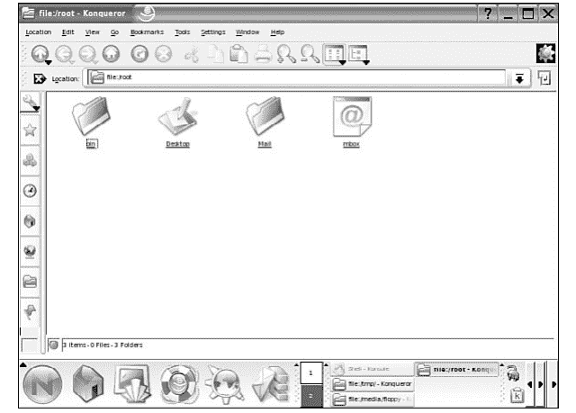

菜单栏下方会出现许多图标。从左开始，向上箭头带你进入上一级目录；例如，从 `/etc/cups` 进入 `/etc`。向左箭头带你回到之前所在的地方。向右箭头带你向后移动（在你返回后）。房子图标带你进入主目录。圆形图标用于重新加载或刷新显示。`X` 图标停止加载当前页面。其右侧是剪切、粘贴、打印以及更改图标大小和视图的图标。

左侧框架沿线出现了许多图标。从顶部开始，扳手图标允许你配置导航区域。星号显示你的书签。立方体显示你的设备。时钟显示历史记录。房子显示主目录。连接的地球显示网络，包括已配置通过 SMB 访问可用的 Windows 网络。文件夹图标显示根目录，旗帜显示特殊的 `KDE` 服务。

在显示区域的任何项目上右键点击将弹出上下文相关菜单，你可以从中进行复制、粘贴等选择。只需点击该项目即可打开它，或者双击文件夹将打开它并显示其下方的项目。

### Shell

图 2.4

你可以通过打开 shell 与命令行进行交互。

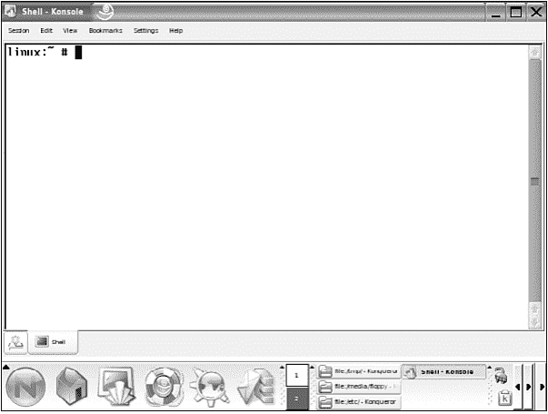

顶部的菜单选项有：会话（`Session`，打开新 shell、Linux 控制台、截屏等）、编辑（`Edit`，复制、粘贴、历史记录等）、视图（`View`，监控设置等）和帮助（`Help`）。

SuSE 帮助中心

图 2.5 所示的 SuSE 帮助中心允许你访问手册、文档和在线资源。

第 2 章

理解 Linux Enterprise Server

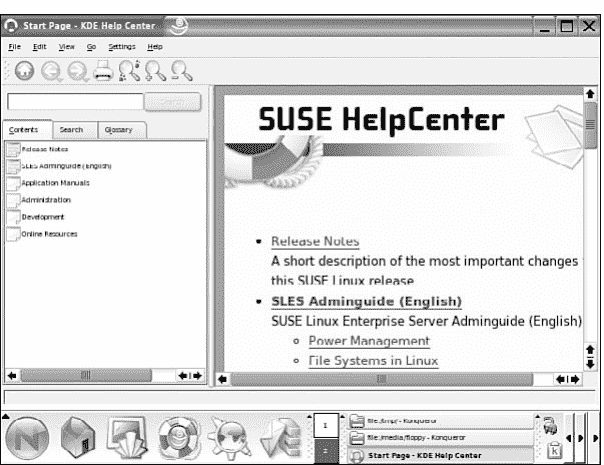

图 2.5

SuSE 帮助中心

### 浏览器


### KMail

- 行为（`Behavior`）：图标设置和鼠标操作。
- 多重桌面（`Multiple Desktops`）：配置虚拟桌面数量。
- 背景（`Background`）：从许多图片中选择或选择自己的。
- 屏幕保护（`Screen Saver`）：配置并测试屏幕保护程序。
- 尺寸与方向（`Size & Orientation`）：设置屏幕尺寸、刷新率和相关变量。

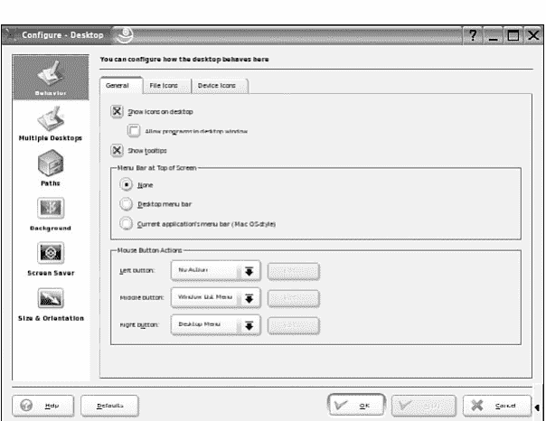

图 2.8

你可以按照喜好配置桌面。

### 其他桌面

在你添加此选项后，它将会在登录时与其他选项一起作为会话类型出现。`GNOME` 具有 `KDE` 的所有功能，并预计在 Novell Linux Desktop 发布时将作为默认用户环境。图 2.10 显示了启动界面，图 2.11 显示了图形化表示驱动器的浏览器。

你可以添加 `GNOME` 桌面环境。

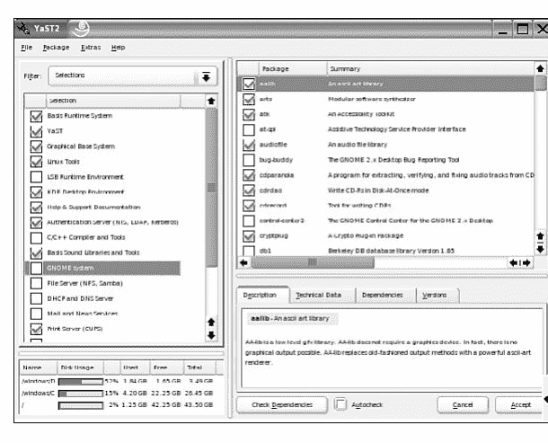

图 2.10

默认的 `GNOME` 桌面环境。

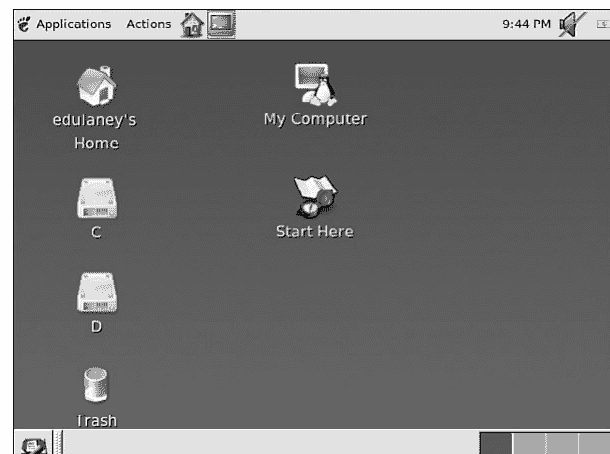

关于 `GNOME` 桌面的几点需要注意：时钟出现在右上角（而在 `KDE` 中位于右下角），且菜单选项和热键默认分布在屏幕顶部。

## 理解 SuSE Linux 企业服务器

# 第 2 章

图 2.11

你可以通过

浏览器访问

驱动器。

## 进程操作

涵盖的目标

- 6. 管道与重定向 (`3036`)

为了理解命令行并有效地工作，你必须理解正在发生的过程。在 Linux 中，shell 是命令解释器。

## 基础 GNU 和 Unix 命令

### 命令行交互

当输入一个命令时，shell 必须确定它是内部的还是外部的。如果命令是内部的，它执行处理并返回输出。如果 shell 内部找不到该命令，则假设它是外部实用程序（如 `ls`、`cal` 等）。外部命令的语法始终假设为：

`{program} {option(s)} {argument(s)}`

给定参数的数量不限于一个。虽然单个实用程序接受的参数数量可能有限制，但通常你可以将多个请求组合在一起。例如，与其指定

```
ls -l sa*
```

然后跟随

```
ls -l *.gif
```

你可以通过以下方式完成相同的操作：

```
ls -l sa* *.gif
```

如果你提供的参数在命令行上难以阅读，或者你想中断输入，可以使用反斜杠（`backstroke`）字符表示从一行继续到下一行。例如：

```
ls -l sa* \
*.gif
```

如果你给出数百个这样的参数，会在每个条目后使用反斜杠进行分隔。这将使输入更容易查看，并且在按下没有被反斜杠之前的 Enter 键之前，命令不会执行。

## 基础 GNU 和 Unix 命令

| -rw-r--r-- | 1 | root | 155 | Jul 19 | 16:48 |

| sample | | | | | |

| -rw-r--r-- | 1 | root | 12497 | Jul 19 | 16:39 |

| snapshot01.gif | | | | | |

| -rw-r--r-- | 1 | root | 17257 | Jul 19 | 16:50 |

| snapshot02.gif | | | | | |

### 连接命令

```
ls -l sa* \
*.gif \
*.ead \
*.txt \
*.doc
```


在在此之前的所有示例中，回车键（Enter）被用于告知 shell 你已经给了一个需要处理的命令。然而，你并不限于每次只给 shell 提供一个命令。

只要使用分号（`;`）来连接，就可以在同一行内提供多个命令，且这些命令之间没有任何相互关联。例如，通过连续输入以下两个命令，可以查看当前目录下的所有文件以及当前日期：

```
ls
date
```

这些是不无关的命令，因为第二个命令的输出与第一个命令的输出完全没有任何关系。你可以通过在两个命令之间加上分号将它们合并到单条命令行中，并得到相同的结果：

```
ls ; date
```

分号是一个特殊字符，表示同一行内有多个命令。该字符允许你打破其两边的空格规则（`ls;date`），同时获得相同的结果。

如果命令之间确实有些共同点——即一个命令的输出将作为下一个命令的输入——则使用管道（`|`）进行连接。例如，如果一个目录内的文件列表太长，无法在一个屏幕内显示，你可以使用此命令一次查看屏幕：

```
ls -1 | more
```

在这里，`ls -1` 命令的输出变成了 `more` 命令的输入。如果整个命令行的第一部分失败，后部分可能无法执行。

### 通配符

通配符是用于表示由 shell 填充的其他字符的字符。最常用的通配符是星号（`*`）和问号（`?`）。尽管它们经常被混淆，但它们的含义是不同的，可能会导致完全不同的结果。

星号用于表示任何和所有；任何事物和无物；起始与结束。例如

```
ls s*
```

它将找到当前目录中所有以字母“s”开头且后面跟着任意数量字符（包括没有）的项（文件和目录）。它在显示中可能生成的可能包括：

```
s sa sam samp sample samples
samples.gif
```

注意，它会寻找单独的“s”，以及“s”后面带有任意数量条目的项。相比之下，问号是单个字符的占位符，且仅代表一个字符。使用相同的文件可能性，以下命令

```
ls s?
```

将只会找到当前目录中以字母“s”开头且后面仅跟一个字符的项（文件和目录）。生成的显示为

```
sa
```

如果你只想找到以“s”开头的五个字母项，要使用的命令是

```
ls s???
```

总结一下，星号意味着“全部或全无”，而问号始终意味着“一个”。这两个通配符不是互斥的，可以根据需要结合使用。例如，无论文件名如何，只查找扩展名为三个字母的文件，命令应为

```
ls *.???
```

为了让情况稍微复杂一点，你还可以使用括号（`[]`）来指定可能的值。所有可能的值必须位于括号内，并被单独使用。

## 诺贝尔认证 Linux 专业学习指南

以下示例将找到所有以“d”或“e”开头且后面跟着无限数量字符的项：

```
ls [de]*
```

要只找到以“d”或“e”开头的三个字符项，命令将变为

```
ls [de]??
```

括号内的字符数量几乎是无限制限制的。因此，如果你想找到所有以小写字母开头而不是数字（或其他字符）的项，你可以使用“`[abcdefghijklmnopqrstuvwxyz]`”。然而，由于这是一个范围，表示它的一个简单得的方法是“`[a-z]`”。

```
ls [a-z]*
```

### 基础 GNU 和 Unix 命令

你现在可以使用命令

`echo $TODAY`

来查看变量的值。

结果将是 Wednesday。如果你现在使用命令

`set`

该变量会显示在那里。但是，如果你使用以下命令，

`env`

它将不会显示：

该变量已经在本地创建，并可以在本地引用。为了让它能够在子程序和子进程中访问，你必须将其从本地状态移动到环境中，这是通过 `export` 命令实现的：

`export TODAY`

这会将变量移动到环境中可以找到的地方，同时在本地生效，并被子程序和子进程访问。该变量及其值在整个会话期间有效，并在你注销时丢失。要使值永久化，必须将该项添加到配置文件（profile）中。

要更改变量，只需定义它的新值：

`TODAY=Monday`

由于它已经被导出，因此不需要再次执行，新值将同时应用于本地和环境中。如果需要删除变量，可以使用 `unset` 命令。

在存在且可定义的变量中，有一个提示符（prompt）。提示符是 shell 提供的视觉信息，告诉你它已准备好接受输入。默认提示符包括

- Bourne、BASH 和 Korn shell 的最后一个字符为 `$`

- C shell 和 Z shell 的最后一个字符为 `%`

- tcsh 的最后一个字符为 `>`

主提示符取决于你正在使用的 shell，是变量 `PS1` 或对应的提示符。在 bash 中，`PS1` 的典型值为

`[u@\ \W]\$`

## Novell 认证 Linux 专业学习指南

将 `PS1` 分解为各个组件，它等于以下内容：

- 左括号 (`\[`)

- 当前用户名

- @ 符号 (`@`)

- 当前主机名

- 空格

- 当前工作目录

- 右括号 (`]`)

- 美元符号 (`$`)

这种提示符的示例是 `[edulaney@server7 home]$`

反斜杠字符 (`\`) 用于表示应使用特殊值。可用于提示符的默认值见表 3.1。

### 表 3.1 定义提示符的变量

| VALUE | 结果 |
|--- |--- |
| `\d` | 当前日期 |
| `\h` | 第一个点之前的主机名 |
| `\n` | 换行 |
| `\s` | Shell |
| `\t` | 时间 |
| `\u` | 用户名 |
| `\W` | 当前目录 |
| `\!` | 历史记录 |
| `#` | 命令数量 |
| `\$` | 默认提示符——标准用户为 `$`，root 用户为 `#` |
| `\` | 实际的反斜杠（字面量） |
| ABC | ABC（该文本的值，或给定的任何文本） |

查看系统上的变量，你会发现存在不止 `PS1` 一个变量。例如，在本章前面的部分，我们讨论了用反斜杠结束行，以表示你尚未完成输入输入。如果我们查看事件序列并包含提示符，它看起来像这样：

```
[edulaney@server7]$ ls -l *.gif \
> *.fig \\
> *.bmp
```

注意，提示符从 `PS1` 变为大于号 (`>`)。如果它保持为 `PS1`，你将不知道它仍在接受输入，因此它从主提示符变为次级提示符，以表示模式的变化。所代表的（默认情况下）大于号的提示符是 `PS2`。它的值可以从默认更改为你任何想要的值，包括之前提到的所有特殊值。在大多数 shell 中，有三到四层提示符。

到此时，你已经意识到美元符号 (`$`) 用于表示变量；当你通过 `$EXAMPLE` 查看其内容时。shell 中还有其他三个变量可以用于确定你的环境。

- 第一个——`$$`——将显示当前运行的 shell 的进程 ID 数：

  `echo echo $$`

- 第二个——`$?`——将显示你运行的上一个命令的结果，取决于它是成功 (`0`) 还是失败 (`1`)。例如，`ls` 工具接受 `-F` 选项，它通过在目录名称后加上斜杠来区分目录和文件。`ls` 工具没有 `-z` 选项。根据此知识，以下序列显示了如何利用 `$`，并包含了每个操作的提示符和输出：

```
[edulaney@server7]$ ls -F
Desktop/ sample snapshot0.gif snapshot0.gif
[edulaney@server7]$ echo $?
0
[edulaney@server7]$ ls -z
ls: invalid option - z
[edulaney@server7]$ echo $?
1
```

- 第三个变量——`$!`——将显示最后在后台启动的子进程的进程 ID 数。如果没有在后台启动子进程，结果将为空。对于此讨论，了解在命令末尾加上安符 (`&`) 会在后台执行该命令是有用的。例如

```
[edulaney@server7]$ echo $!
```

```
[edulaney@server7]$ ls -F &
[edulaney@server7]$ echo $!
19321
```

## 引用

shell 中最难理解的组件之一是引用。有一些规则可以更容易理解：

- 1. 有三种类型的引号：双引号 (`"`)、单引号 (`'`) 和反引号（`` ` ``）。它们有不同的含义。双引号用于禁用大多数字符的意思，但不是所有。例如，假设有一个名为 `EXAMPLE` 的变量等于 25：

```
echo $EXAMPLE
```

这将返回 25。同样，以下操作也会返回 25：

```
echo "$EXAMPLE"
```

而以下将返回 `"$EXAMPLE"`:

```
echo '$EXAMPLE'
```

单引号的作用超过了双引号，还能抵消美元符号的意思。

换个方向

```
echo 'date'
```

将返回 "date"。将单引号替换为反引号会有不同的结果：

```
echo `date`
```

将返回 `date` 命令的结果。shell 中反引号的另一种替代方案是将命令放在括号内并将其视为变量。因此，可以像前面的示例一样通过以下命令输出日期：

```
echo ($date)
```


如果你未能对任何一组引号使用偶数次，`PS1` 将被 `PS2` 取代，并持续如此直到使用的引号总数（每组）为偶数。这当你有一长条目需要在输入期间将其拆成行时非常有用。以下示例包含了提示符，并显示了在另一种引号（双引号）中使用一组引号（反引号）的情况：

```
[edulaney@server7 home]$ EXAMPLE="Hi, the date
> time now
> are 'date'"
[edulaney@server7 home]$ echo $EXAMPLE
Hi, the date and time now are Thu Aug 10 11:12:37 EDT 2000
[edulaney@server7 home]$
```

# Novell 认证 Linux 专家学习指南

在许多情况下，引号需要混合使用。然而，你将遇到的最大问题之一是特殊字符使得它们难以作为输出显示。例如，假设 `echo` 操作的结果为

如果你使用命令

`echo "Karen says Hi"`

结果将是

`Karen says Hi`

`shell` 将引号解释为意味着引号内的文本应被视为一个单个条目。`shell` 执行它接收给它的操作，并在过程中丢失掉引号。为了解决这个问题，你必须使用反斜杠 (`\`) 字符来覆盖引号的默认含义：

```
echo Karen says \"Hi"
```

注意，反斜杠——即字面量字符——必须在每个引号出现之前，并且它始终仅适用于紧随其后的那个字符。

## 命令历史

`bash` `shell` 维护了一份你提供给它的命令列表，并允许你从列表中重用这些命令，而不需要每次都重新输入。从命令行，你可以使用向上和向下箭头滚动查看最近的命令。你也可以输入两个感叹号（`!!`）来重新运行你提供的最后一个命令。

输入历史显示了存储的所有命令，左侧有一个递增数字。输入一个感叹号加上这些命令中的一个将重新运行该命令，例如 `!125`。

> 注意

与其查看整个历史列表，你也可以通过在 `history` 命令后加上你想看到的行数来选择只查看最近的条目，例如：

```
history 5
history 10
```

## 基础 GNU 和 Unix 命令

或者，你可以输入一个感叹号后跟一组字符，`shell` 将重新运行以这些字符开头的最新命令。例如

```
ls
```

将重新运行以 `ls` 开头的最新命令。

用于历史记录的重要变量：

- `HISTFILE`—指向持有命令历史记录的文件。默认情况下，它是每个用户目录下的 `.bash_history`。
- `HISTSIZE`—每个会话保留的条目数。
- `HISTFILESIZE`—标识从一个会话传递到另一个会话的命令历史条目数（让你可以在此会话中运行上一个会话运行过的命令）。

`history` 的内部别名 `fc` 也存在，并可用于召回和重新运行命令。

### 命令别名

虽然操作系统和 `shell` 中提供了大量的命令和工具，但你可以创建对你更有意义的别名，或者缩短你必须输入的字符数。例如，如果你熟悉基于 Windows 的操作系统的命令行工作，你习惯了输入 `dir` 来查看那里有什么文件。在 Linux 中，可以通过 `ls -1` 实现类似的操作。可以通过以下语法创建一个别名，以便当你输入 `dir` 时，运行的是 `ls -1`：

```
alias dir="ls -1*"
```

别名的语法始终是 `alias`，后后跟在输入该别名时将运行的实际命令，两者之间用等号 (`=`) 分隔。在少数情况下，你可以不使用别名条目周围的引号也能正常工作，但作为一条通用规则，应该始终使用它们。

为了让别名在会话中持久存在，应该将它们添加到用户家目录下的 `.bashrc` 文件中。如果你不将它们放在登录时执行的文件中（从而重新创建它们），那么创建的别名会在你注销时丢失。

### 其他功能和注意事项

Linux 命令行还有许多其他不应被忽视的功能。虽然它们并不复杂到足以单独列出一个章节，但但知道它们的存在是有用的：

- 在输入命令时，你可以在输入几个字符后按下 `Tab` 键，`shell` 将尝试补全你正在输入的命令名称。
- 命令行历史可以被编辑，以便在再次运行之前修改命令。`bash` 中的默认编辑器是 `emacs`，在 `zsh` 中是 `vi`。编辑器将在本章稍后的“使用 vi 工作”部分进行讨论。
- 当你按下 `Enter` 键时，`shell` 扫描命令行并确定它在寻找哪些元素——空格。然后它将通配符替换为任何相关的文件名。随后，它剥离所有引号并替换变量。最后，它替换任何嵌入的命令并执行该条目。
- `test` 工具可以结合 `$` 来测试几乎任何内容。例如，要检查文件是否存在且可读，使用此组合：

```
test -r snapshot01.gif
echo $?
```

通过输入 `test` 可以找到所有测试选项的完整语法。
- 两个小于号（`<<`）被称为“here”（在此处），表示处理将等待其后的字符串在单独占一行的情况下作为 `PS2` 提示符给出。

```
cat << litter
```

将在 `PS2` 提示符处接受输入，直到在单独一行输入字符串 `"litter"` 为止。

### 文本处理

涵盖的课程目标

- 4. 在命令行执行命令 (`3036`)
- 5. 常见的命令行任务 (`3036`)
- 6. 管道与重定向 (`3036`)
- 8. 创建、查看和追加文件 (`3036`)

## 基础 GNU 和 Unix 命令

所有文本处理工具中最简单的是 `cat`，单词 `concatenate`（连接）的派生。默认情况下，它会将文件的整个内容显示在屏幕上（标准输出）。然而，可以使用它的许多实用选项，包括以下：

- `b` 对行进行编号
- `E` 在每行末尾显示美元符号 (`$`)（回车）
- `T` 将所有制表符显示为 `"^I"`
- `v` 显示除制表符和回车以外的非打印字符
- `A` 显示与 `-v` 结合 `-E` 和 `-T` 的效果

为了说明 `cat` 的用法，假设有一个名为 `example` 的四行文件，其内容如下：

```
How much wood
could a woodchuck chuck
if a woodchuck
could chuck wood?
```

要在屏幕上查看文件内容，完全如前面的示例所示，命令是

```
cat example
```

若要查看带有行号的文件，命令以及生成的输出将是

```
cat -b example
1 How much wood
2 could a woodchuck chuck
3 if a woodchuck
4 could chuck wood?
```

注意包含了制表符，这些字符之前并不存在，但是由编号过程添加的。它们并非真实存在于文件中，而只是添加到了显示中，可以通过以下命令见证这一点：

```
cat -Ab example
1 How much wood$
2 could a woodchuck chuck$
3 if a woodchuck$
4 could chuck wood?$
```

文件中唯一的不可打印字符是末尾的回车符，它们显示为美元符号。

`cat` 工具最常用的用途之一是快速创建文本文件。从命令行，你可以不指定任何文件，并将输出重定向到给定的文件名。这接受键盘输入并放入新文件中，直到接收到文件结束符（默认键序列为 `Ctrl+D`）。

下面的示例包含一个美元符号 (`$`) 提示符以显示此操作：

```
$ > example
Peter Piper picked a peck of pickled peppers
nA peck of pickled peppers Peter Piper picked.
If Peter Piper picked a peck of pickled peppers,
Where's the peck of pickled peppers Peter Piper picked?
$(press Ctrl+D)
```

在单独占一行的情况下按下 `Ctrl+D` 序列将标志着文件的结束。通过 `ls` 工具查看目录内容将显示该文件现在已创建，并且可以如下所示查看其内容：

`cat example`

注意，单重定向 (`>`) 如果文件之前不存在则创建一个名为 `example` 的文件，如果已存在则覆盖它。要追加到现有文件，请使用追加运算符 (`>>`)。

> 注意 `Ctrl+D` 键序列是指定文件结束操作的典型默认值。像 Linux 中的几乎一切一样，它可以被更改、自定义等。要查看你会话的设置，请使用此命令：

`stty -a`

并查找 `"eof="`.

有一个有限情况下使用的工具——`tac`，它将反向显示文件的内容（`tac` 是 `cat` 的反过来）。而不是

# 51

第 3 章

基础 GNU 和 Unix 命令

从第 1 行到文件末尾显示文件，而它从文件末尾到第 1 行显示文件，如下例所示：

```
$ tac example
Where's the peck of pickled peppers Peter Piper picked?
If Peter Piper picked a peck of pickled peppers,
A peck of pickled peppers Peter Piper picked.
Peter Piper picked a peck of pickled peppers
$
```


### nl, head 和 tail

可以使用三个简单的命令来查看文件的全部或部分：`nl`、`head` 和 `tail`。这三个命令都会对显示的行进行编号，并且默认情况下，它们都不会对空行进行编号。`nl` 可以利用某些选项来更改显示效果：

- `-i` 允许你更改增量（默认为 1）。
- `-v` 允许你更改起始数字（默认为 1）。
- `-n` 更改显示的对齐方式：
  - `nln` 让显示左对齐。
  - `nrn` 让显示右对齐。
  - `nrz` 使用前导零。
- `-s` 在行号和文本之间使用指定的字符（默认为空格）。

第二个要检查的工具是 `head`。顾名思义，该工具用于查看文件的顶部部分：默认是前 10 行。你可以通过使用连字符加上要显示的行数来更改显示的行数。以下示例假设有一个名为 `numbers` 的文本文件，包含 200 行，从 "one" 到 "two hundred"：

```
$ head numbers
one
two
three
four
five
six
seven
eight
nine
ten
$
$ head -3 numbers
one
two
three
$
$ head -50 numbers
one
two
three
{为了节省空间省略此处}
forty-eight
forty-nine
fifty
$
```

> 注意 当打印多个文件时，`head` 会在每个列表之前放置一个头部，标识正在显示哪个文件。`-q` 选项会抑制头部。

`tail` 命令有几种操作模式。默认情况下，它是 `head` 的相反，显示文件的结尾而不是开头。同样，它默认显示 10 行，但可以使用 `tail` 加上连字符来更改：

```
$ tail numbers
one hundred ninety-one
one hundred ninety-two
hundred ninety-three
hundred ninety-four
hundred ninety-five
hundred ninety-six
hundred ninety-seven
hundred ninety-eight
hundred ninety-nine
two hundred
$
$ tail -3 numbers
one hundred ninety-eight
hundred ninety-nine
two hundred
```

```
$ tail -50 numbers
one hundred fifty-two
one hundred fifty-two
one hundred fifty-three
{为了节省空间省略此处}
one hundred ninety-eight
hundred ninety-nine
two hundred
$
```

然而，`tail` 工具的功能于此，还包含一个 `+` 选项。这允许你指定一个起始点，超过此处将显示整个文件。例如：

```
$ tail +50 numbers
```

将从第 50 行开始（跳过前 49 行）并显示文件的其余部分。另一个有用的选项是 `-f`，它允许跟踪文件。命令将显示文件的最后 10 行，但会保持打开——跟踪文件——并显示附加到文件的任何新行。要退出这个无限循环，你必须按下你会话的终端序列，在大多数系统中默认是 `Ctrl+C`。

### cut, paste 和 join

`cut` 工具提供了从文件中分离列的能力。默认分隔符是制表符，`-f` 选项用于指定所需的字段。例如，假设有一个名为 `august` 的文本，有三列，如下：

```
one  two  three
four  five  six
seven  eight  nine
ten  eleven  twelve
```

那么下面的命令返回相反的内容：

```
$ cut -f2,3 august
two
three
```

此命令有许多可用选项；除了 `-f` 之外，还有 `-c` 和 `-d`：

- `-c` 允许你指定字符而不是字段。
- `-d` 允许你指定制表符以外的分隔符。为了说明如何使用其他选项，`cut` 命令将显示：权限、行数、所有者、组、大小、日期和文件名——所有内容由空格分隔，权限和链接之间有字符。如果你只想查看谁在目录中保存，而对其他数据不感兴趣，你可以使用：

```
$ cut -d "," -f5 august
``` 这将始终占用 10 个字符，后面跟着空格，然后是行数，以及随后的空格。`owner` 总是从第 16 个字符开始，并持续到名称的长度。命令

```
$ cut -c16 august
``` 将返回第 16 个字符——所有者名字的第一个字母。假设大多数用户使用八个字符或更少的字符作为名字，命令

```
$ cut -c16-24 august
``` 返回名称字段中的条目。文件名从第 55 个字符开始，但可能无法确定之后有多少个字符，因为文件名会比其他内容长得多。解决此问题的办法是从第 55 个字符开始且不指定结束字符（这意味着取整行的剩余部分），如示例所示：

```
$ cut -c55 august
```

### Paste

当 `cut` 工具从文件中提取字段时，这些字段可以使用 `paste` 或 `join` 结合起来。二者中最简单的是 `paste`——它完全没有强大的功能集，仅仅从源取某行并与另一个源的另一行合并。例如，如果 `fileone` 的内容是：

```
Indianapolis
Columbus
Peoria
Livingston
Scotdale
```

而 `filetwo` 的内容是：

```
Indiana
Ohio
Illinois
Montana
Arizona
```

那么接下来的内容（包括提示符）将是生成的显示：

```
$ paste fileone filetwo
Indianapolis Indiana
Columbus Ohio
Peoria Illinois
Livingston Montana
Scotdale Arizona
```

如果 `fileone` 中的行多于 `filetwo`，粘贴将继续，制表符后跟随空条目。制表符始终是默认分隔符，但可以使用 `-d` 选项更改为任意字符：

```
$ paste -d "," fileone filetwo
Indianapolis,Indiana
Columbus,Ohio
Peoria,Illinois
Livingston,Montana
Scotdale,Arizona
```

你还可以使用 `-s` 选项将 `fileone` 的所有内容输出到单行，随后是回车符，然后是 `filetwo`：

```
$ paste -s fileone filetwo
Indianapolis Columbus Peoria Scottsdale
Indiana Ohio Illinois Montana Arizona
```

### Join

你可以将 `join` 工具视为 `paste` 的增强版。然而，重要的是只有当合并的文件共享共同字段时，工具才能工作。例如，如果像之前 `paste` 的示例那样使用 `join`，结果将是：

```
$ join fileone filetwo
```

换句话说，没有任何显示。`join` 必须在文件之间找到共同字段，并且默认期望该字段是第一个。例如，假设 `fileone` 现在包含这些条目：

```
11111 Indianapolis
22222 Columbus
33333 Peoria
44444 Livingston
55555 Scottsdale
```

`filetwo` 的内容是：

```
11111 Indiana
22222 Ohio
33333 Illinois
44444 Montana
55555 Arizona
```

接下来的内容（包括提示符）将是生成的显示：

```
$ join fileone filetwo
11111 Indianapolis Indiana
22222 Columbus Ohio
33333 Peoria Illinois
44444 Livingston Montana
55555 Scottsdale Arizona
```

一旦文件不再匹配，就可以执行后续操作。每行都会与相反文件中相同且仅相同的行进行默认字段匹配检查。如果找到了匹配项，则将其包含在显示中；否则不包含。为了再次说明——使用原始的 `filetwo`：

```
$ tac filetwo > filethree
$ fileone filethree
```

# Novell 认证 Linux 专家学习指南

尽管两个文件中的每一行都有匹配项，但只发现了一个匹配项。

> 注意：强烈建议在执行 `join` 操作之前，先对要使用的每个文件进行排序，以确保顺序正确，从而解决问题。

你不需要保留 `join` 的默认设置（即查看所有第一个字段的匹配或输出所有列）。`-1` 选项允许你指定 `fileone` 中作为匹配字段的字段，而 `-2` 选项允许你指定 `filetwo` 中作为匹配字段的字段。例如，如果 `fileone` 的第二个字段与 `filetwo` 的第三字段匹配，语法如下

```
$ join -1 2 -2 3 fileone filetwo
```


`-o` 选项用于以 `{file.field}` 格式指定输出字段。因此，要在匹配行上仅打印 `fileone` 的第二个字段和 `filetwo` 的第三字段，语法如下：

```
$ join -o 1.2 2.3 fileone filetwo
Indianapolis 500
Columbus Buckeye
Peoria Wrigley
Livingston Yellowstone
Scottsdale Grand
$
```

### 排序、计数、格式化和翻译

通常不仅需要显示文本，还需要在输出之前对其进行处理和修改，或者简单地收集相关信息。本节介绍了四个工具：`sort`、`wc`、`fmt` 和 `tr`。

#### sort

`sort` 工具按字母顺序对文件的行进行排序并显示输出。字母顺序的重要性相对于任何其他顺序都是不言而喻的。例如，假设 `fileone` 以下行：

- Indianapolis Indiana
- Columbus
- Peoria
- Livingston
- Scottsdale

# 第 3 章

基础 GNU 和 Unix 命令

- 1
- 2
- 3
- 4
- 5
- 6
- 7
- 8
- 9
- 10
- 11
- 12

当对文件进行排序时，结果变为：

```
$ sort fileone
1
10
11
12
2
3
4
5
6
7
8
9

Columbus
Indianapolis Indiana
Livingston
Peoria
Scottsdale
$
```

城市已“正确”地按字母顺序排序。然而，数字也是按字母顺序排序的，这导致了所有以“1”开头的数字在所有以“2”开头的数字之前，以及“3”开头的数字之前，依此类推。

幸运的是，`sort` 工具包含了一些选项，为输出增加极大的灵活性。这些选项包括：

- `-d` 按文件目录顺序排序（与前面的示例所示）
- `-f` 将小写字母视为相同大写字母进行排序
- `-i` 忽略任何 ASCII 范围之外的字符
- `-n` 按数值顺序而非字母顺序排序
- `-r` 反转输出顺序

因此，显示可以更改为：

```
$ sort -n fileone
Columbus
Indianapolis Indiana
Livingston
Peoria
Scottsdale
1
2
3
4
5
6
7
8
9
10
11
12
$
```

> 注意：`sort` 工具假设所有空行都是显示的一部分，并始终将它们放在输出的开头。要防止空行被排序，请使用 `-b` 选项。

#### wc

`wc` 工具（命名为 "word count"，即单词计数）通过三个值显示文件信息：行数、单词数和字符数。输出的最后项是文件名，因此输出将是：

```
$ wc fileone
17 18 86 fileone
$
```

你可以使用以下选项选择仅查看部分输出：

- `-c` 仅显示字节/字符数
- `-l` 仅显示行数
- `-w` 仅显示单词数

在所有情况下，文件名仍然会出现，例如：

```
$ wc -l fileone
17 fileone
$
```

覆盖文件名显示的唯一方法是使用标准输入重定向：

```
$ wc -l < fileone
17
$
```

#### fmt

`fmt` 工具通过创建特定宽度的输出来格式化文本。默认宽度为 75 个字符，但可以使用 `-w` 选项指定不同的值。除非使用 `-s` 选项，否则短行将合并成长行；除非使用 `-u`，否则间距将对齐。`-u` 选项强制统一性，并在单词之间留一个空格，在每个句子末尾留两个空格。

以下示例显示了如何合并 `fileone` 的行以创建 75 字符的显示：

```
$ fmt fileone
Indianapolis Indiana Columbus Peoria Livingston Scottsdale 1 2
3 4 5 6
7 8 9 10 11 12
$
```

要将输出更改为 60 字符，使用此示例：

```
$ fmt -w60 fileone
Indianapolis Indiana Columbus Peoria Livingston Scottsdale
1 2 3 4 5 6 7 8 9 10 11 12
$
```

> 对于任何带有 `fmt -w` 的选项，例如 `fmt -60 fileone`，其结果与 `fmt -w60 fileone` 相同。

#### tr

`tr`（translate，翻译）工具可以将一组字符转换为另一组。使用以下命令将所有小写字母转换为大写字母：

```
$ tr 'a-z' 'A-Z' < fileone
INDIAPOLIS
COLumbus
PEORIA
LIVINGSTON
SCOTTSALE
$
```

非常重要的是，`tr` 只接受两组，语法如下：

- `[:lower:]`
- `[:upper:]`
- `[:digit:]`
- `[:alnum:]`
- `[:space:]`
- `[:cntrl:]`
- `[:graph:]`
- `[:punct:]`
- `[:alpha:]`

以下示例显示了如何删除数字以外的所有字符：

```
$ tr -d - '[:digit:]' < fileone
```

`/usr/home/edulaney`

此序列显示当前工作目录为 `/usr/bin`，而 `HOME` 变量等于 `/usr/home/edulaney`。在不带任何参数的情况下输入 `cd` 会切换到该目录。

```
$ pwd
/usr/home/edulaney
$ cd /
/
$ cd /usr/home/edulaney
$ pwd
/usr/home/edulaney
$ cd ..
$ pwd
/usr/home
$
```

在这个序列中，第一次更改是进入根目录 (`//`)然后进入 `/usr/home/edulaney`。使用该目录的父目录快捷方式，随后可以返回上一目录。

### 绝对路径与相对路径

指定任何内容（如文件、目录等）的路径有两种方法：绝对路径和相对路径。当你提供绝对路径时，你不需要考虑任何因素，提供的是一个始终有效的值。当你提供相对路径时，你会考虑到你当前所在的位置，并提供一个相对于该位置的路径。

用类比来来说，假设两个人住在同一个城市和州：印第安纳州的曼西（Muncie, Indiana）。第一个人住在 1990 Rosewood，第二个人住在 4104 Peachtree。如果第一个人想寻找/访问第二个人，他们可以通过邮寄地址这一绝对路径确定对方的位置：

4104 Peachtree Lane

Muncie, IN 47304

这个地址告诉：

- 1. 找到印第安州。
- 2. 在印第安州内，找到曼西。
- 3. 在曼西内，找到邮政编码为 47304 的城市区域。
- 4. 在之前所有的范围内，找到 Peachtree Lane。
- 5. 在 Peachtree Lane 上，前往 4104 号房屋。

绝对地址永远不会改变，无论你从哪里来，它都会指向该实体。

无论来访者是住在曼西还是阿拉斯加，其绝对地址都是相同的。然而，由于第一个人也住在曼西，我们也可以使用相对路径告诉他们如何到达目的地：

- 1. 沿着 Rosewood 到 Bethel 然后左转。
- 2. 沿着 Bethel 到 Jackson 然后右转。
- 3. 沿着 Jackson 穿过铁路轨道，到达 Hawthorne 的停止标志处。
- 4. 在 Hawthorne 上左转，前往下一个站点，即 Peachtree。
- 5. 在 Peachtree Lane 上右转，前往右侧的第一栋房子。

相对地址始终会改变，并且相对于你所在的位置。

表 3.2 展示了可以使用可以使用 `cd` 命令的几个示例。

#### `cd` 命令的使用示例

| 当前工作目录 | 新位置 | 路径 | 相对路径 |
| --- | --- | --- | --- |
| `/usr/home/edulaney/docs/proposals` | `/usr/home/edulaney/docs` | `/usr/home/edulaney/docs` | `../../` |
| `/usr/home/edulaney/docs/proposals` | `/usr/home/edulaney` | `/usr/home/edulaney` | `../../` |
| `/usr/home/edulaney/docs/proposals` | `/usr/home/edulaney/proposals/law_order` | `/usr/home/edulaney/proposals/law_order` | `law_order` |
| `/usr/home/edulaney/docs/proposals` | `/` | `/` | `../../` |

### 使用 `ls`

列出文件和目录的能力是任何操作系统最基本的功能之一，`ls` 工具在 Linux 中负责执行此功能。当单独使用时，它会以列格式列出当前目录下的文件和目录名称。默认情况下，条目总是按字母顺序排列的，并且没有符号可以区分目录名和文件名。例如：


```
Desktop emmett filethree junk2 questions
TestPro errors filetwo sample brio example myfile sample the world
dulaney example2 numbers simplesimon
eRRors fileone junk1 snapshot.gif
```

列表总是按字母顺序排列，大写字母在小写字母之前。该命令有许多选项，最常用的是 `-F`，它会显示条目的类型：

```
Desktop emmett filethree junk2 questions
TestPro errors filetwo sample brio example myfile sample the world
```

没有结尾字符的项是标准文件。带有 `/` 的项是目录。带有星号 `*` 的项是执行文件。符号链接用 `@` 符号表示。

另一个实用的选项是 `-a`，它会显示所有文件。默认情况下，`ls` 不显示隐藏文件。隐藏文件的第一个字符是点 `.`：

```
.Desktop emmett filethree junk2 questions
TestPro errors filetwo sample brio example myfile sample the world
.bash_history dulaney example2 numbers simplesimon
.file. junk1 snapshot.gif
```

> 注意：点可以出现在文件名的任何位置，并出现任意次数。只有当它们是第一个字符时才有意义。如果你用 `-A` 代替 `-a`，将忽略隐藏条目。无疑，最有用的选项是 `-l`，它会显示详细列表。条目看起来如下：

```
drwx------ 5 root 1024 Aug 30 11:12
-rw-r---- 1 root 548 Aug 23:01
-rw-r---- 1 root 28 Aug 22:26
```

基本上有七列，划分如下：

- 1. 权限。虽然全文讨论了权限，但现在重要的是识别条目的类型。`-` 表示文件，而 `d` 表示目录。

- 2. 链接数。如果是目录，它等于其下方的条目数；如果是文件，它等于引用它的方式数。

- 3. 创建（或拥有）该实体的所有者名称。

- 4. 该文件的组。

- 5. 文件的大小。

- 6. 创建或修改的日期。

- 7. 名称。

表 3.3 提供了 `ls` 的其他选项及其用途。

表 3.3 `ls` 命令选项

| 选项 | 用途 |
| --- | --- |
| -c | 按最后修改/修改顺序列表而非字母顺序 |
| -d | 列出目录 |
| -G | 与 -l 配合时不显示组 |
| -i | 显示每个条目的 inode 号（指针） |
| -n | 用数值显示所有者和组 |
| -o | 与 -l 相同 |
| -r | 反转显示顺序 |
| -R | 递归显示子目录中的条目 |
| -S | 排序 |
| -u | 按最后访问排序 |
| -w | 指定屏幕宽度 |
| -x | 显示行而非列 |
| -X | 按扩展名排序 |

### 应用 `touch`

文件或条目本质上有三个日期：创建、修改和访问。使用 `touch` 工具，你可以更改文件相关的访问和修改时间：

```
$ ls -l brio
-rw-r---- 1 root root 28 Aug 22 10:26 brio
$ touch brio
ls -l brio
-rw-r---- 1 root root 28 Aug 30 16:01 brio
```

`touch` 工具也可以使用几个选项，总结如下表所示：

| 选项 | 用途 |
| --- | --- |
| -a | 仅更改访问时间 |
| -m | 仅更改修改时间 |
| -r | 使用引用文件的时间/日期进行更改，而不是当前时间/日期 |

后者的示例如下：

```
$ ls -l tuesday wednesday
-rw-r--r- 1 root root 85 Aug 22 10:26 tuesday
-rw-r--r- 1 root root 85 Aug 29 13:08 wednesday
$ touch tuesday -r wednesday
ls -l tuesday wednesday
-rw-r--r- 1 root root 85 Aug 29 13:08 tuesday
-rw-r--r- 1 root root 85 Aug 29 13:08 wednesday
```

> 如果你使用 `touch` 工具处理一个不存在的文件名，它将创建一个具有当前日期和时间且大小为零的文件。

### 复制与移动

涵盖的课程目标

- 4. 在命令行执行命令 (3036)
- 5. 常见的命令行任务 (3036)
- 9. 复制和移动文件及目录 (3036)
- 10. 创建目录 (3036)
- 11. 删除文件和目录 (3036)

如果东西永远不移动或改变，系统管理将会容易得多。不幸的是，很少有东西保持不变，变化以不停的速度发生着。Linux 提供了两个用于复制和移动文件的强大工具：分别是 `cp` 和 `mv`，以及第三个工具 `dd`——它结合了后者的功能。

## 基础 GNU 和 Unix 命令

# 第 3 章

```
$ ls -l fileone onefile
ls: onefile: No such file or directory
-rw-r--r-- 1 root root 85 Aug 22 10:26
->onefile
```

```
$ cp fileone onefile
ls -l fileone onefile
-rw-r--r-- 1 root root 85 Aug 22 10:26
->onefile
-rw-r--r-- 1 eduelaney users 85 Aug 30 16:16
->onefile
```

注意原始条目（源）保持不变，但现在有了第二个条目（目标）。在第二个条目中，内容是相同的，但日期和时间是当前的（执行 `cp` 时的时间），而不是源文件的时间。同样注意，新文件的所有者和组将变为执行命令的用户。这与你完全从开始创建目标文件时的情况是相同的。

> 要能复制文件——创建一个内容与另一个文件相同的新实体——你只需要对源文件读取权限。

`-p` 选项可以强制尽可能多的旧变量保持不变。它保留了属性方面可以保留的内容：

```
$ ls -l filenextfile
ls: nextfile: No such file or directory
-rw-r--r-- 1 root root 85 Aug 22 10:26
->fileone
```

```
$ cp -p fileone nextfile
ls -l fileone nextfile
-rw-r--r-- 1 root root 85 Aug 22 10:26
->fileone
-rw-r--r-- 1 eduelaney users 85 Aug 22 10:26
->nextfile
```

注意与源相关的日期和时间被保留了，但所有者和组仍然更改。

# Novell 认证 Linux 专业学习指南

当你执行复制操作时，实用程序首先检查源文件是否存在。如果存在，将创建指定为目标的文件（大小为 0），并复制源的内容。重点在于目标总是会被创建的——无论它之前是否存在。以下是一个示例：

```
$ ls -l fileone filetwo
--r--r---- 1 root root 85 Aug 22 10:26
>fileone
--r--r---- 1 root root 16432 Aug 28 13:43
>filetwo
$
$ cp fileone filetwo
$ ls -l fileone filetwo
--r--r---- 1 root root 85 Aug 22 10:26
>fileone
--r--r---- 1 eduelaney users 85 Aug 30 16:18
>filetwo
$
```

`filetwo` 的原始内容已经丢失（除非有备份带版本），因为 `filetwo` 被创建为 `fileone` 的副本。有一个 `-i`（询问为 inquire）选项，可用于询问如果目标文件已存在，你是否真的想删除目标文件的内容：

```
$ ls -l fileone filetwo
--r--r---- 1 root root 85 Aug 22 10:26
>fileone
--r--r---- 1 root root 16432 Aug 28 13:43
>filetwo
$
$ cp -i fileone filetwo
cp: overwrite 'filetwo?'
```

在提示符处，你可以输入 "y" 执行操作，或输入任何其他内容停止操作。

你可以将多个文件从一个目录复制到另一个目录，只要最后一个项目是存放这些文件的有效目录：


```
$ ls -l /usr/home/sduaney
--r--r---- 1 root root 85 Aug 22 10:26
$ exit
$ cd /home/examples
$ ls -l q*
--r--r---- 1 root root 585 Aug 23 12:16
```

## 基础 GNU 和 Unix 命令

第 3 章

```
-questions
-rw-r---- 1 root root 1985 Aug 24 15:17
-samples
-rw-r---- 1 root root 8501 Aug 25 18:30
-snapshot01.gif
$ cp q* /usr/home/sduaney
$ cd ../sduaney
$ ls -l
-rw-r---- 1 root root 85 Aug 22 10:26
$ exit
-rw-r---- 1 root root 585 Aug 31 22:50
-questions
-rw-r---- 1 root root 1985 Aug 31 22:50
-samples
-rw-r---- 1 root root 8501 Aug 31 22:50
-snapshot01.gif
$
```

要将一个目录移动到另一个地方，使用 `-r` 选项递归移动目录以及所有子目录和文件。其他选项有 `-f` 强制不询问（`-i` 的反面）；`-u` 只在源文件更新时复制；以及 `-v` 详细模式（显示所有操作而不是静默执行）。最后，`-P` 选项将在位置复制文件——根据需要创建目录和子目录。

### mv

移动工具 (`mv`) 可用于多种操作。由于过于简单，这包括：

1. 重命名文件
2. 重命名目录
3. 将文件从一个目录移动到另一个目录
4. 将子目录从一个目录移动到另一个目录
5. 将实体移动到另一个分区或介质

最简单的操作是在当前目录重命名文件：

```
$ ls -l file*
-rw--r---- 1 root root 85 Aug 22 10:26
-fileone
-rw--r---- 1 root root 16432 Aug 28 13:43
```

# Novell 认证 Linux 专业学习指南

```
$ filetwo
$ mv fileone filethree
$ ls -l file*
-rw--r---- 1 root root 85 Aug 22 10:26
-filethree
-rw--r---- 1 root root 16432 Aug 28 13:33
-filetwo
```

日期、权限和与 `fileone` 相关的所有其他属性都会留在 `filethree`。这是因为当文件在同一目录（或同一分区）移动时，没有发生物理操作；移动变成了简单的重命名。

尽管听起来很简单，但始终记住，当你复制文件时，你留下了原始文件并创建一个不存在的东西——为新实体创建一组新属性。视角来看，如果你复制一个大小为 MB 的文件，它将比复制一个大小为 bytes 的文件花费更多。使用移动作为重命名时，无论大小如何，执行操作的时间相同。如果你将文件移动到一个已存在的名称，目标的内容将丢失。以下是一个示例：

```
$ ls -l file*
-rw--r---- 1 root root 85 Aug 22 10:26
-fileone
-rw--r---- 1 root root 16432 Aug 28 13:33
-filetwo
$ mv fileone filetwo
$ ls -l file*
-rw--r---- 1 root root 85 Aug 22 10:26
-filetwo
$
```

`-i` 选项（询问或交互）可用于覆盖前进行提示，它的反面是 `-f`（强制），这是默认操作。`-u` 选项仅在源文件较新时执行移动，`-v` 开启详细模式。`-b` 选项在目标存在时对其创建备份，用波浪号 `~` 作为最后一个字符——本质上是在执行伪复制操作：

```
$ ls -l help*
-rw--r---- 1 root root 85 Aug 22 10:26
-helpfile
$ mv -b helpfile filetwo
$ ls -l help*
-rw--r---- 1 root root 85 Aug 22 10:26
-filetwo
$
$ ls -l file*
-rw--r---- 1 root root 85 Aug 22 10:26
-fileone
-rw--r---- 1 root root 16432 Aug 28 13:43
-filetwo
$ mv -b fileone filetwo
$ ls -l file*
-rw--r---- 1 root root 85 Aug 22 10:26
-filetwo
-rw--r---- 1 root root 16432 Aug 28 13:43
$
```

在第一个实例中，由于没有目标文件，所以 `-b` 选项被忽略了。在第二个实例中，由于目标名称存在，原始目标以波浪号 (`~`) 被重命名。

> `-b` 选项也可以用于 `cp` 执行与 `mv` 相同的操作。

### dd

设备到设备 (`dd`) 实用程序用于将文件从一个设备复制到另一个设备。然而，它的功能不仅如此，因为它可以在复制过程中将文件从一种格式转换为另一种格式。它可以从 EBCDIC 转换为 ASCII（并反之），将大写字母转换为小写，并处理块或关键字。

`dd` 最常用的用法是在移动介质之间复制文件，你必须使用参数：

- `bs`—块大小
- `if`—输入文件
- `of`—输出文件

### 删除文件和目录

当文件不再需要时，可以使用 `rm` (`remove`) 命令从系统中删除。使用此命令要小心，因为 Linux 没有提供其他操作系统那样的删除命令或功能。

```
$ ls -l file*
-rw--r---- 1 root root 85 Aug 22 10:26
-fileone
-rw--r---- 1 root root 16432 Aug 28 13:33
-filetwo
$ rm fileone
$ ls -l file*
-rw--r---- 1 root root 16432 Aug 28 13:33
-filetwo
$
```

当配合 `-i` 选项使用时，在每个要删除的文件之前都会提示。按 Y 删除文件，按任何其他字符都会跳过该文件。

```
$ ls -l t*
-rw--r---- 1 root root 85 Aug 22 10:26
-today
-rw--r---- 1 root root 16432 Aug 28 13:33
-tuesday
$ rm -i t*
rm: remove 'today?'
```

`-f` 选项强制删除，`v` 将实用程序置于详细模式。`-r` 或 `-R` 选项递归删除目录（包括子目录和文件）。为了删除文件，你必须对其所在的目录具有写入权限。

> 注意：只需要对删除文件的目录具有写入权限——而不是对文件本身。

一个更安全的工具 `rmdir` 可用于删除没有任何内容的目录。它只会删除空目录，且不能用于

# 基础 GNU 与命令第 3 章

...包含文件或子目录的目录。`rmdir -p` 可用于删除父目录（如果其为空）的唯一选项。

```
$ ls -R kdulaney
kdulaney:
docs

kdulaney/docs:
attempt
$ rmdir kdulaney
rmdir: kdulaney: Directory not empty
$
```

由于 `kdulaney/docs` 中有一个文件 (`attempt`)，且在 `kdulaney` 下有一个子目录 (`docs`)，因此无法使用 `rmdir` 工具删除 `kdulaney` 目录。完成此任务有三种可能方法：

- 1. 使用 `rm -r` 命令。
- 2. 使用 `rm` 删除 `attempt`，使用 `rmdir` 删除 `docs`，最后——使用 `rmdir` 删除 `kdulaney`。
- 3. 使用 `rm` 删除 `attempt`，然后使用 `rmdir -p` 删除 `kdulaney/docs`。

> 注意：`rmdir` 只能删除空目录，在清理系统时，使用 `rm` 自然而是一个更安全的工具。

### 创建目录

现在你已经学习了如何复制、移动和删除目录，剩下的唯一任务就是创建目录，你可以使用 `mkdir` 命令来实现。在不带选项的情况下，它会在当前目录下创建一个子目录（子文件夹）。它还有两个可配合使用的选项：

- `-m`——为新目录指定除默认以外的权限（将在稍后的章节中介绍）
- `-p`——在一个命令中同时创建父目录和子目录

以下是该工具的一些用示例：

```
$ pwd
/usr/home
```

Novell 认证 Linux 专业人员学习指南

```
$ mkdir edulaney
$
```

这在 `/usr/home` 下创建了子目录 `edulaney` (`/usr/home/edulaney`)。


```bash
$pwd
/usr/home
$ mkdir kdulaney/docs
mdir: cannot make directory 'kdulaney/docs': No such file or
--directory
$
$ mkdir -p kdulaney/docs
$ cd kdulaney
$ cd docs
$
```

在第一次尝试中，该工具失败了，因为默认情况下无法创建多个目录。然而，如果你使用 `-p` 选项，就会创建多个目录。

### 标准输出与输入

涵盖的课程目标

- 4. 在命令行执行命令 (3036)
- 5. 常见的命令行任务 (3036)
- 6. 管道与重定向 (3036)

标准输出是通常显示的地方——你的屏幕。当你执行以下命令时

```
ls -F
```

当前目录下的子目录和文件列表显示在你的屏幕上。因此，标准输出的默认位置是屏幕。然而，如果你不想将结果显示在屏幕上，可以将它们重定向到另一个位置，例如文件。可以通过大于号 (`>`) 来重定向标准输出。例如，要将结果发送到文件，可以使用命令：

```
ls -F > myfile
```

# 基础 GNU 与 Unix 命令

第 3 章

`shell` 在收到此命令时的首要任务是创建一个名为 `myfile` 的大小为零的文件。然后它允许 `ls` 工具运行，并将输出放在新创建的文件中，而不是你的屏幕上。记住操作顺序非常重要。假设你给了一个不存在的命令，例如：

```
ls -z > myfile
```

名为 `myfile` 的文件仍然被创建，大小为零并保持为零。错误显示在你的屏幕上，但这是在文件创建之后。这也很，因为你想向文件中添加更多信息，文件会被先覆盖。要添加更多信息，你必须使用双大于号 (`>>`) 追加内容到文件：

```
ls -1 >> myfile
```

这会将新信息添加到现有文件中，并保持原始内容完整。在某些情况下，你希望某个命令运行，但完全不在乎结果是什么。例如，我可能想要编译数据库，需要运行一个工具来实现这一点。我不在乎生成的这些——我只想让工具运行。在这种情况下，你可以将结果发送指定的 `/dev/null`：

```
ls -F > /dev/null
```

结果被发送到这个设备（也称为垃圾桶），永远不会被保存或显示。

标准输入通常是键盘，或者解释为命令行上提供的参数之一。然而，你可以使用小于号 (`<`) 指定标准输入的重定向。很少有这种需求，但它是可用的。例如

```
cat myfile
```

将获得与下面相同的结果

```
cat < myfile
```

在 Linux 世界中，这些项目也有数值。标准输入（缩写为 `stdin`）为 0，标准输出（缩写为 `stdout`）为 1。这些数字可以用于重定向，但很少这样做。示例是

```
ls -F 1> myfile
```

# Novell 认证 Linux 专业人员学习指南

> 注意

`1` 和 `>` 之间不能有空格。如果有，意义就会改变。

此示例表示标准输出被重定向到名为 `myfile` 的文件。这些数字重要只有一个原因——因为存在第三种可能性。标准错误（缩写为 `stderr`）的值为 2。标准错误的示例，回想你之前看到的 `ls -z` 命令。尽管输出被发送到了文件，但该命令是不存在的，错误消息显示在屏幕上。

### xargs

另一个强大的工具是 `xargs`。为了理解这个工具的威力，考虑 `find` 工具，它在返回文件系统结构内的值方面是有限的。为了说明这一点，假设用户 `edaney` 几个月……

以下是该工具的一些用示例：

```
$pwd
/usr/home
```

Novell 认证 Linux 专业人员学习指南

```
$ mkdir edulaney
$
```

这在 `/usr/home` 下创建了子目录 `edulaney` (`/usr/home/edulaney`)。

About the closest you can get to accomplishing this with find (and its results) would be

```bash
$ find / -user eduelaney -type f -exec grep -i refrigerator {} \;
stored in the refrigerator overnight will be thrown out
$
```

必须使用 `-f` 选项，否则每次当 `grep` 尝试搜索目录时都会发生错误。在这种情况下，虽然找到了文件中的行，但无法得知包含在哪个文件中——这使得结果几乎毫无用处。


引入 `xargs` 工具：类似于管道（pipe），它将一个命令的输出馈给另一个命令使用。进入它的参数将在不经过任何更改的情况下传递，并转换为下一个命令的输入。因此，可以将命令修改为：

```bash
$ find / -user eduelaney -type f | xargs grep -i refrigerator /home/eduelaney/fileone
stored in the refrigerator overnight will be thrown out
$
```

由于指定了目标文件，现在可以为新员工找到并打印它。

思考题：如果 `xargs` 的工作原理像管道，为什么下面的命令不起用？

```bash
$ find / -user eduelaney -type f | grep -i refrigerator
```

答案：因为 `grep` 操作将发生在文件名上，而不是文件内容上。`xargs` 工具会将整个内容逐继传递给下一个命令（在本例中为 `grep`），而不仅仅是生成的文件名。

### 进程工作

课程目标涵盖

- 5. 常见命令行任务 (3036)

- 17. 从图形界面和命令行界面查看进程 (3036)

- 18. Linux 系统中的多用户进程和多任务处理 (3036)

- 19. 监控进程 (3038)

## 第 3 章：基础 GNU 和 Unix 命令

在本节中，你将学习用于管理进程的工具，以及进程如何被用于所有事务。在之前的章节中，我们讨论了许多工具和命令——每当发布其中一个时，都会启动一个进程来执行该请求，正如你将在更详细的情况下看到的那样。

### 什么是进程

理解本节的关键在于：进程是任何执行中的实例、命令或工具。当你像之前讨论的那样输入 `ls` 命令时，启动一个进程来运行该工具并返回结果。

即使是你正在交互的 shell（外壳）也是作为进程运行的。当你给出一个执行执行命令时，shell 会查看是否可以在没有外部帮助的情况下完成。（假设命令只是一个空行：不需要其他工具即可返回另一个提示符。）如果你的 shell 无法执行该命令，它将调用另一个进程来执行该操作。被调用的另一个进程是你 shell 的子进程，它变成了新进程的父进程。

当子进程完成任务后，它会将结果返回给父进程，然后退出。由于 Linux 是多任务操作系统，对于任何给定的父进程可能有多个子进程。子进程无法独立完成所有任务（例如编译年度报告），它可能需要调用一个或多个额外的进程。如果它这样做，它就变成了那些子进程的父进程。

> 在没有任何代码限制的情况下，每个进程都有成为父进程或子进程的能力。

### 注意事项

在系统中，任何时候都有你正在运行的进程，可能有其他人正在运行的进程，以及系统本身正在运行的进程。后者通常是守护进程（daemons）——这些是在后台运行、无需交互即可为操作系统提供功能的服务。守护进程可以执行的服务示例包括打印、运行调度作业、发送邮件、监控运行状态等。

### 使用 ps 工作

`ps` 命令是与进程交互的关键，用于显示进程状态。当单独运行时（不带任何选项），`ps` 将显示你当前正在运行的进程，最后一行始终是它本身（它也是一个运行中的进程）。例如

| PID | TTY | TIME | CMD |

| :--- | :--- | :--- | :--- |

| 19605 | pts/0 | 00:00:34 | bash |

| 30089 | pts/0 | 00:00:00 | vi |

| 30425 | pts/0 | 00:00:00 | paste |

| 32040 | pts/0 | 00:00:00 | cat |

| 1183 | pts/0 | 00:00:00 | awk |

| 30679 | pts/0 | 00:00:00 | ps |

第一列是进程 ID（PID）——这是分配给每个进程的唯一数字。当系统启动时，数字会一直递增直到达到定义的限制，然后重新开始。第二列指示负责该进程的终端（TTY）。由于列表仅包含用户的进程，因此所有列表项将是相同的。第三列表示处理器时间量。在大多数情况下，进程运行很快、处于空闲状态等，消耗的时间很少。非常高时间可能表明某个进程正在拖慢性能。第四列是进程名称。在第一行中是用户的 shell——它可能在那里，也可能完全不存在。用户的 shell 被称为会话领导者（session leader）。最后一行是刚刚执行的命令。中间的条目是用户运行的其他进程。`ps` 工具有许多选项可以使其更灵活。`-a` 选项消除了选择。例如，你知道有一个 shell 正在运行，或者你没有在交互，所以看到它并不重要。使用 `-a` 选项，它会显示与当前 tty 关联的所有进程：

```bash
$ ps -a
| PID | TTY | TIME | CMD |
| 30089 | pts/0 | 00:00:00 | vi |
```

`-a` 将显示所有运行的进程，除了当前 tty。此外注意 PID 会随着运行而递增。在这种情况下，使用 `-A` 或 `-e` 选项，可以看到所有正在运行的进程：

```bash
$ ps -e
| PID | TTY | TIME | CMD |
| :--- | :--- | :--- | :--- |
| 1 | ? | 00:00:00 | migration/0 |
| 2 | ? | 00:00:00 | ksftqd/0 |
| 3 | ? | 00:00:00 | ksftqd/0 |
| 4 | ? | 00:00:00 | migration/1 |
| 5 | ? | 00:00:00 | ksftqd/1 |
| 6 | ? | 00:00:00 | events/0 |
| 7 | ? | 00:00:00 | events/1 |
| 8 | ? | 00:00:00 | kcpid |
| 9 | ? | 00:00:00 | kblockd/0 |
| 10 | ? | 00:00:00 | kblockd/1 |
| 11 | ? | 00:00:00 | kirqd |
| 14 | ? | 00:00:00 | khelper |
| 15 | ? | 00:00:00 | pdfflush |
| 16 | ? | 00:00:00 | pdfflush |
| 18 | ? | 00:00:00 | aio/0 |
| 17 | ? | 00:00:00 | kswapd0 |
| 19 | ? | 00:00:00 | aio/1 |
| 175 | ? | 00:00:00 | kseriod |
| 437 | ? | 00:00:00 | scsi_eh_0 |
| 439 | ? | 00:00:00 | scsi_eh_1 |
| 479 | ? | 00:00:00 | reiserfs/0 |
| 480 | ? | 00:00:00 | reiserfs/1 |
| 659 | ? | 00:00:00 | kcopyd |
| 1463 | ? | 00:00:00 | khubd |
| 1739 | ? | 00:00:02 | dhcpcd |
| 1924 | ? | 00:00:00 | syslog |
| 1930 | ? | 00:00:00 | klogd |
```


```bash
| 1979 | ? | 00:00:00 | portmap |
| 1980 | ? | 00:00:10 | resmgrd |
| 2042 | ? | 00:00:00 | slpd |
| 2152 | ? | 00:00:01 | cupsd |
| 2305 | ? | 00:00:33 | powersaved |
| 2402 | ? | 00:00:00 | sshd |
| 2495 | ? | 00:00:00 | hwscand |
| 2531 | ? | 00:00:00 | slapd |
| 3023 | ? | 00:00:00 | master |
| 3159 | ? | 00:00:00 | cron |
| 3164 | ? | 00:00:07 | nscd |
| 3334 | ? | 00:00:00 | kdm |
| 3385 | tty1 | 00:00:00 | mingety |
| 3386 | tty2 | 00:00:00 | mingety |
| 3387 | tty3 | 00:00:00 | mingety |
| 3388 | tty4 | 00:00:00 | mingety |
| 3389 | tty5 | 00:00:00 | mingety |
| 3390 | tty6 | 00:00:00 | mingety |
| 3531 | ? | 00:00:00 | gpg-agent |
| 7235 | ? | 00:00:00 | qmgr |
| 6751 | ? | 00:00:00 | gpg-agent |
| 6898 | ? | 00:00:22 | X |
| 6899 | ? | 00:00:00 | kdm |
| 6930 | ? | 00:00:00 | kde |
| 6965 | ? | 00:00:00 | gpg-agent |
| 6989 | ? | 00:00:00 | kdedinit |
| 6992 | ? | 00:00:00 | kdedinit |
| 6994 | ? | 00:00:00 | kdedinit |
| 6997 | ? | 00:00:00 | kdedinit |
| 7005 | ? | 00:00:00 | artsd |
| 7015 | ? | 00:00:00 | kdedinit |
| 7016 | ? | 00:00:00 | kwwrapper |
| 7018 | ? | 00:00:00 | kdedinit |
| 7019 | ? | 00:00:03 | kdedinit |
| 7021 | ? | 00:00:00 | kdedinit |
| 7023 | ? | 00:00:00 | kdedinit |
| 7025 | ? | 00:00:02 | kdedinit |
| 7027 | ? | 00:00:03 | kdedinit |
| 7032 | ? | 00:00:00 | kdedinit |
| 7036 | ? | 00:00:00 | kpowersave |
| 7037 | ? | 00:00:01 | suseplugger |
| 7039 | ? | 00:00:00 | susewatcher |
| 7043 | ? | 00:00:00 | kdedinit |
| 7049 | ? | 00:00:00 | krandtray |
| 7053 | ? | 00:00:01 | kdedinit
```

# 87

## 基础 GNU 和 Unix 命令

### 第3章

```
7054 pts/1    00:00:00 bash
7116 ?        00:00:00 kdeinit
8886 ?        00:00:04 kdeinit
13641 ?       00:00:00 pickup
13737 pts/1   00:00:00 ps
$
```

在显示的内容中有几点需要注意。它们没有特定的顺序，如下：

- 系统启动时启动的进程具有最低的 PID（第 1 到第 19 项）。根据一般规则，这些是关键任务的进程，如果它们没有运行，系统的部分或全部将无法使用。
- 并非所有进程都绑定到终端。如果出现问号（?），则表示该进程在系统上运行，但没有终端交互，且/或者没有终端作为标准输出。
- 对于每个正在使用的用户的终端，都有一个 `getty`（或 `mengetty`）在运行。该进程会停留并等待用户尝试登录。即使没有用户正在使用 `tty6`，也可以很容易看到其他六个终端可以使用。

其他可用于确定显示哪些信息的选项：

- `1`：显示长列表（类似于 `ls -1`）
- `u`：显示用户名和相关统计数据
- `f`：显示完整列表（所有可能的项目）

后者经常被使用，并受到管理员青睐，因为它在显示中增加了额外的列：

```
$ ps -f
UID       PID PPID C TTY          TIME CMD
root      7054 7053      0 Oct2 pts/1  00:00:00 /bin/bash
root      13745 5054      0 09:45 pts/1  00:00:00 ps -f
$
```

这里有四列是之前没有的。第一列识别与进程关联的用户 ID（用户 ID）。第三列是父进程 ID（`PPID`）——显示该进程向哪个进程报告。第四列识别是否涉及调度，第五列是进程启动的时间。

# Novell 认证 Linux 专业人员学习指南

注意，当使用 `r` 时，`CMD` 现在列出的是整个命令，而像之前的显示那样只列出第一部分。

这些选项可以相互组合，最常见的组合是 `ef`，它以完整格式显示所有进程：

```
$ ps -ef
UID PID PPID C STIME TTY CMD
root 1 0 Ø Sep28 ? 00:00:04 init [5]
root 2 1 Ø Sep28 ? 00:00:00 [migration/0]
root 3 1 Ø Sep28 ? 00:00:00 [ksoftird/0]
root 4 1 Ø Sep28 ? 00:00:00 [migration/1]
root 5 1 Ø Sep28 ? 00:00:00 [kirqd]
root 6 1 Ø Sep28 ? 00:00:00 [events/0]
root 7 1 Ø Sep28 ? 00:00:00 [events/1]
root 8 6 Ø Sep28 ? 00:00:00 [blockd/0]
root 9 6 Ø Sep28 ? 00:00:00 [blockd/1]
root 10 6 Ø Sep28 ? 00:00:00 [kirqd]
root 11 1 Ø Sep28 ? 00:00:00 [aio/1]
root 14 6 Ø Sep28 ? 00:00:00 [khelper]
root 15 7 Ø Sep28 ? 00:00:00 [plflush]
root 16 6 Ø Sep28 ? 00:00:07 [plflush]
root 18 7 Ø Sep28 ? 00:00:00 [aio/0]
root 17 1 Ø Sep28 ? 00:00:00 [kswpd/0]
root 19 6 Ø Sep28 ? 00:00:00 [aio/1]
root 175 1 Ø Sep28 ? 00:00:00 [kseriod]
root 437 1 Ø Sep28 ? 00:00:00 [scsi_eh_0]
root 439 1 Ø Sep28 ? 00:00:00 [scsi_eh_0]
root 479 6 Ø Sep28 ? 00:00:00 [reisters/0]
root 480 7 Ø Sep28 ? 00:00:00 [reisters/1]
root 659 6 Ø Sep28 ? 00:00:00 [kcopyd]
root 1463 1 Ø Sep28 ? 00:00:00 [khubd]
root 1930 1 Ø Sep28 ? 00:00:00 /sbin/klogd
```

# 诺威认证 Linux 专家学习指南

假设进程 B 将其值返回给进程 A，然后将其值返回给用户的 shell（终端）。进程 A 像进程 B 一样无法结束，因为它仍然关联着一个子进程。由于进程 C 发生了故障，三个不再需要的进程仍在继续运行。

该故障的另一种可能性（取决于应用程序的编写方式）是进程 B 可以在进程 C 退出之前直接结束。进程 A 可以完成它的任务，并随之退出。在这种情况下，发生的情况是只有进程 C 仍然是一个问题，但现在它上方没有已不存在的父进程，它也不知道该向谁汇报——它变成了一个真正的“失控”进程（`runaway process`）。

要解决运行不常进程的问题，可以使用 `kill` 命令。该实用程序采用以下语法：

```
kill {option} PID
```

要消除 `cat` 进程，操作序列如下：

| UID | PID | PPID | C | STIME | TTY | TIME | CMD |


| :--- | :--- | :--- | :--- | :--- | :--- | :--- | :--- |
| root | 19605 | 19605 | Aug10 | pts/0 | 00:00:34 | `bash` |
| root | 30089 | 19605 | Aug20 | pts/0 | 00:00:00 | `vi fileone` |
| root | 30425 | 19605 | Aug20 | pts/0 | 00:00:00 | `paste -d` |
| root | 32040 | 19605 | Aug23 | pts/0 | 00:00:00 | `cat` |
| root | 1183 | 19605 | Aug23 | pts/0 | 00:00:00 | `awk -F:` |
| root | 30990 | 19605 | 14:25 | pts/0 | 00:00:00 | `ps` |

该命令“礼貌地”请求进程终止。它之所以礼貌，是因为有 32 种杀死进程的方法（要发送的信号），而这是这样做最安全的方法。在许多情况下，进程将简单地忽略请求并继续运行。当发生这种情况时，你可以通过指定要使用的数字来使用 32 种方法之一。可能的选项包括

- `-1` 挂断/断开时
- `-2` 使用中断 (`Ctrl+C`) 序列
- `-3` 退出时
- `-9` 不管一切——立即执行
- `-15`（默认值）

## 基础 GNU 和 Unix 命令

# 第 3 章

要查看系统上的信号列表，请使用命令 `kill -l`。前 32 个信号是标准信号，但很多时候会显示多达 64 个信号的列表。在 33 到 64 之间的这些信号不是标准的，供实时应用程序使用。

为了说明这一点，假设 `cat` 进程不会礼貌地退出；那么操作序列变为：

```
$ ps -f
UID PID PID TTY TIME CMD
root 19605 19603 0 Aug10 pts/0 00:00:34 bash
root 30089 19605 0 Aug20 pts/0 00:00:00 vi fileone
root 30425 19605 0 Aug20 pts/0 00:00:00 paste -d
--fileone filet?
root 32040 19605 0 Aug22 pts/0 00:00:00 cat
root 1183 19605 0 Aug23 pts/0 00:00:00 awk -F:
--questions
root 30996 19605 0 14 pts/0 00:00:00 ps -f
$ 
```

```
$ ps -f
UID PID PID TTY TIME CMD
root 19605 19603 0 Aug10 pts/0 00:00:34 bash
root 30089 19605 0 Aug20 pts/0 00:00:00 vi fileone
root 30425 19605 0 Aug20 pts/0 00:00:00 paste -d
--fileone filet?
root 32040 19605 0 Aug22 pts/0 00:00:00 cat
root 1183 19605 0 Aug23 pts/0 00:00:00 awk -F:
--questions
root 30996 19605 0 14 pts/0 00:00:00 ps -f
$ 
```

```
$ kill -9 32040
[3]- Killed
$ ps -f
UID PID PID TTY TIME CMD
root 19605 19603 0 Aug10 pts/0 00:00:34 bash
root 30089 19605 0 Aug20 pts/0 00:00:00 vi fileone
root 30425 19605 0 Aug20 pts/0 00:00:00 paste -d
--fileone filet?
root 32040 19605 0 Aug22 pts/0 00:00:00 cat
root 1183 19605 0 Aug23 pts/0 00:00:00 awk -F:
--questions
root 30996 19605 0 14 pts/0 00:00:00 ps -f
$ 
```

```
$ kill -9 32040
[3]- Killed
$ ps -f
UID PID PID TTY TIME CMD
root 19605 19603 0 Aug10 pts/0 00:00:34 bash
root 30089 19605 0 Aug20 pts/0 00:00:00 vi fileone
root 30425 19605 0 Aug20 pts/0 00:00:00 paste -d
--fileone filet?
root 32040 19605 0 Aug22 pts/0 00:00:00 cat
root 1183 19605 0 Aug23 pts/0 00:00:00 awk -F:
--questions
root 30996 19605 0 14 pts/0 00:00:00 ps -f
$ 
```

```
$ kill -9 32040
[3]- Killed
$ ps -f
UID PID PID TTY TIME CMD
root 19605 19603 0 Aug10 pts/0 00:00:34 bash
root 30089 19605 0 Aug20 pts/0 00:00:00 vi fileone
root 30425 19605 0 Aug20 pts/0 00:00:00 paste -d
--fileone filet?
root 32040 19605 0 Aug22 pts/0 00:00:00 cat
root 1183 19605 0 Aug23 pts/0 00:00:00 awk -F:
--questions
root 30996 19605 0 14 pts/0 00:00:00 ps -f
$ 
```

```
$ kill -9 32040
[3]- Killed
$ ps -f
UID PID PID TTY TIME CMD
root 19605 19603 0 Aug10 pts/0 00:00:34 bash
root 30089 19605 0 Aug20 pts/0 00:00:00 vi fileone
root 30425 19605 0 Aug20 pts/0 00:00:00 paste -d
--fileone filet?
root 32040 19605 0 Aug22 pts/0 00:00:00 cat
root 1183 19605 0 Aug23 pts/0 00:00:00 awk -F:
--questions
root 30996 19605 0 14 pts/0 00:00:00 ps -f
$ 
```

```
$ kill -9 32040
[3]- Killed
$ ps -f
UID PID PID TTY TIME CMD
root 19605 19603 0 Aug10 pts/0 00:00:34 bash
root 30089 19605 0 Aug20 pts/0 00:00:00 vi fileone
root 30425 19605 0 Aug20 pts/0 00:00:00 paste -d
--fileone filet?
root 32040 19605 0 Aug22 pts/0 00:00:00 cat
root 1183 19605 0 Aug23 pts/0 00:00:00 awk -F:
--questions
root 30996 19605 0 14 pts/0 00:00:00 ps -f
$ 
```

```
$ kill -9 32040
[3]- Killed
$ ps -f
UID PID PID TTY TIME CMD
root 19605 19603 0 Aug10 pts/0 00:00:34 bash
root 30089 19605 0 Aug20 pts/0 00:00:00 vi fileone
root 30425 19605 0 Aug20 pts/0 00:00:00 paste -d
--fileone filet?
root 32040 19605 0 Aug22 pts/0 00:00:00 cat
root 1183 19605 0 Aug23 pts/0 00:00:00 awk -F:
--questions
root 30996 19605 0 14 pts/0 00:00:00 ps -f
$ 
```


```
$ kill -9 32040
[3]- Killed
$ ps -f
UID PID PID TTY TIME CMD
root 19605 19603 0 Aug10 pts/0 00:00:34 bash
root 30089 19605 0 Aug20 pts/0 00:00:00 vi fileone
root 30425 19605 0 Aug20 pts/0 00:00:00 paste -d
--fileone filet?
root 32040 19605 0 Aug Aug22/0  0::00:00 cat
root 1183 19655 0 Aug23 pts/0 00:00:00 awk -F:
--questions
root 30996 19605 0 14 pts/0 00:00:00 ps -f
$ 
```

```
$ kill -9 32040
[3]- Killed
$ ps -f
UID PID PID TTY TIME CMD
root 19605 19603 0 Aug10 pts/0 00:00:34 bash
root 30089 19605 0 Aug20 pts/0 00:00:00 vi fileone
root 30425 19605 0 Aug20 pts/0 00:00:00 paste -d
--fileone filet?
root 32040 19605 0 Aug22 pts/0 00:00:00 cat
root 1183 19605 0 Aug23 pts/0 00:00:00 awk -F:
--questions
root 30996 19605 0 14 pts/0 00:00:00 ps -f
$ 
```

```
$ kill -9 32040
[3]- Killed
$ ps -f
UID PID PID TTY TIME CMD
root 19605 19603 0 Aug10 pts/0 00:00:34 bash
root 30089 19605 0 Aug20 pts/0 00:00:00 vi fileone
root 30425 19605 0 Aug20 pts/0 00:00:00 paste -d
--fileone filet?
root 32040 19605 0 Aug22 pts/0 00:00:00 cat
root 1183 19605 0 Aug23 pts/0 00:00:00 awk -F:
--questions
root 30996 19605 0 14 pts/0 00:00:00 ps -f
$ 
```

```
$ kill -9 32040
[3]- Killed
$ ps -f
UID PID PID TTY TIME CMD
root 19605 19603 0 Aug10 pts/0 00:00:34 bash
root 30089 19605 0 Aug20 pts/0 00:00:00 vi fileone
root 30425 19605 0 Aug20 pts/0 00:00:00 paste -d
--fileone filet?
root 32040 19605 0 Aug22 pts/0 00:00:00 cat
root 1183 19605 0 Aug23 pts/0 00:00:00 awk -F:
--questions
root 30996 19605 0 14 pts/0 00:00:00 ps -f
$ 
```

在杀死进程时，这种“礼貌”的方式是安全的做法。通常建议使用信号 `15`（默认值）来终止。

# 基础 GNU 和 Unix 命令

## 第 3 章

要查看系统上的信号列表，请使用 `kill -l` 命令。前 32 个信号是标准的，但很多时候会显示多达 64 个的列表。在 33 到 64 之间的这些信号不是标准的，供实时应用程序使用。

为了说明这一点，假设 `cat` 进程不会礼貌地退出；那么操作序列变为：

```
$ ps -f
UID PID PID TTY TIME CMD
root 19605 19603 0 Aug10 pts/0 00:00:34 bash
root 30089 19605 0 Aug20 pts/0 00:00:00 vi fileone
root 30425 19605 0 Aug20 pts/0 00:00:00 paste -d
--fileone filet?
root 32040 19605 0 Aug22 pts/0 00:00:00 cat
root 1183 19605 0 Aug23 pts/0 00:00:00 awk -F:
--questions
root 30996 19605 0 14 pts/0 00:00:00 ps -f
$ 
```

```
$ ps -f
UID PID PID TTY TIME CMD
root 19605 19603 0 Aug10 pts/0 00:00:34 bash
root 30089 19605 0 Aug20 pts/0 00:00:00 vi fileone
root 30425 19605 0 Aug20 pts/0 00:00:00 paste -d
--fileone filet?
root 32040 19605 0 Aug22 pts/0 00:00:00 cat
root 1183 19605 0 Aug23 pts/0 00:00:00 awk -F:
--questions
root 30996 19605 0 14 pts/0 00:00:00 ps -f
$ 
```

```
$ kill -9 32040
[3]- Killed
$ ps -f
UID PID PID TTY TIME CMD
root 19605 19603 0 Aug10 pts/0 00:00:34 bash
root 30089 19605 0 Aug20 pts/0 00:00:00 vi fileone
root 30425 19605 0 Aug20 pts/0 00:00:00 paste -d
--fileone filet?
root 32040 19605 0 Aug22 pts/0 00:00:00 cat
root 1183 19605 0 Aug23 pts/0 00:00:00 awk -F:
--questions
root 30996 19605 0 14 pts/0 00:00:00 ps -f
$ 
```

在杀死进程时，这种“礼貌”的方式是安全的做法。通常建议使用信号 `15`（默认值）来终止。

在许多情况下，进程将简单地忽略请求并继续运行。当发生这种情况时，你可以通过指定要使用的数字来使用 32 种方法中的其中一种。可能的选项包括：

- `-1` 挂断/断开时
- `-2` 使用中断 (`Ctrl+C`) 序列
- `-3` 退出时
- `-9` 不管一切——立即执行
- `-15`（默认值）

### 更改优先级

涵盖的课程目标：

- `4.` 在命令行执行命令 (`3036`)
- `5.` 常见的命令行任务 (`3036`)
- `18.` Linux 系统中的多用户进程和多任务处理 (`3036`)

当进程启动时，其默认优先级为零。这使其与所有竞争 CPU 和其他资源的进程处于同等地位。进程的优先级可以使用 `nice` 和 `renice` 两个实用程序进行更改。

#### nice

可以使用 `nice` 工具以不同的优先级启动进程。`nice` 共有 40 种不同的优先级级别（半为负数，半为正数），包括：

- `19`（最低优先级）
- `0`（默认优先级）
- `-20`（最高优先级）

用户只能使用负数，这意味着用户只能降低进程的优先级而不能提高。你还可以通过 `-n` 选项指定增量（默认值为 10），`nice` 将用其随时间改变优先级，而其他用户则无法这样做。

负值仅限超级用户（`superuser`）使用。

输入 `nice` 命令，它将显示默认使用的调度优先级。

#### renice

`nice` 工具只能在启动进程时使用，不能用于已经在运行的进程。这就是 `renice` 工具大显身场。该工具使用与 `nice` 相同的优先级，并在后面带有三个选项之一：

- `-p` 用于 `PID`
- `-g` 用于进程组
- `-u` 用于与用户相关的组

### 使用 grep 和 sed

所涵盖的课程目标

- `4.` 在命令行执行命令 (`3036`)
- `5.` 常见的命令行任务 (`3036`)
- `8.` 创建、查看和追加文件 (`3036`)
- `12.` 使用 `grep` 搜索文件内容 (`3036`)
- `13.` 理解正则表达式 (`3036`)
- `14.` Linux 文本简介 (`3036`)
- `15.` 使用命令行编辑器进行编辑 (`3036`)

Novell 认证 Linux 专业人员学习指南

在本节中，你将学习两种用于处理文件和输出的重要工具。`grep` 系列工具用于查找值，而 `sed` 工具可以更改字符串的值。本节中讨论的许多工具都将在本节的示例中使用。

#### grep 家族


这个名字很有趣的工具（在 Linux 中很常见）实际上是其执行功能的缩写，即：“全局查找正则表达式并打印结果”（Globally look for Regular Expressions and then Print the results）。用通俗的话说，它是你可以使用的最先进的搜索工具之一。为了精练使用它，你必须理解什么是正则表达式，以及如何使用它来搜索查询匹配项。

正则表达式有许多规则，以下八条是最重要的：

1. 任何非特殊字符等于其本身。
2. 任何特殊字符如果前面有反斜杠 (`\`)，则等于其本身。
3. 行首可以用脱字符符号 (`^`) 表示，行尾可以用美元符号 (`$`) 表示。
4. 范围可以用中括号 (`[-]`) 表示。
5. 括号内的第一个字符如果是脱字符符号 (`^`)，将找到匹配括号内条目的值。
6. 句号 (`.`) 可以表示任何单个字符。
7. 星号 (`*`) 代表任何内容和所有内容。
8. 搜索字符串周围并不总是需要引号，但可能需要，且作为通用规则，应该使用引号。

表 3.4 提供了上述每个规则的示例和详细说明。

### 使用正则表达式

为了通过使用 `grep` 演示其中一些操作，假设有一个名为 `garbage` 的小文件，内容如下：

I heard about the cats last night and particularly the one cat that ran away with all the catnip

Novell 认证 Linux 专业人员学习指南

如果你想找到单词 `cat` 的所有出现之处，语法变为：

```
$ grep "cat" garbage
I heard about the cats last night
and particularly the one cat that
ran away with all the catnip
```

在这种情况下，三字母序列“cat”出现在每行中。不仅第二行中有“cat”，第一行中有“cats”，第二行还有“catnip”——所有都匹配所指定的字符序列。如果你对“cat”感兴趣但对“cats”不是，语法变为：

```
$ grep "cat[s]" garbage
and particularly the one cat that
ran away with all the catnip
```

这专门排除了四字母序列的“cats”，同时找到了所有其他三字母的 cat。

## 基础 GNU 和 Unix 命令

`ls -1` 的输出中，第一个字段显示了条目的权限。如果该条目是一个文件，第一个字符为 "-"；如果它是一个目录，则为 "d"。因此，该命令为：

```bash
ls -1 | grep "^d"
```

如果你想知道拼写字典中有多少个单词，你可以通过多种方法查明，包括：

```bash
wc -1 /usr/share/dict/words
```

或者

```bash
grep -c "." /usr/share/dict/words
```

这两种方法都会根据文件的行数生成一个数字。假设你想找出有多少个以字母 "c"（大写或小写）开头的单词：

```bash
grep -ic "c" /usr/share/dict/words
```

或者你想找到位于字母表中后半部分的单词：

```bash
grep -ic "[n-z]" /usr/share/dict/words
```

上一个示例也可以表为：

```bash
grep -ci "[a-m]" /usr/share/dict/words
```

或者

```bash
grep -vci "[a-m]" /usr/share/dict/words
```

假设你有一组不同的字符串想要查找，而不仅仅是一个。你可以单独搜索它们，这需要多次操作；或者你可以将标准放在文本文件中，并将其输入到 `grep -f` 选项。以下示例假设 `wishlist` 文件存在：

```bash
$ cat wishlist
dog
cat
fish
$ grep -if wishlist /usr/share/dict/words
```

大约显示了 450 行，因为所有三个单词的所有匹配项都显示出来了。你还可以从一行延续到另一行：


## Novell Linux Linux专家学习指南

通过使用奇数量的引号输入多个搜索序列，将 shell 进入输入模式（PS2 提示符）：

```bash
$ grep -ic "dog"
> cat
> fish "/usr/share/dict/words
457
$
```

### fgrep

第一次大幅增强 `grep fgrep` 的尝试——可以理解为“文件 grep”或“快速 grep”。该工具是在 Unix 时代、Linux 出现之前创建的。它通过增加一次搜索多个项目的能力来增强了 `grep`（这后来通过 `-f` 选项实现）。获得搜索多个项目的能力的代价是无法使用正则表达式——更不用说这个缩写代表什么了。

在为 `grep` 添加附加功能后，`fgrep` 仍然存在，但面临着无法使用正则表达式的问题，在这里 `fgrep` 很少被用来替代 `grep`。事实上，`grep` 添加的选项之一是 `-F`，它强制将字符串解释为简单字符串，并使其工作方式与 `fgrep` 相同（默认操作是 `-G`，用于基本正则表达式）。

> 注意 对于大多数实际用途，`grep -F` 等同于 `fgrep`。

### egrep

增强 `grep` 的第二次尝试是 `egrep`——“扩展 grep”。该工具将 `grep` 的功能与 `fgrep` 的功能相结合——并保留了正则表达式的使用。你可以在文件中指定要查找的多个值（`-f`）、在单独的行上（使用奇数量的引号）或通过管道符号 (`|`) 分隔。例如：

```bash
$ cat names
Jan May
Bob Mays
Shannon Harris
Richard Harriss
William Harrison
Jim Buck
$
```

## 基础 GNU 和 Unix 命令

```bash
$ egrep "Jim|Jan" names
Jan May
Jim Buck
$
```

它还添加了两个新变量：

- `?` 表示零或一个
- `+` 表示一个或多个

假设你记不起 Jan 是如何拼写她的姓的——是 May 还是 Mays？

由于不知道末尾是否真的有一个“s”，你可以要求字符出现零次或一次：

```bash
$ egrep "Mays*" names
Jan May
Bob Mays
$
```

尽管没有 “s”，但 Jan 的条目被找到了——因为那些包含了所讨论字符的条目（即使是零）被选中了。使用加号 (`+`)，你知道该字符至少存在一次迭代，但不确定是否有更多。例如，Shannon 拼写她的姓是用一个 “s” 还是两个 “s”？

```bash
$ egrep "Harris\*" names
Shannon Harris
Richard Harriss
William Harrisson
$
```

要查找长度大于一个字符的值，你可以将文本括在括号 `()` 中。例如，如果你想找到 Harris 和 Harrisson（而不是 Harris），那么 “on” 变成了一个具有零或多次次数的实体：

```bash
$ egrep "Harriss(on)?" names
Richard Harris
William Harrisson
$
```

自从 `egrep` 创建以来（同样是在 Unix 时代），大部分功能已集成到 Linux 包含的 `grep` 版本中。通过在 `grep` 使用 `-E` 选项，你可以获得 `egrep` 的大部分功能。

### sed

对于大多数实际用途，`grep -E` 等同于 `egrep`。

`sed` 的名称是“stream editor”（流编辑器），这是一个尽可能准确的描述。该工具接受输入（文本）像河流或流一样通过。它根据给定的参数对该文本进行编辑并修改。`sed` 的语法为：

```bash
sed {options}{commands} filename
```

选项的数量非常，但命令较多。以下是接受的选项：

- `e` 指定要执行的命令
- `f` 指定包含要执行命令的文件
- `n` 在静默模式下运行

如所述，示例非常多，理解它们的最佳方法是检查几个示例。给它（或任何编辑器）的最简单命令之一是将一个字符串替换为另一个。这是通过 `s`（代表 substitute）命令完成的，后面跟着一个斜杠、要查找的字符串、一个斜杠、替换第一个值的字符串、以及另一个斜杠。整个条目应该放在单引号内：

```bash
/s/old value/new value/
```

示例如下：

```bash
$ echo I think the new neighbors are getting a new air pump | 
  sed 's/air/heat/'
```

输出变为：


I think the new neighbors are getting a new heat pump

字符串 `"air"` 被字符串 `"heat"` 替换。文本替换是 `sed` 最简单的功能之一，也是它大部分时间的使用用途，因为它的力量和特性在这里真正脱颖而出。

## 基础 GNU 和 Unix 命令

> 重要的是要意识到 `sed` 不是交互式编辑器。当你给它命令时，它通过扫描每一行来工作。如果发现匹配项，它就会进行更改。例如，假设你想将 `"new"` 更改为 `"old"`：

```bash
$ echo I think the new neighbors are getting a new air pump | 
  sed 's/new/old/'
```

输出变为：

I think the old neighbors are getting an old air pump

搜索短语的第二次出现没有更改，因为 `sed` 已完成处理。如果你想更改行中的所有出现项，必须在命令末尾使用 `"g"` 使其全局：

```bash
$ echo I think the new neighbors are getting a new air pump | 
  sed 's/new/old/g'
```

输出变为：

I think the old neighbors are getting an old air pump

全局参数使 `sed` 继续搜索剩余行，直到到达行尾。这处理了同一短语的多次出现。如果你想更改多个值，可以在命令行上通过 `-e` 选项来标记每个命令。例如：

```bash
$ echo I think the new neighbors are getting a new air pump | 
  sed -e 's/new/old/' -e 's/air/heat/'
```

输出变为：

I think the old neighbors are getting an old heat pump

第二种方法是将所有的替换标准放在文件中，然后使用 `-f` 选项调用该文件。以下示例假设 `wishlist2` 存在：

```bash
$ cat wishlist2
s/line/phrase/
s/short/long/
```

```bash
$ echo this line is shorter | sed -f wishlist2
this phrase is longer
```

产生相同的结果，但使用文件存储命令使得在需要更改标准时变得容易得多，便于跟踪你正在执行的操作并在稍后重新运行这些命令。

### 限制行

如果你有一个大文件，你可能不想编辑整个文件，而是只编辑某些行。和其他所有事情一样，你有多种方法可以解决这个问题。第一种方法是指定一个搜索子句，仅在找到搜索短语时进行替换。搜索短语必须在操作之前并括在斜杠之间：`/search phrase/` `{operation}`

#### 基础 GNU 和 Unix 命令 第 3 章

例如，假设你有一个名为 `tuesday` 的文件：

- one 1
- two 1
- three 1
- three 1
- two 1
- one 1

你希望显示的最终结果为

- one 1
- two 2
- three 3
- three 3
- two 2
- one 1

在这种情况下，搜索的应该是单词 `two`。如果找到了，则将任何 `1s` 转换为 `2`。同样，还应该搜索单词 `three`，并将任何 `1s` 转换为 `3`：

```
$ cat wishlist3
/two/ -s/1/2/
/three/ -s/1/3/
$
$ sed -f wishlist3 tuesday
one 1
two 2
three 3
three 3
two 2
one 1
$
```

> 从设计上讲，`sed` 仅更改显示的值，而不更改原始文件中的值。为了保留更改结果，你必须将输出重定向到文件，如下所示：

```
sed -f wishlist3 tuesday > wednesday
```

有时，指定的动作不应基于搜索，而是纯粹基于行号。例如，你可能只想更改文件的第一行、前 10 行或任何组合。在这种情况下，你可以使用此语法指定行范围：

### 第一行，最后一行

要将前五行中的所有非“one”的内容更改为该值，请使用此示例：

```
$ cat wishlist4
1,5 s/two/one/
1,5 s/three/one
$
$ sed -f wishlist4 tuesday
one 1
one 1
one 1
one 1
one 1
one 1
$
```

### 打印

`sed` 的默认选项仅是打印。如果你没有提供任何参数，整个文件将显示出来，而不会发生任何真正的编辑。唯一的例外是 `sed` 必须始终有一个选项或命令。如果你只是在 `sed` 之后提供一个文件名而什么都不加，它会将其误解为命令。

你可以给它一个要显示的行数，后面跟 `q` 命令（代表退出），并查看任何文件的内容。例如 `sed 75000q /usr/share/dict/words` 将显示所有的单词文件，因为文件中的行数远少 75,000。如果你只想看前 60q，可以使用 `sed 60q /usr/share/dict/words`。

默认操作的反面或相反对的操作是 `-n` 选项。它可以防止正常工作的行被显示。例如 `sed -n 75000q /usr/share/dict/words` 将什么都不显示。尽管对于一个旨在显示数据的工具来说，防止显示数据的选项似乎很愚蠢，但它实际上是一件很妙的事情。不过，为了方便理解，你必须知道 `p` 命令的存在，它被用于强制打印（默认选项）。

#### 第 3 章

在较早的示例中，`tuesday` 文件中的数字更改以匹配它们的字母对应项。文件中的某些行已经是正确的，不需要更改。如果行没有被更改，你真的需要看到它们的输出吗——或者你只对被更改的行感兴趣？如果是后者，以下内容将显示那些条目：

```
$ cat wishlist5
/two s/1/2/p
/three/ s/1/3/p
$
sed -nf wishlist5 tuesday
two 2
three 3
three 3
two 2
$
```

要只打印文件的第 200 到 300 行（不发生实际编辑），命令变为 `sed -n '200,300p' /usr/share/dict/words`。

### 删除

`d` 命令用于指定删除。与所有的 `sed` 操作一样，行仅从显示中删除，而不从原始文件中删除。语法始终是：

> `{specification}` `d`

使用此示例删除所有包含 `"three"` 的行：

```
$ sed '/three/ d' tuesday
one 1
two 1
one 1
$
```

删除第 1 到 3 行，尝试这个：

```
$ sed '1,3 d' tuesday
three 1
two 1
one 1
$
```

> 在所有情况下，`d` 命令强制删除整行。你不能使用此命令删除行的一部分或一个单词。如果你想删除一个单词，将其替换为空：

```
sed 's/word//'
```

### 追加文本

可以使用命令将字符串追加到显示中。追加总是将字符串放在指定行的末尾——其他行之后。例如，为了将“The End”作为显示的最后一行，命令将是：

```
$ '$a\
The End\' tuesday
one 1
two 1
three 1
two 1
one 1
The End
$
```

美元符号 (`$`) 用于指定文件的结束，而反斜杠 (`\`) 用于换行。如果命令中缺少美元符号，文本将追加到每行之后：

```
$ 'a\
The End\' tuesday
one 1
The End
two 1
The End
three 1
The End
two 1
The End
one 1
The End
```

如果你想在特定行之后追加字符串，在命令中添加行号：

## 基础 GNU 和 Unix 命令 第 3

## 给智者的建议

在使用 `sed` 并执行多个更改、替换或删除操作时，必须小心指定执行操作的顺序。使用使用的 `tuesday` 文件示例，假设编号有误。你想将所有的 `ones` 变成 `twos`，所有的 `twos` 变成 `threes`，所有的 `threes` 变成 `fours`。这里有一种处理方法以及它生成的结果：

```
$ cat wishlist7
s/one/two/
s/two/three/
s/three/four/
$
sed -f wishlist7 tuesday
four 1
```

#### 第 3 章

基础 GNU 和 Unix 命令

four 1

four 1

four 1

four 1

结果既不是预期的，也不是想要的。因为 `sed` 会遍历整个文件并执行第一个操作，它会将文件更改为 `two 1-three 1-three 1-two 1-two`。之后，`sed` 会再次遍历文件以执行第二个操作。这导致文件变为 `three 1-three 1-three 1-three`。


当进行第三次遍历文件时，每一行现在都是相同的并且会被更改——这完全违背了目的。这就是 `sed` 仅更改显示而不更改原始文件的幸运之处之一。

为了解决这个问题，你只需要意识到正在发生什么，并安排操作顺序以防止这种情况的发生：

```
$ cat wishlist8
s/three/four/
s/two/three/
s/one/two/
$
sed -f wishlist8 tuesday
two 1
three 1
four 1
four 1
```

### 其他实用工具

Linux 包含了许多其他实用的文本工具。其中一些工具的用性有限，仅用于特定目的，但知道它们的存在和用途可以让你的生活变得更容易。

按字母顺序，额外的实用工具如下：

- `awk`——经常与 `sed` 配合使用，这种工具/语言/工具在处理文本方面具有极大的灵活性。工具的 GNU 实现被称为 `gawk`（在 GNU awk 中），但实际上是相同的。
- `cmp`——比较两个文件并报告它们是否相同，或者在行号和字符处出现第一次差异。
- `comm`——查看两个文件并报告它们的共同点。
- `diff`——允许你查看两个文件之间的差异。
- `diff3`——类似于 `diff`，但适用于两个以上的文件。
- `perl`——一种用于处理文本的编程语言。
- `regexp`——一种可以对正则表达式与字符串进行比较以检查是否存在匹配的工具。如果有匹配，则返回值 `1`，如果没有匹配，则返回 `0`。

### 其他命令

还有其他命令可以配合 `sed` 使用增加功能。以下列表显示了其中一些命令：

- `b`——可以跳转到文件的另一个部分。
- `c`——用于将行更改为另一个。虽然 `"s"` 是替换字符串，但 `"c"` 更改整行：

```
$ sed '/three/ c\
four 4 tuesday
one 1
two 1
four 4
two 1
one 1
$
```
- `r`——用于读取另一个文件并将第二个文本追加到显示中。
- `w`——用于写入文件。代替重定向 `> filename`，可以使用 `w`：

```
$ cat wishlist6
/two/ s/two/one/
/three/ s/three/one/
w friday
$
sed -f wishlist6 tuesday
one
one
one
one
one
$
$ cat friday
one
one
one
one
one
$
```
- `y`——用于将字符转换为另一个。

# 基础 GNU 和 Unix 命令 第 3 章

它们曾经非常原始且难以管理。很多时候，你无法看到你正在操作的那行（就像 `ed` 一样）；相反，你需要指定行号，指定更改，然后请求打印该行以判断你的更改是否正确。

`vi` 编辑器（读音为 "v—eye"）是由一位名为 Bill Joy 的研究生创建的（他后来作为 Sun Microsystems 的创始人之一而闻名）。他创建了一个视觉化的（因此有“v”）且具有交互性的（因此有“i”）编辑器。通过这个编辑器，你可以看到文件中的每一行，并并在你进行更改时看到正在发生的改变。

按照现今的标准，`vi` 现在被认为是原始的——在存在 WordPerfect（WordPerfect）和微软 Word（Microsoft Word）的情况下，谁会想用这样的应用程序呢？答案是，你必须了解这个编辑器的基础；以下是它的优点之一：

- 每一个版本的 Linux 都带有此编辑器——你可以确信它会存在于你使用的任何机器上。
- 它的开销极低。当系统损坏且必须在启动之前修改配置文件时，你通常会被阻止启动大型应用程序。这种极低的开销是可能的，因为 `vi` 不具备 GUI（图形用户界面）应用程序中常见的按钮和滚动条。
- 虽然被认为是一个“屏幕”编辑器，但 `vi` 也结合了“行”类型型和“命令”风格编辑器的功能。

初次使用 `vi` 时，学习曲线可能非常陡峭。由于缺少功能键，取而代之的是助记符（例如，“u”代表 undo 撤销，“o”代表打开新行，等等）。

### 启动 vi

你通过在命令行输入 `vi` 以及一个文件名来启动 `vi`，以创建一个（如果它不存在）或编辑（如果它已经存在）该文件。如果你要处理的文件不在当前工作目录的其他目录中，你也可以提供文件的完整路径。

以下示例在当前目录下启动 `vi`，并创建一个名为 `first` 的文件：

```
$ vi first
```

# Novell 认证 Linux 专业人员学习指南

由于文件尚不存在，这会弹出一个带有波浪号（~）的空白屏幕，波浪号表示你正在操作一个当前为空的文件。屏幕上的每个空行都有波浪号。屏幕底部的信息显示了文件名以及这是一个“新文件”（New File）的事实。

如果文件已存在，则会显示文件的内容（屏幕中的任何空白都由波浪号表示）。屏幕底部现在报告文件名、行数和字符数。

无论文件是新的还是现有的，`vi` 总是自动以命令模式启动。这意味着它正在等待你告诉它要做什么。你不能直接开始打字或开始更改——你必须先告诉它做什么。

### 导航

最简单的命令涉及导航。表 3.5 列出了 `vi` 中可以使用的导航键。

### 表 3.5 vi 导航键

| 键位 | 结果 |
|---|---|
| `-` | 移动到上一行的第一个字符 |
| `$` | 移动到当前行的最后一个位置 |
| `(` | 向后移动一个句子 |
| `)` | 向移动一个句子 |
| `{` | 移动到上一个段的开头 |
| `}` | 移动到下一个段的开头 |
| `^` | 移动到当前行的第一个字符（忽略空格） |
| `+` | 移动到下一行的第一个字符 |
| `0` | 移动到当前行的开头 |
| `b` | 向后移动到上一个单词的开头 |
| `B` | 向后移动到上一个单词、符号和标点的开头 |
| `e` | 移动到下一个单词的结尾 |
| `E` | 移动到下一个单词的末尾（忽略符号和标点） |
| `ENTER` `RETURN` | 移动到下一行的开头 |

### 表 3.5 vi 导航键（续）

| 键位 | 结果 |
|---|---|
| `h` | 向左移动一步 |
| `j` | 向移动一步 |
| `k` | 向上移动一步 |
| `l` | 向右移动一步 |
| `w` | 移动到下一个单词的开头 |
| `b` | 移动到上单词的开头 |
| `G` | 移动到最后一行 |
| `x` | 删除字符 |

### 插入与删除

如果那里已有文本，更改现有文本非常简单。然而，“插入”允许你向现有文本中添加内容，这是当你开始创建一个新文件时想要进入的模式。在行内操作时，你可以选择插入或追加，也可以在当前行的上方或下方打开新行。表 3.8 列出了所有这些可能性。

## 表 3.8 进入输入模式的按键

| 键位序列 | 结果 |
|---|---|
| `a` | 在光标后插入文本（追加） |
| `A` | 在当前行尾插入文本 |
| `i` | 在光标前插入文本 |
| `o` | 在光标下方打开新行 |
| `O` | 在光标上方打开新行 |
| `s` | 删除当前字母并让你进入插入模式——这被称为“替换”命令 |
| `S` | 整个行的替换模式 |

无论通过何种方法进入插入模式，离开此模式的方法都是按下 `Esc` 键。

## 基础 GNU 和 Unix 命令

通过按 `x` 删除单个字符来完成删除。也可以在它前面加一个数字来表示要删除的字符数。例如：

```
16x
```

将删除接下来的 16 个字符。要删除光标之前的字符，请将 `x` 命令替换为 `X`。

Novell 认证 Linux 专业学习指南

- `*` `$` 表示文件的最后一行
- `*` `.` 表示当前行

表 3.7 显示了了一些仅保存文件部分内容的命令示例。

## 表 3.7 保存文件部分内容的示例

| 键位序列 | 结果 |
|---|---|
| `:`, `12w newfile` | 将从光标当前位置到第 12 行的内容保存到名为 `newfile` 的文件中 |
| `:2, 5w newfile` | 在名为 `newfile` 的文件中保存第 2 到第 5 行 |
| `:12, $w newfile` | 在名为 `newfile` 的文件中保存从第 12 行到文件末尾的内容 |


如果你想删除其他字符，可以使用 `d`（删除）命令并配合指示序列表示你想要删除的内容。表 3.9 列出了这些可能性。

## 删除的键位序列

| 键位序列 | 结果 |
|---|---|
| `d$` | 删除从这里到行尾的内容 |
| `d)` | 删除句子的剩余部分 |
| `d` | 删除段落的剩余部分 |
| `d0` | 删除从这里到行首的内容 |
| `db` | 删除上一个单词 |
| `dl` | 删除一个字母 |
| `7dl` | 删除七个字母 |
| `dw` | 删除一个单词 |
| `7dw` | 删除单词——`dw` 不仅会删除单词，还会删除单词后的空格。如果只想删除到单词末尾，请使用 `de` |

## 屏幕导航

之前所有的讨论都是关于更改显示在屏幕上的文本。`vi` 编辑器在一个屏幕内显示 23 行。如果你的文件超过了 23 行，你将会有多个可以操作的屏幕。类比一下，在使用较多或较少命令时，想象成一次查看一个屏幕。

表 3.10 显示了在多个屏幕之间导航的方法。

## 表 3.10 屏幕间移动的键位序列

| 键位序列 | 结果 |
|---|---|
| `Ctrl+F` | 向前移动一个屏幕 |
| `Ctrl+B` | 向后移动一个屏幕 |
| `Ctrl+D` | 向前移动半屏幕 |
| `Ctrl+U` | 向后移动半屏幕 |
| `Ctrl+E` | 屏幕向上滚动一行 |
| `Ctrl+Y` | 屏幕向下滚动一行 |
| `H` | 移动到屏幕的第一行 |
| `L` | 移动到屏幕的最后一行 |
| `M` | 移动到屏幕的中间行 |

> 你可以在这些操作前加上数字。`7H` 将光标移动到屏幕第一方的七行，`7L` 将光标移动到屏幕最后行的上方七行

### 搜索文本

除了导航键外，遍历文件的另一种方法是执行搜索。你可以在文件中搜索某个字符串，包含该字符串首次出现的屏幕将成为当前视图。

搜索通过按下斜杠键（`/`）并输入要搜索的字符串启动。输入搜索序列后，编辑器将在文件中查找匹配项。

当你输入完搜索字符串后，按下回车键即可完成。所有搜索都会从文档顶部开始。要移动到下一个实例，使用 `n` 命令（next）。要向后遍历文件，使用 `N` 命令。

两个字符可以配合搜索使用以指定文本所在的位置：

- `^` 表示文本必须位于行首
- `$` 表示文本必须位于行尾

## 基础 GNU 和 Unix 命令

例如，如果字符串 `"is"` 仅出现在行的最后两个字符，搜索语法将为 `/is$`

你还可以使用 `grep` 和类似工具中存在的许多通配符选项：

- `\` 忽略后续字符
- `[` 查找多个实例
- `\<` 查找单词开头的匹配项

如果你需要查找并更改它们，可以使用替换命令 `s`，其语法类似于 `sed`：

`:first_line,last_line s/old string/new string`

例如，要将第一行到第一行之间所有的 `"speed"` 改为 `"pace"`，命令是

`:1,1000 s/speed/pace`

### 复制文本

文本可以复制到缓冲区中从文件的部分部分到另一部分。虽然听起来很简单，但当你复制文本时，你保留原处并在别处创建一个副本。然而当你移动文本时，你是从文件的一个位置将其取出并放在另一个位置。无论是复制还是移动，`p` 命令始终是操作的计数（代表 print/put），它完成了操作。

遗憾的是，在创建 `v` 时，“c”助记符已经被用于 change，所以没有多少好的选择了。鉴于此，Bill Joy 选择使用 `y` 代表 yank。表 3.11 显示了可以用于复制文本的序列。

## 复制文本的键位序列

| 键位序列 | 结果 |
|---|---|
| `y$` | 从这里到行尾复制 |
| `y)` | 复制句子的剩余部分 |
| `y` | 复制段落的剩余部分 |
| `y0` | 从这里到行首复制 |
| `yb` | 复制上一个单词 |
| `yl` | 复制一个字母 |
| `7yl` | 复制七个字母 |
| `yw` | 复制一个单词 |
| `7yw` | 复制四个单词 |
| `yy` | 复制整行 |
| `7yy` | 复制七行 |

## 表 3.11 继续

| 键位序列 | 结果 |
|---|---|
| `y$` | 从这里到行尾复制 |
| `y)` | 复制句子的剩余部分 |
| `y` | 复制段落的剩余部分 |
| `y0` | 从这里到行首复制 |
| `yb` | 复制上一个单词 |
| `yl` | 复制一个字母 |
| `7yl` | 复制七个字母 |
| `yw` | 复制一个单词 |
| `7yw` | 复制四个单词 |
| `yy` | 复制整行 |
| `7yy` | 复制七行 |

要执行复制操作，移动到文件中文本应放置的目标位置，然后使用 `p` 命令。

## 其他操作

如果有一个你应该记住的唯一命令，那就是 `u`——撤销命令。它有一个对应的命令——`U`——它可以还原所有更改。然而，需要注意的是 `U` 只缓冲当前行的更改。

> 如果你失误且无法恢复，你唯一的救星是不保存退出文件。

本节讨论的许多操作围绕行号展开——你可以通过指定行号移动到某一行，可以只保存特定的行等——因此在查看时显示行号通常很有帮助。在 `vi` 中开启行号的方法是先通过冒号进入命令模式（有时称为冒号模式）；这将光标移动到屏幕底部，然后输入命令 `set number` 并按下回车。数字只会在编辑器内显示，就像你使用 `nl` 命令查看它们一样，而不会保存到文件中。现在 `set number` 可以缩写为 `set nu`。如果你只想查看当前所在的行号，可以按下 `Ctrl+G`，行号（以及文件的总行数）将出现在屏幕底部。

如果你在编辑器中需要运行外部命令，可以使用语法：

```
:!{command}
```

例如，在 `vi` 中工作时查看当前目录下的文件列表，命令将是

```
:ls -l
```

这将显示列表，然后提示你按回车（Enter）回到你正在工作的文件。

如果你需要将另一个文件的内容复制到当前文件中，可以使用语法：

```
:r {filename}
```

例如，要将名为 `first` 的文件内容引入当前文件，命令是

```
:r first
```

这将另一个文件的文本直接插入到当前文件中光标所在的位置。

### 实验 3-1：启动和停止服务

在本练习中，你将启动一个服务，然后将其杀死。

请完成以下步骤：

- 1. 要启动 `yes` 服务并让其在后台输出到文件，请输入以下命令：

```
yes > /dev/null &
```

这会启动服务并将其重定向到文件 `/dev/null`。“`&`” 告诉系统将进程置于后台运行。这还会返回 PID（进程 ID）。

- 2. 要验证服务是否正在运行，请输入以下命令：

```
ps ax
```

这将返回一个正在运行的服务列表。在列表底部，你可以看到 PID，在 command 列下，你可以看到 `yes`。

- 3. 在提示符处，输入以下命令：

```
kill -9 [PID #]
```

- 4. 通过输入以下命令验证进程是否已被杀死：

```
ps ax
```

- 5. 在列表中查找 PID。如果它不在了，说明成功了！

### 总结

本章涵盖了大量内容，因为它检查了理解 GNU 和 Unix 命令基础所必需的知识。后续的所有章节都假设你已经理解这里讨论的工具和实用，并在此基础上进行构建。下一章将介绍 Linux 文件系统。

# 元字符总结

表 3.12 列出了本章中出现的元字符及其用途。

| 元字符 | 用途 |
|---|---|
| `'` | 取消反引号之外任何字符的特殊含义 |
| `"` | 取消大多数字符的特殊含义 |
| `$` | 将下一个字符串视为变量 |
| `$()` | 允许将命令视为变量 |
| `*` | 任意数量的不同命令 |
| `;` | 分隔不同的命令 |
| `?` | 任意单个字符 |
| `]` | 括号内的任意字符 |
| `\` | 将下一个字符视为字面量 |
| ```` | 执行括号内的命令 |
| `|` | 允许一个命令的输出作为下一个命令的输入 |
| `<` | 输入重定向 |
| `<<` | “在此”(Here) |
| `>` | 输出重定向 |
| `>>` | 输出追加 |

# 命令总结

表 3.13 列出了本章讨论的命令。

| 表 3.13 GNU 和 Unix 命令 |
|---|---|
| 工具 | 默认用途 |
| `&` | 在后台启动进程 |
| `bg` | 将作业移到后台 |
| `cat` | 显示文件内容 |
| `cd` | 从当前目录切换到另一个 |
| `cp` | 复制文件或目录 |
| `cut` | 从文件的每行中提取字段 |
| `dd` | 在介质之间复制文件 |
| `egrep` | 原本结合了 `grep` 和 `fgrep` 的功能并具有新的可能性；现在可以用 `grep -E` 模拟 |
| `fg` | 将作业移到前台 |
| `fgrep` | 原本提供了 `grep` 中未包含的功能，但可以用 `grep -F` 模拟 |
| `find` | 根据给定标准查找文件 |
| `fmt` | 允许格式化输出以符合所需的显示 |
| `grep` | 显示包含给定字符串的行 |
| `head` | 显示文件的开头行 |
| `jobs` | 显示在后台运行的作业列表 |


| `join` | 将两个文件的列合并到单个显示中 |
| `kill` | 结束进程 |
| `killall` | 结束多个进程 |
| `ls` | 列出系统上的文件和目录 |
| `mkdir` | 创建目录 |
| `mv` | 重命名/移动文件或目录 |
| `nice` | 以默认以外的优先级启动进程 |
| `nl` | 为文件行编号 |
| `paste` | 将两个文件的内容放在单个显示中 |
| `ps` | 显示正在运行的进程 |
| `ptree` | 图形化描述进程之间的关系 |

# 表 3.13 续

| 工具 | 默认用途 |
|---|---|
| `pwd` | 显示当前目录——始终使用绝对格式 |
| `renice` | 更改运行进程的优先级 |
| `rm` | 文件 |
| `rmd` | 删除空目录 |
| `sed` | 允许在显示之前更改文本 |
| `sort` | 对文件进行排序 |
| `stty` | 显示终端设置 |
| `tac` | 反序显示文件内容 |
| `tail` | 显示文件的最后几行 |
| `tee` | 将输出发送到文件 |
| `top` | 显示系统信息和进程 |
| `touch` | 更改文件相关的时间 |
| `tr` | 将一组字符转换为另一组 |
| `wait` | 等待进程完成 |
| `wc` | 统计文件中的单词、行和字符/字节 |
| `xargs` | 将一个命令的输出传递给另一个 |

# 第 4 章

## 文件操作

本章侧重于文件系统的操作。本章涵盖以下课程目标：

- 1. 管理权限和所有权 (306)
- 2. 描述 Linux 安全功能 (307)
- 3. 使用权限保护文件和目录 (307)
- 4. 实施企业安全策略 (307)
- 5. 设置和配置配额 (307)
- 6. 使用 ACL 进行高级访问控制 (308)

## 文件权限

### 文件权限和所有权

- 1. 管理权限和所有权 (306)
- 2. 描述 Linux 安全功能 (307)
- 3. 使用权限保护文件和目录 (307)
- 4. 实施企业安全策略 (307)
- 5. 设置和配置配额 (307)
- 6. 使用 ACL 进行高级访问控制 (308)

## 文件操作

- 1. 管理权限和所有权 (306)
- 2. 描述 Linux 安全功能 (307)
- 3. 使用权限保护文件和目录 (307)
- 4. 实施企业安全策略 (307)
- 5. 设置和配置配额 (307)
- 6. 使用 ACL 进行高级访问控制 (308)

### 文件权限和所有权

- 1. 管理权限和所有权 (306)
- 2. 描述 Linux 安全功能 (307)
- 3. 使用权限保护文件和目录 (307)
- 4. 实施企业安全策略 (307)
- 5. 设置和配置配额 (307)
- 6. 使用 ACL 进行高级访问控制 (308)

### 文件权限和所有权

- 1. 管理权限和所有权 (306)
- 2. 描述 Linux 安全功能 (307)
- 3. 使用权限保护文件和目录 (307)
- 4. 实施企业安全策略 (307)
- 5. 设置和配置配额 (307)
- 6. 使用 ACL 进行高级访问控制 (308)

### 文件权限和所有权

- 1. 管理权限和所有权 (306)
- 2. 描述 Linux 安全功能 (307)
- 3. 使用权限保护文件和目录 (307)
- 4. 实施企业安全策略 (307)
- 5. 设置和配置配额 (307)
- 6. 使用 ACL 进行高级访问控制 (308)

## 文件操作

- 1. 管理权限和所有权 (306)
- 2. 描述 Linux 安全功能 (307)
- 3. 使用权限保护文件和目录 (307)
- 4. 实施企业安全策略 (307)
- 5. 设置和配置配额 (307)
- 6. 使用 ACL 进行高级访问控制 (308)

第一个字符识别类型：例如，目录代表目录，“b”代表块设备，“c”代表字符设备，“l”代表链接或“p”代表管道。剩余字符可以是


当用户尝试访问文件时，第一个检查是确定用户为所有者。如果是，则应用第一组权限。如果用户不是所有者，则检查用户是否为组成员。如果是，则应用第二组权限。如果他们既不是所有者也不是组成员，则应用第三组权限。

### 标准权限

- `r`—读取文件。这是复制文件所需的唯一权限。当应用于目录时，它授予读取（查看）目录内文件的能力。
- `w`—写入文件。写入允许你更改内容、修改和覆盖文件。当应用于目录时，你可以删除和移动目录内的文件。
- `x`—如果文件包含脚本或其他可以由系统运行，则执行文件。在目录上，它允许你切换到特定目录。当与读取结合使用时，它允许你搜索目录。
- `(破折号)`—表示缺少权限。例如，`r-x` 表示用户可以读取和执行。

因此，总结权限中的 10 个字段，它们是：

1. 实体是什么什么类型（文件、目录等）
2. 所有者是否可以读取
3. 所有者是否可以写入
4. 所有者是否可以执行
5. 组是否可以读取
6. 组是否可以写入
7. 组是否可以执行
8. 其他人（非组非所有者）是否可以读取
9. 其他人是否可以写入
10. 其他人是否可以执行

数值使得添加一组权限变得可能并使其更容易。例如，如果一个文件对用户的权限为“`rwx`”，则数值变为 `4(r)+2(w)+1(x)=7`。文件的完整权限集可以如图 4.2 所示计算。


表 4.1 扩展了数值转换，并列出了文件权限 100 多种可能值中的某些。

# 文件权限值示例 表 4.1

| 数值值 | 权限 |
|---|---|
| 1 | ------x |
| 2 | -----w- |

# 表 4.1 续续

| 数值 | 权限 |
| --- | --- |
| 3 | - - - - - wx |
| 4 | - - - - - r-- |
| 5 | - - - - - r-X |
| 6 | - - - - - rw- |
| 7 | - - - - - rwx |
| 10 | - - - X - - |
| 11 | - - - X - X |
| 22 | - - W- -W- |
| 33 | - - W -WX |
| 55 | - - r-Xr- X |
| 77 | - - rwxrwx |
| 100 | - - X - - - |
| 101 | - -X - - - X |
| 111 | - -X -X -X |
| 222 | -W- -W -W- |
| 311 | -WX -X -X |
| 322 | -WX -W -W- |
| 400 | r- |
| 444 | r- -r- -r- |
| 511 | r-X -X -X |
| 544 | r-Xr -r- |
| 644 | rw-r- -r- |
| 666 | rw-rw-rw- |
| 755 | rwXr-Xr- |
| 777 | rwxrwxwx |

所有新创建文件的默认权限为 `666` (`rw-rw-rw-`)，目录为 `777` (`rwxrwxwx`)。然而，这个数字会因为名为 `umask` 的变量的存在而改变。`umask` 变量等于一个数字，该数字从默认权限中减去，得到适用于每个用户的权限。

要查看 `umask` 的值，只需在提示符处输入该命令：

# 第 4 章 文件操作

```
$ umask
022
$
```

当 `umask` 值为 `022` 时，分配给新文件的权限变为 `644` (`rw-r--r--`)，目录变为 `755` (`rxr-xr-x`)，如图 4.3 所示。

| 文件： | 目录： |
| --- | --- |
| 666 -rw-rw- | 777 drwxrwxrwx |
| -022 -----w-w-- | -022 -----w-xr-x |

图 4.3

减去 `umask` 值后，计算新创建实体的默认权限。

你可以通过在命令行指定不同的值来更改 `umask` 的值（例如 `umask 15`），该值将在会话期间有效。该变量定义在登录信息中，并在每个会话开始时恢复其正常值。

### 修改值

要更改文件或目录的权限，你可以使用 `chmod` 实用。该程序接受的参数可以是数字的，也可以是符号的。例如，要更改文件权限以允许所有人读取和写入，你可以这样做：

```
$ ls -l turbo
-rw-r--r-- 1 root root 14 Sep 6 22:42
turbo
$ chmod 666 turbo
$ ls -l turbo
-rw-rw-r-- 1 root root 14 Sep 6 22:42
turbo
```

在符号格式中，“`u`”代表用户，“`g`”代表组，“`o`”代表其他用户。你可以选择在现有权限上增加权限：


```
$ ls -l turbo
-rw-r--r-- 1 root root 14 Sep 6 22:42
turbo
$ chmod go+w turbo
$ ls -l turbo
```

# 诺维尔认证 Linux 专业人员学习指南

```
-rw-rw-rw- 1 root root 14 Sep 6 22:42
turbo
$
```

或者你可以指定精确的权限：

```
$ ls -l turbo
-rw-r--r-- 1 root root 14 Sep 6 22:42
turbo
$ chmod ugo=turbo # 注意此处应为权限
$ ls -l turbo
-rw-rw-rw- 1 root root 14 Sep 6 22:42
turbo
$
```

加号 (`+`) 用于在现有权限上增加，而减号 (`-`) 则从现有权限中移除。等号 (`=`) 忽略现有权限并将值设置为指定的任何内容。`-c` 选项允许 `chmod` 回显已更改的文件名，而 `-f` 则取消显示任何错误信息。

配合 `chmod` 使用，可以使用 `chown` 实用程序来更改实体的所有者。语法为：

```
chown {新用户} {实体}
```

因此，更改文件所有者的序列将是：

```
$ ls -l turbo
-rw-rw-rw- 1 root root 14 Sep 6 22:42
turbo
$ chown edanley turbo
$ ls -l turbo
-rw-rw-rw- 1 edanley root 14 Sep 6 22:42
turbo
$
```


更改所有者不会更改权限或其他任何值，就像更改权限不会更改所有者一样。只有 root 用户可以更改所有权。

如果你正在更改目录并想要递归更改该目录下的所有实体，可以使用 `-R` 选项。另一个程序的亲戚 `chgrp` 可用于更改实体的组。再次，`-R` 选项用于递归地更改目录下的所有文件和子目录。只要 root 用户是该文件的所有者并属于该组，就可以进行任何组更改。

如果你是 root 用户并同时更改所有者和组，你可以使用 `chown` 并用冒号分隔这两个值：

```
$ ls -l turbo
-rw-rw-rw- 1 root root 14 Sep 6 22:42
turbo
$ chown root:business
$ ls -l turbo
-rw-rw-rw- 1 root business 14 Sep 6 22:42
turbo
$
```

如果所有者或组不存在，该命令将失败。你也可以通过使用冒号部分仅更改组：

```
$ ls -l turbo
-rw-rw-rw- 1 edanley root 14 Sep 6 22:42
turbo
$ chown root:users turbo
$ ls -l turbo
-rw-rw-rw- 1 root users 14 Sep 6 22:42
turbo
$
```

### 访问控制列表

课程目标

- 6. 使用 ACL 进行高级控制

整个操作系统中用于保护文件和目录的权限被认为是访问控制列表 (`ACLs`)，它们定义了对每个实体可以做什么。使用 `getfacl` 实用程序获取文件信息，但显示方式不同：

```
$ getfacl turbo
# file: turbo
# owner: kristen
# group: users
user::rw-
```

此实用程序用于文件和目录，并允许使用通配符和正则表达式。配合 `getfacl` 使用，`setfacl` 用于设置文件信息，它是 `chmod` 的替代品。图 4.4 显示了该程序的许多选项。

#### 图 4.4

`setfacl` 实用程序提供了许多选项。


以下示例将 `turbo` 文件的权限设置为 的权限：

```
$ setfacl slowmotion
# file: slowmotion
# owner: kristen
# group: users
user::rw---
```

```
$ getfacl slowmotion | setfacl --file=turbo
$ getfacl turbo
# file: turbo
# owner: kristen
# group: users
user::r--
group::r--
other::r--
```

`setfacl` 相比 `chmod` 的优点在于它提供了许多示例选项，这些选项仅在其中可用。

### 特殊权限

三种特殊权限在少数情况下使用。读、写和执行总是使用的（或其缺失），但有时你需要对文件或目录执行更多。三个特殊权限是：

- 设置用户 ID (`SUID`)
- 设置组 ID (`SGID`)
- 粘滞 (`Sticky bit`)

这些权限将在后续章节中讨论。

#### SUID

当你有一个普通用户无法运行但必须运行的可执行文件时，使用设置用户 ID 权限。例如，root 用户应该能够（启动备份、恢复、登录其他设备等），但如果你需要用户运行一个脚本来执行此操作，而你没有时间亲自操作怎么办？

你可以以 root 身份创建 shell 脚本并设置 SUID 权限，使得运行脚本的人在脚本框架内变成 root。在脚本执行之前之后他们是自己，但脚本以 root 身份运行。

SUID 的数值权限是 `4000`，并加到其他权限的值。当应用时，执行文件中所有者权限中的“x”将设置为“s”：

```
$ ls -l turbo2
-rwsrwxrwx 1 root root 542 Sep 6 22:42
turbo2
$ chmod 4777 turbo2
```

```
$ ls -l turbo2
-rwxrwxwx 1 root root 542 Sep 6 22:42
turbo2
$
```

记住：使用此权限的意义是进程以创建者的所有者（在本例中为 root）身份运行，而不是执行者的身份。要在符号格式下执行相同的操作，命令将是

`chmod u+s turbo2`

#### SGID

与 SUID 性质类似，当你需要执行文件的人成为文件所有组的成员（而不是所有者）时，使用设置组 ID 权限。这将组权限中的“x”更改为“s”，数值值为`2000`：

```
$ ls -l turbo2
-rwxrsrwx 1 root root 542 Sep 6 22:42
turbo2
$ chmod 2777 turbo2
$ ls -l turbo2
-rwxrsrwtwx 1 root root 542 Sep 6 22:42
turbo2
$
```

使用符号语法，命令将是 `chmod g+s turbo2`

如果文件不是可执行文件，则其他类别的最后一个权限位（“x”）将变为“T”。如果文件是可执行文件或目录，最后一位将变为“t”。图 4.5 展示了这种区别。

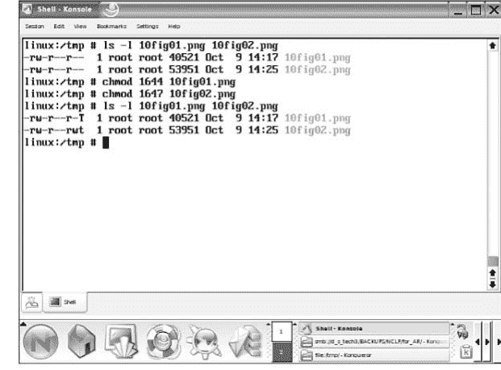

#### 图 4.5

根据可执行状态，粘位可以是小写的 `t` 或大写的 `T`。

### 使用链接

链接的目的是允许一个文件被多个名称引用。有许多原因你可能想要或需要这样做，例如：

1. 出于历史目的——假设你想将所有供应商信息合并到一个单元文件中。在这种情况下，营销部门一直有一个文件存储类似的信息并命名为 *vendor*（供应商），而财务部在名为 *contacts*（联系人）的文件中记录信息，管理部门则将其称为 *references*（参考资料）。当你创建一个单一文件时，你可以让这三个名称都可用，以便所有方都能像以前那样找到它。
2. 让远程看起来像本地——假设有一个所有用户在提交系统修改请求时都使用的模板。该文件可以存在于 root 用户的主目录 (`/root*`) 中，并在每个用户的主目录 (`/home/user*`) 中创建一个链接，使其看起来就像存在于他们的目录之中一样。

# 诺威认证 Linux 专业人员学习指南

创建链接的工具是 `ln`。当你创建一个链接时，你仅仅是为一个已存在的实体创建了另一个指针；由于这种情况，只使用了一个 inode，而不是两个。因为只有一份拷贝，你还节省了磁盘空间。

> 注意
> 当通过链接一个文件以供他人访问时，你必须确保他们拥有访问该文件的适当权限，否则你就违背了初衷。

可以创建两种类型的链接：硬链接和符号链接。接下来的章节将对两者介绍。

#### 硬链接

两种链接类型中最简单的是硬链接。它默认通过 `ln` 创建，其用法如下例所示：


```
$ ls -l
-drwx-r---- 5 root root 1024 Sep 22 23:57
-Desktop
-rw-r--r-- 1 root root 81 Sep 23 00:25
-friday
-rw-r--r-- 1 root root 81 Sep 23 00:38
-monday
-rw-r--r-- 1 root root 152 Sep 23 00:26
-tuesday
-rw-r--r-- 1 root root 38 Sep 23 00:26
-wednesday
$
$ ln monday thursday
$ ls -l
-drwx-r---- 5 root root 1024 Sep 22 23:57
-Desktop
-rw-r--r-- 1 root root 81 Sep 23 00:25
-friday
-rw-r--r-- 2 root root 81 Sep 23 00:38
-monday
-rw-r--r-- 2 root root 81 Sep 23 00:38
-thursday
-rw-r--r-- 1 root root 152 Sep 23 00:26
-tuesday
-rw-r--r-- 1 root root 38 Sep 23 00:26
-wednesday
$
```

## 使用文件

注意，与新条目 `thursday` 相关的时间属性与 `monday` 相关的属性保持相同，而没有采用当前时间——就像复制操作将会执行的那样。这是因为只有一组数据，尽管现在有两种引用方式。从左起数的第二列指示了文件的链接数：即这组数据可以被引用的次数。链接数从一增加到了二。

另一种验证它们是相同数据的方法是查看 inode。正如之前讨论的过的，每个实体都必须有自己的节点。然而，如果你只有一组数据并有多种访问方式，则所有访问方法 `名称` 将共享同一个 inode：

```
$ ls -i
18471 Desktop      18538 monday      18536 tuesday
18535 friday       18537 wednesday
$
```

当你向数据添加链接时，链接数会增加；当删删除链接时，链接数会减少。只要还有任何东西指向它，所指向的数据就会保留在系统上。例如，文件 `thursday` 被链接到 `monday`。Linux 不在乎先创建哪个文件。只有当链接数降为零时，数据才不再存在于系统中。

> 注意

----------------------------------------------------------------

从直观来看，每当你从头创建一个文件时，你都是创建了一个指向数据的链接 `链接数为一`。当你删除链接 `删除文件` 时，计数变为零，数据就会消失。

当查看文件内容时，没有迹象表明它们彼此是链接。

然而，为了证明链接存在，对任一文件的任何修改都会应用于两个文件，因为它们引用的是相同的数据。这很容易地说明：

```
$ ls -l
drwx------ 5 root root 1024 Sep 22 23:57
-Desktop
-rw-r--r-- 1 root root 81 Sep 23 00:25
-friday
-rw-r--r-- 2 root root 81 Sep 23 00:38
-monday
-rw-r--r-- 2 root root 81 Sep 23 00:38
-thursday
-rw-r--r-- 1 root root 152 Sep 23 00:26
-tuesday
-rw-r--r-- 1 root root 38 Sep 23 00:26
-wednesday
$
$ cat mondayIngredients carbonated water, fructose syrup, citric acid, and natural flavoring.
$ ls -l
drwx----- 5 root root 1024 Sep 22 23:57
-Desktop
-rw-r--r-- 1 root root 81 Sep 23 00:25
-friday
-rw-r--r-- 2 root root 81 Sep 23 00:38
-monday
-rw-r--r-- 2 root root 81 Sep 23 00:38
--ursday
-rw-r--r-- 1 root root 152  2 000:2

-t

---rr---- 1 root root 88 22 00026
-wednesday
$
$
```

对一个实体的相同效果也适用于权限、所有者、组。硬链接不能跨文件系统，并且必须是本地的。

### 符号链接

要创建符号链接，必须使用 `ln` 的 `-s` 选项。符号链接相当于 Windows 操作系统中的“快捷方式”：指向另一个文件的小文件。符号链接的主要目的是克服硬链接的缺点。因此，它们允许用户链接目录，并允许跨文件系统的链接。为了说明符号链接是如何创建的，请考虑以下示例：

```
$ ls -l

drwx----- 5 root root 1024 Sep 22 23:57

-Desktop

-rw-r--r-- 1 root root 81 Sep 23 00:25

-friday

-rw-r--r-- 2 root root 194 Sep 24 15:09

-monday

lrwxrwrx 1 root root 6 Sep 24 15:49

-saturday -> friday

-rw-r--r-- 2 root root 194 Sep 24 15:09

-thursday

-rw-r--r-- 1 root root 152 Sep 23 00:26

-tuesday

-rw-r--r-- 1 root root 38 Sep 23 00:26

-wednesday

$
$ ln -s friday saturday
$ ls -l
drwx-r---- 5 root root 1024 Sep 22 23:57
-Desktop
-rw-r--r-- 1 root root 81 Sep 23 00:25
-friday
-rw-r--r-- 2 root root 194 Sep 24 15:09
-monday
-rw-r--r-- 1 152 
-rw-r--r-- 1 root root 152 Sep 23 00:26
-tuesday
-rw-r--r-- 1 root root 38 Sep 23 00:26
-wednesday
$
```

关于这次操作有几点需要注意：

- 1. `friday` 的链接数没有变化。
- 2. 新文件的第一列始终为“`lrwrwxrx`”，以表示这是一个链接。
- 3. 新文件上的日期和时间不等于旧文件，而是当前的日期和时间——这表示了一个新文件 `拥有它自己的 inode`。
- 4. 文件名的右侧是文件确实被引用的图形化指示。
- 5. 新文件有一个与其关联的大小，但该大小仅等于指针。

最后一点值得深思一会儿。`friday` 天的大小为 81，而 `saturday` 的大小为 6。这对用户来说是完全透明的，因为在 `saturday` 上执行的任何操作都会发送到 `friday`。为了说明：

```
$ cat friday
this is the way that one and one
will equal two
and two and two
will equal four
$
$ cat saturday
this is the way that one and one
will equal two
and two and two
will equal four
$
$ wc friday
4 18 81 friday
$ wc saturday
4 18 81 saturday
$
```

换句话说，`saturday` 只是 `friday` 的符号 `名称` 表示。你尝试进行的任何操作都会通过第二个文件持有的指针发送到第一个文件。这可能会导致意想不到的结果：由于文件是一个指针，它可以指向不再存在的内容或当前不可用的内容 `记住，它们可以跨文件系统`。考虑以下被指向的文件被删除的事件序列：

```
$ rm -l
$ ls -l
drdwx--r 5 root root 1024 Sep 22 23:57
-Desktop
-rw-r--r-- 1 root root 81 Sep 23 00:25
-friday
-rw-r--r-- 2 root root 194 Sep 24 15:09
-monday
lrwxrwrx 1 root root 6 Sep 24 15:49
-saturday -> friday
-rw-r--r-- 2 root root 194 Sep 24 15:09
-thursday
-rw-r--r-- 1 root root 152 Sep 23 00:26
-tuesday
-rw-r--r-- 1 root root 38 Sep 23 00:26
-Wednesday
$ wc saturday
```


`wc`: saturday: No file or directory

```
$
```

这会导致用户感到沮丧和愤怒，因为错误信息告诉他们 `saturday` 不存在，而目录的每次列表都会显示它存在。作为管理员，它是

你必须理解，该文件确实存在，但它是指向一个已不存在文件的指针。

在大多数图形化工具中使用符号链接时，它们的名称会显示为斜体，并在图标左下角添加一个小方框箭头。

大量的系统文件是到其他项目的链接。例如，`/dev` 目录包含了大量指向设备的符号链接，可以通过不同的名称和不同的位置访问这些设备。

## 查找系统文件

在系统中有这么多文件以及存在的所有不同目录和子目录，寻找你正在找的东西有时可能是一项艰巨的任务。坦率地说，Linux 中有很多工具可以帮助减轻这种负担。在本节中，我们将查看几个独特的工具，并研究你可以如何使用它们来帮助找到你正在寻找的内容。

将检查的工具顺序如下：

- `locate`
- `updatedb`
- `which`
- `find`

`locate` 工具通过查找数据库文件（而不是实际目录）来查找与给定名称匹配的文件。该数据库名为 `locatedb`，通常位于 `/var` 目录下的某个子目录下（常见位置为 `/var/state` 或 `/var/lib`）。

`updatedb` 数据库通过使用 `updatedb` 命令进行更新。默认情况下，`updatedb` 会定期运行（通常每天一次），但也可以手动运行。使用 `locate`（以及 `locatedb`）的优势是，搜索数据库中的条目比搜索整个文件系统快得多。缺点是，在上次运行 `updatedb` 之后创建的文件无法通过 `locate` 工具找到。

默认情况下，`updatedb` 会遍历文件系统并在任何它找到条目的地方更新 `locatedb` 数据库。然而，你可以在 `/etc` 目录下创建一个名为 `updatedb.conf` 的可选文件。如果 `updatedb.conf` 文件存在，则仅将其中列出的目录用于创建数据库。

使用 `locate` 命令的示例如下：

```
$ locate grep

/opt/kde/share/apps/kmail/pics/kmsgreplied.xpm

/usr/bin/egrep

/usr/bin/fgrep

/usr/bin/grep

/usr/bin/zgrep

/usr/bin/zipgrep

/usr/doc/desemu-0.98.5/bugreports.txt

/usr/doc/grep-2.2

/usr/doc/grep-2.2/ABOUT-NLS

/usr/doc/grep-2.2/AUTHORS

/usr/doc/grep-2.2/INSTALL

/usr/doc/grep-2.2/NEWS

/usr/doc/grep-2.2/README

/usr/doc/grep-2.2/THANKS

/usr/doc/grep-2.2/TODO

/usr/lib/python1.5/grep.py

/usr/lib/python1.5/grep.py

/usr/lib/emacs-20.4/lisp/efs/dire-grep.elc

/usr/lib/emacs-20.4/lisp/packages/grep.elc

/usr/man/de/man1/grep.1.gz

/usr/man/de/man1/grep.1.gz

/usr/man/man1/egrep.1.gz

/usr/man/man1/fgrep.1.gz

/usr/man/man1/grep.1.gz

/usr/man/man1/zgrep.1.gz

/usr/man/man1/zipgrep.1.gz

/usr/share/locale/de/LC_MESSAGES/grep.mo

/usr/share/locale/es/LC_MESSAGES/grep.mo

/usr/share/locale/fr/LC_MESSAGES/grep.mo

/usr/share/locale/ko/LC_MESSAGES/grep.mo

/usr/share/locale/nl/LC_MESSAGES/grep.mo

/usr/share/locale/no/LC_MESSAGES/grep.mo

/usr/share/locale/pl/LC_MESSAGES/grep.mo

/usr/share/locale/ru/LC_MESSAGES/grep.mo

/usr/share/locale/sl/LC_MESSAGES/grep.mo

/usr/share/locale/sv/LC_MESSAGES/grep.mo

/usr/share/vim/bugreport.vim

$
```

`which` 命令与 `locate` 命令类似。然而，它不是查找数据库，而是查找你路径 `path` 中列出的目录。当它在某个目录中找到匹配的名称时，它会立即停止并报告找到的内容。这有什么用呢？假设你的系统上有多个版本的 `grep`；`which` 将告诉你它通过路径找到的第一个。接下来的简单示例说明了这一点：

```
$ which grep

/usr/bin/grep

$
```

如果你必须为 `find` 工具想一个类比，那么它就像是现实中的瑞士军刀。`find` 能够搜索文件系统，这是一个非常强大的工具。`find` 的语法是 `find [起始点] [条件]`。默认情况下，它从当前目录开始，但可以指定起始点。`find` 会递归地搜索子目录。`find` 的许多选项见表 4.2。

### find 参数

| 选项 | 用途 |
| :--- | :--- |
| `-atime` | 测试文件在过去多少天内被访问 |
| `-ctime` | 测试文件在过去多少天内被更改 |
| `-exec` | 在找到条目后执行命令 |
| `-group` | 测试文件是否属于某个组 |
| `-inum` | 测试文件的 inode 号 |
| `-links` | 测试文件的链接数 |
| `-name` | 按名称匹配文件 |
| `-perm` | 测试文件的权限 |
| `-size` | 按大小匹配文件 |
| `-type` | 按类型匹配文件（如 d 表示目录，f 表示文件） |
| `-user` | 测试文件是否属于某个用户 |

使用 `find` 命令的一个示例是：

```
$ find . -name "grep*"
```

这将查找当前目录及其子目录中以 "grep" 开头的文件。

如果你只想查找特定类型的文件，可以使用 `-type` 选项。例如：

```bash
$ find . -type d
```

这将仅查找目录。

如果你想查找大于或小于特定大小的文件，可以使用 `-size` 选项：

```bash
$ find . -size +10M  # 查找大于10MB 的文件

$ find . -size -10M  # 查找小于 10MB 的文件
```

你还可以对找到的文件执行某些操作。例如：

```bash
$ find . -name "*.txt" -exec ls -l {} \;
```

这将对所有 `.txt` 文件执行 `ls -l` 命令。如果你想在执行每个操作之前都确认，可以使用 `-ok` 代替 `-exec`：

```bash
$ find . -name "*.txt" -ok ls -l {} \;
```

# 使用配额操作

涵盖的课程目标

- 5. 设置和配置磁盘配额 `3037`

配额用于限制用户或组可用的空间大小。默认情况下，Linux 不实施任何配额，因此每个用户可以消耗的硬盘空间限制仅限于系统上可用空间的大小。

当使用配额时，必须按分区应用，这提供了灵活性，因为应用于一个分区的配额水平可以与应用于另一个分区的不同。每个配额也独立于任何其他配额运行。例如，可以在某个分区上应用配额并将其限制为 7MB、5MB 或 3MB。这使得三个配额总共拥有 15MB 的存储空间。然而，如果他们属于销售组，且该组被限制为 10MB，那么在达到 10MB 限制后，一个或多个用户将无法存储文件，即使他们各自的配额内还有剩余空间。

要启用配额，必须编辑 `/etc/fstab` 文件。该文件的当前条目如下：

```
/dev/hda3 /home ext2 defaults 1 2
```

第一个字段是文件系统，第二个是挂载点。第三个字段是文件系统类型，第四个字段是文件系统的选项。第五个字段标识 `dump` 使用文件系统的顺序，第六个字段是 `fsck` 使用它的顺序。

在第四个字段中可能会进行修改以使用配额，这通过将该行更改为来实现：

```
/dev/hda3 /home ext2 defaults,usrquota 1 2
```

在某些情况下，可能需要编译内核以支持配额，但并非总是如此。编辑文件后，转到设置配额所在分区的根目录。作为 root 用户，创建一个名为 `quota.user` 或 `quota.group` 的文件。文件的权限必须仅限 root 用户可读可写，这通过 `chmod` 命令实现。因此，编辑后的后续序列是：


`$ touch quota.user`

`$ chmod 600 quota.user`

### 操作文件

# 第 4 章

在以下示例中使用的 `touch` 命令在第 3 章“基础 GNU 和 Unix 命令”中讨论过。

> 注意

你必须随后重启，可以使用以下实用程序：

- `quotaon`—启用配额。可以使用 `-a` 选项为 `/etc/fstab` 中的每个 `usrquota` 文件系统启用；否则，必须指定文件系统。
- `quotaoff`—禁用配额的使用。
- `edquota`—编辑和更改配额限制。`-u` 选项允许指定用户，或使用 `-g` 用于组。`-t` 选项用于“软限制”。
- `repquota`—生成磁盘使用情况和指定配额（通过 `edquota` 创建）的报告。使用 `-a` 检查 `/etc/fstab` 中的所有文件系统；`-g` 查看组的报告；`-u` 查看用户的报告（默认）；并使用 `-v` 即使数字为零也显示数字。任何用户都可以运行此实用程序来查看自己的数字，但 `root` 将看到所有用户的报告。
- `quota`—与 `repquota` 类似，它显示现有的配额。任何用户都可以查看自己的，也可以查看所有。
- `quotacheck`—仅 `root` 可用，它扫描系统并创建带有当前使用情况的报告文件。
- `quotatats`—显示每个单独用户和组的已用空间。

> 注意

并不是所有的实用程序在所有的 Linux 实现中都可用。

默认情况下，当用户或组达到配额限制时，他们将不再保存任何后续条目。如果你设置了“软限制”，意味着用户可以超过限制，但仅限短时间内（定义为宽限期；默认为七天）。

### 总结

本章重点关注了处理文件和文件系统所需的主题。下一章将介绍基础 Linux 系统管理。

# 命令总结

表 4.3 列出了本章中讨论的命令。

| 表 4.3 本章中的实用程序 | 默认用途 |
| --- | --- |
| chgrp | 更改实体的组关联 |
| chmod | 更改实体的权限 |
| edquota | 为用户或组创建配额 |
| getfacl | 显示文件的访问控制列表 (ACL) |
| locate | 从 locateddb 数据库中查找文件 |
| quotaoff | 关闭用户/组配额 |
| repquota, quota, quotacheck, and quotatats | 查看配额使用情况 |
| setfacl | 设置/修改文件的访问控制列表 |
| SGID | 运行文件时设置组 ID |
| Sticky bit | 更改文件和目录的操作方式 |
| SUID | 运行文件时设置用户 ID |
| umask | 创建新文件和目录时从默认权限中减去的数值型变量 |
| updateddb | 更新 locateddb 数据库 |
| which | 从路径语句中查找文件 |

# 第 5 章

## 基础 Linux 管理

本章重点关注 Linux 管理的基础。本章涵盖了以下课程目标：

- 1. 管理用户账户 (3036)
- 2. 使用 tar 归档文件 (3036)
- 3. 使用 gzip 和 bzip2 压缩和解压缩文件 (3036)
- 4. 描述基础 Linux 用户功能 (3037)
- 5. 管理 Linux 用户和组 (3037)
- 6. 管理 Linux 环境 (3037)
- 7. 使用 PAM 配置身份验证 (3037)
- 8. 备份和恢复文件系统 (3037)
- 9. 使用日志服务 (3037)
- 10. 配置 SUSE Linux 服务器 (3037)
- 11. 理解 Linux 身份验证 (338)
- 12. 备份策略 (338)
- 13. 使用 tar 备份文件 (338)
- 14. 使用磁带操作 (338)
- 15. 使用 dd 复制数据 (338)
- 16. 使用 rsync 镜像目录 (338)
- 17. 监控操作系统 (338)

为了作为管理员运行，了解本章中的主题是关重要的。本章讨论的内容很容易归入 Linux 系统的日常。

### 创建和管理用户

课程目标

- 1. 管理用户账户 (3036)
- 4. 描述基础 Linux 用户功能 (3037)
- 5. 管理 Linux 用户和组 (3037)
- 6. 管理 Linux 环境 (3037)
- 11. 理解 Linux 身份验证 (338)

在安装操作系统期间，至少会有一个用户（`root`/超级用户）被添加到系统中。这是系统中最强大的用户，字面上可以做任何事情。安装后，通常需要添加额外的用户并修改相关的变量。为了了解涉及的内容，知道系统使用的文件 `/etc/passwd` 文件是重要的。字段由冒号分隔，一个示例如下：

```
root:x:0:0:/root:/bin/bash

bin:x:1:1:/bin

daemon:x:2:2:/daemon:/sbin

adm:x:3:4:/adm:/var/adm

lp:x:4:7:/lp:/var/spool

sync:x:5:6:/sync:/bin

shutdown:x:6:11:/shutdown:/sbin

halt:x:7:0:/halt:/sbin/bin

mail:x:8:12:/mail:/var/mail

news:x:9:13:/news:/var/news

uuc:x:10:14:/uuc:/var/uuc

operator:x:11:0:/operator:/root/

games:x:12:12:/games:/usr/games/

gopher:x:13:30:/gopher:/usr/lib/gopher-data

ftp:x:14:50:/ftp:/home/ftp

man:x:15:15:/man

nobody:x:16:16:/bin/false

postgres:x:17:17:/postgres:/home/postgres:/bin/bash

mysql:x:18:18:/mysql:/var/lib/mysql:/bin/false

other:x:65534:65534:::/bin/false

edaney:x:100:100:/edaney:/home/edaney/bin/bash

kudaney:x:101:100:/kudaney:/home/kudaney/bin/tcsh

sudaney:x:102:100:/sudaney:/home/sudaney/bin/zsh
```

## 基础 Linux 管理
第 5 章

七个字段可以分为：

- 用户登录名——在系统中必须唯一的，它是自由文本，可以使用任何编辑器编辑和修改。在所示的条目中，`bin` 是可执行文件的所有者，`daemon` 用于系统服务，`adm` 所有日志文件。其他条目是用户（如 `edaney`）或单独的服务（如 `ftp`）。
- 密码——该字段内可以是一个加密条目，或者是 "`x`" 。在后者的情况下，该字符仅表示值存储在其他处——`/etc/shadow` 文件。

将密码放在 `shadow` 文件中增加了额外的安全性。所有人都可以读取 `passwd` 文件，但只有 `root` 用户可以读取 `shadow` 文件。
- 用户 ID (`UID`)——这是每个用户的递增数字，是操作系统真正引用用户的方式（记住登录名是可更改文本）。`root` 用户始终为 0，维护/服务账户使用较小的数字（通常到 99）。普通用户账户通常从 1000 开始（这是针对 SLES，但在其他 Linux 供应商中不同）并增加其他文本值，但数字 0 始终是标识符。
- 组 ID (`GID`)——这标识与用户相关的默认组。`root` 组始终为 0，较低数字用于系统组。普通用户根据 `/etc/login.defs` 文件列出的起始数字分配组。
- 用于描述目的的自由文本——查看此字段的主要实用程序之一是 `finger`，它只需向任何查询者返回有关用户的信息。
- 用户家目录——这是用户登录时开始的地方，也是定义其环境变量的文件存放处。
- 用户使用的 shell——如果此字段中没有数据，则使用默认 shell。

# Novell 认证 Linux 专业人员学习指南

`/etc/shadow` 文件用于存储密码以及关于年龄参数的信息。以下是一个示例：

```
root:awYeiEwMpfo6:11144:0::7:7:

bin*:10547:0::7:7:

daemon*:10547:0::7:7:

adm*:10547:0::7:7:

lp*:10547:0::7:7:

sync*:10547:0::7:7:

shutdown*:10547:0::7:7:

halt*:10547:0::7:7:

mail*:10547:0::7:7:

news*:10547:0::7:7:

uucp*:10547:0::7:7:

operator*:10547:0::7:7:

games*:10547:0::7:7:

gopher*:10547:0::7:7:

ftp*:10547:0::7:7:

man*:10547:0::7:7:

majordom*:10547:0::7:7:

postgres*:10547:0::7:7:
```


```
mysql*:10547:0::7:7:

nobody*:awVvUsWpigo:11144:0::7:7:

kdulaney:awZIG94rzQY:11144:0::7:7:

sdulaney:awZ72Bxwu.Nm:11144:0::7:7:
```

## 八个字段

- 用户登录名，这是唯一必须与 `/etc/passwd` 文件匹配的字段。
- 密码的加密哈希值。如果系统账户没有定义密码，通常会使用星号 (`*`)。如果新创建的账户没有定义密码，通常会出现感叹号 (`!`)。对于正常使用的用户，此字段在任何情况下都不能为空。
- 密码最后更改的日期，用自 1970 年 1 月 1 日以来经过的天数表示。例如，条目 `12711` 表示已经过了 12,711 天，现在是 2004 年 10 月 19 日。
- 最小密码年龄，以用户在允许更改密码之间必须等待的天数表示。值 `0` 表示用户可以随心所欲地更改。
- 最大密码年龄，以用户保留此密码的天数表示。值 `90` 意味着每 90 天必须更改密码，而 `99999`（默认值）本质意味着不需要更改。
- 在开始出现更改密码警告时，密码过期前的天数。这通常是 `7`。
- 密码过期后到禁用账户之前等待的持续数。此字段通常为空。
- 密码的过期日期，同样是自 1970 年 1 月 1 日以来的天数。此字段通常为空。

## 创建用户账户

可以手动创建新用户，也可以使用实用程序。若要手动操作，只需向 `/etc/passwd` 文件末尾添加条目即可（强烈建议在更改文件之前对其进行备份）。你可以留空密码字段，然后使用 `passwd` 实用程序分配密码。如果你直接留空，它将没有密码的有效账户：

```
$ cat >> /etc/passwd

evan::0:100:EvanD:/home/evan:/bin/bash

{press Ctrl+D}

$ passwd evan

New user password: {enter password}

Retype new user password: {enter password again}

passwd: all authentication tokens updated successfully

$

tail -1 /etc/passwd

evan:petKv.FLWg/Ig:0:100:EvanD:/home/evan:/bin/bash

$
```

任何用户都可以使用 `passwd` 实用程序更改自己的密码。然而，只有 root 用户可以使用它更改其他用户的密码。

> 注意
> 请注意，这种方法将加密密码放置在 `/etc/passwd` 文件本身中，而没有利用 shadow 文件。只要主目录存在且用户是其所有者，该用户现在就可以通过身份验证。

Linux 提供了一个（大多数供应商也有自己的实用程序）用于简化这一过程的实用程序，即 `useradd`。你必须使用该实用程序的选项，其中一个关键选项是 `-D`，用于显示默认设置。这是一个示例：

```
$ useradd -D

GROUP=100

HOME=/home

INACTIVE=-1

EXPIRE=

SHELL=/bin/bash

SKEL=/etc/skel

GROUPS=dialout,video,audio

$
```

这些是创建新用户时将使用的默认值。默认值来自 `/etc/login.defs` 文件。因此，以下序列是可能的：

```
$ useradd kerby

$ tail -1 /etc/passwd

kerby:x:102:100::/home/kerby:/bin/bash

$ tail -1 /etc/shadow

kerby:::12711:0:99999:7:::

$ passwd kerby

New user password: {enter password}

Retype new user password: {enter password again}

password: all authentication tokens updated successfully

$

tail -1 /etc/passwd

evan:petKv.FLWg/Ig:0:100:EvanD:/home/evan:/bin/bash

$
```

任何用户都可以使用 `passwd` 实用程序更改自己的密码。但只有 root 用户可以使用它更改其他用户的密码。

> 注意
> 请注意，这种方法将加密密码放置在 `/etc/passwd` 文件本身中，而没有利用 shadow 文件。只要主目录存在且用户是其所有者，该用户现在就可以通过身份验证。


这些是创建新用户时将使用的默认值。默认值来自`/etc/login.defs`文件。因此，以下序列是可能的：

```
$ useradd kerby

$ tail -1 /etc/passwd

kerby:x:102:100::/home/kerby:/bin/bash

$ tail -1 /etc/shadow

kerby:::12711:0:99999:7:::

$ passwd kerby

New user password: {enter password}

Retype new user password: {enter password again}

password: all authentication tokens updated successfully

$

tail -1 /etc/passwd

evan:petKv.FLWg/Ig:0:100:EvanD:/home/evan:/bin/bash

$
```

# Novell 认证 Linux 专业学习指南

- `g` 用于更改次要组成员关系。只要用逗号分隔项，就可以提供多个组。
- `g` 用于更改 GID。
- `-l` 用于更改登录名。
- `-m`（必须与 `-d` 一起使用）创建新的家目录。
- `-p` 用于更改密码。
- `-s` 指定不同的 shell。
- `-u` 用于更改 UID。

除了文本描述外，大多数值都需要用户在进行更改时不要处于登录状态。以下是一个更改示例：

```
$ grep krest /etc/passwd

kristin:petkv.flWG/Ig:506:kristin:/home/kristin:/bin/bash

$ usermod -l kristin

$ grep krest /etc/passwd

kristin:petkv.flWG/Ig:506:kristin:/home/kristin:/bin/bash

$ ls -1 /home

drwxr-xr-x 4 evan      users 1024 Jul 6 11:16 evan

drwxr-xr-x 4 kristin users 1024 Aug 8 10:29 kristin

drwxr-xr-x 4 spencer users 1024 Jul 6 11:16 spencer

$ usermod -d /home/kristin -m kristin

$ ls -1 /home

drwxr-xr-x 4 evan      users 1024 Jul 6 11:16 evan

drwxr-xr-x 4 kristin users 1024 Aug 8 10:29 kristin

drwxr-xr-x 4 spencer users 1024 Jul 6 11:16 spencer

$ grep krest /etc/passwd

kristin:petkv.flWG/Ig:506:kristin:/home/kristin:/bin/bash
```

`usermod`实用程序具有 `-p`选项，允许更改密码，但通常可以通过通过之前讨论的`passwd`实用工具完成。该独立实用工具更安全，因为它要求你输入两次值，从而防止输入与你设想的差一个字符的值（导致你无法登录）。

如果有大量密码需要更改（系统被入侵），你可以使用`passwd`实用程序进行批量更改。要使用它，请创建一个每行一个目的文本文件。每行由用户名和新密码组成，用冒号分隔。例如

```
$ cat > changes

kristen:spea23ker

evan:pho78ne

kdulaney:fla98sh

{Ctrl+D}

$ chpasswd < changes

$
```

密码是以明文形式存储的，出于这个原因，你希望尽快从系统中删除该批处理文件。另一种方法是使用加密密码并配合`chpassword`使用 `-e`选项。

> 注意：鼓励用户使用良好的密码是一个好主意。良好的密码至少包含六个字符，由字母、字符和数字混合而成，且不会被轻易猜到。

### 删除用户

当用户账户不再需要时，有多种方法可以处理这种情况。你必须解决的首要问题是为什么该账户不再需要了。当你知道原因后，就可以制定一个处理计划。表 5.2 提供了一些处理场景和处理方法。

# 无需用户账户的解决方案

| 感知到的不需要账户的原因 | 建议的解决方案 |
|---|---|
| 用户被临时外调到西伯利亚 | 如果是临时情况，你不要删除账户——这样做将移除以后可能需要的所有引用。要临时禁用账户，请编辑`/etc/passwd`文件并在行首放置一个井号（`#`）。这将使整行变为注释并禁用账户。 |
| 用户密码可能被黑客危及 | 将密码更改另一个值以将对方隔在门外。为了进一步的安全，请重命名登录名和家目录。 |

| 感知到的不需要账户的原因 | 建议的解决方案 |
|---|---|
| 用户已离开该机构 | 从`/etc/passwd`和`/etc/shadow`中移除该账户并删除家目录。也可以使用`userdel`实用程序从系统文件（`passwd`和`shadow`）中删除用户，但你仍然必须删除与他们相关的任何文件。 |

# 组的操作

课程目标覆盖
- 4. 描述 Linux 用户安全 (37)
- 5. 管理 Linux 用户和组 (37)
- 6. 管理和保护用户环境 (37)

由于了解用户变量后的参数对于理解如何操作它们至关重要，你也必须理解组的结构。保存组信息的文件是`/etc/group`，其示例如下：

| 组 | GID |
|---|---|
| root | 0 |
| bin | 1 |
| daemon | 2 |
| sys | 3 |
| adm | 4 |
| tty | 5 |
| disk | 6 |
| lp | 7 |
| mem | 8 |
| operator | 9 |
| wheel | 10 |
| mail | 11 |
| news | 12 |
| uucp | 13 |
| man | 14 |
| ordom | 15 |
| database | 16 |
| games | 17 |
| gopher | 18 |
| dip | 20 |
| utmp | 30 |
| ftp | 40 |
| nbody | 45 |
| users | 53 |
| 100 |

### 创建组

要创建一个新组，你可以手动编辑`/etc/group`文件并添加一个项。`groupadd`实用程序也可以用于指定 GID。

```
$ groupadd -g 105 sales

$ tail -1 /etc/group

sales:x:105:
```

`-g`选项指定一个新的 GID。如果该数字不是唯一的，实用程序将失败。

```
$ groupadd -g 101 marketing

groupadd: GID 101 is not unique.
```

同样，如果你尝试重命名组：

```
$ groupadd sales

groupadd: Group `sales` already exists.
```

除了 `-g`之外，`groupadd`还有其他选项。在这些选项中，`-o`允许使用重复的 ID 数字，`-p`可以指定密码，`-A`将用户添加到组中，`-R`从组中移除用户。

要进一步定义组，你可以手动编辑`/etc/passwd`，或者使用`passwd`实用工具。当与组名配合时，它会提示密码以关联组：

```
$ gpasswd sales

Changing the password for group:{enter value}

New password:{enter value}

$ tail -1 /etc/group

sales::101:

$
```

如果你对密码感到厌了，可以使用 `-r`选项将其移除：

```
$ gpasswd -r sales

$ tail -1 /etc/group

sales::101:

$
```

### 选择组

当用户是多个组的成员时，他的默认组是由`/passwd`文件中的第四字段定义的。`id`工具将显示关于用户的信息，包括用户所属的所有组：

```
$ id

uid=501(edaney) gid=100(users) groups=100(users),101(sales)
```

要更改组，利用`newgrp`和你想设置为默认的组名。尝试加入组的用户需要提供密码，而组组成员不需要：

```
$ id

uid=501(edaney) gid=100(users) groups=100(users),101(sales)

$ newgrp sales

$ id
```

```
uid=501(edaney) gid=100(users) groups=100(users),101(sales)

$ newgrp marketing

Password: {enter value}

$ id
```


`uid=501(edaney) gid=102(marketing) groups=100(users),101(sales),102(marketing)`

```
$
```

### 修改组

组创建后，你可以通过手动编辑文件、使用 `passwd` 以及 `groupmod` 实用程序来修改条目。该工具允许更改与组相关的值（名称和 GID）。配合 `groupmod` 使用的参数包括

- `-g` 指定一个新的 GID
- `-n` 将组名更改为新的文本值
- `-o` 允许使用重复的 ID 数字
- `-p` 指定密码
- `-A` 将用户添加到组
- `-R` 从组中移除用户

例如

```
$ tail -1 /etc/group

sales:x:101:edulaney,krist,kerby

$ groupmod -g 105 sales

$ tail -1 /etc/group

sales:x:105:edulaney,krist,kerby

$ groupmod -n business sales

$ tail -1 /etc/group

business:x:105:edulaney,krist,kerby

$
```

当组不再需要时，可以通过手动从文件中删除行来删除它们，或者使用 `groupdel` 命令。如果任何用户将该组作为其默认组，则无法使用该实用程序，它仅从 `/etc/group` 中移除条目。

# 使用 PAM 工作

所涵盖的课程目标

- 4. 描述基础 Linux 用户安全功能 (3037)
- 7. 使用 PAM 配置用户身份验证 (3037)

为了提高安全性，可插拔认证模块（PAM）可以作为用户和应用程序之间的中介。当用户在 PAM 中获得授权时，他们就可以自由地访问他们可用的应用程序。这种安排的精妙之处在于，你可以更改过程中的任何一个元素，而不会影响其他任何内容。例如，假设你要求用户输入密码进行身份验证，并允许他们访问 10 个应用程序。你可以将身份验证方法更改为指纹扫描，然后允许他们访问应用程序，而无需重新配置身份验证方法之外的任何内容。

全局文件位于 `/etc/security` 下。PAM 模块的单独配置文件位于 `/etc/pam.d` 下，如图 5.1 所示。

图 5.1
每个使用 PAM 模块的程序都有对应的配置文件。

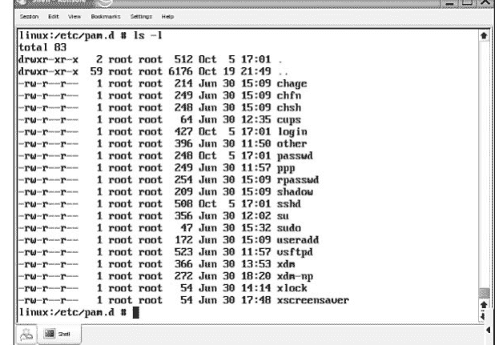

## 基础 Linux 管理

注意，这里显示的名称与它们关联的工具名称相同。当用户使用这些应用程序之一时，系统会在此目录中检查关联的配置文件。如果找到，将进行读取并执行。

某些配置文件只有一行，而另一些则要长得多。图 5.2 显示了 `su` 配置文件的内容。

# 图 5.2
`su` 的配置文件。

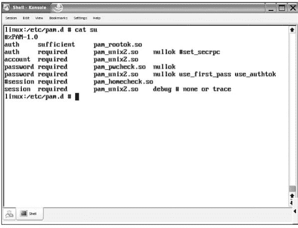

文件中的每行都有四个字段。第一个字段标识模块类型，第二个字段是控制标志（control flag）。第三字段列出要使用的模块，第四字段（可选）列出所需的任何参数。

模块类型有四种可能的值：

- `account`（账户）——这表示需要检查用户是否有权限使用他想要的服务。
- `auth`（认证）——这表示需要检查用户的真实性。这通常通过密码完成。
- `password`（密码）——这允许更改访问/认证令牌。通常通过发布密码来更改。
- `session`（会话）——这是用于管理应用程序与用户之间会话的模块类型。

控制标志有四种可能的值：

- `optional`（可选）——此标志的成功或失败没有负面后果。
- `required`（必须）——在允许继续之前，该标志必须标记为成功。如果失败，将处理任何其他关联的标志，然后告诉用户发生了问题。
- `requisite`（必选）——与 `required` 类似，区别在于发生失败时，不会处理其他关联的标志，并且会立即告诉用户发生了问题。
- `sufficient`（足够）——如果标志成功，则不需要处理其他模块（这已经足够了）。如果发生失败，则没有直接后果。

模块在第三字段中被标识，在大多数系统中位于 `/lib/security`，在 64 位平台上位于 `/lib64/security`。可以传递的参数是任何所需的参数，最常见的是 `debug` 和 `nullock`。`debug` 参数用于启用调试模式，而 `nullock` 用于允许空密码被视为合法的实体。

图 5.2 中的第一行说明 `pam_rootok.so` 模块（第三字段）将从 `/lib/security` 使用，不带任何参数（第四字段），通过身份验证请求进行授权（第一字段），该请求必须是足够的（第二字段）才能继续。这就是你在使用 `su` 工具从一个用户切换到另一个用户时预期的，并且符合逻辑。

`/usr/share/doc/packages/pam/` 目录存放 SLES 9 上 PAM 的文档。其中有一个 `README` 文件。

### 配置日志

在 SLES 9 上

涵盖的课程目标

- 4. 描述基础 Linux 用户安全功能 (3037)
- 9. 使用日志服务 (3037)
- 17. 监控系统 (3037)

# Novell 认证 Linux 专业人员学习指南

- `crit`—代表关键（critical）
- `alert`—警报
- `emerg`—代表紧急（emergency）
- `*everything`—所有
- `none`—无

请记住，当你指定优先级时，该优先级代表一个最小值。消息会在该优先级或任何更高的优先级上生成。如果你希望只记录该优先级的日志，可以使用等号（`=`）。例如：

```
*=err /var/log/errors
```

如果你想专门避免获取某种类型的优先级，但获取其他所有类型，可以使用感叹号（`!`）。例如，要记录除关键（`crit`）以外的所有新闻（`news`）消息，可以使用 `news.*;;news!=crit`

位置字段可以是任何内容。一些有效的条目包括：

- `*everywhere`—到处
- `/dev/console`—通知当前控制台文件
- `/var/log/{日志文件名称}`

由于 `/etc/syslog.conf` 文件是由 `syslogd` 在启动时读取的，如果你对该文件进行了更改，必须重启守护进程，更改才会生效。

# 需要了解的文件

默认存在许多日志文件，你应该熟悉这些文件。表 5.3 总结了 `/var/log` 下的主要日志文件。

| 表 5.3 日志文件 |
| 文件 | 目的 |
| lastlog | 显示用户上次登录的时间（由 lastlog 命令读取） |
| mail 或 maillog | 邮件消息 |

# 表 5.3 续

| 文件 | 目的 |
| --- | --- |
| messages | 最主要的日志：默认情况下大多数事件都记录在这里 |
| news 或 news.all | 新闻消息 |
| uucp | uucp 事件 |
| wtmp | 供 last（last）命令使用；是 /var/run/utmp 的计数器，跟踪登录和注销 |

在日志记录方面，有几个需要注意的可执行程序。第一个是 `logger`。此工具后面必须紧跟要写入的文件名和消息。然后它会将该消息插入到日志文件中。例如：

```
$ pwd

/var/log

$ logger hey

$ tail -1 messages

Oct 20 20:34:58 linux logger: hey

$
```

每个条目都以日期和时间开始，随后是系统名、调用者、冒号（`:`）和消息。你可以在此文件中为自己添加备注，并在需要知道某事发生的时间时快速定位它们。

```
$ logger taking system down to replace graphics card

$
```

稍后：

```
$ grep "graphics card" messages

Oct 20 20:38:36 linux logger: taking system down to replace
☞ graphics card
$
```


下一个需要注意的可执行程序是 `logrotate`。此工具读取配置文件，并按指定压缩或删除日志文件。使用 `gzip` 工具进行压缩，操作可以每天、每周、每月（全部归功于 `cron`）或在达到设置的大小时进行。

管理员在任何时候都可以手动归档、删除或压缩日志文件。`logrotate` 的唯一目的是让该过程自动化。此此工具使用的命令包括：

- `compress`
- `copytruncate`
- `create`
- `daily`
- `delaycompress`
- `errors`
- `extension`
- `ifempty`
- `include`
- `mail`
- `mailfirst`
- `maillast`
- `missingok`
- `monthly`
- `ncompress`
- `nocopytruncate`
- `ncreate`
- `nodelaycompress`
- `nomail`
- `missingok`
- `noolddir`
- `notempty`
- `olddir`
- `postrotate`
- `prerotate`
- `rotate`
- `size`
- `weekly`

# 基础 Linux 管理 第 5 章

文本文件 `/var/lib/logrotate.status` 将显示该工具与其交互的文件的文件状态。该文件的示例例如所示：

```
logrotate state - version 2

*/var/log/fetchmail 2004-09

*/var/log/dn 2004-09

*/var/log/kdm 2004-09

*/var/log/snmp 2004-09

*/var/log/rsyncd 2004-09

*/var/log/scpm 2004-09

*/var/log/warn 2004-09

*/var/log/messages 2004-09

*/var/log/allmessages 2004-09

*/var/log/localmessages 2004-09

*/var/log/firewall 2004-09

*/var/log/mail 2004-09

*/var/log/mail.info 2004-09

*/var/log/mail.warn 2004-09

*/var/log/mail.err 2004-09

*/var/log/vsftpd 2004-09

*/var/log/wtmp 2004-09

*/var/log/xdm.errors 2004-09
```

### 维护备份

有几种备份策略：

- Daily—每天备份所有文件
- Full—全量所有文件
- Incremental—备份自上次全量备份以来的文件
- Differential—备份自上次全量备份以来的文件

真正的备份计划会使用这些类型的组合。例如，全量备份最好，但耗时最长。因此，你可能每周运行一次全量备份，每天运行一次增量备份。运行增量备份的时间会短得多。如果系统在周五崩溃，你只需要两个磁带：周日的全量和周四的差异。

理解备份之间的区别：拷贝和部分很重要。拷贝备份仅仅是将文件拷贝到介质。部分备份只是目录内所有文件的拷贝。

良好的备份策略及其遵循同样重要的是，即你知道在需要时可以恢复数据。这只有通过定期验证才能实现。每当备份完成后，运行还原并验证你可以以原始格式读取数据。

# 需要了解的工具

Linux 包含了用于备份的工具：`tar` 和 `cpio`。`tar` 工具（带归归器）会将多个文件合并为一个可以拷贝到介质的单元。它的语法为：

```
tar {options} {target_file} {source_files}
```

目标文件和源文件都可以路径（例如 `/dev/tape`）。选项包括：

- `c` 创建新文件
- `d` 比较内容并显示目标与源之间的差异
- `f` 指定文件
- `p` 保留权限
- `r` 追加到现有文件
- `t` 显示 tar 文件中的文件名
- `u` 只添加新文件
- `v` 以冗长模式运行
- `x` 提取文件

Novell 认证 Linux 专业人员学习指南

以下是常用命令的示例。

要在磁带上创建一个新的 tar 文件并使用详细模式运行，请使用此命令：

```
tar cvf /dev/tape {files}
```

要从 `october.tar` 备份文件中提取/恢复文件，命令应为：

```
tar xf october.tar
```

`cpio` 工具用于复制入或复制出。它可以执行三个基本操作，且必须指定其中之一：

- `-i` 从归档中提取
- `-o` 创建新归档
- `-p` 打印/透传文件

可以与它配合使用的选项有：

- `-d` 在需要时创建目录
- `-f` 指定文件
- `-t` 显示内容
- `-u` 覆盖现有文件
- `-v` 在详细模式下运行

以下是一些示例。

要从磁带读取文件并在其操作时显示它们（详细模式），请使用此命令：

```
cpio -iv < /dev/tape
```

接下来的示例将找到系统上所有以 "ead" 开头的文件，并将它们复制到 `/home/ead` 目录下，在此过程中创建所有必要的子目录：

```
find / -name ead* | cpio -pdv /home/ead
```


### dd

设备到设备 (`dd`) 工具用于将文件从一个设备复制到另一个设备。然而，它的功能不仅限于此，因为它可以在复制过程中将文件从一种格式转换为另一种格式。它可以将 EBCDIC 转换为 ASCII（反之亦然），将大写改为小写（反之亦然），并处理字节、块或关键字。

`dd` 最常用的用法是在可移动介质质之间复制文件，你必须使用包含以下内容的参数：

- `-bs`—文件大小
- `-if`—输入文件
- `-of`—输出文件

### 相关工具

备份工具允许你将文件从系统复制到备份，或反之。还有设计用于减少/压缩数据以减少占用空间的工具。其中最常见的是 `gzip`（压缩）和 `gunzip`（解压缩）。可以使用 `zcat` 工具代替 `cat` 来查看 `gzip` 文件的内容（无需解压缩）。

在我们的系统中还存在另外两个：

- `bzip2`（及其对应的 `bunzip2`）。你可以使用 `bzcat` 查看文件内容，并使用 `bzip2recover` 恢复受损文件。
- `compress`（及其对应的 `uncompress`）。

## 添加镜像

涵盖课程目标

16. 使用 `rsync` 镜像目录 (2038)

尽管你永远不要低估备份的必要性，但它们有一个问题——它们需要恢复后才能访问。换句话说，它们是一种提供数据安全的离线方法，但在硬盘崩溃后，可能需要一段时间才能才能重新获得文件的访问权限。

提供数据安全的另一种方法是实现冗余。通过让你的数据在线并存在于多个位置，当此主机发生故障时，你可以立即在另一个位置访问它。

SLES 9 允许你使用 `rsync` 工具从一台计算机向另一台计算机镜像整个目录。该工具会将源处的数据与目标处已存在的数据进行比较，并仅复制新的或更改的数据——大大缩短了完成镜像所需的时间。

## NOTE

`rsync` 工具既可以在本地复制目录，也可以跨网络复制目录。在本地使用它时，你只需说明你想复制什么以及复制到哪里。这样做的问题是，数据仍然存储在本地，如果主机崩溃，则没有真正的冗余。
`rsync` 在将目录从一个主机复制到另一个主机时非常有用，这正是关注的重点。

该工具的语法为：
`rsync {options} {source} {target}`

可以使用许多选项，但主要的有：
- `-a`—递归获取获取目录目录下的子目录并保留树结构
- `-b`—用于备份复制
- `-e`—运行远程 shell
- `-p`—将新文件的权限设置为与旧文件相同
- `-r`—递归获取目录和子目录
- `-R`—使用相对路径
- `-u`—仅更新更改的文件
- `-v`—在详细模式下工作
- `-x`—不跟踪指向其他文件系统的符号链接
- `-z`—传输期间压缩数据

连接到远程系统，`ssh`——安全外壳——可用于提供安全性。`rsync` 工具的文档可以在 `http://www.example.com/rsync/` 找到，使用示例也可以在手册页（`man pages`）中找到。

## NOTE

在 Linux 的早期实现中，`rsync` 的功能由 `rcp` 提供。

### 处理时间

涵盖课程目标

4. 描述 Linux 用户特征 (237)
10. 配置 SuSE Linux 企业服务器 (237)
17. 监控操作系统 (238)

随着网络从简单的文件共享演变为远复杂的操作，时间这一主题已上升到至关重要的程度。想象一个部署了 Novell Directory 的实现。由于 Directory 是一个分布式数据库，副本中的信息（数据）以频繁的时间间隔同步。为了让同步正常工作，必须在网络中的所有服务器上一致配置时间。

## 处理 NTP

网络时间协议 (`NTP`) 是一种开源协议，它为各种平台提供了同步时间的最方便方法。有关该协议的历史以及其实现的信息，请参阅 `http://www.ntp.org`。

在 Linux 中，NTP 通过 `ntpd` 以守护进程的形式实现，然后你配置它来同步时间。

要从磁带读取文件并在其操作时显示它们（详细模式），请使用此命令：

```
cpio -iv < /dev/tape
```

接下来的示例将找到系统上所有以 "ead" 开头的文件，并将它们复制到 `/home/ead` 目录下，在此过程中创建所有必要的子目录：

```
find / -name ead* | cpio -pdv /home/ead
```

Novell 认证 Linux 专业人员学习指南

以下是常用命令的示例。

要在磁带上创建一个新的 `tar` 文件并使用详细模式运行，请使用此命令：

```
tar cvf /dev/tape {files}
```

要从 `october.tar` 备份文件中提取/恢复文件，命令应为：

```
tar xf october.tar
```

`cpio` 工具用于复制入或复制出。它可以执行三个基本操作，且必须指定其中之一：

- `-i` 从归档中提取
- `-o` 创建新归档
- `-p` 打印/透传文件

可以与它配合使用的选项有：

- `-d` 在需要时创建目录
- `-f` 指定文件
- `-t` 显示内容
- `-u` 覆盖现有文件
- `-v` 在详细模式下运行

以下是一些示例。

要从磁带读取文件并在其操作时显示它们（详细模式），请使用此命令：

```
cpio -iv < /dev/tape
```

接下来的示例将找到系统上所有以 "ead" 开头的文件，并将它们复制到 `/home/ead` 目录下，在此过程中创建所有必要的子目录：

```
find / -name ead* | cpio -pdv /home/ead
```


### dd

设备到设备 (`dd`) 工具用于将文件从一个设备复制到另一个设备。然而，它的功能不仅限于此，因为它可以在复制过程中将文件从一种格式转换为另一种格式。它可以将 EBCDIC 转换为 ASCII（反之亦然），将大写改为小写（反之亦然），并处理字节、块或关键字。

`dd` 最常用的用法是在可移动介质之间复制文件，你必须使用包含以下内容的参数：

- `-bs`—文件大小
- `-if`—输入文件
- `-of`—输出文件

### 相关工具

备份工具允许你将文件从系统复制到备份，或反之。还有设计用于减少/压缩数据以减少占用空间的工具。其中最常见的是 `gzip`（压缩）和 `gunzip`（解压缩）。可以使用 `zcat` 工具代替 `cat` 来查看 `gzip` 文件的内容（无需解压缩）。

在我们的系统中还存在另外两个：

- `-bzip2`（及其对应的 `bunzip2`）。你可以使用 `bzcat` 查看文件内容，并使用 `bzip2recover` 恢复受损文件。
- `compress`（及其对应的 `uncompress`）。

## 添加镜像

涵盖课程目标

16. 使用 `rsync` 镜像目录 (2038)

尽管你永远不要低估备份的必要性，但它们有一个问题——它们需要恢复后才能访问。换句话说，它们是一种提供数据安全的离线方法，但在硬盘崩溃后，可能需要一段时间才能重新获得文件的访问权限。

提供数据安全的另一种方法是实现冗余。通过让你的数据在线并存在于多个位置，当此主机发生故障时，你可以立即在另一个位置访问它。

SLES 9 允许你使用 `rsync` 工具从一台计算机向另一台计算机镜像整个目录。该工具会将源处的数据与目标处已存在的数据进行比较，并仅复制新的或更改的数据——大大缩短了完成镜像所需的时间。

## NOTE

`rsync` 工具可以在本地复制目录，也可以跨网络复制目录。在本地使用它时，你只需说明你想复制什么以及复制到哪里。这样做的问题是，数据仍然存储在本地，如果主机崩溃，则没有真正的冗余。
`rsync` 在将目录从一个主机复制到另一个主机时非常有用，这正是关注的重点。

该工具的语法为：
`rsync {options} {source} {target}`

可以使用许多选项，但主要的有：
- `-a`—递归获取指定目录下的子目录并保留树结构
- `-b`—用于备份复制
- `-e`—运行远程 shell
- `-p`—将新文件的权限设置为与旧文件相同
- `-r`—递归获取目录和子目录
- `-R`—使用相对路径
- `-u`—仅更新更改的文件
- `-v`—在详细模式下工作
- `-x`—不跟踪指向其他文件系统的符号链接
- `-z`—传输期间压缩数据

连接到远程系统，`ssh`——安全外壳——可用于提供安全性。`rsync` 工具的文档可以在 `http://www.example.com/rsync/` 找到，使用示例也可以在手册页（`man pages`）中找到。

## NOTE

在 Linux 的早期实现中，`rsync` 的功能由 `rcp` 提供。

### 处理时间

涵盖课程目标

4. 描述基础 Linux 用户特征 (237)
10. 配置 SuSE Linux 企业服务器 (237)
17. 监控操作系统 (238)

随着网络从简单的文件共享演变为远复杂的操作，时间这一主题已上升到至关重要的程度。想象一个部署了 Novell Directory 的实现。由于 Directory 是一个分布式数据库，副本中的信息（数据）以频繁的时间间隔同步。为了让同步正常工作，必须在网络中的所有服务器上一致配置时间。

## 处理 NTP

网络时间协议 (`NTP`) 是一种开源协议，它为各种平台提供了同步时间的最方便方法。有关该协议的历史以及其实现的信息，请参阅 `http://www.ntp.org`。

在 Linux 中，`NTP` 通过 `ntpd` 以守护进程的形式实现，然后你配置它来同步时间。

*(注：后续部分由于原文中存在大量乱码/重复文本，已按逻辑翻译或跳过重复部分)*

# 表 5.4 续

| 工具 | 默认用途 |
| --- | --- |
| `useradd` | 向系统添加新用户 |
| `userdel` | 移除用户账户 |
| `usermod` | 修改用户变变量 |

# 第 6 章

## Shell、脚本、编程与编译

在本章中，你将学习如何创建简单的 shell 脚本以及如何自动化例行操作。然而，在进入这一方向之前，重要的是定义并理解到底什么是 shell 脚本。

本章将介绍脚本编写，并涵盖以下课程目标：

- 1. 使用基础脚本元素 (3038)
- 2. 使用变量替换运算符 (3038)
- 3. 使用控制结构 (3038)
- 4. 使用高级脚本技术 (3038)
- 5. 学习 Shell 脚本中的有用命令 (3038)

从最简单的角度来说，shell 脚本无非包含 shell 可以运行的命令的 ASCII 文件。例如，如果我需要知道用户是否已经登录，我可以进入命令行，并在提示符处输入一个命令来查找她。如果她已登录，将返回一个条目，如下所示：

```
$ who | grep kristin

kristin :1 Dec 8 11:06

$
```

如果她没有登录，则不会返回任何内容，在此所示：

```
$ who | grep kristin

$
```

这个命令虽然简单，但可以放入一个文件中并从那里执行。为了避免我每五分钟输入一次命令

194

Novell 认证 Linux 专业人员学习指南

来查看 kristin 是否已经来，我可以将命令放入任何命名的文件中；我们将使用“x”来使其非常简单（你也可以创建一个类似的文件）：

```
$ cat x

who | grep kristin

$
```

现在，你不需要输入整个命令，只需调用 x（一个 shell 脚本文件）即可完成相同的操作。你有两种方法可以执行脚本文件。第一种方法是调用 shell 并脚本传递给它。你可以通过像调用任何其他可执行文件一样来调用 shell——在这种情况下，可执行文件的名称是 `sh`：

```
$ sh x

kristin :1 Dec 8 11:06

$
```

或者，你可以通过对文件设置适当的权限使其成为可执行文件。完成后，该文件将能够运行，而无需用户先调用 shell：

```
$ chmod 777 x

kristin :1 Dec 8 11:06

$
```

需要更改权限的原因是，新创建文本文件的默认权限始终等于 666 减去 `umask` 值。默认情况下，这会将初始权限设置为 644 (`-rw-r--r--`)，并且不会让文件对任何人可执行。

### 完善基础脚本

涵盖的课程目标

- 1. 使用基础脚本元素 (3038)
- 5. 学习 Shell 脚本中的有用命令 (3038)

任何可以从命令行运行的命令都可以包含在 shell 脚本中。在我们到目前为止操作的示例中，如果用户 kristin 已登录，则会返回一个条目显示她已建立会话；如果她未登录，则返回一个空行。

## Shell、脚本、编程与编译

输出空行可能会令人困惑。通常情况下，当返回空行时，它可能被误认为是错误或操作不完全，而不是成功的执行（只是没有值要显示）。`$?` 可用于显示最后一次执行的操作的返回状态。如果操作成功，则返回 0；如果操作失败，则返回非零值。

## Novell 认证 Linux 专业人员学习指南

第一个变量（`$1`）标识了你想要按字符串值进行搜索的内容。第二个变量（`$2`）标识了要搜索的文件。坦率地说，shell 语言理解此类变量的使用，并有几种引用它们的方法：

- `$0` 是用于调用工具本身的文本。
- `$1` 是给出的第一个变量。
- `$2–9` 代表其他可以给出的变量。
- `$*` 代表所有变量，无论其中有多少个。
- `$#` 显示已给出的变量数量。

考虑以下这个可执行脚本的示例：

```
$ cat show

echo $1 $2 $3 $4

$

$ show one two three four

one two three four

$
```

该脚本 (`show`) 简单地获取四个变量并将它们回显到屏幕。如果给出的变量超过四个，它只会显示四个，因为它的代码就是这么写的的：

```
$ show one two three four five six seventh

one two three four

$
```

同样，如果给出的变量少于四个，则会回显空值：

```
$ show one two

one two

$
```

根据这些信息，现在可以修改之前编写的 "x" 脚本，使其能够检查任何用户：

```
$ cat x

#!/bin/sh

# 查找是否有用户正在使用该系统

who | grep $1 > /dev/null

# 值为 0 表示用户有会话，值为 1 表示没有

echo $0: $1 is $?
```


这里做了两处改动。第一个是使用 `$1` 替换了硬编码的 `kristin`，第二个是现在返回的值现在包含了 `$0` 和一个冒号，后面紧跟用户名和单词 "is"。`$0` 将返回工具的名称，并使输出结果更像大多数 Linux 工具的返回结果。如果 `kristin` 登录了而 `evan` 没有登录，会话看起来会像这样：

```
$ x kristin

x: kristin is $0

$ evan

x: evan is $1

$
```

## 表示变量

理解 `$*`（所有变量）和 `$#`（变量数量）之间的区别和差异至关重要。前者 (`$*`) 会盲目地处理命令行上从 `$1` 到无穷远的所有内容（在实际上，每个 shell 都限制了变量的数量）。后者 (`$#`) 并不处理变量本身，而是返回一个表示变量数量的数字。为了说明这种差异，考虑以下这个简单的脚本：

```
$ cat count1

echo $*

$

$ count1 a b c d e f

ab b c d e f

$
```

然后与此脚本进行对比：

```
$ cat count2

echo $#

$

$ count2 a b c d e f

6

$
```

### shift 命令

除了 `echo` 的简单性外，在脚本文件中可以使用的最简单的命令之一就是 `shift`。该命令将取从 `$1` 开始的所有变量，并将它们的编号减 1。`$0` 变量永远不会改变，但当你第一次执行 `shift` 时，`$2` 会变成 `$1`，`$3` 会变成 `$2`，依此类推。以此类推之，这个过程在每次使用 `shift` 时都会重复。为了说明：

```
$ show one two three four

one two three four

two three four

three four

$
```

`shift` 命令的执行是盲目的，它在执行时并是否存在值，也不知道有多少个值。当变量很多时，这不是一个问题，但当变量较少时，你就会盲目移动不存在的变量，这可能会导致空行，或者在某些情况下导致错误消息。如果你在前面的示例的命令行上只给了一个变量，生成的错误消息将是：

```
shift: shift count must be <= $#
```

### 添加逻辑

涵盖目标

1. 使用基础脚本元素 (3038)
2. 使用变量替换运算符 (3038)
3. 使用控制结构 (3038)
4. 使用高级脚本技术 (3038)
5. 学习 Shell 脚本中的有用命令 (3038)

对于任何可执行文件（无论是脚本文件还是其他），要有价值，它内部必须包含某种逻辑。在 Linux 中，这可以通过位于 `/usr/bin` 的 `test` 命令来实现。

该命令可以使用大量的选项，表 6.1 列出了其中最实用的部分。

## Shell、脚本、编程与编译

### test 命令的选项

### 表 6.1

| 选项 (OPTION) | 用途 (PURPOSE) |
|---|---|
| = | 两个字符串相等。 |
| != | 两个字符串不相等。 |
| -a | 两个条件必须为真（与）。 |
| -b | 文件必须是块设备。 |
| -c | 文件必须是字符特殊文件。 |
| -d | 实体必须是一个目录。 |
| -e | 文件必须存在。 |
| -eq | 两个值相等。 |
| -f | 文件必须存在且是普通文件。 |
| -G | 文件属于此用户所在的组。 |
| -g | 文件必须存在且具有 SGID 权限。 |
| -ge | 在两个值中，第一个大于或等于第二个。 |
| -gt | 在两个值中，第一个大于。 |
| -k | 文件必须存在且具有内核位。 |
| -l | 文件必须存在且是符号链接。 |
| -n | 字符串长度不为零。 |
| -ne | 两个值不相等。 |
| -o | 两个条件必须为真（或）。 |
| -p | 文件必须存在且是管道。 |
| -r | 文件必须存在且可读。 |
| -s | 文件大小大于 0。 |
| -u | 文件必须具有 UID 权限。 |
| -w | 文件必须存在且可写。 |

在一个判断语句中嵌套多个检查也是可行的，当你尝试解决问题时，缩进确实可以有效地帮助你遵循步骤。这种方法的例如：

```
if {condition one exists}

then

    if {condition two exists}

    then

        {perform some action}
```

每一个 `if` 都都必须对应一个 `fi`。或者，如果你用分号分隔命令，也可以将 `then` 与 `if` 结合在同一行，而不需要额外的一行。例如，考虑之前提到的在少于三个变量时无法运行 `shift` 的例子，可以这样编写：

```
if [ "$#" -lt 3 ]

then

    echo "You have failed to give enough variables"

fi
```

```
if [ "$#" -lt 3 ]; then

    echo "You have failed to give enough variables"

fi
```

两者的工作方式完全相同，你决定使用哪种更多取决于个人偏好。

## 使用 exit

检查是否提供了足够的变量是一个非常实用的测试，但在一个方面失败得非常惨：按照目前的情况，它会打印你的错误信息并尝试运行——这仍然会导致 `shift` 报错。如果提供的变量不足，你既想打印这样一条信息，又想在那个点停止操作。

这就是 `exit` 命令派上用场的地方。遇到 `exit` 命令时，脚本将终止，脚本中的任何后续内容将不再被处理。此时，整个脚本看起来像这样：

```
$ cat show

#!/bin/sh
```

## Shell、脚本、编程与编译

```bash

# echo back variables and shift twice

if [ "$#" -lt 3 ]; then

  echo "You have failed to give enough variables"

  exit

fi

echo $*

shift

echo $*

shift

echo $*

$
```

这将成功地要求在执行脚本文件时至少提供三个变量。如果只给了一个或两个变量，将返回错误信息，且脚本不会执行 `exit` 命令之后的内容。如果你在后台运行它并用 `$?` 检查退出状态，结果将是 0。为什么呢？

因为当给出三个变量时，脚本会正常运行并退出（状态为 0）。当只给了一个变量时，脚本遇到了 `exit` 命令并运行。仅仅因为值的存在并不意味着错误——它只是在按照指令执行，因此返回的退出状态是 0。如果你希望它是非零的——以便你确定发生了错误——你可以给 `exit` 命令指定一个要返回的值：

```
$ cat show

!/bin/sh

# echo back variables and shift twice

if [ "$#" -lt 3 ]; then

  echo "You have failed to give enough variables"

  exit

fi

echo $*

shift

echo $*

shift

echo $*

$
```

始终记住，任何大于 0 的值都表示失败。如果你想知道用户提供了多少变量，你可以在退出码上大花样，让他们给你发送反馈。例如：

```
$ cat show

!/bin/sh
```

Novell Certified Linux Professional Study Guide

```
# echo back variables and shift twice

if [ "$* -lt 3 ]; then

    echo "You have failed to give enough variables"

    exit

fi

echo *

shift

echo *

shift

echo *

$
```

这会将以用户提供的变量数量的值退出，并让你对问题有更深入的了解。

## If-Then 变体

有两种变体可以为 `if-then` 语法添加额外功能。第一个是 `else`，第二个是 `else-if` (`elif`)。区分它们最好的方法是通过示例来说说明。假设你想在周末时向用户发送一条消息，在工作日时发送另一条消息。逻辑上，步骤如下：

```
if weekend

then

send message one

else

send message two

fi
```

以下代码使用了程序员的一种技巧，将环境变量设置为 `date` 命令的输出。然后它查看存储日期的变量并据此采取行动：

> 此示例第三行的 `-o` 结构提供了布尔“或”（OR），它允许当两个语句中任意一个为真时，条件测试为真。换句话说，如果 `$S1` 变量的值为 "Sat" 或 "Sun"，则为真。OR 的逻辑对面是 AND（与），它由 `-` 结构表示。

```bash

#!/bin/sh
```


# send differing message for weekend weekday

set `date`

if [ "$S1" = "Sat" -o "$S1" = "Sun" ]; then

echo "Customer support is only available Monday through Friday*"

else

echo "Please call Johnny for support at 555-5555"

```
fi
```

通过此脚本，始终会发送两条消息之一。如果你需要发送两条以上的消息——例如为周一、周二等分别发送唯一的消息——这种语法就会变得麻烦。你可以相互嵌套 `if-then` 进程以继续观察日期的值，或者转向 `else-if`，它将组合结合。

> 始终记住，当你嵌套 `if-then` 语句时，每个语句都是独立的，你为每个 `if` 都需要一个 `fi`。当你使用 `elif` (else-if) 时，它仅在一种情况下是子组件。

```bash
#!/bin/sh
# send differing message for weekend weekday
set `date'
if [ "$S1" = "Sat" -o "$S1" = "Sun" ]; then
echo "Customer support is only available Monday through Friday*"
else
echo "Please call Johnny for support at 555-5555"
fi
```

等待，让我重新正确处理第 222-223 页的碎片化文本，以确保根据提供的 OCR 内容逻辑流是正确的。

## 第 222-223 页的修正流程

```bash
#!/bin/sh
# send differing message for weekend weekday
set `date'
if [ "$S1" = "Sat" -o "$S1" = "Sun" ]; then
    echo "Customer support is only available Monday through Friday*"
else
    echo "Please call Johnny for support at 555-5555"
fi
```

实际上，第 222-223 页的 OCR 文字非常混乱。我将根据提供的片段重构逻辑块。

在一个判断语句中嵌套多个检查也是可行的，当你尝试解决问题时，缩进确实可以有效地帮助你遵循步骤。这种方法的例如：

```
if {condition one exists}
then
    if {condition two exists}
    then
        {perform some action}
```

每一个 `if` 都必须对应一个 `fi`。或者，如果你用分号分隔命令，也可以将 `then` 与 `if` 结合在同一行，而不需要额外的一行。例如，考虑之前提到的在少于三个变量时无法运行 `shift` 的例子，可以这样编写：

```
if [ "$#" -lt 3 ]
then
    echo "You have failed to give enough variables"
fi
```

```
if [ "$#" -lt 3 ]; then
    echo "You have failed to give enough variables"
fi
```

两者的工作方式完全相同，你决定使用哪种更多取决于个人偏好。

## 使用 exit

检查是否提供了足够的变量是一个非常实用的测试，但在一个方面失败得非常惨：按照目前的情况，它会打印你的错误信息并尝试运行——这仍然会导致 `shift` 报错。如果提供的变量不足，你既想打印这样一条信息，又想在那个点停止操作。

这就是 `exit` 命令派上用场的地方。遇到 `exit` 命令时，脚本将终止，脚本中的任何后续内容将不再被处理。此时，整个脚本看起来像这样：

```
$ cat show
#!/bin/sh
```

## Shell、脚本、编程与编译

```bash
# echo back variables and shift twice
if [ "$#" -lt 3 ]; then
  echo "You have failed to give enough variables"
  exit
fi
echo $*
shift
echo $*
shift
echo $*
$
```

这将成功地要求在执行脚本文件时至少提供三个变量。如果只给了一个或两个变量，将返回错误信息，且脚本不会执行 `exit` 命令之后的内容。如果你在后台运行它并用 `$?` 检查退出状态，结果将是 0。为什么呢？

因为当给出三个变量时，脚本会正常运行并退出（状态为 0）。当只给了一个变量时，脚本遇到了 `exit` 命令并运行。仅仅因为值的存在并不意味着错误——它只是在按照指令执行，因此返回的退出状态是 0。如果你希望它是非零的——以便你确定发生了错误——你可以给 `exit` 命令指定一个要返回的值：

```
$ cat show
!/bin/sh
# echo back variables and shift twice
if [ "$#" -lt 3 ]; then
  echo "You have failed to give enough variables"
  exit
fi
echo $*
shift
echo $*
shift
echo $*
$
```

始终记住，任何大于 0 的值都表示失败。如果你想知道用户提供了多少变量，你可以在退出码上大花样，让他们给你发送反馈。例如：

```
$ cat show
!/bin/sh
```

Novell Certified Linux Professional Study Guide

```
# echo back variables and shift twice
if [ "$* -lt 3 ]; then
    echo "You have failed to give enough variables"
    exit
fi
echo *
shift
echo *
shift
echo *
$
```

这会将以用户提供的变量的值退出，并让你对问题有更深入的了解。

## If-Then 变体

有两种变体可以为 `if-then` 语法添加额外功能。第一个是 `else`，第二个是 `else-if` (`elif`)。区分它们最好的方法是通过示例来说明。假设你想在周末时向用户发送一条消息，在工作日时发送另一条消息。逻辑上，步骤如下：

```
if weekend
then
send message one
else
send message two
fi
```

以下代码使用了程序员的一种技巧，将环境变量设置为 `date` 命令的输出。然后它查看存储日期的变量并据此采取行动：

> 此示例第三行的 `-o` 结构提供了布尔“或”（OR），它允许当两个语句中任意一个为真时，条件测试为真。换句话说，如果 `$S1` 变量的值为 "Sat" 或 "Sun"，则为真。OR 的逻辑对面是 AND（与），它由 `-` 结构表示。

```bash
#!/bin/sh
# send differing message for weekend weekday
set `date'
if [ "$S1" = "Sat" -o "$S1" = "Sun" ]; then
    echo "Customer support is only available Monday through Friday*"
else
    echo "Please call Johnny for support at 555-5555"
fi
```

通过此脚本，始终会发送两条消息之一。如果你需要发送两条以上的消息——例如为周一、周二等分别发送唯一的消息——这种语法就会变得麻烦。你可以相互嵌套 `if-then` 进程以继续观察日期的值，或者转向 `else-if`，它将组合结合。

> 始终记住，当你嵌套 `if-then` 语句时，每个语句都是独立的，你为每个 `if` 都需要一个 `fi`。当你使用 `elif` (else-if) 时，它仅在一种情况下是子组件。

```
echo $*$
done
$
show a b c d e
a b c d e
b c d e
c d e
d e
$
```

不再需要检查是否给了足够的变量。你不再需要尝试猜测添加多少位移序列。`do` 和 `done` 之间的所有命令在每次循环处理时都会执行——这两个命令是互对应的，就像 `if` 和 `fi` 一样，你不能使用其中一个而不使用另一个。

# 使用 until

`until` 循环是 `while` 循环的反相反——只要条件测试失败，就会继续执行。一旦条件测试为真，循环就会停止执行。其语法如下


```
until {condition exists}
do
  (series of commands)
done
```

例如，为了在分钟变为 39 之前持续日期，循环将是：

```
until [ `date '+%M'` = 39 ]
do
  echo `date`
done
```

再次，`while` 和 `until` 在各方面都完全相同，区别在于前者在条件为真时执行循环内的命令，而后者在条件不为真时执行循环内的命令。

# 使用 for

第三种循环方法与前两种仅有细微的相似之处。前两种主要关注条件是否存在，而 `for` 用于对一组值执行操作。该命令的语法为

```
for {variable} in {set}
do
{commands}
done
```

注意，`do` 和 `done` 命令仍然表示循环，但其他几乎没有相同之处。每当你拥有一组需要处理的集合时，这种类型的循环是非常实用的。

这种循环可以用于任意数量的重复操作。这些操作必须具备的共同点是，它们都是来自集合的变量，仅此如此。

### 重新回顾输入

涵盖的课程目标

- 1. 使用基础脚本元素 (3038)
- 2. 使用变量替换运算符 (3038)
- 3. 使用高级脚本技术 (3038)
- 4. 学习 Shell 脚本中的有用命令 (3038)

到目前为止，脚本操作所需的任何变量值都必须在命令行输入。输入后，它们被作为 `$1`、`$2` 等进行引用。虽然这对于管理员使用的简单脚本来说很实用，但对于用户来理解和记忆来说可能非常不实际。想象一下你为一个向文本文件添加员工的脚本提供解释所需的说明：“首先你提供工具的名称，指定姓，然后是名，如果他们有中间名，你就输入 U 和名字，城市……”

你可以迅速看出实用性从何处开始降低。幸运的是，有一种方法可以让你在脚本运行时输入变量。你可以通过使用 `read` 命令来实现。其语法为

`read {variable names}`

该命令在脚本中的示例为：

```bash
#!/bin/sh
# example - to show the use of the read command
clear
echo -n "Enter your name: "
read name
echo Glad to meet you $name
```

注意，`read` 命令将接受字符串作为值，但没有提供提示符的功能。坦率地说，`echo` 命令在这方面运行良好，且带有 `-n` 选项，在回显文本后不会返回新行，从而形成了一个尽可能好的提示符。顺便提一下，`echo` 行中的引号用于强制它在冒号后（以及用户将要输入的值之间）包含一个空格。

无论用户在提示符处输入什么字符串，所有内容将被解释为变量名。如果用户输入 "evan"，`name` 于等于 "evan"。如果用户输入 "evan dulaney"，`name` 于等于 "evan dulaney"。换句话说，在此时空格并不重要。

然而，如果你指定同时输入两个变量，用户输入的空格将被视为变量之间的分隔符。如果将前述脚本的第五行改为

```bash
read fname lname
```

如果用户输入 "evan dulaney"，`fname` 变成 "evan" 而 `lname` 变成 "dulaney"。如果用户只输入 "evan"，`fname` 变成 "evan" 而 `lname` 为空。相反，如果用户输入 "evan dulaney"，`fname` 变成 "evan" 而 `lname` 变成 "dulaney"。换句话说，空格被尽可能地用作分隔符，所有额外的字符串都会添加到最后一个变量中。

### 使用 case

涵盖的课程目标

- 2. 使用变量替换运算符 (3038)
- 3. 使用控制结构 (3038)
- 4. 使用高级脚本技术 (3038)

## Shell、脚本、编程与编译

第 6 章

当用户在脚本中可以做出的选择数量有限时，你可以使用 `case` 命令为这些选择硬编码操作。其语法为

```bash
case {variable} in
{first choice}) {commands} ;;
{first choice}) {commands} ;;
{first choice}) {commands} ;;
esac
```

注意每个可能的选择都必须以两个分号（`;;`）结束，整个过程以 `esac` 命令结束（它是“case”的倒写）。`case` 命令的一个初级示例如下：

```bash
#!/bin/sh
### to illustrate use of case
echo -n "Enter a letter from A-E: "
read letter
case $letter in
A) echo "ASCII value is 65";
B) echo "ASCII value is 66";
C) echo "ASCII value is 67";
D) echo "ASCII value is 68";
E) echo "ASCII value is 69";
*) echo "Letter does not exist within range";
esac
```

注意使用星号 (`*`) 作为一种选择——如果其他都不匹配，将运行此。当使用 `case` 时，脚本按顺序逐个扫描可能的值；一旦找到匹配，就会执行相应的命令（直到双分号 `;;`），并跳转到 `esac`。

另一个事实是 `case`——就像 Linux 中的几乎所有内容一样——是区分大小写的。如果你要包含输入，确保你接受所有有效值。一个极佳的示例是用户退出脚本的菜单。你会希望接受“Q”和“q”作为有效输入。至少有三种可能的解决方案。首先，可以通过重复条目来实现：

```bash
Q) exit ;;
q) exit ;;
```

其次，你可以用管道 (`|`) 分隔接受的值：

```bash
Q|q) exit ;;
```

或者，你可以在读取变量并在开始 case 之前使用 `tr` 将全部转换为大写（或小写）。

# 局部退出

在过去的几页中，`exit` 命令被频繁使用。当你需要停止执行并离开脚本时，`exit` 是要使用的命令。但如果你只需要离开脚本的一部分呢？我们目前为止看到的脚本文件都很短——只有几行——但在现实世界中，随着你从文件中提取值并汇编报告等，它们会增长到数百行。

如果你只需要离开脚本的一部分，`break` 命令是要使用的。很少看到该命令在 `case` 配合使用之外的情况，因为两者完美互补。在这种情况下，`break` 命令将离开整个 `case` 过程，但继续执行脚本的其余部分。一个简单的示例是：

```bash
{some commands for adding text}
while true
echo -n "Enter S to save or Q to quit: "
read action
case $action in
S|s){save commands}
break ;;
Q|q) exit;
*) echo "Invalid Response"
esac
done
echo You are now ready to read data
{some commands for reading data}
```

# 数字数字操作

涵盖的课程目标

+   1. 使用基础脚本元素 (3038)
2. 使用变量替换操作符 (3038)
4. 使用高级脚本技术 (3038)

默认情况下，所有变量都被视为字符串，在大多数情况下，这完全没有影响。当你在一个文本文件中查找员工编号 12345 时，你所查找的值被视为字符串还是数字并并不重要：只要返回了匹配的行，你就是满意的。

然而，当你想要根据变量的值执行某些操作时，数值变量就会发挥作用了。考虑以下示例及其结果：

```bash
$ x=7
$ echo $x
7
$ x=$x+5
$ echo $x
7+5
$
```

因为从 shell 的角度来看，由于一切都被视为字符串，所以你只是在字符串中添加了更多文本。输入 `expr` 实用程序——它的目的是为了处理表达式并对其进行解释，而不是盲目地处理它们。回到之前的示例，但这次使用该工具，序列变为：

```bash
$ x=7
$ echo $x
7
$ x=`expr $x + 5`
$ echo $x
12
$
```

另一种方法是使用 `typeset` 命令将变量声明为数字。无论你使用哪种 shell，`expr` 工具都存在，而 `typeset` 则并不包含所有的 shell 中（例如 true sh）。`typeset` 命令包含在 bash 和 ksh 中，`-i` 用于将变量声明为整数。使用 `typeset` 时，你可以使用 `let` 作为其对应的对应函数。

在这种方法中，向变量增加一个值的示例变为：

```bash
$ typeset -i x=7
$ echo $x
7
$ let x="$x+5"
$ echo $x
12
$ 
```

以下是一个脚本文件示例，它可以接受命令行输入的数字，然后通过以下方式递增到该数字：


```bash
$ cat incrmnt
!/bin/bash
typeset -i x y=1
x=$1
until [ "$y" -gt "$x" ]
do
echo $y
let y="$y+1"
done
$ incrmnt 7
1
2
3
4
5
6
7
$
```

注意，递增会持续到以一个开头的变量超过用户给的值。同样注意，递增发生在 `echo` 语句之后，以确保最后一个输出的数字等于用户给出的值。

### 实验 6-1：查找并杀死进程

在此练习中，你将识别与你的 shell 关联的进程 ID (`PID`)。随后，你将杀死该进程并观察发生的动作。完成以下操作：

+   1. 以 root 身份登录。

2. 打开命令行窗口。

3. 输入以下行：

`ps`

4. 注意你的 shell 的 `PID` 号（通常是 `bash`）。

5. 对该进程使用 `kill` 命令。例如，如果 `PID` 是 756，输入以下：

`kill 756`

6. 将 `kill` 信号的强度增加到 `-9`。例如

`kill -9 756`

这个信号会被忽略。关闭命令行窗口。

# 实验 6-2：创建一个计算运行进程数的脚本

在此练习中，你将使用一些基础工具和脚本创建一个简单的脚本。你创建的脚本将返回系统当前运行的进程总数。完成以下操作：

+   1. 在主目录下使用以下命令创建一个文本文件：

`cat > samplefile`

`ps -ef | grep -c`

+   2. 输入以下更改权限使其可执行：

`chmod 755 samplefile`

+   3. 运行命令：

`./samplefile`

+   4. 验证脚本运行运行：

`echo $?`

### 总结

本章重点介绍了了解脚本编写所需的话题。涵盖了用于创建简单脚本的基础命令。下一章的重点是启动和关机。

# 命令总结

表 6.2 列出了本章中讨论的命令。

| 工具 | 默认用途 |

| --- | --- |

| `[` | `test` 的别名 |

| `break` | 停止脚本的部分执行 |

| `case esac` | 根据变量的值选择一组命令 |

| `exit` | 停止脚本执行 |

| `expr` | 将变量视为表达式 |

| `for - do - done` | 为每个变量循环执行相同的操作 |

| `if - then - elif - fi` | 根据条件是否为真执行一组命令 |

| `if - then - else - fi` | 如果条件为真执行一组命令，如果为假则执行另一组 |

| `if - then - fi` | 如果条件为真执行一组命令 |

| `read` | 在脚本中接受变量输入 |

| `set` | 可设置局部变量 |

| `shift` | 将所有变量减1，例如 `$2` 变为 `$1` |

| `test` | 检查条件是否为真 |

| `typeset -i` | 定义变量并执行算术运算 |

# 表 6.2 继续

| 工具 | 默认用途 |

| --- | --- |

| `until - do - done` | 条件为假时循环执行一组命令 |

| `while - do - done` | 条件为真时循环一组命令 |

### 启动、初始化、关机和运行级别

在本章中，你将学习启动过程。我们将先介绍关键概念，然后将它们整合。本章涵盖以下目标：

+   1. 理解运行级别 (3036)

2. 描述加载过程 (3037)

3. 管理运行级别 (3037)

4. 管理引导程序 (3037)

5. 修改设置 (3037)

6. 描述启动脚本 (3037)

7. 故障排除过程 (3037)

8. 配置引导程序 (3038)

9. 理解驱动程序如何加载 (3038)

10. 理解系统 (3038)

11. 理解硬件如何工作 (3038)

12. 理解命令 (3038)

## 理解运行级别

涵盖的课程目标

+   1. 理解运行级别 (3036)

+   3. 管理运行级别 (3037)

在深入启动主题之前，理解运行级别的概念是非常重要的。在许多操作系统中有七个级别。如表 7.1 所示。

| 运行级别 | 描述 |

| --- | --- |

| 0 | 系统关闭。 |

| 1 | 仅一个用户。 |

| 2 | 多用户。 |

| 3 | 多用户。 |

| 4 | 取决实现。 |

| 5 | X 环境。 |

| 6 | 关机和重启。 |

> 注意总结运行级别的一种简单方法是：2、3 和 5 是计算机的运行状态——它已开启且允许用户进行业务。所有其他运行级别都涉及某种维护或关机以防止用户处理，4 除外，4 在不同实现之间有所不同。

在提示符处输入 `runlevel` 命令将显示两个值：之前的运行级别和当前运行级别。例如

```bash
$ runlevel
N 5
$
```

在这种情况下，当前运行级别是 5，“N” 表示没有之前的级别（None）。这些值是通过检查 `/var/run/utmp` 日志文件得到的，该文件跟踪了所有的更改。如果该文件损坏或在其中找不到值，则返回的唯一值为“未知”。

- 6. 描述启动 Shell 脚本和服务 (3037)

- 7. 排查 SLES 9 系统的启动过程 (3038)

- 9. 理解设备驱动程序是如何加载的 (3038)

可以使用两个命令来更改机器当前运行的运行级别：`shutdown` 和 `init`。在实际上，`shutdown` 命令仅仅是 `init` 的一个接口，提供了几个更友好的功能。

`init` 实用存于 `/sbin` 目录，后面必须紧跟一个数字（0–6）或字母 "S" 或 "s"。这些数字标识要更改的运行级别，而 "S" 和 "s" 表示单用户模式（"S" 仅允许 root 用户登录，而 "s" 则不关心是哪一个单用户）。要切换到运行级别 2，命令应为：

```
init 2
```

> `telinit` 工具的工作原理与 `init` 相同，可以替代它。它只是指向 `init` 的软链接。

`shutdown` 工具提供了更多选项。它会通知所有当前登录的用户系统正在更改状态，并允许在更改发生前指定时间（延迟）。该工具可用的选项有：

- - F：强制在重启后运行 `fsck`（默认值）

- -f：防止在重启后运行 `fsck`，从而创建一个文件

- -h：关机后停止（级别 0）

- -k：向所有用户发送警告，但并不实际更改状态

- -r：关机后重启（级别 6）

- -t：指定更改开始前的秒数

如果未指定任何参数，`shutdown` 默认尝试切换的运行级别是级别 0。该工具的一个用例是：

```
$ shutdown -h -t3 now
```

这强制系统从当前时间（`now`）起 3 秒后（`-t3`）切换到运行级别 0（`-h`）。请注意，必须始终指定时间。如果在时间之后跟有任何其他文本，它将会被解释为发送给用户的警告消息。

> 你也可以通过使用 `write` 命令向单个用户发送消息，或使用 `wall` 命令向所有用户写入消息，告知他们即将发生的关机。

最后，如果你在调用关机命令后、但在开始前想要停止它，可以再次使用 `-c`（取消）选项调用 `shutdown`。

> 默认情况下，只有 root 用户可以运行 `shutdown`。你可以在 `/etc` 目录下创建一个名为 `shutdown.allow` 的文件，列出其他你允许运行该命令的用户。

还有三个较小的实用工具作为 `shutdown` 工具的链接存在：

- - `halt`（实现 `shutdown -h`）

- - `reboot`（实现 `shutdown -r`）

- - `poweroff`（与 `halt` 相同）

无论你使用哪种命令关机系统，都必须使用其中一个来正确停止进程并关闭文件。如果你没有正常关闭系统，`initfilesystem` 文件系统极有可能会发生损坏。

### 启动、初始化、关机和运行级别

涵盖的课程目标

- 1. 理解运行级别概念 (3036)

- 2. 描述 Linux 加载过程 (3037)

- 3. 管理运行级别 (3037)

- 5. 修改系统设置 (3037)

- 6. 描述启动 Shell 脚本和服务 (3037)

- 7. 排查 SLES 9 系统的启动过程 (3038)

- 9. 理解设备驱动程序是如何加载的 (3038)

决定在不同运行级别发生什么的主要文件是 `/etc/inittab`（初始化表）文件。该文本文件以冒号分隔，分为四个字段。第一个字段是短 ID，第二个标识是执行动作的运行级别（空白表示所有）。第三个字段是要执行的动作，最后一个字段是要执行执行的命令。

以下文件是每个 `inittab` 文件的典型代表：


### `/etc/inittab`

```
# Copyright (c) 1996-2002 SuSE Linux AG, Nuenberg, Germany.

# Author: Florian La Roche, 1996
# 请将反馈发送至 http://www.suse.de/feedback

# 这是 /sbin/init 的配置文件，
# 由内核在启动时执行。它描述了在不同级别使用哪些脚本。

# 所有用于运行级别更改的脚本都在 /etc/init.d/ 中。
# 除非 /etc/sysconfig 设置为 "no"，否则此文件可能会被 SuSEconfig 修改。

# 默认运行级别在这里定义
id:5:initdefault:

# 如果在紧急 (-b) 模式下启动，第一个执行的脚本
init::bootwait:/etc/init.d/boot

# /etc/init.d/rc 处理运行级别处理
# 级别 0 是系统停止（不要使用此 --initdefault！）
# 级别 1 是单用户模式
# 级别 2 是没有远程网络的本地多用户模式（例如 NFS）
# 级别 3 是带网络的全多用户模式
# 级别 4 未使用
# 级别 5 是带网络和 xdm 的全多用户模式
# 级别 6 是系统重启（不要使用此 --initdefault！）

init:0:wait:/etc/init.d/rc 0
init:1:wait:/etc/init.d/rc 1
init:2:wait:/etc/init.d/rc 2
init:3:wait:/etc/init.d/rc 3
init:4:wait:/etc/init.d/rc 4
init:5:wait:/etc/init.d/rc 5
init:6:wait:/etc/init.d/rc 6

### 单用户模式下的操作
ls:S:wait:/etc/init.d/rc
S:respawn:/sbin/ologin

### 按下 CTRL-ALT-DEL 时做什么
ca::ctrlalt:/sbin/shutdown -r 4

### 特殊键盘请求 (Alt-方向键)
### 查看有关此的文档
kb::kbrequest:/bin/echo "Keyboard Request - edit /etc/inittab to let this work."

### 停电/恢复时做什么
pf::powerfail:/etc/init.d/powerfail
np::powerfail:/etc/init.d/powerfail
pn:powerfail:/etc/init.d/powerfail
po::powerwait:/etc/init.d/powerfail

### 用于 UPS
sh:12345:powerfail:/sbin/shutdown -h

### 正常运行级别的 getty-groups
### <id>:<runlevels>:<action>:<command>
# 默认运行级别 shutdown 尝试切换的级别是 0。
# 级别 1/tty2/tty3/tty4/tty5/tty6
# 1:2345:respawn:/sbin/tty1
2:2345:respawn:/sbin/tty2
3:2345:respawn:/sbin/tty3
4:2345:respawn:/sbin/tty4
5:2345:respawn:/sbin/tty5
6:2345:powerresp//sbin/tty6

# /etc/inittab 结束
```

`id:5:initdefault:` 这一行非常重要，因为它标识了系统初始尝试进入的运行级别。这些行标识了在每个运行级别，`rc` 脚本（位于 `/etc/rc.d`）将使用不同的变量。该该脚本循环 `/etc/rc.d` 下的目录。这些目录中的脚本以 "S" 或 "K" 开头。以 "K" 开头的脚本标识在切换到此运行级别时必须杀死进程/守护，而以 "S" 开头的脚本标识在切换到此运行级别时必须启动的进程/守护。

`ca::ctrlalt:/sbin/shutdown -r 4` 定义了按下 Ctrl+Alt+Del 时发生什么。如果终端被杀死，它们将由于 `respawn` 动作重新启动。其他可以指定的动作有：

* `boot`—在启动时运行
* `bootwait`—在启动时运行并阻止其他进程直到完成
* `kbrequest`—发送键盘请求/动作
* `off`—不运行命令
* `once`—仅运行一次命令
* `ondemand`—与 `respawn` 相同
* `powerfail`—在发生断电信号时运行
* `powerwait`—等待电源正常后继续
* `sysinit`—在任何用户登录之前运行
* `wait`—允许完成后继续

本章到为止给出的所有细节（运行级别、`inittab` 等）对于 Unix 和 Linux 都是相同的。然而，Linux 与 Unix 的不同在于，它还有一个 Linux 加载程序 (`LILO`)。它允许 Linux 与与其他操作系统在机器上共存：可以交换 16 个镜像

# Novell 认证 Linux 专家学习指南

来回切换以指定下次启动时将加载哪个操作系统。

默认情况下，`LILO` 每次都会启动默认操作系统，但你可以在 "BOOT:" 提示符处输入另一个操作系统的名称，或者在启动过程中按下 Shift、Ctrl 或 Alt 键来强制出现提示符。输入问号（按 Tab 键）将显示在 `/etc/lilo.conf` 文件中定义的可用操作系统：这是一个文本文件，根据你拥有的操作系统数量，其内容可以从简单到复杂不等。仅有一个操作系统（Linux）的文件示例（再次添加了行号以便方便讨论）：

```
1. #
2. # /etc/lilo.conf - 由 Lizard 生成
3. #
4. # target
5. boot = /dev/hda1
6. install = /boot/boot.b
7. # options
8. prompt
9. delay = 50
10. timeout = 50
11. message = /boot/message
12. default = linux
13. image = /boot/vmlinuz-pc97-2.2.10-modular
14. label = linux
15. root = /dev/hda1
16. vga = 274
17. read-only
18. append = "debug=2 noapic nosmp #
```

第 5 行标识了要启动的分区，第 6 行指定了引导扇。第 8 到第 12 行将默认项设置为 `linux`，`prompt` 和 `timeout` 的值均为 50 十分之一秒：你必须在此时间范围内按下 Shift 或其他键，否则 `LILO` 将开始加载默认系统。第 13 行指定了内核名称，第 14 行标识了它的标签（`label`），第 15 行命名了根分区。其余行标识了文件系统类型等信息。

可以对该文件进行修改，并在运行 `/sbin/lilo` 时生效。

使用 `lilo` 命令可以使用以下不同的选项：

- `-b` 指定启动设备
- `C` 使用不同的配置文件
- `D` 使用具有指定名称的内核
- `d` 指定等待时间（以十分之一秒为）
- `i` 提示输入内核路径
- `m` 指定要使用的映射文件名称
- `q` 列出内核名称（存储在 `/boot/map` 文件中）
- `R` 设置为下次重启的默认项
- `S` 覆盖现有文件
- `s` 告诉 `LILO` 存储旧引导扇的位置
- `t` 测试
- `u` 卸载 `LILO`
- `v` 切换到详细模式

# 进入 GRUB

涵盖课程目标

- 2. 描述 Linux 加载过程 (3037)
- 4. 管理 GRUB 引导程序 (3037)
- 5. 修改系统设置 (3037)
- 7. 排除 SLES 9 系统启动过程中的故障 (3038)
- 8. 配置并安装 GRUB 引导程序 (3038)
- 9. 理解设备驱动是如何加载的 (3038)

作为一个类比，Linux 加载器 (`LILO`) 可以被认为第一代工具。它仍在在使用，并在 Debian 和一些其他实现中很常见，但在许多安装中已被 `GRUB` 取代。

# Novell 认证 Linux 专家学习指南

`GRUB` 是一个多引导引导程序，最初由 Erich Stefan Boleleyn 创建，现在由 GNU 维护。该名称是 GRand Unified Bootloader 的缩写，获取其信息的简单方法是使用 `t info grub` 命令。

`GRUB` 默认安装在 `/boot/grub` 目录，文件 `menu.lst` 包含了引导信息。以下是该文件的示例，并添加了行参数：

```
1. # 由 YaST2 修改。最后修改时间为 2004 年 7 月 29 日周四 16:07:47
2. color=white/black/light-gray
3. default 0
4. timeout 8
5. gfxmenu (hd0,1)/boot/message
```


```
###Don't change this comment - YaST2 identifier: Original
name: linux###
7. title Linux
8. kernel (hd0,1)/boot/vmlinuz root=/dev/hda2 splash=silent
desktop hdc=ide-scsi hdclun=0 showopts
9. initrd (hd0,1)/boot/initrd
```

+   10. ###Don't change this comment - YaST2 identifier: Original

name: floppy###

11. title Floppy

12. root (fd0)

13. chainloader +1

+   14. ###Don't change this comment - YaST2 identifier: Original

name: failsafe

15. title Failsafe

16. kernel (hd0,1)/boot/vmlinuz root=/dev/hda2 showopts

ide=nodma apm=off acpi vga=normal nospic maxcpus=0 3

17. initrd (hd0,1)/boot/initrd
```

注意设备是通过 `(hd0,1)` 语法引用的。设备名称可以分为四个字段，每个字符代表：

+   1. 驱动器类型：h 表示硬盘，s 表示 SCSI 
2. 设备类型：d 表示磁盘（disk）
3. 以数字格式表示磁盘编号
4. 分区编号

# 第 7 章：启动、初始化和运行级别

必须至少有两个分区：文件系统（通常称为根分区）和交换分区（swap）。交换分区是内存和某些硬盘设备。交换分区的大小至少等于机器上安装的内存，但使用大于内存的交换分区的能力被称为使用虚拟内存。

## 相关文件和工具

涵盖课程目标

- 2. 描述 Linux 加载过程 (3037)
- 7. 排除 SLES 9 系统启动过程中的故障 (3038)
- 10. 理解 sysfs 文件系统 (3038)
- 11. 理解 SLES 9 热插拔系统的工作原理 (3038)
- 12. 理解 hw 命令 (3038)

在介绍启动之前，还有几个其他文件和工具需要注意。第一个是 `dmesg` 工具。该工具允许你显示内核生成的启动消息（位于 `/var/log/messages` 中）。默认情况下，当你输入 `dmesg` 时，它会显示这些消息。

此时如果屏幕上出现问题，且你想保存这些消息，可以使用以下命令：

```
dmesg > filename
```

# Novell 认证 Linux 专家学习指南

来回切换以指定下次启动时将加载哪个操作系统。

默认情况下，LILO 每次都会启动默认操作系统，但你可以在 "BOOT:" 提示符处输入另一个操作系统的名称，或者在启动过程中按下 Shift、Ctrl 或 Alt 键来强制出现提示符。输入问号（按 Tab 键）将显示在 `/etc/lilo.conf` 文件中定义的可用操作系统：这是一个文本文件，根据你拥有的操作系统数量，其内容可以从简单到复杂不等。仅有一个操作系统（Linux）的文件示例（再次添加了行号以便方便讨论）：

+   1. #
2. # /etc/lilo.conf - 由 Lizard 生成
3. #

+   4. # target

+   5. boot = /dev/hda1
6. install = /boot/boot.b

+   7. # options

+   8. prompt
9. delay = 50
10. timeout = 50
11. message = /boot/message

+   12. default = linux

+   13. image = /boot/vmlinuz-pc97-2.2.10-modular
14. label = linux
15. root = /dev/hda1
16. vga = 274
17. read-only
18. append = "debug=2 noapic nosmp #

第 5 行标识了要启动的分区，第 6 行指定了引导扇。第 8 到第 12 行将默认项设置为 linux，prompt 和 timeout 的值均为 50 十分之一秒：你必须在此时间范围内按下 Shift 或其他键，否则 LILO 将开始加载默认系统。第 13 行指定了内核名称，第 14 行标识了它的标签（label），第 15 行命名了根分区。其余行标识了文件系统类型等信息。

可以对该文件进行修改，并在运行 `/sbin/lilo` 时生效。

使用 `lilo` 命令可以使用以下不同的选项：

- - b 指定启动设备
- C 使用不同的配置文件
- D 使用具有指定名称的内核
- d 指定等待时间（以十分之一秒为为）
- i 提示输入内核路径
- m 指定要使用的映射文件名称
- q 列出内核名称（存储在 `/boot/map` 文件中）
- R 设置为下次重启的默认项
- S 覆盖现有文件
- s 告诉 LILO 存储旧引导扇的位置
- t 测试
- u 卸载 LILO
- v 切换到详细模式

## 进入 GRUB

涵盖课程目标

- 2. 描述 Linux 加载过程 (3037)
- 4. 管理 GRUB 引导程序 (3037)
- 5. 修改系统设置 (3037)
- 7. 排除 SLES 9 系统启动过程中的故障 (3038)
- 8. 配置并安装 GRUB 引导程序 (3038)
- 9. 理解设备驱动是如何加载的 (3038)

用一个类比，Linux 加载器 (LILO) 可以被认为第一代工具。它仍在在使用，并在 Debian 和一些其他实现中很常见，但在许多安装中已被 GRUB 取代。

# Novell 认证 Linux 专家学习指南

GRUB 是一个多引导引导程序，最初由 Erich Stefan Boleleyn 创建，现在由 GNU 维护。该名称是 GRand Unified Bootloader 的缩写，获取其信息的简单方法是使用 `t info grub` 命令。

GRUB 默认安装在 `/boot/grub` 目录，文件 `menu.lst` 包含了引导信息。以下是该文件的示例，并添加了行参数：

+   1. # 由 YaST2 修改。最后修改时间为 2004 年 7 月 29 日周四 16:07:47

+   2. color=white/black/light-gray
3. default 0
4. timeout 8
5. gfxmenu (hd0,1)/boot/message

```
###Don't change this comment - YaST2 identifier: Original

name: linux###
```

7. title Linux


8. `kernel (hd0,1)/boot/vmlinuz root=/dev/hda2 splash=silent`

`desktop hdc=ide-scsi hdclun=0 showopts`

9. `initrd (hd0,1)/boot/initrd`

```
+   10. ###Don't change this comment - YaST2 identifier: Original
name: floppy###
11. title Floppy
12. root (fd0)
13. chainloader +1

+   14. ###Don't change this comment - YaST2 identifier: Original
name: failsafe
15. title Failsafe
16. kernel (hd0,1)/boot/vmlinuz root=/dev/hda2 showopts
ide=nodma apm=off acpi vga=normal nospic maxcpus=0 3
17. initrd (hd0,1)/boot/initrd
```

注意设备是通过 `(hd0,1)` 语法引用的。设备名称可以分为四个字段，每个字符代表：

+   1. 驱动器类型：`h` 表示硬盘，`s` 表示 SCSI 
2. 设备类型：`d` 表示磁盘（disk）
3. 以数字格式表示磁盘编号
4. 分区编号

# 第 7 章：启动、初始化和运行级别

必须至少有两个分区：文件系统（通常称为根分区）和交换分区（swap）。交换分区是内存和某些硬盘设备。交换分区的大小至少等于机器上安装的内存，但使用大于内存的交换分区的能力被称为使用虚拟内存。

## 相关文件和工具

涵盖课程目标

- 2. 描述 Linux 加载过程 (3037)
- 7. 排除 SLES 9 系统启动过程中的故障 (3038)
- 10. 理解 sysfs 文件系统 (3038)
- 11. 理解 SLES 9 热插拔系统的工作原理 (3038)
- 12. 理解 hw 命令 (3038)

在介绍启动之前，还有几个其他文件和工具需要注意。第一个是 `dmesg` 工具。该工具允许你显示内核生成的启动消息（位于 `/var/log/messages` 中）。默认情况下，当你输入 `dmesg` 时，它会显示这些消息。

此时如果屏幕上出现问题，且你想保存这些消息，可以使用以下命令：

```
dmesg > filename
```

- 4. 内核启动，消息被写入 `/var/log/messages`。
- 5. 从 `/etc/modules.conf` 或 `/etc/conf.modules` 加载模块、默认以及其他模块。
- 6. 内核将控制权交给 `init` 守护进程（daemon），该守护进程开始读取 `/etc/initab` 文件。由于该原因，`init` 守护进程的进程 始终为 1，并且是许多其他守护进程的父进程。
- 7. 通常情况下，会对文件系统进行检查 (`fsck`) 并挂载本地文件系统。其他操作还包括挂载远程文件系统、清理临时文件等。
- 8. 系统开始更改到 `initdefault` 参数指定的运行级别（runlevel）。在此过程中，它会运行 `/etc/rc` 目录下的脚本，并通常会启动其他进程/守护进程，例如打印服务器、cron、sendmail 等。
- 9. 终端变为激活状态以便登录（`getty` 已启动），启动过程完成。

### 进入用户

所涵盖的课程目标

- 2. 描述 Linux 加载过程 (3037)
- 7. 排除 SLES 9 系统启动过程的故障 (3038)

系统启动后，用户现在可以使用它了。`init` 守护进程已为每个终端启动了一个 `getty` 进程，并让其监听连接。如果你运行 `ps -ef`，你将看到每个当前没有用户使用的终端上都运行着一个 `getty` 进程。负责打印登录提示的程序是 `getty` 命令（一种 tty）。`getty` 提示输入登录名。

此登录名由系统管理员分配。通常，登录名是用户的字母缩写、名、姓，或者缩写与名字的某种组合。任何想要向用户发送消息或与其交互的人都将使用此名称，它也会出现在目录列表中，作为文件和目录的所有者。

在用户输入其登录名后，`getty` 会派生（或启动）`/bin/login` 工具。`login` 工具提示用户输入其密码。用户输入密码（出于安全考虑，屏幕上不会显示密码）。如果用户输入的密码错误，系统会返回一条通用消息，说明登录错误。

`login` 命令接受用户输入的密码，并使用与 `password` 命令相同的机制对密码进行加密，将其放入 `/etc/password` 文件中。如果加密值匹配，则密码正确。否则，用户输入的密码是错误的。`login` 命令无法解密加密后的密码。当密码输入正确时，系统文件的后续阶段（utmp/wtmp）将得到更新。

运行 `/etc/profile` shell 脚本为所有用户设置变量，然后将用户移动到其主目录并调用（如 `/etc/password` 文件中指定的）登录 shell。如果主目录内有自定义文件（例如 BASH 的 `.profile` 或 C shell 的 `.login`），它们将会被执行；用户的环境将完成配置，shell 开始执行。

#### 启动、初始化、关机和运行级别

#### 总结

本章重点关注了通过与 Linux 操作系统启动和初始化相关的问题所需的知识点。我们还检查了不同的运行级别以及如何在它们之间切换。在下一章中，重点将转向文件系统并变得具有 SuSE 特色。

## 命令摘要

表 7.2 列出了在本章讨论的命令。

| 工具 | 默认用途 |
|---|---|
| `dmesg` | 打印启动消息 |
| `grub` | Linux 启动加载器 |
| `halt`, `shutdown`, `reboot` | 关机接口 |
| `init` | 修改运行级别 |

## 表 7.2 继续

| 工具 | 默认用途 |
|---|---|
| `last` | 查看 wtmp 文件中的最新条目 |
| `lilo` | 配置 Linux加载器 |
| `runlevel` | 显示系统当前的运行级别 |
| `shutdown` | 更多选项的 init 接口 |
| `telinit` | 与 init相同 |

# 第 8 章

## 使用文件系统

本章重点关注 Linux 文件系统以及如何与它们交互。

本章查看并涵盖了以下课程目标：

- 1. 理解文件系统层次结构 (3036)
- 2. 识别 Linux 系统中的文件类型 (3036)
- 3. 选择 Linux 文件系统 (3037)
- 4. 配置 Linux 文件系统分区 (3037)
- 5. 使用逻辑卷管理 (LVM) 配置文件系统 (3037)
- 6. 配置和管理 Linux 文件系统 (3037)
- 7. 监控文件系统 (3038)

在本章中，你还将学习用于处理磁盘和文件系统的工具。

### 布局文件系统

所涵盖的课程目标

- 1. 理解文件系统层次结构 (3036)

#### 标准磁盘布局

在 Linux 安装期间，会创建许多目录。在通常情况下，这些目录遵循一个标准的结构。

[标准磁盘布局](https://wiki.example.org/standard_disk_layout) 描述了这些目录结构。

[Linux 布局](https://wiki.example.org/linux_layout) 提供了更多细节。

[FHS (文件系统层次标准)](https://wiki.example.org/fhs) 是定义 Linux 文件系统层次结构的标准。

关于 Linux 系统的更多信息，请参考 [Linux 指南](https://www.example.org/linux_guide)。

# 文件系统操作

## 第 8 章

- 设备文件——每个物理设备对应一个文件。
- 链接——指向其他文件的指针。
- 套接字——用于在两个运行进程之间交换数据。
- 管道（也称为 FIFO，即先进先出）——类似于套接字，用于交换数据，但数据是队列化的且只能单向流动。

如列表所示，你在此处找到的一些条目是针对软驱、打印机和终端的。

### etc 目录

在日常语言中，“etc.”用于表示“等等”。在 Linux 世界中，`etc` 目录用于存放配置文件，而其中的示例/样本是特定于这台机器的。例如，ABC 公司和 DEF 公司在各自的站点都为基于 Intel 的机器安装了相同版本的 Linux。当他们这样做时，两者都拥有根目录，都拥有 `/bin` 目录且其中包含一组匹配的实用程序，依此类推。

这两台机器之间的一个主要区别在于 `/etc` 目录中可以找到的值。登录 ABC 的用户与登录 DEF 的用户不同；因此，用户账户存储在 `/etc` 中。两个组织的组也不相同；同样，这些相关文件将存储在此处。其他文件包括

- `motd`——登录时显示的每日消息
- `X11`——一个存放 X Windows 值的文件夹
- `HOSTNAME`——机器的名称
- `hosts`——一个将网络可用机器的主机名映射到 IP 地址的文件


- `SuSE-release`——服务器的版本
- `initab`——启动和运行级别的配置文件（`init` 进程）
- `profile`——`shell` 的登录脚本

简而言之，`/etc` 目录包含了特定于某机器的系统配置文件和一些配置文件。

## home 目录

此目录将包含作为用户家目录的子目录。例如，用户 `eduelaney` 在输入命令 `cd` 时，将被放置在 `/home/eduelaney`，前提是在设置账户时使用了该变量（默认值）。

每个用户的家目录用于为他或她提供一个存储文件的地方，也可以查找和访问个人配置文件。某些服务（如 `ftp` 和 `http`）也会在家目录下创建目录。

用于为用户配置环境的文件（如 `.profile`、`.bashrc` 和 `.bash_history`）存储在家目录下。

> 出于安全考虑，不存在 `/home/root`。`root` 用户的家目录是 `/root`。

## lib 目录

二进制文件（如 `/bin` 目录下的文件）所需的共享库文件位于 `/lib` 目录及其子目录中。通常，库由 C 语言编写的可执行文件组成。

## media 目录

`media` 目录用于挂载可移动介质。默认创建两个子目录：`cdrom` 和 `floppy`。其他设备——如图 8.2 所示的 `dvd`、`dvrecorder` 或 `cdrecorder`——可能会像已安装一样出现。

## mnt 目录

`mnt` 目录用于存放挂载的外部文件系统。出现在此目录中的实体并不在该文件系统中，而是从这里链接并访问的外部资源。外部资源可以是其他文件系统或设备。

设备将以通用目录的形式出现。这里的 `tmp` 子目录旨在存放临时文件，但建议使用 `/tmp`。外部文件系统通过 `mount` 命令加载（并因此显示在此目录之下），并使用 `umount` 命令移除。

## 文件系统操作

# 第 8 章

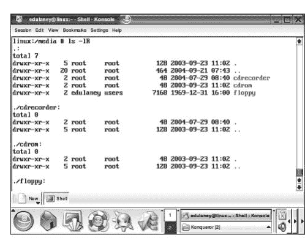

# 图 8.2

`/media` 目录为每个可移动设备提供一个子目录。

## opt 目录

`opt` 目录用于存放可选（optional）软件。并不是所有应用程序都安装在这里，但它们会在此创建一个子目录。例如，如果一个应用程序名为 DEF，则应该创建 `/opt/DEF`。

## proc 目录

`proc` 目录是虚拟文件系统。它是动态生成的，包含了关于内核的信息。其他系统信息最常见地以文件夹形式显示，如下所示：

```
$ ls -l
PID T CMD
dr-xr-xr-x 3 root 0 Sep 20 08:34 15193 pts/0 00
dr-xr-xr-x 3 root 0 Sep 20 08:34 15220 pts/0 00
dr-xr-xr-x 3 root 0 Sep 20 08:34 15222 pts/0 00
dr-xr-xr-x 4 root 0 Sep 20 08:34 15236 pts/0 00
```

`init` 进程的 PID 数字始终为 1。正因如此，你可以通过查看 `/proc` 来快速获取系统状态的概览

```bash
$ ls -1 /proc/1
```

## root 目录

`root` 目录是 `root` 用户的家目录。出于安全考虑，它位于 `/` 目录下，而不是 `/home` 的子目录。为了真正的安全，进一步建议将此目录移动到另一个位置并重命名为一个不显眼且不具吸引力的名称。

## sbin 目录

`/bin` 目录存放大多数用户使用的标准可执行文件；`sbin` 目录存放用于系统管理的二进制可执行文件。其中许多文件用于启动系统并位于 `/etc` 目录之下。以下列表显示了位于此目录的一些文件：

- `dump`
- `fdisk`
- `fsck`
- `halt`
- `ifconfig`
- `init`
- `mkfs`

# Novell 认证 Linux 专业人员学习指南

- `poweroff`
- `reboot`
- `SuSEConfig`
- `shutdown`
- `YAST2`

`SuSEConfig` 利用位于 `/etc/sysconfig/` 中的文件。

# srv 目录

`srv` 目录存放服务器上可用服务的文件——每个服务都位于一个独立的子目录。图 8.3 显示了包含 `www` (Apache) 和 `ftp` 服务的目录示例。

图 8.3

`/srv` 目录为服务器上的每个服务都包含一个子目录。

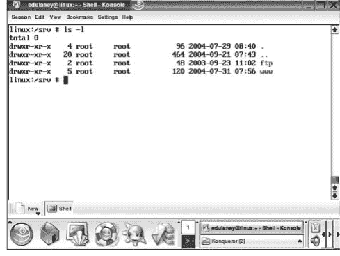

# tmp 目录

顾如其名，`tmp` 目录用于存放临时文件。除了短时间保留外，任何内容都不应存放在这里，因为许多系统会在关机或启动时清理（删除）该目录下的所有条目。

`/tmp` 下存在的文件示例包括：正在编辑的文件的副本、任何应用程序的临时文件（存储在操作之间的文件）等。

# usr 目录

`*usr*` 最初是“user-specific resources”（用户特定资源）的缩写，现在是一个包含大量子目录的巨大目录。以 X 开头的子目录用于定义 X Windows 环境。`**bin**` 子目录（正如每次遇到同名目录时所示）包含用户二进制（可执行）文件。放置在此处的文件包括：

- `cut`
- `diff`
- `file`
- `grep`
- `killall`
- `nl`
- `passwd`
- `wc`

> 根据一般规则，所有用户所需的实用程序存储在 `/bin` 中，而有用（但非关键）的程序存储在 `/usr/bin` 中。用于系统管理任务的工具存储在 `/sbin` 中。

> `/usr` 下的所有子目录并非都是必要的，它们会根据所选安装类型的不同略有不同。

`**include**` 目录存放 C 程序头文件，而 `**lib**` 则为基于 C 的程序提供更多库。`**local**` 目录是安装期间使用的临时存放点，其下的子目录应该是空的。

`**sbin**` 目录（再次）存放系统特定的二进制文件。该子目录中找到的大多数工具与从添加用户、组以及处理网络的角度管理系统有关。这些是非关键工具，系统在没有它们的情况下运行，管理员也可以管理它们；虽然会更困难，但绝对是可能的。

`**share**` 目录存放某些工具的特定机器信息，并存放手册页的 `**man**` 目录。最后，`**src**` 目录包含操作系统的源代码。

# var 目录

`var` 名称源于 `variable`（变量）一词，该目录下包含的数据本质上是波动的。这里通常有多个目录用于存放动态文件，例如池、日志等。

了解这些变量的主要目录有：

- `lock`—存放被锁的文件
- `log`—用于日志文件，例如登录和注销日志 (`wtmp`)、当前正在使用系统的用户 (`utmp`)，以及邮件、打印缓存等
- `run`—运行级别（`runlevel`）所需的文件
- `spool`—等待处理的队列数据（如打印）

# 其他目录

在 `/` 目录下可以创建并存在其他目录。前面的章节列出的目录始终存在，接下来的两个可能存在：

- `install`—顾如其名，它包含有关安装的信息，如脚本、错误等。
- `lost+found`—在完美的系统中，此目录应该是空的。然而当发生损坏时，结果会被放在此目录中。

# 硬盘布局

对硬盘进行分区将单块磁盘划分为许多逻辑区域或驱动器。分区本身是磁盘上的一组连续扇区，被视为一个独立的磁盘。分区表是磁盘上的索引，描述了磁盘区域与实际分区之间的关系。

关于是否有必要多个分区，存在着长期的争论。大多数 DOS 和 Windows 用户习惯于将整个硬盘（无论大小如何）表示为一个磁盘。虽然这对某些用户来说可能很方便，但在 Unix 或 Linux 世界中并不是理想的。

通过使用多个分区，你可以封装数据，并将文件系统损坏限制在单个文件系统中。这限制了潜在的数据丢失。多个分区也有助于限制数据增长。根据系统的用途，可以使用不同的块大小格式化不同的文件系统。这确保需要额外磁盘空间的用户不会因为耗尽所有可用根文件空间而导致系统崩溃。

在规划磁盘布局时，必须考虑一些限制条件：

- 为了防止数据丢失和损坏，分区不能重叠。
- 为了最大限度地利用磁盘，分区之间不应有间隙。
- 你不需要对磁盘进行完全分区。
- 在不使用特殊软件的情况下，无法移动、调整大小或复制分区。

操作磁盘时，必须记住命名规范。Linux 系统中的所有设备都表示为设备文件。这些文件按照特定规范命名，以便于识别关联设备。

IDE 磁盘通过名称 `/dev/hd` 后跟字母 `"a","b","c"` 或 `"d"` 来标识。该字母标识驱动器为第一个 IDE 控制器 (`a`) 或第二个磁盘 (`d`)。

SCSI 磁盘以类似的方式标识，但设备名称为 `/dev/sd` 后跟字母。这些名称（如 `/dev/sda`）指的是整个磁盘。

驱动器分区后，设备名称中会增加一个数字。主分区编号为 1–4，扩展或逻辑分区编号为 5 及以上。

分区表最初写在磁盘引导扇区中，由于其大小是预定义的，因此限制为四个分区条目。这些现在被称为主分区。一个主分区可以细分为逻辑分区。用于存放逻辑分区的分区称为扩展分区。分区必须进行标记，以识别随后写入其上的数据格式。这对于挂载分区或执行文件系统修复至关重要。每个文件系统都有一个关联的代码，并由 `fdisk` 用于指定文件系统类型。


一些有效的文件系统类型列在表 8.1 中。

注意

你可以使用 `fdisk` 工具选择 `m` 然后按 `I` 来获取当前的文件系统列表。这将在本章后面的“操作磁盘”部分进行进一步的讨论。

# 表 8.1

有效的文件系统类型

| 代码 | 文件系统类型 |
| :--- | :--- |
| 5 | 扩展 (Extended) |
| 6 | FAT16 |
| 7 | HPFS |
| 8 | AIX |
| 85 | Linux扩展 (Linux Extended) |
| 86 | NTFS |
| 1b | Windows 95 FAT32 |

你的 Linux 系统至少需要以下内容：

- 一个引导分区
- 一个交换分区

你也可以根据需要拥有任何其他主分区或扩展分区。建议引导分区使用主分区。这在以后出现问题时便于恢复，因为只会丢失少量数据。

在运行时，Linux 会将一段时间未使用的内存页交换出去。这比增加更多的物理内存要慢得多。如果你发现系统正在进行大量交换，是时候增加更多内存了。

正如前面讨论过的，必要时你可以将所有内容（包括你的交换文件）放在单个分区中。然而，这并限制文件系统的管理方式以及文件系统内数据的增长。例如，如果你的用户邮箱位于根文件系统上且该系统被满了，系统将会挂起。

尽管可以在一个分区中运行所有内容，但这不是良好的做法。表 8.2 中列出的文件系统是放置在各自独立分区中的良好候选对象。

## 需要分区的文件系统

| 文件系统名称 | 主分区/扩展分区 | 描述 |
| :--- | :--- | :--- |
| `/boot` | 主分区 | 这是内核镜像所在的位置。如果你在使用 LILO 或计划支持其他操作系统，最好让此分区成为磁盘上的第一个分区。 |
| `/root` | 主分区 | 这是你的根文件系统。 |
| `/usr` | 扩展分区 | 大多数应用数据存储在这里，包括系统二进制文件、文档和内核源码。 |
| `/home` | 扩展分区 | 这是系统用户主目录所在的位置。根据你的用户数量和所需的磁盘空间，你可能需要多个主目录分区。 |
| `/var` | 扩展分区 | 这是一个溢出分区，包含日志和错误消息文件、Usenet 邮件箱等。 |
| `/tmp` | 扩展分区 | 这是正在处理的文件的临时存储位置。编译器和许多应用程序在此区域创建许多文件。这些文件通常寿命很短，但有时会非常大。 |

## 硬盘操作

涵盖课程目标

- 1. 理解文件系统层次结构 (3036)
- 2. 识别 Linux 系统中的文件类型 (3036)
- 3. 选择 Linux 文件系统 (3037)
- 4. 配置 Linux 文件系统分区 (3037)

# Novell 认证 Linux 专业人员学习指南

*(注：此行似乎是原始文档的页眉/页脚，根据指令予以保留。）*

为了在 Linux（以及每个操作系统）中使用硬盘，磁盘上必须至少存在一个分区。分区是磁盘的一部分（部分或全部），它已经过正确格式化以存储数据。虽然硬盘上必须至少有一个主分区（此处原文应为硬盘上至少要有一个主分区），但如果使用 DOS 风格的分区表（默认值），最多可以有四个分区，且每个分区在使用之前都必须进行格式化。分区必须是主分区，操作系统才能从其启动。

如果你愿意，一个主分区（仅一个）可以进一步划分为扩展分区（称为逻辑驱动器）。同样，使用 DOS 风格的分区，可以从主分区创建最多四个逻辑驱动器，且其中任何一个都不能被操作系统引导。

> 注意
>
> 如果混合使用主分区和扩展分区，你可以拥有的最大分区数为三个主分区和四个逻辑驱动器（总共七个）。

实际上，SCSI 磁盘的理论限制是 15 个分区，IDE 磁盘是 63 个分区。上述限制是使用默认使用的 DOS 风格分区表强制的。

所有分区都必须在 `/dev` 目录中引用，第一块磁盘上的第一个分区是：

- `hda1`—用于 IDE
- `sda1`—用于 SCSI

设备名称始终可以拆分为四个字段，每个字符代表一个含义：

- 1. 驱动器类型：`h` 代表 IDE，或 `s` 代表 SCSI。
- 2. 设备类型：`d` 代表磁盘（disk）。
- 3. 以字母格式表示的磁盘编号：`a` 表示第一个，`b` 表示第二个，以此此类推。
- 4. 分区编号。数字 1–4 留给主分区使用，无论你有多少个，逻辑驱动器从 5 开始编号。

必须至少有两个分区：文件系统本身（通常称为 root）和一个分区。交换分区（swap partition）由内存和一些硬盘空间组成。交换分区的设置至少等于机器上安装的内存，但可以更多（硬盘空间的建议最小值为为 16MB）。例如，如果你在机器上安装了 64MB 内存，而交换分区需要 128MB，它可以使用 64MB 的交换分区像进程正在运行那样进行读写。

如果分区空间不足（或未进行配置），始终会创建一个相同用途的交换文件（swap file），但优于使用分区。

> Linux 可以使用交换文件或交换分区，但分区提供了更高的系统效率。

关于硬盘的另一个注意事项：Linux 倾向于驱动器上的磁道圈数量为 1024 或更少。如果数字较大，在启动时运行的软件，或者与其他操作系统进行引导/分区时可能会出现复杂问题。

## 创建分区

创建磁盘分区使用的主要工具是 `fdisk`。`fdisk` 工具将磁盘划分为多个分区，并在扇区 0（称为超级块）中写入分区表。在不带参数运行时，`fdisk` 会弹出一个供你交互的选项菜单。然而，你可以避开菜单，并使用这些选项运行 `fdisk`：

- `l` 仅列出分区表
- `v` 仅打印 `fdisk` 的版本

如果未使用这两个选项之一，`fdisk` 会首先检查默认设备（`hda1`）上的磁道圈数是否大于 1024，如果是则会向你警告。然后它会提示命令。你可以通过命令行指定默认设备以外的设备启动 `fdisk`。例如，要启动第三个 IDE 驱动器，使用此命令：

```
$ fdisk /dev/hdc
```

工具启动后，输入“`m`”可以提供菜单形式的帮助：

- 切换引导标记（toggle a bootable flag）
- 编辑 bsd 磁盘标签（edit bsd disklabel）

*(注：原文此处列表部分存在大量重复性文本，已根据逻辑进行了清理)*

以下示例显示了使用 `fdisk` 可以执行的操作：

| 设备 | 起始 | 结束 | 块数 | ID | 系统 |
| :--- | :--- | :--- | :--- | :--- | :--- |
| `/dev/hda1` | | | 20471520 | 82 | Linux |
| `/dev/hda2` | | | 5242880 | 83 | Linux |

以下示例显示了使用 `fdisk` 可以执行的操作：

```
Command (m for help): t
Partition number (1-4): 3
Hex code (type L to list): 82
Changed system type of partition 3 to 82 (Linux swap)
```

完成所有更改后，你可以退出 `fdisk` 并格式化任何需要的分区。如果你写入了更改，将出现提示指示分区表已更改，磁盘将进行同步。你应该重启系统以确保表已正确更新。

## 创建文件系统

分区的格式化通过 `mkfs`（意为 Filesystem）工具或 `mkfsfs` 完成。你必须使用工具的选项来指定要创建的文件系统类型 (`-t`)、设备、大小以及任何你需要的。例如，要为 DOS 格式化新创建的第四个分区，命令将为

# Novell 认证 Linux 专业学习指南

```bash
$ mkfs -t mdsos /dev/hda4 3040632
```

在使用 `fdisk` 和 `mkfs` 时要格外小心，因为如果参数错误，两者都导致系统无法运行。

> 注意
>
> `mkfs` 工具可格式化软磁盘以及硬盘，但对于软磁盘，使用 `fdformat` 工具要简单得多。

如前所述，你可以从 Linux 支持的多种不同文件系统中选择。无论数量有多少，它们都大致分为三类：传统的、日志的和虚拟的。传统文件系统包括 `ext2`、`vfat` 等。日志文件系统包括 ReiserFS（SuSE 的默认系统）和 `ext3`。虚拟文件系统（也称为虚拟系统交换器，VFS）实际上是存在于进程和其他文件系统（传统或日志）之间的混合体。

# 维护文件系统的完整性

课程目标覆盖

+ 7. 监控文件系统 (3038)

在创建文件系统后，你可以使用三个工具：`df`、`du` 和 `fsck` 来收集其信息并进行故障排除。前两个工具仅显示信息，不允许你进行任何更改，而后者在将宕机系统恢复并再次运行时可能是救命稻草。

`df` 工具显示跨文件系统的空闲磁盘空间。该工具可以使用以下选项/参数：

- `-a`—所有（包括包含 0 块的项）
- `-h`—以“人类可读”的格式显示
- `-l`—仅本地文件系统
- `-m`—以 MB 为单位列出
- `-t`—仅显示特定类型的文件系统
- `-T`—显示文件系统类型

# 使用文件系统

第 8 章

例如，默认输出以及带有指定选项的结果如下所示：


```bash
$ df
Filesystem      1k-blocks      Used Available Use% Mounted on
/dev/hda1       1980969 573405 1305178 31% /
/dev/hda3       5871498 5212 5562198 0% /home

$ df -T          Type           1k-blocks      Used Available Use% Mounted on
/dev/hda1       ext2           1980969 573448 1305175 31% /
/dev/hda3       ext2           5871498 5212 5562198 0% /home

$ df -h
Filesystem      Size  Used Avail Use% Mounted
/dev/hda1       1.9G    560M  1.2G 31% /
/dev/hda3       5.6G    5.1M  5.3G 0% /home

$ df -a
Filesystem              1k-blocks      Used Available Use% Mounted on
/dev/hda1       1980969 573406 1305177 31% /
/dev/hda3       5871498 5212 5562198 0% /home
devpts                  0               0       0 - /dev/pts
/proc                   0               0       0 - /proc
name: (pid12019)     0               0       0 - /auto

$ df -m
Filesystem              1M-blocks      Used Available Use% Mounted on
/dev/hda1               1934        560 1275 31% /
/dev/hda3               5734        5 5432 0% /home
devpts                  0               0       0 - /dev/pts
/proc                   0               0       0 - /proc
name: (pid12019)     0               0       0 - /auto
```

# Novell 认证 Linux 专业学习指南

文件类型列出的 `ext2` 代表第二扩展文件系统，是许多 Linux 版本的默认系统。`ReiserFS` 是 SuSE 9.0 及以上版本安装时的默认系统。

`df` 工具处理分区，而 `du` 工具处理文件和目录的磁盘占用情况。通过 `df` 可以看到 `/dev/hda1` 使用了 560MB，但你不知道具体被什么使用了。`du` 工具是下一步，显示你指定的任何位置每个项目占用了多少空间。例如，从 `/root` 目录（root 用户的家目录）开始，`du` 工具将显示子目录使用的空间：

- 14 ./seyon
- 2 ./Desktop/Autostart
- 2 ./Desktop/Trash
- 8 ./Desktop/Templates
- 20 ./Desktop
- 22 ./kde/share/config
- 1 ./kde/share/apps/kfm/tmp
- 6 ./kde/share/apps/kfm/bookmarks
- 8 ./kde/share/apps/kfm
- 6 ./kde/share/apps/kdewizard/Work/Windows
- 7 ./kde/share/apps/kdewizard/Work
- 1 ./kde/share/apps/kdewizard/Themes
- 9 ./kde/share/apps/kdewizard
- 1 ./kde/share/apps/kpanel/applnk
- 1 ./kde/share/apps/kpanel/pics
- 3 ./kde/share/apps/kpanel
- 3 ./kde/share/apps/disknav
- 5 ./kde/share/apps/kwm
- 6 ./kde/share/apps/kwm
- 1 ./kde/share/apps/kdisplay/pics
- 2 ./kde/share/apps/kdisplay
- 2 ./kde/share/apps/kdehelp
- 34 ./kde/share/apps
- 1 ./kde/share/icons/mini
- 2 ./kde/share/icons
- 2 ./kde/share/applnk
- 1 ./kde/share/sounds
- 1 ./kde/share/sounds
- 63 ./kde/share
- 64 ./kde
- 119 .

# 使用文件系统

第 8 章

如果使用了 `-a` 选项，将列出文件而不仅仅是目录。`du` 工具使用的选项有：

- `-b`—以字节列出列表
- `-c`—显示总计
- `-h`—“人类可读”
- `-k`—以 KB 为单位列出列表
- `-l`—显示链接数
- `-m`—以 MB 为单位列出列表
- `-s`—仅显示总计
- `-x`—仅显示此（不同）文件系统上的目录

该类别中的工具是 `fsck`，文件系统检查工具：它不仅会检查文件系统，如果遇到错误，还可以修复它们。该工具利用 `/etc/fstab` 文件中的项，在配置自动运行时检查哪些文件系统。`-A` 选项也告诉工具使用此文件。

> 注意
>
> `/etc/fstab` 始终由 `fsck` 和相关工具读取，从不写入。作为管理员，当你想要修改系统工具的操作时，需要更新该文件（每个文件系统占一行）。

以下是该文件的示例：

```
/dev/hda2                             reiserfs
=defaults                             1 1
/dev/hda1               swap               pri=42
= 0                    swap
devpts                                /devpts
/proc                                /proc
/media                               /media
```

# 264 Novell 认证 Linux 专业人员学习指南

```
18537 -rw-r--r-- 1 root root 38 Sep 23 00:26
-wednesday
```

如果文件被移动，它将保持相同的节点（`node`）。如果一个文件被复制，原始文件将保持相同的节点，但新条目必须关联一个新的节点：

```bash
$ mv monday friday
$ ls -li
18471 drwx------------ 5 root root 1024 Sep 22 23:57
-Desktop
18535 -rw-r--r-- 1 root root 81 Sep 23 00:25
-friday
18536 -rw-r--r-- 1 root root 152 Sep 23 00:26
-tuesday
18537 -rw-r--r-- 1 root root 38 Sep 23 00:26
-wednesday
$ cp friday monday
$ ls -li
18471 drwx------------ 5 root root 1024 Sep 22 23:57
-Desktop
18535 -rw-r--r-- 1 root root 81 Sep 23 00:25
-friday
18538 -rw-r--r-- 1 root root 81 Sep 23 00:38
-monday
18536 -rw-r--r-- 1 root root 152 Sep 23 00:26
-tuesday
18537 -rw-r--r-- 1 root root 38 Sep 23 00:26
$
```

# 挂载与卸载

会有一个本地文件系统，因为 Linux 就是安装在该文件系统上的。如果该文件系统足够大能够容纳你交互的所有内容，那么你只需要它了。但在大多数情况下，本地文件系统不足以容纳你需要的一切。在这种情况下，你可以挂载其他文件系统以便在你的环境中访问它们。

不带参数使用 `mount` 命令用于显示当前可用的文件系统。输出示例如下：

```
/dev/hda1 on / type ext2 (rw)
/dev/hda3 on /home type ext2 (rw)
```


# 使用文件系统

## 第 8 章

`devpts on /dev/pts type devpts (rw, gid=5,mode=620)`

`proc /proc type proc (rw)`

`noname:(pid11973) on /auto type nfs (rw)`

这从动态的 `/etc/mtab` 读取并传递设备、挂载点、文件系统类型以及权限（`rw` 是读/写）。

除了读/写外，文件系统还可以挂载为只读（`ro`）、不允许用户（`bouncer`）、仅允许运行二进制文件（`exec`）或不允许（`noexec`）、不运行某些文件（`nosuid`）、由所有用户控制（`user`），以及解释文件系统上的特殊设备（`dev`）。

上述输出中列出的默认条目会出现在 `/etc/fstab` 文件中——之前在提到 `fsck` 工具时说过。如果你有额外的想要挂载的文件系统，应该将你的条目添加到此文件中。`mount -a` 命令将读取 `fstab` 文件并重新挂载其中找到的所有条目。

如果你没有挂载文件系统，可以使用 `mount` 工具通过设备名称动态地加载其他文件系统。

例如，要挂载 CD 驱动器，命令是：

```bash
$ mount /mnt/cdrom
```

> 注意
> 
> 某些 Linux 发行版以及在某些硬件上，你可能需要使用 `mount /media/cdrom` 的变体
> 
> 或
> 
> `mount -t iso9660 /dev/cdrom /media/cdrom`
> 
> 挂载 DVD 驱动器的情况也是如此。

添加到挂载的条目看起来如下：

`/dev/hdc on /mnt/cdrom type iso9660 (ro,noexec,nosuid,nodev)`

`/mnt` 目录包含了外部设备（如 CD-ROM 驱动器和软盘）的易访问定义。可以配合 `mount` 命令使用的选项有：

- `-a` 读取 `/etc/fstab` 文件并挂载所有条目。
- `-f` 查看文件系统是否已挂载（但不执行挂载）。错误消息意味着找不到，没有错误消息则意味着在 `/etc/fstab` 或 `/etc/mtab` 中找到了。
- `-n` 防止在添加文件系统时 `/etc/mtab` 文件被动态更新。
- `-r` 将文件系统挂载为只读。
- `-t` 允许你指定文件系统的类型。
- `-w` 将文件系统挂载为读/写（默认）。

挂载文件系统的反面是在不再需要时卸载。这通过 `umount` 工具完成。当不再需要 CD 驱动器时，命令为：

```bash
$ umount /mnt/cdrom
```

`umount` 工具的选项有：

- `-a` 卸载 `/etc/mtab` 中的每个条目。
- `-n` 卸载但不更新 `/etc/mtab`。
- `-r` 如果卸载失败，将其重新挂载为只读。
- `-t` 卸载特定类型的条目。

# 硬盘与 YaST

SUSE 允许你使用 YaST（Another Setup Tool）工具与磁盘交互并进行图形化的分区任务。图 8.5 显示了系统菜单及其呈现的内容。图 8.5 系统菜单提供了磁盘相关的选项。


第 8 章

选择分区器，会出现图 8.6 所示所示警告。仔细注意此警告，它的字面含义是：如果你不小心，可能会进行不可逆的操作。

## 图 8.6

在更改分区信息之前请先清楚。


在你选择后，会出现图 8.7 中的分区表。

## 图 8.7 分区器显示的内容。


# Novell 认证 Linux 专家学习指南

专门用于提供打印服务的操作系统是 `lpd`——行式打印机守护进程（line printer daemon）。该守护进程自 Unix 早期一直存在，且操作方式几乎没有变化。第一个允许提交作业到该守护进程的工具是 `lpr`。该工具仍然存在并包含在许多 Linux 版本中，但通常会被忽略，取而代之的是 `lpr`（具有更多逻辑选项的新型工具）。

> 注意：本文重点关注 LPRng。CUPS 作为 LPRng 的替代方案，将在本章稍后部分讨论。

图 9.1 显示了在 SuSE 中运行的进程。

用户可以通过两种方式选择打印文件：

- 从图形化界面内部
- 从命令行

## 图 9.1

`lpr` 服务正在运行。

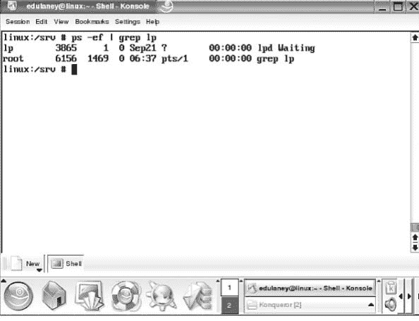

在命令行使用的最简单语法是

`lpr {filename}`

因此，如果你想打印名为 Saturday 的文件，命令将是

`lpr Saturday`

## 管理打印

在进行此工作之前，你必须设置打印机。否则，将导致指示调度器未响应的错误。

> 注意：当发出此命令时，会启动许多其他进程，如图 9.2 所示。在这种情况下，打印机不存在，打印作业将溢起到空处，允许我们观察正在发生的情况。

## 图 9.2

当提交文件进行打印时，会启动许多进程。

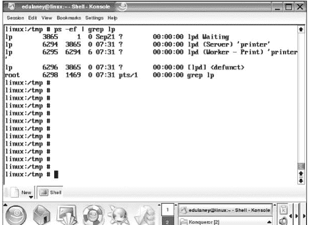

打印作业发送到打印机的相应队列后，守护进程将从打印机中移除作业并生成完成的输出。只要文件存在，它的条目就会保留在溢池目录 `/var/spool/lpd` 中，如图 9.3 所示。

> 注意：Linux 支持的打印机列表可以在 http://www.linuxprinting.org 找到。

一旦配置得当并运行正常，Linux 中的打印服务将运行非常顺畅。

## 9.3

溢池持有打印作业的文件。

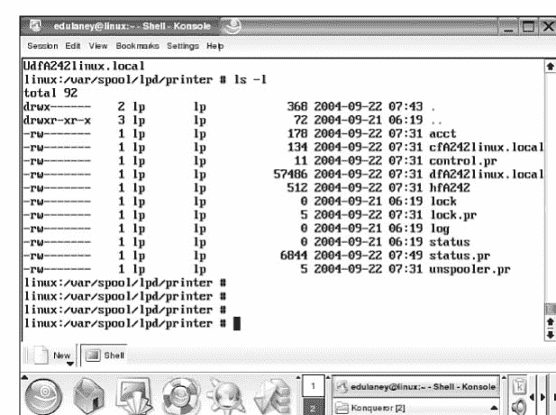

## 升级到 CUPS

在较新的实现中（包括 SuSE），CUPS（通用打印系统）取代了 `lpd` 的大部分功能。然而，从操作的角度来看，它非常简单：

1. 用户提交打印作业。
2. 文件被溢起——在这种情况下为 `/var/spool/cups/`。
3. `cupsd` 守护进程格式化溢池中的数据并将其发送到打印机。
4. 作业完成后，守护进程从队列中移除文件。

`/etc/cups/cupsd.conf` 文件（或 `/etc/cups/cupsd.sample`）包含了大量的叙述和注释，完整地解释了如何配置 cups。虽然它不允许完整地打印文件，但强烈建议你仔细阅读你系统上的该文件，并确保你理解可用的选项。

`/etc/init.d/cups stop` 命令用于停止服务，`/etc/init.d/cups start` 命令用于手动启动它（一旦配置完成，它应该通过脚本 `/etc/init.d/cups` 在启动时自动启动）。

## 格式化文件

在讨论打印选项时，有一个对格式化非常有价值的工具，即 `pr`。该工具（`/usr/bin/pr`）的主要目的始终是在将输出发送到打印机之前转换文本文件的内容。

输出包括一个默认页眉，带有最后修改的日期和时间、文件名和页码。默认页眉可以通过 `-n` 选项覆盖，`-l` 选项允许你指定每页包含的行数——默认为 66 行。默认页宽为 72 个字符，但可以使用 `-w` 选项指定不同的值。`-d` 选项可用于输出的双倍行间距，`-m` 可用于以列格式打印多个文件。

## 安装打印机

涵盖的课程目标

1. 在 Linux 系统中安装打印机 (3036)
2. 配置和管理网络打印服务 (3037)

> 注意：在安装任何打印机之前，你应该通过检查 http://www.linuxprinting.org/ 的打印机数据库以及 http://hardware.suse.de/ 的 SuSE 企业服务器打印机数据库，验证它是否被 Linux 支持。

与 Linux 中的所有事物一样，有多种不同的方法来安装打印机。最早安装的打印机是通过 YaST 连接的本地打印机。连接打印机后，启动 YaST（可能会提示你输入 root 密码），然后选择硬件、打印机。将对当前环境进行扫描，如 9.4 所示。

打印机应该被自动检测，如图 9.5 所示。

## 图 9.4

YaST 简化了打印机的配置和安装。

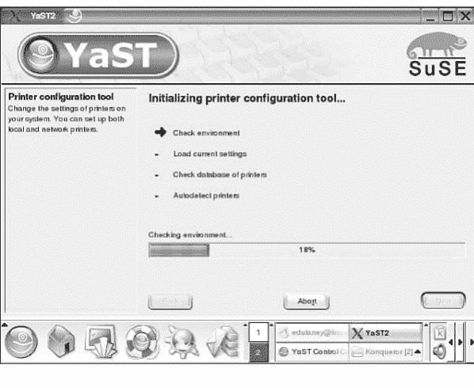

## 图 9.5

YaST 自动检测识别大多数打印机。

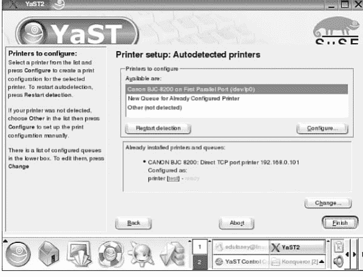

通过选择配置按钮，你可以更改为打印机自动创建的任何设置。出现的对话框如图 9.6 所示，编辑屏幕在图 9.7。

## 图 9.6

你可以更改自动配置的设置。

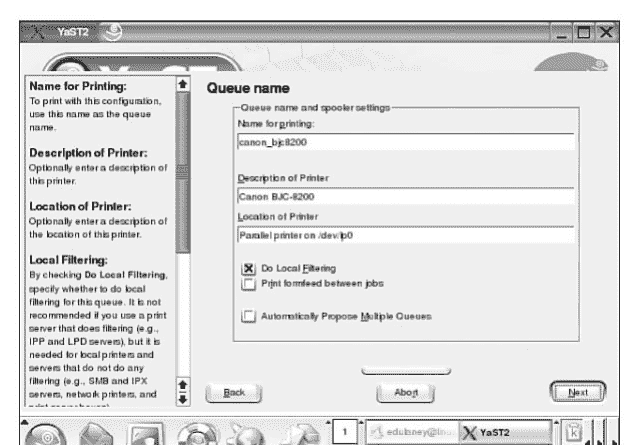

## 图 9.7

在 YaST 内可以编辑任何设置。

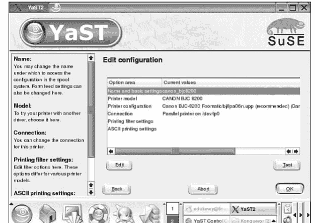

当你点击图 9.7 所示的测试按钮时，它将使用 `lpr` 提交打印作业。如图 9.8 所示。


## 图 9.8

添加打印机向导可以

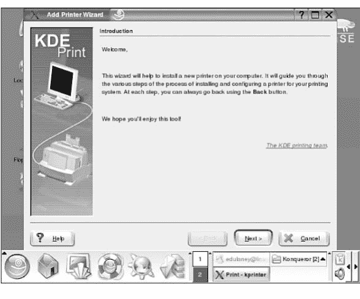

用于打印的另一种方法是打印机管理器，如图 9.9 所示。

## 图 9.9

打印机管理器提供了

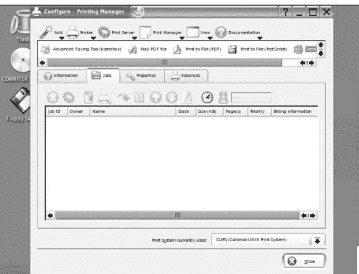

无论使用哪种方法添加打印机，都会发生一些事情：

- 打印队列被添加到 `/etc/cups/printers.conf`。
- 打印机的 `ppd` 文件被放置 `/etc/cups/`。
- 打印队列被添加到 `printcap`。

## 图 9.10

你可以选择 CUPS 作为类型。

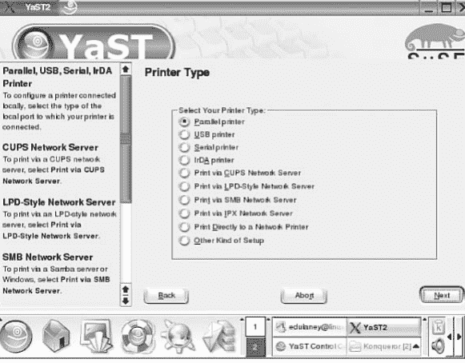

## 基础配置文件

打印服务工作需要几个文件。其中最重要的是 `printcap`、`lpd.perms` 和 `lpd.conf`。`/etc/printcap` 文件是定义每台打印机能力的数据库。使用 `LPRng`（此处原文为 LPRng）添加打印机后，该文件的默认版本所示：

```
# /etc/printcap：打印机数据库。参见 printcap(5)。

sd=/var/pool/lpd/%P

# 用于临时存储打印作业的溢池目录%。P 将扩展打印队列扩展。每个打印队列必须有不同的溢池目录，通过使用 %P 保证了这一点。

#:sh - 抑制 banner 或标题页

#mx=0 - 最大作业大小，单位为 K 字节（0 为无限制）

#:mc=0 - 最大副本数（0 为无限制）

# 管理打印

第 9 章

# LPD 打印队列定义：定义打印队列
# 并行端口上的打印机（即 - /dev/lpt0）
#lp:lp-DEVICE:tc=.common
#  示例：
#  lp:tc=.common:lp=/dev/lpt0
#  [翻译:
#   lp 打印队列的名称
#   tc=.common 包含 .common 文件中的选项
#   printcap 条目中的 'tc' 选项将被放在
#   printcap 条目的开头
#   lp=/dev/lpt0 - 打开并写打印作业写入
#   /dev/lpt0
#  ]
# 串口端口上的打印机（即 - /dev/tty00）
# 使用 setty 通过 'tty(1)' 选项设置速度、位和奇偶校验。
# 注意：几乎所有打印机都使用 8 位
# 且无奇偶校验。
#lp:tc=.common:lp=DEVICE:STTY OPTIONS
#  示例：
#  lp:tc=.common=/dev/tty0:tty=19200 crw crtscs
#  [翻译:
#   :tc 如上文 A。
#   :tty= 选项用于配置串口
#  ]
# 网络打印服务器上的打印机（即 - HP JetDirect）
# 通过 TCP/IP 套接字连接。IPADDR 是打印服务器的
# IP 地址或完全域名，PORT 是
# TCP/IP 端口。
# HP Jetdirect 默认使用端口 9100。
# 警告：请检查网络打印服务器文档以获取
# 正确端口号。大多数非 HP 网络打印服务器
# 和非 HP 打印机不使用端口 9100。
#lp:tc=.common:lp=IPADDR:PORT
#  示例：
#  lp:tc=.common:lp=10.0.0.2%9100
#  [翻译: lp, :tc, 如上文 A。]
```

# Novell 认证 Linux 专业学习指南

```
# lp=10.0.0.2%9100 - 打开到 10.0.0.2 端口 9100 的连接
# 并将打印作业写入此端口。
# ]
```

# 网络打印服务器上的打印机（即 - HP JetDirect 或 LPD 服务器）

# 通过 LPD 打印协议连接。QUEUE

# 是打印队列的名称，IPADDR 是打印

# 服务器的 IP 地址或完全域名。

# 警告：检查网络打印服务器文档以获取

# 正确的 QUEUE 名称。HP JetDirect 使用 'lp' 队列

# 作为默认打印队列。如果设备上有

# 多个打印机端口，则使用 QUEUE 名称

# 来选择端口。

# 警告：在 JetDirect 设备上使用此协议将

# 始终导致 JetDirect 设备生成“标题页”（banner page）。

# 请查看 HP 文档了解如何禁用

# 这个最烦人的功能。通常你只需要

# telnet 到 JetDirect，然后使用在首次

# 建立连接时呈现的简单配置菜单。

```
# lp:tc=.common:lp=QUEUE@IPADDR
# 示例：
# lp:tc=.common:lp=lp6@10.0.0.2
# [翻译: lp ,tc 如上文]。
# lp=10.0.0.2 - 打开到 10.0.0.2 端口
# 515 的连接，并使用 RFC1179 (LPD) 协议将
# 作传输到 QUEUE 打印队列。
# ]
```

## 步骤 4：需要格式转换（过滤器）吗？

# 你可能会发现你的打印机不支持

# PostScript 或需要进行特殊的初始化。

# 这由过滤器程序处理。'ifhp'

# 过滤器程序由 LPRng 提供，支持大量的

# 打印机。如果你需要过滤器，

# 请在 printcap 条目中添加以下行：

```
# :filter=PATH_TO_IFHP_FILTER
# :ifhp=IFHP_OPTIONS
```

# 注意：LPRng 的 :filter= 选项替换了旧的

# BSD :if, :vf, ...，这些用于指定

# 'f' 格式、'v' 格式等的过滤器（是的,:if

# 用于 'f' 格式，别问）。:filter 选项指定

# 所有作业格式的默认过滤器。大多数现代过滤器

# 如 IFHP、Magicfilter 和 Red filters

# 足够判断作业格式并执行

# 适当的转换。

```
# 示例：
# lpc=:common:lp=/dev/lp0
# :filter=/usr/libexec/ifhp
# :ifhp-model=hp4simx
```

```
# lpc=:common:lp=10.0.0.2%9100
# :filter=/usr/libexec/ifhp
# :ifhp-model=hp4simx
```

```
# lpc=:common:lp@10.0.0.2
# :filter=/usr/libexec/ifhp
# :ifhp-model=hp4simx
```

# IFHP 选项：

# 对于几乎所有的简单配置，你都需要

# 提供你所连接的打印机型号。

# 请查看 `/etc/ifhp.conf` 文件获取支持模型的

# 列表。默认型号是 HP

# LaserJet 4，它支持 PostScript、PCL 和

# PJL。

```
# 警告：
# 如果：
# 你的打印机通常通过 TCP/IP 链路提供
# 状态和报告
# 并且：
# 你正在使用 lp=IPADDR%PORT 连接到
# 打印机
#那么：
# IFHP 过滤器通常期望获得打印机
# 返回的状态以告知打印机
# 处于工作状态。这将对作业吞吐量产生
# 小但显著的开销，但你也能获得错误信息。
# 但是：
# 如果打印机应该返回状态但无法通过
# 硬件配置，或者它位于单向而非双向
# 端口，那么你必须使用 :model=...,status@
# 告诉 IFHP 过滤器不要等待状态。
# 示例：
# lp=tc=.common:lp=10.0.0.2
```

# 管理打印

## 第 9 章

| | V | SA | SA | SA |
| :--- | :--- | :--- | :--- | :--- |
| FORWARD | V | SA | SA | SA |
| SAMEHOST | V | SA | SA | SA |
| SAMEUSER | V | SA | SU | SU | SU |
| SERVER | V | SV | SV | SV | SV |
| LPC | S | | LPC | | |
| AUTH | V | AU | AU | AU | AU |
| AUTHTYPE | S | AU | AU | AU | AU |
| AUTHUSER | S | AU | AU | AU | AU |
| AUTHFROM | S | AU | AU | AU | AU |
| AUTHSAMEUSER | S | AU | AU | AU | AU |

`REMOTEIP` 是 `REMOTEHOST` 的别名

- `REMOTEPORT` 是 `PORT` 的别名
- `IP` 是 `HOST` 的别名

## 密钥：

- `JH` = 控制文件中主机的 IP 地址/DNS 名称
- `RH` = 连接的远程主机 IP/DNS 名称
- `JUSR` = 控制文件中的 USER 用户
- `CUSR` = 发起控制请求的 REMOTEUSER 用户
- `JIP` = 控制文件中主机的 IP 地址/DNS 名称


# Novell 认证 Linux 专家学习指南

- `RIP` = 请求的 IP 地址/DNS 名称
- `PORT` = 连接主机的源端口
- `SK` = 如果通过 unix socket 连接，则为 true（匹配）
- `CONTROLLINE` = 控制文件中控制行的模式匹配
- `SA` = 请求源的 IP == 控制文件中主机的 IP
- `SU` = 发起请求的用户名 == 控制文件中的用户
- `SV` = 请求源的 IP = 服务器 IP 或服务器本地 IP
- `LPC` = 与值匹配的 lpc 命令通配符
- `AU` = 传输的权限检查。如果是经过验证的请求，`AUTH` 将为 true（匹配）
- `AUTHTYPE` 将请求的认证类型与模式匹配
- `AUTHUSER` 将客户端认证 ID 与模式匹配
- `AUTHFROM` 将请求源者的认证 ID 与模式匹配
- `AUTHSAMEUSER` 将请求认证 ID 与作业中的认证匹配

- 匹配：`S` = 通配符匹配，`IP` = IP 地址[/子网掩码]，`N` = 低[-高] 数字范围，`V` = 匹配或兼容的值
- 服务：'X' - 连接请求；'R' - 来自远程主机的 lpr 请求；'P' - 队列中的打印作业；'Q' - lpq 请求，'M' - lrpm 请求；'C' - lpc 队列控制请求；
- 注意：在打印（P 操作）时，远程和作业检查值（即 - RUSR, JSR）是相同的。
- 注意：在检查溢存队列的权限时，`HOST`、`USER`、`USERNAME` 和 `SAMEHOST` 检查始终成功；它们仅在检查溢存作业的权限时才有效。
- 当通过 UNIX socket 建立连接时，`UNIXSOCKET` 将匹配（true）。
- `SAMEHOST` 匹配检查发起请求的 IP 地址之一（一个或多个）是否匹配控制文件中出现的主名主机的 IP 地址之一（一个或多个）。
- `SAMEHOST` 匹配检查发起请求的 IP 地址之一（一个或多个）是否匹配服务器的 IP 地址（一个或多个）。
- `FORWARD` 等同于 `NOT SAMEHOST`，请求被转发。
- 特殊字母=模式从指定的（大写）字母开始搜索控制行，通常用于打印和溢存检查。例如，`C=A*,B*` 将检查类信息（即控制文件中以 C 开头的行）是否具有以 A 或 B 开头的值。
- 权限行由测试列表和一个结果值组成。
- 如果所有测试均成功，则找到了匹配项，权限测试带结果完成。

# 管理打印

## 第 9 章

- 你使用 `DEFAULT` 保留字来设置默认的 `ACCEPT`/`DENY` 结果。
- `NOT` 关键字将反转测试的含义。
- 每个测试可以有一个或多个用逗号分隔的可选值。例如，`USER=john,paul,mark` 有 3 个测试值。
- 匹配类型指定了如何进行匹配。
- `S` = 通配符类型。格式：带有通配符 (`*`) 和范围的字符串。`*` 匹配一个或多个字符。比较不区分大小。例如，`USER=` 匹配 u，`USER=[a-d]` 匹配 a 或 b 或 c，`USER=[d-f]` 匹配 dx, fx。如果匹配，则打开并读取指定的文件，文件内容被视为由空格分隔的 `S` 条目。
- `IP` = IP 地址和子网掩码。IP 地址必须是点点格式。格式：`x.x.x[/y.y]`。`x.x.x` 是 IP 地址，`y-y` 是可选的子网掩码，默认是 255.255.255。通过转换为 32 位的 x, y 和 IP 值并仅在掩码未使用的位上使用 IP == 0（C 表示法）完成匹配。例如，`REMOTEIP=130.91.0.0/255.255.0.0` 匹配所有地址 130.91.X。
- `N` = 数字范围。格式：低[-高]。例如：`PORT=0-1023` 匹配 0-1023 范围内的端口（特权）。
- `SAMEUSER` 和 `SAMEHOST` 是从控制文件或连接信息形成值的选项。`GROUP` 在用户数据库中搜索匹配模式的名称，然后在这些中搜索该名称。如果找到了名称，则搜索成功。
- 如果请求源自当前 lpd 服务器，则 `SERVER` 条目成功。
- 请注意，在检查溢存队列的权限时，`USER`、`HOST`、`USERNAME` 检查始终成功；它们仅在检查溢存作业的权限时才激活。
- 当通过 UNIX socket 建立连接时，`UNIXSOCKET` 将匹配（true）。
- `SAMEHOST` 匹配检查发起请求的 IP 地址之一（一个或多个）是否匹配控制文件中出现的主名主机的 IP 地址之一（一个或多个）。
- `SAMEHOST` 匹配检查发起请求的 IP 地址之一（一个或多个）是否匹配服务器的 IP 地址（一个或多个）。
- `FORWARD` 等同于 `NOT SAMEHOST`，请求被转发。
- 特殊字母=模式从指定的（大写）字母开始搜索控制行，通常用于打印和溢存检查。例如，`C=A*,B*` 将检查类信息（即控制文件中以 C 开头的行）是否具有以 A 或 B 开头的值。
- 权限行由测试列表和一个结果值组成。
- 如果所有测试均成功，则找到了匹配项，权限测试带结果完成。

# 管理打印

## 第 9 章

- 你使用 `DEFAULT` 保留字来设置默认的 `ACCEPT`/`DENY` 结果。
- `NOT` 关键字将反转测试的含义。
- 每个测试可以有一个或多个用逗号分隔的可选值。例如，`USER=john,paul,mark` 有 3 个测试值。
- 匹配类型指定了如何进行匹配。
- `S` = 通配符类型。格式：带有通配符 (`*`) 和范围的字符串。`*` 匹配一个或多个字符。比较不区分大小。例如，`USER=` 匹配 u，`USER=[a-d]` 匹配 a 或 b 或 c，`USER=[d-f]` 匹配 dx, fx。如果匹配，则打开并读取指定的文件，文件内容被视为由空格分隔的 `S` 条目。
- `IP` = IP 地址和子网掩码。IP 地址必须是点点格式。格式：`x.x.x[/y.y]`。`x.x.x` 是 IP 地址，`y-y` 是可选的子网掩码，默认是 255.255.255。通过转换为 32 位的 x, y 和 IP 值并仅在掩码未使用的位上使用 IP == 0（C 表示法）完成匹配。例如，`REMOTEIP=130.91.0.0/255.255.0.0` 匹配所有地址 130.91.X。
- `N` = 数字范围。格式：低[-高]。例如：`PORT=0-1023` 匹配 0-1023 范围内的端口（特权）。
- `SAMEUSER` 和 `SAMEHOST` 是从控制文件或连接信息形成值的选项。`GROUP` 在用户数据库中搜索匹配模式的名称，然后在这些中搜索该名称。如果找到了名称，则搜索成功。
- 如果请求源自当前 lpd 服务器，则 `SERVER` 条目成功。
- 请注意，在检查溢存队列的权限时，`USER`、`HOST`、`USERNAME` 检查始终成功；它们仅在检查溢存作业的权限时才激活。
- 当通过 UNIX socket 建立连接时，`UNIXSOCKET` 将匹配（true）。
- `SAMEHOST` 匹配检查发起请求的 IP 地址之一（一个或多个）是否匹配控制文件中出现的主名主机的 IP 地址之一（一个或多个）。
- `SAMEHOST` 匹配检查发起请求的 IP 地址之一（一个或多个）是否匹配服务器的 IP 地址（一个或多个）。
- `FORWARD` 等同于 `NOT SAMEHOST`，请求被转发。
- 特殊字母=模式从指定的（大写）字母开始搜索控制行，通常用于打印和溢存检查。例如，`C=A*,B*` 将检查类信息（即控制文件中以 C 开头的行）是否具有以 A 或 B 开头的值。
- 权限行由测试列表和一个结果值组成。
- 如果所有测试均成功，则找到了匹配项，权限测试带结果完成。

## 管理打印 第 9 章

```
server_user=lp
user=lp
group=lp
# 如果您的打印机没有打印作业，请从以下行
# 中删除 "@" 符号。（例如对于带有 JetDirect 卡的
# HP4M 来说是必要的）
send_data_first@
mc#
send_try#0
max_connect_interval#30
```

此处的条目影响某些设置，例如默认是否始终显示横幅、默认作业格式、用于临时文件的目录等。

## 打印实用程序

存在许多用于处理打印服务各个组件的实用程序。首先检查的是 `lpc`——行式打印机控制程序。此工具可用于 `printcap` 或 `lpd.conf` 文件中定义的任何打印机。要查看其提供的所有选项的详细列表，请在命令行提示符处输入命令启动 `lpc`，然后在 `lpc` 提示符处输入 `m` 查看菜单，或者如果你使用的是 LPRng 或 CUPS，则输入问号 (?)。按 `q` 退出 `lpc`。

`lpc` 工具用于列出队列中的作业。它与 Linux 中的 `status` 命令非常相似，直接从守护进程获取信息。以下是 `lpc` 显示的输出示例：


```
Printer: printer@linux 1pdfilter drv=upp method=auto color=yes\Queue: 2 printable jobs
Server: pid 7855 active
Unspool: pid 7859 active
Status: cannot open '192.168.0.101:9100' - 'Connection refused', attempt 160, sleeping 10 at 14:49:57.897
Rank Owner/ID Class Job Files Size Time
stalled(172sec) root@linux+242 A 242 edul.txt 57486 07:31:01
2 root@linux+707 A 707 edul.txt 57486 14:17:08
```

# Novell 认证 Linux 专业人员学习指南

> 注意

`lpstat` 是一个与 `lpq` 具有相同基本旧旧实用程序。该工具用于检查 `lp` 服务和队列的状态。它适用于 LPRng，但不支持 CUPS。

`lprm` 工具用于从队列中删除打印作业。使用它时，它会根据作业号发送删除作业的请求。如果没有给出作业号，它将尝试删除你提交的最后一个作业。该工具的运行示例如图 9.11 所示。

## 图 9.11

`lprm` 实用程序删除池化的打印作业。

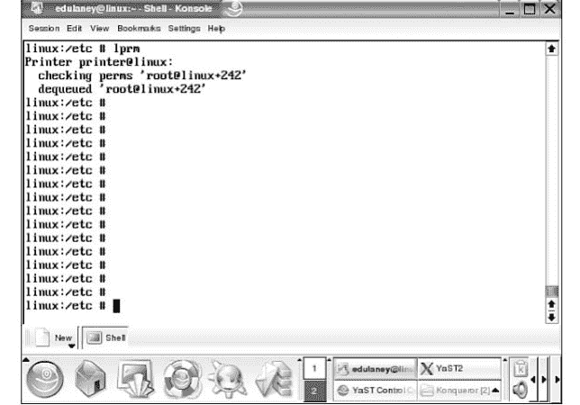

在这种情况下，用户提交的最近作业已被删除。`lprm` 工具可以使用用户名作为选项来删除该用户提交的作业。

`lpadmin` 工具允许你从命令行执行大部分在 YaST 中可以完成的配置。图 9.12 显示了它可用的所有选项。

该工具的补充是 `lpoptions`，它用于从命令行修改网络打印机。可以使用它的的一些选项包括：

- `-d` 设置默认打印机
- `-h` 指定 CUPS 服务器
- `-p` 设置目标和实例

## 打印 第 9 章

## 图 9.12

使用 `lpadmin`，你可以从命令行修改打印机设置。

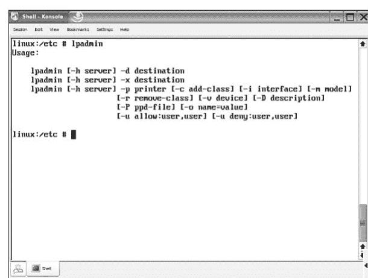

如果你在网络上共享打印机，还有其他几点可能有用，尽管它们不是实用程序：

- `/etc/hosts.lpd`——此文件包含允许访问打印机的主机名。
- `/etc/hosts.equiv`——此文件包含允许访问此机器（而不仅仅是打印机）的主机名。

从命令行启用和禁用打印可以使用 `/usr/bin/enable` 和 `/usr/bin/disable` 命令。每个命令必须后跟你要启用/禁用的打印机名称。如果你希望打印机在接受额外作业之前完成队列中的任务，可以使用 `/usr/sbin/reject`（其反操作是 `/usr/sbin/accept`）。

CUPS 服务有两种方式停止：使用命令 `/etc/init.d/cups stop` 或 `service cups stop`。这些操作的反操作是通过使用 `start` 完成的。

`lpadmin` 实用程序用于为 CUPS Web 管理工具添加密码。如果你在命令行输入该命令，将提示输入密码。你提供的密码必须要有 6 个字符长，且必须包含至少一个字母和一个数字。在命令行可以提供的选项有 `-g` 指定组，以及 `-a` 或 `-x` 指定用户名。对于 Web 管理工具，你需要运行：

```
passwd -g sys -a root
```

访问 Web 管理工具只需访问服务器上的端口 631。图 9.13 显示了当你访问此端口时出现的屏幕。这些工具允许你远程管理打印机和作业，以及添加/管理类、管理作业和添加/管理打印机等任务。

## 图 9.13

可以通过端口 631 访问 Web 管理工具。

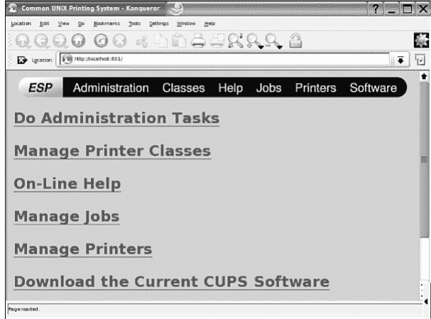

最后一点注意的是 `/var/log/cups/error` 文件是写入 CUPS 守护进程错误信息的地方。`access` 显示所有访问。在需要确定打印机不可用的故障排除情况下，两者都很有用。

## 摘要

本章重点关注考试所需的关于打印和通用打印管理的主。

## 命令摘要

表 9 列出了本章讨论的命令。

| 实用程序 | 用途 |
| --- | --- |
| lp | 向打印服务提交作业的原始工具 |
| lpadmin | 从命令行处理打印机配置 |
| lpc | 管理打印服务的主要工具 |
| lpoptions | 从命令行修改网络打印机的工具 |
| lpasswd | 为 Web 管理工具配置身份验证选项的工具 |
| lpq | 查看打印队列内容和状态的主要工具 |
| lpr | lp 的副本，允许你提交打印作业 |
| lprm | 删除打印作业的工具 |
| pr | 在将文件发送到打印机之前进行处理的工具 |

## 回顾管理任务

RPM 系统管理最早出现在本书的第 5 章“基础 Linux 管理”。说实话，系统管理主题贯穿本书。你学习的是管理员考试——而不是程序员或开发者。

本章查看了许多主题，包括包管理和安全。它涵盖了以下课程目标：

1. 执行 RPM 包相关操作 (3036)
2. 使用基础 Linux 命令 (3036)
3. 监控你的 SLE 9 系统 (3037)
4. 管理 RPM 软件包 (3037)
5. 验证并更新软件库 (3037)
6. 管理内核 (3037)
7. 创建安全概念 (3038)
8. 限制对服务器系统的物理访问 (3038)
9. 限制已安装的软件包 (3038)
10. 确保文件系统安全 (3038)
11. 使用 ACL 进行高级访问控制 (3038)
12. 安全问题 (3038)
13. 应用安全更新 (3038)
14. 为 SLES 9 系统添加新硬件 (3038)

## 安装软件

涵盖课程目标

6. 管理内核 (3037)

Linux 社区有几种主要的软件发行方法。一种是使用包管理系统，我们稍后查看。另一种是使用压缩的“tarball”文件。tarball 是包含一组文件 tar 镜像的单个文件。

你知正在处理的是 tarball 或压缩 tarball，是因为文件名结尾有 `.tar` 或 `.tar.gz`。例如，以下文件是 tarballs：

```
program-1-2-3.tar.gz
program-1-2-3.tar
```

但下面的示例不是：

```
program-1.2.3.rpm
```

要安装 tarball，你必须首先识别要安装的软件并从提供者获取。例如，从 ftp.ccil.org 获取 wumpus，我们使用示例所示的 ftp：

```
ftp> bin
200 Type set to I.
ftp> get wumpus-1.3.tar.gz
local: wumpus-1.3.tar.gz remote: wumpus-1.3.tar.gz
227 Entering Passive Mode (192,190,237,102,124,145)
150 Opening BINARY mode data connection for wumpus-1.3.tar.gz
--> (9293 bytes).
226 Transfer complete.
9293 bytes received in 0.20 secs (44 Kbytes/sec)
ft>
```

这在你的系统中产生了 `wumpus-1.3.tar.gz`，它必须被压缩并解压。你可以分一步或两步完成。传统使用的两步方法涉及解压缩文件然后解压文件。这是使用以下命令的：

```
# gzip -d FILE
# tar xvf FILE
```

## 301

回顾管理任务

第 10 章

这些命令中的第一个是解压缩文件，第二个是执行提取。由于这是一种非常常见的软件发布方式，Linux 自带的 GNU 版本的 `tar` 包含一个解压缩归包并提取文件的功能。使用以下命令完成：

```bash
# tar xvzf FILE
```

> `z` 选项用于通过 gzip 过滤归包。

`tar` 的 `v` 选项会在提取文件时列出归包中的所有文件。如果你不想看到文件列表，只需省略 `v` 即可。`x` 告诉 `tar` 提取文件，而 `f` 则标识要提取的文件：


```bash
# tar xf wumpus*
# ls -l
total 42
drwxr-xr-x 5 edulaney edulan 1024 Nov 26 16:01 Desktop
-rw-r--r-- 1 104 bin 359 Aug 20 1994 -Makefile
-rw-r--r-- 1 104 bin 307 Apr 25 1994 -READ.ME
-rw-r--r-- 1 104 bin 10084 Apr 25 -READ.ME
-rw-r--r-- 1994-superhack.c
-rwxrwxrxr-x 1 root root 9293 Nov 26 16:22 wumpus-1.3.tar.gz
-rw-r--r-- 1 104 bin 17883 Apr 25 1994 -wumpus.c
#
```

我们已经从 `tar` 压缩包提取了文件。事实上，`wumpus` 非常简单，实际上只涉及几个文件。我们使用 `make` 程序编译 `wumpus`。请注意，你必须安装开发工具，以便在你的系统上编译任何软件。`make` 命令依赖于一个规范文件来定义它需要的内容。该文件被称为 `Makefile`，如下所示：

```make
#
# 用于 `Hunt the Wumpus` 和 `Superhack` 游戏的 Makefile
#
```

```make
CC=gcc
CFLAGS=-g

# Novell Certified Linux Professional Study Guide

all: wumpus superhack

wumpus: wumpus.c
	$(CC) $(CFLAGS) wumpus.c -o wumpus

superhack: superhack.c
	$(CC) $(CFLAGS) superhack.c -o superhack

clean:
	rm -f wumpus wumpus.o superhack superhack.o TAGS

TAGS:
	etags wumpus wumpus.c

tar:
	tar -cvf wumpus.tar READ.ME Makefile wumpus.c
	superhack.c
```

这是一个非常简单的 `Makefile`，但适用于我们的讨论。通过 `Makefile`，可能需要更改某些参数或选项以便在你的环境中编译程序。`Makefile` 的结构包含类似 `CC=gcc` 的选项以及类似 `all` 这样的对象。对象 `all` 依赖于对象 `wumpus` 和 `superhack`。

我们可以看到对象 `wumpus.c`。这告诉 `make` 在制作对象 `all` 之前必须先制作对象 `wumpus`。编译 `wumpus.c` 生成对象 `wumpus`。`make` 对 `all` 依赖的其他对象执行相同的过程。第一个对象通常是默认对象。这意味着不带任何参数输入 `make` 将导致构建 `all`。输入 `make wumpus` 则将只构建构建 `wumpus` 的组件：

```bash

# make

cc -g wumpus.c -o wumpus

cc -g superhack.c -o superhack

# -l

total 109

-rw-r--r-- 104 bin 359 Aug 20 1994 -Makefile

-rw-r--r-- 104 bin 307 Apr 25 1994 -READ.ME

-rwxr-xr-x 1 root 35127 Nov 26 16:25 superhack

-rw-r--r-- 104 bin 10084 Apr 25 -superhack.c

```

## 回顾管理任务
第 10 章

```bash

-rw-xr-x  1 root root   31460 Nov 26 16:25 wumpus

-rw-rw-r--  1 root root    9293 Nov 26 16:22

=> wumpus-1.3.tar.gz

-r--r--r--  1 104      bin       17883 Apr 25 1994

=> wumpus.c

```

我们可以通过运行编译后的程序来测试 `wumpus`：

```bash

# ./wumpus

INSTRUCTIONS (Y-N)

?

HUNT THE WUMPUS

YOU ARE IN ROOM 11

TUNELS LEAD TO 10 12 19

SHOOT OR MOVE (S-M)

?
```

```bash

ftp> bin

200 Type set to I.

ftp> get perl-5.6.0.tar.gz

local: perl-5.6.0.tar.gz remote: perl-5.6.0.tar.gz

227 Entering Passive Mode (209,85,256,163)

227 Entering Passive Mode (209,85,256,163)

200 Type set to I.

ftp> get perl-5.6.0.tar.gz

local: perl-5.6.0.tar.gz remote: perl-5.6.0.tar.gz

227 Entering Passive Mode (209,85,256,163)

227 Entering Passive Mode (209,85,256,163)

200 Type set to I.

ftp> get perl-5.6.0.tar.gz

local: perl-5.6.0.tar.gz remote: perl-5.6.0.tar.gz

227 Entering Passive Mode (209,85,256,163)

227 Entering Passive Mode (209,85,256,163)

200 Type set to I.

ftp> get perl-5.6.0.tar.gz

locallocal: perl-5.6.0.tar.gz remote: perl-5.6.0...gz

227. Passive Mode (209,85,256,163)

227. Passive Mode (209,85,256,163)

200. Type set to I.

ftp> get perl-5.6.0.tar.gz

local: perl-5.6.0.tar.gz remote: perl-5.6.0.tar.gz

227 Entering Passive Mode (209,85,256,163)

227 Entering Passive Mode (209,85,256,163)

200 Type set to I.

ftp> get perl-5.6.0.tar.gz

local: perl-5.6.0.tar.gz remote: perl-5.6.0.tar.gz

227 Entering Passive Mode (209,85,256,163)

227 Entering Passive Mode (209,85,256,163)

200 Type set to I.

ftp> get perl-5.6.0.tar.gz

local: perl-5.6.0.tar.gz remote: perl-5.6.0.tar.gz

227 Entering Passive Mode (209,85,256,163)

227 Entering Passive Mode (209,85,256,163)

200 Type set to I.

ftp> get perl-5.6.0.tar.gz

local: perl-5.6.0.tar.gz remote: perl-5.6.0.tar.gz

227 Entering Passive Mode (209,85,256,163)

227 Entering Passive Mode (209,85,256,163)

200 Type set to I.

ftp> get perl-5.6.0.tar.gz

local: perl-5.6.0.tar.gz remote: perl-5.6.0.tar.gz

227 Entering Passive Mode (209,85,256,163)

227 Entering Passive Mode (209,85,256,163)

200 Type set to I.

ftp> get perl-5.6.0.tar.gz

local: perl-5.6.0.tar.gz remote: perl-5.6.0.tar.gz

227 Entering Passive Mode (209,85,256,163)

227 Entering Passive Mode (209,85,256,163)

200 Type set to I.

ftp> get perl-5.6.0.tar.gz

local: perl-5.6.0.tar.gz remote: perl-5.6.0.tar.gz


```
227 Entering Passive Mode (209,85,256,163)
227 Entering Passive Mode (209,85,256,163)
200 Type set to I.
ftp> get perl-5.6.0.tar.gz
local: perl-5.6.0.tar.gz remote: perl-5.6.0.tar.gz
227 Entering Passive Mode (209,85,256,163)
227 Entering Passive Mode (209,85,256,163)
200 Type set to I.
ftp> get perl-5.6.0.tar.gz
local: perl-5.6.0.tar.gz remote: perl-5.6.0.tar.gz
227 Entering Passive Mode (209,85,256,163)
227 Entering Passive Mode (209,85,256,163)
200 Type set to I.
ftp> get perl-5.6.0.tar.gz
local: perl-5.6.0.tar.gz remote: perl-5.6.0.tar.gz
227 Entering Passive Mode (209,85,256,163)
227 Entering Passive Mode (209,85,256,163)
200 Type set to I.
ftp> get perl-5.6.0.tar.gz
local: perl-5.6.0.tar.gz remote: perl-5.6.0.tar.gz
227 Entering Passive Mode (209,85,256,163)
227 Entering Passive Mode (209,85,256,163)
200 Type set to I.
ftp> get perl-5.6.0.tar.gz
local: perl-5.6.0.tar.gz remote: perl-5.6.0.tar.gz
227 Entering Passive Mode (209,85,256,163)
227 Entering Passive Mode (209,85,256,163)
200 Type set to I.
ftp> get perl-5.6.0.tar.gz
local: perl-5.6.0.tar.gz remote: perl-5.6.0.tar.gz
227 Entering Passive Mode (209,85,256,163)
227 Entering Passive Mode (209,85,256,163)
200 Type set to I.
ftp> get perl-5.6.0.tar.gz
local: perl-5.6.0.tar.gz remote: perl-5.6.0.tar.gz
227 Entering Passive Mode (209,85,256,163)
227 Entering Passive Mode (209,85,256,163)
200 Type set to I.
ftp> get perl-5.6.0.tar.gz
local: perl-5.6.0.tar.gz remote: perl-5.6.0.tar.gz
227 Entering Passive Mode (209,85,256,163)
227 Entering Passive Mode (209,85,256,163)
200 Type set to I.
ftp> get perl-5.6.0.tar.gz
local: perl-5.6.0.tar.gz remote: perl-5.6.0.tar.gz
227 Entering Passive Mode (209,85,256,163)
227 Entering Passive Mode (209,85,256,163)
200 Type set to I.
ftp> get perl-5.6.0.tar.gz
local: perl-5.6.0.tar.gz remote: perl-5.6.0.tar.gz
227 Entering Passive Mode (209,85,256,163)
227 Entering Passive Mode (209,85,256,163)
200 Type set to I.
ftp> get perl-5.6.0.tar.gz
local: perl-5.6.0.tar.gz remote: perl-5.6.0.tar.gz
227 Entering Passive Mode (209,85,256,163)
227 Entering Passive Mode (209,85,256,163)
200 Type set to I.
ftp> get perl-5.6.0.tar.gz
local: perl-5.6.0.tar.gz remote: perl-5.6.0.tar.gz
227 Entering Passive Mode (209,85,256,163)
227. Passive Mode (209,85,256,163)
200 Type set to I.
ftp> get
-5.6.0.tar.gz
.:.-5.6.0...gz remote:.-5.6.0....
227.. Mode (209,85,256,163)
227.. Mode (209,85,256,163)
200. Type set to I.
ftp> get perl-5.6.0.tar.gz
local: perl-5.6.0.tar.gz remote: perl-5.6.0.tar.gz
227 Entering Passive Mode (209,85,256,163)
227 Entering Passive Mode (209,85,256,163)
200 Type set to I.
ftp> get perl-5.6.0.tar.gz
local: perl-5.6.0.tar.gz remote: perl-5.6.0.tar.gz
227 Entering Passive Mode (209,85,256,163)
227 Entering Passive Mode (209,85,256,163)
200 Type set to I.
ftp> get perl-5.6.0.tar.gz
local: perl-5.6.0.tar.gz remote: perl-5.6.0.tar.gz
227 Entering Passive Mode (209,85,256,163)
227 Entering Passive Mode (209,85,256,163)
200 Type set to I.
ftp> get perl-5.6.0.tar.gz
local: perl-5.6.0.tar.gz remote: perl-5.6.0.tar.gz
227 Entering Passive Mode (209,85,256,163)
227 Entering Passive Mode (209,85,256,163)
200 Type set to I.
ftp> get perl-5.6.0.tar.gz
local: perl-5.6.0.tar.gz remote: perl-5.6.0.tar.gz
227 Entering Passive Mode (209,85,256,163)
227 Entering Passive Mode (209,85,256,163)
200 Type set to I.
```

`RPM` 通常用于 Linux，但也被编译并使用在其他 Unix 平台上。`RPM` 允许用户获取源代码并以源码和二进制形式对其进行打包，以便程序可以被方便地跟踪和重新构建。

`RPM` 还创建并维护了一个软件包和文件的数据库，以便对软件包进行验证、查询有关软件包和文件的信息，并在需要时删除这些软件包。

`RPM` 的查询 `query` 选项允许在数据库中搜索特定的软件包或文件，包括如何识别某个文件来自哪个软件包。`RPM` 文件本身是压缩镜像。这些压缩镜像包含一个自定义的二进制头文件，允许快速检索有关软件包及其内容的信息。

验证 `verification` 选项允许用户确定软件包的某些部分是否缺失。如果是，用户可以重新安装该软件包，同时保留任何修改过的配置文件。`RPM` 是一个非常强大的工具，我们将复回顾它的部分功能。具体来说，我们将查看以下这些方面：


# Novell 认证 Linux 专业人士学习指南

## 使用 RPM 安装和删除软件

- 使用 RPM 安装和删除软件
- 验证 RPM
- 查询 RPM
- 构建 RPM

使用 RPM 安装软件最简单的方法是使用命令：

```
rpm -i rpm-name.rpm
```

例如，要安装 `foobar-2.3-8.1386.rpm` 软件包，命令是：

```bash
# rpm -i foobar-2.3-8.1386.rpm
```

此指示 `rpm` 读取 RPM 文件，提取文件，并将它们放置在 RPM 文件中指定的正确位置。删除软件包可以使用以下命令完成：

```bash
rpm -e foobar
```

这两种场景都要求 RPM 文件位于你的本地硬盘上。由于我们通常在软件安装完成后后不再保留 RPM 文件，因此如果你知道 RPM 文件的源路径或 URL，也可以从 FTP 直接安装：

```bash
rpm -i ftp://ftp.some.site/pub/name.rpm
```

在上一个示例中，`rpm` 将使用你的网络连接，获取 RPM 文件并安装该软件包。

这些是演示 `rpm` 能力的简单示例。使用 `rpm --help` 命令可以查看你特定版本的 `rpm` 具有哪些功能。

## 验证 RPM

`rpm` 还用于验证软件包是否已安装以及哪些文件缺失。这允许管理员在文件或目录可能被意外删除后对系统进行查询。以下命令验证系统上安装的所有软件包：

```bash
# rpm -Va
```

验证过程会将软件包中安装文件的信息与从原始软件包提取并存储在 `rpm` 数据库中的文件信息进行比较。其中还包括验证每个文件的大小、MD5 和、权限、类型、所有者和组。任何差异都会显示出来。

## 查询软件包

RPM 文件和数据库的结构允许对软件包进行查询以确定有关软件包的信息，或者查看特定文件属于哪个软件包。例如，要查看特定文件属于哪个软件包，你必须使用 `rpm` 的 `-qf` 选项并指定文件名。

```bash
$ rpm -qf /sbin/insmod
mod-init-tools-3.0_pre10-37.16
$
```

在这种情况下，`/sbin/insmod` 程序是 `mod-init-tools` 软件包的一部分。

你还可以使用 `rpm` 的查询选项来打印有关模块的信息。例如，要查看你在互联网上找到的 zip 软件包的信息，可以使用这些选项：

### 回顾管理任务

第 10 章

```
$ rpm -qpi zip-2.3-8.i386.rpm
Name                : zip Relocations: /usr
Version : 2.3 Vendor: Red Hat, Inc.
Release : 8 Build Date: Thu 24 Aug 2000
-> 11:16:53 AM EDT
Install date: (not installed) Build Host:
-> porky.dev.redhat.com
Group : Applications/Archiving Source RPM:
-> zip-2.3-8.src.rpm
Size : 271467 License:
-> distributable
Packager : Red Hat, Inc. <http://bugzilla.redhat.com/bugzilla>
Summary : A file compression and packaging utility
-> compatible with PKZIP.
Description :
The zip program is a compression and file packaging utility.
->Zip is
analogous to a combination of the UNIX tar and compress
-> commands and
is compatible with PKZIP (a compression and file packaging)
- utility for
MS-DOS systems).
```

如果你需要使用 `zip` 程序压缩文件，请安装 `zip` 软件包。

-> 使用 `zip` `zip` 程序。

你也可以通过将 `"l"` 选项改为字母 `"l"` 来列出软件包中的文件：

```bash
$ rpm -qpl zip-2.3-8.i386.rpm
/usr/bin/zip
/usr/bin/zipcloak
/usr/bin/zipnote
/usr/bin/zsplit
/usr/share/doc/zip
/usr/share/doc/zip/BUGS
/usr/share/doc/zip/CHANGES
/usr/share/doc/zip/MANUAL
/usr/share/doc/zip/README
/usr/share/doc/zip/TODO
/usr/share/doc/zip/WHATS
/usr/share/doc/zip/WHERE
/usr/share/doc/zip/txt
/usr/share/doc/zip/man1/zip.gz
$
```

## 构建 RPM

RPM 文件和数据库的结构允许对软件包进行查询以确定有关软件包的信息，或者查看特定文件属于哪个软件包。例如，要查看特定文件属于哪个软件包，你必须使用 `rpm` 的 `-qf` 选项并指定文件名。

构建源码包要构建 RPM，需要执行以下步骤：

1. 获取源码包。
2. 源码包的编译和打包。
3. 源码 `spec` 文件。
4. 源码 `spec`。
5. 构建 RPM。

RPM 是一个非常强大的工具，我们将复回顾它的部分功能。具体来说，我们将查看以下这些方面：

- 使用 RPM 安装和删除软件
- 验证 RPM
- 查询 RPM
- 构建 RPM

313

### 重新回顾管理任务

第 10 章

在源目录中。由于命令也会传递给 shell，因此可以在此处执行任何合法的 shell 命令。

当 `%build` 完成，下一步是安装。`%install` 部分中没有真正的宏，但包含了用于安装软件的命令以供 shell 执行。如果你正在使用 `Makefile`，可以修补 `Makefile` 以包含 `make install` 命令，或者在此部分中手动安装文件。

`spec` 文件中的 `%clean` 宏用于确保你有一个干净的源树可供构建。请注意——如果未能检查该目录，可能会导致你的 Linux 操作系统被删除，因为你可能恰好正处于该目录中。

RPM 质器无法在源文件编译完成后知道哪些文件需要安装。`%Files` 部分列出了要安装的二进制文件以及它们安装的位置。

最后，`%changelog` 部分列出了软件包每个版本和发布的所有更改。每个更改都以星号 (`*`) 开头，并包含日期、你的姓名和电子邮件地址。其余文本是自由格式的，但为了可读性，应该遵循某种连贯的方式。

定义好 `spec` 文件后，我们现在可以构建软件包。

## 构建软件包

我们需要一个定义良好的构建树，该树可以在 `/etc/rpmrc` 或 `/usr/lib/rpm/rpmc` 文件中进行修改。这是一组大型且全面的信息，用于构建软件包。大多数人使用 `/user/src` 目录安装源码以构建软件包。在创建构建软件包的源树时，你可能需要创建一些目录，包括

- `BUILD`—`rpm` 将在此构建软件包
- `SOURCE`—源文件所在的位置
- `SPECS`—`spec` 文件应该存放的位置
- `RPMS`—`rpm` 构建完成后后存放二进制 RPM 文件的位置
- `SRPMS`—`rpm` 存放源 RPMS 的位置

完成后，编译源码并检查已安装的文件、它们去向何以及你必须编译了哪些内容（例如补丁）。编译完成后，你就可以准备构建 RPM 了。

使用 `spec` 文件，你可以尝试使用命令构建软件包：

`$ rpm -ba filename.spec`

这将为你的软件包创建源 RPM 和二进制 RPM。最简单且最好的方法将其安装在不同的系统上。因为你刚刚安装在自己的系统上，所以很难知道测试是否真正成功。即使你删除了软件包，你可能也漏掉了文件列表中的某个文件，导致软件包无法完全删除。当软件包重新安装时，你的系统是完整的，但软件包却不是。在执行以下操作时，考虑这一点非常重要

```
$ rpm -ba package-name
```

大多数人会执行

`$ rpm -I package name`

因此，在软件包构建和安装部分不漏掉任何内容是关重要的。假设你想分发你的 RPMs，你可以将新的 RPM 上传到许多不同的网站。

# 理解 Linux 内核

## 涵盖课程目标

- 6. 管理内核 (`3037`)

内核是操作系统的一个软件组件，充当系统监视器。内核为用户执行的应用程序和命令提供所有系统服务。这包括 CPU 时间分配、内存管理、磁盘访问和硬件接口。用户通常感知不到内核功能，因为这些功能被用户交互的应用程序（如 `shell`）隐藏在他们的视野之外。系统管理员在执行任务时会熟悉内核。


当系统管理员执行如 `ps` 类的命令时，内核访问系统表以提供有关正在运行进程的信息。然而，更常见的是，系统管理员与内核交互以处理新硬件的安装。

# 内核模块

与其他 Unix 实现不同，Linux 内核利用加载模块来添加新功能或对特定硬件的支持。这为管理员提供了根据需要重新配置系统的灵活性。典型的 Unix 实现要求在每次需要更改内核时构建新内核。某些更改确实需要构建新内核，而某些不需要。

加载模块是不直接链接或包含在内核中的组件。模块开发者单独编译它们，管理员可以将它们插入或从运行的内核中移除。可用模块的范围大幅增加，现在包括文件系统、以太网驱动程序、磁带驱动程序、PCMCIA、并行IDE 以及许多打印机驱动程序。使用加载模块参考表 10.3。

# 加载模块命令

| 命令 | 说明 |
| --- | --- |
| `lsmod` | 列出已加载的模块 |
| `insmod` | 安装模块 |
| `rmmod` | 模块 |
| `modinfo` | 输出模块信息 |
| `modprobe` | 探测并安装模块及其依赖 |
| `depmod` | 确定模块依赖 |

这些命令影响当前运行内核中的模块，并将 `/proc` 文件系统的可用信息。`lsmod` 用于列出当前加载的模块。该命令的输出为

```
[root@server7 edulaney]# lsmod
Module Size Used by
udf 93700 0
parport_pc 41024 0
parport 44232 1 parport_pc
iiptable_filter 7040 0
ip_tables 22400 1 iptable_filter
ls_iso0059_1 8320 0
snd_pcm_oss 65576 0
snd_pcm 112772 1 snd_pcm
snd_page_alloc 16136 1 snd_pcm
```

snd_timer 32132 1 snd_pcm

snd_mixer_oss 24448 1 snd_pcm

snd 70884 4 snd_pcm_oss,snd_timer,snd_mixer_oss

soundcard 15356 1

edd 13720 0

joydev 14528 0

sg 41632 0

st 44228 0

sr_mod 21028 0

nvaram 13448 0

usbserial 35952 0

ehci_hcd 33412 0

uhci_hcd 35728 0

intel_mch_agp 36140 2 intel_mch_agp

ipv6 276348 17

hw_random 9620 0

endev 13952 0

thermal 16648 0

processor 21312 1 thermal

fan 8196 0

button 10384 0

battery 12804 0

ac 8964 0

af_packet 26376 2

e100 38400 0

mii 9344 1

usbcore 11600 5 userial,ehci_hcd,uhci_hcd

subfs 12160 1

nls_cp437 9984 1

fat 19456 1

fat 49824 1

nls_utf8 6272 2

ntfs 94352 1

dm_mod 57472 0

ide_cd 42628 0

cdrom 42652 2 sr_mod,ide_cd

reiserfs 263504 1

ata_piix 11908 0

libata 43648 1 ata_piix

sd_mod 25088 0

scsi_mod 118340 5 sg,st,sr_mod,libata,sd_mod

# 重新回顾管理任务

这是通过另一个命令显示的相同信息，如下：

```
[root@server7 edaney]# cat /proc/modules
udf 93700 0 - Live 0xe0d7a00
port_pc 41024 0 - Live 0xe0ca3000
port 44232 1 parport_pc, Live 0xe0b4a00
iptable_filter 7040 0 - Live iptable_filter, Live 0xe0bda000
nls_iso8859 1 8320 0 - Live 0xe0bcf00
snd_scm 65556 0 - Live 0xe0d4d00
snd_pcm 112772 1 snd_pcm, Live 0xe0d3000
snd_page_alloc 16136 1 snd_pcm, Live 0xe0cf700
snd_timer 32132 1 snd_pcm, Live 0xe0cbe000
snd_mixer 24448 1 snd_pcm_oss, Live 0xe0c4000
snd 70884 4 snd_pcm_oss,snd_timer,snd_mixer_oss, Live 0xe0cfb000
soundcard 15356 1, Live 0xe0cdf000
edd 13720 0 - Live 0xe0cb9000
joydev 14528 0 - Live 0xe0bd5000
sig 46132 0 - Live 0xe0cd3000
st 48228 0 - Live 0xe0cc7000
nsr_mod 21028 0 - Live 0xe0bce000
nvaram 13448 0 - Live 0xe0bc9000
usbserial 35952 0 - Live 0xe0caf000
echi_hcd 33412 0 - Live 0xe0bba000
uhci_hcd 35728 0 - Live 0xe0bb0000
intel_mch_agp 36140 2 intel_mch_agp, Live 0xe0b9a000
ipv6 276348 17 - Live 0xe0bdd0000
hw_random 9620 0 - Live 0xe0b8a00
endev 13952 0 - Live 0xe09c000
thermal 16648 0 - Live 0xe0b7f00
processor 21312 1 thermal, Live 0xe0b7800
fan 8196 0
button 10384 0
battery 12804 0
ac 8964 0
af_packet 26376 2
e100 38400 0
mii 9344 1
usbcore 11600 5 userial,ehci_hcd,uhci_hcd, Live 0xe0b4a00
subfs 12160 1
nls_cp437 9984 1
fat 19456 1
fat 49824 1
nls_utf8 6272 2
ntfs 94352 1
dm_mod 57472 0
ide_cd 42628 0
cdrom 42652 2 sr_mod,ide_cd
reiserfs 263504 1
ata_piix 11908 0
libata 43648 1 ata_piix
sd_mod 25088 0
```

# Novell 认证 Linux 专业学习指南

```
vfat 19456 1 - Live 0xe0b1a00
fat 49824 1 vfat, Live 0xe0970000
nls_utf8 6272 2 - Live 0xe0901000
ntfs 94352 1 - Live 0xeae00000
dm_mod 57472 0 - Live 0xe0ad0000
ide_cd 42628 0 - Live 0xe0941000
cdrom 26252 1 - sr_mod,ide_cd, Live 0xe0935000
reisverfs 263504 1 - Live 0xe097e000
ata_piix 11908 0 - Live 0xe08f6000
libata 33648 1 ata_piix, [permanent], Live 0xe0929000
sd_mod 25088 0 - Live 0xe0e8e000
scsi_mod 118340 5 sg,sr_mod,libata,sd_mod,
Live 0xe090b000
[root@server1ney]#
```

`lsmod` 的输出包含一些标识不同数据列的头部文本。第一列指定已加载的模块，第二列是模块以字节为单位的大小，第三列指示对模块的引用次数，第四列指定调用此模块的模块。例如，加载了 `nfs` 模块。作为 `nfs` 组件的 `lock` 模块被 `nfs` 模块引用。使用 `rmmod` 移除模块需要指定要移除的模块。

`modinfo` 命令用于从模块文件中查询信息并报告给用户。`modinfo` 可用于：

- 模块作者
- 模块描述
- 模块接受的类型参数

请记住，许多模块并不报告任何信息。如果模块作者在开发模块时没有提供信息，那么 `modinfo` 就没有内容可以报告。你可以使用 `-a` 选项获取尽可能多的信息，但某些模块仍会报告 `<none>`。


`depmod` 和 `modprobe` 命令也可用于加载模块。虽然之前回顾的方法繁琐且令人沮丧，但理解模块之间的关系是值得的。`depmod` 用于确定模块之间的依赖关系。

# 319

## 第 10 章

`/etc/modules.conf` 是一个文本文件，用于存储影响 `depmod` 和 `modprobe` 操作的信息。默认情况下，在 SLES 9 中这是一个大小为零的文件，但行格式如下：

```
[root@server7 block]# cat /etc/conf.modules
alias scsi_hostadapter ncr53c8xx
alias eth0 tulip
alias raport_lowlevel raport_pc
pre-install plip modprobe raport_pc ;
echo 7 > /proc/parport/0/irq
pre-install pcmia_core /etc/rc.d/init.d/pcmia start
post-install supermont modprobe scsi_hostadapter
alias sound es171
[root@server7 block]#
```

> 注意

`conf/modules.conf` 文件、`/etc/modules.conf` 和 `modules.conf` 文件是同一个。使用哪一个取决于 Linux 供应商。

在修改或读取 `/etc/modules.conf` 文件时，请记住：

- 所有空行和 `#` 之后的行文本都会被忽略。
- 行可以通过以反斜杠 (`\`) 结尾来续行。
- 指定模块的行必须符合以下格式：

```
keep
parameter=value
options module=value ...
alias module real_name
pre-install module ...
install module ...
post-install module ...
pre-remove module ...
remove module ...
post-remove module ...
```

在前面的列表中，所有“parameter”行中的所有值将由 shell 处理，这意味着“shell 技巧”如通配符和包含引号的命令可以在模块处理期间使用。例如：

`path[misc]=/lib/modules/1.5?`

`path[net]=/lib/modules/uname`

这些具有查找系统路径的效果。表 10.4 列出了允许的参数。

### 表 10.4 允许的配置参数

| 参数 | 说明 |
| --- | --- |
| keep | 如果在任何包含 path 的行之前找到此词，则默认路径集将被保存并添加到其中。否则，正常行为是用配置文件定义的路径替换默认路径集。 |
| depfile=DEPFILE_PATH | 这是由 `depmod` 创建并由 `modprobe` 使用依赖文件路径。 |
| path=SOME_PATH | path 参数指定搜索模块的目录。 |
| path[tag]=SOME_PATH | path 参数可以带有可选标签。这告诉我们关于该目录下模块的更多信息，并允许 `modprobe` 进行自动化操作。标签位于括号中。如果缺失标签，假设为 misc。一个非常有用的标签是 boot，用于标记启动时加载的所有模块。 |
| Options | 为特定模块定义选项。 |
| Alias | 为模块提供别名。 |
| pre-install module ... | 在加载模块之前执行命令。 |
| install module ... | 安装模块。 |
| post-install module ... | 在模块加载后执行命令。 |
| pre-remove module ... | 在移除模块之前执行命令。 |

### 表 10.4（续）

| 参数 | 说明 |
| --- | --- |
| remove module command | 移除指定的模块。 |
| post-remove module command | 在模块移除后执行命令。 |

如果配置文件 `/etc/modules` 缺失或任何参数被覆盖，则假设以下默认值：

- `depfile=/lib/modules/uname -r`
- `path[boot]=lib/modules/uname -r`
- `path[misc]=lib/modules/uname -r`
- `path[net]=lib/modules/uname -r`
- `path[scsi]=lib/modules/uname -r`
- `path[cdrom]=lib/modules/uname -r`
- `path[ipv4]=lib/modules/uname -r`
- `path[ipv6]=lib/modules/uname -r`
- `path[sound]=lib/modules/uname -r`
- `path[fs]=lib/modules/default`
- `path[misc]=lib/modules/default`
- `path[net]=lib/modules/default`
- `path[scsi]=lib/modules/default`
- `path[cdrom]=lib/modules/default`
- `path[ipv4]=lib/modules/default`
- `path[ipv6]=lib/modules/default`
- `path[sound]=lib/modules/default`

这解释了为什么没有必要在 `/etc/modules` 文件中包含这些条目。

# Novell 认证 Linux 专业学习指南

所有的 "option" 都指定模块所需的默认选项。例如，如果我们必须告诉 `modprobe` 使用某个选项，我们必须在 `/etc/modules` 文件中定义它。例如，加载模块时，我们必须执行：

```
modprobe module=1
```

并且必须在 `/etc/modules` 文件中添加条目：`options module=1`

然而，尽管我们在文件中指定了它们，但管理员亲自运行时，命令行上指定的选项将覆盖 `/etc/modules` 文件中指定的选项。

别名用于为模块分配备名称。回顾 `/etc/modules` 文件，我们看到：`alias scsi_hostadapter ncr53c8xx alias eth0 tulip`

这为模块 `ncr53c8xx` 建立了别名 `scsi_hostadapter`，为 `tulip` 模块建立了 `eth0`。这意味着我们不需要记住实际模块名称，而是通过别名来访问模块。

当你执行 `modprobe` 时，它首先检查当前内核发行版本的 `modules` 目录。如果在该处没有找到模块，`modprobe` 将包含默认版本的模块目录中查找。例如，我们可以通过 `uname -r` 命令确定内核的当前发行版本。

当有新的 Linux 内核时，你应该将模块移动到与要安装的内核发行版（以及版本）相关的目录。然后你应该从该目录创建一个指向“default”目录的符号链接。每当你编译新内核，`modules_install` 命令都会创建一个新目录，但不会更改默认值。这将在章节后的内核构建部分进行讨论。

# 内核构建

涵盖课程目标

- 6. 管理内核 (`3037`)

内核的构建并不是每天需要的。通常用于支持必须包含在内核中的设备或服务。较新的内核将会有其他改进，可能包括更好的进程管理以及改进的速度稳定性。内核的重新配置并不意味着一个全新的版本。你可能在新内核中包含了一系列更新和补丁。

然而，创建内核并非易事。它要求你对系统硬件和配置有深厚的知识。你必须拥有 C 编译器以及内核源码推荐的库。通常，如果你从发行版光光安装了内核源码，你已经拥有了所需的元素。

## 获取内核源码

如果你只是想为内核添加新服务，建议从 Linux 供应商获取最新的内核源码。或者，你也可以从 `ftp.funet.fi` 或任何提供镜像的地方下载最新的内核源码。内核软件通常命名为 `linux-x.y.z.tar.gz`，其中 `x.y.z` 是版本号。数字最大的最新版本，被认为是测试版本。如果你期望系统稳定，请不要使用该版本。

获取源码后，你必须安装并解压它。如果你从发行版光盘安装了内核源码，这已经完成了。以 root 登录并进入 `/usr/src`。如果存在 `linux` 目录，你可能已经安装了内核源码。

## 324

Novell 认证 Linux 专家学习指南

> 注意

以下代码的显示假设你正处于 `/usr/src/linux` 目录。


```
[root@server7 linux]# make config
rm -f include/asm
( cd include ; ln -sf asm-i386 asm)
/bin/sh scripts/Configure arch/i386/config.in
#
# 使用 .config 中找到的默认值
#
* 代码成熟度选项
*
* 询问开发和不完整代码 (CONFIG_EXPERIMENTAL) [Y/n]?
* 处理器类型和特性
* 处理器族 (386, i486, i586, i686, Pentium, PPro, TSC, PMX)
* 最大物理内存 (1GB, 2GB)
* 数学仿真 (CONFIG_MATHULATION) [N/y]?
```

如果你安装了 Windows 或 curses，还有其他可用选项。`makeconfig` 命令会加载一个面向菜单的界面，你可以在其中选择你想要配置的内核区域。当你选择给定的区域时，会打开第二个窗口，为每个可配置项提供选项。

对于每个可配置项，都有 y、m 和 n 选项。Y 表示在内核中包含支持，N 表示不包含支持，M 表示驱动程序应被编译并作为可加载模块包含。在本章之前的部分已经讨论过可加载模块，但这些选项提供了一种获得灵活性的方法，而无需处理极其巨大的内核。

## 重温管理任务

### 第 10 章

如果你没有安装 Window，你也可以选择使用 curses，这是一个允许你以菜单形式图形化操作屏幕和项的程序。使用 Window 还是 curses 界面都有优势——如果你犯了错误，很容易通过 Window 界面返回并纠正它；管理员可以选择其想要配置的项。第二个菜单会打开，以便管理员进行配置选择。你也可以使用 `makeoldconfig` 命令启动配置过程，该命令指示 make 使用之前定义的配置。之前定义的配置存储在 `/usr/src/linux/.config` 中。如果这两个文件都不存在，你必须使用描述的方法之一生成一个。依赖文件是在内核构建过程中创建。

## 编译内核

通过 `make config`、`make oldconfig`、`make menuconfig` 或 `makeconfig` 完成配置后，你现在可以开始实际构建内核和相关模块。在此过程中，将确定内核代码和相关模块的依赖关系。这些信息被保存用于实际构建过程，该过程不会持续很长时间。当编译完成后，你已经构建了内核，结果是一个位于 `/usr/src/linux` 并名为 `vmlinux` 的内核镜像。然而，你应该创建一个压缩的内核镜像，它在系统启动时不会被使用并会自动解压缩。你使用 `makeimage` 命令创建此镜像。如果你在 `make` 之后立即进行此操作，编译过程将进展非常快。你可能需要重新构建内核的模块，因为你添加的新功能可能与模块有关。你必须先用新内核（在本章稍后部分介绍）启动，并确保其运行正常。当你运行在新系统上时，该过程基本上是重复的，只是 `make modules` 命令遵循源树并构建在内核构建期间未指定的模块。此过程处理 `/src/modules` 目录中新创建的模块。你可以直接从该位置使用它们，或者你可以执行 `make_install`，它会将它们复制到 `/lib/modules/kernel-version`。

## 使用邮件

### 涵盖的课程目标

#### 2. 使用基础 mail 命令 (3036)

对于管理员来说，邮件很重要，因为如果进程在执行过程中出现问题，它们会向你发送邮件。当你登录时，会显示一条消息指示你有任何未读的新消息，你可以通过输入命令 `mail` 来访问这些消息。如果你在没有邮件等待时输入此命令，将出现一条显示没有任何内容的文本消息，如图 10.1 所示。如果有邮件在等待（缓存在 `/var/mail` 中），它将会被显示出来，并且提示符将变为一个问号（?），如图 10.2 所示。

> 注意，在图 10.2 中，可以使用 `-u` 选项检查另一个用户的邮件。

## 重温管理任务

图 10.1

`mail` 命令将指示没有队列中的消息。

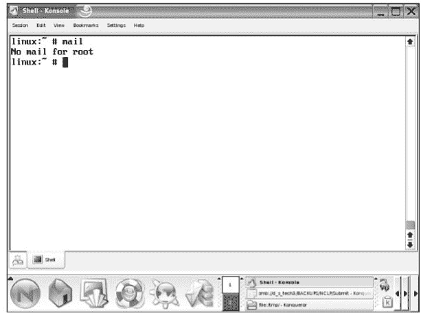

图 10.2

`mail` 工具显示了缓存的消息。

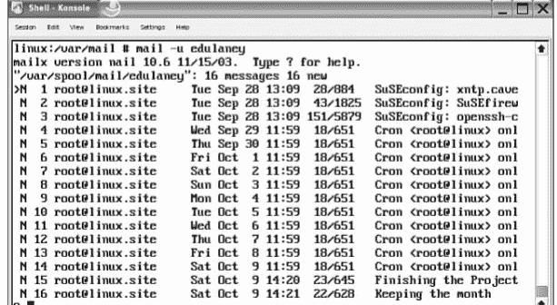

在 `?` 提示符下，你可以输入以下命令：

- D 删除消息
- E 编辑消息
- F 查看消息头信息
- N 跳到下一条消息
- R 回复消息
- T 输入消息
- U 取消删除
- X 或 Q 退出

从命令行向某人发送邮件，请使用以下命令（其中 `name` 是你想要发送消息的用户）：

```
$ mail name
```

会出现一个请求主题的提示符。当你输入主题（并按回车）后，你可以输入任何想要长度的消息内容。当你完成消息后，在空行处按 Ctrl+D，会出现 "EOT" 表示传输结束，你并将返回到常用的提示符。

## 监控系统

### 涵盖的课程目标

#### 3. 监控你的系统 (303)

快速检查系统状态并确保其正常运行是重要的。你有许多方法可以做到这一点。消息被写入 `/var/log`。

## 管理任务

### 第 10

依赖文件存储在 `/usr/src/linux/`。

```
$ make make
```

此输出与图 10.3 显示的依赖映射类似。


`Hwinfo` 工具可用于查看安装设备的信息列表。如果你使用 `-log` 选项，可以指定一个用于写入信息的文件。`hdparm` 工具可用于查看和更改硬盘参数。它有大量的选项可用，只需输入 `hdparm` 而不带任何其他参数，它就会向你显示这些选项。`lspci` 工具可以显示有关 PCI 总线的信息，并在第 13 章“需要了解的其他项目”中进行了讨论。

KDE System Guard 可以提供系统负载进程的快速快照，如图 10.5 所示。这通过从主菜单中选择 Monitor（监控），然后选择 KDE System Guard 来的。

### 图 10.5

KDE System Guard 提供了系统的快速概述。

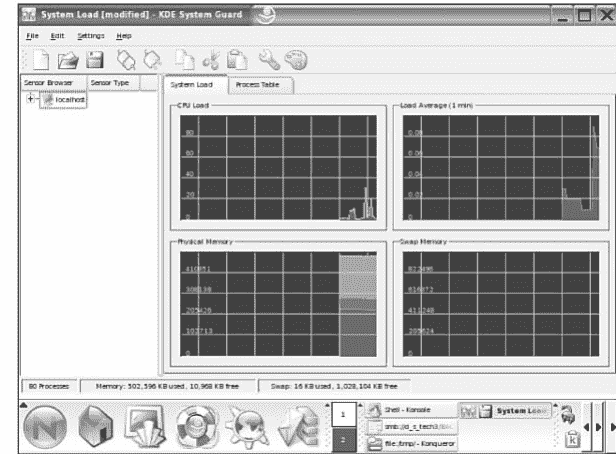

KDE 信息中心（系统、监视、KDE 信息中心）提供了所有硬件设备和配置参数的另一种视图，如图 10.6 所示。

图 10.7 显示的 SuSEPlugger 访问这些信息的另一种方法。该工具通过命令行命令 `suplugger` 启动，并且正如面板上的小图标所示，它通常已经处于运行状态。

### 复习管理任务

#### 第 10 章

### 图 10.6

KDE 信息中心允许快速访问设备参数。

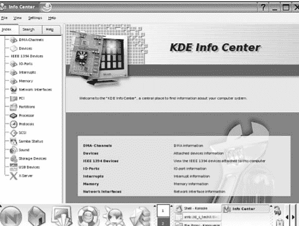

### 图 10.7

SuSEPlugger 提供了硬件信息的另一个途径。

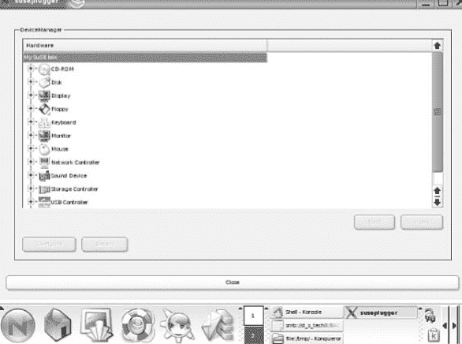

## 执行管理任务

### 课程目标

- 7. 创建安全方案
- 8. 限制对系统的物理访问
- 9. 限制已安装的包
- 10. 确保文件安全
- 11. 使用 ACL 进行访问控制
- 12. 了解安全问题
- 13. 应用安全更新

在对系统、网络或互联网应用安全措施时，常识始终是指导因素。如果你不应用任何安全措施，就会面临不该访问你数据的人访问数据的风险。他们在访问后会做的事情是：他们可以使用它来窃取秘密，可以恶意删除，或者以数千种方式对其进行修改。

另一方面，如果你对系统应用过多的安全措施，可能会使其变得非常难以使用。例如，为了防止任何人看到系统上的文件，直接将其拔掉电源即可。虽然没有人会否认你必须找到并应用某种程度的舒适度。如果你听到你公司的另一个部门遇到了问题，你将想要增加安全措施，依此类推。在所有情况下，有一些应该遵循的常识规则：

- 保护物理环境。如果机器正在提供服务且没有被用户使用，没有理由让这些机器放在办公室里。将机器移到安全的机柜中，减少有人坐在它们面前并访问数据的风险。
- 注意环境因素。数据不仅会被用户损坏，还可能由于系统故障损坏。为了减少系统故障并防止数据损坏，请注意不间断电源（UPS）等项目，不要将电线跨越可能引起电磁干扰（EMI）的物体上方，如荧光灯或电动机。注意湿度条件等。
- 在安装任何软件之前，验证其纯洁性。这可以防止你向机器添加恶意进程。有许多方法可以做到这一点：验证校验和以确保下载过程中没有发生损坏（并且仅从受信任的站点下载），列出包的内容并与预期内容进行比对，等等。然而，最好的方法是在独立机器上安装软件，并在安装到生产机器上之前对其进行验证。
- 要求所有用户使用密码并创建合适的密码策略。确保这些密码不仅仅是单个字符（6–8 个字符是一个很好的最低标准），并实施定期过期。记住，密码是通过 `passwd` 命令更改的，你可以通过更改 `/etc/passwd` 文件中的用户条目来禁用账户。


- 对密码使用影子条目。这同时适用于用户和组。影子化仅仅是将密码从所有用户都可以访问的文件移动到只有 `root` 用户才能访问的文件中，从而增加了安全性。

- 定期检查日志文件，并确保登录和注销（可以通过 `last` 查看）没有突然出现异常的时间点。如果用户开始在凌晨 3:00 访问系统，而他们以前从未这样做过，请务必跟进并验证确实是他们他们在访问系统，而不是别人。谈到此话题，定期检查所有日志文件——它们是有其目的的，可以在情况变得不可控之前尽早提醒你需要捕获的情况。

- 禁用任何当前未使用的账户。对于用户账户和组账户都是如此，这减少了一个可以被入侵的入口。

## Novell 认证 Linux 专业人员学习指南

- 为拨号访问分配身份验证。`PPP` 是 `TCP/IP` 上最常用的拨号协议。它允许使用 `PAP`（密码认证协议）进行验证，该协议不加密密码并允许发送明文——这为任何人的截获留了机会。坦率地说，它还具有使用 `CHAP`（挑战性握手认证协议）进行验证的能力，该协议会对密码进行加密，并使其在被截获时脆弱性大大降低。

- 使用 `TCP wrappers` 减少允许通过网络进入的流量。包装器（配合 `/etc/hosts.deny` 和 `/etc/hosts.allow`）是决定谁可以进入的规则。使用包装器，你可以将允许的主机限制为本地主机，或仅排除未知主机，或满足你所需的任何组合。

- 定期运行检查查看哪些文件权限涉及 `SGID` 或 `SUID`。它们的存在应该有一个不容置疑的理由，否则它们就不应该存在。如果用户无法以其身份身份运行进程，那么赋予他们更高权限来运行作业，你有多大的把握？如果进程应该崩溃而他们被遗留在那里该怎么办？

- 与前一个相关——对任何文件或守护进程始终使用最小的用户和组所有者。如果守护进程以 `SUID` 或 `SGID` 权限运行，应更改所有者。

- 使用适当的 `umask` 值使新创建的文件和目录的默认权限尽可能小。这些规则中的大部分在之前的章节中讨论过，并构成了常识。在现实世界和考试中，在考虑主机或网络安全时，始终要考虑可能性和影响。

# 使用 iptables

尽管这有些泛泛化，但可以说在 Linux 内核 2.0.x 及之前的版本中使用 `ipfwadm`，2.2.x 版本由 `ipchains` 取代它。虽然 `ipchains` 在许多地方仍然可用——`iptables` 从 2.4.x 开始基本上取代了它。`iptables` 是一种通用的数据过滤实现，可以在有状态和无状态模式下运行。有关 `iptables` 的更多信息可以在教程 `http://iptables-tutorial.frozentux.net` 中找到。

# 主机

安全主机的最佳方法是尽可能了解关于它的一切。当你设置主机主机提供 Web 服务时，其目的是向用户交付 Web 内容和页面。在这种情况下，该主机没有理由为客户端提供 DHCP 地址——甚至没有这种能力。`/etc/inetd.conf` 文件包含当网络启动时将启动的服务列表。仔细对每个主机进行此项审计，并验证每个启动的服务是否有合法的需求，并且它们不会通过打开让不速之客进入你网站的大门而危及系统或网络。

# 诺威尔认证 Linux 专业人员学习指南

随着报告的事件数量增加，漏洞的数量以及相关的统计数据也随之增长。如果你怀疑自己的网络上存在问题并需要联系 CERT，可以通过电子邮件 `cert@cert.org` 与其联系，或者通过普通邮件寄至以下地址：

CERT Coordination Center

Software Engineering Institute

Carnegie Mellon University

Pittsburgh, PA 15213-3890

强烈建议你订阅 `listserv@securityfocus.com` 列表，这可以通过向发送一封主题为空的邮件，并在正文中注明“SUBSCRIBE BUGTRAQ”来完成。

当发现安全问题时，最常见的解决方案是更新受影响的二进制文件。这些文件几乎可以在供应商那里获得，你将希望立即获取并安装它们。处理威胁的方法是尽快地消除它。

> 每当你对系统进行任何更改时，你都应该始终用一种方法完整记录你所做的一切，以便在以后发生不可预见的问题时，你可以方便地查阅。在进行任何更改之前，你还应该完成备份。

## 用户级安全

如果你赋予用户整个网络的 `root` 级权限，你可能造成的破坏范围等同于整个网络。如果你赋予用户仅限一台机器的有限权限，他或她可能造成的潜在破坏将受到严重限制。尽管这重复了之前讨论过的内容，但它侧重于如何限制用户。

限制用户的主要方法之一是使用“允许规则”，即授予完成其工作所需的最小权限。与其给某人太多权限并以惨痛的方式发现错误，不如先给他们不够的权限，然后再给他们多一点，这样总是好的。冒着近乎幼稚的风险，请允许我用一个比喻。

如果我五岁的儿子想开车，我可以为他买一辆 Power Wheels 吉普（一种用两节 2-6 特电池运行的玩具），其价格与我从汽车拆解场买的一辆报废的 Oldmobile Cutlass（一辆 20 年历史的真车）相当。在最初收到礼物时，五岁的孩子对任何一个都会同样兴奋，而且成本对他来说是一样的。对于玩具，他可以坐得很低，每小时行驶约 4 英里，并撞击车库门。对于真车，他可以坐得很高，每小时行驶约 80 英里，并穿过车库门，撞毁任何挡他路的东西。

## 管理任务回顾

### 第 10 章

没有人会认为会给一个五岁的男孩一辆真正的汽车，但这个比喻并没有看起来看起来那么离谱。太多的管理员在创建新用户时在给予过大权限方面犯了错误。这通常发生在组成员关系中，（管理员的）意图是简化管理员的工作，因为这样就不需要响应用户被拒绝访问文件、目录、资源等的请求。

在系统中，等同于“能够穿过车库门及其内部所有东西”的能力，是使用 `rm` 命令删除少数文件，但无意中使用了递归命令删除了过多的文件。当这种情况发生时，系统管理员无疑希望自己的权限更少，并且这些操作被拒绝了。

对用户施加其他限制也很重要。你可以限制内容如：

- 用户在系统上允许使用的存储空间。这通过实施配额（`quotas`）来实现。

- 他们可以运行的进程。使用 `ulimit -u` 命令对此进行限制，并将限制单个用户在任何时候可以拥的最大进程数。

- 他们的内存使用。`ulimit -v` 命令允许你指定 shell 可用的最大虚拟内存量。

`ulimit` 规范应该放在 `/etc/profile` 中以应用于所有用户。

> 注意

- 用户的登录。`/etc/security` 文件包含 `root` 用户可以登录的所有终端列表。默认情况下，每个已知的终端都列在此处。考虑到安全性，你可能想要编辑此文件并从列表中移除大多数或大部分终端。`/etc/ttygroups`（默认不存在）可用于存储用户限制。在该文件中，你可以在 `USERS` 章节下按用户指定允许的 `ttys` 和主机（`hosts`）。`GROUPS` 章节允许按组执行相同的操作，`CLASSES` 章节可以定义 `ttys` 类别和主机名模式。该文件的示例如下：

```
# cat /etc/ustty
USERS
evan tty3
kristin tty4 @152.12.14.0/255.255.255.0
#
```

这把 `evan` 限制为仅能使用 `tty3`。它还将 `kristin` 限制为 `tty4`，或者位于 `152.12.14.x` 网络上的机器。要对所有用户应用限制，请在行开头加上星号（*）。

通过在前述列表中提到的几点 `ulimit`，你可以指定值为 H（硬限制）或 S（软限制）。如果是硬限制值，则永远无法增加。如果是软限制值——默认值——则它们可以增加。除了已经列出的选项外，可以与 `ulimit` 使用的选项包括：

- `a` 显示所有当前限制

- `f` 指定由 shell 创建的文件最大大小

- `t` 指定可使用的最大 CPU 时间（以秒计）

- `n` 用于最大打开文件数

> 注意 在大多数 Linux 系统上，`-n` 设置可以查看但不能设置。

以下是该命令运行的示例：

```
# ulimit -a
core file (blocks) 0
data seg (kbytes) unlimited
file size (blocks) unlimited
max memory (kbytes) unlimited
cpu time (seconds) unlimited
user processes 256
open files 512
virtual memory (kbytes) 20543
#
```

## 添加硬件

### 课程目标

- 14. 添加新硬件到 SLES 9 系统 (Hotplugin)

除了监控之外，本章大部分关注的是软件问题。有时你需要添加硬件。如果你要添加的设备需要热插拔（Hotplug），请确保配置系统。

## 实验练习 10-1：评估和修正安全风险

在这个练习中，你将与第 5 章末添加的用户一起。如果你没有做那个练习，必须先完成它才能完成这个。

完成以下操作

- 1. 查看第 5 章末添加的用户并思考每个字段。

- 2. 你所做的添加了一个名为 `edulan` 的用户，他没有密码。

- 3. 该用户 ID、组 ID 和主目录与 `root` 相同。


### 4. 打开文件删除该用户

```
vi password
```

### 5. 移动到文件的最后一行并删除

```
y
```

### 6. 保存文件

```
{escape}
:w
```

### 7. 退出文件

```
{escape}
:q
```

## 总结

本章查看了许多管理任务以及你需要了解的内容。它涵盖了软件包和内核管理，以及安全和添加硬件。

## 命令总结

表 10.5 列出了本章中讨论过的命令。

| 工具 | 默认用途 |
|---|---|
| `depmod` | 确定模块依赖 |
| `dmsg` | 显示启动消息 |
| `dpkg` | Debian 软件包管理器 |
| `gzip` | 压缩文件 |
| `hdparm` | 可查看和更改硬盘参数 |
| `hwinfo` | 显示已安装设备的信息列表 |
| `insmod` | 安装模块 |
| `ldconfig` | 更新并维护动态链接器的共享库数据和符号缓存 |
| `ldd` | 显示程序依赖哪些库 |
| `lsmod` | 列出已加载的模块 |
| `lspci` | 显示 PCI 总的信息 |
| `mail` | 检查是否有邮件队列 |
| `modinfo` | 打印模块信息 |
| `modprobe` | 探测并安装模块及其依赖项 |
| `rmod` | 移除模块 |
| `rpm` | 红帽软件包管理器 |
| `tar` | 创建和提取称为 tarball 的文件 |
| `ulimit` | 显示当前施加的用户限制 |

# 第 11 章

## 网络基础

本章侧重于网络的基础知识。在本章中，你将学习 TCP/IP 网络协议以及如何配置它。本章在这些概念的基础上，你将学习运行在 TCP/IP 之上的某些服务。在准备考试时，对这里介绍的所有主题具有广泛的知识是非常关重要的。

本章涵盖了以下课程目标：

- 1. 网络相关命令行命令介绍 (`3036`)
- 2. 配置你的网络连接 (`3037`)
- 3. 配置和管理路由 (`3037`)
- 4. 测试网络接口 (`3037`)
- 5. 配置网络文件系统 (`3037`)
- 6. 管理网络上的资源 (`3037`)
- 7. 启用 Web 服务器 (`Apache`) (`3037`)
- 8. 启用扩展守护进程 (`xinetd`) (`3037`)
- 9. 启用 FTP 服务器 (`3037`)
- 10. 理解 Linux 网络术语 (`3038`)
- 11. 使用 IP 工具设置网络设备 (`3038`)
- 12. 将设备设置保存到配置文件 (`3038`)
- 13. 使用 IP 工具设置路由 (`3038`)
- 14. 将路由设置保存到配置文件 (`3038`)
- 15. 配置主机名和名称解析 (`3038`)
- 16. 使用命令行工具测试网络连接 (`3038`)
- 17. 在 SLES 9 服务器上部署 OpenLDAP (`3038`)
- 18. 配置 Apache Web 服务器 (`3038`)
- 19. 配置 Samba 服务器作为文件服务器 (`3038`)

## TCP/IP 背景

涵盖的课程目标

- 1. 网络相关命令行命令介绍 (`3036`)
- 10. 理解 Linux 网络术语 (`3038`)

传输控制协议/网际协议 (`TCP/IP`) 是一套行业标准的协议族，旨在实现可路由和高效性。`TCP/IP` 最初被设计为一组广域网 (`WAN`) 协议，目的是在原子/核战争期间维持站点之间的通信链路和数据传输。从那些早期开始，协议的发展已经从政府手中移交，并在很长一段时间内由互联网社区负责。

这些协议从一个只有四个站点的小项目演变为全球互联网的基石，这一过程是是非凡的。但尽管经过 25 多年的工作和对协议栈的多次修改，原始规范的内在精神仍然完好。`TCP/IP` 与其他协议相比具有以下优势：

- 行业标准协议。`TCP/IP` 不由某一家公司维护或编写，它不是专有的，也不会受到许多兼容性问题的影响。整个互联网社区共同决定某个特定的更改或实现是否值得。
- 一套用于连接不同操作系统的实用程序集。为 `TCP/IP` 协议族编写了许多连接性实用程序，包括文件传输协议 (`FTP`) 和终端仿真协议 (`Telnet`)。
- 一种可扩展、跨平台的客户端/服务器架构。考虑一下在 `TCP/IP` 协议族初始开发期间发生的事情。供应商希望能够编写自己的客户端/服务器应用程序，例如 SQL Server 和简单网络管理协议 (`SNMP`)。关于如何编写应用程序的规范也供公开审阅。将包含哪些操作系统？世界各地的用户都希望能够利用通过 `TCP/IP` 承诺的连接选项，无论他们当前运行的是什么操作系统。
- 访问互联网。`TCP/IP` 是事实上的互联网协议，允许访问在全球数千个地点可以找到的丰富信息。要连接到互联网，需要有效的 IP 地址。

## TCP/IP 的四层模型

`TCP/IP` 映射到一个四层模型。该模型被称为互联网协议族，分为网络接口层、互联网层、传输层和应用层。这些层中的每一层都对应 OSI 模型。网络接口层对应物理层和链路层。互联网层对应网络层。传输层对应传输层，应用层对应 OSI 模型的会话层、表示层和应用层。

模型的每一层都负责其所映射的活动。

网络接口层负责直接与网络通信。它必须理解使用的网络架构（如环形或以太网），并提供允许互联网层与其通信的接口。互联网层负责直接与网络接口层通信。

互联网层主要关注通过互联网协议 (`IP`) 进行数据包路由和交付。`IP` 包含了如何寻址和引导数据包、分片和重组包、提供安全信息以及识别服务类型。由于 `IP` 不是基于连接的协议，它不能保证传输到线上的数据包不会丢失、损坏、重复或乱序。这是模型中较高层（如传输层）的责任。互联网层的其他协议包括互联网控制消息协议 (`ICMP`)、组管理协议 (`IGMP`) 和地址解析协议 (`ARP`)。

传输层映射到 OSI 的传输层，负责为应用程序提供机器通信。这种通信可以是基于连接的，也可以是非连接的。这两种通信类型的主要区别在于是否存在跟踪数据并保证交付到目的地的机制。传输控制协议 (`TCP`) 用于基于连接的机器通信，提供可靠的数据传输。用户数据协议 (`UDP`) 用于无保证交付的非连接通信。

互联网协议族的应用层负责 OSI 模型中会话层、表示层和应用层发生的所有活动。该层编写了许多协议，包括简单网络管理协议 (`SNMP`)、文件传输协议 (`FTP`)、简单邮件传输协议 (`SMTP`) 等许多其他协议。

这些层之间的接口被设计为能够将信息从一层传递到另一层。

网络接口层与互联网层之间的接口并不传递大量信息，但必须遵循某些规则。具体来说，它必须监听所有广播并将帧中的其余数据发送到互联网层进行处理；如果收到没有 IP 帧类型的帧，则必须静静丢弃。

## 网络基础第 11 章

- 互联网协议 (`IP`)
- 互联网控制消息协议 (`ICMP`)
- 地址解析协议 (`ARP`)
- 互联网组管理协议 (`IGMP`)

## 传输控制协议

存在于传输层的第一种协议是传输控制协议（`TCP`）。该协议是一种基于连接的协议，在两台机器之间传输数据之前需要建立会话。`TCP` 数据包被交付到套字（sockets）或端口。由于 `TCP` 使用了两台机器之间的连接，它的设计目的是确保机器发送的所有数据包都在另一端接收。如果由于某些原因丢失了数据包，发送端将重新发送数据。由于必须建立会话并保证数据包交付，使用 `TCP` 传输数据会产生额外的开销。

`TCP` 是一种基于连接的协议，在数据之前需要在两台机器之间建立连接或会话。`TCP` 位于传输层，位于应用层和 `IP` 层之间，为目标机器提供可靠且保证的交付机制。基于连接的协议通过跟踪通信过程中单个数据包的传输和接收来保证数据包的交付。会话能够通过监控数据包何时发送、按什么顺序发送以及在接收后通知发送方以便其发送更多数据，来跟踪单个数据包的进度。

在 `TCP` 会话创建后，机器开始通信，就像人们通话时一样。以电话为例，如果呼叫者使用手机并发送了部分传输内容，用户通过说“你说什么？我没听清”来表示她没有收到消息。这向发送者表明需要重新发送数据。

在 `TCP` 会话的初始化期间（通常称为“三次握手”），两台机器会就最佳方法达成一致，用于跟踪何时发送多少数据，以及当所有数据都传输并接收后何时不再需要连接。只有在会话创建后，数据传输才开始。为了提供可靠的交付，`TCP` 对数据包进行排序，并在发送新数据之前要求确认这些数据包已到达目的地（即确认回文，acknowledgments）。`TCP` 通常用于传输大量数据，或在应用需要确认数据已接收的场景中使用。鉴于 `TCP` 为了跟踪状态而需要的所有额外开销信息，`TCP` 数据包的格式可能相当复杂。

`TCP` 使用滑动窗口的概念在机器之间传输数据。滑动窗口在 Linux/Unix 环境中通常被称为流（streams）。每台机器都有一个发送窗口和一个接收窗口，它们被用于缓冲数据并使通信过程更高效。窗口代表当前发送到目标机器的数据子集，也是目标机器正在接收的数据量。起初这是冗余的，但实际上并非如此。并不是所有发送的数据都能保证被接收，因此数据包必须同时跟踪两台机器的状态。滑动窗口允许发送机器以流的形式发送窗口数据，而无需为每一个数据包都等待确认。

## 用户数据报协议


存在于传输层的第二种协议是用户数据报协议，或 `UDP`。该协议是一种非基于连接的协议，在两台机器之间传输数据之前不需要建立会话。`UDP` 数据包仍然像 `TCP` 一样被交付到套接字或端口。但 `UDP` 不会在机器之间创建会话，它无法保证数据包的交付，无法保证按顺序交付，也不会在数据包丢失时进行重传。鉴于该协议的不可靠性，人们可能会奇怪为什么要开发像 `UDP` 这样的协议。

发送 `UDP` 数据报的开销非常小。`UDP` 数据报没有同步参数或优先级选项。存在的只有源端口、目的端口、数据长度、用于验证头部的校验和，然后是数据本身。

实际上，拥有一个不需要建立会话的传输协议有许多理由。其之一是 `UDP` 的开销非常小，因为它不需要跟踪序列号、重传计时器、延迟确认计时器以及数据包重传。`UDP` 运行快速且功能极其精简；它不仅仅是保证性的。这使得 `UDP` 非常适用于涉及广播、网络通用公告或实时数据的通信。

`UDP` 的另一个非常好的用途是流媒体视频和流媒体音频。

不仅数据包的保证交付能够传输更多数据（因为广播几乎没有开销），而且重传某个数据包本身也是毫无意义的。在流媒体广播的情况下，用户更关心的是接下来的内容，而不是试图恢复一两个可能丢失的数据包。这好比听音乐 CD 时，如果其中一个小凹槽里卡了一粒灰尘。在这种情况下，遗漏是无法察觉的；你的耳朵几乎没有注意到，你的大脑可能已经为你填补了空白。想象一下，如果你的 CD 播放机决定要保证交付那一个它无法获取的数据，结果就是无休止地跳过。这会轻易地毁掉听觉体验。处理偶尔的数据包丢失以获得尽可能满意的听觉体验要容易得多。幸运的是，`UDP` 的开发正是为了让应用程序以这种方式使用。

## 互联网协议

互联网层中存在许多协议，包括整个套件中最重要的协议——互联网协议 (`IP`)。这之所以可能是最重要的协议的原因是，如果没有在互联网层中通信 `IP`，传输层就无法进行任何通信。

`IP` 最基础的元素是它所使用的地址空间。网络上的每台机器都被赋予一个唯一的 32 位地址，称为互联网地址或 `IP` 地址。地址被分为五类，称为“类”（`classes`），将在本章稍后讨论。

`IP` 从传输层（通过 `TCP` 或 `UDP`）接收数据包形式的信息，并以通常称为数据报（`datagrams`）的形式发送数据。数据报的大小取决于所使用的网络类型，例如令牌环或以太网。如果一个数据包的数据过多，无法在一个数据报中传输，它就会被分成若干段并在多个数据报。这些数据报都需要由 `TCP` 或 `UDP` 重新组装。

## 互联网控制消息协议

互联网控制消息协议 (`ICMP`) 是互联网层的一部分，负责报告有关 `IP` 数据报交付的错误和消息。在两台机器传输数据期间，它还可以在无需用户干预的情况下发送“源抑制”（`source quench`）和其他其他自调信号。这些信号旨在自动微调和优化数据传输。`ICMP` 是在目标主机不可达或到达目的地花费多久时警告你的协议。

`ICMP` 消息可以分为两个基本类：错误报告和查询发送。错误消息包括：

- 目标不可达（Destination unreachable）
- 重定向（Redirect）
- 源抑制（Source quench）
- 超时（Time exceeded）

`ICMP` 还包括通用消息查询。最常用的两种是：

- 回显请求（Echo request）
- 回显应答（Echo reply）

验证网络上的 `IP` 地址确实存在的最熟悉工具是数据包探测（`PING`）。该工具使用 `ICMP` 回显请求和应答机制。回显请求是一个简单的定向数据报，请求确认特定的 `IP` 地址在网络是否存在。如果具有该 `IP` 的机器存在并接收请求，它被设计为发送 `ICMP` 回显应答。该应答发回目标地址以通知源机器其的存在。`PING` 工具报告 `IP` 地址的存在以及到达那里所需的时间。

# 地址解析协议 (Address Resolution Protocol)

除非 `IP` 计划在网络上发起全广播，否则它必须拥有要发送数据报的机器物理地址。为了获取此信息，它依赖地址解析协议（`ARP`）。`ARP` 负责将网络上的 `IP` 地址映射到内存中的物理地址。每当 `IP` 需要特定 `IP` 地址的物理地址时，`ARP` 都可以提供。但 `ARP` 的内存不会永久存在，偶尔会请求一个不在 `ARP` 内存中的 `IP` 地址。

`ARP` 负责为 `IP` 可能请求的任何 `IP` 地址查找本地物理地址的映射。如果 `ARP` 内存中没有映射，它就必须在网络中查找。`ARP` 使用本地广播来查找机器的物理地址，并维护一个最近映射的 `IP` 地址到物理地址的缓存。虽然这个缓存不会永久存在，但它使得 `ARP` 不需要每次 `IP` 需要物理地址时都进行广播。

只要目标 `IP` 地址是本地的，`ARP` 仅对该地址发送本地广播，并将物理地址返回给 `IP`。`IP` 意识到目标 `IP` 地址是本地的，只需在目标机器物理地址上方通过 `IP` 地址构建数据报。

# 协议与端口 (Protocols and Ports)

传输层使用端口号将数据传输到应用层。这些端口允许主机支持并跟踪与网络上其他主机的并发会话。有超过 65,000 个可定义端口，表 11.1 列出了最常见的分配。

对于考试，务必记住表 11.1 中出现的端口。

### 表 11.1

| 端口 | 服务 | 目的 |
|---|---|---|
| 20,21 | FTP | 从一个主机传输文件到另一个主机 |
| 23 | Telnet | 为了管理目的，像在哑终端上连接主机 |

### 表 11.1 续

| 端口 | 服务 | 目的 |
|---|---|---|
| 25 | SMTP | 简单邮件传输协议 |
| 53 | DNS | 域名系统 |
| 80 | WWW | 万维网服务 |
| 110 | POP3 | 用于检索电子邮件的邮局协议（版本 3） |
| 119 | NNTP | 网络新闻传输协议 |
| 139 | NetBIOS | 用于将 Windows 节点翻译为 IP 地址 |
| 143 | IMAP | 互联网邮件访问协议，可替代 POP3 |
| 161 | SNMP | 简单网络管理协议 |

`/etc/services` 文件持有常用端口的定义。它是一个 ASCII 文件，将文本名称映射到服务。互联网数字分配机构 (`IANA`) 分配较小的端口，但管理员可以自由分配较大的数字。

# TCP/IP 主机配置 (TCP/IP Host Configuration)

涵盖的课程目标

- 2. 配置你的网络连接 (3037)
- 16. 使用命令行工具测试网络连接 (3038)

要在主机上配置 `TCP/IP`，你必须知道并配置三个值。这三个需要的值是：

- `IP` 地址
- 子网掩码
- 默认网关

> 技术上，，你需要配置 `IP` 和子网。如果你想离开自己的子网，网关是可选的且必须的。

这三个值中的每一个将在后续章节中进行检查。

# IP 地址 (IP Address)

`TCP/IP` 网络上的每个主机都必须有一个唯一的 `IP` 地址。`IP` 地址由 32 位二进制数的值组成。由于无法记住 32 位二进制数，`IP` 地址通常以四个十进制八字节的形式写入。第一个八字节识别它所属的“类”，这决定了网络上可用的主机数量，如表 11.2 所示。

### 表 11.2

| 类 | 地址范围 | 可用主机数量 | 默认子网掩码 |
|---|---|---|---|
| A | 01-126 | 16,777,214 | 255.0.0.0 |
| B | 128-191 | 65,534 | 255.255.0.0 |
| C | 192-223 | 254 | 255.255.255.0 |
| D | 224-239 | 仅用于组播，不能分配给单个主机 |  |
| E | 240-255 | 不能发布的预留地址 |

第一个八字节不能为 127，因为地址 `127.0.0.1` 被预留用于回环地址，始终表示当前主机。根据类的不同，第二到第四个八字节用于识别网络和主机。

理解这一点非常重要：`IP` 地址在主机通信的范围内必须是唯一的。如果主机仅连接到其他三台机器，则这三台机器中的每个都必须有一个唯一的值。如果主机连接到互联网，地址在互联网范围内必须是唯一的。

# 子网掩码 (Subnet Mask)

简单来说，子网掩码告诉网络是否被划分为更小的网络，或者所有主机是否位于同一根线线上。默认值基于网络类，如表 11.2 所示。如果你偏离此值，你就是在将可能的主机从一个拆分来。

总结一下：每个主机的 `IP` 地址必须是唯一的；该子网上的所有主机共享该子网值；默认网关由每个使用路由器访问本地网络之外的主机共享。

# 提供数值 (Supplying Values)


配置 TCP/IP 所需的值可以在每次向网络中添加主机时手动输入，或者你可以使用动态主机配置协议 (`DHCP`) 服务。使用 `DHCP`，你向向网络中添加新主机时无需输入任何值。服务器 `DHCP` 守护进程 (`dhcp`) 持有一个地址范围——称为范围——并可以向客户端“租用” IP 地址。租期是可配置的——从短时间到永久。只要不使用永久，客户端就会定期尝试续租它正在使用的租约。如果服务器没有收到请求，客户端将以固定的间隔尝试，直到租约过期。当租约过期时，它将回到范围，客户端必须重新获取另一个租约。在每次过期后，客户端请求地址时，如果该地址可用，它将尝试最后获取一次。

# 其他 TCP/IP 配置 (Other TCP/IP Configuration)

## 涵盖的课程目标

- 4. 测试网络接口 (`3037`)
- 12. 将设备设置保存到配置文件 (`3038`)
- 14. 将路由设置保存到配置文件 (`3038`)
- 15. 配置主机名和解析 (`3038`)

考试时有许多配置文件和工具需要注意。需要了解的文件有：

- `/etc/hostname` 该文件在单行中持有主机名和域名。在某些实现中，此是 `/etc/nodomain`。
- `/etc/hosts` 此 ASCII 文件用于列出 IP 地址和文本名称。它仅对小型网络有用，因为它必须在每个主机上存在，并且在向网络中添加每个主机时都必须更新。在大型网络中，你希望避免使用 `hosts` 文件并使用 `DNS`（域名系统）服务。`DNS` 将在下一章讨论。

# 网络基础 第 11 章

```
## Type:      yesno
## Default: yes
# 网络配置脚本产生的错误信息
# 应该发送到 syslog，还是
# 你希望显示在 stderr 上？
USE_SYSLOG="yes"
```

```
## Type:      yesno
## Default: yes
# 有一些服务（ppp, ipppp, dhcp-client, pcmcia,
# hotplug）会在某些时间动态地
# 修改 /etc/resolv.conf。例如，如果 ppp/ippi
# 建立了连接并由对端提供了
# 一组名称服务器（namesvers）列表。
# 或者 pcmcia 需要为所选配置方案设置
# 正确的名称服务器。如果你不希望
# 这些服务完全修改 
# /etc/resolv.conf，请将此变量设置为 "no"
# 如果不确定，请保留默认值（为 "yes"）

MODIFY_RESOLV_CONF_DYNAMICALLY="yes"
```

```
## Type:      yesno
## Default: no
# 与 MODIFY_RESOLV_CONF_DYNAMICALLY 类似，
# 但它修改的是 /etc/named.conf。
# 如果不确定，请保留默认值（为 "no"）

MODIFY_NAMED_CONF_DYNAMICALLY="no"
```

# 网络连接的处理

####################################

# 这些功能是为经验丰富的用户的方便

# 设计的。如果你遇到理解的问题，

# 请将其关闭。这是默认设置。

# 如果你遇到麻烦，请不要抱怨。但如果你

# 希望帮助制作更智能的服务，请访问

# <http://www.suse.de/feedback>。

```

```

## Type:      yesno

## Default: no

#

# 如果你对使用网络接口的连接和 NFS 挂载

# 感兴趣，你可以设置```

## Type:
yesno
## Default:
no
#
# 如果接口只有在没有活动连接
# 时才被关闭，请使用 
# CONNECTION_CHECK_BEFORE_
IFDOWN="yes"
CONNECTION_CHECK_BEFORE_IFDOWN="no"
```

```
## Type:
yesno
## Default:
no
#
# 如果在关闭接口时应该关闭
# 这些连接（不包括 NFS 挂载），
# 请设置 CONNECTION_CLOSE_BEFORE
# IFDOWN="yes"
# 警告：注意这可能会终止
# 需要其中一个连接的应用程序！
CONNECTION_CLOSE_BEFORE_IFDOWN="no"
```

```
## Type:
yesno
## Default:
no
#
# 如果你是移动笔记本用户，并且即使在
# 离开当前工作地也要关闭 NFS 挂载，
# 请设置 CONNECTION_UMOUNT_NFS_IFDOWN="yes"。
# 这仅在 CONNECTION_CLOSE_BEFORE_IFDOWN="yes" 时起作用。
# 警告：注意这可能会终止
# 使用这些 NFS 挂载作为工作目录的应用程序。
# 如果你的主目录是通过 NFS 挂载的，务必小心！！！
# 警告：如果存在无法终止的进程，
# 可能导致 ifdown 进程挂起。如果你
# 使用热插设备（pcmcia, usb,
# firewire），请在拔掉之前先关闭！
CONNECTION_UMOUNT_NFS_BEFORE_IFDOWN="no"
```

# 网络基础 第 11 章

## Type: yesno

## Default: no

#

# 如果终止使用连接或 NFS 挂载的进程

# 不够，那么它们在终止失败后

# 可以被强制杀死。

# 如果你想这样做，请设置 CONNECTION_SEND_KILL_SIGNAL="yes"

#

CONNECTION_SEND_KILL_SIGNAL="no"

## Type: string

## Default: ""

#

# 在此处你可以指定哪些接口在

# 'rcconfig start' 之后必须启动并

# 正确配置。如果这些接口中

# 有任意启动，rcconfig 将返回 'failed'。

# 你可以使用接口名称，但最好使用

# 设备的硬件描述（eth-id-<macaddress>）

# 或 eth-bus... 查看

# man ifup 获取“硬件描述”。网络启动

# 脚本会等待这些接口，但等待时间

# 比 WAIT_FOR_INTERFACES 中设置的要长。

# 你不需要在此处设置拨号或隧道接口，

# 只需要物理设备。

# 'lo' 接口始终被认为是强制性的

# 可以省略。

# 如果此变量为空，rcnetwork 会尝试

# 推导出强制设备列表（尝试 'rcnetwork start -o debug'）。

MANDATORY_DEVICES=""

## Type: integer

## Default: 20

#

# 某些接口需要时间通过热插

# 启动。WAIT_FOR_INTERFACES 是对所有

# 强制接口的全局等待秒数。

# 如果为空，则不等待。

```
#
WAIT_FOR_INTERFACES="20"
```

## Type: yesno

## Default: yes

#

# 通过此变量，你可以确定

# 网络接口启动时是否启动

# 防火墙。

FIREWALL="yes"

```

```

## Type: string("off","guess","auto-off"

# "auto-manual","manual"

## Default: "off"

# !!!此功能尚未实现。将其设置为 'off'!!!

# 如果没有有效配置怎么办？

# off: 什么都不做，直接失败

# guess: 尝试猜测所需信息 (zeroconf)

# auto-off: 自动创建配置

# 文件；如果失败，则什么都不做，直接失败

# auto-manual: 自动创建配置

# 文件；如果失败，请求用户

# 提供配置（通过 yast）

# manual: 请求用户提供配置（通过 yast）

# !!!此功能尚未实现。

# 将其设置为 'off'!!!

FAILURE_ACTION=off

```

```

## Type: string

## Default: "eth*[0-9]|tr*[0-9]|wlan[0-9]|ath[0-9]"

#

# 自动为匹配的接口添加本地路由。

# 此字符串在某些情况下包含 'eth*[0-9]'。

```
LINKLOCAL_INTERFACES="eth*[0-9]|tr*[0-9]|wlan[0-9]|ath[0-9]"
```

# 第 11 章

Novell Linux Linux学习指南

# 这些功能是为经验丰富的用户的方便

# 设计的。如果你遇到理解的问题，

# 请将其关闭。这是默认设置。

# 如果你遇到麻烦，请不要抱怨。但如果你

# 希望帮助制作更智能的服务，请访问

# <http://www.suse.de/feedback>。

## Type:      yesno

## Default: no

#

# 如果你对使用网络接口的连接和 NFS 挂载

# 感兴趣，你可以设置

## Type:

yesno

## Default:

no

#

# 如果接口只有在没有活动连接


# 如果接口只有在没有活动连接时才被关闭，请使用 `CONNECTION_CHECK_BEFORE_IFDOWN="yes"`

`IFDOWN="yes"`

`CONNECTION_CHECK_BEFORE_IFDOWN="no"`

## Type:
`yesno`

## Default:
`no`

# 如果在关闭接口时应该关闭这些连接（不包括 NFS 挂载），请设置 `CONNECTION_CLOSE_BEFORE_IFDOWN="yes"`

# 警告：注意这可能会终止需要其中一个连接的应用程序！

`CONNECTION_CLOSE_BEFORE_IFDOWN="no"`

## Type:
`yesno`

## Default:
`no`

# 如果你是移动笔记本用户，并且即使在离开当前工作地关闭 NFS 挂载，请设置 `CONNECTION_UMOUNT_NFS_IFDOWN="yes"`。这仅在 `CONNECTION_CLOSE_BEFORE_IFDOWN="yes"` 时起作用。

# 警告：注意这可能会终止使用这些 NFS 挂载作为工作目录的应用程序。如果你的主目录是通过 NFS 挂载的，务必小心！！！

# 警告：如果存在无法终止的进程，可能导致 `ifdown` 进程挂起。如果你使用热插设备（pcmcia, usb, firewire），请在拔掉之前先关闭！

`CONNECTION_UMOUNT_NFS_BEFORE_IFDOWN="no"`

## Type: `yesno`

## Default: `no`

# 如果终止使用连接或 NFS 挂载的进程不够，那么它们在终止失败后可以被强制杀死。如果你想这样做，请设置 `CONNECTION_SEND_KILL_SIGNAL="yes"`

`CONNECTION_SEND_KILL_SIGNAL="no"`

## Type: `string`

## Default: `""`

# 在此处你可以指定哪些接口在 `'rcconfig start'` 之后必须启动并正确配置。如果这些接口中任意未启动，`rcconfig` 将返回 `'failed'`。你可以使用接口名称，但最好使用设备的硬件描述（`eth-id-<macaddress>`）或 `eth-bus...` 查看 `man ifup` 获取“硬件描述”。网络启动脚本会等待这些接口，但等待时间比 `WAIT_FOR_INTERFACES` 中设置的要长。你不需要在此处设置拨号或隧道接口，只需要物理设备。`'lo'` 接口始终被认为是强制性的可以省略。如果此变量为空，`rcnetwork` 会尝试推导出强制设备列表（尝试 `'rcnetwork start -o debug'`）。

`MANDATORY_DEVICES=""`

## Type: `integer`

## Default: `20`

# 某些接口需要时间通过热插启动。`WAIT_FOR_INTERFACES` 是对所有强制接口的全局等待秒数。如果为空，则不等待。

```
WAIT_FOR_INTERFACES="20"
```

## Type: `yesno`

## Default: `yes`

# 通过此变量，你可以确定网络接口启动时是否启动防火墙。

`FIREWALL="yes"`

## Type: `string("off","guess","auto-off","auto-manual","manual")`

## Default: `"off"`

# !!!此功能尚未实现。将其设置为 `'off'`!!!

# 如果没有有效配置怎么办？
# `off`: 什么都不做，直接失败
# `guess`: 尝试猜测所需信息 (zeroconf)
# `auto-off`: 自动创建配置文件；如果失败，则什么都不做，直接失败
# `auto-manual`: 自动创建配置文件；如果失败，请求用户提供配置（通过 `yast`）
# `manual`: 请求用户提供配置（通过 `yast`）
# !!!此功能尚未实现。将此功能设置为 `'off'`!!!

`FAILURE_ACTION=off`

## Type: `string`

## Default: `"eth*[0-9]|tr*[0-9]|wlan[0-9]|ath[0-9]"`

# 自动为匹配的接口添加本地路由。此字符串在某些情况下包含 `'eth*[0-9]'`。

```
LINKLOCAL_INTERFACES="eth*[0-9]|tr*[0-9]|wlan[0-9]|ath[0-9]"
```

# 第 11 章
# Novell Certified Linux 学习指南

# 这些功能是为经验丰富的用户的方便设计的。如果你遇到理解的问题，请将其关闭。这是默认设置。如果你遇到麻烦，请不要抱怨。但如果你希望帮助制作更智能的服务，请访问 `<http://www.suse.de/feedback>`。

## Type: `yesno`

## Default: `no`

# 如果你对使用网络接口的连接和 NFS 挂载感兴趣，你可以设置


# 网络接口启动时是否启动防火墙

`FIREWALL="yes"`

## Type: string
`("off","guess","auto-off","auto-manual","manual")`

## Default: `"off"`

> !!!此功能尚未实现。将其设置为 `'off'`!!!

### 如果没有有效配置怎么办？

- `off`: 什么都不做，直接失败
- `guess`: 尝试猜测所需信息 (zeroconf)
- `auto-off`: 自动创建配置文件；如果失败，则什么都不做，直接失败
- `auto-manual`: 自动创建配置文件；如果失败，请求用户提供配置（通过 `yast`）
- `manual`: 请求用户提供配置（通过 `yast`）

```markdown
## Type: string
## Default: "eth*[0-9]|tr*[0-9]|wlan[0-9]|ath[0-9]"
#
# 自动为匹配的接口添加本地路由。
# 此字符串在某些情况下包含 'eth*[0-9]'。
```

`LINKLOCAL_INTERFACES="eth*[0-9]|tr*[0-9]|wlan[0-9]|ath[0-9]"`

# 网络基础

# 第 11 章

# 图 11.1

`ifconfig` 的输出示例。

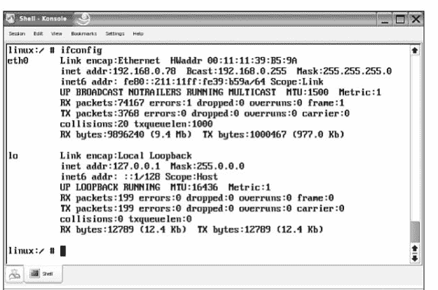

`ifup` 和 `ifown`——这两个实用程序用于启动或停止已配置的网络接口。要查看状态（已启动或已停止），你可以使用 `ifstatus` 命令。图 11.2 显示了后一个命令的可用选项。

# 图 11.2

`ifstatus` 及其相关命令有许多可用选项。

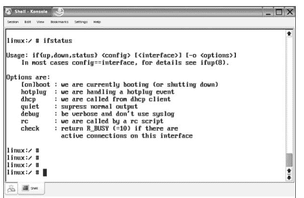

# Novell 认证 Linux 专业学习指南

- `netcat`—此实用程序用于在两个主机之间建立连接。你可以使用 `-h` 选项查看所有可用参数的列表。然而，最基本的操作是使用 `netcat -l -p 16000` 命令在一个主机上打开一个端口，详细地监听端口 16000。随后，通过另一个命令 `netcat (hostname to connect to) 16000` 与该主机建立连接。连接将保持建立，直到你按下 Ctrl+C。

- `netstat`—此命令显示 TCP 和 UDP 协议的统计数据。在不带开关的情况下执行 `netstat` 会显示协议统计数据和当前的 TCP/IP 连接。当你确定基础层通信工作正常后，你需要验证系统上的服务。这涉及查看正在监听入站流量的服务，和/或验证你正在与远程站建立会话。`netstat` 命令允许你执行此操作。以下列表是是在不带任何选项的情况下 `netstat` 生成的输出示例：

像对待大多数其他实用程序一样，查看 `netstat` 的可用选项，可以使用 `-?` 选项。

活跃的 Internet 连接（无服务器）

| Proto | Recv-Q | Send-Q | Local Address | State |
|---|---|---|---|---|
| tcp | 0 | 0 | linux mshome.net:32833 | EST_ABLISHED |
| mnetbios-ssn | | | | ESTABLISHED |
| tcp | 0 | 0 | linux mshome.net:22832 | EST_ABLISHED |
| mnetbios-ssn | | | | ESTABLISHED |
| tcp | | 1 | localhost:filenet-rpc | CLOSE_WAIT |
| localhost:svrloc | | | UNIX domain sockets (w/o servers) | | |

| Proto | RefCnt | Flags | Type | State | I-Node |
|---|---|---|---|---|---|
| unix | 10 | [ ] | DGRAM | | 3608 |
| /devlog | | | | | |
| unix | 2 | [ ] | DGRAM | | | |
| -3610 /var/lib/ntp/dev/log | | | | | |
| unix | 3 | [ ] | STREAM | CONNECTED | | |
| -2287641 | | | | | |
| /tmp/ksocket-root/klauncherYc7nCa.slave-socket | | | | | |
| unix | 3 | [ ] | STREAM | CONNECTED | | |
| -2287640 | | | | | |

# 365 网络基础 第 11 章

```
unix 3 [ ] STREAM CONNECTED
=2285303
- /tmp/.ICE-unix/dcop3558-10964045
unix 3 [ ] STREAM CONNECTED
=2285302
unix 3 [ ] STREAM CONNECTED
=2285282
- /tmp/ksocket-root/konquerorxib.slave-socket
unix 3 [ ] STREAM CONNECTED
=2285280
unix 3 [ ] STREAM CONNECTED
=2285149
- /tmp/.ICE-unix/dcop3558-10964019
unix 3 [ ] STREAM CONNECTED
=2285148
unix 3 [ ] STREAM CONNECTED
=2285147
- /tmp/ksocket-root/konquerorXa.slave-socket
unix 3 [ ] STREAM CONNECTED
=2285146
unix 52 [ ] STREAM CONNECTED
=2285141
- /tmp/.ICE-unix/X0
ix 3 [ ] STREAM CONNECTED
=2285140
unix 3 [ ] STREAM CONNECTED
=2285084
- /tmp/ksocket-root/konquerorZfrc.slave-socket
unix 3 [ ] STREAM CONNECTED
=2285083
unix 3 [ ] STREAM CONNECTED
=2285067
- /tmp/.ICE-unix/dcop3558-10964019
unix 3 [ ] STREAM CONNECTED
=2285066
unix 3 [ ] STREAM CONNECTED
=2285059
- /tmp/.ICE-unix/3614
unix 3 [ ] STREAM CONNECTED
=2285058
unix 3 [ ] STREAM CONNECTED
=2285055
- /tmp/.ICE-unix/X0
unix 3 [ ] STREAM CONNECTED
=2285054
unix 2 [ ] DGRAM
=226285
```


# Novell 认证 Linux 专业学习指南

| | | | |
|---|---|---|---|
| unix 2 | [ ] | DGRAM | 226712 |
| unix 3 | [ ] | STREAM | CONNECTED | 22678 |
| unix 3 | [ ] | STREAM | CONNECTED | 22677 |
| unix 3 | [ ] | STREAM | CONNECTED | 22676 |
| unix 3 | [ ] | STREAM | CONNECTED | 22675 |
| unix 3 | [ ] | STREAM | CONNECTED | 22674 |
| unix 3 | [ ] | STREAM | CONNECTED | 22673 |
| unix 3 | [ ] | STREAM | CONNECTED | 22672 |
| unix 3 | [ ] | STREAM | CONNECTED | 22671 |
| unix 3 | [ ] | STREAM | CONNECTED | 22670 |
| unix 3 | [ ] | STREAM | CONNECTED | 22669 |
| unix 3 | [ ] | STREAM | CONNECTED | 22668 |
| unix 3 | [ ] | STREAM | CONNECTED | 22667 |
| unix 3 | [ ] | STREAM | CONNECTED | 22666 |
| unix 3 | [ ] | STREAM | CONNECTED | 22665 |
| unix 3 | [ ] | STREAM | CONNECTED | 22663 |
| unix 3 | [ ] | STREAM | CONNECTED | 22662 |
| unix 3 | [ ] | STREAM | CONNECTED | 22661 |
| unix 3 | [ ] | STREAM | CONNECTED | 22660 |
| unix 3 | [ ] | STREAM | CONNECTED | 22659 |
| unix 3 | [ ] | STREAM | CONNECTED | 22658 |
| unix 3 | [ ] | STREAM | CONNECTED | 22657 |
| unix 3 | [ ] | STREAM | CONNECTED | 22656 |
| unix 3 | [ ] | STREAM | CONNECTED | 22655 |
| unix 3 | [ ] | STREAM | CONNECTED | 22654 |
| unix 3 | [ ] | STREAM | CONNECTED | 22653 |
| unix 3 | [ ] | STREAM | CONNECTED | 22652 |
| unix 3 | [ ] | STREAM | CONNECTED | 22651 |
| unix 3 | [ ] | STREAM | CONNECTED | 22650 |
| unix 3 | [ ] | STREAM | CONNECTED | 22649 |
| unix 3 | [ ] | STREAM | CONNECTED | 22648 |
| unix 3 | [ ] | STREAM | CONNECTED | 22647 |
| unix 3 | [ ] | STREAM | CONNECTED | 22646 |
| unix 3 | [ ] | STREAM | CONNECTED | 22645 |
| unix 3 | [ ] | STREAM | CONNECTED | 22644 |
| unix 3 | [ ] | STREAM | CONNECTED | 22643 |
| unix 3 | [ ] | STREAM | CONNECTED | 22642 |
| unix 3 | [ ] | STREAM | CONNECTED | 22641 |
| unix 3 | [ ] | STREAM | CONNECTED | 22640 |
| unix 3 | [ ] | STREAM | CONNECTED | 22639 |
| unix 3 | [ ] | STREAM | CONNECTED | 22638 |
| unix 3 | [ ] | STREAM | CONNECTED | 22637 |
| unix 3 | [ ] | STREAM | CONNECTED | 22636 |

## 网络基础 第 11 章

| | | | |
|---|---|---|---|
| unix 2 | [ ] | DGRAM | 22635 |
| unix 3 | [ ] | STREAM | CONNECTED | 22634 |
| unix 3 | [ ] | STREAM | CONNECTED | 22633 |
| unix 3 | [ ] | STREAM | CONNECTED | 22632 |
| unix 3 | [ ] | STREAM | CONNECTED | 22631 |
| unix 3 | [ ] | STREAM | CONNECTED | 22630 |
| unix 3 | [ ] | STREAM | CONNECTED | 22629 |
| unix 3 | [ ] | STREAM | CONNECTED | 22628 |
| unix 3 | [ ] | STREAM | CONNECTED | 22627 |
| unix 3 | [ ] | STREAM | CONNECTED | 22626 |
| unix 3 | [ ] | STREAM | CONNECTED | 22625 |
| unix 3 | [ ] | STREAM | CONNECTED | 22624 |
| unix 3 | [ ] | STREAM | CONNECTED | 22623 |
| unix 3 | [ ] | STREAM | CONNECTED | 22622 |
| unix 3 | [ ] | STREAM | CONNECTED | 22621 |
| unix 3 | [ ] | STREAM | CONNECTED | 22620 |
| unix 3 | [ ] | STREAM | CONNECTED | 22619 |
| unix 3 | [ ] | STREAM | CONNECTED | 22618 |
| unix 3 | [ ] | STREAM | CONNECTED | 22617 |
| unix 3 | [ ] | STREAM | CONNECTED | 22616 |
| unix 3 | [ ] | STREAM | CONNECTED | 22615 |
| unix 3 | [ ] | STREAM | CONNECTED | 22614 |
| unix 3 | [ ] | STREAM | CONNECTED | 22613 |
| unix 3 | [ ] | STREAM | CONNECTED | 22612 |
| unix 3 | [ ] | STREAM | CONNECTED | 22611 |
| unix 3 | [ ] | STREAM | CONNECTED | 22610 |
| unix 3 | [ ] | STREAM | CONNECTED | 22609 |
| unix 3 | [ ] | STREAM | CONNECTED | 22608 |
| unix 3 | [ ] | STREAM | CONNECTED | 22607 |
| unix 3 | [ ] | STREAM | CONNECTED | 22606 |
| unix 3 | [ ] | STREAM | CONNECTED | 22605 |
| unix 3 | [ ] | STREAM | CONNECTED | 22604 |
| unix 3 | [ ] | STREAM | CONNECTED | 22603 |
| unix 3 | [ ] | STREAM | CONNECTED | 22602 |
| unix 3 | [ ] | STREAM | CONNECTED | 22601 |
| unix 3 | [ ] | STREAM | CONNECTED | 22600 |
| unix 3 | [ ] | STREAM | CONNECTED | 22599 |
| unix 3 | [ ] | STREAM | CONNECTED | 22598 |
| unix 3 | [ ] | STREAM | CONNECTED | 22597 |
| unix 3 | [ ] | STREAM | CONNECTED | 22596 |
| unix 3 | [ ] | STREAM | CONNECTED | 22595 |
| unix 3 | [ ] | STREAM | CONNECTED | 22594 |
| unix 3 | [ ] | STREAM | CONNECTED | 22593 |
| unix 3 | [ ] | STREAM | CONNECTED | 22592 |
| unix 3 | [ ] | STREAM | CONNECTED | 22591 |
| unix 3 | [ ] | STREAM | CONNECTED | 22590 |
| unix 3 | [ ] | STREAM | CONNECTED | 22589 |
| unix 3 | [ ] | STREAM | CONNECTED | 22588 |
| unix 3 | [ ] | STREAM | CONNECTED | 22587 |
| unix 3 | [ ] | STREAM | CONNECTED | 22586 |
| unix 3 | [ ] | STREAM | CONNECTED | 22585 |

### 369 网络基础 第 11 章

| unix 3 [ ] STREAM CONNECTED 8387 |
| `/tmp/.ICE-unix/3614` |
| unix 3 [ ] STREAM CONNECTED 8386 |
| unix 3 [ ] STREAM CONNECTED 8377 |
| `/tmp/.X11-unix/X0` |
| unix 3 [ ] STREAM CONNECTED 8376 |
| unix 3 [ ] STREAM CONNECTED 8375 |
| `/tmp/.ICE-unix/dcop5558-1096404519` |
| unix 3 [ ] STREAM CONNECTED 8374 |
| unix 3 [ ] STREAM CONNECTED 8368 |
| `/tmp/.X11-unix/X0` |
| unix 3 [ ] STREAM CONNECTED 8367 |
| unix 3 [ ] STREAM CONNECTED 8366 |
| `/tmp/.ICE-unix/dcop5558-1096404519` |
| unix 3 [ ] STREAM CONNECTED 8365 |
| unix 3 [ ] STREAM CONNECTED 8361 |
| `/tmp/.X11-unix/X0` |
| unix 3 [ ] STREAM CONNECTED 8360 |
| unix 3 [ ] STREAM CONNECTED 8357 |
| `/tmp/.ICE-unix/dcop5558-1096404519` |
| unix 3 [ ] STREAM CONNECTED 8356 |
| unix 3 [ ] STREAM CONNECTED 8341 |
| `/tmp/.ICE-unix/3614` |
| unix 3 [ ] STREAM CONNECTED 8340 |
| unix 3 [ ] STREAM CONNECTED 8339 |
| `/tmp/.ICE-unix/dcop5558-1096404519` |
| unix 3 [ ] STREAM CONNECTED 8338 |
| unix 3 [ ] STREAM CONNECTED 8334 |
| `/tmp/.X11-unix/X0` |
| unix 3 [ ] STREAM CONNECTED 8330 |
| unix 3 [ ] STREAM CONNECTED 8325 |
| `/tmp/.ICE-unix/dcop5558-1096404519` |
| unix 3 [ ] STREAM CONNECTED 8324 |
| unix 3 [ ] STREAM CONNECTED 8319 |
| `/tmp/.X11-unix/X0` |
| unix 3 [ ] STREAM CONNECTED 8318 |
| unix 3 [ ] STREAM CONNECTED 8312 |
| `/tmp/ksocket-root/kdeinit_0` |
| unix 3 [ ] STREAM CONNECTED 8311 |
| unix 3 [ ] STREAM CONNECTED 8308 |
| `/tmp/mcp-root/linux_site_0df3-4159ce2a` |

# Novell 认证 Linux 专业学习指南

| unix 3 [ ] STREAM CONNECTED 8282 |
| `/tmp/.X11-unix/X0` |
| unix 3 [ ] STREAM CONNECTED 8281 |
| unix 3 [ ] STREAM CONNECTED 8280 |
| `/tmp/.ICE-unix/dcop3558-1096404519` |
| unix 3 [ ] STREAM CONNECTED 8279 |
| unix 3 [ ] STREAM CONNECTED 8178 |
| `/tmp/.X11-unix/X0` |
| unix 3 [ ] STREAM CONNECTED 8177 |
| unix 3 [ ] STREAM CONNECTED 8156 |
| `/tmp/.X11-unix/X0` |
| unix 3 [ ] STREAM CONNECTED 8155 |
| unix 3 [ ] STREAM CONNECTED 8154 |
| `/tmp/.ICE-unix/dcop3558-1096404519` |
| unix 3 [ ] STREAM CONNECTED 8153 |
| unix 3 [ ] STREAM CONNECTED 8134 |
| `/tmp/.ICE-unix/dcop3558-1096404519` |
| unix 3 [ ] STREAM CONNECTED 8133 |
| unix 3 [ ] STREAM CONNECTED 8129 |
| unix 3 [ ] STREAM CONNECTED 8128 |
| unix 2 [ ] DGRAM 7999 |
| unix 3 [ ] STREAM CONNECTED 7936 |
| `/tmp/.X11-unix/X0` |
| unix 3 [ ] STREAM CONNECTED 7414 |
| unix 2 [ ] DGRAM 6991 |
| unix 2 [ ] DGRAM 6476 |
| unix 2 [ ] DGRAM 6125 |
| unix 2 [ ] DGRAM 5541 |
| unix 2 [ ] DGRAM 5431 |

- `ping`——该工具向主机发送回显消息以检查是否可达。如果可用，远程主机 ICMP 协议将响应。如果不可用，将显示相应的错误消息。图 11.3 显示 `ping` 主机的结果。
- `route`——该工具用于查看和配置路由。如果你不带任何参数运行 `route` 命令，它将显示当前路由表。该命令在“配置路由”部分有进一步讨论。

## 网络基础
第 11 章

`tcpdump`——此命令行工具允许你通过混杂模式监控并分析通过接口的网络流量。`-i` 选项用于指定接口。例如，`tcpdump -i eth0` 命令在混杂模式下运行，并立即向终端显示数据。`-c` 选项可以指定你想要监听的数据包数量。例如，`tcpdump -i eth0 -c 32` 将显示后续 32 个包后退出。最后，它将报告捕获了多少包、被过滤器接收了多少以及内核丢弃了多少。
`img/384ae1e03db8863dab758259ffc83_386.png`

图
数据包成功到达主机。


12 packets transmitted, 12 received, 0% packet loss, time 16ms

rtt min/avg/max = 46/51/59 ms

`telnet`——允许你与远程主机建立连接。这通常用于管理目的。
`traceroute`——这是 `ping` 工具的增强版本，用于替代它。它不仅显示远程主机是否可用，还显示到达主机所经过的路径。图 11.4 显示了与图 11.3 中 `ping` 的相同交互；现在可以看到到达该主机所需的跳数了。
img/384ae1e03db8863dab758259ffc83_387.png

图
`traceroute` 显示了如何到达主机。

# 配置路由

## 课程目标

### 3. 配置和管理路由 (307)

存在三种路由帮助 IP 数据包到达最终目的地：

- 主机路由
- 网络/网关路由
- 默认路由

任何路由的目的是为数据指向目标，使用 `routes` 即使用 `route` 工具。要添加路由，使用 `route add` 命令。要删除路由，使用 `route del` 命令。

图 11.5 显示了简单的显示——此示例在一个没有路由但可以通过网络通信的服务器上运行。
img/384ae1e03db8863dab758259ffc83_388.png

图
11.5
`route` 的输出示例。

图 11.6 显示了 `route` 工具的选项。
img/384ae1e03db8863dab758259ffc83_388_1.png

图
11.6
`route` 工具提供了选项。

# 配置网络服务

## 课程目标

### 8. 启用扩展守护进程 (xinetd) (307)

在 Linux 内部，有一个名为 `init` 的超级进程，负责启动特定运行级别所需的服务并维护系统完整性。`init` 守护进程会启动和停止其他守护进程，如系统日志 (`syslogd`)、交换器 (`kswapd`) 等。它启动的一个超级进程是网络服务：`xinetd`（也称为扩展守护进程）。

`xinetd` 守护进程是 `init` 的替代品，提供了极大的安全性改进。现在的配置选项已经模块化。对于考试，你需要知道此守护进程是 `init` 的替代品，可以从许多站点下载并替代原始程序。

> 根据一般规则，任何以 "d" 结尾的进程都是守护进程。

当启动时，`xinetd` 会查看其配置文件 `/etc/xinetd.conf`，并从中确定它负责的额外服务。默认情况下，无论是否使用该文件都存在。如果没有，大部分行都被注释掉了。以下是默认文件的示例：

```
#
# xinetd.conf
#
# Copyright (c) 1998-2001 SuSE GmbH Nuernberg, Germany.
# Copyright (c) 2002 SuSE Linux AG, Nuernberg, Germany.
{
    log_type        = FILE /var/log/xinetd.log
    log_on_success  = HOST EXIT DURATION
    log_on_failure  = HOST ATTEMPT
    only_from       = localhost
}
```

```
instances = 30
cps = 50 10
# 接口的指定很有趣，如果我们位于防火墙之后。
# 例如，如果你只想从内部网络接口提供服务，
# 你可以指定你的内部 接口 IP 地址。
#
# interface = 127.0.0.1
includedir /etc/xinetd.d
```

注意此文件具有调用其他文件设置的能力，且不需要自包含。如果你更改了此文件中的任何设置，必须重启 `xinetd` 更改才能被识别。有许多方法可以实现——重启系统、启动和停止网络等。但最简单的方法是使用以下命令杀死并重启 `xinetd` 守护进程：
`/etc/rc.d/xinetd restart`

或
`/etc/rc.d/xinetd reload`

然后守护进程将重启——在重启时会重新读取配置文件。

# /etc/services 文件

该文件在本章前面提到过，但它真正的用途是被检查以确定特定服务应使用哪个端口。此 ASCII 文件默认存在于每个主机上，并将项目分为三个字段：

- 服务——任何出现在 `/etc/inetd.conf` 文件中的名称。
- 端口——要使用的端口。
- 别名（Alias）——这些是可选的，构成了该服务的其他名称。

以下是标准主机上文件前几行的示例：

```
#
# 网络服务，Internet 风格
# 注意，目前 IANA 的策略是为 TCP 和 UDP 分配
# 单个已知端口号；
# 因此，即使协议不支持 UDP 操作，
# 大多数条目也有两个条目
#
```

可以在此处找到此列表：

```
http://www.iana.org/assignments/port-numbers
```

```
# (最后更新于 2004-02-12)
# 端口号分为三个范围：常用端口 (Well Known Ports)、
# 注册端口 (Registered Ports) 以及动态和/或
# 私有端口 (Dynamic and/or Private Ports)
```

```
# 常用端口是从 1023 开始的。
# 注册端口是从 1024 到 49151 的。
# 动态和/或私有端口是从 49152
# 到 65535 的。
```

```
# 未分配的端口号不应使用。IANA
# 将在您的应用程序获得批准后
# 分配该端口的号码 ###
```

```
# 常用端口号
# 常用端口由 IANA 分配，在大多数系统中
# 只能由系统（或 root）进程或由
# 特权用户执行的程序使用。
```

```
# 端口在 TCP [RFC2793] 中用于命名
# 携带长期会话的逻辑连接端点。
# 为了向未知调用者提供服务，
# 定义了服务联系端口。此列表指定了
```

# 376
Novell 认证 Linux 专业学习指南


服务器进程作为其联系端口使用的端口。

联系端口有时被称为“常用”端口。

在范围内，这些端口分配也用于 UDP [`RFC2768`]。

由 `IANA` 管理的已分配端口范围是 `0-1023`。

## 端口分配：

| 关键字 | 十进制 | 参考 | |
| :--- | :--- | :--- | :--- |
| | 0/tcp | 预留 | |
| | 0/udp | 预留 | Jon Postel <postel@isi.edu> |
| tcpmux | 1/tcp | TCP 端口服务复用器 | | |
| tcpmux | 1/udp | TCP 端口服务复用器 | Mark Lott <MKL@nisc.com> |
| compressnet | 2/tcp | 管理工具 | | |
| compressnet | 2/udp | 管理工具 | | |
| compressnet | 3/tcp | 压缩进程 | | |
| compressnet | 3/udp | 压缩进程 | Bernie Volz <VOLZPROCESS.COM> | |
| | 4/tcp | 未分配 | | |
| | 4/udp | 未分配 | | |
| rje | 5/tcp | 远程作业输入 | | |
| rje | 5/udp | 远程作业输入 | Jon Postel <postel@isi.edu> | |
| | 6/tcp | 未分配 | | |
| | 6/udp | 未分配 | | |
| echo | 7/tcp | 回显 | | |
| echo | 7/udp | 回显 | Jon Postel <postel@isi.edu> | | |
| | 8/tcp | 未分配 | | |
| | 8/udp | 未分配 | | |
| discard | 9/tcp | 丢弃 | | |
| discard | 9/udp | 丢弃 | Jon Postel <postel@isi.edu> | | |
| | 10/tcp | 未分配 | | |
| | 10/udp | 未分配 | | |
| systat | 11/tcp | users | 活跃用户 | | |
| systat | 11/udp | users | 活跃用户 | Jon Postel <postel@isi.edu> | | |
| | 12/tcp | 未分配 | | |
| | 12/udp | 未分配 | | |
| daytime | 13/tcp | 日时间 (RFC 867) | | |
| daytime | 13/udp | 日时间 (RFC 867) | Jon Postel <post@isi.edu> | | |
| | 14/tcp | 未分配 | | | |
| | 14/udp | 未分配 | | | |
| netstat | 15/tcp | 未分配 [曾为 netstat] | | | |
| | 15/udp | 未分配 | | | |
| | 16/tcp | 未分配 | | | |
| | 16/udp | 未分配 | | | |
| qotd | 17/tcp | quote | 每日一言 | | | |
| qotd | 17/udp | quote | 每日一言 | Jon Postel <postel@isi.edu> | | | |
| msp | 18/tcp | 消息发送协议 | | | | |
| msp | 18/udp | 消息发送协议 | | | | |
| | 19/tcp | 字符生成器 | | | | |
| charger | 19/udp | 字符生成器 | | | | |
| ftp-data | 20/tcp | 文件传输 [默认数据] | | | | | |
| ftp-data | 20/udp | 文件传输 [默认数据] | | | | | |
| fsp | 21/tcp | 文件传输 [控制] | | | | | |
| fsp | 21/udp | 文件传输 [控制] | | | | | |
| | 22/tcp | | | Jon Postel <postel@isi.edu> | | | | |
| ssh | 22/tcp | SSH 协议 | | | | | | |
| ssh | 22/udp | SSH 协议 | Tata <yun@cs.net> | | | | | |
| telnet | 23/tcp | Telnet | | | | | | |
| telnet | 23/udp | Telnet | Jon Postel <postel@isi.edu> | | | | | |
| | 24/tcp | 邮件系统 | | | | | | |
| | 24/udp | 邮件系统 | Rick Adams <rick@UNO.NET> | | | | | |
| smtp | 25/tcp | 简单邮件传输 | | | | | | |
| smtp | 25/udp | 简单邮件传输 | Jon Postel <postel@isi.edu> | | | | | |
| | 26/tcp | 未分配 | | | | | | | |
| | 26/udp | 未分配 | | | | | | | |
| nsw-fe | 27/tcp | NSW 用户系统 | | | | | | | |
| nsw-fe | 27/udp | NSW 用户系统 | Robert Thomas <Thomas@F.BN.COM> | | | | | | |
| | 28/tcp | 未分配 | | | | | | | |
| | 28/udp | 未分配 | | | | | | | |
| msg-icp | 29/tcp | MSG ICP | | | | | | | |
| msg-icp | 29/udp | MSG ICP | | | | | | | |
| | 30/tcp | 网络基础 | Robert Thomas <Thomas@F.BN.COM> | | | | | | | |
| | 30/udp | 未分配 | | | | | | | | |
| msg-auth | 31/tcp | MSG 认证 | | | | | | | | | |
| msg-auth | 31/udp | MSG 认证 | Robert Thomas <Thomas@F.BN.COM> | | | | | | | |
| | 32/tcp | 未分配 | | | | | | | | | |
| | 32/udp | 未分配 | | | | | | | | | |
| dsp | 33/tcp | 显示支持 | | | | | | | | | |
| dsp | 33/udp | 显示支持 | | | | | | | | | |
| | 34/tcp | 未分配 | | | | | | | | | |
| | 34/udp | 未分配 | | | | | | | | | |
| | 35/tcp | 私有服务器 | | | | | | | | | |
| | 35/udp | 私有服务器 | | | | | | | | | |
| | 36/tcp | 时间 | Jon Postel <postel@isi.edu> | | | | | | | | | |
| | 36/udp | 未分配 | | | | | | | | | | | |
| | 37/tcp | 路由协议 | Jon Postel <postel@isi.edu> | | | | | | | | | |
| | 37/udp | 路由协议 | | | | | | | | | | | |
| | 38/tcp | 位置协议 | Robert Ullmann <riel@world.com> | | | | | | | | | |
| | 38/udp | 位置协议 | | | | | | | | | | | |
| | 40/tcp | Mike Accetta <MIKE.ACCETTA@CMU-CS-A.EDU> | | | | | | | | | | |
| | 40/udp | 未分配 | | | | | | | | | | | |
| graphics | 41/tcp | 图形 | | | | | | | | | | | |
| graphics | 41/udp | 图形 | | | | | | | | | | | |
| name | 42/tcp | 主机名 | | | | | | | | | | | | |
| name | 42/udp | 主机名 | | | | | | | | | | | | |
| nameserver | 42/tcp | 主机名 | | | | | | | | | | | | |
| nameserver | 42/udp | 主机名 | | | | | | | | | | | | |
| nicname | 43/tcp | Who Is | | | | | | | | | | | | | |
| nicname | 43/udp | Who Is | | | | | | | | | | | | | |
| pmm-flags | 44/tcp | MPM 协议 | | | | | | | | | | | | | |
| pmm-flags | 44/udp | MPM 协议 | | | | | | | | | | | | | |
| pmm | 45/tcp | 消息处理模块 | | | | | | | | | | | | | |
| pmm | 45/udp | 消息处理模块 | | | | | | | | | | | | | |
| mpm-snd | 46/tcp | MPM [默认发送] | | | | | | | | | | | | | |
| mpm-snd | 46/udp | MPM [默认发送] | | | | | | | | | | | | | |
| ni-ftp | 47/tcp | NI FTP | Jon Postel <postel@isi.edu> | | | | | | | | | | | | |
| ni-ftp | 47/udp | NI FTP | Steve Kille <S.Kille@isode.com> | | | | | | | | | | | | |
| audit | 48/tcp | 数字化审计守护进程 | | | | | | | | | | | | | | |
| audit | 48/udp | 数字审计守护进程 | Larry Scott <scott@zk3.com> | | | | | | | | | | | | | |
| tacacs | 49/tcp | 登录主机协议 (TACACS) | | | | | | | | | | | | | | |
| tacacs | 49/udp | 登录主机协议 (TACACS) | Pieter Ditmars <pdimarts@OBN.com> | | | | | | | | | | | | | |
| re-mail-ck | 50/tcp | 远程邮件检查协议 | | | | | | | | | | | | | | | |
| re-mail-ck | 50/udp | 远程邮件检查协议 | Steve Donner <s-donner@UIUC.EDU> | | | | | | | | | | | | | | |

# 诺瓦认证 Linux 专业人员学习指南


# Christopher Leong <leong@kolmod.mlo.de.com>

## `finger` `79/tcp` # Finger

## `finger` `79/udp` # Finger

# David Zimmermann <dpz@RUTGERS.EDU>

## `http` `80/tcp` # World Wide Web HTTP

## `http` `80/udp` # World Wide Web HTTP

## `www` `80/tcp` # World Wide Web HTTP

## `www` `80/udp` # World Wide Web HTTP

## `www-http` `80/tcp` # World Wide Web HTTP

## `www-http` `80/udp` # World Wide Web HTTP

# Tim Berners-Lee <timbl@w3.org>

## `hosts2-ns` `81/tcp` # HOST2 Name Server

## `hosts2-ns` `81/udp` # HOST2 Name Server

# Earl Killian <EAK@MORDOR.S1.GOV>

## `xfer` `82/tcp` # XFER Utility

## `xfer` `82/udp` # XFER Utility

# Thomas M. Smith <Thomas.Smith@lmco.com>

## `mit-ml-dev` `83/tcp` # MIT ML Device

## `mit-ml-dev` `83/udp` # MIT ML Device

# David Reed <---->

## `ctf` `84/tcp` # Common Trace Facility

## `ctf` `84/udp` # Common Trace Facility

# Hugh Thomas <Thomas@oils.enet.de.com>

## `mit-ml-dev` `85/tcp` # MIT ML Device

## `mit-ml-dev` `85/udp` # MIT ML Device

# David Reed <---->

## `mfcobol` `86/tcp` # Micro Cobol

## `mfcobol` `86/udp` # Micro Cobol

# Simon Edwards <---->

## `87/tcp` any private terminal link

## `87/udp` any private terminal link

# Jon Postel <postel@isi.edu>

## `kerberos` `88/tcp` # Kerberos

## `kerberos` `88/udp` # Kerberos

# B. Clifford Neuman <bcn@isi.edu>

## `su-mit-tg` `89/tcp` # SU/MIT Telnet Gateway

## `su-mit-tg` `89/udp` # SU/MIT Telnet Gateway

# Mark Crisp <MRC@PANDA.COM>

############ 端口 90 也被非正式用于

# 播客 ###########

## `dnsix` `90/tcp` # DNS 安全属性令牌 Map

## `dnsix` `90/udp` # DNS 安全属性令牌 Map

# Charles Watt <watt@sware.com>

## `mit-dov` `91/tcp` # MIT Dover Spoller

## `mit-dov` `91/udp` # MIT Dover Spoller


# 383
第 11 章

# Eliot Moss <EBM@XX.LCS.MIT.EDU>

`npp` `92/tcp` # 网络打印协议

`npp` `92/udp` # 网络打印协议

# Louis Mamakos <louie@sayshell.umd.edu>

`dcp` `93/tcp` # 设备控制协议

`dcp` `93/udp` # 设备控制协议

# Daniel Tappan <Tappan@BBN.COM>

`objcall` `94/tcp` # Jokowi 对象调度器
`objcall` `94/udp` # Jokowi 对象调度器

# Tom Bereiter <--name-->

`supdup` `95/tcp` # SUPDUP
`supdup` `95/udp` # SUPDUP

# Mark Crispin <MRC@PANDA.COM>

`daxie` `96/tcp` # DIXIE 协议规范
`daxie` `96/udp` # DIXIE 协议规范

# Tim Howe <tim.Howes@terminator.cc.umich.edu>

`swift-vrf` `97/tcp` # Swift 远程虚拟文件协议
`swift-vrf` `97/udp` # Swift 远程虚拟文件协议

# Maurice R. Turcote
# <mailruslofordia@rmi!dnrt@mail.unet.net>

`tacnews` `98/tcp` # TAC NEWS
`tacnews` `98/udp` # TAC NEWS

# Jon Pastel <postel@isi.edu>

`metagem` `99/tcp` # Metagay Relay继
`metagem` `99/udp` # Metagay Relay继

# Geoff Goodfellow <Geoff@FERNWOOD.PK.CA.us>

`newacatt` `100/tcp` # [授权使用]

`hostname` `101/tcp` # NIC 主机服务器
`hostname` `101/udp` # NIC 主机服务器

Jon Pastel <postel@isi.edu>

`iso-tsap` `102/tcp` # ISO-TSAP 类 0
`iso-tsap` `102/udp` # ISO-TSAP 类 0

Marshall Rose <mrose@dbc.mtview.ca.us>

`gppitnp` `103/tcp` # Genesis 点对点传输网络
`gppitnp` `103/udp` # Genesis 点对点传输网络

`acr-nema` `104/tcp` # ACR-NEMA 数字图像通信 300
`acr-nema` `104/udp` # ACR-NEMA 数字图像与通信 300

Patrick McNamehee <--name-->

`cso` `105/tcp` # CCSO 命名服务器协议
`cso` `105/udp` # CCSO 命名服务器协议

Martin Hamilton <martin@mrr1.lut.as.uk>

`csnet-ns` `105/tcp` # 邮箱名称服务器
`csnet-ns` `105/udp` # 邮箱名称服务器

Marvin Solomon <solomon@WISC.EDU>

`3com-tsmux` `106/tcp` # 3COM-TSMUX
`3com-tsmux` `106/udp` # 3COM-TSMUX

# Jeremy Siegel <jzs@NSD.3Com.COM>
# James Rice <RICE@SUMEX.STANFORD.EDU>

（注：提供的 OCR 中上述点列表之后的文本似乎是杂乱/重复的。我处理了以下连贯的部分。）

# 诺瓦认证 Linux 专业人员学习指南

## 使用 LDAP
涵盖的课程目标
- 17. 在 SLES 9 服务器上部署 OpenLDAP (3038)

轻量级目录访问协议 `LDAP` 用于实现目录服务的访问。`OpenLDAP` 是 Linux 环境中最流行的 LDAP 实现，它允许你将条目组织成层次结构树，并包含所有预期的对象——区分名等。

`LDAP` 内部的对象类在架构文件（schema files中定义，可以在 `/etc/openldap/schema` 找到，这些文件包含以下类：
- Root: 目录的根
- c: 国家
- o: 组织
- ou: 组织单元
- dc: 域名组件

有关 `OpenLDAP` 的完整管理信息可以在 `http://www.openldap.org` 的管理员快速上手指南中找到。配置文件位于 `/etc/openldap` 目录下，主要的两个文件是：
- `slapd.conf`: 主配置文件
- `ldap.conf`: 默认配置

## 使用 Apache
涵盖的课程目标
- 7. 启用 Web 服务器 (Apache) (3037)
- 18. 配置 Apache Web 服务器 (3038)

`Apache` 是一种 Web 服务器，就像 Windows NT/2000 的 Internet 信息服务器一样用于 Linux。在大多数 Linux 实现中（包括 SuSE）都包含了 Apache。如果你希望在系统启动时自动启动 Apache，需要将其添加到默认运行级别目录。

运行 Apache 的主进程是 `httpd`，与其它不同，它在网络启动时由 `inetd` 启动。在最新版本中，只有一个配置文件——`apache2/httpd.conf`。它会在另外两个文件中查找额外值：
- `access.conf`: 限制网站某些页面对特定用户或组开放
- `srm.conf`: 指定网站的根目录

现在 Apache 检查数据文件的默认目录是 `/srv/www/htdocs`。这是用户在输入 http:// 地址时首次进入的目录。在此目录下查找并加载的默认文件是 `index.html`。

`/etc/apache2` 下的其他配置文件：
- `default-server.conf`: 默认服务器设置。这些设置会被所有其他文件的设置覆盖。
- `error.conf`: 允许你配置发生错误时的处理方式。
- `listen.conf`: Apache 使用的端口配置（默认为 80）。
- `server-tuning.conf`: 服务器调优参数。在任何情况下默认都是合理的。
- `ssl-global.conf`: 此文件允许你配置安全套接层 (SSL) 配置。
- `uid.conf`: 定义访问 Apache 的匿名用户和组 ID。
- `vhost.d`: 虚拟主机配置文件的子目录。

## 网络访问
你可以通过使用 `hosts.allow` 文件或 `hosts.deny` 文件来显式地允许访问你的网络主机，这两个文件都位于 `/etc` 目录。这些文件的语法为：
- `hosts.allow`: 允许访问（对于文件中特定命名的对象）
- `hosts.deny`: 禁止访问（对于文件中特定命名的对象）

默认情况下，这两个文件都存在于主机上，尽管其行被注释掉了。总结如下：
（注：OCR 文本在此处中断。）

387
第 11 章

网络基础

在重启时重新读取文件。你也可以使用命令 `rcapache stop` 和 `rcapache2 start` 分别停止和启动服务。

使用 Apache 或任何 Web 服务器时，一个重要的考虑因素是，你需要验证 `/etc/services` 文件中的 www 服务条目是否有效。

# 使用 NFS、smb 和 nmb

所涵盖的课程目标

- 5. 配置网络文件系统 (3037)
- 6. 管理网络上的资源 (3037)
- 19. 配置 Samba 服务器作为文件服务器 (3038)

这些目标涉及共享。该主题的三个子组件之间仅有浅显的熟悉程度，但它们都属于文件/目录共享这一广泛范畴。

# NFS

`NFS` 是网络文件系统（Network File System），它是 Linux 网络中挂载和共享分区的机制。`NFS` 属于远程过程调用（RPC）服务类别。`NFS` 利用了三个守护进程——`nfsd`、`portmap` 和 `rpc_mountd`，并加载在 `/exports` 文件中配置的分区。该文件默认存在于每个主机上，但是空的。在该文件中，你必须指定要共享的分区及其访问权限。

可以使用 `/etc/init.d/nfsserver start` 命令启动 NFS 服务器，并派生 `rpc.nfsd` 和 `rpc.mountd` 守护进程。`rpc.nfsd` 是服务，而 `rpc.mountd` 充当守护进程。

`NFS` 问题通常分为两类：`/exports` 列表中的错误（通过编辑和修正来修复）或守护进程问题。守护进程最常见的问题是没有按照正确的顺序启动。`portmap` 守护进程必须首先启动，它是访问共享但不提供共享的主机上所需的守护进程。

# NIS

网络信息服务（NIS）充当巨大的电话簿或黄页，用于分布在网络各个资源。事实上，NIS 更像是一个目录，大多数文件和工具都以 `yp` 字母开头，这是从它曾被称为该名称时遗留下来的。NIS 的三个组件是：

- 主服务器（Master-server）——必须至少有一台运行着 `ypvers` 程序并持有配置文件的服务器。
- 从服务器（Slave-servers）——这些是可选的，在小型网络中未使用。使用时，它们代表主服务器处理请求。
- 客户端（Clients）——这些客户端运行 `ybind` 程序并从服务器检索数据。

`NIS` 网络被组织成多个域，由 `/etc/defaultdomain` 文件定义域，`/etc/yp.conf` 持有服务器地址。使用 `NIS` 映射的常用资源包括用户信息（`/etc/passwd`）、用户组信息（`/etc/group`）和服务（`/etc/services`），尽管你也可以添加任何其他内容。

有许多工具需要了解如何与 `NIS` 配合：

# SMB

`SMB` 代表服务器消息块（Server Message Block），是用于在基于 Windows 的网络（Windows 95、Windows 98、Windows NT、Windows 2000 等）上共享资源的协议。共享的资源可以是目录、打印机或其他设备。为了让 Linux 访问基于 Windows 的网络上的共享资源（以 NT 为例），有必要让 Linux 通过相同的 SMB 协议进行通信。

遗憾的是，`SMB` 协议并不是许多 Linux 实现的原生；但是，可以通过其他产品添加它。最受欢迎的产品，也是我们为此重点关注的产品，是 `Samba`。`Samba` 是一个免费程序，可以在 `www.samba.com` 找到（你必须从中选择你的国家）。

`Samba` 通过使用 `/etc/samba/smb.conf` 文件中的值使 Linux 主机成为 SMB 客户端。当安装并配置 Linux 主机时（前提是权限足够），它可以访问 NT 网络上的任何共享 SMB 资源：目录、打印机等。

> 尽管概念相同，但概念相同（注：此处原文逻辑重复），为了让 Linux 访问基于 Windows 的网络上的共享资源（以 NT 为例），有必要让 Linux 访问……它可以访问 NT 网络上的任何共享 SMB 资源：目录、打印机等。

（注：原文中存在多处重复描述，翻译已保留原意结构）

`Samba` 通过使用 `/etc/samba/smb.conf` 文件中的值使 Linux 主机成为 SMB 客户端。当安装并配置 Linux 主机时（前提是权限足够），它可以访问 NT 网络上的任何共享 SMB 资源：目录、打印机等。

> 尽管概念相同，但概念相同，为了让 Linux 访问基于 Windows 的网络上的共享资源（以 NT 为例），有必要让 Linux 访问……它可以访问 NT 网络上的任何共享 SMB 资源：目录、打印机等。

尽管 概念相同，但概念相同，为了让 Linux 访问基于 Windows 的网络上的共享资源（以 NT 为例），有必要让 Linux 访问……它可以访问 NT 网络上的任何共享 SMB 资源：目录、打印机等。

尽管 概念相同，但概念相同，为了让 Linux 访问基于 Windows 的网络上的共享资源（以 NT 为例），有必要让 Linux 访问……它可以访问 NT 网络上的任何共享 SMB 资源：目录、打印机等。

# Novell 认证 Linux 专业学习指南

同样用于分隔随后的列。第二列（以及所有后续列）是与该 IP 地址关联的名称（主机名）。

在所示示例中，用户可以指定通过使用该 IP 地址或指定 'Yorktown' 来 telnet 到 192.168.14.10。HOSTS 文件将用于将文本名称 'Yorktown' 翻译为 192.168.14.10，连接结果是相同的：这是与该主机关联的唯一名称。192.168.14.14 可以通过三个名称——“Noblesville”、“Westfield”和“Carmel”来引用。

由于 HOSTS 文件必须存在于每台主机上，因此每台主机上的文件应该略有不同。在前面的示例中，来自 Muncie 主机的文件不需要包含对自身的引用（存在此类引用会产生实际危害）。但 Anderson 不需要包含对自身的引用，但必须包含对 Muncie 的引用，如下例所示：

```bash
```


# 这是一个显示 HOSTS 文件如何工作的示例

# 此主机的名称是 Anderson，不需要列在此处

`192.168.14.9` `Muncie`

`192.168.14.10` `Yorktown`

`192.168.14.11` `Daleville` `Chesterfield`

`192.168.14.13` `Lapel` `#Pendleton`

`192.168.14.14` `Noblesville` `Westfield` `Carmel`

`192.168.14.15` `Roshton`

`192.168.14.16` `Lebanon`

这意味着每当网络中添加一个新主机时，你都必须更新每台主机上的 hosts 文件，否则它们将无法访问新系统。这种限制严重将这种名称解析方法限制在不改变的小型网络中。从好的方面，它的实现被所有能够运行 TCP/IP 的操作系统所接受。

同样值得注意的是：文件总是从上到尾顺序读取的——直到找到解析结果为止。提高解析速度：应将注释行移动到文件的底部，以防止它们在读取文件时产生干扰，并将最常访问的主机放在文件的顶部，以便快速找到它们的匹配项。文件中不出现重复的主机名也极其重要。考虑以下：

```bash
# 这是一个显示 HOSTS 文件如何工作的示例

# 此主机的名称是 Muncie，不需要列在此处

# 393

# 网络基础第 11 章节

192.168.14.10 Yorktown

192.168.14.11 Daleville Chesterfield

192.168.14.12 Anderson

192.168.14.13 Lapel #Pendleton

192.168.14.14 Noblesville Westfield Carmel

192.168.14.15 Rosston

192.168.14.16 Lebanon

192.168.14.17 Carmel
```

由于是从上到下顺序读取行的，所有访问主机名 "Carmel" 的尝试将始终指向 `192.168.14.14`，而永远不会 `192.168.14.17`。如果另一台主机上的顺序发生了变化，用户将始终得到后者而不是前者。这可能在许多方面引起混乱，因此要小心顺序以避免重复的名称条目。

## 进阶 DNS

在互联网早期，hosts 文件会定期更新并下载到所有主机以进行名称解析。hosts 解析方法的主要问题是它必须存在于每台主机上，并且必须对每个副本进行更改才能生效。

`DNS`（域名系统）解决了大型网络中的这个问题。它不是在每台主机上本地放置文件，而是通过访问服务器为它们进行名称解析。`DNS` 于 1984 年引入，允许主机名存储在分布在多个服务器上的数据库中。这种分布减少了单台服务器的负载，并提供了多个管理点。由于可以添加更多服务器来处理数据库的其他部分，数据库的大小几乎是无限的。

配置客户端使用 `DNS` 只需要为其提供提供服务的服务器 IP 地址即可。在 Linux 等操作系统上，可以在 `/etc` 目录下的 `resolv.conf` 文件指定 `DNS` 服务器。以下是该文件的示例：

```
### BEGIN INFO

# Modified_by: dhcpcd

# Backup: /etc/resolv.conf.saved.by.dhcpcd

# Process: dhcpcd

# Process_id: 1630

# Script: /sbin/modify_resolvconf
```


（注：提供的 OCR 文本在后续部分存在重复和混乱片段，上述翻译已根据逻辑进行了处理。）

# SOA 记录

每个数据库文件都以一个起始授权（SOA）记录开始。此记录标识区域并包含许多其他参数，包括：

- 源主机（Source host）——主服务器名称（拥有该文件的读写副本）
- 联系人邮箱（Contact email）——文件管理员的电子邮件地址
- 序列号（Serial number）——数据库递增的版本号
- 刷新时间（Refresh time）——从服务器检查数据库文件更改的等待秒数
- 重试时间（Retry time）——如果复制失败，从服务器在再次尝试之前的等待秒数
- 过期时间（Expiration time）——从服务器删除旧区域前的秒数
- 生存时间（TTL）——仅缓存服务器在丢弃并执行另一个查询之前缓存此数据库文件记录的秒数

# NS 记录

名称服务器记录仅指定了域名的其他名称服务器，或将域名映射到该区域的主服务器域名。

# A 记录

地址记录持有名称的 IP 地址。

# CNAME 记录

规范名称（Canonical Name）记录是一种别名，允许你为每个 TCP/IP 地址指定多个名称。例如，`ftp.ds-technical.com` 的 CNAME 记录指示它是 `kristin` 的别名。

使用 CNAME 记录，你可以在同一台主机上结合 FTP 服务器和 Web 服务器。

# MX 记录

邮件交换器（Mail Exchanger）记录指定了处理该域邮件的主机名称。

# Novell 认证 Linux 专业学习指南

## HOST 记录
主机记录是为指定主机指定 TCP/IP 地址的记录。所有静态 TCP/IP 地址的主机都应该在此数据库中有一个条目。

## PTR 记录
指针记录用于反向查找条目。它们以反序指定 IP 地址和相应的主机名。

# 用于 DNS 的实用程序

任何应用程序——`telnet`、`ping` 等——都可以通过查询客户端指定的 DNS 服务器地址来解析主机名的地址。如果 DNS 服务器没有该地址的解析，它将根据 FDN（完全限定域名）给出的域名查询另一个 DNS 服务器。能够这种静默解析的应用程序被称为解析器（resolvers）。

`hostname` 命令返回当前主机的名称。`nslookup` 命令用于查询 DNS 并查找 IP 解析。首次启动时，`nslookup` 开始一个交互式会话并查找 DNS 服务器的名称和 IP 地址。可以如下所示给出命令：

- `default server` - 使用 NAME 打印主机/域 NAME 的信息
- `NAME NAME2` - 同上，但使用 NAME2 作为服务器
- `help ?` - 打印常用命令信息
- `set OPTION` - 设置一个选项
  - `all` - 打印选项、当前服务器和主机
  - `[debug]` - 打印调试信息
  - `[node2]` - 打印详尽的调试信息
- `information`
  - `[hostname]` - 在每个查询中附加域名
  - `[recursive]` - 请求查询的递归答案
  - `[search]` - 使用域名搜索列表
  - `[vc]` - 始终使用虚拟电路
  - `domain=NAME` - 将默认域设置为 NAME
- `schrlist+N1[/N2/.../N6]` - 将域设置为 N1 并搜索
- `list to N1, N2, 等.`
  - `root=NAME` - 将根服务器设置为 NAME
  - `retry=X` - 将重试次数设置为 X
  - `timeout=X` - 将超时超时设置为 X 秒
  - `type=X` - 设置查询类型
- `* (ex. A,ANY,CNAME,MX,NS,PTR,SOA,SRV)` - `querytype=X` - 与 type相同
- `class=X` - 设置查询类
- `* (ex. IN (Internet), ANY)` - 使用 MS 快速区域传输
- `[no]msifr`
- `ifrver=-` 在 IXFR 中使用的当前版本
- `transfer request` - 将默认服务器设置为 NAME，当前
- `default server` - 将默认服务器设置为 NAME，当前
- `lsver NAME` - 将默认服务器设置为 NAME，当前
- `initial server\ finger [USER]` - 在当前对最佳 NAME 执行 finger 指令
- `default host` - 将当前服务器设置为根
- `ls [op] DOMAIN > FILE` - 列出 DOMAIN 中的地址（可选：输出到 FILE）
- `-a` - 列出规范名称和别名
- `-d` - 列出所有记录
- `-t TYPE` - 列出指定类型的记录
- `(e.g. A,CNAME,MX,NS,PTR)` - 排序 'ls' 输出文件和 FILE
- `view with pg` - 查看
- `exit` - 退出程序

例如，如果你输入一个 FDN，`nslookup` 会显示给定站点或主机的 IP 地址。

> 注意
在 S 9 中，`nslookup` 已弃用，这在本章前面已经讨论过。你应该同时熟悉这两个实用程序。

除了将主机解析为 IP 地址外，你还可以通过名为反向查找（reverse lookup）的过程将 IP 地址解析为主机名。FDN 以特定主机开始然后是域名，而 IP 地址以网络 ID 开始然后是主机 ID。因为你想使用 DNS 来处理映射，两者必须以相同的方式进行，因此解析 IP 地址的字节。也就是说，反向地址解析中的 `148.53.66.7` 是 `76.56.13.148`。

现在 IP 地址已经解析，它的处理方向与 FDN 相同，你可以使用 DNS 解析该地址。要做到这一点，你需要根据地址类创建一个区域——例如，在地址 `148.53.66.7` 中，管理委员会分配给站点的部分是 `148.53`（对于 `204.12.25.3` 则是 `204.12.25`）。基于此，只需创建一个将这些数字反转的区域，并在其中添加 `in-addr.arpa` 记录——即 `53.148.in-addr.arpa` 或 `25.12.204. in-addr.arpa`。这些区域可以从各自的主服务器进行复制。

# 使用 OpenSSH 工作

### 涵盖的课程目标
- 9. 启用 FTP 服务器 (3037)

可以建立一个文件传输协议（FTP）服务器，允许用户在其主机和服务器之间传输文件。这可以在匿名用户的基础上进行，也可以要求用户通过提供用户名和密码进行身份验证。

有很多 FTP 服务器可用，但 Novell 偏于关注 PureFTPD。虽然不是默认安装，但它包含在 SLES 9 软件包中。

包含 `ssh-add`, `ssh-agent`, `ssh-keyscan`, `ssh-keygen` 和 `sftp-server`。替换 `login` 和 `telnet` 的 `ssh` 程序，替换 `rcp` 的 `scp`，以及替换 `ftp` 的 `sftp`。还有

402

# Novell 认证 Linux 专业学习指南

# 图 11.8
`ip` 命令提供的选项简单且易于理解。

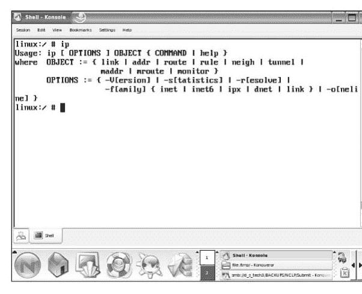

要查看当前配置，使用 `ip address` 命令，如图 11.9 所示。将图 11.9 显示的内容与图 11.1 所示的 `ifconfig` 命令的输出进行比较，你会发现它们是相同的。

# 图 11.9
`ip` 工具可查看当前配置。

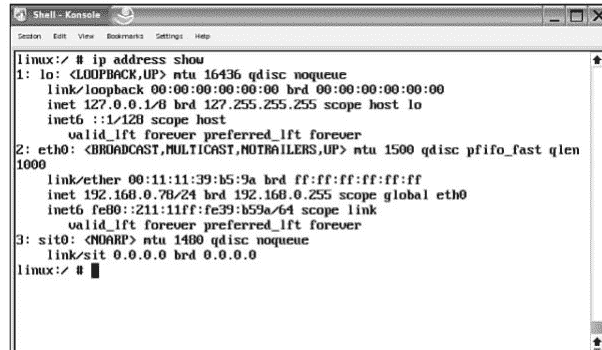

# 403
第 11 章
网络基础

将 `add` 替换为 `show` 即可添加设置，而使用 `del` 则允许你删除现有设置。

`ip link show` 命令将显示每个以太网设备的硬件地址，如图 11.10 所示。

# 图 11.10
`ip` 工具可查看硬件地址。

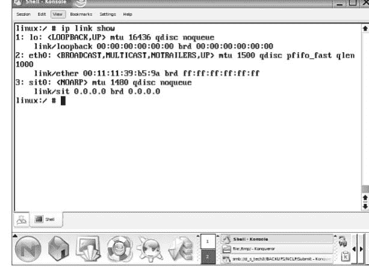

操作路由表，请使用以下命令：

- `ip route show` 查看当前路由表
- `ip route add` 添加路由
- `ip route add` 添加默认路由
- `ip route delete` 删除路由

隧道接口以 `sit x` 的形式存在，其中 `x` 是数字（sit 是 Simple Internet Transition 的缩写）。`sit0` 用作 IPv4 和 IPv6 之间的通用路由。

# 实验练习 11-1：验证你的主机信息

在此练习中，你将检查主机的网络信息。
请完成以下步骤：

1. 以 root 身份登录。
2. 如果没有自动进入命令行窗口，请打开一个。
3. 检查当前网络网卡的配置：
```
ifconfig
```
4. 查看当前主机名：
```
hostname
```
5. 查看当前哪些服务可用和/或正在使用：
```
netstat -a
```

# 实验练习 11-2：在 hosts 文件中创建条目

在此练习中，你将在 `/etc/hosts` 文件中添加一个虚拟条目。

请完成以下步骤：

1. 以 root 身份登录。
2. 如果没有自动进入命令行窗口，请打开一个。
3. 切换到 `/etc` 目录：
```
cd /etc
```
4. 在 `hosts` 文件末尾添加一行，为此机器分配一个等同于环回地址的别名：
```
cat >> hosts
127.0.0.1 willpassthisexam
^D
```
5. 通过向新别名发送五个 ping 包来验证地址解析是否正常：
```
ping willpassthisexam -c 5
```

# 实验练习 11-3：识别正在运行的网络服务

在此练习中，你将查看主机上运行了哪些服务。 
请完成以下步骤：

1. 以 root 身份登录。
2. 如果没有自动进入命令行窗口，请打开一个。
3. 切换到 `/etc` 目录：
4. 查看运行的服务的前几行：
5. 查看“本地地址”（Local Address）列以确定哪些服务正在运行。某些服务以名称显示——例如“www.”。其他显示为数字。翻译是通过 `/etc/services` 文件中的条目完成的。
6. 选择一个字母形式出现的条目，并验证它运行在哪个端口。以下以 finger 为例：
7. 从 `netstat` 输出中选择一个未以字母条目形式显示的端口号，并验证它不在 `/etc/services` 文件中。以下示例使用了条目 `6971`：


`cd /etc`

`netstat -a | more`

`grep finger services`

返回的结果应显示它运行在默认端口 79 上。

`document grep 6971 services`

### 总结

本章重点关注网络基础，特别是 TCP/IP。在提供协议族的背景信息后，本章检查了配置协议族的过程。本章还查看了 Linux 可用的许多网络服务。讨论从负责网络的守护进程——`inetd` 和 `xinetd` 开始，然后转向 `Apache`、`NFS` 和 `DNS` 等服务，最后查看了 `OpenSSH`。

# 命令总结

表 11.5 列出了本章讨论过的命令。

| 工具 | 默认用途 |
| --- | --- |
| arp | 显示地址解析表中的条目 |
| dig | 显示 DNS 条目 |
| domainname | 显示主机使用的域名 |
| ftp | 用于在主机之间传输文件的工具 |
| ifconfig | 显示 TCP/IP 配置参数 |
| ifdown | 停止预配置的网络接口 |
| ifup | 启动预配置的网络接口 |
| ifstat | 显示预配置网络接口的状态 |
| netstat | 显示网络状态信息 |
| ping | 向主机显示回显消息 |
| route | 显示路由表 |
| telnet | 用于建立连接的工具 |
| traceroute | 显示所经路径 |

本页故意留白

# 第 12 章 使用 YaST

YaST 在 SuSE 中以命令行界面和 X Window 应用程序的形式提供。区分 SuSE 与其他实现的主要特征之一是它包含了 YaST（Yet Another Setup）。其外观可能根据你运行的版本而不同——第一种是基于 `ncurses` 的，第二种是 `Qt` 的。由于 YaST 随 SLES 9 一起发布，因此讨论重点是该工具的版本。

该工具的目的是为管理员经常处理的大多数任务提供一站式界面。虽然文本模式的外于图形模式，但所有选项在两种模式下都可用。

本章涵盖以下目标：
1. YaST 简介
2. 使用 YaST 管理用户账户
3. 使用 YaST 进行软件管理
4. 使用 YaST 配置硬件
5. 使用 YaST 配置网络
6. 使用 YaST 更新软件
7. 使用 YaST 进行远程管理
8. 使用 YaST 设置安全

## 介绍 YaST

`ncurses` 和 `Qt` 是用于在终端绘制图形的两种编程库。程序员可以使用许多插件，这些是其中最常用的两个。

从命令行，你可以输入

```
yast -h
```

来查看可用的帮助。你还可以输入

```
yast -1
```


查看所有可用模块列表。

在文本模式下，你可以使用方向键（向上和向下）在菜单和选项之间导航，使用 `Tab` 键在框之间移动（`Alt+Tab` 在窗口间切换）。你也可以使用空格高亮项目并使用 `Enter` 键选择。你可以按 `F9` 退出，按 `F1` 调出帮助（如图 12.2 所示）。

工具启动时的文本模式版本为：

# 图 12.2
文本模式下按 `F1` 可获取帮助。

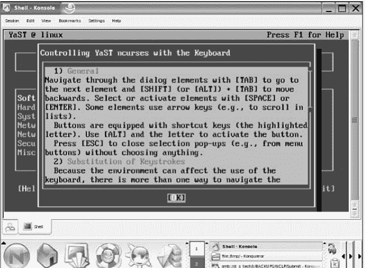

你可以通过命令行输入 `yast2` 来启动图形模式，或者直接从 KDE 菜单选项中选择。图 12.3 显示此界面的启动视图。

在图形界面中，你通过鼠标进行导航。你首先点击左框中的类别，然后从右框中选择一个项目。你还可以点击搜索按钮并输入关键词进行查找。

## 与用户交互

课程目标涵盖

- 2. 使用 YaST2 管理用户账户 (3036)

要在 YaST 工具中与用户交互，首先从左侧框架中选择“安全与用户”（Security and Users）。这会在右侧框架中显示多个选项：

- CA 管理
- 编辑和创建组
- 编辑和创建用户
- 防火墙
- 导入常用服务器证书
- 安全设置
- VPN

选择“编辑和创建用户”（Edit and Create Users）选项，会出现与图 12.4 类似的屏幕。

图 12.3 
YaST2 在图形化模式下的启动视图。

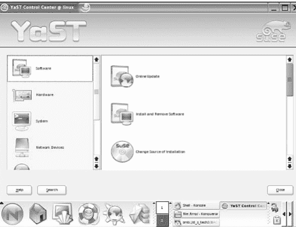

# 413

## 与 YaST 操作
第 12 章

# 图 12.4
可以从“用户和组管理”模块添加和修改用户及组。


你也可以通过在命令行输入 `yas2 users` 来启动加载了用户账户模块的 YaST。

> 注意

从此菜单中，你可以添加、删除或编辑用户。“专家选项”（Expert Options）按钮用于设置适用于新创建账户的默认值，而“设置过滤器”（Set Filter）按钮允许你选择显示的内容——默认是本地用户，但你也可以选择系统用户或自定义显示。

要编辑用户，点击“编辑”（Edit）按钮。会出现一个与图 12.5 所示的对话框。在这里，你可以更改该用户存在的任何设置。

如果你点击“详细信息”（Details），你可以查看并更改如用户 ID、主目录、shell 等值。图 12.6 显示了“详细设置”中存在的变量。

414

# 诺威尔认证 Linux 专业人员学习指南

# 图 12.5
编辑按钮
更改为用户设置的
任何参数。

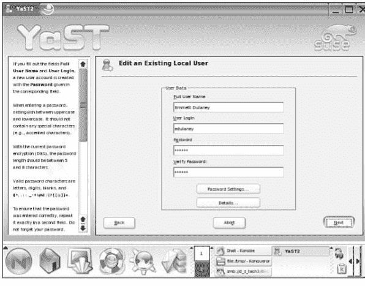

# 图 12.6
用户的所有值
都可以被更改。

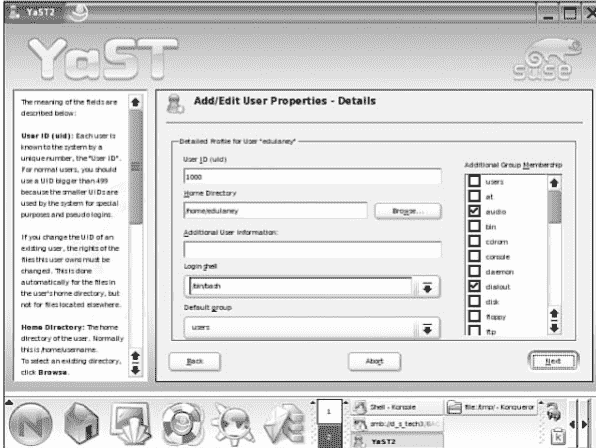

相反，点击图 12.5 所示的“密码设置”（Password Settings），允许你像图 12.7 所示那样设置密码过期和其他变量。

# 第 12 章

与 YaST 操作

# 图 12.7
可以显示并更改
密码的配置参数。

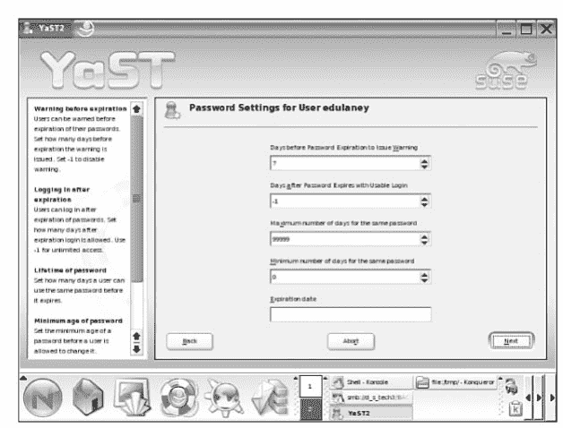

组的添加和编辑方式与用户相同。图 12.8 显示了组的主菜单，其中过滤了系统组并配有“专家选项”。

# 图 12.8
你可以像处理用户一样添加、编辑和删除组。

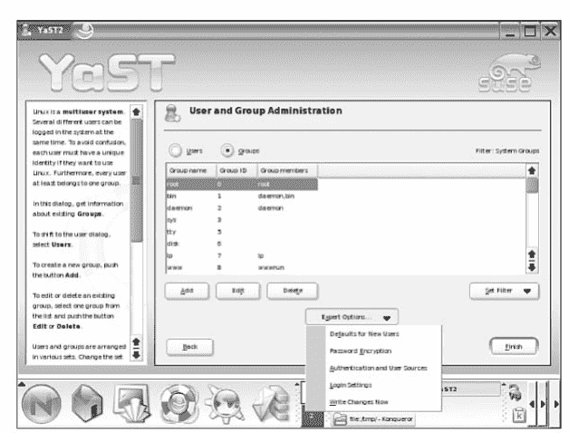

## 与软件交互

课程目标涵盖

- 3. 理解 YaST2 软件管理功能 (3036)

当你在 YaST2 窗口的打开左侧框架中选择“软件”（Software）时（如图 12.3 所示），右侧会出现若干选项：

- 在线更新
- 安装和移除软件
- 更改安装源
- 安装到目录
- 补丁 CD 更新
- 系统更新
- UML 安装
- YOU 服务器配置

这些选项大部分自言自明，你应该针对该目标关注的选项是“安装和移除软件”（Install and Remove Software）。当你选择此选项时，会出现与图 12.9 所示的屏幕。

注意，“过滤器”（Filter）下拉菜单允许你选择想要查看的软件包。如果你选择“选择”（Selections）作为过滤器，你将只看到已安装软件包。如果你选择“软件包组”（Package Groups），你将看到安装媒体上的所有软件。如果你选择“搜索”（Search），你可以指定想要查找另一个包的哪些包。最后，如果你选择“安装摘要”（Installation Summary），你将看到所有标记了状态的软件包。

选择一个选项，显示将改变以反映这些软件包，如图 12.10 所示。

> 注意 你也可以通过在命令行输入 `yast2 groups` 来启动加载了组账户模块的 YaST，

417
与 YaST 操作
第 12 章

# 图 12.9
你可以轻松地添加和
移除软件。

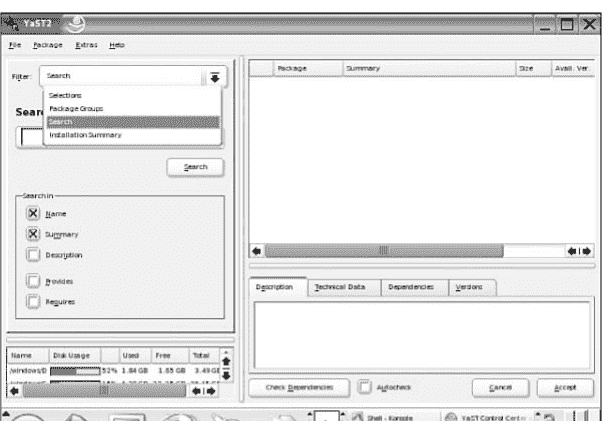

# 图 12.10
你可以看到什么
已安装，并选择
你想要添加或
删除。

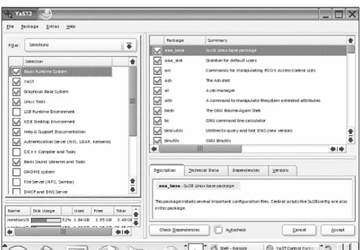

点击一个选项，显示将改变以反映这些软件包，如图 12.10 所示。

433

每当提到依赖关系（dependencies）时，这些是所需的项。执行依赖关系检查时，是查看是否所有组件都是需要的检查。这可以手动完成，也可以自动完成。

## 与硬件交互

课程目标涵盖

- 4. 从 YaST2 获取硬件配置 (3036)

YaST 工具提供了一个简单的硬件的接口。只需在左侧框架中选择 YaST，然后选择你想要配置的对象。例如，图 12.11 显示了显示器的打开。

图 12.11
你可以通过 YaST 更改硬件。

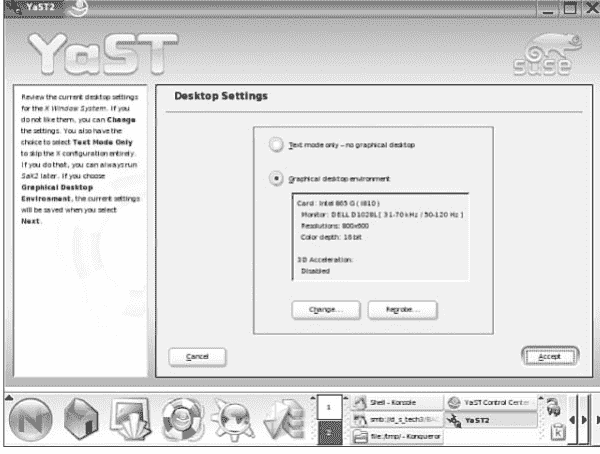

注意，如果你点击“详细信息”（Details），你可以像图 12.12 所示查看并更改此类值。

434

与 YaST 操作
第 12 章

# 图 12.12
硬件信息显示当前设置。

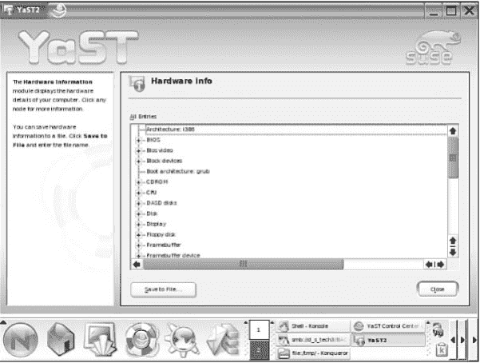

## 与网络交互

课程目标涵盖

- 5. 使用 YaST2 管理网络配置 (3036)

要获取网络配置，首先从左侧框架中选择“网络”（Network）。右侧面板的选项包括：

- DSL
- 传真
- ISDN
- 调制解调器
- 网卡
- 电话拨答机

为了讨论，选择“网卡”（Network Card）。这将打开图 12.13 所示的屏幕。

435

诺威尔认证 Linux 专业人员学习指南

# 图 12.13
网卡的当前设置。

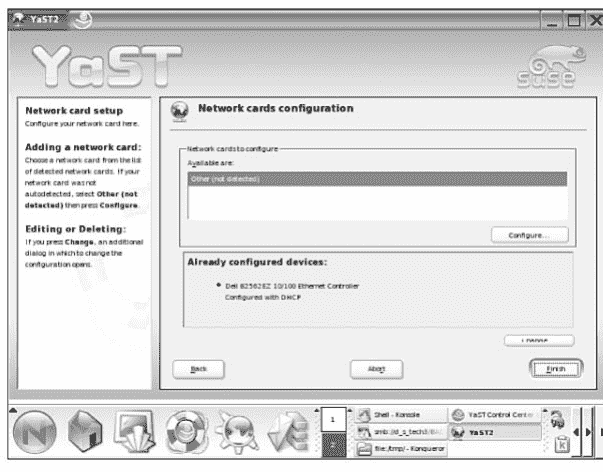

已配置的设备将出现在底部面板（更改/Change），新条目将添加到顶部。如图 12.14 所示。

# 图 12.14
你可以更改网络设置。

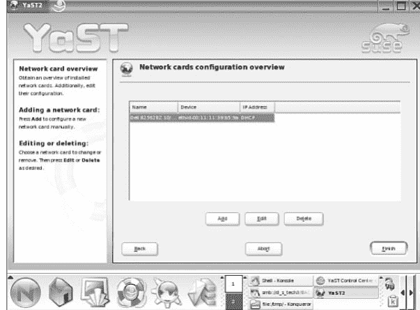

436

手动配置新网卡（Configure）将打开图 12.15 所示的对话框。

# 图 12.15
手动添加网卡。

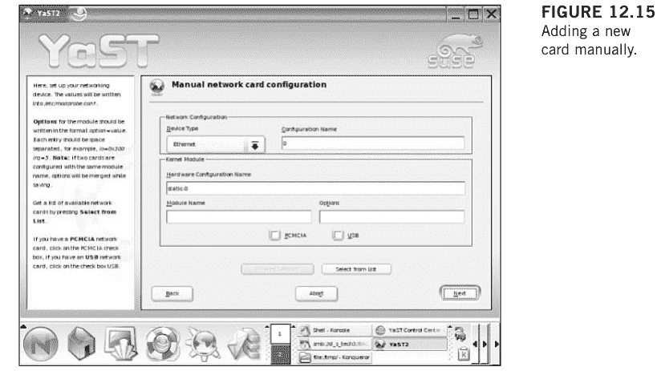

手动配置网卡时必须做出的选择包括使用 DHCP 或手动分配 IP 地址、子网掩码以及在网络基础中讨论过的其他网络值。

## 与 YOU 操作

课程目标涵盖

- 6. 使用 YaST 在线服务器 (YOU) 管理软件更新 (3037)

YaST 在线更新服务器是 Linux 网络的一大进步。它允许你创建一个存储分发给客户端更新的本地服务器。通过集中更新，它允许你减少每个主机都更新的需求和流量。在 YaST 的左侧面板中选择“软件”（Software）和“服务器配置”（Server Configuration）开始配置 YOU 服务器。此显示如图 12.16 所示。

422

诺威尔认证 Linux 专业人员学习指南

> 注意 你也可以通过在命令行输入 `yast2 you_server` 来启动加载了此模块的 YaST。

# 图 12.16
YOU 配置的打开屏幕。

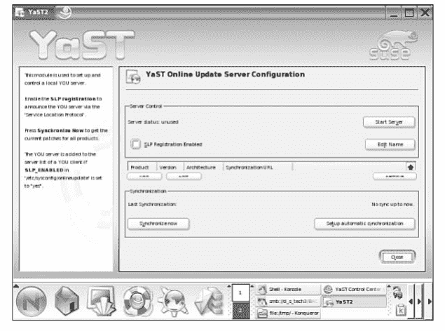

注意 YOU 服务器使用 SLP（服务位置协议）——必须启用它才能正常工作。通过点击“启动服务器”（Start Server）启动服务器，服务器状态将改变以指示其正在运行。你可以点击“立即同步”（Synchronize Now）按钮获取所有产品的当前补丁。

> 注意 客户端只需进入 KDE 桌面并选择 YaST 图标，给出 root 密码，并在软件菜单中选择“在线更新”，即可连接到 YOU 服务器。或者，可以在终端窗口输入 `sudo` 并给出 root 密码，然后输入 `yast2 online_update`。建立连接后，你可以配置客户端并查看有关最新更新的信息。

# 远程管理

涵盖的课程目标

- 7. 使用 YaST 启用远程管理 (3037)

当你点击 YaST 左侧窗格中的“网络服务”选项时，右侧会出现若干选项。远程管理如图 12.17 所示。

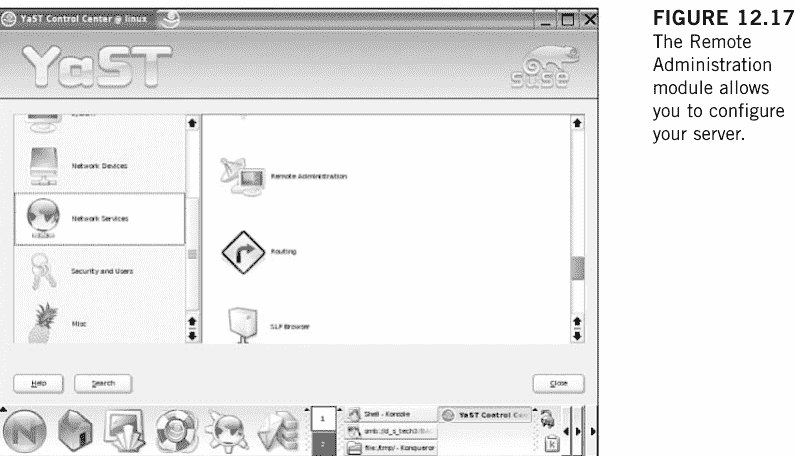

这里的选项非常简单——要么允许远程管理，要么不允许（默认设置）。这两个选项如图 12.18 所示。

> 注意
> 你也可以通过命令行输入 `yast2 remote` 来启动带有此模块的 YaST。

在选择启用远程管理后，必须重启显示管理器。现在可以访问并对其进行远程管理了。

# 图 12.18
点击“允许远程管理”单选按钮以启用远程管理。

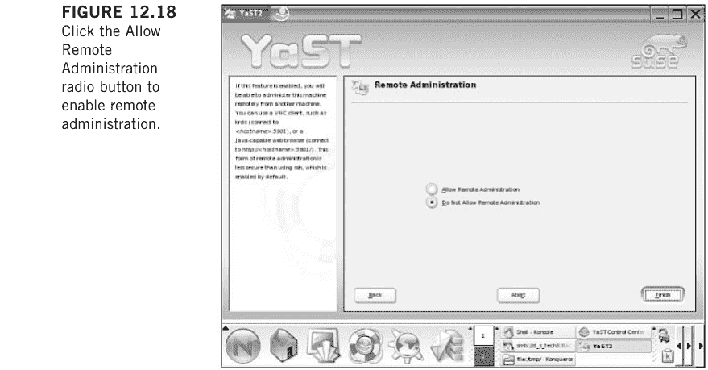

要进行远程管理，请在浏览器中输入以下内容（将 host 替换为服务器的 IP 地址）：`http://host:5081`

将打开一个虚拟网络会话（VNS）窗口，并提示输入用户名和密码。在提示这些项目时，你可以点击“管理”，此时 YaST 将启动（你需要输入 root 密码）。

> 注意
> 如果需要重启会话，使用 `restart` 命令即可为你解决问题。

# 安全设置

涵盖的课程目标

- 8. 使用 YaST 配置安全设置 (3038)

正如 YaST 可用于配置各个方面，它也可以为你的安全设置提供界面。要进入此模块，请在左侧窗格中选择“安全与用户”，并在右侧窗格中选择“安全设置”。将显示如图 12.19 所示的模块。

# 使用 YaST
第 12 章

# 图 12.19
YaST 内部的安全设置。


此菜单中出现的四个设置是：

- Level 1（家庭工作站）——这是你可以采用的最低安全级别，不应在业务环境中使用。
- Level 2（网络工作站）——这是中等安全级别，应被认为是业务最低标准。
- Level 3（网络服务器）——推荐服务器使用的高级安全。
- Custom Settings（自定义设置）——默认设置。

你可以选择任何预定义的角色，并点击“详情”来微调任何单独设置。或者，你可以保持默认的“自定义设置”，然后点击“下一步”查看所有可用选项。出现的第一个屏幕允许你设置设置，下一个（如图 12.20 所示）显示启动设置。在启动设置之后，配置登录设置，然后是新增用户和组的参数。最后，杂项设置允许你配置谁运行什么（无人或 root）。你可以从三种可能的权限权限中进行选择：

- Easy（简单）——大多数配置文件都可以被用户读取。
- Secure（安全）——只有 root 可以读取如 `/var/log/messages` 等系统文件。
- Paranoid（偏执）——访问权限是尽可能严格的。

# 图 12.20
配置默认设置。


你可以通过进入 `/etc` 并查看 `permissions.easy`、`permissions.secure` 和 `permissions.paranoid` 来查看这些层级的单独设置。每个文件大约有 850 行。本章重点关注 Linux 的图形化界面，并研究了 YaST（另一个设置工具）如何与众脱颖而出。使用此工具，你可以执行大多数完成任务时需要命令行语法的管理功能。

# 第 13 章 其他需要了解的事目

与大多数认证考试一样，有几个主题不属于某个大类。其中一些是有用的次要话题，另一些则足够重要，以至于考官希望你熟悉它们。无论背景如何，本章代表了主题杂锦，涵盖了以下内容：

1. 访问和使用 man Pages (3036)
2. 使用 info 页面 (3036)
3. 访问发行说明和白皮书 (3036)
4. 在 Linux 系统中使用基于 GUI 的帮助 (3036)
5. 在网络上查找帮助 (3036)
6. 在 Linux 上查找文件 (3036)
7. 调度作业 (3037)
8. 使用 cron 自动数据备份 (3038)
9. 理解 C 语言基础 (3038)
10. 理解 GNU 工具链 (3038)
11. 理解共享库的概念 (3038)
12. 执行标准构建过程 (3038)
13. 监控操作系统 (3038)
14. 监控文件系统 (3038)

# 使用本地文档

涵盖的课程目标

1. 访问和使用 man Pages (3036)
2. 使用 info 页面 (3036)
3. 访问发行说明和白皮书 (3036)
4. 在 Linux 系统中使用基于 GUI 的帮助 (3036)

所有 Linux 实现中都提供了多种方法来获取实用程序的的操作帮助。此外，许多供应商会添加自己的文档和或工具来简化这一过程。在本节中，我们将查看这些常用工具：

- `man`
- `--help`
- `info`

# man 工具

`man`（手册）工具可以追溯到 Unix 早期。使用用户环境变量 `PAGER` 中定义的任何分页工具，它可以显示 `MANPATH` 变量包含的目录下的文档。`PAGER` 变量在 SUSE 上通常等于 `less`，也可以是 `more`。`MANPATH` 变量包含 `/usr/share/man`、`/usr/local/man`、`/usr/X11/man` 和 `/opt/gnome/share/man`，但也可以包含其他。

尽管 `/usr/share/man` 下有很多目录，但主要的目录及其目的包括表 13.1 所示的目录。

表 13.1 /usr/share/man 子目录
| 子目录 | 包含的描述 |
|---|---|
| man1 | Shell 实用程序/用户命令 |
| man2 | 系统调用 |
| man3 | libc 调用 |
| man4 | /dev 描述 |
| man5 | /etc 和其他配置文件（如协议） |
| man6 | 游戏 |
| man7 | Linux 系统文件、约定等 |
| man8 | root 用户/系统管理实用程序 |

当你输入显示手册页（man）的命令时，会搜索这些子目录直到找到第一个匹配。例如，如果你输入以下命令：

```
man nice
```

将搜索目录直到找到第一个描述 `nice` 的手册页匹配项。找到手册页后，将使用 pager 变量指定的工具进行显示。输出示例如下：

# 表 13.2 继续

| 组合键 | 移动操作 |
| :--- | :--- |
| PageUp | 向上滚动半页 |
| End | 移动到页面末尾 |
| Home | 移动到页面开头 |

让我们查看实际显示的内容：第 1 行给出工具的名称，括号中标识了文档来自哪个子目录。在这种情况下，`(1)` 表示找到的文档是关于 shell 实用或用户命令的。如果还有其他名为“nice”的实体的文档，它们将不会被显示，因为默认操作是仅显示找到第一个实体。

要检查系统上是否存在多组具有相同名称的文档，你可以使用 `whatis` 命令：

```


```
$ whatis

nice (1) - 以修改的调度优先级运行程序

nice (2) - 更改进程优先级

nice (1p) - 运行一个已更改 nice 值的实用程序

nice (3p) - 更改进程的 nice 值

$
```

在这种情况下，结果显示在 `man2`、`man 1p` 以及 `man 3p` 下也有另一组关于 `nice` 的文档。显示的列表来自 `whatis` 数据库。要查看第二组文档而不是第一组，应使用命令：

```
man 2 nice
```

此命令指定了你想查看来自 `man2` 目录的 `nice` 文档（3 代表 `man3`，4 代表 `man4`，依此类推）。

手册文件的其他行分别开始了 Name（名称）、Synopsis（摘要）、Description（描述）和 Options（选项）部分。根据工具的复杂性和其他功能，还可能存在 See Also（相关内容）、Diagnostics（诊断）、Files（文件）、Bugs（缺陷）以及 History（历史）和 Author（作者）部分。

第三行本身是对该工具作用的简短摘要，并与 `whatis` 工具返回的行相匹配。其他行描述了可以使用的选项，并详细介绍了每个选项的工作原理。

# 诺威认证 Linux 专家学习指南

在使用 `man` 时可以使用的各种选项（可以通过命令 `man man` 确认）包括：

- `-a` 显示所有与给定文本匹配的页面，而不是在找到第一个匹配后退出（匹配不是通过 `whatis` 数据库查找，而是通过检查子目录查找）。
- `-k` 显示所有具有相同名称的手手册（在 `whatis` 数据库中找到），并且在显示第一个后不停止。这与前面的 `-K` 不同，后者搜索整个页面，而 `-k` 只搜索页眉。
- `-M` 指定要检查的路径（而不是 `/usr/man` 的所有子目录）。
- `-P` 指定使用的不同用户。

# 使用 --help

正如 `nice` 的手册条目所示，对于许多工具/命令，你可以在工具名称后加上 `--help`。这将为该工具提供非常实用的帮助，仅显示语法，例如：

```
$ nice --help

Usage: nice [OPTION]... [COMMAND [ARG]...

以调整后的调度优先级运行 COMMAND。

如果没有 COMMAND，则打印当前的调度优先级。默认情况下 ADJUST 为 10。范围从 -20（最高优先级）到 19（最低优先级）。

ADJUST 通过 ADJUST 增加优先级

-n, --adjustment=ADJUST 等同于 -ADJUST

--help 显示此帮助并退出

--version 输出版本信息并退出

```

向 <bug-coreutils.gnu.org> 报告缺陷
$
```

这是仅包含部分手册条目的简略版本（仅限语法）。是否有帮助信息很大程度上取决于创建该工具的程序员。大多数较新的（GNU）工具/命令都包含 `--help` 选项，但这远非标准，在旧工具中没有，在应用程序中也很少。

# 获取信息

可以使用 `info` 工具显示 GNU 工具的文档。语法格式为：

```
info
```

或

```
info {utility name}
```

如果调用工具时后面没有跟随工具名称，它将显示一个与图 13.1 所示的主菜单（img/38aae1e03db883dab6758259ffc838.png）。当显示保持时，你实际上是在看一个文件的顶部（头部）。它包含了所有支持 `info` 命令的工具列表，并分为若干部分（杂项、GNU文件工具、语言等）。每个星号后面是项目的名称，在每组括号内是你想要查看该项目条目时要输入的文本。例如，要查看 `bash` 的 info，在命令行中输入：

```
$ info bash
```

在菜单中，你还可以按“m”调出菜单提示符，然后输入快捷键（在这种情况下为“bash”）。第一个屏幕列出了在工具内导航需要了解的命令（h、d 等）及其功能。向下箭头用于一次一行地滚动列表，回车键选择该条目并显示其信息。文件是超文本格式，因此通常进行一个选择会带你进入另一个菜单。为了说明，你可以使用向下箭头滚动此行：*gzip*。压缩文件的命令。然后当你按下回车时，将出现 `gzip` 的选项菜单，如图 13.2 所示。

# 图 13.2

`gzip` 工具的 info 显示（img/38aae1e03db883dab6758259ffc838.png）。

`gzip` 工具的 info 显示。在这里，`q` 将退出，`d` 将带你回到。

# 第 13 章

在 `info` 中工作的其他组合键总结在 13.3 中。文件位于 `/usr/share/info`。

# 内部导航

| 组合键 | 移动操作 |
| :--- | :--- |
| 空格，PageDown | 向下滚动页 |
| 退格，PageUp | 向上滚动页 |
| Q | 将光标置于页面开头 |
| B | 将光标置于页面末尾 |
| 制表符 | 移动到下一个引用 |
| 回车 | 选择该条目并显示信息 |
| N | 移动到同一页的下一个 |
| P | 移动到同一页的上一个 |
| U | 向上移动 |
| L | 移动到最后显示 |
| S | 搜索 |
| H | 帮助 |
| ? | 显示摘要 |

# 本地文档

其他可以找到信息的地方，以及在该范围内用途有限的其他工具。需要注意的两个工具是

- `whereis`
- `apropos`

`whereis` 工具将列出与文件相关的所有信息，包括文档（如果有）。例如：

```
$ whereis nice
nice: /usr/bin/nice /usr/share/man/nice.gz
```

```
/usr/share/man/man2/nice.gz
...
$
```

搜索仅限于特定目录。在这种情况下，第一个列表是二进制文件本身，另外两个是 man 条目。如果没有 man 条目，将不会显示内容；如果有源文件或相关文件，则会显示。例如：

```
$ whereis info
info: /usr/bin/info /usr/share/info
$
```

`apropos` 工具使用 `whatis` 数据库查找值并返回早期通过 `whatis` 工具看到的简短摘要。区别在于它扫描数据库并报告工具名称的所有匹配项，而不只是精确匹配：

- * apropos nice

CGI::Pretty (3pm) - 生成格式化 HTML 代码的模块

snice (1) - 发送信号或报告进程状态

nice (1p) - 运行一个已更改 nice 值的实用程序

nice (3p) - 更改进程的 nice 值

renice (8) - 修改运行进程的优先级

English (3pm) - 使用良好的英语（或 awk）命名糟糕点符号

renice (1p) - 设置运行进程的 nice 值

getpriority (3p) - 获取并设置 nice 值

nice (1) - 以修改的调度优先级运行程序

nice (2) - 更改进程优先级

setpriority (3p) - 获取并设置 nice 值

$
```

其他本地可以找到如白皮书和发布说明等文档的地方包括 `/usr/share/doc` 的子目录。该目录包含许多子目录，你需要的关键目录如下：

- * howto—该目录包含有关如何执行任务描述的子目录。

# 第 13 章

## 其他需要了解的项目

- manual—包含 SLES 管理手册，通常以 PDF 和 HTML 格式提供。
- packages—软件包的文档位于此处的子目录下。
- release-notes—包含 HTML 版本和 RTF 版本的发布说明。

其他存在的本地文档取决于已安装的应用程序。请始终首先查看 `packages` 目录，确认相关信息是否在其中。在许多应用程序中，你也可以按 F1 键获取帮助。

SUSE 包含一个帮助中心（HelpCenter），也可以从图形界面中获取帮助。这由桌面上的救生圈图标（KDE 面板顶部）指示。点击该图标将弹出图 13.3 所示的帮助中心主。


你可以使用搜索功能来查找信息，或者点击目录（Contents）或词表（Glossary）来查找你需要的内容。

在 KDE 浏览器中，你也可以通过 HTML 链接使用帮助功能。例如，要读取 `nice` 的 man 页面，请输入此地址：

```
man:nice
```

这将显示图 13.4 所示的界面。

图 13.4

你可以通过浏览器访问相同的帮助功能。


# 查找远程资源

### 涵盖的课程目标

- 5. 在网络上查找帮助 (3036)


除了本地资源外，互联网上还有其他资源。这些资源可以分为两类：网站和新闻组。前者提供静态信息，信息可能会每天或频繁变化，但允许你在不提供任何特定交互的情况下获取信息。另一方面，新闻组是由决定参与的人之间的通信线程组成的。你可以在新闻组中针对你的情况发布问题，并（希望）得到一个或多个试图帮助你的知识丰富的人士的回答。你永远不会使用新闻组来发布一个在其他地方很容易找到答案的常见问题。

表 13.4 列出了提供 Linux 或工具导向资源的站点。由于互联网是一个不断变化的实体，未来此处列出的所有站点可能仍然存在，也可能出现更新/更好的站点：永远不要低估良好的搜索引擎在告知你这两点方面的力量。

# Linux 或工具导向资源

### 表 13.4

| 类别 | 站点 | 描述 |
|---|---|---|
| 文档 | www.kde.org | KDE 界面背后的组织 |
| 文档 | www.tldp.org | Linux 文档项目 (LDP)—对于寻找 HOWTO 信息极具价值 |
| 文档 | www.linuxlookup.com | LinuxLookup—HOWTOs 和评测 |
| 内核 | www.kernel.org | 用于所有与内核相关的事务 |
| 新闻 | www.linux.com | Linux.com |
| 新闻 | www.linux.org | Linux Online |
| 新闻 | www.linuxplanet.com | LinuxPlanet |
| 安全 | www.cert.org | 漏洞/病毒跟踪 |
| 安全 | www.securityfocus.com | 安全问题 |
| 供应商 | www.suse.com | SuSE |

即使该站点可能是某个软件供应商的，或者是你运行之外的其他 Linux 版本，你也永远不要忽略检查它。简单的原因是，许多 Linux 站点在推广其产品之外，还会发布通用操作系统的常见问题解答（FAQs）和帮助文件。

以下新闻组对于解决你可能遇到的特定问题可能极具价值。新闻组的奇之处在于它们的名称自而易懂，这可以防止你在错误的位置发布问题：

- comp.os.linux.advocacy
- comp.os.linux.announce.html
- comp.os.linux.answers
- comp.os.linux.development.apps
- comp.os.linux.development.system
- comp.os.linux.hardware
- comp.os.linux.misc
- comp.os.linux.networking
- comp.os.linux.setup
- comp.os.linux.x
- linux-admin
- linux-alpha
- linux-apps
- linux-config
- linux-doc
- linux-kernel
- linux-laptop
- linux-newbie
- linux-sound
- linux-standards

# 使用 KFind

## 涵盖的课程目标

- 6. 在 Linux 上查找文件 (3036)

第 4 章“处理文件”介绍了一些可以用于在系统中查找文件的实用程序。此外，我们已经检查了可用最实用的工具之一。还有一个工具需要查看。`KFind` 提供了一种图形化界面。你可以通过 KDE 菜单中选择文件来启动它，界面如图 13.5 所示。

图 13.5

你可以通过 KFind 查找。


它支持正则表达式和通配符，结果如图 13.6 所示。

图 13.6

通过 KFind 查找。


# 稍后调度任务

## 涵盖的课程目标

- 7. 调度任务 (3037)
- 8. 使用 cron 自动备份 (3038)

通常情况下，有很多任务可以在你不在时运行。使用 `at` 命令可以帮助。

## 使用 at

`at` 命令允许你在指定时间调度任务。语法如下：

```
at {time}
```

时间可以用许多方式指定：

- 17:31—下午 5 点
- now—现在运行
- now + 5 days—5 天后运行
- 17:31 Mar 14—在 3 月 14 日下午 5 点运行
- midnight—在今晚午夜运行

默认情况下，只有 root 用户可以使用 `at` 命令。这可以通过利用 `at.allow` 文件或 `at.deny` 文件来更改。如果只有 `at.allow` 文件存在，列出的用户可以使用 `at` 命令。另一方面，如果存在 `at.deny` 文件，除列出的用户外都可以使用 `at` 命令。稍微复杂一点，如果 `at.deny` 文件是空的，只有 root 用户可以使用它。

当你给出 `at` 命令和时间时，提示符变为 PS2 提示符（`>`），你可以输入要在在该时间运行的任意命令。当你完成后，按 Ctrl+D 返回 PS 提示符。

调度以后执行的任务可以通过此命令列出：

```
at -l
```

或者

```
atq
```

个人用户只会看到自己的条目，而列表存储在 `/var/spool/atjobs`。这些文本文件持有创建任务时应用的环境信息，以及任务内部的命令。在执行之前，可以使用以下命令和任务号停止命令：

```
at -d
```

或者

```
atrm
```

# 诺瓦尔认证 Linux 专家人士学习指南


# 诺瓦尔认证 Linux 专家人士学习指南

## 其他需要了解的项目

### 第 13 章

```
GPG_AGENT_INFO=/tmp/vNNtn/S.gpg-agent:6951; export GPG_AGENT_INFO
HOST-linux=: export HOST
PROFILEREAD=true; export PROFILEREAD
HSIZE=1000; export HSIZE
XDM_MANAGED=/var/run/xdmctl/xdmctl-:0,rsvd,method=classic;export XDM_MANAGED
STYLE=keramik; export STYLE
GTK2_RC_FILES=/etc/gnome/gtk-2.0/gtkrc:/opt/gnome/share/themes/Keramik/gtk-2.0/gtkrc:/root/.gtkrc-2.0.keramik:/root/.kde/share/config/gtkrc; export GTK2_RC_FILES
GTK_RC_FILES=/etc/gnome/gtk/gtk:/opt/gnome/share/Keramik/gtkrc:/root/.gtkrc-keramik:/root/.kde/share/config/gtkrc; export GTK_RC_FILES
WINDOWID=4613751; export WINDOWID
KDEHOME=/.kde; export KDEHOME
QTDIR=/usr/lib/qt3; export QTDIR
XSESSION_IS_UP=yes; export XSESSION_IS_UP
KDE_FULL_SESSION=true; export KDE_FULL_SESSION
JRE_HOME=/usr/lib/java/jre; export JRE_HOME
USER=root; export USER
CURSOR_SIZE=: export CURSOR_SIZE
LS_COLORS=no=00;fi=01;di=01;34;in=40;36:pi=40;35:so=01;=>=35;bd=40=>=31;cd=01;40;31;or=41;34;ex=01;32;*.cmd=00;32;*.exe=0=>=32;*.ba=31;32;*.btm=32;*.del=01;32;*.tar=00;31;*=>=31;*.bz=01;*.tgq=01;31;*.rpm=00;31;*.deb=01;31;*.arj=00;31;*.az=00=>=31;*.lzh=01;*.zip=01;31;31;*.zoo=01;31;*.z=00;31;*.Z=00;31;*.gz=00=>=31;*.bz2=01;*.31;*tb2=01;31;*.tz2=00;31;*.tb2=00;31;*.avi=01;35;*=>=35;bmp=01;*.fl1=01;35;*.gif=01;35;*.jpg=01;35;*.jpeg=01;35;*.mng=00=>=31;*.mov=01*.35;*.mpg=01;35;*.pcx=01;35;*.pbm=01;35;*.pgm=01;35;*=>=31;*.tga=01;35;*.t1=35;*.tif=01;35;*.xbm=01;*.xpm=01=>=31;*.dl=01*.gl=01;35;*.aiff=00;32;*.mid=00;32;*.mp=00=>=30;32;*.ogg=00;32;*.voc=00;32;*.wav=00;32; export LS_COLORS
OPENWINHOME=/usr/bin; export OPENWINHOME
```

```
XNLPATH=/usr/X11/lib/X11/nls; export XNLPATH
HOSTTYPE=i386; export HOSTTYPE
KDEROTHOME=/root/.kde; export KDEROTHOME
SESSION_MANAGER=local/linux:/tmp/.ICE-unix/7018; export SESSION_MANAGER
P=less; export PAGER
LD_HWAC_MASK=0x200000000; export LD_HWAC_MASK
KONSOLE_DCOP=DCOPRef; (konsole-7053,console=); export KONSOLE
MINicom=-c; on; export MINicom
DESKTOP_SESSION=custom; export DESKTOP_SESSION
PATH=/usr/bin:/usr/local/sbin:/root/bin:/usr/local/bin:/usr/bin:/usr/X11/lib:/bin:/bin:/usr/local/game/bin:/opt/kde3/bin:/usr/lib/java/jre/bin; export PATH
CPU=i866; export CPU
JAVA_BINDIR=/usr/lib/java/jre/bin; export JAVA_BINDIR
KONSOLE_DCOP_SESSION=DCOPRef (konsole-7053,session-1); export KONSOLE
INPUTRC=/etc/inputrc; export INPUTRC
PWD=etc; export PWD
XMODIFIERS=@lm-local; export XMODIFIERS
JAVA_HOME=/usr/lib/java/jre; export JAVA_HOME
TEXT=/root/.tex; export TEXT
SHLV=2; export SHLV
HOME=root; export HOME
ADVANCED_PREPROCESSOR=no; export ADVANCED_PREPROCESSOR
OSTYPE=linux; export OSTYPE
LS_OPTIONS=-a; export LS_OPTIONS
no_proxy=all; export no_proxy
XURSOR_THEME=crystal; export XURSOR_THEME
WINDOWMANAGER=/usr/bin/kde-wm; export WINDOWMANAGER
GTK_PATH=2.0; export GTK_PATH
LESS=close; export LESS
MACHTYPE=linux; export MACHTYPE
LC_TYPE=UTF-8; export LC_TYPE
PKG_CONFIG=/etc/pkgconfig; export PKG_CONFIG
LESSOPEN=export LESSOPEN
LOCAL_PATH=/usr/share/info;export LOCAL_PATH
USE_FAM=export USE_FAM
PATH_PATH=export PATH_PATH
INFO=export INFO
BROKEN_HOME=/usr/info
JAVA_HOME
export JAVA_HOME
COLTERM
export COLWD
export COLWD
```

## 其他需要了解的项目

### 第 13 章

```
XNLPATH=/usr/X11/lib/X11/nls; export XNLPATH
HOSTTYPE=i386; export HOSTTYPE
KDEROTHOME=/root/.kde; export KDEROTHOME
SESSION_MANAGER=local/linux:/tmp/.ICE-unix/7018; export SESSION_MANAGER
P=less; export PAGER
LD_HWAC_MASK=0x200000000; export LD_HWAC_MASK
KONSOLE_DCOP=DCOPRef; (konsole-7053,console=); export KONSOLE
MINicom=-c; on; export MINicom
DESKTOP_SESSION=custom; export DESKTOP_SESSION
PATH=/usr/bin:/usr/local/sbin:/root/bin:/usr/local/bin:/usr/bin:/usr/X11/lib:/bin:/bin:/usr/local/game/bin:/opt/kde3/bin:/usr/lib/java/jre/bin; export PATH
CPU=i866; export CPU
JAVA_BINDIR=/usr/lib/java/jre/bin; export JAVA_BINDIR
KONSOLE_DCOP_SESSION=DCOPRef (konsole-7053,session-1); export KONSOLE
INPUTRC=/etc/inputrc; export INPUTRC
PWD=etc; export PWD
```


`XMODIFIERS=@lm-local`; export `XMODIFIERS`

`JAVA_HOME=/usr/lib/java/jre`; export `JAVA_HOME`

`TEXT=/root/.tex`; export `TEXT`

`SHLV=2`; export `SHLV`

`HOME=root`; export `HOME`

`ADVANCED_PREPROCESSOR=no`; export `ADVANCED_PREPROCESSOR`

`OSTYPE=linux`; export `OSTYPE`

`LS_OPTIONS=-a`; export `LS_OPTIONS`

`no_proxy=all`; export `no_proxy`

`XURSOR_THEME=crystal`; export `XURSOR_THEME`

`WINDOWMANAGER=/usr/bin/kde-wm`; export `WINDOWMANAGER`

`GTK_PATH=2.0`; export `GTK_PATH`

`LESS=close`; export `LESS`

`MACHTYPE=linux`; export `MACHTYPE`

`LC_TYPE=UTF-8`; export `LC_TYPE`

`PKG_CONFIG=/etc/pkgconfig`; export `PKG_CONFIG`

`LESSOPEN=export LESSOPEN`

`LOCAL_PATH=/usr/share/info`;export `LOCAL_PATH`

`USE_FAM=export USE_FAM`

`PATH_PATH=export PATH_PATH`

`INFO=export INFO`

`BROKEN_HOME=/usr/info`

`JAVA_HOME`

export `JAVA_HOME`

`COLTERM`

export `COLWD`

export `COLWD`

# 使用 cron

`cron` 是用于按时间执行命令的。默认情况下，每个用户都可以使用 `crontab`。但是，如果存在 `/etc/cron.allow` 或 `/etc/cron.den` 文件，情况就会发生。存在 `cron.allow` 文件，只有列出的用户可以创建 `crontab` 文件。存在 `cron.den` 文件，除了列出的用户外，所有用户都可以使用。这两个文件是互斥的：你不会在系统中同时拥有它们。

要查看当前的 `crontab` 文件，用户可以使用此命令：

```bash
crontab -l
```

要删除它，可以使用 `-r` 选项：

```bash
crontab -r
```

要编辑它，可以使用 `-e` 选项：

```bash
crontab -e
```

对于 `root` 用户，要查看其他用户的文件（例如 `larry`），他可以使用 `-u` 选项：

```bash
crontab -u larry
```

`crontab` 文件每行一个条目，每行由六个字段组成。这些字段用空格分隔。第一次查看这样的文件时，它看起来像是一堆乱码。为了理解你看到的内容，请记住这六字段：

1. 分钟（0–59）
2. 小时（0–23）
3. 日（1–31）
4. 月（1–12）
5. 周（0=星期日，6=星期六）
6. 要执行的命令

这是一个示例：

```
$ pw
/home/edulaney
$ cat example
logger This is running every five minutes after the hour
$
$ crontab -l
no crontab for edulaney
$ crontab -e
```

> 注意：这将在编辑器中打开一个空白文件。

```
5 * * * /home/edulaney/example
```

> 注意：这会将该脚本（向 `/var/log/messages` 写入日志）设置为每小时的五分钟运行一次，无论小时（`*`）、日期（`*`）、月份（`*`）还是星期几（`*`）。

# 编程 101

涵盖的课程目标

- 9. 理解 C 语言编程基础 (3038)
- 10. 理解 GNU 构建工具链 (3038)
- 11. 理解共享库的概念 (3038)
- 12. 执行标准构建过程 (3038)

不要被本节的目标所误导或吓到。此项考试的针对的是系统管理员，而不是开发者或程序员。同时，你需要了解一些关于开发过程的知识以便进行有效交流，而这正是这四个目标发挥作用的地方。

你需要了解的是，Linux 与它之前的 Unix 一样，主要用 C 或 C++ 编写，这两者都是编译型语言。这意味着应用程序在运行之前必须经过编译——这与第 6 章“Shell、脚本、编程与编译”中讨论的脚本不同。编译型语言的优势在于执行速度快，并且可以创建驱动等插件。Linux 使用的 C 语言编译器是 `gcc`——即 GNU 编译器。SuSE 以及大多数其他 Linux 实现都默认安装了 `gcc`。

GNU 构建过程包括以下步骤：

- 1. 使用 `configure` 实用准备构建。这本质上是开始构建配置的启动文件。
- 2. 使用 `make` 工具（编译）源代码。根据软件包的大小，完成此操作可能需要几秒钟到相当长时间不等。
- 3. 使用 `make install` 实际安装编译后的程序。此命令将所有软件包组件安装到它们的默认目录。
- 4. 安装所需的软件包。

强烈建议你阅读 `configure` 和 `make` 的手册页（`man pages`），以熟悉它们的基本功能。

请记住一个 Linux 发行版（任何 Linux 发行版）拥有数百个软件包文件。一个软件包文件可以包含从一个程序文件到数百上万个文件。

# Novell 认证 Linux 专业学习指南

共享库的使用是为了执行常用函数的应用程序不需要将这些功能嵌入到每个程序内部。共享库由共享对象（`shared object`）和一个头文件组成。

将所有步骤整合在一起，以下是 `penguins` 游戏标准构建过程的步骤：

- 1. 解压源码包：`tar xzf penguins-2.2.tar.gz`
- 2. 进入源码目录：`cd penguins-2.2/`
- 3. 运行配置脚本：`./configure`
- 4. 开始编译：`make`
- 5. 安装程序：`make install`

尽管有重复之嫌，但值得再次指出，管理员考试并不要求你成为程序员。你不需要知道如何编写 C 语言代码。然而，你需要知道这里给出的标准构建过程步骤。

# 监控 SLES

涵盖的课程目标

- 13. 监控操作系统 (3038)
- 14. 监控文件系统 (3038)

当一切都按预期运行时，挑战就变成了如何保持掌控，并在潜在问题变成真实问题之前主动发现并响应它们。这是通过监控实现的，而需要监控的两个关键元素是操作系统和文件系统。

第 5 章“基础 Linux 管理”讨论了配置系统日志和 `syslog` 守护进程—`syslogd`。务必记住该进程是通过 `/etc/syslog.conf` 文件进行配置的，并记住如何使用 `logrotate` 命令。第 5 章中未提到但值得了解的是 `lspci` 工具。该工具将列出所有通过 PCI 总线连接的设备。

# 需要了解的其他项目 第 13 章

以下是命令输出示例：


# lspci
```
0000:00.00.0 Host bridge: Intel Corp. 82865G/PE/P DRAM
➡Controller/Host-Hub Interface (rev 02)
0000:00.02.0 VGA compatible controller: Intel Corp. 82865G
➡Integrated Graphics Device (rev 02)
0000:00.1d.0 USB Controller: Intel Corp. 82801EB/ER
➡(ICH5/ICH5R) USB HCI #1 (rev 02)
0000:00.1d.1 USB Controller: Intel Corp. 82801EB/ER
➡(ICH5/ICH5R) USB HCI #2 (rev 02)
0000:00.1d.2 USB Controller: Intel Corp. 82801EB/ER
➡(ICH5/ICH5R) USB HCI #3 (rev 02)
0000:00.1d.3 USB Controller: Intel Corp. 82801EB/ER
➡(ICH5/ICH5R) USB HCI #4 (rev 02)
0000:00.1d.7 USB Controller: Intel Corp. 82801EB/ER
➡(ICH5/ICH5R) USB EHCI Controller (rev 02)
0000:00.1e.0 PCI bridge: Intel Corp. 82801BA/CA/DB/ER
➡to PCI Bridge (rev 02)
0000:00.1f.0 ISA bridge: Intel Corp. 82801EB/ER
➡(ICH5/ICH5R) LPC Bridge (rev 02)
0000:00.1f.1 IDE interface: Intel Corp. 82801EB/ER
➡(ICH5/ICH5R) Ultra ATA Controller (rev 02)
0000:00.1f.2 IDE interface: Intel Corp. 82801EB/ER
➡(ICH5/ICH5R) Serial Storage Controller (rev 02)
0000:00.1f.3 SMBus: Intel Corp. 82801EB/ER
➡(ICH5/ICH5R) SMBus (rev 02)
0000:01.01.0 Multimedia audio controller: Creative Labs SB
0000:01.08.0 Ethernet controller: Intel Corp. 82562EZ 10/100
➡Ethernet Controller (rev 02)
```

另一个方便的工具是 `siga`，代表系统信息。该工具将读取配置文件和诊断输出，并将结果保存到两个文件中：`/tmp/siga.txt` 和 `/tmp/siga.html`。在工具完成后，浏览器会自动打开 html 文件（见图 13.7），你也可以以任何你的方式查看文本文件。

# Novell 认证 Linux 专业学习指南

## 图 13.7

`siga` 的结果被分为几类。

文本文件可能很大——超过 9000 行——但它可以提供一个极佳的基准，用来比较现在发生的情况与随时间变化的情况。

要监控文件系统，有三个你需要工具：
- `df`——磁盘免费工具在第 8 章“文件系统”中讨论过。
- `lsof`——用于列出打开的文件。
- `fuser`——可以用于监控文件的访问。

如果你输入 `lsof` 命令而不带任何参数，将显示所有文件。`-p` 选项用于指定进程 ID，限制只显示与该进程关联的文件。图 13.8 示例显示了与 root 用户关联的文件。

`fuser` 工具是 `lsof` 的相反操作。它不是显示与进程关联的文件，而是显示与文件相关的进程。图 13.9 显示了该工具的选项。

## 需要了解的其他项目

## 第 13 章

## 图 13.8

root 用户使用的打开文件。

```
linux:/tmp/siga lsof -p 6722
COMMAND PID USER TYPE SIZE NAME
bash 6722 root DT 3.6 136936 /tmp/siga
bash 6722 root REG 3.6 512 /
bash 6722 root mem REG 3.6 481222 /bin/bash
bash 6722 root mem REG 3.6 197236 /lib/ld-linux.so.3
bash 6722 root mem REG 3.6 176736 /lib/readline.so.4
bash 6722 root mem REG 3.6 248021 /lib/libsystem.so.43
bash 6722 root mem REG 3.6 319364 /lib/libc.so.6
bash 6722 root mem REG 3.6 136476 /lib/libdl.so.2
bash 6722 root mem REG 3.6 1365445 /lib/libtls.so.6
bash 6722 root mem REG 3.6 289464 /usr/lib/en_US.utf8
bash 6722 root chr 3.6 215132 /dev/tty/vccon-modu
bash 6722 root chr 3.6 /dev/pts/0
bash 6722 root chr 3.6 /dev/pts/1
bash 6722 root chr 255uu 3.6 /dev/pts/2
linux:/tmp/siga #
```

## 图 13.9

`fuser` 有许多可用选项。

```
usage: fuser [ -a -s [ -n space ] [ -signal ] [-kimau ] name ...
      [ -n space ] [ -signal ] [-kimau ] name ...

fuser -u
fuser -U

-a 杀死访问该文件的进程
-k 在杀死前询问（忽略 -k）
-l 列出文件名
-n 挂载的文件点
-n space 在特定名称（文件、wdp, 或 tcp）中搜索
-s 静默操作
-S 显示发送的 SIGKILL 信号
-u 显示用户 ID
-v 详细输出
-V 显示版本信息
-4 仅搜索 IPv4 套接字
-6 仅搜索 IPv6 套接字
reset options
```


## 图 13.10 显示了 fuser 的一个简单示例，通过查看谁正在访问 /bin/bash shell 来查找谁已登录。

454

Novell 认证 Linux 专业学习指南

## 图 13.10

查找谁正在使用 `/bin/bash` 的结果。


这些工具结合在一起可以帮助你跟踪与操作系统和文件系统状态相关的信息。通过主动监控，你可以发现问题并快速做出反应。

### 总结

你已经花费了足够的时间进行阅读。本章通过查看一些不适合放在其他章节的杂题，结束了本书的核心内容。你现在已经准备好将所学的知识应用并在下一章中完成示例实操。无论你读了多少内容，没有任何工具能比经验更好地帮助你准备考试。在报名考试之前，请尽可能多花时间接触操作系统，并尽可能多地了解它。然后，带着自信的心态走进测试中心，你就能顺利在简历上获得 NCLP 证书并离开。

## 命令总结

表 13.6 列出了本章讨论的命令。

## 本章命令

| 工具 | 默认用途 |
|---|---|
| apropos | 返回来自 whatis 的简要摘要信息 |
| at | 允许你调度任务在指定时间*at*运行 |
| crontab | 与 cron 文件交互以创建稍后运行的任务 |
| fuser | 用于监控用户对文件的访问 |
| info | 显示命令可用的帮助信息 |
| KFind | find 的图形化版本 |
| lsof | 列出打开的文件 |
| lspci | 列出所有通过 PCI 总线连接的设备 |
| man | 显示命令、工具或文件的手册页 |
| whatis | 返回关于工具或命令的信息 |
| find | 列出它能找到的关于与文件相关的位置的所有信息 |

此页特意留

# 第 14 章

# 示例实操

阅读结束了。现在是时候将你从书中章节中学到的知识并应用于解决问题了。学习的一个底层原理被称为布鲁姆分类分类法（Bloom's Taxonomy）。简单来说，该原理指出理解有不同的层次。在最底部只有知识——能够背诵事实和数字——而在较高处是应用这些知识的能力。

CLP 考试不是知识水平的考试——它不会问你 Linux 是以谁的名字命名的并提供四个多选题。CLP 考试是一项基于实操的测试，要求你完成一系列任务。


以下是两个示例实操。到此为止，你应该能够在不参考本书或其他任何帮助源的情况下完成这些任务。利用你的能力来指导你如何为真实考试做准备。如果你在操作过程中没有问题，就应该考虑参加考试。另一方面，如果你卡住了或需要查找信息，应该进行更多的学习。

# 实操一

你是一家中型公司的 Linux 管理员。订购了一台新服务器并刚刚到达，只有基础安装。这台服务器将位于销售部门管理的远程办公室。你需要配置这台服务器以执行任务。服务器将根据表 14.1 中的要求运行。

458

Novell 认证 Linux 专业学习指南

## 表 14.1 服务器需求

| 规格 | 详细信息 |
| --- | --- |
| SLES 9 | 服务器名称 |
| 静态 IP 配置 | 使用 IP 地址 192.168.0.78，子网掩码为 255.255.255.0，默认网关地址为 192.168.0.1 |
| DNS 服务器地址 | 服务器应该动态获取此地址 |
| 服务器服务 | 服务器应该具有以下服务：Apache Web 服务器 Samba |

你需要在服务器上创建一个新组——`SALES`——并向系统添加五个用户。你需要创建的用户见表 14.2。

## 表 14.2 SALES 组成员

| 用户名 | 属性 | 值 |
| --- | --- | --- |
| purcell | 完整密码 | Matt Purcell /bin/bash |
| watson | 完整密码 | Jenny Watson /bin/ksh |
| lunaney | 完整密码 | Kristin Delaney /bin/bash |
| berson | 完整密码 | Margaret Berson /bin/csh |
| warren | 完整密码 | Warren Wyrostek /bin/bash |

服务器需要配置三个 5GB 的物理卷（共 15GB）。Apache 应该配置允许符号链接。Samba 应该安装并配置工作名为 `SALES`。

# 实操二

你是技术解决方案公司的高级 Linux 管理员。你的客户之一订购了一台新的 SUSE Linux 9 服务器位于你的位置。另一位管理员已经安装了一些你必须配置和调整的应用程序。服务器将以 root 身份定期运行作业。应该编辑相应的配置文件以包含表 14.3 所示的条目。所有条目都应该运行并将标准错误写入 `/dev/null`。

| 进程 | 频率 |
| --- | --- |
| `/usr/local/bin/test.sh` | 每 5 分钟一次 |
| `/usr/local/bin/setup.sh` | 每 15 分钟一次 |
| `/usr/local/bin/use.sh` | 每小时的 5 分钟开始 |
| `/usr/local/bin/restart.sh` | 周日、周四和周六上午 6:30 |

你还需要根据表 14.4 列出的设置配置系统。

## 系统配置与更改

| 实体 | 新值 |
| --- | --- |
| 新的文件 | 所有新建的文件默认权限应设置为 rw-r-- |
| `/home/jackson` | 此目录下所有文件的所有者应从 jackson 更改为 root。此外，此目录下所有文件的组应更改为 users |
| `/bin/zcat` | 在 root 用户目录下创建此文件的链接。链接的名称应为 viewer |

## 表 14.4 续

| 实体 | 新值 |
| --- | --- |
| 用户 | 向系统添加两个新用户：intel 和 omni。intel 的 UID 应为 1010，omni 为 1011。每个账户的密码设置应为在 90 天内更改。此外，所有密码应在 `/etc/shadow` 文件中而不是 `/etc/passwd` |
| 初始运行级别 | 将系统的初始运行级别设置为 4 |
| 静态 IP 配置 | 使用 IP 地址 192.168.10.7，子网掩码为 255.255.255.0，默认网关地址为 192.168.10.101 |
| 文档 | 在 `/var/log/messages` 末尾添加条目，说明系统已在此日期配置 |

### 总结

看到这种场景可能会让人不知所措。在执行任何操作之前，深呼吸并将项目分解为任务。记住，SUSE 包含 YaST，这比其他 Linux 实现具有巨大的优势。

能够通过示例实操并不保证已准备好参加考试，但它确实提供了一个衡量工具，让你评估自己根据少量细节处理服务器配置的能力。

祝你顺利。

# 索引

# 符号

+ & (连安符)

命令, 43

进程, 运行, 94

* (星号) 通配符, 37-38

` (反引号), shell, 使用, 44-46

\ (反斜杠), 引号, 使用, 46

\ (反斜符), 提示符, 42

[] (括号) 搜索, 37

<< (双小于号), PS2 提示符, 48

$ (美元符号) 提示符, 41-43

" (双引号), shell, 使用, 44-46

< (小于号) 标准输入, 重定向, 79

& 运算符, 208

| 运算符, 208

% (百分号) 提示符, 41

. (点), 文件名语法, 68

| (管道), 243. 另见 xargs 命令

%prep 宏 (RPM), 312

? (问号) 通配符, 37-38

' (单引号), shell, 使用, 44-46

[ (test 命令别名), 202-203

$ 变量, 43

$$ 变量, 43

$? 变量, 43, 48

# A

+ A (地址) 资源记录 (DNS 区域), 397

a 命令, 字符串文本, 追加, 112-113

绝对地址, 65-66

access.conf 文件 (/etc/apache/httpd.conf

配置文件), 386

account 模块 (PAM), 173

462

ACL

# B

ACL (访问控制列表), 139

- 动作菜单 (GNOME 桌面), 29

- 打印机向导，安装打印机, 278

- b 命令, 113

- 反引号 ('), 在 shell 中的用法, 44-46

- 添加

- 后台选项 (KDE 桌面配置), 26

- + 在 shell 脚本中添加注释, 195

- 反斜杠 (\), 用法, 46

- + 链接, 145

- 退格符号 (\), 提示符, 42

- 管理模式, 222

- 备份。另见镜像 (mirrors)

- 高级 Linux 管理课程，主题/目标, 9-10

- + bunzip2 工具, 185

- 别名 (命令), 47

- + bzcat 工具, 185

- 安培符 (&), 43

- + bzip2 工具, 185

- + 命令，运行, 94

- + bziprecover 工具, 185

- Apache, 385

- + compress 工具, 185

- + /etc/apache2/httpd.conf 配置文件, 386

- + cpio (拷贝入/迁出) 工具，选项, 184

- + access-default-server-file, 386

- + dd (设备到设备) 工具, 184-185

- + error.conf, 386

- + 定义, 182

- + listen.conf, 386

- + 文件, 185

- + server-tuning.conf, 386

- + gunzip 工具, 185

- + srm.conf, 386

- + gzip 工具, 185

- + ssl-global.conf, 386

- + 磁带，策略, 182

- + uid.conf, 386

- + tar (带归档) 工具，选项, 183

- + vhost.d 文件, 386

- + uncompress 工具, 185

- + httpd 守护进程, 386

- + 版本归档, 182

- bash (Bourne) shell, 33, 46-47

- 在字符串中追加文本，a 命令, 112-113

- 行为选项 (KDE 桌面配置), 26

- 应用层 (互联网协议族), 346, 351-352

- bg (后台) 命令, 96

- 应用程序菜单 (GNOME 桌面), 29

- bin 目录, 173

- apropos 工具, 239

- 标准磁盘布局 (文件系统), 241

- 归档与备份的区别, 182

- us与目录的区别, 249

- 参数, 34-35, 82

- 布鲁姆分类法, 457

- ARP (地址解析协议), 351, 361

- 启动动作 (initab 文件), 228

- 启动目录，标准磁盘布局 (文件系统), 241

- 启动作业，调度, 442-443, 446

- 启动文件，分区, 253

- 启动消息, 328

- -atime (find 工具), 151-152

- 启动设置，YaSt2 配置, 425

- 音频，流媒体, 349

- 启动硬盘选项 (SLES 9 安装), 16


- 认证模块 (`PAM`), 173
- 认证，安全规则, 334
- `dmesg` 工具, 233
- `awk` 命令, 116
- `GRUB`，`grub` 命令, 232
- 热插脚本文件, 235
- `LILO`, 230
- `dmesg` 工具, 233
- 选项, 231
- 消息文件, 234
- 模块文件, 234
- 进程概览, 235-236
- `syslog` 系统, 234
- 故障排除，`dmesg` 工具, 233
- `tmp` 文件, 234
- `wtmp` 文件，`last` 命令, 234

## 认证考试
- 提要求，1, 4
- 高级 Linux 管理课程, 9-10
- Linux 管理课程, 7-9
- Linux 基础课程, 5-6
- 策略, 3-4
- 手机, 2
- ID 要求, 2
- 学习材料, 2
- 时间限制, 2
- 启动动作 (`initab` 文件), 228
- Bourne Again shell (`sh`), 33, 46-47
- Bourne shell (`sh`), 32
- 括号 (`II`) 搜索, 37
- `break` 命令, 214
- 广播消息, 350
- `BUTAG` 邮件列表, 336
- `bunzip2` 工具, 185
- `bczat` 工具, 185
- `bzip2recover` 工具, 185
- `change` 命令，组合, 120
- `CHAP` (挑战握手协议), 334
- 第 3 章练习, 128
- 第 5 章练习, 189
- 第 10 章练习, 340
- 第 11 章练习, 404-406
- `chgrp` 工具，文件/权限, 138
- `c` 命令, 113
- C 编程
- `gcc` (GNU 编译器), 449
- 共享库, 450
- C shell (`csh`), 33
- `case` 命令, 213-214
- `cat` 工具, 49-50
- `cd` (切换目录) 命令, 64-66
- 手机 (认证考试), 2
- 文件/权限, 137
- 选择安装模式 (SLES 9 安装), 17
- 语言选择 (SLES 9 安装), 17
- `chown` 工具，文件/权限, 138-139
- `chpasswd` 工具, 166
- `cmp` (比较) 命令, 116
- `CNAME` (规范名称) 资源记录, 397
- `CERT` (计算机应急响应)邮件地址), 336
- 网站, 335
- `Cert.org` 网站, 339
- 命令，shell 脚本, 194
- shell 脚本，执行, 196
- 历史，编辑, 48
- shell 交互, 33-35
- `&` (安培符), 43
- 别名, 47
- 参数, 34-35
- 自动补全功能 (shell), 48
- `bash` 命令历史, 46-47
- 内部/外部, 33
- 选项, 34
- 在 shell 脚本中添加, 195
- `compress` 工具, 185
- `Configure` 命令，安装, 304
- `configure` 工具，GNU Build, 449
- 配置打印机，YaST, 275-277
- 连接命令, 36
- 控制标志 (`PAM`), 174
- 拷贝备份, 183
- 拷贝目录, 70-75, 185-186
- 文件, 70-75
- 文本，125-126
- 损坏文件，移动, 263
- `cp` (拷贝) 命令, 173
- `cpio` (入/出) 工具，选项, 184
- `cron` 命令，作业，调度, 446-448
- `csh` (C) shell, 33
- `ctime` 选项 (`find` 工具), 151
- `Ctrl+C` 快捷键, 53
- `Ctrl+D` 快捷键, 50
- 错误日志, 296
- 文件，打印, 274
- 密码, 295
- `printcap` 文件, 285
- 停止, 295
- `cups start` 命令, 274
- `cups stop` 命令, 274
- 字符，内核配置, 392
- 自定义设置 (YaST), 425
- `cut` 命令，选项, 53-54
- `cw` (修改单词) 命令, 119-120

## C

# D
- `d` (删除) 命令, 123
- `d` 命令，删除行, 111
- 守护进程, 88
- `getty` 进程, 236
- `initab` 文件, 229
- `lpd`，打印文件, 272-273
- `lpr`，打印文件, 272-273
- 进程, 29
- 安全规则, 334
- `syslog` (系统日志守护进程), 175, 450
- 位置文件, 178
- 选项, 176
- 优先级字段, 177-178
- 每日备份, 182
- 数据库文件搜索，`locate` 工具, 149-150
- 数据库，更新, 149
- 最后修改日期字段 (`/etc/shadow`) 文件, 160
- 密码过期后天数字段 (`/etc/shadow` 文件), 161
- 密码过期前天数字段 (`/etc/shadow`) 文件, 161
- `dd` (设备到设备) 工具, 75, 184-185
- 默认文件权限, 136
- 默认网关，`server-conf` 文件 (`/etc/apache2/httpd.configuration` 文件), 386
- 目录, 76-77
- 文件, 76
- 组, 171
- 通过 `d` 命令的行, 111
- 链接, 145
- 日志文件, 179
- 来自查询的 `rprint` 作业, 294
- 通过编辑器的文本, 122-123
- 用户帐户, 167
- 变量, 41
- `depmod` 工具, 313

## DNS

## 桌面
- 语句，添加, 39-40
- `pwd` 命令, 64-65
- 移除, 76-77
- GNOME
- 动作菜单, 29
- 应用程序菜单, 29
- 导航, 28
- KDE 桌面
- 配置, 26
- KDE (桌面环境)
- 导航, 22
- 触发, 22
- KMail, 26
- Konqueror 文件管理器，导航, 23
- Konqueror 浏览器，导航, 21-22
- shell，导航, 24
- SuSE Help, 25

## 目录权限
- `ACL`, 139
- `chgrp` 工具, 138
- `chmod` 工具, 137
- `chown` 工具, 138-139
- `getfac` 工具, 139
- 所有权，更改, 140

## 目录搜索
- `which` 工具, 151
- `disable` 命令, 295
- 禁用, 295

## 磁盘配额
- `edquota` 工具, 155
- 内核，重新编译, 154
- `quota` 工具, 155
- `quotacheck` 工具, 155
- `quotaoff` 工具, 155
- `quotastats` 工具, 155
- `repquota` 工具, 155
- 开启/关闭, 154

## `dmesg`, 233, 328

## DNS (域名系统)
- `FQDN`, 390, 394-395
- 主机名解析, 393-394
- `host-name` 工具, 398
- `nslookup` 工具, 398-399
- `ping` 工具, 398
- 结构 394
- `telnet` 工具, 398
- 区域记录, 396
- `A`, 397
- `CNAME`, 397
- `HINFO`, 398
- `MX`, 397
- `NS`, 397
- `PTR`, 398
- `SOA`, 397

## `dev` 目录，标准磁盘布局 (文件系统), 241
- 设备文件, 242-243
- 设备接口, 20
- `df` (磁盘空间) 工具, 452
- `df` 工具
- 文件系统可用空间，显示, 258
- 选项, 258-261
- `DHCP` (动态主机配置协议),
- `TCP/IP` 配置, 355
- `diff` (差异) 命令, 116
- `diffs(3)` 命令, 116
- 差异备份, 182
- `dig` 工具, `TCP/IP` 配置, 361-382
- 目录, 242
- `cd` 命令, 64-66
- 拷贝, 70-75, 185-186
- 创建, 77-78
- 节点, 263
- 链接到, 146
- `ls` 命令, 67-68
- 镜像, 185-186
- `mnt`, 外部设备定义, 265
- 移动, 73-74

## 文档

### 文档（本地）
- `apropos` 工具, 436
- `howto` 目录, 436
- `info` 页面, 433-435
- `man` 页面, 437
- `--help` 工具, 432
- 导航, 430-431
- 选项, 432
- 搜索多组文档, 431
- `/usr/share/doc` 子目录, 428-429
- `whatis` 命令, 431
- 手册, 437


- 软件包, 437

- 发布说明, 437

- `/usr/share/doc` 目录, 436

- `whereis` 工具, 435

- 白皮书, 436

域名运行时间, TCP/IP 配置, 362

- 双小于号 (`<<`), P52 提示, 48

- 双引号 (`"`), shell 的用法, 44-46

## 驱动程序

- 内核模块, 20

- 用户空间模块, 20

- `error.conf` 文件 (`/etc/apache2/httpd.conf` 配置文件), 386

- `esac` 命令, 213

- `etc` 目录, 标准磁盘布局 (文件系统), 243

### `/etc/apache2/httpd.conf` 配置文件

- `access.conf` 文件, 386

- `default-server.conf` 文件, 386

- `error.conf` 文件, 386

- `listen.conf` 文件, 386

- `server-tuning.conf` 文件, 386

- `srm.conf` 文件, 386

- `ssl-global.conf` 文件, 386

- `uid.conf` 文件, 386

- `host.d` 文件, 386

- `etc/group` 文件, 168

- `/etc/HOSTNAME` 文件 (TCP/IP 配置), 355

- `/etc/hosts` 文件 (TCP/IP 配置), 355

- `/etc/inetd.conf` 文件, 335

- `/etc/modules.conf` 文件, 319-321

- `/etc/openldap` 文件, 385

### `/passwd` 文件, 158

- 空闲字段, 159

- 家目录目录字段, 159

- 登录字段, 159

- 数字 GID 字段, 159

- 数字 UID 字段, 159

- 密码字段, 159

- shell 字段, 159

- 用户账户, 手动创建, 161

- `/etc/security` 文件, 用户安全, 337

- `/etc/services` 文件, 352, 375-384

### `/etc/shadow` 文件

- 上次修改日期字段, 160

- 密码过期后天数字段, 161

- 密码过期前天数字段, 161

- 加密密码哈希字段, 160

- 登录字段, 160

- 密码最大有效期字段, 161

- 密码最小有效期字段, 160

- 密码过期日期字段, 161

## E

### 编辑

- 命令行历史, 48

- 文本, `vi` 编辑器, 117-126

- `edquota` 工具, 155

- `grep` (扩展 `grep`) 命令, 104-105

- `else-if` 语句 (`elif` 语句) `fi` 语句, 207

- shell 脚本, 206-208

- `enable` 命令, 命令行打印, 295

- 加密密码哈希字段 (`/etc/shadow` 文件), 160

- 结束进程, 91-94

- 错误日志, CUPS, 296

- 密码安全, 159-160

- 用户账户, 162-164

- `/etc/skel` 文件, 163-164

- `/etc/sysconfig/network` 文件 (TCP/IP 配置), 356-360

- `/etc/sysconfig/network/routes` 文件 (TCP/IP 配置), 361

- `ethereal ideal`, TCP/IP 配置, 362

### 考试

- `fg` (后台) 命令, 95

- `fgrep` 命令, 选项, 104

- `fi` 语句, 203-204, 207

- FIFO (先进先出), 243

- `file` 命令, 63

### 文件管理

- 前提条件, 1, 4

- 绝对路径, 65-66

- `cd` 命令, 64-66

- `cp` 命令, 70-73

- `dd` 命令, 75

### 文件

- 进级 Linux 管理课程, 9-10

- 复制, `vi` 编辑器, 127

- Linux 管理, 7-9

- 保存, 120-121

- Linux 基础课程, 5-6

- `ls` 命令, 67-68

- 示例实练习, 457-460

- `mkdir` 命令, 78

- 策略, 3-4

- `mv` 命令, 73-74

- 携带手机, 2

- `npwd` 命令, 64-65

- ID 要求, 2

- 相对路径, `cd` 命令, 66

- 学习材料, 2

- `rm` 命令, 76

- 时间限制, 2

- `rmdir` 命令, 76-77

- 时间管理, 3-4

- `touch` 命令, 69

- `-exec` 选项 (`find` 工具), 151-152

- 文件权限, 133

- shell 脚本

- ACL, 139

- 行, 196

- 添加到, 137

- 引用, 197

- `chgrp` 工具, 138

- `chmod` 工具, 138

- `exit` 命令, 204-206

- `expand` 命令, 选项, 63

- `export` 命令, 变量, 41

- 所有权, 138

- 表达式 (正则), 98-99

- 设置, ya, 425

- 设计, 251

- shell 脚本, 194

- 分区, 254

- 默认权限, 136

- `fdisk` 工具的字段, 134

- 数字位, 值, 135

- 粘滞 (sticky), 值, 142

- 文件名, 语法 (点), 68

- 修改, 257

- 创建, 255-257

### 文件

- 备份文件, 压缩, 185

- 复制, 70-75, 127

- 格式化, `pr` 工具, 275

- 移动, 73-74

- 图形化搜索, 440

- 配置文件, `.conf` 文件, 292

- 配置文件, `.perms` 文件, 285-292

- 配置文件, `.printcap` 文件, 279-285

- CUPS (通用 Unix 打印), 274, 295

- 禁用命令行打印, 295

- 启用命令行打印, 295

- `admin` 工具, 294

- `pc` 工具, 272-273

- `pr` 工具, 293

- `pm` 工具, 294

- 提交打印作业, 277

- 保存, 120-121

- 可用性, 264

- 损坏文件, 移动, 263

- 动态加载, 文件/目录用法, 260-261

- 空闲磁盘空间, 显示, 258

- 修改分区, 255-257

- 柱面数, 255

- 分区, 254

- 格式化分区, 257

- 分区, 250-255

- 日志, 258

- 出, 252

- 监控, 452

- 挂载, 264

- 搜索, `find`, 151

- `bin` 目录, 241

- `boot` 目录, 241

- `dev` 目录, 243

- `home` 目录, 244

- `install` 目录, 250

- `lost+found` 目录, 250

- `media` 目录, 244

- `mnt` 目录, 244

- `opt` 目录, 245

- `proc` 目录, 245-247

- `sbin` 目录, 247-248

- `srv` 目录, 248

- `tmp` 目录, 248

- `var` 目录, 250

- `tmp` 分区, 253

- 传统的, 258

- 故障排除, 261-262

- 卸载, 266

- `usr` 分区, 253

- `var` 分区, 253

### `find` 工具, 153

- 访问的文件, 搜索, 153

- `-atime` 选项, 151-152

- `-ctime` 选项, 151

- `-exec` 选项, 151-152

- `-group` 选项, 151

- `-inum` 选项, 151

- `-links` 选项, 151

- `-mount` 选项, 152

- `-mtime` 选项, 152

- `-name` 选项, 152

- 参数, 152

- `-perm` 选项, 152

- `-print` 选项, 152

- `-size` 选项, 152

- 特定用户文件, 搜索, 153

- 子目录, 搜索, 153

- `-type` 选项, 152

- `-user` 选项, 152

### 格式化

- 文件, `pr` 工具, 275

- 软磁盘, 格式化, 258

- `fmt` (格式化) 命令, 选项, 61

- `for` 循环, 211

- FDQN (完全限定域名), 390, 394-395

- 空闲文本字段 (`etc/passwd` 单词), 159

- `fsck` 工具, 文件系统, 故障排除, 261-262

- FTP (文件传输协议) 服务器, PureFTPD, 400

- `ftp` 工具, TCP/IP 配置, 362

- 全量备份, 182

- 功能键, SLES 9 安装, 17

- `fuser` 工具, 452

## G

- `gawk` (GNU Awk) 命令, 116

- `gcc` (GNU C 语言编译器), 449

- `getactl` 工具, 文件/目录权限, 139


### getty 进程, 236

### GNOME 桌面

- 操作菜单, 29
- 应用程序, 29
- 导航, 28
- 与 KDE 桌面, 77

### GNU 构建过程

- `configure` 工具, 449
- `make install`, 449
- `make` 工具, 449
- `gpasswd` 工具, 选项, 170
- `grep` 命令, 98-104
- 组账户, 安全规则, 333
- `group` 选项 (`find` 工具), 151
- `groupadd` 工具, 170
- `groupdel` 命令, 171
- `groupmod` 工具, 171
- 组, 171
- `GRUB` (引导加载程序), 232
- `gzip` 工具, 185

## H

- `halt` 工具, 225
- 硬盘布局 (IDE), 254
- 柱面数, 255
- 分区, 250-255
- 日志, 258
- 列表出, 252
- 监控, 452
- 挂载, 264
- 搜索, `find`, 151
- `bin` 目录, 241
- `boot` 目录, 241
- `dev` 目录, 243
- `home` 目录, 244
- `install` 目录, 250
- `lost+found` 目录, 250
- `media` 目录, 244
- `mnt` 目录, 244
- `opt` 目录, 245
- `proc` 目录, 245-247
- `sbin` 目录, 247-248
- `srv` 目录, 248
- `tmp` 目录, 248
- `var` 目录, 250
- `tmp` 分区, 253
- 传统的, 258
- 故障排除, 261-262
- 卸载, 266
- `usr` 分区, 253
- `var` 分区, 253

### 磁盘配额

- `quota` 工具, 155
- `quotacheck`, 155
- `quotaon`, 155
- `quotaoff`, 155
- `quotastats`, 155
- 关闭, 154

### 硬盘

- IDE 分区, 254
- 磁盘, 330
- 分区, 334
- 磁盘, 334

### 硬链接

- 添加/删除, 145
- 创建, 144
- 节点, 145
- 验证, 145

### 硬件

- 配置, `YaSt2`, 425
- 安装, 339
- 状态, 223

### 硬盘布局

- `hdparm` 工具, 330

# 471

# 安装

- `hostname` 实用, TCP/IP 配置, 362

# 初始化

- `hosts` 文件, `etc` 目录, 243
- `getty` 进程, 236
- `hosts.allow` 文件, 网络访问, 限制, 384
- 密码, 236
- `hosts.deny` 文件, 网络访问, 限制, 384
- `profile` shell 脚本, 237
- `hosts.equiv` 工具, 295

# initab (初始化表) 文件

- `hosts.lpd` 实用, 295
- 更改, 激活, 229
- `hotplug` 脚本文件, 235
- `etc` 目录, 243
- `howto` 目录, 436
- 示例, 226–228
- `httpd` 守护进程, Apache, 386
- `init` 守护进程, 229
- `hwclock` 工具, 选项, 187
- `k` 脚本文件, 228
- `s` 脚本文件, 228
- `hwillo` 工具, 330
- 指定操作
  - 启动, 228
- IANA (互联网分配数字机构),
- `kbreast`, 228
- 传输层端口号, 352
- 关闭, 228
- ICMP (互联网控制消息协议), 349–350
- 一次, 229
- 按需需, 229
- ID 要求 (认证考试), 2
- `powerfail`, 229
- `id` 工具, 170
- `powerokit`, 229
- IDE 硬盘, 254
- `sysinit`, 229
- `hdpartitions`, 254

# inodes (索引节点)

- 识别, 251
- 内容, 263
- 分区, 254
- 硬链接, 145
- 编号, 263

# if-then-fi

- 通过 `vi` 编辑器插入/删除文本, 122
- `fi` 语句, 203–204, 207
- 安装目录, 250
- shell 脚本, 203–204, 207
- 安装选项 (LES 9 安装), 16
- 安装-ACPI 禁用选项 (LES 9 安装), 16
- 安装-安全设置选项 (LES 9 安装), 17
- `ifconfig` 工具, TCP/IP 配置, 362
- `ifown` 工具, TCP/IP 配置, 363
- `ifup` 工具, TCP/IP 配置, 363
- IGMP (互联网组管理协议), 350
- 包含目录, 内容, 249

# 安装

- 增量备份, 182
- 硬件, 339
- `info grub` 命令, 232
- `info` Pages, 433–445
- 添加打印机向导, 278
- `init` 守护进程, 374
- 网络打印机, 279
- `getty` 进程, 236
- `YaST`, 275–277
- `initab`, 229
- `init` 进程, `proc` 目录, 247
- 启动硬盘选项, 16
- 选择安装模式屏幕, 17
- 选择语言屏幕, 17
- 提交, 18
- 设备识别, 17
- 硬件配置, 19
- 安装选项, 16
- 安装-ACPI 禁用选项, 16
- 安装-安全设置选项, 17
- 互联网连接测试, 18
- 添加本地用户, 19
- 内存选项, 17
- 网络配置, 18
- 包安装, 18
- 硬盘分区, 18
- 建议的安装设置, 17
- 发布说明, 19
- 救援系统选项, 17
- `root` 用户密码, 19
- 服务配置, 19
- 系统配置, 19
- 系统要求, 16
- 故障排除, 19-20
- 用户身份验证方法选择, 19
- 网络接口层, 345-346
  - 传输层, 346
  - 端口号, 351-352
  - TCP, 347-348
  - UDP, 348-349
- 中断键序列, 查找, 53
- `inum` 选项 (`find` 工具), 151
- IP (互联网协议), 349-351
  - IP 地址解析, 399
  - TCP/IP 主机配置, 353
  - IP 数据包, 配置路由, 372
- `ip` 工具, 401-403
- `iptables`, 335

## J

- 任务调度
- `at` 命令, 442-443, 446
- `cron` 命令, 446-448
- 打印任务, 443-446
- `jobs` 命令, 95
- `join` 命令, 56-58
- 日志文件, 258

## K

- `k` 脚本文件, `initab` 文件, 228
- `kbrequest` 操作 (`initab` 文件), 228
- KDE (K 开发环境) 桌面
  - 配置, 256
  - 目录, 245
  - KDE 菜单, 22
  - 计数器, 22
  - KMail, 26
  - Konqueror 文件管理器, 23
  - Konqueror Web 浏览器, 25
  - 导航, 21-22
  - shell, 24
  - SuSE HelpCenter, 24
  - 网站, 439
- 软件
  - Makefiles, 301-303
  - Perl, 303-305
  - RPM, 307-308
  - tarball 文件, 300-301
  - 接口/外部命令, 33
  - 互联网层 (互联网协议族), 345-346
  - ICMP, 349-350
  - IGMP, 350
  - 互联网协议族 (TCP/IP), 346, 351-352
  - 互联网层, 345-346
  - ICMP, 349-350
  - IGMP, 350
  - IP, 349
- KDE 桌面
  - KDE HelpCenter, 437
  - SuSE GNOME 桌面, 237
  - KDE Info Center, 330
  - KDE System Guard, 30, 330
- kernel
  - 第 3 章, 128
  - 第 5 章, 189
  - 第 10 章, 340
  - 第 11 章, 404-406
  - 编译, 325-326
  - 配置, 323-325
  - 分配替代名称, 322
  - `depmod` 工具, 318
  - `/etc/modules.conf` 文件, 319
  - `/etc/modules.conf` 文件, 参数, 320-321
  - `last` 命令, `wtmp` 文件, 234


## LDAP (轻级目录访问协议)
- `/etc/modules.conf` 文件, 385
- `/etc/ldap.conf` 文件, 385
- `ldconfig` 工具, 306
- `lsmod` 工具, 315-318
- `modinfo` 工具, 318
- `modprobe` 工具, 318, 322
- `rmmod` 工具, 318
- 定位, 326
- 源代码, 323
- `/usr/src/linux` (依赖文件), 325
- 标准磁盘布局 (文件系统), 244

## LILO (Linux 加载器)
- `dmesg` 工具, 233
- 启动, 230
- 模块, 20
- 重新编译, 磁盘配额支持, 145
- 通过编辑器开启/关闭行号, 126
- 行限制 (文件管理), 108-109
- `LINES` 变量, 40

## 键盘快捷键
- `Ctrl+`, 53
- `Ctrl+D`, 50
- 添加/删除, 145
- 创建, 144
- 目录, 146
- 硬链接, 146
- `kick` (KDE 桌面), 220
- `kill` 命令, 92-94
- `killall` 命令, 94
- 添加/删除, 145
- 创建, 144
- `inodes`, 145
- 验证, 144
- `Konqueror` 文件管理器 (KDE 桌面), 导航, 23
- `Konqueror` Web 浏览器 (KDE 桌面), 25
- `Korn shells` (`ksh`), 32
- 在工具, 144
- 目的, 143

## 链接
- 符号链接, 146-149
- `links` 选项 (`find` 工具), 151
- 开发, 14
- 多用户环境, 14
- Linux 管理课程, 课题/目标, 7-9
- Linux 基础课程, 课题/目标, 5-6
- Linux Online 网站, 439
- Linux.com 网站, 439
- LinuxLookup 网站, 439
- LinuxPlanet 网站, 439
- `listen conf.file` (`/etc/apache/http2.conf` 配置文件), 386
- `fdisk` 工具列出文件系统, 252
- 创建链接, 144
- 创建符号链接, 140

## 可加载模块
- 分配替代名称, 322
- `depmod` 工具, 318
- `/etc/modconf` 文件, 319-321
- `lsmod` 工具, 315-318
- `modinfo` 工具, 318
- `modprobe` 工具, 318, 322
- `rmmod` 工具, 318
- 加载文件系统, 265
- 本地目录, 内容, 399
- 本地文档
  - `apros` 工具, 436
  - `--help` 工具, 432
  - `info Pages`, 433–445
  - `man Pages`, 437
  - 导航, 330
  - 选项, 432
  - 多个任务, 431
  - `/usr/share/man` 目录, 428-429
  - `whatis` 命令, 431
  - 手册, 437
  - 包, 437
  - 发布说明, 437
  - `/usr/share/doc` 目录, 436
  - `whereis` 工具, 439
  - 手册, 436
  - `locate` 工具, 149-150
  - 查找任务, 340
  - 磁盘, 250
  - 日志, 250
  - 压缩, 181
  - 日志, 178
  - 插入, 179
  - 负值, 175
  - 正值, 175
  - 删除, 179
  - 安全规则, 333
  - 日志 (守护进程), 231
  - 位置, 245
  - 优先级值, 177-178
  - `logger` 工具, 179
  - 设计, 251
  - `LVM`, 267
  - 登录进程, 236
  - 脚本, 237
  - 安全性, 337

## 管理
- `LOGNAME` 变量, 40
- `logrotate`, 181
- `man Pages`, 437
- 多个任务, 431
- 导航, 330
- 选项, 432
- `/usr/share/man` 目录, 428-429
- `whatis` 命令, 431
- 直到, 211
- 等, 209
- `lost-found` 目录, 250
- `lpadmin` 工具, 318
- `lp` (打印机控制)
- `lpd.conf` 文件, 292-293
- `lpd.perms` 文件, 285-292
- 选项, 294
- `lpass` 工具, 295
- `lpr` 命令, 打印, 272-273, 277
- `lrm` 工具, 294
- `ls` 命令, 67-68
- `lsmod` 工具, 315-318
- `lsof` 命令, 452
- `lspci` 工具, 330, 450-451
- `LVM` (逻辑卷管理), 367

## M
- 磁带, 备份策略, 182
- 邮件工具, 326-328
- 邮件列表
- `BUGTRAQ`, 336
- 帮助主题, 440
- `make` 命令
  - 内核, 编译, 325
  - `Makefiles`, 301-302
  - `make config` 工具, 内核配置, 323-324
  - `make install` 工具, 305, 499
  - `make oldconfig` 工具, 内核配置, 325
  - `make` 工具, GNU 构建过程, 449
  - `make xconfig`, 内核配置, 324
  - `Makefiles`, 301-303

## T
- `touch` 命令, 69
- 插入/删除文本, 122-123
- 导航键, 118-119
- 进程
  - `&` (连接符, 94)
  - `bg` 命令, 96
  - `fg` 命令, 95
  - `jobs` 命令, 95
  - `kill` 命令, 92-94
  - `killall` 命令, 94
  - `nice` 命令, 97
  - `ps` 命令, 84-90
  - `pstree` 命令, 90
  - `renice` 命令, 97
  - `top` 命令, 91
  - `wait` 命令, 94
- 481
- 示例练习

## R
- `read` 命令, 114
- `read` 命令, 变量, 进入运行中的脚本, 211-212
- 阅读问题 (考试策略), 3
- `reboot` 实用, 225
- 接收/发送邮件, 326-328
- 重定向标准输入, 79
- 重定向标准输出, `tee` 命令, 80
- `regex` (正则表达式扩展) 命令, 116
- 正则表达式, 规则, 98-99
- 相对路径, `cd` 命令, 66
- 发布说明, 437
- 发布说明 (SLES 9 安装), 99
- 根 (`/`) 目录
  - 用户目录, 244
  - 标准磁盘布局 (文件系统), 240, 247
  - 根 (`/`) 文件系统, 分区, 253
  - 根分区, 255
  - `root` 用户密码 (SLES 安装), 18
- `route` 节点, TCP/IP 配置, 370
- 路由 (IP 数据包), 配置, 372
- 路由表, `ip` 节点, 403
- `rpc.mount` 进程, 387
- `rpc.nfs` 进程, 387
- `RPM` (Red Hat 软件包管理器), 306
  - 构建, 310-312
  - 软件包构建, 313
  - 查询, 308-310
  - 验证, 308
  - 软件, 安装, 307-308
- 远程管理, `YaST2`, 启用, 423
- 删除
  - 目录, 66-77
  - 文件, 76
  - 组, 171
  - 日志文件, 179
  - 通过 `vi` 编辑器文本, 122-123
  - 用户帐户, 167
- 变量, 41
- `renice` 命令, 选项, 97
- `repquota` 实用, 155
- 强制控制标记 (`PAM`), 174
- 必须控制标记 (`PAM`), 174
- 救援系统选项 (SLES 9 安装), 17
- 资源记录 (DNS 区域), 396
  - `A`, 397
  - `CNAME`, 398
  - `HINFO`, 397


- `MX`, 397

- `NS`, 397

- `PTR`, 398

- `SOA`, 397

- `rpm --help` 实用, 308

- `rsync` 实用, 选项, 186

- 运行目录, 250

- `runlevel` 命令, 223

- 运行级别 (`runlevels`)

  - 管理模式, 222

  - `halt` 实用, 225

  - 硬件状态, 223

  - `init` 实用, 224

  - 多用户模式, 222

  - 网络模式, 223

  - `poweroff` 实用, 225

  - `reboot` 实用, 225

  - `shutdown` 实用, 224

  - 关, 225

  - `telnet` 实用, 224

  - 热启动, 223

- `rm` (`remove`) 命令, 选项, 76

- `rmdir` (`删除目录`) 命令, 76-77

- `rmmod` 实用, 318

# S

- `s` 脚本文件, `initab` 文件, 228

- 示例练习, 457-460

482

保存文件

- 保存文件, 120-121

- `/sbin` 目录

  - 目录, 249

  - 标准磁盘布局 (`文件系统`), 247-248

  - 场景 (`练习`), 457-460

- 调度任务

  - `at` 命令, 442-443, 446

  - `cron` 命令, 446-448

- 架构文件, `LDAP`, 385

- `scp` 实用, 400-401

- 通过 `vi` 编辑器进行屏幕导航, 123-124

- 屏幕保护选项 (`KDE` 桌面配置), 26

- `SCSI` 硬盘

  - 识别, 251

  - 分区, 234

  - `sda` 分区 (`SCSI` 硬盘), 254

- 搜索. *另见通配符*

- `eegrep` 命令, 104-105

- `fgrep` 命令, 104

- `grep` 命令, 98-104

  - 通过 `vi` 编辑器文本, 124-125

- 搜索

  - 数据库文件, `locate` 实用, 149-150

  - 目录, `which` 实用, 151

  - 文件, 图形搜索, 440

  - 文件系统, `find` 实用, 151

- 安全

  - 主机

    - `/etc/inet.conf` 文件, 335

    - 更新, 336

  - `BUGTRA` 邮件列表, 336

  - `CERT`, 335-336

  - `iptables`, 335

  - 镜像, 185-186

  - 数据包过滤, 335

  - `PAM`, 172

    - 帐户模块, 373

    - 认证模块, 173

    - 文档, 374

  - 可选控制标记, 174

  - 密码模块, 173

  - 强制控制标记, 174

  - 必须控制标记, 174

  - 会话模块, 173

  - 足够控制标记, 174

- 密码, `shadow` 文件, 159-160

- 规则

  - 身份验证, 334

  - 守护进程, 334

  - 组帐户, 333

  - 主机, 332

  - 日志文件, 333

  - 密码, 333

  - 权限, 334

  - `SGID` 文件权限, 334

  - 软件安装, 333

  - `sh`, 334

  - `SUID` 文件权限, 334

  - 系统故障, 333

  - `TCP` `wrappers`, 334

  - `umask` 值, 334

  - 用户帐户, 333

    - 登录, 337

    - 内存使用, 337

    - 进程, 337

    - 存储空间, 337

  - `BUGTRA` 邮件列表, 336

  - `CERT`, 335-336

  - 启动配置, 425

  - 自定义安全, 225

  - 文件权限配置, 225

  - `Home` 工作站安全, 225

  - 登录配置, 225

  - `shell` 脚本

  - 网络安全设置, 425

  - 网络工作站安全, 424

  - 设置, 425

  - 最大密码年龄, 161

  - 最小密码年龄, 160

  - 过期日期, 161

  - 安全, 159-160

  - 用户帐户, 162-164

  - 安全网站, 439

  - `sed` (`流编辑器`) 命令, 107

    - `a` 命令, 112-113

    - `b` 命令, 113

    - `c` 命令, 113

    - `d` 命令, 113

    - 操作顺序, 114-115

    - 选项, 106-108

    - 打印行, 110-111

    - `r` 命令, 114

    - 语法, 106

    - `w` 命令, 114

    - `y` 命令, 114

    - 共享目录, 249

    - 共享库, 450

    - `ldconfig` 实用, 306

    - 程序依赖, 305

    - 更新, 306

    - `shell` (`KDE` 桌面), 导航, 24

    - `shell` 字段 (`/etc/passwd` 文件), 159

    - 脚本

    - `&&` 运算符, 208

    - `||` 运算符, 208

    - `break` 命令, 214

    - `case` 命令, 213-214

    - 命令, 194

    - 注释, 195

    - 定义, 193

    - 目录, 判定, 202

    - `else` 语句, 206-208

    - `each` 命令, 213

    - 执行, 194

    - `exit` 命令, 204-206

    - `fi` 语句, 203-204

    - `for` 循环, 211

    - 组 `Membership`, 196-197

    - `if-then` 语句, 203-207

    - 解释器, 195

    - `or` 语句, 206

    - 发送/接收邮件, 326-328

    - `server-tun.conf` `/etc/apache/httpd.conf`

    - 配置文件, 386

    - 会话模块 (`PAM`), 173

    - `Session` 类型选择 (`SLES 9`), 27

    - `setfaci` 实用

      - 文件/目录权限, 140

      - 与 `chmod` 实用, 141

    - `sftp` 实用, 409

    - `SGID` (`Set Group ID`) 权限

      - 数值值, 142

      - 安全规则, 334

    - `shell` (`Bourne`) `shell`, 332

    - `sh` (`Bourne`) `shadow` 条目 (`密码`), 安全规则, 333

    - `shadow` 文件

      - 最后修改密码日期字段, 160

      - 过期后天数字段, 161

      - 过期前天数字段, 161

      - 加密密码哈希字段, 160

      - 登录字段, 160

    - `SGID` 权限, 196

    - `shift` 命令, 199-200

    - `SUID` 权限, 196

    - `typeset` 命令, 215

    - `until` 循环, 210

484

`shell` 脚本

- 变量

- 进入运行中的脚本, 211-212

- 数值, 215-216

- 引用, 198

- 表示, 199

- `while` 循环, 209-210

`SHELL` 变量, 40

- `shells`

  - `$!` 变量, 43

  - `$$` 变量, 43

  - `$?` 变量, 43, 48

  - `bash` (`Bour Again`), 33, 46-47

  - `/bin` 目录, 33

  - 命令行, 编辑历史, 48

  - 命令 自动补全, 48

  - `csh` (`C`), 33

  - 功能, 32

  - 括号搜索, 37

  - 命令别名, 47

  - 命令行交互, 33-35

  - 连接命令, 36

  - 路径系统, 38-40

  - 引号用法, 44-46

  - 通配符, 37-38

- 内部/外部命令, 33

- `ksh` (`Korn`), 32

- 扫描顺序, 48

- `sh` (`Bourne`), 32

- `tcs`, 33

- `shell` 脚本

- `shift` 命令, 199-200

- 变量, 200

- 快捷键

  - `Ctrl+C`, 53

  - `Ctrl+D`, 50

- `shutdown` 实用, 224

- `runlevel` 命令, 223

- 运行级别, 224

- 运行目录, 250

- `rsync` 实用, 选项, 186

- `shell` 脚本

- 共享目录, 内容, 249

- 共享库, 450

- 程序依赖, 判定, 305

- 更新, 306


- `shell` (KDE 桌面), 导航, 24
- `shell` 字段 (`/etc/passwd` 文件), 159
- `shell` 脚本
- `shift` 命令, 199-200
- 变量, 200

485

`shell` 脚本
- 软件
- 安装
- `sort` 命令, 58-60
- 源码, 323
- `spec` 文件
- `%` 宏
- 头部结构, 311-312
- 标准文件权限, 136
- 默认权限, 134
- 字段, 135
- 数值值, 134
- 标准输入, 重定向, 79
- 标准输出, 重定向, `tee` 命令, 80
- `vi` 编辑器, 117-118
- `split` 命令, 选项, 63
- 打印目录, 250
- 打印打印任务, 294, 443-446
- 流媒体音频/视频, 349

## SSH (Secure Shell)
- OpenSSH
- `scp` 实用, 400-401
- `sftp` 实用, 400
- `sshd` 进程, 400
- `sshd` 实用, 401
- 安全规则, 334
- `sl-global.conf` `/etc/apache/httpd.conf`
- 配置文件, 386
- 会话模块 (PAM), 173
- Session 类型选择 (SLES 9), 27
- `setfaci` 实用
  - 文件/目录权限, 140
  - 与 `chmod` 实用, 141
- `sftp` 实用, 409
- SGID (Set Group ID) 权限
  - 数值值, 142
  - 安全规则, 334
- `shell` (Bourne) `shell`, 332
- `sh` (Bourne) `shadow` 条目 (密码), 安全规则, 333
- `shadow` 文件
  - 最后修改密码日期字段, 160
  - 过期后天数字段, 161
  - 过期前天数字段, 161
  - 加密密码哈希字段, 160
  - 登录字段, 160
- SGID 权限, 196
- `shift` 命令, 199-200
- SUID 权限, 196
- `typeset` 命令, 215
- `until` 循环, 210

## SUID (设置用户 ID) 权限
- 数值
- SuSe HelpCenter (KDE 桌面), 24, 437
- SuSe 网站, 439
- SuSe-release 文件，等目录, 439
- SuSePlugger, 330
- 交换分区, 233, 255
- 符号链接, 148
  - 创建, 146
  - 查看, 149
- 同步时间, 187-188
- `sysfs` 文件系统, 239
- `sysinit` 动作 (`initab` 文件), 229
- `syslog` (系统日志守护进程), 175, 450
  - 位置字段, 178
  - 选项, 176
  - 优先级值, 177-168
- 系统故障 (安全规则), 333

## 系统监控
- 启动消息, 328
- 硬盘参数，更改, `hdparm` 工具, 330
- 硬件信息，查看, `/proc`
  - 文件, 329
  - 安装设备信息，查看,
  - `hwinfolo` 工具, 330
- KDE 信息中心, 330
- KDE System Guard, 330
- PCI 总线信息，查看, `lspci` 工具, 330
- SuSePlugger, 330

## TCP/IP (传输控制协议)/网际协议
- 优点, 344-355
- 配置文件
  - `/etc/HOSTNAME` 文件, 355
  - `/etc/hosts` 文件, 355
  - `/etc/sysconfig/network` 文件, 356-360
  - `/etc/sysconfig/network/routes` 文件, 361
- ARP, 361
- `dig`, 361-362
- `domainname`, 362
- `etereal`, 362
- `fip`, 362
- `hostname`, 362
- `ifconfig`, 362 / `ifdown`, 363
- `ifup`, 363
- `netcat`, 364
- `netstat`, 364-370
- `ping`, 370
- `route`, 370
- `tcpdump`, 371
- `telnet`, 371
- `taceroute`, 371
- 发展, 344
- 主机配置, 352
- 默认网关, 355
- DHCP, 355
- IP 地址, 353
- 子网掩码, 353-354

## 网际协议
- `tac` 工具, 50
- `tail` 命令, 52-53
- `t` (归归档器) 工具的选项, 183, 301
- `tarball` 文件，软件安装, 300-341
- TCP (传输控制协议), 347-348
- TCP wrappers, 安全规则, 334

## T
- 应用层, 346
- 应用层，传输层端口号, 351-352
- 网际层, 345-346, 349-350
- 网络接口层, 345-346
- 传输层, 349
- 传输层，端口号, 351-352
- 时间限制
- 传输层，TCP, 347-348
- 传输层，UDP, 348-349
- `tcpdump` 工具，TCP/IP 配置, 371
- `tcsh` (Tom C's shells), 33
- `tee` 命令, 80
- `telinit` 工具, 224
- `telnet` 工具, 371, 398
- `TERM` 变量, 22
- `test` 命令
  - 别名, 202-203
  - 选项列表, 200-201
- `test` 工具, 48
- 测试
  - 前提条件, 1, 4
  - Linux 管理课程, 9-10
  - Linux 管理课程, 7-9
  - Linux 基础课程, 5-6
  - 示例, 457-460
  - 策略, 3-4
- 手机, 2
- ID 要求, 2
- 学习材料, 2
- 时间限制, 2
- 时间管理, 3-4
- 文本管理
  - `awk` 命令, 116
  - `b` 命令, 113
  - `c` 命令, 113
  - `cmp` 命令, 116
  - `comm` 命令, 116
  - `diff` 命令, 116
  - `gawk` 命令, 116
  - 行
    - 删除, 111
    - 打印, 110-111
    - 限制, 108-109
  - `perl` 命令, 116
    - `r` 命令, 114
  - `regexp` 命令, 116
  - `sed` 命令, 106-108, 114-115
  - 字符串文本, `a` 命令, 112-113
  - `vi` 编辑
    - 更改文本, 119-120
    - 复制文件, 127
    - 复制文本, 125-126
    - 插入/删除文本, 122-123
    - 行号，关闭, 126
    - 导航键, 118-119
    - 运行外部命令, 127
    - 保存文件, 120-121
    - 启动, 117-118
    - 文本搜索, 124-125
    - `u` 命令, 126
    - `w` 命令, 114
  - 文本
    - `cat` 工具, 49-50
    - `cut` 命令, 53-54
    - `expand` 命令, 63
    - `file` 命令, 63
    - `fmt` 命令, 61
    - `head` 命令, 51
    - `join` 命令, 56-58
    - `more` 命令, 63
    - `l` 命令, 51
    - `od` 命令, 63
    - `paste`, 55-56
    - `pr` 命令, 63
    - `sort` 命令, 58-60
    - `split` 命令, 63
    - `tac` 工具, 50
    - `tail` 命令, 52
    - `tr` 命令, 62
    - `unique` 命令, 63
    - `wc` 命令, 60-61
- 三次握手, 347
- 时间同步, 187-188
- 时间限制 (认证考试), 2

## 时间管理
- 时间管理 (认证考试), 3-4
- `tmp` 目录，标准磁盘布局, 248
- `tmp` 文件系统，分区, 253
- Tom's shell (`tsh`), 38
- `top` 命令, 91
- `touch` 命令的选项, 69
- `t` (translate) 命令的选项, 62
- `route` 工具，TCP/IP 配置, 371
- 传统文件系统, 258
- 传输层 (网际协议族), 346
- 端口号, 351-352
- TCP, 347-348
- UDP, 348-349
- 故障排除


## 用户账户

- 启动，`dmesg` 工具, 233
- 文件系统, 261-262
- SLES 9 安装，通过编辑器行号, 126
- `type` 选项 (`find` 工具), 152
- `typeset` 命令, 215
- `locatedb` 工具，`locatedb` 数据库更新, 149
- 日期，软件， YOU, 421
- 共享库, 306
- 用户账户
  - 使用 `usermadd` 工具创建, 162-163
  - 手动创建, 161, 164
  - `/etc/passwd` 文件, 158
  - 空闲文本字段, 159
  - 主目录字段, 159
  - 登录字段, 159
  - 数值 GID 字段, 159
  - 数字 UID 字段, 159
  - 密码字段, 159
  - `shell` 字段, 159
  - `/etc/shadow` 文件
    - 上次修改密码日期字段, 160
    - 密码过期后天数字段, 161
    - 密码过期前天数字段, 161
    - 加密密码哈希字段, 160
    - 登录字段, 160
    - 最大密码有效期字段, 161
    - 最小密码有效期字段, 160
    - 密码过期日期字段, 161
    - 删除, 167
    - 安全规则, 333
  - 用户，更改, 164
  - 值，更改, 165-166

## U

- `u` (`undo`) 命令, 126
- UDP (用户数据报协议), 348-348
- `uid.conf` 文件 (`/etc/apache2/httpd.conf` 文件), 386
- `limit` 工具选项, 338
- `umask` 值，安全规则, 334
- `mount` 工具
  - 文件系统，卸载, 266
  - 选项, 266
- 压缩工具, 185
- 单播消息, 350
- `uniq` 命令, 63
- 卸载文件系统, 266
- `unset` 命令，变量，删除, 144
- `until` 循环, 210
- 用户和组组管理模块 (`YaST`),
  - 用户选项 (`find` 工具), 152
  - 用户安全, 338
  - 登录, 337
- 用户
  - `/usr/share/man` 子目录, 428-329
  - `/usr/src/linux` (内核依赖), 325
  - `utmp` 文件, 234
  - 引用, 198
  - 代表, 199
  - `shift` 命令, 200
  - `TERM`, 40
  - `typeset` 命令, 215
  - 值，更改, 40-41

## V

- `host.d` 文件 (`/etc/apache2/http.conf` 配置), 386
- `vi` (交互式) 编辑, 117
- 外部命令，运行, 127
- `var` (变量) 目录
  - 标准列表 (文件系统), 250
  - 子目录, 250
  - 文件系统，分区, 253
  - `/var/boot.msg` 文件，启动消息, 328
- 复制, 127
- 保存, 120-121
- 行号，关闭, 126
- 导航键, 118-119
- 屏幕，导航, 123-124
- 启动, 117-118
- 文本
  - 更改, 119-120
  - 复制, 125-126
  - 插入/删除, 122-123
  - 搜索, 124-125
- `u` 命令, 126
- 视频，流媒体, 349
- 虚拟文件系统, 258
- 虚拟内存, 233
- `$`, 43
- `$$`, 43
- `$$`, 43, 48
- `$` (退格符号), 42
- `$` (美元符号), 41, 43
- `%` (百分符号), 41
- 值，更改, 42-43

## W

- `w` 命令, 114
- `wait` 命令, 94
- `wall` 命令, 225

## 热启动

- 热启动, 223
- `wc` (字数计数) 命令的选项, 60-61
- 网站
  - BUGGTQ 邮件列表, 336
  - CERT, 335-336
  - Cert.org, 439
  - kde, 439
  - Kernel, 439
  - LDP (Linux 文档项目), 439
  - Linux Online, 439
  - Linux.com, 439
  - LinuxLookup, 439
  - LinuxPlanet, 439
  - SecurityFocus, 439
  - SuSE, 439
- `whatis` 命令，多组文档，搜索, 431
- `which` 工具, 151
- `while` 循环, 209-210
- 白皮书, 336
- 空格, 349
- `who` 命令, 101
- 通配符, 37-38, 125
- 向导，添加打印机, 278
- `write` 命令, 225
- `wtmp` 文件，`last` 命令, 233
- 帮助，访问, 411
- `lpadmin` 工具, 294
- 打印机，安装, 275-277
- 目的, 410
- 文本模式, 410-411
- `YaST` (另一个设置工具) 2,
  - 硬件配置, 418-419
  - 网络配置, 419-421
  - 远程管理, 423
  - 安全, 424
  - 启动配置, 425
    - 自定义设置安全, 225
    - 文件权限配置, 425
    - 主工作站安全, 425
    - 登录配置, 425
    - 网络服务器安全, 425
    - 网络化工作站安全, 425
    - 软件管理, 416-417
- YOU, 421-422
- YOU (`YaST` 在线更新) 服务器, 421-422

## X-Z

- X11 文件，等目录, 243
- `xargs` 命令, 81. 参见管道 (l)
- `xinetd` (扩展 Internet 服务守护进程)
  - 守护进程, 374-375
- `xntpd` 守护进程, 187
- `y` 命令, 114
- `YaST` (另一个设置工具), 266-268
  - 图形模式版本, 411
  - 组账户模块，启动于, 416
  - 组, 415
- `+ Z shells` (`zsh`), 33
- 镜像 (内核), 325
- `zsh` (Z) shells, 33
