# Novell 认证 Linux 专业人士学习指南

Emmett Dulaney

Pearson 在大批量购买或特别销售时对本书提供优异的折扣。欲需更多信息，请联系：

- 美国企业与政府销售部
  - 1-800-382-3419
  - corpsales@pearsontechgroup.com
- 美国以外销售，请联系国际销售部
  - international@pearson.com

收购编辑：Jenny Watson
开发编辑：Mark Cierniak
主编：Charlotte Clapp
项目编辑：Matt Purcell
文字编辑：Margaret Berson
索引员：Ken Johnson
校对员：Kathy Bidwell
技术编辑：Warren Wrostek
出版协调：Vanessa Evans
设计：Gary Adair
页面排版：Heather Wilkins

## 关于作者

Emmett Dulaney 是多本 Linux、Unix 及认证类书籍的作者。作为《UnixReview》的认证专栏作家和评审员，他在安德森大学教授技术商业课程。他持有或曾持有过 17 种不同的厂商认证，曾是 Mercury Technical Solutions 的合伙人。

## 献辞

本书献给我的家人。如果没有他们的耐心、贡献和理解，我将无法完成我所做工作的极一小部分。

## 致谢

许多人在这本书的幕后付出了辛勤工作，但如果没有 Warren Wyrostek 的帮助，这一切是不可能实现的。尽管他在书中被列为技术编辑，但他对这本书的付出远不止于这一职位——正如他在大多数包含他的名字的书中所做的那样。如果没有他超出职责范围的额外付出，这本书永远不会诞生，或者只会是现在这样一个黯暗的空壳。

非常感谢 Jenny Watson 给了我写这本书的机会。我感谢她的信任和鼓励，让我偶尔可以跳出开发编辑的角色。

还要感谢本书的项目编辑 Matt Purcell。他保持书籍运行在正轨上的能力证明了每当需要熬夜工作时，他提供了所需的动力。

Margaret Berson 和 Mark Cierznniak 完成了团队建设，并在每一页上都做出了宝贵的贡献。

## 我们想听听你的声音！

作为本书的读者，**你**是我们最重要的评判家和评论员。我们重视你的意见，并想知道我们做得对的地方、哪些地方可以改进、你希望看到我们出版哪些领域，以及任何你愿意向我们传递的智慧建议。

你可以直接发送电子邮件或写信给我，告诉我想你对这本书的喜欢或不喜欢的地方——以及我们可以做哪些改进来让书籍更好。

请注意，我无法帮助你解决与本书主题相关的技术问题，而且由于收到的邮件量很大，我可能无法回复每一条信息。

写信时，请务必包含书名和作者，以及你的姓名、邮箱地址或电话号码。我将仔细审查你的意见，并将其与参与本书的作者和编辑分享。

电子邮件：feedback@novellpress.com

邮寄：Mark Taber
副出版商
Novell Press/Pearson Education
800 East 96th Street
Indianapolis, IN 46240 USA

# 第 1 章 NCLP 认证流程与规划

## 你的方法

这本书出现在你手中是有原因的。封面上的标题是《NCLP 学习指南》，而不是《泳池维护的 27 钥匙》，所以我们只能推断，你拿着这本书的原因是因为你想成为一名 Novell 认证 Linux 专业人员 (NCLP)。如果是这样，你做出了一个明智的选择。

本书将带你了解获取认证的过程，如果你想在 NCLP 之上继续你的旅程，它将为你获得 Linux 工程师 (CLE) 认证奠良好基础。

虽然 Novell 对此考试没有先决条件，但强烈建议在尝试获得 NCLP 级认证之前，先通过另外两个考试：

- Linux Professional Institute 的 LPI 101
- Linux Professional Institute 的 LPI 102

这些示例侧重于通用 Linux——无论你使用的是 SuSE、Red Hat 还是任何其他 Linux 实现，这些主题都适用。这些考试不仅有助于你准备 NCLP 考试，作为你旅程的额外奖励，在通过这两个考试后，你将获得 Linux Professional Institute 颁发的 LPIC 级认证。

无论准备得多么充分，参加考试都不是大多数人会热切期待的事情。在大多数情况下，熟悉感有助于缓解考试焦虑。用通俗的话说，这意味着当你参加第四次或第五次认证考试时，可能不会像参加第一次考试时那样紧张。

## 《Novell 认证 Linux 专业人员学习指南》

无论是你的第一次还是第十次考试，了解考试细节（在每个问题上花多少时间、所处环境等）以及所使用的考试软件都将帮助你专注于内容而非环境。同样，掌握一些基本的应考技巧可以帮助你识别——甚至识破一些小花招。本章描述了一些你可以使用的成熟应考策略。

## 考试环境

当你到达预约考试的测试中心时，需要向考试协调员签到。他或她会要求你出示两种身份证，其中必须是带照片的身份证；且两者都应有签名。在你签到并等到考试时间后，会被要求存放携带的所有书籍、传呼机、手机、包或其他物品。然后，会被带进一个封闭房间。通常，房间内配备有一到六台计算机，每个工作站之间都有隔板，以防止你看到别人电脑上的内容。

他们将为你提供一支笔或铅笔和一张白纸，或者在某些情况下提供一张可擦塑料板和一支可擦水性记号笔。你可以在纸的双面写下任何你想的信息。

大多数考试室的墙上有一个大窗户。这使得站在窗外的考试协调员可以监控房间，防止考生作弊。考试协调员已预加载了相应的认证考试，一旦你坐在电脑前就可以开始。

## NLCP 认证流程与你的方法规划

在参加考试时，请继续处理每道题，直到你确定已经彻底执行了该任务。

> 对于像 LPI 这样传统的单选题考试，如果你发现时间不够了，与其让某项任务无人处理，不如猜一个答案来好。在实操考试中，时间管理更为关键，因为你必须完全且彻底地完成所有步骤。在实操环节中，你要么得到 100%，要么得到 0%，没有中间地带。

## 考试基础知识

参加任何考试时最重要的建议就是：仔细阅读每个问题、任务或作业。某些措辞是故意模糊的，有些问题使用了双重否定，而另一些则以极其精确的方式使用术语。

以下是关于如何处理过早跳到答案倾向的一些建议：

- 确保你读了问题中的每一个字。如果你发现自己正不耐烦地向后看，请回退重新开始。
- 在阅读时，尝试用你自己的话重新表述题目。如果你能做到这一点，应该能更容易选出正确答案。
- 在初次读完后回到题目时，再次阅读每一个字——否则，你的思维会很快陷入定式。有时，在注意力转移到别处后重新查看题目可以让你发现之前遗漏的内容，但强烈的倾向是看到你之前看到的内容。请尽一切避免这种倾向。
- 如果你回到某道题超过两次，尝试清楚地表述你不理解这道题的哪里，或者认为似乎缺失了什么。如果你对该主题深思一会儿，你的潜意识可能会提供缺失的细节，或者你可能会发现一个引导你找到正确答案的“陷阱”。

最重要的是，要尝试通过思考你对操作系统的了解——它的特性、行为和事实——来处理每道题。通过回顾你已的知识（以及你在信息表上写下的内容），你通常会想起或充分理解相关，从而确定处理该问题的方法。

## 考试应对策略

NLCP 考试是一场实操考试。

这意味着你不会回答关于谁创建了 Linux 的单选题。相反，你更有可能是在系统中添加一个新用户。换句话说，测试的核心在于执行任务。

任务假设你从彻理解 Linux 工具的内部工作原理。如果你在这些领域的知识基础扎实，将帮助你攻克许多原本令人困惑的问题。

之前提到过时间管理，这一点怎么强调都不为过。考试仅剩五分钟时，你应该仅仅在检查一切是否运行正常，否则你就已经失败了。

## 你的方法规划

在追求认证时，最好像对待任何其他重大工程一样对待它。

成为 NLCP 需要你投入大量的精力。不仅这本书书的价格相当于四个人一顿合理的晚餐（或两个人的，加上饮料），还必须考虑考试的费用，以及你将要在阅读、学习和参加考试上花费的大量时间。你应该努力从这项投资中获得最大的收益。

为此，我鼓励你全心地投入到事业中。当然，你可以偶尔读一章，然后像我读《比尔·克林顿自传》那样扫视并跳过。你可以跳过你熟悉或以前经验有限的话题，但当你这样做时，真的在追求最佳策略吗？

此考试针对的受众水平与 LPI、RHCA 及类似的考试相同。然而，它只专注于 SuSE Linux。在为此考试学习时，你可以完全忘记 Red Hat 或 Debian 的工作原理，只考虑你可能最熟悉、最舒服的那个 Linux 发行版。

Novell 推荐你在参加此考试前掌握三门课程的知识。你不需要参加课程——换句话说，这不是强制性的先决条件——但你确实需要了解这些主题。提到的三个课程是：

## NLCP 认证流程与你的方法规划

- Linux 基础 (3036)
- Linux 管理 (3037)
- 高级 Linux 管理 (3038)

表 1.1 列出了课程 3036 的主题和目标，以及它们在本书中涵盖的章节。

### 课程 3036 的主题和目标

| 主题 (TOPIC) | 目标 (OBJECTIVE) | 涵盖章节 (CHAPTER(S) COVERING) |
|---|---|---|
| 理解 Linux 故事 | Linux 历史 | 2 |
| | 识别 SLES 组件 | 9 |
| | 理解多用户环境 | 2 |
| 使用 Linux 桌面 | Linux 桌面概览 | 2 |
| | 使用 KDE 桌面环境 | 2 |
| | 使用 GNOME 桌面环境 | 2 |
| 在 Linux 系统中定位和使用帮助资源 | 访问命令行 | 3 |
| | 访问并使用 man Pages | 13 |
| | 使用 info Pages | 13 |
| | 访问发布说明和白皮书 | 13 |
| | 在 Linux 系统中使用 GUI 帮助 | 13 |
| | 在网络上查找帮助 | 13 |
| 使用 YaST2 管理工具管理 Linux | YaST2 简介 | 12 |
| | 使用 YaST2 管理用户账户 | 12 |

### 表 1.1 续

| 主题 (TOPIC) | 目标 (OBJECTIVE) | 涵盖章节 (CHAPTER(S) COVERING) |
|---|---|---|
| | 在 Linux 系统中安装打印机 | 9 |
| | 使用 YaST2 管理功能 | 12 |
| | 通过 YaST2 获取硬件配置 | 12 |
| 使用 Shell 和命令行管理 Linux | Shell 简介 | 3 |
| | 理解命令语法 | 3 |
| | 在命令行执行命令 | 3 |
| | 管道和重定向 | 3 |
| | 管理用户账户 | 5 |
| | 执行 RPM 软件包操作 | 10 |
| | 使用基础 Linux 命令 | 3 |
| 管理 Linux 系统中的目录和文件 | 理解文件系统标准 (FHS) | 8 |
| | 识别 Linux 文件系统类型 | 8 |
| | 列出目录内容 | 3 |
| | 创建、查看文件 | 3 |
| | 移动文件和目录 | 3 |
| | 创建目录 | 3 |
| | 删除文件和目录 | 3 |
| | 在 Linux 上查找文件 | 13 |
| | 使用 grep 搜索内容 | 3 |
| | 理解正则表达式 | 3 |

### 表 1.1 续

| 主题 (TOPIC) | 目标 (OBJECTIVE) | 涵盖章节 (CHAPTER(S) COVERING) |
|---|---|---|
| 使用 Linux 编辑器 | 使用 tar 归档文件 | 5 |
| | 使用 gzip 和 bzip2 压缩和解压缩文件 | 5 |
| | 管理权限和所有权 | 4 |
| | Linux 编辑器简介 | 3 |
| | 使用命令行编辑器编辑 | 3 |
| | 使用桌面编辑器编辑 Linux 系统中的文件 | 3 |
| 理解并查看 Linux 系统中的进程 | GUI 和命令行界面 | 3 |
| | 理解运行级别概念 | 7 |
| | 多用户进程和任务 | 3 |
| 管理网络配置 | 通过 YaST 管理网络配置 | 12 |
| | 网络相关命令简介 | 11 |

表 1.2 列出了课程 3037 的主题和目标，以及它们在本书中涵盖的内容。你会注意到本课程与前一课程之间存在某些重叠。

### 课程 3037 的主题和目标

| 主题 (TOPIC) | 目标 (OBJECTIVE) | 涵盖章节 (CHAPTER(S) COVERING) |
|---|---|---|
| 管理 SuSE Linux Server | Describe Linux Server 9 | 2 |
| | 更新 SLES 9 | 2 |
| | 监控你的 SLES 9 系统 | 10 |

### 表 1.2 续

| 主题 (TOPIC) | 目标 (OBJECTIVE) | 涵盖章节 (CHAPTER(S) COVERING) |
|---|---|---|
| 管理用户访问和安全 | 说明基础用户安全功能 | 4, 5 |
| | 管理 Linux 用户和组 | 5 |
| | 管理和保护用户环境 | 5 |
| | 使用权限保护文件和目录 | 4 |
| | 使用 PAM 配置用户认证 | 5 |
| | 实现和监控企业安全策略 | 4 |
| 管理 Linux 文件系统 | 选择 Linux 文件系统 | 8 |
| | 配置 Linux 文件系统分区 | 8 |
| | 使用逻辑卷管理 (LVM) 配置文件系统 | 8 |
| | 配置和管理 Linux 文件系统 | 8 |
| | 设置和配置磁盘配额 | 4 |
| | 备份和恢复文件系统 | 5 |
| 管理 SuSE Linux 软件 | 管理 RPM 软件包 | 10 |
| | 验证并更新软件库访问 | 10 |
| | 使用 YaST 在线服务器 (YOU) 管理软件更新 | 12 |
| 管理系统初始化 | 说明 Linux 加载过程 | 7 |
| | 管理运行级别 | 7 |
| | 管理内核 | 10 |
| | 管理 GRUB 引导加载程序 | 7 |

## NCLP 认证流程与学习规划

### 表 1.2 续

| 主题 | 目标 | 涵盖的章节 |
|---|---|---|
| 管理 Linux 进程和服务 | 修改系统设置 | 7 |
| | 管理进程 | 2 |
| | 描述启动 Shell 脚本和服务服务 | 7 |
| | 调度作业 | 13 |
| | 使用系统日志服务 | 5 |
| 将 SuSE Linux 企业服务器连接到网络 | 配置你的网络连接 | 11 |
| | 配置和管理路由 | 11 |
| | 测试网络接口 | 11 |
| 启用基础架构服务 | 配置和管理网络打印服务 | 9 |
| | 配置网络文件系统 | 11 |
| | 管理网络上的资源 | 11 |
| 启用互联网服务 | 配置 SuSE Linux 企业服务器时间 | 5 |
| | 启用 Web 服务器 (Apache) | 11 |
| | 启用扩展互联网守护进程 (xinetd) | 11 |
| | 启用 FTP 服务器 | 11 |
| 管理远程访问 | 使用 OpenSSH 证明安全远程访问 | 11 |
| | 使用 YaST 启用远程管理 | 12 |
| | 配置网络安装 | 11 |

表格 1.3 列出了课程 3038 的主题和目标，以及它们在本书中的对应章节。再次，你会发现本课程的主题与之前的课程之间存在重叠。

### 课程 3038 的主题和目标

| 主题 | 目标 | 涵盖的章节 |
|---|---|---|
| 安装 SLES 9 | 执行 SLES 9 基础安装步骤 | 2 |
| | 执行 SLES 9 配置步骤 | 2 |
| | 排除安装过程故障 | 2 |
| 手动配置网络 | 理解 Linux 网络术语 | 11 |
| | 使用 IP 工具设置网络设备 | 11 |
| | 将设备设置保存到配置文件 | 11 |
| | 使用 IP 工具设置路由 | 11 |
| | 将路由设置保存到配置文件 | 11 |


# 目录

| 主题 | 目标 | 涵盖的章节 |
| --- | --- | --- |
| 配置网络服务 | 配置主机名和域名解析 | 11 |
| | 使用命令行工具测试网络连接 | 11 |
| | 在 SLES 9 服务器上部署 OpenLDAP | 11 |
| | 配置 Apache Web 服务器 | 11 |
| | 配置 Samba 服务器作为文件服务器 | 11 |
| 安全固 SLES 9 服务器 | 创建安全概念 | 10 |
| | 限制对服务器系统的物理访问 | 10 |
| | 限制已安装的软件包 | 10 |
| | 理解 Linux 用户身份认证 | 5 |
| | 确保文件系统安全 | 10 |
| | 使用 ACL 进行高级访问控制 | 4 |

## 表格 1.3 续

| 主题 | 目标 | 涵盖的章节 |
| --- | --- | --- |
| 安全固 SLES 9 服务器 | 使用 YaST 配置安全设置 | 12 |
| | 了解安全问题 | 10 |
| | 应用安全更新 | 10 |
| 管理备份与恢复 | 开发备份策略 | 5 |
| | 使用 `tar` 备份文件 | 5 |
| | 使用磁带操作 | 5 |
| | 使用 `dd` 拷贝数据 | 5 |
| | 使用 `rsync` 镜像目录 | 5 |
| | 使用 `cron` 自动备份数据 | 13 |
| | 排除 SuSE Linux 系统启动过程故障 | 7 |
| | 配置并安装 GRUB 引导程序 | 7 |
| 开发 Shell 脚本 | 使用基础脚本元素 | 6 |
| | 使用变量替换操作符 | 6 |
| | 使用控制结构 | 6 |
| | 使用高级脚本技术 | 6 |
| | 学习 Shell 脚本中的实用命令 | 6 |
| 从源码编译软件 | 理解 C 语言基础 | 13 |
| | 理解 GNU 构建工具链 | 13 |
| | 理解共享库概念 | 13 |
| | 执行标准构建过程 | 13 |
| 监控 SLES 9 安装 | 监控操作系统 | 5, 13 |
| | 监控文件系统 | 8, 13 |
| 管理硬件和组件更改 | 监控进程 | 3 |
| | 理解设备与接口之间的差异 | 2 |
| | 理解设备驱动如何工作 | 2 |
| | 理解设备驱动如何加载 | 7 |
| | 理解 `sysfs` 文件系统 | 7 |
| | 理解 SLES 9 热插拔系统的工作原理 | 7 |
| | 理解 `hwup` 命令 | 7 |
| | 向 SLES 9 系统添加新硬件 | 10 |

现在你已经了解了整体情况，没有任何理由不开始迈向 NCLP 认证的之旅。明天开始很好，但今天开始更好！所以，请抽出几个小时翻到下一章，那一章的重点是 SUSE Linux 企业服务器 (SLES) 到底是什么。

# 了解 SuSE Linux 企业服务器

本章作为 SuSE 和 Linux 的介绍。它提供了从历史到现状的概述，并查看了准备工作所需的相关主题，以帮助你开始使用 SLES 9 并准备好深入后续的章节。本章涵盖了以下目标：

- 1. Linux 的历史 (336)
- 2. SLES 9 的组件 (336)
- 3. 多用户环境 (336)
- 4. Linux 概述 (336)
- 5. KDE 桌面环境 (336)
- 6. GNOME 桌面环境 (336)
- 7. SuSE Linux 企业服务器 9 (337)
- 8. SLES 9 安装 (337)
- 9. 管理进程 (337)
- 10. SLES 9 基础安装步骤 (337)
- 11. SLES 9 配置步骤 (337)
- 12. 排除安装过程故障 (337)
- 13. 设备与接口之间的差异 (338)
- 14. 设备驱动如何工作 (338)

## 介绍 Linux

课程目标：

- 1. Linux 的历史 (336)
- 3. 多用户环境 (336)

在旧日子里，操作系统大多是闭源的，这意味着它们由公司拥有并对每个实现收取许可费。1991 年，芬兰学生莱纳斯·贝尼迪克·托瓦尔斯（Linus Benedict Torvalds）决定为 PC 平台创建一个开源版本。这最初只是一个爱好，他创建了操作系统的核心，被称为内核。内核负责计算机内部所有的外设备任务，例如显卡和硬盘。内核处理所有的文件请求，甚至通过 TCP/IP 栈处理请求。没有内核，就没有操作系统。今天，托瓦尔斯仍然负责内核并监督所有的修改。

由于 Linux 是开源的，其他人可以自由贡献并增强。操作系统也是多用户、多任务和多线程的。多用户意味着多个用户可以访问并交互操作系统。

操作系统也是多任务的；它可以在从硬盘读取文件的同时向打印机发送报告等等。它比同步等待一个项目完成后再处理另一个要快得多。

## 介绍 SLES 9

课程目标：

- 2. SLES 9 的组件 (336)
- 7. SuSE Linux 企业服务器 9 (337)

SuSE Enterprise Server 9（被称为 SLES 9）是 Novell 销售的稳健的企业级 Linux 服务器。它是 SuSE（被 Novell 收购）之前版本的演进。SLES 9 基于 2.6 内核构建，因此支持以下功能：

- 超线程——不仅可以进行多线程，还能处理处理器并更快地完成事务
- 支持热插拔的 USB 2.0 和蓝牙——在设备连接时快速识别和配置
- 改进的 IPv6 支持——用于下一代 TCP/IP
- 高达 128 个处理器、40 亿唯一用户、65535 个用户级进程
- NUMA（非均性内存访问）支持——更有效地扩展 CPU
- 基于类的内核资源管理 (CKRM)——为用户或作业级提供服务
- 灵活的 I/O 调度

除了 2.6 的增强外，SLES 9 还提供了自己的功能，包括 YaST 模块、对 ZENworks 的支持以及一些开发工具。

## Novell 认证 Linux 专业人员学习指南

在您陷入所有的缩写、功能等内容之前，请让我简单地介绍一下：SuSE Enterprise Linux Server（SuSE 企业级 Linux 服务器）是目前可用的最优秀的企业级真实 Linux 实现。重要的功能和缩写将随着它们的出现出现在书中各个章节中。

## 安装 SLES

所涵盖的课程目标

- 8. 更新 SLES 9 安装 (3037)
- 10. 执行 SLES 9 基础安装步骤 (3038)
- 11. 执行 SLES 9 配置步骤 (3038)
- 12. 排除安装过程中的故障 (3038)

在开始任何安装之前，你需要确定你的系统符合操作系统的要求。安装的推荐要求如下：

- 512MB (256MB) 是可安装的最小内存
- 4GB 空闲硬盘磁盘空间（至少需要 500MB）
- 网络接口

当你确定系统符合要求时，就可以准备开始安装了。将第一张 CD 插入计算机并重启系统。在大多数计算机上，系统将从 CD 启动，你就可以准备开始安装了。如果没有发生这种情况，你可能需要重新配置 BIOS 并更改启动器顺序，以检查 CD/DVD 驱动器中的媒体。

出现的第一个菜单提供了多个选择：

- **启动硬盘（Boot the Hard Disk）**——这将停止安装并启动硬盘上已有的操作系统。因为是最安全的选择，所以它是默认选项。
- **安装（Installation）**——这是选择开始普通安装的选项。
- **安装—禁用 ACPI（Installation—ACPI Disabled）**——如果你不需要高级配置和电源接口干预安装过程，请选择此项。
- **安装安全设置（Installation-Safe Settings）**——如果需要 DMA 模式来绕普通安装，请选择此选项。如果使用其他选项时安装持续失败，请使用此选择。
- **救援系统（Rescue System）**——在硬盘启动文件损坏的情况下，允许你从 CD 启动系统。
- **内存测试（Memory Test）**——这仅检查 RAM。

屏幕底部列出了若干功能键：

- `F1`—帮助
- `F2`—切换屏幕显示设置
- `F3`—切换安装位置选择
- `F4`—切换语言
- `F5`—选择调试输出级别
- `F6`—安装中包含驱动程序更新 CD

要进行普通安装，请从菜单中选择 `Installation` 并按回车键。然后你必须按照 `YaST2`（安装和系统管理程序）呈现的界面进行操作。尽管根据你的具体配置可能会有偏差，但以下是你按顺序将经过几个主要屏幕：

1.  **选择语言**——你可以点击“接受”（Accept）继续，或点击“取消”（Abort）取消安装。
2.  **选择安装模式**——你可以选择执行新安装（默认值）、更新现有系统、修复已安装的系统、启动已安装的系统或取消。对于普通安装，请选择“新安装”（New Installation）。
3.  此时，系统将探测设备并向你显示它识别出的列表。它将识别系统、键盘、鼠标等，并显示属于这些类别的推荐和设置：
    - 系统
    - 模式
    - 键盘布局
    - 鼠标
    - 分区
    - 软件
    - 启动
    - 时区
    - 语言
    - 默认运行级别 (Runlevel)
4.  可用三个命令按钮：更改（Change）——修改任何设置；取消（Abort）——取消；以及接受（Accept）——继续。选择接受，然后点击继续（Continue），将出现一条警告消息，说明 `YaST2` 已获取安装 SuSE Linux 所需的所有信息。安装将根据之前对话框中设置设置进行。要提交安装和已选择，请点击“是，安装”（Yes, install）按钮，而不是“否”（No）。
5.  硬盘将进行分区。分区完成后，至少会创建两个分区：根分区（root）和交换分区（swap）。
6.  软件包将进行安装，你可能需要插入 CD。根据提示，你可以在稍后时间添加缺失的软件包。
7.  系统将提示你输入密码。创建 `root` 用户的密码规则同样适用于创建本地用户的密码。密码可以包含数字、空格、字母和标点符号。
8.  将将进行网络配置，检测网卡、DSL 连接、ISDN 适配器和调制解调器。这将向你显示发现的内容，你可以更改这些值。
9.  网络配置写入/保存后，将测试 Internet 连接。此操作是完全可选的，如果你愿意可以跳过测试。
10. 接下来是服务配置，允许你配置证书管理和 OpenLDAP 服务器。
11. 必须选择用户验证方法。有三种选择：
    * `NIS`——如果你使用 NIS 服务器则选择此项
    * `LDAP`——如果你使用 LDAP 服务器存储数据则选择此项
    * `本地 (/etc/passwd)`——如果你将密码存储在 `/etc/passwd` 和 `/etc/shadow` 中则选择此项
12. 现在你可以添加新的本地用户。
13. 系统配置 现在开始写入系统配置。所需的时间取决于你输入的参数。
14. 显示涵盖以下领域的发布说明：
    * 通用——每个人都应该阅读
    * 更新——涵盖管理员指南的内容
    * 安装——关于安装的更多信息
    * 更新与功能——涵盖技术更改和改进
    * 提供反馈——告知如何联系 SuSE 等
15. 接下来是显卡、打印机和声卡的硬件配置，然后安装完成。你必须点击标记“完成”（Finish）命令，然后就可以登录系统。

## 了解 SuSE Linux Enterprise Server (SLES)

尽管许多管理员完全满足于在命令行下工作，但 Linux 提供了许多基于 X 窗口系统的优秀图形界面供选择。然而，需要注意的是，如果你正在配置一台不会让用户随时与其交互的服务器，那么你可以避免使用任何图形界面，从而在稳定性和性能上获得提升。

KDE 开发环境（KDE）桌面是默认桌面，你应该熟悉其中的几个元素。

## 使用 KDE

如果你以前从未工作过 Linux，但有 Windows 环境下的工作经验，你将会发现自己能够快速地理解 KDE 桌面并在其中高效地工作。图 2.1 显示了基础桌面。


注意，桌面上会出现可以访问的实体图标。图 2.1 中出现的三个图标是回收站（临时存储删除的文件）、CD 刻字机和软盘。CD 刻字机右下角的绿色箭头表示它已挂载，而软盘图标上缺少此类箭头意味着它尚未挂载。右键点击设备图标将弹出上下文相关菜单，其中将包含“挂载 (Mount)”和“卸挂载 (Unmount)”等选项。

## Novell 认证 Linux 专业学习指南

在图 2.1 中，你会看到屏幕底部框架中的许多图标——此区域被称为面板栏（kicker）。带有红色 N 的绿色按钮会弹出所有已配置程序和功能的菜单，被称为 KDE 菜单。蓝色房屋用于打开 KDE 文件管理器，即 `Konqueror`。前面带有外壳的显示器图标用于打开终端会话（交互式外壳）。救生圈图标启动 SuSE 帮助中心。带有齿轮的地球图标启动 `Konqueror` 浏览器。带有“E”字母的信封图标会启动电子邮件程序，即 `KMail`。

这两个框的右侧是白色和灰色的框。它们代表虚拟桌面。右侧是一个被称为任务栏的区域，其中列出了活动任务。右侧是系统托盘项目，如时钟、扬声器等。最右侧三个箭头用于向左滚动、向右滚动和隐藏面板（从面板栏开始的整个底部区域）。

## KDE 菜单

图 2.2 显示的 KDE 菜单分为三个部分。第一部分列出最常用的应用程序，第二部分提供所有应用程序的访问。第三部分列出你可以执行的操作（Actions）。

图 2.2

KDE 菜单。


## Konqueror

图 2.3 显示的 `Konqueror` 文件管理器会自动带你进入主目录，并允许对所有实体进行图形访问。右上角有四个选项。问号用于访问帮助。下划线用于最小化窗口。正方形用于恢复窗口到原始大小。X 按钮用于关闭窗口。

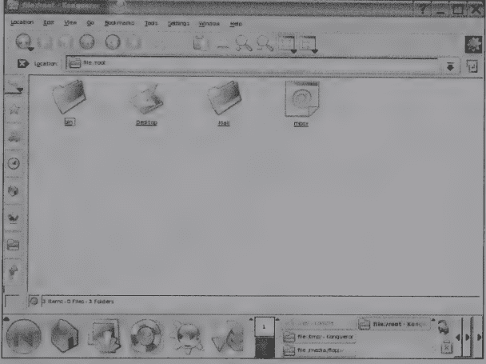

图 2.3

Konqueror 文件管理器。

菜单栏下方会出现许多图标。从左开始，向上箭头用于带你进入下一级；例如 `/etc`。向左箭头带你返回之前的地方。向右箭头带你向前移动（在你返回之后）。房屋图标带你进入主目录。圆形图标重新加载或刷新显示。X 图标停止加载。其右侧是剪切、粘贴、打印和更改视图的图标。

左侧框架沿线许多图标。从顶部开始，扳手图标允许你配置导航区域。星号显示你的书签。立方体显示你的设备。时钟显示历史记录。房屋显示主目录。地球显示网络，包括如果配置了 SMB 则可以访问可用网络。文件夹图标显示根目录，旗帜显示特殊服务。

在显示区域的任何项目上右键点击将弹出上下文相关菜单，你可以从中进行复制、粘贴等选择。只需点击项目即可打开它，双击文件夹将打开它并显示其下方的条目。

## Shell（壳）

通过点击面板栏中的第三个图标来选择打开 shell，会弹出一个交互式外壳，如图 2.4 所示。

图 2.4

你可以使用 shell 与命令行进行交互。


顶部的菜单选项有：会话（Session）（打开新 shell、新 Linux 控制台、打印屏幕等）、编辑（Edit）（复制、粘贴、历史记录等）、视图（View）（监控活动）、书签（Bookmark）（添加、编辑）、设置（Settings）（键盘、字体、大小等）和帮助（Help）。

你可以打开任意数量的 shell 会话，面板栏上方的图标会自动启动一个新的 shell 会话。

## SuSE 帮助中心

图 2.5 显示的 SuSE 帮助中心是访问 SLES 管理指南以及应用程序手册、开发者文档和在线资源快方法。

## 第 2 章

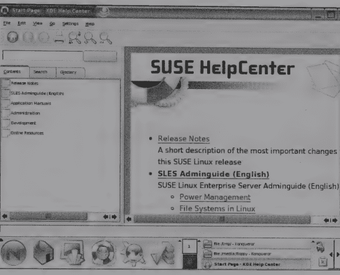

图 2.5

SuSE 帮助中心。

在左侧框架中，有标签允许你搜索特定实体，例如访问词表。

## Web 浏览器

图 2.6 显示的 `Konqueror` 浏览器类似于文件管理器，并提供相同的图标和菜单项。


图 2.6

Konqueror 浏览器。

## KMail

图 2.7 显示的 `KMail` 实用提供了简单易用的电子邮件界面。

图 2.7

KMail 实用程序。


## 配置桌面

你可以通过不同的方式访问 KDE 桌面的配置选项。最简单的方法是在桌面空白处右键点击，并从弹出菜单中选择“配置桌面 (Configure Desktop)”。这将显示图 2.8 所示的配置界面。

配置选项分为以下类别：

- 行为（Behavior）——图标设置和鼠标操作。
- 多桌面（Multiple Desktops）——配置有多少个虚拟桌面。
- 路径（Paths）——设置桌面、回收站、自启动和文档的路径。
- 背景（Background）——从不同的图片中选择或自定义。
- 屏幕保护程序（Screen Saver）——配置并测试屏幕保护程序设置。
- 尺寸与方向（Size & Orientation）——设置屏幕尺寸、刷新率和相关变量。

图 2.8

你可以根据喜好配置桌面。

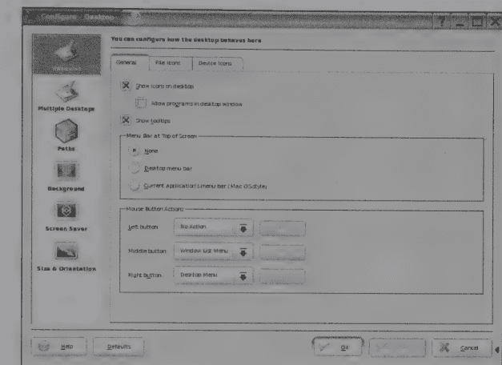

## 使用其他桌面

KDE 不是你唯一可以选择的桌面——它只是默认桌面。当你登录（输入用户名和密码）时，会出现一个菜单按钮。点击该按钮，并选择“会话类型 (Session Type)”。你将多种会话类型可选，包括安全 (Failsafe)、管理员 (admin)、TWM（标签窗口管理器）、FVWM（可行虚拟机管理器）等。

在大多数实现中，GNOME 并不是默认可用选项，除非你进行了全盘安装，或者进行了自定义安装并添加了它。你可以随时添加 GNOME 软件包，最简单的方法是通过图 2.9 显示并在第 12 章“使用 YaST”中详细讨论的 `YaST2` 工具。


在你添加此选项后，它将与其他选项一起出现，供登录时选择会话类型。GNOME 拥有 KDE 的所有功能，预计在 Novell Linux Desktop 发布时将作为默认用户环境。图 2.10 显示了启动界面，图 2.11 显示了浏览器图形化显示驱动器。

## 图 2.9

你可以添加 GNOME 桌面环境。


## 图 2.10

默认 GNOME 桌面环境。

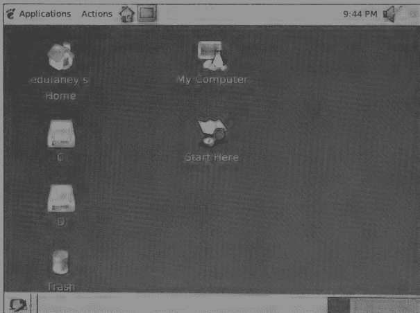

关于 GNOME 桌面有几点需要注意：时钟出现在右上角（与 KDE 不同），且菜单选项和热键默认位于屏幕顶部。

## 理解 SuSE Linux Enterprise Server

## 第 2 章

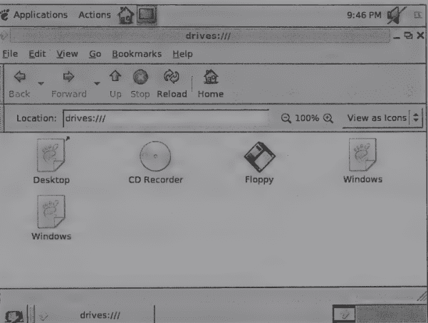

## 图 2.11

你可以通过浏览器访问驱动器。

“应用程序”（Applications）菜单包含已知应用程序，“操作”（Actions）菜单允许你选择屏幕保护程序和其他实用程序。房屋图标带你回到主页，显示器图标则打开 shell。

## 进程操作

### 涵盖的课程目标

- 9. 管理进程 (3037)

第 3 章“基础 GNU 和 Unix 命令”将详细介绍进程以及允许你与它们交互的实用程序。然而，在进入第 3 章之前，你必须理解什么是进程。在 Linux 中，进程是任何运行的任务（在内存中和 CPU 上运行）。程序和用户都可以启动进程，进程可能是一个完成简单操作后消失的短运行任务，也可能是一个守护进程（`daemon`）。

守护进程是一种独立运行的系统任务，不与任何终端关联。其中一个例子是 `init`——它是负责保持其他所有内容正常运行的进程。

## Novell 认证 Linux 专业人员学习指南

每个进程都关联有一个唯一的进程 ID 数字——其 `PID`。该进程可能由另一个进程（其父进程，该父进程有一个父进程 ID，即 `PPID`）启动，并可能启动其他进程（子进程）。某些进程在前台运行，这意味着它们需要在终端窗口内被关注，而另一些则在后台运行。许多用户进程可以在后台和前台之间切换，反之亦然，且不影响其运行。

通过在主 KDE 菜单中选择“系统”（System），然后选择“监控”（Monitor），最后选择“KDE 系统守护”（KDE System Guard），可以访问名为“进程表”（Process Table）的标签。通过选择此标签，你可以看到系统上运行的进程及其 `PID` 数字和相关信息。如果你点击“树”（Tree）复选框，显示将以图形方式描述进程之间的关系。

## 总结

本章检查了 Linux 和 SuSE Linux Enterprise Server 是什么。它介绍了操作系统的安装过程，并查看了桌面及其特性。下一章将探索命令行并向你介绍 Linux 工具箱中最实用的工具。

## 第 3 章

## 基础 GNU 和 Unix 命令

NCLP 实践课程要求你精通 SuSE Linux Enterprise Server。然而，在精通任何特定的实现版本之前，你必须首先了解并理解操作系统的基础。本章没有侧重于实践的任何特定测试目标，但为你提供了为了能够与任何 Linux 实现进行高效工作必须掌握的核心技能集。

本章涵盖了以下课程目标：

- 1. 访问命令行 (3036)
- 2. 命令行 Shell 简介 (3036)
- 3. 理解命令语法和特殊字符 (3036)
- 4. 在命令行执行命令 (3036)
- 5. 常见命令行任务 (3036)
- 6. 管道和重定向 (3036)
- 7. 目录和列出目录内容 (3036)
- 8. 创建、查看和追加文件 (3036)
- 9. 复制和移动文件及目录 (3036)
- 10. 创建目录 (3036)
- 11. 删除文件和目录 (3036)
- 12. 使用 `grep` 搜索文件内容 (3036)
- 13. 理解正则表达式 (3036)
- 14. Linux 文本编辑器简介 (3036)
- 15. 使用命令行编辑器编辑 (3036)
- 16. 使用桌面编辑器编辑 Linux 系统中的文件 (3036)
- 17. 从 GUI 和命令行界面查看进程 (3036)
- 18. Linux 系统中的多用户进程和多任务处理 (3036)
- 19. 监控进程 (3038)

本章包含大量内容，在继续之前，你必须理解并熟悉所有内容。无论如何强调都不为过分：本章中讨论的命令、实用程序和技能是构建 Linux 管理的基础的基础。

## 在命令行下工作

### 涵盖的课程目标

- 1. 访问命令行 (3036)
- 2. 命令行 Shell 简介 (3036)
- 3. 理解命令语法和特殊字符 (3036)
- 4. 在命令行执行命令 (3036)
- 5. 常见命令行任务 (3036)
- 6. 管道和重定向 (3036)

为了理解命令行并高效工作，你必须理解正在发生的进程。在 Linux 中，[原文在此处中断]

## 预备 GNU 和 Unix 命令 第 3 章

| 权限 | 所有者 | 组 | 大小 | 日期 | 名称 |
| :--- | :--- | :--- | :--- | :--- | :--- |
| `-rw-r--r--` | `root` | `root` | `12497` | `7 19 16:39` | `➡ snapshot01.gif` |
| `-rw-r--r--` | `root` | `root` | `17257` | `7 19 16:50` | `➡ snapshot02.gif` |

或者，可以在不使用选项的情况下使用参数，如下：

```
ls *.gif
```

提供的参数个数不限于一个。虽然单个实用程序接受的参数数量可能存在限制，但通常你可以将多个请求组合在一起。例如，与其指定

```
ls -l sa*
```

作为一条命令，然后执行

```
ls -l *.gif
```

你可以通过以下命令完成相同的操作：

```
ls -l sa* *.gif
```

操作的结果变为：

| 权限 | 所有者 | 组 | 大小 | 日期 | 名称 |
| :--- | :--- | :--- | :--- | :--- | :--- |
| `-rw-r--r--` | `root` | `root` | `155` | `7 19 16:48` | `➡ sample` |
| `-rw-r--r--` | `root` | `root` | `12497` | `7 19 16:39` | `➡ snapshot01.gif` |
| `-rw-r--r--` | `root` | `root` | `17257` | `7 19 16:50` | `➡ snapshot02.gif` |

如果参数数量变得太长，在命令行上难以阅读，或者你只是想稍微拆分条目，可以使用反斜杠字符来表示你正在从一行继续到下一行。例如

```
ls -l sa* \
*.gif
```

如果你提供了成百个这样的参数，你会在每个条目后面使用反斜杠来分隔它们。这将使条目更容易查看，并且在按下回车键且前面没有反斜杠之前，命令将不会执行。例如

```
ls -1 sa* \
*.gif \
*.ead \
*.txt \
*.doc
```

## 连接命令

在目前为止的所有示例中，只要使用分号 (`;`) 连接它们，就可以在同一行中给出多个相互之间没有任何连接的的命令。例如，通过连续给出以下两个命令，可以查看当前目录下的所有文件和当前日期：

```
ls
date
```

这些是无关的命令，第二个命令的输出与第一个命令的输出完全没有关系。你可以在两个命令之间使用分号将它们组合在单行命令行中并获得相同的结果：

```
ls ; date
```

分号是一个特殊字符，表示同一行内有多个条命令。该字符允许你打破其两侧的空格规则 (`ls;date`)，同时获得相同的结果。

如果命令之间确实有共同点——即一个命令的输出将作为下一个命令的输入——则使用管道 (`|`) 将它们连接。例如，如果目录内的文件列表太长，无法在一个屏幕上显示，你可以使用此命令一次查看一个屏幕：

```
ls -1 | more
```

在这里，`ls -1` 命令的输出成为 `more` 命令的输入。如果整个命令行的第一部分失败，则第二部分无法执行。

## 通配符

通配符是用于表示 Shell 将填充的其他字符的字符。最常见的两个通配符字符是星号 (`*`) 和问号 (`?`)。尽管它们经常被混淆，但它们的含义是不同的，可能会导致完全不同的结果。

星号用于表示任何和所有；任何事物和无一；开头到结尾。例如

```
ls s*
```

将找到当前目录下所有以字母 "s" 开头且后面带有任意数量字符（包括零）的条目（文件和目录）。显示中可能的结果包括

```
s sa sam samp samp sample samples
samples.gif
```

注意，它会寻找单独的 "s"，以及 "s" 后面带有任意数量条目的项。相比之下，问号是单个字符的占位符，且仅代表一个字符。使用相同的文件可能项，以下命令

```
ls s?
```

将只找到当前目录下以字母 "s" 开头且仅跟有一个字符的条目（文件和目录）。生成的显示结果为

```
sa
```

如果你只想找到以 "s" 开头的五个字母条目，要使用的命令将是

```
ls s????
```

总结一下，星号意味着所有或无，而问号始终意味着一个。这两个通配符不是互斥的，可以根据需要结合使用。例如，要找到具有三个字母扩展名的文件（无论文件名是什么），命令将是

```
ls *.???
```

为了情况更复杂一点，你还可以使用括号 `[]` 来指定可能的值。所有可能的值必须位于括号内，并被单独使用。

## Novell 认证 Linux 专业人员学习指南

以下示例将找到所有以 “d” 或 “e” 开头且后面带有无限数量字符的条目：

```
ls [de]*
```

要只找到以 “d” 或 “e” 开头的三个字符条目，命令将变为

```
ls [de]??
```

## 路径语句和其他变量

当你在提示符处输入一个命令且 Shell 在内部找不到它时，它必须从外部查找实用程序。它通过搜索 `PATH` 变量指定的目录来执行，直到找到第一个匹配项。如果在搜索了所有目录后仍未找到，则会产生错误信息（未找到命令）。

关于路径有几个重要的要点：

1. 你可以使用 `echo` 命令查看你的路径：
   `echo $PATH`
2. 路径默认不包含当前目录。因此，你可以在主目录创建一个可执行文件，用 `ls` 查看它，但当你输入它的名称时，会提示找不到该命令。为了避免这种情况，你可以提供文件的完整路径、将主目录添加到 `PATH` 变量中、将文件移动到路径中的目录，或将当前目录变量 (`.`) 添加到 `PATH` 变量。
3. 路径条目之间用冒号 (`:`) 分隔。
4. 路径搜索顺序始终应该包含可以找到执行程序的常用目录优先（`bin` 目录），并将用户特定的目录（如果有）放在末尾。

要向你的路径添加另一个目录，你可以重新定义整个语句，或者简单使用命令追加新目录：

`PATH=$PATH:{新目录}`

因此，将目录 `/home/edulaney` 添加到路径的命令是

`PATH=$PATH:/home/edulaney`

或者你可以添加一个变量，表示你始终要在当前所在的目录查找实用程序：

`PATH=$PATH:.`

出于安全考虑，始终建议不要将当前目录放在路径的末尾。如果你必须这样做，它应该是 `PATH` 语句的末尾——如前面的示例所示——而不是开头。

例如，如果你的 `PATH` 等于

`/sbin:/usr/usr:/local/sbin:/root:/usr/local/bin/:usr/bin`

那么你希望新路径看起来像

`/sbin:/usr/usr:/local/sbin:/root:/usr/local/bin/:usr/bin:.`

以及不是

`://sbin:/usr/sbin:/usr/local/sbin:/root/bin:/usr/local/bin:/usr/bin`

因为目录总是按照它们在 `PATH` 中出现的顺序进行搜索。

## 常用变量

任何存在的变量都可以使用以下语法显示其值：

`echo ${variable name}`

因此，命令

`echo $MAIL`

将显示邮件目录，`$HOME` 将显示家目录，以此类推。要查看已定义的环境变量的完整列表，你可以使用两个命令——`env` 和 `set`。虽然显示内容略有不同（前者仅包含环境变量，后者包含本地变量），但在大多数情况下，`env` 的输出是 `set` 输出的子集。其中一些变量包含以下内容：

- `HOME`——你开始进入的目录，也是你输入 `cd` 且不带任何其他参数时所到的目录。
- `LINES`——在暂停之前显示的行数（更多更多）。
- `LOGNAME`——当前用户登录的用户名。
- `PWD`——当前工作目录，或你现在所在的位置。
- `SHELL`——你正在使用的解释器。
- `TERM`——正在使用的终端或仿真器类型。
- `USER`——这很少与 `LOGNAME` 不同，但当用户通过 `su` 等命令切换权限级别时如此。

> 根据一般规则，预定义的系统变量始终使用大写字母。

你可以根据需要更改变量的值，或添加你的变量在程序或命令行提示符中引用。例如，要创建一个名为 `TODAY` 的新变量，使用以下语法：

`TODAY=Wednesday`

## 准备的 GNU 和 Unix 命令

第 3 章

你现在可以使用命令

`echo $TODAY` 来查看变量的值。

结果将是 Wednesday。如果你现在使用命令

`set`

该变量将出现在那里。然而，如果你使用以下命令，

`env`

它将不会出现：

该变量已经在本地创建，并可以在本地引用。为了让它在子程序和子进程中可被访问，你必须将其从本地状态移动到环境中，这是通过 `export` 命令实现的：

`export TODAY`

这会将变量移动到环境中可以找到的地方，同时也可以在本地访问，并被子程序和子进程访问。该变量及其值在整个会话期间有效，除非你注销。要使该值永久，你必须将条目添加到配置文件（profile）中。

要更改变量的值，只需定义它的新值：

`TODAY=Monday`

因为它已经被导出了，因此不需要再次执行，新值将应用于本地以及环境。如果需要移除变量，可以使用 `unset` 命令。

在存在且可定义的变量中，还包括了显示提示符（prompt）的变量，它是 shell 发出的视觉消息，告诉它已准备好接受输入。默认提示符包括

- `*` 作为 Bourne、BASH 和 Korn shell 的最后一个字符
- `%` 作为 C shell 和 Z shell 的最后一个字符
- `>` 作为 tsh 的最后一个字符

主提示符（primary prompt）是 `PS1` 或 `prompt` 之一，取决于你正在使用的哪种 shell。在 bash 中，`PS1` 的典型值为

`[\u@\h \W]\$`

将其拆解为各个组件，`PS1` 等于以下内容：

- 左括号 (`[`)
- 当前用户名 (`\u`)
- 符号 (`@`)
- 当前主机主机名 (`\h`)
- 一个空格
- 当前工作目录 (`\W`)
- 右括号 (`]`)
- 美元符号 (`$`)

此提示符的一个示例为

`[edulaney@server7 home]$`

反斜杠（`\` 字符）用于表示应该使用特殊值。可以用于提示符的不同值包括表 3.1 所示。

## 表 3.1 定义提示符的变量

| 数值 | 结果 |
| :--- | :--- |
| `\d` | 当前日期 |
| `\h` | 到第一个点的主机名 |
| `\n` | 换行 |
| `\s` | Shell |
| `\u` | 用户名 |
| `\W` | 当前目录 |
| `\!` | 历史记录编号 |
| `\#` | 命令编号 |
| `\$` | 默认提示符—标准用户为 `$`，root 用户为 `#` |
| `\\` | 实际的反斜杠（字面量） |
| `ABC` | ABC（该文本的值或给定的任何文本） |

查看系统上的变量，你会发现存在更多的 `PS` 变量。例如，在本章较早些时候，我们讨论了在行尾使用反斜杠来结束行，以表示你尚未完成输入。如果我们观察事件序列并包含提示符，它看起来像这样：

```
[edulaney@server7 ~]$ ls -l "*.gif" \
> "*.bmp" \
> 
```

注意提示符从 `PS1` 变为大于号（`>`）。如果它停留在 `PS1`，你将不知道它仍在接受输入，所以它从主提示符变为次要提示符，以表示模式的变化。


# 基础 GNU 和 Unix 命令 第 3 章

双引号取消了空格的默认含义，并允许其之间的值被解释为单个条目。双引号取消了大多数特殊字符的含义，但并非所有。例如，假设有一个名为 `EXAMPLE` 的变量，其值为 25：

```
echo EXAMPLE
```

这将返回 "25"。同样，以下命令也会返回 "25"：

```
echo "$EXAMPLE"
```

而以下命令将返回 "$EXAMPLE"：

```
echo '$EXAMPLE'
```

单引号的作用超出了双引号，它从另一个方向取消了美元符号的含义：

```
echo 'date'
```

将返回 "date"。将单引号替换为反引号将得到不同的结果：

```
echo `date`
```

将返回 `date` 命令执行的结果。在较新的 shell 中，反引号的另一种替代方案是将命令放在括号内并将其视为变量。因此，可以像前面的示例一样通过以下命令 `echo` 输出日期：

```
echo $(date)
```

如果你没有使用任何一组引号，`PS1` 会被替换为 `PS2`，并一直持续，直到使用的引号总数（每组）为偶数。这当你有一个长条目并想在输入期间将其拆分为多行时非常有用。下面的示例包含了提示符，并展示了在另一组引号（双引号）中使用一组引号（反引号）：

```
[edulaney@server7 home]$ EXAMPLE="Hi, the date
> and time now
> are 'date'.
[edulaney@server7 home]$ echo $EXAMPLE
Hi, the date and time now are Thu Aug 10 11:12:37 EDT 2000
[edulaney@server7 home]$
```

## 46 Novel 认证 Linux 专业学习指南

在许多情况下，需要混合使用引号。然而，你将遇到的最大问题之一是特殊字符使得很难将它们作为输出。例如，假设 `echo` 操作的最终结果为：

Karen says "Hi"

如果你使用命令 `Karen says "Hi"`：

```
echo Karen says "Hi"
```

结果将是 `Karen says Hi`。

shell 将引号解释为意味着其中的文本应被视为单个条目。shell 执行它给它的操作，并在过程中丢失了引号。为了解决这个问题，你必须使用反斜杠 (`\`) 字符来覆盖引号的默认含义：

```
echo Karen says \"Hi\"
```

注意，反斜杠字符必须位于每个引号出现之前，并且它始终只对紧随其后的字符有效。

## 命令历史

`bash` shell 保留了你给它的命令列表，并允许你从列表中重用这些命令，而不需要每次都重新输入。从命令行，你可以使用上下方向键滚动查看最近的命令。你还可以输入两个感叹号 (`!!`) 来重新运行你提供的最后一条命令。

输入 `history` 显示所有存储的命令，左侧有一个递增的数字。输入一个感叹号加上这些命令数字之一将重新运行该命令，例如 `!125`。

> **注意**：与其看到整个历史列表，你可以通过在 `history` 命令后面加上想要查看的行数来只查看最近的条目，如下：

```
history 5
history 10
```

或者，你可以输入感叹号后跟一组字符，shell 将重新运行以这些字符开头的最近命令。例如：

```
!ls
```

将重新运行以 `ls` 开头的最近一次命令。

## 历史记录的重要变量

- `HISTFILE`——指向持有命令历史的文件。默认情况下，它是每个用户主目录下的 `.bash_history`。
- `HISTSIZE`——每个会话保留的条目数。
- `HISTFILESIZE`——标识从一个会话传递另一个会话的命令历史条目数（让你可以在此会话中运行在上一个会话运行过的命令）。

`history` 的内部别名 `fc` 也存在，可以用于召回和重新运行命令。

## 命令别名

虽然操作系统和 shell 中提供了大量的命令和工具，但你可以创建对你更有意义的别名，或者缩短你必须输入的字符数。例如，如果你熟悉 Windows 操作系统的命令行操作，你已经习惯了输入 `dir` 来查看位于哪些文件。在 Linux 中，类似的操作可以通过 `ls -1` 实现。可以创建一个别名，使得你输入 `dir` 时运行的是 `ls -1`，其语法如下：

```
alias dir="ls -1"
```

语法始终是 `alias`，后跟输入别名后将运行的实际命令，用等号 (`=`) 隔开。在少数情况下，你可以不在别名条目周围使用引号，但作为一般规则，应该使用它们。

为了让别名在会话中生存，它们应该添加到用户主目录下的 `.bashrc` 文件中。如果你不将它们放在登录时执行的文件中（从而重新创建它们），创建的别名将在注销时丢失。

## 其他功能和注意事项

Linux 命令行许多许多不应忽视的特征。虽然它们并不复杂到足以单独列一个章节，但知道它们的存在是有帮助的：

- 在输入命令时，可以在输入几个字符后按 `Tab` 键，shell 将尝试补全名称。
- 命令行历史可以在运行前进行编辑。`bash` 的默认编辑器是 `emacs`，在 `sh` 中是 `vi`。
- 两个小于号 (`<<`) 简单被称为 "here"，表示等待后面的字符串。例如 `cat <<` 将接受输入，直到输入 "litter" 作为一行。
- `test` 工具可以与 `$?` 结合测试任何内容。例如，要检查文件是否存在且可读，使用以下组合：

```
test -r
echo $?
```

`test` 所有选项的完整语法可以通过输入 `test` 找到。

- 当你按下回车时，shell 首先扫描行，并通过查找空格确定哪些元素。它剥离所有引号并替换变量。最后，它替换嵌入的命令。

## 处理文本

### 课程目标

- 4. 在命令行执行命令 (306)
- 5. 常见命令行任务 (306)
- 6. 管道和重定向 (306)
- 8. 创建、查看和追加文件 (306)

最简单的文本处理工具是 `cat`，它是单词 concatenate（连接）的派生。默认情况下，它会将文件的整个内容显示在屏幕上（标准输出）。然而，可以使用许多实用的选项，包括：

- `-b` 对行编号
- `-E` 在每行末尾显示美元符号 (`$`)（回车）
- `-T` 将所有制表符显示为 `^I`
- `-v` 显示制表符和回车以外的非打印字符
- `-A` 显示与 `-v`、`-E`、`-T` 结合的相同的内容

为了说明 `cat` 的用法，假设有一个名为 `example` 的四行文件，内容如下：

```
How much wood
could a woodchuck
if a woodchuck
could chuck wood?
```

要在屏幕上查看文件内容，与前面的示例完全相同，命令是 `cat example`。

要带行号查看文件，命令以及生成的输出将是：

```
cat -b example
1 How much wood
2 could a woodchuck
3 if a woodchuck
4 could chuck wood?
```

注意包含了之前不存在的制表符，这些是编号过程添加的。它们并不真正存在文件中，只是被添加到显示中，可以通过以下命令见证这一点：`cat -Ab example`。

```
1 How much wood$
2 could a woodchuck$
3 if a woodchuck$
4 could chuck wood?$
```

该文件内唯一的不可打印字符是末尾的回车符，它们以美元符号 (`$`) 的形式显示。

`cat` 工具最常用的用途之一是快速创建文本文件。从命令行，你可以不指定任何文件来显示，并将输出重定向到给定的文件名。然后它将接受键盘输入并将其放入新文件中，直到接收到文件结束符（默认序列为 `Ctrl+D`）。

以下示例包含一个美元符号 (`$`) 提示符，以显示此操作过程：

```
$ cat > example
Peter Piper picked a peck of pickled peppers
A peck of pickled peppers Peter Piper picked.
If Peter Piper picked a peck of pickled peppers,
Where's the peck of pickled peppers Peter Piper picked?
{press Ctrl+D}
$
```

在单独的一行上按下 `Ctrl-D` 序列表示文件结束。查看目录内容（通过 `ls` 工具）将显示该文件现在已创建，并且可以这样查看其内容：

```
cat example
```

请注意，单重重定向 (`>`) 会在文件不存在时创建一个名为 `example` 的文件，如果已存在则覆盖它。要向现有文件添加内容，请使用追加字符 (`>>`)。

> **注意**：`Ctrl-D` 键盘序列是指定文件结束操作的典型默认设置。与 Linux 中的几乎所有事物一样，这可以更改、自定义等。要查看你会话的设置，请使用此命令：

```
stty -a
```

并查找 "eof ="。

在某些情况下有一个有用的工具——`tac`——它会反向显示文件的内容（`tac` 是反向的 `cat`）。它不是从第 1 行显示到文件末尾，而是从文件末尾显示到第 1 行，如下例所示：

```
$ tac example
Where's the peck of pickled peppers Peter Piper picked?
If Peter Piper picked a peck of pickled peppers Peter Piper picked.
A peck of pickled peppers Peter Piper picked.
Peter Piper picked a peck of pickled peppers
$
```

## nl、head 和 tail

可以使用三个简单的命令查看文件的全部或部分：`nl`、`head` 和 `tail`。第一个命令 `nl` 用于给行编号，类似于 `cat -b`。两者都会对显示的行进行编号，默认情况下都不会对空行编号。`nl` 可以利用某些选项来更改显示：

- `-i` 允许你更改增量（默认为 1）。
- `-v` 允许你更改起始数字（默认为 1）。
- `-n` 允许你更改显示的对齐方式：
  - `-nln` 使显示内容左对齐。
  - `-rn` 使显示内容右对齐。
  - `-nrz` 使用零填充。
- `-s` 在行号和文本之间使用指定的字符（默认是制表符）。

第二个要检查的工具是 `head`。正如名称所示，该工具用于查看文件的顶部部分：默认是前 10 行。你可以通过使用连字符后跟要显示的行数来更改显示的行数。以下示例假设有一个名为 `numbers` 的文本文件，其中从 "one" 到 "two hundred" 有 200 行：

```
$ head numbers
one
two
three
four
five
six
seven
eight
nine
ten
$
$ head -3 numbers
one
two
three
$
$ head -50 numbers
one
two
three
{为了空间目的省略}
forty-eight
forty-nine
fifty
$
```

> **注意**：当打印多个文件时，`head` 在每个列表之前放置一个标题，以标识是哪个文件。`-q` 选项会抑制标题显示。

`tail` 命令有多种模式可以工作。它与 `head` 相反，显示文件的末尾而不是开头。默认情况下，它显示最后 10 行，但可以通过连字符后跟数字来更改。例如，假设有一个名为 `numbers` 的文件，从 "one" 到 "two hundred" 有 200 行：

```
$ tail numbers
one hundred ninety-one
one hundred ninety-two
one hundred ninety-three
one hundred ninety-four
one hundred ninety-five
one hundred ninety-six
one hundred ninety-seven
one hundred ninety-eight
one hundred ninety-nine
two hundred
$
$ tail -3 numbers
one hundred ninety-eight
one hundred ninety-nine
two hundred
$
```

## 粘贴

`paste` 命令将文件并排合并，默认使用制表符作为分隔符。例如，假设 `fileone` 包含：

```
Indianapolis
Columbus
Peoria
Livingston
Scottsdale
```

而 `filetwo` 包含：

```
Indiana
Ohio
Illinois
Montana
Arizona
```

那么：

```
$ paste fileone filetwo
Indianapolis	Indiana
Columbus	Ohio
Peoria	Illinois
Livingston	Montana
Scottsdale	Arizona
$
```

如果 `fileone` 中的行数多于 `filetwo`，则粘贴将生效，并在制表符后带有空条目。制表符字符始终是默认分隔符，但可以使用 `-d` 选项进行更改：

你也可以使用 `-s` 选项将 `fileone` 的所有内容输出到单行，随后跟一个换行符，然后是 `filetwo`：

```
$ paste -s fileone filetwo
Indianapolis	Columbus	Peoria	Livingston	Scottsdale
Indiana	Ohio	Illinois	Montana	Arizona
$
```

## 合并

你可以将 `join` 工具视为 `paste` 的极大增强版。然而，至关重要的一点是，只有当要合并的文件共享共同字段时，该工具才能工作。例如，如果在之前使用 `paste` 的相同示例中使用 `join`，结果将是：

```
$ join fileone filetwo
$
```

换句话说，这里没有任何输出。`join` 必须在相关文件之间找到一个共同字段，默认情况下，它期望该共同字段是第一个。例如，假设 `fileone` 现在包含以下条目：

```
11111 Indianapolis
22222 Columbus
33333 Peoria
44444 Livingston
55555 Scottsdale
```

而 `filetwo` 的内容为：

```
11111 Indiana 500 race
22222 Ohio Buckeye State
33333 Illinois Wrigley Field
44444 Montana Yellowstone Park
55555 Arizona Grand Canyon
```

那么生成的显示（包括提示符）将是：

```
$ join fileone filetwo
11111 Indianapolis Indiana 500 race
22222 Columbus Ohio Buckeye State
33333 Peoria Illinois Wrigley Field
44444 Livingston Montana Yellowstone Park
55555 Scottsdale Arizona Grand Canyon
$
```

第一个文件的共同性被识别，匹配的条目被合并。而 `paste` 是盲目地从每个文件中提取内容来创建显示，`join` 只合并匹配的行——而且至关重要的一点是——它必须与另一个文件中对应的行完全匹配。这一点无论再怎么强调都不过；例如，假设 `filetwo` 在中间多额外的一行：

```
11111 Indiana 500 race
22222 Ohio Buckeye State
66666 Tennessee Smokey Mountains
33333 Illinois Wrigley Field
44444 Montana Yellowstone Park
55555 Arizona Grand Canyon
```

那么生成的显示（包括提示符）将是：

```
$ join fileone filetwo
11111 Indianapolis Indiana 500 race
22222 Columbus Ohio Buckeye State
$
```

一旦文件不再匹配，就无法执行后续操作。每行都会与相反文件中相同的（且仅有的）行进行默认文件的匹配检查。如果找到了匹配项，则将其包含在显示中；否则则不包含。为了再次说明这一点——使用原始的 `filetwo`：


```
$ tac filetwo > filethree
$ join fileone filethree
55555 Scottsdale Arizona Grand Canyon
$
```

尽管两个文件中每一行都存在匹配，但只找到了一个匹配。

> **注意**
>
> 强烈建议你通过先对要使用的每个文件进行排序以使它们的顺序一致，从而解决 `join` 的问题。

你不需要保留 `join` 的默认设置（即仅查看第一个字段的匹配或不输出所有列）。`-1` 选项允许你指定 `fileone` 中用作匹配的字段，而 `-2` 选项允许你指定 `filetwo` 中用作匹配的字段。例如，如果 `fileone` 的第二个字段与 `filethree` 的第三字段匹配，语法为：

```
$ join -1 2 -2 3 fileone filethree
```

`-o` 选项用于以 `{file.field}` 格式指定输出字段。因此，若要在匹配的行上仅打印 `fileone` 的第二个字段和 `filetwo` 的第三字段，语法为：

```
$ join -o 1.2 2.3 fileone filethree
Indianapolis 500
Columbus Buckeye
Peoria Wrigley
Livingston Yellowstone
Scottsdale Grand
$
```

## 排序、计数、格式化和翻译

通常不仅需要显示文本，还需要在输出之前对其进行一些处理和修改，或者简单地收集相关信息。本文检查了四个工具：`sort`、`wc`、`fmt` 和 `tr`。

`sort` 工具按字母顺序对行进行排序。默认宽度为 75，但可以指定不同的值。例如，假设 `fileone` 现在包含以下条目：

```
Indianapolis
Columbus
Peoria
Livingston
Scottsdale
```

```
$ sort -n fileone
1
2
3
4
5
6
7
8
9
10
11
12
```

```
$ sort -r fileone
12
11
10
9
8
7
6
5
4
3
2
1
```

`wc`（单词计数）工具显示关于文件的信息：行、单词和字符。以下选项为：

- `-c`：字节数
- `-l`：行数
- `-w`：单词数

例如，统计 `fileone` 的行数：

```
$ wc -l fileone
17
```

`fmt` 工具通过创建特定的宽度来格式化文本。默认宽度为 75，但可以指定不同的值。以下选项为：

- `-w`：设置宽度
- `-s`：压缩空行
- `-u`：对齐行

例如，将 `fileone` 格式化为 60 宽度：

```
$ fmt -w60 fileone
```

`tr`（翻译）工具可以将一组字符转换为另一组。以下选项为：

- `-d`：删除字符
- `-s`：将重复的字符压缩为一个

```
$ tr '[:lower:]' '[:upper:]' < fileone
```

## 其他实用的工具

Linux 中还包含了许多其他实用的文本工具。其中某些工具的实用性有限，且仅用于特定目的，但提供这些工具是因为了解它们的存在和用途可以让你使用 Linux 变得方便得多。

按照字母顺序，这些额外的工具如下：

- **`expand`** —— 允许你将制表符扩展为空格。默认每个制表符对应 8 个空格，但可以使用 `-t` 选项进行更改。该工具的相反命令是 `unexpand`。
- **`file`** —— 此工具将查看条目的签名并报告它是什么类型的文件——ASCII 文本、GIF 图像等。它返回的定义（从而使文件能够被正确识别）定义在一个名为 `magic` 的文件中。该文件通常位于 `/usr/share/misc` 或 `/etc`。
- **`more`** —— 用于一次只显示一屏输出。
- **`od`** —— 可以执行八进制转储，以显示 ASCII 文本文件以外的内容。配合 `-x` 选项使用时，它执行十六进制转储；配合 `-e` 选项时，它显示可识别的 ASCII 字符。
- **`pr`** —— 将文件转换为适用于打印页面的格式——包括包含最后修改日期和时间的默认页眉、文件名和页码。可以使用 `-h` 选项覆盖默认页眉，`-l` 选项允许指定每页包含的行数——默认为 66。默认页宽为 72 个字符，但可以使用 `-w` 选项指定不同的值。`-d` 选项可用于输出的双倍行距，`-m` 可用于以列格式打印多个文件。
- **`split`** —— 将单个文件分割成多个文件。默认是为原始文件的每 1000 行创建一个新文件。使用 `-b` 选项，你可以避免按行拆分，并指定放入每个输出文件中的字节数，或者使用 `-l` 指定行数。
- **`uniq`** —— 此工具将检查文件中的条目，通过将当前行与紧随其后的一行进行比较，以找到唯一的行。

## 基础文件管理

### 涵盖的课程目标

- 4. 在命令行执行命令 (3036)
- 5. 常见的命令行任务 (3036)
- 7. 切换目录和列出目录内容 (3036)

在本节中，你将学习许多用于管理文件和目录的工具。其中某些工具——如 `cd` 和 `ls`——极其重要，以至于在书中的示例中不用它们，几乎无法进行下去。在这里，我们将扩展这些工具，并更详细地探索它们的功能和用途。

## 使用 `cd` 和 `pwd`

`cd` 命令用于更改你正在工作的目录。如果你不带任何参数输入命令，它将带你移动到 `HOME` 变量定义的目录。如果你指定了任何参数，它被视为你想要切换到的目录。

在使用 `cd` 时，非常有用的字符是单点 (`.`) 和双点 (`..`)。前者表示你当前所在的任何目录，而后者表示当前目录的父目录。

`pwd` 工具显示当前工作目录——即你当前所在的目录。它返回的相同值包含在环境变量 `PWD` 中。

> **注意**
>
> 始终记住，在 Linux 中，多个项目可能具有相同的名称。根据一般规则，所有大写条目代表变量，而所有小写条目代表文件和工具。

以下是这两个工具用法的一些示例：

```
$ pwd
/usr/bin
$ echo $HOME
/usr/home/edulaney
$ cd
$ pwd
/usr/home/edulaney
```

```
$ pwd
/usr/home/edulaney
$ cd /
$ pwd
/
$ cd /usr/home/edulaney
$ pwd
/usr/home/edulaney
$ cd ..
$ pwd
/usr/home
$
```

在这个序列中，第一次切换到根目录 (`/`)，然后到 `/usr/home/edulaney`。使用该目录父目录的快捷方式，可以返回上一目录。

## 绝对路径与相对路径

指定任何内容（文件、目录等）路径的方法有两种：绝对和相对。当你提供绝对路径时，不需要考虑任何因素，提供一个始终为真的值。当你提供相对路径时，考虑到你当前的位置，并给出一个相对于该位置的路径。

用类比来说，假设两个人住在同一个城市和州：印第安纳州的芒市（Muncie, Indiana）。第一个人住在 1909 Rosewood，第二个人住在 4104 Peachtree。如果第一个人要寻找/访问第二个人，他们可以通过被称为邮寄地址的绝对路径找到对方的位置：

> 4104 Peachtree Lane
> Muncie, IN 47304

这个地址表示：

1. 找到印第安纳州。
2. 在印第安纳州内找到芒市。
3. 在芒市内找到属于邮政编码 47304 的城市街区。
4. 在之前的所有范围内，找到 Peachtree Lane。
5. 在 Peachtree Lane 上，找到 4104 号房子。

> **注意**：绝对地址永远不会改变，无论实体位于何处都会指向该实体。

无论你从何处来，绝对地址永远不会改变并指向该实体。然而，因为同一个人也住在芒市，我们也可以通过相对路径告诉他们目的地：

1. 沿着 Rosewood 找到左。
2. 沿着 Peachtree 找到右。
3. 沿着 Jackson 轨道找到 Hawthorne。
4. 沿着 Peachtree Lane 找到左。
5. 沿着 Peachtree 找到右，到达目的地。

### 表 3.2 `cd` 命令的使用示例

| 当前工作目录 | 新位置 | 绝对地址 | 相对路径 |
| :--- | :--- | :--- | :--- |
| /usr/home/edulaney/docs | /usr/home/edulaney | /usr/home/edulaney | `..` |
| /usr/home/edulaney/docs/proposals | /usr/home/edulaney | /usr/home/edulaney | `../..` |
| /usr/home/edulaney/docs/proposals/law_order | / | / | `../../../` |

## 使用 `ls`

列出文件和目录的能力是任何操作系统最本质的功能，`ls` 工具在 Linux 中执行此功能。单独使用它时，它会以列格式列出当前目录下的文件和目录名称。默认情况下，条目总是按字母顺序排列的，且没有区分目录名和文件名。例如：

```
Desktop emmett filetree junk2 questions
TestPro errors filetwo sample
brio example Friday myfile sample of the world
dulaney example2 garbage numbers simplesimon
eRRors fileone junk1 pull snapshot01.gif
```

列表默认按字母顺序排列，所有大写条目都在小写条目之前。

此命令可以使用许多选项，其中最有用的是 `-F`，它会指示条目的类型：

```
Desktop/ emmett filetree junk2 questions
TestPro errors filetwo sample*
brio example Friday myfile sample of the world*
dulaney example2 garbage numbers simplesimon
eRRors fileone junk1 pull snapshot01.gif
```

没有任何结尾字符的条目是标准文件。结尾带有 `/` 的条目——如 `Desktop/`——是目录。结尾带有星号 (`*`) 的是符号链接（由 `@` 符号表示）。

另一个有用的选项是 `-a`，它将显示所有文件。默认情况下，`ls` 不显示隐藏文件。隐藏文件是任何以点 (`.`) 作为首字符的文件：

```
. Desktop emmett filetree junk2 questions
.. TestPro errors filetwo sample
.bash_history brio example Friday myfile sample of the world
.bash_logout dulaney example2 garbage numbers simplesimon
.fileone.swp fileone junk1 pull snapshot01.gif
```

> **注意**
>
> 点号可以出现在文件名的任何位置，并根据你的需要出现任意次数。只有当它们是名称的第一个字符时，才具有特殊意义。

如果你用 `-A` 代替 `-a`，它将忽略前两个条目（`.` 和 `..`）。然而，最实用的选项无疑是 `-l`，它将显示文件列表。条目看起来如下：

```
drwx      5 root root 1024 Aug 30 11:12 Desktop
-rw-r--r-- 1 root root 548 Aug 23 22:01 Test
-rw-r--r-- 1 root root 28 Aug 22 10:26 brio
```

这里本质上有七列，可以拆分为如下：

1. **条目的权限**。在随后的章节中将更详细地讨论权限，但现在重要的是要意识到，第一个字符标识了条目的类型。`-` 表示文件，而 `d` 表示目录。第一个字符的其他可能还包括 `c`（字符特殊文件，如终端）、`b`（块设备，如磁带驱动器）、`l`（符号链接）或 `p`（命名管道）。
2. **链接数**。如果这是一个目录，它等于其下方的条目数量。如果是一个文件，它等于引用它的方式。
3. **创建（或现在拥有）该实体的所有者名称**。
4. **拥有该文件的组名称**。
5. **文件大小**。
6. **创建日期，或修改为当前格式的日期**。
7. **名称**。

### 表 3.3 `ls` 命令的选项

| 选项 | 用途 |
| :--- | :--- |
| `-C` | 按最后更改/修改的时间列出，而不是按字母顺序 |
| `-d` | 列出目录 |
| `-G` | 与 `-l` 使用时，不显示组 |
| `-i` | 显示每个条目的 inode 节点（指针） |
| `-n` | 用数值显示所有者和组，而不是用名称 |
| `-o` | 与 `-G` 相同 |
| `-r` | 反转显示顺序 |
| `-R` | 递归地显示子目录中的条目 |
| `-S` | 排序 |
| `-u` | 按最后访问时间排序 |
| `-w` | 指定屏幕宽度 |
| `-x` | 显示行而不是列 |
| `-X` | 按扩展名字母排序 |

## 应用 `touch`

文件或条目本质上与三个日期相关：创建、修改和访问。使用 `touch` 工具，你可以更改与文件关联的访问时间和修改时间：

```
$ ls -l brio
-rw-r--r-- 1 root root 28 Aug 22 10:26 brio
$ touch brio
$ ls -l brio
-rw-r--r-- 1 root root 28 Aug 30 16:01 brio
```

`touch` 工具也可以使用几个选项，总结如下表所示：

| 选项 | 用途 |
| :--- | :--- |
| `-a` | 仅更改访问时间 |
| `-m` | 仅更改修改时间 |
| `-r` | 使用与引用文件关联的时间/日期来执行更改，而不是当前的时间/日期 |

后者的示例为：

```
$ ls -l tuesday wednesday
-rw-r--- 1 root 85 Aug 22 10:26 tuesday
-rw-r--r- 1 root root 85 Aug 29 13:08 wednesday
$ touch tuesday -r wednesday
$ ls -l tuesday wednesday
-rw-r--r- 1 root root 85 Aug 29 13:08 tuesday
-rw-r--r- 1 root root 85 Aug 29 13:08 wednesday
$
```


如果你在使用 `touch` 工具时使用一个不存在的文件名，它将根据当前日期和时间创建一个大小为 0 的文件。

## 复制与移动

### 涵盖的课程目标

- 4. 在命令行中执行命令 (3036)
- 5. 常见的命令行任务 (3036)
- 9. 复制和移动文件与目录 (3036)
- 10. 创建目录 (3036)
- 11. 删除文件与目录 (3036)

如果没有任何东西发生移动或变化，系统管理将会容易得多。遗憾的是，现在几乎没有任何东西能保持不变，变化以不停的速度进行。Linux 提供了两个强大的复制和移动文件的工具：分别是 `cp` 和 `mv`，以及第三个工具——`dd`——它结合了后者的功能。

## cp

`cp` 同时适用于文件和目录，并可以使用通配符一次移动多个实体。在工具名称之后，你必须指定源，然后是目标。最简单的用法可以如下例所示：

```
$ ls -l fileone
ls: onefile: No such file or directory
-rw-r--r-- 1 root root 85 Aug 22 10:26
->fileone
$ cp fileone onefile
$ ls -l fileone onefile
-rw-r--r-- 1 root root 85 Aug 22 10:26
->fileone
-rw-r--r-- 1 root root 85 Aug 30 16:18
->onefile
$
```

注意，原始条目（源）保持不变，但有了第二个条目（目标）。在第二个条目上，内容是相同的，但日期是执行 `cp` 时的，而不是源的时间。如果你从零创建目标文件，将会发生这种情况。为了让许多变量保持相同，可以使用 `-p` 选项来强制保留属性：

```
$ ls -l nextfile
ls: nextfile: No such file or directory
-rw-r--r-- 1 root root 85 Aug 22 10:26
-fileone
$ cp -p fileone nextfile
$ ls -l fileone nextfile
-rw-r--r-- 1 root root 85 Aug 22 10:26
-fileone
-rw-r--r-- 1 root root 85 Aug 22 10:26
->nextfile
```

注意与源相关的日期被保留了，但所有者和组必须更改。当你执行复制操作时，工具首先检查源文件是否存在。如果存在，则创建指定的目标文件（大小为 0），并复制源的内容。这里的重点在于目标总是被创建的——无论它之前是否存在。这里是一个示例：

```
$ ls -l fileone filetwo
-rw-r--r-- 1 root root 85 Aug 22 10:26
-fileone
-rw-r--r-- 1 root root 16432 Aug 28 13:43
-filetwo
$ cp fileone filetwo
$ ls -l fileone filetwo
-rw-r--r-- 1 root root 85 Aug 22 10:26
-fileone
-rw-r--r-- 1 root root 85 Aug 30 16:18
-filetwo
$
```

`filetwo` 的原始内容已经丢失，除非创建了作为 `fileone` 副本的 `filetwo` 备份。有一个 `-i`（询问）选项，可以始终询问你是否真的要删除已存在的目标文件内容：

```
$ ls -l fileone filetwo
-rw-r--r-- 1 root root 85 Aug 22 10:26
-fileone
-rw-r--r-- 1 root root 16432 Aug 28 13:43
-filetwo
$ cp -i fileone filetwo
cp: overwrite 'filetwo'?
```

在提示符处，你可以输入 "y" 执行操作，或输入任何其他字符停止。

你可以将多个文件从一个目录复制到另一个，只要命令行上的最后一项是接收文件的有效目录路径：

```
$ ls -l /usr/home/user
-rw-r--r-- 1 root root 85 Aug 22 10:26
$
$ cd /usr/home/examples
$ ls -l *
-rw-r--r-- 1 root root 585 Aug 23 12:16
-questions
-rw-r--r-- 1 root root 1985 Aug 24 15:17
-samples
-rw-r--r-- 1 root root 5081 Aug 25 18:30
-snapshot01.gif
$ cp user q* /usr/home/user
$ cd ../user
$ ls -l
-rw-r--r-- 1 root root 85 Aug 22 10:26 exit
-rw-r--r-- 1 root root 585 Aug 31 22:50
-questions
-rw-r--r-- 1 root root 1985 Aug 31 22:50
-samples
-rw-r--r-- 1 root root 5081 Aug 31 22:50
-snapshot01.gif
$
```

要将目录从一个位置移动到另一个位置，使用 `-r` 或 `-A` 选项来递归移动目录及其下所有子目录和文件。其他选项可以包括 `-f` 强制复制而不进行提示（可以说是 `-i` 的反面）；`-u` 仅在源文件比目标文件新（更新过）时复制；以及 `-v` 详细模式，而不是静默执行。最后，`-P` 选项将在另一个位置还原文件的整个路径——根据需要创建目录和子目录。

## mv

移动工具 (`mv`) 可用于几项操作。尽管有过于简化的风险，但它包括以下能力：

1. 重命名文件
2. 重命名目录
3. 将文件从一个目录移动到另一个目录
4. 将子目录从一个目录移动到另一个目录
5. 将实体移动到另一个分区或介质

最简单的操作是在当前目录中重命名文件：

```
$ ls -l file*
-rw-r--r-- 1 root root 85 Aug 22 10:26
-fileone
-rw-r--r-- 1 root root 16432 Aug 28 13:43
-filetwo
$ mv fileone filethree
$ ls -l file*
-rw-r--r-- 1 root root 85 Aug 22 10:26
->filethree
-rw-r--r-- 1 root root 16432 Aug 28 13:43
->filetwo
```

日期、权限以及与文件相关的所有内容都保留在 `fileone` 中。这是因为当文件在同一目录内（甚至在同一分区上）移动时，发生变化的是关于名称的信息——并没有发生物理操作；改变的是描述符。移动操作实际上简单的重命名操作。

> **注意**
>
> 尽管听起来可能简单，但请始终记住，当你复制一个文件时，你会保留原始文件并创建一个之前不存在的东西——会为新实体创建一组新的属性。然而，当你移动一个文件时，默认操作是重命名——你更改的是原始文件的名称，而不是创建任何新内容。

从直观来看，如果你复制一个大小为 9MB 的文件，花费的时间将比复制一个 9 字节的文件要长。由于移动被用作重命名，无论文件大小如何，花费的时间都是相同的。与复制操作一样，如果你尝试将文件移动到一个已存在的名称，目标文件的内容将会丢失。这里有一个示例：

```
$ ls -l file*
-rw-r--r-- 1 root root 85 Aug 22 10:26
->fileone
-rw-r--r-- 1 root root 16432 Aug 28 13:43
->filetwo
$ mv fileone filetwo
$ ls -l file*
-rw-r--r-- 1 root root 85 Aug 22 10:26
->filetwo
```

`-i` 选项（询问或交互式）用于在覆盖前进行提示，其对面选项是 `-f`（强制，force），它是默认操作。`-u` 选项仅在源文件比目标文件新时才会执行，而 `-v` 选项开启详细模式（verbose）。`-b` 选项会在目标文件存在时，以波浪号（~）作为最后一个字符对目标文件进行备份——本质上是执行了伪复制操作：

```
$ ls -l help*
-rw-r--r-- 1 root root 85 Aug 22 10:26
helpfile
$ mv -b helpfile helptwo
$ ls -l help*
-rw-r--r-- 1 root root 85 Aug 22 10:26
helptwo
$ ls -l file*
-rw-r--r-- 1 root root 85 Aug 22 10:26
fileone
-rw-r--r-- 1 root root 16432 Aug 28 13:43
filetwo
$ mv -b fileone filetwo
$ ls -l file*
-rw-r--r-- 1 root root 85 Aug 22 10:26
filetwo
-rw-r--r-- 1 root root 16432 Aug 28 13:43
filetwo
```

在第一次情况下，不存在名为目标名称的文件，因此 `-b` 选项被忽略了。在第二次情况下，存在一个目标名称的文件，因此原始文件被重命名，并在末尾加上波浪号（~）。

> `-b` 选项也可以与 `cp` 使用，以执行与 `mv` 相同的操作。

## dd

设备到设备 (`dd`) 工具用于将文件从一个设备复制到另一个设备。然而，它的功能远超此范围，它可以在复制过程中将文件从一种格式转换为另一种格式。它可以将 EBCDIC 转换为 ASCII（反之亦然），将大写转换为小写（反之亦然），并处理字节、块或关键字。

`dd` 最常见的用途是在可移动介质之间复制文件，你必须使用包含以下内容的参数：

- `bs` -- 块大小 (block size)
- `if` -- 输入文件 (input file)
- `of` -- 输出文件 (output file)

## 删除文件和目录

文件可以使用 `rm` (remove) 命令从系统中删除它们。使用此命令时要小心，因为 Linux 不提供像其他操作系统那样的删除命令或功能。

```
$ ls -l file*
-rw-r--r-- 1 root root 85 Aug 22 10:26
fileone
-rw-r--r-- 1 root root 16432 Aug 28 13:43
filetwo
$ rm fileone
$ ls -l file*
-rw-r--r-- 1 root root 16432 Aug 28 13:43
filetwo
$
```

当与 `-i` 选项配合使用时，每个要删除的文件之前都会提示。按 Y 删除文件，按任何其他字符将跳过该文件。

```
$ ls -l t*
-rw-r--r-- 1 root root 85 Aug 22 10:26
today
-rw-r--r-- 1 root root 16432 Aug 28 13:43
tuesday
$ rm -i t*
rm: remove 'today'?
```

`-f` 选项强制删除，`-v` 将工具设置为详细模式。`-r` 或 `-R` 递归删除目录（包括子目录和文件）。为了删除一个文件，你必须对其所在的目录具有写权限。

> **注意**
>
> 删除文件时只需要文件所在目录的权限，而不是文件本身。

一个安全的工具 `rmdir` 可用于删除下方没有任何内容的目录。它只能删除空目录，不能删除包含文件或子目录的目录。`rmdir` 可以使用的选项是 `-p`，用于删除父目录（如果为空）。

```
$ ls -R kdlaney
kdlaney:
docs
$ rmdir kdlaney:
rmdir: kdlaney: Directory not empty
```

## 创建目录

现在你已经学习了如何移动和删除，有三种方法可以完成任务：

1. 使用 `rm` 命令删除文件。
2. 使用 `rmdir` 命令删除目录。
3. 使用 `cp` 命令复制文件。

如果你尝试向文件中添加更多信息，这一点很重要，否则文件会被覆盖。若要添加更多信息，你必须使用大于符号（`>>`）将内容追加到文件中：

```
$ ls -l >> myfile
```

> **注意**
>
> 文件与 `>` 符号之间不能有空格。如果有，含义将会改变。

此示例说明了将标准输出重定向到文件 `myfile`。这些数字之所以重要只有一个原因——因为还存在第三种可能性。标准错误（缩写为 `stderr`）的值为 2。标准错误的一个示例是回想你之前看到的 `ls -z` 命令。尽管输出被发送到了文件中，但由于该命令并不存在，错误信息显示在屏幕上。可以使用以下命令将错误发送到文件中：

```
ls -z > myfile
```

问题是，现在错误将发送到那里，但输出（在没有错误的情况下）将显示在屏幕上。要将输出和错误发送到同一个文件，命令变为：

```
ls -z > file 2>&1
```

这表示输出将去往名为 `myfile` 的文件，并且标准错误 (2) 将去往标准输出 (1) 相同的位置。另一种方案是将错误发送到一个位置，将输出发送到另一个位置，如下：

```
ls -z > myfile 2>errors
ls -z >> myfile 2>>errors
```

## tee 用于双向输出

有一个非常独特且不属于归于任何章节的杂项工具：`tee`。该工具正如其名所示，会将输出发送到两个方向。大多数进程的默认值是将输出写入到屏幕上。使用重定向（`>`），你可以将输出重定向到文件，但如果你想两者兼顾呢？

`tee` 工具允许输出同时发送到屏幕和文件。该工具后面必须紧跟一个你想要将输出写入的文件名，例如：

```
$ ps -f | tee example
```

| UID | PID | PPID | STIME | TTY | TIME | CMD |
|---|---|---|---|---|---|---|
| root | 19605 | 19603 | 0 Aug1 | pts/0 | 00:00:34 | bash |
| root | 30089 | 19605 | 0 Aug20 | pts/0 | 00:00:00 | vi fileone |
| root | 30425 | 19605 | 0 Aug20 | pts/0 | 00:00:00 | -d --fileletwo? |
| root | 32048 | 19605 | 0 Aug22 | pts/0 | 00:00:00 | cat |
| root | 1183 | 19605 | 0 Aug23 | pts/0 | 00:00:00 | awk -F: --questions |
| root | 30778 | 19605 | 0 14:25 | pts/0 | 00:00:00 | ps -f |

```
$ cat example
```

| UID | PID | PPID | STIME | TTY | TIME | CMD |
|---|---|---|---|---|---|---|
| root | 19605 | 19603 | 0 Aug10 | pts/0 | 00:00:34 | bash |
| root | 30089 | 19605 | 0 Aug20 | pts/0 | 00:00:00 | vi fileone |
| root | 30425 | 19605 | 0 Aug20 | pts/0 | 00:00:00 | -d --fileletwo? |
| root | 32048 | 19605 | 0 Aug22 | pts/0 | 00:00:00 | cat |
| root | 1183 | 19605 | 0 Aug23 | pts/0 | 00:00:00 | awk -F: --questions |
| root | 30778 | 19605 | 0 14:25 | pts/0 | 00:00:00 | ps -f |

如图所示，输出显示在屏幕上，同时也写入了文件。当你需要文件且又想查看输出时，这是一个非常有用的工具。

## xargs

另一个值得强大工具是 `xargs`。为了理解这个工具的威力，请考虑 `find` 工具，它在文件系统结构内返回的结果是有限的。结构中唯一的真实文本是实体名称，而不是数据本身（指针指向那里）。为了说明，假设用户 `eduelaney` 在几个月前发布了一份关于茶歇室冰箱使用规定的备忘录。从那以后，`eduelaney` 离开了公司，几位新员工（他们会从知道这一点中受益）加入了。你想找到该文件并重新打印它。使用 `find` 实现这一点最接近的方法是：

```
$ find / -user eduelaney -type f -exec grep -i refrigerator {} \;
```

必须使用 `type` 选项，否则每当 `grep` 尝试搜索目录时都会发生错误。在这种情况下，找到了文件中的某行，但不知道它在哪个文件中——这使得结果几乎毫无用处。介绍 `xargs` 工具：类似于管道，它将一个命令的输出馈给另一个命令。进入它的参数经过不修改直接传递，并变成下一个命令的输入。因此，命令可以修改为：

```
$ find / -user eduelaney -type f | xargs grep -i refrigerator /home/eduelaney/fileone
```

目标文件已被指明，现在可以为新员工找到并打印了。

思考题：如果 `xargs` 像管道一样工作，为什么下面的命令不可行？

```
$ find / -user eduelaney -type f | grep -i refrigerator
```


答案：因为 `grep` 操作是在文件名上进行的，而不是文件内容。`xargs` 工具将整个名称（从而是内容）传递给下一个命令（在本例中为 `grep`），而不仅仅是结果文件名。

## 处理进程

### 课程目标

- 5. 常用命令行任务 (3036)
- 17. 从 GUI 和命令行界面查看进程 (3036)
- 18. Linux 系统中的多用户进程和多任务 (3036)
- 19. 监控进程 (3038)

## 第3章：基础 GNU 和 Unix 命令

| PID | TTY | TIME | CMD |
|---|---|---|---|
| 30425 | pts/0 | 00:00:00 | paste |
| 32040 | pts/0 | 00:00:00 | cat |
| 1183 | pts/0 | 00:00:00 | awk |
| 30685 | pts/0 | 00:00:00 | ps |

> `ps -a` 将显示与当前 tty 关联的所有进程，会话领导者除外。请注意，与 `ps` 关联的 PID 会随着每次运行增加，因为每个运行都需要一个新进程。它并不会每次递 1，因为在第一次和第二次运行 `ps` 之间，可能运行了其他几个进程（可能在后台运行）。

使用 `-A` 和 `-e` 选项（全部或每一个），可以看到每个正在运行的进程，而不仅仅是链接到当前 tty 的进程：

```
ps -e
```

| PID | TTY | CMD |
|---|---|---|
| 1 | ? | 00:00:04 | init |
| 2 | ? | 00:00:00 | migration/0 |
| 3 | ? | 00:00:00 | ksoftirqd/0 |
| 4 | ? | 00:00:00 | migration/1 |
| 5 | ? | 00:00:00 | ksoftirqd/1 |
| 6 | ? | 00:00:00 | events/0 |
| 7 | ? | 00:00:00 | events/1 |
| 8 | ? | 00:00:00 | kacpid |
| 9 | ? | 00:00:00 | kblockd/0 |
| 10 | ? | 00:00:00 | kblockd/1 |
| 11 | ? | 00:00:00 | khelper |
| 14 | ? | 00:00:00 | pdfflush |
| 15 | ? | 00:00:00 | pdfflush |
| 16 | ? | 00:00:07 | aio/0 |
| 18 | ? | 00:00:00 | kswapd0 |
| 19 | ? | 00:00:00 | aio/1 |
| 175 | ? | 00:00:00 | kseriod |
| 437 | ? | 00:00:00 | scsi_eh_0 |
| 439 | ? | 00:00:00 | scsi_eh_1 |
| 479 | ? | 00:00:00 | reiserfs/0 |
| 480 | ? | 00:00:00 | reiserfs/1 |
| 659 | ? | 00:00:00 | kcopyd |
| 1463 | ? | 00:00:00 | khubd |
| 1739 | ? | 00:00:02 | dhcpcd |
| 1924 | ? | 00:00:00 | syslog |
| 1930 | ? | 00:00:00 | klogd |
| 1979 | ? | 00:00:00 | portmap |
| 1980 | ? | 00:00:10 | resmgrd |
| 2042 | ? | 00:00:00 | slpd |
| 2152 | ? | 00:00:01 | cupsd |
| 2305 | ? | 00:00:33 | powersaved |
| 2402 | ? | 00:00:00 | sshd |
| 2495 | ? | 00:00:00 | hwscand |
| 2531 | ? | 00:00:00 | slapd |
| 3023 | ? | 00:00:00 | master |
| 3159 | ? | 00:00:00 | cron |
| 3164 | ? | 00:00:07 | nscd |
| 3334 | ? | 00:00:00 | kdm |
| 3385 | tty1 | 00:00:00 | mingetty |
| 3386 | tty2 | 00:00:00 | mingetty |
| 3387 | tty3 | 00:00:00 | mingetty |
| 3388 | tty4 | 00:00:00 | mingetty |
| 3389 | tty5 | 00:00:00 | mingetty |
| 3390 | tty6 | 00:00:00 | mingetty |
| 3531 | ? | 00:00:00 | gpg-agent |
| 7235 | ? | 00:00:00 | qmgr |
| 6751 | ? | 00:00:00 | gpg-agent |
| 6898 | ? | 00:00:22 | X |
| 6899 | ? | 00:00:00 | kdm |
| 6930 | ? | 00:00:00 | kde |
| 6965 | ? | 00:00:00 | gpg-agent |
| 6989 | ? | 00:00:00 | kdeinit |
| 6992 | ? | 00:00:00 | kdeinit |
| 6994 | ? | 00:00:00 | kdeinit |
| 6997 | ? | 00:00:00 | kdeinit |
| 7005 | ? | 00:00:00 | artsd |
| 7015 | ? | 00:00:00 | kdeinit |
| 7016 | ? | 00:00:00 | kwrapper |
| 7018 | ? | 00:00:03 | kdeinit |
| 7019 | ? | 00:00:00 | kdeinit |
| 7021 | ? | 00:00:00 | kdeinit |
| 7023 | ? | 00:00:00 | kdeinit |
| 7025 | ? | 00:00:02 | kdeinit |
| 7027 | ? | 00:00:03 | kdeinit |
| 7032 | ? | 00:00:00 | kdeinit |
| 7036 | ? | 00:00:00 | kpowersave |
| 7037 | ? | 00:00:00 | suwatcher |
| 7039 | ? | 00:00:00 | suwatcher |
| 7043 | ? | 00:00:00 | kdeinit |
| 7049 | ? | 00:00:00 | krand |
| 7053 | ? | 00:00:01 | kdeinit |
| 7054 | ps/1 | 00:00:00 | bash |
| 7116 | ? | 00:00:00 | kdeinit |
| 8886 | ? | 00:00:04 | kdeinit |
| 13641 | ? | 00:00:00 | pickup |
| 13737 | pts/1 | 00:00:00 | ps |

显示中有几点需要注意。在没有特定顺序的情况下，数字最小的如下：

- 启动时的 PID（注意 1 到 19）。通常这些是关键任务，如果它们不存在，系统将无法使用。
- 并非所有进程都绑定到终端。如果出现 `?`，表示该进程在没有终端交互的情况下运行系统，且没有默认输出。
- 对于每个没有用户的终端，都有 `getty` 或 `mingetty` 在运行。该进程会等待用户尝试登录。尽管没有用户在使用 tty16，但很容易看出其他终端可以使用。

其他选项可决定显示哪些信息：

- `-l` 显示详细列表（类似于 `ls -l`）
- `u` 显示用户名和相关统计
- `f` 显示完整列表（所有可能的）

后者经常被使用，并受到管理员青睐，因为它为显示增加了额外的列：

```
ps -f
```

```
UID PID PPID C TTY TIME CMD ...
```

有四个之前没有的新列。第一列识别与进程关联的用户 ID。第三列是父进程 ID——显示该进程向哪个进程报告。第四列识别是否涉及调度，第五列是进程启动的时间。

### 注意事项

注意使用 `f` 时，`CMD` 现在列出整个命令，而像其他显示那样只列出部分。

这些选项可以相互组合，最常见的组合是 `-ef`，它以完整格式显示所有进程：

```
ps -ef
```

```
UID PID PPID C STIME TTY TIME CMD ...
root 1 0 Sep28 ? 00:00:00 [5]
root 2 1 Sep28 ? 00:00:00 [migration/0]
root 3 1 Sep28 ? 00:00:00 [ksoftirqd/0]
root 4 1 Sep28 ? 00:00:00 [migration/1]
root 5 1 Sep28 ? 00:00:00 [ksoftirqd/1]
root 6 1 Sep28 ? 00:00:00 [events/0]
root 7 1 Sep28 ? 00:00:00 [events/1]
root 8 1 Sep28 ? 00:00:00 [kacpid]
root 9 6 Sep28 ? 00:00:00 [kblockd/0]
root 10 6 Sep28 ? 00:00:00 [kblockd/1]
root 11 1 Sep28 ? 00:00:00 [krqgd]
root 14 6 Sep28 ? 00:00:00 [helper]
root 15 7 Sep28 ? 00:00:00 [pdflush]
root 16 6 Sep28 ? 00:00:07 [pdflush]
root 18 7 Sep28 ? 00:00:00 [aio/0]
root 17 1 Sep28 ? 00:00:00 [kswapd]
root 19 6 Sep28 ? 00:00:00 [aio/1]
root 175 1 Sep28 ? 00:00:00 [kseriod]
root 437 1 Sep28 ? 00:00:00 [scsi_eh_0]
root 439 1 Sep28 ? 00:00:00 [scsi_eh_1]
root 479 6 Sep28 ? 00:00:00 [reiserfs/0]
root 480 7 Sep28 ? 00:00:00 [reiserfs/1]
root 659 6 Sep28 ? 00:00:00 [kcopyd]
root 1463 1 Sep28 ? 00:00:00 [khubd]
root 1930 1 Sep28 ? 00:00:00 [klogd]
bin 1979 1 Sep28 ? 00:00:00 [portmap]
root 1980 1 Sep28 ? 00:00:10 [resmgrd]
daemon 2042 1 Sep28 ? 00:00:00 [usr/bin/slpd]
lp 2152 1 Sep28 ? 00:00:01 [cusd]
root 2305 1 Sep28 ? 00:00:33 [powersaved]
root 2402 1 Sep28 ? 00:00:00 [hwscand]
root 2495 1 Sep28 ? 00:00:00 [hwscand]
root 2531 1 Sep28 ? 00:00:00 [slapd]
root 3023 1 Sep28 ? 00:00:00 [usr/lib/postfix/master]
root 3159 1 0 Sep28 ? 00:00:00 [sbin/cron]
root 3164 1 0 Sep28 ? 00:00:07 [sbin/nscd]
root 3334 1 0 Sep28 ? 00:00:00 [kde/bin/kdm]
root 3385 1 0 Sep28 tty1 00:00:00 [sbin/mingetty]
root 3386 1 0 Sep28 tty2 00:00:00 [sbin/mingetty]
root 3387 1 0 Sep28 tty3 00:00:00 [sbin/mingetty]
root 3388 1 0 Sep28 tty4 00:00:00 [sbin/mingetty]
root 3389 1 0 Sep28 tty5 00:00:00 [sbin/mingetty]
root 3390 1 0 Sep28 tty6 00:00:00
postfix 7235 3023 0 Oct 28 ? 00:00:00 qmgr -l -t
root 6999 3334 0 Oct 12 ? 00:00:00 -:0
root 6930 6899 0 Oct 12 ? 00:00:00 [/bin/sh ->/usr/X11/bin/kde]
root 6989 1 Oct 12 ? 00:00:00 kdedeinit:
root 6992 1 0 Oct 12 ? 00:00:00 kdedeinit:
root 6994 6989 0 Oct 12 ? 00:00:00 kdedeinit:
root 6997 1 0 Oct 12 ? 00:00:01 kdedeinit kded
root 7015 1 0 Oct 12 ? 00:00:00 kdedeinit:
root 7016 6930 0 Oct 12 ? 00:00:00 kwrapper -> ksmserver
root 7018 1 0 Oct 12 ? 00:00:00 kdedeinit: -> ksmserver
root 7019 6989 0 Oct 12 ? 00:00:03 kdedeinit kwin -> session 117f00000200010964021650000063920000_1097649388_170101
root 7021 1 0 Oct 12 ? 00:00:00 kdedeinit: -> kwrited
root 7023 1 0 Oct 12 ? 00:00:00 kdedeinit: -> khotkeys
root 7025 1 0 Oct 12 ? 00:00:02 kdedeinit: -> kdesktop
root 7027 1 0 Oct 12 ? 00:00:03 kdedeinit: -> kicker
```

## 90 Novell 认证 Linux 专家学习指南

```
root 7032 1 0 Oct12 ? 00:00:00 kdeinit
➡ clipper
root 7036 1 0 Oct12 ? 00:00:00 kpowersave
root 7043 1 0 Oct12 ? 00:00:00 kdeinit
➡ kio_user
root 7049 1 0 Oct12 ? 00:00:00 krandrtray
session 117f0000d200001096403627000000639200018_197649388_
➡ 152381
root 7053 6989 0 Oct12 ? 00:00:01 kdeinit:
➡ konsole
root 7054 7053 0 Oct12 pts/1 00:00:00 /bin/bash
root 8886 6989 0 Oct13 ? 00:00:05 kdeinit:
➡ konqueror -silent
postfix 13641 3023 0 08:24 ? 00:00:00 pickup -l -t
➡ fifo -u
root 13747 7054 0 09:45 pts/1 00:00:00 ps -ef
```

## 使用 pstree 和 top

有两个与 `ps` 紧密相关的命令，提供了进程略有不同的视图。第一个是 `pstree`，它会以图形化的方式描绘进程之间的关系，如图 3.1 所示。

**图 3.1**

pstree 工具以图形化方式显示进程之间的关系。

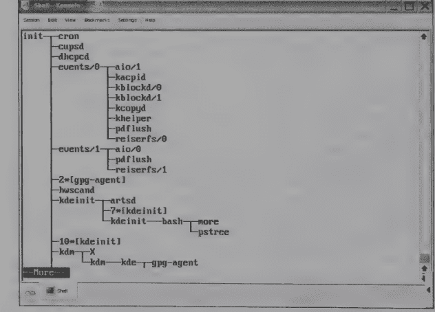

这以图形化的方式描述了主进程之下的子进程，并显示了每个进程所处的位置——哪个进程是它的父进程，等等。

## 基础 GNU 和 Unix 命令 第 3 章

与 `ps` 相关的第二个工具是 `top`。它不仅显示当前进程，还会保持活动并不断更新显示。此外，屏幕顶部描述了关于系统运行天数、用户数量、内存和交换分区统计等信息。

当 `top` 运行时，你可以按下以下任意键来与它交互：

- `h`—帮助
- `q`—退出
- `s`—设置更新之间的延迟（默认为五秒）
- `n`—立即更新，而不是等待下次刷新间隔
- `u`—仅显示单个用户

列显示了标准的 PID/CMD 信息，以及内存的用量和正在被使用的 CPU 进程数。

## 结束进程

进程可以通过多种方式启动。它们由守护进程（daemons）自动启动，由用户在尝试完成任务时启动。某些进程会启动其他进程，以此类推。

在正常情况下，子进程代表父进程并向父进程汇报。当子进程不再被需要时，它会自动消失。但在某些情况下，进程变为运行状态——它们不再被需要，但仍继续运行并消耗进程资源。

只要有子进程与其关联，父进程就不能（或不应该）停止。鉴于此，子进程未能终止可能会在系统中留下许多不需要的进程。为了说明，假设用户的 shell 调用了另一个进程 (A)，该进程无法完成所有工作，于是它调用了另一个进程 (B)，并在其中又启动了第三个 (C)。

在正常情况下，当进程 C 完成时，它将向进程 B 汇报并消失。进程 B 处理数据，向进程 A 汇报并消失。进程 A 对数据进行其需要的所有操作，将其返回给用户的 shell 并消失。

对于非正常情况，假设进程 C 发生故障，在向进程 B 汇报后没有结束。它继续运行：这阻止了进程 B 的结束，因为它仍然有一个关联的子进程。我们可以假设进程 B 将值返回给进程 A，然后将值返回给用户的 shell。进程 A 和进程 B 一样无法退出，因为它仍然有一个关联的子进程。由于进程 C 发生了故障，三个不再需要的进程继续运行。


故障的另一种可能性（取决于应用程序的编写方式）是进程 B 可能会在进程 C 消失之前先行离开。进程 A 可以完成其任务并同样离开。在这种情况下发生的情况是只有进程 C 仍然存在，但现在它上方没有不存在的父进程，并且不知道该向谁汇报——它变成了一个真正的孤儿进程（runaway process）。

要解决不稳定进程的问题，可以使用 `kill` 命令。该工具按照以下语法工作：

```
kill {option} PID
```

因此，要消掉 `cat` 进程，序列如下：

| ps -f | | |
|---|---|---|
| UID | PPID | STIME | TTY | CMD |
|---|---|---|---|---|
| root | 19605 | 19605 | 0 Aug10 pts/0 | 00:00:34 bash |
| root | 30089 | 19605 | 0 Aug20 pts/0 | 00:00:00 fileone |
| root | 30425 | 19605 | 0 Aug20 pts/0 | 00:00:00 -d |
| root | 32040 | 19605 | 0 Aug22 pts/0 | 00:00:00 cat |
| root | 1183 | 19605 | 0 Aug23 pts/0 | 00:00:00 awk-F |
| root | 30900 | 19605 | 0 Aug25 pts/0 | 00:00:00 ps -f |
| $ kill -9 32040 | | | | |

这种方法会请求进程礼貌地退出。在某些情况下，使用 15 (终止) 尝试 (kill) ，进程会忽略该信号。在这种情况下，它会继续运行。

为了解决不稳定进程的问题，可以使用 `kill` 命令。这种方法允许向进程发送的信号。以下是可以发送的信号：

- 15 (terminate)
- 9 (kill)
- 1 (hangup)
- `Ctrl+C` (interrupt)
- 2
- 19 (stop)
- 18 (continue)
- 20 (now)

## Novell 认证 Linux 专家学习指南

强烈建议在使用信号 9 (kill) 之前始终尝试 15 (终止)。同样强烈建议在杀死进程之前确保其没有子进程。如果存在子进程，应该先移除它们。

## 后台在前台

当进程启动时，默认在前台运行。在前台，它成为用户可以操作的唯一作业并根据作业的完成进行交互。例如，当用户运行 `ls` 时，显示将出现在他的终端上，在 `ls` 完成之前他无法发布其他命令。

要在后台运行进程，只需在命令末尾添加一个符号 (`&`)——这允许你同时运行多个命令。例如，`sleep` 命令只需允许进程等待指定的秒数后发生任何事情，它可以单独作为说明：

```
$ sleep 90 &
[5] 31168
```

括号中的数字等于当前在后台运行的任务数量。随后的数字（在本例中为 31168）是该作业的进程 ID (PID)。

> NOTE 最近放入后台的任务 PID 也可以通过 `$!` 来引用

将作业放在后台允许用户继续工作并启动其他进程。如果你必须在启动另一个进程之前等待某个进程完成，`wait` 命令配合进程的 PID 使用，将停止处理直到指定的进程完成。例如：

```
$ sleep 120 &
[5] 31175
```

# 第3章

```
$ wait 31175
```

只要 31175 仍然是一个有效的 PID，提示符就不会返回。

## jobs

要查看你在后台运行的作业（jobs），请使用 `jobs` 命令：

```
$ jobs
[1] Stopped vi fileone (wd: -)
[2]- Stopped paste -d ' fileone filetwo (wd: -)
[4]+ Stopped awk -F: questions (wd: -)
[5] Done sleep 120
$
```

已终止的作业（3）不会显示，而已完成的作业（5）只会显示一次（当运行下一个作业时，#5 将不再显示）。如果该作业是最近可以运行的作业，或者正在运行，则会在作业编号括号后紧跟一个加号 (`+`)。下一个最近的作业用减号 (`-`) 指示。`wd` 信息引用工作目录。

`-l` 选项会在显示中添加 PID 号，`-p` 选项可以用于只显示进程的 PID。`-n` 选项可以用于只显示被挂起的作业。

## fg

在后台运行的作业可以通过 `fg` 命令移动到前台。`fg` 的语法允许使用百分号 (`%`) 和作业编号来引用作业。例如，以下序列在后台启动一个为期两分钟的睡眠序列，然后将其移动到前台：

```
$ sleep 120 &
[5] 31206
$
$ fg %5
```

注意，正在执行的命令在带入前台时会回显到屏幕。当使用 `%` 时，你也可以通过 `%+` 和 `%-` 分别引用最近的两个作业。如果你不知道作业编号（且忘记了使用 `jobs` 命令），在使用百分号和问号 (`?`) 之后时，可以通过作业名称的一部分来引用作业。例如：

```
$ fg ?v
vi file
```

## bg

前台 (`fg`) 命令的相反是后台 (`bg`) 命令。这允许你将一个正在前台运行的作业移动到后台。但在此之前，你必须挂起该作业（以便返回提示符）。

挂起作业通过按下等于挂起信号的键盘序列来实现——默认为 `Ctrl+Z`。挂起后，作业将停止，直到被移动到前台或后台。例如：

```
$ sleep 180
{Ctrl+Z pressed
[5] Stopped sleep 180
$
```

现在发出 `bg` 命令将作业移动到后台并将状态更改为运行（Running）。

## 更改优先级

涵盖的课程目标

- 4. 在命令行中执行命令 (3036)
- 5. 常见的命令行任务 (3036)
- 18. Linux 系统中的多用户进程和多任务处理 (3036)

当进程启动时，它的默认优先级为零。这使得它与所有竞争 CPU 和其他资源关注的进程处于平等状态。可以通过 `nice` 和 `renice` 两个工具来更改进程的优先级。

## nice

可以使用 `nice` 工具以不同的优先级启动进程。`nice` 可以用于 40 个不同的级别（一半为负数，一半为正数），包括：

- -19（最低优先级）
- 0（默认优先级）
- 19（最高优先级）

用户只能使用正数，这意味着用户只能降低进程优先级而不能提高它。你还可以通过 `-n` 选项指定增量（默认为 10），`nice` 将用其随时间更改优先级。root 用户（超级用户）有给予负增量的能力，而所有其他用户不能。

Nice 值仅限超级用户使用。

如果只给出 `nice` 命令，它将显示默认使用的调度优先级。

## renice

`nice` 工具只能在启动进程时使用，不能用于已运行的进程。此时，`renice` 工具使用与 `nice` 相同的优先级，并通过以下三个选项之一进行降低：

- `-p` 用于 PID
- `-g` 用于进程组
- `-u` 用于与用户相关的组

## 使用 grep 和 sed

涵盖的课程目标

- 4. 在命令行中执行命令 (3036)
- 5. 常见的命令行任务 (3036)
- 8. 创建、查看和追加文件 (3036)
- 12. 使用 grep 搜索文件内容 (3036)
- 13. 理解正则表达式 (3036)
- 14. Linux 文本编辑器简介及编辑 (3036)
- 15. 使用命令行编辑器进行编辑 (3036)

在本节中，你将学习用于处理文件和输出的两个重要工具。`grep` 系列工具用于查找值，而 `sed` 工具可以更改字符串的值。之前讨论的许多工具将用于本节的示例中。

## grep 家族

这个名字奇怪的工具（在 Linux 中很常见）实际上是它所执行功能的缩写：“全局查找正则表达式并打印结果”（Globally look for Regular Expressions and then Print the results）。用通俗的话说，它是 Linux 军库中最强大的工具之一。要精通它，你必须理解什么是正则表达式。正则表达式有许多规则：

1. 任意字符等于其本身。
2. 行首可以用脱号符号 (`^`) 表示。
3. 行尾可以用美元符号 (`$`) 表示。
4. 范围可以用括号 (`[]`) 表示。
5. 反斜杠 (`\`) 表示转义。
6. 点 (`.`) 可以表示任意字符。
7. 星号 (`*`) 代表任何内容。
8. 引用并不是总是需要的。

为了使用 `grep` 演示这些操作，假设有一个名为 `garbage` 的小文件，我们使用以下内容：

| 规则 | 字符 | 搜索结果 |
|---|---|---|
| 1 | 任意字符等于其本身 | |
| 2 | 行首可以用脱号符号 (`^`) 表示 | |
| 3 | 行尾可以用美元符号 (`$`) 表示 | |
| 4 | 范围可以用括号 (`[]`) 表示 | |
| 5 | 反斜杠 (`\`) 表示 | |
| 6 | 点 (`.`) 可以表示任意字符 | |
| 7 | 星号 (`*`) 代表任何内容 | |
| 8 | 引用并不是总是需要的 | |

如果你想找到该单词的所有出现处，语法变为：

```
$ grep cat* garbage
```

I heard about the cats last night and particularly the one cat ran away with all the catnip

```
$
```

在这种情况下，三字母序列 "cat" 出现在每一行中。不仅第二行有 "cat"，第一行还有 "cats"，第二行还有 "catnip"——所有都匹配指定的字符。如果你对 "cat" 感兴趣但对 "cats" 不感兴趣，语法变为：

```
$ grep cat[s] garbage
```

```
$
```

这专门排除了四字母序列 "cats"，同时找到所有三字母序列 "cat"。如果我们真的只对 "cat" 感兴趣而没有任何偏离，还有几种可能性可以探索。第一种方法是在单词末尾添加一个空格并包含在引号内：

```
$ grep "cat " garbage
```

这种方法可以完成任务，但无法捕获第四字符不同于 "s" 或 "n" 的其他单词。为了消除所有这四个字符，最好使用：

```
$ grep cat[sn] garbage
```

## 基础 GNU 和 Unix 命令 第 3 章

特别是那只叼走了所有猫薄荷的猫 $

## grep 选项

grep 的默认操作是在指定的行内查找匹配项并将其打印出来。这对于大型显示内容中提取关键数据非常有用，例如，查找用户 karen 正在做什么：

> 在后续示例中使用的 `who` 命令仅显示谁登录了系统。

```bash
$ who | grep "karen"
karen pts/2      Aug 21 13:42
$
```

在 `who` 命令的所有输出内容中，只有包含字符串 "karen" 的行会被显示出来。尽管这很有用，但在某些情况下，实际的输出可能没有其周围的其他项目那么重要。例如，如果你不在乎 karen 登录在哪里，但想知道她有多少个并发会话，你可以使用 `-c` 选项：

```bash
$ who | grep -c "karen"
1
$
```

你也可以修改它以使用逻辑“或” (`||`)，这样如果操作失败，它会告诉你该用户尚未登录：

```bash
who | grep "karen" || echo "She has not come in yet"
```

- `-c` 选项用于统计将显示的行数，但会抑制显示本身。`-c` 选项基本上是在执行与以下相同的任务：

```bash
$ who | grep "karen" | wc -l
1
$
```

`-c` 选项通过从进程中减少一个额外的操作，速度更快且更高效。其他与 `grep` 配合使用的选项包括：

- `-f` 使用文件来查找要搜索的字符串。
- `-H` 在显示中包含匹配项所在文件的默认文件头（如果适用），该文件头会出现在每行的开头，而 `-h` 则防止显示文件头（默认）。
- `-i` 忽略大小写。如果不存在此选项，你可能需要在文本文件中搜索 "karen","Karen”、“KAREN" 及其所有变体以找到匹配项。
- `-L` 打印不包含匹配项的文件名，而 `-l` 打印包含匹配项的文件名。
- `-n` 在显示中显示行号。这与对行编号（`nl` 可以做到）不同，因为出现的数字表示现有文件中行的编号，而不是输出的编号。
- `-q` 静默所有输出，通常用于测试返回条件。如果你在扫描目录查找匹配项时不想出现由于权限不足无法查看某些内容的错误，这个选项很有用。
- `-v` 充当“非”选项。它产生的显示与不使用它时产生的显示相反。例如：`who | grep -v karen` 将显示所有不是 karen 的用户。
- `-w` 强制找到的显示匹配整个单词。这为前面讨论的查找 "cat" 但不包含其派生词的情况提供了最佳解决方案。
- `-x` 强制找到的显示匹配整行。

这些选项可以混合使用，只要其中一个参数不会抵消另一个即可。例如，可以使用 `-wH` 或 `-Hw` 搜索单词并包含头信息。然而，你不能说既想看行号又只想看最终计数（`-nc`），因为这两个选项不能同时使用。

以下是一些示例，展示如何使用这些选项：我们想要获取当前目录下所有子目录的详细列表 (`ls -l`)，而对实际文件名不感兴趣。在 `ls -l` 的输出中，第一个字段显示条目的权限。如果条目是文件，第一个字符是 "-"，如果是目录，则是 "d"。因此命令为：

```bash
ls -l | grep "^d"
```

如果你想知道拼写字典中有多少个单词，可以通过多种方法找到，包括：

```bash
wc -l /usr/share/dict/words
```

或者

```bash
grep -c \.\* /usr/share/dict/words
```

这两者都会根据文件内的行数生成数字。但是，假设你想找到有多少以字母 "c"（大写或小写）开头的单词：

```bash
grep -ic "^c" /usr/share/dict/words
```

或者你想找到字母表中前部分的单词：

```bash
grep -ic "^[a-m]" /usr/share/dict/words
```

前一个示例也可以表示为：

```bash
grep -ci "^[a-m]" /usr/share/dict/words
```

或者

```bash
grep -vci "^[a-m]" /usr/share/dict/words
```

假设你有许多不同的字符串想要查找，而不仅仅是一个。你可以逐个查找它们，这需要多次操作；或者你可以在文本文件中查找标准，并使用 `-f` 选项将其输入 `grep` 中。以下示例假设 `wishlist` 文件存在：

```bash
$ cat wishlist
dog
cat
fish
$ grep -if wishlist /usr/share/dict/words
```

大约显示了 450 行，因为这三个单词所有组合的匹配项都显示出来了。你可以继续

## 第 3 章

必须认识到，`sed` 不是一个交互式编辑器。当你给它要执行的命令时，它会在无需用户进一步操作的情况下直接执行。

默认情况下，`sed` 按顺序扫描每一行来工作。如果它在搜索整行时没有找到匹配项，它将移动到下一行。如果它在行内找到了搜索文本，它会进行更改并立即移动到下一行。这可能会导致一些意料之外的结果。例如，假设你想将单词 "new" 更改为 "old"

```bash
$ echo I think the new neighbors are getting a new air pump |
$ sed 's/new/old/'
```

输出变为

I think the old neighbors are getting a new air pump

搜索短语的第二次出现没有被更改，因为 `sed` 在找到第一个匹配项后就完成了对该行的处理。如果你想更改行内所有出现项，必须在命令末尾使用 "g" 来进行全局搜索：

```bash
$ echo I think the new neighbors are getting a new air pump |
$ sed 's/new/old/g'
```

输出变为

I think the old neighbors are getting an old air pump

全局参数使得 `sed` 在找到匹配项后继续搜索行的剩余部分，直到到达行尾。这处理了相同短语的多次出现，但如果你想更改多个值，则必须采取不同的方法。

这可以通过在命令行上使用 `-e` 选项来标记每个命令来实现。例如

```bash
$ echo this line is shorter | sed -e 's/line/phrase/' -e 's/short/long/'
```

输出变为

this phrase is longer

## Novell 认证 Linux 专业人员学习指南

第二种方法是将所有替换标准放在一个文件中，然后使用 `-f` 选项调用该文件。示例假设文件 `wishlist2` 已经存在：

```bash
$ cat wishlist2
s/line/phrase/
s/short/long/
$
$ echo this line is shorter | sed -f wishlist2
this phrase is longer
$
```

两种方法产生相同的结果，使用文件来存储命令使得在需要更改标准时变得容易万倍，同时也易于跟踪你正在执行的操作，并在以后重新运行这些命令。

> 注意

重要的是理解，当存在多个操作时，`sed` 会在开始第二个操作之前完成所有第一个操作。它会在开始第三个操作之前完成（整个文件、行等）所有第二个操作，依此类推。

从技术上讲（但不建议这样做），你还可以通过在每个替换后使用分号来完成相同的操作，或者通过奇数个单引号进入输入模式：

```bash
$ echo this line is shorter | sed 's/line/phrase/; s/short/long/'
```


```bash
or
$ echo this line is shorter | sed '
s/line/phrase/
s/short/long/'
```

## 限制行

如果你有一个大文件，你可能不想编辑整个文件，而是只编辑特定的行。和所有事情一样，你有多种方法来解决这个问题。第一个方法是指定一个搜索子，并仅在找到搜索短语时进行替换。搜索短语必须在操作之前，并包含在斜杠内：

`/search phrase/ {operation}`

## 预备 GNU 和 Unix 命令

例如，假设你有一个名为 `tuesday` 的文件：

```
one 1
two 1
three 1
three 1
two 1
one 1
```

你希望显示的最终结果为

```
one 1
two 2
three 3
three 3
two 2
one 1
```

在这种情况下，搜索应该是单词 `two`。如果找到，任何 `1` 都应该被转换为 `2`。同样，应该搜索单词 `three`，并将任何 `1` 转换为 `3`：

```bash
$ cat wishlist3
/two/ s/1/2/
/three/ s/1/3/
$
$ sed -f wishlist3 tuesday
one 1
two 2
three 3
three 3
two 2
one 1
$
```

> 按设计，`sed` 仅更改显示的值，而不更改原始文件中的值。要保留更改的结果，你必须将输出重定向到文件，如下所示

```bash
sed -f wishlist3 tuesday > wednesday
```

有时，指定的动作不应基于搜索，而纯粹基于行号。例如，你可能只想更改文件的第一行、前 10 行或任何其他组合。在这种情况下，你可以使用此语法指定一个行范围：

`first_line,last_line`

要将前五行中所有非 "one" 的内容更改该值，请使用此示例：

```bash
$ cat wishlist4
1,5 s/two/one/
1,5 s/three/one/
$
sed -f wishlist4 tuesday
one 1
one 1
one 1
one 1
one 1
$ 
```

## 打印

`sed` 的默认操作仅仅是打印。如果你没有提供任何参数，整个文件将显示，而不会发生任何真正的编辑。此处的例外是 `sed` 必须始终有一个选项或命令。

## 其他命令

- `b` 可用于跳转到文件的另一个部分。
- `c` 可用于更改行。而 `s` 将一个字符串替换为另一个，`c` 更改整行：

```bash
$ sed '/three/ c\nfour 4' tuesday
one 1
two 1
four 4
one 1
$
```

- `r` 可用于读取额外的文件，并将第二个文件的文本追加到第一个文件的显示内容中。
- `w` 用于写入文件。与其使用重定向符号 `> filename`，你可以使用 `w filename`：

```bash
$ wishlist6
/two/ s/two/one/
/three/ s/three/one/
w friday
$
sed -f wishlist6 tuesday
one 1
one 1
one 1
one 1
one 1
$
$ cat friday
one 1
one 1
one 1
one 1
one 1
one 1
$
```

- `y` 用于将一个字符空间替换为另一个字符。

## 智者的忠言

在使用 `sed` 并执行多次更改、替换或删除操作时，你必须非常小心地指定操作执行的顺序。以之前用过的 `tuesday` 文件为例，假设编号有误。你想将所有的 `1` 改为 `2`，将所有的 `2` 改为 `3`，将所有的 `3` 改为 `4`。这里是处理此的方法以及产生的结果：

```bash
$ wishlist7
s/one/two/
s/two/three/
s/three/four/
$
sed -f wishlist7 tuesday
four 1
four 1
four 1
four 1
four 1
$
```

结果既不是预期的，也不是想要的。因为 `sed` 会遍历整个文件并执行第一次操作，它会首先将文件变为：

```
two 1
two 1
three 1
three 1
two 1
two 1
```

之后，`sed` 会再次遍历文件执行第二次操作。这会导致文件变为：

```
three 1
three 1
three 1
three 1
```

当轮到对文件的第三次迭代时，每一行现在都是相同的，并且都会被更改——这完全违背了初衷。这就是为什么 `sed` 只修改显示而不修改原始文件是一种幸事的原因。为了解决这个问题，你只需要意识到正在发生什么，并安排操作顺序以防止这种情况发生：

```bash
$ cat wishlist8
s/three/four/
s/two/three/
s/one/two/
$
sed -f wishlist8
two 1
three 1
four 1
four 1
```

## 其他实用工具

Linux 包含了许多实用工具。其中某些工具的用途有限，仅用于特定目的，但了解它们的存在和用途可以让你的生活变得简单得多。按字母顺序，额外的工具如下：

- `awk` 经常与 `sed` 配合使用，`awk` 是一种在处理文本方面具有极大灵活性的语言。该工具的 GNU 实现版本称为 `gawk`。
- `cmp` 比较两个文件并报告它们是否相同，或者在行号和字符上报告第一个差异的位置。
- `comm` 查看两个文件并报告它们的共同点。
- `diff` 允许你查看两个文件之间的差异。
- `diff3` 与 `diff` 类似，但支持两个以上的文件操作。
- `perl` 一种用于处理文本的编程语言。
- `regexp` 一个工具，可以将正则表达式与字符串比较以检查是否存在匹配。如果匹配则返回值 `1`，如果不匹配则返回值 `0`。

## 使用 vi

### 涵盖的课程目标

8. 创建、查看和追加文件
4. Linux 文本编辑器简介
5. 使用命令行编辑器编辑
6. 使用桌面编辑器编辑文件

当 `vi` 诞生时，它是一项革命性的应用。在 Unix 早期，操作系统自带的编辑器极其原始且难以管理。很多时候，你无法看到你正在操作的那行（如 `ed`）；相反，你需要指定行号、指定更改，然后查看打印出来的行来判断你的更改是否正确。`vi` 编辑器是由一位名为 Bill Joy 的研究生创建的（他后来成为 Sun Microsystems 的创始人之一之一）。他创建了一个视觉化且交互式的编辑器。通过这个编辑器，你可以看到文件中的行，并在做出更改时看到这些更改。

以下是其优点之一：

- 每一个版本的 Linux 都带有此编辑器——你可以确保它会存在于你使用的任何机器上。
- 它的开销极低。当系统损坏且必须在启动之前修改配置文件时，你通常无法启动大型应用程序。这种极低的开销之所以能够实现，是因为 `vi` 没有 GUI（图形用户界面）应用程序中常见的按钮和滚动条。
- 虽然 `vi` 被视为“屏幕”编辑器，但它也结合了“行”类型和“命令”型编辑器的功能。初次使用 `vi` 时学习曲线可能很陡。由于缺乏功能键和其他便利功能，取而代之的是助记符：例如，“u”代表撤销（undo），“o”代表打开一行（open），等等。

## 启动 vi

通过在命令行输入 `vi` 加上要创建（如果不存在）或编辑（如果已存在）的文件名来启动 `vi`。如果你要操作的文件位于当前工作目录的其他目录，也可以提供文件的完整路径。

以下示例在当前目录下启动 `vi` 创建名为 `first` 的文件：

```bash
$ vi first
```

由于文件不存在，这会弹出一个带有波浪号（~）的空白屏幕，表示你在空文件中工作。屏幕上的每个空行都有波浪号。屏幕底部会显示文件名以及它是“新文件”。

如果文件已存在，文件的内容将会显示（屏幕上的空白处用波浪号表示）。底部现在会报告文件名和字符数。

无论文件是新的还是现有的，`vi` 都自动以命令模式启动。这意味着它在等待你告诉它做什么。你不能直接打字或开始更改——你必须先告诉它。

## 导航

最简单的命令涉及导航。表 3.5 列出了可以在 `vi` 中使用的导航键。

| 表 3.5 导航键 | 键 | 结果 |
| :--- | :--- | :--- |
| n | 移动到下一个匹配 |
| $ | 移动到当前行末 |
| ( | 向后移动句子 |
| ) | 向前移动句子 |
| { | 移动到上一个段落开头 |
| } | 移动到下一个段落开头 |
| ^ | 移动到当前行第一个字符（忽略空格） |
| + | 移动到下一行第一个字符 |
| O | 在上方打开新行 |
| b | 回到上一个单词开头 |
| B | 回到上一个单词开头（忽略符号和标点） |
| e | 移动到下一个单词末尾 |
| E | 移动到下一个单词末尾（忽略符号和标点） |
| RETURN | 移动到 |
| 表 3.5 继续 | 键 | 结果 |
| :--- | :--- | :--- |
| h | 向左移动一个空格 |
| j | 向下移动一行 |
| k | 向上移动一行 |
| l | 向右移动一个空格 |
| w | 移动到下一个单词开头 |
| W | 移动到下一个单词开头（忽略符号和标点） |
| G | 移动到文件最后一行 |
| xG | “跳转”到第 x 行 |

## 诺新认证 Linux 专家学习指南

`change` 命令可以有多种组合用法，表 3.6 提供了这些可能性的摘要。

| 表 3.6 vi 更改文本组合 |
| 键位序列 | 结果 |
|---|---|
| c$ | 从此处到行尾更改 |
| c) | 从此处到句尾更改 |
| c^ | 从此处到行首更改 |
| c} | 更改段落剩余部分 |
| 3cw | 更改下一个三个单词 |
| r | 替换单个字符 |
| R | 进入“替换”模式——用新文本覆盖现有文本 |

注意，表 3.6 中的许多选项都是从当前光标位置开始，并从该点开始到行的开头或行尾进行更改。如果你需要更改整行，无论光标位于行内的哪个位置，你都可以使用命令 `cc`。同样地，命令 `C` 与 `c$` 相同，即选择从当前光标位置到行尾的所有文本。

## 保存文件

在完成更改并退出编辑器后，是时候保存文件了。就像 `vi` 中的所有操作一样，有许多方法可以实现这一点。大多数方法需要进入命令模式，这是通过按下冒号键 `:` 并输入另一个命令来实现的。

> 注意 从历史角度来看，在命令前使用冒号继承自更早的编辑器：`ex`。

你可以通过输入以下命令按当前名称保存文件：

`:w`

这会保存（写入）文件，但会让你留在编辑器中。要退出编辑器，输入 `:q` 然后按回车。你将返回到 Linux 命令行提示符，并退出了编辑器。如果你想在退出之前多次写入你的更改，这个序列非常有用，因为你始终可以进入 `:w` 并继续编辑。

然而，如果你想同时写入并退出，可以将该操作合并为单个命令：

`:wq`

这将写入文件并退出编辑器。此操作的快捷方式（没有任何助记记忆的意义）是输入 `ZZ`，它也会写入并退出。

如果你想以不同的名称保存文件（例如为了保持原始文件完好），可以使用 `:w` 语法并跟上新名称。值得指出的是，如果你对文件进行了任何更改，`vi` 的默认操作将不会让你离开编辑器，直到保存更改。如果你尝试使用 `:q` 离开，你将收到一条已进行更改的错误消息：

`No write since last change (use ! to override)`

错误消息说明了为了绕过默认设置必须做什么。如果你做了不想保存的更改——破坏了太多文本无法撤销、改变了主意等——可以使用此命令退出文件并将其保持在上次保存操作的状态：

`:q!`

## 保存文件的部分

不仅可以保存整个文件，`vi` 还允许你通过指定想要写入的行号来保存文件的部分。到目前，你可能已经发现每一行都可以通过数字引用，格式如下：

`:first_line,last_line w FileName`

特别注意附加在最后一个行号上的“w”。它必须存在，以便将该操作识别为写入请求。两个通配符可以用于任何行号指定：

- `$` 表示文件的最后一行
- `.` 表示当前行

表 3.7 显示了一些仅保存文件部分内容的命令示例。

| 表 3.7 保存文件部分内容的示例 |
| 键位序列 | 结果 |
|---|---|
| :. ,12w newfile | 将当前光标所在行到第 12 行的内容保存到名为 newfile 的文件中 |
| :2,5w newfile | 将第 2 到 5 行保存到名为 newfile 的文件中 |
| :12,$w newfile | 将第 12 行到文件末尾的内容保存到名为 newfile 的文件中 |

## 插入和删除

如果已经有文本，更改现有文本非常简单。然而，“插入”允许你向已有的文本添加内容，并且是你开始一个新文件时想要进入的模式。在行内时，你可以选择插入或追加，并在当前行上方或下方打开新行。表 3.8 列出了这些可能性。

| 表 3.8 进入输入模式的键位 |
| 键位序列 | 结果 |
|---|---|
| a | 在光标后插入文本（追加） |
| A | 在当前行末尾插入文本 |
| i | 在光标前插入文本 |
| o | 在光标下方打开新行 |
| O | 在光标上方打开新行 |
| s | 删除当前字母并让你进入插入模式——这被称为“替换”命令 |
| S | 整行的替换模式 |

无论通过何种方法进入插入模式，离开此模式的方法都是按下 `Esc`。

## 删除

删除文本通过按下 `x` 删除单个字符来实现。它也可以在前面加一个数字表示要删除多少个字符。例如：

```
16x
```

将删除接下来的 16 个。要删除光标之前的字符，使用 `X`。如果你想删除字符以外的内容，可以使用 `d`（删除）并指示你想删除的内容。表 3.9 列出了这些操作。

| 表 3.9 删除的键位序列 |
| 键位序列 | 结果 |
|---|---|
| d$ | 从此处到行尾删除 |
| d) | 删除句尾剩余部分 |
| d} | 删除段落剩余部分 |
| d^ | 从此处到行首删除 |
| db | 删除单词 |
| dl | 删除单个字符 |
| 7dl | 删除七个字符 |
| dw | 删除单词 |

## 屏幕导航

到为止的讨论都是关于更改文本的。除了导航键，移动文件的另一种方法是执行搜索。通过按下斜杠键 `/` 并输入字符串。当你输入字符串后，按回车键完成。所有搜索自动从顶部开始。要移动到下一个实例，搜索可以使用两个字符来指定文本所在的位置：

- `^` 表示文本位于行首
- `$` 表示文本必须位于行尾

## 查找文本

搜索通过按下 `/` 并输入字符串启动。当你输入字符串后，按回车键表示完成。移动到下一个实例使用 `n`。向后遍历文件则使用 `N`。你还可以使用 `grep` 和类似工具中的许多通配符选项：

- `\` 忽略后续字符的特殊值
- `[]` 查找多个值
- `\<` 在单词开头查找匹配项

如果你需要查找值并更改它们，可以使用替换命令 `s`，其语法类似于 `sed`：

`:first_line,last_line s/old string/new string`

例如，要将第一行到第一千行之间所有的 "speed" 更改为 "pace"，命令为：

`:1,1000 s/speed/pace/`

## 复制

文本可以复制到缓冲区，以便从文件的部分部分到另一部分或移动。尽管听起来很简单，但当你复制文本时，你会将原始留在留在处并在别处创建一个副本。然而，当你移动文本时，你从文件中的一个位置将其取出并放在另一个位置。无论是复制还是移动，`p` 命令始终是该操作的对应项；代表 print/put，它完成了该操作。

遗憾的是，在 `vi` 创建时，“c” 助记词已经用于更改，因此没有多少其他好的选择了。基于此，Bill Joy 选择了 `y` 表示抓取（yank）。表 3.11 显示了一系列可以用于复制文本的序列。

| 表 3.11 复制文本的键序列 |
| 键序列 | 结果 |
|---|---|
| y0 | 复制从此处到行首的内容 |
| yb | 复制上一个单词或单词的一部分 |
| yl | 复制单个字母 |
| 7yl | 复制接下来七个字母 |
| yw | 复制单个单词 |
| 7yw | 复制接下来七个单词 |
| yy | 复制一整行 |
| 7yy | 复制七行 |
| Y | 与 y$ 相同 |

要复制一个操作，你需要移动到文件中文本应该放置的目标位置，然后使用 `p` 命令。要执行移动操作，请在复制（yanking）后删除文本，然后移动到目标位置并使用 `p` 命令将内容放在你想放的地方。

## 其他操作

如果有一个 `vi` 命令是你应该牢记于心的，那就是 `u`——撤销命令。此命令会撤销上一个动作，且仅撤销上一个动作。它有一个对应的命令——`U`——它可以撤销到当前行之前的所有操作。然而，重要的是，`U` 仅对单行（当前行）缓存更改；这防止了对四行进行更改并在移动到第一行后再撤销。

> 注意：如果你错过了四行且无法在第一行恢复已更改的内容，你唯一的救星就是不保存并退出文件。

本节讨论的许多操作都与行号有关——你可以指定行号移动到特定行，可以只保存特定的行等——因此，在查看时显示行号通常很有帮助。在 `vi` 中开启行号的方法是：先通过冒号 `:` 进入命令模式（有时称为命令模式；这会将光标移动到屏幕底部），然后输入命令 `set number` 并按回车。这将开启行号。


数字仅显示在编辑器中，就像你在查看文件时看到它们一样，而不会保存到文件中。

顺便一下，`set number` 可以缩写为 `set nu`。如果你只想查看当前所在的行号，可以按 `Ctrl+G`，行号（以及文件的总行数）将显示在屏幕底部。

如果你在编辑器中需要运行外部命令，可以使用语法：

```
:!command
```

例如，在 vi 中工作时查看当前目录下的文件列表，命令为：

```
:ls -l
```

这将显示列表，然后提示你按回车（Enter）返回到你正在工作的文件。

如果你需要将另一个文件的内容复制到当前文件中，可以使用语法：

```
:r {filename}
```

例如，将名为 `first` 的文件内容引入此文件，命令是：

```
:r first
```

这会将另一个文件的文本直接插入到当前文件中光标所在的位置。

## 实验 3-1：启动和停止服务

在本次练习中，你将启动一个服务，然后杀死它。

完成以下步骤：

1. 要启动 `yes` 服务并使其在后台输出到文件，输入以下内容：

```
yes > /dev/null &
```

这会启动服务并将其重定向到 `/dev/null`。`&` 告诉系统将进程放在后台。这还会返回 PID（进程 ID）。

2. 要验证服务正在运行，输入以下内容：

```
ps ax
```

这会返回运行的服务列表。在列表底部你可以看到 PID，在 `command` 列下你可以看到 `yes`。

3. 在提示符处，输入以下内容：

```
kill -9 [PID #]
```

4. 通过输入以下内容验证进程已切杀死：

```
ps ax
```

5. 在列表中查找 PID。如果它不在了，说明成功了！

## 总结

本章涵盖了大量内容，因为它检查了你是否所需的 GNU 和 Unix 命令的基础知识。后续所有章节都假设你理解了这里讨论的工具和实用程序并在此基础上进行构建。下一章将介绍 Linux 文件系统。

## 元字符总结

表 3.12 列出了本章中出现的元字符及其用途。

### 表 3.12 GNU 和 Unix 命令中使用的元字符

| 元字符 | 用途 |
|---|---|
| `'` | 取消除反引号（backquote）之外任何内容的特殊含义 |
| `"` | 取消大多数字符的特殊含义 |
| `$` | 将下一个字符串视为变量 |
| `$()` | 允许将命令视为变量 |
| `*` | 任意数量的字符 |
| `;` | 分隔不同的命令 |
| `?` | 任意单个字符 |
| `]` | 括号内的任何字符 |
| `\` | 将下一个字符视为字面量 |
| <code>`</code> | 执行括号内的命令 |
| `\|` | 允许将一个命令的输出作为下一个命令的输入 |
| `<` | 输入重定向 |
| `<<` | "在此"（Here） |
| `>` | 输出重定向 |
| `>>` | 输出追加 |

## 命令总结

表 3.13 列出了本章讨论的命令。

### 表 3.13

| 实用程序 | 默认用途 |
|---|---|
| `&` | 在后台启动进程 |
| `bg` | 将作业移动到后台 |
| `cat` | 显示文件内容 |
| `cd` | 切换当前目录 |
| `cp` | 复制文件或目录 |
| `cut` | 从每行中提取字段 |
| `dd` | 在介质之间复制文件 |
| `egrep` | 原本结合了 grep 的功能，现在可以使用 `-E` 模拟 |
| `fg` | 将作业移动到前台 |
| `fgrep` | 原本提供了 grep 中未找到的功能，现在可以使用 `-F` 模拟 |
| `find` | 根据给定准则查找文件 |
| `fmt` | 允许在显示前更改文本 |
| `grep` | 显示包含给定字符串的行 |
| `head` | 显示文件的开头几行 |
| `jobs` | 显示运行中的作业列表 |
| `join` | 将两个文件的列合并为单一显示 |
| `kill` | 结束进程 |
| `killall` | 结束多个进程 |
| `ls` | 列出系统上的文件和目录 |
| `mkdir` | 创建目录 |
| `mv` | 重命名/移动文件 |
| `nice` | 以默认以外的优先级启动进程 |
| `nl` | 为文件行编号 |
| `paste` | 将两个文件的内容放在单一显示中 |
| `ps` | 显示运行中的进程 |
| `pstree` | 图形化描绘进程之间的关系 |

### 表 3.13 续

| 实用程序 | 默认用途 |
|---|---|
| `pwd` | 以绝对格式显示当前目录 |
| `renice` | 更改运行进程的优先级 |
| `rm` | 删除文件和目录 |
| `rmdir` | 删除空目录 |
| `sed` | 允许在显示前更改文本 |
| `sort` | 对文件的行进行排序 |
| `stty` | 显示终端设置 |
| `tac` | 反序显示文件内容 |
| `tail` | 显示文件的最后几行 |
| `tee` | 将输出发送到文件 |
| `top` | 显示并监控系统信息和进程 |
| `touch` | 更改文件关联的时间 |
| `tr` | 将一组字符转换为另一种字符 |
| `wait` | 等待直到另一个进程完成 |
| `wc` | 统计文件中的单词、行和字符/字节数 |
| `xargs` | 将一个命令的输出传递给另一个 |

## Novell 认证 Linux 专业学习指南

第一个字符标识实体的类型：`-` 表示标准文件，`d` 表示目录，`b` 表示块设备（如磁带机），`c` 表示字符设备，`l` 表示链接，或 `p` 表示管道。其余九个字符可以分为三组，如图 4.1 所示。

### 图 4.1

权限分为三个部分。


当用户尝试访问一个文件时，第一个检查是确定该用户是否是文件的所有者。如果是，则应用第一组权限。如果用户不是所有者，将进行检查以查看用户是否是该文件所属组的成员。如果他或她是该组的成员，则应用第二组权限。如果他或她既不是文件的所有者也不是所属组的成员，则应用第三组权限。

## 标准权限

可以分配给实体（所有者、组或其他）的可用权限包括：

- `r`——读取文件。这也是复制文件所需的唯一权限。当应用于目录时，它赋予了读取（查看）目录内文件的能力。
- `w`——写入文件。写入允许你更改内容、修改和覆盖文件。当此权限应用于目录时，你可以删除和移动目录内的文件（即使你没有对单个文件拥有特定的写入权限）。
- `x`——如果文件包含脚本或可以被系统运行，则执行该文件。在目录上，它允许你切换到特定目录。当与目录的读取权限结合使用时，它允许你搜索目录。
- `-`（连字符）——表示缺少某种权限。例如，`r-x` 表示该用户可以读取和执行，但不能写入。

因此，总结权限中的 10 个字段，它们是：

1. 实体是什么类型（文件、目录等）
2. 所有者是否可以读取
3. 所有者是否可以写入
4. 所有者是否可以执行
5. 组是否可以读取
6. 组是否可以写入
7. 组是否可以执行
8. 其他（非组非所有者）是否可以读取
9. 其他是否可以写入
10. 其他是否可以执行

这些值也可以与这些权限关联：

| 权限 | 数值值 |
|---|---|
| `r` | 4 |
| `w` | 2 |
| `x` | 1 |
| `-` | 0 |

数值值使得添加一组权限变得可能并使其更容易理解。例如，如果一个文件具有用户 `rwx` 的权限，则数值值变为 4(r)+2(w)+1(x)=7。文件的完整权限集计算方法如图 4.2 所示。

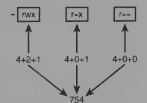

> 图 4.2 文件权限的数值值。

表 4.1 扩展了数值转换，并列出了文件权限 100 多种可能值中的某些。

### 文件权限值的示例

#### 表 4.1

| 数值值 | 权限 |
|---|---|
| 1 | `-----X` |
| 2 | `-----W` |

#### 表 4.1 续

| 数值值 | 权限 |
|---|---|
| 3 | `------ -WX` |
| 4 | `------ -R--` |
| 5 | `------ -R-X` |
| 6 | `------ -RW-` |
| 7 | `------ -RWX` |
| 10 | `------ -X--` |
| 11 | `------ -X--X` |
| 22 | `------ -W--W-` |
| 33 | `------ -WX-WX` |
| 55 | `------ -RX-X` |
| 77 | `------ -RWX` |
| 100 | `-- -X-----` |
| 101 | `-- -X---X` |
| 111 | `-- -X-X--X` |
| 222 | `-W--W--W-` |
| 311 | `-WX--X--X` |
| 322 | `-W--W--` |
| 400 | `-R------` |
| 444 | `-R--R--` |
| 511 | `-R-X--X` |
| 544 | `-R-X----` |
| 644 | `-RW--R--` |
| 666 | `rw-rw-` |
| 755 | `rwx-xr--` |
| 777 | `rwxrwx` |

所有新创建文件的默认权限为 666 (`rw-rw-`)，目录为 777 (`rwxrwx`)。然而，这个数字会由于一个名为 `umask` 的变量的存在而改变。`umask` 变量等于一个数字，从默认权限中减去该数字，得到适用于每个用户的权限。要查看 `umask` 的值，只需在提示符处输入命令：

```
$ umask
022
```

当 `umask` 为 022 时，权限如下：

- 文件：666 (`rw-rw-`) - 022 = 644 (`rw-r--r--`)
- 目录：777 (`rwxrwx`) - 022 = 755 (`rwxr-xr-x`)


| 322 | -W--W-- |
| 400 | -R------ |
| 444 | -R--R-- |
| 511 | -R-X--X |
| 544 | -R-X---- |
| 644 | -RW--R-- |
| 666 | rw-rw- |
| 755 | rwx-xr-- |
| 777 | rwxrwx |

所有新创建文件的默认权限为 `666` (rw-rw-)，目录为 `777` (rwxrwx)。然而，这个数字会由于一个名为 `umask` 的变量的存在而改变。`umask` 变量等于一个数字，从默认权限中减去该数字，得到适用于每个用户的权限。要查看 `umask` 的值，只需在提示符处输入命令：

```
$ umask
022
```

# Novell 认证 Linux 学习指南

此工具可用于文件和目录，并允许通配符和正则表达式。

它可以与 `getfacl` 和 `setfacl` 配合使用，后者用于设置文件 ACL（访问控制列表）信息，因此是 `chmod` 的替代方案。图 4.4 显示了工具提供的许多选项。

## 图 4.4

`setacl` 工具提供了许多选项。

```
Usage: setfacl [-bKDFL] [-m ACL|-x ACL|-X] file ...
-a, -modify          修改文件(s)的当前 ACL
-R, -modify=file    从文件读取 ACL 条目
-x, -remove=file    从文件(s)的 ACL 中删除条目
-x, -remove-file    从文件中删除条目
-R, -remove-all     删除所有扩展 ACL 条目
-k, -default         设置默认 ACL
-set-file=file      设置文件的 ACL，替换当前 ACL
-mask               读取 ACL 条目以设置文件
-r                   重新计算有效权限掩码
-don't              不更新有效权限掩码
-d, -default         对默认 ACL 进行的操作
-R, -recursive       递归进入子目录
-L, -logical         逻辑遍历，跟随符号链接
-P, -physical        物理遍历，跟随符号链接
-restore=file       恢复 ACL（'getfacl -R' 的反向）
-test               测试模式（不修改 ACL）
-version            打印版本并退出
-help               
-help               显示此帮助文本
linux:~$ #
```

以下示例将 `turbo` 文件的权限设置为 `slowmotion` 的权限：

```
$ getfacl slowmotion
## file: slowmotion
## owner: kristen
## group: users
user::rw-
group::r-
other::r-
```

```
$ getfacl slowmotion | setacl -set-file= turbo
$ getfacl turbo
## file: turbo
## owner: kristen
## group: users
user::rw-
group::r--
other::r--
```

```
$
```

`setfacl` 优于 `chmod` 的好处在于它提供了许多选项——如示例所示——这些选项仅在它可用。

## 特殊权限

在少数情况下会使用三种特殊权限。读、写和执行权限始终被使用（或表示其缺失），有时你可能需要对文件或目录进行更多操作。这三种特殊权限是：

- 设置用户 ID (SUID)
- 设置组 ID (SGID)
- 粘滞位 (Sticky bit)

这些权限将在接下来的章节中讨论。

## SUID

当你有一个普通用户无法运行但必须运行的可执行文件时，就会使用 Set User ID 权限。例如，由于安全考虑，只有 root 用户应该能够执行函数 `xyz`（启动备份、执行恢复、登录到其他设备等），但如果你需要用户运行 shell 脚本来执行此操作，而你又没有时间亲自去做，该怎么办？

你可以以 root 身份创建该 shell 脚本，并设置 SUID 权限，使得该脚本无论是谁运行它，都仅在该脚本的框架内变为 root。在脚本执行前后，他们是自己，但脚本以 root 身份运行。

SUID 的数字权限为 `4000`。

```
$ ls -l turbo2
-rwxrxrwx 1 root root 542 Sep 9 20:02 turbo2
$ chmod 4777 turbo2
```

```
$ ls -l turbo2
-rwswxrwx 1 root root 542 Sep 9 20:02 turbo2
$
```

记住：使用此权限的价值在于进程是以创建者（在本例中为 root）的身份运行，而不是以执行者的身份运行。要在符号格式下执行相同的操作，命令为 `chmod u+s turbo2`。

## SGID

SGID 与 SUID 类似，Set Group ID 权限用于当你需要执行文件的人成为文件所有组的成员（而不是所有者）时。这会将组权限中的 "x" 变为 "s"，数字值为 `2000`：

```
$ ls -l turbo2
-rwxrxrwx 1 root root 542 Sep 9 20:02 turbo2
$ chmod 2777 turbo2
$ ls -l turbo2
-rwxrxrwx 1 root root 542 Sep 9 20:02 turbo2
```

要使用符号语法，命令为 `chmod g+s turbo2`。

## 粘滞位 (Sticky Bit)

最后一种权限与其他特殊权限的工作方式不同。其数字值为 `1000`，应用于目录和文件时的操作有所不同。当应用于目录时，它可以防止用户从授予其写权限的文件夹中删除文件，除非他们是该文件的所有者。默认情况下，任何对目录具有写权限的用户都可以删除目录内的文件，即使该用户没有对该文件的权限。

当粘滞位权限应用于文件时，该文件将变为“粘性”的（因此得名）。文件第一次被运行或访问时，它将加载到内存或交换空间中，这样它的运行速度会比从驱动器读取更快。如果文件不可执行，则最后一位对其他类别保持为 "x"。如果文件是可执行文件或目录，则最后一位将变为 "t"。

## 4.5 粘滞位

粘滞位可以防止用户删除其他用户创建的文件，即使他们对该目录有写权限。

## Novell 认证 Linux 专家学习指南

```
-rw-r--r-- 1 root root 152 Sep 23 00:26 tuesday
-rw-r--r-- 1 root root 38 Sep 23 00:26 wednesday
$
cat >> monday
成分包括碳酸水、高果糖玉米糖浆
/或糖、柠檬酸和天然香料。
{按下 Ctrl+D 完成}
$
ls -l
drwx------ 5 root root 1024 Sep 22 23:57 Desktop
-rw-r--r-- 1 root root 81 Sep 23 00:25 friday
-rw-r--r-- 2 root root 194 Sep 23 15:09 monday
-rw-r--r-- 2 root root 194 Sep 23 15:09 thursday
-rw-r--r-- 1 root root 152 Sep 23 00:26 tuesday
-rw-r--r-- 1 root root 38 Sep 23 00:26 wednesday
```

对一个实体的更改所产生的相同效果也适用于权限、所有者、组等。硬链接不能跨越文件系统，并且必须始终是本地的。用户可以创建文件的链接，但不能创建目录链接；然而，root 用户可以使用 `-F` 或 `-o` 选项创建目录链接。

## 符号链接

要创建符号链接，必须使用 `ln` 命令的 `-s` 选项。符号链接等同于 Windows 操作系统中的“快捷方式”：指向另一个文件的小文件。符号链接的主要目的是为了克服硬链接的局限性。因此，它们允许用户链接到目录，并允许链接跨越文件系统。

为了说明如何创建符号链接，请考虑以下示例：

```
ls -l
drwx------ 5 root root 1024 Sep 22 23:57 Desktop
-rw-r--r-- 1 root root 81 Sep 23 00:25 friday
-rw-r--r-- 2 root root 194 Sep 24 15:09 monday
-rw-r--r-- 2 root root 194 Sep 24 15:09 thursday
-rw-r--r-- 1 root root 152 Sep 23 00:26 tuesday
-rw-r--r-- 1 root root 38 Sep 23 00:26 wednesday
$
$ ln -s friday saturday
$ ls -l
drwx---------- 5 root root 1024 Sep 22 23:57 Desktop
-rw-r--r-- 1 root root 81 Sep 23 00:25 friday
-rw-r--r-- 2 root root 194 Sep 24 15:09 monday
lrwxrwxwx 1 root root 6 Sep 24 15:49 saturday -> friday
-rw-r--r-- 2 root root 194 Sep 24 15:09 thursday
-rw-r--r-- 1 root root 152 Sep 23 00:26 tuesday
-rw-r--r-- 1 root root 38 Sep 23 00:26 wednesday
$
```

关于这次操作，有几点需要注意：

1. `friday` 上的链接计数没有变化。
2. 新文件的第一列始终为 `lrwxrwxwx`，以表示它是一个链接。
3. 新文件的日期和时间与旧文件不同，而是当前的日期和时间——这是因为创建了一个新文件（拥有它自己的节点）。
4. 文件名右侧是该文件实际被引用的图形化指示。
5. 新文件有一个与其关联的大小，但该大小仅等于指针本身。

最后一点值得仔细思考一下。文件 `friday` 的大小为 `81`，而 `saturday` 的大小为 `6`。这对于用户来说是完全透明的，因为在 `saturday` 上执行的任何操作都会被重定向到 `friday`。为了说明：

```
$ cat friday
this is the way that one and one
will equal two
and two and two
will equal four
$
$ cat saturday
this is the way that one and one
will equal two
and two and two
will equal four
$
$ wc friday
    4 18 81 friday
$ wc saturday
    4 18 81 saturday
$
```

换句话说，`saturday` 只是 `friday` 的符号（名称）表示。你尝试进行的任何操作都会通过第二个文件中的指针发送到第一个文件。这可能会导致意想不到的结果：由于文件是一个指针，它可能指向一个不再存在或不可用的东西（记住，它们可以跨越文件系统）。考虑以下事件序列，被指向的文件被删除：

```
$ rm friday
$ ls -l
drwx------ 5 root root 1024 Sep 22 23:57 Desktop
-rw-r--r-- 2 root root 194 Sep 24 15:09 monday
lrwxrwxwx 1 root root 6 Sep 24 15:49 saturday -> friday
-rw-r--r-- 2 root root 194 Sep 24 15:09 thursday
-rw-r--r-- 1 root root 152 Sep 23 00:26 tuesday
-rw-r--r-- 1 root root 38 Sep 23 00:26 wednesday
$ wc saturday
wc: saturday: No such file or directory
```

这会导致意外的结果：由于文件是一个指针，它可能指向一个不再存在或不可用的东西（记住，它们可以跨越文件系统）。

`which` 命令与 `locate` 命令类似。然而，它不是通过数据库查找，而是通过你在路径语句中列出的目录。当它在某个目录中找到给定的名称时，它会立即停止并报告找到的内容。以下简单的示例说明了这一点：

```
$ which grep
/usr/bin/grep
$
```

## 表 4.2 续

| 选项 | 用途 |
| :--- | :--- |
| -mount | 仅在本地文件系统中查找 |
| -mtime days | 仅当文件在指定的天数内被修改过时测试为真 |
| -name file | 仅当匹配给定的名称时为真 |
| -perm permission | 如果匹配给定的权限则为真 |
| -print | 打印匹配文件的文件名 |
| -size number | 如果匹配块数或字符数则为真 |
| -type type | 如果匹配指定的类型则为真 (d=目录, f=文件, b=块设备文件, c=字符设备) |
| -user name | 仅当所有者为指定的用户时为真 |

例如，要找到系统中所有从根目录开始、名为 `grep` 的文件，您将使用以下规格说明：

```bash
$ find / -name "grep"
/usr/bin/grep
$
```

注意，不需要指定 `-print` 选项：这是默认操作。同样注意，与 `locate` 不同，它找到的是精确匹配，而不仅仅是包含这四个字母的条目。如果您想查找单词部分的匹配项，需要使用星号 (`*`) 通配符（`find / -name "grep*"`）。

当找到匹配项时，您可以对其执行某些操作，例如获取列表：

```bash
$ find -name "grep" -exec ls -1 {};
-rwxr-xr-x 1 root 70652 Aug 11 1999 /usr/bin/grep
$
```

> 小心使用 `-exec` 选项，因为您可以在其后跟接任何内容——包括移动、删除等。可以使用 `-ok` 选项代替 `-exec`，以便在执行每个操作之前强制进行提示。

要查找哪些文件被访问过，请使用 `-atime` 选项。如果数字前面有一个加号 (`+`)，它将返回访问天数大于指定天数的条目。如果数字前面有一个减号 (`-`)，它将返回访问天数小于指定天数的条目。要查找当前目录下目录下未被访问 10 天或更久的文件，请指定 `+10`：

```bash
$ find . -atime +10
```

要查找在过去两天内访问过的文件，请指定 `-2`：

```bash
$ find . -atime -2
```

要仅查找当前目录下的目录，请指定 `d`：

```bash
$ find . -type d
```

要查找与用户 `edulaney` 相关的所有文件，请使用以下序列：

```bash
$ find / -user edulaney
/home/edulaney/.bash_logout
/home/edulaney/.bashrc
/home/edulaney/.cshrc
/home/edulaney/.inputrc
/home/edulaney/.login
/home/edulaney/.logout
/home/edulaney/.profile
/home/edulaney/.tcshrc
/home/edulaney/.seyon
/home/edulaney/.seyon/phonelist
/home/edulaney/.seyon/protocols
/home/edulaney/.seyon/script.CIS
/home/edulaney/.seyon/script.PCBoard
/home/edulaney/.seyon/script.QWK
/home/edulaney/.seyon/script.unix
/home/edulaney/.seyon/startup
/home/edulaney/fileone
/home/edulaney/filetwo
/home/edulaney/.bash_history
$ 
```

注意结果包含了可见和隐藏的目录及文件。

## 配额操作

涵盖课程目标

- 5. 设置和配置磁盘配额 (3037)

配额用于限制用户或组可用的空间量。默认情况下，Linux 不实施任何配额，因此每个用户消耗的硬盘空间量仅限于系统上的可用空间量。

使用配额时，它们必须应用于每个分区，这提供了灵活性，使得应用于一个分区的级别可以与另一个分区的不同。每个配额也独立于任何其他配额运行。例如，可以在列表为 `kristin` 的分区上应用配额为 7MB，甚至为 5MB，对 `spencer` 应用为 3MB。这使得他们三人总共拥有 15MB 的存储空间。然而，如果他们都属于销售组，且该组被限制为 10MB，那么在达到 10MB 限制后，一个或多个用户将无法存储文件，尽管他们的个人配额内还有空间。

要开启配额，您必须编辑 `/etc/fstab` 文件。一个当前的条目带有-

```
/dev/hda3 /home ext2 defaults 1 2
```

第一个字段是文件系统，第二个字段是挂载点。第三个字段是文件系统类型，第四个字段是文件系统选项。第五个字段标识 `dump` 使用文件系统的顺序，第六个字段是 `fsck` 使用它的顺序。

必须在第四个字段进行修改以使用配额，通过将行更改为：

```
/dev/hda3 /home ext2 defaults,usrquota 1 2
```


## 配额操作

涵盖课程目标

- 5. 设置和配置磁盘配额 (3037)

配额用于限制用户或组可用的空间量。默认情况下，Linux 不实施任何配额，因此每个用户消耗的硬盘空间量仅限于系统上的可用空间量。

使用配额时，它们必须应用于每个分区，这提供了灵活性，使得应用于一个分区的级别可以与另一个分区的不同。每个配额也独立于任何其他配额运行。例如，可以在列表为 `kristin` 的分区上应用配额为 7MB，甚至为 5MB，对 `spencer` 应用为 3MB。这使得他们三人总共拥有 15MB 的存储空间。然而，如果他们都属于销售组，且该组被限制为 10MB，那么在达到 10MB 限制后，一个或多个用户将无法存储文件，尽管他们的个人配额内还有空间。

要开启配额，您必须编辑 `/etc/fstab` 文件。一个当前的条目带有：

```
/dev/hda3 /home ext2 defaults 1 2
```

第一个字段是文件系统，第二个字段是挂载点。第三个字段是文件系统类型，第四个字段是文件系统选项。第五个字段标识 `dump` 使用文件系统的顺序，第六个字段是 `fsck` 使用它的顺序。

必须在第四个字段进行修改以使用配额，通过将行更改为：

```
/dev/hda3 /home ext2 defaults,usrquota 1 2
```

在某些情况下，可能需要重新编译内核以支持配额，但情况并非总是如此。编辑文件后，转到配额所在分区的根目录。

### find 命令示例

要查找当前目录下未被访问 10 天或更久的文件，请指定 `+10`：

```bash
$ find . -atime +10
```

要查找在过去两天内访问过的文件，请指定 `-2`：

```bash
$ find . -atime -2
```

要仅查找当前目录下的目录，请指定 `d`：

```bash
$ find . -type d
```

要查找与用户 `edulaney` 相关的所有文件，请使用以下序列：

```bash
$ find / -user edulaney
/home/edulaney/.bash_logout
/home/edulaney/.bashrc
/home/edulaney/.cshrc
/home/edulaney/.inputrc
/home/edulaney/.login
/home/edulaney/.logout
/home/edulaney/.profile
/home/edulaney/.tcshrc
/home/edulaney/.seyon
/home/edulaney/.seyon/phonelist
/home/edulaney/.seyon/protocols
/home/edulaney/.seyon/script.CIS
/home/edulaney/.seyon/script.PCBoard
/home/edulaney/.seyon/script.QWK
/home/edulaney/.seyon/script.unix
/home/edulaney/.seyon/startup
/home/edulaney/fileone
/home/edulaney/filetwo
/home/edulaney/.bash_history
$
```

注意结果包含了可见和隐藏的目录及文件。


## 配额操作

涵盖课程目标

- 5. 设置和配置磁盘配额 (3037)

配额用于限制用户或组可用的空间量。默认情况下，Linux 不实施任何配额，因此每个用户消耗的硬盘空间量仅限于系统上的可用空间量。

使用配额时，它们必须应用于每个分区，这提供了灵活性，使得应用于一个分区的级别可以与另一个分区的不同。每个配额也独立于任何其他配额运行。例如，可以在列表为 `kristin` 的分区上应用配额为 7MB，甚至为 5MB，对 `spencer` 应用为 3MB。这使得他们三人总共拥有 15MB 的存储空间。然而，如果他们都属于销售组，且该组被限制为 10MB，那么在达到 10MB 限制后，一个或多个用户将无法存储文件，尽管他们的个人配额内还有空间。

要开启配额，您必须编辑 `/etc/fstab` 文件。一个当前的条目带有-

```
/dev/hda3 /home ext2 defaults 1 2
```

第一个字段是文件系统，第二个字段是挂载点。第三个字段是文件系统类型，第四个字段是文件系统选项。第五个字段标识 `dump` 使用文件系统的顺序，第六个字段是 `fsck` 使用它的顺序。

必须在第四个字段进行修改以使用配额，通过将行更改为：

```
/dev/hda3 /home ext2 defaults,usrquota 1 2
```

在某些情况下，可能需要重新编译内核以支持配额，但情况并非总是如此。编辑文件后，转到配额所在分区的根目录。

### `find` 命令示例

要查找当前目录下未被访问 10 天或更久的文件，请指定 `+10`：

```bash
$ find . -atime +10
```

要查找在过去两天内访问过的文件，请指定 `-2`：

```bash
$ find . -atime -2
```

要仅查找当前目录下的目录，请指定 `d`：

```bash
$ find . -type d
```

要查找与用户 `edulaney` 相关的所有文件，请使用以下序列：

```bash
$ find / -user edulaney
/home/edulaney/.bash_logout
/home/edulaney/.bashrc
/home/edulaney/.cshrc
/home/edulaney/.inputrc
/home/edulaney/.login
/home/edulaney/.logout
/home/edulaney/.profile
/home/edulaney/.tcshrc
/home/edulaney/.seyon
/home/edulaney/.seyon/phonelist
/home/edulaney/.seyon/protocols
/home/edulaney/.seyon/script.CIS
/home/edulaney/.seyon/script.PCBoard
/home/edulaney/.seyon/script.QWK
/home/edulaney/.seyon/script.unix
/home/edulaney/.seyon/startup
/home/edulaney/fileone
/home/edulaney/filetwo
/home/edulaney/.bash_history
$
```

注意结果包含了可见和隐藏的目录及文件。


# 配额操作

## 涵盖课程目标

- 5. 设置和配置磁盘配额 (3037)

配额用于限制用户或组可用的空间量。默认情况下，Linux 不实施任何配额，因此每个用户消耗的硬盘空间量仅限于系统上的可用空间量。

使用配额时，它们必须应用于每个分区，这提供了灵活性，使得应用于一个分区的级别可以与另一个分区的不同。每个配额也独立于任何其他配额运行。例如，可以在列表为 `kristin` 的分区上应用配额为 7MB，甚至为 5MB，对 `spencer` 应用为 3MB。这使得他们三人总共拥有 15MB 的存储空间。然而，如果他们都属于销售组，且该组被限制为 10MB，那么在达到 10MB 限制后，一个或多个用户将无法存储文件，尽管他们的个人配额内还有空间。

要开启配额，您必须编辑 `/etc/fstab` 文件。一个当前的条目带有：

```
/dev/hda3 /home ext2 defaults 1 2
```

第一个字段是文件系统，第二个字段是挂载点。第三个字段是文件系统类型，第四个字段是文件系统选项。第五个字段标识 `dump` 使用文件系统的顺序，第六个字段是 `fsck` 使用它的顺序。

必须在第四个字段进行修改以使用配额，通过将行更改为：

```
/dev/hda3 /home ext2 defaults,usrquota 1 2
```

在某些情况下，可能需要重新编译内核以支持配额，但情况并非总是如此。编辑文件后，转到配额所在分区的根目录。

要查找当前目录下未被访问 10 天或更久的文件，请指定 `+10`：

```bash
$ find . -atime +10
```

要查找在过去两天内访问过的文件，请指定 `-2`：

```bash
$ find . -atime -2
```

要仅查找当前目录下的目录，请指定 `d`：

```bash
$ find . -type d
```

要查找与用户 `edulaney` 相关的所有文件，请使用以下序列：

```bash
$ find / -user edulaney
/home/edulaney/.bash_logout
/home/edulaney/.bashrc
/home/edulaney/.cshrc
/home/edulaney/.inputrc
/home/edulaney/.login
/home/edulaney/.logout
/home/edulaney/.profile
/home/edulaney/.tcshrc
/home/edulaney/.seyon
/home/edulaney/.seyon/phonelist
/home/edulaney/.seyon/protocols
/home/edulaney/.seyon/script.CIS
/home/edulaney/.seyon/script.PCBoard
/home/edulaney/.seyon/script.QWK
/home/edulaney/.seyon/script.unix
/home/edulaney/.seyon/startup
/home/edulaney/fileone
/home/edulaney/filetwo
/home/edulaney/.bash_history
$
```

注意结果包含了可见和隐藏的目录及文件。


## 配额操作

### 涵盖课程目标

- 5. 设置和配置磁盘配额 (3037)

配额用于限制用户或组可用的空间量。默认情况下，Linux 不实施任何配额，因此每个用户消耗的硬盘空间量仅限于系统上的可用空间量。

使用配额时，它们必须应用于每个分区，这提供了灵活性，使得应用于一个分区的级别可以与另一个分区的不同。每个配额也独立于任何其他配额运行。例如，可以在列表为 `kristin` 的分区上应用配额为 7MB，甚至为 5MB，对 `spencer` 应用为 3MB。这使得他们三人总共拥有 15MB 的存储空间。然而，如果他们都属于销售组，且该组被限制为 10MB，那么在达到 10MB 限制后，一个或多个用户将无法存储文件，尽管他们的个人配额内还有空间。

### 启用配额

要开启配额，您必须编辑 `/etc/fstab` 文件。一个当前的条目带有：

```
/dev/hda3 /home ext2 defaults 1 2
```

第一个字段是文件系统，第二个字段是挂载点。第三个字段是文件系统类型，第四个字段是文件系统选项。第五个字段标识 `dump` 使用文件系统的顺序，第六个字段是 `fsck` 使用它的顺序。

必须在第四个字段进行修改以使用配额，通过将行更改为：

```
/dev/hda3 /home ext2 defaults,usrquota 1 2
```

在某些情况下，可能需要重新编译内核以支持配额，但情况并非总是如此。编辑文件后，转到配额所在分区的根目录。

### `find` 命令示例

要查找当前目录下未被访问 10 天或更久的文件，请指定 `+10`：

```bash
$ find . -atime +10
```

要查找在过去两天内访问过的文件，请指定 `-2`：

```bash
$ find . -atime -2
```

要仅查找当前目录下的目录，请指定 `d`：

```bash
$ find . -type d
```

要查找与用户 `edulaney` 相关的所有文件，请使用以下序列：

```bash
$ find / -user edulaney
/home/edulaney/.bash_logout
/home/edulaney/.bashrc
/home/edulaney/.cshrc
/home/edulaney/.inputrc
/home/edulaney/.login
/home/edulaney/.logout
/home/edulaney/.profile
/home/edulaney/.tcshrc
/home/edulaney/.seyon
/home/edulaney/.seyon/phonelist
/home/edulaney/.seyon/protocols
/home/edulaney/.seyon/script.CIS
/home/edulaney/.seyon/script.PCBoard
/home/edulaney/.seyon/script.QWK
/home/edulaney/.seyon/script.unix
/home/edulaney/.seyon/startup
/home/edulaney/fileone
/home/edulaney/filetwo
/home/edulaney/.bash_history
$
```

注意结果包含了可见和隐藏的目录及文件。


# 查找用户文件示例

要查找与用户 `edulaney` 相关的所有文件，请使用以下序列：

```bash
$ find / -user edulaney
/home/edulaney/.bash_logout
/home/edulaney/.bashrc
/home/edulaney/.cshrc
/home/edulaney/.inputrc
/home/edulaney/.login
/home/edulaney/.logout
/home/edulaney/.profile
/home/edulaney/.tcshrc
/home/edulaney/.seyon
/home/edulaney/.seyon/phonelist
/home/edulaney/.seyon/protocols
/home/edulaney/.seyon/script.CIS
/home/edulaney/.seyon/script.PCBoard
/home/edulaney/.seyon/script.QWK
/home/edulaney/.seyon/script.unix
/home/edulaney/.seyon/startup
/home/edulaney/fileone
/home/edulaney/filetwo
/home/edulaney/.bash_history
$
```

注意结果包含了可见和隐藏的目录及文件。

## 配额操作

涵盖课程目标

- 5. 设置和配置磁盘配额 (3037)

配额用于限制用户或组可用的空间量。默认情况下，Linux 不实施任何配额，因此每个用户消耗的硬盘空间量仅限于系统上的可用空间量。

使用配额时，它们必须应用于每个分区，这提供了灵活性，使得应用于一个分区的级别可以与另一个分区的不同。每个配额也独立于任何其他配额运行。例如，可以在列表为 `kristin` 的分区上应用配额为 7MB，甚至为 5MB，对 `spencer` 应用为 3MB。这使得他们三人总共拥有 15MB 的存储空间。然而，如果他们都属于销售组，且该组被限制为 10MB，那么在达到 10MB 限制后，一个或多个用户将无法存储文件，尽管他们的个人配额内还有空间。

### 启用配额

要开启配额，您必须编辑 `/etc/fstab` 文件。一个当前的条目带有：

```
/dev/hda3 /home ext2 defaults 1 2
```

第一个字段是文件系统，第二个字段是挂载点。第三个字段是文件系统类型，第四个字段是文件系统选项。第五个字段标识 `dump` 使用文件系统的顺序，第六个字段是 `fsck` 使用它的顺序。

必须在第四个字段进行修改以使用配额，通过将行更改为：

```
/dev/hda3 /home ext2 defaults,usrquota 1 2
```

在某些情况下，可能需要重新编译内核以支持配额，但情况并非总是如此。编辑文件后，转到配额所在分区的根目录。

### find 命令时间参数示例

要查找当前目录下未被访问 10 天或更久的文件，请指定 `+10`：

```bash
$ find . -atime +10
```

要查找在过去两天内访问过的文件，请指定 `-2`：

```bash
$ find . -atime -2
```

要仅查找当前目录下的目录，请指定 `d`：

```bash
$ find . -type d
```

要查找与用户 `edulaney` 相关的所有文件，请使用以下序列：

```bash
$ find / -user edulaney
/home/edulaney/.bash_logout
/home/edulaney/.bashrc
/home/edulaney/.cshrc
/home/edulaney/.inputrc
/home/edulaney/.login
/home/edulaney/.logout
/home/edulaney/.profile
/home/edulaney/.tcshrc
/home/edulaney/.seyon
/home/edulaney/.seyon/phonelist
/home/edulaney/.seyon/protocols
/home/edulaney/.seyon/script.CIS
/home/edulaney/.seyon/script.PCBoard
/home/edulaney/.seyon/script.QWK
/home/edulaney/.seyon/script.unix
/home/edulaney/.seyon/startup
/home/edulaney/fileone
/home/edulaney/filetwo
/home/edulaney/.bash_history
$
```

注意结果包含了可见和隐藏的目录及文件。


## 表 4.2 续

| 选项 | 用途 |
| :--- | :--- |
| -mount | 仅在本地文件系统中查找 |
| -mtime days | 仅当文件在指定的天数内被修改过时测试为真 |
| -name file | 仅当匹配给定的名称时为真 |
| -perm permission | 如果匹配给定的权限则为真 |
| -print | 打印匹配文件文件名 |
| -size number | 如果匹配块数或字符数则为真 |
| -type type | 如果匹配指定的类型则为真 (d=目录, f=文件, b=块文件, c=字符文件) |
| -user name | 仅当所有者为指定的用户时为真 |

例如，要找到系统中所有从根目录开始、名为 `grep` 的文件，您将使用以下规格说明：

```
$ find / -name "grep"
/usr/bin/grep
$
```

注意，不需要指定 `-print` 选项：这是默认操作。同样注意，与 `locate` 不同，它找到的是精确匹配，而不仅仅是包含这四个字母的条目。如果您想查找单词部分的匹配项，需要使用星号 (`*`) 通配符（`find / -name "grep*"`）。

当找到匹配项时，您可以对其执行某些操作，例如获取列表：

```
$ find -name "grep" -exec ls -1 {};
-rwxr-xr-x 1 root 70652 Aug 11 1999
->/usr/bin/grep
$
```

> 小心使用 `-exec` 选项，因为您可以在其后跟接任何内容——包括移动、删除等。可以使用 `-ok` 选项代替 `-exec`，以便在执行每个操作之前强制进行提示。

要查找哪些文件被访问过，请使用 `-atime` 选项。如果数字前面有一个加号 (`+`)，它将返回访问天数大于指定天数的条目。如果数字前面有一个减号 (`-`)，它将返回访问天数小于指定天数的条目。要查找当前目录下未被访问 10 天或更久的文件，请指定 `+10`：

```bash
$ find . -atime +10
```

要查找在过去两天内访问过的文件，请指定 `-2`：

```bash
$ find . -atime -2
```

要仅查找当前目录下的目录，请指定 `d`：

```bash
$ find . -type d
```

要查找与用户 `edulaney` 相关的所有文件，请使用以下序列：

```bash
$ find / -user edulaney
/home/edulaney/.bash_logout
/home/edulaney/.bashrc
/home/edulaney/.cshrc
/home/edulaney/.inputrc
/home/edulaney/.login
/home/edulaney/.logout
/home/edulaney/.profile
/home/edulaney/.tcshrc
/home/edulaney/.seyon
/home/edulaney/.seyon/phonelist
/home/edulaney/.seyon/protocols
/home/edulaney/.seyon/script.CIS
/home/edulaney/.seyon/script.PCBoard
/home/edulaney/.seyon/script.QWK
/home/edulaney/.seyon/script.unix
/home/edulaney/.seyon/startup
/home/edulaney/fileone
/home/edulaney/filetwo
/home/edulaney/.bash_history
$
```

注意结果包含了可见和隐藏的目录及文件。

## 配额操作

涵盖课程目标

- 5. 设置和配置磁盘配额 (3037)

配额用于限制用户或组可用的空间量。默认情况下，Linux 不实施任何配额，因此每个用户消耗的硬盘空间量仅限于系统上的可用空间量。

使用配额时，它们必须应用于每个分区，这提供了灵活性，使得应用于一个分区的级别可以与另一个分区的不同。每个配额也独立于任何其他配额运行。例如，可以在列表为 `kristin` 的分区上应用配额为 7MB，甚至为 5MB，对 `spencer` 应用为 3MB。这使得他们三人总共拥有 15MB 的存储空间。然而，如果他们都属于销售组，且该组被限制为 10MB，那么在达到 10MB 限制后，一个或多个用户将无法存储文件，尽管他们的个人配额内还有空间。

要开启配额，您必须编辑 `/etc/fstab` 文件。一个当前的条目带有-

```
/dev/hda3 /home ext2 defaults 1 2
```

第一个字段是文件系统，第二个字段是挂载点。第三个字段是文件系统类型，第四个字段是文件系统选项。第五个字段标识 `dump` 使用文件系统的顺序，第六个字段是 `fsck` 使用它的顺序。

必须在第四个字段进行修改以使用配额，通过将行更改为：

```
/dev/hda3 /home ext2 defaults,usrquota 1 2
```

在某些情况下，可能需要重新编译内核以支持配额，但情况并非总是如此。编辑文件后，转到配额所在分区的根目录。


要查找在过去两天内访问过的文件，请指定 `-2`：

...省略...

要仅查找当前目录下的目录，请指定 `d`：

...省略...

要查找与用户 `edulaney` 相关的所有文件，请使用以下序列：

...省略...

注意结果包含了可见和隐藏的目录及文件。

## 配额操作

涵盖课程目标

- 5. 设置和配置磁盘配额 (3037)

...省略...

## 创建和管理用户

涵盖的课程目标

- 1. 管理用户账户 (3036)
- 4. 描述 Linux Linux 用户安全特性 (3037)
- 5. 管理 Linux 用户和用户组 (3037)
- 6. 管理并确保 Linux 用户环境的安全 (3037)
- 11. 理解 Linux 用户身份认证 (3038)

在安装操作系统期间，系统会添加至少一个用户（root/超级用户）。这是系统上权限最大的用户，理论上几乎可以执行任何操作。安装完成后，通常需要添加额外的用户并修改与现有用户相关的变量。这两项任务将在本节中进一步讨论。

然而，为了理解其中涉及的内容，了解操作系统用于处理用户的文件至关重要。首要重要文件是 `/etc/passwd` 文件。字段之间用冒号分隔，示例所示：

```
root:x:0:0:root:/bin/bash
bin:x:1:1:bin:/bin
daemon:x:2:2:daemon:/sbin/
adm:x:3:4:adm:/var/
lp:x:4:7:lp:/var/spool/lpd
sync:x:5:0:sync:/bin/sync
shutdown:x:6:11:shutdown:/sbin/bin/shutdown
halt:x:7:0:halt:/sbin/bin/halt
mail:x:8:12:mail:/var/spool/mail/
news:x:9:13:news:/var/spool/news
uucp:x:10:14:uucp:/var/spool/uucp/
operator:x:11:0:operator:/root
games:x:12:100:games:/usr/games/
gopher:x:13:0:gopher:/usr/lib/gopher-data/
ftp:x:14:50:FTP:/user/ftp/
man:x:15:15:Manuals:::/bin/false
majordom:x:16:17:Postgres User:/home/postgres:/bin/bash
mysql:x:18:18:MySQL User:/var/lib/mysql:/bin/false
nbody:x:65534:65534:Nobody:::/bin/false
edaney:x:1000:100:emmett:/home/edaney:/bin/bash
kudaney:x:1001:100:kudaney:/home/kudaney:/bin/tcs
sudany:x:1002:100:spencer:/home/sdudany:/bin/zsh
```

## Linux 基础管理 第5 章

这七个字段可以拆分如下：

- **用户登录名（login name）**——这在每个系统中必须是唯一的，它是自由文本，可以使用任何编辑器随时对其进行编辑和修改。在示例显示的条目中，`bin` 是可执行文件的所有者，`daemon` 用于系统服务，`adm` 拥有日志文件。其他条目是用户（如 `aduelaney`）或单独的服务（如 `ftp`）。
- **密码（password）**——该字段可以是一个加密条目，也可以是 `x`。对于后者，该单个字符仅表示值存储在其他地方——即 `/etc/shadow` 文件中。

将密码存放在 shadow 文件中增加了额外的安全性。每个人都可以读取 `passwd` 文件，但只有 root 用户可以读取 `shadow` 文件。

- **数字用户 ID（UID）**——这是每个用户唯一的递增数字，是操作系统真正引用用户的方式（请记住登录名是可以更改的）。root 用户始终为 0，维护/服务账户使用较小的数字（通常到 99）。普通用户账户通常从 1000 开始（这是 SLES 的情况，但在其他 Linux 发行版中会有不同）并从那里递增。出于安全考虑，你可以将 root 重命名为任何其他文本，但数字 0 始终是标识符。
- **数字组 ID（GID）**——这标识与用户关联的默认组。root组始终为 0，较低数字用于系统组。普通用户根据 `/etc/login.defs` 文件中列出的起始数字分配组。
- **用于描述目的的自由文本**——查看此字段的主要工具之一是 `finger`，它简单地向任何查询者返回有关用户的信息。
- **用户的主目录（home directory）**——这是用户登录时开始的地方，也是存放定义环境变量的文件的地方。
- **用户的 shell**——如果该字段中没有数据，则使用默认 shell。

`/etc/shadow` 文件用于存储密码和老化参数（aging parameters）信息。这是一个示例：

```
root:awYeiEwmpfo6:11144:0::7:7:in*:10547:0::7:7:
daemon*:10547:0::7:7:
adm*:10547:0::7:7:
lp*:10547:0::7:7:
sync*:10547:0::7:7:
shutdown*:10547:0::7:7:
halt*:10547:0::7:7:
mail*:10547:0::7:7:
news*:10547:0::7:7:
uucp*:10547:0::7:7:
operator*:10547:0::7:7:
games*:10547:0::7:7:
gopher*:10547:0::7:7:
ftp*:10547:0::7:7:
man*:10547:0::7:7:
majordom*:10547:0::7:7:
mysql*:10547:0::7:7:
nbody*:10547:0::7:7:
edaney*:10547:0::7:7:
kudaney*:10547:0::7:7:
sudany*:10547:0::7:7:
```

这八个字段包括：

- 用户登录名
- 密码哈希值（password hash，即密码的加密版本）
- 密码最后更改日期（last change）
- 密码最小有效天数（minimum days）
- 密码最大有效天数（maximum days）
- 密码过期后失效天数（inactive days）
- 过期前警告天数（warning days）
- 预留标识符（reserved fields）
- 密码过期日期（expiration date）

## 创建账户

创建账户可以手动完成，也可以通过工具完成。手动创建的方法是向 `/etc/passwd` 文件追加条目。在更改之前，强烈建议对该文件进行备份。你可以将密码字段留空，然后使用 `passwd` 工具分配密码。

```bash
$ cat >> /etc/passwd
evan::504:0:/home/evan:/bin/bash
$ passwd evan
New user password: 
Retype new password: 
passwd: all tokens updated
$ tail -1 /etc/passwd
evan:petKv.:504:0:/home/evan:/bin/bash
```

> 任何用户都可以使用 `passwd` 工具更改自己的密码。但只有 root 用户可以使用它可以更改其他用户的密码。

注意这种方法将密码存放在 `passwd` 文件本身，而不使用 `shadow` 文件。

Linux 提供的（大多数发行版也有自己的工具）用于简化此过程的工具是 `useradd`。你必须使用工具，一个重要的选项是 `-D` 用于显示默认设置。这是一个示例：

`useradd` 工具供 `su` 或 root 使用。普通用户尝试使用它会收到错误消息。

```bash
$ useradd -D
GROUP=100
HOME=/home
INACTIVE=-1
EXPIRE=
SHELL=/bin/bash
SKEL=/etc/skel
GROUPS=dialout,uucp,video,audio
$
```

这些是在使用该工具创建新用户时将使用的默认值。这些默认值来自 `/etc/login.defs` 文件。因此，以下序列是可能的：

```bash
$ useradd kerby
$ tail -1 /etc/passwd
kerby:x:1002:100:::/home/kerby:/bin/bash
$ tail -1 /etc/shadow
kerby:!:12711:0:99999:7:::
$
passwd kerby
New user password: 
Retype new password: 
passwd: all tokens updated
$ tail -1 /etc/shadow
kerby:WCMQhDWjRD6:12711:0:99999:7:::
$
```

注意使用了 `/etc/shadow` 文件，用于创建两个文件中条目的值直接来自默认值，如表 5.1 所示。

## /etc/shadow 的默认值

| 默认值 (DEFAULT) | 文件结果 |
| --- | --- |
| GROUP | 变为 passwd 的第四个字段 |
| HOME | 变为 passwd 的第六个字段，其中 `%s` 变量变为命令行上指定的名称（该名称同时成为 passwd 和 shadow 的第一个字段） |
| SHELL | 变为 passwd 的第七字段 |
| PASS 变量 | 输入到 shadow 相应的字段中 |

此示例中未使用 `SKEL` 变量。默认情况下，`useradd` 会在密码和 shadow 文件中创建条目，但不会为用户创建家目录。如果你使用 `-m` 选项，`useradd` 将还会为用户创建家目录，并将文件从 `SKEL` 位置（一个骨架或模板，即你希望为每个新用户复制的文件的版）复制到新目录中。在典型的 SLES 9 实现中，`/etc/skel` 包含以下文件：

- .bash_history
- .bashrc
- .dvipsrc
- .emacs
- .exrc
- .fonts
- .kermrc
- .muttrc
- .profile
- .urlview
- .xcoralc
- .xemacs
- .xim.template
- .xinitrc.template
- .xtalkrc
- Documents
- .bin
- public_html

## Novell 认证 Linux 专业人员学习指南

所有隐藏文件都用于与各种 shell 的处理（设置变量、环境等）。

`useradd` 可以配合多个选项使用以覆盖默认设置，这些选项包括以下内容：

- `-c`：指定与用户关联的自由文本（passwd 的第五个字段）。大多数 Linux 实现默认在此处留一个空条目或其变体。
- `-d`：指定一个与 `/home/{username}` 不同的家目录。
- `-e`：更改过期日期（格式：mm/dd/yyyy）。
- `-f`：用于定义账户在过期后多少天被禁用的变量。默认值 `-1` 防止账户在过期后被禁用。
- `-g`：指定一个不同的 GID。
- `-r`：系统目录。
- `-s`：选择一个不同的 shell。
- `-u`：指定 UID：默认情况下，使用下一个可用数字。如果你尝试使用已经占用的数字，该程序将失败并识别出哪个用户已使用该数字。

## 在 passwd 和 shadow 之间切换

在创建新用户的目录示例中，加密后的密码出现在 `/etc/passwd` 文件中而不是 `/etc/shadow` 文件中。如果你想进行手动添加并继续使用 `/etc/shadow`，`pwconv` 工具是不可或缺的。该工具读取整个 passwd 文件并将新条目转换为 shadow 文件条目。

`pwconv` 的反向操作是 `pwunconv`，它从 shadow 文件中读取条目并将其以相应的格式放在 passwd 文件中。作为最后一步，`pwunconv` 会完全删除 shadow 文件。

## su 工具

passwd 文件中的条目代表可以登录的有效账户。任何用户都可以坐在系统前并提供正确的用户名和密码以该用户的身份登录。任何已登录的用户如果知道另一个用户的密码，也可以使用 `su` 工具切换身份到另一个用户。这创建了一个子 shell（如果可以这么说的话），其中一个用户变成了另一个用户，可以通过输入 `exit` 恢复到自己的身份。

## 基础 Linux 管理 第 5 章

尽管有几十个导致用户想要变成另一个用户的负面理由，但也有非常合理的理由。如果输入 `su` 后没有跟随用户名，它将尝试切换到超级用户（root），这需要该账户的密码。因此，作为管理员，你可以在没有 root 权限的情况下以普通用户登录并开始你的工作。缺乏 root 权限可能是一种幸运，因为可以防止你无意中删除条目，当用户遇到问题时，你可以使用 `su` 变成 root——拥有所有的权利和权限，就像你以此身份登录一样——修复用户的问题，然后退出回到你的普通账户。

# 管理用户账户

创建账户后，你可以通过使用工具手动管理和修改它。例如，如果一个名为 Karen Dulaney 的用户结婚了，她的名字改为 Karen Brooks，你可以编辑 passwd 和 shadow 文件，将每个 `kdulaney` 的第一个字段更改为 `kbro`。由于 UID 已经确定，所有与她相关的文件和更改将继续保持。家目录可以重命名，并在 passwd 中进行相应的更改（出于管理考虑，始终建议家目录和用户名匹配）。

另一个例子，如果 Karen 晋升为管理员，可能需要将她从用户组移除并放入 root 组。这也可以通过手动编辑 `/etc/passwd` 文件并更改 GID 字段来实现。对于文件中的每个字段，都可以给出无数个类似的示例。

> `usermod` 工具应由 `su` 或 root 用户使用。普通用户在尝试使用它时会收到错误信息。

正如 `useradd` 旨在简化向系统添加用户——并避免手动输入一样，`usermod` 旨在简化更改现有值。必须配合该工具使用选项/标志，这些是可能的情况：

- `-c`：用新值替换描述性文本。
- `-d`：更改家目录。
- `-e`：更改密码过期日期。
- `-f`：设置活动参数。
- `-G`：更改辅助组组成关系。只要有，就可以给出多个组。
- `-g`：更改 GID。
- `-l`：更改登录名。
- `-m`（必须与 `-d` 使用）：家目录。
- `-p`：更改密码。
- `-s`：不同的 shell。
- `-u`：更改 UID。

除了文本描述外，大多数值都需要你输入两次。这里是关于的示例：

```bash
$ grep /etc/passwd
kristen:x:1001:0:/home/kristen:/bin/bash
evan:x:1002:0:/home/evan:/bin/bash
duaney:x:1003:0:/home/duaney:/bin/bash
$ usermod -l kristen
$ grep /etc/passwd
kristen:x:1001:0:/home/kristen:/bin/bash
evan:x:1002:0:/home/evan:/bin/bash
duaney:x:1003:0:/home/duaney:/bin/bash
```

`usermod` 工具具有 `-p` 选项允许更改密码，但那通常可以使用前面讨论的工具完成。

如果有大量密码需要更改，可以使用 `passwd` 工具进行批量更改。使用它时，创建一个每行一个目的的文件。每行由用户名和密码组成，用冒号分隔。例如：

```bash
$ cat > changes
kristen:spea23ker
evan:pho78ne
duaney:fla98sh
<Ctrl+D>
$
$ chpasswd < changes
$
```

密码是明文的，由于原因，你希望尽快从系统中删除批文件。另一种方法是使用加密密码并配合 `chpasswd` 的 `-e` 选项。

> 使用良好的密码是一个好主意。良好的密码由至少六个字符组成，是字母、字符和数字的混合，并且不容易被猜到。

当用户账户不再需要时，有许多方法可以处理这种情况。你必须解决的问题是为什么该账户不再需要。当你知道这一点，就可以制定处理计划。表 5.2 提供了一些场景和处理方法。

# 不需要账户的解决方案

## 表 5.2

| 不需要账户的原因 | 建议的解决方案 |
|---|---|
| 用户被临时调往西伯利亚 | 如果是临时情况，你不想删除账户——这样做将删除以后可能需要的所有引用。要临时禁用账户，请编辑 `/etc/passwd` 文件并在行开头放置井号 (`#`)。这将使整行成为注释并禁用账户。 |
| 用户的密码被黑客危及 | 将密码更改为另一个值以将对方排除在外。为了进一步的安全，请重命名登录名和家目录。 |

## 表 5.2 续

| 不需要账户的感性原因 | 建议的解决方案 |
| :--- | :--- |
| 用户已离开组织 | 从 `/etc/passwd` 和 `/etc/shadow` 中删除该账户并删除其主目录。 |

也可以使用 `userdel` 工具来删除用户。该工具可以将用户从系统文件（passwd 和 shadow）中删除，但你仍然必须删除与该用户相关的任何文件。

## 与组的操作

所涵盖的课程目标

- 4. 描述基础 Linux 用户安全功能 (3037)
- 5. 管理 Linux 用户和组 (3037)
- 6. 管理并保护 Linux 用户环境 (3037)

正如了解用户变量背后的参数以理解如何使用它们同样重要，你也必须理解组的结构。存储组信息的文件是 `/etc/group`，其示例如下：


# /etc/group 文件格式

```
root:::
wheel::0:
bin::1:bin,daemon
daemon::2:bin,daemon
sys::3:bin,adm
adm::4:adm,daemon
tty::5:
disk::6:
lp::7:daemon,lp
mem::8:
kmem::9:
operator::11:
mail::12:mail
news::13:news
uucp::14:uucp
man::15:
majordom::16:
database::17:
mysql::18:
games::20:
gopher::30:
dip::40:
utmp::45:
ftp::50:
nobody::65534:
users::100:
```

文件中的每个条目有四个字段。第一个字段是与组相关的文本名称（最多八个字符，用于 `ls -l` 列表等）。第三个字段是系统中必须唯一的数字型 GID。第二个字段——默认情况下所有情况下均为空——存储了在使用时可能需要的密码。第四个字段可以列出组的成员。

# 创建新组

要创建一个新组，你可以手动编辑 `/etc/group` 文件并向末尾添加一个条目。如果这样做，必须确保使用唯一的文本名称和 GID 数字。也可以使用 `groupadd` 工具来简化操作：

```
$ groupadd -g 101 sales
$ tail -1 /etc/group
sales:101:
$
```

`-g` 选项用于指定要使用的 GID 数字。如果数字不是唯一的，工具将失败。根据一般规则，GID 0—99 预留给系统组：

```
$ groupadd -g 101 marketing
groupadd: GID 101 is not unique.
$
```

同样，如果你尝试重用组名，工具也会失败：

```
$ groupadd -g 102 sales
groupadd: Group 'sales' already exists.
$
```

除了 `-g` 之外，`groupadd` 只有几个其他可用选项。其中最重要的 `-o` 选项可以用于创建一个非唯一的组（允许使用相同的 `gid` 选项）。`-p` 选项允许你指定密码，而 `-r` 则创建一个系统组。

要进一步定义你的组，你可以诉诸手动编辑，或使用 `gpasswd` 工具。当仅输入组名执行时，它会提示输入与该组关联的密码：

```
$ gpasswd sales
Changing the password for group sales
New Password: {enter value}
Re-enter new password: {enter value again}
$ tail -1 /etc/group
sales:$0Jhex2Pbk7TU:101:
$
```

如果你厌倦了密码，或者发现它难以使用，可以使用 `-r` 选项将其删除。

```
$ gpasswd sales
$ tail -1 /etc/group
sales::101:
$
```

感叹号出现在第二个字段中，作为占位符，标识其他人可以加入等等。使用 `gpasswd` 一次无法添加或删除超过一个用户。

# 选择组

当用户是多个组的成员时，其默认组是由 `/etc/passwd` 文件中的第四个字段定义的。`id` 工具将显示关于用户的信息，包括用户所属的所有组：

```
$ id
uid=501(edulaney) gid=101
```

要修改组，你可以使用手动编辑，或者使用 `gpasswd` 工具。它会提示与组关联的密码：

```
$ gpasswd sales
$ tail -1 /etc/group
sales::101:
$
```

感叹号出现在第二个字段中，作为占位符，标识其他人可以加入等等。使用 `gpasswd` 一次无法添加或删除超过一个用户。

# 修改组

在组创建后，你可以通过手动编辑文件或使用 `groupmod` 工具来修改它们。`groupmod` 允许你更改组的属性：

```
$ groupmod -g 102 sales
$ tail -1 /etc/group
sales:102:
$
```

# Novell 认证 Linux 专业学习指南

## PAM 控制标志

控制标志有四种可能的值：

- **optional（可选）**——此标志的成功或失败没有负面影响。
- **required（强制）**——在允许继续之前，必须将此标志标记为成功。如果失败，则会处理其他相关的标志，然后通知用户存在问题。
- **requisite（必要）**——与 required 类似，区别在于发生失败时不会处理其他相关的标志，并且会立即通知用户存在问题。
- **sufficient（足够）**——如果该标志成功，则不需要处理其他模块（这已经足够了）。如果发生失败，则没有直接后果。

模块本身在第三字段中标识，在大多数系统中位于 `/lib/security`，在 64 位平台上位于 `/lib64/security`。可以传递的参数是任何运行所需的参数，最常见的是 `debug` 和 `nullok`。`debug` 参数用于启用调试，而 `nullok` 则允许将空密码被视为合法实体。

图 5.2 中的第一行指出 `pam_rootok.so` 模块（第三字段）将从 `/lib/security` 加载，不带任何参数（第四字段），通过一个必须是“足够”（第二字段）才能继续的认证请求进行授权（第一字段）。在使用 `su` 从一个用户切换到另一个用户时的预期如此，这符合逻辑。

`/usr/share/doc/packages/pam/` 目录包含 SLES 9 上的 PAM 文档。主目录下有一个 `README` 文件，`modules` 子目录下也有。在 `txt`、`pdf` 和 `html` 格式的子目录下可以找到各种格式的《管理员指南》。

# 配置系统日志

## 涵盖的课程目标

- 4. 描述基础 Linux 用户安全功能 (3037)
- 9. 使用系统日志服务 (3037)
- 17. 监控操作系统 (3038)

# 基础 Linux 管理

日志文件很容易成为管理员的好朋友，也可能是最坏的敌人。它们可以每天 24 小时、7 天监控系统并报告管理和安全问题，创建指纹让你看到发生了什么以及是谁在操作。另一方面，如果实现得不当，它们监控的信息过多，以至于你花费几天时间从成千上万条无用的无关条目中寻找单个项目；它们会消耗宝贵的磁盘空间；且几乎毫无意义。

关于其负面影响的示例：我曾在一家电子监控公司担任支持工作，该公司向司法部门销售计算机系统。在购买时，大多数部门必须凑齐购买系统的资金，并在尽可能的地方偷工（通常通过购买小硬盘或极小内存来省钱）。由于软禁的敏感性，每当访问模型（每天数千次），个人的信息就会发生更改，以此此类推。机器耗尽硬盘空间，客户支持每周必须远程登录并删除日志文件——这违背了拥有日志的整个目的。

关于其正面影响的示例：我曾为一家面临从未听过的问题的公司提供咨询。他们一解决一个问题，另一个问题就会出现。这些问题似乎毫无逻辑——数据库并不是发生文件损坏，而是完全从系统中被删除了——似乎是无缘无故的。某天还能登录的用户，第二天来发现他们的个人资料现在包含了导致一个又接一个错误的变量。挫败感达到了顶峰。解决方案：快速查看日志，发现一个不满的员工破解了许多密码，并会快速登录其他用户，造成一些破坏，然后退出并表现得和所有人一样困惑。

有效使用日志文件的关键是了解每个日志的作用。当你知道这些时，就可以现实地设定预期并寻找必要的数据，而不会被信息淹没。

## 日志守护进程

虽然单个应用程序可以有自己的日志功能，但有一个专门为操作系统运行日志服务。负责向日志文件添加条目的服务是 `syslog`——系统日志守护进程——它由 `init` 守护进程产生。启动时，`syslogd` 读取 `/etc/syslog.conf` 文件以查看需要监控的内容。它具有很强的描述性，每行由你想要监控的项目组成，后面跟着一个点 (.)、优先级、空格以及日志文件的位置。

你可以使用逗号 (`,`) 分隔多个条目。你也可以使用分号 (`;`) 表示规则的例外。这是要求的语法：

```
item.priority;exceptions log_file
```

> **注意**：syslog 守护进程默认读取 `syslog.conf` 文件。然而，你可以通过 `-f` 选项修改 `syslogd` 启动时，允许你使用另一个配置文件替换 `/etc/syslog.conf`。

以下是系统中创建的默认文件示例（在随后的讨论中添加了行号）：

1. # /etc/syslog.conf - syslogd(8) 的配置文件
2. #
3. # 有关此文件格式的信息，请参阅 "man syslog.conf"
4. #
5. #
6. #
7. # 在 tty10 和 xconsole 管道上打印后监控
8. #
9. kern.warning;*.err;authpriv.none /dev/tty10
10. kern.warning;*.err;authpriv.none |dev/xconsole
11. * .emerg

*(注：由于原文 OCR 文本存在大量重复和错误，此处已根据逻辑流进行了清理和整合)*

## 常见日志文件用途

| 文件 | 用途 |
|---|---|
| messages | 核心文件：默认情况下大多数事件都会记录在这里 |
| news or news.all | 新闻消息 |
| uucp | uucp 事件 |
| wtmp | 用于 `last` 命令；是 /var/run/utmp 的对应文件，用于跟踪登录和注销 |

## 日志相关工具

在日志记录方面，有几个可执行程序需要注意。第一个是 `logger`。该工具后面必须紧跟要写入的文件名和一条消息。然后它将把消息插入日志文件中。例如：

```
$ pwd
/var/log

$ logger hey
$ tail -1 messages
Oct 20 20:34:58 linux logger: hey
$
```

每条目都以日期和时间开头，随后是系统名称、调用者名称、冒号（:）以及消息。你可以在此文件中给自己添加备注，并在需要知道某事何时发生时快速定位它们。

```
$ logger taking system down to replace graphics card
$
```

```
$ grep "graphics card" messages
Oct 20 20:38:36 linux logger: taking system down to replace
--graphics card
$
```

下一个需要注意的可执行程序是 `logrotate`。该工具读取配置文件并按指定压缩或删除日志文件。使用 `gzip` 工具进行压缩，操作可以每天、每周、每月执行（这些都归功于 `cron`），或者在达到设定大小时执行。

在任何时候，管理员都可以手动归档、删除或压缩日志文件。`logrotate` 的唯一目的就是为了自动化这一过程。与此工具一起使用的命令包括：

- compress
- copytruncate
- create
- daily
- delaycompress
- errors
- extension
- ifempty
- include
- mail
- mailfirst
- maillast
- missingok
- monthly
- ncompress
- nocopytruncate
- nocreate
- nodelaycompress
- nomail
- nomissingok
- noolddir
- notifempty
- olddir
- postrotate
- prerotate
- rotate
- size
- weekly

文本文件 `/var/lib/logrotate.status` 将显示该工具与其交互的文件的状态。该文件的示例如下：

```
logrotate state --version 2
"/var/log/fetchmail.log" 2004-9-28
"/var/log/isdn.log" 2004-9-28
"/var/log/kdm.log" 2004-9-28
"/var/log/net-snmpd.log" 2004-9-28
"/var/log/rsynccd.log" 2004-9-28
"/var/log/scpm.log" 2004-9-28
"/var/log/warn.log" 2004-9-28
"/var/log/messages.log" 2004-9-28
"/var/log/allmessages.log" 2004-9-28
"/var/log/localmessages.log" 2004-9-28
"/var/log/firewall.log" 2004-9-28
"/var/log/mail.log" 2004-9-28
"/var/log/mail.info" 2004-9-28
"/var/log/warn.log" 2004-9-28
"/var/log/err.log" 2004-9-28
"/var/log/vsftpd.log" 2004-9-28
"/var/log/smtp.log" 2004-9-28
"/var/log/xdm.errors.log" 2004-9-28
"/var/log/ntp.log" 2004-9-28
```

# 维护有效的备份

## 涵盖课程目标

- 2. 使用 tar 归档文件 (3036)
- 3. 使用 gzip 和 bzip2 压缩和解压文件 (3036)
- 8. 备份和恢复文件系统 (3037)
- 12. 开发备份恢复策略 (3038)
- 13. 使用 tar 备份文件 (3038)
- 14. 磁带操作 (3038)
- 15. 使用 dd 拷贝数据 (3038)
- 17. 监控操作系统 (3038)

每个系统都有（遗憾的是）崩溃的能力。当崩溃发生时，可以从原始介质重新安装操作系统，然后重新开始。但无法从该介质重新安装的是你自系统启动以来创建的所有数据。这就是救命的备份。

备份的真正定义是存储在可移动介质上的你的数据副本（你可以将文件从一个驱动器复制到另一个驱动器，但如果系统遭遇火灾，这些副本将毫无用处）。最近，这个定义变得稍微宽泛，包含了……（注：此处源代码 OCR 文本似乎碎片化/损坏，但我已合并了可用的内容）。

在从一种格式到另一种格式的拷贝过程中文件。它可以将 EBCDIC 转换为 ASCII（反之亦然），将大写转换为小写（反之亦然），并支持字节、块或关键词操作。

`dd` 最常用的用途是在可移动介质之间拷贝文件，你必须使用包含以下内容的参数：

- `bs` -- 块大小 (block size)
- `if` -- 输入文件
- `of` -- 输出文件

## 相关工具

备份工具允许你将文件从系统拷贝到备份介质，或反之亦然。还有一些设计用于减少/压缩的工具，以节省空间。其中最常用的是 `gzip`（压缩）和 `gunzip`（解压缩）。使用 `zcat` 工具代替 `cat` 可以查看 `gzip` 文件的内容（无需解压缩）。

系统中存在的另外两个工具是：

- `bzip2`（及其对应的工具 `bunzip2`）。你可以使用 `bzcat` 查看文件内容，并使用 `bzip2recover` 恢复损坏的文件。
- `compress`（及其对应的工具 `uncompress`）。

# 添加镜像

## 涵盖的课程目标

16. 使用 rsync 镜像目录 (2038)

虽然你永远不应该低估备份的需求，但它们有一个问题——它们需要通过还原才能访问。换句话说，这是一种提供数据安全的离线方法，但在硬盘崩溃后，可能需要一段时间才能重新获得对文件的访问权限。

提供数据安全的另一种方法是实现冗余。通过让你的数据在线并存在于多个位置，当其中一个主机发生故障时，你可以立即访问另一个位置的数据。

# Novell 认证的 Linux 专业人员学习指南

SLES 9 允许你使用 `rsync` 工具从一台计算机向另一台计算机镜像整个目录。该工具会将源端的数据与目标端已存在的任何数据进行比较，并仅拷贝新的或更改的数据——大大缩短了完成镜像所需。

## 注意

`rsync` 工具可以用于本地拷贝目录，也可以用于跨网络拷贝。在本地使用时，你只需指明想要拷贝的内容以及拷贝到何处。这样做的问题是数据仍然存储在本地，因此如果主机崩溃，它并不是可以回退的真正冗余。`rsync` 在将目录从一个主机拷贝到另一个主机时真正有用，而这正是本文的重点。

该工具的语法为：

`rsync {options} {source} {target}`

有很多可选选项，但主要的有：

- `-a` — 递归地获取指定目录下的子目录并保留树结构
- `-b` — 用于备份拷贝
- `-e` — 运行远程外壳
- `-p` — 将新文件的权限设置为与旧文件相同
- `-r` — 递归地获取目录和子目录
- `-R` — 使用相对路径
- `-u` — 仅更新更改的文件
- `-v` — 在详细模式下工作
- `-x` — 不跟踪指向文件的符号链接
- `-z` — 在传输期间压缩数据

要连接到远程系统，可以使用 `ssh`——安全外壳——来提供安全保障。`rsync` 工具的文档可以在 http://samba.anu.edu.au/rsync/ 找到，使用示例也可以在该网站以及帮助页（man pages）中找到。

## 注意

在 Linux 的早期实现中，`rsync` 的功能由 `rcp` 工具提供。

# 时间处理

## 涵盖的课程目标

- 4. 描述基础 Linux 用户安全特性 (3037)
- 10. 配置 SuSE Linux 企业服务器时间 (3037)
- 17. 监控操作系统 (3038)

随着网络从简单的文件共享演变为远复杂的操作，时间这一主题已上升至关重要的程度。想象一个部署了 Novell eDirectory 的实现。由于 eDirectory 是一个分布式数据库，副本中的信息（数据）按频繁的时间间隔进行同步。为了让同步正常工作，必须在网络中的所有服务器上一致（且正确）地配置时间。

## 使用 NTP


# 网络时间协议 (NTP)

网络时间协议 (NTP) 是一种开源协议，为各种平台提供了同步时间最方便的方法。有关该协议的历史及其实现的信息，请参阅 <http://www.ntp.org>。

在 Linux 中，NTP 通过 `ntpd` 以守护进程的形式实现，并使用端口 123。当你配置它与互联网上从原子钟获取时间的提供者同步时间时，NTP 服务器列表可以在 <http://www.eecis.udel/~mills/ntp/servers.html> 找到。当网络上的某个时间服务器从互联网服务器获取时间后，网络中的其他服务器就会从该服务器获取时间。

> 在许多实现中（如 SuSE 的情况），可以使用 `ntpd` 守护进程代替 `ntpd`。

NTP 服务通过 `/etc/ntp.conf` 文件中的条目进行配置。文件中的第一个条目通常指向 127.127.1.0 的回环。如果守护进程无法连接到 NTP 时间提供者，使用此地址。它不是外部获取时间，而是查询系统 BIOS 时钟。

`hwclock` 工具是与硬件时钟交互的主要工具。你可以查看当前时间并指定时间。以下是需要了解的选项：

- `--adjust`：根据偏移进行加或减
- `--set`：更改时间
- `--show`：查看硬件时钟的时间
- `--version`：查看工具版本

> 在任何给定时间，如果服务器的时间比 NTP 提供者的时间晚 17 分钟以上，NTP 将拒绝同步。`/etc/drift` 是漂移文件。

`ntpdate` 工具通过以下语法设置服务器上的时间：

```
ntpdate provider_address
```

因此设置服务器时间的方法是：

```
ntpdate 192.168.0.12
```

# 实验 5-1：手动创建用户

在本次练习中，你将添加新用户。在发生任何错误之前，请备份 `/etc/passwd` 文件。

完成以下操作：

1. 以 root 身份登录。
2. 打开命令行窗口，如果你没有自动进入的话。
3. 进入 `/etc` 目录：
   ```
   cd /etc
   ```
4. 查看现有密码文件：
   ```
   cat passwd
   ```
5. 在文件末尾添加新用户：
   ```
   cat >> passwd
   ulaney::0:0:backdoor:/bin/bash
   ```
6. 按 `Ctrl+D` 应该会返回提示符。尝试以新用户身份登录并验证账户是否正常工作。

| 工具 | 默认用途 |
| --- | --- |
| `useradd` | 向系统添加新用户 |
| `userdel` | 删除用户账户 |
| `usermod` | 修改用户变量 |

# 第 6 章 Shell、脚本编写、编程与编译

在本章中，你将学习如何创建简单的 shell 脚本以及如何自动化常规操作。然而，在进入这一方向之前，定义并理解什么是 shell 脚本是非常重要的。

本章将介绍脚本编写，并涵盖以下课程目标：

1. 使用基础脚本元素 (3038)
2. 使用变量替换运算符 (3038)
3. 使用控制结构 (3038)
4. 使用高级脚本技术 (3038)
5. 学习 Shell 脚本中的实用命令 (3038)

从简单来说，shell 脚本无非是一个包含 shell 可以运行的命令的 ASCII 文件。例如，如果我想知道用户 `kristin` 是否已经登录，我可以进入命令行并输入命令来查找她。如果她已登录，将返回一个条目，如下例所示：

```
$ who | grep kristin
kristin :1 Dec 8 11:06
$
```

如果她没有登录，则不会返回任何内容，如下所示：

```
$ who | grep kristin
$
```

尽管这个命令很简单，但也可以将其放入一个文件中并从那里执行。为了避免我每隔五分钟输入一次命令来查看 `kristin` 是否已经回来，可以将命令放入任何命名的文件中；我们将使用 `x` 来使其非常简单（你也可以创建一个类似的文件）：

```
$ cat x
who | grep kristin
$
```

现在，你不需要输入整个命令，只需调用 shell 脚本文件 `x`，即可通过调用脚本文件完成相同的操作。你可以使用两种方法来执行脚本文件。第一种方法是调用 shell 并提供脚本。你可以通过像调用任何其他可执行文件一样调用 shell 来实现——假设可执行文件的名称为 `sh`：

```
$ sh x
kristin :1 Dec 8 11:06
$
```

或者，你也可以通过在文件上设置适当的权限将文件变为可执行文件。完成后，该文件无需用户先调用 shell 即可运行：

```
$ chmod 777 x
$ x
kristin :1 Dec 8 11:06
$
```

需要更改的权限是，新创建文本文件的默认权限始终等于 666（umask 值）。默认情况下，这会将初始权限设置为 644 (`-rw-r--r--`)，这不会让任何人都能执行该文件。

## 完善基础脚本

### 涵盖的课程目标

1. 使用基础脚本元素 (3038)
2. 学习 Shell 脚本中的实用命令 (3038)

任何可以在命令行运行的命令都可以包含在 shell 脚本中。在我们目前为止处理的示例中，如果用户 `kristin` 已登录，则会返回一个条目显示她已建立会话；如果她未登录，则返回一个空行。

空行作为输出可能会令人困惑。通常，当返回空行时，它可能会被误认为是错误或操作不完全，而不是在没有值显示的情况下成功执行。`$?` 可显示最后一次执行的操作的返回状态。如果操作成功，则返回 0；如果出错，则返回非零值（通常为 1）。

`x` 脚本可以修改如下：

> 示例中使用的空设备 (`/dev/null`) 在 Linux 的每个版本中都作为一个实体存在。它允许你将生成的任何输出发送到无处——字面上导致其被忽略。

```
$ cat x
who | grep kristin > /dev/null
echo $?
```

这个特定的脚本始终会返回一个值——如果 `kristin` 已登录则返回 0，如果未登录则返回 1。注意，输出已发送到 `/dev/null`，以防止向屏幕返回除 `0` 或 `1` 以外的任何内容。尽管这个脚本非常简单，但一年后继承这台机器的人可能不知道在看什么。因此，始终建议添加注释来标识脚本的用途以及正在发生的许多主要操作。注释始终以井号 (`#`) 开头，并可以出现在任何地方——行中间、操作之后等。如果你希望这些注释能被看到并识别，建议将它们的大部分写在新行上。先前的脚本应该是：

```
$ cat x
# 查找 kristin 当前正在使用系统
who | grep kristin > /dev/null
# 值为 0 表示她有会话，值为 1 表示
# 她没有
echo $?
```

另一件事是 `#!/bin/sh`。

第一个变量（`one`）确定了你想要以字符串值形式搜索的内容。第二个变量（`two`）确定了要搜索的文件。幸运的是，shell 语言理解像这些变量的使用，并有几种引用它们的方法：

- `$0` 是用于调用工具本身的文本。
- `$1` 是给出的第一个变量。
- `$2`–`$9` 代表可以给出的其他变量。
- `$*` 代表所有变量，无论其中有多少个。
- `$#` 显示已给出的变量数量。

考虑以下可执行脚本的示例：

```bash
$ cat show
echo $1 $2 $3 $4
$
$ show one two three four
one two three four
$
```

该脚本 (`show`) 简单地获取四个变量并将它们回显到屏幕上。如果给出的变量超过四个，它只会显示四个，因为代码逻辑就是这么写的：

```bash
$ show one two three four five six seventh
one two three four
$
```

同样，如果给出的变量少于四个，则会回显空值：

```bash
$ show one two
one two
$
```

根据这些信息，现在可以修改之前编写的 `x` 脚本，使其能够检查任何用户：

```bash
$ cat x
#!/bin/sh
# 查找某个用户是否正在使用系统
who | grep $1 > /dev/null
# 值为 0 表示用户有会话，值为 1
# 表示没有
echo $0: $1 is $?
$
```

这里做了两处更改。第一个是使用 `$1` 替换了硬编码的 `kristin`，第二个是现在返回的值包含了 `$0` 和一个冒号，后面跟着用户名和单词 `is`。`$0` 将返回工具的名称并使输出更像大多数 Linux 工具返回的格式。如果 `kristin` 登录而 `evan` 没有登录，会话将看起来像这样：

```bash
$ x kristin
x: kristin is 0
$ x evan
x: evan is 1
$
```

## 变量

理解 `$*`（所有变量）和 `$#`（变量数量）之间的区别和差异至关重要。第一个 (`*`) 会盲目地处理命令行上从 `$1` 到无穷的所有内容（实际上，每个 shell 都限制了变量的数量）。第二个 (`#`) 并不是直接处理变量，而是返回一个代表数量的数字。为了说明这种差异，请考虑以下简单的脚本：

```bash
$ cat count1
echo $*
$
$ count1 a b c d e f
a b c d e f
$
```

然后与此脚本进行对比：

```bash
$ cat count2
echo $#
$
$ count2 a b c d e f
6
$
```

## shift 命令

除了 `echo` 的简单性外，在脚本文件中可以使用的最简单命令之一是 `shift`。该命令将获取从 `$1` 开始的所有变量，并将它们的数字减去 1。`$0` 变量永远不会改变，但当你第一次执行 `shift` 时，`$2` 变成 `$1`，`$3` 变成 `$2`，依此类推。每次执行过程在每次使用 `shift` 时都会重复。为了说明这一点：

```bash
$ cat show
echo $*
shift
echo $*
shift
echo $*
$ show one two three four
one two three four
two three four
three four
$
```

`shift` 命令是盲目执行的，在执行时并不知道是否存在值，也不知道有多少个值。当变量很多时，这不是问题，但当变量较少时，你会盲目地移动不存在的变量，这可能会导致空行，或者在某些情况下导致错误消息。如果你为前面的示例只给了一个变量，生成的错误消息将是：`shift: shift count must be greater than`。

# 添加逻辑

## 涵盖的基础目标

1. 使用基础脚本元素 (3038)
2. 使用变量替换运算符 (3038)
3. 使用控制结构 (3038)
4. 使用高级脚本技术 (3038)
5. 学习脚本中的实用命令 (3038)

对于任何可执行程序，无论是脚本文件还是其他，要有价值，就必须内置某种逻辑。在 Linux 中，可以通过 `test` 命令最好地实现，该命令位于 `/usr/bin`。

该命令可以使用大量的选项，表 6.1 列出了其中最实用的部分。

### test 命令的选项

#### 表 6.1

| 选项 | 目的 |
| --- | --- |
| `=` | 两个字符串相等。 |
| `!=` | 两个字符串不相等。 |
| `-a` | 两个条件必须为真（与逻辑）。 |
| `-b` | 文件必须是块文件。 |
| `-c` | 文件必须是字符特殊文件。 |
| `-d` | 实体必须是一个目录。 |
| `-e` | 文件必须存在。 |
| `-eq` | 两个值相等。 |
| `-f` | 文件必须存在且是普通文件。 |
| `-G` | 文件属于此用户的用户组。 |
| `-g` | 文件必须存在且具有 SGID 权限。 |
| `-ge` | 在两个值中，第一个大于或等于。 |
| `-gt` | 在两个值中，第一个大于。 |
| `-k` | 文件必须是块设备。 |
| `-L` | 文件必须是符号链接。 |
| `-n` | 字符串长度不为零。 |
| `-ne` | 两个值不相等。 |
| `-o` | 两个条件必须为真（或逻辑）。 |
| `-ot` | 一个文件早于另一个。 |
| `-p` | 文件必须是管道。 |
| `-r` | 文件可读。 |
| `-s` | 文件大小不为零。 |
| `-le` | 在两个值中，第一个小于或等于。 |
| `-lt` | 在两个值中，第一个小于。 |
| `-u` | 文件具有 SUID 权限。 |
| `-w` | 文件可写。 |

## 使用 test

`test` 命令自 Unix 早期以来一直存在。尽管它无处不在，但很多人从未见过或用过它。最大的原因之一是它是内置的：例如，要检查当前登录的用户是否为 `root`，命令将是：

```bash
$ [ "$LOGNAME" = "root" ]
$ echo $?
0
$
```

这表示 `root` 已登录。如果不是，值将是 1 或更大（大于零），如下所示：

```bash
$ [ "$LOGNAME" = "evan" ]
$ echo $?
1
$
```

之前的示例中，当 `shift` 执行且那里没有变量时发生了错误。可以使用此命令来验证至少提供了三个变量：

```bash
[ "$#" -lt 3 ]
```

## If-Then 思维

任何操作中最简单的逻辑就是：如果存在条件，则执行操作。这可以适用于任何情况，包括日常生活。例如，如果汽车启动了，我就可以去商店；如果门铃响了，就开门，依此类推，无休止。

在 shell 脚本中，这种逻辑的语法如下：

```bash
if {some condition exists}
then {perform some action}
fi
```

注意末尾的 `fi`。它是 `if` 倒过来写，表示一系列 `then` 操作列表的结束。在这个序列中，缩进完全是任意的——它不会让操作运行得更顺畅，但会让你更容易阅读。仅出于合法性目的，你经常会看到这样的缩进：

```bash
if {some condition exists}
then
    {perform some action}
fi
```

在一条语句中嵌入多个检查也是可能的，这时缩进可以帮助你在尝试解决问题时遵循操作步骤（帮助理清思路）。这种情况的例子如下：

```bash
if {condition one exists}
then
    if {condition two exists}
    then
        perform some action
    fi
fi
```

每一个 `if` 都必须对应一个 `fi`。或者，如果你用分号分隔命令，也可以将 `then` 与 `if` 放在同一行，而不需要额外的一行。例如，回看之前提到的无法在少于三个变量的情况下运行 `shift` 的例子，可以这样编写：

```bash
if [ "$#" -lt 3 ]
then
    echo "You have failed to give enough variables"
fi
```

或者作为：

```bash
if [ "$#" -lt 3 ]; then
    echo "You have failed to give enough variables"
fi
```

两者的工作方式完全相同，你决定使用哪种更多取决于个人喜好，而不是其他。

## 使用 exit

检查是否提供了足够的变量的测试非常实用，但它在一个方面表现得很糟糕：按照目前的情况，它会打印你的错误信息并尝试运行——这仍然会导致 `shift` 报错。如果提供的变量不足，你既想打印相应的提示信息，又希望在那个点停止操作。

这就是 `exit` 命令派上用场的地方。当遇到 `exit` 命令时，脚本将终止，脚本中的后续内容将不再被处理。此时，整个脚本看起来如下：

```bash
$ cat show
#!/bin/sh
# echo back variables and shift twice
if [ "$#" -lt 3 ]; then
    echo "You have failed to give enough variables"
    exit
fi
echo $*
shift
echo $*
shift
echo $*
$
```

脚本将成功要求至少提供三个变量才能执行脚本文件。如果只给了一个或两个变量，将返回错误信息，且脚本不会执行 `exit` 命令之后的内容。如果你在后台运行它并用 `$?` 检查退出状态，结果将始终为零。为什么呢？

因为提供了三个变量，脚本正常运行并退出（状态为零）。当只给了一个变量时，脚本遇到了 `exit` 命令并执行它。存在值并不意味着发生了错误——它只是在按照指令执行，因此返回的退出状态是零。如果你希望它返回非零值——以便你确定发生了错误——你可以给 `exit` 命令指定要返回的值：

```bash
$ cat show
#!/bin/sh
# echo back variables and shift twice
if [ "$#" -lt 3 ]; then
    echo "You have failed to give enough variables"
    exit 1
fi
echo $*
shift
echo $*
shift
echo $*
$
```

始终记住，任何大于零的值都表示失败。如果你想知道用户提供了多少变量，可以在退出码上大做创意，让他们向你提供反馈。例如：

```bash
$ cat show
#!/bin/sh
# echo back variables and shift twice
if [ "$#" -lt 3 ]; then
    echo "You have failed to give enough variables"
    exit "$#"
fi
echo $*
shift
echo $*
shift
echo $*
$
```


# 两种 If-Then 变体

有两种变体可以为 `if-then` 语法添加额外功能。一种是 `else`，第二种是 `else-if` (`elif`)。区分它们最好的方法是通过示例来来说明。假设你想在周末给用户发送一条消息，在工作日发送另一条消息。逻辑上，步骤如下：

```bash
if weekend
then
    send message one
else
    send message two
fi
```

接下来的代码使用了程序员的一种技巧，将环境变量设置为 `date` 命令的输出。然后，它检查存储日期的变量并据此采取行动：

此示例第三行的 `-o` 结构提供了一个布尔“或”（OR），它允许条件像在两个语句中任意一个为真一样进行测试。换句话说，如果变量 `$1` 的值为 "Sat" 或 "Sun"，则结果为真。“或”的相反面是“与”（AND），由 `-a` 结构表示。

```bash
#!/bin/sh

# send differing message for weekend and weekday

set `date`

if [ "$1" = "Sat" -o "$1" = "Sun" ]; then
    echo "Customer support is only available Monday through Friday"
else
    echo "Please call Johnny for support at 555-5555"
fi
```

通过此脚本，始终会发送两条消息之一。如果你需要发送两条以上的消息——例如周一发送一条独特消息，周二发送一条，以此类推——这种语法可能会变得麻烦。你可以相互嵌套多个 `if-then` 过程来持续检查日期值，或者转向 `else-if`，它将语句结合起来。

始终记住，当你嵌套 `if-then` 语句时，每个 `if` 都是独立的，并且你需要一个 `fi`。

# Shell、脚本编写、编程与编译

```bash
echo $*
shift
done

$ show a b c d e
a b c d e
b c d e
c d e
d e
e
$
```

不再需要检查是否给出了足够的变量。不再需要尝试猜测要添加多少个 `shift` 序列。`do` 和 `done` 之间的所有命令将在每次循环处理时执行——这两个命令是相互对应的，就像 `if` 和 `fi` 一样，你不能只使用其中一个而不用另一个。

## 使用 until

`until` 循环与 `while` 循环相反——只要条件测试为假，它就会继续执行。一旦条件测试为真，循环就会停止执行。语法如下：

```bash
until {condition exists}
do
  (series of commands)
done
```

例如，要继续显示日期直到分钟变为 39，循环如下：

```bash
until [ `date '+%M'` = 39 ]
do
  echo `date`
done
```

同样，`while` 和 `until` 在各方面完全相同，唯一的例外是前者只要条件为真就会执行循环内的命令，而后者只要条件不为真就会执行循环内的命令。

## 使用 for

第三种循环方法与前两种只有表面相似。前两种方法主要关注条件是否存在，而 `for` 用于对一组值执行操作。命令语法如下：

```bash
for {variable} in {set}
do
  {commands}
done
```

请注意，`do` 和 `done` 命令仍然表示循环，但其他方面几乎完全不同。每当你有一组需要处理的值时，这种循环类型就很实用。

这种循环可用于任意数量的重复操作。然而，这些操作必须有一个共同点：它们是来自一个集合的变量，仅此而已。

## 重访输入

### 课程目标覆盖

- 1. 使用基本脚本元素 (3038)
- 2. 使用变量替换操作符 (3038)
- 4. 使用高级脚本技术 (3038)
- 5. 了解 Shell 脚本中的有用命令 (3038)

到目前为止，脚本运行所需的任何变量的值都必须在命令行输入。输入后，它们被作为 `$1`、`$2` 等进行寻址。虽然这对于简单的脚本和用途很实用，但对于用户理解和记忆来说可能不切实际。想象一下，你需要为一个将员工添加到文本文件的脚本提供的解释：“首先你给出实用程序的名称，并指定姓氏，然后是名字，如果他们有中间名，你输入 U 和名字，然后是城市……”

你可以很快看到实用性开始降低的地方。幸运的是，有一种方法可以让变量在脚本运行后输入：你可以通过使用 `read` 命令来实现这一点。语法是：

```bash
read {variable names}
```

脚本中此命令的示例：

```bash
#!/bin/sh

# example - to show the use of the read command

clear
echo -n "Enter your name: "
read name
echo "Glad to meet $name"
```

请注意，`read` 命令将接受字符串作为值，但不提供提示功能。坦白说，`echo` 命令在这方面效果很好，配合 `-n` 选项，文本回显后不会返回新行，从而使输入成为可能。顺便说一下，`echo` 行中的引号用于强制其在冒号后（以及用户将输入的值之间）包含一个空格。

无论用户在提示符处输入什么字符串，都将被解释为变量 `name` 的值。因此，如果用户输入 "evan"，`name` 等于 evan。如果用户输入 "scott dulaney"，`name` 等于 scott dulaney。换句话说，此时空格无关紧要。

然而，如果你指定要同时输入两个变量，用户输入的空格将被视为变量之间的分隔符。如果前面脚本的第五行改为 `read fname lname`，且用户输入 "evan dulaney"，则 `fname` 变为 evan，`lname` 变为 dulaney。如果用户只输入 "evan"，`fname` 变为 evan，`lname` 等于空。反之，如果用户输入 "scott dulaney"（注：原文此处示例可能有误，应为三个词以上），`fname` 变为第一个词，`lname` 变为其余所有词。换句话说，空格尽可能用作分隔符，所有额外的字符串都添加到最后一个变量中。

## 使用 case

### 课程目标覆盖

- 2. 使用变量替换操作符 (3038)
- 3. 使用控制结构 (3038)
- 4. 使用高级脚本技术 (3038)

当用户在脚本中可以做出的选择有限时，你可以使用 `case` 命令为这些选择硬编码操作。语法如下：

```bash
case {variable} in
  {first choice}) {commands};;
  {second choice}) {commands};;
  {third choice}) {commands};;
esac
```

请注意，每个可能的选择必须以两个分号 (`;;`) 结尾；整个过程以 `esac` 命令结束（即 "case" 反拼写）。`case` 命令的一个基本示例：

```bash
case $let in
  A) echo "Choice A";;
  B) echo "Choice B";;
  C) echo "Choice C";;
  D) echo "Choice D";;
  E) echo "Choice E";;
  *) echo "Invalid is not in range";;
esac
```


Actually, the capability of the prompt. Frankly, the `echo` command works well in this capacity, and with the `-n` option, a new line is not returned after the text is echoed, making it possible to obtain. Incidentally, the quotes are used in the `echo` line to force it to include a blank space after the colon (and between the value the user will input).

Regardless of what string the user enters at the prompt, all will be interpreted as the variable name. Thus if the user enters "evan", `name` becomes equal `evan`. If the user enters "scott dulaney", `name` becomes equal `scott daney`. In other words, the spaces do not matter at this point.

If, however, you specify that two variables are to be entered at the same time, spaces the user enters are perceived as being the delimiters between the variables. If the fifth line of the earlier script is changed to `read fname lname`

And the user enters "evan dulaney", `fname` becomes `evan` and `lname` becomes `dulaney`. If the user enters only "evan", `fname` becomes `evan` and `lname` is equal to nothing. Conversely, if the user enters "scott dulaney", `fname` becomes `evan` and `lname` becomes `scott dulaney`. In other words, the spaces are used as delimiters as much as possible with all extra strings added to the final variable.

# 数字操作

涵盖的课程目标

+ 1. 使用基础脚本元素 (3038)
2. 使用变量替换操作符 (3038)
4. 使用高级脚本技术 (3038)

默认情况下，所有变量都被认为是字符串，在大多数情况下，这完全没有影响。当你在一个文本文件中查找编号为 12345 的员工编号时，你查找的值被视为字符串还是数字并不重要：只要返回了匹配的行，你就是满意的。

然而，当你想要根据变量的值执行某些操作时，数值变量就会发挥作用。请考虑以下示例及其结果：

```
$ x=7
$ echo $x
7
$ x=$x+5
$ echo $x
7+5
$
```

因为从 shell 的角度来看，一切都被视为一个字符串，所以你只是在字符串中添加了更多文本。进入 `expr` 实用程序——它的目的是处理表达式并解释它们，而不是盲目地处理它们。重新回顾之前的示例，但这次使用该工具，序列变为：

```
$ x=7
$ echo $x
7
$ x=`expr $x + 5`
$ echo $x
12
$
```

另一种方法是使用 `typeset` 命令将变量声明为数字。无论你使用什么 shell，`expr` 工具都存在，而 `typeset` 并不包含在所有的 shell 中（例如 true sh）。`typeset` 命令包含 bash 和 ksh；`-i` 用于将变量声明为整数。使用 `typeset` 时，你可以使用 `let` 作为其对应的命令来执行算术函数。

# Novell Certified Linux 专业学习指南

在此方法中，向变量增加一个值的示例变为：

```
$ typeset -i x=7
$ echo $x
7
$ let x="$x+5"
$ echo $x
12
$
```

以下是一个脚本示例，它将接受命令行输入的数字，然后将该数字加 1：

```bash
#!/bin/bash
typeset -i x=$1
y=1
until [ "$y" -gt "$x" ]
do
  echo $y
  let y="$y+1"
done
echo $y
```

注意，递增会持续进行，直到变量超过用户给出的值。同样注意，递增发生在 `echo` 语句之后，以确保输出的最后一个数字是用户给出的。

# 练习 6-1：查找并杀死进程

在本次练习中，你将识别与你的 shell 关联的进程。随后，杀死该进程并观察发生的动作。

完成以下操作：

1. 以 root 身份登录。
2. 如果没有，请打开一个命令行窗口。
3. 输入以下行：
`ps`
4. 记录你 shell 的 PID（通常是 bash）。
5. 对该进程使用 `kill` 命令。例如，如果 PID 是 756，输入以下内容：
`kill 756`
此信号应该被忽略，因为默认发送的是 -15，且会被大多数 shell 忽略。
6. 将 kill 信号的强度增加到 -9。例如
`kill -9 756`
这将关闭命令行窗口。

# 练习 6-2：创建一个计算运行进程数量的脚本

在本次练习中，你将使用一些基础实用程序和脚本来创建一个简单的 shell 脚本。你创建的 shell 脚本将返回系统上当前运行的进程总数。

完成以下操作：

1. 在你的主目录下使用以下命令创建一个示例文件：
`cat > samplefile`
`ps -ef | grep -c`
2. 输入以下内容更改文件权限以使其可执行：
`chmod 755 samplefile`
3. 运行以下命令：
`./samplefile`
4. 验证 shell 脚本无错误运行：
`echo`

## 总结

本章重点关注了你对 shell 脚本有基本理解所需的话题。涵盖了你可以用于创建简单脚本的基础命令。在下一章中，重点是系统的启动和关机。

## 命令总结

表 6.2 列出了本章中讨论的命令。

| 实用程序 | 默认用途 |
| :--- | --- |
| `[` | `test` 的别名 |
| `break` | 停止脚本某部分的执行 |
| `case - esac` | 根据变量的值选择一组命令 |
| `exit` | 停止脚本的执行 |
| `expr` | 将变量视为表达式 |
| `for - do - done` | 循环遍历一组命令，对每个变量执行相同的操作 |
| `if - then - elif - fi` | 根据哪个条件为真来执行一组命令 |
| `if - then - else - fi` | 如果条件为真执行一组命令，如果为假执行另一组命令 |
| `if - then - fi` | 如果条件为真则执行一组命令 |
| `read` | 在脚本中接受变量输入 |
| `set` | 可用于设置局部变量 |
| `shift` | 所有变量减 1，使得 `$2` 变成 `$1`，依此类推 |
| `test` | 检查条件是否为真 |
| `typeset - let` | 定义变量并执行算术函数 |

## 表 6.2 续

| 实用程序 | 默认用途 |
| :--- | --- |
| `until - do - done` | 只要条件为假，就循环一组命令 |
| `while - do - done` | 只要条件为真，就循环一组命令 |

# 启动、初始化、关机和运行级别

在本章中，你将学习 Linux 采用的启动过程。我们将首先介绍一些关键文件和概念，然后将这些项目结合起来，整个整个过程。你还将看到用户登录系统时涉及的步骤，从而看到从启动到日常运行的全周期。本章涵盖了以下课程目标：

1. 理解运行级别概念 (3036)
2. 描述 Linux 加载过程 (3037)
3. 管理运行级别 (3037)
4. 管理 GRUB 引导器 (3037)
5. 修改系统设置 (3037)
6. 描述启动 shell 脚本和服务 (3037)
7. 排除 SLES 9 系统的启动故障 (3038)
8. 配置并安装 GRUB 引导器 (3038)
9. 理解设备驱动是如何加载的 (3038)
10. 理解 sysfs 文件系统 (3038)
11. 理解 SLES 9 热插拔系统的工作原理 (3038)
12. 理解 hwup 命令 (3038)

## 理解运行级别

涵盖的课程目标

+ 1. 理解运行级别概念 (3036)
3. 管理运行级别 (3037)

在深入研究运行级别之前，理解这个概念是重要的。在许多操作系统中，只有两个运行级别：运行和关闭。但在 Linux 中，有 7 个级别，如表 7.1 所示。

| 运行级别 | 描述 |
| :--- | --- |
| 0 | 系统关闭。 |
| 1 | 仅允许一个用户。 |
| 2 | 允许多个用户。 |
| 3 | 允许多个用户。 |
| 4 | 取决于实现。 |
| 5 | X 环境。 |
| 6 | 关机和重启。 |

总结运行级别的简单方法是：2、3 和 5 是计算机的运行状态——它正在运行且允许用户进行业务。所有其他运行级别都涉及某种维护或关机操作，阻止用户处理，4 除外。

在提示符处输入 `runlevel` 命令将显示两个值：之前的运行级别和当前运行级别。例如

这些值是通过检查 `/var/run/utmp` 日志文件得到的，该文件记录了所有的更改。如果该文件损坏或无法从中找到值，返回的唯一值是“unknown”。

## Novell 认证 Linux 专业学习指南

- 6. 描述启动 Shell 脚本和服务 (3037)
- 7. 排除 SLES 9 系统启动过程的故障 (3038)
- 9. 理解设备驱动程序是如何加载的 (3038)

可以使用两个命令来更改机器当前运行的级别（runlevel）：`shutdown` 和 `init`。实际上，`shutdown` 命令仅仅是 `init` 的一个接口，提供了更多更友好的功能。

`init` 工具存位于 `/sbin` 目录，后面必须紧跟一个数字（0–6）或字母 "S" 或 "s"。数字表示要切换的运行级别，而 "S" 和 "s" 表示单用户模式（"S" 仅允许 root 用户，而 "s" 则不限制是哪一个单用户）。要切换到运行级别 2，命令应为：

```
init 2
```

`telinit` 工具的工作方式与 `init` 相同，可以替代它。它只是 `init` 的一个符号链接。

`shutdown` 工具提供了更多选项。它会通知所有当前登录的用户系统正在更改状态，并允许在更改发生前指定一个时间（延迟）。该工具可用的选项有：

- `-F` 强制在重启后运行 fsck（默认值）
- `-f` 防止在重启后运行 fsck，从而实现快速重启
- `-h` 关机后停止（级别 0）
- `-k` 向所有用户发送警告但并不实际更改状态
- `-r` 关机后重启（级别 6）
- `-t` 指定更改开始前的秒数

如果未指定任何参数，默认的运行级别关机将尝试进入级别 0。该工具的一个用例为：
`$ shutdown -h -t3 now`

这将强制系统从当前时间（now）起三秒后（-t）切换到运行级别 0 (-h)。注意，必须始终指定时间。如果时间之后还有任何其他文本，它将被解释为发送给用户的警告消息。

你还可以使用 `write` 命令向单个用户发送消息，或者使用 `wall` 命令向所有用户写入信息并告知他们即将到来的关机。

最后，如果你在调用关机后但在开始前想停止它，可以再次调用带有 `-c`（取消）选项的 `shutdown`。

默认情况下，只有 root 用户可以运行 `shutdown`。你可以在 `/etc` 目录下创建一个名为 `shutdown.allow` 的文件，以列出你希望能够运行该命令的其他用户。

还有三个微型工具作为 `shutdown` 工具的链接存在：

- `halt`（实现 `shutdown -h`）
- `reboot`（实现 `shutdown -r`）
- `poweroff`（与 `halt` 相同）

无论你使用哪种命令关闭系统，都必须使用其中一个来正确停止进程并关闭文件。如果你不正常关闭系统，文件系统极有可能发生损坏。

## 启动、初始化、关机与运行级别

涵盖的课程目标

- 1. 理解运行级别概念 (3036)
- 2. 描述 Linux 加载过程 (3037)
- 3. 管理运行级别 (3037)
- 5. 修改系统设置 (3037)
- 6. 描述启动 Shell 脚本和服务 (3037)
- 7. 排除 SLES 9 系统启动过程的故障 (3038)
- 9. 理解设备驱动程序是如何加载的 (3038)

确定在不同运行级别发生什么操作的主文件是 `/etc/inittab`（初始化表）文件。该文本文件以冒号分隔，分为四个字段。第一个字段是短 ID，第二个字段标识执行操作的运行级别（为空表示所有）。第三个字段是待执行的操作，最后一个字段是待执行的命令。

以下文件是每个 inittab 文件的代表：

```
## /etc/inittab
# Copyright (c) 1996-2002 SuSE Linux AG, Nuernberg, Germany.
## 所有权利保留。
# 作者: Florian La Roche, 1996
# 请将反馈发送至 http://www.suse.de/feedback
# 这是 /sbin/init 的主配置文件，由内核在启动时执行。它描述了
# 不同运行级别使用了哪些脚本。
# 所有用于运行级别更改的脚本都在 /etc/init.d/。
# 除非 /etc/sysconfig/suseconfig 中的 CHECK_INITTAB
## 设置为 "no"，否则该文件可能会被 SuSEconfig 修改
# 默认运行级别在这里定义
id5:initdefault:
# 第一个执行的脚本，如果不是以紧急模式 (-b) 启动
si::bootwait:/etc/init.d/boot
# /etc/init.d/rc 处理运行级别处理
# 级别 0 是系统停止（不要在此处用于
#-initdefault！）
# 级别 1 是单用户模式
# 级别 2 是不带远程网络的本地多用户模式（例如
#-NFS）
# 级别 3 是带网络的完整多用户模式
# 级别 4 未使用
# 级别 5 是带网络和 xdm 的完整多用户模式
# 级别 6 是系统重启（不要在此处用于
#-initdefault！）
#
10:0:wait:/etc/init.d/rc 0
11:1:wait:/etc/init.d/rc 1
12:2:wait:/etc/init.d/rc 2
13:3:wait:/etc/init.d/rc 3
#14:4:wait:/etc/init.d/rc 4
15:5:wait:/etc/init.d/rc 5
16:6:wait:/etc/init.d/rc 6
```

```
# 在单用户模式下执行什么
ls:S:wait:/etc/init.d/rc S
--S:respawn:/sbin/login
# 当按下 CTRL-ALT-DEL 时执行什么
ca:ctrlaltdel:/bin/shutdown -r -t 4 now
# 特殊键盘请求 (Alt-方向箭头)
# 请查看 kbd-0.90 文档
kb:kbrequest:/bin/echo "Keyboard Request -- -edit /etc/inittab"
kb:kbrequest:/bin/echo "Keyboard Request -- -edit /etc/inittab"
→ 键盘请求 -- -edit /etc/inittab
kb:kbrequest:/bin/echo "Keyboard Request -- -edit /etc/inittab"
... (此处重复部分已按要求翻译核心逻辑)
```


## 启动、初始化、关机与运行级别

- once——仅运行命令一次
- ondemand——与 respawn 相同
- powerfail——在发生电源故障信号时运行
- powerokwait——等待电源正常后再继续
- sysinit——在任何用户登录之前
- wait——允许当前操作完成后再继续

`init` 守护进程负责执行与运行级别（runlevels）相关的更改。该守护进程由 `init` 工具调用（记住，`init` 工具也会被 `telinit` 和 `shutdown` 调用）。

`init` 守护进程是启动时最早启动的服务之一，它读取并执行 `/etc/inittab` 中的条目。完成后，`init` 守护进程将保持激活状态，并重新回收那些预期运行但已终止的进程，同时与日志文件（`/var` 或 `/etc` 下的 `utmp` 和 `wtmp`）进行交互。

> `/run` 和 `/etc` 日志包含有价值信息。本章稍后将对其进行讨论。

如果你修改了 `/etc/inittab`，你所做的更改在系统重启或你运行以下命令之前将不会生效：
`init q`

## 进入 LILO

### 涵盖课程目标

- 2. 描述 Linux 加载过程 (3037)
- 5. 修改系统设置 (3037)
- 7. 排错 SLES 9 系统的启动过程 (3038)
- 9. 理解设备驱动是如何加载的 (3038)

本章目前为止的所有细节（运行级别、inittab 等）对于 Unix 和 Linux 都是相同的。然而，Linux 与 Unix 的不同之处在于它拥有 Linux 加载器（LILO）。它允许 Linux 与其它操作系统在机器上共存：多达 16 个镜像可以相互切换，以指定下次启动时加载哪个操作系统。

默认情况下，LILO 每次都会启动默认操作系统，你可以在 "BOOT:" 提示符输入另一个操作系统的名称，或者在启动过程中按 `Shift`、`Ctrl` 或 `Alt` 强制出现提示符。输入问号（或按 `Tab`）将显示 `/etc/lilo.conf` 文件中定义的可用操作系统：这是一个文本文件，根据操作系统的数量可以从简单到复杂不等。以下是一个只有一个操作系统（Linux）的文件示例（再次添加了编号以便于讨论）：

| 行号 | 内容 |
| :--- | :--- |
| 1 | # |
| 2 | # /etc/lilo.conf - generated by Lizard |
| 3 | # |
| 4 | # target |
| 5 | boot = /dev/hda1 |
| 6 | install = /boot/boot.b |
| 8 | # options |
| 9 | delay = 50 |
| 10 | timeout = 50 |
| 11 | message = /boot/message |
| 12 | default = linux |
| 13 | image = /boot/vmlinux-pc97-2.2.10-modular |
| 14 | label = linux |
| 15 | root = /dev/hda1 |
| 16 | vga = 274 |
| 17 | read-only |
| 18 | append = "debug=2 noapic nosmmp" |

第 5 行识别要启动的分区，第 6 行指定引导扇区文件。第 8 行到第 12 行将默认值标识为 linux，提示时间和超时时间的值均为 50 秒；你必须在此时间段内按下 `Shift` 或其他键，否则 LILO 将开始加载默认项。第 13 行指定内核名称，第 14 行标识其标签，第 15 行命名根分区。其余行识别文件系统类型等。

可以对该文件进行修改，并在运行 `/sbin/lilo` 时使其生效。配合 `lilo` 命令可以使用的不同选项包括：

- `-b` 指定启动设备
- `-C` 使用不同的配置文件
- `-D` 使用指定名称的内核
- `-d` 指定等待时间（以十分之一秒为单位）
- `-I` 提示内核路径
- `-i` 指定引导扇区文件
- `-m` 指定使用的映射文件名称
- `-q` 指定内核列表（存储在 `/boot/map` 文件中）
- `-R` 设置为下次重启的默认项
- `-S` 覆盖现有文件
- `-s` 告诉 LILO 存储旧引导扇区的位置
- `-t` 测试
- `-u` 卸载 LILO
- `-v` 切换到详细模式

## 进入 GRUB

### 涵盖课程目标

- 2. 描述 Linux 加载过程 (3037)
- 4. 管理 GRUB 引导加载器 (3037)
- 5. 修改系统设置 (3037)
- 7. 排错 SLES 9 系统的启动过程 (3038)
- 8. 配置并安装 GRUB 引导加载器 (3038)
- 9. 理解设备驱动是如何加载的 (3038)

作为一个类比，Linux 加载器（LILO）可以被认为是第一代工具。它仍在使用，并在 Debian 和某些其他实现中很常见，但在许多安装版本中已被 GRUB 取代。

GRUB 是一种多启动引导加载器，最初由 Erich Stefan Boleyn 创建，现在由 GNU 维护。该名称是 GRand Unified Bootloader 的缩写，获取其信息的最简单方法是使用 `grub` 命令。GRUB 默认安装在 `/boot/grub` 目录，`menu.lst` 文件包含启动信息。以下是该文件的示例，添加了行号：

| Line | Entry | Modified by YaST | Original |
| :--- | :--- | :--- | :--- |
| 1 | # | Modified by YaST | Last modification on Thu 29 07:47 |
| 2 | color | | white/blue/light-gray |
| 3 | default | | 0 |
| 4 | timeout | | 8 |
| 5 | gfx | | (hd0,1)/boot/message |
| 6 | Don't change this comment | YaST | identifier: linux |
| 7 | title | | |
| 8 | kernel | | (hd0,1)/boot/vmlinux root=/hda2 splash=silent ide-scsi un=0 |
| 9 | initrd | | (hd0,1)/boot/initrd |
| 10 | Don't change this comment | YaST | identifier: floppy |
| 11 | title | | |
| 12 | root | | (fd0) |
| 13 | chainloader | Don't change this comment | YaST | identifier: failsafe |
| 14 | title | | |
| 15 | kernel | (hd0,1)/boot/vmlinux root=/h2 showopts=nodma apm=off acpi=vga normal maxcpu=0 | |
| 16 | initrd | | |

设备使用 `(hd0,1)` 语法。设备名称分为四个字段，每个字段代表：

1. 驱动器类型：`h` 代表 IDE，`s` 代表 SCSI
2. 设备类型：`d` 代表磁盘
3. 以数字格式的磁盘
4. 分区数至少为二：文件系统本身（通常称为 root）和交换分区（swap）。交换分区是安装在机器上的内存，但可以更多。使用大于内存的交换分区被称为虚拟内存。

## 第 7 章：相关启动文件

### 课程目标

- 2. 描述 Linux 加载过程 (3037)
- 7. 排错 SLES 9 系统启动过程 (3038)
- 10. 理解 sysfs 文件 (3038)
- 11. 理解 SLES 9 热插拔原理 (3038)
- 12. 理解 hwup 命令 (3038)

在熟悉启动之前，还有几个需要注意的文件和工具。其中之一是 `dmesg` 工具。该工具允许你显示来自 Linux 的启动消息（位于 `/var/log/messages`）。默认情况下，当你输入 `dmesg` 时，消息会显示在屏幕上。如果出现问题且你想为了排错保存消息，可以使用命令：`dmesg > filename`

返回的列表很长，但检查它是重要的，因为它是排错的宝贵助手。当你查看系统上的文件时，注意系统启动的操作顺序。同样注意第一行如何标识内核版本和厂商。

### 需要注意的其他文件

- `/var/log/messages`
- `/etc/conf.modules`
- `/etc/modules.conf`
- `utmp`
- `wtmp`

第一个文件 `messages` 写入 cron 和其他进程，有助于排错问题。`dmesg` 命令显示该文件的部分内容。第二个和第三个文件是同一个，但根据厂商不同（某些系统使用 `conf.modules`，另一些系统使用 `modules.conf`）。该文件的目的是存储内核识别机器的信息。该文件源文件，除非发生损坏，否则管理员通常不会访问。

之前提到过 `utmp` 和 `wtmp` 文件。它们是相互对应的日志文件，存在于 `/etc` 或其他处。如果是在其他处，`utmp` 位于 `/var/run`，`wtmp` 位于 `/var/log`。默认情况下，系统启动时条目写入 `utmp`，系统关闭时条目写入 `wtmp`。

`last` 命令可以查看 `wtmp` 中的最新条目——显示用户和系统状态变化：

```
$ last

root pts/0 Mon Oct 9 14:58
still logged in

root :0 Mon Oct 9 14:21
still logged in

reboot system boot 2.2.10 Mon Oct 9 14:15
(03:01)

root pts/1 Mon Oct 9 11:35 - down (02:15)
root pts/0 Mon Oct 9 11:35 - down (02:15)
root :0 Mon Oct 9 11:34 - down (02:16)

reboot system boot 2.2.10 Mon Oct 9 11:33
(02:16)

root pts/0 Tue Oct 3 11:18 - crash (6+00:15)
root :0 Mon Oct 2 16:31 - 11:28 (6+18:56)

reboot system boot 2.2.10 Mon Oct 2 16:23
(6+21:26)

root :0 Mon Sep 25 16:32 - 17:20 (00:48)
reboot system boot 2.2.10 Mon Sep 25 16:29
(00:51)

root :0 Mon Sep 25 16:18 - 16:25 (00:06)
reboot system boot 2.2.10 Mon Sep 25 16:06
(00:18)
```


## 启动、初始化、关闭与运行级别

Sysfs 是一个挂载在 `/sys` 下的虚拟文件系统，由内核在启动时几乎实时生成，存储了 Linux 系统中设备和接口的信息。通过切换到 `/sys/bus` 和 `sys/devices` 目录，你可以找到识别连接到系统的实体的文件。

为了使设备变得可用，它必须有一个驱动程序。如果设备是支持热插拔的（如 USB、Firewire 等），当内核触发指示某些情况发生的事件时（例如插入了 USB 驱动器等），热插拔功能就会启动。

事件发生或通知后，脚本文件 `/sbin/hotplug` 运行以添加设备。Hotplug 可以调用 `hwp` 脚本（同样位于 `/sbin/hotplug`）在 `/etc/sysconfig/hardware` 下为设备查找相应的配置文件。如果它是网络设备而不是系统设备，则会调用 `ifup` 而不是 `hwp`。

Hotplug 代理位于 `/etc/hotplug` 下，`blacklist` 文件包含了由于某些原因永远不应被加载的模块条目。

## 从开始到结束的启动

### 涵盖的课程目标

- 2. 描述 Linux 加载过程 (3037)
- 7. 排除 SLES 9 系统启动过程的故障 (3038)

现在你已经查看了启动的不同元素，现在可以将它们整合在一起，并运行从开始到结束的启动步骤：

1. 当任何机器启动时，它首先会进行上电自检 (POST)，以验证内部组件和过程是否正常。这无论使用什么操作系统都会发生。
2. 操作系统的引导加载程序开始。对于 Linux，默认情况下，它会等待 50 个分秒（5 秒），让你按键并识别你想启动的另一个操作系统。如果没有按键，则将加载 Linux 默认系统。
3. 内核从硬盘或其他指定的区域加载到内存中。默认情况下，它位于 `/boot` 目录内并以压缩状态存在；当它加载到内存时，会被解压缩。
4. 内核启动并将消息写入 `/var/log/messages`。
5. 加载来自 `/etc/modules.conf` 或 `/etc/conf.modules` 的默认及其他模块。
6. 内核将控制权交给 `init` 守护进程，该进程开始读取 `/etc/inittab` 文件。由于此，该进程的进程 ID 始终为 1，并且许多其他守护进程的父进程。
7. 通常情况下，会执行文件系统检查 (`fsck`) 并挂载本地文件系统。其他操作包括挂载远程文件系统、清理临时文件等。
8. 系统开始切换到 `initdefault` 参数指定的运行级别。在此过程中，它会运行 `/etc/rc.c` 目录下的脚本，并通常会启动其他进程/守护进程，例如打印服务器、cron、sendmail 等。
9. 终端变为激活状态以登录，`getty` 已启动，启动过程结束。

## 进入用户

### 涵盖的课程目标

- 2. 描述 Linux 加载过程 (3037)
- 7. 排除 SLES 9 系统启动过程的故障 (3038)

系统启动后，用户现在可以使用它了。`init` 守护进程为每个终端启动了一个 `getty` 进程，提示其连接。如果你运行 `ps -ef`，你会看到每个终端上运行着一个可以登录的 `getty` 进程，目前没有用户在使用。负责打印登录提示的命令是 `getty`（一个 tty）。`getty` 提示输入用户名。

此登录名由系统管理员分配。通常情况下，名称是用户的首字母、名、姓，或者从首字母或名称派生的某些组合。用户名被视为一个已知实体；任何想要向用户发送消息或与其交互的人将使用此名称，它也会出现在目录列表中，作为文件和目录的所有者。

用户输入其登录名后，`getty` 会派生（或启动）`/bin/login` 工具。`login` 工具提示用户输入密码。用户输入密码（出于安全考虑，密码不会显示在屏幕上）。如果用户输入的密码错误，系统会返回一条通用消息，说明登录错误。

`login` 命令接受用户输入的密码，并使用与 `passwd` 命令将密码写入 `/etc/passwd` 文件时相同的机制进行加密。如果加密后的值匹配，则密码正确。否则，用户输入的密码是错误的。`login` 命令无法在加密后解密密码。

当正确输入密码时，系统文件的后续阶段（utmp/wtmp）将得到更新。

运行 `/etc/profile` 脚本为所有用户设置变量，然后用户移动到其家目录并调用其登录 shell（如 `/etc/passwd` 文件中指定的）。如果家目录中有自定义文件（例如 Bash 的 `.profile` 或 `.login`），它们将随后被执行；用户的初始环境配置完成，shell 开始执行。

## 总结

本章重点关注了通过与 Linux 系统启动和初始化相关的问题所需的知识。我们还检查了不同的运行级别。在下一章中，重点转向文件系统。

表 7.2 列出了本章中讨论的命令。

| 工具 | 默认用途 |
|---|---|
| `dmesg` | 输出启动消息 |
| `grub` | 引导程序 |
| `halt`, `shutdown`, `reboot` | 关闭系统 |
| `init` | 切换运行级别 |
| `telinit` | 同 `init` |

## 第 8 章 处理文件系统

本章关注文件系统以及如何与之交互。本章涵盖了以下目标：

- 1. 理解文件系统层次结构 (3036)
- 2. 识别 Linux 系统中的文件类型 (3036)
- 3. 选择文件系统 (3037)
- 4. 配置文件系统分区 (3037)
- 5. 使用逻辑卷管理配置文件系统 (3037)
- 6. 配置和管理文件系统 (3037)
- 7. 监控文件系统 (3038)

在本章中，你还将学习用于磁盘和文件系统的工具。

### 布局文件系统

#### 涵盖的课程目标

- 1. 理解文件系统层次结构 (3036)

### 标准磁盘布局

在安装 Linux 时，会创建许多目录来存放系统文件。无论哪个发行版，正常安装都会创建图 8.1 所示的文件结构。

#### 图 8.1

Linux 标准目录布局。


这些目录共同遵循文件系统层次结构标准 (FHS)。后续章节将讨论这些目录。

### / 目录

一切都始于根目录 (`/`)。这是所有子目录或根目录下的子组件的起始目录。当使用绝对路径指定位置时，你始终从根目录开始；无法进一步回溯。

图 8.1 列表顶部的单点和双点是出现在每个目录中的快捷方式。单点 (`.`) 是当前所在目录的快捷方式，双点 (`..`) 是该目录父目录的快捷方式。对于 `/` 来说，它没有父目录，但快捷方式仍然出现在列表中。

### bin 目录

`bin` 目录包含了运行 Linux 操作系统至关重要的二进制文件（可执行文件）。目前讨论的大量工具都位于此处，包括：

- `cat`
- `cp`
- `date`
- `dd`
- `gzip`
- `ls`
- `mkdir`
- `mv`
- `ps`
- `rm`
- `sed`
- `vi`

根据经验，位于此目录下的可执行/二进制文件对所有用户可用。对于系统运行至关重要或并非所有用户需要的二进制文件，通常存放在 `/usr/bin` 而不是这里。

### boot 目录

`boot` 目录存放启动系统所需的文件，但不包括配置文件以及某些实现文件。内核存储在 `/boot` 目录中（这是 Unix 时代的遗留），但在大多数较新版本中，直接使用 `/boot`。该目录包含了除配置文件以外的启动所需的所有文件（包括内核）。

### dev 目录

`dev` 目录存放设备定义。当你将文件拖动到桌面上的软磁盘驱动图形图标时，这是因为 `/dev` 目录中存储了软磁盘的定义。每个设备（无论是终端、驱动器、驱动程序等）都有关联的定义文件。以下列表显示了目录下的几个文件（为了使条目更易读，某些名称已被更改）：

| 权限 | 链接 | 所有者 | 组 | 大小 | 日期 | 名称 |
| :--- | :--- | :--- | :--- | :--- | :--- | :--- |
| brw-rw-rw- | 1 | root | root | 2, | 1999年8月10日 | floppy |
| brw-r--- | 1 | root | operator | 3, | 1999年8月10日 | hard |
| brw-rw-rw | 1 | root | lp | 6, | 1999年8月10日 | lp0 |
| crw-rw-rw- | 1 | root | lp | 6, | 1999年8月10日 | lp1 |
| crw-rw-rw- | 1 | root | lp | 6, | 1999年8月10日 | lp2 |
| brw-rw-rw- | 1 | root | disk | 23, | 1999年8月10日 | mem |
| crw-r--rw- | 1 | root | kmem | 1, | 1999年8月3日 | null |
| crw-rw-rw- | 1 | root | root | 10, | 2013年9月13日 10:29 | mouse |
| brw-rw-rw- | 1 | root | root | | | 1999年8月10日 | ram0 |
| brw-r--- | 1 | root | root | | | 1999年8月10日 | ram1 |
| brw-r--- | 1 | root | root | | | 1999年8月10日 | ram2 |
| brw-r--- | 1 | root | root | | | 1999年8月10日 | ram3 |
| brw-r--- | 1 | root | root | | | 1999年8月10日 | rom0 |
| brw-r--- | 1 | root | root | | | 1999年8月10日 | rom1 |
| br---- | 1 | root | root | | | 1999年8月8日 | rom2 |
| br---- | 1 | root | root | | | 1999年8月9日 | rom1 |
| brw-rw-r-- | 1 | root | disk | 15, | 1999年8月10日 | tyd |
| crw--W- | 1 | root | tty | 4, | 1999年8月10日 | tty0 |
| crw-rw-rw- | 1 | root | tty | | | 1999年7月6日 15:27 | tty1 |
| crw-rw-rw- | 1 | root | tty | | | 1999年8月10日 | tty2 |
| crw-rw-rw- | 1 | root | tty | | | 1999年8月10日 | tty3 |
| crw-rw-rw- | 1 | root | tty | | | 1999年8月10日 | tty4 |
| crw-rw-rw- | 1 | root | tty | | | 1999年8月10日 | tty5 |
| crw-rw-rw- | 1 | root | tty | | | 1999年8月10日 | tty6 |
| crw-rw-rw- | 1 | root | tty | | | 1999年8月10日 | tty7 |
| crw-rw-rw- | 1 | root | tty | | | 1999年8月10日 | tty8 |
| crw-rw-rw- | 1 | root | tty | | | 1999年8月10日 | tty9 |
| crw-rw-rw- | 1 | root | tty | | | 1999年8月10日 | tty10 |
| crw-rw-rw- | 1 | root | tty | | | 1999年8月10日 | tty11 |
| crw-rw-rw- | 1 | root | tty | | | 1999年8月10日 | tty12 |
| crw-rw-rw- | 1 | root | tty | | | 1999年8月10日 | tty13 |
| crw-rw-rw- | 1 | root | tty | | | 1999年8月10日 | tty14 |
| crw-rw-rw- | 1 | root | tty | | | 1999年8月10日 | tty15 |
| crw-rw-rw- | 1 | root | tty | | | 1999年8月111 | |1 |
| crw-rw-rw- | 1 | root | tty | 4, | 1999年7月12日 15:27 | tty12 |
| crw-rw-rw- | 1 | root | tty | | | 1999年8月13日 | tty13 |
| crw-rw-rw- | 1 | root | tty | | | 1999年8月10日 | tty14 |
| crw-rw-rw- | 1 | root | tty | | | 1999年8月10日 | tty15 |
| crw-rw-rw- | 1 | root | tty | | | 1999年8月10日 | tty16 |

（注：部分表格内容重复，已按原文逻辑保留）

注意，这些文件与之前检查的列表不同。第一个字符权限是 "b" 或 "c"，表示数据是按块还是按字符读取的。需要持续交互的设备（如鼠标、终端 (tty) 等）是字符类的。程序启动后不需要交互的设备（如软磁盘、内存 (RAM 和 ROM)、CD 驱动器等）是块类的。

另一个注意事项是，文件的大小不是用字节表示，而是用逗号分隔的数字。创建此类文件超出考试范围，但你应该知道必须使用 `mknod` 工具创建设备文件，Linux 中存在以下类型的文件：

- 普通文件（Normal files）：用户或应用程序使用的数据。
- 目录（Directories）：存放文件或其他目录的容器。
- 设备文件（Device files）：每个物理设备对应一个文件。
- 链接（Links）：指向文件的指针。
- 套接字（Sockets）：用于运行进程间交换的数据。
- 管道（Pipes，也称为 FIFO 先后出）：类似于套接字，用于交换数据，但数据是排队的且只能单向流动。

### etc 目录

在日常语言中，“etc.” 表示“等等”。但在 Linux 世界中，`etc` 目录用于存放特定于机器的配置文件和示例。例如，基于 Intel 的机器安装了相同版本的 Linux，但它们都会具有 root 目录，都会拥有匹配工具集的 `bin` 目录，等等。

两台机器之间的一个主要区别将是 `/etc` 目录中的值。登录 ABC 的用户与登录 DEF 的用户不同；因此，用户账户存储在 `/etc` 中。两个组织的组也不相同；同样，相关文件将存储在此：

- `motd`：登录时显示的每日消息文件。
- `X11`：Windows 相关文件夹。
- `HOSTNAME`：机器名称。
- `hosts`：映射网络可用机器主机到 IP 地址的文件。
- `release`：服务器版本。
- `init`：启动和运行级别的配置文件（`init` 进程）。
- `profile`：shell 的登录脚本。

简而言之，`etc` 目录包含了特定于机器的系统配置文件和示例配置文件。

### home 目录

此目录将包含用户家目录的子目录。例如，用户 `edulaney` 在输入 `cd` 命令时会被放入 `/home/edulaney`，前提是在设置账户时使用了该变量（默认值）。

每个用户的家目录都为他们提供了一个存储文件的地方，以及查找和访问个人配置的地方。某些服务（如 `ftp` 或 `http`）也会在 `home` 下创建目录。

用于配置用户环境的文件（如 `.profile`、`.bashrc`、`.bash_history`）存储在家目录。

出于安全考虑，没有 `/home/root` 目录。root 用户的家目录是 `/`。

### lib 目录

二进制文件（如 `/bin` 目录下的文件）所需的共享库文件位于 `/lib` 目录及其子目录中。通常，库由用 C 语言编写的可执行文件组成。

### media 目录

`media` 目录用于挂载可移动介质。默认在此处创建两个子目录——`cdrom` 和 `floppy`。其他设备（如图 8.2 所示的 `dvd`、`dvdrecorder` 和 `recorder`）可能就像已经安装了一样。

### mnt 目录

`mnt` 目录用于存放挂载的外部文件系统。此目录中的实体从未在此文件系统中，而是可以从这里链接并访问的外部资源。外部资源可以是其他文件系统或设备。

设备将以常用名称目录的形式显示。`tmp` 目录旨在存放临时文件，但建议使用 `/tmp`。外部文件系统通过 `mount` 命令加载（从而显示为目录），并使用 `umount` 命令移除。

### 与文件系统的操作

图 8.2 /media 目录为每个可移动设备提供一个子目录。

```
$ ps

PID TTY         TIME CMD

15193 pts/0    00:00:00 bash

15220 pts/0    00:00:00 sleep

15222 pts/0    00:00:00 sleep

15236 pts/0    00:00:00 ps

$ ls -l

dr-xr-xr-x 3 root root       Oct Sep 20 08:34 15193

dr-xr-xr-x 3 root root       Oct Sep 20 08:34 15220

dr-xr-xr-x 3 root root       Oct Sep 20 08:34 15222

dr-xr-xr-x 4 root root       Oct Sep 20 08:34 bus

-r--r--r-- 1 root root       Oct Sep 20 08:34

  --cmdline

-r--r--r-- 1 root root       Oct Sep 20 08:34

  --cpuinfo

-r--r--r-- 1 root root       Oct Sep 20 08:34

  --devices

-r--r--r-- 1 root root       Oct Sep 20 08:34 dma
```


# 文件系统概览

```
-r--r--r-- 1 root root       Oct Sep 20 08:34 fb
-r--r--r-- 1 root root       Oct Sep 20 08:34 --filesystems
dr-xr-xr-x 2 root root       Oct Sep 20 08:34 fs
dr-xr-xr-x 4 root root       Oct Sep 20 08:34 ide
-r--r--r-- 1 root root       Oct Sep 20 08:34 --interrupts
-r--r--r-- 1 root root       Oct Sep 20 08:34 --ioports
-r--r--r-- 1 root root       67112960 Sep 20 08:34 kcore
-r--r--r-- 1 root root       Oct Sep 20 08:16 kmsg
-r--r--r-- 1 root root       Oct Sep 20 08:34 kyms
-r--r--r-- 1 root root       Oct Sep 20 08:34 --loadavg
-r--r--r-- 1 root root       Oct Sep 20 08:34 locks
-r--r--r-- 1 root root       Oct Sep 20 08:34 mdstat
-r--r--r-- 1 root root       Oct Sep 20 08:34 --meminfo
-r--r--r-- 1 root root       Oct Sep 20 08:34 misc
-r--r--r-- 1 root root       Oct Sep 20 08:34 --modules
-r--r--r-- 1 root root       Oct Sep 20 08:34 mounts
dr-xr-xr-x 4 root root       Oct Sep 20 08:34 net
dr-xr-xr-x 3 root root       Oct Sep 20 08:34 --parport
-r--r--r-- 1 root root       Oct Sep 20 08:34 --partitions
-r--r--r-- 1 root root       Oct Sep 20 08:34 pci
-r--r--r-- 1 root root       Oct Sep 20 08:34 rtc
```

## 使用文件系统

```
dr-xr-xr-x 2 root root 0 Sep 20 08:34 scsi
lrwxrwxrwx 1 root root 64 Sep 20 08:34 self -> 15252
-r--r--r-- 1 root root 0 Sep 20 08:34 slabinfo
-r--r--r-- 1 root root 0 Sep 20 08:34 sound
-r--r--r-- 1 root root 0 Sep 20 08:34 stat
-r--r--r-- 1 root root 0 Sep 20 08:34 swaps
dr-xr-xr-x 10 root root 0 Sep 20 08:34 sys
dr-xr-xr-x 4 root root 0 Sep 20 08:34 tty
-r--r--r-- 1 root root 0 Sep 20 08:34 uptime
-r--r--r-- 1 root root 0 Sep 20 08:34 version
```

`init` 进程的 PID 始终为 1。正因如此，你可以通过以下命令查看 `/proc/1` 来快速了解系统的当前状态：
```
$ ls -1 /proc/1
```

# 根目录 (root Directory)

根目录是 `root` 用户的家目录。出于安全考虑，它位于 `/` 目录之下，而不是作为 `/` 目录的子目录（注：此处原文可能指 `root` 用户的家目录与根目录 `/` 的区别）。

# sbin 目录 (sbin Directory)

`bin` 目录包含了标准可执行文件；`sbin` 目录包含了用于系统管理的工具。以下是位于 `/` 目录的文件：

# srv 目录 (srv Directory)

`srv` 目录包含了用于服务的资源。图 8.3 显示了一个关于 `ftp` 的示例。

# tmp 目录 (tmp Directory)

正如其名所示，`tmp` 目录用于存放临时文件。这里存放的是那些会被删除的文件。

# usr 目录 (usr Directory)

`usr` 是“用户特定资源”的缩写，它是一个包含许多子目录的巨大目录。位于 `/` 的二进制文件包括：

# var 目录 (var Directory)

`var` 的名称源自“变量”一词，该目录包含的数据是动态变化的。通常有一些子目录用于存放这些文件，例如日志、邮件队列等。

# 其他目录 (Other Directories)

在 `/` 目录之下可以创建其他目录。前面列出的目录总是存在的，而后续的可能是：

# 硬盘布局 (The Hard Disk Layout)

硬盘分区是将单个硬盘划分为多个逻辑分区或驱动器。分区本身是磁盘上的一组连续扇区，被视为独立的磁盘。分区表是磁盘上的索引，描述了磁盘区域与实际分区之间的关系。

在规划磁盘布局时，必须考虑某些限制：

- 为了防止数据丢失和损坏，分区之间不能重叠。
- 为了最大化利用磁盘，分区之间不应留有空隙。
- 不需要对整个硬盘进行分区。
- 在没有特殊软件的情况下，无法移动、调整大小或复制分区。

# Novell 认证 Linux 专业人员学习指南

执行文件系统修复。每个文件系统都关联有一个代码，并由 `fdisk` 用于指定文件系统类型。表 8.1 列出了部分有效的文件系统类型。

> **注意：**
> 你可以使用 `fdisk` 工具通过选择 `m` 然后选择 `l` 来获取可用文件系统的当前列表。这将在本章的“处理硬盘”部分进行进一步讨论。

## 表格 8.1 有效文件系统类型

| 代码 | 文件系统类型 |
|---|---|
| 5 | Extended (扩展型) |
| 6 | FAT16 |
| 7 | HPFS |
| 8 | AIX |
| 85 | Linux Extended (Linux扩展) |
| 86 | NTFS |
| 1b | Windows 95 FAT32 |

至少，你的 Linux 系统需要以下内容：

- 一个启动分区
- 根据需要设置一个交换分区（swap partition）。

你也可以为启动分区设置任何其他主分区或扩展分区。建议使用主分区作为启动分区。这在以后出现问题时便于数据恢复，因为只会丢失少量数据。

Linux 在运行时，当内容一段时间未被使用时，它会将内存页交换到磁盘上。这比增加更多的物理内存要慢得多。如果你发现系统正在进行大量交换，那么是时候增加更多内存了。

正如之前讨论的，如果有必要，你可以将所有内容（包括你的交换文件）放在单个分区中。然而，这并不限制文件系统的管理方式以及文件系统内部数据的增长。例如，如果你的用户邮箱位于根文件系统上且被填满了，系统将实际上会挂起。

尽管能够在一个分区中运行所有内容，但这并不是良好的做法。表 8.2 中列的文件系统是放置在独立分区的良好选择。

## 需要分区的的文件系统

### 表格 8.2

| 文件系统名称 | 主/扩展 | 描述 |
|---|---|---|
| `/boot` | 主分区 | 这是你内核镜像所在的位置。如果你正在使用 LILO 或计划支持其他操作系统，此分区最好是磁盘上的第一个。 |
| `/root` | 主分区 | 这是你的根文件系统。 |
| `/usr` | 扩展分区 | 大多数应用程序数据存储在这里，包括二进制文件、文档和内核源码。 |
| `/home` | 扩展分区 | 这是系统用户主目录所在的位置。根据你的用户数量和所需的磁盘空间，你可能需要多个分区。 |
| `/var` | 扩展分区 | 这是一个打印分区，包含日志和错误消息文件、Usenet 新闻、邮箱箱等。 |
| `/tmp` | 扩展分区 | 这是正在处理的文件的临时存储位置。编译器和许多应用程序在此区域创建许多短寿命文件。 |

# 处理硬盘

涵盖的课程目标：

1. 理解文件系统分级结构 (36)
2. 识别文件系统类型 (36)
3. 选择 Linux 文件系统 (37)
4. 配置文件系统分区 (37)

为了在 Linux（以及每个操作系统）中使用硬盘，磁盘上至少必须存在一个分区。分区是磁盘上一个经过正确格式化以存储数据的区域。虽然硬盘上必须至少有一个有一个分区，但如果使用 DOS 风格的分区表（默认值），总数可以达到四个，且每个分区在使用之前都必须进行格式化。

如果你需要，一个主分区（仅一个）可以进一步划分为扩展分区（称为逻辑驱动器）。再次，DOS 风格的分区允许从主分区创建最多四个逻辑驱动器，且它们任何一个都被操作系统引导。如果所有都是主分区，你可以拥有的分区数量为四个。如果混合使用主分区和扩展分区，总数为七个。在实际上，SCSI 磁盘的理论限制是 15 个，IDE 磁盘是 63 个。上述限制是强制执行的。

所有分区必须在 `/dev` 目录中引用，第一块磁盘上的第一个分区是：

- `hda1`——用于 IDE
- `sda1`——用于 SCSI

设备名称可以分为四个字段，每个字符代表一个含义：

1. 设备类型：`h` 代表 IDE，或 `s` 代表 SCSI。
2. 设备类型：`d` 代表 disk（磁盘）。
3. 以字母表格式表示的磁盘编号：`a` 表示第一个，`b` 表示第二个，以此类推。
4. 数字 1–4 的分区编号被留给主分区使用。

必须至少有两个分区：文件系统本身（通常称为根 `root`）和一个交换分区。交换分区由内存和一些硬盘空间组成。交换分区的大小至少等于机器上安装的 RAM 数量，但可以更多（建议为两倍）。例如，如果机器上安装了 64MB，而交换分区需要 128MB，那么它可以使用 64MB 的交换空间进行读写。使用大于 RAM 量的交换分区的能力被称为使用虚拟内存。

如果你分区内空间不足（或未配置此类分区），将创建一个交换文件来实现相同目的，但优于使用分区。

> **注意：**
> Linux 既可以使用交换文件也可以使用交换分区，但分区提供了更高的效率。关于硬盘的另一个注意事项：Linux 倾向于驱动器的磁道数为 1024 或更少。如果该数字更大，启动时运行的软件可能会出现问题。

## 创建分区

用于创建分区的辅助工具是 `fdisk`。`fdisk` 工具将磁盘划分为分区并写入分区表（位于扇区 0）。在不带参数运行时，`fdisk` 会弹出一个菜单，你可以从中交互：

- `l` 仅列出分区表
- `v` 打印 `fdisk` 版本

如果不使用这些选项，`fdisk` 首先检查默认设备 (`hda`) 的磁道数是否大于 1024 并发出警告。然后它会提示命令。你可以通过命令行指定非默认设备来启动 `fdisk`。例如，要启动第三个 IDE 驱动器，使用此命令：

```
$ fdisk /dev/hdc
```

工具启动后，输入 `m` 提供菜单形式的帮助：

- 切换引导标记
- 编辑 bsdlabel
- 切换 dos 兼容标记
- 删除分区
- 列出已知分区类型
- 显示此菜单
- 添加新分区
- 创建空的 DOS 分区表
- 打印分区表
- 不保存更改退出
- 创建空的 Sun label
- 修改分区的系统 ID
- 更改显示单位
- 验证分区表
- 将表写入磁盘并退出
- 额外功能（仅限专家）

以下示例说明了可以使用此工具完成的操作，从简单操作到复杂操作。首先，要查看分区表，给出 `p` 命令（这与你使用 `fdisk -l` 命令获得的结果相同）。结果如下：

```
Disk /dev/hda: 20.4 GB, 20416757760 bytes
255 heads, 63 sectors/track, 2482 cylinders
Units = cylinders of 16065 * 512 = 8225280 bytes

| 设备 引导 | 起 | 止 | 块 | ID 系统 |
|---|---|---|---|---|
| /dev/hda1 | | 1 | 50 | 401953+ | 82 Linux swap |
| /dev/hda2 | * | 51 | 2482 | 19535040 | 83 Linux |
```

此信息显示在单个 IDE 磁盘 (`hda`) 上有两个分区 (1–2)。第二个分区是引导的，第一个分区是交换分区。

要修改系统，你首先输入 `d` 命令删除分区。提示会询问分区编号 (1–4)，你给出相应的编号，它就消失了。

## 与文件系统交互

要创建一个新分区，输入 `n` 命令。提示符会变为：

- `e` extended 扩展分区
- `p` primary partition (1-4) 主分区

如果你已经创建了其他分区，提示符可能不会出现。例如，如果你已经创建了一个扩展分区，将无法创建另一个，因为它已经存在了。如果你在主分区处输入 `p`，系统会提示你输入要创建的分区编号（1–4）；如果你提供的数字已被占用，则操作将失败，因为你必须在重新添加该分区之前先将其删除。

要将第三个分区改为交换文件（swap file，如果存在的话），操作序列如下：

```
命令 (输入 m 帮助): t
分区编号 (1-4): 3
十六进制代码 (输入 l 列出代码): 82
已将分区 3 的系统类型更改为 82 (Linux swap)
```

要将现有的交换文件改为 Linux 分区，请运行前文所示的程序，并将更改改为 `83`。在十六进制代码处输入 `l` 将显示所有可能的的文件系统类型（也可以直接在 `fdisk` 主菜单中按 `l`）。请参考本章前面的表 8.1 以获取类型列表。

## 创建文件系统

在完成所有更改后，你可以退出 `fdisk` 并对任何需要的分区进行格式化。如果你写入更改，将出现警报指示分区表已更改，磁盘将进行同步。你应该重启系统以确保分区表已正确更新。

> 你可以使用 `fdisk` 进行几十次更改，但如果你使用 `q` 退出工具，所有更改都将丢失。如果你想保存已所的更改，必须使用 `w` 将其写入。

分区的格式化是通过 `mkfs`（即 Make Filesystem）工具或 `mkinsert` 完成的。你必须使用该工具的选项来指定创建的文件系统类型 (`-t`)、设备、大小以及你想要的任何选项。例如，将新创建的第四个分区格式化为 DOS，命令为：

```
$ mkfs -t msdos /dev/hda4 3040632
```

在使用 `fdisk` 和 `mkfs` 时要极度小心，因为如果使用了错误的参数，两者都可能导致系统无法运行。

> `mkfs` 工具可格式化软磁盘和硬盘，但对于前者，`fdformat` 工具要简单得多。

如前所述，你可以从 Linux 支持的许多不同系统中进行选择。无论数量多少，它们大致分为三类：传统的、日志型的和虚拟的。传统文件系统包括 `ext2`、`vfat` 等。日志文件系统包括 `ReiserFS`（SuSE 默认）和 `ext3`。虚拟文件系统（也称为虚拟文件系统 VFS）实际上是存在于进程与其他文件系统（传统或日志型）之间的混合体。

## 维护文件系统完整性

涵盖课程目标：

- 7. 监控文件系统 (3038)

创建文件系统后，你可以使用三个工具 `df`、`du` 和 `fsck` 来收集其信息并进行故障排除。前两个仅显示信息，不允许你进行任何更改，而后者在将崩溃的系统恢复并再次运行时可能是救命稻草。

`df` 工具显示跨文件系统的可用磁盘空间。该工具还可以配合多个选项/参数：

- `-a`——所有（包括包含 0 块的分区）
- `-h`——以“人类可读”的形式显示
- `-l`——仅本地文件系统
- `-m`——以 MB 为单位列出
- `-t`——仅显示特定类型的文件系统
- `-T`——显示文件系统类型

例如，默认输出以及指定选项后的结果如下：

```
$ df
Filesystem      k-blocks Used Available Use% Mounted on
/dev/hda1       1980969 573405 1305178 31% /
/dev/hda3       5871498  5212 5562198  0% /home

$ df -T
Filesystem      Type    k-blocks Used Available Use% Mounted on
/dev/hda1       ext2    1980969 573408 1305175 31% /
/dev/hda3       ext2    5871498  5212 5562198  0% /home

$ df -h
Filesystem      Size Used Avail Use% Mounted on
/dev/hda1       1.9G   560M   1.2G  31% /
/dev/hda3       5.6G   5.1M   5.3G  0% /home

$ df -a
Filesystem             k-blocks Used Available Use% Mounted on
/dev/hda1       1980969 573406 1305177 31% /
/dev/hda3       5871498  5212 5562198  0% /home
devpts                    0       0       0 -  /dev/pts
proc                      0       0       0 -  /proc
noname:(pid2019)          0       0       0 -  auto

$ df -am
```


# 文件系统概览

```
Filesystem             M-blocks Used Available Use% ->Mounted on
/dev/hda1       1934      560 1275 31% /
/dev/hda3       5734        5 5432  0% /home
devpts ->/dev/pts                0       0       0 -
proc ->/proc                0       0       0 -
noname:(pid2019)                0       0       0 - ->auto
$
```

文件系统类型中列出的“ext2”代表第二代文件系统（Second Filesystem），它是许多 Linux 版本的默认值。`ReiserFS` 是安装 SuSE 9.0 及以上版本时创建的默认值。`df` 工具处理分区，而 `du` 工具显示文件和目录的磁盘占用情况。从 `df` 中你可以看到 `hda1` 使用了 560MB，但你无法知道具体是什么。`du` 工具是下一步，它显示你指定的任何位置的每个项目占用了多少空间。例如，从 `/root`（主目录）开始，该工具将显示子目录占用的空间：

使用了 `-a` 选项来列出文件。配合 `du` 使用的选项包括：

- `-b`——以字节为显示
- `-c`——显示总计
- `-h`——“人类可读格式”
- `-k`——以 KB 为单位显示
- `-l`——显示链接数
- `-m`——以 MB 为单位显示
- `-s`——显示汇总
- `-x`——仅在同一文件系统

`/etc/fstab` 文件总是被 `fsck` 读取，但不会被写入。作为管理员，当你想要对系统进行修改时，需要更新该文件——将每个文件系统放在单独一行。

以下是 `/etc/fstab` 的一个示例：

```
/dev/hda2 / reiserfs  defaults 1 1
/dev/hda1 swap        swap  0 0
devpts /dev/pts devpts  mode=0620,gid=5 0 0
proc /proc proc         defaults
usdevfs /proc/bus/usb usdevfs  defaults
/dev/cdrecorder /media/cdrecorder auto ro,user,exec 0 0
/dev/cdrom /media/cdrom     auto ro,user,exec 0 0
/dev/fd0 /media/floppy     auto ro,user,sync 0 0
```

运行 `fsck` 时，它会根据所使用的文件系统调用相应的接口。例如，对于 Linux 文件系统（EXT2），常见的系列事件如下：

```
$ fsck -A
Parallel fsck version 1.14 (9-Jan-1999)
E2fs 1.14, 9-Jan-1999 for EXT2 FS 0.5b, 95/08/09
/dev/hda1 is mounted.

WARNING!!! 在挂载的文件系统上运行 e2fsck 可能会导致严重的文件系统损坏。

你确定要继续吗 (y/n)?
第 1 ：检查 inode、块和大小
第 2 ：检查目录结构
第 3 ：检查目录连通性
第 4 ：检查引用计数
第 5 ：检查组摘要信息
/dev/hda3: 927/1521664 个文件 (0.3% 非连续)
215482/0681768 块
$
```

`-A` 选项告诉 `fsck` 使用 `/etc/fstab` 文件来决定启动时要检查哪些文件系统。`/etc/fstab` 文件总是被 `fsck` 和相关工具读取，但从未被写入。

# 使用文件系统

大多数其他部分都是显而易见的，但第一个部分需要进一步的详细说明。块和大小是可以理解的，但节点（inodes）需要一些定义。inode 是一个表项，它存储了系统上每个文件的信息。文件信息存储在 inode 内部——就像电话簿记录城市中某人的信息一样。

目录中出现的每一个项目都关联着一个 inode。该 inode 包含以下类型的信息：

1. 一个唯一的 inode 编号
2. 它的类型（文件、目录、管道等）
3. 以数字格式表示的文件的权限
4. 文件的物理大小
5. 指向该条目的链接数
6. 文件的所有所有者
7. 拥有该文件的组
8. 创建、修改和访问时间
9. 指向磁盘上数据实际位置的指针

inode 从 1 开始并以此递增，这导致安装期间复制的文件具有小的编号，而最近创建的文件编号要大得多。当文件和目录被删除时，它们关联的 inode 编号会被再次标记为可用。

当发生损坏时，文件会被转储到 `/lost+found` 目录，并使用它们的 inode 编号命名。要查看与文件关联的 inode 编号，可以使用 `-i` 参数：

```
$ ls -l
drwx------ 5 root root 1024 Sep 22 23:57 Desktop
-rw-r--r-- 1 root root 81 Sep 23 00:25 monday
-rw-r--r-- 1 root root 152 Sep 23 00:26 tuesday
-rw-r--r-- 1 root root 38 Sep 23 00:26-wednesday

$ ls -i
18471 drwx------ 5 root root 1024 Sep 22 23:57 Desktop
18535 -rw-r--r-- 1 root root 81 Sep 23 00:25 monday
18536 -rw-r--r-- 1 root root 152 Sep 23 00:26 tuesday
18537 -rw-r--r-- 1    root root               38 Sep 23 00:26 wednesday
$
```

如果文件被移动，它将保持相同的 inode。如果文件被复制，原始文件保持相同的 inode，但新条目必须关联一个新的 inode：

```
$ mv monday friday
$ ls -li
18471 drwx-----r--x-- 5    root root               1024 Sep 22 23:57 Desktop
18535 -rw-r--r-- 1    root root               81 Sep 23 00:25 friday
18536 -rw-r--r-- 1    root root               152 Sep 23 00:26 tuesday
18537 -rw-r--r-- 1    root root               38 Sep 23 00:26 wednesday

$ cp friday monday
$ ls -li
18471 drwx-----r--x-- 5    root root               1024 Sep 22 23:57 Desktop
18535 -rw-r--r-- 1    root root               81 Sep 23 00:25 friday
18538 -rw-r--r-- 1    root root               81 Sep 23 00:38 monday
18536 -rw-r--r-- 1    root root               152 Sep 23 00:26 tuesday
18537 -rw-r--r-- 1    root root               38 Sep 23 00:26 wednesday
$
```

# 挂载与卸载

总有一个本地文件系统，Linux 就安装在该文件系统上。如果文件系统足够大，能够容纳你交互的所有内容，那么只需要它。在大多数情况下，本地文件系统不足以容纳你需要的所有内容。在这种情况下，你可以挂载其他文件系统以便在你的环境中访问它们。

`mount` 命令不带参数使用用于显示当前可用的文件系统。输出示例如下：

```
/dev/hda1 on / type ext2 (rw)
/dev/hda3 on /home type ext2 (rw)
devpts on /dev/pts type devpts (rw, gid=5,mode=620)
/proc on /proc type proc (rw)
noname:(pid11973) on /auto type nfs (rw)
```


这从动态文件 `/etc/mtab` 读取内容并传递设备、挂载点、文件系统类型和权限（`rw` 是读/写）。

除了读/写之外，文件系统还可以被挂载为只读（`ro`），不允许用户使用（`nouser`），也可以运行二进制文件（`exec`）或不运行（`noexec`），不运行某些文件（`nosuid`），或由所有用户控制（`user`），并解释文件系统上的特殊设备（`dev`）。

上述输出中列出的条目以及默认条目会出现在 `/etc/fstab` 文件中——之前在提到 `fsck` 工具时提到过。如果你有想要始终挂载的额外文件系统，它们也会包含在内。

# 挂载与卸载

## 硬盘与 YaST

SuSE 允许你使用 YaST（Another Setup Tool）工具与硬盘进行交互并进行分区。图 8.5 显示了系统菜单及其提供的选项。

选择分区（Partition），会出现图 8.6 所示的警告。请注意此警告，因为它如其言——如果你不小心，可能会造成不可逆的损坏。在更改分区信息之前要清楚自己在做什么。

当你选择 Yes 时，会出现图 8.7 所示的分区表。分区器显示了设备。大多数选项都是直观的——你可以创建、编辑、删除、调整大小等。特别注意的是 LVM——逻辑卷管理。逻辑卷比传统卷具有巨大的优势。可以使用合理的名称（如 DATA 而不是 `sda1`），并将多个硬盘/分区组合成单一实体（卷组）。

要使用 LVM，至少有一个分区必须配置为类型 83，否则会出现图 8.8 所示的错误。必须存在至少一个类型 83 的分区。你可以创建这种类型的分区并使用 LVM。或者，你也可以在 YaST 的系统菜单中选择 LVM（而不是选择分区器）并继续，如图 8.9 所示。LVM 需要你创建一个卷组。

在进行任何更改后，退出前必须始终选择应用更改以保存你的设置。

## 总结

本章重点介绍了你关于文件系统层次结构标准（FHS）以及 Linux 文件系统的标准布局的内容。

## 命令总结

表 8.3 列出了本章讨论过的命令。

| 工具 | 默认用途 |
| --- | --- |
| `df` | 查看磁盘空间 |
| `du` | 查看磁盘使用统计 |
| `fdisk` | 用于分区磁盘和处理分区表 |
| `fsck` | 用于检查文件系统状态 |
| `mkfs` | 创建文件系统 |
| `mkreiserfs` | 创建 Reiser 文件系统 |
| `mount` | 挂载文件系统 |
| `umount` | 卸载文件系统 |

# 管理打印

本章侧重于打印。它将从考试视角和现实世界两个维度对该主题进行探讨，并包含了如果你的环境中包含多个旧版本的 Linux，你可能需要了解遗留信息。

本章涵盖了以下课程目标：

- 1. 在 Linux 系统中安装打印机 (3036)
- 2. 配置和管理网络打印服务 (3037)

在不产生过度简化的风险的前提下，你可以在一个下午内设置并配置一个小型网络，然后花本周的剩余时间尝试让打印机正常工作。得益于打印机技术的标准化以及操作系统功能的改进，这种情况已经不像几年前那么糟糕了，但它仍然比本该的要令人沮丧。

与许多其他操作系统相比，Linux 在打印机设置方面比某些系统要直观且易于配置。理解 Linux 内部打印操作最好的方法就是直接着手，从最简单的操作开始，然后在此基础上进行扩展。为了实现这一目标，我们从基础模型开始，并逐步向上移动。

# 打印文件

让我们从查看传统的打印方法开始讨论，并逐步深入。传统上，在 Linux 操作系统中运行且唯一目的是提供打印服务的守护进程是 `lpd`——行打印机守护进程（line printer daemon）。该守护进程自 Unix 早期一直存在，运行机制几乎没有变化。第一个允许作业提交给守护进程的工具是 `lp`。该工具存在于许多 Linux 版本中，但通常会被忽略，人们倾向于使用 `lpr`，后者是一个具有更多逻辑选项的新更新工具。

> **注意**
> 本讨论重点是 LPRng，CUPS 作为 LPRng 的替代方案将在本章稍后部分进行讨论。

图 9.1 显示了在 SuSE 中运行的过程。
用户可以通过两种方式之一打印文件：

- 从图形化界面内部
- 从命令行

`lpd` 服务正在运行。

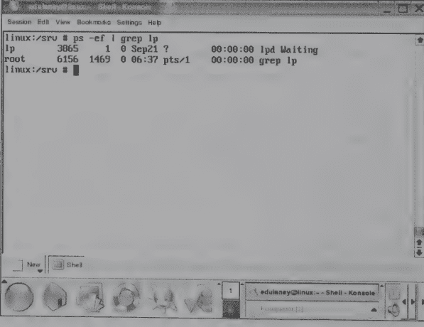

从命令行使用的最简单语法是 `lpr {filename}`

所以，如果你想打印一个名为 Saturday 的文件，命令将是 `lpr Saturday`

在进行此工作之前，你必须先设置打印机。否则，将始终导致指示调度程序未响应的错误。

当下发此命令时，会启动许多其他进程，如图 9.2 所示。在这种情况下，打印机不存在，打印作业将溢空到“无处”，这允许我们检查正在发生的情况。

# 图 9.2
当提交文件打印时，启动了多个进程。

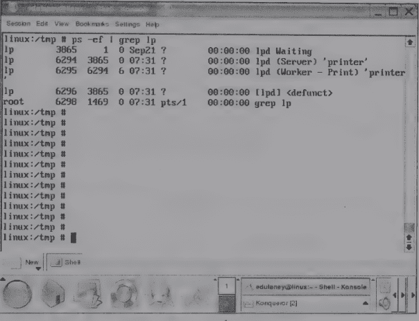

当打印作业发送到打印机的相应队列时，守护进程会从打印机移除作业并生成完成的输出。只要文件存在，它的条目就会留在 `/var/spool/lpd` 下的池化器中，如图 9.3 所示。

在 Linux 支持的打印机列表可以在 http://www.linuxprinting.org/ 找到。

一旦正确配置并运行，Linux 中的打印服务将运行得非常顺畅。

# 图 9.3
池化器持有打印作业的文件。

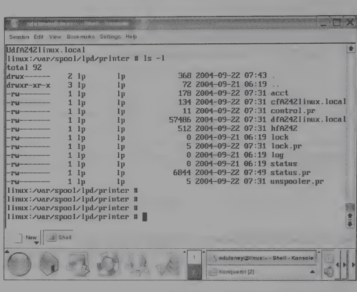

# 转向 CUPS

在较新的 Linux 实现中（包括 SuSE），CUPS（通用 Unix 打印系统）取代了 `lpr` 的大部分功能。然而，从操作的角度来看，它们有很大的相似性：

1. 用户提交打印作业。
2. 文件被池化——在这种情况下位于 `/var/spool/cups/` 下。
3. `cupsd` 守护进程格式化池中的数据并将其发送到打印机。
4. 作业完成后，守护进程从队列中移除文件。

`/etc/cups/cupsd.conf` 文件（或 `/etc/cups/cupsd.sample` 文件）包含了大量的叙述和注释，完整解释了如何配置 cups。虽然它不允许打印整个文件，但强烈建议你仔细阅读你系统上的该文件，并确保你理解了这些选项。`/etc/init.d/cups stop` 命令用于停止服务，`/etc/init.d/cups start` 命令用于手动启动它（一旦配置完成，它将使用启动脚本 `/etc/init.d/cups` 在启动时自动启动）。

# 格式化文件

在讨论打印选项时，一个对格式化非常有价值的工具是 `pr`。该工具（`/usr/bin/pr`）的主要目的始终是在向打印机发送输出之前转换文本文件的内容。

输出包含一个默认页眉，带有修改日期时间、文件名和页码。可以使用 `-h` 选项覆盖默认页眉，`-l` 选项允许你指定每页行数——默认为 6 行。默认页宽为 72 个字符，但可以使用 `-w` 选项指定不同的值。`-d` 选项可用于双倍输出，`-m` 可用于列式打印多个文件。

# 安装打印机

涵盖目标

- 1. 在 Linux 系统中安装打印机 (3036)
- 2. 配置和管理网络打印服务 (3037)

在安装打印机之前，你应该通过检查 http://www.linuxprinting.org/ 和 SuSE 的 http://hardware.de 数据库来确认其是否支持。

在几乎所有 Linux 中，都有多种不同的方法来安装打印机。最简单的方法是通过 YaST 本地。在连接打印机后，启动 YaST（可能会提示密码），然后选择硬件，打印机。打印机应该是自动检测的，如图 9.4 所示。

# 图 9.4
YaST 简化了打印机的配置和安装。

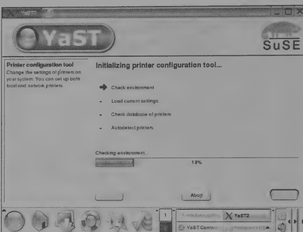

# 图 9.5
自动检测识别大多数打印机。

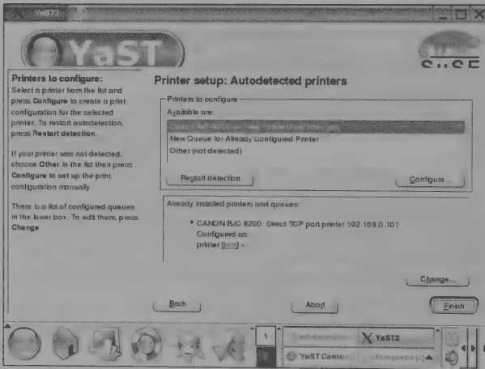

通过选择配置按钮，你可以更改自动创建的打印机的任何设置。出现的第一个对话框如图 9.6 所示，编辑界面位于图 9.7。

# 图 9.6
你可以更改自动配置的设置。

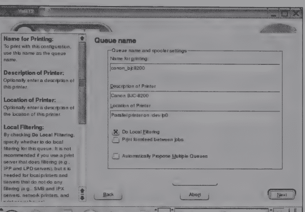

# 图 9.7
可以在 YaST 内编辑任何设置。

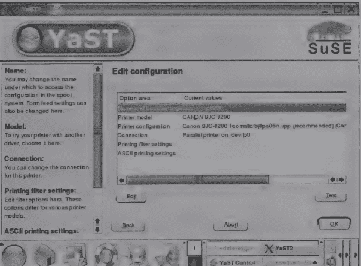

当你点击图 9.7 所示的测试按钮时，它使用 `lpr` 命令提交打印作业。你可以选择打印图形文件或文本。

你可以使用 KDE 中的打印机向导安装打印机，如图 9.8 所示。

# 图 9.8
打印机向导也可用于添加打印机。

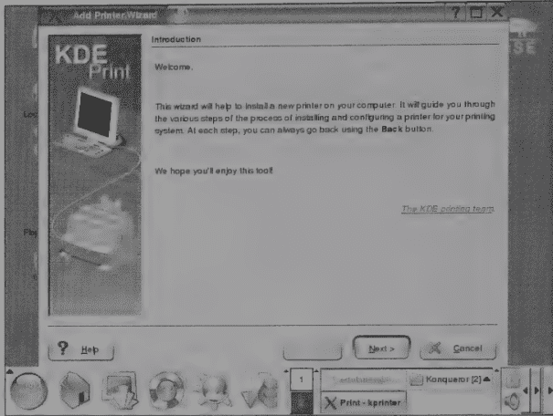

配置的另一种方法是使用 `kprinter`。可以通过按下 KDE 菜单，然后选择工具、打印、打印管理器来访问。该工具如图 9.9 所示，允许你与打印功能的所有方面进行交互，包括管理作业。

# 图 9.9
打印管理器提供了所有打印功能的接口。


无论使用哪种方法添加打印机，当它成功加入系统时，会发生许多情况：

- 打印队列被添加到 `/etc/cups/printers.conf`。
- 打印机的 ppd 文件被放置在 `/etc/cups/ppd` 用于设置。
- 打印队列被添加到 `/etc/printcap`。

网络打印机的设置与本地打印机一样简单，并且它支持 SMB（标准消息块——用于从 Windows 客户端打印）、IPP（互联网打印协议）以及之前讨论过的 LPD 协议。当你选择打印机类型时，大多数这些选项对你可用，如图 9.10 所示。

# 图 9.10
你可以选择 CUPS 打印机作为类型。

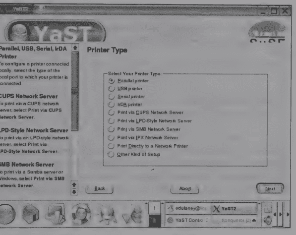

## Novell 认证 Linux 专家学习指南

# 你自己的过滤器。更多信息请参阅 `printcap(5)` 手页。

# "print-serv" 上的默认 Postscript 打印机

# #lp|ps|postscript:\n# :client:lp=postscript@print-serv

# #lp|ps|postscript:\n# :server:oh=print-serv:\n# :sd=/var/spool/lpd/ps:\

# :lp=/dev/lpd1:\

# :sh:mx#0

# LPRng Printcaps 快速指南

# Patrick Powell <papowell@lprng.com>

# 2001年11月15日 周四 13:31:08 PST

# VERSION=3.8.21

# LPD 打印队列配置 - 默认选项

# 下方的 printcap 条目设置了默认值。在此添加默认

# options 或其他条目

# #common:

# :sd=/var/spool/lpd/%P

# :sh:mx=0:mc=0

[Translation:
# .common - 点 (.) 会导致 LPRng 将此视为
# “仅供信息的条目”。这个主意是借用
# Unix “隐藏”文件习惯而来的（哈哈哈哈），即如果
# 以点开头的名称不会被 'ls' 显示，
# 或不会被 '*' 匹配
# :sd=/var/spool/lpd/%P
# 用于临时存储打印作业的溢存队列目录。
# %p 将扩展为打印队列名称。每个
# 打印队列必须有不同的溢存队列目录，
# 使用 %p 就能保证了这一点。
# :sh - 抑制横幅页或标题页
# :mx=0 - 最大作业大小，单位为 K 字节（0 为无限）
# :mc=0 - 最大副本数（0 为无限）
]

## 第 9 章

```
# LPD 打印队列定义：定义打印队列
#
# 位于并行端口的打印机（例如 - /dev/lpt0）
#
#lplp:lp=DEVICE:tc=.common
#
# 示例:
#
#   lp:tc=.common:lp=/dev/lpt0
#
# [Translation:
#
#   lp - 打印队列名称
#
#   :tc=.common - 包含 .common printcap 条目中的选项
#
#   'tc' 选项将被放在 printcap 条目的
#
#   开头
#
#   :lp=/dev/lpt0 - 打开并将打印作业写入
#
#   /dev/lpt0
#
# ]
#
#
# 位于串口端口的打印机（例如 - /dev/tty00）
# 使用 :stty 通过 'tty(1) 选项' 设置速度、
# 位和奇偶校验。注意：几乎所有打印机都使用
#   8 位，无奇偶位。
#
#lp:tc=.common:DEVICE=STTY OPTIONS
#
# 示例:
#
#   lp:tc=.common:lp=/dev/tty:0:stty=19200 raw crtscts
#
# [Translation: lp, :tc, :lp 与上述 A 相同。
#
#   :stty - 用于配置串口的选项
#
# ]
#
# 位于网络打印服务器的打印机（例如 - HP JetDirect）
# 通过 TCP/IP 套字连接。IPADDR 是打印服务器
# 的 IP 地址或完全限定域名，PORT 是
# TCP/IP 端口。
#
# HP JetDirect 默认使用端口 9100。
#
# 警告：检查网络打印服务器文档以获取
# 正确端口号。大多数非 HP 网络打印服务器
# 和非 HP 打印机不使用 9100 端口。
#
#
#lp:tc=.common:lp=IPADDR%PORT
#
# 示例:
#
#   lp:tc=.common:lp=10.0.0.2%9100
#
# [Translation: lp, :tc 与上述 A 相同。]
#
```

```
# lp10.0.0.2%9100 - 打开到 10.0.0.2:9100 的连接
# 并打印作业写入此任务。
```

```
# D) 位于网络打印服务器的打印机（例如 - HP JetDirect 或
# LPD 服务器），通过 LPD 打印协议连接。QUEUE
# 是打印队列的名称，IPADDR 是打印服务器
# 的 IP 地址或完全限定域名。
```

```
# 警告：检查网络打印服务器文档以获取
# 正确的 QUEUE 名称。“lp” 队列在 HP
# JetDirect 上用作默认打印队列。如果设备上有
# 多个打印端口，则使用 QUEUE 名称来选择端口。
```

```
# 警告：在 JetDirect 设备上使用此协议将
# 导致 JetDirect 设备生成“横幅页”。
# 请检查 HP 文档如何禁用
# 这个烦人的功能。通常你只需要
# telnet 到 JetDirect，然后使用首次连接
# 时呈现的简单配置菜单。
```

```
#lp1tc=.common:lp@IPADDR
#
# 示例:
#
# lp1tc=.common:lp1@10.0.0.2
#
# [Translation: 1p, :tc 与上方相同（此处误）。]
```

### 第 4 步：需要格式转换（过滤器）吗？

# 你可能会发现你的打印机不支持
# PostScript 或需要完成特殊的初始化。
# 这由过滤器程序处理。如果 LPRng
# 提供了过滤器 且支持
# 许多打印机。如果你需要过滤器，
# 请在 printcap 条目中添加以下行：
# :filter=PATH_TO_IF_FILTER
# :ifhp=IFHP_OPTIONS
# 注意：LPRng 的 :filter=vf 替换了旧的
# lpd 选项 :vf，即指定 'f' 格式、
# 'v' 格式等的过滤器的选项（是的，:if 是
# 用于 'f' 格式，别问）。:filter 指定了
# 所有作业格式的默认过滤器。大多数现代
# 过滤器如 IFHP、Magicfilter 和 RedHat 过滤器
# 都足够智能可以判断作业格式并执行
# 适当的转换。
# 示例:
# lp:tc=.common:lp=/dev/lpt0
# :filter=/usr/bin/if
# :ifhp=options
```

*(注：由于原文中存在多处拼写，如 1p 疑为 lp1 的误，Above 疑为 Above 的误，翻译时已根据语境保留或逻辑说明。)*

####################################################

# 打印机权限数据库

## LPRng - 增强型打印机后台程序

## lpd.perms 文件

## Patrick Powell papowel@lprng.com

## VERSION=3.8.25

## 对 LPRng 功能的访问控制由一组 lpd.perms 文件中的项控制。

## 这些文件的常见位置为：`/etc/lpd.perms`, `/usr/etc/lpd.perms`

## 以及 `/var/spool/lpd/lpd.perms`。

## 这些文件的位置由 lpd conf 文件中的 perms_path 条目设置，

## 或由 src/common/defaults.c 文件中的编译默认值设置。

## 每当 lpd 服务器接收到用户请求或执行操作时，它会搜索 perms 文件，

## 以确定该操作是 ACCEPT（接受）还是 REJECT（拒绝）。

## 找到第一个 ACCEPT 或 REJECT 就会停止搜索。

## 如果没有找到，则使用最后一个 DEFAULT 动作。

## 权限通过使用“键（keys）”和匹配项来检查。

## 对于以下每个 LPR 活动，以下键都有一个值。

| Key | Match | Connect | Job | Job | LPG | LPR | LPC | Spool | Print |
| :--- | :--- | :--- | :--- | :--- | :--- | :--- | :--- | :--- | :--- |


# 管理打印 第 9 章

## 权限控制表

| SERVICE | S | 'X' | 'R' | 'P' | 'Q' | 'M' | 'C' |
| :--- | :--- | :--- | :--- | :--- | :--- | :--- | :--- |
| USER | S | - | JUSR | JUSR | JUSR | JUSR | JUSR |
| HOST | S | RH | JH | JH | JH | JH | JH |
| GROUP | S | - | JUSR | JUSR | JUSR | JUSR | JUSR |
| IP | RIP | JIP | JIP | RIP | JIP | JIP | JIP |
| PORT | N | PORT | PORT | PORT | PORT | PORT | PORT |
| UNIXSOCKET | V | SK | SK | SK | SK | SK | SK |
| REMOTEUSER | S | - | JUSR | JUSR | JUSR | CUSR | |
| REMOTEHOST | S | RH | JH | RH | RH | RH | |
| REMOTEOGP | S | - | JUSR | JUSR | JUSR | CUSR | |
| CONTROLLINE | S | - | CL | CL | CL | CL | |
| PRINTER | S | - | PR | PR | PR | PR | |

## 关键字定义

- **FORWARD**: V - SA - - SA SA
- **SAMEHOST**: V - SA - SA SA
- **SAMEUSER**: V - - SU SU SU
- **SERVER**: V - - SV SV SV
- **LPC**: S - - - - LPC
- **AUTH**: V - - AU AU AU
- **AUTHTYPE**: S - - AU AU AU
- **AUTHUSER**: S - - AU AU AU
- **AUTHFROM**: S - - AU AU AU
- **AUTHSAMEUSER**: S - - AU AU AU

> **REMOTEIP** 是 **REMOTEHOST** 的别名
> **REMOTEPORT** 是 **PORT** 的别名
> **IP** 是 **HOST** 的别名

## 键 (KEY) 说明

| 代码 | 含义 |
| :--- | :--- |
| `JH` | 控制文件中主机 IP 地址/DNS 名称 |
| `RH` | 连接的 `REMOTEHOST` IP 地址/DNS 名称 |
| `JUSR` | 控制文件中的 `USER` |
| `CUSR` | 执行控制操作请求的 `REMOTEUSER` 用户 |
| `JIP` | 控制文件中主机 IP 地址/DNS 名称 |
| `RIP` | 请求主机的 `REMOTEIP` IP 地址/DNS 名称 |
| `PORT` | (端口号) |
| `SK` | 如果来自 unix socket 连接，则为 true（匹配） |
| `CONTROLLINE` | 控制文件中控制行的模式匹配 |
| `SA` | 请求源的 IP == 控制文件中主机的 IP |
| `SU` | 请求的用户 == 控制文件用户 |
| `SV` | 请求源的 IP = 服务器主机 IP 或服务器本地主机 Localhost |
| `LPC` | `lpc` 命令与值的 glob 通配符匹配 |
| `AU` | 传输的授权检查 |

- 如果是经过验证的请求，`AUTH` 将为 true（匹配）
- `AUTHTYPE` 将匹配请求的验证类型与模式
- `AUTHUSER` 将匹配客户端身份验证 ID 与模式
- `AUTHFROM` 将匹配请求者的身份验证 ID 与模式
- `AUTHSAMEUSER` 将匹配请求者的身份验证 ID 与作业中的身份验证 ID

## Match 类型

- **S** = glob 匹配
- **IP** = IPAddress[/netmask]
- **N** = 低[-高] 数字范围
- **V** = 匹配或兼容的值

## SERVICE 取值说明

- `'X'` - 连接请求
- `'R'` - 来自远程主机的 `lpr` 请求
- `'P'` - 队列中的打印作业
- `'Q'` - `lpq` 请求
- `'M'` - `lprm` 请求
- `'C'` - `lpc` 缓存控制请求

## 重要注意事项

1. 在打印（P 动作）时，远程和作业检查值（即 `RUSR`, `JUSR`）是相同的。
2. 在检查轮池队列的权限时，`HOST`、`USER` 和 `SAMEHOST` 检查总是成功的；它们仅在检查轮池作业的权限时才激活。
3. 当通过 UNIX socket 连接时，`UNIXSOCKET` 将匹配（true）。
4. `SAMEHOST` 匹配检查产生请求的主机的 IP 地址中的（一个或多个）是否/匹配控制文件中出现的主名主机的地址中的一个或多个地址。
5. `SAMEHOST` 匹配检查产生请求的主机的 IP 地址中的（一个或多个）是否/匹配服务器的一个或多个地址。
6. `FORWARD` 等同于 `NOT SAMEHOST`，即 - 请求被转发。
7. 特殊的 `key=patterns` 模式从（大写）字母开始搜索控制行，通常用于打印和轮池检查。例如 `C*=B*` 将检查类信息（即- 控制文件中以 `C` 开头的行）是否具有以 `B` 开头的值。
8. 一行权限由一系列测试列表和一个结果值组成。如果所有测试均成功，则找到了匹配项，权限测试带有结果完成。

---

# 管理打印 第 9 章（续）

## 权限规则详解

- 你使用 `DEFAULT` 来设置默认的 `ACCEPT`/`DENY` 结果。`NOT` 关键字将反转测试的含义。每个测试可以有一个多个用逗号分隔的值。例如 `USER=john,mark` 有 3 个值。
- **Match 匹配类型** 指定了如何进行匹配。
    - **S = glob 匹配**。格式：带有通配符 (`*`) 的字符串匹配一个或多个字符 `[a-d]` 匹配 a 或 b 或 d。比较不区分大小写。例如 `USER=th*` 匹配此项，`USER=[d-f]` 匹配 dx, fx。
    - **IP = IP 地址和子掩码**。格式：`x.x.x[/y.y.y]` `x.x.x.x` 是 IP 地址，`y.y.y` 是可选的子掩码，默认是 `255.255.255.255`。通过转换为 32 位 x, y 和 IP 值并使用完成：即 - 只有掩码非零的位被用于比较。例如 `REMOTEIP=130.91.0.0/255.255.0.0` 匹配所有地址 130.91.1。
    - 如果匹配成功，则打开并读取指定的文件，文件内容被视为由空白分隔的 S 条目。
    - **N = 数值整数范围**。格式：低[-高]。示例：`PORT=0-1023` 匹配范围 0-1023 内的端口（特权）。
- `SAMEUSER` 和 `SAMEHOST` 是从控制文件或连接形成值的选项。`GROUP` 条目在用户组数据库中搜索与模式匹配的名称，然后在这些名称中搜索用户名。如果找到了名称，则搜索是成功的。
- 如果请求源自 `lpd` 服务器，`SERVER` 是成功的。
- 注意，`USER`、`HOST` 和 `IP` 值是基于控制文件中找到的值进行权限检查。
- `REMOTEUSER`、`REMOTEHOST` 和 `REMOTEIP` 是基于实际 TCP/IP 连接提供的值。
- `LPC` 条目匹配 `LPC` 命令。例如 `LPC=topq` 在执行 `lpc top` 时会匹配。你仍然需要 `SERVICE=C` 来触发此动作。
- 注意：`SERVICE=R` 和 `SERVICE=P` 都检查发送作业的 `LPR` 操作。然而，当作业发送到 `LPD` 服务器时，`SERVICE=R` 某些 `LPD` 实现无法处理由于权限不足而被拒绝的作业，并在无限循环中尝试重发。这就是 `SERVICE=P` 检查的原因。你可以接受打印作业，然后让 `SERVICE=P` 检查移除作业。
- 注意：如果你没有显式的 `ACCEPT=P` 或 `DEFAULT ACCEPT` 动作，打印作业将被接受并静默丢弃。

## 示例权限配置

### 允许所有操作，除非特别禁止

```
DEFAULT ACCEPT
```

### 接受来自子网 130.91.0.0 或服务器的连接

```
ACCEPT SERVICE=X REMOTEIP=130.91.0.0/255.255.0.0, 128.0.0.0/8 来自命名站点
ACCEPT SERVICE=X REMOTEHOST=engpc* #位于 /etc/accepthost 文件
ACCEPT SERVICE=X REMOTEHOST=</etc/accepthost
```

> //rejecthost 包含由空白分隔的项。例如：
> `10.0.0.0/8 128.0.0.0/8 192.168.10.1 192.168.10.2` # 不从这个特定主机获取

```
REJECT SERVICE=X REMOTEHOST=badhost.eng.com # 拒绝其他
REJECT SERVICE=X
```

### 不允许 astar1.astart.com 上 root 或 /etc/ok 文件列的用户使用 lpc 命令

```
ACCEPT SERVICE=C SERVER REMOTEUSER=root
ACCEPT SERVICE=C REMOTEHOST=astar1.astart.com REMOTEUSER=papowell,</etc/ok
```

> `/etc/ok` 有用户列表：
> `root papowell nobody`
> `user1 user2`

```
# 允许 root 在 talker.astart.com 控制打印机 hpjet
ACCEPT SERVICE=C HOST=talker.astart.com PRINTER=hpjet REMOTEUSER=root
# 拒绝其他
REJECT SERVICE=C
```

### 不允许转发的作业或请求

```
REJECT SERVICE=R,C,M FORWARD
```

### 确保连接来自特权端口

> 默认允许来自任何端口，以便非 setuid 程序可以打印。
> 完全符合 RFC11179
> Novell 认证 Linux 专业学习指南

```bash
#REJECT SERVICE=X NOT PORT=1-1023
#REJECT SERVICE=X NOT PORT=1-1023
# Privileged
#REJECT SERVICE=X NOT PORT=721-731

# allow root on server to control jobs
ACCEPT SERVICE=C SERVER REMOTEUSER=root
# anybody to get server, status, and printcap
ACCEPT SERVICE=C LPC=lpd,status,printcap
# reject all others
REJECT SERVICE=C
#
# allow same user on originating host to remove a day
ACCEPT SERVICE=M SAMEHOST SAMEUSER
# allow root on server to remove a job
ACCEPT SERVICE=M SERVER REMOTEUSER=root
REJECT SERVICE=M
# all other operations allowed
DEFAULT ACCEPT
```

---

## `/etc/lpd.conf` 配置文件

`/etc/lpd.conf` 文件用于配置 `lpd` 服务。该文件的示例如下列表所示：

```
# 请查看 "man lpd.conf" 获取此处可以设置的选项列表。
# check_for_nonprintable means the 'check_for_nonprintable'
# option default value is on or 1
# Set it to OFF or 0, change this to read:
# check_for_nonprintable@
check_for_nonprintable=
client_config_file=/etc/lpd.conf
filter_ld_path=/usr/lib:/usr/lib/X11R6:/usr/local/lib
filter_path=/usr/bin:/usr/lib:/usr/local/bin:/usr/local/local/
sbin:/usr/lib/filters:/usr/X11R6/bin
mail_operator_on_error=
pr=/bin/pr
printcap=/etc/printcap
# If you distribute your printcap entries through NIS,
# use the following line instead:
#printcap_perms_path=/usr/lib/yp/match_printcap
printer_perms=/etc/lpd.parms
server_config_file=/etc/lpd.conf

server_user=lp
user=lp
group=lp
# If your printer doesn't print the job remove the "@" from the
# following line. (例如对于带有 JetDirect 卡的 HP4M 是必须的)
send_data_first@
mc#0
send_try#0
max_connect_interval#10
```

此处的条目影响某些项目，例如默认是否始终显示横幅、默认作业格式是什么、用于临时文件的目录等。

---

## 打印实用程序

存在许多用于处理打印服务各种组件的实用程序。首先检查的是 `lpc`——行打印机控制程序。该工具可以用于 `printcap` 或 `lp.conf` 文件中定义的任何打印机。要查看其提供的所有选项详细列表，请在命令行提示符处输入命令启动 `lpc`，如果您使用的是 LPR，则在 `lpc` 提示符处输入 `m` 进入菜单；如果您使用的是 CUPS，则输入问号 (`?`)。按 `q` 退出 `lpc`。

`lpc` 工具用于列出队列中的作业。与 `lpq` 命令非常不同，它从守护进程获取信息。以下是 `lpc` 显示的输出示例：

```
Printer: printer@linux 'lpdfilterdrv=upp method=auto color=yes'
Queue: 2 printable jobs
Server: pid 7859 active
Spooler: pid 7859 active
Status: cannot open '192.168.0.101%9100' - 'Connection
"refused", attempt 160, sleeping 10 at 14:49:57.897
Rank Owner/ID Class Job Files
Size Time
stalled(1726sec) root@linux+242 A 242 eduel.txt
-57486 07:31:01
2 root@linux+707 A 707 eduel.txt
-57486 14:17:08
```

> **注意**
> 与 `lpq` 具有相同基本较旧实用程序是 `lpstat`。该工具用于检查 lp 服务和队列的状态。它适用于 LPRng，但不支持 CUPS。

`lprm` 工具用于从队列中删除打印作业。使用它时，它会根据作业号发送删除作业的请求。如果没有提供作业号，它将尝试删除您提交的最后一个作业。该操作的示例见图 9.11。

### 图 9.11

lprm 工具删除损坏的作业。

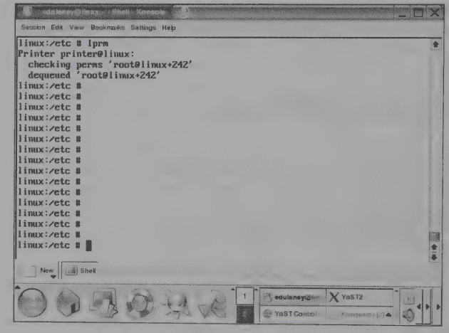

在这种情况下，用户提交的最近作业已被删除。`lprm` 工具可以使用用户名作为选项来删除该用户提交的作业。

`lpadmin` 工具允许您从命令行执行大部分在 YaST 中可以完成的配置。图 9.12 显示了它所有可用选项。

该工具的补充工具是 `lpoptions`，用于从命令行修改网络打印机。可以使用它的一些选项包括：

- `-d` 设置默认打印机
- `-h` 指定服务器
- `-p` 设置目标

### 图 9.12

通过 `lpadmin`，您可以从命令行执行大部分在 YaST 中可以完成的配置。

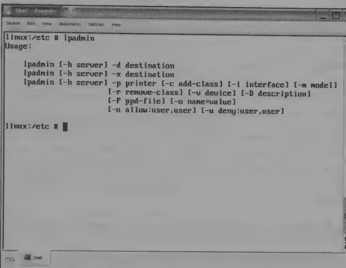

---

## 安装软件

### 涵盖的课程目标

- 6. 管理内核 (3037)

Linux 社区中有几种主要的软件分发方法。一种是使用软件包管理系统之一，我们稍后会介绍。另一种是使用压缩的“tar 包”（tarball）文件。tar 包是一个包含文件 tar 镜像的单一文件。

你之所以知道自己正在处理一个 tar 包或压缩的 tar 包，是因为文件名结尾有 `.tar` 或 `.tar.gz`。例如，以下文件是 tar 包：

```
program-1-2-3.tar.gz
program-1-2-3.tar
```

但下面的示例不是：

```
program-1.2-3.rpm
```

要进行安装，你必须首先识别想要安装的软件，并从提供者处获取。例如，从 `ftp.ccil.org` 获取 `wumpus`，可以使用如下所示的 `ftp` 命令：

```
ftp bin
200 Type set to I.
ftp get wumpus-1.3.tar.gz
local: wumpus-1.3.tar.gz remote: wumpus-1.3.tar.gz
227 Entering Passive Mode (192,190,237,102,145)
150 Opening BINARY mode data connection for wumpus-1.3.tar.gz
-> (9293 bytes).
226 Transfer complete.
9293 bytes received in 0.207 secs (44 Kbytes/sec)
ftp>
```


这会在你的系统中生成 `wumpus-1.3.tar.gz`，它必须先解压再提取 tar。你可以通过一个或两个步骤完成。传统的两步法涉及解压缩文件，然后提取文件。这是通过以下命令完成的：

```
# gzip -d FILE
# tar xvf FILE
```

## 回顾管理任务 第 10 章

第一个命令解压缩文件，第二个命令执行提取。由于这是一种常见的软件分发方式，Linux 自带的 GNU 版本 tar 包含了解压缩存档并提取文件的功能。这是使用以下命令实现的：

```
# tar zxf FILE
```

`-z` 选项用于通过 gzip 过滤存档。

tar 的 `v` 选项会在提取时列出存档中的所有文件。如果你不想看到文件列表，只需省略 `v` 即可。`x` 通知 tar 提取文件，`f` 则指定从哪个文件中提取文件：

```
# tar zxf wumpus*
# -l
total 42
drwxr-xr-x 5 edulaney edulaney 1024 Nov 26
-> 16:01 Desktop
-rw-r--r-- 1 104 bin 359 Aug 20 1994
-> Makefile
 1 104 bin 307 Apr 25 1994
-r--r--r-- 1 104 bin 10084 Apr 25
-> READ.ME
-r--r--r-- 1 104 bin 10084 Apr 25
-> superhack.c
-rw-rw--r-- 1 root 9293 Nov 26 16:22
-> wumpus-1.3.tar.gz
-r--r--r-- 1 104 bin 17883 Apr 25 1994
-> wumpus.c
#
```

我们已经从 tar 中提取了文件。wumpus 比较简单，因为它只涉及几个文件。我们使用 `make` 程序编译 wumpus。请注意，你必须安装开发工具才能在你的系统上编译任何软件。`make` 命令依赖于一个文件来定义它需要的操作。这个文件被称为 `Makefile`，如下代码所示：

```
#
# 用于 'Hunt the Wumpus' 和 'Superhack' 游戏的 Makefile

CC=gcc
CFLAGS=-g

all: wumpus superhack

wumpus: wumpus.c
	$(CC) $(CFLAGS) wumpus.c -o wumpus

superhack: superhack.c
	$(CC) $(CFLAGS) superhack.c -o superhack

clean:
	rm -f wumpus wumpus.o superhack superhack.o TAGS

TAGS:
	etags wumpus.c

tar:
	tar -cvf wumpus.tar READ.ME Makefile wumpus.c superhack.c
#
```

这是一个非常简单的 Makefile，但适用于我们的讨论。通过 Makefile，可能需要更改某些参数或选项，以便在你的环境中编译程序。Makefile 的结构包含选项（如 `CC=gcc`）和对象（如 `all`）。对象 `all` 依赖于对象 `wumpus` 和 `superhack`。

我们可以看到，对象 `wumpus` 依赖于对象 `wumpus.c`。这告诉 `make`，在生成对象 `all` 之前，必须先生成对象 `wumpus`。编译 `wumpus.c` 会生成对象 `wumpus`。`make` 对 `all` 依赖的所有其他对象执行相同的过程。第一个对象通常是默认对象。这意味着不带任何参数输入 `make` 将导致构建 `all`。输入 `make wumpus` 则只会构建构建 `wumpus` 的组件：

```
# make
cc -g wumpus.c -o wumpus
cc -g superhack.c -o superhack
# ls -l
total 109
-rw-r--r-- 1 104 bin 359 Aug 20 1994
-Makefile
-rw-r--r-- 1 104 bin 307 Apr 25 1994
-READ.ME
-rwxr-xr-x 1 root 35127 Nov 26 25-superhack
-rw-r--r-- 1 104 bin 10084 Apr 25 1994
-superhack.c
```

## 回顾管理任务 第 10 章

```
-rwx-xr-x 1 root 31460 Nov 26 25 wumpus
-rw-rw--r-- 1 root 9293 Nov 26 16:22 wumpus-1.3.tar.gz
-r--r--r-- 1 104 bin 17883 Apr 25 1994 wumpus.c
#
```

我们现在可以通过运行编译后的程序来测试 wumpus：

```
# ./wumpus
INSTRUCTIONS (Y-N)
?yUNT THE WUMPUS
YOU ARE IN THE ROOM
SHOOT OR MOVE
?
```

通常，需要编辑 Makefile 来更改参数，例如使用的 C 编译器或查找程序的路径。你可能需要在编译期间编辑库。然而，更复杂的软件依赖用户编辑 Makefile，因为有太多选项要处理，导致生成 `Configure`。考虑到更复杂的情况，我们想要安装一个版本的 Perl。我们可以从 http://www.perl.com 下载它：

```
ftp>
200 Type set to I.
ftp> get perl-5.6.0.tar.gz
local: perl-5.6.0.tar.gz remote: perl-5.6.0.tar.gz
227 Entering Passive Mode (192,190,237,102,145).
150 Opening BINARY mode data connection for perl-5.6.0.tar.gz
(544301 bytes).
226 Transfer complete.
544301 bytes received in 148 secs (36 Kbytes/sec)
ftp>
```

我们再次解压缩并解包：

```
# zxf perl*
```

这为我们提供了一个名为 `perl-x.x` 的新目录，其中 `x` 被替换为版本号。在该目录下你会找到至少一个 `Configure` 的命令。

# Novell 认证 Linux 专业人士学习指南

该脚本是许多 GNU 工具通用的，并为环境配置软件：

```
# ls -l Configure
-r-xr-x 1 504 34637 Mar 22 2000
# ./Configure
```

在 "/home/edulaney/perl-5.6.0" 找到了 perl5 的源码。

开始配置 perl5。

检查 echo 如何抑制换行...

...using-n.

这里--->*

首先确保你的套件是完整的。检查中...

良好...

此安装 脚本将检查你的系统并向你提问以确定如何安装 perl5 包。如果你在某个问题上卡住了，可以使用 `!` shell 转义符来启动子 shell 或执行命令。许多问题都有括号中的默认答案；按回车将给你默认值。

在某些询问文件或目录名称的问题中，你允许使用 `-name` 结构来指定属于 "name" 的目录，即使你没有了解该内容的 shell。允许此类问题的标记为 (-name ok)。

[按回车继续]

`Configure` 脚本会在确定系统配置时提示你回答一些问题。回答后，你必须运行 `make` 来实际编译软件：

```
# make
`sh libperl.a miniperlmain.o` miniperlmain.c
CCCMD = cc -DPERL_CORE -c -fno-string-aliasing
-D_LARGEFILE_SOURCE -D_FILE_OFFSET_BITS=-64
...
#
```

使用 `make install` 命令完成安装。这会将二进制文件和其他文件安装到执行 `Configure` 时指定的地点。

## 共享库

涵盖的课程目标

- 5. 验证和更新软件库访问 (3037)

大多数 Linux 程序使用共享库。共享库允许程序更小并需要更少的存储空间，因为它在需要时才加载库。例如，如果程序依赖于 `crypt.a`，在编译期间，`crypt.a` 中的所有函数都包含在编译后的二进制文件中。这是低效的，因为 `crypt.a` 的更改需要重新编译程序。通过使用共享库，当库发生变化时，依赖它的程序利用这些更改而无需重新编译。

有多个命令可以查看系统上共享库的配置。这些是 `ld` 和 `ldconfig`。`ldd` 用于查看程序依赖于哪些共享库。使用它时，提供程序名作为参数，例如

```
# ldd /usr/bin/perl
libnsl.so.1 => /lib/libnsl.so.1 (0x4001e000)
libdl.so.2 => /lib/libdl.so.2 (0x40035000)
libm.so.6 => /lib/libm.so.6 (0x40038000)
libc.so.6 => /lib/libc.so.6 (0x40057000)
libcrypt.so.1 => /lib/libcrypt.so.1 (0x40175000)
lib/ld-linux.so.2 => /lib/ld-linux.so.2 (0x40000000)
```

## Novell 认证 Linux 专业学习指南

`ldconfig` 程序用于更新和维护 `ld.so` 动态链接器的共享库数据和符号缓存。`ldconfig` 会检查 `/etc/ld.so.conf` 文件以获取有关共享库的信息，并还会检查受信任目录 `/lib` 和 `/usr/lib` 中的每个文件。`ldconfig` 命令必须以 root 身份运行，以便对系统文件进行任何更新。动态链接器位于 `/etc/ld.so.cache` 并使用 `ldconfig` 管理。你可以通过运行不带任何选项的 `ldconfig` 来重新构建缓存。此操作将重建缓存。你可以使用 `-p` 选项查看当前缓存：

```
# ldconfig -p | found in cache /etc/ld.so.cache 398 libs found in
libzvt.so.2 (lib66) => /usr/lib/libzvt.so.2
libz.so.1 (lib66) => /usr/lib/libz.so.1
libz.so (lib66) => /usr/lib/libz.so
libxrxs.so.6 (lib66) => /usr/X11R6/libxrxs.so.6
libxrxs.so (lib66) => /usr/X11R6/libxrxs.so
libxmms.so.1 (lib66) => /usr/lib/libxmms.so.1
libxm1.so.1 (lib66) => /usr/lib/libxm1.so.1
```

在这里我们看到 `ldconfig` 报告的缓存中有 398 个条目。只有在安装了新的共享库时，才需要使用此命令。在运行 `ldconfig` 并重建缓存之前，新库将不会被使用。

# 使用 Red Hat 进行包管理

涵盖的课程目标

- 1. 执行 RPM 包相关操作 (3036)
- 4. 管理 RPM 软件包 (3037)

在本章的早些部分中，我们检查了如何提取 tarball 包并构建应用程序。然而，Linux 社区中越来越多的软件分发是通过包完成的。包管理主要有两种主要方法：RPM（即 Red Hat 包管理器）和 Debian 采用的 dpkg 方法。

RPM（Red Hat Manager）是一个用于 Unix 环境下软件打包和分发的开放系统。尽管它最常用于 Linux，但 RPM 也在其他 Unix 平台上经过编译并使用。RPM 允许用户获取源代码并将其以源码和二进制形式打包，这样程序就可以被轻松地跟踪和重新构建。

RPM 还创建并维护了一个软件包和文件的数据库，以便对包进行验证、查询有关包和文件的信息，并在需要时删除这些包。

RPM 的查询选项允许使用特定包或文件对数据库进行搜索，包括识别某个文件来自哪个包。RPM 文件本身是压缩镜像。这些压缩镜像包含一个自定义二进制标头，允许快速检索有关包及其包含内容的信息。

验证选项允许用户确定包的部分是否缺失。如果是的话，用户可以重新安装该包，同时保留任何修改过的配置文件。RPM 是一个非常强大的工具，我们将回顾它的某些功能。具体来说，我们将查看以下方面：

- 使用 RPM 安装和卸载软件
- 验证 RPM
- 查询 RPM
- 构建 RPM

# 使用 RPM 安装和删除软件

使用 RPM 安装软件的最简单方法是使用命令：

```
rpm -i rpm-name.rpm
```

例如，要安装 `foobar-2.3-8.1386.rpm` 包，命令是：

```bash
# rpm -i foobar-2.3-8.1386.rpm
```

这指示 rpm 读取 RPM 文件，提取文件，并将它们放在 RPM 文件中指定的正确位置。删除包通过以下命令完成：

```
rpm -e foobar
```

这两种场景都期望 RPM 文件位于你的本地硬盘上。由于我们通常在软件安装完成后不再保留 RPM 文件，因此如果你知道 RPM 文件的源路径或 URL，也可以直接从 FTP 安装：

```
rpm -i ftp://ftp.some.site/pub/name.rpm
```

在上一个示例中，rpm 将使用你的网络连接获取 RPM 文件并安装包。

这些是演示 rpm 能力的简单示例。使用 `rpm --help` 命令查看你特定版本的 rpm 具有哪些功能。

# 验证 RPM

rpm 还用于验证安装了哪些包以及缺少文件。这允许管理员在文件或目录可能被意外删除后查询系统。以下命令用于验证系统上安装的所有包：

```
# rpm -Va
```

验证过程将包中已安装文件的信息与从原始包提取并存储在 rpm 数据库中的文件信息进行比较。此外，验证还会比较每个文件的大小、MD5 和、权限、类型、所有者和组。任何差异都会显示出来。

# 查询软件包

RPM 文件和数据库的结构允许对包进行查询以确定有关包的信息，或查看特定文件属于哪个包。例如，要查看特定文件所属，你必须使用 rpm 的 `-af` 选项并指定文件名。

```bash
$ rpm -qf /sbin/insmod
```

mod-init-tools 是 zip-package 的。你也可以使用 RPM 的查询选项来打印有关包的信息。例如，要查看互联网上哪些可用信息，请使用这些选项：

# 重复管理任务

```
$ rpm -qf /sbin/insmod
```

mod-init-tools 是 zip-package 的。

```spec
*.spec
summary: Hunt the wumpus
Name: wumpus
Version: 1.3
Release: A
Copyright: GPL
Group: Amusement/Games
Source: http://a-uRL-pointing-to-the-source
Patch:
Buildroot: /var/tmp/%name-buildroot
```

%description

这是一个经典大型机游戏 wumpus 的真实实现。

## Novell 认证 Linux 专业学习指南

在涵盖了 rpm 的基础知识后，让我们转向构建简单软件包的讨论。

# 构建 RPM

构建 RPM 本身并不困难，但如果你能让源码在本地构建会最好。我们将查看 wumpus tarball 并用它构建 RPM 包。

要构建 RPM，你需要执行以下步骤：

1. 获取用于构建 RPM 的源码并在你的系统上构建。
2. 对为了正确构建而源码进行的任何更改制作补丁。
3. 为包制作 spec 文件。
4. 确保一切内容都在正确的位置。
5. 使用 RPM 构建包。

```
%prep
%setup -q
%patch -p1 -b .buildroot
```

```
%build
make RPM_OPT_FLAGS="$RPM_FLAGS"
```

```
%install
rm -rf $RPM_BUILD_ROOT
mkdir -p $RPM_BUILD_ROOT/usr/local/games
mkdir -p $RPM_BUILD_ROOT/usr/man/man1
```

```
install -s -m 755 eject $RPM_BUILD_ROOT/usr/local/games/wumpus
```

```
%clean
rm -rf $RPM_BUILD_ROOT
```

```
%files
defattrr(-,root,root)
doc README TODO COPYING ChangeLog
```

/usr/local/games/wumpus

+   %changelog

* Sat Dec 2 15:24:30 EST 2000 Emmett Dulaney

- <edulaney@iquest.net>

- 从 wumpus 压缩包创建了 RPM

正如你从示例 spec 文件中所示，RPM 头部有一个通用结构。表 10.1 解释了这些部分。

## RPM 头部

| SECTION | DESCRIPTION |
| --- | --- |
| Summary | 这是软件包的单行描述。 |
| Name | 这必须是计划中使用的 rpm 文件名中的名称字符串。 |
| Version | 这必须是计划中使用的 rpm 文件名中的版本字符串。 |
| Release | 这是相同版本软件包的发布编号。 |

## Novell 认证 Linux 专业人员学习指南

| 表 10.1 续 |
| --- |
| SECTION | DESCRIPTION |
| --- | --- |


| Copyright | 这一行说明了软件包的版权情况。你应该使用类似 GPL、BSD、MIT、公有领域、可分发或商业用等字汇。 |
| Group | 这是软件包在高级别的包管理工具或 Red Hat 安装程序中所属的组。 |
| Source | 这一行指向原始文件的 HOME 位置。如果你以后需要获取源码或检查新版本，则会使用到它。 |
| Patch | 如果你需要重新下载补丁，可以在这里找到补丁。 |
| Buildroot | 这一行允许你指定一个目录作为构建和安装新软件包的“根”。你可以用它在将软件包安装到机器之前对其进行测试。 |
| %description | 它不真的是一个头部项，但应该与头部其余部分一起描述。你需要为软件包和/或子进程一个描述标签。这是一个多行字段，应用于对软件包提供全面的描述。 |

第二部分是 `%prep` 部分。在这里定义了构建源码的规范。`%prep` 部分包含了一系列用于辅助软件包编译和设置的宏。这些宏中的每一个都列在表 10.2 中。

### 表 10.2 %Prep 宏

| MACRO NAME | DESCRIPTION |
| --- | --- |
| %setup | 此宏用于解压源码并进入目录树。`-q` 选项将目录树的名称设置为定义的 `%name`。 |
| %patch | 此宏协助将补丁应用到源码中。 |

在 `%setup` 和 `%patch` 部分中执行的所有内容，一直到 `%build` 部分，都是通过 shell 执行的。`%build` 部分本身并没有包含任何宏，而是旨在供你在提取源码、打补丁并进入源码目录后，放入其中专门用于构建软件的命令。

# 回顾管理任务

在源码目录中。由于命令也是传递给 shell 的，因此这里可以执行任何合法的 shell 命令。

当 `%build` 完成后，下一步是安装。`%install` 部分没有真正的宏，但安装软件的命令是由 shell 执行的。如果你使用 Makefile 来构建软件，可以修补 Makefile 以包含 `make install` 命令，也可以在这一部分手动安装文件。

spec 文件中包含的 `%clean` 宏用于确保你有一个干净的源码树可供构建。请注意——如果未能检查你所处的目录，可能会导致你的 Linux 操作系统被删除，因为你可能处于 `/` 根目录下。

RPM 管理器无法在源码文件编译完成后知道哪些文件将被安装。`%files` 部分列出了要安装的二进制文件以及它们安装的位置。

最后，`%changelog` 部分列出了软件包每个版本和发布所产生的所有更改。每处更改都以星号 (`*`) 开头，并包含日期、你的姓名和你的电子邮件地址。其余文本是自由格式的，但为了可读性应遵循某些连贯的方式。

定义 spec 文件后，我们现在可以构建软件包了。

## 构建软件包

我们需要一个定义良好的构建树，该树可以在 `/etc/rpmrc` 或 `/usr/lib/rpm/rpmrc` 文件中进行修改。这是一组用于构建软件包的大且全面的信息。大多数人使用 `/usr/src/` 目录来安装构建软件包的源码。在创建构建软件包的源码树时，你可能需要创建一些目录，包括

- `BUILD` — rpm 构建软件包的地方
- `SOURCE` — 源码文件所在的位置
- `SPECS` — spec 文件应该存放的地方
- `RPMS` — rpm 在构建后存放二进制 RPM 文件的地方
- `SRPMS` — rpm 存放源码 RPMS 的地方

完成后，编译源码并检查已安装的文件、它们去向何以及你做了什么。

## Novell 认证 Linux 专业人员学习指南

## 理解内核

+ 6. 管理内核 (303)

内核是操作系统的一个软件组件，充当监管者。内核为应用程序提供所有服务，包括 CPU 时间分配、内存管理、磁盘访问和硬件接口。用户通常感知不到内核功能，因为它们是隐藏的。系统管理员在执行任务时会熟悉内核。

当系统管理员执行 `ps` 等命令时，内核访问系统表以提供运行进程的信息。然而更常见的是系统管理员与内核交互以处理新硬件的安装。

## 内核模块

与其他 Unix 实现不同，Linux 内核使用加载模块来添加新功能或对特定硬件的支持。这为管理员提供了重新配置系统的灵活性。典型的 Unix 实现要求在内核需要更改时构建新内核。虽然某些更改需要构建内核，但大多数不需要。

加载模块是未直接链接或包含在内核中的组件。模块开发者单独编译它们，管理员可以从运行内核中插入或移除它们。可用模块的范围已经扩大，现在包含了文件系统、网卡驱动、磁带驱动、PCMCIA、并行端口 IDE 以及许多打印机驱动程序。加载模块使用表 10.3 列出的命令。

## 加载模块命令

| COMMAND | DESCRIPTION |
| --- | --- |
| `lsmod` | 列出已加载的模块 |
| `insmod` | 安装模块 |
| `rmmod` | 移除模块 |
| `modinfo` | 输出模块信息 |
| `modprobe` | 探测并安装模块及其依赖项 |
| `depmod` | 确定模块依赖 |

这些命令影响当前运行内核中的模块，并将查看 `/proc` 文件系统中的可用信息。`lsmod` 用于列出当前模块。命令的输出为

```
[root@server7 edulaney~]# lsmod
Module Size Used by
udf 93700 0
parport_pc 41024 0
parport 44232 1 parport_pc
iptables_filter 7040 0
ip_tables 22400 1 iptable
nls_iso8859_1 8320 0
snd_pcm_oss 65576 1 snd_pcm_oss
snd_pcm 112772 1 snd_pcm
snd_page_alloc 16136
```

## Novell 认证 Linux 专业学习指南

| 模块名称 | 大小 | 计数 | 使用者 |
| :--- | :--- | :--- | :--- |
| snd_timer | 32132 | 1 | snd_pcm |
| snd_mixer_oss | 24448 | 1 | snd_pcm_oss |
| snd | 70884 | 4 | snd_pcm_oss,snd,snd |
| _timer,snd_mixer_oss | 13536 | 1 | snd |
| soundcore | 13720 | 0 | | |
| edd | 14528 | 0 | | |
| joydev | 41632 | 0 | | |
| sg | 0 | 0 | | |
| st | 44828 | 0 | | |
| sr_mod | 21028 | 0 | | |
| nvram | 13448 | 0 | | |
| usserial | 35952 | 0 | | |
| ehci_hcd | 33412 | 0 | | |
| hci_hcd | 35728 | 0 | | |
| intel_mch_agp | 14352 | 1 | | |
| agpgart | 36140 | 2 | intel_mch_agp |
| ipv6 | 276348 | 17 | | |
| hw_random | 9620 | 0 | | |
| evdev | 13952 | 0 | | |
| thermal | 16648 | 0 | | |
| processor | 21312 | 1 | thermal |
| fan | 8196 | 0 | | |
| button | 10384 | 0 | | |
| battery | 12804 | 0 | | |
| ac | 8964 | 0 | | |
| af_packet | 26376 | 2 | | |
| e100 | 38400 | 0 | | |
| ii | 9344 | 1 | e100 |
| usbcore | 116700 | 5 | usserial,ehci_hcd,uhci_hcd |
| subfs | 12160 | 1 | | |
| nls_cp437 | 9984 | 1 | | |
| vfat | 19456 | 1 | fat |
| nls_utf8 | 6272 | 2 | | |
| tfs | 94352 | 0 | | |
| dm_mod | 57472 | 0 | | |
| ide_cd | 42628 | 0 | | |
| cdrom | 42652 | 2 | sr_mod,ide_cd |
| reiserfs | 263504 | 1 | | |
| ata_piix | 11908 | 0 | | |
| libata | 43648 | 1 | ata_piix,[permanent] |
| sd_mod | 25088 | 0 | | |
| scsi_mod | 118340 | 5 | sg,st,sr_mod,libata,sd_mod |

## 重温管理任务

这些信息通过另一个命令显示的内容相同，如下例所示：

```
[root@server1 edaney]# cat /proc/modules
udf 93700 0 - Live 0xe07a000
parport_pc 41024 0 - parport_pc, Live 0xeba4000
parport 44232 1 - parport_pc, Live 0xeba4000
iptable_filter 7040 0 - Live 0xe0bda000
ip_tasks 22440 1 - iptable_filter, Live 0xe0ceb000
nls_iso8859-1 8320 0 - Live 0xe0cf7000
snd_pcm_oss 65576 0 - Live 0xe0d4d000
snd_pcm 112772 1 - snd_pcm_oss, Live 0xe0d30000
snd_pcm_alloc 161316 1 - snd_pcm, Live 0xe0cf2700
snd_timer 32132 1 - snd_pcm, Live 0xe0cebe000snd_mixer_oss 24448 1 - snd_pcm_oss, Live 0xe0ce4000
snd 70884 4 - snd_pcm_oss,snd_pcm,snd_mixer_oss, Live 0xe0cfb000
soundcore 13536 1 - snd 0xe0cdf000
snd 13720 0 - Live 0xe0cb9000
joydev 14528 0 - Live 0xe0bd5000
sg 61632 0 - Live 0xe0cd3000
st 44828 0 - Live 0xe0cc7000
sr_mod 210828 0 - Live 0xe0bce000
nvram 13448 0 - Live 0xe0bc9000
usserial 35952 0 - Live 0xe0caf000
ehci_hcd 33412 0 - Live 0xe0bba000
uhci_hcd 35728 0 - Live 0xe0bbba000
intel_mch_agp 14352 1 - intel_mch_agp, Live 0xe0b9a000
agpgart 36140 2 intel_mch_agp
ipv6 276348 17 - Live 0xe0bddd000
hw_random 9620 0 - Live 0xe0b8a000
evdev 13952 0 - Live 0xe0906000
thermal 16648 0 - Live 0xe0b7f000
processor 21312 1 - Live 0xe0b7800
fan 8196 0 - Live 0xe0b4400
button 10384 0 - Live 0xe0b3500
battery 12804 0 - Live 0xe0b3000
ac 8964 0 - Live 0xe0b2c00
af_packet 26376 2 - Live 0xe0c6800
e100 38400 0 - Live 0xe0b3900
ii 9344 1 - e100, Live 0xe0b2800
usbcore 116700 5 - usserial,ehci_hcd,uhci_hcd, Live 0xe0b4a00
subfs 12160 1 - Live 0xe0b2400
nls_cp437 4317 * - Live 0xe0b2000
vfat 19456 1 - Live 0xe0b1a00
fat 49824 1 - vfat, Live 0xe097000
nls_utf8 6272 2 - Live 0xe090100
tfs 94352 1 - Live 0xe0ae000
dm_mod 57472 0 - Live 0xe0ad000
ide_cd 42628 0 - Live 0xe094100
cdrom 42652 2 - sr_mod,ide_cd, Live 0xe093500
reiserfs 263504 1 - Live 0xe097e000
ata_piix 11908 0 - Live 0xe08f00
libata 43648 1 - ata_piix,[permanent], Live 0xe09200
sd_mod 25088 0 - Live 0xe8ee00
scsi_mod 118340 5 - sg,st,sr_mod,libata,sd_mod, Live 0xe090b0
[root@server7]#
```

`lsmod` 的输出包含某些标题。第一列指定加载的模块，第二列是模块的大小（字节），第三列指示引用的计数，第四列指定调用该模块的模块。例如，`nfs` 模块已加载。该模块被 `nfs` 引用。

使用 `rmmod` 移除模块需要指定要移除的模块。

`modinfo` 命令用于从模块文件中查询信息并报告：

- 模块作者
- 模块描述
- 模块接受的参数

请记住，许多模块并不提供任何信息。如果模块作者在开发时没有提供信息，那么 `modinfo` 就没有可报告。即使使用 `-a` 选项，某些模块仍然报告 `<none>`。

`depmod` 和 `modprobe` 命令也可以用于加载模块。`depmod` 用于确定模块之间的依赖关系。

## 重温管理任务

### 第 10 章

`/etc/modules.conf` 是一个文本文件，用于存储影响 `depmod` 和 `modprobe` 操作的信息。在 SLES 9 中，默认这是一个零大小的文件，但其格式如下：

```
[root@server7]# cat /etc/conf.modules
alias scsi_hostadapter ncr53c8xx
alias eth0= tulip
alias parport_lowlevel parport_pc
pre-install slip modprobe parport_pc
echo 7 > /proc/parport/0/irq
pre-install pcmia_core /etc/rc.d/init.d/pcmcia start
post-install supermount modprobe scsi_hostadapter
alias sound es1371
[root@server7]#
```

`conf.modules` 和 `modules.conf` 文件是同一个文件。使用哪一个取决于 Linux 发行版。

在修改或读取 `/etc/modules.conf` 文件时，记住：

- 所有空行以及行中 `#` 之后的文本都会被忽略。
- 行可以以反斜杠 (`\`) 结尾延续。
- 指定模块信息的行必须符合以下格式之一：

```
keep
parameter=value
options module=value ...
alias module real_name
pre-install module command ...
install module command ...
post-install module command ...
```

## Novell 认证 Linux 专业人员学习指南

所有“option”（选项）行都指定了模块所需的默认选项。例如，如果我们必须告诉 `modprobe` 要使用哪个选项，我们必须在 `/etc/conf.modules` 文件中定义它。例如，在加载 `de620` 模块时，`modprobe` 必须执行以下操作：

```
modprobe de620 bnc=1
```

然后我们在 `/etc/conf.modules` 文件中添加以下条目：`options de620 -o bnc=1`

然而，尽管我们在该文件中指定了这些选项，但如果管理员亲自运行 `modprobe`，命令行上指定的选项将覆盖 `/etc/conf.modules` 文件中指定的选项。

别名（alias）用于为模块分配备用名称。回想 `/etc/conf.modules` 文件，我们看到：`alias scsi_hostadapter ncr53c8xx alias eth0 tulip`

这为 `tulip` 模块建立了别名 `scsi_hostadapter ncr53c8xx` 和 `eth0`。这意味着我们不需要记住实际的模块名称，而是通过别名来对模块进行寻址。

当你使用 `modprobe` 时，它首先检查包含为当前内核发行版本编译的模块目录。如果在该处没有找到模块，`modprobe` 将查找包含默认发行版模块目录。例如，我们可以通过命令 `uname -r` 确定当前的内核版本。

在安装新的 Linux 内核时，你应该将模块移动到相对于正在安装的内核发行版（以及版本）的目录。你应该从该目录到“default”目录创建一个符号链接。每当你编译新内核时，`make modules_install` 命令都会创建一个新目录，但不会更改默认设置。这将在本章节稍后的内核构建部分进行讨论。

# 内核构建

课程目标涵盖

+ 6. 管理内核 (3037)

# 323

# 管理任务复习 第 10 章


内核的构建并不是每天都需要的。它通常用于支持可能包含在内核中的设备或服务。新的内核将会有其他改进，可能包括更好的进程管理以及提高的速度和稳定性。内核的重新配置并不意味着新版本。你可能希望将一系列更新和补丁包含在新内核中。

然而，创建内核并不是一项轻而易的任务。它要求你对系统硬件以及需要配置的服务有非常深入的知识。你必须拥有 C 编译器以及内核源码推荐的相应库。通常情况下，如果你从发行版 CD 安装了内核源码，你将拥有所需的元素。

# 获取内核源码

如果你只打算为内核添加单个新服务，建议从你的 Linux 供应商处获取最近的内核源码。或者，你也可以从 `ftp.funnet.fi` 或任何命名为 Linux 内核源码镜像 `linux-x-y.z.tar.gz` 的位置下载最新的内核源码，其中 `x.y.z` 是版本号。数字最大的是最新版本，并且被视为测试版本。如果你期望系统稳定，请不要使用这一个。

获取新源码后，你必须安装并解压它。如果你没有使用新源码，只要你从发行版 CD 安装了 Linux 内核源码，这已经完成了。登录到 `root`，并进入 `/usr/src/`。如果那里有一个 `linux` 目录，你可能已经安装了内核源码。

如果你有剩余的磁盘空间并正在安装新的内核源码，请确保目录以 link-kernel 版本号命名。在这种情况下，`linux` 指向现有源码树有一个链接。如果是这种情况，你必须删除该链接以保留现有的源码。不建议直接删除现有的源码树，除非你的磁盘空间非常紧张。

配置内核取决于你选择的实现方法，可能是一件枯燥的事。`make config` 执行一个面向命令行的视图，其中会提出每一个问题并由你对其进行回答。下例对此所示：

## Novell 认证 Linux 专业人员学习指南

> **注意**
>
> 以下代码假设你处于 `/usr/src/linux` 目录。

```
[root@server7 linux]# make config
rm -f include/asm
( cd include; ln -sf asm-i386 asm)
/bin/sh scripts/Configure arch/i386/config.in
#
# Using defaults found in .config
#\* Code maturity level options
*
Prompt for development and/or incomplete code/drivers
→(CONFIG_EXPERIMENTAL) [Y/n/]
*
* Processor type and features
*
Processor family (386, 486/Cx486, 586/K5/5x86/6x86,
→Pentium/K6/TSC, PPro/6x86MX)
[586/5x86/6x86]
defined CONFIG_M586
Maximum Physical Memory (1GB, 2GB) [1GB]
defined CONFIG_1GB
Math emulation (CONFIG_MATH_EMULATION) [N/y/]
```

如果你安装了 X Window 和 TK 或 curses，还有其他几个可用选项。`make xconfig` 命令加载 X Window 界面来选择内核配置选项。

此选项提供了一个完全面向菜单的实现，你可以选择想要配置的内核区域。当你选择给定的区域时，会打开第二个窗口，提供每个项目的选项。

对于每个可配置项，都有 y、m 和 n 选项。y 表示包含在内核中。n 表示不支持，m 表示驱动程序应作为可加载模块。加载模块在本章之前讨论过，但这些选项提供了在无需处理极端内核的情况下获得灵活性。

# 管理任务复习 第 10 章

如果你没有安装 X Window 或 TK，你也可以选择使用 curses 界面。curses 是一种允许你操纵屏幕并做出选择的语言。`menuconfig` 命令将创建 curses 程序。

与 X Window 界面一样，管理员在 curses 界面内选择她想要配置的项目。第二个菜单会打开以便管理员做出选择。

`make` 命令没有参数。你也可以通过 `make oldconfig` 启动配置过程，指示 make 使用之前的配置。之前的配置存储在 `/usr/src/linux/.config`。

构建内核的顶级依赖信息存储在 `/usr/src/linux/.config`。如果这些文件不存在，你必须使用之前描述的方法生成一个。依赖文件在构建过程中创建。

# 构建内核

通过 `make config`、`make oldconfig`、`make menuconfig` 或 `make xconfig` 完成配置后，现在可以继续实际构建内核和模块。当配置脚本完成后，它们会提示你使用 `make dep` 命令创建依赖。

在此过程中，内核代码和模块的依赖被确定。这些信息为实际构建过程保存。此过程本身并不缓慢。

`make` 命令会识别配置和依赖部分是否完成。如果完成，只需在 `/usr/src/linux` 目录下运行 `make` 即可生成新内核。具体时间取决于必须构建的对象数量以及处理器的速度。

编译完成后，你已经构建了内核。这产生了一个位于 `/usr/src/linux` 并名为 `vmlinux` 的内核镜像。然而，你应该创建一个压缩内核镜像或压缩磁盘镜像。压缩内核镜像（即 `zImage`）在系统启动时并不直接使用并会自动解压。你使用 `make` 命令创建此镜像。

图。如果你在执行 `make` 之后立即执行此操作，编译过程将非常快。

你可能需要为内核重新构建模块，因为你添加的新功能可能与某个模块有关。你必须先用新内核（本章稍后会介绍）进行启动，并确保其运行正常。当你在新系统运行时，该过程基本上是重复的，只是 `make` 命令变成了 `make modules`。重新构建过程会再次遵循源码树，并构建在内核构建期间未指定的模块代码。

此过程将新创建的模块放在 `/usr/src/linux/modules` 目录下。你可以直接从该位置使用它们，也可以执行 `make modules_install`，它会将它们复制到 `/lib/modules/<kernel-version>`。

## 使用 mail

涵盖的课程目标

- 2. 使用基础 Linux mail 命令 (3036)

对于管理员来说，`mail` 是重要的，因为如果某些进程执行出现问题，会有许多进程向你发送邮件。当你登录时，会显示一条消息指示你是否有任何未读的新消息，你可以通过输入 `mail` 命令来访问这些消息。

如果在没有邮件等待的情况下输入此命令，将出现一条指示无内容的文本消息，如图 10.1 所示。

如果有邮件在等待（挂起在 `/var/mail` 中），它将显示出来，且提示符将变为问号（?），如图 10.2 所示。

> **注意**：在图 10.2 中，可以使用 `-u` 选项检查另一个用户的邮件。

## 回顾管理任务

### 图 10.1

`mail` 命令将指示无队列消息。

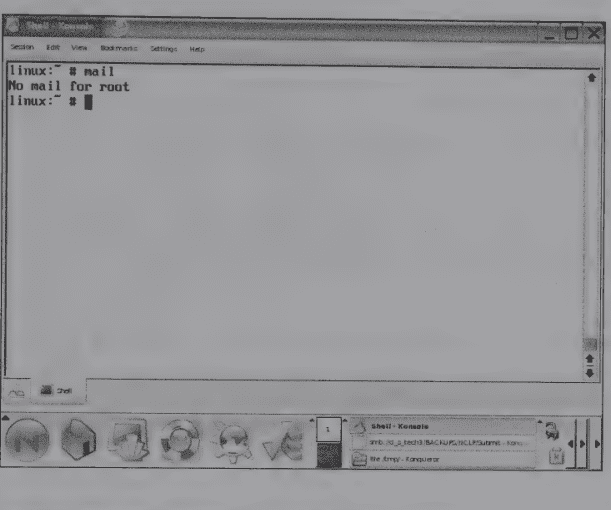

### 图 10.2

`mail` 工具显示了挂起的邮件。

```
linux:~ # mail -u edulaney
mail version 10.6 11/15/03. Type? for help.
/var/spool/mail/edulaney: 16 messages 16 new
M 1 root@linux.site Tue Sep 28 13:09 28-484 SuSeConfig: ntp.cave
M 2 root@linux.site Tue Sep 29 13:09 41-1825 SuSeConfig: SuSeFire
M 3 root@linux.site Tue Sep 28 13:09 151-5879 SuSeConfig: openssh-c
M 4 root@linux.site Wed Sep 29 11:59 18/651 Cron <root>@lml
M 5 root@linux.site Thu Sep 30 11:59 18/651 Cron <root>@lml
M 6 root@linux.site Fri Oct 1 11:59 18/651 Cron <root>@lml
M 7 root@linux.site Sat Oct 2 11:59 18/651 Cron <root>@lml
M 8 root@linux.site Sun Oct 3 11:59 18/651 Cron <root>@lml
M 9 root@linux.site Mon Oct 4 11:59 18/651 Cron <root>@lml
M 10 root@linux.site Tue Oct 5 11:59 18/651 Cron <root>@lml
M 11 root@linux.site Wed Oct 6 11:59 18/651 Cron <root>@lml
M 12 root@linux.site Thu Oct 7 11:59 18/651 Cron <root>@lml
M 13 root@linux.site Fri Oct 8 11:59 18/651 Cron <root>@lml
M 14 root@linux.site Sat Oct 9 11:59 18/651 Finishing the Project
M 15 root@linux.site Sat Oct 9 14:20 23/645 Keeping the month
M 16 root@linux.site Sat Oct 9 14:21 22/620
```


在 `?` 提示符下，你可以输入以下命令：

- D 删除消息
- E 编辑消息
- F 查看消息头信息
- N 跳到/输入下一条消息
- R 回复消息
- T 输入消息
- U 撤销删除
- X 或 Q 退出

从命令行向某人发送邮件，请使用以下命令（name 是你想要发送消息的用户）：

`$ mail name`

将出现一个提示符请求主题。在你输入主题（并按回车）后，你可以输入任何任意长度的消息内容。当你完成消息输入后，按 `Ctrl+D`。将出现一个空行和 "EOF"，表示传输结束，你将返回提示符。

## 监控系统

涵盖的课程目标

- 3. 监控你的 SLES 9 系统

重要的是能够监控你的 SLES 9 系统状态并确保其运行正常。有许多方法可以识别这一点。某些信息会写入 `/var/log`，你可以通过 `dmesg` 命令查看它们。有些信息会生成在 `/proc` 中，你可以 `more` 查看它们。`dmesg` 命令产生与图 10.3 类似的信息。

### 图 10.3

```
linux:~bin # dmesg |

Linux version 2.6.9-smp (gcc) 3.3.2 Jul 14:21:59 UTC 2004

host

Found SMP-table at 00fe7c

508MB usable(realloc) area available.

512MB LOW available.

BIOS-provided memory map:

00000000-00000000 0000000000000000 0000000000000000 0000000000000000 0000000000000000 0000000000000000 0000000000000000 0000000000000000

00000000-00000fff 0000000000000000 0000000000000000 0000000000000000 0000000000000000 0000000000000000 0000000000000000 0000000000000000

00001000-00001fff 0000000000000000 0000000000000000 0000000000000000 0000000000000000 0000000000000000 0000000000000000 0000000000000000

00002000-00002fff 0000000000000000 0000000000000000 0000000000000000 0000000000000000 0000000000000000 0000000000000000 0000000000000000

00003000-00003fff 0000000000000000 0000000000000000 0000000000000000 0000000000000000 0000000000000000 0000000000000000 0000000000000000

00004000-00004fff 0000000000000000 0000000000000000 0000000000000000 0000000000000000 0000000000000000 0000000000000000 0000000000000000

00005000-00005fff 0000000000000000 0000000000000000 0000000000000000 0000000000000000 0000000000000000 0000000000000000 0000000000000000

00006000-00006fff 0000000000000000 0000000000000000 0000000000000000 0000000000000000 0000000000000000 0000000000000000 0000000000000000

00007000-00007fff 0000000000000000 0000000000000000 0000000000000000 0000000000000000 0000000000000000 0000000000000000 0000000000000000

00008000-00008fff 0000000000000000 0000000000000000 0000000000000000 0000000000000000 0000000000000000 0000000000000000 0000000000000000

00009000-00009fff 0000000000000000 0000000000000000 0000000000000000 0000000000000000 0000000000000000 0000000000000000 0000000000000000

0000a000-0000affff 0000000000000000 0000000000000000 0000000000000000 0000000000000000 0000000000000000 0000000000000000 0000000000000000

0000b000-0000bffff 0000000000000000 0000000000000000 0000000000000000 0000000000000000 0000000000000000 0000000000000000 0000000000000000

0000c000-0000cffff 0000000000000000 0000000000000000 0000000000000000 0000000000000000 0000000000000000 0000000000000000 0000000000000000

0000d000-0000dffff 0000000000000000 0000000000000000 0000000000000000 0000000000000000 0000000000000000 0000000000000000 0000000000000000

0000e000-0000effff 0000000000000000 0000000000000000 0000000000000000 0000000000000000 0000000000000000 0000000000000000 0000000000000000

0000f000-0000ffff 0000000000000000 0000000000000000 0000000000000000 0000000000000000 0000000000000000 0000000000000000 0000000000000000

00010000-00010fff 0000000000000000 0000000000000000 0000000000000000 0000000000000000 0000000000000000 0000000000000000 0000000000000000

00011000-00011fff 0000000000000000 0000000000000000 0000000000000000 0000000000000000 0000000000000000 0000000000000000 0000000000000000

00012000-00012fff 0000000000000000 0000000000000000 0000000000000000 0000000000000000 0000000000000000 0000000000000000 0000000000000000

00013000-00013fff 0000000000000000 0000000000000000 0000000000000000 0000000000000000 0000000000000000 0000000000000000 0000000000000000

00014000-00014fff 0000000000000000 0000000000000000 0000000000000000 0000000000000000 0000000000000000 0000000000000000 0000000000000000
```


```
00015000-00015fff 0000000000000000 0000000000000000 0000000000000000 0000000000000000 0000000000000000 0000000000000000 0000000000000000

00016000-00016fff 0000000000000000 0000000000000000 0000000000000000 0000000000000000 0000000000000000 0000000000000000 0000000000000000

00017000-00017fff 0000000000000000 0000000000000000 0000000000000000 0000000000000000 0000000000000000 0000000000000000 0000000000000000

00018000-00018fff 0000000000000000 0000000000000000 0000000000000000 0000000000000000 0000000000000000 0000000000000000 0000000000000000

00019000-00019fff 0000000000000000 0000000000000000 0000000000000000 0000000000000000 0000000000000000 0000000000000000 0000000000000000

0001a000-0001affff 0000000000000000 0000000000000000 0000000000000000 0000000000000000 0000000000000000 0000000000000000 0000000000000000

0001b000-0001bffff 0000000000000000 0000000000000000 0000000000000000 0000000000000000 0000000000000000 0000000000000000 0000000000000000

0001c000-0001cffff 0000000000000000 0000000000000000 0000000000000000 0000000000000000 0000000000000000 0000000000000000 0000000000000000

0001d000-0001dffff 0000000000000000 0000000000000000 0000000000000000 0000000000000000 0000000000000000 0000000000000000 0000000000000000

0001e000-0001effff 0000000000000000 0000000000000000 0000000000000000 0000000000000000 0000000000000000 0000000000000000 0000000000000000

0001f000-0001ffff 0000000000000000 0000000000000000 0000000000000000 0000000000000000 0000000000000000 0000000000000000 0000000000000000
```

硬件相关信息存储在临时文件 `/proc` 中，并可以从那里查看。这些文件显示在图 10.4，它们持有的大部分名称——例如 `dma`——包含了直接访问模块的信息。

### 图 10.4
`/proc` 文件标识硬件信息。

| | Owner | Group | Size | Name |
|---|---|---|---|---|
| | root | root | 0 | crypto |
| - | 1 | root | 0 | devices |
| - | 1 | root | 0 | diskstats |
| - | 1 | root | 0 | dma |
| dr-xr-xr- | 3 | root | 0 | driver |
| - | 1 | root | 0 | eccdomains |
| - | 1 | root | 0 | fb |
| - | 1 | root | 0 | filesystems |
| - | 1 | root | 0 | fs |
| dr-xr-xr- | 1 | root | 0 | ide |
| - | 1 | root | 0 | interrupts |
| - | 1 | root | 0 | ioports |
| dr-xr-xr- | 23 | root | 0 | irq |
| - | 1 | root | 0 | kcmalloc |
| - | 1 | root | 53236608 | 0 Sep 28 13:47 | kcore |
| - | 1 | root | 0 | meminfo |
| - | 1 | root | 0 | mounting |
| - | 1 | root | 0 | locks |

# 执行管理安全任务

涵盖的课程目标

- 7. 创建安全概念 (3038)
- 8. 限制对服务器系统的物理访问 (3038)
- 9. 限制已安装的软件包 (3038)
- 10. 确保文件系统安全 (3038)
- 11. 使用 ACL 进行高级访问控制 (3038)
- 12. 了解安全问题 (3038)
- 13. 应用安全更新 (3038)

在将安全措施应用于系统、网络或互联网时，常识始终是指导因素。如果你完全不采取任何安全措施，就会面临本不该访问你数据的人访问数据的风险。他们在访问数据后会对这些数据做什么，谁也预料：他们可以使用它来低价竞争或窃取商业秘密，可以恶意删除它，还可能以无数种方式对其进行修改。

另一方面，如果你对系统实施了过多的安全措施，就会让它变得难以使用。例如，为了防止任何人看到系统上的文件，只需拔掉系统电源并用锤子砸碎硬盘即可。虽然没有人会否认这是做得过度了，但它确实达到了目的。

在无安全和完全安全之间，存在着一个你必须找到并应用的舒适度水平。这种程度取决于你所保护的数据价值、用户使用的访问类型（本地、远程、拨号）等因素。这种舒适度总会发生变化，并受到外部因素的影响。例如，如果你刚刚听说公司的另一个部门遭遇了入室问题，你就会想要增加安全措施，以此此类推。

在任何情况下，都有一些应该遵循的常识规则：

- 保护物理环境。如果主机提供服务且没有用户坐在它们面前使用，那么这些机器就有理由没必要放在办公室的中间。

# 重新回顾管理任务

将这些机器移到安全的机房内，减少他人直接坐在它们面前并访问数据的风险。

- 注意环境因素。数据不仅会被用户损坏，也可能因系统故障而损坏。减少系统故障——防止潜在的数据损坏——请注意电源输入（利用不间断电源—UPS），并且不要在会导致电磁干扰 (EMI) 的物体上方运行，例如荧光灯或电动机。注意湿度状况等。

- 在安装任何软件之前，请验证该软件是干净的。这可以防止你向良好的机器中添加恶意进程。有许多方法可以尝试这样做：验证校验和以确保在下载过程中没有发生损坏（并且仅从受信任的网站下载），列出软件包的内容并与应有的内容进行比对，等等。然而，最好的方法是在独立机器上安装软件，并在安装到生产机器之前验证其运行是否正常。

- 要求所有用户使用密码，并创建合适的密码策略。确保这些密码不仅仅是单个字符（6–8 个字符是一个较好的最低值），并实施定期过期。记住，密码是通过 `passwd` 命令进行更改的，你可以通过在 `/etc/passwd` 文件的用户条目中添加字符来禁用账户。

- 使用影子项（shadow entries）存储密码。这同时适用于用户和组。影子化仅仅是将所有用户都可以访问的文件中的密码合并到只有 root 用户可以访问的文件中，增加了额外的安全性。

- 定期检查日志文件，并确保登录和注销（可以通过 `Last` 命令获取）没有突然显示旧的时间。如果用户开始在凌晨 3:00 访问系统，而他们以前从未这样做过，请务必跟进并验证确实是该用户在访问系统，而不是别人。谈到这个话题，定期检查所有日志文件——它们存在是有目的的，并在情况变得不可控之前警示你需要尽早发现的情况。

- 禁用任何当前不需要使用的账户。这对于用户账户和组账户都是如此，并且减少了一个可以被入侵的入口。

## Novell 认证 Linux 专家学习指南

- 为拨号访问分配身份验证。PPP 在 TCP/IP 上使用拨号协议。它允许使用 PAP（密码验证协议）进行身份验证，该协议不加密密码并允许发送明文——这为任何窃听者拦截留下了可机。坦率地说，它还具有使用 CHAP（挑战握手验证协议）进行身份验证的能力，CHAP 会对密码进行加密，并使其在被截获时价值大大降低。

- 使用 TCP Wrappers 减少允许跨网络进入的流量。封装（与 `/etc/hosts.deny` 和 `/etc/hosts.allow` 文件配合工作）是一个决定谁可以进入的规则。通过封装，你可以将允许的主机限制仅为本地主机，或者排除未知主机，或任何满足你需求的其他组合。

- 定期运行检查以查看哪些文件具有 SGID 或 SUID 权限。这些文件的存在应该有一个不容疑的理由，否则它们根本不应该存在。如果用户无法以自己的身份运行进程，你赋予他们更高权限来运行任务，给了他们什么程度的便利？如果进程崩溃导致他们留在了该用户下怎么办？

- 与前一个相关——对于任何运行带有 SUID 或 SGID 权限的文件或守护进程，始终使用最小的用户和组所有权。

- 使用安全壳 (ssh) 代替 telnet。telnet（端口 23）使用明文，而 ssh（端口 22）使用加密并提供更高的安全性。OpenSSH 在第 11 章“网络基础”中讨论。

- 使用适当的 `umask` 值使新文件和目录的默认权限尽可能最小。

# 使用 iptables

虽然这有些泛指，但可以说，Linux 内核 2.0.x 及之前的版本使用 `ipfwadm`， 2.2.x 版本中 `ipchains` 取代了它。尽管 `ipchains` 仍然可用并在许多地方使用，但从 2.4.x 版本开始，`iptables` 取代了它。

`iptables` 是数据包过滤的通用实现，可以在有状态和无状态模式下运行。关于 `iptables` 的更多信息可以在教程中找到：http://iptables-tutorial.frozent.net/。

# 主机安全

保护主机的最好方法是了解它的一切。当你设置一个主机提供 Web 服务时，其目的是向用户分发 Web 内容和页面。在这种情况下，该主机没有理由为客户端提供 DHCP 地址——也没有这样做的能力。

`/etc/inetd.conf` 文件保存了网络启动时在主机上启动的服务列表。仔细审核每个主机上的此文件，并验证每个启动的服务是否有合法需求，以及它是否会通过打开不受欢迎进入的大门来危及系统或网络。审计 `syslogd` 创建的日志文件，查看哪些服务正在启动，以及它们是否遇到了崩溃、重启等问题。

作为管理员，你应该定期跟踪世界范围内发生的安全发展和问题，并据此做出反应。例如，如果你的整个网络都是基于 Linux 实现，而突然报告某些版本的 Linux 有漏洞，可以让任何人在登录提示符处输入“wizard”就打开大门，那么你最好尽快了解情况并制定出响应计划。

你可以通过监控供应商网站以及 CERT（最初是计算机响应小组）www.cert.org 来跟进安全问题。CERT 现在是卡内基梅隆大学软件工程学院的一个部门，他们在 1998 年报告了 3734 次事件。1999 年，这个数字几乎增长了三倍，达到 9859 次。对于 2003 年（媒体时间获得的最后一个报告周期），该数字飙升至 137,000 多次。

## Novell 认证 Linux 专业学习指南

随着报告的事件数量不断增加，漏洞的数量以及相关的统计数据也随之增长。如果你怀疑网络上存在问题并需要联系 CERT，可以通过电子邮件 cert@cert.org 与其联系，或者通过普通邮寄至：

CERT Coordination Center
Software Engineering Institute
Carnegie Mellon University
Pittsburgh, PA 15213-3890

还强烈建议你订阅 BUGTRAQ 邮件列表，可以通过向 listserv@securityfocus.com 发送邮件，邮件主题留空，并在正文中注明“SUBSCRIBE BUGTRAQ”来完成。

当发现安全问题时，最常见的解决方案是更新受影响的二进制文件。这些文件几乎可以在供应商的网站上找到，你应该立即获取并安装它们。处理威胁的唯一方法就是尽快消除它。

> 每当你对系统进行任何更改时，都应该以一种方便查询的方法完整记录你所做的一切，以便在之后发生不可预的问题时可以随时查阅。在进行任何重大更改之前，你还应该完成备份。

## 用户级安全

如果你赋予一个用户整个网络的 root 级权限，他们可能造成的损害范围等同于整个网络。如果你赋予该用户对一台机器的有限权限，他或她可能造成的潜在损害将受到严格限制。尽管这个目标重复了之前讨论过的内容，但它侧重于如何限制用户。

限制用户的主要方法之一是使用“始终授予完成工作所需的最小权限”原则。与其给某人太多权限并在发现问题后费力去补救，不如先给他们不够的权限，然后再回去给他们多一点。在冒着近乎幼稚的风险，请允许我用一个比比。

如果我五岁的儿子想开车，我可以给他买一辆 Wheels 吉普（一种由两节 6 伏电池驱动的玩具），价格大约和我从汽车报废处理场买一辆旧的 Oldmobile Cutlass（一辆 20 年历史的真车）一样。这个五岁的孩子对任何一个都会同样兴奋，而且对我来说成本相同。有了玩具，他可以坐得很低，行驶速度约为每小时 4 英里，并可以撞击库门。有了真车，他可以坐得很高，行驶速度约为每小时 80 英里，并可以穿过库门，冲过任何挡路的东西。

没有人会考虑给一个五岁的男孩开一辆真正的汽车，但这个类比并没有看起来那么离谱。太多的管理员在创建新用户时往往倾向于给予过多的权限。这通常通过组组成发生，管理员的意图借此便于自己的工作，这样他们就不需要响应用户因拒绝访问文件、目录、资源等而提出的请求。

在系统中，等同于“穿过库门及其内部的所有东西”的能力，就是使用 `rm` 命令本想删除几个文件，却无意中使用了递归命令删除了过多的文件。当这种情况发生时，系统管理员无疑会希望自己给过更少的权限，并让操作被拒绝。

对用户实施其他限制也是重要的。你可以限制如下内容：

- 用户在系统上允许使用的存储空间大小。这是通过实施配额（quotas）实现的。
- 他们可以运行的进程。使用 `ulimit -u` 命令对此进行限制，并将限制单个用户在任何时刻拥有的进程数量。
- 他们的内存使用。`ulimit -v` 命令允许你指定 shell 可用的最大虚拟内存。

`ulimit` 规范应该放在 `/etc/profile` 中以应用于所有用户。

> 注意

- 用户的登录。`/etc/security` 文件包含 root 用户可以登录的所有终端列表。默认情况下，每个已知的终端都列在此处。考虑到安全，你可能想编辑此文件并从列表中删除某些或大部分终端。`/etc/usertty`（默认不存在）可用于存储用户限制。在该文件中，你可以在 `USERS` 部分下按用户指定允许的 tty 和主机（hosts）。`GROUPS` 部分允许按组执行相同操作，而 `CLASSES` 部分则定义了 tty 类别和主机名模式。该文件的示例如下：

```bash
# cat /etc/usertty

USERS

evan tty3

kristin tty4 @152.12.14.0/255.255.255.0

#
```


此配置将限制 `evan` 只能使用 `tty3`。它还限制了 `kristin` 只能使用 `tty4`，或者 `152.12.14.x` 网络上的机器。对所有用户的限制该行以星号（`*`）开头。

通过在前述列表中提到的 `ulimit`，你可以指定值是 `H`（硬限制）还是 `S`（软限制）。如果是硬限制，则永远无法增加。如果是软限制——默认值——则可以增加。除了已列出的外，可以使用 `ulimit` 的选项还包括：

- `a`：显示所有当前限制
- `f`：指定由 shell 创建的文件的最大大小
- `t`：指定最大 CPU 限制
- `n`：指定最大打开文件数

> 在大多数系统中，该命令格式如下：
```
# ulimit -a
```

## 复习管理任务 第 10 章

## 添加硬件

涵盖的课程目标
14. 添加新硬件

除了监控之外，本章的大部分内容集中于软件问题。

## 实验练习 10-1：评估和修正安全风险

在练习中，你将与手动创建的用户账户进行工作。如果你没有做练习，必须先完成它才能完成本实验。

完成以下操作：

1. 查看第 5 章末尾添加的用户，并思考字段。
2. 你所做的是添加了一个名为 `edulan` 的用户，他没有密码。
3. 该用户的用户 ID、组 ID 和主目录与 `root` 相同。
4. 通过打开文件编辑来删除该用户：`vi passwd`
5. 移动到文件的最后一行并删除它
6. 保存文件
7. 退出文件

## 总结

本章查看了许多管理任务以及你需要了解的内容。它涵盖了软件包和内核管理，以及安全和添加新硬件。

## 命令总结

表 10.5 列出了本章讨论的命令。

| 命令 | 用途 |
| --- | --- |
| `depmod` | 确定模块依赖 |
| `dmesg` | 显示启动消息 |
| `dpkg` | Debian 软件包管理器 |
| `gzip` | 压缩文件 |
| `hdparm` | 可查看和更改硬盘参数 |
| `hwinfo` | 显示已安装设备的信息列表 |
| `insmod` | 安装模块 |
| `ldconfig` | 更新并维护动态链接器的共享库数据和符号缓存 |
| `ldd` | 显示程序依赖哪些库 |
| `lsmod` | 列出已加载的模块 |
| `lspci` | 显示 PCI 总线信息 |
| `mail` | 检查是否有邮件队列 |
| `modinfo` | 打印模块信息 |
| `modprobe` | 探测并安装模块及其依赖项 |
| `rmmod` | 移除模块 |
| `rpm` | 红帽软件包管理器 |
| `tar` | 创建和提取被称为归档包的文件 |
| `ulimit` | 显示当前施加的用户限制 |

# 第 11 章 网络基础

本章重点介绍网络方面的基础知识。在本章中，你将学习 TCP/IP 网络协议以及如何配置它。本章在这些概念的基础上进行，你将学习一些运行在 TCP/IP 上的服务。在准备考试时，对这里介绍的所有主题拥有广博的知识是非常重要的。

本章涵盖了以下课程目标：

1. 网络相关命令行命令介绍 (3036)
2. 配置你的网络连接 (3037)
3. 配置和管理路由 (3037)
4. 测试网络接口 (3037)
5. 配置网络文件系统 (3037)
6. 管理网络上的资源 (3037)
7. 启用 Web 服务器 (Apache) (3037)
8. 启用扩展网络守护进程 (`inetd`) (3037)
9. 启用 FTP 服务器 (3037)
10. 理解 Linux 网络术语 (3038)
11. 使用 IP 工具设置网络设备 (3038)
12. 将设备设置保存到配置文件 (3038)
13. 使用 IP 工具设置路由 (3038)
14. 将路由设置保存到配置文件 (3038)
15. 配置主机名和域名解析 (3038)
16. 使用命令行工具测试网络连接 (3038)
17. 在 SLES 9 服务器上部署 OpenLDAP (3038)
18. 配置 Apache Web 服务器 (3038)
19. 配置 Samba 服务器作为文件服务器 (3038)

# TCP/IP 背景

涵盖的课程目标

1. 网络相关命令行命令介绍 (3036)
10. 理解 Linux 网络术语 (3038)

传输控制协议/网际协议 (TCP/IP) 是一套工业标准的协议套，旨在具有可路由性和高效性。TCP/IP 最初被设计为一组广域网 (WAN) 协议，目的是在发生原子/核战争时维持站点与站点之间的通信链路和数据传输。从那些早期开始，这些协议的发展已经从政府手中移交，并在一段时间内一直是互联网社区的责任。

这些协议从一个微型的四站点项目演变为全球互联网的基础，这一过程是非凡的。但尽管经历了 25 多年的工作并对协议套进行了多次修改，原始规范的内在精神仍然完好无损。TCP/IP 与其他协议具有以下优势：

- 一种工业标准协议。由于 TCP/IP 不由某一家公司维护或编写，因此它不是专有的，也不会受到许多兼容性问题的影响。整个互联网社区共同决定特定的更改或实现是否值得进行。
- 一组用于连接不同操作系统的实用程序。为 TCP/IP 协议套已编写了许多连接实用程序，包括文件传输协议 (FTP) 和终端仿真协议 (Telnet)。
- 一种可扩展的、跨平台的客户端/服务器架构。考虑一下为 TCP/IP 协议套开发应用程序期间发生了什么。例如，供应商希望编写自己的客户端/服务器应用程序，如 SQL Server 和简单网络管理协议 (SNMP)。如何编写应用程序的规范也供公众审阅。将包含哪些操作系统？各地的用户都希望能够利用 TCP/IP 承诺提供的连接选项，无论他们当前运行的是什么操作系统。
- 访问互联网。TCP/IP 是互联网的事实标准，允许访问在世界数千个地点可以找到丰富信息。然而，要连接到互联网，需要有效的 IP 地址。

# TCP/IP 的四层

TCP/IP 映射到一个四层架构模型。该模型被称为互联网协议套，分为网络接口层、互联网层、传输层和应用层。这些每一层都对应于 OSI 模型的一个或多个层，而它早于 OSI 模型。网络接口层对应物理层和数据链路层。互联网层对应网络层。传输层对应传输层，而应用层对应 OSI 模型的会话层、表示层和应用层。

该模型的四层中的每一层负责其映射层的所有活动。

网络接口层负责直接与网络通信。它必须理解正在使用的网络架构（例如环形网络或以太网），并提供一个允许互联网层与其通信的接口。互联网层负责直接与网络接口层通信。

互联网层主要通过网际协议 (IP) 进行数据包的路由和交付。传输层中的所有协议必须使用 IP 发送数据。IP 协议包含了如何对地址和引导数据包、分片和重组数据包、提供安全信息以及识别所使用的服务类型的规则。然而，由于 IP 不是基于连接的协议，它不能保证在传输线上传输的数据包不会丢失、损坏、重复或乱序。这是网络模型较高层（如传输层或应用层）的责任。互联网层中其他协议包括互联网控制消息协议 (ICMP)、互联网组管理协议 (IGMP) 和地址解析协议 (ARP)。

传输层映射到 OSI 模型的传输层，负责提供应用程序之间的通信。这种通信可以是基于连接的，也可以是非连接的。这类通信的主要区别在于是否存在跟踪数据和保证数据交付的机制。传输控制协议 (TCP) 是用于机器间基于连接通信的协议，提供可靠的数据传输。用户数据报协议 (UDP) 用于非连接的通信，不保证交付。

互联网协议套的应用层负责 OSI 模型会话层、表示层和应用层中发生的所有活动。为该层已编写了许多协议，包括简单网络管理协议 (SNMP)、文件传输协议 (FTP)、简单邮件传输协议 (SMTP) 以及许多其他协议。

## 网络层协议

- 互联网协议 (IP)
- 互联网控制消息协议 (ICMP)
- 地址解析协议 (ARP)
- 互联网组管理协议 (IGMP)

# 传输控制协议 (TCP)

存在于传输层的第一个协议是传输控制协议 (TCP)。该协议是一种基于连接的协议，在两台机器之间传输数据之前，需要建立会话。TCP 数据包被递送到套接字或端口。由于 TCP 使用两台机器之间的连接，它的设计用于验证由机器发送的所有数据包都在另一端接收。如果由于某些原因丢失了包，发送端将重新发送数据。由于必须建立会话并保证数据包的交付，使用 TCP 传输数据包会有额外的开销。

TCP 是一种基于连接的协议，在数据传输之前需要在两台机器之间建立连接（或会话）。TCP 存在于传输层，位于应用层和 IP 层之间，为目标机器提供可靠且保证的交付机制。基于连接的协议通过跟踪通信过程中单个数据包的传输和接收来保证数据包的交付。会话通过监控数据包的发送时间、发送顺序以及在接收时通知发送者来跟踪单个数据包的进度，以便能够发送更多数据。

TCP 会话创建后，机器开始通信，就像人们通话时一样。以电话为例，如果呼叫者使用手机且丢失了部分传输，用户会通过说“你说什么？我没听清”来表示她没有收到信息。这告诉发送者他需要重新发送数据。

在 TCP 会话的初始化期间（通常称为“三次握手”），两台机器会就跟踪随时发送数据量的最佳方法、接收数据后要发送的确认号，以及当所有数据都已传输和接收后连接不再需要的何时达成一致。只有在创建会话后，数据传输才会开始。为了提供可靠交付，TCP 按顺序封装数据包，并在发送新数据之前要求确认这些数据包已到达终点。TCP 通常用于传输大量数据，或在应用程序需要确认数据已接收的场景中使用。鉴于 TCP 需要跟踪的所有额外开销信息，TCP 数据包的格式可能相当复杂。

在 Linux/Unix 环境中，TCP 使用滑动窗口概念在机器之间传输数据。滑动窗口通常被称为流。每台机器都有一个发送窗口和一个接收窗口，它们利用缓冲区数据使通信过程更高效。窗口代表当前正在发送到目标机器的数据子集，也是目标机器正在接收的数据量。起初这似乎是冗余的，但事实并非如此。并不是所有的数据都能保证被接收，因此在两台机器上都必须跟踪数据包。滑动窗口允许发送机器以流的形式发送窗口数据，而无需等待每一个数据包的确认。

# 用户数据报协议 (UDP)

位于传输层的第二个协议是用户数据报协议，简称 UDP。该协议是非基于连接的协议，在两台机器之间传输数据之前不需要建立会话。UDP 数据包仍然像 TCP 一样被递送到套接字或端口。但 UDP 不会在机器之间创建会话，它无法保证数据包的交付，无法保证按顺序交付，也无法在数据包丢失时重传。鉴于该协议的不可靠性，人们可能会疑惑为什么要开发像 UDP 这样的协议。

发送 UDP 数据报文涉及的开销非常小。UDP 数据包没有同步参数或优先级选项。存在的只有源端口、目的端口、数据长度、用于验证头部的校验和，以及数据本身。

实际上，拥有一个不需要建立会话的传输协议有很多很好的理由。首先，UDP 关联的开销非常小，例如不需要跟踪序列号、重传定时器、延迟确认定时器以及数据包传输。UDP 功能快速且极其精简；它只是不保证。这使得 UDP 非常适用于涉及广播、网络通用公告或实时数据传输的通信。

UDP 的另一个非常好的用途是视频流和音频流。不仅是因为数据包的不保证交付使得能够传输更多数据（因为广播的开销很小），而且重传数据包本身也是没有意义。在流媒体广播的情况下，用户更关心接下来的内容，而不是试图恢复可能丢失的一两个数据包。这好比听音乐 CD 时，有一粒灰尘掉进了其中一个细小的凹槽中。在大多数情况下，遗漏那部分是无法察觉的；你的耳朵几乎没有察觉，你的大脑可能已经为你填补了空白。相反，想象一下你的 CD 播放器决定保证交付一个它无法完全获取的数据，结果导致无限地跳过。这绝对会破坏听觉体验。处理偶尔的数据包丢失比获得尽可能完美的体验要容易得多。幸运的是，UDP 的开发正是为了让应用程序以这种方式使用。

# 互联网协议 (IP)

网络层中存在许多协议，包括整个套件中最重要的协议——互联网协议 (IP)。这之所以可能是最重要的协议，是因为如果没有通过网络层中的 IP 进行通信，传输层根本无法进行通信。

IP 最基本的元素是 IP 使用的地址空间。网络上的每台机器都被分配一个唯一的地址。IP 允许将 D 类地址分配给一组机器，以便它们可以作为一个功能单元接收广播数据。机器可以从这些单元或组中添加或移除，或者作为多个组的成员。

## 地址解析协议 (ARP)

除非 IP 计划在网络上发起全广播，否则它必须拥有发送数据的机器物理地址。为了获取此信息，它依赖地址解析协议 (ARP)。ARP 负责将网络上的 IP 地址映射到内存中的物理地址。这样一来，每当 IP 需要特定 IP 地址的物理地址时，ARP 就可以提供。但 ARP 的内存不会永久存在，IP 有时会请求一个 ARP 内存中不存在的 IP 地址。当这种情况发生时，ARP 必须去寻找。

ARP 负责寻找 IP 可能请求的本地物理 IP 地址的映射表。如果 ARP 内存中没有映射表，它必须进入网络。ARP 使用本地广播来查找机器的物理地址，并在内存中维护一个最近映射的 IP 地址到物理地址的缓存。尽管这个缓存不会永久存在，但它使 ARP 无需在每次 IP 需要地址时都进行广播。

只要目标 IP 是本地的，ARP 仅需向该机器发送本地广播，并将物理地址返回给 IP。IP 意识到目标 IP 地址是本地的，只需在目标机器的物理地址上方加上 IP 地址即可形成数据报文。

## 协议与端口

传输层使用端口将数据传输到应用层。这些端口允许主机支持并跟踪与网络上其他主机同时进行的会话。可定义端口超过 65,000 个，表 11.1 列出了最常见的分配情况。

> 注意：对于考试，请务必记忆表 11.1 中出现的端口。

| 端口 | 服务 | 目的 |
| --- | --- | --- |
| 20, 21 | FTP | 将文件从一个主机传输到另一个主机 |
| 23 | Telnet | 像在哑终端上连接到主机一样用于管理目的 |
| 25 | SMTP | 简单邮件传输协议 |
| 53 | DNS | 域名系统 |
| 80 | WWW | 世界万维网服务 |
| 110 | POP3 | 用于检索电子邮件的邮局协议（版本 3） |
| 119 | NNTP | 网络新闻传输协议 |
| 139 | NetBIOS | 用于将 Windows 标识翻译为 IP 地址 |
| 143 | IMAP | 互联网邮件访问协议，可以替代 POP3 |
| 161 | SNMP | 简单网络管理协议 |

`/etc/services` 文件保存常用端口的定义。它是一个 ASCII 文件，将文本名称映射到服务。互联网数字分配机构（IANA）分配较小的数字端口，但管理员可以自由分配较大的数字。

## TCP/IP 主机配置

涵盖课程目标

- 2. 配置你的网络连接 (3037)
- 6. 使用命令行工具测试网络连接 (3038)

要在主机上配置 TCP/IP，你必须知道并配置三个值。这三个需要的值是：

- IP 地址
- 子网掩码
- 默认网关

> 注意：从技术上说，你需要配置 IP 和子网。网关是可选的，只有当你想要离开子网时才需要。

这三个值中的每一个将在后续节中进行检查。

## IP 地址

TCP/IP 网络上的每个主机都必须有一个唯一的 IP 地址。IP 地址是由 32 位二进制数的值组成的。由于几乎不可能记住 32 位二进制数，IP 地址通常以四个十进制字节的形式写出。第一个字节识别它所所属的地址“类别”，这决定了网络上可用的主机数量，如表 11.2 所示。

| 类别 | 地址范围 | 主机数量 | 默认子网掩码 |
| --- | --- | --- | --- |
| A | 1-126 | 16,777,214 | 255.0.0.0 |
| B | 128-191 | 65,534 | 255.255.0.0 |
| C | 192-223 | 254 | 255.255.255.0 |
| D | 224-239 | 仅用于组播，不能分配给单个主机 | |
| E | 240-255 | 无法发放的预留地址 | |

第一个字节不能为 127，因为地址 `127.0.0.1` 被预留为环回地址，始终表示当前主机。根据类不同，第二到第四个字节用于识别网络和主机。

要理解的一点是，IP 地址在主机与之通信的网络范围内必须是唯一的。如果主机仅连接到其他三台机器，那么这三台机器中的每台都必须有一个唯一的值。如果主机连接到互联网，该地址在互联网范围内必须是唯一的。

## 子网掩码

简单来说，子网掩码告诉我们网络是否被划分为更小的网络，或者所有主机是否可以在同一条线缆上找到。默认值基于网络类别，如表 11.2 所示。如果你偏离了此值，你就偏离了该类别。

只要目标 IP 是本地的，ARP 仅需向该机器发送本地广播，并将物理地址返回给 IP。IP 意识到目标 IP 地址是本地的，只需在目标机器的物理地址上方加上 IP 地址即可形成数据报文。

## 网络配置文件

`/etc/sysconfig/network` 目录存放了主机可以通信的已知网络的配置文件。以下列表显示了该目录下的默认配置文件：

```bash
## Path: Network/Hardware/Config
## Description: 设置一些通用网络配置
## Type: string
```

```bash
## Type: yesno
## Default: yes
# 是否应该将网络配置脚本的错误信息
# 发到 syslog，还是你希望
# 出现在 stderr 中？
USE_SYSLOG="yes"
```

```bash
## Type: yesno
## Default: yes
# 有些服务（ppp, ipppp, dhcp-client, pcmcia,
# hotplug）必须在某些时刻动态地
# 修改 /etc/resolv.conf。例如，如果 ppp/ipppp
# 建立了连接并由对端提供了
# 一组名称服务器列表。或者 pcmcia 需要为
```


# 选定的配置方案设置名称服务器。如果你完全不希望这些服务修改 `/etc/resolv.conf`，请将此变量设置为 "no"。如果不确定，请保留默认值（即 "yes"）。

```bash
MODIFY_RESOLV_CONF_DYNAMICALLY="yes"
```

## Type: yesno
## Default: no

# 与 `MODIFY_RESOLV_CONF_DYNAMICALLY` 类似，但它修改 `/etc/named.conf`。如果不确定，请保留默认值（即 "no"）。

```bash
MODIFY_NAMED_CONF_DYNAMICALLY="no"
```

## 网络连接的处理

# 这些功能是为了方便经验用户的方便设计的。如果你遇到不理解的问题，请将其关闭。这是默认设置。如果你遇到麻烦，请不要抱怨。但如果你想让它们更智能，请写信至 <http://www.suse.de/feedback>。

## Type: yesno
## Default: no

# 如果你对使用网络接口的连接和 nfs 挂载感兴趣，你可以设置 `CONNECTION_SHOW_WHEN_IFSTATUS="yes"`，那么你将通过 `ifstatus <interface>`（或 `ifstatus`）看到它们。这一个 _应该_ 永远不会有害 ;)

```bash
CONNECTION_SHOW_WHEN_IFSTATUS="no"
```

## Type: yesno
## Default: no

# 如果只有在没有活动连接时才应该关闭接口，请使用 `CONNECTION_CHECK_BEFORE_IFDOWN="yes"`。

```bash
CONNECTION_CHECK_BEFORE_IFDOWN="no"
```

## Type: yesno
## Default: no

# 如果在关闭接口时应该关闭这些连接（不包括 nfs 挂载），请设置 `CONNECTION_CLOSE_BEFORE_IFDOWN="yes"`。警告：注意这可能会终止需要这些连接之一的应用程序！

```bash
CONNECTION_CLOSE_BEFORE_IFDOWN="no"
```

## Type: yesno
## Default: no

# 如果你是移动笔记本用户，甚至在离开当前工作地点时也关闭 nfs 挂载，那么设置 `CONNECTION_MOUNT_NFS_BEFORE_IFDOWN="yes"`。这只有在当 `CONNECTION_CLOSE_BEFORE_IFDOWN="yes"` 时才起作用。警告：注意这可能会终止使用这些 nfs 挂载作为工作目录的应用程序。如果你的家是通过 nfs 挂载的，请务小心！！！警告：如果存在无法终止的进程，这可能导致 shutdown 进程挂起。如果你正在使用热插设备（pcmcia, usb, 火火线），请在拔掉之前先关闭它们！

```bash
CONNECTION_MOUNT_NFS_BEFORE_IFDOWN="no"
```

## Type: yesno
## Default: no

# 如果终止使用连接或 nfs 挂载的进程是不够的，那么它们在终止失败后可以被杀掉。如果你想设置 `CONNECTION_SEND_KILL_SIGNAL="yes"`。

```bash
CONNECTION_SEND_KILL_SIGNAL="no"
```

## Type: string
## Default: ""

# 在此处你可以指定哪些接口在 'rcconfig start' 之后必须启动并被正确配置。如果这些接口中的任何一个没有启动，rcconfig 将返回 'failed'。你可以使用接口名称作为 -well，但最好使用设备的硬件描述（`eth-id-<macaddress>` 或 `eth-bus...` 查看 `man ifup` 获取‘硬件描述’）。网络启动脚本将等待这些接口，但不会超过 `WAIT_FOR_INTERFACES` 设置的时间。你不需要在此处添加拨号或隧道接口，只需要物理设备。接口 'lo' 始终被认为是强制性的，可以省略。如果此变量为空，rcnetwork 会尝试自动导出强制设备列表（尝试 `rcnetwork start -o debug`）。

```bash
MANDATORY_DEVICES=""
```

## Type: integer
## Default: 20

# 某些接口需要一些时间启动或通过热插异步启动。`WAIT_FOR_INTERFACES` 是所有接口的全局等待时间，单位秒。为空则不发生等待。

```bash
WAIT_FOR_INTERFACES="20"
```

## Type: yesno
## Default: yes

# 通过此变量你可以决定当网络接口启动时是否启动防火墙。

```bash
FIREWALL="yes"
```

## Type: string("off","auto","manual")
## Default: "off"

# !!! 当没有有效配置时我们该做什么？
# off: 什么都不做，直接失败。
# guess: 尝试猜测所需的信息（zeroconf）。
# auto-off: 如果自动失败，则自动创建配置。
# auto-manual: 如果自动失败，则请求用户提供配置（通过 yast）。
# !!! 此功能未实现。保留为 'off'。

```bash
FAILURE_ACTION=off
```

## Type: string
## Default: "eth*[0-9]|tr*[0-9]|wlan[0-9]|ath[0-9]"

# 自动为匹配的接口添加 linklocal。此字符串用于 "case" 语句并包含 '*' 字符。

```bash
LINKLOCAL_INTERFACES="eth*[0-9]|tr*[0-9]|wlan[0-9]|ath[0-9]"
```

- `/etc/sysconfig/network/routes`——此文件用于存放路由信息。以下是用于此目的的工具，通常，你不知道网络上主机的 MAC 地址。然而，如果你无法连接主机或者到了意外的主机，你可以通过 ARP 命令检查该主机实际上分配了哪个 IP 地址。
- `dig`——此工具（在本章稍后讨论）用于查询 DNS 服务器。以下是 `dig` 在不带参数的情况下生成的示例：

```
; DIG 9.2.3
; global options: print
; Got answer:
; HEADER: QUERY, status: NOERROR, id: 61821
; flags: qr; QUERY: 1, ANSWER: 0,
; QUESTION SECTION:
       IN NS
; ANSWER SECTION:
244262 NS L.ROOT_SERVERS.NET.
244262 NS M.ROOT_SERVERS.NET.
244262 NS I.ROOT_SERVERS.NET.
244262 NS E.ROOT_SERVERS.NET.
244262 NS D.ROOT_SERVERS.NET.
244262 NS A.ROOT_SERVERS.NET.
244262 NS H.ROOT_SERVERS.NET.
244262 NS C.ROOT_SERVERS.NET.
244262 NS G.ROOT_SERVERS.NET.
244262 NS F.ROOT_SERVERS.NET.
244262 NS B.ROOT_SERVERS.NET.
244262 NS J.ROOT_SERVERS.NET.
244262 NS K.ROOT_SERVERS.NET.
;; ADDITIONAL SECTION:
L.ROOT_SERVERS.NET.      330662 IN A 198.32.64.12
M.ROOT_SERVERS.NET.      330662 IN A 202.12.27.33
I.ROOT_SERVERS.NET.      330662 IN A 192.36.14.17
E.ROOT_SERVERS.NET.      330662 IN A 192.0.230.10
D.ROOT_SERVERS.NET.      330662 IN A 128.8.10.90
A.ROOT_SERVERS.NET.      330662 IN A 198.41.0.4
H.ROOT_SERVERS.NET.      330662 IN A 128.63.2.53
C.ROOT_SERVERS.NET.      330662 IN A 192.33.4.12
G.ROOT_SERVERS.NET.      330662 IN A 192.112.36.4
F.ROOT_SERVERS.NET.      330662 IN A 192.5.5.241
B.ROOT_SERVERS.NET.      330662 IN A 192.228.79.201
J.ROOT_SERVERS.NET.      330662 IN A 192.58.128.30
K.ROOT_SERVERS.NET.      330662 IN A 193.0.14.129
;; Query time: 55 msec
;; SERVER: 192.168.0.1#53(192.168.0.1)
;; WHEN: Sun Oct 3 13:31:27 2004
;; MSG SIZE rcvd: 436
```

- `domainname`——与 `hostname` 类似，它显示主机使用的域名。
- `ethereal`——此工具默认未安装，但可以按照下一节的描述通过 YaST 添加到系统中。添加 `ethereal` 后，它提供了一个图形化界面，你可以通过它监控网络流量。这种功能在命令行中使用 `tcpdump` 也可以原生地实现。
- `ftp`——文件传输工具（ftp）运行在文件传输协议（FTP）上，用于在本地和远程主机之间发送和接收文件。
- `hostname`——这个简单的工具用于显示主机名。
- `ifconfig`——此工具用于在命令行中配置 TCP/IP 参数。语法为：`ifconfig interface options`。例如，为第一块以太网配置 IP 地址 201.13.12.65，命令为 `ifconfig eth0 201.13.12.65`，这将使用默认子网掩码。要对子网掩码 192 执行此操作，命令变为：`ifconfig eth0 201.13.12.65 netmask 255.255.255.192`。

# 网络基础

# 第 11 章

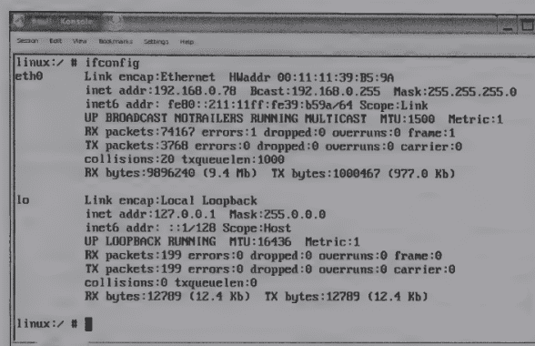

图 11.1 ifconfig 的输出示例。

- `ifup` 和 `ifdown`——这两个命令用于启动或停止预配置的网络接口。要查看状态（已启动或已停止），可以使用 `ifstatus` 命令。图 11.2 显示了该命令可用的可用选项。

图 11.2 ifstatus 及其相关命令提供了许多选项。

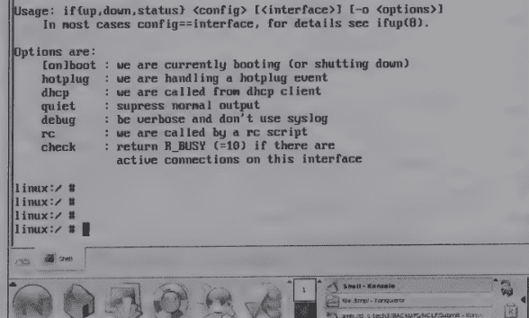

# 诺威认证 Linux 专业人员学习指南

`netcat`——此实用程序用于在两个主机之间建立连接。你可以使用 `-h` 查看所有可用参数列表。然而，最基本的操作是使用如 `netcat -l -p 16000` 的命令在一个主机上打开一个端口，将 16000 置于监听模式。随后，你可以通过命令 `netcat <hostname> 16000` 在另一台主机上与该主机建立连接。连接将一直保持直到你按下 Ctrl+C。

`netstat`——此命令显示 TCP 和 UDP 协议的统计信息。不带开关执行 `netstat` 会显示协议统计和当前的 TCP/IP 连接。当你确定了基础连接后，将需要验证系统上的服务。这涉及查看正在监听入站流量的服务，和/或验证你正在与远程站建立会话。`netstat` 命令允许你执行此操作。以下列表是不带任何选项的 `netstat` 生成输出示例：

## 注意

要查看 `netstat` 的可用选项（与大多数其他实用程序一样），请使用 `-?` 选项。

### 活动 Internet 连接（不含服务器）

| Proto | Recv-Q | Send-Q | Local Address | Foreign Address | State |
| :--- | :--- | :--- | :--- | :--- | :--- |
| tcp | 0 | @ | linux.mshome.net:32833 | D_S-Tech3.->netbios-ssn | ESTABLISHED |
| tcp | 0 | @ | linux.mshome.net:32832 | D_S-Tech3.->netbios-ssn | ESTABLISHED |
| tcp | 1 | @ | localhost:filenet-rpc | /localhost:svrloc | CLOSE_WAIT |

### 活动 unix 域套接字（不含服务器）

| Proto | RefCnt | Flags | Type | State | I-Node | Path |
| :--- | :--- | :--- | :--- | :--- | :--- | :--- |
| unix | 10 | [ ] | DGRAM | | 3608 | |
| unix | 2 | [ ] | DGRAM | | | |
| unix | 3610 | | | | | /var/lib/ntp/dev/log |
| unix | 3 | [ ] | STREAM | CONNECTED | 2287641 | /tmp/ksocket-root/klauncherYc7nCa.slave-socket |
| unix | 3 | [ ] | STREAM | CONNECTED | 2287640 | |
| unix | 3 | [ ] | STREAM | CONNECTED | 2285033 | /tmp/.ICE-unix/dcop3558-1096404519 |
| unix | 3 | [ ] | STREAM | CONNECTED | 2285032 | |
| unix | 3 | [ ] | STREAM | CONNECTED | 2285282 | /tmp/ksocket-root/conqueror9xiRhb.slave-socket |
| unix | 3 | [ ] | STREAM | CONNECTED | 2285280 | |
| unix | 3 | [ ] | STREAM | CONNECTED | 2285149 | /tmp/.ICE-unix/dcop3558-1096404519 |
| unix | 3 | [ ] | STREAM | CONNECTED | 2285148 | |
| unix | 3 | [ ] | STREAM | CONNECTED | 2285147 | /tmp/ksocket-root/conquerorSYKnXa.slave-socket |
| unix | 3 | [ ] | STREAM | CONNECTED | 2285146 | |
| unix | 3 | [ ] | STREAM | CONNECTED | 2285282 | /tmp/.X11-unix/X0 |
| unix | 3 | [ ] | STREAM | CONNECTED | 2285140 | |
| unix | 3 | [ ] | STREAM | CONNECTED | 2285084 | /tmp/ksocket-root/conquerorZ7Ffrc.slave-socket |
| unix | 3 | [ ] | STREAM | CONNECTED | 2285083 | |
| unix | 3 | [ ] | STREAM | CONNECTED | 2285067 | /tmp/.ICE-unix/dcop3558-1096404519 |
| unix | 3 | [ ] | STREAM | CONNECTED | 2285066 | |
| unix | 3 | [ ] | STREAM | CONNECTED | 2285059 | /tmp/.ICE-unix/3614 |
| unix | 3 | [ ] | STREAM | CONNECTED | 2285058 | |
| unix | 3 | [ ] | STREAM | CONNECTED | 2285055 | /tmp/.X11-unix/X0 |
| unix | 3 | [ ] | STREAM | CONNECTED | 2285054 | |
| unix | 2 | [ ] | DGRAM | | 226285 | |
| unix | 2 | [ ] | AM | CONNECTED | 226712 | |
| unix | 3 | [ ] | STREAM | CONNECTED | 226678 | |
| unix | 3 | [ ] | STREAM | CONNECTED | 226677 | |
| unix | 3 | [ ] | STREAM | CONNECTED | 226676 | |
| unix | 3 | [ ] | STREAM | CONNECTED | 226675 | |
| unix | 3 | [ ] | STREAM | CONNECTED | 226674 | |


## 网络基础

## 第 11 章

| unix | 3 | [ ] | STREAM | CONNECTED | 226673 | |
|---|---|---|---|---|---|---|
| unix | 3 | [ ] | STREAM | CONNECTED | 226672 | |
| unix | 3 | [ ] | STREAM | CONNECTED | 226671 | |
| unix | 3 | [ ] | STREAM | CONNECTED | 226670 | |
| unix | 3 | [ ] | STREAM | CONNECTED | 226669 | |
| unix | 3 | [ ] | STREAM | CONNECTED | 226668 | |
| unix | 3 | [ ] | STREAM | CONNECTED | 226667 | |
| unix | 3 | [ ] | STREAM | CONNECTED | 226666 | |
| unix | 3 | [ ] | STREAM | CONNECTED | 226665 | |
| unix | 3 | [ ] | STREAM | CONNECTED | 226664 | |
| unix | 3 | [ ] | STREAM | CONNECTED | 226663 | |
| unix | 3 | [ ] | STREAM | CONNECTED | 226662 | |
| unix | 3 | [ ] | STREAM | CONNECTED | 226661 | |
| unix | 3 | [ ] | STREAM | CONNECTED | 226660 | |
| unix | 3 | [ ] | STREAM | CONNECTED | 226659 | |
| unix | 3 | [ ] | STREAM | CONNECTED | 226658 | |
| unix | 3 | [ ] | STREAM | CONNECTED | 226657 | |
| unix | 3 | [ ] | STREAM | CONNECTED | 226656 | |
| unix | 3 | [ ] | STREAM | CONNECTED | 226655 | |
| unix | 3 | [ ] | STREAM | CONNECTED | 226654 | |
| unix | 3 | [ ] | STREAM | CONNECTED | 226653 | |
| unix | 3 | [ ] | STREAM | CONNECTED | 226652 | |
| unix | 3 | [ ] | STREAM | CONNECTED | 226651 | |
| unix | 3 | [ ] | STREAM | CONNECTED | 226650 | |
| unix | 3 | [ ] | STREAM | CONNECTED | 226649 | |
| unix | 3 | [ ] | STREAM | CONNECTED | 226648 | |
| unix | 3 | [ ] | STREAM | CONNECTED | 226647 | |
| unix | 3 | [ ] | STREAM | CONNECTED | 226646 | |
| unix | 3 | [ ] | STREAM | CONNECTED | 226645 | |
| unix | 3 | [ ] | STREAM | CONNECTED | 226644 | |
| unix | 3 | [ ] | STREAM | CONNECTED | 226643 | |
| unix | 3 | [ ] | STREAM | CONNECTED | 226642 | |
| unix | 3 | [ ] | STREAM | CONNECTED | 226641 | |
| unix | 3 | [ ] | STREAM | CONNECTED | 226640 | |
| unix | 3 | [ ] | STREAM | CONNECTED | 226639 | |
| unix | 3 | [ ] | STREAM | CONNECTED | 226638 | |
| unix | 3 | [ ] | STREAM | CONNECTED | 226637 | |
| unix | 3 | [ ] | STREAM | CONNECTED | 226636 | |
| unix | 3 | [ ] | STREAM | CONNECTED | 226635 | |
| unix | 3 | [ ] | STREAM | CONNECTED | 226634 | |
| unix | 3 | [ ] | STREAM | CONNECTED | 226633 | |
| unix | 3 | [ ] | STREAM | CONNECTED | 226632 | |
| unix | 3 | [ ] | STREAM | CONNECTED | 226631 | |
| unix | 3 | [ ] | STREAM | CONNECTED | 226630 | |
| unix | 3 | [ ] | STREAM | CONNECTED | 226629 | |
| unix | 3 | [ ] | STREAM | CONNECTED | 226628 | |
| unix | 3 | [ ] | STREAM | CONNECTED | 226627 | |
| unix | 3 | [ ] | STREAM | CONNECTED | 219952 | `/tmp/.ICE-unix/dcop3558-1096404519` |
| unix | 3 | [ ] | STREAM | CONNECTED | 219951 | |
| unix | 3 | [ ] | STREAM | CONNECTED | 219944 | `/tmp/.ICE-unix/3614` |
| unix | 3 | [ ] | STREAM | CONNECTED | 219943 | |
| unix | 3 | [ ] | STREAM | CONNECTED | 219940 | `/tmp/.X11-unix/X0` |
| unix | 3 | [ ] | STREAM | CONNECTED | 219939 | |
| unix | 3 | [ ] | STREAM | CONNECTED | 218613 | `/tmp/.ICE-unix/dcop3558-1096404519` |
| unix | 3 | [ ] | STREAM | CONNECTED | 218612 | |
| unix | 3 | [ ] | STREAM | CONNECTED | 218343 | `/tmp/.X11-unix/X0` |
| unix | 3 | [ ] | STREAM | CONNECTED | 218342 | |
| unix | 3 | [ ] | STREAM | CONNECTED | 21706 | `/tmp/.ICE-unix/3614` |
| unix | 3 | [ ] | STREAM | CONNECTED | 21705 | `/tmp/.X11-unix/X0` |
| unix | 3 | [ ] | STREAM | CONNECTED | 8699 | |
| unix | 3 | [ ] | STREAM | CONNECTED | 8698 | `/tmp/.ICE-unix/dcop3558-1096404519` |
| unix | 3 | [ ] | STREAM | CONNECTED | 8697 | |
| unix | 3 | [ ] | STREAM | CONNECTED | 8665 | `/tmp/.ICE-unix/3614` |
| unix | 3 | [ ] | STREAM | CONNECTED | 8664 | |
| unix | 3 | [ ] | STREAM | CONNECTED | 8663 | `/tmp/.X11-unix/X0` |

| | | |
|---|---|---|
| unix 3 [ ] STREAM CONNECTED 8387 | `/tmp/.ICE-unix/3614` | |
| unix 3 [ ] STREAM CONNECTED 8386 | | |
| unix 3 [ ] STREAM CONNECTED 8377 | `/tmp/.X11-unix/X0` | |
| unix 3 | [ ] | STREAM | CONNECTED | 8376 | | |
| unix 3 [ ] STREAM CONNECTED 8375 | `/tmp/.ICE-unix/dcop3558-1096404519` | |
| unix 3 [ ] STREAM CONNECTED 8374 | | |
| unix 3 [ ] STREAM CONNECTED 8368 | `/tmp/.X11-unix/X0` | |
| unix 3 [ ] STREAM CONNECTED 8367 | | |
| unix 3 [ ] STREAM CONNECTED 8366 | `/tmp/.ICE-unix/dcop3558-1096404519` | |
| unix 3 [ ] STREAM CONNECTED 8365 | | |
| unix 3 [ ] STREAM CONNECTED 8361 | `/tmp/.X11-unix/dcop3558-1096404519` | |
| unix 3 [ ] STREAM CONNECTED 8360 | | |
| unix 3 [ ] STREAM CONNECTED 8357 | `/tmp/.ICE-unix/dcop3558-1096404519` | |
| unix 3 [ ] STREAM CONNECTED 8356 | | |
| unix 3 [ ] STREAM CONNECTED 8341 | `/tmp/.ICE-unix/3614` | |
| unix 3 [ ] STREAM CONNECTED 8340 | | |
| unix 3 [ ] STREAM CONNECTED 8339 | `/tmp/.ICE-unix/dcop3558-1096404519` | |
| unix 3 [ ] STREAM CONNECTED 8338 | | |
| unix 3 [ ] STREAM CONNECTED 8335 | `/tmp/.ICE-unix/3614` | |
| unix 3 [ ] STREAM CONNECTED 8334 | | |
| unix 3 [ ] STREAM CONNECTED 8331 | `/tmp/.X11-unix/X0` | |
| unix 3 [ ] STREAM CONNECTED 8330 | | |
| unix 3 [ ] STREAM CONNECTED 8325 | `/tmp/.ICE-unix/dcop3558-1096404519` | | |
| unix 3 [ ] STREAM CONNECTED 8324 | | |
| unix 3 [ ] STREAM CONNECTED 8319 | `/tmp/.X11-unix/X0` | |
| unix 3 [ ] STREAM CONNECTED 8318 | | |
| unix 3 [ ] STREAM CONNECTED 8312 | `/tmp/ksocket-root/kdeinit_0` | |
| unix 3 [ ] STREAM CONNECTED 8311 | | |
| unix 3 [ ] STREAM CONNECTED 8308 | `/tmp/mcp-root/linux_site_0df3-4159ce2a` | | |
| unix 3 [ ] STREAM CONNECTED 8282 | `/tmp/.X11-unix/X0` | | |
| unix 3 [ ] STREAM CONNECTED 8281 | | |
| unix 3 [ ] STREAM CONNECTED 8280 | `/tmp/.ICE-unix/dcop3558-1096404519` | | |
| unix 3 [ ] STREAM CONNECTED 8279 | | |
| unix 3 [ ] STREAM CONNECTED 8178 | `/tmp/.X11-unix/X0` | | |
| unix 3 [ ] STREAM CONNECTED 8177 | | |
| unix 3 [ ] STREAM CONNECTED 8156 | `/tmp/.X11-unix/X0` | | |
| unix 3 [ ] STREAM CONNECTED 8155 | | |
| unix 3 [ ] STREAM CONNECTED 8154 | `/tmp/.ICE-unix/dcop3558-1096404519` | | |
| unix 3 [ ] STREAM CONNECTED 8153 | | |
| unix 3 [ ] STREAM CONNECTED 8129 | | |
| unix 3 [ ] STREAM CONNECTED 8128 | | |
| unix 2 [ ] DGRAM 7999 | | |
| unix 3 [ ] STREAM CONNECTED 7936 | `/tmp/.X11-unix/X0` | | |
| unix 3 [ ] STREAM CONNECTED 7414 | | |
| unix 2 [ ] DGRAM 6991 | | |
| unix 2 [ ] DGRAM 6476 | | |
| unix 2 [ ] DGRAM 6125 | | |
| unix 2 [ ] DGRAM 5541 | | |
| unix 2 [ ] DGRAM 5431 | | |

- **`ping`**——此实用工具向主机回显消息以检查其是否可达。如果可用，远程主机上的 ICMP 协议将回显响应。如果不可用，产生的错误消息将指示这一点。图 11.3 显示 `ping` 的结果。

- **`route`**——此实用工具用于查看和配置路由。如果你不带参数运行 `route` 命令，它将显示路由表。该命令在“配置路由”部分有进一步讨论。

- **`tcpdump`**——此命令行工具允许你通过混杂模式监控通过接口的网络流量。`-i` 选项用于指定接口。例如命令 `tcpdump -i eth0` 会开启以太网卡的混杂模式并立即显示数据，直到你退出。`-c` 选项可以指定监听的数据包数量。例如 `tcpdump -i eth0 -c 32` 将显示 32 个包后退出。在显示结束，它将报告捕捉了多少包，有多少被过滤器接收，有多少被内核丢弃。

- **`telnet`**——允许你与远程主机建立连接。通常用于管理目的。

- **`traceroute`**——这是 `ping` 工具的增强版本，不仅用于显示远程主机是否可达，还显示了到达该主机所经过的路径。图 11.4 显示了与图 11.3 中相同的主机进行交互。

## 配置路由

### 3. 配置和管理路由

存在三种路由来帮助 IP 到达最终目的地：

- 主机路由
- 网络/网关路由
- 默认路由

任何路由的目的是为数据寻找目标路径。使用路由的工具就是 `route` 命令。添加路由，使用 `route add` 命令。删除路由，使用 `route del` 命令。图 11.5 显示了简单的显示——这是一个没有配置路由但能够跨网络通信的服务器。图 11.6 显示了 `route` 工具提供的选项。

## 配置网络服务

### 8. 启用守护进程 (inetd)

在 Linux 中，有一个名为 `init` 的守护进程，它负责启动特定运行级别所需的服务并维护系统完整性。`init` 进程会启动和停止其它守护进程，例如系统日志（`syslogd`）、交换（`kswapd`）等。它启动的守护进程之一是网络服务：`inetd`（也称为扩展守护进程）。

`xinetd` 是 `inetd` 的替代品，提供了巨大的安全性改进。配置选项现在已模块化。对于考试，你需要知道这个守护进程是 `inetd` 的替代品，可以从许多网站下载并取代原始程序。

> 一般规则，任何以 "d" 结尾的进程都是守护进程（daemon）。

启动时，`xinetd` 会查看其配置文件 `/etc/xinetd.conf`，并根据它确定负责的额外服务。默认情况下，无论是否使用，每个主机都存在此文件。如果没有使用，大部分行都被注释掉了。以下是默认文件的示例：

```conf
# xinetd.conf
#
# Copyright (c) 1998-2001 SuSE GmbH Nuernberg, Germany.
# Copyright (c) 2002 SuSE Linux AG, Nuernberg, Germany.
#

defaults
  log_type = FILE /var/log/xinetd.log
  log_on_success = HOST EXIT DURATION
  log_on_failure = HOST ATTEMPT
    only_from = localhost

instances        = 30
cps               = 50 10

# 接口的很有趣，如果我们位于防火墙之后。例如，如果你只想为内部网络接口提供服务，你可以指定你的内部接口 IP 地址。

# interface      = 127.0.0.1

{
included /etc/xinetd.d
}
```

注意，此文件具有调用其他文件设置的能力，并且自自包含。如果你更改了此文件中的任何设置，必须重启 `xinetd` 更改才能被识别。有许多方法可以实现——包括重启系统、启动和停止网络等。然而，最简单的方法是使用以下命令杀死 `xinetd` 守护进程：

`/etc/rc.d/xinetd restart`


或

`/etc/rc.d/xinetd reload`

守护进程将重启——并在重启时重新读取配置文件。

> 关于该守护进程的更多信息可以在 http://www.xinetd.org/ 找到。教程可以在 http://www.debianhowto.com/howtos/en/xinetd/c_xinetd.html 找到。

## /etc/services 文件

该文件在本章前面的部分提到过，但它真正的用途是经过检查以确定特定服务应使用哪个端口。此 ASCII 文件在每个主机上默认存在，并将条目分为三个字段：

- 服务（Service）：任何出现在 `/etc/xinetd.conf` 文件中的名称。
- 端口（Port）：使用哪个端口。
- 别名（Alias）——这些是可选的，构成了服务被称为其他名称。

以下是标准主机上文件前几行的示例：


# 网络服务，Internet 风格

> 注意，IANA 目前的策略是为 TCP 和 UDP 分配单独的已知端口号；因此，这里的大多数条目即使在协议不支持 UDP 操作的情况下也有两个条目。

此列表可以在此处找到：<http://www.iana.org/assignments/port-numbers> (最后更新于 2004-02-12)

端口号分为三个范围：已知端口、注册端口以及动态和/或私有端口。

- 已知端口：0 到 1023
- 注册端口：1024 到 49151
- 动态和/或私有端口：49152 到 65535

不应使用未分配的端口号。IANA 在您的应用程序通过审核后将分配端口号。

## 已知端口号

已知端口由 IANA 分配，在大多数系统中只能由系统（或 root）进程或由特权用户执行的程序使用。端口在 TCP [RFC7793] 中用于命名携带长期会话的逻辑连接。为了向未知调用者提供服务，定义了联系端口。此列表指定了服务器进程作为其联系端口使用的端口。联系端口有时被称为“已知端口”。在可能的范围内，这些端口分配用于 UDP [RFC7688]。IANA 管理的已分配端口范围为 0-1023。

## 端口分配

| 关键字 | 十进制 | 描述 | 引用 |
| :--- | :--- | :--- | :--- |
| | `0/tcp` | 预留 | |
| | `0/udp` | 预留 | |
| `mux` | | Jon Postel \<postel@isi.edu\> | |
| `tcpmux` | `1/tcp` | TCP 端口服务复用器 | |
| `tcpmux` | `1/udp` | TCP 端口服务复用器 | Mark Lottor \<MKL@nisc.sri.com\> |
| `compressnet` | `2/tcp` | 管理工具 | |
| `compressnet` | `2/udp` | 管理工具 | |
| `compressnet` | `3/tcp` | 压缩进程 | |
| `compressnet` | `3/udp` | 压缩进程 | Bernie Volz \<VOLZ@PROCESS.COM\> |
| | `4/tcp` | 未分配 | |
| | `4/udp` | 未分配 | |
| `rje` | `5/tcp` | 远程作业输入 | |
| `rje` | `5/udp` | 远程作业输入 | Jon Postel \<postel@isi.edu\> |
| | `6/tcp` | 未分配 | |
| | `6/udp` | 未分配 | |
| `echo` | `7/tcp` | 回显 | |
| `echo` | `7/udp` | 回显 | Jon Postel \<postel@isi.edu\> |
| | `8/tcp` | 未分配 | |
| | `8/udp` | 未分配 | |
| `discard` | `9/tcp` | 丢弃 | |
| `discard` | `9/udp` | 丢弃 | Jon Postel \<postel@isi.edu\> |
| | `10/tcp` | 未分配 | |
| | `10/udp` | 未分配 | |
| `systat` | `11/tcp` | users # 活跃用户 | |
| `systat` | `11/udp` | users # 活跃用户 | Jon Postel \<postel@isi.edu\> |
| | `12/tcp` | 未分配 | |
| | `12/udp` | 未分配 | |
| `daytime` | `13/tcp` | 日时间 (RFC 867) | |
| `daytime` | `13/udp` | 日时间 (RFC 867) | Jon Postel \<postel@isi.edu\> |
| | `14/tcp` | 未分配 | |
| | `14/udp` | 未分配 | |
| `netstat` | `15/tcp` | 未分配 [原为 netstat] | |
| | `15/udp` | 未分配 | |
| | `16/tcp` | 未分配 | |
| | `16/udp` | 未分配 | |
| `qotd` | `17/tcp` | quote # 每日名言 | |
| `qotd` | `17/udp` | quote # 每日名言 | Jon Postel \<postel@isi.edu\> |
| `spsp` | `18/tcp` | 消息发送协议 | |
| `spsp` | `18/udp` | 消息发送协议 | |
| `charger` | `19/tcp` | 字符生成器 | |
| `charger` | `19/udp` | 字符生成器 | |
| `ftp-data` | `20/tcp` | 文件传输 [默认数据] | |
| `ftp-data` | `20/udp` | 文件传输 [默认数据] | |
| `fsp` | `21/tcp` | 文件传输 [控制] | |
| `fsp` | `21/udp` | 文件传输 [控制] | Jon Postel \<postel@isi.edu\> |
| `ssh` | `22/tcp` | SSH 协议 | |
| `ssh` | `22/udp` | SSH 协议 | Tatu Yonen \<ylo@cs.edu\> |
| `telnet` | `23/tcp` | Telnet | |
| `telnet` | `23/udp` | Telnet | Jon Postel \<postel@isi.edu\> |
| | `24/tcp` | any 私有邮件 | |
| | `24/udp` | any 私有邮件 | Rick Adams \<rick@unet.net\> |
| `smtp` | `25/tcp` | mail # 简单邮件传输 | |
| `smtp` | `25/udp` | mail # 简单邮件传输 | Jon Postel \<postel@isi.edu\> |
| | `26/tcp` | 未分配 | |
| | `26/udp` | 未分配 | |
| `nsw-fe` | `27/tcp` | NSW 用户系统 | |
| `nsw-fe` | `27/udp` | NSW 用户系统 | Robert Thomas \<Thomas@bbn.com\> |
| | `28/tcp` | 未分配 | |
| | `28/udp` | 未分配 | |
| `msg-ic` | `29/tcp` | MSG ICP | |
| `msg-ic` | `29/udp` | MSG ICP | |
| | `30/tcp` | 未分配 | |
| | `30/udp` | 未分配 | |
| `msg-auth` | `31/tcp` | MSG 认证 | |
| `msg-auth` | `31/udp` | MSG 认证 | Robert Thomas \<Thomas@bbn.com\> |
| | `32/tcp` | 未分配 | |
| | `32/udp` | 未分配 | |
| `dsp` | `33/tcp` | 显示协议 | |
| `dsp` | `33/udp` | 显示协议 | Ed \<cain@unix.mil\> |
| | `34/tcp` | 未分配 | |
| | `34/udp` | 未分配 | |
| | `35/tcp` | any 私有打印服务器 | |
| | `35/udp` | any 私有打印服务器 | Jon Postel \<postel@isi.edu\> |
| | `36/tcp` | 未分配 | |
| | `36/udp` | 未分配 | |
| `time` | `37/tcp` | 时间 | |
| `time` | `37/udp` | 时间 | Jon Postel \<postel@isi.edu\> |
| `rap` | `38/tcp` | 路由访问协议 | |
| `rap` | `38/udp` | 路由访问协议 | Robert Ullmann \<ariel@world.com\> |
| `lrp` | `39/tcp` | 资源位置协议 | |
| `lrp` | `39/udp` | 资源位置协议 | Mike Accetta \<ACCETTA@CMU-cs.edu\> |
| | `40/tcp` | 未分配 | |
| | `40/udp` | 未分配 | |
| `graphics` | `41/tcp` | 图形 | |
| `graphics` | `41/udp` | 图形 | |
| `name` | `42/tcp` | 主机服务器 | |
| `name` | `42/udp` | 主机服务器 | |
| `nameserver` | `42/tcp` | 主机服务器 | |
| `nameserver` | `42/udp` | 主机服务器 | |
| `nicname` | `43/tcp` | Who Is | |
| `nicname` | `43/udp` | Who Is | |
| `mpm-flags` | `44/tcp` | MPM 协议 | |
| `mpm-flags` | `44/udp` | MPM 协议 | |
| `mpm` | `45/tcp` | 消息处理模块 | |
| `mpm` | `45/udp` | 消息处理模块 | |
| `pmm-snd` | `46/tcp` | MPM [默认发送] | |
| `pmm-snd` | `46/udp` | MPM [默认发送] | |
| `ni-ftp` | `47/tcp` | NI FTP | |
| `ni-ftp` | `47/udp` | NI FTP | Steve Kille \<S.Kille@iso.com\> |
| `audit` | `48/tcp` | 数字审计守护进程 | |
| `audit` | `48/udp` | 数字审计守护进程 | Larry Scott \<scott@zk3.dec.com\> |
| `tacacs` | `49/tcp` | 登录主机协议 (TACACS) | |
| `tacacs` | `49/udp` | 登录主机协议 (TACACS) | Pieter Dmars \<pitmars@obn.com\> |
| `re-mail-ck` | `50/tcp` | 远程邮件检查协议 | |
| `re-mail-ck` | `50/udp` | 远程邮件检查协议 | Steve Donner \<s-dorner@uiuc.edu\> |
| `la-maint` | `51/tcp` | IMP 逻辑地址维护 | |
| `la-maint` | `51/udp` | IMP 逻辑地址维护 | Adam Malis \<malis@atplex.com\> |
| `xns-time` | `52/tcp` | XNS 时间协议 | |
| `xns-time` | `52/udp` | XNS 时间协议 | Susie Armstrong \<Armstrong.wbst128.xero\> |
| `domain` | `53/tcp` | 主机服务器 | |
| `domain` | `53/udp` | 主机服务器 | Paul Mockpatrickris \<pvm@isi.edu\> |
| `xns-ch` | `54/tcp` | XNS 交换中心 | |
| `xns-ch` | `54/udp` | XNS 交换中心 | Susie Armstrong \<Armstrong.wbst128.xero\> |
| `isi-gl` | `55/tcp` | ISI 图形语言 | |
| `isi-gl` | `55/udp` | ISI 图形语言 | |
| `xns-auth` | `56/tcp` | XNS 认证 | |
| `xns-auth` | `56/udp` | XNS 认证 | Susie Armstrong \<Armstrong.wbst128.xero\> |
| `xns-mail` | `57/tcp` | any 私有终端访问 | |
| `xns-mail` | `57/udp` | any 私有终端访问 | Jon Postel \<postel@isi.edu\> |

---

# Novell 认证 Linux 专家学习指南

Christopher Leong \<leong@kolmod.mlo.com\>

- `finger` `79/tcp` # Finger
- `finger` `79/udp` # Finger

David Zimmerman \<dpz@RUTERS.EDU\>

- `http` `80/tcp` # 万维网 HTTP
- `http` `80/udp` # 万维网 HTTP
- `www` `80/tcp` # 万维网 HTTP
- `www` `80/udp` # 万维网 HTTP
- `www-http` `80/tcp` # 万维网 HTTP
- `www-http` `80/udp` # 万维网 HTTP

Tim Berners-Lee \<timb1@W3.org\>

- `hosts2-ns` `81/tcp` # HOSTS2 服务器
- `hosts2-ns` `81/udp` # HOSTS2 服务器

Earl Killian \<EAK@MORDOR.S1.GOV\>

- `xfer` `82/tcp` # XFER 工具
- `xfer` `82/udp` # XFER 工具

Thomas M. Smith \<Thomas.M.Smith@lmco.com\>

- `mit-ml-dev` `83/tcp` # MIT ML 设备
- `mit-ml-dev` `83/udp` # MIT ML 设备

David Reed \<--------\>

- `nctf` `84/tcp` # 通用跟踪设施
- `ctf` `84/udp` # 通用跟踪设施

Hugh Thomas \<thomas@oils.enet.dec.com\>

- `mit-ml-dev` `85/tcp` # MIT ML 设备
- `mit-ml-dev` `85/udp` # MIT ML 设备

David Reed \<--------\>

- `mfcobol` `86/tcp` # Micro Focus Cobol
- `mfcobol` `86/udp` # Micro Focus Cobol

Simon Edwards \<--------\>

- `87/tcp` 任意私有终端链接
- `87/udp` 任意私有终端链接

Jon Postel \<postel@isi.edu\>

- `kerberos` `88/tcp` # Kerberos
- `kerberos` `88/udp` # Kerberos

B. Clifford Neuman \<bcn@isi.edu\>

- `su-mit-tg` `89/tcp` # SU/MIT Telnet 网关
- `su-mit-tg` `89/udp` # SU/MIT Telnet 网关

Mark Crispin \<MRC@PANDA.COM\>

> ########### 端口 90 也被 Pointcount 非正式地使用 ############

- `dsisix` `90/tcp` # DNSIX 安全属性令牌映射
- `dsisix` `90/udp` # DNSIX 安全属性令牌映射

Charles Watt \<watt@sware.com\>

- `mit-dov` `91/tcp` # MIT Dover 溢出程序
- `mit-dov` `91/udp` # MIT Dover 溢出程序

## 网络基础 第一章

Eliot Moss \<EBMM@XX.LCS.MIT.EDU\>

- `npp` `92/tcp` # 网络打印协议
- `npp` `92/udp` # 网络打印协议

Louis Mamamakos \<Louie@sayshell.umd.edu\>

- `dcp` `93/tcp` # 设备控制协议
- `dcp` `93/udp` # 设备控制协议

Daniel Tappan \<Tappan@BBN.COM\>

- `objcall` `94/tcp` # Tivoli 对象调度器
- `objcall` `94/udp` # Tivoli 对象调度器

Tom Bereiter \<--name--\>

- `supdup` `95/tcp` # SUPDUP
- `supdup` `95/udp` # SUPDUP

Mark Cisin \<MRC@PANDA.COM\>

- `dixie` `96/tcp` # DIXIE 协议规范
- `dix` `96/udp` # DIXIE 协议规范

Tim Howes \<Tim.Howes@terminator.cc.umich.edu\>

- `swift-rvf` `97/tcp` # Swift 远程文件协议
- `swift-rvf` `97/udp` # Swift 远程文件协议

Maurice R. Turcotte \<mailusflorida@fl|midmrtrtl@uunet.NET\>

- `tacnes` `98/tcp` # TAC News
- `tacnes` `98/udp` # TAC News

Jon Postel \<postel@isi.edu\>

- `metagam` `99/tcp` # Metamag 中继
- `metagam` `99/udp` # Metamag 中继

Geoff Goodfellow \<Geoff@FERNWOOD.MPK.CA.US\>

- `newcatt` `100/tcp` [未经授权的使用]
- `hostname` `101/tcp` # NIC 主机服务器
- `hostname` `101/udp` # NIC 主机服务器

Jon Postel \<postel@isi.edu\>

- `iso-tsap` `102/tcp` # ISO-TSAP 类 0
- `iso-tsap` `102/udp` # ISO-TSAP 类 0

Marshall Rose \<Mrose@Point-to-Point Trans Net@mtv.ca.us\>

- `gppintnp` `103/tcp` # Genesis 点对点网络
- `gppintnp` `103/udp` # Genesis 点对点网络
- `acr-mena` `104/tcp` # ACR-NEMRA 数字图像与通信 300
- `acr-mena` `104/udp` # ACR-NEMRA 数字图像与通信 300

Patrick McName \<--name--\>

- `cso` `105/tcp` # CCSO 名称服务器协议
- `cso` `105/udp` # CCSO 名称服务器协议

Martin Hamilton \<martin.martin.edu\>

- `csnet-ns` `105/tcp` # 邮箱服务器
- `csnet-ns` `105/udp` # 邮箱服务器

Marvin Solomon \<solomon@WISC\>

- `com-tsap` `106/` # COM-TSAP

Jeremy Rice \<jsz@STAN.COM\>

- `mfcobol` `86/udp` # Micro Focus Cobol

---

重启时重新读取文件。你也可以分别使用命令 `rcapache2 stop` 和 `rcapache2 start` 来启动和停止服务。

使用 Apache 或任何 Web 服务器时，一个重要的考虑因素是需要验证 `/etc/services` 文件中 `www` 有效条目。

# 与 NFS、smb 和 nmb 一起工作

## 涵盖的课程目标

- 5. 配置网络文件系统 (3037)
- 6. 管理网络资源 (3037)
- 19. 配置 Samba 服务器作为文件服务器 (3038)

这些目标涉及共享。该主题的三个子部分之间仅有浅浅的了解，但它们都属于文件/目录共享这一大范畴。

## NFS

NFS 是网络文件系统，是在跨 Linux 网络中挂载和共享分区的方法。NFS 属于远程过程调用 (`RPC`) 服务类别。NFS 利用三个守护进程——`nsfd`、`portmap` 和 `rpc.mount`，并加载在 `/etc/exports` 文件中配置的分区。该文件默认存在于每个主机上，但是空的。在该文件中，你必须指定要共享的分区及其权限。

可以使用 `/etc/init.d/nfsserver start` 命令启动 NFS 服务器，并产生守护进程 `rpc.nfs` 和 `rpc.mount`。`rpc.nfs` 是服务守护进程，而 `rpc.mount` 则作为挂载守护进程。

NFS 问题通常分为两类：`/etc/exports` 列表中的错误（通过编辑和修正来修复）或守护进程的问题。守护进程常见的问题是它们没有按照正确的顺序启动。`portmap` 守护进程必须首先启动，并且对于访问共享但不提供任何共享的主机来说唯一需要的守护进程。

## NIS

网络信息服务 (`NIS`) 充当巨大的电话簿或黄页，用于分布在网络上的资源。事实上，`NIS` 的行为非常像目录，大多数文件和工具以 `yp` 开头，这是它旧名称的遗留。`NIS` 的三个组件是：

- **主服务器**——必须至少有一个运行的 `ypserv` 程序并持有配置文件。
- **从服务器**——这些是可选的，在小型网络中未使用。使用时，它们代表主服务器处理请求。
- **客户端**——它们运行 `ybind` 程序并从服务器检索数据。

`NIS` 网络组织成域，通过 `/etc/default/domain` 文件定义域，通过 `/etc/yp.conf` 持有服务器地址。`NIS` 映射的常用资源包括用户信息 (`/etc/passwd`)、组信息 (`/etc/group`) 和服务 (`/etc/services`)，尽管你可以添加更多。

- `ypdomainname` 显示 `NIS` 域名。
- `ypmatch` 查询映射的键字段并显示结果。
- `yppassword` 修改 `NIS` 服务器上的用户密码。
- `yppoll` 显示 `NIS` 映射的 ID 数字。
- `ypwhich` 显示客户端使用的 `NIS` 服务器。

## SMB

`SMB` 代表服务器消息块，是用于在基于 Windows 的网络（Windows 95、Windows 98、Windows NT、Windows 2000 等）上共享资源的协议。共享的资源可以是目录、打印机或其他设备。为了让 Linux 访问基于 Windows 的网络上的共享资源（我们将以 NT 为例），有必要让 Linux 通过相同的 `SMB` 协议进行通信。遗憾的是，`SMB` 协议并不是许多 Linux 实现的原生支持；但是，可以通过其他产品来添加。最受欢迎的产品，也是考试关注此目的的产品，是 `Samba`。`Samba` 是一个可以在 <www.samba.org> 找到免费程序（你必须从中选择你的国家）。

`Samba` 通过 `/etc/samba/smb.conf` 文件中的值使 Linux 主机成为 `SMB` 客户端。当安装并配置 Linux 主机（只要权限足够），它可以访问 NT 网络上的任何共享 `SMB` 资源：目录、打印机等。

尽管概念相同，但在配置共享时，你必须分别进行配置。打印机共享通过设置资源路径来配置，而目录共享则使用设置进行配置。

当可以到达对象时，它们会被挂载以便进行访问，你可以像它们存在于本地一样使用它们。

SuSE 原生支持 `SMB`，你可以通过 SuSE 访问共享资源而无需进行任何操作，如图 11.7 所示。

> **图 11.7**  
> SuSE 包含 SMB。

## NMB

在基于 Windows 的世界中，`NetBIOS` 名称经常用于标识计算机。虽然使用 `SMB` 允许 Linux 计算机共享文件，但如果使用 `NetBIOS` 名称，如果没有东西解析名称，就无法与这些资源进行通信。这就是 `NMB` 发挥作用的地方。`NetBIOS` 消息块允许 Linux 通过它们已知的名称识别基于 Windows 网络上的资源——`Samba` 包含了 `smbd` 守护进程和 `nmb` 守护进程，以便资源被引用和访问。Windows 系统上的用户将能够点击“网络邻域”图标并看到 Linux 机器上的资源——`smb.conf` 文件用于所有 `NMB` 的配置。

# 与 DNS 工作

## 涵盖的课程目标

- 15. 配置主机名和解析 (3038)

要理解域名系统 (`DNS`)，你必须首先掌握名称解析的概念以及它为什么重要。将主机名解析为 IP 地址有两种方法：使用 `hosts` 文件或 `DNS`。无论实现何种解析方法，一切都发生在 OSI 模型的第七层（应用层）。

## 使用 hosts

多年前（当 TCP/IP 还是新事物时），网络很小——只包含几台主机。用户的大部分工作在一个主机上完成，偶尔需要与另一个主机交互。

在那个日子——如果这种环境在今天存在的话——使用 `/etc/hosts` 进行名称解析是理想的。因为 `hosts` 文件是 ASCII 文本文件，可以使用任何文本编辑器创建和编辑。井号 (`#`) 用作注释字符，并导致该行从字符出现的位置到行尾被忽略。在前面的示例中，前两行是注释，在解析目的上完全被忽略；在第六行中，名称 Pendleton 也被忽略了。

`hosts` 文件中的条目是否区分大小写取决于操作系统。在 Linux 和 Unix 中，条目是区分大小写的，而在 Windows NT 4.0、Windows 2000 和 Windows Server 2003 上，条目是不区分大小写的。

文件的每行可以包含最多 255 个字符，文件内可以包含无限数量的行。每行的第一列是主机的 IP 地址。空白字符必须分隔列，可以是空格或制表符——必须使用分隔符。`hosts` 文件的示例如下：

---

# Novell 认证 Linux 专业学习指南

同时也用于分隔随后的列。第二列以及所有后续列都是与该 IP 地址关联的文本名称（主机名）。

在所示的示例中，用户可以指定通过该 IP 地址或通过指定 `Yorktown` 来 `telnet` 到 `192.168.14.10`。`HOSTS` 文件将用于将文本名称 `Yorktown` 翻译为 `192.168.14.10`，连接结果是相同的：在与此主机关联的唯一主机的情况下，可以通过三个名称引用它——`Noblesville`、`Westfield` 和 `Carmel`。

由于 `HOSTS` 文件必须存在于每台主机上，因此每台主机上的文件应略有不同。在前面的示例中，该文件来自 `Muncie` 主机，不需要包含指向自身的引用（尽管存在这样的引用会产生实际损害）。在 `Anderson` 主机上，不需要指向自身的引用，但必须有指向 `Muncie` 的引用，如下例所示：


# 这是一个显示 HOSTS 文件如何工作的示例

# 此主机的名称是 Anderson，不需要在此列出

192.168.14.9 Muncie

192.168.14.10 Yorktown

192.168.14.11 Daleville Chesterfield

192.168.14.13 Lapel #Pendleton

192.168.14.14 Noblesville Westfield Carmel

192.168.14.15 Rosston

192.168.14.16 Lebanon

```
这意味着每当网络中添加一个新主机时，你都必须更新每台主机上的 hosts 文件，否则你将无法访问新系统。这种限制严重限制了这种名称解析方法的使用，仅适用于不经常更改的小网络。良好的一方面是它的实现被所有能够运行 TCP/IP 的操作系统所接受。
```

同样值得注意的是：文件始终从上到尾顺序读取——或者直到找到解析结果。注释行应移动到文件的底部，以防止它们在每次读取文件时产生干扰，并将最经常访问的主机置于文件顶部，以便快速找到匹配项。在文件中不出现重复的主机名也是极其重要的：考虑以下文件：

```
# 这是一个显示 HOSTS 文件如何工作的示例

# 此主机的名称是 Muncie，不需要在此列出
```

# 网络基础第 11 章

192.168.14.10 Yorktown
192.168.14.11 Daleville Chesterfield
192.168.14.12 Anderson
192.168.14.13 Lapel #Pendleton
192.168.14.14 Noblesville Westfield Carmel
192.168.14.15 Rosston
192.168.14.16 Lebanon
192.168.14.17 Carmel

由于文件是从上到下顺序读取的，所有访问名为 "Carmel" 主机的尝试都将将用户引导到 192.168.14.14，而不会到达 192.168.14.17。如果另一台主机上的行顺序被改变，用户将始终到达后一个主机，而不是前者。这可能在许多方面造成混乱，因此要务必避免重复条目。

# 进阶 DNS

在互联网早期，单个 hosts 文件例行更新并下载到所有主机以进行名称解析。然而，hosts 解析方法的主要问题是它必须存在于每台主机上，并且必须对每个副本进行更改才能生效。

DNS——域名系统服务/服务器——为大型网络解决了这个问题。DNS 不是为每台主机本地放置 ASCII 文件，而是让主机访问服务器来执行名称解析。DNS 于 1984 年引入，允许主机名存在于可以在多个服务器之间分布的数据库中。分布减少了任何单一服务器的负载，并实现了多点管理。它还允许数据库几乎不受限制，因为可以添加更多服务器来处理数据库的其他部分。

配置客户端使用 DNS 只需要向其提供提供服务的服务器 IP 地址即可。在 Linux 等操作系统中，可以在 `/etc` 目录下的 ASCII `resolv.conf` 文件指定 DNS 服务器。该文件的示例所示：

### BEGIN INFO

```
#
# Modified_by: dhcpcd
# Backup: /etc/resolv.conf.saved.by.dhcpcd
# Process: dhcpcd
# Process_id: 1630
# Script: /sbin/modify_resolv
```

# Saveto:
# Info: 这是由 dhcpcd 创建的临时 resolv.conf
# 之前的文件已保存并将稍后恢复。

# 网络基础

# 第 11 章

## SOA 记录

每个数据库文件都以一个起始授权（SOA）记录开始。每条记录都标识区域并包含许多其他参数，包括：

- 源主机（Source host）——主服务器名称（拥有文件的读写副本）
- 联系人邮箱（Contact email）——文件管理员电子邮件电子邮件
- 序列号（Serial number）——数据库的递增版本号
- 刷新时间（Refresh time）——辅助服务器等待数据库文件更改的秒数
- 重试时间（Retry time）——如果复制失败，辅助服务器在下一次尝试前等待的秒数
- 过期时间（Expiration time）——辅助服务器在删除旧区域信息之前的秒数
- 生存时间（TTL）——仅缓存服务器在丢弃并执行另一个查询之前，从该数据库文件中缓存资源记录的秒数

## NS 记录

名称服务器（Name Server）记录仅指定该域的其他名称服务器，或将域名映射到该区域主服务器的名称。

## A 记录

地址记录（Address record）持有名称的 IP 地址。

## CNAME 记录

规范别名记录（Canonical Name record）是一个别名字段，允许为每个 TCP/IP 地址指定多个名称。例如，`ftp.ds-technical.com` 的 CNAME 记录将指示它是 kristin 的别名。

> 注意：通过 CNAME 记录，你可以在同一主机上组合 FTP 服务器和 Web 服务器。

## MX 记录

邮件交换器记录（Mail Exchanger record）指定处理该域邮件的主机名称。

## HINFO 记录

主机记录（Host Record）是实际指定指定主机 TCP/IP 地址的记录。所有具有静态 TCP/IP 地址的主机都应该在此数据库中有一个条目。

## PTR 记录

指针记录（Pointer records）用于反向查找条目。它们按反序指定 IP 地址和相应的主机名。

## DNS 实用工具

任何应用程序——如 `telnet`、`ping` 等——都可以通过查询客户端上指定的 DNS 服务器地址来解析主机名的地址。如果指定的 DNS 服务器没有该地址的解析结果，它将根据 FQDN 中给出的域名查询任何其他 DNS 服务器。能够这种静默解析的应用程序被称为解析器（resolvers）。

`hostname` 命令返回当前主机的名称。`nslookup` 命令用于查询 DNS 并查找 IP 解析。启动时，`nslookup` 开始一个交互会话并查找 DNS 服务器的名称和 IP 地址。可以如下所示给出命令：

- NAME - 使用默认服务器打印关于主机/域名 NAME 的信息
- NAME12 - 同上，但使用 NAME2 作为服务器
- help 或 ? - 打印常用命令信息
- set OPTION - 设置选项
- all - 打印选项、当前服务器和主机
- [no]debug - 打印调试信息
- [no]debug - 打印详尽的调试信息
- [no]defname - 在每个查询后附加域名
- [no]recurse - 请求查询的递归答案
- [no]search - 使用域名搜索列表
- [no]vc - 始终使用虚拟电路
- domain=NAME - 将默认域名设置为 NAME
- schlist=N1[/N2/.../N6] - 将域名设置为 N1，并将搜索列表设置为 N1, N2,
- root=NAME - 将根服务器设置为 NAME
- retry=X - 将重试次数设置为 X
- timeout=X - 将初始超时间隔设置为 X 秒
- type=X - 设置查询类型
- (ex. A,ANY,CNAME,MX,PTR,SOA,SRV)
- querytype=X - 与 type相同
- class=X - 设置查询类（ex. IN (Internet), ANY）
- [no]msxfr - 使用 MS 快速区域传输
- ifvr=X - IXFR 传输请求使用的当前版本
- server NAME - 将默认服务器设置为 NAME，使用当前默认服务器
- lserver - 将默认服务器设置为 NAME，使用初始服务器
- finger [USER] - 在当前默认主机上指点最佳 NAME
- root - 将当前服务器设置为根
- ls [opt] DOMAIN > FILE - 列出 DOMAIN 中的地址（可选：输出到 FILE）
- -a 列出规范名称和别名
- -d 列出所有记录
- -t TYPE 列出给定类型的记录（例如 A,CNAME,MX,NS,PTR 等）
- view FILE - 对 'ls' 输出文件进行排序
- view it with pg - 使用 pg 查看（此处原文不完整）
- exit 退出程序

例如，如果你使用 FQDN，`nslookup` 会显示给定站点或主机的 IP 地址。

> SLES 9 中 `nslookup` 已被 `dig` 取代，后者在本章前面的部分讨论过。你应该熟悉这两个实用工具。

除了将主机解析为 IP 地址外，你还可以通过称为反向查找（reverse lookup）的过程将 IP 地址解析为主机名。FQDN 从特定主机开始然后是域名，而 IP 地址从网络 ID 开始然后是主机 ID。因为你想用 DNS 来处理映射，两者必须以相同的方式进行，因此 IP 的字节被反转了。也就是说，在反向地址解析中，148.53.66.7 是 7.66.53.148。

现在 IP 地址已经反转，它与 FQDN 的方向相同了，你可以使用 DNS 解析它。要做到这一点，你需要根据地址类创建一个区域——例如，在地址 148.53.66.7 中，被分配给该站点的部分是。

# 诺新认证 Linux 专业学习指南

## 图 11.8

`ip` 命令提供的选项简单且易懂。

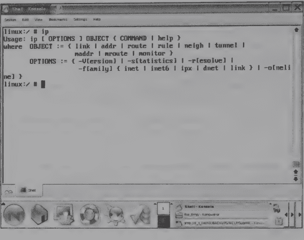

使用 `ip address` 命令可以查看当前配置，如图 11.9 所示。将图 11.9 显示的内容与图 11.1 所示的 `ifconfig` 命令输出进行对比，你会发现它们是相同的。

## 图 11.9

可以使用 `ip` 工具查看当前配置。

```
linux: # ip address
1: lo: LOOPBACK,UP mtu 16436 disc noqueue
   link/loopback 00:00:00:00:00:00 brd 00:00:00:00:00:00
   inet 127.0.0.1/8 scope host brd 127.255.255.255
   inet6 ::1/64 scope link
      valid_l forever preferred left
2: eth0:BROADCAST,MULTICAST,TRAILERS,UP mtu 1500 qdisc pfifo_fast qlen 1000
   link/ether 00:11:22:33:45:53 brd ff:ff:ff:ff:ff:ff
   inet 192.168.1.10/24 scope global brd 255.255.255.0
   inet6 fe80::fe39:59a4/64 scope link
      valid_l forever preferred left
3: sit0:<DISCARD> mtu 1500 qdisc noqueue
   link/ether 0.0.0.0 brd 0.0.0.0
```


# 网络基础第 11 章

将 `add` 替换为 `show` 即可向设置添加内容，而使用 `del` 则允许你删除现有设置。

`ip link show` 命令将显示每个以太网设备的硬件地址，如图 11.10 所示。

## 图 11.10

可以使用 `ip` 工具查看硬件地址。

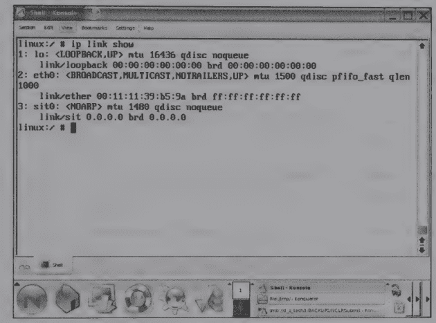

操作路由表请使用以下命令：

- `ip route show` 查看当前路由表
- `ip route add` 添加路由
- `ip route add default` 添加默认路由
- `ip route delete` 删除路由

> 隧道接口的形式为 `sitx`，其中 x 是数字（sit 是 Simple Internet Transition 的缩写）。sit0 被用作 IPv4 和 IPv6 之间的通用路由。

# 实验 11-1：验证你的主机信息

在本次练习中，你将检查主机的网络信息。

请完成以下步骤：

1. 以 root 身份登录。
2. 如果没有自动进入命令行窗口，请打开一个。
3. 检查当前网卡的配置：
   `ifconfig`
4. 查看当前主机名：
   `host`
5. 查看当前哪些服务可用或正在使用：
   `netstat -a`

# 实验 11-2：在 hosts 文件中创建条目

在本次练习中，你将在 `/etc/hosts` 文件中添加一个虚拟条目。

请完成以下步骤：

1. 以 root 身份登录。
2. 如果没有自动进入命令行窗口，请打开一个。
3. 切换到 `/etc` 目录：
   `cd /etc`
4. 在 hosts 文件末尾添加一行，为该机器指定等同于环回地址的别名：
   `cat >> hosts`
   `127.0.0.1 willpasstthisissam`
5. 向新别名发送五次 ping 以验证地址解析是否正常：
   `ping willpasstthisissam -c 5`

# 实验 11-3：识别正在运行的网络服务

在本次练习中，你将查看主机上运行着哪些服务。

请完成以下步骤：

1. 以 root 身份登录。
2. 如果没有自动进入命令行窗口，请打开一个。
3. 切换到 `/etc` 目录：
   `cd /etc`
4. 查看正在运行的服务的前几行：
   `netstat -a || more`
5. 查看本地地址（Local Address）列以查看正在运行的服务。某些服务以名称显示——例如“www.”。其他则以数字显示。这种翻译是由 `/etc/services` 文件中的条目完成的。
6. 选择一个以字母形式出现的条目，并验证它运行在哪个端口上。以下以 finger 为例：
   `grep finger services`
7. 从 netstat 输出中选择一个没有以字母形式显示的端口号，并验证它不在 `/etc/services` 文件中。以下示例使用了条目 6971：

返回的结果应该显示为：

```
grep finger services
6971
```

## 总结

`ip` 工具是配置网络接口的强大工具。本章重点讨论了如何使用 `ip` 命令查看和修改网络设置以及路由表。

| 命令 | 目的 |
| :--- | :--- |
| ip route show | 查看当前路由表 |
| ip route add | 添加路由 |
| ip route add default | 添加默认路由 |
| ip route delete | 删除路由 |
| ip address | 查看当前配置 |
| ip link show | 显示每个以太网设备的硬件地址 |

Novell 认证 Linux 专业学习指南

图 12.3

YaST2 在图形模式下的启动视图。

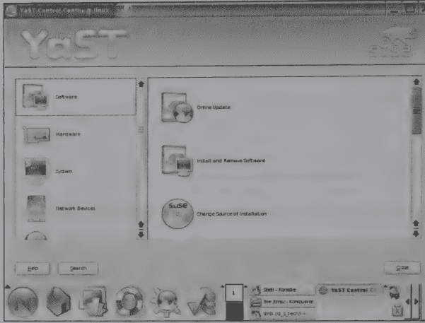

## 与用户交互

涵盖的课程目标

- 2. 使用 YaST2 管理用户账户 (3036)

在 YaST 中与用户交互时，首先从左侧框架中选择“安全与用户”（Security and Users）。这会在右侧框架中出现若干选项：

- CA 管理
- 编辑和创建组
- 编辑和创建用户
- 防火墙
- 导入常用服务器证书
- 安全设置
- VPN

选择“编辑和创建用户”（Edit and Create Users）选项，会出现与图 12.4 类似的屏幕。

## 与 YaST 操作

# 第 12 章

图 12.4

可以在“用户和组管理”模块中添加和修改用户及组。

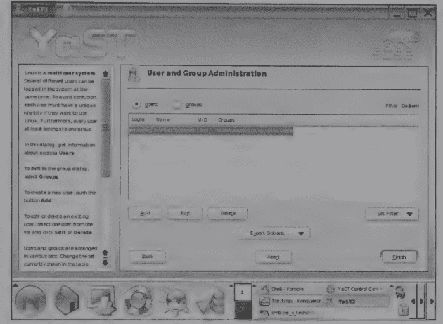

你也可以在命令行中输入 `vast2 users` 来启动加载了用户账户模块的 YaST。

从此菜单中，你可以添加、删除或编辑用户。“专家选项”（Expert Options）按钮用于设置适用于新创建账户的默认值，而“设置过滤器”（Set Filter）按钮允许你选择想要显示的内容——默认是本地用户，但你也可以选择系统用户或自定义显示。

要编辑用户，请点击“编辑”（Edit）按钮。会出现一个与图 12.5 类似的对话框。你可以更改该用户拥有的任何设置。

如果你点击“详情”（Details），可以查看并更改诸如用户 ID、主目录、shell 等等值。图 12.6 显示了“详情”设置中存在的变量。

Novell 认证 Linux 专业学习指南

图 12.5

“编辑”按钮可以更改为用户设置的任何参数。

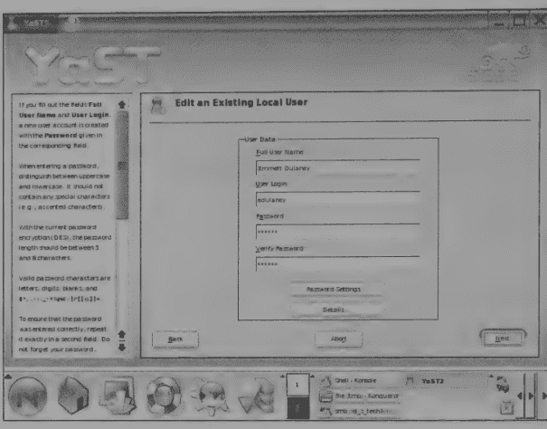

图 12.6

可以更改用户的所有值。

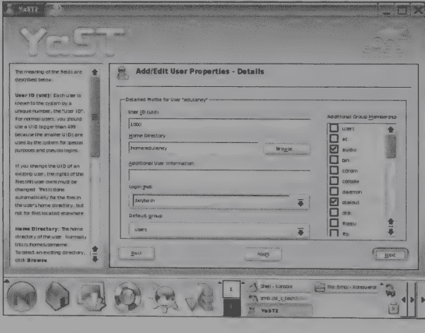

相反，点击图 12.5 所示的“密码设置”（Password Settings），允许你像图 12.7 所示设置密码过期和其他变量。

与 YaST 操作 第 12 章

图 12.7

可以显示并更改密码配置参数。

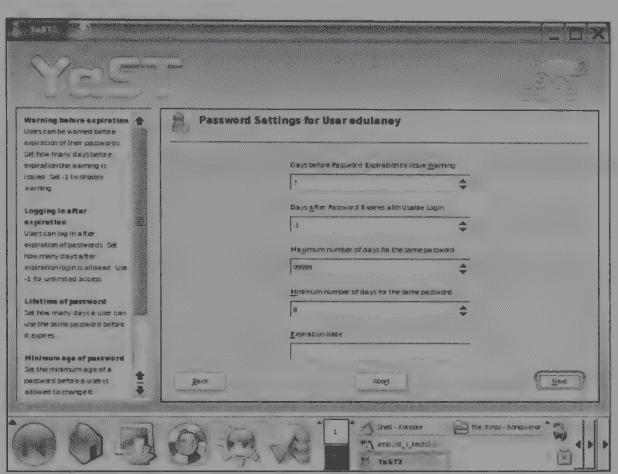

组的添加和编辑方式与用户相同。图 12.8 显示了组的主菜单，其中过滤了系统组并展开了“专家选项”。

图 12.8 你可以像处理用户一样添加、编辑和删除组。

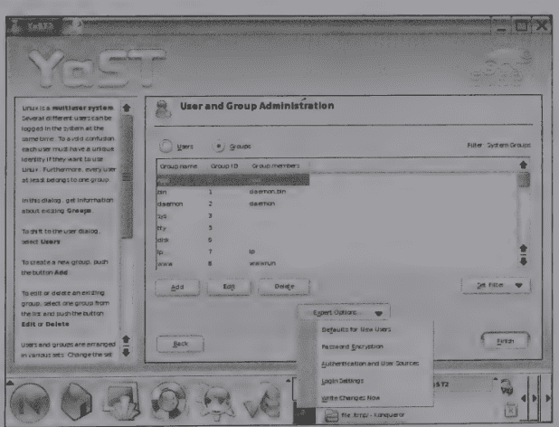

> 注意

你也可以在命令行中输入 `yast2 groups` 来启动加载了组账户模块的 YaST。

## 与软件交互

涵盖的课程目标

- 3. 理解 YaST2 软件管理功能 (3036)

当你在 YaST2 窗口打开的左侧框架中选择“软件”（Software）时，如图 12.3 所示，右侧会出现若干选项：


- 在线更新
- 安装和删除软件
- 更改安装源
- 安装到目录
- 补丁 CD 更新
- 系统更新
- UML 安装
- YOU 服务器配置

这些选项中的大多数是自言易懂的，你应该关注的重点目标是“安装和删除软件”（Install and Remove Software）。当你选择此选项时，会出现一个与图 12.9 类似的屏幕。

注意，“过滤器”（Filter）下拉菜单允许你选择想要查看的软件包。如果你选择“选择”（Selections）作为过滤器，你将只看到已安装的软件包。如果你选择“软件包组”（Package Groups），你将看到安装介质上的所有软件。如果你选择“搜索”（Search），你可以指定想在哪里查找另一个软件包。最后，如果你选择“安装摘要”（Installation Summary），你将看到所有标记了状态的软件包。

选择一个选项，显示将更改以反映这些软件包，如图 12.10 所示。

与 YaST 操作 第 12 章

图 12.9 你可以轻松添加和删除软件。

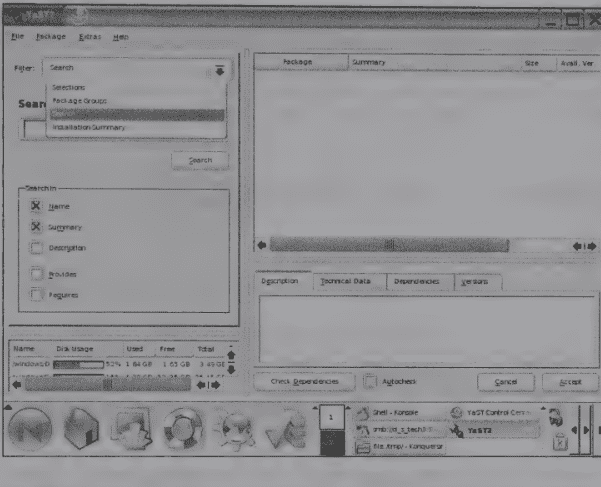

图 12.10 你可以看到安装了什么，并选择想要添加或删除的内容。

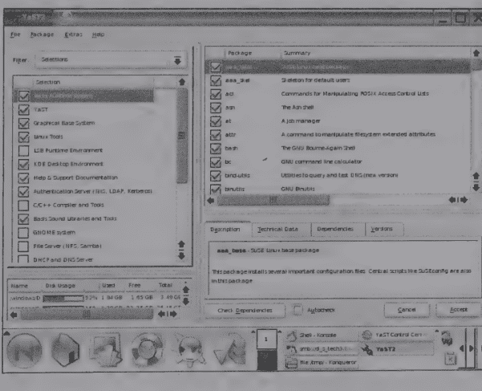

点击软件包直到出现你所需的操作，然后点击“接受”（Accept）按钮。根据需要，系统会提示你插入介质。

## 与硬件交互

涵盖的课程目标

- 4. 从 YaST 获取硬件配置 (3036)

YaST 工具提供了一个简单的硬件配置界面。只需在左侧框架中选择“硬件”（Hardware），然后在右侧选择你想要配置的对象。图 12.11 显示了硬件界面的打开。你可以通过 YaST 更改硬件设置。

图 12.11 可以更改硬件设置。

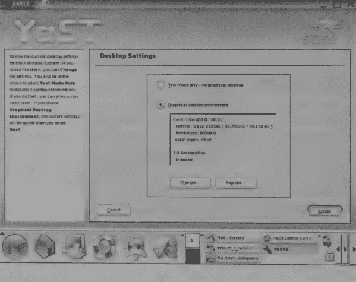

与 YaST 操作

第 12 章

图 12.12 硬件信息显示了当前设置。

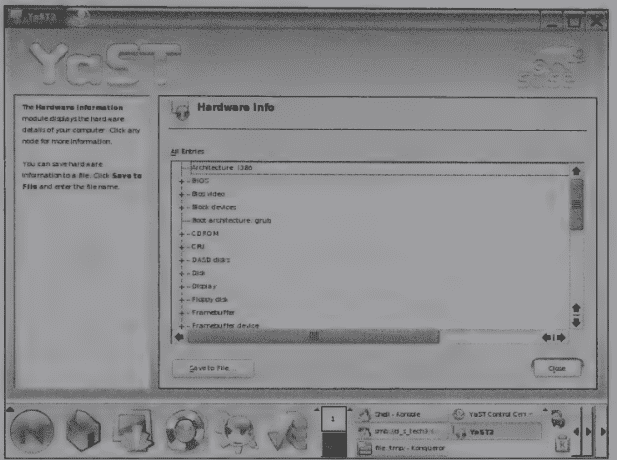

## 与网络交互

涵盖的课程目标

- 5. 从 YaST 管理网络配置 (3036)

要获取网络配置，首先在左侧框架中选择“网络”（Network）。右侧选项包括

- DSL
- 传真
- ISDN
- 调制解调器
- 网卡
- 电话拨号

Novell 认证 Linux 专业学习指南

图 12.13 当前网络设置。

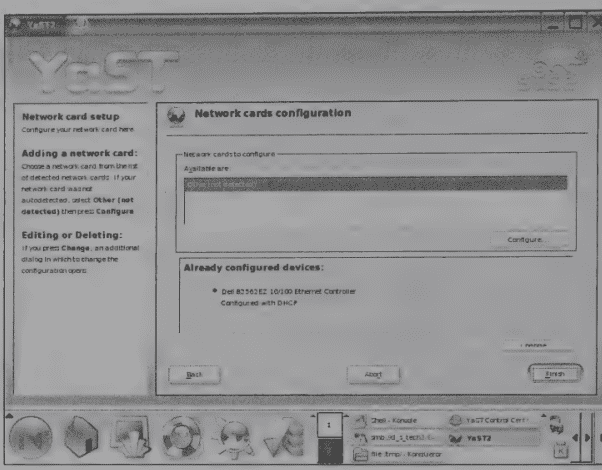

已配置的设备将出现在底部（更改/Change），新条目将添加到顶部（配置/Configure）。图 12.14 显示了手动配置。

图 12.14 手动添加网卡。

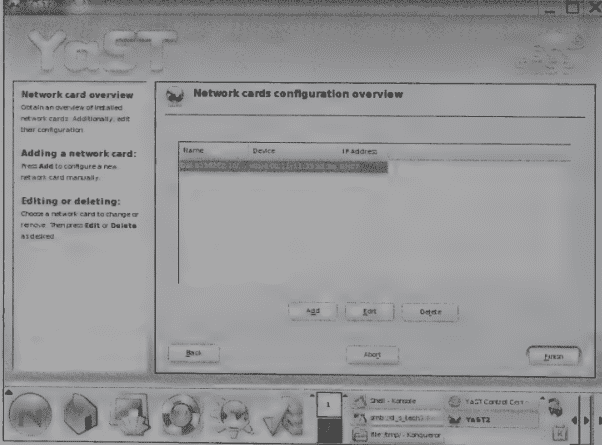

手动配置网卡时需要决定使用 DHCP 还是手动分配 IP 地址、子网掩码以及第 11 章讨论的其他值。

## 与 YOU 操作

涵盖的课程目标

- 6. 使用 YaST 更新服务器管理软件更新 (3037)

YaST 在线更新（YOU）服务器是网络的一大进步。它允许你创建一个存储发布给客户端更新的本地服务器。通过集中更新，你可以减少单独更新每台主机的需求和流量。在 YaST 左侧面板中选择“软件”（Software），并在右面板中选择“YOU 服务器配置”（YOU Server Configuration），开始配置 YOU 服务器。这将调出图 12.16 所示的显示。

Novell 认证 Linux 专业学习指南

> 注意
>
> 你也可以在命令行中输入 `yast2 you_server` 来启动加载了该模块的 YaST。

图 12.16

YOU 配置的启动屏幕。

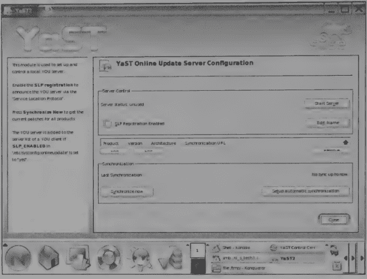

注意 YOU 服务器使用 SLP（服务定位协议）——必须启用才能正常工作。通过点击“启动服务器”（Start Server）启动服务器，服务器状态应更改以指示其正在运行。你可以点击“立即同步”（Synchronize Now）按钮获取所有产品的当前补丁。

> 注意
>
> 客户端只需进入 KDE 桌面选择 YaST 图标并输入 root 密码，然后在“软件”菜单中选择“在线更新”即可连接。或者，也可以在终端窗口输入 `su –` 并提供 root 密码，然后输入 `yast2 online_update`。建立连接后，你可以配置客户端并查看有关更新的信息。

## 远程管理

所涵盖的课程目标

- 7. 使用 YaST 启用远程管理 (3037)

当你点击 YaST 左侧面板中的“网络服务”选项时，右侧会出现许多选项。其中就有一个“远程管理”选项，如图 12.17 所示。

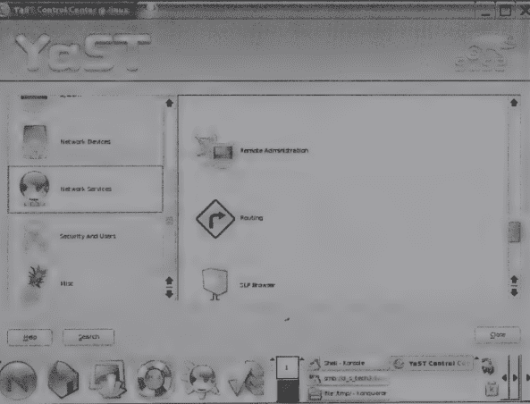

这里的选项非常简单——要么允许远程管理，要么不允许（默认设置）。这两个选项如图 12.18 所示。

> **注意：** 你也可以通过在命令行输入 `yast remote` 来启动加载了该模块的 YaST。

在选择启用远程管理后，必须重启显示管理器。现在可以访问并远程管理该服务器了。

## Novell 认证 Linux 专业人员学习指南

### 图 12.18

点击“允许远程管理”单选按钮以启用远程管理。

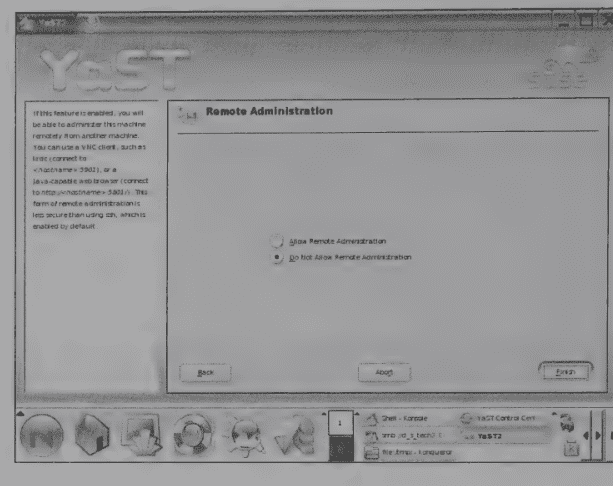

要进行远程管理，请在浏览器中输入以下（将 host 替换为服务器的 IP 地址）：`http://host:5081`

一个虚拟网络会话（VNS）窗口将打开，并会提示你输入用户名和密码。在这些项目的提示处，你可以转而点击“管理”按钮，此时 YaST 将启动（需要你输入 root 密码）。

# 注意

如果需要重启 X 会话，使用 `rxadm restart` 命令即可为你解决问题。

## 使用安全设置

所涵盖的课程目标

- 8. 使用 YaST 配置安全设置 (3038)

正如 YaST 可用于所有其他配置方面一样，它也可以为你的安全设置提供界面。要进入此模块，请在左侧面板选择“安全与用户”，并在右侧面板选择“安全设置”。将显示如图 12.19 所示的模块。

## 使用 YaST

### 图 12.19

YaST 内部的安全设置。

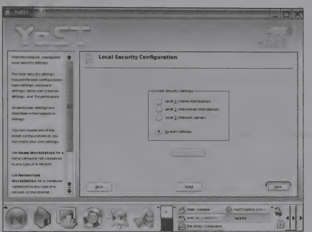

此菜单上出现的四个设置是：

- 等级 1（家庭工作站）——这是你可以应用的最低安全级别，不应在业务环境中使用。
- 等级 2（网络工作站）——这是中等安全级别，应被视为业务的最低设置。
- 等级 3（网络服务器）——推荐服务器的高安全级别。
- 自定义设置——默认设置。

你可以选择任何预定义的规则并点击“详细信息”来微调任何单独设置。或者，你可以保持“自定义设置”的默认值，然后点击“下一步”查看所有可用选项。第一个屏幕允许你设置密码设置，下一个屏幕（如图 12.20 所示）显示启动设置。

在启动设置之后，你将配置登录设置，然后影响新添加用户和组的参数。最后，杂项设置允许你配置运行 `updatedb` 的用户（可以是 nobody 或 root）以及文件权限设置。你可以从三个可能的权限权限设置中选择：

- 简单（Easy）——用户可以读取大多数配置文件。
- 安全（Secure）——只有 root 可以读取如 `/var/log/messages` 这样的系统文件。
- 偏执（Paranoid）——访问权限限制最严格。

### 图 12.20

配置默认启动设置。

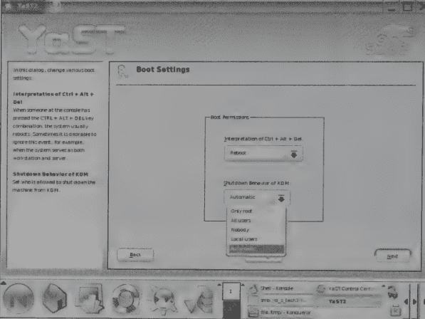

你可以通过进入 `/etc` 并查看 `permissions.easy`、`permissions.secure` 和 `permissions.paranoid` 来查看这些每个层级的单独设置。每个文件大约有 850 行。

## 总结

本章重点介绍了 Linux 的图形化界面，并研究了 YaST（另一个设置工具）如何让 SuSE 从其他产品中脱颖而出。使用此工具，你可以执行大多数管理功能，而无需为了完成任务而费力记忆命令行。

## 第 13 章

## 其他需要了解条目

与大多数认证考试一样，课程中为了应对此考试而准备的某些主题无法很好地归入某个大类。其中一些只是了解有用的次要话题，另一些则足够重要，以至于心理测量专家认为你熟悉它们。无论其背景或存在原因如何，本章代表了主题的汇锦，涵盖了以下课程目标：

1. 访问和使用 man Pages (3036)
2. 使用 info 页面 (3036)
3. 访问发行说明和白皮书 (3036)
4. 在 Linux 系统中使用基于 GUI 的帮助 (3036)
5. 在网上查找帮助 (3036)
6. 在 Linux 上查找文件 (3036)
7. 计划作业 (3037)
8. 使用 cron 自动备份数据备份 (3038)
9. 理解 C 语言编程基础 (3038)
10. 理解 GNU 工具链 (Build Tool Chain)(3038)
11. 理解共享库的概念 (3038)
12. 执行标准构建 (3038)
13. 监控操作系统 (3038)
14. 监控文件系统 (3038)

## 使用文档

涵盖的课程目标

- 1. 访问和使用 man Pages (3036)
- 2. 使用 info 页面 (3036)
- 3. 访问发行说明和白皮书 (3036)
- 4. 在 Linux 系统中使用基于 GUI 的帮助 (3036)
- 5. 在网上查找帮助 (3036)

在所有实现中都有许多方法可以查找帮助。此外，许多供应商会添加自己的文档。例如，如果你输入 man（即 manual），它将使用 PAGER 变量显示。

## nice

名称 NICE(1)

用法

`nice [OPTION][COMMAND...]`

描述

以调整后的优先级运行程序。如果没有 COMMAND，则打印当前优先级。默认范围从 -20（最高优先级）到 19（最低）。

```
-n, --adjustment=ADJUST 调整优先级
```

```
--help 显示帮助并退出
--version 输出版本信息并退出
```

作者

由 David Mackenzie 编写。

报告缺陷

向 `<bug-coreutils@gnu.org>` 报告缺陷。

版权

© 2004 Free Software Foundation, Inc.

这是免费软件；请查看复制条件。不提供任何保证，即使对于可用性或特定用途。

参见

nice 的完整文档作为 Texinfo 手册维护。如果 info 和 nice 程序在你的站点正确安装，命令 `info coreutils nice` 将让你访问完整手册。

nice 5.2.1 2004 NICE(1)

nice 工具非常简单，且没有无限多的选项，因此是分析 man 输出示例的良好选择。使用 more 或 less 工具显示页面（取决于 PAGER 变量的定义），在第一个屏幕出现后，你可以通过多种方式浏览文档，如表 13.2 所示。

## 表 13.2 使用 more 和 less 工具导航

| 组合键 | 移动操作 |
| :--- | :--- |
| Enter | 向下滚动一行 |
| Spacebar | 向下翻页 |
| b | 向上到上一页 |
| q | 退出 |
| / | 正向查找包含指定文本的页面 |
| ? | 反向查找包含指定文本的页面 |
| N | 搜索后下一个字符串匹配项 |
| Shift+N | 搜索后上一个字符串匹配项 |

## 表 13.2 续

| 键位组合 | 动作 |
|---|---|
| PageUp | 向上滚动半屏 |
| End | 移动到页面末尾 |
| Home | 移动到页面开头 |

让我们查看实际显示的内容：第 1 行给出了工具的名称，括号中标识了文档的来源。在这种情况下，`1` 表示该文档是针对找到并显示的 shell 实用程序或用户命令。如果还有其他名为 "nice" 的实体的文档，它们将不会被显示，因为默认操作是只显示找到的第一个。

要查看系统上是否存在具有同名的多组文档，你可以使用 `whatis` 命令：

```
$ whatis nice
nice (1) - 运行具有修改调度优先级的程序
ice - 更改进程优先级
nice (1p) - 调用更改了 nice 值的工具
nice (3p) - 更改进程的 nice 值
$
```

在这种情况下，事实证明在 **man2** 下以及 **1p** 和 **3p** 下，确实 还有另一组关于 **nice** 的文档。显示的列表来自 **whatis** 数据库。要查看第二组文档而不是第一组，命令应该是：

```
man 2 nice
```

此命令指定你想要来自 **man2** 目录的 **nice** 文档（3 代表 **man3**，4 代表 **man4**，依此类推）。

帮助页文件的其他行分别开始了 Name（名称）、Synopsis（摘要）、Description（描述）、Options（选项）部分：根据工具的复杂程度和其他功能，还可以 See Also（相关）、Diagnostics（诊断）、Files（文件）、Bugs（缺陷）以及 History（历史）和 Author（作者）部分。

第三行本身是该工具功能的简短摘要，并与 `whatis` 工具返回的行匹配。其他行描述了可以使用的选项，并详细说明了每个选项的工作原理。

## Novell 认证 Linux 专业人员学习指南

配合 `man` 使用的各种选项（可以通过 `man man` 命令确认）包括：

- `-a` 显示所有匹配给定文本的页面，且不在找到第一个后退出（匹配项不是通过 whatis 数据库查找，而是通过检查子目录查找）。
- `-k` 显示所有同名的手册页（在 whatis 数据库中找到），并且在显示第一个后不停止。这与 `-K` 的区别在于，前者搜索整个页面，而 `-k` 仅搜索头部。
- `-M` 指定要检查的路径（而不是 `/usr/man` 下的所有子目录）。
- `-P` 指定使用不同的分页器。SLES 9 中的默认值是 less，但可以使用此选项更改它。你指定的任何内容将覆盖 `$PAGER` 变量的设置。

# 使用 --help

如 `nice` 的手册页所示，对于许多工具/命令，你可以在工具名称后加上 `--help`。这将为工具提供非常有用的在线帮助，仅显示语法，例如：

```
$ nice --help
Usage: nice [OPTION]... [COMMAND [ARG]]
以调整后的调度优先级运行 COMMAND。
如果没有 COMMAND，则打印当前的调度优先级。ADJUST
- 默认为 0。范围从 -20（最高优先级）到 19
-（最低优先级）。

-ADJUST 首先通过 ADJUST 增加优先级
-n, --adjustment=ADJUST 等于 -ADJUST
--help 显示此帮助并退出
-version 输出版本信息并退出
```

向 `<bug-coreutils.gnu.org>` 报告缺陷

这是仅包含部分手册内容的简略版本（仅语法）。帮助信息是否以此方式存在取决于创建工具的程序员。大多数较新的 (GNU) 工具/命令都包含 `--help` 选项，但这远非标准配置，在旧工具中很罕见，在应用程序中也很少提供。

# 获取信息

可以使用 `info` 工具显示 GNU 工具的文档。

语法格式为：

```
info
```

或

```
info {utility name}
```

如果调用工具时后面没有跟工具名称，它将显示一个类似于图 13.1 所示的主菜单屏幕。

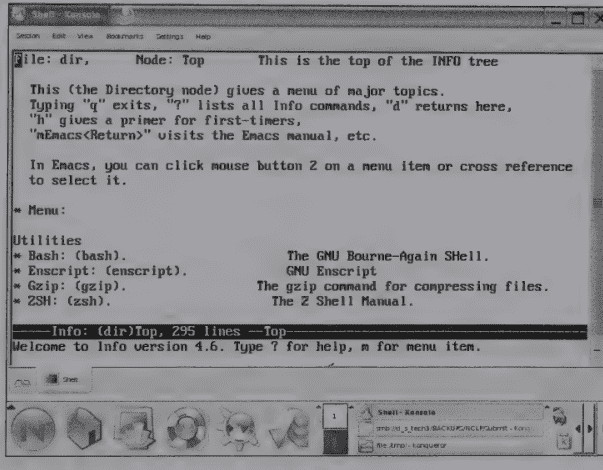

图 13.1

info 菜单的开启。

如显示所示，你实际上查看的是一个名为 dir 的文件的顶部（头部）。该文件包含了 info 命令可作用的所有工具列表，并分为若干部分（杂项、GNU 文件工具、编程语言等）。每个星号后面都是该项目名称，在每组括号内是你想查看该项目条目时需要输入的文本。例如，要查看 Bash 的 info，在命令行中输入：

```
$ info bash
```

在菜单中，你还可以按 "m" 调出菜单提示符，然后输入快捷键字符串（在这种情况下为 "bash"）。第一个屏幕列出了在工具内导航需要知道的命令（h、d 等）及其功能。使用向下箭头可以逐行滚动列表，回车键选择该条目并显示其相关信息。文件是超文本格式的，因此通常情况下，选择一个项目会带你进入另一个菜单。

为了说明，你可以使用向下箭头滚动列表到这一行：

- * Gzip:(gzip)。用于压缩文件的 Gzip 命令。

当你按下回车时，会出现针对 gzip 的选项菜单，如图 13.2 所示。

图 13.2

gzip 的 info 显示。

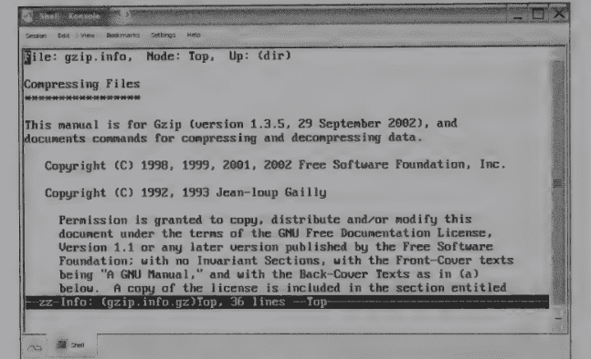

在这里，你可以选择并阅读尝试实现的信息。按 q 将退出，按 d 将带你返回主菜单。

注意每个选择后面的两个空列。这是 gzip 子菜单。这意味着你可以输入 info 后跟任何快捷文本到达该位置。除了主菜单，很少可以使用快捷文本。

# 第 13 章

在 info 中工作的其他键位组合总结在表 13.3 中。正如手册文件位于 `/usr/share/man`，info 文件位于 `/usr/share/info`。

# 在 info 中导航

| 键位组合 | 动作 |
|---|---|
| Spacebar, PageDown | 向下翻页 |
| Backspace, PageUp | 向上翻页 |
| q | 退出 |
| B | 将光标置到信息页开头 |
| E | 将光标置到信息页末尾 |
| Tab | 移动到下一个引用 |
| Enter | 移动到当前引用（选择） |


| 键 | 功能 |
| --- | --- |
| N | 移动到下一页 |
| P | 移动到上一页 |
| U | 向上一级 |
| L | 移动到最后文本 |
| S | 搜索 |
| H | 帮助 |
| ? | 显示命令摘要 |

# 其他本地文档

其他可以找到信息的地方，以及在该范围内功能有限的其他工具。需要注意的两个工具是：

- `whereis`
- `apropos`

`whereis` 工具将列出关于位置的所有信息，包括 man 文（如果有）。例如：

```
$ whereis nice
nice: /usr/bin/nice /usr/share/man/man1/nice.gz
```

搜索限于特定的目录。在这种情况下，第一个列表是二进制本身，另外两个是 man 条目。如果没有 man 文，那里将不会显示；如果有源文件或相关文件，它们将被显示。例如：

```
$ whereis info
info: /usr/bin/info /usr/share/info
```

其他本地查找白皮书和发布说明等文档的地方。目录包含多个子目录，你需要了解的关键是：

- `how`——该目录包含有关如何执行任务的子目录。

## 其他需要了解的项目

### 第 13 章

- `manual`（手册）——包含 SLES 管理手册，通常以 PDF 和 HTML 格式提供。
- `packages`（软件包）——软件包文档位于此处的子目录中。
- `release-notes`（发布说明）——包含发布说明的 HTML 和 RTF 版本。

还存在取决于已安装的供应商应用程序的其他本地文档。请始终先查看 `packages` 目录，查看相关信息是否在其中。在许多应用程序中，你也可以按 `F1` 获取帮助。

SuSE 包含一个帮助中心（HelpCenter），也可获取图形界面的帮助。这可以通过桌面上的救生图标（在 KDE 面板中）指示。点击该图标将显示图 13.3 所示的帮助中心屏幕。

**图 13.3**  
SuSE 帮助中心提供常见问题的帮助。

你可以使用搜索功能查找信息，或者点击“目录”（Contents）或“术表”（Glossary）查找你要的内容。

在 KDE 浏览器中，你也可以通过 HTML 链接使用帮助功能。例如，要阅读 `nice` 的 man 页面，请输入以下地址：

`man:nice`

这将显示图 13.4 所示的内容。

**图 13.4**  
你可以通过浏览器访问相同的帮助功能。

## 查找远程资源

### 涵盖课程目标

- 5. 在网络上查找帮助 (3036)

除了本地资源外，网上还有许多其他资源。这些资源可以分为两类：网站和新闻组。前者提供静态信息，这些信息可能每天或不定期更新，但允许你在不进行任何特定交互的情况下获取信息。另一方面，新闻组是由决定参与的个人之间持续的通信线程组成的。你可以在新闻组中发布针对你情况的问题，并（希望）得到一个或多个试图帮助你的知识丰富的人士的回答。你永远不会在新闻组发布一个可以在其他地方找到答案的常见问题。

## Linux 或工具导向资源

### 表 13.4

| 类别 | 站点 | 描述 |
| --- | --- | --- |
| 文档 | www.kde.org | KDE 界面背后的组织 |
| 文档 | www.tldp.org | Linux 文档项目 (LDP)——查找 HOWTO 信息的无价宝 |
| 文档 | www.linuxlookup.com | LinuxLookup——HOWTO 和评论 |
| 内核 | www.kernel.org | 所有与内核相关的事务 |
| 新闻 | www.linux.com | Linux.com |
| 新闻 | www.linux.org | Linux Online |
| 新闻 | www.linuxplanet.com | LinuxPlanet |
| 安全 | www.cert.org | 漏洞/病毒跟踪 |
| 安全 | www.securityfocus.com | 安全问题 |
| 供应商 | www.suse.com | SuSE |

即使该站点属于软件供应商，或者是你正在运行的 Linux 之外的其他版本，你也不应该忽略检查该站点。其简单的原因是，许多 Linux 站点在推广其产品之外，还会发布通用操作系统的常见问题解答（FAQs）和帮助文件。

以下新闻组对于解决你可能遇到的特定问题可能无价之宝。新闻组的妙之处在于，大多数时候它们的名称是自俗易懂的，可以防止你在错误的位置发布问题：

- `comp.os.linux.advocacy`
- `comp.os.linux.announce.html`
- `comp.os.linux.answers`
- `comp.os.linux.development.apps`
- `comp.os.linux.development.system`
- `comp.os.linux.hardware`
- `comp.os.linux.misc`
- `comp.os.linux.networking`
- `comp.os.linux.setup`
- `comp.os.linux.x`

你还可以订阅 Linux 邮件列表以查看特定主题的线程。如需订阅，请向 `majordomo@vger.rutgers.edu` 发送邮件，主题为“subscribe”，并从下列表中邮件列表名称。再次，名称是自俗易懂的：

- `linux-admin`
- `linux-alpha`
- `linux-apps`
- `linux-c-programming`
- `linux-config`
- `linux-doc`
- `linux-kernel`
- `linux-laptop`
- `linx-newbie`
- `linx-sound`
- `linux-standards`

## 使用 KFind

### 涵盖课程目标

- 6. 在 Linux 上查找文件 (3036)

第 4 章“处理文件”介绍了一些可以用于在系统中查找文件的工具。除此之外，我们已经检查了 `whereis`——这是最实用的工具之一。还有一个工具值得关注，它可以帮助你找到你想要的内容：**KFind**。KFind 是 `find` 的图形化版本。你可以通过 KDE 菜单启动它。

## Novell 认证 Linux 专业学习指南

```
GPG_AGENT_INFO=/tmp/gpg-vNNZn/S.gpg-agent:6965:1; export GPG_AGENT_INFO
HOST=linux; export HOST
PROFILEEREAD=true; export HISTSIZE
HISTSIZE=1000; export HISTSIZE
XDM_MANAGED=/var/run/xdmctl/xdmctl=:0,rsvd,method=classic; export XDM_MANAGED
STYLE=keramik; export STYLE
GTK2_RC_FILES=/etc/opt/gnome/gtk-2.0/gtkrc:/root/opt/gnome/share/themes/Keramik/gtk-2.0/gtkrc:/root/.gtkrc-2.keramik:/root/.kde/share/config/gtkrc; export GTK2_RC_FILES
GTK_RC_FILES=/etc/opt/gnome/gtkrc:/opt/gnome/share/themes/Keramik/gtkrc:/.gtkrc-keramik=/root/.kde/share/config/gtkrc; export GTK_RC_FILES
WINDOWID=46137351; export WINDOWID
KDEHOME=/root/.kde; export KDEHOME
QTDIR=/usr/lib/qt3; export QTDIR
XSESSION_IS_UP=yes; export XSESSION_IS_UP
KDE_FULL_SESSION=/usr/lib/java/jre; export KDE_FULL_SESSION
JRE_HOME=root; export USER
XCURSOR_SIZE=; export XCURSOR_SIZE
LS_COLORS=no;fi=00;d1=01;34n=00;36pi=01;33:so=01;35:do=01;35:bd=40|:31;31;cd=40;31;01:or=40;31;ex=00;32=*.cmd=02;32=*.exe=02;32=*.bat=01;32=*.btm=01;32=*.dll=01;32=*.tar=00;31=*.31-tbz=00;31;-.tgz=00;31=*.rpm=00;31=*.deb=01;31=*.ajr=00;31=*.taz=00;31;*.lh=00;31;*.zip=00;31=*.zoo=00;31=*.z=00;31=Z=00;31=*.gz=00;31;*.bz2=00;31;*.tb2=00;31=*.tz2=00;31=*.tbz2=00;31=*.avi=01;35=*-bmp=01;35;*.file=01;35=*.gif=01;35=*.jpg=01;35=*.jpeg=01;35=*.mng=01;*.mov=01;35=*.mpg=01;35=*.pcx=01;35=*.pbm=01;35=*.pgm=01;35=*.png=01;35;*.ppm=01;35=*.tga=01;35=*.tif=01;35=*.xbm=01;35=*.xpm=01;*.dl=01;35=*.gl=01;32=*.aiff=00;32=*.au=00;32=*.mid=00;32=*.mp=00=00;*.ogg=00;32=*.voc=00;32=*.wav=00; export LS_COLORS
OPENHOME=/usr/openwin; export OPENHOME
```

# 其他需要了解的项目

# 第 13 章

```
XNLPATH=/usr/X11R/lib/X11/nls; export XNLPATH
HOSTYPE=i386; export HOSTYPE
KDEROOTHOME=/root/.kde; export KDEROOTHOME
SESSION_MANAGER=local:linux:/tmp/.ICE-unix:7018; export SESSION_MANAGER
PAGER=less; export PAGER
LD_HWACAP_MASK=0x20000000; export LD_HWACAP_MASK
CONSOLE_DCOP=$DCOPRef(console-7o53,console); export CONSOLE_DCOP
MINICOM=-c on; export MINICOM
DESKTOP_SESSION=custom; export DESKTOP_SESSION
PATH=/sbin:/usr/bin:/usr/local/sbin:/root/usr/local/bin:/usr/bin:/usr/X11R6/bin:/usr/games:/opt/gnome/bin:/opt/kde3/bin:/usr/lib/java/bin; export PATH
CPU=i686; export CPU
JAVA_BINDIR=/usr/lib/java/jre; export JAVA_BINDIR
CONSOLE_DCOP_SESSION=$DCOPRef(console-7o53,session-1); export CONSOLE_DCOP_SESSION
INPUTRC=/etc/inputrc; export INPUTRC
PWD=; export PWD
XMODIFIERS=@local
JAVA_HOME=/usr/lib/java/jre; export JAVA_HOME
TEXTUTILS=./root:/usr/share/doc:/root:/usr/share/doc; export TEXTUTILS
SHLVL=2; export SHLVL
HOME=/root; export HOME
ADVANCEDPREPROCESS=no; export ADVANCEDPREPROCESS
OSTYPE=linux; export OSTYPE
LS_OPTIONS=-a -N -color=tty; export LS_OPTIONS
no_proxy=localhost; export no_proxy
CURSOR_THEME=crystalwhite; export CURSOR_THEME
WINDOWMANAGER=/usr/X11R6/bin/kde; export WINDOWMANAGER
GTK_PATH=/usr/local/lib/gtk-2.0:/opt/gnome/bin/gtk-2.0:/usr/lib/gtk-2.0; export GTK_PATH
LESS=-M -I; export LESS
MACHYPE=use-linux; export MACHYPE
LOGNAME=root; export LOGNAME
LC_TYPE=en_US.UTF8; export LC_TYPE
PKG_CONFIG_PATH=/opt/gnome/lib/pkgconfig; export PKG_CONFIG_PATH
LESSOPEN=less.sh; export LESSOPEN
USE_FAM=; export USE_FAM
ACLOCAL_PATH=/opt/gnome/share/local; export ACLOC_PATH
INFOPATH=/usr/local/info:/usr/share/info; export INFOPATH
LESSCLOSE=close.sh; export LESSCLOSE
GBROKEN_FILAMES=1; export GBROKEN_FILAMES
JAVA_ROOT=/usr/lib/java; export JAVA_ROOT
COLTERM=; export COLTERM
OLDPWD=/usr/share/zoneinfo; export OLDPWD
```

# Novell 认证 Linux 学习指南

```
cd /etc || {
    echo '执行目录不可访问' >&2
    exit 1
}

/home/edulaney/myexample
```

这一切都是为了运行单行命令——注意这里放置了用户的相关信息：用户 ID、环境变量等。最后一行是要运行的命令：始终建议提供完整路径，因为如果没有完整路径，服务将没有执行权限。

`at` 命令还有几个其他选项：

- `-m` 在任务完成后给用户发送邮件
- `-f` 将行输入到文件中

还有一个名为 `batch` 的命令别名。`batch` 工具的作用原理完全相同，只是它只在系统利用率低时运行。

`at` 命令是值得重复的——它们适用于运行一次性任务。如果你必须每天安排几十个任务且这些任务是相同的，这样做将非常耗时，因为它们在完成后没有追踪。如果你需要运行任务超过一次，你应该避免 `at` 命令并研究 `cron` 的用法。

# 使用 cron

如所述，`cron` 用于按间隔运行命令，该间隔可以是任何类型。通过 `cron`，系统会读取一个名为 `crontab`（如 cron 表格）的文件来查找何时必须运行什么。默认情况下，每个用户都有自己的 `crontab` 文件。但是，如果存在 `/etc/cron.allow` 或 `/etc/cron.deny` 文件，默认设置就会改变。在 `cron.allow` 文件中，只有其中的用户可以创建 `crontab` 文件。在 `cron.deny` 文件中，文件中列出的用户之外的用户都可以使用 `crontabs`。这两个文件是可选的且互斥。你永远不会在同一个系统中拥有这两个文件。

要查看当前的 `crontab` 文件，用户使用此命令：

`crontab -l`

要删除它，使用 `-r` 选项：

`crontab -r`

要编辑它，使用 `-e` 选项：

`crontab -e`

root 用户要查看其他用户（例如 larry）的文件：

`crontab -u larry -l`

文件中每行有一个目，每行由六个字段组成。这六个字段用空格分隔。当你第一次查看这样的文件时，它看起来像像乱码。要理解你看到的内容，请记住有六个字段：

1. 分钟 (0–59)
2. 小时 (0–23)
3. 日 (1–31)
4. 月 (1–12)
5. 周 (0=星期日，6=星期六)
6. 要运行的命令

这是一个示例：

```
$ pwd
/home/edulaney

$ cat example
logger 每五分钟运行一次

$ crontab -l
no crontab for edulaney

$ crontab -e
```

这会在编辑器中打开一个空白文件。

```
5 * * * * /home/edulaney/example
```


> 注意：退出编辑器。

这设置了 shell 脚本（它向 `/var/log/messages` 写入一条记录）每五分钟运行一次，无论小时 (`*`)、日期 (`*`)、月份 (`*`) 或星期 (`*`) 是什么。

# 表格 13.5 cron 条目示例

| 1 12 * * * | 每年的每天 12:01 |
| 15 18 * * * | 每月第一日的傍晚 6:15 |
| 1,16,31,46 * * * | 每 15 分钟一次 |
| 30 0 * * * | 上午和下午 12:30 |
| 20 10 31 10 * | 仅在 10 月 31 日的 10:20 |
| 1 * * 1-5 | 周一至周五每天早上 6:01 |

由 `init` 启动的 `cron` 守护进程每分钟醒来一次，查找要执行的任务。任务存储在队列 (`/var/spool/cron`) 中，来自用户的 `crontab` 或 `/etc/crontab`。在大多数系统中，`at` 任务由 `at` 守护进程 (`at`) 执行；在其他系统中，`atrun` 由 `cron` 守护进程定期启动以查找 `at` 任务。

# 编程 101

涵盖的课程目标

- 9. 理解 C 语言编程基础 (3038)
- 10. 理解 GNU 构建工具链 (3038)
- 11. 理解共享库的概念 (3038)
- 12. 执行标准构建过程 (3038)

不要被本节的目标所误导或吓到你。此考试针对的是系统管理员，而不是开发者或程序员。同时，Novell（诺瓦）希望你了解一些开发过程，以便你进行有效沟通，而这正是这四个目标发挥作用的地方。

你需要知道，Linux 与 Unix 不同，它主要用 C 或 C++ 编写，这两种都是编译型语言。这意味着应用程序在运行之前必须经过编译——这与第 6 章“Shell、脚本、编程与编译”中讨论的脚本不同。编译型语言的优点是执行速度快，并且可以创建驱动等扩展。Linux 使用的 C 编译器是 `gcc`——即 C 编译器；SuSE 以及其他 Linux 实现中默认都安装了 `gcc`。

GNU 构建过程包含以下步骤：

- 1. 使用 `configure` 实用准备构建。这本质上是开始构建配置的启动文件。
- 2. 使用 `make` 实用创建（编译）源代码。根据软件包的大小，这可能需要几秒钟到很长一段时间不等。
- 3. 使用 `make install` 实际安装编译后的程序。运行该命令会将所有包组件安装到它们的默认目录。
- 4. 安装所需的软件包。

强烈建议你阅读 `configure` 和 `make` 的 man pages（帮助文档），以熟悉它们的基本功能。

请记住，一个 Linux 发行版（任何 Linux 发行版）拥有数百个包文件。一个包文件可以包含从一个程序文件到数百上万个文件。

## Novell 认证 Linux 专业学习指南

共享库的使用是为了执行常用函数的应用程序不需要将这些功能嵌入到每个自身。共享库由共享对象（shared object）和一个头文件组成。

将所有内容整合在一起，以下是 **penguins** 游戏标准构建过程的步骤：

- 1. 提取源码包：`tar xzf penguins-2.2.tar.gz`
- 2. 进入源码目录：`cd penguins-2.2/`
- 3. 运行配置脚本：`./configure`
- 4. 开始编译：`make`
- 5. 安装程序：`make install`

尽管有些冗余，但值得再次指出，管理员并不期望你成为一名程序员。你不需要知道编写 C 语言代码。然而，你需要知道这里给出的标准构建过程步骤。

# 监控 SLES

涵盖的课程目标

- 13. 监控操作系统 (3038)
- 14. 监控文件系统 (3038)

当一切都按预期运行时，挑战就变成了如何掌控全局并在潜在问题变成真实问题之前主动发现并响应。这是通过监控实现的，要监控的两个关键元素是操作系统和文件系统。

第 5 章“基础 Linux 管理”讨论了配置系统日志和 **syslog** 守护进程。请记住该进程是通过 `/etc/syslog.conf` 文件配置的，并记住如何使用 **logrotate** 命令。第 5 章中未提到但值得了解的是 **lspci** 工具。该工具将列出所有通过 PCI 总线连接的设备。

# 第 13 章需要了解的其他项目

以下是该命令的输出示例：

```
# lspci

0000:00.00 Host bridge: Intel Corp. 82865G/PE/P DRAM
➡Controller/Host-Hub Interface (rev 02)

0000:00.02 VGA compatible controller: Intel Corp. 82865G
➡Integrated Graphics Device (rev 02)

0000:00.1d USB Controller: Intel Corp. 82801EB/ER
➡(ICH5/ICH5R) USB HCI #1 (rev 02)

0000:00.1d USB Controller: Intel Corp. 82801EB/ER
➡(ICH5/ICH5R) USB HCI #2 (rev 02)

0000:00.1d USB Controller: Intel Corp. 82801EB/ER
➡(ICH5/ICH5R) USB HCI #3 (rev 02)

0000:00.1d USB Controller: Intel Corp. 82801EB/ER
➡(ICH5/ICH5R) USB HCI #4 (rev 02)

0000:00.1d USB Controller: Intel Corp. 82801EB/ER
➡(ICH5/ICH5R) USB2 EHI Controller (rev 02)

0000:01.e0 PCI bridge: Intel Corp. 82801BA/CA/DB/EB/ER Hub
➡interface to PCI Bridge (rev 02)

0000:01.f0 ISA bridge: Intel Corp. 82801EB/ER (ICH5/ICH5R)
➡LPC Bridge (rev 02)

0000:01.f1 IDE interface: Intel Corp. 82801EB/ER (ICH5/ICH5R)
➡Ultra 100 Storage Controller (rev 02)

0000:01.f2 IDE interface: Intel Corp. 82801EB (ICH5)
➡ATA 150 Storage Controller (rev 02)

0000:01.f3 SMBus: Intel Corp. 82801EB/ER (ICH5/ICH5R)
➡Controller (rev 02)

0000:01.010 Multimedia controller: Creative Labs
➡Audgy

0000:01.08 Ethernet controller: Intel Corp. 82562/100
➡Ethernet Controller (rev 02)
```

另一个实用的工具是 **saga**，代表系统信息收集。该工具将读取某些工具的配置和诊断输出并将结果保存到两个文件中：`/tmp/saga.txt` 和 `/tmp/saga.html`。完成后会自动打开 html 文件（见图 13.7），但你也可以以任何想要的方式查看文本。

52 Novell 认证 Linux 专业学习指南

### 图 13.7
saga 的结果可能非常大——超过 9000 行——但可以作为当前发生情况的良好基准。

要监控文件系统，你应该了解三个工具：

- **free** 工具在第 8 章“文件系统”中讨论过。
- **lsof**——用于打开文件。
- **fuser**——可监控访问文件的用户。

如果你给 `lsof` 命令本身带有任何参数，它将显示与该进程相关的所有文件。例如，图 13.8 显示了与 root 用户相关的文件。

`fuser` 工具的作用与 `lsof` 相相反。它不是显示与进程相关的文件，而是显示与文件相关的进程。图 13.9 显示了该工具的选项。

# 其他项目
第 13 章

### 图 13.8
root 用户使用的文件。

| COMMAND | PID | USER | TYPE | SIZE | NAME |
| :--- | :--- | :--- | :--- | :--- | :--- |
| bash | 6772 | root | cwd | REG | 3.6 | 448312 /tmp/siga |
| bash | 6772 | root | rtd | DIR | 3.6 | 512 /dev/zero |
| bash | 6772 | root | txt | REG | 3.6 | 107225 /usr/lib/ld-linux.so |
| bash | 6772 | root | mcn | REG | 3.6 | 223838 /usr/lib/libc.so.4.3 |
| bash | 6772 | root | mcn | REG | 3.6 | 240281 /usr/lib/libhistory.so.4.3 |
| bash | 6772 | root | mcn | REG | 3.6 | 316468 /usr/lib/libncurses.so.5.4 |
| bash | 6772 | root | mcn | REG | 3.6 | 184546 /usr/lib/libm1.so.2 |
| bash | 6772 | root | mcn | REG | 3.6 | 134565 /usr/lib/libintl.so.6 |
| bash | 6772 | root | mcn | REG | 3.6 | 208646 22232 /usr/lib/locale/en_US.utf8 RAID |
| bash | 6772 | root | REG | 3.6 | 215126 /usr/lib/modules/gcon-mod.cache |
| bash | 6772 | root | 0u | CHR | 136,1 | 3 /dev/pts/1 |
| bash | 6772 | root | 1u | CHR | 136,1 | 3 /dev/pts/2 |
| bash | 6772 | root | 25u | CHR | 136,1 | 3 /dev/pts/3 |
linux:/tmp/siga # |

### 图 13.9
fuser 可用的若干选项。

```
usage: fuser [-a] [-s] [-n space] [-signal] [-kimou] name ...
fuser -I
- [ ] [-n space] [ -signal ] [-kimou] name ...
-a 同时显示未使用的文件
-k 杀死访问该文件的进程
在杀死前询问（不带 -k 时忽略）
-l 列出名称
-n P
-n space 在指定的名称（文件、udp 或 tcp）中搜索
-s 静默操作
-signal 发送信号而非 SIGKILL
-u 显示用户 ID
-v 详细输出
-V 显示版本信息
-4 仅搜索 IPv4 套接
-6 仅搜索 IPv6 套接
重置选项
```


图 13.10 展示了一个使用 `fuser` 查找登录用户的简单示例，方法是查看谁正在访问 `/bin/bash` shell。

# 454 Novell 认证 Linux 专业人员学习指南

图 13.10
查找谁正在使用 `/bin/bash` 的结果。

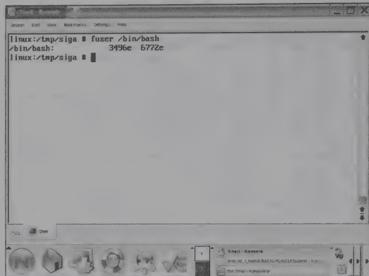

这些工具结合在一起可以帮助你与操作系统和文件系统状态相关的信息。通过主动监控，你可以发现问题并快速做出反应。

## 总结

你已经花费了足够的时间进行阅读。本章通过查看不适合放在其他章节的杂项主题，结束了本书的核心内容。你现在准备好将所学知识并完成本章中的示例实操了。虽然阅读过程很有趣，但绝对没有任何工具能比经验更好地为你考试做好准备。在报名考试之前，请尽可能花时间接触操作系统，并尽可能多了解它。然后，带着自信的姿态进入测试中心，你就能朝着在简历上获得 NCLP 证书迈出大一步。

## 命令总结

表 13.6 列出了本章讨论的命令。

# 本章命令

| 工具 | 默认用途 |
| --- | --- |
| `apropos` | 返回来自 `whatis` 的简要摘要 |
| `at` | 允许你调度在指定时间运行的任务 |
| `crontab` | 与 cron 文件交互以创建在以后运行的任务 |
| `fuser` | 用于监控用户对文件的访问情况 |
| `info` | 显示命令可用的帮助信息 |
| `KFind` | `find` 的图形版本 |
| `lsof` | 列出已打开的文件 |
| `lspci` | 列出通过 PCI 总线连接的所有设备 |
| `man` | 显示命令、工具或文件的手册页 |
| `whatis` | 返回关于工具或命令的信息 |
| `where` | 列出它能找到的所有与文件相关的位置信息 |

# 第 14 章

# 示例实操

阅读结束了。现在是时候把你从书中章节中学到的知识并将其应用于解决问题了。学习的一个基本原理被称为布鲁姆分类分类法。简单来说，该原理的一个论点是理解有多个不同的层次。在最底部只有知识——即能够背诵事实和数字——而在较高处是应用这些知识的能力。

CLP 考试并非知识水平的考试——它不会问你 Linux 是以谁的名字命名的并提供四个选择答案。CLP 考试是一项基于实操的测试，要求你完成一系列任务。

以下是两个示例实操。到此为止，你应该能够在不参考此书或任何其他源的情况下完成这些任务。你做到此点的能力可以作为你对真实考试准备程度的指导标准。如果你能轻而有余地完成，就应该考虑预约考试。另一方面，如果你卡住了或需要查找信息，则应该进行更多的学习。

# 实操一

你是一家中型公司的 Linux 主管理员。订购的一台新服务器已经到达，但仅带有基础安装。这台服务器将用于一个远程办公室，主要供销售部门使用。你需要配置这台服务器以执行购买时所需的任务。

服务器需要根据表 14.1 中给出的要求运行。

# 表 14.1 服务器需求

| 规格 | 细节 |
| --- | --- |
| SLES 9 服务器名称 | Pearson-SLES |
| 静态 IP 配置 | 使用 IP 地址 `192.168.0.78`，子网掩码 `255.255.255.0` 和默认网关地址 `192.168.0.1`。 |
| DNS 服务器地址 | 服务器应该动态获取此地址。 |
| 服务器服务 | 服务器应该具有以下服务：Apache Web Server Samba |

你需要在系统上创建一个新组——SALES，并向系统和该组添加五个用户。你需要创建的用户如表 14.2 所示。

# 表 14.2 SALES 组成员

| 用户名 | 属性 | 数值 |
| --- | --- | --- |
| Mpurcell | 全名 | Matt Purcell |
| | Shell | `/bin/bash` |
| | 密码 | Windsor |
| Jwatson | 全名 | Jenny Watson |
| | Shell | `/bin/ksh` |
| | 密码 | Supreme |
| Kdulaney | 全名 | Kristin Dulaney |
| | Shell | `/bin/bash` |
| | 密码 | Smooth |
| Mberson | 全名 | Margaret Berson |
| | Shell | `/bin/csh` |
| | 密码 | Canadian |
| Warrenw | 全名 | Warren Wyrostek |
| | Shell | `/bin/bash` |
| | 密码 | Beverage |

服务器需要配置三个每个 5GB 的物理卷（总计 15GB）。Apache 应该配置为允许符号链接并保持运行。Samba 应该安装并配置为名为 PEARSON-WKGRP 的工作组。

# 实操二

你是一家技术解决方案公司的高级 Linux 管理员。你的一个客户订购了一个新的 SuSE Enterprise Linux Server 9 系统，要在所在地进行配置然后运给他们。另一位管理员已经安装了操作系统并添加了一些公司标准的应用程序。你现在必须对其进行配置和调整。

服务器将定期以 root 身份运行若干无人任务。应该编辑相应的配置文件以包含表 14.3 所示进程的条目。所有条目都应运行并将任何输出（标准输出或错误）写入 `/dev/null`。

# 自动运行进程

| 进程 | 频率 |
|---|---|
| `/usr/local/bin/orionest.sh` | 每整点开始每 5 分钟运行一次 |
| `/usr/local/bin/uf.sh` | 每整点开始每 15 分钟运行一次 |
| `/usr/local/bin/use.sh` | 每整点后 5 分钟开始每 10 分钟运行一次 |
| `/usr/local/bin/orionrestart.sh` | 周日、周四和周六早上 6:30 运行 |

你还需要根据表 14.4 列出的设置配置系统。

# 系统配置设置和更改

| 实体 | 新值 |
|---|---|
| 新创建的文件(ms) | 所有新创建的文件的默认权限应设置为 `rw-rw-r--` |
| `/home/jackson` | 此目录下的所有文件的所有者应从 jackson 更改为 syed。此外，该目录下所有文件的关联组应从 users 更改为 root。 |
| `/bin/zcat` | 在 root 用户的家目录下创建一个指向此文件的链接。链接名称应为 viewer。 |

# 表 14.4 续表

| 实体 | 新值 |
|---|---|
| 用户 | 向系统添加两个新用户：wintel 和 omni。wintel 的 UID 应为 1010，omni 的为 1011。每个账户的密码设置应为在 90 天内更改。此外，所有密码应存储在 `/etc/shadow` 而不是 `/etc/passwd`。 |
| 初始运行级别 | 将系统的初始运行级别设置为自定义设置 4。 |
| 静态 IP 地址配置 | 使用 IP 地址 `192.168.10.7`，子网掩码 `255.255.255.0` 和默认网关地址 `192.168.10.101`。 |
| 文档 | 在 `/log/messages` 末尾添加一条目，说明系统已在该日期配置。 |

## 总结

看到这种场景可能会让人不知所措。在做任何事情之前，深呼吸并将项目拆分为任务。记住，SuSE 在包含 YaST 方面具有巨大的优势。

能够通过示例实操并不保证能准备好参加考试，但它确实提供了一个衡量工具，让你评估自己处理少量细节服务器配置的能力。

祝你好运。

# 索引

# 符号

+   `&` (安符)
    - 命令, 43
    - 进程，运行, 94
+   `*` (星号) 通配符, 37-38
+   `` ` `` (反引号), shell, 用法, 44-46
+   `\` (反斜杠), 引号, 用法, 46
+   `\` (退格键), 提示, 42
+   `[]` (括号) 搜索, 37
+   `<<` (双小于符号), PS2 提示, 48
+   `$` (美元符号) 提示, 41-43
+   `"` (双引号), shell, 用法, 44
+   `<` (小于符号), 标准输入，重定向, 79
+   `&` 运算符, 208
+   `|` 运算符, 208
+   `%` (百分号) 提示, 41
+   `.` (点), 文件名语法, 68
+   `|` (管道), 243. 另见 `xargs` 命令
+   `%prep` 宏 (RPM)
+   `?` (问号) 通配符, 37-38
+   `'` (单引号), shell, 用法, 44-46
+   `[` (`test` 命令别名), 202-203
+   `$!` 变量, 43
+   `$$` 变量, 43
+   `$?` 变量, 43, 48

# A

+   A (地址) 资源记录 (DNS 区域), 397
+   `a` 命令, 字符串文本，追加, 112-113
+   绝对地址, 65-66
+   `access.conf` 文件 (`/etc/apache2/httpd.conf` 配置文件), 386
+   account 模块 (PAM), 173
+   ACL (访问控制列表), 139

# B

+   菜单 (GNOME 桌面), 29
+   打印机向导, 安装打印机, 278
+   为 shell 脚本添加注释, 195
+   链接, 145
+   管理模式, 222
+   高级 Linux 管理课程, 主题/目标, 9-10
+   别名 (命令), 47
+   ampersand 命令, 43
+   进程, 运行, 94
+   Apache, 385
    - `/etc/apache2/httpd.conf`
    - `access.conf`, 386
    - `access.default-server` 文件, 386
    - `error.conf`, 386
    - `listen.conf`, 386
    - `server-tunneling.conf` 文件, 386
    - `srm.conf`, 386
    - `ssl-global.conf`, 386
    - `uid.conf`, 386
    - `vhost.d` 文件, 386
    - `httpd` 守护进程, 386
+   在字符串中追加文本, `a` 命令, 112-113
+   应用层 (Internet 协议族), 346, 351-352
+   菜单 (GNOME 桌面), 29
+   `apropos` 工具, 436
+   归档与备份的区别, 182
+   参数, 34-52
+   ARP (地址解析协议), 351, 361
+   `at` 命令
    - 任务, 调度, 442-443, 446
    - 选项, 446
+   `atime` 选项 (`find` 工具), 151-152
+   音频, 流媒体, 349
+   认证模块 (PAM), 173
+   身份验证, 安全规则, 334
+   `awk` 命令, 116
+   `b` 命令, 113
+   反引号 (`` ` ``), shells, 用法, 44-46
+   后台选项 (KDE 桌面配置), 26
+   反斜杠 (`\`), 引号, 用法, 46
+   上移符号 (`^`), 提示符, 42
+   备份. 另见镜像
+   `bunzip2` 工具, 185
+   `bzcat` 工具, 185
+   `bzip2` 工具, 185
+   `bzip2recover` 工具, 185
+   `compress` 工具, 185
+   `cpio` (输入/输出) 工具, 选项, 184
+   `dd` (设备到设备) 工具, 184-185
+   餐饮, 182
+   文件, 185
+   `gunzip` 工具, 185
+   `gzip` 工具, 185
+   磁带, 策略, 182
+   `tar` (磁带归档) 工具, 选项, 183
+   `uncompress` 工具, 185
+   与归档的区别, 182
+   `bash` (Bourne Again) shell, 23, 46-47
+   行为选项 (KDE 桌面配置), 26
+   `bg` (后台) 命令, 96
+   `bin` 目录, 33
+   标准磁盘布局 (文件系统), 241
+   与 `usr` 目录的区别, 249
+   布鲁姆分类法, 175
+   启动动作 (`inittab` 文件), 228
+   启动目录, 标准磁盘布局 (文件系统), 241
+   启动文件系统, 分区, 253
+   启动消息, 328
+   启动设置, YaST2 配置, 425
+   启动硬盘选项 (SLES 9 安装), 16
+   启动
    - `dmesg` 工具, 233
    - GRUB, `info grub` 命令, 232
    - 热插拔脚本文件, 235
    - LILO, 233
+   认证考试
    - 1 的前提条件, 4
+   `dmesg` 工具, 233
    - 选项, 231
    - 消息文件, 234
    - 模块文件, 234
    - 进程概述, 235-236
    - `sysfs` 文件系统, 235
    - 故障排除, `dmesg` 工具, 233
    - `tmp` 文件, 234
    - `wtmp` 文件, `last` 命令, 234
+   高级 Linux 管理课程, 9-10
+   Linux 管理课程, 7-9
+   Linux 基础课程, 5-6
    - 策略, 3-4
+   参加
    - 手机, 2
    - ID 需求, 2
    - 学习材料, 2
    - 时间限制, 2
    - 时间管理, 3-4
+   `bootwait` 动作 (`inittab` 文件), 228
+   Bourne Again shells (`bash`), 33, 46-47
+   Bourne shells (`sh`), 32
+   括号 (`[]`) 搜索, 37
+   `break` 命令, 214
+   广播消息, 350
+   BUGTRAQ 邮件列表, 336
+   `bunzip2` 工具, 185
+   `bzcat` 工具, 185
+   `bzip2` 工具, 185
+   `bzip2recover` 工具, 185
+   `change` 命令, 组合, 120
+   CHAP (挑战握手协议), 334
+   第 3 章 实验, 128
+   第 5 章 实验, 189
+   第 10 章 实验, 340
+   第 11 章 实验, 404-406
+   `chgrp` 工具, 文件/目录权限, 138
+   `chmod` 工具
    - 文件/目录权限, 137
    - `setfacl` 工具, 141

# C

+   `c` 命令, 113
+   C 编程
    - `gcc` (GNU 编译器), 449
    - GNU 构建过程, 449
    - 共享库, 450
+   C shells (`csh`), 33
+   `case` 命令, 213-214
+   `cat` 工具, 49-50
+   `cd` (切换目录) 命令, 64-66
+   `d` (删除) 命令, 123
+   `d` 命令, 删除行, 111
+   守护进程, 83
+   `inittab` 文件, 229
+   `lpd` 打印文件, 272-273
+   `lpr` 打印文件, 272-273
+   进程, 29
+   安全规则, 334
+   `syslog` (系统日志守护进程), 175, 450
+   位置字段, 178
+   优先级字段值, 177-188
+   `compress` 工具, 185
+   `Configure` 命令, Perl 安装, 304
+   `configure` 工具, GNU 构建过程, 449
+   配置打印机, YaST, 275-277
+   控制标志 (PAM), 174
+   拷贝备份, 183
+   每日备份, 182
+   数据库搜索, `locate` 工具, 149-150
+   通过编辑器更新数据库, 149
+   最后修改日期字段 (`/etc/shadow`), 字段, 160
+   拷贝目录, 70-75, 185-186
+   文件, 70-75
+   通过编辑器文本, 125-126
+   损坏文件, 移动, 263
+   `cp` (拷贝) 命令, 选项, 184
+   `cpio` (输入/输出) 工具, 选项, 184
+   `cron` 命令, 任务, 调度, 446-448
+   `csh` (C) Shell, 33
+   `ctime` 选项 (`find` 工具), 151
+   `Ctrl+C` 快捷键, 53
+   `Ctrl+D` 快捷键, 50
+   过期后字段 (`/etc/shadow`) 字段, 161
+   过期前字段 (`/etc/shadow`) 文件, 161
+   `dd` (设备到设备) 工具, 75, 184-185
+   默认文件权限, 136
+   默认网关, TCP/IP 主机配置, 354
+   `default-server.conf` 文件 (`/etc/apache2/httpd.conf` 配置文件), 386
+   CUPS (通用 Unix 打印系统)
    - 错误日志, 296
    - 文件, 打印, 274
    - 密码, 295
    - `printcap` 文件, 285
    - 停止, 295
+   `cups start` 命令, 274
+   `cups stop` 命令, 274
+   `curses`, 内核配置, 382
+   自定义安全设置 (YaST2), 425
+   `cut` 命令, 选项, 53-54
+   `cw` (更改单词) 命令, 119-120

# D

+   用户帐户, 166
+   变量, 41
+   `depmod` 工具, 318
+   `dev` 目录
    - 标准磁盘布局 (文件系统), 241
    - 设备文件, 242-243
+   设备用户接口, 20
+   `df` (磁盘空间) 工具, 452
+   空闲磁盘空间, 显示, 258
+   选项, 258-261
+   开启/关闭, 154
+   `dmesg`, 233, 328
+   DHCP (动态主机配置协议),
+   DNS (域名系统)
    - TCP/IP 配置, 355
    - FQDN (完全限定域名), 390, 394-395
+   `diff` (差异) 命令, 116
+   主机名解析, 393-394
+   `diff3` (差异) 备份, 182
+   `dig` 工具, TCP/IP 配置, 361-362
+   `domainname` 实用工具, TCP/IP 配置, 362
+   双小于号 (`<<`), PS2 提示符, 48
+   双引号 (`"`), 在 shell 中的用法, 44-46

# E

+   编辑
    - 命令行历史, 48
    - 文本, `vi` 编辑, 117-126
+   `edquota` 实用工具, 155
+   `egrep` (扩展 grep) 命令, 104-105
+   else-if 语句 (`elif` 语句) `fi` 语句, 207
+   `nshell` 脚本, 206-208
+   `enable` 命令, 命令行打印, 295
+   加密密码哈希文件 (`/etc/shadow` 文件), 160
+   结束进程, 91-94
+   错误日志, CUPS, 296
+   `etc` 目录，标准磁盘布局（文件系统）, 243
+   `/etc/apache2/httpd.conf` 配置文件
    - `access.conf` 文件, 386
    - `default-server` 文件, 386
    - `error.conf` 文件, 386
    - `listen.conf` 文件, 386
    - `server-tuning.conf` 文件, 386
    - `srm.conf` 文件, 386
    - `ssl-global.conf` 文件, 386
    - `uid.conf` 文件, 386
    - `vhost.d` 文件, 386
+   `/etc/group` 文件, 186
+   `/etc/HOSTNAME` (TCP/IP 配置), 355
+   `/etc/hosts` (TCP/IP 配置), 355
+   `/etc/nsswitch.conf`, 机安全, 337
+   `/etc/modules.conf` 文件, 319-321
+   `/etc/openldap` 文件, 385
+   `/etc/passwd` 文件, 158
    - 字段, 159
+   `/etc/security` 文件, 用户安全, 337
+   `/etc/services` 文件, 352, 375-384
+   `/etc/shadow`
    - 最后修改密码字段, 160
    - 密码过期后天数字段, 161
    - 密码过期前天数字段, 161
    - 加密密码哈希字段, 160
    - 登录字段, 160
    - 最大密码年龄字段, 161
    - 最小密码年龄字段, 160
    - 密码过期日期字段, 161
    - 密码安全, 159-160
    - 用户账户, 162-164
+   `/etc/skel` 文件, 163-164
+   `/etc/sysconfig/network` 文件 (TCP/IP 配置), 356-360
+   `/etc/sysconfig/network/routes` 文件 (TCP/IP 配置), 361
+   `ethereal` 实用工具, TCP/IP 配置, 362
+   扩展分区, 251-254
+   `fd` 实用工具，更改, 257
+   文件系统，列表, 252
+   更改, 257
+   创建分区, 255-257
+   数值, 135
+   粘滞位，数值, 142
+   SUID, 数值, 141
+   文件名, (点), 68

# F

+   文件
    - 主，分区, 253
    - 备份文件，压缩, 185
    - 日志, 258
    - 复制, 70-75, 127
    - 格式化, `pr` 实用工具, 275
    - 监控, 452
    - 图形化搜索, 440
    - 挂载, 264
    - 移动, 73-74
    - 根 (`/`), 分区, 253
    - 打印搜索, `find` 实用工具, 151
    - 配置文件, `lpd.conf`, 292
    - 配置文件, `lpd.perms`, 285-292
    - 配置文件, `printcap`, 279-285
    - CUPS (通用 Unix 打印系统), 274, 295
    - 禁用命令行打印, 295
    - 启用命令行打印, 295
    - `admin` 实用工具, 294
    - `lpc` 实用工具, 293
    - `lpd`, 272-273
    - 选项, 294
    - `lpq` 实用工具, 293
    - `lpr`, 272-273
    - `lprm` 实用工具, 294
+   文件系统
    - 标准磁盘布局, 239
    - `bin` 目录, 241
    - `boot` 目录, 241
    - `dev` 目录, 241
    - `etc` 目录, 243
    - `home` 目录, 244
    - `install` 目录, 250
    - `lib` 目录, 244
    - `lost+found` 目录, 250
    - `media` 目录, 244
    - `mnt` 目录, 244
    - `opt` 目录, 245
    - `proc` 目录, 245-247
    - 根 (`/`), 分区, 240, 47
    - `sbin` 目录, 247-248
    - `srv` 目录, 248
    - `tmp` 目录, 248
    - `usr` 目录, 249
    - `var` (变量) 目录, 250
    - 提交打印作业, 277
    - 移除, 76
    - 保存, 120-121
    - `tmp`, 分区, 253
    - 可用性显示, 264
    - 传统的, 258
    - `boot`, 分区, 253
    - 损坏文件，移动, 263
    - 故障排除, 261-262
    - 动态加载, 265
    - 卸载, 266
    - 文件/目录占用空间显示, 260-261
    - `usr`, 分区, 253
    - `var`, 分区, 253
    - 空闲磁盘空间显示, 258
    - 虚拟, 258
+   `find` 实用工具, 153
    - 更改分区, 257
    - 创建分区, 255-257
    - 柱面号, 255
    - 划分分区, 254
    - 格式化分区, 257
    - 分区, 250-255
    - 保存分区更改, 257
    - 访问的文件，查找, 153
    - `atime` 选项, 151-152
    - `ctime` 选项, 151-152
    - `exec` 选项, 151-152
    - `group` 选项, 151
    - `inum` 选项, 151
    - `links` 选项, 151
    - `mount` 选项, 152
    - `mtime` 选项, 152
    - `name` 选项, 152
    - 参数, 152
    - `perm` 选项, 152
    - `print` 选项, 152
    - `size` 选项, 152
    - 特定用户文件，查找, 153
    - 子目录，查找, 153
    - `type` 选项, 152
    - `user` 选项, 152
+   GNU 构建过程 (C 语言)
    - `configure` 实用工具, 449
    - `make install` 实用工具, 449
    - `make` 实用工具, 449
+   `gpasswd` 实用工具, 170
+   `grep` 命令, 98-104
+   组账户，规则, 333
+   `group` 选项 (`find`), 151
+   `groupadd` 实用工具, 169
+   `groupdel` 命令, 171
+   `groupmod` 实用工具, 171
+   查找文件，图形搜索, 345
+   软磁盘，格式化, 258
+   `fmt` 命令，选项, 61
+   循环, 211
+   组，更改, 170
+   创建, 169
+   编辑, 171
+   密码, 170
+   移除, 171
+   用户信息，显示, 170
+   格式化文件，`pr` 实用工具, 275
+   软磁盘, 258
+   FQDN (完全限定域名), 390-395
+   `/etc/passwd` 文件，字段, 159
+   `fsck` 实用工具，文件系统，故障排除, 261-262
+   FTP (文件传输协议) 服务器, PureFTP, 400
+   GRUB (统一引导加载程序), 232
+   `gzip` 实用工具, 185
+   `ftp` 实用工具，TCP/IP 配置, 362
+   备份, 182
+   功能键, SLES 9 安装, 173
+   `fuser` 实用工具, 452

# G

+   `halt` 实用工具, 225
+   `harddisk` 实用工具, 255
+   分区, 253
+   创建, 255, 257
+   设计, 251
+   划分, 254
+   格式化, 257
+   要求, 252
+   保存更改, 257
+   `gawk` (GNU awk) 命令, 116
+   `gcc` (GNU 编译器), 449
+   `getfacl` 实用工具，文件/目录权限, 139
+   进程, 236
+   GNOME 桌面, 29
+   应用程序菜单, 29
+   导航, 28
+   KDE 桌面, 27

# H

+   硬磁盘配额
    - `edquota` 实用工具, 155
    - `quota` 实用工具, 155
    - `quotacheck` 实用工具, 155
    - `quotaoff` 实用工具, 155
    - `quotaon` 实用工具, 155
    - `quotastats` 实用工具, 155
    - `repquota` 实用工具, 155
    - 开启/关闭, 154
+   `HINFO` (热信息) 记录 (DNS 区域), 398
+   硬磁盘
    - `HISTFILE` 变量, 47
    - 分区, 254
    - `history` 命令, 251
    - 编辑, 48
    - 参数，更改, 330
    - 分区 (SLES 9 安装), 14
    - `HISTSIZE` 变量, 47
    - 分区, 254
+   `home` 目录, 251
    - 通过 `useradd` 创建, 163
+   YaST 实用工具, 266-268
+   根目录, 244
+   标准磁盘布局（文件系统）, 199
+   增加/删除, 145
+   主目录字段 (`/etc/passwd` 文件), 159
+   创建, 144
+   `home` 文件系统, 253
+   节点, 145
+   `HOME` 变量, 40
+   验证, 145
+   HOME 工作站安全设置 (YaST2), 425
+   硬件
    - 配置，YaST2, 418-419
    - 安装, 339
+   主机（安全规则）, 332
+   主机名解析
    - DNS, 393-394
    - FQDN, 394-395
    - `host` 文件, 391-392
    - `hdparm` 实用工具, 330
+   主机安全
    - `/etc/inet.conf` 文件, 335
    - 更新, 336
    - BUGTRAQ 邮件列表, 336
    - CERT, 335-336
    - `iptables`, 335
    - 镜像, 185-186
    - 数据包过滤, 335
+   帮助
    - `apropos` 实用工具, 436
    - `help` 实用工具, 432
    - 网站, 335-336
    - `howto` 目录, 436
+   主 TCP/IP 配置, 352
    - `info` Pages, 433-435
    - 默认网关, 354
    - 邮件列表, 440
    - DHCP, 355
    - `man` Pages, 428-432, 437
    - IP 地址, 353
    - 手册, 437
    - 子网掩码, 353-354
    - 新闻组, 439
+   `hostname` 实用工具，TCP/IP 配置, 362

# I

+   初始化
    - `getty` 进程, 236
    - 密码, 236
    - `profile` shell 脚本, 237
+   `inittab` (初始化表) 文件
    - 修改, 激活, 229
    - `etc` 目录, 243
    - 示例, 226-228
    - `init` 守护进程, 229
    - `k` 脚本文件, 228
    - `s` 脚本文件, 228
    - 指定动作
        - `boot`, 228
        - `bootwait`, 228
        - `kbrequest`, 228
        - `off`, 228
        - `once`, 229
        - `ondemand`, 229
        - `powerfail`, 229
        - `powerokwait`, 229
+   IANA (互联网分配编号机构)
    - 传输层端口号, 352
+   ICMP (互联网控制消息协议), 349-350
+   ID 要求 (认证考试), 2
+   `id` 实用工具, 170
+   IDE 硬盘
    - `hda` 分区, 251
    - 识别, 251
    - 分区, 254
+   inodes (索引节点)
    - 内容, 263
    - 硬链接, 145
    - 编号, 263
+   `if-then` 语句
    - `fi` 语句, 203-204, 207
    - shell 脚本, 203-204, 207
+   `ifconfig` 实用工具, TCP/IP 配置, 362
+   `ifdown` 实用工具, TCP/IP 配置, 363
+   `ifup` 实用工具, TCP/IP 配置, 363
+   IGMP (互联网组管理协议), 350
+   包含目录, 内容, 249
+   增量备份, 182
+   `info grub` 命令, 232
+   `info` Pages, 433-435
+   `init` 守护进程, 236
+   `inittab` 文件, 229
+   `init` 进程, `proc` 目录, 244
+   `init` 实用工具, 运行级别, 224
+   通过 `vi` 编辑器插入/删除文本, 122-123
+   安装目录, 250
+   安装选项 (SLES 9 安装), 16
+   安装-ACPI 禁用选项 (SLES 9 安装), 16
+   安装-安全设置选项 (SLES 9 安装), 17
+   安装
    - 硬件, 399
    - 打印机
        - 添加打印机向导, 278
        - 网络打印机, 279
        - YaST, 275-277
    - SLES 9
        - 启动硬盘选项, 16
        - 选择安装模式屏幕, 123
    - 安装过程中
        - 选择语言屏幕, 17
        - 提交, 18
        - 设备识别, 17
        - 硬件配置, 19
        - 安装选项, 16
        - 安装-ACPI 禁用选项, 16
        - 安装-安全设置选项, 17
        - 互联网连接测试, 18
        - 本地用户, 19
        - 内存测试选项, 17
        - 网络配置, 18
        - 包安装, 18
        - 硬盘分区, 18
        - 推荐安装设置, 17
        - 许可说明, 19
        - 救援系统选项, 17
        - root 用户密码, 18
        - 服务配置, 19
        - 系统配置, 19
        - 系统要求, 16
        - 故障排除, 19-20
        - 用户身份验证方法选择, 19
+   网络接口层, 345-346
+   传输层, 346
+   端口号, 351-352
+   TCP, 347-348
+   UDP, 348-349
+   SSH (安全 shell)
+   中断键序列，查找, 53
+   `inum` 选项 (`find` 实用工具), 151
+   IP (互联网协议), 349-351
    - IP 地址
        - 解析, 399
        - TCP/IP 主机配置, 353
    - IP 数据包，配置路由, 372
    - `ip` 实用工具, 401-403
+   `iptables`, 335

# J

+   任务 (jobs)
    - 调度
        - `at` 命令, 442-446
        - `cron` 命令, 446-448
        - 队列任务任务, 443-446
    - `jobs` 命令, 95
+   `join` 命令, 56-58
+   日志型文件系统, 258

# K

+   软件
    - `Makefiles`, 301-303
    - Perl, 303-305
    - RPM, 307-308
    - 安全规则, 333
    - tarball 文件, 300-301
+   接口与设备, 20
+   内部/外部命令, 33
+   `k` 脚本文件, `inittab` 文件, 228
+   `kbrequest` 选项 (`inittab` 文件), 228
+   KDE (K 开发环境) 桌面
    - 配置, 226
    - 目录, 245
    - KDE 菜单，导航, 22
    - kickers, 22
    - KMail, 26
    - Konqueror 文件管理器，导航, 23
    - Konqueror 浏览器, 25
    - shell, 导航, 24
    - SuSE 帮助中心，导航, 24
    - 网站, 439
+   互联网层 (互联网协议族), 345-346
    - 应用层, 346
    - 互联网层, 345-346
+   互联网协议族 (TCP/IP), 345-346
    - 应用层, 346
    - 互联网层, 345-346
+   KDE 桌面链接
+   与 GNOME 桌面对比, 276
+   KDE 信息中心, 330
+   KDE System Guard, 30, 330
+   内核 (kernel)
    - 第 3 章, 128
    - 第 5 章, 189
    - 第 10 章, 340
    - 第 11 章, 404-406
    - 构建, 325-326
    - 配置, 323-325
    - 目录, 245
    - 定义, 14
    - `dmesg` 工具, 233
    - 分区, 251-254

# L

+   管理
    - 保存文件, 120-121
    - 保存文件部分, 121
    - 软件
        - 镜像, 185-186. 另见备份
+   `mkdir` (创建目录) 命令, 选项, 77-78
+   `mkfs` 实用工具
    - 更新, 你, 421
+   YaST2, 416-417
    - 启动, 117-118
+   软盘，格式化, 258
+   分区，格式化, 257
+   `mknod` 工具, 设备文件, 创建, 242
+   `mnt` 目录
    - 外部设备定义, 265
    - 标准磁盘布局 (文件系统), 246
+   `modinfo` 工具, 318
+   `modprobe` 工具, 322
+   模块文件, 234
+   监控文件系统, 452
+   `more` 命令, 633
+   `more/less` 工具, `man` 页面, 在其中导航, 430-431
+   `motd` 文件, `etc` 目录, 243
+   `mount` 命令
    - 文件系统
        - 可用性, 显示, 264
        - 动态加载, 265
        - 选项, 265
        - `-mount` 选项 (`find` 工具), 152
        - 移动损坏文件, 263
        - 目录, 73-74
        - 文件, 73-74
        - `mozilla` 目录, 245
        - `-mtime` 选项 (`find` 工具), 152
        - 多播消息, 350
        - 多个命令, 链接, 36
        - 手册, 437
        - 最大密码字段 (`/etc/shadow` 文件), 161
        - 媒体目录, 标准磁盘布局 (文件系统), 244
+   内存
    - 用户安全, 337
    - 虚拟, 223
    - 内存测试选项 (SLES 9 安装), 17
    - 消息文件, 234
    - 元字符列表, 129
    - 最小密码字段 (`/etc/shadow` 文件), 160
    - 多桌面选项 (KDE 桌面配置), 26
    - 多组文档, 查找, 431
    - 多用户模式, 222
+   `mv` (移动) 命令, 73-74
+   MX (邮件交换器) 资源记录 (DNS 区域), 397

# N

+   `-name` 选项 (`find` 工具), 152
+   域名解析
    - DNS, 393-394
    - FQDN, 390, 394-395
    - `host` 文件, 391-392
+   通过 `vi` 编辑器导航屏幕, 123-124
+   `vi` 编辑器, 118-119
+   `curses`, 410
+   `netcat` 工具, TCP/IP 配置, 364
+   `netscape` 目录, 245
+   `netstat` 工具, TCP/IP 配置, 364-370
+   网络接口层 (网际协议), 345-346
+   网络模式, 223
+   网络打印机
    - `hosts.equiv` 工具, 295
    - `hosts.lpd` 工具, 295
    - 安装, 279
+   网络服务器安全设置 (YaST2), 425
+   网络工作站安全设置 (YaST2), 425
+   网络
    - 访问, 限制, 384
    - 配置
        - 更改, `ip` 工具, 401-402
        - YaST2, 419-421
+   `newgrp` 工具, 170
+   `newgroups`, 帮助, 439
+   NFS (网络文件系统), 387
    - `nfsd` 进程, 387
+   `nice` 命令, 97
+   `nice` 工具, 430
+   NIS (网络信息服务), 385
+   `nl` 命令, 选项, 51
+   NMB (Netbios 消息块), 390
    - `nmbd` 进程, 390
+   `novell` 目录, 245
+   NS (名称服务器) 资源记录 (DNS 区域), 397
+   `nslookup` 工具, 398-399
+   NTP (网络时间协议), 187-188
    - `ntpd` 进程, 187
    - `ntpdate` 工具, 188
+   编号索引, 263
+   数值 GID (guid) 字段 (`/etc/passwd` 文件), 159
+   数值 UID (userid) 字段 (`/etc/passwd` 文件), 159
+   数值变量, 215-216

# O

+   `od` (八进制转储) 命令, 选项, 63
+   `off` 操作 (`inittab` 文件), 228
+   `once` 操作 (`inittab` 文件), 229
+   `ondemand` 操作 (`inittab` 文件), 229
+   OpenLDAP
    - 管理信息, 385
    - `/etc/openldap` 文件, 385
+   OpenSSH
    - `scp` 工具, 400-401
    - `sftp` 工具, 400
    - `sshd` 进程, 400
    - `sshd` 工具, 401
+   `opt` 目录
    - 标准磁盘布局 (文件系统), 245
    - 子目录, 245
+   可选控制标志 (PAM), 174
+   `or` 语句, 206

# P

+   软件包文档, 437
+   软件包文件, 449
+   包管理, RPM, 306
    - 构建, 310, 313
    - `%prep` 宏
    - 头部结构, 311-312
    - 查询, 308-310
+   包管理
    - 软件安装, 307-308
    - 验证, 308
+   SCSI 硬盘, 254
+   `tmp` 文件系统, 253
+   `usr` 文件系统, 253
+   `var` 文件系统, 253
+   YaST 工具, 266-268
+   包
    - 过滤, 335
    - 路由, 配置, 372
+   PAM (可插拔认证模块), 172
    - 账户模块, 173
    - 认证模块, 173
    - 控制标志, 174
    - 文档, 174
    - 密码模块, 173
    - 会话模块, 173
+   `passwd` 命令, 237
    - `passwd` 工具, 161
    - 密码过期文件 (`/etc/shadow` 文件), 161
    - 密码字段 (`/etc/passwd` 文件), 159
    - 密码模块 (PAM), 173
+   密码
    - PAP (密码认证协议), 334
    - 部分回退, 183
    - 硬盘分区 (SLES 9 安装), 18
    - 批量更改, 166
    - 创建, 提示, 167
    - 组, 170
    - 登录工具, 236
    - `passwd` 工具, 161
    - root 用户 (SLES 9 安装), 18
    - 安全规则, shadow 条目, 333
    - shadow 文件, 159-160
    - 用户身份, 更改
    - YaST, 配置, 415
+   `paste` 命令, 选项, 55
+   分区
    - 文件系统, 253
    - 扩展分区
        - 指定, 251
        - 分区, 254
    - LVM
        - 磁盘, 254
        - 交换, 257
        - 格式, 255
        - 根, 254
        - 交换, 257
        - 状态, 250
        - 根, 254
        - 交换, 255
        - 根, 255
    - 路径, 25
    - 桌面, 26
    - 语法, 68
+   Perl, 安装, 303-305
+   `perl` 命令, 116
+   `-perm` 选项 (`find` 工具), 152
+   文件系统
    - 硬盘, 254
    - 标签, 251
    - 逻辑
        - 分区, 254
    - 目录
        - ACL, 139
        - 更改所有, 138
        - `chgrp` 工具, 138
        - `chmod` 工具, 137
        - `chown` 工具, 138
        - `getfacl` 工具, 139
        - `setfacl` 工具, 140
        - 文件, 33
        - 添加, 394
        - 来自, 79
+   进程管理
    - 更改所有, 138
    - `chgrp` 工具, 138
    - `chmod` 工具, 137
    - `chown` 工具, 138
    - `getfacl` 工具, 139
    - `setfacl` 工具, 140
    - 文件, 33
    - 添加, 394
    - 来自, 79
+   打印机
    - 添加, 78
    - YaST, 75
    - `hosts.equiv` 工具, 295
    - `hosts.lpd` 工具, 295
    - 安装, 279
+   打印
    - 文件
        - 配置, 292
        - 配置.conf, 299
        - `lpd` 文件, 285
    - 权限, 134
+   CUPS (通用打印系统), 274
    - 禁用命令行打印, 295
    - 启用命令行打印, 295
    - 格式, 275
    - `lpd` 工具, 295
    - `lpc` 工具, 294
    - `pr`, 272
    - `pr` 工具, 273
    - `ps`, 274
    - `ps-status` 工具, 274
+   进程管理, 379
+   进程, 336
    - 后台, 运行, 94
    - 进程, 29
    - 结束, 91
    - 前台, 运行, 95
    - PID, 84
    - 引用, 94
+   进程表, 380
    - 访问, 330
    - 进程, 29
    - 结束, 91
    - 前台, 运行, 95
    - PID, 84
    - 引用, 94

# Q

+   `quota` 工具, 155
+   `quotacheck` 工具, 155
+   `quotaoff` 工具, 155
+   `quotaon` 工具, 155
+   `quotastats` 工具, 155
+   `repquota` 工具, 155

# R

+   示例练习, 457-460
+   `r` 命令, 114
+   `root` (目录)
    - 主目录, 244
    - `read` 命令, 变量, 进入运行, 247
    - 标准磁盘布局 (文件系统), 240
    - 脚本, 211-212
+   答题（应试策略）, 3
+   `root` (`/`) 文件系统, 253
+   `reboot` 工具, 225
+   `root` 分区, 255
+   接收/发送邮件, 326-328
+   `root` 用户密码 (SLES 9 安装), 18
+   重定向标准输入, 79
+   `route` 工具, TCP/IP 配置, 370
+   重定向标准输出, `tee` 命令, 80
+   路由 (IP 数据包), 配置, 372
+   `regexp` (正则表达式扩展) 命令, 116
+   路由表, `ip` 工具, 403
+   正则表达式，规则, 98-99
+   `rpc.mountd` 进程, 387
+   相对路径, `cd` 命令, 66
+   `rpc.nfsd` 进程, 387
+   发布说明, 437
+   RPM (RedHat 软件包管理器), 306
+   发布说明 (SLES 9 安装), 19
+   构建, 310-312
+   远程管理, YaST2, 启用, 423
+   软件包
    - 构建, 313
    - 目录, 76-77
    - 查询, 308-310
    - 文件, 76
    - 验证, 308
    - 组, 171
    - 软件, 安装, 307-308
    - 日志文件, 179
    - `rpm --help` 工具, 308
    - 通过 `vi` 编辑器文本, 122-123
+   `rsync` 工具, 选项, 186
+   用户账户, 167
+   运行目录, 250
+   变量, 41
+   `runlevel` 命令, 223
+   `renice` 命令, 选项, 97
+   级别
    - 管理模式, 222
+   `repquota` 工具, 155
+   强制控制标志 (PAM), 174
+   `halt` 工具, 225
+   决定性控制标志 (PAM), 174
+   硬件状态, 223
+   救援系统 (SLES 9 安装), 17
+   `init` 工具, 224
+   资源记录 (DNS 节点), 396
    - A, 397
    - CNAME, 397
    - HINFO, 398
    - MX, 397
    - NS, 397
    - PTR, 398
    - SOA, 397
+   `reboot` 工具, 225
+   `shutdown` 工具, 224
+   关机, 225
+   `telinit` 工具, 224
+   热启动, 223
+   `rm` (删除) 命令, 选项, 76
+   `rmdir` (删除目录) 命令, 76-77
+   `rmmod` 工具, 318

# S

+   `s` 脚本文件, `inittab` 文件, 228
+   示例练习, 457-460
+   保存文件, 120-121
+   `sbin` 目录
    - 内容, 249
    - 标准磁盘布局 (文件系统), 247-248
+   场景 (练习), 457-460
+   任务调度
    - `at` 命令, 442-443, 446
    - `cron` 命令, 446-448
+   架构文件, LDAP, 385
+   `scp` 工具, 400-401
+   通过 `vi` 编辑器进行屏幕导航, 123-124
+   屏幕保护程序 (KDE 桌面配置), 26
+   SCSI 硬盘
    - 识别, 251
    - 分区, 254
    - `sda` 分区, 254
    - `sda` 分区 (SCSI 硬盘), 254
+   搜索。另见通配符
+   `egrep` 命令, 104-105
+   `fgrep` 命令, 104
+   `grep` 命令, 98-104
+   通过 `vi` 编辑器文本, 124-125
+   搜索
    - `dat` 文件, `locate`, 149-150
    - 目录, `which` 工具, 151
    - 文件, 图形化搜索, 440
    - 文件系统, `find` 实用工具, 151
+   安全
    - 主机
        - `/etc/inet.conf`, 335
        - 更新, 336
        - BUGTRAQ 邮件列表, 336
        - CERT, 335-336
        - `iptables`, 335
        - 镜像, 185-186
        - 数据包过滤, 335
    - PAM, 172
        - 账户模块, 173
        - 认证模块, 173
        - 文档, 174
        - 可选控制标志, 174
        - 密码模块, 173
        - 强制控制标志, 174
        - 决定性控制标志, 174
        - 会话模块, 173
        - 足够控制标志, 174
    - 密码, `shadow` 文件, 159-160
    - 规则
        - 认证, 334
        - 守护进程, 334
        - 组账户, 333
        - 主机, 332
        - 日志文件, 333
        - 密码, 333
        - 权限, 334
        - SGID 文件权限, 334
        - 软件安装, 333
        - SSH, 334
        - SUID 文件权限, 334
        - 失败, 333
        - TCP 封装, 333
        - `umask` 值, 334
        - 用户账户, 333
        - 登录, 337
        - 内存使用, 337
        - 进程, 337
        - 存储空间, 337
    - 网站
        - BUGTRAQ 邮件列表, 336
        - CERT, 335-336
        - YaST2 配置, 425
        - 自定义安全设置, 225
        - 文件权限设置, 225
        - 工作站设置, 225
        - 登录配置, 225
        - 网络服务器设置, 225
        - 网络工作站设置, 224
    - 密码
        - 最大年龄字段, 161
        - 最小年龄字段, 160
        - 过期日期字段, 161
        - 安全, 159-160
        - 用户账户, 创建, 162-164
    - 安全网站, 439
+   `sed` (流编辑器) 命令, 107
    - `a` 命令, 112-113
    - `b` 命令, 113
    - `c` 命令, 113
    - 行限制, 108-109
    - 操作顺序, 更改, 114-115
    - 打印行, 110-111
    - `r` 命令, 114
+   语法, 116
+   `w` 命令, 114
+   共享目录, 内容, 249
+   共享库, 450
+   `ldconfig` 工具, 306
+   `ld` 工具, 305
+   程序依赖, 305
+   更新, 306
+   shell (KDE 桌面), 导航, 24
+   shell 字段 (`/etc/passwd`), 159
+   shell 脚本
    - 运算符, 208
    - `break` 命令, 214
    - `case` 命令, 213-214
    - 命令, 194
    - 从...执行, 196
    - 注释, 添加, 195
    - 目录, 确定, 202
    - else-if 语句, 206-208
    - `esac` 命令, 213
    - 执行, 194
    - `exit` 命令, 204-206
    - `fi` 语句, 203-204
    - `for` 循环, 211
    - 组成员身份, 建立, 196-197
    - `if-then` 语句, 203-204, 207
    - 解释器, 指定, 195
    - `or` 语句, 206
    - 发送/接收邮件, 326-328
    - 服务器配置文件 (`/etc/apache2/httpd.conf`), 386
+   会话模块 (PAM), 173
+   会话类型选择 (SLES 9), 27
+   `setfacl` 工具
    - 文件/目录权限, 140
+   比 `chmod` 工具, 141
+   `sftp` 工具, 400
+   SGID (设置组 ID) 权限
    - 数值值, 142
+   安全规则, 334
+   shell 脚本, 196
+   `sh` (Bourne) shell, 32
+   shadow 条目 (密码), 安全规则, 333
+   `shadow` 文件
    - 最后修改密码日期字段, 160
    - 密码过期后天数字段, 161
    - 密码过期前天数字段, 161
    - 加密密码哈希字段, 160
    - 登录字段, 160
    - 变量, 进入运行脚本, 211-212
    - 数字, 215-216
    - 引用, 198
    - 表示, 199
    - `while` 循环, 209-210
+   `SHELL` 变量, 40
+   shell
    - `$` 变量, 43
    - `$$` 变量, 43
    - `$?` 变量, 43, 48
    - `bash` (Bourne Again), 33, 46-47
    - `/bin` 目录, 33
    - 命令行, 编辑历史, 48
    - 命令, 自动补全功能, 48
    - `csh` (C), 33
    - 功能, 32
    - 括号搜索, 37
    - 命令别名, 47
    - 命令行交互, 33-35
    - 命令, 36
    - `ksh` (Korn), 32
    - `tcsh` (Tom's C), 33
    - `zsh` (Z), 33
+   屏幕保护程序选项 (KDE 桌面配置), 26
+   尺寸选项 (`find` 工具), 152
+   `slapd.conf`, 385
+   SLES 9 (SuSE 企业 Linux)
    - 内容, 249
    - 启动盘, 250
    - 选择模式, 217
    - 选择语言, 217
    - 提交, 218
    - 设备识别, 217
    - 硬件目录, 219
    - 安装, 216
    - 安装-ACPI, 216
    - 安装-安全设置, 217
    - 互联网连接, 218
    - 本地用户, 218
    - 网络配置, 219
    - 软件包安装, 218
    - 分区硬盘, 218
    - 推荐安装, 219
    - 救援系统, 217
    - `root` 密码, 218
    - 服务配置, 219
    - 系统配置, 219
    - 故障排除, 219
    - 用户方法, 219
+   `shift` 命令, 53
+   `sort` 命令, 选项, 58-60
+   标准磁盘布局 (文件系统), 239
+   标准输入, 重定向, 79
+   标准输出, 重定向, `tee` 命令, 80
+   启动 `vi` 编辑器, 117-118
+   粘滞位, 240
+   流媒体音频/视频, 349
+   策略 (应试策略), 3
+   `split` 命令, 选项, 63
+   `su` 命令, 200
+   `SUID` (设置用户 ID) 权限
    - 数值, 141
    - 安全规则, 334
+   `SuSE HelpCenter` (KDE 桌面), 24, 437
+   `SuSE` 网站, 439
+   `SuSE-release` 文件, `etc` 目录, 243
+   `SuSEPlugger`, 330
+   配置工具
    - 交换分区, 233, 255
    - ARP, 361
    - 符号链接, 148
        - 创建, 149
        - 查看, 149
+   `dig`, 361-362
+   `domainname`, 362
+   `ethereal`, 362
+   同步时间, 187-188
+   `ftp`, 362
+   `sysfs` 文件系统, 235
+   `hostname`, 362
+   `sysinit` (`inittab` 文件), 229
+   `syslogd` (日志守护进程), 175, 450
+   `ifconfig`, 362
+   `ifdown`, 363
+   `ifup`, 363
+   字段, 178
+   选项, 176
+   `netcat`, 364
+   优先级字段, 177-188
+   `netstat`, 364-370
+   系统故障（安全规则）, 333
+   系统监控
    - `route`, 370
    - 启动消息, 328
+   `tcpdump`, 371
+   硬盘参数, 修改, `hdparm`
+   工具程序, 330
+   `telnet`, 371
+   硬件信息, 查看, `/proc`
+   开发, 344
+   文件, 329
+   安装设备信息, 查看,
+   `hwinfo` 工具程序, 330
+   KDE 信息中心, 330
+   KDE 系统守护者, 330
+   `lspci` 工具, 330
+   `SuSEPlugger`, 330

# T

+   TCP/IP (传输控制协议/Internet 协议)
    - 优点, 344-345
    - 配置文件
        - shell 脚本, 196
        - `/etc/HOSTNAME` 文件, 355
        - `/etc/hosts` 文件, 355
        - `/etc/sysconfig/network` 文件, 356-360
        - `/etc/sysconfig/network/routes` 文件, 361
    - `SuSE HelpCenter` (KDE 桌面), 24, 437
    - `SuSE` 网站, 439
    - 配置工具
        - `ARP`, 361
        - `dig`, 361-362
        - `domainname`, 362
        - `ethereal`, 362
        - `ftp`, 362
        - `hostname`, 362
        - `ifconfig`, 362
        - `ifdown`, 363
        - `ifup`, 363
        - `netcat`, 364
        - `netstat`, 364-370
        - `ping`, 370
        - `route`, 370
        - `tcpdump`, 371
        - `telnet`, 371
        - `traceroute`, 371
    - Internet 协议族
        - 应用层, 346
        - 应用层, 传输层端口号, 351-352
        - Internet 层, 345-346, 349-350
        - 网络接口层, 345-346
        - 传输层, 346
        - TCP (传输控制协议), 347-348
        - TCP wrappers, 安全规则, 333
        - 传输层, 端口号, 351-352
        - 传输层, TCP, 347-348
        - 传输层, UDP, 348-349
+   `regexp` 命令, 116
+   `sed` 命令, 106-108, 114-115
+   字符串文本, 追加, `a` 命令, 112-113
+   `tcpdump` 工具程序, TCP/IP 配置, 371
+   `tcsh` (Tom's C) shells, 33
+   `vi` 编辑器
    - 修改文本, 119-120
    - 复制文件, 127
    - 复制文本, 125-126
    - 插入/删除文本, 122-123
    - 行号, 开启/关闭, 126
    - 导航键, 118-119
    - 运行外部命令, 127
    - 保存文件, 120-121
+   `tee` 命令, 80
+   `telinit` 工具程序, 224
+   `telnet` 工具程序, 371, 398
+   `TERM` 变量, 40
+   `test` 命令
    - 别名 (`[`), 202-203
    - 选项列表, 200-201
+   `test` 工具程序, 48
+   测试
    - 1 的先决条件, 4
    - 高级 Linux 管理课程, 9-10
    - Linux 管理课程, 7-9
    - Linux 基础课程, 5-6
    - 示例实验, 457-460
    - 策略, 3-4
    - 参加
+   `vi` 编辑器
    - 开始, 117-118
    - 文本搜索, 124-125
    - `u` 命令, 126
    - `w` 命令, 114
    - `y` 命令, 114
+   文本, 处理
    - `cat` 工具, 49-50
    - `cut` 命令, 53-54
    - `expand` 命令, 63
    - `file` 命令, 63
    - `fmt` 命令, 61
    - `head` 命令, 51
    - `join` 命令, 56-58
    - `more` 命令, 63
    - `nl` 命令, 51
    - `od` 命令, 63
    - `paste` 命令, 55-56
    - `pr` 命令, 63
    - `sort` 命令, 58-60
    - `split` 命令, 63
    - `tac` 工具, 50
    - `tail` 命令, 52
    - `tr` 命令, 62
    - `uniq` 命令, 63
    - `wc` 命令, 60-61
+   文本管理
    - `awk` 命令, 116
    - `b` 命令, 113
    - `c` 命令, 113
    - `cmp` 命令, 116
    - `diff` 命令, 116
    - `diff3` 命令, 116
    - `gawk` 命令, 116
    - 删除, 111
    - 打印, 110-111
    - 限制, 108-109
    - `perl` 命令, 116
    - `r` 命令, 114
    - `regexp` 命令, 116
    - `sed` 命令, 106-108, 114-115
    - 三次握手, 347
    - 时间限制 (认证考试), 3-4
    - 同步, 187-188
    - 时间管理 (认证考试), 3-4
    - `tmp` 目录, 标准布局, 248
    - `tmp` 系统, 253
    - Tom's C shells (`tcsh`), 33
    - `top` 命令, 91
    - `touch` 命令, 选项, 69
    - `traceroute`, TCP/IP 配置, 371
    - 传统文件系统, 258
    - 传输层 (Internet 协议), 346
    - 端口号, 351-352
    - TCP, 347-348
    - UDP, 348-349
+   故障排除
    - 启动, `dmesg` 工具, 233
    - 文件系统, 261-262
    - 安装, 19-20
    - 开启/关闭, 通过编辑器, 126
    - `type` 选项 (`find` 工具), 152
    - `typeset` 命令, 215
    - `u` (undo 命令), 126
    - UDP (用户数据报协议), 348-349
    - `uid.conf` 文件 (`/etc/apache2/httpd.conf`), 配置, 386
    - `ulimit` 工具, 选项, 338
    - 用户安全, 337
    - `umask`, 安全规则, 334
    - `umount` 工具, 文件系统, 卸载, 266
    - 挂载文件系统, 266
    - `uncompress` 工具, 185
    - 单播, 350
    - `uniq` 命令, 63
    - `unset` 命令, 变量, 删除, 41
    - `until` 循环, 210
    - `updatedb` 工具, `locatedb` 数据库, 更新, 149
    - 更新, 软件, YOU, 421
    - 共享库, 306

# U

+   用户账户
    - 通过 `useradd` 工具, 162-163
    - 手动创建, 161, 164
    - `/etc/passwd` 文件, 158
        - 自由文本字段, 159
        - 主目录字段, 159
        - 登录字段, 159
        - 数值 GID 字段, 159
        - 数值 UID 字段, 159
        - 密码字段, 159
        - `shell` 字段, 159
    - `/etc/shadow` 文件
        - 最后修改日期字段, 160
        - 过期后天数字段, 161
        - 开启前天数字段, 161
        - 加密密码哈希字段, 160
        - 登录字段, 160
        - 最大密码年龄字段, 161
        - 最小密码年龄字段, 160
        - 密码过期日期字段, 161
        - 删除, 167
        - 安全规则, 333
    - 用户身份, 修改, 164
    - 值, 修改, 165-166
+   用户和组管理模块 (YaST), 413
    - `user` 选项 (`find` 工具), 152
    - 用户安全, 338
    - 登录, 337
    - 内存使用, 337
    - 权限, 336-337
    - 进程, 337
    - 存储空间, 337
+   用户空间模块, 200
+   `USER` 变量, 40
+   `useradd` 工具程序, 162-164
+   `userdel` 工具程序, 168
+   `usermod` 工具程序, 165-166
+   用户, YaST
    - `PS1`, 41-43
    - `PS2`, 43
    - `PWD`, 40
    - `read` 命令, 211-212
    - 删除, 41
    - 运行脚本, 进入, 211-212
    - `SHELL`, 40
+   shell 脚本
    - 引用, 198
    - 包含, 199
    - 添加到, 413
    - 编辑, 413
    - 密码配置, 415
+   `bin` 目录, 449
+   `tmp` 目录, 标准磁盘布局, 248
    - `tmp` 系统, 分区, 253
    - `/usr/share/doc`, 436
    - `/log/boot.messages`, 328
    - `/etc/apache2/httpd.conf`, 配置, 386
    - `vi` 编辑器, 117
        - 修改文本, 119-120
        - 复制文件, 127
        - 复制文本, 125-126
        - 插入/删除文本, 122-123
        - 行号, 开启/关闭, 126
        - 导航键, 118-119
        - 运行外部命令, 127
        - 保存文件, 120-121
    - `vi` (视觉) 编辑器, 117
        - 外部命令, 运行, 127
+   `shift` 命令, 200
+   `TERM`, 40
+   `typeset` 命令, 215
+   `USER`, 值, 40
+   验证, 145

# V

+   `var` (变量) 目录
    - 标准磁盘布局, 248
    - `tmp` 系统, 250
    - `tmp` 系统, 253
    - `/log/boot.messages`, 328
    - `/etc/apache2/httpd.conf`, 配置, 386
    - `vi` 编辑器, 117
        - 修改文本, 119-120
        - 复制文件, 127
        - 复制文本, 125-126
        - 插入/删除文本, 122-123
        - 行号, 开启/关闭, 126
        - 导航键, 118-119
        - 运行外部命令, 127
        - 保存文件, 120-121
    - `vi` (视觉) 编辑器, 117
        - 外部命令, 运行, 127
+   热启动, 223

# W

+   `wc` (字数统计)
    - 选项, 62
+   网站
    - BUGTRAQ 列表, 336
    - CERT, 335-336
    - Cert.org, 439
    - Kernel, 329
    - Linux Documentation, 439
    - Linux.com, 439
    - Linux Online, 439
    - LinuxPlanet, 439
    - SecurityFocus, 439
    - SuSE, 439
+   `whatis`
    - 搜索, 431
+   `whereis`
    - 多个集, 35
+   `while` 循环, 209-210
+   白皮书, 336
+   通配符, 36-38
+   `who` 命令, 101

# X-Z

+   X11 文件, `etc` 目录, 243
+   `xargs` 命令, 81
+   `xinetd` (扩展 Internet 服务)
    - 守护进程, 374-375
+   `xntpd` 守护进程, 187
+   `y`
+   `y` 命令, 114
+   YaST (另一个设置工具), 411
    - 图形界面版本, 411
    - 组账户模块, 启动, 416
    - 帮助, 访问, 411
    - `lpadmin` 工具, 294
    - 打印机, 安装, 275-277
    - 目的, 410
    - 文本模式版本, 410-411
    - 用户账户模块, 启动, 413

# 认证 Linux 专业人士 (CLP) 学习指南

获取认证，并保持认证！
本官方 Novell Press 学习指南是您复习安装、运行和管理 SUSE® LINUX 基础知识的密钥，旨在帮助您通过 Novell Practicum: 050-689 考试（即 Novell 认证 Linux 专业人士考试），并成为一名 Novell CLP 认证专家。

专家培训师和课程开发人员 Emmett Dulaney 为您带来了获取 Novell CLP 认证所需的实战知识、经过测试的技术、真实场景以及上手实验室练习。

以下是帮助您通过考试所需的内容：
050-689: Novell CLP

+ 包含对以下内容的详细涵盖：
    * Linux 基础–Novell 课程 3036
    * Linux 管理–Novell 课程 3037
    * 高级 Linux 管理–Novell 课程 3038
    * SUSE Linux 企业服务器 (SLES) 9 的组件
    * 使用桌面环境
    * 访问命令行
    * 精通 YaST2 的使用
    * 查看并与进程交互
    * 理解 Linux
    * 管理和保护 Linux 用户环境
    * 任务调度
    * 使用系统日志服务
    * 配置和管理网络打印服务

> 关于作者
Emmett Dulaney 是 UnixReview 的认证专栏作家，也是 Certification Magazine 所用学习指南的创建者。他已获得了 18 项厂商认证，编写了多本关于 Linux、Unix 和认证的著作，并在多次会议上发表过演讲，曾是 Mercury Technical Solutions 的合伙人。

本书经 Novell, Inc. 授权并合作出版。

读者水平：
中级到高级
书籍分类：
网络/Linux/认证

Novell PRESS+
Novell.
www.novell.com

美国印于美国

ISBN 0-672-32719-8
定价：
$49.99 美元
$71.99 加元
£35.99 英国净价

Novell 是注册商标，Novell Press 是 Novell, Inc. 在美国及其他国家的商标。SUSE 是 SUSE LINUX AG 的注册商标，该公司是 Novell 的业务部门。
