# Linux 和 NetWare 的 Novell 集群服务


编辑

Jenny Watson

开发

编辑

Scott Meyers

主编辑

Charlotte Clark

项目编辑

George E. Nedlee

校对编辑

Cheri Clark

索引编制员

Cheryl Lenz

校对员

Mike Henry

技术编辑

Josh More

出版协调员

Vanessa Evans

书籍设计

Gary Aidar

1-800-382-3419

corpales@pearsontechgroup.com

international@pearsoned.com


本书支持 Safari

您技术书籍封面上的 Safari* 启用图标表示该书可以通过 Safari Bookshelf 获取。当您购买本书时，将获得 45 天的在线版免费访问权限。Safari Bookshelf 是一个电子参考库，让您能够随时随地搜索数千种书籍、查找代码示例、下载章节并访问信息。

要获得本书的 45 天 Safari 访问权限：

- 访问 `http://www.sampublishing.com/safarienabled`
- 填写简要注册表
- 使用优惠码 `52GV-HFWFI-X9LF-F412-E8JL`

如果您已在 Safari Bookshelf 上定期注册或正在访问在线版，请发送电子邮件至：

customer-service@safaribooksonline.com。


副主编

Mark Faber

Novell, Inc. 项目经理

Darrin Varden

营销经理

Doug Ingersoll

引言 1

步骤 ..................................................................................................... 24

## 总结 - 135

## 用于远程存储的 iSCSI - 144

# Linux 和 NetWare 的 Novell 集群服务

Rob Bastiaansen 是一位独立顾问和培训师。Rob 专注于 NetWare、集群服务、eDirectory 和 ZENWorks。他在欧洲、中东和非洲（EMEA）地区为 Novell 提供这些主题的高级培训。Rob 也是一名技术作家；他为居住地荷兰的几本 IT 杂志撰稿。VMware 是 Rob 作为顾问和培训师工作的另一个领域。2004 年，Rob 写了了他的第一本书《Bob's Guide to Using VMware》，该书已出版第二版。2005 年，Rob 出版了《NetWare Toolbox》。他是一位 Novell 认证培训师，拥有所有主要的 Novell 认证。

Sander van Vug 是一位独立培训师和顾问，专注于 Linux 与任何可用 Novell 产品的使用。作为一名技术培训师，Sander 在居住的 EMEA 地区为 Novell 做了大量工作。他精通 Linux 文件系统、访问协议和集群服务的原理。Sander 还是一名技术作家；他用荷兰语写过 26 本书，这是他的第二本英文著作。Sander 也是一名 Novell 认证培训师，拥有所有主要的 Novell 和 Linux 认证。

# 致谢

这本书的编写如果没有 Novell 许多人的帮助是无法完成的。我们特别感谢 Robert Wipel 为我们构思这本书所花费的时间。我们还感谢 Bhogal Hirani 和 Brad Rupp 对第 12 章提供的建议。此外，我们感谢 Kent Boogert 和 Richard Jones 为本书本书提供的支持。

# 引言

在本书中，我们将为您提供 Novell 高可用性解决方案的概述。我们涵盖了适用于 NetWare 和 Linux 的 Open Enterprise Server 版 Novell 集群服务 (NCS)。我们重点关注该软件的最新发布版本，但书中的大部分信息也适用于旧版本的 NCS。我们这本书的目标是让您对设计和实现集群的过程有一个全面的了解。我们为您提供了对 iSCSI、Linux Heartbeat（心跳）集群和业务连续性集群（Business Continuity Clustering）等额外技术的深入见解。我们还描述了如何将流行的应用程序安装到您的集群环境中。在本书中，我们尝试提供比在线文档更多的信息。我们不仅描述了如何配置 NCS 集群，还花了很多精力关注集群配置的“为什么”，因为我们希望您也能理解自己在做什么。这本书是为两类不同的读者编写的：初接触 NCS 管理（或从未接触过集群）的管理员将可以在这里找到足够的信息来让他们让 Novell 集群服务运行起来；而已经具有配置 Novell 集群服务经验的管理员将发现书中包含了许多细节，特别是关于如何在 Linux 服务器上配置 NCS 的。

在第 1 章“集群与高可用性简介”中，介绍了相关内容。本章面向初级集群管理员，尽管是经验丰富的管理员可能会发现它有所帮助。如果您想了解更多关于何时使用集群以及应该如何设置此类解决方案，请阅读本章。第 2 章“分析 Novell 集群服务架构”深入介绍了 Novell 集群的工作原理；在本章中，我们描述了 NCS 网络的不同组件如何相互作用以形成一个工作的集群。此外，还涵盖了一些心跳包（Heartbeat packages）和脑裂拆分器（SBD）分区等集群基础知识。本章主要针对那些那些想要知道后台发生了什么的人。如果您时间紧迫并想尽快开始，可以跳过这两章。

第 3 章“集群设计”是一个重要的章节，每个人都应该阅读；它是关于集群的设计。我们在这一章中将了所有的实战经验以及 Novell 技术人员的一些最重要的实战经验汇在了一起。我们认为这是书中最重要的章节之一，并建议大家阅读它，特别是因为正确理解如何设计集群可以防止您犯下许多错误。

第 4 章“安装与配置”讨论了 NCS 的安装。如果您想查看更多关于如何在 NetWare、Linux 甚至在 VMware 虚拟环境中安装 NCS 的细节，请阅读本章。通过这一章，您将学习到如何添加和删除集群节点。第 5 章“创建集群资源”对集群资源的配置进行了介绍。与第 4 章一样，这章对于从未接触过 NCS 的人来说特别有用。然后，第 6 章“集群管理”中，您将找到管理 NCS 环境的所有方式的概述。它解释了如何使用 Remote Manager 和 iManager，以及如何在 NCS 环境中使用 SMTP 告警。即使是经验丰富的 NCS 集群管理员，也可能会发现他们未曾感知的信息。

从第 7 章“iSCSI”开始，涵盖了更高级的主题。大多数集群都需要一个提供共享存储的解决方案，通常 iSCSI 被认为是实现该点的良好且廉价的解决方案。通过本章中的信息，您将学习如何将 NetWare 配置为 iSCSI 目标（target），并将 Linux 上的 iSCSI 启动器连接到该目标。我们选择不包含任何关于共享存储解决方案的其他信息，主要原因是所有的 SAN 解决方案都是相当专有的。第 8 章“集群支持应用程序”可以是本书的核心。在其中最长的章节中，您可以找到关于如何在 NCS 集群中配置我们选定的应用程序的信息。我们讨论了我们喜爱的一些应用程序的配置，如 iFolder 和 GroupWise，但 Linux 环境中的一些经典应用也包含在本章中。接下来，第 9 章“高级集群主题、维护与故障排除”讨论了可以使用的高级技术。在本章中，例如，您可以了解到如何处理集群的故障排除问题。

最后三章是可选的。第 10 章“集群升级”讨论了如何升级集群。第 11 章“使用 SUSE Linux 集群”介绍了在 Heartbeat 环境下使用 SUSE Linux 的解决方案。最后，在第 12 章“业务连续性集群简介”中，您可以了解到关于业务连续性（Business Continuity）的集群。我们在编写这本书时投入了大量心血，并希望您读得愉快！如果您有任何问题或意见，可以通过以下邮箱地址联系我们：

Rob Bastiaansen: robastiaansen.nl

Sander van Vugt: sandervgt.nl

# 集群与高可用性简介

在第一章中我们将介绍集群的一般概念。Novell 集群服务 (NCS) 将放在高可用性的视角下。关于高可用性的术语将在本章末尾解释。我们在这里提供关于使用或不使用集群产品的硬件和软件要求指南。

# Novell 集群服务定义


本节介绍了 `NCS` 的集群软件。如果您对该产品不熟悉，务必阅读基础知识。通过 Novell 集群服务，可以将 2 到 32 台服务器组合到一个系统中，其中每个服务器运行自己的任务，并在发生故障（例如电源故障）时接管另一台服务器的任务。这种最简单的说明是两个服务器访问外部存储设备，如存储区域网络 (`SAN`)。服务器一提供特定的网协议 (`IP`) 地址。如果服务器发生故障，服务器二将检测到该故障、挂载卷并接管之前使用的 `IP` 地址。由于地址保持不变，客户端可以继续处理其数据。这取决于终端应用程序在故障切换期间是否会有任何问题。但在大多数情况下，一切都能正常运行。

# 共享磁盘访问

从集群中移除故障服务器以保持其余服务器的健康状态。`SBD` 分区也用于存储有关集群的管理信息和日志信息。

## 注意事项

可以在没有共享磁盘和 `SBD` 分区的情况下运行集群。在第 3 章“集群设计”中，你可以读到关于在没有共享存储实例的集群上运行动态主机配置协议（`DHCP`）的示例。这之所以可以实现，是因为运行 `DHCP` 服务器所需的数据存储在 `eDirectory` 中，而该服务在所有服务器上都是已可用的。但你应该记住，如果没有共享磁盘，就没有相应的进程来负责保护你免受“脑裂”（split brain）情况的影响。

共享磁盘的剩余部分将用于存储集群服务的数据。数据的不同部分可以根据池（`pool`）的划分分配到每个池上的各个服务。在旧版本的集群软件中，可以分配给服务并进行故障转移的最小实体是卷（`volume`）。但从 `NetWare 6` 开始，所有的 Novell 存储服务（`NSS`）卷都变成了存储在 `NSS` 池内部的逻辑卷。因此，你将始终在执行我们所说的基于池的故障转移。一个 `NSS` 池同一时间只能在一个服务器上处于活动状态。同时从两个服务器访问数据（特别是向其写入数据）将损坏池中的数据。

# 次要 IP 地址

除了共享磁盘，你还应该了解另一个配置组件。如果你的服务运行在服务器的主 `IP` 地址上且该服务器故障，客户端将失去对该 `IP` 地址的访问，从而也失去对服务的访问。另一台服务器当然会有自己的私有 `IP` 地址。

为了解决这个问题，我们在集群上使用了次要 `IP` 地址。我们想要转移到另一个节点的每个服务都将获得自己的 `IP` 地址。该地址必须符合服务器主地址的子网。而且它也必须符合目标服务器的子网。根据这种行为可以得出一个要求：集群节点必须始终位于同一个子网内。

使用这些额外的 `IP` 地址也意味着你应该将注意力从操作服务器转向操作服务。你不再需要通过虚拟集群服务器的 `eDirectory` 对象、或者通过其 `IP` 地址或域名解析服务（`DNS`）名称来访问其卷上的数据。

# 集群术语

在整本书中，我们将也将使用 Novell 在其文档中使用的术语来讨论集群组件。所有这些术语在这里都给出了定义。列表还将为你提供集群构建块的概述。

## 节点 (NODE)

这是你通常在环境中对服务器的称呼。但一旦它成为集群的一部分，我们就使用这个术语来标识服务器。集群资源可以在一个节点上处于活动状态，当原始节点故障时，它将转移到其他节点。

## 主节点和从节点 (MASTER AND SLAVE NODES)

在整个集群中，总有一个节点是主节点（`master`）。其他节点被称为从节点（`slave`）。你可以在管理界面中识别主节点，它的图标上有一个黄点。主节点的唯一意义是它是持有集群通用 `IP` 地址的节点。此外，在在本章稍后部分描述的出现偶数平局的“脑裂”场景中，主节点所在的一方会胜出。从技术角度来看，该节点是向其他节点发送广播心跳数据包的节点，而从节点则通过单播响应来响应心跳。主节点是集群中第一个启动集群服务软件的节点。如果服务器故障，另一个节点将成为主节点，并继续担任主节点的角色，直到它故障或离开集群。

## 心跳 (HEARTBEAT)

集群中的所有节点都将通过网络进行通信，以检查所有节点是否仍然存活。它们通过心跳数据包来实现。当一个节点停止响应心跳数据包时，会有一个等待服务器响应的超时时间。如果在此之后它没有响应，将向服务器发送一个“毒丸”（`poison pill`）。

## 主 IP 地址 (MASTER IP ADDRESS)

一旦第一个节点在集群中启动，它将成为主节点。

### 集群容器 (CLUSTER CONTAINER)

所有属于集群的对象将放在此容器中。对于你启用的每个池，你必须指定一个可以访问数据的唯一 `IP` 地址，以及一个用于服务器名称的副本。

### 集群资源 (CLUSTER RESOURCE)

这是一个 `eDirectory` 对象，它通过加载脚本和卸载脚本来激活集群中的应用程序。这种设计是为了防止服务器以不受控制的方式访问应用程序在集群中使用的卷。在图 1.2 中，你可以看到一个两个节点的集群概述。

## 图 1.2 (FIGURE 1.2)

## 加载和卸载脚本 (LOAD AND UNLOAD SCRIPTS)

每个集群包含加载脚本和卸载脚本。在这些脚本中，你可以使用 NetWare 命令文件（`NCF`）中的命令。集群加载脚本语法将在第 5 章“创建集群资源”中详细介绍。

# 第 1 章：集群与高可用性简介 (CHAPTER 1: INTRODUCTION TO CLUSTERING AND HIGH AVAILABILITY)

## 集群虚拟服务器 (CLUSTER VIRTUAL SERVER)

对于集群中启用的每个池，你必须指定一个可以访问数据的唯一 `IP` 地址以及虚拟服务器名称。加载脚本中的 `CVSBIND ADD` 命令在上下文中激活此名称使其在网络可用。通过 `CVSBIND DEL` 命令从卸载脚本中移除服务器。

## 集群模板 (CLUSTER TEMPLATE)

之前描述的资源可以通过模板创建。这些模板包含了如何配置集群资源的示例。集群容器持有几个可以使用的默认模板。

## 脑裂检测器 (SPLIT BRAIN DETECTOR)

我们之前讨论过服务器使用共享磁盘工作，为脑裂检测过程创建了一个小分区。该过程是为了防止集群中的服务器不再通过网络相互可见，并在故障后都认为自己是存活节点。这种场景将导致两个相同名称和配置的集群尝试访问相同的数据。如果服务器不再通过网络相互可见，它们将使用共享磁盘来确定哪些服务器仍然存活，哪些不再。停止响应心跳的服务器将获得一个“毒丸”。

## 毒丸 (POISON PILL)

这是一个设置在共享磁盘上的标记，将由停止网络操作的节点看到。该节点将“吃掉”毒丸并关闭。这种设计是为了防止服务器以不受控制的方式访问共享数据，从而防止数据损坏。

## 故障转移 (FAILOVER)

该过程构成了整个集群解决方案的核心。如果检测到节点故障，将由该过程运行加载脚本以激活另一个节点上的磁盘并加载应用程序。该过程将考虑故障转移的偏好，并决定应用程序在哪个节点上运行。

## 迁移 (MIGRATION)

故障转移的过程也可以手动执行。这可以这样做，例如你想让应用程序在另一台服务器上运行，以更好地平衡你环境的负载。

例如，如果你想升级某个特定的节点，可能需要将所有应用程序移动到其他节点。这与故障转移（`failover`）过程的区别在于，集群软件将运行卸载脚本并在新服务器上执行加载脚本。

### 回滚 (FAILBACK)

在故障转移之后，资源也可以移回原来的地方。在这种情况下，卸载脚本将执行，加载脚本将在目标节点上运行。此过程可以自动激活，也可以手动激活。对于手动模式，它与手动迁移的区别在于，使用 `fail`（故障转移）功能会将资源标记为失败，并显示需要管理员干预才能将资源移回原始节点。你可能想在非业务时间之后执行此操作，或者至少调查发生故障转移的原因。正是由于最后这个原因，我们通常不配置自动回滚。如果你不知道资源为什么失败，它可能会再次失败，从而导致在两个节点之间来回切换。

### 纪元 (EPOCH)

当你查看集群服务管理软件时，这个数字显示了集群状态更改的次数。当集群启动时，`epoch` 为零，每当一个节点加入或离开集群时，`epoch` 就会加1。

### 寿命 (LIVES)

这个数字也会出现在你的管理应用程序中。每个集群资源或集群卷都从一个寿命开始，每当资源上线、迁移到另一个节点或向另一个节点故障转移时，寿命计数器就会加1。

### 成员人数与超时 (MEMBERSHIP QUORUM AND TIMEOUT)

当整个集群宕机时启动集群软件将从一个节点开始，然后是其他节点。如果第一个节点自行启动所有集群资源，将不是一个好主意；服务器可能会变得太忙。这就是为什么在集群容器对象中定义了 `quorum`（人数）。当定义在那里的节点数量在线时，节点将开始加载集群资源。还有一个超时值，定义了服务器在任何情况下启动资源的时间范围。如果你希望该资源即使只有一个节点启动时也能上线，可以在每个资源上覆盖此设置。默认情况下，主 `IP` 地址资源就是这样设置的。

## 高可用解决方案概述

在前述一节中，我们向你介绍了 Novell 集群服务（Novell Cluster Services）。在谈到该产品时，我们还没有涵盖 Novell 的整个高可用产品组合。我们将在本章中介绍这些解决方案，并对未来的高可用产品展望。


在深入了解这些产品的细节之前，我们想解释一下可用集群类型之间的区别。“集群”这个词被用于不同类型的集群，它们并不完全相同。我们在书中讨论的集群通常被称为高可用集群或故障转移集群。如果一个节点发生故障，另一个节点将接管它的工作。在健康的集群中，所有节点都在运行它们各自的服务。另一种类型的集群有不同的名称：高性能集群、负载均衡集群、计算集群、数据中心集群等。这些集群与我们在书中写的集群的区别在于，集群中的所有服务器共同工作提供相同的服务，并分担运行服务的负载。整个机器集合共同运行应用程序。如果某个节点发生故障，不存在所谓的故障转移。服务将继续在存活的节点上运行，应用程序完全不会受到中断。此类集群的一个示例是 PolyServe Matrix Server，我们将在本节稍后讨论它。

既然这些集群是不同的，而且对终端用户没有故障转移或中断，为什么我们不在这类集群上运行所有的应用程序呢？答案分为两个部分。第一部分是我们通常在 Open Enterprise Server 上运行的软件并没有运行在我们用于构建此类类型集群的操作系统上。例如，它们不运行 GroupWise Post Office 或 NetWare 可加载模块 (NLM)。答案的第二部分是，这些集群更昂贵——不仅是因为硬件和软件的价格不同，还因为解决方案更复杂，对管理员的经验水平要求更高。

话虽如此，让我们来看看现有的集群解决方案。

## Novell 集群服务

该解决方案在本章的早期已经讨论过，但我们希望查看该解决方案的几个优点，以便与本节中的其他产品进行对比。

### 主流硬件

与其它高可用解决方案相比，NCS 的巨大优势之一是它运行在普通的服务器级硬件上。你可以购买与通常运行应用程序时购买的相同类型的服务器。根据你的设计，你可能只需要多买几台。此外，对于共享存储，硬件的可用性比 NCS 在 1999 年首次发布时要好得多。SAN 确实是一种复杂且昂贵的设备，多年来已经发生了变化。现在，可以使用 ISCSI 或分布式复制块设备（Distributed Replicated Block Devices）作为廉价的共享存储解决方案。

### 启用 EDirectory

没有此额外管理层的运行集群的服务器在配置方面很难配置且难以与彼此保持同步。NCS 服务器从 EDirectory 读取配置，因为这已经是一个具有内置容错能力的分布式数据库，所以配置信息始终可用。

### ISCSI 支持

Enterprise Server 带有对 ISCSI 的支持，并为你提供了以较低成本构建高可用解决方案的可能性。你可以使用现有的硬件和网络设备构建一个 ISCSI 目标，作为集群节点的共享磁盘——前提是你的硬件符合要求。旧的 Compaq Proliant 1600 服务器可能不是你的最佳选择。你可以在第 7 章“ISCSI”中了解你必须满足的要求。

### 快速简易地扩展集群容量

使用 NCS，向已运行的集群中添加节点非常简单。当需要扩展集群容量时，添加服务器非常容易。而且由于存储是额外的，增加存储容量取决于你的供应商提供什么。NCS 在这方面没有任何任何限制。

### 在混合操作系统上运行集群

通过 Open Enterprise Server，可以在 NetWare 和 Linux 的混合环境中运行集群节点。此功能尚未被作为永久解决方案添加，但它可以帮助你从运行中的 NetWare 集群迁移到 Linux 集群。你可以添加新的 Linux 节点并将数据资源迁移到新环境。

## 第一章：集群与高可用性简介

本节包含了对 BCC 的完整技术和功能描述，以及如何为测试和开发建立解决方案。

图 1.3

通过 BCC，整个集群可以转移到另一个站点。

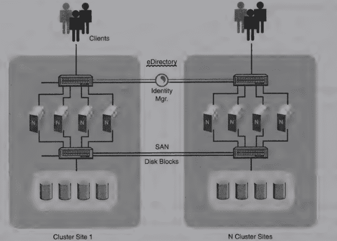

BCC 解决方案的基础由两个标准的 NCS 集群组成，最多四个。每个集群运行自己的服务，并为自己的客户端提供活动服务。当然，你也可以只为了故障转移构建第二个或第三个集群而不使用它。这取决于你的设计和对高可用性的需求。

两个集群完成后，BCC 的下一个组件是 Novell Identity Manager。通过这个基于 DirXML 的产品，集群配置将在两个地理位置之间持续同步。当发生故障转移时，远程站集群将拥有完整的配置来运行原始集群的服务。所有需要更改的配置信息将在同步周期内修改。例如，服务的 IP 地址。当你转移到另一个站点时，IP 地址将位于另一个子网，Identity Manager 驱动程序会处理这个问题。

你在图 1.3 中看到的第三个组件是 SAN。存储在集群中的数据必须在远程站点同样可用。因此，数据必须以某种方式进行同步。通常有三种实现方法：

- 基于 SAN 的镜像
- 基于主机操作系统的镜像
- 基于快照的解决方案

你对数据传输方案的选择受可用带宽和成本等因素的限制。但也有技术因素需要考虑。在镜像解决方案中，数据丢失几乎为零，只有留在缓存中的数据可能会丢失。在快照解决方案中，自上一个快照点以来产生的数据将会丢失。

图 1.3 中的第四个也是最后一个组件是客户端。对于客户端，有两点你需要关注。第一点是技术性的。例如，IP 地址需要做些什么？如果你的客户端仍在原始子网上，它们如何访问故障转移到远程点的服务？最重要的问题是：你的客户端在哪里？它们还在那里吗？如果你因为必须疏散该区域而不得不进行故障转移，你将在哪里与客户继续业务？准备这些工作与安排技术人员同样重要。

## PolyServer Matrix Server

这种高可用产品属于我们在本节开头描述的数据中心集群类别。它是针对 SUSE Linux Enterprise Server 的集群解决方案，可以运行 Oracle 数据库或 Web 服务器等应用程序。这些应用程序可以同时在集群的多个节点上运行。图 1.4 显示了一个带有 NFS 导出典型 PolyServer 集群。通过它，你可以平衡应用程序的负载，当节点发生故障时，应用程序仍然可用。

通过 PolyServer Matrix Server，应用程序的负载可以在服务器之间进行平衡。通过这种解决方案，整合后的服务器可以运行比通常在单个服务器上更多的应用程序。当任意数量的服务器组合成一个集群时，整体性能将显著提高。这种整合的另一个优势是存储也得到了整合。这样做的处赖于提高了存储效率。

可以从 Novell 购买该产品。除了基础方案外，还有两个方案包可以为你的环境添加针对特定部署的功能。它们分别是数据库解决方案包和文件服务器解决方案方案包。

## 第 1 章：集群与高可用性引论

图 1.4

通过 PolyServe Matrix Server，应用程序可以在多个节点上同时运行。


## 用于高可用 Linux 的 Heartbeat 子系统

Heartbeat 包默认随 SUSE Linux Enterprise Server 一起提供。它为运行 SUSE Linux 上的应用程序提供高可用解决方案。该产品源于 Linux High Availability 项目。该软件提供了与 NCS 非常相似的功能。它为应用程序提供故障转移集群。该产品将在第 10 章“升级集群”中详细讨论。

## 何时不要对应用程序进行集群

这是什么？集群书籍中的一个告诉你在什么时候不要对应用程序进行章节？你需要这个吗？是的，你需要。因为在读了之前关于什么是集群以及其优势的章节后，你可能会为了好玩而开始尝试集群。

我们是认真的。我们见过很多次了。从 NetWare 6 开始，基础许可包含一个双节点集群。这意味着构建一个高可用解决方案并不昂贵。几家供应商已经销售过（有些仍在销售）带有双服务器共享 SCSI 解决方案的服务器。其成本比两台独立服务器高不了多少。

使用这种集群本身并没有问题，但你不应该用它来替代环境中的两台服务器。在第 3 章中，我们将详细地讨论这个主题，但对于六个节点以下的集群，你应该始终比实际生活中使用的多计算一台服务器。

在一种已经有两台运行若干服务的服务器的情况下，如果你构建了一个运行所有这些服务的双节点集群，如果其中一个节点发生故障会发生什么？两台服务器中的一个将必须运行所有应用程序的全负载。这可能太多了，并会导致你的应用程序失败，例如因为内存不足。

规划集群解决方案时，确实你应该考虑到应用程序的高可用性，这些应用程序对你的用户至关重要，或者你已经在服务水平协议（SLA）中约定了高可用性。如果你不关注这一点并对你现在运行的所有内容开启集群，你可能会发现某天你拥有一台过载的服务器，导致系统宝贵的运行时间。


在许多情况下，对应用程序开启集群甚至没有意义。ZENWorks for Desktops 是我们经常收到很多问题的应用程序之一，在早期版本中它并没有开启集群。但实际上它是开启的。运行在服务器上的 ZENWorks for Desktops 的两个主要组件是应用程序管理和策略管理。对于这两者，没有运行的服务。所有信息都来自 eDirectory 和文件系统。而且完全可以指向集群虚拟服务器来部署软件包和策略。问题在于后端服务。问题是：它们需要运行在集群上吗？我们无法替你回答这个问题。你应该考虑你的库存数据库具有持续可用性有多重要？你想以高可用性运行自动工作站导入服务吗？如果你为这些服务准备了单独的服务器，无论如何它们可能有很好的可用性，而且它们并不是任务关键。一个已经导入的工作站如果在启动时无法连接到导入服务器，也能正常工作。唯一不会发生的是工作站信息的更新。所以，如果你想远程控制机器，你可能会错过 IP 地址的变化。

这只是说明了在你想远程控制机器时可能会错过 IP 地址的变化。所以你只要在你的环境中开启所有服务的集群，对于可用性来说这是可以接受的。

# 第 1 章：集群与高可用性引论

## 可用性定义

系统管理员和最终用户并不是从同一个角度来看可用性的。当系统管理员看到一个可用的服务器时，并不意味着最终用户拥有可用服务。我们在向环境中引入高可用解决方案时最常见的误解。安装集群并不能提供即时可用性。定义还有方面需要考虑。

让我们先定义可用性。如果你查阅字典，你会发现可用（available）意味着存在或准备好供使用。这正是我们在本节中讨论的核心：可用性。我们将使用最终用户的视角，因为那是唯一的。用户和他们需要的服务是 IT 基础设施存在的唯一理由。没有公司或组织是为了运行服务器而运行服务器。对于最终用户来说，可用性意味着：我可以使用我允许访问的服务。这可以是简单的文字处理程序或电子表格程序。也可以是更复杂的服务，如电子邮件和文档管理或会计软件。因此，服务是否可用从最终用户的角度来看非常简单：我可以访问我的电子邮件吗？对这个问题回答“是”意味着可用，回答“否”意味着不可用。

对于最终用户来说，服务器宕机了、网络交换机坏了还是邮局关了并不重要。他们无法访问电子邮件，就没有可用性。

如果你从这个角度看你的 IT 基础设施，你应该能看到除了集群你的服务器外，还需要考虑的其他组件。当然，这是这本书的主题。在本章的后面，我们将讨论为了提高基础设施的可用性水平，你还需要考虑什么。

包含了冗余硬件，最多包含三块主板、多个网络接口卡等。你可能会问自己，当我需要重启服务器时会发生什么？这不会降低系统可用性的百分比吗？根据该厂商的说法，并非如此，因为他的意思是你的系统在办公时间内是可用的，而你必须为此类操作保留一个维护窗口。

所以，如果你在寻找所需的可用性百分比，你首先必须进行数学计算并收集所有细节。

是否存在解决方案可以给我每年 24 小时、每天全候 100% 可用性？是的，有的。但它们与我们在书中将介绍的 Novell 集群方案是完全不同的解决方案。具有极高可用性的服务器示例是金融机构使用的服务器，用于 ATM 支付服务以及商店和餐厅的支付终端。在繁忙的周六下午，发生 30 分钟的停机保证会登上晚间新闻。所使用的机器非常可靠，而且大多数它们也是以集群方式组织的，让服务永远不会停止。

你在前面的节中可能读到有几种类型的集群。前段落描述的解决方案不是基于故障转移（failover），而是基于保持运行一个或多个任务的服务器集群，其中没有单台机器具有关键角色。那种类型的集群允许最高可能的可用性。当然，这种解决方案的价格也是最高的。如果 IT 管理员或用户抱怨从午夜到凌晨 6 点的维护窗口，或在营业时间内每天一小时的停机，你可以为他们进行计算，以确定当你选择略低一点可用性时，最后这小时的可用性会对总成本造成什么影响。

让我们通过数学计算，看看如果我们选择小数点后带有特定数量“9”的解决方案，我们会得到什么水平的可用性。在表 1.1 中，我们计算了给定数量“9”代表的最大停机时间。

### 表 1.1 全年多个等级“9”的可用性

| 可用性百分比 | 最大停机时间 |
| :--- | :--- |
| 90 | 3.65 天 |
| 99 | 3.65 天 |
| 99.9 | 8 小时 45 分钟 |
| 99.99 | 52.5 分钟 |
| 99.999 | 5.25 分钟 |
| 99.9999 | 31.5 秒 |

表格告诉我们特定数量的“9”在一年中带给我们什么样的可用性。但这现实吗？如果我们购买一个 Novell 集群服务的解决方案，它承诺每年运行时间百分比为 99.999%，这现实吗？如果我们需要升级集群服务软件，我们能在 5.25 分钟内完成吗？

如果你需要真实的数字，你不应该根据一整年来计算可用性。你应该查看你的业务时间。你的用户需要每天 24 小时、每周 7 天的访问吗？或者你是否有维护窗口可以用来更新软件或测试新配置？表 1.2 给出了每天仅 18 小时运行窗口的几个示例。这与 24 小时的窗口相比有巨大的差异。

### 表 1.2 包括周末在每天18 小内多个等级“9”的可用性

| 可用性百分比 | 最大停机时间 |
| :--- | :--- |
| 90 | 27.4 天 |
| 99 | 2.74 天 |
| 99.9 | 6 小时 34 分钟 |
| 99.99 | 39.4 分钟 |
| 99.999 | 3.9 分钟 |
| 99.9999 | 23.7 秒 |

我们没有将这些数字放入书中是为了讨论你使用 Novell 集群解决方案将获得的停机时间。这些数字之所以重要是因为你与客户（大多数情况下是你的用户）之间的服务水平协议（SLA）。你需要建立一个协议，在其中定义你的环境允许多长时间停机。

系统可能产生的停机时间很重要，但例如，如果你与客户建立的 SLA 是基于包括周末在内的每天 18 小时工作日，最大停机时间为 99.9%，你必须能够计算出这是否是现实的。这个百分比将给你一个可供操作的时间段来修复系统，最长为 6 小时 34 分钟。任何等过新硬盘到达的人都知道，这种情况每年不能发生超过一次或两次。当然，我们将研究比是集群和硬盘更多的高可用性，但我们稍后会做。首先是计算当组件故障时你可以预期的停机时间。

## 计算平均停机时间

在计算你的环境中的组件故障时，停机时间可能是多久时，你应该知道两个术语：平均故障间隔时间（MTBF）和平均修复时间（MTTR）。

MTBF 是组件故障所需的平均时间。让我们例如，来看一个随机选择的组件：Intel SRCU42L RAID 控制器。对于此控制器，Intel 报告的 MTBF 为 807,267 小时。如果我们进行数学计算，我们将学到这个适配器平均在 807,267 小时后会故障。


你在前面的节中可能读到有几种类型的集群。前段落描述的解决方案不是基于故障转移（failover），而是基于保持运行一个或多个任务的服务器集群，其中没有单台机器具有关键角色。那种类型的集群允许最高可能的可用性。当然，这种解决方案的价格也是最高的。如果 IT 管理员或用户抱怨从午夜到凌晨 6 点的维护窗口，或在营业时间内每天一小时的停机，你可以为他们进行计算，以确定当你选择略低一点可用性时，最后这小时的可用性会对总成本造成什么影响。

让我们通过数学计算，看看如果我们选择一个小数点后带有特定数量“9”的解决方案，我们会得到什么水平的可用性。在表 1.1 中，我们计算了给定数量“9”代表的最大停机时间。

## 表 1.1

全年多个等级“9”的可用性

| 可用性百分比 | 最大停机时间 |
| :--- | :--- |
| 90 | 3.65 天 |
| 99 | 3.65 天 |
| 99.9 | 8 小时 45 分钟 |
| 99.99 | 52.5 分钟 |
| 99.999 | 5.25 分钟 |
| 99.9999 | 31.5 秒 |

# 第 1 章：集群与高可用性简介

表格告诉我们特定数量的“9”在一年中带给我们什么样的可用性。但这现实吗？如果我们购买一个 Novell 集群服务的解决方案，它承诺每年运行时间百分比为 99.999%，这现实吗？如果我们需要升级集群服务软件，我们能在 5.25 分钟内完成吗？

如果你需要真实的数字，你不应该根据一整年来计算可用性。你应该查看你的业务时间。你的用户需要每天 24 小时、每周 7 天的访问吗？或者你是否有维护窗口可以用来更新软件或测试新配置？表 1.2 给出了每天仅 18 小时运行窗口的几个示例。这与 24 小时的窗口相比有巨大的差异。

## 表 1.2

包括周末在内每天18 小时内多个等级“9”的可用性

| 可用性百分比 | 最大停机时间 |
| :--- | :--- |
| 90 | 27.4 天 |
| 99 | 2.74 天 |
| 99.9 | 6 小时 34 分钟 |
| 99.99 | 39.4 分钟 |
| 99.999 | 3.9 分钟 |
| 99.9999 | 23.7 秒 |

我们没有将这些数字放入书中是为了讨论你使用 Novell 集群解决方案将获得的停机时间。这些数字之所以重要是因为你与客户（大多数情况下是你的用户）之间的服务水平协议（SLA）。你需要建立一个协议，在其中定义你的环境允许多长时间停机。

系统可能产生的停机时间很重要，但例如，如果你与客户建立的 SLA 是包括周末在内的每天 18 小时工作日，最大停机时间为 99.9%，你必须能够计算出这是否是现实的。这个百分比将给你一个可供操作的时间段来修复系统，最长为 6 小时 34 分钟。任何等过新硬盘到达的人都知道，这种情况每年不能发生超过一次或两次。当然，我们将研究比是集群和硬盘更多的高可用性，但我们稍后会做。首先是计算当组件故障时你可以预期的停机时间。

## 计算平均停机时间

在计算你的环境中的组件故障时，停机时间可能是多久，你应该知道两个术语：平均故障间隔时间（MTBF）和平均修复时间（MTTR）。

MTBF 是组件故障所需的平均时间。让我们例如，来看一个随机选择的组件：Intel SRCU42L RAID 控制器。对于此控制器，Intel 报告的 MTBF 为 807,267 小时。如果我们进行数学计算，我们将学到这个适配器平均在 807,267 小时后会故障。这个适配器平均会故障，而且大多数它们也是以集群方式组织的，让服务永远不会停止。*(注：原文此处有大量重复内容，译文已去重)*

现在我们有了这两个数字，最重要的因素是可用性。公式如下：

可用性 = `MTBF` / (`MTBF` + `MTTR`)

MTTR 是修复故障所需的平均时间。MTTR 越长，可用性越低；MTTR 越短，可用性越高。因此，减少 MTTR 是提高可用性的关键方法。

# 避免停机

您还可以通过 Xen 和 VMware ESX Server 等虚拟化技术来提高可用性。这些解决方案从您的操作系统中移除硬件层，并提供了一个可靠的硬件平台，您可以在平台上以虚拟机的形式运行服务器。这样，您就不需要在每台服务器上实现硬件冗余，而只需要在基础虚拟化硬件上实现即可。

# 环境

在此类别中，您可以找到所有可以帮助提高可用性的遗留问题。严谨的管理员可能会对其中某些问题付之一笑，但请相信，我们什么都见过了，甚至在您的环境中见过过更糟糕的解决方案：

- 将关键设备连接到可靠的电源，并使用如 UPS 等备份设备。同时，不要将非关键设备连接到 UPS，以防止浪费电源的必要资源。
- 工作保持整洁，不要将电缆插在配线架上并让它们横跨房间成为绊脚线。
- 保护服务器房的访问权限，防止未经授权的人员意外损坏设备。每个人都听过某些轶闻，清洁工为了插吸尘器而拔掉了服务器插头。
- 实现冷却方案，确保您的所有设备都在指定的温度范围内运行。不要忘记使用服务器供应商的监控工具监控服务器内部的温度。
- 在规划服务器房时，要看大局。您的区域是否在海平面以下？不要将服务器放在地下室。二楼或三楼通常是您的最佳选择。

# 软件

这可能是问题最困难的类别。对于软件故障，有时很难追踪到原因。当您可以轻松更换硬盘或网络适配器时，在具有多个库和可执行文件的软件解决方案中更换组件并不总是可能的。不过，您可以采取一些措施来防止软件故障：

- 在向生产环境部署新软件或新版本之前，进行测试、测试、测试。
- 保持您的软件（包括操作系统和驱动程序）处于合理的更新水平。
- 遵循您的变更流程（参见下一节）。
- 实现监控方案以观察运行情况，并在报告错误状况或警告时记录应采取的行动。
- 充实专业知识：确保您了解软件解决方案的细节，以便在问题发生时能够修复它们，并知道该去哪里查找。

# 流程

您可以使用现最好的硬件和软件配置环境，但如果您不以专业的方式操作，仍然会自己制造问题。通过这些指南，您可以提高环境的整体质量，以及环境的可用性：

- 建立处理服务器和服务的流程，并确保所有管理员遵循这些流程。
- 实现执行变更的流程。ITIL 框架为此提供了“变更管理”，这可以是一个很好的起点。
- 记录您的环境，以便所有管理员在问题发生时知道去哪里查找。
- 记录硬件和软件的服务协议，以便所有管理员在发生故障时知道他们提供什么服务。

# Novell 集群服务要求

当您准备构建集群时，需要两个 Open Enterprise Servers（无论是 Linux 或 NetWare）。但您需要从一个仅限 NetWare 的集群或仅限 Linux 的集群开始。只有当您有一个运行中的非混合集群时，才能转向混合集群环境。构建混合集群环境也没有意义，因为这种集群实际上是为了从一个平台迁移到另一个平台，而不是作为永久解决方案。

# 硬件要求

您的单个节点的硬件要求与作为独立服务器运行的 Open Enterprise Servers 相同。您必须遵循常规指南，根据要在集群上运行的应用程序对服务器进行扩展。在设计章节可以找到一些建议。在内存和磁盘空间方面，您真的不需要为集群软件计算额外资源。该软件仅占用几兆字节的内存，而且软件已默认安装在您的 NetWare 服务器上；如果您选择在 Linux 服务器上安装，它也只占用几兆字节。

共享磁盘系统有重要的硬件要求。有几种类型的共享磁盘可以使用。但无论您选择什么系统，在开始安装 Novell Cluster Services 之前必须满足以下要求：

- 服务器必须能够访问共享磁盘。
- 共享磁盘上至少要有 15MB 的可用空间。（SBD 分区实际上使用了磁盘的一个磁道，因此无法确定确切的大小。）
- 每台服务器都需要自己的系统磁盘。这可以是内部磁盘或 SAN 中的 LUN（逻辑单元），只要它不是共享的即可启动。

当满足这些要求后，您就可以开始安装了。

> 提示
> 如果您想确保正在使用的硬件已通过 Novell 的测试并支持，可以通过 Novell 的 YES（已测试并获批准）计划进行检查。在这项针对 Novell 合作伙伴的计划中，硬件会经过测试，如果发现良好就会获得批准状态。有关该计划的信息，可以在 http://www.novell.com/partners/yes 找到。在该页面上您还可以找到 YES 程序公告的链接。您可以根据硬件的产品号或描述进行搜索。

为此，我们假设在您开始安装时硬件已经就位。考虑到销售 SAN 解决方案的硬件供应商众多，我们无法对每个 SAN 进行详细说明。我们将讨论的唯一共享磁盘解决方案是 iSCSI。

> 提示
> 我们将讨论的一种共享磁盘解决方案是用于 VMware。如果您需要出于教育或测试目的创建集群，那是一个很棒的解决方案。但如果您有像 VMware ESX 这样的高端产品，也可以使用虚拟机和共享存储创建集群。

# 软件要求

构建集群的软件随 Open Enterprise Server 提供。在开始构建集群时，您需要满足一些要求：

- 您需要一个分配给主资源的 IP 地址。
- 所有服务器需要位于同一个子网内。
- 所有服务器必须运行相同版本的 OES和服务包。
- 您将运行的服务需要 IP 地址。
- 集群中的所有服务器必须位于同一个树中。


- 对于 NetWare 节点，服务器必须使用 NSS 作为文件系统。对于 Linux 节点，可以使用 Linux 文件系统，但必须在系统中安装 NSS。
- NetWare 集群安装需要一台 Windows 工作站。

## 第2章：检查 Novell 集群服务架构

## 集群 eDirectory 对象

在最高层，每个集群在 eDirectory 中都有一个集群容器对象。在集群容器对象内部，会创建集群节点、资源和模板。

### 集群容器 (CLUSTER CONTAINER)

此对象用于存储集群的所有重要配置参数。所有这些参数都是全局范围的设置，只需要设置一次。这些参数最重要的包含在以下列表中。有关这些参数的更多详细信息，请参阅第 6 章“集群管理”：

- **仲裁触发器 (Quorum Trigger)**：此参数指定了在启动任何集群资源之前，集群中必须处于状态节点数量。此数字也被称为仲裁成员（quorum membership）。
- **心跳设置 (Heartbeat Settings)**：在集群环境中，节点之间需要相互通信。如果没有这种通信，将无法发现节点是否已离开集群。这种通信通过心跳协议进行：默认情况下，所有服务器每秒发送一次心跳包。如果在八秒钟的时间内没有收到某个节点的回应，该节点将被踢出集群。
- **集群管理端口 (Cluster Management Port)**：这是一个自动分配的端口地址，用于集群的管理。

### 集群节点 (CLUSTER NODE)

每个作为集群成员的物理服务器在 eDirectory 中都表现为一个集群节点对象，如图 2.1 所示。该 eDirectory 存储节点号及其 IP 地址。eDirectory 还使用此对象为其所属的 NetWare 核心协议 (NCP) 服务器对象创建别名。

### 集群资源 (CLUSTER RESOURCE)

集群中的所有应用程序都由集群资源对象表示。这些集群资源对象作为 eDirectory 属性包含了有关资源的所有重要信息。集群资源最重要的属性列在此处：

- **加载脚本 (Load scripts)**：这些脚本决定了资源如何被加载。这些加载脚本是以 bash 脚本的形式编写。所有资源都有一个集群加载脚本。
- **卸载脚本 (Unload scripts)**：在卸载脚本中，集群资源被正确终止。在集群资源加载脚本中，确保资源依赖的其他模块也能被正确卸载是非常重要的。加载脚本和卸载脚本将在第 5 章“创建集群资源”中进行讨论。
- **故障转移和回滚模式 (Failover and fallback modes)**：这些模式决定了当当前活动资源的集群节点故障时应该发生什么。这里必须做的最重要的选择是，这些操作可以手动或自动发生。有关故障转移和回滚模式的更多信息见第 5 章。

图 2.1

集群的所有组件都表示为集群目录容器中的对象。

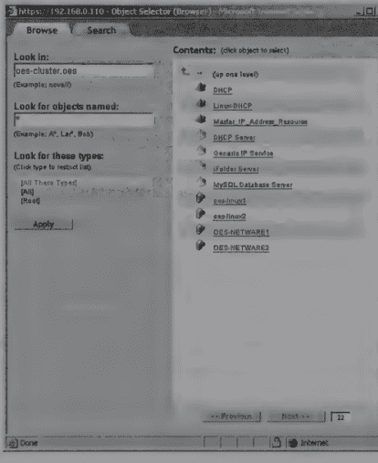

### 集群模板 (CLUSTER TEMPLATES)

完全自己创建一个集群资源对象可能相当困难。为了让管理员更容易创建集群资源，系统中存在一些模板对象。这些模板包含了常用集群资源的所有重要属性。

提示

在服务器上安装了最新的支持包后，支持包提供的新集群资源模板不会自动安装。在 Linux 节点，请使用 `/opt/novell/ncs/bin/ncs-config.py -install_templates` 命令来安装它们。如果您正在从 NetWare 升级到 Linux，则需要执行此操作；否则将无法获得新的 Linux 特有的集群资源模板。

## 集群卷资源 (CLUSTER VOLUME RESOURCES)

在 NetWare 环境中，Novell 集群服务使用的共享磁盘必须包含 Novell 存储服务 (NSS) 卷。这些卷可以是集群启用的，也可以是普通的。当发生节点故障时，这两种类型的卷都可以转移到另一个服务器。在 Linux 环境中，NSS 不是唯一可以使用的文件系统。传统的 Linux 文件系统如 Reiser 和 ext3 也可以使用。

如果使用了 NSS 集群启用卷，则会创建 eDirectory 对象：

- **集群卷 (Cluster Volume)**：这是“正常”卷。
- **集群卷资源 (Cluster Volume Resource)**：这是存储集群启用卷状态的属性。
- **集群虚拟服务器 (Cluster Virtual Server)**：这是一个用于通知集群成员变化的对象。

当节点发生故障时，集群启用卷可以转移到另一个服务器。这种解决方案的优势是，当集群故障时不会崩溃。在 Linux 节点上，`gipc` 负责在 eDirectory 和本地文件之间同步数据。

## eDirectory 与集群节点本地文件的关系 (RELATION BETWEEN EDIRECTORY AND LOCAL FILES ON THE CLUSTER NODE)

eDirectory 与本地文件之间存在关系。eDirectory 信息存储在：`/etc/opt/novell/ncs`（见图 2.2）。在此目录中，集群资源的所有加载和卸载脚本都保存在这里。此外，`/_admin/Novell/Cluster` 包含了集群状态和配置信息。例如，集群级别的属性在这里。

## Novell 集群服务对象与模块 (Novell Cluster Services Objects and Modules)

图 2.2

在 Linux 上，来自 eDirectory 的所有设置都缓存在 `/etc/opt/novell/ncs` 和 `/_admin/Novell/Cluster` 中。

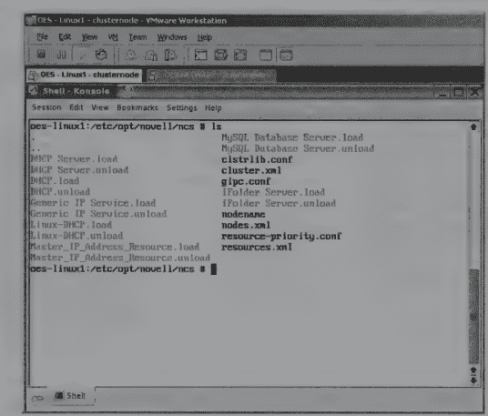

## 集群模块 (Cluster Modules)

Novell 集群软件由不同的部分组成。在本节中我们将讨论这些部分是如何相互作用的。这些部分的概述见图 2.3。

### CLSTRLIB

从图 2.3 可以看出，NetWare 和 Linux 模块之间没有本质区别。首先是配置库 `CLSTRLIB`。该库为 Novell 集群服务与 eDirectory 提供了接口。主节点运行的集群配置负责从 eDirectory 获取所有集群相关的配置。主节点将这些信息存储在内存中，以便集群软件使用的其他模块可以使用。主节点还负责将这些信息传输到集群中的所有节点。当 eDirectory 中的集群配置发生变化时，`CLSTRLIB` 会访问这些更改，更新内存中的信息，然后将其传输给其他集群节点。

## 第2章：检查 Novell 集群服务架构

图 2.3

在 Nov群服务中，不同的模块协同工作。

## NCS 架构回顾 (NCS architecture review)

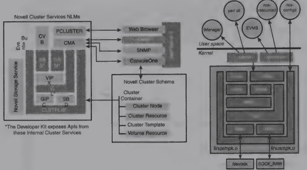

## GIPC

进程间协议 (GIPC) 跟踪集群成员的变化。它负责与集群成员相关的事件，例如节点加入或离开集群。为了实现这一点，GIPC 运行一组辅助协议：

- **过滤 (Panning)**：过滤当前周期（epoch）的消息。
- **心跳 (Heartbeat)**：负责生成心跳消息（本章下一节）。心跳信息分层位于 IP 协议 224 上，可以使用 Ethereal 包解码器进行监控。
- **排序器 (Sequencer)**：负责多播和成员变化的排序。该协议负责通知集群中的所有节点集群成员的变化。
- **成员 (Membership)**：维护当前作为集群成员的节点信息。其主要目的是让所有节点对当前的集群成员视图达成共识。

# Novell 集群服务对象与模块

- Censustaker（成员统计器）：通过监控心跳包生成关于不稳定成员状态的报告。当节点加入或离开集群时，该模块将报告。该报告在被集群中所有其他节点接受之前，被认为是不稳定的。
- Group Anchor（组锚点）：将组成员信息通信给集群协议栈中的上层模块。

# SBD（脑裂检测器）

如果集群中节点之间的网络连接发生，且集群使用了共享磁盘系统，则可能会发生脑裂场景。集群的每一侧都可能认为另一侧节点已故障，并尝试接管其他节点的资源。这可能会导致数据损坏。Novell 集群服务使用脑裂检测器（SBD）来防止此类情况发生。SBD 依赖于集群中所有节点到共享磁盘子系统的连接，该连接通过专用通道工作。在共享存储设备上，会创建一个分区，所有节点在此记录它们对集群当前状态的视图。在集群成员关系中，这些更改可以通过此 SBD 分区通知。本章的后续章节将提供有关 SBD 工作原理的更多细节。

# CRM（资源管理器）

资源管理器（CRM）负责在集群成员关系发生变化时在正确的节点上运行资源。这是主节点上 CRM 的职责，每当节点加入或离开集群时，它都会收到告警。集群中的主节点跟踪集群中所有资源的状态，并将该信息分给集群中的所有其他节点。如果主节点故障，运行在集群另一个节点上的 CRM 将接管此职责。CRM 监控集群中资源的以下可能状态：

- Unassigned（未分配）：资源的首选节点当前不是集群成员。


- Offline（离线）：资源未激活。为了能够能够修改资源的属性，您需要进入此状态。
- Loading（加载中）：资源正在加载中。
- Unloading（卸载中）：资源正在卸载。
- Comatose（休眠）：在发生超时之前，资源未能处理完整的加载脚本。
- Running（运行中）：资源当前处于激活状态。
- Alert（告警）：资源需要人工干预。

# 第 2 章：检查 Novell 集群服务架构

- NDS Sync：资源正在等待与其 eDirectory 属性同步。
- Quorum wait（仲节点等待）：目前集群中的节点不足。资源正在等待仲节点中定义的其他节点变为激活。

# 虚拟接口架构链路层

虚拟接口架构链路层（VLL）位于集群模块之间。它与 GIPC、SBD 和 CRM 模块建立接口。如果 GIPC 停止接收来自集群中另一个节点的信息，它会通知 VLL。该模块联系 SBD，SBD 确定节点是否真的已死亡，然后将其决定通知 CRM。

# 集群卷代理（CLUSTER VOLUME BROKER）

集群卷代理（Cluster Volume Broker）监控集群的 NSS 文件信息。如果发生更改，它将确保 NSS 文件系统中的更改复制到集群中的所有其他节点。

# 集群系统服务

集群系统服务（CSS）模块提供了一个应用程序接口（API），集群感知应用程序可以使用该接口来实现分布式共享内存和共享锁定。分布式共享内存是一种技术，允许运行在多个服务器上的集群感知应用程序访问相同的数据，就像数据存在于相同的物理 RAM 芯片上一样。分布式锁定确保如果一个节点获得了锁，另一个节点上的另一个线程无法获取相同的锁。

# 集群服务管理代理

集群服务管理代理（CMA）充当管理应用程序的代理。提供几种应用程序：

- ConsoleOne：NetWare 环境的旧管理应用程序。它不能用于管理 NCS 1.8。然而，它仍然用于管理 NCS 1.8 环境中的某些应用程序。GroupWise 就是此类应用程序的示例。
- Perl 命令行接口（CLI）：在 Linux 上，可以通过命令行可以使用某些 Perl 工具。这些工具使用用户空间并与 `/admin` 目录中的数据交互，以修改并从集群获取信息。
- iManager：iManager 管理工具与 `/_admin` 和 CMA 交互以修改集群参数。

CMA 与 CRM 交互以确定集群的当前信息并控制集群资源的状态。它还执行 SNMP 管理功能和简单邮件传输协议（SMTP）告警。为了工作，在 Linux 上，内核模块会将所有相关的管理文件导出到 `/_admin/Novell1/Cluster`。在 NetWare 上，`_ADMIN` 目录用于相同的目的。

# PCLUSTER

在 NetWare 上，门户集群代理（PCLUSTER）提供了一个从远程管理器管理 Novell 集群服务的接口。此功能尚不可。

# 心跳、代数计数与脑裂检测器

集群中必须安排的最重要之一是节点故障的方式。Novell 集群服务使用心跳来检测集群中的节点状态。每当节点加入或离开集群时，代数计数（epoch number）就会加一。代数数的差异可能指示严重情况，并导致节点离开集群。在下面的讨论中您将学习它是如何工作的。

## 提示

脑裂检测器的大小在安装集群时无法指定。但它总是足够容纳集群。其余部分用于事件日志。在分区填充后，集群将开始重用。

# 移除故障从机

当从机故障时会采取以下步骤，描述如下：

1. 集群中的每个节点通过局域网发送心跳。默认情况下，每秒发生一次。
2. 在预配置容错时间的一半处（8 秒），每个节点将其代数计数写入共享设备。在正常情况下，集群所有节点的代数是相同的。
3. 主节点监控集群中所有节点的心跳包和代数计数。
4. 如果从机节点在定义的容错时间内未发送心跳，主节点和其他从机节点创建一个新的集群成员关系。此新的集群成员关系不包含该故障节点。
5. 新集群成员关系中的所有节点将代数加一，并将此更改写入脑裂检测器。此时，存在两个集群成员关系：一个是在容错时间内未发送心跳的节点，另一个是其他节点。这种现象被称为脑裂。
6. Novell 集群服务现在需要确定哪个集群成员关系胜出。通过在两个集群成员关系之间投票来实现。结果如下：
   - 节点最多的集群成员关系获胜。
   - 如果双方相等，则包含主节点的视图获胜。
   - 在双节点集群中，仍然具有网络连接的节点获胜。
7. 根据投票结果，获胜节点会将一个特殊标记写入脑裂检测器；这就是所谓的“毒丸”。失败的节点读取毒丸，结果导致自身崩溃（终止或内核恐慌）。终止故障节点是必要的，因为它确保故障节点不会损坏新集群。
8. 新集群将迁移之前与故障节点相关的所有资源，从而为终端用户提供不中断的服务。

# 移除故障主节点

之前的场景描述了当从节点故障时会发生的情况。当主节点故障时，情况会有所不同，因为在这种情况下必须分配一个新的主节点。以下流程描述了将发生的情况。需要注意的是，该过程与非主节点故障时的情况大相同：

- 1. 主节点故障后，会创建一个新的集群成员视图。此新的集群成员视图仅包含从节点。主节点保留旧的集群成员视图。
- 2. 新集群成员视图中的节点将其代号（epoch number）加一。
- 3. Novell 集群服务（Novell Cluster Services）根据新信息进行投票。
- 4. 包含所有剩余从节点的集群赢得投票。
- 5. 胜出集群中的节点向脑裂检测器（Split Brain Detector）写入一个“毒药丸”（poison pill）。
- 6. 从节点投票决定谁成为新的主。这种投票机制基本上是随机的。
- 7. 故障主节点读取特殊令牌（token）并终止自身。
- 8. 分配给故障节点的所有资源将迁移到集群中的其他节点。

## 总结

在本章中，我们对 Novell 集群服务软件的架构和工作原理进行了简要概述。这个概述应该让你在发生任何问题时更容易分析 底发生了什么。在下一章中，你将读到基于 Novell 集群服务的集群设计。

# 集群设计

在本章中，我们将为您提供设计集群解决方案所需的所有功能和技术细节。我们将涵盖诸如选择多少节点以及如何为您的集群配置 eDirectory 等。我们还将提供一些关于如何为不需要共享存储的应用程序设置集群的实用建议。

# 集群设计指南

在本节中，我们将为您提供一些帮助您设计集群解决方案的通用指南。你真的应该将它们视为经验之谈和“集群法则”。有很多参数可以根据你的环境而异，这会使你决定采取略有不同的方案。

# 选择多少节点

从 NetWare 6 开始，你可以构建一个包含两个节点的集群，而无需购买额外的许可证。这对于 Open Enterprise Server 来说也是如此。因此，实现一个简单的双节点集群是非常有吸引力的。构建一个双节点集群本身没有错，除非你的动机是错误的。我们见过太多的客户实现一个双节点集群来替换两台现有服务器，并以此试图提供高可用性。

这不仅可能导致故障时保持活跃的单集群节点的工作负载出现问题，而且当你想要从集群中移除一个节点（例如为了进行升级）时，你将没有冗余性。这正是 Novell 要求你

## 第 3 章：集群设计

至少拥有三份 eDirectory 分区副本，以为 eDirectory 本身提供高可用性（一个主副本和两个读写副本）。如果你只有两个，每当你需要为了维护而关机或当服务器发生故障时，由于只剩下一个单副本，你将没有任何容错能力。同样的规则也适用于构建集群。

在考虑需要的集群节点数量时，首先决定你想在这些服务器上运行哪些服务，以及这些应用程序对服务器的要求是非常重要的。根据这些信息，你可以决定需要的集群节点数量。在大多数替换最多六台服务器的情况下，在所需的集群节点数基础上增加一台服务器是一个好主意。这样你可以确保当服务器故障时，剩余节点上有足够的可用资源，使所有资源运行且不会损失性能。为了高效地运行，请创建一个故障转移矩阵（failover matrix），以定义在故障时哪些集群节点将失效。如何创建故障转移矩阵将在本章后面进行解释。

对于 6 到 32 个节点的大集群，你可能不是在用集群解决方案来替换现有服务器。但即使是如此，如果你创建了高效的故障转移矩阵，集群中很可能会有足够的资源来运行来自故障节点的服务。

在设计集群解决方案时，你还应该记住你可以在环境中安装两个或多个集群。构建一个包含 16 个节点的大集群来运行你所有的服务可能是不现实的。即使你的硬件和存储区域网络（SAN）扩展到这种数量的节点，你也应该记住，如果你将来需要维护整个集群，它将影响你的整个环境。此外，你无法将集群的部分管理权委托给不同的管理员。这在具有大量服务器的大型环境中可能尤为重要，例如，一组管理员可以负责应用程序服务器，另一组人员处理文件和打印服务器。为了不让它们相互干扰，拥有多个集群可能会更好

# 使用心跳局域网还是不


Novell 集群服务（NCS）使用心跳机制来检测所有服务器是否通过网络可用。除了这种局域网心跳外，还有一个脑裂检测器（SBD）分区，通过该分区监控服务器状态。可以为心跳通道设置一个专用局域网。这样做的好处是，当局域网性能下降时，心跳仍然保持活跃且不中断。但这种优势也是劣势：当服务器无法通过心跳相互联系时，客户端可能无法连接服务器。特别是当客户端上的网络适配器故障而心跳网络保持活跃时，客户端将失去与该网络适配器处理服务的连接，但集群节点将保持存活。图 3.1 显示了一个客户端丢失访问但集群节点保持存活的示例。

**图 3.1**

如果一个网卡故障，另一个仍然可用。


在第 1 章“集群与高可用性简介”中，我们提到过高可用性解决方案不仅是网络交换机，还包括数据中心电源。另一种可以提高整体可用性的方法是使用网卡聚合（NIC teaming）。

# 选择存储方法

在本节中，我们将介绍适用于集群的存储方法。这分为三个部分：存储连接、磁盘配置和文件系统。

## 存储连接

首先，你的集群节点需要访问共享存储介质。你的选择非常广泛，但我们将讨论最常见的三种：SCSI（小型计算机接口）、光纤（Fibre Channel）和 iSCSI。第一种技术实际上是一种直接连接方法，而另外两种将形成存储区域网络。

从一个设备传输到另一个设备的数据块。图 3.3 显示了一个共享 SCSI 存储集群示例。

### 图 3.3

最基本形式的共享 SCSI 集群。

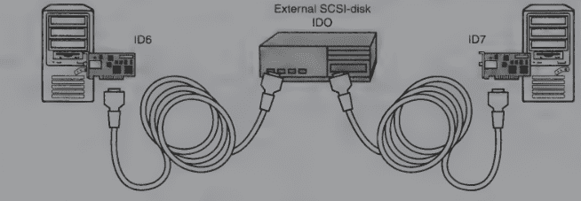

这类集群在本质上是简单的。两台服务器都包含一个 SCSI 适配器，在示例中，它们被设置为不同的 SCSI ID，分别为 6 和 7。SCSI 磁盘也占用了 SCSI 总线的一部分，并设置为 SCSI ID 0。位于同一条 SCSI 总线上的其他设备也将配置为唯一的设备 ID。

许多硬件供应商销售带有集群配置的服务器，将服务器和存储设备集成在一个机箱或服务器外壳内。对于这类设备可以使用“箱式集群”（cluster in a box）这一术语。

SCSI 是一种可以用于双节点集群的技术。凭借前述描述的共享 SCSI 集群特殊硬件配置，其价格并不昂贵，如果你想在小型组织或部门级实现高可用性，这是一个很好的选择。部署双节点集群是为了取代单服务器的负载，并为该服务器的服务提供更高的可用性。

### 使用光纤通道或 iSCSI 构建 SAN

存储区域网络（SAN）确实如其名：一个计算机和存储设备的网络，它们在专用网络中访问存储设备。这种网络可以使用多种技术构建，但我们将关注最常用的两种：光纤通道（Fibre Channel）和 iSCSI。后者在第 7 章“iSCSI”中会有非常详细的讨论，因此在这里不会对 iSCSI 介绍过多细节，而是重点关注什么是 SAN 以及如何使用光纤通道来搭建它。图 3.4 显示了使用光纤设备构建 SAN 所需的基本示例。

# 第 3 章：集群设计

### 图 3.4

光纤存储区域网络的基本配置。

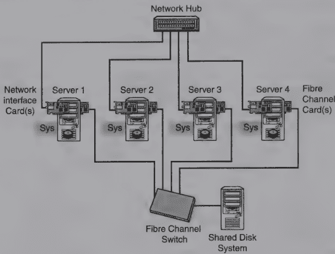

每台服务器都需要配备一个光纤主机总线适配器（HBA）。从服务器适配器出发，一根光纤连接到光纤交换机。最后，磁盘系统也连接到同一个光纤交换机。

运行在服务器上的操作系统使用磁盘的方式是，SAN 为服务器提供 LUN（逻辑单元）。在某种场景下，每个 LUN 都可以像一个本地磁盘一样。像 iManager 和 NSSMU 这样的管理应用程序会将 LUN 显示为设备，就像显示本地物理磁盘一样。

如果你从高可用性的角度考虑图 3.4，你会发现图中的服务器是冗余的，但 SAN 存在若干个单点故障。因此，可以向 SAN 中添加一些冗余。每台服务器都可以配备两个 HBA，每个 HBA 连接到一个独立的交换机。存储设备可以通过两根电缆连接到这些交换机。在这样具有更高冗余性的场景下，交换机或 HBA 的故障不会中断 SAN 的服务。当你配置了这样的设置时，重要的是 SAN 中必须包含某种管理算法，以处理变得可用的多路径。这被称为多路支持（multipath support）。多路支持在 Novell 存储服务（NSS）中实现，但也包含在许多 HBA 制造商的驱动程序中，例如 QLogic、惠尔士普普、Emulex 和 LSI Logic。

# 集群设计指南

光纤通道技术可用于创建尽可能大的集群。它在本文讨论的技术中提供了最快的吞吐量。我们不确定这是否算作一个缺点，但设置光纤通道 SAN 需要特殊的专业技能。许多客户让其硬件销售商为他们配置 SAN，直到集群软件可以调用可用的 LUN 为止。你可以将配置 SAN 所需的技术专业水平与配置带有虚拟局域网（VLAN）和生成树协议的交换以太网网络所需的专业水平进行比较。

## 磁盘配置

在你建立起从每台服务器到存储设备的物理连接后，查看该设备内部如何使用磁盘至关重要。这可以从单磁盘到使用硬件 RAID（独立磁盘冗余阵列）或软件镜像配置不等。

### 单磁盘配置

这类配置仅适用于那些即使丢失一两天也不受影响的非常重要的数据。你可能在考虑如何保持你想要保留的数据在线。在过去，有技术可以将数据保存在磁带或光介质设备上，并配有一种简便的机制在需要时收集数据。这被称为近线存储（near-line storage）。随着廉价 IDE 磁盘的出现，只需磁带库或昂贵 SCSI 磁盘所需的一小部分成本，即可将此类数据在线存储。在你的集群环境中，你可以使用带有 500MB IDE 磁盘的磁盘盒，或使用带有这些磁盘的 SCSI 服务器。但即便如此，我们仍建议你使用后文描述的技术之一为磁盘创建冗余。特别是对于这些不昂贵的 IDE 磁盘，仅需几百美元即可将数据恢复时间缩短至零。

### 硬件冗余磁盘配置

最广泛使用的磁盘冗余和容错技术是 RAID。该技术有多个级别，最常见的是 RAID 1 和 RAID 5。但有时也会使用 RAID 0+1 或 RAID 10。我们将首先解释在本节剩余部分将用到的一些关于 RAID 的术语。阵列（array）是磁盘的集合。RAID 0 这种

注意：关于 RAID 这种技术，我们在本节剩余部分将使用一些术语。阵列是磁盘的集合。RAID 0 这种技术在 RAID 5 中，数据跨跨磁盘。阵列。对于 RAID 5，如果其中一个磁盘发生故障，整个阵列将不可用。

第 3 章：集群设计


在你建立起从每台服务器到存储设备的物理连接后，查看该设备内部如何使用磁盘至关重要。这可以从单磁盘到使用硬件 RAID（独立磁盘冗余阵列）或软件镜像配置不等。

## 单磁盘配置

这类配置仅适用于那些即使丢失一两天也不受影响的非常重要的数据。你可能在考虑如何保持你想要保留的数据在线。在过去，有技术可以将数据保存在磁带或光介质设备上，并配有一种简便的机制在需要时收集数据。这被称为近线存储（near-line storage）。随着廉价 IDE 磁盘的出现，只需磁带库或昂贵 SCSI 磁盘所需的一小部分成本，即可将此类数据在线存储。在你的集群环境中，你可以使用带有 500MB IDE 磁盘的磁盘盒，或使用带有这些磁盘的 SCSI 服务器。但即便如此，我们仍建议你使用后文描述的技术之一为磁盘创建冗余。特别是对于这些不昂贵的 IDE 磁盘，仅需几百美元即可将数据恢复时间缩短至零。

## 硬件冗余磁盘配置

最广泛使用的磁盘冗余和容错技术是 RAID。该技术有多个级别，最常见的是 RAID 1 和 RAID 5。但有时也会使用 RAID 0+1 或 RAID 10。我们将首先解释在本节剩余部分将用到的一些关于 RAID 的术语。阵列（array）是磁盘的集合。RAID 0 这种（注：由于原文文本存在大量重复和截断，此处译文已根据提供的逻辑进行了对齐处理，确保格式符合 Markdown 要求）。

## 使用软件实现磁盘冗余配置

除了服务器硬件提供的冗余外，你还可以使用操作系统为磁盘创建冗余。这可以包括通过条带化来提高性能（RAID 0）、磁盘或分区的镜像（RAID 1），甚至是为了容错而进行的软件条带化（RAID 5）。我们认为唯一适用于任何专业配置的解决方案是软件镜像。诺瓦斯斯存储服务（Novartis Storage Services）在分区级别支持此功能。它可以与物理磁盘配合使用，也可以作为 iSCSI 磁盘镜像的可能解决方案。

在 Linux 上，也有使用软件 RAID 的可能。独立的磁盘设备可以组合成单个设备（例如称为 `/dev/md0`），以提供容错能力。请查看 `raidtab`、`raidstart` 和 `mkmdadm` 命令的手册页以了解如何设置软件 RAID 配置，或者通过 Linux 文档项目访问以下 URL：`www.tldp.org/HOWTO/` 查看关于 RAID 的文档。

创建磁盘冗余的另一种解决方案是分布式复制块设备（DRBD）。这是一种网络上运行的 RAID 1 解决方案。在这种配置中，一个节点对 DRBD 设备具有读写权限，而另一个节点没有。该技术在第 11 章“使用 SUSE Linux Enterprise 集群”中进行了描述，它被用于 Heartbeat（一种 Linux 的高可用解决方案）。

如果预算允许，请始终使用带有 RAID 1 或 RAID 5 的硬件冗余。你将获得更好的性能，因为 RAID 控制器包含了自己的处理器和缓存内存来执行工作。此外，硬件 RAID 的管理和告警优于你在任何操作系统中获得的体验。

## 文件系统

当存储连接就绪且磁盘已配置为高可用后，是时候查看集群解决方案中存储组件的最后部分了：文件系统。

并不是所有的文件系统都感知集群，因此并不是所有文件系统都能与诺瓦集群服务（NCS）配合使用。对于 NetWare，NSS 是可选选择，但 Linux 并非如此。

当我们首次查看 NetWare 时，可以使用 NSS 作为集群中的文件系统，因为它包含一个名为“多服务器访问防止”（MSAP）的功能。在共享磁盘上激活池的节点会向磁盘写入一个标记，指示该池正在被该服务器使用。其他访问共享磁盘的服务器将看到该标记且不会激活该池。这防止了当两个服务器同时向同一数据区域写入数据时可能发生的损坏。

对于 Linux，NCS 也可以与 NSS 工作，但也可以支持其他文件系统。Ext3 和 ReiserFS 本身并不感知集群；它们可以挂载到服务器上，每当发生故障时，就可以挂载到集群中的另一个节点。

# 集群设计指南

目前也有真正的 Linux 集群感知文件系统可用。诺瓦集群服务支持 Oracle 文件系统版本 2 (OCFSv2)，但其他可用于构建构建 Linux 集群的文件系统还有 RedHat 的全局文件系统和 PolyVerse 的对称集群文件系统。

对于开放企业服务器（OES）环境，你的最佳选择是使用 NSS；或者，当你想要用 OES 为 Linux 启用集群时，你可以使用 Ext3 或 ReiserFS。

在第 8 章“启用集群的应用程序”中，我们解释了在开放企业 Linux 环境中运行的不同类型应用程序应该使用什么文件系统。

## 镜像脑裂检测分区（Split Brain Detector Partition）

对于具有共享存储的集群，共享磁盘的一小部分，或者你为此目的分配的 SAN 上的特殊 LUN 将被用作脑裂检测分区。所有集群节点都向此磁盘写入数据以报告它们的状态。如果集群节点未响应心跳包，集群中的其他节点可以给它投送一个“毒丸”，并将其从集群中移除。那个毒丸只不过是设置在脑裂检测分区上的一个标记。

如果对脑裂检测设备的访问被中断，节点将自己剔出集群。这是因为它假设这种故障也中断了对其他共享数据的访问，从而会影响集群应用程序的功能。

集群中的其他节点将加载应用程序。或者说这本应该是发生的情况。但让我们看看如果所有节点都丢失对 SBD 分区的访问会发生什么。它们都将假设共享存储出现问题，并将自己剔出集群。

这种情况可能由于硬件故障发生；无论是磁盘故障，还是因为光纤设备（如交换机）故障，或者是管理员拔掉了 SAN。在 iSCSI 环境中，如果 SBD 分区的 iSCSI 目标停止，也可能发生这种情况。

解决此问题的方案是镜像 SBD 分区。在安装诺瓦集群服务期间，如果有可以承载 SBD 分区的第二个设备，你可以选择配置镜像。也可以重新创建 SBD 分区并在此时选择镜像。如何操作将在第 9 章中讨论。

## 选择在集群中运行的应用程序

诺瓦集群服务的工作原理是当一个节点故障时，另一个节点可以加载故障节点当时正在运行应用程序。我们将这种集群称为故障转移集群（failover cluster）。

其他集群技术提供了应用程序的无缝不中断延续，因为它在同一时间已经在多个节点上处于激活状态。这类集群更复杂、更昂贵，且不支持开放企业服务器（OES）。因此，对于 OES，我们处理执行故障转移的应用程序。这对应用程序的类型也有一些影响，以查看它们如何在集群中运行。

让我们看看应用程序的类型，了解它们如何在集群中运行。大多数在集群中运行的应用程序都是状态感知的。如果应用程序不是状态感知的，它可能无法故障转移后继续。

对于内部开发的应用程序，当程序员意识到如何在集群中处理应用程序时，你有时可以让它们具有集群感知能力——例如，将应用程序状态信息和客户端会话信息存储在磁盘而非内存中。磁盘信息将传输到另一个节点，而内存中的内容将丢失。

其他可能无法在故障转移中生存的应用类型是运行在集群节点上的数据库。这些数据库很可能包含会话信息。

目前没有广泛的应用程序列表可以作为参考。但一个很好的起点是诺瓦文档关于可以配置为集群的应用程序概述。这里列出了已知在集群中运行良好的应用程序：

- Apache Web 服务器
- BorderManager
- DHCP
- DNS
- extEnd 应用程序服务器
- FTP 服务器
- GroupWise
- iFolder

### 第 3 章：集群设计

- iPrint
- MySQL
- NetWare 的原生文件访问方法 (AFP, NFS, CIFS)
- NetStorage
- Tomcat 应用程序服务器
- 用户数据（通过 NSS）
- ZENworks 桌面版
- ZENworks 服务器

对于未包含在列表中的应用程序，作为管理员的你需要测试它们是否能在集群环境中工作。你可以在你正用于集群环境的测试环境中进行测试。如果你还没有集群硬件并想评估你的应用程序是否在集群中运行，你也可以在 VMware 环境中构建集群。如何构建此类环境将在第 4 章“安装与配置”中详细说明。

## 提示

对于状态感知的应用程序，状态信息应该存储在共享存储设备上。

## eDirectory 集群指南

诺瓦集群服务使用 eDirectory 作为配置信息的存储库，且 eDirectory 也是存储所有为集群配置的资源的主数据库。集群配置存储在集群中心。该容器对象包含集群的通用信息。该容器持有集群使用的所有对象：集群节点对象、集群资源和集群卷。集群中的每个服务器都需要在本地副本中访问这些对象。如果集群为了运行而必须读取关于自身的信息，而这些信息又来自集群外部，那将毫无意义。如果外部资源不可用，集群将无法运行。因此，为集群创建一个分区是一个良好的做法。

容器并在每个节点上放置此分区的副本。没有必要将该分区的主副本（master replica）放置在集群内部。如果你有一台持有所有主副本的专用服务器，你也可以将此主副本放置在该服务器上。


其他目录设计考量涉及你的用户和应用程序对象所在的分区。你是否要在集群上放置这些分区的副本？我们建议你始终在会被该分区内用户访问的每个集群节点上放置这些分区的副本。如果你没有用户分区的副本，集群节点仍然会创建`external references`，因此让真实对象可用更具意义。`external references`是服务器在本地副本中没有持有该对象副本时，指向`Directory`对象所创建的指针。`external references`仅包含关于对象的极少信息。原始对象也会反向链接（`backlinked`）`external references`，因此这些链接需要维护，并会涉及到带有`external references`的对象的删除和重命名。

这里的一个重要规则是，你必须拥有版本 8.6 或更高版本的`Directory`环境。`Novell`在该版本中实现的改进非常显著，使得`Directory`的可扩展性得到了进一步提升。对于一个运行良好且可扩展的集群至关重要。

在较旧版本的`NDS`中，你必须非常小心地放置副本的位置。建议最多使用 10 个副本。在`Directory`中，这个限制已经扩大。但对于一个分区拥有大量副本并不是明智之举。同步周期仍然需要联系相当数量的服务器。传递同步（`transitive synchronization`）机制在`NDS 7`版本中实现，因此在`Directory`中也改进了同步周期，但仍有大量流量需要传输。在原始的同步过程中，每个服务器在同步周期内都必须联系其他每一个服务器。在传递同步中，所有服务器都维护着一张表，用于跟踪已经被其他服务器更新的服务器。因此，如果它们已经被另一个服务器更新，它们就不需要全部联系每一个其他服务器。在`Directory 8.6`中，这种传递同步过程得到了进一步改进，而且还有多线程出站同步。正因如此，你的分区可以超过 10 个副本，且将它们放置在集群上不会为你的集群节点带来过多的开销。

## 提示

根据我们的实践经验，我们你尽可能保持副本数量越少，最多为 10 个。如果你曾经在一个非常大的环境中排查`Directory`问题，就会发现验证一个包含 20 多个副本的副本环中的信息需要花费多少时间。

## 第 3 章：集群设计

在设计你的`eDirectory`环境时，也要记住某些应用程序需要`eDirectory`信息在本地副本中可用，且在本地可用信息将提高该应用程序的性能。你可以考虑依赖`eDirectory`的应用程序，例如`NetWare`上的域名服务（`DNS`）和动态主机配置协议（`DHCP`）以及服务位置协议（`SLP`）目录代理。对于这些类型的应用程序，创建单独的容器并进行分区以存储特定应用程序的对象将是一个好主意。然后，该分区可以复制到需要这些数据的服务器上。

## 创建故障转移矩阵

当发生故障转移（`failover`）时，你的集群资源将加载到集群中的另一个节点上。资源转移到其他节点的顺序在集群资源中是预定义的。默认情况下，资源将转移到的服务器列表由集群中的所有节点填充，并按字母字母顺序填充。这意味着加载在`OESNW1`上的资源将转移到`OESNW2`。当`OESNW2`不可用时，它将加载到`OESNW3`，依此类推。当`OESNW2`发生崩溃且`OESNW1`未上线时，它也将转到`OESNW3`。如果`OESNW2`崩溃时`OESNW1`在线，资源将加载到`OESNW1`。

在默认情况下，所有资源将移动到同一台服务器。因此，设置故障转移矩阵来设计故障转移路径是一个好主意。通过这样的矩阵，可以实现基本的负载均衡。表 3.1 包含一个三节点集群的示例，其中包含六个资源在所分配的服务器故障时都遵循不同的路径。你通过为每个集群资源分配不同的加载顺序（或优先级）来实现这些故障转移路径。

表 3.1

集群故障转移矩阵示例

| 资源 | 优先级 1 | 优先级 2 | 优先级 3 |
|---|---|---|---|
| 数据卷 | `OESNW1` | `OESNW3` | `OESNW2` |
| Apache/MySQL | `OESNW2` | `OESNW1` | `OESNW3` |
| GroupWise | `OESNW3` | `OESNW2` | `OESNW1` |
| DNS/DHCP | `OESNW1` | `OESNW2` | `OESNW2` |
| 文件夹 | `OESNW2` | `OESNW3` | `OESNW3` |
| CIFS Server | `OESNW3` | `OESNW1` | `OESNW1` |

## 应用程序特定设计指南

在本节中，我们将介绍一些在你的集群上安装应用程序的指南。对于某些应用程序，我们在第 8 章中添加了详细指南——例如，针对`GroupWise`和`IFolder`。但无论你必须安装什么应用程序，这些指南将使它们更加健壮且易于管理：

### 在共享磁盘上安装应用程序

在集群环境中，有一个所有集群节点都可以访问的中央存储设施。如果服务器分配了集群资源，它们就可以处理数据。一个例子是存储在共享磁盘上的`GroupWise`域和邮局目录。

如果服务器分配了集群资源，它们就可以处理数据。一个例子是存储在共享磁盘上的`GroupWise`域和邮局目录。

### 从加载卸载脚本执行 NCF 和脚本文件

当发生故障转移或资源迁移时发生的配置定义在加载和卸载脚本中。在这些脚本中，你输入启动和停止正确模块、添加 IP 地址等命令。

我们的建议是不要将所有命令都添加到加载卸载脚本中，而是将它们放入`NCF`文件或`Linux`脚本并在从中调用这些文件。这具有以下优势：

- 你可以为应用程序和集群设置委托管理。例如，如果你从`NCF`文件或`Linux`脚本启动`GroupWise`，则`GroupWise`管理员不需要集群的权限，`GroupWise`管理员可以使用自己的脚本启动和停止`GroupWise`，而无需与集群软件交互。
- 在更改加载/卸载命令时，你不需要将集群资源离线再上线，而当它们在加载卸载脚本中时必须这样做。
- 你不会遇到命令无法放入可用的脚本命令文本框的问题。加载和卸载脚本的字符限制总数为 600。

存储这些加载和卸载脚本文件的最佳位置是共享存储。这样你就不需要管理所有单个集群节点上的文件。你可以管理一个集中存储的文件，在需要时更新该文件更加容易。


对于添加到集群卷资源的默认命令，保持现状是最佳选择。不要将它们移动到 `NCF` 文件或 Linux 脚本中，因为它们将针对集群而非应用程序，集群将为你管理它们。例如，当你在 `ConsoleOne` 或 `iManager` 中更改集群资源的 IP 地址时，这些管理应用程序也会修改加载和卸载脚本中的添加辅助 IP 地址语句。

## 无需共享存储的集群

大多数集群应用程序基于文件系统上的文件进行工作，因此需要访问共享存储。此类应用程序的示例可以在第 8 章中找到——`GroupWise`、`iFolder` 和 `Samba`。但也有一些应用程序不需要访问文件系统上的文件。它们实际上不需要运行在具有共享存储的集群上。在本节中，我们将讨论无需设置共享存储即可在集群中运行的 Novell 应用程序。

这意味着你可以使用额外的集群，在这些集群中安装这些应用程序而无需配置额外的存储池。但这也意味着你可以建立一个完全没有任何共享存储的基础双节点集群，以为这类类型的应用程序提供高可用性。而且这是免费的；`Open Enterprise Server` (`OES`) 带有一个双节点集群的许可。

一个无需共享存储即可设置的服务示例是轻量级目录访问协议（`LDAP`）。对于 `LDAP`，服务器从 `eDirectory` 读取配置，如果设置正确，该配置将复制到所有服务器。为 `LDAP` 设置高可用性的唯一需要做的是：为你的集群中的两台服务器配置 `LDAP`，并为其中一个用于此服务的辅助 IP 地址。

我们选择 `LDAP` 作为示例，但还有更多应用程序像 `LDAP` 一样，其运行不依赖于共享存储。`DNS`、`DHCP`、`SLP` 是此类应用程序的示例。它们与存储在 `eDirectory` 或本地服务器硬盘上的数据工作。第 5 章“创建集群资源”描述了如何在 `NetWare` 和 `Linux` 上配置 `DHCP`。

### 准备集群

在没有共享存储的情况下设置集群与涉及共享存储的方法相同。我们在此提供基本步骤。首先，计划你想为此集群使用哪些服务器，以及集群的 IP 地址将是什么。该地址必须是你的服务器已所在的子网内的地址。此外，还要决定集群容器对象必须放置在树目录的哪个位置。

`NetWare` 的实际安装通过部署管理器 `NDDEPLOY.EXE` 执行，该程序位于 `NetWare 6.5` 操作系统 CD 的根目录下。该工具在左侧的安装后任务中有安装/升级集群 `Install/Upgrade Cluster` 选项，用于安装集群。对于 `Linux`，你使用 `YaST` 来设置集群节点，如第 4 章所述。

在 `NetWare` 安装期间，系统会提示你一个问题，询问你的服务器是否有共享存储。如果没有找到共享存储，默认答案设置为“否” `No`。

### 第 3 章：集群设计

在一个具有共享存储的集群场景中，这是你应该取消安装以找出何错的地方。然而，对于此集群请选择“是” `Yes` 以继续。集群将被安装，如果你选择了这样做，软件也将自动启动。对于 `Linux`，你只需要留空配置共享存储的字段即可。

你现在有了一个可以使用来为网络服务创建高可用性的集群。接下来我们将讨论如何将 `LDAP` 放入此集群中。

#### 注意事项

以这种方式可以集群的网络服务不依赖于共享存储。它们确实依赖于存储在 `eDirectory` 中的信息。因此，请确保两个集群节点都包含存储集群应用程序所需的对象的分区的副本。在 `SLP` 的情况下，这将是存储 `SLP` 范围 `scope` 的分区；对于 `DNS/DHCP`，这将是包含区域和地址范围信息的分区；对于 `LDAP`，它将是带有过滤副本的分区，用以保持 `eDirectory` 高效运行，同时在服务器的本地副本中存储所有需要的对象。

第一步是按照 `LDAP` 的工作方式设置 `LDAP` 并在两台服务器上存储 `eDirectory` 副本。像为任何普通服务器设置一样创建一个设置，在其中你将为应用程序运行 `LDAP`。对于这种典型场景，你可能想要设置一个 `LDAP` 组，并让两个 `LDAP` 服务器成为该组的成员，以保持通过组配置的部分在整个 `LDAP` 环境中一致。然而，请记住，还有必须为两台服务器识别的 `LDAP` 服务器特定有设置。

当你完成 `LDAP` 配置后，创建一个新的集群资源。可以通过 `iManager` 或 `ConsoleOne` 执行此操作。图 3.5 显示了在 `iManager` 中创建资源的示例。不要使用任何可用模板。只需创建一个新的空白资源即可。

##### 图 3.5

对于没有共享存储的应用程序，创建一个简单的集群资源。

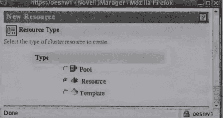

56

## 无需共享存储的集群

在你的 `LDAP` 服务器集群资源中，配置加载脚本在加载资源时将辅助 IP 地址添加到服务器上。此外，配置卸载脚本以便在将资源离线或将其迁移到集群中的另一个节点时删除该地址。这里是一个我们使用地址 `192.168.1.120` 的示例：

| LDAP 资源加载脚本 | LDAP 资源卸载脚本 |
| :--- | :--- |
| `add secondary ip address 192.168.1.120` | `del secondary ip address` |
| `192.168.1.120` |  |

在集群中设置好 `LDAP` 服务器后，它就可以使用了。不需要重置 `LDAP` 服务器或加载或卸载 `NLDAP.NLM`。一旦新的辅助 IP 地址在服务器上可用，`LDAP` 服务器将自动绑定到该地址。

### 提示

如果你需要设置安全的 `LDAP` 服务器，可能需要在每个集群节点上使用相同的服务器证书，新增

## 安装与配置

在开始安装之前，请确保满足以下要求。对于 `NetWare`，包括：

- 在混合环境中需要有一台 `NetWare` 服务器和一台 `Linux` 服务器；在单操作系统环境中需要两台 `NetWare` 服务器。
- 所有服务器必须至少有 `512MB` 内存；建议 `1024MB` 或更多。
- 你必须至少有一个本地磁盘设备。对于本文，`iSCSI` 和基于光纤的 `SAN`（存储区域网络）没有区别。

71

## 第 4 章：安装与配置

在开始安装之前，请确保满足以下要求。对于 `NetWare`，包括：

- 在混合环境中需要有一台 `NetWare` 服务器和一台 `Linux` 服务器；在单操作系统环境中需要两台 `NetWare` 服务器。
- 所有服务器必须至少有 `512MB` 内存；建议 `1024MB` 或更多。
- 你必须在每台服务器上至少有一个本地磁盘设备用于 `SYS:` 卷。
- 所有服务器必须配置 IP 并处于同一子网内。
- 集群对象需要一个可用的 IP 地址，每个集群资源都需要一个可用的 IP 地址。
- 如果你想使用共享存储系统，必须正确设置共享磁盘，并至少有一个分区用于安装脑裂检测器 `SBD`。

当所有前提条件后，可以如下所示进行安装：

1. 将 `OES NetWare` 安装 CD 插入计算机的光驱器。这将自动启动部署管理器。或者登录 `iManager` 启动集群安装。
2. 在“安装后任务”下，点击“安装/升级集群”，然后点击“安装或升级集群”。这将启动安装工具。
3. 在安装工具的启动屏幕上点击“下一步”。选择“创建新集群”开始安装。在此屏幕上，你还会看到“跳过文件复制”选项（见图 4.1）。该选项默认勾选：结果是创建集群所需的所有文件都复制到 `NetWare` 服务器。如果你想再次复制所有文件，可以取消勾选此选项，但通常不需要。点击“下一步”继续。
4. 在下一个屏幕（如图 4.2 所示），需要为集群对象创建信息。首先，输入你想安装集群的树名称；最后，输入你想创建集群的 `eDirectory` 容器名称。这将创建一个特殊目的容器，所有集群对象将安装在其中。你可以使用“浏览”按钮输入树和上下文的名称，也可以手动输入。

### 图 4.1

在安装集群时，你不需要再次拷贝所有文件到服务器。

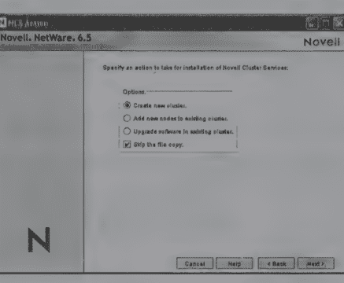

### 图 4.2

要在 `eDirectory` 中创建集群对象，必须提供集群对象的名称以及在 `eDirectory` 中创建它的它的位置。

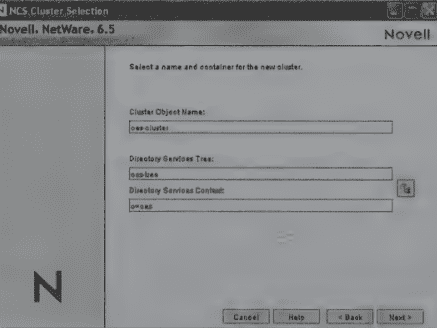

5. 现在，选择所有你想添加到集群的 `NetWare` 服务器（见图 4.3）。`Linux` 服务器无法通过此方式添加。在添加所有 `NetWare` 服务器后，点击“下一步”继续。

## 第 4 章：安装与配置

图 4.3

从 Deployment Manager 运行的集群安装实用程序中，只能向集群添加 `NetWare` 服务器。

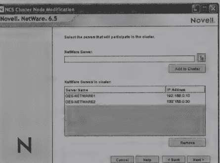

6. 下一步，你必须为集群输入一个唯一的 IP 地址。该地址必须与你作为节点添加到集群的所有服务器处于同一子网中。此 IP 地址将被添加到主 IP 地址资源中。该对象将自动创建，并由集群中的主节点维护，无论该时刻主节点是哪一个。输入 IP 地址然后点击“下一步”继续。


# 第 4 章：安装与配置

## 在 OES NetWare 上安装 NCS

### 7. 共享介质配置
现在，你必须指定集群是否具有共享介质（见图 4.4）。如果是，则在该介质上创建“脑裂检测器”（Split Brain Detector）分区。然而，也可以在没有共享介质的情况下创建集群；你可以在第 3 章“集群设计”中找到更多相关信息。如果你想使用共享介质，为了获得更高的容错性，你可以对共享介质进行镜像。当然，只有在集群硬件支持镜像时你才能这样做。接下来选择你想用于共享介质的存储设备，点击“下一步”继续。

### 提示
确保在你所有想要添加到集群的服务器上都配置了对共享介质的访问。如果此时某个服务器无法访问共享介质，你将无法按照程序第 7 步所示指示选择共享介质。

### 8. 启动选项
在后续屏幕中，你可以指示你是否希望集群软件在启动时自动启动。在大多数情况下，在这里选择“是”是有意义的；但是，如果某些软件必须在之前启动并完全初始化……

图 4.4
在大多数情况下，最好创建一个具有共享介质访问权限的集群。
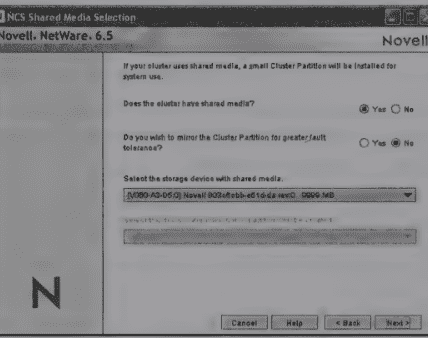

图 4.5
如果“集群成员”（Cluster Membership）出现且所有节点如上所示，则安装成功。
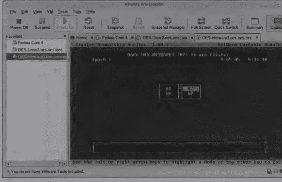

你尚未安装 VMware Tools。

## 集群安装后探索 eDirectory

安装 Novell Cluster 服务（Novell Cluster Services）会向 eDirectory 添加一些对象（见图 4.6）。我们现在将对所有添加的项进行简要概述：

- 集群容器（cluster container）：当你向 eDirectory 树添加集群时，会为你添加的每个集群创建一个集群容器。在该容器中你将找到所有与集群相关的对象。
- 主 IP 地址资源（Master_IP_Address_Resource）：创建集群对象时，你为集群指定了一个 IP 地址。此 IP 地址被添加到 Master_IP_Address_Resource 中。
- 集群节点对象（cluster node object）：对于添加到集群的每个服务器，都会创建一个集群节点对象。
- 集群模板对象（Cluster template objects）：还会创建一些模板对象。这些模板对象将让你更容易按照在本章以及第 6 章“集群管理”中的描述创建集群资源。

除了这些默认对象外，在创建集群资源时，树中还会添加更多集群相关的对象。

图 4.6
在你的树中安装 NCS 后，树中添加了一些与集群相关的对象。
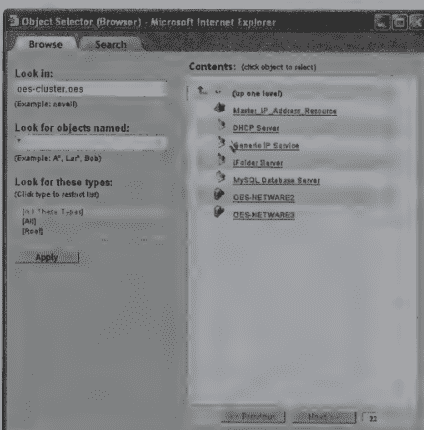

## 向 NetWare 集群添加 NetWare 节点

向 NetWare 集群添加 OES NetWare 节点非常简单：只需使用 `Deployment Manager` 执行此任务即可。该程序与初始安装集群软件非常相似：

- 从 OES NetWare 安装光盘启动 `Deployment Manager`，选择“安装后任务”（Post-Install Tasks），“安装/升级集群”（Install/Upgrade Cluster）。接下来点击“安装或升级集群”启动安装程序。在打开屏幕上，点击“下一步”继续。
- 选择“向现有集群添加新节点”（Add New Nodes to Existing Cluster）并点击“下一步”继续。
- 输入新节点所需的集群对象名称，并选择找到该对象的 eDirectory 树和上下文。然后点击“下一步”。现在从 eDirectory 读取现有集群对象的配置。
- 输入你想添加到集群的服务器名称。然后点击“添加到集群”（Add to Cluster）将其添加到集群。点击“下一步”继续。
- 在“启动选项”（Start Options）下，选择“是”以指定你希望集群软件在……自动启动。


## 6. 选择现有集群或新集群

选择“现有集群”（Existing Cluster）以将 OES Linux 服务器安装到现有集群中，或选择“新集群”（New Cluster）来创建一个新集群。如图 4.10 所示输入集群对象的名称。由于集群已存在于 eDirectory 中，因此您不需要提供其他信息。只有当你想创建一个新集群时，才需要指定集群的 IP 地址，并且如果您想使用共享存储设备（见图 4.11），则需要指定该设备的 Linux 设备名称。

图 4.10

要向现有集群添加节点，您只需要输入 eDirectory 集群对象即可。

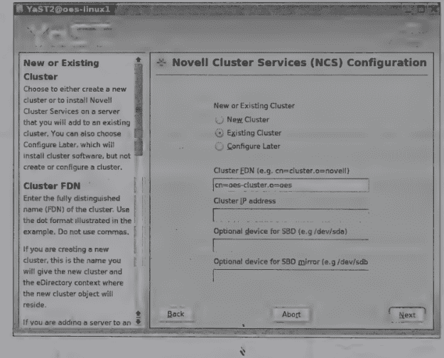

提示

不知道该使用什么设备名称？在 YaST 中，选择“系统”（System）->“分区器”（Partitioner）。此实用程序会显示系统已知的所有存储设备的概览。iSCSI 分区将显示为类型为奇数的分区。有关 iSCSI 的更多信息，请参阅第 7 章“iSCSI”。

现，选择您想在集群中使用的节点 IP 地址。这可以是节点在局域网上可见的 IP 地址，也可以分配给光纤接口之一的 IP 地址。确保同时也勾选了“现在启动集群服务”（Start Clustering Services Now），然后点击“下一步”继续。必要信息现在将写入 eDirectory，Novell 集群服务将在该节点上启动。

## 图 4.11

在 YaST 分区实用程序中，您可以选择 iSCSI 设备的设备名称。

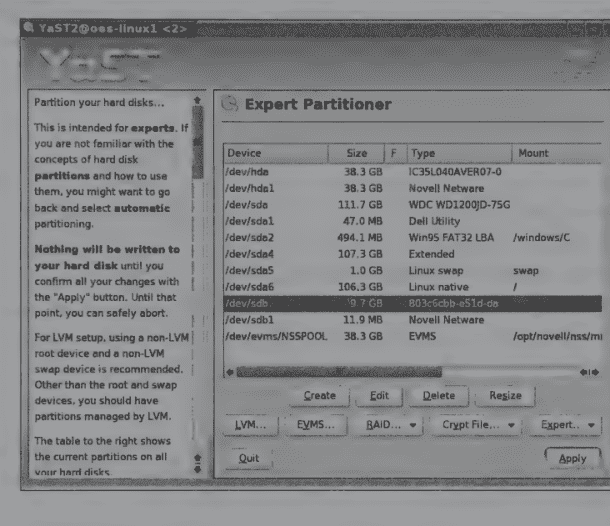

## 向 Linux 集群添加 NetWare 节点

向 Linux 集群添加 NetWare 节点的描述非常简单：你不能。在纯 Linux 集群中，无法添加任何 NetWare 节点。在混合集群中，无法添加任何 NetWare 节点。

## 手动启动和停止 NCS

出于管理目的，手动启动和停止集群是有用的。在 OES NetWare 上，使用 `SYS:\SYSTEM` 中的 `LDNCS.NCF` 脚本启动集群。要在 OES NetWare 上卸载集群，请使用 `ULDNS.NCF`。然而，在成功从服务器卸载所有集群模块之前，您必须执行 `cluster leave` 命令或 `cluster down` 命令。

可用集群命令的完整参考请参见第 5 章“创建集群资源”。

在 OES Linux 上，您可以使用 `cluster down` 命令卸载集群软件。在关闭集群后重新加入集群，请使用 `cluster join` 命令。

## 为现有集群节点添加许可证

如果由于任何原因，集群中某个节点的许可证出现问题，可以稍后添加许可证。如果没有正确的许可证，节点将无法留在集群中，并在几分钟后自动离开！

稍后为现有集群节点添加许可证时，可以使用以下步骤：

- 1. 启动 iManager 并以管理员权限的用户身份登录。
- 2. 选择“许可证”（Licenses）、“删除许可证”（Delete a License），并浏览到现有 NCS 许可证的位置。在安装任何新许可证之前，必须将它们从树中移除！
- 3. 删除许可证后，选择“许可证”（Licenses）、“安装许可证”（Install a License）。现在，在工作站上浏览到许可证文件的位置。
- 4. 选择许可证文件并点击“下一步”。然后选择您想要安装许可证文件的目录容器。点击“下一步”，点击“安装”（Install）在 eDirectory 中安装许可证，然后点击“完成”（Done）完成许可证安装。

在购买之前，您可以测试创建您的双节点集群。创建双节点集群的许可证包含在开放企业级服务器（Open Enterprise Server）的评估版中。

## 从集群中移除节点

可能会发生您需要从集群中完全移除一个节点的情况。此操作非常简单：离开集群（Leave the cluster）、卸载所有与集群相关的模块，并移除启动集群时激活的所有文件。后文将描述每种 OES 版本的具体步骤。

### 从集群中移除 OES NetWare 节点

当您将 NetWare 集群迁移到 Linux 时，成功迁移后应移除您的 NetWare 节点。此外，在取出 NetWare 节点之前，您应该将其从集群中正确移除。接述步骤说明了如何执行此任务：

- 1. 在 NetWare 控制台上，输入 `cluster leave` 以离开集群。
- 2. 输入 `ULDCS` 以卸载 Novell NetWare 服务。
- 3. 从 iManager 中删除集群节点对象（见图 4.12）。这是在集群容器中为此节点添加的对象。

图 4.12

从集群中移除节点的步骤之一是从集群容器中移除集群节点对象。

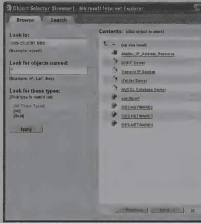

- 4. 从 `AUTOEXEC.NCF` 中移除 `LDNCS` 行。
- 5. 将服务器与共享存储断开。
- 6. 重启服务器。

在此过程中，与集群相关的 NLMs 未从服务器中移除。如果您也想移除它们，请确保从 `SYS:\SYSTEM` 中移除了以下模块：

```
CLSTR.NLM
SBD.NLM
SBD.NLM
CRM.NLM
CMA.NLM
TRUST.NLM
CMON.NLM
LDNCS.NCF
ULDCS.NCF
```

### 从集群中移除 OES Linux 节点

- 1. 在 OES Linux 服务器上，打开 shell 并输入命令 `rcnovell-ncs` 停止集群守护进程。
- 2. 使用 `cluster-enable` 防止虚拟机运行。
- 3. 启动 YaST，根据需要输入 root 密码，并选择“软件”（Software）、“安装和删除”（Install and Remove）。
- 4. 从列表中选择“选择”（Selections），如图 4.13 所示。下一步，选择“Novell Cluster Services”。

图 4.13

OES Linux，使用 YaST 从服务器上移除 NCS。

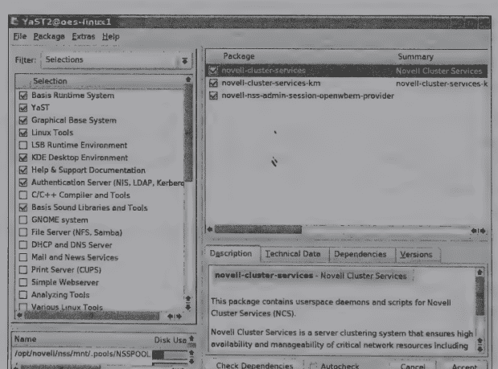

- 5. 双击 Novell Cluster Services 包含的每个软件包包。结果是，您将在软件包名称前看到一个垃圾桶符号。然后，点击“接受”（Accept）开始从服务器上移除软件。
- 6. 重启服务器以完成该节点的移除。

## 在 VMware 环境中安装 NCS

使用 Novell 集群服务的系统要求之一是，必须为集群中的服务器使用某种共享磁盘。您可以使用共享磁盘、光纤通道或 iSCSI。如果您有物理硬件，这非常简单。在虚拟化环境中它是如何工作的呢？

出于许多原因，您可能想在 VMware 环境中安装 NCS。这可能是为了整合生产服务器、为了设置测试环境，或者只是为了兴趣学习集群的工作原理并学习 CNE。

### 什么是 VMware

如果您以前没有用过，让我们简要介绍一下 VMware 技术。通过 VMware 产品，您可以在操作系统上创建虚拟机。这些虚拟机是完整的电脑。它们有自己的硬盘和网络功能。VMware 不模拟主机处理器，而是由 VMware 在主机 CPU 上处理所有线程。因此，虚拟机与主机使用相同的 CPU。其他硬件以 IDE 或 SCSI 磁盘、AMD 网络适配器和默认 VMware 适配器的形式进行仿真。由于硬件始终是相同的，虚拟机可以在运行 VMware 软件的计算机之间迁移。

## 第 4 章：安装与配置

通过硬件盒并运行 vMotion 产品，你获得的可用性非常高。通过 vMotion，你可以将虚拟机从一个硬件盒移动到另一个硬件盒。但当问题发生时，这并自动发生。此外，它对客户操作系统（在本例中为 Open Enterprise Server）内部的问题没有帮助。NCS 仍然可以帮助你提高虚拟机环境内部软件组件的可用性。如果服务器发生严重错误，集群中的其他节点将接管服务。当所有集群节点都运行在单个硬件盒上，这甚至是有益的。

也可以使用 VMware GSX Server 和 VMware Workstation 执行集群操作。这些所谓的“托管型”产品运行在 Windows 或 Linux 服务器环境之上。VMware GSX Server 正式支持集群，因此使其成为在虚拟机内部运行集群化 Open Enterprise Servers 的可行解决方案。对于 VMware Workstation，不支持集群功能，但你仍然可以使用该产品创建测试环境，或为了教育目的设置集群。

### VMware 集群要求

无论你使用哪种产品，都需要考虑的两个特殊配置。首先，你必须使用固定大小的磁盘。这是你在 VMware ESX Server 中可以创建的磁盘类型。对于 Workstation 和 GSX Server，你可以使用动态增长磁盘。但如果它们都向虚拟磁盘文件写入数据并尝试增加磁盘大小，这将损坏磁盘内部的数据。因此，在创建要在虚拟机之间共享的新虚拟磁盘时，必须使用“分配所有磁盘空间”（Allocate All Disk Space）设置。


需要记住的另一个配置是，必须配置总线共享（bus-sharing）功能或磁盘锁定（disk-locking）功能。服务器级产品支持集群，它们提供了总线共享（ESX Server）和 SCSI 留（GSX Server）。VMware Workstation 不支持这些；对于该产品，你必须禁用磁盘锁定磁盘缓存。这些配置将在本文稍后部分描述。

## VMware 集群配置

VMware 集群配置将在以下子节详细介绍。

### 在 VMware ESX Server 中添加共享磁盘

在 VMware ESX Server 中为虚拟机设置集群有两种可能。你可以使用来自 SAN 的物理 LUN（逻辑单元）并将其分配给两个或多个虚拟机，或者创建一个新的虚拟磁盘文件并将其添加到虚拟机中。虚拟机的配置可以通过管理界面（Management Interface）、远程控制台（Remote Console）工具或 VMware VirtualCenter 管理应用程序进行。

由于管理界面始终可用，我们决定在随后的指令中使用它作为示例。如果你知道如何操作之前描述的另外两个应用程序，那么翻译到这些程序应该不会有太大问题。以下指令基于双节点集群。步骤从两个已经配置好的虚拟机开始。有关如何设置虚拟机的说明可以在 VMware 文档中找到，书中也容易获得。执行以下步骤为虚拟机添加共享磁盘：

- 1. 在管理界面中，点击虚拟机名称（超链接）以打开第一个服务器的配置窗口。转到“硬件”（Hardware）标签页或从弹出菜单中选择“配置硬件”（Configure Hardware）以进入该标签页。

- 2. 点击硬件配置表底部的“添加硬盘”（Add Hard Disk）链接。

- 3. 选择“硬盘”（Hard Disk）作为要添加的设备类型。这将启动虚拟磁盘配置向导。在向导中，选择创建一个空白虚拟磁盘。你也可以在此选择使用物理 LUN。但对于此示例，我们使用共享虚拟磁盘。

- 4. 在下一个配置窗口中，选择虚拟磁盘文件的位置和大小。对于 Open Enterprise Server 中的 SBD 磁盘，最小 20MB 的大小足够。将磁盘分配给虚拟 SCSI适配器 1（见图 4.14）。共享磁盘必须分配到单独的控制器。将“磁盘模式”（Disk Mode）设置保持默认的“持久性”（Persistent）。

图 4.14

创建一个共享磁盘并将其分配给虚拟 SCSI 适配器 1。

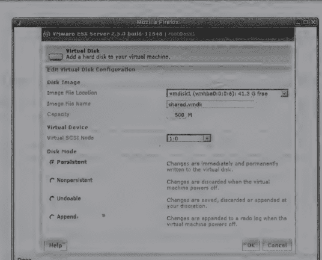

- 5. 在虚拟机的硬件配置标签页中，选择在上一步添加磁盘后添加“SCSI 控制器 1”的“编辑”（Edit）。将“总线共享”（Bus Sharing）选项设置为“虚拟”（Virtual）（见图 4.15）。

图 4.15

将总线共享选项设置为“虚拟”。

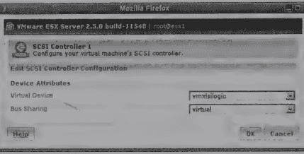

- 6. 打开集群中第二个节点的硬件配置标签页，为该节点添加共享磁盘。点击配置屏幕底部的“添加设备”（Add Device）链接。向机器添加一个硬盘，但现在选择现有磁盘并指向你在步骤 4 中创建的共享磁盘。如图 4.14 所示，磁盘必须分配到 SCSI 节点 1:0，就像对另一个虚拟机所做的那样。

- 7. 现在配置在将虚拟磁盘添加到该控制器时已添加到第二个节点的“SCSI 控制器 1”。将“总线共享”设置设置为“虚拟”，就像你在步骤 5 中对另一个节点操作的那样。

你现在已配置好虚拟机使用相同的共享磁盘。此时，你可以在 Open Enterprise Server 中安装 Novell Cluster Services。

### 在 VMware GSX SERVER 和 VMware WORKSTATION 中添加共享磁盘

GSX Server 和 Workstation 中集群的通用设置是相同的。对于每个产品，只有一个特殊步骤需要执行。这些指令基于双节点集群。步骤从两个已经配置好的虚拟机开始。

### 在 VMware 中安装 NCS

执行以下步骤为虚拟机添加共享磁盘：

- 1. 在虚拟机设置中，点击“添加”（Add）。

- 2. 在“添加硬件”向导欢迎界面，点击“下一步”。

- 3. 选择“硬盘”（Hard Disk）作为设备类型，点击“下一步”。

- 4. 在“选择磁盘”窗口中，选择“创建新磁盘”，点击“下一步”。

- 5. 选择“推荐”（Recommended）磁盘类型，点击“下一步”。

- 6. 在“指定容量”窗口中，如图 4.16 所示，选择磁盘大小。对于分脑检测器（Split Brain Detector），500MB 的大小是足够的。

图 4.16

选择“分配所有磁盘空间”以创建固定磁盘。


## 注意

忘记启用“分配所有磁盘空间”选项，以便在硬盘上创建一个 500MB 文件。

- 7. 你将收到警告，预分配磁盘可能需要长时间。如果你准备好创建所选磁盘，点击“是”。

- 8. 为你的磁盘指定名称，并在硬盘上选择位置。选择磁盘文件位置后，点击“高级”（Advanced）按钮为磁盘指定正确的 SCSI 总线。

- 9. 在“高级选择”屏幕上，为你的 SCSI 磁盘选择 SCSI 1:0，如图 4.17 所示。

图 4.17

在虚拟 SCSI 总线上选择 SCSI 1:0。

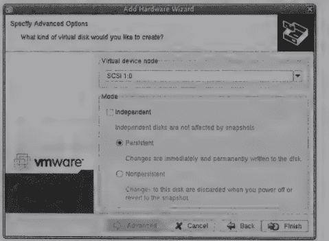

- 10. 点击“完成”（Finish）。固定大小磁盘现在将创建。

- 11. 关闭第一台虚拟机的配置面板。

- 12. 打开第二个服务器的虚拟机配置。

- 13. 按照你在第一台服务器上执行的相同三个步骤添加新硬盘（步骤 1、2 和 3）。

- 14. 在“选择磁盘”窗口中，选择“使用现有的虚拟磁盘”（Using Existing Virtual Disk）。

- 15. 浏览你在步骤 8 中创建的共享磁盘文件。选择 `.vmdk` 文件。也点击“高级”按钮，选择 SCSI-1:0 作为磁盘的位置。

- 16. 点击“完成”并关闭虚拟机设置面板。

你现在已经配置了虚拟机，使其访问同一个虚拟磁盘。你现在必须按照后续步骤对 VMware GSX Server 或 VMware Workstation 进行相应的操作，以启用集群支持。

## 完成 GSX SERVER 配置

VMware GSX Server 通过 SCSI 预留支持虚拟机集群。你必须在你刚刚添加共享磁盘的虚拟 SCSI 总线上启用此项功能。你还必须禁用磁盘锁定功能，以防止虚拟机锁定虚拟磁盘，否则只会允许一个节点访问磁盘。请关闭 VMware GSX 虚拟机以手动编辑配置文件。

在两个虚拟机的 `.vmx` 文件中添加以下行：

```
disk.locking = "false"

scsi1.sharedBus = "virtual"
```

这启用了整个 SCSI1 总线的 SCSI 共享功能。如果你不想共享整个总线，而是想共享该总线上的单个磁盘，你也可以通过条目配置单个磁盘共享：

```
scsi1.shared = "true"
```

（(1:1) 表示第二个 SCSI 总线上的第二个磁盘。）

当你现在启动虚拟机时，两台服务器都将能够共享磁盘。此时，你就可以安装 Novell 集群服务（Novell Cluster Services）。

## 完成 VMware WORKSTATION 配置

VMware Workstation 不支持虚拟机集群，也不支持 SCSI 预留。然而，你可以配置虚拟机在启动时激活共享磁盘。你还必须禁用缓存以防止虚拟机损坏磁盘。请关闭 VMware Workstation 虚拟机以手动编辑配置文件。

在两个虚拟机的 `.vmx` 文件中添加以下行：

```
disk.locking = "false"

diskLib.dataCacheSize = "0"
```

当你启动它们时，两台服务器都将能够共享磁盘。此时，你就可以安装 Novell 集群服务。

## 创建集群资源

现在你的服务器上已经安装了 Novell 集群服务（NCS）软件，是时候继续创建一些集群资源了。在本章中，你将学习集群资源创建的基础知识。第 8 章“安装支持集群的应用程序”提供了关于某些特定应用程序集群的详细信息。

## 创建集群卷

在很多情况下，集群资源需要集群卷。其原因显而易见：集群资源通常需要向卷写入数据。如果这是一个本地卷，且由于硬件故障导致资源转移到集群中的另一台服务器，那么该资源将无法访问其数据。因此，必须提供一种解决方案，使集群资源可以使用这些数据，即使在硬件故障后资源已转移到集群中的另一个节点。处理此问题的最佳方法是将卷对象集群化。如果你正在操作 Open Enterprise Server (OES) NetWare 集群，则这些必须是 Novell Storage Services（NSS）卷。在 OES Linux 环境中，Reiser 和 ext3 卷也可以在集群上共享。然而，如果必须将 NetWare 集群迁移到 Linux 集群，则 Linux 节点上只能使用 NSS 卷。对于混合节点集群也是如此。


## 第 5 章：创建集群资源

提示

Novell 的 `NSS` 文件系统提供其他 Linux 文件系统不具备的优势。例如，`NSS` 允许你使用高级的 Novelli 权限系统，这在其他 Linux 文件系统中是不可用的。如果你的环境中不需要高级的 `NSS` 功能，最好使用 `Reiser` 作为你集群卷的文件系统。它的优势是 `Reiser` 在写入文件时写入的元数据较少，因此在文件写入方面更快。`Reiser` 和 `NSS` 均能够处理一个目录中的大量小文件。`Ext3` 不是处理大量小文件的良好选择。因此，在需要特殊的 `NSS` 特性时使用 `NSS`，如果不需要，则改用 `Reiser`。

## 在 OES Linux 和 NetWare 上创建集群卷

设置好后，将在 OES Linux 和 NetWare 上创建集群卷。设置集群的第一步是创建集群卷。此过程涉及三个主要步骤：
- 1. 创建分区
- 2. 创建池
- 3. 创建卷

以下步骤适用于 NetWare 和 Linux。

## 创建共享磁盘分区

在创建共享分区之前，必须启用集群服务。安装集群服务后，你可以通过以下步骤设置共享磁盘分区。无论你使用哪种工具，结果都是相同的。

在你配置集群时，需要通过 `NSSU` 创建共享磁盘分区。如果你还没有共享存储系统，请参阅第 7 章“iSCSI”以获取更多信息。如果共享存储系统可用，请按照以下步骤创建集群卷：
- 1. 在集群控制台中启动 `NSSU` 工具。
- 2. 选择 `Devices`（设备）选项并按回车键检查共享磁盘。如图 5.1 所示，`NSSU` 中的 `Devices` 选项可以帮助你识别共享磁盘。

图 5.1


- 3. 在 NetWare 上，返回 `NSSU` 主菜单并选择 `Partitions`（分区）。在现有分区的概述中，你可能会看到一个集群分区。点击 `Insert`（插入）创建一个分区。
- 4. 现在选择要创建分区的设备。设备名称将类似于 `012`。选择设备后，按回车键。
- 5. 接下来，选择 `NSS` 作为分区类型并按回车键。然后，如图 5.2 所示，输入分区的大小，并可选输入池名称。如果你输入了池名称，将自动创建 `NSS` 池。在本过程中，我们现在不创建 `NSS` 池；稍后会完成。现在选择 `Create`（创建）并按回车键，创建将标记为集群共享的分区。

现在你就可以创建 `NSS` 池。创建 `NSS` 池是强制性的，因为只有在 `NSS` 池中才能创建 `NSS` 卷。

第 5 章：创建集群资源

图 5.2


在创建了标记为集群共享的 `NSS` 分区后，你可以继续创建 `NSS` 池对象。以下步骤解释了如何创建 `NSS` 池：
- 1. 启动浏览器并访问 `https://yourserver/n` 进入 `iManager`。
- 2. 打开 `Storage`（存储）、`Pools`（池），并选择了要创建 `NSS` 池的服务器，如图 5.3 所示。你现在将看到可用池的概述。点击 `New`（新建）创建一个新池。

图 5.3


## 创建集群卷

3. 现在，选择你想要创建池的磁盘空间。你可以在 `NSS` 分区中创建池，但也可以直接在空闲磁盘空间中创建池。后者的场景将自动创建所需的分区。由于我们刚刚创建了 `NSS` 分区，并且显然想使用它，因此在本例中选择了该 `NSS` 分区。请注意，在 Linux 上，需要遵循的步骤略有不同：你应该直接在空闲磁盘空间上创建 `NSS` 池。
4. 接下来，你可以指定创建池的选项。确保同时勾选了“创建时激活（`Activate on Creation`）”和“创建时启用（`Enable on Creation`）”。如果你想在集群环境中使用池中的卷，则后项选项尤为重要。点击“下一步”后，需要输入一些集群参数，如图 5.4 所示。请确保为以下参数赋予值：
- **虚拟服务器名称 (Virtual Server Name)**：集群环境中的所有资源都需要一个虚拟服务器名称。这对于终端用户是必要的，因为用户希望直接连接到资源，而不是到当前在集群环境中托管该资源的服务器。任何启用集群的 `NSS` 池的虚拟服务器名称都会自动创建，但你可以将其更改为任何喜欢的名称。请确保选择的名称在网络是唯一的。
- **CIFS 服务器名称 (CIFS Server Name)**：这是将向网络上所有 `CIFS` 客户端广播的 `CIFS` 名称。只有在“广播协议（Advertising Protocols）”选项下选择了 `CIFS` 时，才需要此名称。
- **IP 地址 (IP Address)**：所有启用集群的 `NSS` 池都需要一个唯一的 IP 地址。这是终端用户访问池的地址，无论当前托管池的服务器是哪。
- **广播协议 (Advertising Protocols)**：你可以选择三种协议，允许终端用户连接到集群资源中创建的池：用于原生 NetWare 的 `NCP`、用于 Windows 客户端和其他安装了 `CIFS` 协议栈的 `CIFS`，以及用于 Apple 客户端的 `AFP`。如果你想启用 `CIFS` 协议作为广播协议，请务必也指定 `CIFS` 服务器名称。所有这些协议的支持将自动添加到集群资源加载脚本中。
5. 指定所有所需参数后，点击“创建”以创建 `NSS` 池。对每个所需的额外池重复此过程。

## 已创建的卷对象

现在分区和池已经就绪，你可以在其中创建一个或多个卷。在将这些卷分配给网络中的其他服务器之前，请确保这些服务器已安装 `NSS`；否则你将无法访问卷。默认情况下，所有 OES NetWare 节点都启用了 `NSS`，但在所有 OES Linux 节点上默认禁用了。

第 5 章：创建集群资源

图 5.4

在创建 `NSS` 池时，你还需要指定池作为集群资源所需的所有参数。

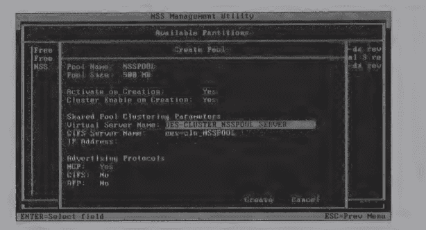

我们现在向你展示如何从 `NSSMU` 工具创建 `NSS` 卷：
- 1. 从 `NSSMU` 主菜单中选择“卷（`Volumes`）”选项。这将显示所有当前存在卷的概述，如图 5.5 所示。

图 5.5

在 `NSSMU` 主菜单中选择“卷”选项后，你将看到当前从此服务器可以访问的所有卷的概述。

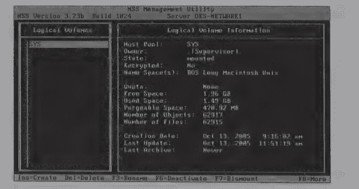
- 2. 按下键盘上的 `Insert` 键并输入新卷的名称。如果你想创建一个加密卷，请对弹出的“加密卷（`Encrypt Volume`）”问题回答“是”。否则，选择“否”继续。现在选择你想要创建卷的卷池，并按回车键。
- 3. 你将看到在创建 `NSS` 卷时可以设置的所有属性的概述。选择你需要的所有选项（见图 5.6）。

## 图 5.6

在创建卷时，你可以设置许多选项。

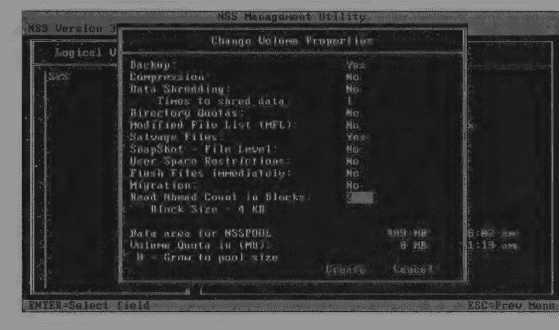

## 提示

你现在不需要指定这些中的任何选项。这里列出的所有选项在卷创建创建后都可以更改。

这里给出了可用选项的说明：
- **备份 (Backup)**：如果你希望能够使用你的备份软件创建卷的备份，请选择此选项。
- **压缩 (Compression)**：如果你想对卷上的文件或目录使用压缩，请将此选项设置为“是”。
- **数据粉碎 (Data Shredding)**：数据粉碎功能是用随机模式覆盖已删除的文件，以确保在删除后原始文件的内容不再是可读。如果你想使用此功能，请选择“是”，并随后指定粉碎数据的次数。
- **目录配额 (Directory Quotes)**：如果你希望能够限制目录占用的磁盘空间，请选择“是”。

第 5 章：创建集群资源
- **修改的文件列表 (Modified File List)**：修改的文件文件列表允许备份软件以一种智能的方式进行增量备份。如果你的备份软件支持此功能，请务必启用此选项。
- **恢复文件 (Salvage Files)**：恢复选项允许管理员在文件被意外删除后将其撤销删除。如果你想使用这个非常有用的选项，请确保选中了默认值“是”。
- **快照 - 文件级 (Snapshot - File Level)**：文件级快照允许你在处理文件时保留该文件的不同版本。该文件的旧版本将存储在 `MySQL` 数据库中以备万一。
- **用户空间限制 (User Space Restrictions)**：如果你希望能够限制用户写入的磁盘空间，请选择此选项。
- **立即刷新 (Flush Files)**：写入磁盘的文件会先写入缓存，然后写入服务器的硬盘驱动；然而，如果服务器崩溃，缓存中尚未写入的文件将丢失。如果你想避免在这种情况下丢失文件，请务必启用“立即刷新”选项。
- **迁移 (Migration)**：迁移功能允许文件迁移到离线存储媒体，例如磁带卷。如果你的服务器需要处理不想存储在服务器上的大量数据，此功能非常有用。


### 预读块数 (Read Ahead Count)
预读块数提高了服务器的读取功能。它不仅读取被请求的块，还读取随后的块。这是因为通常需要随后的块。预读数的默认值为`2`，这在大多数情况下都是很好的值。

4. 在指定了你想使用的选项后，仍然需要指定卷的大小。你可以在“卷配额（Volume Quota）”选项中设置。默认情况下，此值为`0`，允许卷增长到池的大小。如果你不想使用此功能而想指定固定大小，请在此输入。接下来，点击“创建”创建卷。

创建启用集群的池后，你可以从 `iManager` 验证它的存在性。在 `iManager` 中，选择“集群（Clusters）”、“集群选项（Cluster Options）”，然后浏览到集群对象。这将显示集群中当前存在的对象列表。NSS 池对象位于其中，如图 5.7 所示。

图 5.7

启用集群的池对象自动作为资源添加到集群对象列表中。

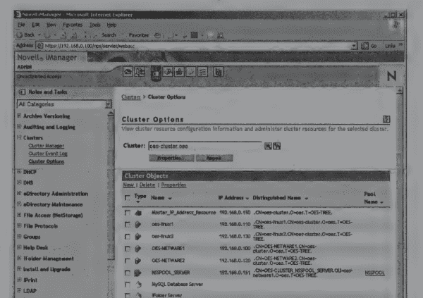

## 为 Linux 集群卷选择正确的文件系统类型

在 OES Linux 上，你也可以像之前那样创建 NSS 卷。

在滚动集群中，甚至可以将 OES NetWare 上创建的 NSS 卷挂载到 OES Linux 节点。你可以阅读之前提供的程序以了解 OES Linux 上启用集群的 NSS 卷的所有配置；之前提到的 `NSSMU` 工具在 OES Linux 中同样可用。如果你不需要 NSS 提供的任何特定优势，你也可以对传统的 Linux 文件系统进行集群化。如果你想这样做，建议在共享磁盘上使用 `EVMS` 卷管理器，而不是默认选择的 `LVM` 卷管理器。这是因为 `EVMS` 是为集群环境创建的，而 `LVM` 则不是。出于这个原因，

## 第 5 章：创建集群资源

你可能创建集群 `LVM` 卷，但在运行环境中使用它们时可能会遇到问题，因为 `LVM` 并没有得到真正的支持。在接后的步骤中，你将学习如何在共享磁盘设备上创建 `EVMS` 卷，并在网络中的服务器之间共享它。我们将使用 `ext3` 文件系统对该卷进行格式化。在下一节“创建集群资源”中，你将学习如何在集群环境中使用这些卷。

在集群环境中使用卷管理器可以确保你可以在所有节点上使用相同的卷名称进行工作。然而，你也可以为集群卷创建本地设备名称，而不是使用 `EVMS` 卷名称。但是，使用像 `dev/sda` 这样的名称的缺点是它无法保证集群中的所有节点都使用相同的设备名称。这在集群加载脚本中构成了一个严重问题，因为加载脚本必须在集群中的所有节点上引用卷的相同设备名称。

如果你想在集群环境中使用 Linux 文件系统，你应该在选择文件系统之前经过深熟考虑。`ext3` 和 `Reiser` 等传统文件系统可以在集群环境中使用，但它们不能同时被多个节点访问。如果你想创建一个可以被多个集群节点同时访问的集群卷，你应该使用专为集群环境设计的文件系统，如 `OCFSV2`、`GFS` 或 `PolySver`。`NCS` 支持 `OCFSV2`。

接下来的步骤描述了如何在集群中的一个节点上创建 `EVMS` 卷。这假设共享存储设备已经正确设置好。在这种情况下，我们描述了如何创建一个一次可由一个节点访问的 `EVMS` 卷；你需要创建一个集群资源，并在该资源的加载脚本中安排挂载 `EVMS` 卷：

1. 从你想要授予集群卷访问权限的节点启动 `YaST`。在提示时输入 `root` 密码。

2. 从 `YaST` 的“系统”（System）菜单中选择“分区器”（Partitioner）工具。你将看到一个警告，提到在继续之前务必确定你正在做什么。告诉软件你有能力点击“是”（Yes）。分区器工具现在将启动。

3. 在分区概览中，你将看到当前存在的设备列表。此列表包含了你可以访问的所有本地设备以及共享存储设备。在图 5.8 中，设备 `sda` 是本地存储设备，`sdb` 是在 OES NetWare 目标上创建的 `iSCSI` 分区（更多详情请参见第 6 章“集群管理”）。在该分区上，有一个 11.9MB 的 NetWare 分区用于脑裂检测器（Split Brain Detector）进程。

### 图 5.8
YaST 分区工具将显示所有本地设备以及网络上的共享设备。

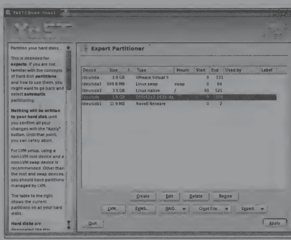

4. 现在点击“创建”（Create）按钮并选择你想要创建集群卷的驱动器。确保你选择的是网络上的共享设备而不是本地设备，然后点击“确定”（OK）继续。现在指定你想创建一个主分区并点击“确定”继续。

5. 如图 5.9 所示，你现在将看到显示你要创建的 `EVMS` 分区所有属性的屏幕。使用以下规格并点击“确定”继续：

- 选择“不格式化”（Do Not Format）。
- 在“文件系统 ID”下拉列表中，选择 `0x8E Linux LVM`。
- 在“大小”（Size）区域，选择“结束”（End）并指定你想创建的分区大小。例如，如果你想创建一个 30GB 的分区，输入值 `+30GB`。

6. 你现在已经创建了一个准备好用于 `EVMS` 的分区。现在让我们继续在该分区上创建一些 `EVMS` 卷。这是一个两步过程。首先，你必须创建一个 `EVMS` 容器。`EVMS` 容器可以用于收集来自不同设备的可用存储。我们在这里不会这样做，但在任何情况下，都需要一个 `EVMS` 容器。在创建 `EVMS` 容器之后，你可以在其中创建 `EVMS` 卷。

要创建 `EVMS` 容器，请确保在“专家分区器”（Expert Partitioner）屏幕上选择了你刚刚创建的 Linux LVM 分区，如图 5.10 所示。然后点击 `EVMS` 按钮。

### 图 5.9
如果你想创建一个 `EVMS` 卷，请从创建一个 `LVM` 分区开始。

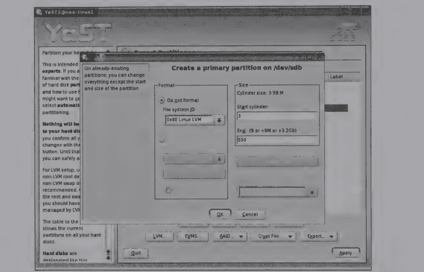

### 图 5.10
确保选择了 `LVM` 分区，然后创建 `EVMS`。

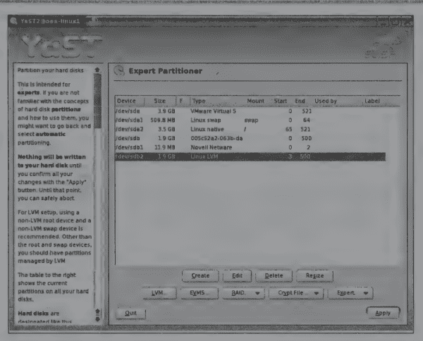

7. 现在启动了 `EVMS` 容器。在此屏幕上，选择“创建容器”（Create Container）。如图 5.11 所示，这打开了一个新窗口，你可以在其中编辑 `EVMS` 容器的属性。一个重要的属性是物理区大小（physical extent size）。你最好将其与创建逻辑卷时输入的块大小进行比较。默认情况下，物理区大小为 4MB。此大小决定了逻辑卷的大小始终是 4MB 的倍数。4MB 的物理区大小允许你创建最大为 256GB 的逻辑卷。你需要更多吗？那么请使用更大的物理区大小。例如，使用 16MB 的物理区大小来创建 1TB 的卷。最大卷大小始终是物理区大小的 65,523 倍。

### 图 5.11
在“创建 EVMS 容器”屏幕上，你必须为你想要创建的容器输入所有属性。

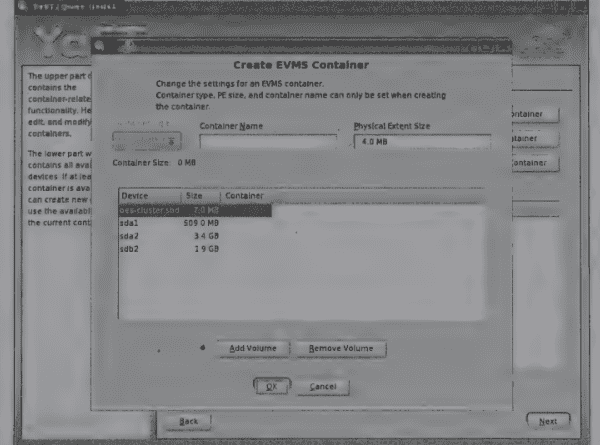

8. 从设备列表中选择在共享存储设备上创建的 `LVM` 分区，设备名称将为 `/dev/sda sdb`、`sdc` 或更高，后面跟跟一个数字。在图 5.11 中，我们需要选择 `sdb2` 设备。现在输入容器名称（`system` 是一个不错的选择）并点击“添加卷”（Add Volume）。如图 5.12 所示，`EVMS` 设备名称已添加到你之前创建的 `LVM` 分区中。现在点击“确定”关闭屏幕。这将带你回到 `EVMS` 配置器主界面。

### 图 5.12
在将 `EVMS` 容器添加到 `LVM` 分区后，容器名称将添加到设备环境中。

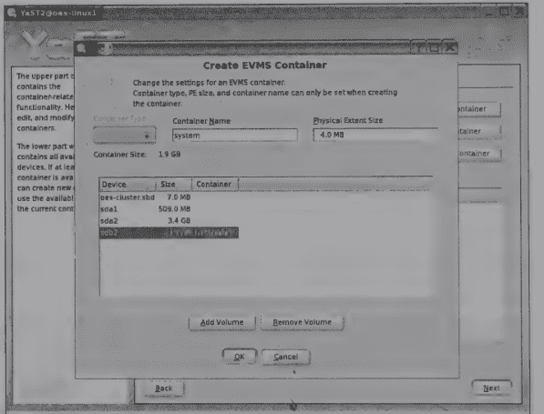

9. 现在你必须在 `EVMS` 容器中创建一些逻辑卷。这些逻辑卷将是存储数据的存储设备。确保在 `EVMS` 容器下拉列表中选择了 `EVMS` 容器，然后点击“添加”（Add）以添加新的 `EVMS` 卷。如图 5.13 所示，这将显示“创建逻辑卷”屏幕，你必须在其中输入你想要为新分区使用的所有属性。

### 图 5.13
在“创建逻辑卷”屏幕上，你可以输入要创建的逻辑卷所需的所有属性。

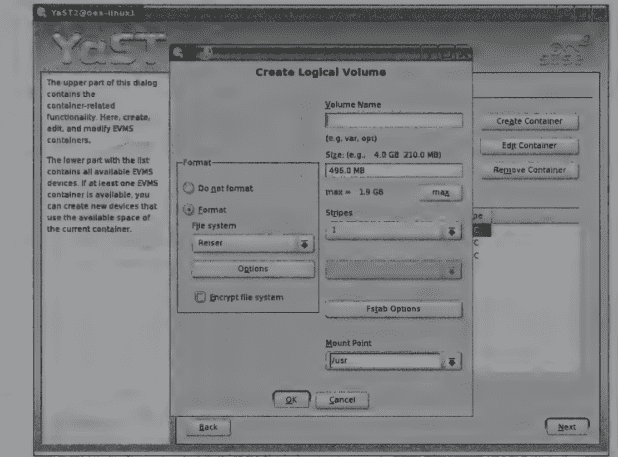

10. 为以下属性输入值然后点击“确定”继续：

- 卷名称（Volume Name）：这将是卷的设备名称。你可以在本地文件系统的 `/dev` 目录下的 `/dev/evms/lvm/evms-container-name` 此名称。例如，如果 `EVMS` 容器名称为 `system`，卷名称为 `data`，则完整的 `EVMS` 卷设备名称将为 `/dev/evms/lvm/system/data`。
- 大小（Size）：在此处输入卷所需的大小。
- 条带（Stripes）：带数决定了数据写入的设备数量。如果你在创建卷的 `EVMS` 容器中只有一个设备，那么选择 1 以外的任何内容都没有意义。然而，如果 `EVMS` 容器包含四个设备，那么选择 4 是有意义的；这将强制数据同时写入所有这四个设备，并提高卷的速度。


- 条带大小（Stripe Size）：如果你只使用一个条带，默认条带大小为 `64KB`。然而，如果你使用多个条带，可以选择条带大小。大小。最小条带大小为 `4KB`，最大为 `512KB`。在处理许多小文件时如果速度遇到问题，请选择较小的条带大小；如果在处理大文件时存储遇到问题，请选择较大的条带大小。

- Fstab 选项：在此处您可以指定从 `fstab` 挂载文件系统的选项。由于逻辑卷不会从 `fstab` 挂载，因此该选项会被忽略。

- 挂载点（Mount Point）：此选项用于 `fstab` 指定卷需要从 `fstab` 挂载的目录。软件需要在此处的目录名称。我们建议您使用一个虚拟目录，因为您最终会将其从 `fstab` 中删除。

- 格式（Format）：在此处您指定您想在集群卷上使用的文件系统。您可以使用 `ext2`、`reiser`、`xfs` 或 `jfs`。由于 `ext3` 是一种广泛支持的文件系统，我们建议您使用 `ext3`；但是，如果您有特殊理由选择其他系统，也可以进行选择。

- 加密文件系统（Encrypt File System）：某些文件系统可以加密。出于速度考虑，我们建议不要在集群文件系统上使用加密。

- 11. 如果需要，重复此过程以创建更多集群卷。完成后，点击“下一步”继续。在专家分区器映射屏幕上，点击应用您的设置。在显示将应用的更改概述的屏幕中，点击“完成”应用您的更改。修改现在将写入共享存储设备。

您现在已创建了一个可以在集群环境中使用的 EVMS 卷。然而，在 Novel Cluster Services (NCS) 在集群所有节点上使用此卷之前，还需要执行一些任务。EVMS 的 YaST 安装程序假设卷位于本地磁盘上。因此，YaST 通过将访问卷所需的所有信息放入配置文件 `/etc/fstab` 中来简化访问卷的操作。这确保了卷在服务器启动时自动挂载。如果卷位于集群环境中的共享磁盘设备上，则不能由 YaST 自动挂载，而必须由加载使用这些卷的集群资源的脚本来加载。原因显而易见：您不希望本地机器管理这些卷（即集群资源）。此外，您必须确保在集群中需要访问卷的所有节点启动时激活 EVMS 服务。接下来的步骤说明了如何完成 EVMS 卷的安装：

- 1. 在配置了 EVMS 卷的服务器上，启动编辑器并打开 `/etc/fstab` 文件。在此文件中，您会看到一行确保集群卷自动启动的行。该行类似于示例。注释掉此行，以便卷在系统启动时不会从 `fstab` 激活。同时在某处记录 EVMS 卷的设备名称；稍后会需要：`/dev/evms/lvm/system/data /somewhere ext3 acl,user_xattr 1 2`

- 2. 现在您需要确保在所有需要访问共享卷的机器上启动 EVMS 服务。在所有这些机器上，进入 YaST，系统，运行级别编辑器（Runlevel Editor）。在运行级别编辑器中，选择“专家模式”并找到 `boot.evms` 服务，如图 5.14 所示。通过选择选项 B 确保该服务在系统启动时启动（您可以使用 Alt+B 键序列访问此选项）。然后点击“完成”和“是”以应用更改。

### 图 5.14

您需要确保在所有需要访问共享存储的机器启动时激活 `boot.evms` 脚本。

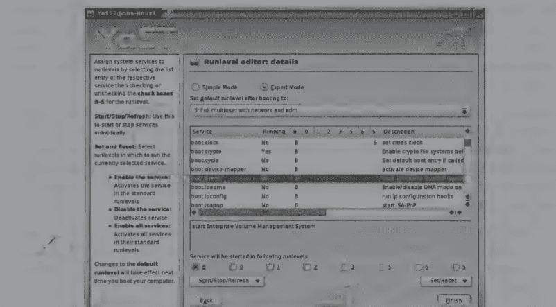

- 3. 在所有机器上执行 `/etc/init.d/boot.evms` 以启动 EVMS 服务，并确保所有机器都能访问共享卷。

- 4. 启动 EVMS 服务后，确保其他机器也可以访问该集群卷。首先打开命令行，然后使用命令

## 创建集群资源

现在您已经创建了集群卷，可以继续并配置使用这些卷的资源。我们现在将讨论如何在 OES Linux 和 OES NetWare 上配置这些资源。

### 在 OES NetWare 上对简单应用进行集群化

您现在将学习如何在 OES NetWare 上安装集群资源。我们选择不对非常复杂的应用程序进行集群化，而是选择一个简单的：动态主机配置协议（DHCP）服务器。即使您不计划对集群化运行在 OES NetWare 上的 DHCP 服务器，我们仍然建议您阅读此节；此节提供了一些关于创建集群资源的有用信息。

本节假设 DHCP 服务器已安装在您网络中的某一台服务器上。如果还没有，请在继续后续操作之前进行安装。注意，DHCP 服务器是一种特殊的集群资源，因为它不需要共享存储设备。这是因为 DHCP 服务器将其所有信息存储在 eDirectory 中。阅读第 8 章以获取有关需要共享存储设备的集群服务的更多信息。应用以下步骤在 OES NetWare 上将 DHCP 服务器创建为集群资源：

- 1. 安装后，DHCP 服务器由运行其上的服务器启动。这必须更改，因为 NCS 必须管理 DHCP 服务器。因此，请从服务器控制台停止 `DHPCSRVR.NLM`，并防止它从 `autoexec.ncf` 自动启动。

- 2. 从工作站启动 iManager 并访问您的服务器。输入管理员账户的名称和密码登录 iManager。然后从 iManager 的“角色和任务”（屏幕左侧）选择“集群（Clusters）”、“集群选项（Cluster Options）”。

- 3. 从“集群选项”窗口（如图 5.15 所示），使用放大镜选择您的集群。集群将被添加到您在安装时指定的 eDirectory 容器中并带有其自己的 eDirectory 对象。

#### 图 5.15

从“集群选项”窗口，选择您的集群对象。

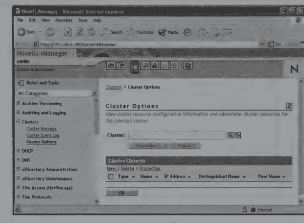

- 4. 接下来，您必须为想要集群化的 DHCP 服务器添加集群资源对象。从集群对象列表中，点击“新建（New）”。在打开的窗口中（见图 5.16），您可以从三种类型的集群对象中选择。选择“资源（Resource）”对象然后点击“下一步”继续。以下是可用对象的简列表：

- 池（Pool）：使用此项将 NSS 池创建为集群对象。注意，您需要此界面将 NSS 池创建为集群对象；正如本章前面讨论过的，您也可以从 NSSMM 界面添加 NSS 池。

- 资源（Resource）：对于您想要集群化的任何资源使用此选项。此选项用于几乎所有由集群管理的的服务。

- 模板（Template）：为了方便创建集群资源，默认提供了一些模板对象。在这些模板对象中提供了某些服务的默认设置。管理员也可以添加模板。

## 第 5 章：创建集群资源

#### 图 5.16

在创建集群资源之前，您必须选择要创建的资源类型。

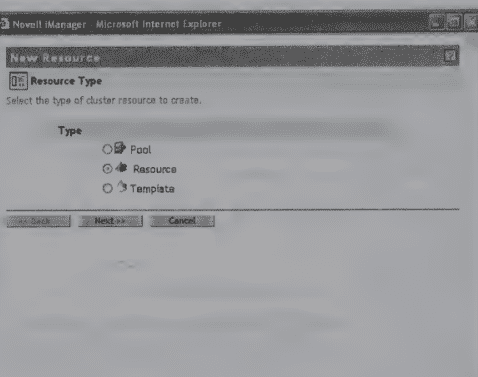

- 5. 现在为该资源指定名称。您还可以为集群资源对象选择一个模板以继承某些默认设置。使用放大镜从集群容器对象中选择模板对象。默认提供以下模板：

* DHCP 服务器：使用此模板集群化 NetWare DHCP 服务器。

* 通用 IP 服务（Generic IP Service）：对所有没有默认模板的服务使用此模板。

* iFolder 服务器：使用此模板集群化 NetWare 上的 iFolder 2 服务器。

* MySQL 数据库服务器：使用此模板集群化 NetWare 上的 MySQL 数据库服务器。

注意

可用模板列表可能会随版本发生变化。

- 6. 如图 5.17 所示选择 DHCP 服务器模板。接下来，确保选择了“定义其他属性（Define Additional Properties）”选项。如果您希望集群资源在创建后上线，也选择相应的选项。也可以在稍后从“集群管理器”窗口将集群资源上线。点击“下一步”。

#### 图 5.17

在创建集群资源时，建议选择一个模板来继承设置。

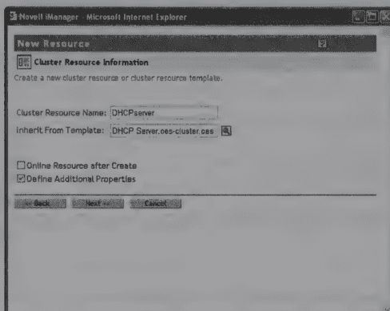

- 7. 现在显示了集群加载脚本，如图 5.18 所示。这是一个默认的集群加载脚本，用于激活通用的 DHCP 服务器。通过此加载脚本，将调用激活 DHCP 服务器所需的集群命令。

- 8. 激活 DHCP 服务器的集群加载脚本并不复杂。主要有三行代码用于启动服务器：

```
CLUSTER DHCP CN=SERVER.0=ORG.T=TREE
adj secondary ipaddress A.B.C.D
dchpsvr -d3 --servaddr=A.B.C.D
```

- 9. 在第一行中，`CLUSTER DHCP` 命令用于在服务故障转移时，将 DHCP 服务器的重要信息传递给集群中的另一台服务器。编辑此命令，以添加您的树中配置了 DHCP 的服务器的完整区分名称（DN）。例如，如果您的服务器是 `cn=oes-network1.ou=oes-network1.ou=oes`，且服务器是 `OES-TREE`，则该命令应为：

```
CLUSTER DHCP CN=OES-NETWORK1.OU=OES-NETWORK1.OU=OES,T=OES
```


## 第 5 章：创建集群资源

- 10. 编辑 `adj secondary ipaddress` 命令以分配一个 DHCP 服务器使用的 IP 地址：网络上的每个集群资源都需要自己的 IP 地址。这是最终用户通信的 IP 地址。确保该地址是与您的服务器地址相同范围内的唯一地址。

图 5.18

在集群加载脚本中，您指定了资源如何加载。

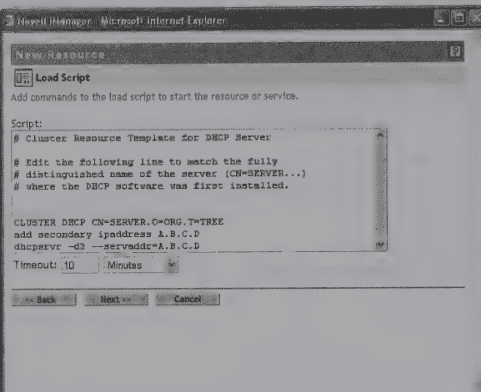

- 11. 编辑 `dhcpsrvr -d3 --servaddr=A.B.C.D` 命令，使其同样使用此 IP 地址。

### 提示

默认参数 `-d3` 将启用最高日志级别，并将所有信息记录到文件中。对于日常操作，最好将此参数设置为 `-d1`，以便在服务器屏幕上显示基本信息。

- 12. 接下来输入超时（Timeout）值。这是集群软件在生成错误消息之前尝试加载资源的持续时间。然后点击“下一步”继续。

- 13. 现在您可以看到卸载脚本，如图 5.19 所示。该脚本用于确保服务在从一个节点迁移到另一个节点时能够正确卸载。在此示例脚本中，只需要编辑一行，即删除次级 IP 地址的那行。请确保它反映了您在集群加载脚本中分配的 IP 地址。然后点击“下一步”继续。

### 创建集群资源

图 5.19

所有集群资源都需要一个卸载脚本才能正确卸载。

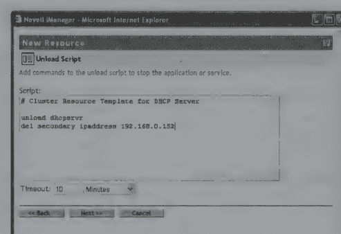

14. 接下来，如图 5.20 所示，您需要指定资源策略。做出选择后点击“下一步”继续。可用选项如下：

- 资源跟随主节点 (Resource Follows Master)：此资源将始终在集群主节点上运行。
- 忽略仲人数 (Ignore Quorum)：通常情况下，要在集群中启动服务，可以使用最小数量的集群节点。此最小数量定义为仲人数（quorum）。如果您想覆盖此特定资源的仲人数，请选择“忽略仲人数”选项。
- 启动模式 (Start Mode)：选择“Auto”在集群启动时自动启动此资源，或在您希望手动启动资源时选择“Manual”。
- 故障转移模式 (Failover Mode)：如果此选项设置为“Auto”，当当前运行的节点发生故障时，资源将自动迁移到集群中的另一个节点。如果您将此选项设置为“Manual”，则必须在发生故障后手动将资源迁移到另一个节点。
- 回滚模式 (Failback Mode)：默认选项“Disable”表示如果原始资源在故障恢复前运行在该节点上，则不应发生任何操作。如果您希望由管理员手动决定发生什么，请选择“Manual”；如果您希望资源自动返回到原始运行的节点，请选择“Auto”。

第 5 章：创建集群资源

图 5.20

资源策略界面指定了资源在集群中的用法。

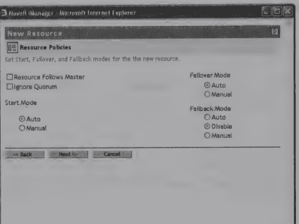

15. 在最后一步中，您必须将节点分配给集群资源，如图 5.21 所示。默认情况下，集群中的所有节点都将被分配。使用方向键从列表中删除您不想在该节点上激活的节点。故障转移将在第一个节点发生，如果出现问题，它将转移到第二个节点，依此类推。使用方向键更改顺序。确保在混合环境中，只有为该应用程序编写的操作系统才是。

103

图 5.21

默认情况下，集群中的所有节点都将被分配。

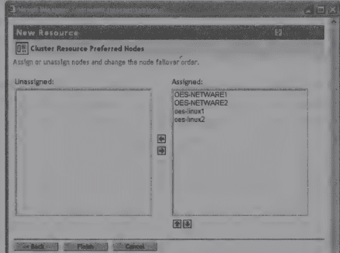

图 5.22

在集群管理器中，您可以查看所有节点和资源的概览。

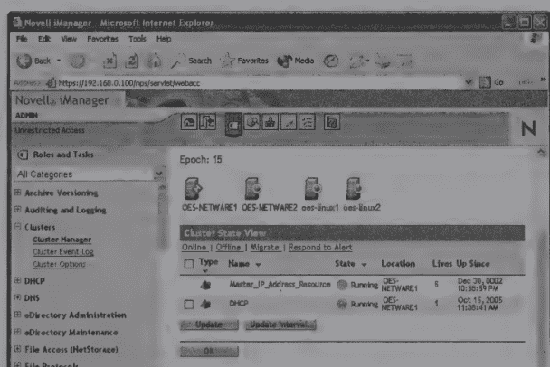

6. DHCP 服务器的配置文件仍然存储在 `/etc` 目录中。为了在集群环境中使用，你需要确保将这些文件复制到共享卷中。使用以下命令执行此操作：

`cp /etc/dhcpd.conf /mediadhcp/etc`

7. `dhcpd.conf` 文件并不是 DHCP 服务器需要的唯一文件。它还需要 `dhcpd.leases` 文件。该文件用于跟踪由此 DHCP 服务器分配的 IP 地址的当前使用情况。在集群环境中，此文件需要位于共享存储上。你不需要复制现有文件；相反，你必须创建一个新的空文件。使用以下命令创建此文件：

`touch /mediadhcp/var/lib/dhcp/dhcpd.leases`

8. 在完成所有准备后，你就可以为 DHCP 服务器创建集群资源。在启动之前，你必须确保共享卷已卸载。使用以下命令进行操作：

`umount /mediadhcp`

9. 现在打开浏览器，访问到 https://yourserver/nps 的 iManager URL，并以管理员权限的用户身份登录。选择角色和任务（Roles and Tasks）、集群（Clusters）、集群选项（Cluster Options）。选择你想要创建资源的集群。

### 提示

如果你以前在 iManager 中选择过此集群，可以使用“历史”（History）按钮方便访问之前输入的数据。历史按钮是选择集群选项旁放大镜右侧按钮。

10. 点击“新建”（New）并选择资源类型以创建集群资源。点击“下一步”（Next）继续。

11. 输入分配给集群资源的名称，然后选择要继承其设置的模板。OES Linux 提供了一个创建 DHCP 服务器资源的模板，以简化管理员的工作。选择此模板，确保选中了“定义附加属性”（Define Additional Properties）框框，然后点击“下一步”继续。

### 注意

在混合节点环境中，你可能会发现只有 NetWare 模板是可用的。在这种情况下，你无法选择模板对象，必须手动输入所有参数。

12. 现在你看到了集群加载脚本界面。在这里，你必须输入所有确保集群资源被正确加载的命令。以下脚本提供了一个应当发生情况的良好示例：

```bash
#!/bin/bash
. /opt/novell/ncs/lib/ncsfuncs
exit_on_error mount -t ext3 /dev/evms/lvm/system/dhcp /mnt/dhcp
exit_on_error add_secondary_ip_address 192.168.0.153
exit_on_error /usr/sbin/dhcp -cf /mnt/dhcp/etc/dhcpd.conf -lf \
    /mnt/dhcp/var/lib/dhcp/dhcpd.leases
exit 0
```

此脚本看起来可能复杂，但实际上并非如此。第一行表示该脚本采用 bash 语法（另见图 5.23）。在第二行中，调用了 NCS 特有的函数。这些函数都是可以在 NetWare 环境下的 NCS 加载脚本中使用的命令。这允许管理员在 NetWare 和 Linux 上使用相同的命令。在第三行，挂载了共享卷。该卷的挂载从 `exit_on_error` 命令开始，该命令来自 `ncs functions` 脚本。如果发生错误，它将立即停止。接下来，添加一个可供 DHCP 服务器使用的 IP 地址。激活 DHCP 服务器。注意选项 `-cf`（配置文件）和 `-lf`（租约文件），它们用于引用存储在不同于原始位置的两个配置文件。最后，使用 `exit 0` 命令告诉 shell 脚本已成功运行。根据需要修改你的脚本——不要忘记将超时值设置为几分钟——然后点击继续。

13. 现在你必须必须创建卸载脚本，如图 5.24 所示。要停止由上述加载脚本启动的 DHCP 服务器，可以使用以下卸载脚本：

```bash
#!/bin/bash
. /opt/novell/ncs/lib/ncsfuncs
ignore_error killproc -p /var/run/dhcpd.pid -TERM /usr/sbin/dhcpd
sleep 8
ignore_error error_fuser /mnt/dhcp
ignore_error del_secondary_ipaddress 192.168.0.153
exit_on_error ummount /mnt/dhcp
exit 0
```

### 图 5.23

在 OES Linux 上，集群加载脚本是一个 bash 脚本。

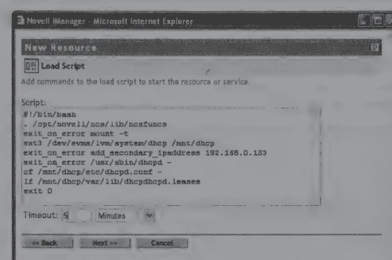

### 图 5.24

在卸载脚本中，NCS 确保无论如何都停止资源。

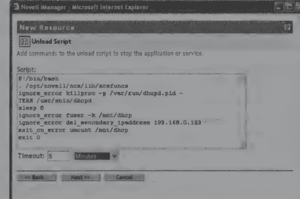

## 第 5 章：创建集群资源


此卸载脚本确保 DHCP 资源无论如何都被停止。注意脚本中使用的 `ignore_error` 语句，以确保脚本执行不会被中断且脚本会继续尝试。在脚本的第三行，使用 `killproc` 命令确保 DHCP 资源被终止。如果这在 8 秒内不起作用，将使用另一种方法强制终止服务。接下来，添加一个可供 DHCP 服务器使用的 IP 地址。激活 DHCP 服务器。注意选项 `-cf`（配置文件）和 `-lf`（租约文件），它们用于引用存储在不同原始位置的两个配置文件。最后，使用 `exit 0` 命令告诉 shell 脚本已运行成功。根据需要修改你的脚本——并不要忘记将超时值设置为几分钟——然后点击继续。

### 13. 策略可以确保共享卷未挂载。

### 14. 在最后一步中，必须设置资源策略。可用选项如下：

- **资源主（Resource Master）**：此资源将始终在集群节点上运行。
- **仲裁（Quorum）**：通常情况下，要启动集群必须有最小数量的节点。此最小值定义为仲裁。如果你想对此资源覆盖仲裁，请选择忽略仲裁（Ignore Quorum）。
- **启动模式（Start Mode）**：在集群启动时选择自动启动此资源，或者选择手动启动。
- **故障转移模式（Failover Mode）**：如果此选项设置为自动，当当前运行的节点故障时，资源将迁移到另一个节点。如果你设置为手动，则需要在故障后手动迁移资源。
- **回滚（Failback）**：默认选项禁用表示在原始节点恢复之前不要发生任何操作。选择手动由管理员决定。

### 15. 在最后一步，你必须为集群资源分配节点。默认情况下，集群中的所有节点都将被分配。使用方向键从列表中删除你不希望资源激活的节点。故障转移将按照节点的分配顺序进行：服务将在第一个节点上运行，出现问题时将转移到第二个节点，依此类推。使用方向键确保在混合环境中只选择为该应用程序编写的操作系统；在 NetWare 服务器上运行 Linux DHCP 服务器没有意义。完成后点击“完成”（Finish）。这将新创建的服务添加到集群对象列表中，如图 5.25 所示。

## 图 5.25

创建后，新的集群资源将添加到可用资源列表中。

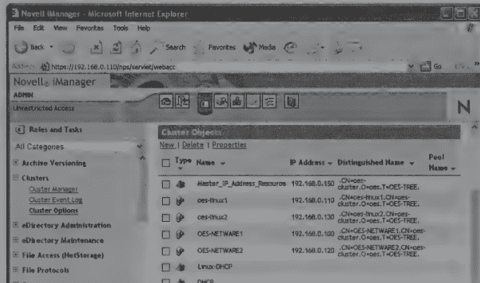

现在你已成功创建集群资源，可以在集群管理器界面启动它。选择资源复选框并点击上方菜单中的“上线”（Online）使其上线。这将使资源状态从离线变为运行中。如果遇到任何问题，请验证以下内容：

- 检查 DHCP 服务器当前未在任何节点上运行。
- 检查共享卷未在任何地方被挂载。
- 验证集群加载脚本中没有任何错误。
- 检查 `/var/log/messages` 中的任何可能指示脚本未加载的错误消息（另见图 5.26）。

# 第 5 章：创建集群资源

## 图 5.26

如果资源检查不正常，请检查 `/var/log/messages` 以查找线索。

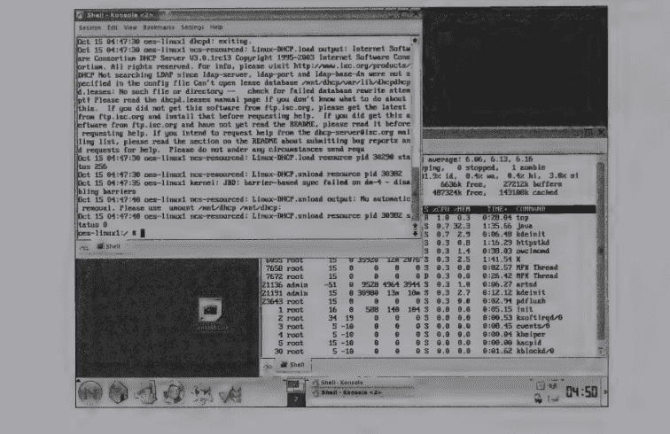

# 集群脚本语法

集群服务的一个重要组成部分是集群加载和卸载脚本。从 NCS 在 OES NetWare 和 OES Linux 上可用的一刻起，集群脚本的语法一直是 `bash`，且默认 shell 均在 NetWare 和 Linux 上均可用。在 NetWare 上，已经存在特定的 NCS 相关命令；在 Linux 上，这些命令被添加到一个由每个加载或卸载脚本创建的文件中。该行代码如下：

- `/opt/novell/ncs/lib/ncsfs`

在此脚本中，定义了以下函数：

- `del_secondary_ipaddress`：此命令可以从集群加载脚本调用，用于删除为特定服务添加的次要 IP 地址。
- `add_secondary_ipaddress`：此命令用于添加次要 IP 地址。需要此 IP 地址是因为运行在集群上的所有资源都需要一个独立于网络中服务器已用 IP 地址之外的 IP 地址。
- `exit_on_error`：此命令确保脚本在发生错误时停止。如果分配给集群资源的超时值尚未被超过，脚本将重新运行，直到成功或超过超时值。
- `ignore_error`：在某些情况下，必须忽略错误。此功能通常用于集群停止脚本。使用此语句的原因是，在集群停止脚本中，停止资源是重要的，而以最理想的方式执行它并不真正重要。

在资源加载和卸载脚本中，还可以使用某些集群特定的命令。这些是您既可以在控制台中使用，也可以用来管理集群及其资源的命令。下一章将提供这些命令的概览。

## 总结

在本章中，你学习了如何创建一些不复杂的集群资源。你还学习了如何在 NetWare 和 Linux 上设置共享卷。此外，你还学习了如何在两个平台上对 DHCP 服务器进行集群化。在章节结束处，对资源加载和卸载脚本中的函数进行了总结。在下一章中，你将获得更多关于如何操作集群管理应用程序的详细信息。

# 集群管理

过去，集群资源的管理可以通过许多实用程序进行。可以使用 Remote Manager、iManager 和 ConsoleOne。对于你的 NetWare 服务器，你仍然可以使用 ConsoleOne 和 Remote Manager；而对于 Linux 版 Open Enterprise Server (OES)，iManager 是集群环境的主要管理工具。此外，还有一些选项从命令行管理 Novell 集群服务 (NCS)。这些选项将在本章中讨论。此外，还涵盖了日志记录、事件历史和告警功能。

# 集群资源管理应用程序

过去，NCS 集群是从 ConsoleOne 管理的。现在，没有可用的插组件可以从 ConsoleOne 管理 NCS。从 Remote Manager 管理集群资源仅在 OES NetWare 服务器上支持。因此，本节的重点是通过 iManager 管理集群资源。

# 使用 iManager 管理集群资源

在 Open Enterprise Server 环境中，iManager 是所有与 eDirectory 相关资源的主要管理工具。因此，iManager 也是管理集群资源的工具。你可以通过支持的浏览器（如 Mozilla Firefox 或 Internet Explorer）访问 iManager。访问 iManager 的 URL 为 `https://yourserver/nps`。iManager 不必运行在集群节点本身，也可以从网络中的其他 OES 服务器上运行，只要它们位于同一个树下。

# 第 6 章：集群管理

提示

iManager 与 Mozilla 无法正常工作，因为其自带的是未打补丁的 OES Linux 版本。在服务器本身使用之前，你必须更新 iManager。然而，如果你有一台工作站，可以下载最新版本的 Mozilla 并取而使用之。

输入所需的 URL 后，你需要指定以下信息：

- **Username（用户名）**：这是你想要登录以管理集群环境的 eDirectory 账户。不支持完整的区分名称（DN），如 `admin.oes`；请使用相对区分名称，如 `admin.oes`。
- **Password（密码）**：这是给定用户的密码。
- **Tree（树）**：在此处输入你想要登录的树名称。但这仅在你的网络中服务定位协议 (SLP) 激活状态时才有效。除了输入树名称，你还可以输入要登录服务器的 DNS 名称或 IP 地址（见图 6.1）。

## 图 6.1

如果你在使用 SLP 连接树时遇到问题，请使用包含副本岛（replica island）的服务器 IP 地址或 DNS 名称。


登录 iManager 后，你可以在屏幕左侧的栏中看到你的账户可用的所有任务概览。该栏标题为“Roles and Tasks”（角色与任务）。在此侧边栏的 Clusters 下下有三个管理类别：

- **Cluster Manager（集群管理器）**：从此界面，你可以管理当前配置的资源。
- **Event Log（事件日志）**：在此界面你可以找到所有事件的概览。
- **Cluster Options（集群选项）**：这是配置集群通用设置的界面。

# 通过集群选项管理集群资源和通用参数

在第5章“创建集群资源”中，你学习了如何创建集群资源。从此界面，可以编辑集群的所有属性。

提示

对于新接触 iManager 的用户，这里有图 6.2 所示选择对象的简要描述。在选择对象屏幕上，你总是看到一个放大镜。它用于选择对象。点击它会启动一个浏览器。在浏览器中，你通常会看到链接的对象和以箭头开头的容器对象。如果你需要浏览到另一个容器，请使用方向键。如果你想选择一个对象，请点击链接。

以下步骤描述了如何修改对象属性：

1. 确保已选择集群资源，如图 6.2 所示。
2. 选择对象后，点击 Properties（属性）按钮访问集群属性。将在四个不同的选项卡上显示集群对象的所有通用属性。
3. 在 General（常规）选项卡上有三种属性，如图 6.3 所示：
   - 首先，输入集群的唯一 IP 地址及其端口地址。当原始使用的 IP 地址和端口需要更改时进行更改。


# 第 6 章：集群管理

## 集群资源管理应用程序

图 6.3

在“常规”`General`选项卡上，应用了仲裁触发器`quorum triggers`等通用设置。

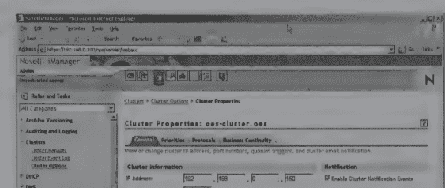

第二个属性是关于仲裁。它规定了资源开始加载之前集群中必须存在的节点数量。默认情况下，它将等待集群中的所有节点上线后再加载任何资源，但仅在指定的超时时间内进行。例如，假设仲裁中定义的节点数为7个，而超时限制设置为1分钟。如果分钟后集群中只有两个节点，资源也会在这两个节点上加载。通常集群中所有节点的默认仲裁运行良好。你应该始终确保仲裁中至少有两个节点。如果只指定了一个节点，它将激活所有集群资源在集群中第一个启动的节点上激活。

4. 下，激活“优先级”`Priorities`选项卡。在这里您将找到集群中当前配置的所有资源列表（见图 6.4）。此列表决定了哪些资源优先加载。请确保您最重要的资源位于列表顶部，较不重要的资源位于列表后部。如果某个资源依赖于另一个资源先加载，您可以对其进行指定。

5. 在图 6.5 所示的“协议”`Protocols`选项卡上，可以指定重要的协议设置。使用这些设置来指示集群中的节点应如何通信。这些设置在其他设置中非常重要，它们决定了当集群中的主节点宕机会发生什么。在更改任何这些设置后，请确保重启所有节点上的 Cluster 服务软件以激活新设置。

在此找到的第一个参数是心跳参数（配置脚本中的 `heartbeat rate_uses`）。该设置指定了非主节点每多久向主节点发送一次其存活信号。容差率（`caretaker tolerance`）与此相关：它指定了主节点给集群中其他节点留出指示其仍然存活的时间。如果主节点在此范围内没有收到任何其他节点的消息，它将自动将该节点从集群中移除。接下来，主守护进程（`sequencer master_watchdog`）参数指定了主节点每多久在网络发送一次信号以指示其仍然存活。默认设置为一秒，这意味着主节点每秒都会告诉所有其他节点它仍在那里。从守护进程（`sequencer slave_watchdog`）参数与此相关：它指示了主节点指示其存在的时间长度。如果它未能这样做，主节点将从集群中移除，其他节点中的一个将成为主节点。最大重传次数（`sequencer retrans_max`）选项在 NCS 中未使用，但未来可能会被使用。

图 6.4

确保集群中最重要的资源列在此选项卡上的第一位。

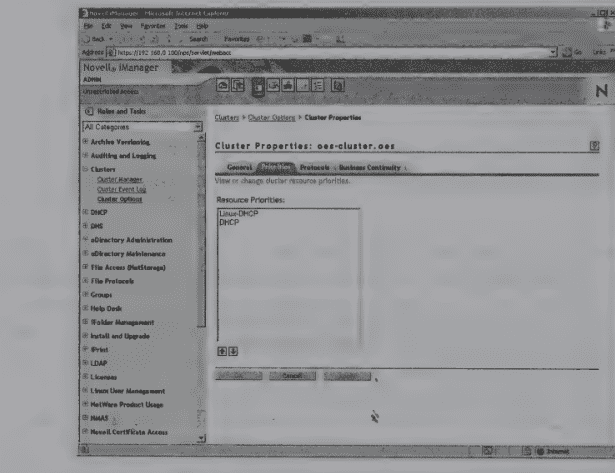

在“协议”屏幕的下半部分，您将看到更改任何这些参数时自动生成的脚本。这些选项有些尚未讨论：

- `panning clusterid`：这是集群的唯一标识符。对于集群中的所有节点，该值是相同的；对于属于其他集群成员的不同节点，该值应该是不同的。对于所有节点，`panning clusterid` 通常在节点启动并加入集群时自动设置。如果节点拒绝加入集群，您需要重启节点，这将自动纠正问题。
- `nodeid`：对于集群中的所有节点，都有一行 `nodeid`。它指示了节点的 ID 及其以及其在集群中的优先级。

图 6.5 协议设置决定了集群中的节点将如何通信。

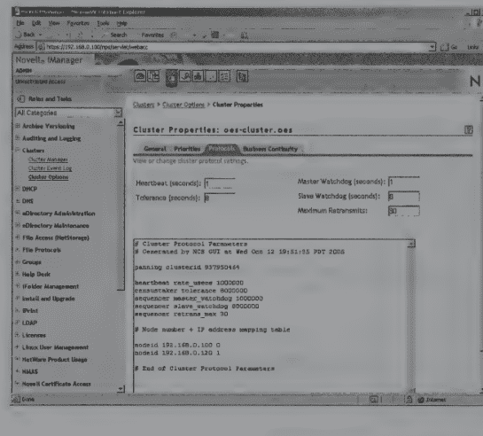

6. 最后，是“业务连续性”`Business Continuity`选项卡。该选项卡与业务连续性产品有关，该产品在第 12 章“业务连续性集群简介”中介绍。

7. 要保存所有修改，点击确定。

您在“集群选项”屏幕上遇到的下一个选项是“修复”`Repair`按钮。当出现与集群对象的问题时需要此选项：它将自动修复目录树中的所有相关对象，使得无需手动运行 `ndsrepair` 会话。

最后，是针对不同集群资源的特定选项。要访问这些对象的任何选项，请选择资源对象前面的复选框，然后点击“属性”`Properties`按钮。它将显示与该对象相关的所有属性。显示的选项与创建集群资源时指定的选项相同；有关它们的更多细节请参阅第 5 章。

## 从集群管理器界面管理集群资源

图 6.6 所示的集群管理器界面的目标是获取集群当前状态的概览。从此屏幕，您将立即看到集群中所有节点及相关资源的状态。该屏幕基本上是查看集群是否运行良好所需的所有内容。为了方便起见，屏幕还会自动刷新。

图 6.6

通过集群管理器提供了集群当前状态的概览。


在屏幕顶部，您将找到“运行报告”`Run`按钮。在选择要监控的集群后，可以使用此按钮获取当前状态，如图 6.7 所示。集群报告非常详尽：它提供了集群所有节点和资源的概览。它还显示了与这些对象相关的配置参数。

图 6.7 集群报告提供了正在发生情况的良好概述。

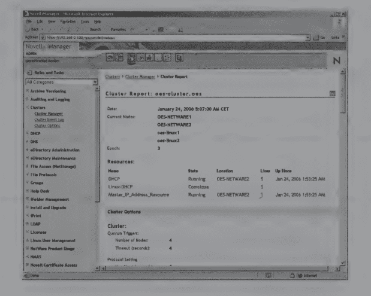

在集群事件日志中，提供了浏览按钮以用于浏览大型日志文件。如果情况下列出了许多事件，可以使用“过滤”`Filter`按钮指定搜索过滤器。在这种情况下，仅显示符合过滤器标准的事件（见图 6.9）。过滤器中的类别分为四个主题：

- 严重性`Severity`：指定严重程度。默认列出错误`Error`、警告`Warning`和正常`Normal`类别的事件。取消这些选项中的任何一个以查看更少的选项。
- 节点`Node`：显示集群中的所有节点。默认选中所有节点。取消其中任何一个以查看更少的日志条目。
- 资源`Resource`：显示集群中的所有资源。默认选中所有资源。
- 开始日期和时间`Start Date and Time`：指定从集群事件日志显示第一个条目的日期和时间。将其设置为您所需的任何时间，以查看与特定日期和时间相关的日志。

图 6.9

事件日志过滤器可以帮助您仅显示需要的信息。

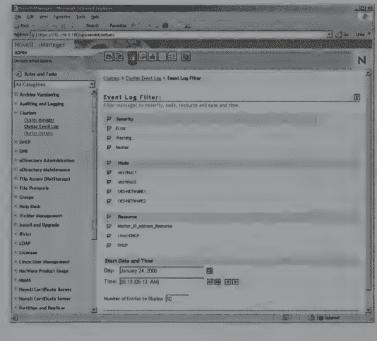

设置的过滤器不会自动清除。如果您想再次显示所有信息，请使用清除过滤器`Clear Filter`按钮。要删除日志文件中的所有条目，可以使用清除日志`Clear Log`按钮。

### 在 OES NetWare 上使用 Remote Manager 管理集群资源

虽然 iManager 是管理 Novell 集群服务的界面，但某些管理任务仍然可以通过 Remote Manager（远程管理器）完成。然而，这仅在访问 OES NetWare 节点上的 Remote Manager 时有效；对于运行在 Linux上的 OES，没有 Novell 集群服务的 Remote Manager 模块。在本节中将简要介绍 Novell 集群服务的 Remote Manager 管理选项。由于所有选项与 iManager 节中提到的选项完全相同，因此本节不再提供特定选项的详细信息。

要从 Remote Manager 访问管理功能，您需要访问 NetWare 服务器上的 Remote Manager。可以通过支持的浏览器（如 Mozilla Firefox 或 Internet Explorer）在 `https://yourserver:8009` 访问。以具有足够管理权限的用户身份登录后，Remote Manager 将显示所有可用选项。集群相关的选项位于 `Clustering` 标题下，如图 6.10 所示。

图 6.10

NetWare 上 Remote Manager 中的所有集群相关管理任务都在 `Clustering` 标题下。

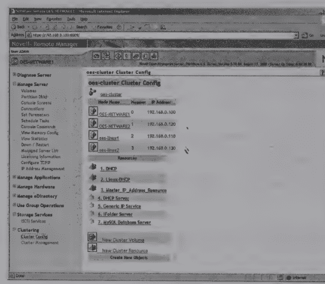

### 从命令行管理 Novell 集群服务

在 `Cluster Config` 选项下，您可以找到集群相关的 eDirectory 对象，以及创建新集群卷和资源的选项。列出的所有对象都带有超链接；如果您需要修改某些属性，可以从此界面进行操作。

`Cluster Management` 选项可用于显示所选节点的属性。它将显示有关节点和资源可用性的信息。这些信息默认每 10 秒自动刷新一次。集群中的主节点在图 6.11 中用黄色圆点标记；当前不可用的节点用灰色表示。从此界面，还可以设置资源属性并访问集群事件日志。

**图 6.11** - 在 NetWare 的 Remote Manager 中，通过 `Cluster Management` 界面显示集群节点和资源的状态。

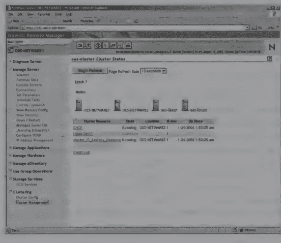


如果一切正常，通过浏览器界面管理 Novell 集群服务是方便的。如果运行不正常，您需要更深层的工具。或者有时您正坐在服务器房的服务器后面，想要快速执行任务，例如将资源迁移到另一个集群节点。因此，在本节中，您将学习如何从命令行启动和停止 Novell 集群服务，以及可以使用哪些命令行命令来管理集群。NetWare 和 Linux 上的命令行工具非常相似，因此合并在一个章节介绍。关于在 NetWare 和 Linux 上启动和停止 Novell 集群服务会有单独章节。

## 在 Linux 上启动和停止 Novell 集群服务

在 Linux 上启动 Novell 集群服务的主文件是 `/etc/init.d/novell-ncs`。该启动脚本在系统安装时自动创建。通常，它从系统启动程序调用，但由于某种原因需要启动和停止所有与 Novell 集群服务相关的模块，可以从命令行运行该脚本。您需要的命令是 `/etc/init.d/novell-ncs` 来停止，或者使用 `/etc/init.d/novell-ncs start` 来启动。请注意，在停止集群服务之前，应该执行 `cluster leave` 以离开集群。如果您想停止所有节点上的集群服务，请在卸载软件之前使用 `cluster down` 命令。

在 `/usr/sbin/novell-ncs` 中有一个可以替代的符号链接。因此，作为替代方案，您可以输入短命令 `rnovell-ncs stop` 或 `rnovell-ncs start`。

## 注意

在 Linux 上，所有服务都可以通过 `/etc/init.d` 目录下的所谓启动脚本启动。使用这些脚本的方法是输入脚本名称，后跟 `start`、`stop` 或 `restart`。在某些（但不是所有）情况下，也支持其他选项。这种方法的缺点是 `/etc/init.d` 目录不在 OES Linux 服务的搜索路径中。因此，在 OES Linux 上使用了符号链接（例如 `/usr/sbin/novell-ncs`）。使用这些符号链接使得启动、停止和重启变得方便得多。例如，您不需要输入完整路径。

以下是相关命令：

- `rnovell-ncs status`：用于显示 Novell 集群服务的状态。
- `rnovell-ncs restart`：停止并启动服务。

## 在 NetWare 上启动和停止 Novell 集群服务

在 NetWare 上，加载 Novell 集群服务的责任由单个控制文件（NCF）承担。该 NCF 的自动特性是 `LDCS.NCF`（加载 Novell 集群服务的缩写），并从 `AUTOEXC.NCF` 自动调用。对于 Linux，您应该注意现有的依赖关系。启动集群服务之前不需要手动加载 NSS，但在启动之前需要激活所有共享存储设备。这通常在 `STARTUP.NCF` 文件中执行。要卸载 NCS，可以执行 `LDCS.NCF` 文件。这将自动卸载所有集群相关模块。卸载软件将导致节点离开集群。

## 从命令行管理 Novell 集群服务

在对 Novell 集群服务进行调优和故障排除时，管理员需要从命令行管理集群服务。为此，创建了 `cluster` 命令。该命令有许多可以在命令行管理集群环境的选项。下列表中的所有命令都是 `cluster` 命令的参数（例如，`down` 命令应作为 `cluster down` 使用）。为了指示该命令是否可以在 NetWare、Linux 或两者上使用，在参数名称后添加了 `(n)`、`(l)` 或 `(n+)`：

- `alert {resource}{yes|no}`: `(l-n)` 此命令可用于当前处于警报（alert）状态的资源。这发生在资源启动、故障转移或故障恢复模式设置为手动（Manual）且资源正在等待某些情况发生时。如果是这样，使用此命令指定资源名称，后跟 `yes` 表示您希望资源启动、故障转移或故障恢复，后跟 `no` 表示您不想这样做。例如，`cluster alert dhcp yes` 用于 DHCP 配置后继续其需要的操作。您通常会在使用 `cluster status` 查询给定服务的状态后使用此选项。例如，要查询 DHCP 状态，先使用 `cluster status dhcp`，如果资源处于警报状态，则使用 `cluster alert dhcp yes`。

## 第 6 章：集群管理

- `scan for new devices`: `(n)` 此命令将扫描集群中所有 NetWare 节点上的新设备。该命令等同于 NetWare 命令 `scan for new devices`，如果你希望集群发现共享介质上的新逻辑单元（LUNs）、设备、卷或分区，可以使用此命令。
- `convert {preview|commit}`: `(l)` 此命令用于 Linux，以完成从 NetWare 到 Linux 的迁移。在将 NetWare 节点上的软件替换为 Linux 之后，所有在 NetWare 上创建的资源都必须转换为 Linux 格式以便使用正确的语法。使用 `cluster convert preview` 查看将发生的情况。这将显示集群加载脚本的旧语法以及将替换旧它的新语法。如果你对新语法满意，请使用 `cluster commit` 提交更改。
- `cv rebuild`: `(n)` 在 NetWare 上，可以使用此命令忽略当前的集群卷代理器（Cluster Volume Broker）数据库。这将重建数据库，从而允许使用重复的池名称。在激活和禁用集群卷时出现问题的情况下，此命令可能很有用。
- `cvbind {add, del}{resource}{IP address}`: `(n)` 在 NetWare 上，此命令用于启用依赖绑定到集群虚拟服务器地址的应用程序。如果使用，你需要指定应用程序资源名称和虚拟服务器的 IP 地址。同时使用 `add` 或 `del` 关来启用或禁用对虚拟服务器的绑定访问。
- `dhcp {context}`: `(n)` 在 NetWare 上，可以使用此命令指定 NCS 软件在 eDirectory 中查找动态主机配置协议（DHCP）配置的上下文。此命令可用于排除加载启用 eDirectory 的 DHCP 服务器时的问题。
- `down`: `(l+n)` 此命令从集群中移除所有节点。
- `info {all, basic, notification, priority, summary}`: `(l)` 用于在 STDOUT 显示（有时是大量的）信息。此命令仅适用于 Linux。`all` 选项将显示大量信息。在使用 `basic`、`notification`、`priority`、`protocol` 或 `summary` 选项时可以按类型过滤这些信息。
- `join`: `(l+n)` 此命令将发布命令的节点加入当前集群。
- `leave`: `(l+n)` 此命令从集群中移除发布命令的节点。
- `maintenance {on|off}`: `(l+n)` 此命令将集群节点置于维护模式。维护模式将临时挂集群心跳。如果你需要在不关闭集群中所有节点的情况下重置 LAN 交换机，这将非常有用。

## 从命令行管理 Novell 集群服务

- `migrate {resource}{node name}`: `(l+n)` 使用此命令对集群资源进行手动迁移。例如，使用 `cluster migrate dhcp node2` 将 DHCP 资源迁移到名为 `node2` 的服务器。
- `offline {resource}`: `(l+n)` 此命令用于停止资源。该命令必须在资源当前激活的节点上使用。
- `online {resource}{node name}`: `(l+n)` 此命令启动资源。如果未提供节点名称作为参数，资源将在其首选节点上启动。如果你想在特定节点上启动，可以提供该节点的名称作为参数；例如：`cluster online dhcp node2`。
- `pools`: `(l+n)` 可用于显示 Novell 集群服务可访问的 NSS 池列表。
- `resources`: `(l+n)` 此命令显示集群中当前存在的所有资源列表，无论其在线。
- `restart {seconds}`: `(l+n)` 此命令在指定的选项秒数后，重启集群中所有服务器上的集群服务。
- `set {parameter}{value}`: 所有可以通过图形界面设置的参数都可以通过此命令进行修改。可用参数如下：

  - `IPADDRESS`: 使用此命令设置集群 IP 地址。更改此参数后，必须重启所有节点上的集群软件。
  - `PORT`: 使用此参数更改集群端口号。
  - `QUORUMWAIT`: 使用此参数设置集群在资源开始加载前应等待的秒数。
  - `QUORUM`: 此参数定义了资源开始加载前集群中必须运行的节点最小数量。
  - `HEARTBEAT`: 此选项指定网络上心跳组播之间的时间。
  - `TOLERANCE`: 使用此参数指定主节点留给集群所有其他节点指示其存活的时间。


- `MASTERWATCHDOG`: 此参数指定用于检查主节点是否仍然存活的数据包之间的秒数。
- `SLAVEWATCHDOG`: 指定从节点留给主节点指示其仍然存活的秒数。
- `MAXRETRANSMITS`: 使用此参数指定主节点尝试联系集群中从节点的最大次数。
- `ENABLEEMAIL`: 使用此参数指示是否要开启或关闭电子邮件通知。此参数有三个选项：`OFF`、`CRITICAL`、`VERBOSE`。
- `EMAILADDRESSES`: 指定向集群警报发送的电子邮件地址。如果地址用空格分隔，可以包含多个地址。
- `EMAILOPTIONS`: 如果给此参数赋值 `XML`，则电子邮件通知将使用 `XML` 格式。如果未提供参数，邮件将仅为文本格式。
- `stats {display,clear}`: `(l+n)` 显示节点、名称和心跳信息。在 NetWare 上，这些显示在控制台上；在 Linux 上则显示在 `STDOUT`。
- `status {resource}`: `(l+n)` 此命令报告资源的详细状态。这也显示资源迁移或失败的次数。
- `view`: `(l+n)` 此命令显示主节点和集群中所有节点的名称。

## 日志、事件历史与警报

作为 Novell 集群服务的管理员，你需要知道系统发生了什么。Novell 集群服务将事件存储在其事件日志中。另一种发现问题的方法是检查 iManager 和 Remote Manager 中显示的消息。这很好，但你难道不想在问题发生时立即知道吗？电子邮件通知是一个解决方案。

为了能够使用电子邮件通知，必须首先为 Remote Manager 设置邮件设置。Novell 集群服务使用此邮件服务器通过 SMTP 发送电子邮件。

## 注意

可以在 Remote Manager 执行的任务都可以在 iManager 完成，有时也可以通过命令完成。对于对 Remote Manager 的工作感兴趣的用户，本过程解释了如何在 NetWare 上使用 Remote Manager 设置警报。

在集群中的每个节点上按照以下步骤配置您的邮件服务器：

1. 在 `https://yourserver:8009` 打开 Remote Manager。
2. 点击顶部面板中的配置图标。
3. 滚动到 HTTP 接口管理部分。然后点击邮件通知配置（Mail Notification Configuration）。这将显示图 6.12 所示的屏幕。

图 6.12

Remote Manager 有其选项可以指定向何处发送电子邮件警报。


4. 在主邮件名称字段输入您的出站 SMTP 服务器的 IP 地址或 DNS 名称。点击保存提交更改并继续。确保如果您使用的是 DNS 条目，集群中的所有节点都能解析到正确的 IP 地址。
5. 您可以输入可选的第二个邮件服务器地址以及一个显示消息来源的标识符。我们建议在后一个选项字段中使用服务器名称——例如：`SRV1@COMPANY.COM`。这将帮助您识别问题发生的位置，并在您设置电子邮件规则以自动组织此类邮件时提供帮助。此外，某些中继网关和垃圾邮件过滤器会阻止没有发件者地址的消息。点击保存提交更改并继续。

## 第 6 章：集群管理

在设置邮件服务器配置后，你必须指定消息发送的位置。集群服务（Cluster Services）不使用远程管理器（Remote Manager）中的电子邮件地址。你需要在集群对象的属性中配置电子邮件地址。在 iManager 中，可以在集群对象属性的“常规”（General）选项卡中配置。

“通知”（Notification）选项卡允许你配置是只想接收关键事件的通知，还是更倾向于接收所有消息。后者将就集群中发生的所有事件发送电子邮件。例如，当你将资源迁移到另一个节点时，系统会向你发送封电子邮件通知。对于日常操作，你可能只需要接收关键错误消息。

消息采用简单的清晰明文格式化：

主题：Cluster Resource Change

资源：Gw_SERVER 状态：Offline on Cluster001

该消息格式也可以配置为 XML。当你在集群属性中更改此设置时，你必须停止集群并卸载后重新加载集群软件。以普通文本形式显示的相同 Cluster Resource Change 消息在 XML 格式下显示如下：

```xml
<XML VERSION="1.0">
<CLUSTER-EVENT>
<RESOURCE-NAME>Gw_SERVER</RESOURCE-NAME>
<CLUSTER-NAME>Cluster01</CLUSTER-NAME>
<CLUSTER-TIME>2006 2 8 16:21:33</CLUSTER-TIME>
<EPOCH>-0</EPOCH>
<STATE>OFFLINE</STATE>
</RESOURCE-EVENT>
</CLUSTER-EVENT>
</XML>
```

运行主资源的服务器是发送电子邮件消息的服务器。你无法知道哪个节点将成为主节点，这就是为什么邮件服务器配置需要在集群中的每个节点上设置。当没有发送电子邮件且配置看起来正常时，在 NetWare 上，你可以启用主节点服务器上的 SMTP 屏幕，以检查软件正在的操作。在 Linux 上，没有此选项。使用以下命令启用屏幕：

```
SMTP SCREEN = 1
```

一个额外的服务器控制台屏幕将激活，并显示来自 Remote Manager SMTP 服务的所有 SMTP 活动。将值设为零可禁用该屏幕。

## 总结

在本章中，你学习了如何管理 NCS 环境。虽然可以使用不同的工具，但 iManager 确实是处理日常 NCS 管理任务的理想工具。作为替代，可以使用 `cluster` 命令从命令行管理 NCS，尽管这种操作要困难得多。只有在 NCS NetWare 环境中，才能使用 Remote Manager 进行 NCS 管理。对于那些仍在仅限 NetWare 环境中工作的人，我们也描述了一些通过 Remote Manager 进行操作的程序。

## 第 7 章

## iSCSI

本章的主题并非纯粹关于集群。iSCSI 是一种与存储相关的协议，可用于许多存储需求，包括用于集群的共享存储。在书中，我们不会深入介绍其他存储技术，例如存储区域网络（SAN）和直接附加存储（Direct Attached Storage）。但由于 Novell 出品的 Open Enterprise Server (OES) 支持 iSCSI，而且它对于集群来说是一项非常实用的技术，我们决定专门为这一主题增加一个章节。另一种跨集群共享存储的技术是分布式复制块设备设备（DRBD）。该技术将在第 11 章“使用 SUSE Linux Enterprise Server 集群选项”中介绍。

在本章中，我们介绍了什么是 iSCSI，并讨论了该协议的一些通用概念。我们还描述了如何用于 NetWare 和 Linux 的 Open Enterprise Server 软件。

### iSCSI 简介

iSCSI 协议为通过 TCP/IP 网络传输的小计算机系统接口（SCSI）块提供了一个传输层。通常，本地设备过去及现在都是通过 SCSI 连接。此类设备是数据中心中的磁盘和磁带驱动器，例如桌面上的扫描仪。SCSI 是一种通过称为总线（即 SCSI 总线）的通信消息来传输数据的协议，在总线上，所有设备（包括计算机中的主机适配器）都有唯一的地址，且控制块在设备之间往返传输。例如，服务器向一个 SCSI 磁盘发送一个磁盘写入控制块，磁盘回复一个控制块，告知服务器数据已写入。iSCSI 的工作方式是作为这些控制块——命令描述块（Command Descriptor Blocks, CDBs）的封装，在它们内部封装了 iSCSI 协议数据包，称为协议数据单元（PDUs）。

## 第 7 章：iSCSI

iSCSI 起于 20 世纪 90 年代后期，主要来自 IBM 和 Cisco 的研究。iSCSI 标准化的第一个提案是 2002 年 7 月的 RFC 3347（互联网小计算机系统接口协议），它描述了 iSCSI 的需求和设计考虑因素。

许多供应商对该标准付出了努力，iSCSI 技术规范的第一草案在 2004 年 4 月的 RFC 3720（互联网小计算机系统接口）中确立。

有很多 RFC 能够对 iSCSI 的原理提供非常深入的见解。之前提到的只是一个例子，另一个提供有用信息的是 RFC 3721，它描述了 iSCSI 的命名指南。访问 RFC 最简单的方法是从原始 RFC 编辑器网站 `www.rfc-editor.org`。该网站包含一个搜索功能，在其中搜索关键词“iSCSI”即可访问所有与 iSCSI 相关的 RFC。

原始指南描述了 iSCSI 的以下使用场景：

- 本地存储访问、整合、聚类和池化（如在数据中心中所示）
- 网络客户端对远程存储的访问（例如，“存储提供者”）
- 存储控制器之间的本地远程同步异步镜像
- 本地和远程备份


# 第7章：iSCSI

在本书中，我们关注 iSCSI 在本地存储访问、整合和聚类方面的应用。在详细介绍 iSCSI 如何使用之前，让我们先定义这些术语。图 7.1 显示了典型的 iSCSI 网络示例。

本地存储访问指的是替代直接附加存储。通常，服务器并不一定拥有内部磁盘。服务器也可能通过 SCSI 或 Fibre Channel 访问专用机柜。iSCSI 可以替代这些类型的连接。如刀片式服务器等新技术可以从 iSCSI 中极大获益。

iSCSI 使用场景中的整合部分关于创建一个多个系统访问的存储点。这个中心存储点在 iSCSI 术语中被称为`target`。一个中心存储提供者可以使用 NetWare、`Linux` 和其他操作系统。

## 图 7.1

典型的 iSCSI 网络。


最后，聚类的使用场景对我们来说最重要。iSCSI `target`允许多个服务器连接到其存储。正如此，可以创建用于 Novell 集群服务（`NCS`）的共享存储。

## iSCSI 优势

与传统的存储协议和较新的技术（如 Fibre Channel）相比，使用 iSCSI 有许多优势。这里列出了最重要的优势：

- 低成本硬件需求：对于 iSCSI 实现，可以使用廉价的硬件。通过作为 iSCSI `target`的服务器，其廉价的磁盘可以为其他服务器提供大量存储。初始化器和目标之间的网络连接可以使用普通的以太网硬件创建。我们并没有暗示 iSCSI 总是低成本解决方案。出于性能和可靠性考虑，你可以选择高端 iSCSI 磁盘，例如或者非常快的网络工作连接。iSCSI 的重要性在于你可以选择使用你想要的硬件。
- 使用现有硬件：通过 iSCSI，你可以从现有的 NetWare 服务器创建存储目标，并为其他现有服务器提供存储。通过这种方法你甚至无需购买额外的硬件即可构建一个完整的集群环境。
- 可管理的存储解决方案：iSCSI 的整个实现可以使用你已经熟悉的设备和技术完成：以太网和 `TCP/IP`。与实现光纤通道（Fibre Channel）`SAN` 相比，iSCSI 就像在公园散步一样简单。其易用性也让你更易学习如何使用你的存储解决方案。
- 扩展范围支持：使用传统的 iSCSI 时，你受限于定位靠近服务器的设备。光纤通道最远可以延伸到 6 英里或 10 公里。对于 iSCSI 来说，天空才是极限。只要你能到达目标磁盘——理论上当然，因为在现实生活中，你的能力将受到带宽、流量大小和网络延迟等因素的限制。
- 容量规划和增长的灵活性：`SAN` 对磁盘数量或光纤通道交换机物理连接数量的现有限制并不适用于 iSCSI。向现有网络中添加新的 iSCSI `target`并为现有服务器添加新存储是相对的。由于使用了网络协议（`TCP/IP`），不需要在物理上连接设备，有时甚至不需要关机服务器。

## iSCSI 如何工作

iSCSI 是一项将 SCSI 块封装在 `TCP/IP` 数据包中的技术。其设置方式是：使用 iSCSI 连接另一端设备的原始应用程序感知不到这个额外的层。

图 7.2 显示了应用程序或操作系统调用读取或写入 SCSI 设备时的典型通信流。应用程序使用特定于特定操作系统的系统调用来执行此操作，驱动程序通过 SCSI 命令描述符块（`CDB`）与磁盘通信。

## 图 7.2

常规的 SCSI 磁盘通信过程。


当我们将 iSCSI 加入此设置中时，应用程序或操作系统端不会发生任何变化。它仍然使用标准的操作系统调用与设备通信，但不是与 SCSI 设备驱动程序通信，而是与一个伪装成 SCSI 驱动程序的 iSCSI 驱动程序通信。对于 NetWare，它是 `ISCSIAM` 驱动程序；对于 Linux，它是一个名为 `iscs` 的内核模块（你可以通过 `ismod` 命令进行检查）。换句话之，这个新驱动程序像普通磁盘一样接收请求，但通过网络将它们发送到存储设备，而应用程序并不知道扩展。

图 7.3 显示了 iSCSI 存储协议的通信流。在此示例中，应用程序向看似是本地的磁盘写入或读取。iSCSI 驱动程序将请求发送到 `TCP/IP` 网络，由 iSCSI `target`端代表 iSCSI `initiator`处理该请求。

## 图 7.3

iSCSI 存储网络中的磁盘访问流。


注意

在图 7.3 中，我们显式显示了一个物理磁盘，而不一定是 SCSI 磁盘。这是因为 NetWare 服务器上的 iSCSI 目标分区可以在 SCSI 磁盘上也可以在 IDE 磁盘上创建。

重要的是要理解持有目标分区的服务器对 iSCSI 分区上的数据没有本地访问权限。iSCSI 是一种磁盘访问协议，与文件系统无关。是 iSCSI `initiator`将在目标磁盘上创建文件系统。如果持有物理磁盘的服务器需要访问数据，它唯一的方法是启动 iSCSI `initiator`会话。不建议在永久生产环境中运行一个作为本地 `initiator`访问其目标的服务器。

## iSCSI 命名指南

iSCSI 规范定义了用于 iSCSI `target`和 `initiator`的命名规则。我们将研究这些被称为 iSCSI 限定名称（`IQN`）的内容在 Open Enterprise Server (`OES`) 环境中创建的。

一个 iSCSI 限定名称 (`IQN`) 由以下组件组成：

```
iqn.date.organizational_name.authority:string
```

由组织或本地命名机构定义

让我们用一个稍后在本章节中用于 iSCSI 目标的示例来分析这种命名方案：

`iqn.1984-08.com.novell:iscsi-0054c1d8-6241-da11-b2be-000c2921e430.oesnw3.srv.oes`

可以通过 `IQN` 前缀将目标识别为 iSCSI 目标。下一部分是日期字段。这是公司（在本例中为 Novell）注册后续部分所用名称的日期。

组织名称是提供 iSCSI 目标的公司的反向 DNS 域名。你自己的 iSCSI 解决方案实现可以使用你自己的公司命名，但你在 `OES` 环境中进行的所有操作都将带有 Novell 的标识符。

为了符合命名标准，使用冒号（`:`）来分隔 DNS 命名部分与标识 iSCSI 目标的唯一字符串。Novell 选择使用 `iscsi` 作为额外前缀，随后跟上 iSCSI 目标或 `initiator`的唯一标识符以及该目标的完整特区别名（distinguished name）。

## 在 Open Enterprise 环境中使用 iSCSI

现在我们已经查看了 iSCSI，是时候研究我们如何使用它了。我们将从一些场景开始，在本节的后部分将讨论技术要求。

### 作为服务器无关平台的 iSCSI

最重要的是，iSCSI 是一种提供存储访问的存储协议。在此示例中，目标服务器将包含多个。图 7.4 显示了基本形式的 iSCSI 示例。

## 图 7.4

基本形式的 iSCSI。


### 作为低成本存储解决方案的 iSCSI

上一段将 iSCSI 描述为多操作系统的存储平台。在该示例中，NetWare 6.5 服务器为多个客户端提供服务，但它们都访问自己的目标。你可以将其与分配给服务器的逻辑单元（`LUN`）的 `SAN` 进行比较。但 iSCSI 也可以用于创建集群使用的共享存储解决方案。图 7.5 显示了一个简单的设置，三台运行 Open Enterprise Server（无论是 NetWare 还是 Linux，甚至是混合）的服务器连接到一个共享 iSCSI `target`。

## 图 7.5

iSCSI 可构建低成本集群解决方案。


### 用于远程存储的 iSCSI

许多组织利用光纤通道的最大电缆长度，将存储从中心位置连接到其他站点的服务器。这可以在同一个校区内，也可以在城市的其他地方。使用 iSCSI，这种操作变得更简单，因为可以使用 `TCP/IP` 基础设施来建立存储网络——前提是带宽足以满足你的存储需求。图 7.6 显示了通过 iSCSI 使用远程站点存储的设置示例。

在开放式企业服务器环境中使用 iSCSI

## 图 7.6

iSCSI 也可以用于在远程站点存储数据。


### 用于异地镜像的 iSCSI

通过 iSCSI 可以轻松访问远程站点的存储。如果我们将其与 Novell 存储服务（`NSS`）的镜像功能相结合，就可以轻松在服务器上实现活动数据的异地在线副本。图 7.7 显示了此类配置的外。

## 图 7.7

通过 iSCSI，数据可以镜像到远程站点。


镜像部分发生在 NSS 分区级别。这意味着持有目标设备的远程服务器无法访问持有实际数据的分区。如果发生故障，你可以通过启动 iSCSI 启动器（initiator）连接到自身，从主站点或远程站点访问远程数据。

# 第7章：iSCSI

当主站点可用时，可以停止远程服务器与其自身目标之间的启动器连接，并连接原始服务器。NSS 镜像将被激活，以使磁盘恢复到相同水平。

## iSCSI 设计指南

在最简单且廉廉的配置中，iSCSI 流量通过现有的本地局域网传输。对于为少量客户端提供服务的服务器或存储负载不高的场景，这可能是一个可行的方案。对于较大的环境，我们建议使用独立的存储网络。单网络环境中的主要问题之一是，你从客户端存储的数据将由服务器通过同一网络发送到存储器。实际上，如果你使用一个网络，所有数据都将通过网络传输，这将消耗宝贵的带宽并对性能产生负面影响。图 7.8 显示了 iSCSI 存储使用独立网络的示例。

图 7.8 使用独立的存储局域网提高性能。


## 在开放式企业服务器环境中使用 iSCSI

### 注意事项

当你设置此类场景时，在服务器上禁用 IP 路由非常重要。客户端绝不能通过连接到另一台服务器的存储服务器连接路由到服务器。

当你为存储网络选择硬件时，我们建议至少使用 1GB 的以太网硬件。

此外，你可以使用网卡 (NIC) 聚合（teaming）来让多个网卡为 iSCSI 存储连接提供支持。经验法是，每 1GB 的网络吞吐量需要 1GHz 的处理器能力。因此，对于 2GB 的网络适配器，除了应用程序已经所需的 CPU 功率外，你还需要 2GHz 的 CPU 功率。TCP/IP 栈是感知 SMP 的，在你的服务器中至少配备两个频率至少为 2GHz 的 CPU 是一个好主意。

另一个有助于提高 iSCSI 存储网络性能的因素是使用硬件 iSCSI 适配器。此类适配器可以分流常规处理器的负载，因为它使用自己的专用特殊处理器来处理 iSCSI 通信。QLogic 提供了支持 NetWare 和 Linux 的主机总线适配器 (HBA)。

## iSCSI 目标要求

运行 iSCSI 目标软件的 NetWare 6.5 可以作为 iSCSI 目标。每个 NetWare 6.5 服务器都带有 iSCSI 目标软件。

### 注意事项

对于 Linux，Novell 不支持在开放式企业服务器上运行 iSCSI 目标。互联网上有几个项目为 Linux 提供目标软件。对于 Linux 内核 2.4 和 2.6，来自新罕布什尔大学的驱动程序（www.sourceforge.net/projects/unh-isci）。我们建议的另一个项目是 www.sourceforge.net/iscarget。正如处理开源项目一样，当需要开始使用此类项目的软件时，建议你检查 SourceForge 网站。

还有可以用作 iSCSI 目标的硬件设备。它们通常支持 LDAP 和 CHAP 验证，因此它们可以与 NetWare 和 Linux 启动器配合。当你考虑购买此类设备时，我们建议你检查 Novell 的“是，测试并批准”计划。你可以访问 www.developer.novell.com/nss 网站。在可用的硬件下拉列表中，

选择 iSCSI 存储区域网络 (SAN)。这将允许你搜索所有经过测试并证明与 Novell 软件兼容的设备。

## iSCSI 启动器要求

每个运行 NetWare 5.1 或更高版本的服务器都可以作为 iSCSI 启动器。软件可以从 http://download.novell.com 下载，并默认在运行 NetWare 6.5 或更高版本的服务器上可用。

对于 Linux，启动器软件来自 Cisco，并随开放式企业服务器一起发布。在本章中，我们将解释如何安装软件。

除了软件要求外，没有特殊的硬件要求，但正如在“iSCSI 指南”节中提到的，在服务器中使用多个网络适配器并使用独立的局域网作为存储网络是一个好主意。还应使用 1GB 以太网建立存储连接。

## OES NetWare 上的 iSCSI 目标配置

NetWare 服务器可以在开放式企业服务器环境中作为 iSCSI 目标运行。

### 安装 iSCSI 目标软件

要使用 NetWare 服务器作为 iSCSI 目标，必须安装目标软件。

#### 注意事项

iSCSI 目标总是随每个 NetWare 服务器安装（从 NetWare 6.5 开始）。如果你想知道是否安装了 iSCSI ，可以从 NetWare 控制台查看。在 Novell 菜单中选择安装，将显示已安装的产品。如果你想查看 iSCSI 目标，可以从 NetWare 图形界面查看。iSCSI 目标安装只会创建文件（`sys:\etc\icsi`）并将其添加到 `AUTOEXEC.NCF`。这将在服务器启动时加载目标。

有三种方法安装软件：

- 在 NetWare 安装期间可以选择 iSCSI 目标。
- 在 NetWare 安装期间可以选择一种部署作为 iSCSI。
- 使用 NetWare 部署管理器 (`NWDEPLOY.EXE`) 可以添加产品。

### 创建 iSCSI 目标

安装软件后，你必须在服务器的可用磁盘空间创建一个 iSCSI 目标分区。如果你从未处理过 iSCSI，最好知道你无法在目标上直接访问 iSCSI 分区。它将是一个没有文件系统的原始分区。只有通过 iSCSI 启动器访问分区后，你才能创建文件系统并访问磁盘数据。对于 NetWare，我们将使用 NSS 作为文件系统，但如果你将 Windows 服务器连接到 iSCSI 目标，你可以创建 NTFS 分区。因此，在配置级别上，你不应将 iSCSI 分区视为文件，而是一个原始磁盘分区。

你可以从服务器控制台的 NSS 管理工具 (`NSSMU`) 创建 iSCSI 分区。此配置选项在 iManager 中不可用。在持有 iSCSI 目标的服务器上执行以下步骤：

1. 启动 `NSSMU` 并从主菜单选择 Partitions。
2. 点击 Insert 在可用空间上添加分区。浏览到要创建分区的磁盘并按回车键选择它。

#### 注意事项

如果磁盘是空的但没有显示可用空间，你可能需要初始化磁盘。要这样做，从 `NSSMU` 主菜单选择 Devices，选择该设备并按 F3 初始化磁盘。

5. 按 Escape 键将您返回到分区（Partitions）屏幕，新的 iSCSI 分区将列在其中。
6. 退出 NSS 管理工具。

你现在已经在本地硬盘上创建了想要通过 iSCSI 共享的分区。现在是在 eDirectory 中创建相应的 iSCSI 目标对象了。此对象将用于向初始化器（initiators）分配权限，允许它们访问目标。当加载 iSCSI 目标软件时，目标对象将自动创建。如果安装了 iSCSI 目标软件并称为 `TON.NCF`，则加载此软件的命令文件默认位于 `AUTOEXEC.NCF` 文件中。因此，我们首先卸载目标软件并重新加载它，以便自动创建对象。

#### 注意

请记住，停止目标软件将停止任何运行中的 iSCSI 会话。因此，如果是额外的 iSCSI 分区，请确保在 iSCSI 会话可以安全中断时执行此任务。

按照以下步骤创建 iSCSI 目标对象。我们假设软件已加载在此服务器上，因此我们从卸载它开始：

- 1. 在服务器控制台上，使用 `TOFF` 命令停止 iSCSI 目标软件。
- 2. 接下来，运行 `TON` 命令加载软件。该对象现在将自动创建。

iSCSI 目标对象将出现在 eDirectory 的服务器容器中。如图 7.9 所示。该对象以 iSCSI 为前缀命名，后跟一个全局唯一标识符。名称的最后 6 字节由 12 个十六进制字符表示，即服务器的 MAC 地址。在示例中，名称为 `iSCSI-0054c1d8-6241-da11-b2be-000c2921e430`，其中 `000c2921e430` 是服务器的 MAC 地址。

#### 注意

如果没有创建对象，请检查服务器的日志会话（Logger Session）。如果有关于 LDAP 连接失败的错误消息，请按照本章末尾“故障排除”部分的步骤重新创建 LDAP 身份验证信息并重试。

既然目标对象已创建，我们将首先介绍可以在服务器上使用的 iSCSI 命令。之后，我们将讨论如何连接服务器、初始化器到此新的 iSCSI 目标。

### 图 7.9

新的 iSCSI 目标对象将在服务器容器中创建。


## NetWare iSCSI 命令概述

您可以通过服务器上的命令提示符或从 Remote Manager 管理 iSCSI。本节包含最常用命令的列表。在本章的几个部分将使用 Remote Manager 向您展示如何使用实用程序管理您的 iSCSI 环境。表 7.1 列出了可用于创建 iSCSI 连接的 `ISCSINIT` 命令；表 7.2 包含了用于配置初始化器本身的 iSCSI 命令；而表 7.3 包含了 iSCSI 目标命令。


## 表 7.1 最常用的 ISCSINIT 控制命令

| 命令 | 描述 |
|---|---|
| `TON.NCF` 和 `TOFF.NCF` | 启动和停止 iSCSI 目标软件 |
| `ION.NCF` 和 `IOTOFF.NCF` | 启动和停止 iSCSI 初始化器软件 |
| `HELP ISCSINIT` | 显示所有可用 iSCSI 命令的列表 |
| `ISCSINIT DISCOVER networkaddress` | 显示指定目标地址处可用目标的列表 |
| `ISCSINIT CONNECT networkaddress[name]` | 将初始化器连接到指定目标地址的所有目标，或如果提供了目标名称则连接到指定的目标 |

## 第 7 章：iSCSI

### 表 7.1 最常用的 iSCSINIT 控制命令（续）

| 命令 | 描述 |
| --- | --- |
| `iSCSINIT DISCONNECT networkaddress` | 停止与指定目标的 iSCSI 会话 |
| `iSCSINIT INFO` | 显示活动 iSCSI 会话的信息 |

### 表 7.2 最常用的 iSCSI 命令

| 命令 | 描述 |
| --- | --- |
| `iSCSI GET parameter name` | 获取指定 iSCSI 控制参数的当前值 |
| `iSCSI SET parameter name = value` | 将 iSCSI 控制参数设置为指定值 |
| `iSCSI LIST` | 列出所有 iSCSI 控制参数及其值 |
| `iSCSI REPORT` | 生成 iSCSI 系统报告 (`sys:\iscsireport.txt`) |

### 表 7.3

| 命令 | 描述 |
| --- | --- |
| `iCSITAR SCAN` | 扫描服务器上的 iSCSI 目标 |
| `iCSITAR TARGETS` | 列出服务器上的所有目标 |
| `iCSITAR SESSIONS` | 显示到此服务器的所有当前 iSCSI 会话 |

## OES NetWare iSCSI 初始化器配置

在您的 NetWare 服务器上创建了 iSCSI 目标后，您可以配置访问该目标的服务器。这些“客户端”在 iSCSI 术语中被称为初始化器（initiators）。

第一步是为初始化器设置访问权限，使其能够访问目标。最简单的设置是目标和初始化器服务器位于同一树中。如果它们不在，您将需要设置 LDAP 身份验证。

### 为同一树中的初始化器分配权限

在同一树中为初始化器分配权限在编写本书时无法通过 iManager 完成，因为没有插件。ConsoleOne 允许我们这样做，因此后续步骤如下：

- 1. 在 iManager 中选择角色（Roles）和任务（Tasks）。
- 2. 选择修改（Modify）并选择 iSCSI 目标对象。
- 3. 点击添加（Add）受托（Trustee）按钮并选择作为初始化器的服务器。在图 7.10 中可以看到分配了两个 NetWare 节点。
- 4. 保持默认权限并点击确定。

图 7.10

在集群环境中，所有节点都作为目标的受托。


### 为不同树中的初始化器分配权限

如果它们位于不同的树中，您必须先创建一个引用用于访问目标的初始化器。创建此对象无法通过 iManager 完成，因为没有插件。ConsoleOne 允许我们这样做，因此后续步骤如下：

- 1. 启动 ConsoleOne 并浏览到 iSCSI 目标容器。
- 2. 从文件菜单选择创建新对象，并选择 `sciInitiator` 作为对象类型。使用的名称是作为初始化器的服务器名称。
- 3. 在 ConsoleOne 内部选择 iSCSI 目标对象，并将新创建的初始化器分配受托。在设置集群环境时，为每个变为节点的服务器创建一个初始化器对象，并将所有初始化器对象分配为受托。
- 4. 在初始化器服务器上设置 `InitiatorName` 以反映新创建的初始化器。使用以下命令执行此操作（注意 `set` 命令区分大小写）：`issi set InitiatorName=baseIN:initiator_objectdn`

以下命令是 OESNW4 服务器的示例。它作为位于 OES-TREE 中 OES 容器的 OESNW4 初始化器进行连接：`iscsi set InitiatorName=ign.example.1984-08.com.novell1:OESNW4.OES.OES-TREE`

## 启动初始化器连接

从 NetWare 开始，每个服务器始终可用初始化器软件。我们将首先讨论这些命令。如果您想设置在服务器启动时启动的持久会话，则必须将命令添加到服务器启动文件中。无法通过 Remote Manager 完成。

### 使用控制台命令

可以使用命令行启动 iSCSI 初始化器连接：

- 1. 使用 `ION` 命令启动启动器软件。
- 2. 使用 `ISCSINIT CONNECT` 命令连接到目标。

`ISCSINIT CONNECT` 命令的语法如下：

`ISCSINIT CONNECT IP address [target name]`

`ISCSINIT CONNECT` 命令的基本用法是连接主机上所有可用目标。在这种情况下，无需为目标指定名称。仅需 IP 地址即可。

#### 注意

如果存在多个目标，但此启动器仅对单个目标对象具有权限，则它将只看到该目标。

如果您正在配置一个具有单一目标的服务器，则无需添加额外的参数。如果主机上存在多个 iSCSI 目标，且您只想连接到其中一个，请使用 `ISCSINIT DISCOVER` 命令查找哪些可用可用。该命令还会向您显示 iSCSI 节点名称（IQN）。以下是一个 IQN 示例：`iqn.1984-08.com.novell1:scsi-005c4d1d-6241-da11-b2be-000c2921e430.oesnw3.srv.oes`

指定此名称以通过发现的 IQN 连接到目标。

如果您想使用这些命令设置持久性连接，请将它们添加到 `AUTOEXEC.NCF` 文件中。此外，不要忘记从文件中通过 `ION` 命令启动 iSCSI 启动器软件。

#### 提示

您可能想将启动器命令添加到 `ION.NCF` 文件，但我们建议不要这样做，因为这些系统提供的 NetWare 控制文件 (NCCFs) 在您更新服务器时可能会被覆盖。

如果您在 Novell 集群服务安装中使用 iSCSI，请确保在加载集群服务软件之前已加载启动器并启动会话。我们建议延迟加载集群软件一到三分钟，以让服务器完全初始化。如果您的服务器仍然忙于加载操作系统，并且刚刚建立了到存储的 iSCSI 连接（包括分裂脑脑检测器），服务器可能因为太忙而无法响应集群心跳包，从而在派对开始之前被踢出集群。请使用以下命令在加载 iSCSI 软件后延迟加载集群软件：

```
ION.NCF
DELAY 60
LDNCS.NCF
```

## 第 7 章：iSCSI

### 使用远程管理器

iSCSI 启动器连接也可以从远程管理器（Remote Manager）启动：

- 1. 在远程管理器中，展开“存储服务”链接并选择“iSCSI 服务”。如果未列出此功能，最可能是 iSCSI 软件未加载。
- 2. 点击“添加目标”图标向 iSCSI 目标添加会话。
- 3. 输入持有目标的服务器的 IP 地址或主机名，点击“下一步”。

#### 注意

为了在此处使用主机名，运行远程器的服务器必须能够解析主机名，而不是您访问远程管理器的工作站。

- 4. 将显示可用目标列表。点击您想要设置连接的目标附近出现的“下一步”按钮。

配置会话后，它将显示在远程管理器 iSCSI 面板中。

# OES Linux iSCSI 启动器配置

之前提到过，Open Enterprise Server-Linux 仅支持 iSCSI 启动器而不支持目标。在本节中，我们将解释如何连接到 NetWare iSCSI 目标（例如本章之前创建的）。

iSCSI 启动器软件无法像在 NetWare 上那样原生支持 eDirectory。因此，我们必须设置 LDAP 配置来控制对目标的访问。但首先，我们将引导您安装软件。

## 在 Linux 上安装 iSCSI 软件

要使用 iSCSI，您必须在您的 Open Enterprise Server 上安装 Ciscoell iSCSI 软件包。它随 SLES9 安装光盘默认提供。您可以通过执行以下步骤从 YaST 安装软件：

- 1. 从 YaST 出发，选择“软件（Software）”分部分。
- 2. 选择“安装/删除软件”。
- 3. 对于筛选类型，从下拉列表中选择“搜索”。
- 4. 输入 `iscsi` 作为搜索关键字并点击“搜索”。
- 5. iSCSI 软件包将显示在右侧面板中，如图 7.11 所示。

图 7.11

对于 Linux，iSCSI 软件包必须从 YaST 安装。


## 第 7 章：iSCSI

### 设置访问控制

为了让 Linux 启动器连接到 NetWare iSCSI 目标，它使用 LDAP 名称连接到 eDirectory。在此工作中，连接到服务器的 Linux 服务器必须是目标对象的执行人。执行以下步骤将服务器分配为执行人：

- 1. 在 iManager 中，从“角色和任务”面板选择“权限（Rights）”。
- 2. 接下来选择“修改执行人”并选择 iSCSI 目标对象。
- 3. 点击“添加执行人”按钮并选择将作为启动器的 Linux 服务器。不需要特殊权限。保留默认权限即可。

### 会话信息

图 7.14

使用 `iscsi-ls` 命令在 Linux 上显示会话信息。


要显示会话信息，请启动 Remote Manager 并选择 Storage Services 链接。接着点击显示的 iSCSI Services 链接。右侧将显示活动会话的信息。图 7.15 显示了 NetWare Server 运行任务的示例。会话链接旁显示绿色图标，表示这是一个活动会话。点击此处可以收集更多关于 iSCSI 会话的信息。

图 7.15

Remote Manager 可用于显示会话详情。


要显示 iSCSI 会话的统计信息，请在 Remote Manager 的 iSCSI Services 屏幕上执行以下步骤：

- 1. 从会话概述页点击属性（Properties）图标。
- 2. 启动器属性屏幕允许您选择以下两个复选框以启用主 iSCSI 会话页面上的控制：
  - 性能和趋势图 (Performance and Trend Graphs)
  - 报告 (Reports)
- 3. 选择这些选框后，点击应用（Apply）。
- 4. 回到主 iSCSI Services 屏幕。那里将显示两个新链接，允许您查看 iSCSI 活动图。

### 解决 iSCSI LDAP 问题

在树中创建 iSCSI 目标对象依赖于在 NetWare 服务器上安装 iSCSI 目标时配置了安全通信。……如果配置不再有效，您可以重新创建所谓的 LDAP 密钥存储（LDAP Secret Store）。

> **提示** 如果您创建了新的服务器证书，可能也需要这样做。在这种情况下，请在重新创建 LDAP 密钥存储之前，先从 iManager 或 ConsoleOne 将服务器自签名证书导出到文件 `sys:\public\RootCert.der`。

按照以下步骤通过 Remote Manager 重新配置目标上的 LDAP 安全信息：

- 1. 确保已加载 iSCSI 目标软件。即使显示了错误消息，也请保持加载状态；否则 iSCSI 控制将不会出现在 Remote Manager 中。
- 2. 在 Remote Manager 中展开 Storage Services 链接并选择 iSCSI Services。如果未列出此功能，则 iSCSI 软件可能未加载。
- 3. 点击右面板上的 LDAP 图标并执行以下步骤之一：
  - 如果 LDAP 密钥存储（`sys:\etc\scsi.iss`）不存在，将提示输入管理员用户名和密码。以 Admin 身份登录以创建 LDAP 密钥存储。
  - 也可能是 LDAP 密钥存储已存在，但由于 LDAP 身份验证无法正常工作而想要重新创建信息（例如，加载 iSCSI 目标软件时日志屏幕上显示错误消息）。在这种情况下，点击 iSCSI LDAP 面板上的“删除 LDAP 配置”（这等同于删除文件 `sys:\etc\iscsi.iss`）。接着执行上一点概述的步骤来创建 LDAP 密钥存储。
- 4. 使用 `TOFF` 和 `TON` 命令停止并启动 iSCSI 目标软件。
- 5. 如果您已创建了 iSCSI 分区，现在将创建 iSCSI 目标对象。

## 第 8 章：集群可用应用程序

没有应用程序的集群是什么？它对您的终端用户几乎没用。因此，在本章中我们将讨论如何处理运行在 Open Enterprise Server (OES) 集群（NetWare 或 Linux）上的常用应用程序。在本章中，您将看到 GroupWise、iFolder、Squid 和 Samba 等示例。为什么不是更多呢？有两个原因。一是如果您理解集群应用程序的工作原理并掌握了其背后的概念，您就能为自己的应用程序启用集群。第二个原因是应用程序太多，无法全部涵盖。我们还指出，Novell 的文档网站 `www.novell.com/documentation` 上提供了详细描述。

### 是否启用集群？

在深入研究 Open Enterprise Server 集群上的应用程序配置之前，我们首先想讨论为什么您有时不想对应用程序启用集群。或者说，我们希望您思考哪些应用程序需要集群为您提供的高可用性。

一个简单的例子是 DNS 服务器。您可以配置它在不同的节点上加载，并使用某种共享配置。但如果您已经在工作站上配置了两个 DNS 服务器来实现容错，那么这样做还有意义吗？它在某些场景下可能很有用，但在考虑应用程序的高可用性时，至少要记住其本质。

另一个例子，我们将研究 ZENWorks for Desktops。长期以来，该产品的文档一直称它可以在集群上运行。这只是部分正确；应用程序分发的文件可以安装在集群卷上，因此可以具有高可用性。组策略文件也是如此，它们也可以安装在集群的共享存储上。关于无法为 ZENWorks 组件启用集群的部分都是关于服务器端应用程序，例如自动工作站导入 (`AWI`) 和镜像服务器。

我们提出这一点的原因是，在很多情况下，我们看到集群在并不一定需要高可用性的情况下变得过载。但当我们看一个应用程序时，忍不住想问：它是时刻都需要的吗？回到我们的 ZENWorks 示例，我们将查看 `AWI`。我们提出这一点的原因是，在很多情况下，我们看到集群在并不一定需要高可用性的情况下变得过载。但当我们看一个应用程序时，忍不住想问：它是时刻都需要的吗？回到我们的 ZENWorks 示例，我们将查看 `AWI`。

### GroupWise

在 NetWare 或 Linux 上对 GroupWise 进行集群的基本相同，因此我们首先描述通用集群如何工作。（注：根据提供的语义进行重构）。

#### 通用 GroupWise 集群

您运行在服务器上的所有 GroupWise 组件都是重要的，但当您考虑用户的高可用性问题时，邮局代理 (`POA`) 和（如果适用）Webmail 服务器是最重要的。没有这些组件，用户将无法登录 GroupWise。其他组件，例如 GroupWise Internet代理 (`GWIA`)，影响可能较小。例如，如果 `GWIA` 宕机，邮件递送可能需要更长时间。您需要实现多大程度的高可用性取决于您的业务运作以及用户使用电子邮件的方式。

如果我们关注本地桌面的 GroupWise，集群的工作方式如下：`POA` 加载在您的集群节点之一，用户通过 GroupWise 客户端应用程序连接到 `POA`。如果集群发生短暂的故障转移，当 `POA` 配置正确并将其迁移到另一个节点时，客户端到 `POA` 的连接将中断，由于其运行在集群环境中，客户端软件将使用更长的超时时间联系 `POA`，为故障转移留出时间。当 `POA` 加载到另一个节点后，客户端将重新连接到 `POA`，用户不知道发生了故障转移。

> **提示** GroupWise 客户端还有一个缓存模式。在该模式下，所有电子邮件都存储在本地硬盘上，因此用户不会注意到故障转移，除了此时邮件无法递送外，并且可以在 `POA` 离线的情况下启动 GroupWise。对所有用户启用此模式可能并不实际。特别是那些每天使用不同 PC 的用户将无法从中获益，因为他们在启动 GroupWise 时必须缓存邮箱。笔记本用户从缓存模式中受益最多。

当您使用 WebAccess 访问 GroupWise 时，如果使用相同的集群范式，可用性是一个完全不同的场景。在这种情况下，没有客户端应用程序。

### 第 8 章：集群型应用程序

这种方式对用户有效并可以重新连接。这一切都在浏览器中进行，并且会话在服务器上保持活动。这意味着用户会注意到故障转移，因为他们必须重新登录。WebAccess 高可用性场景将由冗余或集群化的 WebAccess 代理，以及通过网络负载均衡实现的 Web 服务器高可用性组成。关于此主题的更多信息，可以在专业的 GroupWise 集群书籍中找到，例如本节开头 Tay Kratzer（网站地址为 `taykratzer.com`）所提到的那些书籍。

### GROUPWISE 资源详解

GroupWise 组件（如 `POA` 邮局代理和消息传输代理 (`MTA`)）运行在可以访问集群共享存储的服务器上。因此，将软件加载到激活共享存储的服务器上非常重要。如果你为你的集群启用池准备了一个单独资源，为 GroupWise 准备了另一个资源，你永远无法确保它们在同一个节点上激活。不存在这种通过组合或集群化资源以使其相互依赖的说法。


确保 GroupWise 软件加载到共享存储激活的服务器上的方法是：将 GroupWise 加载命令添加到集群池资源的加载脚本中，当 NSS 池被激活且卷已挂载或任何其他形式的 Linux 存储激活时。或者当然，将卸载命令添加到卸载脚本中。

这意味着当你想让邮局能够在单独的服务器上运行时（例如为了负载均衡），你必须创建单独的卷来存放邮局目录，并从这些卷加载正确的 GroupWise 代理。

# 集群中的 GROUPWISE 方案

在独立服务器上，你可以按照默认设置在服务器的主 IP 地址和所有默认 TCP 端口上安装 GroupWise。对于集群，你至少需要可以与集群资源配合以加载代理的备 IP 地址。在旧版本的 GroupWise 中，存在此类问题：邮局代理会绑定到默认端口 `1677` 上的所有可用 IP 地址。这在单台服务器上运行多个邮局且在所有相同 IP 地址上监听相同端口时造成了问题。在较新版本的 GroupWise 中增加了一个新功能，允许你将代理绑定到特定的 IP 地址。这当然太棒了，因为邮局只使用该地址，如果你将其留在默认端口，它将不会与其他代理发生冲突，因为它们有自己的地址，可以在那里使用该端口。

然而，对于在同一台服务器上运行的代理，仍然使用单独的端口号是一个良好做法。通过不仅绑定到特定 IP 地址，还为所有代理指定唯一的端口号，可以防止将来在未配置特定 IP 地址绑定的情况下上线代理时出现问题。

# 在 NetWare 上对 GroupWise 进行集群化

在集群上启动 GroupWise 安装之前，必须创建共享存储。有关创建三个池及其卷的集群资源的操作说明，见第 5 章“创建集群资源”。

在本节的中，我们将安装一个包含一个域和两个邮局的 GroupWise 系统。域的 MTA 将使用独立的存储池和卷来存储域数据，两个邮局也将使用独立的池来存储邮局目录。因此，我们需要三个集群资源来存储数据。表 8.1 显示了本节中将创建的 GroupWise 系统概述。

表 8.1

本节 GroupWise NetWare 集群环境概述

| 组件 | 池和卷（以及代理名称） | 集群虚拟服务器 | IP 地址 | 使用的端口 |
| --- | --- | --- | --- | --- |
| 域 MTA | GWDOM1 | GWDOM_Server | 10.0.0.60 | 消息传输端口 7100，HTTP 端口 7180 |
| 邮局 1 | GWP01 | GWP01_Server | 10.0.0.61 | 客户端/服务器 1677，消息传输端口 7101，HTTP 端口 7181 |
| 邮局 2 | GWP02 | GWP02_Server | 10.0.0.62 | 客户端/服务器 1678，消息传输端口 7102，HTTP 端口 7182 |

创建三个池及其卷的集群资源需要采取的准备步骤。如何操作请见第 5 章“创建集群资源”。

在启动 GroupWise 安装之前，还要确保三个资源都处于运行状态，并且你有访问所有三个共享磁盘的权限。最佳方法是创建驱动器映射。

# 在 NETWARE 上安装 GROUPWISE

创建三个池及其卷的集群资源需要采取的准备步骤。如何操作方法见第 5 章“创建集群资源”。

在启动 GroupWise 安装之前，还要确保三个资源都处于运行状态，并且你有访问所有三个共享磁盘的权限。最佳方法是创建驱动器映射。

## 第 8 章：集群型应用程序

GroupWise 组件（如 POA 邮局代理和消息传输代理 `MTA`）运行在可以访问集群共享存储的服务器上。因此，将软件加载到激活共享存储的服务器上非常重要。如果你为你的集群启用池准备了一个单独资源，为 GroupWise 准备了另一个资源，你永远无法确保它们在同一个节点上激活。不存在这种通过组合或集群化资源以使其相互依赖的说法。

## 第 8 章：集群支持的应用程序

16. GroupWise 安装进度概览窗口将显示下一步：安装代理软件。选择“下一步”`Next`开始此过程。如果您以后需要手动启动此步骤（正如我们稍后为第二个邮局执行的那样），可以从 CD-ROM 上的代理软件目录或系统中的 GroupWise 软件目录运行 `install.exe` 来启动安装。

17. 在选择 NetWare 作为代理的平台后，您必须指定系统软件安装目录。我们建议您将软件安装在共享磁盘系统上。我们首先在 GroupWise 域池资源 `GWDOM1` 上创建一个 `SYSTEM` 目录。在图 8.2 的示例中，驱动器器 `I:` 映射到 `GWDOM1` 卷。

### 图 8.2

将软件安装在共享磁盘上（在本例中映射到 `I:`）。同时，还要使用集群软件配置代理。


### 注意

同样不要忘记勾选复选框以配置 GroupWise 代理用于集群。

18. 此时，GroupWise 系统已在您的 NetWare 集群上创建。仍有一些配置步骤需要执行。在下一段，我们将解释在新创建系统上需要配置的内容，并提供如何在您的环境中进行配置的简要说明。

要执行的步骤之一是配置用于启动代理的加载文件。默认加载文件是 `GRPWISE.NCF`。它将在前面的步骤 17 中创建的默认 `SYSTEM` 中创建。使用此加载文件将无法运行，因为它会尝试从同一个卷加载 MTA 和 POA，但由于我们已将其分在不同的池和卷上，代理将无法访问其文件。

我们需要创建的文件是 `GWDOM1UP.NCF`、`GWDOM1DN.NCF` 以及 `GWP01UP.NCF` 和 `GWP01DN.NCF`。通过这些文件，我们可以单独启动和停止 MTA 和 POA。然后我们将这些 NCF 文件添加到集群加载和卸载脚本中。您可以从将 `GRPWISE.NCF` 复制为我们刚刚列出的四个文件名，或从头创建它们。我们在此选择的文件名与为代理创建的名为 `GWDOM1`、`MTA` 和 `GWP01`、`POA` 的文件完美匹配。

提示

使用这些加载和卸载命令比将命令添加到加载脚本中更好。这样做允许您在不访问集群软件的情况下停止和启动 GroupWise；它允许您将 GroupWise 管理和集群管理委托给不同的管理员；并且保持了加载脚本的简短简单。

这些文件的位置可以是共享卷上的 `SYSTEM` 目录，也可以是配置文件所属资源的 GroupWise 域和邮局目录。我们选择后者位置是因为这将保持 `SYSTEM` 目录的通用性，并且非常容易为每个资源找到正确的文件。如果您也将创建的 MTA 和 POA 配置文件复制到同一个目录。

以下是我们在本节中创建的文件路径和内容：

- `GWDOM1:\GRPWISE\GWDOM1\GWDOM1.MTA`

  `/home-GWDOM1:grpwise\GWDOM1\`

  （此文件包含更多行，但这是这里唯一的相关的。）

- `GWDOM1:\GRPWISE\GWDOM1\GWDOM1UP.NCF`

  `LOAD Restart Address Space = GWDOM1 GWDOM1:\SYSTEM\GWMTA`

  `→GWDOM1:\GRPWISE\GWDOM1\GWDOM1.MTA`

- `GWDOM1:\GRPWISE\GWDOM1\GWDOM1DN.NCF`

  `UNLOAD: Address Space=GWDOM1 ,`

- `GWP01:\GRPWISE\GWP01\GWP01.POA`

  `/home-GWP01:\GRPWISE\GWP01\`

  `/cluster`

- `GWP01:\GRPWISE\GWP01\GWP01UP.NCF`

  `LOAD Restart Address Space = GWP01 GWP01:\SYSTEM\GWP0A`

  `→GWP01:\GRPWISE\GWP01\GWP01.POA`

- `GWP01:\GRPWISE\GWP01\GWP01DN.NCF`

  `UNLOAD Address Space=GWP01`

如果您查看上述文件列表，您会注意到在整个设置过程中我们使用了完整路径名。我们不喜欢依赖于相对路径或搜索路径可用。输入所有路径可能需要一些时间，但它会让系统更健壮。

## 在网络上测试新的 GROUPWISE 系统

在创建所有配置和启动文件后，您需要采取的下一步是从安装期间指定的共享存储目录将 `SYSTEM` 目录复制到其他资源的卷。您首先将其复制到邮局 1 `GWP01` 的卷，以及 `GWP02`。我们稍后会配置该邮局的其他部分。

复制 `SYSTEM` 目录后，是时候启动新创建的 GroupWise 系统了。手动执行加载脚本以在加载资源的集群节点上启动 MTA 和 POA：

```
GWDOM1:\GRPWISE\GWDOM1\GWDOM1UP.NCF
GWP01:\GRPWISE\GWP01\GWP01UP.NCF
```

如果 GroupWise 代理按预期运行，在配置加载和卸载脚本之前停止 MTA 和 POA。

```
GWDOM1:\GRPWISE\GWDOM1\GWDOM1DN.NCF
GWP01:\GRPWISE\GWP01\GWP01DN.NCF
```

## 配置加载和卸载脚本

现在向集群资源添加命令：


# 第 8 章：集群启用应用程序

## 在 iManager 中配置集群资源

1. 在 `iManager` 中打开 `Clusters` 并选择需要配置资源的集群对象。
2. 选择域资源并点击 `Properties`（属性）。
3. 在 `Scripts`（脚本）选项卡中，如图 8.3 所示将加载文件添加到加载脚本。

### 图 8.3

将加载文件添加到集群。


4. 同时将命令文件（此示例中的 `GWDOM1DN.NCF`）添加到卸载脚本。在该脚本中，必须在任何其他行之前添加命令，因为必须停止 `GroupWise` 软件，只有之后才能停用卷和池。
5. 同时配置邮局的加载和卸载脚本。

在配置所有集群后，您必须将其离线并重新上线以启动新的加载脚本。这是在集群内部使用 `NCS` 文件的优势之一；脚本保持静态。当您在文件系统中修改 `NCS` 文件时，可以手动执行它们或迁移资源到另一个节点。没有理由上线。

## 最终测试：迁移集群资源

现在所有文件和集群资源都已配置完成，是进行最终测试了。将集群资源从启动的节点手动迁移到所有已配置的节点。按资源逐个执行此测试，并跟踪代理在所有节点上的加载情况。特别注意检查它们是否无错误加载，并检查与其他 `GroupWise` 组件的连接性。

## 在 NETWARE 上向现有 GROUPWISE 系统添加邮局

在之前的段落中，我们详细解释了如何设置默认 `GroupWise` 系统。最小系统包含一个域和一个邮局。现在我们将描述如何向现有的 `NetWare` 集群系统添加邮局（对于此步骤，您已创建了该邮局数据的共享池和卷资源）：

1. 在 `Console` 中选择需要创建新邮局对象的容器。创建新对象并选择创建 `GroupWise` 邮局。
2. 在 `Create Post Office` 对话框中添加邮局名称，并提供安装邮局数据库的共享卷路径。在示例图 8.4 中，这将是 `GWPO2:` `\GRPWISE\GWPO2` 目录。

### 图 8.4

配置新邮局的设置。


3. 在下一个对话框中，你必须为新的邮局设置链接。与第一个邮局一样，这必须是一个 `TCP/IP` 链接。正如我们在表 8.1 中计划的那样，`IP` 地址将是 `10.0.0.62`，且端口号如下所示：
   - 客户端/服务器端口 `1678`
   - 消息传输端口 `7102`
   - `HTTP` 端口 `7182`
4. 点击“完成”创建新的邮局。
5. 从其他 `GroupWise` 资源卷中将 `SYSTEM` 目录复制到此新邮局的卷中。
6. 在邮局目录中创建新邮局的加载、卸载和配置文件。你可以通过运行 `install11.exe` 来运行代理的安装过程。或者直接从第一个邮局复制配置文件，并使用第二个邮局的正确信息对其进行修改，这要简单得多。以下是新邮局的文件内容及其路径：
   - `GWPO2:\GWPWISE\GWPO2.POA`
   - `GWPO2:\GWPWISE\GWPO01\cluster`
   - `GWPO2:\GWPWISE\GWPO2UP.NCF`

```
LOAD Restart Address Space = GWPO2 GWPO2:\SYSTEM\GWPOA
->GWPO2:\GWPWISE\GWPO2\GWPO2.POA
```

- `GWPO2:\GWPWISE\GWPO2DN.NCF`

```
UNLOAD Address Space=GWPO2
```

> **注意**
> 我们对第一个和第二个邮局使用独立地址空间的原因是因为你无法为特定的邮局卸载常规 `GWPOA` `NLM`。运行邮局的卸载脚本会卸载所有邮局。通过指定地址空间，我们现在可以卸载特定的邮局。

7. 创建文件后，运行新的加载和卸载命令文件来测试新邮局。在配置加载和卸载脚本之前，确保停止邮局代理（`Post Office Agent`）。
8. 在 `iManager` 中修改第二个邮局集群资源的加载和卸载脚本，并按照处理第一个邮局的方式添加加载和卸载命令。
9. 现在将资源离线并重新上线，以在系统中启动第二个邮局。

## 在 Linux 上对 GroupWise 进行集群化

在开始安装 `GroupWise` 之前，你必须采取一些准备步骤。其中之一是将 `ConsoleOne` 安装到你将安装 `GroupWise` 的系统上。`GroupWise 7` 的其他要求（例如扩展架构的 `eDirectory` 树权限）可以在 `GroupWise 7` 文档中找到，并且与在集群上安装 `GroupWise` 的要求没有区别（因此本文未涵盖这些内容）。

对于我们在本节中将引导你完成的 `GroupWise 7` 安装，我们预计你已经配置了带有共享资源的集群，以安装你的 `GroupWise` 系统数据库。此外，你将需要可用的共享存储，如图 8.5 所示。

### 图 8.5

为我们的 `GroupWise` 系统使用 `EVMS` 创建的分区视图。


> **注意**
> 尽管 `Novell` 集群服务（`NCS`）依赖于 `Novell` 存储服务（`NSS`）文件系统来提供文件共享等服务，但 `GroupWise` 不需要使用 `NSS`。因为 `GroupWise` 是一个真正的客户端/服务器应用程序，不需要为文件系统分配用户权限。其他功能（如日志记录）`NSS` 提供的功能是重要的，但传统的 `Linux` 文件系统（如 `ReiserFS` 和 `ext3`）也提供这些功能。我们对在 `GroupWise` 集群中使用 `NSS` 的意见是：只有当你需要它提供的功能时才使用它，并且当其他可用文件系统提供足够支持时使用它们。对于我们的 `GroupWise` 集群示例，我们将使用 `ReiserFS`，因为这是 `SUSE Linux` 的首选文件系统，而且在处理 `GroupWise` 使用的许多小文件时性能优于 `ext3`。最后一点说明：虽然 `NSS` 不是 `GroupWise` 的要求，但你会发现它是服务器上配置 `NCS` 的软件要求，即使你可能没有使用它。

我们在本节中创建的 `GroupWise` 系统与我们在上一节为 `NetWare` 创建的系统非常相似。命名标准、位置和 `IP` 地址列表 8.2 中。

### 表 8.2

本节中 `GroupWise Linux` 集群环境概述

| 组件 | `EVMS` 卷 | `EVMS` 挂载点 | `IP` 地址 | 使用的端口 |
|---|---|---|---|---|
| 域 `MTA` | `gwdom1` | `/grpwise/gwdom1` | `10.0.0.66` | 消息传输端口 `7100`, `HTTP` 端口 `7180` |
| 邮局 1 | `gwpo1` | `/grpwise/gwpo2` | `10.0.0.67` | 客户端/服务器 `1677`, 消息传输端口 `7101`, `HTTP` 端口 `7181` |
| 邮局 2 | `gwpo2` | `/grpwise/gwpo2` | `10.0.0.68` | 客户端/服务器 `1678`, 消息传输端口 `7102`, `HTTP` 端口 `7182` |

## 为安装 GROUPWISE 准备 Linux 集群

在安装 `GroupWise` 之前，我们首先在集群上进行准备工作。我们希望配置好共享磁盘和资源，使共享存储在线。对于我们要安装 `GroupWise` 的系统，我们已经创建了可以挂载为 `/grpwise/gwdom1` 和 `/grpwise/gwpo1` 的 `EVMS` 卷。创建资源的方法见第 5 章。执行以下步骤准备你的集群：
- 1. 首先为域和邮局创建集群资源。在 `iManager` 的集群选项下，选择“新建（`New`）”来创建资源，并选择“通用（`Generic`）”模板来创建资源。
- 2. 对于每个运行在不同集群节点上的 `GroupWise` 组件，你都需要一个独立的集群资源。与之前配置的 `NetWare` 集群相比，其资源类型不同。这是因为 `NetWare` 加载脚本是从集群卷执行的，而 `Linux` 不使用这些类型的资源。相反，我们使用第 1 步所示的通用资源来挂载文件系统。图 8.7 显示了一个带有两个邮局的 `Linux` 集群示例。我们的示例使用了 `GWDOM1`、`GWPO1` 和 `GWPO2` 名称。图 8.6 显示了集群加载脚本中最重要的行示例。请根据你的需求修改脚本。注意，`iManager` 中的挂载命令可能无法单行显示，但它实际上只有一行。在安装 `GroupWise` 之后，我们将解释如何理解某些命令。

## 在 Linux 集群上安装 GROUPWISE

当卷和资源在其中一个节点上创建、测试并上线后，即可在该节点上开始 `GroupWise` 的安装。该安装的完整文档可以在 `Novell` 文档网站 `www.novell.com/documentation` 获取。我们将仅讨论主要的安装步骤。要开始安装，请运行 `GroupWise` 光盘中的安装脚本，例如使用命令：`/media/cdrom/install`

> **提示**
> 如果尚未安装 `ConsoleOne`，请从光盘上的 `ConsoleOne` 目录解压 `ConsoleOne` `tar` 包，并从解出的 `Linux` 目录运行 `c1-install` 脚本。


所有这些安装步骤（包括测试代理的步骤）都是在加载 GroupWise 资源、即挂载卷并绑定 IP 地址的集群节点上进行的。只有在安装和配置完成后，我们才会将 GroupWise 系统扩展到其他集群节点。

# 第 8 章：集群支持应用程序

1. 在 Novell GroupWise 安装界面，选择“创建或更新 GroupWise 系统”（Create or Update a GroupWise System）选项。接受许可协议等强制性步骤。

2. 你需要做的选择是软件发布目录的位置。默认路径为 `/opt/nove11/groupwise/software`。我们建议将此目录放置在共享磁盘之一。在我们的示例中，我们选择放置在 `/groupwise/gdom1/software` 目录。这样，它在运行的集群节点上将始终可用。在软件发布目录中，至少安装 GroupWise 代理（agents），并根据安装需求选择剩余的软件。

3. 文件复制完成后，选择创建新系统并让安装启动 ConsoleOne 以启动系统创建工具。提供 GroupWise 安装光盘的路径，例如，`/media/cdrom`。

4. 在 ConsoleOne 中登录，从 GroupWise 工具（GroupWise Utilities）子菜单下的 ConsoleOne 工具（ConsoleOne Tools）安装新系统。

5. 按照默认的 GroupWise 配置步骤创建新系统。提供软件发布目录的路径并指定 GroupWise 系统名称。

6. 如表 8.2 所示提供域名和域目录。在我们的示例中，这些是 `gdom1` 和 `/groupwise/gdom1`。

7. 提供其他域详情，如域对象的位置、语言和时区。

8. 为邮局（post office）提供名称和路径。在本示例中，这些是 `gwpo1` 和 `/groupwise/gwpo1`。

9. 提供其他邮局详情，如邮局对象的位置、邮局语言和时区。

10. 下一个选项是配置邮局链接。选择使用 TCP/IP 链接并提供 post 资源的次要 IP 地址，在我们的案例中为 `10.0.0.67`。同样指定客户端/服务器端口、消息传输端口和 HTTP 端口。在我们的示例中，这些分别为 `1677`、`7101` 和 `7181`。（参见表 8.2。）

11. 指定网域的 MTA 网络地址信息。如果 IP 地址为 `10.0.0.66`，则消息传输端口为 `7100`，HTTP 端口为 `7180`。

12. 此外，向新的 GroupWise 邮局添加用户。这也可以在系统运行时进行。请确保在此处或稍后至少创建一个用户，否则在安装后将无法测试 GroupWise 系统。

此后，将显示一个摘要，你可以从中检查所提供的信息。如果一切正常，选择“下一步”（Next）来创建新的 GroupWise 系统。系统创建后，将显示一条系统已成功安装的消息。选择“下一步”（Next）继续并开始安装代理。

## 提示

如果在你创建 GroupWise 系统后，代理软件安装没有自动启动，你可以通过在 GroupWise 安装界面上选择“安装产品”（Install Products）选项来启动安装。始终可以使用软件发布目录中的安装脚本重启安装。

## 注意

如果你手动启动安装，请不要忘记完成两个步骤：安装代理和配置代理。这与你之前在 GroupWise NetWare 中使用的方法不同。

13. 完成配置 GroupWise 代理的步骤。如果你以前用过 GroupWise，可以从图 8.8 中看到这些步骤与在 NetWare 上安装 GroupWise 的步骤相同。在配置中添加第一个域和邮局。

### 图 8.8

向 GroupWise 代理配置添加第一个域和邮局。


14. 配置完成后，默认设置为让代理配置为在系统启动时加载。取消勾选此复框，因为我们希望让集群软件加载代理。

15. MTA 和 POA 的配置文件存储在此位置：`/opt/novel/groupwise/agents/share`。文件以域和邮局的名称命名，并带有 `mta` 和 `poa` 扩展名。

## 在 LINUX 上测试新的 GROUPWISE 系统

现在是测试 GroupWise 代理以检查它们是否工作正常的时间了。使用 `--show` 参数启动代理以显示窗口。稍后除非通过 http 接口访问，它们将作为守护进程运行。从 `/opt/novel/groupwise/agents/bin` 目录启动代理软件，并提供代理配置文件的名称，例如使用命令行：

```
/opt/novel/groupwise/agents/bin/gwmta --show gwdom1. &
/opt/novel/groupwise/agents/bin/gwpo --show gwdom1. &
```

## 提示

如果在你创建 GroupWise 系统后，代理软件安装没有自动启动，你可以通过在 GroupWise 安装界面上选择“安装产品”（Install Products）选项来启动安装。始终可以使用软件发布目录中的安装脚本重启安装。

## 注意

如果你手动启动安装，请不要忘记完成两个步骤：安装代理和配置代理。这与你之前在 GroupWise NetWare 中使用的方法不同。

常见问题之一是数据库版本未设置为 7。之后，数据库版本应为 7。

现在是测试代理的时间了。主 GroupWise 脚本名为 `grpwise`，位于 `/etc/init.d`。使用以下命令：

```
/etc/init.d/grpwise status
/etc/init.d/grpwise start
/etc/init.d/grpwise stop
```

可以通过访问代理的 HTTP端口来测试代理是否工作正常。将浏览器指向 IP 地址并添加冒号和端口号：`http://10.0.0.66:7180`。

## 在 LINUX 上配置 GROUPWISE 代理和集群资源

现在在集群中的每个节点上安装代理。

## 注意

在 NetWare 上，我们可以将 GroupWise 软件安装在共享存储上，因此只需安装一次。由于 Linux 架构（其配置文件和守护进程预期位于默认本地位置），我们无法在集群的共享存储上安装 GroupWise 软件。因此，我们必须在每个节点上安装。

使用 GroupWise 光盘中的安装脚本或在软件发布目录中找到脚本。按照以下步骤执行结构化安装和配置：

1. 将集群资源迁移到第二个节点。将在该节点上挂载卷。

2. 启动 GroupWise 代理安装并同样选择“配置代理”。为域和邮局配置代理。同样不要忘记禁用系统启动时加载代理的复选框。

3. 将资源迁移到第三个节点和其他所有节点，安装并配置代理，直到它们在需要运行的每个节点上完成安装和配置。

下一步是从 iManager 进一步配置集群资源。我们在本节开始已经配置了资源以挂载卷和 IP 地址。我们只需要执行的步骤是在相应的脚本中添加代理加载和卸载命令。你可能记得在 NetWare 中，停止单个邮局是一个问题，因为所有代理都会使用相同的 `GWPOA.NLM` 加载。因此，我们使用独立的地址空间来加载代理，以便在迁移资源到另一个节点或将其离线时卸载特定的地址空间。

对于 Linux，我们只需将想要停止或启动的 GroupWise 资源名称作为 `grpwise` 加载脚本的参数提供。例如：

```
/etc/init.d/grpwise start gwdom1
/etc/init.d/grpwise start gwppo1.gwdom1
```

注意，邮局代理名称必须以 `邮局.域` 的形式指定。

# 第 8 章：集群支持应用程序

## 提示

如果您正在运行未安装服务包 1 的第一版 GroupWise 7，请修改 `grwise` 加载脚本以解决错误。您将发现几行带有 `startproc` 命令的内容，其格式类似于所示所示，但其中一行没有 `-f` 参数。请像此示例所示添加 `-f` 参数：

```
startproc -u root -f t ${agent[4]} -p ${pid_file} ${agent[1]}
"$${agent[3]}" > /dev/null
```

在 iManager 中配置集群时，选择“集群选项”并修改每个 GroupWise 资源的属性。加载脚本必须像这个示例所示（为了简单起见，我们省略了注释）：

```
/opt/ncs/lib/ncsfuncs
exit_on_error mount -t reisfers /dev/lvm/cluster1/gwdwise/gwdoml
exit_on_error add_secondary_ipadress 10.0.0.66
exit_on_error /etc/init.d/grpwise start gwdoml
exit 0
```

卸载脚本必须像这个示例所示（再次，为了简单起见，我们省略了注释）：


```
/opt/ncs/lib/ncsfuncs
ignore_error /etc/init.d/grpwise stop gwdoml
sleep 8
ignore_error fuser -mk /grpwise/gwdoml
ignore_error del_secondary_ipadress 10.0.0.66
exit_on_error mount /grpwise/gwdoml
exit 0
```

注意

如我们在示例中所做，在会在不正确卸载时将杀掉代理的命令（`fuser -k` 命令）中添加 `m` 参数。这将有助于识别访问挂载点的进程。

软件配置、卷、IP 地址分配以及集群加载和卸载脚本的配置现在已完成第一个节点。现在是测试该域的新集群资源并在该节点上发布（post）了。由于您更改了加载和卸载脚本，您必须先将资源离线，然后在同一节点上将资源恢复在线。通过访问 HTTP 端口使用浏览器测试代理。

## 注意

在将资源离线后，检查卷是否确实已卸载（使用 `mount` 命令）以及备用 IP 地址是否已释放（使用 `ip address`）。如果没有，请先检查原因。您可能错误配置了卸载脚本之一，或者某个卷正在被使用；例如，如果 ConsoleOne 仍在访问域数据库。

当代理在第一个节点上成功上线后，就可以测试将资源迁移到必须运行 GroupWise 代理的其他集群节点了。

在测试此之前，请确保已执行以下步骤：

- 每个节点上都安装了代理软件。
- 每个节点上都配置了代理。

如果这些工作已完成，请测试代理迁移到其他节点。

## 配置后任务

MTA 和 POA 日志文件以及其他路径默认将指向各个集群节点的本地文件系统。默认情况下，日志文件存储在 `/var/log/novell1/groupwise`。在域和邮局目录下创建一个日志目录并从 ConsoleOne 修改日志路径是一个好主意。图 8.9 显示了系统 MTA 日志文件路径配置。为 MTA 配置典型的日志设置以及消息日志设置。

## 提示

如果您将为您的 GroupWise 系统启用 SSL，请同时为 MTA 和 POA 配置证书密钥文件路径。

## 在 Linux 上的现有 GROUPWISE 系统上添加第二个邮局

在之前的段落中，我们详细解释了如何设置默认 GroupWise 系统。一个最小系统包含一个域和一个邮局。现在我们来描述如何在 Linux 集群中的现有 GroupWise 系统中添加一个邮局。

### 第 8 章：集群支持应用程序

图 8.9

将日志文件路径更改指向共享的 GroupWise 卷。


对于此步骤，我们假设您已经创建了共享的 EVMS 卷用于创建此邮局的数据，并且创建了从 `Generic_IP_Service` 模板派生的集群资源。请执行以下步骤添加第二个邮局：

1. 启动 Console 并登录 eDirectory。选择您的 GroupWise 域，并在 GroupWise 系统操作菜单中选择“连接”（Connect）以连接您的 GroupWise 域。
2. 在 ConsoleOne 中选择需要创建新邮局对象的容器。选择创建新对象并选择“GroupWise 邮局”（GroupWise post office）。
3. 在“创建邮局”（Create Post Office）对话框中，添加邮局名称以及安装邮局数据库的共享卷路径。在图 8.10 的示例中，对于 `/grpwise/gwpo2` 目录，这将是 `GWPO2`。
4. 在下一个对话框中，您必须为新邮局设置链接。与第一个邮局一样，这必须是一个 TCP/IP 链接。正如我们在表 8.2 中规划，IP 地址为 `10.0.0.68`，端口号所示：
   - 客户端/服务器端口 `1678`
   - 消息传输端口 `7102`
   - HTTP 端口 `7182`

### 图 8.10

为新邮局配置设置。


5. 点击“完成”（Finish）创建新邮局。
6. 启动脚本并为此邮局配置代理。将在 `/opt/novell/groupwise/agents/share` 目录下创建一个邮局配置文件。不要忘记取消勾选在系统启动时配置代理的选项框。
7. 将新邮局配置文件拷贝到其他集群节点。可以使用 SCP、FTP 或任何其他网络工具执行此操作。例如，可以使用命令：
   ```
   scp /opt/novell/groupwise/agents/share/gwpo2.poa admin@host:/opt/novell/groupwise/agents/share
   ```
8. 配置集群资源加载脚本。使用与主域和邮局相同的命令语法。
9. 将资源离线，然后恢复在线。

## 在 OES 上聚集 iFolder

在本节中，我们将描述如何在 Linux 上设置 iFolder。由于 iFolder 在 Apache Web 服务器上使用 HTTPS 构建安全环境，需要确保集群中的所有节点使用相同的证书进行安全套接层（SSL）。

### iFolder 准备工作

我们从配置这些证书开始。在生产环境中如果您从第三方（如 Verisign 或 Thawte）购买了用于互联网安全通信的证书，我们建议使用该证书。在后续描述中，我们使用 OpenSSL 的测试证书。尽管这些证书是安全的，但它们未经过验证，因此例如浏览器会向用户提示无法验证通信源的消息。执行以下步骤配置您的证书：

1. 在网络中为您的 iFolder 集群服务器准备 DNS 名称，并确保每个集群节点都能解析该名称。在我们的示例中，我们使用 `ifolder` 作为主机名。
2. 在 iFolder 资源所在的主机上，打开终端并在共享卷上创建一个存储证书文件的目录，例如，的
   执行命令 `mkdir /folder/cert`。将此目录设置为当前目录，以确保所有文件都在此目录中创建，且你不需要命令中提供完整路径名。
3. 在同一台主机上，使用以下命令在文件中创建一个私钥：
   ```
   openssl genrsa -out private.key 1024
   ```
4. 现在可以使用生成的私钥文件向你所在主机上的证书权威机构 (CA) 请求证书。为此，我们需要创建一个证书签名请求 (CSR)。使用以下命令在文件中创建此类请求：
   ```
   openssl req -new -key private.key -out request.csr
   ```
   根据与你的环境匹配的信息回答问题。最重要的答案是用于证书的通用名称 (Common Name)。这必须与你的 iFolder 服务器的完全完全限定 DNS 名称 (FQDN) 匹配。例如，如果你的服务器可以通过 `ifolder.OESCorp.com` 访问，那么它就是你的通用名称。
5. 现在使用以下命令创建 Apache 使用的证书。这实际上将使用私钥和证书签名请求并由你的 CA 进行签名。
   ```
   openssl x509 -req -days 30 -in request.csr -signkey private.key -out iFolder.cert
   ```
6. 删除证书签名请求：`rm request.csr`。
7. 在运行 iFolder 服务器的每个集群节点上，配置 Apache SSL 配置文件指向新创建的证书。该文件通常称为 `vhost-ssl.conf`，存储在 `/etc/apache2/hosts.d` 目录中。修改每个节点上文件中的两行，与我们示例中的两行所示：
   ```
   SSLCertificateFile=/folder/cert/iFolder.cert
   SSLCertificateKeyFile=/folder/cert/private.key
   ```

提示

如果你的 iFolder 服务器使用的主机名与你在同一台服务器上托管的服务不同，你可能希望将其视为 Apache 虚拟主机。例如，如果该服务器已经有一个 `webmail.company.com`，并且你想使用带有 SSL 证书的 `ifolder.company.com`，请将之前的 SSL 配置添加到虚拟主机 (Virtual Host) 部分。在设置虚拟主机时，不要忘记将文件从 `/opt/iFolder/etc` 复制到新的根目录。

### 在所有节点上安装 iFolder 软件

此时，必须在运行软件的集群每个节点上安装 iFolder 软件以及可选的 iFolder Web Access 软件。进行此安装无需在其他节点上启动集群资源。执行以下步骤安装软件：

1. 启动 YaST，并从“软件 (Software)”类别中选择“安装软件 (Install Software)”。
2. 从下拉框中选择选项。
3. 在软件包列表中选择 iFolder 包以及可选的 iFolder Web Access 包。
4. 点击“接受 (Accept)”以开始软件安装。根据需要进行更改以完成安装。
5. 转到所有其他节点并安装软件。

### 在第一个节点上配置 iFolder


软件安装完成后，是时候配置 iFolder 了。我们从第一个集群节点开始，该节点上的 iFolder 服务器资源目前在线并已绑定 IP 地址。执行以下步骤在第一个节点上配置 iFolder：

- 1. 在共享卷上创建 iFolder 所需的目录结构。在我们的示例中，该卷挂载在 `/ifolder/`，因此我们使用以下命令创建目录：

  ```mkdir -p /ifolder```
  `-p` 参数在需要时创建父目录。

- 2. 将 iFolder 共享卷中所有目录的所有权更改为 `www` 用户和 `www` 组：

  ```chown -R www:www /ifolder```
  `-R` 参数递归地更改所有子目录的所有权。

- 3. 为新创建的目录创建一个指向 `www` 用户家目录的符号链接。使用以下命令：

  ```ln -s /ifolder /var/lib/www/```

可以使用以下命令测试符号链接的创建（文件列表中应会报告该链接）：

```ls -l /var/lib/www/```

- 4. 使用以下命令将新创建的符号链接的所有权更改为 `www` 用户和组：

  ```chown -R www:www /var/lib/www/.local```

iFolder 软件必须通过 YaST 进一步配置。完整的 iFolder 安装文档可以在 Novell 网站 (`www.novell.com`) 获取。我们将仅引导你完成最重要的步骤，而不会包含不必要的细节。按照以下步骤操作：

- 1. 从 YaST 出，在“网络服务 (Network Services)”类别中选择 iFolder 来配置服务器。

- 2. 使用有效的用户名和密码身份验证到 eDirectory LDAP。对于 LDAP 服务器地址，输入 iFolder 集群资源的 IP 地址或主机名。

注意

在指定 LDAP 服务器时，不要保留本地服务器的默认地址是非常重要的。如果该节点故障，其他节点将尝试联系该服务器进行 LDAP 身份验证。通过指定 iFolder 服务器本身，当 iFolder 服务器运行时运行时，你将始终有一个可用的 LDAP 服务器。

- 3. 为 iFolder 服务器输入一个唯一的名称。在我们的示例中，我们将使用 `iFolderOESCorp` 作为系统名称。如果你使用 Web Access，此名称将出现在用户网页的末尾。

- 4. 对于系统存储器路径 `system store path`，我们将使用当前挂载到此节点上的共享卷挂载点之外的目录，如图 8.12 所示。该路径为 `/ifolder/iFolderOESCorp`。

注意

不要指定挂载点的根（例如 `/ifolder`），因为配置脚本会尝试删除它。由于无法删除活动挂载的目录，操作将失败。

- 5. 指定 iFolder 管理用户的用户名和密码。还要输入一个代理上下文 `Proxy Context`。在该上下文中创建一个具有 LDAP 权限的代理用户。

### 在 OES Linux 上对 iFolder 进行聚类

图 8.12

使用 YaST 在第一个集群节点上配置 iFolder 服务器。


- 6. iFolder 配置完成后，系统将提示重启 Apache。让 YaST 为你重启 Apache。

此时，你的 iFolder 服务器在第一个节点上应该运行正常。尝试通过浏览器访问来访问你的 iFolder 服务器。使用以下区分大小写的 URL（并替换为你自己的主机名或 IP 地址）来访问服务器：`http://ifolder.OEScorp.com/simias10/Simias.asmx`

如果提示身份验证，则说明服务器已启动。

- 7. 如果你还安装了 iFolder Web Access，现在从 YaST 以相同 iFolder 软件的方式配置它。系统将提示你输入别名 `alias`；这是访问服务器时使用的 URL 后缀。在所有节点上将其留为默认值 `/ifolder`。通过指向你在配置期间指定的 URL 来访问 iFolder 服务器 URL，例如 `https://ifolder`.

# 在 OES Linux 上聚类 iFolder 3

当你以这种方式使用卸载脚本时，它将停止整个 Apache 服务器。这意味着其他使用 Apache 的服务将停止工作。这可能也包括运行在 Tomcat 中的集群管理软件 iManager，该软件的 HTTP 流量是由 Apache 处理的。在这种情况下，可以保持 Apache 运行，仅停止 iFolder 的 Mono 进程。要配置此项，请从卸载脚本删除停止 `apache` 守护进程的行，并替换为以下两行终止运行的 `mono` 进程的代码：

```
ignore_error mono /usr/lib/mono/1.0/mod-mono-server.exe
--filename /tmp/mod-mono_server_simias10 --terminate
```

```
ignore_error mono /usr/lib/mono/1.0/mod-mono-server.exe
--filename /tmp/mod-mono_server_ifolder --terminate
```

这将停止 iFolder 软件并让 Apache 继续运行。检查软件是否实际卸载非常简单。当运行带有 `-m` 参数的 `fuser` 命令时，你可以轻松找到哪个进程正在访问 iFolder 共享卷挂载点。例如，你可以使用此命令：

```
fuser -m /ifolder
```

这将显示 `mono` 进程的进程 ID `PID`。在执行了之前显示的两个命令行后，进程将被终止，`fuser` 命令将显示没有进程在使用挂载点上的文件系统。此时卸载卷并将卷迁移到另一个节点是安全的。

这意味着当服务器上线时，Apache 可能也应该启动。你可能还记得我们在在本节早些部分禁用了此服务。因此，当你配置此功能时，请使用此命令再次启用该服务：

```
chkconfig_apache2 on
```

当你将此功能添加到卸载脚本中，并在资源重新上线时遇到无法再次加载 Mono 的问题，请在加载脚本中挂载文件系统的行之前添加一个 Apache2 停止命令：

```
exit_on_error /etc/init.d/apache2 stop
```

这将确保任何之前加载的模块都已停止，并且所有模块都能成功加载。

# 测试集群资源

在配置好集群资源脚本后，很好的测试方法是在第一个节点上至少将服务离线并重新上线两次，以查看一切是否按计划运行。如果你立即将其迁移到另一个节点并出现问题，可能更难追溯原因。

不仅要停止和启动服务，如果你安装了 Web Access，还可以通过浏览器访问它，或者通过工作站上的 iFolder Client 访问。这些测试将显示 iFolder 是否按计划工作。

如果一切正常，就是时候配置集群中的其余节点并测试迁移了。

## 配置集群的其它节点

当第一个节点功能完全完备且资源可以成功上线和离线时，就是时候配置其他节点了。请记住，我们之前已经通过 YaST 在所有节点上安装了软件。

你通过 YaST 对 iFolder 3 以及可选的 iFolder Web Access 执行与对第一个节点相同的配置。不要忘记，与第一个节点一样，你所进行身份验证的 LDAP 服务器必须是 iFolder 集群服务器。

当提示输入系统存储路径时，输入一个稍后会被替换的虚拟名称。所有其他配置步骤（包括 Web Access 服务）都与第一个节点相同。

配置完成后，让 YaST 重启 Apache。当我们把资源迁移到此节点时，软件将上线。

有几个你必须执行的后续手动配置步骤：

- 1. 将配置文件从第一个节点复制到所有其他节点。

文件名为 `/opt/novell/ifolder3/etc/simias-server-bootstrap.config`。它包含了 iFolder 服务器的配置，这些配置在整个集群中必须保持一致。

- 2. 为 `.local` 目录创建一个符号链接。由于卷尚未迁移，该链接是无效的。但只要卷迁移到此节点，它就能正常工作。使用与第一个节点相同的命令：

```ln -s /ifolder /var/lib/wwwrun```

- 3. 将新创建的符号链接所有者更改为 `wwwrun` 用户 `www` 组。使用与第一个节点相同的命令：`chown -R wwwrun:www /ifolder`

- 4. 最后，取决于你是否希望 Apache 独立运行，在启动时禁用它。如果你修改了卸载脚本仅停止 Mono 而让 Apache 继续运行，则无需使用此命令禁用：

```chkconfig apache off```

当配置好第二个节点后，将资源迁移到该节点进行测试。当服务器正常后，配置可能的第三个节点并进行测试。

## 在 Linux 上聚类 Squid 代理


如果你使用 Open Enterprise Server 运行传统的 Linux 应用（如 Squid），Novell 集群服务可以是这些服务可用性的良好补充。在本节中，你将学习如何在 NCS 环境中设置 Squid。这是我们在荷兰的一所大型学校实施的一个项目描述，该 Squid 代理为 12000 名学生提供了接入访问。

# 第 8 章：集群应用程序

## Squid 高可用性考虑因素

对于需要在所有节点上具有相同大量配置文件的服务器，共享存储是一个重要问题。如果对 Squid 等传统服务进行聚类，使用 `ext3` 或 `Reiser` 文件系统进行共享存储是合理的。然而，如果客户不在乎缓存的可用性（因为服务器故障时可以重新构建），我们可以在没有共享存储的情况下配置集群。只需要同步配置文件，因为 Squid 配置不经常更改，在这种环境下手动同步效果更好。作为替代方案，可以使用 `rsync` 配置有限数量文件的自动同步。本章描述的方案如图 8.13 所示。

图 8.13

Squid 高可用性方案设计。

### DNS 负载配置

为了处理负载均衡，在文件中添加了以下条目：

```
squid in A 10.0.10
squid in A 10.0.20
```

这种方案的优点是均匀分布在 `10.0.10` 和 `10.0.20` 之间。这种方案的缺点是“黑洞”效应：如果其中一个节点故障，DNS 永远不会。

## 创建 Squid 集群资源

假设 NCS 软件已经安装且共享存储可用，则可以创建 Squid 集群资源。这涉及以下几个通用步骤：

- 在集群中的两台服务器上都安装 Squid 软件。
- 防止 Squid 服务器被自动加载。
- 为 Squid 软件创建集群资源。

必须执行的精确步骤描述在此：

- 1. 启动 YaST，以 root 身份登录并选择“安装和删除软件”（Install and Remove Software）。然后，选择 YaST 屏幕左角的下拉列表并选择“搜索”（Search）选项。接下来，输入搜索文本 `Squid`。在结果界面，选择 `Squid` 并点击“接受”（Accept）继续安装软件。
- 2. 下一步是防止服务器在启动时自动启动 Squid 服务器；这是因为集群资源对象将负责启动 Squid 以及 Linux 操作系统本身的启动。在 YaST 中，从“系统”（System）菜单选择“运行级别编辑器”（runlevel editor）。找到 `Squid` 服务并确保它没有被选中。
- 3. 在 `https://server/nps` 启动 iManager 并以 `admin` 用户身份登录您的树。选择“集群”（Cluster）、“集群选项”（Cluster Options），并使用放大镜找到您想要将代理服务器作为资源的集群对象。选择此对象；这将显示集群中当前所有资源的概览。
- 4. 点击“集群对象”（Cluster Objects）选项下的“新建”（New）以创建一个新的集群资源。您现在将看到一个窗口，可以在其中指定要创建的对象类型。选择“资源”（Resource），然后点击“下一步”（Next）继续。
- 5. 输入您想为集群资源使用的名称。选择“通用 IP 服务”（generic IP service，见图 8.14）来继承属性，然后点击“下一步”继续。
- 6. 现在您可以编辑示例的加载脚本来启动 Squid 服务。以下加载脚本将执行操作：

```bash
#!/bin/bash
. /opt/novell/ncs/lib/ncsfuncs
exit_on_error add_secondary_ipaddress 10.0.0.31
exit_on_error /etc/init.d/squid
exit 0
```

第 8 章：支持集群的应用程序

图 8.14

由于没有特定的 Squid 代理服务器的模板，您可以使用通用 IP 服务模板来创建资源。


- 7. 除了加载脚本，您还需要为此集群资源准备一个卸载脚本（unload script），以确保服务被正确卸载。以下卸载脚本可以正常：

```bash
#!/bin/bash
. /opt/novell/ncs/lib/ncsfuncs
ignore_error /etc/init.d/squid stop
ignore_error del_secondary_ipaddress 10.0.0.31
exit 0
```

- 8. 接下来，您需要指定故障转移（failover）和回退（fallback）模式。您还需要为您的环境指定所有其他参数。有关这些选项的更多详情，请参阅第 6 章“集群管理”。

## 在 OES Linux 上实现 Samba 服务器集群

Samba 服务器正迅速成为 Linux 环境中共享文件最流行的方法之一。由于 Samba 服务器在 OES Linux 上同样可用，我们在本节将讨论如何将其结合 Novell 集群服务使用。我们建议使用 1.8 或更高版本的 Novell 集群服务，它包含在 OES 中，因为它会将 `/dev/evms/lvm/system` 到您的服务器。接下来，点击“确定”关闭 EVMS 容器屏幕。这将带您回到图 8.15 所示的 EVMS 配置器主界面，您可以在那里看到刚刚创建的空 EVMS 卷。从那里，点击“添加”以在该容器中创建 EVMS 卷。这将带您进入“创建逻辑卷”屏幕。

图 8.15

EVMS 配置器显示了在 EVMS 容器中创建了哪些 EVMS 卷。


- 6. 给 EVMS 卷命名为 `samba` 并指定您想要的大小。最后，指定您想要挂载此卷的目录。`/media/samba` 可能是一个很好的选择。事实上，您不需要在这里指定挂载点，因为有些内容您希望由 NCS 软件处理，而且如果不提供挂载点，YaST 将拒绝创建该卷。此卷使用的默认文件系统是 `Reiser`，这是一个很好的选择。点击“确定”接受所有设置。这会将您带回 EVMS 配置器主界面，您可以在那里看到一个名为 `/dev/evms/lvm/system/samba` 的设备。现在点击“下一步”，然后双击“应用”以创建卷。然后退出分区工具并使用 YaST。

您刚刚在集群中的一个服务器上创建了 EVMS 卷。正如您预期的，这将导致 EVMS 卷在该服务器每次启动时都处于激活状态。然而，另一台服务器仍然不知道这个 EVMS 卷。为了让它知道共享磁盘设备上有类似于 EVMS 卷的东西，您需要使用 `boot.evms` 命令启动 `boot.evms` 脚本。确保在每次服务器重启时都激活它，使用 `inserv boot.evms` 命令。（或使用 YaST 运行编辑器执行这些操作）。在继续之前，请确保 `smb.conf` 在所有节点中都存在。

## 在所有服务器上挂载共享文件系统的挂载点

除了加载脚本外，您还需要为此集群资源准备一个卸载脚本，以确保服务被正确卸载。以下卸载脚本可以正常工作：

```bash
#!/bin/bash
. /opt/novell/ncs/lib/ncsfuncs
ignore_error /etc/init.d/squid stop
ignore_error del_secondary_ipaddress 10.0.0.31
exit 0
```

- 8. 接下来，您需要指定故障转移和回退模式。您还需要为您的环境指定所有其他参数。有关这些选项的更多详情，请参阅第 6 章“集群管理”。

## 在 OES Linux 上实现 Samba 服务器集群

Samba 服务器正迅速成为 Linux 环境中共享文件最流行的方法之一。由于 Samba 服务器在 OES Linux 上同样可用，我们在本节将讨论如何将其结合 Novell 集群服务使用。我们建议使用 1.8 或更高版本的 Novell 集群服务，它包含在 OES 中，因为它会将 `/dev/evms/lvm/system` 到您的服务器。接下来，点击“确定”关闭 EVMS 容器屏幕。这将带您回到图 8.15 所示的 EVMS 配置器主界面，您可以在那里看到刚刚创建的空 EVMS 卷。从那里，点击“添加”以在该容器中创建 EVMS 卷。这将带您进入“创建逻辑卷”屏幕。

- 6. 给 EVMS 卷命名为 `samba` 并指定您想要的大小。最后，指定您想要挂载此卷的目录。`/media/samba` 可能是一个很好的选择。事实上，您不需要在这里指定挂载点，因为有些内容您希望由 NCS 软件处理，而且如果不提供挂载点，YaST 将拒绝创建该卷。此卷使用的默认文件系统是 `Reiser`，这是一个很好的选择。点击“确定”接受所有设置。这会将您带回 EVMS 配置器主界面，您可以在那里看到一个名为 `/dev/evms/lvm/system/samba` 的设备。现在点击“下一步”，然后双击“应用”以创建卷。然后退出分区工具并使用 YaST。


您刚刚在集群中的一个服务器上创建了 EVMS 卷。正如您预期的，这将导致 EVMS 卷在该服务器每次启动时都处于激活状态。然而，另一台服务器仍然不知道这个 EVMS 卷。为了让它知道共享磁盘设备上有类似于 EVMS 卷的东西，您需要使用 `boot.evms` 命令启动 `boot.evms` 脚本。确保在每次服务器重启时都激活它，使用 `inserv boot.evms` 命令。（或使用 YaST 运行编辑器执行这些操作）。在继续之前，请确保 `smb.conf` 在所有节点中都存在。

# 在所有服务器上挂载共享文件系统的挂载点

除了加载脚本外，您还需要为此集群资源准备一个卸载脚本，以确保服务被正确卸载。以下卸载脚本可以正常工作：

1. 将 `/etc/samba/smb.conf` 文件复制到共享设备上的 `etc` 目录。将其重命名以反映集群资源的名称。例如，使用 `mv smb.conf cluster_smb.conf` 将其重命名。在接后的步骤中，我们将集群资源的 `smb.conf` 文件称为 `cluster_smb.conf`。
2. 使用编辑器打开 `cluster_smb.conf` 文件，并在 `[global]` 部分添加以下行内容：

```
bind interfaces only = yes
interfaces = cluster resource ip address
pid directory = $SAMBA_ROOT/share/locks
```

在这些行中，第一行将确保 Samba 只连接到使用 `interfaces` 参数指定的接口，该参数设置为分配给 Samba 集群资源的唯一 IP 地址。最后，`pid directory` 设置将确保 Samba 服务器创建的 PID 文件写入共享磁盘上的目录。在此参数中使用了 `$SAMBA_ROOT` 变量；您将在稍后配置 Samba 集群资源时设置它。

# 创建 Samba 集群资源

现在已经对 `smb.conf` 文件进行了所有必要的修改，您仍然需要创建 Samba 集群资源。Novell 集群服务 1.8 自带了一个模板对象来

## 在 OES Linux 上对 Samba 服务器进行集群化

使此资源的创建变得更加简单。以下步骤描述了如何创建 Samba 集群资源：

1. 确保你为 Samba 服务器创建的共享磁盘已卸载。
2. 在 `https://yourserver/nps` 上启动 iManager 并以 admin 身份登录。
3. 在 iManager 中，激活“集群”（Clusters）、“集群选项”（Cluster Options）。
4. 指定你想要创建 Samba 资源的所在的集群名称，然后点击“新建”（New）创建一个新资源。
5. 从“新建资源”（New Resource）窗口中，选择资源类型并点击“下一步”（Next）继续。
6. 使用 Samba 作为集群资源名称，并在“从模板继承”（Inherit from Template）字段中，浏览到 `Samba_Template` 对象。确保“定义附加属性”（Define Additional Properties）框已勾选，然后点击“下一步”继续。

> 提示
>
> 如果你没有看到 Samba 资源模板，请确保你正在使用 OES SP1 或更高版本。Samba 资源模板仅从此 OES 版本开始。

7. 现在你将看到 Samba 资源的加载脚本，该脚本是根据 Samba 资源模板上的加载脚本自动生成的。确保你调整了加载脚本以反映你的环境。通常必须修改以下参数：
   * `RESOURCE_IP`: 你想要分配给 Samba 资源的 IP 地址。
   * `MOUNT_FS`: 你在共享磁盘上使用的文件系统类型。
   * `MOUNT_DEV`: EVMS 卷的名称。如果你使用 YaST 创建了 EVMS 卷，名称将类似于 `/dev/evms/lm/system/samba`。
   * `MOUNT_POINT`: 你将挂载共享磁盘设备的目录名称。在本例中，我们使用 `/mnt/samba` 作为该目录名称。
   * `CONFIG_FILE`: 你在共享磁盘上创建的 `cluster_samba.conf` 配置文件的名称。确保你也包含了该文件的完整路径。
8. 点击“下一步”后，你将进入可以配置卸载脚本（unload script）的屏幕。按照本过程第 7 步提到的进行相同的修改，完成后点击“下一步”。

## 第 8 章：支持集群的应用程序

9. 设置你想要为此资源使用的资源策略。有关这些策略的更多信息，请参阅第 6 章，并设置适当的值。然后点击“下一步”继续。
10. 确保分配了正确的节点。如果是这样，点击“完成”（Finish）结束 Samba 集群资源的配置。

你现在已经配置了集群资源。根据你的服务器上当前加载的内容，它可能尚无法加载。如果共享卷已挂载在任何地方，或者 Samba 服务器已加载到集群中的任何节点上，则 Samba 集群资源将无法成功加载。首先，确保通过 `ps -ef | grep smb` 命令没有服务器上没有活跃的 Samba 服务器。如果此命令显示任何活跃的 Samba 服务器，请使用 `rcsm` 停止服务器。然后使用 `inserv -r smb` 防止服务器自动启动。接下来，确保供 Samba 服务器使用的共享设备未被挂载。如果是，请使用 `umount /media/samba` 将其卸载（这仅在设备挂载在 `/media/samba` 时有效）。如果你收到“设备忙” 消息，请使用 `fuser` 显示当前在共享设备上打开所有文件的进程列表。接下来，尝试正常终止这些进程。如果你在执行此操作时遇到问题，可以使用 `fuser -k /media/samba`，这将强制卸载设备。然而，后一种方法应仅作为最后手段。

## 从 Samba 集群资源提供共享

你现在已为 Samba 服务器创建了集群资源。然而，到目前为止 Samba 服务器尚未尚未共享任何内容。在这里我们将讨论如何通过 Samba 服务器在共享资源上共享目录：

1. 在共享磁盘设备上，使用 `mkdir` 创建目录。例如，使用 `mkdir /media/samba/share` 创建名为该名称的目录。在发布此命令之前，使用 `mount` 确保共享磁盘设备当前已挂载。
2. 要访问共享，需要两点：Linux 文件系统层级对共享目录的权限，以及 Samba 服务器授予的访问共享的权限。要在 Linux 文件系统层级访问共享，你需要创建一个 eDirectory，该目录也可以被用作 Linux 文件系统层级的受托人（trustee）。这被称为启用 LUM（Linux 用户管理）的组。你可以从 iManager、Linux 用户管理将 eDirectory 组启用为自己的组。当 eDirectory 组被授予组权限后，在 Linux 文件系统中，你可以从命令行使用 `chmod` 为该组授予权限。例如，在某些场景下，如果某些 Linux 用户需要在 Linux 文件系统层级写入共享目录，你需要一个 LUM 组，将这些用户添加为该组成员，然后使用 `chmod +rw yourgroup` 提供必要的权限。

作为下一步，你必须在共享磁盘设备上的 `/etc/cluster_smb.conf` 上将共享目录配置为共享。创建此共享的条目如下所示：

```
[share]
comment = shared directory
path = /mnt/samba/share
read only = no
inherit acls = yes
```

当然，你应该意识到这是一个关于如何配置共享的非常基础的示例。有关配置 Samba 时可以使用的选项的细节，请参阅 `smb.conf` 的主页。

磁盘设备上的 Samba 共享已准备就绪。你可以启动 Samba 服务器并从任何位置访问。

# 第 9 章：高级集群、维护与故障排除

对于集群，有一些文档是您应该收集并添加到系统文档中的。关于集群节点的布局、资源、资源优先级以及所使用的 IP 地址，不能仅通过检查 iManager 获取。

## 更改主节点 IP 地址

集群主资源是集群中主节点上始终可用的资源。它可以作为您管理集群的主要访问方式，因为无论哪些节点故障，只要集群至少有一个节点处于存状态，该资源及其 IP 地址就始终可用。

如果您必须更改集群的 IP 地址方案，则也必须更改此地址。您无法在主资源本身中更改它。您必须在集群常规属性中更改地址。请注意，更改此地址需要关闭整个集群。

要更改地址，请执行以下步骤：
1. 在 iManager 中选择“集群选项 (Cluster Options)”任务，并选择您想要更改地址的集群。
2. 点击集群选择文本框下的“属性 (Properties)”按钮。
3. 在“常规 (General)”选项卡中输入新的主节点 IP 地址。


此 IP 地址更改将在集群重启后生效。这意味着所有资源以及服务将变得不可用。要关闭集群，请在一个节点上执行集群关机（`cluster down`）命令。当所有节点都离开集群后，使用集群加入（`cluster join`）命令重启第一个节点，并验证其已加载主节点 IP 地址。在此项操作中，请在 NetWare 上使用 `display secondary ip address` 命令，或在 Linux 上使用 `ip address` 命令。

## 更改心跳 IP 地址

如果您的集群节点只有一个网络适配器，则该唯一适配器将用于集群的心跳操作。如果您在具有多个适配器的服务器上执行了安装，安装程序会询问您要使用哪个 IP 地址。每当您想更改集群节点用于心跳过程通信的地址时，请遵循下文提供的步骤。

## 注意

在第 3 章“集群设计”中，我们描述了关于使用（或者说是不使用）专用心跳网络的想法。因此，如果您正在更改地址以建立此类网络，我们建议您先阅读该章节。

在实施新的 IP 地址方案之前，必须将所有集群节点离线。按照以下步骤更改 IP 地址：

- 1. 在所有节点上卸载集群服务软件。
- 2. 在您的服务器上配置新的 IP 地址，并在必要时配置新的网络适配器。
- 3. 从 `ConsoleOne` 或 `iManager` 浏览到每个独立集群节点的节点对象并打开属性页。
- 4. 在“集群节点标识 (`Cluster Node Identification`)”选项卡中输入该节点的新 IP 地址信息。
- 5. 当所有节点都配置了新的 IP 地址信息后，再次在所有节点上加载集群软件。

## 重命名作为 ISCSI 启动器的 NetWare 服务器

重命名 NetWare 服务器始终是一项繁琐的任务。当然，程序很简单：在 `AUTOEXEC.NCF` 中更改名称并重启服务器。重启后，eDirectory Limber 进程会处理服务器对象的重命名，并将更改同步到树中的其他其他服务器。随后工作才开始，因为会有登录脚本、其他脚本、批处理文件以及带有 UNC 路径的应用对象需要更新。因此，如果可能，永远不要重命名 NetWare 服务器。

如果您必须重命名服务器且它是一个 ISCSI 启动器，则需要一个额外的步骤，因为服务器名称在服务器注册表中用于 iSCSI 启动器连接的名称。

要更改此名称，您必须手动编辑服务器的注册表。为了允许通过 Remote Manager 进行修改，请上传 `PORTAL.NLM` 并使用 `/regedit` 参数重新加载它。

```
LOAD PORTAL.NLM /REGEDIT
```

图 9.1 显示了需要修改的注册表项：

```
My Server\Protocols\iSCSI\Initiator Control Parameters\Initiator Name
```

在此修改名称，并使用 `IOFF` 和 `ION` 命令重新加载 iSCSI 启动器软件。

图 9.1 重命名 NetWare 服务器时，同时也重命名注册表中的 iSCSI 启动器名称。


## 故障排除集群环境

首先，有一个重要的说明：印刷书籍永远无法完整且实时。任何故障排除问题的最新信息都可以在 Novell 的支持网站 www.novell.com/support 上找到。

> 提示 如果您不介意花点钱，订阅 DVD 版的 Novell 支持知识库（knowledge-edgebase）也很有趣。通过每月更新，您可以在自己的计算机上访问一个集成搜索引擎，它可以搜索 TID、产品文档、应用程序说明和酷的解决方案。

## 故障排除资源

对于 NetWare 和 Linux，有不同的地方可以找到有关集群运行的信息。但有一个共同点。我们将首先介绍通用的故障排除方法，然后介绍特定平台的特性。

## 集群事件信息

集群上发生的每个事件——不仅是错误，还有资源迁移操作、集群成员更改以及此类正常操作——都会出现在事件日志中。每个提供集群访问的管理应用程序都可以获取事件日志：

- 在 `iManager` 中从“集群 (Clusters)”角色选择“集群事件日志 (Cluster Event Log)”。
- 在 `ConsoleOne` 中，从“集群 (Clusters)”角色选择“集群事件日志 (Cluster Event Log)”。
- 在 `Remote Manager`（仅限 NetWare）中可以通过“集群状态 (Cluster State)”访问事件日志。
- 在 `YaST`（仅限 Linux）中可以通过“集群管理 (Cluster Management)”访问事件日志。

## NETWARE 信息

NetWare 不保留所有活动的文件。相反，它将活动写入日志。

## Linux 信息资源

许多 Linux 应用程序（包括集群服务）写入 `/var/log/messages`。

## 重新创建 SBD 分区

当您的集群安装了脑裂检测（SBD）时，它不会尝试加入。当现有的 SBD 分区出现问题并需要重新创建时，请从 `NSSMU` 或 `YaST` 分区中删除该分区。

图 9.2

当您创建一个新的 SBD 分区时，也可以对其进行镜像。


- 6. 分区创建后，你可以使用 `LDNS` 命令启动集群。已经加载的 NLM 将被跳过，剩余的 NLM 将加载，节点将加入集群。使用 `S VIEW` 命令验证节点是否正在使用 SBD 分区。当一切运行如预期时，在其他节点上加载集群软件。

## LINUX SBD 安装

在 Linux 节点上创建新的 SBD 分区，你必须先使用 `rcnovell-ncs stop` 命令停止所有节点上的集群软件。这将有效地停止集群中的所有服务。

在创建 SBD 分区之前，请检查每个节点是否有权访问创建分区的共享磁盘。使用 `fdisk -l` 命令进行此操作，使用 `sdbutil -f` 命令验证是否已存在集群分区。如果分区已存在且你需要创建一个新的，请先从 `YaST` 分区分区中删除该分区。

在其中一个节点上，执行以下步骤来创建 SBD 分区：

- 1. 执行命令，并将指定的设备作为参数。在示例中，分区将在第二个 SCSI 设备上创建：`sdbutil -c d /dev/sdb`。
要创建镜像设备，请使用 `-d` 参数指定多个设备。

## 第 9 章：高级集群主题、维护与故障排除

- 2. 创建分区后，使用 `sdbutil -f` 命令验证该分区是否已创建。
- 3. 接下来，使用 `rcnovell-ncs start` 命令重启集群软件。
- 4. 使用 `sdbutil -v` 命令验证集群节点是否正在使用 SBD 分区。当一切运行如预期时，在其他节点上重启集群软件。

## 集群服务备份

在本节中，我们描述了适用于 Novell 集群服务环境的可能备份解决方案。在设计本书内容时，我们决定将本节限制为 Novell 备份架构（存储管理服务 (`SMS`)）以及一种第三方备份解决方案的描述，它已成为 Syncort 的 Backup Express。将主题缩小到两种技术的原因是，如果不这样做，可能的解决方案太多，以至于会变成一本关于备份的书。然而，我们发现不能在这书中遗漏备份内容。我们认为，通过描述这两种技术，我们可以为您提供足够关于如何在集群环境中使用备份软件的信息，无论您实际选择何种解决方案。

在对集群备份进行简要介绍后，我们开始从描述 Novell 存储管理服务开始，然后我们解释如何使用 Syncort 的 Backup Express。

## 集群备份详解

当你拥有 NetWare 或 Linux 上备份软件的经验时，你可能会问自己，为什么在关于集群的书中花时间研究备份是一件这么大事。在独立环境中，你的备份与在集群环境中同样重要。然而，在执行集群节点备份时，存在一个非常重要的区别。

当你在独立服务器上配置备份时，你定义了一个备份作业，例如为服务器 FS1 上的 SYS 卷和 VOL1 卷创建备份。在集群环境中创建备份时，你也可以创建一个备份作业来执行该操作，但如果服务器 FS1 在备份之前甚至备份期间发生故障，而服务器 FS2 正挂载了 VOL1 卷呢？

在旧的备份文档中，关于在集群中执行备份的说明解释了如何创建备份作业，以尝试创建所有可用服务器上所有卷的备份。无疑，其中一个服务器实际上具有活跃的卷和备份作业。这真的就像用大炮打老鼠：你不会失手，但这并不是一种真正精细的方法。而且这种备份在备份过程中发生故障转移时无法存活。但至少，每个备份操作默认都会显示失败，因此实际的故障很容易被遗漏。

较新的备份应用程序（如我们在书中讨论的程序）允许你将集群资源（池和卷）配置为独立的实体，它们可以独立于其活跃的服务器进行备份。并且还支持在备份作业期间进行故障转移。

## 存储管理服务


# 第 9 章：高级集群主题、维护与故障排除

Novell 对这种备份架构的实现已经多年，现在在 NetWare 以及适用于 NetWare 和 Linux 的 Open Enterprise Server (`OES`) 上仍然可用。存储管理服务是一个备份框架，包含标准组件，Novell 的备份应用程序连接到这些组件中，第三方备份软件供应商也使用这些运行在适用于 NetWare 和 Linux 的 Open Enterprise Server 构建块进行备份；对于软件开发者来说，复用现有架构并实现解决方案非常容易。例如，当需要备份文件系统数据时，你只需要与文件系统“对话”。

你可以将 SMS 架构考虑为分层设置，其中存储管理数据请求器 (`SMDR`) 位于中间，如图 9.3 所示。该软件组件起着核心作用，为第三方软件开发者提供了与备份架构其他组件通信的手段，并处理服务器之间的通信。

图 9.3

SMS 架构类似于分层设置，以 `SMDR` 作为数据代理。

SMS 的另一个重要组件是目标服务代理（Target Service Agent）。这是 `SMDR` 通信以从服务器收集实际数据的软件。目前有多种 TSA 的实现，例如用于备份文件的文件系统 TSA (`TSAFS`) 和用于备份实际数据（文件或 eDirectory 对象）的 `TSANDS`，在 SMS 方案中被称为目标（targets）。表 9.1 包含了 NetWare 和 `OES` 中存在的目标以及用于创建备份的 TSAs 概述。

### 表 9.1

OES 中的目标服务及其对应的目标服务代理

| 目标 (TARGET) | 目标服务代理 (TARGET SERVICE AGENT) | 平台 (PLATFORMS) |
| --- | --- | --- |
| NSS 文件系统 | TAFS | OES NetWare and Linux |
| 集群资源 | TAFS | OES NetWare and Linux |
| 传统 NetWare 文件系统 | TAFS | NetWare 6.x |
| 传统 NetWare 文件系统 | TSA500 | NetWare 5.1 |
| 符合 VFS 的文件系统 | TAFS | OES Linux |
| NDS/eDirectory | TSANDS | NetWare |
| GroupWise | TAFS | NetWare 6.x, OES NetWare and Linux |
| GroupWise | GWTSA | NetWare 5.1 |

表 9.1 中列出的 TSA，我们服务器上的所有资源都可以通过备份应用程序获得保护。Novell 提供了两个备份应用程序，一个用于 NetWare，一个用于 Linux，以使用 SMS 架构创建备份。这些应用程序没有提供我们在备份解决方案所需的完整功能集。对于磁带轮换以及跟踪增量和差异备份中的数据，需要第三方应用程序。

在使用任何备份工具之前，必须对 `SMDR` 进行配置并确保运行正常。

## NETWARE 配置文件

NetWare 和 Linux 的 Open Enterprise Server 安装默认包含 SMS 软件。你可以从 NetWare 上的 GUI 安装应用程序或 YaST 中的软件管理条目检查是否安装了该软件。如果未安装 SMS 软件，这里也是作为安装后任务安装它的位置。

NetWare 上的 SMS 软件会在服务器启动时自动启动，因为加载文件 `SMSSTART.NCF` 在安装期间已添加到 `AUTOEXEC.NCF`。任何配置数据将存储在 `sys:\etc\sms` 下的 `smdr.cfg` 和 `tsa.cfg` 中。

## LINUX 配置文件

在 Open Enterprise Server Linux 上，`SMDR` 守护进程配置为在运行级别 3 和 5 下自动加载。进程启动脚本为 `/etc/init.d/novell-smdrd`。实际配置数据存储在 `/etc/opt/novell/sms` 目录下的 `smrdr.conf` 和 `tsafs.conf` 中。当对这些文件进行更改时，可以使用相应的命令 `rcnovell-smdrd refresh` 和 `smsconfig -r tsafs` 重启 `SMDR` 和 TSA。

## IMANAGER 配置选项

在 NetWare 和 Linux 上，都可以通过 iManager 配置 SMS。`SMDR` 的配置选项用于协议设置——例如，服务将绑定到的 IP 地址、是否使用 TCP/IP 和/或 IPX，以及使用何种机制发现服务：`SLP`、`SAP`（仅限 NetWare）或 `HOSTS/DNS` 配置。在集群环境中，`SLP` 是要求的发现机制。

TSA 配置选项用于性能调优，顺便一下，在大多数环境中不需要任何调整。如图 9.4 所示，集群的重要设置为：当在集群环境中运行时，必须为 TSA 启用集群功能。

## 图 9.4

`SMDR` 和 TSA 均通过 iManager 为 NetWare 和 Linux 配置。


## Novell 备份软件

这些是 Novell 在 Open Enterprise Server 中提供的两种创建备份的应用程序：

- 用于 OES NetWare 的 `SBCON`
- 用于 OES Linux 的 `nbackup`

用于 NetWare 的 `SBCON.NLM` 备份软件是一种基于菜单的备份实用程序，它在带有本地存储设备的服务器上运行，以非常简单的方式创建备份并恢复数据。我们认为图 9.5 所示的菜单是自言自语的。运行备份前你必须采取的唯一准备步骤是拥有正确的 TSA Nlm。例如，加载 `TAFSA.NLM` 或 `TSANDS.NLM`。

## 图 9.5

NetWare `SBCON` 可用于创建备份或恢复数据。


在 Open Enterprise Server Linux 上，可用的备份应用程序是 `nbackup`。这是一个可以与 `tar` 命令相比的命令行实用程序。它允许在线性设备或文件中创建备份存档。它与其他存档方案的区别在于，它是符合 SMS 标准的，并与 TSA 协作创建备份。它还写入一种较新的文件格式，用于特定的磁带备份：系统独立数据格式 (`SIDF`)。

创建备份的典型命令如下：

```
nbackup -cvf backup.siff -U backupadmin -target-type=linux /data
```

该命令为 `/data` 目录下的所有文件创建一个名为 `backup.siff` 的新备份文件。该命令以用户 `backupadmin` 的身份连接到本地的 Linux 文件系统 TSA。

## 集群服务备份

可用于 `nbackup` 的参数的完整参考，可以通过以下命令在 `nbackup` 的帮助页中找到：

```
man nbackup
```

## Syncsort Backup Express

在为我们的书籍选择第三方备份解决方案时，我们调查了许多产品和供应商。我们选择 Syncsort 的 Backup Express 是出于几个原因：

- Syncsort 是 Novell 的知名合作伙伴，并与其密切合作开发软件。因此，Backup Express 能够适用于 NetWare 以及 Open Enterprise Server NetWare 和 Linux。
- Backup Express 是唯一在 Novell 的“已测试并批准”（Yes, Tested and Approved）计划数据库中搜索关键词“cluster”时出现的软件。你可以访问 URL：`http://developer.novell.com/mss` 自行检查该软件以及其他供应商的状态。在 Backup/Restoration（恢复）分类下检查备份软件。

在本节中，我们描述了 Syncsort Backup Express 的架构以及如何在 Open Enterprise Server NetWare 和 Linux 上开始使用该软件。

## SYNCSORT BACKUP EXPRESS 功能概述

与每个备份软件一样，它执行你需要的基本操作：能够将数据存储在安全的地方，以防原始数据发生故障。但备份软件应用程序之间在管理性、支持的硬件和软件以及仅仅功能方面存在许多差异。以下是我们认为对 OES 员员重要的 Backup Express 功能列表：

- 支持 UNIX/Linux、NetWare 和 Windows。这让你能够灵活从中心位置通过一个解决方案备份多个平台。
- 支持 Windows 环境以及 Open Enterprise Server Linux 和 NetWare 的集群。它还支持混合集群环境。
- 通过特殊数据库接口支持 Directory 和 GroupWise 数据库。
- 支持 NSS 快照技术。这允许你能够在具有打开文件的环境中创建一致备份。


## 概述

- 存储区域网络 (SAN) 资源共享选项。这允许软件将磁带设备附加到 Backup Express 环境中的任何服务器。
- 支持 NDMP（网络数据管理协议），用于备份到支持此协议的网络附属存储 (NAS) 设备。
- 用于企业级备份控制的中央目录。
- 基于浏览器的管理。

在 Open Enterprise Server Linux 上，可用的备份应用程序是 `nbackup`。这是一个可以与 `tar` 命令相比的命令行实用程序。它允许在线性设备或文件中创建备份存档。它与其他存档方案的区别在于，它是符合 SMS 标准的，并与 TSA 协作创建备份。它还写入一种较新的文件格式，用于特定的磁带备份：系统独立数据格式 (SIDF)。

创建备份的典型命令如下：

```
nbackup -cvf backup.siff -U backupadmin -target-type=linux /data
```

该命令为 `/data` 目录下的所有文件创建一个名为 `backup.siff` 的新备份文件。该命令以用户 `backupadmin` 的身份连接到本地的 Linux 文件系统 TSA。

# 第 9 章：高级集群主题、维护与故障排除

## Backup Express 架构

在集群环境中，需要存在三个角色：

- 主服务器
- 设备服务器
- 备份客户端

图 9.6 显示了典型环境中的这些角色。


## 在集群环境中使用 Backup Express

之前章节描述的配置对于集群和独立服务器没有区别。在集群中，需要相同的服务器——主、设备和客户端。唯一的配置步骤是创建用于备份集群资源的虚拟节点。

虚拟节点的使用允许 Backup Express 在故障转移到另一个节点时跟踪备份记录。在 Backup Express 管理工具中，你为物理服务器的本地文件系统（例如 SYS 卷）定义备份。集群资源系统的备份是在虚拟节点处定义的。

## 在 OES 上开始使用 Backup Express

如果集群运行且磁带设备已附加到服务器或 SAN，就可以安装 Backup Express 软件。在 OES NetWare 和 OES Linux 上，该软件均通过图形界面安装。在开始安装之前，你必须满足以下要求：

- 安装主服务器时，请确保你拥有产品的许可密钥。
- 安装其他 Backup Express 服务器时，请确保主服务器正在运行。

图 9.7

Backup Express 使用虚拟节点来备份集群资源。


## OES 安装

Backup Express 环境的首次安装是主服务器（master server）。这可以是 Windows 服务器，也可以是 Linux 服务器。意不意外的是，在本节中我们将介绍如何在 Linux 上安装主服务器。

安装必须在图形环境中启动。要开始安装，请在服务器上挂载安装光盘驱动器（这通常会自动完成），并运行 `install.bin` 可执行文件。例如，可以使用以下命令：

`media/cdrom/Linux-oes/install.bin`

这将启动图形化安装程序，该程序将引导您完成整个流程：

- 1. 安装启动后，阅读并接受许可协议以继续安装。
- 2. 提供软件的安装路径。默认路径为 `/opt/backupxpress`。
- 3. 选择安装类型。首次安装将是主节点安装。
- 4. 在下一个屏幕上，选择在重启后自动启动 Backup Express。这将将 `S95BackEx` 链接添加到 `/etc/init.d/rc5.d` 和 `/etc/init.d/rc3.d` 目录中。
- 5. 当您的主服务器是 Open Enterprise Server 时，安装程序将检测到这一点并安装 Backup Express OES 模块。
- 6. 此时，您可以将安装服务器添加到 Backup Express 环境中。只有当您的主服务器也是您想要添加到备份环境的节点时，才执行此步骤。
- 7. 为 root 用户和 eDirectory 管理员账户提供密码。
- 8. 提供 Backup Express 软件的密钥。您可以从文件提供密钥，也可以手动输入。
- 9. 选择系统是否接受尚未标记或带有来自另一个系统标签的磁带，并自动覆盖它们。如果您只运行一个系统，建议您始终选择此项以确保您的备份始终运行。如果您运行多个系统且有人可能输入错误的磁带设备，选择“否”可能是更好的选择，以防止错误的磁带被……
- 10. 安装的最后一步是为用于登录 Backup Express 管理环境的 sysadmin 用户提供密码。
- 11. 显示安装摘要，对您的安装选择进行概述。检查这些内容，如果一切无误，选择“Install”（安装）开始安装。
- 12. 安装完成后，软件将自动启动。

在主服务器运行后，您现在可以向环境添加节点进行备份，或者登录到管理界面。添加 Linux 节点需要您执行与之前为主服务器描述相同的步骤，不同之处您选择安装客户端。

## NETWARE 节点安装

Backup Express 安装程序的启动方式取决于可用的 NetWare 版本。

对于 NetWare 5.1 和 6，安装是从图形界面启动的。如果该界面未运行，请执行命令 `startx` 来启动 GUI。要执行安装，请遵循以下步骤：

- 1. 从 Novell 菜单中选择“Install”（安装）。
- 2. 在安装屏幕上选择“Add”（添加）。
- 3. 在安装路径字段中提供安装光盘的路径以启动安装过程。

对于 NetWare 6.5 和 Open Enterprise Server，可以从安装光盘通过以下命令启动安装（其中 `cd2350nw` 是光盘卷名）：`java -jar cd2350nw:\netwareES\install.jar`

这将启动图形化安装应用，该应用将引导您完成安装 NetWare 服务器作为备份客户端的步骤：

- 1. 阅读并选择许可协议。
- 2. 提供安装目录路径。默认为 `SYS:\BACKEX`。
- 3. 在最后一个屏幕上选择“Install”（安装）开始安装。
- 4. 选择将服务器安装到您的备份环境中。如果您选择不这样做，可以稍后添加。
- 5. 如果您选择将节点安装到备份环境中，请提供主服务器的主机或 IP 地址。
- 6. 软件将在 NetWare 服务器上安装并启动。安装将加载命令 `BEXNW` 添加到服务器的 `AUTOEXEC.NCF` 中。

## 管理 BACKUP EXPRESS

安装完成后，您可以通过 Internet Explorer 浏览器登录管理控制台。当前版本的 Backup Express (2.35) 不支持其他浏览器。

打开浏览器窗口并输入以下 URL：

`http://hostname_or_ipaddress:6122`

Backup Express 管理软件需要您的工作站运行 Java 虚拟机 (JVM)。如果 Java 环境不可用，可以从 Backup Express 下载 Microsoft JVM，它会在安装主服务器期间安装。在网页加载后的第一个屏幕上，可以找到此下载项的链接以及从 Sun 下载 JVM 的链接。

当 Java 环境运行时，将显示登录对话框。提供您在安装期间指定的 sysadmin 用户名和密码。系统的默认密码为 `sysadmin`。图 9.8 显示了 Web 端管理工具中包含 NetWare 和 Linux 的集群默认配置。

## 集群服务备份

图 9.8

Backup Express 使用虚拟节点来备份集群资源。


## 集群升级

在本章中，我们描述了如何升级节点。本章涵盖了：

- 将集群 5.1 升级到 6.5
- 升级到 NetWare 6.5
- 将现有服务器升级为 Linux
- 迁移到新集群

## 升级方法说明

通常情况下，服务器有三种升级方法：

- 升级现有硬件和软件，也称为原地升级（in-place upgrade）
- 升级到相同环境的新硬件和软件，也称为跨线迁移（across-the-wire migration）
- 从零安装全新的硬件和软件

由于数据已写入您的磁盘，它甚至可能需要还原您的原始服务器。取决于您正在执行的升级类型，该过程甚至可能升级了存储区域，例如将带有第 2 版本的 Novell 存储服务 (NSS) 的 NetWare 5.1 升级到 NetWare 6.5。在这种情况下，如果您决定回滚到起点，那么还原可能意味着恢复您的所有数据。

当您想要进行此类升级时，先在测试环境中进行升级可能是一个好主意。而且，在开始升级程序之前，务必创建备份。

## 提示


设置测试环境可能会非常耗时。但通过使用镜像软件（例如 Portlock Software 的 Storage Manager），设置测试环境无非是将服务器从生产机复制到测试机上。对于集群，您自然需要复制所有节点。在此过程中，使用从“`Physical to Virtual`”迁移方法的 VMware 虚拟化软件可以为您节省大量的硬件资源，这取决于您需要复制到测试环境的数据量以及您需要在测试环境中运行的节点数量。如果有足够的资源，您也可以租用设置测试环境所需的硬件。

如果您打算升级硬件以与较新的操作系统配合，一个非常重要的检查和测试项目是对环境中使用的网络和存储适配器以及其他硬件的支持。确保驱动程序可用，并且在您开始升级时已准备好这些驱动程序。

除了这些实际的优缺点之外，还有一些技术问题需要注意。首先，升级可能完全不受支持。NetWare 服务器无法通过原地升级升级为运行 Linux 的 Open Enterprise 服务器。其他技术局限性可能是待升级服务器中可用的硬件资源。虽然 NetWare 5.1 服务器可以在 512MB 内存的条件下运行而没有太多问题，但对于 NetWare 6.5 来说，这是最小值且通常不够。此外，磁盘空间可能是一个问题。在升级之前，您应该检查一些简单的问题。带有 100MB DOS 分区的服务器在不先提供更多磁盘空间的情况下，无法升级到 NetWare 6.5。Deployment Manager 提供的 NetWare 6.5 升级前检查可以帮助您完成这些准备性检查。

## 迁移到新硬件和软件

通过这种升级到新集群环境的方法，原始服务器在迁移过程的大部分时间内保持完好。新服务器将带有新的操作系统和软件安装到网络中并可以进行彻底测试。在发现新服务器没有问题后，即可启动迁移过程，将数据复制到新环境，并将 eDirectory 树中的服务器替换为新服务器。

此程序比原地升级更安全，因为在过程的大部分时间内，原始服务器保持完好。如果发生故障，您可以轻松地恢复到原始场景。只有当您达到某一点后，恢复到原始场景才会变得困难。当您使用 NetWare 迁移向导（`NetWare Migration Wizard`）时，源服务器和目标服务器的身份会交换。当在该步发生问题时，恢复到原始状态可能非常复杂的过程。但即使在这种情况下，数据仍然在旧服务器上可用。当您使用服务器合并工具（`Server Consolidation Utility`）或使用您自己的程序进行手动迁移时，仍然会有一个必须切换到新服务器的时刻。但如果您是自己执行的迁移，您可能能够更容易返回原始环境。

## 从 NETWORK 迁移到 NETWARE

在集群环境中使用 NetWare 迁移向导并非不可能，但我们建议不要使用它来升级到 NetWare 6.5。如果无法进行原地升级且您想构建新服务器且不将它们添加到现有集群或服务器树中，我们建议您使用服务器合并工具或手动执行迁移。如果您正在设置新的 SAN，复制数据将是最耗时的过程。对于其他需要执行的任务，当您想在没有 Novell 可用工具的情况下自己执行迁移时，可以使用一些工具，例如 `TRUSTEE.NL.M`，它可以用于在源服务器上创建受托人分配列表并将其部署到目标服务器。对于 Linux，有一个名为 `metavar` 的对应工具，可在 OES Linux 服务器的 `/opt/novel11/nss/sbin` 下可用。其他需要执行的任务包括指向带有主目录的新集群。还有许多可用工具，例如来自 www.hbware.com 的 Homes。但即使是这一步也可以在您知道如何使用它们的情况下使用已有的工具完成，例如通过 `LDIF` 导出和导入来迁移属性。

## 从 NETWORK 迁移到 LINUX

当您的集群是 Open Enterprise Server Linux 集群时，我们建议采用混合集群路线来迁移您的服务器。如何操作将在本章稍后的“将 NetWare 6.5 集群升级到 Open Enterprise Linux”部分中进行解释。这种方法的这种优势是您在 NSS 卷上的所有数据都保持完好，如果受托人分配和服务器引用（包括主目录）最初指向集群，它们将保持原位。

## 升级方法说明

这仅当您的当前环境是 NetWare 6.5 集群时有效。如果您有 NetWare 5.1 或更早的旧环境，可以使用服务器合并和迁移工具包（`Server Consolidation and Migration Toolkit`）中的服务器合并工具将数据传输到 OES Linux。

## 从 WINDOWS 迁移到 NETWARE 或 LINUX

如果您有一个将 Windows 环境迁移到 Open Enterprise Server 环境，可以使用服务器合并工具将环境迁移到 Open Enterprise NetWare 或 Linux。目标服务器可以是独立服务器或集群节点。

## 从头安装新硬件和软件

在之前的两个主题中，我们描述了如何升级或迁移现有环境。这意味着您将保留 eDirectory 树及其所有内容，包括受托人分配和其他特定信息。我们在客户现场工作过，他们决定在现有环境旁边建立一个新环境，配备全新的 eDirectory 树，并通过拔掉旧服务器电源并让用户登录新环境来完成迁移。

# 第 10 章：集群升级

## 升级技术方法说明

在本节中，我们将解释用于 NetWare 到 NetWare 升级以及 NetWare 到 Linux 升级所需的集群升级程序。在本节的最后部分，你将学习如何使用 Novell 整合与迁移工具包将 NetWare 甚至 Windows 器迁移到 NetWare 和 Open Enterprise Server Linux。

## 将 NetWare 5.1 集群升级到 NetWare 6.5

原地升级是本章中唯一一种会导致您的终端用户服务中断时间较长的升级方式。运行 NetWare 5.1 服务器的集群在需要升级到 NetWare 6.5 期间无法保持在线状态。该系统不支持直接升级到 OES Linux。如果你想实现这一跨越式的进步，那么 NetWare 6.5 是一个必要的中间步骤。

必须使用 Deployment Manager 对 NetWare 5.1 集群进行准备。这一准备步骤的原因主要是因为升级将从 NSS 版本 2 升级到版本 3。自 NetWare 6.0 起，新版本对文件系统所有权的处理方式发生了变化。本地 NDS 目录数据库对象的 ID 不再被使用，而是被对象的全局唯一标识符 (`GUID`) 取代。

> 注意
>
> 由于文件系统权限是通过来自 NDS/eDirectory 数据库的本地对象标识存储在文件系统中，因此当卷迁移到另一个服务器时，必须修改权限。迁移过程处理了这个问题。由于权限现在使用 `GUID` 进行存储，所有者不再以服务器为中心，所有者在每个服务器上都是相同的，迁移过程也变得过时了。

## 了解 NETWARE 6.5 系统要求

在升级集群之前，你必须检查是否符合升级到 NetWare 6.5 的系统要求。检查下列表的项目以确定你是否已准备好升级：

- 检查服务器的硬件要求，查看你是否有足够的存储空间和内存。同时验证你的硬件是否支持 NetWare 6.5——检查所有设备可用的驱动程序等等。
- 验证您在服务器上运行的所有应用程序是否受 NetWare 6.5 支持。如果需要升级，请在开始升级之前在集群加载脚本中取消它们的注释。集群升级完成后，当你将应用程序升级到新版本后，再次取消注释。不要忘记检查你的备份软件。
- 确保你已获得所有节点的许可证。NetWare 6.5 带有两个节点，因此在升级具有三个或更多节点的集群时，请确保你手头有额外的许可证。

## 准备 NETWARE 5.1 集群

要为升级准备集群，请执行以下步骤。请注意，此过程将停止集群。因此，这实际上是在将服务器升级到 NetWare 6.5 之前采取的准备步骤。

> 注意
>
> 在考虑你的集群之前，使用 Deployment Manager 中的服务器健康工具至关重要。在执行这些步骤之前，你首先想要验证服务器是否可以成功升级。你不希望在升级到一半时发现可用磁盘空间不足。

以下是你应该采取的操作：

1. 登录 NetWare 5.1 集群。
2. 从 NetWare 6.5 操作系统 CD-ROM 根启动 Deployment Manager (`NwDEPLOY.EXE`)。
3. 在 Deployment Manager 中，在名为“Network Preparation”（网络准备）的第一个菜单下，选择“Prepare a Cluster for an Upgrade”（为升级准备集群）。
4. 点击链接“Prepare a Cluster”（准备集群）。这将启动集群安装程序。
5. 根据提示输入所需信息：集群对象名称、树名称以及集群对象所在的上下文。点击“`Next`”继续升级。Cluster Services 安装程序将通知所有集群节点。你可以从每个节点的服务器控制台上查看它们的加载情况。


6. 进程完成后，将显示一条消息，说明 Novell Cluster Services 已成功预升级。加载集群服务的命令 (`LDNCS.NCF`) 现在将在每个节点的服务器启动文件中被注释掉，并会添加一个不激活卷的命令 (`/NS /AutoDeactivateVolume=ALL`)。这些命令将一直保留在那里，直到服务器升级，并将在集群升级后自动更新。

## 升级 NETWARE 5.1 服务器

此时，你必须将集群节点升级到 NetWare 6.5。请遵循 Novell 文档网站 (`www.novell.com/documentation`) 上的说明操作。

> 注意
> 你将无法将 NetWare 6.5 操作系统 CD-ROM 挂载为卷，因为由于你刚刚执行的准备步骤，NSS 功能已被禁用。（传统卷，包括 SYS，将保持运行）。你可以启动远程升级，但也可以将操作系统和产品 CD-ROM 的内容复制到 SYS 卷上的子目录中。在 GUI 安装中，你可以指向该位置。本地升级比远程升级更快。

从服务器的图形界面选择主菜单中的“`Install`”（安装）以开始升级。将显示已安装产品的列表。选择“`Add`”（添加）并指向安装文件以开始升级。

或者，可以在服务器运行期间通过工作站上的 Deployment Manager 启动升级。在“`Install/Upgrade Options`”（安装/升级选项）菜单中选择“`Upgrade to NetWare 6.5`”。选择一台服务器远程启动服务器升级。这种远程升级将比从服务器图形界面启动的升级要慢。

## 升级集群软件和配置

在服务器升级并运行后，升级集群软件：

1. 在 Cluster Services 安装菜单中，选择“Upgrade a Cluster”（升级集群）选项。这将启动集群安装程序。
2. 根据提示输入所需信息：集群对象名称、树名称以及集群对象所在的上下文。点击“Next”继续升级。Cluster Services 安装程序将通知所有集群节点。
3. 为集群提供主地址。该 IP 地址必须在与集群节点相同的子网内可用。
4. 当提示在升级后自动启动集群软件时，选择“Yes”或“No”。如果你选择“No”，则必须在每个节点上手动启动集群软件。
5. 浏览到你刚刚升级的集群对象。
6. 右键点击对象并从“`Views`”（视图）菜单选择“`Cluster State`”（集群状态）。
7. 此过程只需要几秒到几秒。它更新了升级前更新过的集群资源。这些命令将被此过程删除。此外，eDirectory 中的 NSS 池将重命名以反映集群服务器的名称。NSS 池是 NetWare 6.x 的新特性，在 NetWare 5.1 中并不存在。

## 第 10 章：升级集群

## 使用停机集群（down cluster）升级 NETWARE 6 服务器

这种原地升级仅需要一个准备步骤：安装集群许可。如果您运行的是双节点集群，则不需要许可，可以直接升级服务器。对于三个节点或更多节点，请先从 IManager 安装集群许可。

在树形结构中安装许可后，逐个将服务器升级到 NetWare 6.5。在开始升级第一台服务器之前，请使用 `down` 命令停止集群。这可以防止某个服务器在旧集群仍在运行的情况下带着新软件就上线的这种情况。那种情况属于滚动集群升级（rolling cluster upgrade）场景的一部分，而不是我们在这里要开始的操作。

提示

在升级之前，禁用启动集群的命令（`LDNCS, NCF`）是一个好主意。这有助于您专注于将所有服务器成功升级到 NetWare 6.5。检查所有内容运行是否否正常，以及所有驱动程序是否工作正常，然后加载 `NCS` 以检查您的集群是否成功上线。不要忘记重新启用 `LDNCS、NCF` 加载命令。

第一台服务器升级并上线后，它将启动集群服务器软件。不需要像 NetWare 5.1 升级那样对文件系统或集群资源进行更新，因此集群在升级后立即可用。

## 对 NETWARE 6 集群进行滚动升级

在这种原地升级场景中，服务器将逐个进行升级，在升级期间保持集群运行状态。面向最终用户的服务中断时间将降至最低。实际上，集群资源将被离线后再上线，这与将资源从一个节点迁移到另一个节点的效果相同。因此，用户是否注意到升级取决于您的应用程序。

提示

您也可以在正常工作时间内执行整个升级操作，仅在非工作时间执行最后一步。

在开始升级之前，必须安装 NetWare 6.5 集群的集群许可。如果您运行的是双节点集群，则不需要许可，可以直接升级服务器。对于三个节点或更多节点，请先从 IManager 安装集群许可。

在树形结构中安装许可后，按照以下步骤对服务器进行升级：

1. 开始升级您升级到 NetWare 6.5 的第一台服务器。将运行在该服务器上的任何资源迁移到其他节点。您可以让该过程自动为您完成，但您可能想手动选择运行这些资源的位置。此外，这可以确保迁移在您想要的时候发生。
2. 现在可以像普通升级一样开始升级，详见 `http://www.novell.com/documentation` 中的 NetWare 6.5 在线文档。
3. 服务器升级完成后，让其重启（两次）直到升级完成。第二次重启后，集群服务（Cluster Services）软件将自动启动。
4. 现在可以将资源迁移回这台服务器了。此时此时，您将拥有一个包含 Novell Cluster Services 1.6 版本（来自 NetWare 6）以及 1.7 或 1.8 版本的集群。直到 NetWare 6.5 sp3 使用了 1.7 版本，而 NetWare 6.5 sp4 和 Open Enterprise Server 使用了 1.8 版本。这种混合集群可以在没有任何限制的情况下运行，但当然，这不应该是一个永久性设置。请保持集群配置为静态。在升级过程中也无法重新配置存储。
5. 通过执行通过第 4 步的步骤，继续对集群中的所有其他节点进行升级。

最后一个集群升级完成后，作为主节点运行的集群将通过集群升级命令完成共享磁盘资源的升级过程。您可以在服务器的日志屏幕上观察此过程的开始。媒体管理器（Media Manager）将显示有关卷的消息（`MM_Upgrade`）。集群升级完成后，将显示一条青蓝色消息：Operational Mode 0。升级也将列在集群事件日志中。根据在线文档，该升级过程的操作描述如下：

- 1. 共享池上的所有集群资源暂时变为离线状态。
- 2. 调用媒体管理器软件升级一个服务器上的磁盘介质。然后在集群中所有剩余的服务器上刷新磁盘介质。
- 3. 将共享存储上的所有集群资源移回原始节点。
- 4. 运行每个集群资源的加载脚本并使每个集群资源上线。

集群升级现在完成。升级后的任务包括将所有需要更新到 NetWare 6.5 的应用程序（包括您的备份软件）。

## 将 NetWare 6.5 集群升级到 Open Enterprise Server Linux

本节描述的升级程序始终是升级到新服务器，而不是原地升级。在本章描述的第一次升级（迁移到新集群）的区别在于，在这种场景中，集群保持完整，Linux 节点连接到相同的共享存储，在大多数情况下，对用户的服务不会被中断。迁移场景要求您构建新集群并将数据和应用程序移动到新集群。迁移场景支持所有版本的 NetWare 甚至 Windows，还可用于从独立服务器使用数据和应用程序构建集群。此地描述的升级仅支持运行 NetWare 6.5 的集群。

提示

从 Open Enterprise Server Linux Support Pack 2 开始，此程序也适用于 NetWare 6.0 集群。

我们将介绍的升级路径是添加 Linux 节点，这会创建一个混合集群。当您向 Linux 添加服务器时，集群处于混合集群模式。我们强烈建议您仅在升级到 Linux 的期间这种模式。

## 关于混合集群你应该了解的

当您从 NetWare 开始并添加 Linux 时，我们称之为混合集群。两个操作系统可以共存，但我们在这里解释了一些局限性。在集群处于混合模式期间，我们建议您保持配置状态。在此期间不应向集群添加新应用程序，并定义一个明确的项目将环境迁移到 Linux。局限性包括：

- 在添加 Linux 节点后，无法添加 NetWare 节点。
- 在混合环境中，您无法添加新的存储。

## 技术升级方法

- 文件系统 trustee 分配是通过 NCP 为 NSS 计算的。在 Linux 上，trustee 存储在 XML 文件中。当 NetWare 上修改权限时，Linux 服务器不会自动检测这些更改。
- 并非所有应用程序都能从 NetWare 无缝迁移到 Linux。它们需要被修改以在 Linux 上运行。例如 GroupWise 和 iFolder 2。
- 集群资源脚本将从 NetWare 命令自动翻译为 Linux 命令。当在 Linux 节点上创建资源时，该资源不会在 NetWare 上运行。

## 滚动集群升级


Linux 版 Novell Cluster Services 的在线文档描述了一种称为“滚动升级”的升级路径。这种方法是从现有集群中移除 NetWare 服务器，将其从 eDirectory 环境中删除，并在相同硬件上安装 Linux。然后将 Open Enterprise Linux 服务器添加到 NetWare 集群中，并重复此过程，直到所有集群节点完成升级。

在本节中使用的技术方法与该程序相同，但我们不是从删除 NetWare 节点开始，而是从添加新的 Linux 服务器开始。特别是对于较的环境，取决于新集群环境的硬件要求，这可能是一个更好的方法。只有两个或三个节点，容错水平可能会低于可接受的限制。

如果您不计划为集群购买新的服务器硬件，且用于运行 NetWare 的硬件可以用于运行 Linux，那么您也可以执行滚动升级。在这种情况下，您首先删除一个 NetWare 节点，然后开始我们的第一步：将第一个 Open Enterprise Linux 服务器安装到您的集群中。

在这两种场景下，集群实际上对您的最终用户保持可用，服务不会中断。

# 第 10 章：集群升级

## 准备工作与系统要求

在向现有 NetWare 集群中添加集群节点之前，你必须满足系统要求并执行一些准备工作。所有集群节点必须是相同版本的 NetWare 6 或 NetWare 6.5。将要添加到集群的新型 Linux 服务器必须经过完全配置并添加到树结构中。它们还必须安装 Novell Storage Services (NSS) 和 Novell Cluster Services (NCS) 的软件软件包。这些组件的安装细节将在第 4 章“安装与配置”中进行讨论。

另一个要求是新的 Linux 节点能够访问共享存储，可以通过存储区域网络 (SAN) 或通过 iSCSI 实现。如果是后者，请务必确保在启动集群服务配置之前，所有 iSCSI 连接均已运行。如何配置 iSCSI 已在第 7 章“iSCSI”中进行描述。

## 向 NetWare 集群添加第一个 Linux 节点

如前所述，你也可以从集群中移除一个 NetWare 节点并将硬件复用于这第一台服务器。无论你选择何种方法，步骤都是相同的，我们决定向集群添加一个 Linux 节点。此过程在第 4 章也有描述，但我们在这里为你提供简短的操作流程。我们预计到此时，新的集群节点已经是树的一部分，并且已安装了 NSS 和 NCS，且可以访问共享存储。

执行以下步骤将服务器添加到集群：

- 1. 在 Linux 服务器上启动 `YaST`。
- 2. 在“系统 (System)”类别下选择“Novell Cluster Services”。
- 3. 当提示配置 NSS 时，如果你之前未在该服务器上进行过配置，请选择“是 (Yes)”也配置该组件。它是 NCS 集群服务器上必须安装的组件。
- 4. 提示时，输入管理用户的凭据。
- 5. 输入将添加此节点的集群的完全限定名称 (DN)。
- 6. 将显示此节点的 IP 地址。通常这将主 IP 地址，除非配置了多个接口。请从其他集群节点所在的子网中选择该地址。

### 注意

你可以复用已移除的 NetWare 节点的 IP 地址，但在那种情况下请一次升级一个节点。

- 7. 保持“现在启动集群服务 (Start Clustering Service Now)”复选框启用并点击“下一步 (Next)”。

新节点现在将加入集群。配置完成后，配置工具将自动关闭，你会被返回 `YaST`。在 Linux 服务器上打开终端窗口并执行 `cluster view` 命令（使用 root 或其他超级用户）以检查新节点是否在集群中在线。你也可以执行 `sdbutil -v` 命令来检查新节点是否已添加到集群。此命令等于 NetWare 上的 `SBD VIEW ALL` 命令。

此时，你可以向集群中添加新的 Linux 节点，也可以先移除你的其中一个 NetWare 节点。这取决于你选择的或顺序选择的升级场景，只要你记住你需要为终端用户提供容错能力和高可用性即可。

## 从集群中移除 OES NetWare 节点

从集群中移除节点没有完全自动的程序。它就像禁用集群软件后删除集群对象一样简单。

虽然离开集群会自动将任何资源迁移到其他节点，但我们建议你手动迁移资源。这让你拥有选择权并能更密切地逐个资源地监控过程，而当所有操作在服务器上自动发生时会困难得多。执行以下步骤从集群中移除节点：

- 1. 在 NetWare 服务器控制台上，输入 `cluster leave`。
- 2. 执行 `LDNCS` 以卸载 Novell Cluster Services。
- 3. 在 iManager 中打开 eDirectory 管理任务并选择删除对象。浏览到集群容器并删除该的集群节点对象。

### 提示

如果你在 iManager 中移除对象时遇到问题，请登录你服务器的 iMonitor 并点击左上角的 iMonitor 标志。在出现的配置界面中，你现在可以启用高级模式。在 iMonitor 中浏览到该对象，在左侧面板中将看到一个额外的“高级菜单 (Advanced Menu)”选项，它允许你删除该对象。

- 4. 从 `AUTEXEC.NCF` 中移除加载集群服务 (`LDNCS`) 的命令。

此时，你可以决定如何处理这台服务器。如果你正复用该硬件在同一台机器上安装另一个 Linux 节点，可以保持服务器连接到共享存储并开始 Linux 安装。否则，如果该服务器将在相同的 EDirectory 环境中复用作为 NetWare 服务器，请从共享存储上断开服务器连接并重启服务器。

你现在可以向集群添加其他 Linux 节点，或者在你移除了最后一个 NetWare 集群节点后，转到下一节完成集群升级。

## 完成从 NetWare 到 Linux 的集群升级

当所有 NetWare 节点都从集群中移除且只剩下 Linux 节点时，是时候清理并将集群转换为真正的 Linux 专用集群了。

在集群处于混合模式期间，资源加载和卸载脚本存储在目录 `/etc/opt/novel/ncs`。当对资源脚本进行更改时，这些文件会自动更新。当所有 NetWare 集群节点都被移除后，Linux 加载和卸载脚本可以移动到相应的 EDirectory 对象中。

要完成集群升级，请遵循以下步骤：

- 1. 在一个 Linux 集群节点的服务器控制台上运行 `cluster convert preview resource_name`。将 `resource_name` 替换为你想要查看的资源名称。这将显示你将对资源脚本进行哪些修改。预览命令仅适用于单个资源。
- 2. 在一个 Linux 集群节点的服务器控制台上运行 `cluster convert commit` 以完成转换。这将转换集群中的所有资源。集群容器只包含一组 NetWare 模板。当你添加 Linux 节点时，这些模板保持完整。

你可以通过在 Linux 节点上执行以下命令创建 Linux 特有的资源模板：

```
/opt/novel/ncs/bin/ncs-config.py -install_templates
```

除了生成 Linux 资源模板外，此命令还会删除 NetWare 资源模板。正因如此，只有在所有节点都转换后才使用此命令。

## 技术升级方法说明

现在整个集群已升级，所有应用程序都可以升级并在新的 Linux 环境运行。

## 迁移到新集群

到为止所有的升级方法都是原地升级和混合模式升级，数据留在 eDirectory（集群配置）和文件系统（文件和权限）中。有时无法或不想执行原地升级。在这种情况下，始终可以使用迁移方法将你的环境迁移到新服务器和新集群。

迁移服务器到集群的方法与迁移单个服务器的方法差别不大。在集群环境中有一些额外的步骤，我们将在每个可用方法中讨论。

## Novell 服务器整合与迁移工具包

从 Open Enterprise Server (OES) 开始，Novell 将两个迁移工具封装在一个工具包中。第一个工具已作为迁移向导 (Migration Wizard)，另一个被称为服务器整合工具 (Server Consolidation Utility)。第一个在集群环境中并不真正可用。它可以用于升级服务器的硬件，使新硬件上的服务器在整个 eDirectory 环境中保持相同的身份。

### 注意

迁移向导是用一个服务器替换另一个服务器，而服务器整合工具是用一个或多个源服务器替换一个或多个目标服务器。

### 提示

两个工具适用于所有版本的 NetWare，也适用于相同版本的服务器，例如 NetWare 6.5 到 NetWare 6.5。该工具包还支持从 Windows 到 NetWare 以及 OES Linux 的迁移。这对于安全组件、用户主目录等指向特定 NCP 服务器对象的非常重要。在集群中通常这不是问题，这些配置将指向集群虚拟服务器。要升级新硬件，简单的方法是从集群中移除旧服务器并将新服务器作为集群节点安装到集群中。你可能希望按顺序操作，因为集群许可允许集群中节点的最大数量限制。

## 第 10 章：升级集群


然而，在某些情况下，你可能希望替换整个集群。或者你想要将现有的服务器合并到一个集群中。执行此类迁移不仅仅是复制数据那么简单。在网络环境中，至少还有以下配置项也需要复制或修改：

- 文件系统权限
- 磁盘和目录配额
- 用户主目录
- 登录脚本、批处理文件等
- 应用程序引用，包括 `UNC` 路径

Novell 提供的迁移工具并不支持对所有这些配置进行复制或更改。迁移向导（Migration Wizard）是最完整的，因为它会将新服务器置于旧服务器的身份中，从而保留前述列表中出的所有服务器和项目。但还有服务器合并工具（Server Consolidation Utility），它并不能涵盖所有内容。该工具仅将数据从一台服务器复制到另一台服务器，包括文件系统权限。如果你将数据从一个树移动到另一个树，也可以将用户对象复制到新树中。可能某些对象不会被复制，例如 `ZENworks` 对象及其用户引用。

## 使用服务器合并工具

服务器合并工具是 Novell 服务器合并与迁移工具包的一部分。该软件位于 NetWare 操作系统的 CD-ROM 上（`/products/Migration_Utilities` 目录下的 `SOMT.EXE`）。该工具从 Windows 工作站运行。

这里无需详细解释该工具的工作原理。而且大部分情况下软件本身是自而其明的。如图 10.1 所示，有两个面板显示源卷和目标卷构建新环境结构。准备工作完成后，可以运行验证，当确保一切都按计划运行后，即可开始实际的数据复制。

从一台服务器复制数据到另一台服务器的过程对于独立服务器和集群服务器都是相同的。在集群环境中，你从集群虚拟服务器及其卷中拖放文件。

### 图 10.1

可以使用服务器合并工具将数据从一个集群复制到另一个集群。


### 提示

迁移到 OES Linux 集群时，如果目标服务器是集群节点，源服务器可能无法连接到目标服务器上的存储管理数据请求程序（`SMDR`）。如果发生此问题，项目验证过程将生成错误消息。在这种情况下，请重启 `SMDR` 守护进程，以便加载虚拟服务器及其资源的配置。执行此命令重启守护进程：`/etc/init.d/novell-smdr restart`。

你的环境中仍会有一些项目不会复制到新服务器（无论是独立服务器还是集群）——例如未更新的用户主目录。下一节将描述如何使用简单工具来更新所有必要的对象。

## 真正的魔法：迁移后任务

将数据和文件系统权限从一台服务器复制到另一台是一回事；而更新你环境中可能仍指向旧服务器的所有引用以指向新服务器则是另一回事。

首先，理解这些服务器引用的工作方式至关重要。你的 NetWare 或 OES Linux 服务器在 `eDirectory` 中由 `NCP` 服务器对象表示。其他对象将包含指向该服务器对象的属性。这些属性（也称为属性）并不是包含服务器名称的简单文本字段；它们类型为区分名称（Distinguished Name）的属性，引用实际对象，无论其名称为何。由于由于，当你重命名服务器时，所有这些引用将自动指向该被重命名的对象。如果你在树中有一个名为 `FS1` 的旧服务器，一个名为 `FS2` 的新服务器，删除 `FS1` 并重命名 `FS2` 将无法更新指向服务器 `FS1` 的所有引用。在对象 `FS1` 被删除的瞬间，所有引用都会丢失。因此，始终更新从旧服务器到新服务器的所有引用是非常重要的，并且在所有步骤完成后，才从树中删除旧服务器。

服务器引用更新到新服务器的一个简单示例是用户的默认服务器（`Default Server`）属性。将其更改为新值是简单的。

1. 进入 `ConsoleOne` 或 `iManager`，对具有给定 `Default Server` 属性的所有用户执行高级搜索。
2. 在结果窗口中，选择所有对象并从文件菜单中选择“多个对象的属性（Properties on Multiple Objects）”。
3. 接下来，为这些用户选择新的 `Default Server` 属性并点击确定，将此设置应用到所有将旧服务器作为默认服务器的用户。

指向旧服务器的所有对象现在都将指向新服务器。

对于用户主目录，情况没那么简单。原因之一是每个用户都有一个唯一值。它们都有一个共同部分（即服务器卷），也有一个个人部分（即活动目录）。当使用合并工具将数据和用户复制到另一个树时，可以使用模板对象在树树中设置主目录属性。但当服务器和数据留在同一棵树中时，没有任何内容会被更新。

用户主目录可以通过几种方式修改指向新位置。可以购买到第三方工具，可以帮助你处理用户主目录最复杂的场景。但即使使用你已拥的一些简单工具，也能实现很多功能。

### 提示

Novell 提供了一款名为 `File System Factory` 的优秀产品。它允许对主目录进行基于策略的管理。

## 第10 章：升级集群

此新 `LDIF` 文件的导入命令如下：

```
ice -S LDIF -f c:\temp\userhomedir.ldif -D LDAP -s 192.168.1.101 -p 636 -> cn=admin,o=oes -w novel -L D:\public\rootcert.der
```

该命令的构建方式与导出命令相同，但我们现在使用 `LDIF` 作为源，并将 `LDAP` 作为目标。此外，我们不需要指定任何搜索参数，因为完整的区分名称（`DN`）已经包含在 `LDIF` 文件中。

**注意**

在修改主目录之前，请确保文件和受托者（trustees）已就绪。否则，您的用户在登录过程中将遇到问题。

用户主目录是许多 NetWare 环境中非常常见的配置项。这就是为什么我们详细介绍了如何修改它们的原因。可能还有许多其他项目需要修改，范围从登录脚本、批处理文件到可能包含 `UNC` 路径的 `ZENWORKS` 应用对象。如果 `eDirectory` 中还有其他引用旧服务器的对象，您可能通过以下导出命令找到它们：

```
ice -S LDAP -s 10.0.0.1 -p 636 -d cn=admin,o=oes -w novel -F (objectclass=) -> a * -b o=oes -L D:\public\rootcert.der -D LDIF -f c:\allobjects.ldif
```

如果您在导出的文件中搜索旧服务器名称，可能会找到所有指向该服务器的条目。但无法保证能找到所有引用，因为某些属性（如登录脚本）不会通过 `LDAP` 导出。

## 使用 SUSE Linux Enterprise Server 集群选项

本书介绍的是 Novell 聚群服务 (`NCS`)，这与 SUSE Linux 包含的原生 Linux 集群选项不同。然而，由于在某些情况下使用这些原生 Linux 选项可能有用，因此本章提供了此类集群设置的快速指南。

### Heartbeat 与 Novell 集群服务

毫无疑问，在大型业务环境中，`NCS` 是为关键业务服务提供高可用性的更好选择。与 Linux `Heartbeat` 软件相比，`NCS` 具有多种优势。在这些优势中，最重要的之一是将整个配置包含在 `eDirectory` 中；因此，管理员可以从网络中的中心点管理整个集群的配置。另一个主要优势是 `NCS` 支持多达 32 个节点。

## 第11 章：使用 SUSE Linux Enterprise Server 集群选项

在本文编写时，`Heartbeat` 软件对 2 个以上节点的支持还不稳定。`NCS` 相比 `Heartbeat` 的其他优势包括支持 `NSS` 文件系统、支持从 NetWare 迁移到 Linux 的混合集群，当然当然，Novell 通过其全球支持组织对该软件提供了强有支持。

尽管具有这些优势，在某些情况下，管理员可能希望选择原生 Linux 集群服务。其原因之一是，在不使用 `eDirectory` 的分支机构，某些服务需要高可用性。在纯 Linux 环境中，`Heartbeat` 可能是更好的选择，因为它是免费软件，安装不需要任何许可证。

`Heartbeat` 软件包是提供此类高可用解决方案的良好选择。然而，您应该注意，`Heartbeat` 不是 Linux 集群的唯一选项。但它是一个 SUSE Linux Enterprise Server 默认包含的非常稳定的集群解决方案，正因如此，它在本章中有所介绍。本章的目标不是提供 `Heartbeat` 软件所有选项的完整概述，而是为想要实现它的管理员提供一个设置此类集群的快速入门。

### 安装 SUSE Linux 高可用组件

SUSE Linux Enterprise Server 默认提供了创建双节点集群的所有软件。我们将首先介绍如何安装这些软件：

1. 从 SUSE Linux Enterprise Server 控制台启动 `YaST` 并输入 `root` 用户密码。
2. 选择“Software”（软件），然后选择“Install and Remove Software”（安装和删除软件）。
3. 从“Filter”（过滤器）选项选择“Selections”（选择）。接下来，确保如图 11.1 所示勾选“High-Availability”（高可用性）选项。这将选择所有基于 `Heartbeat` 包安装和管理集群的软件模块。
4. 点击“Accept”（接受）安装所需的软件。


### 使用 DRBD 配置共享存储

图 11.1

Availability（可用性）选择包含了运行 Heartbeat 集群所需的所有软件。


当然，您可以使用存储区域网络（SAN）或 iSCSI 作为共享存储运行 Heartbeat 集群。然而，对于简单的设置，这可能不是设置共享存储的最合适方法，因为配置该设备需要昂贵的硬件。为 Heartbeat 集群提供共享解决方案的一种简单且稳定的方法是配置分布式复制块设备（DRBD）。其优势是不需要购买外部存储设备，可以使用集群节点上的本地分区或磁盘作为共享存储。或者，如果服务不需要共享存储解决方案，完全可以配置不带存储的 Heartbeat 集群。但在大多数情况下，如果需要使用该服务，提供一些共享存储更符合实际。本章将讨论如何设置共享存储。

# 第11章：使用 SUSE Linux Enterprise Server 集群选项

## Heartbeat 与 Novell 集群服务

毫无疑问，在大型业务环境中，NCS 是为关键业务服务提供高可用性的更好选择。与 Linux Heartbeat 软件相比，NCS 具有多种优势。在这些优势中，最重要的之一是将整个配置包含在 eDirectory 中；因此，管理员可以从网络中的中心点管理整个集群的配置。另一个主要优势是 NCS 支持多达 32 个节点，在本文编写时，Heartbeat 软件对 2 个以上节点的支持还不稳定。NCS 相比 Heartbeat 的其他优势包括支持 NSS 文件系统、支持从 NetWare 迁移到 Linux 的混合集群，当然当然，Novell 通过其全球支持组织对该软件提供了强支持。

尽管具有这些优势，在某些情况下，管理员可能希望选择原生 Linux 集群服务。其原因之一是，在不使用 eDirectory 的分支机构，某些服务需要高可用性。在纯 Linux 环境中，Heartbeat 可能是更好的选择，因为它是免费软件，安装不需要任何许可证。

Heartbeat 软件包是提供此类高可用解决方案的良好选择。然而，您应该注意，Heartbeat 不是 Linux 集群的唯一选项。但它是一个 SUSE Linux Enterprise Server 默认包含的非常稳定的集群解决方案，正因如此，它在本章中有所介绍。本章的目标不是提供 Heartbeat 软件所有选项的完整概述，而是为想要实现它的管理员提供一个设置此类集群的快速入门。

## 安装 SUSE Linux 高可用组件

SUSE Linux Enterprise Server 默认提供了创建双节点集群的所有软件。我们将首先介绍如何安装这些软件：
1. 从 SUSE Linux Enterprise Server 控制台启动 YaST 并输入 root 用户密码。
2. 选择“Software”（软件），然后选择“Install and Remove Software”（安装和删除软件）。
3. 从“Filter”（过滤器）选项选择“Selections”（选择）。接下来，确保如图 11.1 所示勾选“High-Availability”（高可用性）选项。这将选择所有基于 Heartbeat 包安装和管理集群的软件模块。
4. 点击“Accept”（接受）安装所需的软件。

## 使用 DRBD 配置共享存储

当然，您可以使用存储区域网络（SAN）或 iSCSI 作为共享存储运行 Heartbeat 集群。然而，对于简单的设置，这可能不是设置共享存储的最合适方法，因为配置该设备需要昂贵的硬件。为 Heartbeat 集群提供共享解决方案的一种简单且稳定的方法是配置分布式复制块设备（DRBD）。其优势是不需要购买外部存储设备，可以使用集群节点上的本地分区或磁盘作为共享存储。或者，如果服务不需要共享存储解决方案，完全可以配置不带存储的 Heartbeat 集群。但在大多数情况下，如果需要使用该服务，提供一些共享存储更符合实际。本章将讨论如何设置共享存储。

接下来是定义了如何配置 DRBD 节点的章节。第一个参数指定了 DRBD 设备的名称。接下来的参数指定了服务器上用作 DRBD 设备的内部设备名称。如果两个节点上的设备名称相似，会使工作变得简单，但这并非强制性要求。接下来，需要指定地址和端口号。`meta-disk` 参数用于指定写入元数据的位置。通常，使用 `disk` 参数指定的设备即用于此目的。请注意，不要在提到的设备上存储任何其他内容，因为在 DRBD 设备开始向该设备写入元数据后，所有内容都将丢失。

在创建 `drbd.conf` 文件后，你必须在 `/dev/` 目录下创建 DRBD 设备，否则它将无法工作。实际上，有两种不同的设备可以用于 DRBD：一个是主设备设备 ID 为 147 的 drbd 设备，另一个是设备号为 43 的 NB 设备。在当前发布版本中，建议使用 DRBD 设备，因此只需忽略 NB 设备即可。你可以使用 `knmod` 命令来创建 DRBD 设备。可以使用此操作的命令如下（务必以 root 身份执行此命令，否则将无效）：

```bash
for i in $(seq 0 15); do knmod /dev/drdsi b 147 $; done
```

确保在该命令在必须使用 DRBD 设备的节点上执行；它将确保创建 16 个 DRBD 设备文件。完成后，在两台服务器上使用 `rccdrbd start` 命令启动 DRBD 服务，此时不会出现任何明显的错误信息。使用 `cat /proc/drbd` 命令监控 DRBD 设备是否在两个设备上都成功创建（见图 11.2）。有时在加载 DRBD 设备时可能会出现错误信息，提示设备当前正忙。如果发生这种情况，我们建议你几分钟后重试——大多数情况下是有用的。对于严重的故障排除，请使用 `tail /var/log/messages` 查看可能指示为何无法创建 DRBD 设备的错误信息。

现在你已经验证服务已成功启动，你需要确保它在下次启动服务器时自动启动。为了将服务插入到服务器的运行级别（runlevels）以便能够自动启动，请在两台服务器上使用 `insertv drbd` 命令。目前 DRBD 服务的状态是在两台服务器上都会自动运行。但在在此阶段，它尚不可用。要使其变得可用，你需要配置 Heartbeat 软件，将其中一台服务器配置为主服务器，而另一台配置为从服务器。在下一节中，你将学习如何执行。

# 第 11 章：使用 SUSE Linux Enterprise 集群选项

## 使用 Heartbeat 实现 NFS 服务器集群化

图 11.2

使用 `cat /proc/drbd/drbd` 监控 DRBD 设备是否成功加载。


注意

在本章中，我们介绍了 DRBD 作为一种简的存储解决方案。作为替代，可以使用来自 iSCSI target 项目的共享存储软件。目前阻止使用该软件的唯一因素是对内核 2.6.13 内核的要求。然而，这个问题将在未来得到解决。有关 iSCSI 配置的更多信息，请参阅第 7 章“iSCSI”。

基本上，Heartbeat 集群的配置是一个五个步骤的过程：
- 1. 编辑示例配置文件。
- 2. 使用身份密钥（authentication keys）确保通信安全。
- 3. 在两个节点上调优主配置文件 `/etc/ha.d/ha.cf`。
- 4. 使用配置文件 `haresources` 配置 Heartbeat 网络中的共享资源。
- 5. 在两个节点上启动 Heartbeat 软件。

我们将根据一个示例来讨论 Heartbeat 软件的配置。在这个示例中，NFS 服务器将被配置为高可用。该服务器将使用 DRBD 设备作为共享存储设备。

### 编辑示例配置文件

为了方便你配置 Heartbeat 软件，提供了一些示例配置文件。一个入门的简单方法是将这些配置文件复制到服务器的 `/etc/ha.d` 目录。你可以在 `/usr/share/doc/packages/heartbeat` 目录下找到它们。其中三个文件特别值得关注：
- `authkeys`：此文件用于通过身份密钥确保节点之间的通信安全。
- `ha.cf`：这是主配置文件，在其中指定了 Heartbeat 软件的默认行为。


- `haresources`：在该文件中定义了共享资源。

## 使用身份密钥确保通信安全

在安全网络上，这并非首要任务，但如果节点之间的流量必须跨越安全链路，那么使用身份密钥确保两个节点之间的通信安全是一个重要的选项。该文件的结构非常简单；只需要两行配置。在第一行中，你指定需要使用哪种类型的身份验证。为此，你可以从 `crc`、`sha` 和 `md5` 之间进行选择。对于已经通过其他手段实现安全的网络，`Crc` 是理想的解决方案；它不提供任何真正的安全性，因此是安全网络上最快的选项。

另外两个选项是 `sha` 和 `md5`。两者都是安全的，所以使用哪一个无所谓。

```text
# crc
# sha
# md5
```

在此示例中，你可以看到需要使用的身份验证类型。在其中一个节点上创建了此文件后，使用 `scp` 将其拷贝到另一个节点：

```bash
scp /etc/ha.d/authkeys othernode:/etc/ha.d
```

最后一步，你需要确保文件的权限设置为 600。使用以下命令完成操作：

```bash
chmod 600 /etc/ha.d/authkeys
```

## 在两个节点上调优主配置文件 ha.cf

配置 Heartbeat 集群的主要任务之一是配置主配置文件 `ha.cf`。在该文件中定义了 Heartbeat 软件。文件在两个节点上应基本相同，某些参数是节点特定的。首先需要启用的参数看起来很平凡，但对你很有帮助；这些是启用日志的参数。使用所有的日志机制将有助于你以后排查软件运行不符合预期的问题。确保删除以下行的注释符号，以启用跨网络发送心跳包以及判断节点何时失效：

```text
debugfile /var/log/ha-debug
logfile /var/log/ha-log
logfacility local1
```

接下来，你需要指定跨网络发送心跳包的频率以及节点何时失效。使用以下行来指定此：

```text
keepalive 2
deadtime 30
warntime 10
initdead 120
```

在这些参数中，`keepalive` 参数指定每2秒发送一次心跳包。在某些环境中，这绝对太长了，因此你可以考虑将其调小，例如500ms。下一个参数非常重要，即：`deadtime` 定义了服务何时被正式认为失效，并开始向另一个节点进行故障转移。默认情况下，这在30秒后。对于某些环境，这绝对太长，因此你可以考虑调小。然后是 `warntime` 参数，它指定了何时向日志文件发送服务不可用的第一个警告。最后，`initdead` 参数指定了启动后的超时值。默认值给了另一个节点120秒的时间来启动。如果在此之后它仍未启动，则另一个节点将被认为失效，服务将在剩余节点上启动。由于另一个节点启动可能需要时间，建议给该参数设置一个较大的值。

在 `ha.cf` 中需要设置的最后选项是集群节点名称。此处包含的节点名称应与你执行时显示的节点名称完全一致。

### 第 11 章节：使用 SUSE Linux 企业版服务器集群化选项

在这些节点上运行 `uname` 命令。这些参数可能如下所示：

`node server1`

`node server2`

除了这些必需选项外，还可以使用许多其他选项。例如，有参数可以定义网络中资源的故障转移（failover）和回退（fallback）行为，还有参数可以定义在网络中如何发送心跳包。有关这些选项的更多信息，请参考 `ha.cf` 手页。

在集群中的任一节点上创建 `ha.cf` 文件后，请确保将其复制到另一个节点。您可以使用此处所示的 `scp` 命令来实现：

```bash
scp /etc/ha.d/ha.cf othernode:/etc/ha.d
```

## 通过编辑 haresources 文件创建共享资源

现在 Heartbeat 软件的通用参数已经配置完成，是时候定义网络上的共享资源了。这在配置文件 `/etc/ha.d/haresources` 中完成。在该文件中，必须完成以下任务：

- 定义资源应运行的主节点名称
- 定义可供共享资源使用的 IP 地址
- 如果使用，指定应使用的共享设备名称
- 指定应作为共享资源加载的一个或多个服务

以下是将 `nfsserver` 作为共享资源加载的行示例：

```text
brdb1 192.168.0.23 dataisk::drbd0 Filesystem:/dev/drbd0::data::reiserfs nfsserver
```

### 定义主节点名称

每个定义集群资源的行都以主节点的名称开头。资源将始终尝试在此资源上加载（注意：原文中 "resource" 可能是 "node" 的误拼）。如果此主节点宕机，默认行为是资源将自动回退到此主节点。

### 定义共享资源的 IP 地址

所有共享资源的唯一强制元素是这些资源的 IP 地址。每个资源都应该有自己的、可访问的独立 IP 地址。这应该是一个唯一的 IP 地址。托管资源的服务器将激活此 IP 地址，作为其虚拟 IP 地址之一，如图 11.3 所示。

图 11.3

每个资源都有其 唯一的 IP 地址，在托管该资源的服务器上作为虚拟 IP 地址显示。


### 指定共享设备名称

如果资源使用共享设备，则所有信息都应存在 `/etc/ha.d/haresources` 中，以指定如何加载此设备。为此，可以使用两个脚本，它们都在 `/etc/ha.d/resource.d` 子目录下。其中第一个脚本是 `datadisk` 脚本（它实际上是 `drbdisk` 脚本的软链接）。该脚本有一项重要任务：它在加载资源的主机上激活 DRDB 设备。当在此主机上加载 DRDB 设备时，`datadisk` 脚本将该主机上的设备设为主设备。通过这种方式，另一个主机无法写入 DRDB 设备，所有写入设备的数据都将立即同步到另一个节点。在定义共享资源的行中，您可以看到 `datadisk` 脚本接受一个参数，即 DRDB 设备的设备名称。为了将脚本名称与其参数名分开，使用了两个冒号。

在指定了使用哪个设备作为共享存储后，接下来需要资源加载脚本定义如何激活该设备。该任务也必须与服务器上加载资源连接起来，且绝不能在 `/etc/fstab` 中处理；如果放在 `/etc/fstab` 中处理，将是不可能的。

### 第11 章节：使用 SUSE 企业版服务器集群化选项

此脚本接受三个参数：共享设备的完整名称、必须挂载共享设备的目录，最后是必须挂载的文件系统名称。在此，脚本与其参数之间通过冒号隔开，如所示。

### 指定要加载的服务

最后，您需要指定要加载的服务。在 Heartbeat 软件中配置完成后，可以指定要加载的任何服务名称。默认情况下，Heartbeat 会尝试定位位于 `/etc/ha.d/resource.d` 的脚本，请确保该脚本在这些位置中存在。该脚本将通过 `start` 参数启动，并通过 `stop` 参数停止。

## 注意事项

您刚刚学习了如何在 Heartbeat 环境中配置复杂的资源。配置共享资源可以简单得多。例如，可以将备用 IP 地址作为集群资源，或者只是不使用共享存储的共享设备。例如，以下行是完全合（尽管没太大用）：

```text
server1 192.168.0.23
```

此外，可以使用以下内容来配置不需要共享存储的集群资源：

```text
server1 192.168.0.23
```

## 在两个节点上启动 Heartbeat 软件

所有配置完成后，是时候在两个节点上启动 Heartbeat 软件了。使用 `heartbeat` 命令执行此操作。我们建议配合 `tail -f /var/log/messages` 来监控是否成功。示例所示。

## 使用 Heartbeat 集群 NFS 服务器

Heartbeat 集群现在是正确的方法。然而，为了让 NFS 服务器正常运行，需要进行一些操作。重要的是将默认用于 NFS 文件锁的目录 `/var/lib/nfs` 替换为共享磁盘上的位置。如果不这样做，当 NFS 服务迁移时，文件锁无法迁移。在另一个服务器上获取文件锁信息的最佳方法是在共享存储上创建一个符号链接，指向 `/var/lib/nfs` 中文件的实际位置。如果共享磁盘挂载在 `/data` 目录，操作步骤如下：

- 使用 `heartbeat stop` 命令卸载两个服务器上的 Heartbeat 服务。
- 确保在集群中作为主节点的服务器上，共享存储设备是可用的并已挂载到其挂载点。您不需要在备用服务器上挂载它（即使你想这样做也做不到，因为一次只有一个服务器可以访问共享设备）。
- 在两个服务器上，从 `/var/lib/nfs` 的真实位置在共享存储上创建一个符号链接，以便访问它们。

### 第 11 章：使用 SUSE Linux Enterprise Server 集群选项

确保在执行此操作时，挂载未处于开启状态。否则，当你尝试创建链接时，其中一台服务器可能会报错，因为该链接已存在挂载设备上。

- 4. 卸载共享设备。
- 5. 修改 `haresources` 文件以加载 `nfslock` 守护进程。类似示例中的行将确保它被正确加载：


`server1` `10.0.0.2` `datadisk::drbd0`

`Filesystem::/dev/drbd0::data::reifers` `nfsserver` `nfslock`

6. 在两台服务器上启动 `Heartbeat` 服务。

## 管理共享资源

现在你已经运行了 `Heartbeat` 集群，了解了解一些用于管理和监控集群及其资源的命令很有帮助。不要期望拥有扩展的所有功能，这些功能在 `NCS` 中已经具备了；但是可以使用一些基本命令。其中大多数命令作为 `cl_status` 命令的参数使用。以下是最重要选项的摘要：

- `cl_status hbstatus`：显示本地计算机上是否正在运行 `Heartbeat` 服务
- `cl_status listnodes`：显示集群中当前所有的节点
- `cl_status rscstatus`：显示集群资源的状态

> 注意
> `Heartbeat` 软件包目前不包含主动监控集群资源当前状态的软件。出于这个目的，你可以编写一个脚本来监控服务是否仍在运行，并在服务未运行时运行时发出警报。或者，可以使用 `mon` 工具。该工具默认未安装，使用 `SNMP` 监控服务的可用性。由于它超出了本书的范围，本章将不再讨论 `mon` 工具。欲了解更多信息，我们推荐 Karl Kopper 的优秀著作《The Linux Enterprise Cluster》。

## 避免脑裂（Split Brain）

到为止还有一个问题尚未解决。在集群环境中，可能会出现集群中的多个节点认为自己对集群资源具有独占访问权限。这种配置被称为脑裂（`split brain`）。如果该资源是共享存储设备，结果将可能是严重的；例如，如果数据库缺少了共享磁盘设备，整个数据库可能会被损坏。在严格的集群环境中，必须采取预防措施来防止这种情况的发生。`Heartbeat` 软件提供了一些功能，可以确保故障节点在故障时被终止。

排除故障节点的一种解决方案是使用 `Stonith` 设备。`Stonith` 的意为“击掉另一个节点的头部”（Shoot the Other Node in the Head），指的是确保故障节点被高效剔除的技术。对于 `Stonith` 配置，必须使用连接到两台服务器的智能电源设备。从两台服务器引出的串口线或网络线允许 `Heartbeat` 软件向该设备发送命令，由该设备控制另一台服务器的电源。如果需要，可以通过这种方式重置故障的集群节点。

`Stonith` 设备的使用方法如下：

1. 剩余的服务器不再接收心跳包，并得出另一台服务器发生故障的结论。
2. 剩余的服务器向 `Stonith` 设备发送 `Stonith` 命令。
3. `Stonith` 设备关闭故障服务器的电源。这确保了避免了脑裂情况。
4. 另一台服务器上运行的所有资源将自动进行故障转移。

由于每个 `Stonith` 设备都有自己独特的命令集，因此无法提供一种“一刀切”的设备配置方法描述。

> 提示
> 在生产网络中，建议你使用 `Stonith` 设备。你的不间断电源（`UPS`）制造商可以告知你支持 `Stonith` 的 `UPS` 型。然而，如果由于某些原因无法获得 `UPS`，还有另外两种可用方法。第一种“肉身设备”（人类），对集群中的故障节点发出警报。第二种是使用 `SSH` 向集群中的另一个节点发送命令的选项。然而，后方法并不推荐，因为有太多的情况会导致其失败。

## 总结

在本章中，你学习了如何使用 Linux `Heartbeat` 软件使 Linux 服务实现高可用。你学习了如何使用 `DRBD` 设置共享存储设备，并阅读了如何创建集群资源。最后，还提供了关于如何使用 `Stonith` 避免集群出现脑裂情况的简短描述。

# 业务连续性集群简介

拥有高可用集群是好事，可以防止灾难对你的业务连续性造成重大问题。然而，有时一个集群是不够的。例如，如果洪水或地震毁了整个站点怎么办？在这种情况下，普通的集群对你将毫无帮助。特别是针对这类情况，`Novell` 发布了业务连续性集群（`BCC`）解决方案。该解决方案提供了一个真正的集群集群。在本章中，将从高层视角介绍 `BCC`。

## 业务连续性集群概述

业务连续性集群的目标是连接并同步集群之间的信息。在编写本书时，最多支持四个集群。在 `1.0` 版本中，这些集群需要是 `NetWare` 集群；在 `BCC 1.1` 版本中也支持 Linux 上的 `NCS 1.8`。与 `BCC` 同步的集群通常位于不同的地理站点。如果其中一个集群宕机，其他集群可以接管工作负载。这样就保证了对任务关键数据和资源的无缝访问。通过这种方式，`BCC` 与 `eDirectory` 紧密集成并同步。

## 第 12 章：业务连续性集群简介

最初，`BCC` 的目的是在例如 `eDirectory` 与许多其他应用程序之间进行同步，但它也可用于同步数据。当 `BCC` 解决方案运行时，服务、配置和核心数据可以在集群之间进行迁移。这正是 `BCC` 环境中发生的情况。事实上，从管理角度来看 `BCC` 非常像 `NCS`。

### 集群间的高可用性

泛来说，在不同站点的集群之间实现高可用环境有两种方法。第一种解决方案是所谓的伸展集群（`stretched cluster`）。在这种解决方案中，创建了一个节点位于不同区域的集群。所有节点都在同一个 `eDirectory` 树和同一个集群中。在这一解决方案中，集群心跳发生在广网连接上。此外，跨越广网可以使用存储区域网络（`SAN`），两个站点都有磁盘阵列，并通过专用高速光纤连接。在集群设置中，站点 B 的节点必须配置为在站点 A 整个宕机时接管服务。

然而，这种解决方案也有一些局限性。第一是 `NCS` 环境中，集群中的所有节点都需要在同一个子网。因此，在伸展集群中，你被迫跨广网使用相同的子网。此外，伸展集群的 `eDirectory` 需要所有集群对象都在同一个 `eDirectory` 容器中，这可能会增加 `eDirectory` 设计的复杂度。另一个缺点是你仍然只操作一个集群，这无法提供最好的容错性；如果你只有一个集群，你也就有了单点故障，这是应该被避免的。

伸展集群也有一些优势。资源可以自动进行故障转移，这在集群集群中是不可能的。此外，管理一个伸展集群比管理集群集群中的独立集群要简单得多。

确保跨站点高可用性的第二种解决方案构建一个集群集群。在这种解决方案中，创建了两个不同的集群并在集群之间同步信息，同时两个集群都处于激活状态。这正是 `BCC` 环境中发生的情况。在这种场景下，还需要对数据块进行复制

# 业务连续性集群概述

`SAN`；这是 `SAN` 硬件的责任。也可以使用其他镜像技术来确保集群集群中不同集群之间的数据可用性。例如，如果没有可用的 `SAN`，可以部署 `rsync` 解决方案来确保数据同步。在集群集群中，如果其中一个站点完全宕机，整个集群可以故障转移到另一个站点。

> 注意
> `Rsync` 是一种用于在网络上同步文件或目录的解决方案。`Rsync` 将配置为在指定的时间间隔同步文件和/或目录。它不是最佳可用同步选项，因为在更改同步之前会发生延迟。然而，对于少量数据的同步，它是一个很好的解决方案。

集群提供提供了拉伸集群（`stretched cluster`）中不具备的灵活性。这些优势列如下：

- `SAN` 中 `LUN` 的更改减少到最低。
- 不需要创建跨越广域网（`WAN`）的 `eDirectory` 分区。
- 每个集群可以位于独立的 `eDirectory` 树中。
- 每个集群可以有自己的子网。
- 如果一个站点故障，集群资源可以故障转移到不同的集群。此功能称为多站点扇出故障转移支持。
- 不需要在站点之间镜像 `SBD` 分区。

集群集群解决方案最重要的缺点是资源配置必须在某处保持同步。在 `BCC` 环境中，使用 `Identity Manager` 实现这一目标。

# 使用 BCC 创建集群集群

与集群集群相比，`Novell BCC` 提供的主要优势是，通过 `Identity Manager eDirectory` 到 `eDirectory` 驱动程序自动进行集群之间的信息同步。`Novell` 将集群集群中的每个独立站点都视为此元集群（`metacluster`）中的一个节点。这允许整个站点故障转移到多个站点。为了给故障转移过程增加某种程度的自动化，`BCC` 使用了 `SAN` 硬件。不同的逻辑单元（`LUNs`）可以在 `SAN` 之间进行镜像。具体实现方式完全取决于您的 `SAN` 供应商提供的选项。整个配置由 `iManager` 管理，从而实现了简化的管理。如果需要更增强的控制和自定义，可以使用脚本。

# BCC 使用场景

`BCC` 有三种可以使用场景：

- 双站点业务连续性集群
- 多站点业务连续性集群
- 低成本业务连续性集群

下文是是这三个场景的简短描述。

# 双站点解决方案

如果在双站点解决方案中使用 `BCC`，可以部署两种不同的场景。首先，远程站点可以配置为被动站点，仅在主站点故障时接管服务。服务需要在两个站点都使用，两个站点也可以处于活动状态。在这种场景下，如果需要，任何站点都可以从另一个站点接管服务；请注意，两个站点都需要具备足够的资源以实现平畅的故障转移。两个站点都处于活动状态的场景对于大型公司是最真实的场景。

# 多站点解决方案


# 第 12 章：业务连续性集群简介

通常，公司会使用光纤通道 `SAN` 来确保不同站点之间的数据可用性。如果没有光纤通道 `SAN`，也可以 `iSCSI` 或 `rsync` 完成数据块复制。这对于测试环境以及没有预算购买光纤通道 `SAN` 的环境是理想的；然而，你应该意识到，这种解决方案不提供相同的性能水平。在本章的其余部分，你将学习如何创建自己的 `BCC` 测试环境。

如果在双站点解决方案中使用 `BCC`，可以部署两种不同的场景。首先，远程站点可以配置为被动站点，仅在主站点故障时接管服务。服务需要在两个站点都使用，两个站点也可以处于活动状态。在这种场景下，如果需要，任何站点都可以从另一个站点接管服务；请注意，两个站点都需要具备足够的资源以实现平畅的故障转移。两个站点都处于活动状态的场景对于大型公司是最真实的场景。

在大型环境中，`BCC` 每个站点支持多达 32 个节点，最多四个站点。在这种场景下，如果某个站点故障，集群资源可以在站点之间扇出故障。为了在站点之间复制数据，需要使用 `SAN` 供应商提供的解决方案，尽管也可以使用 `rsync` 等基于主机的镜像解决方案。

`Rsync` 是一种用于在网络上同步文件或目录的解决方案。`Rsync` 将配置为在指定的时间间隔同步文件和/或目录。它不是最佳可用同步选项，因为在更改同步之前会发生延迟。然而，对于少量数据的同步，它是一个很好的解决方案。

集群提供了拉伸集群中不具备的灵活性。这些优势列如下：

- `SAN` 中 `LUN` 的更改减少到最低。
- 不需要创建跨越广域网 `WAN` 的 `eDirectory` 分区。
- 每个集群可以位于独立的 `eDirectory` 树中。
- 每个集群可以有自己的子网。
- 如果一个站点故障，集群资源可以故障转移到不同的集群。此功能称为多站点扇出故障转移支持。
- 不需要在站点之间镜像 `SBD` 分区。

集群集群解决方案最重要的缺点是资源配置必须在某处保持同步。在 `BCC` 环境中，使用 `Identity Manager` 实现这一目标。

与集群集群相比，Novell `BCC` 提供的主要优势是，通过 `Identity Manager` `eDirectory` 到 `eDirectory` 驱动程序自动进行集群之间的信息同步。Novell 将集群集群中的每个独立站点都视为此元集群中的一个节点。这允许整个站点故障转移到多个站点。为了给故障转移过程增加某种程度的自动化，`BCC` 使用 `SAN` 硬件。不同的逻辑单元 `LUNs` 可以在 `SAN` 之间进行镜像。具体实现方式完全取决于您的 `SAN` 供应商提供的选项。整个配置由 `iManager` 管理，从而实现了简化的管理。如果需要更增强的控制和自定义，可以使用脚本。

`BCC` 有三种可以使用场景：

- 双站点业务连续性集群
- 多站点业务连续性集群
- 低成本业务连续性集群

## 低成本测试解决方案

通常，公司会使用光纤通道 `SAN` 来确保不同站点之间的数据可用性。如果没有光纤通道 `SAN`，也可以 `iSCSI` 或 `rsync` 完成数据块复制。这对于测试环境以及没有预算购买光纤通道 `SAN` 的环境是理想的；然而，你应该意识到，这种解决方案不提供相同的性能水平。在本章的其余部分，你将学习如何创建自己的 `BCC` 测试环境。

## 构建你自己的 BCC 测试环境

本节描述了如何构建自己的 `BCC` 测试环境。由于在编写本文时，支持 Linux 集群的 `BCC` 1.1 尚未可用，你将学习如何在 Open Enterprise Server `OES` NetWare 环境中安装 `BCC` 1.0。通过一些修改，此过程也适用于 `BCC` 1.1 环境。在开始之前，必须确保满足以下要求：

- 集群中的所有节点都安装了 `NetWare 6.5 Support Pack 2` 或更高版本。
- 安装两个到四个运行 `Novell Cluster Services 1.7` 或更高版本的集群。
- 每个集群必须有唯一的名称。
- 为了简单起见，我们建议在同一棵树中通过两个集群来设置测试环境；这将极大地简化 `Identity Manager` 的设置。

以下步骤描述了如何基于两个双节点集群创建 `BCC` 环境。在两个集群中，都使用 `iSCSI` 作为共享存储解决方案。正如你将学到的，两个集群中都有 `iSCSI` 目标，在环境中扮演 `SAN` 的角色。

安装完成后，请确保 `Identity Manager` 驱动程序有足够的时间进行同步后再启动 `NCS`。

## NetWare 和 NCS 的设置与安装

在这种场景下，我们将构建一个名为 `BCC-TREE` 的 `eDirectory` 树，如图 12.1 所示。在该树中，创建了两个不同的组织单元 `OUs`：`site1` 和 `site2`。两者都包含三个服务器，其中第一台服务器作为 `iSCSI` 目标。树中的所有其他对象与此设置无关。

图 12.1

`BCC` 测试树的 `eDirectory` 树结构。


按照此步骤创建 `BCC` 环境：

1. 如图 12.1 所示在所有节点上安装 Open Enterprise Server。在所有服务器上确保安装了 `iSCSI`。

| 服务器 | 类型 | 大小 |  |
| :--- | :--- | :--- | :--- |
| `bcc1-node1` | `iSCSI` | 20MB | `SBD1` |
|  | `iSCSI` | 400MB | `DATA1` |
|  | `iSCSI` | 510MB | `MIRROR1` |
| `bcc2-node1` | `iSCSI` | 20MB | `SBD2` |
|  | `iSCSI` | 500MB | `DATA2` |
|  | `iSCSI` | 510MB | `MIRROR2` |

在集群集群中，其中一个站点将完全宕机，整个集群可以故障转移到另一个站点。

## Identity Manager 安装

图 12.2

`Identity Manager` 的安装是从 NetWare 服务器的控制台中执行的。


- 7. 若要扩展架构，请输入具有执行此架构扩展所需权限的管理员用户名称和密码。此名称必须以 `LDAP` 格式输入，因此输入 `cn=admin,o=bcc` 而不是 `.admin.bcc`。然后点击“下一步”继续。
- 8. 在“组件”屏幕上，点击“下一步”。将出现另外两个“组件”屏幕。保持默认选择并点击“下一步”继续。然后点击“完成”开始将 `Identity Manager` 文件复制到您的服务器。
- 9. 如果提示存在较新文件，请选择“从不覆盖您上服务器上的较新文件”。
- 10. 安装完成后，点击“关闭”。
- 11. `Identity Manager` 安装完成后，重启您的服务器。

# 图 12.3 环境，仅需要 DirXML 引擎和 eDirectory 驱动程序。

在 `BCC` 环境中，仅需要 `DirXML` 引擎和 `eDirectory` 驱动程序。


# 业务集群服务安装

现在一切已就绪并安装，仅剩最后步骤。首先，必须安装 BCC。然后，需要配置 Identity Manager eDirectory 驱动程序以同步两个集群之间的数据。之后，可以完成配置的最后阶段：必须配置 BCC 以启用两个到四个集群之间的故障转移。在本节中，您将学习如何安装 BCC 产品。

## 提示

可以从 `www.novell.com/download` 获取 BCC 的免费评估版本。

要安装 BCC，请执行以下步骤：

- 1. 将 BCC CD 盘插入 Windows 工作站，并从 CD 盘运行 `install.exe`。点击“下一步”，然后点击“我接受”开始安装程序。
- 2. 当询问安装哪些组件时，如图 12.4 所示，选择 Novell Business Continuity Cluster 和用于 Novell NetWare 基于管理服务器的 iManager Snaps。然后双击“下一步”。

## 第 12 章：业务连续性集群简介

### 图 12.4

选择 Novell Business Continuity Cluster 以及用于 NetWare 的 iManager Snaps 进行安装。


- 3. 现在，您需要输入要添加到 BCC 环境的第一个集群对象的区分名称（见图 12.5）。选择 `cluster1` 并点击“下一步”继续。
- 4. 确保集群中的所有节点都选中，并点击“下一步”继续。
- 5. 接下来，您需要选择要安装 iManager snaps 的 NetWare 服务器。选择 `bcc-node2` 并点击“下一步”继续。这将所有所需软件安装到第一个集群的节点上。
- 6. 安装后，行 `LDBCC.NCF` 被添加到集群中所有节点的 `AUTOEXEC.NCF` 文件中。打开 `AUTOEXEC.NCF` 文件，使用 `REM` 状态或井号 (`#`) 注释此行。
- 7. 对其他集群重复上述步骤。

### 图 12.5

逐个添加您想要放入 BCC 环境的集群。


# 配置 Identity Manager eDirectory 驱动程序

现在所有所需的软件组件已安装完毕，是时候开始实际工作了。这部分的第一工作是配置 Identity Manager 驱动程序。您需要在集群的双方都配置 Identity Manager。`site1` 驱动程序负责保留 `site2` 中所有相关对象的副本，而 `site2` 的 Identity Manager 驱动程序必须确保所有相关对象都已保留。为了此目的，您需要在两个站点都配置单独容器，作为来自另一侧站点对象的着陆区。在本例中，我们将使用 `ou=fromsite2.ou=site1.ou=bcc` 和 `ou=from-site1.ou=site2.ou=bcc`。

## 注意

默认情况下，管理 BCC 的相关 snapins 未安装在您树结构中的所有服务器上。从现在起，我们建议您仅连接到安装了 snapins 的服务器。

- 1. 在继续之前，请确保您要配置 iManager 的服务器具有其所在分区的 eDirectory 副本。然后通过 `https://yourserver/nps` 启动 iManager。
- 2. 浏览到 DirXML Utilities 并选择 New Driver。然后选择 `In a New Driver Set` 并点击“下一步”继续。
- 3. 为新驱动集输入以下信息并点击“下一步”继续（见图 12.6）：

## 第 12 章：业务连续性集群简介

- 名称: `BCC site1-site2`
- 上下文: `site1.bcc`
- 服务器: `bcc1-node2.site1.bcc`
- 取消勾选“在此驱动程序集上创建新分区”框

### 图 12.6

输入名称、上下文和负责的服务器以创建 Identity Manager 驱动程序。


- 4. 在下一个屏幕中，您需要创建驱动程序。要独立创建 Identity Manager 驱动程序，如图 12.7 所示，选择 `Import a Driver Configuration from the Server (XML File)`，并从列表中选择 `BCCClusterResourceSynchronization.xml`。然后点击“下一步”继续。
- 5. 现在您必须为驱动程序输入特定属性。使用以下信息：
  - 驱动程序名称: `site1site2 driver`。
  - SSL 证书名称: `none`。

## 注意

如果在两个不同的 eDirectory 树之间同步，请在此选择 SSL 证书。但在这种情况下，我们是在同一个树内进行同步，因此不需要 SSL 证书。

### 图 12.7

导入 BCCClusterResourceSynchronization 驱动。


- DirXML 节点: `192.168.2.10`（这应该是安装了 Identity Manager 的节点 IP）。
- 端口号: `2002`。
- 此集群的区分名称: `cluster1.bcc`。
- 其他集群的区分名称: `cluster2.bcc`。
- 从此集群同步的启用池和对象的上下文: `fromsite2.bcc`。
- 其他集群的启用池和对象的父容器上下文: `site1.bcc`。这是启用池和卷所在的另一个树的上下文。
- `BCC-TREE`。
- 6. 现在选择 Define Equivalences 并浏览到您的树。这确保了树有足够的权限创建对象。点击“下一步”继续。
- 7. 您将看到驱动程序的摘要（见图 12.8）。摘要概述了创建的 eDirectory。点击“完成”将驱动程序添加到网络。

### 图 12.8

在摘要中提供了驱动程序的概述。


## 提示

对于新手来说，Identity Manager 的摘要没有足够的详细信息。要深入了解驱动程序的配置情况，请点击完成。

- 8. 在 `site2` 中同样重复所有任务以创建 Identity Manager 驱动程序。确保在详细屏幕中使用以下信息：
  - 驱动程序名称: `site2site1 driver`。
  - SSL 证书名称: `none`。
  - 其他 DirXML 节点: `192.168.2.20`（这应该是安装了 Identity Manager 的节点 IP）。
  - 端口号: `2002`。
  - 此集群的区分名称: `cluster2.bcc`。
  - 其他集群的区分名称: `cluster1.bcc`。
  - 从此集群同步的启用池和对象的上下文: `fromsite1.bcc`。
  - 其他集群的启用池和对象的父容器上下文: `site2.bcc`。这是启用池和卷所在的另一个树的上下文。

# 启动 Identity Manager 驱动程序、NCS 和 BCC

现在 Identity Manager 驱动程序已已创建，但仍需启动。是在安装了 Identity Manager 的两个服务器上执行的描述的任务：

- 1. 从 iManager，选择 DirXML、DirXML Overview。然后选择 Search Entire Tree 并点击搜索按钮。这将显示如图 12.9 所示的屏幕。
- 2. 点击驱动程序上的停止符号并选择 Start Driver。驱动程序现在将启动。如果启动成功，驱动程序上将显示阴阳图标以表示其正在运行。在第一个驱动程序启动后，对第二个驱动程序执行相同操作。

## 提示

如果您不熟悉 Identity Manager，故障排除将很困难。如果您无法让驱动程序相互同步，且您确定已按照此程序列出的所有步骤进行了操作，我们建议您删除驱动程序并创建新的驱动程序。这比排查在配置 IDM 驱动程序时到底在哪里出了错要容易得多。

## 第 12 章：业务连续性集群简介

- 3. 只有在 Identity Manager 驱动程序成功启动后，在两个集群中的所有节点上使用 `LDNS.NCF` 文件启动 Novell Cluster Services。如果您已按照之前的说明创建了 `INITSTR.NCF` 文件，请不要在启动集群之前运行它。
- 4. 当 NCS 加载后，在两个集群中的所有节点上运行 `DBCC.NCF` 文件以启动 BCC。这将使您的 BCC 环境建立并运行。

### 图 12.9

DirXML Overview 屏幕提供了当前您的 eDirectory 树中存在的所有 Identity Manager 驱动程序的概述。


## 配置 BCC

现在所需的软件已激活，是时候对所有相关的 eDirectory 对象进行一些修改。首先，您将学习如何为两个集群启用业务连续性功能（Business Continuity Features）：

1. 在配置了 Identity Manager 的集群 1 节点上启动 iManager。然后选择 Clusters、Cluster Options 并浏览到 cluster 1。
2. 点击 `Properties`，然后选择 `Business Continuity` 选项卡。
3. 如图 12.10 所示，勾选 `Enable Business Continuity Features` 复选框并点击 OK。
4. 对您设置中的另一个集群重复此过程。

图 12.10

当所有软件组件都加载后，您可以为两个集群启用业务连续性功能。


现在两个集群都已启用 BCC，您需要为这两个集群设置管理员用户名和密码。为了实现这一点，您必须添加集群连接到另一个集群时使用的密码。当然，这需要在两个集群上都进行。

提示

如果在设置两个集群之间的连接时遇到问题，请始终确保 Identity Manager 驱动程序处于激活状态。如果没有运行正常的 Identity Manager 驱动程序，您无法在两个集群之间建立正常的 BCC 连接。使用 iManager 中的 DirXML、`DirXML Overview` 选项来监控 Identity Manager 驱动程序的当前活动。

## 第 12 章：业务连续性集群简介

以下是需要采取的步骤：

1. 从所选集群的 Business Continuity 属性选项卡，在 `Connections` 部分选择另一个集群并点击 `Edit`（见图 12.11）。

图 12.11

要设置两个集群之间的连接，您需要输入身份凭据。


2. 使用管理员用户的 eDirectory 上文输入完整用户名及其密码。
3. 对另一个集群重复此步骤。

提示

如果另一个集群没有出现在可能的节点集群列表中，请确保满足以下条件：

- 必须安装 BCC 软件。
- 必须安装 Identity Manager。
- 另一个集群必须解析到其他集群和 eDirectory 树。

## 构建您自己的 BCC 测试环境

- BCC DirXML 驱动程序必须已配置并运行。
- 另一个集群必须启用 BCC。

## 提示

设置连接时仍有问题吗？您也可以从服务器上的 `bcc` 控制台使用 `cluster credentials` 命令来设置连接。在 `bcc1-node 2` 上输入命令 `cluster credentials cluster2`。接下来，输入区分管理员名称和密码。在另一个节点上使用命令 `cluster credentials cluster1` 重复此过程。

接下来，需要在集群中创建某些对象，并需要对它们进行故障转移（failover）配置。以下步骤显示了如何创建卷池资源（volume pool resource）以及如何在 BCC 环境中启用此对象的故障转移：

1. 在 `bcc1-node2` 上加载 `NSSMU`。启动 `NSSMU`，选择 `pools` 并按 `Insert` 创建新池。为池命名为 `sitepool` 并按 Enter。
2. 在 iSCSI 共享磁盘设备上选择相应的分区并按 Enter。接下来，接受分区大小的默认值并按 Enter。
3. 接受池对象的所有默认值，并为其提供唯一的 IP 地址。确保服务器上的 `/etc/hosts` 文件可以将该 IP 地址解析为此池的名称。然后点击 `Create` 创建池。
4. 在您创建的池中创建一个名为 `site1vol` 的卷。
5. 重复此过程，为集群中的 site2 创建池和卷对象。

接下来，您必须使分区在网络中的集群间可用。为了实现这一点，您需要对分区进行镜像。接下来的步骤显示了如何使用 `NSSMU` 此：

1. 在 `bcc1-node2` 上加载 `NSSMU` 并选择 `Partitions`。
2. 选择带有 `sitepool` 的 NSS 分区。
3. 按 F3 显示镜像选项。它将显示如图 12.12 所示的所有可用分区列表。现在选择正确的分区对象。您需要查看分区 ID 来确定您需要哪个分区。在 `Device Name` 值中，每个分区都有类似 `[V060-A3-D3:0]` 的名称。确定您想要镜像的本地服务器分区的设备名称，然后确定您刚刚创建的另一个服务器上分区的设备名称。这就留下了两个设备用于镜像。如果您在本地服务器上创建了 400MB 分区，紧接着在另一个服务器上创建一个 410MB 分区作为镜像分区，您必须查看本地设备名称加 1；如果本地设备名称为 `[V06-A3-D3:0]`，则您在另一个服务器上需要的设备名称为 `[V06-A3-D4:0]`。选择此分区，按 Enter，在询问 `Create on Shared Device?` 时选择 `Yes` 继续。几秒钟后镜像将建立。您可以在分区对象上看到这一点，因为它添加了 Mirror ID。

图 12.12

成功创建镜像对后，镜像分区将添加一个 Mirror ID。


4. 使用控制台上的 `MIRROR STATUS` 监控镜像过程。完成后，您可以在分区对象上查看状态。

## 第 12 章：业务连续性集群

成功创建镜像对后，镜像分区将添加一个 Mirror ID。

接下来，您必须使分区在网络中的集群间可用。为了实现这一点，您需要对分区进行镜像。接下来的步骤显示了如何使用 `NSSMU` 执行：

...（此处重复内容已根据指令精简，保留核心逻辑）

# 索引

## A

- 访问控制，Linux 上的 ISCSI 软件，158
- 访问权限，为 ISCSI 启动器分配，153-154
- 跨线迁移，233-235
- 主备活动集群 (`Active-Active clusters`)，6
- 主备活动集群 (`Active-Passive clusters`)，6
- 添加辅助 IP 地址命令，112
- `alert` 告警命令，129
- 告警状态 (`Alert state`)，33
- 告警。*参见* 电子邮件通知
- Apache 守护进程，配置，196
- 应用程序
    - 集群设计与，48-50
    - 集群启用。*参见* 集群启用应用程序
    - 集群化。*参见* 集群
    - 安装
        - NCF 或 Linux 脚本文件，54
        - osph 共享磁盘，53-54
    - Backup Express 架构，224-225
    - 数组，45
    - 认证密钥，260-261
    - 可用性
        - 定义，18
        - 高可用性，18-20
        - 增加
            - 通过环境，23
            - 通过硬件，22-23
            - 通过过程，24
            - 通过软件，23-24
        - 平均停机时间，计算，21

## B

- 备份客户端，225
- Backup Express，223-229
- 备份，218-219
- Novell 备份软件，222-223
- SMS (存储管理服务)，219-221
- Syncsort Backup Express，223-229
- BCC (业务连续性集群)，269-271
    - 优势，271
    - 配置，284-290
    - 安装，277-279
    - 运行环境，13-15
    - 测试环境，构建
    - BCC 配置，284-290
    - BCC 安装，277-279
    - Identity 驱动程序配置，279-283
    - Identity 管理器配置，275-277
    - NetWare 和 Novell 集群
        - 安装，273-275
        - 要求，272-273
    - 启动 Identity Manager 驱动程序，283-284
    - 使用场景，272
- 总线 (SCSI)，137
- 业务连续性集群。参见 BCC
- 节点数量，39-40
- 脑裂检测器 (`Split Brain Detector`) 分区，镜像，48
- 存储连接方法
    - ibre Channel，43-45
    - SCSI，42-43
    - 无共享存储，55-57
- 集群启用应用程序
    - GroupWise，166-168


- 在 Linux 上的，178-189
- 在 NetWare 上的，169-177
- iFolder，190-199
- Samba，202-209
- Squid 代理服务器，199-202
- 何时使用，165-166
- 集群事件日志 (iManager)，124-125
- 集群管理端口参数，28
- 集群管理器界面 (iManager)，122-124
- 集群主资源，212
- 集群成员视图，36
- 集群节点，28-213
  - IP 地址，212-213
  - 本地文件、eDirectory 对象和，30-31
- 集群集群。参见 BCC (业务连续性集群)
- Cluster Options 服务器 (iManager)，117-122
- 集群资源管理器 (CRM)，33-34
- 集群服务管理代理 (CMA)，34-35
- 集群系统服务 (CSS)，34
- 集群模板，10, 29
- 集群虚拟服务器对象 (eDirectory)，30
- 集群虚拟服务器，10
- 集群卷代理器 (Cluster Volume Broker)，34
- 集群卷，30, 81-82, 89-98
  - SSS 池，创建，83-86
  - NSS 卷，创建，85-89
  - 共享磁盘分区，创建，82-84
- 集群，28-29。另另 Novell 集群
  - 备份，218-219
  - Novell 备份服务器，222-223
  - SMS (存储管理服务)，219-221
  - sysncort Backup Express，223-229
- 定义，9
- 文档，创建，211
- 缓存模式 (GroupWise)，167
- CDBs (命令描述符块)，137
- ensukaster 协议，33
- iFolder 证书，191-192
- `cl` 状态命令，266
- CLSTRUB (集群配置库)，31
- 集群命令，129-132
- 集群容器
  - 定义，8
  - 参数，28
  - 集群设计
  - 应用安装
    - NCF 或 Linux 脚本文件，54
    - 在共享磁盘上，53-54
  - 应用选择，48-50
  - 磁盘配置
    - 硬件冗磁盘配置，45-46
    - 单磁盘配置，45
    - 软件冗磁盘配置，47
  - eDirectory，50
  - 故障转移矩阵，52
  - 文件系统，47-48
  - 心跳区域网 (LANs)，40-41
  - NIC 组网，41-42
- eDirectory 对象
- 电子邮件通知，132-134
- 命令
  - 集群容器，28
  - 集群节点，28-29
  - 集群资源，28-29
  - 集群模板，29
  - 集群卷资源，30
  - 本地节点文件和，30-31
  - 之间的高可用性，270-271
- 心跳软件 (Linux)，259-266
- BCC 环境 Identity Managers，279-283
- Linux iSCSI 启动器，158
- 加载和上传脚本
  - 在 Linux 上，106-112
  - 在 NetWare 上，98-105
  - iSCSI 设置，139, 159-160
- 管理
  - 对于 GroupWise，174-175
  - 对于 iFolder，185-186
  - 通过 iManager，115-125
  - 通过远程管理器，126-127
  - 在 iManager 中选择，117
  - 状态，33-34
- 术语，8-11
- 心跳软件共享存储，255-259
  - iSCSI 目标，154-156
  - iSCSI 目标，158-159
  - 类型，12
- 控制台管理，34
- 整合 (iSCSI)，138
- 命令，130
- 升级
  - 跨线迁移，233-235
  - 从头开始安装，235
  - 迁移到新集群，247-252
  - NetWare 5.1 到 NetWare 6.5，236-239
  - NetWare 6 到 Linux，242-247
  - NetWare 6.5 到 Linux，242-247
  - 何时不使用，16-17
- CRM (集群资源管理器)，33-34
- CSS (集群系统服务)，34
- `cvb` 重建命令，130
- `csvbind` 命令，130

## D

- 数据库版本 (GroupWise)，设置，184
- 删除辅助 IP 地址命令，112
- 设计。参见集群设计
- Backup Express 中的设备服务器，225
- `dhpcp` 命令，130
- DHCP 服务器，集群化
- CMA (集群服务管理)，34-35
- 休眠状态 (Comatose state)，33
- 命令描述符块 (CDBs)，137
- 命令行
  - iSCSI 启动器连接，154, 156
- 管理 Novell 集群服务，122-139
  - 启动和停止 Novell 集群
    - 在 Linux 上，128-129
    - 在 NetWare 上，129
  - NetWare 上的 iSCSI 目标，151-152
- 配置
  - Apache 守护进程，196
  - 测试环境 BCC，284-290
  - iFolder 证书，191-192
  - DNS 服务器，199
  - 与 Samba 共享目录，208-209
- DirXML。参见 Identity Manager
- 磁盘配置 (集群设计)
  - 硬件冗磁盘配置，45-56
  - 单磁盘配置，45
  - 软件冗磁盘配置，47
- 分布式复制块设备 (DRBD)，47, 255-259
- DNS 服务器
  - 负载均衡，199
  - 何时集群启用，165
- 文档，创建，211
- `down` 命令，130
- 停机集群，使用...升级，240
- 停机时间
  - 平均停机时间，计算，21
  - 避免。参见可用性
  - 可用性百分比的最大停机时间，19-20
- DRBD (分布式复制块设备)，47, 255-259
- 驱动 (Identity Manager)
  - 为 BCC 测试环境配置，279-283
  - 为 BCC 测试环境启动，283-284
- 故障转移矩阵，创建，52
- 集群资源对象中的故障转移模式，29
- ibre Channel，43-45
- 文件系统 (集群设计)，47-48
- 文件系统工厂 (File System Factory)
- 文件系统
  - ext3，82
  - 对于 Linux 集群卷，88-96
  - Reiser，82
  - 178

## E

## G

- eDirectory
  - 集群设计，50-52
  - 对象，64
  - 集群容器，28
  - 集群节点，28-29
  - 集群资源，28-29
  - 集群模板，27
  - 集群卷资源，30
  - 本地节点文件和，30-31
  - 支持，13
  - 编辑
    - `haources` 文件，262-264
  - 示例文件，260
- 电子邮件通知，配置，132-134
- 环境，通过可用性增加，23
- epoch，11
- 事件日志，故障集群资源，215
- EVMS 卷管理器，89
- EVMS 卷
  - 创建，90-96, 203-205
  - 安装，96-98
- 错误退出命令，113
- ext3 文件系统，82
- GIPC (组间进程协议)，32-33
- 锚点协议，33
- 组间进程协议 (GIPC)，32-33
- GroupWise，集群启用，166-168
- 非 Linux，178-189
- 在 NetWare 上的，167-177

## H

- `ha.cf` 文件，调优，261-262
- 硬件，增加可用性，22-23
- 硬件冗磁盘配置 (集群设计)，45-46
- Novell 集群服务的硬件要求，24-25
- `haources` 文件，编辑，262-264
- 心跳局域网，40-41
- 心跳包 (SUSE Linux Enterprise Server)，16
- 心跳包，8
- 心跳协议，32
- 心跳设置参数，28
- 心跳软件 (Linux)


- 配置，259-266
- 配置共享存储，255-259
- 安装，254-255
- 管理，266
- 与 Novell 集群服务，253-254
- 脑裂，平均，267

## F

- 故障转移，11
- 集群资源对象中的故障转移模式，29
- 故障转移，10
- 故障转移集群，49

## H

- 心跳
    - 定义，35
    - IP 地址的更改，212-213
    - 集群之间的高可用性，270-271
    - ed，18-20
- 主目录。查看你的用户主目录
- 热插拔磁盘, 46
- 热备磁盘, 46
- 从零开始集群硬件/软件, 235
- 集群资源模板, 29
- 集群资源
    - 在 Linux 上, 106-112
    - 在 NetWare 上, 98-105
- EVMS, 96-98
- GroupWise
    - 在 Linux 上, 181-184
    - 在 NetWare 上, 169-179
- Identity Manager, 269
- 为 BCC 测试环境配置驱动程序, 279-283
- 为 BCC 测试环境安装, 275-277
- 启动 BCC 测试环境驱动程序, 283-284
- iFolder, 集群启用, 190-199
- 忽略错误命令, 113
- iManager, 34, 115-125
    - 集群事件日志, 124-125
    - 集群管理器界面, 122-124
    - 集群选项界面, 117-172
    - 插件, 安装, 196
    - 选择集群资源, 117
- SMS, 配置, 221
- 就地升级, 232-233
- NetWare 5.1 升级到 NetWare 6.5, 236-239
- NetWare 6 升级到 NetWare 6.5, 239-351
- `info` 命令, 130
- 启动器 (iSCSI)
- Heartbeat 软件 (Linux), 254-255
- BCC 测试环境 Identity Manager, 275-277
- 集群节点上的 iFolder, 193
- iManager 插件, 196
- Linux 上的 iSCSI 源软件, 157
- iSCSI 目标软件, 148-149
- BCC 测试环境的 NetWare, 273-275
- Novell Cluster Services
    - 用于 BCC 测试环境, 273-275
    - 在 VMware 中, 73-79
    - 在 Linux 上, 69-66
- IP 地址
    - 用于心跳, 212-213
    - GroupWise 集群化及包含, 168
    - 主 IP 地址, 8
    - 集群主资源，更改, 212
    - 备用 IP 地址, 7
    - 在 Linux 上, 156
    - 访问控制设置, 158
    - 配置软件, 158
    - 连接到目标, 158-159
    - 安装 iSCSI 软件, 157
    - 监控, 161-162
    - 在 NetWare 上, 152
    - 分配访问权限, 153-154
    - 连接启动, 154-156
    - 监控, 161
    - 重命名 NetWare 服务器, 213-214
    - 要求, 148
    - 优势, 139-140
- 启动器
    - 在 Linux 上, 156-159
    - 在 NetWare 上, 152-156
    - 重命名 NetWare 服务器, 213-214
    - 要求, 148
    - 命名规范, 142-147
    - 网络设计指南, 146-147
    - 用于异地存储镜像, 145-146
    - 运行概述, 137-142
    - 作为独立系统的存储, 143
    - 作为远程存储, 144-145
    - 相关的 RFCs, 138
    - 会话，监控, 161-163
- 应用程序
    - NCF 或 Linux 脚本文件, 54
    - 在共享磁盘上, 53-54
    - 在 Linux 上, 226-227
    - 在 NetWare 上, 227-228
    - 用于 BCC 测试环境, 277-279

## iSCSI

- 共享存储设置, 144, 159-160
- 支持, 13
- 从 NetWare 迁移, 234-235
- 从 Windows 迁移到, 235
- 移除节点, 72-73
- 在 NetWare 上, 148
- Samba, 集群启用, 202-209
- SBD 分区，创建新的, 217-218
- 脚本文件，从挂载和卸载脚本执行, 54
- iSCSI 命令, 152
- iSCSI 规定名称 (IQNs), 142
- iSCSI 命令, 151-152
- iSCSI 命令, 152
- SMS 配置, 221
- Squid 服务器, 集群启用, 199-202
- 启动和停止 Novell Cluster Services, 128-129
- SUSE Linux Enterprise Server, Heartbeat 包, 16
- 将 NetWare 6.5 升级到, 242-247

## J-K-L

- `join` 命令, 130
- `leave` 命令, 130
- LAN，心跳 LAN, 40-41
- LDAP (轻量级目录访问协议), 55, 163-164
- 授权及节点, 70
- 负载均衡, 199
- 负载脚本
- 轻量级访问协议 (LDAP), 55, 163-164
- Backup Express, 226-227
- 创建卷
    - NSS 池，创建, 83-86
    - NSS 卷，创建, 85-89
    - 共享磁盘分区，创建, 82-84
- 集群卷系统, 89
- GroupWise, 集群启用, 178-189
- Heartbeat 软件
    - 配置, 259-266
    - 配置共享存储, 255-259
    - 管理, 226
    - Novell Cluster Services 版本, 253-254
    - 脑裂，平均, 267
- iFolder, 集群启用, 190-199
- 安装集群资源, 106-112
- 安装 Novell Cluster Services, 66-69
- iSCSI 启动器在, 16
    - 访问控制设置, 158
    - 配置软件, 158
    - 连接到目标, 158-159
    - 安装 iSCSI 软件, 157
    - 监控, 161-162
- 用于 GroupWise, 174-175, 185-186
- 用于 iFolder, 196-197
- 定义, 9
- 执行 NCF 或 Linux 脚本文件, 54
- NCS 相关命令, 112-113
- 本地节点资源, eDirectory 对象, 30-31
- 本地存储访问 (iSCSI), 138
- NetWare 界面, 215
- 逻辑磁盘, 45
- LVM 卷管理器, 89

## M

- 管理应用程序, 34
- 管理
    - Backup Express, 228-229
    - 集群资源
        - 使用 iManager, 115-125
        - 使用 Remote Manager, 126-127
    - Heartbeat 软件 (Linux), 266
    - CI 会话, 161-163
    - Novell Cluster Services
        - 电子邮件通知, 132-134
        - 从命令行, 129-132
- NIC 组
- 手动启动和停止 Novell Cluster Services, 69
- 主 IP 地址, 8
- 主节点
    - 定义, 8
    - 移除, 37
- Backup Express 中的主服务器, 225
- 可用性的最大停机时间, 19-20
- 平均故障间隔 (MTBF), 21
- 平均修复时间 (MTTR), 21
- 成员协议, 32
- `migrate` 命令, 131
- 迁移。参见升级集群
- 迁移, 10
- 迁移向导, 247-248

## 镜像

- 异地存储镜像, iSCSI, 用于 145-146
- 脑裂检测分区, 48
- 混合集群环境，升级 NetWare 6.5 到 Linux, 242-241
- Novell Cluster Services 中的模块, 31-32
    - CLSTRLIB, 31
    - 集群卷代理, 334
    - CMA, 34-35
    - CRM, 33-34
    - CSS, 34
    - GIPC, 32-33
    - PCLUSTER, 35
    - SBD, 33
    - VLL, 34
- 挂载点，创建, 205
- MSAP (多服务器预防), 47
- MTBF (平均故障间隔), 21
- MTTR (平均修复时间), 21
- 多服务器预防 (MSAP), 47
- 多站点环境 (B), 272

## NetWare

- Backup Express, 安装, 227-228
- 创建卷
    - NSS 池，创建, 83-86
    - NSS 卷，创建, 85-89
    - 共享磁盘分区，创建, 82-84
- GroupWise, 集群化, 169-177
- 为 BCC 环境安装, 273-275
- 安装集群资源, 98-100
- 安装 Novell Cluster Services, 59-65
- iSCSI 启动器在, 152
    - 分配访问权限, 153-154
    - 连接启动, 154-156
    - 监控, 161
- iSCSI 目标在, 151-152


用于 `iSCSI` 命令, 151-152

创建目标分区, 149

安装软件, 148

使用 Remote Manager 管理集群资源, 126-127

从 Windows 迁移到, 234-235

迁移到 NetWare, 234

SMS 配置, 220

启动和停止 Novell Cluster Services, 129

将 NetWare 5.1 升级到 NetWare 6.5, 236-239

将 NetWare 6 升级到, 239-241

升级到 Linux, 242-247

NetWare节点

到 Linux 集群, 69

到 NetWare 集群, 65

网络设计, `iSCSI` 指南, 146-147

为 Heartbeat 集群配置 NFS 服务器, 265-286

NIC 组, 41-42

## N

命名规范 (`iSCSI`)

备份工具, 222

NCF 文件，从挂载和脚本执行, 54

NCS。参见 Novell Cluster Services

NDS 状态, 34

## 节点

集群节点 (`eDirectory`), 28-29

定义, 8

Linux 节点，移除, 72-73

主节点，移除, 37

到 Linux 集群, 69

到 NetWare 集群, 65

平均故障间隔 (`MTBF`), 21

数量, 39-40

备用节点，移除, 36

Novell Identity Manager, 15

多服务器预防 (`MSAP`), 47

`eDirectory` 对象, 30-31

文件系统, 82-84

池，创建, 83-86

卷，创建, 85-89

## O

对象。参见 `eDirectory`

NetWare 节点，参见 NetWare

离线命令, 31

异地存储镜像, `iSCSI`, 用于 145-146

在线命令, 131

独立系统存储，作为 143

通知（电子邮件），参见集群

Novell Cluster Services。参见

优势, 12-13

Heartbeat 软件 (Linux) 于 253-254

安装

用于 BCC 测试, 273-275

在 Linux 上, 66-69

在 NetWare 上, 59-65

在 VMware 中, 73-79

管理

从命令行, 129-132

模块在 Novell Cluster Services 中, 31-32

CMA, 34-35

CRM, 33-34

CSS, 34

GIPC, 32-33

PCLUSTER, 35

SBD, 33

VLL, 34

运行概述, 5-6

要求, 24-26

备用 IP 地址, 7

共享磁盘访问, 6-7

启动和停止

在 Linux 上, 128-129

手动, 69

在 NetWare 上, 129

术语, 8-11

## P

并行协议, 32

`set` 命令的参数, 131-132

分区

`iSCSI` 目标分区，创建, 149-151

SBD 分区，创建新的, 215-218

共享磁盘分区

PCLUSTER (门户集群代理), 35

PerDU (协议数据单元), 137

Perl Cl (命令行界面) 工具, 34

`iManager` 插件，安装, 196

POA (邮局代理), GroupWise 集群化, 167

毒丸, 10, 36

PolyServe Matrix Server, 15-16

`pools` 命令, 131

端口号, GroupWise 集群化及 168

门户集群代理 (PCLUSTER), 35

邮局代理 (POA), GroupWise 集群化, 167

邮局

添加

到 GroupWise on Linux, 187, 189

到 GroupWise on NetWare, 176-177

设置数据库版本, 184

# 共享磁盘

过程，增加可用性与, 24

协议数据单元 (PDUs), 137

代理服务器, Squid, 199-202

为 `iSCSI` 启动器分配权限, 153-154

滚动升级, 240-241, 243

轮询算法配置, 199

`rsync` 同步, 271

运行状态 (Running state), 33

# Q-R

仲裁 (quorum), 11

仲裁触发器参数 (Quorum Trigger parameter), 28

仲裁等待状态 (Quorum wait state), 34

# S

Samba, 在 Linux 上启用集群功能, 202-209

示例配置文件，编辑, 260

SAN (存储区域网络), 15, 43-45

SBCON.NLM 备份软件, 222

SBD (脑裂检测器), 6, 33

RAID (独立磁盘冗余阵列), 45-47

RAID 0, 45

RAID 0+1, 46

RAID 1, 46

RAID 10, 46

RAID 5, 46

`heartbeat` 命令, 264

独立磁盘冗余阵列 (RAID), 45-47

冗余磁盘配置（集群设计）

硬件, 45-46

软件, 47

新建, 215-218

已定义, 10

镜像, 48

大小, 35

引用（服务器），更新, 249-250

Reiser 文件系统, 82

远程管理器 (Remote Manager), 126-127

`iSCSI` 启动器连接启动, 156

监控 `iSCSI` 会话, 161-163

远程存储，作为 `iSCSI`, 144-145

移除

Linux 节点, 72-73

主节点, 37

NetWare 节点, 70-72, 245-246

从节点, 36

重命名 NetWare 服务器, 213-214

副本，`eDirectory` 集群设计, 51

要求

BCC 测试环境, 272-273

`iSCSI` 启动器, 148

`iSCSI` 目标, 147-148

Novell 集群服务 (Novell Cluster Services), 24-26

`resources` 命令, 131

启动 SMDR 守护进程, 249

`iSCSI` 的 RFCs, 138

扫描新设备, 130

SCSI (小型计算机接口), 42-43, 137

备用 IP 地址, 7

安全

认证密钥, 260-261

LDAP 查询，`iSCSI`, 以及 163-164

在 `iManager` 中选择集群, 117

序列发生器协议 (Sequencer protocol), 32

服务器合并工具 (Server Consolidation Utility), 248-249

截至 Nov Server 服务器合并与迁移, 247-248

服务器健康实用程序 (Server Health Utility), 237

服务器引用，更新, 249-250

服务器

备份客户端, 225

设备服务器, 225

主服务器, 225

NetWare 服务器，重命名, 213-214

会话 (`iSCSI`)，监控, 161-163

`set` 命令, 131-132

共享磁盘

访问, 6-7, 25

在上面安装应用程序, 53-54

分区，创建, 82-84

VMware. 见 VMware

# 共享资源，创建

共享资源，创建, 262-264

共享存储

- 不使用集群的集群设计, 55-57
- 为 Heartbeat 软件 (Linux) 配置, 255-259
- 创建, 203-205
- 磁盘配置, 45
- 硬件冗余磁盘, 45-46
- 单磁盘配置, 45
- 软件冗余磁盘, 47

文件系统, 47-48

GroupWise 集群与, 168

作为 `iSCSI`, 144

`iSCSI` 设置, 159-160

存储连接方法

光纤 (Fibre Channel), 43-45

使用 Samba 共享目录, 208-209

单磁盘配置（集群设计）, 45

从节点

已定义, 082

移除, 36

小型计算机接口 (SCSI), 42-433

`smb.conf` 文件，配置, 206

SMDR (存储管理数据请求器), 219

启动 SMDR 守护进程, 249

SMS (存储管理服务), 219-221

软件

- 通过[软件]增加可用性, 23-24
- 镜像, 47
- Novell 集群服务要求, 26
- 软件冗余磁盘配置（集群设计）, 47

脑裂 (split brain)，在 Heartbeat 集群中激活, 267

脑裂检测器。SBD

脑裂情况, 36

启动

- 代理驱动服务器，在 Linux 上启用集群功能, 199-202
- SCSI 启动器的连接, 154-156
- BCC 测试环境的 Identity Manager 驱动程序, 283-284
- Novell 集群服务
  - 在 Linux 上, 128-129
  - 手动, 69
  - 在 NetWare 上, 69

`stats` 命令, 132

`status` 命令, 132

停止 Novell 集群服务

- 在 Linux 上, 128
- 手动, 129


# T

- 在 NetWare 上, 69

存储网络 (SAN), 15, 43-45

存储连接方法

光纤 (Fibre Channel), 43-45

SCSI, 42-43

存储管理数据请求器 (SMDR), 219

重启 SMDR 守护进程, 249

存储管理服务, 219

脑裂集群, 270

SUSE Linux 服务器, 16

同步

Identity Manager. 见 `rsync`

`rsync`, 271

传递性同步, 51

双站点集群, 223

SUSE Linux

同步性 (synchronization)

## 目标服务代理 (TSAs), 220

目标 (SCSI)

- 连接到, 158-159
- 在 NetWare 上
- 创建分区, 149
- 安装软件, 147-148
- 监控, 161

要求, 151-152

测试, 148-14

模板. 见集群模板

Novell 集群服务中的术语, 8-11

BCC 测试环境, 272

BCC 配置, 284-290

BCC 安装, 277-279

Identity Manager 驱动, 283-284

ZENWorks for Desktops, 启用集群功能

NetWare 和 Novell 集群服务安装, 273-275

要求, 272

# V

`view` 命令, 132

虚拟机环境. 见主机

主机，配置, 192

虚拟接口层 (VLL), 34

虚拟节点, 225-226

虚拟服务器. 见集群

GroupWise

在 Linux 上, 184-187

在 NetWare 上, 174-176

VLL (虚拟接口层), 34

VMware

ESX 服务器集群配置, 74-76

GSX 服务器集群配置, 76-79

安装 Novell 集群服务, 73-79

卷管理器, EVMS 与 LVM, 89

超时, 35

传递性同步

排除集群资源, 214-215

TSAs (目标服务代理), 220

调优 ha.cf 文件, 261-262

双站点环境 (BCC), 272

# U

集群卷. 见集群卷

EVMS 卷

创建, 90-96, 203-205

安装, 96-98

已启用卷对象 (eDirectory), 30

未分配状态, 33

卸载脚本

在集群对象中, 28

配置

对于 GroupWise, 174-175, 185-186

对于 iFolder, 196-197

# W-X-Y-Z

WebAccess, GroupWise 集群, 167

Windows，迁移到 NetWare 或 Linux, 235

已定义, 9

执行 NCF 或 Linux 脚本文件, 54

与 NCS 相关的命令, 112-113

卸载状态, 33

经过测试的批准程序 (Novell), 25

ZENWorks for Desktops, 启用集群功能, 166

更新

服务器引用, 249-250

用户主目录，更新, 250-252

升级集群

跨线迁移, 233-235

原地升级, 232-233

从头安装, 235

迁移到新集群, 247-252

NetWare 5.1 到 NetWare 6.5, 236-239

NetWare 6.0 到 NetWare 6.5, 239-241

NetWare 6.5 到 Linux, 242-247

`uptime`. 见可用性

用户主目录，更新, 250-252

# Linux 和 NetWare 的 Novell 集群服务

本由 Novell Press 出版的书籍是使用 Novell 高可用解决方案设计和实现集群的权威指南。

本书涵盖了适用于 NetWare 和 Linux 的 Open Enterprise Server 的 Novell 集群服务 (NCS)，并聚焦于该软件的最新发布版本，尽管书中的大部分信息也适用于 NCS 的旧版本。此外，作者还对 SCSI、Linux Heartbeat 和业务连续性（Business Continuity）等技术提供了深度见解，并描述了如何向集群环境中安装流行的应用程序。

对于初接触 NCS 管理（或泛指集群管理）的管理员来说，可以在书中找到足够的内容来启动他们的 Novell 集群服务工作；而对于已经具有配置 Novell 集群服务经验的管理员，则可以在书中找到详尽的细节，特别是在如何在 Linux 服务器上配置 NCS 上。

## 你将在书中找到所需的内容来实现...

- 了解如何使用集群解决方案以及 NCS 网络中不同组件的相互作用
- 设计并配置集群
- 使用 Remote Manager 和 iManager 管理 NCS 环境
- 在 NCS 环境中使用 SMP 告警
- 在 NCS 集群中配置关键应用程序——例如 iFolder、GroupWise 和关键 Linux 应用程序
- 当 SBD 分区失败时重新创建
- 对集群进行适当备份
- 将现有集群升级到 NCS
- 在 SUSE® Linux Enterprise Server 环境中使用 Heartbeat 集群解决方案
- 使用 Novell 的业务连续性服务创建“集群的集群”

针对 Novell 的 NetWare、集群服务、eDirectory...、ZENWorks 的高级技术培训师。他为荷兰的几本 IT 杂志撰稿，是那里的大师认证 Novell 讲师，持有所有主要的 Novell 认证，包括认证 Linux 工程师和认证 Novell 专业人员。

Sander van Vught 是一位独立培训师和顾问，他重点关注 Linux 与任何可用 Novell 产品的结合。他精通 Linux 文件系统、文件访问协议和集群服务。Sander van Vught 是一位大师认证 Novell 讲师，持有所有主要的 Novell 和 Linux 认证。

经 Novell, inc. 授权并合作出版。

读者级别：

中级到高级

书籍分类架目：

网络/Linux/NetWare

www.novellpress.com

| 印刷于美国 | ISBN 0-6722-32845-3 | 价格： |
| :--- | :--- | :--- |
| | $49.99 美国 | $66.99 加拿大 |
| | $35.99 英国 | 支持 Safari BOOKS ONLINE，包含免费的 45 天在线版 |

Novell, NetWare, GroupWise, SUSE 和 ZENWorks 是 Novell 的注册商标。Press、Cluster Services 和 eDirectory 是 Novell, Inc. 在美国及其他国家的商标。
