# Novell Linux 认证实践实验手册：附带双面 DVD-ROM


Emmett Dulaney


## 任务与目标概览

（续见封底内）

EMMETT DULANEY


# 关于 Novell Press


市场经理

Mark

...

- 练习 40: 年轻与森林 ........................................................................................................................ 53

## 关于作者

Emmett Dulaney 是《Novell Linux Desktop 9》的作者。作为 UnixReview 的专栏作家和贡献者，他拥有多项 CNE 认证，可以通过 edulaney@iquest.net 与联系。

## 献辞

本书献给 Evan。

## 致谢

感谢 Jenny Watson 给予我编写这本书的机会。感谢技术编辑 David Cough、项目编辑 Andy Beaster 以及开发编辑 Scott Meyers。

## 我们想听听您的声音！

作为本书的读者，您是我们最重要的评论家。我们重视您的意见，并想知道我们做得好的地方、哪里可以改进、您希望涵盖的主题，以及任何您愿意分享的见解。您可以给我邮件或写信。请注意由于邮件量巨大，我无法回复每封邮件。写信时，请务必注明书名和作者。

电子邮箱：feedback@novellpress.com

## 读者服务

欲了解更多关于本书或其他 Novell Press 出版，请访问我们的网站 www.novellpress.com。输入 ISBN 或书名即可找到您要查找的页面。

第二章“SUSE LINUX Enterprise Server 9”提供了 30 个使用 SUSE LINUX Enterprise Server (SLES) 的中等难度练习题。这些案例的难度大致等同于你在 CLP 考试中会遇到的实验操作。

第三章“高级 SUSE LINUX Enterprise Server 9”提供了 30 个使用 SLES 的更高难度练习题。这些案例的难度大致等同于你在 CLE 考试中会遇到的实验操作。

第四章“练习解答”将详细介绍前三章中的每个练习题，并展示如何解决它们。需要说明的是，在 Linux 中，有多种方法可以得出相同的解决方案，而每个实验室只展示了一种。如果你不知道如何解决练习题，请阅读解决方案；如果你已经知道了，也请阅读，因为这可能会引发你从不同的角度思考困境的答案，这种思维方式在未来的某时刻将大有用场。

# 本书不是什么

本书并非设计用于程序员的指南或管理员的桌面伴侣——Novell Press 在这些领域提供了许多优秀的书籍。本书也不是不是关于网络理论、协议或架构的参考书。本书完全关注于测试你在没有分步指导的情况下处理所提供案例的能力。如果你在任何特定领域较薄弱，请参考第四章的解答，并考虑购买参考书、管理员桌面伴侣、Novell 学习指南或类似的书籍来帮助你填补短板。

# 关于实验考试的几句话

你购买这本书的很大可能因为是为了帮助为 CLP 和 CLE 测试的实验考试做准备。很容易看出实验考试是要求你执行某些操作，而不仅仅是选择正确的多选题答案，但有时很难准确理解这种考试到底是什么样的。实验的开始是向你提供一份“业务需求文档（BRD）”。你始终假装自己是某虚拟公司的顾问或管理员（BRD 会说明是哪家公司），并且你面前有一项任务。

# 引言

这份 BRD 的根本目的是提供你所需的所有信息，以满足任务要求并公司的预期。请注意对“满足（meet）”一词的强调。这是一个必须记住的非常重要的概念：你在考试期间的角色是恰恰完成满足 BRD 所需的操作，而不做其他。在现实世界中，如果你被请来解决 DNS 问题，而恰意发现打印配置完全错误，在没有要求任何人为客户修复打印问题的情况下，你绝不会花费计费时间去修复打印问题。在这里必须采取这种态度——你的工作是配置你应该配置的系统，而不是在其他领域进行任意更改。

在实际考试中，你永远不需要演示书中存在的每个目标中的每个任务来满足要求，但在参加实际测试之前，你不知道哪些目标将用于满足你所获得的 BRD。根据一个非常粗略的法则，你可能不需要执行此处涵盖的 75% 的任务就能成功完成实验。你必须学习所有领域，以做好充分准备。

关于“实际培训”的常见问题可以在 http://practicum.novell.com/modules.php?op=modload&name=FAQ&file=index 查看，该技术的首页可以在 http://practicum.novell.com/index.php 。

# 你需要什么？

为了完成书中的练习，你需要一个测试环境，可以在其中进行实验而不会对任何生产机器造成损坏。对于 NLD 客户端，标准安装的要求如下：

- Pentium II+ 266MHz 或任何 AMD64 或 Intel EM64T 处理器
- 128MB RAM
- 800MB 空闲驱动空间
- 800x600 或更高分辨率

对于某些练习，你还需要打印机以及访问另一台 NLD 9 工作站的权限。

虽然前面的数字是最低要求，以下要求对于一个可以舒适工作的环境来说更为现实：

- Pentium 3 1GHz 处理器
- 512MB RAM
- 20GB 空闲硬盘空间
- 1024x768 或更高分辨率
- 100Mb/sec 以太网卡

对于 SLES 机器，你需要一台符合 SUSE LINUX Enterprise Server 9 标准要求的机器、一台客户端工作站（NLD 的效果最好）以及互联网连接。为舒适的 NLD 环境提供的要求将适用：

- Pentium 3 1GHz 处理器
- 512MB RAM
- 20GB 空闲硬盘空间
- 1024x768 或更高分辨率
- 100Mb/sec 以太网卡

接下来的 15 个练习允许你使用 Novell Linux Desktop 9 测试你的知识。完成这些实验室不需要其他操作系统或软件。分步解答将出现在第四章“练习解答”中。

> 注意：为了完成练习 7，你还需要访问打印机的权限。同样，为了完成练习 12，你需要访问另一台 NLD 9 工作站的权限。

表 1.1 列出了本节涵盖的任务以及每个任务可以在哪个练习中找到。

| 任务 | 练习 |
|---|---|
| 添加用户 | 2 |
| 安装期间添加用户 | 1 |
| 归档文件 | 10 |
| 修改全局设置 | 2 |
| 更改 Shell | 2 |
| 密码加密 | 1, 2 |
| 修改用户账户设置 | 2 |
| 修改你的密码 | 5 |
| 检查日志 | 15 |
| 压缩文件 | 10 |
| 使用 Roller | 10 |
| 任务 | 练习 |
|---|---|
| 配置桌面 | 2 |
| 创建 GNOME 快捷方式 | 3 |
| 配置本地打印机 | 8 |
| 创建备份 | 13 |
| 创建救援软盘 | 13 |
| 创建 KDE 快捷方式 | 8 |
| 创建启动器 | 4 |
| 禁用远程管理 | 15 |
| 辅助功能选项 | 3 |
| 安装软件包 | 3 |
| 安装另一个桌面 | 3 |
| 安装 SMB 打印机 | 7 |
| 安装 Novell Linux Desktop 9 | 1 |
| 杀死进程 | 11 |
| 将 KDE 设置为默认界面 | 1 |
| 桌面共享 | 12 |
| 调整分区大小 | 14 |
| 搜索文件 | 6 |
| 更新操作系统 | 9 |
| 使用终端窗口 | 5 |

## 练习 1：Armstrong 的 Body

你是公司小企业部门的顾问。你被派往 Middletown 的 Armstrong’s Body，那里有一台刚到达的办公室新工作站。他们要求将该机器上的操作系统替换为最新版本的 Novell Linux Desktop 9。

现场的一位管理员用过 KDE 界面并喜欢它，因此它应该是默认前端。管理员密码需要设置为 N7Press，加密应设置为 MD5。除了 root 用户外，添加一个具有以下信息的用户：

| 全名 | Ken Armstrong |
|---|---|
| 用户登录名 | kenarm |
| 密码 | ntSc9 |
| 接收系统邮件 | 是 |
| 自动登录 | 否 |
| 附加组 | 音频 (audio),cdrom 和 拨号 (dialout) |

使用的身份验证文件应该是 `/etc/passwd` 和 `/etc/shadow`。你需要确保他们拥有互联网连接，并且 kenarm 用户可以无问题地登录，然后你的任务就完成了。


## 练习 2：Barry 的奖杯屋

你是 D. S. Technical Solutions 公司的现场顾问。在前往 Barry 家进行服务电话时，你获知系统管理员必须离开几天。新入职了一位销售员，需要为他为本地 NLD 工作站添加一个账户。设置应如下：

| 字段 | 值 |
| :--- | :--- |
| 完整用户名 | Doyle Lucas |
| 用户登录名 | dlucas |
| 密码 | A5ubin |
| 相同密码的最大天数 | 60 |
| 密码过期前发出警告的天数 | 5 |
| 过期日期 | 12/31/2006 |
| 登录 shell | `/bin/zsh` |
| 默认组 | audio,dialout,uucp, and video |
| 桌面背景 | triplegears |
| 屏幕保护程序 | 10 分钟后启动并需要密码才能停止 |

此外，Barry 还希望对该工作站上的账户进行以下通用更改：

- 将密码加密方法更改为 Blowfish。
- 将最小可接受密码长度设置为 6 个字符。
- 错误登录尝试后的延迟应设置为 2。

为客户完成这些更改。

## 练习 3：Collette 咨询公司

你是 Collette Consulting 公司的系统管理员。信息部副总裁把你叫到他的办公室。目前，他安装的 Novell Linux Desktop 正在加载 KDE 界面。由于最近获得的一份合同，他希望现在将 GNOME 设为默认界面，同时保留需要时使用 KDE 的能力。

他还有身体残疾，需要启用“粘滞键”功能以便正常使用键盘。考虑到他的职位，他的最后一个请求是：按下 `Alt+F12` 时将自动锁定屏幕。

为客户完成这些更改。

## 练习 4：D. S. Technical

你是 D. S. Technical Solutions 公司的临时系统管理员。他们以短期形式雇佣所有人，从他们身上汲取主意，然后在有新劳动力加入时让他们离开。

你无意中两个经理在聊天，其中一人提到需要一种方法通过桌面上的单个图标查看“桌面偏好”，而无需在菜单中穿行。这应该打开一个文件夹，快速访问“外观”、“硬件”、“个人”和“系统”设置。

另一个经理开玩笑说，如果有人能想出这种办法，他们可能会多留他一会儿。

D. S. Technical 仅使用 Novell Linux Desktop 9，且所有工作站仅使用 GNOME。在桌面上创建一个名为 Job Security 的启动器，该它将执行此命令。

## 练习 5：Evan 的困境

半夜电话响了，你在电话里听到了你公司初级管理员 Evan 的声音。显然，服务器遭尝试闯入，他不确定还有哪些地方也受到了影响。作为预防措施，IT 负责人要求他致电所有关键人员并通知他们更改密码。

由于不知道哪些图形实用程序可能受到了影响或被更改，你必须在终端中使用 `passwd` 工具更改你的密码。

## 练习 6：Frank 的花店

在对其中一位客户进行例行拜访期间，Pianki 先生告知你，系统管理员刚刚在不太愉快的情况下离开了。当管理员被护送出办公室时，他大喊道，明天到来时，大家都会后悔身边不再有他。从语气判断，Pianki 认为管理员在离开前不久可能创建了一个 shell 脚本，该脚本将运行并损坏系统上的文件。

你需要检查系统在过去两天内创建的所有文件，以确定是否存在任何可能等待爆炸的定时炸弹。

## 练习 7：Gibson 营销咨询公司

Gibson 正在评估 Novell Linux Desktop，目前仅在一个工作站上安装了它。你被派到 Gibson 办公室在该工作站上安装一台打印机。他们正在使用 KDE 桌面。

他们想要配置的打印机连接到一台 Windows 机器并在网络中共享。为了访问它，你必须使用以下设置：

| 设置 | 值 |
| :--- | :--- |
| 用户 ID | JBUCK（密码为 mississippi） |
| 工作组 | gib_mkt |
| 服务器 | market |
| 打印机名称 | 4250_hp |
| 制造商 | HP |
| 型号 | LaserJet 4250 |
| 起始横幅 | none |
| 结束横幅 | none |
| 配额 | none |
| 允许用户 | only cgibson |

为客户配置此打印机的访问权限。

## 练习 8：Heberling 风险基金

你是 Heberling 风险基金的管理员，这是一家投资连锁餐厅和生物技术的小型公司。一天，公司总裁把你拉到一边，告诉他厌倦了共享网络打印机。由于他某些信函的敏感性，他跑去买了一台自己的打印机——佳能 BJC-8200，他希望你将其安装在他的 NLD 机器上并命名为 `private`，这样他就能快速将其与其他打印机区分开来。

> 注意
> 对于此练习，你可以用手头的任何备用打印机替换佳能 BJC-8200。

他还希望在他的 KDE 桌面上有一个图标，点击后立即打开打印机管理功能，以便他可以取消作业。他需要在 KDE 桌面上添加一个快捷方式并配置并行端口。

## 练习 9：Indiana 工业

Gibson 正在评估 Novell Linux Desktop，目前仅在一个工作站上安装了它。你被派到 Gibson 办公室在该工作站上安装一台打印机。他们正在使用 KDE 桌面。你是 Indiana 工业的管理员，他们连接到互联网。IT 部门发了一份备忘录，要求所有操作系统都保持最新。在你的站点，只有一个运行 Novell Linux Desktop 的工作站。你需要查找并安装任何可用补丁或更新。

## 练习 10：Jerralds 学院

你在 Jerralds 学院工作，处理一个打印机问题。他创建了一份必须给客户的重要演示文稿。混乱的销售员无法记住文件的确切名称，也不知道是否已经合并了一切。他唯一确定的是文件在他的 `dlucas` 目录中，他需要尽快通过电子邮件发送。发送这些文件的最佳方法是打包名为 `LONDON`。因为要通过发送，你还需要对其压缩。为销售员准备好这个归档文件以便发送。

## 练习 11：Kent 的学校

当地的一所私立学校请你来咨询。他们一直在教学生编写基础级别的脚本。一个学生写了一个名为 `omniant` 的脚本，导致了许多进程运行。他们不想关闭机器，只有在万不得已的情况下才会这样做，因为它正在运行其他应用程序。然而，这些应用程序被这些进程严重减慢了。

## 练习 12：Lessons Learned, Inc.

Lessons Learned 公司的 Wiese 把你叫到办公室。他向你分享了他正在面临的一个苦恼。他的一个同事不断给他打电话，要求他进入自己的办公室，以便演示如何在 NLD 中完成他在 Windows 中做过的简单操作。

> 注意
> 此练习需要访问同一网络上的另一台 NLD 9 工作站。

无论 Wiese 讲解多少遍，那位同事总是说他懂了，结果第二天又打电话，完全忘记了。Wiese 对这种停止手头工作、走过走廊、上楼、演示简单解决方案然后再走回的时间花费感到困扰。

当你提到 NLD 进行桌面共享的能力时，他欣喜若狂，并认为这可能解决问题。正当讨论这种情况时，电话响了，是同一个同事带着同样的问题。在两个机器之间建立连接以解决这个困境。

## 练习 13：Mississippi Computing

你是 Mississippi Computing 的顾问，这是一家专门服务于金融领域中型企业的小型公司。你被派往客户现场与 Terry Truitt 会面。他告知你，由于公司将搬迁到更大的办公室，他负责的系统计划在未来几天内进行迁移。

为了防止搬迁过程中可能发生的损坏，他希望你为他办公室的 NLD 工作站创建一个应急磁盘并进行一次全备。

> 注意
> 你是 NoMore Paper, Inc. 的管理员——这家公司专门为小型办公室提供无纸化解决方案。作为你支持包的一部分，你扮演转销商的角色，并为客户提供包括工作站在内的硬件。一位客户来电称，错误频繁发生，这表明他已经耗尽了交换空间，但他完全不知道这意味着什么。
> 你必须上门为客户服务，并增加交换空间的大小。

## 练习 15：Octagon Systems

你咨询的一家公司最近从其总部收到了一台二用工作站。该工作站运行的是 Novell Linux Desktop 9。在它接入网络之前，公司希望你确保没有开启远程管理功能。

在同意签字签收之前，他们还希望你验证系统上的所有功能都运行正常。

请为客户检查这些项目。

> 注意
> 本页特意留空

这 30 个练习将让你以中级水平测试对 SUSE LINUX Enterprise Server 9 的知识。虽然这些练习中的绝大多数都可以在控制台中完成，但你会发现——委婉地说——至少连接一个客户端到服务器对你是有帮助的。对于大多数用途来说，最理想的客户端是 Novell Linux Desktop。


这些练习的逐步解决方案请见第 4 章“练习解答”。表 2.1 列出了为了准备 Novell CLP（认证 Linux 专业人员）而使用的课程目标，本节涵盖了这些目标，以及每个任务可以在哪个练习中找到。请注意，该考试的并非每个学习目标都在这里，因为某些目标不适合进行练习——例如“Linux 历史”。在可能的情况下，每个可以与练习相关的目标在这里至少出现过一次。

> 注意
> 建议用于 CLP 学习的三个 Novell 课程，以及这些目标的来源，分别是编号 3036（Linux 基础）、3037（Linux 管理）和 3038（高级 Linux 管理）。

## 本节目标

| 目标 | 练习 |
| :--- | :--- |
| 访问和使用 `man` 手页 | 练习 32 |
| 访问发布说明（Release Notes）和白皮书 | 练习 32 |
| 访问命令行 | 练习 16 |
| 向 SLES 9 系统添加新硬件 | 练习 38 |
| 应用安全更新 | 练习 25 |
| 使用 `tar` 归档文件 | 练习 35 |
| 使用 `cron` 自动数据备份 | 练习 30 |
| 备份和恢复文件系统 | 练习 35 |
| 使用 `tar` 备份文件 | 练习 35 |
| 了解安全问题 | 练习 32 |
| 切换目录和列出目录内容 | 练习 16 |
| 常见的命令行任务 | 练习 26 |
| 使用 `gzip` 和 `bzip2` 压缩和解压缩文件 | 练习 16 |
| 使用逻辑卷管理 (`LVM`) 配置文件系统 | 练习 42 |
| 配置网络安装 | 练习 20 |
| 将 `Samba` 服务器配置为文件服务器 | 练习 20 |
| 配置 `Apache` Web 服务器 | 练习 20 |
| 配置并安装 `GRUB` 引导加载程序 | 练习 20 |
| 配置网络服务 | 练习 38 |
| 配置路由 | 练习 27 |
| 配置主机名和解析 | 练习 27 |
| 配置 Linux 分区 | 练习 42 |
| 使用 `YaST` 配置安全 | 练习 25 |
| 配置 SUSE LINUX Enterprise Server | 练习 44 |
| 复制文件目录 | 练习 16 |
| 创建安全概念 | 练习 25 |
| 创建目录 | 练习 16 |
| 查看并追加文件 | 练习 21 |
| 删除文件和目录 | 练习 21 |
| 在 SLES 9 上部署 OpenLDAP | 练习 45 |
| 开发备份策略 | 练习 35 |
| 配置 Web 服务器 | 练习 20 |

## 本节目标（续）

| 目标 | 练习 |
| :--- | :--- |
| 使用 `YaST` 进行远程管理 | 练习 36 |
| 在命令行执行命令 | 练习 16 |
| 执行 `RPM` 相关操作 | 练习 19 |
| 在 Linux 中查找文件 | 练习 17 |
| 在 Web 上查找帮助 | 练习 32 |
| 实现安全策略 | 练习 44 |
| 在 Linux 系统中安装打印机 | 练习 38 |
| 使用 Shell 概念 | 练习 41 |
| Linux 文本 | 练习 41 |
| 使用 `YaST` 获取硬件配置 |  |
| 限制物理访问 | 练习 43 |
| 管理 Linux 环境安全 | 练习 30 |
| 管理文件权限和所有权 | 练习 23 |
| 管理用户和组 | 练习 20 |
| 管理进程 | 练习 18 |
| 管理网络 | 练习 36 |
| 管理 `RPM` 软件 | 练习 19 |
| 脚本 |  |
| 使用 `YaST` 管理软件更新 | 练习 29 |
| 使用 `YaST` 管理网络配置 | 练习 40 |
| 管理用户账户 | 练习 20 |
| 使用 `YaST` 管理用户账户 | 练习 20 |
| 管理 `GRUB` 引导加载程序 | 练习 43 |
| 使用 `rsync` 镜像目录 | 练习 39 |
| 修改系统设置 | 练习 45 |
| 从 GUI 和命令行界面查看进程 | 练习 18 |

## 练习 16：ACME Electronics

你是 ACME Electronics 的顾问，这是一家专门为小型企业定制技术解决方案的小公司。ACME 的老板（一家家庭经营的公司）打电给你，告知他们刚刚聘佣了一位新前台，名叫 Kristin。

Kristin 没有 Linux 经验，只有少量的计算机经验。为了完成她工作要求的某项每月任务，她需要知道如何访问命令行、切换到 ACME 目录并使用 `gzip` 压缩该目录下的所有文件，格式为 `{month}.gz`。完成后，她需要将存档文件移动到 `/ACME/MONTHLY`，并将目录中的所有其他文件移动到 `/ACME/OLD`。

你需要引导她完成这些任务。

## 练习 17：Barnes and Fine

一家小型视频店的经理通知你，他无法在其服务器上找到一个文件。他知道该文件的标题中包含“tickets”字样，但不确定全名是什么。你需要为他在系统中找到该文件。

注意

你应该尝试同时使用图形化界面工具和命令行来查找该文件。

在你访问客户现场期间，你还收到总部的指示，要求获取有关硬件的信息并记录下来，以便向他们汇报可能进行的升级。作为客户合同中涵盖的安全预防措施，你还需要查找并记录任何权限高于 2000 的新添加文件。

## 笔记

## 练习 18：Cash Today

一家小型连锁店正在考虑将他们的服务器升级到新设备。你被派去收集有关 SLES 服务器上运行的进程的信息。由于你工作的公司非常信赖冗余，你需要从 GUI 界面截取进程列表的屏幕，然后进入命令行创建一个包含当前运行进程的文本文件。最后，将这两个文件都邮寄到总部。

## 笔记

## 练习 19：Donna’s Collectibles

你是一家小公司的管理员。有一个新应用程序需要安装在 SLES 服务器上。该应用程序是 `RPM` 格式。在服务器上安装此应用程序并在管理日志中进行记录。

## 笔记

## 练习 20：Edna and Lorraine Antiques

你是一家中型公司的首席 Linux 管理员。一台新服务器已经订购并刚刚到达，但只有基础安装。这台服务器将用于一个由销售部门命名的远程办事处。你需要配置这台服务器以完成其购买时的任务。

该服务器需要根据表 2.2 中的要求运行。

### 表格 2.2

服务器需求

| 规格 | 详情 |
| --- | --- |
| SLES 9 服务器名称 | EDNA-SLES |
| 静态 IP 地址配置 | 使用 IP 地址 192.168.0.78，子网掩码 255.255.255.0，默认路由地址为 192.168.0.1。 |
| 服务器服务 | 服务器应具有以下服务：`Apache` Web 服务器、`Samba` |

你需要在服务器上创建一个新组——COUNTS，并向系统及该组添加五个用户。你需要创建的用户如表 2.3 所示。

ACCOUNTS 组成员

| 用户名 | 属性 | 数值 |
| --- | --- | --- |
| mmneil | 全名 | Michelle McNeil |
|  | Shell | `/bin/bash` |
|  | 密码 | 38m457z |
| ckight | 全名 | Cathy Khtinger |
|  | Shell | `/bin/ksh` |
|  | 密码 | Ander7son |
| jcharney | 全名 | Jane Charney |
|  | Shell | `/bin/bash` |
|  | 密码 | REC 1cent |
| nborowski | 全名 | Neill Borowski |
|  | Shell | `/bin/csh` |
|  | 密码 | 3e1v7 |
| Jhuh | 全名 | Jane Huh |
|  | Shell | `/bin/bash` |
|  | 密码 | Wee1ken9d |

服务器需要配置为运行 `Apache`。`Samba` 应该安装并配置为名为 EDNA-WKGRP 的工作组。

## 笔记

## 练习 21：Fetters Hair and Such

你到达了客户现场，收到了一张纸，详细说明了他们对你访问的期望。在一种你认出是公司老板所写的潦草字迹中，你需要：

- 1. 创建名为 `personal` 的目录。
- 2. 在 `personal` 下创建四个子目录：
    - `accounts`
    - `employees`
    - `suppliers`
    - `other`
- 3. 删除 `/tmp` 下的所有文件。
- 4. 查看启动日志并查找问题。

## 笔记

## 练习 22：Global Moving

你是 Global Moving 本地的管理员。收到一封来自信息主管的邮件，要求在所有服务器上进行以下更改：

- 1. 将默认运行级别改为 4。
- 2. 将 `/tmp` 下所有文件的 ACL（访问控制列表）设置为与 `/root` 目录的文件一致。


注意 如果以 `root` 身份登录 KDE 桌面将找不到。如果你以其他用户（例如管理员用户）登录，可以在该用户的家目录下找到该文件。

提示 使用 `setfacl` 工具为一组文件设置 ACL。

提示 在更改默认运行级别并重启后，服务器没有进入 GUI 登录界面。

## 笔记

## 练习 23：Hare Trucks

你是 Wagner & Reise 的顾问。你被派往 Hare Trucks 对其总部已实施的一些服务器更改进行处理。你必须设置系统，使得新创建的文件权限为 `-rw-r--`。

## 笔记

## 练习 24：Independent Fireworks

Independent Fireworks 聘请你解决问题。为了解决这些问题，他们希望对所有用户实施 50MB 的磁盘配额限制。

## 笔记

## 练习 25：J & Bookkeeping

你是 J & Bookkeeping 的管理员。关于更新的邮件层此飞来。你被指示对 SLES 应用更新并检查它们是否工作正常。

## 笔记

## 练习 26：Karen’s Computers

当你上班时，发现了一张公司老板留下的便条，底部潦草地写着：“使用工具检查网络。”

## 笔记

## 练习 27：Lifetime Solutions

Lifetime Solutions 面临问题。你的一个客户 Oak Pictures 订购了一台 SUSE Linux 9 系统，要求在所在地进行配置后运给他们。由于用户报告无法访问，请检查路由表。

## 笔记

## 练习 28：Muncie Management

你是被 Muncie Management 新聘佣的初级管理员。公司最近从另一个平台迁移到了 SLES。你的职责之一是尽可能多学习该操作系统。

## 笔记

## 练习 30：Oak Pictures

你是一家技术公司的高级 Linux 管理员。另一位管理员已经安装了操作系统并添加了一些公司标准。你现在需要对其进行配置和微调。服务器将定期以 `root` 身份运行若干无人值任务。应编辑相应的配置文件以包含表 2.4 所示的条目。所有条目都应运行并将任何输出（标准输出或错误输出）写入 `/dev/null`。

# 第 2 章：SUSE LINUX Enterprise Server 9

表 2.5

系统配置设置与更改（续）

| 实体 | 新值 |
| :--- | :--- |
| 初始运行级别 | 将系统的初始运行级别设置为自定义的 4。 |
| 静态 IP 地址配置 | 使用 IP 地址 192.168.10.7，子网掩码 255.255.255.0，以及默认路由器地址 192.168.10.101。 |
| 文档 | 在 `/var/log/messages` 的末尾添加一个条目，说明系统已在该日期完成配置。 |

## 注意事项

## 练习 31：P.A.R. 公司

你被 P.A.R. 公司聘用，为他们销售的应用创建专有的 shell 脚本。你的第一个任务是为名为 `INCRMT` 的 shell 脚本创建启动例程，并设置权限允许从命令行执行。请在你的主目录下创建该文件。

该脚本应从命令行提供的任何数字倒数到 1，并打印该数字。例如，如果用户输入命令 `INCRMT 6`

显示应为：

+ 6
5
4
3
2
1

## 注意事项

## 练习 32：Quality Seals 公司

你被 Quality Seals 公司聘用，帮助他们从另一个平台迁移到 Linux。他们希望你创建一些文档，帮助他们的用户快速上手。

你将为在安全部门工作的用户编写第一份文档。写几段话，详细说明他们如何获取有关安全问题的最新信息，以及他们可以在哪里找到任何 Linux 命令的信息。

## 注意事项

## 练习 33：Rich and Big Home Improvements

R&B 公司在半夜来电将你从睡梦中吵醒。他们的 SLES 服务器因为清洁工为了给吸尘器找插座而拔掉了插头，导致了掉电。服务器已经插回，但无法正常启动。

在快速穿好衣服并开车前往他们所在地后，你需要对服务器的启动过程进行故障排除。

## 注意事项

## 练习 34：Spencer Treats 公司

你是一家 VAR（增值值转销商）工作的顾问。你的客户之一 Spencer Treats 辞雇了所有的支持人员，并用临时工代替了他们。该部门经理告诉你，他不确定 SLES 服务器的工作方式是否还像以前一样，但他已经没有人可以询问来验证这一点了。

他希望你检查系统日志并寻找其中可能出现的任何异常。在检查日志后，你可以让他宽心并向他保证一切运行正常，或者识别出问题所在。

## 注意事项

## 练习 35：Thrifty Constructors 建筑公司

Thrifty Constructors 公司失去了租约，被迫必须快速搬到另一个地方。然而，在关闭 SLES 服务器之前，他们希望你对系统进行 `tar` 备份。由于已经有一段时间没有进行过此操作，而且在搬运过程中可能会发生损坏，你应该验证备份是一个良好的副本，并且可以无错误地恢复。

当你确信备份是良好的后，请正常关闭服务器。

## 注意事项

## 练习 36：U.S. Roadways 公司

你是 D. S. Technical 公司的顾问。你的客户之一 U.S. Roadways 习惯于在任何时间打电话，并需要他们在服务器上处理一些小事。厌倦了必须放弃休息时间开车去他们那里并满足客户，你决定启用 SLES 服务器的远程管理。

此外，你还需要安装并配置 `OpenSSH`。

## 注意事项

## 练习 37：Victory Electric 公司

Victory Electric 公司聘请你编写一个 shell 脚本。该脚本应作为他们编写的其他例程的前端，并在命令行中运行。执行时，它应该为客户提供一个包含四个选项的菜单：

- A—运行名为 `flexon.sh` 的脚本
- B—运行名为 `hour.sh` 的脚本
- C—运行名为 `comp.sh` 的脚本
- D—运行名为 `Indian.sh` 的脚本

用户应该能够以大写或小写字母输入选择并运行相应的菜单选项。用户还应该有一个退出选项供其退出菜单。如果按了任何其他键，例程应指示选择不当，并允许用户重试。

## 练习 38：Waffles and More 公司

一台新的 USB 彩色打印机送到了 Waffles and More。虽然它不是最好的打印机，但经理不会浪费任何东西，并坚持将其安装在服务器上并供所有用户共享。

将打印机添加到服务器上并配置为所有用户共享。

注意事项

## 练习 39：Xtreme Books 公司

Xtreme Books 有了一位新的出版商，你在那里担任兼职采购编辑/系统管理员。在他之前的任职单位，该出版商曾经历过服务器上所有文件被意外删除的糟糕经历。尽管你向他保证系统有冗余并且会定期进行备份，但他要求将 `/home` 目录镜像到服务器上的另一个目录 (`/recovery`)。

为了安抚他，请创建 `/recovery` 目录并配置服务器。

注意事项

## 练习 40：Young and Forest 公司

Young and Forest 是一家小公司，管理员人员流动频繁。作为该公司的顾问，当他们招聘时经常被请来。他们没有经验，但受到了副总裁的高度推荐。

你被分配的任务是向新员工演示如何通过 YaST 查看网络状态，以及如何使用桌面编辑器。

## 练习 41：Zebb Jewels 公司

Zebb Jewels 是一家最近转型到 Linux 的老牌公司。公司的管理员对桌面界面没有信心，倾向于从命令行进行所有操作。

他们有一些从旧系统转换到新 SLES 服务器的脚本。这些脚本中硬编码了服务器名称。旧服务器是 Zebb，而新的是 Jewel，这导致了脚本无法运行。

向管理员演示如何使用命令行编辑器来进行他们需要的更改。

注意

可以使用许多命令行工具来完成这些更改，你应该能够演示至少三种。

注意事项

## 练习 42：Yorktown Bakers 面包店

你工作的公司收到了一块新硬盘。你需要将此硬盘添加到服务器中并对其进行分区。配置 LVM 并在新硬盘上创建至少三个分区。

注意事项

## 练习 43：X. L. Technology 公司

你是 X. L. Technology 的几位管理员之一。一台 SLES 服务器正从现场返回并被另一台设备替换。你需要获取这台旧服务器并在上面安装其他操作系统（除 SLES 之外），让它在实验室焕新生。

为了实现这一点，你需要安装并配置 `GRUB`，允许在启动菜单中显示其他选项。

你还需要限制对该服务器的物理访问，因为上面可能仍然包含一些敏感客户数据，仅限实验室环境或管理员。

## 注意事项

## 练习 45：乡村水泵与供应公司

Village Pump & Supply 正在经历快速扩张。他们希望在当前的服务器上部署 OpenLDAP，并修改系统设置以反映对该技术的使用。

在 SLES 9 服务器上安装并配置 OpenLDAP，并根据需要修改以下两个配置文件：

- `slapd.conf`
- `ldap.conf`

## 注意事项


# 高级 SUSE LINUX 企业版服务器 9

这 30 个练习将允许你以高级水平通过 SUSE LINUX 企业版服务器 9 测试你的知识水平。与之前的练习一样，这些练习中的绝大多数可以在控制台上完成，但你可能会发现至少连接一个客户端到服务器会有所帮助。再次强调，大多数用途的理想客户端是新诺尔 Linux 桌面版（Novell Linux Desktop）。

这些练习的逐步解决方案将出现在第 4 章“练习解答”。表 3.1 列出了用于准备新诺尔 CLE（认证 Linux 工程师）9 级课程课程的目标和先决条件，本节涵盖了这些内容以及这些任务可以在哪些练习中找到。在可能的情况下，每个可以与练习关联的目标都会在这里至少出现一次。

推荐用于 CLE 9 学习的两个新诺尔课程（也是这些目标的源来源）是 3057（SUSE LINUX 网络服务）和 3058（SUSE LINUX 安全）。

## 第 3 章：高级 SUSE LINUX 企业版服务器 9

### 表 3.1 本节目标

| 目标 | 练习 |
| --- | --- |
| 配置 DHCP 服务器 | 练习 48, 68 |
| 配置 DNS 服务器 | 练习 49, 67 |
| 配置邮件服务 | 练习 50 |
| 检测侵入者 | 练习 51 |
| 实现数据包过滤器 | 练习 52 |
| 使用 SQUID 实现代理服务器 | 练习 53 |
| 实现 VPN | 练习 54 |
| 使用 Tomcat 实现 Web 应用服务器 | 练习 55 |
| 实现应用层网关 | 练习 56 |
| 实现通用安全实践 | 练习 58, 73 |
| 实现主机安全 | 练习 71 |
| 使用 CUPS 实现网络打印 | 练习 59 |
| 实现网络安全 | 练习 60 |
| 实现 OpenSLP | 练习 61 |
| 实现 Samba 提供文件和打印服务 | 练习 62 |
| 安装 SLES 9 | 练习 46, 72 |
| 管理 SLES 9 系统配置 | 练习 47, 69, 70, 74, 75 |
| 监控网络流量 | 练习 63 |
| 关联通用防火墙概念 | 练习 64 |
| 响应安全漏洞事件 | 练习 65 |
| 使用密码学保护服务 | 练习 66 |
| 使用 YaST | 贯穿始终 |

### 练习 46：阿拉巴马水泥公司

你是一家拥有多家独立实体的公司的管理员。其中一个实体 Alabama Cement 购买了一台 SLES 9 服务器，你被分配去现场安装操作系统。

之后会有人跟进，安装该地执行专门任务所需的专有软件。你的任务仅仅是执行操作系统的正常安装。

#### 注意事项

### 练习 47：阿拉斯加旅游及其他公司

你被传到 Alaska Tours and Such 旅游公司的一个办事处。他们怀疑服务器上的网卡存在配置问题。

你需要更改网卡设置，使其不再使用 DHCP，而是现在使用静态 IP 地址 `192.168.0.14` 和子网掩码 `255.255.255.0`。你还需要配置默认网关 `192.168.0.1`。

配置系统后，你需要测试到网关及更远区域的连通性。

#### 注意事项

### 练习 48：亚利桑那铝制造厂

你被传到 AAM 的机房并被赋予一项任务。实验室负责人希望你为 SLES 服务器开启 DHCP 服务。你还要启用 LDAP 支持并使用以下设置：

- 域名名称：LabRoom
- 默认租约时间：1 天，最大允许 2 天
- 本机 IP 地址：`192.168.0.14`
- 默认网关 IP 地址：`192.168.0.1`
- IP 地址范围：`192.168.0.15`–`192.168.0.99`

完成服务安装后，务必在离开前启动它。

注意

你应该从命令行启动服务。

#### 注意事项

### 练习 49：阿肯塔基大学

你的呼救器在教堂活动期间响了，你匆忙退到门厅。当地大学 D 技术实验室的 DNS 出了问题。他们希望你立即配置一台符合以下标准的 SLES 9 服务器：

- 区域名称：dtechnical
- 服务器：lab1.dstechnical.com
- TTL：3 天
- 反向查找：是

按要求进行此配置。

#### 注意事项

### 练习 50：加利福尼亚之梦

你被传到加利福尼亚冰淇淋公司的当地办公室。他们正在从托管环境转向运行自己的服务器。你今天的任务是为 california.com 配置 `Postfix` 作为 MTA。

#### 注意事项

### 练习 51：科罗拉多保险公司

当你早上上班时，遇到了一位焦虑的网络管理员。他告诉你他怀疑有人在周末“黑进”了服务器。检查相应的日志并识别任何入侵迹象。

#### 注意事项

### 练习 52：康涅狄格水务

你被传到 CW 配置数据包过滤防火墙。经理告诉你他在杂志上读到使用 `iptables` 是最好的方法。顺便，他还希望在服务器上启用 NAT。

注意

可以使用 NLD 工作站测试此项。作为此练习的一部分，你还需要配置 NAT 并验证数据包过滤。

#### 注意事项

### 练习 53：特拉华运输

Delaware Trucking 的管理员离开了公司。在找到继任者之前，你的公司被留用协助管理任务。今天你被要求在其 SLES 9 系统上配置并测试 `Squid` 代理服务器。

#### 注意事项

### 练习 54：佛罗里达评审者

Florida Reviewers 最近从一个办公室扩大到两个办公室。你被聘请使用 `YaST` 在主机（服务器）之间建立 VPN 连接并进行测试。

#### 注意事项

### 练习 55：乔治亚零件公司

独立零件种植者协会聘请你在他们的 SLES 9 服务器上安装并配置 `Tomcat`。安装并配置完成后，你应该测试该设置。

#### 注意事项

### 练习 56：夏威夷松树公司

你是一家从事安全实施和审计的小型公司的顾问。从每日任务罐中抽取短签，你被派遣到 HPI 在 SLES 9 服务器上实现应用层网关。到达现场后，列出应该询问的问题和疑虑，然后根据客户的需求实施实施。

#### 注意事项

### 练习 57：爱达华采石场

你被送到 IRQ 担任顾问。在报纸上读了许多恐怖故事后，他们对确保安全良好非常感兴趣。他们只运行一台 SLES 9 服务器和若干 NLD 工作站。你需要列出他们应该考虑的项目，以便在其现场实施最佳实践主机安全。

#### 注意事项

### 练习 58：伊利诺伊彩票

你是 Illinois Lotto 的管理员——这是一家向客户推荐彩票号码的小公司。你的主管要求你在 SLES 9 服务器上安装 `nmap`、`nmap-gtk` 和 `snort` 软件包。

#### 注意事项

### 练习 59：印第纳爬虫公司 (Indiana Reptiles)

这是一个漫长的一周，你已经等不及要结束了。似乎你整周开车往客户现场花费的时间比实际与他们待在一起的时间还要多。

你现在到达了印第纳爬虫公司。他们聘请你配置服务器上的 `cupsd` 守护进程以启用广播，并添加一个名为“cupsadmin”的 CUPS 管理用户。

#### Notes

### 练习 60：爱荷华养老院 (Iowa Retirement Homes)

许多老黑客开始退休并搬到爱荷华州。作为一项预防措施，那里养老社区的负责人要求你列出一份他们应该考虑的项目清单，以便在其所在地实施最佳网络安全实践。

#### Notes

### 练习 61：堪萨斯兽医有限公司 (Kansas Vets, Ltd.)

作为贵公司提供的常规维护/管理软件包的一部分，堪萨斯兽医有限公司指派你双检其单台 SLES 9 服务器上的 OpenSLP 配置，并验证其运行正常。请确保它找到了应该找到的服务。

#### Notes

### 练习 62：肯塔基 D S 技术 (Kentucky’s D S Technical)

你是一家小型 IT 公司的顾问。你被聘请将 Samba 服务配置为 DSTECHNICAL 域的 PDC（主域控制器）。

注意

使用你的 NLD 工作站测试工作组/域配置是否正常工作以及你是否可以登录。

满足客户需求，并将 Samba 服务配置为 DSTECHNICAL 域的 PDC。

#### Notes

### 练习 63：路易斯安钓鱼公司 (Louisiana Fishing)

你的客户之一，路易斯安钓鱼公司担心他们的网络流量过大，数据响应时间超过了应有的时间。虽然这在大多数业务中是理想的，但路易斯安钓鱼公司担心他们可能没有资源来应对日益增加的负载。

监控 SLES 9 服务器上的流量，寻找任何可能表明流量过重的迹象；然后根据你的发现给出适当的建议。

#### Notes

### 练习 64：缅州收容有限公司 (Maine Asylums, LLC)

在当地 Linux 用户组的月会议期间，出现了一个有趣的情况。

缅州收容有限公司的管理员对寻求安全方案很感兴趣。目前，他们不想实施任何东西，但他们想知道自己的选择。列一份通用的防火墙概念列表，并关于他们应该为何以及如何在其网络上实施这些方案的优缺点。

#### Notes

### 练习 65：马里兰编程 (Maryland Programming)


你在东海岸沿岸拥有一家小型网络咨询公司。你有三名员工——每个人都有自己的专长——因此可以为许多不同的操作系统和平台提供服务。

马里兰编程（一家有线新闻网络）的管理员惊慌失措地来电。他确定他们的 SLES 服务器发生了已确认的安全漏洞。你必须到达现场并采取适当措施来应对这次安全漏洞。

## Notes

## 练习 66：马萨诸塞斯垃圾发送者 (Massachusetts Spammers)

由于与垃圾邮件相关的反弹和普遍的不满，马萨诸塞斯垃圾发送者希望实施加密来保护他们的服务。然而，他们不想付钱让你执行此操作。相反，他们希望你记录涉及的步骤，以及使用 SLES 9 提供的加密选项，并将它们传真给他们。

为客户准备文档。

## Notes

## 练习 67：密歇根种植者 (Michigan Growers)

你是一个专门从事网络和电信领域的顾问。你的许多客户在耗尽了所有内部资源并对如何进行感到困后后向你寻求。

你被 MG 聘请配置 DNS，将所有查询限制在你网络网段上的主机上。网络网段上的主机不应能够查询 DNS。

## Notes

## 练习 68：明尼苏达河管理局 (Minnesota River Authority)

明尼苏达河管理局负责向公众普及船只安全和钓鱼法规等问题。在由各个分机构办公室和自然资源部官员独立处理多年后，他们正试图将其所有的实践转换为标准化形式。

对于 MRA，重新配置练习 48 中 SLES 9 服务器上的 DHCP 守护进程，以向 DNS 服务器发送动态更新（练习 49 和 67）。

## Notes

## 练习 69：密西西比糖尿病小组 (Mississippi Diabetes Group)

密西西比糖尿病小组以项目为基础聘请你为他们编写一个简单的 shell 脚本。该脚本应该询问文件名。当用户输入文件名时，脚本应验证该文件是否存在。如果文件不存在，则应创建一个大小为零的文件，以便另一个程序可以无错误运行。

为客户创建此名为 `MDG.sh` 的脚本。

## Notes

## 练习 70：密苏里刀剪刀公司 (Missouri Knife and Scissor)

你最近完成了一门高级 Linux 管理课程，你的老板正在向所有客户宣布，现在没有哪个请求是太大或太小的。当你向他解释这种广告方式可能不会导致你时间的最有效利用时，他递交给你一项任务。

密苏里刀剪刀公司有一些需要定期运行的 shell 常程：

- ABC：需要每周一早上 6:05 运行
- BCD：需要在每月的第二天 15:10 运行
- CDE：需要在 3 月 14 日和 9 月 15 日的 18:30 运行
- DEF：需要在每天 6:00 到 18:00 之间每 10 分钟运行一次
- EFG：需要在工作日 12:00 到 16:00 之间每小时的第 5 分钟运行

为这些时间编写 cron 条目。

## Notes

## 练习 71：蒙大拿探险 (Montana Expeditions)

你是一家拥有并运营若干小型公司的区域管理员。所有这些小型公司都是独立的实体，并有自己的 IT 部门。你是他们遇到不确定如何执行的任务时可以参考的点。

蒙大拿探险要求你前往现场。一个新的 IT 总监要求对服务器进行某些操作以匹配他的旧环境：

- 新创建文件的默认权限为 -rw-rw--
- `/tmp` 目录下的所有文件为 751
- 将 `/etc/shadow` 文件中的密码放回 `/etc/passwd`

## Notes

## 练习 72：北卡罗来纳游泳者 (North Carolina Swimmers)

你是一个负责管理区域战略账户的现场专家。你被指示要谨慎对待所有账户，让他们觉得你是公司服务的唯一账户。

北卡罗来纳游泳者召唤你前往其总部。自从安装以来，他们一直在服务器上使用 KDE 界面。聘请了一位新管理员来取代旧的，但他只熟悉 GNOME。

你需要在服务器上安装 GNOME 桌面，并让他在登录时可以使用。

## Notes

## 练习 73：北达科他塑料公司 (North Dakota Plastics)

在结束了多年的信息技术本科和研究生学习后，你最近被北达科他塑料公司聘请。你对他们操作的简单感到惊讶，并对你发现的一些问题感到不安。

北达科他塑料公司目前只有一台 SLES 9 服务器。他们将控制台运行在一个流量很大的房间里。因此，他们希望你配置桌面，在无活动三分钟后进入屏幕保护程序，并需要密码解锁。

## Notes

## 练习 74：内布拉斯加家谱 (Nebraska Genealogy)

你是内布拉斯加家谱的管理员，这是一家专门追踪家族历史的公司。你的公司最近从 Unix 平台迁移，严重依赖使用专有的 shell 脚本执行常规操作。你被分配的任务是创建一个简单的菜单界面，提供四个选择——ABC、BCD、CDE 和 DEF。用户应该选择 1 到 4 之间的数字来运行其中之一，或者选择 5 退出。

编写创建此菜单的脚本。

## Notes

## 练习 75：内华达设计 (Nevada Design)

你是一个被临时委派到内华达设计的程序员/管理员。内华达设计有许多小任务需要你完成，还有一个简单的请求。

他们希望有一个简短的 Shell 脚本，用于告诉他们服务器 `/etc/passwd` 文件中列出了多少用户。他们打算定期运行此脚本，以查看是否添加了账户，并在添加账户时引起他们的注意。

请编写尽可能短的脚本来为客户完成这项任务。

## 注意事项

# 练习解答

以下解答将以逐步的方式介绍每个练习。需要注意的是，通常有多种方法可以达到相同的结果，这里提供的解决方案可能只是其中之一。

# 练习 1：阿姆斯特朗车身厂 (Armstrong’s Auto Body)

Novell Linux Desktop 目前以 DVD 和 CD 两种格式提供，两种格式之间的区别在于 DVD 无需切换介质。本讨论将引导你将第一张 CD 插入驱动器并启动工作站。将迅速出现欢迎界面，随后是提供启动选项菜单的屏幕。如果没有出现启动选项菜单，请重新配置工作站的 BIOS 以使驱动器可启动。

欢迎菜单提供以下选择：

- 启动硬盘——这是默认选项，如果你不小心进入了此菜单且真的不想进行任何更改，请使用此项。
- 安装——用于开始安装程序的程序的选项。
- 安装 - 禁用 ACPI——此选项设置 `acpi=off`，仅当在你由于电源节能功能干扰安装程序而遇到问题时使用。
- 安装 - 安全设置——除了其他设置外，此选项还会设置 `acm=off`、`acpi=off` 和 `barrier=off`，用于你在执行安装时遇到很大困难的情况。

# 第 4 章：练习解答

这些设置在安装过程中会禁用某些高级功能，如电源管理和高级硬盘设置。请将此选择作为成功安装的最后尝试，并且仅在用尽前两个选项后才使用。

- 手动安装——这允许你仅调整想要修改的安装方面。
- 救援系统——用于恢复引导文件损坏的系统。
- 内存测试——这不会进行任何安装，仅检查内存。

要开始标准安装，请选择“安装”。接下来会显示许可协议。滚动选项，你可以点击标记为“我同意”的命令按钮，或点击标记为“我不同意”的命令按钮。如果你选择后者，安装将不会继续。同意许可协议后，YaST2 显示其为“安装与系统管理程序”，你必须选择你的语言。系统将分析你的硬件，并提供单选按钮让你选择 GNOME 或 KDE 作为默认桌面。两者均未预选，因此请选择 KDE。

接下来将显示你所选安装设置的摘要。一旦你点击“接受”，就会出现一个警告，告诉 YaST2 已拥有所有所需信息，现在可以开始安装。之后，你点击开始实际安装，硬盘开始准备。你可以通过进度条查看每张 CD 的安装状态。在该阶段结束时，基础安装将通过以下自动操作完成：

## 注意事项

在选择“接受”之前，你应该更改分区建议以留出未分区的空间。如果不这样做，你将在练习 14 中为交换分区（swap partition）添加空间时遇到困难。这些操作的基本步骤如下：

1. 从“安装设置”页面，选择“分区”。
2. 在下一页，选择“创建自定义分区设置”。
3. 选择“自定义分区——专家用”。
4. 高亮分区表中 Linux 原生分区（Linux native partition）的项目；然后选择“删除 > 是”。
5. 高亮分区表中存储设备（`/dev/hda` 或 `/dev/sda/`）的项目；选择“创建”。
6. 选择“主分区”；然后选择“确定”。
7. 将“结束”字段中的值更改为 `+8GB`（任何保留至少 2GB 空闲磁盘空间的值）；然后选择“确定”。
8. 选择“下一步”，你将返回“安装设置”页面。
9. 选择“接受”。

1. 更新配置。
2. 将文件复制到已安装的系统。
3. 安装引导管理器。
4. 为初始启动做好系统准备。

系统将重启并继续安装（通常在此处会要求你插入下一张安装 CD）。现在将安装软件包，包括 RealPlayer、Acrobat Reader、Red Carpet 和 OpenOffice 等。

系统会提示你输入并验证 root 用户的密码。输入密码 `N7Press`。


将输入一个命令。屏幕上还会出现“专家选项”。选择它并选择 MD5 加密。将对网络接口、DSL 连接、ISDN 适配器、调制解调器、代理和 VNC 远程管理进行扫描。接受摘要屏幕上找到的结果，并选择测试 Internet 连接。这对于下载最新的发行说明和更新并确保系统是最新的是必要的。

当提供三种身份验证模式选择时，选择“本地 (`//etc/passwd`)”——此选项将启动 `/etc/passwd` 和 `/etc/shadow` 文件中的条目。点击“下一步”后，你可以根据练习中提供的信息为 Ken Armstrong 添加新用户账户。选择“详细信息”选项可以选择用户所属的其他组。

选择“下一步”后，SuConfig 现在将启动并运行此时的系统文件；之后将显示“发行说明”。如果你需要，可以滚动滚动并阅读“说明”，也可以在任何时间通过 `/usr/share/docs/release-notes/RELEASE-NOTES.rt` 访问它们。

接下来将进行硬件配置，显卡、打印机和声卡等项目将被搜索并识别。你可以在摘要屏幕上接受任何更改，然后点击“下一步”。此时安装已完成，剩下的只需点击“完成”。

系统将重启并进入 Novell Linux Desktop 登录界面，提示输入用户名和密码。这样做后，KDE 桌面加载，你就可以进入业务了。

# 第 4 章：练习解答

## 提示

如果你以 `keernam` 登录，将正确进入练习 2 中的 YaST。

# 练习 2：阿姆斯特朗荣誉堂 (Armstrong’s House of Trophy)

添加本地用户的最简单方法之一是使用 YaST（另一个设置工具）。从“所有应用程序”菜单中选择“系统”、“YaST”，提供 root 密码，并在左面板中选择“安全和用户”。在右面板中选择“编辑”并创建用户。

出现“用户和组管理”模块。点击“添加”按钮并输入信息，如图 4.1 所示。

### 图 4.1

为新用户创建账户。


#### 注意事项

取决于所应用于 NLD 的补丁包，图 4.1 所示的屏幕可能会有所不同。在不同的补丁包中，SUSE 标志会被 Novell 标志取代。

# 练习 2：阿姆斯特朗荣誉堂

点击“密码设置”按钮，并根据图 4.2 输入账户相关信息。

### 图 4.2

为账户设置密码设置。


点击“下一步”后，选择“详细信息”并将登录 shell 更改为练习指定的 shell。验证默认组为 `users` 且正确的附加组成员已被选中。点击“下一步”然后点击“创建”。

点击“完成”编辑模块并返回 YaST。

要完成练习的第二部分，选择“安全设置”并确保“本地安全配置”设置为“自定义设置”（默认值）。点击“下一步”，在“密码设置”对话框中，将“密码加密方法”更改为 Blowfish，并将“最小密码长度”更改为 6 个字符，如图 4.3 所示。

点击“下一步”并保持启动设置不变。再次点击“下一步”，在“登录设置”中，将“错误登录后的延迟”设置为 2（默认认为 3）。点击“下一步”并保留现有的 ID 限制设置。点击“完成”并退出 YaST。

# 第 4 章：练习解答

### 图 4.3

更改密码设置。

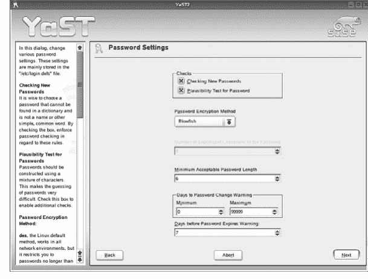

点击“应用程序”菜单并选择“注销”；选择“仅结束会”并点击“确定”。使用新创建账户登录。在桌面上点击右键，从弹出菜单中选择“配置桌面”。在左侧窗格中，选择“背景”并将“图片”设置为 triplegears。点击左侧窗格中的“屏幕保护程序”，并按照图 4.4 所示进行请求的更改。

#### 注意

你不需要从“应用程序”菜单中选择“注销”，也可以使用“切换用户”选项。如果你选择此路径，请小心，因为“切换用户”选项可能会出现问题，导致你同时拥有多个活动的用户“屏幕”。

点击“确定”退出。

### 图 4.4

更改屏幕保护程序设置。

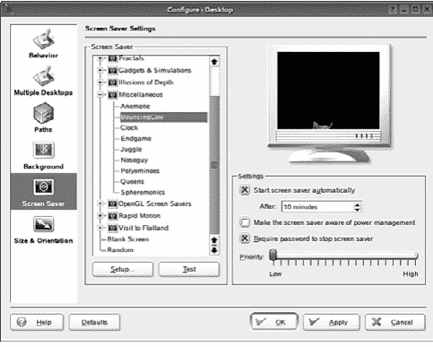

# 练习 3：Collette 咨询

启动 YaST，如果提示，请提供 root 密码。在“软件”菜单下，选择“安装和移除软件”。在搜索框中输入 desktop 并点击“搜索”。在右侧框架中，在“软件包”下方，选择你认为副总裁可能需要的尽可能 GNOME 软件包（文档、音频文件、游戏等），但务必选择以下内容：

- `gnome2-SuSE`
- `gnome-applets`
- `gnome-common`
- `gnome-desktop`
- `gnome-panel`
- `gnome-session`
- `gnome-terminal`
- `gnome-utils`

点击“检查依赖关系”，所有项都应报告 OK。点击“接受”，将出现若干“自动更改”；点击“继续”并提示插入媒体。在关闭 YaST 之前，创建一个用户作为 Collette 咨询的副总裁；然后点击“应用程序”菜单并选择“注销”。

# 第 4 章：练习解答

输入副总裁的用户名和密码，点击“会话”；选择“GNOME 桌面”。当桌面出现时，从菜单中选择“系统”，然后选择“个人设置”和“辅助功能”：点击复选框“启用键盘辅助功能”，如图 4.5 所示，并勾选“启用粘滞键”。点击“关闭”。

#### 提示

你还应该禁用当两个键同时按下时的该选项。如果不这样做，你将无法测试 Alt+F12 快捷键。

### 图 4.5

配置辅助功能选项。

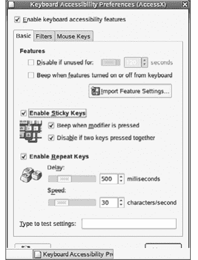

在仍在“个人设置”菜单中，选择“快捷方式”并找到“锁定屏幕”操作。点击它并输入组合键 Alt+F12，如图 4.6 所示；然后点击“关闭”。

退出设置对话框并验证你的设置是否生效。

### 图 4.6

配置锁定屏幕的组合键。

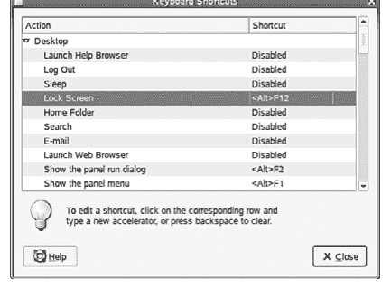

# 练习 4：D.S. 技术

在桌面上点击右键，从弹出菜单中选择“创建启动器”。输入图 4.7 所示的设置——务必将类型设置为“链接”。点击“无图标”并选择一个图标。（apple-red.png 效果良好。）

### 图 4.7

创建桌面启动器。

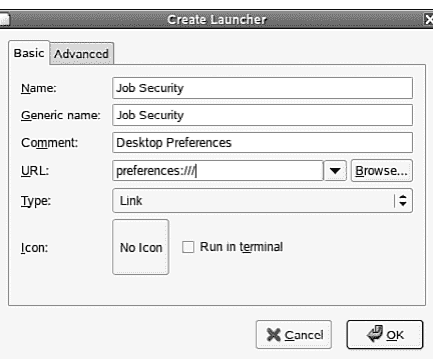

# 第 4 章：练习解答

点击“确定”。图标现在应该出现在桌面上，双击它将打开图 4.8 所示的文件夹。

### 图 4.8

启动器及其执行结果。

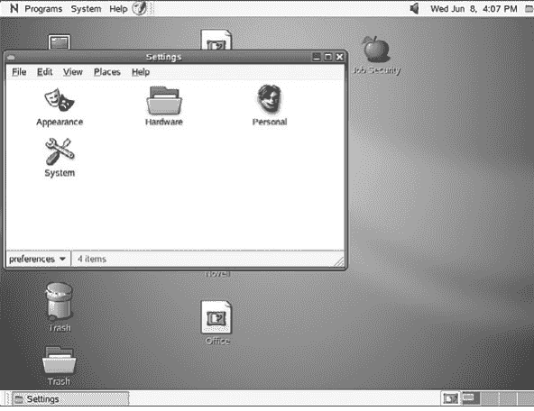

#### 注意

启动器的工作方式与其它操作系统中的传统快捷方式非常相似。然而，使用“启动器（launcher）”一词是为了防止它与练习 3 中创建的另一个快捷方式混淆。

## 练习 5：Evan 的困境

使用 GNOME，从菜单中选择“程序”、“辅助工具”和“终端”。在提示符处输入

```
passwd
```

你必须提供旧密码。执行后，输入一个新密码。如果你提供的密码不符合当前配置的要求（长度、字符使用等），新密码将不被接受。如果密码符合当前配置的要求，系统会提示你重新输入。只要你第二次输入的新密码值与第一次相同，就会出现消息“密码已更改”，你现在可以关闭终端窗口了。

# 练习 6：Frank 的花卉

在 GNOME 桌面上，点击“系统”，并选择“搜索文件...”。

点击“显示更多选项”按钮，在“备用选项”中选择“修改日期小于（天数）”并设置为2，勾选“包含其他文件系统”，并从 / 文件夹开始搜索，如图 4.9 所示。

### 图 4.9

查找过去两天内创建的文件。

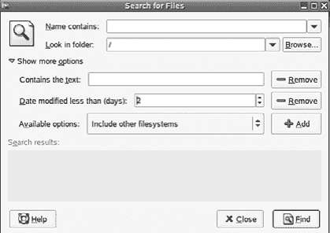

记录下出现的文件名，然后开始排除它们可能是前管理员创建的 shell 脚本。

#### 注意

在 KDE 界面中，通过程序菜单选择“查找文件”可以找到相同的功能。你可以点击“属性”选项卡并设置所需的选项。

# 练习 7：Gibson 营销顾问

有方法可以添加此打印机，因为练习说明公司在使用 KDE，将使用其中的工具来演示此解决方案。在开始之前，创建 `jbuck` 和 `cgibson` 用户，使用你喜欢的名字并遵循练习 4 中的指南。用户 `jbuck` 的密码应该是 `mississippi`。

以 root 身份登录，从菜单选择“工具”、“打印”、“打印机”。在“配置—打印管理器”界面中选择“添加”、“添加打印机/类”。这将启动打印向导。

### 图 4.10

配置打印机。

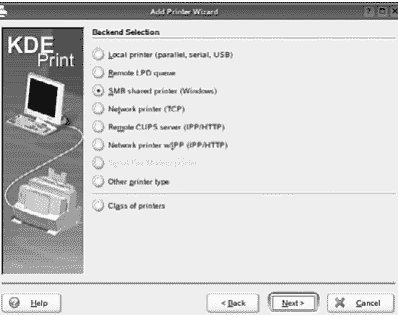

### 图 4.11

只有 `cgibson` 用户可以使用打印机。

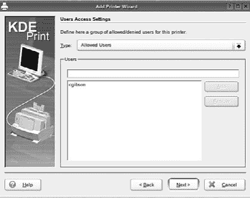

## 练习 8：Heberling 风险基金


以 root 身份登录并将打印机连接到工作站。启动 YaST，选择“硬件”、“打印机”。当你做出此选择时，它应该被识别，并显示品牌和型号，如图 4.12 所示。

图 4.12

打印机已被识别，现在可以配置。

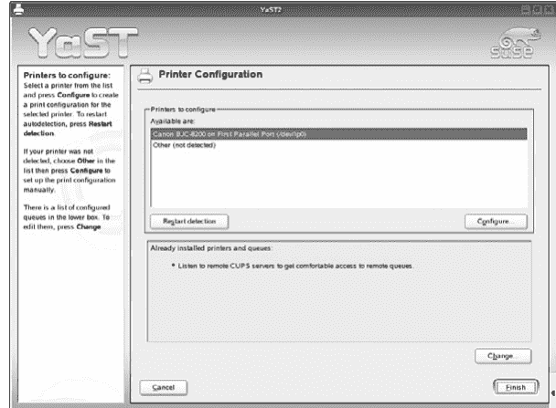

## 练习 9：Indiana 工业

有两种方法检查更新并保持系统最新：使用 YaST2 工具或 Red Carpet。我们将先查看 YaST 方法。

### 图 4.13

在线更新选项。

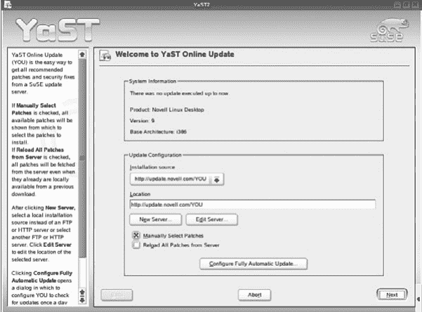

Novell Linux Desktop 还包含 Red Carpet 工具，允许您检查更新并保持系统处于最新状态。在 GNOME 中，从系统菜单启动此工具，请选择“软件更新”（Software Update）。在 KDE 中，选择“系统”（System）、配置（Configuration）和 Red Carpet 以到达相同位置。

系统将进行一次检查，如果有任何需要下载的补丁，将通知您。如果没有新的补丁，将通知您系统已是最新。

## 练习 10：Jerrald 学院

File Roller 工具提供了一个图形化界面，允许您快速完成所需的任务。在 KDE 中，从程序菜单选择实用工具（Utilities）、归档（Archiving）和存档管理器（Archive Manager）。或者，在 GNOME 中，选择程序（Programs）、系统工具（System Tools）、归文件（Archive Files）。这将打开 File Roller 工具。

注意

如果您在菜单中没有找到归文件（Archive Files）选项，请使用 YaST 安装 File Roller（使用类似于练习 3 中的找到步骤）。

# 第 4 章：练习解答

### 提示

在基础 NLD 9 安装中，默认情况下“程序”下没有“系统工具”选项。要启动 File Roller 工具，您也可以选择“系统 > 运行程序”，输入 `file-roller` 并选择“运行”。

点击“新建”（New）并将其命名为 LONDON。将归档类型设置为“带 gzip 的 Tar Compression”，如图 4.14 所示。

### 图 4.14

在 File Roller 中选择归档类型。

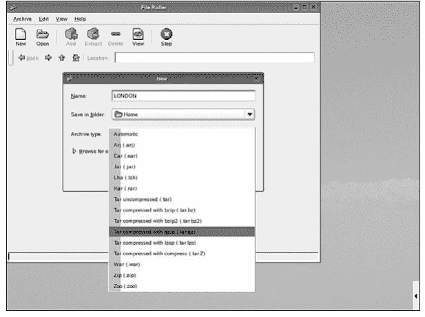

点击“新建”返回 File Roller 主界面。点击“添加”（Add），并展开“文件系统”（Filesystem）。在右侧窗格中，双击主目录以查看其下方的项目。点击并将 dluc 文件夹拖到滚动窗口中并保存。

现在您准备好将其通过电子邮件给销售员了。

## 练习 11：Kent 学校

可以使用许多工具来查看并终止正在运行的进程。在 KDE 中，从“所有应用程序”（All Applications）菜单中，您可以选择

系统（System）、监控（Monitor）和 KDE 系统守护（KDE System Guard）。当它启动时，点击“进程表”（Process Table）标签页，它将显示按字母顺序排列的进程列表。向下滚动列表直到找到睡眠（sleep）进程——如图 4.15 所示——高亮所有出现的地方（通过点击它们），并点击“杀死”（Kill）按钮。将出现一个警告消息要求您确认是否要杀死所选进程。在在此对话框上选择“杀死”（Kill），进程就会消失。

### 图 4.15

找到要终止的进程。

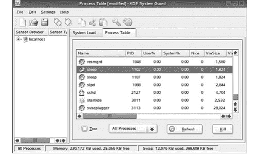

退出系统守护，您的工作就完成了。

## 练习 12：Lessons Learned, Inc. 公司

注意

此练习需要第二个 NLD 工作站并连接到同一个网络。在继续之前，请确保另一台 NLD 机器已准备就绪、已连接并在网上通信。

在 Wiese 博士同事的工作站上，访问 KDE 中的“应用程序”菜单。选择“系统”（System）、远程访问（Remote Access）、桌面共享（Desktop Sharing）并选择共享桌面（创建个人邀请）。这将弹出一个带有需方所需信息的个人邀请，如图 4.16 所示。

### 图 4.16

创建连接所需的信息。

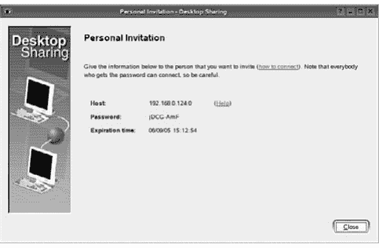

在电话上，告诉 Wiese 博士进入“系统”（System）、“远程访问”（Remote Access）、“远程桌面连接”（Remote Desktop Connection）并输入给定的主机信息。

### 提示

请务必包含整个主机地址，包括冒号和显示数字。如果您漏掉冒号和显示数字，将无法建立连接。

Wiese 博士的机器上将出现警告，显示正在建立连接，如图 4.17 所示。

同事现在必须输入给定的密码，连接将建立。

在 Wiese 博士的机器上，他可以打开并运行他想要的任何应用程序。同事的机器将显示 Wiese 博士的桌面，就像另一个窗口一样，如图 4.18 所示。同事可以观察正在的操作，也可以通过点击窗口内的任何内容或在窗口内输入任何所需的值来进行控制。

远程桌面连接在用户关闭窗口时结束。很短之后，Wiese 博士的机器上会弹出一个弹出对话框，指示连接已关闭。

### 图 4.17

您必须接受连接。

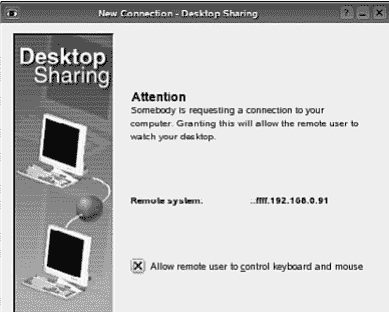

### 图 4.18

远程桌面作为另一个窗口出现。

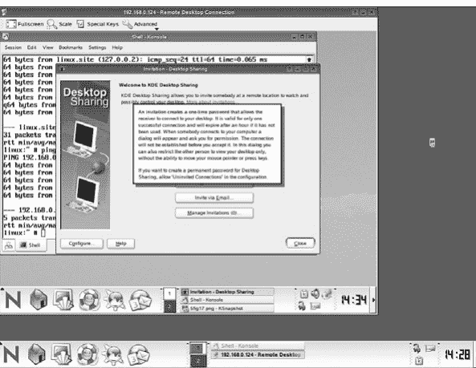

109

# 第 4 章：练习解答

## 练习 13：Mississippi Computing

需要完成两个任务。第一个是创建应急磁盘，第二个是备份。为了应急磁盘，打开 YaST 并选择“系统”（System）、备份（Backup）。这里有五个选择：

- 标准备份
- 自定义备份
- 标准备份
- 自定义备份
- 标准备份

当您选择标准时，系统将开始读取文件（这可能需要几分钟），然后开始备份。为了包含所有内容，点击“添加”。给一个文件名（例如 `/tmp/backup`），直到到达 4.19 所示的系统备份对话框。

### 图 4.19

可以备份。

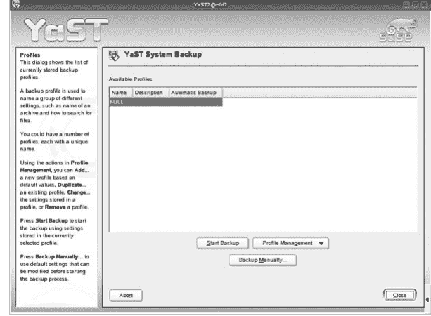

110

# 第 4 章：练习解答

## 练习 14：NoMore Paper

以 root 身份登录并打开 YaST。选择“系统”（System）、分区（Partitioner），会出现一个警告。仔细注意此警告，因为它正如所说——如果你不小心，可能会造成不可逆的损害。在对警告点击“是”后，会出现图 4.20 所示的分区表。

注意

实际的分区表取决于正在使用的磁盘。

### 图 4.20

你可以从此界面处理分区。

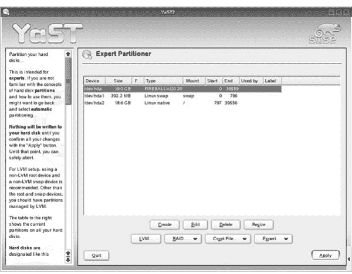

111

# 第 4 章：练习解答

## 练习 15：Octagon Systems

增大交换分区并应用更改。

注意

练习 1 中的分区为调整交换分区留出了空间。如果 Linux 原生 / 分区使用了整个硬盘，则无法调整其大小。

要禁用或确保远程管理未启用，在系统上以 root 身份登录并启动 YaST。选择“网络服务”（Network Services）、远程管理（Remote Administration）。只有两个选择按钮。确保选择了“不允许远程管理”并点击“完成”。

回到 YaST，选择“杂项”（Misc）和“查看启动日志”。这将显示 `/var/log/boot.msg` 文件的内容。扫描此文件并寻找发生的错误。最近的信息在文件底部，这也是它默认打开的地方。

如果您在扫描此文件时发现任何可疑内容，可以选择保存它、打印或使用其他工具进行进一步审查。

## 练习 16：ACME Electronics

确保 `/ACME`、`/ACME/OLD` 和 `/ACME/MONTHLY` 目录已就绪，并且接待员的用户有权限向这些目录写入文件。您应该按照以下步骤为新员工记录：

- 1. 从 KDE 选择器中，点击显示器图标打开终端 shell。或者，从菜单选择“系统”（System）、“终端”（Terminal），然后是 Konsole。
- 2. 输入命令 `cd /ACME`。
- 3. 因为目录内的所有文件都要放在一个文件中，必须同时使用 **tar** 和 **gzip**。虽然可以使用管道命令，但为了引导新手用户完成过程，最好分两个独立的过程执行此操作：

```
tar cvf july.tar
gzip july.tar
```


确保 `/ACME`、`/ACME/OLD` 和 `/ACME/MONTHLY` 目录已就绪，并且接待员的用户有权限向这些目录写入文件。您应该按照以下步骤为新员工记录：

- 1. 从 KDE 选择器中，点击显示器图标打开终端 shell。或者，从菜单选择“系统”（System）、“终端”（Terminal），然后是 Konsole。
- 2. 输入命令 `cd /ACME`。
- 3. 因为目录内的所有文件都要放在一个文件中，必须同时使用 **tar** 和 **gzip**。虽然可以使用管道连接命令，但为了引导新手用户完成过程，最好分两个独立的过程执行此操作：

```
tar cvf july.tar
gzip july.tar
```

# 图 4.13

在线更新选项。


Novell Linux Desktop 还包含 Red Carpet 工具，允许您检查更新并保持系统处于最新状态。在 GNOME 中，从系统菜单启动此工具，请选择“软件更新”（Software Update）。在 KDE 中，选择“系统”（System）、配置（Configuration）和 Red Carpet 以到达相同位置。

系统将进行一次检查，如果有任何需要下载的补丁，将通知您。如果没有新的补丁，将通知您系统已是最新。

# 练习 10：Jerrald 学院

File Roller 工具提供了一个图形化界面，允许您快速完成所需的任务。在 KDE 中，从程序菜单选择实用工具（Utilities）、归档（Archiving）和存档管理器（Archive Manager）。或者，在 GNOME 中，选择程序（Programs）、系统工具（System Tools）、归文件（Archive Files）。这将打开 File Roller 工具。

注意

如果您在菜单中没有找到归文件（Archive Files）选项，请使用 YaST 安装 File Roller（使用类似于练习 3 中的找到步骤）。

# 第 4 章：练习解答

# 提示

在基础 NLD 9 安装中，默认情况下“程序”下没有“系统工具”选项。要启动 File Roller 工具，您也可以选择“系统 > 运行程序”，输入 `file-roller` 并选择“运行”。

点击“新建”（New）并将其命名为 LONDON。将归档类型设置为“带 gzip 的 Tar Compression”，如图 4.14 所示。

# 图 4.14

在 File Roller 中选择归档类型。


点击“新建”返回 File Roller 主界面。点击“添加”（Add），并展开“文件系统”（Filesystem）。在右侧窗格中，双击主目录以查看其下方的项目。点击并将 dluc 文件夹拖到滚动窗口中并保存。

现在您准备好将其通过电子邮件给销售员了。

# 练习 11：Kent 学校

可以使用许多工具来查看并终止正在运行的进程。在 KDE 中，从“所有应用程序”（All Applications）菜单中，您可以选择

系统（System）、监控（Monitor）和 KDE 系统守护（KDE System Guard）。当它启动时，点击“进程表”（Process Table）标签页，它将显示按字母顺序排列的进程列表。向下滚动列表直到找到睡眠（sleep）进程——如图 4.15 所示——高亮所有出现的地方（通过点击它们），并点击“杀死”（Kill）按钮。将出现一个警告消息要求您确认是否要杀死所选进程。在在此对话框上选择“杀死”（Kill），进程就会消失。

# 图 4.15

找到要终止的进程。


退出系统守护，您的工作就完成了。

# 练习 12：Lessons Learned, Inc. 公司

注意

此练习需要第二个 NLD 工作站并连接到同一个网络。在继续之前，请确保另一台 NLD 机器已准备就绪、已连接并在网上通信。

在 Wiese 博士同事的工作站上，访问 KDE 中的“应用程序”菜单。选择“系统”（System）、远程访问（Remote Access）、桌面共享（Desktop Sharing）并选择共享桌面（创建个人邀请）。这将弹出一个带有需方所需信息的个人邀请，如图 4.16 所示。

# 第 4 章：练习解答

图 4.16

创建连接所需的信息。


在电话上，告诉 Wiese 博士进入“系统”（System）、“远程访问”（Remote Access）、“远程桌面连接”（Remote Desktop Connection）并输入给定的主机信息。

# 提示

请务必包含整个主机地址，包括冒号和显示数字。如果您漏掉冒号和显示数字，将无法建立连接。

Wiese 博士的机器上将出现警告，显示正在建立连接，如图 4.17 所示。

同事现在必须输入给定的密码，连接将建立。

在 Wiese 博士的机器上，他可以打开并运行他想要的任何应用程序。同事的机器将显示 Wiese 博士的桌面，就像另一个窗口一样，如图 4.18 所示。同事可以观察正在的操作，也可以通过点击窗口内的任何内容或在窗口内输入任何所需的值来进行控制。

远程桌面连接在用户关闭窗口时结束。很短之后，Wiese 博士的机器上会弹出一个弹出对话框，指示连接已关闭。

# 图 4.17

您必须接受连接。


# 图 4.18

远程桌面作为另一个窗口出现。


109

# 第 4 章：练习解答

## 练习 13：Mississippi Computing

需要完成两个任务。第一个是创建应急磁盘，第二个是备份。为了应急磁盘，打开 YaST 并选择“系统”（System）、备份（Backup）。这里有五个选择：

- 标准备份
- 自定义备份
- 标准备份
- 自定义备份
- 标准备份

当您选择标准时，系统将开始读取文件（这可能需要几分钟），然后开始备份。为了包含所有内容，点击“添加”。给一个文件名（例如 `/tmp/backup`），直到到达 4.19 所示的系统备份对话框。

# 图 4.19

可以备份。


110

# 第 4 章：练习解答

# 练习 14：NoMore Paper

以 root 身份登录并打开 YaST。选择“系统”（System）、分区（Partitioner），会出现一个警告。仔细注意此警告，因为它正如所说——如果你不小心，可能会造成不可逆的损害。在对警告点击“是”后，会出现图 4.20 所示的分区表。

注意

实际的分区表取决于正在使用的磁盘。

# 图 4.20

你可以从此界面处理分区。


111

# 第 4 章：练习解答

## 练习 15：Octagon Systems

增大交换分区并应用更改。

注意

练习 1 中的分区为调整交换分区留出了空间。如果 Linux 原生 / 分区使用了整个硬盘，则无法调整其大小。

要禁用或确保远程管理未启用，在系统上以 root 身份登录并启动 YaST。选择“网络服务”（Network Services）、远程管理（Remote Administration）。只有两个选择按钮。确保选择了“不允许远程管理”并点击“完成”。

回到 YaST，选择“杂项”（Misc）和“查看启动日志”。这将显示 `/var/log/boot.msg` 文件的内容。扫描此文件并寻找发生的错误。最近的信息在文件底部，这也是它默认打开的地方。

如果您在扫描此文件时发现任何可疑内容，可以选择保存它、打印或使用其他工具进行进一步审查。

## 练习 16：ACME Electronics

确保 `/ACME`、`/ACME/OLD` 和 `/ACME/MONTHLY` 目录已就绪，并且接待员的用户有权限向这些目录写入文件。您应该按照以下步骤为新员工记录：

- 1. 从 KDE 选择器中，点击显示器图标打开终端 shell。或者，从菜单选择“系统”（System）、“终端”（Terminal），然后是 Konsole。
- 2. 输入命令 `cd /ACME`。


## 3. 因为目录内的所有文件都要放在一个文件中，必须同时使用 `tar` 和 `gzip`。虽然可以使用管道连接命令，但为了引导新手用户完成过程，最好分两个独立的过程执行此操作：

```
tar cvf july.tar
gzip july.tar
```

### 练习 17：Barnes and Fine

- 4. 将存档文件移动到目标目录的命令是：`mv july.tar.gz MONTHLY`。

- 5. 将所有其他文件移动到目标目录的命令是：`mv *.*`

- 6. 输入 `exit` 关闭终端会话。

简单说明每个月应将“j”替换为当前目录，就足够完成这些任务的操作了。

## 练习 17：Barnes and Fine

### 通过命令行查找文件

- 1. 从 KDE kicker 中点击显示器图标打开终端 shell 程序。可选情况下，从菜单中选择系统（System）、终端（Terminal），然后控制台（Console）。

- 2. 输入命令 `find / -name "*tickets*" -print | more.`。

### 使用图形化实用工具查找文件

- 1. 点击 KDE kicker 上的 N，然后选择查找文件（Find Files）。将选项设置为如图 4.21 所示。

图 4.21

搜索所需的文件。

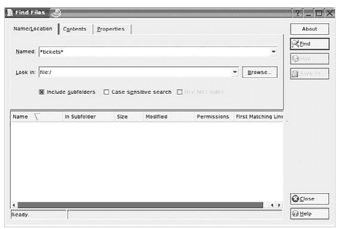

113

# 第 4 章：练习解答

- 2. 点击查找（Find）命令按钮。

### 在现场查找硬件信息

- 1. 启动 YaST 并以 root 身份验证。

- 2. 选择硬件（Hardware），然后选择硬件信息（Hardware Information）。

- 3. 经过短暂的探测后，将显示类似于图 4.22 所示的内容。

# 图 4.22

硬件信息已可用。

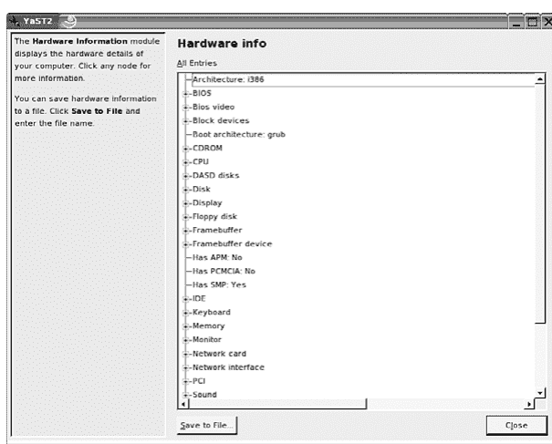

- 4. 点击保存到文件（Save to File），打印该文件或将其发送到你的家庭办公室。

### 查找权限高于 2000 的文件

- 1. 从 KDE kicker 中点击显示器图标打开终端 shell 程序。可选情况下，从菜单中选择系统（System）、终端（Terminal），然后 Konsole。

- 2. 输入命令 `find -perm -2000 -print | more`。

## 练习 18：Cash Today

可以使用许多实用工具查看当前运行的进程，包括 `top`、`ps` 和 `pstree`。这些命令中的任何一个都可以在终端窗口运行，你可以使用 knapsapshot 或 GNOME 菜单命令进行截图，如图 4.23 所示。

图 4.23

保存为截图。

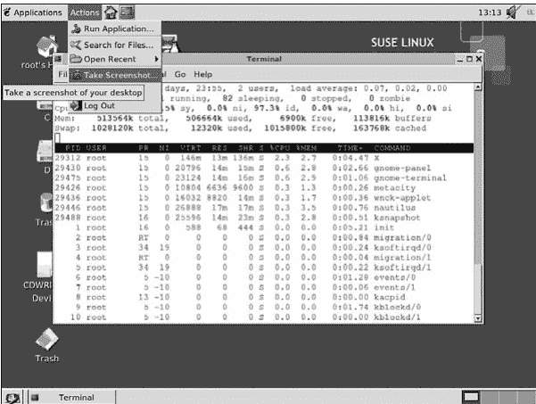

要将运行中的进程列表保存到文件，命令 `ps -ef > /tmp/proc.txt` 将创建一个你可以邮寄的文件。

# 练习 19：Donna's Collectibles

安装 RPM 包的通用接受的语法是

`rpm -ivh {classname}.rpm`

# 注意

如果需要升级软件包，应使用 `-U` 参数代替 `-i` 参数。要安装新软件包，请使用 `-i` 参数。

管理日志在每个站点都可能不相同，但你可以使用类似于下面的语法向此类日志文件末尾追加条目：

`cat >> admin.log`

9/15/05 12:34 安装 ABC 软件包以满足审计要求

在 ABC 文档中可以找到系统更改的完整列表。

重启服务器并验证一切正常。

# 提示

与其盲目地追加日志，你也可以用 `vi` 或任何编辑器对其进行编辑。

## 练习 20：Edna and Lorraine Antiques

安装操作系统，将第一张 CD 插入计算机并重启系统。练习 46 详细介绍了每个单独的菜单。在这种情况下，你将在提示输入服务器名称之前接受默认值；在那种情况下，你将输入 `EDNA-SLES`。

当提示使用 DHCP 或配置静态 IP 地址时，请选择静态地址并给出表中指定的值：

- IP 地址：`192.168.0.78`

- 子子网掩码：`255.255.255.0`

- 默认网关：`192.168.0.1`

Samba 会自动安装，只有 Apache 必须单独安装。要安装 Apache，请遵循以下步骤：

- 1. 启动 YaST 并以 root 用户身份验证。

- 2. 选择软件（Software），然后选择安装和删除软件（Install and Remove Software）。搜索 `apache` 并安装它。

要配置 Samba，以 root 身份登录并启动 YaST；然后选择网络服务（Network Services）和 Samba 服务器（Samba Server）。第一个对话框将询问工作组名称；输入 `EDNA-WKGRP`。

通过以 root 身份登录并启动 YaST 创建用户。选择安全与用户（Security and Users），然后编辑并创建用户（Edit and Create Users）。点击添加（Add）并如图 4.24 所示添加每个用户，每个用户后点击创建（Create）。

图 4.24

添加每个用户。

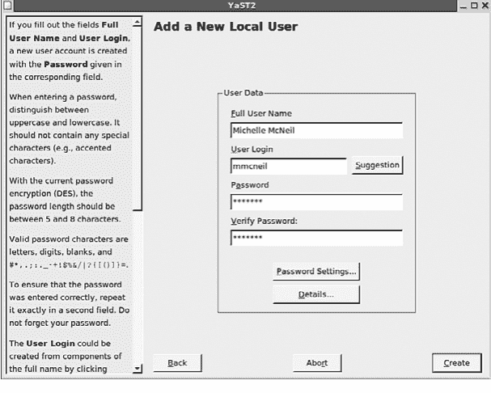

所有用户完成后，点击完成（Finish）。在 YaST 的安全与用户部分创建 `ACCOUNTS` 组。所有用户完成后，点击完成。创建 `ACCOUNTS`。

# 第 4 章：练习解答

图 4.21

添加新文件。

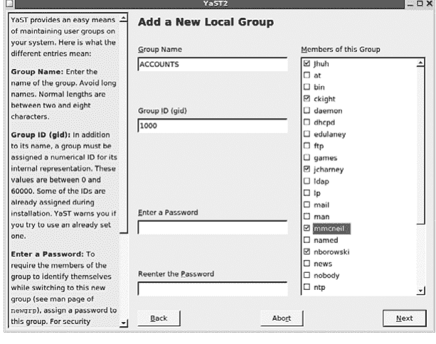

# 练习 21：Fetters and Such

要执行此操作，请遵循以下步骤：

- 1. 从 KDE kicker 中点击显示器图标打开终端 shell 程序。可选情况下，从菜单中选择系统（System）、终端（Terminal），然后 Konsole。

- 2. 输入命令 `cd /`。

- 3. 输入命令 `mkdir`。

- 4. 输入命令 `mkdir`。

- 5. 输入命令 `touch`。

- 6. 输入命令 `cd /tmp`。

- 7. 输入命令 `chmod 755`。

- 8. 通过启动 YaST 退出终端。

## 练习 22：Global Moving

### 设置系统默认

- 1. 以 root 登录。

- 2. 从 KDE kicker 中点击显示器图标打开终端 shell 程序。可选情况下，从菜单中选择系统（System）、终端（Terminal），然后 Konsole。

- 3. 输入命令 `cd /etc`。

- 4. 输入命令 `umask 026`。

- 5. 保存文件并退出。

- 6. 保存文件并应用。

## 练习 23：Hare Trucks

`-rw-r-----` 的数值表示是 `640`。从默认的 `666` 减去 `26`。

- 1. 输入 `cd /tmp`。

- 2. 输入 `chmod 444 *`。

- 3. 输入 `exit` 退出终端。

## 练习 24：Independent Fireworks

为所有用户实施磁盘配额，

- 1. 启动 YaST 并以 root 用户身份验证。

- 2. 安装 `quota` 包。

- 3. 选择系统（System），然后选择分区（Partitioner）。

- 4. 选择 Linux 分区并点击编辑（Edit）按钮。

- 5. 点击 Fstab 选项按钮。

- 6. 在底部的任意选项值（Arbitrary Option Value）框中输入 `usrquota`。

- 7. 双击 OK，然后应用（Apply）。

## 第 4 章：练习题解答

在继续下一步之前，通过输入 `quotaon -av` 为所有挂载的文件系统启用严格配额，然后通过输入 `chkconfig quota on` 使其持久化。

图 4.28

fstab 可用的选项。

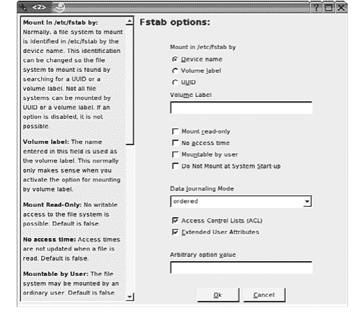

- 8. 现在可以进入命令行并使用 `setquota` 命令为每个用户开启配额。

提示

除了使用 `setquota` 外，你还可以使用 `repquota` 查看配额报告，并使用 `edquota` 编辑用户配额设置。

## 练习 25：J & C 财务

要使用 YaST 应用补丁和更新，请遵循以下步骤：

- 1. 以 root 身份登录并启动 YaST。

- 2. 选择“软件”（Software），然后选择“在线更新”（Online Update）。屏幕将如图 4.29 所示所示。注意：如果点击“配置全自动更新...”（Configure Fully Automatic Update...），你可以配置一个 cron 条目来自动保持系统为最新。

图 4.29

在线更新的选项。

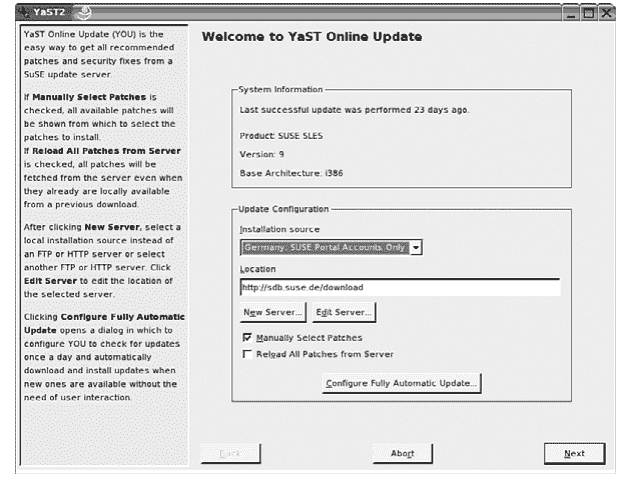


# 第 4 章：练习题解答

- 3. 点击“下一步”（`Next`）。将检索有关新更新的信息。
- 4. 如果提示用户名和密码，请输入这些值，然后选择安装任何发现的更新。

你也可以通过选择“软件”和“补丁 CD 更新”（`Software and Patch CD Update`）从 CD 安装补丁。若要在服务器上设置设置，选择“软件”和“系统更新”（`System Update`）。选择“更改和更新选项”（`Change and Update Options`）。值与图 4.30 所示类似。

最后，通过选择“软件”然后选择“YOU 服务器配置”（`YOU Server Configuration`）可以配置 YOU 服务器。这将打开一个与图 4.31 所示类似的对话框。

图 4.30

更新选项。

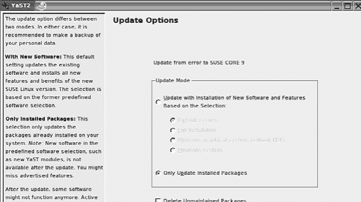

图 4.31

YOU 配置选项。

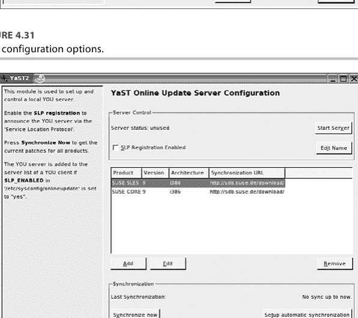

## 练习 26：Karen 的计算机

你可以按照以下步骤列出曾经登录过服务器的用户的列表：

- 1. 以 `root` 身份登录。
- 2. 从 KDE 启动器（`kicker`）点击显示器图标打开终端 shell。可选地，从菜单中选择“系统”（`System`）、“终端”（`Terminal`），然后选择“Konsole”。
- 3. 输入 `lastlog | grep -vi "never"` 将显示内容缩小为仅包含有效登录行。

这将显示每个账户的最近登录情况，而不是每次登录记录。列出用户名，并使用每个用户名配合 `last` 命令来查找自 `wtmp` 文件启动以来的每次登录。例如，要查看用户 `edulaney` 的条目，命令为 `last edulaney`。

## 练习 27：Lifetime 解决方案

要检查服务器的主机名，请遵循以下步骤：

- 1. 以 `root` 身份登录。
- 2. 从 KDE 启动器（`kicker`）点击显示器图标打开终端 shell。可选地，从菜单中选择“系统”（`System`）、“终端”（`Terminal`），然后选择“Konsole”。
- 3. 输入 `hostname`。

“频繁的命令行网络命令”应该包括：`ping`、`traceroute`、`ifconfig`、`ifstatus` 和 `netstat`。使用 `route` 和 `arp` 分别检查路由表和地址解析结果。

## 练习 28：Muncie 管理

`ip` 工具用于查看和更改当前网络配置。使用命令 `ip address show` 可以查看当前配置。生成的显示类似于图 4.32 所示。

该命令的输出与 `ifconfig` 相同。将 `show` 替换为 `add`，可以添加设置，而使用 `del` 则允许你删除现有设置。

图 4.32

`ip address show` 命令的输出。

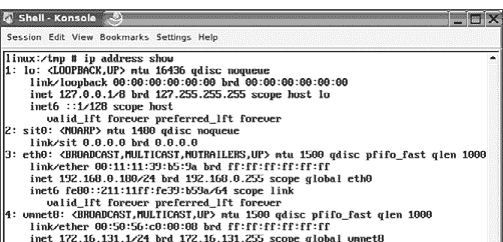

命令 `ip link show` 将显示每个太网设备的硬件地址。要处理路由表，请使用以下命令：

- `ip route show`——查看当前路由表
- `ip route add`——添加路由
- `ip route add default`——添加默认路由
- `ip route delete`——删除路由

## 练习 29：New Start, Inc.

要运行 YOU，请遵循以下步骤：

- 1. 以 `root` 身份登录并启动 YaST。
- 2. 选择“软件”然后选择“在线更新”。
- 3. 点击“下一步”。将检索有关新更新的信息。
- 4. 如果提示用户名和密码，请输入这些值；然后选择安装任何发现的更新。

## 练习 30：Oak Pictures

Oak Pictures 需要在适当时间运行脚本的 cron 文件条目如下：

```
0,5,15,20,25,30,35,40,55,55 * * * *
0,15,30,45 * * *
0,15,25,35,55 * * *
0,25,35,55 * * *
```

（注：cron 块的 OCR 是根据标准 cron 模式和上下文进行的碎片化/重建）

要设置权限使新创建的文件为 664，请遵循以下步骤：

- 1. 以 `root` 身份登录并启动 YaST。
- 2. 选择“软件”然后选择“在线更新”。

要将默认 `umask` 更改为 022，请遵循以下步骤：

- 1. 以 `root` 身份登录。
- 2. 从 KDE 启动器（`kicker`）点击显示器图标打开终端 shell。可选地，从菜单中选择“系统”（`System`）、“终端”（`Terminal`），然后选择“Konsole”。
- 3. 输入 `umask 022`。

要将默认运行级别（`runlevel`）更改为 4，请遵循以下步骤：

- 1. 以 `root` 身份登录。
- 2. 从 KDE 启动器（`kicker`）点击显示器图标打开终端 shell。可选地，从菜单中选择“系统”（`System`）、“终端”（`Terminal`），然后选择“Konsole”。
- 3. 输入 `cd /etc`。
- 4. 编辑 `init` 文件并将 `id:5:initdefault:` 改为 `4`。
- 5. 保存文件并退出。

要配置给定的静态 IP 地址，请遵循以下步骤：

- 1. 以 `root` 身份登录并启动 YaST。
- 2. 选择“网络设备”（`Network Devices`）和“网卡”（`Network Card`）。
- 3. 点击“更改”（`Change`）和“编辑”（`Edit`）。网络地址设置如图 4.33 所示。

图 4.33

网卡的设置。

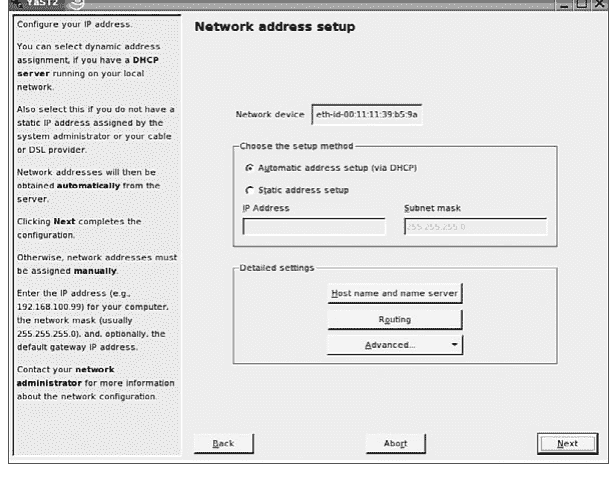

- 4. 点击“静态地址设置”（`Static Address Setup`）按钮并输入 IP 地址 `192.168.10.7` 和子网掩码 `255.255.255.0`。
- 5. 点击“路由”（`Routing`）按钮并添加默认网关地址 `192.168.10.101`。点击 `OK`。
- 6. 点击“下一步”（`Next`）和“完成”（`Finish`）。
- 7. 点击“关闭”（`Close`）并退出 YaST。

要在 `/var/log/messages` 末尾添加（追加）一条目目说明系统在此日期进行了配置，请在终端会话中运行以下命令：`logger -p local3.info "system configuration drastically changed"`。

## 练习 31：P.A.R. Inc.

这个 脚本最难的部分是变量需要被视为数字。可以通过以下方式实现：

```bash
#incrmt
#!/bin/bash
typeset -i x
x=$1
until [ "$x" -lt 1 ]
do
echo $x
let x="$x-1"
done
```

通过输入 `chmod +x /usr/INCRMT` 确保所有者具有执行该脚本的权限。

## 练习 32：质量密封

在许多 Linux 相关的网站上可以轻松找到安全信息。首先要检查并关注的始终是厂商的网站。查看 `http://www.novell.com/linux/security` 提供了 Linux 相关安全问题的概述，并带有指向多个相关页面的链接。你还应该关注发布在 `http://www.cert.org` 和 `http://www.linuxsecurity.com` 上的问题和故障。

通过 Linux 内置的许多实用程序可以找到任何 Linux 命令的信息：

- `man` 工具为每个实用程序提供了页面。例如，要查找有关 `setfacl` 的信息，命令为 `man setfacl`。
- 大多数实用程序使用内置选项 `--help` 提供信息。从命令行，你可以输入 `setfacl --help` 来查看可用选项的快速列表。
- `info` 实用程序也可用于查看 `man` 页面，例如，`info setfacl`。
- `whatis` 实用程序可以显示系统上该实用程序是否有多组文档：`whatis setfacl`。
- `which` 实用程序将列出它找到的所有关于与文件相关位置的信息——例如，`where setfacl`。
- `apropos` 实用程序使用 `whatis` 数据库查找值并返回摘要信息：`apropos setfacl`。

还应该提醒客户，Web 查找命令帮助信息的好地方。

## 练习 33：富裕且大型房屋改造

在正常启动期间，系统将启动并进入 `/etc/init.ab` 文件中指定的运行级别。由于系统没有“正常启动”且掉电非常快，最可能的罪祸首是文件系统损坏；快速检查日志文件（`/var/log/messages`）应该确认这一点。

如果是这种情况，运行 `fsck` 实用程序修复文件损坏并将系统恢复到可启动状态。

## 练习 34：Spencer Treats


你可以使用命令 `uptime` (负载)、`df`、`du` (文件系统)、`free`、`procinfo` (内存管理)、`ps` 和 `ptree` (进程信息) 来检查服务器上的各种元素。为了让客户满意，你应该检查 `/var/log` 下的所有日志，并寻找其中可能出现的任何异常。

# 练习 35：节约的建设者

按照要求进行备份，请遵循以下步骤：

1. 以 root 身份登录并启动 YaST。

2. 选择系统（System）和系统备份（System Backup）。

3. 点击配置管理（Profile Management）并选择添加（Add）；然后为新配置输入名称，例如 `fullsys`。

4. 点击确定（OK）。

5. 出现如图 4.34 所示的存档设置（Archive Settings）。

6. 输入备份名称（使用绝对路径），确保存档类型设置为 tar 格式，然后点击下一步（Next）。

7. 在文件选择（File Selection）窗口中，保留默认选项并点击下一步（Next）。

8. 保持搜索限制（Search Constraints）不变并点击确定（OK）。

## 第 4 章：练习解答

图 4.34

配置备份。

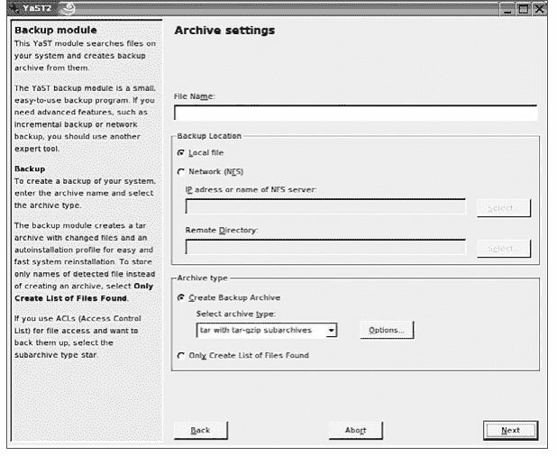

9. 在 YaST 系统备份主对话框中，点击开始备份（Start Backup）。读取几分钟软件包后，备份将开始。

注意

作为管理员，你现在应该验证备份可以恢复。这应该在备份之后、关闭系统之前完成。

10. 备份完成后关闭系统，关闭服务器上的所有应用程序，从 KDE kicker 中选择运行命令（Run Command）。输入 `0`，系统将开始有序关闭。

# 练习 36：美国道路

要启用 SLES 服务器的远程管理，请遵循以下步骤：

1. 以 root 身份登录并启动 YaST。

2. 选择网络服务（Network Services）和远程管理（Remote Administration）。

3. 打开如图 4.35 所示的远程管理配置对话框。点击允许远程管理（Allow Remote Administration）。

图 4.35

选择允许远程管理。

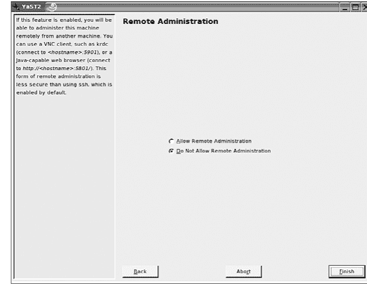

4. 点击完成（Finish）。现在可以通过端口 `5801` 访问服务器。

SLES 9 默认安装了 OpenSSH。如果特定服务器上不存在：

1. 以 root 用户身份启动 YaST。

2. 选择软件（Software），然后安装和移除软件（Install and Remove Software）。

3. 在搜索字段中输入 `openssh` 并点击搜索。

4. 勾选找到两个包并点击接受（Accept）。如果提示，插入所需的 SLES 9 光盘。

# 练习 37：Victory Electric

以下脚本将给定的要求：

```bash
#!/bin/bash
while true
do
  echo "Please choose from the following:"
  echo "A. To run flexon.sh"
  echo "B. To run hour.sh"
  echo "C. To run comp.sh"
  echo "D. To run indian.sh"
  echo "Q. To quit"
  read -n 1 lett
  case $lett in
    A) flexon.sh ;;
    B) hour.sh ;;
    C) comp.sh ;;
    D) indian.sh ;;
    Q) exit ;;
    *) echo "Invalid response" ;;
  esac
done
```

# 练习 38：Waffles and More

将打印机物理连接到服务器；然后以 root 登录并启动 YaST。选择硬件（Hardware）然后打印机（Printer）。自动检测应找到打印机并在 4.36 所示的配置对话框中显示。

图 4.36

自动检测打印机。

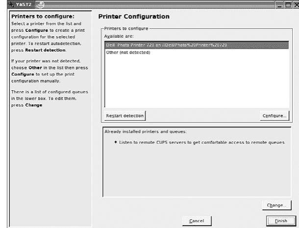

你现在必须完成以下步骤：

1. 点击配置（Configure）并配置队列和设置。

2. 点击下一步（Next）。

3. 选择打印机型号。如果列表中没有正确的厂商/型号组合，可以在厂商网站查找驱动程序。

4. 点击下一步（Next）。

5. 在编辑配置（Edit Configuration）上，点击测试并验证打印机工作正常。

6. 点击确定（OK），然后完成（Finish）。

7. 在图 4.37 所示的打印机对话框中，点击高级（Advanced）并确保配置为 CUPS 完全安装以便用户访问。

8. 点击接受（Accept）并完成（Finish）。

图 4.37

配置打印机共享。

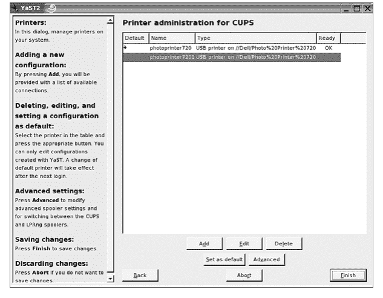

# 练习 39：Xtreme Books

要完成此任务，请遵循以下步骤：

1. 打开终端窗口，然后使用 `su` 命令切换到 root。

2. 从 KDE kicker 点击显示器图标打开终端 shell。可选，从菜单选择系统、终端，然后 Konsole。

3. 输入命令 `cd /`。

4. 输入命令 `mkdir recovery`。

5. 输入命令 `rsync -avz /home/recovery`。

# 练习 40：Young and Forest

可以通过左侧的 YaST 网络服务（Network Services）和右侧的网络服务（Network Services）来检查网络状态。这将显示当前配置的服务，如图 4.38 所示。

图 4.38

当前配置的网络服务。

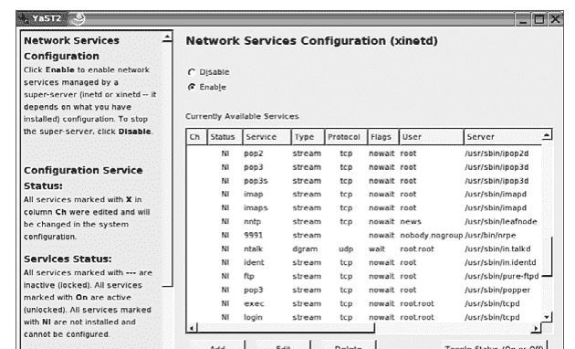

你还可以点击 KDE kicker 中的 N，检查系统、监控、信息中心，然后选择网络接口（Network Interfaces）以查看网卡信息，如图 4.39 所示。

点击左帧中的协议（Protocols），你可以选择不同的协议（包括网络协议）来检查每个的状态。

KDE 系统 Guard（系统、监控、KDE 系统 Guard）如图 4.40 所示，可以显示进程表（允许杀死项）以及系统负载。

## 第 4 章：练习解答

图 4.39

信息中心（Info Center）显示网卡（NICs）的信息。

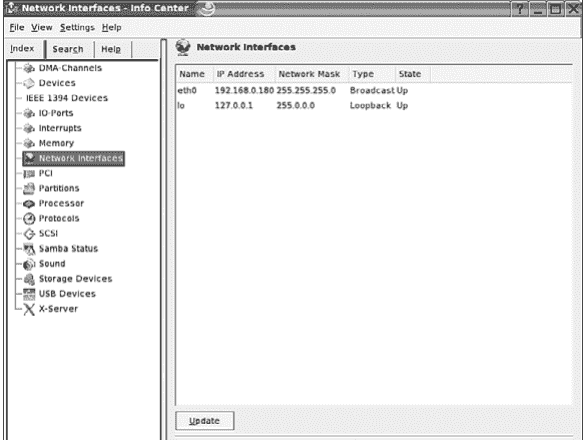

图 4.40

KDE 系统守护（System Guard）显示负载。

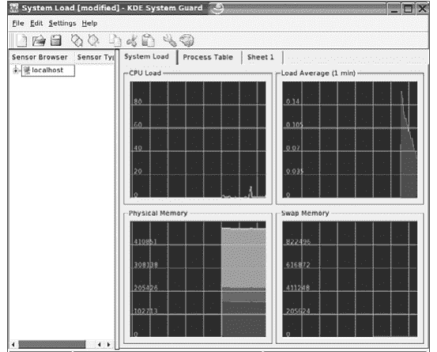

# 练习 41：Zebb Jewels

最后，可以使用任何桌面编辑器或命令行编辑器来检查配置文件并进行更改。例如，图 4.41 显示在默认 KDE 编辑器 Kate 中打开的 `/etc/profile` 文件。

## 图 4.41

编辑系统配置文件。

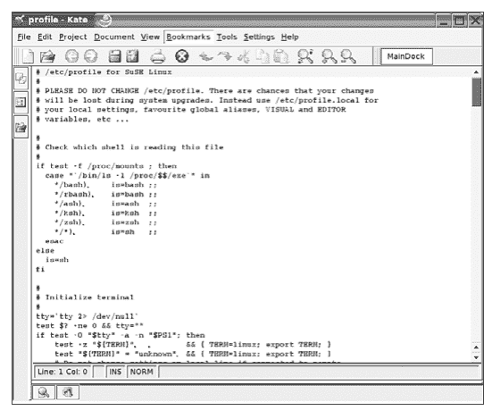

# 练习 41：Zebb Jewels

可以使用任意数量的编辑器进行更改。SLES 9 包含了 `joe`、`vi` 和 `sed`。图 4.42 显示 `joe` 正在编辑一个文件，而图 4.43 显示在 `vi` 中打开的同一个文件。

然而，执行此任务最佳的编辑器是 `sed`。作为一个流编辑器，它可以使用命令 `sed 's/ZEBB7/JEWEL/g'` 轻松地将所有某个值更改另一个值。

> 提示

> 要了解更多关于 `sed` 的信息，请输入 `man sed`。

## 第 4 章：练习解答

图 4.42

使用 `joe` 编辑文件。

```
Shell - Konsole
Session Edit View Bookmarks Settings Help
clear
while true
do
  clear
echo "Please choose from the following menu choices:"
echo "A. To run flex"
echo "B. To run hour"
echo "C. To run comp"
echo "D. To quit"
echo -n "Please make a selection: "
read let
case $let in
A) echo "A was chosen"
break ;
B) echo "B was chosen"
break ;
C) echo "C was chosen"
break ;
D) echo "D was chosen"
break ;
U) echo "Invalid response"
exit
sleep 3
esac
done
```

图 4.43

使用 `vi` 编辑文件。


```
Shell - Konsole
Session Edit View Bookmarks Settings Help
clear
while true
do
  clear
echo "Please choose from the following menu choices:"
echo "A. To run flex"
echo "B. To run hour"
echo "C. To run comp"
echo "D. To quit"
echo -n "Please make a selection: "
read let
case $let in
A) echo "A was chosen"
break ;
B) echo "B was chosen"
break ;
C) echo "C was chosen"
break ;
D) echo "D was chosen"
break ;
U) echo "Invalid response"
exit
sleep 3
esac
done
""memo2.sh" 264, 449C
```

# 练习 42：Yorktown Bakers

为了完成此任务，你应该首先备份服务器上的所有数据，然后妥善关闭它。在安装硬盘并启动服务器后，使用 `fdisk` 创建新分区。然后你可以：

1. 以 root 身份登录并启动 `YaST`。
2. 选择系统（System）然后选择 LVM。如果你还没有此类项，将提示你创建一个卷组，如图 4.44 所示。

图 4.44

创建卷组。

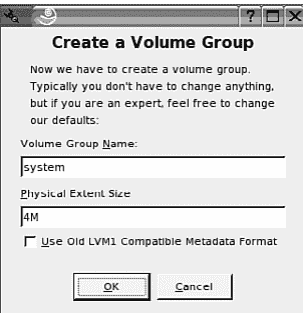

3. 物理卷和逻辑卷将出现。
4. 点击添加（Add）并创建三个分区中的每一个。
5. 点击完成（Finish）。

# 练习 43：X. L. Technology

SLES 9 默认安装了 GRUB。你可以通过以 root 身份登录、启动 `YaST` 并选择系统、启动配置来查看你的服务器上是否安装了它。这将弹出一个与图 4.45 类似的对话框。

如果你需要进行任何更改，可以通过点击编辑（Edit）来完成。这将允许你在 GRUB、LILO 或无引导加载程序之间选择。

# 第 4 章：练习解答

图 4.45

引导加载程序。

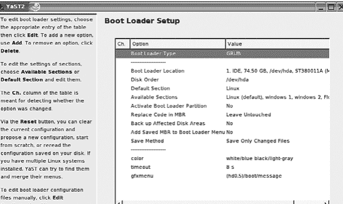

> 注意
>
> 点击配置（Configuration）允许你编辑菜单文件以向启动菜单添加选项。要限制对服务器的物理访问，最佳解决方案是将其放置在锁上的门后面。始终可以通过右键点击桌面、选择桌面（Desktop）、设置屏幕保护程序在一分钟后启动并需要密码，来始终锁定桌面。

# 练习 44：等待与浪费

服务器上的时间在启动期间由 `/etc/init.d/clock` 设置。一旦你在任何服务器上妥善设置了时间，就可以使用 `ntpdate` 工具来设置任何其他服务器的时间。

# 练习 45：Village Pump & Supply

> 注意
>
> 配置 `ntp.conf` 文件并启动 `ntpd` 守护进程可以保持时间设置正确，这样你就不需要在每次服务器时间偏差过大时手动运行 `ntpdate`。

图 4.46

系统安全设置。

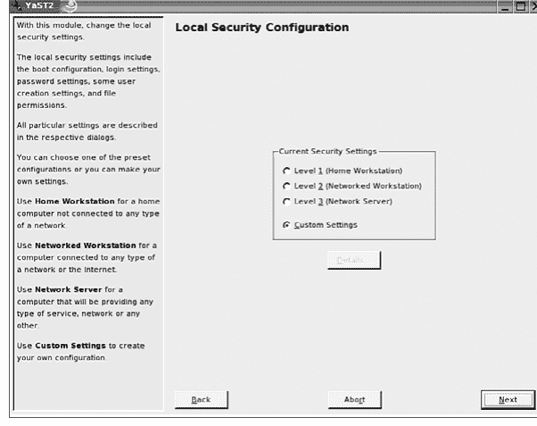

你可以选择任何预设值，或带有自定义（Custom）点击下一步并配置密码设置、启动设置、登录设置、用户和组设置以及一些杂设置。

# 练习 45：Village Pump & Supply

在服务器上安装 OpenLDAP：

1. 作为 root 用户启动 `YaST`。
2. 选择软件（Software）然后选择安装和移除软件（Install and Remove Software）。
3. 在搜索字段输入 `openldap` 并点击搜索。
4. 勾选 `openldap`、`openldap-client` 和 `yast2-server` 包并点击接受。如果提示，插入所需的任何 SLES CD。
5. 回到 `YaST`，选择网络服务（Network Services）、LDAP 服务器。
6. 点击配置（Configure），你就可以自动通过 `YaST` 接口编辑配置项了。
7. 点击完成（Finish）。

# 练习 46：Alabama Cement

SLES 9 默认安装了 GRUB。要开始 SLES 的安装，你需要将 CD 插入光驱并重启系统。对于大多数计算机，系统将从光驱驱动器启动。

出现的第一个菜单提供了以下选择：

- 从硬盘启动（Boot Hard Disk）：启动已有的操作系统。这是默认选择。
- 安装：选择开始安装。
- 安装—禁用 ACPI（ACPI Disabled）：如果你需要 ACPI 不要干扰安装过程，请选择此选项。
- 安装—安全设置（Safe Settings）：如果安装一直失败，请使用此选项来绕过。
- 救援系统（Rescue System）：在引导文件损坏时从 CD 启动系统。
- 内存测试（Memory Test）：仅检查 RAM。

在屏幕底部，标识了一些功能键：

- F1—帮助（Help）
- F2—切换屏幕显示设置
- F3—切换安装位置选择
- F4—切换语言
- F5—选择调试输出级别
- F6—安装时包含驱动程序 CD

要执行正常安装，从菜单中选择安装并按回车键。你必须通过 `YaST2`（安装和系统管理程序）提供的界面。虽然根据你的具体配置可能会有偏差，但必须通过的主要界面：

1. 选择语言：点击接受（Accept）继续，或点击中止（Abort）取消安装。
2. 选择安装模式：你可以选择新安装（默认）、更新现有系统、修复已安装系统、启动已安装系统或中止。对于正常安装，选择新安装。
3. 此时，系统将提供设备并显示它识别出的列表。它将识别系统、键盘、鼠标等，并根据选择的模式显示建议设置。建议和设置属于这些类别：
    - 系统
    - 软件
    - 模式
    - 启动
    - 键盘布局
    - 时区
    - 鼠标
    - 语言
    - 分区
    - 默认运行级别
4. 有三个命令按钮：更改（Change）修改任何设置、中止（Abort）取消、接受（Accept）继续。选择接受；然后点击继续，将弹出警告消息，说明 `YaST2` 已获得安装 SU LINUX 需要的所有信息。安装将根据之前对话框中的设置进行。要提交安装和选择，点击“是，安装”（Yes, Install）按钮。
5. 接下来将安装软件包，你需要按照提示插入各种光盘。你的目标通常是尽快完成安装，这样你就可以以后在任何时候回来添加任何软件包。
6. 系统会提示你为 root 用户设置密码（并输入两次进行验证）。密码可以包含数字、空格、字母和标准标点字符。建议密码至少包含五个字符——这是最少要求——并且必须是大小写混合。如果你输入的字符超过八个，系统将提示你对其进行截断或更改。
7. 接下来将进行网络配置，系统会自动进行扫描以检测网卡、DSL 连接、ISDN 适配器和调制解调器。摘要屏幕将显示找到的值，以及代理（默认禁用）和 VNC 远程管理（默认禁用）的当前设置。你可以更改这些值中的任何一个，点击“返回”（Back），或点击“下一步”（Next）使网络设置生效。
8. 网络配置写入/保存后，将测试 Internet 连接。此操作完全是可选的，如果你愿意，可以选择跳过测试。然而，测试成功后将为你提供运行 `YaST` 在线更新 (`YOU`) 的选项，以检查最新的发行说明和更新。如果有可用更新，你可以选择下载并安装它们，或者跳过更新（这可以在以后任何时候通过 `YaST2` 完成）。
9. 接下来是服务配置，允许你配置如证书管理和 OpenLDAP 服务器等项目。
10. 必须选择用户身份验证方法。有三个选择：
    * NIS—如果你正在使用 NIS 服务器，则使用此项
    * LDAP—如果你正在使用 LDAP 服务器存储用户数据，则使用此项
    * Local (`/etc/passwd`)—如果你将密码存储在 `/etc/passwd` 和 `/etc/shadow` 中，则选择此项。
    接受默认的用户身份验证方法 (`LDAP`)。
11. 你可以在此时添加新的本地用户。创建 root 用户的相同密码规则也适用于为本地用户创建密码。

> 注意
>
> 在此处不仅可以添加新用户，而且也应该这样做。仅在必要时使用 root 是一种良好的做法，因此你默认应该至少有另一个用户账户可供登录。我建议在此处创建一个 "admin" 用户。

12. `SuSEconfig` 现在启动并写入系统配置。根据你输入的参数，此过程所需的时间在不同系统之间会有很大差异。
13. 显示发行说明，涵盖以下领域：
    - General—每个人都应该阅读的信息
    - Update—涵盖未出现在《管理员指南》中的更改
    - Installation—关于安装的更多信息
    - Updates and Features—涵盖技术变更和增强


进入 `/path/to/xxx` 目录，找到 `xxx.json`。

在表达式 `cvar = avar + bvar` 中，加法运算符（`+`）将 `avar` 与 `bvar` 相加，得到它们的和 `cvar`

在 `List.of(arg0, arg1, arg2)` 中，`List` 接口的工厂方法 `of()` 接受一系列的元素，返回包含它们的只读列表。

之后我们这样调用 `cmd` 命令：`cmd arg0 arg1 arg2`。

```
if (condVar > someVal) {console.log("xxx")}
```


## 练习 52：康涅狄格水务

要根据客户需求配置防火墙，请遵循以下步骤：
1. 以 root 用户身份启动 YaST。
2. 选择“软件”、“安装和删除软件”，并通过搜索验证 `iptables` 是否已安装。如果未安装，请安装它。
3. 打开终端窗口。输入 `iptables -t filter -L`。这将显示过滤器表当前配置的规则（应该为空）。
4. 通过输入 `iptables -t filter -A INPUT -s 0/0 -p icmp -j DROP` 创建丢弃所有 ICMP 数据包的防火墙。通过输入 `iptables -t filter -A INPUT -s 0/0 -p tcp --dport 80 -j DROP` 配置防火墙丢弃 Web 服务器流量。
5. 输入 `iptables -t nat -F` 启用 NAT 路由。
6. 输入 `iptables -t filter -L`。这应该显示新规则已生效。
7. 退出终端窗口并离开客户现场。

> 注意
> 配置系统后，始终建议你进行测试并验证其运行正常。虽然实操考试只关注你的配置，而不是你的测试能力，但你应该在时间允许的情况下进行测试，以确保你已正确完成整个过程。

## 练习 53：特拉华货运公司

要在客户的 SLES 9 系统上安装 Squid HTTP 代理服务器，请遵循以下步骤：
1. 以 root 身份登录服务器并启动 YaST。
2. 选择“软件”然后“安装和删除软件”。搜索 squid（如图 4.55 所示）并安装它。

图 4.55

安装 Squid。

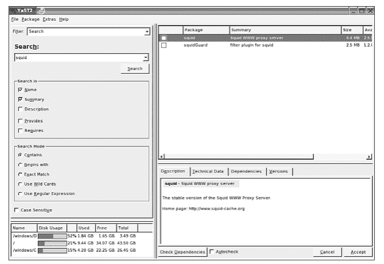

3. 编辑 `/etc/squid/squid.conf` 文件以进行任何更改。为了让私有网络上的主机访问代理，你必须在 ACL 列表之前插入一行，并移除 `#http_access allow our_networks` 行的注释。

注意

值得指出的是，本书的目的是提供指南。大多数练习都是直观的，但这一个更为复杂。

4. 配置系统后，使用 `squid start` 重启服务器。

## 练习 54：佛罗里达人公司

要创建 VPN 连接，请遵循以下步骤：
1. 以 root 身份登录并启动 YaST。
2. 选择“软件”然后“安装和删除软件”。搜索 ipsec（如图 4.56 所示）并安装 freeswan 和 ipsec-tools。
3. 在终端输入 `iptables -t filter -L`。这将显示过滤器表当前配置的规则（应该为空）。
4. 通过输入 `iptables -t filter -A INPUT -s 0/0 -p icmp -j DROP` 创建丢弃所有 ICMP 数据包的防火墙。通过输入 `iptables -t filter -A INPUT -s 0/0 -p tcp --dport 80 -j DROP` 配置防火墙丢弃 Web 服务器流量。
5. 输入 `iptables -t nat -F` 启用 NAT。
6. 输入 `iptables -t filter -L`。这应该显示新规则已生效。图 4.56

安装 ipsec。

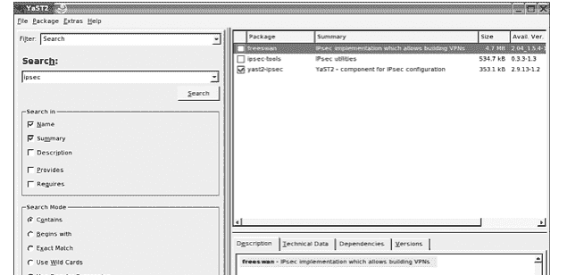

选择安全、VPN。这将打开图 4.57 所示的常规设置。
7. 提示显示没有定义连接，点击“下一步”。
8. 提示显示没有导入连接，点击“下一步”。图 4.57

配置 VPN 服务。

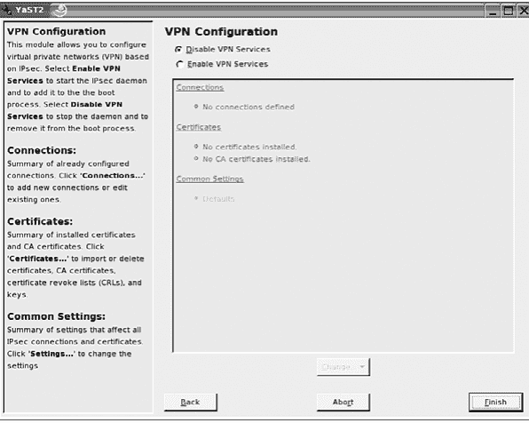

图 4.58

选择连接类型。

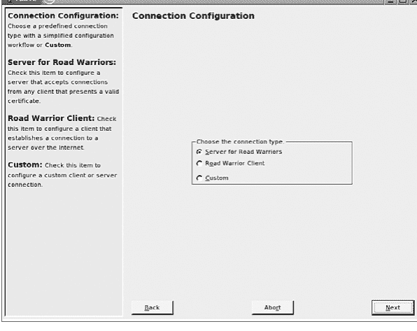

9. 点击完成。
10. 测试你的配置。

## 练习 55：乔治亚组件公司

要在客户的服务器上安装并配置 Tomcat，请遵循以下步骤：
1. 以 root 用户身份启动 YaST。
2. 选择“软件”然后“安装和删除软件”。搜索 tomcat 并选择以下包：
    - apache-tomcat-connectors
    - apache-tomcat-connectors
    - jakarta-tomcat
    - jakarta-tomcat-doc
    - jakarta-tomcat-examples

提示

如果遇到依赖项提示，选择安装 Java。

根据需要插入光盘，然后点击完成。
3. 启动终端会并进入 `/usr/share/tomcat/conf`。根据需要对文件进行编辑。
4. 输入 `rctomcat start` 启动。关闭终端窗口。
5. 启动浏览器并访问 `http://localhost:8080/manager/html` 完成。

注意

如果你无法通过该 URL，你需要深入学习 Tomcat。

## 练习 56：夏威夷松树公司（PineTrees, Inc.）

应用层网关可能会实现 Squid，因此操作方法与练习 53相同。此练习最重要的部分是创建一个到达现场时应该问的问题列表。在生成列表时，你应该验证自己是否理解以下内容：
- 内部用户可以访问哪些外部？为他们提供哪些服务？
- 匿名用户应该提供哪些服务？
- 信任用户应该提供哪些服务？
- 哪些协议允许从内部网络通过？
- 哪些协议允许从外部进入内部网络？

## 练习 57：爱达华石场

为你创建的列表应包含以下内容：
- 服务器的所有更新和补丁都是最新的吗？是否自动配置？
- 工作站的所有更新和补丁都是最新的吗？
- 是否有文档（管理员日志等）？
- 服务器是否物理安全地放置在服务器房或其他区域内？
- 服务器上运行的所有服务都是必须的？
- 是否有人负责通过 cert.org 或其他网站关注安全威胁/进展？
- 引导菜单是否受保护？
- 用户是否了解关于密码最佳实践的安全策略？
- 当前安装的包是否是最新且已知安全的？
- 是否允许远程管理？
- 密码使用了什么级别的加密？
- 是否使用了证书？如果是，应用了什么级别的加密？

# 第4 章：练习解答

## 练习 58：伊利诺伊彩票

要在 SLES 9 服务器上安装所需的软件包，请按照以下步骤操作：
1. 以 root 登录并启动 YaST。
2. 选择“软件”（Software），然后选择“安装和删除软件”（Install and Remove Software）。搜索 nmap 并选择安装软件包：
   - nmap
   - nmap-gtk
3. 在搜索字段中输入 sort，并在其出现时也勾选。
4. 点击“接受”（Accept）。如果出现任何依赖信息，点击“继续”（Continue）以一并添加它们。
5. 根据提示更换 CD，完成后退出 YaST。
6. 点击 KDE Kicker 底部的 N 菜单并选择“互联网”（Internet）、“管理”（Administration）。这将弹出图 4.59 所示的 Nmap 前端。现在你可以根据需要使用/配置该工具。

图 4.59

配置 Nmap。

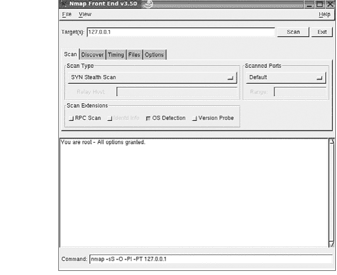

7. 要使用 Snort 工具，打开终端会话并输入 `snort`。这将生成一条错误信息，列出该工具可以使用的所有选项。

## 练习 59：印第安纳爬虫

要启用服务器上 cupsd 进程的广播，请按照以下步骤操作：
1. 以 root 登录并启动终端会话。
2. 编辑 `/etc/cups/cupsd.conf`，删除行 `BrowseAddress @LOCAL` 前的注释字符 (`#`)。
3. 保存文件，然后输入 `rccups restart` 来重启守护进程。

要添加一个名为“cupsadmin”的 CUPS 管理用户，请按照以下步骤操作：
1. 以 root 登录并启动终端会话。
2. 输入 `lp1ppasswd -g sys -a cupsadmin`。
3. 在提示时为账户输入密码。在提示时再次输入该账户密码。

## 练习 60：爱荷华养老院

你为客户生成的列表应包含以下内容：
- 服务器上的所有更新和补丁都是最新的吗？**你**是否配置了自动更新？
- 是否使用了无线网络？采用了哪种加密类型？
- 工作站上的所有更新和补丁都是最新的吗？
- 布线间是否安全？
- 服务器上是否有足够的文档（管理员日志簿等）？
- 多少人知道 root 密码？多久更改一次？
- 服务器在物理上是否被放置在机房或其他区域内并确保安全？
- 哪些文件设置了 SUID 和 SGID 权限？
- 服务器上运行的所有服务都是确实需要的吗？
- 多久审计一次日志文件？由谁来执行审计？
- 是否分配了专人通过 cert.org 或其他网站关注安全威胁/进展？
- 由谁来添加新用户和用户组？多久操作一次？
- 启动菜单是否受密码保护？
- 用户是否了解有关密码最佳实践的安全策略？
- 当前安装的软件包是新的且已证明是安全的吗？软件包更新时会通知哪些管理员？


- 是否允许远程管理？如何进行监控？
- 密码使用了什么种级别的加密？
- 是否使用了证书？如果是，对证书应用了什么种级别的加密？

## 练习 61：堪萨斯兽医有限公司

SLES 9 默认安装了 OpenSLP。如果没有安装，你可以通过 YaST 安装，选择“软件”，然后选择“安装和删除软件”。搜索 `opensplp` 并选择安装软件包。

要验证 `openslp` 是否定位了我们预期的服务，请按照以下步骤操作：

1. 以 root 登录并启动 YaST。
2. 选择“网络服务”（Network Services），然后选择“SLP 浏览器”（SLP Browser）。
3. 如图 4.60 所示，选择左列中的服务类型。
4. 点击“完成”（Finish）并退出 YaST。
5. 打开 浏览器并将地址设置为 `slp/`，如图 4.61 所示。

现在你可以浏览由 `slpd` 进程注册的服务。

图 4.60

配置 SLP 浏览器。

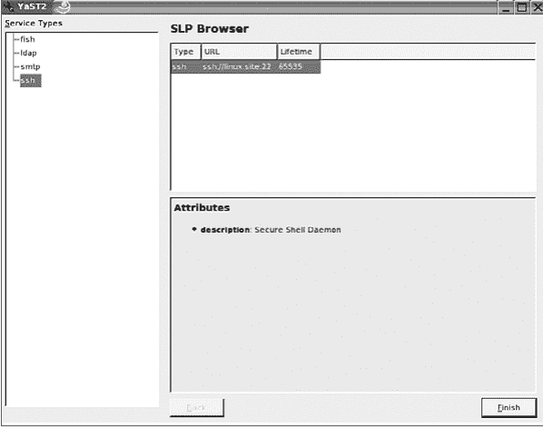

图 4.61

查看 slp 服务。

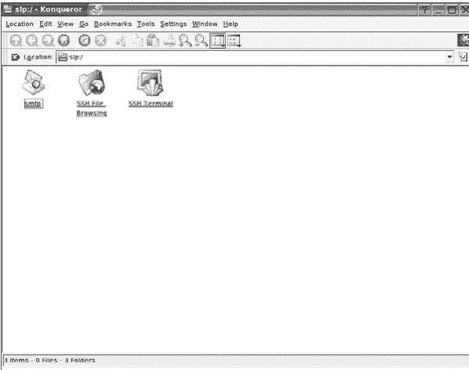

## 练习 62：肯塔基技术

要将 Samba 服务配置为主域控制器（PDC），请按照以下步骤操作：

1. 以 root 登录并启动 YaST。
2. 选择“网络服务”（Network Services），然后选择“Samba”。
3. 弹出一条如图 4.62 所示的消息，指示需要安装软件包。点击“继续”（Continue）。
4. 在第一个对话框中，选择“工作组”（workgroup）。
5. 在第二个对话框中，选择“域”（domain）。
6. 在第三个对话框中，选择“完成”（Finish）。
7. 现在你可以根据发生的情况使用/配置该工具。

图 4.62

配置 Samba。

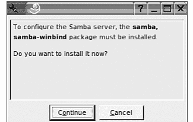

## 练习 63：路易斯安钓鱼

要在服务器上启用 ntop，请按照以下步骤操作：

1. 以 root 登录并启动 YaST。
2. 选择“软件”（Software），然后选择“安装和删除软件”。搜索 `ntop` 并选择安装软件包。
3. 根据提示更换 CD，完成后退出 YaST。
4. 弹出一条如图 4.63 所示的消息，指示需要安装软件包。点击“继续”（Continue）。
5. 保存文件，然后输入 `rccups restart` 来重启守护进程。
6. 点击 KDE Kicker 底部的 N 菜单并选择“互联网”（Internet）、“管理”（Administration）。这将弹出图 4.59 所示的 Nmap 前端。现在你可以根据需要使用/配置该工具。
7. 在第一行，选择“全选”。
8. 在第二行，选择“全选”。
9. 在第三行，选择“完成”（Finish）。
10. 现在你可以根据发生的情况使用/配置该工具。

图 4.63

配置 ntop。

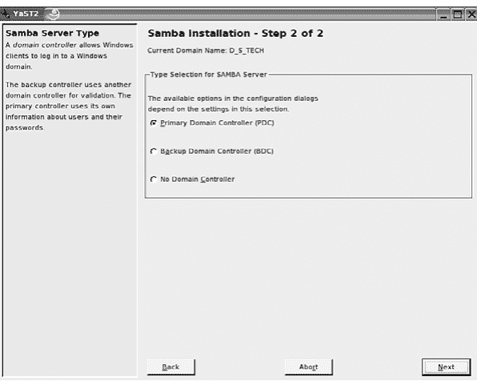

## 练习 64：缅州精神院有限公司

你为客户生成的列表应包含以下内容：

优点：

- 可以防止不受欢迎的流量进入网络。
- 也可以监控出站流量。

缺点：

- 可能会阻止合法数据的接收。
- 只能保护其所针对的层。例如，包过滤防火墙仍然容易受到层级攻击。这可能导致虚假的安全感。

## 练习 65：马里兰州编程

首要任务是开始收集所有指向入侵的数据。有必要遵循适当的程序并开始记录，以便：

- 有任何起诉的机会
- 在未来能够防止类似事件发生
- 识别所有受影响范围

## 练习 66：马萨诸塞州垃圾邮件发送者

SLES 9 提供的加密选项可以分为两类：对称加密和非对称加密。在对称加密中，用于加密数据的相同密钥也用于解密：发送者和接收者都需要相同的密钥。使用对称加密的加密标准包括：

- 数据加密标准 (DES)
- 高级加密标准 (AES)
- Blowfish

在非对称加密中，使用的是两个密钥而不是一个。这两个密钥在数学上是相反的，被称为公钥和私钥。由于它们是相反的，用公钥编码的数据只能用私钥解码，而用私钥编码的数据只能用公钥解码。使用非对称加密的加密标准包括：

- 利斯特-沙米-阿德曼 (RSA)
- 数字签名算法 (DSA)

数字签名使用非对称加密来对发送的消息创建加密哈希。哈希值随消息一起发送给接收者，接收者也会生成自己的哈希值。使用公钥解密消息中的哈希，以检查两个哈希值是否相同——如果相同，则推断消息是原始且未被修改过的。该系统唯一的弱点在于验证公钥的合法性，这正是证书机构 (CA) 的职责。

加密方案根据编码数据所需的位数来表示安全性。虽然旧的加密方案依赖 40 到 56 位来编码数据，但今天 128 位或更多位更为常见。

## 练习 67：密歇根州种植户

要将所有 DNS 查询限制在您的网络网段上的主机，请按照以下步骤操作：

1. 登录服务器并启动 YaST，如果提示，请以 root 身份验证。
2. 选择网络服务 (Network Services)，然后选择 DNS 服务器 (DNS Server)。

注意

如果 DNS 已配置，您可以直接跳到第 6 步。

3. 在转发器设置 (Forwarder Settings) 中，将“手动设置转发器”(Set Forwarders Manually) 保持默认，配置其他字段并点击“下一步”。
4. 在 DNS 区域 (DNS Zones) 对话框中，点击“添加”(Add) 添加区域，然后点击“下一步”。
5. 在完成向导 (Finish Wizard) 对话框中，点击“启动 DNS 服务器专家配置...”(Start DNS Server Expert Configuration...)。
6. 在左侧框架中，选择“基本选项”(Basic Options)。这将显示图 4.65 所示的内容。

图 4.65

DNS 服务器的基本选项。

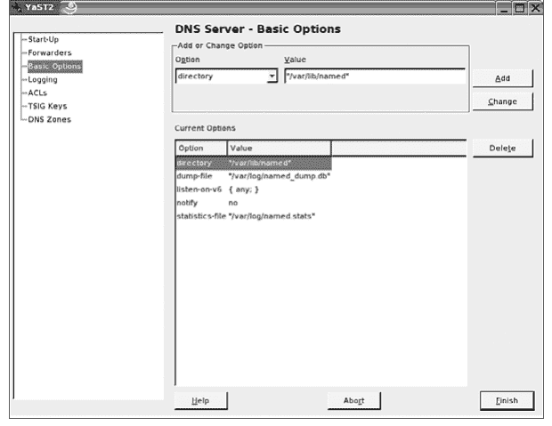

7. 在选项 (Option) 下拉列表中选择 `allow-query`。
8. 在值 (Value) 字段中输入 `{allowedhosts; }` 并点击“添加”。
9. 点击“完成”。

第 4 章：练习解答

提示

您可以通过尝试解析 `lab1dsttechnical` 主机来轻松地测试此配置。如果一切运行正常，你不应该能解析它。

## 练习 68：明尼苏达州河管理局

要配置 DHCP 守护进程向 DNS 服务器发送动态更新，请按照以下步骤操作：

1. 以 root 身份登录并启动 YaST。
2. 选择网络服务 (Network Services)，然后选择 DHCP 服务器 (DHCP Server)。
3. 进入全局设置 (Global Settings)，确保没有勾选 LDAP 支持 (LDAP Support)。创建 TSIG 密钥。
4. 如图 4.66 所示，填写动态 DHCP (Dynamic DHCP) 的值。

图 4.66

配置动态 DHCP。


## 练习 69：密西西比州糖尿病小组

有很多编写 Shell 脚本可以完成此任务。由于需要提示用户输入文件名，因此应该使用 `read` 命令。为了验证文件是否存在，应该使用 `test` 命令（可以通过其别名调用）。可以使用 `-r` 选项来验证该文件是否可读。最后，如果文件不存在，可以使用 `touch` 工具创建一个大小为零的文件。

根据这些参数，以下 Shell 脚本将胜任此角色：

```
#MDG.sh
echo "Enter filename:"
read filename
if [ -r $filename ]; then
echo "File exists"
else
touch $filename
echo "File created"
fi
```

提示

在 `filename` 和 `]`; 之间需要有一个空格，否则你会收到第 3 行缺少 `]` 的错误消息。

## 练习 70：密苏里州刀剪刀有限公司

密苏里州刀剪刀公司需要在适当时间运行这些脚本的 cron 文件条目如下：

```
0 6 * * 1 ABC
10 15 2 * * BCD
30 18 14 3 * CDE
30 18 15 9 * CDE
0,10,20,30,40,50 6-18 * * DEF
5 12-16 * * 1-5 EFG
```

唯一棘手的条目是这里 CDE 的那一个。由于两个运行的日期没有共同点，最简单的方法是为其创建两个独立的条目。

## 练习 71：蒙大拿州探险队


为了满足客户的需求，需要执行三个操作。第一个是将所有新创建文件的默认权限更改 `664`。从 `666` 减去得到值 `002`。为了满足这一要求，编辑 `/etc/profile` 文件并将默认的 `umask 022` 更改为 `umask 002`。

要将 `/tmp` 中当前所有文件的权限更改 `751`，简单的解决方案是打开终端，使用 `chmod 751`。最后，使用 `mv` 命令将 `/etc/shadow` 移动到 `/tmp`。

## 练习 72：北卡罗来纳州游泳者

要安装 YaST 并可用，请遵循以下步骤：

1. 以 root 身份启动 YaST。

2. 选择软件，然后选择“安装软件”。

3. 在搜索框中输入 `gnome` 并点击搜索。结果如图 4.67。

4. 勾选 `gnome-session`、`gnome-applets`、`gnome-common`、`gnome-desktop`、`gnome-libs`、`gnome-panel`、`gnome-print` 和 `gnome-utils` 软件包并点击接受。接受任何提示。

5. 注销并结束会话。在登录提示处，用户现在可以点击菜单并选择会话。这将显示图 4.68 所示的内容，并使其成为后续登录的默认设置。

图 4.67 搜索 gnome 相关的软件包。


图 4.68 GNOME 桌面已安装并可用。


## 练习 73：北达科他州塑料

完成此任务简单的方法是右键点击 KDE 桌面并选择“桌面”。这将弹出图 4.69 所示的对话框。

图 4.69 配置桌面。


点击左列的“屏幕保护”，并如图 4.70 所示进行配置。

图 4.70 配置屏幕保护以满足客户需求。


## 练习 74：内布拉斯加州谱系

以下脚本将满足给定的要求：

```
#Choices.sh
clear
PS3="Please make your selection from the following: " 
select item in ABC BCD CDE Quit
do
case $item in
ABC) echo "Program ABC will now executed" ;;
BCD) echo "Program BCD will now executed" ;;
CDE) echo "Program CDE will now executed" ;;
DEF) echo "Program DEF will now executed" ;;
Quit) break ;;
*) echo "You must enter a number between 1 and 5." ;;
esac
done
```

## 练习 75：内华达州设计

可以编写任意脚本来执行这个简单的功能。由于你只需要数字，因此过滤掉数字以外的其他信息非常重要。第一个示例如下：

```
#Example1.sh
grep -c ".*" /etc/passwd
```

另一个示例是：

```
#Example2.sh
wc -l /etc/passwd | cut -d" " -f1
```

# G

- 网关（应用层），71

- 全局用户账户，8, 94-96

- GNOME

    - 安装，87, 174

    - 使用 GNOME 搜索，101

    - 快捷键，97-98

- Grep, 38, 125

- GRUB 引导程序，56, 141-142

- GUI

    - 帮助，45, 130-131

    - 查看进程，29, 115

- gzip，27, 112-113

- 名称解析，配置，39, 125

- NAT，67

- 网络

    - 命令，39, 125

    - 配置，53, 137-139

    - 设备，40, 125

    - 实施安全，75, 163-164

    - 安装，31, 116-117

    - 管理资源，49, 132-133

    - 监控流量，78, 167-168

    - 使用 CUPS 进行网络打印，74, 163

- 打印服务，51, 134-135

- top，167-168

- tntp.conf 文件，143

# H-J

- 硬件，

    - 在 SLES 9 中添加，51, 134

    - 配置，28, 113-114

- 帮助（基于 GUI），45, 130-131

- 主机安全，73, 86, 162, 174

- 主机名，配置，39, 125

- -i 参数，116

- 信息页，45, 130-131

- 入侵者，检测，66, 155-156

- 提示池，40, 125

- 任务。参见进程

# K-L

- 启动器，10, 99-100

- Linux 文本编辑器，54, 139

- 日志信息，监控，125

- 利用日志服务，47, 131

- 逻辑卷管理 (LVM)，55, 141

- 登录 shell，更改，8, 94-96

- 日志（启动），21, 112

- OpenLDAP，58, 143

- OpenSLP，76, 164

- OpenSSH，49, 132-133

- owships（文件），管理，35, 120

- 包过滤器，67, 156

- 分区

    - 安装期间添加空间，92

    - 划分，55, 141

    - 调整大小，20, 111-112

- 传递

    - 加密，11, 100

    - 7, 8, 91-96

- 权限（文件），35, 20

- 本地打印机，14, 103-104

- 管道，38, 125

- 打印机

    - 安装，51, 134-135

    - SMB 打印机，13, 102-103

- 打印

    - 实施 Samba，77, 166

    - 利用 CUPS，74, 163

- 进程

    - 杀死，17, 106

    - 管理和监控，29, 115

    - 调度，42-43, 127-129

- 代理服务器，68, 156-157

# Q-R

- -r -option，173

- read 命令，173

- Red Carpet，105

- 发版说明，访问，45, 130-131

- 远程访问，49, 132-133

# M-N

- man 页，45, 130-131

- 镜像目录，52, 136

- 多任务处理，29, 115

- 多用户进程，29, 115

- 远程管理

    - 禁用，21, 112

    - 启用，49, 132-133

    - 远程桌面，共享，18, 107-108

    - 软盘，创建，19, 110-111

    - 恢复系统，48, 131-132

    - 路由器，125

    - 管理，39, 40

    - RPM，30, 115

    - 同步，52, 136

    - 运行级别，34, 119-120

    - 安装，61, 87, 144-147, 174

    - 系统配置，62, 84-90, 148, 173

    - 更新，41, 126

    - SQUID 代理服务器，68, 156-157

    - 启动日志，检查，21, 112

    - su -151

    - SUSE Linux 企业服务器，57, 142-143

    - Switch 用户选项，96

    - 系统日志设置，47, 131

    - 系统设置，58, 143

# S

- 实施 Samba，77, 166

- 配置文件服务器，33, 116-117

- 屏幕保护程序，配置，176

- 截图，捕捉，29, 115

- 脚本元素，140, 脚本技术，50, 134

- 安全

    - 加密，81, 170

    - 检测入侵者，80, 66-156

    - 防火墙，79, 68-169

    - 实施主机安全，73, 86, 162, 174

    - 网络，73, 163-164

    - 管理企业策略，50, 142-143

    - 响应违规，80, 169

    - 审查，72, 161

    - 保持信息，45, 130-131

    - 安全设置，37, 122-123

    - tar 文件，存档，48, 131-132

    - 终端窗口，11, 100

    - 编辑器（Linux），54, 139

    - 服务器上的时间，57, 142-143

    - Tomcat，70, 160

- touch 工具，173


# U

- `-U` 参数，利用，116
- 更新
    - 安全更新，应用，37, 122-123
    - SLES，9, 41, 126
    - YOU，41, 126
- 用户账户
    - 管理，31, 116-117
    - 用户环境，42-43, 127-129
    - 添加，8, 9-96
- 服务器
    - DHCP 服务器，配置，63, 83, 149-151, 172
    - DNS 服务器，配置，64, 82, 151-153, 170
    - 限制物理访问，56, 141-142
    - Web 应用服务器，实施，70, 150
- 共享
    - 打印机，51, 134-135
    - 远程桌面，18, 107-108
- 快捷键
    - GNOME 快捷键，9, 97-98
    - KDE 快捷键，14, 103-104
    - SLES 9 启动过程，46, 131
    - 硬件，添加，46, 131-135
    - 安装期间，7, 91-93

# V-W

- 变量替换运算符，利用，50, 134
- 变量，视为数字，130
- VPN 连接，实施，69, 158-160
- Web 应用服务器（Tomcat），70, 160
- Web 服务器（Apache），31, 116-117
- 白皮，45, 130-131

# X-Y-Z

- YaST
    - 配置安全设置，37, 122-123
    - 磁盘配额，121
    - 启用远程管理，49, 132-133
    - 调整分区大小，111-112
    - 更新，94, 96
    - YaST 在线更新服务器 (YOU)，41, 126
- YaST2
    - 硬件配置，28, 113-114
    - 网络配置，53, 137-139
    - 用户账户，31, 116-117

## 任务与目标摘要

（接自封面）

## 第2章

SUSE LINUX Enterprise Server 9（续）

## 第2章

SUSE LINUX Enterprise Server 9（续）

| 目标 | 练习 |
|---|---|
| 管理和保护用户环境 | 40 |
| 管理文件权限和所有权 | 23 |
| 管理 Linux 用户和组 | 20 |
| 管理进程 | 18 |
| 管理网络资源 | 36 |
| 管理 RPM 软件包 | 22 |
| 使用 YaST 在线更新 (YOU) 管理更新 | |
| 从 YaST2 管理网络配置 | 29 |
| 管理用户账户 | 20 |
| 使用 YaST2 管理用户账户 | 20 |
| 管理 GRUB 引导程序 | 43 |
| 使用 rsync 镜像目录 | 39 |
| Linux 系统中的多进程和多任务处理 | 18 |
| 从 YaST2 获取硬件配置信息 | |
| 目标 | 练习 |
|---|---|
| 使用命令行编辑器编辑 | 37 |
| 使用桌面编辑器编辑文件 | 40 |
| 使用 grep 搜索文件内容 | 26 |
| 在 Linux 系统中使用基于 GUI 的帮助 | 32 |
| 使用信息页 | 32 |
| 使用系统日志 | 34 |
| 使用变量替换运算符 | 37 |
| 从 GUI 和命令行界面查看进程 | 18 |
| 目标 | 练习 |
|---|---|
| 配置 DHCP 服务器 | 48, 68 |
| 配置 DNS 服务器 | 49, 67 |
| 配置电子邮件服务 | 50 |
| 错误检测 | 51 |
| 实施包过滤器 | 52 |
| 使用 SQUID 实施代理 | 53 |
| 实施 VPN | 54 |
| 实施应用层网关 | 56 |
| 实施通用安全实践 | 57, 73 |
| 实施主机安全 | |
| 使用 CUPS 实施网络打印 | 59 |
| 实施 OpenSLP | 61 |
| 实施 Samba 提供文件和打印服务 | 62 |
| 安装 SLES 9 | 46, 72 |
