# Novell Linux 认证实践实验室手册

（见内封底）

## 关于 Novell Press

### 编辑

助理出版者

Mark Taber

### 项目经理

Doug Ingersoll

Darrin Vandenboos

Jenny Watson

Scott Meyers

Vanessa Evans

Gary Adair

David

# 第1章 Novell Linux Desktop 9

- 练习1：Armstrong' 汽车修理厂
- 练习2：Barrys 奖杯屋
- 练习3：Collette 咨询
- 练习4：D. S. 技术
- 练习5：Evan' 困境
- 练习6：Frank's 花店
- 练习7：Gibson's 营销
- 练习8：Heberling 风险基金
- 练习9：Indiana 工业
- 练习10：Jerrald 联合学院
- 练习11：Kent's 学校
- 练习12：Lessons Learned 公司
- 练习13：密西西计算机
- 练习14：NoMore Paper
- 练习15：Octagon 系统

# 第2章 SUSE LINUX Enterprise Server 9

- 练习16：ACME 电子产品
- 练习17：Barnes and Fine
- 练习18：现金今日
- 练习19：Donna's 收藏
- 练习20：Edna and Lorraine 古董
- 练习21：Fetters 发型设计
- 练习22：Global 搬家
- 练习23：Hare 卡车
- 练习 24：独立烟花
- 练习 25：J & C 记账
- 练习 26：凯伦的电脑
- 练习 27：一生解决方案
- 练习 28：曼西管理
- 练习 29：新起点公司
- 练习 30：橡树图片
- 练习 31：P.A.R. 公司
- 练习 32：优质封条
- 练习 33：富大家居改造
- 练习 34：斯宾塞甜点
- 练习 35：廉价建筑师
- 练习 36：美国公路
- 练习 37：胜利电气
- 练习 38：华夫饼
- 练习 39：Xtreme 书籍
- 练习 40：年轻与森林
- 练习 41：泽布珠宝
- 练习 42：约克敦烘焙师
- 练习 43：X. L. 技术
- 练习 44：等待与浪费责任公司
- 练习 45：村庄泵与供应

# 第 3 章：高级 SUSE LINUX 企业服务器 9

- 练习 46：阿拉巴马水泥
- 练习 47：阿拉斯加旅游及其他
- 练习 48：亚利桑那铝制制品
- 练习 49：阿肯西大学
- 练习 50：加州之梦
- 练习 51：科罗拉多保险公司
- 练习 52：康涅狄格水务
- 练习 53：特拉华货运
- 练习 54：佛罗里达评论员
- 练习 55：乔治亚小部件
- 练习 56：夏威夷松树公司
- 练习 57：爱达荷采石场
- 练习 58：伊利诺伊彩票
- 练习 59：印第安纳爬虫
- 练习 60：爱荷华养老院
- 练习 61：堪萨斯兽医有限公司
- 练习 62：肯塔基 D S 技术
- 练习 63：路易斯安钓鱼
- 练习 64：缅因精神病院责任公司
- 练习 65：马里兰编程
- 练习 66：马萨诸塞垃圾邮件发送者
- 练习 67：密歇根种植者
- 练习 68：明尼苏达河管理局
- 练习 69：密西西比糖尿病小组
- 练习 70：密苏里州刀与剪刀
- 练习 71：蒙大拿探险
- 练习 72：北卡罗来纳游泳员
- 练习 73：北达科他塑料


- 练习 74：内布拉斯加家谱 89
- 练习 75：内华达设计 90
- 练习 1：阿姆斯特朗汽车车身 91
- 练习 2：巴里的奖杯之家 94
- 练习 3：科莱特咨询 97
- 练习 4：D. S 技术 99
- 练习 5：埃文的困境 100
- 练习 6：弗兰克的花卉 101
- 练习 7：吉布森营销 102
- 练习 8：希伯基金 103
- 练习 9：印第安工业 104
- 练习 10：肯特行业 105
- 练习 11：利特学校 106
- 练习 12：教训 107
- 练习 13：密西西比 110
- 练习 14：NoMore 纸张 111
- 练习 15：八角形系统 112
- 练习 16：ACME 电子 112
- 练习 17：巴斯与精选 113
- 练习 18：今日现金 115
- 练习 19：多纳收藏品 115
- 练习 20：埃德娜和罗莱特古董 116
- 练习 21：费特斯及其他 118
- 练习 22：全球运输 119
- 练习 23：哈尔卡车 120
- 练习 24：独立烟花 121
- 练习 25：J & C 记账 122
- 练习 26：凯伦的电脑 125
- 练习 27：一生解决方案 125
- 练习 28：曼西管理 125
- 练习 29：新起点公司 126
- 练习 30：橡树图片 127
- 练习 31：P.A.R. 公司 130
- 练习 32：优质封条 130
- 练习 33：富大家居改造 131
- 练习 34：斯宾塞甜点 131
- 练习 35：廉价建筑师 131
- 练习 36：美国公路 132
- 练习 37：胜利电气 134
- 练习 38：华夫饼 134
- 练习 39：Xtreme 书籍 136
- 练习 40：年轻与森林 137
- 练习 41：泽布珠宝 139
- 练习 42：约克敦烘焙师 141
- 练习 43：X. L. 技术 141
- 练习 44：等待与浪费责任公司 142
- 练习 45：村庄泵与供应 143
- 练习 47：阿拉斯加之旅及其他 148
- 练习 48：亚利桑那铝制制造 149
- 练习 49：阿肯基大学大学 151
- 练习 50：加利福尼亚之梦 153
- 练习 51：科罗拉多保险公司 155
- 练习 52：康涅狄格水务 156
- 练习 53：德拉华货运 156
- 练习 54：佛罗里达评审员 158
- 练习 55：乔治亚小部件 160
- 练习 56：夏威夷松树有限公司 161
- 练习 57：爱达荷采石场 161
- 练习 58：伊利诺伊彩票 162
- 练习 59：印第安纳爬虫类 163
- 练习 60：爱荷华养老院 163
- 练习 61：堪萨斯兽医有限公司 164
- 练习 62：肯塔基州 D S 技术 166


## 练习列表

- 练习 63：路易斯安那钓鱼 . . . . 167
- 练习 64：缅州精神病院有限公司 . . 168
- 练习 65：马里兰编程 . . 169
- 练习 66：马萨诸塞塞垃圾邮件发送者 . . 170
- 练习 67：密歇根种植者 . . . . . 170
- 练习 68：明尼苏达河管理局 .. 172
- 练习 69：密西西比糖尿病小组 . . 173
- 练习 70：密苏里州刀与剪刀 .. 173
- 练习 71：蒙大拿探险队 . . . 174
- 练习 72：北卡罗来纳游泳者 . . 174
- 练习 73：北达科他州塑料 . . 176
- 练习 74：内布拉斯加家谱学 . . 177
- 练习 75：内华达设计 . . . . 178

# 关于作者

Emmett Dulaney 是 Novell 出版社《Novell认证 Linux 专业人员（CLP）学习指南》和《Novell Linux 桌面 9 管理员手册》的作者。作为 UnixReview、CertCities 和 Novell Connection 的专栏作家和贡献者，他持有许多厂商认证，在操作系统版本跟在称号之前的时代，他曾是一名 CNE。他目前正在攻读博士学位，并得出的结论是总有一件事要做。你可以通过邮件 `edulaney@iquest.net` 与他联系。

# 献献

本书献给 Evan。他的实验精神和在实践中学习的理念将带他走向远方。

# 致谢

感谢 Jenny Watson 给我这次写这本书的机会。我非常感谢她的信任和鼓励，并享受每一个与她合作的机会。还要感谢技术编辑 David Coughanour、项目编辑 Andy Beaster 以及开发编辑 Scott Meyers。我对他们的感激之情溢言表。

# 我们想听取你的声音！

作为本书的读者，你是我们最重要的评论家和评述者。我们非常重视你的意见，并想知道我们哪些做得得好，哪些地方可以改进，你希望看到我们涵盖哪些主题，以及你任何愿意分享给我们的智慧之言。

你可以直接发送电子邮件或写信给我，告诉你对这本书的喜欢或不满意之处——以及我们可以做哪些来提高书籍的质量。

请注意，我无法帮助你解决与本书主题相关的技术问题，而且由于我收到的邮件量很大，可能无法回复每一条信息。

当你写信时，请务必注明书名和作者，以及你的姓名、电子邮箱地址或电话号码。我会仔细审核你的意见，并将其与参与本书的作者和编辑分享。

电子邮件：`feedback@novellpress.com`

邮寄：Mark Taber

副出版

# 读者服务

# 引言

本书的概念雏形源于 BrainShare 的多次对话。在 Novell 推广 Linux 及其相关主题的几次活动，我听到许多管理员以不同的方式问同一个问题：“我如何判断自己是否真的足够熟悉 Linux？” 有时，“足够熟悉”意味着能够通过 CLP（认证 Linux 专业人员）或 CLE（认证 Linux 工程师）考试。但很多时候，“足够”仅仅意味着对该操作系统感到自在。

当我建议制作一本包含案例研究的实验手册时，它受到了很好的反响，值得我在纸上写下一些想法。这些想法萌芽、发酵，最终变成了你现在手中的这本书。

本书旨在让你从三个不同的水平测试对 Linux 的知识。如果你是 Linux 以及 Novell 目前提供的版本的新手，那么这本书可能并不适合你。本书包含了 75 个实操性的实验练习，让你测试对 Novell Linux Desktop 9 (NLD) 和 SUSE LINUX Enterprise Server (SLES) 的知识和能力。

本书分为四章。前三章建立在前章的基础上。你会看到一个案例和一些需要完成的任务，而不会提供如何完成这些任务的指导。第四章将回顾之前所有的练习，并为每个练习提供解决方案。

第一章“Novell Linux Desktop 9”提供了 15 个使用 Novell Linux Desktop 的练习。不需要其他操作系统或软件，你只需要掌握……

# Novell Linux Desktop 9

第二章“SUSE Linux Enterprise Server 9”提供了 30 个中等难度的练习。

第三章“高级 SUSE Linux Enterprise Server 9”提供了 30 个更高难度的练习。

第四章“解决方案”将回顾之前所有的练习，并为每个练习提供一个解决方案。

虽然上述数字是最低配置，但以下要求对于你能够感到舒适的工作环境更为现实：

- 奔腾 3 1GHz 处理器
- 512MB RAM
- 20GB 空闲硬盘空间
- 1024x768 或更高分辨率
- 100Mb/sec 以太网卡

对于 SLES 机器，你需要一台符合 SUSE LINUX Enterprise Server 9 标准要求的机器、一台客户端工作站（使用 NLD 效果最佳）以及一个互联网连接。为舒适的 NLD 环境提供的要求非常适用：

- 奔腾 3 1GHz 处理器
- 512MB RAM
- 20GB 空闲硬盘空间
- 1024x768 或更高分辨率
- 100Mb/sec 以太网卡

# Novell Linux Desktop 9

接下来的 15 个练习将允许你通过 Novell Linux Desktop 9 来测试你的知识。完成这些实验不需要任何其他操作系统或软件。分步解决方案将出现在第 4 章“练习题解答”。

注意

为了完成练习 7，你还需要访问打印机。同样，为了完成练习 12，你需要访问另一台 NLD 9 工作站。

表 1.1 列出了本节涵盖的任务以及每个任务可以在哪些练习中找到。

| 任务 | 练习 |
| --- | -- |
| 添加用户 | 练习 2 |
| 安装期间添加用户 | 练习 1 |
| 归档文件 | 练习 10 |
| 修改全局用户账户 Shell | 练习 2 |
| 修改登录 Shell | 练习 2 |
| 修改密码加密 | 练习 1, 2 |
| 修改用户账户设置 | 练习 2 |
| 修改你的密码 | 练习 5 |
| 检查启动日志 | 练习 15 |
| 压缩文件 | 练习 10 |
| 使用 File Roller | 练习 10 |

本节任务（继续）

| 任务 | 练习 |
| --- | --- |
| 配置桌面 | 练习 2 |
| 配置 GNOME 快捷方式 | 练习 3 |
| 配置本地打印机 | 练习 8 |
| 创建备份 | 练习 13 |
| 创建救援软盘 | 练习 13 |
| 创建 KDE 快捷方式 | 练习 8 |
| 创建启动器 | 练习 4 |
| 禁用远程管理 | 练习 15 |
| 启用辅助功能选项 | 练习 3 |
| 安装软件包包 | 练习 3 |
| 安装另一个桌面 | 练习 3 |
| 安装 SMB 打印机 | 练习 7 |
| 安装 Novell Linux Desktop 9 | 练习 1 |
| 杀死进程 | 练习 11 |
| 将 KDE 设置为默认界面 | 练习 1 |
| 桌面共享 | 练习 12 |
| 调整分区大小 | 练习 14 |
| 搜索文件 | 练习 6 |
| 更新操作系统 | 练习 9 |
| 使用终端窗口 | 练习 5 |

## 练习 1：Armstrong 汽车修车厂

你是公司小企业业务部门的顾问。你被派往米德尔尔顿的 Armstrong 汽车修车厂，那里刚到了一台用于前台的新工作站。他们要求将该机器上的操作系统替换为最新版本的 Novell Linux Desktop 9。

该地的一位管理员以前使用过 KDE 界面并很喜欢它，因此那应该是默认前端。管理员密码需要设置为 N7Press，加密方式应设置为 MD5。除了 root 之外，再添加另一个用户：

| 字段 | 数值 |
| --- | --- |
| 全名用户名 | Armstrong |
| 用户登录 | kenarm |
| 密码 | nt5 |
| 系统邮件 | 是 |
| 自动登录 | 否 |
| 附加组 | audio, cdrom, dialout |

文件应为 `/etc/passwd` 和 `/etc/shadow`。

## 练习 2：Barry. 技术公司

你是 Barry. Technical 的临时顾问。在一次例行检查中，Pianki 告知你管理员由于某些情况已经离开了。从语气上判断，Pianki 认为管理员可能在离开前不久创建了一个 shell 脚本。如下：

| 字段 | 数值 |
| --- | --- |
| 全名用户名 | Doyle |
| 用户登录 | dlucas |
| 密码 | A5 |
| 最大天数 | 60 |
| 过期日期 | 06/12/31 |
| 登录 shell | `/bin/zsh` |
| 默认组 | users |
| 附加组 | audio, dialout, video |
| 桌面 | gears |
| 屏幕保护程序 | 10 |

必须更改以下设置：

- 密码加密改为 Blowfish
- 可接受的密码长度为 6 个字符
- 错误尝试后的延迟为 2

## 练习 3：Collette 咨询公司


你是 Collette 咨询公司的系统管理员。信息部副总裁叫你进办公室。显然，服务器发生了闯入企图，他不确定还有哪些地方受了影响。作为预防措施，他想启用以下功能：

- 启用辅助功能选项
- 将密码设置为 `Alt+F2`
- 启用粘滞键

由于不知道还有哪些地方受了影响，作为预防措施，IT 负责人要求所有所有人员更改密码。

# 4：D. S. 技术公司

你是 D. S. Technical 的现场顾问。他们只使用 Novell Linux Desktop 9 和 GNOME。在桌面上创建一个名为 "Job Security" 的启动器，将执行此命令。

## 练习 5：Evan 的困境

半夜电话响了，你在电话里听到了公司初级管理员 Evan 的声音。显然，服务器发生了闯入企图，他不确定还有哪些地方受了影响。你必须在终端中使用 `passwd` 更改你的密码。

## 练习 6：Frank 的花店

在拜访你的一位客户期间，Pianki 先生告知你系统管理员刚刚在不太愉快的情况下离开了。当管理员被护送出办公室时，他大喊道明天他们都会后悔没有他在身边。从语气上判断，Pianki 认为管理员可能在离开前不久创建了一个运行并损坏系统文件的 shell 脚本。

你需要检查系统在过去两天内创建的任何文件，以确定是否存在任何可能等待爆炸的定时弹。

## 练习 7：Gibson 营销咨询公司

Gibson 正在评估 Novell Linux Desktop，目前仅在一台工作站上安装了该系统。你被派到 Gibson 办公室在该工作站上安装打印机。他们使用的是 KDE 桌面。

他们想要配置的打印机连接到 Windows 机器并在网络共享。为了访问它，必须使用以下设置：

- 用户 ID—`JBUCK`（密码为 mississippi）
- 工作组—`gib_mkt`
- 服务器—`market`
- 打印机名称—`4250_hp`
- 制造商—`HP`
- 型号—`LaserJet 4250`
- 开始横幅—无
- 结束横幅—无
- 配额—无
- 允许的用户—仅限 `cgibson`

## 练习 8：Heberling 风险基金

你是 Heberling 基金的管理员，这是一家投资连锁餐厅和生物技术的小型公司。某天，公司总裁把你拉到一边，告诉他厌倦了共享网络打印机。由于他某些通信内容的私敏感性，他跑去买了一台他自己的打印机——佳能（Canon）`BJC-8200`，并希望你将其安装在他的 NLD 机器上，并命名为 `private`，这样他就能快速地将其与其他打印机区分开。

他还希望在他的 KDE 桌面面上有一个图标，点击后可以立即打开打印机管理功能，这样如果他不小心将作业发送到了错误的打印机，或者需要进行其他维护，就可以取消打印作业。

在并行端口上将打印机添加到系统，并为用户配置快捷方式。

> 注意
> 在此练习中，你可以用你手头有的任何备用打印机替换佳能 `BJC-8200`。

## 练习 9：Indiana Industrials

你是 Indiana Industrials 一处办事处的管理员。信息技术主管向所有管理员发送了一份备忘录，要求从明天起所有操作系统必须更新到最新版本。将进行一次审计，每台工作站都必须安装所有的服务包和更新，以确保大多数已的安全漏洞已得到修复。

在你的办事处，只有一台运行 Novell Linux Desktop 的工作站。它连接了互联网，你需要查找并安装适用于它的任何可用补丁或更新。

> 注意

## 练习 10：Jerralds 联盟学院

你正在 Jerralds 现场处理一个打印机问题，这时一位销售人员打来电话。他创建了一份必须向客户展示的重要演示文稿，但没带文稿就去了客户位于伦敦的现场。这位手忙脚措的销售人员记得文件的确切名称，也不记得是否已经将所有需要的内容合并到了一个文件中。

他唯一确定的是，所需的文件在他的主目录（home directory）中，并且需要尽快通过电子邮件将一切发送给他。

你介入并自愿处理这种情况。发送 `dlucas` 主目录中文件的最佳方法是将其归档成一个名为 `LONDON` 的单个文件。由于要通过电子邮件发送，你还需要对其进行压缩。

为销售人员准备好这个归档包以便发送给他。

> 注意

## 练习 11：Kent 的学校

当地的一所私立学校请你来咨询。他们一直在教学生编写非常基础的 shell 脚本。其中一个学生写了一个名为 `omniart` 的脚本，该脚本调用了许多 `sleep` 进程。他们不想关闭机器，只有在万不得已的情况下关闭，因为机器上运行着其他仍需要执行的应用程序。然而，这些其他应用程序正被 `sleep` 进程严重减慢速度。

他们希望你尽可能地终止这些 `sleep` 进程。

> 注意

## 练习 12：Lessons Learned, Inc.

Lessons Learned 公司的 Wiese 博士将你叫到他的办公室。他向你分享了他面临的一个困扰。他的一个同事不断地给他打电话，要求他去办公室，以便他演示如何在 NLD 中完成某些他以前在 Windows 中常用的简单操作。

> 注意
> 此练习需要访问另一台连接到同一网络上的 NLD 9 工作站。

无论 Wiese 博士演示过多少次，那位同事总是说他理解了，结果第二天又打来电话，什么都不记得。Wiese 博士对于停止手头工作、走过走廊、上楼、演示简单的解决方案然后再次走回所花费的时间感到困扰。

当你提到 NLD 的桌面共享功能时，他非常高兴，并认为这可能解决问题。正当你们讨论这种情况时，电话响了，是那位同事打来的，同样的问题。

在两台机器之间建立连接以解决这个困境。

> 注意

## 练习 13：Mississippi Computing

你是 Mississippi Computing 的顾问，这是一家服务金融领域中型公司的小公司。你被叫到客户现场与 Terry Truitt 会面。他告知你，由于公司搬进更大的办公室，他负责的系统计划在未来几天内迁移。

为了防止搬迁过程中可能造成的损坏，他希望你为办公室里的 NLD 工作站创建一个应急磁盘以及一份全量备份。

> 注意

## 练习 14：NoMore Paper

你是 NoMore Paper 公司的管理员——这是一家专门为小型办公室提供无纸解决方案的公司。作为支持包的一部分，你充当转销商并为客户提供包括工作站在内的硬件。一位客户来电话说错误频繁发生，这表明他的交换空间（swap space）已耗尽，而他不知道这意味着。

你必须给客户打服务电话并增加交换空间的大小。

> 注意

## 练习 15：Octagon Systems

你咨询的一家公司最近从办公室收到了一台二用工作站。它运行着 Novell Linux Desktop。他们希望你设置这台工作站，以便他们的员工远程访问。他们还希望确保系统配置了最新的安全更新，并确保交换空间配置得当。

> 注意

# 第 2 章：SUSE LINUX Enterprise Server 9

表 2.1

本节目标（续）

| 目标 | 练习题 |
|---|---|
| 使用 YaST 启用远程管理 | 练习 36 |
| 在命令行执行命令 | 练习 16 |
| 执行 RPM 软件包相关操作 | 练习 19 |
| 在 Linux 上查找文件 | 练习 17 |
| 在网络上查找帮助 | 练习 32 |
| 实施和监控企业安全策略 | 练习 44 |
| 在 Linux 系统中安装打印机 | 练习 38 |
| 命令行 Shell 简介 | 练习 41 |
| Linux 文本编辑器简介 | 练习 41 |
| 网络相关命令行简介 | 练习 27 |
| 限制对服务器系统的物理访问 | 贯穿始终 |
| 管理和保护 Linux 用户环境 | 练习 30 |
| 管理文件权限和所有权 | 练习 23 |
| 管理 Linux 用户和组 | 练习 20 |
| 管理进程 | 练习 18 |
| 管理网络资源 | 练习 36 |
| 管理 RPM 软件包 | 练习 19 |
| 管理运行级别 (Runlevels) | 练习 22 |
| 使用 YaST 在线更新服务器 (YOU) 管理软件更新 | 练习 29 |
| 从 YaST2 管理网络配置 | 练习 40 |
| 管理用户账户 | 练习 20 |
| 使用 YaST2 管理用户账户 | 练习 20 |
| 管理 GRUB 引导程序 | 练习 43 |
| 使用 rsync 镜像目录 | 练习 39 |
| 修改系统设置 | 练习 45 |
| 监控进程 | 练习 18 |
| Linux 系统中的多用户进程和多任务 | 练习 18 |
| 从 YaST2 获取硬件配置信息 | 练习 17 |
| 管道与重定向 | 练习 26 |
| 使用 OpenSSH 提供安全的远程访问 | 练习 36 |
| 将路由设置保存到配置文件 | 练习 27 |

本节目标（续）

| 调度作业 | 练习 30 |
| 使用权限保护文件和目录 | 练习 23 |
| 设置和配置磁盘配额 | 练习 24 |
| 使用 IP 工具设置网络设备 | 练习 28 |
| 使用 IP 工具设置路由 | 练习 28 |


| 使用命令行工具测试网络连接 | 练习 28 |
| 测试网络接口 | 练习 28 |
| 排除 SLES 9 启动启动故障 | 练习 33 |
| 更新 SLES 9 安装 | 练习 29 |
| 使用 ACLs 进行高级访问控制 | 练习 22 |
| 使用高级脚本技术 | 练习 37 |
| 使用基础脚本元素 | 练习 31 |
| 使用命令行编辑器进行编辑 | 练习 37 |
| 在 Linux 系统中使用桌面编辑器编辑文件 | 练习 40 |
| 使用 grep 搜索文件内容 | 练习 26 |
| 在 Linux 系统中使用 GUI 帮助 | 练习 32 |
| 使用 info Pages | 练习 32 |
| 使用系统日志服务 | 练习 34 |
| 使用变量替换运算符 | 练习 37 |
| 从 GUI 和命令行界面查看进程 | 练习 18 |

### 练习 16：ACME 电子

你是一家小公司的顾问，该公司专门为为小型企业打造定制技术解决方案。ACME 的所有者（一家家庭经营的小店）给你打来电话，告知他们刚刚聘佣了一位名叫 Kristin 的新接待员。

Kristin 没有 Linux 经验，对计算机的经验也很少。为了完成她工作所需的某项每月任务，她需要知道如何访问命令行、切换到 ACME 目录，并使用 `{month}.gz` 语法将该目录下的所有文件用 `gzip` 压缩。完成后，她需要将归档文件移动到 `/ACME/MONTHLY` 目录，并将目录中的所有其他文件移动到 `/ACME/OLD`。

你需要引导她完成这些任务。

# 注意事项

### 练习 17：Barnes and Fine

一家小型视频店的经理告知你，他无法在其服务器上找到一个文件。他知道该文件的标题中包含 "tickets" 一词，但不确定全称是什么。你需要在系统中为他找到该文件。

你应该尝试同时使用图形化工具和命令行来查找该文件。

在你在现场时，总部还指示你获取有关硬件的信息并记录下来，以便报告给他们进行可能的升级。作为客户合同中涵盖的一项安全措施，你还必须查找并记录任何权限高于 2000 的新添加文件。

注意事项

### 练习 18：Cash Today

一家小型连锁店正在考虑将它们的服务器升级到新的设备。你被派去收集运行在 SLES 服务器上的进程的运行信息。由于你工作的公司深信冗余性，你需要从 GUI 截取进程的屏幕，然后到命令行创建一个包含当前运行进程的文本文件。这两个文件随后将通过邮寄发送到总部。

# 注意事项

### 练习 19：Donna’s Collectibles

你是一家小公司的管理员。有一个需要安装在服务器上的新应用程序。该程序是 RPM 格式的。在服务器上安装它并进行记录。

# 注意事项

### 练习 20：Edna and Lorraine

你是一家中型公司的管理员。一台新服务器刚刚到达，仅带有基础安装。该服务器将主要供销售部门使用。你需要根据 2.2 中的要求配置此服务器。

服务器要求

| SLES 服务器名称 | EDNA-SLES |
| 静态 IP 地址 | 192.168.0.78，子网掩码 255.255.255.0，默认网关地址 192.168.0.1 |
| 服务器服务 | 服务器应该具有：Apache |

你需要在服务器上创建一个名为 ACCOUNTS 的新组，并向其中添加用户。需要的用户的用户表 2.3。

ACCOUNTS 组成员

| mmneil | Michelle | /bin/bash |
| 38c45z | | |
| ckight | Cathy Kight | /bin/ksh |
| Ander77son | | |
| jcharney | Jane Charney | /bin/bash |
| REClient | | |
| nborowski | Neill Borowski | /bin/csh |
| 3elv7e | | |

服务器需要配置运行 Apache。应该安装并配置名为 EDNA-WKGRP 的工作组。

## 练习 21：Fetters Hair and Such

你到达客户现场，收到一张写着他们对你访问期望的纸。根据你认出的老板的手写字，你需要：

- 1. 创建名为 `/personal` 的目录。
- 2. 在 `/personal` 下创建四个子目录，名称分别为：
  - `accounts`
  - `employees`
  - `suppliers`
  - `other`
- 3. 删除 `/tmp` 目录中的所有文件。
- 4. 查看启动日志并查找其中的问题。

# 注意事项


# 第 2 章：SUSE LINUX Enterprise

### 练习 22：Global Moving

你是 Global Moving 本地的管理员。IT主管的一封邮件要求在所有 SLES 服务器上进行以下更改：

- 1. 将默认运行级别更改为 4。
- 2. 将 `/tmp` 下所有文件的 ACL 设置为与 `/root` 目录下的 `.fonts.cache-1` 文件相等。

注意

如果没有以 root 身份登录 KDE 桌面，你将在 SLES 9 服务器的 `/root` 文件夹中找不到 `.fonts.cache-1` 文件。如果你以其他用户（如管理员用户）登录，可以在该用户的目录下找到该文件。

提示

使用 `setfacl` 工具将一组文件的 ACL 设置为另一组文件的 ACL。

提示

重启后（更改默认运行级别为 4 后），服务器不会进入 GUI 登录界面。

注意事项

### 练习 23：Hare Trucks

你是 Wagner & Reise 公司的顾问。你被派往 Hare Trucks，对他们的服务器进行一些由总部实施的更改。你必须设置系统，使得所有新创建的文件默认权限为 `-rw-r--r--`。此外，你必须更改 `/tmp` 目录下所有文件的权限，使所有用户都具有只读权限。

# 注意事项

### 练习 24：独立烟花（Independent Fireworks）

Independent Fireworks 聘请你担任临时管理员，帮助解决他们正在遇到的一些问题。为了解决这些问题，他们希望你为所有用户实施磁盘配额，将其服务器空间限制在 50MB。

# 注意事项

### 练习 25：J & C 账务公司

你是 J & C 的管理员。最近有很多邮件在传阅，讨论需要所有服务器都更新到最新的安全更新。你收到指示，通过 YaST 应用所有补丁和更新，并确保服务器上部署了适当的安全设置。

注意事项

## 第 2 章：SUSE LINUX Enterprise Server 9

### 练习 26：Karen 的电脑

当你早上上班时，你发现一张便条，要求你对最近登录服务器的每个用户创建一个单独的报告，显示该用户访问系统的日期和时间。便条的底部随手写着“使用 `grep`”。

注意事项

38

### 练习 27：Lifetime Solutions

Lifetime Solutions 临面临网络问题。用户报告他们无法访问服务器或互联网。你怀疑问题出在路由表中，但你并不确定。

检查服务器的主机名，并运行一系列命令行网络命令来验证网络是否正常工作，或确认其不正常。同时检查路由表以及地址解析结果。

# 注意事项

### 练习 28：Muncie Management

你是最近被 Muncie Management 聘用的初级管理员，负责支持他们的网络。公司最近从另一个平台迁移到了 SLES，并且是终身学习的坚定拥护者。你的工作职责之一是尽可能多地学习操作系统和网络。

对于今天的学习，请使用 IP 工具检查网络连接并熟悉此工具。

# 注意事项

### 练习 29：New Start, Inc.

收件箱里有一封来自 Novell 的新闻稿。它讨论了最近发布的 SLES 以及 NLD 等其他几个产品的升级。新闻稿的顶部写着你经理的便条——“运行 YOU”。

注意事项

## 第 2 章：SUSE LINUX Enterprise Server

### 练习 30：Oak Pictures

你是一家技术解决方案公司的高级 Linux 管理员。你的客户之一 Oak Pictures 订购了一个新的 SUSE Enterprise Linux Server 9 系统，要求在你的所在地进行配置，然后运给他们。另一位管理员已经安装了操作系统，并添加了一些公司标准的应用程序。你现在必须对其进行配置和微调。

服务器将定期以 root 身份运行若干无人值守的任务。应该编辑相应的配置文件，以包含表 2.4 所示进程的条目。所有条目都应运行，并将任何输出（标准输出或错误输出）写入 `/dev/null`。

自动运行的进程

| 进程 | 频率 |
|---|---|
| `/usr/local/bin/orionest.sh` | 从整点开始，每 5 分钟一次 |
| `/usr/local/bin/suf.sh` | 从整点开始，每 15 分钟一次 |
| `/usr/local/bin/use.sh` | 从整点后 5 分开始，每 10 分钟一次 |


| `/usr/local/bin/orionrestart.sh` | 周日、周二、周四和周六早上 6:30 |

你还需要根据表 2.5 列出的设置配置系统。

### 系统配置设置与更改

| 实体 | 新值 |
|---|---|
| 新创建的文件 | 所有新创建的文件都应将默认权限设置为 `rw-rw-r--`。 |
| `/home/jackson` | 该目录下所有文件的所有者应从 `jackson` 更改为 `syed`。此外，该目录下所有文件关联的组应从 `users` 更改为 `root`。 |
| `/bin/zcat` | 在 `root` 用户的家目录下创建一个指向此文件的链接。链接的名称应为 `viewer`。 |
| 用户 | 向系统添加两个新用户：`wintel` 和 `omni`。`wintel` 的 UID 应为 `1010`，`omni` 的为 `1011`。每个账户的密码设置应为必须在 90 天内更改。此外，所有密码都应在 `/etc/shadow` 文件中，而不是 `/etc/passwd`。 |

## 第 2 章：SUSE LINUX Enterprise Server 9

### 系统配置设置与更改（续）

| 实体 | 新值 |
| 初始运行级别 | 将系统的初始运行级别设置为自定义的 `4`。 |
| 静态 IP 地址配置 | 使用 IP 地址 `192.168.10.7`，子网掩码 `255.255.255.0` 以及默认路由器地址 `192.168.10.1`。 |
| 文档 | 在 `/var/log/messages` 末尾添加一条目，说明系统已于某日配置。 |

### 练习 31：P.A. Inc.

你被 P.A. 聘请帮助他们创建市场 Shell 脚本。你的第一个任务是在你的家目录下创建一个脚本，并设置执行权限。该脚本从命令行提供的任何数字倒数到 1，并打印该数字。例如，如果用户给出 6，显示应该是：

```
6
5
4
3
2
1
```

### 练习 32：Quality Seals

你被 Quality Seals 聘请帮助他们从其他平台迁移。他们希望你编写一些文档，介绍用户如何获取安全信息。

### 练习 33：Rich and Big Home Improvements

R&B 在半夜打来电话将你吵醒。他们的 SLES 服务器因为一个清洁工为了给吸尘器找插座而拔掉了插头，导致掉电。服务器已经插了回去，但无法正常启动。

在快速穿好衣服到达他们的所在地后，你需要对服务器进行故障排除。

### 练习 34：Spencer Treats

你为 VAR（增值经销商）工作的顾问。Spencer Treats 解雇了所有的支持人员，并聘请了临时工。部门经理告诉你，他不确定 SLES 服务器是否还像以前那样工作，但已经没有人可以让他验证了。

他希望你检查系统日志。在检查日志后，你可以让他放心并保证一切运行正常，或者识别出问题。

# 注意事项

### 练习 35：Thrifty Constructors

Thrifty Constructors 失去了租约，被迫快速搬到另一个地方。但在关闭 SLES 服务器之前，他们希望你对系统进行 tar 备份。由于已经一段时间没有做过备份，而且在迁移过程中可能会发生损坏，你应该验证备份是良好的副本并且可以无错误地恢复。

当你确认备份良好后，正常关闭服务器。

# 注意事项

### 练习 36：U.S. Roadways

你是 D. S. Technical 公司的顾问。你的客户之一 U.S. Roadways 习惯在任何时候打电话，并要求在服务器上做一些小事。厌倦了必须牺牲休息时间开车去他们那里满足客户，你决定开启 SLES 服务器的远程管理。

此外，你还需要安装并配置 OpenSSH。

# 注意事项

### 练习 37：胜利电气公司 (Victory Electric)

Victory Electric 公司聘请你编写一个 shell 脚本。该脚本将作为他们编写的其他程序的前端，并在命令行中运行。执行时，它应该为客户提供一个包含四个选项的菜单：

- A — 运行名为 `flexon.sh` 的脚本
- B — 运行名为 `hour.sh` 的脚本
- C — 运行名为 `comp.sh` 的脚本
- D — 运行名为 `Indian.sh` 的脚本

用户应该能够以大写或小写输入选择，并运行相应的菜单选项。还应提供一个退出选项供用户退出菜单。如果按了任何其他键，程序应指示选择不当，并允许用户重试。

# 注意

### 练习 38：华夫饼与更多店 (Waffles and More)

Waffles and More 收到了一台新的 USB 彩色打印机。虽然它不是最好的打印机，但经理不想浪费任何资源，并坚持将其安装在服务器上并供所有用户共享。

将打印机添加到服务器并配置为所有用户共享。

注意事项

### 练习 39：极速图书 (Xtreme Books)

Xtreme Books 有了一家新的出版社，你在那里担任兼职采购编辑/系统管理员。在他的上一家任职单位，该出版商曾经历过服务器上所有文件被意外删除的糟糕经历。尽管你向他保证系统具有冗余性且会定期进行备份，但他要求将 `/home` 目录镜像到同一台服务器上的另一个目录（`/recovery`），以确保所有内容始终有两个副本可用。

为了安抚他，请创建 `/recovery` 目录并配置服务器将 `/home` 目录镜像到这个新创建的目录。

# 注意

### 练习 40：杨与森林公司 (Young and Forest)

Young and Forest 是一家小公司，管理员人员流动频繁。作为该公司的顾问，你经常在他们招聘期间被请来填补空缺。这次，他们雇了一位没有以前经验的管理员，但这个人得到了他父亲（公司副总裁）的极力推荐。

你被分配了任务，向新员工演示如何验证网络状态。由于他没有命令行经验，请演示如何通过 YaST 进行网络状态检查和配置，并演示如何使用桌面编辑器来检查配置文件。

# 注意

# 练习 41：泽布珠宝珠宝 (Zebb Jewels)

Zebb Jewels 是一家老派的 Unix 公司，最近刚刚转为 Linux。该公司的管理员对桌面界面没有信心，更倾向于通过命令行完成所有工作。

他们有很多 shell 脚本，正将这些脚本从旧系统迁移到新的 SLES 服务器。这些脚本中硬编码了服务器名称。旧服务器是 ZEBB7，而新服务器是 JEWEL，这导致了脚本无法运行。

向管理员演示如何使用命令行文本编辑器来完成他们需要执行的更改。

注记

可以使用多个命令行工具来完成这些更改，你应该能够演示至少三个。

# 注意事项

### 练习 42：约克城镇烘焙坊 (Yorktown Bakers)

你担任管理员的公司收到了一块新硬盘。你需要将这块硬盘添加到服务器上并对其进行分区。配置 LVM 并在新硬盘上创建至少三个分区。

# 注意

### 练习 43：X. L. 技术公司 (X. L. Technology)

你是 X. L. 技术公司的几位管理员之一。一台 SLES 服务器将从现场退回并被另一台服务器替换。你需要处理这台旧服务器，在 SLES 之外安装一些其他操作系统，让它在实验室中焕发生机。

为了实现这一点，你需要安装并配置 GRUB，以便在启动菜单中显示其他选项。

# 注意

### 练习 44：等待与更多公司 (Wait and More)

你是 Wait and More 公司的顾问，这家公司在招聘期间经常需要你来填补空缺。这次，他们雇了一位没有经验的管理员，但这个人得到了他父亲（公司副总裁）的极力推荐。

这家公司抱怨他们的某些设置不当，你需要配置服务器以满足安全需求。

# 注意

### 练习 45：乡村泵与供应 (Village Pump and Supply)

Village Pump & Supply 正处于快速扩张阶段。他们希望在服务器上部署 OpenLDAP。

在服务器上安装并配置 OpenLDAP，修改以下配置文件：

- `slapd.conf`
- `ldap.conf`

# 注意

# 高级 SUSE Linux 服务器 9

接下来的练习将让你测试对 SUSE Linux 服务器 9 的知识。与之前不同，大多数练习可以在命令行界面完成，但你可能会发现桌面环境会有帮助。

这些练习的解决方案见第 4 章。表 3.1 列出了本章节的目标和前提条件。

注记

第 3 章：高级 SUSE Linux 服务器

本章节内的目标

| 目标 | 练习题 |
|---|---|
| 配置 DHCP 服务器 | 48 |
| 配置 DNS 服务器 | 49 |
| 配置电子邮件服务 | 50 |
| 检测入侵者 | 51 |
| 实现数据包过滤 | 52 |
| 使用 SQUID 实现代理服务器 | 53 |
| 实现 VPN | 54 |
| 使用 Tomcat 实现 Web 服务器 | 55 |
| 实现应用层网关 | 56 |
| 通用安全实践 | 57 |
| 主机安全 | 58 |
| 使用 CUPS 实现网络打印 | 59 |
| 网络安全 | 60 |
| 实现 OpenSLP | 61 |
| 使用 Samba 提供文件和打印服务 | 62 |
| 安装 SLES 9 | 46 |


| 管理 SLES 9 系统配置 | 47 |
| 网络流量 | 63 |
| 通用防火墙概念 | 64 |
| 响应安全事件 | 65 |
| 使用加密技术保护服务 | 66 |
| 使用 YaST | 贯穿始终 |

### 练习 48：亚利桑铝制造 (Arizona Aluminum Manufacturing)

你被传到 AAM 的机房并收到一项任务。实验室负责人希望你为 SLES 服务器开启 DHCP 服务。你还需要启用 LDAP 支持并使用以下设置：

- 域名：LabRoom
- 默认租约时间：1 天，最大允许 2 天
- 本机 IP 地址：192.168.0.14
- 默认网关 IP 地址：192.168.0.1
- IP 地址范围：192.168.0.15–192.168.0.99

完成服务安装后，请务必在离开之前启动它。

#### 注意
你应该从命令行启动服务。

#### 注意事项

### 练习 49：阿肯肯州大学 (Arkansas University)

在教堂活动期间，你的传呼机响了，你匆忙退到门厅。当地大学 D 5 技术实验室的 DNS 出了问题。他们希望你立即配置一台符合以下规格的 SLES 9 服务器：

- 区域名称：dtechnical.com
- 名称服务器：lab1.dtechnical.com
- TTL：3 天
- 反向查询：是

按要求配置服务器。

#### 注意事项

### 练习 50：加利福尼亚之梦 (California Dreaming)

你被传到加利福尼亚之梦冰淇淋公司的当地办公室。他们正在从托管环境转为运行自己的服务器。你今天的任务是将 Postfix 服务配置为 california.com 域的邮件传输代理（MTA）。

#### 注意事项

### 练习 51：科罗拉多保险公司 (Colorado Insurers)

当你早上来上班时，遇到了一位非常焦虑的网络管理员。他告知你，他怀疑有人在周末“黑入”了服务器。除了几个同事在饮水机旁的传言外，他没有任何依据可以支持这一判断。

检查相应的日志，并识别任何可能指示入侵的迹象。

#### 注意事项

### 练习 52：康涅狄格水务 (Connecticut Water)

你被传到 CW 配置一个包过滤防火墙。经理告诉你是必须使用 iptables，因为他从杂志上读到这是最佳方法。顺便，他还希望在服务器上启用 NAT 路由。

#### 注意
作为练习的一部分，你应该配置并测试 NAT，同时验证包过滤配置。可以使用一台 NLD 工作站进行测试。在实际参加 Novell 实操考试时，测试配置有助于证明你清楚应该做什么，并且已经正确地完成了操作。

#### 注意事项

### 练习 53：德拉华货运公司 (Delaware Trucking)

德拉华货运公司的管理员刚刚离开了公司。在找到继任者之前，你们公司已受聘协助处理行政任务。今天，你被要求在他们的 SLES 9 系统上配置并测试 Squid HTTP 代理服务器。

#### 注意事项

### 练习 54：佛罗里达评审者 (Florida Reviewers)

Florida Reviewers 最近从一个办公室扩充到了两个办公室。你被聘用使用 YaST 在他们的两个主机（服务器）之间建立 VPN 连接并对其进行测试。

#### 注意事项

### 练习 55：乔治亚小部件公司 (Georgia Widgets)

独立小部件种植者协会聘请你于他们的 SLES 9 服务器上安装并配置 Tomcat。在安装和配置之后，你还应该对该设置进行测试。

#### 注意事项

### 练习 56：夏威夷松树公司 (Hawaii PineTrees, Inc.)

你是一家从事安全实施和审计的小型公司的顾问。在每日任务分配桶中抽中了那根短木签，你被派往 HPI，以便在 SLES 9 服务器上实现一个应用层网关。

列出到达现场时应提问的问题和疑虑，然后根据客户的要求实施这些内容。

#### 注意事项

## 第 3 章：高级 SUSE LINUX Enterprise Server 9

### 练习 57：爱达荷州采石场 (Idaho Rock Quarries)

你被派往 IRQ 担任顾问。在读了报纸上的许多恐怖故事后，他们希望确保安全工作尽在掌握之中。他们仅运行单台 SLES 9 服务器，并连接有许多 NLD。

识别漏洞并实施适当的安全措施。

#### 注意事项

### 练习 58：伊利诺伊州乐票 (Illinois Lotto)

你是伊利诺伊州乐票——这是一家小规模公司的管理员。你被分配在你的 SLES 9 服务器上安装 nmap 和 snort。

配置工具以执行网络扫描并监控网络中的潜在威胁。

#### 注意事项

### 练习 59：印第安纳爬虫公司 (Indiana Reptiles)

这是长的一周，你花在开车去客户那里的时间比实际工作还要多。你现在了印第安纳爬虫公司。他们要求你在他们的服务器上配置 cupsd。

配置该服务并确保它正在运行且用户可以访问。

#### 注意事项

### 练习 60：爱荷华养老院 (Iowa Retirement Homes)

你的一个客户，爱荷华养老院，担心他们的网络不安全。作为一种预防性措施，养老社区的负责人要求你列一份他们应该考虑的项目清单。

识别潜在风险并提供改进建议。

#### 注意事项

### 练习 61：堪萨斯兽医有限公司 (Kansas Vets, Ltd.)

作为你们公司提供的例行维护服务的一部分，你被分配双双检查 SLES 9 服务器上的 OpenSLP 配置。

确保配置正确并遵循安全最佳实践。

识别发现的任何差异并在必要时修复它们。

#### 注意事项

### 练习 62：肯塔基州 D 5 技术中心 (Kentucky's D 5 Technical)

你是一家小型 IT 公司的顾问。你被聘用将 Samba 服务配置为 DST TECHNICAL 域的主域控制器（PDC）。

使用你的 NLD 工作站测试工作组运行正常。

满足客户需求并确保功能正常。

#### 注意事项

### 练习 63：路易斯安纳渔业 (Louisiana Fishing)

你的一个客户路易斯安纳渔业担心他们的网络流量过大，数据响应时间比预期长。虽然这在大多数企业中是好事，但路易斯安纳渔业担心他们没有资源应对。

监控服务器流量并寻找任何流量过大的迹象；然后根据你的发现给出相应的建议。

#### 注意事项

### 练习 64：缅州精神学院 (Maine Asylums, LLC)

在当地用户小组每月会议期间，出现了一个有趣的情况。Maine Asylums, LLC 的管理员对寻求安全方案感兴趣。目前，他们不想实施任何操作，但他们想知道有哪些选择。

列出通用的防火墙概念，并包括关于为什么要实施以及如何在网络中实施此类方案的优缺点。

#### 注意事项

### 练习 65：马里兰编程 (Maryland Programming)

你在东海岸地区拥有一家小型网络咨询公司。你有三名员工——每个人都有自己的专长——因此可以为许多不同的操作系统和平台提供服务。

马里兰编程（一家电缆新闻网）的管理员惊慌失措地来电。他确定他们的 SLES 服务器发生了确认的安全漏洞。你必须到达现场并采取适当措施应对这一安全漏洞。

#### 注意事项

### 练习 66：马萨诸塞垃圾邮件者 (Massachusetts Spammers)

由于与垃圾邮件相关的抵制和普遍反感，Massachusetts Spammers 希望实施加密来保护他们的服务。然而，他们不想付钱让你执行操作。相反，他们希望你记录相关步骤以及他们在 SLES 9 上可用的加密选项，并将这些传真给他们。

### 练习 67：密歇根种植者 (Michigan Growers)

你是一名专攻网络和电信领域的顾问。你的许多客户只有在耗尽了所有内部资源并对如何进行感到毫无策后，才会寻求你的帮助。

你受 MG 委托配置 DNS，以将所有查询限制在你网段内的主机上。你网段内的主机不应能够查询 DNS。

#### 注意事项

### 练习 68：明尼苏达河管理局 (Minnesota River Authority)

明尼苏达河管理局负责向公众科普有关船只安全和捕鱼法规等问题。在由各个分机构办公室和自然资源部官员独立处理了多年后，他们正试图将其所有的工作实践转换为标准化形式。

对于 MRA，请配置你在练习 48 中使用的 SLES 9 服务器上的 DHCP 守护进程，使其向 DNS 服务器发送动态更新（练习 49 和 67）。

#### 注意事项

### 练习 69：密西西比糖尿病小组 (Mississippi Diabetes Group)

密西西比糖尿病小组按项目聘请了你为他们编写一个简单的 Shell 脚本。脚本应该询问文件名。当用户输入文件名时，脚本应验证该文件是否存在于当前目录中并且是可读的。如果文件不存在，应创建一个大小为零的文件，以便另一个程序可以无错误地运行。

为客户创建此名为 `MDG.sh` 的脚本。

#### 注意事项

### 练习 70：密苏里刀刀剪公司 (Missouri Knife and Scissor)

你最近完成了一门高级 Linux 管理课程，而你的老板正在向所有客户宣布，现在没有任何请求是不分大小之的。当你向他解释这种广告方式可能导致你的时间利用效率不是最高时，他交给你一项任务。


密苏里刀刀剪公司有一些需要定期运行的 Shell 程：

- ABC：需要每周一 6:05 运行。
- BCD：需要每个月的第二天 15:10 运行。
- CDE：需要每年 3 月 14 日和 9 月 15 日的 18:30 运行。
- DEF：需要在每天 6:00 到 18:00 之间每 10 分钟运行一次。
- EFG：需要在工作日每小时的 12:00 到 16:00 之间的每小时第 5 分钟运行。

写下 MK&S 需要在适当运行这些脚本的 cron 文件条目。

# 注意事项

## 练习 71：蒙特拉纳探险公司 (Montana Expeditions)

你是一家公司的区域 IT 管理员，该公司拥有并运营着许多小型公司。所有小型公司都作为独立的实体运行，并有自己的 IT 部门。你作为一个参考点，当任何 IT 部门遇到他们不确定如何执行的任务时，都可以向你寻求。

蒙特拉纳探险公司邀请你前往他们的现场。一位新 IT 主监规定了若干项他希望在 SLES 9 服务器上完成的事项，以便与他旧的环境保持匹配。

他们希望更改服务器，使得所有新创建文件的默认权限为 `-rw-rw-r--`。他们希望将 `/tmp` 目录下当前所有文件的权限更改为 `751`。最后，他们希望将 `/etc/shadow` 文件中的密码放回 `/etc/passwd` 文件。

# 注意事项

## 练习 72：北卡罗来纳游泳者 (North Carolina Swimmers)

你被指派为现场专家，负责管理特定地理区域内的若干战略客户。你被指示要非常有技巧地对待所有客户，并让每一个客户都觉得他们是你公司服务的唯一客户。

NCS 召集你前往总部。自从在 SLES 服务器上安装系统以来，他们一直使用 KDE 界面。然而，他们聘佣了一位新管理员来取代旧的，但他只熟悉 GNOME。

你需要在服务器上安装 GNOME 桌面，并在管理员登录服务器时让其可用。

# 注意事项

## 练习 73：北达科他纳塑料 (North Dakota Plastics)

在完成了多年关于信息技术的本科和研究生学习后，你被北达科他纳塑料聘用。你对他们操作的简单程度感到惊讶，并对你所发现的某些事情感到困扰。

北达科他纳塑料目前只有一台 SLES 9 服务器。由于此，他们希望你配置桌面在活动三分钟后进入屏幕保护程序，并密码解锁。

# 注意事项

## 练习 74：内布拉斯加家谱 (Nebraska Genealogy)

你是内布拉斯加家谱的管理员，这是一家专门追踪家族历史的公司。你的公司最近从 Unix 平台迁移，并严重依赖专有脚本。你被分配的任务是创建一个简单的菜单界面，提供 ABC、BCD、CDE 和 DEF 四种选择。用户应该选择 1 到 4 之间的数字来运行其中之一，或者选择 5 退出。

编写创建此菜单。

# 注意事项

## 练习 75：内华达设计 (Nevada Design)

你是一名程序员/管理员，被短期、临时地聘请给内华达设计。内华达设计有很多他们希望你完成的小工作，以及一个简单的请求。

他们希望有一个短脚本，可以告诉他们 `/etc/passwd` 文件中列出了多少用户。

编写创建此菜单的。

# 注意事项

## 第 4 章：练习解答

以下解决方案将逐步引导每个练习。这些设置在安装过程中禁用了电源管理和高级硬盘设置等功能。

### 练习 1：阿姆斯特 (Armstrong)

Novell Linux 桌面提供 DVD 和 CD 格式。要开始标准安装，请选择安装。接下来是许可协议。滚动选项，你可以点击标记为“同意”或“不同意”的按钮。如果你选择了后者，安装将不再继续。在同意许可协议后，YaST 识别自己为“安装和系统程序”，你必须选择你的语言。然后分析你的硬件，并给出单选框让你选择 GNOME 或 KDE。两者都没有预选，因此选择 KDE。

一旦点击开始实际安装，硬盘正在准备。随后，你可以通过进度条查看每个 CD 的安装状态。在此阶段结束，基础安装通过以下自动步骤完成：

# 注意

在选择接受之前，你应该更改分区建议以留出未分区空间。如果没有这样做，你在练习 14 中扩展交换分区空间时会遇到困难。基本步骤如下

- 从安装设置页面，选择分区。
- 在下一页，选择自定义分区设置。
- 选择自定义分区——专家专家用。
- 高亮分区表中的 Linux 原生分区条目；然后选择删除 > 是。
- 高亮分区表中的存储设备条目 (`/dev/sda` 或 `/dev/sda`)；然后选择创建。
- 选择主分区；然后点击确定。

### 练习 1：Armstrong 的自动车

- 7. 将 End 字段中的值更改为 `+8GB`（任何至少保留 2GB 空闲磁盘空间的数值）；然后点击 OK。
- 8. 选择 Next（下一步），你将返回安装设置。
- 9. 选择 Accept（接受）。
- 1. 更新配置。
- 2. 将文件复制到已安装的系统。
- 3. 安装引导管理器。
- 4. 为初始启动准备系统。

系统将重启并继续安装（通常在此在此提示插入下一张安装光盘）。现在正在安装软件包，包括- RealPlayer、Acrobat Reader、Red Carpet 和 OpenOffice.org 等。

系统提示你输入并验证 root 用户的密码。输入密码 `N7Press`。

屏幕上还会出现一个 Expert Options（专家选项）按钮。

选择它并选择 MD5 加密。扫描针对网络接口、DSL 连接、ISDN 地址、调制解调器、代理和 VNC 远程管理。接受摘要屏幕上找到的结果，并选择测试 Internet 连接。这对于下载最新的发布说明和更新以及确保系统是最新版本是必要的。

当提供三种身份验证模式选择时，选择 Local (`/etc/passwd`)——此选项存储在 `/etc/passwd/shadow` 文件中。点击 Next 后，你可以使用练习中提供的信息为 Ken Armstrong 添加新用户账户。选择 Details（详情）选项可以可以选择用户所属的额外组。

点击 Next 后，SuConfig 现在启动并写入此时的系统配置；之后将显示 Release Notes（发布说明）。如果你愿意，可以滚动阅读这些注释，也可以在以后任何时候通过 `/usr/share/docs/release-notes/RELEASE-NOTES.en.rf` 访问它们。

将进行硬件配置，例如搜索并识别显卡、打印机和声卡。再次你可以在摘要屏幕上进行任何所需的更改，接受当前内容并点击 Next。此时，安装已完成，剩下的工作就是点击 Finish（完成）。一旦执行操作，系统将重启并进入 Novell Linux Desktop 登录界面，提示你输入现在必须提供的用户名和密码。输入后，KDE 桌面将加载，你就可以开始工作了。

# 第 4 章节：练习解答

提示

如果你以 `kenarm` 的身份登录，你将正确设置，以便在练习 2 中进入 YaST。

### 练习 2：Barry 的奖杯屋

添加本地用户的最简单方法之一是通过使用 YaST（另一个设置工具）。从 All Applications（所有应用程序）菜单选择 System，YaST，提供 root 密码并在左格中选择 Security and Users（安全与用户）。在右格中，选择 Edit（编辑）并创建用户。

出现 User and Group Administration 。点击 Add 按钮并如图 4.1 所示输入用户信息。

图 4.1

为新本地用户创建账户。

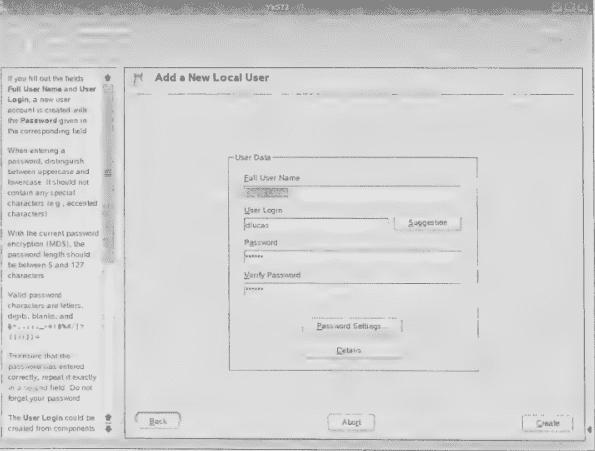

注意

取决于应用于 NLD 的服务包级别，图 4.1 显示的屏幕可能会略有不同。在不同的服务包中，SUSE 标志偶尔会被 Novell 标志取代。

点击 Password Settings（密码设置）按钮并如图 4.2 所示输入与账户相关的信息。

# 图 4.2

为用户账户设置密码设置。

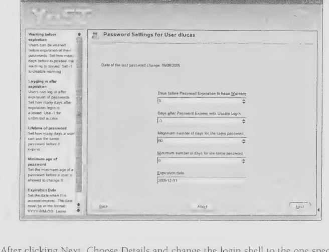

点击 Next 后，选择 Details（详情）并将登录 shell 更改为练习中指定的。验证默认组为 users 且选择了正确的额外组成员。点击 Next 然后点击 Create（创建）。点击 Finish 退出模块返回 YaST。

要完成练习的第二部分，选择 Security Settings（安全设置）并确保 Local Security Configuration（本地安全配置）设置为 Custom Settings（自定义设置，默认）。点击 Next，在 Passwords Settings 对话框中，将 Password Encryption Method（密码加密方法）更改为 Blowfish，并将 Minimum Acceptable Password（最小接受密码）更改为 6 个字符，如图 4.3 所示。


点击 `Next` 并保持 `Boot Settings`（启动设置）不变。再次点击 `Next`，在 `Login Settings` 中，将 `Delay after Incorrect Login Attempt`（**错误登录尝试后的延迟）设置为 `2`。（默认值为 `3.`）点击 `Next` 并保持现有的 `ID Limitations` 设置不变。点击 `Finish` 并退出 `YaST`。

# 第 4 章节：练习解答

图 4.3

更改密码设置。

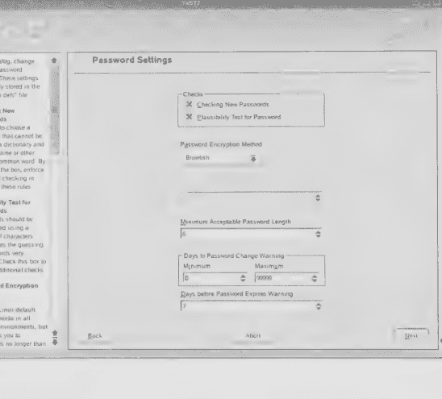

点击 `Applications` 菜单并选择 `Logout`（注销）；选择 `End session only`（仅结束会话）并 `OK`。使用新创建的用户账户登录。右键点击桌面并从弹出菜单选择 `Configure Desktop`（配置桌面）。在左格中选择 `Background`（背景）并将 `Picture` 设置为 `triplege`。点击左格中的 `Screen Saver`（屏幕保护程序）并按要求更改，如图 4.4 所示。

注意

除了从 `Applications` 菜单选择 `Logout`，你还可以使用 `Switch User`（切换用户）选项。如果你选择此路线，请小心 `Switch User` 选项可能会有问题，导致同时出现多个激活屏幕。

点击 `OK`。

## 练习 3：Collette

图 4.4

更改屏幕保护程序。

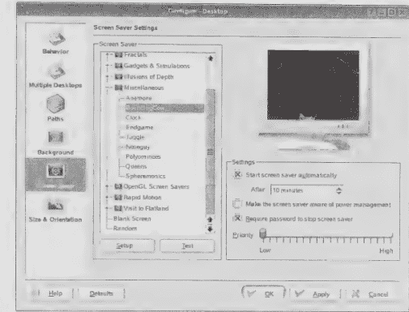

注意

### 练习 3：Collette

使用 `GNOME`，从菜单选择 `Programs`，`Accessories` 和 `Terminal`。在提示符处输入

```
passwd
```

你必须给出旧密码。执行后，输入一个新密码。如果你提供的密码不符合当前配置的要求

- `gnome-applets`
- `gnome-common`
- `gnome-desktop`
- `gnome-panel`
- `gnome-session`
- `gnome-utils`

检查 `Dependencies`（依赖项），所有都应正常。点击 `Accept`（接受），并根据提示插入介质。

启动器的工作方式就像其他操作系统中的快捷方式一样。启动器的工作方式就像其他操作系统中的快捷方式一样。虽然是 启动器，但它是为了防止它与其他快捷方式混淆，就像练习 3 中创建的那样。

- `gnome-applets`
- `gnome-common`
- `gnome-desktop`
- `gnome-panel`
- `gnome-session`
- `gnome-utils`

# 第 4 章节：练习解答

提示

如果你以 `kenarm` 的身份登录，你将正确设置，以便在练习 2 中进入 `YaST`。

图 4.5

配置可访问选项。

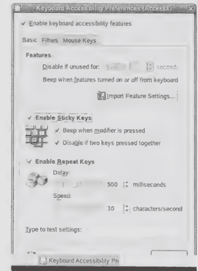

注意

除了从 `Applications` 菜单选择 `Logout`，你还可以使用 `Switch User`（切换用户）选项。如果你选择此路线，请小心 `Switch User` 选项可能会有问题，导致同时出现多个激活屏幕。

点击 `OK`。

提示

你应该在按下两个键时禁用该选项。如果不这样做，你就无法测试 `Alt+F2` 快捷键。

图 4.6

配置锁定屏幕的组合键。

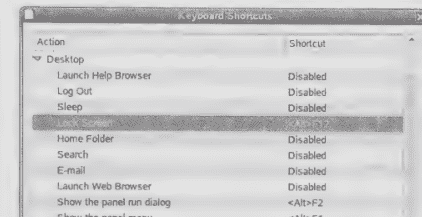

# 练习 4：D. S 技术

右键点击桌面并从弹出菜单选择 `Create Launcher`（创建启动器）。输入图 4.7 所示的设置——确保类型类型为 `Link`。点击 `No Icon` 并选择一个图标。（`apple-red.png` 非常适合此处。）

图 4.7

创建桌面启动器。

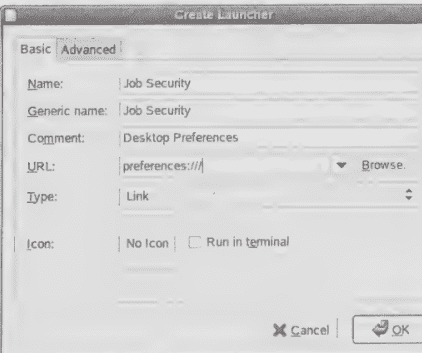

点击 `OK`。该图标现在应该出现在桌面上，双击它应该调出图 4.8 所示的文件夹。

图 4.8

启动器及其结果。

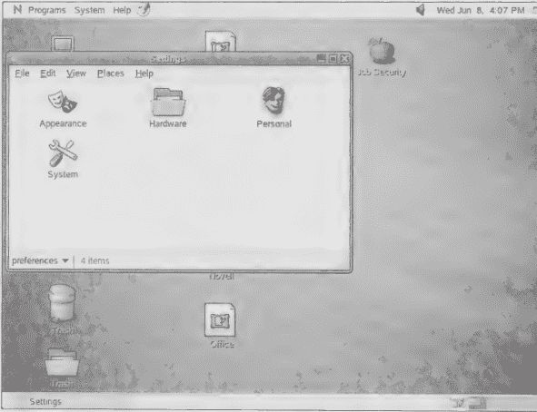

注意

启动器的工作方式就像其他操作系统中的快捷方式一样。虽然虽然是 启动器，但它是为了防止它与其他快捷方式混淆，就像练习 3 中创建的那样。

### 练习 5：Evan 的困境

使用 `GNOME`，从菜单选择 `Programs`，`Accessories` 和 `Terminal`。在提示符处输入

```
passwd
```

你必须给出旧密码。执行后，输入一个新密码。如果你提供的密码不符合当前配置的要求（长度、字符使用等），新密码将不再接受。如果密码符合当前配置的要求，系统会提示你重新输入。如果你第二次输入的新密码值与第一次相同，将出现一条信息，“密码已更改”，此时你现在可以关闭终端窗口了。

## 练习 6：弗兰克的花店

在 `GNOME` 桌面，点击“系统”（`System`），并选择“搜索文件...”（`Search for Files...`）。点击“更多选项”按钮，在“可用选项”中选择“修改日期早于（天）”并设置为 `2`，勾选“包含其他文件系统”，起始路径为 `/folder`，如图 4.9 所示。

图 4.9

寻找过去两天内创建的文件。

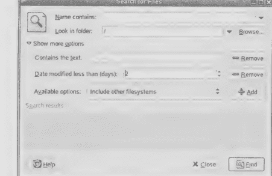

记下出现的文件名，然后排除它们作为前管理员创建的可能 shell 脚本。

在 `KDE` 界面中，通过从程序菜单选择“查找文件”（`Find Files`）（或“系统”、“文件系统”、“搜索文件”）可以找到相同的功能。然后你可以点击“属性”（`Properties`）选项卡并设置所需的选项。

## 练习 7：吉布森营销咨询公司

添加此打印机有多种不同的方法；因为练习说明公司正在使用 `KDE`，所以将使用其中自带的工具来演示此解决方案。在开始之前，使用你喜欢的名称创建 `jbuck` 和 `cgibson` 用户，并遵循练习 4 中使用的指南。用户 `jbuck` 的密码应为 `mississippi`。

以 `root` 身份登录，然后从菜单中选择“工具”（`Utilities`）、“打印”（`Printing`）、“打印机”（`Printers`）。从“配置—打印管理器”界面，选择“添加”（`Add`）、“添加打印机/类”（`Add Printer/Class`）。这将启动 `KDE` 中的“添加打印机向导”。

在启动屏幕上点击“下一步”（`Next`），然后在“后端选择”（`Backend Selection`）对话框中选择“`SMB` 共享打印机 (Windows)”，如图 4.10 所示。在“用户识别”对话框中，选择“普通账户”（`Normal account`）并为用户设置给值。

图 4.10

配置对打印机的访问。

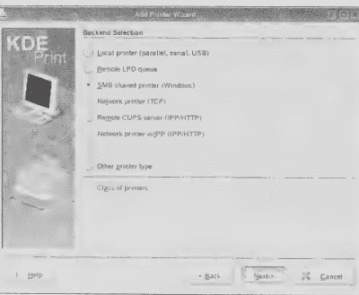

在“打印机型号选择”对话框中，选择制造商（`HP`）和型号。在“打印机测试”对话框中，选择进行打印机测试并验证配置是否正常。保持默认的横幅页设置（无横幅页）和配额设置（无配额）不变。

在“用户访问设置”对话框中，将“类型”设置为“允许的用户”（`Allowed User`）并仅添加 `cgibson`，如图 4.11 所示。

## 练习 8：希伯林风险基金

图 4.11

只有 `cgibson` 用户可以使用打印机。

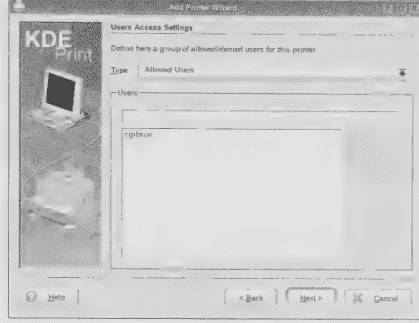

在名称和位置字段输入你需要的任何关于打印机的通用信息；然后查看摘要信息并在“确认”屏幕上点击“完成”（`Finish`）。

以 `root` 身份登录并把打印机连接到工作站。启动 `YaST`，选择“硬件”（`Hardware`）和“打印机”（`Printer`）。当你进行此选择时，将对连接进行扫描。由于打印机连接到并行端口，它应该被识别，并显示品牌和型号，如图 4.12 所示。

提示

你不必以 `root` 登录桌面即可启动 `YaST` 并安装打印机。当你启动 `YaST` 时，系统会提示提供 `root` 密码。

点击“配置”（`Configure`）并将“打印名称”字段中的默认项更改为“私有”（`private`）。点击“下一步”。打印机制造商和型号应该已经选好。如果没有选好，或者被识别错误，请选择正确的项并点击“下一步”。

点击“测试”（`Test`）按钮向打印机发送测试页并确认配置正常。

## 第 4 章：解决方案

图 4.12

打印机已配置好。

在桌面上右键点击，选择“创建快捷方式”。在“位置”对话框中输入你想要位置的 `URL`，然后从“文件系统”选择。

## 练习 9：印第纳工业

有多种不同的方法可以添加这个打印机...

。

## 练习 10：杰拉德联盟

在 `KDE` 界面中，通过从程序菜单选择“查找文件”（`Find Files`）（或“系统”、“文件系统”、“搜索文件”）可以找到相同的功能。然后你可以点击“属性”（`Properties`）选项卡并设置所需的选项。

# 第 4 章：练习解答

图 4.16

创建连接所需的信息。


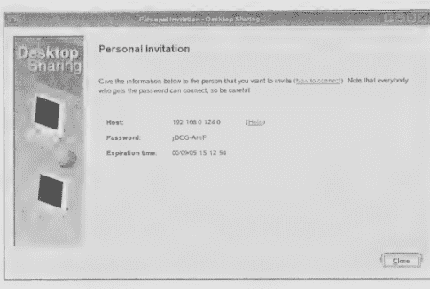

在电话中，告诉 Wiese 博士进入“系统”、“远程访问”、“远程桌面连接”，并输入给定的主机信息。

提示

请务必包含整个主机地址，包括冒号和显示数字。如果遗漏冒号和显示数字，将无法建立连接。

Wiese 博士的机器上将出现一个警告，显示正在建立连接，如图 4.17 所示。

同事现在必须输入给定的密码，连接将就会建立。

在 Wiese 博士的机器上，他可以打开并运行任何所需的应用程序。同事的机器将显示 Wiese 博士的桌面，看起来就像另一个窗口一样，如图 4.18 所示。同事可以观察正在进行的操作，也可以通过点击该窗口内任何所需的数值或输入值来获取控制权。

当用户关闭窗口时，远程桌面连接就会结束。很短之后，Wiese 博士的机器上会弹出一个对话框，指示连接已关闭。

### 练习 12：Lessons Learned, Inc.

#### 图 4.17

你必须接受连接。

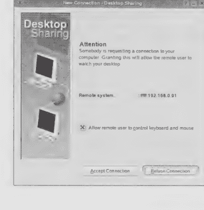

#### 图 4.18

远程桌面显示为另一个窗口。

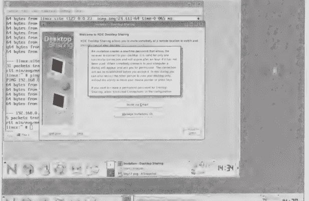

# 第 4 章：练习解答

### 练习 13：Mississippi Computing

这里需要完成两个任务。第一个是创建应急磁盘，第二个是进行备份。

对于应急磁盘，打开 YaST 并选择“系统”。在“系统”下方，选择“创建启动、救援或模块软盘”。这里会出现七个选择：

- 标准启动软盘 1
- 标准启动软盘 2
- 标准启动软盘 3
- 救援软盘
- 模块软盘
- 自定义软盘
- 下载软盘镜像

选择“救援软盘”，磁盘镜像将复制到介质中。完成后，在 YaST 的“系统模块”下方选择“系统备份”。点击“配置文件管理”并选择“添加”来添加备份配置文件。将其命名为 `FULL`。给出一个带有绝对路径的文件（例如 `/tmp/backup.tar`）并点击“下一步”。不要输入任何搜索限制，因为你想包含所有内容，继续点击“下一步”，直到到达图 4.19 所示的 YaST 系统备份对话框。

#### 图 4.19

现在可以进行备份了。

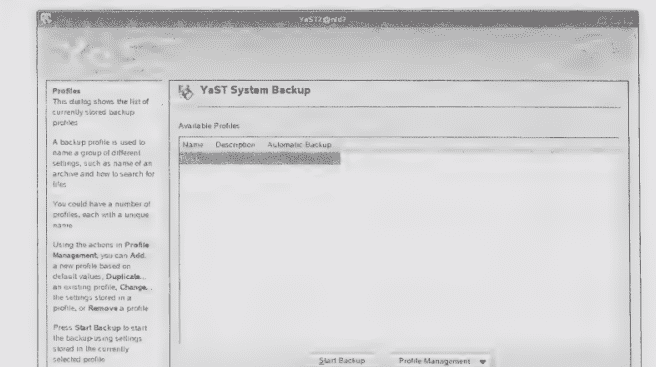

### 练习 14：NoMore Paper

点击“开始备份”，系统将开始读取软件包文件（这可能需要几分钟），然后将开始备份。

要解决这个问题，请以 `root` 身份登录并打开 YaST，以图形化方式操作磁盘并执行创建和分区任务。选择“系统”、“分区器”，会出现一个警告。仔细注意这个警告，因为它说的意思完全正确——如果你不小心，可能会造成不可逆的损坏。

在对警告选择“是”后，将出现图 4.20 所示的分区表。

#### 注意

显示的实际分区表取决于你系统中正在使用的磁盘和分区。你将看到与此类似的图形，但不是此图本身。

#### 图 4.20

你可以从此界面对分区进行操作。

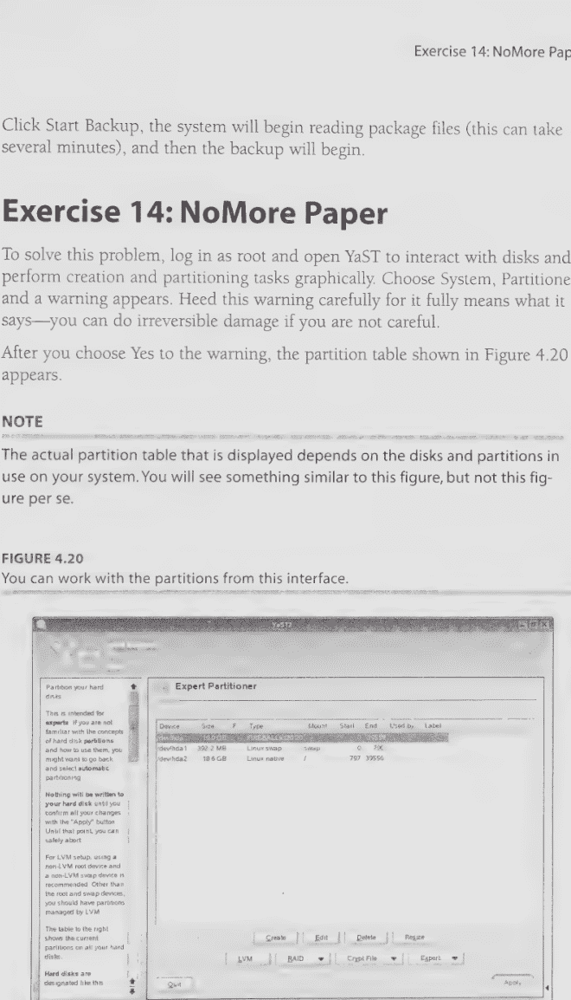

增大交换分区的大小并应用更改。

#### 注意

练习1中的分区建议为调整交换分区的大小留出了空间。如果 Linux 原生 `/` 分区已经使用了整个硬盘，则无法通过调整其大小来留出更多磁盘空间。

### 练习 15：Octagon Systems

要禁用或确保系统未启用远程管理，请以 `root` 身份登录并启动 YaST。选择“网络服务”、“远程管理”。只有两个单选框可用。确保选择了标记为“不允许远程管理”的选项，并点击“完成”。

回到 YaST，选择“杂项”并查看“启动日志”。这显示了 `/var/log/boot.msg` 文件的内容。扫描此日志并查找正在发生的错误。最新的信息位于文件末尾，这也是默认打开的地方。

如果你在扫描此文件时发现任何可疑内容，你可以选择保存它、打印它，或使用其他工具查看它（如果你想进一步审查的话）。

### 练习 16：ACME Electronics

确保 `/ACME`、`/ACME/OLD` 和 `/ACME/MONTHLY` 目录已存在，并且前台用户具有向这些目录写入文件的必要权限。你应该按照以下步骤为员工记录操作：

1. 从 KDE 器中，点击显示器图标打开终端外壳。可选地，从菜单中选择“系统”、“终端”，然后选择 Konsole。
2. 输入命令 `cd /ACME`。
3. 因为目录中的所有文件都要放在单个文件中，因此必须使用 `tar` 和 `gzip`。虽然可以使用管道符，但为了引导新手完成过程，最好将操作分为两个独立的进程：

```
tar cvf july.tar
gzip july.tar
```

4. 将存档文件移动到目标目录的命令是：`mv july.tar.gz MONTHLY`。
5. 将所有其他文件移动到目标目录的命令是：`mv *.* OLD`。
6. 输入 `exit` 关闭终端会话。

简单说明一下将 `"july"` 替换为当前目录即可引导他们完成这些任务。

### 练习 17：Barnes and Fine

查找具有权限的文件

1. 从 KDE 器中，点击显示器图标打开终端外壳。可选地，从菜单中选择“系统”、“终端”，然后选择 Konsole。
2. 输入命令 `cd /ACME`。
3. 因为目录中的所有文件都要放在单个文件中，因此必须使用 `tar` 和 `gzip`。虽然可以使用管道符，但为了引导新手完成过程，最好将操作分为两个独立的进程：

```
tar cvf july.tar
gzip july.tar
```

4. 将存档文件移动到目标目录的命令是：`mv july.tar.gz MONTHLY`。
5. 将所有其他文件移动到目标目录的命令是：`mv *.* OLD`。
6. 输入 `exit` 关闭终端会话。

（注：提供的 OCR 文本结尾包含大量重复和伪迹，已根据唯一内容提供了一个干净的版本。）

### 练习 20：Edna 和 Lorraine 古董

要配置 Samba，以 `root` 身份登录并启动 YaST，然后选择“网络服务”（Network Services）和“Samba 服务器”。第一个对话框会询问工作组名称；输入 `EDNA-WKGRP`。

通过 `root` 身份登录并启动 YaST 创建用户。选择“安全与用户”（Security and Users），然后选择“编辑”（Edit）和“创建用户”（Create Users）。点击“添加”（Add），如图 4.24 所示添加每个用户，每个用户后点击“创建”（Create）。

#### 图 4.24

添加每个用户。

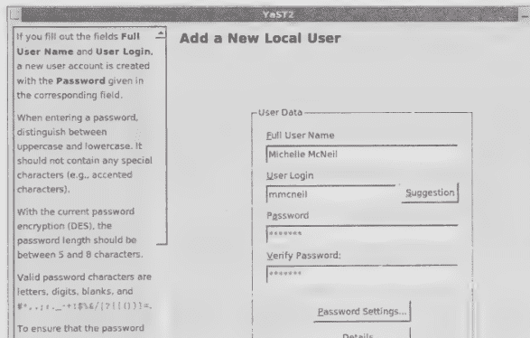

添加所有用户后，点击“完成”（Finish）。在 YaST 的“安全与用户”部分选择“编辑”和“创建组”（Create Groups）来创建 `AC` 组。点击“添加”，并如图 4.25 所示配置信息。

点击“下一步”（Next）和“完成”。

#### 图 4.25

添加新组。

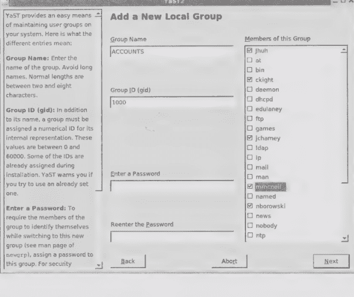

### 练习 21：Fetters Hair 及其他

要执行此操作，请遵循以下步骤：

- 1. 从 KDE kicker 中点击显示器图标打开终端外壳。可选地，从菜单中选择 *System, Terminal*，然后选择 *Konsole*。
- 2. 输入命令 `cd /`。
- 3. 输入命令 `mkdir personal`。
- 4. 输入命令 `cd personal`。
- 5. 输入命令 `mkdir accounts employees suppliers other`。
- 6. 输入命令 `cd /tmp`。
- 7. 输入命令 `rm -i *` 交互删除此目录下的文件以避免问题。
- 8. 输入 `exit` 退出外壳；然后启动 YaST 并选择 *Misc*（杂项）后的 *View Start-up Log*（启动日志）。这将允许你查看 `boot.msg` 文件中记录的任何与启动相关的问题。

### 练习 22：全局移动

要更改默认运行级别（runlevel），请遵循以下步骤：

- 1. 以任意用户登录，然后 `su -` 切换到 `root`。
- 2. 从 KDE kicker 中点击显示器图标打开终端外壳。可选地，从菜单中选择 System, Terminal，然后选择 Konsole。
- 3. 输入命令 `cd /etc`。
- 4. 编辑如图 4.6 所示的 `inittab` 文件。

#### 图 4.26

编辑 `/etc/inittab` 文件。

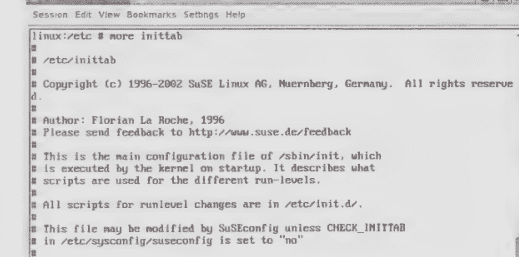

- 5. 将行 `id: 5:initdefault:` 中的 `5` 更改为 `4`，新的默认运行级别将变为 4。
- 6. 保存文件并退出。新的默认运行级别将在下次系统启动时生效。

要更改 `/tmp` 下所有文件的 ACL，请遵循以下步骤：


- 1. 以任意用户登录，然后 `su –` 切换到 `root`。

- 2. 从 KDE kicker 中点击显示器图标打开终端外壳。可选地，从菜单中选择 `System, Terminal`，然后选择 `Konsole`。

- 3. 输入命令 `cd /tmp`。

- 4. 输入命令 `getfacl /root/.fonts.cache-1 | setfacl --set-file=- *` 以更改此目录下的所有文件。

**注意**

如果你以不同的用户登录，`.fonts.cache-1` 文件的路径将为 `/home/<username>`。

- 5. 输入 `exit` 退出终端。

### 练习 23：Hare Trucks

`-rw-r-----` 的数字表示是 `640`。从新文件的默认值 `666` 中减去此值剩余 `26`。以 `root` 身份设置系统使所有新创建的文件具有这些默认权限。

- 1. 以 `root` 身份登录。

- 2. 从 KDE kicker 中点击显示器图标打开终端外壳。可选地，从菜单中选择 `System, Terminal`，然后选择 `Konsole`。

- 3. 输入 `cd /etc`。

- 4. 编辑 `profile` 文件并将默认项从 `umask 022` 更改为 `umask 026`。

**提示**

如果你尝试测试配置更改，请注意 `profile` 文件在下次启动外壳时才会被读取。在启动新外壳之前，你不会看到新创建的文件权限有任何变化。

要将 `/tmp` 目录中当前所有文件的权限更改为所有用户的只读权限：

- 1. 输入 `cd /tmp`。

- 2. 输入 `chmod 444 *`。

- 3. 输入 `exit` 退出终端。

## 练习 24：独立烟花

为所有用户实现磁盘配额（disk quotas）：

- 1. 启动 YaST 并以 `root` 用户身份验证。

- 2. 安装 `quota` 包。

- 3. 选择“系统”（`System`）然后选择“分区器”（`Partitioner`）。

- 4. 选择 Linux 分区并点击“编辑”（`Edit`）按钮。这将显示与图 4.27 类似的屏幕。

图 4.27

当前没有配额的分区。

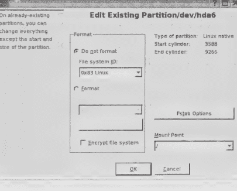

- 5. 点击“Fstab Options”按钮。这将显示与图 4.28 类似的屏幕。

- 6. 在底部的“任意选项值”（Arbitrary Option Value）框中输入 `usquota`。

- 7. 双击 `OK`，然后点击“应用”（`Apply`）。

**注意**

点击“应用”后，发生了两个意外情况。首先，YaST 告诉你卷需要重新挂载，并询问你是否确定要这样做。现在你将看到警告，说无法重新挂载，并暗示你必须知道自己在做什么才能继续。如果发生这种情况，选择继续。

执行此操作后，进入终端并输入 `mount -o remount /dev/hda2` 重新挂载根分区。

在继续下一步之前，输入 `quota -av` 开启所有挂载文件系统的配额，然后输入 `chkconfig quota on` 使其持久化。

图 4.28

fstab 可用的选项。

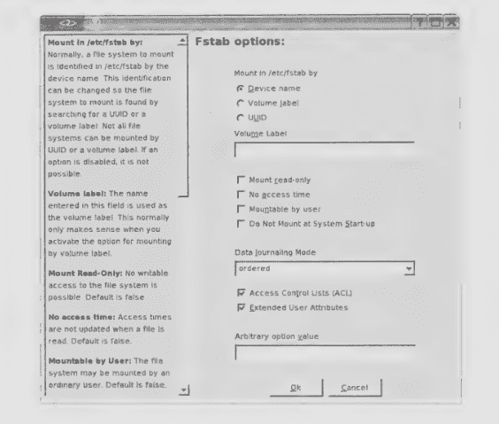

- 8. 进入终端提示符并重新挂载分区开启配额。

**提示**

除了使用 `setquota` 外，还可以使用 `repquota` 来查看配额报告。

## 练习 25：J & C 记账

要通过 YaST 安装更新，请遵循以下步骤：

- 1. 启动 YaST 并以 `root` 用户身份登录。

- 2. 安装 `quota` 包。

- 3. 选择“系统”然后选择“在线更新”（`Online Update`）。将显示与图 4.29 类似的屏幕。

图 4.29

在线更新的选项。

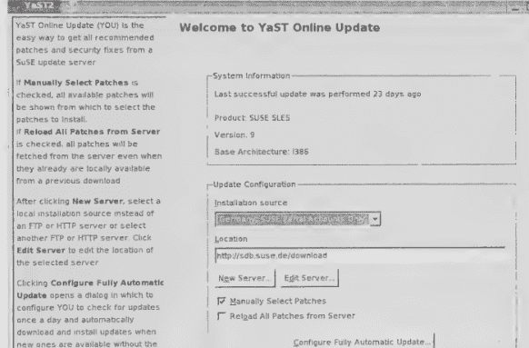

- 3. 点击“下一步”。将检索有关更新的信息。

- 4. 如果提示输入用户名和密码，输入这些值，然后选择从 CD 安装任何找到的更新。你也可以通过“软件”和“更新”来安装补丁。选择“配置”和“更新”来设置服务器设置。选择“系统”和“更新”。选择“更改”。这将打开一个与图 4.30 类似的对话框。

图 4.30

更新选项。

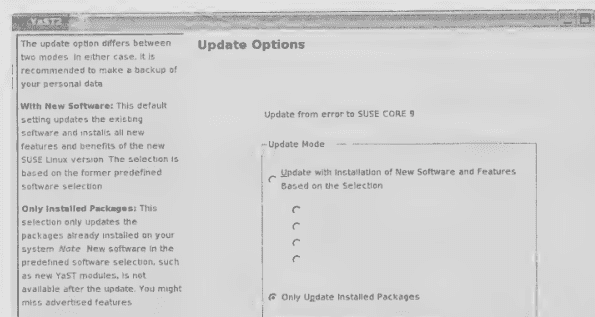

图 4.31

配置选项。

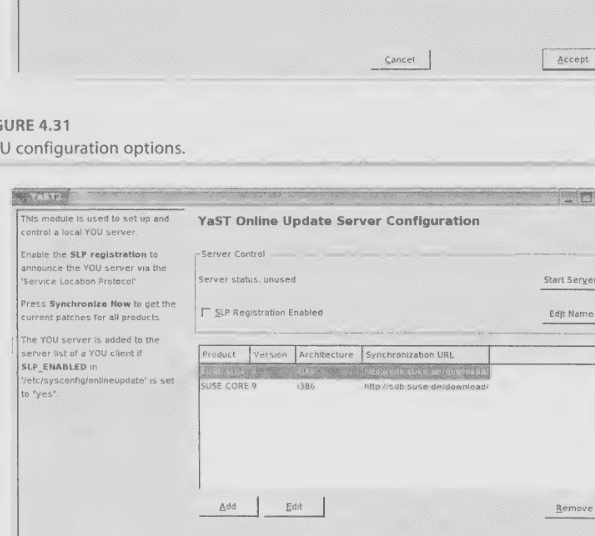

### 练习 26：Karen 的电脑

要列出曾经登录过服务器的所有用户，请遵循以下步骤：

- 1. 以 `root` 身份登录。

- 2. 从 KDE kicker 中点击显示器图标打开终端外壳。可选地，从菜单中选择 `System, Terminal`，然后选择 `Konsole`。

- 3. 输入 `lastlog | grep -vi "never"` 将显示减少为有效登录的行。

这将显示每个账户的最近登录，但不是每次登录。列出用户名，然后使用 `last` 命令查看自 `wtmp` 文件启动以来的每次登录。例如，查看用户 `edaney` 的记录，命令将是 `last edaney`。

### 练习 27：Lifetime Solutions

要检查服务器的主机名，请遵循以下步骤：

- 1. 登录 `root`。

- 2. 从 KDE kicker 中点击显示器图标打开终端外壳。可选地，从菜单中选择 `System, Terminal`，然后选择 `Konsole`。

- 3. 输入 `hostname`。

## 练习 28：Muncie 管理

`ip` 工具用于查看和更改当前网络配置。要查看当前配置使用命令 `ip address show`。生成的显示将如图 4.32 所示。

此命令的输出与 `ifconfig` 相同。用 `add` 替换 `show` 可以添加设置，而使用 `del` 则可以删除现有设置。

# 第 4 章：练习题解答

图 4.32

`ip address show` 命令的输出。

```bash
### Shell - Console
Session Edit View Bookmarks Settings Help
Linux:~# ip address show
1: lo: loopback (UP,LOOP,LOOPBACK) 16384 mtu 65536 
    link/ether 00:00:00:00:00:00 brd 00:00:00:00:00:00
    inet 127.0.0.1/8 brd 127.255.255.255 scope host
    inet6 ::1/128 scope host 
    valid_l preferred preferred forever host
2: eth0: <UP,BROADCAST,MULTICAST> mtu 1500 qdisc noqueue
    link/ether 00:11:22:ff:ff:ff
    inet 192.168.0.1/24 brd 192.168.0.255 scope global eth0
    valid_l preferred preferred forever global
3: eth1: <UP,BROADCAST,MULTICAST> mtu 1500 qdisc pfifo_fast qlen 1000
    link/ether 00:33:44:ee:ee:ff
    inet 192.168.1.1/24 brd 192.168.1.255 scope global eth1
    valid_l preferred preferred forever global
4: wlan0: <UP,BROADCAST,MULTICAST> mtu 1500 qdisc noqueue qlen 1000
    link/ether 00:55:66:cc:dd:ee
    inet 172.16.131.1/24 brd 172.16.131.255 scope global wlan0
    valid_l preferred preferred forever global
5: unmet1: <UP,BROADCAST,MULTICAST> mtu 1500 qdisc pfifo_fast qlen 1000
    link/ether 00:77:88:aa:bb:cc
    inet 172.16.187.1/24 brd 172.16.187.255 scope global unmet1
    inet6 fe80::/64 scope link unmet1
    valid_l preferred preferred forever link
linux:~#
```

命令 `ip link show` 将显示每个以太网设备的硬件地址。要操作路由表，请使用以下命令：

- `route show`—查看当前路由表

- `route add default`—添加默认路由


- `route delete`—删除路由

# 练习 29：新开始

要运行 `YOU`，请遵循以下步骤：

1. 以 `root` 身份登录并启动 `YaST`。
2. 选择“软件”（`Software`），然后选择“在线更新”（`Online Update`）。
3. 点击“下一步”（`Next`）。将检索有关新更新的信息。
4. 如果提示用户名和密码，输入这些值；然后选择安装任何找到的更新。

# 练习 30：Oak 图片

`Oak Pictures` 需要在适当时间运行这些脚本的 `cron` 文件条如下：

```cron
0,5,15,20,25,30,35,40,45,55 * * * /usr/local/bin/orienttest.sh 2>&1 /dev/null
0,15,30,45 * * * /usr/local/bin/suf.sh 2>&1 /dev/null
5,15,25,35,45 * * * /usr/local/bin/use.sh 2>&1 /dev/null
30 * * 0,2,4,6 /usr/local/bin/orientrestart.sh 2>&1 /dev/null
```

要设置系统以使所有新创建的文件默认权限设置为 `rw-rw-r--` (`664`)，请遵循以下步骤：

1. 以 `root` 身份登录。
2. 从 `KDE` 启动器（`kicker`）中点击显示器图标打开终端 `shell`。可选情况下，从菜单中选择“系统”（`System`）、“终端”（`Terminal`），然后选择 `Konsole`。
3. 输入 `cd /etc`。
4. 编辑配置文件，并将默认条目从 `umask 022` 更改为 `umask 002`。

## 提示

配置文件仅在启动 `shell` 时被读取。你必须启动 `shell` 以使更改生效。

要将 `/home/jackson` 目录下所有文件的所有者更改 `syed`，请遵循以下步骤：

1. 以 `root` 身份登录。
2. 从 `KDE` 启动器（`kicker`）中点击显示器图标打开终端 `shell`。可选情况下，从菜单中选择“系统”（`System`）、“终端”（`Terminal`），然后选择 `Konsole`。
3. 输入 `cd /home/jackson`。
4. 输入 `chown syed *.*`。

要将此目录下所有文件的关联组更改为 `root`，输入 `chgrp root *.*`。

## 提示

你可以通过输入 `chown syed.root *.*` 在一个命令中更改所有者和组。

要在 `/root` 文件夹中创建一个名为 `viewer` 的链接指向 `/bin/zcat` 文件，请遵循以下步骤：

1. 以 `root` 身份登录。
2. 从 `KDE` 启动器（`kicker`）中点击显示器图标打开终端 `shell`。可选情况下，从菜单中选择“系统”（`System`）、“终端”（`Terminal`），然后选择 `Console`。
3. 输入 `ln /bin/zcat viewer`。
4. 输入 `exit` 终端。

根据向系统添加用户的特定要求，请遵循以下步骤：

1. 以 `root` 身份登录并启动 `YaST`。
2. 选择“安全”（`Security`）和“用户”（`Users`），然后选择“编辑”（`Edit`）“创建用户”（`Create Users`）。
3. 点击“添加”（`Add`），为第一个用户输入 `weintel1`。点击“详情”（`Details`）并将用户 `ID` 设置为 `1010`。点击“下一步”。
4. 点击“密码设置”（`Password Settings`），将相同密码的天数设置为 `90`。点击“下一步”。
5. 点击“创建”（`Create`）。重复过程添加下一个用户。在 `SLES 9` 中，所有密码都存储在 `/etc/shadow` 文件中而不是 `/etc/passwd`。

要更改默认运行级别，请遵循以下步骤：

1. 以 `root` 身份登录。
2. 从 `KDE` 启动器（`kicker`）中点击显示器图标打开终端 `shell`。可选情况下，从菜单中选择“系统”（`System`）、“终端”（`Terminal`），然后选择 `Konsole`。
3. 输入 `cd /etc`。
4. 编辑配置文件，并将默认条目从 `umask 022` 更改为 `umask 002`。
5. 配置文件仅在启动 `shell` 时被读取。你必须启动 `shell` 以使更改生效。

# 第 4 章：练习题

图 4.34

配置备份。

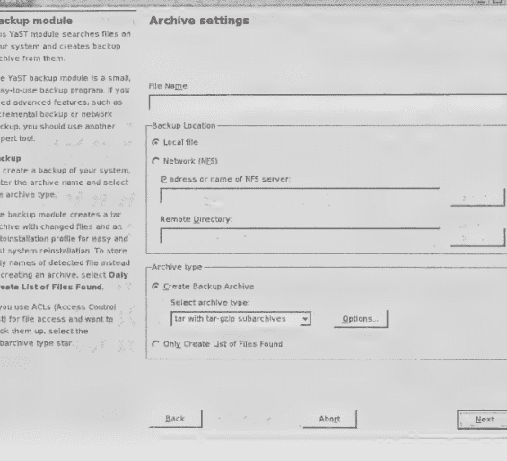

- 9. 在主 `YaST` 系统备份对话框中，点击“开始备份”。在读取几分钟软件包后，备份将开始。

注意

作为管理员，你现在应该验证备份是否可以恢复。这应该在制作备份之后、在关闭系统之前完成。

- 10. 要在备份后关闭系统，请关闭服务器上的所有应用程序，然后从 `KDE kicker` 中选择“运行命令”。输入 `init 0`，系统将开始有序关机。

# 练习题 36：美国道路

要启用 `SLES` 服务器的远程管理，请按照以下步骤操作：

- 1. 以 `root` 身份登录并启动 `YaST`。
- 2. 选择“网络服务”和“远程管理”。
- 3. 打开如图 4.35 所示的“远程管理”配置对话框。点击“允许远程管理”。

## 图 4.35

选择允许远程管理。

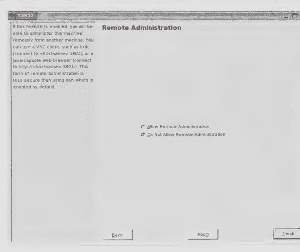

- 4. 点击“完成”。现在可以通过端口 `5801` 访问服务器。

`SLES 9` 默认安装了 `OpenSSH`。如果特定服务器上没有该程序：

- 1. 以 `root` 用户启动 `YaST`。
- 2. 选择“软件”，然后选择“安装和删除软件”。
- 3. 在“搜索”字段中输入 `openssh` 并点击“搜索”。
- 4. 勾选找到的软件包并点击“接受”。如果提示，插入任何所需的 `SLES 9` 光盘。

# 练习题 37：胜利电气

以下脚本将满足给出的要求：

```bash
#menu.sh
!/bin/bash
while true
do
clear
echo "Please choose from the following menu choices:"
echo "A. To run flexon.sh"
echo "B. To run hour.sh"
echo "C. To run comp.sh"
echo "D. To run Indian.sh"
echo "Q. To quit"
echo -n "Please make a selection: "
read lett
case $lett in
A|a) flexon.sh
break ;;
b|b) hour.sh
break ;;
c|c) comp.sh
break ;;
D|d) Indian.sh
break ;;
q|q) exit ;;
*) echo "Invalid response"
sleep 3 ;;
esac
done
```

# 练习题 38：华夫饼及更多

将打印机物理连接到服务器；然后以 `root` 身份登录并启动 `YaST`。选择“硬件”，然后选择“打印机”。自动检测应该找到新打印机，它将出现在“打印机配置”对话框中，如图 4.36 所示。

你现在必须完成以下步骤：

- 1. 点击“配置”，配置队列名称和后台程序设置。
- 2. 点击“下一步”。

## 图 4.36

自动检测找到了新打印机。

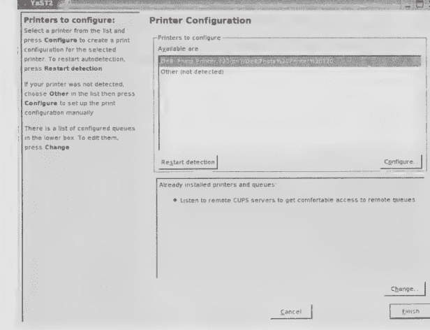

- 3. 选择打印机型号。如果列表中没有正确的制造商/型号组合，你可以在制造商网站上（或本地）查找驱动程序。
- 4. 点击“下一步”。
- 5. 在“编辑配置”对话框中，点击“测试”并验证打印机已配置配置并正常工作。你应该尝试不带图形打印，然后带图形打印。
- 6. 点击“确定”，然后点击“完成”。打印机配置将被保存。
- 7. 在“打印机管理”对话框中（如图 4.37 所示），点击“高级”，并确保将其配置为 `CUPS` 全功能安装以便用户访问。
- 8. 点击“接受”并“完成”。

## 图 4.37

打印机共享。

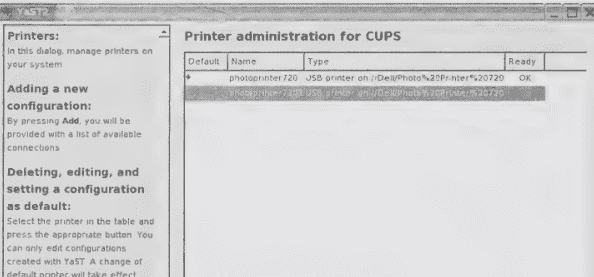

# 练习题 39：极端书籍

要完成此任务，请遵循以下步骤：

- 1. 打开终端窗口，然后使用 `su` 命令切换到 `root`。
- 2. 从 `KDE kicker` 点击终端图标打开终端。可选地，从菜单选择“系统”、“终端”，然后选择“Konsole”。
- 3. 输入命令 `cd /`。
- 4. 输入命令 `mkdir recovery`。
- 5. 输入命令 `rsync -avz /home /recovery`。除了 `rsync` 还可以使用其他实用（例如 `cp`），这将创建另一个目录的镜像，并保持相同的权限和其他信息。

为了保持两个目录镜像，可以将 `rsync` 命令添加到 `cron` 中定期运行。

# 练习 40：年轻与森林

通过选择左侧的 `YaST` 网络服务和右侧的网络服务，可以检查网络状态。这将显示如图 4.38 所示的已配置的服务。

## 图 4.38


已配置的网络服务。

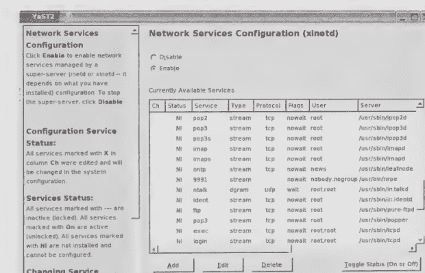

也可以在 KDE kicker 中点击“网络”，选择“系统”、“信息中心”，然后选择“网络接口”来查看网卡信息，如图 4.39 所示。点击左侧的“协议”，可以选择不同的协议（包括网络节点）以检查每个状态。系统中心（系统、信息中心），如图 4.40 所示，可以显示进程表以及系统负载。

### 图 4.39

信息中心显示 NIC 信息。

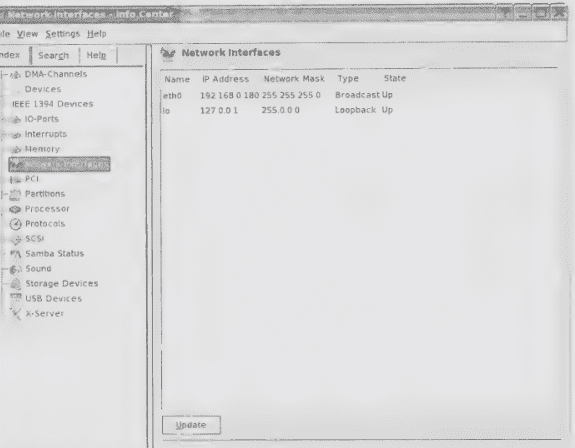

### 图 4.40

系统中心显示负载。


最后，可以使用任何桌面编辑器或命令行编辑器检查文件并进行更改。图 4.41 显示了在默认编辑器 Kate 中打开的 `/etc/profile` 文件。

### 图 4.41

编辑系统配置文件。

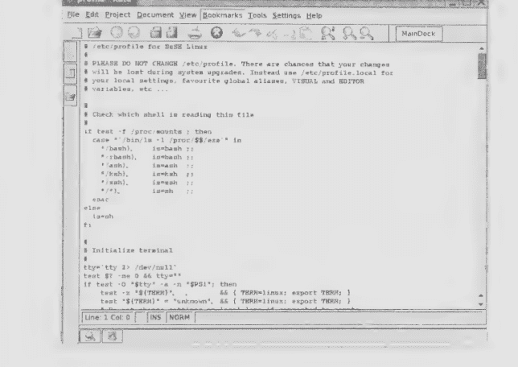

## 练习 41：斑马

可以使用任意数量编辑器进行更改。SLES 包含了 Kate、`vi` 和 `sed`。图 4.42 显示 Kate正在编辑文件，而图 4.43 显示 `vi` 中的同一个文件。然而，用于此任务的最佳编辑器是 `sed`。作为流编辑器，它可以使用命令 `'s/old/new/g'` 轻松更改一个值的出现出现。

提示

有关 `sed` 的更多信息，输入 `man sed`。

### 图 4.42

使用 Kate 编辑文件。

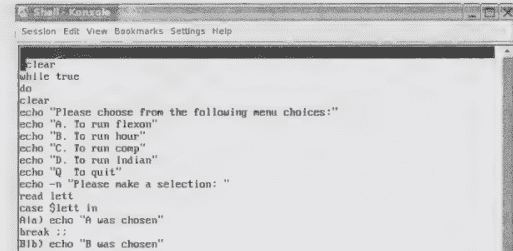

### 图 4.43

使用 `vi` 编辑文件。

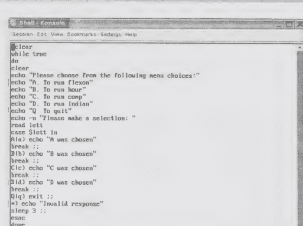

## 练习 42：约克敦

要完成此任务，你应该首先备份服务器上的所有数据，然后正确关闭它。在安装硬盘并启动服务器后，使用 `fdisk` 创建新分区。你可以：

- 1. 以 root 身份登录并启动 YaST。
- 2. 选择“系统”和“LVM”。如果你还没有此类项，将被提示创建一个卷组，如图 4.44 所示。

### 图 4.44

创建卷组

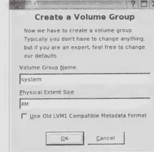

- 3. 物理卷和逻辑卷将出现。
- 4. 点击“添加”并创建三个分区中的每一个。
- 5. 点击“完成”。

## 练习 43：LILO 技术

SLES 9 默认安装 GRUB。你可以通过以 root 登录启动 YaST 并选择“系统”、“引导程序配置”来查看它是否安装在你的服务器上。这将弹出一个与图 4.45 所示类似的对话框。如果你需要进行任何更改，可以通过点击“编辑”来实现。这将允许你在 GRUB、LILO 或无引导程序之间进行选择。

### 图 4.45

引导程序配置。

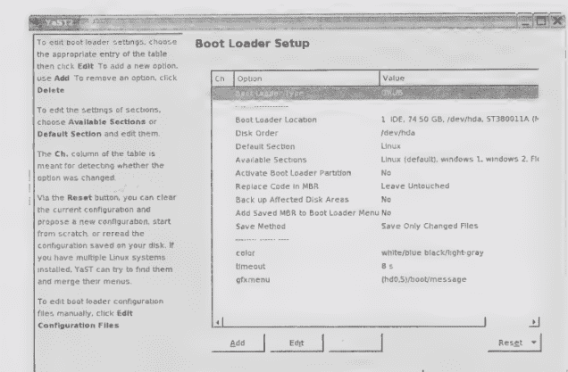

要编辑引导程序，选择表格中的相应条目然后点击“编辑”以添加新选项，使用“添加”添加分区，点击“删除”删除分区。要编辑部分，选择“可用部分”或“默认部分”并进行编辑。

表格中的 Ch 列用于检测选项是否已更改。

通过引导选项卡，你可以清除配置并提议新配置，或者如果你安装了多个 Linux 系统，YST 可以找到它们并进行相应的修改。要手动编辑引导程序配置文件，点击编辑配置文件允许 `menu.list` 文件以向引导菜单添加选项。

## 练习 45：村庄与供应

### 注意事项

配置 `ntp.conf` 文件并启动 `nppd` 守护进程可以保持时间设置正确，这样你就不需要在每次服务器时间偏差过大时手动运行 `ntpdate`。

在检查安全策略时，首先要做的事情之一是以 root 身份启动 YaST；然后选择“安全与用户”、“安全设置”。这将打开一个类似于图 4.46 所示的对话框。

### 图 4.46

系统安全设置。

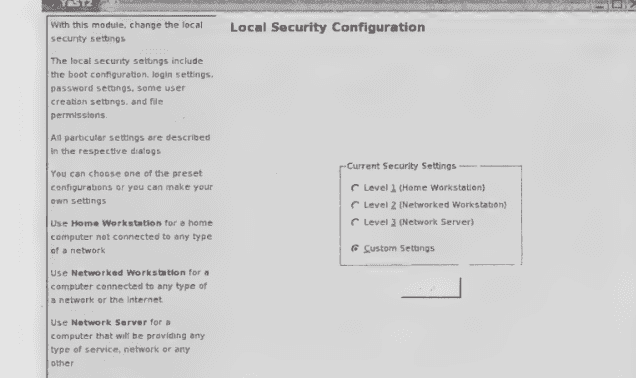

你可以选择任何预设值，或者点击“自定义”并点击下一步来配置密码设置、启动设置、登录设置、组设置以及一些杂设置。

## 练习 45：村庄与供应

要在 SLES 9 服务器上安装 OpenLDAP，

- 1. 以 root 用户启动 YaST。
- 2. 选择“软件”，然后选择“安装和移除软件”。
- 3. 在搜索字段中输入 `openldap` 并点击“搜索”。
- 4. 勾选 `openldap2`、`openldap2-client` 和 `yast2-ldap-server` 包并点击“接受”。如果提示，请插入所需的 SLES 9 CD。
- 5. 回到 YaST，选择“网络服务”、“LDAP 服务器”。
- 6. 点击“配置”，你就可以自动通过 YaST 界面编辑配置文件的条目。
- 7. 点击“完成”。

# 第 4 章：练习解答

## 练习 46：阿拉巴马的水泥

要开始安装 SLES 9，请将第一张 CD 插入计算机并重启系统。在大多数计算机上，系统将从 CD 启动，你就可以准备开始安装了。如果没有发生这种情况，你可能需要重新配置 BIOS 并更改启动器顺序，以便优先检查 CD/DVD 驱动器中的媒体。

出现的第一个菜单提供了多个选择：

- 启动硬盘——这将停止安装并启动硬盘上已有的操作系统。这是最安全的选择，因此它是默认选项。
- 安装——这是选择开始普通安装的选项。
- 安装——禁用 ACPI——如果你需要高级配置电源接口不干扰安装过程，请选择此选项。
- 安装——安全设置——如果需要 DMA 模式来绕普通安装，请选择此选项。如果使用其他选择时安装持续失败，请使用此选项。
- 救援系统——这允许在硬盘启动文件损坏时从 CD 启动系统。
- 内存测试——仅检查 RAM。

在屏幕底部标识了几个功能键：

- F1—帮助
- F2—切换屏幕显示设置
- F3—切换安装位置选择
- F4—切换语言
- F5—选择调试输出级别
- F6—在安装中包含驱动更新 CD

要执行普通安装，请从菜单中选择“安装”并按回车键。然后你必须按照 YaST2（安装和系统管理程序）呈现的界面进行操作。尽管根据你的具体配置可能会有所偏差，但以下是你必须按顺序完成的主要场景：

- 1. 选择语言——点击“接受”以继续，或点击“中止”取消安装。
- 2. 选择安装模式——你可以选择执行新安装（默认）、更新现有系统、修复已安装的系统、启动已安装的系统或中止。对于普通安装，请选择“新安装”。
- 3. 此时，系统将探测设备并向你显示识别出的列表。它将识别系统、键盘、鼠标等，并根据所选模式为你显示推荐的安装设置。建议和设置属于这些类别：
    - 系统
    - 模式
    - 键盘布局
    - 鼠标
    - 分区
    - 软件
    - 启动
    - 时区
    - 语言
    - 默认运行级别
- 4. 三个命令按钮是：更改——修改任何设置；中止——取消；以及接受——继续。选择“接受”；然后点击“继续”，会出现一条警告消息，说明 YaST2 已获取安装 SUSE LINUX 需要的所有信息。安装将按照之前对话框中的设置进行。要提交安装和所做的选择，点击“是，安装”按钮。
- 5. 准备/分区硬盘。这将需要几分钟，如果你正在实现 RAID 或 LVM 设备，稍可能需要进行其他更改。至少会创建两个分区：根 `root` 和交换 `swap`。
- 6. 接下来安装软件包，你需要根据提示插入各种 CD。你的目标通常是尽快完成安装，因此你始终可以在以后任何时候返回并添加任何包。
- 7. 系统提示为 root 用户提供密码（并输入两次进行验证）。密码可以由数字、空格、字母和标准标点字符组成。建议密码至少包含五个字符，且至少要大小写混合。如果你输入了超过八个字符，系统将提示你截断或更改它。
- 8. 接下来进行网络配置，并将自动进行扫描以检测网卡、DSL 连接、ISDN 适配器和调制解调器。摘要屏幕向你显示发现的值，以及代理（默认禁用）和 VNC 远程管理（默认禁用）的当前设置。你可以更改这些值中的任何一个、返回、中止，或点击“下一步”使你显示的网络设置生效。
- 9. 在网络配置写入/保存后，将测试 Internet 连接。此操作完全是可选的，如果你喜欢，可以选择跳过测试。然而，成功的测试将为你提供选项运行 YaST 在线更新 `YOU` 并检查最新的发布说明和更新。如果有可用更新，你可以选择下载并安装它们，或者跳过更新（这以后可以在 YaST2 内部完成）。
- 10. 接下来是服务配置，允许你配置如证书管理和 OpenLDAP 服务器等项目。
- 11. 必须选择用户验证方法。有三个选择：
    - NIS—如果你使用 NIS 服务器则使用它
    - LDAP—如果你使用 LDAP 服务器存储用户数据则使用它
    - 本地 `/etc/passwd`—如果你将密码存储在 `/etc/passwd` 和 `/etc/shadow` 中则选择此项


接受默认验证方法 (`LDAP`)。

- 12. 你此时可以添加本地用户。创建 `root` 的相同密码规则也适用于创建本地用户。

# 练习 46：阿拉巴马的水泥

## 注意事项

此时你不仅可以添加新用户，而且应该这样做。良好的做法是只在需要时使用 `root`，因此你至少应该有另一个账户用于登录。

- 13. `SuSEconfig` 现在启动并写入系统配置。根据你输入的参数，此过程所需的时间在系统之间将差异巨大。

- 14. 显示发布说明，涵盖内容：

    - 通用——每个人应该阅读的信息

    - 更新——涵盖管理指南中未出现的变化

    - 安装——关于安装的更多信息

    - 更新和功能——涵盖技术变更和增强

    - 提供反馈——告知如何联系 SUSE 等

- 15. 接下来是显卡、打印机和声卡的硬件配置，然后安装完成。你必须点击为“完成”的按钮，然后就可以登录系统。（建议以第12步中添加的 `admin` 用户进行登录。）

成功完成这些步骤后，将出现登录界面并提示用户名和密码。输入这些条目后，欢迎菜单感谢你安装 SUSE LINUX Enterprise Server 9，并提供与此以及其他 Novell 产品相关的 URL 列表。

如果安装出现问题，你应该追溯到出现故障的时刻，并在继续之前寻找解决方案。处理此类问题中的任何问题，最好的工具就是常识。

例如，如果系统无法读取媒体，通过检查另一个系统是否可以读取来验证你的 CD 组是否良好。如果安装挂起，请验证你的系统是否符合最低系统要求，并确保节能功能没有影响你的安装。

## 第 4 章：练习解答

### 练习 47：阿拉斯加之旅等

要按照描述配置网络，请遵循以下步骤：

1. 启动 `YaST`。

2. 选择“网络设备”（Network Devices），然后选择“网卡”（Network Card）。

3. 点击“更改”（Change），然后点击“编辑”（Edit），如图 4.47 所示。

图 4.47

更改网卡设置。

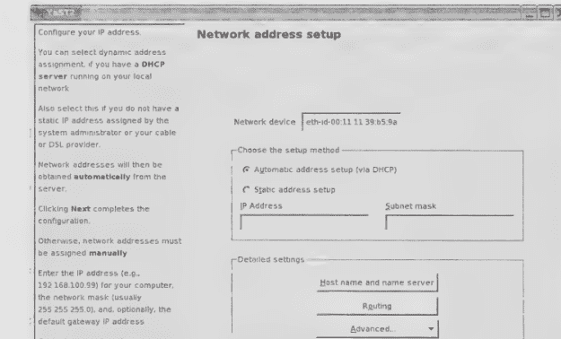

4. 点击“静态地址设置”（Static Address Setup）。输入静态 IP 地址 `192.168.0.14` 和子网掩码 `255.255.255.0`。

5. 点击“路由”（Routing），输入默认网关地址 `192.168.0.1`。

6. 点击“确定”（OK）。

7. 点击“下一步”（Next），然后点击“完成”（Finish）。

8. 通过 `ping` 默认网关以及网络外的宿主机来测试配置。

### 练习 48：亚利桑那铝业制造

按照概述配置 `dhcpd` 守护进程可以通过以下步骤完成：

1. 登录服务器并启动 `YaST`，在提示时以 `root` 身份验证。

2. 选择“网络服务”（Network Services），然后选择“DHCP 服务器”（DHCP Server）。

3. 将出现提示，需要安装 `dhcp-server` 软件包，如图 4.48 所示。

图 4.48

需要添加 `dhcp-server` 软件包。

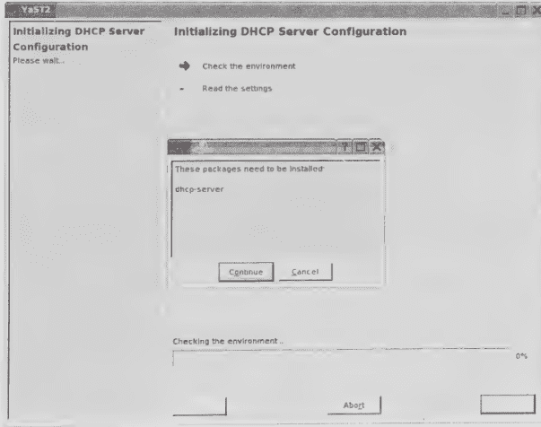

4. 点击“继续”（Continue）安装软件包，并根据需要插入任何介质。

5. DHCP 服务器向导将启动并提示您选择网卡，如图 4.49 所示。

图 4.49

DHCP 服务器向导启动。

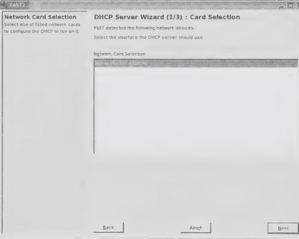

6. 点击“下一步”。在“全局设置”（Global Settings）屏幕上执行以下操作：

- 勾选“LDAP 支持”框。

- 在“域名”（Domain Name）字段中输入 `LabRoom`。

- 在“主名称服务器 IP”（Primary Name Server IP）字段中输入此服务器的 IP 地址。

- 在“默认网关（路由器）”（Default Gateway (Router））字段中输入路由器的 IP 地址。

- 在“默认租约时间”（Default Lease Time）字段中输入 `1`，默认单位设置为天。

7. 点击“下一步”。

8. 在“第一个 IP 地址”（First IP Address）字段中输入 `192.168.0.15`。

9. 在“最后一个 IP 地址”（Last IP Address）字段中输入 `192.168.0.99`。

10. 在“租约时间”（Lease Time）字段中输入 `1`，默认单位设置为天。

11. 在“最大租约时间”（Max Lease Time）字段中输入 `2`，默认单位设置为天。

12. 点击“下一步”然后点击“完成”，将“DHCP 服务器：启动”（DHCP Server:Start-Up）设置为“关闭—手动启动服务器”（Off—Start Server Manually）。

13. 将提示要求 LDAP 服务器密码。输入 `root` 密码。

14. 打开终端会话并输入 `rdhcdcp start` 来启动 `dhcp` 服务。

提示

如果你是以 `admin` 用户登录的（希望你已经这样做了），在输入启动 `dhcp` 的命令之前，必须在终端提示符处使用 `su` 切换到 `root`。

### 练习 49：阿肯肯州大学

按照以下步骤安装并配置 DNS 服务/守护进程：

1. 以 `root` 用户启动 `YaST`。

2. 选择“网络服务”（Network Services），然后选择“DNS 服务器”（DNS Server）。将出现消息提示您需要安装 `bind`。

3. 点击“继续”安装 `bind` 软件包。

4. 在“转发器设置”（Forwarder Settings）页面上（如图 4.50 所示），点击“下一步”。

5. 在“DNS 区域”（DNS Zones）页面上，将区域设置为 `technical.com`。

6. 对于反向查找区域，在区域字段中输入 `0.168.192.in-addr.arpa` 并点击“添加”。

7. 点击“编辑”并点击“NS”选项卡，如图 4.51 所示。

8. 在“名称服务器”字段中输入 `lab1.technical.com` 并点击“添加”。

9. 点击 SOA 卡。TTL 字段应显示为 2 天。将其改为 3 天。进入“记录”（Records）选项卡，为 `lab1` 和 `technical.com` 添加 A 记录，使服务器和域名解析到 `192.168.0.14`。

10. 点击“确定”。

11. 回到 DNS 区域页面，高亮反向查找项并点击“编辑”，然后点击 NS 卡。

12. 在“名称服务器”字段中输入 `lab1.technical.com` 并点击“添加”。

图 4.50

转发器设置页面。

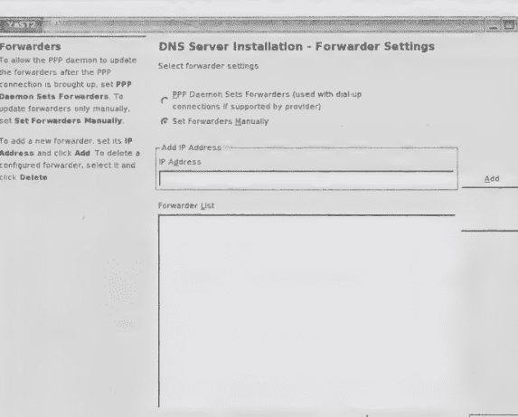

图 4.51

点击 NS 卡。

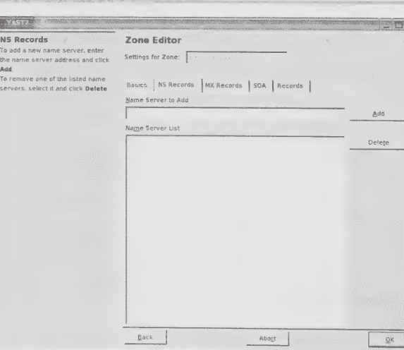

13. 点击 SOA 卡。TTL 字段应显示为默认 2 天。将其改为 3 天。

14. 点击“记录”选项卡，为服务器（`0.168.192.in-addr.arpa`）输入 PTR 类型。设置为 `lab1.technical.com`。

15. 点击“添加”。点击“确定”。现在你需要手动启动 `named` 守护进程。可以通过打开终端、以 `root` 身份验证然后在终端提示符处输入 `named start` 来。

提示

要验证配置，运行以下命令：

```
dig lab1.technical.com
dig technical.com
host 192.168.0.14
```

### 练习 50：加州之梦

为这家公司配置 `Postfix` 服务，请遵循以下步骤：

1. 以 `root` 用户启动 `YaST`。

2. 配置 DNS 服务器，将 `mail1.california.com` 和 `california.com` 解析到 `192.168.0.14`；然后重启 `named`。

3. 选择“软件”，然后“安装和删除软件”。

4. 在搜索字段中输入 `postfix` 并点击搜索。结果将显示图 4.52。

5. 勾选 `postfix` 软件包并点击“接受”。根据提示插入任何 SLES 刻盘。

6. 编辑 `/etc/postfix/main.cf` 文件进行任何更改。（关键重要的是 `myhostname` 变量需要设置为主机名）。

7. 再次以 `root` 用户启动 `YaST` 并选择“网络服务", 邮件传输代理”（Mail Transfer Agent）。这打开了如图 4.53 所示的常规设置。

图 4.52

搜索 `postfix` 相关的包。

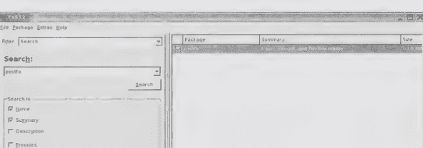

图 4.53

配置 MTA。

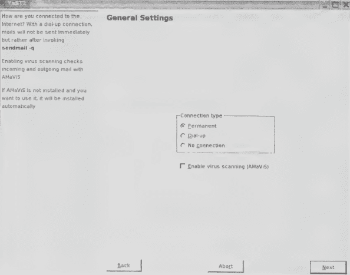

8. 点击启用病毒扫描并点击“下一步”。

9. 输入发件邮件服务器信息并点击“下一步”。

10. 配置入站邮件信息（如图 4.54 所示），并点击“下一步”。

图 4.54

配置入站邮件设置。


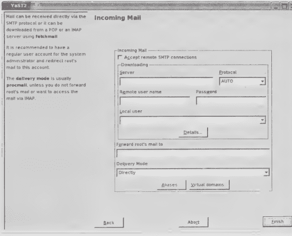

11. 点击完成。

## 练习 51：科罗拉多保险公司

有很多日志可以检查可能指示入侵的条目。你应该检查的主要日志有：

- `/var/log/faillog`——打开 shell 终端并使用 `faillog` 工具查看用户身份验证失败列表。

提示

如果 `faillog` 工具返回任何数据，说明没有失败的登录尝试。

- `/var/log/lastlog`——打开 shell 终端并使用 `lastlog` 工具查看所有用户列表及其最后登录时间。

- `/var/log/messages`——使用 `grep` 或其派生物查找该文件中与登录相关的条目。

- `/var/log/wtmp`——打开 shell 终端并使用 `last` 命令查看已验证系统的用户列表。

## 练习 52：康涅狄格水务

要配置客户需要的防火墙，请遵循以下步骤：

1. 以 root 用户启动 YaST。

2. 选择“软件”，“安装和删除软件”，并通过搜索验证 `iptables` 是否安装。如果没有安装，请安装它。

3. 打开终端窗口。输入 `iptables -t filter -L`。这将显示当前配置的规则（本应该没有）。

4. 通过输入 `iptables -t filter -A INPUT -s 0/0 -p icmp -j DROP` 创建丢弃所有入站 ICMP 包的防火墙。通过输入 `iptables -t filter -A INPUT -s 0/0 -p tcp --dport 80 -j DROP` 配置防火墙丢弃 Web 服务器流量。

5. 通过输入 `iptables -t nat -F` 启用 NAT 路由。

6. 输入 `iptables -t filter -L`。这将显示新规则已生效。

7. 退出终端窗口并离开现场。

## 练习 53：特拉华运输

要在客户的 SLES 9 系统上安装 Squid HTTP 代理服务器，请遵循以下步骤：

1. 以 root 身份登录服务器并启动 YaST。

2. 选择“软件”（Software），然后选择“安装和移除软件”（Install and Remove Software）。如图 4.55 所示，搜索 `squid` 并安装它。

图 4.55

安装 Squid。

| 软件包 额外信息 | | | | | | |
|---|---|---|---|---|---|---|
| 过滤 | 搜索 | | | | | |
| 搜索: | | | | | | |
| squid | | squidGuard | 清理 squid 的日志 | 2.5 MB 1.2 | | |
| 在...中搜索 | | | | | | |
| Home | | | | | | |
| 说明 | | | | | | |
| 提供者 | | | | | | |
| RegEx | | | | | | |
| 搜索 | | | | | | |
| 包含 | | | | | | |
| 开始 | | | | | | |
| 通配符 | | | | | | |
| 使用正则表达式 | | | | | | |
| 大写敏感 | | | | | | |
| 名称 | 下载大小 | 免费 | 总计 | | |
| Windows/D | 15.84 GB | 45 GB | 119 GB | | |
| Windows/C | 9.44 GB | 37 GB | 43.50 GB | | |
| Windows/U | 15.40 GB | 22 GB | 36.45 GB | | |

3. 编辑 `/etc/squid/squid.conf` 进行任何更改。为了让私有网络上的主机访问代理，你必须在 ACL 列表下方插入一行，并移除行 `#http_access allow our_networks` 上的注释。

注意

值得指出的是，本书的目的是测试你的知识，而不是作为参考指南。大多数练习非常直观且自而易懂，但这一个稍微复杂。不要害怕使用在线帮助和其他其他可用资源来填补你知识的空白。

4. 退出配置文件后，在终端窗口中使用命令 `resquid start` 重启服务器。

# 第 4 章：练习题解答

## 练习 54：Florida Reviewers

要创建 VPN 连接，请遵循以下步骤：

- 1. 以 root 身份登录服务器并启动 YaST。

2. 选择“软件”，然后选择“安装和移除软件”。搜索 `ipsec`，如图 4.56 所示，安装 `freeswan` 和 `ipsec-tools`。

3. 在 VPN 隧道另一端的主机上重复此安装。

图 4.56

安装 ipsec 组件。

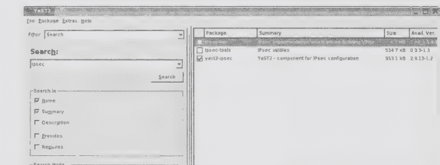

- 4. 在 VPN 隧道的左端，配置 `openssl.conf` 并创建并签名必要的证书和 CSR。然后启动 YaST，选择“安全与用户”（Security and Users）、“VPN”。这将显示如图 4.57 所示的对话框。

- 5. 点击单选按钮“启用 VPN 服务”（Enable VPN Services）。屏幕将出现一条消息，指示尚未导入任何证书，并提示你导入证书。点击“是”，并在点击“下一步”之前导入任何需要导入的证书。

- 6. 消息将指示未定义任何连接并提示你添加它们。点击“是”，并在图 4.58 所示的类型之间选择。选择类型并点击“下一步”。

## 练习 54：Florida Reviewers

图 4.57

配置 VPN 服务。

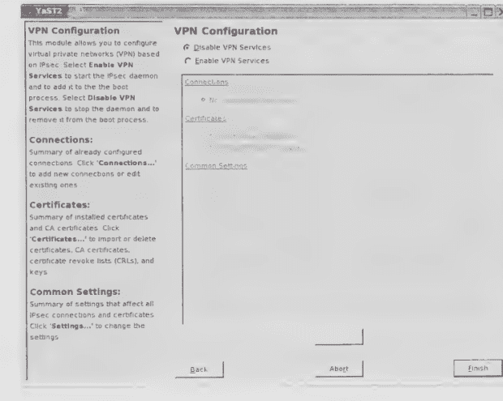

图 4.58

选择连接类型。

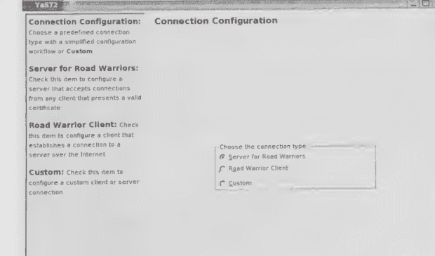

- 7. 修改任何常用设置，然后点击“完成”。

- 8. 对 VPN 隧道右端的主机重复步骤 5、6 和 7。

- 9. 测试你的配置。

## 练习 55：Georgia Widgets

要在客户的 SLES 9 服务器上安装和配置 Tomcat，请遵循以下步骤：

- 1. 以 root 身份登录并启动 YaST。

- 2. 选择“软件”，然后选择“安装和移除软件”。搜索 `tomcat` 并选择安装这些包：

- `apache2-jakarta-tomcat-connectors`

- `apache-jakarta-tomcat-connectors`

- `jakarta-tomcat`

- `jakarta-tomcat-doc`

- `jakarta-tomcat-examples`

> 提示

如果你遇到关于依赖冲突的消息，请选择也安装 Java2。

根据需要更换光盘，然后点击“完成”。

- 3. 启动终端会并切换到 `/usr/share/tomcat/conf` 目录。编辑配置文件以适应客户需求。

- 4. 输入 `rcttomcat start` 启动 Tomcat。关闭终端会。

- 5. 启动浏览器并访问 `http://localhost:8080/manager/html` 完成配置。

> 注意

温和提示——如果你无法对此 URL 进行身份验证，那么在准备好进行实习之前，你需要更深入地学习 Tomcat。

## 练习 56：Hawaii Pine Trees

你为客户生成的其应该考虑的项目列表包括以下内容：

- 节点上的所有更新和补丁都是最新的吗？

- 工作站上的所有更新和补丁都是最新的吗？

- 服务器上是否有足够的文档（管理员日志等）？

- 服务器在物理上是安全的？

- 有多少人知道 root 密码？多久更改一次？

## 练习 57：Idaho Queries

你为客户生成的其应该考虑的项目列表包括以下：

- 服务器上的所有更新和补丁都是最新的吗？是否自动配置了？

- 是否使用了无线网络？它采取了什么种加密方式？

- 布线机房是安全的？

- 服务器上是否有足够的文档（管理员日志等）？

- 有多少人知道 root 密码？多久更改一次？

- 服务器在物理上是安全的？

# 第 4 章：练习题解答

## 练习 58：Illinois Lotto

要在 SLES 9 服务器上安装请求的包，请遵循以下步骤：

- 1. 以 root 身份登录并启动 YaST。

2. 选择“软件”，然后选择“安装和移除软件”。搜索 `nmap` 并选择安装：

   - `nmap`

   - `nmap-gtk`

3. 在搜索字段中输入 `short` 并在出现时勾选。

4. 点击“接受”。如果出现任何依赖消息，点击“继续”添加它们。

5. 根据提示更换光盘，完成后启动 YaST。

6. 点击 KDE 底部的网络，选择“网络管理”。这将弹出图 4.59 所示的 Nmapmap。

图 4.59

配置 Nmap。

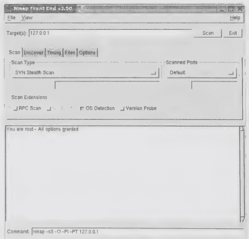

- 7. 要使用 `snort` 工具，打开终端会并输入 `snort`。这将生成一条列出该工具可以使用的所有选项的消息。


# 练习 59：Indiana Reptiles

要在服务器上启用 `cupsd` 守护进程广播，请遵循以下步骤：

1. 以 `root` 身份登录并启动终端会。
2. 编辑 `/etc/cups/cupsd.conf`，移除 `BrowseAddress @LOCAL` 行前的注释字符 (`#`)。
3. 保存文件，然后输入 `rcups restart` 重启进程。

要添加名为 `"cupsadmin"` 的 CUPS 管理用户，请遵循以下步骤：

1. 以 `root` 身份登录并启动终端会。
2. 输入 `lppasswd -g sys -a cupsadmin`
3. 在提示时为账户输入密码。在提示时再次输入账户密码。

# 练习 60：Iowa Retirement Homes

你为客户生成的其应该考虑的项目列表包括以下内容：

- 服务器上的所有更新和补丁都是最新的吗？是否自动配置了？
- 是否使用了无线网络？它采取了什么种加密方式？
- 工作站上的所有更新和补丁都是最新的吗？
- 布线机房是安全的？
- 服务器上是否有足够的文档（管理员日志等）？
- 有多少人知道 `root` 密码？多久更改一次？
- 服务器在物理上是安全的？

## 第 4 章：练习题

- 哪些文件设置了 SUID 和 SGID 权限？
- 服务器上运行的所有服务都是确实必需的吗？
- 多久审计一次日志文件？由谁负责审计？
- 是否有专人通过 `cert.org` 或其他网站关注安全威胁/进展？
- 由谁负责添加新用户和组？操作频率是怎样的？
- 启动菜单是否受密码保护？
- 用户是否了解有关密码最佳实践的安全策略？
- 目前安装的软件包是否已知是安全的？管理员如何接收这些软件包的更新通知？
- 是否允许远程管理？如何对其进行监控？
- 密码使用了何种级别的加密？
- 是否使用了证书？如果是，对证书应用了何种程度的加密？

# 练习 61：Kansas Vets, Ltd.

SLES 9 默认安装了 `OpenSLP`。如果没有安装，可以通过 YaST 选择“软件”，然后选择“安装和移除软件”来安装。搜索 `openslp` 并选择安装这些软件包。

要验证 `openslp` 是否找到了我们预期的服务，请按照以下步骤操作：

1. 以 `root` 身份登录并启动 YaST。
2. 选择“网络服务”，然后选择“SLP 浏览器”。
3. 如图 4.60 所示，在左列中选择服务类型。
4. 点击“完成”并退出 YaST。
5. 打开浏览器并将地址设置为 `slp/`，如图 4.61 所示。

现在你可以浏览由 `slpd` 守护进程注册的服务。

### 图 4.60

配置 SLP 浏览器。

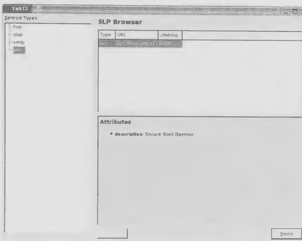

### 图 4.61

查看 slp 服务。

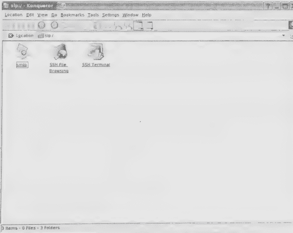

# 练习 62：Kentucky’s DS Technical

要将 Samba 服务配置为 `DSTECHNICAL` 域的主域控制器（PDC），请按照以下步骤操作：

1. 以 `root` 身份登录并启动 YaST。
2. 选择“网络服务”，然后选择“Samba 服务器”。
3. 可能会出现如图 4.62 所示的消息，指示需要安装软件包。点击“继续”。

### 图 4.62

需要安装 Samba 服务。


4. 按照指示插入并交换光盘。
5. 在第一个 Samba 安装对话框中，选择工作组/域并点击“下一步”。
6. 在第二个 Samba 安装对话框中（如图 4.63 所示），选择 PDC 并点击“下一步”。
7. 完成 Samba 配置并点击“完成”。

提示

与许多许多练习一样，当你到达这一步时，你应该测试你的配置。在实际操作考试中时间允许的情况下，测试你所做的内容可以帮助你确信自己正在顺利地进行。

### 图 4.63

选择主域控制器。


# 练习 63：Louisiana Fishing

网络流量可以通过多种方式进行监控。对于 Louisiana Fishing，最好的方法之一是使用 `ntop`。以下步骤将安装此工具并说明其用法：

1. 以 `root` 身份登录并启动 YaST。
2. 选择“软件”，然后选择“安装和移除软件”。搜索 `ntop` 并选择安装软件包。
3. 安装完成后退出 YaST。
4. 打开终端会并输入 `rcntop start` 来启动 `ntop` 守护进程。
5. 将一条消息显示尚未设置管理员密码。输入 `ntop -A -u wwwrun`。
6. 为管理员用户输入密码。在提示时再次输入密码。在提示时再次输入密码。打开终端会并输入 `rcntop start` 来启动
7. 打开终端会并输入 `rcntop start` 来启动 `ntop` 守护进程。

### 图 4.62

需要安装 Samba 服务。


### 第 4 章：练习题

7. 打开终端会并输入 `rcntop start` 来启动

# 练习 66：Massachusetts Spammers

SLES 9 提供的加密选项可以分为两类：对称和非对称。使用对称加密时，用于加密数据的相同密钥也用于解密：发送者和接收者都需要相同的密钥。使用对称加密的加密标准包括

- 数据加密标准 (`DES`)
- 高级加密标准 (`AES`)
- 飞鱼 (`Blowfish`)

使用非对称加密时，使用两个密钥而不是一个。这两个密钥在数学上是相反的，被称为

# 练习 67：Michigan Growers

要将所有 DNS 查询限制在你的网段内的主机上，请按照以下步骤操作：

- 登录服务器并启动 YaST，根据提示以 `root` 身份进行验证。
- 选择“网络服务”，然后选择“DNS 服务器”。

# 练习 67：密歇根种植者

如果 DNS 已经完成配置，可以跳到第 6 步。

3. 在转发器设置（Forwarder Settings）中，将手动设置转发器（Set Forwarders Manually）保持为默认值，配置其他字段并点击下一步。
4. 在 DNS 区域（DNS Zones）对话框中，点击添加（Add）添加区域，然后点击下一步。
5. 在完成向导（Finish Wizard）对话框中，点击启动 DNS 服务器专家配置...（Start DNS Server Expert Configuration...）。
6. 在左侧框架中，选择基本选项（Basic Options）。这将显示图 4.65 所示的内容。

# 图 4.65

DNS 服务器的基本选项。


7. 在选项（Option）下拉列表中选择允许查询（allow-query）。
8. 在值（Value）字段中输入 `{allowedhosts; }` 并点击添加（Add）。
9. 点击完成。

# 第 4 章：练习解答

# 提示

你可以通过尝试解析 `lab1\dsttechnical.com` 主机来轻松测试此配置。如果一切运行正常，你不应该能解析它。

# 练习 68：明尼苏达河管理局

要配置 DHCP 守护向 DNS 服务器发送动态更新，请遵循以下步骤：

1. 以 `root` 身份登录并启动 YaST。
2. 选择网络服务（Network Services），然后选择 DHCP 服务器（DHCP Server）。
3. 进入全局设置（Global Settings），确保没有勾选 LDAP 支持。创建 TSIG 密钥。
4. 如图 4.66 所示，填入动态 DHCP（Dynamic DHCP）的数值。

# 图 4.66

配置动态 DHCP。


5. 在 DHCP 服务器的专家设置中为子网配置动态 DNS（Dynamic DNS）。
6. 点击完成。

# 练习 69：密西西比糖尿病小组

有许多方法可以编写 shell 脚本来完成此任务。由于需要提示输入文件名，应使用 `read` 命令。为了验证文件是否存在，应使用 `test` 命令（可以通过其别名调用）。可以使用 `-f` 选项来验证文件是否可读。最后，如果文件不存在，可以使用 `touch` 工具创建一个大小为零的文件。

根据这些参数，以下 shell 脚本将完成此项工作：


```bash
#MDG.sh
echo "Enter filename:"
read filename
if [ -f $filename ]
then
echo "File exists"
else
touch $filename
echo "File created"
```

> 提示
>
> 在 `filename` 和 `]` 之间需要有一个空格；否则你将收到
>
> 第 3 行缺少 `]` 的错误信息。

## 练习 70：密密苏里刀具与剪刀

密苏里刀具与剪刀需要在适当运行这些脚本的 cron 文件条目如下：

- `0 6 * * 1 ABC`
- `10 15 2 * * BCD`
- `30 18 14 3 * CDE`
- `30 18 9 * * CDE`
- `0,10,20,30,40,50 6-18 * * DEF`
- `5 12-16 * * 1-5 EFG`

# 第 4 章：练习解答

这里唯一的棘手条目是 `CDE` 的。由于要运行的两个日期没有共同点，最简单的方法是为它创建两个独立的条目。

## 练习 71：蒙大拿探险

需要执行三个操作来满足客户的需求。第一个是将所有新创建文件的默认权限更改为 664。从 666 减去剩下 002。为了满足这一要求，编辑 `/etc/profile` 文件并将默认条目 022 更改为 `umask 002`。

要将 `/tmp` 目录下当前所有文件的权限更改为 751，简单的解决方案是打开终端会话，切换到 `/tmp` 目录并使用命令 `chmod 751 *`。

## 练习 72：北卡罗来纳游泳者

要安装 GNOME 并让管理员在登录服务器时可以使用，请遵循以下步骤：

- 1. 以 root 用户身份启动 YaST。
- 2. 选择软件（Software），然后选择安装和移除软件（Install and Remove Software）。
- 3. 在搜索字段输入 gnome 并点击搜索。结果类似于图 4.67。
- 4. 勾选 `gnome-applets`, `gnome-common`, `gnome-desktop`, `gnome-libs`, `gnome-panel`, `gnome-print`, `gnome-terminal`, 和 `gnome-utils` 包并点击接受（Accept）。继续接受任何自动更改并在需要时插入任何 CD。
- 5. 注销并结束会话。在登录提示处，用户现在可以点击菜单（Menu），然后选择会话（Session）和 GNOME。这将调出桌面（并设置为后续登录的默认值），如图 4.68 所示。

## 练习 72：北卡罗来纳游泳者

# 图 4.67

搜索 gnome 相关的包。


# 图 4.68

GNOME 桌面现在已安装并可用。


## 练习 73：北达科他塑料

完成此任务最简单的方法是右键点击 KDE 桌面并选择配置桌面（Configure Desktop）。这将弹出图 4.69 所示的对话框。

# 图 4.69

配置桌面。


点击左栏中的屏幕保护程序（Screensaver）并按图 4.70 所示设置配置。

# 图 4.70

配置屏幕保护程序以满足客户需求。


## 练习 74：内布拉斯加家谱

以下脚本将满足给定的要求：

```bash
#Choices.sh
clear
PS3="Please make your selection from the following: "
select item in ABC BCD DEF Quit
do
case $item in
ABC) echo "Program ABC will now be executed" ;;
BCD) echo "Program BCD will now be executed" ;;
CDE) echo "Program CDE will now be executed" ;;
DEF) echo "Program DEF will now be executed" ;;
Quit) break ;;
*) echo "You must enter a number between 1 and 5." ;;
esac
done
```

## 练习 75：内华达设计

可以编写任意脚本来执行此简单的功能。因为你只需要一个数字，所以解析掉任何该数字以外的内容很重要。第一个示例如下：

```bash
#Example1.sh
grep -c "." /etc/passwd
```

另一个示例是：

```bash
#Example2.sh
wc -l /etc/passwd | cut -d" " -f1
```

# 索引

### A-B

- 辅助功能选项，启用，9, 97-98
- 管理（远程禁用，21, 112
- 启用（YaST），49, 132-133
- 访问控制（ACLs），34, 119-120
- Apache 服务器，配置，31, 116-117
- 应用层网关，实施，51
- 归档文件，16, 105-106
- 使用 tar，48, 131-132
- 非对称加密，170
- 备份使用 cron，42, 127, 129
- 文件系统，48, 131-132
- Novell Linux Desktop，创建，19, 110-111
- 策略，48, 131-132
- 启动过程（SLES），9, 46, 131
- 安全性漏洞，80, 169
- bzip2，27, 112-113
- 工具，155
- 磁盘，141
- 文件所有权/权限，35, 120
- 服务器，31, 116-117
- 配置 Samba，77, 166
- 证书机构（CAs），170
- 命令行，27, 112
- 相关命令，39, 125
- 执行命令，27, 112
- 任务，38, 121
- 测试连接，40, 125
- Shell，54, 139
- 归档文件，16, 27, 105-106, 112
- 配置文件，39, 125
- cron，42-43, 127, 129
- 密码学，81, 170
- 备份，48, 131-132
- 配置，55, 141
- 附加，33, 118
- 归档，16, 105-106
- 使用 tar，48, 131-132
- 压缩，27, 105-106, 112
- 复制，27, 118
- 删除，33, 118
- 编辑，53, 137-139
- 查找，28, 113
- 管理，112-113
- 搜索，12, 101
- 查看，33, 118
- 防火墙，156
- 概念，79, 168

### C

- ACLs，34, 119-120（注意，在 C 章节）

### D

- 冲突，解析，160
- 配置，9, 94-96
- 编辑器，53, 137-139
- 安装，9, 97-98
- 共享，18, 107-108
- DHCP 服务器，63, 83, 149-151, 172
- 数字签名，27
- 删除，33, 118
- 管理，112-113

### E

- 邮件服务，65, 153-155
- 紧急磁盘，110-111
- 企业安全策略，57, 142-143
- 备份使用 cron，42, 127, 129
- 文件系统，48, 131-132
- Novell Linux Desktop，创建，19, 110-111
- 策略，48, 131-132
- 启动过程（SLES），9, 46, 131
- 安全性漏洞，80, 169
- bzip2，27, 112-113
- 工具，155
- 磁盘，141
- 文件所有权/权限，35, 120
- 服务器，31, 116-117
- 配置 Samba，77, 166
- 证书机构（CAs），170
- 命令行，27, 112
- 相关命令，39, 125
- 执行命令，27, 112
- 任务，38, 121
（注意，索引有点杂乱）

### G

- 网关（应用层），71
- 全局用户，8, 94-96
- GNOME 安装，87, 174
- 快捷键，9, 97-98
- Grep，38, 125
- GRUB 启动加载程序，56, 141-142
- GUI 帮助，45, 130-131
- 查看进程，29, 115
- gzip，27, 112-133
- 名称解析，39, 125
- NAT，67
- 网络命令，39, 53
- 配置，53, 137-139
- 设备，40, 125
- 实施安全，75, 163-64
- 管理资源，49, 132-133
- 监控流量，78, 167-168


- 使用 CUPS 的网络打印，74, 163
- 打印服务，51, 134-135
- `top`，167-168
- `tnp.conf` 文件，143

### H-IJ

- 硬件，在 SLES 9 中添加，51, 134-135
- 配置，28, 113-114
- 帮助（基于 GUI），45, 130-131
- 主机安全，73, 86, 162-174
- 主机名，配置，39, 125
- OpenLDAP，58, 143
- OpenSLP，76, 164
- OpenSSH，49, 132-133
- 文件所有权，管理，35, 120
- `i` 参数，116
- 帮助页，45, 130-131
- 入侵者，检测，66, 155-156
- `ip` `ip` 工具，40, 125
- 数据包过滤器，66, 156
- 分区安装期间添加空间，92
- 配置，55, 141
- 调整大小，20, 111-112
- 更改密码，11, 100
- 加密，7-8, 91-96
- 文件权限，35, 120
- 工具，155
- 磁盘，141
- 文件所有权/权限，35, 120
- 服务器，31, 116-117
- 配置 Samba，77, 166
- 证书机构（CAs），170
- 命令行，27, 112
- 相关命令，39, 125
- 执行命令，27, 112
- 任务，38, 121

## 远程管理

- 禁用，21, 112
- 启用，49, 132-133
- 远程桌面，共享，18, 107-108
- 救援软盘，创建，19, 110-111
- 恢复文件系统，48, 131-132
- 路由器，125
- 安装，61, 87, 144-147, 174
- 系统配置，62, 84-90, 148, 173-178
- 日期，41, 126
- SQUID 代理服务器，68, 156-157
- 启动日志，配置，21, 112
- `su-`，151
- SUSE 企业时间服务器，57, 142-143
- 管理，39, 67
- 设置，40
- RPM，30, 115
- 同步，52, 136
- 运行级别，34, 119-120
- 用户选项，96
- 系统日志服务器，47, 131
- 系统设置，修改，58, 143

## S

## Samba

- 实现，77, 166
- 配置为文件服务器，31, 116-117
- 屏幕保护程序，配置，176
- 屏幕，捕获，29, 115
- 脚本元素，44, 130
- 脚本技术，50, 134
- 安全
  - 加密，81, 170
  - 检测入侵者，66, 155-156
  - 防墙，72, 78-169
  - 实现，88, 176
  - 主机安全，73, 86, 82-163, 174
  - 网络，75, 163-164
  - 管理企业安全策略，57, 142-143
- `tar` 文件，存档，48, 131-132
- 终端窗口，11, 100
- 测试命令，173
- 文本编辑器（Linux），利用，54, 139
- 服务器时间配置，57, 142-143
- Tomcat，70, 160

## U

- `-U` 参数，116
- 日期
- Novell Desktop，104-105
- 安全更新，应用，37, 122-123
- SLES 9，41, 126
- YOU，41, 126
- 用户账户
  - 管理，31, 116-117
  - 用户环境，42-43, 127-129
  - 响应安全事件，80, 169
  - 审查，72, 161
  - 保持信息更新，45, 130-131
  - 安全设置，37, 122-123
- 用户
  - DHCP 服务器，配置，63, 83, 149-151, 172-173
  - DNS 服务器，配置，64, 82, 151-153, 170
  - 限制物理访问，56, 141-142
  - Web 应用服务器，修改，70, 160
  - 添加，8, 94-96
  - CUPS，74, 163
  - 安装期间，7, 91-932
  - 管理，31, 116-117

## V-W

- 变量替换操作符，利用，50, 134
- 变量，将其视为数字，130
- VPN 连接，69, 158-160
- Web 应用服务器 (Tomcat)，70, 160
- Web 服务器 (Apache)，31, 116-117
- 白皮书，45, 130-131
- 打印机，51, 134-135
- 远程桌面，18, 107-108
- 快捷方式
  - 菜单快捷键，9, 97-98
  - KDE 快捷键，14, 103-104
- SLES 9
  - 启动过程，46, 131
  - 硬件，添加，51, 134-135

## X-Y-Z

## YaST

- 配置安全设置，37, 122-123
- 磁盘配额，121
- 启用远程管理，49, 132-133
- 调整分区大小，111-112
- 使用 YaST 更新，104
- 用户，94-96
- VPN 连接，实现，69, 158-160
- YaST 在线更新服务器 (YOU)，41, 126
- YaST
  - 硬件配置，28, 113-114
  - 网络配置，53, 137-139
  - 用户账户，31, 116-117

## 任务与目标摘要（续自扉页）

### 第 2 章 SUSE Linux Server 9（续）

| 目标 | 练习编号 |
| :--- | :--- |
| 管理和安全保护 Linux 用户环境 | 30 |
| 管理文件权限和所有权 | 23 |
| 管理 Linux 用户和组 | 20 |
| 管理进程 | 36 |
| 管理网络资源 | 19 |
| 管理 RPM 软件包 | 22 |

### 第 2 章 SUSE Linux Server 9（续）

| 目标 | 练习编号 |
| :--- | :--- |
| 使用命令行编辑器进行编辑 | 37 |
| 在 Linux 系统中使用桌面编辑器进行编辑 | 40 |
| 使用 grep 搜索 | 26 |
| 在 Linux 系统中使用图形界面 | 32 |
| 使用系统日志 | 34 |
| 使用变量操作符 | 37 |

### 第 3 章 高级 SUSE Linux

| 目标 | 练习编号 |
| :--- | :--- |
| 配置 DHCP | 48 |
| 配置 DNS | 49 |
| 配置防火墙 | 50 |
| 检测入侵者 | 51 |
| 配置 SQUID 代理 | 52 |
| 配置 VPN | 53 |
| 配置 Web 应用服务器 | 54 |
| 加密 | 55 |
| 网络安全 | 56 |
| 企业安全策略 | 57 |
| 安全设置 | 58 |
| 使用 YaST | 59 |
| 使用 YaST | 61 |
