# Novell Linux Desktop 9 管理员手册：包含索引


收购部

编辑

Jenny Watson

开发部

编辑

Scott Myers

主编

Charlotte Lapp

项目编辑

Seth Kerry

校对

Rhonda Tinch-Mice

索引员

Erika Miller

校对

Arthur Arle

出版协调

Vanessa Evans

设计

Gary Airy

页面布局

Brad Chinn

## 第 3 章：使用桌面环境 37
### GNOME 概述
### 管理 GNOME 桌面
### KDE 概述
### KDE 菜单
### Konqueror
### Shell
### KDE HelpCenter
### 网页浏览器
### 配置桌面
### 管理 KDE 桌面
### Kiosk 管理工具
### 配置编辑器
### 摘要

## 第 4 章：在命令行上操作 59
### 命令行基础
### 命令行交互
### 连接命令
### 通配符
### 路径语句和其他变量
### 常用变量
### 引用
### 命令历史
### 命令别名
### 其他功能与注意事项
### 文本处理
### `head` 和 `tail`
### 排序与计数
### 其他实用工具
### 基础文件管理
### 使用 `cd` 和 `pwd`
### 绝对与相对路径
### 使用 `ls`
### 标准输出与输入
### 进程
### 什么是进程
### 使用 `ps`
### 使用 `pstree` 和 `top`
### 终止进程
### 后台与前台
### 更改优先级
### `nice`
### `renice`
### 使用 `grep`
### `grep` 选项
### `fgrep`
### `egrep`
### 使用 `vi`
### 启动 `vi`
### 导航
### 修改文本
### 保存文件
### 插入与删除
### 切换屏幕
### 搜索文本
### 复制文本
### 其他操作
### 总结

# 第 5 章：使用 YaST 123
## 介绍 YaST
## 使用软件
## 使用硬件
## 使用系统设置
## 使用网络
## 使用网络服务

# 第 6 章：使用设备 151
## 挂载设备
## 了解打印
## 打印文件
## 格式化文件
## 进阶 CUPS
## 使用添加打印机向导
## 打印工具
## 使用 CUPS Web
## 简化管理
## 创建可启动软盘
## 总结

# 第 7 章：使用文件系统 173
## 标准磁盘布局
## `bin` 目录
## `boot` 目录
## `etc` 目录
## `home` 目录
## `lib` 目录
## `media` 目录
## `mnt` 目录
## `opt` 目录

Novell Linux Desktop 9 管理员手册


- `proc` 目录 .................................................................................................... 178
- `root` 目录 ................................................................................................... 179
- `sbin` 目录 ..................................................................................................... 180
- `srv` 目录 ..................................................................................................... 180
- `sys` 目录 ................................................................................................... 180
- `tmp` 目录 ................................................................................................... 181
- `usr` 目录 ................................................................................................... 181
- `var` 目录 ................................................................................................... 182
- 其他目录 ................................................................................................ 182
- 硬盘布局 ............................................................................................ 183
- 使用硬盘 ........................................................................ 186
- 创建分区 ................................................................................... 188
- 创建文件系统 ............................................................................ 190
- 维护文件系统完整性 ........................................................ 192
- 挂载与卸载 ........................................................ 197
- 硬盘与 YaST ....................................................................... 198
- 总结 ................................................................................................ 201

# 第 8 章：使用文件 203

- 使用文件权限和所有权 ................................ 203
- 标准权限 ............................................................ 204
- 更改值 ...................................................................... 207
- 访问控制列表 ........................................................ 209
- 特殊权限 ................................................... 210
- 复制和移动文件与目录 ................................ 212
- `cp` ................................................................................... 212
- `mv` ................................................................................... 215
- 删除文件和目录 ....................................... 217
- 创建目录 ................................................... 218
- 使用链接 ...................................................... 219
- 硬链接 ........................................................... 220
- 符号链接 ................................................... 222
在您的系统中查找文件 ................................................................................ 224
值得关注的三个实用程序 ....................................................................................... 227
`xargs` ....................................................................................................................... 227
`tee` ......................................................................................................................... 228
`touch` ................................................................................................... 229
总结 .................................................................................................................... 230

## 第 9 章：启动与运行级别 ...................................................................... 231

熟悉正常启动 ...................................................................... 231
理解运行级别 ................................................................................ 236
更改运行级别 ....................................................................................... 238
`inittab` 文件 ................................................................ 240
LILO 和 GRUB ........................................................................................ 244
相关的启动文件与工具 ...................................................... 246
总结 .................................................................................................................... 247

## 第 10 章：Linux 管理 ..................................................... 249

创建和管理用户 ............................................................... 249
在命令行创建用户账户 ................................................ 252
管理用户账户 ................................................................ 257
删除用户 .......................................................................................... 259
用户组操作 ....................................................................... 260
创建新组 ................................................................... 261
选择组 ....................................................................................... 262
修改组 ........................................................................... 263
使用 PAM ....................................................................... 264
配置系统日志 ................................................................ 266
日志守护进程 ................................................................................... 267
需要了解的文件 ....................................................................................... 268
监控系统 ................................................................ 271
总结 .................................................................................................... 274

## 第 11 章：网络 275

- TCP/IP 背景 ................................................................................... 275
TCP/IP 的四层 ............................................................................ 276
主要协议 ....................................................................................... 278
协议与端口 ................................................................................ 282
TCP/IP 主机配置 ........................................................................ 282
IP 地址 ................................................................................................... 283
子网掩码 ................................................................................................ 284
默认网关 ....................................................................................... 284
提供数值 ...................................................................................... 284
其他 TCP/IP 配置 ........................................................................ 286
配置路由 ................................................................................ 292
配置网络服务 ............................................................ 293
`/etc/services` 文件 .......................................................................................... 294
网络访问 ....................................................................................... 295
NFS、smb 和 nmb 的操作 ............................................................ 295
NFS ........................................................................................................ 296
NIS ......................................................................................................... 297
SMB ........................................................................................................ 298
NMB ........................................................................................................ 299
使用 IP 工具 ................................................................................ 300
总结 ..................................................................................................... 301

## 第 12 章：安全 303

- 应用常识 ................................................................... 303
使用 `iptables` ................................................................................ 306
主机安全 ....................................................................................... 306
用户级安全 ................................................................................ 307


- YaST 设置 ................................................................................................................... 309

- 维护有效的备份 .......................................................................................... 313

- 需要了解的工具 ..................................................................................................................... 317

- dd ........................................................................................................................................... 318

- 相关工具 ....................................................................................................................... 318

- 总结 .......................................................................................................................................... 319

## 第 13 章：使用 Novell Linux 桌面 ................................................................ 321

- 作为独立系统的 NLD ................................................................................................................ 321

- 操作系统 ................................................................................................................ 321

- Windows 环境下的 NLD ................................................................................... 323

- Novell 环境下的 NLD ........................................................................................ 323

- 目录服务 .......................................................................................................... 324

- 存储服务 ................................................................................................ 325

- 打印服务 ............................................................................................................... 326

- 用户服务 ............................................................................................................. 327

- 管理服务 ....................................................................................................... 328

- 基础 Shell 工具 ................................................................................................... 330

- 管理工具 ...................................................................................................... 331

- 网络工具 ................................................................................................... 333

- 杂项工具 ....................................................................................................... 334

- 总结 .......................................................................................................................... 334

索引 ................................................................................................................................ 335

# 前言

当 Novell 开始收购开源世界的领军企业时，他们致力于创建并发布市场上最出色的软件产品。为此，他们完善了 SUSE 服务器，发布了 Open Enterprise Server，并且最棒的一点——通过 Novell Linux Desktop 9 为桌面带来了对开源友好的解决方案。

这款强大的操作系统集成了 SUSE 桌面的精髓，并结合了先验（Xianian）以及 Novell 工程师的功能。如果说它能满足你的需求，那是保守说法，这就好比说一辆豪华车可以带你去去菜市场——它不仅能做到这一点，还能做更多。

本书是一本为管理员编写的手册，旨在成为你操作该系统的参考。它的立场是：你是或曾是 Novell 管理员，并且可能对 Linux 和开源领域还很陌生。基于此，本书将带你了解为了有效管理该系统而所需的操作系统各个要素。

书中包含了概览、安装步骤、配置选项和参考资料——这些都是你将 Novell Linux Desktop 成功整合到你的环境中并进行管理所需要的所有内容。读完这本书后，请将其放在旁边的书架上，在需要查找参考信息以简化工作时随时使用。

# 关于作者

Emmett Dulaney 是《Novell 认证 Linux 专业（CLP）学习指南》的作者（该书同样由 Novell Press 出版），以及许多其他关于 Linux 和 Unix 的著作。他是 UnixReview 和 CertCities 的专栏作家和评论员，拥有多项厂商认证，并正在攻博士学位。可以通过 edulaney@iquest.net 与他联系。

# 献辞

本书献给我的家人。如果没有他们的耐心、贡献和理解，我无法完成我所做工作的一小部分。

# 致谢

非常感谢 Jenny Watson 给了我写这本书的机会。我感谢她的信任和鼓励，让我偶尔能跳出开发者的角色。还要感谢开发编辑 Scott Meyers。他的意见、见解和帮助一次又一次证明无价值，我对他感激不尽。

# 我们想听取你的声音！

作为本书的读者，你是我们最重要的批评家和评论者。我们非常重视你的意见，并想知道我们做得好的地方、哪些可以做得更好、你希望我们出版哪些领域，以及你愿意分享给我们的任何忠告。

你可以通过电子邮件或直接写信给我，告诉我你喜欢或不喜欢这本书的哪些——以及我们可以做什么来使书籍更好。

请注意，我无法帮助你解决与本书主题相关的技术问题。不过，我们有一个用户服务小组，我会将与书籍相关的具体转发给他们。

在写信时，请务必将书名和作者作为你的姓名、邮箱地址和电话。我会仔细审核你的评论，并将其与参与本书的作者和编辑分享。

电子邮件：feedback@novellpress.com

如需了解更多关于本书或其他 Novell Press 或 Que Publishing 出版物的信息，请访问我们的网站 www.quepublish.com。在搜索字段中输入 ISBN（不含连字符）或书名即可找到你正在查找的页面。

本页特意留

# 引言

## 本书涵盖内容

本书分为 13 章。每一章都建立在之前章节的基础之上。

第 1 章探讨了 Novell Linux Desktop 到底是什么以及为什么你应该考虑它。

第 2 章解释了如何安装 Novell Linux Desktop。它还介绍了如何通过服务包对其进行更新并保持最新状态。

第 3 章解释了图形用户界面。NLD 包含了两个图形化桌面环境 GNOME 和 KDE，你可以选择其中任何一个或从任何一个进行交互。

第 4 章介绍了命令行——Linux 中强大力量的源泉——并向你介绍了可以从那里运行的最流行的实用程序。

第 5 章介绍了“又一个设置工具”（YaST）。该界面简化了配置设置，并为许多管理任务提供了统一的界面。

第 6 章关注了硬件设备（如打印机）以及 NLD 如何与它们交互。

第 7 章解释了 NLD 如何与文件系统协同工作。

第 8 章解释了 NLD 中存在的文件以及如何创建和使用它们。

第 9 章讨论了启动、初始化、关机和运行级别（Runlevels）。

第 10 章重点关注 Linux 管理，以及你可能经常面临的各项任务。

第 11 章关注网络连接以及 NLD 如何与其他操作系统交互。

第 12 章介绍了安全性。

第 13 章讨论了 NLD 如何与其他环境交互以及如何在现实世界中使用它。

## 本书不包含

本书并非设计为程序员编写的指南，也不侧重于内核调优等主题。这些不是普通管理员职责的一部分，因此未包含在*管理员手册*中。本书亦不是关于网络理论、协议或架构的参考著作。

本书侧重于 Novell Linux Desktop 的实施以及实施后的管理。

# 什么是 Novell Linux Desktop？

你手里的这本书是关于 Novell Linux Desktop 的——一种桌面环境。本书描述了如何使用它以及在实施后的管理。本书描述了如何使用它、Novell Linux Desktop 的实施以及实施后的管理。

## 第 1 章：什么是 Novell Linux Desktop？

到 1972 年，Unix 已经是 Linux，而在 1973 年，Thompson 和 Ritchie 编写了内核。本书描述了如何使用它、Novell Linux Desktop 的实施以及实施后的管理。

## 历史

在 Unix 出现之前存在 MULTICS。在 20 世纪 60 年代，Thompson 和 Ritchie 在贝尔实验室工作。虽然它没有汇语言快，但它更灵活且可移植。AT&T 作为贝尔实验室的母公司由于当时处于垄断地位（并不从事计算机业务），并未积极推销该产品。相反，AT&T 以极低的价格将 Unix 给了政府机构。这种做法导致 Unix 最终进入了 80% 拥有计算机系的大学。1979 年，它被移植到了 Digital 流行的 VAX 小型计算机上，巩定了其在大学中的地位。

1984 年 AT&T 垄断的打破使得这家巨头开始公开使用 Unix。尽管 AT&T 继续对产品进行研究并添加改进，但那些获得了早期操作系统副本并能够解读源代码的独立人士开始尝试自己创作。

许多独立创作都发生在加州大学伯克利分校。1975 年，Ken Thompson 离开了贝尔实验室，进入伯克利的计算机科学系进行实践。正是在那里遇到了并招募了名为 Bill Joy 的研究生协助增强系统。1977 年，Joy 邮寄了几份他修改系统的副本。

当 Unix 在贝尔实验室内部时，其改进被标记为版本号——版本 1 到版本 6。当 AT&T 开始将其作为商业产品发布时，系统号则改为（系统 III、系统 V 等）。在大学进行的改进由伯克利软件发行版即 BSD 发布（2BSD、3BSD 等）。来自伯克利的一些重大改进包括 vi 编辑器和 C shell。其他的改进包括增加文件名的长度；AT&T 接受 14 个字符的文件名，而 Berkeley 将限制扩展到了 25 个。

# Linux 历史

与此同时，Bill Joy 离开了校园环境，成为 Sun Microsystems 的创始成员之一。Sun 工作站使用 BSD 的衍生版本作为其 Sun 操作系统，即 SunOS。

1988 年，Sun Microsystems 和 AT&T 将 Unix 重写为 System V 4.0 版本。包括 IBM 和 Digital Equipment 在内的其他公司担心失去在 Unix 市场上的地位，于是通过建立一个标准小组来制定 Unix 准则以作为反击。这两个小组都在其准则中包含了 BSD，但仍然成功开发出了不同版本的 System V。

1991 年 4 月，AT&T 成立了一家名为 Unix Laboratories (USL) 的分公司，负责对 Unix 进行市场营销和持续开发。随后，Novell 宣布将将 Unix 与 NetWare 的某些连接功能相结合。它最终于 1992 年 11 月上市，并在同年的 12 月，Novell 从 AT&T 手处购买了 USL 的所有资产。

20 世纪 90 年代初，Berkeley 宣布其业务是提供教育而非商业软件公司——将不再发布更多版本的 BSD。作为全球最大的 Unix 供应商之一，Sun Microsystems 迅速转向了基于 AT&T Unix 增强而来的 System V 标准。Sun 对 System V 的承诺标志着 Solaris 的诞生，并开启了 SunOS 的终结，尽管 SunOS 仍维持了一段时间。

# Linux 历史

每个操作系统的核心都是内核。内核负责所有的低级任务并处理所有的系统请求。你必须拥有内核才能拥有。

1991 年，赫尔辛基大学的计算机科学学生 Linus Torvalds 公布了他编写的一个内核。他编写的内核镜像了 Unix 和 Minix 的许多特性——Minix 是一种用于许多大学学习环境的 Unix 版本。

全球的开发者和程序员对开源操作系统的概念非常感兴趣，并迅速开始编写和添加功能。内核版本从最初提供的 0.1.1 迅速增加到如今的 2.6.x 版本。直到今天，Linus Torvalds 仍在继续监督内核的完善。

管理 Linux 的 GNU 通用公共许可证 (GPL) 至今仍保持其开源和免费。简单来说，该许可证规定每个人都获得了一组相同的权利，只要将这些修改提供给所有人，任何人都可以进行修改。

# 第 1 章：什么是 Novell Linux 桌面

Novell 的首任 CEO 之一 Ray Noorda 早早发现了 Linux 操作系统的价值，并成立了另一家公司——Caldera 以追求该领域的机会。这家公司最终收购了 SCO Group，并更名为 SCO。

2003 年，Novell 收购了 Ximian，这是一家由 Miguel de Iaca 和 Raj Friedman 成立的尖端 Linux 公司——他们是 Mono 开源平台运动中的两位愿景家。2004 年，Novell 收购了 SUSE——欧洲最大的 Linux 供应商。

Novell Linux 桌面 (NLD) 是通过极其稳定的 SUSE Linux 以及 Ximian 和其他 Novell 产品的元素而生的。它不仅是目前市面上最好的操作系统之一，其独特属性之一还包含了来自 OpenOffice.org 的办公效率软件，并支持标准的 Microsoft Office 格式。

除了上述提到的项目外，Novell 网站还列出了在考虑迁移时应考虑的以下功能/卖点：

- AutoYast 自动化安装工具

- 熟悉的视觉和感受

- 通常在一小时内完成典型安装

考虑到 NLD 还包含以下内容，你就可以看到该操作系统适应任何需求的弹性了：

- Mozilla Firefox 浏览器

- 用于文件共享和移动的 Novell iFolder

- 2.6 Linux 内核

- Acrobat Reader、Macromedia Flash Player、RealPlayer 10 等更多

本书将介绍 NLD 并带你了解它的使用和管理方法。无论你是 Linux 新手，还只是刚开始接触 NLD，有一点是肯定的：你将为你所选择的桌面操作系统而感到高兴，并对它能做的一切感到惊讶。

# 了解什么是 Linux 内核

以下信息旨在对 Linux 内核到底是什么提供更深层次的内容。如果你熟悉其他版本的 Linux，但不熟悉 NLD，可以跳过本节，直接进入第 2 章“安装 Novell Linux 桌面”。

另一方面，如果你是 Linux 新手，你应该阅读这一节，因为在某些时候，你需要了解操作系统是如何工作的。这将允许你为了性能或功能微调模块参数。当你添加为特定设备（通常是视频卡和以太网卡）提供的专有模块、构建自己的内核等时，这是必要的。

## 注意

在某些情况下，你必须构建自己的内核才能让专有模块工作。在在此之前，你应该检查并核实这是否会违反 Novell 的承诺。他们可能仅支持出厂时的自带内核。


为了理解 Linux 操作系统的工作原理，理解它的核心是有帮助的。内核是操作系统的一个软件组件，充当系统监视器。内核为用户执行的应用程序和命令提供所有系统服务。这包括 CPU 时间分配、内存管理、磁盘访问和硬件接口。用户通常感知不到内核功能，因为它们被用户交互的应用程序（如 shell）遮挡在视线之外。当系统管理员执行 `ps` 命令时，内核会访问系统表以提供信息。更常见的是系统管理员与内核交互以处理硬件安装。

与其他 Unix 实现不同，Linux 内核使用加载模块来添加新功能或支持硬件。这为管理员提供了重新配置系统的灵活性。典型的 Unix 实现要求每次更改都需要重新构建内核。大部分不需要。加载模块是不直接链接或包含在内核中的内核组件。模块开发者单独编译它们，管理员可以在运行的内核中插入或删除它们。模块的范围已经大大扩展，现在包括文件系统、以太网驱动程序、磁带驱动程序、PCMCIA、并行端口 IDE 以及许多打印机驱动程序。使用加载模块通过表 1.1 列出的命令。

# 表 1.1 加载模块命令

| 命令 | 描述 |
| --- | --- |
| `lsmod` | 列出已加载的模块 |
| `insmod` | 安装模块 |
| `rmmod` | 移除模块 |
| `modinfo` | 输出模块信息 |
| `modprobe` | 检测并安装模块及其依赖项 |
| `depmod` | 确定模块依赖 |

这些命令影响当前运行内核中的模块，并将检查 `/proc` 文件系统中的可用信息。`lsmod` 用于列出当前加载的模块。

`lsmod` 的输出包含一些识别不同数据列的标题文字。第一列指定已加载的模块，第二列是模块的大小（字节），第三列指示该模块的引用次数，第四列指定调用该模块的模块。

使用 `rmmod` 移除模块需要你指定要移除的模块。`modinfo` 命令用于查询模块文件信息并报告给用户。

# 理解什么是 Linux 内核

请记住，许多模块完全不报告任何信息。如果模块作者在开发模块时没有提供信息，那么 `modinfo` 就无物可报。你可以使用 `-a` 选项获取尽可能多的信息，但某些模块会报告 `<none>`。

也可以使用 `depmod` 和 `modprobe` 命令加载模块。虽然之前审查的方法可能非常繁琐且令人沮丧，但理解模块之间的关系是值得的。`depmod` 用于确定模块之间的依赖关系。

`/etc/modprobe.conf` 文件是一个文本的文件，用于存储影响 `depmod` 和 `modprobe` 操作的信息。在修改此文件时，请记住：

- 空行以及 `#` 之后的一行的所有文本都会被忽略。
- 行可以通过反斜杠 (`\`) 结尾来延续后续。
- 指定模块信息的行必须属于以下内容之一：

```
keep
parameter=value
options module symbol=value ...
alias module real_name ...
pre-install module command ...
install module command ...
post-install module command ...
pre-remove module command ...
remove module command ...
post-remove module command ...
```

在上述列表中，所有值意味着在“parameter”行中的值将由 shell 处理，在模块处理期间可以使用某些“shell 技巧”，例如通配符和封装在反引号中的命令。例如：

`path[misc]=lib/modules/1.1.5?`

`path[net]=lib/modules/~uname -r`

这些操作的效果是让路径的值去查找系统模块。

表 1.2 列出了合法/允许的参数。

# 第 1 章节：什么是 Novell Linux 桌面？

## 表 1.2 允许的配置参数

| 参数 (PARAMETER) | 说明 (DESCRIPTION) |
|---|---|
| `keep` | 如果在包含路径描述的行之前找到此词，将保存默认路径集并添加。否则，正常行为是用配置文件中定义的路径替换默认路径集。 |
| `depfile=DEPFILE_PATH` | 这是 `depmod` 创建并由 `modprobe` 使用的依赖文件。 |
| `path=SOME_PATH` | `path` 参数指定了搜索模块的目录。 |
| `path[tag]=SOME_PATH` | `path` 参数可以携带一个可选标签。这告诉我们关于该目录下模块用途的更多信息，并允许 `modprobe` 执行某些自动化操作。标签附加在方括号括起的 `path` 关键字之后。如果缺少标签，则忽略。一个非常有用的标签是 `boot`，可以用于标记所有启动时应加载的模块。 |
| `Options` | 定义特定模块所需的选项。 |
| `Alias` | 为模块提供备用名称。 |
| `pre-install module command` | 在加载模块之前执行命令。 |
| `install module command` | 安装后续模块。 |
| `post-install module command` | 在模块加载后执行命令。 |
| `post-remove module command` | 在移除模块之前执行命令。 |
| `remove module command` | 移除指定的模块。 |
| `post-remove module command` | 在移除模块后执行命令。 |

如果配置文件缺失，或者任何参数未被重写，则采用默认值。

基于 SUSE 的系统始终会查找 `/lib/modules/kernel-version-default`，然后是 `/lib/modules/kernel-version-override`，最后是你在 `modprobe.conf` 中使用 `path` 命令指定的任何其他目录。

## 总结

本章介绍了 Linux 和 Novell Linux 桌面的基础。下一章将介绍标准安装涉及的步骤。

# 安装 Novell Linux 桌面 9

安装 Novell Linux 桌面 (NLD) 产品可能像使用它一样简单直接，这并不令人意外。在本章中，我们将检查操作系统的系统要求并演示安装过程。

## 最低系统要求

你可以选择在许多不同的环境中安装 NLD。对于标准安装，要求如下：

- Pentium II+ 266MHz 或任何 AMD64 或 Intel EM64T 处理器
- 128MB RAM
- 800MB 可空闲硬盘空间
- 800x600 或更高分辨率

虽然上述数字是最低要求，但对于你感到舒适的工作环境，以下要求更符合实际：

- Pentium 3 1GHz 处理器
- 512MB RAM
- 20GB 可空闲硬盘空间
- 1024x768 或更高分辨率
- 100Mb/sec 以太网卡

# 安装操作系统

Novell Linux Desktop 目前有 DVD 和 CD 两种格式。除了 DVD 无需切换介质（所有内容都装在一张盘上）而 CD 需要切换（目前有三张盘）之外，无论使用哪种介质，安装程序都是相同的。为了讨论，我们将使用 CD 介质。

要开始安装，将第一张 CD 插入驱动器并启动工作站。快速会出现欢迎屏幕（如图 2.1 所示），随后是一个启动选项菜单的屏幕（如图 2.2 所示）。

## 图 2.1

启动时快速出现启动屏。

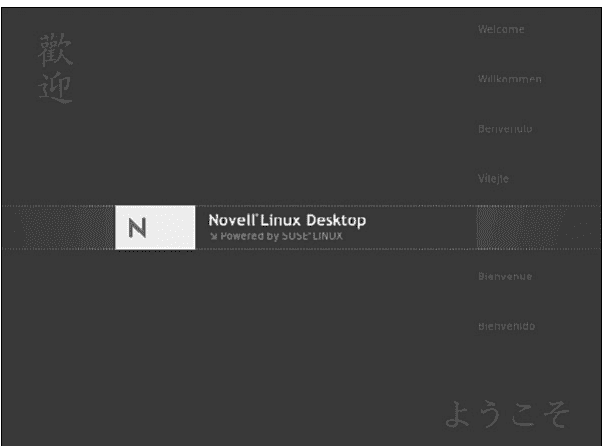

通过欢迎屏幕，你会注意到 Novell Linux Desktop 是基于 SUSE LINUX 构建的，并提供多种语言。

欢迎屏幕显示了以下选项：

### 注意

在启动时，启动屏会快速出现。BIOS 必须从介质启动才能进入此菜单。

## 图 2.2

启动后出现启动选项菜单，提供了多种选择。

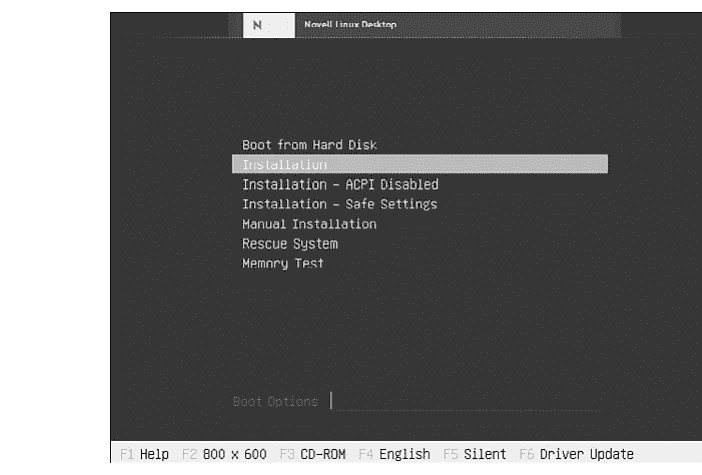

- **Boot from Hard disk** | 从硬盘启动——如果你意外来到此菜单且不想进行任何更改，这是默认选择。
- **Installation** | 开始安装的选项。
- **Installation - ACPI Disabled** | 此选项设置 `acpi=off`，仅当你遇到电源管理引起的问题时使用。
- **Installation - Safe Settings** | 除其他外，它设置了 `acm=off`、`acpi=off` 和 `barrier=off`，仅在你尝试上述选项后使用。
- **Manual Installation** | 让你浏览想要调整的安装方面。

# 第 2 章节：安装 Novell Linux 桌面

- **Rescue System** | 这用于恢复系统，但仅检查内存。
- **Memory Test** | 这对损坏的文件没有帮助。

要开始标准安装，选择 `Installation`。如果系统无法识别满足最低要求，将开始文本安装（请跳转到本章后文的“文本安装”部分并从那里继续）。

接下来出现许可协议。滚动选项，你可以点击“同意”按钮或“不同意”按钮。如果你选择后者，安装将不会继续。

### 注意

除了与许可协议直接相关的两个按钮外，还有两个按钮也会完全停止安装，即 Accept。这两个按钮在后续的所有屏幕中（尽管在某些屏幕上 Accept 被标记为 Cancel）一直有效。Accept 按钮用于进入下一个对话框，但在你在最后一个安装屏幕上确认所有选择和设置之前，没有任何东西被接受。

在同意许可协议后，YaST2 标识为“安装与系统管理程序”，你必须选择语言。然后会对你的硬件进行分析，并提供单选按钮让你选择 GNOME 或 KDE 作为默认桌面。两者都没有预选，且你此时无法同时安装两者，但你以后可以可以回来这样做。

### 提示

KDE 是 SUSE 系统使用的传统桌面，而 Novell 现在更倾向于使用 GNOME。如果你对两者都不熟悉，并且没有合理的理由选择其中之一（例如作为全公司的桌面标准），GNOME 可能是“正确”的选择，也是本书主要关注的。

接下来将显示你所选择的安装设置摘要。此处列出了关于以下方面的信息：

- 系统本身（处理器、内存）
- 模式（新安装）
- 键盘布局
- 鼠标
- 分区
- 要安装的软件（包括默认桌面）
- 启动（GRUB 是默认启动加载程序）
- 时区
- 语言
- 默认运行级别（5 是默认值；带有网络和 X Window 系统的图形多用户模式）

你可以通过点击“更改”（Change）按钮来修改任何已配置的设置，也可以通过点击“接受”（Accept）按原样接受它们。一旦你点击“接受”，就会出现一个警告，提示 YaST2 已拥有所有所需信息，现在可以开始安装。你可以点击“是，安装”（Yes, Install）提交安装以及你之前的选择，或者点击“否”（No）返回上一个对话框并进行任何你想做的更改。

一旦你点击开始实际安装，硬盘将开始准备。随后，你可以通过进度条查看每张 CD 的安装状态。在此阶段结束，基本安装将通过以下自动步骤完成：

1. 更新配置
2. 将文件复制到已安装的系统
3. 安装启动管理程序
4. 为初始启动准备系统

系统将重启并继续安装（通常在此时它会要求你安装下一张安装 CD）。现在将安装软件包，包括 RealPlayer、Acrobat Reader、Red Carpet 和 OpenOffice.org 等。

# 第 2 章：安装 Novell Linux Desktop 9

系统会提示你输入并验证 root 用户的密码。由于该账户在系统中拥有最高权限，且绝大多数意图破坏系统的人员都会尝试访问它，因此，对此密码应用良好的密码规则（例如混合大小写并包含非字母字符）是关重要的。除了字母、数字和空格外，密码还可以包含以下字符：#*,:,;:-_$+$&|?{}{。屏幕上还会出现一个名为“专家选项”（Expert Options）的命令按钮，如果你点击它，你可以在三种加密类型之间选择：

- DES（Linux 默认）：限制为八个字符；从技术上讲，你可以输入任意长度的字符串，但哈希仅使用前八个字符。
- MD5
- Blowfish

### 注意

这是三种非常不同的加密哈希函数。MD5 和 Blowfish 在算法上有所不同，且由于使用了更长的密码，它们都比 DES 更难破解。DES 之所以成为默认值是因为它提供了与使用 NIS 等遗留系统交互的能力。

在配置好 root 密码后，系统将转向网络配置。系统会对网络接口、DSL 连接、ISDN 适配器、调制解调器、代理和 VNC 远程管理进行扫描。你可以接受在摘要屏幕上找到并给出的结果，也可以在接受之前对其进行任何更改。点击“下一步”后，网络配置将被写入，你将获得测试 Internet 连接的机会。如果你想下载最新的发布说明和更新，这将很有用，你也可以选择跳过此测试。

### 注意

默认的网络配置模型是带有 DHCP 的自动 IP 地址配置。

身份模式提供三种选择：

- NIS—网络信息系统——如果你正在使用 NIS 服务器来存储用户信息，请选择此选项。

# 安装操作系统

- LDAP—轻量级目录访问协议—如果你正在使用 LDAP 服务器来存储用户信息，请选择此选项。
- 本地 (`/etc/passwd`)—如果你希望将密码存储在 `/etc/passwd` 和 `/etc/shadow` 文件中，请选择此选项。

点击“下一步”后，你可以添加新用户账户。虽然此时可以添加所有的用户，但这并不是此屏幕的真正最佳使用方式。此时，你应该至少添加一个可以替代 root 的账户，完成安装，稍后再添加你的其他用户。

要添加此用户，系统会提示你录入以下内容：

- 全名（Full Name）：这是一个自由文本，你可以在其中输入任何值，但它通常是用户的姓和名。
- 用户登录（User Login）：如果你不知道想用什么，建议命令框将根据“全名”字段中输入的值返回一个可能的值。
- 密码（Password）：所有适用于 root 用户的字符都可以用于此及其他所有用户。

你必须再次输入密码以验证输入是否正确，如果该用户需要接收系统邮件，可以勾选相应的框。第一个用户的用户 ID (`uid`) 为 1000，其他所有用户将从那里递增（1001、1002 等）。

SuSEconf 现在开始写入当前状态下的系统配置文件；随后将显示发布说明（Release Notes）。如果你愿意，可以滚动查看并阅读这些说明，也可以在以后的任何时间通过 `/usr/share/docs/release-notes/RELEASE-NOTES.en.rt` 访问它们。

接下来进行硬件配置，系统会对显卡、打印机和声卡等设备进行搜索和识别。再次，你可以对摘要中的内容进行任何想要的更改，或接受现状并点击“下一步”。此时，安装已完成，剩下的工作就是点击“完成”（Finish）。一旦你执行操作，系统将重启并进入 Novell Linux 桌面登录界面，提示你现在必须提供用户名和密码（见图 2.3）。执行这些操作后，桌面（GNOME 或 KDE）将被加载，你就可以工作了。

## 图 2.7

在应用安装设置之前，你必须接受它们。

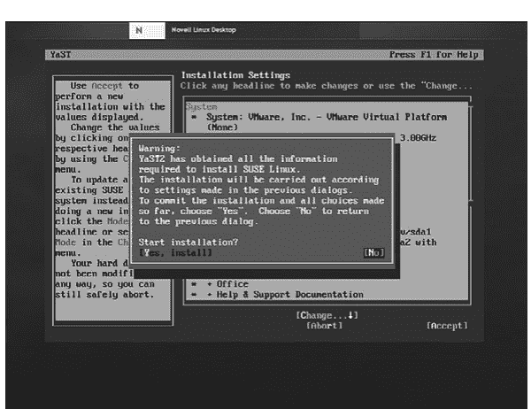

## 图 2.8

系统提示你交换一组 CD 光盘以完成安装。

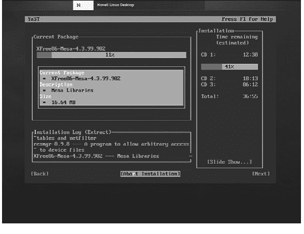

## 第 2 章：安装 Novell Linux 桌面

## 图 2.9

配置 root 用户账户。

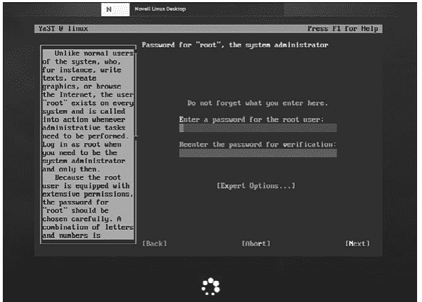

## 图 2.10

网络设备通常会自动检测。

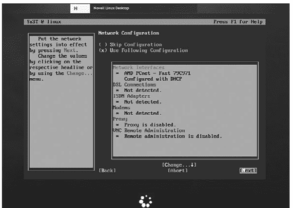

在写入网络配置后，你将有机会验证 Internet 访问并选择你的身份验证方法。系统提供三种选择：

- NIS—网络信息系统——如果你正在使用 NIS 服务器存储用户信息，请选择此选项。
- LDAP—轻量级目录访问协议——如果你正在使用 LDAP 服务器存储用户信息，请选择此选项。
- 本地 (`/etc/passwd`)—如果你希望将密码存储在 `/etc/passwd` 和 `/etc/shadow` 文件中，请选择此选项。

你可以选择输入另一个系统用户（root 之外），然后写入系统配置。系统将显示发行说明，并开始硬件配置。摘要屏幕显示了显卡、打印机和声卡（其中任何一个都可以更改）。

安装现在已完成。点击“完成”（Finish）后，系统将重启并进入 Novell Linux 桌面登录界面，提示你输入用户名和密码。输入后，桌面（GNOME 或 KDE）将加载，你就可以开始工作了。

## 定制安装

作为管理员，在部署预配置的系统镜像时，比独立运行每次安装更合理意义。在这种情况下，可以使用 Firstboot 工具并配置安装的某些元素以符合你的需求。

如果你想更改在安装过程中出现在欢迎屏幕、许可协议和完成对话框中的设置，可以创建一个自定义脚本来显示不同的值。此功能默认未启用，你必须首先通过在主机器上安装 `vast2-firstboot` 包来安装 Firstboot 工具，如图 2.11 所示。

勾选框框并点击“接受”（Accept）。如果驱动器中尚未该文件，系统将提示安装 CD 1。一旦复制完成，必须执行以下步骤：

- 触摸 `/etc/reconfig_system` 文件并开启 firstboot。这两个步骤均如图 2.12 所示。

## 图 2.11

安装 Firstboot 包。

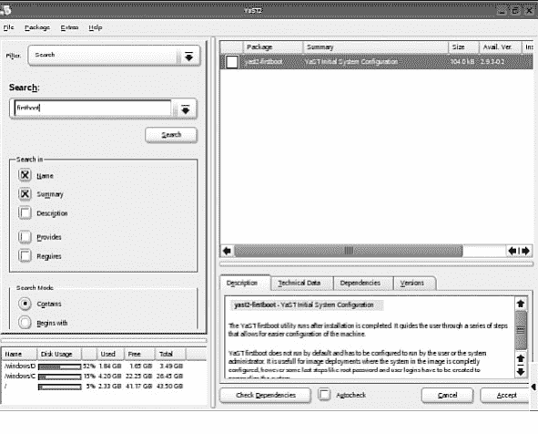

## 图 2.12

触碰配置文件并开启 firstboot。

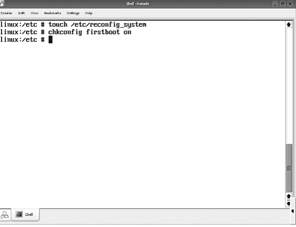

## 解决安装问题

2. 你现在可以编辑图 2.13 所示的 `/etc/sysconfig/firstboot` 文件，并设置你需要的选项。

## 图 2.13

修改配置文件以获得你需要的设置。

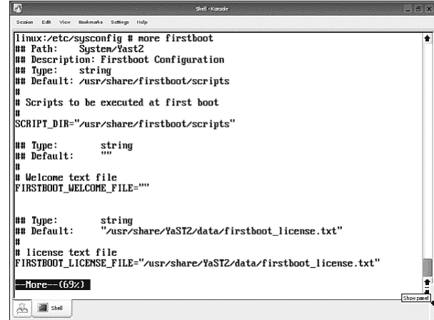


该配置文件现在可以用于你站点安装的标准文件。有关 Firstboot 工具的更多信息，请参阅 Novell Linux 桌面在线文档。

## 解决安装问题

大多数安装没有任何问题地完成。当出现问题时，通常与旧硬件或未达到最低要求有关。本节介绍了一些相关问题：无法启动 X 服务器，以及显示器无法与操作系统配合。

### X 服务器问题

如果 X 服务器出现问题，它通常会在完成安装后首次重启系统时现形。会出现一条类似于图 2.14 所示的错误消息。

#### 图 2.14

错误指示 X 服务器无法启动。


第一个对话框询问你是否想要查看日志文件，考虑到操作系统刚刚完成安装，这些日志可能没有任何用。随后，你将获得运行 X 配置程序的选项（见图 2.15），你应对对此回答“是”（Yes）。

#### 图 2.15

提供了运行 X 配置程序的选项。

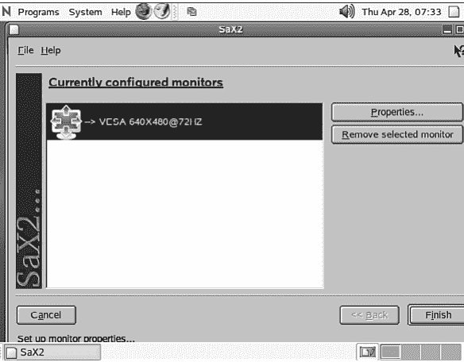

## 解决安装问题

在写入网络配置后，你将有机会验证 Internet 访问并选择你的身份验证方法。系统提供三种选择：
- NIS—网络信息系统——如果你正在使用 NIS 服务器存储用户信息，请选择此选项。
- LDAP—轻量级目录访问协议——如果你正在使用 LDAP 服务器存储用户信息，请选择此选项。
- 本地 (`/etc/passwd`)—如果你希望将密码存储在 `/etc/passwd` 和 `/etc/shadow` 文件中，请选择此选项。

你可以选择输入另一个系统用户（root 之外），然后写入系统配置。系统将显示发行说明，并开始硬件配置。摘要屏幕显示了显卡、打印机和声卡（其中任何一个都可以更改）。安装现在已完成。点击“完成”（Finish）后，系统将重启并进入 Novell Linux 桌面登录界面，提示你输入用户名和密码。输入后，桌面（GNOME 或 KDE）将加载，你就可以开始工作了。

作为管理员，在部署预配置的系统镜像时，比独立运行每次安装更有意义。在这种情况下，可以使用 Firstboot 工具并配置安装的某些元素以符合你的需求。

如果你想更改在安装过程中出现在欢迎屏幕、许可协议和完成对话框中的设置，可以创建一个自定义脚本来显示不同的值。此功能默认未启用，你必须首先通过在主机器上安装 `vast2-firstboot` 包来安装 Firstboot 工具，如图 2.11 所示。

勾选框并点击“接受”（Accept）。如果驱动器中尚未该文件，系统将提示安装 CD 1。一旦复制完成，必须执行以下步骤：
- 触摸 `/etc/reconfig_system` 文件并开启 firstboot。这两个步骤均如图 2.12 所示。

#### 图 2.11

安装 Firstboot 包。


#### 图 2.12

触碰配置文件并开启 firstboot。


## 解决安装问题

2. 你现在可以编辑图 2.13 所示的 `/etc/sysconfig/firstboot` 文件，并设置你需要的选项。

#### 图 2.13

修改配置文件以获得你需要的设置。


该配置文件现在可以用于你站点安装的标准文件。有关 Firstboot 工具的更多信息，请参阅 Novell Linux 桌面在线文档。

## 解决安装问题

大多数安装没有任何问题地完成。当出现问题时，通常与旧硬件或未达到最低要求有关。本节介绍了一些相关问题：无法启动 X 服务器，以及显示器无法与操作系统配合。

### X 服务器问题

如果 X 服务器出现问题，它通常会在完成安装后首次重启系统时现形。会出现一条类似于图 2.14 所示的错误消息。

#### 图 2.14

错误指示 X 服务器无法启动。


第一个对话框询问你是否想要查看日志文件，考虑到操作系统刚刚完成安装，这些日志可能没有任何用。随后，你将获得运行 X 配置程序的选项（见图 2.15），你应对对此回答“是”（Yes）。

#### 图 2.15

提供了运行 X 配置程序的选项。


## 解决安装问题

在写入网络配置后，你将有机会验证 Internet 访问并选择你的身份验证方法。系统提供三种选择：
- NIS—网络信息系统——如果你正在使用 NIS 服务器存储用户信息，请选择此选项。
- LDAP—轻量级目录访问协议——如果你正在使用 LDAP 服务器存储用户信息，请选择此选项。
- 本地 (`/etc/passwd`)—如果你希望将密码存储在 `/etc/passwd` 和 `/etc/shadow` 文件中，请选择此选项。

你可以选择输入另一个系统用户（root 之外），然后写入系统配置。系统将显示发行说明，并开始硬件配置。摘要屏幕显示了显卡、打印机和声卡（其中任何一个都可以更改）。安装现在已完成。点击“完成”（Finish）后，系统将重启并进入 Novell Linux 桌面登录界面，提示你输入用户名和密码。输入后，桌面（GNOME 或 KDE）将加载，你就可以开始工作了。

## 定制安装

作为管理员，在部署预配置的系统镜像时，比独立运行每次安装更有意义。在这种情况下，可以使用 Firstboot 工具并配置安装的某些元素以符合你的需求。

如果你想更改在安装过程中出现在欢迎屏幕、许可协议和完成对话框中的设置，可以创建一个自定义脚本来显示不同的值。此功能默认未启用，你必须首先通过在主机器上安装 `vast2-firstboot` 包来安装 Firstboot 工具，如图 2.11 所示。

勾选框并点击“接受”（Accept）。如果驱动器中尚未该文件，系统将提示安装 CD 1。一旦复制完成，必须执行以下步骤：
- 触摸 `/etc/reconfig_system` 文件并开启 firstboot。这两个步骤均如图 2.12 所示。

#### 图 2.11

安装 Firstboot 包。


#### 图 2.12

触碰配置文件并开启 firstboot。


## 解决安装问题

2. 你现在可以编辑图 2.13 所示的 `/etc/sysconfig/firstboot` 文件，并设置你需要的选项。

#### 图 2.13

修改配置文件以获得你需要的设置。


该配置文件现在可以用于你站点安装的标准文件。有关 Firstboot 工具的更多信息，请参阅 Novell Linux 桌面在线文档。

## 解决安装问题

大多数安装没有任何问题地完成。当出现问题时，通常与旧硬件或未达到最低要求有关。本节介绍了一些相关问题：无法启动 X 服务器，以及显示器无法与操作系统配合。

### X 服务器问题

如果 X 服务器出现问题，它通常会在完成安装后首次重启系统时现形。会出现一条类似于图 2.14 所示的错误消息。

#### 图 2.14

错误指示 X 服务器无法启动。


第一个对话框询问你是否想要查看日志文件，考虑到操作系统刚刚完成安装，这些日志可能没有任何用。随后，你将获得运行 X 配置程序的选项（见图 2.15），你应对对此回答“是”（Yes）。

#### 图 2.15

提供了运行 X 配置程序的选项。


## 解决安装问题

在写入网络配置后，你将有机会验证 Internet 访问并选择你的身份验证方法。系统提供三种选择：
- NIS—网络信息系统——如果你正在使用 NIS 服务器存储用户信息，请选择此选项。
- LDAP—轻量级目录访问协议——如果你正在使用 LDAP 服务器存储用户信息，请选择此选项。
- 本地 (`/etc/passwd`)—如果你希望将密码存储在 `/etc/passwd` 和 `/etc/shadow` 文件中，请选择此选项。

你可以选择输入另一个系统用户（root 之外），然后写入系统配置。系统将显示发行说明，并开始硬件配置。摘要屏幕显示了显卡、打印机和声卡（其中任何一个都可以更改）。安装现在已完成。点击“完成”（Finish）后，系统将重启并进入 Novell Linux 桌面登录界面，提示你输入用户名和密码。输入后，桌面（GNOME 或 KDE）将加载，你就可以开始工作了。

## 第 2 章：安装 Novell Linux 桌面

#### 图 2.9

配置 root 用户账户。


#### 图 2.10

网络设备通常会自动检测。


在写入网络配置后，你将有机会验证 Internet 访问并选择你的身份验证方法。系统提供三种选择：
- NIS—网络信息系统——如果你正在使用 NIS 服务器存储用户信息，请选择此选项。
- LDAP—轻量级目录访问协议——如果你正在使用 LDAP 服务器存储用户信息，请选择此选项。
- 本地 (`/etc/passwd`)—如果你希望将密码存储在 `/etc/passwd` 和 `/etc/shadow` 文件中，请选择此选项。

你可以选择输入另一个系统用户（root 之外），然后写入系统配置。系统将显示发行说明，并开始硬件配置。摘要屏幕显示了显卡、打印机和声卡（其中任何一个都可以更改）。安装现在已完成。点击“完成”（Finish）后，系统将重启并进入 Novell Linux 桌面登录界面，提示你输入用户名和密码。输入后，桌面（GNOME 或 KDE）将加载，你就可以开始工作了。

作为管理员，在部署预配置的系统镜像时，比独立运行每次安装更有意义。在这种情况下，可以使用 Firstboot 工具并配置安装的某些元素以符合你的需求。

如果你想更改在安装过程中出现在欢迎屏幕、许可协议和完成对话框中的设置，可以创建一个自定义脚本来显示不同的值。此功能默认未启用，你必须首先通过在主机器上安装 `vast2-firstboot` 包来安装 Firstboot 工具，如图 2.11 所示。

勾选框并点击“接受”（Accept）。如果驱动器中尚未该文件，系统将提示安装 CD 1。一旦复制完成，必须执行以下步骤：
- 触摸 `/etc/reconfig_system` 文件并开启 firstboot。这两个步骤均如图 2.12 所示。

#### 图 2.11

安装 Firstboot 包。


#### 图 2.12

触碰配置文件并开启 firstboot。


## 解决安装问题

2. 你现在可以编辑图 2.13 所示的 `/etc/sysconfig/firstboot` 文件，并设置你需要的选项。

#### 图 2.13

修改配置文件以获得你需要的设置。


该配置文件现在可以用于你站点安装的标准文件。有关 Firstboot 工具的更多信息，请参阅 Novell Linux 桌面在线文档。

## 解决安装问题

大多数安装没有任何问题地完成。当出现问题时，通常与旧硬件或未达到最低要求有关。本节介绍了一些相关问题：无法启动 X 服务器，以及显示器无法与操作系统配合。

### X 服务器问题

如果 X 服务器出现问题，它通常会在完成安装后首次重启系统时现形。会出现一条类似于图 2.14 所示的错误消息。

#### 图 2.14

错误指示 X 服务器无法启动。


第一个对话框询问你是否想要查看日志文件，考虑到操作系统刚刚完成安装，这些日志可能没有任何用。随后，你将获得运行 X 配置程序的选项（见图 2.15），你应对对此回答“是”（Yes）。

#### 图 2.15

提供了运行 X 配置程序的选项。


## 解决安装问题

在写入网络配置后，你将有机会验证 Internet 访问并选择你的身份验证方法。系统提供三种选择：
- NIS—网络信息系统——如果你正在使用 NIS 服务器存储用户信息，请选择此选项。
- LDAP—轻量级目录访问协议——如果你正在使用 LDAP 服务器存储用户信息，请选择此选项。
- 本地 (`/etc/passwd`)—如果你希望将密码存储在 `/etc/passwd` 和 `/etc/shadow` 文件中，请选择此选项。

你可以选择输入另一个系统用户（root 之外），然后写入系统配置。系统将显示发行说明，并开始硬件配置。摘要屏幕显示了显卡、打印机和声卡（其中任何一个都可以更改）。安装现在已完成。点击“完成”（Finish）后，系统将重启并进入 Novell Linux 桌面登录界面，提示你输入用户名和密码。输入后，桌面（GNOME 或 KDE）将加载，你就可以开始工作了。

## 定制安装

作为管理员，在部署预配置的系统镜像时，比独立运行每次安装更有意义。在这种情况下，可以使用 Firstboot 工具并配置安装的某些元素以符合你的需求。

如果你想更改在安装过程中出现在欢迎屏幕、许可协议和完成对话框中的设置，可以创建一个自定义脚本来显示不同的值。此功能默认未启用，你必须首先通过在主机器上安装 `vast2-firstboot` 包来安装 Firstboot 工具，如图 2.11 所示。

勾选框并点击“接受”（Accept）。如果驱动器中尚未该文件，系统将提示安装 CD 1。一旦复制完成，必须执行以下步骤：
- 触摸 `/etc/reconfig_system` 文件并开启 firstboot。这两个步骤均如图 2.12 所示。

#### 图 2.11

安装 Firstboot 包。


#### 图 2.12

触碰配置文件并开启 firstboot。


## 解决安装问题

2. 你现在可以编辑图 2.13 所示的 `/etc/sysconfig/firstboot` 文件，并设置你需要的选项。

#### 图 2.13

修改配置文件以获得你需要的设置。


该配置文件现在可以用于你站点安装的标准文件。有关 Firstboot 工具的更多信息，请参阅 Novell Linux 桌面在线文档。

## 解决安装问题

大多数安装没有任何问题地完成。当出现问题时，通常与旧硬件或未达到最低要求有关。本节介绍了一些相关问题：无法启动 X 服务器，以及显示器无法与操作系统配合。

### X 服务器问题

如果 X 服务器出现问题，它通常会在完成安装后首次重启系统时现形。会出现一条类似于图 2.14 所示的错误消息。

#### 图 2.14

错误指示 X 服务器无法启动。


第一个对话框询问你是否想要查看日志文件，考虑到操作系统刚刚完成安装，这些日志可能没有任何用。随后，你将获得运行 X 配置程序的选项（见图 2.15），你应对对此回答“是”（Yes）。

#### 图 2.15

提供了运行 X 配置程序的选项。


## 解决安装问题

在写入网络配置后，你将有机会验证 Internet 访问并选择你的身份验证方法。系统提供三种选择：
- NIS—网络信息系统——如果你正在使用 NIS 服务器存储用户信息，请选择此选项。
- LDAP—轻量级目录访问协议——如果你正在使用 LDAP 服务器存储用户信息，请选择此选项。
- 本地 (`/etc/passwd`)—如果你希望将密码存储在 `/etc/passwd` 和 `/etc/shadow` 文件中，请选择此选项。

你可以选择输入另一个系统用户（root 之外），然后写入系统配置。系统将显示发行说明，并开始硬件配置。摘要屏幕显示了显卡、打印机和声卡（其中任何一个都可以更改）。安装现在已完成。点击“完成”（Finish）后，系统将重启并进入 Novell Linux 桌面登录界面，提示你输入用户名和密码。输入后，桌面（GNOME 或 KDE）将加载，你就可以开始工作了。

## 定制安装

作为管理员，在部署预配置的系统镜像时，比独立运行每次安装更有意义。在这种情况下，可以使用 Firstboot 工具并配置安装的某些元素以符合你的需求。

如果你想更改在安装过程中出现在欢迎屏幕、许可协议和完成对话框中的设置，可以创建一个自定义脚本来显示不同的值。此功能默认未启用，你必须首先通过在主机器上安装 `vast2-firstboot` 包来安装 Firstboot 工具，如图 2.11 所示。

勾选框并点击“接受”（Accept）。如果驱动器中尚未该文件，系统将提示安装 CD 1。一旦复制完成，必须执行以下步骤：
- 触摸 `/etc/reconfig_system` 文件并开启 firstboot。这两个步骤均如图 2.12 所示。

#### 图 2.11


安装 Firstboot 包。


### 图 2.12

触碰配置文件并开启 firstboot。


## 解决安装问题

2. 你现在可以编辑图 2.13 所示的 `/etc/sysconfig/firstboot` 文件，并设置你需要的选项。

### 图 2.13

修改配置文件以获得你需要的设置。


该配置文件现在可以用于你站点安装的标准文件。有关 Firstboot 工具的更多信息，请参阅 Novell Linux 桌面在线文档。

## 解决安装问题

大多数安装没有任何问题地完成。当出现问题时，通常与旧硬件或未达到最低要求有关。本节介绍了一些相关问题：无法启动 X 服务器，以及显示器无法与操作系统配合。

### X 服务器问题

如果 X 服务器出现问题，它通常会在完成安装后首次重启系统时现形。会出现一条类似于图 2.14 所示的错误消息。

### 图 2.14

错误指示 X 服务器无法启动。


第一个对话框询问你是否想要查看日志文件，考虑到操作系统刚刚完成安装，这些日志可能没有任何用。随后，你将获得运行 X 配置程序的选项（见图 2.15），你应对对此回答“是”（Yes）。

### 图 2.15

提供了运行 X 配置程序的选项。


## 解决安装问题

在写入网络配置后，你将有机会验证 Internet 访问并选择你的身份验证方法。系统提供三种选择：

- NIS—网络信息系统——如果你正在使用 NIS 服务器存储用户信息，请选择此选项。
- LDAP—轻量级目录访问协议——如果你正在使用 LDAP 服务器存储用户信息，请选择此选项。
- 本地 (`/etc/passwd`)—如果你希望将密码存储在 `/etc/passwd` 和 `/etc/shadow` 文件中，请选择此选项。

你可以选择输入另一个系统用户（root 之外），然后写入系统配置。系统将显示发行说明，并开始硬件配置。摘要屏幕显示了显卡、打印机和声卡（其中任何一个都可以更改）。安装现在已完成。点击“完成”（Finish）后，系统将重启并进入 Novell Linux 桌面登录界面，提示你输入用户名和密码。输入后，桌面（GNOME 或 KDE）将加载，你就可以开始工作了。

# 第 2 章：安装 Novell Linux 桌面

### 图 2.9

配置 root 用户账户。


### 图 2.10

网络设备通常会自动检测。


## 定制安装

作为管理员，在部署预配置的系统镜像时，比独立运行每次安装更有意义。在这种情况下，可以使用 Firstboot 工具并配置安装的某些元素以符合你的需求。

如果你想更改在安装过程中出现在欢迎屏幕、许可协议和完成对话框中的设置，可以创建一个自定义脚本来显示不同的值。此功能默认未启用，你必须首先通过在主机器上安装 `vast2-firstboot` 包来安装 Firstboot 工具，如图 2.11 所示。

勾选框并点击“接受”（Accept）。如果驱动器中尚未该文件，系统将提示安装 CD 1。一旦复制完成，必须执行以下步骤：

- 触摸 `/etc/reconfig_system` 文件并开启 firstboot。这两个步骤均如图 2.12 所示。

### 图 2.11

安装 Firstboot 包。


### 图 2.21

在线更新选项。

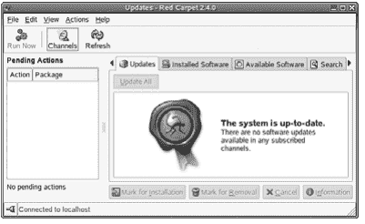

你可以选择手动选择要应用的补丁（默认设置），或从服务器重新加载所有补丁。如果有可用的补丁，它们将呈现供你选择；否则，你将收到系统已最新的通知，如图 2.22 所示。

### 图 2.22

系统是最新的，没有补丁需要应用。

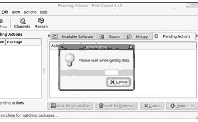

## 使用红毯 (Red Carpet)

Novell Linux 桌面还包含 Red Carpet 工具，允许你检查更新并保持系统最新。要启动此工具，请从“系统”菜单中选择“软件更新”。

## 第 2 章：安装 Novell Linux 桌面 9

系统将对系统进行检查，如图 2.23 所示，如果有需要下载的补丁，你将收到通知。如果没有新补丁，你将收到系统已最新的通知，如图 2.24 所示。

### 图 2.23

可以执行快速扫描。

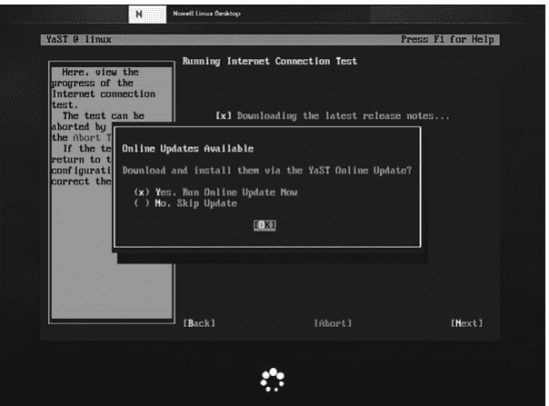

## 使用更新 CD

Novell Desktop 可以通过补丁 CD 手动更新。通常情况下，当你将 CD 插入光驱时，NLD 将识别到补丁 CD 的存在并询问你是否要运行它（见图 2.25）。如果没有识别到 CD，你仍然可以手动启动安装。要这样做，请从“系统”菜单中选择 YaST，然后选择“软件”，和“补丁 CD 更新”。

一旦 YaST 开始，安装源将默认为 CD，你只需点击“下一步”即可开始安装。有关新更新的信息将从 CD 中检索，你可以选择要安装哪些补丁/软件包。点击“接受”，进度日志将显示正在执行的操作。如果有多张 CD，系统将提示你根据需要进行更换。

### 图 2.24

没有补丁需要安装。

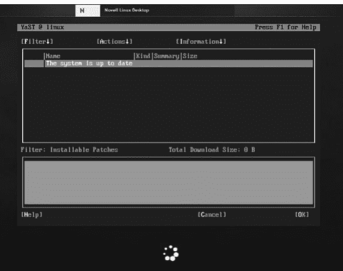

### 图 2.25

可以使用更新 CD 来为系统补丁。

## 提示

偶尔会发生特定补丁无法安装的错误。当发生这种情况时，请选择跳过。进程完成后，你可以再次运行更新，它将只列出未安装的补丁——提供另一次安装它们的机会。在大多数情况下，它们将在随后的尝试中无错误地安装。

更新安装完成且 SuSEconfig 运行后，你通常需要重启。重启后，系统将带有最新的补丁运行。

> 注意
> 你应该检查 http://www.novell.com/linux/ 获取与新补丁或发布相关的信息。

## 总结

本章介绍了了安装 Novell Linux 桌面的要求，并介绍了标准安装的步骤。下一章将重点关注 NLD 的图形化界面，并检查 KDE 和 GNOME 的用法。

## 桌面环境的使用

尽管许多管理员完全乐于在命令行工作，但 Linux 提供了许多基于 X Windows 系统的优秀图形界面供选择。Novell Desktop Linux 包含了两个：KDE 和 GNOME。在安装期间，你可以选择想要安装两者中的哪一个，如果你决定这样做的话，也可以在安装后的任何时候添加另一个（见第 5 章，“使用 YaST”）。

每个每个桌面都有自己的一套对等应用程序，在存在正确库的情况下，你甚至可以在一个桌面界面下运行另一个桌面的应用程序。正如在第 2 章“安装 Novell Linux 桌面 9”中提到的，KDE 是 SUSE Linux 使用最广泛的桌面环境，但 Novell 在 Novell Linux Desktop 上更倾向于 GNOME，且大多数新工具都是为它编写的。

在本章中，我们首先查看 GNOME 界面及其元素。随后，我们将查看 KDE 界面。

## GNOME 概述

在安装期间，你可以选择 KDE 或 GNOME 作为你系统的默认桌面环境。GNOME 功能极其丰富，图 3.1 显示了启动屏幕，而图 3.2 显示了 Nautilus 浏览器，它以图形方式描述计算机。

> 注意
> 如果同时安装了 KDE 和 GNOME，你可以点击 Novell Linux 桌面登录界面上的“会话”(Session)，并在 GNOME 桌面或 KDE 桌面之间切换。还会出现第三种选择“安全模式”(Failsafe)”，用于故障排除。

## 第 3 章：桌面环境的使用

### 图 3.1

默认的 GNOME 桌面环境。

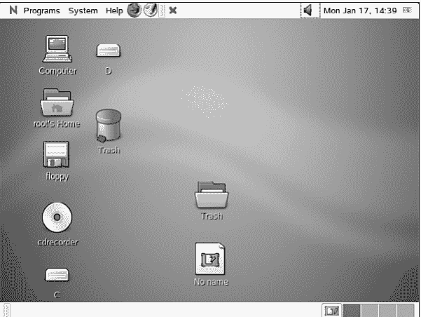

### 图 3.2

你可以通过浏览器访问驱动器。

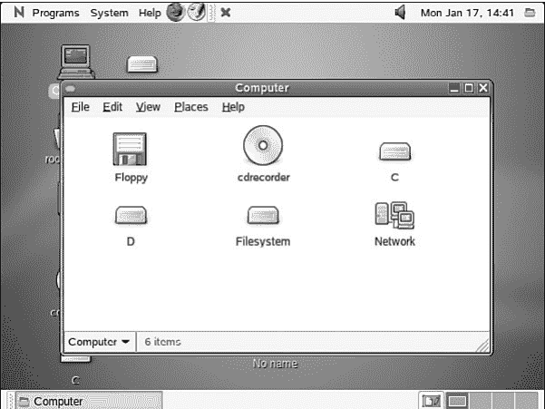

使用 GNOME，时钟出现在右上角。在右键面板，你可以看到选项。图 3.3 显示了*可以更改的界面*，而图 3.4 显示了可以配置的属性。

### 图 3.3

可以添加额外的项。

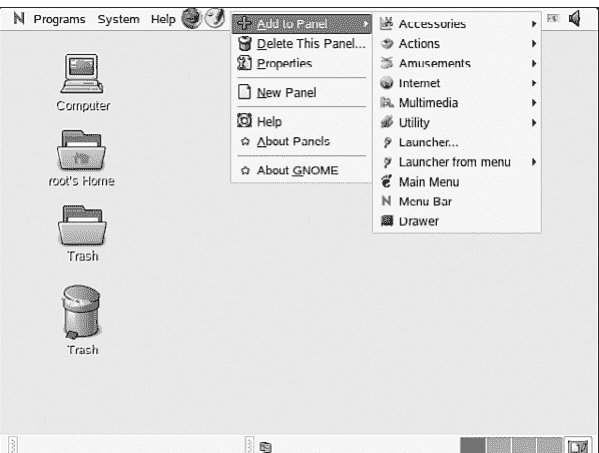

默认情况下，程序菜单位于屏幕右侧。图 3.4 显示了可以配置的项。

### 图 3.4

可以安装的补丁。

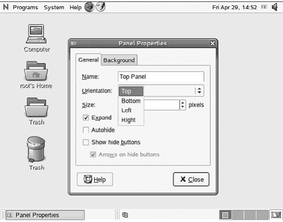

### 图 3.5

可以通过菜单访问应用程序。

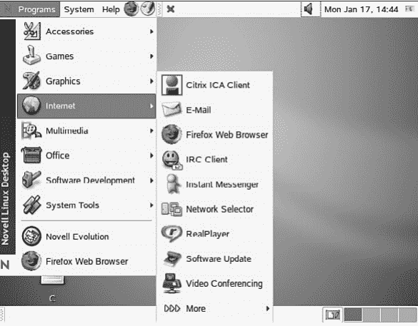

### 图 3.6

系统设置提供了访问 YaST 的简单方法。

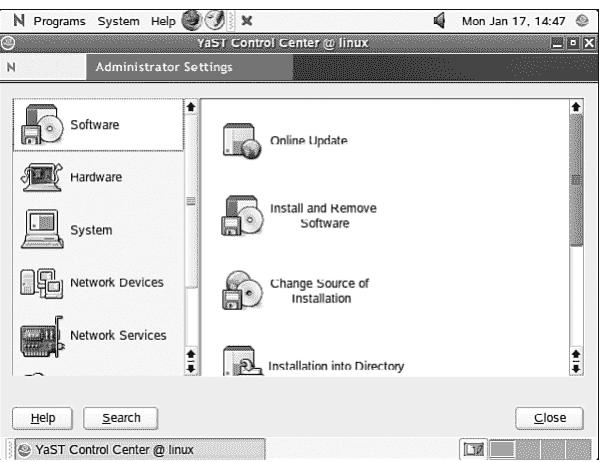

如果用户尝试访问此工具，必须提供密码，如图 3.7 所示。

系统菜单中的其他选项有：

- 设置：允许用户配置屏幕、声音、屏幕保护等。
- 搜索文件：查找计算机上的文件、文件夹和文档。
- 最近文件：查看并访问最近的文件。
- 软件更新：如第 2 章所述，这用于安装补丁和更新。
- 运行程序：通过文件名运行程序。
- 注销：退出当前用户并弹出另一个用户的登录界面。

## 第3章：使用 gnome 环境

### 图 3.9

你可以使用 `gconftool-2` 更改大多数 gnome 设置。


```bash
linux: # gconftool-2
Usage: gconftool-2 [-?] [--help] [--usage] [--recursive-unset] [-a][--set] [g][--get]
  [-set-schema] [--type int|bool|float|string] [--recursive-unset] [-a][--all-entries]
  [-all-dirs] [-d] [ui][--unset] [dir-value=STRING] [--shutdown] [-p][--ping] [-spawn]
  [--type int|bool|float|string] [list|pair] [-t][--get]
  [--get-list] [--get-element] [--card-type int|bool|float|string]
  [--list-type int|bool|float|string] [--short-desc=OWNER]
  [--cd-type int|bool|float|string] [--long-desc=OWNER]
  [--install-schema] [--apply-schema] [config-source=3OUCKK] [--direct]
  [--makefile-install-rule] [--makefile-uninstall-rule] [--break-key]
  [--work-directory] [--unset-docs] [--long-docs] [--apply-schema-name]
  [--apply-schema] [--apply-schema] [--get-default-source]

linux:~ -v version
```

# KDE 概述

如果你从未工作过 Linux，但有 Windows 环境的操作经验，你会发现自己能够快速理解 KDE 桌面并在其中高效工作。图 3.10 显示了基础桌面。

注意，桌面上会出现可以访问的实体的图标。图 3.10 中出现的两个图标是垃圾桶（临时存储删除文件的地方）和 CD 刻字机（CD-WRITER）。CDWR 右下角的绿色箭头表示它已挂载（可用），如果没有该箭头则意味着它未挂载。

右键点击设备图标将弹出一个相关性菜单，其中包含如挂载（Mount）和卸载（Unmount）等选项。你可以根据需要为软盘或其他设备添加图标。

在图 3.10 中，你会在屏幕底部的框架中看到许多图标——这个区域在历史上被称为 kicker（启动器），但通常被称为面板（panel）。那个带有红色字母“N”的按钮会弹出所有已配置程序和功能的菜单，被称为 KDE 菜单。蓝色房子是在 Konqueror（KDE 文件管理器）中打开主目录的硬连接快捷方式。带有外壳的显示器用于打开终端会话（交互式 shell）。救生圈图标启动 KDE 帮助中心（HelpCenter）。带有齿轮的地球图标启动 Konqueror 网页浏览器。信封和日历页的图标启动联系人个人信息管理器。

## 图 3.10

基础 KDE 桌面。


这些图标的右侧有两个框——白色和灰色。它们代表虚拟桌面；即你可以在之间切换的视图。右侧是一个被称为任务栏（taskbar）的区域，其中列出了活动任务。再右侧是系统托盘（System Tray），时、扬声器等项目可以出现在那里。最右侧的三个箭头用于向左滚动、向右滚动和隐藏面板（从 kicker 开始的整个底部区域）。

## KDE 菜单

图 3.11 所示的 KDE 菜单分为三个部分。第一部分列出最常用的应用程序，第二部分提供所有应用程序的访问。第三部分提供某些常用任务的快捷方式。

# 第3章：使用桌面环境

## 图 3.11

KDE 菜单。


## Konqueror

图 3.12 所示的 Konqueror 文件管理器是一种对象浏览器，允许你通过图形界面访问所有实体（文件对象、http 对象、网络对象、网络协议对象等）。当通过“首页”快捷方式访问它时，它会自动带你进入主目录。右上角有四个按钮选项。问号用于访问帮助。下划线用于最小化窗口。正方形用于恢复窗口到原始大小。X 按钮用于关闭窗口。

菜单栏下方会出现许多图标。从左侧开始，向上箭头用于进入下一级；例如进入 `/etc/etccups`。向左箭头带你回到之前的位置。向右箭头带你向前移动（在你返回之后）。房子图标带你进入主目录。圆形图标用于重新加载或刷新显示。X 停止加载当前页面。这些图标右侧用于剪切、复制、粘贴、打印以及更改图标大小和视图。

左侧框架沿出现许多图标。从顶部开始，扳手图标允许你配置导航区域。星号显示你的书签。立方体显示你的设备。时钟显示历史。房子显示主目录。连接的地球显示网络，包括如果配置了 SMB，则可以访问的 Windows 网络。文件夹显示根目录，旗帜显示特殊服务。

## 图 3.12

Konqueror 文件管理器。

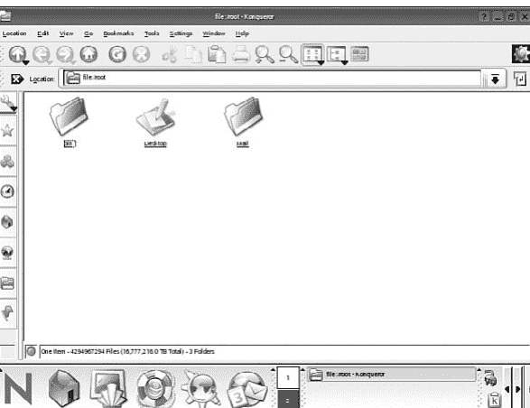

这些图标的右侧有两个框——白色和灰色。它们代表虚拟桌面；即你可以在之间切换的视图。再右侧是一个被称为任务栏的区域，其中列出了活动任务。再右侧是系统托盘（System Tray），时、扬声器等项目可以出现在那里。最右侧的三个箭头用于向左滚动、向右滚动和隐藏面板（从 kicker 开始的整个底部区域）。

右键点击屏幕上的任何项目将弹出一个相关性菜单，其中包含如挂载和卸载等选项。点击显示区域中的任意项目都会打开它。

## Shell

点击图 3.17 所示的 kicker/面板中的第三个图标，可以打开一个交互式 shell。

顶部的菜单选项有：会话（Session）、编辑（Edit）、视图（View）、设置（Settings）以及帮助（Help）。

# 第3章：使用桌面环境

## 图 3.13

你可以与该 shell 交互。

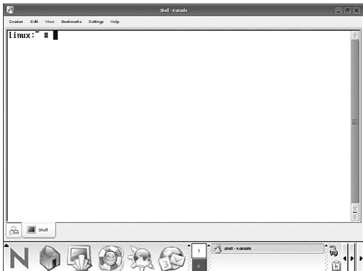

## 帮助中心

图 3.14 所示的 KDE 帮助中心是访问手册以及在线资源的快速方法。左侧框架中的标签允许相同的搜索。

## 网页浏览器

图 3.15 所示的 Konqueror 网页浏览器类似于文件管理器，并提供相同的类型（http 与文件）。

## KDE 概述

## 图 3.14

帮助中心。

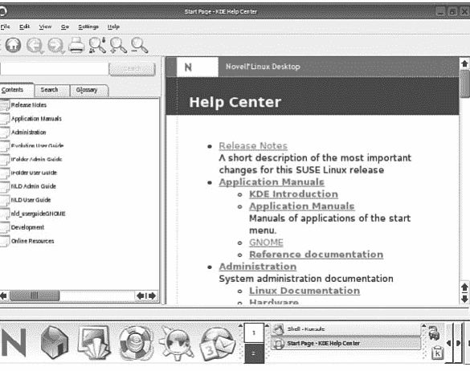

## (E)KT

图 3.16 所示的联系人工具提供了一个简单的个人信息管理器（PIM）。应用程序选项有：

- 邮件
- 联系人
- 待办事项
- 日历
- 笔记

## 图 3.16

联系人工具。

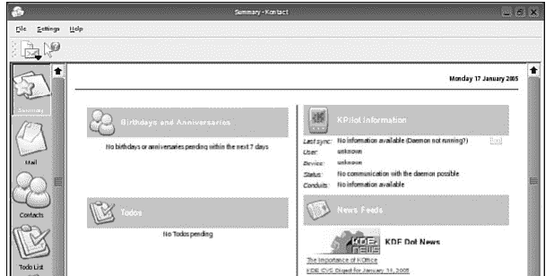

## 配置桌面

你可以通过多种方式访问 KDE 桌面的配置选项。这些方法中最简单是在桌面空白处点击右键，并从弹出菜单中选择“配置桌面”。这将显示图 3.17 所示的配置界面。

## 图 3.17

你可以根据喜好配置桌面。

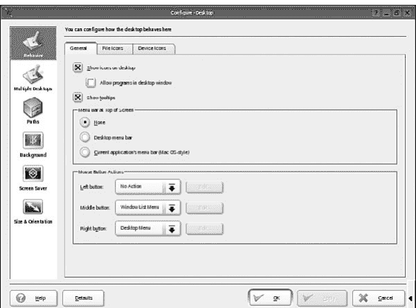

配置选项分为以下几类：

- 行为——图标设置和鼠标操作。
- 多重桌面——配置你有多少虚拟桌面。
- 路径——设置桌面、垃圾桶、自动启动和文档的路径。
- 背景——从不同的图片中选择或选择自己的。
- 屏幕保护——配置并测试保存设置。
- 大小与方向——设置屏幕、刷新率和相关变量。

为安装的其他设备向桌面添加图标，你有两种选择——手动和自动。最简单的方法采用自动。为此，点击图 3.17 所示的“设备图标”选项卡，并勾选“显示设备图标”复选框，如图 3.18 所示。

# 第 3 章：使用桌面环境

## 备注

这仅在选择了“行为（Behavior）”配置时有效，因为当你首次启动“配置桌面（Configure Desktop）”项目时，它是默认选项。

## 图 3.18

你可以轻松地向桌面添加额外的设备。

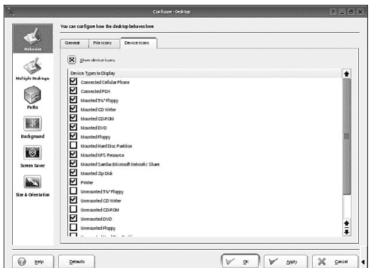

这会自动高亮系统中所有可用图标的设备。当你点击“应用（Apply）”时，你将在桌面上看到额外的设备，如图 3.19 所示（对比图 3.10）。

你可以通过右键点击桌面并选择“新建（Create New）”、“设备（Device）”，然后选择设备类型来手动添加，如图 3.20 所示。你需要根据设备类型添加任何必要的参数。

## 提示

只有当你没有启用“显示设备图标（Show Device Icons）”，或者向系统添加了新的硬件（且该硬件类别在之前启用“显示设备图标”时未被高亮），你才需要或想要手动添加它们。

# 图 3.19

新设备出现在桌面上。


# 图 3.20

你可以手动向桌面添加设备。

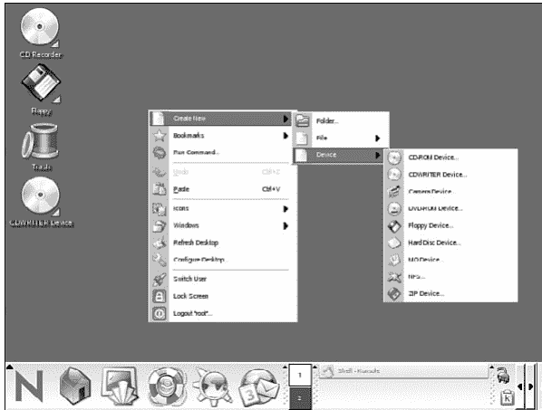

## 第 3 章：使用桌面环境

## 管理 KDE 桌面

在正常情况下，你通常允许用户使用桌面并对其进行任何可以提高他们工作效率的更改。KDE 控制中心（KDE Control Center）是用户配置桌面环境的最常用方法。它提供了对上一节讨论的“配置桌面”项目的访问，以及“外观与主题（Appearance & Themes）”项目以及许多细粒度的可配置项。

在某些情况下，你不希望他们拥有更改某些元素的能力。KDE 使用许多文本文件来配置其环境，可以费力地编辑这些文件来实现你想要的更改。然而，一个更好的选项是使用两个专为此目的设计的工具：

- `亭机管理工具`（The Kiosk Admin Tool）
- `配置编辑器`（The Config Editor）

这两个工具都是相当冷门的配置工具，下一节的目的只是向你介绍它们的存在以及使用它们可以做什么。每个工具的复杂程度都超出了本书的范围。

# 亭机管理工具

虽然非常罕见，但在最严格的环境中也可以可以在亭机模式（Kiosk mode）下 KDE。这通常由系统管理员使用，他们希望部署许多系统到类似的锁定状态，并将一个配置克隆到多台机器上，因为手动配置亭机是一项非常耗时的工作。

KDE 亭机管理工具可以通过命令行 `kiostool` 启动，并打开图 3.21 所示的第一个屏幕。

图 3.21 显示了默认配置文件，可以使用右侧的“新建配置文件（Add New Profile）”按钮轻松添加。这将弹出图 3.22 所示的对话框。

该工具的力量在于“配置（Configure）”按钮，它允许将配置文件存储在不同的目录下，并选择退出时是否将配置文件上传到远程服务器。图 3.23 显示了 `kiostool` 配置。它的许多方面都可以进行配置。你通过双击配置文件进入此面板。

# 图 3.21

你可以使用亭机管理工具锁定桌面。

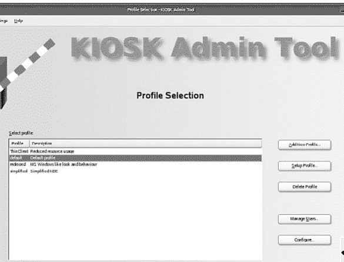

# 图 3.20

你可以手动向桌面添加设备。


虽然非常罕见，但在最严格的环境中也可以可以在亭机模式（Kiosk mode）下 KDE。这通常由系统管理员使用，他们希望部署许多系统到类似的锁定状态，并将一个配置克隆到多台机器上，因为手动配置亭机是一项非常耗时的工作。

KDE 亭机管理工具可以通过命令行 `kiostool` 启动，并打开图 3.21 所示的第一个屏幕。

图 3.21 显示了默认配置文件，可以使用右侧的“新建配置文件（Add New Profile）”按钮轻松添加。这将弹出图 3.22 所示的对话框。

该工具的力量在于“配置（Configure）”按钮，它允许将配置文件存储在不同的目录下，并选择退出时是否将配置文件上传到远程服务器。图 3.23 显示了 `kiostool` 配置。它的许多方面都可以进行配置。你通过双击配置文件进入此面板。

### 图 3.21

你可以使用亭机管理工具锁定桌面。


### 图 3.20

你可以手动向桌面添加设备。


# 第 3 章：使用桌面环境

## 命令行基础

这将返回一个文件和目录的输出列表，类似于

Desktop sample snapshot01.gif snapshot02.gif

在这种情况下，只提供了程序名而没有提供任何选项。这导致以默认格式列出当前目录下的文件。可以指定选项来更改显示，以包含/排除某些信息和/或更改显示格式。一个示例是

`ls -l`

这将输出更改为：

```
total 34
drwx-r--r-- 1 root root 1024 Jul 19 16:34 Desktop
-rw--r--r-- 1 root root 155 Jul 19 16:48 sample
-rw--r--r-- 1 root root 12497 Jul 19 16:39 snapshot01.gif
-rw--r--r-- 1 root root 17257 Jul 19 16:50 snapshot02.gif
```

在这里，不仅指定了程序名 `ls`，还指定了一个使用它的选项 `-l`，用于将列表更改为“长”格式。

## 注意事项

重要的一点是必须始终使用空格来分隔各个参数。空格可以是一个或多个空格字符或制表符。

如果给出的命令是 `ls-1` 将生成错误信息，因为没有名为 `ls-1` 的程序，且解释器无法区分程序名和选项。

可以使用 `man` 和 `info` 命令来查找大多数命令的信息（帮助手册）。例如，要查看关于 `ls` 命令使用的信息：

```
man ls
```

选项以及参数都是可选的，永远不是强制的。完成整个操作，参数也可以与命令配合：

```
ls -l *.gif
```

这将导致以下显示：

```
-rw--r--r-- 1 root root 12497 Jul 19 16:34 snapshot01.gif
-rw--r--r-- 1 root root 17257 Jul 19 16:50 snapshot02.gif
```

# 第 4 章：在命令行上工作

## 注意事项

或者，可以在不带选项的情况下使用参数，如下：

```
ls *.gif
```

给出的参数数量不限于一个。虽然单个实用程序接受的参数数量可能会有限制，但通常你可以将多个请求组合在一起。例如，与其指定

```
ls -l sa*
```

作为一条命令然后接着执行

```
ls -l *.gif
```

你可以通过以下命令实现相同的操作：

```
ls -l sa* *.gif
```

操作结果变为：

| -rw-r-r- | 1 | root | root | 155 | Jul 19 16:48 sample |

| -rw-r-r- | 1 | root | root | 12497 | Jul 19 16:39 snapshot01.gif |

| -rw-r-r- | 1 | root | root | 17257 | Jul 19 16:50 snapshot02.gif |

如果你提供的参数数量变得太长，导致在命令行上难以阅读，或者你只是想分段输入输入，可以使用反斜杠字符来表示你正在从一行继续到下一行。例如：

```
ls -l sa* \ \
*.gif
```

## 提示

反斜杠实际上防止了换行被 shell 解释，这通常被称为“转义换行”。反斜杠必须是换行符之前的行最后一个字符，这样才能生效。

如果你有数百个这样的参数，可以使用反斜杠来分隔每个条目。这使得命令在按下回车键之前不会执行，从而更容易查看。例如：

```
ls -l sa* \ \
*.gif \ \
*.txt \
*.doc
```

## 连接命令

到此为止，回车键用于告知 shell 你提供了一个需要处理的命令。然而，你并不限于一次只给一个命令。以任何方式连接的多个命令都可以放在同一行，只要使用分号 `;` 作为命令分隔符。例如，你可以查看当前目录下的所有文件并紧接着执行：

```
ls
date
```

这些是不相关的命令，第二个命令的输出与第一个输出无关。你可以通过分号将它们合并在同一行：

```
ls ; date
```

分号是一个特殊字符，允许多个命令在同一行。如果命令之间有共同点——一个命令的输出作为下一个命令的输入——它们通过管道 `|` 连接。例如，如果目录中的文件列表长到屏幕上无法容纳，你可以通过此命令每次查看一屏：

```
ls -1 | more
```

在这里 `ls -1` 命令的输出变为 `more` 的输入。

## 通配符

如果命令之间有共同点——一个命令的输出作为下一个命令的输入——它们通过管道 `|` 连接。例如，如果目录中的文件列表长到屏幕上无法容纳，你可以通过此命令每次查看一屏：

```
ls -1 | more
```

在这里 `ls -1` 命令的输出变为 `more` 的输入。

# 第 4 章：命令行操作

关于路径 `path`，有几点重要的内容需要了解：

- 1. 你可以使用 `echo` 命令查看你的路径：

```
echo $PATH
```

- 2. 默认情况下路径不包含当前目录。因此，你可以在主目录下创建一个可执行文件，在当前面前（通过 `ls`）看到它，但当你输入它的名称时，系统会提示找不到该命令。为了规避这个问题，你可以提供文件的完整路径、将你的主目录添加到 `PATH` 变量中、将文件移动到路径语句中的某个目录，或将当前目录变量（`.`）添加到 `PATH` 变量中。

- 3. 中的条目通过冒号 `:` 隔开。

- 4. `PATH` 的搜索顺序应该始终包含最常见的可执行文件所在目录（`bin` 目录），并将用户特定的目录（如果有）放在最后。

要向你的路径中添加另一个目录，你可以重新定义整个语句，或者直接使用命令追加新目录：

```
PATH=$PATH:{new directory}
```

因此，要将 `/home/edulaney` 目录添加到路径，命令为：

```
PATH=$PATH:/home/edulaney
```

或者你可以添加一个变量，表示你希望在当前工作的目录搜索该程序：

```
PATH=$PATH:.
```

## 注意

出于安全考虑，始终建议不要将当前目录包含在路径中。如果你确实这样做，它将位于 `PATH` 语句的末尾——如前面的示例所示——而不是开头。

例如，如果你当前的 `PATH` 等于

`/sbin:/usr/sbin:/usr/local:/root/bin:/usr/local/bin:/usr/bin`，你希望新的 `PATH` 看起来像

`/sbin:/usr/sbin:/usr/local:/root/bin:/usr/local/bin:/usr/bin:../` 而不是

`./:/sbin:/usr/sbin:/usr/local/sbin:/root:/usr/local/bin:/usr/bin:/bin`，因为目录总是按照它们在 `PATH` 中出现的顺序进行搜索的。

## 变量

任何可以使用以下语法显示值的变量：

```
echo ${variable name}
```

因此，命令

```
echo $MAIL
```

将显示邮件目录，`$HOME` 显示主目录，依此类推。要查看已定义的环境变量的完整列表，你可以使用两个命令——`env` 和 `set`。显示结果可能略有不同（环境变量与本地变量），但在大多数情况下，`env` 的输出是 `set` 输出的子集。某些变量可能包括：

- `HOME`—你开始所在的目录，以及你输入任何其他参数的地方

- `LINES`—显示前暂停的行数（`more`）

- `LOGNAME`—当前用户登录运行的用户名

- `PWD`—当前工作目录，或你现在所在的地方

- `SHELL`—你正在使用的解释器

- `TERM`—正在使用的终端类型或仿真器

- `USER`—通常与 `LOGNAME` 无异，但如果你使用 `su` 等命令，可能会不同，该命令允许你临时以另一个用户的身份执行命令

## 注意

通常情况下，预定义的系统变量始终全大写。

你可以根据需要更改变量的值，或添加自己的变量以便在程序或命令行提示符中引用。例如，创建一个名为 `TODAY` 的变量，使用以下语法：

```
TODAY=wednesday
```

你现在可以使用命令查看变量的值：

```
echo $TODAY
```

结果将是 Wednesday。如果你使用命令

```
set
```

该变量将出现在那里。但是，如果你使用以下命令，

```
env
```

该变量是在本地创建的，并可以在本地引用。为了让它在子程序和子进程中可访问，你必须将其从本地状态移动到环境中，这是通过 `export` 命令完成的：

```
export TODAY
```

这将变量移动到环境中可以找到的地方，以及本地，并供子进程访问。该变量及其值将在会话期间有效，并在注销时丢失。要使值持久化，你必须将条目添加到配置文件 `profile` 中。

要更改变量的值，只需定义它的新值：

```
TODAY=Monday
```

由于它已经导出，因此不需要再次执行，新值将应用于本地和环境。如果需要删除变量，可以使用 `unset` 命令。

- Bourne、BASH 和 Korn shell 使用 `$` 作为最后一个字符

- C shell 和 Z shell 使用 `%` 作为最后一个字符

- tcsh 使用 `>` 作为最后一个字符

在存在且可定义的变量中，还包括显示提示符的变量。提示符是 shell 发出的视觉消息，告诉它已准备好接受输入。默认提示符包括

主提示符是 `PS1` 或 `prompt`，取决于你正在使用哪种 shell。在 bash 中，`PS1` 的一个典型值为

`[\u\h \W]\$`

## 命令行基础

## 注意

`PS1` 后面通常还会跟着一个空格，以便与用户输入的内容隔开。如果你输入 `echo \$PS1\` 就可以看到这一点。

将 `PS1` 拆解为各个组件，它等于以下内容：

- 左括号 `([)`

- 当前用户名

- 符号 `(@)`

- 当前主机名

- 一个空格

- 当前工作目录

- 右括号 `(])`

- 美元符号 `($)`

这种提示符的示例为

`edulaney@server7 home$`

反斜杠 `\` 字符用于表示应使用特殊值。不同的值如下：

在存在且可定义的变量中，还那些显示提示符的。

## 表 4.1

定义提示符的变量

| 值 | 结果 |

|---|---|

| `\d` | 当前日期 |

| `\h` | 主机名 |

| `\n` | 新行 |

| `\s` | shell |

| `\t` | 时间 |

| `\u` | 用户名 |

| `\W` | 当前目录 |

| `\!` | 历史数量 |

| `\#` | 命令数量 |

| `\$` | 标准用户的默认提示符（`$`），root 用户的提示符（`#`） |

| `\` | 字面量（literal） |

| ABC | 文本（任何文本） |

# 第 4 章：命令行操作

查看系统中的变量，你会发现有比 `PS1` 更多的。例如，在本章早些时候我们讨论了在行尾加上反斜杠表示你尚未完成输入。如果我们查看事件序列并包含提示符，看起来应该是这样的：

```
[edulan@server7]$ ls -l *.gif
> *.fig
> *.bmp
```

注意提示符从 `PS1` 变为大于符号（`$`）。如果它停留在 `PS1`，你就不知道它正在接受输入，因此它从主提示符变为二级提示符以表示模式的变化。默认由大于符号表示的提示符是 `PS2`。它的值可以从默认更改为任何值，包括前面表中所有的特殊值。大多数 shell 有三到四层提示符。

到为止你已经意识到符号 `$` 用于表示变量；当你有一个名为 `EXAMPLE` 的变量时，通过检查 `$EXAMPLE` 查看其内容。还有三个变量可以确定你的环境。

- 第一个——`$$`将显示当前运行的 shell 的进程 ID：

```
echo $$
```

- 第二个——`?`—将显示最后运行的命令的结果，取决于是否成功（0）或失败（1）。例如，`ls` 工具接受 `-F` 选项，通过在目录名称后加上斜杠来区分目录和文件。`ls` 工具没有 `-z` 选项。根据这些知识，下面的序列显示了如何利用 `$?` 并包含了提示符和操作输出：

```
[edulan@server7]$ ls -l
Desktop$ sample snapshot01.gif snapshot02.gif
[edulan@server7]$ echo $?
0
[edulan@server7]$ ls -z
ls: invalid option - z
[edulan@server7]$ echo $
```

- 第三个变量——`$!`—将显示在后台启动的最后一个子进程的 ID。如果没有在后台启动子进程，结果将为空。对于这种讨论，知道在命令末尾加上和符号 `(&)` 将在后台执行命令是很有用的。例如：

```
[edulaney@server home]$ echo echo!
[edulaney@server home]$ ls -F & 
[edulaney@server home]$ echo! 
19321
[edulaney@server home]$
```

在第一次情况下，没有任务被发送到后台，因此返回值为空。随后一个任务被发送到后台，可以通过显示 `$!` 找到其进程 ID 数字。

## 引用

Shell 中最难理解的组件之一通常是引号的使用。记住以下几个规则可以更容易理解该概念：

- 引号有三种类型：双引号（`"`）、单引号（`' '`）和反引号（`` `` ``）。每种都有不同且独特的含义。双引号用于禁用除 `*`、`\` 和 `$` 以外的所有字符的功能。单引号用于禁用除反引号以外的所有字符。反引号用于替换为命令的值。

## 注意事项

“禁用”（Disabling）是指覆盖对 Shell 具有特殊含义的字符的扩展/解释。

- 引号必须始终成对使用。如果你输入了奇数个数，Shell 会认为你尚未完成输入并会等待更多输入。

你可以混合使用不同类型的引号并将它们相互嵌套。

让我们按顺序检查每条规则。如果你有一个关于世界上最棒的雪茄的文件样本 `sample`，并且输入了以下命令 `cat sample of the worlds best cigars`


`cat` 工具首先尝试打开一个名为 `sample` 的文件，然后是名为 `of` 的文件，最后是其他四个文件：`the`, `worlds`, `best`, `cigars`。单词之间的空格被解释为文件名之间的分隔符。为了看到该文件，必须将命令改为 `cat "sample of the worlds best cigars"`

双引号取消了空格的默认含义，并允许它们之间的值被解释为单个条目。双引号取消了大部分特殊字符的含义，但并非所有。例如，假设有一个名为 `EXAMPLE` 的变量，其值等于 25：

```
echo $EXAMPLE
```

这将返回“25”。同样，以下操作也会返回“25”：

```
echo "$EXAMPLE"
```

为了防止 Shell 将 `'$'` 符号解释为特殊字符，你会使用单引号；因此以下操作将返回“`$EXAMPLE`”：

```
echo 'EXAMPLE'
```

单引号的作用超出双引号，它也取消了美元符号的含义。

从另一个方向来看：

```
echo 'date'
```

将返回“date”。将单引号替换为反引号将得到不同的结果：

```
echo `date`
```

将返回 `date` 命令的结果。在较新的 Shell 中，反引号的替代方案是将命令放在括号内并将其视为变量。括号实际上在子 Shell 中执行命令并通过环境传递结果。因此，可以像前面的示例一样，通过以下命令输出 `date`：

```
echo $(date)
```

如果你没有正确使用任意数量的引号对，`PS1` 将被替换为 `PS2`，并一直持续，直到使用的引号总数（每组）为偶数。当你有一段很长的条目并想在输入期间将其拆分为多行时，这非常有用。下面的示例包含了提示符，并显示了在另一组引号（双引号）中使用其中一组引号（反引号）：

```
[edaney@server7 home]$ EXAMPLE="Hi, the date
> and time now
> are 'date '.
[edaney@server7 home]$ echo $EXAMPLE
Hi, the date and time now are Thu Aug 10 11:12:37 EDT 2000
[edaney@server7 home]$
```

在许多实例，引号需要混合使用。然而，你将遇到的最大问题之一是特殊字符使得难以将它们作为输出显示。例如，假设 `echo` 操作的最终结果为

Evan says “Hi”

如果你使用命令

`echo Evan says “Hi”`

结果将是

evan says Hi

Shell 将引号解释为意味着其内部文本应被视为单个条目。Shell 执行给给它的操作，并在过程中丢失了引号。为了解决这个问题，你必须使用反斜杠（`\`）来覆盖引号的默认含义：

```
echo Evan says \"Hi\"
```

注意，反斜杠——字面量字符——必须位于每个引号的出现处之前，并且始终只对紧随其后的一个字符有效。

## 命令历史

`bash` 保留了你提供它的命令列表，并允许你从列表中重用这些命令，而不需要每次都重新输入。从命令行，你可以使用向上和向下箭头滚动查看最近的命令。你也可以输入两个感叹号（`!!`）来重新运行输入的最后一条命令。

## 注意事项

许多 Unix/Linux 极客将感叹号称为 bang。

输入历史显示了存储的所有命令，左侧有一个递增的数字。输入单个感叹号和这些命令数字之一将重新运行该命令，例如 `!205`。

与其查看整个列表，你可以通过在 `history` 命令后加上想要查看的行数来只查看最近的条目，如下：

```
history $
history 10
```

## 第 4 章：在命令行上工作

或者，你可以输入一个感叹号后跟一组字符，Shell 将重新运行以这些字符开头的最近命令。例如，`!!ls`

将重新运行以这些字符开头的最近命令。

Shell 将历史保存在文件中，并将重要的变量写入其中：* `HISTSIZE`——保留的条目数量。`HISTFILE`——存储历史的文件。* `HISTSIZE`——保留的条目数量。`HISTFILE`——存储历史的文件。

### 命令别名

虽然系统中有很多命令和工具，但你可以创建更易于输入的别名。例如，如果你熟悉 Windows 系统的命令行，你习惯了 `ls`

```
alias dir="ls"
```

语法始终是 `alias` 后面跟要运行的实际命令，中间用等号分隔。在少数情况下，你可以不使用引号，但作为通用规则，应该始终使用。

> 注意

为了让别名在会话中持久，应将其添加到用户目录下的 `.bashrc` 文件中。如果你不将它们添加到登录时执行的文件中（从而重新创建它们），创建的别名将在你注销时丢失。

### 其他功能和注意事项

Linux 命令行还有许多不应忽视的其他功能。虽然它们复杂到不需要单独列一个章节，但了解它们很有用：

- 输入命令时，可以在输入几个字符后按 Tab 键，Shell 将尝试补全你正在输入的命令名称。
- 可以编辑命令行历史以修改运行命令。`bash` 的默认编辑器是 `emacs`，而在 `zsh` 中是 `vi`。编辑器将在本章后面讨论。
- 当按下回车键时，Shell 会扫描命令行并通过查找空格确定接收到了哪些元素。它替换所有引号并替换变量。随后，它移除嵌入命令并执行条目。
- `test` 工具可以用于测试任何内容，通常用于 shell 脚本。例如，检查文件是否存在并可读，使用此组合：

```test -r snapshot01.gif
echo $?
```

- 两个小于号（`<<`）简单地称为“此处”（here），表示处理将等待直到其后的字符串作为单行的 `PS2` 提示符给出。例如，

```cat << litter
```

将在 `PS2` 提示符处接受输入，直到单行输入字符串“`litter`”为止。

本节接下来的工具对于常见的管理任务（例如查看日志）有用。它们可以独立使用，也可以相互配合。

# 第 4 章：在命令行中工作

所有文本处理工具中最简单的是 `cat`，它源自“concatenate”（连接）一词。默认情况下，它会将文件的整个内容显示在屏幕上（标准输出）。然而，可以配合它使用许多实用的选项，包括：

- `-b` 对行进行编号
- `E` 在每行末尾显示一个美元符号 (`$`)（表示回车符）
- `T` 将所有制表符显示为 "^I"
- `v` 显示除制表符和回车符以外的非打印字符
- `-A` 显示与 `-v` 结合 `-E` 和 `-T` 相同的效果

为了说明 `cat` 的用法，假设有一个名为 `example` 的四行文件，内容如下：

```
How much wood
could a woodchuck chuck
if a woodchuck
could chuck wood?
```

要在屏幕上查看文件内容，且与上例中的显示完全一致，命令是：

```
cat example
```

要查看带行号的文件，命令和生成的输出将：

```
cat -b example
1 How much wood
2 could a woodchuck chuck
3 if a woodchuck
4 could chuck wood?
```

注意其中包含了制表符，这些字符之前并不存在，而是编号过程添加的。它们并非真实存在于文件中，而仅添加到显示中，可以通过以下命令证明：

```
cat -Ab example
1 How much wood$
2 could a woodchuck chuck$
3 if a woodchuck$
4 could chuck wood$$
```

文件中唯一的非打印字符是末尾的回车符，它们显示为美元符号。

`cat` 工具的常见用途之一是快速创建文本文件。在命令行中，你可以完全不指定任何要显示的文件，并将输出重定向到给定的文件名。这会接受键盘输入并将其放入新文件中，直到接收到文件结束符（默认序列为 Ctrl+D）。

以下示例包含一个美元符号 (`$`) 提示符，以显示此操作的进行过程：

```
$ cat > example
Piper Piper picked a peck of pickled peppers
A peck of pickled peppers Peter Piper picked.
If Peter Piper picked a peck of pickled peppers,
Where's the peck of pickled peppers Peter Piper picked?
{ctrl+D}
```

单独按一行按下 Ctrl+D 序列表示文件结束。通过 `ls` 工具查看目录内容将显示该文件已创建，并可以这样查看其内容：

```
cat example
```

注意，单重定向 (`>`) 会在文件不存在时创建一个名为 `example` 的文件，如果已存在则会覆盖它。要向现有文件添加内容，请使用追加字符 (`>>`)。

## 注意

Ctrl+D 键盘序列是指定文件结束操作的典型默认值。与 Linux 中的几乎所有内容一样，它可以更改、自定义等。要在你的会话中使用设置，请使用此命令：

```
stty -a
look for eof = "
```

### head 和 tail

可以使用两个简单的命令来查看文件的全部或部分：`head` 和 `tail`。第一个命令 `head` 正如其名，用于查看文件的顶部部分。默认情况下，显示文件的前 10 行。你可以通过使用连字符后跟要显示的行数来更改显示的行数。以下示例假设有一个名为 `numbers` 的文本文件，内容从“one”到“two hundred”共 200 行：

```
$ head numbers
one
two
three
four
five
six
seven
eight
nine
ten
```

```
$ head -3 numbers
one
two
three
$ head -50 numbers
one
two
tthree
{skipping for space purposes}
forty-eight
forty-nine
ifty
$
```

## 注意

在打印多个文件时，`head` 在每个列表之前放置一个头部，标识它正在显示哪个文件。`-q` 选项会抑制头部。

`tail` 命令有几种操作模式。默认情况下，它是 `head` 的相反，显示文件的末尾而不是开头。同样，它默认显示 10 行，但可以通过通过指定你想看到的行数作为选项来更改：

```
$ tail numbers
one hundred ninety-one
one hundred ninety-two
one hundred ninety-three
one hundred ninety-four
one hundred ninety-five
```

## 处理文本

```
one hundred ninety-six
one hundred ninety-seven
one hundred ninety-eight
one hundred ninety-nine
two hundred
$
```

```
$ tail -3 numbers
one hundred ninety-eight
one hundred ninety-nine
two hundred
$
```

```
$ tail -50 numbers
one hundred fifty-one
one hundred fifty-two
one hundred fifty-three
{skipping for space purposes}
one hundred ninety-eight
one hundred ninety-nine
two hundred
$
```

然而，`tail` 工具通过包含加 (`+`) 选项扩展了此功能。这允许你指定一个起点，超过该点你将看到整个文件。例如：

```
$ tail +50 numbers
```

将从第 50 行开始（跳过前 49 行）并显示文件的其余部分——在这种情况下为 51 行。另一个实用的选项是 `-f`，它允许你跟踪文件。

```
$ tail -f numbers
```

将显示文件的最后 10 行，然后跟踪文件。


one hundred fifty-two

one hundred fifty-three

{skipping for space purposes}

one hundred ninety-eight

one hundred ninety-nine

two hundred

$

然而，`tail` 工具通过包含加 (`+`) 选项扩展了此功能。这允许你指定一个起点，超过该点你将看到整个文件。例如：

```
$ tail +50 numbers
```

将从第 50 行开始（跳过前 49 行）并显示文件的其余部分——在这种情况下为 51 行。另一个实用的选项是 `-f`，它允许你跟踪文件。

```
$ tail -f numbers
```

将显示文件的最后 10 行，然后跟踪文件。

单独按一行按下 `Ctrl+D` 序列表示文件结束。通过 `ls` 工具查看目录内容将显示该文件已创建，并可以这样查看其内容：

```
cat example
```

注意，单重定向 (`>`) 会在文件不存在时创建一个名为 `example` 的文件，如果已存在则会覆盖它。要向现有文件添加内容，请使用追加字符 (`>>`)。

## 注意

`Ctrl+D` 键盘序列是指定文件结束操作的典型默认值。与 Linux 中的几乎所有内容一样，它可以更改、自定义等。要在你的会话中使用设置，请使用此命令：

```
stty -a
look for eof = "
```

## 基础文件管理

（以及它能够正确识别的文件）定义在一个名为 `magic` 的文件中。该文件通常位于 `/usr/share/misc` 或 `/etc` 中。

- `more`—用于一次仅显示一屏的输出。
- `pr`—将文件转换为适用于打印页的格式——包括带有最后修改日期和时间、文件名以及页码的默认页眉。可以使用 `-h` 选项覆盖默认页眉，并可以使用 `-l` 选项允许你指定每页包含的行数——默认页宽为 72 个字符，但可以使用 `-w` 选项指定不同的值。`-d` 选项可用于输出双倍行距，`-m` 可用于列格式打印多个文件。
- `uniq`—此实用程序将检查文件中的条目，将当前行与直接在其之前的的一行进行比较，以找到唯一的行。将 `sort` `uniq` 结合管道符使用是该工具的一种强大且常见的用法。

## 基础文件管理

在本节中，你将学习许多用于管理文件和目录的实用程序。其中一些工具——例如 `cd` 和 `ls`——非常重要，以至于在书的某些示例中，如果不使用它们就无法进行下去。在这里，我们将扩展这些工具并更详细地探索它们的功能和用途。

### 使用 cd 和 pwd

`cd` 命令用于更改你正在工作的目录。如果你在不带任何参数的情况下输入命令，它会将你移动到由 `HOME` 变量定义的目录。如果你指定了任何参数，它被视为你想要切换的目录。

在使用 `cd` 时某些非常有用的字符是单点 (`.`) 和双点 (`..`)。前者代表你当前正所在的任何目录，而后者代表当前目录的父目录。

`pwd` 实用程序显示工作目录——即你所在的目录。它返回的相同值包含在环境变量 `PWD` 中。

## 第 4 章：在命令行上工作

以下是这些实用程序用法的一些示例：

```
$ pwd
/usr/bin
$ echo $HOME
/usr/home/edulaney
$ cd
$pwd
/usr/home/edulaney
$
```

这个序列显示当前目录为 `/usr/bin`，且 `HOME` 变量等于 `/usr/home/edulaney`。不带任何参数输入 `cd` 切换到了该目录。

```
$ pwd
/usr/home/edulaney
$ cd /
$pwd
/
$ cd /usr/home/edulaney
$pwd
/usr/home/edulaney
$ cd ..
$pwd
/usr/home
$
```

在这个序列中，第一次更改是到根目录 (`/`)，然后是 `/usr/home/edulaney`。使用该目录父目录的快捷方式，无法返回一级目录。

### 绝对路径和相对路径

指定任何内容（文件、目录等）的路径有两种方法：绝对路径和相对路径。当你提供绝对路径时，你不考虑任何其他因素，并提供一个始终有效的值。当你提供相对路径时，你会考虑当前所在的位置，并提供一个相对于该位置的路径。

用类比来说，假设两个人住在同一个城市和州：印第安纳州的曼西（Muncie, Indiana）。第一个人住在 1909 Rosewood，第二个人住在 4104 Peachtree。如果第一个人想寻找/访问第二个人，他可以通过被称为其邮寄地址的绝对路径来找到她的所在地：

4104 Peachtree Lane

Muncie, IN 47304

这个地址指示：

1. 找到印第安纳州。
2. 在印第安纳州内找到曼西。
3. 在曼西找到位于 47304 邮政编码内的城市区域。
4. 在所有之前的范围内，找到 Peachtree Lane。
5. 在 Peachtree Lane 上，前往 4104 号房子。

## 注意

绝对地址永远不会改变，无论你从哪里来，它都会指向该实体。

无论来访的人住在曼西还是阿拉斯加，绝对地址都是相同的。然而，由于第一个人也住在曼西，我们也可以使用相对路径告诉他如何到达目的地：

1. 沿着 Rosewood 到 Bethel 然后左转。
2. 沿着 Bethel 到 Jackson 然后右转。
3. 顺着 Jackson 穿过铁路轨道，到达 Hawthorne 的停止标志处。
4. 在 Hawthorne 上左转，到达下一站，即 Peachtree。
5. 在 Peachtree Lane 上右转，进入右侧的第一栋房子。

## 注意

相对地址始终会改变，并且相对于你所在的位置。

85

## 第 4 章：在命令行上工作

表格 4.2 阐释了一些可以与 `cd` 命令配合示例。

表格 4.2

使用 `cd` 命令的示例

| 工作目录 | 新位置 | 绝对地址 | 相对地址 |
| --- | --- | --- | --- |
| /usr/home/edulaney/docs/proposals | /usr/home/edulaney/docs | /usr/home/edulaney/docs | |
| /usr/home/edulaney/docs/proposals | /usr/home/edulaney | /usr/home/edulaney | |
| /usr/home/edulaney/docs/proposals | /usr/home/edulaney/docs/proposals | | /usr/home/edulaney/docs |
| /usr/home/edulaney/docs/proposals | /usr/home/edulaney | /usr/home/edulaney | ../.. |
| /usr/home/edulaney/docs/proposals | /usr/home | /usr/home | ../../usr/home/edulaney |

### 使用 ls

`ls` 实用程序列出目录内容。

`pwd` 实用程序显示工作目录——即你所在的目录。它返回的相同值包含在环境变量 `PWD` 中。

## 使用 ls 和 pwd

## 第 4 章：在命令行上工作

以下是这些实用程序用法的一些示例：

```
$ pwd
/usr/bin
$ echo $HOME
/usr/home/edulaney
$ cd
$pwd
/usr/home/edulaney
$
```

这个序列显示当前目录为 `/usr/bin`，且 `HOME` 变量等于 `/usr/home/edulaney`。不带任何参数输入 `cd` 切换到了该目录。

```
$ pwd
/usr/home/edulaney
$ cd /
$pwd
/
$ cd /usr/home/edulaney
$pwd
/usr/home/edulaney
$ cd ..
$pwd
/usr/home
$
```

在这个序列中，第一次更改是到根目录 (`/`)，然后是 `/usr/home/edulaney`。使用该目录父目录的快捷方式，无法返回一级目录。

### 绝对路径和相对路径

指定任何内容（文件、目录等）的路径有两种方法：绝对路径和相对路径。当你提供绝对路径时，你不考虑任何其他因素，并提供一个始终有效的值。当你提供相对路径时，你会考虑当前所在的位置，并提供一个相对于该位置的路径。

用类比来说，假设两个人住在同一个城市和州：印第安纳州的曼西（Muncie, Indiana）。第一个人住在 1909 Rosewood，第二个人住在 4104 Peachtree。如果第一个人想寻找/访问第二个人，他可以通过被称为其邮寄地址的绝对路径来找到她的所在地：

4104 Peachtree Lane

Muncie, IN 47304

这个地址指示：

1. 找到印第安纳州。
2. 在印第安纳州内找到曼西。
3. 在曼西找到位于 47304 邮政编码内的城市区域。
4. 在所有之前的范围内，找到 Peachtree Lane。
5. 在 Peachtree Lane 上，前往 4104 号房子。

## 注意

绝对地址永远不会改变，无论你从哪里来，它都会指向该实体。

无论来访的人住在曼西还是阿拉斯加，绝对地址都是相同的。然而，由于第一个人也住在曼西，我们也可以使用相对路径告诉他如何到达目的地：

1. 沿着 Rosewood 到 Bethel 然后左转。
2. 沿着 Bethel 到 Jackson 然后右转。
3. 顺着 Jackson 穿过铁路轨道，到达 Hawthorne 的停止标志处。
4. 在 Hawthorne 上左转，到达下一站，即 Peachtree。
5. 在 Peachtree Lane 上右转，进入右侧的第一栋房子。

## 注意

相对地址始终会改变，并且相对于你所在的位置。

85

## 第 4 章：在命令行上工作

表格 4.2 阐释了一些可以与 `cd` 命令配合示例。

表格 4.2

使用 `cd` 命令的示例

| 工作目录 | 新位置 | 绝对地址 | 相对地址 |
| --- | --- | --- | --- |
| /usr/home/edulaney/docs/proposals | /usr/home/edulaney/docs | /usr/home/edulaney/docs | |
| /usr/home/edulaney/docs/proposals | /usr/home/edulaney | /usr/home/edulaney | |
| /usr/home/edulaney/docs/proposals | /usr/home/edulaney/docs/proposals | | /usr/home/edulaney/docs |
| /usr/home/edulaney/docs/proposals | /usr/home/edulaney | /usr/home/edulaney | ../.. |
| /usr/home/edulaney/docs/proposals | /usr/home | /usr/home | ../../usr/home/edulaney |

### 使用 ls

`ls` 实用程序列出目录内容。

`pwd` 实用程序显示工作目录——即你所在的目录。它返回的相同值包含在环境变量 `PWD` 中。

## 基础文件管理

# 第 4 章：在命令行上

# 第 4 章：在命令行上

以下是这些实用程序用法的一些示例：

```
$ pwd
/usr/bin
$ echo $HOME
/usr/home/edulaney
$ cd
$pwd
/usr/home/edulaney
$
```

这个序列显示当前目录为 `/usr/bin`，且 `HOME` 变量等于 `/usr/home/edulaney`。不带任何参数输入 `cd` 切换到了该目录。

```
$ pwd
/usr/home/edulaney
$ cd /
$pwd
/
$ cd /usr/home/edulaney
$pwd
/usr/home/edulaney
$ cd ..
$pwd
/usr/home
$
```

在这个序列中，第一次更改是到根目录 (`/`)，然后是 `/usr/home/edulaney`。使用该目录父目录的快捷方式，无法返回一级目录。

### 绝对路径和相对路径

指定任何内容（文件、目录等）的路径有两种方法：绝对路径和相对路径。当你提供绝对路径时，你不考虑任何其他因素，并提供一个始终有效的值。当你提供相对路径时，你会考虑当前所在的位置，并提供一个相对于该位置的路径。


用类比来说，假设两个人住在同一个城市和州：印第安纳州的曼西（`Muncie, Indiana`）。第一个人住在 `1909 Rosewood`，第二个人住在 `4104 Peachtree`。如果第一个人想寻找/访问第二个人，他可以通过被称为其邮寄地址的绝对路径来找到她的所在地：

`4104 Peachtree Lane`

`Muncie, IN 47304`

这个地址指示：

1. 找到印第安纳州。
2. 在印第安纳州内找到曼西。
3. 在曼西找到位于 `47304` 邮政编码内的城市区域。
4. 在所有之前的范围内，找到 `Peachtree Lane`。
5. 在 `Peachtree Lane` 上，前往 `4104` 号房子。

## 注意

绝对地址永远不会改变，无论你从哪里来，它都会指向该实体。

无论来访的人住在曼西还是阿拉斯加，绝对地址都是相同的。然而，由于第一个人也住在曼西，我们也可以使用相对路径告诉他如何到达目的地：

1. 沿着 `Rosewood` 到 `Bethel` 然后左转。
2. 沿着 `Bethel` 到 `Jackson` 然后右转。
3. 顺着 `Jackson` 穿过铁路轨道，到达 `Hawthorne` 的停止标志处。
4. 在 `Hawthorne` 上左转，到达下一站，即 `Peachtree`。
5. 在 `Peachtree Lane` 上右转，进入右侧的第一栋房子。

## 注意

相对地址始终会改变，并且相对于你所在的位置。

`85`

# 第 4 章：在命令行上工作

表格 `4.2` 阐释了一些可以与 `cd` 命令配合示例。

表格 `4.2`

使用 `cd` 命令的示例

| 工作目录 | 新位置 | 绝对地址 | 相对地址 |
| --- | --- | --- | --- |
| `/usr/home/edulaney/docs/proposals` | `/usr/home/edulaney/docs` | `/usr/home/edulaney/docs` |  |
| `/usr/home/edulaney/docs/proposals` | `/usr/home/edulaney` | `/usr/home/edulaney` |  |
| `/usr/home/edulaney/docs/proposals` | `/usr/home/edulaney/docs/proposals` |  | `/usr/home/edulaney/docs` |
| `/usr/home/edulaney/docs/proposals` | `/usr/home/edulaney` | `/usr/home/edulaney` | `../..` |
| `/usr/home/edulaney/docs/proposals` | `/usr/home` | `/usr/home` | `../../usr/home/edulaney` |

## 使用 ls

`ls` 实用程序将检查文件中的条目，将当前行与直接在其之前的的一行进行比较，以找到唯一的行。将 `sort` `uniq` 结合管道符使用是该工具的一种强大且常见的用法。

`pwd` 实用程序显示工作目录——即你所在的目录。它返回的相同值包含在环境变量 `PWD` 中。

`pwd` 实用程序显示工作目录——即你所在的目录。它返回的相同值包含在环境变量 `PWD` 中。

`pwd` 实用程序显示工作目录——即你所在的目录。它返回的相同值包含在环境变量 `PWD` 中。

`pwd` 实用程序显示工作目录——即你所在的目录。它返回的相同值包含在环境变量 `PWD` 中。

屏幕上将显示当前目录下的子目录和文件列表。因此，标准输出的默认位置是你的屏幕。然而，如果你不想将结果显示在屏幕上，可以将它们重定向到另一个位置，例如文件。可以使用大于符号（`>`）来重定向标准输出。例如，要将结果发送到文件，命令为：

```
ls -F myfile
```

shell 在接收到此命令时执行的首要任务是创建一个名为 `myfile` 的大小为 `0` 的文件。然后它允许 `ls` 工具运行，并将输出放在新创建的文件中，而不是你的屏幕上。注意操作顺序非常重要。假设你给了一个不存在的命令，例如：

```
ls -z myfile
```

名为 `myfile` 的文件仍然会被创建且大小为 `0`，然后保持为 `0`。错误会显示在你的屏幕上，但这就是你创建的文件。此外，如果你尝试向文件中添加更多信息，重要的一点是文件会被先覆盖。要添加更多信息，你必须使用两个大于符号（`>>`）附加文件：

```
ls -1 >> myfile
```

这会将新信息添加到现有文件的末尾，并保持原始内容完整。在某些情况下，你希望运行一个命令但完全不在乎结果是什么。例如，我可能希望一个数据库完成并运行一个工具来实现这一点。我不在乎生成的这些——我只想让该工具运行。在这种情况下，你可以通过指定 `/dev/null` 将结果发送到“虚无”：

```
ls -F /dev/null
```

结果会被发送到此设备，这是一个特殊的 Unix/Linux 设备，它会丢弃发送到它的输出。

标准输入通常是键盘，或者被解释为命令行上给出的参数之一。然而，你可以使用小于符号（`<`）指定标准输入的重定向。虽然很少有这种需求，但它是可用的。例如：

```bash
cat myfile
```

将得到与以下命令相同的结果：

```bash
cat < myfile
```

## 第 4 章：在命令行上工作

在 Linux 世界中，这些项目也存在数值值。标准输入（缩写为 `stdin`）是 `0`，标准输出（缩写为 `stdout`）是 `1`。这些数字可以与重定向一起使用，但很少这样做。例如：

```bash
ls -F 1> myfile
```

## 注意

`1` 和 `>` 符号之间不能有空格。如果有，含义就会改变。

此示例表明标准输出要被重定向到名为 `myfile` 的文件。这些数字很重要有一个原因——因为还存在第三种可能性。标准错误（缩写为 `stderr`）的值为 `2`。关于标准错误的示例，回想你之前看到的 `ls -z` 命令。尽管输出被发送到了文件中，但由于该命令是不存在的，因此错误消息显示在屏幕上。要使用以下命令将输出和错误发送到文件：

```bash
ls -z 2> myfile
```

现在的问题是，错误将被发送到那里，但输出（在没有错误的情况下）将显示在屏幕上。要将输出和错误都发送到同一个文件，或将错误发送到标准输出 `1`，命令变为：

```bash
ls -z > myfile 2>&1
```

这表示输出将去往名为 `myfile` 的文件，并且标准错误 `2` 将去往标准输出 `1` 相同的位置。另一个选择是将错误发送到一个位置，将输出发送到另一个位置，如下所示：

```bash
ls -z > myfile 2>>errors
```

让我们来看这里的操作顺序：shell 创建两个大小为 `0` 的文件（`myfile` 和 `errors`）（无论它们之前是否存在）。如果命令执行成功，输出将进入 `myfile`。如果命令失败，错误将进入 `errors`。如果这些确实是日志文件，唯一的其他修改可能是每次运行操作时进行附加而不是创建：

```bash
ls -z >> myfile 2>>errors
```

## 处理进程

在本节中，你将学习用于管理进程的工具，并查看进程是如何被用于所有事务的。在之前的章节中，讨论了许多工具和命令——每当发布其中一个命令时，都会启动一个进程来运行该工具，正如你将在详细内容中看到的那样。

## 什么是进程

理解这一节的关键在于知道进程是任何正在执行的实例、命令或工具。当你发布之前讨论的 `ls` 命令时，会启动一个进程来返回结果。

即使是你正在交互的 shell 也是作为一个进程运行的。当你给出一个执行执行命令时，shell 将查看它是否可以在没有任何外部帮助的情况下完成。（假设命令实际上只是一个空行：不需要工具来返回另一个提示符。）如果你的 shell 无法执行命令，它将调用另一个进程来执行该操作。另一个进程是你的 shell 的子进程，它变成了新进程的父进程。

当子进程完成任务后，它将其结果返回给父进程，然后消失。由于 Linux 是多任务操作系统，对于任何给定的父进程都可以有多个子进程。如果子进程不能独立完成所有任务（考虑编译报告），子进程可能需要调用一个或多个额外的进程。当这样做时，它就变成了那些子进程的父进程。

## 注意

除了代码中定义的任何限制外，每个进程都有成为父进程的能力。在系统上，在任何时刻，会有你正在运行的进程，会有其他人运行的进程，还有系统本身运行的进程。后者通常是守护进程（daemons）——在没有交互的情况下提供系统功能。`ps` 有许多选项可以使其更灵活。例如，守护进程可以执行打印、发送邮件、监控状态等。

## 第 4 章：在命令行上工作

## 使用 ps

`ps` 命令是列出进程和进程状态的关键命令。当它单独运行时（不带选项），`ps` 将显示你正在运行的进程，最后一行是它本身。（例如：

```
$ ps
PID TTY TIME CMD
19605 pts/0 00:00:34 bash
30089 pts/0 00:00:00 vi
30425 pts/0 00:00:00 paste
32040 pts/0 00:00:00 cat
1183 pts/0 00:00:00 awk
30679 pts/0 00:00:00 ps
$
```

第一列是进程 ID 号——这是分配给每个执行进程的唯一数字。系统为每个创建的进程分配递增的 ID。当进程终止时，该进程 ID 被丢弃。在系统达到定义的最大进程 ID 之前，系统开始重新分配与运行进程关联的最小进程 ID。

第二列指示与负责进程的用户关联的终端。这是因为 `ps` 的默认范围是当前 shell，而不是当前用户。运行多个终端会话的用户只会看到由当前 shell 派生的进程列表，而不是系统上与当前用户关联的所有进程。

第三列指示进程使用的处理器量。在许多情况下，进程可以运行得很快、空闲等，并消耗很少的时间。非常高的运行值可能指示一个拖慢系统性能的进程。

第四列是命令本身的名称。在第一行中，是 shell——它必须存在，否则就不会有用户；用户的 shell 被称为会话领导者。最后一行是刚刚执行的命令。这些条目位于用户运行的其他进程之间。

`ps` 工具有很多选项可以使其更灵活。`-a` 选项去除了显而见的选择。例如，你知道你必须有一个正在运行的 shell，否则你无法与系统交互，所以看到它非常重要。使用 `-a` 选项，显示会发生细微变化：

```bash
$ ps -a
PID TTY TIME CMD
30089 pts/0 00:00:00 vi
30425 pts/0 00:00:00 paste
32040 pts/0 00:00:00 cat
1183 pts/0 00:00:00 awk
30685 pts/0 00:00:00 ps $
```

## 注意事项

`ps -a` 将显示与当前 tty 关联的所有进程，会话领导除外。还要注意，`ps` 关联的 PID 会随着每次运行而增加，因为每个运行都需要一个新进程。在这种情况下，如果在第一次和第二次运行 `ps` 之间运行了几个其他进程（可能在后台运行），PID 不会仅递增 `1`。

使用 `-A` 或 `-e` 选项（或全部），可以查看正在运行的所有进程，而不仅仅是链接到当前 tty 的进程。输出中有几点需要注意。它们没有特定顺序，如下：

- 系统启动时启动的进程 PID 最小最小（第 `1` 到 `19` 项）。通常情况下，这些是任务关键型进程，如果它们不存在，系统的部分或全部将无法使用。
- 并非所有进程都绑定到终端。如果存在问号 `?`，则表示该进程在系统上运行，且没有终端交互和/或没有终端作为默认标准输出。
- 对于每个没有用户的终端，都有一个 `getty` 或 `mingety`。此进程启动并等待用户尝试登录。即使没有用户通过 `getty6` 使用 tty，也可以看出还有六个终端可以使用。“getty” 的意思是“获取 tty”（get tty）——等待从 tty/终端获取登录信息。“mingety” 是“最小化 getty”。大多数 Linux 系统使用 `mingety` 或 `getty`。

其他其他可以用于确定显示哪些信息的选项：

- `1`：显示长列表（类似于 `1 ls -1`）
- `u`：显示用户名和相关统计数据
- `f`：显示完整列表（添加进程、父进程、调度和时间信息）

## 第 4 章节：在命令行界面上工作

后者通常被使用，并受到管理员的青睐，因为它在显示中增加了额外的列：

```bash
$ ps -f
UID PID CTIME TTY TIME CMD
root 7054 7053 0 Oct12 ps -f 00:00:00 /bin/bash
root 13745 7054 0 09:45 ps -f 00:00:00 ps -f
```

多了以前不存在的列。第一列识别与进程关联的用户 ID `UID`。第三列是父进程 ID `PPID`——显示该进程向哪个进程汇报。第四列识别是否涉及调度，第五列是进程启动的时间。

## 注意事项

注意当使用 `f` 时，`CMD` 现在列出的是整个命令，而不再像其他显示那样只列出第一部分。

这些选项可以相互组合，最常见的组合是 `ef`，它以完整格式显示所有进程。

## 使用 psstree 和 top

两个与 `ps` 密切相关的命令提供了略有不同的进程视图。其中第一个是 `psstree`，它将以图形方式描绘子进程下方进程之间的关系，如图 `4.1` 所示。这图形化地描绘了主进程，并显示了每个进程在进程层次结构中的位置。

第二个与 `ps` 相关的工具是 `top`。它不仅显示当前进程，还会保持并不断更新显示。此外，屏幕顶部描述了系统运行天数、用户数量、内存和交换分区统计数据等信息。

当 `top` 运行时，你可以按下以下任何键来与其交互：

- `h`：帮助
- `q`：退出
- `s`：设置更新间隔
- `u`：显示用户

## 处理进程

图 `4.1`：`pstree` 工具图形化地显示了进程之间的关系。

## 处理进程

列显示了与进程关联的进程关系，以及内存和 CPU 使用量。

## 结束进程

进程以各种方式启动。在正常情况下，进程 C 会向父进程汇报。在这种情况下，进程是正在运行的。

系统启动时启动的进程其进程 ID `PID` 最小。

在正常情况下，进程 C 会向父进程汇报。当 C 不需要时它会停止。即使没有用户通过 `getty6` 使用 tty，也可以很容易看出还有六个终端可以使用。“getty” 的意思是“获取 tty”（get tty）——等待从 tty/终端获取登录信息。“mingety” 是“最小化 getty”。大多数 Linux 系统使用 `mingety` 或 `getty`。

其他可以用于确定显示哪些信息的选项：

- `1`：显示长列表（类似于 `1 ls -1`）
- `u`：显示用户名和相关统计数据
- `f`：显示完整列表（添加进程、父进程、调度和时间信息）

## 处理进程

在正常情况下，进程 C 会向父进程汇报。当 C 不需要时它会停止。即使没有用户通过 `getty6` 使用 tty，也可以很容易看出还有六个终端可以使用。“getty” 的意思是“获取 tty”（get tty）——等待从 tty/终端获取登录信息。“mingety” 是“最小化 getty”。大多数 Linux 系统使用 `mingety` 或 `getty`。

在正常情况下，进程 C 会向父进程汇报。当 C 不需要时它会停止。即使没有用户通过 `getty6` 使用 tty，也可以很容易看出还有六个终端可以使用。“getty” 的意思是“获取 tty”（get tty）——等待从 tty/终端获取登录信息。“mingety” 是“最小化 getty”。大多数 Linux 系统使用 `mingety` 或 `getty`。

# 第 4 章：在命令行中工作

强烈建议在在使用信号 `9`（`kill`）之前，始终尝试使用信号 `15`（`terminate`）。同时也强烈建议在杀死一个进程之前，确保该进程没有子进程。如果存在子进程，应在继续后续操作之前将其移除。

正当你认为情况已经足够糟糕时，另一个命令——`killall`——可以让你通过名称而不是 PID（进程 ID）来消除一个进程。`killall` 还具有以下功能（使用 `-w` 选项）：等待进程死亡，以及在杀死之前要求确认（使用 `-i` 选项）。

## 后台与前台

当一个进程启动时，默认是在前台运行的。在前台中，它将成为你唯一可以操作的任务，且交互基于任务的完成。例如，当用户运行 `ls -1` 时，显示内容将出现在他的终端上，在 `ls` 完毕之前，他无法发布另一个命令。

要在后台运行进程，只需在末尾添加一个和符号（`&`）即可——这允许你同时运行多个命令。例如，`sleep` 命令仅仅是让进程在发生其他事情之前等待指定的秒数，它可以单独用作说明的示例：

```
$ sleep 90 &
[5] 31168
$ 31168
```

括号中出现的数字等于当前后台运行的任务数。紧随其后的数字（在此例中为 `31168`）是该任务的进程 ID 号。

## 注意

最后一个放置在后台的任务的 PID 也可以引用为 `$!`。它的作用范围是当前 shell；这在每个 shell 中都会有所不同。

将任务置于后台允许用户继续工作并启动进程。如果你必须在启动另一个进程之前等待某个进程完成，可以使用配合进程 PID 的 `wait` 命令，它可以停止处理，直到指定的进程完成。例如，

```
$ sleep 120 &
[5] 31175
$
$ wait 31175
```

只要 `31175` 仍然是一个有效的 PID，提示符就不会返回。`wait` 命令经常用于 shell 脚本中。

## jobs

要查看你在后台运行的任务，请使用 `jobs` 命令：

```
$ jobs
[1] Stopped      vi fileone (wd: ~)
[2]- Stopped      paste -d ' filetwo (wd: ~)
[4]+ Stopped      awk -F: questions (wd: ~)
[5] Done          sleep 120
```

# Note

`jobs` 是一个 shell 内置命令，而不是实际的可执行文件；因此，它仅适用于由当前 shell 启动或在当前 shell 中运行的任务。


终止的任务（#3）不会显示，而已完成的任务（#5）只会显示一次——即在它们完成后你下一次在 shell 中按下回车键。（下次运行 `jobs` 时，#5 将不再出现。）如果该任务是最近可以运行的任务或正在运行的任务，加号（`+`）将仅显示进程的任务号。`-n` 引用任务括号内的数字。下一个较近的任务由减号（`-`）指示。`wd` 信息引用工作目录。

`-l` 选项会将 PID 号添加到显示中，而 `-p` 选项可以用于仅显示进程的 PID 号。`-n` 选项可以仅显示被挂起的任务。

## fg

可以通过 `fg` 命令将后台运行的任务带回前台。`fg` 的语法允许使用百分（`%`）和任务号来引用任务。例如，以下序列在后台启动了一个两分钟的 sleep 序列，然后将其移动到前台：

```
$ sleep 120 &
[5] 31206
$
```

注意，正在执行的命令在被带回前台时会回显到屏幕上。在使用了 `%5` 的地方，你也可以分别通过 `%+` 和 `%-` 引用最近的任务。如果你不知道任务号（且忘记了使用 `jobs` 命令），可以使用百分号后加问号（`?`）通过任务名称的部分来引用任务。例如，

```
$ fg %v
vi fileone
```

## bg

前台（`fg`）命令的相反命令是后台（`bg`）命令。这允许你将一个在前台运行的任务移动到后台。但是，在此之前你必须挂起该任务（以便取回提示符）。

挂起任务通过按下等同于挂起信号的键盘序列来完成，默认认为为 `Ctrl+Z`。当被挂起时，任务将停止，在被移动到前台或后台之前不会重新开始。例如，

```
$ sleep 180
{Ctrl+Z pressed}
[5] Stopped      sleep 180
$
```

现在执行 `bg` 命令将该任务移动到后台并将状态更改为运行（Running）。

# 更改优先级

当进程启动时，它的默认优先级为零。这使得它与所有竞争 CPU 和其他资源的进程处于同样的平衡状态。可以通过 `nice` 和 `renice` 两个实用程序更改进程的优先级。

## nice

可以使用 `nice` 工具以不同的优先级启动进程。`nice` 有 40 种不同的级别：

- `-20`（最低优先级）
- `0`（默认）
- `19`（最高优先级）

## renice

`renice` 工具用于更改正在运行进程的优先级。`renice` 的语法为：

`renice [priority] [-p pid] [-u user] [-g group] [file]`

- `priority`：设置的新优先级
- `-p pid`：进程 ID
- `-u user`：用户名
- `-g group`：组名
- `file`：文件路径或进程名

# Working with grep

`grep` 工具用于在文件中搜索模式。它的名称是其功能的缩写：“全局搜索正则表达式并打印”（Globally search for Regular Expressions and Print）。

正则表达式有许多规则，以下八条是最重要的：

- 任何非特殊字符等于其本身。
- 在斜杠（`\`）之前的特殊字符等于其本身。
- 行的开头可以用哨（`^`）表示，行尾可以用美元符号（`$`）表示。
- 括号内（`[]`）可以表示范围。
- 括号中的第一个字符 `^` 会查找不匹配的项目。
- 点（`.`）可以表示任何单个字符。
- 星号（`*`）代表任意内容。
- 字符串并不总是需要引号，但可能需要，且应作为通用规则。任何包含 shell 会扩展的正则表达式的字符串都需要引号。

## 表 4.4 使用正则表达式

| 规则 | 字符 | 搜索结果 |
|---|---|---|
| 1 | `c`（无特殊用途字符） | 匹配行中的 "c" |
| 1 | `apple` | 匹配行中的 "apple" |
| 2 | `$` | 行尾（每行） |
| 2 | `\$` | 每一包含美元符号的行 |
| 3 | `^c` | 以 "c" 开头的行 |
| 3 | `c$` | 以 "c" 结尾的行 |
| 4 | `[apple]` | 包含 "a","p","l" 或 "e" 的行（因为括号被解释为范围，第二个出现的 "p" 被完全忽略） |
| 4 | `[a-z]` | 任何小写字母 |
| 4 | `[:lower:]` | 任何小写字母 |
| 5 | `[^a-z]` | 除小写字母以外的所有内容 |

## 使用 grep

| 规则 | 字符 | 搜索结果 |
|---|---|---|
| 5 | `[0-9]` | 数字以外的任何字符。 |
| 6 | `c.` | 以 "c." 开头的双字母单词。 |
| 6 | `c..` | 行尾且以 "c." 开头的三字母单词。 |
| 7 | `c*` | 以 "c" 开头的任何单词（包括仅包含 "c"）。 |
| 8 | `"c*"` | 以 "c" 开头的任何单词（包括仅包含 "c"）。 |
| 8 | `"c apple` | 字母 "c" 后跟一个空格和单词 "apple"。 |

为了使用 `grep` 演示这些操作，假设有一个名为 `garbage` 的小文件，内容如下：

I heard about cats last night and particularly the one cat that ran away with all the catnip

如果你想找到单词 cat 的所有出现之处，语法变为：

```
$ grep "cat" garbage
I heard about cats last night
and particularly the one cat that
ran away with all the catnip
$
```

在此例中，三字母序列 "cat" 出现在每一行中。不仅第二行有 "cat"，第一行有 "cats"，第二行还有 "catnip"——它们都匹配指定的字符。如果你对 "cat" 感兴趣但对 "cats" 不感兴趣，语法变为：

```
$ grep "cat[s]" garbage
and particularly the one cat that
ran away with all the catnip
$
```

这特意排除了四字母序列的 "cats"，同时找到所有其他三字母序列的 "cat"。如果我们真的只对 "cat" 及其任何变体感兴趣，还有其他几种可能性可以探索。第一种方法是在单词末尾和引号内包含一个空格：

```
$ grep "cat " garbage
and particularly the one cat that
$
```

## 第 4 章：在命令行上操作

这查找与给定内容相同的四字母组合——意味着后面不能有任何内容。唯一的问题（而且是一个大问题）是，如果给定的单词是大文件中某行的最后一条目，它并不一定跟着空格，因此不会显示在结果中。另一种可能性是从返回显示中消除 "s" 和 "n"：

```
$ grep cat[Asn] garbage
and particularly the one cat $
```

这完成了任务，但无法捕获第四个字符不同于 "s" 或 "n" 的单词。要消除所有四个字符，最好使用：

```
$ grep cat[^A-z] garbage
I heard about the cat last night
and particularly the one cat
ran away with all the catnip $
```

这同时移除了大写和小写字符集。

## grep 选项

`grep` 的默认操作是在行内查找指定字符串的匹配项并将其打印。这对于从大量显示中提取关键数据非常有用——例如，查找用户 karen 在哪里：

> 注意
> 在后续示例中使用的 `who` 命令仅显示谁登录了系统。

```
$ grep "karen"
karen pts/2 Aug 21 13:42 $
```

在 `who` 命令的所有输出中，只显示了包含字符串 "karen" 的。尽管这很有用，但在某些情况下，实际的输出与其周围的其他项目同样重要。例如，如果你不在乎 karen 登录在哪里，但想知道她有多少个并发会话，可以使用 `-c` 选项：

```
$ grep | grep -c "karen"
1 $
```

## 使用 grep

## 注意

你也可以修改它以使用逻辑“或” (`|`)，如果操作失败，则 true 你该用户尚未进入：

```
who | grep "karen" | echo "She has not come in yet"
```

| 运算符测试命令前一部分部分的返回代码是否为“成功”，如果不是则执行某些操作。

`-c` 选项用于计算将要显示的行数，但显示本身会被抑制。`-c` 选项基本上是在执行与以下命令等同的任务：

```
$ | grep "karen" | wc -l
$
```

但 `-c` 选项通过从处理过程中减少一次额外操作，速度更快且更高效。`grep` 还可以与其他其他选项一起使用：

- `-f` 使用文件来查找要搜索的字符串。
- `-H` 在显示头中包含匹配项所在的文件名（如果适用），它将出现在每行的开头；而 `-h` 防止显示头出现（默认值）。
- `-i` 忽略大小写。如果不存在此选项，你可能需要对文本文件分别搜索 "Karen"、KAREN" 及其所有变体以找到所有匹配项。
- `-L` 打印不包含匹配项的文件名，而 `-l` 打印包含匹配项的文件。
- `-n` 在显示中显示行号。这与对行编号（`n1` 可以做到）不同，因为数字表示的是现有文件中行的编号，而不是输出的行号。
- `-q` 退出所有输出，通常用于测试返回条件。
- `-s` 防止发生错误消息显示的任何错误。如果你不想显示... 这很有用。
- `-v` 充当“非”选项。它产生的结果与不使用它产生的结果相反。例如，`who | grep -v karen` 将显示所有内容。
- `-w` 匹配整个单词。
- `-x` 匹配整行。

## grep

大幅增强 `grep` 的首次尝试是 `fgrep`——意为“file grep”。该工具创建于 Unix 时代，Linux 出现之前。它通过添加一次性搜索多个项的能力来增强 `grep`（某些 `grep` 之后已通过 `-f` 选项实现了该功能）。获得搜索多个项能力的代价是无法使用正则表达式——别管那个缩写代表什么。

在 `grep` 中添加额外功能，并面临无法使用正则表达式的问题，`grep` 仍然存在，但很少被用来替代 `grep`。事实上，`grep` 添加的选项之一是 `-F`，它强制将字符串解释为简单字符串并以与 `grep` 相同的方式工作。（默认操作是 `-G`，用于基本表达式。）

## 注意

对于大多数实际用途来说，`grep -F` 与 `grep` 是等同的。

## egrep

增强 `grep` 的第二次尝试是 `egrep`——意为“extended grep”。该工具将 `grep` 的功能与 `fgrep` 的功能相结合——保留了正则表达式的使用。你可以在文件中指定多个要查找的值 (`-f`)、在单独行中（使用奇数数量的引号）或通过管道符号 (`|`) 分隔。例如，

```
$ cat names
```

Jan May

Bob Mays

## 第四章：在命令行中工作

Shannon Harris

Richard Harriss

William Harrisson

Jim Buck

$

$ egrep "Jim|Jan"

Jan May

Jim Buck

$

它还添加了两个新变量：

- `- \?` 表示零次或一次
- `- +` 表示一次或多次

假设你不记得 Jan 是如何拼写她的姓氏的——是 May 还是 Mays？

不知道末尾是否真的有一个 "s"，你可以请求该字符出现零次或一次：

```
$ egrep "Mays?" names
Jan May
Bob Mays
$
```

即使没有 "s"，Jan 的条目也被找到了——包含该待问字符的条目同样被找到了。如果使用加号符号 (`+`)，你就知道该字符至少存在一次迭代，但你不确定是否有更多。例如，Shannon 拼写她的姓氏时是一个 "s" 还是两个？

```
$ egrep "Harris+" names
Shannon Harris
Richard Harriss
William Harrisson
$
```

要查找长度大于一个字符的值，可以将它们包含在括号 `( )` 中。例如，如果你想找到 Harris 和 Harrison（而不是 Harris），"on" 变成了一个出现零次或多次的实体：

```
$ egrep "Harriss(on)?" names
Richard Harris
William Harrison
$
```

自从 `egrep` 创建以来（同样是在 Unix 时代），大多数功能都已集成到 Linux 包含的 `grep` 版本中。通过使用 `grep` 的 `-E` 选项，你可以获得 `egrep` 的大部分功能。

## 注意事项

对于大多数实际用途，`grep -E` 与 `egrep` 等同的。

# 使用 vi

当 `vi` 诞生时，它是一项革命性的应用。这在 Unix 早期，操作系统自带的编辑器非常粗陋且难以管理。很多时候，你无法看到你正在操作的那一行（使用 `ed`）；相反，你必须指定行号，指定更改，并请求打印该行以告知你的更改是否正确。

`vi` 编辑器（读音为“v-eye”）由一位名为 Bill Joy 的研究生创建（他后来因成为 Sun Microsystems 的创始人之一而闻名）。他创建了一个视觉化的编辑器——因此称为“v”，以及交互式的编辑器——因此称为“i”。通过这个编辑器，你可以看到文件中的行，并在做出更改时看到变化。

## 注意事项

`vi` 是一个模态编辑器，因此相同的键在不同模式下具有不同的含义。例如，在命令模式下“进入插入模式”，`i` 表示字母‘i’。

按照今天的标准，`vi` 现在被认为是粗陋的——当存在像 WordPerfect 和 Microsoft Word 这样的程序时，谁想用这样的程序呢？答案是，你必须了解这个编辑器的基础知识，因为它是一个强大的管理员工具。以下点是它的优点之一：

- 每一个版本的 Linux 都带有这个编辑器——你可以确信它会存在于你使用的任何机器上。
- 它的开销极低。当系统损坏且在启动之前必须修改配置文件时，你通常会被阻止启动大型应用程序。这种极低的开销是因为 `vi` 并没有像 GUI（图形用户界面）应用程序那样的按钮或滚动条。

无论文件是新的还是现有的，`vi` 总是自动在命令模式下启动。这意味着它正等待着你告诉它做什么。你不能直接开始打字或开始进行更改——你必须先告诉它做什么。

## 图 4.2

`vi` 工具可以用于创建一个新文件。

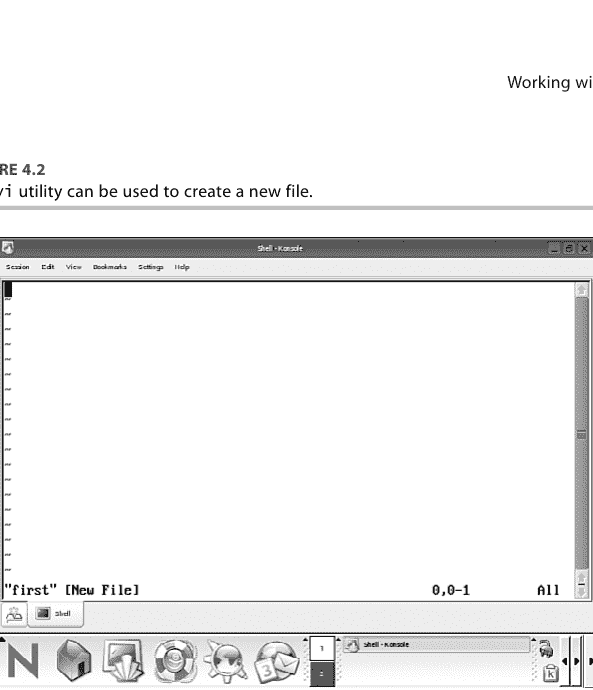

## 图 4.3

`vi` 可以用于编辑现有文件。

无论文件是新的还是现有的，`vi` 意味着它自动在命令模式下启动。这意味着它正等待着你告诉它要做什么。你不能直接开始打字或开始进行更改 - 你必须先告诉它做什么。

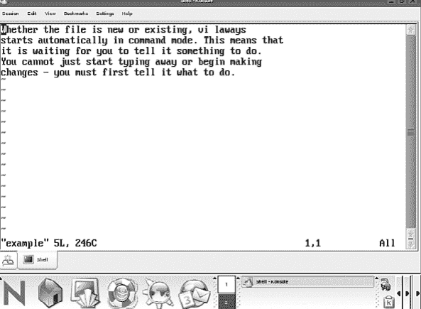

## 导航

最简单的命令是调用导航。表 4.5 列出了 `vi` 中可以使用的导航键。

### 表 4.5：vi 导航键

| 键位 | 结果 |
| :--- | :--- |
| `$` | 移动到上一行的第一个字符 |
| `$` | 移动到当前行的最后一个位置 |
| `(` | 向后移动一个句子 |
| `)` | 向前移动一个句子 |
| `{` | 移动到上一个段落的开头 |
| `}` | 移动到上一个段落的开头 |
| `^` | 移动到当前行的第一个字符（忽略空格） |
| `+` | 移动到下一行的第一个字符 |
| `0` | 移动到当前行的开头 |
| `b` | 向后移动到上一个单词的开头 |
| `B` | 向后移动到上一个单词的开头，忽略符号和标点符号 |
| `e` | 移动到下一个单词的结尾 |
| `E` | 移动到下一个单词的结尾，忽略符号和标点符号 |
| `ENTER\RETURN` | 移动到下一行的开头 |
| `h` | 向左移动一个空格 |
| `j` | 向下移动一行 |
| `k` | 向上移动一行 |
| `l` | 向右移动一个空格 |
| `w` | 移动到下一个单词的开头 |
| `W` | 移动到下一个单词的开头，忽略符号和标点符号 |
| `G` | 移动到文件的最后一行 |
| `xG` | “跳转”到第 x |

表格的最后一条表示行号可以配合“G”移动到该行：例如，`5G` 将光标从文件的任意位置移动到第 5 行。在配合 `vi` 命令使用数字的能力是贯穿整个 `vi` 的——如果你在命令前加上一个数字，它被解释为你想要执行该数字次数的操作。例如，命令 `10h` 将将光标向左移动 10 个空格。

箭头键也可以用于导航，但只有当它们在终端上正确映射时。为了让它们正常工作，右箭头必须发送与按下 `l` 相同的键序列，左箭头必须发送与按下 `h` 相同的键序列，以此此类推。

## 修改文本

当你到达要更改的单词时，有几乎无数的方法可以进行更改。在前面的故事中，在讨论导航时使用字母“w”表示单词。使用类似的助记法，它可以与表示更改的“c”结合，从而形成命令 `cw`。

这告诉编辑器你打算更改该单词，因此它从视图中移除当前单词，并将编辑器于“插入”模式。你现在输入新单词，然后按 `Esc` 退出插入模式并再次进入命令模式。

## 注意事项

无论你想退出插入模式，无论使用什么种方法进入，你总是按 `Esc` 返回到命令模式。

更改命令可以与许多组合一起使用。表 4.6 提供了这些可能性的摘要。

### 表 4.6：vi 更改文本组合

| 键位序列 | 结果 |
| :--- | :--- |
| `c$` | 从这里到行尾 |
| `c)` | 从这里到句尾 |
| `c^` | 从这里到行首 |
| `c)` | 修改段落的剩余部分 |
| `3cw` | 修改接下来的单词 |
| `r` | 替换单个字符 |
| `R` | 进入“替换”模式——用新文本覆盖现有文本 |

## 第四章：在命令行中工作

注意，4.6 中的许多选择从光标位置开始到行尾更改。如果你需要更改整行，无论光标位于行内的哪个位置，可以使用命令 `cc`。

## 保存文件


在做出更改并完成编辑器操作后，是保存文件的时候。就像 `vi` 中的大多数事情一样，许多方法都需要命令模式，这通过按 `Esc` 键来实现；之后，通常输入一个冒号 `:` 然后输入另一个命令。

## 注意事项

从历史角度来看，命令前加冒号是从早期的编辑器 `ex` 继承而来的。

你可以通过输入以下命令按当前名称保存文件：

```
:w
```

这保存（写入）文件，但让你留在编辑器中。要退出编辑器，输入

```
:q
```

然后你返回 Linux 命令行提示符，退出编辑器。这种序列适用于你在退出之前多次写入更改，因为你可以随时输入 `:w` 继续编辑。

然而，如果你想同时写入并退出，可以将操作合并为一个命令：

```
:wq
```

这将写入文件并退出编辑器。此操作的快捷键（没有任何助记性）是输入 `ZZ`，它也会写入并退出。

如果你想以不同的名称保存文件（为了保留原始文件），可以使用 `:w` 语法并在后面跟随一个空格和新名称。在此处值得指出，如果你做了任何更改

使用 `vi`

在操作文件时，`vi` 的默认操作是在你保存更改之前不让你退出编辑器。如果你尝试使用 `:q` 离开，你会收到一个错误消息，提示你已进行了更改：

No write since last change (use ! to override)

该错误消息说明了要绕过默认设置必须做什么。如果你进行了你不想保存的更改——例如，不小心删改了太多文本导致无法撤销、改变了主意等——你可以使用此命令退出文件，并保持其最后一次保存操作的状态：

```
:q!
```

# 保存文件的部分内容

`vi` 不仅可以保存整个文件，还允许你通过指定要写入的行号来只保存部分内容。到此时，你可能已经发现每一行都可以通过数字来引用，此操作需要使用以下语法：

```
:first_line, last_line viFileName
```

请特别注意在最后一个行号后面的 `w`。它必须存在，以便将该操作识别为写入请求。两个通配符可以用于指定任何行号：

- `$` 表示文件的最后一行
- `.` 表示当前行

表 4.7 显示了一些仅保存文件部分内容的命令示例。

# 表 4.7：保存文件部分的示例

| 命令序列 | 结果 |
|---|---|
| `: ,:12 newfile` | 保存从光标当前位置到名为 `newfile` 的文件中第 12 行的内容 |
| `:2, 5 newfile` | 保存名为 `newfile` 的文件中第 2 到 5 行的内容 |
| `:12, $w newfile` | 保存名为 `newfile` 的文件中第 12 行到文件末尾的内容 |
| `: ,+12 newfile` | 将当前光标位置开始的 12 行保存到文件 `newfile` 中 |

115

## 插入与删除

如果那里已经有文本，更改现有文本非常简单。然而，插入（Inserting）允许你向已有的文本中添加内容，这是当你开始创建一个新文件时进入的模式。在行内操作时，你可以选择插入或追加，也可以在当前行的上方或下方打开新行。表 4.8 列出了这些可能性。

表 4.8

进入输入模式的按键

| 命令序列 | 结果 |
|---|---|
| `a` | 在光标后插入文本（追加） |
| `A` | 在当前行尾插入文本 |
| `i` | 在光标前插入文本 |
| `o` | 在光标下方打开新行 |
| `O` | 在光标上方打开新行 |
| `s` | 删除当前字母并让你进入插入模式——这被称为“替换”（substitute）命令 |
| `S` | 整个行的替换模式 |

无论通过何种方法进入插入模式，离开此模式的方法都是按 `Esc` 键。

删除文本通过按 `x` 删除单个字符来实现。也可以在它前面加一个数字来表示要删除的字符数。例如：

```
16x
```

将删除接下来的 16 个字符。要删除光标之前的字符，请用 `X` 命令代替 `x`。

如果你想删除某些位置以外的内容，可以使用 `d`（delete）命令，并配合指示你想删除什么内容的序列。表 4.9 列出了这些可能性。

表 4.9

删除按键序列

| 命令序列 | 结果 |
|---|---|
| `d$` | 删除从此处到行尾。 |
| `d)` | 删除句子的剩余部分。 |

使用 `vi`

| 命令序列 | 结果 |
|---|---|
| `d)` | 删除段落的剩余部分。 |
| `d0` | 删除从此处到行首。 |
| `db` | 删除上一个单词。 |
| `dl` | 删除一个字母。 |
| `7dl` | 删除七个字母。 |
| `dw` | 删除一个单词。 |
| `7dw` | 删除四个单词——`dw` 不仅会删除单词，还会删除单词后的空格。如果只想删除到单词结束，请使用 `de` |

## 屏幕导航

到目前为止所有的讨论都是关于更改屏幕上显示的文本。如果你的文件超过了 23 行（绝大多数文件都是那样），你就有多个屏幕可以操作。类比一下：想象在使用较多或命令时，一次查看一个屏幕。

表 4.10 显示了在多个屏幕之间导航的方法。

表 4.10

在屏幕间移动的按键序列

| 命令序列 | 结果 |
|---|---|
| `Ctrl+F` | 向向前一屏幕 |
| `Ctrl+B` | 向后移动一屏幕 |
| `Ctrl+D` | 向前移动半屏幕 |
| `Ctrl+U` | 向后移动半屏幕 |
| `Ctrl+E` | 屏幕向上滚动一行 |
| `Ctrl+Y` | 屏幕向下滚动一行 |
| `H` | 移动到屏幕的第一行 |
| `L` | 移动到屏幕的最后一行 |
| `M` | 移动到屏幕的中间行 |

注意

你可以在这些操作之前使用数字。`7H` 将光标移动到屏幕顶行下方 7 行，`7L` 将光标移动到屏幕最后一行上方 7 行。

117

# 第 4 章：在命令行工作

# 搜索文本

除了使用导航键外，遍历文件的另一种方法是执行搜索。你可以在文件中搜索字符串值，包含该字符串首次位置的屏幕将成为你当前文件的视图。

搜索通过按下斜杠键（`/`）并输入要搜索的字符串值启动。当你输入文本序列时，编辑器将遍历文件寻找匹配项。

当你输入搜索字符串后，按 `Enter` 键表示完成。所有搜索都会自动从文档顶部开始。要将光标移动到下一个实例，请使用 `n` 命令（代表 next）。要向后后移动，请使用 `N` 命令。

搜索时可以使用两个字符来指定所找到文本所在的位置：

- `^` 表示文本必须在行首
- `$` 表示文本必须在行尾

例如，只有当这两个字符是行尾的最后字符时才查找字符串 `"is"`，搜索语法应为

```
/is$
```

你还可以使用 `grep` 类似工具中存在的许多通配符选项：

- `\` 忽略其后字符的特殊值
- `[]` 查找多个值
- `\<` 查找单词开头的匹配项

如果你需要找到值并更改它们，可以使用替换命令（`s`），语法类似于：

```
:first_line, last_line s/old string/new string/
```

例如，要将第一行到第千行之间所有所有的 `"speed"` 更改为 `"pace"`，命令是：

```
:1,1000 s/speed/pace/
```

注意

问号（`?`）可以用于反向遍历文件进行搜索。

135

# 复制文本

文本可以复制到缓冲区中以便重复使用，或从文件的一个部分移动到另一部分。尽管听起来很简单，但当你复制文本时，原始文本留在原处并在别处创建一个副本。然而，当你移动文本时，是从一个位置将其获取并放置在另一个位置。无论是复制还是移动，`p` 命令始终是该操作的对应命令；代表 print/put/place，它完成了该操作。

遗憾的是，在创建 `vi` 时，“c”助记已经用于更改（change），剩下的选择并不不多。鉴于此，Bill 选择 `y` 代表 yank（获取）。表 4.11 显示了用于复制文本的一系列按键序列。

# 表 4.11

复制文本按键序列

| 命令序列 | 结果 |
|---|---|
| `y` | 获取从此处到行尾 |
| `y)` | 获取句子的剩余部分 |
| `y|` | 获取段落的剩余部分 |
| `y0` | 获取从此处到行首 |
| `yb` | 获取上一个单词或单词的一部分 |
| `yl` | 获取单个字母 |
| `7yl` | 获取七个字母 |
| `yw` | 获取单个单词 |
| `7yw` | 获取七个单词 |
| `yy` | 获取整行 |
| `Y` | 与 `y` 同 |

要执行复制操作，你移动到文件中应放置文本的目标位置，然后使用 `p` 命令。要执行移动操作，在获取文本后将其删除，然后移动到目标位置并使用 `p` 命令将文本放置在你想要的地方。

# 其他操作

如果有一个命令必须牢记，那就是 `u`——撤销命令（undo）。该命令会撤销上一个操作，且仅撤销上一个。它有一个对应命令——`U`，将撤销所有之前的操作直到

# 第 4 章：在命令行中工作

当前行。然而，需要注意的是，你只会对行（当前行）的更改进行缓冲；这可以防止你在修改了四行后移动到第一行并撤销这些修改。

## 注意事项

如果你错过了四行，并且无法在第一行恢复已修改的内容，你唯一的救星就是不保存直接退出文件。

本节讨论的许多操作都与行号有关——你可以通过指定行号移动到特定的某一行，可以只保存特定的文件等——因此，在查看时显示行号通常很有帮助。在 `vi` 中开启行号显示的方法是：首先通过冒号（`:`）进入命令模式（有时称为冒号模式；这会将光标移动到屏幕底部），然后输入命令 `set number` 并按回车。这将开启行号显示。

数字只显示在编辑器中，就像你使用 `nl` 命令查看它们时一样，而不会保存到文件中。顺便提一下，`set number` 可以缩写为 `set nu`。如果你只想查看当前所在的行号，可以按 `Ctrl+G`，行号（以及文件的总行数）将出现在屏幕底部。

如果你在编辑器中需要运行外部命令，可以使用以下语法：

```
:!{command}
```

例如，在 `vi` 中工作时要查看当前目录下的文件列表，命令为：

```
:!ls
```

这将显示文件列表，然后提示你按回车（Enter）回到你正在工作的文件。

如果你需要将另一个文件的内容复制到当前文件中，可以使用以下语法：

```
:r {filename}
```

例如，要将名为 `first` 的文件内容引入到当前文件中，命令为：

```
:r first
```

这会将另一个文件的文本直接插入到当前文件中光标所在的位置。

## 总结

本章涵盖了大量内容，因为它检查了学习 GNU 和 Unix 命令基础所必需的知识。后续所有章节都假设你已经理解了这里讨论的工具和实用程序并在此基础上进行构建。表 4.12 列出了本章出现的元字符及其用途。

表 4.12

GNU 和 Unix 命令中使用的元字符

| 元字符 | 用途 |
|---|---|
| `'` | 取消除反引号之外任何内容的特殊含义 |
| `"` | 取消大多数字符的特殊含义 |
| `$` | 将后续字符串视为变量 |
| `$()` | 允许将命令视为变量 |
| `*` | 任意数量的字符 |
| `;` | 分隔不同的命令 |
| `?` | 任意单个字符 |
| `[ ]` | 括号内的任意一个字符 |
| `\` | 将下一个字符视为字面量 |
| `` ` `` | 执行括号内的命令 |
| `|` | 允许将一个命令的输出作为下一个命令的输入 |
| `<` | 输入重定向 |
| `<<` | "此处"(Here) |
| `>` | 输出重定向 |
| `>>` | 输出追加 |

# 使用 YaST

Novell Linux Desktop 与其他 Linux 实现的主要区别之一是包含了 YaST（Yet Another Setup Tool，另一个设置工具）。这个一站式工具为系统管理的几乎每个方面都提供了方便的界面。桌面版配备了该工具的第二个版本——YaST2。

精通这个工具可以为你节省大量时间（通常还能避免很多挫败感），因为它为许多配置任务提供了简单且方便的界面。本章将介绍你可以执行的部分管理任务示例。

## 注意事项

本章的目的是带你了解 YaST 的功能。复杂的话题如添加用户、创建组等，在本章显示 YaST 界面时会简带提到，它们将在后续章节中进行更深入、更详细的介绍。

# 介绍 YaST

YaST 工具在 Novell Linux Desktop 中既提供命令行界面，也提供 X Window 应用程序。无论你运行的是哪个版本的 YaST（共有两个），命令行界面都是一个 `ncurses` 应用程序。当 YaST 作为 X Window 应用程序运行时，其外观取决于你使用的是该工具的第一版本还是第二个版本——第一个是基于 `ncurses` 的，第二个（YaST2）是基于 Qt 的。

## 注意事项

`ncurses` 和 `QT` 是两个 C 库，包含了应用程序可以用来执行面向终端或图形任务的标准函数。虽然还有许多其他图形库供人们使用，但这两个是最常用的。

# 第 5 章：使用 YaST

Novell Linux Desktop 9 配带有 YaST2，并且仍然支持 `yast` 链接。如果你在 `xterm` 或终端命令行执行 `yast` 命令，将获得 `curses/终端` 版本。如果你在 `xterm` 或终端命令行执行 `yast2` 命令且你正在运行 X Window 系统（已设置 `DISPLAY` 环境变量），你将获得图形版本。另一方面——如果你从命令行启动 `yast2` 但你运行的是控制台登录且未设置 `DISPLAY` 环境变量，你将获得 `curses/终端` 版本。最后，如果你从命令行启动 `yast2` 且运行的是控制台登录并设置了 `DISPLAY` 环境变量，你将在目标显示器上获得图形版本。

大部分讨论集中在工具的 YaST 版本上，因为其易于使用，且是大多数人在 X Window 系统环境下会使用的部分（这也是管理员工作的地方）。

由于其易用性以及大多数人在 X Window 系统环境下的需求，本讨论主要关注 YaST 版本。

尽管文本模式和图形模式的外观不同，但该工具都提供了大多数管理员通常需要处理的任务。

## 注意事项

你应该以 `root` 身份运行 `yast/yast2` 以执行管理任务。它位于 `/sbin` 目录，不在默认用户的 `PATH` 变量中。

图 5.1 显示了启动时的文本模式版本。

从命令行中，你可以输入：

```
yast -h
```

查看帮助信息。你也可以输入：

```
yast -1
```

查看可用模块的列表。

在文本模式下，你可以使用方向键（上下）遍历菜单和选项，使用 `Tab` 键在框之间移动（`Alt+Tab` 在窗口间切换）。你也可以使用空格键高亮项目并按回车选择。你可以按 `F9` 退出，按 `F1` 弹出帮助（如图 5.2 所示）。

# 图 5.1

文本模式下的 YaST2 启动视图。


# 图 5.2

在文本模式下按 F1 获取帮助。


# 第 5 章：使用 YaST

你可以通过在命令行输入 `yast2` 或直接从 KDE 菜单或 GNOME 选择中选择启动图形模式。（在 KDE 中，选择 System 然后 YaST；在 GNOME 中，选择 System 然后 Administrator Settings。）图 5.3 显示了此功能的启动视图。

## 提示

根据你是从命令行还是菜单调用 YaST，身份验证的方式也不同。例如，如果你在 KDE 中以用户身份启动图形界面，会提示输入 `root` 密码。如果你在 Center 内通过选择 YaST Modules 启动图形界面，在执行每个特权 YaST 模块时都需要进行验证。

当你在前一种模式运行 YaST 时，选择任何 YaST 模块都会打开一个独立的窗口。在后一种模式下，它会在执行 Center 窗口的右侧面板中打开每个模块。

图 5.3

图形模式下的 YaST2 启动视图。


## 软件操作

在 YaST2 窗口左侧打开框架中选择“软件”（Software）时，如图 5.3 所示，右侧会出现许多选项：

- 在线更新 (Online Update)
- 安装和卸载软件 (Install and Remove Software)
- 修改安装源 (Change Source of Installation)
- 安装到目录 (Installation into Directory)
- 补丁 CD 更新 (Patch CD Update)
- 系统更新 (System Update)

这些选项大部分是不言自明的，你平时最常用的是“安装和卸载软件”。当你选择此选项时，会出现与图 5.4 类似的屏幕。

### 图 5.4

你可以轻松地添加和删除软件。

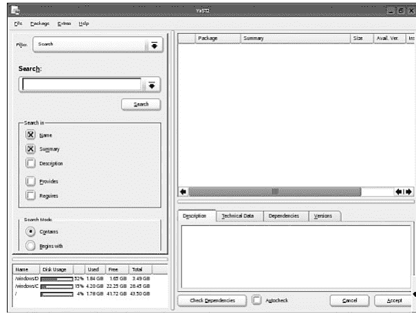

# 第 5 章：使用 YaST

注意，“过滤器”（Filter）下拉菜单允许你选择想要查看的软件包。如果你选择“选择”（Selections）作为过滤器，你将只看到已安装的软件包，如图 5.5 所示。

### 图 5.5

你可以轻松地看到安装了哪些软件包。

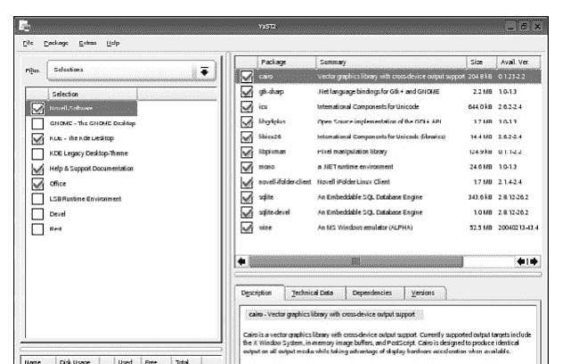

在图 5.5 中，你可以看到已安装 KDE 桌面，但没有 GNOME——在安装过程中，你曾可以在 GNOME 或 KDE 之间进行选择。在这个示例中，安装了 KDE 而不是 GNOME。要安装 GNOME，只需勾选左侧框架中“选择”下的复选框，并点击“接受”（Accept）。通常还会弹出一个“自动更改”（Automatic Changes）列表，如图 5.6 所示。

## 注意

此讨论是安装未安装软件包的示例，并不明确建议向你的 KDE 系统添加 GNOME，或反之亦然，除非你有此需求。

点击“继续”（Continue）后，按照提示插入介质。如果发生失败，你将收到通知，如图 5.7 所示，此处提供是为了查看更多详情。在大多数情况下，点击“重试”（Retry）即可解决问题。

128

### 图 5.6

将提示你接受自动更改。

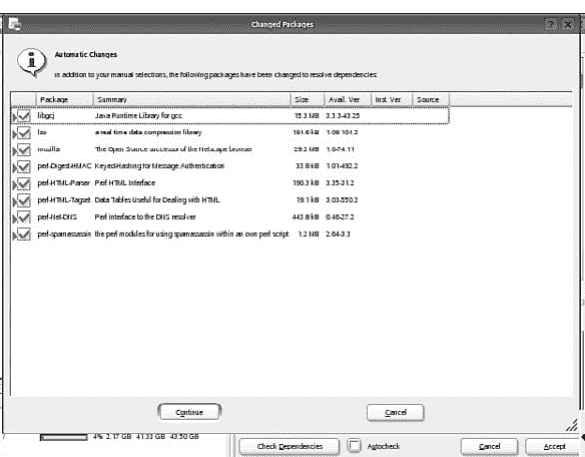

### 图 5.7

错误以简短或详细的格式报告。

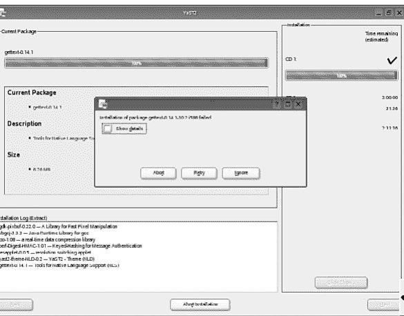

# 第 5 章：使用 YaST


软件复制完成后，`SuSEConfig` 会运行并完成安装，然后返回 YaST。

## 注意

`SuSEConfig` 会更新你的系统配置——最重要的是库的动态链接器运行时绑定——以便能够顺利地使用任何新安装的软件。

如果你在过滤器下拉拉菜单中选择“软件包组”（Package Groups），你将看到安装介质上的所有软件。如果你选择“搜索”（Search），它将从当前安装源的可用软件包列表中搜索，并列出任何与你输入的字符串匹配的软件包。最后，如果你选择“安装摘要”（Installation Summary），你将看到所有标记了状态的软件包。

如果你想安装搜索结果中列出的当前未安装的软件包，点击该软件包直到出现操作，然后点击“接受”（Accept）按钮。同样，根据需要，系统会提示你插入介质。

## 注意

每当提到“依赖项”时，指的是为了实现完整功能所需的项（通常是所选应用程序正常运行所需的库或相关应用程序）。当进行依赖检查时，会进行检查以查看所有需要的组件是否已安装。这可以由手动完成，也可以由系统自动完成（autocheck）。当你指定要安装一个或多个软件包时（点击“接受”），系统会自动检查依赖关系。

## 硬件操作

YaST 工具提供提供了一个简单的硬件配置接口。只需在左侧框架中选择“硬件”（Hardware），然后在右侧选择你想要配置的对象。选项包括 CDROM 驱动器、磁盘控制器、显卡和显示器、硬件信息、IDE DMA 模式、摇杆、打印机、扫描仪、选择鼠标模型和声音。

硬件信息正如其名所示，显示了当前系统上配置的所有设备信息。显卡和显示器允许更改 X Window 系统的分辨率（这是一个非常重要且常见的任务）。IDE DMA 模式允许你精细调整系统中的 IDE 存储设备是否使用直接内存访问。选择正确的 DMA 模式可以显著提高设备的 I/O ，而选择错误的模式可能会严重损害性能。

例如，图 5.8 显示了在“打印机模型”中为连接到系统的任何打印机提供的配置选项打开界面。

### 图 5.8

你可以通过 Yaast2 安装打印机。

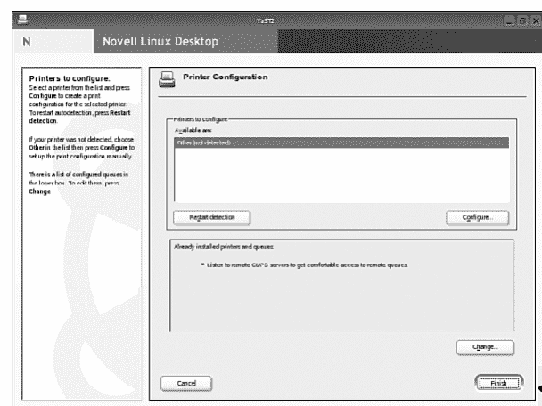

点击“配置”（Configure）按钮将打开一个对话框，提供许多你可以选择的打印机类型（如图 5.9 所示）。最容易的类型是并行打印机（Parallel printer），它默认为 `/dev/lpp0`，如图 5.10 所示。

## 注意

你也可以在命令行中输入 `yast2 printer` 来加载此模块启动 YaSt。

# 第 5 章：使用 YaST

### 图 5.9

你可以从多个不同的打印机中进行选择。

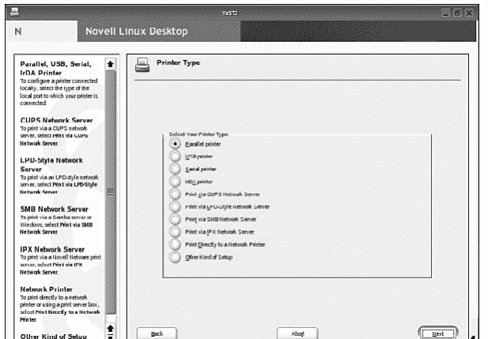

### 图 5.10

你可以在屏幕上测试并更改配置。

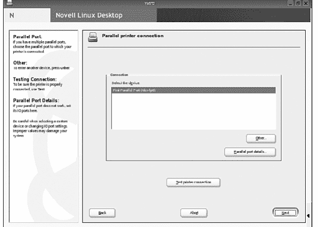

132

点击“下一步”（Next）继续配置，系统将提示你输入队列名称和打印机设置。只有在关闭本地过滤的情况下才能测试。本地过滤功能默认是开启的（已勾选）。你可以发送以下内容测试：

- 测试图形打印
- 测试带图形打印
- 测试文本打印

在下一个屏幕上，你可以选择制造商和型号，并在需要时编辑配置，如图 5.11 所示。

### 图 5.11

打印机配置现在显示了新添加的内容。

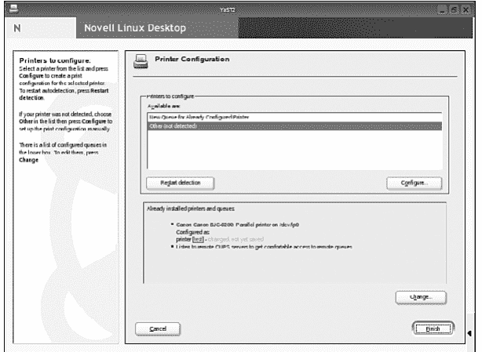

点击“完成”（Finish）完成打印机的添加，你再次返回 YaST。

# 第 5 章：使用 YaST

## 注意

在对硬件进行任何更改之前，强烈建议选择“硬件信息”（Hardware Information）选项。它可以探测当前配置并允许你查看设置，如图 5.12 所示。

### 图 5.12

硬件信息显示了设置。

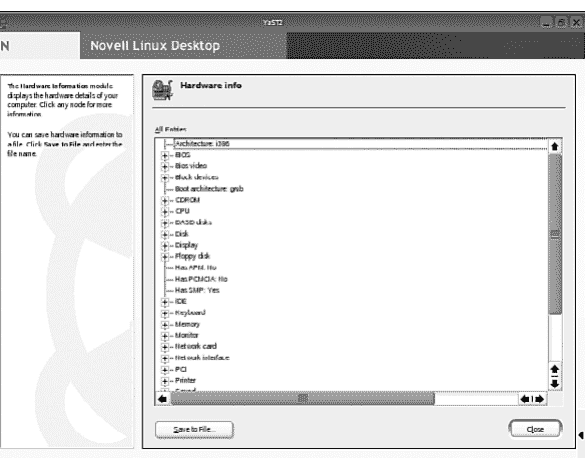

## 注意

你也可以在命令行中输入 `yast2 hwinfo` 来加载此模块。

## 系统设置操作

“系统”（System）下的选项提供了许多可以帮助主机配置的调整。在左侧框架中选择“系统”后，右侧框架中的选择将变为：

134

- `/etc/sysconfig` 编辑器——这提供了一种访问编辑器的方便方法，并处理应用程序、桌面或其他组件的设置。

## 注意

你也可以在命令行中输入 `yast2 sysconfig` 来加载此模块。

- 引导程序配置（Boot Loader Configuration）你可以从 GRUB（默认）、LILO 或不使用任何引导程序之间进行选择。

## 注意

你也可以在命令行中输入 `yast2 bootloader` 来加载此模块。

- 选择语言（Choose Language）——为系统选择不同的语言。

## 注意

你也可以在命令行中输入 `yast2 language` 来加载此模块。

- 日期和时间（Date and Time）——设置系统日期和时间。

## 注意

你也可以在命令行中输入 `yast2 timezone` 来加载此模块。

- LVM——如果安装了 `lvm2` 软件包，你可以配置卷设置并处理卷组。

## 注意

你也可以在命令行中输入 `yast2 lvm_config` 来加载此模块。

- 分区器（Partitioner）——直接处理磁盘分区。
- 电源管理（Power Management）——选择最适用于此主机的节能方案。

# 第 5 章：使用 YaST

## 注意

你也可以在命令行中输入 `yast2 power-management` 来启动加载此模块的 YaST。

- 电源微调配置——你必须先安装 `powertweak` 软件包（默认不安装），然后就可以对此处提供的设置进行微调。

## 注意

你也可以在命令行中输入 `yast2 powertweak` 来启动加载此模块的 YaST。

- 配置文件管理器——使用系统配置方案管理 (SCPM)，你可以根据需要不同的不同的系统配置之间切换。SCPM 在默认安装期间处于禁用。

## 注意

你也可以在命令行中输入 `yast2 profile-manager` 来启动加载此模块的 YaST。

- 恢复系统——在系统崩溃后使用。
- 运行级别编辑器——允许你更改运行级别设置，可以在简单模式（默认）或专家模式下运行以便更精细的调整。

## 注意

你也可以在命令行中输入 `yast2 runlevel` 来启动加载此模块的 YaST。

- 选择键盘布局——自言自明。
- 系统备份——创建 tar 归档的图形化界面。

## 注意

你也可以在命令行中输入 `yast2 backup` 来启动加载此模块的 YaST。

## 处理网络

要获取网络配置信息，首先在左侧面板中选择“网络设备”。右侧面板中的选项包括：

- DSL
- 传真
- ISDN
- 调制解调器
- 网卡
- 电话应答机

作为可用选项示例，选择“网卡”。这将显示图 5.13 所示的屏幕。

**图 5.13**

网卡的当前设置。

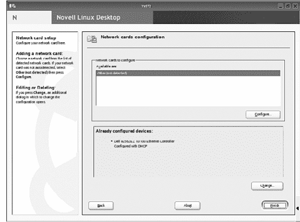

# 第 5 章：使用 YaST

注意

你也可以在命令行输入 `yast2-lan` 来启动加载此模块的 YaST。

已配置的设备将出现在底部面板（更改）中，新条目可以在顶部添加（配置）。先选择“更改”将显示图 5.14 所示的屏幕。注意你可以在此处添加、编辑和删除。

图 5.14

你可以更改网卡设置。

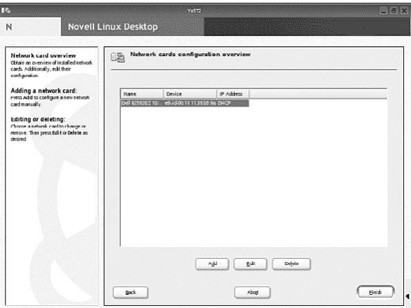

注意

虽然你可以在此处添加新网卡的信息，但如果系统没有自动检测到它，你可能遇到了问题。如果自动检测到了，它将出现在图 5.13 的顶部面板中，你选择它并点击“配置”进行配置。在现实世界，在“更改”面板上添加新网卡信息是非常稀见的。

选择新网卡（配置）将弹出图 5.15 所示的手动配置对话框。

## 处理网络服务

图 5.15

手动添加新网卡。

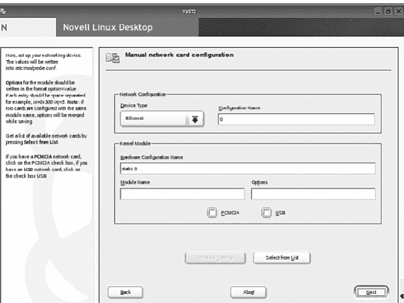

手动配置卡时必须做的选择包括：使用 DHCP 还是手动分配 IP 地址、子网掩码以及第 11 章“网络”中讨论的其他工作值。

## 处理网络服务

当你点击 YaST 左侧面板中的“网络服务”选项时，右侧会出现许多选项。这些选项包括：

- DNS 和主机名
- 主机名
- Kerberos 客户端
- LDAP 客户端
- 邮件传输代理
- NFS 客户端
- NIS 客户端

# 第 5 章：使用 YaST

- NTP 客户端
- 网络服务 (inetd)
- 代理
- 远程管理
- 路由
- SLP 浏览器
- TFTP 服务器

这些选项中最重要的目的是“远程管理”，如图 5.16 所示。

# 图 5.16

远程管理模块允许你配置你的机器。

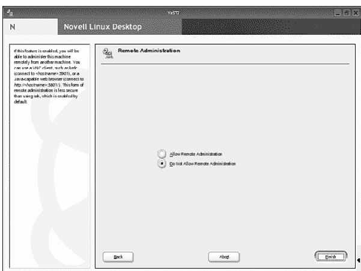

这里的选项非常简单——要么允许远程管理或不允许（默认）。

## 注意

你也可以在命令行输入 `yast2 remote` 来启动加载此模块的 YaST。

如果你选择启用远程管理，则必须重启显示管理器。完成后，就可以访问并远程管理该机器了。

要进行远程管理，在浏览器中输入以下内容（将 `host` 替换为你机器的 IP 地址）：`http://host:5801`

虚拟网络会话 (VNS) 窗口将打开，并将提示你输入用户名和密码。在提示项目时，你可以点击“管理”按钮，YaST 将启动（需要你输入 root 密码）。

## 注意

如果需要重启 X 会话，使用 `rcxdm restart` 命令即可为你解决问题。

## 处理安全和用户

就像 YaST 可用于配置的所有其他方面一样，它也可以提供一个用户和安全设置的界面。

## 处理用户设置

要在 YaST 中处理用户，首先从左侧面板选择“安全和用户”。这将出现许多选项：

- 编辑用户和组
- 编辑用户
- 防火墙
- 安全设置

# 第 5 章：使用 YaST

图 5.17

可以从此处添加用户和组。

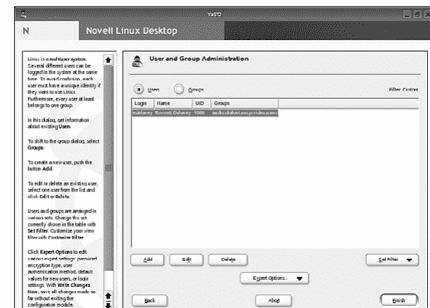

## 注意

你也可以在命令行输入 `yast2-user` 来启动加载此模块的 YaST。

此菜单上出现的选项是：

- 账户配置
- 配置文件管理器
- 远程管理
- 系统备份

已配置的设备将出现在底部面板（更改）中，新条目可以在顶部添加（配置）。先选择“更改”将显示图 5.14 所示的屏幕。注意你可以在此处添加、编辑和删除。

图 5.14

你可以更改网卡设置。


## 图 5.24

配置默认启动设置。

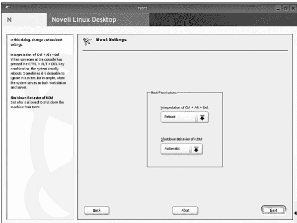

在启动设置之后，你将配置登录设置，然后是影响新添加用户和组的参数。最后，杂设置允许你配置运行 `updatedb` 的用户（`nobody` 或 `root`）以及文件权限设置。你可以从三种可能的权限权限中进行选择：

- 简单——大多数配置文件都可以用户读取。
- 安全——只有 `root` 可以读取如 `/var/log/messages` 等系统文件。
- 偏执——访问权限受到最严格的限制。

你可以通过进入 `/etc` 并查看 `permissions.easy`、`permissions.secure` 和 `permissions.paranoid` 来查看这些层级的单独设置。每个文件大约有 850 行。

## 杂项选项

当在 YaST 窗口左侧的框架中选择“Misc”（杂项）时，右侧会出现以下选项：

- 自动安装
- 加载供应商驱动 CD
- 发布支持查询
- 查看启动日志
- 查看系统日志

这些选择确实是无法方便归类到任何地方的杂锦。最有用的选项之一是查看系统日志。选择后，它会自动显示 `/var/log/messages` 的内容并跳转到文件末尾以显示最新信息，如图 5.25 所示。

## 图 5.25

查看系统日志消息非常简单。

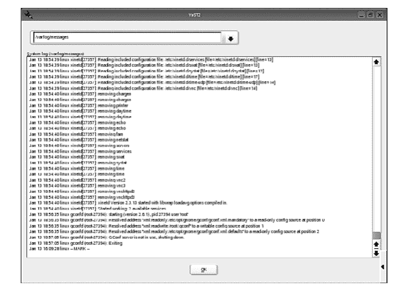

## 注意

你也可以在命令行中输入 `yaast2 view_anymsg '/var/log/messages'`，在加载此模块的情况下重启 YaST。

尽管 `messages` 是默认显示的文件，但左上角的下拉框允许你选择几乎任何日志文件并查看其内容。

## 总结

本章侧重于 Linux 的图形界面，并研究了 YaST（另一个设置工具）如何让 SUSE 从众群中脱颖而出。使用此工具，你可以执行大多数管理功能，而无需为了完成任务而费寻找命令行语法。

## 与设备交互

本章关注三个主要问题：理解设备如何连接到主机、打印以及创建启动软盘。与许多其他操作系统相比，Linux 在设置方面比某些系统要直接得多且易于配置。

## 连接设备

当外部设备连接到运行 Novell Linux Desktop 的主机时，只要设备支持即插即用，系统通常会识别该设备并自动开始其配置。例如，图 6.1 显示了突然连接可移动 USB 驱动器时出现的对话框。

图 6.1

已找到 USB 驱动器。

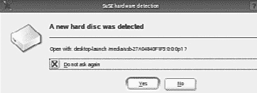

在在这种情况下选择“是”后，将显示驱动器的内容。`/media` 中会自动创建一个新目录作为驱动器的挂载点。

## 第6 章：与设备交互

任务栏左下角的图标（面板的“系统托盘”部分）描绘了一个计算机，工具提示将其识别为 SuSE 硬件工具。当你点击它时，会打开 `use-plugger`（如图 6.2 所示）。

图 6.2

useplugger 提供了方便的硬件接口。

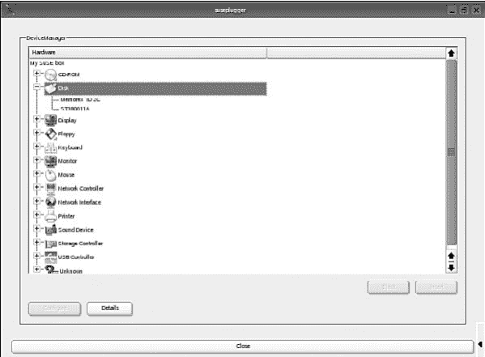

## 注意

除了点击图标外，你还可以通过点击巨大的 N，然后选择 System（系统）、Desktop Applet（桌面小部件）和 SuSEPlugger 来访问 useplugger。

在图 6.2 中，你可以看到列表底部的 USB 控制器。虽然上一步连接的 USB 驱动器使用了 USB 控制器，但它可以像任何其他磁盘一样作为标准硬盘可用，因此它也列在顶部的“Disk”（磁盘）部分。“Disk”选项已展开，显示 USB 驱动器出现在此处（显示为 Memory Disk 2X）。选择此项后，你可以点击“Details”（详情）并查看常规信息以及与之相关的资源信息（见图 6.3）。

## 连接设备

**图 6.3**

可以快速访问驱动器的资源信息。


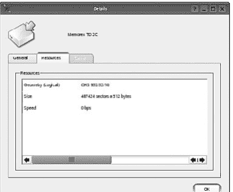

如果你正在使用的设备具有关联驱动程序且其中包含特定信息，则该标签也将变为可用，你可以查看与之相关的信息。例如，图 6.4 显示了关于显示器驱动程序的可可用额外信息。

**图 6.4**

如果那里有信息，Driver（驱动程序）标签将可用。

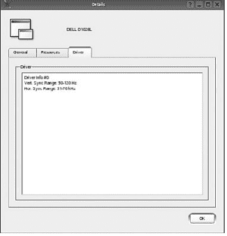

# 第6 章：与设备交互

`useplugger` 对于更改很有用，但它的功能有限。如果你正在使用 GNOME，还可以从 System（系统）菜单中选择 Personal Settings（个人设置）并查看 Hardware（硬件）部分的条目，如下所示。

# 第 6 章：与设备交互

## 打印文件

让我们从查看传统的打印方法开始讨论，并逐步深入。Unix 系统传统上使用一个需要名为 `lpd` 守护进程的打印系统，它是原始 Linux 打印子系统及其后继者 `LPrng` 的基础。该守护进程自 Unix 早期以来一直存在，且运行机制几乎没有变化。在基于 AT&T 的 Unix 上编写的第一个允许作业提交到守护进程的工具是 `lp`。该工具仍然存在并包含在许多 Linux 版本中，但通常会被忽略，转而使用 `lpr`，后者是一个更新的工具，具有更多逻辑选项，源自基于 BSD 的 Unix。

本文讨论重点是 `LPrng`。`CUPS` 作为 `LPrng` 的替代方案（Linux 系统的替代打印/缓冲方法），将在本书后续部分讨论。AT&T 和 BSD Unix 打印子系统之间的差异是 `CUPS` 产生的很大原因之一。

用户可以通过两种方式之一打印文件：

- 从图形界面内部

- 从命令行

从命令行使用的最简单语法是 `lpr {filename}`。

所以，如果你想打印一个名为 Saturday 的文件，命令将是 `lpr Saturday`。

你必须先设置打印机才能使其工作。否则，将始终导致指示调度程序未响应的错误。

当执行此命令时，会有许多其他进程启动。如果打印机不存在，作业将缓冲为空。假设打印机存在，在打印作业发送到打印机的相应队列后，守护进程会将作业从打印机移除并生成完成的输出。只要文件存在，`/var/spool/lpd` 下就会保留该文件的条目。

### 理解打印

## 注意

Linux 支持的打印机列表可以在 http://www.linuxprinting.org/ 找到。虽然它们出现在列表中令人放心，但从技术上讲，打印机并不需要出现在此列表中才能与 Linux 良好工作。例如，任何 PCL 或 PostScript 打印机在配备适当驱动的情况下都能 Linux 上工作。

一旦正确配置并运行，Linux 中的打印服务运行非常顺利。

## 格式化文件

在讨论打印选项时，有一个对格式化非常有价值的工具 `pr`。该工具（`/usr/bin/pr`）的主要用途始终是在将输出发送到打印机之前转换文本文件的内容。

输出包含一个默认页眉，其中包含最后修改的日期和时间、文件名和页码。可以使用 `-h` 选项覆盖默认页眉，`-l` 选项允许你指定每页包含的行数——默认为 66。默认页宽为 72 个字符，但可以使用 `-w` 选项指定不同的值。`-d` 选项可用于输出倍行，`-m` 可用于列格式打印多个文件。

## 转向 CUPS

在较新的 Linux 实现（包括 Novell Linux Desktop 和 SUSE）中，`CUPS`（通用 Unix 打印系统）取代了 `lpr/lpd` 的大部分功能。`CUPS` 是 `lpr/lpd` 的超集，而不是子集。它引入了许多新价值，例如类和详细的以打印机为中心的身份验证。然而，从操作的角度来看，它们有很大的相似性：

1. 用户提交作业。

2. 文件被缓冲——在这种情况下位于 `/var/spool/cups/` 下。

3. `cupsd` 守护进程格式化缓冲区的数据并发送到打印机。

4. 打印完成后，守护进程从队列中删除文件。

`/etc/cups/cupsd.conf` 文件或 `/etc/cups/cupsd.y2` 示例文件包含大量的叙述和注释，完全解释了如何配置 cups。虽然空间不允许在此处打印整个文件，但强烈建议你仔细阅读你系统上的该文件，并确保你理解可用的选项。

`/etc/init.d/cups stop` 命令用于停止服务，`/etc/init.d/cups start` 命令用于手动启动。（一旦配置，它应该在启动时使用启动脚本 `/etc/init.d/cups` 自动启动。）

使用添加打印机向导

除了使用 YaST（在第 5 章讨论过）之外，你还可以选择使用 KDE 中的添加打印机向导来安装打印机，如图 6.10 所示。访问此项，点击（菜单）并选择“控制中心”。在索引中，选择“外设”，然后选择“打印机”。接下来，选择“添加”，然后选择“添加打印机/类”。

## 注意

你只有在以 root 身份登录或使用管理员模式下的控制中心等工具时才能添加物理打印机。为了创建系统范围打印机，你需要能够写入 `/etc/cups` 中由 root 拥的文件以及缓冲目录。

另一种配置方法是使用 `kprinter`。通过按下 KDE 菜单（菜单）并选择“工具”、“打印”、“打印管理器”来访问。该工具如图 6.11 所示，允许你与打印机配置的所有方面进行交互，包括管理作业。当你选择“添加”时，它会弹出与图 6.10 所示相同的添加打印机向导。

无论使用什么方法添加打印机，当它成功加入系统时，都会发生许多事情：`/etc/cups/printers.conf`。

- `/etc/cups/printers.conf` 中添加了打印队列。

- 在 `/etc/cups/` 中创建了 `ppd` 文件。

- 网络打印机可以轻松设置，它将支持 SMB（用于 Windows 客户端）、IPP（互联网打印协议）以及之前提到的 LPD。

图 6.10 添加打印机向导也可以用于添加打印机。

图 6.11 打印管理器提供了所有功能的接口。

# 第 6 章：与设备交互

## 打印工具

存在许多工具来处理打印服务的各种组件。首先检查的是 `lpc`——行打印机控制程序。该工具可用于 `printcap` 或 `lpd` 文件中定义的任何打印机。要查看其提供的所有选项列表，首先在命令行提示符输入 `lpc`，如果你使用的是 `LPRng`，在 `lpc>` 提示符处输入 `m`；如果是 `CUPS` 则输入问号 (`?`)。你可以按 `q` 退出 `lpc`。

`lpq` 工具用于列出队列中的作业。与 `lpc` 内部命令类似，它直接从守护进程获取信息。

## 注意

一个与 `lpq` 具有基本功能的较旧工具是 `lpstat`。该工具用于检查 `lp` 服务和队列的状态。这适用于 `LPRng`，但不适用于 `CUPS`。

`lprm` 工具用于从队列中删除作业。使用时，它根据作业号发送删除作业的请求。如果没有给出作业号，它将尝试删除你提交的最后一个作业。

`lpadmin` 工具用于创建和操作打印机和类队列——简而言，你可以从命令行执行 YaSt 的配置。该工具的补充是 `lpoptions`，用于从命令行设置任何打印机默认值。与它一起的一些选项包括

- `-d` 设置默认打印机

- `-h` 指定 CUPS 服务器

- `-p` 设置目标和实例

如果你在网络上共享打印机，还有其他一些文件很有帮助，尽管它们不是工具，例如：

- `/etc/cups/cupsd.conf` 此文件包含了允许访问 CUPS 打印机的主机名。

- `/etc/hosts.lpd` 此文件包含了允许访问 LPRng 打印机的主机名。

- `/etc/hosts.equiv` 此文件包含了允许像本地一样访问此机器（而不只是打印机）的主机名。

## 理解打印

要从命令行启用或禁用打印功能，你可以分别使用 `/usr/bin/enable` 和 `/usr/bin/disable` 命令。每个命令后必须紧跟你想要启用/禁用的打印机名称。如果你希望打印机完成队列中的现有任务但不接受任何新任务，可以使用 `/usr/sbin/reject` 后面跟上打印机名称（其反向操作是 `/usr/sbin/accept`）。

## 注意

在 CUPS 下，`enable` 和 `disable` 是 `/usr/sbin/accept` 的软链接。

可以通过两种方式停止 CUPS 服务：使用命令 `/etc/init.d/cups stop` 或 `rccps stop`。这些操作的反向操作通过使用 `start` 代替 `stop` 来完成。

## 提示

讨论的大多数实用程序和命令都需要 `root` 权限才能执行。

可以使用 `lppasswd` 工具为 CUPS 添加密码（例如，供你在 Web 管理工具中使用）。如果你在命令行直接输入该命令，系统将提示你输入两次密码。提供的密码长度至少为六个字符，且不能包含你的用户名；它必须包含至少一个字母和一个数字。命令行可以提供的选项有 `-g` 用于指定组名，以及 `-a` 或 `-x` 用于指定用户名。对于 Webadmin 工具，你需要运行以下命令：

```
lppasswd -g sys -a root
```

以创建 `sys` 组和 `root` 用户。系统将提示你输入使用的密码。

最后一点说明的是，`/var/log/cups/error_log` 文件是写入 CUPS 守护进程错误信息的地方。`access_log` 显示所有对服务的访问。这在需要确定为什么打印机无法使用的故障排除情况下可能非常有用。

## 使用 CUPS Web 界面

要访问 Web 管理工具，只需访问服务器上的 631 端口即可。这些工具允许你远程管理打印机和作业，以及管理任务，如添加/管理类、管理作业以及添加/管理打印机。服务器是运行 CUPS 守护进程的系统。如果你就在该机器上，最简单的 URL 是 `http://localhost:631`；而从另一台机器访问，只需使用 `http://ip_address_of_host:631` 即可。

图 6.12 显示了启动界面。

# 图 6.12

CUPS Web 界面的启动界面。


如果你选择“执行管理任务”（Do Administration Tasks），显示的选项有：

字体 类（Classes）——你可以添加和管理类。

- 作业（Jobs）——你可以管理作业。

- 打印机（Printers）——你可以添加或管理打印机。

要添加新打印机，你必须在第一个对话框中提供名称、位置和描述，然后选择设备。设备选项包括所有串口、并行端口、LPD/LPR 和 USB，以及通过 SAMBA 的 Windows 打印机。

例如，在选择通过 SAMBA 的 Windows 打印机后，你必须提供设备 URI（Device URI）。这可以通过多种方式提供，包括指定端口（`socket://192.168.0.30:9100`）、文件、http 或 smb 路径。图 6.13 显示了在“打印机”选项卡中看到的两个打印机及其 URI 示例。

# 图 6.13

现有打印机及其当前信息。


配置的下一步是为打印机选择模型和驱动程序。之后，添加额外的打印机，并可以使用图 6.13 所示的选项从此 Web 界面进行管理。点击任何打印机的超链接将显示有关该打印机及任何待处理作业的附加信息，如图 6.14 所示。

取消作业只需点击相应的按钮，系统将返回已完成的确认（见图 6.15）。

# 第 6 章：工作设备

# 图 6.14

每台打印机上都提供了关于 linux 的额外信息。


# 图 6.15

可以通过 Web 界面方便地取消作业。


166

Web 界面中的其他注意事项项是“帮助”（Help）选项，它会列出此服务器上打印的所有已知文档列表（见图 6.16），以及“软件”（Software）选项。后者将你直接带到 http://www.cups.org 网站，你可以在那里找到驱动程序、论坛、链接和其他相关信息（见图 6.17）。

# 图 6.16

通过 Web 界面可以获取所有打印文档。


## 简化管理

现在已经提供了与打印相关的命令和文件，可以查看管理它们的简化界面。在 KDE 中，从 (N)，你可以选择管理类、外设、打印机，并访问比添加打印机更多的功能。

## 注意

正如许多操作一样，你需要 `root` 权限才能执行。

图 6.18 显示了打印机的选项菜单，而图 6.19 显示了打印机服务器。

# 第 6 章：工作设备

# 图 6.17

选择软件将带你进入 cups.org。


# 图 6.18

在打印机选项中，有多个可用选项。


168

# 图 6.19

在打印机服务器中，有多个可用选项。


## 简化管理

现在已经提供了与打印相关的命令和文件，可以查看管理它们的简化界面。在 KDE 中，从 (N)，你可以选择管理类、外设、打印机，并访问比添加打印机更多的功能。

## 注意

正如许多操作一样，你需要 `root` 权限才能执行。

图 6.18 显示了打印机的选项菜单，而图 6.19 显示了打印机服务器。

## 创建可引导软盘

顾如其名，“自定义软盘”（Custom Floppy）选项用于将你可能在硬盘上自定义的任何磁盘镜像写入软盘。“下载磁盘镜像”（Download Floppy Image）选项允许你指定 URL 并从互联网下载磁盘镜像。

要创建这些类型的磁盘，只需从图 6.15 所示的菜单中选择相应选项并按照提示操作即可。

## 提示

最重要的步骤之一是在完成完成后对磁盘进行标记并将其存放在安全的地方。如果你不对它们进行标记，或者将其存储在受保护且易于找到的地方，很可能在你最需要它们时找不到它们。

## 注意

在选择“模块软盘”并点击“下一步”后的屏幕上，实际上可以在五种不同的模块软盘之间选择：

- 标准软盘（1, 2, 3）：用于创建已安装系统所需的启动磁盘。

- 救援软盘（Rescue Floppy）：用于创建设置维护环境（如修复文件系统）所需的磁盘。

- 模块软盘（Module Floppies）：用于存放特定硬件所需的额外系统驱动程序（仅加载 IDE 驱动器的标准内核）。

# 与文件系统交互

文件系统允许你创建、访问和处理文件。没有文件系统的操作系统就像没有面包的三明治——你手里确实有某种东西，但它很难被称为三明治。

存储在文件系统中的许多文件实际上包含了实用程序、启动脚本和其他二进制文件（包括内核），这些是操作系统启动、运行进程等操作所需的各种资源。如果没有文件系统（或者至少是嵌入式设备中的磁盘分区）来存储内核，你就无法启动系统。

本章将介绍文件系统以及用于处理它和相关介质的工具。它为下一章奠基础，下一章将专门介绍如何处理文件。

## 标准磁盘布局

在安装 Novell Linux Desktop 期间，会创建许多目录来存放系统文件。默认情况下，会创建图 7.1 所示的文件结构。

这些目录共同遵循文件系统层级标准（FHS），所有的 Linux 实现都遵循这一标准。接下来的章节将讨论其中的每一个目录。

# 第 7 章：与文件系统交互

图 7.1

安装 Novel Linux Desktop 后的标准目录布局。


## 注意

关于文件系统层级标准的更多信息，可以访问 http://www.pathname.com/fhs/。

## 目录

一切都从根目录 (`/`) 开始。这是所有其他内容的起始目录，其他内容都是根目录下的子目录或组件。它本身没有出现在图 7.1 中，因为图中出现的所有条目都是它的子目录。

在指定位置和使用绝对路径时，你总是从根目录开始；无法再进一步回溯。图 7.1 列表顶部的单点和双点是出现在每个目录中的快捷方式。单点 (`.`) 是你当前所在目录的快捷方式，双点 (`..`) 是该目录父目录的快捷方式。对于 `/` 来说，它没有父目录，但快捷方式仍然出现在列表中。

# bin 目录

`bin` 目录包含了使用 Linux 操作系统至关重要的二进制文件（可执行文件）。目前为止讨论的许多实用程序位于此处，包括：

- `cat`

- `cp`

- `date`

- `gzip`

- `ls`

- `mkdir`

- `mv`

- `ps`

- `rm`

- `vi`

根据经验，位于此目录的可执行文件/二进制文件对所有用户可用。对于系统运行至关重要或并非所有用户需要的二进制文件，通常放在 `/usr/bin` 而不是这里。

## 提示

如果磁盘、分区或文件系统损坏，它在启动时将无法挂载。为了修复它，你需要一些核心二进制文件，这些文件存储在 `/bin` 和 `/sbin` 中。

# boot 目录

`boot` 包含了启动系统所需的文件、服务器用于启动系统服务的配置文件，以及内核。在某些实现中，内核存储在 `/` 目录中（Unix 时代的遗留）；但在较新版本中，使用的是 `/boot`。该目录包含了除单个服务配置文件外，启动所需的所有文件（包括内核及其配置文件）。

# dev 目录

`dev` 目录存放设备定义（称为节点）。当你将一个文件拖到桌面上的软驱器图形图标时，这是可能的因为 `/dev` 目录中存储了软驱器的定义。每个设备（无论是终端、驱动器等）都关联着一个定义文件。它们的主号和次号告诉系统如何对其进行地址以及使用哪种驱动器。


该目录下文件权限的首字符是 `"b"` 或 `"c"`，表示数据读取方式——通过块或通过字符。通常，需要持续交互的设备（如鼠标、终端 (`tty`) 等）是基于字符的。按块（即字节/字符组而非单个字符）读写数据的设备——如软驱、内存 (`RAM` 和 `ROM`)、`CD` 驱动器等——是基于块的。

你将在下方找到的一些条目用于软驱、打印机和终端。例如，用于终端的 `/dev/tty*`、用于 telnet 等网络进程的伪终端的 `/dev/pty*`、用于打印机的 `/dev/lp*`、用于软驱的 `/dev/fd*` 以及用于 IDE 磁盘的 `/dev/hd*`。

# etc 目录

在日常语言中，“etc”用于表示“等等”。但在 Linux 世界中，`etc` 目录用于存放特定于该机器的系统和服务的配置文件。例如，DS Tech 公司和 Mercury 公司都可以在各自的站点基于 Intel 的机器上安装相同版本的 Linux。当他们这样做时，两者都拥有根目录，都拥有具有相同实用程序的 `/bin` 目录，以此类推。

这两台机器之间的一个主要区别在于可以在 `/etc` 目录中找到的值。在 DS Tech 登录的用户与 Mercury 登录的用户不同；因此，用户账户信息存储在 `/etc` 中。两个组织的组也不相同；同样，那些相关文件将存储在这里。其他文件包括：

- `motd`——登录时显示文本的“每日消息”文件
- `initab`——启动配置文件
- `profile`——登录脚本
- `hosts`——将名称映射到 IP 地址的文件
- `X11`——窗口系统的配置
- `version`——版本号

## 标准磁盘布局

### 注意

截至编写时，没有要求第三方应用程序必须在此处写入值，但这是 Unix 时代的传统。

# home 目录

该目录将为用户存放子目录。每个用户都有一个以用户名命名的子目录，为他们提供位置。`.profile`、`.bashrc` 和 `.bash_history` 等文件存储在 `/home`。

### 注意

出于安全考虑，根用户的目录是 `/root`。

# lib 目录

二进制文件（如 `/bin` 中的文件）所需的共享库位于 `/lib` 目录及其子目录下。`/lib` 还包含编译期间使用的静态库。通常，库包含应用程序执行时使用的函数。

# media 目录

`media` 目录用于挂载可移动介质。默认创建了两个目录——`cdrom` 和 `floppy`。如果安装了其他设备，如 `dvd` 也可能出现。

# mnt 目录

`mnt` 用于包含其他文件系统或设备的挂载点（目录）。在此目录出现的实体永远不在此文件系统中，而是可以从这里链接并访问的外部资源。外部资源可以是其他文件系统或设备。

`tmp` 目录旨在存放临时文件，但优选使用 `/tmp`。外部文件系统通过 `mount` 命令加载（因此显示在此目录下方），并使用 `umount` 命令移除。

# opt 目录

`opt` 目录用于存放可选（附加）应用程序软件。并非所有应用程序都安装在此处，但如果安装，会创建一个子目录来存放与应用程序相关的二进制文件、库、配置数据和文档。例如，如果一个应用程序名为 `DEF`，它创建的目录应该是 `/opt/DEF`。常见的子目录有：

- `kde3`——用于 KDE 桌面环境变量
- `MozillaFirefox` 和 `mozilla`——用于浏览器
- `gnome`——用于此图形界面所需的桌面二进制文件、库等
- `node1`——用于 NNLS (Novell Nprise Linux Services) 文件

# proc 目录

`proc` 目录是一个虚拟文件系统。虚拟文件系统是动态生成的、瞬态的，并在启动时在内存中创建（每次启动系统都会重新创建）。`proc` 包含了进程、内核和系统信息。

进程以目录的形式表示（见图 7.2），每个目录都有相关的权限和变量。其他系统信息通常以文件的形式表示。

## 图 7.2

进程以目录的形式显示在 `/proc` 下。

```linux
linux/proc # ls -l
total 52270
ddr-xr-x 107 root 0 Jan 09:34 512
dr-xr-x 22 root 0 Jan 06:17:25 ..
dr-xr-x 3 root 0 Jan 06:16:46 11
dr-xr-x 3 root 0 Jan 12:16:46 14
dr-xr-x 3 root 0 Jan 12:16:46 15
dr-xr-x 3 root 0 Jan 12:16:45 16282
dr-xr-x 3 root 0 Jan 22:07:15 16289
dr-xr-x 3 root 0 Jan 22:07:15 16287
dr-xr-x 3 root 0 Jan 21:11:44 16289
dr-xr-x 3 root 0 Jan 21:11:43 16293
dr-xr-x 3 root 0 Jan 12:16:46 17
dr-xr-x 3 root 0 Jan 12:16:46 175
dr-xr-x 3 root 0 Jan 12:16:46 18
dr-xr-x 3 root 0 Jan 12:16:46 2
dr-xr-x 3 root 0 Jan 24:07:15 20290
dr-xr-x 3 root 0 Jan 23:13:19 20291
dr-xr-x 3 root 0 Jan 09:34 2273
dr-xr-x 3 root 0 Jan 13:16:24 23632
```

`init` 进程的编号始终为 `1`。因此，你可以通过以下命令查看 `/proc/1` 来快速了解系统的当前状态：

```
$ ls -1 /proc/1
```

### 提示

要从 `/proc` 下的信息查看当前系统状态，你可以使用以下命令：

```
/procinfo
```

## 根目录 (root Directory)

根目录是 `root` 用户的家目录。出于安全考虑，它位于 `/` 目录下，而不是 `/home` 的子目录。为了真正的安全，进一步建议将你的目录移动。

## bin 目录 (bin Directory)

`bin` 目录包含了所有用户使用的标准可执行文件；`sbin` 目录包含了系统管理任务的可执行文件。`sbin` 中的 `s` 原意是“系统二进制”（system binary），但现在通常指的是系统启动时必需的可执行文件。以下列表显示了 `/sbin` 目录的一些文件：

- `dump`
- `fdisk`
- `fsck`
- `halt`
- `ifconfig`
- `init`
- `mkfs`
- `poweroff`
- `reboot`
- `rootfs`
- `shutdown`
- `yast`

## srv 目录 (srv Directory)

`srv` 目录包含服务器数据，是一个独立的子目录。典型的条目包括 Apache 和 `ftp`。

## sys 目录 (sys Directory)

这是一个虚拟文件系统，用于提供有关设备和接口的信息。它类似于 `/proc`，`sys` 包含了系统信息。

## 标准磁盘布局 (Standard Disk Layout)

通过 `/sys/bus` 和 `sys/devices` 目录，你可以找到连接到系统的实体。

## tmp 目录 (tmp Directory)

正如名称所示，`tmp` 目录用于存放临时文件。在系统关闭或启动时，系统会删除此目录中的所有内容。`tmp` 下的文件是应用程序的临时副本。

## usr 目录 (usr Directory)

`usr` 最初是“用户特定资源”的缩写，现在是一个包含大量子目录的巨大目录。以 `X` 开头的子目录用于定义 X Windows 环境。`bin` 子目录包含用户二进制文件。这些文件包括：

- `cut`
- `diff`
- `file`
- `grep`
- `killall`
- `nl`
- `passwd`
- `wc`

### 提示

通常情况下，所有用户的实用工具存储在 `/bin`，而有用但非必需的工具存储在 `/usr/bin`。

### 提示

并不是 `/usr` 下的所有子目录都是必要的，它们根据选择的安装类型有所不同。

## 第 7 章：工作文件系统 (Working Filesystems)

`include` 目录包含 C 程序头文件，而 `lib` 提供了 C 语言库。`local` 目录用于用户安装的软件。`opt` 目录包含额外的软件包。`usr` 目录包含体系无关的可执行数据。`src` 目录包含源代码。

## var 目录 (var Directory)

`var` 的名称源于“变量”（variable），因为其中包含的数据会发生变化。典型的条目包括：

- `lock`——存放用于锁定资源的文件。
- `log`——用于日志文件。
- `run`——用于运行中的进程文件。
- `spool`——存放等待处理的数据。

## 其他目录 (Other Directories)

其他目录可以被创建，并存在于 `/` 目录之外。前面的章节列出的目录总是存在的，而可能存在的有：

- `install`——正如名称所示，它包含安装信息。
- `lost+found`——在完美的系统中，此目录应该是空的。
- `windows`——如果你在已安装 Windows 的系统上安装 Linux 而不移除另一个操作系统，它将在根目录下被识别为 `/windows`。

## 硬盘布局 (The Hard Disk Layout)

分区硬盘是将单个磁盘划分为一个或多个逻辑区域。分区本身是磁盘上的连续扇区组，被视为独立的磁盘。分区表是磁盘上的索引，描述了磁盘区域与实际分区之间的关系。

# 第 7 章：文件系统操作

- 你不需要对磁盘进行完全分区。
- 在不使用特殊软件的情况下，无法移动、调整分区大小或复制分区。

在操作磁盘驱动器时，你必须记住所使用的命名规范。Linux 系统中的所有设备都表示为设备文件。这些文件按照特定的约定命名，以便识别关联的设备。

IDE 硬盘通过名称 `/dev/hd` 后后跟字母 `"a"`、`"b"`、`"c"` 或 `"d"` 来识别。该字母标识驱动器为 IDE 控制器上的第一块磁盘 (`a`) 或第二个 IDE 控制器上的第二块磁盘 (`d`)。

SCSI 磁盘以类似的方式进行识别，但设备名称为 `/dev/sd` 后后跟一个字母。这些名称（如 `/dev/sda`）指的是整个磁盘。

在分区完成分区后，设备名称中会添加一个数字。主分区编号为 `1–4`，扩展分区或逻辑分区编号为 `5` 及更高。

分区表最初写在引导扇区，由于其大小是预定义的，因此分区表条目限制为四个。其中一个分区被称为主分区。一个分区可以细分为逻辑分区。用于存放逻辑分区的分区称为扩展分区。不同版本的 Linux 可能会对磁盘上的分区数量施加限制。

分区必须标记，以识别随后写入其上的数据格式。这对于挂载分区或执行文件系统修复至关重要。每个文件系统都有一个关联的代码，并用于 `fdisk` 指定文件系统类型。

表 7.1 列出了一些有效的文件系统类型。

> 注意

你可以使用 `fdisk` 工具获取可用文件系统的当前列表，选择 `m` 然后选择 `l`，或者使用以下命令：

```
fdisk -l /dev/whatever
```

这将在本章稍后的“硬盘操作”部分进行进一步讨论。

## 磁盘布局

表 7.1

部分有效文件系统类型

| 代码 | 文件系统类型 |
| :--- | :--- |
| 5 | Extended (扩展分区) |
| 6 | FAT16 |
| 7 | HPFS |
| 82 | Linux Swap (交换分区) |
| 83 | Linux Native (Linux原生) |
| 85 | Linux Extended (Linux扩展) |
| 86 | NTFS |
| 1b | Windows 95 FAT32 |

至少，你的 Linux 系统需要以下内容：

- 一个引导分区
- 一个交换分区

你也可以根据需要拥有任何其他主分区或扩展分区。建议使用主分区作为引导分区。这确保了在以后出现问题时可以恢复，因为只会丢失少量数据。

Linux 在运行时，当内容一段时间未被使用时，它会将内存页交换到磁盘。这比增加更多的物理内存要慢得多。如果你发现系统正在进行大量交换，那么是时候增加更多内存了。

正如之前讨论的，如果有必要，你可以将所有内容放在单个分区中。然而，这限制了文件系统的管理方式以及文件系统内部数据的增长。例如，如果你的用户邮件邮箱位于根文件系统上且其已满了，系统将实际上会挂起。

### 注意

所有 Linux 发行版（包括 Linux 本身）默认使用交换分区。你可以使用交换文件，但在未为有空分区的系统添加磁盘的情况下，它们是最后的手段。

尽管能够在一个分区中运行所有内容，但这并不是良好的做法。表 7.2 列出的文件系统是放置在独立分区中的良好选择。

185

# 第 7 章：文件系统操作

表 7.2

| 文件系统名称 | 主/扩展 | 描述 |
| :--- | :--- | :--- |
| `/boot` | 主分区 | 这是内核镜像所在的位置。通常该分区是磁盘上的第一个分区为佳。 |
| `/root` | 主分区 | 这是你的根文件系统。 |
| `/usr` | 扩展分区 | 大多数应用数据存储在此处，包括系统二进制文件、文档和内核源码。 |
| `/home` | 扩展分区 | 这是系统用户主目录所在的位置。根据你的用户数量和所需的磁盘空间，你可能需要多个主目录分区。 |
| `/var` | 扩展分区 | 这是一个溢出分区，包含日志和错误消息文件、Usenet 新闻、邮件箱等。 |
| `/tmp` | 扩展分区 | 这是正在处理的文件的临时存储地。编译器和许多应用程序在此区域创建许多文件。这些文件通常生命周期很短，但它们可能很大。 |

## 硬盘操作

为了在 Linux（以及每个操作系统）中使用硬盘，磁盘上至少必须存在一个分区。分区是磁盘的一部分（部分或全部），已为存储数据经过正确格式化。虽然硬盘上必须至少有一个主分区，但如果使用 DOS 风格的分区表（默认值），最多可以有四个，且每个分区在使用之前必须经过格式化。分区必须是主分区，操作系统才能够从中启动。

### 提示

分区存在这一事实并不意味着它是可用的。它必须经过格式化才能使用。

如果你愿意，一个主分区（仅一个）可以进一步细分为扩展分区（称为逻辑驱动器）。再次使用 DOS 风格分区，可以从主分区创建最多四个逻辑驱动器，但其中任何一个都不能被操作系统引导。

### 注意

如果全是主分区，最大分区数为四个。如果混合使用，最大数量是三个主分区和四个逻辑驱动器（总共七个）。

实际上，SCSI 磁盘上的分区限制为 15，而在 IDE 上为 6。上述限制是在使用默认分区表时强制的。所有分区必须在 `/dev` 目录中引用，第一个磁盘的分区是

- `hda1`—IDE 控制器的第一个磁盘（第二个 IDE 控制器的第一个磁盘是 `hdc`）
- `sda1`—对于 SCSI

设备名称始终可以分解为四个字段，每个字符代表：

1. 驱动器类型：`h` 代表 IDE，`s` 代表 SCSI。
2. 设备类型：`d` 代表磁盘。
3. 磁盘编号以字母形式表示：`a` 表示第一个，`b` 表示第二个，以此此类推。注意这是基于控制器的。
4. 分区编号。`1–4` 留给主分区使用（无论你有多少），逻辑驱动器从 `5` 开始。

如果分区空间不足（或未配置此类），将创建一个交换文件来实现相同的目的，但建议使用分区。

### 注意

Linux 可以使用交换文件或交换分区，但分区提供了更高的系统效率。

## 创建分区

磁盘在安装时会为你完成分区，只有当你向系统添加新磁盘时，才真的需要创建额外的分区。创建磁盘分区的辅助工具是 `fdisk`。`fdisk` 工具将划分磁盘并将分区表写入扇区 `0`（称为超级块）。当不带参数运行时，`fdisk` 会弹出一个供你交互的选择菜单。然而，你应避免菜单并带有以下选项运行 `fdisk`：

- `-l` 列出分区表
- `-v` 仅打印 fdisk 的版本

`fdisk` 没有默认设备，如果你尝试在不指定设备的情况下启动它，它将显示用法信息。此外，你永远不会为 `fdisk` 指定分区（`sda1`）——你只能指定设备，因为它是一个分区器。

在工具启动后，输入 `m` 以菜单的形式提供帮助：

```
a 切换标记
b 编辑 bdisk label
c 切换 DOS 兼容标记
d 删除分区
l 列出已知分区类型
m 此菜单
a 添加新分区
o 创建空的 DOS 分区表
p 打印分区表
q 退出不保存更改
s 创建新的空 Sun disklabel
```

更改分区的系统 ID

更改显示/条目单位

验证分区表

将表写入磁盘并退出

额外功能（仅限专家）

以下示例说明了使用此工具可以完成的操作，从简单到复杂不等。首先，要查看分区表，请输入 `p` 命令（这将为您提供与使用 `fdisk -l` 命令相同的结果）。结果如下：

Disk `/dev/sda`: 20.4 GB, 20416757760 bytes

255 heads, 63 sectors/track, 2482 cylinders

Units = cylinders of 16065 * 512 = 8225280

| Device | Start | End | Blocks | Id | System |
| :--- | :--- | :--- | :--- | :--- | :--- |
| `/dev/h1` | 1 | 50 | 401593 | 62 | Linux swap |
| `/dev/h2` | 51 | 2482 | 19535040 | 83 | Linux |

此处的信息显示单个 IDE 磁盘 (`hda`) 上有两个分区 (`1–2`)。第二个分区是可启动的，第一个是交换分区 (`swap partition`)。

要修改系统，您首先需要输入 `d` 命令删除分区。系统会提示输入哪个数字（`1–4`），您提供相应的数字后，该分区看起来就消失了。只有当您使用 `w` 命令将更改写入磁盘时，更改才会真正“生效”。

### 提示

由于在您将更改写入磁盘之前，更改并不会的，因此，只要您不将更改写入磁盘，就可以随时尝试并退出，而不会破坏任何内容。

要创建一个新分区，使用 `n` 命令。随后会出现请求额外信息的提示：

- `- extended`（扩展）
- `primary partition (1-4)`（主分区）

如果您已经创建了其他分区，提示可能不会出现。`fdisk` 只允许您执行根据当前磁盘和分区设置可以执行的命令。

# 第 7 章：文件系统操作

要将第三个分区更改为交换文件（如果存在），序列如下：

命令 (输入 `m` 帮助): `t`


分区编号 (1-4): 3

十六进制代码 (输入 `L` 列出代码): 82

已将分区 3 的系统类型更改为 82 (Linux swap)

要将现有的交换文件更改为 Linux 分区，请运行上述代码所示的程序，并将更改改为 83。在代码提示处输入 `L` 将显示所有可能的文件系统类型（如本章前面的表 7.1 所示）。

在完成所有更改后，您可以退出 `fdisk`，然后格式化需要的分区。如果您写入更改，将出现提示指示分区表已更改，且磁盘将进行同步。您应该重启系统以确保分区表已正确更新。

## 注意

您可以使用 `fdisk` 进行几十次更改，但如果使用 `q` 退出，所有更改都会丢失。如果您想保存已所的更改，必须使用 `w` 写入。

## 创建文件系统

分区的格式化是通过 `mkfs` (Make Filesystem) 工具完成的。`mkfs` 实际上是一个封装程序，它调用其他名为 `mkfs.ext2`（默认）、`mkfs.reiserfs` 等特定文件系统的工具。`-t` 选项指定执行什么类型的文件系统。默认情况下，`mkfs` 创建 `ext2` 分区，而 `reiserfs` 只创建分区。例如，要格式化新创建的分区，可以使用命令：

```
$ mkfs -t ext2 /dev/sda4
```

在使用 `fdisk` 和 `mkfs` 时要格外小心，因为如果参数错误，两者都可能导致系统无法运行。

## 操作硬盘

## 注意

`mkfs` 工具可以用于格式化磁盘，也可以用于硬盘。如之前所述，您可以从 Linux 支持的多种文件系统中进行选择。无论数量有多少，您都可以创建两种本地文件系统：传统型和日志型。日志文件系统会跟踪其待处理的操作，以防止崩溃导致的数据丢失。传统文件系统包括 `ext2`、`vfat` 等。您只有在双系统启动或嵌入式系统中才会使用 `vfat`。

## 提示

作为 Novell 桌面系统的通用规则，`reiserfs` 是默认选择的——除非您有其他偏好。虚拟文件系统在每次系统启动时创建，并在内部用于进程、共享内存以及硬件管理和接口。

## 提示

可以通过命令轻松查看当前内存使用情况：

```
cat /proc/meminfo
```

## 提示

还可以通过此命令查看系统中空闲和已使用的内存：

```
free -m
```

## 维护文件系统完整性

文件系统创建后，您可以使用 `df`、`du` 和 `fsck` 三个工具收集相关信息并进行故障排除。前两个工具仅显示信息，不允许您进行任何更改，而后者则可以再次恢复系统运行。

## 注意

`df` 和 `du` 是用户工具，而 `fsck` 用于执行实用的操作。`df` 工具显示跨文件系统的可用磁盘空间。该工具还可以使用许多选项/参数：

- `-a`—所有（包括 0 块的分区）
- `-h`—以“人类可读”格式显示
- `-l`—仅本地文件系统
- `-m`—以 MB 为单位列出
- `-t`—仅针对特定类型的文件系统
- `-T`—显示文件系统类型

例如，指定选项的输出如下：

```
$ df
Filesystem 1k-blocks Available Use% Mounted on
/dev/hda1 1980969 573405 1305178 31% /
/dev/hda3 587198 5212 566218 0% /home

$ df -T
Filesystem Type 1k-blocks Used Available% Mounted on
/dev/hda1 ext2 1980969 573408 1305178 31% /
/dev/hda3 ext2 587198 5212 566218 0% /home

$ df -h
Filesystem Size Used Avail Use% Mounted on
/dev/hda1 1.9G 560M 1.2G 31% /
/dev/hda3 5.6G 5.1M 5.3G 0% /home
```

## 维护文件系统完整性

## 提示

管理员经常会结合上述两个选项以查看“人类可读”格式并包括文件系统类型：

```
df -hT
```

| $ df -a Filesystem | 1k-blocks | Available Use% | Mounted on |
| :--- | :--- | :--- | :--- | :--- | :--- |
| /dev/hda1 | 1980969 | 573406 | 1305177 | 31% | |
| /dev/hda3 | 5871498 | 5212 | 562198 | 0% | /home |
| devpts | 0 | 0 | | /dev/pts |
| /proc | 0 | 0 | | /proc |
| noname:(pid12019) | 0 | 0 | | /auto |
| $ df Filesystem | 1M-blocks | Available Use% | Mounted on |
| :--- | :--- | :--- | :--- | :--- |
| /dev/hda1 | 1934 | 560 | 1275 | 31% | |
| /dev/hda3 | 5734 | 5 | 5432 | 0% | /home |
| devpts | 0 | 0 | | /dev/pts |
| /proc | 0 | 0 | | /proc |
| noname:(pid12019) | 0 | 0 | | /auto |

# 第 7 章：与文件系统的操作

## 提示

使用 `du` 的常用方法是 `-s`，它可以汇总当前目录的磁盘使用情况。

该类别中强大的工具是 `fsck`，即文件系统检查工具。它不仅可以检查文件系统，而且在遇到错误时还可以用于修复错误。该工具使用 `/etc/fstab` 文件中的条目来告知它在配置为自动运行时，启动时需要检查哪些文件系统。`-A` 选项也告诉工具使用此文件。

## 提示

`fsck` 使用每个 `/etc/fstab` 条目中的第六个字段来确定 Linux 系统启动时检查文件系统的顺序。如果该字段包含 '0'，则不会检查该文件系统。

## 注意

`/etc/fstab` 文件始终会被 `fsck` 和相关工具读取，但从不会被写入。作为管理员，当你想要修改系统工具的运行逻辑，需要更新该文件——将每个文件系统放在单独的一行。

当你运行 `fsck` 时，它作为一个封装程序运行，并根据 `/etc/fstab` 中的文件系统类型信息运行相应的特定文件系统的工具。

## 注意

在对文件系统进行 `fsck` 之前应将其卸载

在 NLD 中运行 `fsck -A` 会生成图 7.3 所示的对话框。

第一遍主要检查 inode（索引节点）。inode 是一个表条目，包含了分配给单个文件或目录的磁盘空间信息。每个分区上都有数千个 inode，且 inode 是特定于文件系统的。例如，每个文件系统都有编号为 1, 2, 3 等 inode。

# 图 7.3

输入的除 "Yes" 之外的任何值都被解释为 "否"，且工具将停止执行。


将读取 `/dev/hda6` 上文件系统的只读一致性

将日志信息写入 'stdout'

你想要运行此程序吗？(Yes/No) 手动运行！

`reiserfs /dev/hda6` 失败 (0x10)。linux:

- 1. 一个 inode 号
- 2. 条目类型
- 3. 文件的权限
- 4. 文件的物理大小
- 5. 链接数量
- 6. 文件的所有者
- 7. 拥有该文件的组
- 8. 创建、修改和访问时间
- 9. 指向磁盘数据实际位置的指针

# 第 7 章：文件系统

inode 号从 1 开始递增，导致安装期间的文件具有较小的数字，而最近创建的文件具有较大的数字。当文件和目录被删除时，相关的节点号会被标记为可用。如果一个文件很大，多个 inode 可以关联到同一个文件。此外，某些文件系统会将小于 4k 的数据存储在 inode 中。当发生损坏时，文件将以其 inode 号命名并转到 `/lost+` 目录。放置在 `/lost+` 中的文件是那些看起来未删除但未链接到任何目录的文件。要查看与文件相关的 inode，可以使用 `ls` 的 `-i` 选项：

```
ls -li
drwx---- 5 root root 1024 Sep 22 23:57
-rw-r--r- 1 root root 81 Sep 23 00:25
-rw-r--r- 1 root root 152 Sep 23 00:26
-rw-r--r- 1 root root 38 Sep 23 00:26
```

如果文件被复制，它将保持相同的 inode。如果文件被移动，原文件保持相同的 inode，但新条目必须关联一个新的新的 inode。该条目必须有一个新的 inode 号。

```
$ mv friday
ls -li
drwx---- 5 root root 1024 Sep 22 23:57
-rw-r--r- 1 root root 81 Sep 23 00:25
-rw-r--r- 1 root root 152 Sep 23 00:26
-rw-r--r- 1 root root 38 Sep 23 00:26
```

```
$ cp monday
ls -li
drwx---- 5 root root 1024 Sep 22 23:57
-rw-r--r- 1 root root 81 Sep 23 00:25
-rw-r--r- 1 root root 152 Sep 23 00:26
-rw-r--r- 1 root root 38 Sep 23 00:26
```

## 挂载与卸载

始终会有一个本地文件系统，因为 Linux 就是安装在它上面的。如果文件系统足够大可以容纳你交互的所有内容，那么你只需要它了。但在大多数情况下，本地文件系统不足以容纳你需要的一切。如果你的系统空间不足，可以添加另一块磁盘，对其进行分区并挂载这些分区，以便系统能够访问新空间。

`mount` 命令不带参数使用时显示当前哪些文件系统已挂载（可用）。输出示例如下：

```
/dev/hda1 / type ext2 (rw)
/dev/hda3 /home type ext2 (rw)
/dev/devpts /type devpts devpts (rw, gid=5,mode=620)
/proc /type proc proc (rw)
noname:(pid11973) /auto type nfs (rw)
```

这从动态文件 `/etc/mtstab` 读取并传递设备、挂载点、文件系统类型和权限。（rw 是读/写）。除了读/写外，文件系统还可以挂载为只读 (ro)，不允许用户使用 (nouser)，仅运行二进制文件 (exec) 或禁止 (noexec)，或由所有能够设置特殊 ID 的控制 (nosuid)，或解释文件系统的特殊设备 (dev)。

上述输出列出的默认项出现在 `/etc/fstab` 文件中。如果你有想要挂载的其他文件系统，应该将它们的条目添加到 `/etc/fstab`。`mnt` 目录包含挂载点，这些是具有意义的目录，例如用于光驱和软驱。例如，要挂载光驱，命令为：

```
mount /dev/hdc /mnt type iso960 (ro,noexec,nosuid,dev)
```

`mount` 命令可以使用选项：

- `a` 读取 `/etc/fstab` 并挂载所有条目。
- `f` 检查文件系统是否可以挂载（但不挂载）。
- `n` 防止在添加文件系统时更新 `/etc/mtstab` 文件。
- `r` 将文件系统挂载为只读。
- `t` 允许指定文件系统的类型。
- `w` 将文件系统挂载为读/写（默认）。

## 硬盘与 YaST

NLD 允许你使用 YaST（又一种设置工具）工具与磁盘交互，并通过图形界面执行创建和分区任务。图 7.4 显示了系统菜单及其提供的选择。

选择分区（Partitioner），就会出现图 7.5 所示的警告。如果该警告完全如其意，请务必小心——如果不小心，可能会造成不可逆的损坏。

# 图 7.4
YaST 中的系统菜单提供了磁盘相关的选择。


# 图 7.5
在更改分区信息之前清楚自己在做什么。


# 第 7 章：文件系统操作

当你选择“是”后，将出现图 7.6 所示的分区表。显示的实际分区表取决于系统中的磁盘和分区。你看到的类似于该图的内容，但并非该图本身。

图 7.6
分区器（Partitioner）显示了已的设备。


大多数选项都是自而易懂的——你可以创建、删除、调整大小等。特别值得注意的是 LVM 选项——逻辑卷管理（Logical Volume Management）。逻辑卷比传统卷具有巨大优势。它们可以使用如 DATA (sda1) 这样合理的名称进行管理，并将多个硬盘/分区组合成看起来像单一实体（卷组，volume group）。创建此组后，你可以根据需要添加更多硬盘来扩展它（最多支持 256 个逻辑卷）。

你使用 LVM 的方法是在磁盘上创建原生的 Linux 分区（类型 83），并在上面创建物理卷。然后，将物理卷与逻辑卷关联，并根据你想在上面使用的文件系统类型对其进行格式化。你可以挂载并使用它们。

## 总结

只有当你向系统添加了新磁盘时，才应该执行此操作——特别是通过 YaST（在 YaST 的系统菜单中选择 LVM，而不是选择分区器）。你不能在不破坏分区上现有数据的情况下更改现有系统。

在进行任何更改后，在退出之前必须始终选择“应用”以保存你的更改。

## 总结

本章重点介绍了你了解如何分区、格式化、挂载、卸载和检查分区所需的知识。本章还涵盖了文件系统层次结构标准（FHS）以及 Linux 文件系统的标准布局。下一章将基于这些概念，介绍可以对文件进行的操作。

201

本页特意留

## 文件操作

本章侧重于文件操作，并建立在上一章对 Linux 文件系统的讨论的基础上。这里的主题包括如何创建文件、更改其特性、修改权限以及删除文件。

## 文件权限与所有权

权限决定了谁可以或不能访问文件和目录，以及权限持有者拥有什么类型的访问权限。任何实体的 `ls -1` 列表的前 10 个字符类似于以下：

+ - rwxrwxwx

第一个字符识别实体的类型：“-”表示标准文件，“d”表示目录，“b”表示块设备（如磁带驱动器），“c”表示字符设备，“l”表示链接，或“p”表示管道（pipe）。

其余九个字符可以分为三组，如图 8.1 所示。

图 8.1

权限分为三个部分。


# 第 8 章：文件操作

当用户尝试访问文件时，第一个检查是确定该用户是否为该文件的所有者。如果是，则应用第一组权限。如果用户不是所有者，则会检查该用户是否是该文件所有组的成员。应用第二组权限。如果她不是文件的所有者，也不是所有组的成员，则应用第三组权限。

## 标准权限

可以分配给实体（所有者、组或其他人员）的可用权限包括：

- `r`——读取文件。这也是复制文件时所需的唯一权限。当应用于目录时，它赋予了读取（查看）目录内文件的能力。
- `w`——写入文件。写入允许你更改内容并覆盖文件。当此权限应用于目录时，你可以删除和移动目录内的文件（即使你没有对单个文件拥有特定的写入权限）。
- `x`——如果文件包含脚本或可以通过其他方式由系统运行，则执行该文件。对于目录，它允许你切换到特定目录。当与目录读取权限结合使用时，它允许你搜索目录。
- `-`（横线）——表示缺少权限。例如，`r-x` 表示用户可以读取和执行，但不能写入。

因此，总结权限中的 10 个字段如下：

1. 实体是什么什么类型（文件、目录等）
2. 所有者是否可以读取
3. 所有者是否可以写入
4. 所有者是否可以执行
5. 组是否可以读取
6. 组是否可以写入
7. 组是否可以执行
8. 其他人员（非组非所有者）是否可以读取
9. 其他人员是否可以写入
10. 其他人员是否可以执行

数值值也可以与这些权限关联：

| 权限 | 数值 |
| --- | --- |
| r | 4 |
| w | 2 |
| x | 1 |
| - | 0 |

数值值可以关联一组权限并使其更容易理解。例如，如果文件权限为 `rwx`，则数值变为 4(r)+2(w)+1(x)=7。

## 文件权限与所有权操作

如果你正在更改目录并想要递归更改其下的所有实体，可以使用 `-R` 选项。

`chgrp` 是其他工具的兄弟工具，用于更改与实体相关的组。同样，可以使用 `-R` 选项递归地更改目录下的所有文件和子目录。root 用户可以创建任何她想要的组，只要她是该文件的所有者，并且属于她正在修改的那个组。

如果你是 root 用户并要同时更改所有者和组，可以使用 `chown` 并用冒号将这两个值隔开：

```
# ls -l turbo
-rw-rw- 1 edulaney root 14 Sep 6 22:22 turbo
# chown kristen:business turbo
# ls -l turbo
-rw-rw-rw- 1 kristen business 14 Sep 6 22:22 turbo
#
```

如果所有者或组不存在，命令将失败。你也可以通过使用参数的第二部分来使用 `chown` 仅更改组：

```
# ls -l turbo
-rw-rw-rw- 1 kristen business 14 Sep 6 22:22 turbo
# chown users turbo
# ls -l turbo
-rw-rw-rw- 1 kristen users 14 Sep 6 22:22 turbo
#
```


## 访问控制列表

整个操作系统用于保护文件和目录的权限可以被通地认为是访问控制列表（ACLs），因为它们定义了对每个实体可以执行的操作。ACL 提供了针对每个用户和每个组的文件/目录访问和修改的控制，使系统管理员从创建和管理数百万个特殊用途组中解放出来。

## 注意

Linux ACL 在概念上与 NetWare ACL 文件相似。

使用 `getfacl` 工具获取文件 ACL 信息时，你可以看到精确的信息，只是显示方式略有不同：

```
$ getfacl turbo

# file: turbo
```

# 第 8 章：文件操作

```
# owner: kristen

# group: users

user::rw-

group:rw-

other::rw-
```

```
$
```

此实用程序可用于文件和目录，并允许使用通配符和正则表达式。

与 `getfacl` 配合使用的是 `setfacl`，它用于设置文件 ACL 信息，因此是 `chmod` 的替代方案。下面的示例将 `turbo` 文件的权限设置为名为 `slowmotion` 的文件相同。

```
$ getfacl slowmotion

# file: slowmotion

# owner: kristen

# group: users

user::rw-

group:rw-

other::rw-
```

```
$ getfacl slowmotion | setfacl -file= turbo

$ getfacl turbo

# file: turbo

# owner: kristen

# group: users

user::rw-

group:r-

other::r-
```

`setfacl` 优于 `chmod` 的好处在于它可以执行许多选项——如示例所示——这些选项仅在它中可用。

## 特殊权限

三种特殊权限在少数情况下使用。读、写、执行始终被使用（或不存在），但有时你需要对文件或目录进行更多操作。这三种特殊权限是：

- 设置用户 ID (`SUID`)
- 设置组 ID (`SGID`)
- 粘滞位 (`Sticky bit`)

## SUID

当你有一个普通用户无法运行但必须运行的可执行文件时，就会使用设置用户 权限。例如，只有 root 用户应该能够执行此操作（启动备份、恢复、登录设备等）。由于安全考虑，你可以以 root 身份创建脚本并设置 SUID 权限，使得任何运行脚本的人都会变成 root。SUID 的数值值为 4000，它被加到其他权限值上。当应用时，它会将执行字段中出现的“x”更改为“s”：

```
$ ls -l turbo
-rwxrw- 1 root 542 Sep 9 20:22 turbo
$ chmod 4777 turbo
$ ls -l turbo
-rwsrwx 1 root 542 Sep 9 20:22 turbo
```

记住，此权限值的作用是进程以创建者的所有者（在本例中为 root）的身份运行，而不是以执行者的身份运行。要用符号格式执行相同的操作，命令为：

```
chmod u+s turbo
```

## SGID

与 SUID 类似，当你需要执行文件的人成为文件所有者组的成员（而不是所有者）时，就会使用设置组 ID 权限。这会将组权限中的“x”更改为“s”，其数值值为 2000：

```
$ ls -l turbo
-rwxrw- 1 root 542 Sep 9 20:22 turbo
$ chmod 2777 turbo
$ ls -l turbo
-rwxr-swx 1 root 542 Sep 9 20:22 turbo
```

使用符号语法，命令为：

```
chmod g+s turbo
```

## 粘滞位 (STICKY BIT)

最后一个权限的工作方式与其他权限不同。其数值值为 1000，它的操作在应用于目录与文件时有所不同。当应用于目录时，它可以防止用户从授予其写权限的文件夹中删除文件，除非他们是该文件的所有者。当粘滞位应用于目录时，它会变为“t”。

```
$ ls -l turbo
-rwxrw- 1 root 542 Sep 9 20:22 turbo
$ chmod 1777 turbo
$ ls -l turbo
-rwxrwxrwt 1 root 542 Sep 9 20:22 turbo
```

## 复制与移动文件

系统管理在移动文件时会变得简单得多，尽管这并不常见。Linux 提供了两个用于复制和移动的强大工具：`cp` 和 `mv`。

# cp

`cp` 适用于文件和目录，并可以使用通配符同时处理多个实体。在使用工具后，你必须指定源，然后是目标。最简单的用法如下：

```
$ ls -l onefile
-rw-r--r-- 1 root 85 Aug 22 10:26 onefile
$ cp onefile
-rw-r--r-- 1 root 85 Aug 22 10:26 onefile
-rw-r--r-- 1 root 85 Aug 30 16:18 onefile
$
```

注意原始条目（源）保持不变，但现在有了第二个条目（目标）。在第二个条目上，内容是相同的，但日期和时间是执行 `cp` 命令时的。

为了能够复制一个文件——在另一个地方创建一个新实体——你只需要对源文件具有读取权限。

`-p` 选项可以尽可能让旧的变量保持不变。它保留了包含的属性：

```
$ ls -l nextfile
ls: nextfile: No file or directory
-rw-r--r-- 1 root root 85 Aug 22 10:26 onefile
$ cp -p nextfile
-rw-r--r-- 1 root root 85 Aug 22 10:26 onefile
-rw-r--r-- 1 edulaney users 85 Aug 22 10:26 nextfile
```

注意与源相关的日期和时间保留了，但所有者和组必须更改。

当你执行复制操作时，工具首先检查源文件是否存在。如果存在，则指定的目标将被创建（大小为零），然后复制源文件的内容。重点在于无论目标之前是否存在，都会被创建。这里有一个插图：

```
$ ls -l filetwo
-rw-r--r-- 1 root root 85 Aug 22 10:26 filefile
-rw-r--r-- 1 root root 16432 Aug 28 13:43 filetwo
$ cp filetwo
-rw-r--r-- 1 root root 85 Aug 22 10:26 filefile
-rw-r--r-- 1 edulaney users 85 Aug 30 16:18 filetwo
```

# mv

`mv` 用于移动文件或重命名文件。在使用工具后，你必须指定源，然后是目标。简单的用法如下：

```
$ ls -l onefile
-rw-r--r-- 1 root root 85 Aug 22 10:26 onefile
$ mv onefile newfile
-rw-r--r-- 1 root root 85 Aug 22 10:26 newfile
$ ls -l onefile
ls: onefile: No such file or directory
```

# 第 8 章：文件操作

`filetwo` 的原始内容已经丢失，除了任何备份带版本外，因为 `filetwo` 被创建为作为 `fileone` 的副本。有一个 `-i`（询问，询问）选项，如果目标文件已存在，它可以始终询问你是否真的要删除目标文件的内容：

## 提示

只要你拥有相应的权限/ACL，复制操作总是会覆盖任何存在的目标文件。

```
$ ls -l filettwo
-rw-r--r--  root root       85    Aug 22 10:26 fileone
-rw-r--r--  root root    16432 Aug 28 13:43 filettwo
$
$ cp -i filetwo
cp: overwrite 'filetwo?'
```

在提示符处，你可以输入 "y" 来执行该操作，或者输入任何其他内容来停止操作。

你可以将多个文件从一个目录复制到另一个目录，只要命令行上的路径是一个有效的目录路径，文件将被复制到：

```
$ ls -l /usr/home/sdulaney
-rw-r--r--  root root       85    Aug 22 10:26 exit
$
$ cd /usr/home/examples
$ ls -l s* q*
-rw-r--r--  root root       585   Aug 23 12:16 questions
-rw-r--r--  root root    1985  Aug 24 15:17 samples
-rw-r--r--  root root    8501  Aug 25 18:30 snapshot01.gif
$ cp -s* /usr/home/sdulaney
$ ls -l
-rw-r--r--  root root       85    Aug 22 10:26 exit
-rw-r--r--  root root       585   Aug 31 22:50 questions
-rw-r--r--  root root    1985  Aug 31 22:50 samples
-rw-r--r--  root root    8501  Aug 31 22:50 snapshot01.gif
$
```

要将任何目录从一个位置复制到另一个位置，请使用 `-r` 或 `-R` 选项来递归移动目录及其下的所有子目录和文件。任何提示（反之，即 `-i`）；`-u` 仅在源文件比目标文件更新（已更新）时进行复制；以及 `-v` 用于冗详细模式（显示所有操作，而不是静默执行）。

## 复制和移动文件及目录

最后，`-P` 选项告诉 `cp` 不要跟踪符号链接。`-p` 选项在复制的文件上克隆所有权、权限和时间戳，而不是使用用户的默认权限和当前时间。

# mv

移动工具（`mv`）可以用于多种操作。在可能过于简化的风险下，这包括以下能力：

- 重命名文件
- 重命名目录
- 将文件从一个目录移动到另一个目录
- 将子目录从一个目录移动到另一个目录
- 将实体移动到另一个分区或媒体介质

最简单的操作是在当前目录中重命名文件：

```
$ ls -l file
-rw-r--r--  1 root  root  85 Aug 22 10:26 fileone
-rw-r--r--  1 root  root 16432 Aug 28 13:43 filetwo
```

```
$ mv myfile filetree
$ ls -l file
-rw-r--r--  1 root  root  85 Aug 22 10:26 filetree
-rw-r--r--  1 root  root 16432 Aug 28 13:43 filetwo
```

日期、权限以及与 `fileone` 相关的所有其他内容都会保留在 `filetree` 中。这是因为当文件在同一目录内（甚至在同一分区上）移动时，所有的更改都是针对名称信息的——没有发生物理操作；只更改了描述符。移动变成了一个简单的重命名操作。

## 注意

尽管听起来可能很简单，但请记住，当你复制文件时，你保留了原始文件并创建之前不存在的东西——因此会为新实体创建一组新的新属性。当你移动文件时，默认操作是重命名——你只更改了原始实体的名称，没有创建任何新内容。

从角度来看有一种方法是：如果你复制一个大小为 9MB 的文件，所需的时间将比复制一个大小为 9 字节的文件要长。移动被用作重命名，无论文件大小如何，执行该操作的时间都是相同的。

# 第 8 章：文件操作

与复制操作一样，如果你尝试将文件移动到一个已存在的名称，目标的内容将会丢失。这里有一个示例：

```
$ ls -l file*
-rw-r-r- 1 root root 85 Aug 22 10:26 fileone
-rw-r-r- 1 root root 16432 Aug 28 13:43 filetwo
$ mv filetwo
$ ls -l file
-rw-r--r--  1 root root 85 Aug 22 10:26 filetree
-rw-r--r--  1 root root 16432 Aug 28 13:43 filetwo
```

（注：此处示例命令 `mv filetwo` 似乎有误，按语境应为 `mv filetwo file`）

在提示符处，你可以输入 "y" 来执行操作，或者输入任何其他内容来停止操作。`-i`（询问）在每个文件之前出现。`-u` 仅在源文件比目标文件更新时复制。`-v` 开启冗详细模式。`-P` 选项告诉 `cp` 不要跟踪符号链接。`-i` 的反面是：

```
$ ls -l file*
-rw-r-r- 1 root root 85 Aug 22 10:26 fileone
-rw-r-r- 1 root root 16432 Aug 28 13:43 filetwo
$ mv filetwo 
$ ls -l file
-rw-r--r--  1 root root 85 Aug 22 10:26 filetree
-rw-r--r--  1 root root 16432 Aug 28 13:43 filetwo
```

（注：此处示例命令 `mv filetwo` 似乎有误，按语境应为 `mv filetwo file`）

## 删除文件和目录

当文件不再需要时，可以使用 `rm` 命令删除它们。在使用此命令要小心，它可以删除文件和目录。

```
$ ls -l file*
```


`-rw-r-r- 1 root root 85 Aug 22 10:26 fileone`

`-rw-r-r- 1 root root 16432 Aug 28 13:43 filetwo`

```bash
$ rm -i filetwo
```

`-i`（询问）选项出现在每个要删除的文件之前。输入 "y" 将删除文件，或者输入任何其他内容来停止操作。`-f` 选项强制删除，且不询问。

```bash
$ ls -l file*
```

`-rw-r-r- 1 root root 85 Aug 22 10:26 fileone`

`-rw-r-r- 1 root root 16432 Aug 28 13:43 filetwo`

```bash
$ rm -f filetwo
```

`-v` 开启冗详细模式。`-u` 仅在源文件比目标文件更新时复制。`-b` 选项在文件存在时创建该文件的备份。

```bash
$ ls -l file*
```

`-rw-r-r- 1 root root 85 Aug 22 10:26 fileone`

`-rw-r-r- 1 root root 16432 Aug 28 13:43 filetwo`

```bash
$ rm -f filetwo
```

要删除目录，它必须是空的。`rmdir` 是用于此项的工具工具。它只删除空目录，不能用于包含文件的目录。

```bash
$ ls -R kdulaney
kdulaney:

docs:

attempt
```

```bash
$ rmdir kdulaney
rmdir: kdulaney: Directory not empty
```

由于 `kdulaney/docs` 中有一个文件（`attempt`），且 `kdulaney` 下还有一个子目录（`docs`），目录 `kdulaney` 无法通过 `rmdir` 删除。

## 创建目录

现在你已经学习了如何复制、移动和删除目录，剩下的任务就是创建目录，你可以通过使用 `mkdir` 命令来实现。在不带选项的情况下，它会在当前目录中创建一个子目录（目录）。还有两个选项可以配合使用：

- `-m`—为新目录指定默认以外的权限。
- `-p`—创建目标目录的完整路径。它可以创建任意数量的父目录来创建指定的目录。

以下是该工具的一些示例：

```bash
$ pwd
/usr/home
$ mkdir edlaney
$
```

这在 `/usr/home` 下创建了子目录 `edlaney` (`usr/home/edlaney`)。
```bash
$ pwd
/usr/home
```

```bash
$ mkdir kdulaney/docs
mkdir: cannot make directory 'kdulaney/docs': No such file or directory
$ mkdir -p kdulaney
$ cd kdulaney
$ cd docs
```

在第一次尝试中，该工具失败了，因为默认情况下无法创建多个目录。然而，如果你使用 `-p` 选项，就可以创建多个目录。

## 使用链接

链接的目的是允许一个文件被多个名称引用。有许多原因导致你想要或需要这样做，例如：

- 出于历史原因——假设你想将所有供应商信息合并到一个文件中。在过去，营销部门总有一个文件存储着类似的信息并命名为 `vendor`（供应商），而会计部门将信息保存在名为 `contacts`（联系人）的文件中，而管理员信息则被称为 `references`（引用）。当你创建一个单文件时，你可以让它通过这三个名称均可用，以便所有方都能像以前那样找到它。

- 将非本地变为本地——假设有一个模板，所有用户在提交系统修改请求时都必须使用。该文件存在于 root 家目录 (`/root`) 中，并在每个用户的家目录 (`/home/user`) 中创建一个链接，使其看起来就像存在于他们的目录之中。

创建链接的工具是 `ln`。当你创建一个链接时，你只是创建了指向已存在实体的另一个指针；正因如此，它只使用一个 inode，而不是两个。因为只有一份拷贝，你也节省了磁盘空间。

## 注意事项

当你链接到一个文件以供他人访问时，你必须确保他们拥有访问该文件的适当权限，否则你将违背初衷。可以创建两种类型的链接：硬链接和符号链接。

## 硬链接

两种链接类型中最简单的是硬链接。它默认通过 `ln` 创建，其如下如下所示：

```bash
$ ls -l
drwx------ 5 root root 1024 Sep 22 23:57 Desktop
-rw-r-r- 1 root root 81 Sep 23 00:25 Friday
-rw-r-r- 1 root root 81 Sep 23 00:38 monday
-rw-r-r- 1 root root 152 Sep 23 00:26 tuesday
-rw-r-r- 1 root root 38 Sep 23 00:26 wednesday
```

```bash
$ ls -l thursday
drwx------ 5 root root 1024 Sep 22 23:57 Desktop
-rw-r-r- 1 root root 81 Sep 23 00:25 friday
-rw-r-r- 2 root root 81 Sep 23 00:38 monday
-rw-r-r- 2 root root 152 Sep 23 00:26 thursday
-rw-r-r- 1 root root 38 Sep 23 00:26 wednesday
```

注意，与新条目（`friday`）时间相关的属性与 `monday` 相关的属性保持一致，而没有采用当前时间——就像拷贝操作中发生的那样。这是因为只有一个文件，尽管从左数数的第二列显示了文件的链接数：即这组相同数据可以被引用的方式。链接数已从 1 增加到 2。

验证它是相同数据的另一种方法是查看节点（nodes）。正如之前讨论的，每个实体都必须有自己的 inode。然而，如果你只有一组数据并有多种访问它的方式，那么所有访问方法（名称）都共享同一个 inode：

```bash
$ ls -i
18471 Desktop 18538 monday 18536 tuesday
18535 friday 18538 thursday 18537 wednesday
```

当你向数据添加链接时，链接数会增加，当删除删除链接时，链接数会减小。只要还有任何东西指向它，链接指向的数据就会保留在系统中。例如，文件 `thursday` 曾链接到 `monday`。如果现在删除了 `monday`，`thursday` 仍然存在，但链接数会减小到 1：Linux 不关心是哪个文件被创建的。只有当链接数降到 0 时，数据才不再存在于系统中。

## 注意事项

为了直观地说明，当你创建一个文件时，它的初始文件名充当该文件所包含数据的链接，且链接数为 1。当你删除链接（删除文件）时，计数变为 0，数据就会消失。

当查看文件内容时，没有迹象表明它们是彼此的链接。

然而，为了证明链接存在，对任一文件的任何修改都会应用到两个文件，因为它们都引用了相同的数据。这可以很容易地说明：

### $ ls -l

```bash
drwx---- 5 root root 1024 Sep 22 23:57 Desktop
-rw-r-r- 1 root root 81 Sep 23 00:25 friday
-rw-r-r- 2 root root 81 Sep 23 00:38 monday
-rw-r-r- 2 root root 152 Sep 23 00:26 thursday
-rw-r-r- 1 root root 152 Sep 23 00:26 tuesday
-rw-r-r- 1 root root 38 Sep 23 00:26 wednesday
```

对一个实体所做的更改对两个实体产生的相同效果也适用于权限、所有者等。硬链接不能跨越文件，并且必须始终是本地的。用户可以创建文件的链接，但不能创建目录的链接；不过，root 用户可以使用 `-d` 选项创建目录的链接。

# 第 8 章：文件操作

## 注意事项

链接不能跨越文件，因为它们引用的是 inode，而 inode 是特定文件系统的。

### 符号链接

要创建符号链接，必须在使用 `ln` 时使用 `-s` 选项。符号链接可能等同于 Windows 操作系统中的“快捷方式”：指向另一个文件的小文件。符号链接的主要目的是为了克服硬链接的缺点。因此，它们允许用户链接到目录，并允许链接跨越文件。为了说明如何创建符号链接，请考虑以下内容：

| 命令 | 权限 | 链接数 | 所有者 | 组 | 日期 | 名字 |
| :--- | :--- | :--- | :--- | :--- | :--- | :--- |
| $ ls -l | drwx------ | 5 | root | root | Sep 22 23:57 | Desktop |
| | -rw-r-r- | 1 | root | root | Sep 23 00:25 | friday |
| | -rw-r-r- | 2 | root | root | Sep 23 00:38 | monday |
| | -rw-r-r- | 2 | root | root | Sep 23 00:26 | thursday |
| | -rw-r-r- | 1 | root | root | Sep 23 00:26 | tuesday |
| | -rw-r-r- | 1 | root | root | Sep 23 00:26 | wednesday |

```bash
$ ln -s friday saturday
$ ls -l
drwx------ 5 root root 1024 Sep 22 23:57 Desktop
-rw-r-r- 1 root root 81 Sep 23 00:25 friday
-rw-r-r- 2 root root 81 Sep 23 00:38 monday
-rw-r-r- 2 root root 152 Sep 23 00:26 thursday
-lrwxr-rwx 1 root root 6 Sep 24 15:49 saturday -> friday
-rw-r-r- 1 root root 152 Sep 23 00:26 tuesday
-rw-r-r- 1 root root 38 Sep 23 00:26 wednesday
```

关于此操作有几点需要注意：

- `friday` 的链接数没有变化。
- 新文件的第一列为 `lrwxr-rwx` 表示它是一个链接。
- 新文件的日期和时间与旧文件不同，而是当前的日期和时间——这是因为创建了一个新文件（拥有它自己的 inode）。
- 文件名右侧是文件实际被引用的视觉指示。
- 新文件关联的大小，但大小仅等于指针。

最后一点值得深思。`friday` 文件的大小为 81，而 `saturday` 文件的大小为 6。这对用户来说是完全透明的，因为对 `saturday` 的任何操作都会发送到 `friday`。例如：

```bash
$ cat friday
this is the way that one and one
will equal two
and two two
will equal four
```

```bash
$ cat saturday
this is the way that one and one
will equal two
and two two
will equal four
```

```bash
$ wc friday
4 18 81 friday
$ wc saturday
4 18 81 saturday
```

换句话说，`saturday` 只是 `friday` 的符号（名称）表示。你尝试进行的任何操作都会通过第二个文件持有的指针发送到第一个文件。这会导致意外的结果：由于文件是指针，它可以指向已不存在或当前不可用的内容（记住，它们可以跨文件系统）。考虑以下指向的文件被删除的事件序列：

```bash
$ rm friday
$ ls -l
drwx------ 5 root root 1024 Sep 22 23:57 Desktop
-rw-r-r- 2 root root 194 Sep 24 15:09 monday
-lrwxr-rwx 1 root root 6 Sep 24 15:49 saturday -> friday
-rw-r-r- 2 root root 194 Sep 24 15:09 thursday
-rw-r-r- 1 root root 152 Sep 23 00:26 tuesday
-rw-r-r- 1 root root 38 Sep 23 00:26 wednesday
```

# 第 8 章：文件操作

这可能会导致用户感到沮丧和恼火，因为错误信息会告诉他们 `saturday` 不，而目录列表中的每一项都会显示它确实存在。作为管理员，你必须理解该文件确实存在，但它是指向一个已不存在的文件指针。

在大多数图形化工具中查看符号链接时，它们的名称是经过理想化的，图标的左下角会添加一个带有箭头的的小框。

大量的系统文件是指向其他项目的链接。例如，`/dev` 目录包含了许多指向可以通过不同名称和不同位置访问设备的符号链接。

## 在系统中查找文件

由于系统中存在如此多的文件以及所有不同的子目录，寻找你需要的东西有时可能是一项艰巨的任务。幸运的是，Linux 中的许多工具可以帮助减轻这一负担。在本节中，我们将查看一些独特的工具，并研究你如何使用它们来找到你需要的内容。

将检查的工具依次是：

- `which`
- `whereis`
- `find`

`which` 命令遍历你的 `PATH` 语句中列出的目录。当它在某个目录中找到你提供的名称的匹配项时，它会立即报告发现的内容。这有什么用呢？假设你的系统上有 14 个版本的 `grep`；`which` 会告诉你它通过路径搜索找到的第一个，从而告诉你当你使用该命令时执行的是哪一个。

下面的简单示例说明了这一点：

```
$ grep
/usr/bin/grep
$
```

而 `which` 工具只显示路径中命令的第一个实例，`whereis` 工具则显示所有实例，包括帮助页（man pages）以及出现的任何其他地方。

如果你必须为 `find` 工具找一个类比，它就像是现实世界中的瑞士军刀，或者是操作系统世界中的“加强版 `grep`”。这个工具能够查看文件系统中的所有条目并显示符合标准的结果。在许多方面，正是你可以指定的“标准”具有无限的可能性，使得这个工具如此强大。其语法简单为：

`find [starting point] [criteria]`

默认起点是当前工作目录，但也可以指定为任何地方。无论使用什么起点，搜索都将从那里递归移动到其所有的子目录。

标准可以是表 8.2 所示的任何选项。

### 表 8.2

`find` 的参数

| 选项 | 用途 |
|---|---|
| -atime days | 如果文件在指定的天数内被访问过，则为真。 |
| -ctime days | 如果文件在指定的天数内被更改过，则为真。 |
| -exec command | 执行命令。你必须指定该命令针对一个组 "{}" 并在 "\;" 处继续。 |
| -group name | 如果文件属于指定的组，则为真。 |
| -inum number | 如果文件具有节点号（inode number），则为真。 |
| -links number | 如果链接数等于指定的数字，则为真。 |
| -mount | 仅在本地文件系统上查找。 |
| -mtime days | 仅当文件在指定的天数内被修改过时才为真。 |
| -name file | 仅当匹配给定的名称时为真。 |
| -perm permission | 如果匹配给定的权限，则为真。 |
| -print | 打印匹配的文件名。 |
| -size number | 如果匹配块数或字符数，则为真。 |
| -type type | 如果匹配指定的类型（d=目录, f=文件, b=块文件, c=字符文件），则为真。 |
| -user name | 仅当所有者为指定的用户名时为真。 |

例如，要从根目录开始在系统中查找所有名为 `grep` 的文件，你将使用这些规格：

```
$ find -name "grep"
/usr/bin/grep
```

注意不需要指定 `-print` 选项：这是默认操作。同样注意，与 `locate` 不同，它找到的是精确匹配，而不仅仅是名称中某处包含这四个字母的条目。如果你想找到包含任何这些单词的匹配项，你需要使用星号 (`*`) 通配符 `find -name "*grep*"`。

当你找到匹配项时，可以对其执行操作，例如获取详细列表：

```
$ find -name "grep" -exec ls -l {} \;
-rwr-xr-x 1 root root 70652 Aug 11 1999 /usr/bin/grep
```

## 注意事项

使用 `-exec` 选项要小心，因为你可以在其后面指定任何内容——包括移动（move）、删除（remove）等。可以使用 `-ok` 选项代替 `-exec`，以便在执行每个操作之前强制提示。

要查找哪些文件被访问过，请使用 `-atime` 选项。如果数字前面有一个加号 (`+`)，它将返回访问天数大于给定数字的条目。如果数字前面有一个减号 (`-`)，它将返回访问天数小于给定数字的条目。例如，查找当前目录下未访问 10 天或以上的文件，请指定 `+10`：

```
$ find -atime +10
```

要查找在过去两天内访问过的文件，请指定 `-2`：

```
$ find -atime -2
```

仅查找当前目录下的目录，请指定 `-d`：

```
$ find -type d
```

## 三种工具

有三种用途特定的工具：`which`、`whereis` 和 `find`。

`which` 命令遍历你的 `PATH` 语句中列出的目录。当它在某个目录中找到你提供的名称的匹配项时，它会立即报告发现的内容。这有什么用呢？假设你的系统上有 14 个版本的 `grep`；`which` 会告诉你它通过路径搜索找到的第一个，从而告诉你当你使用该命令时执行的是哪一个。


`whereis` 工具显示命令的二进制文件、源代码和帮助页的位置。它比 `which` 更全面，因为它查找的不仅仅是可执行文件。

`find` 工具是这三者中最强大的。它允许你根据各种标准查找文件，包括名称、大小、类型、权限和所有者。它是任何 Linux 用户不可或缺的工具。

## 三个常用的工具

### Note

`tee` 只复制标准输出。它不会复制标准错误。

## touch

文件或条目通常关联有三个日期：创建时间、修改时间和访问时间。使用 `touch` 工具，你可以更改文件相关的访问时间和修改时间：

```
$ ls -l1 brio
-rw-r-r- 1 root root 28 Aug 22 10:26 brio
$ touch brio
$ ls -l1 brio
-rw-r-r- 1 root root 28 Aug 30 16:01 brio
```

`touch` 工具也可以配合一些选项使用，总结如下表所示：

| 选项 | 目的 |
|---|---|
| -a | 仅更改访问时间 |
| -m | 仅更改修改时间 |
| -r | 使用引用文件关联的时间/日期进行更改，而不是使用当前的时间/日期 |

后者的示例如下：

```
$ ls -l1 tuesday wednesday
-rw-r-r- 1 root root 85 Aug 22 10:26 tuesday
-rw-r-r- 1 root root 85 Aug 29 13:08 wednesday
$ touch tuesday -r wednesday
$ ls -l1 tuesday wednesday
-rw-r-r- 1 root root 85 Aug 29 13:08 wednesday
-rw-r-r- 1 root root 85 Aug 29 13:08 wednesday
```

## Note

如果你使用 `touch` 工具处理一个不存在的文件名，它将创建一个具有当前日期和时间且大小为 0 的文件。

## Summary

本章重点关注了处理文件所需的主题。下一章将重点转向系统的启动和初始化——这是系统管理的前奏。

# 第 9 章：启动与运行级别

### 走通正常启动过程

假设系统没有问题，以下步骤描述了从开始到结束的启动过程：

- 1. 当任何机器启动时，它首先进行上电自检 `POST`，以验证内部组件和进程运行正常。无论使用何种操作系统都会发生。

- 2. 操作系统的引导加载程序开始。对于 Novell Linux Desktop `NLD`，它是 `GRUB`。默认情况下，它会等待八秒，可在 `/boot/grub/menu.list` 中配置，等待你按键以识别另一个操作系统或启动选项，如图 9.1 所示。如果没有按任何键，则加载 Linux 的默认设置。

> 注意
>
> 如果你除了 `NLD` 外还安装了其他操作系统，该选项将与图 9.1 显示的三个选项一起出现在菜单中。如果 `NLD` 是唯一的安装操作系统，你应该只看到这三个选项。

图 9.1

显示启动菜单。


- 3. 屏幕切换到启动屏，如图 9.2 所示。当内核从硬盘、软盘或内存中其他指定位置加载时，你可以按 `F2` 查看更多信息。默认情况下，它位于 `/boot` 目录下并以压缩状态存在；当它加载到内存时，会被解压。图 9.3 显示了该目录的内容；文件名上很容易识别构建版本号。

- 4. 内核启动，消息被写入 `/var/log/messages`。

- 5. 加载指定的 `/etc/modprobe.conf` 中指定的默认模块和其他模块。如果设备未被正确识别或你使用了配置的特定行为，有时需要对此进行调优。

- 6. 内核将控制权交给 `init` 守护进程，它开始读取 `/etc/initstab` 文件。由于由于，`init` 守护进程的进程 ID 始终为 1，并将是许多其他守护进程的父进程。

- 7. 通常会执行文件系统检查 `fsck` 并挂载本地文件系统。其他操作可以包括挂载远程文件系统、清理临时文件等。

图 9.2

启动屏显示 `NLD` 正在加载。


图 9.3

`/boot` 目录的内容。

| 名称 | 所有者 | 组 | 大小 | 时间 | 名称 |
|---|---|---|---|---|---|
| total 5967 | | | 3 root root | 512 Jan 6 17:33 | . |
| drwxr-xr-x | root | 1 root root | 512 Jan 6 17:25 | | |
| drwxr-xr-x | root | 22 root root | 122422 Sep 21 10:35 | Kernels-2.6.5-7.100-smp |
| rw-r--r-- | root | 1 root root | 512 Sep 21 10:24 | System.map-2.6.5-7.100-smp |
| rw-r--r-- | root | 1 root root | 75870 Jan 6 17:33 | backup_nr |
| rw-r--r-- | root | 1 root root | 1727 Jan 6 17:27 | boot |
| drwxr-xr-x | root | 1 root root | 54410 Sep 21 10:35 | config-2.6.5-7.100-smp |
| drwxr-xr-x | root | 2 root root | 496 Jan 6 17:33 | grub |
| rw-r--r-- | root | 1 root root | 70613 Sep 21 10:34 | initrd-2.6.5-7.100-smp |
| rw-r--r-- | root | 1 root root | 152799 Jan 6 17:33 | initrd-2.6.5-7.100-smp |
| rw-r--r-- | root | 1 root root | 82432 Jan 6 17:33 | message |
| rw-r--r-- | root | 1 root root | 70691 Sep 21 10:36 | smys-2.6.5-7.100-smp |
| rw-r--r-- | root | 1 root root | 186434 Sep 21 10:35 | vmlinuz-2.6.5-7.100-smp |
| drwxr-xr-x | root | 1 root root | 23 Jan 6 17:29 | vmlinuz-2.6.5-7.100-smp |
| rw-r--r-- | root | 1 root root | 158802 Sep 21 10:24 | vmlinuz-2.6.5-7.100-smp |

- 8. 系统通过 `initab` 中的 `default` 参数开始更改到运行级别，如图 9.4 所示，级别 5 是默认值——带网络和 `xdm` 的多用户模式。在此过程中，它运行 `/etc/rc.d` 目录下的脚本，与当前运行级别相关的，位于 `/etc/rc.d/rc5.d`，并启动其他进程如打印服务器、`cron`、`sendmail` 等。

图 9.4

`OS` 加载完成。


- 9. 每个终端通过启动 `getty` 变为活动状态，如图 9.5 所示。系统的启动过程现在结束。

## Note

如果你仅登录 `xdm`，除非切换到不同的虚拟控制台，否则你永远看不到终端登录提示。

### 图 9.5

`initab` 显示每个终端会启动 `getty`。


系统启动后，用户现在可以使用它。每个可以登录的终端上运行着一个 `getty` 进程，该进程尚未为系统管理员分配的用户名用户 `tty`；该程序负责在用户尝试登录时为其打印登录提示。

要登录，用户必须使用管理员分配的有效用户名。通常登录名是用户的首字母、名、姓或首字母或名字的某种组合。用户必须为用户名提供密码，`/bin/login` 工具接受用户输入的密码，并使用与 `passwd` 命令相同的机制将密码存入 `/etc/passwd` 文件中。

如果加密值匹配，则密码正确。否则，用户输入的密码错误。`login` 命令无法解密已加密的密码。当密码输入正确时，系统更新 `/var/run/utmp` 和 `/var/log/wtmp` 中的计数和状态信息。

运行 `/etc/profile` shell 脚本为所有用户设置循环变量，然后系统运行 `/etc/profile.d` 目录中与 shell 相关的文件。之后，系统运行登录配置文件和启动文件。如果家目录下存在自定义文件，例如 `BASH` 的 `.bashrc` 或 `C shell` 的 `.login`，下一步将执行它们；用户的初始环境将得到配置，shell 将开始执行。

## 理解运行级别

现在我们已经走通了标准启动过程，是时候查看讨论过的关键元素了——其中之一就是运行级别的概念。在许多操作系统中，只有两个运行级别：运行和关闭。 但在 Linux 中，操作系统可以运行的七种功能级别。这些级别如表 9.1 所示。

### 表 9.1

| 运行级别 | 描述 |
|---|---|
| 0 | 系统关闭。 |
| 1 | 允许一个用户登录。 |
| 2 | 允许多个用户登录，但没有 `NFS`。 |
| 3 | 多个用户和 `NFS`。 |
| 4 | 默认不使用。 |
| 5 | 带网络和 `X` 的完整多用户环境。 |
| 6 | 重启。 |

以下段落详细阐述了每个状态。

在级别 0 下，系统处于关闭状态，需要手动重启。这也可以称为停止、关机或关闭。切换到此级别时，文件将同步到磁盘，系统将处于一个可以关电的状态。

级别 1 使系统处于单用户模式，被称为管理员模式。这仅允许一个用户 `root` 用户访问系统并防止其他人进入。通常，它还将登录限制在一个终端上：即定义为控制台的终端。在重新构建内核和执行类似任务时，应使用此级别。

级别 2 是多用户模式——允许同时有多个用户登录。在此级别下，后台进程 `守护进程` 启动，并且如果存在额外的文件系统 `root` 始终挂载，则会被挂载。此时未启用网络服务，且 `NFS` 不在运行。

级别 3 也称为网络模式，与级别 2 完全相同，仅启用了网络或 `NFS`。另一种思考方式是将其视为非图形化的多用户模式，与运行级别 5 相同，但没有 `X Window` 系统。当你在启动菜单如 图 9.1 所示中选择安全模式 `Failsafe` 时，进入的就是这种模式，如图 9.6 所示。

## 图 9.6

启动到安全模式会将系统提升到运行级别 3。

```
Restoring the previous sound setting
Starting cups                           done
Starting mail service (Postfix)                 done
Loading kernel query/as.map                     done
Loading enable keyboard-shifter(1) latin1          done
Starting unitecode                               done
Loading module ext4_fs-v6(trivial)           done
Starting hardware scan on bootstart CRDM daemon  done
Starting Device Group (dev)                      done
Starting File Access Monitoring Daemon          done
Master Resource Control: runlevel 3 has been  resolved
Skipped services in runlevel 3:               smfs mfs powersaved
Welcome to Mowell Linux Desktop 9 (i586)   Kernel 2.6.5.7-108-default (tty1):
Welcome to Mowell Linux Desktop 9 (i586)   Kernel 2.6.5.7-108-default (tty1):
ux login:
```

级别 4 留给每个厂商定义他们想要定义的内容，或者根本不定义。

级别 5 传统被认为是图形化的多用户模式。在这里可以使用命令行提示符，并允许用户登录并使用任何环境。

级别 6 代表关机并自动重启：这与切换到运行级别 0 并重启机器的结果相同。它可以被称为“热启动”，因为组件从未断开过电源；而运行级别 0 代表“冷启动”，因为必须关闭电源再恢复电源。

# 第 9 章：启动与运行级别

## 注意

总结运行级别的一种简单方法是：2、3 和 5 是计算机的运行状态——它已启动并运行，且允许用户进行业务。所有其他运行级别都涉及某种维护或关机操作，阻止用户进行处理，级别 4 除外，它因实现方式而异。

在提示符处输入 `runlevel` 命令将显示两个值：运行级别和当前运行级别。例如，

```
$ runlevel
N 5
$
```

在这种情况下，当前运行级别是 5，“N”表示之前没有级别 `None`。这些值是通过检查 `/var/run/utmp` 日志文件得到的，该文件记录了所有更改。如果此文件损坏或在文件中找不到这些值，返回的唯一值为“unknown”。

## 更改运行级别

在 `GUI` 中更改机器运行级别的简单方法是从 `KDE` 菜单中选择“注销” `Logout`。这将显示图 9.7 所示的提示符。

可以使用两个命令从命令行更改机器当前运行的运行级别：`shutdown` 和 `init`。这两个工具都位于 `/sbin` 目录。通常情况下，`shutdown` 始终将当前运行级别降至 0 或 1，而 `init` 则用于在执行管理操作后将其调高。

`init` 后面必须跟数字 `0–6` 或字母“S”和“s”。数字标识要切换到的运行级别，“S”和“s”表示单用户模式。若要切换到运行级别 2，命令为：

```
init 2
```

## 注意

`telinit` 工具的工作原理与 `init` 相同，可以用来替代它。它只是 `init` 的一个链接。

## 图 9.7

你可以从 `GUI` 中选择重启或关机系统。


`shutdown` 工具提供了更多选项。它会通知所有当前登录的用户系统正在更改状态，并允许在更改发生前指定时间。 该工具可选项包括：

- `-F` 强制在重启后运行 `fsck` 默认值

- `-f` 防止重启后运行 `fsck`，从而实现快速重启

- `-h` 关机后停止 级别 0

- `-k` 向所有用户发送警告但并不真正改变状态

- `-r` 关机后重启 级别 6

- `-t` 指定更改开始前的秒数

如果没有指定参数，默认的运行级别 `shutdown` 将尝试进入级别 0。使用该工具的示例为：

```
$ shutdown -h -t 3 now
```

# 第 9 章：启动与运行级别

这强制从当前时间 `now` 起三秒 `-t` 后切换到运行级别 0 `-h`。注意，必须指定时间。如果时间后面有任何其他文本，它将被解释为发送的警告消息。

## 注意

你还可以使用 `write` 命令向单个用户发送消息，或使用 `wall` 向所有用户发送消息并告知他们即将关机。最后，如果你想在调用关机但在开始前停止它，可以再次调用 `shutdown` 并带有 `-c` 取消。

## 注意

默认情况下，只有 `root` 用户可以运行 `shutdown`。你可以在 `/etc` 目录下创建一个名为 `shutdown.allow` 的文件，列出其他可以运行该命令的用户。还有三个微型工具：

- `halt` 与 `shutdown -h` 类似

- `reboot` 链接到 `halt`

- `poweroff` 也链接到 `halt`

无论你使用哪种命令关闭系统，都必须使用其中之一来正确停止并关闭文件。如果你不妥善地关闭系统，文件系统中极有可能发生损坏。

## init 文件

决定在不同运行级别发生什么的主要文件是 `/etc/initab` 表文件。该文件以冒号分隔，分为四个字段。第一个字段是短 ID，第二个字段标识执行该操作的运行级别 空白表示所有。第三个字段是要执行的操作，最后一个 第四字段是要执行的命令。

## init 文件

```
# /etc/initab
# Copyright 1996-2002 SuSE Linux AG, Nuremberg, Germany. 版权所有.
# Author: Florian Roche, 1996
# 请向 http://www.suse.de/feedback 馈反馈
# 此文件是 /sbin/init 的主配置文件，该文件
# 由内核在启动时执行。它描述了
# 用于不同运行级别的脚本。
# 所有用于运行级别更改的脚本都在 /etc/init.d/
# 此文件可能会被 SuSEconfig 修改，除非
# /etc/sysconfig/suseconfig 被设置为 "suseconfig"
```

# 第 9 章：启动与运行级别

```
~:S:respawn:/sbin/login

# 当按下 CTRL-ALT-DEL 时
ca::ctrltdel:/sbin -r -t 4
```

# 特殊键盘请求 Alt-Up

# 请查阅 kbd-0.90 文档

kb::request:/bin/echo "Keyboard Request - edit /initab for this."
```

```

# 当电源故障/恢复时


# 用于 UPS

```
f::powerwait:/etc/init.d/powerfail
np::powerfail:/etc/init.d/powerfail now
pn:powerfail:/etc/init.d/powerfail now
po::powerok:/etc/init.d/powerfail
```

```
sh:12345:powerfail:/sbin/shutdown -h now POWER IS FAILING
```

# 正常运行级别的 getty 程序

`# <id>:<runlevel>:<action>:<process>`

`# "id" 必须与设备的最后`

`# 字符相同（"tty" 之后）`

```
1:22345:respawn:/sbin/mintty -noclear tty1
2:22345:respawn:/sbin/mintty tty2
3:22345:respawn:/sbin/mintty tty3
4:22345:respawn:/sbin/mintty tty4
5:22345:respawn:/sbin/mintty tty5
6:22345:respawn:/sbin/mintty tty6
```

```
# S0:12345:respawn:/sbin/agetty -L 9600 ttyS0
```

# 注意：不要在级别 3 中使用 tty7，该虚拟行
# 被 xdm 程序占用。

# 这是用于 xdmc 包，安装并
# 配置后，你应该移除下行的注释字符：
#7:3:respawn -+/etc/init.d/rx tty7

# 调制调器 getty。
# mo:23S:respawn:/usr/sbin/mgetty -s 38400 modem

# 传真 getty (hylafax)

## inittab 文件

# mo:35:respawn:/usr/lib/fax/faxgetty /dev/modem
# vbox (voice box) getty
# I65:respawn:/usr/sbin/vboxgetty -d /dev/tty16
# I75:respawn:/usr/sbin/vboxgetty -d /dev/tty17

# /etc/inittab 结束

`id:5:initdefault:` 这一行非常重要，因为它标识了系统在每个块之后最初尝试进入的默认运行级别。下方的行标识了在每个运行级别下，壳脚本 `rc`（位于 `/etc/rc` 下）要执行的操作——为每个级别使用不同的变量。该脚本根据运行级别在 `/etc/rc` 的子目录下查找脚本。例如，有 `/etc/rc0.d`、`/etc/rc1.d` 等。目录中的文件是以 "S" 或 "K" 开头的脚本文件。以 "K" 开头的脚本标识在切换到此运行级别时必须杀死进程/守护进程，以 "S" 开头的脚本标识在切换到此运行级别时必须启动进程/守护进程。

## 注意

启动和杀死脚本按数字顺序执行。

## 注意

‘s’ 条目在运行级别脚本之前运行系统的初始化脚本。

`ca::ctrlaltdel:/sbin/shutdown -r -t 4 now` 这一行定义了按下 Ctrl+Alt+Del 时发生什么。如果终端被杀死，得益于 `respawn` 动作，它们将重新启动。可以指定的其他操作包括

- `boot`—在启动时运行
- `bootwait`—在启动时运行并在完成前阻止其他进程
- `kbrequest`—发送键盘动作/不动作的请求
- `off`—不运行命令
- `once`—仅运行一次命令
- `ondemand`—与 `respawn` 同
- `powerfail`—在发生掉电信号时运行

# 第 9 章：启动与运行级别

- `powerokwait`—等待电源正常后再继续
- `sysinit`—在任何用户登录之前运行
- `wait`—允许在完成后再继续

`init` 守护进程负责执行与运行级别相关的更改。`init` 守护进程由 `init` 工具调用。（记住，`init` 工具也被 `telinit` 和 `shutdown` 调用。）

`init` 守护进程是启动后第一个运行的服务，它会读取并执行 `/etc/inittab` 文件中的条目。完成后，`init` 守护进程保持活动，并产生应该运行但已的进程，同时与日志文件（`/var/` 或 `/etc` 下的 `utmp` 和 `wtmp`）交互。

如果你修改了 `/etc/inittab` 文件，所做的更改在系统重启或你运行以下命令之前不会生效：

```
init q
```

## LILO 和 GRUB

Linux 目前使用两种引导加载程序并被 NLD 支持：LILO 和 GRUB。Linux 加载程序（Linux Loader）允许 Linux 与或其他操作系统在机器上共存：最多可以来回 16 个镜像，以指定下次启动时加载哪种操作系统。

注意

NLD 默认使用 GRUB，但可以配置为使用 LILO。

默认情况下，LILO 每次都启动默认操作系统，但你可以在 BOOT 提示处输入另一个操作系统的名称，或在启动过程中按下 Shift、Ctrl 或 Alt 来强制显示提示符。输入问题（或按 Tab）将显示在 `/etc/lilo.conf` 文件中定义的可用操作系统：这是一个文本文件，根据你拥有的操作系统数量，从简单到复杂不等。可以对文件进行更改，并在运行 `/sbin/lilo` 时生效。

使用 `lilo` 命令可以使用以下不同选项：

- `b` 指定启动设备
- `C` 使用不同的配置文件
- `-D` 使用带有指定名称的内核
- `-d` 指定等待多长（以十分之一秒为单位）
- `-I` 提示内核路径
- `-i` 指定引导扇区文件
- `-m` 指定使用的映射文件名称
- `-q` 列出内核名称（保存在 `/boot/map` 中）
- `-R` 设置为下次重启的默认值
- `-S` 覆盖现有文件
- `-s` 告诉 LILO 将旧引导扇区存储在哪里
- `-t` 测试
- `-u` 卸载 LILO
- `-v` 切换到详细模式

LILO 在很多方面仍然在使用由 Erich Stefan Boleyn 最初创建的加载程序，但它正逐渐被 GRUB 取代。

GRUB 是一种多引导加载程序，最初由 Erich Stefan Boleyn 创建，现在由 GNU 维护。该名称是 GRand Unified Bootloader 的缩写，获取其信息的最简单方法是先使用 `info grub boot sector`，GRUB 动态读取其配置文件 `grub command`。

注意

LILO 要求每次使用前都要将引导信息写入驱动器或启动区的引导扇区。GRUB 在启动其他操作系统方面比 LILO 提供了多得多的灵活性，在双引导时特别有用，它可以保存系统关于哪块磁盘是启动的想法。

GRUB 默认安装在 `/boot/grub` 目录，`menu.lst` 文件包含启动设备。

- 设备类型：IDE
- 设备类型：s
- 设备数量：四个

## 相关文件与工具

`init` 守护进程是启动后第一个运行运行的服务，它会读取并执行 `/etc/inittab` 文件中的条目。完成后，`init` 守护进程保持活动，并产生应该运行但已的进程，同时与日志文件（`/var/` 或 `/etc` 下的 `utmp` 和 `wtmp`）交互。

`last` 命令可以查看 `wtmp` 中最新的条目——显示用户和系统更改：

```
# $ last
root pts/0 Mon 9 14:58 still logged
root :0 Mon 9 14:21 still logged
reboot system boot 2.2.10 Mon 9 14:15
root (02:15) pts/1 Mon 9 11:35 - down
root (02:15) pts/0 Mon 9 11:35 - down
root (02:16) :0 Mon 9 11:34 - down
reboot (02:16) system boot 2.2.10 Mon 9 11:33
root (6+00:26) pts/0 Tue 3 11:18 - crash
root (6+18:56) :0 Mon 2 16:31 - 11:28
reboot (6+21:26) system boot 2.2.10 Mon Oct 2 16:23
root (00:48) :0 Mon Sep 25 16:32 - 17:20
reboot (00:51) system boot 2.2.10 Mon Sep 25 16:29
root (00:06) :0 Mon Sep 25 16:18 - 16:25
reboot (00:18) system boot 2.2.10 Mon Sep 25 16:06
twmp begins Sep 25 16:06:45 2000
```


## 总结

本章关注了通过 Linux 操作系统启动和初始化问题所需的知识。我们还检查了不同的运行级别以及如何在它们之间切换。

## Linux 管理

本章重点介绍 Novell Linux Desktop 9 管理的基础知识。为了能够胜任管理员的工作，了解本章的主题对你非常重要。

## 创建和管理用户

在安装操作系统期间，必须向系统添加至少一个用户（root/超级用户），系统也会提示你至少添加一个用户。root 用户是系统上权限最大的用户，理论上几乎可以执行任何操作。通常情况下需要添加额外的用户并修改与现有用户相关的变量。这两项任务都将在本节中进一步讨论。

你可以通过命令行或通过 YaST 添加用户（YaST 将第 5 章“使用 YaST”中的“与安全和用户工作”章节中进行讨论）。然而，为了理解其中涉及的内容，无论你采用何种管理方式，了解操作系统处理用户时使用的文件都是重要的。第一个重要文件是 `/etc/passwd`。字段之间由冒号分隔，以下示例显示了其内容：

```
root:x:0:0:root:/bin/bash

bin:x:1:1:bin:/bin

daemon:x:2:2:daemon:/sbin

adm:x:3:4:adm:/var/adm

lpx:x:4:7:1:/var/spool/lpd

sync:x:5:0:sync:/sbin/bin/sync

shutdown:x:6:11:shutdown:/sbin/shutdown

halt:x:7:0:halt:/sbin/halt

mail:x:8:12:mail:/var/spool/mail

news:x:9:13:news:/var/spool/news

uucp:x:10:14:uucp:/var/spool/uucp:

operator:x:11:0:operator:/root:

games:x:12:100:games:/usr/games:

gopher:x:13:30:gopher:/usr/lib/gopher-data:

ftp:x:14:50:FTP:/home/ftp

man:x:15:Manuals Owner::

majordom:x:16:16:Majordomo:/bin/false

postgresql:x:17:17:Postgres:/bin/bash

mysql:x:18:18:MySQL User:/usr/lib/mysql:/bin/false

nbody:x:653:6554:Nobody:::/bin/false

ed나요:x:100:100:emmett:/home/ed나요:/bin/bash

kudney:x:101:100:karen:/home/kudney/bin/bash

sduanian:x:102:100:spencer:/home/sduanian/bin/zsh
```

这七个字段可以拆解如下：

- 用户的登录名——这在每个系统中是唯一的，是自由文本，并且可以随时对任何用户进行编辑和修改。示例中显示的条目，`daemon` 用于系统服务，`adm` 拥有日志文件。其他条目是用户（如 `ed나요`）或单独的服务（如 `ftp`）。

**注意**
如果你使用文本编辑器修改了此文件，你必须小心地在 `/etc/shadow` 中进行相同的修改，否则将锁定该用户。如果涉及的账户是 root，这可能导致致命错误。

- 密码——该字段内可以存储加密条目，或者是一个“x.”。在后者的情况下，单个字符仅表示值存储在其他地方——即 `/etc/shadow` 文件中。

**注意**
将密码存放在 shadow 文件增加了额外的安全性。每个人都可以读取 passwd 文件，但只有 root 用户可以读取 shadow 文件。

- 数字用户 ID `UID`——这是每个用户独有的递增数字，是操作系统真正引用用户的方式。（记住登录名是可更改的文本。）root 用户始终是数字 0，维护/服务账户使用较小的数字（通常器到 99）。普通用户账户从 1,000 开始并以此往后递增。出于安全考虑，你可以将 root 重命名为任何其他文本值，但数字 0 始终是标识符。

- 数字组 ID `GID`——这标识了与用户关联的默认组。root 组始终是 0，较小的数字用于系统组。普通用户分配的组号是 `/etc/login.defs` 文件中列出的起始数字。

- 此字段传统上包含用户的全名，但可以是任何用于描述目的文本——查看此字段的主要工具之一是 `finger`，它只是简单地向任何查询者返回有关用户的信息。

- 用户的家目录——这是用户登录时开始的地方，也是定义其环境变量的文件所在。

字体 为用户使用的 shell——如果此字段中没有数据，则使用默认 shell。

`/etc/shadow` 文件用于存储密码和关于老化参数的信息。这里是一个示例：

```
root:awYeiEwMpfo6:11144:0::7::7:

bin*:10547:0::7::7:

demon*:10547:0::7::7:

mad*:10547:0::7::7:

lp*:10547:0::7::7:

sync*:10547:0::7::7:

shutdown*:10547:0::7::7:

halt*:10547:0::7::7:

mail*:10547:0::7::7:

news*:10547:0::7::7:

uucp*:10547:0::7::7:

operator*:10547:0::7::7:

games*:10547:0::7::7:

gopher*:10547:0::7::7:

ftp*:10547:0::7::7:

man*:10547:0::7::7:

majordom*:10547:0::7::7:

postgres*:10547:0::7::7:

mysql*:10547:0::7::7:

nbody*:10547:0::7::7:

ed나요:aw0AsWpigo:11144:0::7::7:

kduany:awZ9wrzY:11144:0::7::7:

sdulany:awFZ2bn11144:0::7::7:
```

这八个字段是：

- 用户登录名
- 在 `/etc/shadow` 中，该字段对应密码。对于新创建的账户，星号 `*` 通常表示没有密码。
- 密码哈希值
- 密码最后修改日期
- 密码过期前的最小天数
- 密码有效期内的最大天数
- 密码过期后的警告天数
- 账户失效的日期

### 在命令行创建用户

**注意**
通过 YaST（图形化界面）添加用户将在第 5 章的“与安全和用户工作”章节中讨论。

新用户可以手动创建，也可以使用命令行工具。要手动这样做，只需将条目附加到 `/etc/passwd` 文件。（建议在更改之前对文件进行备份）。你可以留空密码字段，然后使用 `passwd` 工具分配密码。如果你留空，则是一个没有密码的有效账户：

```bash
$ cat >> /etc/passwd

evan::504:100:/home/evan:/bin/bash

{press Ctrl+D}

$ passwd evan

New user password:

Retype new user password:

passwd: all authentication tokens updated

$

$ tail -1 /etc/passwd

evan:petKv.fLW/Ig:504:100:/home/evan:/bin/bash

$
```

**注意**
用户都可以使用 `passwd` 工具更改自己的密码。然而，只有 root 用户可以使用它更改另一个用户的密码。

注意这种方法将加密密码存放在 `/etc/passwd` 文件本身中而不使用 `/etc/shadow` 文件。只要家目录存在且用户是该目录的所有者，该用户现在就可以是一个经过验证的用户。

Linux 提供的一种（大多数厂商也有自己的工具）用于简化此过程的工具是 `useradd`。你必须配合工具使用选项，一个关键选项是 `-D` 显示默认设置。这里有一个示例：

```bash
$ useradd -D

GROUP=100

HOME=/home

INACTIVE=-1

SHELL=/bin/bash

SKEL=/etc/skel

GROUPS=dialout,uucp,video,audio

$
```

这些是使用此工具创建新用户时使用的默认值。这些默认值来自文本文件 `/etc/login.defs`。因此，以下序列是可能的：

```bash
$ useradd kerby
$ tail -1 /etc/passwd
kerby:x:1002::/home/kerby:/bin/bash
$ tail -1 /etc/shadow
kerby:!12711:0:99999:7:::
```

**注意**

本地用户账户的许多默认值（例如密码老化策略）存储在 `/etc/login.defs` 中。许多与密码相关的工具都使用该文件来查找默认值。该文件有详尽的注释，值得仔细读。

`/etc/default/useradd` 文件包含了其他一些默认值，这些值在创建本地用户时也会被使用。如果 `/etc/login.defs` 和 `/etc/default/useradd` 中存在相同的设置，则将使用 `/etc/login.defs` 中的设置。

这两个文件均不用于 LDAP 账户或非本地用户。

请注意，`/etc/shadow` 文件会被使用，而创建这两个文件中的条目的值直接来自默认值，默认值如表 10.1 所示。

#### 表 10.1
`/etc/shadow` 的默认值

| DEFAULT | FILE RESULT |
|---|---|
| GROUP | 成为 passwd 的第四字段 |
| HOME | 成为 passwd 的第六行，其中 `%s` 变量变为命令行上指定的名称（该名称将成为 passwd 和 shadow 的第一个字段） |
| SHELL | 成为 passwd 的第七字段 |
| PASS variables | 输入到 shadow 的相应字段中 |

本示例中没有使用 `SKEL` 变量。默认情况下，`useradd` 会创建 `passwd` 和 `shadow` 文件中的条目，但不会为用户创建家目录。如果你使用 `-m` 选项，`useradd` 将为用户创建家目录，并将文件从 SKEL 位置（你想为每个新用户复制的文件骨架或模板）复制到该目录。在典型的 NLD 实现中，`/etc/skel` 包含以下文件：

- .bash_history
- .bashrc
- .dvipsrc
- .emacs
- .exrc
- .fonts
- .kermrc
- .muttrc
- .profile
- .urlview
- .xcoralrc
- .emacs
- .xim.template
- .xinitrc.template
- .xtalkrc
- Documents
  - bin
  - public_html

这里的隐藏文件用于处理各种 shell 的处理（设置变量、环境等）或为编辑器设置变量（`.emacs` 用于 emacs，`.kermrc` 用于 kerm，`.muttrc` 用于 mutt 邮件读取器，此类此类）。

在使用 `userid` 默认设置时可以使用许多选项，包括：

- `-c`：指定与用户关联的自由文本（`passwd` 的第五个字段）。大多数 Linux 实现在此处默认留空条目或其用户名的变体。
- `-d`：指定来自 `/home/{username}` 的家目录。
- `-e`：更改过期日期（格式：mm/dd/yyyy）。
- `-f`：定义账户在过期多少天后被禁用的变量。默认值 `-1` 防止账户在过期后被禁用。
- `-g`：指定不同的 GID。
- `-r`：系统目录。
- `-s`：选择不同的 shell。
- `-u`：指定 UID：默认情况下，使用下一个可用的数字。如果你尝试使用一个已使用的数字，该工具将失败并识别哪个用户已使用该数字。

### 在 passwd 和 shadow 之间切换

创建新用户的手动示例中，加密密码出现在 `/etc/passwd` 文件中，而不是 `/etc/shadow` 文件。如果你想进行手动添加并使用 `/etc/shadow`，`pwconv` 工具是不可替代的。该工具读取整个 `passwd` 文件并将新条目转换为 shadow 文件。

`pwconv` 的相反命令是 `pwunconv`，它从 shadow 文件获取条目并以相应的格式放在 `passwd` 文件中。作为最后一步，`pwconv` 会完全删除 shadow 文件。

### SU 工具

`passwd` 文件中的条目代表可以登录的有效账户。任何用户都可以坐在系统前提供正确的用户名和密码组合以该用户身份登录。任何已登录的用户也可以使用 `su` 工具（`su` 代表 substitute userID）在知道另一个用户密码的情况下切换身份到另一个用户。这创建了一个子 shell，在这个 shell 中一个用户变成了另一个用户，可以通过输入 `exit` 回到自己的身份。

尽管用户可能想变成另一个人的原因有几十个有害原因，但 `su` 也有非常合理的理由。如果不带任何参数调用 `su`，它将尝试让用户成为超级用户（root），这需要该账户的密码。因此，作为管理员，你可以以没有 root 权限的典型用户登录并开始你的工作。缺乏 root 权限可能是一种幸运，因为可以防止你无意中删除条目等。当用户问题时，你可以使用 `su` 变成 root——拥有像登录后那样的权利和权限——解决用户的问题，然后退出回到你的普通账户。

### 使用 sudo

另一个工具 `sudo` 的工作与 `su` 相同，但可以通过 `/etc/sudoers` 配置文件中的条目进行限制。该文件中的条目可以限制哪些用户可以使用它。

### 管理账户

注意

账户创建后，你可以手动管理或通过图形界面管理它。例如，如果需要更改账户，可以使用 `usermod` 工具。如果需要更改大量密码（例如系统被入侵），可以使用 `chpasswd` 工具进行批量更改。要使用它，请创建一个每行一个条目的文本文件。每行由用户名和新密码组成，用冒号分隔。例如，

```
$ cat > changes
kristin:spea23ker
evan:pho78ne
kudaney:fla98sh
{Ctrl+D}
$ chpasswd < changes
$
```

密码是以明文存储的，因此，您希望尽快从系统中删除批处理文件。另一种方法是使用加密密码并配合 `chpasswd` 的 `-e` 选项。

**注意**

鼓励用户使用强密码是一个好主意。强密码至少包含六个字符，由字母、字符和数字混合组成，且不易被破解。

### 删除用户

当用户账户不再需要时，有多种方法可以处理这种情况。您首先需要解决的问题是为什么该账户不再需要了。一旦知道了原因，就可以制定一个处理计划。表 10.2 提供了一些场景和处理方法。

| 表格 10.2 | 无需用户账户的解决方案 |
| :--- | :--- |
| 感知不需要账户的原因 | 建议的解决方案 |
| 用户临时转到另一个部门 | 如果是临时情况，您不想删除该账户——这样做将移除以后可能需要的所有引用。要临时禁用该账户，请编辑 `/etc/passwd` 文件并在行首放置一个井号 `#`。这将使整行变为注释并禁用该账户。 |
| 用户密码已被黑客破解 | 快速禁用账户的第二种方法是在 `/etc/shadow` 中用户的密码条开头添加一个星号 `*`。将密码更改另一个值以将对方排除在外。为了进一步的安全，请重命名登录名和主目录。 |
| 用户已离开组织 | 从 `/etc/passwd` 和 `/etc/shadow` 中删除账户并删除主目录 |

# 第 10 章：Linux 管理

也可以使用 `userdel` 工具来删除用户。该实用程序可以从系统文件（密码和影子文件）中移除用户，但您仍然必须删除与他们相关的任何文件。

> 提示
> 您可以使用 `userdel` 的 `-r` 选项来删除用户的主目录和邮件池文件。

### 组组操作

正如了解用户变量背后的参数以理解如何操作它们同样重要，您也必须理解组的结构。存储组信息的主要文件是 `/etc/group`，示例如下：

```
root::

wheel::10:

bin::1:bin, daemon

daemon::2:bin, daemon

sys::3:bin, adm

adm::4:adm, daemon

tty::5:

disk::6:

lp::7:daemon, lp

mem::8:

mem::9:

operator::11:

mail::12:mail

news::13:news

uucp::14:uucp

man::15:

majordom::16:

database::17:

mysql::18:

games::20:

gopher::30:

dip::40:

utmp::45:

ftp::50:

nbody::65534:

users::100:
```


文件中的每个条目的四个字段。第一个字段是与组相关的文本名称（最多八个字符，用于 `ls -l` 等等）。第三个字段是系统中必须唯一的 `GID`。第二个字段——默认情况下均为空——存储了可能需要的密码。第四个字段可以用于列出组的成员。

## 创建新组

### 注意

通过图形界面 `YaST` 添加组将在第 5 章的“处理安全与用户”部分进行讨论。

要创建一个新组，您可以手动编辑 `/etc/group` 文件并追加一个条目。如果您这样做，必须确保使用唯一的文本名称和 `GID` 编号。也可以使用 `groupadd` 工具来简化此操作：

```
$ groupadd -g 101 sales

$ tail -1 /etc/group

sales!:101:

$
```

`-g` 选项用于指定使用的 `GID`。如果数字不唯一，该工具将失败。根据一般规则，`GID` 0–99 预留给系统组：

```
$ groupadd -g 101 marketing

groupadd: GID 101 is not unique.

$
```

同样，如果您尝试重用组名，该工具会失败：

```
$ groupadd -g 102 sales

groupadd: Group 'sales' already exists.

$
```

`groupadd -g` 只有少数其他选项可用。其中最重要的是 `-o` 选项可以用于创建一个非唯一的组（允许使用相同的 gid）。`-p` 选项允许您指定密码，而 `-r` 则创建一个系统组。

要进一步定义您的组，您可以诉诸手动编辑或使用 `gpasswd` 工具。当仅输入组名时，它会提示输入一个与组关联的密码：

```
$ gpasswd sales

Changing the password for group sales

New Password: {enter value}

Re-enter new password: {enter value again}

$ tail -1 /etc/group

sales:QJHexo2PbkTU:101:

$
```

如果您输入了密码或觉得它不方便，可以使用 `-r` 选项将其删除。

```
$ gpasswd -r sales
$ tail -1 /etc/group
sales::101:
```

感叹号出现在第二个字段中，表示该组没有密码。

## 选择组

当用户是多个组的成员时，默认组在 `/etc/passwd` 文件中定义。

### 注意

有许多原因可能需要成为多个组的成员。要更改组，请使用 `gpasswd` 工具和要添加的组名：

```
$ id

uid=1000(user) gid=1000(user) groups=1000(user),27(sudo)

$ gpasswd -a user sudo

$ id

uid=1000(user) gid=1000(user) groups=1000(user),27(sudo)
```

# 第 10 章：Linux 管理

也可以使用 `userdel` 工具来删除用户。该实用程序从系统文件（密码和影子文件）中移除用户，但您仍然必须删除与他们相关的任何文件。

> 提示
> 您可以使用 `userdel` 的 `-r` 选项来删除用户的主目录和邮件池文件。

## 组操作

正如了解用户变量背后的参数以理解如何操作它们同样重要，您也必须理解组的结构。存储组信息的主要文件是 `/etc/group`，示例如下：

```
root::
wheel::10:
bin::1:bin, daemon
daemon::2:bin, daemon
sys::3:bin, adm
adm::4:adm, daemon
tty::5:
disk::6:
lp::7:daemon, lp
mem::8:
mem::9:
operator::11:
mail::12:mail
news::13:news
uucp::14:uucp
man::15:
majordom::16:
database::17:
mysql::18:
games::20:
gopher::30:
dip::40:
utmp::45:
ftp::50:
nbody::65534:
users::100:
```

文件中的每个条目有四个字段。第一个字段是与组相关的文本名称（最多八个字符，用于 `ls -l` 等等）。第三个字段是系统中必须唯一的 `GID`。第二个字段——默认情况下均为空——存储了可能需要的密码。第四个字段可以用于列出组的成员。

## 使用 PAM

为了提高安全性，可插式认证模块（`PAM`）可以作为用户和应用程序之间的中间件。一旦用户在 `PAM` 中获得授权，他就可以自由访问他的可用应用程序。这种安排的妙之处在于，你可以更改过程中的任何一个元素，而不改变其他任何。例如，假设您要求用户输入密码进行身份验证，然后允许他们访问 10 个应用程序。您可以将认证方法从密码改为指纹扫描，而无需重新配置任何内容即可访问应用程序。这种框架允许管理员轻松地添加系统认证机制，而无需修改需要和使用认证的应用程序。

全局文件位于 `/etc/security`。`PAM` 模块的单独配置文件位于 `/etc/pam.d`，如图 10.1 所示。

图 10.1
每个使用 `PAM` 模块的程序都存在配置文件。

注意，此处显示的名称与它们所关联的工具名称相同。当用户使用这些应用程序之一时，系统会在此目录中检查是否存在关联配置文件。如果找到，则会读取并执行它。

某些配置文件只有一行，而另一些则较长。图 10.2 显示了 `su` 配置文件的内容。

## 图 10.2

`su` 的配置文件。


文件中的每行都有四个字段。第一个字段标识模块类型，而第二个字段是控制标志。第三个字段列出要使用的模块，第四个字段（可选的）列出任何需要的参数。

模块种的四种可能值为：

- `account`—这标识了需要检查用户是否有权限使用其想要的服务。
- `auth`—这标识了需要检查用户的真实性。这通常通过密码完成。

# 第 10 章：Linux 系统管理

- `password`—这允许更改访问/身份验证令牌。通常，通过颁发密码来完成更改。
- `session`—这是用于管理应用程序与用户之间会话的模块类型。

控制标志的四种可能值为：

- `optional`—此标志的成功或失败都不会产生不利后果。
- `required`—在允许继续之前，必须将此标志标记为成功。在失败时，会处理其他关联的标志，然后告诉用户存在问题。
- `requisite`—与 `required` 类似，区别在于失败时不会处理其他关联的标志，并且会立即告诉用户存在问题。
- `sufficient`—如果标志成功，则不需要处理其他模块。（这已经足够了）。如果发生失败，则没有直接后果。

模块本身在第三个字段中标识，在大多数系统中位于 `/lib/security`，在 64 位平台上则位于 `/lib64/security`。可以传递的参数是任何需要的参数，最常见的是 `debug` 和 `nullok`。`debug` 参数用于启用调试，而 `nullok` 用于允许将空密码视为合法实体。

查看图 10.2 中的第一行，它说明 `pam_rootok.so` 模块（第三字段）将从 `/lib/security` 使用，不带任何参数（第四字段），通过必须是足够的（`sufficient`，第二字段）才能继续的身份验证请求。这就是你在使用 `su` 工具从一个用户切换到用户时的预期，并且符合逻辑。

`/usr/share/doc/packages/pam/` 目录存放 Linux 9 上 `PAM` 的文档。主目录下有一个 `README`，子目录下也有。管理员指南可以在子目录下的多种格式中找到，包括 `txt`、`pdf` 和 `html`。

## 配置系统日志

日志文件可以很容易成为管理员的好朋友，也可以是最最坏的敌人。它们每天 24 小时、7 天监控系统并报告管理和安全问题，创建指纹让你看到发生了什么以及是由谁操作的。另一方面，如果实现不当，它们监控的信息过多，以至于你花费时间查看数千行无用条目来试图寻找单个项目；它们会占用磁盘空间；而且作用不大。

有效使用日志文件的关键在于了解每个日志文件的作用。当你知道这一点时，你可以现实地设定预期并寻找必要的数据，而不会被淹没。

### 日志守护进程

虽然单个应用程序可以自己的日志功能，但有一个专门运行以向日志文件添加条目的日志服务是 `syslog`——系统日志守护进程——它由 `init` 守护进程产生。启动时，`syslog` 读取 `/etc/syslog.conf` 文件以查看你想监控的内容。其性质非常具描述性，每行都由你想要监控的项目组成，后跟一个句号 (.)、优先级、空白符以及日志文件的位置。

你可以使用逗号 (,) 分隔多个条目。你也可以使用分号 (;) 表示该规则的例外。这是要求的语法：`item.priority;exceptions log_file`

#### 注意事项

`syslog` 守护进程默认读取 `syslog.conf` 文件。然而，你可以修改启动文件，使 `syslog` 使用 `-f` 选项启动，从而允许你使用另一个配置文件来替换 `/etc/syslog.conf`。

整个文件中的注释很好地解释了其他选项以及记录/路由。优先级字段的 10 个有效值按优先级从高到低的顺序排列为：

- `debug`
- `info`
- `notice`
- `warning`
- `err`—代表错误 (error)
- `crit`—代表关键 (critical)
- `alert`
- `emerg`—代表紧急 (emergency)
- `everything`
- `none`

**注意**
记住，当你指定优先级时，该优先级代表一个最小值。消息会在该优先级或任何更高的优先级处生成。如果你只想记录该优先级，可以使用等号 (=)。例如：

```
*=err /var/log/errors
```

如果你不想获取某种类型的优先级，但想获取所有其他类型，可以使用感叹号 (!)。例如，要记录所有除关键 (`crit`) 以外的新闻消息，你可以使用：

```
news.*;news.!=crit
```

位置字段可以是任何内容。某些条目包括：

- `*` everywhere
- `/dev/console`—用于通知控制台

### 需要了解的文件

默认存在许多日志文件，你应该熟悉它们。表 10.3 总结了主要的日志：

| 表 10.3 日志文件 | 目的 |
| :--- | :--- |
| lastlog | 显示最后登录时间 |
| mail | 邮件消息 |
| messages | 默认记录大多数事件 |
| news | 新闻消息 |
| uucp | uucp 事件 |
| wtmp | 用于 last 命令；对应 /var/run/utmp |

在日志方面，有几个可执行文件需要注意。第一个是 `logger`。该工具后面必须跟要写入的文件名以及消息。它将该消息插入日志文件。例如：

```
$ pwd

/var/log
```

```
$ logger

tail -1 messages

Oct 20 20:34:58 linux logger: hey
$
```

每个条目都以日期时间开头，随后是系统名称、调用者、冒号 (:), 以及消息。你可以在文件中添加备注，并在需要知道发生了某事时快速查找：

```
$ logger taking system down to card
$
```

随后：

```
$ grep "graphics card" messages

Oct 20 20:38:36 linux logger: taking system down to card
$
```


下一个可执行文件是 `logrotate`。该工具根据配置压缩或删除日志文件。使用 `gzip` 工具进行压缩，操作可以在每天、每周、每月（全部归功于 `cron`）或达到设定大小时进行。

管理员随时可以手动归档、删除或压缩日志文件。`logrotate` 的唯一目的是为了自动化这一过程。与此工具使用的命令包括：

- `compress`
- `copytruncate`
- `create`
- `daily`
- `delaycompress`
- `errors`
- `extension`
- `ifempty`
- `include`
- `mail`
- `mailfirst`
- `maillast`
- `missingok`
- `monthly`
- `ncompress`
- `nocopyruncate`
- `nocreate`
- `nodelcompress`
- `nomail`
- `nomissingok`
- `noolddir`
- `notempty`
- `olddir`
- `postrotate`
- `prerotate`
- `rotate`
- `size`
- `weekly`

文本文件 `/var/lib/logrotate.status` 将显示该工具与其交互的文件的状态。在标准的 NLD 系统上，`logrotate` 每天作为 `cron` 作业运行，文件每周轮转一次。工具的配置通过修改条目完成。在进行任何更改之前，应咨询 `/etc/logrotate.conf` 文件和 `logrotate` 的帮助页。

# 系统监控

能够快速识别服务器状态并确认它正按照你的预期运行是非常重要的。你有多种方法可以识别这一点。通常情况下，你首先想知道系统是否已正常启动。启动信息被写入到 `/var/log/boot.msg` 文件中。

可以使用 `dmesg` 命令显示内核环缓冲区的内容。

与硬件相关的信息存储在 `/proc` 下的临时文件中，可以从那里查看。大多数文件的名称直接说明了你使用的信息——DMA 存储了直接内存访问模块的信息。在 NLD 使用的 2.6 Linux 内核中，块（block）、总线（bus）、class、设备、固件（firmware）和电源（power）位于 `/sys` 而不是 `/proc`。

可以使用 `hwinfo` 工具查看安装设备的信息列表。如果你使用 `-log` 选项，可以指定一个写入信息的文件。可以使用 `hdparm` 工具查看和更改硬盘参数。该工具提供了许多选项，只需输入 `hdparm` 并跟上任何其他参数即可显示这些选项。例如，图 10.3 显示了硬盘性能的测试。

图 10.3

使用 `hdparm` 检查硬盘性能。


# 第 10 章：Linux 管理

## 注意事项

如果使用不当，许多 `hdparm` 参数可能是危险的。在使用之前，你应该仔细阅读该工具的手册页（man page）。

`lspci` 工具可以显示 PCI 总线的信息，列出所有 PCI 设备。

KDE 系统监视（System Guard）提供了系统负载和进程表的快速快照，如图 10.4 所示。该工具通过在主菜单中选择“系统”（System），然后选择“监控”（Monitor），以及“KDE System Guard”来启动。

图 10.4
KDE System Guard 提供了系统的快速概述。


KDE 信息中心（系统、监控、信息中心）提供了硬件设备和配置参数的另一种视图，如图 10.5 所示。

图 10.6 所示的 `useplugger` 提供了访问这些信息的另一种方法。该工具通过命令 `suseplugger` 启动，它通常已经在运行，可以通过面板上的一个小图标判断出来。

图 10.5

KDE 信息中心允许快速访问设备参数。


图 10.6

usepluffer 提供了获取硬件信息的途径。


## 总结

本章侧重于执行基础 Linux 管理时需要了解的话题。下一章将介绍网络——这是任何计算环境中不可或缺的一部分。

# 第 11 章

# 网络

本章侧重于网络的基础知识。在本章中，你将学习 TCP/IP 网络协议以及如何配置它。本章基于这些概念，你将学习一些运行在 TCP/IP 上的服务。

# TCP/IP 背景

传输控制协议/网协议（TCP/IP）是一套用于实现路由和高效传输的行业标准协议族。TCP/IP 最初被设计为一组广域网（WAN）协议，目的是在发生原子/核战争时维护站点之间的通信链路和数据传输。从早期那时起，这些协议的开发权已从政府手中移交，并在很长一段时间内由互联网社区负责。

这些协议从一个只有四个站点的小项目演变为全球互联网的基础，这一过程是非凡的。尽管经过了 25 多年的工作并对协议族进行了多次修改，但原始规范的核心精神仍然完好无。TCP/IP 具有以下优势：

- **行业标准协议**。因为 TCP/IP 不由某一家公司维护或编写，它不是专有的，也不会面临许多兼容性问题。整个互联网社区共同决定某个特定的更改或实现是否值得。
- **用于连接不同操作系统的工具集**。为 TCP/IP 协议族编写了许多连接实用程序，包括文件传输协议（FTP）和终端仿真协议（Telnet）。
- **可扩展、跨平台的客户端-服务器架构**。考虑一下在最初为 TCP/IP 协议族开发应用程序期间发生了什么。供应商可以编写自己的客户端/服务器应用程序——例如 SQL Server 和简单网络管理协议（SNMP）。如何编写应用程序的规范也是对公众开放的。将包含哪些操作系统？各地的用户无论他们当前运行的是什么操作系统，都能利用通过 TCP/IP 承诺的连接选项。
- **访问互联网**。TCP/IP 是事实上的互联网协议，允许访问在世界成千上万处找到的丰富信息。要连接到互联网，需要有效的 IP 地址。

# TCP/IP 的四层模型

TCP/IP 映射到一个四层架构模型。该模型被称为互联网协议族，分为网络接口层、互联网层、传输层和应用层。这些层中的每一层都对应 OSI 模型中的层。网络接口层对应物理层和数据链路层；互联网层对应网络层；传输层对应传输层；应用层对应 OSI 模型中的会话层、表示层和应用层。

## 主要协议

TCP/IP 涉及六种主要协议：

- 传输控制协议 (TCP)
- 用户数据报协议 (UDP)
- 互联网协议 (IP)
- 互联网控制消息协议 (ICMP)
- 地址解析协议 (ARP)
- 互联网组管理协议 (IGMP)

## 传输协议

存在于传输层的第一个协议是传输控制协议 (TCP)。该协议要求在两台机器之间传输数据之前必须建立会话。TCP 数据包被投递到套字或端口。由于 TCP 使用了两台机器之间的连接，它被设计用于验证一台机器发送的所有包是否在另一端接收。如果由于某些原因丢失了包，发送机器将重新发送数据。由于必须建立会话并保证数据包的交付，使用 TCP 传输数据包会有额外的开销。

在传输任何数据之前，TCP 要求两台机器之间建立连接或会话。TCP 存在于传输层、应用层和 IP 层，为目标机器提供可靠且有保证的交付机制。基于连接的协议通过跟踪通信过程中单个数据包的传输和接收来保证数据包的交付。会话能够通过监控数据包的发送时间、指示其顺序，以及在接收时通知发送者以便发送更多数据，从而跟踪单个数据包的进度。

在 TCP 会话创建后，机器开始通信，就像人们在通话时一样。在 TCP 会话的初始化期间（通常称为“三次握手”），两台机器会对最佳方法达成一致，以跟踪随时要发送的数据量、接收数据后发送的确认号，以及当所有数据已传输并接收后，何时不再需要连接。只有在创建此会话后，数据传输才会开始。

为了提供可靠的交付，TCP 将数据包按顺序排列，并在发送新数据之前要求对这些数据包已到达目的地的确认。TCP 通常用于传输大量数据，或者

当应用需要确认数据已接收时使用。

## TCP/IP 背景

考虑到 TCP 跟踪所需的所有额外开销信息，TCP 数据包的格式可能相当复杂。

TCP 使用滑动窗口概念在机器之间传输数据。滑动窗口在 Linux/UNIX 环境中通常被称为“流”。每台机器都有一个发送窗口和一个接收窗口，它们被用于缓冲数据并使通信过程更高效。窗口代表当前正在向目标机器发送的数据子集，也是正在接收的数据量。

## 用户数据报协议

存在于传输层的第二个协议是用户数据报协议 (UDP)。该协议是无连接的，这意味着它在传输数据之前不需要建立会话。UDP 比 TCP 快得多，因为没有会话管理和保证交付的开销。然而，它也不保证数据包会到达，也不保证它们会按正确的顺序到达。UDP 用于对速度比可靠性更重要的应用程序，例如视频流、在线游戏和 DNS 查询。

## 互联网控制消息协议

互联网控制消息协议 (ICMP) 用于网络设备发送错误消息和操作信息。当路由器无法投递数据包时，它会向源端发送 ICMP 消息。常见消息包括：

- 目标不可达
- 源猝报
- 超时
- 回显请求
- 回显回复

验证网络上是否存在 IP 地址最熟悉的工具是 PING 实用程序。该工具使用 ICMP 回显请求和回复机制。回显请求是一个简单的数据报，用于请求确认 IP 地址是否存在。如果存在该地址的机器并接收了请求，它被设计为发送 ICMP 回复。该回复被发送回目的地，以通知源端其存在。

## 互联网组管理协议

互联网组管理协议 (IGMP) 是一种协议和规范集，允许使用 D 类地址从 IP 地址组中添加或删除机器。IP 允许将 D 类地址分配给机器组，以便它们能够作为一个功能单元共同接收广播数据。机器可以从这些单元或组中添加或删除，它们也可以是多个组的成员。

## 地址解析协议

除非 IP 计划在网络上发起全广播，否则它必须拥有要投递数据报的机器的物理地址。为了获取信息，它依赖于地址解析协议 (ARP)。ARP 负责将内存中的 IP 地址映射到物理地址。这样，每当 IP 需要特定 IP 地址的物理地址时，ARP 就能提供。但 ARP 的内存不会永久存在，IP 有时会询问不在 ARP 内存中的 IP 地址。当发生这种情况时，ARP 必须出去寻找。

只要目标 IP 地址是本地的，ARP 就会向该机器发送本地广播，并将物理地址返回给 IP。IP 识别到目标 IP 地址是本地的，只需在目标机器的物理地址上方构建数据报文。

## 协议与端口

传输层使用端口号将数据传输到应用层。这些端口允许主机支持并跟踪与网络上其他主机的同时进行的会话。共有超过 65,000 个可定义的端口，表 11.1 列出了最常见的分配情况。

表 11.1
常用服务使用的端口号

| 端口 | 服务 | 目的 |
|---|---|---|
| 20,21 | FTP | 从一个主机传输文件到另一个主机 |
| 23 | Telnet | 像在哑终端上连接到主机进行管理 |
| 25 | SMTP | 简单邮件传输协议 |
| 53 | DNS | 域名系统 |
| 80 | WWW | 世界维系网服务 |
| 110 | POP3 | 用于检索邮件的邮局协议（版本 3） |
| 119 | NNTP | 网络新闻传输协议 |
| 139 | NetBIOS | 用于将基于 Windows 的名称转换为 IP 地址 |
| 143 | IMAP | 互联网邮件访问协议，可替代 POP3 |
| 161 | SNMP | 简单网络管理协议 |

`/etc/services` 文件持有常用端口的定义。该 ASCII 文件将名称映射到服务。互联网地址分配数字机构 (IANA) 分配较小的数字端口，但管理员可以自由分配较大的数字端口。

## TCP/IP 主机配置

要在主机上配置 TCP/IP，你必须知道/配置三个值。这三个所需值是：

- IP 地址
- 子网掩码
- 默认网关

注意：
从技术上讲，你需要配置 IP 和子网掩码。网关是可选的，只有当你想离开自己的子网时才需要。

这三个值中的每一个将在后续章节中进行检查。

## IP 地址

TCP/IP 网络上的每个主机都必须有一个唯一的 IP 地址。IP 地址由 32 位二进制数的值组成。由于几乎不可能记住 32 位二进制数，IP 地址通常以四个十进制数节（octets）的形式写入。第一个节标识了它所属的“类”，这决定了网络上可用的主机数量，如表 11.2 所示。

表 11.2
可用主机 IP 地址

| 类 | 地址 | 可用主机数量 | 默认子网掩码 |
|---|---|---|---|
| A | 01-126 | 16,777,214 | 255.0.0.0 |
| B | 128-191 | 65,534 | 255.255.0.0 |
| C | 192-223 | 254 | 255.255.255.0 |
| D | 224-239 | 仅用于组播，不能分配给单个主机 | |
| E | 240-255 | 无法发布的保留地址 | |

第一个节不能为 127，因为 127.0.0.1 被留作回环地址，始终表示当前主机。根据类的不同，第二到第四节被用于识别网络和主机。

需要理解的一点是，IP 地址在主机所通信的网络范围内必须是唯一的。如果主机仅连接到其他三台机器，那么这三台机器中的每台都必须有一个唯一的值。如果主机连接到互联网，则该地址在互联网范围内是唯一的。

## 子网掩码

简单来说，子网掩码告诉我们网络是否被划分为更小的网络，或者所有主机是否都位于同一根线缆上。默认值基于网络的“类”，如表 11.2 所示。如果你偏离了此值，你正在将你可能的主机从一个网络划分为多个网络。这允许你更好地隔离和找到你的主机，但权衡是可使用的的主机数量减少了（这是因为你使用了一部分二进制数来表示网络，留给主机的就更少了）。表 11.3 说明了这种权衡。

需要理解的一点是，当使用子网值时，它通过移除一些本可以使用的位（值），限制了可用于 IP 地址的可能值。例如，如果你有一个 C 类地址 201.1.1 且没有进行子划分，那么第四字段中可以使用的值是 1–254（由八位二进制数字的可能值组成）。另一方面，如果你使用 192 的子网（通过使用两个位得到），则留下了六位，因此在两个子网范围内最多有 62 个主机地址。可以使用的范围是：65–126 和 129–190。

## 默认网关

如果你想在子网之外进行通信，默认网关是一个可选字段。它过去用于存储路由器的 IP 地址。如果客户端通过拨号连接连接到 ISP（例如从家里拨号的独立 Linux 机器），ISP 会填充此地址。

总结一下：IP 地址必须是唯一的；默认网关由子网共享。

## 提供数值

IP 地址必须是唯一的；子网掩码定义网络；默认网关是路由器。

IP 地址 必须是唯一的；子网掩码定义网络；默认网关是路由器。

IP 地址必须是唯一的；子网掩码定义网络；默认网关是路由器。

| 额外位 | 子网地址 | 主机数量 | C 类主机数量 | B 类主机数量 | A 类主机数量 |
|---|---|---|---|---|---|
| 0 | | 16,777,214 | 65,534 | 254 |
| 1 | | | | | |
| 2 | | | | | |
| 3 | | | | | |
| 4 | | | | | |
| 5 | | | | | |
| 6 | | | | | |
| 7 | | | | | |

表 11.3 子网掩码值

## 其他 TCP/IP 配置

许多配置文件和工具需要注意。需要了解的文件有：

- `/etc/HOSTNAME`: 该文件单行内存储主机名和域名。如果未配置网络，读取到的条目是 noname。
- `/etc/hosts`: 该 ASCII 文件用于列出 IP 地址和文本名称。
- `/etc/sysconfig/network`: 该目录持有主机可以通信的已知网络的配置文件。
- `/etc/sysconfig/network/routes`: 该文件是用于存放路由信息的配置文件。

以下是紧急情况下进行网络系统管理时需要的工具：

- `arp`: ARP 工具本身，可以查看地址解析表中的条目。
- `dig`: 该工具与 DNS 工作，并查询 DNS 服务器上的条目。
- `domainname`: 在 Novell Linux Desktop 中，此工具实际上只是 `hostname` 的链接。

# 图 11.1

`arp` 工具将 ip 映射到物理名称解析。

```
linux: # arp

address         mac-address       Flags  Mask   Interface

192.168.0.1      ether       00:03:47:3c:22:25 C            eth0

192.168.0.101               (incomplete)             eth0

linux: # arp -a

? (192.168.0.1) at 00:03:47:3c:22:25 [ether] on eth0

? (192.168.0.101) at <incomplete> on eth0

linux: #
```

# 图 11.2

`dig` 工具显示名称解析统计数据。

```
linux: # dig google.com @8.8.8.8

global options: +edns

>>HEADER1>> query: google.com., status: NOERROR, id: 61528

     flags: rd query time: 1ms, answer: 1, additional: 13

QUESTION SECTION:

IN TTL CLASS

36419 IN NS  1-DNS-SERVERS.NET.

36419 IN NS  2-NS-SERVERS.NET.

36419 IN NS  3-NS-SERVERS.NET.

36419 IN NS  4-NS-SERVERS.NET.

36419 IN NS  5-NS-SERVERS.NET.

36419 IN NS  6-NS-SERVERS.NET.

36419 IN NS  7-NS-SERVERS.NET.
```


36419 IN NS 8-NS-SERVERS.NET.

36419 IN NS 9-NS-SERVERS.NET.

36419 IN NS 10-NS-SERVERS.NET.

ADDITIONAL SECTION:

1-DNS-SERVERS.NET. 47119 IN A 198.39.128.130

2-NS-SERVERS.NET. 47119 IN A 198.39.128.131

3-NS-SERVERS.NET. 47119 IN A 198.31.164.14

4-NS-SERVERS.NET. 47119 IN A 198.39.150.201

5-NS-SERVERS.NET. 47119 IN A 198.39.154.4

6-NS-SERVERS.NET. 47119 IN A 198.39.154.210

7-NS-SERVERS.NET. 47119 IN A 128.168.10

8-NS-SERVERS.NET. 47119 IN A 530.5.5.241

9-NS-SERVERS.NET. 47119 IN A 123.6.2.3

10-NS-SERVERS.NET. 47119 IN A 190.36.146.1

Query time: 71 msec

SERVER: 192.168.0.1#192.168.0.1

Query time for google.com: 2006 msec

(ANSWER: 1, bytes received: 436)

linux: #

# 第 11 章：网络

- `arp`—此工具默认未安装，但可以添加到系统中。一旦添加，它将提供一个图形化界面。
- `ftp`—文件传输协议用于在本地和远程主机之间传输文件。
- `hostname`—此工具用于查看或设置主机名。
- `ifconfig`—此工具用于配置以太网地址。
- `ifup` 和 `ifdown`——这些工具用于启动或停止网络接口。
- `netcat`—此工具可以建立两个主机之间的连接。在某些主机上监听端口。
- `netstat`—此命令显示 TCP/UDP 统计数据以及当前的连接。
- `ping`—此工具会向主机发送消息，如果该主机可达，则会有响应。
- `route`——使用该工具查看路由。图 11.7 显示了其输出。
- `traceroute`——这是 `ping` 工具的增强版本，并用于替代它。它不仅可以显示远程主机是否可用，还会显示到达主机所经过的路径。
- `tcpdump`——此命令行允许通过接口监控流量并分析数据包。`-i` 选项用于指定接口。例如 `tcpdump -i eth0` 命令将开启混杂模式并开始显示，直到你退出。

### 图 11.2
`dig` 工具显示名称解析统计数据。

### 图 11.3
`hostname` 可查看或设置主机名。

### 图 11.4
`ifconfig` 工具显示 IP 信息。

### 图 11.5
`ifstatus` 工具有许多选项可用。

### 图 11.6
`netstat` 显示内容。

### 图 11.7
`route` 命令的输出。

### 图 11.8
`tcpdump` 工具显示捕获了多少数据包。

```
linux: # ifstatus

Usage: ifstatus [config=interface] [-options]

大多数情况下使用 config=interface，详情请参见 ifup(0)。

Options:

  (-onboot)    我们正在启动（或关机）

  hotplug      我们正在处理热插拔事件

  drop          我们被深层客户端调用

  quiet         抑制正常输出

  debug         输出详细信息且不使用 syslog

  rc            我们被脚本调用

  check         如果此接口上有活跃的连接，则返回 R_BUSY (<10)
```

# 配置网络服务

图 11.9
`traceroute` 工具显示了到达服务器必须经过的各个跳数。


# 配置网络服务

在 Linux 内部，有一个名为 `init` 的超级守护进程，它负责在特定的运行级别（runlevels）启动所需的服务并维护系统的完整性。`init` 守护进程会启动和停止其他守护进程，例如系统日志记录（`syslogd`）、交换进程（`kswapd`）等。它启动的守护进程之一是网络服务的超级守护进程：`xinetd`（也称为扩展互联网服务守护进程）。

`xinetd` 守护进程是 `inetd` 的替代者，在安全性方面提供了巨大的改进。配置选项现在更加模块化。作为管理员，你应该知道此守护进程是 `inetd` 的替代者，可以从许多网站下载并用于替代原始版本。

## 注意

根据一般规则，任何最后一个字符为 "d" 的进程都是守护进程（daemon）。

当 `xinetd` 启动时，它会查看配置文件 `/etc/xinetd.conf`，并确定它负责哪些额外服务；`xinetd.conf` 提供了设置，以及对 `/etc/xinetd.d` 目录下文件的包含引用——服务文件实际位于该目录。默认情况下，此文件在每个主机上都存在，无论是否被使用：如果没有使用，大多数行都被注释掉了。

# 第 11 章：网络

此文件具有调用其他文件中设置的能力，不需要自成包含。如果你更改了此文件中的任何设置，必须重启 xinetd 更改才能生效。有许多方法可以实现——包括重启系统、启动和停止网络等。然而，最简单的方法是杀死 xinetd 守护进程：

```
/etc/rc.d/xinetd restart
```

或者

```
/etc/rc.d/xinetd reload
```

然后守护进程将重启——在重启时会读取配置文件。

## 注意

关于守护进程的更多信息可以访问 http://www.xinetd.org/。HowTo 教程可以在 http://www.debianhowto.de/howtos/en/xinetd/c_xinetd.html 找到。

# /etc/services 文件

该文件在本章前面提到过，但它的实际用途是经过检查以确定使用哪个特定服务。此 ASCII 文件默认存在每个主机上，并将条目分为三个字段：

- Service（服务）——在 `/etc/xinetd.conf` 中出现的任何名称。

## 提示

关于需要启动/停止的服务信息实际上位于 `/etc/xinetd.d` 目录下的独立文件中。

- Port（端口）——使用哪个端口。
- Alias(s)（别名）——这些是可选的，构服务的其他名称。

重要的是文件中默认出现的端口是服务的常用端口分配。管理员可以出于安全或其他目的更改服务正在使用的端口。这仍然允许服务运行，但现在要求使用该服务的用户知道并指定新端口。

这最好的例子之一是 www 服务，它默认运行在 80 端口。如果你向世界提供网站，并使用完全限定域名 (FQDN) www.ds-technical.com，世界上的任何人都可以输入该地址并通过调用 80 端口访问你的站点。另一方面，如果你想让网站在线并可从任何地方访问，但仅供你的员工出站使用，你可以将 www 服务移动到不再被其他内容使用的端口——例如 15000。现在，任何输入 www.ds-technincal.com 的人仍然命中 80 端口并在那里找到 www 服务。你的员工将使用 www.ds-technical.com:15000 并能够像在普通网站上一样操作。

# 网络访问

你可以通过使用 hosts.allow 文件或 hosts.deny 文件将网络主机的访问限制为明确命名的机器；这两个文件都位于 `/etc` 目录。这些文件中的语法为：

daemon: group

它们要么限制谁允许进入（对于 .allow 文件中专门命名的用户），要么限制谁不能进入（对于 .deny 文件中专门命名的用户）。在两个文件中都可以使用变量如 ALL 表示所有服务，或使用 ALL EXCEPT 表示允许所有特定服务。

默认情况下，两个文件都存在主机上，尽管它们的行被注释掉了。总结一下：

- hosts.allow 用于专门列出可以通过任何 `/usr/sbin/tcpd` 服务访问此机器的其他主机名称。图 11.10 显示了该文件的默认副本。
- hosts.deny 用于专门列出无法通过 `/usr/sbin/tcpd` 服务访问此机器的其他主机名称。

# 使用 NFS, smb 和 nmb

这些主题涉及共享。本节的三个组件彼此之间只有浅显的了解，但都属于文件/目录共享的广泛范畴。

# 第 11 章：网络

图 11.10
hosts.allow 文件可限制对以下内容的访问：

```
# hosts.allow

ALL: 192.168.1.0/24

10.0.0.0/8
```

以及 hosts.deny

```
# hosts.deny

local: all
```

# NFS

NFS 是网络文件系统，用于网络共享分区。NFS 使用三个守护进程——portmap、nfsd 和 mountd——以及 exports 文件。该文件存在于每个主机上，默认是空的。在此文件中，你必须指定要导出的目录和权限。

NFS 服务器可以通过 `/etc/init.d/nfsserver` 命令启动，并产生 rpc.nfsd 和 rpc.mountd 守护进程。rpc.nfsd 是服务守护进程，rpc.mountd 充当挂载守护进程。

NFS 问题通常分为两类：exports 列表中的错误（通过编辑和纠正修复）或守护进程的问题。最常见的问题涉及启动顺序。portmap 守护进程必须首先启动，访问共享的主机不需要任何守护进程。

## 注意

共享只能通过 `/fstab` 挂载或手动使用 mount 命令挂载。

# NIS

网络信息服务 (NIS) 充当跨网络资源的巨大电话簿（或黄页）。事实上，NIS 的行为非常像一个目录，实际上大多数文件和工具都使用字母 yp，这是以前名称的遗留。NIS 的三个组件是：

- 主服务器——必须至少有一个运行 ypserv 程序并持有配置文件的服务器。
- 从用服务器——这些是可选的，用于小型网络。使用时，它们代表主服务器处理请求。
- 客户端——这些运行 ybind 程序并从服务器检索数据。

NIS 网络通过域组织，由 `/etc/defaultdomain` 文件定义域，由 `/etc/yp.conf` 保存服务器地址。NIS 映射的常用资源包括用户信息 (`/etc/passwd`)、组信息 (`/etc/group`) 和服务 (`/etc/services`)，尽管你可以添加更多。

需要了解的 NIS 工具数量为：

- ypdomainname——显示 NIS 域名称
- ypmatch——查询映射的键字段并显示结果
- yppasswd——在 NIS 服务器上更改用户密码
- ypoll——显示 NIS 映射的 ID 号
- ypwhich—显示 NIS 服务器客户端使用的工具

# 第 11 章：网络

## SMB

SMB 代表 Server Message Block（服务器消息块），是用于在基于 Windows 的网络（Windows 95、98、Windows NT、Windows 2000 等）上共享资源的协议。共享的资源可以是目录、打印机或其他设备。为了让 Linux 能够访问基于 Windows 网络上的共享资源（我们将以 NT 为例），必须让 Linux 通过 SMB 协议进行通信。

遗憾的是，SMB 协议并不是许多 Linux 实现中的原生支持，尽管几乎可以添加。Samba 是一个可以在 www.samba.org 找到免费程序（你必须在那里选择所在的国家）。今天几乎每个主要的 Linux 发行版——包括 Novell Linux Desktop——都包含了 Samba 并支持 SMB。图 11.11 显示了使用 SMB 时的协议栈。

图 11.11
SMB 在应用/服务层。

| 应用层 | SMB |
|---|---|
| 会话层 | NetBIOS |
| 传输层 | TCP UDP |
| 网络层 | IP |
| 数据链路层 | |

Samba 使用 `/etc/samba/smb.conf` 文件中的值使 Linux 主机成为 SMB 客户端。当 Linux 主机安装并配置后（前提是权限足够），该主机可以访问 NT 网络上的任何共享 SMB 资源：目录、打印机等。

## 注意

尽管概念相同，但在配置共享时，你必须分别进行配置。打印机共享通过设置资源路径来配置，而目录共享则使用设置进行配置。

## 使用 NFS、smb 和 nmb

Samba 包含了 smbd 守护进程和 nmb 守护进程，以便引用和访问资源。Windows 系统上的用户将点击“网络邻域”图标，查看 Linux 机器上的资源，就像它们位于其他基于 Windows 的系统中一样。

图 11.13
选择基于 Windows 的网络会自动启动 SMB 服务。


smb.conf 文件用于配置所有 Samba 参数，包括 NMB 守护进程的参数。图 11.14 显示了该文件的默认副本。

## 使用 IP 工具

将 "show" 替换为 "add"，可以向设置中添加内容；使用 "del" 则允许你删除现有设置。
命令 `ip link show` 将显示每个以太网设备的硬件地址，要操作路由表，请使用以下命令：

- `ip route show` 查看当前路由表
- `ip route add` 添加路由
- `ip route default` 添加默认路由
- `ip route delete` 删除路由

## 图 11.14

smb.conf 文件用于配置 Samba 参数。

```ini
[global]

   line = /etc/samba/smb.conf

   source = /usr/share/samba/examples/smb.conf.SUDE

   date = 2004-05-19

[workgroup]

   workgroup = TGROUP

   printer = No

   print cache timeout = 750

   users = admin

   printer adms = administrator

   share path = /var/samba/share

   include = /etc/samba/smb.conf

   include = /var/lib/samba/userprofile

   home dir = %U/%jprofile

[homes]

   comment = Home Directories

   browsable = No

   read only = No

   writable = Yes

[profiles]

   comment = Network Profiles Service

   path = /tmp

   read only = No

   writable = Yes

   create mask = 0600

[users]

   comment = all users

   read only = No

   writable = Yes

   veto files = /.var/samba/user/groups/shares/*

[groups]

   comment = all groups

   path = /var/samba/user/groups

   read only = No

[pdf]

   comment = PDF router

   path = /var/pdf

   read only = No

   create mask = 0600

[printer1]

   comment = All Printers

   path = /var/printer

   read only = No

   create mask = 0600

   browsable = No

[printer2]

   comment = Printer Drivers

   path = /var/lib/samba/Drivers
```


## 注意

隧道接口的形式为 `sit-x`，其中 `x` 是一个数字（`sit` 是 Internet Transition 的缩写）。`sit0` 用作 IPv4 和 IPv6 之间的通用路由。

## 总结

本章重点介绍了网络基础知识，特别是 TCP/IP。在提供了协议套的背景信息后，本章研究了配置该套件的过程。本章还查看了 Linux 可用的若干网络服务。

## 安全

本章讨论了安全及其相关问题。Novell Linux Desktop 在管理得当的情况下是一个极其安全的操作系统，可以轻松满足最严苛计算环境的需求。

## 应用常识

在将安全应用于系统、网络或互联网时，常识始终是指导因素。如果你不应用任何安全措施，就会面临他人访问数据的风险。

# 第 12 章：安全

在任何情况下，都应该遵循常识规则：

- 记住，整个环境的安全性取决于其最弱的组件。
- 保护物理环境。
- 注意环境因素。
- 在安装任何软件之前，验证该软件是纯洁的。

## 提示

从源代码编译应用程序也是验证其完整性的良好方法。

## 应用常识

- 定期检查日志文件，并确保只有登录和注销记录（可以通过 `last` 命令查看）没有突然出现异常的时间。如果用户开始在凌晨 3:00 访问系统，而他们以前从未这样做过，请务必跟进并验证确实是该用户在访问系统，而非他人。作为主体，要例行检查所有日志文件——它们存在其目的，并且可以在情况变得失控之前尽早提醒你需要捕获的情况。
- 禁用任何当前不需要使用的账户。这对于用户账户和组账户都适用，可以减少一个可能被入侵的入口。
- 为拨号访问设置身份验证。`PPP` 是 TCP/IP 上最常用的拨号协议。它允许使用 `PAP`（密码认证协议）进行验证，该协议不对密码进行加密并允许明文传输，这为任何窥探者的拦截留下了后门。坦率地说，它还具有使用 `CHAP`（挑战握手认证协议）进行验证的能力，`CHAP` 会对密码进行加密，即使被截获，其价值也会大大降低。
- 使用 TCP Wrappers 来减少允许通过网络的流量：Novell Linux 桌面默认使用 `xinetd`。包装器（包含 `/etc/hosts.deny` 和 `/etc/hosts.allows`）是一条决定谁可以进入的规则。通过包装器，你可以减少允许的本地主机，或仅规定未知主机，或任何满足你需求的其他组合。
- 定期运行检查以查看哪些文件具有 SGID 或 SUID 权限。这些文件的存在应该有不可争疑的理由，否则它们根本就不应该存在。如果用户无法以自己的身份运行进程，那么赋予他更高权限来运行任务能给他多少安全感？如果进程崩溃而他被留在了用户状态怎么办？
- 通过配置 `/etc/sudoers` 文件来验证 `sudo` 的正确使用。这为用户授予更高权限提供了一种安全的方法。
- 与前一项相关——对于任何以 SUID 或 SGID 权限运行的文件或守护进程，始终使用最小的用户和组所有者。如果守护进程可以在不由 `root` 拥的情况下正常运行，则应该更改所有者。
- 使用安全的 `ssh` 代替 `telnet` 进行远程登录。`telnet`（端口 23）使用明文密码，而 `ssh`（端口 22）使用加密并提供更高的安全性。尽管某些发行版本未包含 `ssh`，但 Novell Linux Desktop 包含了它。

## 使用 iptables

虽然这有些概括，但可以说 `ipfwadm` 对应 Linux 内核 2.0.x 及之前的版本，而 `ipchains` 在 2.2.x 中取代了它。虽然 `ipchains` 仍然可用——并且在很多地方在使用——但从 2.4.x 开始，`iptables` 基本取代了它。

`iptables` 是数据包过滤的通用实现，可以在状态和无状态模式下运行。关于 `iptables` 的更多信息可以在这里找到：`http://iptables-tutorial.frozentext.net/`。

## 主机安全

保护主机的最好方法是了解它的一切。当你设置主机提供 Web 服务时，其目的是向用户交付内容和页面。在这种情况下，该主机没有理由为客户端提供 DHCP 地址——甚至没有这种能力。

`/etc/xinetd.conf` 文件包含了网络启动时在主机上启动的默认服务列表。（实际的服务设置在 `/etc/xinetd.directory/` 下的文件中。）仔细审计将启动的服务，并验证它们不会通过开启让不速之客进入系统的门来危及系统或网络。审计并查看 `syslog` 创建的日志，了解哪些服务正在启动，以及它们是否遇到了任何导致其崩溃、重启等问题。

作为管理员，你应该定期跟踪全球范围内发生的安全相关发展进展和问题，并据此做出响应。例如，如果你的整个网络由 XYZ 实现的 Linux 组成，突然报告 XYZ 版本存在一个漏洞，可以为任何在登录提示处输入“wizard”的人打开一个大门，那么你最好尽快了解情况并迅速制定响应计划。

你可以通过监控供应商的网站以及 CERT（原为计算机应急响应小组的缩写，位于 `www.cert.org`）的网站来跟进安全问题。作为卡内基·梅梅隆大学软件工程学院的一个部门，CERT 在 1998 年报告了 3,734 起事件。

## 应用常识

那个数字几乎增加了三倍达到 9,859。对于 2003 年（CERT 发布事件编号的最后一个报告期），该数字飙升到 137,000 多。

随着报告事件数量的增加，漏洞及相关统计数据也随之增加。如果你怀疑自己的网络存在问题并需要联系 CERT，可以通过电子邮件 `cert@cert.org` 联系他们，或通过普通邮件寄至：

CERT Coordination Center
Software Engineering Institute
Carnegie Mellon University
Pittsburgh, PA 15213-3890

强烈建议订阅 BUGTRAQ 邮件列表，可以通过向 `listserv@securityfocus.com` 发送主题为“`SUBSCRIBE`”的邮件来完成。当发现安全问题时，最常见的解决方案是更新受影响的二进制文件。这些二进制文件几乎可以在供应商 处获取。

通过 `ulimit`（在前面提到的几点），你可以指定值是硬限制（H）还是软限制（S）。如果是硬限制值，则无法增加。如果是软限制（默认值），是可以增加的。配合 `ulimit` 使用的选项包括已列出的：

- `-a` 显示所有限制
- `-f` 指定 shell 创建的文件最大大小
- `-t` 指定可以使用的 CPU 时间（秒）
- `-n` 指定打开文件的最大数量。此设置可以查看但不能设置。

## 注意

每当你对系统进行任何更改时，都应该记录下你的所作。

## 用户级安全

如果你赋予整个网络 `root` 权限，他可能造成的损害等同于整个网络。如果你赋予用户一台机器的有限权限，他可能造成的损害将受到严重限制。

限制用户的主要方法之一始终授予完成工作所需的最小权限。给某人足够的权限后再回去多给一点，总比给他们太多要好。

例如，在使用 `rm` 命令时本打算删除几个文件，却无意中使用了递归命令删除了太多，这可能是一个不可逆的错误。当这种情况发生时，系统管理员会希望当初给了更少的权限并拒绝了那些操作。

对用户实施其他限制也是重要的。你可以限制如下：

- 用户在系统上使用的存储空间。这通过实施配额来实现。
- 用户可以运行的进程。使用 `ulimit -u` 命令对此进行限制，并将限制单个用户在任何时间拥有的最大进程数量。

提示：用户默认值为 7168。

- 他们的内存使用。使用 `ulimit -v` 命令允许你指定 shell 可用的虚拟内存上限。

提示：默认值为无限制。

注意：`ulimit` 规范应放在 `/etc/profile` 中以适用于所有用户。

命令执行示例如下：

```
# ulimit -a

file size (blocks) 0

data seg size (kbytes) unlimited

file size (blocks) unlimited
```


## YaST 设置

最大内存大小 (kbytes) 无限制
栈大小 (kbytes) 8192
CPU 时间 (seconds) 无限制
最大用户进程 256
管道大小 (512 bytes) 8
打开文件数 1024
虚拟内存 (kbytes) 2105343

## YaST 设置

在 Novell Linux Desktop 中配置安全性的简单的方法之一是通过 YaST。图 12.1 显示了可用的“安全”和“用户”选项。

图 12.1

YaST 中可用的“安全”和“用户”选项。


选择“安全”，你将进入如图 12.2 所示的屏幕。你也可以通过命令行使用 `yast2 security` 命令快速进入此界面。

# 第 12 章：安全

图 12.2

你可以选择想要使用的安全级别。


提供三个预定义的安全级别：

- 级别 1（家庭工作站）——只有在完全没有网络的情况下才使用此级别。图 12.3 显示了该选项的默认设置。
- 级别 2（网络工作站）——此设置适用于连接到互联网或网络的工作站。图 12.4 显示了该选项的默认设置。
- 级别 3（网络服务器）——此级别适用于任何向网络提供服务的主机，无论该服务是什么。图 12.5 显示了该选项的默认设置。

你也可以选择“自定义设置”。如果你选择了这三个级别中的任何一个，只需点击“完成”即可。但如果你点击“自定义设置”，“完成”按钮将变为“下一步”，你可以配置图 12.6 所示的选项。

## 图 12.3

级别 1 的默认设置。


## 图 12.4

级别 2 的默认设置。


# 第 12 章：安全

图 12.5

级别 3 的默认设置。


## 图 12.6

自定义设置的第一种可能性。


点击“下一步”，你就可以配置启动权限，如图 12.7 所示。

图 12.7
你可以自定义启动选项。


此后，你可以配置登录设置（见图 12.8）和用户设置（见图 12.9）。

杂项设置（见图 12.10）完善了所有可能性。在此屏幕上，“下一步”按钮将变为“完成”，你的配置设置将得到应用。

## 维护有效的备份

每个系统都有（遗憾的是）发生崩溃的能力。当崩溃发生时，可以从原始介质重新安装操作系统，然后你可以重新开始。无法从该介质重新安装的是你自系统启动以来创建的所有数据。输入这些救命的备份。

# 第 12 章：安全

## 图 12.8

初始登录设置。


## 图 12.9

默认用户设置。


## 图 12.10

默认的杂项安全设置。


备份的真正定义是存储在可移除介质上的数据副本。但如果系统遭遇火灾，这些备份就不好了。（你可以将文件从一个驱动器复制到另一个驱动器，但最近，定义已经有所扩大，包含了集群等技术。）

虽然可移除介质可以是软磁盘到 DVD-RW 的任何形式，但在大多数情况下，磁带是首选介质。大多数磁带允许你存储几个 GB 的，并提供了比其他可能性更便宜、可重复的介质。

首先要意识到的一点是，用一次就结束并不能提供良好的备份策略。你需要使用多条磁带，以便在其中一条损坏时能够进行恢复，并进行轮换使用。你需要将副本存储在安全的地方，包括异地（以防整个建筑被龙风摧毁）。应该记录每条磁带的内容，以便你快速确定内容存放的位置。

在某些系统中存在的另外两个工具：

- `bzip2`（及其对应的工具 `bunzip2`）。你可以通过 `bzcat` 查看文件内容，并使用 `bzip2recover` 恢复损坏的文件。
- `compress`（及其对应的工具 `uncompress`）

## 总结

本章侧重于安全主题。它探讨了常识如何应用于该主题的所有领域，并检查了在 YaST 中可以配置的设置，以及备份的重要性。

# 在 Novell Linux Desktop 生活

Novell Linux Desktop (NLD) 旨在成为市场上最好的开源操作系统。虽然这听起来像是一个高远的愿景，但它是一个不仅满足而且超越了预期的客观产品。

NLD 可以作为桌面操作系统，在独立系统或几乎任何类型的网络中都能良好地运行。它能够与基于 Novell 的网络无缝交互，例如运行 OES（开放企业服务器）和 SLES（SUSE Linux 企业版服务器）的网络，也可以连接运行 Microsoft 服务器的网络，以及运行 Unix 和其他 Linux 变体的网络。

在本章中，我们将查看 NLD 可以部署的几种不同场景。

# 作为独立操作系统的 NLD

本书的大部分内容讨论了 Novell Desktop 的功能，这些功能使其成为独立 PC（如笔记本电脑）操作系统的优秀选择。它包含了用于所有办公应用程序的 OpenOffice.org，并包含了标准 Microsoft Office 文件格式的支持。

图 13.1 显示了 Novell Linux Desktop 可用的 Office 菜单。图 13.2 显示了文字处理器的主界面。

# 第 13 章：在 Novell Linux Desktop 生活

图 13.1
NLD 中提供的 Office 选项。


图 13.2
在 OpenOffice 中处理新文档。


要启动文字处理器，你可以点击文字处理器图标（它默认显示在面板上），或者使用菜单选项：程序（Programs）、Office（Office）、文字处理器（Word Processor）。

# Windows 环境下的 NLD

由于对原生 SMB 的支持，NLD 可以轻松加入现有的 Windows 网络，无论该网络是仅限工作站的环境还是运行 Windows Server 2000/2003 环境。在向此类网络添加 NLD 时，偶尔出现的问题是打印机的配置。

最简单的方法向现有服务器添加 LPD 服务（在所有当前的 Microsoft 操作系统中只需简单选择）。完成后后，在管理员设置（Administrator Settings）、硬件（Hardware）、打印机（Printer）中扫描时即可看到该打印机并进行选择。

提示

从 Linux 侧来看，另一种方案是在你的系统上运行 Samba，并使用它直接打印到 Windows 打印机，无论它们是否支持 LPD。

# Novell 环境下的 NLD

由于 Novell 是 Linux Desktop 背后的公司，顺理成章，NLD 不仅可以在 Novell 服务器（NetWare、OES 或 SUSE）环境中运行，而且还可以表现出色。NLD 可以充分利用此类工具和业务，例如：

- ConsoleOne—这种兼容网络的基于 Java 的工具允许你通过浏览器快速、方便地管理网络资源。
- iManager——这个基于 Web 的应用程序可以在你的浏览器界面内管理、维护和排除 eDirectory 的故障。
- iMonitor—此工具在 Web 浏览器内为你 eDirectory 树中的所有服务器提供监控和诊断能力。
- Remote Manager—理解此工具最简单的方法是想象你正坐在服务器控制台前。 Remote Manager 在网络浏览器中为你提供了在服务器控制台可用的所有功能。

# 第 13 章：在 Novell Linux Desktop 生活

由于 eDirectory 的许多功能，它可能可能没有章节章节章节介绍目录服务。

# Directory 服务

自从 Novell 转向目录服务以来，Directory 已经飞了。Directory，，DirectoryDirectory，Directory，，Directory，，目录，，

允许 eDirectory 存储数据，

eDirectory 为网络提供的以下四个重要优势：

- 发现（Discovery）——允许在网络中搜索 Directory 树中的属性。
- 关系（Relationship）——对象。
- 安全（Security）——eDirectory 允许在网络中向用户或组授予权限，且树中的每个对象都可以有一个访问控制列表（ACL）。
- 存储（Storage）——eDirectory 可以通过容错性等功能保护数据。

NSS 使用超量销售（允许分区中每个卷的大小总和超过分区大小）和日志记录。日志跟踪文件系统事务，并记录它们是已完成还是撤销，以便文件系统在崩溃后进行恢复。

eDirectory 的版本多年来快速增长，每个后续版本比前一个版本提供更多功能。要查看当前运行的版本，可以使用控制台查询 `DS` 模块。

有人说 eDirectory 是 NetWare 的“核心和灵魂”。在许多方面，这是正确的，因为没有 eDirectory 就不可能拥有 NetWare，但这种服务只是冰山一角，下面的章节将进行说明。

# 存储服务

局域网的需求源于共享文件和资源的需求。直到今天，NetWare 仍然包含一种卓越的网络系统，提供最新的文件存储技术。两个关键元素属于这一类：Novell Storage Services (SSS) 和 iFolder。

这些元素将在后续章节中进行探讨。

# Novell Storage Services

Novell Storage Services (SSS) 是一种 64 位文件存储和管理系统，它利用多个存储设备的空闲空间创建无限数量的卷。NSS 可以与 Novell 集群服务集成，以配置服务器，使资源能够在服务器之间进行动态迁移。

NSS 使用五个层级组件：

- 分区（partitions）——为特定操作系统配置的存储段。
- 存储设备——从存储设备的未分区的区域收集的空闲空间，并组织成分区。
- 存储设备——硬盘、CD 驱动器和离线存储设备。
- 存储池（storage pools）——从一个或多个存储设备获取的文件系统空间。
- 卷（volumes）——可以是逻辑卷、传统卷或只读卷。

NSS 使用超量销售（允许分区中每个卷的大小总和超过分区大小）和日志记录。日志记录跟踪文件系统事务，并记录它们是已完成还是撤销，以便文件系统在崩溃后进行恢复。

在最简单的形式中，eDirectory 是一个面向对象的、分布式的。每个对象通过命名空间（CN）或上下文（Context）唯一标识。

通过命名空间和上下文创建了被称为 DN 的。eDirectory 为网络提供的以下四个重要优势：

- 发现（Discovery）——允许在网络中搜索 Directory 树中的属性。
- 关系（Relationship）——。
- 安全（Security）——eDirectory 允许在网络中向用户或组授予权限，且树中的每个对象都可以有一个访问控制列表（ACL）。
- 存储（Storage）——eDirectory 可以通过容错性等功能保护数据。

# iFolder

iFolder 是一个用户界面工具，允许用户通过支持 Java 的网络浏览器访问应用程序和数据。iFolder 让你访问你的文件

## 第 13 章：使用 Novell Linux 桌面系统

可以通过 Web 的任何地方、随时访问。iFolder 使用 LDAP（轻量级目录访问协议）进行用户身份验证，并加密形式存储文件。

iFolder 客户端可以同步数据（仅发送本地目录与中央 iFolder 服务器之间发生变化的数据块）。它会对所有发送和来自 iFolder 服务器的文件进行加密，并运行在 Windows 95、98、Me、NT 和 2000 上。用户登录后，可以在桌面上看到 iFolder 图标（文件的快捷方式），并在 Windows 系统托盘中看到它（提供对用户信息和配置参数的访问）。

iFolder 服务端运行在 NetWare 或 Windows NT/2000 上，为客户端提供所需的架构。在用户启动 iFolder 之前，你必须启用他们的对象。这通过“用户管理”按钮完成，你可以选择向个人或用户组授予权限。

## 打印服务

在网络技术的早期，你通常可以在短时间内运行并设置好网络，然后花费几天时间尝试让打印服务正常运行。那种日子一去不复了。

Novell iP 是最新的打印工具。启用后，它允许移动用户通过互联网从几乎任何位置打印到几乎任何设备。用户只需使用网络浏览器进行指向、点击并打印。

iPrint 基于 Novell 分布式打印服务 (NDPS) 并结合互联网打印协议 (IPP) 来提供强大的服务。它使用安全套接层 (SSL) 对所有数据进行加密，甚至允许非 Novell 客户端进行打印。iPrint 由以下组件组成：

- 代理（Broker）——为网络上的所有打印机提供打印服务的集中管理。
- 网关（Gateways）——处理打印管理器与打印机之间的通信。
- 打印机代理（Printer Agent）——管理安装在服务器上的单个打印机的软件。

配置只需几个步骤：

1. 在服务器上安装 iPrint
2. 启动 iManager
3. 创建 NDPS Broker
4. 加载 NDPS Manager
5. 创建 NDPS Printers
6. 为工作站配置 NDPS

打印机以地图上的图标表示，所有的重定向都在后台进行。

## 用户服务

虚拟办公（Virtual Office）是 Novell 的一项新服务，允许管理员创建个性化的用户门户。用户使用这些用户门户从单一网站访问他们的数据和应用程序。这些服务是基于 Java 的 servlet 或应用程序，用于执行常用任务：

- 指南（Guide）——提供一个简化界面，用于从 eDirectory 访问相关用户信息。
- 日历（Calendaring）——支持 GroupWise、Microsoft Exchange 等电子邮件以及 POP3 和 IMAP 协议。
- iPrint——如本章提到的，提供互联网打印访问。
- NetStorage——提供基于互联网的文件存储访问，包括 iFolder。
- 密码（Password）——提供用户更改其 eDirectory 密码的链接。
- ZENWorks——通过虚拟办公接口与桌面集成。

## 管理服务

有两个关键的管理服务值得关注：iManager 和补丁管理（Patch Management）。接下来的章节将讨论这些服务。

iManager 是未来的管理工具。它取代了以前 NetWare 版本中的许多独立程序，并允许管理员使用与平台无关且基于 Web 的工具工作。

iManager 取代执行管理任务的主要工具之一是 ConsoleOne。iManager 默认运行在端口 2200，可以通过 NetWare 6 Web 门户使用地址 HTTPS://{server address}:2200 进行访问。

虽然你可以使用安全 (HTTPS) 或不安全 (HTTP) 连接访问 iManager，但始终建议使用安全连接。当它打开时，主页面有三个功能框架：

- 头部框架（Header Frame）——位于顶部中央，包含这些按钮：首页、退出、角色与任务、配置和帮助。
- 导航框架（Navigation Frame）——位于左侧，包含与头部框架中选选的任何按钮相关的链接。
- 主内容框架（Main Content Frame）——位于右侧，是用于服务器管理的高级区域。

iManager 使用基于角色的服务 (RBS) 根据分配的管理角色自定义其界面。尽管你可以自定义并添加更多，但有五类默认的 iManager 角色类别适用于大多数网络：

- DHCP 管理
- DNS 管理
- eDirectory 管理——这可以进一步自定义为容器管理、组管理和用户管理。
- iPrint 管理——有九项任务可用：创建打印机、创建管理器、创建代理、删除 NDPS 对象、启用 iPrint 访问、管理打印机、管理打印服务管理器、管理代理和远程打印配置。
- 许可证管理

iManager 使用 Novell 的 exeND Web 平台，并运行在 NetWare 的 Apache Web 服务器上。也可以使用 iManager“简单”模式以符合联邦辅助功能指南。该模式提供与“普通”模式相同的功能，但界面对残障人士可访问。要使用简单模式，请将 URL 中的 iManager.html 替换为 Simple.html。

## 补丁管理

无论软件有多出色，总会有某些特定情况发生并出现。这些情况可能是任何一种，从异常高的流量负载到黑客投入所有时间和精力造成伤害。

作为管理员，跟进你网络的当前补丁和更新模块至关重要。你必须理解，你的网络不仅包含你管理的服务器，还包括连接到你网络的每个工作站、笔记本电脑和设备。

你可以通过检查 http://support.novell.com 上的帖子来保持服务器更新。选择产品“Novell Linux Desktop”，即可找到任何可用更新。随着时间的推移，补丁会被整合到支持包中，但并非每个网络都需要每个补丁。补丁和更新还包含在支持库中——由 Novell 技术服务定期邮寄。

你可以通过检查供应商的网站找到工作站应用程序的补丁和更新。任何网络取决于其最薄的环节，因此你必须保持网络的所有部分都是更新且安全的。

## 基础 Shell 工具

无论你将 NLD 安装到何种网络，有很多工具和命令可以帮助你从命令行与网络服务器交互。大部分工具已在书中提到过，在此总结如下：

- `bg`——将作业移到后台
- `cat`——显示文件内容
- `cd`——从当前目录切换到目录
- `chgrp`——更改实体的组关联
- `chmod`——更改实体的权限
- `cp`——复制文件或目录
- `edquota`——为用户或组创建配
- `getfacl`——显示文件的访问控制列表
- `grep`——显示包含指定字符串的行
- `head`——显示文件的开头
- `jobs`——显示后台运行的作业列表
- `join`——将两个文件的列合并并显示
- `kill`——结束进程
- `killall`——结束多个进程
- `locate`——从 locateddb 查找文件
- `ls`——列出系统文件和目录
- `mkdir`——创建目录
- `mv`——重命名/移动文件或目录
- `nice`——以默认以外的优先级启动
- `paste`——将两个文件的内容并排在一起显示
- `ps`——显示运行中的进程
- `pstree`——图形化描述进程之间的关系
- `pwd`——以绝对格式显示当前目录
- `quotaoff`——关闭用户/组配额
- `quotaon`——开启用户/组配额
- `renice`—更改运行进程的优先级
- `repquota`, `quota`, `quotacheck`, and `quotastats`—查看配额使用情况
- `rm`—删除文件和目录
- `sed`—允许在显示前更改文本
- `setfacl`—设置/修改文件的访问控制列表（ACL）
- `sort`—排序文件的行
- `tail`—显示文件的最后几行
- `top`—显示并监控系统信息和进程
- `touch`—更改与关联的时间或创建一个零字节文件
- `umask`—创建新文件和目录时从默认权限中减去的数值变量
- `wait`—挂起后续处理，直到另一个进程完成
- `wc`—统计文件中的单词、行数和字符/字节数
- `which`—从路径语句中查找文件

# 管理工具

以下工具（主要是命令行命令）用于基本的管理任务：

- `bzip2`/`bunzip2`—压缩/解压文件。
- `chpass`—使用批量文件更改密码。
- `compress`/`uncompress`—从一个位置到另一个位置压缩/解压文件。通常用于创建和提取文件归档。
- `crontab`—创建或编辑 crontab 文件。
- `dd`—复制文件，通常用于克隆媒体或分区，以及将文件从一种格式或块大小转换。
- `depmod`—确定模块依赖关系。
- `df`—查看剩余空间。
- `dmesg`—显示启动消息。

# 第 13 章：Novell Linux 桌面生活

- `dmesg`—打印启动消息。
- `dpkg`—Debian 包管理器。
- `du`—查找磁盘使用统计信息。
- `fdisk`—用于分区分区和处理分区表。
- `fsck`—用于检查文件系统的一致性状态。
- `gpasswd`—为现有组添加/修改变量。
- `groupadd`—向系统添加新组。
- `groupdel`—从系统中删除组。
- `groupmod`—更改现有组的变量。
- `grub`—Linux 引导程序。
- `gzip`/`gunzip`—压缩/解压文件。
- `gzip`—压缩文件。
- `halt`, `shutdown`, `reboot`—关机接口。
- `hdparam`—可查看和更改硬盘参数。
- `hwinfo`—显示已安装设备的信息列表。
- `id`—显示用户变量。
- `init`—更改运行级别。
- `insmod`—安装模块。
- `last`—查看 wtmp 文件中的最新条目。
- `lastlog`—显示每个用户最后登录的时间。
- `ldconfig`—更新并维护动态链接器共享库数据和符号的缓存。
- `ldd`—显示程序依赖于哪些共享库。
- `lilo`—配置 Linux 加载器。
- `logger`—在日志文件中写入事件。
- `logrotate`—自动管理日志文件。
- `lmod`—列出加载的模块。
- `lspci`—显示 PCI 总线信息。
- `mail`—检查队列中是否有邮件。
- `mkfs`—创建文件系统。
- `mkiserfs`—创建 Reiser 文件系统。
- `modinfo`—打印关于模块的信息。
- `modprobe`—探测并安装模块及其依赖项。
- `mount`—挂载文件系统。
- `newgrp`—在默认组之间切换。
- `passwd`—更改/设置用户账户的密码。
- `pwconv`—将密码转换为 shadow 文件。
- `pwunconv`—从 shadow 文件中移除密码并放入 passwd 中。
- `rmmod`—移除模块。
- `rpm`—Red Hat 包管理器。
- `rsync`—从一个主机复制目录到另一个主机。
- `runlevel`—显示系统的当前运行级别。
- `shutdown`—带有更多选项的 `init` 接口。
- `su`—从一个用户账户切换到另一个。
- `tar`—向或从磁带复制文件。
- `telinit`—与 `init` 相同。
- `ulimit`—显示当前实施的限制。
- `umount`—卸载文件系统。
- `useradd`—向系统添加新用户。
- `userdel`—删除用户账户。
- `usermod`—修改用户变量。

# 网络工具

以下工具（主要是命令行命令）可以帮助你解决网络和 IP 协议的问题：

- `arp`—显示地址解析表中的条目
- `dig`—显示 DNS 条目
- `domainname`—显示主机使用的域名
- `ftp`—用于在主机之间传输文件的实用
- `ifconfig`—显示 TCP/IP 配置参数
- `ifdown`—停止预配置的网络接口
- `ifup`—启动预配置的网络接口
- `ifstatus`—显示预配置的网络接口状态
- `netstat`—显示网络状态信息
- `ping`—显示回显消息以显示主机是否可
- `route`—显示路由表
- `telnet`—用于与远程主机建立连接的实用
- `traceroute`—显示到达远程主机所经过的路径

# 杂项工具

在解决特定问题或获取更多信息时，以下工具非常有用：

- `apropos`—返回来自 what 的简短摘要
- `at`—允许调度在指定时间运行的任务
- `find`—根据准则定位文件
- `fuser`—用于监控对文件的访问
- `info`—显示命令可用的帮助
- `find`—find 的图形版本
- `lsof`—列出打开的文件
- `man`—显示命令的手册页
- `whatis`—返回关于实用程序的信息
- `whereis`—列出文件的所有位置

## 总结

本章介绍了 Novell Linux Desktop与其他环境的集成。讨论了在独立环境以及 Windows 和 Novell 网络中的用法。

# 符号

- `&` (and), 98-99
- `asterisk (*)`, 63-64
- `backquotes (``)`, 71-72
- `backslash (\)`, 62, 69, 73
- `brackets ([])`, 64-65
- `colon (:)`, 66, 114, 120
- `! command`, 73
- `dash (-)`, 204
- `.. (double period)`, 83
- `" (double quotes)`, 71-72
- `> (greater-than sign)`, 70, 89
- `< (less-than sign)`, 75, 89
- `. (period)`, 83, 174
- `| (pipe)`, 63, 107
- `? (question mark)`, 63-64, 198
- `/ (root) directory`, 174
- `; (semicolon)`, 63
- `' (single quotes)`, 71-72
- `/ (slash)`, 118
- `~ (tilde)`, 110
- `$ variable`, 70
- `$ variable`, 70
- `$$ variable`, 70

# 绝对寻

- `absolute addressing`, 84-86
- `accept command`, 163
- `Access Control Lists (ACLs)`, 209-210
- `access times (files)`, 229
- `accounts (user)`. See also groups
  - creating, 19
  - `/etc/passwd file`, 249-251
  - `/etc/shadow file`, 251-254
  - `/etc/skel file`, 254
  - `password command`, 252-253
  - `pwconv command`, 256
  - `pwunconv command`, 256
  - `su command`, 256
  - `sudo command`, 256
  - `useradd command`, 253-256
  - modifying, 257-259
- `ACLs (Access Control Lists)`, 209-210
- `Add New Profile dialog box`, 54-55
- `Add Printer Wizard`, 160
- `Address Resolution Protocol (ARP)`, 281-282
- `addresses (IP)`, 283-284
- `addressing, absolute versus relative`, 84-86
- `administration`
  - administrative utilities, 331-333
  - GNOME, 42-43
  - groups
    - changing, 262-263
    - creating, 261-262
    - default groups, 262
    - deleting, 263
    - `/etc/group file`, 260-261
    - modifying, 263
  - iManager, 328-329
  - KDE Config Editor, 56
  - Kiosk Admin Tool, 54
  - log files, 266-267
  - lastlog, 268
  - logger command, 269
  - logrotate command, 269-270
  - mail, 268, maillog, 268
  - messages, 268
  - news, 268
  - syslog daemon, 267-268
  - uccp, 269
  - wtmp, 269
  - network administration commands, 286-292
  - `arp`, 286
  - `dig`, 286
  - `domainname`, 286
  - `etheral`, 288
  - `iptp`, 288
  - `hostname`, 288
  - `ifconfig`, 288
  - `ifdown`, 289
  - `ifup`, 289
  - `ip`, 300
  - `netstat`, 290

# 备份

- `ping`, 291
- `route`, 291
- `tcpdump`, 291
- `telnet`, 292
- `traceroute`, 292
- `ARP (Address Resolution Protocol)`, 281-282
- `arp command`, 286, 333
- `asterisk (*)`, 63-64
- `at command`, 334
- `attaching devices`, 151-156. See also YaST
  - KDE Control Center, 155
  - SaX2, 155
  - suseplugger, 152-154

# 验证

- `PAM (Pluggable Authentication Modules)`, 246-264
- `patch management`, 329
- `printers`, 162, 167-169
- `Remote Administration`, 140-141
- `system monitoring`
- `PAM (Pluggable Authentication Modules)`, 246-266
- `YaST`, 126
- `hdparm command`, 271
- `hwinfo command`, 271
- `KDE Info Center`, 272
- `KDE System Guard`, 272
- `ispci command`, 272
- `suseplugger command`, 272
- `/var/log/boot.msg`, 271

# B

- `background, running processes in`, 98-100
- `background jobs, viewing`, 99
- `backquotes (')`, 71-72
- `backslash (\)`, 62, 69, 73
- `backups`, 313
  - `bzip2 command`, 319
  - `compress command`, 319
  - `copy backups`, 316
  - `cpio command`, 317-318
  - `daily backups`, 316
  - `dd (device-to-device) utility`, 318
  - `differential backups`, 316
  - `full backups`, 316
  - `gunzip command`, 318
- `user accounts`
  - creating, 249-256
  - modifying, 257-259
  - removing, 259-260

# 绝对寻

- `Application layer (TCP/IP)`, 277
- `apropos command`, 334
- `arguments (command)`, 61-62

# 备份

- `gzip 命令`, 318
- `增量备份`, 316
- `部分备份`, 316
- `tar (磁带归档器)`, 317

## 引导加载程序
- 配置, 135
- `GRUB (统一引导加载程序)`, 245-246
- `LILO (Linux 加载器)`, 244-245
- `Bourne Again shell (bash)`, 59
- `Bourne shell`, 59
- `括号 ([], 64-65)`
- `代理 (brokers)`, 326
- `BUGRAQ 邮件列表`, 307
- `bunzip2 命令`, 331
- `bzip2 命令`, 319, 231

- `bash (Bourne Again shell)`, 59
- `伯克利软件发行 (BSD)`, 4
- `bg 命令`, 100, 330
- `/bin 目录`, 175
- `/boot 目录`, 175

## 启动过程
- `dmesg 命令`, 246
- `GRUB (统一引导加载程序)`, 245-246
- `initab 文件`, 240-244
- `last 命令`, 238-244
- `LILO (Linux 加载器)`, 244-245
- `messages 文件`, 246
- `运行级别 (runlevels)`
- `C shell`, 60
- `日历`, 327
- `cat 命令`, 76-77, 330
- `cd 命令`, 83-86, 330
- `CDs`
- `更改`, 238-240
- `显示`, 238
- `级别 0`, 236
- `级别 1`, 236
- `级别 2`, 237
- `级别 3`, 237
- `级别 4`, 237
- `级别 5`, 237
- `级别 6`, 237
- `从安装 NLD (Novell Linux Desktop)`, 13
- `默认桌面`, 16
- `硬件配置`, 19
- `安装设置`, 17
- `安装步骤`, 17
- `许可协议`, 16
- `网络配置`, 18-19
- `root 密码配置`, 18
- `用户账户`, 19
- `欢迎菜单`, 14-16
- `逐步过程`, 231-236
- `tmpmp 文件`, 246
- `wtmp 文件`, 246
- `boot.msg 文件`, 271
- `可启动软盘`, 169-192
- `补丁 CDs`, 34-36

# 配置

- `CERT (计算机应急响应小组)`, 306-307
- `change 命令 (vi)`, 113
- `检查文件系统错误`, 194-196
- `chgrp 命令`, 209, 330
- `chmod 命令`, 208, 330
- `chown 命令`, 208
- `chpasswd 命令`, 331
- `冒号 ()`, 66, 114, 120
- `命令历史`, 73-74
- `命令行交互`, 60-62
- `命令提示符`, 68-70
- `命令`, 59-60. 另见特定名称
- `别名`, 74
- `参数`, 61-62
- `命令历史`, 73-74
- `命令行交互`, 60-62
- `输入`, 75
- `引号引用`, 71-73
- `在 vi 编辑器中运行`, 120
- `通配符`, 63-65
- `通用 Unix 打印系统 (CUPS)`, 159-160, 163-167
- `compress 命令`, 319, 331
- `压缩文件`, 318-319
- `计算机应急响应小组 (CERT)`, 306-307
- `Config 编辑器`

## 配置
- `引导加载程序`, 135
- `日期/时间`, 135
- `KDE`, 50-52
- `网络服务`
  - `/etc/services 文件`, 294-295
  - `hosts.allow 文件`, 295
  - `hosts.deny 文件`, 295
  - `init 进程`, 293
  - `xineted 进程`, 293-294
- `密码`, 18
- `powerweak`, 136
- `路由`, 292
- `TCP/IP 主机配置`, 282-283
- `配置文件`, 286
- `默认网关`, 284
- `dhcp 进程`, 284-285
- `IP 地址`, 283-284
- `子网掩码`, 284
- `YaST`, 123
- `图形模式`, 126
- `硬件配置`, 130-133
- `杂设置`, 147-149
- `网络配置`, 137-139
- `网络服务`, 139-141
- `安全设置`, 144-147
- `软件配置`, 127-130
- `系统设置`, 134-136
- `模式`, 124
- `用户设置`, 141-144
- `GNOME`, 43
- `KDE`, 56

# 控制台

- `控制台`, 323
- `控制中心`, 155
- `转换文件`, 83
- `拷贝`, 316
- `每日备份`, 316
- `dash (-)`, 204
- `日期/时间`
  - `文件访问/修改时间`, 825
  - `设置`, 135
- `目录`, 212-215
- `文件`, 212-215, 120
- `文本`, 119
- `dd 命令`, 318, 331
- `默认网关`, 284
- `默认组`, 262
- `删除`
  - `cp 命令`, 212-215, 330
  - `cp 命令 (系统菜单)`, 317-331
  - `创建启动、救援或软盘`
  - `crontab 运行级别`, 显示, 238
  - `文件/目录`
  - `rm 命令`, 217
  - `rmd 命令`, 217-218
- `csh (C)`, 60
- `CUPS (通用打印系统)`, 159-160, 163-167
- `cups start 命令`, 163
- `cups stop 命令`, 163
- `cupsd 进程`, 159
- `cupsd.conf 文件`, 160
- `组`, 263
- `用户账户`, 142, 259-260
- `部署场景`
- `当前运行级别`, 238
- `自定义`, 25-27
- `cut 命令`, 330
- `Novell 环境`, 323-324
- `目录`, 324-325
- `Manager`, 328
- `Print`, 326
- `补丁管理`, 329
- `存储服务`, 325-326
- `虚拟办公室`, 327
- `独立操作系统`, 321-323
- `Windows 环境`, 323
- `modprobe 命令`, 8-9, 331
- `进程`
  - `cupsd`, 159
  - `dhcp`, 284-265
  - `init`, 244, 293
  - `syslog`, 267-286
  - `xinetd`, 293-296
- `桌面`
  - `GNOME`, 37-42
  - `管理`, 42-43
  - `Config 编辑器`, 43
  - `面板`, 39-40
  - `程序菜单`, 39
  - `系统菜单`, 41
  - `用户手册`, 42
  - `配置`, 54-56
  - `Config 编辑器`, 56
  - `KDE 菜单`, 45
  - `kicker/面板`, 44
  - `Kios Admin 工具`, 54
  - `征服`, 46-50
  - `联系`, 50
  - `shell`, 47-48
  - `系统托`, 45
  - `任务栏`, 45
  - `网络浏览`, 48
- `目录`, 173
- `/(root)`, 174
- `绝对路径`, 84-86
- `添加到路径`, 66
- `/bin`, 175
- `/boot`, 175
- `更改`, 83-84
- `拷贝`, 212-215
- `创建`, 218-219
- `/dev`, 175-176
- `目录`, 324-325
- `/etc`, 176-177
- `home`, 177
- `/install`, 182
- `/lib`, 177
- `列出`, 86-88
- `/lost+found`, 183, 196
- `/media`, 178
- `/mnt`, 178, 197-198
- `移动`, 215-216
- `/opt`, 178
- `当前工作目录`, 显示, 83-84
- `/proc`, 178-179
- `相对路径`, 84-86
- `挂载`, 151-156
- `KDE 控制中心`, 155
- `SaX2`, 155
- `suseplugger`, 152-154
- `使用 YaST 配置`, 130-133
- `df 命令`, 192-193, 331
- `dhcpd 进程`, 284-285
- `差异备份`, 316
- `dig 命令`, 286, 333
- `/dev 目录`, 175-176
- `设备到设备 (dd) 工具`, 318, 331
- `设备`
- `rm 命令`, 217
- `rmdir 命令`, 217-218
- `root`, 179
- `/sbin`, 180
- `搜索`
- `find 命令`, 225-226
- `whereis 命令`, 224
- `which 命令`, 224
- `xargs 命令`, 227-228
- `/srv`, 180
- `/sys`, 180-181
- `/tmp`, 178, 181
- `/usr`, 181-182
- `/var`, 182
- `windows`, 183
- `dmesg 命令`, 246, 331
- `hostname 命令`, 286, 333
- `点 (.)`, 83
- `双引号 (*)`, 71-72
- `dpkg 命令`, 332
- `du 命令`, 193, 332
- `DVDs`, 安装 NLD (Novell Linux Desktop), 13
- `默认桌面`, 16
- `硬件配置`, 19
- `安装设置`, 17
- `安装步骤`, 17
- `许可协议`, 16
- `网络配置`, 18-19
- `root 密码配置`, 18
- `用户账户`, 19
- `欢迎菜单`, 14-16
- `禁用命令`, 163
- `打印`, 163
- `显示`
  - `当前运行级别`, 238
  - `cat 命令`, 76-77
  - `head 命令`, 77-79
  - `more 命令`, 83
  - `tail 命令`, 77-79
  - `文件系统信息`
  - `df 命令`, 192-193
  - `du 命令`, 193
  - `路径`, 66
  - `当前工作目录`, 83-84
  - `后台作业`, 99
  - `ps 命令`, 92-94
  - `pstree 命令`, 94
  - `top 命令`, 94-95

# E
- `echo 命令`, 66
- `目录`, 324-325
- `编辑文本`
- `emacs 编辑器`, 110
- `更改文本`, 113-114
- `拷贝文本`, 119
- `插入/删除文本`, 116-117
- `行号`, 120
- `屏幕导航`, 117
- `表达式`
- `拷贝文件内容`, 120
- `保存整个文件`, 114-115
- `保存部分`, 115
- `搜索文本`, 118
- `开始`, 110
- `撤销操作`, 330
- `表达式`
- `emacs 编辑器`, 110
- `邮件`, 虚拟办公室, 321
- `enable 命令`, 163
- `启用打印`, 163
- `加密`, 18
- `用户进程`, 327
- `error_log 文件`, 163
- `检查文件系统错误`, 174-196
- `/etc 目录`, 176-177
- `/etc/cupsd.conf`, 160
- `/etc/group`, 260-261
- `/etc/hostname.conf`, 286
- `/etc/hosts.ldp`, 262
- `/etc/ittab`, 240-244
- `/etc/ilo.conf`, 244
- `/etc/modprobe.conf`, 9-10
- `/etc/passwd`, 249-251
- `/etc/services`, 294-295
- `/etc/shadow`, 251-254
- `/etc/skel`, 254
- `kill 命令`, 95-98
- `killall 命令`, 98
- `环境变量`
  - `$`, 70
  - `$!`, 70
  - `$$`, 70
  - `?`, 70
  - `更改值`, 68
  - `创建`, 67
  - `导出`, 68
  - `HISTFILE`, 74
  - `HISTFILESIZE`, 74
- `ethereal 命令`, 288
- `执行 (x) 权限`, 204
- `export 命令`, 68
- `导出环境变量`, 86
- `表达式 (正则)`
- `egrep 命令`, 107-109
- `fgrep 命令`, 107
- `grep 命令`, 103-107
- `规则`, 101-103
- `fdisk 命令`

# F
- `fdisk 命令`, 188-190, 332
- `fg 命令`, 99-100, 330
- `fgrep 命令`, 107
- `FHS (文件系统层次标准)`, 173-174
- `file 命令`, 82
- `lilo.conf`, 244
- `链接`
  - `优点`, 219
  - `创建`, 219-220
  - `硬链接`, 220-221
  - `符号链接`, 222-244
- `文件. 另见目录`
  - `绝对路径`, 84-86
  - `访问/修改时间`, 229
  - `boot.msg`, 271
  - `压缩`, 318-319
  - `转换`, 83
  - `拷贝`, 120, 212-215
  - `cucupsd.conf`, 160
  - `文件类型`, 82
  - `显示关于信息`, 82
  - `error_log`, 163
- `查找`
  - `find 命令`, 225-226
  - `whereis 命令`, 224
  - `which 命令`, 224
  - `xargs 命令`, 227-228
  - `/srv`, 180
  - `/sys`, 180-181
  - `/tmp`, 178, 181
  - `/usr`, 181-182
  - `/var`, 182
  - `windows`, 183
- `格式化`, 159
- `group`, 260-261
- `HOSTNAME`, 176, 286
- `hosts`, 176
- `hosts.allow`, 295
- `hosts.deny`, 295
- `hosts.lpd`, 162
- `inittab`, 177, 240-244
- `列出`, 86-88
- `日志`, 266-267
- `lastlog`, 268
- `logger 命令`, 269
- `logrotate 命令`, 269-270
- `mail`, 268
- `maillog`, 268
- `messages`, 268
- `news`, 268
- `syslog daemon`, 267-268
- `uucp`, 269
- `twtmp`, 269
- `menu.lst`, 245
- `messages`, 246
- `modprobe.conf`, 9-10
- `motd`, 176
- `moving`, 215-216
- `passwd`, 249-251
- `permissions`, 147, 203-204
- `- (dash) 符号`, 204
- `ACLs (Access Control Lists)`, 209-210
- `更改`, 207-209
- `字段`, 204
- `数值值`, 205-207
- `r (read)`, 204
- `SGID (设置组 ID)`, 211
- `sticky bit (粘滞位)`, 212
- `SUID (设置用户 ID)`, 211
- `w (写)`, 204
- `x (执行)`, 204
- `打印`, 158-159
- `more 命令`, 83
- `tail 命令`, 77-79
- `wtmp`, 246
- `X11`, 176
- `文件系统层次结构标准 (FHS)`, 173-174
- `filesystems. 另另阅 files`
- `+ CUPS (通用 Unix 打印系统)`, 159-160, 163-167
- `lpadmin 命令`, 162
- `lpc 命令`, 162
- `lppassasswd 命令`, 163
- `lmpq 命令`, 162
- `lprm 命令`, 177
- `+ 检查错误`, 194-196
- `创建`, 190-191
- `目录`, 173
- `/(root)`, 174
- `绝对路径`, 84-86
- `添加路径`, 66
- `/bin`, 175
- `/boot`, 175
- `修改`, 83-84
- `复制`, 212-215
- `创建`, 218-219
- `/dev`, 175-176
- `eDirectory`, 324-325
- `/etc`, 176-177
- `home`, 177
- `/install`, 182
- `/lib`, 177
- `列出`, 86-88
- `/lost+found`, 183, 196
- `/media`, 177
- `/mnt`, 197-198
- `移动`, 215-216
- `/opt`, 178
- `当前工作目录`
  - `显示`, 83-84
- `/proc`, 178-179
- `+ 相对路径`, 84-86
- `删除`
  - `rm 命令`, 217
  - `rmdir 命令`, 217-218
- `重命名`, 215
- `保存`, 114-115
- `搜索`, 118
- `输出重定向到`, 228
- `服务`, 294-295
- `shadow (影子文件)`, 251-254
- `skel`, 254
- `排序`, 80-82
- `标准输出和输入`, 88-918
- `SuSE-release`, 176
- `解压缩`, 318
- `utmp`, 246
- `查看内容之`
  - `cat 命令`, 76-77
  - `head 命令`, 77-79
- `相对路径`, 84-86
- `删除`, 217-218
- `root`, 179
- `/bin`, 180
- `搜索`, 224-2228
- `/srv`, 180
- `/sys`, 178-181
- `/tmp`, 181
- `/usr`, 181-182
- `/var`, 182
- `Firstboot`, 25, 27
- `前台`, 在其中运行进程, 99-100
- `格式化`
  - `文件`, 159
  - `分区`, 190-191
- `Friedman, Nat`, 6
- `fsck 命令`, 194-196, 332
- `ftp 命令`, 288, 333
- `全量备份`, 316
- `ffer 命令`, 334
- `windows`, 183
- `显示关于信息`
  - `df 命令`, 192-193
  - `du 命令`, 193

# G

- `硬盘分区`
  - `创建`, 188-190
  - `格式化`, 197-191
  - `标记`, 184
  - `规划`, 183-188
  - `主分区`, 184
  - `挂载`, 184-185
- `网关`, 284, 326
- `ggconftool-2 命令`, 43
- `通用公共许可证 (GPL)`, 5
- `getfacall 命令`, 209, 330
- `GNOME 桌面`, 37-39
- `管理`, 42-43
- `配置编辑器`, 43
- `面板`, 39-40
- `程序菜单`, 39
- `系统菜单`, 39-41
- `用户手册`, 42
- `NFS (网络文件系统)`, 296-295
  - `类型`, 184-185
- `卸挂载`, 198
- `YaST (另一个设置工具)`, 188-201
- `find 命令`, 225-226, 334
- `查找文件`
  - `find find 命令`, 225-226, 334
  - `whereis 命令`, 224
  - `which 命令`, 224
- `xargs 命令`, 227-228
- `gnome 子目录`, 178
- `gsppasswd 命令`, 332
- `GPL (通用公共许可证)`, 5
- `统一引导加载程序 (GRUB)`, 245-246
- `图形化模式 (YaST)`, 126
- `大于符号 (>)`, 70, 89

# ifconfig 命令

- `grep 命令`, 101-107, 330
- `组文件`, 260-261
- `groupadd 命令`, 261-262, 332
- `groupdel 命令`, 263, 332
- `groupmod 命令`, 263, 332
- `组`, 144
- `hdparm 命令`, 271, 332
- `head 命令`, 77-79, 332
- `帮助`
- `GNOME`, 42
- `KDE 中心`, 48
- `HISTFILE 变量`, 74
- `HISTSIZE 变量`, 74
- `history 命令`, 73-74
- `Linux 历史`, 3-6
- `HISTSIZE 变量`, 84
- `home 目录`, 177
- `HOME 变量`, 66
- `home 工作站 (Level 1)`, 310
- `host 配置`, 282-283
- `修改`, 262-263
- `创建`, 261-262
- `默认组`, 262
- `删除`, 263
- `/etc/group 文件`, 260-263
- `修改`, 263
- `GRUB (统一引导加载程序)`, 245-246
- `grub 命令`, 322
- `gunzip 命令`, 318, 332
- `gzip 命令`, 318, 332
- `配置文件`, 286
- `默认网关`, 284
- `dhcp 守护进程`, 284-285
- `IP 地址`, 283-284
- `子网掩码`, 284

# H
- `halt 命令`, 240, 332
- `硬盘`
- `hostname 命令`, 288
- `HOSTNAME 文件`, 176, 285
- `hosts 文件`, 176
- `hosts.allow 文件`, 295
- `hosts.deny 文件`, 295
- `hosts.lpd 文件`, 162
- `hwininfo 命令`, 271, 332
- `+ 磁盘使用`, 显示, 193
- `空闲空间`, 显示, 192-193
- `分区`
  - `创建`, 188-190
  - `格式化`, 190-191
  - `标记`, 184
  - `规划`, 183-188
  - `主分区`, 184

# I
- `ICMP (网络控制协议)`, 280-281
- `id 命令`, 262, 332
- `ifconfig 命令`, 288, 332
- `YaST (另一个设置工具)`, 198-201
- `硬链接`, 220-221
- `硬件. 另阅设备`

# ifdown
- `+ ifdown 命令`, 289, 333
- `ifolder`, 325-326
- `ifstatus 命令`, 334
- `ifup 命令`, 289, 334
- `IGMP (组组管理协议)`, 281
- `iManager`, 323, 328-329
- `iMonitor`, 323
- `/include 目录`, 182
- `增量备份`, 316
- `信息中心 (SKE)`, 272
- `info 命令`, 334
- `info grub 命令`, 245
- `init 命令`, 238, 294, 332
- `inittab 文件`, 177, 240-244
- `输入模式 (vi)`, 116-117
- `输入/输出`, 88-90
- `插入文本 (vi)`, 116-327
- `insmod 命令`, 8, 332
- `/install 目录`, 182
- `安装桌面`, 16
- `安装 (NLD)`, 13
- `来自 CD/DVD`, 13
- `默认`, 16
- `硬件配置`, 19
- `安装设置`, 17
- `安装步骤`, 17
- `许可协议`, 16
- `网络配置`, 18-19
- `root 密码配置`, 18
- `用户账户`, 19
- `欢迎菜单`, 14-16
- `+ 定制化`, 25-27
- `最小系统要求`, 13
- `打印机`, 160
- `软件`, 127-130
- `文本安装`, 20-22, 25
- `故障排除`, 27
- `监视器探针`, 29
- `X 服务问题`, 28-29
- `更新`
  - `在线更新`, 32-33
  - `补丁 CD`, 34-36
  - `Red Carpet`, 33-34
  - `升级期间`, 31
- `互联网控制消息协议 (ICMP)`, 280-281
- `组管理协议 (IGMP)`, 281
- `打印协议 (IPP)`, 326
- `TCP/IP 层`, 276
- `IP 协议`, 280, 283-284
- `ip address 命令`, 300
- `ip link show 命令`, 300
- `ip route add 命令`, 300
- `ip route default 命令`, 300
- `ip route delete 命令`, 300
- `ip route show 命令`, 300
- `IPP (打印协议)`, 326
- `iPrint`, 327
- `iptables`, 306

# J
- `jobs 命令`, 99, 330
- `join 命令`, 330
- `日志`, 325

# K
- `kill 命令`, 95-98, 330
- `killall 命令`, 98, 330
- `杀死进程`
- `KDE 桌面`, 44-45
- `Kiosk 管理工具 (KDE)`, 54
- `Conquer (KDE)`, 46-50
- `Kontakt (KDE)`, 50
- `Korn shell`, 59
- `configeditor 命令`, 56
- `管理`, 54-56
- `配置`, 50-52
- `控制中心`, 155
- `KDE 管理工具`, 45
- `信息中心`, 272
- `面板`, 44
- `Kiosk 管理工具`, 47-48
- `shell`, 271
- `System Guard`, 292
- `任务栏`, 45
- `web 浏览`, 48
- `kde 子目录`, 178
- `内核`, 7-11
- `Find 命令`, 334

# L
- `标记分区`, 184
- `语言`, 135
- `last 命令`, 247, 332
- `lastlog 文件`, 268
- `层 (TCP/IP)`
  - `应用层`, 277
  - `网络层`, 276
  - `传输层`, 277
- `ldcommand`, 332
- `dd`, 332
- `Level 1 (家庭工作站) 安全`, 310
- `Level 2 (网络工作站) 安全`, 310
- `Level 3 (网络服务器) 安全`, 310

# /lib 目录
- `/lib 目录`, 177
- `库`, 123
- `许可协议`, 16
- `LILO (Linux 加载器)`, 244-245
- `listo 命令`, 244-245, 332
- `listo.conf 文件`, 244
- `行号 (vi)`, 120
- `LINES 变量`, 67
- `链接`
  - `优势`, 219
  - `创建`, 219-220
  - `硬链接`, 220-221
  - `符号链接`, 历史, 3-6
- `LINUX 内核`, 7-11
- `Linux 加载器 (LILO)`, 244-245
- `列出文件/目录`, 86-88
- `模块`, 8
- `可加载模块`
  - `配置参数`, 9-10
  - `列出`, 8
  - `加载`, 9
  - `打印信息`, 8
  - `删除`, 8
- `locate 命令`, 330
- `/lock 目录`, 182
- `锁屏命令 (系统菜单)`, 42
- `/log 目录`, 182
- `日志文件`, 266-267
  - `lastlog`, 268
  - `logger 命令`, 269
  - `logrotate 命令`, 269-270
  - `邮件`, 268
  - `maillog`, 268
  - `messages`, 268
  - `news`, 268
  - `syslog 守护进程`, 267-268
  - `uucp`, 269
  - `wtmp`, 269
- `logger 命令`, 269, 332
- `LOGNAME 变量`, 263
- `logrotate 命令`, 269-270, 332
- `/lost+found 目录`, 183, 196
- `lpadmin 命令`, 162
- `lpc 命令`, 162
- `lppasswd 命令`, 163
- `lpq 命令`, 162
- `lpr 命令`, 158
- `lpm 命令`, 162
- `Is 命令`, 86-830
- `ismod 命令`, 8, 332
- `lisof 命令`, 334
- `lspci 命令`, 272, 332

# Network Workstation

# M
- `susepluffercommand`, 272
- `/var/log/boot.msg 文件`, 271
- `监控器`, 故障排除, 29
- `more 命令`, 83
- `motd 文件`, 176
- `mount 命令`, 197-198, 333
- `挂载文件系统`, 197-198
- `移动文件/目录`, 215-216
- `mozilla 子目录`, 178
- `Mozilla 子目录`, 178
- `MULTICS (多路信息交换计算机系统)`, 3
- `多路信息交换计算机 (MULTICS)`, 3
- `mv 命令`, 215-216
- `mail 命令`, 232
- `mail 文件`, 268
- `maillog`, 268
- `man 命令`, 334
- `/media 目录`, 177
- `menu.lst 文件`, 245
- `messages 文件`, 246, 268
- `Minix`, 5
- `杂项设置 (YaST)`, 147-149
- `mkdir 命令`, 218-219, 330
- `mkfs 命令`, 190-191, 332
- `mkreiserss 命令`, 332
- `/mnt 目录`, 178, 197-198
- `修改时间 (文件)`, 229
- `modinfo 命令`, 8-333
- `modprobe conf`, 9-10
- `模块软片`, 创建, 169-172
- `模块`, 可加载

## 网络工具

- `网络工具`, 333-334
- `网络`, 275
- `访问`, 295
- `管理工具`, 286-292
- `arp`, 286
- `dig`, 286
- `domainname`, 286
- `etheral`, 288
- `ftp`, 288
- `hostname`, 288
- `ifconfig`, 288
- `ifdown`, 289
- `ifup`, 289
- `ip`, 300
- `netstat`, 290
- `ping`, 291
- `route`, 291
- `tcpdump`, 291
- `netnet`, 292
- `traceroute`, 292
- `ARP (地址解析协议)`, 281-282
- `使用 YaST 配置`, 137-139
- `主机配置`, 282-283
- `配置文件`, 286
- `默认网关`, 284
- `dhcpd 进程`, 284-285
- `IP 地址`, 283-284
- `子网掩码`, 284
- `ICMP (网控制消息协议)`, 280-281
- `IGMP (网组管理协议)`, 281
- `IP (网协议)`, 280, 283-284
- `网络服务`
  - `/etc/services 文件`, 294-295
  - `hosts.allow 文件`, 295
  - `hosts.deny 文件`, 295
  - `init 进程`, 293
  - `xineted 进程`, 293-294
- `网络工具`, 333-334
- `NFS (网络文件系统)`, 296-297
- `NIS (网络信息服务)`, 297
- `NMB (NetBIOS 消息块)`, 299-300
- `端口`, 282
- `远程管理`, 140-141
- `路由`, 292
- `服务`, 139-141
- `SMB (服务器消息块)`, 288-299
- `TCP (传输控制协议)`, 278-279
- `TCP/IP (传输控制协议/网协议) 优势`, 275-276
- `应用层`, 277
- `网络层`, 276
- `网络接口层`, 276
- `传输层`, 277
- `UDP (传输数据报协议)`, 279
- `newgrp 命令`, 262-263, 333
- `新闻文件`, 268
- `NFS (网络文件系统)`, 296-297
- `nice 命令`, 100-101, 330
- `NIS (网络信息服务)`, 297
- `NLD (Novell Linux 桌面) 安装。参见安装`
- `NMB (NetBIOS 消息块)`, 299-300
- `Noorda, Ray`, 6
- `Novell 分布式打印服务 (NDPS)`, 326
- `Novell 环境`, 323-324
- `eDirectory`, 324-325
- `iManager`, 328-329
- `iPrint`, 326-327
- `补丁管理`, 329
- `存储服务`
  - `iFolder`, 325-326
  - `NSS (Novell 存储服务)`, 325
- `虚拟桌面`, 327
- `Novell Linux 桌面安装。参见安装`
- `Novell 存储服务 (NSS)`, 325
- `novell 子目录`, 178
- `NSD (BSD 软件发行版)`, 4
- `NSS (Novell 存储服务)`, 325
- `数值`, 205-207

## P

- `PAM (可插身份验证模块)`, 264-266
- `面板`
  - `GNOME`, 39-40
  - `KDE`, 44
- `部分备份`, 316
- `分区器`, 135, 198-200
- `分区`, 325
- `创建`, 188-190
- `格式化`, 190-191
- `标记`, 184
- `规划`, 183-188
- `主分区`, 184
- `密码命令`, 252-253, 333
- `passwd 文件`, 249-251
- `密码`, 327
- `密码`, 304
- `配置`, 18, 144
- `passwd 命令`, 252-253, 333
- `passwd 文件`, 249-251
- `密码`, 327
- `paste 命令`, 330
- `补丁 CD`, 34-36
- `补丁管理`, 329
- `ENVIRONMENT 变量`, 65-67
- `path=SOME_PATH 参数 (modprobe.conf)`, 10
- `路径`
  - `添加目录`, 66
  - `查看`, 66

## O

- `在线更新`, 32-33
- `/opt 目录`, 178
- `Options 参数 (modprobe.conf)`, 10
- `输出/输入`, 88-90, 228
- `预订`, 325
- `path[tag]=SOME_PATH 参数 (modprobe.conf)`, 10
- `周期 (,)`, 83, 174
- `权限`, 147, 203-204
- `- (连字符) 表示法`, 204
- `ACLs (访问控制列表)`, 209-210
- `更改`, 207-209
- `字段`, 204
- `数值`, 205-207
- `r (读)`, 204
- `SGID (设置组 ID)`, 211
- `粘滞位`, 212
- `SUID (设置用户 ID)`, 211
- `w (写)`, 204
- `x (执行)`, 204
- `之前的运行级别`, 238
- `主分区`, 184
- `打印`, 157
- `管理`, 167-169
- `命令行工具`
  - `lpr`, 158
  - `pr`, 159
- `启用/禁用`, 163
- `文件`, 158
- `CUPS (通用 Unix 打印系统)`, 159-160, 163-184
- `lpadmin 命令`, 162
- `lpc 命令`, 162
- `passwd 命令`, 163
- `lpq 命令`, 162
- `lrm 命令`, 162
- `Linux 打印支持`, 157-159
- `模块信息`, 8
- `打印安装`, 160
- `打印管理器`, 160, 326
- `打印代理`, 326
- `打印服务`, 326-327
- `nice 命令`, 100-101
- `renice 命令`, 101
- `/proc 目录`, 178-179
- `个人设置 (系统菜单)`, 41
- `ping 命令`, 291, 334
- `可插身份验证模块 (PAM)`, 264-266
- `电源管理`, 135
- `poweroff 命令`, 240
- `弱`, 136
- `pr 命令`, 83, 159
- `当前工作目录`, 83-84
- `定义`, 91
- `kill 命令`, 95-98
- `all 命令`, 98
- `使用 nice 命令更改`, 100-101
- `使用 renice 命令更改`, 101
- `ps 命令`, 92-94, 330
- `在后台运行`, 98-100
- `在前台运行`, 99
- `PWD 环境`, 67
- `pwconv 命令`, 256, 333
- `unconv 命令`, 256, 333
- `pstree 命令`, 94
- `top 命令`, 94
- `procinfo 命令`, 179
- `profile 文件`, 177
- `问号 (?)`, 63-64, 118
- `quota 命令`, 331
- `check 命令`, 331
- `off 命令`, 330
- `on 命令`, 330
- `stats 命令`, 331
- `引用`, 71-73
- `程序菜单 (GNOME)`, 39
- `提示`, 68-70
- `ARP (地址解析协议)`, 281-282
- `ICMP (网控制消息协议)`, 280-281
- `IGMP (网组管理协议)`, 281
- `IP (网协议)`, 280, 283-284
- `IPP (互联网打印协议)`, 234
- `端口`, 282
- `TCP (传输控制协议)`, 278-279
- `TCP/IP (传输控制协议/网协议) 优势`, 275-276
- `应用层`, 277
- `r (读) 权限`, 204
- `RBS (基于角的服务)`, 231
- `read (读) 权限`, 204
- `reboot 命令`, 240, 232
- `最近文件 (系统菜单)`, 41
- `恢复`
  - `可启动软盘`, 169-172
- `根目录 (/)`, 174, 179
- `根用户`, 18
- `route 命令`, 291, 334
- `路由`, 292
- `rpm 命令`, 333
- `rsync 命令`, 333
- `/run 目录`, 182
- `runlevel 命令`, 238, 333
- `级别编辑器`, 136
- `recups start 命令`, 163
- `recups stop 命令`, 163
- `红地毯`, 33-34
- `重定向输入/输出`, 89-90
- `正则表达式`
  - `egrep 命令`, 107-109
  - `figrep 命令`, 107
  - `grep 命令`, 103-103
  - `规则`, 101-103
- `reject 命令`, 163
- `相对地址`, 84-86
- `远程管理`, 140-141
- `远程管理器`, 323
- `删除项目`, 259-260
- `文件/目录`
  - `更改`, 238-240
  - `显示`, 238
  - `级别 0`, 236
  - `级别 1`, 236
  - `级别 2`, 237
  - `级别 3`, 237
  - `级别 4`, 237
  - `级别 5`, 237
  - `级别 6`, 236
  - `级别编辑器`, 136
- `rm 命令`, 217-218, 307, 331
- `rmdir 命令`, 217-218, 331
- `组`, 263
- `模块`, 8
- `打印作业`, 162
- `软件`, 127
- `重命名文件`, 215
- `renice 命令`, 101, 331
- `repquota 命令`, 331
- `救急软盘`, 169-172
- `恢复功能`, 136
- `Ritchie, Dennis`, 3
- `rmmod 命令`, 8, 333
- `基于角的服务 (RBS)`, 328
- `s 命令 (vi)`, 118
- `保存文件`, 114-115
- `SaX`, 255
- `/sbin 目录`, 180-182
- `搜索`
  - `文件`, 118
  - `目录`
  - `find 命令`, 225-226
  - `whereis 命令`, 224
  - `which 命令`, 224
  - `xargs 命令`, 227-828

## S

## SGID

- `安全`
  - `hosts`, 306-307
  - `备份`, 313
  - `iptables`, 306
  - `bzip2 命令`, 319
  - `密码`, 18, 304
  - `压缩命令`, 319
  - `用户级安全`, 307
  - `拷贝备份`, 316
  - `YaST 设置`, 144-147
  - `日备份`, 316
  - `全量备份`, 316
  - `服务器`, 28-29
  - `服务器消息块 (SMB)`, 288-299
  - `差异备份`, 316
  - `日备份`, 316
- `分号 (;)`, 63
- `设备间工具`, 318
- `常识规则`, 203-306
- `cio 命令`, 317-318
- `sed 命令`, 331
- `加密`, 18
- `解压命令`, 318
- `eDirectory`, 324-325
- `gzip 命令`, 318
- `iManager`, 328-329
- `增量备份`, 316
- `iPrint`, 326-327
- `部分备份`, 316
- `网络服务`
  - `tar (带归归工具)`, 316
  - `/etc/services 文件`, 294-295
  - `BUGTRAQ 邮件列表`, 307
  - `hosts.allow 文件`, 295
  - `CERT (计算机应急响应小组)`, 306-307
  - `hosts.deny 文件`, 295
  - `常识规则`, 203-306
  - `init 进程`, 293
  - `加密`, 18
  - `xineted 进程`, 293-294
  - `文件权限`, 2034
  - `补丁管理`, 329
  - `RBS (基于角的服务)`, 328
  - `存储服务`
    - `iFolder`, 325-326
    - `NSS (Novell 存储服务)`, 325
  - `虚拟办公室`, 327
  - `数值`, 205-207
  - `services 文件`, 294-295
  - `r (读)`, 204
  - `set 命令`, 688
  - `SGID (设置组 ID)`, 211
  - `设置组 ID (SGID) 权限`, 211
  - `粘滞位`, 212
  - `set 号命令 (vi)`, 120
  - `SUID (设置用户 ID)`, 211
  - `设置用户 ID (SUID) 权限`, 211
  - `w (写)`, 204
  - `setfacl`, 210, 331
  - `x (执行)`, 204
- `sh (Bourne shell)`, 59
- `shadow entries (passwords)`, 304
- `shadow file`, 251-254
- `/share 目录`, 182
- `SHELL 环境变量`, 67
- `shells`, 47-48, 59-60
  - `Bourne Again shell`, 59
  - `Bourne shell`, 59
  - `C shell`, 60
  - `Korn shell`, 59
  - `shell utilities`, 330-331
  - `Tom's C shell`, 60
  - `Z shell`, 60
- `shutdown command`, 238-240, 332-333
- `single quotes (')`, 71-72
- `skel file`, 254
- `slash (/)`, 118
- `SMB (Server Message Block)`, 298-299
- `software`
  - `使用 YaST 配置`, 127-130
  - `安装`, 127-130
  - `移除`, 127
- `sort command`, 80-82, 331
- `sorting files`, 80-82
- `/pool 目录`, 182
- `/srv 目录`, 180
- `standalone operating system, NLD as`, 321-323
- `standard boot floppies, creating`, 169-172
- `standard output and input`, 88-90
- `starting vi editor`, 110
- `sticky bit`, 212
- `storage deposits`, 325
- `storage pools`, 325
- `storage services`
  - `iFolder`, 325-326
  - `NSS (Novell Operating Services)`, 325
- `su command`, 256, 333
- `subnet masks`, 284
- `sudo command`, 256
- `SUID (Set User ID)`, 211
- `Sun Operating System (SunOS)`, 5
- `SuSE-release file`, 176
- `useplugger command`, 152-154, 272
- `symbolic links`, 222-244
- `/sys 目录`, 180-181
- `syslog daemon`, 267-268
- `System Backup command`, 136
- `System Guard (SKE)`, 272
- `System logs. 见 log files`
- `System menu (GNOME)`, 39-41
- `system monitoring`
  - `hdparm command`, 271
  - `hwinfo command`, 271
  - `KDE Info Center`, 272
  - `KDE System Guard`, 272
  - `lspci command`, 272
  - `useplugger command`, 272
  - `/var/log/boot.msg file`, 271
- `system settings (YaST)`, 134-136
- `System Tray (KDE)`, 45
- `system updates`
  - `Online Update`, 32-33
  - `patch CDs`, 34-36
  - `Red Carpet`, 33-34
- `System V`, 5

## 传输控制协议

- `tail command`, 77-79, 331
- `navigating screens`, 117
- `navigation keys`, 112-113
- `running external commands`, 120
- `saving entire files`, 114-115
- `taskbar (KDE)`, 45
- `TCP (Transmission Control Protocol)`, 278-279
- `TCP/IP (Transmission Control Protocol/Internet Protocol) advantages of`, 275-276
- `Application layer`, 277
- `Internet layer`, 276
- `Network Interface layer`, 276
- `Transport layer`, 277
- `tcpdump command`, 2911
- `tcsh (Tom's shell)`, 60
- `tee command`, 228
- `telnet command`, 238, 333
- `TERM environment variable`, 65
- `Thompson, Ken`, 3
- `test command`, 75
- `tilde (-)`, 110
- `text mode (YaST)`, 124
- `time/date`
- `file access/modification times`, 125
- `/tmp 目录`, 178, 181
- `Tom's C shell`, 60
- `top command`, 94-95, 331
- `Torvalds, Linus`, 5
- `touch command`, 229-331
- `traceroute command`, 292, 334
- `Transmission Control Protocol (TCP)`, 278-279

## 传输控制协议/IP协议

- `Transmission Control Protocol/Internet Protocol. 见 TCP/IP`
- `Transport layer (TCP/IP)`, 277
- `filesystems`, 194-196
- `installation`, 27
- `monitor problems`, 26
- `X problems`, 28-29
- `/etc/skel file`, 254
- `passwd command`, 252-253
- `pwunconv command`, 256
- `su command`, 256
- `sudo command`, 256
- `useradd command`, 253-256
- `modifying`, 142, 257
- `removing`, 142, 260
- `User Datagram Protocol (UDP)`, 279
- `USER environment variable`, 67
- `user-level security`, 307-309
- `User Manual (GNOME)`, 42
- `useradd command`, 253-256, 333
- `userdel command`, 333
- `usermod command`, 257-259, 333
- `USL (Unix System Laboratories)`, 55
- `/usr 目录`, 181-182
- `utilities. 见 commands`
- `uucp file`, 246

## U

- `U command (vi)`, 119
- `UDP (Transmission Control Protocol)`, 279
- `ulimit command`, 308, 333
- `umask command`, 331
- `umask variable`, 206-207
- `umount command`, 198, 333
- `uncompress command`, 331
- `uncompressing files`, 318
- `undoing actions`, 119
- `uniq command`, 83
- `Unix`, 5
- `Unix System Laboratories (USL)`, 5
- `unmounting filesystems`, 198
- `unset command`, 68
- `Online Update`, 32-33
- `patch CDs`, 34-36
- `Red Carpet`, 33-34
- `upgrading during installation`, 19
- `user accounts. 见 groups`
- `creating`, 19
- `/etc/shadow file`, 251-254
- `/var directory`, 182

## V

- `/var/log/boot.msg file`, 271
- `/var/log/cups`, 163
- `/var/log/error`, 271
- `/var/log/messages`, 246

## YaST/YaST

- `navigating screens`, 117
- `navigation keys`, 112-113
- `running external commands`, 120
- `saving entire files`, 114-115
- `saving portions of files`, 115
- `searching for text`, 118
- `starting`, 110
- `undoing actions`, 119
- `cat command`, 76-77
- `head command`, 82
- `more command`, 83
- `tail command`, 77-79
- `line numbering`, 120
- `changing text`, 113-314
- `copying file contents`, 120
- `copying text`, 119
- `inserting/deleting text`, 116-117
- `benefits of`, 109-110
- `touch command`, 229-331
- `traceroute command`, 292, 334
- `file access/modification times`, 125
- `emacs editor`, 110
- `/tmp 目录`, 178, 181
- `vi-system settings (YaST)`, 134-136
- `system monitoring`
  - `hdparm command`, 271
  - `hwinfo command`, 271
  - `KDE Info Center`, 272
  - `KDE System Guard`, 272
  - `lspci command`, 272
  - `useplugger command`, 272
  - `/var/log/boot.msg file`, 271
- `system settings (YaST)`, 134-136
- `System Tray (KDE)`, 45
- `system updates`
  - `Online Update`, 32-33
  - `patch CDs`, 34-36
  - `Red Carpet`, 33-34
- `System V`, 5
- `U command (vi)`, 119
- `UDP (Transmission Control Protocol)`, 279
- `ulimit command`, 308, 333
- `umask command`, 331
- `umask variable`, 206-207
- `umount command`, 198, 333
- `uncompress command`, 331
- `uncompressing files`, 318
- `undoing actions`, 119
- `uniq command`, 83
- `Unix`, 5
- `Unix System Laboratories (USL)`, 5
- `unmounting filesystems`, 198
- `unset command`, 68
- `Online Update`, 32-33
- `patch CDs`, 34-36
- `Red Carpet`, 33-34
- `upgrading during installation`, 19
- `user accounts. 见 groups`
- `creating`, 19
- `/etc/shadow file`, 251-254
- `/var directory`, 182
- `/var/log/boot.msg file`, 271
- `/var/log/cups`, 163
- `/var/log/error`, 271
- `/var/log/messages`, 246
- `hard disks`, 198-201
- `hardware configuration`, 137-139
- `Misc settings`, 147-149
- `network configuration`, 137-133
- `network services`, 139-141
- `security`, 309-310, 313
- `security settings`, 144-147
- `software configuration`, 127-130
- `system settings`, 134-136
- `text mode`, 124
- `user settings`, 141-144
