# Novell Linux 桌面 9：用户手册 - 附赠 DVD - 包含索引


对于批量购买或特价的订购，Pearson 为本书提供优质的折扣。欲需更多信息，请联系：

美国企业与政府销售

1-800-382-3419

corsales@pearsontechgroup.com

美国以外的销售请联系：

国际销售

international@pearsoned.com

收购部

编辑

Jenny Watson

开发部

编辑

Scott Meyers

主编

Charlotte Clark

项目编辑

Mandie Frank

校对

Green Beelee

Chris Barack

校对员

Elizabeth Scott

技术编辑

Don Vosburg

出版协调员

Vanessa Evans

多媒体开发员

Dan Scherf

书籍设计

Gary Adair

页面排版

Brad Chinn

Novell 是经 Novell, Inc. 授权的计算机技术类书籍独家出版商。Novell Press 的书籍由 Novell 及相关技术的全球领先权威编写并评审，并由全球集成教育与技术出版领导者 Pearson Education 的 Que/Sams Publishing 集团编辑、制作和发行。欲了解有关 Novell 和 Novell Press 书籍的信息，请访问 www.novellpress.com。

副出版商

Mark Taber

项目经理，

Novell, Inc.

Darrin Vandenbos

营销经理

Doug Ingersoll

26 选择屏幕保护程序 76

31 偏好 85

第 5 章：配置 NLD 硬件和系统设置 87

+ 33 键盘设置 91

+ 42 会话设置 112

+ 62 关于 RPM 160

+ 72 访问浏览历史 185

- 105 使用页面格式选项 254

- 111 关于在 Writer 中打印 269

# 第一章：从这里开始

所以，如果我们把眼光放到今天，Linux 操作系统无论是作为替代性的服务器环境（从 Web 服务器到文件服务器再到应用服务器的所有内容），还是作为桌面操作系统解决方案，都已经在计算专业人士中获得了广泛认可，并已演变为 Windows 操作系统（以及其他操作系统）的可行替代方案。然而，Linux 并不是什么新面孔；Linux 是 1991 年由来自赫尔辛基大学的学生林纳斯·托瓦尔斯（Linus Torvalds）开发的一种用于个人电脑的开源操作系统。

## 注意

林纳斯·托瓦尔斯他的 Linux 操作系统基于 UNIX（一种由 AT&T 贝尔实验室在 20 世纪 60 年代开发的多用户、多任务操作系统），Linux 纳了类似的命令行工具集和文件结构。

由于 Linux 源代码对开发者免费开放，市场上已经推出了许多 Linux 发行版（我们稍后会讨论这些）。NLD 是由 Novell 针对最终用户开发的的一种 Linux 发行版。

NLD 是一个基于 Linux 的桌面操作系统，由 Novell 广受欢迎的 SUSE 发行版提供。NLD 包含了许多 Novell 产品和服务，还提供了如 OpenOffice.org 等开源生产力工具，这是一个强大且完整的应用套件。

## 关键术语

发行版（Distribution）——特定的 Linux 变体或版本，使用 Linux 源代码和其他开源软件应用程序封装而成。

NLD 提供了在 Microsoft Windows 和 Apple Macintosh 操作系统环境中都能相同的鼠标驱动多任务环境。这意味着，在 NLD 中上手并运行它时，你不需要面对陡峭的学习曲线。

## Linux 和 Linux 发行版

正如本章开头提到的，当林纳斯·托瓦尔斯首次开发 Linux 时，他将该操作系统设置为开源。这意味着 Linux 内核（操作系统的实际源代码）可以在此基础上构建，以开发出独特的 Linux 变体或发行版。

存在许多 Linux 发行版，每种对 Linux 源代码都有自己的见解。例如，包括 Novell 的 SUSE Linux、RedHat Linux 和 Mand Linux 等。这些操作系统每一个都是 Linux，但它们也是各自独特的操作系统平台，是由不同的程序员针对不同的操作系统目的而开发的。

Linux 发行版的构建很大程度上是为了能够作为完整的服务器环境或桌面电脑的操作系统。Linux 发行版的这种双重性往往让最终用户避开 Linux，因为许多发行版无疑是专门为桌面用户开发的。NLD 的开发唯一目的是为了作为最终用户环境。

如果我不直接提到一些与 Linux 发行版和 NLD 相关的、关于处理病毒和其他软件害虫的事实，我将是失职的。当你开始探索 NLD 提供的应用程序和应用时，你会发现没有预装任何杀病毒软件。这不应该让你感到紧张；到为止，少于 20 种病毒会影响 Linux 系统，而且它们需要用户允许它们执行。它们只有在用户以 root 账户登录时才能执行。（root 账户等同于管理员账户，仅在需要配置软件更新或重要系统设置时使用。）所以，底线是，NLD 在病毒攻击方面基本上是无忧无虑的。

## 关键术语

小程序（Applet）——一种需要极少系统资源并设计从另一个应用程序内部启动的软件工具。小程序通常不提供计算机硬盘的访问。NLD 提供了许多小程序，例如卷控制小程序（Volume Control applet）和分辨率切换器（Resolution Switcher）。

## 关键术语

根（Root）——root 账户是 Linux 系统的管理员账户。与 NLD 中的典型用户账户相比，它拥有更多的权利和能力。

在广告软件和间谍软件方面，你会发现随 NLD 安装的 Firefox 浏览器提供了大量的保护。它的设计是为了应对其他 Web 浏览器带来的问题。我们将在后文中详细讨论 Firefox。

## 理解 GNU

对于广告软件，你会发现随 NLD 安装的 Firefox 浏览器提供了极大的保护。它被设计作为其他 Web 浏览器引发问题的答案。

Linux 内核是 GNU 软件的一个例子（GNU 是 GNU Unix 的缩写）。GNU 项目实际上始于 1984 年，为了开发一种开源操作系统。GNU 项目的赞助者是自由软件基金会（FSF）。

GNU 软件并不限于 Linux，它是 Linux 平台上的软件。OpenOffice.org 是一个类似于 Microsoft Office 的生产力套件。OpenOffice.org 适用于 Linux 平台，但也适用于其他平台。在本书中，我们将在后续章节中详细讨论 OpenOffice.org。

适用于 Linux 环境的其他工具，如 GNOME 桌面和 Firefox 浏览器，都根据 GNU 授权。GNU 提供的可能性让全球用户可以使用这些工具。它还帮助创建了一个非常有前景且灵活的操作系统。

## 注意

由于 Linux 和许多软件程序根据 GNU 授权，Linux 似乎是免费的。但这取决于发行版。你可以免费下载 Linux 发行版。然而，为了利用专有软件工具和服务（例如简单的系统更新、通过 CD 或 DVD 获取发行版以及支持），需要购买特定的发行版，如 NLD。关于 GNU 的更多信息请访问 http://www.gnu.org。

## Novell Linux GUI

在企业和其他机构的实际应用方面，网络管理员已经使用 Linux 多年，特别是在服务器领域。例如，运行在 Linux 平台上的 Apache 服务器是托管网站的流行产品。运行 Linux 实现的网络管理员或 Linux 爱好者，从未真正因为管理运行 Linux 的计算机需要精通 Linux shell 命令（命令行工具）而感到畏缩。

显然，为了让 Linux 在用户的桌面上流行起来，该环境必须既友好又易于操作。大多数最终用户不想处理在命令行环境中运行的复杂命令。这就是 Linux 图形用户界面（GUI）发挥作用的地方。NLD 默认使用 GNOME（GNU Network Model Environment）桌面。

## 注意

NLD 提供了 GUI 的选择：GNOME 和 KDE（K Desktop Environment）。这两个 GUI 是相似的。然而，由于 GNOME 是 NLD 安装的默认 GUI，本书涵盖了 GNOME。有关 GNOME 的更多信息请访问 http://www.novell.org。关于 KDE 的更多信息，请查看 http://www.kde.org。

GNOME 实际上并不是 NLD 操作系统的部分；它是可以由 NLD 运行的开源 GUI（如前节所述的 GNU 软件）。GNOME 提供了一个包含了典型最终用户界面所有方面的桌面环境。可以使用图标和应用程序操作软件和文件，工具在窗口中运行。

GNOME 桌面为 NLD 提供了一个熟悉且易用的图形用户界面。


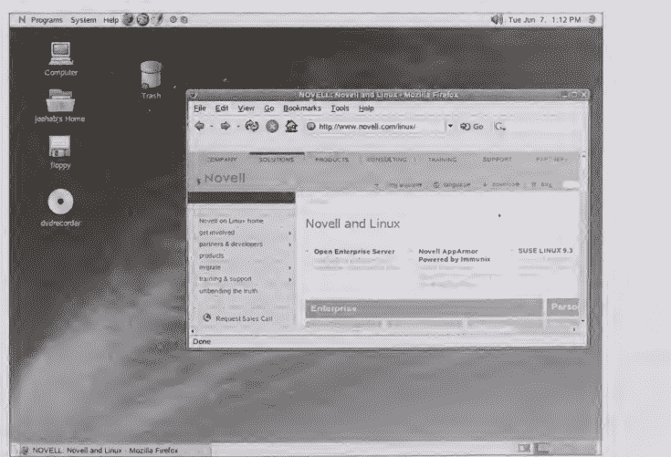

# 第一章：从这里开始

在本本书中我们将讨论 Novell Linux 桌面版（NLD）的细节

## 注意

有关 OpenOffice.org 的来源以及它作为一个办公套件的未来发展的更多信息，请访问 `http://www.openoffice.org`。

# Novell Linux 桌面应用程序与工具

`Writer` 是一款强大的文档处理器，是 OpenOffice.org 办公套件的一部分。

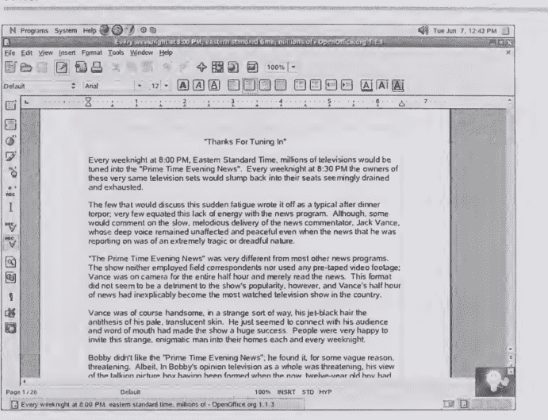

## Mozilla Firefox

无论您是为了业务、研究还是娱乐使用网络，拥有一个能够最大限度减少广告软件、弹出窗口和间谍软件危害的浏览器都是至关重要的。您的浏览器还可以让你轻松找到正在寻找的网站，并保存网页地址以备后后。Mozilla Firefox 满足了所有这些甚至更多。

Mozilla Firefox 是跨平台（适用于包括 Linux 和 Microsoft Windows 在内的多个操作系统平台）GNU 软件，并提供了标签页浏览和内置弹出窗口拦截等独特功能。

我们将在第 8 章详细查看 Mozilla Firefox，其中包含创建和管理书签、拦截弹出窗口以及使用标签页浏览的信息。

## 注意

有关 Mozilla Firefox 的通用信息和各种评论，请访问 `http://www.mozilla.org/products/firefox/`

# 第一章：从这里开始

Novell Firefox 网页浏览器窗口。

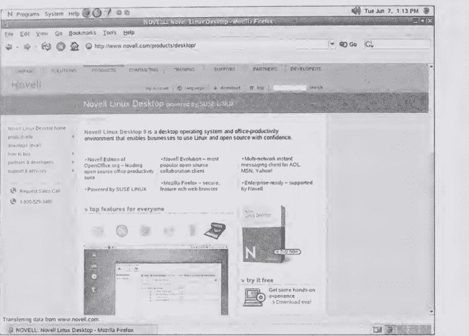

## Novell Evolution

所有计算机用户，特别是那些广泛将 PC 作为业务工具的用户，都努力保持井然有序并维护预约、联系人和电子邮件列表。Novell Evolution 是一款群软件产品，它将重要的业务工具整合到一个软件软件包中。Novell Evolution 允许您管理电子邮件、日历、联系人和任务。它还提供了与 Novell GroupWise 和 Microsoft Exchange 等网络群软件服务器的连接。第 14 章“使用 Novell Evolution 管理电子邮件和联系人”和第 15 章“使用 Novell Evolution 保持有序”提供了关于如何使用 Novell Evolution 的更详细信息。

## 关键术语

群软件（Groupware）——一种允许与其他用户协作的客户端通信软件，设计用于连接到通信服务器产品。

# Novell Linux 桌面应用程序与工具

使用 Novell Evolution 的日历跟踪您的预约。

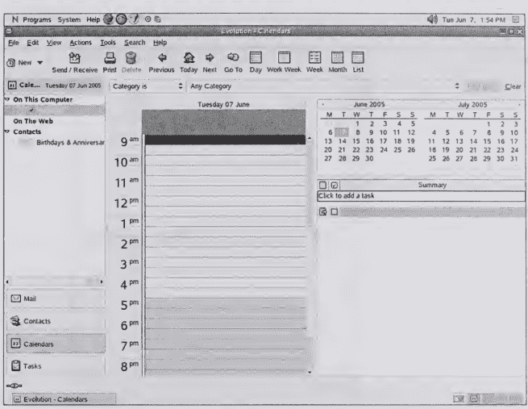

## 其他 NLD 工具

NLD 还提供了许多其他工具——例如计算器、字典和文件管理器（Nautilus 文件管理器，将在第 6 章“管理文件”中介绍）。这些工具中的每一个都可以通过 NLD 程序菜单上的“附件”子菜单打开。

## 注意

NLD 包含许多其他软件。您可以播放和刻录 CD，观看 DVD 电影（如果您的 PC 配有 DVD 驱动器），甚至可以玩一些预装的游戏。

# 第一章：从这里开始

文件管理器、目录和计算器等工具可以通过“附件”子菜单轻松获取。

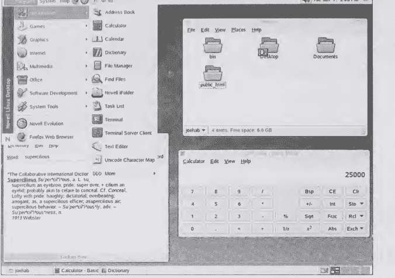

## Novell Linux 桌面安装考虑事项

在利用 NLD 提供的所有可能性之前，您需要向你的计算机上安装操作系统。在大多数业务环境中，您的计算机支持人员可能已经处理了安装工作。如果您是自己安装 NLD，本节提供了有关安装过程的一些通用信息。

NLD 可以从 CD 或 DVD 安装，且 NLD 的安装过程非常直观。该过程由 `YaST` 处理，`YaST` 是一种安装和配置工具，它会引导您完成安装过程（实际上是由名为 `autoYaST` 的 `YaST` 自动版本处理 NLD 安装的）。

## 注意

`YaST`（另一个设置工具）还作为用于更改硬件和软件相关的管理设置的配置工具。`YaST` 需要使用 `root` 账户。`YaST` 实际上是由驱动 NLD 系统的 SUSE Linux 核心提供的。

## Novell Linux 桌面安装考虑事项

`YaST` 允许您选择设置，例如使用的语言、默认桌面（`GNOME` 或 `KDE`）以及时区。在识别 PC 上的硬件组件方面，`YaST` 实际上可以在安装过程中识别硬件配置，这意味着您做的大部分工作就是接受 `YaST` 确定的设置并进入过程的下一步。

让我们来看看 NLD 安装的硬件要求。然后我们可以查看 Linux 分区如何用于划分您的计算机硬盘。接着，我们可以查看与实际安装过程相关的一些亮点。

### 硬件要求

Novell 为 NLD 安装提供了最低和推荐的硬件配置。这些系统要求如下：

- 处理器——Intel Pentium II 或兼容处理器，最低运行频率 266 MHz，建议处理器为 Intel Pentium III 或兼容处理器，运行频率为 500 MHz。
- 内存 (RAM)——至少 256MB，建议 500MB 或更多。
- 视频显示——能够显示 800X600 像素的显是是最低，建议提供 1024X768 像素的显示器。
- 硬盘空间——建议至少 800MB，推荐 2GB 或更多。

可以说，在硬件配置方面，越多越好。处理器速度越高、内存越大、可用的固定磁盘空间越多，NLD 在您的 PC 上运行得就越好。

### 理解 Linux 分区

在 NLD 安装过程中，您的硬盘（我们假设计算机上有一个硬盘）会被分区。分区实际上实际上是将磁盘空间逻辑上划分为操作系统可以识别的部分的方法。在 Windows 中，这些分区被分配驱动器号，但在 Linux 中不是。

`AutoYaST` 会查看您的硬盘并在安装期间创建两个分区：交换分区（`swap`）和根分区（`root`）。这些分区在 IDE 硬盘上分别指定为 `/dev/sda1` 和 `/dev/sda2`（在使用 SCSI 驱动器的计算机上为 `/dev/sda1` 和 `/dev/sda2`）。系统运行都需要这两个分区。交换分区用于系统存储当前无法复制到内存中的额外进程和信息。

# 第一章：从这里开始

内存。因此，交换驱动器基本上用于您使用计算机时，在计算机内存之间交换信息。还会创建一个根分区，并作为系统的主驱动器。系统启动需要此驱动器。

安装期间也可以创建其他分区。但该过程需要分区的实用知识。因为数据目录可以用于不同的用户和其他用途，允许 `YaST` 为您执行分区可能是有意义的。

## 注意

如果您尝试安装一个运行 NLD 和另一个操作系统（如现有的 Windows 安装）的双启动系统，您可能需要在 NLD 安装期间创建自己的分区。通常，`YaST` 会查看您的硬盘并尝试调整现有分区的大小，为交换分区和根分区留出空间。

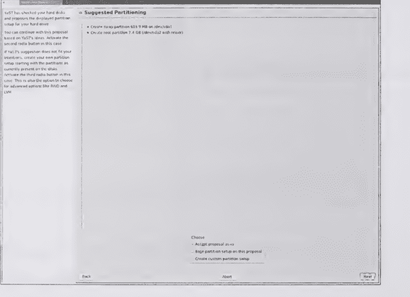

## Novell Linux 桌面安装考虑事项

我们将在第 6 章详细查看目录和文件系统，这将为 Linux 分区的命名规范以及如何导航它们提供进一步深入的见解。

### 关于 NLD 安装过程的其他提示

在我们结束对 NLD 安装的讨论并转向实际探索 NLD 及其提供的软件之前，还应该讨论其他几个项目。首先，就整个安装过程而言，最好让 `YaST` 执行它的工作并为您配置系统。这意味着您点击“接受”的次数要多。

当您首次启动进行安装时（您的 NLD CD 或 DVD 应该在相应的驱动器中），出现的第一个安装界面可能会让人困惑。按键盘上的向下箭头键选择 Installation（安装）。然后您可以按回车键开始安装过程。

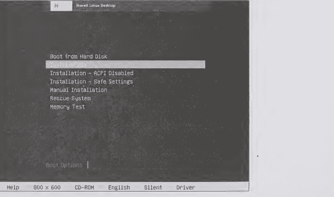

NLD 安装期间至少创建两个账户：`root` 和用户账户。如前所述，`root` 账户是 NLD 系统的管理账户。为 `root` 创建的密码应在五到八个字符之间，并由字母数字（字母和数字）字符组成。您也可以更改密码中字符的大小写，但您必须完全按照创建时的重复密码（包括大小写）。这构成了一个强密码，意味着它更难以被猜测。

# 第1章：从这里开始

在安装 NLD期间，你需要输入并重复 `root` 账户密码。

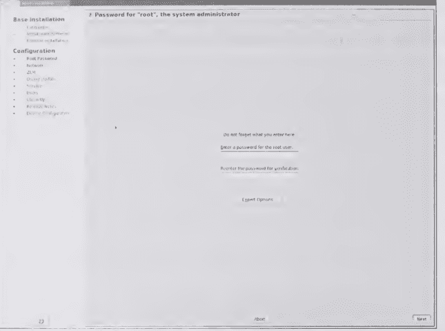

只有在系统需要配置或需要安装新软件时才运行 `root` 账户。你不希望一直以 `root` 运行（主要出于安全考虑）。在某些情况下，你可能在公司或机构工作，他们已经为你在系统上安装了 NLD。因此，出于安全预防，你可能根本没有 `root` 密码。

在安装过程中至少应该创建一个用户账户。这是你的用户账户；你将使用该账户运行 NLD 及其软件。请记住 Linux 是区分大小写的。在继续离开允许配置 `root` 和用户账户的安装界面之前，请确保你在输入用户名和密码时大写锁定（Caps Lock）没有开启。

## 注意


安装过程中可以创建额外的用户账户。点击“添加新用户”屏幕上的“用户管理”。可以使用 `root` 权限在 `NLD` 中创建这些账户。对于多用户共享的电脑情况，`NLD` 是一个极佳的环境。每个用户将拥有特定的工作目录，并可以个性化 `GNOME` 桌面的外观和感受。

## 提示

登录系统后，你也可以从 `NLD` 桌面添加用户账户。添加用户账户需要 `root` 密码。可以通过“系统”菜单访问“管理员设置”。然后使用 `YaST` 创建用户。

`YaST` 也用于编辑用户账户；例如，你可能想更改自己的密码。同样，如果你没有 `root` 密码和 `root` 权限，你就无法更改为管理员的设置。

`NLD` 安装完成后，系统将重启。然后你可以使用用户名和密码进行登录。我们将在第 2 章“启动 Novell Linux Desktop”中讨论启动和登录过程。

# 第2章：启动 Novell Linux Desktop

在本章中：

- 1 关于启动 `NLD` 系统和登录选项
- 2 登录系统
- 3 关于注销选项
- 4 从桌面注销系统
- 5 从登录管理器关闭系统

在本章中，我们将查看如何启动 `NLD`、登录系统，然后如何正确地注销并关闭系统。你可能认为打开电脑并登录系统会是一件很简单的事——事实也如此——但还有一些我们需要探索的登录选项。

首先，要登录系统，你需要有效的用户名和密码。该用户可能是你在 `NLD` 安装过程中创建的，或者如果你没有参与 PC 的 `NLD` 安装，则由你的网络管理员创建。

## 注意

只有拥有 `root` 密码时，你才有更改或添加用户账户的权限。因此，如果账户是为你创建的，你将无法添加用户或更改与用户账户相关的设置。

在建立用户账户（特别是你将使用的用户账户）后，登录系统是非常简单的。你可能也认为注销然后关闭系统应该是轻而易举；然而，由于各种系统进程需要终止，Linux 的关机过程实际上可能需要一些时间。在关机完成之前拔掉电源（关闭电源）会导致系统文件损坏和数据丢失。让我们仔细查看登录屏幕和登录选项。

## 1 关于启动 NLD 系统和登录选项

当你启动 `NLD` 系统时，电脑会初始化其硬件（如处理器）。然后，引导加载程序（一个位于你硬盘分区上的微型程序）开始加载 `NLD` 内核并将系统控制权交给 Linux（在本例中为 `NLD`）。引导加载程序实际上提供了一个文本界面，允许你选择启动选项，例如常规启动（Linux）或启动到软盘或安全启动（安全启动仅提供命令行）。

### 核心术语

启动（Boot）——电脑初始化并加载操作系统的过程。

引导加载程序提供了关于你希望系统如何启动的选项。

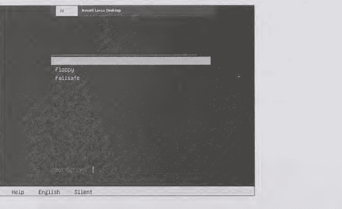

`NLD` 在准备系统使用时会与电脑内存和其他硬件组件进行通信。当这些事件发生时，内核会将信息写入屏幕，因此你实际上会看到与初始化和其他启动事件相关的消息。

`NLD` 的启动过程以消息的形式显示在屏幕上。

```
Mounting shared memory FS on /dev/shm                                done
activating swap-devices in /etc/stab. Priority:42 extents:1               done
Checking root file system....                                                    
fs (sda1-part1) is clean                                                         done
Revising super block in block 16 on sdb02 of format 3.6 with standard journal
Filesystem is clean                                                            
Filesystem mounted read-only. Skipping journal replay.
Checking terminal device...                                                     
Autodetecting RAID arrays...                                                    done
...                                                              ...
Activation...                                                              ...
Device-mapper: 4.3.8-loci (2004-09-38) Initialised: dm-develredhat.com
Creating /dev/mapper/control device with major:16 minor:0
Checking file systems...                                                        
extext4 3.4 (25-Jul-2003)                                                         done
Setting up                                                                     done
Mounting local file systems...                                                  done
proc on proc type proc (rw)                                                     
dfs on /dev type devfs (rw)                                                    
devpts on /devpts type devpts (rw,mode=8628,gid=5)
```

## 提示

如果你费心观察启动消息，可能会发现它们并没有什么吸引力。然而，如果你的系统出现问题，你实际上可以从这些消息中获取故障提示。当内核为特定的启动任务显示消息时，它会添加“done”标签。在硬件初始化失败或出现其他问题的情况下，消息后面会跟随“failed”标签。

系统加载后，会出现登录管理器。这就是你输入用户名和密码登录 `NLD` 的地方。

在登录管理器中输入你的用户名和密码。

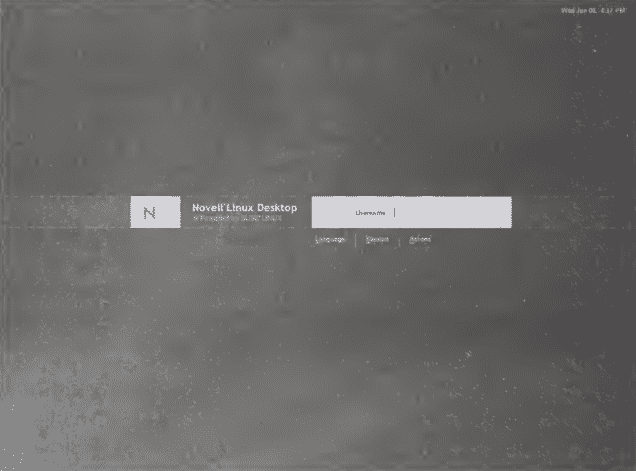

然而，在实际的登录过程（包含几个步骤）之前，让我们简要探索登录管理器提供的选项。这些选项有三种：

+ 语言——此菜单允许你选择 `NLD` 会话的语言。默认语言将是 `NLD` 安装期间选择的语言。要更改语言，请选择一个并点击 `OK`。

### 关于启动 NLD 系统和登录选项

+ 会话（Session）——此菜单允许你选择登录会话时加载的 GUI 桌面。选项包括如 `GNOME`（`NLD` 的默认桌面）和 `KDE` 等 GUI。还提供了两个可以用于排查 `NLD` 安装问题的选项：安全 `GNOME` 和安全终端（终端仅提供命令 shell）。

## 注意

通常，你可能希望使用默认会话设置；这提供了你经常使用的桌面 GUI（例如 `GNOME`）。

+ 操作（Actions）——此菜单包括关闭电脑、重启电脑或配置登录管理器的选项。选择相应的选项然后点击 `OK` 继续。配置可能性围绕登录管理器的外观，并允许你将“图形登录界面”（graphical greeter）从默认界面更改为其他界面，例如 Happy `GNOME` 浏览器登录界面。要更改配置（包括图形登录界面屏幕），必须知道 `root` 密码。

可以为登录管理器配置其他的图形登录界面，例如带浏览器的 `GNOME`。

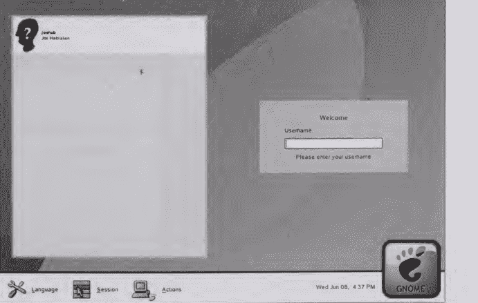

你是否利用 Logon Manager 菜单提供的任何配置选项，完全取决于你自己。本书将从安装默认设置的角度讨论 `NLD`。

## 2 登录系统

在对对 Logon Manager 进行了更改（或保持默认设置）后，你就可以登录系统并开始 `NLD` 会话了。会话实际上只是描述你从登录到注销之间时间的一种方式。

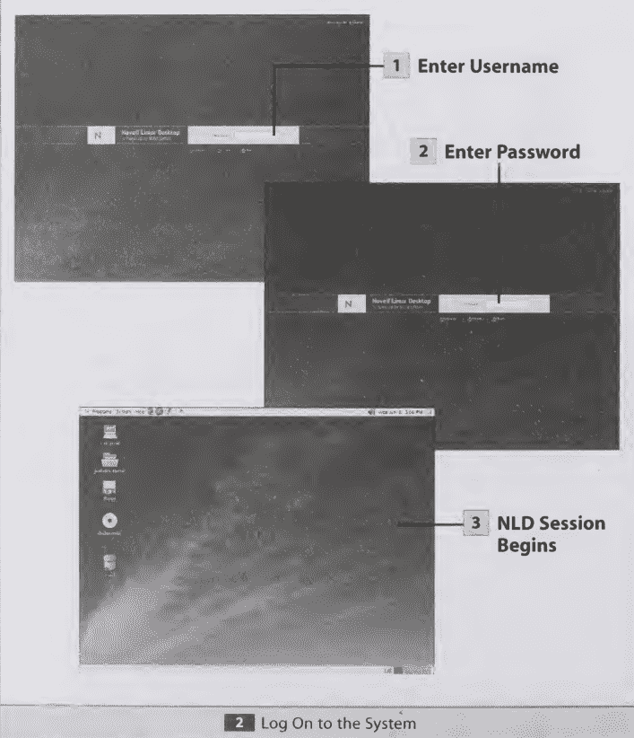

- 1 输入用户名
- 2 输入密码
- 3 `NLD` 会话开始

## 3 关于注销选项

### 1 输入用户名


在 `Logon Manager` 的 `Username` 框中输入你的用户名，然后按回车。

### 2 输入密码

在 `Logon Manager` 的 `Password` 框中输入你的密码，然后按回车。

### 3 NLD 会话开始

你已经登录系统，`NLD` 会话已开始。你现在可以利用通过 `GNOME` 桌面启动的各种生产力软件和工具。

## 关于注销选项

在开始之前

- 关于启动 `NLD` 系统和登录选项
- 登录系统

在完成 `NLD` 会话后，你将想要注销系统。注销时实际发生的情况是通过桌面系统菜单的注销对话框控制的。提供的选项有：

- 注销（`Logout`）：此选项注销系统并返回 `Logon Manager`。
- 关机（`Shutdown`）：此选项将关闭电脑。
- 重启电脑（`Restart the Computer`）：此选项将重启电脑并打开 `Logon Manager`。

提示

注销对话框提供了一个保存当前设置（`Save Current Setup`）勾选框。勾选此框可以保存你为 `GNOME` 桌面更改某些设置，例如字体设置、颜色设置和其他桌面外观设置。

## 第二章：启动 Novell Linux Desktop

注销对话框中提供了选项。

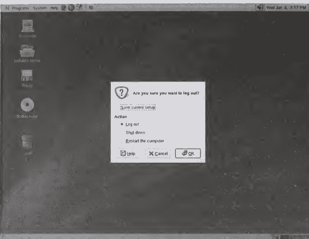

你在注销对话框中做出的选择取决于如何结束会话。如果你想注销并允许其他用户登录，请使用注销选项。如果你想结束会话并关闭电脑，请选择关机。

## 从桌面注销系统

- 在开始之前
- 关于注销选项

注销系统要么返回 `Logon Manager`，要么关闭系统。任何一种选择都有效地结束了你当前的 `NLD` 会话。

## 从桌面注销系统

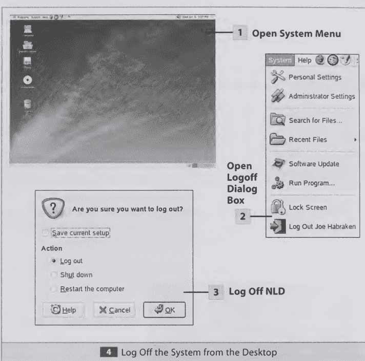

## 打开系统菜单

在 `GNOME` 桌面上，选择位于桌面顶部“程序”和“帮助”菜单之间的系统菜单。

## 打开注销对话框

在系统菜单上选择“注销（用户名）”命令。

## 注销 NLD

默认选中“注销”选项。点击确定以注销系统并返回 `Logon Manager`。

## 第二章：启动 Novell Linux Desktop

提示

如果你计划关闭系统，请在注销对话框中选择关机（`Shut Down`）。

## 5 从 Logon Manager 关系统

在开始之前

- 1 关于启动 `NLD` 系统和登录选项
- 2 关于注销选项
- 3 从桌面注销系统

你可能已经意识到，可以通过在注销对话框中选择关机来关闭系统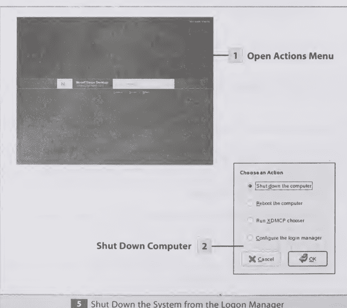

## 打开系统菜单

在 `GNOME` 桌面上，选择位于桌面顶部“程序”和“帮助”菜单之间的系统菜单。提供的选项有：

- 注销（`Logout`）：此选项注销系统并返回 `Logon Manager`。
- 关机（`Shutdown`）：此选项将关闭电脑。
- 重启电脑（`Restart the Computer`）：此选项将重启电脑并打开 `Logon Manager`。

提示

注销对话框提供了一个保存当前设置勾选框。勾选此框可以保存你为 `GNOME` 桌面更改某些设置，例如字体设置、颜色设置和其他桌面外观设置。

## 打开注销对话框

在系统菜单上选择“注销（用户名）”命令。

## 注销 NLD

默认选中“注销”选项。点击确定以注销系统并返回 `Logon Manager`。

## 从桌面注销系统

- 在开始之前
- 关于注销选项

注销系统要么返回 `Logon Manager`，要么关闭系统。任何一种选择都有效地结束了你当前的 `NLD` 会话。

## 注销 NLD

默认选中“注销”选项。点击确定以注销系统并返回 `Logon Manager`。

## 5 从 Logon Manager 关系统

在开始之前

- 1 关于启动 `NLD` 系统和登录选项
- 2 关于注销选项
- 3 从桌面注销系统

你可能已经意识到，可以通过在注销对话框中选择关机来关闭系统

## 打开系统菜单

在 `GNOME` 桌面上，选择位于桌面顶部“程序”和“帮助”菜单之间的系统菜单。提供的选项有：

- 注销（`Logout`）：此选项注销系统并返回 `Logon Manager`。
- 关机（`Shutdown`）：此选项将关闭电脑。
- 重启电脑（`Restart the Computer`）：此选项将重启电脑并打开 `Logon Manager`。

提示

注销对话框提供了一个保存当前设置勾选框。勾选此框可以保存你为 `GNOME` 桌面更改某些设置，例如字体设置、颜色设置和其他桌面外观设置。

## 打开注销对话框

在系统菜单上选择“注销（用户名）”命令。

## 注销 NLD

默认选中“注销”选项。点击确定以注销系统并返回 `Logon Manager`。

## 从桌面注销系统

- 在开始之前
- 关于注销选项

注销系统要么返回 `Logon Manager`，要么关闭系统。任何一种选择都有效地结束了你当前的 `NLD` 会话。

## 注销 NLD

默认选中“注销”选项。点击确定以注销系统并返回 `Logon Manager`。

## 5 从 Logon Manager 关系统

在开始之前

- 1 关于启动 `NLD` 系统和登录选项
- 2 关于注销选项
- 3 从桌面注销系统

你可能已经意识到，可以通过在注销对话框中选择关机来关闭系统

## 打开系统菜单

在 `GNOME` 桌面上，选择位于桌面顶部“程序”和“帮助”菜单之间的系统菜单。提供的选项有：

- 注销（`Logout`）：此选项注销系统并返回 `Logon Manager`。
- 关机（`Shutdown`）：此选项将关闭电脑。
- 重启电脑（`Restart the Computer`）：此选项将重启电脑并打开 `Logon Manager`。

提示

注销对话框提供了一个保存当前设置勾选框。勾选此框可以保存你为 `GNOME` 桌面更改某些设置，例如字体设置、颜色设置和其他桌面外观设置。

## 打开注销对话框

在系统菜单上选择“注销（用户名）”命令。

## 注销 NLD

默认选中“注销”选项。点击确定以注销系统并返回 `Logon Manager`。

## 从桌面注销系统

- 在开始之前
- 关于注销选项

注销系统要么返回 `Logon Manager`，要么关闭系统。任何一种选择都有效地结束了你当前的 `NLD` 会话。

## 打开系统菜单

在 `GNOME` 桌面上，选择位于桌面顶部“程序”和“帮助”菜单之间的系统菜单。提供的选项有：

- 注销（`Logout`）：此选项注销系统并返回 `Logon Manager`。
- 关机（`Shutdown`）：此选项将关闭电脑。
- 重启电脑（`Restart the Computer`）：此选项将重启电脑并打开 `Logon Manager`。

提示

注销对话框提供了一个保存当前设置勾选框。勾选此框可以保存你为 `GNOME` 桌面更改某些设置，例如字体设置、颜色设置和其他桌面外观设置。

## 打开注销对话框

在系统菜单上选择“注销（用户名）”命令。

## 注销 NLD

默认选中“注销”选项。点击确定以注销系统并返回 `Logon Manager`。

## 从桌面注销系统

- 在开始之前
- 关于注销选项

注销系统要么返回 `Logon Manager`，要么关闭系统。任何一种选择都有效地结束了你当前的 `NLD` 会话。

<!-- no content -->
<!-- no content -->
<!-- no content -->
<!-- no content -->

## 在桌面工作

- 6 关于 `NLD`
- 7 导航菜单
- 8 管理虚拟桌面
- 9 关于桌面
- 10 关于日期和时间
- 11 获取 `GNOME`
- 12 运行应用程序
- 13 访问命令
- 14 关于文件
- 15 使用文件
- 16 关于系统

## 第三章：启动 Novell Linux Desktop

`GNOME` 提供了一个工作空间，包含一组默认图标、一个顶部和一个底部面板以及顶部面板中的一个菜单。让我们拆解并定义 `GN` 桌面的各个区域：

- 6 关于 `NLD`
- 7 导航菜单
- 8 管理虚拟桌面
- 9 关于桌面
- 10 关于日期和时间
- 11 获取 `GNOME`
- 12 运行应用程序
- 13 访问命令
- 14 关于文件
- 15 使用文件
- 16 关于系统

## 在桌面工作

- 6 关于 `NLD`
- 7 导航菜单
- 8 管理虚拟桌面
- 9 关于桌面
- 10 关于日期和时间
- 11 获取 `GNOME`
- 12 运行应用程序
- 13 访问命令
- 14 关于文件
- 15 使用文件
- 16 关于系统

## 在桌面工作

- 6 关于 `NLD`
- 7 导航菜单
- 8 管理虚拟桌面
- 9 关于桌面
- 10 关于日期和时间
- 11 获取 `GNOME`


- 12 运行应用程序
- 13 访问命令
- 14 关于文件
- 15 使用文件
- 16 关于系统

## 在桌面工作
- 6 关于 NLD
- 7 导航菜单
- 8 管理虚拟桌面
- 9 关于桌面
- 10 关于日期和时间
- 11 获取 GNOME
- 12 运行应用程序
- 13 访问命令
- 14 关于文件
- 15 使用文件
- 16 关于系统

## 在桌面工作
- 6 关于 NLD
- 7 导航菜单
- 8 管理虚拟桌面
- 9 关于桌面
- 10 关于日期和时间
- 11 获取 GNOME
- 12 运行应用程序
- 13 访问命令
- 14 关于文件
- 15 使用文件
- 16 关于系统

## 在桌面工作
- 6 关于 NLD
- 7 导航菜单
- 8 管理虚拟桌面
- 9 关于桌面
- 10 关于日期和时间
- 11 获取 GNOME
- 12 运行应用程序
- 13 访问命令
- 14 关于文件
- 15 使用文件
- 16 关于系统

## 在桌面工作
- 6 关于 NLD
- 7 导航菜单
- 8 管理虚拟桌面
- 9 关于桌面
- 10 关于日期和时间
- 11 获取 GNOME
- 12 运行应用程序
- 13 访问命令
- 14 关于文件
- 15 使用文件
- 16 关于系统

## 在桌面工作
- 6 关于 NLD
- 7 导航菜单
- 8 管理虚拟桌面
- 9 关于桌面
- 10 关于日期和时间
- 11 获取 GNOME
- 12 运行应用程序
- 13 访问命令
- 14 关于文件
- 15 使用文件
- 16 关于系统

## 在桌面工作
- 6 关于 NLD
- 7 导航菜单
- 8 管理虚拟桌面
- 9 关于桌面
- 10 关于日期和时间
- 11 获取 GNOME
- 12 运行应用程序
- 13 访问命令
- 14 关于文件
- 15 使用文件
- 16 关于系统

## 在桌面工作
- 6 关于 NLD
- 7 导航菜单
- 8 管理虚拟桌面
- 9 关于桌面
- 10 关于日期和时间
- 11 获取 GNOME
- 12 运行应用程序
- 13 访问命令
- 14 关于文件
- 15 使用文件
- 16 关于系统

## 在桌面工作
- 6 关于 NLD
- 7 导航菜单
- 8 管理虚拟桌面
- 9 关于桌面
- 10 关于日期和时间
- 11 获取 GNOME
- 12 运行应用程序
- 13 访问命令
- 14 关于文件
- 15 使用文件
- 16 关于系统

## 在桌面工作
- 6 关于 NLD
- 7 导航菜单
- 8 管理虚拟桌面
- 9 关于桌面
- 10 关于日期和时间
- 11 获取 GNOME
- 12 运行应用程序
- 13 访问命令
- 14 关于文件
- 15 使用文件
- 16 关于系统

## 在桌面工作
- 6 关于 NLD
- 7 导航菜单
- 8 管理虚拟桌面
- 9 关于桌面
- 10 关于日期和时间
- 11 获取 GNOME
- 12 运行应用程序
- 13 访问命令
- 14 关于文件
- 15 使用文件
- 16 关于系统

## 在桌面工作
- 6 关于 NLD
- 7 导航菜单
- 8 管理虚拟桌面
- 9 关于桌面
- 10 关于日期和时间
- 11 获取 GNOME
- 12 运行应用程序
- 13 访问命令
- 14 关于文件
- 15 使用文件
- 16 关于系统

## 在桌面工作
- 6 关于 NLD
- 7 导航菜单
- 8 管理虚拟桌面
- 9 关于桌面
- 10 关于日期和时间
- 11 获取 GNOME
- 12 运行应用程序
- 13 访问命令
- 14 关于文件
- 15 使用文件
- 16 关于系统

## 关于注销选项
- 1 输入用户名
- 2 输入密码
- 3 NLD 会话开始

## 关于注销选项
- 1 输入用户名
- 2 输入密码
- 3 NLD 会话开始

## 关于注销选项
- 1 输入用户名
- 2 输入密码
- 3 NLD 会话开始
- 2 登录系统

## 关于注销选项
- 1 输入用户名
- 2 输入密码
- 3 NLD 会话开始

## 关于注销选项
- 1 输入用户名
- 2 输入密码
- 3 NLD 会话开始

## 关于注销选项
- 1 输入用户名
- 2 输入密码
- 3 NLD 会话开始

## 关于注销选项
- 1 输入用户名
- 2 输入密码
- 3 NLD 会话开始

## 关于注销选项
- 1 输入用户名
- 2 输入密码
- 3 NLD 会话开始

## 关于注销选项
- 1 输入用户名
- 2 输入密码
- 3 NLD 会话开始

## 关于注销选项
- 1 输入用户名
- 2 输入密码
- 3 NLD 会话开始

## 关于注销选项
- 1 输入用户名
- 2 输入密码
- 3 NLD 会话开始

## 关于注销选项
- 1 输入用户名
- 2 输入密码
- 3 NLD 会话开始

## 关于注销选项
- 1 输入用户名
- 2 输入密码
- 3 NLD 会话开始

## 关于注销选项
- 1 输入用户名
- 2 输入密码
- 3 NLD 会话开始

## 关于注销选项
- 1 输入用户名
- 2 输入密码
- 3 NLD 会话开始

## 关于注销选项
- 1 输入用户名
- 2 输入密码
- 3 NLD 会话开始

## 关于注销选项
- 1 输入用户名
- 2 输入密码
- 3 NLD 会话开始

## 关于注销选项
- 1 输入用户名
- 2 输入密码
- 3 NLD 会话开始

## 关于注销选项
- 1 输入用户名
- 2 输入密码
- 3 NLD 会话开始

## 关于注销选项
- 1 输入用户名
- 2 输入密码
- 3 NLD 会话开始

## 关于注销选项
- 1 输入用户名
- 2 输入密码
- 3 NLD 会话开始

## 关于注销选项
- 1 输入用户名
- 2 输入密码
- 3 NLD 会话开始

## 关于注销选项
- 1 输入用户名
- 2 输入密码
- 3 NLD 会话开始

## 关于注销选项
- 1 输入用户名
- 2 输入密码
- 3 NLD 会话开始

## 关于注销选项
- 1 输入用户名
- 2 输入密码
- 3 NLD 会话开始

## 关于注销选项
- 1 输入用户名
- 2 输入密码
- 3 NLD 会话开始

## 关于注销选项
- 1 输入用户名
- 2 输入密码
- 3 NLD 会话开始

## 关于注销选项
- 1 输入用户名
- 2 输入密码
- 3 NLD 会话开始

## 关于注销选项
- 1 输入用户名
- 2 输入密码
- 3 NLD 会话开始

## 关于注销选项
- 1 输入用户名
- 2 输入密码
- 3 NLD 会话开始

## 关于注销选项
- 1 输入用户名
- 2 输入密码
- 3 NLD 会话开始

## 关于注销选项
- 1 输入用户名
- 2 输入密码
- 3 NLD 会话开始

## 关于注销选项
- 1 输入用户名
- 2 输入密码
- 3 NLD 会话开始

## 关于注销选项
- 1 输入用户名
- 2 输入密码
- 3 NLD 会话开始

## 关于注销选项
- 1 输入用户名
- 2 输入密码
- 3 NLD 会话开始

## 关于注销选项
- 1 输入用户名
- 2 输入密码
- 3 NLD 会话开始

## 关于注销选项
- 1 输入用户名
- 2 输入密码
- 3 NLD 会话开始

## 关于注销选项
- 1 输入用户名
- 2 输入密码
- 3 NLD 会话开始

## 关于注销选项
- 1 输入用户名
- 2 输入密码
- 3 NLD 会话开始

## 关于注销选项
- 1 输入用户名
- 2 输入密码
- 3 NLD 会话开始

## 关于注销选项
- 1 输入用户名
- 2 输入密码
- 3 NLD 会话开始

## 关于注销选项
- 1 输入用户名
- 2 输入密码
- 3 NLD 会话开始

## 关于注销选项
- 1 输入用户名
- 2 输入密码
- 3 NLD 会话开始

## 关于注销选项
- 1 输入用户名
- 2 输入密码
- 3 NLD 会话开始

## 关于注销选项
- 1 输入用户名
- 2 输入密码
- 3 NLD 会话开始


# 第3章：在NLD桌面上工作

GNOME桌面为NLD和工具提供了用户环境。

| 快速启动图标 | 桌面图标 | 日期/时间 |
| :--- | :--- | :--- |
| 菜单 | 顶部面板 | 音量 |

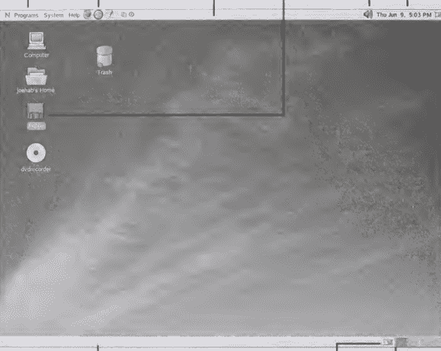

底部面板 | 显示桌面 | 工作空间切换器

## 7 导航 GNOME 桌面

在GNOME桌面上工作实际上是学习如何操作实用程序窗口和应用程序窗口。您可以使用菜单系统或图标（现有图标、你创建的桌面图标、默认存在的或你添加的快速启动图标）来打开这些窗口。默认桌面图标（如“计算机”和“主目录”）旨在让您能够定位和管理使用各种应用程序创建的文件。

### 打开主目录文件夹

双击桌面上的“主目录”（用户名Home）图标。主目录文件夹将打开。

### 操作主目录文件夹

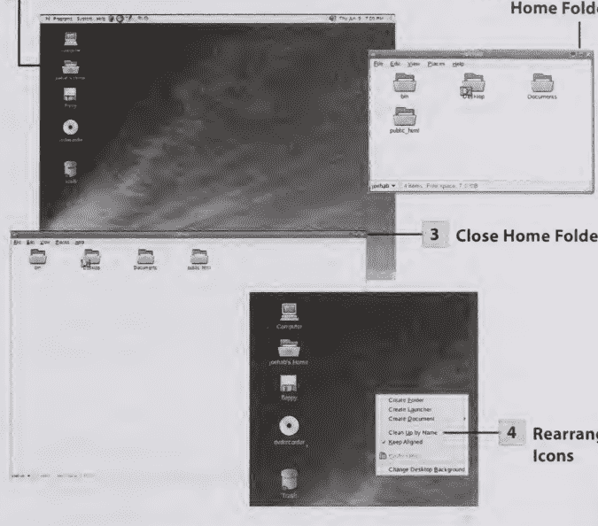

点击最小化按钮可以最大化主目录文件夹。您可以通过双击打开主目录文件夹中存在的任何文件夹。

### 关闭主目录文件夹

点击“关闭”按钮来关闭主目录文件夹。

### 重新排列图标

您可以根据需要拖动桌面上的图标。要重新排列在桌面上拖动的任何图标，请右键点击桌面并选择“按名称名称整理”。这将按名称对齐图标。

> **提示**：要在不关闭最大化应用程序窗口的情况下查看桌面，请点击该窗口中的“最小化”按钮。通过点击桌面底部面板上的图标，可以将应用程序恢复到桌面。

## 8 使用菜单系统

您可以使用桌面顶部面板中的菜单访问NLD提供的应用程序和其他工具。“程序”菜单将已安装的应用程序分为类别，如“辅助工具”、“图形”和“其他”。选择特定类别将提供该类别下的应用程序列表。例如，“辅助工具”子菜单提供了访问计算器、字典和文件管理器等工具的。“办公”子菜单提供了对OpenOffice org套件的访问，包括Write、Calc和Impress。

“系统”菜单提供了访问个人和管理设置。它还允许您快速搜索文件并提供注销系统的功能。

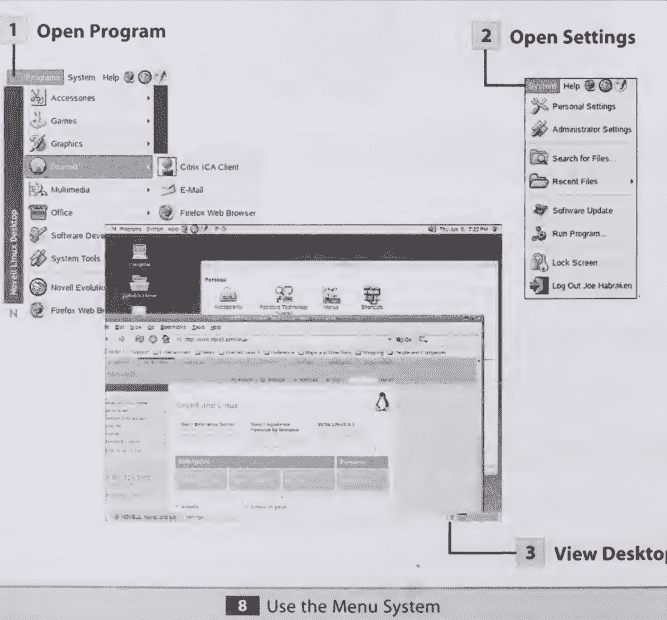

### 管理虚拟桌面

### 打开程序

选择“程序”菜单，然后选择一个程序类别（如“互联网”）。然后点击Firefox浏览器等应用程序图标。该应用程序（在这种情况下为Firefox）将在桌面打开。您可以根据需要最小化或关闭应用程序。

### 打开设置

选择“系统”菜单，然后选择菜单上的某项（如“个人设置”）。这将打开设置窗口。您可以根据需要最小化或最大化设置窗口。

### 查看桌面

要最小化当前在桌面上运行的应用程序，请点击桌面底部面板上的“显示桌面”图标。然后可以通过点击底部面板上的图标将任何已打开的应用程序恢复到桌面。

> **提示**：要快速启动Firefox、Evolution和OpenOffice.org Write等应用程序，请点击顶部面板上相应的快速启动图标。

> **提示**：如果您正在运行CD播放器或音乐播放器等多媒体应用程序，可以通过顶部面板上的音量控制图标来快速调整声音。

像NLD这样的多任务环境让您可以轻松在桌面上运行多个应用程序。然而，桌面可能会因为应用程序窗口过多而拥挤。即使某些应用程序已最小化，底部面板也可能包含大量图标，导致切换应用程序的过程变得很恼。虚拟桌面允许您将应用程序放在不同的桌面上。您可以在这些桌面之间切换并使用运行中的应用程序，而无需仅在一个桌面上筛选窗口堆。

> **提示**：顶部面板左侧是窗口切换器图标。当您在特定的虚拟桌面上工作时，可以通过选择窗口切换器快速获取打开的应用程序窗口列表（并切换到特定应用程序）。

您使用底部面板右侧的工作空间切换器在虚拟桌面之间进行切换。工作空间切换器实际上提供了当前使用的每个虚拟桌面的缩略图。

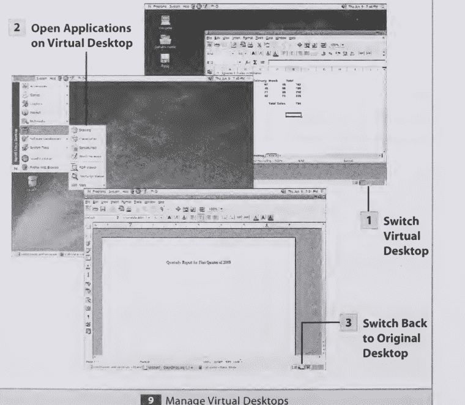

### 切换虚拟桌面

要离开当前桌面（以及当前桌面打开的应用程序），请点击工作空间切换器中的一个空白虚拟桌面。虽然您的应用程序仍以图标形式显示在底部面板上，但您将获得一个“全新的”桌面。

### 在虚拟桌面上打开应用程序

现在您可以根据需要在虚拟桌面上打开应用程序。例如，选择“程序”、“办公”、“文字处理器”来打开OpenOffice.org Write。

### 回到原始虚拟桌面

要返回原始虚拟桌面，请选择该桌面的工作空间切换框。要将虚拟桌面恢复原始状态（即没有任何应用程序窗口），请关闭该虚拟桌面上的应用程序。

## 修改系统日期和时间设置

日期和时间由NLD桌面顶部右侧的时钟小部件显示。选择小部件将显示当前月份的日期。您可以通过访问此小部件更改时钟偏好，甚至复制时间和日期（然后将其粘贴到另一个应用程序中）。

您也可以使用时钟小部件访问日期时间设置，但日期和时间设置被视为管理设置。这意味着您必须知道root密码才能更改这些设置。

日期和时间设置是使用YaST（NLD配置工具）配置的管理设置。在您的系统上安装NLD时，YaST实际上发挥了重要作用。无论尝试编辑什么设置，访问YaST都需要root密码。

### 1 查看
### 2 打开时钟偏好
### 3 修改时钟偏好

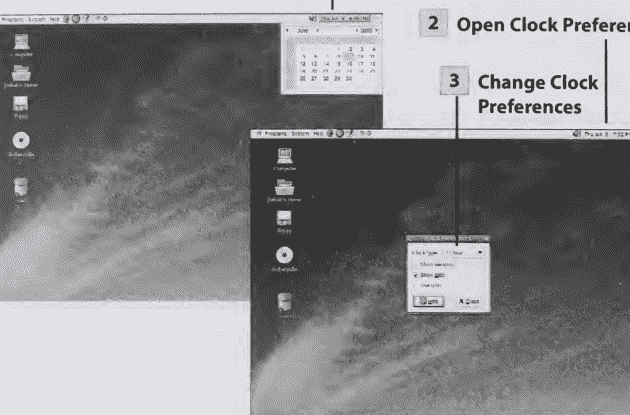

- 6月7日 下午7:03
- 时区
- 复制日期
- 调整日期和时间
- 时区
- 关于
- 设置为 true
- 时区
- 下午 7:03

### 4 修改日期和时间设置
### 5 输入 root 密码
### 6 在 YaST 中编辑日期和时间设置

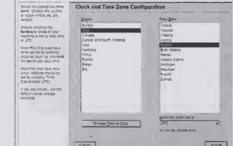

## 注意

如果NLD是安装在您的计算机上的操作系统，请使用默认的硬件时钟设置，即UTC。如果您有一台配置了双系统启动且也安装了Microsoft Windows的计算机，请使用本地时间作为您的硬件时钟设置。

## 11 在 GNOME 桌面上获取帮助

尽管GNOME桌面易于导航，但有时您可能需要一些额外的帮助。您可以从桌面快速访问Novell的GNOME用户手册。该用户手册提供了有关GNOME的基本信息，并提供了一个专门章节，方便Windows用户切换到GNOME桌面。


该手册还提供了有关特定应用程序的信息，例如 `Firefox`、`Evolution`、`iFolder` 和 `OpenOffice.org` 站点。此外，还提供了关于管理打印机信息，以及关于管理任务和在命令行 shell（在命令行中输入命令）的信息。您可以使用导航区域（左侧框架）中的内容链接访问帮助内容，也可以通过在搜索栏中执行简单搜索或更复杂的搜索来查找内容。

- 打开帮助中心

选择顶部面板上的“帮助”（`Help`）菜单，然后选择“用户手册”（`User's Manual`）。帮助中心将在桌面上打开。您可以将帮助中心最大化；选择窗口左侧的“最大化”按钮。

- 选择内容主题

帮助中心由两个区域组成：导航区域（列出所有主题）和视图窗口（显示所选主题包含的信息）。要查看导航区域中找到的特定主题（当选中“内容” `Contents` 标签页时），请选择该主题。要查看与所选主题相关的特定信息，请选择视图窗口（帮助中心的右侧）中的链接。

## 提示

要放大视图窗口中的字体文本，请选择工具栏上的“增大字体大小”（`Increase Font Size`）（“减小字体大小” `Decrease Font Sizes` 则会减小文本尺寸）。要返回上一个主题页面，点击“后退”（`Back`）按钮。如果您想打印主题，请点击工具栏上的“打印”（`Print`）按钮。

## 打开帮助中心

## 选择内容主题

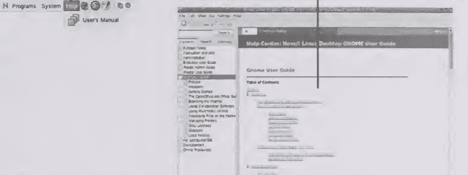

## 进行简单搜索

## 选择搜索标签页

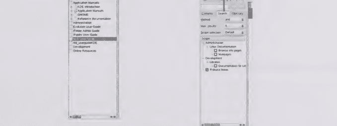

## 生成搜索索引

## 高级搜索

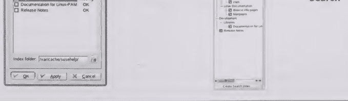

# 第 3 章：在 NLD 桌面上工作

## 3 进行简单搜索

要快速搜索特定的帮助内容，在导航区域上方的搜索框中输入搜索词；然后点击“搜索”按钮。搜索结果将出现在视图窗口中。选择提供的特定链接以查看主题页面。

## 4 选择搜索标签页

您还可以运行更复杂的搜索，这让您能够为搜索设置更多参数。选择帮助导航区域的“搜索”（`Search`）标签页。在运行搜索之前，您需要为帮助系统包含的内容生成搜索索引。点击搜索面板底部的“创建搜索索引”（`Create Search Index`）按钮。这将打开“构建搜索”（`Build Search`）对话框。

## 5 生成搜索索引

在“构建搜索索引”对话框中，勾选当前状态为“缺失”的主题索引（这意味着尚未为这些主题区域生成索引）。然后点击“确定”生成索引。“构建搜索索引”消息框将宣布索引创建完成。点击“关闭”关闭此消息框。

## 6 运行高级搜索

在搜索框中输入您的搜索准则。将“方法”（`Method`）下拉菜单设置为“与”（`and`，默认值）或“或”（`or`）。使用“最大结果”（`Max Results`）下拉框选择您想要从搜索中接收的结果数量。最后一步是设置搜索范围。

您可以使用“范围”（`Scope`）下拉列表选择“全部”（`All`）或“自定义”（`Custom`）（“无”也是一种选择，但在这种情况下不适用）。如果您选择“自定义”，可以使用搜索面板中“范围”区域提供的复选框选择要包含在范围内的单个主题。确定范围后，点击“搜索”按钮。搜索结果将以链接的形式出现在视图窗口中。

提示

要查看术语列表（并访问其定义），请选择帮助导航区域的“术语表”（`Glossary`）标签页。您可以按字母顺序或按主题查看术语表。

## 从“运行应用程序”对话框运行程序

- 另另

20 向面板添加项目

21 向菜单添加项目

63 关于查找和安装新应用程序

当您运行 NLD 安装时，`GNOME` 为许多安装的应用程序和小组件提供了菜单图标。这些菜单图标出现在“运行”（`Run`）或“系统”（`System`）菜单中。NLD 还安装了其他小组件和其他实用工具，它们没有在菜单系统中表示。运行这些程序的一种方法是从“运行应用程序”（`Run Application`）对话框。

注意

“运行应用程序”对话框实际上是访问 NLD 命令行的一种方式。

`GNOME` 提供了许多运行 NLD 安装时安装的应用程序和小组件的菜单图标。这些菜单图标出现在“运行”或“系统”菜单中。NLD 还安装了其他小组件和其他实用工具，它们没有在菜单系统中表示。运行这些程序的一种方法是从“运行应用程序”对话框。

注意

“运行应用程序”对话框实际上是访问 NLD 命令行的一种方式。

如果您发现经常使用某个应用程序或小组件，将其添加到顶部面板是有用的。注意

关于文件类型以及通过命令行启动的应用程序或小组件的更多信息，请参见第 7 章“添加和管理软件”。

# 第 3 章：在 NLD 桌面上工作

## 1 打开运行应用程序对话框

## 2 输入搜索命令


## 3 运行应用程序


## 2 从“运行应用程序”对话框运行程序

## 输入搜索命令

在搜索框中输入程序命令。当您输入命令时，如果命令被识别，自动补全功能将帮助您完成命令。例如，您可能会觉得用的命令是 `gnome-panel --screenshot`，它会获取桌面截图。当您运行该命令时，它会打开一个对话框，允许您指定保存截图的位置。

## 运行应用程序

输入相应的命令后点击“运行”按钮。应用程序将在窗口中打开。对于 `gnome-panel --screenshot` 命令，会打开一个“保存截图”对话框，允许您指定保存截图的位置。

46

## 访问命令行

开始之前

另另

12 从“运行应用程序”对话框运行程序

14 关于文件命令

15 使用文件命令

16 关于系统命令

17 使用系统命令

尽管 `GNOME` 通过菜单系统方便地访问应用程序和小组件，但有时您可能需要访问命令行 shell 并在工作。这里提供的信息并不是命令行 shell 或可以在命令行运行的各种命令的全面介绍，而是为了给您提供一个概述。

注意

命令由实际命令和可选开关组成，开关可以为特定命令提供选项。在输入命令和任何开关后，按回车键调用命令。

在 NLD 中，默认的终端或 shell 程序是 `GNOME Terminal`。此终端允许您在不离开 NLD 桌面的情况下在命令行工作。

# 第3 章：在 NLD 桌面上操作

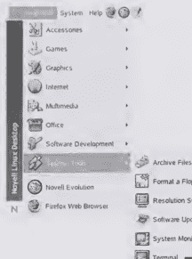

- 1 打开 GNOME 终端

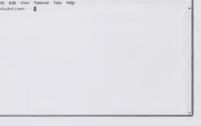

- 2 最大化终端

- 3 执行命令

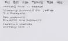

- 13 访问命令行

## 1 打开 GNOME 终端

点击顶部面板上的“程序”菜单，选择“系统工具”子菜单，然后选择“终端”。`GNOME Terminal` 会在桌面上打开。终端中的命令行由你的 `用户名@linux` 组成。你可以在命令行处处输入命令。

## 2 最大化终端

如果最大化终端窗口，查看 shell 命令的结果会更方便。点击窗口上的最大化按钮。现在你已经准备好输入 shell 命令了。

## 3 执行命令

一个值得尝试的实用命令工具是 `passwd` 命令，它允许你更改密码。点击命令行输入 `passwd` 然后按回车。输入你当前的密码并按回车。输入你的新密码并按回车。再次输入新密码并按回车。密码已更改。

> 提示
>
> 要清除当前终端屏幕上的条目，请输入 `clear` 然后按回车。

> 提示
>
> 你可以通过输入命令后加上 `--help` 来获取命令帮助（例如 `ls --help`）。要查看特定命令的手册信息，请输入命令，然后输入 `man` 并按回车。这将打开该命令的手册。你可以使用向上和向下方向键在手册中移动（空格键可以让你一次翻一页）。要退出手册（或你在命令行中访问的任何手册页），请按键盘上的 `q` 键。

## 关于文件命令

- 另参

- 在开始之前

| | 描述 |
|--- |--- |
| 46 | 使用 Nautilus 管理文件夹 |
| 47 | 浏览和打开文件 |
| 48 | 查找文件 |

## 13 访问命令行

你可以从命令行列出并操作文件夹中的文件。NLD 提供了 `Nautilus` 文件管理器，它允许你使用 GUI 工具管理文件。你可能想对大多数文件工作都使用 `Nautilus`。然而，了解并理解几个文件管理 shell 命令并不是一个坏主意——至少是基础的文件命令。表 3.1 列出了你可以在 `GNOME Terminal` 中使用的一些文件管理命令。

| 表 3.1 文件管理命令 |
| 命令 | 用途 |
|--- |--- |
| `ls` | 列出当前目录下的文件。 |
| `cd` | 用于切换到特定的目录文件夹；例如 `cd Documents` 会将你从当前父文件夹移动到名为 `Documents` 的子文件夹。`cd` 命令会将你返回父文件夹。 |


| `mkdir` | 用于创建新目录（子文件夹）。例如，`mkdir` 会在当前文件夹中创建一个新目录（子文件夹）。 |

| `rdir` | 用于删除目录。从文件夹的父目录，输入 `rdir` 后跟文件夹名称。例如，`rdir joe` 将删除 `joe` 文件夹（该文件夹必须为空才能删除）。 |

| `copy` | 用于将文件从一个文件夹复制到另一个文件夹。例如，要从当前文件夹复制文件到另一个文件夹，语法为 `copy filename`。 |

| `rm` | 用于删除文件。语法为 `rm filename`。谨慎使用此命令；它在删除文件方面不会为你提供第二次机会。 |

## 网络资源

`http://www.linuxforum.com/shell.php`

访问此网站查看按分类的 Linux 命令完整列表。

请记住，Linux 命令和引用是区分大小写的。因此，如果文件夹以大写字母开头，你必须精确输入名称才能操作该文件夹。在命令行中测试文件夹和文件时，你可以在 Home 文件夹中创建新文件夹，并将你使用的文档和其他文件保存在 Documents 子文件夹中。

## 15 使用文件命令

- 在开始之前
- 13 访问命令行
- 14 关于文件命令

当你打开终端窗口时，你处于你的 Home 目录中。在 Home 目录下有以下子文件夹：`bin`、`Desktop`、`Documents` 和 `public-HTML`。你可以使用 `ls`、`cd` 和 `mkdir` 等命令查看这些文件夹的内容并创建新的子文件夹。

### 1 使用 ls 命令

在 GNOME 终端窗口中，在命令行输入 `ls` 并按回车。你的 Home 文件夹的内容将被列出。

### 2 使用 cd 命令

在命令行输入 `cd Documents` 并按回车。这将位置更改到 Documents 子文件夹。要查看此子文件夹中有任何文件，请使用 `ls` 命令。要返回主 Home 文件夹，输入 `cd` 并按回车。

提示

> 要循环使用最近使用的命令，请按键盘上的向上方向键。

# 第3 章：在 NLD 桌面上操作


## 使用 mkdir 命令

在 GNOME 终端窗口中，在命令行输入 `mkdir` 并按回车。这会在当前文件夹中创建一个新目录（子文件夹）。

## 使用 rdir 命令

用于删除目录。从文件夹的父目录，输入 `rdir` 后跟文件夹名称。例如，`rdir joe` 将删除 `joe` 文件夹（文件夹必须为空才能删除）。

## 使用 copy 命令

用于将文件从一个文件夹复制到另一个文件夹。例如，要从当前文件夹复制文件到另一个文件夹，语法为 `copy filename`。

## 使用 rm 命令

用于删除文件。语法为 `rm filename`。谨慎使用此命令；它在删除文件方面不会为你提供第二次机会。

> 注意
>
> 请谨慎使用


## 退出 Shell

当你完成终端工作时，在命令行输入 `exit` 并按回车。你将返回桌面。

## 关于系统命令

- 在开始之前
- 访问命令行

用户可以使用许多系统命令，如 `df` 和 `du`，它们分别允许查看当前使用的磁盘空间和特定文件夹占用的磁盘空间。这些系统命令不需要你登录为 root（超级管理员账户）。

| 表 3.2 系统命令 |
| 命令 | 用途 |
|--- |--- |
| `df` | 列出磁盘空间（`df` 代表 disk free）。 |
| `du` | 显示文件夹使用的磁盘空间。 |
| `free` | 显示内存和交换文件的统计信息。 |
| `date` | 显示系统时间。 |
| `ps` | 显示运行进程的列表。 |
| `kill` | 用于终止进程。这是强制关闭无法关闭程序的最后尝试。语法为 `kill process ID`。 |

使用 `kill` 时，你必须使用 `ps` 命令找到故障程序的进程 ID。

# 第3 章：在 NLD 桌面上操作

提示

再次，你可能想知道为什么需要了解命令行。当系统出现问题时，它实际上是你排除故障的资源之一。如果你仍然对命令行和系统命令感到不安，请查看系统监视器。这个桌面工具允许你查看运行进程以及与计算机内存相关的统计数据。

## 17 使用系统命令

- 在开始之前
- 13 访问命令行
- 16 关于系统命令

用户可以使用许多系统命令，如 `df` 和 `du`，它们分别允许查看当前使用的磁盘空间和特定文件夹占用的磁盘空间。这些系统命令不需要你登录为 root（超级管理员账户）。

### 1 使用 df 命令

在 GNOME 终端窗口中，在命令行输入 `df` 并按回车。这将显示你使用的磁盘空间（以及使用百分比）以及驱动器（驱动器指卷）上的可用空间。

### 2 使用 du 命令

使用 `ls` 和 `cd` 定位其中一个文件夹。输入 `du` 然后按回车。这将显示该文件夹使用的磁盘空间。

### 3 使用 free 命令

在命令行提示符处输入 `free` 并按回车。这将显示内存使用和交换文件的统计信息。

# 使用 df 命令

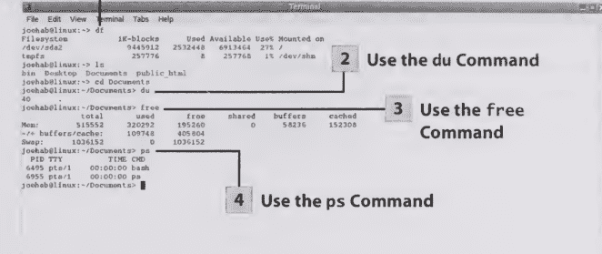

# 使用 free 命令

# 使用 ps 命令

要查看当前运行的进程，请在命令行输入 `ps` 并按回车。列出的进程数量取决于你在启动 `ps` 命令之前在 NLD 桌面运行了哪些程序。请注意，每个运行的进程（进程实际上等同于程序）都提供了一个 `pid` 或 `id`。你可以使用 `kill` 命令配合 `pid` 来终止运行错误的进程。

在操作完一些系统命令后，你可以关闭终端窗口。输入 `exit` 然后按回车即可返回 NLD 桌面。

# 第 3 章：在 NLD 桌面上工作

## 注意

本章提到了 root 账户（管理员账户），并提到某些 NLD 设置只有在知道 root 密码时才能更改。你也可以从命令行 shell 管理 NLD，root 账户可以使用大量的命令和命令实用程序。要在命令行中访问 root 账户，输入 `su` 然后按回车。输入 root 密码并再次按回车。如果你对与 NLD 相关的更多管理功能感兴趣，可能想查看 Emmett Dulaney 编写的《Novell Linux 9 Administrator's Handbook》。

## 修改 NLD 桌面

在本章中：

- 18 关于修改 GNOME
- 19 创建桌面图标
- 29 向面板添加项目
- 21 向菜单添加项目
- 22 关于 GNOME 个人设置
- 23 更改个人设置
- 24 更改桌面背景
- 25 更改字体
- 26 选择屏幕保护程序
- 27 使用锁屏工具
- 26 关于桌面主题（注重复）
- 29 更改当前桌面主题
- 30 向 GNOME 添加主题
- 31 更改窗口偏好

# 第 4 章：修改 NLD 桌面

GNOME 桌面不仅为你的生产力软件工具和实用程序提供了一个 GUI 启动器，还为 NLD（以及你）提供了一个高度可定制的用户环境。想一下其他操作系统为其桌面 GUI 提供的桌面个性化功能，你就会发现 GNOME 与它们处于同一水平。

你可以控制并个性化桌面背景、菜单和桌面面板上的可用项目，还可以控制软件和硬件项目（包括鼠标和打印机）的个人设置。本章从个性化 NLD 桌面的概述开始。

## 18 关于修改 GNOME

GNOME 为你提供了在桌面面板上添加桌面图标和快捷方式图标的能力。你还可以向菜单系统添加新项目。在修改和个性化桌面方面，你可以控制桌面背景、更改桌面字体以及你想要使用的屏幕保护程序。

在用户级别（不使用 root 密码）对 NLD 桌面可以做的更改更改局限于桌面的外观和感受，这意味着你感知桌面环境的方式（颜色、背景等）。控制多个外观和感受元素的项被称为“主题”。主题是一组协调的设置，控制你的应用程序和应用程序窗口的不同部分（包括窗口框和控件）的显示。主题还控制某些桌面图标和面板上某些图标的外观。为了给 NLD 桌面创建一个统一的外观，你可以使用相互补充的主题和桌面背景。

NLD 提供了几个主题供你选择。你还可以下载并安装额外的主题。

## 核心术语

主题（Theme）——影响程序和实用程序窗口外观（包括框和控件）的设置。主题还控制某些桌面和面板图标的外观。

关于你可以修改的硬件设置，你将在通过系统菜单启动的“设置”对话框中找到相应的工具。你可以修改与键盘、鼠标和打印机相关的设置，甚至更改屏幕分辨率。大多数个性化桌面环境的设置都在“设置”对话框中。

## 19 创建桌面图标

个性化 NLD 桌面的简单方法之一是在桌面、面板和菜单上添加图标，以便你更方便地运行应用程序。让我们从向桌面添加图标开始关于修改 NLD 桌面的讨论。

## 19 创建桌面图标

你可以为应用程序、应用程序、文件夹和文件创建桌面图标。你可以快速地从菜单中拖动图标来创建桌面图标，或使用“创建启动器”对话框为程序、文件夹和图标创建图标。

- 在开始之前
- 关于 GNOME 桌面
- 导航 GNOME 桌面


# 关于修改 GNOME

## 另需参考

## 使用 Nautilus 管理文件夹

## 浏览和打开文件

### 1 从...拖动图标

要从菜单项快速创建创建桌面图标，请打开包含该图标的菜单和子菜单。然后将图标拖到桌面。要使用该图标启动程序，请双击图标。

### 2 打开创建启动器对话框

在桌面上点击右键并选择“创建启动器”。打开“创建启动器”对话框。此对话框允许你在桌面上创建程序、文件夹和文件图标。

### 3 创建程序图标

创建程序图标时输入名称（显示在图标上）和命令（启动程序的命令）。要为程序选择图标（否则将使用通用图标），勾选“无图标”框。出现“浏览图标”对话框。选择一个图标并点击“确定”返回创建启动器对话框。点击“确定”在桌面创建新的程序图标。

# 第 4 章：修改 NLD 桌面

## 1 从菜单拖动图标

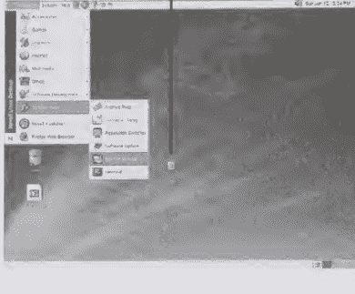

## 2 打开创建启动器对话框

| 创建文件夹 |
| 创建启动器 |
| 创建文档 |
| 按名称清理 |
| 保持对齐 |
| 文件 |
| 更改桌面背景 |

## 3 创建程序图标

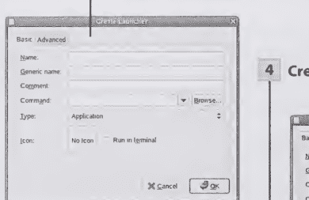

## 4 创建文档图标

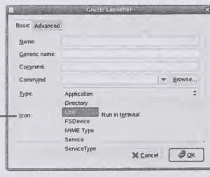

## 5 创建新文件夹图标

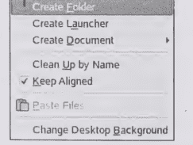

## 19 创建桌面图标

### 创建文档图标

你也可以在桌面上放置文档图标，以便快速访问特定文件（如文档或电子表格）。在“创建启动器”对话框中，选择“类型”下拉框并选择“链接”。你可以使用“浏览”按钮找到你想要创建图标的文件。如果你想为文档使用特殊图标，点击“无图标”框并选择一个图标。点击“确定”将图标放置在桌面。

注意

文件路径实际上被放在“创建启动器”对话框的 URL 框中（当你从下拉列表中选择“链接”时，“命令”框会变为“URL”框）。有趣的是，URL 可以指向本地文件或外部网站，而我们通常以 URL 的概念来考虑它们。

### 创建新文件夹图标

要快速在桌面上创建一个新文件夹，在桌面上点击右键并从快捷菜单中选择“创建文件夹”。新文件夹将出现在桌面。为新文件夹输入名称。双击图标打开打开新的（空）文件夹。

注意

你在桌面上创建的文件夹实际上是用来存放文档和子文件夹的。它们与你拥有的桌面图标不同，桌面图标仅仅是应用程序、应用程序或其他项目的指针。

提示

要整理桌面图标（包括你创建的任何新图标），在桌面上点击右键并选择“按名称清理”。

提示

从桌面移除图标非常简单。选择图标然后按 Delete 键。该图标将移动到垃圾箱。

## 20 向面板添加项目

你还可以向桌面面板添加快速启动图标。这允许你快速访问任意数量的程序，而不会让桌面充斥额外的图标。你可以将快速启动图标添加到顶部或底部面板。

✓ 在开始之前

+   6 关于 GNOME 桌面 
7 导航 GNOME 桌面 
19 创建桌面图标

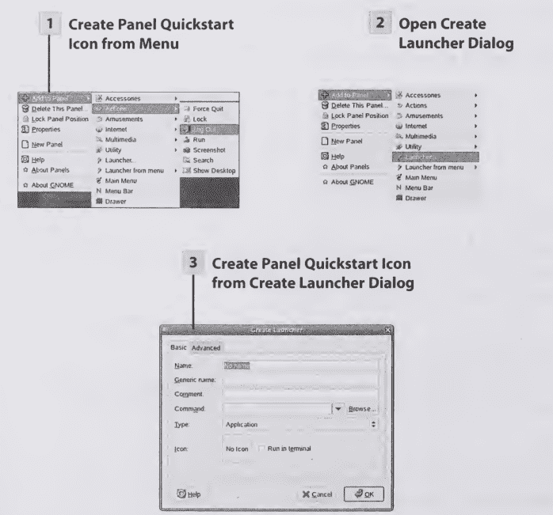

### 3 从创建启动器对话框创建面板快速启动图标

### 20 向面板添加项目

### 从菜单创建面板快速启动图标

将鼠标指针放置在顶部或底部面板任一上。右键点击并选择“添加到面板”。会出现一个子菜单，其中提供了一系列类别（附件、操作、娱乐等）。每个类别都包含一组小应用程序和实用程序。选择一个类别，然后选择一个特定的小程序。该小程序的快速启动图标将放置在面板上。

### 打开创建启动器对话框

你也可以使用“创建启动器”对话框为面板创建快速启动图标。右键点击面板，选择“添加到面板”，然后选择“启动器”。“创建启动器”对话框将会打开。

### 在创建启动器对话框中创建面板快速启动图标

输入程序、文档或其他项目的名称，然后在“类型”框中输入相应信息（从下拉框中选择类型）。输入完相应信息后，点击“确定”以创建面板图标。

### 提示

你可以删除添加到面板面板的任何快速启动图标。右键点击该图标并选择“从面板中移除”。

### 提示

如果你需要，可以在桌面上添加额外的面板，然后向它们中填充快速启动图标。右键点击现有面板并选择“新建面板”。桌面右侧将添加一个新的垂直面板。你可以根据需要向此新面板添加图标。如果你想删除已添加的面板，右键点击该面板并选择“删除此面板”。

## 向菜单添加项目

你可以向“程序”菜单添加项目（无法向“系统”菜单添加项目）。特别是，你可以添加当前未出现在主“程序”菜单及其子菜单中的程序或小应用程序。该过程与为桌面和桌面面板创建程序图标类似；你使用“创建启动器”对话框来输入程序图标的信息。

✓ 在开始之前

- 6 关于 GNOME 桌面
- 8 使用菜单系统
- 20 向面板添加项目

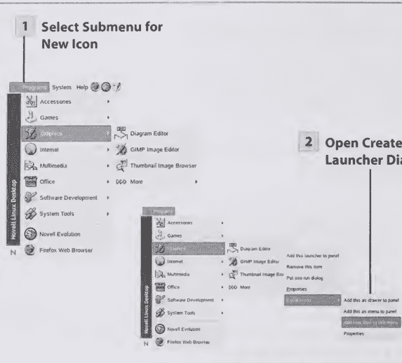

1 为新图标选择子菜单

2 打开创建启动器对话框

3 在创建启动器对话框中输入信息

21 向菜单添加项目

### 为新图标选择子菜单

打开“程序”菜单，然后选择你想要放置新图标的子菜单。

### 打开创建启动器对话框

右键点击子菜单。在出现的快捷菜单上选择“整个菜单”，然后选择“向此菜单添加新项目”。“创建启动器”对话框将会打开。

### 在创建启动器对话框中输入信息

在“创建启动器”对话框中输入相应信息（程序名称和程序命令）。为程序选择一个图标（选择“无图标”框）。要创建新菜单项，点击“确定”。你现在可以使用新图标在相应的子菜单上访问该程序。

> 提示
> 你可能需要注销然后重新登录，才能看到对 NLD 菜单系统所做的更改（例如添加图标）。

## 关于 GNOME 个人设置

- 在开始之前

NLD 个人设置提供了对特殊辅助功能、外观设置、硬件设置和系统设置的控制。例如，如果你想设置屏幕保护或添加新打印机，你处理的就是个人设置。各种用户设置通过“设置”对话框访问，该框是一组按类别分类的图标。

这四个设置类别为：

- 个人——这些设置与键盘上可以启用的辅助功能以及用于更好地查看桌面的工具有关（在用户需要与查看桌面相关的特殊能力的情况下）。在“个人”设置下控制辅助功能的四个图标中有两个是“辅助功能”和“辅助技术支持”。
- 外观——“外观”设置包括背景、主题和字体。
- 硬件——硬件设置包括打印机和分辨率。
- 系统——“系统”设置包括关联、会话和声音。

“个人”设置下控制辅助功能的四个图标中有两个是“辅助功能”和“辅助技术支持”。各种用户设置通过“设置”对话框访问，该框是一组按类别分类的图标。

## 提示

要关闭屏幕阅读器/放大镜，请关闭 Gnomopicus 窗口（该窗口允许您配置屏幕阅读器/放大镜）。您可以使用程序菜单上的“辅助功能”子菜单重新启动任何辅助工具。要禁用所有辅助工具，请返回“辅助技术偏好”对话框并取消勾选“启用辅助技术”复选框。

## 5 修改程序菜单

您可以通过添加新文件夹和程序启动器图标来修改程序菜单。在“设置”对话框中双击“菜单”。要在“程序”菜单或任何子文件夹中创建新文件夹（双击子文件夹打开它），选择“文件”并选择“新建文件夹”。为新文件夹输入名称。

要添加程序图标，选择“文件”并选择“创建启动器”。“创建启动器”对话框提供了一个名称和用于启动该程序的命令（您也可以浏览查找程序）。点击“确定”创建启动器图标。在向“程序”菜单（或子菜单）添加完项目后，关闭“程序”窗口。

## 6 设置快捷键

键盘快捷键（辅助键如 Alt 或 Shift 与另一个按键的组合）允许您快速执行特定任务，例如打开网络浏览器、注销或更改系统量。双击“图标”打开“键盘快捷键”对话框。要为特定操作设置快捷键，请在“操作”列表中该操作（没有快捷键的操作将显示为禁用）。要创建快捷键，请在键盘上按下相应的按键组合。快捷键组合将出现在所选操作左侧的“快捷键”列表中。完成键盘快捷键设置后，点击“关闭”。

## 24 更改桌面背景

背景或壁纸覆盖了桌面的大部分区域，为工作环境提供了背景。您可以通过选择自己的背景来个性化桌面。您可以从现有背景列表中进行选择，也可以下载额外的背景。背景的文件格式为 jpeg 图形格式。您下载的任何 jpeg 文件或您保存为 jpeg 的任何照片都可以作为桌面背景。

## 在开始之前

22 关于 GNOME 个人设置

### 1 打开桌面背景偏好设置对话框

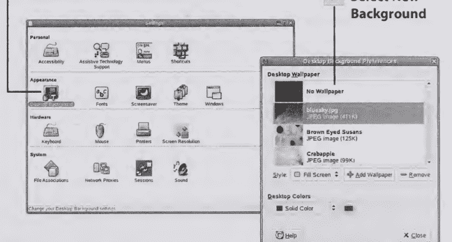

### 2 选择新背景

### 3 选择背景样式

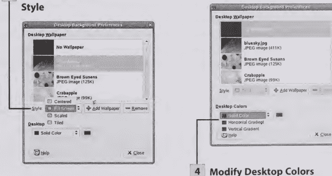

### 4 修改桌面颜色

更改桌面背景

网络资源

http://www.gnome.org

访问此网站为 GNOME 桌面下载额外的背景。


# 第 4 章：修改 NLD 桌面

提示

如果您想使用绘画软件创建自己的背景或利用拍摄的数码照片，请将最终 `jpeg` 保存为适当的大小，以便其覆盖桌面而不产生失真。例如，如果您在 `800X600` 像素下运行 NLD 桌面，请将您的图像和照片保存为 `800X600` 大小。这将使文件成为桌面背景的理想选择。

## 1 打开桌面背景偏好设置对话框

在“设置”对话框中（在“外观”面板），双击“桌面背景”图标。

## 2 选择新背景

要从背景列表中进行选择，请滚动“桌面壁纸”列表，然后选择一个新背景。

## 3 选择背景样式

在将背景放置在桌面方面有四种设置：

- 居中——将背景放置在桌面中心。（取决于图像尺寸，此选项不一定用背景覆盖整个桌面。）
- 填充全屏——此选项将背景拉伸覆盖整个桌面；但是，它会保持图像的高宽比以最小地减少失真。
- 缩放——将图像拉伸到屏幕边缘，并保持图像的高宽比以最小地减少失真。
- 平铺——取决于文件大小（以及您的桌面分辨率），图像将以瓷砖的形式在桌面上重复。大多数默认背景文件在您选择其中一个时，实际上显示为经过缩放的（因为图像尺寸的原因）。

从“样式”下拉列表中选择您想要使用的放置设置。

## 修改桌面颜色

如果您想放弃使用背景图像，可以在“桌面壁纸”列表中选择“无壁纸”设置。然后，您可以在“桌面颜色”下拉列表中选择“纯色”（单色桌面）、“水平渐变”（使用两种选定的颜色从左到右创建渐变）或“垂直渐变”（使用两种选定的颜色从上到下创建渐变）。

要选择颜色（或渐变的颜色），请选择“桌面颜色”下拉列表旁边的“颜色”按钮（或按钮）。选择一种颜色调色板选项。从色轮上选择一种颜色，然后点击“确定”。如果您正在创建渐变，请重复此过程。完成对桌面背景设置的更改后，点击“关闭”按钮。

您可以通过右键点击桌面并从快捷菜单中选择“更改桌面背景”来快速更改桌面背景。

要添加新的背景文件（背景文件为 `jpeg` 格式，因此任何 `jpeg` 都可以——即使是照片），请选择“桌面背景偏好设置”对话框中的“添加壁纸”按钮。将打开一个“添加壁纸”窗口。您可以浏览并想要添加到背景列表的图像文件 (`jpeg`)。选择新背景文件，然后选择“打开”。该背景将添加到您的背景列表中。

## 更改字体

您还可以控制用于应用程序、桌面、窗口标题和您的终端会话的字体。这些选项在“字体偏好”框中可用。

- 在开始之前
- 关于 GNOME 个人设置

# 第 4 章：修改 NLD 桌面

## 1 打开字体偏好对话框


## 2 打开字体选择框


## 3 选择字体族、样式和大小


## 4 选择字体渲染


## 25 更改字体

# 打开字体偏好对话框

在“设置”对话框中（在“外观”面板），双击“字体”图标。这将打开“字体偏好”框。可以通过点击相应的选项对应用程序、桌面、窗口或您的终端会话进行字体更改。

## 2 打开字体选择框

选择一个字体更改框（例如“应用程序”字体）。这将打开“选择”对话框。

提示

您可以根据需要为系统添加 TrueType 字体。使用 Firefox 查找提供字体的网站。将字体下载到您在桌面上创建的文件夹中（右键点击下载链接并选择“另存为”以指定文件夹）。打开您用于存储下载字体的桌面文件夹。打开您的主目录。在主窗口中，选择“文件”并选择“位置”。在对话框中输入 `fonts:///` 然后点击“打开”。这将打开系统的字体文件夹。将字体从您创建的文件夹拖入系统。现在您可以访问添加的字体了。

在“选择”对话框中，从“字体族”列表中选择一个新的字体族。如果您想更改字体样式，请在“样式”列表框中选择新样式。最后，要更改字体大小，请在“大小”列表中进行选择。点击“确定”返回“字体偏好”对话框。

## 选择字体渲染

默认情况下，字体使用“最佳形状”选项渲染。此选项平滑字体边缘，通常是标准显示器的最佳设置。您还可以选择“单色”（字体以黑白显示，但边缘未平滑）、“最佳对比度”（增强对比并平滑边缘；该设置旨在使屏幕更易读）和“亚像素平滑（LCD）”。“亚像素平滑”选项旨在从 LCD（笔记本电脑）和平屏显示器中获得最佳性能。在完成您的字体渲染选择后，点击“关闭”退出对话框。

注意

更改应用程序的字体和其他选项只会影响您的 GNOME 应用程序，这是因为因为 GNOME 是 NLD 的默认图形界面。然而，如果您切换到 KDE 桌面，将会发现字体更改未应用到您的应用程序和挂件中。

# 第 4 章：修改 NLD 桌面

提示

你可以指定与字体在你的显示器上渲染方式相关的额外设置。选择“详细”按钮可以微调平滑（smoothing）和微调（hinting）设置。

# 选择屏幕保护程序

屏幕保护程序的最初是为了保护计算机屏幕（我们指的是那些旧的琥珀色和单色显示器），防止在屏幕长时间不活动时将静态图像烧毁在屏幕上。我们现在使用的显示器不再有同样的烧屏问题，而且大多数是符合节能标准的设备，在空闲一段时间后会自动关闭。屏幕保护程序实际上主要是为了好玩，同时也在你离开电脑时提供锁定屏幕的功能。

- 在开始之前
- 相关链接
- 关于 GNOME 个人设置
- 使用锁屏工具

# 打开屏幕保护程序偏好对话框

在设置对话框中（在“外观”选项卡中），双击屏幕保护程序图标。这将打开屏幕保护程序偏好对话框。

# 选择屏幕保护程序模式

选择“模式”列表以选择以下之一：仅一种屏幕保护程序、随机屏幕保护程序（允许你选择一个屏幕保护程序列表进行随机选择）、空白屏幕保护程序（黑屏，但不使用屏幕保护程序）或禁用屏幕保护程序（禁用屏幕保护程序功能）。

# 选择屏幕保护程序

如果你选择“仅一种屏幕保护程序”模式，从提供的屏幕保护程序列表中选择一个屏幕保护程序。如果你选择“随机屏幕保护程序”，列表中的屏幕保护程序旁边会有复选框。根据需要启用或取消勾选框，以选择将使用的屏幕保护程序。

# 1 打开屏幕保护程序偏好对话框

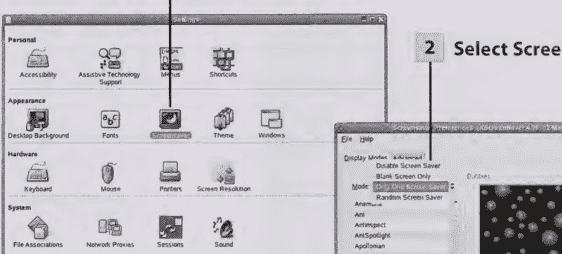

# 2 选择屏幕保护程序模式

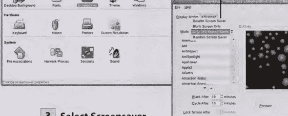

## 3 选择屏幕保护程序

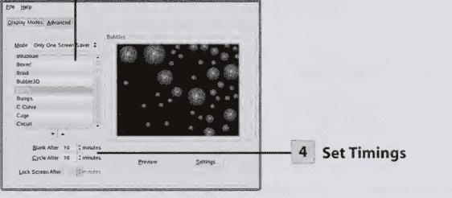

## 4 设置时间

要查看屏幕保护程序的全屏预览，请在列表中选择该屏幕保护程序然后选择“预览”。此外请注意，某些可用的屏幕保护程序需要大量的计算机资源才能运行。如果你有一台性能很强的新系统，可以随意运行任何屏幕保护程序。在旧的系统上，你可能希望坚持一些较简单的屏幕保护程序选项。

# 第 4 章：修改 NLD 桌面

# 设置时间

你可以设置屏幕保护程序在屏幕变黑之前运行多长时间，以及如果你选择使用“随机屏幕保护程序”模式，屏幕保护程序循环的频率。根据需要设置“空闲后变黑”（Blank After）和“循环”（Cycle）时间设置。如果你还想锁定屏幕并在输入密码重新进入系统，请勾选“后锁定屏幕”（Lock Screen After）复选框并设置时间（用于锁屏工具）。完成屏幕保护程序偏好对话框中的设置后，关闭对话框。

提示

如果你想为符合节能标准的显示器设置显示电源管理（例如显示器进入待机状态的时间），请选择屏幕保护程序偏好对话框的“高级”选项卡。“高级”选项卡还提供了图像处理设置，你可以在其中设置屏幕保护程序使用你存储在文件夹中的图像文件。

## 使用锁屏

在配置屏幕保护程序时，可以通过在屏幕保护程序偏好对话框中设置时间来锁定屏幕。当你准备离开电脑并锁定屏幕时，可以使用系统菜单上的“锁屏”命令。锁定屏幕后，屏幕保护程序会在短时间后启动，此时你将使用密码解锁屏幕。

- 在开始之前
- 关于 GNOME 个人设置
- 选择屏幕保护程序

## 锁屏

选择系统菜单，然后选择“锁屏”。屏幕保护程序锁屏界面出现。你现在可以离开电脑了。

| 1 锁屏 | 2 解锁屏幕 |
| --- | --- |
|  |  |

## 解锁屏幕

当你回到电脑时，屏幕保护程序正在运行，移动鼠标或按下键盘。解锁屏幕。锁屏对话框已打开。输入你的用户名并按 `回车` 以解锁电脑。

# 关于桌面主题

- 在开始之前
- 关于修改 GNOME
- 修改桌面背景

在优化和个性化桌面的外观和感受方面，最佳选择是使用桌面主题。虽然桌面背景设置了你看到的 NLD 桌面上的图像，但主题可以改变你窗口的外观。

# 第 4 章：修改 NLD 桌面

所以，主题让你的窗口焕然一新。每个主题实际上由三个子主题组成：控件、窗口边框和图标。通过主题对话框查看提供的特定主题。主题实际上由三个子主题组成：控件、窗口边框和桌面图标。


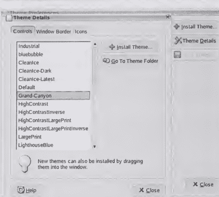

你可以混合匹配子主题并创建你自己的主题。将桌面背景与主题提供的颜色和整体风格匹配，可以为 NLD 桌面创建一个统一的外观。

你可以下载额外的主题和子主题并添加到主题设置中。

## 提示

你可以使用 Firefox 下载主题。很好的起点是 http://www.gnome.org。在 GNOME 主页上，选择“艺术与主题”链接进入提供主题下载的页面。当你准备下载主题（这些通常是控件或窗口框的子主题）时，右键点击下载链接并使用“另存为”将主题保存到桌面上的文件夹中。这使得你将这些主题元素添加到现有主题或新创建的主题中变得简单。

选择互补的主题和桌面背景，为你的 NLD 桌面提供统一的外观。

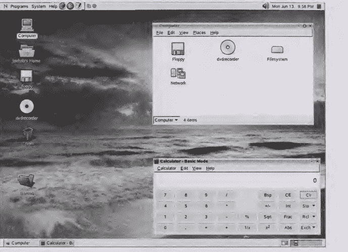

# 修改当前桌面主题

主题选择在主题偏好对话框中进行。该对话框通过设置对话框中的“主题”图标打开。

- 在开始之前
- 关于 GNOME 个人设置
- 关于桌面主题

## 打开主题偏好对话框

在设置对话框中，双击“主题”图标。这将打开主题偏好对话框。

### 1 打开主题偏好对话框

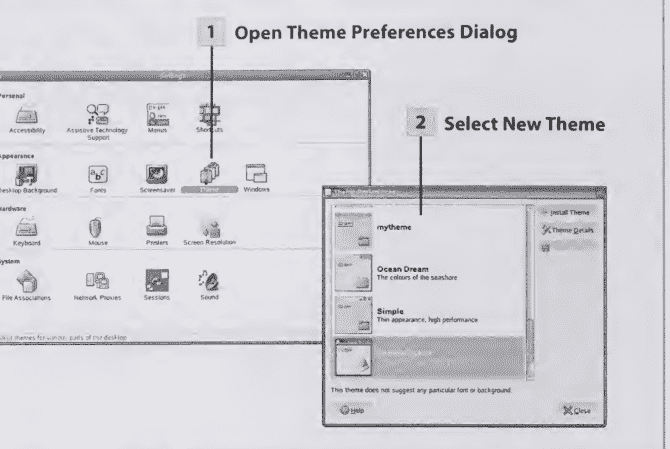

### 2 选择新主题

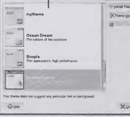

## 选择一个新主题

在主题偏好对话框中，从主题列表中选择一个新主题。主题对窗口控件和边框的更改将应用于你当前打开的窗口（包括主题偏好对话框）。然后，你可以关闭主题偏好对话框；选择“关闭”。

## 在 GNOME 中添加主题

### ✓ 在开始之前

- 22 关于 GNOME 个人设置
- 28 关于桌面主题
- 29 更改当前桌面主题

### 1 选择一个主题进行编辑

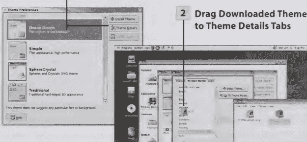

### 2 将下载的主题拖入主题详情标签页

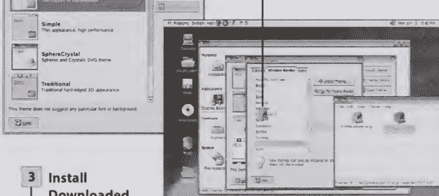

### 3 安装下载的主题

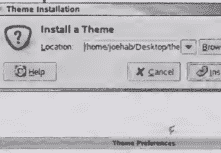

### 4 选择新主题详情

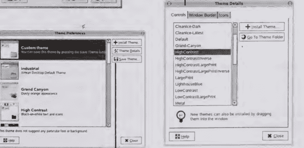

### 5 保存新主题

## 选择一个主题进行编辑

在“主题偏好”对话框中，选择一个要编辑的主题。选择一个包含你创建的主题中所需的属性的主题（例如控件或图标）。然后点击“主题详情”按钮打开“主题详情”对话框。

## 将下载的主题拖入主题详情标签页

此步骤是可选的。如果你从网上下载了主题元素，可以将它们添加到“主题详情”标签页中。例如，如果你下载了窗口边界主题（主题和主题元素以文件名.tar.gz格式的归档文件下载），你可以将其添加到“窗口边界”标签页。选择“窗口边界”标签页并将下载的文件拖到标签页。当你松开文件时，会打开“主题安装”对话框。

> 注意
>
> 你下载的主题文件具有 tar.gz 扩展名。这意味着它们是压缩文件。你不需要解压文件即可使用。可以直接将压缩文件拖到主题详情标签页并安装。

## 安装下载的主题

此步骤是可选的，且需要步骤 2。在“主题安装”对话框中，点击“安装”按钮。新的主题元素将被添加到相应的标签页（你将主题文件拖入的标签页）。你可以重复步骤 2 和 3 将其他下载的主题元素添加到相应的标签页。

## 选择新主题详情

现在你可以在“控件”、“窗口边界”和“图标”标签页上选择新主题的子主题。选择新元素后，点击“主题详情”对话框中的“关闭”按钮。你将返回“主题偏好”对话框。

## 保存新主题

“主题偏好”对话框的主题列表顶部会出现一个名为“自定义主题”的新主题。点击“保存主题”按钮。打开“保存主题”对话框。为新主题提供名称和可选注释。然后点击“保存”。新主题将出现在主题列表中。新主题将被选为当前主题。要关闭“主题偏好”对话框，请点击“关闭”。

## 更改窗口偏好

“设置”对话框还允许你控制当鼠标悬停在窗口上或双击标题栏时，桌面窗口的行为。对于双击标题栏，你可以从两种不同的行为中进行选择。你可以让窗口最大化，也可以收起。当你选择“收起”时，只保留标题栏，从桌面上清除大部分窗口。

- 在开始之前
- 关于 GNOME 个人设置

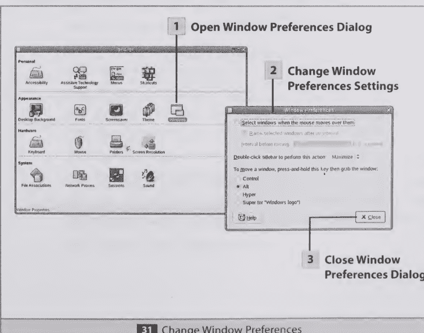

### 31 更改窗口偏好

# 第 4 章：修改 NLD 桌面

## 1 打开窗口偏好对话框

在“设置”对话框中，双击对话框“外观”面板中的“窗口”图标。将打开“窗口偏好”对话框。

## 2 更改窗口偏好设置

在“窗口偏好”中，如果你想通过鼠标悬停在窗口上来激活窗口，请勾选“鼠标悬停时选择窗口”复选框。你还可以设置窗口获取焦点之前需要的时间间隔。勾选“间隔后置顶”复选框并设置间隔时间。

如果你想更改双击标题栏时的窗口行为（默认为最大化），请勾选“双击标题栏执行此操作”框并选择“收起”。现在，当你双击标题栏时，窗口将收起。

你还可以选择在想要拖动窗口时使用的辅助键（默认不需要辅助键，默认为 Alt 键）。选择 Control、Hyper 或 Super（或“Windows 标志”）等选项框来更改按键选择。

## 3 关闭窗口偏好对话框

在“窗口偏好”对话框中完成设置更改后，点击“关闭”按钮关闭对话框并返回“设置”对话框。

注意：除了通过鼠标悬停来聚焦窗口的能力以及通过双击标题栏收起窗口的能力外，“窗口偏好”对话框中的其他选项可能最好保持默认值。

## 配置 NLD 硬件和系统设置

在本章中：

- 32 关于在 NLD 中配置硬件和系统设置
- 33 更改键盘设置
- 34 更改鼠标设置
- 35 关于打印与 NLD
- 38 添加并配置打印机
- 32 打印到打印机
- 38 管理打印作业
- 39 删除打印机
- 40 配置声音设置
- 41 更改屏幕分辨率
- 42 更改会话设置
- 43 更改其他系统设置

# 第 5 章：配置 NLD 硬件和系统设置

在像 NLD 这样的 GUI 环境工作时，能够配置输入输出设备（如键盘、鼠标、显示器和声卡）的硬件设置是非常重要的。GNOME 提供了一套易用的工具，允许你控制这些各种设备的设置。

每个用户都需要打印自己的工作，NLD 为你提供了配置打印机和管理打印作业的能力。本章将介绍如何配置键盘、鼠标和打印机等各种硬件项目。我们还查看了其他设置，包括会话和系统设置（如文件关联）。我们将从 GNOME 为用户提供的用于配置各种硬件设置的工具概览开始讨论。

## 32 关于在 NLD 中配置硬件和系统设置

- 在开始之前
- 6 关于 GNOME 桌面
- 18 关于修改 GNOME
- 另请
- 23 更改个人设置

用户可以配置的（与知道 root 密码的管理员不同） NLD 硬件和系统设置可以在“设置”对话框中找到。

使用“设置”对话框访问用户硬件和系统设置。

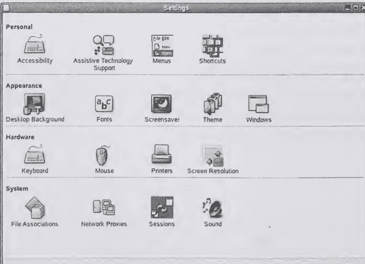

## 32 关于在 NLD 中配置硬件和系统设置

### 注意

虽然其他操作系统（特别是为家庭和小型办公室设计的系统）在更改硬件和系统设置方面为用户提供了更大的能力，但 NLD 是为网络环境设计的，尽管它确实可以作为家庭电脑的独立操作系统运行。NLD 在硬件和系统设置方面提供了更高的安全性，许多设置需要 root 密码。这实际上限制了“用户错误”配置问题，因为典型用户只能访问硬件系统设置的基础子集。

可用的硬件设置有：

- 键盘——包括重复键延迟和速度、光标闪烁速度和键盘布局。你还可以配置打字休息功能，它会在特定时间后锁定屏幕，要求你离开键盘。
- 鼠标——包括鼠标方向（左手或右手）、双击超时、光标大小以及鼠标速度和灵敏度。
- 打印机——通过设置中的打印机访问的功能包括添加打印机（如果你有 root 权限）、设置打印机属性（如纸张、布局和纸源），以及打开打印机队列并管理你的活动打印作业。
- 屏幕分辨率——可以访问“屏幕分辨率”对话框，允许你控制分辨率和刷新率。

## 术语

刷新率——刷新率基本上是显示器屏幕每秒重绘的次数。刷新率以 Hz（赫兹）测量。例如，80Hz 的刷新率意味着屏幕每秒刷新 80 次。

声音设置实际上并没有与之前讨论的其他硬件设置分在一起。要访问声音设置，双击“设置”对话框中“系统”面板中的“声音”图标。系统设置还允许你配置文件关联、网络代理和会话设置。关于系统设置的更多细节如下：


# 第 5 章：配置 NLD 硬件和系统设置


- 文件关联——“文件类型和程序”允许您控制包含在音频、文档和图像等文件类别中的文件类型。您还可以将不同的应用程序和服务与特定的文件类别关联。大多数文件类型，GN 都能通过文件扩展名轻松识别，因此只有当您处理未被其识别为特定文件类型的文件时，才真正需要使用“文件类型和程序”配置工具。

- 网络代理——您可以为您的 Internet 连接配置代理设置。在大多数情况下，代理设置是在 NLD 安装期间定义的。但是，您可以使用“网络代理配置”对话框来配置自己的代理设置。代理服务器位于您的计算机（以及网络上的其他计算机）之间，负责处理您的计算机与服务或其他计算机之间的事务。

## 关键术语

代理服务器——代理服务器用于为连接 Internet 的联网计算机提供安全保护。代理服务器位于您的网络和互联网之间，处理在内部网络和互联网之间传输的入站和出站信息。只有代理服务器对内网外的计算机“可见”，这保护了您的计算机以及内网上的其他计算机不受外部攻击。

## 提示

代理设置通常在 NLD 安装期间配置。除非您确定连接 Internet 是必要的，否则请更改代理设置。

- 会话——每次您登录 NLD 时，您都在一个会话中工作。“会话”对话框允许您配置设置，例如自动保存您在当前会话期间对 NLD 进行的更改。它还允许您查看（并删除）当前运行的程序，并指定登录开始新会话时应启动的程序。

- 声音——“声音偏好”对话框允许您指定当系统发生某些事件时是否播放声音文件。这些事件包括用户界面事件（如选择菜单）以及其他事件（如收到新邮件或注销系统时）。

# 修改键盘设置

您的键盘在 NLD 安装期间会被识别。但是，您可以在“键盘偏好”对话框中更改键盘设置。

- 开始之前
- 23 更改个人设置
- 32 关于在 NLD 中配置硬件和系统设置

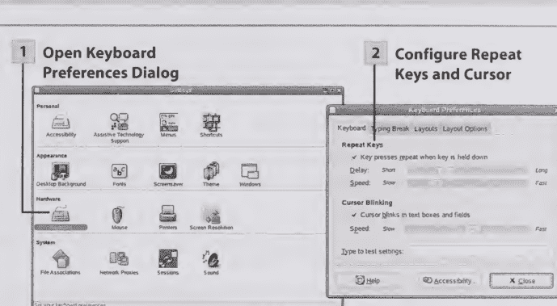

## 3 配置击字间隔设置

## 4 配置键盘布局


## 5 添加布局选项

## 6 关闭键盘偏好对话框


## 33 更改键盘设置

### 打开键盘偏好对话框

在设置对话框中（选择**系统，个人设置**），双击**键盘**图标。

### 配置重复键和光标

在键盘偏好对话框的**键盘**选项卡上，使用“重复键”复选框下方的**延迟**和**速度**滑动条，分别设置按键重复的时间延迟（例如，按住*d键*时字母 *d* 重复所需的时间）和重复的速度（动作重复的快慢）。设置光标闪烁速度（闪烁快慢），使用**光标闪烁速度**滑动条。

如果您在键盘选项卡上更改了重复键和光标闪烁设置，请使用“测试设置”框输入一些示例文本并测试新设置。

### 配置击字间隔设置

选择键盘偏好对话框的**击字**选项卡。这允许您设置击字间隔。击字间隔的设计目的是强迫您离开键盘休息一下，因此是一项可选设置。要配置击字间隔，勾选**锁定屏幕以强制击字间隔**复选框。然后在**工作间隔持续时间**和**休息间隔持续时间**数字调节框中输入时间设置。如果您希望能够推迟“强制”休息，请勾选**允许延迟休息**复选框。

如果启用了击字间隔，顶部面板会出现一个红色计时器。将鼠标悬停在上面即可查看距离下次休息还剩余多少时间。当休息开始时，会打开“休息”对话框并显示休息的剩余时间。如要推迟当前休息（您必须勾选允许延迟休息复选框），请选择“冻结”桌面左下角的**推迟休息**按钮。

## 33 更改键盘设置

注意

您正在使用的键盘类型在 NLD 安装期间会被识别。在重新配置键盘布局（特别是更改键盘型号）时，您可能需要谨慎。

## 4 配置键盘布局

选择键盘偏好对话框的**布局**选项卡。要更改键盘型号，请选择键盘型号列表并从列表中选择您的型号（确保您的键盘与列表上的型号正确匹配）。要向当前键盘配置添加布局，请滚动查看“可用布局”列表并选择列表中的某种布局；然后点击“添加”按钮。也可以从“已选布局”列表中删除布局。选择一种布局，然后点击“删除”按钮。使用向上和向下按钮重新排列“已选布局”列表中的布局顺序。

提示

如果您想将键盘布局设置还原为默认值，请选择**重置为默认值**。

## 5 添加布局选项

您还可以为键盘添加选项以控制某些按键的行为。选择**布局**选项卡。右侧会提供选项列表。例如，选择“行为”类别查看如修饰键之类的选项。从列表中选择特定选项，然后点击“添加”按钮将其加入。要移除某个选项，请选择它然后点击“删除”按钮。

## 6 关闭偏好对话框

当您完成键盘设置后，点击“关闭”按钮关闭偏好对话框并返回设置对话框。

# 修改鼠标设置

您可以将鼠标设置为右手或左手模式。您还可以控制其他鼠标设置，如光标大小。

- 开始之前
- 23 更改个人设置
- 23 关于在 NLD 中配置硬件和系统设置


## 3 配置光标设置

## 4 配置移动设置


## 5 关闭偏好对话框

### 打开鼠标偏好对话框

在设置对话框中（选择**系统，个人设置**），双击**鼠标**图标。

### 配置按钮

在**按钮**选项卡上，勾选**左手鼠标**复选框将鼠标切换为左手使用。要设置双击超时，请使用滑动条。超时是指两次连续点击鼠标被解释为实际双击所需满足的时间间隔。

提示

记住，双击的默认超时时间为 .4 秒。如果您调整了超时设置，可以通过操作桌面图标或其他需要双击的对象来测试新设置。

### 配置光标设置

选择**光标**选项卡。这允许您调整鼠标光标的大小。您可以从默认（小）更改为中等或大；选择合适的选项。另一个可以快速定位鼠标光标的选项（这在旧的 LCD 屏幕上非常有用）是定位光标选项。勾选**按 Ctrl 时高亮光标**复选框以启用此选项。

提示

某些设置更改（如鼠标光标大小更改）需要您注销并重新登录系统使新配置设置生效。必要时使用系统菜单注销，然后可以从登录管理器重新登录。

## 第 5 章：配置 NLD 硬件和系统设置

## 5 关闭鼠标偏好对话框

在完成鼠标配置的更改后，你可以关闭鼠标偏好对话框，点击“关闭”按钮。

## 35 关于打印和 NLD

NLD 让你可以轻松地配置打印机并管理打印任务。这包括添加和删除打印机（添加或删除打印机需要 root 密码）以及选择纸张和纸盒选项。你可以在桌面上查看和管理打印任务。

大多数打印机（直接连接到 PC 的打印机）在 NLD 安装期间会自动安装。你可以随时更改已安装打印机的配置，并根据需要添加新打印机。

坦率地说，从 Linux/UNIX 系统打印并不一直是一件轻松的事。然而，NLD 利用名为 CUPS（通用 UNIX 系统）的打印系统。CUPS 让你能够轻松添加和配置直接连接到计算机或通过网络上的其他计算机（例如运行 NLD 或其他 Linux 发行版）提供的打印机。

## 注意

> CUPS 是一个可移动打印系统，这意味着它不是操作系统的一部分。它的设计旨在“配合”你的操作系统，包括 NLD 和其他 Linux 发行版。（CUPS 也在为 Windows 环境开发）。CUPS 实际上为你想要使用的打印机提供软件驱动程序。有关 CUPS 和打印机驱动下载库的更多信息，请查看 http://www.cups.org。

CUPS 还让你能够使用 HP Direct 技术连接直接到网络的打印机（打印机基本上有自己的网络网卡）。如果你在一个可以与 Microsoft Windows 用户共享打印机的环境中工作，你可以利用 SAMBA（一种允许 Linux 系统与 Windows 系统共享文件和打印机的协议）。你完全不需要非常了解 SAMBA 就能利用它。Gnome “添加打印机”实用程序可以让你轻松地在 Windows 工作组或网络上选择打印机，然后帮助你配置基本的 SAMBA 设置以连接到打印机。

## 注意

HP DirectJet 技术只是将打印机连接到网络的可能的硬件解决方案之一。然而，它是大型网络实施方面的行业领导者。对于较小网络的其他可能性包括来自 D-link 的 USB 以太网打印服务器和 Netgear 的 USB 微型打印服务器。

## 核心术语

CUPS——通用 UNIX 打印系统的缩写，CUPS 提供了一套打印机驱动程序和打印架构，使得从 Linux（如 NLD）和 UNIX 系统配置打印机和打印变得简单。

## 核心术语

SAMBA——一种开源协议，复制了微软 SMB（服务器消息块）协议的功能。简单来说，SAMBA 提供了一个桥梁，允许如 NLD 等的 Linux 系统与运行 Microsoft Windows 的计算机（以及 SMB）进行通信。这意味着 Linux 系统可以透明地共享文件和打印机。


当你添加一个在你系统的远程打印机（即在网络上的另一台计算机上）时，你需要某些信息来完成安装。在 `CUPS` 打印机（连接到其他 `NLD` 或 `Linux` 计算机）的情况下，你需要知道打印机的 `URI`（统一资源标识符）。你可以以两种格式输入此信息：

```
http://hostname:631/ipp/
```

或者

```
ipp://hostname/ipp/
```

`hostname` 是安装期间分配给计算机的名称。你需要作为远程打印机连接服务的远程计算机的主机名。你可以通过打开终端窗口（选择“程序”、“系统工具”、“终端”）来快速找到你的计算机或另一个 `NLD`（`Linux`）计算机的主机名。终端中的提示符显示为 `用户名@hostname`。其中 `hostname` 是计算机的名称。

## 注意

除非你拥有一个运行 `NLD` 或系统的小型办公室或家庭网络并担任网络管理员，否则你真的需要与你的网络管理员联系，获取有关设置连接到网络远程打印机的帮助。网络管理员甚至可以为你完成这项工作，节省你的时间和烦恼。

在你想利用由小型办公室或家庭网络中基于 `Microsoft Windows` 的计算机托管的打印机的情况下，你需要 `Windows` 计算机的名称以及该 `Windows` 计算机所属的工作组名称。你还需要在 `Windows` 计算机上设置的用户名和密码，以便建立到远程打印机的连接。

你可以使用 `GNOME` “添加打印机”实用程序添加和配置打印机（本地和远程），该实用程序通过“打印机”窗口中的“新建打印机”图标访问（该窗口通过“设置”对话框中的“打印机”图标打开）。`GNOME` “添加打印机”实用程序实际上会引导你完成设置打印机的步骤。

## 注意

在大多数情况下，在 `NLD` 安装期间识别出的打印机应该在系统上“预安装”好。

你确实可以选择通过“管理员设置”提供的 `YaST` 配置实用程序来添加和删除打印机。然而，在随后的打印机信息安装中，我们假设你是一个拥有 `root` 密码的典型用户，并将使用 `GNOME` “添加打印机”实用程序连接打印机。

关于打印机的一点：你可以设置本地打印机或网络打印机。本地打印机通过电缆直接连接到你的计算机。打印机可以作为并行端口（历史上个人电脑上的“典型”打印端口）、串口端口（可用于其他设备如外接调制解调器的端口）或 `USB` 端口（大多数计算机都有多个 `USB` 端口）连接。许多新打印机使得通过 `USB` 端口连接到计算机成为可能。

在将打印机添加到 `NLD` 配置之前，请确保打印机在物理上已连接到计算机。通过 `CUPS` 设置后让打印机准备就绪也允许你在设置后立即使用。

# 36 添加并配置打印机

设置对话框提供了访问打印机窗口的途径，该窗口是通过“硬件”面板中的“打印机”图标启动的。通过打印机图标打开的打印机窗口允许你添加打印机、更改打印机设置并打开打印机队列查看任务。

## 在开始之前


## 3 输入 root 密码


## 5 选择打印机驱动


## 6 配置新设置

### 1 打开打印机窗口

在“设置”对话框中（选择“系统”、“个人设置”），双击“打印机”图标。打印机窗口打开。

### 2 启动 GNOME 添加打印机实用程序

打印机窗口显示当前安装的打印机。要使用 `GNOME` “添加打印机”实用程序添加打印机，请双击“新建打印机”图标。

### 3 输入 root 密码

“以 root 运行”对话框打开。输入 `root` 密码然后点击“确定”。`GNOME` “添加打印机”实用程序打开。

### 4 选择打印机连接

在第 1 步中指定打印机的连接。如果打印机是本地用户，选择“打印机端口”下拉列表选择端口类型（并行、串口或 `USB`）。

如果你连接了新打印机且该打印机列在检测到的打印机列表中，选择“使用检测到的打印机”选项按钮，然后选择列表中的打印机。

如果你正在安装网络打印机，选择“网络打印机”按钮。使用下拉列表选择网络打印机的连接类型：

- `CUPS` 打印机 (`IPP`)—用于连接到网络上其他 `NLD` 或 `Linux` 系统的网络打印机。如果你选择此连接类型，你需要托管打印机的 `URI`。
- `Windows` 打印机 (`SMB`)—用于连接到运行 `Microsoft Windows` 操作的 `PC`（或服务器）的网络打印机。你需要 `Windows` 计算机名称、该计算机所属的工作组（或域）名称，以及在 `Windows` 计算机上设置的用户名和密码。
- `Unix LPD`—使用此连接到网络上使用 `TCP/IP` 协议栈的 `UNIX` 系统或 `Linux` 系统（你可以想象的几乎每个网络）。你通过主机名（或 `IP` 地址）和打印队列名称（远程系统）连接到远程打印机。
- `HP JetDriver` 打印机—大多数为网络打印设计的 `LaserJet` 打印机使用 `HP Direct` 卡，使其可以直接连接到网络。要使用此连接类型，你需要知道打印机的主名或 `IP` 地址。

选择连接类型并提供其他所需信息后，点击“下一步”按钮。

# 选择打印机驱动程序

在步骤 2 屏幕之后，选择“制造商”下拉列表并选择你的打印机制造商。然后滚动“型号”列表并选择你的打印机型号。打印机的驱动程序出现在“驱动程序”框中。点击“应用”按钮接受打印驱动程序。

> 提示

如果你在打印机驱动程序列表中没有看到你的打印机，可以从 http://www.cups.org 下载新的打印驱动程序。然后你可以使用“添加打印机”工具步骤 2 屏幕上的“安装驱动程序”按钮，从你的硬盘或可移动介质进行安装。

# 配置新打印机设置

为你新安装的打印机打开“属性”对话框。它包含五个选项卡：常规、纸张、高级、驱动程序和连接。

在“常规”选项卡上，更改打印机名称、添加描述或添加打印机位置。在“纸张”选项卡上，选择打印机尺寸、纸张类型和来源。在“高级”选项卡上，设置打印模式。在“驱动程序”选项卡上，为打印机选择不同的驱动程序。在“连接”选项卡上，修改连接信息（针对网络打印机）。

> 提示

你可以从打印机的属性对话框打印测试页。在更改任何默认属性之前打印测试页是一个主意。如果没有打印测试页，请检查“驱动程序”选项卡上的驱动程序信息以及“连接”选项卡上的连接信息（你在安装期间提供的）。

# 第 5 章：配置 NLD 硬件和系统设置

当你完成查看和配置打印机设置后，选择“关闭”。这将返回“打印机”窗口。你的打印机现在已准备可以使用。

提示

你可以访问任何已安装打印机的属性。在“打印机”窗口中，右键点击打印机并从菜单中选择“属性”。作为普通用户，你可以访问任何打印机的“常规”、“纸张”和“高级”选项卡。如果你想访问打印机的“驱动程序”和“连接”选项卡，请选择“成为管理员”按钮并输入 `root` 密码。“驱动程序”和“连接”选项卡将添加到打印机的属性对话框中。

# 37 打印到打印机

在系统中安装打印机后，你当然可以打印。所有具有打印能力的应用程序和组件都可以访问已安装的打印机或打印机。

在许多情况下，工具栏上的打印图标允许你将当前文档或其他项目直接发送到打印机。如果你对打印输出有更多控制需求，可以访问“打印”对话框。应用程序或组件“打印”对话框中可用的实际设置随程序而异。

- 开始之前
- 另请参
- 32 关于在 `NLD` 中配置硬件和系统设置
- 111 关于在 `Writer` 中打印
- 112 打印文档
- 35 关于打印和 `NLD`
- 127 打印电子表格
- 142 打印幻灯片、备注和讲义
- 1 打开应用程序或组件

选择“程序”菜单、子菜单（如“附件”），然后进入应用程序或组件图标以打开应用程序。输入文档或创建一个项目（例如绘图）。

- 2 打开打印对话框

在大多数应用程序和组件中，选择“文件”，“打印”以打开“打印”对话框。

# 打开应用程序或组件

# 打开打印对话框


# 配置打印设置


# 打印文档

# 配置打印设置

每个打印对话框取决于你运行的程序。在 `GNOME` 文本编辑器的打印对话框中，你被提供了三个选项卡：作业、打印机和纸张。这些选项卡上提供的功能在大多数应用程序中可用。

在“作业”选项卡上，你可以设置打印的行数（在其他应用程序中这是你想打印的页数）以及你想打印的副本数。在“打印机”选项卡上，你可以选择想要使用的打印机并为打印机配置双面打印（或其他设置）。在“纸张”选项卡上，你可以设置纸张类型、方向（纵向或横向）和要使用的纸盒。

# 4 打印文档

配置好打印设置后，就可以打印了。如果你想在屏幕上预览打印结果，请选择“打印预览”按钮（此按钮的位置取决于你使用的应用程序）。当你准备好打印文档时，点击“打印”按钮将项目发送到打印机。

> 注意

`NLD` 提供你将文档和其他项目直接打印到 `PDF` 文件的能力。`PDF` 文件是网站上文档的标准，它们还可以保留文档的“已发布”外观。


# 配置打印设置

NLD 提供你将文档和其他项目直接打印到 PDF 文件的能力。PDF 文件是网站上文档的标准，它们还可以保留文档的“已发布”外观。

> 注意
>
> NLD 提供你将文档和其他项目直接打印到 PDF 文件的能力。PDF 文件是网站上文档的标准，它们还可以保留文档的“已发布”外观。

## 4 打印文档

配置好打印设置后，就可以打印了。如果你想在屏幕上预览打印结果，请选择“打印预览”按钮（此按钮的位置取决于你使用的应用程序）。当你准备好打印文档时，点击“打印”按钮将项目发送到打印机。

> 注意
>
> NLD 提供你将文档和其他项目直接打印到 PDF 文件的能力。PDF 文件是网站上文档的标准，它们还可以保留文档的“已发布”外观。

每个打印对话框取决于你运行的程序。在 GNOME 文本编辑器的打印对话框中，你被提供了三个选项卡：作业、打印机和纸张。这些选项卡上提供的功能在大多数应用程序中可用。

在“作业”选项卡上，你可以设置打印的行数（在其他应用程序中这是你想打印的页数）以及你想打印的副本数。在“打印机”选项卡上，你可以选择想要使用的打印机并为打印机配置双面打印（或其他设置）。在“纸张”选项卡上，你可以设置纸张类型、方向（纵向或横向）和要使用的纸盒。

---

属性对话框为你新安装的打印机打开。它包含五个选项卡：常规、纸张、高级、驱动程序和连接。

在“常规”选项卡上，更改打印机名称、添加描述或添加打印机位置。在“纸张”选项卡上，选择打印机尺寸、纸张类型和来源。在“高级”选项卡上，设置打印模式。在“驱动程序”选项卡上，为打印机选择不同的驱动程序。在“连接”选项卡上，修改连接信息（针对网络打印机）。

> 提示
>
> 你可以从打印机的属性对话框打印测试页。在更改任何默认属性之前打印测试页是一个主意。如果没有打印测试页，请检查“驱动程序”选项卡上的驱动程序信息以及“连接”选项卡上的连接信息（你在安装期间提供的）。

# 第 5 章：配置 NLD 硬件和系统设置

当你完成查看和配置打印机设置后，选择“关闭”。这将返回“打印机”窗口。你的打印机现在已准备可以使用。

提示


你可以访问任何已安装打印机的属性。在“打印机”窗口中，右键点击打印机并从菜单中选择“属性”。作为普通用户，你可以访问任何打印机的“常规”、“纸张”和“高级”选项卡。如果你想访问打印机的“驱动程序”和“连接”选项卡，请选择“成为管理员”按钮并输入 root 密码。“驱动程序”和“连接”选项卡将添加到打印机的属性对话框中。

# 37 打印到打印机

在系统中安装打印机后，你当然可以打印。所有具有打印能力的应用程序和组件都可以访问已安装的打印机或打印机。

在许多情况下，工具栏上的打印图标允许你将当前文档或其他项目直接发送到打印机。如果你对打印输出有更多控制需求，可以访问“打印”对话框。应用程序或组件“打印”对话框中可用的实际设置随程序而异。

## 开始之前

## 另请参

- 32 关于在 NLD 中配置硬件和系统设置
- 111 关于在 Writer 中打印
- 112 打印文档
- 35 关于打印和 NLD
- 127 打印电子表格
- 142 打印幻灯片、备注和讲义

## 1 打开应用程序或组件

选择“程序”菜单、子菜单（如“附件”），然后进入应用程序或组件图标以打开应用程序。输入文档或创建一个项目（例如绘图）。

## 2 打开打印对话框

在大多数应用程序和组件中，选择“文件”，“打印”以打开“打印”对话框。


## 配置打印设置


每个打印对话框取决于你运行的程序。在 GNOME 文本编辑器的打印对话框中，你被提供了三个选项卡：作业、打印机和纸张。这些选项卡上提供的功能在大多数应用程序中可用。

在“作业”选项卡上，你可以设置打印的行数（在其他应用程序中这是你想打印的页数）以及你想打印的副本数。在“打印机”选项卡上，你可以选择想要使用的打印机并为打印机配置双面打印（或其他设置）。在“纸张”选项卡上，你可以设置纸张类型、方向（纵向或横向）和要使用的纸盒。

## 4 打印文档

配置好打印设置后，就可以打印了。如果你想在屏幕上预览打印结果，请选择“打印预览”按钮（此按钮的位置取决于你使用的应用程序）。当你准备好打印文档时，点击“打印”按钮将项目发送到打印机。

> 注意
> NLD 提供你将文档和其他项目直接打印到 PDF 文件的能力。PDF 文件是网站上文档的标准，它们还可以保留文档的“已发布”外观。


配置好打印设置后，就可以打印了。如果你想在屏幕上预览打印结果，请选择“打印预览”按钮（此按钮的位置取决于你使用的应用程序）。当你准备好打印文档时，点击“打印”按钮将项目发送到打印机。

> 注意
> NLD 提供你将文档和其他项目直接打印到 PDF 文件的能力。PDF 文件是网站上文档的标准，它们还可以保留文档的“已发布”外观。

# 配置打印设置

每个打印对话框取决于你运行的程序。在 GNOME 文本编辑器的打印对话框中，你被提供了三个选项卡：作业、打印机和纸张。这些选项卡上提供的功能在大多数应用程序中可用。

在“作业”选项卡上，你可以设置打印的行数（在其他应用程序中这是你想打印的页数）以及你想打印的副本数。在“打印机”选项卡上，你可以选择想要使用的打印机并为打印机配置双面打印（或其他设置）。在“纸张”选项卡上，你可以设置纸张类型、方向（纵向或横向）和要使用的纸盒。

## 打印文档

配置好打印设置后，就可以打印了。如果你想在屏幕上预览打印结果，请选择“打印预览”按钮（此按钮的位置取决于你使用的应用程序）。当你准备好打印文档时，点击“打印”按钮将项目发送到打印机。

> 注意
> NLD 提供你将文档和其他项目直接打印到 PDF 文件的能力。PDF 文件是网站上文档的标准，它们还可以保留文档的“已发布”外观。

---

属性对话框为你新安装的打印机打开。它包含五个选项卡：常规、纸张、高级、驱动程序和连接。

在“常规”选项卡上，更改打印机名称、添加描述或添加打印机位置。在“纸张”选项卡上，选择打印机尺寸、纸张类型和来源。在“高级”选项卡上，设置打印模式。在“驱动程序”选项卡上，为打印机选择不同的驱动程序。在“连接”选项卡上，修改连接信息（针对网络打印机）。

> 提示
> 你可以从打印机的属性对话框打印测试页。在更改任何默认属性之前打印测试页是一个主意。如果没有打印测试页，请检查“驱动程序”选项卡上的驱动程序信息以及“连接”选项卡上的连接信息（你在安装期间提供的）。

# 第 5 章：配置 NLD 硬件和系统设置

当你完成查看和配置打印机设置后，选择“关闭”。这将返回“打印机”窗口。你的打印机现在已准备可以使用。

> 提示
> 你可以访问任何已安装打印机的属性。在“打印机”窗口中，右键点击打印机并从菜单中选择“属性”。作为普通用户，你可以访问任何打印机的“常规”、“纸张”和“高级”选项卡。如果你想访问打印机的“驱动程序”和“连接”选项卡，请选择“成为管理员”按钮并输入 root 密码。“驱动程序”和“连接”选项卡将添加到打印机的属性对话框中。

## 打印到打印机

在系统中安装打印机后，你当然可以打印。所有具有打印能力的应用程序和组件都可以访问已安装的打印机或打印机。

在许多情况下，工具栏上的打印图标允许你将当前文档或其他项目直接发送到打印机。如果你对打印输出有更多控制需求，可以访问“打印”对话框。应用程序或组件“打印”对话框中可用的实际设置随程序而异。

### 开始之前

### 另请参

- 32 关于在 NLD 中配置硬件和系统设置
- 111 关于在 Writer 中打印
- 112 打印文档
- 35 关于打印和 NLD
- 127 打印电子表格
- 142 打印幻灯片、备注和讲义
- 1 打开应用程序或组件

选择“程序”菜单、子菜单（如“附件”），然后进入应用程序或组件图标以打开应用程序。输入文档或创建一个项目（例如绘图）。

### 打开打印对话框

在大多数应用程序和组件中，选择“文件”，“打印”以打开“打印”对话框。

# 打开应用程序或组件

# 打开打印对话框


# 配置打印设置


# 打印文档


NLD 提供你将文档和其他项目直接打印到 PDF 文件的能力。PDF 文件是网站上文档的标准，它们还可以保留文档的“已发布”外观。

> 注意
> NLD 提供你将文档和其他项目直接打印到 PDF 文件的能力。PDF 文件是网站上文档的标准，它们还可以保留文档的“已发布”外观。

# 配置打印设置

NLD 提供你将文档和其他项目直接打印到 PDF 文件的能力。PDF 文件是网站上文档的标准，它们还可以保留文档的“已发布”外观。

> 注意
> NLD 提供你将文档和其他项目直接打印到 PDF 文件的能力。PDF 文件是网站上文档的标准，它们还可以保留文档的“已发布”外观。

# 配置打印设置

NLD 提供你将文档和其他项目直接打印到 PDF 文件的能力。PDF 文件是网站上文档的标准，它们还可以保留文档的“已发布”外观。

> 注意
> NLD 提供你将文档和其他项目直接打印到 PDF 文件的能力。PDF 文件是网站上文档的标准，它们还可以保留文档的“已发布”外观。

# 配置打印设置

NLD 提供你将文档和其他项目直接打印到 PDF 文件的能力。PDF 文件是网站上文档的标准，它们还可以保留文档的“已发布”外观。

> 注意
> NLD 提供你将文档和其他项目直接打印到 PDF 文件的能力。PDF 文件是网站上文档的标准，它们还可以保留文档的“已发布”外观。

# 配置打印设置

NLD 提供你将文档和其他项目直接打印到 PDF 文件的能力。PDF 文件是网站上文档的标准，它们还可以保留文档的“已发布”外观。

> 注意
> NLD 提供你将文档和其他项目直接打印到 PDF 文件的能力。PDF 文件是网站上文档的标准，它们还可以保留文档的“已发布”外观。

# 4 打印文档

> 注意
> NLD 提供你将文档和其他项目直接打印到 PDF 文件的能力。PDF 文件是网站上文档的标准，它们还可以保留文档的“已发布”外观。

# 配置打印设置

配置好打印设置后，就可以打印了。如果你想在屏幕上预览打印结果，请选择“打印预览”按钮（此按钮的位置取决于你使用的应用程序）。当你准备好打印文档时，点击“打印”按钮将项目发送到打印机。

> 注意
> NLD 提供你将文档和其他项目直接打印到 PDF 文件的能力。PDF 文件是网站上文档的标准，它们还可以保留文档的“已发布”外观。

# 4 打印文档

每个打印对话框取决于你运行的程序。在 GNOME 文本编辑器的打印对话框中，你被提供了三个选项卡：作业、打印机和纸张。这些选项卡上提供的功能在大多数应用程序中可用。

在“作业”选项卡上，你可以设置打印的行数（在其他应用程序中这是你想打印的页数）以及你想打印的副本数。在“打印机”选项卡上，你可以选择想要使用的打印机并为打印机配置双面打印（或其他设置）。在“纸张”选项卡上，你可以设置纸张类型、方向（纵向或横向）和要使用的纸盒。

# 4 打印文档

配置好打印设置后，就可以打印了。如果你想在屏幕上预览打印结果，请选择“打印预览”按钮（此按钮的位置取决于你使用的应用程序）。当你准备好打印文档时，点击“打印”按钮将项目发送到打印机。

> 注意
> NLD 提供你将文档和其他项目直接打印到 PDF 文件的能力。PDF 文件是网站上文档的标准，它们还可以保留文档的“已发布”外观。

# 配置打印设置

每个打印对话框取决于你运行的程序。在 GNOME 文本编辑器的打印对话框中，你被提供了三个选项卡：作业、打印机和纸张。这些选项卡上提供的功能在大多数应用程序中可用。

在“作业”选项卡上，你可以设置打印的行数（在其他应用程序中这是你想打印的页数）以及你想打印的副本数。在“打印机”选项卡上，你可以选择想要使用的打印机并为打印机配置双面打印（或其他设置）。在“纸张”选项卡上，你可以设置纸张类型、方向（纵向或横向）和要使用的纸盒。

---

属性对话框为你新安装的打印机打开。它包含五个选项卡：常规、纸张、高级、驱动程序和连接。

在“常规”选项卡上，更改打印机名称、添加描述或添加打印机位置。在“纸张”选项卡上，选择打印机尺寸、纸张类型和来源。在“高级”选项卡上，设置打印模式。在“驱动程序”选项卡上，为打印机选择不同的驱动程序。在“连接”选项卡上，修改连接信息（针对网络打印机）。

> 提示
> 你可以从打印机的属性对话框打印测试页。在更改任何默认属性之前打印测试页是一个主意。如果没有打印测试页，请检查“驱动程序”选项卡上的驱动程序信息以及“连接”选项卡上的连接信息（你在安装期间提供的）。

# 第 5 章：配置 NLD 硬件和系统设置

当你完成查看和配置打印机设置后，选择“关闭”。这将返回“打印机”窗口。你的打印机现在已准备可以使用。

提示
你可以访问任何已安装打印机的属性。在“打印机”窗口中，右键点击打印机并从菜单中选择“属性”。作为普通用户，你可以访问任何打印机的“常规”、“纸张”和“高级”选项卡。如果你想访问打印机的“驱动程序”和“连接”选项卡，请选择“成为管理员”按钮并输入 root 密码。“驱动程序”和“连接”选项卡将添加到打印机的属性对话框中。

# 37 打印到打印机

在系统中安装打印机后，你当然可以打印。所有具有打印能力的应用程序和组件都可以访问已安装的打印机或打印机。

在许多情况下，工具栏上的打印图标允许你将当前文档或其他项目直接发送到打印机。如果你对打印输出有更多控制需求，可以访问“打印”对话框。应用程序或组件“打印”对话框中可用的实际设置随程序而异。

- 开始之前
- 另请参
- 32 关于在 NLD 中配置硬件和系统设置
- 111 关于在 Writer 中打印
- 112 打印文档
- 35 关于打印和 NLD
- 127 打印电子表格
- 142 打印幻灯片、备注和讲义
- 1 打开应用程序或组件

选择“程序”菜单、子菜单（如“附件”），然后进入应用程序或组件图标以打开应用程序。输入文档或创建一个项目（例如绘图）。

- 2 打开打印对话框

在大多数应用程序和组件中，选择“文件”，“打印”以打开“打印”对话框。

# 打开应用程序或组件

# 打开打印对话框


# 配置打印设置


# 打印文档

# 配置打印设置

每个打印对话框取决于你运行的程序。在 GNOME 文本编辑器的打印对话框中，你被提供了三个选项卡：作业、打印机和纸张。这些选项卡上提供的功能在大多数应用程序中可用。

在“作业”选项卡上，你可以设置打印的行数（在其他应用程序中这是你想打印的页数）以及你想打印的副本数。在“打印机”选项卡上，你可以选择想要使用的打印机并为打印机配置双面打印（或其他设置）。在“纸张”选项卡上，你可以设置纸张类型、方向（纵向或横向）和要使用的纸盒。

# 4 打印文档

配置好打印设置后，就可以打印了。如果你想在屏幕上预览打印结果，请选择“打印预览”按钮（此按钮的位置取决于你使用的应用程序）。当你准备好打印文档时，点击“打印”按钮将项目发送到打印机。

> 注意
> NLD 提供你将文档和其他项目直接打印到 PDF 文件的能力。PDF 文件是网站上文档的标准，它们还可以保留文档的“已发布”外观。

# 配置打印设置

NLD 提供你将文档和其他项目直接打印到 PDF 文件的能力。PDF 文件是网站上文档的标准，它们还可以保留文档的“已发布”外观。

# 配置打印设置

NLD 提供你将文档和其他项目直接打印到 PDF 文件的能力。PDF 文件是网站上文档的标准，它们还可以保留文档的“已发布”外观。

> 注意
> NLD 提供你将文档和其他项目直接打印到 PDF 文件的能力。PDF 文件是网站上文档的标准，它们还可以保留文档的“已发布”外观。

# 配置打印设置

NLD 提供你将文档和其他项目直接打印到 PDF 文件的能力。PDF 文件是网站上文档的标准，它们还可以保留文档的“已发布”外观。

> 注意
> NLD 提供你将文档和其他项目直接打印到 PDF 文件的能力。PDF 文件是网站上文档的标准，它们还可以保留文档的“已发布”外观。

# 配置打印设置

NLD 提供你将文档和其他项目直接打印到 PDF 文件的能力。PDF 文件是网站上文档的标准，它们还可以保留文档的“已发布”外观。

> 注意
> NLD 提供你将文档和其他项目直接打印到 PDF 文件的能力。PDF 文件是网站上文档的标准，它们还可以保留文档的“已发布”外观。

# 配置打印设置

NLD 提供你将文档和其他项目直接打印到 PDF 文件的能力。PDF 文件是网站上文档的标准，它们还可以保留文档的“已发布”外观。

> 注意
> NLD 提供你将文档和其他项目直接打印到 PDF 文件的能力。PDF 文件是网站上文档的标准，它们还可以保留文档的“已发布”外观。

# 配置打印设置

NLD 提供你将文档和其他项目直接打印到 PDF 文件的能力。PDF 文件是网站上文档的标准，它们还可以保留文档的“已发布”外观。

> 注意
> NLD 提供你将文档和其他项目直接打印到 PDF 文件的能力。PDF 文件是网站上文档的标准，它们还可以保留文档的“已发布”外观。

# 配置打印设置


NLD 提供你将文档和其他项目直接打印到 PDF 文件的能力。PDF 文件是网站上文档的标准，它们还可以保留文档的“已发布”外观。

> 注意
> NLD 提供你将文档和其他项目直接打印到 PDF 文件的能力。PDF 文件是网站上文档的标准，它们还可以保留文档的“已发布”外观。

# 配置打印设置

配置好打印设置后，就可以打印了。如果你想在屏幕上预览打印结果，请选择“打印预览”按钮（此按钮的位置取决于你使用的应用程序）。当你准备好打印文档时，点击“打印”按钮将项目发送到打印机。

> 注意
> NLD 提供你将文档和其他项目直接打印到 PDF 文件的能力。PDF 文件是网站上文档的标准，它们还可以保留文档的“已发布”外观。

## 4 打印文档

每个打印对话框取决于你运行的程序。在 GNOME 文本编辑器的打印对话框中，你被提供了三个选项卡：作业、打印机和纸张。这些选项卡上提供的功能在大多数应用程序中可用。

在“作业”选项卡上，你可以设置打印的行数（在其他应用程序中这是你想打印的页数）以及你想打印的副本数。在“打印机”选项卡上，你可以选择想要使用的打印机并为打印机配置双面打印（或其他设置）。在“纸张”选项卡上，你可以设置纸张类型、方向（纵向或横向）和要使用的纸盒。

配置好打印设置后，就可以打印了。如果你想在屏幕上预览打印结果，请选择“打印预览”按钮（此按钮的位置取决于你使用的应用程序）。当你准备好打印文档时，点击“打印”按钮将项目发送到打印机。

> 注意
> NLD 提供你将文档和其他项目直接打印到 PDF 文件的能力。PDF 文件是网站上文档的标准，它们还可以保留文档的“已发布”外观。

属性对话框为你新安装的打印机打开。它包含五个选项卡：常规、纸张、高级、驱动程序和连接。

在“常规”选项卡上，更改打印机名称、添加描述或添加打印机位置。在“纸张”选项卡上，选择打印机尺寸、纸张类型和来源。在“高级”选项卡上，设置打印模式。在“驱动程序”选项卡上，为打印机选择不同的驱动程序。在“连接”选项卡上，修改连接信息（针对网络打印机）。

> 提示
> 你可以从打印机的属性对话框打印测试页。在更改任何默认属性之前打印测试页是一个主意。如果没有打印测试页，请检查“驱动程序”选项卡上的驱动程序信息以及“连接”选项卡上的连接信息（你在安装期间提供的）。

# 第 5 章：配置 NLD 硬件和系统设置

当你完成查看和配置打印机设置后，选择“关闭”。这将返回“打印机”窗口。你的打印机现在已准备可以使用。

> 提示
> 你可以访问任何已安装打印机的属性。在“打印机”窗口中，右键点击打印机并从菜单中选择“属性”。作为普通用户，你可以访问任何打印机的“常规”、“纸张”和“高级”选项卡。如果你想访问打印机的“驱动程序”和“连接”选项卡，请选择“成为管理员”按钮并输入 root 密码。“驱动程序”和“连接”选项卡将添加到打印机的属性对话框中。

## 37 打印到打印机

在系统中安装打印机后，你当然可以打印。所有具有打印能力的应用程序和组件都可以访问已安装的打印机或打印机。

在许多情况下，工具栏上的打印图标允许你将当前文档或其他项目直接发送到打印机。如果你对打印输出有更多控制需求，可以访问“打印”对话框。应用程序或组件“打印”对话框中可用的实际设置随程序而异。

- 开始之前
- 另请参
- 32 关于在 NLD 中配置硬件和系统设置
- 111 关于在 Writer 中打印
- 112 打印文档
- 35 关于打印和 NLD
- 127 打印电子表格
- 142 打印幻灯片、备注和讲义
- 1 打开应用程序或组件

选择“程序”菜单、子菜单（如“附件”），然后进入应用程序或组件图标以打开应用程序。输入文档或创建一个项目（例如绘图）。

- 2 打开打印对话框

在大多数应用程序和组件中，选择“文件”，“打印”以打开“打印”对话框。

# 打开应用程序或组件

# 打开打印对话框


# 配置打印设置


# 打印文档


配置好打印设置后，就可以打印了。如果你想在屏幕上预览打印结果，请选择“打印预览”按钮（此按钮的位置取决于你使用的应用程序）。当你准备好打印文档时，点击“打印”按钮将项目发送到打印机。

> 注意
> NLD 提供你将文档和其他项目直接打印到 PDF 文件的能力。PDF 文件是网站上文档的标准，它们还可以保留文档的“已发布”外观。

# 配置打印设置

NLD 提供你将文档和其他项目直接打印到 PDF 文件的能力。PDF 文件是网站上文档的标准，它们还可以保留文档的“已发布”外观。

> 注意
> NLD 提供你将文档和其他项目直接打印到 PDF 文件的能力。PDF 文件是网站上文档的标准，它们还可以保留文档的“已发布”外观。

## 4 打印文档

配置好打印设置后，就可以打印了。如果你想在屏幕上预览打印结果，请选择“打印预览”按钮（此按钮的位置取决于你使用的应用程序）。当你准备好打印文档时，点击“打印”按钮将项目发送到打印机。

> 注意
> NLD 提供你将文档和其他项目直接打印到 PDF 文件的能力。PDF 文件是网站上文档的标准，它们还可以保留文档的“已发布”外观。

每个打印对话框取决于你运行的程序。在 GNOME 文本编辑器的打印对话框中，你被提供了三个选项卡：作业、打印机和纸张。这些选项卡上提供的功能在大多数应用程序中可用。

在“作业”选项卡上，你可以设置打印的行数（在其他应用程序中这是你想打印的页数）以及你想打印的副本数。在“打印机”选项卡上，你可以选择想要使用的打印机并为打印机配置双面打印（或其他设置）。在“纸张”选项卡上，你可以设置纸张类型、方向（纵向或横向）和要使用的纸盒。

---

属性对话框为你新安装的打印机打开。它包含五个选项卡：常规、纸张、高级、驱动程序和连接。

在“常规”选项卡上，更改打印机名称、添加描述或添加打印机位置。在“纸张”选项卡上，选择打印机尺寸、纸张类型和来源。在“高级”选项卡上，设置打印模式。在“驱动程序”选项卡上，为打印机选择不同的驱动程序。在“连接”选项卡上，修改连接信息（针对网络打印机）。

> 提示
> 你可以从打印机的属性对话框打印测试页。在更改任何默认属性之前打印测试页是一个主意。如果没有打印测试页，请检查“驱动程序”选项卡上的驱动程序信息以及“连接”选项卡上的连接信息（你在安装期间提供的）。

# 第 5 章：配置 NLD 硬件和系统设置


当你完成查看和配置打印机设置后，选择“关闭”。这将返回“打印机”窗口。你的打印机现在已准备可以使用。

**提示**

你可以访问任何已安装打印机的属性。在“打印机”窗口中，右键点击打印机并从菜单中选择“属性”。作为普通用户，你可以访问任何打印机的“常规”、“纸张”和“高级”选项卡。如果你想访问打印机的“驱动程序”和“连接”选项卡，请选择“成为管理员”按钮并输入 `root` 密码。“驱动程序”和“连接”选项卡将添加到打印机的属性对话框中。

# 37 打印到打印机

在系统中安装打印机后，你当然可以打印。所有具有打印能力的应用程序和组件都可以访问已安装的打印机或打印机。

在许多情况下，工具栏上的打印图标允许你将当前文档或其他项目直接发送到打印机。如果你对打印输出有更多控制需求，可以访问“打印”对话框。应用程序或组件“打印”对话框中可用的实际设置随程序而异。

**开始之前**

**另请参**

- 32 关于在 NLD 中配置硬件和系统设置
- 111 关于在 Writer 中打印
- 112 打印文档
- 35 关于打印和 NLD
- 127 打印电子表格
- 142 打印幻灯片、备注和讲义

## 1 打开应用程序或组件

选择“程序”菜单、子菜单（如“附件”），然后进入应用程序或组件图标以打开应用程序。输入文档或创建一个项目（例如绘图）。

## 2 打开打印对话框

在大多数应用程序和组件中，选择“文件”，“打印”以打开“打印”对话框。


## 配置打印设置


## 打印文档

每个打印对话框取决于你运行的程序。在 GNOME 文本编辑器的打印对话框中，你被提供了三个选项卡：作业、打印机和纸张。这些选项卡上提供的功能在大多数应用程序中可用。

在“作业”选项卡上，你可以设置打印的行数（在其他应用程序中这是你想打印的页数）以及你想打印的副本数。在“打印机”选项卡上，你可以选择想要使用的打印机并为打印机配置双面打印（或其他设置）。在“纸张”选项卡上，你可以设置纸张类型、方向（纵向或横向）和要使用的纸盒。

### 4 打印文档

配置好打印设置后，就可以打印了。如果你想在屏幕上预览打印结果，请选择“打印预览”按钮（此按钮的位置取决于你使用的应用程序）。当你准备好打印文档时，点击“打印”按钮将项目发送到打印机。

> 注意
> NLD 提供你将文档和其他项目直接打印到 PDF 文件的能力。PDF 文件是网站上文档的标准，它们还可以保留文档的“已发布”外观。

# 第 5 章：配置 NLD 硬件和系统设置

> 注意
> 与添加或配置声卡相关的高级音频设置可以通过管理员设置（选择“硬件和声音”）进行访问，但您需要 `root` 密码才能在 YaST 中执行操作。由于声卡在安装时已设置好，因此使用 YaST 配置声卡可能不需要您过多关注。

- ✓ 在开始之前
- 23 更改个人设置
- 32 关于在 NLD 中配置硬件和系统设置

打开音频偏好设置


从设置对话框（选择“系统”，“个人设置”），双击系统面板中的“音频”图标。打开“音频偏好”对话框。默认情况下，“启用音频服务器启动”和“事件声音”是启用的。

设置音频事件

要设置音频事件，请选择音频偏好对话框上的“音频事件”选项卡。要查看（并听）分配给当前事件的声音，请在事件列表中选择事件。如果您想听声音文件，请选择“播放”按钮。

提示

NLD 事件使用的音频文件为 .wav 格式。您可以在网上搜索并下载任意数量的 .wav 文件，并将它们分配给事件，以个性化您的 NLD 系统。您的声音方案可以与分配给 NLD 的桌面背景和主题匹配。

要更改事件的声音或为事件分配声音，请选择该事件，然后使用“浏览”按钮找到声音文件。

启用系统铃声

要更改系统铃声设置，请选择“系统铃声”选项卡。默认启用铃声。如果您还想通过系统铃声添加视觉反馈，请选择系统铃声标签页上的“视觉反馈”复选框。在完成音频偏好对话框中的操作后，点击“关闭”。

# 第 5 章：配置 NLD 硬件和系统设置

## 40 配置音频设置

### 1 打开音频偏好设置


### 2 设置音频事件


### 3 启用系统铃声


### 4 设置音量级


### 5 打开音量控制


### 6 设置音量控制


### 4 设置音量级

要快速设置音量级，请选择上方面板右侧的音量控制图标。使用滑动条设置通用音量。

### 5 打开音量控制

要设置单个音量控制，您需要打开音量控制对话框，右键点击音量控制图标并选择“打开音量控制”。

### 6 设置音量控制

使用滑动条和复选框来控制系统中音频设备的音量以及输入/输出。更改设置后，选择“关闭”以关闭对话框。

> 注意
> 音量控制对话框的外观和可用设置取决于您在 PC 上安装的声卡功能。

## 41 更改屏幕分辨率

作为用户，您可以快速更改桌面的屏幕分辨率。可用的屏幕分辨率取决于系统上安装的显卡（以及显示器的能力）。显卡和显示器均在 NLD 安装期间自动配置的。

> 注意
> 与视频适配器和屏幕相关的高级设置通过管理员设置进行。要打开 YaST 并配置视频设置，您需要 root 密码。显卡设置通过“硬件和显示器”图标打开。由于您的显卡和显示器在安装期间已配置好，只有当您安装新声卡或无法从当前声卡设置获得相应性能时，才应该访问这些设置。

### ✓ 在开始之前

- 23 更改个人设置
- 32 关于在 NLD 中配置硬件和系统设置


### 1 打开屏幕分辨率对话框

从设置对话框（选择“系统”，“个人设置”），双击硬件面板中的“屏幕分辨率”图标。打开“屏幕分辨率”框。

### 2 更改屏幕分辨率

要更改屏幕分辨率，请选择“分辨率”下拉列表并选择新分辨率。刷新率会根据所选的分辨率自动更改。要在桌面上查看更改，请选择“应用”按钮。

### 3 关闭屏幕分辨率对话框

当完成屏幕分辨率的更改后，选择“关闭”按钮。

## 42 更改会话设置

加载 GUI 环境的会话在登录时开始，注销时结束。在“会话”对话框中，您可以控制会话设置，例如结束会话（注销）时是否显示确认框，以及是否自动保存对特定会话的更改。这些更改将表现为 GNOME 桌面（图标、颜色、字体等）以及留在桌面上的打开（或最小化）的应用程序和应用窗口的更改。

当您保存当前会话的更改时，桌面上打开的任何应用程序将在下次登录会话时自动启动。这意味着您可以停用常用的应用程序（以及特定的文档或电子表格），并在下次登录时恢复工作。

并不是所有程序都会您重新登录会话时自动重新加载。这些被称为“非会话管理应用程序”（与会话管理应用程序如 OpenOffice 相反）。

非会话管理应用程序的示例是必须从终端运行的实用程序。

- 在开始之前
- 23 更改个人设置
- 32 关于在 NLD 中配置硬件和系统设置
- 更改个人设置
- 32 关于在 NLD 中配置硬件和系统设置

### 设置会话

从设置对话框（选择“系统”，“个人设置”），双击系统面板中的“会话”图标。打开“会话”对话框。

### 设置会话选项

默认情况下，会话选项配置为登录时显示启动屏幕（即 GNOME），并在注销时提示您保存更改。如果您希望自动保存会话更改，请选择“保存更改”复选框。


“会话选项”选项卡还提供了创建会话并以特定名称保存它们的能力。如果有一种快速简单的方法可以在会话之间切换或在启动时轻松加载它们，此功能将非常有用。可以使用命令行工具 `gnome-session` 在启动时加载特定会话。GNOME 文档（http://www.gnome.org）承诺在未来版本提供某种会话切换器。

### 3 查看当前运行的程序

选择“当前会话”选项卡。该选项卡提供了会话期间运行的应用程序和小工具列表，这些是会话管理的，意味着其状态可以在会话期间保存并在下次启动会话时重新加载。您可以更改应用程序启动的顺序；选择“顺序”框并输入新的顺序号。如果您想更改应用程序的样式，请选择“样式”下拉列表。“普通”样式在您不想登录 NLD 系统时启动应用程序。“重启”样式在您每次关闭应用程序时重新启动它。“垃圾桶”样式在您不想让应用程序启动时选择。对此选项页的任何更改都必须确认；选择“应用”。

> 注意
> 除非您完全理解与应用程序加载顺序和样式相关的问题（在“当前会话”选项卡中），否则您可能希望将所有这些设置保持默认值。

### 4 添加启动程序

选择“启动程序”选项卡。要向启动列表添加小工具或应用程序（在会话启动时自动启动），请选择“添加”按钮。在出现的“添加启动程序”对话框中，提供启动应用程序的命令或使用“浏览”按钮找到该应用程序。点击“确定”关闭“添加启动程序”对话框。

在完成“会话”对话框中的操作后，点击“关闭”按钮。

## 43 更改其他系统设置

您应该注意的另外两个系统设置（但不一定需要配置）是文件关联和网络代理。这两个设置都快通过设置对话框中系统面板的相应图标进行访问。

文件关联设置（通过双击设置对话框中的“文件关联”图标打开）允许您将特定文件类型添加到文件类别中，并将应用程序和服务关联到这些文件类型。

高级功能，因此您可能不想更改任何文件关联或服务。（事实上，在此 GNOME 版本中，某些文件关联设置（例如选择运行的程序）甚至是不可用的。）

> 注意
> 大多数文件关联在您将应用程序添加到 NLD 配置时会自动配置。因此，您通常不需要手动设置文件关联或向您的设置中添加服务。配置文件关联需要诸如 MIME 类型等信息（文件类型如何向您的电子邮件和网络浏览器程序表示），并要求您指定处理该文件类型的 Anleitung（说明程序）。同样，除非您是高级用户，否则您可能不想编辑文件类型设置。高级用户可能希望参考 Emmett Dulaney 的《Novell Linux Desktop 9 管理员手册》来进一步提升 NLD 技能素养。

网络代理设置涉及您如何通过代理服务器连接到互联网。在大多数情况下，您的代理服务器设置应该在 NLD 安装期间配置完成；但在某些情况下，您可能需要动态配置这些设置，特别是当您使用笔记本电脑，在公司通过某种方式连接互联网，而在家里使用另一种方式时。

+ 开始之前
23 更改个人设置
32 关于在 NLD 中配置硬件和系统设置

### 打开网络代理配置对话框

在设置对话框中（选择“系统”，“个人设置”），双击面板面板“网络代理”图标：网络代理配置对话框将打开。

### 设置代理设置

默认情况下，代理设置配置为使用您系统的代理配置（在 NLD 安装期间确定）。要覆盖代理设置并直接连接互联网，请选择“直接连接 Internet”（Direct Internet Connection）选项。


> 注意


要手动配置代理设置，您需要知道在请求网页时用于与代理服务器通信的 DNS 名称（“友好”的域名）。端口号是（本质上是）通信管道，允许您计算机上的应用程序（例如您的网络浏览器）与代理服务器上的软件进行通信。在您拥有正确设置代理配置所需必要信息之前，请勿更改代理设置。

要手动设置代理设置，请选择“手动代理配置”并提供以下内容：

- HTTP 代理——为 HTTP 事务（即相关交易）提供代理服务器的 DNS 名称（或 IP 地址）。
- 安全 HTTP 代理——某些情况下，使用安全连接到代理服务器。如果是这样，在进行安全事务时必须输入代理服务器的 DNS 名称或 IP 地址。
116

## 更改其他系统设置

- FTP 代理——许多情况下，您实际上是通过网络浏览器使用 FTP（文件传输协议）下载和上传文件的。要使用 FTP 服务，请提供 FTP 代理服务器的 DNS 名称或 IP 地址。
- Socks 主机——Socks 是代理服务器用于处理入流量流量协议。您需要输入 Socks 主机的 DNS 名称或 IP 地址（大多数情况下与 HTTP 代理相同）。
- 自动代理配置——如果您希望自动配置代理设置，并且远程向您提供了配置文件且其在您的计算机上可用（或可以从 URL 远程加载），请选择“自动代理配置”选项。
- 自动配置 URL——输入 URL（可以是本地计算机上的路径），该 URL 提供代理设置自动配置文件的位置。

## 关闭网络代理配置对话框

完成代理配置设置的输入后，选择“关闭”。

# 第 6 章

## 管理文件

本章内容：

+ 44 关于 Linux 文件结构和 Nautilus 文件管理器
+ 45 配置 Nautilus 偏好
+ 46 使用 Nautilus 管理文件夹
+ 47 浏览和打开文件
+ 48 删除文件
+ 49 访问最近文件
+ 50 复制和移动文件
+ 51 访问并保存文件到 USB 内存
+ 52 在 CD 或 DVD 上刻录文件
+ 53 关于文件归档
+ 54 使用 File Roller 归档文件
+ 55 关于备份和恢复文件
+ 56 备份文件
+ 57 恢复文件

## 第 6 章：管理文件

能够管理使用 NLD 提供的各种效率工具创建的文件。。您能够创建文件夹（目录）来存储文件，并在必要时能够定位、复制、移动和删除文件。

在本章中，我们将查看如何使用 NLD 的 GUI 文件管理器 Nautilus 来管理文件。我们将查看如何访问或将文件保存到便携介质（如 USB 闪存器）以及在 CD 或 DVD 上刻录文件。我们还将查看如何归档文件以及备份和恢复文件。

### 44 关于 Linux 文件结构和 Nautilus 文件管理器

在我们对 Nautilus 文件管理器处理文件的能力进行测试之前，我们应该查看 Linux 文件结构。Linux 使用分层的、发散的文件系统。您可以将每个文件夹（或目录）视为一个容器。文件系统的顶端和系统的层次结构起点是根目录，它由斜杠（/）标识。所有其他文件夹都从根目录分支，每个文件夹都可以包含子文件夹，从而增加层次结构中子分支的数量。因此，在在使用 NLD 时处理的 Linux 文件结构的简单表示中，根目录（/）位于图表的左侧，所有主文件夹（通常称为标准文件夹或目录）将向右分支。在在使用 NLD 时遇到的 Linux 文件结构简单表示中，主文件夹中的子文件夹提供子分支。

根是文件系统的顶端。根（/）是文件系统的逻辑顶端。根目录包含了根用户（管理员）的文件夹和文件。它是根用户的家目录，只有当您以根身份登录时才能打开。

您可以使用 Nautilus（通常被称为文件管理器，位于 NLD 中）访问文件系统并查看根包含的所有文件夹。要查看特定文件夹的内容，请双击该文件夹。

### 44 关于 Linux 文件结构和 Nautilus 文件管理器

Linux 文件系统是层次的，根位于顶端。


您可以使用 Nautilus 查看文件结构。


121

## 第 6 章：管理文件

层次结构中的每个标准文件夹都持有一组文件。通常不应该动这些文件夹；例如，`/etc` 文件夹包含配置文件。`/lib` 文件夹包含 NLD 程序使用的库代码。

您可能需要注意的其他文件夹是 `/media`，它包含系统上的可挂载介质驱动器（如软盘、光驱、DVD），以及 `/tmp`，它被需要创建临时文件的程序使用。

作为“普通”用户，没有足够的文件夹需要您担心。当您的用户账户创建时（安装期间或使用根账户后），会为用户创建一个家目录。此家目录可以通过 NLD 桌面提供的首页图标轻松打开。这是保存您创建的文件的最佳文件夹。根据需要可以在家目录中创建子文件夹。

Nautilus 文件管理器为您提供了管理本地文件、硬盘文件和其他介质驱动器上的文件的能力，并允许您浏览网络文件。您可以使用 Nautilus 访问 Linux 网络或工作组中 Windows 计算机上的文件，您的计算机也已配置为使用 Windows 计算机共享的打印机来访问同一工作组中的文件。您可以轻松访问由 Windows 计算机共享的任何文件。

### 45 配置 Nautilus 偏好

Nautilus 让您能够轻松配置与查看和访问文件夹及文件相关的偏好。通过编辑菜单上的偏好命令可以访问 Nautilus 偏好。

#### 1 打开 Nautilus

选择程序菜单，进入辅助工具；然后选择文件管理器。Nautilus 打开并显示您的家目录。

### 45 配置 Nautilus 首好


### 3 设置视图偏好

### 1 打开 Nautilus

### 2 打开打开对话框

### 4 设置行为偏好

### 5 设置图标标题

### 6 设置列表列偏好

### 7 设置预览偏好

### 45 配置 Nautilus 首好

## 第 6 章：管理文件

提示

你也可以通过双击“主目录”图标快速打开 Nautilus，它会显示你的主目录；双击“计算机”图标可以访问文件系统；或者双击任何可移动介质驱动器（如软盘或 CD 驱动器）的桌面图标。

### 2 打开打开对话框

选择“编辑”，然后选择“偏好”，以打开 Nautilus 偏好对话框。

### 3 设置视图偏好

在“视图”选项卡上，你可以设置文件夹和文件的查看方式以及你所选视图的偏好设置。要选择视图类型，请从“使用新文件夹的方式”下拉列表中选择“图标视图”（默认值）或“列表视图”（项目将以较小图标列表的形式排列）。

选择“排列项目”并选择“按名称”（默认值）、“按大小”（文件大小）、“按类型”（文件类型）、“按修改日期”或“徽章”。如果你在使用图标视图，可以勾选“紧凑布局”复选框使 Nautilus 窗口中的图标排列得更紧密，或者选择“图标旁文本”将文本置在图标旁边而非下方。

提示

徽章是特殊的伪图标，可用于对 Nautilus 中的文件夹和文件图标进行分类。例如，有“紧急”徽章、“新建”徽章以及许多其他类型的徽章。在 Nautilus 中打开“背景和徽章”对话框，选择“编辑 -> 背景和徽章”。从“背景和徽章”对话框中拖动徽章到 Nautilus 中，即可使用该徽章对其进行分类。

你还可以更改图标视图或列表视图的缩放级别。选择相应的“默认缩放级别”下拉列表并选择你的缩放级别。

提示

如果你想查看系统文件或隐藏文件，请勾选“视图”选项卡上的“显示隐藏和备份文件”。在大多数情况下，让这些文件类型保持隐藏是有意义的，避免意外移动或删除它们。

### 设置行为偏好

选择“行为”选项卡。要启用单击即可激活项目，请选择“单击单击激活项目”单选按钮。若要在当前窗口中查看文件夹内容，请勾选“不为每个文件夹打开新窗口”复选框。

要通过单击启动文本文件，请选择“单击时运行可执行文本文件”单选按钮。如果你更愿意查看这些文件，请选择“单击时查看可执行文本文件”单选按钮。

## 提示

如果你不喜欢清空垃圾箱，可以取消勾选“清空垃圾箱或删除文件前询问”。如果你希望可以使用完全跳过垃圾箱的删除命令，请勾选“包含跳过垃圾箱的删除命令”。

## 提示

默认情况下，Nautilus 文件管理器每次打开文件夹时都会打开新窗口。如果你想在当前窗口中查看驱动器或文件夹的内容（而不是打开新窗口），请勾选“行为”选项卡上的“不为每个文件夹打开新窗口”复选框。

### 设置图标标题

选择“图标标题”选项卡。三个下拉列表中的每一个都允许你在文件夹或文件图标下方显示信息。将第一个下拉列表设置为“修改日期”、“类型”或“大小”等选择之一。根据需要设置设置其他下拉列表。当你点击 Nautilus “视图”菜单并放大文件图标时，显示的信息将如“图标标题”选项卡中所示。

### 设置列表列偏好

选择“列表列”选项卡。勾选你希望在列表视图中查看文件时显示的信息复选框。如果你想将某项信息类型向上或向下移动，请选择该信息类型。

## 第 6 章：管理文件

### 7 设置预览偏好


选择“预览”选项卡。此选项卡允许你查看文件的缩略图。你可以将缩略图设置为“始终”、“从不”或“仅本地”。你还可以设置缩略图的大小。

完成偏好设置后，点击“关闭”。这将返回到 Nautilus 窗口。

# 45 配置 Nautilus 首好

Nautilus 让创建、删除、移动和复制文件夹变得非常简单。你可以为文件夹添加徽章，帮助你跟踪文件夹的重要性或你计划对特定文件夹做什么。你还可以在文件夹上记录笔记。

- 创建文件夹
- 删除文件夹
- 移动文件夹
- 复制文件夹
- 添加徽章
- 添加笔记

要创建文件夹，右键点击该文件夹并选择“新建文件夹”。为文件夹输入名称并按回车。

# 46 使用 Nautilus 管理文件夹

## 1 创建文件夹

## 2 复制文件夹


## 3 为文件夹添加徽章


## 5 为文件夹添加笔记


## 删除文件夹


### 复制文件夹

要复制文件夹，右键点击该文件夹并在快捷菜单中选择“复制文件”。导航到你想放置副本的位置。在 Nautilus 菜单中，选择“编辑 -> 粘贴”，在当前位置放置文件夹副本。

提示

要移动文件夹，将文件夹从当前位置拖动到新位置。你可以根据需要从不同的 Nautilus 窗口之间拖动文件夹。

### 删除文件夹

要删除文件夹，右键点击文件夹并选择“移动到垃圾箱”。这将文件夹放入垃圾箱。

提示

要清空垃圾箱，右键点击桌面图标并选择“清空垃圾箱”。系统会询问你是否确定要清空垃圾箱；点击“清空”继续。

### 为文件夹添加徽章

右键点击文件夹并选择“属性”，打开该文件夹的属性对话框。然后选择“徽章”选项卡。为了给文件夹添加视觉提示以帮助你跟踪文件夹的重要性或你计划对特定文件夹做什么，可以使用徽章。通过点击相应的复选框选择一个或多个徽章。

### 为文件夹添加笔记

选择“笔记”选项卡。你可以在文件夹的“笔记”选项卡上输入描述性或其他文本。这有助于你跟踪文件夹的内容。

在文件夹属性对话框中完成后，点击“关闭”。这将返回到 Nautilus 文件管理器窗口。

注意

你创建的每个文件夹和文件（属于 NLD 安装的所有文件夹和文件）都分配了权限。这些权限赋予了文件或文件夹权利，这些权利提供了不同的访问级别；权限级别为读取、写入和执行。某些权利（读取、写入和执行）分配给你，作为文件或文件夹的所有者。其他权利（读取和执行）分配给你所属的用户组。你可以在你创建的任何文件或文件夹的属性对话框的“权限”选项卡上更改权限。当你在网络环境中或与多个用户共享计算机时，权限变得变得非常重要。

# 浏览和打开文件

Nautilus 提供了一个完美的视觉化工具，用于快速浏览可用文件夹并打开您需要处理的文件。双击文件将会在创建该文件的应用程序中打开它。

- 在开始之前
- 14 关于文件命令
- 15 使用文件命令
- 46 使用 Nautilus 管理文件夹

## 打开计算机窗口

双击桌面上的“计算机”图标。这将打开 Nautilus 并提供对您的可移动媒体驱动器、文件系统和网络的访问。

> 提示
>
> 如果你正在使用文件存储的最佳实践，你应该将文件存储在主目录或主目录下的子文件夹中。进入主目录最快的方法是双击桌面上的“主目录”图标。

## 打开文件系统

要打开文件系统（根目录及其所有子文件夹），请双击 Nautilus 窗口中的“文件系统”图标。

> 提示
>
> 你可以从标准的 Nautilus 视图切换到浏览器模式，这将让你轻松地在 Nautilus 浏览器窗口中输入文件夹或文件位置。在任何文件夹上点击右键，并在快捷键菜单中选择“浏览文件夹”。Nautilus 的浏览视图可以方便地在图标视图和列表视图之间切换，并对文件夹和文件图标进行缩放。你可以设置 Nautilus 的默认视图；在“行为”选项卡上勾选“为每个文件夹打开新窗口”复选框。

# 第 6 章：管理文件


## 打开包含文件的文件夹

要打开特定文件夹，请双击该文件夹。每次打开文件夹时，都会为该文件夹打开新窗口。

## 查看文件属性

要查看文件属性，在文件图标上点击右键并在快捷键菜单中选择“属性”。这将打开特定文件的属性对话框。在“基本”选项卡上，提供了文件大小以及文件最后修改和访问的时间。如果你想查看文件的权限，请选择“权限”选项卡。查看完文件属性后，选择“关闭”。

### 提示

> 你可以使用“图标”选项卡为文件附加图标，并为“备注”选项卡输入注释。如果你想为文件选择自定义图标，请选择“选择自定义图标”按钮。将出现“选择图标”对话框。选择一个新图标并点击“确定”。

## 打开文件

你可以快速在创建该文件的应用程序中打开它。双击文件，应用程序窗口就会打开。你现在可以编辑并保存对文件所做的任何更改。在应用程序中完成工作后，关闭其窗口，你将返回包含文件图标的 Nautilus 窗口。

## 查找文件

Nautilus 提供了一个快速搜索工具，可以轻松在文件系统的任何地方找到文件。你可以通过文件名以及许多其他参数搜索，例如文件包含的文本、文件的最后修改日期和/或文件大小。

### 在开始之前

- 14 关于文件命令
- 15 使用文件命令
- 46 使用 Nautilus 管理文件夹
- 47 浏览和打开文件

# 第 6 章：管理文件


## 打开搜索窗口

选择“系统”菜单，然后选择“搜索文件”。搜索文件”窗口将打开。

## 输入搜索名称和路径

在“包含名称”框中，输入文件名的全部或部分（不需要使用 `*` 等通配符）。在“查找文件夹”框中，输入你要搜索的文件夹路径。你也可以定位文件夹；点击“浏览”按钮。

当你通过“浏览”按钮打开浏览窗口时，你将获得桌面、主目录和可移动媒体驱动器的图标。要向浏览窗口添加位置，在窗口的右侧面板中点击右键，并在快捷键菜单中选择“打开位置”。你可以输入路径。查看所有可用文件夹最简单的方法是输入斜杠 `/`，根目录和文件系统中的所有文件夹都会出现。点击你想添加的那个。你现在可以使用此位置作为搜索的起点。

## 显示更多搜索选项

要访问更多搜索选项，请在“搜索文件窗口中选择“显示更多选项”开关。

## 输入附加搜索选项

选择“可用选项”下拉列表并选择列出的选项之一：

- 包含文本——输入文件中包含的任何文本。
- 修改日期小于——输入修改日期必须小于的天数。
- 修改日期大于——输入修改日期必须大于的天数。
- 大小至少——以千字节为单位输入“最小”文件大小。
- 大小最多——以千字节为单位输入“最大”文件大小。
- 文件为空——查找空文件（你很少使用此项，因为你在应用程序中创建的任何东西本质上都是“非空”的）。
- 用户所有——输入拥有该文件的用户。
- 组所有——输入拥有该文件的组。
- 所有者无法识别——允许你搜索系统无法识别所有者的文件。
- 名称不包含——输入文件名中不包含的字符字符串。这允许你“排除”某些名称中包含该字符的文件。
- 名称匹配正则表达式——正则表达式是你可以使用文本编辑器创建的特殊搜索字符串。使用正则表达式无疑是一种高级的搜索方法，但需要大量的知识来创建它们。

# 第 6 章：管理文件

## 网络资源

http://www.regular-expressions.info

如果你迫不及待想学习更多关于正则表达式以及如何为搜索创建它们的内容，请查看此网站。它提供了与创建用于搜索的正则表达式相关的教程和建议。

选择一个选项后，点击**添加**。将为你你所选择的选项打开一个新框，你可以在该框中输入搜索标准。例如，如果你选择了“包含文本”，请在框中输入你想搜索的文本。

## 运行搜索

输入完所有搜索参数后，点击**查找**按钮。搜索结果将出现在“搜索文件”窗口中。

### 提示

> 运行搜索时，请观察搜索结果列表。当你看到文件出现在列表中（即你正在寻找的那个）时，可以点击**停止**结束搜索。

## 在搜索列表中打开文件

要打开搜索结果中的文件，请双击该文件。文件将在相应的应用程序中打开。此时，你可以关闭“搜索文件”窗口或运行另一个搜索。

## 删除文件

你可以通过打开相应的位置从 Nautilus 窗口中删除文件。你也可以在“搜索文件”窗口中删除文件。

### 在开始之前

- 14 关于文件命令
- 15 使用文件命令
- 46 使用 Nautilus 管理文件夹
- 47 浏览和打开文件
- 48 查找文件

## 删除文件


## 打开包含文件的文件夹

在 Nautilus 窗口中定位到包含要删除的文件的文件夹。打开该文件夹。


# 第 6 章：管理文件

## 选择并删除文件

选择要删除的文件。如果你想选择多个文件，请选择第一个文件，然后按住 键并选择后续文件。按下删除键。文件将被移除并放入垃圾箱。

> 提示
>
> 要选择文件夹中的所有文件，从 Nautilus 菜单中选择“所有文件”。你也可以使用鼠标在 Nautilus 窗口中为文件画一个选择区域。

## 清空垃圾箱

右键点击图标并选择“清空垃圾箱”。在出现的警告对话框中，选择“清空”以从系统中删除文件。

> 提示
>
> 如果你不小心删除了文件或文件，打开垃圾箱并将文件拖回原始文件夹。

## 50 复制和移动文件

你可以在 Nautilus 窗口的不同位置之间复制或移动文件。移动文件特别容易，因为 Nautilus 默认会为打开的文件夹打开多个窗口，允许你根据需要将文件移动到新位置。

在开始之前
- 14 关于文件命令
- 15 使用文件命令
- 46 使用 Nautilus 管理文件
- 47 浏览和打开文件
- 48 查找文件
- 49 删除文件

### 1 打开包含文件的文件夹

在 Nautilus 窗口中定位到包含你要复制的文件或文件的文件夹。打开该文件夹。

### 2 复制文件

在你想复制的文件上点击右键并选择“复制文件”。

> 提示
>
> 要复制多个文件，使用鼠标在你想选择的文件周围画一个框。如果你想选择特定文件夹中的所有文件，从 Nautilus 菜单中选择“所有文件”。然后选择“编辑”、“复制文件”来复制所选文件。你也可以使用快捷键 `Ctrl+C` 复制文件或所选文件。

### 3 粘贴文件

导航到你要复制文件的文件夹。从菜单中选择“编辑”、“粘贴文件”。

## 访问最近文件


## 将文件拖到新位置

要移动文件，请在桌面上打开源文件夹和目标文件夹。将文件（或选定的文件）拖到目标文件夹中。

提示

如果你不喜欢在文件夹之间拖动文件，可以从菜单中选择“编辑”（Edit）、“剪切”（Cut），然后将文件或文件粘贴到目标文件夹中。

## 访问最近文件

你可以从“系统”（System）菜单快速访问最近打开的文件。这让你能够快速回到最近处理的文件和其他文件的工作状态。

- 在开始之前
- 浏览并打开文件
- 查找文件


### 51 访问最近文件

#### 1 打开最近使用的文件列表

从 NLD 桌面，选择“系统”（System）、“最近文件”（Recent Files）。将出现一个最近使用的文件列表。

#### 2 选择要打开的文件

从列表中选择你想打开的文件。该文件将在其父应用程序中打开。

### 52 访问并保存文件到 USB 闪存盘

你可以从便携媒体（如 USB 闪存驱动器）访问文件。当驱动器连接到电脑时，它的行为与任何其他驱动器相同，你可以在驱动器上保存、复制、移动和删除文件。

当驱动器连接到系统时，它会被系统挂载，因此你可以在需要时随时在文件系统的 `/media` 文件夹中找到它。

- ✓ 在开始之前
- 14 关于文件命令
- 15 使用文件命令
- 16 使用 Nautilus 管理文件夹
- 47 浏览并打开文件
- 48 查找文件
- 49 删除文件


#### 插入 USB 驱动器

将 USB 驱动器插入电脑的 USB 端口。将打开硬件检测对话框。如果你希望每次插入 USB 驱动器时都打开此对话框，请勾选“不再询问”（Do Not Ask Again）复选框。

提示

要移除 USB 驱动器，请确保关闭所有访问该驱动器的应用程序和组件。然后你就可以移除驱动器。如果这让你感到不安，可以打开终端窗口，输入 `su` 然后按回车。输入 root 密码（按回车）。输入 `mount /media/usb*` 并按回车。你可以输入 `exit` 并按回车退出 root，然后再次输入 `exit` 并按回车关闭终端。在某些情况下，USB 驱动器上的灯仍然闪烁，但你现在可以将其移除了。如果你仍然不想直接拔掉驱动器，请关闭系统然后移除 USB 驱动器。

#### 关闭硬件检测对话框

在硬件检测对话框上选择“是”（Yes）以打开 USB 驱动器。

139

### 3 浏览 USB 上的文件

USB 驱动器窗口将打开。你可以根据需要浏览 USB 驱动器上的文件和文件夹。如果你想从 USB 驱动器复制或移动文件，可以打开另一个文件管理器窗口。

### 4 关闭 USB 驱动器窗口

在完成对 USB 驱动器文件和文件夹的操作后，选择“关闭”（Close）按钮关闭窗口。

提示

如果你关闭了 USB 驱动器的 Nautilus 窗口，可以随时重新打开。打开“电脑”（Computer）窗口（双击桌面上的“电脑”图标），然后打开文件系统”（Filesystem）。打开 `/media` 文件夹，USB 驱动器将以图标形式出现。双击图标即可打开驱动器。

## 53 在 CD 或 DVD 上刻录文件

你可以使用 K3b 刻录软件将文件夹和文件刻录到 CD 或 DVD（取决于电脑安装的驱动器类型）。你可以创建数据 CD（或 DVD）、创建音乐 CD 或复制 CD。现在这里有一个坏消息：Linux 系统限制了 root 账户以外的用户对设备的直接访问。因此，你可以以 root 身份登录，刻录你的 CD 或 DVD，然后注销；无需任何解释。

如果你想配置系统让“普通”用户能够访问刻录驱动器，并配置 K3b 使其正常工作（且其核心执行文件如 لديك 具有正确的权限），这将涉及到对文件属性和配置文件的若干调整和更改。

这涉及如 `chown` 和 `chmod` 等命令，你必须作为 root 用户在命令行中进行大量工作才能让一切运行正常。列举所有可能性显然超出了本书的范围，而且错误地应用“修复”方法可能会对你的系统产生灾难性的后果。如果你真的考虑 NLD 管理，你可能想查阅 NLD 和 Linux 管理书籍，例如 Emmett Delaney 写的《Novell Linux Desktop 9 管理员手册》。

在开始之前
- 14 关于文件命令
- 15 使用文件命令
- 46 使用 Nautilus 管理文件夹
- 47 浏览并打开文件
- 48 查找文件
- 49 删除文件

### 打开 K3b

从桌面，选择“多媒体”（Multimedia）、“刻录机”（Burner）。K3b 窗口将打开。出现一个对话框。选择“关闭”（Close）。

注意

在插入可刻录的 CD 时，硬件检测窗口将打开。选择“是”（Yes）开始。

### 开始项目

要启动一个新项目，在菜单中选择“数据项目”（Data Project）。

注意

K3b 中的所有项目类型都是类似的。

要选择刻录速度，选择“速度”（Speed）下拉列表并选择一个刻录速度。你还有一些选项可用：“光盘刻录”（On the Fly）允许直接将数据刻录到 CD 而无需镜像。“仅创建镜像”（Only Create Image）将 ISO 写入硬盘，以后可以创建 CD。

你可能还想为新创建的 CD 输入描述性信息，包括卷标。选择项目对话框的“卷”（Volume）选项卡。在“卷名”框中输入。

141


### 开始项目

### 打开 K3b

### 选择文件夹和文件

### 设置刻录

### 刻录 CD

### 打开刻录对话框

### 在 CD 或 DVD 上刻录文件

### 选择文件夹和文件

使用左侧面板定位文件夹或文件。在左侧面板中选择文件夹以便在右侧面板查看其内容。找到文件夹或文件后，将其拖入下方面板。重复此过程直到将你想刻录到 CD（或 DVD）的所有项目添加到下方面板。

158

注意

下方面板中的空间计数器会在你添加项目时告诉你 CD 的剩余空间。

### 打开刻录对话框

要打开刻录对话框（设置刻录参数的地方），点击 K3b 右下角的“刻录”（Burn）按钮。

### 设置刻录

在数据项目对话框的“写入”（Writing）选项卡上，确保选择了正确的刻录设备（如果你有多个刻录机）。你还可以选择写入模式，默认为“自动”（Auto）。选择写入模式下拉列表可以选择 DAO（一次性）、TAO（一次性）或 RAW（原始数据）。

刻录 CD 和 DVD 有时更像是艺术而非科学。你可能想模拟刻录过程来测试你的设置（选择写入选项卡上的“模拟”（Simulate）选项）。在某些情况下，你可能还需要刻录几次 CD 或 DVD 以确定适用于你特定刻录设备的最佳设置（幸运的是，CD 相对便宜，且 CD-RW 可以擦除）。在你确定了最适合你的设置后，选择“保存用户默认值”（Save User Defaults）进行保存。

# 第 6 章：文件管理

## 6. 刻录光盘


当你准备好刻录 CD（或 DVD）时，选择项目对话框右侧的“刻录”（`Burn`）按钮。文件将被刻录到 CD 中。“写入数据”对话框会显示刻录过程的进度。过程完成后，你可以关闭此对话框。当你关闭 `K3b` 时，将提供保存 CD 创建会话参数的选项。

## 提示

还有一种快速但不够优雅的方法，可以直接从 `Nautilus` 窗口刻录 CD。选择“转到”（`Go`），然后选择“光盘创建器”（`CD Creator`）。将你想放置在 CD 上的文件夹和文件拖到出现的光盘创建器窗口中。然后选择“文件”（`File`）、“写入光盘”（`Write to CD`）。

## 提示

当你使用 CD 等可移动介质时，在移除介质之前，右键点击设备图标并选择“弹出”（`Eject`）。Linux 系统会在移除前“卸载”（`unmount`）介质。对软盘也进行同样：在弹出磁盘之前，右键点击图标将其从文件系统中移除。

## 54 关于文件归档

你可以将文件并将它们归档成单个压缩文件：这在您需要在磁盘空间有限的可移动介质上携带大量文件、为旧文件准备备份，或想通过电子邮件发送文件或上传到网站时非常有用。

归档文件是用 `File Roller`（归档管理器）应用程序创建的。`File Roller` 还具有从归档中提取文件的能力，这在你从网络下载了以归档格式保存的 Linux 插件或其他项目时非常有用。任意数量的文件夹和文件都可以保存在归档文件中。

`File Roller` 允许你以不同的格式创建（并打开）归档。以下是一些常见的（还支持更多）文件格式：

- `arj`—使用 `ARJ32` 归档程序创建的压缩文件类型（`.arj`）。
- `jar`—使用 `jar` 命令创建的 Java 压缩文件格式（`.jar`）。
- `lha`—使用 `LHA` 归档命令创建的归档格式（`.lha`）。

### File Roller 创建新的归档文件并打开现有的归档文件以进行提取。

| 名称 | 大小 | 类型 | 修改日期 |
| :--- | :--- | :--- | :--- |
| FILES | 147.8 KB | 未知类型 | 2004年6月10日, 20:52 |
| UNINSTALL | 0 bytes | 符号链接 | 2004年6月10日, 20:52 |
| install.tar.gz | 2.4 KB | Gzipped文件 | 2004年6月10日, 20:52 |
| install.sh | 14.2 KB | 未知类型 | 2004年6月10日, 20:52 |
| loadarchive-a | 19.7 KB | 未知类型 | 2004年6月10日, 20:52 |
| Release.txt | 312.3 KB | 未知类型 | 2004年6月10日, 20:52 |
| ui-link | 0 bytes | 符号链接 | 2004年6月10日, 20:52 |
| user-config-default | 298 字节 | 未知类型 | 2004年6月10日, 20:52 |
| user-in-default | 299 字节 | 未知类型 | 2004年6月10日, 20:52 |
| properties | 107 字节 | 未知类型 | 2004年6月10日, 20:52 |
| properties | 108 字节 | 未知类型 | 2004年6月10日, 20:52 |
| properties | 108 字节 | 未知类型 | 2004年6月10日, 20:52 |

- 使用 UNIX 命令创建并解开的归档文件类型（`.tar`）。
- `tar` 压缩—`tar` 文件可以被压缩，并根据用于压缩归档的工具，以 `tar.bz`、`tar.gz` 和 `tar.tzo` 等文件格式存在。
- `zip`—可以保存为 `.zip` 文件的压缩文件格式。

# 第 6 章：文件管理


- 1 打开 `Nautilus`
- 2 选择要存档的文件夹和文件
- 4 命名压缩包
- 3 创建压缩包
- 5 将压缩包移动到目标位置
- 6 备份文件

## 1 打开 Nautilus

在桌面上双击你的“主目录”图标。

## 2 选择要存档的文件夹和文件

选择你想要放入压缩包的文件夹和文件。

## 3 创建压缩包

在 `Nautilus` 中，选择“编辑”，“创建压缩包”。会弹出一个“创建压缩包”对话框。

## 命名压缩包

在创建压缩包对话框中为压缩包输入一个名称。该文件将保存为 `.tar.gz` 文件。点击“创建”完成创建过程。

## 将压缩包移动到目标位置

在第二个 `Nautilus` 窗口中打开 USB 驱动器或其他位置，按住 `Alt` 键的同时将压缩文件拖动到新位置。当你在目标窗口释放压缩文件时，点击快捷键菜单上的“移动至此处”。你已经完成了重要文件的存档和备份。

## 恢复文件

恢复你的重要文件只需找到你作为备份创建的压缩包即可。你可以使用 `File Roller`（归档管理器）提取文件，以便你使用它们。

### 在开始之前

- 使用 `File Roller` 存档文件
- 备份和恢复文件
- 备份文件

## 1 打开存档位置

使用 `Nautilus` 找到你存储压缩包文件的文件夹、CD、USB 驱动器或网络驱动器。

要打开网络位置，双击“计算机”图标，然后双击“网络”图标。根据需要浏览你的网络以找到文件夹所在位置。

## 2 打开压缩文件

双击压缩文件，`File Roller` 窗口将打开并显示压缩包的内容。

# 第 6 章：文件管理

## 1 打开存档位置


## 2 打开压缩文件

## 3 指定目标位置

## 4 提取文件

## 5 恢复文件

## 3 指定目标位置

在 `File Roller` 中，选择“提取”按钮。在出现的提取对话框中，选择你想提取文件的文件夹（位置）。默认情况下，将为提取的文件重新创建文件夹。

## 4 提取文件

在提取对话框中，点击“提取”按钮。文件将被提取到你选择的位置，并将重新创建文件夹。关闭 `File Roller` 窗口。使用 `Nautilus` 打开该位置并查看提取的文件和文件夹。

# 第 7 章

# 在 NLD 中添加和管理软件应用程序及工具

### 本章：

- 59 关于在 NLD 中更新和添加应用程序
- 60 关于使用 Red Carpet 更新应用程序
- 61 运行 Red Carpet 更新 NLD 应用程序
- 62 关于 RPM
- 63 使用 Red Carpet 查找应用程序
- 64 使用 Red Carpet 安装应用程序
- 65 使用 YaST 安装和删除应用程序
- 66 关于从其他类型的归包安装应用程序

# 第 7 章：在 NLD 中添加和管理软件应用程序及工具

当你熟悉了 `NLD` 环境后，你可能会考虑向系统添加额外的应用程序和小组件。你还会希望让你的 `NLD` 安装文件保持最新。`NLD` 让你能够轻松安装和更新软件。

在本章中，我们将探索更新计算机软件和添加新软件的不同方法。我们将查看程序包类型，并熟悉 `YaST` 和 `Red Carpet`。

## 59 关于在 NLD 中更新和添加应用程序

`NLD` 提供了两个不同的 GUI 工具，让你方便地更新程序、添加软件和删除软件。`YaST` 是 `NLD` 的管理配置工具，允许你从 `NLD` 安装中添加和删除软件（使用 `NLD` 安装磁盘或更新添加软件），并方便你运行系统和对系统进行补丁更新。

`YaST` 窗口中（当在左侧窗格中选择“软件”时）有三个图标特别值得关注：

- 安装和删除软件——此工具允许你查看从特定安装 CD 或 DVD 安装到系统中的软件。你也可以使用此工具从系统中删除软件。
- 系统更新——此工具允许你连接到 Novell 服务器并更新你的系统软件。
- 补丁 CD 更新——此工具允许你从补丁 CD 或 DVD 为系统安装补丁。

## 关键术语

补丁（`patch`）是对特定系统或软件文件的更新，用于解决问题或固化安全性。

要访问 `YaST`，你必须知道 `root` 密码。这是合理的，因为尽管 `YaST` 让添加、删除或更新软件变得简单，但在维护系统完整性方面始终存在某种程度的风险。在添加和删除软件之前请仔细考虑。

另一个让你能够快速更新 `NLD` 软件并在 Novell 服务器上搜索其他软件包的工具是 `Red Carpet`。`Red Carpet` 提供了一个界面，允许你更新 `NLD` 应用程序、查看已安装的软件并搜索可用软件包。使用 `Red Carpet` 需要知道 `root` 密码。

## 59 关于在 NLD 中更新和添加应用程序

`NLD` 提供了两种不同的 GUI 工具方便你更新程序。`YaST` 提供了软件安装和系统更新工具。


`Red Carpet` 让你从在线资源更新系统。


### 注意事项


如果你运行的是 NLD 的免费或示例版本，通常提供的更新时间是有限的。“完整版” NLD 为系统软件、应用程序和小组件提供提供更长的时间范围。在任何情况下，你必须激活系统更新才能让 Red Carpet 工作。

在查看 Red Carpet 和 YaST 之前，我们还需要讨论的另一个问题是依赖关系。假设你想安装程序 A，但它依赖程序 B。这通常意味着为了让 A 运行，必须在系统中安装程序 B。在某些情况下，程序存在负向依赖，这意味着如果你想运行其中一个，就无法安装两者。

# 第 7 章：在 NLD 中添加和管理软件应用程序及工具

## 关键术语

依赖（Dependency）——程序运行所需的软件模块。Linux 应用程序和小组件在运行前需要安装其他软件模块。软件包的依赖关系必须在安装后满足后才能运行。


问题出现了：什么时候应该使用 YaST，什么时候应该使用 Red Carpet 来安装和更新软件？它们都拥有共同的功能。

YaST 最适合从 CD 和 DVD 为系统添加软件和补丁。YaST 实际上比 Red Carpet 有更好的工具来检查你想安装的软件包的依赖关系是否满足。

Red Carpet 在执行系统更新方面易于处理，当有可用更新时，顶栏会出现指示器。Red Carpet（至少在我看来）还让你更方便地查看系统中安装的所有软件，且只需几次点击即可删除或添加软件包。

## 60 关于使用 Red Carpet 更新应用程序

Red Carpet 让你能够快速进行系统软件更新，包括已安装应用程序和小组件的更新。Red Carpet 的更新由支持 NLD 的服务器提供。这些被称为服务。服务提供了你可以订阅的更新通道（例如，NLD 通道），这意味着你需要连接互联网才能运行 Red Carpet 更新。

你可以选择安装所有可用更新，或选择特定应用程序或小组件的单独更新。在更新 NLD 方面

对于软件更新，Red Carpet 既快速又无痛，特别是当你不过过分思考整个更新过程，并允许 Red Carpet 安装所有找到的更新时。

你可以选择安装所有可用更新或安装单个更新。


Red Carpet 的功能不仅限于简便的更新。你还可以快速查看系统上安装的软件。这使得查看特定软件包的信息变得简单。如果你需要，还可以选择删除不需要的软件包。

可以检阅并删除已安装的软件包。


### 注意事项

Red Carpet 很容易对付，因为你订阅的通道提供了更新列表，并允许你查看该通道上可用的软件。你不需要处理 CD 或 DVD；所有操作都在线上完成。

当你浏览已安装的软件软件包时，你可能会发现完整列表非常长且令人望而生畏。你可以使用“部分（Sections)”下拉列表来

查看已安装和可用软件的子集。例如，如果你只想查看已安装的生产力工具，可以在“所有部分（All Sections)”下拉列表中选择“生产力（Productivity）”。

通过不同的部分（如生产力、游戏、多媒体和互联网）查看软件，可以更容易查看与特定软件包相关的信息，因为你知道它是什么类型的软件包。要查看特定软件包的信息，选择该软件包，然后点击“信息（Information)”按钮选择依赖项。软件包的信息对话框提供了软件包信息，还允许你查看软件包的依赖项。

你可以查看特定软件包的信息。


Red Carpet 在处理更新以及添加其他可用软件包或删除已安装软件包方面是一个直观的工具。Red Carpet 窗口的“历史（History)”选项卡允许你浏览按日期排序的更新列表，包括更新软件包的新版本和替换版本。

## 61 运行 Red Carpet 更新 NLD 应用程序

从稳定性和可用性的考虑（更新的软件通常提供界面增强），你希望你的 NLD 软件保持最新状态。当你收到可用更新的提醒时，更新系统是有意义的。

- 在开始之前
- 60 关于使用 Red Carpet 更新应用程序
158

### 运行 Red Carpet 更新 NLD 应用程序


### 启动更新

从 NLD，选择顶部面板中的“可用更新（Updates Available）”图标。打开“以 root 运行（Run as Root）”对话框。

### 输入 root 密码

在“以 root 运行”对话框中输入 root 密码，然后点击确定。打开 Red Carpet 窗口。

61 运行 Red Carpet 更新 NLD 应用程序

## 第 7 章：在 NLD 中添加和管理软件应用程序及工具

### 选择安装更新

要安装所有可用更新，选择“全部更新（Update All）”。然后选择“继续（Continue）”按钮。

提示

如果你想选择单个更新，双击列表中的软件更新。要运行该更新或其他选定的更新，请选择 Red Carpet 工具栏上的“立即运行（Run Now）”按钮。

### 关闭正在更新系统/处理事务对话框

“正在更新系统/处理事务（Updating System/Processing Transactions）”对话框向你显示安装状态。当事务（即更新的安装）完成后，点击确定。你将返回 Red Carpet 窗口，它会通知你系统已是最新。

## 关于 RPM

- 在开始之前
- 另请
- 12 从“运行应用程序”对话框运行程序
- 21 向菜单添加项目
- 60 关于使用 Red Carpet 更新应用程序
- 66 关于从其他归档类型安装应用程序

你安装在系统上的程序以归档文件的形式提供。最常见且最易处理的是 RPM 文件。RPM 代表 RedHat Package Manager（红帽软件包管理器），它最初是为 RedHat Linux 开发的。其他 Linux 实现（包括 NLD 和 USE）采用了 RPM 格式，因为归档中的程序（RPM）已经过编译并准备好安装。

### 关键术语

RPM——一种经过归档、压缩和编译的软件应用程序、代码库或帮助文件。RPM 代表 RedHat Package Manager。

160

RPM 文件可以从网络下载，然后从 Nautilus 窗口安装到你的系统。你只需要将文件下载到电脑上的一个文件夹中。然后使用 Nautilus 找到已下载的文件。

使用 Nautilus 找到已下载的 RPM。


### 网络资源

`http://www.linux.org`

该网站是你开始搜索未通过你的 NLD 订阅通道（以及 Red Carpet）获取的 Linux 软件的好地方。该网站提供了按类别（如游戏）列出的软件列表。你可以在下载之前阅读关于某个特定程序的内容。请记住，你需要查找这些文件的许可证类型，因为并不是所有文件都是 GPL 或 GNU（意味着开源）。尝试找到与 NLD 兼容的 RPM。通常情况下，为 SUSE Linux Professional 设计的 RPM 可以在 NLD 上运行。

当你双击文件时，系统会要求你提供 root 密码。随后 Red Carpet 将打开，准备安装该应用程序。很棒的一点是 Red Carpet 还会列出并安装运行新应用程序所需的任何文件（处理依赖关系）。

然后你可以从“运行应用程序（Run Application）”窗口运行新安装的程序（选择系统，运行程序）。你只需要在窗口中输入应用程序名称并按回车。你还可以将应用程序添加到“程序”菜单中以便访问。

### 注意事项

你完全不需要花费大量时间在网络上寻找新的软件软件包。你订阅的通道将为你提供所需的大部分软件（使用 Red Carpet）。然而，有时你可能需要在其他地方寻找特殊内容。请注意，即使是 linux.org 等高知名 Linux 网站上列出的软件也不总是可用的。许多链接随着时间的推移而失效（网站已不存在）。请记住大多数

## 第 7 章：在 NLD 中添加和管理软件应用程序及工具

Linux 软件是 GNU（开源的），因此开发者会非常兴奋地创建一个新应用程序，但这种兴奋随着时间的推移而消失。某些应用程序从未经过修订周期，或者被开发者遗弃。Red Carpet 对 NLD 的支持保证自发布之日起五年，所以你知道软件会在那里。

## 63 使用 Red Carpet 查找应用程序

Red Carpet 可以快速为你提供订阅通道上所有的软件列表。你还可以按类别（部分）和关键词搜索软件。

- 在开始之前
- 60 关于使用 Red Carpet 更新应用程序

### 打开 Red Carpet

从 NLD 桌面，选择“系统”菜单并“软件更新”。

### 输入 root 密码


在“以 root 运行”对话框中输入 root 密码，然后点击确定。打开 Red Carpet 窗口。

# 选择搜索和软件部分

要开始搜索过程，点击 Red Carpet 窗口中的“搜索（Search)”选项卡。要选择特定的软件部分（类别），如生产力、游戏或多媒体，选择“部分（Sections)”下拉列表。要仅查看未安装的软件，选择“所有软件包（All Packages）”下拉列表并选择“未安装软件包（Uninstalled Packages）”。

# 输入关键词

要关键词搜索软件，在文本框中输入关键词。

# 使用 Red Carpet 查找应用程序

- 1 打开 Red Carpet
- 2 输入 root 密码


- 3 选择搜索和软件部分
- 4 输入关键词
- 5 标记软件包安装

# 标记软件包安装

搜索结果将出现在 Red Carpet 窗口中。如果你想标记某个软件包安装，在搜索结果列表中选择一个软件包。然后选择“标记安装（Mark for Installation）”按钮。该软件包被添加到“待处理操作（Pending Actions）”列表中。

此时，你可以重新定义搜索参数并进行搜索。将你任何想要安装的软件包添加到“待处理操作”列表中。

163

## 第 7 章：在 NLD 中添加和管理软件应用程序与工具

提示

要阅读特定软件包，请在列表中选择该软件包，然后选择“信息”（Information）按钮。

## 64 使用 Red Carpet 安装应用程序

- 开始之前
- 60 关于使用 Red Carpet 更新应用程序
- 63 使用 Red Carpet 查找应用程序

### 1 选择要安装的软件包

在“等待处理的操作”（Pending Actions）列表中，选择您想要安装的一个或多个软件包。

提示

在“等待处理的操作”列表中，通过先选择第一个，然后在按住 Ctrl 键的同时选择后续软件包，可以选择多个软件包。如果您想从列表中删除软件包，请右键点击软件包并从快捷菜单中选择“取消”（Cancel）。

### 2 运行安装

选择一个或多个软件包后，选择“立即运行”（Run Now）按钮。该软件包将排队安装。

### 3 完成安装

选择“继续”（Continue）按钮。打开“更新系统”（Updating System）对话框，向您显示安装过程。安装完成后，点击“确定”（OK）。此时您也可以关闭 Red Carpet 窗口。

### 4 运行应用程序

现在您可以在“运行应用程序”（Run Application）对话框中运行该应用程序（选择“系统”，“运行程序”）。在“运行应用程序”对话框中输入程序名称，然后选择“运行”（Run）。程序将在 NLD 桌面上打开。

## 使用 YaST 安装和移除应用程序

### 1 选择要安装的软件包

### 2 运行安装


### 3 完成安装

### 4 运行应用程序

注意

使用网络浏览器从其他网站下载 RPM 包的添加过程是相同的。在 Nautilus 窗口中双击已下载的 RPM，然后按照此处概述的方法安装软件包。

您可以使用 YaST 查看系统上安装的应用程序。YaST 还提供了从安装和更新光盘 CD 或 DVD 中添加应用程序的能力。您需要准备好安装或更新光盘 CD（或 DVD）以便将应用程序安装到系统中。

- 开始之前
- 59 关于向 NLD 更新和添加应用程序

## 第 7 章：在 NLD 中添加和管理软件应用程序与工具

| 1 打开 YaST 控制中心 | 2 输入 Root 密码 |
|---|---|
| 3 打开安装和移除软件窗口 | 4 查看软件包组 |
| 5 选择或取消选择软件包 | 6 完成安装或移除 |
| 65 使用 YaST 安装和移除应用程序 |


### 1 打开 YaST 控制中心

从桌面，选择“系统”，“管理员设置”（Administrator Settings）。打开“以 Root 身份运行”（Run as Root）对话框。

### 2 输入 Root 密码

在“以 Root 身份运行”对话框中输入 root 密码，然后点击“确定”。YaST 控制中心打开。

### 3 打开安装和移除软件窗口

在 YaST 窗口中选择（点击一次）“安装和移除软件”图标。（YaST 仅需单击图标即可激活模块。）

### 查看软件包组

要按组查看软件包，点击“过滤器”（Filter）列表并选择“软件包组”（Package Groups）。展开特定的组列表。要查看特定软件包的信息，请在列表中选择该软件包。

已安装的软件包标记有勾选标记。未安装的软件包有一个空复选框。

若要在安装时快速检查是否满足了特定软件包的依赖项，请选择“检查依赖”（Check Dependencies）按钮。将打开一个消息框并告诉您所有依赖项是否已满足。如果您想自动检查依赖项，请选择 YaST 窗口底部的“自动检查”（Autocheck）按钮。

### 选择或取消选择软件包

要从安装列表中移除软件包，请点击该软件包的复选框，直到出现垃圾桶图标，标记该软件包待删除。要将软件包纳入安装范围，请选择空复选框（这将打上勾）。

为了在安装时检查特定软件包的依赖项是否已满足，请选择“检查依赖”按钮。将打开一个消息框并告诉您所有依赖项是否已满足。（注：原文此处翻译略有重复或不通的逻辑错误）。如果您想自动检查依赖项，请选择 YaST 窗口底部的“自动检查”按钮。

选择或取消选择软件包

要从安装列表中移除软件包，请点击该软件包的复选框，直到出现垃圾桶图标，标记该软件包待删除。要将软件包纳入安装范围，请选择空复选框（这将打上勾）。

为了在安装时检查特定软件包的依赖项是否已满足，请选择“检查依赖”按钮。将打开一个消息框并告诉您所有依赖项是否已满足。如果您想自动检查依赖项，请选择 YaST 窗口底部的“自动检查”按钮。

选择或取消选择软件包

要从安装列表中移除软件包，请点击该软件包的复选框，直到出现垃圾桶图标，标记该软件包待删除。要将软件包纳入安装范围，请选择空复选框（这将打上勾）。

为了在安装时检查特定软件包的依赖项是否已满足，请选择“检查依赖”按钮。将打开一个消息框并告诉您所有依赖项是否已满足。如果您想自动检查依赖项，请选择 YaST 窗口底部的“自动检查”按钮。

选择或取消选择软件包

要从安装列表中移除软件包，请点击该软件包的复选框，直到出现垃圾桶图标，标记该软件包待删除。要将软件包纳入安装范围，请选择空复选框（这将打上勾）。

为了在安装时检查特定软件包的依赖项是否已满足，请选择“检查依赖”按钮。将打开一个消息框并告诉您所有依赖项是否已满足。如果您想自动检查依赖项，请选择 YaST 窗口底部的“自动检查”按钮。

（注：由于原文文本中存在大量重复段落，译文已按原文结构逐一翻译，确保不漏行且不重复输出原文英文内容。）

要从安装列表中移除软件包，请点击该软件包的复选框，直到出现垃圾桶图标，标记该软件包待删除。要将软件包纳入安装范围，请选择空复选框（这将打上勾）。

为了在安装时检查特定软件包的依赖项是否已满足，请选择“检查依赖”按钮。将打开一个消息框并告诉您所有依赖项是否已满足。如果您想自动检查依赖项，请选择 YaST 窗口底部的“自动检查”按钮。

### 完成安装或移除

选择“继续”按钮。打开“更新系统”对话框，向您显示安装过程。安装完成后，点击“确定”。此时也可以也可以关闭 Red Carpet 窗口。

### 运行应用程序

现在您可以在“运行应用程序”对话框中运行该应用程序（选择“系统”，“运行程序”）。在“运行应用程序”对话框中输入程序名称，然后选择“运行”。程序将在 NLD 桌面上打开。

注意

使用网络浏览器从其他网站下载 RPM 包的添加过程是相同的。在 Nautilus 窗口中双击已下载的 RPM，然后按照此处概述的方法安装软件包。

您可以使用 YaST 查看系统上安装的应用程序。YaST 还提供了从安装和更新光盘 CD 或 DVD 中添加应用程序的能力。您需要准备好安装或更新光盘 CD（或 DVD）以便将应用程序安装到系统中。

- 开始之前
- 59 关于向 NLD 更新和添加应用程序

## 第 7 章：在 NLD 中添加和管理软件应用程序与工具

| 1 打开 YaST 控制中心 | 2 输入 Root 密码 |
|---|---|
| 3 打开安装和移除软件窗口 | 4 查看软件包组 |
| 5 选择或取消选择软件包 | 6 完成安装或移除 |
| 65 使用 YaST 安装和移除应用程序 |


### 1 打开 YaST 控制中心


从桌面，选择“系统”，“管理员设置”。打开“以 Root 身份运行”对话框。

## 2 输入 Root 密码

在“以 Root 身份运行”对话框中输入 root 密码，然后点击“确定”。YaST 控制中心打开。

## 3 打开安装和移除软件窗口

在 YaST 窗口中选择（点击一次）“安装和移除软件”图标。（YaST 仅需单击图标即可激活模块。）

## 查看软件包组

要按组查看软件包，点击“过滤器”列表并选择“软件包组”。展开特定的组列表。要查看特定软件包的信息，请在列表中选择该软件包。

已安装的软件包标记有勾选标记。未安装的软件包有一个空复选框。

若要在安装时快速检查是否满足了特定软件包的依赖项，请选择“检查依赖”按钮。将打开一个消息框并告诉您所有依赖项是否已满足。如果您想自动检查依赖项，请选择 YaST 窗口底部的“自动检查”按钮。

## 选择或取消选择软件包

要从安装列表中移除软件包，请点击该软件包的复选框，直到出现垃圾桶图标，标记该软件包待删除。要将软件包纳入安装范围，请选择空复选框（这将打上勾）。

（注：此处译文对应对应原文中重复的逻辑块）

选择“检查依赖”按钮。将打开一个消息框并告诉您所有依赖项是否已满足。如果您想自动检查依赖项，请选择 YaST 窗口底部的“自动检查”按钮。

## 完成安装

选择“继续”按钮。打开“更新系统”对话框，向您显示安装过程。安装完成后，点击“确定”。此时您也可以也可以关闭 Red Carpet 窗口。

## 运行应用程序

现在您可以在“运行应用程序”对话框中运行该应用程序（选择“系统”，“运行程序”）。在“运行应用程序”对话框中输入程序名称，然后选择“运行”。程序将在 NLD 桌面上打开。

## 使用 Red Carpet 安装应用程序

注意

使用网络浏览器从其他网站下载 RPM 包的添加过程是相同的。在 Nautilus 窗口中双击已下载的 RPM，然后按照此处概述的方法安装软件包。

## 使用 YaST 安装和移除应用程序

您可以使用 YaST 查看系统上安装的应用程序。YaST 还提供了从安装和更新光盘 CD 或 DVD 中添加应用程序的能力。您需要准备好安装或更新光盘 CD（或 DVD）以便将应用程序安装到系统中。

- 开始之前
- 59 关于向 NLD 更新和添加应用程序

## 第 7 章：在 NLD 中添加和管理软件应用程序与工具

| 1 打开 YaST 控制中心 | 2 输入 Root 密码 |
|---|---|
| 3 打开安装和移除软件窗口 | 4 查看软件包组 |
| 5 选择或取消选择软件包 | 6 完成安装或移除 |
| 65 使用 YaST 安装和移除应用程序 |


## 1 打开 YaST 控制中心

从桌面，选择“系统”，“管理员设置”。打开“以 Root 身份运行”对话框。

## 2 输入 Root 密码

在“以 Root 身份运行”对话框中输入 root 密码，然后点击“确定”。YaST 控制中心打开。

## 3 打开安装和移除软件窗口

在 YaST 窗口中选择（点击一次）“安装和移除软件”图标。（YaST 仅需单击图标即可激活模块。）

## 查看软件包组

要按组查看软件包，点击“过滤器”列表并选择“软件包组”。展开特定的组列表。要查看特定软件包的信息，请在列表中选择该软件包。

已安装的软件包标记有勾选标记。未安装的软件包有一个空复选框。

若要在安装时快速检查是否满足了特定软件包的依赖项，请选择“检查依赖”按钮。将打开一个消息框并告诉您所有依赖项是否已满足。如果您想自动检查依赖项，请选择 YaST 窗口底部的“自动检查”按钮。

## 选择或取消选择软件包

要从安装列表中移除软件包，请点击该软件包的复选框，直到出现垃圾桶图标，标记该软件包待删除。要将软件包纳入安装范围，请选择空复选框（这将打上勾）。

（注：此处译文对应对应原文中重复的逻辑块）

选择“检查依赖”按钮。将打开一个消息框并告诉您所有依赖项是否已满足。如果您想自动检查依赖项，请选择 YaST 窗口底部的“自动检查”按钮。

## 完成安装

选择“继续”按钮。打开“更新系统”对话框，向您显示安装过程。安装完成后，点击“确定”。此时您也可以也可以关闭 Red Carpet 窗口。

## 运行应用程序

现在您可以在“运行应用程序”对话框中运行该应用程序（选择“系统”，“运行程序”）。在“运行应用程序”对话框中输入程序名称，然后选择“运行”。程序将在 NLD 桌面上打开。

## 使用 Red Carpet 安装应用程序

注意

使用网络浏览器从其他网站下载 RPM 包的添加过程是相同的。在 Nautilus 窗口中双击已下载的 RPM，然后按照此处概述的方法安装软件包。

（注：由于原文文本中存在大量重复段落，译文已按原文结构逐一翻译，确保不漏行且不重复输出原文英文内容。）

## 软件应用程序与工具在 NLD 中的添加和管理

## 第 7 章：在 NLD 中添加和管理软件应用程序与工具

提示

要阅读特定软件包，请在列表中选择该软件包，然后选择“信息”按钮。

## 64 使用 Red Carpet 安装应用程序

- 开始之前
- 60 关于使用 Red Carpet 更新应用程序
- 63 使用 Red Carpet 查找应用程序

## 1 选择要安装的软件包

在“等待处理的操作”（Pending Actions）列表中，选择您想要安装的一个或多个软件包。

提示

在“等待处理的操作”列表中，通过先选择第一个，然后在按住 Ctrl 键的同时选择后续软件包，可以选择多个软件包。如果您想从列表中删除软件包，请右键点击软件包并从快捷菜单中选择“取消”。

## 2 运行安装

选择一个或多个软件包后，选择“立即运行”（Run Now）按钮。该软件包将排队安装。

## 3 完成安装

选择“继续”（Continue）按钮。打开“更新系统”（Updating System）对话框，向您显示安装过程。安装完成后，点击“确定”（OK）。此时您也可以也可以关闭 Red Carpet 窗口。

## 4 运行应用程序

现在您可以在“运行应用程序”（Run Application）对话框中运行该应用程序（选择“系统”，“运行程序”）。在“运行应用程序”对话框中输入程序名称，然后选择“运行”。程序将在 NLD 桌面上打开。

## 使用 YaST 安装和移除应用程序

## 1 选择要安装的软件包

## 2 运行安装


## 3 完成安装

## 4 运行应用程序

## 使用 Red Carpet 安装应用程序

注意

使用网络浏览器从其他网站下载 RPM 包的添加过程是相同的。在 Nautilus 窗口中双击已下载的 RPM，然后按照此处概述的方法安装软件包。

## 使用 YaST 安装和移除应用程序

您可以使用 YaST 查看系统上安装的应用程序。YaST 还提供了从安装和更新光盘 CD 或 DVD 中添加应用程序的能力。您需要准备好安装或更新光盘 CD（或 DVD）以便将应用程序安装到系统中。

- 开始之前
- 59 关于向 NLD 更新和添加应用程序

## 第 7 章：在 NLD 中添加和管理软件应用程序与工具

| 1 打开 YaST 控制中心 | 2 输入 Root 密码 |
|---|---|
| 3 打开安装和移除软件窗口 | 4 查看软件包组 |
| 5 选择或取消选择软件包 | 6 完成安装或移除 |
| 65 使用 YaST 安装和移除应用程序 |


## 1 打开 YaST 控制中心

从桌面，选择“系统”，“管理员设置”。打开“以 Root 身份运行”对话框。

## 2 输入 Root 密码

在“以 Root 身份运行”对话框中输入 root 密码，然后点击“确定”。YaST 控制中心打开。

## 3 打开安装和移除软件窗口

在 YaST 窗口中选择（点击一次）“安装和移除软件”图标。（YaST 仅需单击图标即可激活模块。）

## 查看软件包组

要按组查看软件包，点击“过滤器”列表并选择“软件包组”。展开特定的组列表。要查看特定软件包的信息，请在列表中选择该软件包。

已安装的软件包标记有勾选标记。未安装的软件包有一个空复选框。

若要在安装时快速检查是否满足了特定软件包的依赖项，请选择“检查依赖”按钮。将打开一个消息框并告诉您所有依赖项是否已满足。如果您想自动检查依赖项，请选择 YaST 窗口底部的“自动检查”按钮。

## 选择或取消选择软件包

要从安装列表中移除软件包，请点击该软件包的复选框，直到出现垃圾桶图标，标记该软件包待删除。要将软件包纳入安装范围，请选择空复选框（这将打上勾）。

（注：此处译文对应对应原文中重复的逻辑块）

选择“检查依赖”按钮。将打开一个消息框并告诉您所有依赖项是否已满足。如果您想自动检查依赖项，请选择 YaST 窗口底部的“自动检查”按钮。

## 完成安装


选择“继续”按钮。打开“更新系统”对话框，向您显示安装过程。安装完成后，点击“确定”。此时您也可以也可以关闭 Red Carpet 窗口。

## 运行应用程序

现在您可以在“运行应用程序”对话框中运行该应用程序（选择“系统”，“运行程序”）。在“运行应用程序”对话框中输入程序名称，然后选择“运行”。程序将在 NLD 桌面上打开。

## 使用 Red Carpet 安装应用程序

注意

使用网络浏览器从其他网站下载 RPM 包的添加过程是相同的。在 Nautilus 窗口中双击已下载的 RPM，然后按照此处概述的方法安装软件包。

## 软件应用程序与工具在 NLD 中的添加和管理

## 第 7 章：在 NLD 中添加和管理软件应用程序与工具

提示

要阅读特定软件包，请在列表中选择该软件包，然后选择“信息”按钮。

## 64 使用 Red Carpet 安装应用程序

- 开始之前
- 60 关于使用 Red Carpet 更新应用程序
- 63 使用 Red Carpet 查找应用程序

### 1 选择要安装的软件包

在“等待处理的操作”列表中，选择您想要安装的一个或多个软件包。

提示

在“等待处理的操作”列表中，通过先选择第一个，然后在按住 `Ctrl` 键的同时选择后续软件包，可以选择多个软件包。如果您想从列表中删除软件包，请右键点击软件包并从快捷菜单中选择“取消”。

### 2 运行安装

选择一个或多个软件包后，选择“立即运行”按钮。该软件包将排队安装。

### 3 完成安装

选择“继续”按钮。打开“更新系统”对话框，向您显示安装过程。安装完成后，点击“确定”。此时您也可以也可以关闭 Red Carpet 窗口。

### 4 运行应用程序

现在您可以在“运行应用程序”对话框中运行该应用程序（选择“系统”，“运行程序”）。在“运行应用程序”对话框中输入程序名称，然后选择“运行”。程序将在 NLD 桌面上打开。

## 使用 YaST 安装和移除应用程序

### 1 选择要安装的软件包

### 2 运行安装


### 3 完成安装

### 4 运行应用程序

## 使用 Red Carpet 安装应用程序

注意

使用网络浏览器从其他网站下载 RPM 包的添加过程是相同的。在 Nautilus 窗口中双击已下载的 RPM，然后按照此处概述的方法安装软件包。

## 使用 YaST 安装和移除应用程序

您可以使用 YaST 查看系统上安装的应用程序。YaST 还提供了从安装和更新光盘 CD 或 DVD 中添加应用程序的能力。您需要准备好安装或更新光盘 CD（或 DVD）以便将应用程序安装到系统中。

- 开始之前
- 59 关于向 NLD 更新和添加应用程序

## 第 7 章：在 NLD 中添加和管理软件应用程序与工具

| 1 打开 YaST 控制中心 | 2 输入 Root 密码 |
|---|---|
| 3 打开安装和移除软件窗口 | 4 查看软件包组 |
| 5 选择或取消选择软件包 | 6 完成安装或移除 |

65 使用 YaST 安装和移除应用程序


### 1 打开 YaST 控制中心

从桌面，选择“系统”，“管理员设置”。打开“以 Root 身份运行”对话框。

### 2 输入 Root 密码

在“以 Root 身份运行”对话框中输入 root 密码，然后点击“确定”。YaST 控制中心打开。

### 3 打开安装和移除软件窗口

在 YaST 窗口中选择（点击一次）“安装和移除软件”图标。（YaST 仅需单击图标即可激活模块。）

### 查看软件包组

要按组查看软件包，点击“过滤器”列表并选择“软件包组”。展开特定的组列表。要查看特定软件包的信息，请在列表中选择该软件包。

已安装的软件包标记有勾选标记。未安装的软件包有一个空复选框。

若要在安装时快速检查是否满足了特定软件包的依赖项，请选择“检查依赖”按钮。将打开一个消息框并告诉您所有依赖项是否已满足。如果您想自动检查依赖项，请选择 YaST 窗口底部的“自动检查”按钮。

### 选择或取消选择软件包

要从安装列表中移除软件包，请点击该软件包的复选框，直到出现垃圾桶图标，标记该软件包待删除。要将软件包纳入安装范围，请选择空复选框（这将打上勾）。

选择“检查依赖”按钮。将打开一个消息框并告诉您所有依赖项是否已满足。如果您想自动检查依赖项，请选择 YaST 窗口底部的“自动检查”按钮。

### 完成安装

选择“继续”按钮。打开“更新系统”对话框，向您显示安装过程。安装完成后，点击“确定”。此时您也可以也可以关闭 Red Carpet 窗口。

### 运行应用程序

现在您可以在“运行应用程序”对话框中运行该应用程序（选择“系统”，“运行程序”）。在“运行应用程序”对话框中输入程序名称，然后选择“运行”。程序将在 NLD 桌面上打开。

## 使用 Red Carpet 安装应用程序

注意

使用网络浏览器从其他网站下载 RPM 包的添加过程是相同的。在 Nautilus 窗口中双击已下载的 RPM，然后按照此处概述的方法安装软件包。

如果这个过程第一次没有起作用，请不要沮丧。你可能需要对你尝试安装的软件进行一些研究，因为某些软件包需要的不仅仅是 `configure`、`make` 和 `make install` 命令。在某些情况下，你可能下载了错误的归档包。

关于软件安装的最后一点，使用专门为 NLD 设计的 RPM 包是有意义的。在处理 tar 包（tarballs）时，除非你绝对确定你需要一个仅以 tar.gz 文件形式提供的程序（且没有 RPM 格式），否则不要从 tar 包安装。我还会建议你不要安装没有支持网站或一段时间未更新的文件。务必确保你你安装的文件来源，以及它们将对你的系统产生什么影响。

# 使用互联网和多媒体工具

- 8 使用 Mozilla Firefox 17 浏览万维网 173
- 9 使用其他互联网工具 199

# 使用 Mozilla Firefox 浏览万维网

在本章中：

- 67 关于 Mozilla Firefox
- 68 浏览网页
- 69 使用标签页浏览
- 70 打印网页
- 71 控制 Firefox 中的弹出窗口
- 72 访问历史
- 73 创建书签
- 74 关于管理书签
- 75 移动和编辑书签
- 76 排序书签
- 77 关于 Cookies 和 Firefox
- 76 接受和拒绝 Cookies
- 79 管理 Cookies

# 第8 章：使用 Mozilla Firefox 浏览万维网

互联网已成为企业和个人日益重要的通信基础设施。可以说，互联网最流行的信息渠道之一就是万维网。

在本章中，我们将查看 Mozilla Firefox 浏览器。该浏览器提供了你对浏览器期望的所有工具和功能。它还提供了额外的安全性，并且容易上手，因为它在安装 NLD 时默认已经安装了。

# 67 关于 Mozilla Firefox

Mozilla Suite 是一组与互联网相关的工具，包括浏览器、电子邮件客户端和新闻阅读器。各种 Mozilla 工具都是开源的。

Firefox 与 Mozilla 互联网工具集中的标准 Mozilla 浏览器不同，它是使用 Mozilla 浏览器源代码创建的独立浏览器。Firefox 是一个多平台浏览器。它可以在包括 Microsoft Windows 和 NLD 等 Linux 发行版在内的多个操作系统运行。

## 注意

Mozilla 项目实际上是由 Netscape 在 1998 年发起的，当时它发布了 Netscape 浏览器的源代码。在 GPL 和 GNU 许可证下可用，像 Firefox 浏览器这样的 Mozilla 工具都是开源的。

如果你没有关注与安全和网络浏览器相关的新闻，你可能还没有看到关于 Firefox 浏览器及其处理安全威胁、弹出窗口和 Cookies 能力的全部正面报道。Firefox 实际上并不是操作系统的一部分，因此它不会受到由于操作系统本身安全漏洞引起的威胁。Firefox 不运行某些如 ActiveX 控件之类的活动内容。（ActiveX 控件是由 Microsoft 开发的用于为 Microsoft Internet Explorer 提供活动内容的。）ActiveX 控件被识别为黑客入侵计算机系统的途径之一。


Firefox 保护的大多数安全问题实际上与 Windows 操作系统和 Microsoft Internet Explorer 浏览器有关。因此，你完全不需要考虑这些某些问题。请记住，Linux (NLD) 从一开始就提供了一个更安全的环境；你将 Firefox 作为你基于 NLD 的网络浏览器，会让你的网络体验变得更加安全和灵活。

Firefox 提供了许多增强（安全相关增强之外的），这些使其与你可能使用过的其他浏览器区分开来。其中一些增强包括：

- 标签页浏览——Firefox 窗口可以分为多个标签页窗口，允许你打开多个网站。通过选择相应的标签页在网站之间切换。
- Google 搜索框——你可以使用 Firefox 工具栏右侧提供的搜索框快速进行 Google 搜索。
- 扩展——扩展是能够执行各种任务的附加模块。有很多不同的扩展，并且新扩展不断出现，包括一个在工具栏上显示天气预报的扩展，一个对 PDF 文件下载提供更多控制的扩展，以及一个允许 JavaScript 仅在你浏览信任网站时运行的扩展。
- 下载管理器——Firefox 下载管理器允许你跟踪和访问从网上下载的文件。

Firefox 还让你能够轻松配置各种用户偏好。偏好设置对话框（选择“编辑”，“偏好设置”）提供了访问这些设置的方法。

- 通用——这组偏好包含了你的主页设置以及浏览器窗口中的字体和颜色设置。
- 隐私——这些设置包括保留浏览记录的时间以及 Cookie 管理偏好。你还可以查看下载器的历史，并管理你为安全网站保存的密码。
- Web 功能——与弹出窗口和允许在访问网站上运行的脚本类型相关的选项。
- 下载——这些设置包括选择下载文件夹的能力，以及在下载文件时是否显示下载管理器。
- 高级——一系列与辅助功能、浏览和标签页浏览相关的选项。你还可以选择用于安全连接的安全协议类型。

Firefox 不仅是你的浏览器，还会为你提供服务，但也有一些缺点。由于 Firefox 不运行某些内容类型，你可能会在某些交互网站上遇到问题，特别是那些为了 Microsoft Explorer 设计的网站。但 Firefox 提供的增强和安全性完全弥补了你可能需要处理的一些兼容性问题。

# 第8章：使用 Mozilla Firefox 浏览万维网

## 67 关于 Firefox

## 68 浏览网页

如果你过去用过任何网络浏览器（特别是 Netscape 的旧浏览器或最近的任何 Mozilla 浏览器），那么使用 Firefox 浏览网页应该是轻而易举的。

### 在开始之前

### 1 启动 Firefox

从 NLD 桌面，选择顶部面板中的 Firefox 浏览器图标。Firefox 窗口打开了。

### 2 输入 URL

要输入 URL（你知道的网络地址），请选择当前地址，然后在地址框中输入 URL 并按回车键。

### 3 遵循网页链接

点击网页上的链接以通过内部链接跳转到新页面或通过外部链接。

> 提示
> 你不需要输入整个 URL，这意味着你可以输入 www.sitem.suffix（如 .com、.org 等）。你不需要输入 HTTP://

### 4 执行 Google 搜索

要使用 Google 快速执行搜索，在搜索框中输入你的搜索词，然后按回车键。

### 5 关闭 Firefox 窗口

在完成 Firefox 窗口的工作后，点击关闭按钮窗口。

> 提示
> 在浏览网页时你可以根据需要使用后退和前进按钮。要查看可以返回（或前进）的站点列表，点击后退或前进按钮旁边的列表按钮。你还可以选择转按钮查看最近访问的站点。选择列表中的站点即可进入该站点。

> 提示
> 使用 Firefox 下载图片和文件非常简单。要保存网页上的图片，右键点击图片并选择“另存为”，然后将图像保存到计算机上的文件夹中。（你也可以使用快捷菜单上的“设置为壁纸”命令将图片设置为桌面背景。）要下载文件点击下载链接，然后为下载的文件指定位置。下载管理器窗口打开显示下载进度。要打开下载的文件（这对于 RPM 来说特别有效，因为输入 root 密码后 Red Carpet 会打开），在下载管理器中选择下载的文件并选择“打开”。

## 69 使用标签页浏览

### 在开始之前

### 1 打开新标签页窗口

在 Firefox 窗口中从菜单选择“文件”，“新建标签页”。一个新的标签页窗口（无标题）打开了。

### 2 在标签页窗口输入 URL

在地址框中为新标签页窗口输入 URL（然后按回车），或使用“转”按钮从最近访问的网站列表中选择网站。您也可以从书签列表中选择网站。选中的网站将在标签页窗口中打开。

### 3 在标签页窗口中打开链接

要在新标签页窗口中打开网页链接，请右键点击该链接，并从快捷菜单中选择“在新标签页中打开链接”。

> 提示
> 您也可以按住 `Ctrl` 键并点击链接，或者点击三键鼠标的中间按钮来在新标签页窗口中打开链接。

### 4 关闭标签页窗口

要关闭当前选中的标签页窗口，请点击标签页最右侧的“关闭”按钮。要关闭所有其他当前标签页（不包括您右键点击的那个），右键点击标签页并选择“其他标签页”。将打开“确认关闭”对话框。选择“关闭标签页”以关闭 Firefox 窗口中的其他标签页。

> 提示
> 要打开历史列表并从历史中选择站点（在标签页窗口中打开），按 `Ctrl+H`（或在转到列表中选择“历史”）。历史记录面板将出现在浏览器窗口的左侧。点击历史中的站点即可打开该网站。

## 70 打印网页

您可以从 Firefox 窗口打印网页。打印对话框让您能够选择打印机、选择打印网页的方式（例如打印范围和帧），并指定打印的份数。

### 在开始之前
### 添加和配置打印机
### 打印到打印机
### 关于 Mozilla Firefox
### 浏览网页

### 1 打开打印对话框

在 Firefox 窗口中，从菜单中选择“文件”，“打印”。打印对话框将打开。

### 2 选择打印机

选择**打印机**下拉列表以选择您想要用于打印任务的打印机。

### 3 选择打印范围

使用**页面**选项按钮为为打印输出指定打印范围。

> 提示
> 如果您只想打印网页上的选定内容，请在打开打印对话框之前选中文本，然后在对话框中选择**所选内容**选项按钮。

### 4 选择要打印的帧

在打印对话框的“打印帧”区域中，选择合适的选项，如“所选帧”或“单独打印每个帧”。

### 5 打印

在在打印对话框中选择了合适的选项后，选择“打印”将打印任务发送到打印机。当任务发送到打印机队列时，打印对话框会短暂打开。

> 提示
> 要查看网页打印内容的预览，请选择**文件，打印预览。**

## 71 控制 Firefox 中的弹出窗口

弹出窗口是您在浏览网页时自动打开的烦人窗口。Firefox 默认配置为阻止弹出窗口。但在某些情况下，您可能会使用允许弹出窗口的网站。您可以为特定站点临时允许弹出窗口，也可以在“首选项”对话框中配置 Firefox 的弹出窗口选项。

### 在开始之前
### 68 浏览网页

### 1 临时允许弹出窗口

当您浏览网页时，页面顶部可能会出现一条消息，显示“Firefox 已阻止此站点打开弹出窗口”。要访问该站点的弹出窗口选项，点击消息右侧。在出现的选项菜单中，选择“允许弹出窗口”以临时允许该站点弹出窗口。

### 2 打开首选项对话框

您可以配置弹出窗口拦截器的选项。从菜单中选择“编辑”，“首选项”。Firefox 首选项对话框将打开。

> 提示
> 当 Firefox 阻止弹出窗口的消息出现时，也可以通过选择“编辑弹出拦截器选项”快速打开弹出窗口选项。

### 3 选择网页功能

### 4 设置弹出窗口拦截器选项

### 5 打开允许的站点对话框


## 6 输入允许的站点

## 7 关闭首选项对话框

## 71 控制 Firefox 中的弹出窗口

## 3 选择网页功能

在首选项对话框中选择“网页功能”图标。

## 4 设置弹出窗口拦截器选项

您有多个与弹出窗口以及您允许网站对您的计算机执行的操作相关的选项可用。

- **阻止弹出窗口**——您可以启用（默认）或禁用此选项。您还可以建立一个允许弹出窗口的站点列表。
- **允许网站安装软件**——默认情况下，不允许任何网站安装软件。您可以建立一个信任站点列表，允许它们向您的系统下载软件。
- **加载图像**——默认情况下，会加载站点上的图像。如果您需要，可以禁用此选项。您还可以创建一个异常列表，指定允许或禁止加载图像的站点。
- **启用 Java**——默认情况下，允许运行 Java Web 应用程序。您可以通过取消勾选框来禁用此选项。
- **启用 JavaScript**——默认情况下启用 JavaScript，允许 JavaScript 激活内容在所有站点上运行。您可以通过取消勾选框来禁用此选项。

## 注意

您可以针对 JavaScript 选择选项，取决于您允许脚本对您的浏览器执行的操作。选项包括隐藏状态栏、置顶或降低窗口以及更改图像。如果您启用了 JavaScript，可能希望使用默认选项。随着使用 Firefox 的时间增加，您可以对这些选项进行微调以满足您的需求。

根据需要取消勾选与弹出窗口、下载和脚本相关的选项复选框。在大多数情况下，您可能希望保持这些选项启用。

## 5 允许的站点对话框

您可以为弹出窗口和安装软件选项建立一个允许的站点列表。“图像异常”列表以类似的方式建立，但它允许阻止或允许站点。

选择“允许的站点”按钮（对应弹出窗口或安装软件选项）。“允许的站点”对话框将打开。

## 6 输入允许的站点

在“允许的站点”框中输入允许的站点的 URL。然后选择“允许”按钮。对其他站点重复此过程。完成向列表添加站点后，点击“确定”。

## 7 关闭首选项对话框

在完成弹出窗口及相关选项设置后，点击“确定”关闭首选项对话框。

# 访问浏览历史

当您浏览网页时，您可能想回到以前看过的特定网站，但不记得 URL 且没有懒得书签该网站。您可以访问浏览历史并从历史列表中找回站点。

- 在开始之前
- 浏览网页

## 1 打开历史记录面板

要在浏览器窗口中打开历史记录面板，选择“转到”菜单，然后选择“历史”。历史记录将在浏览器侧边栏（浏览器窗口左侧）打开。

## 提示

右键点击 Firefox 工具栏并选择“自定义”。您可以从“自定义工具栏”对话框将额外的图标拖到工具栏。例如，您可以将“历史记录”图标添加到工具栏，以便更方便地访问浏览历史。

## 2 选择时间范围

默认情况下，历史列表按日期排列。选择时间范围为“2 天前”以查看在该天访问的站点。

## 提示

要更改历史列表的查看方式，请选择历史侧边栏顶部的“视图”下拉列表并选择以下选项之一：“按日期和站点”、“按站点”、“按日期”、“按访问时间”或“最后访问”。

## 第 8 章：使用 Mozilla Firefox 浏览万维网


## 3 打开网站

在历史列表中选择一个站点，即可在窗口中打开该站点。

## 提示

要更改历史列表中记录的天数，请选择“编辑”、“偏好选项”。选择“隐私”图标，然后展开“历史”选项。根据需要设置天数。如果您想清除历史列表，请点击“清除”按钮。

## 4 关闭历史面板

完成对历史面板的使用后，选择面板右上角的“关闭”按钮。

## 73 创建书签

## 提示

您也可以搜索历史列表，如果您不记得自己何时查看过某个特定网站，这将非常有用。在历史面板的搜索框中输入关键词或单词。历史面板中将出现符合您搜索标准的站点列表。

## 73 创建书签

书签提供了一种分类您收藏和最常用网站的方法。书签可以保存到主书签列表中，也可以保存到文件夹中。您可以将书签保存到默认文件夹之一，也可以创建自己的文件夹。

- 在开始之前
- 68 浏览网页

## 1 打开“添加书签”对话框

访问您想要书签的站点。从菜单中，选择“书签”，“书签此页”。“添加书签”对话框将打开。

## 2 选择书签位置

在“添加书签”对话框中，选择书签文件夹列表（“存储在”框右侧的按钮）。这将显示主书签文件夹和书签工具栏（点击此文件夹展开列表）。

为新书签选择一个文件夹。如果您想创建一个新文件夹，请选择“新建文件夹”。为文件夹输入名称和可选的描述，然后点击“确定”。

## 注意

将书签保存在一系列文件夹中是有意义的，这可以帮助您在需要时快速找到书签。根据需要创建文件夹，提供在您需要定位特定站点书签时符合您逻辑的分类。

## 第 8 章：使用 Mozilla Firefox 浏览万维网


## 3 命名并添加书签

在选择好书签文件夹后，您可以为站点指定一个名称（除了站点提供的 URL 或名称）。在“名称”框中输入替代名称。当您准备好添加书签时，选择“添加”按钮。您现在可以从书签列表访问该站点。

## 提示

若要在 Firefox 侧边栏（左侧面板）中查看书签，按下 `Ctrl+B`，书签列表就会出现。

## 74 关于管理书签

- 在开始之前
- 68 浏览网页
- 73 创建书签

Firefox 允许您管理创建的书签。您可以更改特定于书签的信息，例如书签的名称和地址。您还可以根据需要移动和删除书签，并创建新文件夹来存放书签。

您可以在“书签管理器”中管理书签，该管理器允许您对书签进行排序、更改书签属性并执行移动和删除书签等其他任务。

书签管理器允许您管理书签。


书签管理器还允许您导入和导出书签列表。这允许您从其他计算机和网络浏览器导入书签。例如，如果您在多台运行 Linux 的计算机上使用，可以通过根据需要导出（从 Linux）然后导入（到 Linux）来确保系统共享相同的书签。导入和导出功能在书签管理器的“文件”菜单中可用。

## 移动和编辑书签

偶尔，在积累了一数量书签后，您可能希望以一种易于查找的方式组织它们。您可能想编辑书签，以便其标题在书签菜单中以特定方式显示。此任务将向您如何操作。

- 在开始之前
- 创建书签
- 关于管理书签

## 第 8 章：使用 Mozilla Firefox 浏览万维网


## 打开书签管理器

在 Firefox 窗口中，选择“书签”，“管理书签”。书签管理器将打开。

## 移动书签

展开“书签工具栏”文件夹以查看 Firefox 提供的“现有”文件夹。要将书签从主文件夹移动到工具栏文件夹之一（或从任何文件夹到另一个文件夹），请将书签拖到新位置。

## 提示

如果您不喜欢在书签管理器窗口中拖动书签来移动，请选择想要移动的书签，然后点击工具栏上的“移动”按钮。“选择文件夹”对话框将打开。选择作为书签目的地的文件夹，然后点击“确定”。

## 打开书签属性

如果您想更改书签的属性（例如书签文本或书签的 URL），请选择书签然后选择“属性”。该书签的“属性”对话框将打开。

## 更改书签属性

根据需要更改名称和位置信息。您还可以为站点输入关键词和描述。完成书签属性的操作后，点击“确定”。

## 删除书签

要删除书签，请选择该书签然后选择工具栏上的“删除”按钮。书签将从列表中移除。

## 提示

书签管理器还让您可以轻松地在书签列表的文件夹和书签之间添加新的分隔线。在列表中选择一个文件夹（位置），然后选择工具栏上的“新建分隔线”按钮。

## 提示

您可以直接在书签列表中添加新的分割线和文件夹。右键点击书签，并从快捷菜单中选择相应的选项。

## 排序书签

根据您拥有的书签数量，您可能会发现在书签管理器中运行时对文件夹和书签进行排序是有益的。您可以按字母顺序、关键词、描述甚至最后访问时间对这些项目进行排序。排序功能使得管理书签变得更容易。

## 第 8 章：使用 Mozilla Firefox 浏览万维网

更重要的是，当您在书签管理器中工作时，可以对文件夹和书签进行排序。

- 在开始之前
- 73 创建书签
- 74 关于管理书签
- 75 移动和编辑书签

## 在书签管理器中排序项目

在书签管理器中，选择“选项”（如“名称”或“最后访问”）。这使得管理书签变得更容易。

## 在书签菜单上排序项目

当在 Firefox 窗口中工作时，选择“书签”菜单；然后指向一个文件夹进行排序。

## 关于 Cookie 和 Firefox

Cookie 是存储在您的计算机上的文本文件信息文件。Cookie 可以存储您与特定网站交互的偏好设置。

## 关于 Cookie 和 Firefox

## 关于 Cookie 和 Firefox

## 1 在书签管理器中排序项目

| 名称（Name） | 位置（Location） | 添加日期 |
| --- | --- | --- |


| NOVEL, NOVEL | 工具栏 | 2023-01-01 |

| NOVEL, NOVEL in Linux | 工具栏 | 2023-01-01 |

| NOVEL, NOVEL Windows | 工具栏 | 2023-01-01 |

| Welcome to LIST | 工具栏 | 2023-01-01 |

| Entertainment | 工具栏 | 2023-01-01 |

| News | 工具栏 | 2023-01-01 |

| Shopping | 工具栏 | 2023-01-01 |

| Work | 工具栏 | 2023-01-01 |

## 2 在书签菜单上排序项目

## 76 排序书签

Cookie 不会传播病毒或对您的计算机硬盘造成损坏。但某些网站会使用 Cookie 在您不知情的情况下记录您的偏好和其他信息，然后利用这些信息显示特定的广告内容或向您发送弹出窗口。因此，Cookie 可能会令人讨厌，但它们无疑对您的系统没有威胁。

## 提示

如果您不想处理恶意的 Cookie，就应该远离恶意的网站。您在家里浏览的站点类型是一回事，但在专业环境中，请远离不良的站点（您将需要自行判断什么是不良的）。

在某些情况下，使用某些网站需要 Cookie。这对于您订阅的并使用登录名和密码进入的站点尤其如此。

Firefox 实际上在处理 Cookie 方面为您提供了很大的灵活性。您可以创建 Cookie 规则，并在浏览时随时接受或拒绝 Cookie。默认情况下，Firefox 配置为接受所有 Cookie。在某些情况下，阻止 Cookie（或从 Cookie 列表中删除 Cookie）会导致您在尝试访问该站点时无法正常运行。

## 第 8 章：使用 Mozilla Firefox 浏览万维网

## 78 接受和拒绝 Cookie

你可以配置 Firefox，使其在浏览网页时允许你接受或拒绝网站的 Cookie。Cookie 相关的设置在 Firefox“首选项”对话框中配置。

- 在开始之前
- 77 关于 Cookie 和 Firefox

### 1 打开 Firefox 首选项

从 Firefox 窗口中，选择“编辑”>“首选项”。“首选项”对话框将打开。

### 2 选择隐私设置

在“首选项”对话框中，选择“隐私”图标以查看 Cookie 设置。选择“保留 Cookie”下拉列表。若希望在浏览时拥有拒绝或选择 Cookie 的选项，请选择“每次询问”。

> 提示
> 如果你不想允许任何 Cookie，请取消勾选“允许网站设置 Cookie”复选框。但请注意，禁用 Cookie 会导致许多网站（比你想象的要多）运行异常，在很多情况下无法尽如人。

### 3 打开网站例外

如果你想对某些例外取消你的 Cookie 设置，请点击“例外”按钮。“例外”对话框将打开。

### 4 输入例外项

在“网站地址”框中输入网站 URL，然后选择“阻止”、“会话允许”或“允许”。这些例外项应该与你的主 Cookie 设置（在“首选项”中）相反，这意味着如果你阻止了所有 Cookie，那么当你将某些网站添加到列表并选择“允许”时，这些网站将能够“允许”设置 Cookie。输入例外项后，点击“确定”。

你返回了“首选项”对话框。点击“确定”保存你的首选项并返回 Firefox 窗口。


### 4 输入例外项

你可以指定哪些网站始终允许或绝不允许使用。输入你要管理的网站的准确地址，并点击：阻止、“会话允许”或“允许”。网站地址


### 5 允许或拒绝 Cookie


### 允许或拒绝 Cookie

现在你可以使用新的 Cookie 设置浏览网页了。如果你选择了“每次询问” Cookie 选项，当网站尝试设置 Cookie 时，会打开“确认设置”对话框。根据需要选择“拒绝”、“会话允许”或“允许”。

如果你选择每次都询问，可能会发现自己频繁点击“拒绝”或“允许”按钮，因为许多网站会试图设置多个 Cookie。再次，只有当你认为（或你的系统管理员认为）Cookie 对你的个人或业务信息构成了威胁时，才阻止 Cookie。

## 79 管理 Cookie

你还可以查看设置在系统上的 Cookie，并删除选定的 Cookie。如果你需要，可以删除所有 Cookie，然后在你之前删除了系统中这些网站的 Cookie 后，选择阻止这些网站设置 Cookie。

- 在开始之前
- 关于 Cookie 和 Firefox
- 接受和拒绝 Cookie

### 1 打开存储的 Cookie 对话框

从 Firefox“首选项”对话框的“隐私”面板中（选择“编辑”>“首选项”>“隐私”），选择“查看 Cookie”按钮。“存储的 Cookie”对话框将打开。


### 2 选择并删除 Cookie

要删除 Cookie，请选择该 Cookie 然后选择“删除 Cookie”。根据需要重复此操作。如果你想移除所有 Cookie，在删除了那些网站的 Cookie 后，勾选“不允许设置已删除 Cookie 的网站设置未来的 Cookie”复选框。

在查看和/删除 Cookie 后，点击“确定”。要关闭“首选项”对话框，再次点击“确定”。

## 使用其他互联网工具

在本章中：

- **80** 关于互联网电子邮件账户
- **81** 配置电子邮件客户端
- **82** 关于即时消息
- **83** 配置 Gaim 即时消息软件
- **84** 使用 Gaim 即时消息软件
- **85** 关于互联网 Usenet 新组
- **86** 配置 Pan 新闻阅读器
- **87** 使用 Pan 新闻阅读器
- **86** 关于其他 NLD 互联网通信工具

## 第 9 章：使用其他互联网工具

万维网并不是利用互联网基础设施的唯一通信媒介。在本章中，我们将查看在互联网上通信的其他策略，包括电子邮件、即时消息和互联网新闻组。

NLD 预装了许多互联网工具。你可以使用 Novell Evolution（一个强大的电子邮件客户端和信息管理器）快速让你的电子邮件账户运行起来。NLD 还提供了 Gaim 即时消息软件，它可以用于包括 AOL、ICQ、Jabber、Yahoo 和 MSN 在内的多种 IM 平台上的即时消息。你还可以通过配置和使用预装的 Pan 新闻阅读器，利用 Usenet 新闻组中丰富的丰富信息。

### 关于互联网电子邮件账户

- 另另
- 向 Evolution 中添加电子邮件账户
- 关于电子邮件和 Evolution
- 撰写并发送电子邮件

电子邮件（email）自 1972 年起在互联网上可用，可以追溯到互联网仍被称为 ARPANet 的时代。电子邮件无疑互联网上最广泛的应用之一。

要配置电子邮件账户，你需要了解某些事情，例如你用于发送邮件的邮件服务器名称。

要配置电子邮件账户，你需要了解某些事情，例如你用于发送和接收邮件的邮件服务器名称。你当然需要你的电子邮件地址和密码来访问电子邮件账户。

如果你在一个维护自己的邮件服务器的组织工作，你的电子邮件账户通常会为你配置好。如果你是通过互联网服务提供商使用 NLD 的电子邮件账户，有些事情是你配置账户时需要知道的

## 80 关于互联网电子邮件账户

> 注意
> 你拥有的电子邮件账户类型取决于你工作的网络环境。家庭和小型办公室用户通常使用互联网服务提供商托管的账户。在企业环境中，你的电子邮件账户是企业控制的账户；企业通常拥有自己的服务器（如 NovSE Linux）以及配置桌面计算机和服务器的系统和网络管理员。在大多数企业和机构环境中，你的电子邮件账户会为你设置好。如果你是 NLD 家庭用户，配置电子邮件账户所需的信息将从互联网服务提供商处获得。

# 第 9 章：使用其他互联网工具

## 关键术语

POP3 服务器——作为邮局运行的服务器，在你使用电子邮件客户端将收到的邮件下载到计算机之前，保留这些邮件。

## 注意

另一种类型的邮件服务器称为 IMAP（互联网消息访问协议）服务器。IMAP 服务器可以取代 POP3 服务器作为收发邮件的邮局。IMAP 允许你在服务器上保留邮件（即使在你访问后），并将邮件存储在服务器的文件夹中。这对于那些可以使用电脑、手持助手或支持电子邮件的手机访问邮件的人来说非常有用。IMAP 允许你使用何种设备都查看收到的所有邮件消息。

不而易见，你必须连接到支持电子邮件的企业网络或拥有互联网连接才能使用电子邮件。我没有提到的一点是，你需要一个电子邮件客户端。NLD 提供了 Evolution 作为默认电子邮件客户端，当 NLD 安装在你的电脑上时它会被安装。这是你要配置企业或互联网电子邮件账户。

## 81 配置电子邮件客户端


要配置电子邮件账户，你必须提供账户和密码信息。你还需要输入与处理发送和接收邮件的邮件服务器的信息。

你在第一次启动 `Evolution` 时配置电子邮件客户端。根据需要可以将其他电子邮件账户添加到 `Evolution`。

- 在开始之前
- 另请查看
- 80 关于电子邮件账户
- 144 将电子邮件账户添加到 `Evolution`

## 打开设置向导

从 `NLD` 桌面选择顶部的 `Evolution` 图标。设置向导窗口打开。要跳过向导的介绍界面，选择“下一步”。

## 输入身份信息

## 输入接收邮件


## 选择邮件选项

## 输入发送邮件信息

## 输入账户


## 输入时区

## 应用电子邮件配置

### 2 输入身份信息

在身份信息界面上输入你的姓名和电子邮件地址。你还可以输入包含在所有发送邮件中的回复信息。输入信息后，选择“下一步”。

### 3 输入接收邮件信息

下一个屏幕要求输入与接收邮件相关的信息。选择“服务器类型”下拉框，选择你用于接收邮件的服务器类型（`POP`、`IMAP` 等）。你还需要在“主机”框中输入服务器主机（例如 `pop-server.mail.com` 等变体），并在“用户名”框中输入用户名（这将是电子邮件账户 `@` 之前的名称）。

选择身份验证类型，使用“身份验证类型”下拉框。在大多数情况下（特别是互联网电子邮件），此选项为“密码”。输入相应信息后选择“下一步”继续。

> 注意
>
> 当你配置电子邮件账户的接收邮件选项时，有一个安全下拉框。该下拉框允许你在连接邮局邮件服务器时选择是否使用安全连接。你可以从列表中选择“始终”、“尽可能”或“从不”。因为你的账户信息和密码会被发送到服务器，当你连接接收邮件时，你可能希望利用安全连接（这使得网络嗅探者难以获取你的账户信息）。咨询网络管理员或互联网服务提供商，确定你是否可以配置电子邮件账户使用此安全功能。

> 提示
>
> 在你第一次从 `Evolution` 发送邮件之前，不需要输入账户密码。如果你希望 `Evolution` 记住密码（在你输入后），勾选“记住密码”。

### 选择接收邮件选项

在下一个屏幕上，如果你想让 `Evolution` 定期检查新邮件，勾选“自动检查新邮件”。使用分钟框设置自动检查的时间范围。选择“下一步”继续。

### 输入发送邮件信息

在下一个屏幕上输入与发送邮件相关的信息。选择“服务器类型”下拉列表选择发送邮件的服务器类型（最可能是 `SMTP`）。在主机框中输入服务器名称（例如服务器的域名，这是你需要从网络管理员或 `ISP` 获取的信息）。输入信息后，选择“下一步”继续。

## 注意

> 在某些情况下，发送邮件服务器需要密码验证你才能连接。身份验证参数可以在 `Evolution` 设置向导的发送邮件屏幕上设置。这些必须从网络管理员或互联网服务提供商处的信息。

### 输入账户名称

在下一个屏幕上输入你想要标识此账户的名称。此名称由你决定，应该具有描述性，特别是当你有多个账户时。在“名称”框中输入名称并选择“下一步”继续。

### 输入时区

在下一个屏幕上输入你的时区。选择“选择”下拉列表并选择你的时区。选择“下一步”继续。

### 应用电子邮件配置

你已输入配置账户所需的所有信息。选择“应用”。向导关闭，`Evolution` 打开。你可以选择“关闭”按钮关闭 `Evolution`。

# 第 9 章：使用其他互联网工具

## 82 关于即时消息

即时消息正成为互联网上最流行的通信方式之一。它允许个人和个人组之间的实时消息。

然而，即时消息对于互联网来说并不是新鲜事物。早在 20 世纪 80 年代，实时聊天（`IRC`）就已经在网上出现，并提供了一个用户可以在频道上进行对话的场所。当你与单个个人聊天时，`IRC` 并不提供新消息平台所提供的私密性。

互联网上有许多 `IM` 平台和客户端软件包可供。这些包括 `AOL Instant Messenger`、`MSN`（Microsoft）、`ICQ` 和 `Jabber`。所有这些平台的功能都是类似的。你使用客户端软件判断“好友”是否在线，然后可以使用文本窗口与其聊天。某些 `IM` 平台现在支持语音和视频通话，并提供用户传输文件的能力。

`NLD` 提供了 `Gaim` 即时消息（预安装在你的系统中），它是一个开源 `IM` 客户端，可用于 `AOL`、`MSN`、`ICQ`、`Jabber`、`Yahoo` 等其他 `IM` 账户。要使用 `Gaim`，你必须已经在平台上注册了账户。例如，如果你要通过 `Gaim` 使用 `AOL Instant Messenger`，你需要一个 `IM` 账户。

### 网络资源

- `AOL IM`: www.aol.com
- `ICQ IM`: www.icq.com
- `MSN IM`: www.msn.com
- `Yahoo IM`: www.yahoo.com
- `Jabber IM`: www.jabber.com

使用 `Gaim` 进行即时消息需要 `IM` 账户。访问这些网站以建立账户。

## 注意

> `Jabber` 既是开源的也是专有的 `IM` 平台。可以使用开源服务器和开源客户端在企业网络或互联网上配置 `Jabber` 通信网络。如果你想获得奖励，可以向你的网络管理员提及 `Jabber`。它为公司内部廉价且安全的通信提供了许多可能性。访问 http://www.jabber.org 了解更多信息。

## 配置 Gaim 即时通讯

`Gaim` 是一个多平台 `IM` 客户端。在配置和使用 `Gaim` 之前，你需要拥有一个或多个 `IM` 账户。

### 打开 Gaim

从 `NLD` 桌面，选择“程序 (Programs)”、“互联网 (Internet)”、“即时消息 (Instant Messenger)”。打开 `Gaim` 登录和账户窗口。

### 打开添加账户对话框

在账户窗口（此时为空）中，选择“添加 (Add)”按钮。打开添加账户对话框。

提示

如果你有多个 `IM` 账户（位于不同平台），你可以在 `Gaim` 配置中添加多个账户。

### 添加账户信息

现在你可以添加 `IM` 账户信息。选择“协议 (Protocol)”下拉列表以选择 `IM` 协议（`AIM/ICQ`、`Jabber`、`Yahoo` 等）。在相应的框中输入你的显示名称、密码和别名。如果你想让 `Gaim` 记住密码，请勾选“记住密码 (Remember Password)”复选框。

提示

你还可以配置 `Gaim` 在启动时自动登录你的 `IM` 账户。在配置 `IM` 账户时，勾选“自动登录 (Auto-login)”复选框。为了在桌面工作时保持 `Gaim` 会话开启（而不打开 `Gaim` 窗口），选择 `Gaim` 窗口中的“选项 (Preferences)”按钮。在选项对话框中，选择“插件 (Plugins)”然后选择“系统托盘 (System Tray icon)”。勾选“在点击托盘图标前隐藏新消息 (Hide New Messages Until Tray Icon Is Clicked)”复选框。

### 保存账户

添加账户信息后，选择“保存 (Save)”按钮。你将返回 `Gaim` 登录和账户窗口。如果你不需要输入任何额外账户，关闭账户窗口。

## 第 9 章：使用其他互联网工具


## 84 使用 Gaim 即时通讯

在 `Gaim` 中添加账户后，你可以使用 `Gaim` 进行即时消息。如果你添加了多个 `IM` 账户，`Gaim` 登录窗口提供了一个下拉列表，允许你选择想要用于 `IM` 会话的账户。

- 在开始之前
- 83 配置 `Gaim` 即时通讯

### 1 登录 IM 会话

在 `Gaim` 登录窗口中（选择“程序”、“互联网”、“即时消息”），选择“账户 (Account)”下拉列表以选择要使用的账户（必要时输入密码）。选择“登录 (Sign On)”开始 `IM` 会话。

### 1 登录 IM 会话


### 2 打开 IM 窗口


### 3 与好友交换消息


### 2 打开 IM 窗口

连接后，会出现好友列表 (`Buddy List`)。从列表中选择一个好友并选择“`IM`”。该好友的 `IM` 窗口将打开。

提示


要在好友列表中列出一个或多个好友，请选择“好友 (Buddies)”、“添加好友 (Add Buddy)”。输入名称和别名将好友添加到列表。根据需要重复操作以建立好友列表。

## 3 与好友交换消息

在下方的消息面板中输入你的文本消息，然后发送。来自好友的消息将出现在上方的消息面板中。根据需要交换消息。要结束会话，关闭消息窗口。

209

## 第 9 章：使用其他互联网工具

### 提示

若要在消息中添加表情，请选择“插入表情 (Insert Smiley)”图标并选择一个要放置在当前消息中的图标。你还可以向好友发送文件；使用消息窗口底部的“发送文件 (Send File)”图标。

### 85 关于互联网 Usenet 新闻组

`Usenet` 新闻组自 1979 年以来就在网上可用。然而，对于大多数互联网用户来说，它们是一个谜，他们主要使用万维网收集信息。

`Usenet` 是一个新闻服务器网络，允许用户在各种类别中发布信息。可以使用新闻阅读器读取帖子，你也可以对现有帖子发表回复。还可以使用新闻阅读器创建主题帖子。

`NLD` 提供了 `Pan` 新闻阅读器。它是一个易于配置和使用的新闻阅读器，还提供了发布新闻项目的能力。要使用 `Pan` 作为新闻阅读器，你必须能够访问新闻服务器。因此，如果你的公司未提供新闻组的访问权限，你就无法利用 `Pan`。大多数互联网服务提供商都对新闻服务器的访问。配置 `Pan` 需要你将连接的新闻服务器名称。

#### 注意

`Usenet` 提供了许多关于计算机和软件技术问题的信息，包括 `NLD` 和 `Linux`。`Usenet` 还包含许多不健康的信息，可能不应在儿童也能接触电脑的环境中使用。我指的就是“不健康”。

### 86 配置 Pan 新闻阅读器

`NLD` 中的默认阅读器是 `Pan` 新闻阅读器，它为搜索、浏览和阅读 `Usenet` 新闻组提供了一个友好的图形化界面。

- 在开始之前
- 85 关于互联网 Usenet 新闻组


#### 86 打开 Pan 设置向导

从 `NLD` 桌面，选择“程序”、“互联网”、“更多”，然后选择“新闻阅读器 (News Reader)”。`Pan` 设置向导将打开。选择“下一步 (Forward)”跳过初始向导屏幕。

#### 2 输入你的个人信息

在下一个向导屏幕上输入你的个人信息，包括姓名和电子邮件地址。当你向新闻组发布项目时，这些信息将会显示。如果你不想让电子邮件出现在出现在中，请不要输入电子邮件。选择“下一步”进入下一个向导屏幕。

211

#### 输入新闻服务器信息

在下一个向导屏幕上输入新闻服务器名称。其格式类似于 `news-server.company.com`。这是你必须从网络管理员或互联网服务提供商处获得的信息。如果你的服务器需要授权（大多数不需要），勾选“服务器需要授权 (Server Requires Authorization)”复选框，然后输入用户名和密码。选择“下一步”继续。

#### 输入邮件信息

在下一个向导屏幕上输入邮件服务器信息。这用于你想通过电子邮件接收新闻通知。如果你不使用此功能，请留空字段。选择“下一步”继续。

#### 完成配置

在最后一个屏幕上，检查设置摘要。选择“完成 (Finish)”完成设置。

### 87 使用 Pan 新闻阅读器

#### 注意

如果 `Pan` 无法提供组列表，你可能没有正确配置邮件服务器。在 `Pan` 窗口中选择“工具 (Tools)”、“新闻服务器 (News Servers)”。使用此对话框编辑或添加新闻服务器的正确信息。

#### 2 选择组

滚动组列表（非常多），然后选择你想要打开的组并查看该组包含的帖子。“下载组标头 (Download Headers for Group)”对话框将打开。

213

## 使用生产力与协作软件

| 章节 | 标题 | 页码 |
| :--- | :--- | :--- |
| 10 | 使用 OpenOffice.org 应用 | 219 |
| 11 | 使用 OpenOffice.org Writer 创建文档 | 237 |
| 12 | 使用 OpenOffice.org Calc 创建电子表格 | 273 |
| 13 | 使用 OpenOffice.org Imp 创建演示文稿 | 301 |
| 14 | 使用 OpenOffice.org 管理邮件 | 331 |
| 15 | 使用 OpenOffice.org 保持组织有序 | 367 |
| 16 | 使用 OpenOffice.org | 391 |

## 第 10 章：使用 OpenOffice.org


### 1 打开应用程序

在 `NLD` 桌面，从菜单中选择“程序 (Programs)”、“Office”。选择一个应用程序图标来启动相应的程序：绘图 (Drawing)、演示文 (Presentation)、表格 (Spreadsheet) 或文字处理器 (Word Processor)。一个新的应用程序窗口将会打开。

#### 提示

可以使用 `NLD` 桌面顶部面板提供的文字处理器图标快速启动 `Writer`。

#### 从程序窗口打开应用程序

你也可以从任何一个 `OpenOffice.org` 应用程序打开新的绘图、演示文、表格或文档窗口。选择相应的应用程序窗口，选择“文件 (File)”、“新建 (New)”，然后选择“文本文档 (Text Document)”、“表格 (Spreadsheet)”、“演示文 (Presentation)”或“绘图 (Drawing)”。`OpenOffice.org` 将打开一个新的应用程序窗口，以创建你在新建子菜单中选择的文档类型。

#### 在应用程序窗口之间切换

你可以快速在 `NLD` 桌面打开的应用程序窗口之间切换。在桌面的下面板上选择你想要切换到的应用程序窗口图标。

如果你在 `NLD` 桌面上打开了多个应用程序窗口，并希望保持所有应用程序打开但清理工作空间，请右键点击下面板上的任意已打开窗口图标。选择快捷菜单中的“移动到另一个工作空间 (Move to Another Workspace)”，然后选择列出的工作空间之一。这将保持应用程序窗口打开，但将其移动到 `NLD` 提供的另一个虚拟工作空间。要在工作空间之间切换，请使用下面板右侧的图标。

#### 关闭应用程序

在完成应用程序操作后，选择该窗口的“关闭 (Close)”按钮（或选择“文件 (File)”、“退出 (Exit)”）。如果在关闭应用程序时弹出提示，请务必保存当前文档的任何更改。

#### 配置 OpenOffice.org 全局选项

你可以配置许多影响所有 `OpenOffice.org` 应用程序的全局选项。这些全局选项包括用户数据（如你的姓名和其他信息）、应用程序的视图设置、图形和已保存文件的文件夹路径，以及颜色和边界等外观设置。

| 开始之前 | 另请 |
| :--- | :--- |
| 89 关于 OpenOffice.org | 96 在 OpenOffice.org 中获取帮助 |

### 第 10 章：使用 OpenOffice.Applications

#### 1 打开选项对话框

#### 2 输入用户数据


#### 3 设置常规选项

#### 4 配置视图选项


#### 5 设置路径选项


#### 6 添加并并编辑颜色


#### 7 更改 OpenOffice.org 外观


#### 8 关闭选项对话框并接受设置


91 OpenOffice.org 全局选项

## 选项对话框


从任何 OpenOffice.org 应用程序窗口，选择“工具 (Tools)”、“选项 (Options)”。选项对话框将打开。要查看所有全局选项，在对话框的左窗格中展开 OpenOffice.org 类别（双击 OpenOffice.org）。

其他全局选项还包括安全、打印和外部程序。在你开始探索各种应用程序时，你可能希望将这些设置保持默认值。选项对话框还提供了对语言、文本文档、表格和演示文设置的访问。这些设置允许你精调各个应用程序（如 Writer 和 Calc）的外观和功能。我建议你先使用特定的默认设置开始使用应用程序（可以随意编辑除安全、打印和外部程序以外的全局设置）。随着你对 OpenOffice.org 应用程序越来越熟悉，你可以针对特定应用程序或文档类型进行微调。

## 输入用户数据

选择“用户数据 (User Data)”选项。输入包括姓名、地址等在的信息。当你使用模板创建信件，或直接从其中一个应用程序发送传真或电子邮件时，OpenOffice.org 应用程序将使用这些信息。

## 设置常规选项

选择“常规 (General)”选项。这些设置涉及日期、帮助助手 (Help Agent) 和文档状态。日期信息最好保持默认值。帮助助手默认也是开启的（当你在 OpenOffice.org 中执行任务时，帮助助手会提供上下文帮助）。如果你不想使用帮助助手，请取消勾选“激活帮助助手 (Help Agent Activate)”复选框。如果你希望文档在打印后保存更改，请勾选打印设置“文档已修改 (Document Modified)”状态复选框。

# 第 10 章：使用 OpenOffice.org 应用程序

### 4 配置视图选项

选择“视图 (View)”选项。要更改 OpenOffice.org 的外观和感受，选择“外观和感受 (Look and Feel)”下拉列表并选择 Macintosh、X Window 或 OS/2（标准使用默认的 NLD 视图设置）。通过选择或取消标记相应的复选框（如标题或字体选项）设置其他视图选项。如果你想设置鼠标位置设置（鼠标指针自动出现在对话框中的位置），选择“鼠标位置 (Mouse Positioning)”下拉列表并选择“默认按钮”或“对话框中心”（默认不进行自动定位）。

提示

如果你需要帮助设置特定选项，请选择选项对话框中的“帮助 (Help)”按钮。

## 5 设置路径选项

选择“路径 (Paths)”选项。所有路径选项在 OpenOffice.org 安装到你的电脑时（安装 NLD 时）就已经确定了。更改“图形 (Graphics)”或“我的文档 (My Documents)”之外的任何项目的路径时要加小心。如果你这样做，OpenOffice.org 可能无法正常运行。要更改保存和打开文件的默认位置，选择“我的文档”然后点击“编辑 (Edit)”。打开“选择路径”对话框。选择新路径然后点击“确定”。新路径将出现在选项对话框中。

## 6 添加并编辑颜色

选择“颜色 (Colors)”选项。你可以向调色板添加颜色或编辑现有颜色（在应用程序中用作填充颜色、边框颜色或字体颜色）。要添加新颜色，在“名称 (Name)”框中输入名称然后点击“添加 (Add)”（然后你需要修改颜色）。要修改新颜色或现有颜色，选择“修改 (Modify)”按钮并使用颜色框指定颜色的红 (R)、绿 (G) 和蓝 (B) 混合。如果你想删除颜色，在下拉列表中选择该颜色，然后选择“删除 (Delete)”。点击“是”删除该颜色。

提示

你可以从 RGB 颜色切换到 CMYK 颜色。选择 RGB 下拉列表并选择 CMYK。你现在可以使用青、品红、黄色和黑色调节框来混合颜色。

## 更改 OpenOffice.org 外观

选择“外观 (Appearance)”选项。常规设置和更具体的设置（如文本文档和表格的设置）可在此选项对话框中使用。使用复选框启用或禁用外观设置，如文本边界或表格边界。要更改已启用选项的颜色和外观设置，选择选项右侧的下拉列表并从列表中选择（自动是所有选项的默认设置）。

## 关闭对话框并接受设置

如果你已对选项对话框提供的各种全局选项进行了选择，请点击“确定”关闭对话框并接受新设置。

## 关于与 Microsoft Office 共享文档

OpenOffice.org 让你能够轻松地与 Microsoft Office（Word、Excel 和 PowerPoint）的用户共享文档、表格和演示文。你可以将 OpenOffice.org 文件保存为 Microsoft Office 应用程序可以打开的格式。例如，你可以将 Writer 文档保存为 Word 文档格式。

OpenOffice.org 可以以 Microsoft Office 文件格式保存。


## 第10 章：使用 OpenOffice.org 应用

你还可以直接从 OpenOffice.org 应用程序之一发送电子邮件文档、表格和演示文稿（在 OpenOffice.org 应用程序窗口中选择文件，“从 OpenOffice.org 应用程序发送”）。提供了一个以 Word 或 Excel 格式附加文件的选项。这意味着电子邮件接收者可以立即用所需的 Microsoft Office 应用程序打开发送的文件。

在必须打开由 Microsoft Office 创建的文件时，你可以立即在相应的 OpenOffice.org 应用程序中打开该文件。只需在 OpenOffice.org 应用程序的功能栏上选择“打开”，然后浏览定位文件并打开它。OpenOffice.org 可以无缝地打开文档、表格或演示文稿。然后你可以将对文件进行的更改保存为原始的 Microsoft Office 格式，或使用“另存为”将文档保存为原生 OpenOffice.org XML 文件格式。

## 93 创建新文件

你可以从 OpenOffice.org 的“文件”菜单或功能栏上的“新建”按钮启动新文档、表格或演示文稿。你还可以基于模板创建新文档或演示文稿。例如，通过从“新建”子菜单中选择这些选项之一，你可以快速创建名片或邮寄标签。你还可以从“模板和文档”对话框（从“新建”子菜单打开）中选择两个演示文稿模板。

- ✓ 开始之前

启动 OpenOffice.org 应用程序

## 1 打开新的空白文档

从 OpenOffice.org 应用程序窗口，选择功能栏上的“新建”按钮。新文档将打开。

## 2 从新建菜单打开新文件

你也可以从任何 OpenOffice.org 应用程序打开新文档、表格、演示文稿或绘图。从菜单中选择“文件, 新建”。在“新建”子菜单中，选择你想要创建的文件类型（如文本文档、表格等）。如果新文件不是当前应用程序中创建的文件类型，则会打开一个新的应用程序窗口（带有相应的应用程序）用于该新文档。

## 93 创建新文件

## 打开新的空白文档

## 从新建菜单打开新文件


## 3 从模板打开新文件


| 标题 | 创建新产品 |
| --- | --- |
| 副标题 | 策略建议 |
| 尺寸 | 10x9 |
| 日期 | 2002-10-14 16:38 |
| 说明 | 考虑到客户需求的新产品说明 |
| 类型 | Specifics.org 1.0 演示文稿模板 |

## 93 创建新文件

## 注意

OpenOffice.org 应用程序共享共同界面。应用程序窗口顶部的工具栏是功能栏。它提供了快速访问允许你打开和保存文档的命令。功能栏下方的工具栏是对象栏。它允许你为文本和其他项目添加格式属性，如`粗体`和`斜体`。它还提供了如“居中”之类的对齐命令。应用程序窗口左侧的垂直工具栏是主工具栏。它提供了快速访问“拼写检查”等工具，并允许向文件中插入对象，如图表、数学对象（使用 OpenOffice.org Math）和浮动框架。

229

## 从模板打开新文件

从“新建”子菜单（选择`文件, 新建`），选择`模板和文档`。这将打开“模板和文档”对话框。要从提供的模板之一（如“介绍新产品”）创建新的 Impress 演示文稿，请选择模板并点击“打开”。

## 保存文档

在你启动新文档并输入某些信息后，你会希望保存你的工作。当你第一次选择“保存”命令时，会打开`另存为`对话框。

- 开始之前

- 90 启动 OpenOffice.org 应用程序

- 93 创建新文件

## 打开另存为对话框

从任何 OpenOffice.org 应用程序窗口，选择`文件, 保存`。“保存”对话框将打开。

> 提示：你可以使用功能栏上的`保存文档`按钮快速保存新文档。

## 输入文件名

在`名称`框中为文件输入一个新名称。

## 选择路径

保存保存文件的默认路径是“文档”文件夹（在你的“用户”文件夹中）。要选择不同的文件夹，请点击`浏览其他文件夹`链接。然后你可以选择一个文件夹作为路径。


## 打开另存为对话框

## 输入文件名


## 选择路径


## 选择文件类型


## 保存文件


## 选择文件类型

OpenOffice.org 以默认格式保存你的文件。如果你想更改文件，请选择“文件类型”下拉列表。

## 保存文件

在你输入文件名并做出选择后，点击“保存”按钮来保存文件。


OpenOffice.org 以默认格式保存你的文件。如果你想更改文件，请选择“文件类型”下拉列表。

## 保存文件

在你输入文件名并做出选择后，点击保存按钮。

247

## 第10 章：使用 OpenOffice.org 应用

> 提示：在你工作时，可以快速保存更改。如果你想更改名称、位置或文件类型，请选择“另存为”。

## 95 打开现有文档

要读取或编辑现有文档，必须先打开它。

开始之前

- 90 启动 OpenOffice.org 应用程序
- 93 创建新文件
- 94 保存文档

### 1 打开对话框

从 OpenOffice.org 应用程序窗口，选择“文件, 打开”。打开”对话框将打开。

> 提示：你可以使用功能栏上的“打开”按钮快速打开文件。

### 2 选择文件

使用提供的图标（双击左侧面板中的文件夹）定位你想要打开的文件，然后选择它。

> 提示：“打开”对话框浏览所有文档类型。如果你只想浏览一种类型（如表格），请选择“文件类型”下拉列表并选择该类型过滤文件列表。

### 3 打开文件


点击“打开”按钮打开文件。

> 提示：你也可以使用 Nautilus 打开你的 OpenOffice.org 文件（以及任何相关文件）。打开 Nautilus（选择程序，附件，文件管理器）并浏览文件。定位文件后，双击它在相应的 OpenOffice.org 中打开。

在操作 OpenOffice.org 时，有时你需要帮助。OpenOffice.org 提供了三种不同的功能帮助你完成工作。

首先，帮助系统允许你浏览帮助内容并搜索特定主题的帮助。其次，帮助助手特定任务或功能提供上下文帮助。第三，OpenOffice.org 为各种工具栏上的按钮提供了提示。你可以通过选择“帮助, 扩展提示”来展开这些提示以获取更多信息。

249

## 第10 章：使用 OpenOffice.org 应用


### 访问帮助窗口

要打开帮助窗口，从菜单中选择“帮助, 内容”。

### 获取帮助

要在帮助窗口中浏览主题，双击帮助窗口左侧面板中的“书”。要打开特定主题，双击该主题。该主题将出现在帮助窗口的右侧。

通过关键词搜索索引，选择帮助窗口左面板上的“索引”选项卡。输入关键词搜索索引。要打开索引列表中的主题（根据你的关键词显示在左侧），双击该主题。

96 在 OpenOffice.org 中获取帮助

要通过搜索词查找帮助内容，请选择**查找**选项卡。在搜索术语框中输入关键字，然后选择**查找**。要查看找到的主题，双击搜索结果中出现的任何主题。

### 提示

要书签帮助主题，请右键点击该主题，然后选择**添加到书签**。之后您可以通过选择帮助窗口中的**书签**选项卡随时访问此主题。

### 3 使用技巧

将鼠标指针悬停在任何工具栏图标上，即可查看该工具的提示。如果您在帮助菜单中启用了扩展提示，您将收到工具的扩展提示。

### 4 使用帮助助手

帮助助手会在您执行特定任务时提供上下文相关的帮助。当您在应用程序中工作时，帮助助手会出现在应用程序窗口的右下角。点击帮助助手，帮助窗口将打开并显示您正在使用的功能的帮助。

# 使用 OpenOffice.org Writer 创建文档

本章内容：

- 97 关于 OpenOffice.org Writer
- 98 使用自动向导（AutoPilot）创建文档
- 99 字符格式
- 100 段落格式
- 101 关于 Writer 样式
- 102 使用样式表（Stylist）
- 103 创建段落样式
- 104 插入页眉、页脚和页码
- 105 使用页面选项
- 106 移动文本
- 107 插入表格
- 108 插入文本框
- 109 在文档中放置图形
- 110 执行邮件合并
- 111 关于在 Writer 中打印
- 112 打印文档

任何系统中常用的应用程序无疑是文字处理器。在本章中，我们将仔细查看 OpenOffice.org Writer。Writer 是一个完整的文档处理器和桌面出版应用程序，可以轻松创建各种文档。

# 关于 OpenOffice.org Writer

Writer 提供了文字处理应用程序所预期的所有功能和工具。您可以为文档添加页眉/页脚、插入表格、插入包含各种对象的框架，并将地址与表单信和标签合并。

您可以从程序菜单启动 Writer（选择程序、Office、文字处理器）。您也可以通过顶部面板上的文字处理器图标启动 Writer。

Writer 的命令集可以通过 Writer 应用程序窗口中的菜单系统轻松访问。Writer 还提供了默认和可选工具栏，允许您快速访问特定功能。默认工具栏有：

- 功能栏——此工具栏位于功能栏下方，默认提供“新建”、“打开文件”和“直接打印文件”等命令的访问。它还提供了专用工具，如导航器（允许您快速移动到文档中的特定位置，如表格或文本框）和样式表（提供方便地访问当前文档中的样式）。
- 对象栏——此工具栏位于功能栏下方，提供与格式相关的命令，如字体、字号、对齐以及编号和项目符号列表。当您选择主工具栏上的按钮并选择“显示绘图功能”时，对象栏上的格式工具将被一组绘图工具取代。
- 主工具栏——此工具栏是 Writer 窗口左侧的垂直工具栏。它提供了快速访问许多功能，包括“插入表格”和“插入对象”命令以及拼写检查功能。

您可以自定义任何工具栏。在功能栏或对象栏右侧右键点击，并从快捷菜单中选择“自定义”。自定义对话框允许您从所选工具栏中添加或删除按钮。

Writer 工具栏提供了快速访问许多命令和 Writer 功能的功能。

## 功能栏 对象栏


## 主工具栏

您可以自定义 Writer 工具栏。


导航多页文档的最佳方法是使用导航器。它允许您快速跳转到文档中的特定对象，如标题、框架、表格或图形。它还提供了一个页码框——允许您快速移动到文档的任何页面。可以使用功能栏上的导航器按钮打开导航器。

提示

您也可以通过选择垂直滚动条上的导航按钮来打开导航器，它还提供了“下一页”和“上一页”按钮。

# 第 11 章：使用 OpenOffice.org Writer 创建文档

使用导航器移动到文档中的特定页面或对象。


## 注意

由于 OpenOffice.org 应用程序共享共同界面，您还可以将在使用 Writer 时学到的内容（例如自定义工具栏）应用到其他应用程序窗口。

## 98 使用自动向导创建文档

创建新文档并让 Writer 引导您完成创建文档的各个步骤的最方法之一是使用自动向导（AutoPilot）。自动向导允许您创建“特殊”文档，如议程、备忘录和报告。自动向导会在您创建文档时引导每一步。

- ✓ 开始之前
- 97 关于 OpenOffice.org Writer

### 1 为新文档启动自动向导

从 Writer 窗口（选择程序、Office、文字处理器），选择文件、自动向导。选择一个自动向导文档，例如备忘录。

## 使用自动向导创建文档

### 1 为新文档启动自动向导


### 2 选择布局


### 3 选择元素


### 4 选择页眉和页脚元素


### 5 输入文档信息


### 6 创建文档


# 使用自动向导创建文档

## 注意

自动向导提供的步骤会根据文档类型（如传真、备忘录）而不同。此处的步骤显示了如何创建一个备忘录。

## 选择布局

在第一个自动向导屏幕上选择备忘录的布局。然后点击下一步。

## 选择元素

在下一个屏幕上选择您想要包含在文档中的元素。根据需要勾选框框。然后点击下一步。

### 提示

自动向导利用您在 OpenOffice.org 全局设置中输入的个人信息。要输入您的姓名和其他信息，转到`工具`、`选项`。在用户数据下输入。

## 选择页眉和页脚元素

在下一个屏幕上选择您想要包含在文档页眉和页脚中的元素。根据需要勾选框框。然后点击下一步。

## 输入文档信息

输入文档信息，如标题和主题。勾选自动保存文件。可以使用目标按钮选择文件的位置。点击下一步。

## 创建文档

显示自动向导最后一个屏幕。点击创建文档。文档出现在 Writer 窗口中，包含了您在自动向导过程中选择的各种元素。需要输入的文本将由占位符标记。选择占位符并输入所需的文本（如备忘录的正文）以完成文档。

## 字符格式

### 提示

记得通过选择功能栏上的保存文档按钮来保存您的文档。

在输入或编辑时，可以使用对象栏上的字体格式命令即时格式化字符。您也可以在字符对话框中更改字符格式属性。

- 开始之前
- 97 关于 OpenOffice.org Writer

## 选择文本

选择文档中您要格式化的文本。点击并拖动选择文本，双击选择单词，或三击选择行。

### 提示

您可以在输入时根据需要开启或关闭对象栏上的各种字体属性。通常，在写完草稿后对文本进行格式化会快得多。

## 从对象栏选择字体属性

选择文本后，从对象栏中选择一个字符格式属性，如字体、粗体、斜体等。

# 第 11 章：使用 OpenOffice.Writer 创建文档


## 字符对话框

要访问所选文本的所有字体属性和对齐选项，您可以使用字符对话框；选择`格式`，`字符`。字符对话框将打开。

## 在字符对话框中选择字符属性

在字符对话框中，您可以在`字体`选项卡上设置字体、大小和字体类型等字符属性。

## 格式化段落

要更改字体颜色并添加下划线等属性，请选择`字体效果`选项卡。此选项卡还提供全大写和浮凸等字符效果。

要将所选文本设为上标或下标，请选择`位置`选项卡并选择相应的选项。在此选项卡上，您还可以更改所选文本的间距并旋转文本。

要为所选文本添加背景，请选择`背景`选项卡。为背景选择一种颜色。在字符对话框中完成操作后点击`确定`。

## 格式化段落

您可以使用对象栏上的按钮更改段落格式，例如对齐按钮——`左对齐`、`居中`和`右对齐`。您还可以增加或减少段落的缩进。要控制行距、编号属性和边界格式等段落属性，您需要访问段落对话框。

> 在开始之前

97 关于 OpenOffice.org Writer

## 选择段落

选择文档中您想要格式化的段落（如果只想格式化一个段落，将光标置于该段中）。如果您想格式化文档中的所有段落，选择`编辑`，`全选`。

## 选择段落格式

要更改所选内容的段落格式，请选择对象栏上的按钮，例如增加缩进按钮（或编号/项目符号列表等属性）。

### 注意

我们通常将段落视为几个句子，但从格式属性的角度来看，每一跟随换行符（`Enter`键）的行实际上都是一个段落，特别是当您使用编号或项目符号列表时。

# 第 11 章：使用 OpenOffice.Writer 创建文档


## 选择段落

## 选择段落格式

## 设置段落属性

## 打开段落对话框

## 打开段落对话框

要访问额外的段落格式属性，您需要打开段落对话框。选择`格式`，`段落`。段落对话框将打开。

## 设置段落属性

在`缩进与间距`选项卡上，根据需要设置段落的缩进、前后间距和行距。

选择`对齐`选项卡。通过选择`左`、`右`、`居中`或`两端对齐`按钮设置所选段落（或段落）的对齐方式。

`编号`选项卡允许您控制编号列表中的编号。您可以选择从某个数字开始，或使用当前段落重新开始编号列表。

要为段落或多个段落设置边界选项，请选择`边界`选项卡。选择一种线条布局以启用边界，或使用用户定义的网格指定您自己的线条布局（点击网格以放置线条）。使用`样式`列表为边界选择样式。使用`颜色`下拉列表为边界线设置颜色。完成段落格式设置选择后，点击`确定`。

您可以在段落对话框的`制表位`选项卡上为所选段落设置制表位。然而，直接在 Writer 标尺上创建制表位更简单。选中一个段落或多个段落后，在标尺最左侧选择制表位类型（默认为左对齐），然后在您想要放置制表位的位置点击标尺。每个段落（即每个跟随换行符的行）都可以有其独特的制表位设置。

## 关于 Writer 样式

当您处理一个需要在整个文档文本中使用相同一组字符或段落格式属性的文档时，您将希望利用样式。样式是一个由样式名称标识的格式属性分组。

样式——保存在样式名称下的格式属性的集合。

例如，您可能正在格式化多个使用相同字体大小、颜色和对齐方式的标题（可能所有标题都是居中的）。您可以创建一个包含这些格式元素的样式（段落样式），并根据需要将其分配给您的各种标题。

Writer 样式使用`样式表`（Stylist）进行分类和分配。样式表允许您在不同样式类型之间快速切换，并根据需要添加新样式。因此，您可以利用许多预定义样式，也可以创建自己的样式。

# 第 11 章：使用 OpenOffice.org Writer 创建文档

最常用的两种样式是字符样式和段落样式。字符样式用于为单词分配格式属性。例如，您可能希望对文档中出现的术语进行`加粗`和`斜体`处理。您只需点击单词，然后从样式表中分配字符样式即可。

## 关键术语

`字符样式`——一组保存的字符格式属性，用于格式化文档中的单词。

## 关键术语

`段落样式`——保存在样式名称下的包含字符和段落格式属性的集合。

段落样式允许您结合段落属性（如对齐方式）和字符格式属性。然后您可以将该样式分配给您的段落。

## 使用样式表

样式表提供了许多预定义样式，包括字符样式和段落样式。可以通过选择功能栏上的样式表按钮打开样式表。

> 在开始之前

101 关于 Writer 样式

## 打开样式表

点击功能栏上的样式表按钮打开样式表。

### 提示

您可以停靠样式表。按住 `Ctrl` 键并将样式表拖到 Writer 窗口的左侧。样式表将停留在主栏的左侧。要取消停靠，按住 `Ctrl` 键并将样式表（通过样式表面板的顶部）拖回 Writer 窗口。

## 选择单词或段落

将光标置于要分配样式的单词或段落中（点击 I 型光标要为多个单词或段落分配样式，请选择这些单词或段落。

## 分配样式

双击样式表中的样式将其分配给文本或段落。

### 提示

使用样式表左上角的按钮在字符和段落等不同类型的样式之间切换。

## 创建段落样式

您可以创建自己的样式，这些样式会被添加到样式表中以便访问。可以通过格式化文本或段落，然后根据所选文本或段落的当前格式创建新样式，从而快速创建样式。

段落样式通常是最有用的创建样式，它可以包含字体属性和如对齐方式等段落属性。因此，您可以创建自己的标题样式或特殊的段落样式，并根据需要应用它们。

### 格式化段落

根据需要使用字符和段落属性格式化段落。

### 创建新段落样式

### 命名样式


### 编辑样式设置


### 打开段落样式对话框

## 创建段落样式

### 创建新段落样式

在样式管理器（Stylist）窗口中（如果未打开样式管理器，请选择功能栏上的样式管理器按钮），选择“从选择创建新样式”。将打开“创建样式”对话框。

### 命名样式

在创建样式对话框中为样式输入名称；然后点击确定。新样式将出现在样式管理器的列表中。现在你可以根据需要将该样式分配给其他段落。

251

### 打开段落样式对话框

你可以编辑已创建的样式的各种格式选项。在样式管理器的列表中右键点击该样式并选择“修改”。将打开“段落样式”对话框。

### 编辑样式设置

使用段落样式对话框中的各种选项页来更改样式的格式选项。完成更改后，点击确定。现在你可以将编辑后的样式分配给文档中的文本。

### 提示

你也可以通过更改已分配该样式的段落格式来更新样式。然后在样式管理器中，选择样式管理器窗口右上角的“更新样式”按钮。

## 插入页眉、页脚和页码

想要在文档页面顶部（页眉）或底部（页脚）重复的信息可以使用“页样式”对话框进行插入（选择“格式”）。


当你需要在文档页面上放置草稿编号，或者在文档所有页面放置姓名和日期时，页眉和页脚非常有用。更重要的是，你可以通过在页眉或页脚中输入页码字段来自动文档页码。

# 104 插入页眉、页脚和页码

## 1 打开页样式对话框

由于页眉和页脚通常不设置在第一页，请转到文档的第二页并将光标置在该页。从菜单中选择`格式`，`页`。将打开`页样式`对话框。

## 2 启用页眉/页脚

在`页样式`对话框中，选择`页眉`（或`页脚`）选项页。要启用页眉（或页脚），勾选`启用页眉`（或`启用页脚`）复选框。

## 3 设置页眉/页脚属性

## 4 输入页眉/页脚文本


## 5 插入页码和其他字段


提示

显然，你可以在文档页面上同时拥有页眉和页脚。

如果你想在文档中使用这两者，请在`页样式`对话框中同时启用页眉和页脚。

# 第11 章：使用 OpenOffice.Writer 创建文档

## 3 设置页眉/页脚属性

在`页眉`或`页脚`选项页上启用页眉或页脚功能后，你可以设置页眉或页脚到页边距的距离（左边距和右边距设置）以及页眉或页脚的高度。`自动高度`设置允许页眉或页脚容纳你放置的所有文本。完成页眉或页脚的选项设置后，点击确定。

## 4 输入页眉/页脚文本

点击页眉或页脚。输入页眉或页脚文本。你可以像格式文档本身一样格式页眉或页脚。

## 5 插入页码和其他字段

页眉和页脚通常包含日期或页码等信息。你可以将这些项目输入页眉或页脚。若要在页眉或页脚中输入字段（如页码字段），请将光标放在要放置字段的页眉或页脚处。选择`插入`，然后从可用字段列表中选择字段（如`页码`）。这将字段放在页眉或页脚中。

你可以为文档的第一页设置不同的页眉和页脚。若要在第一页设置页眉或页脚，选择`插入`，`第一页`（或`页脚`）。然后输入你需要的第一页页眉或页脚信息。

## 5 使用页格式选项

页眉和页脚的设置通过`页样式`对话框进行。该对话框允许你控制其他页面设置，如文档的页边距、页面方向（纵向或横向）以及文档的框和脚注。


# 104 插入页眉、页脚和页码

## 5 使用页格式选项

页眉和页脚的设置通过“页样式”对话框进行。该对话框允许你控制其他页面设置，如文档的页边距、页面方向（纵向或横向）以及文档的框和脚注。

- 1 打开页样式对话框
- 2 启用页眉/页脚


- 3 设置页眉/页脚属性
- 4 输入页眉/页脚文本


- 5 插入页码和其他字段


提示

显然，你可以在文档页面上同时拥有页眉和页脚。

如果你想在文档中使用这两者，请在页样式对话框中同时启用页眉和页脚。

253

# 第11 章：使用 OpenOffice.Writer 创建文档

## 3 设置页眉/页脚属性

在“页眉”或“页脚”选项页上启用页眉或页脚功能后，你可以设置页眉或页脚到页边距的距离（左边距和右边距）以及页眉或页脚的高度。“自动高度”设置允许页眉或页脚容纳你放置的所有文本。完成页眉或页脚的选项设置后，点击确定。

## 4 输入页眉/页脚文本

点击页眉或页脚。输入页眉或页脚文本。你可以像格式文档本身一样格式页眉或页脚。

## 5 插入页码和其他字段

页眉和页脚通常包含日期或页码等信息。你可以将这些项目输入页眉或页脚。若要在页眉或页脚中输入字段（如页码字段），请将光标放在要放置字段的页眉或页脚处。选择“插入”，然后从可用字段列表中选择字段（如“页码”）。这将字段放在页眉或页脚中。提示

你可以为文档的第一页设置不同的页眉和页脚。若要在第一页设置页眉或页脚，选择“插入”，“第一页”（或“页脚”）。然后输入你需要的第一页页眉或页脚信息。

## 5 使用页格式选项

页眉和页脚的设置通过“页样式”对话框进行。该对话框允许你控制其他页面设置，如文档的页边距、页面方向（纵向或横向）以及文档的框和脚注。


页眉和页脚的设置通过“页样式”对话框进行。该对话框允许你控制其他页面设置，如文档的页边距、页面方向（纵向或横向）以及文档的框和脚注。

# 104 插入页眉、页脚和页码

## 5 使用页格式选项

页眉和页脚的设置通过“页样式”对话框进行。该对话框允许你控制其他页面设置，如文档的页边距、页面方向（纵向或横向）以及文档的框和脚注。

- 1 打开页样式对话框
- 2 启用页眉/页脚


- 3 设置页眉/页脚属性
- 4 输入页眉/页脚文本


- 5 插入页码和其他字段


提示

显然，你可以在文档页面上同时拥有页眉和页脚。

如果你想在文档中使用这两者，请在页样式对话框中同时启用页眉和页脚。

253

# 第11 章：使用 OpenOffice.Writer 创建文档

## 3 设置页眉/页脚属性

在“页眉”或“页脚”选项页上启用页眉或页脚功能后，你可以设置页眉或页脚到页边距的距离（左边距和右边距）以及页眉或页脚的高度。“自动高度”设置允许页眉或页脚容纳你放置的所有文本。完成页眉或页脚的选项设置后，点击确定。

## 4 输入页眉/页脚文本

点击页眉或页脚。输入页眉或页脚文本。你可以像格式文档本身一样格式页眉或页脚。

## 5 插入页码和其他字段

页眉和页脚通常包含日期或页码等信息。你可以将这些项目输入页眉或页脚。若要在页眉或页脚中输入字段（如页码字段），请将光标放在要放置字段的页眉或页脚处。选择“插入”，然后从可用字段列表中选择字段（如“页码”）。这将字段放在页眉或页脚中。提示

你可以为文档的第一页设置不同的页眉和页脚。若要在第一页设置页眉或页脚，选择“插入”，“第一页”（或“页脚”）。然后输入你需要的第一页页眉或页脚信息。

## 5 使用页格式选项

页眉和页脚的设置通过“页样式”对话框进行。该对话框允许你控制其他页面设置，如文档的页边距、页面方向（纵向或横向）以及文档的框和脚注。


页眉和页脚的设置通过“页样式”对话框进行。该对话框允许你控制其他页面设置，如文档的页边距、页面方向（纵向或横向）以及文档的框和脚注。

# 104 插入页眉、页脚和页码

## 5 使用页格式选项

页眉和页脚的设置通过“页样式”对话框进行。该对话框允许你控制其他页面设置，如文档的页边距、页面方向（纵向或横向）以及文档的框和脚注。

# 第11 章：使用 OpenOffice.Writer 创建文档

## 2 设置页边距、纸张和方向

# 104 插入页眉、页脚和页码

## 105 使用页格式选项

- 1 打开页样式对话框
- 2 启用页眉/页脚
- 3 设置页眉/页脚属性
- 4 输入页眉/页脚文本
- 5 插入页码和其他字段


## 107 插入表格

Writer 表格由列和行组成，允许你以表格格式排列文本。列与行的交汇点称为单元格。

添加表格有两种方法。你可以从主工具栏或“插入”按钮添加表格。此选项允许你用鼠标选择表格的行数和列数。你也可以选择“插入 > 表格”来打开“插入表格”对话框。该对话框允许你指定行数和列数，并对新表格进行自动格式设置。

## 1 从主工具栏插入表格

选择主工具栏上“插入”按钮顶部的箭头。在出现的工具箱中，悬停在表格按钮上并拖动以选择表格的行数和列。当你释放鼠标时，表格就会插入到文档中。

## 插入表格

## 从主工具栏插入表格


## 2 打开插入对话框

## 插入表格

## 从主工具栏插入表格

## 3 设置和文本

## 4 打开格式对话框

| 名称 | 表格1 |
|---|---|
| 大小 | 5 |
| 列 | 2 |
| 行 | |
| 选项 | |
| 表头 | |
| 重复表头 | |
| 不适应最后一个单元格 | |
| 边框 | |


## 5 选择格式选项

107 插入表格

# 第11 章：使用 OpenOffice.Writer 创建文档

## 打开插入对话框

如果你不想通过“插入”按钮插入表格，可以使用“插入”菜单。选择“插入 > 表格”。“插入表格”对话框就会打开。

## 设置和文本

在“插入表格”对话框中输入表格的行数和列数，然后点击确定。你现在可以在表格中输入文本。点击任何单元格并输入数据。你可以按 Tab 键快速地在表格单元格之间移动。

提示：你可以点击“插入表格”对话框中的“自动格式”按钮来为表格分配自动格式。

## 打开格式对话框

你可以格式表格。格式选项包括列宽、边框和背景。在表格上点击右键并选择“表格”。打开表格格式对话框。

## 选择格式选项

在“列”选项卡上设置表格每列的宽度。要添加边框或背景，分别选择“边框”或“背景”选项卡并进行相应设置。完成表格格式设置后，点击确定。

提示：你可以通过拖动列边界来更改表格列宽。

提示：你可以对表格进行自动格式设置，提供了许多内置格式，包括不同的单元格背景和表格格式（当你在表格中）。选择一种自动格式，然后点击确定。

## 插入文本框

文本框允许你向文档中添加文本框。这些文本框可以放置在页面的任何位置，并可以设置正文文本环绕框的方式。你可以通过“插入”菜单插入新框（选择*插入 > 框*）。然而，插入框最简单的方法是使用主工具栏上的“插入”按钮。这允许你在创建框的同时调整大小。

## 从主工具栏插入文本框

选择主工具栏上“插入”按钮顶部的箭头。在出现的工具箱中，手动选择“插入框”。当你将鼠标指针移动到文档上，它将显示为一个大的加号 (+)。按住鼠标左键并拖动边界直到出现调整手。拖动以更改框（拖动并创建所需的框所需的矩形大小）。当你释放鼠标时，框会被插入文档中。

提示：你可以根据需要移动或调整框的大小。将鼠标指针放在框的任意边界上直到出现调整手。拖动以更改框的大小和形状。要移动框，可以将框拖动到新位置，或拖动框左侧边缘处的锚点。

## 在框中输入文本

点击框内部并输入你想放在框中的文本。输入文本后，你可以对文本进行格式设置并更改对齐方式（左对、居中、右对等）。完成输入后，点击框外部。

提示：你可以像处理文档中的其他文本一样对框内的文本进行格式设置。你可以更改字体、大小、颜色以及列布局。

# 第11 章：使用 OpenOffice.Writer 创建文档

## 1 从主工具栏插入文本框

## 2 在框中输入文本


## 3 打开框对话框


## 4 选择类型


## 5 设置框属性


## 108 插入文本框

## 打开框对话框

你可以控制图像的设置（右键点击表格并选择“框”）；“框”对话框。

## 选择类型

在“类型”选项卡上选择锚点类型（页面、段落、字符）。

## 设置环绕属性

要更改文档相对于框的环绕方式，选择“环绕”选项卡。选择一种环绕设置：无、以前、以后、并行或最优。完成图像设置配置后，点击确定。

你也可以向文档中插入浮动框；选择“格式 > 浮动”（当你在表格中）。

## 在文档中放置图形

你还可以为文档添加如水印之类的特殊效果，因为你可以选择文本环绕（在图形对话框的“环绕”选项卡上选择“通过”）图像，实际上是将图形作为文本的背景。

## 插入对话框

你可以通过“插入 > 图形 > 文件”向文档添加图形。“插入图形”对话框就会打开。

# 第11 章：使用 OpenOffice.Writer 创建文档

## 1 打开插入对话框


## 2 插入图形

## 3 调整大小

## 4 打开图形对话框

## 5 设置表格选项

109 在文档中放置图形

### 提示

你可以在 Writer 应用程序内部绘制图像。选择主工具栏上的“绘图功能”按钮，对象栏将显示所有可用工具（替换通常显示在对象栏上的格式按钮）。根据需要使用这些工具。

264

## 109 在文档中放置图形

### 插入图形

在“插入图形”对话框中浏览找到你想放入文档的图像。选择文件然后点击打开。

### 调整大小

将鼠标指针放在插入图形的任意角（以保持宽高比），当调整工具出现时，对角线拖动以调整尺寸。

### 打开图形对话框

当选中图形时，对象栏提供系列编辑图像的工具；例如，你可以使用红、绿、蓝按钮调整图像的 RGB 比例。要打开图像的图形对话框并调整设置，选择对象栏上的“图形属性”按钮（工具栏右侧的第一个按钮）。

# 第 11 章：使用 OpenOffice.org Writer 创建文档

## 110 邮件合并

无论你的业务是什么，创建格式化信件然后为人员列表创建单封信件都是非常有用的。Writer 将引导你完成创建格式化信件的过程，并将信件与数据源合并，该数据源提供了你希望接收信件的个人姓名和地址。你也可以对其他文档类型（如信封）进行邮件合并。为邮件合并准备的最的数据源是 Evolution 中的联系人列表（该 NLD 个人信息管理器和电子邮件客户端）。

+ 开始之前

- 154 关于 Evolution 通讯录

- 155 创建新联系人

### 1 编写信件

准备邮件合并的最佳第一步是创建一个新文档并编写你的格式化信件。你可以输入正文并向文档中添加字段，例如日期字段（选择“插入”、“字段”、“日期”）。

### 2 开始邮件合并过程

要开始邮件合并过程，选择“工具”、“邮件合并”。打开“邮件合并”对话框。

### 3 选择当前文档

在邮件合并对话框中选择“从此文档”，然后点击“确定”。

### 4 选择数据源

弹出一个警告框，告诉你尚未为合并设置数据源。点击“确定”关闭该框。打开“地址源自动向导（AutoPilot）”。选择 Evolution 作为数据源。然后点击“下一步”。

#### 提示

你需要设置数据源，这意味着在执行邮件合并之前，要在 Evolution 中输入你的联系人。然后你可以指定应包含在合并中的联系人。


#### 欢迎使用数据源自动向导

自动向导允许你快速访问系统中已存在的地址数据。要执行，请选择以开放格式提供你的地址数据的数据源。

此自动向导将引导你完成源选择

请选择你的外部地址块类型：


### 5 命名数据源

### 6 输入字段


### 7 完成邮件合并


#### 注意

你可以使用其他数据库作为你的数据源。这取决于你对内部数据库（在你计算机上）或网络上外部数据库源的访问权限。例如，像 Novell GroupWise 等可以存储联系信息的程序可以作为数据源被访问。

### 5 命名数据源

在下一个自动向导屏幕上，你被要求为数据源输入名称。这是一个“友好”名称，输入你想要使用的名称然后点击“创建”。会弹出一个消息框告知你数据源现在可供 OpenOffice.org 使用。你可以随时通过 `F4` 键从 OpenOffice.org 访问该数据源。点击“确定”关闭消息框。打开“字段”对话框。

### 6 输入字段

你必须向格式化信件中输入合并字段。这些字段是姓名、地址等项目的占位符。“字段”对话框允许你访问数据源中的字段，然后将其插入到格式化信件（或其他合并文档）的相应位置。展开数据源以查看可用字段。（它将带有你想要放置字段的名称。）在信件中点击以将光标放置在你想要放置字段的地方。在步骤5。）然后在“字段”对话框中，选择字段，然后选择“插入”。字段占位符将放置在信中。完成插入字段后，点击“关闭”。

### 7 完成邮件合并

数据源中的所有记录默认都会被使用。如果你只想使用某些记录，请选择这些记录。用鼠标点击一条记录，然后按住 `Ctrl` 键选择其他记录。或者你也可以使用“从”选项指定记录范围。

当你准备好完成合并时，点击“确定”。合并后的信件将打印或保存为单独的文件，取决于你选择的输出选项。

## 111 关于在 Writer 中打印

尽管今天有网络、电子邮件和其他所有形式的电子文档处理方式，但有时你可能发现需要打印文档的纸质副本。

+ 开始之前

- 35 关于打印和 NLD

- 36 添加和配置打印机

- 37 打印到打印机

Writer 可以打印到安装在你系统上的任何打印机。这包括通过 CUPS 安装的本地和网络打印机。你可以通过功能工具栏上的“直接打印文件”快速打印文档。这将使用默认打印设置将打印作业发送到默认打印机。

如果你希望从访问的不同打印机中进行选择，你将希望通过“打印”对话框打印（选择“文件”、“打印”）。打印对话框允许你选择打印机、打印范围以及与其他打印作业相关的选项。

你可以使用“页面预览”功能预览你的打印作业（选择“文件”、“页面预览”）。预览窗口允许你对页面进行放大和缩小，并按你的预期查看多个页面。

你还可以将文档打印到文件。该文件随后可以在无论是否使用 OpenOffice.org 的计算机上打印。你可以将 Writer 文档导出为 PDF（Adobe Acrobat 文件）。这很有用，因为大多数网站的标准文档类型不是 PDF 格式。PDF 格式还会保留所有的格式、图形等。要将文档导出为 PDF，选择“文件”、“导出为 PDF”。提供文件名并保存新创建的 PDF 文件。

## 112 打印文档

大多数应用程序打印文档都遵循非常相似的步骤。此任务将向你演示如何在 Writer 中打印文档。

+ 开始之前

- 111 关于在 Writer 中打印

### 1 打开打印对话框

在 Writer 窗口中打开要打印的文档，“文件”，“打印”。打开打印对话框。

### 2 设置打印选项

在打印对话框中，使用打印机“名称”下拉框选择将用于打印作业的打印机。如果不打印整个文档，请指定文档的打印范围。如果你想打印多份文档，使用“份数”计数器框指定份数。

#### 提示

你可以为打印作业设置其他选项。选择打印对话框中的“选项”按钮。打开“打印选项”对话框。你可以选择要打印文档的对象（例如图形和表格）并更改打印作业的顺序。当你选择打印选项对话框时，将返回打印对话框。

### 3 打印文档

在你指定了与打印作业相关的选项后，点击“确定”。文档将发送到你的打印机。


# 第 12 章：使用 OpenOffice.org Calc 创建电子表格

每个人都必须进行一些数字计算，例如发票、资产负债表或预算。OpenOffice.org 提供了 Calc，这是一个功能齐全且易于使用的电子表格程序。在本章中，我们将介绍如何创建基础电子表格，并利用 Calc 的许多功能，包括函数、图表创建和电子表格打印。

## 113 关于 OpenOffice.org Calc

Calc 提供了对电子表格程序所期望的所有能力和功能。它让你具备创建简单和复杂电子表格的能力。因为它与 Writer 等其他 OpenOffice.org 共享相同的界面，无论你最常用的是哪一个 OpenOffice.org 应用，你创建电子表格的工作环境都会感到非常熟悉。

Calc 窗口和其他 OpenOffice.org 应用一样提供了一些工具栏。包括函数栏、对象栏和主工具栏。这些工具栏提供了许多在其他应用程序中可以找到的相同按钮和功能。然而，Calc 对象栏和主工具栏提供了专门用于电子表格操作的工具，例如用于数据排序工具，以及可以轻松将数值数据格式化为货币或百分比的格式化工具。

Calc 窗口与其他 OpenOffice.org 应用的不同之处在于它是为创建电子表格而设计的。Calc 窗口包含一个名为“公式栏”的额外工具栏，它可以访问 Calc 内置公式（称为函数），并提供了一个显示当前选中单元格内容的框。

那么，如果 Calc 是为了创建电子表格而设计的，电子表格是什么样子的呢？电子表格实际上是一个通用术语，指的是创建的文件类型。你在 Calc 中工作时，实际上是在处理特定的表格。每个工作表由列和行组成。列和行的交叉点被称为单元格。你可以在每个单元格中放置数据。每个电子表格文件（你在 Calc 中保存工作时保存的文件）可以包含多个工作表。

每个工作表包含 256 列，每列由 A、B、C 等字母指定。在 Z 之后，字母重复为 AA、AB 等，直到达到工作表中的 IV 列。

每个工作表有 32,000 行可用。每行由数字（1, 2, 3 到 32000）指定。


因此，通过 256 列和 32,000 行，一个工作表中有 8,192,000 个单元格。每个单元格都有根据创建该单元格的列和行生成的地址；例如，A 列第 1 行的单元格为单元格 `A1`。

## 提示

不要被每个工作表中有这么多列、行和单元格的事实吓到。即使是大型电子表格也只使用了提供的单元格的一部分。每个电子表格可以包含多个工作表这一事实意味着你可以通过使用多个工作表将你的电子表格拆分为更小的任务。例如，一年的每个季度可以放在单独的工作表中，而不是将整年放在一个工作表中。当然，一个表中确实有空间容纳大量数据，但从查看和打印数据的角度来说，使用多个工作表对眼睛更好，并且更容易打印你的工作。

当你构建电子表格（实际上是指工作表）时，你向各种单元格中输入文本和数字。`Calc` 的真正威力在于它可以对你在工作表上输入的数值数据执行各种数学计算的能力。它还提供了根据数据创建图表的能力，提供了数据以及工作表内公式结果的视觉视图。

### 114 输入文本和数据

要创建电子表格，你将输入文本（作为描述性数据，如列标题或行标题）、数字（具有数值意义，意味着它们可以被公式处理）以及公式和函数（公式是你创建的；函数是内置在 `Calc` 中的）。输入文本和数值数据是直接的。你点击鼠标，然后在单元格中输入你想要的信息。当你按下回车键时，单元格选择器会移动到列中的下一个单元格。

- 在开始之前
- 97 关于 `OpenOffice.org Writer`

## 启动 Calc

从 `NLD` 桌面，选择“程序”、“Office”、“电子表格”。`Calc` 窗口随之打开。

# 第 12 章：使用 OpenOffice.org Calc 创建电子表格


## 输入文本

点击将包含文本的单元格。输入文本。完成文本输入后，按下回车键。文本被放置在单元格中，单元格选择器移动到下方的单元格。根据需要输入其他文本。注意文本在单元格中是对齐的。

## 提示

你也可以通过按下箭头键在单元格中输入键的文本。这会将你移动到箭头键方向的另一个单元格。

## 自动填充文本单元格

你可以使用自动填充功能来节省输入文本标签的工作。它根据当前选中单元格的内容填充当前单元格相邻的区域。例如，如果当前单元格包含“January”，你可以自动填充单元格右侧的单元为“February”、“March”等。

点击你想创建的系列中的第一个单元格（例如包含“January”的单元格）。将鼠标指针放在选中单元格的右下角。鼠标变成加号。

## 输入数字

选择将包含数值的单元格。输入数字然后按回车键。如果你需要编辑条目，选择该单元格然后使用输入行（公式栏上）输入数据。

## 格式化文本

输入文本标签后，你可以对其进行格式化。选择你想要格式化的单元格或单元格。然后在对象栏上选择`加粗`等格式化选项。你还可以为选中的单元格添加边框和背景颜色。格式化单元格后，点击任何其他单元格取消对格式化单元格的选择。

## 格式化数字

数值可以显示为标准数字、货币和百分比（并具有不同的小数位数）。要将特定数字类型的数字格式化为货币，选择要格式化的单元格，然后在对象栏上选择“货币”作为格式选项。

## 计算总和

你可以使用 `Sum` 函数快速得出行或列数字的总和。该函数（一种内置公式）通过选择包含数值的相邻单元格，自动选择用于计算总和的单元格。

**关键术语**：范围——一组相邻且连续的单元格。范围用于公式和函数以计算结果。你也可以对单元格范围进行格式化。

## 提示

你也可以拖动来复制公式或函数。例如，如果你在行中有几组类似的数值范围，可以使用 `Sum`（求和）函数来计算第一个总和，然后将 `Sum` 函数拖动到其他单元格来计算它们的总和。`Sum` 函数实际上是使用自动填充句柄复制的，它会根据新的行值进行调整，从而为每个数字范围提供正确的总和。

### 115 输入日期

虽然日期在你的 `Calc` 表格中以日期的形式（例如，2005年8月11日）显示，但这些日期实际上具有数值意义。例如，你可能需要计算两个不同日期之间的天数。你实际上可以用较后的日期减去较早的日期，得到它们之间差的天数。

`Calc` 实际上将日期视为数值值；因此，当你输入 `11/22/2005` 时，你看到的是日期，但 `Calc` 将其视为一个数字——自 1900 年 1 月 1 日以来经过的天数。因此，`Calc` 将 `11/22/2005` 视为 `38,678`。

- 1 输入日期

在 `Calc` 中，点击一个存储日期的单元格。输入日期；你可以以 `November 22, 2005` 或 `11/22/2005` 的格式输入。按 `Enter` 键。

- 2 打开单元格格式对话框

你可以更改格式（日期的外观）。选择包含日期的单个或多个单元格，然后选择“格式”（`Format`），“单元格”（`Cells`）。打开“单元格格式”对话框。

- 3 格式化日期

对话框的“数字”（`Numbers`）选项卡将被选中。在“格式”列表中选择日期格式。完成选择后，点击“确定”。

# 第 12 章：使用 OpenOffice.org Calc 创建电子


115 输入日期

## 116 关于创建公式

`Calc` 设计用于进行计算。虽然 `Calc` 提供了许多内置公式和函数，但在某些情况下你可能需要构建自己的公式。这些公式通常涉及简单的数学运算，如减法、乘法和除法。

你创建的所有公式都必须以等号 (`=`) 开头。这告诉 `Calc` 等号后面的信息是一个公式。要指定你想让 `Calc` 执行的计算类型，你需要使用数学运算符（参见表 12.1）。

表 12.1. 数学运算符

| 运算符 | 执行操作 | 示例 |
|---|---|---|
| `+` | 加法 | `=A1+B1` |
| `-` | 减法 | `=A1-B1` |
| `*` | 乘法 | `=A1*B1` |
| `/` | 除法 | `=A1/B1` |
| `^` | 幂运算 | `=A1^2` |

你输入公式将要作用的单元格地址。例如，`B5*C5` 表示将 `B5` 的内容乘以 `C5` 的内容。

当你设计自己的公式时，请记住数学运算符的优先级的自然顺序：先计算幂，然后是乘法和除法，最后是加法和减法。为了强制执行优先级，你可以将公式的一部分放在括号中。公式的这部分将优先计算。

# 创建公式

`Calc` 让在电子表格中添加简单公式变得容易。

- 在开始之前
- 关于创建公式

# 开始公式

选择将包含公式的单元格。输入等号 (`=`) 或选择函数按钮（公式栏上大大的等号）。

# 选择单元格

选择将包含在公式中的第一个单元格（选择单元格比输入单元格地址更好，因为可以避免输入错误）。单元格地址将显示在你创建公式的单元格中。

# 输入运算符并选择第二个单元格

输入公式的运算符。例如，输入星号 (`*`) 表示乘法。然后选择公式将要作用的第二个单元格。按 `Enter` 键完成公式。公式的结果将显示在你构建公式的单元格中。选择该单元格，并在公式栏的输入行查看公式。

## 提示

创建公式后，你可以使用自动填充功能将公式复制到其他单元格，或使用“复制”和“粘贴”将公式复制到其他单元格。

# 第 12 章：使用 OpenOffice.org Calc 创建电子


## 118 关于 Calc 函数

函数是内置公式，可以完成从计算数值范围之和、提供单元格范围的平均值，到计算特定利率下的贷款还款金额等一切。函数由两部分组成：函数名（例如 `=Average`）和函数应该作用的单元格范围。`Calc` 提供了许多函数，并分为不同的类别（参见表 12.2）。统计类别包括平均值、最大值和最小值等函数。金融类别提供了允许你计算投资回报率、贷款还款金额与其他金融相关的计算的函数。

# 表 12.2 某些 Calc 函数类别

| 类别 | 示例 | 目的 |
|---|---|---|
| 日期和时间 | `TODAY` | 输入当前日期 |
| 金融 | `PMT` | 计算贷款还款 |
| 逻辑 | `IF` | 返回真或假 |
| 数学 | `COS` | 计算角度的余弦 |
| 统计 | `AVERAGE` | 计算范围的平均值 |

设置公式最简单的方法是使用单元格格式（注：此处原文语境可能指某种功能，但根据上下文文译为格式或功能均可，此处根据软件语境译为“自动格式”）。

| 类别 | 示例 | 目的 |
|---|---|---|
| 日期和时间 | `TODAY` | 输入当前日期 |
| 金融 | `PMT` | 计算贷款还款 |
| 逻辑 | `IF` | 返回真或假 |
| 数学 | `COS` | 计算角度的余弦 |
| 统计 | `AVERAGE` | 计算范围的平均值 |

使用单元格格式是设置公式最简单的方法。单元格格式对话框允许你选择公式。单元格格式提供了关于公式的信息。你可以使用工具栏上的各种格式选项。

# 使用单元格格式

- 自动格式
- 关于创建函数

# 选择单元格

- 选择包含公式的单元格。
- 从右侧选择函数。

# 选择函数

- 选择包含公式的单元格。
- 从下拉列表中选择函数。
- 单元格格式对话框打开。


# 缩小格式

- 选择要格式化的单元格范围。
- 单元格格式对话框。
- 选择单元格范围。
- 完成选择后，点击确定。

# 输入公式

- 选择单元格范围并点击确定。公式被放在单元格中。

# 第 12 章：使用 OpenOffice.org Calc 创建电子


## 提示

当你使用 `AVERAGE` 等函数时，你可能希望减少结果显示的小数位数以便只显示整数。使用工具栏上的小数按钮来减少位数。

## 提示

如果公式的结果显示为 `####`，说明列宽无法容纳结果。根据需要加宽列以查看公式。

# 选择并格式化电子表格单元格

在对数据进行格式之前，通过输入文本、数值以及公式和函数来构建表格。然后你可以选择单元格范围并应用不同的字体属性和数字格式进行格式，并添加边界或背景以突出表格上的某些单元格或范围。

你可以使用工具栏上的各种格式选项（粗体、斜体、货币、百分比等）。在“单元格格式”对话框中还有更多选项。你也可以使用自动格式功能格式整个电子表格。

# 选择单元格范围

选择你想格式化的单元格范围。

# 打开单元格格式对话框

从菜单中选择“格式”`Format`，“单元格”`Cells`。打开“单元格格式”对话框。

# 选择格式选项

使用“单元格格式”对话框上的选项卡为所选单元格范围选择格式选项。“数字”选项卡允许为包含数值的单元格选择数字格式。“字体”选项卡提供了字体属性。“对齐”选项卡允许你更改所选单元格数据的对齐方式。“边界”选项卡允许你为所选单元格选择边界或创建边界。使用“背景”选项卡为所选单元格选择背景颜色。完成选择后，点击“确定”。

# 打开自动格式

你也可以选择包含整个电子表格的单元格范围。然后对该单元格范围应用自动格式。

选择单元格范围，然后选择“格式”`Format`，“自动格式”`AutoFormat`。打开自动格式对话框。

# 第 12 章：使用 OpenOffice.org Calc 创建表格


## 选择格式化表格单元格

在“格式”列表中选择一种格式，然后点击“确定”关闭“自动格式”对话框并返回工作表。选定的单元格范围将按照您的自动格式选择进行格式化。

提示

如果您在“自动格式”对话框中选择“更多”按钮，可以指定哪些项目由自动格式进行格式化。您可以开启或关闭如数字格式、边框和对齐等选项。

## 插入和删除列

您会发现即使是计划良好的表格，有时也需要您从工作表中添加或删除列。您可以根据需要插入一个或多个列并删除列。

## 121 插入和删除列


- 1 选择一个或多个列
- 2 插入列
- 3 删除列

## 121 插入和删除列

### 选择一个或多个列

选择您想要插入新列的列或多个列。点击列标题选择一列，或拖动以选择多个列。您选择的列数决定了插入的列数。

### 插入列

选择“插入”，“列”。新列或这些列将插入到工作表中。选定的列或这些列将向右移动。

## 第 12 章：使用 OpenOffice.org 创建表格

提示

在插入新列后，如果您正在重新排列工作表中的信息，可以点击并拖动其他单元格的数据到空列中。

## 3 删除列

要删除列，请选择要删除的列或多个列（如步骤1所示）。选择“编辑”，“删除单元格”。该列或这些列将从工作表中移除。请记住，当删除列时也会删除其内容。

提示

如果您只想删除列的内容而不是列本身，请选择一个列或多个列。然后选择“编辑”，“删除内容”。

## 122 插入和删除行

您可以在工作表中插入和删除行。这允许您根据需要添加或删除信息。

- 1 选择一行或多行

选择您想要插入新行的某一行或这些行。点击行指示器（行号）来选择这些行。跨越多个行指示器以选择多行。

- 2 插入行

从菜单中选择“插入”，“行”。新行或这些行将插入到工作表中。选定的行或这些行将被新插入的行或这些行向下推。

- 3 删除行

如步骤1所示选择一行或多行。选择“编辑”，“删除单元格”以删除选定内容。

### 选择一行或多行


## 2 插入行


## 3 删除行


## 122 插入和删除工作表

### 插入、命名和删除工作表

您可以根据需要从 Calc 表格中添加或删除工作表。您还可以为每个工作表命名，以便在表格中找到特定工作表。

### 打开插入工作表对话框

点击工作表标签选择该工作表。新工作表可以放置在当前选择工作表的左侧或右侧。从菜单中选择“插入”，“工作表”。打开“插入工作表”对话框。

### 插入工作表

为新工作表选择位置（当前工作表之前或当前工作表之后）。使用“数量”计数器指定要插入的工作表数量。您可以在“名称”框中为新插入的工作表（或工作表）输入名称。完成新工作表的信息后，点击“确定”。工作表将插入表格中。

## 第 12 章：使用 OpenOffice.org Calc 创建表格


提示

您还可以使用“插入工作表”对话框将表格文件插入当前表格中。从“从文件”选项选择。然后使用“浏览”按钮找到要插入到当前表格的 Calc 文件。

### 删除工作表

对于要在 Calc 窗口中打开的工作表，选择“编辑”，“工作表”，“删除”。系统会询问是否要永久删除该工作表；选择“是”。工作表将被移除。

提示

您还可以选择多个工作表（如果您想删除多个工作表）。选择“编辑”，“工作表”，“选择”。打开“选择工作表”对话框。在对话框中选择工作表然后点击“确定”。现在可以使用“编辑”，“工作表”，“删除”命令删除所有选的工作表。

## 4 打开重命名工作表对话框

您可以重命名工作表以赋予更具描述性的名称。右键点击任何工作表的名称标签（在工作表底部），并从快捷菜单中选择“重命名工作表”。

## 5 重命名工作表

在“重命名工作表”对话框中为工作表输入一个新名称，然后点击“确定”。

提示

您可以根据需要重新排列工作表。按名称标签按住工作表，将其拖到相对于表格中其他工作表的新位置。

## 排序和过滤数据

当您处理大型工作表时，有时需要对工作表数据进行排序和过滤。您可以根据需要向工作表中添加或删除信息。

# 使用 OpenOffice.org Impress 创建演示文

在本章中：

- 128 关于 OpenOffice.org Impress
- 129 创建新演示文
- 130 插入新幻灯片
- 131 向幻灯片添加文本
- 132 修改幻灯片布局
- 133 更改灯片设计
- 134 使用对象栏
- 135 插入图形和其他对象
- 136 选择幻灯片切换
- 137 添加动画效果
- 138 更改工作区视图
- 139 练习幻灯片计时
- 140 更改幻灯片设置
- 141 运行幻灯片
- 142 打印幻灯片、备注和讲义

# 第 13 章：使用 OpenOffice.org Impress 创建演示文

规划并实际上站在众人面前进行演讲，即使对最经验丰富的演讲者来说也令人紧张。OpenOffice.org 提供了 Impress，这是一个演示文应用程序，它可以让你轻松创建针对任何主题都具有洞察力和影响力的演示文。

在本章中，我们将查看创建新演示文和使用 Impress 的选项。我们首先介绍创建新演示文的选项，然后重点介绍创建幻灯片的各个方面，包括文本和图形的插入。

## 128 关于 OpenOffice.org Impress

OpenOffice.org Impress 提供了创建简单和复杂演示所需的所有工具。你可以创建简单的文本幻灯片并添加动画效果和幻灯片切换。你甚至可以在幻灯片中添加音频和其他媒体对象等多媒体内容，以创建完整的多媒体演示。

Impress 窗口提供了与 Writer 和 Calc 等 OpenOffice.org 相同的整体布局。你拥有功能栏、对象栏和主工具栏，通过它们你可以访问创建演示文所需的大工具。Impress 还提供了额外的工具栏，如演示文工具栏，这方便你快速插入新幻灯片或更改设计及布局。

Impress 窗口提供了与其他 OpenOffice.org 相同的的工作区域和工具栏。


Impress 还为你的演示文输出提供了不同选项。虽然我们大多数人认为这类演示主要在计算机（或视频投影系统）上显示，但 Impress 也能轻松为其他类型的输出（如投影投影、论文和实际的35mm 幻灯片）设计演示。


Impress 提供了一种以幻灯片为中心的创建演示的方法；在默认的绘制视图中，你可以在向幻灯片添加文本和其他对象时专注于每张幻灯片。然后可以逐个幻灯片添加幻灯片切换和动画效果。然而，你也可以使用不同的工作视图，例如大纲视图和幻灯片视图，它们允许你轻松地在幻灯片之间移动内容或重新排列演示文中幻灯片的顺序。

# 第 13 章：使用 OpenOffice.org Impress 创建演示文

## 129 创建新演示文

Impress 提供了自动演示向导，它会引导你完成创建新演示文的过程。该向导允许你为演示中的幻灯片选择背景，并快速为演示中的幻灯片添加标准的幻灯片切换。

- 在开始之前
- 128 关于 OpenOffice.org Impress

### 启动 Impress

选择程序、Office、演示。自动演示向导打开。

提示

如果你不想每次启动 Impress 都出现自动演示向导，请在第一个向导屏幕上勾选不再再次显示此对话框。以后当你打开 Impress 时，将直接进入 Impress 工作区域并打开一个新的空白幻灯片。你可以根据需要打开现有演示。如果你确实想使用自动演示创建新演示，请选择文件、自动、演示。

## 选择演示类型


## 选择幻灯片设计


## 选择幻灯片切换和计时


## 选择幻灯片自动布局


## 向幻灯片添加文本


### 选择演示类型

在第一个向导屏幕上选择一种新演示类型，例如空演示或从模板创建。如果你选择从模板，将出现模板列表。从下拉列表中选择一个模板。要继续，点击下一步。

提示

如果你想从自动演示向导打开现有演示，请选择打开现有演示选项。

### 选择幻灯片设计

在下一个屏幕上，从演示背景下拉列表中选择幻灯片设计。要选择输出介质（除默认：屏幕之外），请选择适当选项按钮，例如投影投影。在做出选择后，点击下一步继续。

### 选择幻灯片切换和计时

在下一个向导中，你被提供了为演示中的幻灯片选择幻灯片切换的选项。从效果下拉列表中选择一种切换类型（例如从左侧飞入或淡入）。

如果你想创建一个自动演示，请选择自动按钮。

注意

你不需要在自动演示向导中选择切换。配置好设置后，点击下一步。

### 选择幻灯片自动布局

在幻灯片自动布局框中，从提供的自动布局为新幻灯片选择布局（在创建标题幻灯片后，默认选择标题、文本布局）。做出选择后，点击确定。新幻灯片将出现在 Impress 工作区域中。

## 6 向幻灯片添加文本

在你创建幻灯片后，可以通过选择幻灯片上的任何占位符文本并按需要输入文本来添加文本。

提示

要保存你的新演示，请点击功能栏上的保存按钮。在另存为对话框中提供名称和位置，然后选择保存。

## 130 插入新幻灯片

插入新幻灯片的快速方法是使用演示工具栏。你也可以使用插入菜单插入新幻灯片。

# 第 13 章：使用 OpenOffice.org Impress 创建演示文稿

开始之前

## 130 插入新幻灯片

### 选择文本工具

在演示文稿中插入新幻灯片或使用当前幻灯片。在主工具栏上，选择文本按钮旁边的箭头，选择一种文本工具，例如“文本”或“适应框架大小”（这将更改字体以模拟绘制框的大小）。

提示

你可以使用工作区底部的导航按钮在演示文稿的幻灯片之间切换。要选择特定的幻灯片，点击该幻灯片的标签。幻灯片标签页显示你在创建幻灯片时输入的名称。

### 绘制文本框

使用鼠标在当前幻灯片上“绘制”一个文本框。当你释放鼠标时，光标会出现在文本框中。

### 输入文本

输入你想放置在文本框中的文本。

提示

你可以通过拖动文本框边界将其移动到幻灯片上的任何位置。如果你在输入文本后想更改文本框的大小或形状，请使用文本框上的尺寸缩放手。文本进入文本框后，你可以使用 I 型光标选择文本，并使用对象栏上的字体格式和对齐工具对文本进行格式设置。

### 为幻灯片添加标注

标注允许你关注图表或图片上的特定位置。选择文本按钮旁边的箭头（如步骤 1 所示），然后选择标注工具。将鼠标从你想用标注“指出”的项目开始拖动，到你希望标注文本框出现的位置。然后释放鼠标。

## 132 修改幻灯片布局

- 1 选择文本工具
- 2 绘制文本框
- 4 为幻灯片添加标注
- 3 输入文本
- 5 输入标注文本

## 131 向幻灯片添加文本

### 输入标注文本

根据需要并在标注的文本框中输入并格式化文本。你可以拖动标注来更精确地将其放置在幻灯片上的位置上。

## 132 修改幻灯片布局

你可以在绘图视图中修改当前幻灯片的布局。由于布局更改可能会影响已经在幻灯片上的文本和对象，因此你可以在向幻灯片添加项目之前确定幻灯片的布局。

- 开始之前
- 130 插入新幻灯片


### 修改幻灯片布局对话框

在绘图视图中打开幻灯片。选择格式，修改幻灯片布局。打开修改幻灯片布局对话框。

提示

你还可以使用演示工具栏来复制当前幻灯片。这允许你更改幻灯片的布局，并查看更改如何影响已经在幻灯片上的文本和对象。

### 为幻灯片选择新布局

在修改幻灯片布局对话框中为该幻灯片选择一种新布局。然后点击确定以接受选择。

提示

更改幻灯片布局将使你无法“撤销”在更改布局之前对幻灯片所做的任何更改。虽然更改布局会保留幻灯片上的当前对象，但当新布局在幻灯片上放置额外的新对象时，可能会让它们看起来有些奇怪。

## 133 更改幻灯片设计

你可以更改演示文稿中一张或多张幻灯片的设计。这将更改背景颜色和之前的设计提供的设计元素。与幻灯片布局一样，在向幻灯片上输入大量文本或其他对象之前，选择幻灯片设计是有意义的。这允许你安排幻灯片上的对象，使其与所选设计提供的元素相得益彰。当你选择不同的设计时，你实际上是在选择一个应用到幻灯片上的模板。

### 打开幻灯片设计对话框

在绘图视图中打开你想要编辑的幻灯片。选择格式，样式，幻灯片设计。打开幻灯片设计对话框。

提示

你也可以从演示工具栏打开幻灯片设计对话框。选择幻灯片设计。

### 加载幻灯片设计

幻灯片设计对话框中列出了最近使用的设计。要加载其他可用设计，请选择加载按钮。打开加载幻灯片设计对话框。

### 选择要加载的设计

在加载幻灯片设计对话框的类别框中选择演示文稿背景。这会列出可用的幻灯片设计。选择一种设计然后点击确定。你将回到幻灯片设计对话框。

提示

你可以从 OpenOffice.org 网站下载额外的模板和幻灯片设计。模板页面 URL 为 `http://documentation.openoffice.org/Samples_Templates/User/template/index.htm`。模板页面提供了下载模板的链接，并提供了有关你应该将模板放置在哪个文件夹的信息，以便 Imp 在你想访问时加载它们。该模板页还提供了其他 OpenOffice.org （如 Writer 和 Calc）的模板。

# 第 13 章：使用 OpenOffice Impress 创建演示文稿


- 1 打开幻灯片设计对话框
- 2 加载幻灯片设计
- 3 选择要加载的设计
- 4 应用设计
- 5 打开页面设置
- 6 选择背景
- 133 更改幻灯片设计

### 应用设计

在幻灯片设计对话框中选择新加载的设计。然后点击确定将设计应用到当前幻灯片。

### 打开页面设置

你可以更改当前幻灯片的背景；选择格式，页面。打开页面设置对话框。必要时选择背景选项卡。

### 选择背景

使用背景选项卡上的选项选择应用到幻灯片的背景类型：颜色、渐变、填充图案或位图。准备好应用新背景后，点击确定。

提示

你可以更改所有幻灯片的背景颜色和设计元素。通过编辑母版更改演示文稿的设计。选择视图，母版，绘图。不要更改母版上的文本框。你也可以更改背景。选择格式，页面。使用页面设置对话框更改母版。你可以返回幻灯片；选择格式，幻灯片。

### 使用对象栏


# 第 13 章：使用 OpenOffice.org Impress 创建演示文稿

对象栏为幻灯片上选中的对象提供特定工具。例如，当你处理文本对象（文本框）时，对象栏提供字体格式和对齐工具。当你处理绘制对象（如圆形）时，对象栏提供用于格式化线条样式、颜色和背景色的工具。

## 使用文本格式工具

选择文本框中的文本。对象栏将变为文本格式工具。使用字体格式工具（如字体框）选择新字体，并大小框选择新字体大小。你还可以启用其他格式属性，如粗体和斜体。要更改所选文本的对齐方式，请选择对齐按钮（如居中）。

| 1 使用文本格式工具 | 2 使用绘制对象工具 |
| :--- | :--- |
 | 3 使用图像格式工具


### 使用对象栏

使用主工具栏上的圆形工具绘制圆形等对象。选中绘制的对象后，使用对象栏工具（如线条样式、线宽或线条颜色工具）对对象进行格式设置。要更改对象的填充颜色，选择区域样式/填充下拉列表并选择新颜色。

### 使用图像格式工具

在幻灯片上插入图形（选择插入，图形）。图形被选中后，对象栏提供格式化图形的工具。使用红、蓝、绿旋钮框更改图形的基本颜色混合。使用亮度和对比旋钮框根据需要调亮或调暗图像。

## 插入图形和其他对象

你可以插入图形和其他对象来增强演示文稿幻灯片的效果。图形可以是信息性的，例如提供与幻灯片内容相关的图片，也可以仅用于为幻灯片增添趣味，例如设计元素。你还可以插入其他对象（实际上可以是任何内容），例如视频和音频，或如 Calc 表格和图表之类的应用程序对象。你在系统中运行的任何应用程序实际上都可以作为放置在幻灯片上的对象的宿。

### 打开插入图形对话框

从菜单中选择“插入 (Insert),图形 (Graphics)”。这将打开插入图形”对话框。

> 你可以在网上搜索开源且免费的剪画和图像。一个很好的起点是 www.openclipart.org。你可以在该网站上浏览特定的剪画，或下载整个库。

### 插入图形

在“插入图形”对话框中，根据需要浏览文件夹以找到图形。然后选择图形文件，并点击“打开 (Open)”。图形将被放置在幻灯片上。你可以根据需要将图形拖到新位置或调整其大小。对象栏上提供了修改图形的工具。

> OpenOffice.org 允许你使用多种不同格式的图形，包括 .bmp, .eps, .gif, .jpg 和 .png。

### 打开画库

你可以在画库 (Gallery) 中找到许多 3D 图形、纹理和其他图形对象添加到幻灯片中。选择功能栏上的画库按钮。画库将在工作区顶部打开。

### 1 打开插入图形对话框
### 2 插入图形
### 3 打开画库


### 4 从画库插入图形
### 5 插入表格


## 行星

### 6 输入表格数据


## 行星

### 135 插入图形和其他对象

#### 4 从画库拖动图形

选择画库的一个类别，例如 3D 效果、项目符号或标尺。从画库中将对象拖到当前幻灯片上。对象在幻灯片上后，你可以根据需要移动并调整其大小。

> 你也可以从画库将声音拖到当前幻灯片上。要查看画库“声音 (Sound)”类别中更具描述性的列表，请选择画库面板顶部的“详细视图 (Detailed View)”按钮。

要放置重复的图形或其他对象（例如包含日期、幻灯片标题或你的名称的文本框），请打开母版（选择“视图 (View), 幻版 (Master), 绘制 (Drawing)”），然后在母版上放置项目。你可以在母版的顶部或底部插入字段，如日期 (Date) 和作者 (Author)（选择“插入 (Insert), 字段 (Fields)”），并在母版上添加公司标志或其他图形。记住，你放置在母版上的对象将出现在演示文稿中的所有幻灯片上。利用画库中不同的设计对象来构建引人注目的母版。

### 插入表格

你可以在幻灯片上放置其他对象，包括幻灯片、图表和表格。要在幻灯片上插入新表格，使用主工具栏上的“插入 (Insert)”箭头，然后从对象列表中选择“表格 (Spreadsheet)”。一个新的空白表格将对象放置在幻灯片上。

### 输入表格数据

当选中表格对象时，工具栏将提供你通常在 Calc 中可以使用的工具。根据需要向表格中输入数据。当你点击表格对象外部时，工具栏将提供 Impress 工作区通常提供的 Impress 工具。

你可以将文本框、图像和其他对象从幻灯片上拖出，并将这些对象停工作区的灰色区域，以“积累”特定幻灯片的对象，然后根据需要进行排列或实际上将它们移动到不同的幻灯片。

## 选择幻灯片切换

幻灯片切换允许为你的演示演讲添加一些趣味和华丽。切换使用特殊效果（如溶解），演示文稿中的每张幻灯片都可以分配不同的切换类型。在幻灯片放期间，当你从当前幻灯片移动到下一张幻灯片时，可以看到这些切换。


### 打开幻灯片切换对话框

要为当前幻灯片添加切换，从菜单中选择“幻灯片播放 (Slide Show), 幻灯片切换 (Slide Transition)”。打开“幻灯片切换”对话框。

### 选择并预览切换

选择幻灯片切换对话框右上角的“预览 (Preview)”按钮（这允许你预览切换）。然后从切换列表中选择一种切换。选择“分配 (Assign)”按钮（勾标记按钮）；当将切换分配到幻灯片时（使用“分配”按钮），预览窗口中将出现切换的预览。

### 设置计时和选择声音

选择幻灯片切换对话框左上角的“额外 (Extras)”按钮。此屏幕允许你为切换添加自动计时，并为切换添加音效。

选择“自动切切换 (Automatic Transition)”按钮，然后使用时间旋转按钮设置切换的计时。要为切换添加音效，请选择“声音 (Sound)”按钮并从列表中选择声音。完成切换设置后，关闭“幻灯片切换”框。

## 添加幻灯片动画

为演示文稿添加特殊效果的另一种方法是利用动画效果。这些效果可以分配给对象或文本框。还有用于制作文本的动画。例如，在文本框上使用从左侧飞入 (Fly in) 效果会导致列表中的每个项目从左侧飞入。

- 开始之前
插入图形和其他

### 选择对象

选择当前幻灯片上的一个对象（或使用鼠标拖出一个选择框来选择多个对象）。

### 打开动画效果

从菜单中选择“幻灯片播放 (Slide Show), 效果 (Effects)”。打开“动画效果”对话框。在动画效果对话框中选择“预览”按钮以查看应用的效果。

### 选择对象效果

如果你想对对象应用动画效果，请在效果下拉列表中选择效果类别（例如收藏、淡淡等）。然后选择效果框中显示的任意效果之一。要更改效果的速度，请选择速度下拉列表并选择慢 (Slow)、中 (Medium) 或快 (Fast)。要应用效果并在预览窗口中查看，请选择“分配 (Assign)”按钮（勾标记）。


> 你还可以为你的动画效果选择声音。选择效果后，选择“额外 (Extras)”按钮。在额外屏幕上选择“声音 (Sound)”按钮并选择一个声音配合效果。你还可以在额外屏幕上选择“对象渐变颜色 (Fade Object to Color)”并选择一种用于渐变的颜色。

> 当你为多个对象设置了效果时，可以配置对象在幻灯片上出现的顺序。在“动画效果”对话框中，选择“顺序 (Order)”按钮。会出现幻灯片的顺序列表，列出幻灯片上的所有对象。在列表中移动对象以选择各个项目的顺序。记住在更改任何动画效果设置后选择“分配 (Assign)”。

#### 4 选择文本效果

如果你想应用文本效果而不是对象效果（如第 3 步所述），请选择动画效果对话框中的“文本效果 (Text Effects)”按钮。选择文本效果下拉列表并从列表中选择一种效果（例如交叉淡入、飞入等）。然后选择效果框中显示的任意效果之一。

选择效果后，点击“分配”按钮将效果应用到文本框。预览窗口中将出现效果的预览。在完成对象或文本效果的应用后，关闭“动画效果”对话框，然后关闭“预览”窗口。

## 更改工作区视图

在绘图视图中创建幻灯片后，你可能希望对演示文稿有一个“全局”视角。Impress 提供了不同的工作区视图，包括大纲视图、幻灯片视图和备注视图。


大纲视图允许你以大纲的形式查看演示文稿，并方便在不同幻灯片之间移动文本（特别是项目列表）。你可以使用幻灯片视图快速查看所有幻灯片，并根据需要更改幻灯片的顺序。备注视图允许你查看每张幻灯片的备注区域，为你提供空间输入与每张幻灯片相关的备注，以便在创建幻灯片的同时编写演示文稿脚本（你将说的话）。

# 选择工作区视图

要选择工作区视图，选择“视图”、“工作区”，然后选择工作区子菜单上提供的视图之一，例如大纲视图。

# 以大纲形式查看演示文稿

打开大纲视图（选择“视图”、“工作区”、“大纲视图”）。使用主工具栏上的大纲按钮（如“一级”或“所有级别”），分别收起或展开显示的幻灯片文本。当你选择“一级”将幻灯片内容缩小为仅显示幻灯片标题时，可以轻松地将幻灯片拖到大纲的新位置。

提示

你可以从大纲视图中的当前幻灯片快速查看演示放映。选择主工具栏上的“幻灯片播放”按钮。

# 在幻灯片视图中重新排列幻灯片

打开幻灯片视图（选择“视图”、“工作区”、“幻灯片视图”）。此视图以缩略图形式显示演示文稿所有的幻灯片。你可以在此视图中重新排列幻灯片。根据需要将幻灯片拖到新位置。

# 第 13 章：使用 OpenOffice.org Impress 创建演示文稿


## 1 选择工作区视图

## 2 以大纲形式查看演示文稿

## 3 在幻灯片视图中重新排列幻灯片

## 4 在备注视图中添加备注

138 更改工作区视图

提示

你可以在幻灯片视图中快速为幻灯片分配切换效果。选择幻灯片（或通过在幻灯片周围拖动选择框来选择多张幻灯片），然后使用对象栏上的**效果**下拉列表选择切换效果。如果你想查看效果预览，请打开“预览”窗口；选择**视图，“预览”**。

提示

当你处于幻灯片视图时，可以通过双击幻灯片来快速打开绘图视图中的任何一张幻灯片。

322

# 在备注视图中添加备注

打开备注视图（选择“视图”、“工作区”、“备注视图”）。当前幻灯片由缩略图表示，幻灯片下方会显示一个文本框。在备注文本框中输入需要的内容。这些可以是你进行演示时使用的备注，也可以是与演示文稿相关的提醒。

## 提示

当从“打印”对话框打印演示文稿时，你可以选择打印你在各个幻灯片上输入的备注。

# 演练幻灯片计时

“演练幻灯片计时”功能允许你为自动演示设置计时。你实际上是在运行幻灯片播放，屏幕的左下角会出现一个计时器。然后你可以像正式演示一样进行你的“演讲”并讨论每张幻灯片的内容。当你想要为特定幻灯片“设置”屏幕持续时间并进入下一张幻灯片时，点击幻灯片播放窗口上的计时器。

这些设置将保存在你的演示文稿中。下一次你运行自动演示时，幻灯片将根据你在“预演”阅读幻灯片播放时设置的时间进行切换。由于设置切换效果是演示的另一个方面，因此选择切换和检查自动幻灯片计时的最佳位置是幻灯片视图。

# 打开幻灯片视图

为幻灯片选择切换并运行“演练计时”功能最快的方法是幻灯片视图；从菜单选择“视图”、“工作区”、“幻灯片视图”。

# 设置切换为自动

选择演示文稿中的所有幻灯片，并将“切换”下拉列表设置为“自动”。

# 第 13 章：使用 OpenOffice.org Impress 创建演示文稿


# 1 打开幻灯片

# 2 设置切换为自动

# 3 选择切换

# 计算的简史

# 4 选择演练计时命令

早期计算设备

- 算盘（公元前 500 年）
- 帕斯卡尔算术机（1642 年）
- 雅卡尔织布机（1800 年）
- 贝贝奇分析机（1822 年）

# 5 演练并设置计时——

# 6 浏览计时

139 演练幻灯片计时

提示

如果你希望添加到幻灯片上的动画效果自动播放，但不想在点击鼠标或按下空格键之前让幻灯片切换，请在“切换”下拉列表中选择“半自动”。

# 3 选择切换

选择一张或多张幻灯片，然后从“效果”下拉列表中选择切换。根据需要重复此操作以为每张幻灯片设置切换。你还可以

324

使用下拉列表选择“慢”、“中”或“快”来设置切换速度。

# 选择演练计时命令

在你选择了切换并将切换模式设置为自动后，请点击“演练计时”按钮。

# 演练并设置计时

幻灯片播放开始，计时器出现在屏幕左下角。当你准备好切换到下一张幻灯片时，点击计时器。

# 浏览计时

完成演示后，你将返回到幻灯片视图。你可以使用计时框编辑幻灯片的时间。

# 更改幻灯片播放设置

你可以使用“幻灯片播放”框配置与幻灯片播放相关的设置。选择幻灯片播放开始的位置。

## 打开设置

从任何工作区视图（绘图视图、幻灯片视图等），从菜单选择“幻灯片播放”，“设置”。幻灯片框将打开。

# 配置幻灯片播放设置

要设置幻灯片播放的起点（而非第一页），选择“从”选项。然后从下拉列表中选择幻灯片。要让幻灯片播放在窗口而非整个屏幕运行，请选择“窗口”选项。

# 第 13 章：使用 OpenOffice.org Impress 创建演示文稿


提示

你也可以在“幻灯片播放设置”对话框中选择自定义幻灯片播放。自定义幻灯片播放是你使用当前幻灯片配置的播放。自定义幻灯片播放可以按你任何顺序演示幻灯片。要根据演示文稿中的幻灯片创建自定义幻灯片播放（或多个），选择“幻灯片播放”，“自定义幻灯片播放”，在自定义幻灯片播放对话框中，点击“新建”来创建自定义幻灯片播放。（你可以选择幻灯片及其顺序。）你可以根据演示文稿创建任意数量的自定义播放。

> 如果你想为自动运行的演示设置暂停时间（即重新开始演示之前的间歇时间），请点击“自动”按钮并使用数字框设置暂停时间（幻灯片播放结束后会出现一张暂停幻灯片并留在屏幕上，直到幻灯片播放重新开始）。

## 运行幻灯片

在创建完幻灯片、配置了切换和计时，并为幻灯片上的对象添加了动画效果后，您就可以从工作区的任何视图运行幻灯片了。如果您已将鼠标指针配置为笔，可以根据需要突出幻灯片上的信息。您还可以在幻灯片播放期间使用导航器跳转到特定的幻灯片。

> 提示

如果您希望在整个幻灯片期间显示导航器，请选择幻灯片对话框中的“显示导航器”复选框。否则，您可以使用 F5 键打开导航器。

## 运行幻灯片

从菜单选择幻灯片、幻灯片。幻灯片将在计算机上开始运行。

> 提示

您也可以通过按 F9 或点击主工具栏上的幻灯片按钮来启动幻灯片。幻灯片将从当前显示的幻灯片开始，因此在启动幻灯片之前，请确保您处于演示的开头。

## 使用鼠标高亮内容

如果您（在幻灯片对话框中）将鼠标配置为笔，您可以在屏幕上画画，为观众突出信息。按住左鼠标键并根据需要绘图。

## 使用导航器

点击左鼠标键向前移动一张幻灯片。点击右鼠标键返回上一张幻灯片。如果因为观众的提问需要移动到特定的幻灯片，可以使用导航器。按 F5 功能键出现导航器。使用导航器跳转到特定的幻灯片。完成幻灯片演示后，您将返回到 Impress 窗口。

## 第13 章：使用 OpenOffice.org Impress 创建演示

| 1 运行幻灯片 | 2 使用鼠标高亮内容 |
| :--- | :--- |


141 运行幻灯片

## 提示

您可以通过按 Escape 键在任何时候停止幻灯片播放。

## 142 打印幻灯片、备注和讲义

您可以打印幻灯片以供参考，还可以打印备注并为观众创建讲义。演示的各种打印设置可以在打印对话框中找到。

- 在开始之前
- 35 关于打印和 NLD
- 36 添加和配置打印机
- 37 打印到打印机

## 142 打印幻灯片、备注和讲义


## 142 打印幻灯片、备注和讲义

## 打开打印对话框

选择**文件、打印**。打开打印对话框。您可以在此屏幕上选择打印范围和份数。

## 打开打印选项

要打印讲义或备注，您需要访问打印选项。您可以选择**选项**按钮。打开打印机选项对话框。

## 选择打印选项并打印演示

使用**内容**复选框来确定您想要创建的打印类型，如**备注、讲义**或**大纲**。您还可以选择打印输出的输出格式为**灰度**或**黑白**（选择相应的选项按钮）。完成打印选项的选择后，点击**确定**。您将返回打印对话框。再次点击**确定**将打印作业发送到当前选择的打印机。

329

使用 Novell Evolution 管理电子邮件和联系人

本章内容：

- 143 关于 Novell Evolution
- 144 为 Evolution 添加电子邮件帐户
- 145 关于电子邮件和 Evolution
- 146 编写和发送电子邮件
- 147 发送带附件电子邮件
- 148 接收和回复电子邮件
- 149 处理收到的邮件附件
- 150 读取、排序和搜索您的电子邮件
- 151 组织您的电子邮件
- 152 使用垃圾邮件过滤器
- 153 创建虚拟文件夹


- 154 关于 Evolution 通讯录
- 155 创建新联系人
- 156 编辑现有联系人
- 157 创建联系人列表
- 158 搜索联系人
- 159 使用分类分组联系人
- 160 导入联系人

# 第14 章使用 Novell Evolution 管理电子邮件和联系人

无论您的工作是什么，保持各种通信渠道的开启和整洁都是至关重要的。您需要保持电子邮件井然，能够快速访问联系人，安排预约并准时完成任务。

`Evolution` 是一种协作软件产品，旨在用于用户与个人信息管理器 (`PIM`) 之间的协作与通信，它可以作为您的电子邮件客户端、联系人管理器和预约日历。`Evolution` 提供了一个易于使用的界面，让您可以轻松利用其强大的功能。

## 143 关于 Novell Evolution

`Novell Evolution` 是协作软件客户端的完美范例。它的设计允许用户组之间进行通信和协作。像 `Novell Evolution` 这样的协作软件提供电子邮件、帮助小组调度，并提供对本地和全局联系人的访问。

`Evolution` 可以作为多种不同网络通信平台上的电子邮件客户端和联系人管理器，例如 `SUSE Linux` 服务器、`Novell GroupWise` 服务器和 `Microsoft Exchange` 通信服务器。服务器环境的类型

> 提示
> `Evolution` 可以与 `Palm` 设备同步，让您随身携带 `Evolution` 和日历外出。

您首次启动 `Evolution` 时，系统将引导您完成添加帐户的过程（如果系统未预先配置电子邮件帐户）。`Evolution` 窗口分为三个区域。窗口顶部是菜单栏和工具栏。工具栏提供了针对当前文件夹的工具；在处理电子邮件时，可用按钮与处理联系人时不同。

> 提示
> 用户的真实关注点在于 `Evolution` 如何让您处理电子邮件、联系人和预约并保持有序。

`Evolution` 功能在何种网络平台上都能无缝工作。

## 关于 Novell Evolution

> 提示
> 工具栏下方提供了搜索栏，方便搜索当前选择文件夹中的项目。

`Evolution` 窗口的左侧是文件夹列表。文件夹列表允许您快速访问各种文件夹。列表底部有一个快捷栏。快捷栏提供的快捷方式让您可以轻松访问邮件、联系人和日历功能。

`Evolution` 窗口右侧是一个列表面板，显示列表（取决于您选择了邮件、联系人还是日历）。还提供了一个预览窗，允许您预览选中的电子邮件。

## 文件夹列表

| 快捷栏 | 菜单栏 | 预览窗 |
| :--- | :--- | :--- |
| 程序 系统 帮助 ? | | 周四 7月21 晚上11:05 |
| Evolution - 邮件 | | |
| 编辑 视图 选项 项目 搜索 帮助 | | |
| 新建 发送 回复 回所有人 | 转发 移动 复制 删除 备注 垃圾 取消 上一个 下一个 | |
| 收件箱 | | 主题 | 日期 |
| 本地计算机 | | | 列表 | 欢迎使用 Evolution 2.0 | 2004年7月6日 |
| 草稿 | | | |
| 垃圾邮件 | | | |
| 发邮件箱 | | | |
| 已发送 | | | |
| 文件夹 | | | |
| 未匹配项 | | | |
| 发件人: 欢迎使用 Evolution / I | | | |
| 日期: 周五 2004年7月14日 19:15:00 (EDT 12:13) | | | |


`Novell` 欢迎您使用 `Novell Evolution`，这是一个用于管理通信和个人信息的复杂系统。

入门

`Evolution` 窗口的左侧是文件夹栏。在下方，您将找到日历、地址簿、任务和电子邮件收件箱的按钮。

如需获取 `Evolution` 的完整指南，请从“帮助”菜单中选择“目录”，或按 `F1` 键。

333

# 第 14 章：使用 Novell Evolution 管理电子邮件和联系人

如果你之前使用过其他电子邮件、联系人和日历管理器，你会发现 `Evolution` 提供了许多工具，可以用来导入从其他群组软件和电子邮件客户端中保存的信息。因此，你可以快速上手处理邮件回复以及管理你的联系人和日历。

## 为 Evolution 添加电子邮件账户

- 在开始之前
- 配置电子邮箱客户端

当你第一次启动 `Evolution` 时，系统会引导你完成电子邮件账户设置的配置。`Evolution` 既可以作为企业电子邮件账户也可以作为仅限电子邮件账户的客户端，并作为多个电子邮件账户的客户端。

由于你的第一个电子邮件账户是在 `Evolution` 的初始设置期间（首次启动软件时）配置的，因此此任务允许添加额外的电子邮件账户（无论账户类型如何）。你可以根据需要随时方便地添加新的电子邮件账户。

## 启动 Evolution

从菜单中选择“程序”、“Novell Evolution”。`Evolution` 窗口将在桌面上打开。

> 提示
> 你也可以通过选择选择桌面顶部面板上的 `Evolution` 图标来启动 `Evolution`。

## 打开 Evolution 设置对话框

要向 `Evolution` 配置中添加电子邮件账户，请选择“工具”、“设置”。`Evolution` 设置对话框将打开。

## 打开 Evolution 账户向导

在 `Evolution` 设置对话框中，确保选择了“邮件账户”图标，然后选择“添加”。`Evolution` 账户向导将打开。选择“前进”以跳过介绍屏幕。

## 启动 Evolution

| 程序 | 系统 | 帮助 |
| --- | --- | --- |
| 附件 | | |
| 游戏 | | |
| 图形 | | |
| 互联网 | | |
| 多媒体 | | |
| 办公 | | |
| 软件开发 | | |
| 系统工具 | | |
| 模型评估 | | |
| Firefox 浏览器 | | |
| Joe | | |

## 打开 Evolution 设置对话框

| 搜索 | 帮助 | |
| --- | --- | ---

| 设置 | | |
| 过滤器 | | |
| 从消息创建过滤器 | | |
| 虚拟文件夹 | | |
| 从消息创建文件夹 | | |
| 订阅文件夹... | | |
| 管道设置... | | |


## 打开 Evolution 账户向导


## 输入身份信息

身份

请为此账户输入你的姓名和电子邮件地址。你可以选择在发送的每封邮件中包含此信息。

填写信息：

全名：

电子邮件地址：

可选信息：

显示名称：

使用此作为我的默认账户

回复至：

组织：

## 输入接收邮件信息

接收邮件

请输入有关你的收发邮件服务器的信息。如果你使用 `POP` 服务器，请联系你的邮件服务器管理员或互联网服务提供商。

服务器类型：

描述：用于从 `POP` 服务器连接并下载邮件。

配置：

用户名：

密码：

安全性：

身份验证类型：

使用安全连接 (`SSL`) ：从不使用

密码：

记住密码

## 选择接收邮件选项

账户向导

请从以下选项中选择：

检查新邮件：

每 `[15]` 分钟检查一次

邮件存储：

在服务器上保留邮件

禁用对 `POP3` 扩展的支持

## 输入发送邮件信息

账户向导

请输入你可能用于发送邮件的邮件服务器信息，例如你的互联网服务提供商的服务器。

服务器类型： `SMTP`

描述：用于通过 `SMTP` 服务器连接并发送邮件。

配置：

用户：

服务器需要身份验证：从不

身份验证：

## 输入账户名称

账户向导

在此处为账户命名。接收和显示邮件的身份将在此设置。你可以选择为此账户使用一个名称。

账户名称：

输入你希望在账户列表中使用的名称。

默认文件夹：收件箱

## 144 为 Evolution 添加电子邮件账户

# 第 14 章：使用 Novell Evolution 管理电子邮件和联系人

## 4 输入身份信息

在“身份”屏幕上输入你的姓名和电子邮件账户。如果该账户将作为默认账户，请勾选“设为我的默认账户”复选框。你还可以输入可选文本，例如回复和组织信息（这些将出现在所有发出的邮件中）。选择“前进”继续。

## 5 输入接收邮件信息

选择“服务器类型”下拉框，并选择你用于接收邮件的服务器类型。你还需要在“主机”框中输入服务器的主机（例如 `pop-server.mail.company.com` 或 `pop` 邮件服务器的变体）。在“用户名”中输入你的用户名。

## 6 选择接收邮件选项

在下一个屏幕上，如果你想让 `Evolution` 定期检查新邮件，请勾选“自动检查新邮件”。设置自动检查的时间范围，然后选择“前进”继续。

## 7 输入发送邮件信息


在下一个屏幕上你输入与发送邮件相关的信息。设置“服务器类型”下拉列表选择发送邮件的服务器类型。在“主机”框中输入服务器名称。输入信息后，选择“前进”继续。

## 8 输入账户名称

在下一个屏幕上输入你想引用此账户的名称。在“名称”框中输入该名称，然后选择“前进”继续。出现最后的向导屏幕；选择“应用”。该账户已添加到你的 Evolution 配置中。

## 145 关于电子邮件和 Evolution

当你为 Evolution 配置电子邮件账户时，系统会自动为你创建一组邮件相关的文件夹。这些文件夹是

### 关于电子邮件和 Evolution

- 收件箱：通过你的电子邮件账户接收的消息默认存放在收件箱。
- 草稿：当你正在处理邮件并想在完成前保存，草稿保存在草稿文件夹。
- 垃圾邮件：被 Evolution 过滤器标记为“垃圾”的邮件存放在垃圾邮件文件夹。
- 发送：已完成但尚未发送的邮件留在发送队列。
- 已发送：每个发送邮件副本保存在已发送文件夹。
- 垃圾箱：当你删除邮件（或其他联系人）时，该项目被放入垃圾箱。如有需要可以从垃圾箱恢复项目。你还可以配置 Evolution 在退出时自动清空垃圾箱。

显然，这些文件夹旨在帮助你管理邮件，特别是发送和接收的邮件。你可以根据需要从任何默认文件夹中创建自己的子文件夹（右键点击文件夹并选择“新建文件夹”）。你还可以通过创建规则和过滤器让邮件在特殊的 vFolder 中查看。

> 注意
> vFolder 或虚拟文件夹实际上是符合某些规则标准的邮件视图。例如，你可以创建一个列出来自某人或主题包含关键词邮件的 vFolder。vFolder 并不是实际的位置，因为邮件仍然位于实际文件夹（如收件箱）中。vFolder 是通过为 vFolder 设置规则（或多个规则）创建的。当你打开 vFolder 时，它会列出所有符合 vFolder 配置规则的消息。

# 第 14 章：使用 Novell Evolution 管理电子邮件和联系人

## 146 编写和发送电子邮件

编写和发送电子邮件是今天最基本的通信任务之一。Evolution 这方面与任何电子邮件应用程序一样出色。

### 在开始之前

### 1 打开新邮件


### 2 添加地址/打开地址簿

### 3 选择联系人

### 4 输入主题和正文


### 5 发送邮件

## 创建新邮件

在 Evolution 窗口中（选择“程序”，“Evolution”），选择“文件”，“新建”，“邮件”。

提示

当您选中“收件箱”（或任何邮件文件夹）时，可以通过选择工具栏上的“新建”按钮快速开始撰写新邮件。

## 填写电子邮件地址/打开联系人

要填写邮件，请在“收件人”框中输入有效地址。如果您想从联系人中选择电子邮件地址，请选择“收件人”按钮。打开联系人。

## 选择联系人

选择一个或多个联系人，然后根据需要选择“收件人”、“抄送（副本）或“密送（盲副本）”（主收件人看不到这些电子邮件地址）。（只有当联系人已添加到联系列表时，您可以使用此方法添加联系人。）完成地址后，点击“确定”。

## 输入主题和正文

为邮件输入主题和正文。

## 发送邮件

选择邮件上的“发送”按钮。邮件将临时存入您的发送箱，然后发送给一个或多个收件人。

注意

已发送邮件的副本保存在您的“已发送”文件夹中。

# 第14章：使用 Novell Evolution 管理邮件和联系人

## 147 发送带附件邮件

您可以将文件作为邮件附件发送。这使得向同事发送文档或电子表格变得简单。同时也方便向朋友发送周末旅行的照片。您可以在一封邮件中附加多个附件。

### 在开始之前撰写并发送邮件

### 1 打开附件文件对话框


### 2 选择文件附件


### 4 发送邮件


### 3 查看附件


## 打开附件文件对话框

在新邮件中（选择工具栏上的“新建”），选择邮件工具栏上的“附件”按钮。

提示

当当您想将文件作为附件发送时，也可以打开 Nautilus 并文件拖到邮件中。选择邮件窗口底部的“显示附件栏”链接，根据需要将文件拖到该栏上。

## 选择文件附件

在“附件文件”对话框中，选择您想要附加到邮件中的一个或多个文件。然后选择“打开”。返回邮件窗口。

## 查看附件

选择邮件底部的“显示附件栏”链接。这允许您查看邮件中附加的文件图标。

提示

要删除附件，请选择邮件底部附件窗格中的附件并按“删除”。

## 发送邮件

当您准备好发送邮件时，选择邮件工具栏上的“发送”按钮。

## 接收和回复邮件

新收到的邮件将放入您的“收件箱”（除非您设置了规则将特定邮件发送到“垃圾邮件”或其他文件夹）。您可以快速回复任何收到的邮件，或在必要时将邮件转发给另一个收件人。


## 选择发送/接收

要检查邮件服务器是否有新邮件，选择 Evolution 工具栏上的“发送/接收”。新邮件将被放入您的“收件箱”（任何未发送的邮件将从“发送箱”发送）。

## 选择并预览收到的邮件

选择一条新收到的邮件以在预览窗格中查看。

## 打开邮件

如果您想在单独窗口中打开邮件，请双击该邮件。

## 选择回复

要回复邮件，选择邮件工具栏上的“回复”（如果您在审阅邮件，则选择 Evolution 工具栏上的“回复”）。将打开一个新邮件供您回复。

提示

要将您创建的回复邮件发送给原始邮件的所有收件人，请选择“回复所有人”。这将回复发送给原始发送者所有原始收件人。

## 回复邮件

在您的回复邮件中根据需要添加文本和其他信息（如果适用，包括附件）。然后选择“发送”。

提示

您还可以转发已选或打开的邮件。选择工具栏上的“转发”按钮。然后填写转发邮件地址并根据需要添加额外的正文文本。

## 处理收到的邮件附件

您收到的某些邮件肯定会包含附件。您可以直接从收到的邮件中打开附件，也可以在打开之前选择保存附件。

### 在开始之前

## 148 接收和回复邮件

## 149 处理收到的邮件附件

### 1 预览邮件


在收件箱中，选择一条带有附件的邮件。

### 2 打开附件


要使用 OpenOffice.org 等应用程序打开附件，请选择附件图标右侧的下拉箭头。

### 3 打开另存为对话框


### 4 保存附件


新收到的邮件将放入您的“收件箱”（除非您设置了规则将特定邮件发送到“垃圾邮件”或其他文件夹）。您可以快速回复任何收到的邮件，或在必要时将邮件转发给另一个收件人。

# 第14章：使用 Novell Evolution 管理邮件和联系人


## 选择发送/接收

要检查邮件服务器是否有新邮件，选择 Evolution 工具栏上的“发送/接收”。新邮件将被放入您的“收件箱”（任何未发送的邮件将从“发送箱”发送）。

## 选择并预览收到的邮件

选择一条新收到的邮件以在预览窗格中查看。

## 打开邮件

如果您想在单独窗口中打开邮件，请双击该邮件。

## 选择回复

要回复邮件，选择邮件工具栏上的“回复”（如果您在审阅邮件，则选择 Evolution 工具栏上的“回复”）。将打开一个新邮件供您回复。

> 提示
> 
> 要将您创建的回复邮件发送给原始邮件的所有收件人，请选择“回复所有人”。这将回复发送给原始发送者所有原始收件人。

## 回复邮件

在您的回复邮件中根据需要添加文本和其他信息（如果适用，包括附件）。然后选择“发送”。

> 提示
> 
> 您还可以转发已选或打开的邮件。选择工具栏上的“转发”按钮。然后填写转发邮件地址并根据需要添加额外的正文文本。

## 处理收到的邮件附件

您收到的某些邮件肯定会包含附件。您可以直接从收到的邮件中打开附件，也可以在打开之前选择保存附件。

- 在开始之前

### 148 接收和回复邮件

#### 1 预览邮件


#### 2 打开附件


#### 3 打开另存为对话框


#### 4 保存附件


### 149 处理收到的邮件附件

#### 1 预览邮件

在收件箱中，选择一条带有文件附件的邮件。

#### 2 打开附件

要使用 OpenOffice.org 等应用程序打开附件，请选择附件图标右侧的下拉箭头（位于预览窗格底部）。

# 第 14 章：使用 Novell Evolution 管理电子邮件和联系人

## 151 组织您的电子邮件

当你收到大量电子邮件时，保持这些消息的井然有序是非常值得的。你可以为邮件添加标记（flags）以便日后参考。例如，你可以添加“电话跟进”（Call follow-up）标记，这提醒你给特定消息的发送者打电话。

你还可以通过将收到的邮件移动到你创建的文件夹来保持邮件整洁。例如，你可以创建一个与特定项目相关的文件夹，然后将所有与该项目相关的邮件移动到其中。你可以通过将邮件从一个文件夹拖动到另一个文件夹来轻松移动。将邮件放入特定文件夹的另一种方法是使用过滤器。过滤器使用你设置的标准来查找消息。过滤器还包含了过滤器应如何处理消息的指令，例如将消息移动到你指定的文件夹。

### 1 打开创建文件夹对话框

如果你打算使用过滤器将邮件移动到特定文件夹，请根据需要创建文件夹。右键点击“收件箱”（Inbox）等文件夹，然后在快捷菜单上选择“新建文件夹”（New Folder）。

### 2 创建文件夹

在“创建文件夹”对话框中，为新文件夹指定名称，然后选择创建创建”。该文件夹将添加到文件夹列表中。根据需要创建其他文件夹。

### 3 打开过滤器对话框

现在你可以创建一个过滤器（或根据需要创建多个过滤器）。选择“工具”（Tools），“过滤器”（Filters）。

### 4 打开添加规则对话框

在“过滤器”对话框中，选择“添加”（Add）以创建新的过滤器规则。打开了“添加规则”对话框。


#### 打开添加规则对话框


#### 创建新过滤器规则


#### 打开选择文件夹对话框


#### 选择文件夹


#### 关闭过滤器对话框


#### 完成过滤器


#### 10 应用过滤器


### 5 创建新过滤器规则

在“添加规则”对话框中，为新规则输入名称。在对话框的“如果”（If）区域，指定你的标准。选择第一个标准下拉框，选择将用于过滤器的消息部分，例如发件者（Sender）、收件者（Recipient）、主题（Subject）等。输入过滤器将要使用的标准。例如，如果你想过滤来自 Mary Smith 的邮件，在下拉列表中选择“发送者”，然后输入 Mary Smith 作为标准。

使用“添加”（Add）按钮为规则添加其他标准。如果你使用多个标准，请选择“执行操作”（Execute Actions）下拉列表，并选择“符合所有标准”（All Criteria Are Met）或“符合任一标准”（If Any Criteria Are Met）（取决于你希望如何要求这些标准）。在“添加规则”对话框的“那么”（Then）区域，选择下拉列表并选择当消息符合过滤器标准时想要采取的操作，例如“移动到文件夹”（Move to Folder）、“复制到文件夹”（Copy to Folder）、删除（Delete）等。如有必要，可以使用“添加”按钮添加多个操作。

**提示**：你可以根据当前选中的消息创建过滤器。在列表中选择一条消息，然后选择“工具”（Tools）、“创建过滤器”（Create Filter），并从子菜单中选择“按主题过滤”（Filter on Subject）、“按发件者过滤”（Filter on Sender）等。打开“添加过滤器”对话框。过滤器规则的标准将根据邮件中的信息进行设置。例如，如果你选择了“按发件者过滤”，则规则被设定为根据所选邮件的发件者过滤邮件。你可以根据需要添加标准，并指定你想要对符合此规则的消息执行什么操作（例如移动到特定文件夹）。

### 6 打开文件夹对话框

要指定在符合规则标准时使用的文件夹（当使用“移动到文件夹”或“复制到文件夹”等操作时），点击此处。这将打开“选择”对话框。

### 7 选择文件夹

在“选择”对话框中选择一个文件夹，然后点击确定。你返回到“添加”对话框。你的过滤器并不一定需要移动、复制或删除它们所作用的消息。过滤器也可以用于颜色编码，你可以使用过滤器规则自动为消息分配跟进标记。

### 完成过滤器

在指定了过滤器的标准后，点击确定。你返回到过滤器对话框。

### 关闭过滤器对话框

你的过滤器出现在过滤器对话框中。确定关闭过滤器对话框。

### 应用过滤器

在邮件列表中选择一条消息。

## 第 14 章：使用 Novell Evolution 管理邮件和联系人

### 1 打开虚拟文件夹编辑器

### 2 添加新的 vFolder（虚拟文件夹）


### 3 输入名称和准则

### 5 选择文件夹


### 4 选择源并打开“选择文件夹”对话框


### 6 在 vFolder 中查看消息

### 153 创建虚拟文件夹

提示

你也可以根据所选的消息快速创建 vFolder。选择“工具”、“从消息创建虚拟文件夹”，然后选择子菜单上的任一选项，如**基于主题的 vFolder**。这将打开一个新的虚拟文件夹对话框（即“添加规则”对话框）。然后根据需要设置准则和要过滤的文件夹以创建 vFolder。

354

### 添加新的 vFolder

在 vFolders 对话框中，点击“添加”按钮打开“添加规则”对话框。

### 输入名称和准则


为新的 `vFolder` 规则输入一个名称（这将是 `vFolder` 的名称）。在对话框的“如果（If）”区域，指定你的准则。选择第一个准则下拉框，选择过滤器将使用的消息部分，例如发件人、收件人、主题等。输入过滤器将使用的准则。

使用“如果添加（If Add）”按钮为该规则添加其他准则。如果你使用多个准则，选择“执行操作”下拉列表，并选择“满足所有准则”或“满足任一准则”（取决于你如何设置这些准则）。

注意


创建 `vFolders` 与创建过滤器类似。你为虚拟文件夹设置准则（`vFolder` 可能需要满足多个条件），然后过滤器决定了当你从文件夹列表访问 `vFolder` 时，什么内容会出现在 `vFolder` 中。

### 选择源并打开“选择文件夹”对话框

你还需要指定 `vFolder` 在编译出现在 `vFolder` 中的消息列表时，要搜索的文件夹。如果你想让 `vFolder` 包含你所有的本地或网络文件夹，请选择“`vFolder` 源”下拉列表并选择诸如“包含所有本地文件夹”之类的选项。

如果你想指定某个文件夹或多个文件夹，请选择“添加”按钮。

### 选择文件夹

在“选择文件夹”对话框中，选择你想要作为 `vFolder` 源的文件夹或多个文件夹。然后选择“添加”。

设置准则和源文件夹后，点击“确定”关闭“添加规则”对话框。再次点击“确定”关闭 `vFolders` 对话框。

## 第 14 章：使用 Novell Evolution 管理邮件和联系人

### 6 在 vFolder 中查看消息

现在，你可以通过查看 `vFolder` 来查看符合 `vFolder` 规则准则的消息。在“文件夹”列表中，展开 `vFolders` 列表并选择你创建的 `vFolder`。`vFolder` 中列出的消息都是符合你为该 `vFolder` 创建的规则准则的消息。

注意

未匹配 `vFolder`（Unmatched `vFolder`）是自动创建的，它显示所有未出现在 Evolution 中创建的 `vFolder` 中的消息。

### 15 关于 Evolution 通讯录

Evolution 通讯录或联系人列表允许你输入联系人，包括关于每个联系人的信息，如姓名、电子邮件地址、电话号码以及家庭和工作地址。你输入的每个联系人都是一个地址卡。

你 通通讯录中输入的每个联系人都是一个地址卡。

在创建的的，自动显示未匹配 v v它显示所有未出现在你于 Evolution 中创建的 `vFolder` 中的消息。

你可以根据需要设置过滤的准则和文件夹。

例如：

- 姓名
- 电子邮件地址
- 电话号码
- 家庭地址
- 工作地址

创建联系人时，根据需要输入信息：

- 姓名
- 电子邮件地址
- 电话号码
- 家庭地址
- 工作地址

创建联系人编辑器用于用于编辑器和编辑联系人。

联系人编辑器提供三个选项卡：

- 联系人：用于记录联系人的姓名和其他基本信息。
- 个人：此选项卡允许你输入公司和职位等信息。
- 邮件地址：此选项卡提供了输入家庭和工作地址的空间。

创建联系人后，你可以随时编辑其信息。

### 156 创建新联系人

### 关于 通讯录


### 打开联系人编辑器

在选中通讯录时（选择联系人快捷方式），点击 Evolution 工具栏上的“新建”按钮。将打开联系人编辑器。

联系人信息：

- 姓名
- 电子邮件地址
- 电话号码
- 家庭地址
- 工作地址

### 154 关于通讯录

联系人信息：

- 姓名
- 电子邮件地址
- 电话号码
- 家庭地址
- 工作地址

### 154 关于 通讯录

联系人信息：

- 姓名
- 电子邮件地址
- 电话号码
- 家庭地址
- 工作地址

### 155 创建新联系人


### 打开现有联系人地址卡

在 Evolution 窗口中选中通讯录（选择联系人快捷方式），双击你想编辑的联系人地址卡。联系人编辑器将打开并显示联系人的当前信息。

### 编辑联系人信息

根据需要并在联系人编辑器提供的选项卡上编辑联系人信息。完成编辑后，点击“确定”。

### 创建联系人列表

你可以快速创建一个联系人列表，作为通讯录中多个联系人的别名或昵称。例如，你可能与一组都需要接收你邮件更新的人工作。你可以创建联系人列表（它作为单独的卡保存通讯录中），并将联系人添加到其中。向联系人列表发送电子邮件将向发送给包含在列表中的所有联系人。


### 1 打开联系人列表

在 Evolution 中打开通讯录，选择“文件”、“新建”，然后选择“联系人列表”。打开联系人列表对话框。

## 查找联系人

## 2 列表

在“列表名称”框中为新列表输入名称。

## 3 添加联系人

要添加联系人，请从通讯录列表中将联系人拖到联系列表对话框中的“成员”框中。向列表添加联系人后（根据需要），点击确定。联系列表将作为地址卡片添加到通讯录中。

## 提示

您也可以在“成员”框中输入电子邮件地址，然后点击“添加”，以将当前未录入通讯录的电子邮件地址添加到联系人列表中。

## 1 查找联系人

您可以使用搜索栏快速查找符合一组标准的联系人。可以使用地址录条目中的任何一个字段进行搜索。

## 1 选择搜索类型

选择搜索下拉箭头，并选择搜索类型，例如“名称开头为”或“类别为”。

## 2 输入搜索文本并运行搜索

输入搜索所需的标准（大多数情况下为文本字符串），然后选择“立即查找”。搜索结果将显示在“通讯录”面板中。

## 3 清除搜索

要清除搜索并查看通讯录中的所有条目，请选择搜索栏最右侧的“清除”按钮。

361

## 第14章：使用 Novell Evolution 管理电子邮件和联系人

## 1 选择搜索类型


## 2 输入搜索文本并运行搜索


## 3 清除搜索


## 158 查找联系人

## 159 使用类别分组联系人

您可以为通讯录中的联系人分配一个或多个类别。为特定联系人分配类别（如“关键客户”）允许您对这些联系人进行分组。然后您可以使用这种“分组”方式来快速查找所有“关键客户”。

## 1 打开编辑类别对话框

在新建或现有联系人的联系人编辑器窗口中（双击现有联系人以打开联系人编辑器），选择“类别”按钮。

## 提示

一个地址卡可以分配多个类别。

## 160 导入联系人

## 1 打开编辑类别对话框

## 2 为联系人分配类别


## 159 使用类别分组联系人

## 为联系人分配类别

在“编辑类别”对话框中，选择一个或多个类别的复选框。完成联系人的类别选择后，点击确定。这将您返回到联系人编辑器。完成联系人信息的编辑后，点击确定。

## 提示

Evolution 提供了许多现有类别。您也可以创建自己的类别。在“编辑类别”对话框中，选择“编辑主类别列表”。将打开“编辑全局类别列表”对话框。选择“点击此处添加类别”框，然后添加新类别。根据需要重复此操作以构建自定义类别列表。

## 导入联系人

您可以从现有的通讯录或电子邮件软件（安装在您的 NLD 系统上）导入联系人，也可以从其他联系人管理软件导入文件。在尝试将数据导入 Evolution 之前，必须使用其他联系人管理软件导出并保存数据（这意味着数据必须以文件形式存在）。由于 Evolution 是 NLD 的默认电子邮件和通讯录管理器（这意味着您可能没有在 NLD 安装上运行过其他通讯录或电子邮件软件），大多数情况将涉及从其他群件软件导入数据。

363

## 第14章：使用 Novell Evolution 管理电子邮件和联系人


## 打开 Evolution 导入向导

在 Evolution 窗口中选择“文件”、“导入”。要开始导入过程，在初始导入向导屏幕上点击“下一步”。

## 选择导入器类型

在下一个屏幕上选择您要执行的导入类型：“从旧程序导入设置”或“单个文件”。

如果您选择“从旧程序导入设置”，点击“下一步”，Evolution 将扫描系统用于在其他应用程序中创建的通讯录、电子邮件和日历文件。当文件准备好导入时，您可以选择“导入”按钮（跳过步骤 4 和 5）。

364

160 导入联系人

如果您选择“单个文件”，点击“下一步”继续过程。

## 3 选择文件


在下一个屏幕上输入您要导入的文件。可以使用“浏览”按钮定位文件。指定文件后，点击“下一步”。

## 4 选择导入位置

在下一个屏幕上指定导入位置。由于您正在导入“个人”信息，在大多数情况下，请选择“本机电脑”。点击“下一步”。

## 5

点击“导入”按钮。信息（联系人、电子邮件、安排——取决于文件内容）将被添加到 Evolution 中相应的文件夹中。

## 提示

信息（联系人、电子邮件、安排——取决于文件内容）将被添加到 Evolution 中相应的文件夹中。

Evolution 日历可以方便地查看安排和任务。默认视图显示当天以及当天的任何安排。Evolution 窗口还提供了一个任务列表。

Evolution 日历允许您查看当天的安排。

368

381

（空）

382

## 使用 Novell Evolution 保持组织

本章内容：

- 161 关于 Evolution
- 162 创建安排
- 163 发送会议
- 164 管理安排和会议
- 165 创建任务
- 166 分配的任务
- 167 使用日历视图
- 168 日历
- 169 设置 Evolution 选项
- 170 关于同步手持设备
- 171 删除 Evolution 项目

383

# 第15章：使用 Novell Evolution 保持组织

Evolution 日历可以方便地查看安排和任务。默认视图显示当天以及当天的任何安排。Evolution 窗口还提供了一个任务列表。

Evolution 日历允许您查看当天的安排。

# 第 15 章：使用 Novell Evolution 保持有序

## 1 打开新预约


## 2 输入摘要、地点和描述


## 3 选择分类


## 4 选择日历


## 5 设置开始时间、结束时间和提醒


## 6 保存预约


## 16 创建预约

### 创建预约

## 提示

确保您想在日历窗中查看的日历在 Evolution 窗口左侧的日历列表中被选中（勾选您想要查看的每个日历的选框）。

## 2 输入摘要、地点和描述

为预约输入摘要。您还可以为预约输入可选的地点和描述。

## 3 选择分类

若要将预约分类为“公开”、“私有”或“机密”，请选择分类下拉列表并进行选择。

### 注意事项

将预约标记为私有或机密只有在在网络上使用组日历时实际上是必要的。在这种类型的协作软件环境中，公开预约对其他用户可见；私有预约则不可见。

## 4 选择日历

选择日历下拉框并选择该预约对应的日历。您选择的日历决定了该预约的颜色编码。

## 5 选择开始时间、结束时间和提醒

使用开始时间和结束时间下拉列表分别设置预约的开始和结束时间。对于预约的提醒，请选择闹钟（Alarm）下拉列表并在列表中进行选择（例如“预约前 1 小时”）。

## 提示

如果是全天事件，请勾选全天事件（All Day Event）选框将整天标记为“忙碌”。

# 第 15 章：使用 Novell Evolution 保持有序

## 提示

如果您想自定义预约的闹钟，请选择`自定义（Customize）`按钮。然后您可以通过在添加闹钟对话框中选择`添加（Add）`按钮来自定义您的闹钟。自定义闹钟可以在触发时启动特定程序或播放特定声音。

## 保存预约

在完成预约信息和时间范围输入后，点击`确定`。预约将添加到您的日历中。

## 提示

对于重复预约，请选择预约对话框上的`重复（Recurrence）`选项卡。勾选`此预约重复（This Appointment Recurs）`选框，然后使用计数器框设置预约重复的周期。

## 163 发送会议邀请

Evolution 让您可以轻松安排会议并通知参与者。可以通过电子邮件快速向您的联系人和其他人发送邀请。当您创建一个新会议时，您也在您的日历上创建了一个新预约。

## 打开新会议

要开始新会议，请选择工具栏上的“新建”（New）下拉箭头，然后选择`会议（Meeting）`。将打开一个新的预约对话框，其中包含调度（Scheduling）和邀请（Invitations）选项卡。

### 注意事项

由于您是会议的组织者，Evolution 会自动将您包含在内。

## 打开从通讯录选择联系人的对话框

若要在会议列表中输入新参与者，请选择`添加（Add）`然后输入参与者的姓名或电子邮件地址。您还可以从您的通讯录中快速为会议添加参与者。在邀请（Invitations）选项卡上选择`联系人（Contacts）`。

## 打开新会议

## 打开从通讯录选择联系人的对话框


## 添加联系人

## 配置调度选项


## 完成会议配置

## 发送会议邀请


> 您是否要向参与者发送会议邀请？

电子邮件邀请将发送给所有参与者，并允许他们回复（RSVP）。

# 第 15 章：使用 Novell Evolution 保持有序

## 3 添加联系人

在“从通讯录选择联系人”对话框中，选择`添加（Add）`然后输入参与者的姓名或电子邮件地址。您还可以从您的通讯录中快速为会议添加参与者。在添加联系人后，点击确定返回预约对话框。

## 4 配置调度选项

选择调度（Scheduling）选项卡。使用下拉列表设置会议的日历。您可以通过拖动时间块来设置日期和时间。您还可以点击联系人（Contacts）按钮快速添加联系人。

## 提示

若要从通讯录中添加参与者，请选择其人的电子邮件地址。

## 提示

在允许用户共享日历数据的企业网络中，可以在调度（Scheduling）选项卡上点击自动选择按钮，然后选择如“所有人员”之类的选项。

## 5 完成会议配置

选择新会议的预约选项卡。输入摘要、地点和描述（根据需要）。您还可以为会议设置闹钟；勾选闹钟（Alarm）选框然后设置提醒时间。在输入信息并检查日期时间后，点击确定。弹出 Evolution 查询窗口。

## 6 发送会议邀请

Evolution 会询问您是否要向参与者发送会议邀请。点击确定关闭查询并发送邀请。邀请需要所有邀请者回复。

### 注意事项

邀请者收到的邀请电子邮件方便其进行回复。邀请邮件的顶部有一系列按钮，如“接受”、“拒绝”和“提议新时间”。邀请的回复将出现在您的 Evolution 收件箱中。您收到的回复邮件带有更新状态（Update Status）功能，允许您在实际会议对话框（调度选项卡上）快速更改回复者的状态；您只需点击邮件中的更新状态按钮。

# 管理预约和会议

Evolution 日历让您可以轻松管理预约和会议。有预约的日期在日历窗显示的月份日历上加粗显示。您可以轻松地将预约或会议移动到新的时间和日期。也可以根据需要编辑预约。您还可以回复会议请求，接受会议邀请后将在您的日历上创建一个新的会议预约。

## 1 选择要查看的日历

在日历视图中，根据需要从日历列表中选择或取消日历（勾选或取消取消选框）。预约和会议仅显示在当前选择日历的当天。

## 2 打开现有预约

双击当前选择日期的预约。预约的对话框将打开。

## 3 编辑预约

根据需要编辑预约（包括日期时间），然后点击确定关闭预约。

## 提示

您可以将预约从您的一个日历移动到您的其他任何日历。右键点击预约并选择“移动到日历”。“选择目标”对话框将打开。选择作为预约目的日历，然后点击确定。将预约移动到不同的日历不会更改预约的时间或日期。它会根据目标日历更改预约的颜色编码。

# 第 15 章：使用 Novell Evolution 保持有序

## 选择要查看的日历

## 打开现有预约

## 编辑预约


## 4 在当日内移动预约

## 5 打开会议邀请


## 6 响应邀请

## 8 查看会议预约

## 7 打开会议预约


164 管理预约与会议

376

## 在当日内移动预约

要移动当日的预约，请将该预约拖到新的时间点。

## 打开会议邀请

你必须接受或拒绝收到的会议邀请。在收件箱中，打开会议邀请；右键点击邀请消息并选择“打开”，或双击该消息。

## 响应邀请

滚动到邀请消息的底部。选择“选择操作”下拉列表，然后选择“接受”、“暂接受”或“拒绝”。系统会将回复消息发送给会议邀请的发起者。

## 打开会议预约

当你接受会议邀请时，日历上会为该会议创建一个新预约。要打开会议预约，请双击该预约。

## 查看会议预约

会议预约窗口将打开。查看预约以获取位置和其他与会议相关的信息。阅读完信息后，关闭预约对话框。

## 创建任务

你可以在任务面板的日历视图中查看任务，也可以切换到任务视图（选择任务快捷图标）。你可以为你的待办事项创建任务，或将任务分配给他人。你还可以创建多个任务列表（与创建多个日历相同），这允许你对任务进行颜色分类（取决于任务所属的任务列表）。

## 选择任务视图

要切换到任务视图，请选择任务快捷图标。

# 第 15 章：使用 Novell Evolution 保持有序

## 2 打开新任务


## 3 输入任务信息


## 1 选择任务视图

## 4 输入任务状态


165 创建任务

## 2 打开新任务

要创建新任务，请选择工具栏上的“新建”下拉箭头，然后选择“任务”。将会打开一个新任务对话框。

## 3 输入任务信息

在新任务对话框的“任务”选项卡上，输入任务的摘要和描述。在“任务”选项卡的“日期和时间”区域，根据需要使用下拉列表设置任务的“截止日期”和“开始日期”。

378

## 提示

要快速开始新任务，请点击任务面板中的点击以添加任务框。输入新任务的名称。要编辑任务（包括设置任务状态），请双击任务列表中的任务。

## 输入任务状态

选择任务对话框的状态选项卡。设置任务状态；选择状态下拉列表并选择进行中。要设置优先级，选择优先级下拉列表并选择高普通或低。点击确定关闭对话框并将任务添加到任务列表。

## 提示

完成任务后，你可以勾选任务列表中任务的复选框。或者，你可以打开任务（双击任务），选择状态选项卡，然后在状态下拉列表中选择已完成。

166 创建已分配的任务

你可以将任务分配给同事或下属。当你分配任务时，受派者可以选择接受或拒绝该任务。

## 1 打开已分配的任务

选择工具栏上的“新建”下拉箭头，然后选择已分配的任务。将打开一个新任务对话框。

## 2 打开从通讯录选择联系人对话框

任务参与者在任务的“分配”选项卡中输入。你会被添加为参与者（如果需要，可以使用删除按钮移除自己）。要从通讯录中添加额外参与者，请选择联系人按钮。将打开“从通讯录中选择联系人”对话框。

# 第 15 章：使用 Novell Evolution 保持有序

## 1 打开已分配的任务


## 2 添加联系人


## 2 打开从通讯录选择联系人对话框


## 5 发送邀请


## 4 完成任务

166 创建已分配的任务

## 3 添加联系人

## 4 完成任务

396

## 发送邀请

## 注意

当你发送任务邀请时，受邀者可以选择接受或拒绝。

## 创建任务列表

你可以将任务分配给同事或下属。当你分配任务时，受派者可以选择接受或拒绝该任务。

# 170 关于将手持设备与 Evolution 同步

设备和 Evolution。你必须指定端口类型（例如串口、USB）以及用于 Palm 与 Evolution 通信的实际端口。默认是`/dev/pilot`，但也可以使用`ttyUSB0`或`ttyUSB1`等其他端口。

## 注意

你需要读写权限来连接到如 USB 或串口之类的端口。因此，当你没有以 root 身份运行时，将手持设备连接到 NLD 系统会遇到与刻录 CD 或 DVD 类似的问题（这意味着需要 root 权限才能访问设备）。你可以在使用`su`（超级用户）命令登录 root 后，在命令行中使用`own`和`chmod`等命令来获取端口访问权限。例如，你可以运行命令`chmod 777 /dev/tty0`来访问系统的第一个 USB 端口。成功连接到 Palm 设备可能需要系统管理员的帮助，或者在你没有以 root 身份登录系统时，需要进行额外的研究以使 Palm 设备与你的系统进行通信。

指定 Palm 设备与 Evolution 之间通信的端口和端口类型。


指定端口和端口类型后，向导将引导你完成首次与 Palm 设备同步的步骤。你可以指定过去是否曾与其他办公软件同步过该设备，或者是首次与某个软件产品（如 Evolution）同步该设备。无论何种情况，手持设备和你的系统之间都会协商用户名和唯一 ID。

# 第 15 章：使用 Novell Evolution 保持组织有序

在你的系统和手持设备完成首次同步后，你可以配置通道（conduits），允许你在 Evolution 和 Palm 设备之间同步电子邮件、预约或任务。在运行初始同步后，可以通过选择菜单中的“工具（Tools）-> Pilot 设置（Pilot Settings）”来访问 Pilot 设置。

Pilot 设置对话话框提供了三个选项卡：Pilots（试点）、Devices（设备）和 Conduits（通道）。Pilots 选项卡列出了初始同步期间识别出的设备。Devices 选项卡显示由 Gnome-Pilot 向导配置的底座和通信端口（如 USB 端口）。

Pilot 设置对话话框显示了运行 Gnome-Pilot 向导时配置的设置。


Conduits 选项卡用于配置 Evolution 和手持设备如何共享信息。你将在 Conduit 选项卡上看到出不同的通道，例如用于同步通讯录的 EAddress，以及用于同步预约的 Ecalendar。你可以选择一个通道，然后通过选择“启用（Enable）”按钮将其启用。要配置通道，选择该通道（如 EAddress）然后选择“设置（Settings）”。选择设置将打开所选通道的通道设置对话框。

然后你必须确定希望 Evolution 和手持设备如何处理后续同步期间共享的信息。在通道设置对话框中，选择“操作（Action）”下拉列表。然后你可以从以下选项中选择：

386

- 同步（Synchronize）——Evolution 和设备之间共享新数据（无论新信息位于何处），在 Evolution 或 Palm 设备中删除的信息将从 Evolution 和手持设备中移除。
- 从 Pilot 复制（Copy from Pilot）——新信息从 Palm 设备复制到 Evolution。
- 复制到 Pilot（Copy to Pilot）——新信息从 Evolution 复制到 Palm 设备。
- 从 Pilot 合并（Merge from Pilot）——新数据复制到 Evolution，在手持设备上删除任何数据也会从 Evolution 中删除。
- 合并到 Pilot（Merge to Pilot）——新数据从 Evolution 复制到手持设备，在 Evolution 中删除的任何信息也会从手持设备中删除。

配置通道用于确定在 Evolution 和手持设备同步期间如何处理信息。


配置所有你想要同步的通道。然后你可以根据需要同步 Evolution 和你的 Palm 设备。配置好通道后，你可以通过按下手持设备底座上的同步按钮，根据需要同步 Evolution 和你的手持设备。

# 删除 Evolution 项目


在 Evolution 中删除项目的最终结果取决于你正在删除的项目。被删除的邮件会被放在垃圾箱（Trash）文件夹中。这允许你在不小心删除时恢复该邮件。当你删除联系人、预约和任务时，在恢复被删除的项目方面，你并不会获得第二次机会。它们将从 Evolution 中完全移除。

# 第 15 章：使用 Novell Evolution 保持组织有序


## 删除邮件

选中收件箱（Inbox），右键点击任何邮件并从快捷菜单中选择“删除（Delete）”。邮件将从收件箱中删除。

提示

你可以选择多条邮件，然后按 Delete 键删除它们。

## 查看垃圾箱中的邮件

选择垃圾箱文件夹。删除的邮件将留在垃圾箱中，直到你清空或退出。

要配置 Evolution 自动清空文件夹，进入邮件偏好（Mail Preferences）。在常规（General）选项卡上勾选“退出时清空文件夹（Empty Folders on Exit）”。

当你删除预约或任务等项目时，你没有机会恢复它们。要恢复垃圾箱中的邮件，右键点击该邮件并选择“取消删除（Undelete）”。

## 删除预约

选中日历后，右键点击日历上的某个预约。从快捷菜单中选择“删除（Delete）”。

## 确认删除预约

弹出一个 Evolution 对话框告知该项目将被永久删除；选择删除以移除。

# 使用 Novell iFolder

- 172 关于 Novell iFolder
- 173 启动 iFolder
- 174 从桌面访问 iFolder
- 175 通过浏览器访问 iFolder
- 176 关于同步文件
- 177 手动同步文件
- 178 查看 iFolder 箱中的文件
- 179 设置 iFolder 偏好

# 第 16 章：使用 Novell iFolder

能够在任何电脑（即使未运行 NLD）上访问文件，为外出工作和他人协作提供了许多可能。Novell iFolder 是一种网络服务，允许你从任何运行 NLD 的工作站或任何电脑的浏览器访问 iFolder。本章提供了 iFolder 客户端的基本概述。

## 172 关于 Novell iFolder

Novell iFolder 是一种网络和服务，允许你访问服务器上的个人文件夹（iFolder 服务器可以是配置了 iFolder 服务的 NetWare、SUSE 或 Microsoft Windows 服务器）。本地文件夹中的项目与服务器上的 iFolder 同步。这让你能够像访问本地文件一样无缝访问所需文件，并将这些文件备份在服务器的 iFolder 中。

你可以从任何提供 iFolder 客户端的电脑访问 iFolder 服务器上的文件夹。NLD 在安装期间提供了一个了一个 iFolder 客户端。

在可以访问电脑但没有 iFolder 客户端的情况下，你可以从任何带有浏览器的电脑访问你的 iFolder。当文件通过网络和/或互联网移动时，它们会被加密，从而保护你的数据。

## 173 启动 iFolder 客户端

iFolder 客户端是访问在线 iFolder 最简单的方法。客户端软件在 NLD 安装期间默认安装。

### 1 启动 iFolder 客户端

从 NLD 桌面，选择程序（Programs）-> 附件（Accessories）-> Novell iFolder。打开登录对话框。

### 2 输入登录信息

输入你的用户 ID、密码和 iFolder 服务器名称。完成输入后，选择登录（Login）。首次登录时，会打开 Novell iFolder 位置对话框。

## 第 16 章：使用 Novell iFolder

### 注意

服务器名称可以输入 DNS 友好名称，也可以输入服务器的 IP 地址。

### 3 确认 iFolder 位置

Novell iFolder 位置对话框显示了您的新 iFolder 的默认位置。如果需要，您可以编辑该路径，甚至可以使用已经包含文件的目录。要接受默认（或您修改后的路径），请点击**确定**。将打开 Novell iNew Internet 文件夹设置对话框。

### 4 启用自动登录和加密

配置新 iFolder 过程的下一步将为您提供在 NLD 系统启动时自动登录到 iFolder 服务器的选项，并为您提供加密加密文件的选项。勾选**启动时自动登录**复选框以在 NLD 启动时登录到 iFolder 服务器。

如果您将通过 Internet 连接（而非内部网络）访问 iFolder，您可能想要启用文件加密功能；勾选**加密文件**复选框。点击**确定**。如果您选择加密文件，将打开 Novell iFolder 获取密码短语对话框。

### 5 设置加密短语

输入密码短语并再次输入以确认。输入一个有助于您记住密码短语的提示（如有必要）。点击**确定**继续 iFolder 初始化过程。

### 注意

密码短语可以是一个单词或多个单词。空格是合法字符。保持密码短语足够简单以便您可以轻松记住，但又要足够复杂以不易被猜测。

### 6 启用密码短语恢复

勾选**启用密码短语恢复**复选框。这使得您的网络管理员可以在您忘记密码短语时为您提供。点击**确定**。

## 从桌面访问 iFolder

初始化过程结束。NLD 桌面上会出现一个代表新 iFolder 的 iFolder 图标。

注意

您只需要在第一次使用 iFolder 客户端登录 iFolder 服务器时经过所有初始化步骤。此以后，只需提供用户名和密码即可立即登录服务器。

## 从桌面访问 iFolder

在成功登录 iFolder 服务器后，桌面上会放置一个本地 iFolder 的图标。您可以根据需要使用此图标快速打开 iFolder。为了保持本地 iFolder 中的文件为最新，它会定期与服务器上的 iFolder 进行同步。

- 1 打开您的 iFolder

- 2 将文件移动到 iFolder
- 3 在 iFolder 中查看文件


### 174 从桌面访问 iFolder

## 打开您的 iFolder

双击 NLD 桌面上的 iFolder 图标。iFolder 将打开。在第一次打开它时，iFolder 是空的，除非您指定了一个已经包含文件的目录。

## 将文件移动到 iFolder

使用 Nautilus 打开硬盘硬盘上的文件夹。要将文件从本地文件夹（您的计算机上）移动到 iFolder，请根据需要将文件拖动到桌面上的 iFolder 图标上。

## 在 iFolder 中查看文件

要查看或访问 iFolder 中的文件，双击桌面上的 iFolder 图标。将打开一个 Nautilus 窗口显示 iFolder 的内容。

注意

您可以像处理系统上的任何其他文件夹一样处理 iFolder。将文件复制或移动到 iFolder，删除 iFolder 中的文件，并双击文件以打开创建该文件的应用程序。您还可以在此类 OpenOffice Writer 或 Calc 等应用程序中工作时，将 iFolder 指定为保存文件的目标位置。简而言之：它与您在计算机上本地访问的其他文件夹相同，不同在于它会在后台同步到您服务器上的 iFolder。

## 通过 Web 浏览器访问您的 iFolder

您也可以从任何连接 Internet 并安装了 Web 浏览器的计算机访问您的 iFolder（如果您的 iFolder 服务器可以通过 Web 访问）。

## 通过 Web 访问 iFolder 服务器

在任何连接 Internet 的计算机上打开 Web 浏览器。在地址框中输入您的 iFolder 服务器的 DNS 名称或 IP 地址并点击前往（或按回车键）。您将到达 iFolder 服务器的主页。

由于大多数 Web 浏览器都支持 Java，登录并访问 iFolder 的简单方法是使用运行在浏览器窗口内部的 Java 客户端。点击浏览器窗口左侧的登录链接。

### 175 通过 Web 浏览器访问 iFolder

## 1 通过 Web 访问 iFolder 服务器


## 2 登录 iFolder 服务器

## 3 在 iFolder 中查看文件

## 4 删除 iFolder 中的文件

提示

对于不支持 Java 的 Web 浏览器或使用具有 Web 访问能力的手持设备访问 iFolder，请使用浏览器窗口中的登录 (PDA) 链接登录。您将能够下载文件，但无法将它们上传到您的 iFolder，也无法删除 iFolder 中的任何文件。

## 第 16 章：使用 iFolder

# 设置 iFolder 首好


您可以查看 iFolder 账户设置，并设置与本地 iFolder 和 iFolder 服务器之间同步的偏好设置。设置和偏好可以通过 Novell iFolder 对话框访问。


# 打开账户信息

在 NLD 桌面顶部窗格选择 iFolder 图标。然后选择“账户信息”。这将打开 Novell iFolder 对话框的“账户信息”选项卡。

# 查看用户信息

账户信息选项卡提供了与您的用户 ID、iFolder 以及您使用的 iFolder 服务器相关的所有信息。此选项卡还提供了服务器上的可用空间以及您已使用的空间。

# 设置偏好

选择**偏好**选项卡。默认启用**自动同步**复选框。如果您想关闭自动同步，请取消勾选复选框（仅在网络管理员建议您这样做的情况下）。您还可以更改同步延迟的默认时间（延迟和同步间隔，即从服务器执行同步操作之间的时间）。可以使用提供的计数器根据需要更改这些时间。如果您希望 iFolder 客户端记住您的密码，请选择**记住密码**复选框。

对设置所的任何更改都应通过选择**应用**来生效。完成对话框操作后，您可以将其关闭。

## 索引

A

- 鼠标加速选项配置，95
- 可访问性和辅助技术支持 (GNOME), 66
- 辅助技术支持, 69-70
- 键盘鼠标, 69
- 键盘快捷键, 70
- 粘性键，68
- 从 USB 闪存器访问文件 (Nautilus 文件管理器), 138-140
- iFolder
  - 桌面图标, 395-396
  - 来自网络浏览器, 396-398
- Nautilus 文件管理器中的最近文件, 137-138
- 子菜单工具
- 计算器, 11
- 字典, 11
- 文件管理器, 11
- 账户 (电子邮件)
  - 添加 (Evolution), 202-205, 334-336
  - 配置, 200
- 地址, 201
- 客户端工具, 202
- 企业环境账户, 201
- 用于家用/小型办公室使用, 201
- IMAP 服务器, 202
- 密码, 201
- POP3 服务器, 201
- SMTP 服务器, 201
- 身份信息 (Evolution), 336
- 接收邮件选项 (Evolution), 336
- 发送邮件选项 (Evolution), 336
- 动画效果，演示文稿，设置 (Impress), 319-321
- 防病毒包, 5
- AOL 即时通讯器 (AIM), 206
- 外观设置 (GNOME 桌面), 66
- 应用程序
  - Acrobat Reader, PDF 文件, 104
  - 动作选项 (登录管理器), 图形登录界面, 23
  - 桌面图标，创建, 59-61
  - 分辨率切换, 5
  - 音量控制, 5
- 应用程序
  - 添加
    - Red Carpet, 154-156
    - YaST, 154
    - 桌面图标，创建, 59-61
    - 帮助中心，打开, 42-44
    - 安装
      - Red Carpet, 164
      - 来自 tar 归档, 168-170
      - YaST, 165-168
  - 非会话管理, 112
- 添加书签对话框, 187-188
- 添加应用程序
  - Red Carpet, 154-156
  - YaST, 154
  - 菜单中的项目, 63-65
- 用户账户, 17
- 用户权限与管理员权限, 20
- 通人录 (Evolution), 356-357
- 联系人列表，创建, 360-361
- 联系人
  - 创建, 357-358
  - 编辑, 359-362
  - 分组, 362-363
  - 导入, 363-365
  - 搜索, 361
- Novell Evolution 分组功能, 10
- OpenOffice.org
  - Calc 程序, 8
  - 结束, 223
  - 数据库用户工具程序, 8
  - Draw 程序, 8
  - Impress 程序, 8
  - 打开, 221-222
  - Writer 程序, 37
  - 快速启动图标, 37
  - 添加到桌面面板, 62-63
  - 移除 (YaST), 167-168
  - RPM 文件，安装, 160-162
  - 从“运行应用程序”对话框运行, 45
- 地址 (电子邮件), 201
- 管理员，打印机，删除, 106-107
- 广告软件，Mozilla Firefox 浏览器保护, 5
- 事项提醒，设置 (Evolution), 372
- ALSA (高级 Linux 架构), 107-108
- 网站书签
- 订阅通道 (Red Carpet), 162-163
- 发送 (Evolution), 340-341
- 会话管理, 112
- 排序 (Evolution), 345
- 幻灯片上的音频，添加 (Impress), 316
- 更新
  - 自动填充功能 (Calc), 277
  - Red Carpet, 154-160
  - 文档中的自动格式 (Writer), 260
  - YaST, 154
- iFolder 客户端自动登录, 394
- 虚拟桌面，打开, 39
- iFolder 文件的自动同步, 398-399
- 事项
  - Writer 文档，创建, 240-243
  - 日历 (Evolution)
  - autoYaST 工具
  - 闹钟, 372
  - 分类, 371
  - 自动化 NLD 安装, 12-13
  - 创建, 369-372
  - 分区，安装期间, 13-14
  - 删除, 387-389
  - 编辑, 375
  - 移动, 372
  - 循环, 372
  - 提醒选项, 371
- 备份
  - 归档 (File Roller), 149-151
  - 查看, 375
  - 创建 (系统恢复工具), 148-149
  - 视图, 382-383
  - 从（系统恢复工具）恢复, 148-149
  - 归档 (File Roller), 144-147
  - 从归档状态恢复 (File Roller), 151-152
- 电子表格中的区域图 (Calc), 294
- .ajr 文件格式 (归档), 144
- 背景颜色
- ARPANet 根服务器, 200
- 文档
  - 安排桌面图标, 611
  - 设置 (Writer), 254-257
  - 分配任务 (Evolution), 379-381
- 背景
  - 颜色选项更改, 70-73
  - dasher 包, 69
  - 禁用, 70
  - 启用, 69
  - 更改, 70-73
  - 屏幕位置, 72
  - gnome-mag 包, 69
  - gnopernicus 包, 69
  - gok 包, 69
- AT&T Bell Labs，UNIX 开发, 4
- 电子表格中的条形图 (Calc), 294
- 电子邮件附件
  - 打开 (Evolution), 343-344
  - 读取 (Evolution), 345
  - 创建 (Mozilla Firefox), 187
  - 保存 (Evolution), 345
  - 删除 (Mozilla Firefox), 191
- 编辑 (Mozilla Firefox), 189-191
- 导入/导出 (Mozilla Firefox), 189
- Calc (OpenOffice.org), 220, 274
- 移动 (Mozilla Firefox), 189-191
- 命名 (Mozilla Firefox), 188
- 排序 (Mozilla Firefox), 191-192
- (Mozilla Firefox) 列表, 188
- 引导加载器执行, 200
- 公式栏, 274
- 功能栏, 274
- 对象栏, 274
- 电子表格中的区域图, 294
- 电子表格中的条形图, 294
- 单元格格式, 285-286
- 单元格选择, 285-286
- 图表格式, 294
- 图表插入, 294
- 列插入, 288
- 数据输入, 275-278
- 数据格式, 278
- 数据过滤, 291-293
- 数据排序, 291-293
- 日期输入, 279
- 日和时间, 39, 41
- 日时间设置, 39, 42
- 日和时间, 39, 42
- 日和时间, 39, 41
- 日和时间, 39, 41
- 日和时间, 39, 41
- 日和时间, 39, 41
- 日和时间, 39, 41


- 日和时间, 39, 41
- 日和时间, 39, 41
- 日和时间, 39, 41
- 日和时间, 39, 41
- 日和时间, 39, 41
- 日和时间, 39, 41
- 日和时间, 39, 41
- 日和时间, 39, 41
- 日和时间, 39, 41
- 日和时间, 39, 41
- 日和时间, 39, 41
- 禁用, 70
- 禁用
- 创建, 369-372
- 删除, 387-389
- 编辑, 375
- 移动, 372
- 循环, 372
- 提醒选项, 371
- 查看, 375
- 视图, 382-383
- 从（系统恢复工具）恢复, 148-149
- 归档文件 (File Roller), 144-147
- 从归档状态恢复 (File Roller), 151-152
- 电子表格中的区域图 (Calc), 294
- `.ajr` 文件格式 (归档), 144

# commands
- `ls` (列出), 50-51
- `mkdir` (创建目录), 50-52
- `rm` (删除文件), 50
- `rmdir` (删除目录), 50-52
- 帮助信息, 查看, 49
- Linux 论坛网站, 完整
- 列出列表, 51
- 最近使用, 查看, 51
- shell 命令, 47
- 系统, 53-54
- `date` (时间设置), 53
- `df` (可用磁盘空间), 53-54
- `du` (总磁盘空间), 53-54
- `free` (内存统计), 53-54
- `kill` (终止进程), 53
- `ps` (当前进程), 53-55
- `su` (root 账户), 53
- 分组, 362-363
- 导入, 363, 365
- 搜索, 361
- 控制子主题, GNOME 桌面, 79-80
- cookies
- 接受, 194-195
- 删除, 196
- 功能, 192
- 处理, 193
- 拒绝, 194-195
- 复制命令 (复制文件), 50
- 在 Nautilus 文件管理器中复制文件, 136-137
- 创建启动器对话框图标
- 创建过程, 59-61
- URL 指针, 61
- 快速启动图标创建, 63
- 计算总和, 格单元格 (Calc), 278

## configuring
- OpenOffice.org 全局选项, 223-227
- 硬件设置, 设置对话框, 88-90
- 键盘设置
- 键盘偏好对话框, 91-93
- 鼠标偏好对话框, 94-96
- 打印机设置, 96-102
- 系统设置, 设置对话框, 88-90
- 冲突箱（文件夹）, 文件, 同步后查看, 400
- 联系人编辑器 (Evolution), 标签选项, 357
- 联系人, 通讯录 (Evolution)
- 创建, 357-361
- 编辑, 359-360
- CUPS (通用 UNIX 打印系统), 96-97
- 光标, 鼠标, 配置, 95

# D
- dasher 软件包 (辅助技术支持), 69
- 电子表格中的数据
- 输入 (Calc), 275-278
- 过滤 (Calc), 291-293
- 格式化 (Calc), 278
- 排序 (Calc), 291-293
- 数据库用户工具程序 (OpenOffice.org), 8
- 日期时间设置, 修改, 39-41
- `date` 命令 (时间设置), 53
- 电子表格中的日期, 输入 (Calc), 279
- 日视图日历 (Evolution), 382

## deleting

## distributions
- 电子表格中的列 (Calc), 286-288
- 免费版与付费版, 6
- 缺乏终端用户功能, 5
- 桌面图标, 61
- Linux 发行版, 4
- 文件 (Nautilus 文件管理器), 134-136
- Mandrake Linux, 4
- iFolder 同步, 398
- RedHat Linux, 4
- 打印机, 106-107
- SUSE Linux, 4
- 电子表格中的行 (Calc), 288
- 电子表格中的工作表 (Calc), 289-291
- 病毒, 缺乏威胁, 5

## documents
- 现有文档, 打开 (OpenOffice.org), 232-233
- 软件中的依赖关系, 红地毯问题, 155-156
- 导出为 PDF 格式 (Writer), 269

## desktop
- 背景颜色, 修改, 70-73
- iFolder 图标, 访问, 395-396
- 格式信, 邮件合并 (Writer), 266-269
- 壁纸图片更改, 70-73
- 屏幕位置, 72
- 图标, 创建, 61
- 多页, 导航 (OpenOffice.org), 239-240
- 桌面背景偏好对话框, 添加壁纸按钮, 73
- 桌面图标
- 新的, 启动 (OpenOffice.org), 227-228 230
- 整理, 61
- 作为 GNOME 桌面元素, 33
- 移除, 61
- OpenOffice.org 与 Microsoft Office 用户共享, 227-228
- 桌面面板, 添加快速启动图标到面板, 62-63
- 移除, 63
- PDF 文件, 104
- `df` 命令 (可用磁盘空间), 53-54
- 字典工具 (应用程序子菜单), 11
- 障碍, 辅助功能设置
- 打印, 102-104, 269-270
- 保存 (OpenOffice.org), 230-231
- 辅助技术支持, 69-70
- 键盘鼠标, 69
- 键盘快捷键, 70
- 粘滞键, 68
- Writer, 通过 AutoPilot 创建 (OpenOffice.org), 240-243

## downloading
- 通过 Mozilla Firefox 下载文件, 178
- 到 News Reader 的分组, 212-213
- 到 Mozilla Firefox 的图片, 178
- 到 Impress 应用程序的设计, 311
- Impress 应用程序的模板, 311

## Drafts folder
- 草稿文件夹 (Evolution), 337
- Draw (OpenOffice.org), 8, 220
- `du` 命令 (总磁盘空间), 53-54
- 双引导系统, 分区, 14
- 通讯录, 联系人列表, 360-361
- 通讯录, 修改, 359-360
- 通讯录, 联系人搜索, 361
- 编写, 338-339
- 联系人编辑器, 357
- 草稿文件夹, 337
- 过滤规则, 348-351
- 文件夹组织, 348-351
- 转发, 343
- 文件夹列表, 333
- 界面外观, 333
- 垃圾邮件文件夹, 337
- 垃圾邮件过滤器, 351-353
- 菜单栏, 332
- 消息, 删除, 387-389
- 附件, 343
- 收件箱, 337
- 平台支持, 332
- 偏好, 设置, 383-384
- 预览窗, 333
- 阅读, 341
- 存到, 343
- 保存附件, 345
- 搜索, 347
- 发送, 339
- 带附件发送, 340-341
- 发件箱, 337
- 排序, 345
- 与 Palm 设备同步, 332
- 工具栏, 332
- DVD 刻录 (3b软件), 140-144
- 播放, 11

# E
- 编辑账户, 17
- 账户配置, 200
- 地址, 201
- 客户端工具, 202
- 企业环境, 201
- 家庭/邮件办公室, 201
- IMAP 服务器, 202
- 密码, 201
- POP3 服务器, 201
- SMTP 服务器, 201
- Evolution, 332
- 添加账户, 202-205, 334-336
- 账户, 身份信息, 336
- 账户, 接收邮件选项, 336
- 账户, 发送邮件选项, 336
- 通讯录, 356-357
- 通讯录, 联系人创建, 357-358
- 通讯录, 联系人组, 362-363
- 通讯录, 联系人导入, 363-365

## Evolution
- 图标 (Nautilus 文件管理器)
- 文件/文件夹图标, 124
- 添加到文件夹, 128
- 在 IM 会话中插入表情 (Gaim Instant Messenger), 210
- 加密短语 (iFolder 客户端), 394-395
- 终端用户, NLS 开发, 5
- 事件, 关联, 368
- Evolution (邮件工具), 202, 332
- 添加账户, 202-205, 334-336
- 账户, 身份信息, 336
- 账户, 接收邮件选项, 336


- 账户, 发送邮件选项, 336
- 设置配置, 202-205
- 通讯录, 356-357
- 联系人列表, 创建, 360-361
- 联系人, 创建, 357-358
- 联系人, 编辑, 359-360
- 联系人, 分组, 362-363
- 联系人, 导入, 363-365
- 联系人, 搜索, 361
- 约会, 删除, 387-389
- 日历
- 约会, 闹钟, 372
- 约会 分类, 371
- 约会, 创建, 369-372
- 约会, 编辑, 375
- 约会, 移动, 377
- 约会, 循环, 372
- 约会, 提醒选项, 371
- 约会, 查看, 375, 382-383
- 颜色编码, 369
- 默认视图, 368-369
- 会议邀请, 372-375
- 多个, 369
- 联系人编辑器, 标签选项, 357
- 草稿, 337
- 邮件, 删除, 387-389
- 文件夹列表, 333
- 收件箱, 337
- 界面外观, 333
- 垃圾邮件文件夹, 337
- 菜单栏, 332
- 消息
- 列宽, 347
- 编写, 338-339
- 过滤规则, 创建, 348-351
- 文件夹组织, 348-351
- 转发, 343
- 垃圾邮件过滤器, 351-353
- 打开附件, 343
- 阅读, 341
- 存到, 343
- 保存附件, 345
- 搜索, 347
- 发送, 339
- 带附件发送, 340-341
- 发件箱, 337
- 排序, 345
- 与 Palm 设备同步, 332
- 工具栏, 332
- DVD 刻录 (3b软件), 140-144
- 播放, 11
格式化
复制, 136-137
文件夹
删除, 134-136
桌面图标，创建, 59-61
移动, 136-137
iFolder 客户端，默认位置, 394
打开, 129-131
消息，组织化 (Evolution), 348-351
偏好，行为选项, 125
Nautilus 文件管理器
偏好，配置, 122-126
添加图标, 128
偏好，图标标题说明选项, 125
添加笔记, 128
偏好，列表列选项, 125
复制, 127
创建, 126
偏好，预览选项, 126
删除, 128
偏好，视图选项, 124
移动, 127
最近，访问, 137-138
保存到 USB 闪存, 138-140
偏好，行为选项, 125
搜索, 131-134
偏好，配置, 122-126
权限, 128
从备份恢复
系统工具, 148-149
偏好，列表列选项, 125
服务器，远程访问 (iFolder), 392
偏好，预览选项, 126
偏好，视图选项, 124
标准文件夹, 120-122
128
在 Web 服务器和 NLD 系统之间同步 (iFolder), 398-440
字体偏好对话框, 74-76
垃圾箱，清空选项, 125
字体
查看 (iFolder), 396
GNOME 桌面
在电子表格中过滤数据 (Calc), 291-293
字体选择, 75
偏好设置, 74-76
过滤器
渲染选项, 75
垃圾邮件 (Evolution), 351-353
选择字体对话框, 74-76
消息，规则创建 (Evolution), 348-351
文档中的页脚，插入 (Writer), 252-254
群信信，邮件合并，创建 (Writer), 266-269
文档中的浮动框架，插入 (Writer), 263
格式化
单元格 (Calc), 285-286
电子表格中的图表 (Calc), 294-297
文件夹列表 (Evolution), 333
413
# 格式
段落，Writer (OpenOffice.org), 245-247
文档中的表格 (Writer), 260
文本字符，Writer (OpenOffice.org), 243-245
公式栏，Calc (OpenOffice.org), 274
公式
内置函数
日期和时间分类 (Calc), 282
财务分类 (Calc), 282
逻辑分类 (Calc), 282
数学分类 (Calc), 282
内置函数 (Calc), 282
数学运算符 (Calc), 280-281
电子表格
内置函数 (Calc), 282
复制 (Calc), 279
创建 (Calc), 280-281
Function AutoPilot(Calc), 283-284
转发消息 (Evolution), 343
free 命令 (内存统计), 53-54
自由软件基金会 (FSF), GNU 项目, 6
FTP 站点，gFTP 客户端, 216
Function AutoPilot(Calc), 283-284
函数栏
Calc (OpenOffice.org), 274
Impress (OpenOffice.org), 302
Writer (OpenOffice.org), 229, 283
函数
公式
日期和时间分类 (Calc), 282
财务分类 (Calc), 282
逻辑分类 (Calc), 282
数学分类 (Calc), 282
Function AutoPilot(Calc), 283-284
# G
Gaim 即时通讯器, 206
好友列表, 209
配置, 207
登录会, 208
消息交换, 209
消息，表情符号使用, 210
gFTP 客户端，FTP 站点访问, 216
OpenOffice.org 全局选项，配置, 223-227
GNOME 添加打印机工具, 96-102
GNOME (GNU 网络对象模型环境), 7-78
外观, 7-78
外观设置分类, 66
背景颜色，更改, 70-73
底部面板, 33
命令行，访问, 47-49
创建, 32
日期和时间设置，更改, 39-41
桌面图标, 33
元素, 33
字体
字体选择, 75
渲染, 75
GNOME.org, 32
gnome-session 文档工具, 113
GNU 许可, 6
硬件设置, 58
硬件设置分类, 66
414
# GNOME Terminal
帮助中心，打开, 42, 44
图标子主题, 79-80
主文件夹
选择, 80
关闭, 35
最大化, 35
顶部面板, 33
打开, 35
虚拟桌面, 33
图标
打开, 39
创建, 59-61
管理, 37-39
恢复初始状态, 39
项目，添加到菜单, 63-65
切换之间, 38-39
菜单系统, 36-37
更改, 70-73
屏幕位置, 72
修改选项, 58
导航, 34-35
最小化, 36
个人设置分类, 65-70
偏好设置, 85-86
个性化, 58
滚上, 86
工作区切换器, 33
X Window, 32-33
快速启动图标, 33
添加到桌面面板, 62-63
垃圾屏
项目，清空, 49
显示模式, 76
节电设置 (Display)
电源管理规范, 78
锁定选项, 78-79
预览, 77
选择, 76
定时设置, 78
系统命令, 53-54
系统设置分类, 66
主题, 58
添加, 82-85
控制子主题, 79-80
自定义创建, 82-85
下载, 80
文件扩展名, 84
kill (终止), 53
ps (当前进程), 53-55
su (root账户), 56
415
# gnome-mag 包
gnome-mag 包 (辅助技术), 69
gnome-session 工具, 113
GNOME.org, 7, 32, 80
Gnome 视频会议, 215-216
gnopernicus 包 (辅助技术), 69
GNU (GNU's Unix) 项目
 自由软件基金会 (FSF), 6
- Linux 开发, 6
- 软件, 6
- 免费与付费版本, 6
- GNOME 桌面, 6
- 许可策略, 6
- Mozilla 浏览器, 6
- OpenOffice.org, 6
- 其他平台, 6
GNU.org, 分发, 6
Google, 搜索 (Mozilla Firefox), 176
gok 包 (辅助技术), 69
图形
- 文档，插入 (Writer), 263-265
- OpenClipart.org 网站, 315
- 幻灯片，添加 (Impress), 315-317
- 联系人录中的分组 (Evolution), 362-363
- 群组软件, 10
- GUI (图形用户界面)
- 作为命令行环境的替代, 6
GNOME 桌面, 7
添加到菜单, 63-65
外观, 7-8
外观设置分类, 66
底部面板, 33
关闭主文件夹, 35
颜色选项, 70-73
命令行，访问, 47-49


创建, 32

日期和时间设置, 39-41

桌面图标, 33

元素, 33

字体选项, 74-76

字体字体选择, 75

字体渲染选项, 75

GNOME.org, 32

硬件设置, 58

硬件设置分类, 66

帮助中心, 42-44

图标，创建, 59-61

图标，重排, 35

最大化主文件夹, 35

菜单系统, 36-37

最小化窗口, 36

修改选项, 58

导航, 34-35

打开主文件夹, 35

个人设置分类, 65-67

个人设置分类,

无障碍选项, 68-80

个性化, 58

快速启动图标, 33, 62-63

从运行运行程序

应用程序对话框, 45-46

垃圾屏

项目，清空, 49

显示模式, 76

节电设置 (Display)

电源管理规范, 78

锁定选项, 78-79

预览, 77

选择, 76

定时设置, 78

系统命令, 53-54

系统设置分类, 66

主题, 58

添加, 82-85

控制子主题, 79-80

自定义创建, 82-85

下载, 80

文件扩展名, 84

`kill` (终止), 53

`ps` (当前进程), 53-55

`su` (root账户), 56

GNOME Terminal

命令行，访问, 47-49

文件管理命令

`cd` (切换目录), 50-51

`copy` (复制文件), 50

`ls` (列出), 50

`mdkir` (创建目录), 50

`rm` (删除文件), 50

`rmdir` (移除目录), 50-52

[第432页]

设置

主题, 58

添加, 82-85

自定义创建, 82-85

下载, 80

文件扩展名, 84

`kill` (终止), 53

`ps` (当前进程), 53-55

`su` (root账户), 56

GNOME Terminal

命令行，访问, 47-49

文件管理命令

`cd` (切换目录), 50-51

`copy` (复制文件), 50

`ls` (列出), 50

`mdkir` (创建目录), 50

`rm` (删除文件), 50

`rmdir` (移除目录), 50-52

# 图标

- 图标
- 选项，设置, 401-402
- 用户信息, 402
- 浏览图标对话框, 59
- 浏览器，访问,
- 创建启动器对话框， URL, 396-398
- 指针, 61
- IMAP (互联网消息访问协议), 202
- 文档，创建, 61
- 导入 GNOME 桌面
- 从地址簿 (Evolution) 联系人，整理, 59-61, 363-365
- 删除, 61
- 将 Outlook 信息导入 Evolution (导出工具), 365
- 从菜单拖拽, 59
- 重新排列, 35
- Impress (OpenOffice.org), 220, 302
- 图标子菜单 (GNOME 桌面), 79-80
- 功能栏, 302
- ICQ IM, 206
- 对象栏, 313

# iFolder

- 绘制对象工具, 314
- 账户设置, 401-402
- 图像格式工具, 314
- 文本格式工具, 313
- 过程, 398-399
- 演示文栏, 302
- 客户端演示
- 自动登录选项, 394
- 动画效果, 319-321
- 音频插件, 316
- 加密密码, 394-395
- 文件夹位置, 394
- 创建, 315-317
- 启动, 392-395
- 图形插件, 315-317
- 登录信息, 392
- 讲稿，打印, 328-329
- 从桌面图标，访问, 395-396
- 幻灯片, 317
- 笔记视图, 321-323
- 大纲视图, 321-323
- 文件
- 删除, 398
- 保存, 306
- 远程访问, 392
- 幻灯片背景, 313
- 幻灯片设计更改, 306-307, 310 以及 NLD 系统, 398-400
- 幻灯片布局，修改, 309
- 视图, 396
- 幻灯片执行, 327
- 在冲突箱中查看, 400
- 幻灯片播放修改，功能, 392, 325-326
- 本地文件，移动到, 396
- 幻灯片播放计时, 325-325
- 手动文件同步, 399-400
- 幻灯片文本, 306-308
- 幻灯片视图, 321-323
- 表格插件, 317
- 切换效果, 305, 317-318
- 模板, 304
- 收箱 (Evolution), 337
- 帮助中心中的索引，生成, 44
- 插入
    - 表格中的图表 (Calc), 294-297
    - 表格中的列 (Calc), 286-288
    - 文档中的浮动框 (Writer), 263
    - 图形
        - 文档中 (Writer), 263, 265
        - 幻灯片演示中 (Impress), 315-317
    - 表格中的行 (Calc), 288
    - 表格中的工作表 (Calc), 289-291
    - 文档中的表格 (Writer), 258-263
- 用户账户创建, 15-16


- YaST (另外一种设置工具), 12-13
- 应用程序包更新 (Red Carpet), 156-158
- 打印机到网络, 96
- RPM 文件, 160-162
- 即时消息
    - AOL Instant Messenger (AIM), 206
    - 商业选项, 206
    - Gaim Instant Messenger, 206
    - 好好友列表, 209
    - 配置, 210
    - 表情, 210
    - 登录会话, 208
    - 消息交换, 209
    - ICQ IM, 206
    - 互联网相对聊天 (IRC), 206
    - Jabber IM, 206
    - MSN IM, 206
    - Yahoo! IM, 206
- 接口 (Evolution), 333
- 互联网相对聊天 (IRC), 206, 215
- 安装和移除软件工具 (YaST), 154
- 安装应用程序
    - 来自 tar 归包, 168-170
    - Red Carpet, 164
    - YaST, 165-168
- 桌面主题, 84
- 分区创建, 13-14
- root 账户创建, 15-16
- 会议邀请
    - 响应 (Evolution), 377
    - RSVPs (Evolution), 375
    - 发送 (Evolution), 372-375

# J - K

- Jabber IM, 206
- java 文件格式 (归包), 144
- J 文件夹 (Evolution), 337
- KDE (桌面环境), 79
- 刻录 CD/DVD, 140
- 软件, 14

# 键盘选项

- 键盘对话框, 91-93
- 键盘
    - 光标速度, 92
    - 布局, 93
    - 鼠标设置, 69
    - 击键时间, 92
    - 辅助功能, 70
    - 粘性键, 88
    - 打字速度, 92
    - 终止命令, 53

# 登录

- iFolder, 392
- 密码, 20
- 用户登录, 22, 25
- 登录管理器
    - 操作, 23
    - 语言选项, 22
    - 用户登录会话, 22, 25
- 登录 Gaim Instant Messenger, 208
- 退出选项, 25
- 重启, 29

# L

- iFolder, 392-395
- 布局, 93
- 文件格式 (归包), 144
- 表格中的数学运算符 (Calc), 280-281
- 替代 Windows 系统, 4
- Linux 发行版, 4
- 病毒威胁, 1
- Linux 网站, 51
- Linux.org 软件, 161
- 移动到幻灯片, 396

## Mozilla Firefox

- 浏览, 129-131
- 高级, 175
- 下载, 175
- 普通, 175
- 隐私, 175
- 网络, 175
- 安全屏障, 174
- 标签页浏览, 175
- URL 输入, 176
- 网页搜索, 131-134
- 文件夹
    - 浏览, 176-180
    - 浏览历史, 185-186
    - 弹出窗口控制, 182-185
    - 打印, 180-182
    - 标签页浏览, 178-180
    - 创建, 187
    - 删除, 191
    - 编辑, 189-191
    - 导入/导出, 189
    - 移动, 189-191
    - 命名, 188
    - 排序, 191-192
    - 查看列表, 188
- 选项
    - 行为选项, 125
    - 图标说明选项, 125
    - 列选项, 125
    - 预览选项, 126
    - 视图选项, 124
- Microsoft Office, OpenOffice.org
- 文档共享, 227-228
- GNU 许可证, 6
- Google 搜索, 175-176
- 多平台支持, 9
- 多媒体应用, 音量控制自动配置 URL
- 显示器
    - 刷新率, 89
    - 更改分辨率, 101-111

新闻组 (Usenet), Pan News Reader, 210
配置, 210-212
消息, 帖子, 214
消息, 查看, 214
新闻组列表, 下载, 212-213
订阅, 214
NLD (Novell Linux 桌面), 3
终端用户环境, 5
硬件要求
磁盘空间, 13
内存, 13
处理器, 13
视频显示, 13
安装, 15
创建 root 账户, 15-16
创建用户账户, 15-16
YaST (Yet Another Setup Tool, 雅斯特斯特配置工具/另一套设置工具), 12-13
Novell.com 文档, 67
SUSE Linux 发行版, 4
用户账户
添加, 17
编辑, 17
从 Windows 和 Macintosh 系统迁移用户, 3
非会话管理应用程序, 112
备注
文件夹, 添加到 (Nautilus 文件管理器), 128
幻灯片演示，打印 (Impress), 328-329
笔记视图，演示，查看 (Impress), 321-323
Novell Evolution. 参见 Evolution
Novell iFolder. 参见 iFolder
Novell Linux Desktop. 参见 NLD
Novell.com, NLD 文档, 67
数字，样式，应用 (Writer), 247-248

## 对象栏

- Calc (OpenOffice.org), 274
Impress (OpenOffice.org), 302, 313-314
Writer (OpenOffice.org), 229
开源软件, 4-6
OpenClipart.org 网站, 315
打开
文件 (Nautilus 文件管理器), 129-131
OpenOffice.org 应用程序, 221-222
OpenOffice.org, 6, 220
应用程序
关闭, 223
界面, 229
打开, 221-222
窗口间切换, 223
可用版本, 221
Calc, 270
公式栏, 274
功能栏, 274
对象栏, 274
电子表格，面积图, 294
电子表格，柱状图, 294
电子表格，单元格格式, 285-286
电子表格，单元格选择, 285-286
电子表格，单元格, 275

## OpenOffice.org

电子表格，图表格式, 294-297
全局选项
电子表格，插入图表, 294-297
外观选项, 227
电子表格，列插入/删除, 286-288
颜色选项, 226
配置, 223-227
电子表格，列, 274
常规选项, 225
电子表格，数据输入, 275-278
路径选项, 226
电子表格，数据过滤, 291-293
用户数据选项, 225
视图选项, 226
帮助系统
访问, 233-235
电子表格，数据格式, 278
电子表格，数据排序, 291-293
主题，书签, 235
主题，浏览, 234
电子表格，数据输入, 279
Impress, 220, 302
电子表格，公式, 279-284
功能栏, 302
电子表格，功能, 275
对象栏, 302
电子表格，折线图, 294
演示栏, 302
电子表格，饼图, 294
演示，动画效果, 319-321
电子表格，打印, 297, 299
演示，音频添加, 316
电子表格，行插入/删除, 288
演示，创建, 303-305
电子表格，行, 274
演示，图形添加, 315-317
电子表格，散点图, 492
演示，母幻片, 317
电子表格，工作表插入/删除, 289-291
演示，笔记视图, 321-323
电子表格，大小, 274
电子表格，文本输入, 275-278
演示，大纲视图, 321-323
电子表格，文本格式, 278
演示，打印讲义, 328-329
文档
现有的，打开, 232-233
新的，开始, 228-230
保存, 230-231
与 Microsoft Office 用户共享, 227-228
Draw, 220
功能栏, 229
演示，保存, 306
演示，幻灯片背景, 313
演示，幻灯片设计更改, 311-313
演示，插入幻灯片, 306-307
演示，幻灯片布局, 309
演示，幻灯片播放, 225-326
演示，幻灯片文本, 306-308
演示，切换效果, 305-318
演示，类型模板, 304
文档，头部插入, 252-254
文档，移动文本, 239-240


# 文档
进入`/path/to/xxx`目录，找到`xxx.json`。

在表达式`cvar = avar + bvar`中，加法运算符（`+`）将`avar`与`bvar`相加，得到它们的和`cvar`

在`List.of(arg0, arg1, arg2)`中，`List`接口的工厂方法`of()`接受一系列的元素，返回包含它们的只读列表。

之后我们这样调用`cmd`命令：`cmd arg0 arg1 arg2`。

```
if (condVar > someVal) {console.log("xxx")}
```

文档，页码插入, 252-254

文档，打印, 269-270

文档，样式, 247-252

文档，自动格式化, 260

文档，表格格式, 260

文档，表格插入, 258-260

文档，文本框插入, 263-265

文档，图形插入, 263-265

文档，XML 格式, 221

OpenOffice.org 网站

幻灯片设计 (Impress), 下载, 311

样本 (Impress), 下载, 311

数学公式 (Calc), 280-281

收件箱 (Evolution), 337

大纲视图，演示 (Impress), 321-323

## 软件包

应用程序

需求, 20

安装 (YaST), 167-168

删除 (YaST), 167-168

屏幕保护程序，锁定设置, 78-79

`tar` 归包，安装自, 168-180

## 密码

电子邮件, 201

更新 (YaST), 154

更新 (Red Carpet), 156-158

更新 (软件), 154

文档中的页码，插入 (Writer), 252

PDA 设备，同步 (Evolution), 384-387

页面样式对话框 (Writer), 文档格式, 254-257

导出 (Writer), 269

系统性能，查看 (System Monitor), 54

PDA，同步, 384-387

Pan News Reader, 210

权限，文件, 128

配置, 210-212

可访问性选项, 68-70

GNOME 桌面背景, 70-73

壁纸图像, 70-74

消息，帖子, 214

查看, 214

字体对话框, 74-76

下载 (Mozilla Firefox), 178

电子表格中的饼图 (Calc), 294

播放 DVD, 11

段落格式 (Writer), 245-247

应用 (Writer), 247-248

创建 (Writer), 250-252

Web 页面中的弹出控制 (Mozilla Firefox), 182-185

POP3 服务器 (电子邮件), 201

分区

双启动系统，创建考虑因素, 14

文档中的图形 (Writer), 263-265

偏好

Evolution，设置, 383-384

iFolder，设置, 401-402

Mozilla Firefox

Linux 与 Windows 分配, 13

root，创建, 13-14

交换，创建, 13-14

高级设置, 175

下载设置, 175

通用设置, 175

隐私设置, 175

Web 设置, 175

演示栏 (OpenOffice.org), Impress, 302

Impress (OpenOffice.org), 220, 302
- 动画效果, 319-321
- 音频添加, 316
- 创建, 303-305
- 功能栏, 302
- 图形添加, 315-317
- 讲义，打印, 328-329
- 母幻片, 317
- 笔记视图, 321, 323
- 对象栏, 302
- 绘制工具, 314
- 图像格式工具, 314
- 文本格式工具, 314
- 大纲视图, 321, 323
- 演示栏, 302
- 幻灯片背景, 311-313
- 幻灯片设计更改, 311-313
- 幻灯片布局, 309
- 幻灯片播放, 225-326
- 幻灯片文本, 306-308
- 切换效果, 305-318
- 类型模板, 304
- 预览窗 (Evolution), 333

打印对话框, 102
- 份数选项, 103
- 纸张类型, 103
- 打印任务
- 取消, 105
- 管理, 104-106
- 暂停, 105

打印队列对话框, 104-106
- 取消选项, 105
- 已暂停的任务, 105

打印机
- 添加到网络, 96
- CUPS (通用 Unix 打印系统), 96
- 删除, 106-107
- 文档，打印, 102-104
- 驱动程序，选择, 101
- GNOME 添加打印机实用, 96-102
- HP DirectJet 技术, 97
- 网络连接类型
- CUPS (IPP), 100
- HP DirectJet, 101
- Unix (LPD), 101
- Windows (SMB), 100

设置，配置, 89, 96-102

测试页，打印, 101

打印
文档 (Writer), 269-270
帮助主题, 42
电子表格 (Calc), 297-299
Web 页面 (Mozilla Firefox), 180-182

## processors

- 处理器，最低硬件要求，13
- 程序，从“运行程序”对话框运行，45-46
- 程序菜单，36-37
- 项目，添加，63-65
- 代理服务器，90
- `ps` 命令（当前进程），53, 55
- 回复消息（Evolution），343
- 分分辨率切换器小部件，5
- 重启选项，注销，25
- 备份恢复工具，148-149
- `rm` 命令（删除文件），50
- `rmdir` 命令（删除目录），50-52
- root 账户，5

# Q - R

- 快速启动图标，33
- 添加到桌面面板，62-63
- 应用程序，启动，37
- 从桌面面板移除，63
- 从命令行访问（`su` 命令），56
- NLD 安装
  - 创建，15
  - 密码，15-16
- root 管理员，用户账户，20
- root 分区，创建，13-14
- 电子表格行
- 电子表格单元格范围（Calc），278
- 阅读消息（Evolution），341, 341
- 最近文件，访问（Nautilus 文件管理器），137-138
- 最近使用的命令，查看，51
- 周期性安排，设置（Evolution），372
- Calc（OpenOffice），274
- 插入/删除（Calc），288
- RPM（RedHot 包管理器）文件，
  - 安装，160-162
- “运行程序”对话框，应用程序，
  - 从此启动，45-46
- “运行程序”命令（系统菜单），45-46
- Red Carpet 应用程序
  - 安装，164
  - 在订阅的通道中搜索，162-163
  - 更新，156-160
  - 软件依赖项，155-155
  - 与 YaST 的对比，156
- RedHat Linux，4
- 显示器屏幕刷新率，89
- 正则表达式作为搜索工具，134
- RegularExpressions.info 网站，搜索资源，134
- 演练幻灯片计时功能（Impress），323-325
- 移除应用程序（YaST），167-168

# S

- SAMBA 协议，97
- 保存
  - 文档（OpenOffice），230-231
  - 文件到 USB 闪存器（Nautilus 文件管理器），138-140
- 电子表格散点图（Calc），294
- 屏幕分辨率，110-111
- 屏幕保护程序
  - 显示模式，76-77
  - 节能设置（符合显示电源管理标准），78
- 幻灯片
  - GNOME 桌面
    - 锁定选项，78-79
    - 选择，76-78
    - 锁定设置，78-79
    - 时间设置，78
  - 搜索
    - 通过订阅的通道搜索应用程序（Red Carpet），162-163
    - 地址簿中的联系人（Evolution），361
    - 邮件消息（Evolution），347
    - Nautilus 文件管理器中的文件，131-134
    - Shell 命令，47
  - 快捷栏（Evolution），333
  - 关机选项，注销，25, 28-29
  - 幻灯片演示
    - 打印讲义，打印（Impress），328-329
    - 修改设置（Impress），325-326
    - 演练计时（Impress），323-325
    - 运行（Impress），327
  - 安全
    - 广告软件防护，5
    - Mozilla Firefox 内置防护，174
    - 软件补丁，154
    - 间谍软件防护，5
      - 病毒，在 Linux 发行版中缺乏威胁，5
  - 通过 Gaim 即时通讯工具发送消息，209
- 已发送文件夹（Evolution），337
- 服务器，远程文件访问（iFolder），392
- 会话管理应用程序，112
- 会话选项（登录管理器），23
- 会话
  - `gnome-session` 工具，113
  - 注销过程，25-29
  - 非会话管理应用程序，112
  - 系统设置
    - 配置，90, 112-114
  - 幻灯片


- Impress 设计，下载（OpenOffice.org 网站），311
- 动画效果（Impress），319-322
- 音频添加（Impress），316
- 背景（Impress），313
- 创建（Impress），303, 305
- 设计更改（Impress），311-313
- 功能栏（Impress），302
- 图形添加（Impress），315-317
- 插入（Impress），306-307, 310
- 布局修改（Impress），309
- 母版（Impress），317
- 笔记视图（Impress），321-323
- 对象栏（Impress），302, 313-314
- 大纲视图（Impress），321-323
- 演示栏（Impress），302
- 保存（Impress），306
- 幻灯片视图（Impress），321-323
- 电子表格添加（Impress），317
- 文本添加（Impress），307-308
- 文本输入（Impress），306
- 切换效果（Impress），305, 317-318
- 模板（Impress），304
- 演示（Impress），302
- 打印（Impress），328-329
- 会话对话框，112-114
- 设置对话框
  - 硬件选项，88-90
  - 系统选项，88-90
  - 单元格选择，285-286
  - 单元格，275
  - 图表格式，294
  - 图表插入，294-297
  - 列插入/删除，286-288
  - 列，274
  - 数据输入，275, 277-278
  - 数据格式化，278
  - 数据过滤，291-293
  - 数据排序，291-293
  - 日输入，279
  - 幻灯片视图（Impress），321-323
  - SMTP 服务器（邮件），201
  - 软件
    - 依赖项，Red Carpet，155-156
    - ，10
    - Mozilla Firefox 中的书签，191-192
    - 电子表格中的数据（Calc），291-293
  - 声音
    - 公式栏，274
    - 公式，内置函数，282
    - 公式，复制，279
    - 公式，创建，280-281
    - AutoPilot，283-284
    - ALSA（高级 Linux 架构），107-108
    - 设置，89
    - 系统设置，99, 107-108
    - 功能，275
    - 折线图，294
    - 饼图，294
    - 打印，297-299
    - 音量级别，110
  - 声音设置对话框，108
  - 垃圾邮件过滤器，设置（Evolution），351-363
  - 行插入/删除，288
  - 行，274
  - 表插入/删除，289-293
  - 大，274
  - 文本输入，275
  - 文本格式，278
  - 电子表格（OpenOffice.org），220, 274
  - 区域图，294
  - 柱状图，294
  - 单元格格式，285-286
  - 自动填充功能（Calc），277
  - 计算总和（Calc），278
  - 范围（Calc），278
  - 幻灯片，添加（Impress），317

# tar.gz 文件扩展

- 间谍软件，Mozilla Firefox 防护，5
- 系统命令
  - 日（时间设置），53
  - df（可用空间），53-54
  - du（总磁盘空间），53-54
  - free（内存统计），53-54
  - kill（终止），53
  - ps（当前进程），53-55
  - su（root 账户），56
- 粘滞键，可访问性，68
- 存储的 Cookie 对话框，删除，196
- 文档样式（Writer），247-252
- 密码，root 账户，15-16
- 系统菜单，36-37
- 注销选项，25
- 重启，25, 28-29
- “运行程序”命令，45-46
- Stylist（Writer）
  - 段落格式，250-252
  - 统计，54
  - 系统设置，88-90
  - 文件关联，90, 114
  - GNOME 桌面，66
  - 会话，90, 112-14
  - 声音偏好，90, 107
  - 子像素字体平滑，75
  - 订阅组（新闻阅读），214
  - 订阅通道（Red Carpet），162-163
  - 软件可用性，161
  - 交换分区，创建，13-14
  - OpenOffice.org 窗口，223
  - 系统更新工具（YaSt），154
- iFolder 之间的文件与冲突箱，398-400
- Palm PDA 设备（Evolution），384-387
- Mozilla Firefox 中的网页标签页浏览，178-180
- 自动格式化（Writer），260
- 格式化（Writer），260
- 插入（Writer），258-260
- tar 文件格式（存档），145
- 系统备份工具，备份文件，148-149
- tar.gz 文件扩展，桌面主题，84

# tasks

- 任务，分配（Evolution），379-381
- 创建（Evolution），377, 379
- 标记为完成（Evolution），379
- 多重列表（Evolution），381-382
- 状态（Evolution），379
- 模板，Impress，下载（OpenOffice.org 网站），311
- 打印机测试页，打印，101
- 文本
- 字符格式化（OpenOffice.org），243-245
- 字符格式化（Writer），243-245
- 文档，移动（Writer），257
- 段落格式化（OpenOffice.org），245-247
- 幻灯片，添加（Impress），307-308
- 电子表格
  - 条目输入（Calc），275-278
  - 格式化（Calc），278
  - 样式（OpenOffice.org），247-252
- 文档的文本框，插入（Writer），261-263
- 主题偏好对话框，81-85
- 主题（GNOME 桌面），58
  - 添加，82-85
  - 控制子主题，79-80
  - 自定义创建，82-85
  - 文件扩展，84
  - 图标子主题，79-80
  - 选择，80-82
  - 窗口边界子主题，79-80
- 时间和日期设置，更改，39-41
- 幻灯片计时，演练（Impress），323-325
- 待事项列表
  - 分配（Evolution），379-381
  - 创建（Evolution），377, 379
  - 标记项目为完成（Evolution），379
  - 多重列表（Evolution），381-382
  - 状态（Evolution），379
- 工具栏
  - Evolution，332
  - OpenOffice.org，自定义，238
- 工具（辅助程序子菜单）
  - 计算器，11
  - 字典，11
  - 文件管理器，11
- 顶部面板作为 GNOME 桌面元素，33
- Torvalds, Linn，Linux 开发，4
- 演示中的切换效果，设置（Impress），305, 318
- 垃圾箱清空选项，125
- 故障排除提示，启动过程，22
- 打字换行，启用，92

# U

- 协调世界时（UTC），42
- UNIX，AT&T 实验室开发，4
- 更新应用程序
  - Red Carpet，154-160
- YaSt，154
- 更新系统/处理事务对话框，160
- URL，输入（Mozilla Firefox），176

# USB 内存盘

- 访问（Nautilus 文件管理器）, 138-140
- 保存到（Nautilus 文件管理器）, 138-140
+ Usenet 新闻组, Pan News 阅读器, 210
- 配置, 210-212
- 消息, 发布, 214
- 消息, 查看, 214
- 新闻组列表, 下载, 212-213
- 订阅组, 214
- 原始状态，恢复到 39
- 切换之间（工作空间切换器）, 38-39
+ 虚拟文件夹（Evolution）, 337
- 创建, 353-356
- 消息, 查看, 356
- 病毒，Linux 中缺乏威胁, 5
- 音量控制小组件, 5
- 音量控制对话框, 37, 110
- 音量级别, 设置, 110

# W


+ 用户账户
- 添加, 17
- 编辑, 17
- NLD 安装，创建, 15-16
- 用户管理员权限，添加, 20
- GNOME 桌面壁纸
- 更改, 70-73
- 屏幕位置, 72
+ 网页浏览器
- iFolder 图标, 访问, 396-398
- Mozilla Firefox
- 广告软件/间谍软件防护, 9
- 多平台支持, 9
- 用户手册，帮助中心，打开, 42-44
- 用户名，登录要求, 20
- 用户，从 Windows 和 Macintosh 系统迁移, 3
+ 网页
- 浏览, 176-180
- 历史记录, 185-186
- 弹窗控制, 182-185
- 打印, 180-182
- 标签页浏览, 178-190

# V

+ vFolders (Evolution), 337
- 创建, 353-356
- 消息, 查看, 356
+ 网站
- 创建, 187
- 删除, 191
- 编辑, 189-191
- 导入/导出, 189
- 移动, 189-191
- 命名, 188
- 排序, 191-192
- 查看列表, 188
- 视频显示，最低硬件要求, 13
- 显示器视频设置，配置, 110
+ 视频会议（GnomeMeeting）, 215-216
- 在 iFolder 中查看文件, 396
- 虚拟桌面, 33
- 应用，打开, 36
- 管理, 37-39

# 网站

cookies
- 接受, 194-195
- 删除, 196
- 功能, 192
- 处理, 193
- 拒绝, 194-195
- GNOME.org, 7
- 桌面下载, 80
- GNU.org, 发行许可, 6
- 即时消息工具, 206
- KDE.org
- Linux 论坛，软件搜索, 116
- Linux.org, Firefox 浏览器
- Mozilla.org, 资源, 9
- Novell.com, NLD 文档, 67
- OpenClipart.org, 315
- OpenOffice.org, 8
- Regular-Expressions.info 网站, 134
- 文字处理器，Writer (OpenOffice), 220

文档
- 背景颜色, 254-257
- 边界, 254-257
- 插入, 254-257
- 通过 AutoPilot 创建, 240-243
- 浮动框, 263
- 图形插入, 263, 265
- 移动文本, 257
- 导航, 239-240
- 打印, 269-270
- 样式, 242-252
- 表格自动填充, 260
- 表格格式, 260
- 插入表格, 258-260
- 插入文本框, 261-263
- 导出为 PDF, 269
- 插入页脚, 252-254
- 格式信，邮件合并, 266-269
- 功能栏, 238
- 周视图日历（Evolution）, 383
- 窗口边界子主题，GNOME 桌面, 79-80

窗口
- 头部插入, 252-254
- 启动, 238
- 主工具栏, 238
- 对象栏, 238
+ GNOME 桌面
- 偏好设置, 85-86
- 折叠, 86
- 在 OpenOffice.org 切换, 223
- 弹窗控制（Mozilla Firefox）, 182-185
- 插入页码, 252-254
- 文本字符格式, 243-245
- 文本落格式, 245-247
- 工具栏，自定义, 238
- 工作空间切换, 33
- Windows OS，缺点, 3
- Windows 偏好对话框, 38
- 虚拟桌面，切换, 38-39
- 周视图日历（Evolution）, 383

# zip 文件格式

- Writer (OpenOffice.org), 220

# documents

- 背景颜色, 254-257
- 边界, 254-257
- 插入, 254-257
- 通过 AutoPilot 创建, 240-243
- 浮动框, 263
- 图形插入, 263, 265
- 移动文本, 257
- 导航, 239-240
- 打印, 269-270
- 样式, 242-252
- 表格自动填充, 260
- 表格格式, 260
- 插入表格, 258-260
- 插入文本框, 261-263
- 导出为 PDF, 269
- 插入页脚, 252-254
- 格式信，邮件合并, 266-269
- 功能栏, 238
- 添加, 17
- 编辑, 17
- 启动, 238
- 主工具栏, 238
- 对象栏, 238
- 字符格式, 243-245
- 段落格式, 245-257
- 工具栏，自定义, 238
- Writer (OpenOffice.org), 8-435

# X - Z

- Window 系统，图形显示, 254-257
- 环境, 32-33
- XML（可扩展标记语言）, 221
- 插入, 254-257
- Yahoo IM, 206
- YaST (Yet Another Setup), 12
- 导出为 PDF, 269
- 浮动框, 263
- 插入页脚, 252
- 头部插入, 254
- 移动文本, 257
- 导航, 239-240
- 插入页码, 252
- 删除, 167
- 打印, 269-270
- 样式, 247
- 自动格式, 260
- 表格格式, 260
- 插入表格, 258-260
- 插入文本框, 261-263
- YaST 版本（自动）, 12
- 日期设置, 41
- 桌面偏好设置, 13
- 硬件配置, 13
- NLD 安装, 12-13
- 格式信，邮件合并, 266-269
- 添加, 17
- 编辑, 17
- 启动, 238
- 与 Red Carpet 比较, 156
- zip 文件格式（归档）, 145

# Novell Press

www.novellpress.com


Linux Kernel Development, 第二 Edition

Robert Love

ISBN: 0-672-32720-1

Novell Certified Linux Engineer (CLE) 9 Study Guide

Robb H. Tracy

ISBN: 0-672-32787-2

Expanding Choice

Jason Williams, Peter Clegg, and Emmett Dunaney

ISBN: 0-672-32722-8

$29.99 US

Novell Open Enterprise Server Administrator's Handbook, SUSE LINUX Edition

Jeffrey Harris

ISBN: 0-672-32749-X


SUSE LINUX Enterprise Server 9 Administrator's Handbook

Peter Kuo and Jacques Béland

ISBN: 0-672-32735-X

Novell Linux Desktop 9 Administrator's Handbook

Emmett Delaney

ISBN: 0-672-32790-2

$39.99 US

Novell Certified Linux Professional (CLP) Study Guide

Emmett Delaney

ISBN: 0-672-32719-8


Novell Press 是 Novell 授权的关于 Novell 产品和开源技术的出版商。Novell 与 Pearson 的合作带来了关于 Novell 产品的知识和市场经验。

# What's On the DVD

DVD 包含了 Novell Linux 9 的完整版本。

## 硬件要求

- Pentium II+, 266 MHz 或更高，或任何 AMD64 或 Intel EM64 处理器
- 1–2 个 CPU


- 128 MB RAM（建议 256 MB，最大64 GB）
- 800 MB 可用磁盘空间
- 8 TB 最大磁盘空间
- 800 x 600 或更高的分辨率；建议 1024 x 768

# 安装 Novell Linux

你可能需要更改 BIOS 设置以直接从 DVD 启动。如果你不确定可以从 DVD 启动，应该启动或重启电脑进入 BIOS 设置工具。在启动时按下 `DEL` 或 `F2` 键通常可以访问此工具。一旦确定可以从 DVD 启动，插入光盘后启动或重启机器。你应该看到安装程序。

注意

要获取 Service Pack2，你可以从 download.novell.com 下载 ISO 镜像，或使用 Red Carpet 更新工具从 update.novell.com 下载单独包。Service Pack2 包含了支持架构（x86, AMD64 和 EMT64）的最新设备驱动程序。

# 协议

打开此包即表示你同意遵守以下协议：

你不能复制或重新发行整个 DVD-ROM。DVD-ROM 上单个软件程序的复制和重新发行受个人版权持有者条款限制。

安装程序和代码归出版者和作者所有。DVD-ROM 上的独立程序和其他项目由其各自的作者或其他版权持有者所有或根据开源许可许可。

本软件按“现状”销售，不提供任何形式的明示或暗示保证，包括但不限于对可销性和特定用途适用性的暗示保证。出版者及其分销商不对使用本程序而引起的任何据称的或实际损害承担任何责任。（某些州不允许排除暗示保证，因此该排除可能不适用于你。）


SMTP 服务器——当你发送电子邮件时，接收你邮件的服务器。随后，SMTP 服务器会将邮件传递到其最终目的地。

**主题**——影响程序和实用程序窗口外观的设置，包括框架和控件。主题还控制某些桌面和面板图标的外观。

**虚拟桌面**——用于运行应用程序的独立工作空间。每个工作空间使用 GNOME 桌面，但每个工作空间都是一个独立的运行空间，允许你保持实际桌面（每个虚拟桌面内部）不那么拥挤（减少应用程序窗口）。

**X 窗口系统**——包括 NLD 在内的许多 Linux 实现中使用的图形显示系统。

XML——或可扩展标记语言，是一种允许创建扩展标签的标记语言（一种类似 HTML 的标签语言）。它提供了一种被许多不同类型应用程序接受的通用文件格式。

# 拉开打开

# PEARSON

教育

# 使用条款与保修免责

在打开此包装前请仔细阅读。

打开此密封包装，即表示你接受并同意下方打印的条款和条件。如果你不同意，请勿打开此包装，并立即退回密封包装及收据副本以全额退款。

本软件受版权保护，许可你仅供个人个人使用和显示，除非该软件明确针对你的网络进行了此类许可。你不能通过任何手段将软件传输或分给他人，包括将其发布到互联网上。除了一份备份拷贝外，你不得复制软件或文档。你不得对软件或文档进行反向工程、拆解、反编译、修改、适配、翻译或创建衍生作品。你可能对任何非法复制或传输承担法律责任。

软件媒体按“原样”分发，不提供任何保证。作者、许可者或 Pearson Education, Inc. 都对软件的质量、准确性、特定用途的适用性或销售性不作任何明确或暗示的表示。作者、许可者或 Pearson Education, Inc. 对你因软件造成的任何损失或损害不承担任何责任，包括但不限于：直接、间接、偶然和后果性损害、人身伤害、意外死亡、利润损失或因数据丢失、服务中断或业务中断导致的损害。此限制在你所在的州可能不具有约束力。如果媒体有缺陷，你可以退回更换。


## 关键术语

Applet——一种需要极少系统资源并设计从另一个应用程序内部启动的软件工具。Applet 通常不提供计算机硬盘的访问。NLD 提供了许多 Applet，例如卷控制 Applet 和分辨率切换器。

启动——计算机系统初始化并加载操作系统的过程。

字符样式——一组保存的字符格式属性，用于在文档中使用格式词。

CUPS——通用打印系统（Common Print System）的缩写，CUPS 提供一套打印驱动程序和打印架构，使得从 Linux（如 NLD）和 UNIX 系统可以轻松配置打印机和格式。

依赖项——程序在 Linux 系统上运行必需的软件模块。Linux 应用程序和 Applet 在运行之前，需要安装其他软件模块和文件。

发行版——Linux 的特定种类或版本，是使用 Linux 源代码和其他开源软件软件包而成的。

协作软件——允许与其他用户协作的客户端通信软件，设计用于连接到通信服务器产品。

段落样式——以样式名称保存的字符和段落格式属性的集合。

补丁——特定系统或软件文件的软件更新，用于解决问题或加强安全性。

POP3 服务器——充当邮局的服务器，持有你的邮件直到你使用电子邮件客户端将其下载到计算机上。

代理服务器——用于为连接互联网的网络计算机提供服务。代理服务器位于你的网络和互联网之间，处理在内部网络和互联网之间传递的进出信息。只有代理对内部网络外部的计算机真正“可见”，这保护了你的计算机以及内部网络上的其他计算机不受外部攻击。

范围——一组相邻且连续的单元格。范围用于公式和计算结果。你也可以选择单元格范围进行格式设置。

刷新率——显示器每秒重绘的频率。刷新率以 Hz（赫兹）测量。例如，80Hz 的刷新率意味着屏幕每秒刷新 80 次。

Root——root 是 Linux 系统的管理员账户。与 NLD 中的典型用户账户相比，它拥有许多权限和功能。

RPM——一个归档、压缩并编译的软件应用程序或文件。RedHat Package Manager 使用的 RPM 文件。

SAMBA——一种开源协议，提供了允许 NLD 等 Linux 系统与运行 Microsoft Windows (SMB) 的计算机通信的桥梁。这意味着 Linux 系统可以透明地共享文件和打印机。

SMTP 服务器——当你发送电子邮件时，接收你邮件的服务器。SMTP 服务器会将邮件传递到其最终目的地。

主题——影响程序和实用程序窗口外观的设置，包括框架和控件。主题还控制桌面和面板图标的外观。

虚拟桌面——用于运行应用程序的独立工作空间。每个工作空间使用 GNOME 桌面，但每个工作空间都是一个独立的运行空间，允许你保持实际桌面（每个虚拟桌面内部）不那么拥挤（减少应用程序）。

X 窗口系统——包括 NLD 在内的许多 Linux 实现中使用的图形显示系统。

XML——XML 或可扩展标记语言，是一种允许创建扩展标签的标记语言（一种类似 HTML 的标签语言）。它提供了一种被许多不同类型应用程序接受的通用文件格式。

# Novell Linux Desktop 9

用户手册

使用 Novell Linux Desktop 完成更多

本官方 Novell Press 出版书籍是你安装和使用 Novell 令人兴奋的新型 Linux 操作系统——Novell Linux Desktop 的完整指南。

Novell Linux Desktop 是一款强大的新型操作系统，它结合了 SUSE Linux 的力量与领先的开源生产力应用程序（如 Novell Evolution 和 OpenOffice.org 办公套件）。Novell Linux Desktop 还以 GNOME 或 KDE 桌面的形式提供了友好的界面。

用户手册旨在作为完整参考，以利用 Novell Linux Desktop 提供的所有功能和软件。对于终端用户来说，本书将详细介绍 Novell Linux Desktop 图形界面的细节，并对 Novell Linux 安装的许多软件应用程序提供深度覆盖。

本书涵盖了详尽的参考信息——从如何导航 Novell Linux Desktop、管理文件和使用 Linux 生产力工具的概述，到与 Novell Evolution 等客户端和个人信息管理软件进行工作等一切内容。

在书中，你将找到所需的所有内容……

- 学习 Novell Linux Desktop、更新它并保持其运行
- 学习从 Nautilus 文件管理器和 Linux 命令行管理文件
- 学习 GNOME 桌面的细节
- 使用 Mozilla Firefox 浏览器浏览万维网
- 使用 OpenOffice.org 应用程序（如 Writer、Calc 和 Imp）创建文档、电子表格和演示文稿
- 使用 Novell Evolution 管理你的电子邮件、联系人、日历和任务
- 使用 Novell iFolder 从任何工作站访问你的文件
- 配置和使用硬件设备及外设，如打印机和 USB 驱动器

> 关于作者

Joe Habraken 是一位畅销作家和信息技术专家，已撰了关于网络、桌面操作系统和软件应用程序的二十本书。Joe 在新英格兰大学担任助理教授，教授各种信息技术和通信课程。他的著作包括《网络初学者指南（第四版）》和《美化 Windows XP》。

经 Novell, Inc. 授权并合作出版。

DVD 包含 Novell Linux 9 评估版


www.novellpress.com


### 书籍书架分类：
操作系统/Linux/生产力应用

美国印制

| ISBN 0-672-32729-5 | 价格： |
|---|---|
| 53499 | $34.99 美元 |
| 9780672327292 | $48.99 加元 £24.99 英镑不含税 |

Novell 是 Novell, Inc. 在美国及其他国家的注册商标，Novell Press 是 Novell 的商标。SUSE 是 SUSE LINUX AG（Novell 旗下的一公司）的商标。
