# Novell Nterprise Linux 服务课程 3015 教师指南，第 2 卷

## 第 6 章

### 使用 NNLS 提供个人文件管理服务

在本章中，您将学习如何使用 iFolder®、NetStorage 和 Samba 来实现 Novell™ Nterprise™ Linux® Services (NNLS) 的个人文件管理服务。

### 目标

- 1. 描述 iFolder 的用途和架构
- 2. 安装和配置 iFolder
- 3. 描述 Samba 的用途和架构
- 4. 安装和配置 Samba
- 5. 描述 NetStorage 的作用和功能
- 6. 安装和配置 NetStorage

### 简介

大多数用户在多台计算机上工作，以创建、管理和使用他们的个人文件。然而，在所有这些不同的计算机（可能运行不同的平台）上访问、存储、管理和同步这些文件可能是一项艰巨的任务。

Novell Nterprise Linux Services 从 Linux 服务器提供以下文件服务：

- **Novell iFolder。** 此产品提供工作站与中心 iFolder 服务器之间文件的访问、存储和同步。
- **NetStorage。** 此产品通过浏览器提供对网络中 Linux 服务器上的文件和文件夹的安全基于 Internet 的访问。
- **Samba。** 此产品使用 Microsoft® SMB/CIFS 网络协议提供 Windows® 兼容的文件共享。

在本章中，您将学习 iFolder、NetStorage 和 Samba 如何帮助您提供网络文件访问和管理解决方案。

### 目标 1

#### 描述 iFolder 的用途和架构

Novell iFolder 是一个 Net 服务软件解决方案，它允许移动专业人士在任何地方——在线、离线、全天候——跨多台工作站和 Net 访问他们的本地文件。

iFolder 自动且智能地更新您在台式机、笔记本电脑和其他连接设备上使用的文件，让您可以在任何地方使用它们——在办公室、在家或在酒店。

您只需一个活动的网络或 Internet 连接以及 iFolder 客户端、Web 浏览器或 NetDrive 即可。

对于用户而言，iFolder 就像一个可从任何计算机访问的单一虚拟工作文件夹。它提供了一种简单、方便且安全的方式来访问、备份和同步文件。

当连接到 iFolder 服务器时，iFolder 会自动将本地文件上的工作备份到 iFolder 服务器上的账户。如果本地数据丢失，文件始终受到保护并且可以轻松恢复。

如果用户转移到不同的位置和使用不同的计算机，iFolder 会自动同步这些文件以反映在其他地方完成的工作——无需手动磁盘复制或文件传输。

要描述 iFolder 的用途和架构，您需要了解以下内容：

- iFolder 优势
- iFolder 特性
- iFolder 组件
- iFolder 架构

#### iFolder 优势

分析师一致认为，高达 80% 的公司关键业务数据存放在 PC（台式机和笔记本电脑）上，而不是网络存储中。

然而，高达 96% 的所有商务 PC 都没有进行备份（战略研究公司）。

根据 IDC 数据：

- 美国、西欧和拉丁美洲的移动劳动力预计将从 2001 年的 3470 万增长到 2004 年的 6080 万。
- 销售给商业组织的 PC 中有 35% 是笔记本电脑。

### 目标 2

#### 安装和配置 iFolder

#### 安装 iFolder 的步骤

*注意：提供的 OCR 文本从第 6 章的“iFolder 优势”部分直接跳转到第一页块中目标 4（Samba）和目标 5/6（NetStorage）的目录条目，然后继续第 6 章的实际内容，从目标 1 开始。提示中的文本似乎是目录和实际章节内容的混合。我将按顺序处理提供的文本块。*

*（更正：提示提供的 OCR 文本以 [第 7 页] 开始，这是目录，然后 [第 10 页] 开始第 6 章的实际内容。我将根据提供的文本块重构文档结构。第 7-10 章和附录 A 的目录条目首先列出，随后是第 6 章的详细内容。我将目录和章节内容分开。）*

## 第 7 章

### 使用 NNLS 管理打印机

- 目标 ... 7-1
- 简介 ... 7-1
- 目标 1 识别 iPrint 的优势 ... 7-2
- 目标 2 描述 iPrint 的工作原理 ... 7-3
  - iPrint 管理器 ... 7-4
  - iPrint 驱动程序库 ... 7-6
  - iPrint 客户端 ... 7-7
  - iPrint 映射设计器 ... 7-9
- 目标 3 安装和配置 iPrint ... 7-9
  - 在 Linux 服务器上安装 iPrint ... 7-10
  - 在 Windows 工作站上安装 iPrint 客户端 ... 7-13
  - 创建并启动驱动程序库 ... 7-14
  - 向驱动程序库添加打印机驱动程序 ... 7-14
  - 创建并启动 iPrint 管理器 ... 7-15
  - 创建您的打印机对象 ... 7-16
  - 为工作站和/或用户打印机配置网络 ... 7-17
  - 创建基于位置的打印 Web 页面 ... 7-18
- 目标 4 使用 iPrint 打印 ... 7-24
  - 使用打印机列表 ... 7-24
  - 使用映射进行基于位置的打印 ... 7-25
- 练习 7-1 安装和配置 iPrint ... 7-27
- 摘要 ... 7-35

## 第 8 章

### 使用 NNLS 提供 Web 邮件访问

- 目标 ... 8-1
- 简介 ... 8-1
- 目标 1 识别 NetMail 特性 ... 8-2
- 目标 2 描述 NetMail 组件 ... 8-4
  - Internet 服务容器 ... 8-5
  - 消息服务器 ... 8-6
  - 父对象 ... 8-8
  - 模板 ... 8-9
  - 列表服务器和邮件列表 ... 8-11
  - NetMail 代理 ... 8-13
  - 安装目录 ... 8-25
  - WebAdmin ... 8-25
- 目标 3 描述 NetMail 的工作原理 ... 8-26
  - 对现有对象所做的更改 ... 8-26
  - 消息处理的方式 ... 8-27
- 目标 4 安装 NetMail ... 8-39
  - 设计您的 NetMail 系统 ... 8-39
  - 满足系统要求 ... 8-41
  - 收集所需信息 ... 8-43
  - 使用 NNLS 安装功能 ... 8-44
- 目标 5 配置和使用 NetMail ... 8-45
  - 运行 WebAdmin ... 8-45
  - 配置由 NMAP 代理服务的上下文 ... 8-46
  - 选择 Web 界面模板 ... 8-47
  - 练习 8-1 为您的 Digital Airlines 办公室配置和测试 NetMail ... 8-49
- 摘要 ... 8-52

## 第 9 章

### 使用虚拟办公室统一 NNLS Web 访问

- 目标 ... 9-1
- 简介 ... 9-1
- 目标 1 描述虚拟办公室 ... 9-2
  - 虚拟办公室的工作原理 ... 9-3
  - 虚拟办公室示例场景 ... 9-5
- 目标 2 安装虚拟办公室 ... 9-6
  - 满足虚拟办公室依赖项 ... 9-7
  - 收集所需信息 ... 9-8
  - 使用 NNLS 安装功能 ... 9-9
  - 定位虚拟办公室文件 ... 9-10
- 目标 3 配置虚拟办公室 ... 9-10
  - 在 iManager 中管理虚拟办公室配置 ... 9-11
  - 在虚拟办公室主页中管理虚拟办公室 ... 9-32
- 练习 9-1 配置和使用虚拟办公室 ... 9-50
- 摘要 ... 9-56

## 第 10 章

### 为 Novell CLE 实习做准备

- 场景 1：安装 NNLS（必需） ... 10-2
- 场景 2：业务需求文档 1 ... 10-3
- 场景 3：业务需求文档 2 ... 10-4
- 场景 4：业务需求文档 3 ... 10-6

## 附录 A

### 目录基础

- 什么是目录 ... A-1
- 目录服务应解决的挑战 ... A-2
- 常见目录服务用途 ... A-6
- 基本目录的关键组件 ... A-8

---

## 第 6 章

### 使用 NNLS 提供个人文件管理服务

在本章中，您将学习如何使用 iFolder®、NetStorage 和 Samba 来实现 Novell™ Nterprise™ Linux® Services (NNLS) 的个人文件管理服务。

### 目标

- 1. 描述 iFolder 的用途和架构
- 2. 安装和配置 iFolder
- 3. 描述 Samba 的用途和架构
- 4. 安装和配置 Samba


## 5. 描述 NetStorage 的作用和功能

## 6. 安装和配置 NetStorage

### 简介

大多数用户在多台计算机上工作，以创建、管理和使用他们的个人文件。然而，在所有这些不同的计算机（可能运行不同的平台）上访问、存储、管理和同步这些文件可能是一项艰巨的任务。

Novell Nterprise Linux Services 从 Linux 服务器提供以下文件服务：

- `Novell iFolder`。此产品提供工作站与中心 iFolder 服务器之间文件的访问、存储和同步。
- `NetStorage`。此产品通过浏览器提供对网络中 Linux 服务器上的文件和文件夹的安全基于 Internet 的访问。
- `Samba`。此产品使用 Microsoft® SMB/CIFS 网络协议提供 Windows® 兼容的文件共享。

在本章中，您将学习 iFolder、NetStorage 和 Samba 如何帮助您提供网络文件访问和管理解决方案。

### 目标 1

### 描述 iFolder 的用途和架构

Novell iFolder 是一个 Net 服务软件解决方案，它允许移动专业人士在任何地方——在线、离线、全天候——跨多台工作站和 Net 访问他们的本地文件。

iFolder 自动且智能地更新您在台式机、笔记本电脑和其他连接设备上使用的文件，让您可以在任何地方使用它们——在办公室、在家或在酒店。

您只需一个活动的网络或 Internet 连接以及 iFolder 客户端、Web 浏览器或 NetDrive 即可。

对于用户而言，iFolder 就像一个可从任何计算机访问的单一虚拟工作文件夹。它提供了一种简单、方便且安全的方式来访问、备份和同步文件。

当连接到 iFolder 服务器时，iFolder 会自动将本地文件上的工作备份到 iFolder 服务器上的账户。如果本地数据丢失，文件始终受到保护并且可以轻松恢复。

如果用户转移到不同的位置和使用不同的计算机，iFolder 会自动同步这些文件以反映在其他地方完成的工作——无需手动磁盘复制或文件传输。

要描述 iFolder 的用途和架构，您需要了解以下内容：

- iFolder 优势
- iFolder 特性
- iFolder 组件
- iFolder 架构

### iFolder 优势

分析师一致认为，高达 80% 的公司关键业务数据存放在 PC（台式机和笔记本电脑）上，而不是网络存储中。

然而，高达 96% 的所有商务 PC 都没有进行备份（战略研究公司）。

根据 IDC 数据：

- 美国、西欧和拉丁美洲的移动劳动力预计将从 2001 年的 3470 万增长到 2004 年的 6080 万。
- 销售给商业组织的 PC 中有 35% 是笔记本电脑。

#### iFolder 的优势

由于本地数据备份的缺乏以及移动办公力量的不断壮大，企业需要一种能够轻松访问存储在网络上个人文件的产品，以及一个可以自动从任何位置同步这些文件的系统。

iFolder 满足了企业和用户的这些需求（以及其他需求）。它提供了以下优势：

- **无缝的数据访问。** iFolder 以这样的方式存储和同步用户的工作数据：无论用户从哪个客户端或哪个位置登录，他们的文件都是可用的，并且处于他们期望的状态。
- **数据保护与数据恢复。** 当用户在本地保存文件时，iFolder 客户端可以自动将数据更新到 iFolder 服务器，在那里数据立即可用于组织的常规网络备份操作。

iFolder 还赋予互联网服务提供商（ISP）的能力，使其能够为客户提供用户值得信赖的备份解决方案，用于保护关键的商业或个人数据。

- **可靠的数据安全。** 借助 iFolder 加密，存储的数据能够免受未经授权的网络访问。

iFolder 在数据跨越互联网之前对其进行加密，并将其存储在 Novell iFolder 服务器上，从而防止未授权用户获取。

- **高效的移动用户。** iFolder 消除了版本不一致的问题，使用户能够轻松地从任何连接的台式机、笔记本电脑或 Web 浏览器访问其文档的最新版本。

在准备出差或在家办公时，用户不再需要从各种台式机和网络位置将所需数据复制到他们的笔记本电脑中。

iFolder 客户端可以自动将用户最当前的文件版本更新到他们的笔记本电脑和台式机上。即使用户丢失了笔记本电脑，所有那些文件仍可通过任何连接到互联网的计算机进行访问。

- **跨平台支持。** iFolder 服务器可与运行在 NetWare® 和 Linux 上的 Apache Web 服务器，或运行在 Windows 2000 上的 Microsoft Internet Information Servers (IIS) Web 服务器集成。

此外，iFolder 对用户身份验证的 LDAP 支持允许您利用运行在 NetWare、Linux 和 Windows 2000 服务器上的 Novell eDirectory™，或运行在 Windows 2000 服务器上的 Microsoft Active Directory™。

- **简单数据和账户管理。** iFolder 旨在允许网络管理员轻松设置和管理。

iFolder 服务器可以通过标准 Web 浏览器在任何位置进行管理。凭借其自动文件更新、同步和加密功能，iFolder 还使 IT 部门从常规维护任务中解放出来。

网络管理员还有选择使用 eDirectory 或 Microsoft Active Directory（仅在 Windows 2000 服务器上）来管理 Novell iFolder 账户。

- **大规模部署。** iFolder 的关键功能之一是其能够扩展到一个庞大且不断增长的环境。您可以在多台服务器上安装 iFolder，使您的 iFolder 环境能够随着业务的成长而扩展。

在您拥有的 iFolder 网络中，iFolder 服务器的数量没有实际限制——单个 iFolder 服务器可处理多达 10,000 个用户账户。反过来，这些服务器中的每一个共同作用作为一个系统。

由于 iFolder 负责将用户身份验证请求重定向到正确的 iFolder 服务器，登录过程对于用户来说是无缝的体验。

此外，随着您的 iFolder 网络的增长，您的管理成本保持不变，因为所有 iFolder 服务器的管理都通过 iFolder 管理控制台进行集中处理。

- **用户优势。** Novell iFolder 为用户提供以下优势：

    - 通过将本地文件自动备份到 iFolder 服务器和您的多台工作站，防范本地数据丢失。
    - 自动更新您经常使用的机器（工作场所、笔记本电脑、家庭）之间的文件，使所有机器上的数据视图保持一致。
    - 允许您将在本地目录（例如“我的文档”）中的文件，您可以像往常一样使用它们。
    - 允许您使用 Web 浏览器在任何地方访问您的文件。
    - 跟踪并记录您离线工作时所做的更改，并在您上线时同步这些更改。
    - 启用加密后，保护数据在传输过程中以及在 iFolder 服务器上存储期间的安全。

### iFolder 的功能

除了 iFolder 提供的优势外，以下是使 iFolder 成为高效个人文件访问和同步服务的关键功能：

- **支持以下网络操作系统：**

    - 带有支持包 5 或更高版本的 NetWare 5.1
    - 带有支持包 2 或更高版本的 NetWare 6.0
    - NetWare 6.5 或更高版本
    - 带有服务包 3 或更高版本的 Microsoft Windows 2000 Server
    - Red Hat® Linux AS 2.1 Enterprise
    - SuSE® SLES 8

- **对以下系统的 LDAP 支持：**

    - 适用于 NetWare、Windows 2000 和 Red Hat 或 SLES 8 Linux 服务器的 Novell eDirectory
    - 适用于 Windows 2000 服务器的 Microsoft Active Directory

- **大规模部署支持** 使用多台 iFolder 服务器作为单一系统运行
- **报告生成器** 供管理员查看 iFolder 用户和 iFolder 系统的统计数据
- **通过 NNLS 中的 Red Carpet™ 守护进程进行自动升级**
- **支持以下工作站操作系统的客户端：**

    - Windows 98/ME
    - Windows NT® 4/2000 Professional
    - Windows XP Home 和 Professional

- **使用 Novell NetDrive 将驱动器映射到 iFolder 服务器，以并发访问多个 iFolder 账户**
- **通过 Novell NetDrive 支持瘦客户端**，适用于 Citrix® MetaFrame® 服务器、Windows 2000 Terminal Server 和 ZENworks® OnDemand Services


**文件加密** 在传输过程中以及在 iFolder 服务器上，以保护用户数据免受未授权访问

**通过 Web 浏览器管理 iFolder 服务器和账户**


有关 iFolder 客户端主要功能的信息，请参阅位于 `http://www.novell.com/documentation` 的 Novell iFolder 2.1 用户指南。

## iFolder 组件

iFolder 包含 3 个软件组件：

- iFolder 服务器软件
- iFolder 客户端软件
- Java 小程序（Applet）

这些组件协同工作，为用户提供即时访问存储在本地计算机上的任何 iFolder 文件的能力，无论身处世界何处。

下图说明了如何从不同的计算机或位置访问 iFolder 服务器：

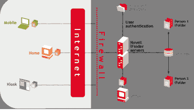

iFolder 架构的核心是 iFolder 服务器和存储组件。这些关键组件允许您从防火墙内部（从您的办公计算机）或防火墙外部（从笔记本电脑、家庭计算机或公用终端机）访问和同步 iFolder 服务器上的网络文件。

目前，iFolder Java 小程序仅与 Internet Explorer 兼容。

所有用户都通过小型的 iFolder 客户端连接到 iFolder 服务器，以同步和存储他们的数据。用户可以在任何 Windows 工作站上安装客户端。这会在其本地驱动器上设置一个 iFolder 目录。

当用户向此本地目录保存或更新任何文件时，文件会自动传输到 Novell iFolder 服务器，然后同步到安装了 iFolder 客户端的其他计算机。

使用 Internet Explorer 上的 iFolder Java 小程序，用户还可以通过访问公司的 iFolder 网站，并输入他们的 ID、密码和口令（口令用于对文件进行加密）来访问他们的文件。

您可以通过使用默认策略，或修改用户的个别账户，来为每个用户分配空间。

存储在 iFolder 服务器上的文件经过加密，并受到公司的备份和存储程序保护。

用户通过 `LDAP v3` 向 iFolder 服务器进行身份验证。`LDAP` 身份验证服务器可以是安装了 iFolder 产品的 Linux 服务器，或任何其他支持 `LDAP v3` 的启用 `LDAP` 的目录（例如 `eDirectory`）。

为了进行身份验证，用户必须知道他们的用户名、密码以及用于加密的口令。此信息由 iFolder 服务器与 `LDAP` 服务器进行验证。

`LDAP` 身份验证可以使用端口 `636` 上的 `SSL` 或端口 `389` 上的明文进行。重要的是要认识到，`LDAP` 服务器不是由 iFolder 客户端直接访问，而是通过来自 iFolder 服务器的 `LDAP` 调用访问。

iFolder 既是一个内网解决方案，也是一个互联网解决方案，适用于任何局域网或互联网连接。

如果您将 iFolder 服务器部署在防火墙之后，请务必记住，iFolder 使用 `80` 和 `443` 端口来进行客户端和服务器访问。管理页面和 iFolder 客户端认证将通过 `443` 端口进行。

## iFolder 架构

要了解 iFolder 组件和架构如何协同工作以同步并提供对个人文件的访问，您需要了解以下内容：

- Web 服务器与 iFolder
- LDAP 与 iFolder
- 身份验证与同步
- iFolder 如何同步文件

### Web 服务器与 iFolder

iFolder 服务器软件使用 `Apache` 作为 NetWare 和 Linux 服务器操作系统的默认 Web 服务器。在 Windows 2000 上，iFolder 使用 `IIS` Web 服务器。

当在 NetWare 服务器上使用基于 `Apache` 的解决方案运行 iFolder 时，它可以运行在操作系统空间或保护内存空间中。

由于 iFolder 需要对 `Apache` 特定文件进行一些配置更改，因此我们建议您将 iFolder 安装在没有其他依赖 `Apache` 的应用程序的服务器上。

如果您确实有其他使用 `Apache` 的应用程序，那么在安装 iFolder 时，这些应用程序可能无法正常工作。

### LDAP 与 iFolder

iFolder 使用 `LDAP` 进行用户身份验证。它使用 Novell `eDirectory` 或 Microsoft Active Directory（适用于 Windows 2000）作为其所有特定的 iFolder `LDAP` 对象的中心位置。

您可以让 iFolder 和 `LDAP` 运行在同一台服务器或不同的服务器上。

iFolder 使用以下 `LDAP` 目录：

- **全局设置 LDAP 目录。** 此目录存储有关 iFolder 系统配置的信息，并包含 iFolder 设置、iFolder 服务器和 `LDAP` 服务器对象。
- **用户 LDAP 目录。** 此目录用于身份验证，并为已在 iFolder 管理控制台中授权使用 iFolder 的用户对象添加 iFolder 服务器名称和磁盘配额属性。

无论您拥有多少台 iFolder 服务器，您都只有一个全局设置 `LDAP`。

但是，您可以拥有多达八个用户 `LDAP` 目录。多个 `LDAP` 目录有利于那些用户对象已划分为不同 `LDAP` 目录的公司。

例如，如果您有一个用于所有供应商的 `LDAP` 目录，另一个用于您的全职员工，还有一个用于您的临时雇用人员，您可以在 iFolder 中设置三个用户 `LDAP` 目录来处理每个目录的 iFolder 账户。

在决定是使用 `LDAP` over `SSL`（端口 `636`）还是明文（端口 `389`）连接时，请考虑以下事项：

- 如果您希望不使用 `SSL` 加密而使用 `LDAP`，或者您的 `LDAP` 服务器不支持 `SSL`，请选择端口 `389`。
- 如果 iFolder 和 `LDAP` 运行在同一台服务器上，端口 `389` 也是一个不错的选择。由于没有数据通过线路传输，因此不需要加密。
- 如果您希望使用 `SSL`，请在数据通过线路传输时为您的网络提供加密和安全性，请选择端口 `636`。

如果您选择端口 `636`，在 NetWare 6 安装完成后将需要进行一些后续配置。

> 如果您希望使用 `LDAP` over `SSL`，并且您的 `LDAP` 服务器与您的 iFolder 服务器不同，您需要导出 `LDAP` 服务器的可信根证书，然后将其复制到您的 iFolder 服务器。

### 身份验证与同步

当您登录 iFolder 时，iFolder 客户端通过互联网连接将加密的用户名和密码发送到 iFolder 服务器，从而对 iFolder 服务器进行身份验证。

> 这些凭据使用 `RSA` 加密并通过 `HTTP` 数据包发送到服务器。当服务器对用户进行身份验证时，它们之间的所有后续通信都使用 128 位 `Blowfish` 算法进行加密。然而，所有通信仍然通过标准 `http` 端口 `80` 进行。

iFolder 服务器使用此信息来验证用户是否存在，然后检查该用户对象是否已在 iFolder 管理控制台中启用以使用 iFolder。

在用户对象启用后，在用户可以开始在本地工作站上使用 iFolder 之前，必须在 iFolder 服务器上创建一个用户账户。用户第一次使用 iFolder 客户端登录 iFolder 服务器时，将创建该账户。

创建用户账户后，可以使用 iFolder 管理控制台对该账户进行管理。

首次登录后，用户即可开始向他的 iFolder 目录添加文件，自动同步随即开始。在首次登录时，iFolder 服务器上的用户账户将被创建，并且 iFolder 主目录会被放置在用户的桌面上。

iFolder 客户端始终了解任何本地活动，并根据您（作为网络管理员）或用户选择的同步首选项，iFolder 客户端定期向 iFolder 服务器请求下载任何新数据。

在 iFolder 服务器下载数据后，它会上传来自本地 iFolder 目录的任何更新。当您从另一台计算机访问您的账户时，iFolder 服务器会先下载任何更新，然后再上传 iFolder 客户端的更改。


有关 iFolder 组件和架构的更多详细信息，请参见位于 `http://www.novell.com/documentation/ig/ifold er21` 的《Novell iFolder 安装与管理指南》中的“身份验证、加密和同步深入解析”。

### iFolder 如何同步文件

以下步骤概述了本地硬盘驱动器上的文件与 iFolder 服务器之间的同步过程：

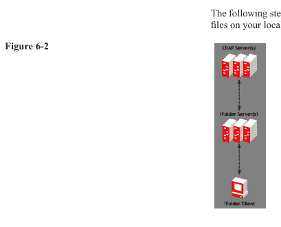

1. 用户通过 iFolder 客户端对 iFolder 服务器进行身份验证。
2. iFolder 服务器执行 `LDAP` 绑定，并验证用户是否在正确的服务器上。如果不是，服务器将用户重定向到正确的服务器。


### iFolder 同步流程

3. iFolder 客户端执行调整操作，并检查用户工作站上的文件与服务器上的文件。

4. iFolder 从服务器下载任何新文件，然后上传本地 iFolder 文件夹中的任何新文件。

   - 在此过程中，iFolder 仅在 4 kb 块级别同步现有文件的已更改部分。

5. iFolder 服务器接收新文件并增加同步索引。同步索引指示文件系统的当前状态。

iFolder 服务器上的同步索引与客户端工作站上的同步索引匹配，表明没有发生更改。这是 iFolder 客户端判断是否不同步的方式。同步索引仅为 4 字节，且是一项成本极低的服务器操作。

6. 当另一个 iFolder 客户端工作站连接到 iFolder 服务器时，服务器会比较同步索引并下载任何新文件。

7. 如果有新文件，iFolder 监控文件系统并捕获该事件。

8. 然后 iFolder 将文件上传到服务器，iFolder 服务器增加同步索引。

9. 如果发生冲突，iFolder 使用时间戳进行解决，旧文件将被放置在冲突垃圾箱中。

## 目标 2 安装和配置 iFolder

您在 Linux 上安装和配置 iFolder 分为四个基本阶段：

1. 安装第一台 iFolder 服务器。
2. 配置全局设置、默认策略、LDAP 身份验证源和 iFolder 服务器。
3. 为 iFolder 用户提供配置。
4. 安装额外的 iFolder 服务器（如有需要）。

为了完成这些阶段并管理 iFolder，您需要了解以下内容：

- 在 Linux 服务器上安装的前置条件
- 如何从 NNLS 安装 iFolder
- 如何配置您的 iFolder 服务器
- 如何访问 iFolder Web 站点
- 如何安装和配置 iFolder 客户端
- 如何管理 iFolder 用户账户
- 如何管理 iFolder 服务器
- 如何管理 LDAP 服务器
- 如何监控您的 iFolder 系统
- 如何生成报告

### 在 Linux 服务器上安装的前置条件

在您使用 NNLS 安装 Novell iFolder 2.1 之前，请确保您的 Linux 服务器和企业网络环境满足以下所有前置条件：

- **iFolder 服务器要求。** 配置一个包含以下组件的企业服务器：
  - 最低 450 MHz Intel® Pentium® II 处理器。
  - 最低 512 MB RAM。如果服务器支持除 iFolder 以外的程序或服务，请增加更多 RAM。
  - 服务器软件（约 15 MB）加上所有用户 iFolder 账户的用户数据的存储容量。
  - 作为指导，请考虑预期用户数量以及分配给每个 iFolder 用户账户的存储配额。
  - 此外，还要考虑与每个参数相关的可能增长，以预测未来的存储需求。
  - 一个活跃的网络或互联网连接，根据部署情况，具有与其他网络或互联网上计算机的全双工访问权限。

- **iFolder 服务器 Linux 要求。** 在您的 iFolder 服务器上安装并配置 Red Hat Enterprise Linux AS/ES 2.1 或 SLES 8，包括所有服务包和补丁。

### 存储配置

创建一个可从 Linux 服务器访问的存储卷，用于存储 iFolder 帐户的用户数据。

最佳实践是不要将 iFolder 数据存储在一个可能因数据快速增长而影响操作系统正常运行的存储卷上，因为操作系统需要该卷保持足够的空闲空间。

存储解决方案可以包括 Red Hat 或 SLES 8 支持的任何卷选项，包括直接附加存储和存储区域网络。

LDAP 服务器和 iFolder 服务器可以位于同一台机器上。

### DNS 配置

请确保计划用作 iFolder 服务器的企业服务器的 DNS 名称和 IP 地址已列在 DNS 服务器上。

### iFolder 客户端平台

请确保将在 iFolder 客户端中使用的 Windows 工作站上已安装 Internet Explorer (IE) 5.0 或更高版本。

### iFolder Java 小程序

如果用户打算通过 Web 浏览器访问他们的文件，请确保他们使用 Internet Explorer，因为该 Java 小程序仅与 Internet Explorer 兼容。

### 防火墙配置

您可以将 iFolder 服务器放置在防火墙内部（无外部访问）、防火墙外部（ISP 模式），或两者兼有（OneNet 模式）。

iFolder 需要 HTTP 端口 `80`（用于文件访问）、HTTPS 端口 `443`（用于 iFolder 管理）以及 LDAP 端口 `389` 或 `636`（用于身份验证）。


通过防火墙的访问方式可以是防火墙针孔、ICS/iChain® 或第 4 层 (L4) 交换机。

重要的是要注意，iFolder 客户端不会访问 LDAP 服务器。iFolder 服务器是 iFolder 中唯一使用 LDAP 服务器进行身份验证的部分。

这意味着，如果用于身份验证的 iFolder 服务器和 LDAP 服务器位于防火墙的同一侧，则您不需要打开额外的端口。

### 如何从 NNLS 安装 iFolder

要在 Linux 服务器上安装 iFolder 2.1，您需要了解以下内容：

- 安装 iFolder 的步骤
- eDirectory 架构中的 iFolder 对象
- iFolder 文件放置位置

#### 安装 iFolder 的步骤

安装 iFolder 的一般步骤如下：

1. 满足 iFolder 依赖项
2. 收集所需信息
3. 使用 NNLS 安装功能

##### 满足 iFolder 依赖项

iFolder 依赖于以下 NNLS 组件：

- 同一服务器上的 Apache `2.0.45`
- 网络中任意位置的 eDirectory `8.7.1` 或更高版本

如果这些组件尚未安装，您无需在安装 iFolder 之前先安装它们。

当您选择 iFolder 组件时，NNLS 安装程序将选择所需的组件及其依赖项。它们将在同一进程中一起安装。

有关成功安装尚未安装的 iFolder 依赖项所需的信息，请参阅表 2-5。

##### 收集所需信息

下表描述了成功安装 iFolder 所需的信息：

| 所需的配置数据 | 描述 |
| :--- | :--- |
| LDAP 服务器 IP 地址或 DNS 主机名 | iFolder 的 LDAP 服务器的 IP 地址。这是创建和配置 iFolder 对象和全局设置的地方。 |
| LDAP 端口 | 用户通过此 LDAP 端口向 eDirectory 服务器（上述）进行身份验证，以访问指定的 iFolder 服务器（下述）。默认值为 `636`。 |
| 带有上下文的 LDAP 管理员名称 | 为 iFolder 指定的 LDAP 服务器管理员的完全限定名称。名称和上下文必须使用类型化语法指定 (`cn=名称,ou=组织单元,o=组织`)。这是放置 iFolder 对象的上下文，也是用于无上下文登录的上下文。 |
| 管理员密码 | LDAP 服务器管理员的密码。 |
| iFolder 服务器 IP 地址 | 正在安装 iFolder 的服务器 IP 地址或 DNS 名称。iFolder 用户目录和文件存储在 NNLS 服务器上。 |
| iFolder 管理用户名称 | 与指定的 iFolder 管理员位于同一上下文中，且应拥有 iFolder 管理权限的其他用户。使用分号 (`;`) 分隔用户名称。 |
| iFolder 用户数据路径 | iFolder 用户数据文件在 NNLS 服务器上的存储位置。默认为 `/var/opt/novell/ifolderdata`。 |

##### 使用 NNLS 安装功能

要从 NNLS 安装 iFolder，请执行以下操作：

1. 执行自定义安装步骤。
   > 如有必要，请参阅第 2 章了解如何执行自定义安装的详细信息。
2. 取消勾选您不想安装的服务，选择 iFolder 服务，然后继续。
   如果之前未安装 eDirectory，请注意，当您选择 iFolder 时，它默认被选中（连同其他必需组件，如 Apache 和 Tomcat）。
   如果之前已安装 eDirectory，安装程序将指示哪些组件已经安装。
3. 接受许可协议。
4. (条件) 如果提示 NICI 基础密钥 (NFK) 文件的位置，请插入许可证软盘并输入 NFK 文件的路径。
   > 只有当 eDirectory 之前未安装时，才会提示输入 NICI 基础密钥。
5. 在每个提示处输入请求的信息（见表 6-1）。
6. 查看摘要信息并进行必要的更正。
7. 当所有信息都正确时，完成安装。
8. 查看 readme 文件并保存安装设置日志文件。

### eDirectory 架构中的 iFolder 对象

iFolder 安装扩展了您的 eDirectory LDAP 架构，以包括以下对象：

- iFolder 服务器代理 (`iFolder_ServerAgent`)


### iFolder 设置对象 (`iFolder_Settings`)

### iFolder 用户 LDAP 对象 (`iFolder_ldap01`) CN

### iFolder 服务器对象 (`iFolder_server01`)

架构扩展和新创建的对象使您的 iFolder 服务器能够使用您在安装期间指定的 LDAP 设置运行。这些设置用作您的全局设置 LDAP 配置。

`iFolder_Settings` 对象仅创建一次，它保存了网络中 iFolder 服务的所有全局设置 LDAP 配置。

`iFolder` 用户 LDAP 对象和 `iFolder` 服务器对象分别代表您在网络中的每个 LDAP 服务器和 iFolder 服务器。

因此，对于通过 iFolder 管理控制台添加的每个额外的 LDAP 服务器和 iFolder 服务器，都会创建一个新的 iFolder 用户 LDAP 对象 (`iFolder_ldap02`, `iFolder_ldap03`, 等) 和 iFolder 服务器对象 (`iFolder_server02`, `iFolder_server03`, 等)。

> 所有 iFolder 管理操作都必须通过 iFolder 管理控制台进行。

## iFolder 文件放置位置

当您从 NNLS 安装 iFolder 时，文件将放置在以下文件夹中：

- `/opt/novell/ifolder` (iFolder 文件)
- `/opt/novell/httpd/bin/httpd` (Apache 配置文件)
- `/opt/novell/ifolder/bin/` (iFolder Apache 服务器模块)
- `/opt/novell/ifolder/DocumentRoot` (HTML 文件)
- `/var/opt/novell/ifolderdata/ACCOUNTS` (同步到 iFolder 服务器的用户数据)

## 练习 6-1: 在您的 NNLS 服务器上确认 iFolder 2.1 安装

**10 分钟**

在本练习中，您确认 iFolder 已安装在您的 NNLS 服务器上。（iFolder 已在练习 2-1 中安装。）

执行以下操作：

1. 检查您的 **DAX-TREE**，以确保 iFolder 对象已创建：
    1. 从 NNLS 服务器桌面启动 **Mozilla**；然后输入以下内容启动 iManager：
        `https://DAX.your_container.DigitAirLines.com/nps/iManager`
    2. 使用密码 `novell` 登录为 `admin`。
    3. 在左侧 **eDirectory 管理** 下，选择 **修改对象**；然后在右侧选择 **对象选择器** 图标（放大镜）。
    4. 选择 **浏览**。
    5. 浏览到 **您的容器** 并查看其内容。
        您可能需要选择 **下一步** 才能查看 iFolder 对象。您应该看到以下内容：
        - `iFolder_ServerAgent` (这有一个用户图标)
        - `iFolder_Settings`
        - `iFolder_ldap01`
        - `iFolder_server01`
    6. 选择 `iFolder_Settings`；然后选择 **确定**。
        注意可以添加到有值属性列表中的有值属性和无值属性。
    7. 选择 **取消**。
    如果学生误通过 iFolder 服务器管理链接访问此对象，他们将无法打开此对象。

2. 检查用户数据文件夹：
   a. 打开一个终端会话，并以 `novell` 为密码使用 root 用户（`su -`）登录。
   b. 在 shell 提示符下，输入以下内容：
      ```
      cd /var/opt/novell/ifolderdata
      ```
   c. 输入 `ls -al` 列出该目录中的文件和文件夹。请注意，有两个日志文件（`ACCESS.LOG` 和 `ERROR.LOG`）和一个 `ACCOUNTS` 文件夹。
      `ACCOUNTS` 文件夹将存储用户从 iFolder 客户端同步的数据。
   d. 输入 `ed ACCOUNTS`（大写）检查 `ACCOUNTS` 文件夹的内容；然后输入 `ls -al`。
      目前尚不存在任何帐户，但稍后当用户向您的 NNLS iFolder 服务器同步数据时，将添加这些帐户。
   e. 输入 `exit` 关闭 root 会话。
   f. 关闭终端会话。

*(练习结束)*

## 如何配置 iFolder 服务器

安装 iFolder 后，您必须执行一些安装后配置任务，以便 iFolder 按照企业需求运行。本节将描述这些任务。

本节还描述了更改 iFolder 数据位置（一个可选任务）的步骤。

- 安装后配置任务
- 更改 iFolder 数据目录

### 安装后配置任务

安装 iFolder 后，您需要使用 iFolder 管理控制台（可通过 iManager 访问）配置 iFolder 服务器。

需要完成以下任务：

- 必须在 iFolder 管理控制台中定义用户上下文。
- 必须在 iFolder 管理控制台中启用用户对象。
- 用户必须使用 iFolder 客户端登录到 iFolder 服务器，以在 iFolder 服务器上创建其 iFolder 帐户，并创建其本地 iFolder 主目录。


以下步骤介绍了如果 LDAP 和 iFolder 服务器运行在同一台计算机上，如何配置您的第一个 iFolder 服务器。

有关配置其他 iFolder 服务器，或在 LDAP 运行在另一台计算机上时配置 iFolder 的信息，请参阅位于 `http://www.novell.com/documentation` 的“Novell iFolder 安装和管理指南”。

执行以下操作：

1. 通过以下任一操作在 Web 浏览器中显示 iFolder 管理控制台：
   - 在 Web 浏览器中输入以下内容：
     `https://IP_or_domain/iFolderServer/Admin`
     其中 `IP_or_domain` 是您的 iFolder 服务器的 IP 地址或 DNS 域名。
     如果您在安装过程中指定了不同的端口，请在服务器 IP 地址后附加冒号和端口号（例如 `https://192.168.1.1:81/iFolderServer/Admin`）。
   - 在 iManager 的 iFolder 管理下，选择“启动 iFolder 管理”，输入 iFolderServer 名称，然后选择“确定”。

如果您直接访问 iFolder 管理（不在 iManager 中），将出现以下页面：

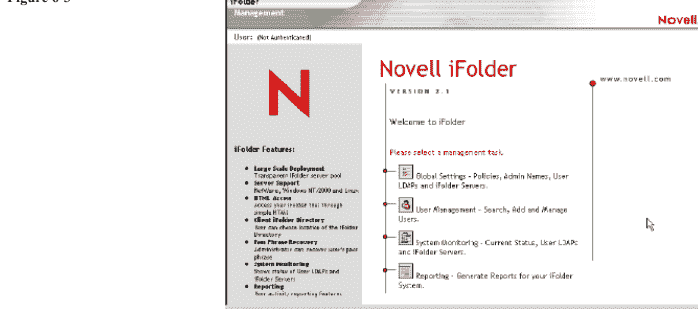

2. 选择“全局设置”；然后使用您的 iFolder 管理员用户名和密码登录。

将出现以下“常规信息”页面（如果您从 iManager 访问 iFolder 管理，也会出现此页面）：

**图 6-4**

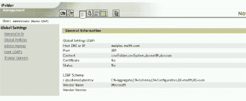

成功登录也意味着您的第一个服务器的服务器安装已完成。

3. 定义您的用户上下文：
在安装 iFolder 期间，您指定了管理对象所在的上下文。出于身份验证目的，您现在必须定义用户所在的上下文。

当定义用户上下文时，驻留在指定上下文中的所有用户对象都将显示在 iFolder 管理控制台中。


> 如果需要向您的上下文添加用户对象，请使用 iFolder 管理控制台的用户管理部分。

   a. 在左侧的 **全局设置** 下，选择 **用户 LDAPs**。
   b. 选择要管理的 *服务器*。

将出现以下内容：

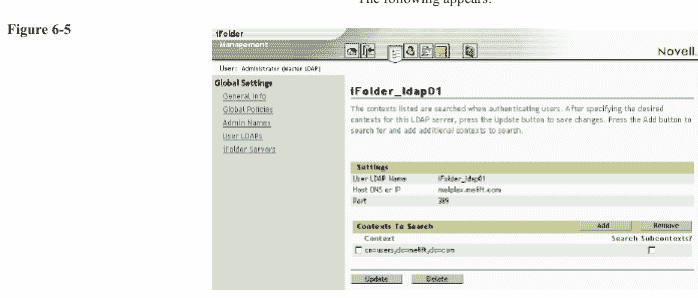

   c. 在“要搜索的上下文”中，选择用户所在的 *上下文*。
      iFolder 将在验证用户身份时搜索您指定的上下文。
   d. (条件) 如果希望 LDAP 在用户身份验证时搜索指定上下文下的子上下文，请选择 **搜索子上下文**。


如果您正在执行子容器搜索，必须将 `CN` 属性分配给 eDirectory [Public] 受托人，或创建一个 LDAP 代理用户。分配给 [Public] 受托人的任何权限都会被 eDirectory 树中的所有其他对象自动继承。


如果这些权限会导致安全风险，您可能不希望将 CN 属性分配给 `[Public]` 对象。

如果您的 iFolder 服务器位于防火墙外部，并且不希望在 NDS 树中的所有对象上分配 CN 属性，还可以使用 LDAP 代理用户名来搜索树的子容器。

e. (条件) 如果要添加要搜索的额外上下文，请选择 **添加**。

f. 通过选择 **更新** 保存这些默认用户身份验证设置。

在不同上下文中具有相同 CN 的多个用户会阻止用户成功验证到 iFolder 服务器。只有具有唯一 CN（通用名称）的用户才能进行身份验证。

### 4. 启用用户访问 iFolder

在用户可以在其本地工作站上使用 iFolder 之前，您必须首先在 iFolder 管理控制台中启用其用户对象。

用户只能将一个帐户关联到一个给定的用户 ID。但是，用户可以拥有多个不同用户 ID 下的帐户。

启用用户对象后，指示用户登录到 iFolder 服务器以创建 iFolder 帐户。

用户首次通过 iFolder 客户端、iFolder 网站登录页面上的 Java 小程序或 NetDrive 登录到 iFolder 服务器时，会创建 iFolder 帐户。

a. 从 iFolder 管理控制台，选择 **高级搜索**；然后选择要用于查找刚安装 iFolder 的服务器上的所有用户的标准。确保指定了正确的用户 LDAP 上下文。您可以使用名称、名、姓、电子邮件地址、用户类型、iFolder 服务器和用户 LDAP 上下文等搜索标准。

b. 通过选择 **搜索** 开始搜索。

将出现匹配搜索标准的用户列表：

**图 6-6**

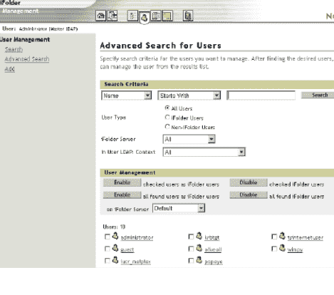

c. 选择所有想要拥有 iFolder 帐户的用户；然后执行以下任一操作：

- 选择 **启用** 按钮，位置在“将已选用户作为 iFolder 用户”。
*或*
- 选择 **启用** 按钮，位置在“将所有列出的用户作为 iFolder 用户”。

如果您的第一个 iFolder 服务器也运行 LDAP，则 iFolder 配置已完成。在用户登录以创建其 iFolder 帐户后，您可以开始管理他们的帐户。

### 如何访问 iFolder 网站

在服务器上安装和配置 iFolder 后，您的用户可以下载并安装 iFolder 客户端，然后登录到 iFolder 服务器。

用户首次使用 iFolder 客户端登录时，如果他们帐户已在 iFolder 管理控制台中启用，他们将激活其 iFolder 帐户。

在服务器上安装 iFolder 后，您可以访问以下网站：

- **iFolder 网站。** 要访问默认 iFolder 网站，请在 Web 浏览器中输入以下 URL：

  `https://IP_or_domain/iFolder`

  其中 `IP_or_domain` 是您的 iFolder 服务器的 IP 地址或域名。

将出现以下内容：


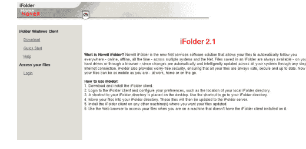

该网站包含 Novell iFolder 2.1 用户指南、iFolder 2.1 快速入门以及有关 Novell iFolder 的其他重要信息。

该网站是用户下载 iFolder 客户端的地方。如果用户使用未安装 iFolder 客户端的计算机，他们也可以使用“登录”链接通过浏览器（使用 Java 小程序）访问其 iFolder 文件。

用户必须先通过 iFolder 客户端建立其 iFolder 帐户，然后才能使用 Java 小程序访问该帐户。

iFolder Java 小程序仅适用于 Internet Explorer，不受任何其他浏览器支持。

要从 Linux 工作站访问 iFolder 中的文件，请使用 NetStorage，这将在后面的章节中介绍。

若要直接访问 Web 浏览器登录页面，请输入：

```
https://IP_or_domain/iFolder/Myfiles
```

您可以修改此页面以适应公司的内部需求。

- **iFolder 管理控制台。** 您可以使用它管理用户的 iFolder 账户以及 iFolder 和 LDAP 服务器。

要访问 iFolder 管理控制台，请打开浏览器并输入以下内容：

```
https://IP_or_domain/iFolderServer/Admin
```

其中 `IP_or_domain` 是 iFolder 服务器的 IP 地址或 DNS 域名。

如果在安装时指定了不同的端口，请在服务器 IP 地址后添加冒号，然后跟上端口号。例如：

```
https://192.168.1.1:81/iFolderServer/Admin
```

## 更改 iFolder 数据目录

如果在安装 iFolder 之后，您需要更改 iFolder 数据目录的位置，请执行以下操作：

1. 在新位置创建一个 `ifolderdata` 文件夹。例如，如果您想将位置更改为 `/home/ifolderdata`，请输入以下命令：

```bash
mkdir /home/ifolderdata
```

2. 将 `/var/opt/novell/ifolderdata` 的内容复制到新位置。

3. 通过更改 `iFolderServerRoot` 参数来指示新目录位置，从而修改 `/etc/opt/novell/ifolder/httpd_ifolder_unix.conf` 文件。

例如：`iFolderServerRoot "/home/ifolderdata"`

4. 对新父目录应用必要的属主和权限。指定的属主应为 `novell`，指定的组应为 `novell`。权限应为 `700`。

例如，请输入以下命令：

- `ls -l /home/ifolderdata`（用于查看当前的属主和权限设置）
- `chown novell:novell /home/ifolderdata`
- `chmod 700 /home/ifolderdata`
- `ls -l /home/ifolderdata`（用于查看对属主和权限设置所做的更改）

5. 通过输入以下内容重启 `novell-httpd`：

```bash
/etc/init.d/novell-httpd restart
```

## 如何安装和配置 iFolder 客户端

您需要在使用的一台桌面或笔记本电脑上安装 Novell iFolder 客户端软件。iFolder 客户端专为以下 Microsoft® 操作系统环境中的工作站设计：

- Windows 98/ME
- Windows XP 家庭版和专业版
- Windows 2000 专业版

您需要在工作站上安装 iFolder 客户端才能利用 iFolder 的自动同步功能。但是，您可以使用任何计算机、Web 浏览器和活动的 Internet 连接访问 iFolder 服务器上的文件。

在安装客户端之前，请确保您的工作站满足以下先决条件：

- 已安装 Internet Explorer (IE) 5.0 或更高版本
- 已激活 Internet 连接

要在工作站上安装并配置 iFolder 客户端，请执行以下操作：

1. 通过 Web 浏览器，输入以下内容以访问您的 iFolder 网站：

```
https://IP_or_domain/iFolder
```

其中 `IP_or_domain` 是 iFolder 服务器的 IP 地址或域名。

iFolder 主页将会显示。

2. 在右侧的 *iFolder Windows Client* 下，选择 **Download**（下载）；然后选择 **Save**（保存）。

3. 将 iFolder 客户端安装文件保存到您的桌面上。

将显示 *Download complete*（下载完成）对话框。

4. 通过选择 **Open**（打开）开始安装。

5. 在 *Novell iFolder Setup*（Novell iFolder 安装程序）欢迎窗口中，选择 **Next**（下一步）。

6. 选择您的语言；然后选择 **Next**（下一步）。

*License Agreement*（许可协议）将在浏览器窗口中显示。

7. 关闭浏览器窗口；然后通过选择 **Yes**（是）接受许可协议。

8. 通过选择 **Next**（下一步），将 iFolder 客户端安装在默认文件夹（`C:\Program Files\Novell\iFolder`）中。

9. 选择 **Finish**（完成）。

浏览器窗口中将显示 readme 文件。

10. 查看 readme 文件；然后关闭窗口。

11. 执行以下操作之一：


- 如果正在运行 Windows XP/2000，请选择 `Yes, I want to restart my computer now`（是，我现在要重启计算机）；然后选择 `Finish`（完成）。
- 等待工作站重启。
- 如果正在运行 Windows 98/ME，请选择 `Start iFolder`（启动 iFolder）。

将显示 `Welcome to Novell iFolder`（欢迎使用 Novell iFolder）消息，其中包含使用 iFolder 客户端的说明。

### 12. 选择 `Continue`（继续）。

将显示 iFolder 客户端的 `Novell iFolder Login`（Novell iFolder 登录）窗口。

### 13. 输入已启用 iFolder 的 eDirectory 用户（在显示的 iFolder 服务器上）的用户 ID 和密码；然后选择 `Login`（登录）。

将显示 `Novell iFolder Location`（Novell iFolder 位置）窗口对话框。在此对话框中，您输入工作站上用于存储要与 iFolder 服务器同步的文件的文件夹。

Windows XP 的默认位置为 `c:\documents and settings\username\my documents\ifolder\userid\home`。对于 Windows 98/ME，默认位置为 `c:\my documents\ifolder\userid\home`。

`username` 是您的工作站用户名（例如 `Administrator`（管理员））；`userid` 是您的 iFolder 用户 ID（通常与网络用户 ID 相同）。

### 14. 执行以下操作之一：

- 通过选择 `OK`（确定）选择默认位置。
- 浏览并选择硬盘上的另一个文件夹；然后选择 `OK`（确定）。

将显示 `Internet Folder Setup`（Internet 文件夹设置）对话框。

### 15. 执行以下操作之一或两者：

- 如果要加密传输以及在 iFolder 服务器上存储的文件，请选择 `Encrypt files`（加密文件）。
- 如果要让 iFolder 客户端在每次启动 Windows 时自动运行，请选择 `Enable automatic login at startup`（在启动时启用自动登录）。

### 16. 完成后，选择 `OK`（确定）。

如果选择 `Encrypt files`（加密文件），将显示 `Get Pass Phrase`（获取密码短语）对话框。iFolder 使用密码短语创建加密密钥，该密钥用于在您的计算机和 iFolder 服务器之间上传或下载文件时进行加密。

在数据通过线路传输到 iFolder 服务器时对其进行加密，可以防止除您之外的其他人访问您的文件。

虽然您的文件在您的计算机上并未以加密文件的形式存储，但它们在 iFolder 服务器上是以加密形式存储的。

设置密码短语后，每次使用 iFolder 客户端登录时（从任何工作站）都需要使用它。

您还可以选择 `Remember pass phrase`（记住密码短语），以避免每次使用 iFolder 客户端登录时在自己的工作站上输入它。

### 17. 输入并重新输入 `pass phrase`（密码短语）；然后输入一个 `hint`（提示）。

### 18. （可选）选择 `Remember pass phrase`（记住密码短语）。

### 19. 通过选择 `OK`（确定）继续。

将显示 `Pass Phrase Recovery`（密码短语恢复）对话框。

此对话框中的 `Enable pass phrase recovery`（启用密码短语恢复）选项允许您的 iFolder 管理员恢复您的密码短语（以防您忘记了它）。

上一个对话框中的提示可用于帮助您记住密码短语。

### 20. 选择（或取消选择）`Enable pass phrase recovery`（启用密码短语恢复）；然后选择 `OK`（确定）。

您已登录到 iFolder。

请注意系统托盘中的 iFolder 客户端图标。

### 21. 右键单击图标；然后选择 `Account Information`（帐户信息）。

将显示一个对话框，其中包含选项卡，可让您查看和设置如下信息：

- `iFolder.` 工作站上保存 iFolder 文件的文件夹。
- `Server Information`（服务器信息）。iFolder 服务器上仍可用于存储文件的剩余空间。
- `View Activity`（查看活动）。显示 iFolder 帐户同步活动的活动日志。
- `Preferences`（首选项）。允许您设置同步和密码/密码短语参数。

### 22. 查看并设置所需的信息，然后选择 `Apply`（应用）；最后关闭窗口。

### 23. 通过右键单击 iFolder 图标，然后选择 `Logout`（注销）来注销 iFolder 客户端。

### 24. 通过右键单击 iFolder 图标，然后选择 `Login`（登录）来登录 iFolder 客户端。

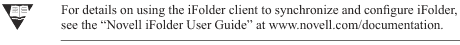

## 如何管理 iFolder 用户帐户

作为 iFolder 管理员，您可以执行如下任务：

- 设置全局客户端策略
- 设置安全密码短语
- 更改个别用户策略
- 恢复密码短语
- 更改用户密码短语
- 恢复已删除或损坏的文件
- 删除服务器上的用户数据
- 使用冲突存储箱
- iFolder 和 NetDrive

### 设置全局客户端策略

iFolder 管理员使用全局客户端策略来控制用户可以配置的 iFolder 客户端功能以及默认设置。

要设置全局客户端策略，请执行以下操作：

1. 在 Web 浏览器中显示 iFolder 管理控制台。
2. 登录到 Global Settings（全局设置）部分；然后选择 `Global Settings`（全局设置）。

您可以为全局客户端策略设置三个级别：

- `默认设置`。设置 iFolder 客户端中可配置功能的默认参数。选中复选框或输入值，即可在 iFolder 客户端中默认启用该选项。用户可以查看这些设置，也可以对其进行更改。
- `强制`。选中复选框，以强制 iFolder 客户端使用您为可配置功能指定的默认设置。如果处于强制状态，用户可以查看设置，但不能进行更改。在 iFolder 客户端界面中，相关功能和设置将显示为灰色。
- `隐藏`。选中复选框，以在 iFolder 客户端中隐藏可配置功能及其默认设置。用户在 iFolder 客户端中将看不到该选项或设置。隐藏的功能默认处于强制状态。

您可以设置以下策略：

- `加密 (+)`。允许用户在本地数据离开工作站前往 iFolder 服务器期间、存储在服务器期间以及前往另一工作站（在那里解密）时，对本地数据进行加密；用户的数据在用户的工作站上以未加密形式存储。
- `保存密码`。允许在 iFolder 任何登录序列中自动输入用户密码。
  - iFolder 客户端不会传递关于宽限登录的系统警告。
  - 如果您的组织要求频繁更改密码，我们建议通过其他方式通知用户待执行的更改要求，以便用户主动更改已存储的密码（如果他们选择了此选项）。
- `保存密码短语`。允许在 iFolder 任何登录序列中自动输入用户的加密密码短语。
- `恢复密码短语 (+)`。允许 iFolder 管理员恢复用户的加密密码短语。
  - 由于密码短语是用户的加密密钥，因此管理员能够解密 iFolder 服务器上的用户数据文件。
  - 允许此选项意味着 iFolder 管理员拥有受信任的关系。
- `自动同步 (+)`。允许 iFolder 客户端自动同步用户本地 iFolder 目录和 iFolder 服务器之间的 iFolder 文件。

您可以设置以下参数：

- `同步到服务器延迟 (+)`。如果允许自动同步，则设置 iFolder 客户端在本地 iFolder 目录中的文件发生变化后，等待自动将文件上传到 iFolder 服务器的默认时间（秒）。同时也设置允许的最小值和最大值。
- `从服务器同步间隔 (+)`。如果允许自动同步，则设置发生同步后，iFolder 客户端等待检查 iFolder 服务器以确定是否有需要自动下载到本地 iFolder 目录的变更文件的默认时间（秒）。同时也设置允许的最小值和最大值。
- `冲突箱空间`。设置用户 iFolder 账户冲突箱的默认大小（MB）。同时也设置允许的最小值和最大值。
- `iFolder 位置 (+)`。设置用户本地 iFolder 目录的默认路径。


某些选项在上方通过加号（`+`）进行区分，这些选项仅适用于新的 iFolder 用户账户。它们会在该用户首次安装 iFolder 客户端时显示。

用户设置这些首选项后，这些项目将不再显示在登录序列中，也不会显示在该用户后续安装的 iFolder 客户端中。

更改标记选项对现有用户没有影响；它仅影响随后创建的账户。如果您想在账户存在之后更改所有用户的标记功能，您必须与用户协调，删除他们的账户，并使用新的强制设置重新创建他们。

3. 完成后，选择 `更新客户端策略`。

每当您更新全局客户端策略设置时，所有设置仅适用于新的 iFolder 用户账户。

对于当前的 iFolder 账户，这些设置仅适用于后续安装 iFolder 客户端的情况。更新的策略和设置不会在 iFolder 客户端升级期间替换当前 iFolder 用户的设置。

> 若要强制更新后的设置适用于现有用户，用户必须卸载 iFolder 客户端，然后重新安装它。
>
> 然而，基于账户的设置不会改变，除非您删除当前用户账户并为该用户创建新账户。

## 设置安全密码短语

iFolder 管理员可以从全局客户端策略屏幕更新 iFolder 管理员用户的安全密码短语。安全密码短语用于在必要时恢复 iFolder 用户的密码短语。

执行以下操作：

1. 在 iFolder 管理控制台中，选择 `全局设置`。
2. （如果提示）使用您的管理员用户名和密码登录。
3. 选择 `全局策略 > 显示客户端策略 > 更新安全密码短语`。
4. 输入 `安全密码短语` 并重输入；然后选择 `更新`。

## 更改单个用户策略

默认情况下，全局客户端策略适用于所有 iFolder 用户账户。但是，iFolder 管理员可以通过执行以下操作来修改特定用户的策略设置：

1. 在 iFolder 管理控制台中，选择 `用户管理`。
2. 选择 `User_ID` 以 `编辑`。

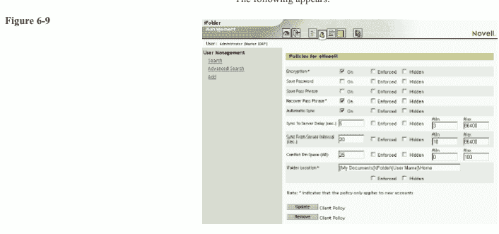

此页面允许访问用户的账户信息。

3. 设置用户特定的策略设置。

   用户特定的策略设置优先于全局策略设置。

4. 完成后，选择 `更新`。

## 恢复密码短语

若要恢复用户的密码短语，策略必须已设置为强制，或者用户必须在首次使用 iFolder 客户端登录时启用了密码短语恢复。

若要恢复用户的密码短语，请执行以下操作：

1. 在 iFolder 管理控制台中，选择 `用户管理`。
2. 搜索相应的用户；然后选择 `用户名`。
3. 向下滚动到列表底部；然后选择 `恢复`。
4. 输入您的安全密码短语；然后选择 `确定`。
5. 当密码短语显示时，告知用户该内容。

## 更改用户密码短语

当用户首次安装 iFolder 客户端时，他们会被要求向 iFolder 服务器进行身份验证。然后他们会被询问是否希望加密其数据。

如果他们选择加密数据，iFolder 随后会提示输入密码短语。此密码短语将成为用于在数据传输到 iFolder 服务器时加密数据的密钥的一部分。

如果用户因为忘记了密码短语而想要更改密码短语，您可以使用 iFolder 管理控制台恢复密码短语。

但是，如果用户想要更改为新的密码短语（出于安全原因）且用户本地没有数据，请确保用户理解，更改密码短语的唯一方法是从 iFolder 服务器删除数据，并让 iFolder 客户端加密数据并再次将其发送到服务器。

> 如果用户没有在本地存储数据，请让用户将数据同步到本地硬盘；然后继续执行更改密码短语的流程。

执行以下操作：

- 在 iFolder 管理控制台中，找到并选择用户账户以显示用户信息。
- 查看 `连接数` 行。如果该行未显示 `0`，您必须让用户退出其 iFolder 客户端。
- 查看磁盘配额设置和已用空间值。如果这两个值中任何一个超过 `100 MB`，您将需要稍后调整磁盘配额值（步骤 8）。
- 确认用户拥有足够快的连接，以便在您删除账户后能够顺利完成数据上传。您可能不希望通过拨号连接进行此操作。
- 确认用户在其本地磁盘上拥有其数据。这一点非常重要，因为您即将从服务器上删除这些数据。
- 选择 `移除用户` 按钮；然后通过选择 `是` 来确认删除。用户账户现在已从服务器上移除。用户的所有数据也已从服务器上删除。
- 让用户右键单击 iFolder 客户端图标（在系统托盘中）并选择 `登录`。用户将被再次提示选择加密并被要求输入新密码短语。用户选择新密码短语后，iFolder 客户端将登录用户并创建具有默认磁盘配额空间的新账户。
- 转到用户账户并使用步骤 3 中的值调整磁盘配额。用户的数据应开始同步回服务器。

用户可能会收到一条错误消息，提示磁盘空间不足，无法同步数据。请让用户选择 `确定`。在调整磁盘配额值后，该错误将不再出现。

## 恢复已删除或损坏的文件

如果用户需要从已删除或损坏的文件中恢复数据，您可以将用户的文件夹恢复到辅助 iFolder 服务器。之后，用户可以通过浏览器或 NetDrive 访问 iFolder 服务器上的本地文件副本。

执行以下操作：

- 1. 登录到 iFolder 管理控制台的 `用户管理` 部分。
- 2. 搜索该用户；然后单击 `用户名` 以查找 iFolder 账户路径。

以下是 iFolder 用户账户中账户路径的示例：


- 3. 从备份磁带上将位于 iFolder 账户路径的文件夹恢复到用户可以连接的辅助 iFolder 服务器上。
- 4. 让 iFolder 用户使用 Java 小程序或 NetDrive 访问辅助 iFolder 服务器。

当用户登录时，Java 小程序将显示用户的数据，用户可以下载之前被删除的文件。

Java 小程序和 NetDrive 是很好的选择，因为它们不同步数据，只提供访问权限。

### 删除服务器上的用户数据

如果用户无法记住其密码，您可以删除 iFolder 服务器上的用户数据，然后让用户再次登录。当他登录时，系统会提示输入新密码。

执行以下操作：

- 1. 在删除用户账户之前，用户必须执行以下操作，以防止在重置账户时丢失数据：
    - a. 将数据从当前的本地 iFolder 目录复制到用户工作站上的另一个本地目录，然后删除本地 iFolder 目录。
    - b. 通过执行以下操作从用户工作站卸载 iFolder 客户端：
        - a. 选择 `开始 > 设置 > 控制面板 > 添加/删除程序 > 更改或删除程序`。
        - b. 选择 `Novell iFolder 客户端`；然后选择 `更改/删除 > 是`。
    - c. 访问 iFolder 网站以下载 iFolder 客户端软件。
    - d. 按照下载和安装说明安装 iFolder 客户端。
    - e. 如果用户 ID、密码或加密短语已更改，请在重新安装 iFolder 客户端期间输入新值。
    - f. 将用户数据移动到新建的本地 iFolder 目录中。
    - g. 执行以下操作之一：
        - 等待文件自动同步。
        - 右键单击系统托盘中的 iFolder 图标；然后选择 `立即同步`。

    一旦用户完成这些步骤，您就可以删除用户账户。

- 2. 在 iFolder 管理控制台中，选择 `用户管理`。
- 3. 使用您的管理员 `用户名` 和 `密码` 登录。
- 4. 如果您知道唯一的用户 ID，请搜索特定用户；如果不知道，请通过高级搜索查找用户。
- 5. 选择 `用户名`，滚动到页面底部，然后选择 `删除 iFolder 用户数据`。
- 6. 选择 `确定` 以确认删除用户数据。

## 使用冲突箱

iFolder 客户端有一个名为冲突箱的功能。用户很少需要访问此选项；但是，了解此功能非常有用。以下场景说明了冲突箱是什么以及它是如何工作的。

假设 John 是您的 iFolder 用户之一。John 在两台计算机上安装了 iFolder 客户端：计算机 A 和计算机 B。在一天中的某个时刻，John 将这两台计算机都断开网络连接，并继续在两台计算机上离线工作。

在他工作时，他在计算机 A 上的一个 iFolder 文件中做了一个更改，然后稍后在计算机 B 上对同一文件做了不同的更改。

然后，他将计算机 A 重新连接到网络，以将这些更改同步到 iFolder 服务器。接着，John 将计算机 B 重新连接到网络以同步新的更改。

当计算机 B 重新连接到网络并将更改同步到 iFolder 服务器时，John 在计算机 A 上所做的更改将被 John 从计算机 B 对同一文件所做的更改覆盖。

为防止数据丢失，iFolder 将把被覆盖的文件保存到冲突箱中。John 可以通过右键单击原本包含被覆盖文件的那台计算机的系统托盘中的 iFolder 图标来访问冲突箱。


如果问题文件的大小超过为冲突箱设置的配额，该文件将不会保存在箱中；它将被丢弃。


## iFolder 和 NetDrive

在尝试使用 NetDrive 访问 iFolder 服务器之前，您必须通过 iFolder 客户端激活您的 iFolder 账户。

如果您尝试首次使用 NetDrive 连接到 iFolder，连接将会失败。您必须先通过 Java 小程序（https://mfi1.*您的域名*.com/applet/java.htm）或 iFolder 客户端连接来激活账户。

## 如何管理 iFolder 服务器

通过 iFolder 管理控制台，您可以更改您的 iFolder 服务器的 IP 地址、DNS 名称或分配端口。

您的第一个 iFolder 服务器会自动添加到 iFolder 管理控制台中。所有额外的 iFolder 服务器必须手动添加到 iFolder 管理控制台中，以便您对其进行管理。

您可以拥有无限数量的 iFolder 服务器。

要管理 iFolder 服务器，您需要知道如何执行以下操作：

- 添加 iFolder 服务器
- 设置全局服务器策略
- 使用调试输出

### 添加 iFolder 服务器

要添加 iFolder 服务器，请执行以下操作：

- 在 iFolder 管理控制台中，选择`全局设置`。
- 使用您的管理员`用户名`和`密码`登录。
- 选择 `iFolder 服务器` > `添加`。

将出现以下内容：

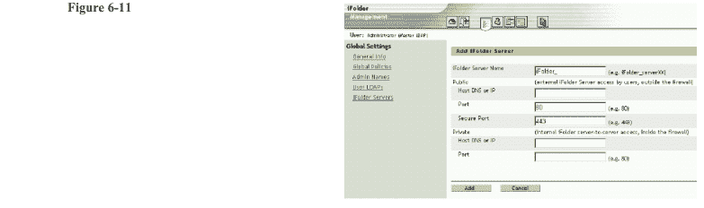

要添加服务器，请输入以下信息：

- 公共和私有 iFolder 服务器名称。如果您的 iFolder 服务器的 DNS 名称或 IP 地址直接指向 iFolder 服务器，而不经过其他设备路由（即您的 iFolder 服务器不在防火墙后面），您只需填写“公共”标题下方的信息。如果您的 iFolder 服务器的 DNS 名称或 IP 地址经过另一设备（例如将请求重定向到 iFolder 服务器的 L4 交换机或防火墙），您需要填写“公共”和“私有”两个标题下的信息。


> 如果您的路由器或交换机内置网络地址转换 (NAT) 功能，请输入您的 iFolder 公共和私有 DNS 名称及 IP 地址。

如果您的公共 DNS 名称或 IP 地址将请求重定向到私有 iFolder IP 地址，请指定一个 DNS 名称（而不是 IP 地址）作为 iFolder 服务器的公共地址。然后，确保您使用内部 DNS 服务器将 DNS 名称解析为内部用户的私有地址，并使用外部 DNS 服务器将 DNS 名称解析为外部用户的公共地址。私有设置允许 iFolder 服务器在 iFolder 系统内直接相互通信。公共设置允许您从防火墙外部访问 iFolder 服务器。

- iFolder 端口。您在 iFolder 管理控制台中输入的端口必须与您在 iFolder 安装期间指定的端口相匹配。如果所有服务器都具有唯一的 DNS 名称或 IP 地址，则可以拥有多个使用相同端口号的 iFolder 服务器。

端口 80 用于将加密的用户名、密码从 iFolder 客户端发送到 iFolder 服务器。

iFolder 使用 `RSA` 加密来加密用户名和密码，并使用 `Blowfish` 加密来加密用户数据。端口 443 用于通过 SSL 和 HTTPS 访问 iFolder 管理控制台和 Java 小程序。

- 4. 完成后，选择`添加`以添加服务器。

### 设置全局服务器策略

您可以通过执行以下操作来规定分配给每个 iFolder 用户的磁盘空间量，或规定会话超时前的等待时间：

- 1. 使用您的管理员`用户名`和`密码`登录到 iFolder 管理控制台的全局设置部分。
- 2. 选择`全局策略`；然后选择服务器策略旁边的`显示`按钮。

将出现以下内容：

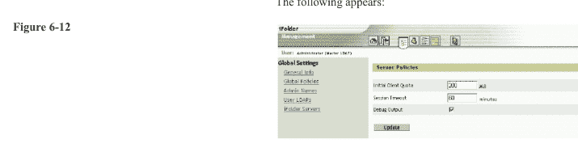

- 3. 填写以下信息：
    - `初始客户端配额`。指定分配给新 iFolder 用户账户的最低存储空间（以 MB 为单位）。

### 会话超时

指定在没有同步活动的情况下，会话继续维持的最大时间长度（以分钟为单位）。

如果会话超时，客户端在下一次同步前必须执行重连步骤。

### 调试输出

勾选复选框以启用同步活动日志记录，供分析使用。

完成后，选择`更新`。

## 使用调试输出

要在 Linux 服务器上使用调试输出，请执行以下操作：

1. 在 `/var/opt/novell/ifolder/DocumentRoot/` 中创建一个 logs 文件夹。
2. 编辑位于 `/etc/opt/novell/ifolder` 的 `httpd_ifolder_unix.conf` 文件，并将以下参数添加到文件末尾：

```
iFolderServerLogging " "/var/opt/novell/ifolder/DocumentRoot/logs/index.html"
```

调试信息将写入在 `logs` 目录下的 `DocumentRoot` 中为您创建的 `index.html` 文件。

3. 通过在 shell 提示符下输入以下内容，授予 Apache 创建和写入日志文件的权限：

```
chmod 757 /var/opt/novell/ifolder/DocumentRoot/logs
```

4. 重启 iFolder 服务，以使对 conf 文件的更改生效，请输入以下内容：

```
/etc/init.d/novell-httpd stop
/etc/init.d/novell-httpd start
```

5. 要访问此信息，请执行以下操作之一：
   - 在工作站的浏览器中，输入以下内容：
     `http://iFolder DNS 或 IP 地址/iFolder/logs/index.html`
     例如：
     `http://DA3.DigitalAirlines.com/iFolder/logs/index.html`
   - 在 iFolder 服务器的 Linux 浏览器中，输入以下内容：
     `/var/opt/novell/ifolder/DocumentRoot/logs/index.html`
   - 在 Linux iFolder 服务器的 shell 提示符下，输入以下内容：
     `tail -f /var/opt/novell/ifolder/DocumentRoot/logs/index.html`

## 如何管理 LDAP 服务器

每当通过 iFolder 管理控制台添加 LDAP 服务器用于用户身份验证时，您需要输入 LDAP 服务器的名称、其 DNS 或 IP 地址、端口号，以及如有必要，根证书的位置。

您可以拥有多达八个 LDAP 服务器。

要管理 iFolder 的 LDAP 服务器，您需要知道如何执行以下操作：

- 选择端口 389
- 选择端口 636
- 添加 LDAP 上下文

### 选择端口 389

如果您想使用没有 SSL 加密的 LDAP，或者您的 LDAP 服务器不支持 SSL，请选择端口 389。

如果 iFolder 和 LDAP 运行在同一台服务器上（没有通过网络传输通信或数据，因此不需要加密），端口 389 也是一个不错的选择。

如果您选择端口 389，必须将 LDAP Group 对象配置为允许明文密码。

### 选择端口 636

如果您想使用 SSL 在数据通过网络传输时提供加密和安全保护，请选择端口 636。SSL 需要根证书。

如果您选择端口 636，请确保您之前已将 `rootcert.der` 文件复制到系统上的相应位置。

当您向 iFolder 系统添加安全 LDAP 服务器时，根证书会被复制到全局设置 LDAP 上的 `iFolderSettings` 类的一个属性中。

### 添加 LDAP 上下文

在`上下文`字段中，列出所有上下文，用分号（`;`）分隔，且中间无空格。

上下文的顺序即为搜索上下文的顺序。列出的第一个上下文应包含 Admin 用户。

## 如何监控您的 iFolder 系统

要监控您的 iFolder 系统，请前往 iFolder 管理控制台；然后单击`系统监控`。

显示以下内容：

图 6-13

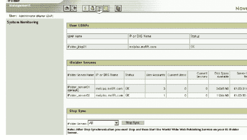

iFolder 管理控制台的此部分列出了以下内容：

- `每个用户 LDAP 服务器`。对于每个服务器，iFolder 列出 IP 地址、状态、LDAP 用户数量以及 iFolder 用户数量。
- `每个 iFolder 服务器`。对于每个服务器，iFolder 列出 IP 或 DNS 名称、状态、用户账户数、当前用户数、当前会话数、可用磁盘空间以及服务器已运行时间。
- `停止同步`。此选项停止选定 iFolder 服务器上的同步。

## 如何生成报告


Novell iFolder 提供了一个报告生成器，允许您观察和评估以下类别中的信息：

**表 6-2**

| 一般信息 | iFolder 服务器 | 用户 LDAP | 用户账户 |
| :--- | :--- | :--- | :--- |
| 用户总数 | iFolder 服务器名称 | LDAP 名称 | 用户名 |
| 总磁盘配额 | IP 地址或 DNS 名称 | IP 地址或 DNS 名称 | iFolder 服务器名称 |
| 已用总磁盘空间 | 服务器运行时间 | 状态 | 已用空间 |
| | iFolder 服务器版本 | LDAP 用户 | 配额 |
| | 用户账户 | iFolder 用户 | 上次同步 |
| | 当前用户 | | 文件 |
| | 当前会话 | | 目录 |
| | 已用总磁盘空间 | | 上传 |
| | 总磁盘配额 | | 下载 |
| | iFolder 宿主操作系统 | | 加密 |
| | iFolder 宿主 Web 服务器 | | |
| | 用户数据 | | |
| | 应用程序根目录 | | |

要在 iFolder 系统上运行报告：

1. 前往 iFolder 管理控制台；然后选择**报告**。
2. 选择**一般信息**、**iFolder 服务器**、**用户 LDAP** 或**用户账户**。
3. 选择**导出**。

将显示类似以下 iFolder 用户账户报告的内容：

图 6-14

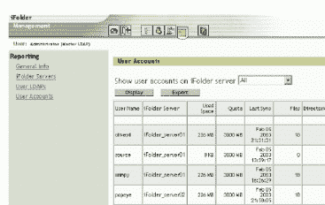

4. 将显示的数据以 HTML 格式保存到硬盘驱动器。
5. 将一个或多个 iFolder 报告文件中的数据导入到其他应用程序，例如 **OpenOffice Writer**。
6. 创建适合您管理需求的统计、图表和报告。

## 练习 6-2 配置和测试 iFolder

**45 分钟**

组织学生按顺序在工作站上逐一执行第二部分。此练习部分不能在 NNLS 服务器上完成。

第一个执行第二部分的学生将安装客户端并使用它以 iFolder 用户身份登录。第二个学生只能以其 iFolder 用户之一登录。

在此练习中，您将执行以下操作：

- 第一部分：配置 iFolder 以允许员工访问
- 第二部分：安装和使用 iFolder 客户端
- 第三部分：配置 iFolder 以记录调试信息
- 第四部分：更改并测试 iFolder 配置

### 第一部分：配置 iFolder 以允许员工访问

执行以下操作：

1. 为您的办公室员工配置用户上下文：
    - a. 从您的 NNLS 服务器桌面，启动 **Mozilla**；然后输入以下内容：
      `https://DAx.your container.DigitalAirlines.com/iFolderServer/Admin`
    - b. 选择**全局设置**。
    - c. 以用户名 **admin** 和密码 **novell** 登录。
    - d. 在左侧的**全局设置**下，选择**用户 LDAP**。
    - e. 在右侧，选择 `iFolder_ldap01`。
      显示 `iFolder_ldap01` 的属性页面。在**要搜索的上下文**下，您会看到为您的容器列出的上下文。
    - f. 通过选择 `o=your container` 左侧的**复选框**来启用该上下文。
    - g. 通过选择**搜索子上下文？**复选框来启用子容器搜索。
    - h. 完成后，选择**更新**。

左侧框中的对号消失，表明更新成功。

2. 允许您的办公室员工访问 iFolder：
    - a. 选择页面顶部的**用户管理**图标。
    - b. 在左侧的**用户管理**下，选择**搜索**。
      显示**搜索用户**页面。
      在此练习中，您使用搜索功能，因为您只有少量员工需要启用。
      但是，如果您有很多需要启用的用户，请使用高级搜索来同时查找、选择并启用多个用户。
    - c. 启用以下员工：
        - [ ] **cgrayson**
        - [ ] **ddecker**
        - [ ] **jjackson**
      执行以下操作：
        - a. 在搜索字段中输入用户名的首字母（即，对于 cgrayson，输入 c）；然后选择**搜索**。
          显示一个姓名列表。
        - b. 选择上述*员工*中的第一个；然后，从下拉列表中选择 `iFolder_server01`。
        - c. 选择**启用**。
          页面重新显示，显示该用户的磁盘配额为 200 MB。消息还显示该账户尚未由用户激活。
        - d. 重复这些步骤以启用其他两名员工。
          您已完成对员工的启用。

3. 退出 iFolder 管理控制台。

学生可能会注意到列表中的一些员工已经启用了 iFolder（带有红色字母 i 的黄色标记）。请注意区别在于：通过 LDIF 导入的对象尚未启用，而在课堂上创建的用户已经启用。

## 第二部分：安装和使用 iFolder 客户端

要在您的 Windows 工作站上安装 iFolder 客户端，请执行以下操作：


> 由于您和另一位学生正在共用一台 Windows 工作站，因此你们必须轮流完成此练习的这一部分。
>
> 第一位学生将能够安装客户端并以 iFolder 用户身份登录；第二位学生只能以 iFolder 用户身份登录（从第 12 步开始），因为客户端只能安装一次。

1. 在您的 Windows 工作站上，从 Internet Explorer 中输入以下内容访问您的 iFolder 网站：
  `https://DAx.your container.DigitalAirlines.com/iFolder`
  iFolder 主页将出现。


> 您可以通过 Mozilla 浏览器访问 iFolder 主页，但在 NNLS v1 中，您无法执行以下操作：
>
> - 下载客户端。该客户端目前仅支持 Windows。
> - 使用 Java applet 登录以通过 Web 浏览器访问 iFolder 服务器。iFolder Java Applet 目前仅与 Internet Explorer 兼容。

2. 在左侧 **iFolder Windows Client** 下方，选择 **Download**；然后选择 **Open**。
3. 在 Novell iFolder 安装欢迎窗口中，选择 **Next**。
4. 选择您的语言；然后选择 **Next**。
  许可证协议将在浏览器窗口中显示。
5. 关闭浏览器窗口；然后选择 **Yes** 以接受许可证协议。
6. 选择 **Next** 将 iFolder 客户端安装到默认文件夹（`C:\Program Files\Novell\iFolder`）。
7. 选择 **Finish**。
  一个 readme 文件将在浏览器窗口中显示。
8. 查看 readme 文件；然后关闭窗口。
9. 确保选中了 **Yes, I want to restart my computer now**；然后选择 **Finish**。
  等待您的工作站重启。
  将出现一条 Novell iFolder 欢迎消息，其中包含使用 iFolder 客户端的说明。
10. 选择 **Continue**。
  iFolder 客户端的 Novell iFolder 登录窗口将出现。
11. 输入已启用使用 iFolder 的 Digital Airlines 员工的 *用户 ID* 和 *密码*；然后选择 **Login**。
  将出现 Novell iFolder 位置窗口对话框。在此对话框中，您输入工作站上要存储用于与 iFolder 服务器同步的文件的文件夹。
  默认位置是 `\Documents and Settings\Student\My Documents\iFolder\`*username*\Home。
12. (条件步骤) 如果您是本组第一个执行此部分练习的学生，请跳过此步骤。如果您是第二个学生，请执行以下操作：
  - a. 转到系统托盘，右键单击 *iFolder 图标*；然后选择 **Logout**。
  - b. 再次右键单击 *iFolder 图标*；然后选择 **Login**。


- c. 输入已启用使用 iFolder 的 Digital Airlines 员工的 `用户 ID` 和 `密码`；然后输入服务器的 DNS 名称（`DAx.your container.digita l airlines.com`）。

- d. 选择 `Login`。

将出现 Novell iFolder 位置窗口对话框。在此对话框中，您输入工作站上要存储用于与 iFolder 服务器同步的文件的文件夹。

默认位置是 `\\Documents and Settings\Student\My Documents\iFolder\username\Home`。

- 13. 选择 `OK` 接受默认位置。

将出现一个 Internet Folder 设置对话框。

- 14. 选择 `Enable automatic login at startup`；然后确保选中了 `Encrypt files`。

- 15. 选择 `OK` 继续。

将出现一个获取密码短语对话框。

- 16. 输入并重新输入 `novell` 作为密码短语。

- 17. 输入 `oneNet` 作为提示。

- 18. 选择 `OK` 继续。

将出现一个密码短语恢复对话框。

- 19. 确保选中了 `Enable pass phrase recovery`；然后选择 `OK`。

您已登录到 iFolder。

请注意系统托盘中的 iFolder 客户端图标。

- 20. 右键单击该图标；然后选择 `Account Information`。

将出现一个对话框，其中包含选项卡，可用于查看和设置 iFolder 客户端信息。

- 21. 选择 `View Activity` 选项卡。

向上滚动窗口，请注意 iFolder 客户端已成功连接到您的 iFolder 服务器，并且在 iFolder 服务器上创建了一个 iFolder 数据库。

还请注意，同步会频繁发生。

6-64

*此文档仅供 Novell 认证讲师使用。*

*严禁复制此文档。如需报告涉嫌复制行为，请致电 1-800-PIRATES。*

Version 1

- 22. 选择 `Preferences` 选项卡。

同步设置为每 5 秒自动同步一次本地文件的更改，每 20 秒自动同步一次应同步到工作站的文件。

- 23. 取消选中 `Automatic sync`；然后选择 `Apply`。

- 24. 在 iFolder 对话框保持打开的状态下，将多个文件复制到您登录用户的家目录（在 `Account Information` 选项卡中查看位置）。

您可能希望复制 My Pictures 文件夹中的图片。

- 25. 返回 iFolder 对话框，选择 `View Activity` 选项卡；然后选择 `Sync` 按钮（选项卡页面的顶部）。

- 26. 观察 iFolder 将文件同步到 iFolder 服务器时显示的消息。

片刻之后，将显示同步完成的消息。

文件现在已加密并存储在 iFolder 服务器上。

- 27. 重新打开 `Automatic sync`；然后选择 `Apply`。

## 第三部分：配置 iFolder 以记录调试信息

现在用户正在登录和登出 iFolder 并同步文件，您应该配置 iFolder 将调试信息写入日志文件。

请执行以下操作：

- 1. 打开终端窗口，输入 `su` 并输入密码 `novell` 切换为 root 用户。

- 2. 输入 `cd /var/opt/novell/ifolder/DocumentRoot`。

- 3. 输入 `mkdir logs`。

如果未创建 index.html，请让学生创建它，并在 index.html 文件上重新执行 chmod 命令；然后重新启动 iFolder 服务。

- 4. 输入 `ls -al` 并验证 logs 文件夹是否存在。

- 5. 编辑 `httpd_ifolder_unix.conf` 文件以开始记录 iFolder 信息：

  - a. 选择 `应用程序 > KDE 菜单 > 系统 > 文件管理器 - 超级用户模式`。

  - b. 输入密码 `novell`；然后选择 `OK`。

  - c. 浏览到 `/etc/opt/novell/ifolder`。

  - d. 右键单击 `httpd_ifolder_unix.conf` 文件；然后选择 `Open With > KWrite`。

  - e. 在文件末尾添加以下内容：

```
iFolderServerLogging “/var/opt/novell/ifolder/DocumentRoot/logs/index.html”
```

  - f. 保存 `httpd_ifolder_unix.conf` 文件。

- 6. 在 shell 提示符下输入以下内容，授予 Apache 创建和写入日志文件的权限：

```
chmod 757 /var/opt/novell/ifolder/DocumentRoot/logs
```

- 7. 在 shell 提示符下输入以下内容以重新启动 iFolder 服务：

```
/etc/init.d/novell-httpd stop
/etc/init.d/novell-httpd start
```

- 8. 输入 `cd /var/opt/novell/ifolder/DocumentRoot/logs`。

- 9. 输入 `ls -al` 验证 index.html 文件已创建。

- 10. 输入 `tail index.html`。

注意捕获到的 iFolder 服务器日志信息。

- 11. 保持此 `终端会话` 打开。

## 第四部分：修改和测试 iFolder 配置

现在您已安装 iFolder 客户端，激活 iFolder 用户，并同步了文件，您可以使用 iFolder 管理控制台来监控和配置 iFolder。

请执行以下操作：

- 1. 从您的 NNLS 服务器的 Mozilla 浏览器中，输入以下内容访问 iFolder 管理控制台：

`https://DAx.your*container*.digitalairlines.com`

`/iFolderServer/Admin`

将显示 Novell iFolder 欢迎页面。

- 2. 选择 `Reporting`。

- 3. 使用 `admin` 登录，密码为 `novell`。

在右侧“常规信息”下方，注意用户总数。

- 4. 在左侧 `Reporting` 下方，选择 `User Accounts`；然后在右侧选择 `Display`。

注意显示的已激活 iFolder 用户的数据。

- 5. 在页面顶部，选择 `User Management` 图标。

- 6. 输入 iFolder 用户的 `用户 ID`；然后选择 `Search`。

- 7. 选择 `用户 ID` 显示该用户的属性。

将显示属性页面。

查看显示的信息，例如磁盘配额、最后同步时间和已用空间。

- 8. 将磁盘配额更改为 `250 MB`；然后选择 `Update`。

- 9. 向下滚动到页面底部，通过选择 `Edit` 编辑该用户的客户端策略。

将显示该用户的策略页面，其中包含可从 iFolder 客户端获得的几种设置的配置。

## 目标 2 配置 iFolder（续）

1. 对于自动同步，选择`强制`。

2. 对于保存口令，选择`隐藏`。

3. 对于同步到服务器延迟，输入`30`；然后选择`强制`。

4. 对于 iFolder 位置，选择`隐藏`。

5. 选择`更新`。

6. 返回到`终端会话`；然后输入 `tail index.html`。

注意捕获到的调试输出。随时返回并刷新此窗口，以查看当发生 iFolder 事件时（即，注销和重新登录，同步文件等）记录了哪些类型的信息。

7. （可选）在文件管理器 - 超级用户会话中，你可以浏览到 index.html 文件并双击它以查看其完整内容，并在需要时刷新它。

8. 测试 iFolder 用户的新配置：

  - a. 从你的 Windows 工作站，通过执行以下操作之一注销 iFolder 客户端：

    - 如果你的 iFolder 客户端对话框是打开的，选择`文件` > `注销`。

    - 如果你的 iFolder 客户端对话框是关闭的，右键单击系统托盘中的 iFolder 客户端图标；然后选择`注销`。

  - b. 通过右键单击系统托盘中的 `iFolder 图标` 来登录你的 iFolder 用户；然后选择`登录`。

  - c. 对于你更改了设置的 iFolder 用户，输入`用户 ID` 和密码 `novell`；然后从下拉列表中选择你的服务器 DNS 名称。


- d. 选择`登录`。

- e. 对于口令，输入 `novell`；然后选择`确定`。

- f. 右键单击 iFolder 客户端图标；然后选择`账户信息`。

选择`账户信息`选项卡。

注意以下内容：

- iFolder 用户在服务器上的总空间已增加到 250 MB。
- iFolder 位置仍然显示。这是因为隐藏位置策略只能应用于新账户（在策略配置页面上有一个注释）。

选择`偏好`选项卡。

注意以下内容：

- 自动同步是灰色的，因为它是强制的，并且不能取消选择。
- 同步到服务器延迟设置为 30 秒（默认为 5 秒，且也是灰色的）并且无法更改。
- 记住口令选项是隐藏的。

选择`文件 > 注销` 以注销 iFolder 用户。

如果你有足够的时间，请尝试为其他 2 名员工启用、激活和同步文件。

你也可以尝试从客户端或 iFolder 管理控制台更改其他 iFolder 配置进行实验。

`关闭 Mozilla 浏览器、终端会话以及任何其他打开的窗口。`

（练习结束）

# 目标 3 描述 Samba 的目的和架构

Samba 是一个软件包，它在 Linux 上实现了 Microsoft 的 SMB/CIFS 网络协议。

它允许 Linux 计算机充当与 Windows 兼容的文件服务器，并作为客户端访问其他 Windows 服务器。

为了描述 Samba 的目的和架构，你需要了解以下内容：

- 什么是服务器消息块（SMB）
- 什么是通用互联网文件系统（CIFS）
- Samba 和 NNLS

## 什么是服务器消息块（SMB）

服务器消息块（SMB）是一种在联网计算机之间共享资源的协议。

SMB 可以在多种协议上实现，包括 TCP/IP、NetBEUI 或 IPX/SPX。

> 有关 SMB 的更多信息，请参阅 http://www.samba.org/cifs/docs/what-is-smb.html。

## 什么是通用互联网文件系统（CIFS）

CIFS 是一种在原生 TCP/IP 上实现的 SMB，不需要 NetBIOS。

CIFS 是一种客户端/服务器协议，由 Microsoft Windows 操作系统使用。它也在许多其他平台（如 DOS、NetWare、UNIX®、Linux 和 VMS™）上实现。

使用 CIFS 的优点包括：

- 你不需要 Novell 客户端来访问文件。
- 你可以使用 Microsoft 网络的客户端。
- 所有 Windows 操作系统都支持 CIFS（必须支持 IP）。
- 大多数（如果有的话）应用程序都支持 CIFS（使用原生 Windows 网络）。
- 许多其他平台都有可用的实现（例如 UNIX/Linux 上的 Samba）。

## Samba 和 NNLS

Samba 是一组工具，让你可以使用 Microsoft 的 SMB/CIFS 网络协议在 Linux 计算机和其他平台上使用。

安装 Samba 后，Linux 计算机可以充当：

- `Windows 服务器`。 Samba 使服务器能够向用户提供 Windows 文件和打印服务。
- `Windows 客户端`。 Samba 使工作站能够访问和使用 Windows 文件和打印服务，无论它们源自 Windows 服务器还是安装了 Samba 的 Linux 服务器。

与 NNLS 一起安装的 Samba 发行版是专门为 NNLS 定制的，重点在于向在 Windows 客户端工作站上工作的用户提供经过身份验证的文件服务。

此发行版配置了以下功能：

- 使用 NNLS 附带的 Linux 用户管理（LUM）工具在 eDirectory 中创建 Samba 用户。
- 创建用户后，你必须使用 iManager 或 `smbpasswd` 工具为每个用户指定 Samba 密码。


- 当 LUM 用户首次通过基于文本的控制台登录到 NNLS 服务器时，会自动创建主目录并自动分配适当的文件访问权限。
- 访问 Samba 服务需要用户使用安全的 LDAP 向 NNLS 安装期间指定的 eDirectory 服务器进行身份验证。


# 目标 4 安装和配置 Samba

为了安装和配置 Samba，你需要了解以下内容：

- 安装 Samba 的步骤
- 如何配置 Samba
- 如何通过 Samba 访问文件

## 安装 Samba 的步骤

要在你的 Linux 服务器上安装 Samba，你需要执行以下操作：

- 满足 Samba 依赖项
- 收集所需信息
- 使用 NNLS 安装功能

如果你正在 NNLS 服务器上为网络中的 Windows 用户提供 Samba 文件服务，你还必须安装 Linux 用户管理（LUM）。

Linux 用户管理允许你创建可以访问 NNLS 服务器的 eDirectory 用户。

### 满足 Samba 依赖项

Samba 依赖于以下 NNLS 组件：

- 网络内任何地方的 eDirectory 8.7.1 或更高版本

如果此组件尚未安装，你不必在安装 Samba 之前安装它。

NNLS 安装程序会在你选择 Samba 组件时选择所需的组件及其依赖项（如果有）。Samba 及其依赖组件将在同一过程中安装。

有关成功安装尚未安装的 Samba 依赖项所需的必要信息，请参阅表 2-5。

以下描述了你在安装 Samba 之前需要知道的信息：

#### 收集所需信息


| 所需的配置数据 | 描述 |
| :--- | :--- |
| eDirectory 服务器 IP 地址或 DNS 主机名 | 你正在其上安装 iFolder 的服务器的 IP 地址或 DNS 名称。Windows 用户将使用 LDAP 身份验证向 eDirectory 服务器进行身份验证以访问 NNLS 服务器上的目录和文件的主要 IP 地址。 |
| 带有上下文的 Admin 名称 | 为 Samba 指定的 eDirectory 服务器的 Admin 的完全限定名称。名称和上下文必须使用类型化语法指定（cn=name.ou=organizational-unit.o=organization）。 |
| Admin 密码 | Admin 的密码。 |
| LDAP 服务器 IP 地址或 DNS 主机名 | Windows 用户将使用 LDAP 身份验证向 eDirectory 服务器进行身份验证以访问 NNLS 服务器上的目录和文件的主要 IP 地址。 |
| 带有上下文的 Samba 代理用户名称 | 你希望 eDirectory 为 Samba 配置的代理用户的名称。安装脚本会为你创建此用户对象。 |
| Samba 代理用户密码 | Samba 代理用户的密码。 |

## 表 6-3（续）

| 所需配置数据 | 描述 |
| --- | --- |
| LDAP 端口号 | 用于 Windows 用户身份验证以访问正在安装的 NNLS 服务器上的目录和文件的 LDAP 端口，该身份验证指向 eDirectory 服务器。默认值为 389。 |
| 安全 LDAP 端口号 | 用于 Windows 用户身份验证以访问正在安装的 NNLS 服务器上的目录和文件的安全 LDAP 端口，该身份验证指向 eDirectory 服务器。默认值为 636。 |
| 证书 CA 文件（可选） | 您从 eDirectory 树中的任何 SSL 证书对象提取的可信根证书文件（ROOTCERTDER），采用 base64 格式。如果将 NNLS 服务器安装到现有树中，则必须执行此操作。 |

#### 使用 NNLS 安装功能

要从 NNLS 安装 Samba，请执行以下操作：

1. 执行执行自定义安装的步骤。

    

    > 如有必要，请参阅第 2 节了解如何执行自定义安装。

2. 取消选择您不想安装的服务，选择 Samba 服务，然后继续。

    如果之前未安装 eDirectory，请注意，当选择 Samba 时，它默认已被选中。

    如果之前已安装 eDirectory，安装程序将指示哪些组件已经安装。

3. 接受许可协议。

4. （条件）如果提示输入 NICI 基础密钥（NFK）文件的位置，请插入许可软盘并输入 NFK 文件的路径。

    - 仅当之前未安装 eDirectory 时，才会要求提供 NICI 基础密钥。

5. 在每次提示时输入所需信息（参见表 6-3）。

    - 每个提示都包含一个默认值（例如 `[DA-TREE]`）。
    - 按 Enter 键即可接受默认值并继续。


6. 查看摘要信息并进行必要的更正。

7. 当所有信息都正确时，完成安装。

8. 查看 `readme` 文件并保存安装设置日志文件。

### 练习 6-3：确认您的 NNLS 服务器上已安装 Samba

在此练习中，您确认 `smb.conf` 文件和 `novell-smb` 服务的存在。

执行以下操作：

1. 在终端会话中，以密码为 `novell` 的 `root` 身份登录（`su -`）。

2. 输入 `cd /etc/opt/novell/samba`。

3. 输入 `ls -al`。

    - 列表中应出现 `smb.conf` 文件。

4. 输入 `cd /etc/init.d`。

5. 输入 `ls novell-` ；然后按 `Tab` 键两次。

    - 列表中应出现 `novell-smb` 服务。

*（练习结束）*

### 如何配置 Samba

随 NNLS 提供的 Samba 发行版由 RPM 和配置文件组成。

> NNLS 包含 Novell 定制的 Samba 包（`novell-samba-2.2.8a...`）版本。
>
> 为符合 Samba 标准，Novell 添加了 `-with-ldapsam` 和 `-with-ssl` 开关，并重新编译了 Red Hat 的 RPM，以为 Samba 用户提供安全的 LDAP 身份验证支持。

要配置 Samba，您需要了解如何执行以下操作：

- 为 Samba 服务创建和配置用户
- 配置 `smb.conf` 文件
- 配置 `ldap.conf` 文件

## 为 Samba 服务创建和配置用户

要在 NNLS 服务器上为 Samba 服务访问创建和配置用户，请执行以下操作：

1. 为您希望拥有 Samba 访问权限的每个用户创建一个 LUM 用户帐户；然后执行以下操作：

    - 创建一个 LUM 组
    - 为 LUM 用户分配密码
    - 为 LUM 用户创建主目录

    > 用户必须先启用 LUM，才能为 Samba 服务进行配置。

2. 以 `root` 身份登录到 NNLS 服务器。

3. 如果您要更改任何默认的 Samba 配置设置（例如工作组名称），请使用文本编辑器修改位于 `/etc/opt/novell/samba` 目录中的 `smb.conf` 文件。

4. 为希望拥有 Samba 访问权限的每个用户启用 Samba。您可以通过以下任一方式实现：

    - **在命令行使用 `smbpasswd` 实用程序。** 这是创建 Samba 用户并设置其密码的标准 Samba 实用程序。

对于 NNLS 中的 Samba，Novell 建议您使用 iManager 中的 Linux 用户管理（LUM）功能来创建用户。

有关 `smbpasswd` 实用程序的更多信息，请参阅 `smbpasswd` 手册页。但请记住 Novell 在 NNLS 中为该实用程序指定的有限功能。

`smbpasswd` 实用程序的语法为

`/opt/novell/bin/smbpasswd -a username`

其中 `username` 是您为其创建 Samba 密码的 LUM 用户名。

- 在**在 iManager 中创建用户**的同时将他们启用为 Samba 用户。此选项在与询问您是否要启用 LUM 用户的同一对话框中可用（如第 4 节所示）。

- 在创建并启用 LUM 后，将他们转换为 Samba 用户。此选项在 iManager 中将 eDirectory 用户转换为 LUM 用户时可用。

如果您启用了用户的 LUM 但未在当时启用 Samba，您可以随时使用 iManager 或 `smbpasswd` 实用程序在稍后将 LUM 用户转换为 Samba 用户。

- 指定并确认密码。

当用户启用 Samba 时，其架构将被扩展以包含 Samba 配置文件。Samba 密码是赋予 Samba 配置文件的唯一值。

为避免混淆，我们建议您使用与 eDirectory 用户密码相同的密码。

所有帐户已启用 Samba 访问的用户现在都应该能够像访问 Windows 服务器上的文件夹一样访问 NNLS 服务器上的共享。

## 配置 smb.conf 文件

为符合 Linux 标准基础（LSB）要求，Novell 将 Samba 配置文件（`smb.conf`）放在 NNLS 服务器的 `/etc/opt/novell/samba` 目录中。

Novell 的 Samba 实现要求 `smb.conf` 文件包含以下条目（可使用文本编辑器进行编辑）：

**表 6-4**

| 部分 | 条目名称 | 描述 |
| :--- | :--- | :--- |
| `[global]` | `ldap admin dn =` | 指定 Samba 用于联系 eDirectory 的 LDAP 服务器以获取请求访问 Samba 共享的用户的帐户信息的可区分名称（DN）。<br><br>安装时指定的 DN 的密码由安装过程加密并存储在 NNLS 服务器的秘密存储（`secrets.tdb`）中。<br><br>如果在 eDirectory 中更改了 DN 名称，则必须同时更改此文件中指定的名称。<br><br>如果更改了 DN 密码，则必须使用 `smbpasswd` 命令存储新密码。<br><br> **示例：** `ldap admin dn = cn=admin,o=novell` |
| | `ldap ssl =` | 指定 Samba 应与 LDAP 服务器（eDirectory）通过 SSL 进行通信。<br><br>安全 LDAP 要求将此设置为 on。<br><br> **默认值：** `ldap ssl = on` |
| | `ldap port =` | 指定 Samba 与 LDAP 服务器（eDirectory）之间进行安全 LDAP 通信所使用的端口。如果您的网络对安全 LDAP 通信使用不同的端口，则可以更改此值。**默认值**：`ldap port = 636` |
| | `ldap server =` | 指定 LDAP 服务器的主机名。可以使用完整的 DNS 名称或 IP 地址。**示例**：`ldap server = nnls.provo.novell.com` **默认值**：`ldap server = *IP 地址*`，其中 `*IP 地址*` 是 eDirectory 服务器的 IP 地址。 |
| | `security =` | 此条目指定安全模式。该值必须设置为 `user`。有关更多信息，请参阅 www.samba.org。**示例**：`security = user` |
| | `encrypt passwords =` | 此条目指定从 Windows 客户端接收的密码将被加密。该值必须设置为 `yes`。有关更多信息，请参阅 www.samba.org。**示例**：`encrypt passwords = yes` |
| | `workgroup =` | 此条目指定 Samba 服务器将加入（如果存在）或实际上将创建（如果名称是新的）的 Windows 工作组。**示例**：`workgroup = workgroup` |
| | `netbios name =` | 这是用于安全 LDAP 身份验证的 LDAP（eDirectory）服务器的 LDAP 名称和上下文。**示例**：`netbios name = cn=hamachi,o=novell` |

## 表 6–4

| 章节 | 条目名称 | 描述 |
| :---- | :---- | :---- |
| `[homes]` | `comment =` | 这指定了在 Windows 客户端的“网上邻居”中，紧随 Samba 服务器名称之后显示的名称。如果此条目及接下来两个条目按指定设置，则无需为用户的主目录单独指定共享。 **默认值：** `comment = Home Directories` |
| | `browseable =` | 这指定所有主目录是否将显示在“网上邻居”中。 **默认值：** `browseable = no` |
| | `writable =` | 这指定用户是否可以创建和修改文件。 **默认值：** `writable = yes` |
| 共享（可选） | `[Share Name]`<br>`path =`<br>`read only =` | 您可以通过向 `smb.conf` 文件添加此类条目来创建新的共享。 **示例：** `[DATA]`<br>`path = /export/data`<br>`read only = no`<br>此简单示例在本地文件系统的 `/export/data` 位置创建了一个名为 DATA 的新共享。该共享以读/写访问权限导出。<br>共享还可以设置许多其他选项。请参阅 http://www.samba.org 上的 Samba 文档。 |

### 配置 ldap.conf 文件

Linux 上的 Samba 使用 OpenLDAP 客户端库 `libldap.so` 和 `libldap_r.so`。`ldap.conf` 是 OpenLDAP 的配置文件。


根据 Linux 标准基线（LSB）要求，Novell 将 `ldap.conf` 文件放置在 NNLS 服务器的 `/etc/opt/novell/openldap` 目录中。

如果您将 NNLS 服务器安装到现有的树结构中，则必须在 NNLS 安装期间指定受信任的根证书。此时，NNLS 服务器上的 `ldap.conf` 文件将包含以下与证书相关的条目：

- `TLS_CACERT` `/etc/ssl/certname.cert`
- `TLS_REQCERT` `demand`

如果您正在安装一个新的目录树，`ldap.conf` 文件将包含以下条目：

- `TLS_REQCERT` `allow`

有关 `ldap.conf` 文件的更多信息，请参阅 `ldap.conf` 手册页。

### 如何通过 Samba 访问文件

只有定义为 Linux 用户管理（LUM）用户的用户才能通过 LDAP 服务器进行身份验证并访问 NNLS 服务器上的 Samba 文件。

以下说明了访问 Samba 文件的三种选项：

#### 图 6-15

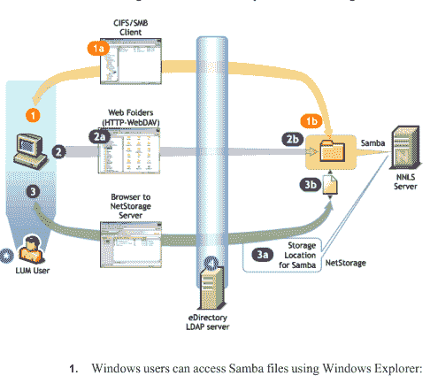

1. Windows 用户可以使用 Windows 资源管理器访问 Samba 文件：
    a. 用户以常规方式导航到 Samba 共享。
    b. NNLS 服务器上的文件使用 Microsoft 的 `CIFS` 协议进行访问和维护。
2. Windows 用户也可以通过创建 Web 文件夹来访问 Samba 文件。
    a. 用户以常规方式创建指向 Samba 服务器的 Web 文件夹。
    b. NNLS 服务器上的文件使用 `HTTP-WebDAV` 协议进行访问和维护。
3. 浏览器用户还可以访问其 Samba 文件，以将其下载到本地文件系统。
    a. 为了提供对 Samba 文件的浏览器访问，还必须安装 `NetStorage` 并为 Samba 服务器创建一个存储位置。
    b. 浏览器用户可以下载文件以进行查看和/或修改。然后他们可以上传已修改的文件。但是，他们不能直接修改文件。

所有文件服务访问都由 `eDirectory` 的 LDAP 服务器通过基于 LDAP 的身份验证进行控制。

例如，要从 Windows 工作站访问 NNLS 服务器上的文件，请执行以下操作：

1. 输入您的用户名（无上下文）和本地密码以登录工作站。
2. 通过执行以下任一操作来访问网络：
    - 在 Windows 2000 或 Windows ME 中，选择 **我的网络位置 > 附近的计算机**。
    - 在 Windows 95/98 中，选择 **网上邻居**。
3. 浏览到 NNLS 安装期间指定的工作组或域。
4. 选择正在运行 NNLS 协议的服务器。如果提示您登录，请使用用户的简单密码。


需要安装 Microsoft 网络客户端。

要从 Microsoft Windows 映射驱动器到 NNLS Linux 服务器上的文件，请以 Windows NT/2000 为例使用以下步骤：

1. 输入您的用户名和本地密码以登录。
2. 右键单击 **网上邻居** 图标（或 **我的网络位置**）。
3. 选择 **映射网络驱动器**。
4. 选择一个*驱动器字母*。
5. 输入路径（*服务器名称*\共享点）。
6. 选择 **映射**。

要从 Novell Client 4.9 for Windows 映射驱动器到 NNLS 服务器上的 Samba 共享，请执行以下操作：

1. 关闭 UNC 路径过滤器：
    a. 右键单击红色的 **N**；然后选择 **NetWare 客户端属性**。
    b. 选择 **高级设置**。
    c. 向下滚动并选择 **UNC 路径过滤器** 参数组。
    d. 将设置更改为 **关**，然后选择 **确定**。
    e. 重启工作站。
2. 将 Samba 共享映射为网络驱动器：
    a. 右键单击红色的 **N**；然后选择 **Novell 映射网络驱动器**。
    b. 选择一个*驱动器字母*。
    c. 输入路径（*服务器名称*\共享点）。
    d. 选择 **映射**。

## 练习 6-4 配置 Samba 以访问 Digital Airlines 员工


**30 分钟**

在本练习中，您通过执行以下操作为您的容器中的员工配置 Samba 访问：

- 第一部分：创建并为用户配置 Samba 服务
- 第二部分：从 Windows 工作站访问 NNLS 服务器上的文件
- 第三部分：将现有的 eDirectory 用户转换为 LUM 和 Samba 用户
- 第四部分：将 `/tmp` 目录配置为共享目录

### 第一部分：创建并为用户配置 Samba 服务

通过执行以下操作创建一个用户并为该用户配置 Samba 服务：

1. 查看 `smb.conf` 文件中的设置：
    a. 选择 **应用程序 > KDE 菜单 > 系统 > 文件管理器 - 超级用户模式**。
    b. 输入密码 `novell`；然后选择 **确定**。
    c. 浏览到 `/etc/opt/novell/samba`。
    d. 右键单击 `smb.conf` 文件；然后选择 **打开方式 > KWrite**。
        注意工作组名称（`workgroup`）。
    e. 向下滚动（大约到文件的 1/3 多一点的位置，即“密码和身份验证”部分），并查看“**NNLS 安装所做的条目**”。
        这些参数是根据您在安装期间提供的信息设置的。
    f. 选择 **文件 > 退出**。
2. 打开 `iManager` 并创建一个具有以下属性的用户：
    - 用户名： **SUser**
    - 名： **Samba**
    - 姓： **User**
    - 上下文： *您的容器*
    - 密码： **novell**
    - 主组（用于 LUM）： **DBUSERS**， *您的容器*
    - 同时将此用户转换为 Samba 用户：（*保持选中*）
    - Samba 密码： **novell**（默认输入）
3. 为 `SUser` 创建主目录：
    a. 按 `Ctrl+Alt+F2`。
    b. 登录为 `SUser`；密码 `novell`。
        创建了 `SUser` 的主目录文件夹，并且 `SUser` 已启用 LUM。


如果您收到“登录错误”错误，请参见练习 4-4 中的 LUM 故障排除步骤。
    c. 输入 `logout`。
    d. 按 `Alt+F7` 返回桌面。

### 第二部分：从 Windows 工作站访问 NNLS 服务器上的文件

请执行以下操作：

1. 从 Windows XP 工作站访问 NNLS 服务器上的文件：
    a. 在 XP 工作站上，右键单击 **开始**；然后选择 **资源管理器**。
    b. 从菜单栏中，选择 **工具 > 映射网络驱动器**。
    c. 在文件夹字段中，输入 `\\DNS名称\用户`。
        如果您的服务器是 DA3，请输入 `\\da3.atl.digitalairlines.com\SUser`
    d. 在选择完成之前，选择不同的用户名。
    e. 以 `SUser` 身份登录，密码为 `novell`；然后选择确定。
    f. 选择完成。
        此时您应该能看到用户的主目录。
2. 从 XP 工作站向主目录添加文件：
    a. 在主目录窗口中右键单击，并创建以下任意一项：
        - 新建 > 文件夹
        - 新建 > 文档
        - 新建 > 图像
3. 在 NNLS 服务器上，通过导航到 `/home/username` 验证文件是否存在。
    您应该能看到从 Windows XP 工作站创建的所有文件夹和/或文件。
4. 返回 Windows XP 工作站的资源管理器窗口，并断开 `SUser` 的映射驱动器：
    a. 关闭映射驱动器的窗口。
    b. 从 Windows 资源管理器菜单中，选择工具 > 断开网络连接。
    c. 选择 `SUser` 的映射驱动器；然后选择确定。
        Windows 一次只允许映射一个驱动器到一个共享。对于 NNLS 服务器，访问用户的主目录是通过在 `smb.conf` 中配置的 `[homes]` 共享完成的。


当来自不同服务器的两名学生通过同一台工作站访问 Samba 共享时，您将不会遇到映射到其他服务器上的共享的驱动器问题。但是，您将无法从同一服务器映射多个用户的 home 目录。

例如，您不能保留 `SUser` 的 home 目录映射，同时继续执行本练习的下一部分。

## 第三部分：将现有 eDirectory 用户转换为 LUM 和 Samba 用户

为了探索将现有用户（从 LDIF 文件导入的用户对象）同时转换为 LUM 和 Samba 用户的过程，请执行以下操作：

- 1. 从您的 NNLS 服务器，浏览目录树找到一个您在之前练习中*未使用过的用户*（例如 `KHart`）；然后在下方空白处记录该用户名：
- 2. 使用 `Modify Object` 链接查看用户属性，并滚动到 `General` 下拉菜单的底部。
  - 您应该看到没有 Linux 或 Samba 配置页面。
- 3. 使用 Linux User Management 下的链接，将*该用户*转换为 LUM 用户。
  - 使用 `DBUSERS,your container` 作为主组
  - 在选择 `OK` 之前，*取消选中* Samba。
  - 按 `Ctrl+Alt+F2` 并在 shell 提示符下登录，为该用户创建 home 目录。
  - 注销并返回桌面。
- 4. 使用 `Modify Object` 链接查看用户属性，并滚动到 `General` 下拉菜单的底部。
  - 您应该看到现在有一个 Linux Profile 页面。
- 5. 使用 Linux User Management 下的链接，将 LUM 用户转换为 Samba 用户。
  - 使用 `novell` 作为密码
- 6. 使用 `Modify Object` 链接查看用户属性，并滚动到 `General` 下拉菜单的底部。
  - 您应该看到现在有一个 Linux Profile 页面和一个 Samba Profile 页面。
- 7. 使用 XP 工作站将一个驱动器映射到此用户的 home 目录。
  - 确保之前映射的驱动器已断开连接。


> 如果所有映射的驱动器都已断开，但 Windows 仍返回错误，提示您只能将一个驱动器映射到一个共享，则您可能需要注销 Windows 并重新登录。

## 第四部分：将 `/tmp` 目录配置为共享目录

通过执行以下操作，允许经过身份验证的用户访问 `/tmp` 目录以共享文件：

- 1. 打开 `smb.conf` 文件进行编辑：
  - a. 选择 Applications > KDE Menu > System > File Manager > Super User Mode。
  - b. 输入密码 `novell`；然后选择 `OK`。
  - c. 浏览到 `/etc/opt/novell/samba`。
  - d. 右键单击 `smb.conf` 文件；然后选择 Open With > KWrite。
- 2. 编辑 `smb.conf`，使 `/tmp` 对经过身份验证的用户可用：
  - a. 向下滚动到 Share Definitions 部分，找到注释 `#This one is useful for people to share files`。
  - b. 删除 `#` 号以取消注释以下行：
    ```text
    [ tmp]
    comment = Temporary file space
    path = /tmp
    read only = no
    public = yes
    ```
  - c. 选择 `File > Save`；然后选择 `File > Quit`。
- 3. 重启 Samba 服务：
  - a. 通过输入 `/etc/init.d/novell-smb-stop` 停止 Samba 服务。
  - b. 通过输入 `/etc/init.d/novell-smb-start` 启动 Samba 服务。
- 4. 测试对 `/tmp` 作为共享目录的访问：
  - a. 在 XP 工作站上，从 Explorer 菜单栏选择 `Tools > Map Network Drive`。
  - b. 在 Drive 字段中输入 `Y:`（如果您是执行此练习第二部分的学生，请使用驱动器 `Z:`）。
  - c. 在 Folder 字段中输入 `\\DNS name\tmp`。
    如果您的服务器是 DA3，请输入 `\\da3.atl.digitalairlines.com\tmp`。
  - d. 在选择 Finish 之前，选择 `different user name`。
  - e. 以 `SUser` 身份登录，密码为 `novell`；然后选择 `OK`。
  - f. 选择 `Finish`。
  - g. 您现在应该能看到 `/tmp` 目录。
  - h. 将测试文档保存到此目录，并验证它是否能在 Linux 和 XP 工作站上看到。

## 目标 5 描述 NetStorage 的角色和功能

NetStorage 通过浏览器提供基于 Internet 的安全访问，允许访问您网络中 Linux、Windows 和 NetWare 服务器上的文件和文件夹。

NetStorage 身份验证依赖于 Novell eDirectory 身份验证来提供安全访问，因此基于 Internet 的访问与从网络内部访问文件一样安全。

为了描述 NetStorage 的角色和功能，您需要了解以下内容：

- NetStorage 的优势
- NetStorage 的工作原理
- 用户访问 NetStorage 时看到的内容

（练习结束）

您不必断开映射到 `/tmp` 目录的驱动器，因为其他练习不需要您将驱动器映射到该共享。

如果您选择执行练习 7-1 的可选部分，您会使用映射到 `/tmp` 目录的驱动器。


### NetStorage 的优势

Novell NetStorage 包括以下优势：

- 允许用户在任何具备 Internet 功能的计算机和您网络上的服务器之间安全地复制、移动、重命名、删除、读取和写入文件
- 消除了使用虚拟专用网络（VPN）客户端访问文件的需要
- 消除了一台计算机与另一台计算机之间通过电子邮件或复制数据的需求
- 支持 Internet 标准，如 HTTP、HTTPS、HTML、XML 和 WebDAV
- 支持文件协议，如 CIFS、Samba 和 NFS。
- 支持访问用户的 Novell iFolder 账户
- 通过 Novell Virtual Office 提供对网络文件和文件夹的访问
- 支持使用 Storage Location 对象，通过 Web 浏览器显示 NetStorage 目录的指定名称

当 NetStorage 安装在安装了 Novell Nterprise Linux Services 的一个 Linux 服务器上时，用户 potentially 可以访问您地理分布广泛的网络上的任何 Linux 或 NetWare 服务器。

### NetStorage 的工作原理

NetStorage 安装在一个作为 Middle Tier（也称为 XTier）服务器运行的 Linux 服务器上。XTier 是 Novell 的 Web 服务框架，被各种 Novell 产品使用。

请参阅 *NetStorage Administration Guide* 中的 "How NetStorage Works"，该指南可在 http://www.novell.com/documentation/lg/nnls/index.html 获取。

Middle Tier 服务器的配置信息存储在 Linux 服务器上的 `/etc/opt/novell/xtier/xtier_registry.xml` 文件中。Novell iManager 提供了更改 Middle Tier 配置的便捷方法。

以前版本的 NetStorage 使用 NSAdmin 实用工具进行管理。配置现在应通过 Novell iManager 进行。

设置好 Middle Tier 服务器后，它对于用户而言显示为 Internet Web 服务器，并可以通过 web 浏览器访问。例如，NNLS 上的 NetStorage 服务可以通过 Virtual Office 访问，或通过以下 URL 访问：

`HTTPS://IP 地址或域名/NetStorage`

NetStorage 还包括一个 gadget，提供通过 Novell exte:Nd Director 4.1 Standard Edition 的访问。

以下说明了 NetStorage 在该中间层上的工作原理：

#### 图 6-16

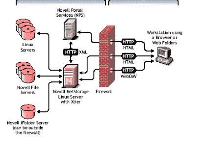


Middle Tier 服务器与网络中的 NetWare 或 Linux 服务器通信，并使用 `eDirectory` 和用户的用户名和密码提供安全身份验证。

认证后，当用户尝试访问 Linux 服务器上的 Samba 共享时，NetStorage 还会检查 Samba 配置，以查看用户对该共享的权限。因此，用户必须启用 Samba 后才能访问 Samba 共享。

Samba 启用要求的一个显著例外是 NetStorage `shared` 目录，将在本节后面讨论。

NetStorage 还为位于 Novell iFolder 服务器上的文件提供安全访问。

> 用户必须通过 iFolder 服务器启用其 iFolder 用户账户，才能使用 NetStorage 访问存储在 iFolder 中的文件。您还必须允许用户在 NetStorage 中设置 iFolder 密码短语。

iFolder 2.1 不支持 56 位加密。如果您使用的是 56 位加密，则必须使用 iFolder 1.03。

所有事务也可以使用 SSL 加密以增加安全性。Novell iFolder 事务使用 iFolder 加密机制进行保护。

### 用户访问 NetStorage 时看到的内容

NetStorage 默认允许某些访问，而额外的访问可以进行配置并必须满足特定要求。在本主题中，我们将讨论以下内容：

- 默认的 NetStorage 访问
- 额外配置的 NetStorage 访问

### 默认 NetStorage 访问

NetStorage 网页显示网络文件和文件夹。

以下示例展示了可以从 NetStorage 网页默认访问的文件夹：

**图 6-17**

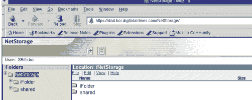

如图 6-17 所示的`shared`文件夹是 NetStorage 的一个默认位置，所有用户都可以访问该位置以上传或下载文件。用户无需启用 Samba 即可访问此文件夹。

NetStorage 自动配置为允许所有 `eDirectory` 用户访问 NNLS 服务器上的`shared`文件夹。该文件夹的路径为：`/var/opt/novell/netstorage/shared`

### 额外配置的 NetStorage 访问

您可以创建仅允许特定用户访问的文件夹。通过创建指向 Linux 和 NetWare 服务器上文件夹的存储位置（Storage Location）对象来实现此目的。

用户可能被授予 NNLS 服务器上某些文件夹的 Linux 文件系统权限，但如果未满足以下条件，他们将无法通过 NetStorage 访问这些文件夹：

- 该用户已启用 Samba。
- 对于您专门为 NetStorage 用户创建的文件夹，必须在 `smb.conf` 文件中将其配置为 Samba 共享。
- 对于用户的主目录，它们默认已配置为 Samba 共享。但如果您想让用户通过 NetStorage 访问主目录，必须以 LUM 用户身份登录来创建该主目录。
- 已创建存储位置（Storage Location）对象，并配置其指向相应的 Samba 共享。
- 用户被分配了存储位置对象的权限。这可以在单个用户级别完成，也可以通过组、容器或其他类似的分配方式完成。

以下示例展示了已配置为可从 NetStorage 网页访问的额外文件夹：

图 6-18

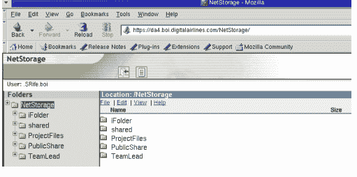

## 目标 6 安装和配置 NetStorage

要安装和配置 NetStorage，您需要了解以下内容：

- 安装 NetStorage 的步骤
- 创建存储位置对象和列表
- 配置 NetStorage
- 访问 NetStorage 文件和文件夹

### 安装 NetStorage 的步骤

安装 iFolder 的一般步骤如下：

- 满足 NetStorage 依赖项
- 收集所需信息
- 使用 NNLS 安装功能

#### 满足 NetStorage 依赖项

NetStorage 随 Virtual Office 一起安装。Virtual Office 的依赖项包括：

- 同一 NNLS 服务器上的 Apache 2.0.45
- 同一 NNLS 服务器上的 JVM 1.4.1_02
- 同一 NNLS 服务器上的 Tomcat 4.1.24
- 网络中任意位置的 `eDirectory` 8.7.1 或更高版本
- 同一 NNLS 服务器上的 iManager 2.0

当您选择 Virtual Office 组件时，NNLS 安装程序将选择所需的组件及其依赖项。它们将在同一过程中全部安装。

有关成功安装尚未安装的 Virtual Office 依赖项所需的信息，请参见表 2-5。

对于大多数网络，您只需在一台服务器上安装 NetStorage；不过，这可能会根据规模和组织的需求而变化。

例如，如果您的公司在地理位置上分散，您可能希望在每个地理区域的一台服务器上安装 NetStorage。

#### 收集所需信息

下表描述了安装 Virtual Office 期间请求的 NetStorage 信息：

表 6-5

| 所需的配置数据 | 描述 |
| :--- | :--- |
| NetStorage 身份验证服务器 | 使用 LDAP 进行 NetStorage 用户身份验证的 `eDirectory` 服务器的 IP 地址或 DNS 主机名。 |
| NetStorage 代理用户 | 具有执行以下操作权限的用户对象的完全限定名称：<br>• 在指定为 NetStorage 身份验证服务器的 LDAP (`eDirectory`) 树中搜索 NetStorage 用户<br>• 在 NetStorage 中定义了 iFolder 存储位置的情况下，在用户首次访问存储位置时，在 `eDirectory` 中存储 iFolder 用户密码短语 |
| NetStorage 代理用户密码 | 指定为 NetStorage 代理用户的用户的密码。 |
| NetStorage 用户上下文 | 要搜索 NetStorage 用户的 NetStorage 身份验证服务器上的上下文。<br>（所有子上下文也会被搜索。） |
| iFolder 服务器 IP 地址或主机名 | （可选）指定要在 NetStorage 中作为存储位置创建的 iFolder 服务器的 IP 地址或主机名。这使 iFolder 自动对 Virtual Office 用户可用。 |

#### 使用 NNLS 安装功能

要从 NNLS 安装 NetStorage（作为 Virtual Office 安装的一部分），请执行以下操作：

1. 执行自定义安装的步骤。
    > 如有必要，请参见第 2 节了解如何进行自定义安装的详细信息。
2. 取消选中*不想*安装的服务，选中**Virtual Office** 服务，然后继续。
    如果之前未安装 `eDirectory`，请注意，当您选择 Virtual Office 时，`eDirectory` 默认已选中（连同其他必需组件，如 Apache 和 Tomcat）。
    如果之前已安装 `eDirectory`，安装程序将指示哪些组件已安装。
3. 接受许可协议。
4. **（条件）** 如果提示输入 NICI Foundation Key (NFK) 文件的位置，请插入许可软盘并输入 NFK 文件的路径。
    只有当之前未安装 `eDirectory` 时，才会提示输入 NICI Foundation Key。
5. 在每次提示处输入所需信息（参见表 6-5）。
6. 查看摘要信息并进行必要的更正。
7. 当所有信息正确时，完成安装。
8. 查看 readme 文件并保存安装设置日志文件。

### 创建存储位置对象和列表

安装 NetStorage 后，您可能只能使用 NetStorage 看到 Linux 服务器上的 iFolder 目录和一个本地共享目录。

访问 Linux 服务器上的文件和目录需要存储位置对象，也可以用于 NetWare 服务器。

用户可能对网络上的某些文件和文件夹具有特定的 `eDirectory` 权限，但如果未创建存储位置对象，他们将无法使用 NetStorage 访问这些文件和文件夹。

要授予用户文件访问权限，您需要知道如何执行以下操作：

- 创建存储位置对象
- 创建存储位置列表

#### 创建存储位置对象

要创建存储位置对象，请执行以下操作：

1. 启动浏览器，输入以下内容以启动 iManager：
    - `https://IP_or_DNS/nps/iManager`
2. 输入您的*用户名*和*密码*登录。
3. 在左侧的**文件访问 (NetStorage)**下，选择**存储位置：创建**。

将显示以下内容：

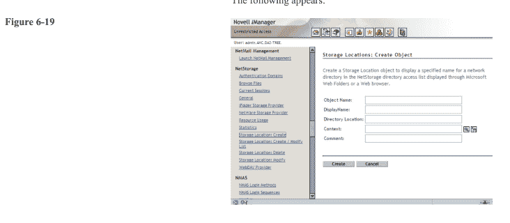

4. 输入以下内容：
    - **对象名称**：`eDirectory` 中对象的名称。


- **显示名称**：在 NetStorage 目录访问列表中显示的名称。

这是快捷名称，用户可以看到它。如果您为两个不同的存储对象使用相同的显示名称，名称中会添加数字以使每个名称唯一。

- **目录位置**：目录在文件系统上的位置。该位置是一个 URL，包括文件系统类型、服务器名称、卷和目录路径。

如果要访问的存储位于 NetWare 服务器上，URL 必须采用以下格式：

`ncp://server_name/volume/path_to_directory`

例如：

`ncp://server1.digitaalair.com/mkgt/reports`

*或*

`ncp://111.222.3.4/mkgt/reports`

如果要访问的存储位于 Linux 服务器上，URL 必须采用以下格式：

`cifs://server_name/cifs_share_name`

如果省略文件系统，则假设其为 NCP。

- **上下文**：存储位置对象所在的目录上下文。

您可以选择对象选择器图标来浏览并选择上下文。

- **注释**：仅供管理员使用；不会显示给用户。

5. 完成后，选择**创建**；然后选择**确定**。

#### 创建存储位置列表

创建存储位置对象后，必须创建一个存储位置对象列表，该列表可用于指定的用户、组、配置文件或容器对象。

用户下次登录时将看到与该对象关联的目录。创建此列表后，您可以从同一窗口通过向列表分配额外的存储位置对象或从列表中删除存储位置对象来修改该列表。

要创建存储位置列表，请执行以下操作：

1. 启动浏览器，并输入以下内容以启动 iManager：`https://IP_or_DNS/nps/iManager`
2. 输入您的`用户名`和`密码`登录。
3. 在左侧**文件访问（NetStorage）**下，选择**存储位置：创建/修改列表**。
4. 选择**对象选择器**按钮；然后浏览并选择要为其创建列表的用户、组、配置档案或容器对象。
5. 完成后，选择**确定**。
6. 选择**对象选择器**按钮；然后选择要包含在此列表中的*存储位置对象*。
   - 您可以在对象选择器窗口中选择多个存储位置对象。当您选择多个存储位置对象时，它们将显示在已选对象列表中。
   - 如果列表中已包含存储位置对象且您想添加更多，请在选择确定之前确保原始对象仍在列表中。
   - 您可以通过在选择确定之前从列表中删除现有存储位置的名称来移除它们。
7. 完成创建或修改列表后，选择**确定**。

### 访问 NetStorage 文件和文件夹

根据 NetStorage 的配置方式，NetStorage 网页将显示您可以访问的网络文件和文件夹。

最初，您可能只能看到您的 iFolder 目录和 Linux 服务器上的本地共享目录。访问 Linux 服务器上的文件和目录需要存储位置对象，这些对象也可以用于 NetWare 服务器。

对于 NetWare 服务器，NetStorage 读取您的 NetWare 登录脚本以确定驱动器映射，读取 eDirectory 用户对象属性以确定您的主目录，然后根据映射的驱动器和主目录显示文件和文件夹列表。

如果您通常登录到多个 eDirectory 树，您可能可以访问不同 eDirectory 树中的其他主目录。

如果您拥有 Novell iFolder 帐户，也会显示 iFolder 目录。但是，某些 NetStorage 功能（如下载以供编辑）在 Novell iFolder 中不可用。

NetStorage 仅从安装过程中指定的主要 eDirectory 服务器读取容器、配置档案和用户登录脚本，并仅根据这些登录脚本显示用户的驱动器映射。

用户可能对网络中的某些文件和文件夹具有特定的 eDirectory 权限，但如果未创建存储位置对象、不存在指向这些文件夹的登录脚本驱动器映射，或者这些文件和文件夹不在用户的主目录中，他们将无法使用 NetStorage 访问这些文件和文件夹。

如果您希望允许用户通过 NetStorage 访问特定文件夹，您可能需要在那条登录脚本（容器、配置档案或用户）中添加指向该文件夹的驱动器映射命令。

要从工作站访问 NetStorage，请执行以下操作：

- 启动浏览器并指定 NetStorage 的以下 URL：`https://IP_or_DNS/NetStorage`
  - 用于访问 NetStorage 的工作站的日期和时间应与运行 NetStorage 的服务器的日期和时间大致相近（在几小时内），以避免冲突。
- 输入您的`用户名`和`密码`。
  - NetStorage 使用您的 Novell eDirectory 用户名和密码，因此您无需记住或使用单独的用户名或密码。
  - 您可以使用许多与 Windows 资源管理器中可用的展开和收缩文件夹以及打开文件相同的约定。
  - 要通过浏览器创建新文件夹，或复制、删除、重命名、移动或下载现有文件，请选择**文件**菜单上的选项。
  - 在浏览器窗口中选择文件夹视图按钮可在另一列中显示文件夹，并允许您展开和收缩文件夹。
  - 文本视图仅显示当前目录中的文件和文件夹，不允许展开或收缩文件夹。
  - 本地文件和文件夹无法通过 NetStorage 访问。此外，您不能从 NetStorage 映射驱动器或更改登录脚本。
- 完成后，关闭 Web 浏览器。

### 配置 NetStorage

使用 Novell iManager，您可以在将 NetStorage 安装到 Linux 服务器后更改其 NetStorage 配置。


更改任何设置后，必须重新启动 Apache Web 服务器。

要重新启动 Apache Web 服务器，请转到 `/etc/init.d` 目录并输入 `/novell-httpd restart` 以停止并启动 Web 服务器。

要配置 NetStorage，请执行以下操作：

1. 从 Web 浏览器启动并登录到 iManager。
   - 用于访问 NetStorage 的工作站的日期和时间应与运行 NetStorage 的服务器的日期和时间大致相近（在几小时内），以避免冲突。
2. 在左列中，找到要更改的 NetStorage 配置选项。

#### 图 6-20

以下图示说明了这些选项：

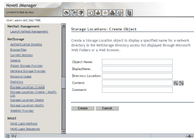

提供以下配置选项：

- **身份验证域**。允许您更改或添加 NetStorage 所需的 eDirectory 服务器 URL 和上下文。这允许您访问两个或多个 eDirectory 树。此页面还允许您更改指定为主要 eDirectory 服务器的 eDirectory 服务器。
- **浏览文件**。显示 NetStorage 网页。
- **当前会话**。显示包含当前 NetStorage 会话信息的报告。
- **常规**。允许您配置位置、证书名称、会话超时、清理级别和 LDAP 端口等项目。
- **iFolder 存储提供程序**。如果您在 Linux 服务器上安装了 Novell iFolder，您可以查看或编辑诸如根目录、口令短语表单协议、iFolder 服务器和安全端口等配置设置。
- **NetWare 存储提供程序**。允许您查看或编辑诸如主名称、驱动器名称和容器搜索高度等配置设置。
- **资源使用情况**。显示 NetStorage 资源利用率的详细报告。
- **统计信息**。显示包含服务器正常运行时间、登录失败次数、NetStorage 会话数等信息的报告。
- **存储位置**。允许您创建存储位置对象，以在通过 Web 浏览器显示的 NetStorage 目录访问列表中为网络目录显示指定名称。
- **WebDAV 提供程序设置**。允许您配置 NetStorage WebDAV 提供程序（Moniker）的位置以及 HTML 接口的目录。

3. 完成后，关闭 Web 浏览器。

> 有关设置这些配置选项和故障排除 NetStorage 的详细信息，请参阅 `http://www.novell.com/documentation` 上的 NetStorage 管理指南。

#### 练习 6-5 配置和测试 NetStorage


作为您的 Digital Airlines 办公室的网络管理员，您被分配为刚刚成立的效率项目组配置 NetStorage 服务。

您还被要求为团队负责人 SRIfe 创建一个个人文件夹。

效率项目组由 ACCTUSERS 组组成。

您将在 3 个部分中完成此任务。

- 第一部分：测试默认 NetStorage 配置


# 第一部分：测试默认 NetStorage 配置

在此练习部分，您将通过不修改 `smb.conf` 文件且不将 eDirectory 用户转换为 LUM 或 Samba 来测试默认的 NetStorage 配置。

通过这样做，您将看到默认配置并未提供您被分配创建的 NetStorage 服务。

为此，请执行以下操作：

1. 访问默认 `共享` 文件夹并上传文件到其中：
   a. 在 Windows XP 工作站上，启动 `Internet Explorer`。
   b. 输入 `https://your_server_DNS/NetStorage`。
   c. 当提示时，使用密码 `novell` 以 `kfullmer` 的身份进行身份验证；然后选择 `确定`。
   d. 展开 `NetStorage` 文件夹。

## 第一部分：练习说明（续）

1. 将文件上传到共享文件夹：
   - e. 选中（高亮）`shared`（共享）文件夹。
   - f. 在右侧窗格中，选择 `File > Upload`（文件 > 上传）。
   - g. 在“上传文件”窗口中，选择 `Browse`（浏览）。
   - h. 浏览至 `C:\Documents and Settings\All Users\Shared Documents\Shared Pictures\Sample Pictures`。
   - i. 选中 `Blue hills`（蓝色山丘）；然后选择 `Open`（打开）。
   - j. 在“上传文件”窗口中，选择 `Upload`（上传）。

2. 验证文件已上传到 NNLS 服务器：
   - a. 在 NNLS 服务器上，打开一个 `终端会话`。
   - b. 输入 `su -`；然后输入 `novell` 作为密码。
   - c. 输入 `cd /var/opt/novell/netstorage/shared`。
   - d. 输入 `ls -l Blue*`。
   - 您应该看到列出的 `Blue hills.jpg` 文件。

3. 从团队负责人的主目录为其创建个人存储位置：
   - a. 在您的 NNLS 服务器上，在 iManager 的 `File Access (NetStorage)`（文件访问 (NetStorage)）下，选择 `Storage Location: Create`（存储位置：创建）。
   - b. 在“对象名称”字段中，输入 `TeamLead`。
   - c. 在“显示名称”字段中，输入 `TeamLead`。
   - d. 在“目录位置”字段中，输入 `cifs://10.0.0.x/SRife`。
   - e. 在“上下文”字段中，输入 `您的容器`。
   - f. 选择 `Create`（创建）。
   - g. 当提示该位置已创建时，选择 `OK`（确定）。

4. 通过完成以下操作将新的存储位置与 `SRife` 关联：
   - a. 选择 `Storage Location: Create / Modify List`（存储位置：创建/修改列表）。
   - b. 在“对象”字段中，浏览并选中 `SRife`。
   - c. 选择 `OK`（确定）。
   - d. 在 `Storage Location Objects`（存储位置对象）字段中，浏览并选中 `TeamLead_your_container`，然后选择 `OK`（确定）。
   - e. 当提示分配成功时，选择 `OK`（确定）。

5. 通过以 `SRife` 身份登录 NetStorage 来验证 `TeamLead` 存储位置对象对 `SRife` 可用：
   - a. 在 Mozilla 中，选择 `File > New > Navigator Window`（文件 > 新建 > 导航器窗口）以打开一个新的浏览器窗口。
   - b. 输入 `https://your_server_DNS/NetStorage`。
   - c. 当提示时，使用密码 `novell` 以 `SRife` 身份进行身份验证，然后选择 `OK`（确定）。
   - 您应该看到显示的 `TeamLead` 存储位置。

6. 尝试查看 `TeamLead` 文件夹中的文件，并上传文件到该文件夹：
   - a. 选中 `TeamLead` 文件夹。
   - 如果您尚未将 `SRife` 转换为 LUM 和 Samba 用户，右侧窗格将为空白。
   - b. 从 NetStorage 菜单中，选择 `File > Upload`（文件 > 上传）。
   - 由于 `SRife` 不是 LUM 和 Samba 用户，上传窗口也将为空白。
   - c. 通过选择 `Logout`（注销）从 NetStorage 退出登录。

## 第二部分：配置团队负责人使用个人文件夹

在此练习部分中，您将配置 `SRife` 使用您为其创建的个人文件夹。您还将验证其他用户无法看到 `TeamLead` 文件夹。

为此，请执行以下操作：

1. 使用您在之前的练习中已执行过的步骤，将 `SRife` 转换为 LUM 和 Samba。使用以下信息：
   - 主组： `ACCTUSERS`
   - Samba 密码： `novell`

2. 以 LUM 用户身份登录，以创建 `SRife` 的 `主目录`。

3. 在您的 NNLS 服务器上，以 `SRife` 身份登录到 NetStorage。

4. 通过选中 `TeamLead` 来查看 `SRife` 的 `TeamLead` 文件夹中的文件。
   - 您应该看到在 `SRife` 主目录中创建的默认文件和文件夹。

5. 将文件上传到 `TeamLead` 文件夹：
   - a. 选择 `File > Upload`（文件 > 上传）。
   - b. 在“上传文件”窗口中，选择 `Browse`（浏览）。
   - c. 浏览至 `/tmp`。
   - d. 选中 `your container`.ldif，然后选择 `Open`（打开）。
   - e. 在“上传文件”窗口中，选择 `Upload`（上传）。
   - NetStorage 屏幕刷新，`your container`.ldif 文件出现在 `TeamLead` 文件夹中的文件列表中。
   - f. 通过选择 `Logout`（注销）从 NetStorage 退出登录。

6. 将已经是 LUM 用户的 `JNelso` 转换为 Samba 用户。

7. 以 `JNelson` 身份登录到 NetStorage 并尝试查看 `TeamLead` 文件夹。
   - 虽然 `JNelson` 是 Samba 用户，但她无法看到 `TeamLead` 文件夹，因为她未被分配到 `TeamLead` 存储位置对象。她也没有 `SRife` 主目录的权限。

8. 以 `JNelson` 身份退出登录。

9. `Close`（关闭）浏览器窗口。

## 第三部分：创建一个项目文件文件夹供团队共享文件使用

在此练习部分中，您将配置存储位置对象，使其指向您的容器中所有人都可以使用的公共共享文件夹，以及只有团队可以使用的用于共享文件的私有共享文件夹。

为此，请执行以下操作：

1. 创建一个存储位置：
   - a. 在 iManager 的 `File Access (NetStorage)`（文件访问 (NetStorage)）下，选择 `Storage Location: Create`（存储位置：创建）。
   - b. 在“对象名称”字段中，输入 `PublicShare`。
   - c. 在“显示名称”字段中，输入 `PublicShare`。
   - d. 在“目录位置”字段中，输入 `cifs://10.0.0.x/tmp`。`/tmp` 目录在之前的练习中被配置为公共 Samba 共享文件夹。
   - e. 在“上下文”字段中，输入 `your container`。
   - f. 选择 `Create`（创建）。
   - g. 当提示该位置已创建时，选择 `OK`（确定）。

2. 通过完成以下操作将新的存储位置与 `ACCTUSERS` 组关联：
   - a. 选择 `Storage Location: Create / Modify List`（存储位置：创建/修改列表）。
   - b. 在“对象”字段中，浏览并选中 `your container`。
   - c. 选择 `OK`（确定）。


- d. 在“存储位置对象”字段中，浏览并选中 `PublicShare.your container`；然后选择 `OK`（确定）。

- e. 当提示分配成功时，选择 `OK`（确定）。

### 3. 通过完成以下操作测试配置：

- a. 在 Mozilla 中，选择 `File > New > Navigator Window`（文件 > 新建 > 导航器窗口）以打开一个新的浏览器窗口。

- b. 输入 `https://your_server_DNS/NetStorage`。

- c. 当提示时，使用密码 `novell` 以 `kfullner` 身份进行身份验证；然后选择 `OK`（确定）。

- 您应该看到显示的 PublicShare 存储位置。您无法在 PublicShare 文件夹中看到任何文件，因为 kfullner 尚未转换为 Samba 用户。

- d. 选中 NetStorage 菜单栏上的 `Logout`（注销）图标。

### 4. 将 `kfullner` 转换为 LUM 和 Samba，并再次尝试以 kfullner 身份登录并访问 PublicShare 文件夹；然后 `注销` 并关闭浏览器窗口。

### 5. 在您的 NNLS 服务器上准备一个目录，用于保存项目团队的文件，完成以下操作：

- a. 在您的 NNLS 服务器上，通过输入 `mkdir /var/ProjectFiles` 在 `/var` 中创建一个名为 ProjectFiles 的新目录。

- b. 通过输入 `chown root:ACCTUSERS /var/ProjectFiles` 将 ACCTUSERS 分配为 `/var/ProjectFiles` 的组。

- ACCTUSERS 已经是 LUM 组。如果它尚未转换为 LUM，您将在此时收到错误。

- c. 通过输入 `chmod 070 /var/ProjectFiles` 赋予组 `rwx` 权限，并限制 root 和 Others 的权限。

### 6. 编辑 `smb.conf` 以创建一个私有 Samba 共享文件夹，通过 Samba 授予 ACCTUSERS 访问 ProjectFiles 文件夹的权限：

- a. 选择 `Applications > KDE Menu > System > File Manager - Super User Mode`（应用程序 > KDE 菜单 > 系统 > 文件管理器 - 超级用户模式）。

- b. 输入密码 `novell`；然后选择 `OK`（确定）。

- c. 浏览至 `/etc/opt/novell/samba`。

- d. 右键单击 `smb.conf` 文件；然后选择 `Open With > KWrite`（使用 > KWrite 打开）。

- e. 向下滚动到 `Share Definitions`（共享定义）部分并添加以下内容：

```
[ProjectFiles]
path = /var/ProjectFiles
writable = yes
public = no
group = ACCTUSERS
```

- f. 选择 `File > Save`（文件 > 保存）；然后选择 `File > Quit`（文件 > 退出）。

### 7. 通过输入以下内容重启 Samba 服务：

- `etc/init.d/novell-smb stop`

- `etc/init.d/novell-smb start`

### 8. 创建一个存储位置：

- a. 在 iManager 的 `File Access (NetStorage)`（文件访问 (NetStorage)）下，选择 `Storage Location: Create`（存储位置：创建）。

- b. 在“对象名称”字段中，输入 `ProjectFiles`。

- c. 在“显示名称”字段中，输入 `ProjectFiles`。

- d. 在“目录位置”字段中，输入 `cifs://10.0.0.x/ProjectFiles`。

- e. 在“上下文”字段中，输入 `your container`。

- f. 选择 `Create`（创建）。

- g. 当提示该位置已创建时，选择 `OK`（确定）。

### 9. 通过完成以下操作将新的存储位置与 ACCTUSERS 组关联：

- a. 选择 `Storage Location: Create / Modify List`（存储位置：创建/修改列表）。

- b. 在“对象”字段中，浏览并选中 `ACCTUSERS`, `your container`。

- c. 选择 `OK`（确定）。

- d. 在“存储位置对象”字段中，浏览并选中 `ProjectFiles, your container`；然后选择 `OK`（确定）。

- e. 当提示分配成功时，选择 `OK`（确定）。

### 10. 通过完成以下步骤来测试配置：

- a. 在 Mozilla 中，选择 `文件 > 新建 > 导航器窗口` 以打开一个新的浏览器窗口。

- b. 输入 `https://your_server_DNS/NetStorage`。

- c. 当提示时，以 `JGoldman`（或 ACCTUSERS 组的其他成员）身份进行身份验证，密码为 `novell`；然后选择 `确定`。

您应该能看到 ProjectFiles 存储位置已显示。

您也应该能够将文件上传到 ProjectFiles 文件夹。如果无法上传，请确保 JGoldman 已启用 Samba，然后重试。

- d. 选择 NetStorage 菜单栏上的 `注销` 图标；然后关闭浏览器窗口。

- e. （可选）探索并查看谁可以访问 ProjectFiles 文件夹，谁不能。

*(练习结束)*

## 总结

| 目标 | 摘要 |
| :--- | :--- |
| 1. 描述 iFolder 的用途和架构 | Novell iFolder 是一种网络服务软件解决方案，它允许移动专业人员从任何地方——在线、离线、始终——跨越多个工作站和网络访问其本地文件。iFolder 自动且智能地更新您在台式计算机、笔记本电脑和其他连接设备上使用的文件，让您无论身处何地——在办公室、家中或酒店——都能使用它们。所有需要的只是一个活跃的网络或互联网连接以及 iFolder 客户端、Web 浏览器或 NetDrive。要描述 iFolder 的用途和架构，您需要了解以下内容：<br>- iFolder 优势<br>- iFolder 功能<br>- iFolder 组件<br>- iFolder 架构 |
| 2. 安装和配置 iFolder | 您在 Linux 上安装和配置 iFolder 分为 4 个基本阶段：<ol><li>安装第一个 iFolder 服务器。</li><li>配置全局设置、默认策略、LDAP 身份验证源和 iFolder 服务器。</li><li>部署 iFolder 用户。</li><li>安装额外的 iFolder 服务器（如有需要）。</li></ol> 要完成这些阶段并管理 iFolder，您需要了解以下内容：<ul><li>在 Linux 服务器上安装的前置条件</li><li>如何从 NNLS 安装 iFolder</li><li>如何配置您的 iFolder 服务器</li><li>如何访问 iFolder 网站</li><li>如何安装和配置 iFolder 客户端</li><li>如何管理 iFolder 用户账户</li><li>如何管理 iFolder 服务器</li><li>如何管理 LDAP 服务器</li><li>如何监控您的 iFolder 系统</li><li>如何生成报告</li></ul> |
| 3. 描述 Samba 的用途和架构 | Samba 是一个软件包，在 Linux 上实现了微软的 SMB/CIFS 网络协议。<br><br>它允许 Linux 机器作为与 Windows 兼容的文件服务器运行，并作为客户端与其他 Windows 服务器交互。<br><br>要描述 Samba 的用途和架构，您需要了解以下内容：<br>- 什么是服务器消息块 (SMB)<br>- 什么是通用互联网文件系统 (CIFS)<br>- Samba 和 NNLS |
| 4. 安装和配置 Samba | 要安装和配置 Samba，您需要了解以下内容：<br>- 安装 Samba 的步骤<br>- 如何配置 Samba<br>- 如何通过 Samba 访问文件 |


### 5. 描述 NetStorage 的角色和功能

NetStorage 提供通过浏览器安全地基于 Internet 访问 Linux、Windows 和 NetWare 服务器上的文件和文件夹的功能。

NetStorage 身份验证依赖 Novell eDirectory 身份验证以提供安全访问，因此基于 Internet 的访问与从网络内部访问文件一样安全。

要描述 NetStorage 的角色和功能，您需要理解以下内容：
- NetStorage 优势
- NetStorage 如何工作
- 用户访问 NetStorage 时会看到什么

### 6. 安装和配置 NetStorage

要安装和配置 NetStorage，您需要了解以下内容：
- 安装 NetStorage 的步骤
- 创建存储位置对象和列表
- 配置 NetStorage
- 访问 NetStorage 文件和文件夹

## 第 7 节

### 使用 NNLS 管理打印机

在本节中，您将学习如何在 Linux® 服务器上设置和配置 iPrint，以及如何从 Windows® 工作站打印。

### 目标

- 1. 识别 iPrint 的优势
- 2. 描述 iPrint 如何工作
- 3. 安装和配置 iPrint
- 4. 使用 iPrint 打印

### 简介

Novell iPrint 是一种基于行业标准互联网打印协议 `IPP` 的打印解决方案，它消除了通过互联网打印的复杂性。

iPrint 允许员工、移动员工、业务合作伙伴和客户使用现有的互联网连接从各种远程位置访问打印机。

无论用户是在办公楼工作、从远程办公，还是在另一个国家参加销售会议，iPrint 都能确保他们能够快速、轻松、可靠地打印文档。


> 有关安装和配置 iPrint 的更多详情，请参阅 Novell® Netrprise™ Linux® Services 的 *Novell iPrint 管理员指南*。

### 目标 1

#### 识别 iPrint 的优势

以下是 iPrint 的优势和功能：

- **对打印机的全球访问。** iPrint 允许移动员工、业务合作伙伴和客户使用网络浏览器从任何地方访问您的打印机。

例如，假设您正在公司区域办公室参加销售会议，发现您没有带足够的月度销售报告副本。

使用笔记本电脑和网络浏览器，您可以浏览到大楼的平面图，选择会议室旁边的打印机，并打印更多的销售报告副本。

- **降低通信成本。** 打印到远程位置可能具有挑战性。传真既昂贵又低效。

如果您通过电子邮件发送文档，必须确保收件人有兼容的文字处理或页面布局应用程序。

相比之下，iPrint 使您能够使用现有打印机打印高质量、清晰的文档。

- **安全打印。** eDirectory 与 iPrint 集成，确保只有授权用户可以访问您的打印机。

打印作业通过 `SSL` 提交到 iPrint 管理器，以防止未授权用户访问您的文档。

- **统一管理。** 您可以从单一位置控制所有打印机，即使这些打印机由不同的制造商生产并位于不同的位置。

您甚至可以使用自定义管理功能来创建通用界面以访问公司的打印资源。

- **自定义查看打印机。** 用户可以立即从网页上查看可用的打印机。网络管理员可以自定义此页面以满足特定的业务需求。

例如，使用地图设计工具，您可以将建筑物的平面图插入到公司网页中。然后，您可以轻松地将代表打印机实际位置的图标拖动到平面图上。您可以通过浏览器访问地图，并选择打印机图标来安装该打印机及其驱动程序。

#### 目标 2 描述 iPrint 如何工作

要描述 iPrint 如何工作，您需要了解以下组件是如何工作的：
- iPrint 管理器
- iPrint 驱动程序存储
- iPrint 客户端
- iPrint 地图设计器

下图展示了 iPrint 管理器、iPrint 驱动程序存储和 iPrint 客户端组件如何提供打印服务：

**图 7-1**

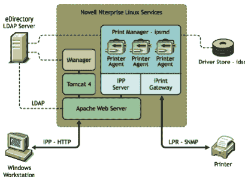

##### iPrint 管理器

iPrint 管理器是 eDirectory™ 树中的一个对象，也是运行在您的 Linux 服务器上的守护进程。当打印机准备好时，打印作业会提交到 iPrint 管理器，然后转发到打印机：

**图 7-2**

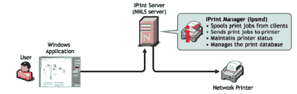

### iPrint 管理器简介

单个 iPrint 管理器可以处理多个打印机的打印任务。根据您的网络配置，例如远程位置，您可以在其他服务器上创建额外的 iPrint 管理器，但在同一台服务器上只能存在一个 iPrint 管理器。

要了解 iPrint 管理器如何工作，您需要了解以下内容：
- 什么是打印代理
- 什么是 IPP 服务器

#### 什么是打印代理

打印代理是 iPrint 管理器数据库中的一个条目，用于表示打印机。当您在 eDirectory 中创建打印机对象时，打印代理会自动在数据库中创建。

打印代理负责管理打印任务的处理，回答网络客户端关于打印任务或打印机属性的查询，并生成事件通知，以便相关方可以收到关于打印问题和错误或打印任务、文档或打印机状态变化的通知。

#### 什么是 IPP 服务器

iPrint 使用 `IPP`，这是一种基于 `HTTP` 的行业标准打印协议，运行在 `TCP/IP` 网络上。

`IPP` 提供以下优势：
- 简单的打印协议
- 广泛的供应商支持
- 在本地网络和互联网上的功能
- 打印数据加密 `SSL`、`TLS`
- 所有平台的标准打印协议，如 Windows、Macintosh®、UNIX® 和 Linux

`IPP` 服务器在 iPrint 中的主要功能是处理来自 Web 服务器的 `IPP` 和 `IPXS` 请求，并将这些请求传递给 iPrint 管理器或 iPrint 驱动库。

### iPrint 驱动库

iPrint 驱动库是打印系统中打印机驱动的存储库。当打印机的第一个用户安装该打印机时，iPrint 管理器会从 iPrint 驱动库请求相关的打印机驱动，并将其缓存以供将来使用。

周期性，iPrint 管理器会用相关驱动库中更新的打印机驱动来刷新其缓存的打印机驱动副本。

iPrint 驱动库是一个 eDirectory 对象。网络上只需要一个 iPrint 驱动库，但根据您的网络配置，您可以创建额外的 iPrint 驱动库。

运行的驱动库越少越好，因为您不需要跟踪哪个驱动库包含哪些打印机驱动。

### iPrint 客户端

iPrint 客户端是一组 `DLL`，并带有一个小型浏览器插件，允许您使用 Web 浏览器在 Windows 工作站上安装打印机并下载相应的打印驱动。

当用户选择打印机图标以安装打印机时，iPrint 会检查工作站上是否已安装 iPrint 客户端。如果未安装 iPrint 客户端，系统会提示用户安装。


> NNLS 1.0 中没有 iPrint 客户端的 Linux 版本。此版本的 iPrint 客户端仅适用于 Windows。

iPrint 客户端包含以下组件：
- 打印提供程序
- 浏览器插件
- 客户端配置选项
- 命令行实用工具

#### 打印提供程序

iPrint 打印提供程序直接与 Windows Spooler 通信，Windows Spooler 负责从应用程序获取打印任务并将其传递给打印提供程序。

启动时，iPrint 客户端确保 iPrint 打印提供程序位于提供程序列表的第一位。当打印任务旨在发送给 iPrint 打印机时，iPrint 打印提供程序会将打印任务传递给 iPrint 管理器。

#### 浏览器插件

iPrint 客户端包含一个用于 Internet Explorer 的浏览器插件。这个基于 `OCX` 的插件允许您通过 Web 浏览器安装打印机。

#### 客户端配置选项

通过 iPrint 客户端配置屏幕，您可以利用几种高级客户端功能，包括以下内容：
- 代理服务器
- Novell iCapture LPT 端口重定向实用工具
- 终端服务器设置
- 密码管理

#### 命令行实用工具

iPrint MS-DOS® 命令允许您在没有 Web 浏览器的情况下安装 iPrint 打印机，并将 LPT 端口捕获到 iPrint 打印机。

当您拥有需要输出到 LPT 端口的遗留应用程序，或者希望通过登录脚本添加打印机时，这些命令非常有用。

> 有关更多详细信息，请参阅 *Novell Nterprise Linux Services 的 Novell iPrint 管理指南* 中的“使用 MS-DOS 命令实施 iPrint”。

### iPrint 地图设计器


iPrint 地图设计器是一种实用工具，允许您使用拖放技术创建打印机位置地图。地图创建完成后，可以发布在 Web 服务器上供用户访问。

只能从安装了 iPrint 客户端的 Windows 计算机访问地图设计器。

## 目标 3 安装和配置 iPrint

要安装和配置 iPrint，您需要知道如何执行以下操作：

- 在 Linux 服务器上安装 iPrint
- 在 Windows 工作站上安装 iPrint 客户端
- 创建并启动驱动库
- 将打印机驱动添加到您的驱动库
- 创建并启动 iPrint 管理器
- 创建您的打印机对象
- 为工作站和/或用户打印机配置网络
- 创建基于位置的打印 Web 页面


iPrint 运行在 Apache 2 上。默认情况下，Apache 已开启访问日志记录功能，这将记录所有与打印相关的访问信息。访问日志文件存储在 `var/opt/novell/httpd/logs` 中。

这些日志文件可能会导致您的磁盘空间耗尽，进而导致打印停止。为避免磁盘空间耗尽，请定期删除旧的日志文件、为日志文件指定不同的磁盘或禁用访问日志记录。

有关更多信息，请参阅 Apache 网站 `http://httpd.apache.org/docs/logs.html` 上的日志指令。

### 在 Linux 服务器上安装 iPrint

要在您的 Linux 服务器上安装 iPrint，您需要知道如何：
- 满足 iPrint 依赖项
- 收集所需信息
- 使用 NNLS 安装功能
- 定位 iPrint 文件

#### 满足 iPrint 依赖项

iPrint 依赖于以下已安装在同一服务器上的 NNLS 组件：
- Apache 2.0.45
- JVM™
- Tomcat 4
- iManager 2.0.2
- eDirectory 8.7.3（网络上的任意位置）

如果这些组件尚未安装，您在安装 iPrint 时必须先安装它们。

NNLS 安装程序会在您选择 iPrint 组件时选择所需的组件及其依赖项。它们将在同一过程中全部安装。

请参阅表 2-4，了解成功安装尚未安装的 iPrint 依赖项所需的信息。

#### 收集所需信息

下表描述了成功安装 iPrint 所需的信息：

| 所需的配置数据 | 描述 |
| :--- | :--- |
| 包含上下文的管理员名称 | 为 iManager 指定的 eDirectory 服务器的管理员的完全限定名称。必须使用带类型的语法 `(cn=name.ou=organizational-unit.o=organization)` 指定名称和上下文。 |
| 管理员密码 | 管理员的密码。 |
| iPrint 服务器 IP 地址或主机名 | 安装 iPrint 并扩展架构的 eDirectory 服务器的 IP 地址或 DNS 主机名。该服务器必须安装 eDirectory 的主副本或读写副本。 |

#### 使用 NNLS 安装功能

要从 NNLS 安装 iPrint，请执行以下操作：
1. 执行自定义安装的步骤。如有必要，请参阅第 2 节了解如何执行自定义安装。
2. 取消勾选您不想安装的服务，选择 iPrint 服务，然后继续。
   - 如果之前未安装 eDirectory，请注意当您选择 iPrint 时，它默认已被选中（连同其他必需的组件，如 Apache 和 Tomcat）。
   - 如果之前已安装 eDirectory，安装程序将指示哪些组件已安装。
3. 接受许可协议。
4. （条件）如果提示输入 NICI 基础密钥（NFK）文件的位置，请输入 NFK 文件的路径。只有当之前未安装 eDirectory 时，才会要求输入 NICI 基础密钥。
5. 在每个提示处输入所请求的信息（参见表 7-1）。
6. 查看摘要信息并进行必要的更正。
7. 当所有信息都正确时，完成安装。
8. 查看 readme 文件并保存安装设置日志文件。
   - 在卸载 iPrint 之前，您需要通过输入以下命令来停止服务器上的以下进程：
     - `/etc/init.d/novell-idsd stop`
     - `/etc/init.d/novell-ipssmd stop`
     - 然后可以按照第 2 节中描述的步骤运行卸载程序。

#### 查找 iPrint 文件

在默认安装过程中，将创建以下 iPrint 目录和文件：
1. `/var/opt/novell/http/htdocs/ippdocs`
2. `/var/opt/novell/iprint`
3. `/var/opt/novell/log/ipsmd.log`
4. `/etc/opt/novell/iprint/ipsmd.conf`

`/var/opt/novell/http/htdocs/ippdocs` 目录包含诸如可用打印机驱动列表（`iprint.ini`）和打印机映射等项。

`ipsmd.log` 和 `ipsmd.conf` 文件是 iPrint 守护进程（`ipsmd`）的日志文件和配置文件。

#### 在 Windows 工作站上安装 iPrint 客户端

要在 Windows 工作站上安装 iPrint 客户端，请执行以下操作：
1. 在 Internet Explorer 中输入以下 URL：`http://server_ip_address/ipp`
2. 选择 **安装 iPrint 客户端**（**Install iPrint Client**）。
3. 按照步骤安装客户端。
4. 重启您的 Windows 工作站。

#### 创建并启动驱动库

要创建并启动驱动库，请执行以下操作：
1. 打开 **iManager**：
   a. 在 iManager URL 中输入 `https://server_ip_address/nps/iManager.html`。此时将出现登录页面。
   b. 输入您的用户名和密码。
   c. 选择 **登录**（**Login**）。片刻之后，将出现 Novell iManager 主页。
2. 在左侧 **iPrint** 下，选择 **创建驱动库**（**Create Driver Store**）。
3. 输入驱动库名称。
4. 输入驱动库所在的容器，或浏览到该容器并选择它。
5. 在 **目标服务器**（**Target Server**）字段中，输入将托管该驱动库的服务器的 DNS 名称或 IP 地址。
6. 在 **eDir 服务器**（**eDir Server**）字段中，输入您的 eDir 服务器的上下文。
7. 确保已选中 **创建后启动驱动库**（**Start Driver Store after Creation**）。
8. 选择 **确定**（**OK**）。

#### 向驱动库添加打印机驱动

**iPrint** 允许您通过 .inf 文件中的驱动程序或 Windows 工作站上当前的驱动程序，将驱动程序上传到您的驱动库。

要向驱动库添加驱动程序，请执行以下操作：
1. 在 **iManager** 的 **iPrint** 下，选择 **管理驱动库**（**Manage Driver Store**）。
2. 浏览到并选择您要添加打印驱动程序的驱动库。
3. 选择 **确定**（**OK**）。
4. 选择 **驱动程序**（**Drivers**）选项卡。
5. 选择您要处理的平台（**XP、2000、NT 4 或 95/98/Me**）的选项卡。
6. 执行以下操作之一：
   - 通过选择 **从文件添加**（**Add from File**）从打印驱动程序 .inf 文件添加驱动程序。
   - 或者，通过选择 **从系统添加**（**Add from System**）从正在运行 iManager 的 Windows 工作站客户端添加驱动程序。


> 如果您选择 **从系统添加**（**Add from System**），则只能上传与您正在使用的工作站属于同一平台的驱动程序。
>
> 例如，如果您使用的是 Windows 2000 计算机，则只能上传您 Windows 2000 计算机上的驱动程序。

7. 选择您要添加的打印机驱动程序。
8. 选择该驱动程序的打印机驱动程序语言（PDL）。
9. 选择 **确定**（**OK**）。
10. 重复步骤 7 至 9，直到添加完所有打印机驱动程序。
11. 选择 **确定**（**OK**）。

#### 创建并启动 iPrint 管理器

要创建并启动 iPrint 管理器，请执行以下操作：
1. 在 iManager 的 iPrint 下，选择 **创建打印管理器**（**Create Print Manager**）。


2. 输入管理器名称。

3. 输入您希望 iPrint 管理器的对象驻留的 *容器*。

4. 在目标服务器字段中，输入将托管该 iPrint 管理器的服务器的 *DNS 名称* 或 *IP 地址*。

5. 在 eDir 服务器字段中，输入您的 eDirectory 服务器的 *上下文*。

6. 在驱动库字段中，浏览到并选择您的驱动库对象。

7. 确保已选中 **创建后启动打印管理器**（**Start print manager after creation**）。

8. 选择 **确定**（**OK**）。

### 创建打印机对象

要为打印机创建打印机对象，请执行以下操作：

1. 在 iManager 的 iPrint 下，选择 **创建打印机**（**Create Printer**）。

2. 输入您希望分配给新打印机的名称。


3. 在容器名称字段中，浏览到并选择您希望打印机驻留的 *容器*。

4. 在管理器名称字段中，浏览到并选择您希望分配给此打印机的 iPrint 管理器。

5. 在 DNS 名称或 IP 地址字段中，输入打印机的 *DNS 名称* 或 *IP 地址*。

安全打印使用 443 端口从客户端向服务器发送安全数据。

非安全打印使用 631 端口从客户端向服务器发送明文。


由于 iPrint 通过 LPR（行式打印机远程）将数据从服务器发送到打印机，因此服务器和打印机之间的所有打印数据均非安全。LPR 不处理身份验证或安全性，因此是明文。

6. （可选）输入描述打印机位置的信息。

7. （可选）输入打印机的描述。

8. 选择“下一步”（**Next**）。

9. 选择要为每个 Windows 平台安装的默认打印驱动程序。

10. 选择“下一步”（**Next**）。

11. （可选）若要创建额外的打印机对象，请选择“重复任务”（**Repeat Task**）并重复上述所有步骤以创建打印机对象。

12. 选择“确定”（**OK**）。

### 配置工作站和/或用户打印机的网络

在配置工作站和/或用户打印机的网络之前，您需要了解它们各自的定义：

- **工作站打印机**（**Workstation Printer**）。这是在 Windows NT/2000/XP 机器上安装并可让登录到该 Windows 机器的任何人使用的打印机。只有具有管理员或高级用户权限的用户才能在 Windows NT/2000/XP 机器上创建工作站打印机。
- **用户打印机**（**User Printer**）。这是在 Windows NT/2000/XP 机器上安装且仅对安装它的用户可用的打印机。网络中的任何用户都可以创建用户打印机。

要确定网络上创建了哪些类型的打印机，请执行以下操作：

1. 浏览到位于您的 Linux 服务器 `/var/opt/novell/http/htdocs/ippdocs` 文件夹中的 `iprint.ini` 文件。

2. 右键单击 `iprint.ini` 文件；然后选择“打开方式 > gedit”（**Open With > gedit**）。

3. 将 `AllowUserPrinters` 值配置为以下值之一：
    - 0（默认值）表示只有具有足够权限（管理员权限或高级用户权限）的用户才能将打印机安装到桌面。当打印机安装到桌面时，它将是一个工作站打印机。
    - 1 表示如果当前用户没有权限将其添加为工作站打印机，它将被添加为用户打印机。
    - 2 表示所有添加的打印机，无论用户权限如何，都将是用户打印机。

4. 完成后，选择“保存”（**Save**）。

5. 选择“退出”（**Exit**）。


Windows 9x 会忽略这些值，并且只创建工作站打印机。

### 创建基于位置打印的 Web 页面

基于位置的打印允许用户通过使用以下方法之一，根据位置选择打印机：

- 列表视图（**List View**）
- 地图（**Maps**）

#### 列表视图

**iPrint 管理器** 在默认 iPrint 页面（`http://server_IP_address/ipp`）上创建您的打印机列表。

若要创建包含自定义列表的 Web 页面，您必须使用 HTML 编辑器并创建指向打印机 URL 的链接。

要查看打印机的 URL，请执行以下操作：

1. 在 **iManager** 的 **iPrint** 下，选择 **管理打印机**（**Manage Printer**）。

2. 在 **iPrint 打印机名称**（**iPrint Printer name**）字段中，浏览到并选择您要查看的打印机。

3. 选择 **确定**（**OK**）。

4. 选择 **客户端支持 > iPrint 支持**（**Client Support > iPrint Support**）。

打印机的 URL 显示在 **已接受的 IPP URL**（**Accepted IPP URL**）下。

#### 地图

您可以创建带有打印机图标的地图，这些图标代表打印机在工作环境中的位置。这使用户能够轻松选择要使用的打印机，并下载该打印机的正确驱动程序。

Novell 创建了一个 iPrint 地图设计器工具，该工具利用拖放技术帮助您创建自己的基于位置的地图。

若要使用 iPrint 地图设计器创建和配置基于位置的地图，必须具备以下条件：

- Internet Explorer 5.5 或更高版本
- Windows 95/98/Me 或 Windows NT/2000/XP
- 工作站上已安装 iPrint 客户端
- 用于放置打印机的地图

步骤 1 中列出的文件夹包含 2 个示例地图供您使用。

您可以使用任何图形工具（支持的格式为 GIF、JPG 和 BMP）创建自己的地图。可以在 iPrint 服务器的 `/var/opt/novell/httpd/htdocs/ippdocs/images/maps` 文件夹中找到两个示例地图。

若要配置地图以支持基于位置的打印，请执行以下操作：

1. 将所有*背景图像*（地图）复制到 Linux 服务器上的 `/var/opt/novell/httpd/htdocs/ippdocs/images/maps` 目录。

可用于背景图像的文件类型包括 JPG、GIF 和 BMP。

2. 在 Windows 工作站上的 Web 浏览器中，打开 `http://服务器_IP地址/ippdocs/maptool.htm`。

将显示 iPrint 地图设计器工具的主页。

3. 在左侧框架的底部，选择一个**背景**图像。

下拉框将显示存储在 Linux iPrint 服务器的 `/var/opt/novell/httpd/htdocs/ippdocs/images/maps` 文件夹中的图像列表。

4. 在打印机图标字段中，选择最能代表您打印机的*打印机图标*。

5. 将*打印机图标*拖放到显示地图的正确区域。

地图上会出现类似于以下的*打印机图标*：

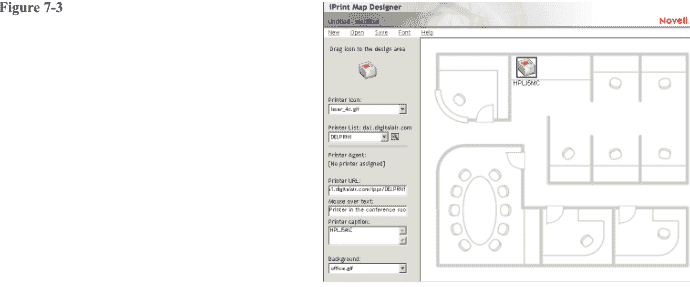

6. 选择您刚刚放置在地图上的*打印机图标*。

7. 从**打印机列表**下拉列表中，选择您要与此打印机图标关联的打印机。

8. 输入*鼠标悬停文本*。

这是当您将鼠标移动到打印机名称上方时要显示的文本。

9. 输入*打印机说明*。

这是要在图形中的打印机图标下方显示的文本。

10. 从顶部框架中选择**驱动程序设置**。

将出现“更改驱动程序设置 -- Web 页面”对话框：

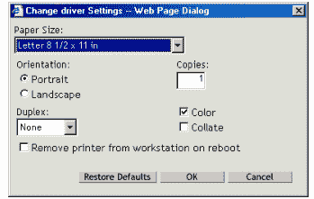

此对话框允许您预设部分驱动程序默认值。您可以设置纸张大小、方向以及复印份数等配置。

您还可以选择**重启时从工作站移除打印机**选项。此选项对于主要由经常出差且不希望其打印机文件夹中出现过多打印机的员工使用的打印机非常有用。

11. 选择您的默认驱动程序设置；然后选择**确定**。

12. 从顶部框架中选择**保存**，并将文件保存为 HTM 扩展名，保存到 Windows 工作站上的 **tmp** 目录（或任何易于访问的位置）。

若要让用户访问此地图，您必须将此文件传输到 Linux 服务器上的 `/var/opt/novell/httpd/htdocs/ippdocs` 目录。

13. 若要保存此文件到 Linux 服务器上的 `/var/opt/novell/httpd/htdocs/ippdocs` 目录，请执行以下操作：


a. 在 Windows 工作站上共享您的 `tmp` 文件夹（或保存地图文件的其他位置）。

- 打开 Windows 资源管理器。
- 浏览到 `tmp` 目录并右键单击。
- 选择`共享`选项卡。
- 选择`如果您了解安全风险但仍想在不运行向导的情况下共享文件，请单击此处`。
- 选择`仅启用文件共享`。
- 选择`确定`。
- 选择`在网络上共享此文件夹`。
- 选择`确定`。

b. 在 Linux 服务器上，以 root 身份登录。

- 选择 Gnome 足迹。
- 选择`注销`。
- 选择`是`。
- 在登录屏幕中输入 `root`。
- 输入您的密码。

c. 在 Linux 服务器上，通过双击桌面上的`从此处开始`图标打开 Nautilus 窗口。

d. 在 Nautilus 窗口的“位置”字段中，输入 `smb://`。稍等片刻，网络上的任何共享服务器将会出现。

e. 打开`工作组`。

f. 打开`您的工作站`。

g. 打开 Windows 工作站上的 `tmp` 文件夹（或保存地图文件的其他文件夹）。

h. 右键单击您的地图并选择`复制文件`。

i. 在 Nautilus 窗口左侧框架中选择`树`选项卡。

j. 浏览到 `/var/opt/novell/httpd/htdocs/ippdocs` 目录。

k. 右键单击右侧框架并选择粘贴文件。

iPrint 地图已准备好用于在网络中安装打印机。

### 目标 4：使用 iPrint 打印

若要使用 iPrint 进行打印，您必须位于 Windows 工作站上，并且必须为您的每个打印机安装 iPrint 客户端和正确的打印机驱动程序。

当您选择要向其打印的打印机（来自默认列表或您创建的地图）时，iPrint 会检查桌面是否安装了 iPrint 客户端软件，并在必要时为您安装该软件。然后下载打印机驱动程序，并将打印机安装到您的打印机文件夹中。

您可以以 2 种方式安装打印机：

- 使用打印机列表
- 使用地图进行基于位置的打印

#### 使用打印机列表

您可以使用自己制作的自定义打印机列表，或使用 iPrint 生成的默认打印机列表。

若要使用 iPrint 生成的默认打印机列表安装和使用打印机，请执行以下操作：

- 1. 从 Web 浏览器输入 `http://server_IP_address/ipp`。
  将显示带有可用打印机列表的 iPrint 默认页面。
- 2. 选择您所选的打印机。
- 3. 通过选择`确定`确认安装。
  将出现“安装 iPrint 打印机”界面，显示安装状态和进度。
- 4. 在 Novell iPrint 确认对话框中，选择`确定`。
  打印机已安装并可以使用。

#### 使用地图进行基于位置的打印

若要使用您为 iPrint 打印机创建的地图，请执行以下操作：

- 1. 浏览到以下 URL：
  `http://server_IP_address/ippdocs/<您创建的 HTM 地图文件>`


您可以通过将 `/var/opt/novell/httpd/htdocs/ippdocs` 目录及其子目录的内容复制到您的 Web 服务器来托管您的地图。您可以从公司的内部 Web 页面链接到这些地图，或将 URL 发送给用户。

建议学生设置 DNS 记录，以便更轻松地访问为 iPrint 打印机创建的地图。例如，如果用于打印的 DNS 名称是 printing.mycompany.com，则用户将通过以下 URL 访问 iPrint：

`http://printing.mycompany.com/ipp`

将出现包含您打印机图标的地图，类似于以下内容：

##### 图 7-5

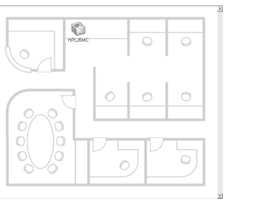

- 2. 从显示的地图中选择您所选的打印机。
- 3. 确认您要安装该打印机。
  将出现“安装 iPrint 打印机”对话框，显示安装状态和进度。
- 4. 在 Novell iPrint 确认对话框中，选择`确定`。打印机已安装并可以使用。

35 分钟

在开始练习之前，请确保学生理解他们需要专门使用 Internet Explorer（不使用 Mozilla）。

### 练习 7-1：安装和配置 iPrint

在此练习中，您通过安装和配置 iPrint 来启用 Digital Airlines 办公室中 Windows 工作站的打印功能。


> 整个练习必须从 Internet Explorer 完成。在课堂环境中，您需要与您的搭档协作，共享 Windows XP 工作站的时间。

执行以下操作：

- 第一部分：在 Windows 工作站上安装 iPrint 客户端
- 第二部分：创建并启动驱动程序存储
- 第三部分：向驱动程序存储添加驱动程序
- 第四部分：创建并启动 iPrint 管理器
- 第五部分：创建打印机对象
- 第六部分：配置网络以支持工作站和用户打印机
- 第七部分：测试基本的 iPrint 配置
- 第八部分：（可选）配置地图以支持并测试基于位置的打印

#### 第一部分：在 Windows 工作站上安装 iPrint 客户端

在 NNLS 服务器上配置 iPrint 之前，需要在 Windows XP 工作站（由 2 名学生共用）上安装 iPrint 客户端。

一名学生（共用工作站的 2 名学生之一）需要执行以下操作：

- 1. 从 Windows XP 工作站，启动 Internet Explorer 并输入以下 URL：
  `http://DAx.your_container.digitallairlines.com/ipp`
  将出现 iPrint 页面。片刻后，将出现一条消息，指示您必须安装 iPrint 客户端才能继续。
- 2. 通过选择“确定”继续。


> 如果未看到提示您安装 iPrint 客户端的消息，请在 iPrint 页面选择“安装 iPrint 客户端”。

- 3. 选择“打开”。
- 4. 通过选择“下一步”开始安装。
- 5. 当 iPrint 安装结束时，选择“完成”。
- 6. 重新启动计算机。
- 7. 计算机重启后，以管理员身份登录。
  在练习的其余部分中，您需要以管理员身份登录才能正常工作。

### 第二部分：创建并启动驱动程序存储

请执行以下操作：

- 1. 从你的 Windows XP 工作站访问 iManager，输入以下内容：
  `https://DAx.your container.digitalairlines.com/nps/iManager.html`
- 2. 使用用户名 `admin` 和密码 `novell` 登录。
- 3. 在左侧展开 `iPrint`；然后选择 `Create Driver Store`（创建驱动程序存储）。
  - 显示“创建驱动程序存储”页面。
- 4. 输入以下内容：
  - 驱动程序存储名称：`DAxDS1`
  - 容器名称：`your container`
  - 目标服务器：`DNS 名称` 或 `10.0.0.x`
  - eDir 服务器：`DAx:` `your container`
- 5. 完成后，选择 `OK`（确定）。
  - 显示成功消息。
- 6. 选择 `OK`（确定）。

### 第三部分：向你的驱动程序存储添加驱动程序

请执行以下操作：

- 1. 在 iManager 的 `iPrint` 下，选择 `Manage Driver Store`（管理驱动程序存储）。
- 2. 在 iPrint 驱动程序存储名称字段中，浏览并选择 `DAxDS1:` `your container`。
- 3. 选择 `OK`（确定）。
- 4. 选择 `Drivers`（驱动程序）选项卡。
- 5. 选择 `Windows XP Drivers`（Windows XP 驱动程序）。
- 6. 从 `System`（系统）中选择 `Add`（添加）。
- 7. 为你的打印机选择正确的驱动程序。
- 8. 为你的打印机选择正确的 PDL。
- 9. 选择 `OK`（确定）。

片刻之后，打印机驱动程序将显示在当前驱动程序列表中。

- 10. 选择 `OK`（确定）。

### 第四部分：创建并启动 iPrint 管理器

请执行以下操作：

- 1. 在 iManager 左侧的 `iPrint` 下，选择 `Create Print Manager`（创建打印管理器）。


- 显示“创建管理器”页面。

- 2. 输入以下内容：

  - 管理器名称：`DAxMGR1`

  - 容器名称：`your container`

  - 目标服务器：`DNS 名称` 或 `10.0.0.x`

  - eDir 服务器：`DAx.your container`

  - 驱动程序存储：`DAxDS1.your container`

- 3. 确保已选中 `Start print manager after creation`（创建后启动打印管理器）。

- 4. 完成后，选择 `OK`（确定）。

  - 显示成功消息。

- 5. 选择 `OK`（确定）。

### 第五部分：创建打印机对象

请执行以下操作：

- 1. 在 iManager 左侧的 `iPrint` 下，选择 `Create Printer`（创建打印机）。

  - 显示“创建打印机”页面。

- 2. 输入以下内容：

  - 打印机名称：`DAXPRN1`

  - 容器名称：`your_container`

  - 管理器名称：`DAXMGR1.your_container`

  - DNS 名称或 IP 地址：`10.0.0.101`

  - 位置：`Outside Conference Room 112`（112 号会议室外）

  - 描述：`Office printer`（办公打印机）

- 3. 完成后，选择 `Next`（下一步）。

- 4. 在 `Windows XP drivers`（Windows XP 驱动程序）下拉列表中，选择你已安装的打印机驱动程序。

- 5. 选择 `Next`（下一步）。

- 6. 选择 `OK`（确定）。

### 第六部分：配置工作站和用户打印机的网络

请执行以下操作：

- 1. 从你的 NNLS 服务器桌面，选择 `Applications > KDE Menu > System > File Manager - Super User Mode`（应用程序 > KDE 菜单 > 系统 > 文件管理器 - 超级用户模式）。

- 2. 输入密码 `novell`；然后选择 `OK`（确定）。

- 3. 浏览到 `/var/opt/novell/http/htdocs/ippdocs`。

- 4. 右键单击 `1 print.ini` 文件；然后选择 `Open With > KWrite`（打开方式 > KWrite）。

- 5. 将 `AllowUserPrinters` 的值更改为 `1`。

- 6. 选择 `File > Save`（文件 > 保存）；然后选择 `File > Quit`（文件 > 退出）。

### 第七部分：测试基本 iPrint 配置

请执行以下操作：

- 1. 从你的 Windows XP 工作站，启动 Internet Explorer 并输入以下 URL：

  `http://DAx:your container.digitalairlines.com/ipp`

  - 显示 iPrint 页面，其中列出了你创建的任何打印机。

- 2. 选择 `DAxPRN1`。

- 3. 当询问是否安装以下打印机时，选择 `OK`（确定）。

- 4. 当通知打印机已成功安装时，选择 `OK`（确定）。

- 5. 验证打印机是否显示在你的已安装打印机列表中：

  - a. 选择 `Start > Printers and Faxes`（开始 > 打印机和传真）。

  - b. 右键单击 `DAxPRN1` 打印机图标；然后选择 `Properties`（属性）。

  - c. 选择 `Ports`（端口）选项卡，并注意对于此打印机，端口是该打印机的 URL。

  - d. 选择 `General`（常规）选项卡；然后选择 `Print Test Page`（打印测试页）。

  - e. 测试页打印后，选择 `OK`（确定）。

  - f. 选择 `Cancel`（取消）。

  - g. 关闭 `Printers and Faxes`（打印机和传真）窗口。

截至本手册出版时，iPrint 地图设计器在 SLES 8 平台上的课堂上表现不稳定。

学生可以自由选择尝试此可选练习，但许多（或所有）学生可能无法正确看到地图设计器工具。

### 第八部分：（可选）配置地图以支持并测试基于位置的打印

要配置地图以支持基于位置的打印，请执行以下操作：

- 1. 从你的 Windows XP 工作站上的 Internet Explorer 输入以下 URL：

  `http://DAx_your_container.digitalairlines.com/ippdocs/maptool.htm`

  - 显示 iPrint 地图设计器页面。

> 如果页面显示时没有任何图形（例如右侧是一片空白区域而不是地图设计），则此可选练习的其余部分将无法正常工作。

- 2. 在 iPrint 地图设计器左侧（底部），选择一个 `Background`（背景）图像。

- 3. 从打印机图标下拉列表中，选择一个最能代表你打印机的 `printer icon`（打印机图标）。

  - 列表上方显示的打印机图标会随着你从列表中选择新的图标名称而改变。

- 4. 单击并拖动 `icon`（图标）到显示的地图上的位置。

- 5. 选择你刚刚放置在地图上的 `printer`（打印机）图标。

- 6. 从打印机列表下拉列表中，选择 `DAxPRN1`。

- 7. 在 iPrint 地图设计器页面顶部，选择 `Save`（保存）。

  - 显示“另存为”对话框。

- 8. 将文件命名为 `MapDAx.htm`（其中 x 是你的服务器编号），并将文件保存到 `Samba Server` 的 `tmp`（即你在练习 6-4 中映射的 Z: 驱动器）上。

- 9. 将 `MapDAx.htm` 文件复制到你的 NNLS 服务器上的 `/var/opt/novell/httpd/htdocs/ipdocs` 目录。

  - a. 在你的 NNLS 服务器上，选择 `Applications` > `KDE Menu` > `System` > `File Manager - Super User Mode`（应用程序 > KDE 菜单 > 系统 > 文件管理器 - 超级用户模式）。

  - b. 在 `Location`（位置）字段中，输入 `file:/tmp`。

  - c. 右键单击 `MapDAx.htm` 并选择 `Copy`（复制）。

  - d. 进入 `/var/opt/novell/httpd/htdocs/ipdocs` 目录。

  - e. 选择 `Edit`（编辑）；然后选择 `Paste`（粘贴）。

- 10. 通过基于位置的地图安装并测试打印机，请执行以下操作：

  - a. 从你的 Windows XP 工作站上的 Internet Explorer，浏览到以下 URL：

    `http://DAx.your container.digitalairlines.com/ipdocs/MapDAx.htm`

  - b. 从显示的地图中，选择 `DAxPRN1`。

  - c. 出现询问是否要安装打印机的消息。

  - d. 选择 `OK`（确定）。

  - e. 片刻之后，出现 Novell iPrint 对话框，指示安装成功。

  - f. 选择 `OK`（确定）。

  - g. 通过打开 WordPad，输入一个句子并将其发送到打印机，验证你可以使用 iPrint 进行打印。

  - h. 从你的 NNLS 服务器注销 `root` 用户，并重新以 `student` 用户登录。

（练习结束）

### 摘要

| 目标 | 你学到的内容 |

| :--- | :--- |

| `1.` 识别 iPrint 的好处 | iPrint 的好处和功能包括：<br>■ 全局打印机访问<br>■ 降低通信成本<br>■ 安全打印 (SSL)<br>■ 统一管理<br>■ 自定义查看打印机 |

| `2.` 描述 iPrint 的工作原理 | iPrint 由以下协议和组件组成并使用它们：<br>■ IPP<br>■ iManager<br>■ iPrint 驱动程序存储<br>■ iPrint 管理器<br>■ 打印机对象<br>■ iPrint 地图设计器<br>■ iPrint 客户端 |


# 3. 安装和配置 iPrint
要安装和配置 iPrint，你需要知道如何执行以下操作：
■ 在 Linux 服务器上安装 iPrint
■ 在 Windows 工作站上安装 iPrint 客户端
■ 创建和启动驱动程序存储
■ 向你的驱动程序存储添加打印机驱动程序
■ 创建和启动 iPrint 管理器
■ 创建你的打印机对象
■ 配置工作站和/或用户打印机的网络
■ 创建基于位置打印的网页

# 4. 使用 iPrint 打印
要使用 iPrint 打印，你必须在 Windows 工作站上，并且必须为每个你想使用的打印机安装 iPrint 客户端和正确的打印机驱动程序。

你可以通过 2 种方式为打印安装打印机：
- 使用打印机列表
- 使用地图进行基于位置的打印

## 第8节

### 使用 NNLS 提供网络邮件访问

在本节中，您将学习如何使用 Novell® Nterprise™ Linux® Services (NNLS) 的 NetMail™ 组件来提供电子邮件服务。

### 目标

- 1. 识别 NetMail 的功能
- 2. 描述 NetMail 的组件
- 3. 描述 NetMail 的工作原理
- 4. 安装 NetMail
- 5. 配置并使用 NetMail

### 简介

对于任何企业而言，提供可靠、基于标准的电子邮件和日历服务对于成功至关重要。

支持大量无固定办公桌员工的组织面临着实施可扩展、可靠且部署经济、管理简便的系统的挑战。

此外，这些组织还必须确保电子邮件系统具有安全性，并且可以从世界任何地方访问。

Novell NetMail 是一个功能完备、易于部署的电子邮件和日历系统，它简化了部署传统内部电子邮件系统的复杂性，并降低了成本。

NetMail 可以轻松集成 Microsoft® Outlook® 及其他基于标准的电子邮件客户端，使您无需更改 IT 基础设施即可改善最终用户的体验。

### 目标 1

#### 识别 NetMail 的功能

Novell NetMail 是一个基于 Internet 标准消息和安全协议的可扩展、高性能电子邮件和日历系统。

NetMail 的主要优势在于，总体而言，其成本远低于大多数竞争的企业消息系统。

此外，NetMail 降低了拥有成本，因为其管理界面非常易于使用。

NetMail 旨在适应多种网络环境。它已在单台 Linux® 服务器上成功测试支持多达 30,000 名用户。

NetMail 已经过测试，每天处理超过 110 万条消息，且没有交付失败或错误。

NetMail 高效的分布式架构最小化了运行电子邮件和日历系统所需的服务器数量。

NetMail 架构也是多线程和启用多处理器的，通过使用多处理器服务器可以显著提高系统性能。

NetMail 运行在以下平台上：
- NetWare®
- Windows® XP/2000/NT
- Solaris®
- Linux®

NetMail 支持 Internet 标准消息和安全协议，使用户可以使用其首选的当前电子邮件客户端。NetMail 支持
- Post Office Protocol version 3 (POP3)
- Internet Message Access Protocol version 4 (IMAP4)

NetMail 与 Novell® eDirectory™ 紧密集成。通过使用 eDirectory 集中存储和查找所有用户和服务器配置信息，NetMail 允许您从单一位置管理用户账户、硬件和软件配置以及安全性。

此集成简化了用户设置，并消除了对用户账户更改进行同步的需求。

NetMail 支持 Secure Sockets Layer (SSL) 3.0、Open SSL 实现的 Transport Layer Security (TLS) 以及 Secure Multipurpose Internet Mail Extension (S/MIME) 协议，以实现最高级别的加密和安全。

NetMail 还可以将电子邮件和日历服务分布在多台服务器上。这提高了性能，同时防止系统故障中断关键进程。

NetMail 支持多种语言时区，简化了远程办公室、客户和商业伙伴之间关键消息和调度信息的交换。

### 目标 2

#### 描述 NetMail 的组件

NetMail 具有高度模块化的架构，在不损害系统完整性的情况下提供灵活性。产品功能被战略性地分布在几个不同的组件中，因此您只需安装所需的组件。

根据使用情况和系统资源，您可以将这些组件加载到单台服务器上，或者将它们分布在多台服务器上。

NetMail 由以下组件组成：
- Internet Services Container
- Messaging Server
- Parent Objects
- Templates
- List Servers and Mailing Lists
- NetMail Agents
- Installation Directories
- WebAdmin


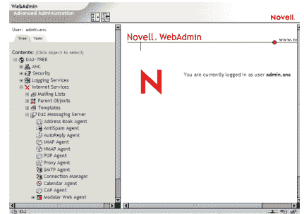

下面提供了每个组件的一般描述。

#### *Internet Services Container*

在初始安装 NetMail 时，安装程序会扩展 Novell eDirectory 模式，并在 eDirectory 树的根处创建 *Internet Services Container* 对象。

由于它是 NetMail 的一部分，Internet Services container 与其他 eDirectory Container 对象有所不同。

每棵树只能有一个 Internet Services container，作为消息系统容器，它仅包含 NetMail 组件对象。

#### **Messaging Server**

消息服务器是网络上托管 1 个或多个 NetMail 代理的任何服务器。在 eDirectory 树中，*Messaging Server* 对象表示已安装 NetMail 软件的物理服务器。

Messaging Server 对象表现为具有服务器属性的容器。它包含 1 个或多个 Agent 对象，并定义了消息服务器的属性。

每个 Messaging Server 对象都与一个 Server 对象相关联。

您可以在单台服务器上实现整个消息系统，也可以将 NetMail 服务分布在多台消息服务器上。

在多消息服务器环境中，服务器可以配置为作为单一集成的消息系统（称为 *distributed environment*）协同工作。它们也可以配置为作为独立的子系统（称为 *standalone environments*）运行。

#### **分布式消息服务器**

在分布式消息系统中，多台消息服务器作为单一集成的系统协同工作。

分布式消息服务器会在 Internet Services container 中寻找其他 Messaging Server 对象。如果 Internet Services container 中存在某个 Messaging Server 对象或其别名，其他分布式消息服务器可以找到并与之交互。

典型的分布式消息系统如下所示：

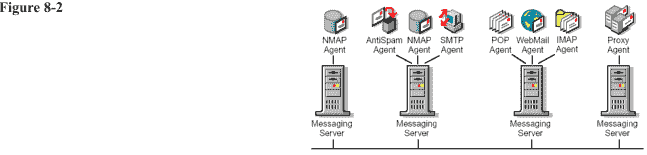

分布式消息服务器通常用于较大的组织。这些组织通常需要多台消息服务器来提供负载均衡、容错和速度。

#### 独立消息服务器

独立消息服务器不与其他消息服务器交互。相反，它作为独立的消息系统运行，专门向其分配上下文中的用户提供所有 NetMail 服务。

独立配置如下所示：

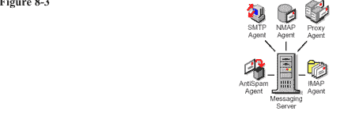

要配置独立消息服务器，您必须在该消息服务器的属性中标记 **Distributed Processing Disabled** 选项。这可以防止消息服务器在 Internet Services container 中寻找其他 Messaging Server 对象。

如果您的组织中等量的消息流量，或者组织的网络环境包含慢速广域网 (WAN) 链路，您可以考虑使用独立系统。

#### 父对象

*父对象* 允许您将单一的消息系统划分为配置子单元。这使您可以集体管理特定用户组的代理服务设置和用户设置。

例如，在多域环境中，您可以为每个域创建单独的 Parent 对象。这使得您可以像管理独立的消息系统一样管理每个域。

Parent 对象还允许您有选择地授予对消息服务的访问权限。您可以为每个 Parent 对象启用或禁用不同的代理服务。

例如，在 ISP 环境中，您可以使用 Parent 对象授予一个托管域访问 POP 的权限，而授予另一个域访问 IMAP 的权限，从而允许他们对单项服务进行计费。


Parent 对象还可以用于分配管理任务。可以为选定的用户授予在特定 Internet 域中创建、删除、修改或导入用户账户的权利。

运行在分布式和独立消息服务器上的代理会动态地在树中查找用户的 Parent 对象，以确定该用户对该服务的权限。

### 父级容器

**父级容器**是在安装过程中在互联网服务容器中创建的。此容器是父级对象的集中存放位置。NetMail 代理在查找用户配置信息时会引用父级容器。

#### 图 8–4

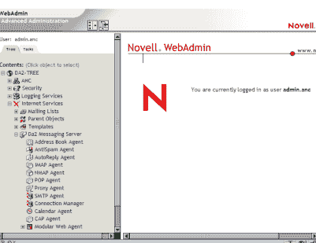

为了让 NetMail 代理能够找到父级对象，该对象必须在父级容器中有表示。如果父级对象在树的其它位置创建，则必须通过父级容器中的一个别名对象来表示它。

### 模板

模块化 Web 代理提供 2 种基于模板的邮件客户端界面：

- WebAccess
- WebMail

#### 图 8-5

WebAccess 界面提供标准的邮件客户端功能，以及日历、调度、任务和笔记功能。您还可以使用 WebAccess 界面授予指定用户访问 NetMail 管理功能的权限，例如添加、修改和删除用户账户。

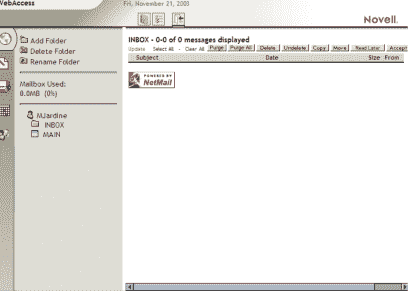

#### 图 8-6

WebMail 也提供标准的邮件客户端功能；此外，您可以使用 WebMail 界面让用户访问自我管理功能，例如更改密码和配置休假消息。

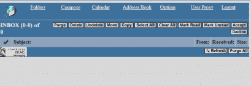

`Webacc.CTP` 和 `WebMail.CTP` 各包含显示其相应客户端界面所需的所有内容；图像、网页和本地化文本均编译在这 2 个模板文件中。

当模块化 Web 代理在消息服务器上初始化时，它只需将模板文件加载到内存中。

必须先创建 WebAccess 和 WebMail 对象，才能将其加载到消息服务器或在模块化 Web 代理、父级和用户对象中选择它们。

*模板* 容器是在安装过程中在互联网服务容器中创建的。此容器是模板对象的集中存放位置。模块化 Web 代理在扫描可用模板时会引用模板容器。

> 为了让模块化 Web 代理能够找到模板对象，该对象必须在模板容器中有表示。如果模板对象在树的其它位置创建，则必须通过模板容器中的一个别名对象来表示它。

### 列表服务器和邮件列表

NetMail 列表代理允许您创建和维护以下各项：

- 列表服务器
- NDS 邮件列表
- 邮件列表容器

#### 列表服务器

列表服务器是用户电子邮件地址的集合。当消息发送到列表服务器时，该消息会自动转发给所有已订阅该列表的用户。

列表用户对象表示列表的成员。当用户订阅列表时，相应的邮件列表对象中会添加一个列表用户。

您也可以通过在邮件列表对象中创建列表用户对象来添加列表成员。

#### NDS 邮件列表

NDS 邮件列表允许您向 eDirectory 用户发送消息。

与邮件列表不同，NDS 邮件列表由 eDirectory 对象组成，而不是用户电子邮件地址。选定的 eDirectory 对象可以包括：

- 容器对象
- 组
- 组织角色
- 别名
- 用户对象

如果选择了容器对象，消息将被转发到指定容器对象内的用户。

#### 邮件列表容器

邮件列表容器是在安装过程中在互联网服务容器中创建的。此容器保存消息系统的所有可用邮件列表对象。

列表代理在扫描消息队列中发往邮件列表的消息时会引用邮件列表容器。

为了让列表代理能够找到邮件列表对象，该对象必须在邮件列表容器中有表示。如果邮件列表对象在树的其它位置创建，则必须通过邮件列表容器中的一个别名对象来表示它。

### NetMail 代理

*NetMail 代理*是一组执行特定产品功能的可执行文件。这些代理具有即插即用的灵活性。它们可以以多种配置组合使用，同时仍保持单个集成消息系统的功能。

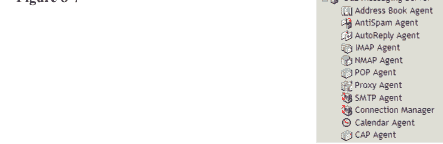

这种模块化架构使 NetMail 能够轻松地在多个服务器之间进行分布式部署。根据代理的使用情况和系统资源，每个代理可以单独运行，也可以在消息服务器上与其他代理协同运行。

### 表 8-1

下表列出了所有 NetMail 代理并总结了它们在 NetMail 系统中的功能。

| 代理 | 功能 |
| :--- | :--- |
| **地址簿代理** | 地址簿代理提供对 eDirectory 的只读 LDAP 访问。使用此代理，任何符合 LDAP3 标准的应用程序（如电子邮件或地址簿客户端）都可以访问 eDirectory 中的地址簿信息。 |
| | 返回的每个用户的信息取决于该用户的隐私级别。 |
| **别名代理** | 别名代理使您的 NetMail 系统能够识别用户别名。别名代理还可以用于自动填充用户对象的 Internet 电子邮件地址属性。 |
| | 自动别名功能直接从 eDirectory 拉取信息，以生成 eDirectory 用户对象的别名。别名可以按照以下格式自动生成：<br> - 名_姓@域 <br> - 名字首字母+姓@域（此别名选项限制为八个字符。）<br> - 名.姓@域 <br> - 名.名首字母. 姓@域 <br> - 名_名首字母_姓@域<br> <br> 通过别名代理创建的别名在 eDirectory 中并未定义为别名对象。它们由别名代理维护，并特定于 NetMail 消息系统。<br> <br> NetMail 会识别现有的别名对象，但它们独立于别名代理运行。发往别名对象的消息由 NMAP 代理自动投递到相应用户的邮箱。<br> <br> 别名也可以手动定义。 |
| **防垃圾邮件代理** | 防垃圾邮件代理允许您自动建立不良电子邮件域和地址的黑名单。<br> <br> 来自黑名单中包含的域和电子邮件地址的消息不会被 NetMail 系统接受。 |
| **防病毒代理** | NetMail 防病毒代理与以下病毒应用程序集成，以扫描 NetMail 处理的消息中的病毒：<br> - McAfee® NetShield®<br> - Command® 防病毒<br> - Computer Associates® InnoqualeIT®<br> - Symantec® CarrierScan™<br><br>在使用 NetMail 的防病毒代理之前，必须安装其中一项产品。<br><br>如果消息包含病毒，防病毒代理会立即将其从消息队列中删除。<br><br>可以将其配置为将消息退回给发件人，并附带一份通知，说明消息中包含哪种病毒。<br><br>它还可以向预期的消息收件人发送病毒警报，指示是谁尝试发送该消息以及消息中包含哪种病毒。<br><br>可以为消息系统中的所有用户启用病毒扫描，也可以将其限制为一组用户。<br><br>病毒扫描在父级或用户对象处启用。 |
| **自动回复** | 自动回复代理允许用户创建自定义消息，这些消息会在收到传入邮件时自动发送。 |
| | 例如，当用户去度假时，他们可以创建一条消息，让其他人知道他们目前无法联系。 |
| | 自动回复代理还允许用户将消息转发到另一个电子邮件地址。用户可以指定是否希望将消息的副本保留在 NetMail 邮箱中，或者只是将消息重定向到指定地址。 |
| | 除了将消息转发到另一个电子邮件地址外，自动回复代理还可以将短信消息转发到蜂窝电话和寻呼机。 |
| | 自动回复代理不特定于电子邮件客户端。用户的转发和自动回复信息存储在他们的用户对象中。 |

### 表 8-1

| 代理 | 功能 |
| :--- | :--- |
| 日历代理 | 日历代理为计划好的约会、任务和笔记提供自动状态跟踪信息。<br>当用户安排日历事件时，日历代理会处理所有“接受”和“拒绝”响应，并自动更新组织者日历中该事件的状态信息。<br>只有安排事件的用户才能查看谁接受或拒绝了日历事件。参与者仅看到自己的状态；所有其他参与者均视为待定。<br>如果选择不运行日历代理，用户将在收件箱中收到 I-cal 状态消息。由于状态信息采用 I-cal 格式，事件组织者可能无法判断收件人是接受还是拒绝了约会。<br>I-cal 邮件客户端（如 Microsoft Outlook* XP）也可为计划好的约会提供自动状态跟踪。<br>如果仅使用符合 I-cal 标准的邮件客户端，可以选择由 NetMail 通过日历代理管理状态跟踪，或由邮件客户端管理状态跟踪。<br>如果使用模块化 Web 客户端，必须运行日历代理以提供计划好的约会的自动状态跟踪。 |


## 连接管理器
连接管理器代理负责跟踪已认证用户。
当用户通过 POP3 或 IMAP4 登录时，POP 或 IMAP 代理会获取客户端的 IP 地址并将其发送给连接管理器代理。
连接管理器随后在指定时间段内跟踪该 IP 地址（默认为 15 分钟）。
任何代理都可以查询连接管理器以获取已认证的 IP 地址。
在 NetMail 中，此服务用于 SMTP 代理的 SMTP-after-POP 功能。这是一项 UBE 保护功能，可防止未授权用户通过您的消息系统进行邮件中继。
连接管理器代理监听 UDP 端口 `689` 上的其他代理，并且应始终受到防火墙保护。

## IMAP 代理
IMAP 代理使 IMAP4 客户端能够从消息系统中下载邮件。
除了基本的 NetMail 内存要求外，IMAP 代理每个预期的并发连接到您的 NetMail 系统大约需要 `300 KB` 内存。
为了用户能够访问其邮箱，您的消息系统必须至少包含 1 个 POP、IMAP 或模块化 Web 代理。

## 列表服务器代理
列表服务器代理使您的 NetMail 系统能够作为列表服务器运行。
列表服务器与 NDS 邮件列表和邮件列表对象协同工作。
基于 NDS 的邮件列表由容器、组、角色或用户对象构建。普通邮件列表需要每个订阅者的完整电子邮件地址。
当向邮件列表发送消息时，如果其中一条消息被拒绝，则不会返回不可投递的状态信息。

## 模块化 Web 代理
模块化 Web 代理为 NetMail 邮件客户端提供模板界面。提供两个模板：
- WebAccess
- WebMail
使用任一模板，用户都可以通过任何标准 Internet 浏览器发送和接收邮件、管理文件夹并设置邮件偏好。
模块化 Web 代理还包含几个模块，支持各种客户端功能：
- 邮件模块：提供邮件和通讯录功能。
- 日历模块：启用 WebAccess 日历功能，包括约会、任务和笔记。
- 偏好模块：允许用户更改密码。
- 任务导向管理模块：允许您委派管理功能，如创建、修改或删除用户。
除了基本的 NetMail 内存要求外，模块化 Web 代理每个预期的并发连接到您的 NetMail 系统大约需要 `300 KB` 内存。
为了用户能够访问其邮箱，您的消息系统必须至少包含 1 个 POP、IMAP 或模块化 Web 代理。

## NMAP 代理
NMAP 代理负责管理消息处理和投递。
它协调从消息进入消息队列开始到投递到用户邮箱或通过 Internet 转发投递为止发生的所有操作。
它是唯一能够直接访问消息存储区的代理。因此，每个消息系统至少需要一个 NMAP 代理，且消息系统中的每个用户必须包含在某个 NMAP 代理的上下文中。
NMAP 代理的 3 个主要功能如下：
- 管理消息存储区：默认情况下，NMAP 代理为其分配上下文中的每个用户对象创建一个邮箱目录。由于 NMAP 是唯一拥有物理访问消息存储区权限的代理，因此消息存储区目录始终在运行 NMAP 代理的服务器上创建。
- 管理消息队列：NMAP 代理协调消息队列中的所有消息处理。邮件负载实用程序监控并调节 NMAP 代理的线程使用，以保持最佳效率。
- 为其他 NetMail 代理提供对消息存储区和消息队列的 IP 访问。

## POP 代理
POP 代理使 POP3 邮件客户端能够从消息系统中下载邮件。
为了用户能够访问其邮箱，您的消息系统必须至少包含 1 个 POP、IMAP 或模块化 Web 代理。

## 代理服务器
代理服务器允许用户从中央邮箱管理多个电子邮件账户。
用户可以来自其他消息系统的多达 3 个 POP3 或 IMAP4 电子邮件账户中检索消息。从这些账户检索的所有消息都存储在用户的 NetMail 邮箱中，仿佛它是原始目的地。
根据用户设置，检索的消息副本可以保留在原始邮箱中，或者从主机服务器上删除。所有代理信息都存储在用户对象中。

## SMTP 代理
SMTP 代理是 Internet 与您的消息系统之间的网关。其主要功能是在 Internet 之间传输消息。
为了使用户能够从 POP 或 IMAP 客户端发送本地消息或发送消息到 Internet，此代理必须在至少一台消息服务器上运行。
它控制哪些域名被消息系统识别。
SMTP 代理还提供 NetMail 的大部分 UBE 保护功能，包括：
- 反向 DNS 查找
- 实时黑洞（RBL）查找
- 通过 IP 地址阻止主机
- ESMTP 身份验证
- SMTP-after-POP
- 对通过 IP 地址的远程发送的限制
SMTP 代理的其他选项包括：
- 入站和出站 Internet 消息的消息大小限制
- 对构成安全风险或促进与具有间歇性 Internet 连接的办公室连接的标准化 SMTP 命令的控制
- 邮件中继主机定义，允许将所有远程消息通过单个 SMTP 服务器进行漏斗，而不是让每个 SMTP 代理单独访问 Internet

### 安装目录
在默认安装期间，NetMail 文件会被复制到 `/var/opt/novell/netmail` 和 `/opt/novell/netmail` 目录。

`/var/opt/novell/netmail` 目录包含单一副本、消息存储区和用户目录。`/opt/novell/netmail` 目录包含 NetMail 二进制文件。

邮件 NetMail 二进制文件名为 `ims`，位于 `/opt/novell/netmail/bin` 中。每个 NetMail 代理二进制文件也位于此目录中，如下所示：

图 8-8

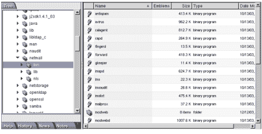

### WebAdmin
WebAdmin 是一种基于浏览器、平台独立的系统管理工具。

WebAdmin 在 eDirectory 中不代表 `Agent` 对象。相反，该代理是在服务器上手动启动的。

您可以通过访问 iManager 并选择“启动 NetMail 管理”来通过浏览器访问 WebAdmin。

WebAdmin 运行在 `8018` 端口（不安全）和 `8020` 端口（安全）。可以通过 Web 浏览器访问 `http://*server_ip* :8018` 或 `https://*server_ip* :8020`。

### 目标 3 描述 NetMail 的工作方式
在本目标中，您将学习以下内容：
- 对现有对象所做的更改
- 消息的处理方式

#### 对现有对象所做的更改
安装 NetMail 后，会扩展 eDirectory 架构以包含与 NetMail 相关的对象和属性。现有的目录对象（例如容器、用户，甚至服务器对象）会获得新的 NetMail 属性。

要了解此过程，您需要知道以下对象会发生什么变化：
- 容器对象
- 用户对象

#### 容器对象
添加到容器对象的 NetMail 属性包括以下选项：
- 为当前容器内的用户定义自定义消息存储
- 定义容器特定的域名

容器特定的消息存储是包含当前容器中用户邮箱的目录。这不会影响通用消息队列和 SCMS 目录，这些目录始终位于默认消息存储目录中。

如果已配置，容器域名将出现在用户消息的发件人字段中，并由地址簿代理在返回用户的地址簿信息时引用。容器域名不允许您在不同的容器中使用非唯一的用户 ID。

#### 用户对象
添加到用户对象的 NetMail 属性复制了模块化 Web 客户端中可用的许多用户配置选项，包括隐私级别、转发和自动回复消息以及代理配置。

在用户对象和模块化 Web 客户端中提供这些用户配置选项，允许您选择通过用户对象集中管理这些选项，或允许用户通过模块化 Web 客户端自我管理这些选项。

用户对象还复制了父对象中可用的许多配置选项。这种重复允许您在父对象中配置通用设置，但为单个用户对象创建例外情况。

#### 消息的处理方式
NetMail 的核心功能是消息处理。进入您的消息系统的每条消息都必须由 NetMail 代理进行处理。

根据您在消息系统上运行的代理类型，消息可能会与系统黑名单进行核对，转发到另一个电子邮件地址，或根据用户定义的规则进行过滤。

用于消息处理的文件系统结构由 3 个目录组成：
- 消息存储
- 单副本消息存储
- 消息队列

从消息进入消息系统到投递到用户邮箱期间发生的所有事情都发生在这些目录中。

##### 消息存储
消息存储是保存用户邮箱和消息的目录结构。NetMail 系统所需的所有其他信息都存储在 eDirectory 中。每个运行 NMAP 代理的服务器都有一个消息存储。

在 Linux 服务器上，默认的消息存储位置是 `/var/opt/novell/netmail/users`。当然，可以使用 WebAdmin 更改此位置。

NMAP 代理在其分配的上下文中为每个用户对象在消息存储目录中创建以下邮箱目录结构：

表 8-2

| 目录 | 功能 |
| :--- | :--- |


### 目录结构

| `.users` | 所有用户邮箱的集合目录。 |
| `.users/user_name` | 每个用户邮箱的唯一目录。 |
| `.users/user_name/Inbox.box` | 包含用户收件箱中所有消息（文本和附件）的文件。新消息追加到文件末尾。 |
| `.users/user_name/Inbox.idx` | `inbox.box` 文件中所有消息的索引。 |
| `.users/user_name/mail.cal` | 日历存储。此文件包含用户的日历项，如任务、约会和备注。 |
| `.users/user_name/main.idc` | `mail.cal` 文件中所有项目的索引。 |
| `.users/user_name/folder_name.box` | 用户邮箱中每个文件夹的唯一文件。它包含该文件夹的消息（文本和附件）。新消息追加到文件末尾。 |
| `.users/user_name/folder_name.idx` | `folder_name.box` 文件中所有消息的索引。 |
| `.Jusers\user_name\folder_name\` | 每个包含子文件夹的文件夹的唯一目录。 在消息服务器上，维护目录比维护文件需要更多的磁盘空间。 因此，从服务器资源的角度来看，子文件夹的开销非常大。 |
| `.Jusers\user_name\folder_name\ subfolder_name.box` | 父文件夹中每个子文件夹的唯一文件。它包含该子文件夹的消息（文本和附件）。新消息追加到文件末尾。 |
| `.Jusers\user_name\folder_name\ subfolder_name.id` | `subfolder_name.box` 文件中所有消息的索引。 |

#### 单副本消息存储

如果消息发送给两个或多个收件人，且消息大小超过 2 KB，NMAP 不会在所有用户的邮箱中复制该消息。

相反，会向各个邮箱发送一条指针消息，指示 NMAP 指向单副本消息存储（SCMS）目录中的完整消息。

当最后一个用户下载或删除该消息时，该消息将从共享目录中删除。

SCMS 目录结构将消息存储在与其十六进制文件名中最后一个字符（0-9 或 A-F）对应的排序目录中。

根据十六进制文件名中的最后一个字符对消息进行排序，使 NMAP 代理能够高效地检索存储在 SCMS 目录中的消息。

SCMS 目录结构如下：

表 8-3

| 目录 | 功能 |
| :--- | :--- |
| `.scms` | 单副本消息存储（SCMS）目录。 |
| `.scms/0-9, A-F` | 排序目录。消息根据 SCMS 文件名中的最后一个哈希值在这些目录中排序。 |
| `.scms/0-9, A-F/xxxx` | 具有哈希文件名的文件（`xxxx` 代表哈希值），包含多收件人消息及任何附件。 |
| `.scms/0-9, A-F/xxxx.cnt` | 计数器文件。其值为收件人总数。每当一个收件人删除消息时，计数器文件减 1。当其值为 0 时，消息文件和计数器文件被删除。 |

#### 消息队列

每个消息存储都有一个关联的消息队列。消息队列是消息进入或离开 NetMail 系统时进行处理所在目录。

NMAP 代理负责管理消息队列。当 NMAP 代理接收到消息时，它将文件下载到位于 `/var/opt/novell/netmail/spool` 的消息队列目录中。

#### 消息队列中的消息处理

当 NMAP 代理将消息下载到消息队列目录时，它会生成 2 个文件：

- `Cxxxxxx.in`
- `Dxxxxxx.in`

`xxxxxx` 代表消息发送日期和时间的哈希值。`.in` 扩展名表示该消息是入站消息。

`Cxxxxxx.*` 文件是控制文件信封。控制文件是从初始 SMTP 交换中接收的信息生成的。它包含收件人和发件人信息以及任何消息标志。所有消息处理功能都是在控制文件上执行的。

`Dxxxxxx.*` 文件是数据文件。它包含消息头和消息文本。由于大多数消息处理是通过控制文件完成的，因此数据文件很少被打开。

在消息下载后，NMAP 代理为数据文件添加 `.MSG` 扩展名，然后开始将控制文件通过九个队列移动。

在队列之间移动控制文件的过程很简单，只需更改其文件名扩展名以反映当前的队列编号。

下表概述了与每个队列相关的消息处理功能。

表 8-4

| 文件名 | 功能 |
| :--- | :--- |
| `xxxxxxx:000` | 队列 0 是准备队列。NMAP 确保控制文件满足所有处理要求，并且防病毒代理扫描数据文件。 |
| `xxxxxxx:001` | 消息由反垃圾邮件代理和/或列表代理处理。 |
| `xxxxxxx:002` | 消息由别名代理和/或自动回复代理处理。 |
| `xxxxxxx:003` | 消息由规则代理处理。 |
| `xxxxxxx:004` | 当前未被 NetMail 代理使用；可能被第三方或自定义代理使用。 |
| `xxxxxxx:005` | 消息由日历代理处理。 |
| `xxxxxxx:006` | 发给消息系统内收件人的消息由 NMAP 代理投递。 |

#### 表 8-5

| **文件名** | **功能** |
| :--- | :--- |
| `xxxxxxxx.007` | 发送至消息系统外部收件人的消息将由 SMTP Agent 拾取并投递。 |
| `xxxxxxxx.008` | 这是退信消息的保持队列。NMAP Agent 将退信消息保留在队列 8 中，直到有时间重新处理它们。 |

当 NMAP Agent 将消息移入队列时，它会通知注册在该队列上的 Agent。

注册的 Agent 随后扫描控制文件并执行其分配的功能。如果 Agent 修改了该消息，NMAP 会将该消息返回队列 0 以重新处理。如果没有修改，NMAP 会将该消息推进到下一个队列。

| **阶段** | **Agent** | **描述** |
| :--- | :--- | :--- |
| 1 | 用户 | 有人通过互联网向您的消息系统中的用户发送消息。 |
| 2 | SMTP Agent | SMTP Agent 接收消息并将该消息转交给其分配的 NMAP Agent。 |
| 3 | NMAP Agent | 在将消息下载到消息队列目录时，NMAP Agent 创建消息控制文件 (`Cxxxxxxx.in`) 和数据文件 (`Dxxxxxxx.in`)。 |
| 4 | NMAP Agent | 消息下载完成后，NMAP Agent 将数据文件扩展名改为 `.MSG`，并通过将文件扩展名从 `.IN` 更改为 `.000`，将控制文件移动到队列 0。 在队列 0 中，NMAP Agent 验证控制文件是否满足所有处理要求。然后，它通知防病毒 Agent 有待处理的消息。 |
|  | 防病毒 Agent | 然后，防病毒 Agent 扫描数据文件中的附件。附件将被发送至第三方病毒引擎进行扫描。 假设文件是干净的，NMAP Agent 通过将文件扩展名从 `.000` 更改为 `.001`，将控制文件移动到队列 1，并通知反垃圾邮件和/或列表 Agent 有待处理的消息。 |
| 5 | 反垃圾邮件 Agent<br>列表 Agent | 队列 1 由反垃圾邮件 Agent 和列表 Agent 共享。 反垃圾邮件 Agent 检查控制文件，查看发件人是否在其黑名单上。如果发件人在黑名单上，该消息将从队列中删除。 列表 Agent 检查控制文件，查看消息是否发送给邮件列表。如果是，列表 Agent 生成一条新消息，其中包含邮件列表中各个用户的姓名。 新消息被返回到队列 0，原始消息被删除。 |
| 6 | NMAP Agent | 如果没有进行任何修改，NMAP Agent 通过将文件扩展名从 `.001` 更改为 `.002`，将文件移动到队列 2，并通知别名和/或自动回复 Agent 有待处理的消息。 |
| 7 | 别名 Agent<br>自动回复 Agent | 队列 2 由别名 Agent 和自动回复 Agent 共享。 别名 Agent 检查控制文件，查看收件人是否匹配其定义的任何别名。如果是，别名 Agent 将别名替换为对应的电子邮件地址。 自动回复 Agent 检查收件人的用户对象，查看收件人是否已配置自动回复消息或将消息转发到另一个电子邮件账户。用户的转发和自动回复信息存储在其用户对象中。 如果收件人已转发其邮件，Agent 会将转发地址添加到收件人列表中。如果收件人未请求消息副本，Agent 将收件人姓名替换为转发地址。 如果收件人已配置自动回复消息，Agent 会生成一条新消息并将其交给 NMAP，以便在消息队列中处理。 |
| 8 | NMAP Agent | 如果原始消息已被修改，NMAP Agent 会将该消息返回队列 0 以重新处理。 如果没有进行任何修改，NMAP Agent 通过将文件扩展名从 `.002` 更改为 `.003`，将文件移动到队列 3，并通知规则 Agent 有待处理的消息。 |


| 9 | 规则 Agent | 在队列 3 中，规则 Agent 根据存储在用户对象中的收件人定义的规则检查该消息。如果消息匹配 1 个规则条件，规则 Agent 应用该规则。<br><br>如果规则指示将消息发送到特定文件夹，规则 Agent 会以 `IMAP` 格式将目标文件夹信息添加到控制文件中。使用 `IMAP` 协议指定目标文件夹，使得消息可以在任何基于标准的电子邮件客户端中被路由到正确的文件夹。 |

| 10 | NMAP Agent | 如果消息已被修改，NMAP Agent 会将该消息返回队列 0 以重新处理。<br><br>如果没有进行修改，NMAP Agent 通过将文件扩展名从 `.003` 更改为 `.005`，将文件移动到队列 5。 |

| 11 | 日历 Agent | 在队列 5 中，日历 Agent 检查该消息是否是对计划预约的“接受”或“拒绝”回复。如果该消息是对预约的回复，且安排该预约的人是本地用户，日历 Agent 会更新用户的日历存储 (`mail.cal`)，以表明发件人已接受或拒绝了该预约。 |

| 12 | NMAP Agent | 如果消息已被修改，NMAP Agent 会将该消息返回队列 0 以重新处理。如果没有进行修改，NMAP Agent 通过将文件扩展名从 `.005` 更改为 `.006`，将文件移动到队列 6。 |

| 13 | NMAP Agent | 在队列 6 中，NMAP Agent 检查控制文件信封中的收件人列表；然后执行以下操作之一：<br>• 如果任何收件人是本地用户，NMAP Agent 将消息副本投递到这些用户的邮箱中。<br>• 如果消息超过单副本消息存储 (`SCMS`) 阈值，该消息将被复制到 `SCMS` 目录。<br>• 如果某些收件人不在当前 NMAP Agent 的上下文中，但在目录树内，NMAP Agent 将消息转交给分配给这些用户上下文的 NMAP Agent。<br>• 如果任何收件人不在目录树内，NMAP Agent 将消息移动到队列 7 进行远程投递。 |

| 14 | NMAP Agent | 在队列 7 中，NMAP Agent 将消息传递给 `SMTP` Agent 进行远程投递。 |

### 目标 4 安装 NetMail

要在您的 Linux 服务器上安装 NetMail，您需要了解如何执行以下操作：

- 设计您的 NetMail 系统
- 满足系统要求
- 收集所需信息
- 使用 `NNLS` 安装功能

#### 设计您的 NetMail 系统

如前所述，NetMail 可以以 2 种方式配置：

- 单服务器消息传递
- 分布式服务器消息传递

在单服务器消息传递系统中，所有 NetMail 组件都在同一服务器上运行，如下所示：

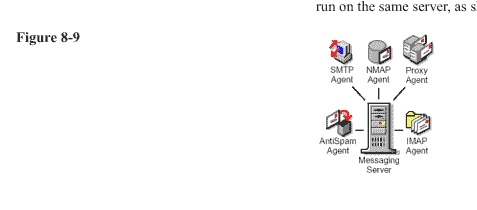

在分布式服务器消息传递系统中，NetMail 组件分布在 2 个或多个服务器上，如下所示：


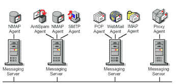

NetMail 还可以配置为使用相同的 eDirectory 树服务多个互联网域名。在这种情况下，可以配置多个单服务器消息传递系统来服务不同的域名，如下所示：


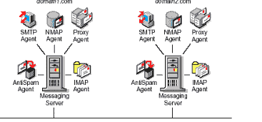

如果性能和可扩展性是贵组织关心的问题，您可以实施分布式系统，然后在不同的服务器上复制 Agent。

在设计您的 NetMail 系统时，您需要确定以下内容：

- 哪些服务器将托管 NetMail Agent？
- 哪些 Agent 将位于特定的服务器上？
- 每个消息服务器将服务哪些域名？
- 贵组织是否需要在多个服务器上部署相同的 Agent 以实现容错和可扩展性？

#### 满足系统要求

要安装 NetMail，您必须满足以下系统要求：

- 确保您正在运行以下版本之一：
  - Red Hat® Linux AS 2.1
  - Red Hat Linux ES 2.1
  - SuSE® SLES 8
- 确保已安装 Linux 版 eDirectory 8.7.3 或更高版本。
- 确保您的系统 CPU 至少是 750 MHz Pentium® III 或 Athlon。
- 确保您至少有 512 MB 的系统 RAM。
- 确保您有 20 MB 的可用磁盘空间用于安装。NetMail 消息存储的磁盘空间会有所不同，具体取决于用户数量以及每个邮箱允许的磁盘空间量。
- 托管 NetMail 服务的每个服务器必须拥有包含使用消息服务的用户的分区中的 eDirectory 副本。
- 确保 eDirectory 树已同步且健康。
- 确保您对计划安装 NetMail 的 eDirectory 树具有管理员权限。

### 目标 4 准备安装 NetMail

- 确定您希望**消息服务器**对象的名称。默认名称为 **server_name Messaging Server**。
- 确保您知道您的 NetMail 系统将服务的互联网域以及主 DNS 服务器和备用 DNS 服务器的 IP 地址。
- 检查服务器上的端口分配是否有重复。NetMail 默认使用以下端口：

**表 8-6**

| 端口 | 协议 | 代理 |
| :--- | :--- | :--- |
| 25 | SMTP | SMTP 代理 |
| 52080 | HTTP | 模块化 Web 代理 |
| 8018 | HTTP | WebAdmin |
| 110 | POP | POP 代理 |
| 143 | IMAP | IMAP 代理 |
| 52389 | LDAP | 地址簿代理 |
| 689 UDP | | 连接管理器 |
| 689 TCP | NMAP | NMAP 代理 |
| 52443 | HTTPS | 模块化 Web 代理 |
| 8020 | HTTPS | WebAdmin |
| 995 | SSL, 基于 POP | POP |
| 993 | SSL, 基于 IMAP | IMAP |

- 在即将安装 NetMail 的服务器上停止默认邮件服务，例如 sendmail 或 postfix。在许多系统中，sendmail 被配置为每次服务器启动时自动启动。

要在 Red Hat 上更改此设置，请以 root 身份打开终端会话并输入 `chkconfig --level 2345 sendmail off`。要在 SuSE 上更改此设置，请以 root 身份打开终端会话并输入 `chkconfig sendmail off`。

- 检查 `/etc/syslog.conf` 文件中是否有以 mail* 开头的行。如果存在，请将其注释掉。在调试模式下，邮件会产生足够多的 syslog 消息，在短时间内填满大多数磁盘。

#### 收集所需信息

在开始安装 NetMail 之前，请收集以下信息：

**表 8-7**

| 参数 | 值 |
| --- | --- |
| 带上下文的管理员名称 | |
| 管理员密码 | |
| NetMail 主 DNS 服务器 | |
| NetMail 备用 DNS 服务器 | |
| NetMail 服务器域名 | |
| NetMail WebAccess HTTP 端口 | |
| NetMail WebAccess HTTPS 端口 | |
| NetMail LDAP 端口 | |

#### 使用 NNLS 安装功能

要从 `NNLS` 安装 NetMail，请执行以下操作：

1. 执行自定义安装的步骤。
   如有必要，请参阅第 2 节了解如何执行自定义安装的详细信息。
2. 取消选中您*不想*安装的服务，选中 NetMail 服务；然后继续。
   - 如果 eDirectory 之前未安装，请注意，当您选择 NetMail 时，eDirectory 默认已被选中（连同其他必需组件，如 Apache 和 Tomcat）。
   - 如果 eDirectory 之前已安装，安装程序将指示哪些组件已经安装。
3. 接受许可协议。
4. （条件）如果提示输入 NICI 基础密钥（NFK）文件的位置，请输入 NFK 文件的路径。
   只有当 eDirectory 之前未安装时，才会要求输入 NICI 基础密钥。
5. 输入每个提示中请求的信息（参见表 8-7）。
6. 查看摘要信息并进行必要的更正。
7. 当所有信息都正确时，完成安装。
8. 查看 readme 文件并保存安装设置日志文件。

### 目标 5 配置和使用 NetMail

NetMail 系统中的每个代理都有自己的可配置属性集。本目标仅限于以下配置任务：

- 运行 WebAdmin
- 配置 NMAP 代理服务的上下文
- 选择 Web 界面模板

#### 运行 WebAdmin


WebAdmin 是用于配置 NetMail 系统的实用工具。它是一个基于浏览器的实用工具，集成到 iManager 中。

要直接访问 WebAdmin，请打开 Web 浏览器并输入 `http://your_server_IP:8018` 或 `https://your_server_IP:8020`

要从 iManager 内部访问 WebAdmin，请完成以下操作：
1. 在左侧，向下滚动并选择 Launch NetMail Management。
2. 在 WebAdminServer 名称字段中，浏览并选择您的 WebAdmin 服务器；然后选择 确定。

### 配置 NMAP 代理服务的上下文

NetMail 系统服务于在 NMAP 代理的 Context 属性中配置的所有容器中的所有用户，如下所示：

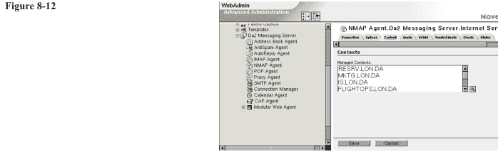

第一个上下文是在创建 NMAP 代理时定义的，与服务器所在的上下文相同。可以从 Context 页面添加额外的用户上下文。

由于 NMAP 上下文不是继承的，因此 NMAP 代理服务的每个容器或子容器都必须添加到该代理的上下文列表中。

消息服务自动提供给 NMAP 代理分配的上下文中的每个用户。用户邮箱在用户第一次收到消息时在本地消息存储目录中创建。

> 请勿将同一上下文添加到多个 NMAP 代理中。

NMAP 上下文由消息服务器跟踪。启动时，消息服务器生成 NMAP 上下文列表并将其保存在服务器内存中。此列表用于生成别名和地址簿。

对上下文列表所做的更改是动态更新的。无需重新启动 NetMail 服务。但是，如果在服务器运行时向上下文中添加用户，他们不会出现在地址簿中，直到服务器重启。

要配置由 NMAP 代理服务的 eDirectory 上下文，请执行以下操作：
1. 在 WebAdmin 中，展开 `Internet Services`。
2. 展开 `Messaging Server`。
3. 选择 `NMAP Agent`。
4. 选择 `Context`。
5. 选择 放大镜 图标。
6. 浏览并选择您希望 NMAP 代理服务的每个 容器；然后选择 保存。
7. 选择 保存。

### 选择 Web 界面模板

模板控制模块化 Web 代理的邮件客户端界面的外观。默认情况下，NetMail 附带 2 个模板：
- WebAccess (`Webacc.CTP`)
- WebMail (`WebMail.CTP`)

每个模板都包含展示其相应客户端界面所需的全部内容。当模块化 Web 代理在消息服务器上初始化时，它只需将模板文件加载到内存中。

要选择默认模板，请执行以下操作：
1. 在 `WebAdmin` 中，展开 `Internet Services`。
2. 展开 `Messaging Server`。
3. 选择 `Modular Web Agent`。
4. 向下滚动到 默认模板 字段，如下所示：

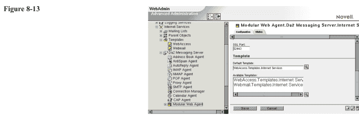

5. 选择 放大镜 图标。
6. 浏览并选择您要使用的 模板对象。
7. 默认情况下，模板位于 `Templates.Internet Services` 中。
8. 选择 保存。

> 如果使用 Mozilla 浏览器访问 WebAccess 或 WebMail 时输入了错误的登录信息，则不会显示登录对话框。
>
> 您必须刷新窗口或重新输入 URL。如果在注销 WebAccess 或 WebMail 后单击“重新登录”链接，您将到达注销页面。您必须启动一个新的浏览器才能到达登录提示。


即使您使用的是 IP 地址而不是 DNS 名称，消息服务器也依赖于 DNS 服务器作为名称解析器。

### 练习 8-1 配置并测试您的数字航空办公室的 NetMail

在本练习中，您将配置 NMAP 代理以服务您的整个容器并测试邮件服务器。

执行以下操作：
1. 验证 sendmail 未在运行：
   a. 在您的 NNLS 服务器上，打开一个终端会话。
   b. 通过输入 `su -` 和密码 `novell` 切换到 root 用户。
   c. 输入 `chkconfig --list sendmail`。
      `sendmail` 守护进程应设置为在运行级别 3（非图形引导）和 5（图形引导）下关闭。
2. 通过输入 `ping DAx.your container.digitalairlines.com` 来确保 DNS 正确解析您服务器的 IP 地址（按 `Ctrl+C` 停止 ping）。
   例如，如果您在 DA3 上工作，则输入 `ping DA3.atl.digitalairlines.com`。
3. 访问 WebAdmin 并验证 NetMail 已配置为服务您容器中的用户：
   a. 在您的 NNLS 服务器上，打开浏览器窗口并输入 `https://DAx.your container.digitalairlines.com:8020`。
      Novell WebAdmin 登录页面出现。
   b. 以 admin 身份登录，密码为 `novell`。
   c. 在左侧，展开 `Internet Services`。
   d. 展开 `DAx Messaging Server`。
   e. 选择 `NMAP Agent`。
   f. （条件）如果出现 About Popups 对话框，请选择 否。将出现带有多个选项卡的 NMAP Agent 页面。
   g. 选择 `Context` 选项卡。
   h. 验证您的容器是否已列出。
   i. （条件项）如果您的容器未被列出，请添加 您的容器（使用放大镜图标）；然后选择 保存。
4. 验证您的 POP 代理是否已启用：
   - a. 在 `DAx 消息服务器` 下，选择 `POP 代理`。
   - b. 验证代理是否已启用。
   - c. （条件项）如果代理未启用，请选择 已启用，然后选择 保存。
5. 设置服务器时区：
   - a. 在左侧，选择 模块化 Web 代理。
   - b. 在右侧的默认时区下拉列表中，选择 您的时区。您这样做是为了确保消息服务器的时区与 NNLS 服务器的时区相同。
   - c. 选择 保存。
6. 测试配置。
   - a. 在当前 Mozilla Web 浏览器窗口中，通过按 `Ctrl+N` 打开一个新的浏览器窗口。
   - b. 输入 `http://DAx.your container.digitalairlines.com:52080`。
   - c. 当提示登录时，输入用户名为 `JJackson`，密码为 `novell`；然后选择 确定。此时将显示 WebAccess 页面。
   - d. 在左侧，选择 撰写 图标。
   - e. 在收件人字段中，输入 `AGresko@your container.digitalairlines.com`。例如，如果您正在 DA3 上工作，则输入 `AGresko@atl.digitalairlines.com`。
   - f. 在主题和正文字段中，输入 文本。
如果正文字段留空，消息将不会发送。
   - g. 选择 发送。
   - h. 等待发送窗口关闭；然后，在 Web/Access 页面顶部，选择 退出 图标。
   - i. 选择 登录。
   - j. 当提示登录时，以用户名为 `AGresko`，密码为 `novell` 进行身份验证。
     您应该能看到刚从另一个账户发送的消息。
   - k. 选择该 消息。
   - l. 尝试向您树中的其他用户发送电子邮件。
   - m. 尝试向另一棵树中的用户发送电子邮件消息。
   - n. 完成后，关闭浏览器窗口。

*（练习结束）*

### 摘要

| 目标 | 摘要 |
| :--- | :--- |
| 1. 识别 NetMail 功能 | Novell NetMail 是一个基于互联网标准消息和安全协议的高性能电子邮件和日历系统。 |
| | NetMail 旨在适应多种网络环境。它已在单个 Linux 服务器上成功测试支持多达 30,000 名用户。 |
| | NetMail 高效的分层架构将运行电子邮件和日历系统所需的服务器数量降至最低。 |
| | NetMail 与 Novell eDirectory 紧密集成。 |
| | NetMail 还可以将电子邮件和日历服务分布在多个服务器上。这提高了性能，同时防止关键进程因系统故障而中断。 |
| 目标 | 摘要 |
| :--- | :--- |


## 2. 描述 NetMail 组件

NetMail 由以下组件组成：
- Internet 服务容器
- 消息服务器
- 父对象
- 模板
- 列表服务器和邮件列表
- NetMail 代理
  - 地址簿代理
  - 别名代理
  - 反垃圾邮件代理
  - 防病毒代理
  - 自动回复代理
  - 日历代理
  - 连接管理器
  - IMAP 代理
  - 列表服务器代理
  - 模块化 Web 代理
  - NMAP 代理
  - POP 代理
  - 代理服务器代理
  - SMTP 代理
  - WebAdmin

在安装默认设置时，NetMail 文件被复制到 `/var/opt/novell/netmail` 和 `/opt/novell/netmail` 目录。

## 3. 描述 NetMail 工作原理

安装 NetMail 时，它会扩展 eDirectory 架构，以包含与 NetMail 相关的对象和属性。

现有的目录对象，如容器、用户甚至服务器对象，将具有新的 NetMail 属性。

NetMail 的核心功能是消息处理。进入您消息系统的每个消息都必须由 NetMail 代理进行处理。

根据在您的消息系统中运行的代理不同，消息可能会对照系统黑名单进行检查、转发到另一个电子邮件地址，或根据用户定义的规则进行过滤。

## 4. 安装 NetMail

NetMail 可以通过 2 种方式进行配置：
- 单服务器消息处理
- 分布式服务器消息处理

在设计您的 NetMail 系统时，您需要确定以下内容：
- 哪些服务器将承载 NetMail 代理？
- 哪些代理将位于给定服务器上？
- 每个消息服务器将服务哪些域？
- 您的组织是否需要在多个服务器上部署相同的代理以实现故障耐受性和可扩展性？

要安装 NetMail，必须满足以下系统要求：
- 确保您正在运行以下其中一种：
  - Red Hat Linux AS 2.1
  - Red Hat Linux ES 2.1
  - SuSE 8.0
- 确保已安装 Linux 版 eDirectory 8.7.3 或更高版本。
- 确保您的系统 CPU 至少为 750 MHz Pentium III 或 Athlon。
- 确保您至少有 512 MB 的系统 RAM。

## 4. 安装 NetMail（续）

- 确保您有 20 MB 的可用磁盘空间用于安装。
- 每个承载 NetMail 服务的服务器必须有一个副本。
- 确保 eDirectory 树已同步且状态良好。
- 确保您对 eDirectory 树具有管理员权限。
- 确定消息服务器对象的名称。
- 确定您的 Internet 域 DNS 服务器 IP 地址。
- 检查服务器上的端口分配是否存在重复。

## 5. 配置和使用 NetMail

WebAdmin 是用于配置 NetMail 系统的实用程序。它是一个基于浏览器的实用程序，集成在 iManager 中。

要直接访问 WebAdmin，请打开 Web 浏览器并输入 `http://your_server_IP:8018` 或 `https://your_server_IP:8020`。

NetMail 系统为 NMAP 代理的上下文属性中配置的容器内的所有用户提供服务。

默认情况下，NetMail 附带 2 个模板：
- WebAccess (`Webacc.CTP`)
- WebMail (`WebMail.CTP`)

# 第 9 节：将 NNLS Web Access 与 Virtual Office 统一

在本节中，您将了解使用 Virtual Office 执行诸如创建和管理团队等任务的基础知识。

### 目标

- 1. 描述 Virtual Office
- 2. 安装 Virtual Office
- 3. 配置 Virtual Office

### 简介

如今工作场所的员工正在变得更加移动化，经常远程办公、在分支机构工作，或在公共场所通过 Internet 网吧亭通信。

在这种环境中，员工需要访问他们的电子邮件和工作文件。他们可能还需要访问打印、聊天、团队日历和团队讨论等服务。

Novell Virtual Office 帮助企业解决这些问题。通过员工门户网站，它实现了个人和团队生产力功能以及 Internet 协作能力，如下所示：

#### 图 9-1


在本节中，您将学习如何安装和配置 Virtual Office，以利用 NNLS 产品使员工在远程工作时更具生产力。

### 目标 1

#### 描述 Virtual Office

Virtual Office 是一个 Web 访问门户网站，允许远程用户与工作组团队进行协作和信息共享。

以下是默认的 Virtual Office 登录页面：

##### 图 9-2

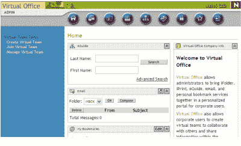

要描述 Virtual Office，您需要了解以下内容：
- Virtual Office 工作原理
- Virtual Office 示例场景

#### Virtual Office 工作原理

Virtual Office 通过让用户设置和管理许多自己的网络、信息共享和数据备份过程，优化了用户的自助服务概念。

Virtual Office 还允许用户创建自己的功能团队，称为虚拟团队，用于交互式实时协作。

加入虚拟团队的人员可以访问共享文档、讨论线程、书签和团队日历。团队的所有成员都可以访问团队信息和服务。

### 借助虚拟办公室，用户可以

- 查找并配置打印机
- 设置和维护密码
- 备份信息
- 与其他用户和组进行实时沟通
- 发布个人网页以向其他用户提供信息
- 使用任何联网设备从任何位置访问重要信息
- 收藏网页

虚拟办公室提供以下产品的访问权限：

### 图 9-3

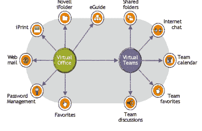

这些产品提供的服务赋予团队负责人管理功能，并使团队成员能够从一个中心位置有效地沟通并完成项目。

### 虚拟办公室示例场景

以下示例实施场景展示了虚拟办公室如何提供基于 Web 的团队协作解决方案：
- 虚拟办公室场景 1：团队协作
- 虚拟办公室场景 2：个人访问

#### 虚拟办公室场景 1：团队协作

四名员工需要在一个项目上进行协作。他们都需要立即访问相同的文件，并且需要频繁通信。其中两名员工在同一办公室，另外两名员工居住在其他地点。

可以使用虚拟办公室来管理该项目。最初，项目负责人创建一个虚拟团队，以便所有团队成员无论身处何地都可以执行以下操作：
- 实时聊天。
- 使用 Novell® NetStorage 立即访问存储的文件。
- 使用文件共享功能上传或获取文件。
- 创建一个网页，向所有团队成员发布消息和其他重要信息。
- 创建书签以便立即访问 Web 资源。

#### 虚拟办公室场景 2：个人访问

一名员工在去参加会议的路上发现她的笔记本电脑电池没电了，而且没有时间去找充电器。尽管如此，她仍需访问一些文件，打印议程副本，并查看她的日历。

到达会议地点后，她借了一台笔记本电脑，并使用虚拟办公室完成以下操作：
- 通过 Novell NetStorage 访问她的存储文件
- 使用 iPrint 查找打印机并打印会议议程
- 查看电子邮件中是否有任何重要消息
- 使用日历查看活动日程
- 使用 eGuide 查找未参加会议的人员
- 与未参加会议的人建立聊天会话

### 目标 2

#### 安装虚拟办公室

在安装 Novell® Nterprise™ Linux® Services (NNLS) 时，你可以将虚拟办公室作为可选组件进行安装。当选择虚拟办公室时，NNLS 安装脚本将安装服务器上所需的所有组件。

要在 Linux 服务器上安装虚拟办公室，你需要了解如何
- 满足虚拟办公室依赖项
- 收集所需信息
- 使用 NNLS 安装功能
- 定位虚拟办公室文件

#### 满足虚拟办公室依赖项


由于虚拟办公室主页提供对其他与 NNLS 一起安装的产品 Web 访问权限，如果你希望从虚拟办公室访问这些产品，则需要在安装过程中选择以下产品：

- eGuide™
- iFolder™
- iPrint
- NetMail™

虚拟办公室主页仅显示你所选产品的快捷按钮。

NNLS 安装程序在你选择虚拟办公室组件时会选择所有必需组件及其依赖项。它们将在同一过程中安装。

这些组件包括以下内容：

- 位于同一 NNLS 服务器上的 Apache 2.0.45
- 位于同一 NNLS 服务器上的 JVM® 1.4.1_02
- 位于同一 NNLS 服务器上的 Tomcat 4.1.24
- 网络内任意位置的 eDirectory 8.7.1 或更高版本
- iManager 2.0

请参阅表 2-4，获取成功安装尚未安装的虚拟办公室依赖项所需的信息。

### 收集所需信息

下表描述了成功安装虚拟办公室所需的信息：

| 表 9-1 | 所需配置数据 | 描述 |
| :--- | :--- | :--- |
| | eDirectory 服务器 IP 地址或主机名 | 安装虚拟办公室的 eDirectory 服务器的 IP 地址或 DNS 名称。<br><br>此服务器必须安装有 eDirectory 的主副本或读写副本。 |
| | 带上下文的 Admin 名称 | 为 iManager 指定的 eDirectory 服务器的 Admin 的完全限定名称。<br><br>必须使用带类型语法指定名称和上下文 (`cn=name.ou=organizational-unit.o=organization`)。 |
| | Admin 密码 | Admin 的密码。 |
| | NetStorage 身份验证服务器 | NetStorage 用户使用 LDAP 进行身份验证的 eDirectory 服务器的 IP 地址或 DNS 主机名。 |
| | NetStorage 代理用户 | 具有以下权限的用户对象的完全限定名称：<br>- 搜索指定为 NetStorage 身份验证服务器的 LDAP (eDirectory) 树以查找 NetStorage 用户。<br>- 如果 NetStorage 中定义了 iFolder 存储位置，则在用户首次访问存储位置时，在 eDirectory 中存储 iFolder 用户口令短语。 |
| | NetStorage 代理用户密码 | 指定为 NetStorage 代理用户的用户的密码。 |
| | NetStorage 用户上下文 | 要在 NetStorage 身份验证服务器上搜索 NetStorage 用户的上下文。（所有子上下文也会被搜索。） |
| | iFolder 服务器 IP 地址或主机名 | （可选）指定你希望创建为 NetStorage 存储位置的 iFolder 服务器的 IP 地址或主机名。这将使 iFolder 自动对虚拟办公室用户可用。 |

### 使用 NNLS 安装功能

要从 NNLS 安装虚拟办公室，请执行以下操作：

1. 执行自定义安装的步骤。


> 如有必要，请参阅第 2 节了解如何执行自定义安装的详细信息。

2. 取消选择*不想*安装的服务，选择虚拟办公室服务（以及任何你希望从虚拟办公室访问的其他服务），然后继续。

3. 接受许可协议。

4. （条件）如果提示输入 NICI 基础密钥 (NFK) 文件的位置，请输入 NFK 文件的路径。仅当之前未安装 eDirectory 时，才会询问 NICI 基础密钥。

5. 在每个提示处输入请求的信息（参见表 9-1）。

6. 查看摘要信息并进行任何必要的更正。

7. 当所有信息都正确时，完成安装。

8. 查看 readme 文件并保存安装设置日志文件。

### 定位虚拟办公室文件

安装过程中，虚拟办公室程序文件会被复制到 `/opt/novell/virtualoffice/bin`。

安装完成后，使用以下 URL 在 Web 浏览器中启动虚拟办公室：

```
http://server_DNS_address/vo
```

## 目标 3

### 配置虚拟办公室

安装虚拟办公室后，在使用该产品之前，你需要在 iManager 中配置程序设置。

一些虚拟办公室参数在虚拟办公室主页内进行配置；其他参数在 iManager 中进行配置。

在本目标中，你学习如何执行以下操作：

- 在 iManager 中管理虚拟办公室配置
- 在虚拟办公室主页中管理虚拟办公室

### 在 iManager 中管理虚拟办公室配置

在 iManager 中，你可以管理以下内容：

- 虚拟办公室服务管理
- 虚拟办公室环境管理

如果单独安装虚拟办公室（不与其他 NNLS 产品一起），你可能需要安装适当的 iManager 模块以管理虚拟办公室。

执行以下操作：

1. 在 iManager 中，选择 **Configure**（配置）。
2. 选择 **Modules**（模块）。
3. 选择 **Install**（安装）。
4. 浏览到 `/var/opt/novell/iManager/nps/packages` 并选择 `VirtualOffice.npm`。
5. 选择 **Install**（安装）。
6. 重复此过程以安装 `VirtualOfficeAdmin.npm` 模块。
7. 重启 `novell-tomcat4` 服务。

### 虚拟办公室服务管理

在 iManager 中，你可以配置以下服务：

- 公司信息服务
- NetStorage
- iPrint
- eGuide
- ZENworks®
- 书签
- **GroupWise® 配置**
- **Lotus® Notes® 配置**
- **Microsoft® Exchange 配置**
- **NetMail 配置**
- **IMAP/POP3 服务器配置**
- **公共网页**
- **更改密码**

### 公司信息服务

新闻功能允许您在主页的虚拟办公室新闻字段中发布信息。

请执行以下操作：

1. 打开 iManager。
2. 选择 **虚拟办公室管理 > 服务管理 > 公司信息**。

将显示以下内容：


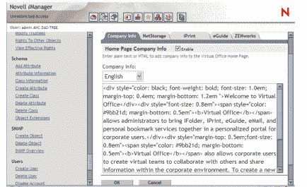

3. **勾选 启用。** 如果未勾选，虚拟办公室新闻字段将不会出现在主页上。
4. **在新闻字段中输入您要发布的 *消息*。** 您可以使用纯文本或 HTML。
5. **选择 确定。**

### NetStorage

NetStorage 选项卡允许您访问 Novell NetStorage，它提供基于 Internet 的简单文件访问功能，用于访问服务器上的文件。要配置此功能，请完成以下操作：

1. **打开 iManager。**
2. **选择 *虚拟办公室管理* > *服务管理* > *NetStorage*。**

将显示以下内容：

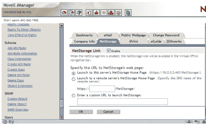

3. **勾选 启用**。

    如果未勾选，*文件* 图标将不会出现在虚拟办公室中。

4. 执行以下其中一项操作以指定指向 NetStorage 主页的 *URL*：

    - 如果 NetStorage 位于同一服务器上，请选择 **启动到此服务器的 NetStorage 主页**。
    - 如果 NetStorage 位于远程服务器上，请指定远程服务器的 *DNS* 或 *IP 地址*。
        - 例如，`https://DNS_或_IP地址:443/NetStorage/servlet/NetStorage`
    - 输入自定义 *URL* 以启动 NetStorage。

在某些浏览器（包括 Mozilla 1.5、Internet Explorer 6.1 SP1 以及 Netscape 7.01 和 7.02）中，您在虚拟办公室服务管理插件中为 NetStorage 网页输入的 URL 不会被保存。

如果输入的 URL 未被保存，请尝试使用其他浏览器。已知 Internet Explorer 6 和 Netscape 7.1 可以正常工作。

### iPrint

iPrint 是一种软件解决方案，允许用户从任何地方向任何地方打印。

要配置此功能，请执行以下操作：

1. 打开 iManager。
2. 选择 **虚拟办公室管理 > 服务管理 > iPrint**。

将显示以下内容：

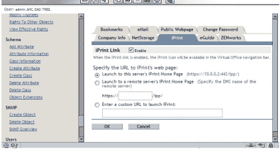

### 图 9-6

3. 勾选 **启用**。


如果未勾选，iPrint 图标将不会出现在虚拟办公室中。

4. 执行以下其中一项操作以指定指向 iPrint 网站页的 `URL`：

- 如果 iPrint 位于同一服务器上，请单击 `启动到此服务器的 iPrint 主页`。
- 如果 iPrint 位于远程服务器上，请指定远程服务器的 `DNS` 或 `IP 地址`。
  - 例如，`https://DNS_或_IP地址/iPrint/servlet/iPrint`
- 指定自定义 `URL` 以启动 iPrint。

5. 选择 `确定`。

#### eGuide

Novell eGuide 是一个 Web 应用程序，无论 LDAP 数据源位于何处，都为用户提供基于浏览器的搜索功能。

要配置 eGuide，请执行以下操作：

1. 打开 iManager。
2. 选择 `虚拟办公室管理 > 服务管理 > eGuide`。

将显示以下内容：

### 图 9-7

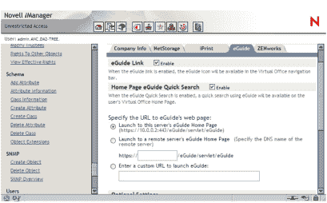

3. 勾选 `启用`。

如果未勾选此框，eGuide 图标将不会出现在虚拟办公室中。

4. 执行以下其中一项操作以指定指向 eGuide 网页的 `URL`：

- 如果 eGuide 位于同一服务器上，请单击 `启动到此服务器的 eGuide 主页`。
- 如果 eGuide 位于远程服务器上，请指定远程服务器的 `DNS` 或 `IP 地址`。
  - 例如，`https://DNS_或_IP地址/eGuide/servlet/eGuide`
- 指定自定义 `URL` 以启动 eGuide。

5. 选择 `确定`。

您还可以设置可选的代理 URL。这允许 Internet 代理/加速器（如 Novell iChain）将指定的代理 URL 正确重写为正确的 DNS 名称，从而允许用户的浏览器通过代理服务器正常工作。

#### ZENworks

ZENworks 提供基于目录的桌面、手持设备和服务器管理功能。

要将 ZENworks 与 `虚拟办公室` 配合使用，必须安装并配置 Novell ZENworks 6 桌面管理和 Web 自助服务组件。


更多信息，请参阅 http://www.novell.com/documentation/ig/zenworks6/index.html 。

要通过 `虚拟办公室` 配置 ZENworks 访问权限，请执行以下操作：

1. 打开 `iManager`。
2. 选择 `虚拟办公室管理` > `服务管理` > `ZENworks`。

将显示以下内容：

**图 9-8**

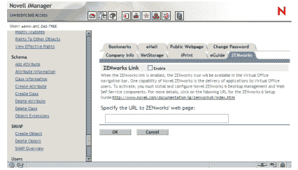

3. 勾选 `启用`。
4. 指定 ZENworks 网页的 `URL`。
5. 选择 `确定`。

#### 书签

书签选项卡页面提供虚拟办公室书签服务的配置选项。

要配置此功能，请执行以下操作：

1. 打开 iManager。
2. 选择 `虚拟办公室管理 > 服务管理 > 书签`。

将显示以下内容：

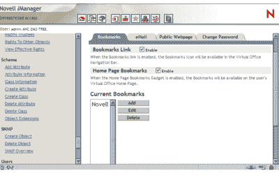

3. 如果您希望 `书签` 按钮出现在虚拟办公室按钮栏中，请在 `书签链接` 标题右侧选择 `启用`。
4. 如果希望书签显示在用户主页上，请在 `主页书签` 标题右侧选择 `启用`，并执行以下一项或多项操作：
   - 通过选择 `添加` 来添加书签；然后输入书签 `名称` 和 `URL`，并选择 `确定`。
   - 通过选择 `书签` 并选择 `编辑` 来编辑现有书签；然后更改该书签的 `名称` 或 `URL`，并选择 `确定`。
   - 通过选择 `书签` 然后选择 `删除` 来删除现有书签。
5. 选择 `确定`。

#### GroupWise® 配置

此参数提供虚拟办公室 GroupWise 选项的配置设置。

要配置此功能，请执行以下操作：

1. 打开 iManager。
2. 选择 `虚拟办公室管理 > 服务管理` > eMail。
3. 如果您希望 e-邮件按钮出现在虚拟办公室按钮栏中，请在 eMail 链接标题右侧选择 `启用`。
4. 从 `邮件服务器` 菜单中，选择 `Novell GroupWise`。
5. 选择 `编辑`。
6. 输入 GroupWise WebAccess `URL`。
7. 如果用户凭据与虚拟办公室 eDirectory 树使用的凭据相同，请选择 `与虚拟办公室树同步`。
8. 选择 `确定`。
9. 您还可以配置主页精简电子邮件视图。当启用精简电子邮件视图时，用户的最新电子邮件将列在用户的虚拟办公室主页上。

请执行以下操作：

- a. 配置您的 GroupWise 服务器以支持 POP3 或 IMAP。
- b. 在 `主页精简电子邮件视图` 标题右侧选择 `启用`。
- c. 选择 `编辑`。
- d. 选择 `POP3` 或 `IMAP`。
- e. 输入您的入站邮件服务器 `DNS 名称` 或 `IP 地址`。
- f. 输入您的 SMTP 服务器 `DNS 名称` 或 `IP 地址`。
- g. 如果用户凭据与虚拟办公室 eDirectory 树使用的凭据相同，请选择 `与虚拟办公室树同步`。
- h. 选择 `确定`；然后选择 `确定`。

#### Lotus® Notes® 配置

此参数提供虚拟办公室 Lotus Notes 选项的配置设置。

要配置此功能，请执行以下操作：

1. 打开 iManager。
2. 选择 `虚拟办公室管理 > 服务管理 > eMail`。
3. 如果您希望 e-邮件按钮出现在虚拟办公室按钮栏中，请在 eMail 链接标题右侧选择 `启用`。
4. 从 `电子邮件服务器` 菜单中，选择 `Lotus Notes`。
5. 选择 `编辑`。
6. 指定 Lotus Notes `URL`。
7. 指定 Lotus Notes `代理地址`。
8. 选择 `确定`。
9. 您还可以配置主页精简电子邮件视图。当启用精简电子邮件视图时，用户的最新电子邮件将列在用户的虚拟办公室主页上。请执行以下操作：
   - a. 配置您的 Notes 服务器以支持 POP3 或 IMAP。
   - b. 在 `主页精简电子邮件视图` 标题右侧选择 `启用`。
   - c. 选择 `编辑`。
   - d. 选择 `POP3` 或 `IMAP`。
   - e. 输入您的入站邮件服务器 `DNS 名称` 或 `IP 地址`。
   - f. 输入您的 SMTP 服务器 `DNS 名称` 或 `IP 地址`。
   - g. 如果用户凭据与虚拟办公室 eDirectory 树使用的凭据相同，请选择 `与虚拟办公室树同步`。
   - h. 选择 `确定`。
10. 选择 `确定`。

#### Microsoft® Exchange 配置

此参数提供虚拟办公室 Exchange 选项的配置设置。要配置此功能，请完成以下操作：

1. 打开 iManager。
2. 选择 `虚拟办公室管理 > 服务管理 > eMail`。
3. 如果您希望 e-邮件按钮出现在虚拟办公室按钮栏中，请在 eMail 链接标题右侧选择 `启用`。
4. 从 `电子邮件服务器` 菜单中，选择 `Microsoft Exchange`。
5. 选择 `编辑`。
6. 指定 Microsoft Exchange `URL`。
7. 根据用户凭据所在的位置，选择 `与虚拟办公目录树同步` 或 `与虚拟办公目录树不同`。
8. 选择 `确定`。
9. 您还可以配置主页精简电子邮件视图。当启用精简电子邮件视图时，用户最近的电子邮件将列在用户的虚拟办公主页上。请执行以下操作：
   - 在 `主页精简电子邮件视图` 标题的右侧选择 `启用`。
   - 选择 `编辑`。
   - 选择 `POP3` 或 `IMAP`。
   - 输入您的入站邮件服务器 `DNS 名称` 或 `IP 地址`。
   - 输入您的 SMTP 服务器 `DNS 名称` 或 `IP 地址`。
   - 如果用户的凭据与虚拟办公 eDirectory 树使用的凭据相同，请选择 `与虚拟办公目录树同步`。


- 选择确定。

10. 选择确定。

### NetMail 配置

此参数提供虚拟办公 NetMail 选项的配置设置。

请执行以下操作：

1. 打开 iManager。

2. 选择虚拟办公管理 > 服务管理 > 电子邮件。

将显示以下内容：

图 9-10

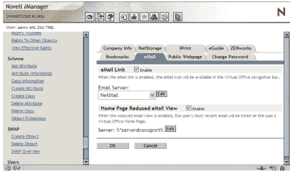

3. 如果希望电子邮件按钮出现在虚拟办公按钮栏中，请在电子邮件链接标题的右侧选择启用。

4. 从电子邮件服务器菜单中选择NetMail。

5. 选择编辑。

6. 指定 NetMail URL。

7. 根据用户凭据所在的位置，选择与虚拟办公目录树同步或与虚拟办公目录树不同。

8. 选择确定。

9. 您还可以配置主页精简电子邮件视图。当启用精简电子邮件视图时，用户最近的电子邮件将列在用户的虚拟办公主页上。请执行以下操作：
- 在主页精简电子邮件视图标题的右侧选择启用。
- 选择编辑。
- 选择POP3或IMAP。
- 输入您的入站邮件服务器DNS 名称或IP 地址。
- 输入您的 SMTP 服务器DNS 名称或IP 地址。
- 如果用户的凭据与虚拟办公 eDirectory 树使用的凭据相同，请选择与虚拟办公目录树同步。
- 选择确定；然后选择确定。

10. 选择确定。

### IMAP/POP3 服务器配置

若要配置虚拟办公以与远程 IMAP/POP3 邮件服务器配合工作，请执行以下操作：

1. 打开 iManager。

2. 在 iManager 主页面中，选择虚拟办公管理 > 服务管理 > 电子邮件。

3. 选择启用。

4. 从电子邮件服务器菜单中，选择IMAP/POP3 服务器。

5. 选择编辑。

6. 选择您需要的邮件服务器类型（IMAP 或 POP3）。

7. 指定入站邮件服务器 DNS 名称。

8. 指定SMTP 服务器 DNS 名称。

9. 根据用户凭据所在的位置，选择与虚拟办公目录树同步或与虚拟办公目录树不同。

10. 选择确定。

11. 您还可以配置主页精简电子邮件视图。当启用精简电子邮件视图时，用户最近的电子邮件将列在用户的虚拟办公主页上。请执行以下操作：
- 在主页精简电子邮件视图标题的右侧选择启用。
- 选择编辑。
- 选择POP3或IMAP。
- 输入您的入站邮件服务器DNS 名称或IP 地址。
- 输入您的 SMTP 服务器DNS 名称或IP 地址。
- 如果用户的凭据与虚拟办公 eDirectory 树使用的凭据相同，请选择与虚拟办公目录树同步。
- 选择确定。

12. 选择确定。

#### 公共网页

此参数提供虚拟办公公共网页服务的配置选项。要配置此功能，请执行以下操作：

1. 打开 iManager。

2. 选择虚拟办公管理 > 服务管理 > 公共网页。

将显示以下内容：

图 9-11

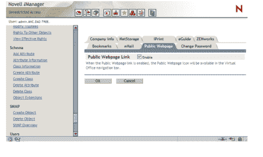

3. 如果希望公共网页链接出现在虚拟办公导航栏中，请在公共网页链接的右侧选择启用。

4. 选择确定。

#### 更改密码

此参数指定是否允许用户更改其 eDirectory 密码。要配置此功能，请执行以下操作：

1. 打开 iManager。

2. 选择虚拟办公管理 > 服务管理 > 更改密码。

请注意，在此处更改密码会更改 eDirectory 密码。当然，这也会更改所有其他 NNLS 服务的密码。

将显示以下内容：

图 9-12

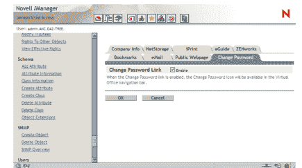

3. 如果希望用户能够更改其虚拟办公密码，请在更改密码链接标题的右侧选择启用。
- 如果已启用，更改密码按钮将出现在虚拟办公按钮栏中。如果未启用更改密码，用户将无法更改其虚拟办公密码。

4. 选择确定。

#### 虚拟办公环境管理

在 iManager 中，您可以配置以下虚拟办公环境参数：
- 团队配置
- 日志记录

### 团队配置

此参数提供虚拟团队的配置选项。虚拟团队是虚拟办公中的一个中心位置，用户可以在其中交换信息、共享文件并维护事件日历。

虚拟办公允许您创建自己的团队并成为其他团队的成员。例如，您可以为一个人力资源组创建一个社区。通过该社区共享的所有信息和文件都可以直接与人资任务相关。

当您创建一个虚拟团队时，您将成为团队的所有者兼团队成员。虚拟团队可以拥有多个所有者。如果您希望授予另一个用户对您团队的管理权限，您必须使该用户成为所有者。

所有者拥有平等的权利。所有者可以将其他所有者从社区中移除——甚至包括创建该社区的个人。所有团队都显示在虚拟团队列表中，但仅团队成员可以访问这些团队。

要配置团队，请执行以下操作：

1. 打开 iManager。

2. 选择虚拟办公管理 > 环境管理 > 团队配置。

将显示以下内容：

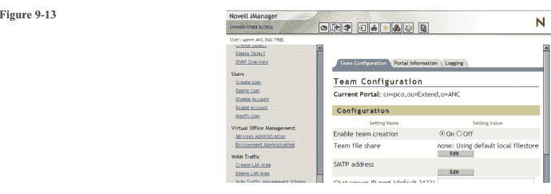

输入以下设置：
- 启用团队创建：选择开以允许用户创建团队。此设置默认开启。
- 团队文件共享：指定文件共享位置的路径。
- SMTP 地址：指定电子邮件通知的地址。
- 聊天服务器 IP 端口：指定小程序到服务器通信的端口。
- 管理团队访问：此选项允许您拒绝用户创建虚拟团队的能力。选择编辑 > 搜索，搜索并选择一个用户，然后选择选择。

选择保存。

### 日志记录

此参数确定记录在虚拟办公日志中的信息量。这些设置仅对当前的门户服务器有效。它们不会保存到 PortalServlet.properties 文件中。

要配置此参数，请执行以下操作：

1. 打开 iManager。

2. 选择虚拟办公管理 > 环境管理 > 日志记录。

将显示以下内容：

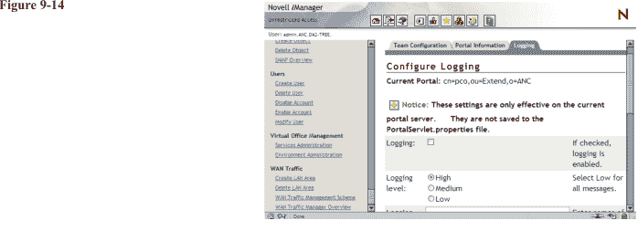

3. 配置以下设置：
- 日志记录：选中日志记录旁边的复选框以启用日志记录。
- 日志级别：指定日志中包含的信息量：
- 高：记录特定信息。
- 中：记录特定信息和一些通用消息。
- 低：记录所有消息。
- 日志记录模块：列出包含在日志记录中的模块。如果该字段为空，则日志记录包括所有模块。
- 记录到标准错误：启用记录到标准错误。
- 记录到标准输出：启用记录到标准输出。
- 记录到文件：将日志报告发送到`/var/opt/novell/iManager/nps/WEB-INF/debug.xml`文件。选择查看全部以查看该文件中的消息。选择清除全部以清除文件。

4. 选择确定。

### 在虚拟办公主页上管理虚拟办公

您可以使用虚拟办公主页配置许多虚拟办公服务以满足您的需求。要打开虚拟办公主页，请打开浏览器窗口并输入`http://server_IP_or_DNS/vo`。


将出现以下内容：


从此处可配置以下服务：
- 书签
- 更改密码
- 公共网页
- 虚拟团队
- 虚拟团队服务

#### 书签

虚拟办公室允许您创建和维护网页书签，以便快速访问网站。

请执行以下操作：

1. 在虚拟办公室主页面的工具栏上，选择查看和管理我的书签。
将出现以下内容：


2. 选择编辑，然后选择添加。

3. 输入网站的名称；然后输入该网站的URL。

4. 选择确定。

5. 选择希望书签显示所用的列数。

6. 选择保存。

图 9-16

#### 更改密码

此功能允许用户更改他们的 eDirectory 密码。

请执行以下操作：

1. 在虚拟办公室主页面的工具栏上，选择更改我的密码。

将出现以下内容：


2. 输入当前的密码。


3. 输入新的`密码`，然后再次输入新的`密码`。

4. 选择`确定`。

## 公共网页

公共网页是用户在虚拟办公室中创建的个人页面。用户可以创建这些网页来向其他用户显示信息、书签和文件。

例如，某用户可能拥有一个文档文件，而其他几个用户在某个时刻需要该文件。可以将此文件放在个人网页上，以便其他用户可以从那里查看或下载它。

创建网页时，您可以显示或隐藏配置向导中可用的任何选项。

要配置您的个人网页，请执行以下操作：

- 在虚拟办公室主页面的工具栏上，选择`查看和编辑我的网页`。
- 选择`编辑`。

将出现以下内容：


- 勾选您希望显示的以下各项的复选框：
  - `用户信息`：选择用户信息部分的所有内容。
  - `通用名称`：显示用户的通用名称。
  - `团队成员`：使站点可供所有团队成员显示。
  - `已发布的收藏`：显示用户的书签。
  - `已发布的文件`：显示用户已下载的文件。
- 选择`确定`。

所有用户都可以搜索和访问已公开的网页。如果您需要联系信息，或想要访问某用户已下载并可供使用的文件，这将非常有帮助。

## 虚拟团队

要配置和使用虚拟团队，您需要了解以下内容：

- 创建虚拟团队
- 申请团队会员资格
- 执行虚拟团队管理任务

### 创建虚拟团队

您可以创建受保护的虚拟团队。这意味着所有团队在虚拟团队列表中可见，但只有成员可以访问这些团队。

要创建虚拟团队，请执行以下操作：

1. 在虚拟办公室主页面，选择`创建虚拟团队`。

将出现以下内容：


2. 输入团队`名称`。
3. （可选）输入一个`描述`。
4. 选择`创建`。
5. 当提示团队已创建时，选择`确定`。

### 申请团队会员资格

所有用户都可以申请加入虚拟团队。您必须是团队成员才能访问该团队的信息和服务。

要申请加入虚拟团队，请执行以下操作：

1. 在虚拟办公室主页面，选择`加入虚拟团队`。

将出现以下内容：

图 9-20


2. 选择您想要加入的团队。
3. 选择`加入`。

由于虚拟团队访问权限仅限于成员，因此您必须向团队所有者申请会员资格。此屏幕允许您申请虚拟团队会员资格。在所有者批准您的申请后，您将成为团队成员。

4. 选择`请求 > 确定`。

### 执行虚拟团队管理任务

管理任务（从团队中移除您自己的会员资格除外）仅限于团队所有者。

要管理虚拟团队，您需要知道如何执行以下操作：

- 显示团队成员
- 邀请用户加入团队
- 批准或拒绝会员资格申请
- 添加团队所有者
- 阻止用户加入团队
- 编辑团队属性
- 设置通知偏好
- 删除虚拟团队

#### 显示团队成员

您可能希望查看团队所有成员的列表，以确保包含您希望作为成员的所有用户。

要显示团队会员资格，请执行以下操作：

1. 在虚拟办公室主页面，打开您的`团队`。
2. 在“团队会员资格”列中，选择`显示团队成员`。

#### 邀请用户加入团队

创建团队后，您可以邀请其他用户成为该团队的成员。

当您邀请用户加入虚拟团队时，该用户可以选择接受或拒绝邀请。

要邀请用户加入团队，请执行以下操作：

1. 在虚拟办公室主页面，打开您的团队。
2. 在“团队会员资格”列中，选择`邀请用户`。
3. 输入您想添加的用户`名称`；然后选择`搜索`。如果您想查看所有用户，请将这些字段留空并选择`搜索`。

将出现以下内容。


4. 选择所需的`用户`。
5. （可选）选择`通过电子邮件发送邀请`。
6. 选择`添加`。

#### 批准或拒绝会员资格申请

当您被邀请加入虚拟团队时，虚拟办公室会通知您。除非您被分配到该团队，否则您可以选择接受或拒绝邀请。

要接受或拒绝会员资格申请，请执行以下操作：

1. 在`虚拟办公室`主页面，打开您的团队。
2. 在“团队会员资格”列中，选择`批准申请`。


3. 选择申请；然后选择`批准`或`拒绝`。

#### 添加团队所有者

虚拟办公室允许您授予其他用户所有权。例如，您可能希望将部分团队管理任务委派给他人。

所有团队所有者拥有相同的团队管理权限。

要添加团队所有者，请执行以下操作：

1. 在`虚拟办公室`主页面，打开您的团队。
2. 在“团队会员资格”列中，选择`显示团队所有者`。

将出现以下内容：


3. 选择`添加`。
4. 输入您想添加的用户`名称`；然后选择`搜索`。
   如果您想查看所有用户，请将这些字段留空并选择`搜索`。
5. 选择您想添加为团队所有者的用户`名称`；然后选择`添加`。

#### 阻止用户加入团队

虚拟办公室允许团队所有者防止用户访问团队。

例如，您可能为某个特定部门创建了一个虚拟团队，其中有您不希望访问共享文件的临时员工。

要阻止用户，请执行以下操作：

1. 在`虚拟办公室`主页面，打开您的团队。
2. 在`团队会员资格`列中，选择`显示被阻止的用户`。

将出现以下内容：


3. 选择`添加`。
4. 输入您想阻止的用户`名称`；然后选择`搜索`。
   如果您想查看所有用户，请将这些字段留空并选择`搜索`。
5. 选择您想阻止的`用户`；然后选择`添加`。

#### 编辑团队属性

设置并配置虚拟团队后，您可以修改属性设置以反映任何更改或更新。团队属性包括团队成员列表及其可以访问的组件。

### 虚拟办公室操作

例如，如果您不使用聊天功能，可以从页面中移除它。

若要编辑团队属性，请执行以下操作：

1. 在`虚拟办公室`主页面中，打开您的团队。
2. 在团队成员列中，选择`显示团队属性`。

此时将出现以下内容：


3. 编辑团队的`名称`或`描述`。
4. 选择`保存`。

### 设置通知首选项

在管理虚拟团队时，您可能需要执行以下部分任务：

- 发布讨论以与成员沟通
- 发布活动通知
- 添加文件与成员共享

当执行上述任何任务时，您可以通过电子邮件通知团队成员。

若要设置通知首选项，请执行以下操作：

1. 在虚拟办公室主页面中，打开您的`团队`。
2. 在团队成员列中，选择`设置通知首选项`。

此时将出现以下内容：

图 9-26


3. 选择您希望通知团队成员的以下各项：
   - `新讨论帖。` 当所有者在讨论服务中发布新消息时，通知团队成员。
   - `我参与的线程的新讨论帖。` 当有人回复讨论消息时，通知团队成员。针对消息的每个回复都会发送一条通知。
   - `创建事件。` 当创建新事件时，通知团队成员。
   - `上传文件。` 当在文件服务中上传文件时，通知团队成员。
   - `发送至：团队成员的电子邮件地址。` 这是所有通知发送到的地址。
4. 选择`保存`。

### 删除虚拟团队

如果您是团队所有者，您可以删除您所拥有的团队。

例如，您可能为特定项目创建了一个团队。当该项目完成时，您可以删除该团队。

若要删除虚拟团队，请执行以下操作：

1. 在虚拟办公室主页面中，打开您的团队。
2. 在团队成员列中，选择`删除此团队`。
3. 选择`删除`。


### 虚拟团队服务

在团队主页上，您可以访问虚拟团队服务，如下所示：


以下服务仅在虚拟团队设置中可用：

- `讨论。` 该服务允许团队内的用户参与在线讨论并交换消息。
- `日历。` 该服务允许您安排事件和预约，并与团队成员共享此信息。
- `文件。` 该服务是一个可供虚拟团队成员使用的文件共享工具。您可以执行以下任务：
  - 浏览目录
  - 在当前路径或目录中创建目录
  - 上传文件
  - 删除文件
  - 与团队中的其他用户共享文件


- **聊天。** 该服务允许虚拟团队成员通过即时消息进行沟通。您可以使用聊天服务执行以下操作：

  - 与其他用户聊天
  - 保存或打印对话
  - 邀请用户加入聊天会话
  - 开启或关闭声音
  - 指示您暂时离开工作站

- **链接。** 该服务允许您创建和显示指向网页的链接。


**35 分钟**

# 练习 9-1 配置和使用虚拟办公室

作为 Digital Airlines 办公室的网络管理员，您正在为一个运营效率研究项目使用虚拟办公室设置一个虚拟团队。

该团队由飞行员、地面工作人员、营销专家、客户服务人员和管理人员组成。

请执行以下操作：

- 第一部分：设置效率项目虚拟团队
- 第二部分：添加日历事件和已发布的收藏
- 第三部分：将用户添加到虚拟团队
- 第四部分：为团队上传文件
- 第五部分：为团队会议创建提醒消息

## 第一部分：设置效率项目虚拟团队

请执行以下操作：

1. 从您的 NNLS 服务器进入，通过输入以下 URL 访问虚拟办公室：

   `http://DAx.your container.digitalairlines.com/vo`

2. 使用用户`srife`和密码 `novell` 登录到虚拟办公室。

3. 在左侧，选择**创建虚拟团队**。

4. 在名称字段中，输入**效率项目**。

5. 选择**创建**。

6. 当提示团队已创建时，选择**确定**。

7. 在左侧，选择**效率项目**。

出现默认插件对话框，指示效率项目页面上的聊天区域只能使用适当的插件查看。

并非所有虚拟办公室中的 java 小程序都目前在 Mozilla 1.5 中运行（例如聊天）。即使下载了请求的插件，可能也无法正常工作。

然而，聊天小程序在 Internet Explorer 6 或更高版本中可以正常工作。

如果您不想每次返回效率项目页面时都出现默认插件对话框，请在 Windows XP 工作站上完成练习的其余部分。

8. 通过选择**取消**关闭对话框。

9. 注意屏幕上的以下新项：

   - □ 用于团队成员之间持续进行的类似论坛的沟通的讨论区域
   - □ 用于中央存储库中团队特定项目的文件部分
   - □ 与任何已登录团队成员进行实时聊天
   - □ 左侧扩展菜单

## 第二部分：添加日历事件和已发布的收藏

您需要为明天上午 8:00 在 A 栋 201 会议室安排一次团队会议。

请执行以下操作：

1. 在左侧效率项目下，选择**显示团队日历**。出现日历。

2. 在右侧事件下，选择**新建**。出现新建事件窗口。

3. 填写或选择以下内容：

   - 主题：**团队会议**
   - 日期：*明天的日期*
   - 时间：上午 8:00
   - 地点：**A 栋 201 会议室**
   - 消息：**这是我们的启动会议。**

4. 完成后，选择**包含时间**；然后选择**通知所有成员**。

5. 选择**保存**。出现事件已创建消息。

6. 选择**关闭**。为您的团队会议出现一个新事件。

7. 在左侧**效率项目**下，选择**显示团队网页**。

8. 在团队页面标题右侧，选择**编辑**。

9. 在已发布收藏右侧，选择**编辑**。出现当前书签窗口。

10. 选择**添加**。

11. 在名称字段中，输入**NNLS**。

12. 在 URL 字段中，输入 `http://www.novell.com/products/linux`；然后选择**确定**。

13. 选择**保存**。

14. 关闭列出您刚添加的书签的窗口。

15. 在右侧已发布收藏下选择**NNLS**。出现 NNLS 主页。

## 第三部分：将用户添加到虚拟团队

现在您需要将项目团队添加到虚拟团队。

请执行以下操作：

1. 在左侧**团队成员**下，选择**邀请用户**；然后在右侧选择**添加**。

2. 选择**搜索**。

3. 按住**Ctrl** 键并选择以下用户：

   - Aaron Gresko
   - Bruce Richardson
   - Bryant Bell
   - Chris Grayson
   - Jennifer Elison
   - Jessica Tracy
   - Kurt Fullmer

4. 选择**添加**。用户被添加到虚拟团队：效率项目列表中。

5. 在虚拟办公室窗口的右上角，选择**注销**。

6. 使用用户`cgrayson`和密码 `novell` 登录。

7. 在左侧选择**管理虚拟团队**。

8. 在右侧虚拟团队收件箱中，选择**效率项目**，然后选择**加入**。

9. 当提示您已成功加入时，在左侧选择**效率项目**。

10. 选择**显示团队日历**并阅读团队会议通知。

### 第 IV 部分：为团队上传文件

执行以下操作：

1. 选择 **Logout** 链接。

2. 使用 `KWrite`，在 `/home/student` 目录下创建一个名为 **agenda.txt** 的文本文件。

3. 以 **srife**（团队所有者）身份登录到 Virtual Office。

   您必须以团队所有者的身份登录，才能为团队上传文件。

4. 在左侧选择 **Efficiency Project**。

5. 在右侧 **Files** 下方，选择 **Upload**。

6. 选择 **Browse**。

7. 浏览并选择 `/home/student/agenda.txt`；然后选择 **Open**。

8. 在窗口底部选择 **Notify All Members**；然后选择 **Upload**。

9. 选择 **Close**。

   屏幕刷新，`agenda.txt` 显示为可用文件。

10. 选择 **Logout** 链接。

11. 以 **cgrayson** 身份登录。

12. 在左侧选择 **Efficiency Project**。

    注意，`agenda.txt` 可供 Chris Grayson 下载。

### 第 V 部分：为团队会议创建提醒消息

执行以下操作：

1. 选择 **Logout** 链接。

2. 以 **srife**（团队所有者）身份登录。

3. 在左侧选择 **Efficiency Project**。

4. 在右侧 **Discussion** 下方，选择 **New Message**。

5. 在主题字段中，输入 **Team Meeting Reminder**。

6. 在消息字段中，输入 **Don't forget the team meeting tomorrow**。

7. 标记 **Notify All Members**；然后选择 **Post**。

8. 选择 **Logout** 链接。

9. 以 **cgrayson** 身份登录。

10. 在左侧框架中，选择 **Efficiency Project**。

11. 在右侧的 Discussion 下方，选择 **Team Meeting Reminder** 消息。

12. 尝试使用 Virtual Office 的其他功能。

13. 完成后，关闭网页浏览器。

（练习结束）

## 总结

| 目标 | 摘要 |
| :--- | :--- |
| 1. 描述 Virtual Office | Virtual Office 是一个 Web 访问门户，允许远程用户与工作组团队进行协作和信息共享。<br><br> Virtual Office 通过允许用户自行设置和管理许多网络、信息共享和数据备份过程，优化了用户的自助服务概念。<br><br> Virtual Office 还允许用户创建自己的功能团队，称为 Virtual Teams，以便进行交互式实时协作。<br><br> 加入虚拟团队的人员可以访问共享文档、讨论帖、书签和团队日历。团队的所有成员都可以访问团队信息和服务。 |
| **1. 描述 Virtual Office（续）** | - 使用 Virtual Office，用户可以<br>- 定位并设置打印机<br>- 设置和维护密码<br>- 备份信息<br>- 与其他用户和组进行实时通信<br>- 发布个人 Web 页面，以便向其他用户提供信息<br>- 使用任何启用 Web 的设备从任何位置访问重要信息<br>- 将 Web 页面加入书签 |


## 2. 安装 Virtual Office

安装 Novell Nterprise Linux Services (NNLS) 时，您可以将 Virtual Office 作为可选组件进行安装。当您选择 Virtual Office 时，NNLS 安装脚本将安装服务器所需的所有组件。

由于 Virtual Office 主页提供对其他已随 NNLS 安装的产品进行 Web 访问，如果您希望从 Virtual Office 访问以下产品，则需要在安装期间选择这些产品：
- eGuide
- iFolder
- iPrint
- NetMail

Virtual Office 主页仅显示您所选产品的快捷按钮。

## 3. 配置 Virtual Office

在 iManager 中，您可以配置以下服务：
- Company Info Service
- NetStorage
- iPrint
- eGuide
- ZENworks
- Bookmarks
- Groupwise 配置
- Lotus Notes 配置
- Microsoft Exchange 配置
- NetMail 配置
- IMAP/POP3 服务器配置
- 公共 Web 页面
- 更改密码

您可以使用 Virtual Office 主页配置许多 Virtual Office 服务。要打开虚拟办公室主页，请打开浏览器窗口并输入 `http://server_IP_or_DNS/vo`。

您从此位置配置以下服务：
- 书签
- 更改密码
- 公共 Web 页面
- 虚拟团队
- 虚拟团队服务

# 第 10 部分 为 Novell CLE 实习做准备

强调这些场景有助于学生为 NNLS 服务部分的实习做准备。

这些场景不包括可能作为测试 LPI 1 级认证目标一部分的 Linux 管理员任务。

在学生开始场景 1 之前，您需要向他们提供一个干净的 SuSE\* SLES 8 安装环境。

在本部分中，您将完成以下场景，以帮助您为 CLE 实习做准备：
- 场景 1：安装 NNLS（必需）
- 场景 2：业务需求文档 1
- 场景 3：业务需求文档 2
- 场景 4：业务需求文档 3

初始场景是必需的。然后，您可以根据时间选择剩余场景中的一个或两个来配置 NNLS 产品。

场景 2、3 和 4 为您提供了一个业务需求列表，您需要作为 Digital Airlines 办公室的网络管理员来满足这些需求。

虽然一些需求在所有 3 个场景中都是相同的，但其他需求可能会改变测试或配置 NNLS 服务以满足相同需求的方式。


> 在课堂环境中，在您开始场景 1 之前，您的讲师将提供干净的 SuSE\* SLES 8 安装环境。

### 场景 1：安装 NNLS（必需）

Digital Airlines 目前正在使用 NetWare® 上的 eDirectory™ 和其他 Nterprise™ 服务向客户和员工提供网络服务。

然而，随着 NNLS 的可用，CTO 已决定开始将多项 Nterprise 服务（如 iFolder® 和 iPrint）迁移到 Linux 服务器。

您最近收到了一份文档，概述了在办公室交付 Nterprise 服务于 Linux 上的业务需求，以及这些服务的时间表。

为了满足这些需求和时间表，您需要立即开始创建并测试一个满足业务需求的 NNLS 实验室环境配置。

您决定从一个安装了 NNLS 的单个 Linux 服务器开始。

执行以下操作：
- 安装 Mozilla 1.5，并使用课堂上分配给您的参数为您的服务器准备 NNLS 安装环境（您的 `container`、`10.0.0.x`、`DAx`）。
  遵循您在第 1 和第 2 部分中遵循的相同说明。
- 使用课堂上分配给您的默认值安装 NNLS 的所有组件（您的 `container`、`10.0.0.x`、`DAx`）。
  遵循您在第 2 部分中遵循的相同说明。
- 将您在第 3 部分中导入的相同 LDIF 文件导入到您的树中。
- 运行您的 eDirectory 树的健康检查，以确保没有错误。

### 场景 2：业务需求文档 1

在安装了 NNLS 1.0 并导入了 LDIF 文件后，您在实验室环境中实施并测试以下业务需求：
- 您必须能够订阅 3015 频道并安装 NNLS 的任何更新。所有 NNLS 服务的 man 页必须能从终端会话窗口中的 shell 提示符访问。您必须能够导入和导出 eDirectory 的 CSV 文件，并备份输出目录中的任何 CSV 文件。


> 使用与第 5 部分中相同的 Delimited Text 驱动器的基本配置。

为了满足此要求：
- 硬盘上 `sample.csv` 文件中的所有员工必须导入到您 eDirectory 树中的 `tempwork.your container` 容器中。您的 `container` 中 `WPU5ERS` 组的所有成员必须导出到硬盘上的 `pilots.csv` 文件。要备份输出目录中的 CSV 文件，创建一个名为 `backupcsv` 的脚本，该脚本将当前输出目录中的所有 CSV 文件打包成一个 tarball，并将其移动到 `/tmp/csvbackup` 目录。确保 `/tmp/csvbackup` 目录具有与 `/tmp` 目录相同的权限。创建一个 cron 作业，每周星期五下午 5:00 执行一次 `backupcsv` 脚本。

## 场景 3：业务需求文档 2

Digital Airlines 办公室的所有员工必须能够访问 NNLS 服务，以执行以下任务：
- 使用 eGuide 查看 Digital Airlines 办公室中所有其他员工的信息，并修改自己的员工信息。
- 在 Windows XP 工作站上从 iPrint 映射中安装并访问至少 1 台高容量打印机。
  - 使用教室打印机作为高容量打印机。
- 在 Windows XP 工作站上初始化 iFolder 账户。
- 在 Windows XP 工作站上映射一个驱动器，指向 Linux NNLS 服务器上的主目录。
- 通过自己的 NetMail 账户发送和接收电子邮件。

在安装 NNLS 并导入 LDIF 文件后，你需要在实验环境中实施并测试以下业务需求：
- eDirectory 树中的员工（用户）必须按部门容器进行组织（存储）。例如，所有市场营销部门的员工必须存储在单独的容器中。
- 部门容器必须创建在组织容器下。
- 每个部门容器中应有一个启用 LUM 的 `DBUSERS` 组。容器中的所有员工必须是该组的成员。所有其他现有组都应被删除。
- eDirectory 树中的所有员工（用户）必须启用 LUM 和 Samba。
- Digital Airlines 办公室的所有员工必须能够访问 NNLS 服务，以执行以下任务：
  - 在 Windows XP 工作站上从 iPrint 映射中安装并访问至少 1 台高容量打印机。


使用教室打印机作为高容量打印机。
  - 在 Windows XP 工作站上初始化 iFolder 账户。
  - 在 Windows XP 工作站上映射一个驱动器，指向 Linux NNLS 服务器上的主目录。
  - 通过自己的 NetMail 账户发送和接收电子邮件。

- 此外，你需要为 Digital Airlines 办公室中的每个部门提供以下内容：
  - 在 Virtual Office 中配置的一个团队。每个团队的一名成员必须被配置为团队所有者，该部门的其他所有员工作为团队成员。
  - Linux NNLS 服务器上为该部门提供的 NetStorage 共享文件夹。文件夹访问权限必须仅限于该部门的员工。

## 场景 4：业务需求文档 3

在安装 NNLS 1.0 并导入 LDIF 文件后，你需要在实验环境中实施并测试以下业务需求：
- 必须能够订阅 3015 频道并安装任何 NNLS 更新。
- eDirectory 树中的 `WPUSERS` 组及其相关成员必须同步到合作伙伴办公室的 eDirectory 树中，并存储在一个专门为你的办公室创建的容器下的 `employees` 和 `groups` 容器中。


> 对于 `eDirectory` 驱动程序，请使用与第 5 节相同的 basic configuration。

为满足此需求：

- 所有电话和传真号码必须不同步到合作伙伴办公室树。
- 两个树中的 `WPUSERS` 组在添加或删除组内成员时，必须包含相同的成员列表。
- 对你树中现有用户信息的任何修改都必须反映在你的合作伙伴办公室树中。
- 必须修改 `eGuide™` 皮肤选择，以反映你所在 `Digital Airlines` 办公室的主题（非默认皮肤）。
- 将部门（`Department`）设置为 `eGuide` 中的可搜索属性。
- 必须配置 `iFolder®` 以强制使用 `Recover Passphrase`。
- `Digital Airlines` 办公室中的所有员工必须能够访问 `NNLS` 服务，以执行以下任务：
  - 使用 `eGuide` 查看 `Digital Airlines` 办公室中所有其他员工的信息，并修改自己的员工信息。
  - 在 `Windows XP` 工作站上从 `iPrint` 映射中安装并访问至少 1 台高容量打印机。
    - 使用教室打印机作为高容量打印机。
  - 在 `Windows XP` 工作站上初始化 `iFolder` 账户。
  - 在 `Windows XP` 工作站上映射一个驱动器，指向 `Linux NNLS` 服务器上的主目录。
  - 通过自己的 `NetMail` 账户发送和接收电子邮件。
- 此外，你需要为 `Digital Airlines` 办公室中的每个部门提供以下内容（你可以在用户对象属性中查看部门）：
  - 在 `Virtual Office` 中配置的一个团队。每个团队的一名成员必须被配置为团队所有者，该部门的其他所有员工作为团队成员。
  - `Linux NNLS` 服务器上为该部门提供的 `NetStorage` 共享文件夹。文件夹访问权限必须仅限于该部门的员工。

*本文档仅供 Novell 认证讲师使用。*

*严禁复制本文档。如需报告疑似复制行为，请致电 1-800-PIRATES。*

## 附录 A

### 目录基础

为了理解目录（Directory）的目的和结构，你需要了解以下内容：

- 什么是目录
- 目录服务应解决的挑战
- 目录服务的常见用途
- 基本目录的关键组件

#### 什么是目录

目录是一个包含一系列服务的数据库，这些服务应提供发现、安全、存储和关系管理功能。

目录应执行以下操作：

- `允许异构系统集成、组织并共享共同管理。` 这些系统必须相互通信，共享信息，并将统一的服务导向实现业务目标。
- `使网络能够满足用户、组织和业务的需求。` 网络必须根据个人需求提供独特的服务。
- `确保在人员、业务及内部/互联网之间建立并维护可信关系。` 网络必须能够模拟业务中存在的各种关系。
- `提供业务信息和网络信息之间的协调。` 它充当技术程序信息和业务程序信息的协调者，以及业务的调节器。

#### 目录服务应解决的挑战

随着互联网及其他网络技术的发展，必须开发出一套新的管理、支持、维护和专业知识要求。

当企业开始使用互联网等技术时，目录服务应解决的挑战可以归类为：

- 管理挑战
- 业务挑战

#### 管理挑战

管理挑战包括个人和公司如何管理和存储数据，以及如何创建能够应对用户和业务动态需求的企业能力。

许多系统管理员管理其组织的网络基础设施。这通常涉及单一的组织结构。

随着技术的发展，系统管理员现在负责管理以下内容：

- `单个目录。` 整个组织使用多台服务器管理单个目录的能力。
- `多个目录。` 从多个管理点支持多个数据库。
- `元目录。` 管理并集成存储在多个目录中的信息的能力。
- `单一身份。` 单一身份是运行多个数据库的单个目录。它允许从单点管理和多个目录，并提供用户访问所需资源的能力，同时为这些资源提供安全性。
- `多个身份。` 多个身份是指单个人在多个目录中拥有账户。例如，一个企业面临管理多个单一身份的问题。
- `社区。` 由多个身份、单一身份或目录组成的群体。社区的边界取决于关系。

以下详述了管理员面临的挑战：

| 挑战 | 目标 | 问题 |
| :--- | :--- | :--- |
| 安全性 | 通过互联网向客户和合作伙伴提供信息，无需额外的用户 ID 和密码，并提供加密和访问控制方法。 | - 已经存在过多的身份验证和访问机制<br>- Web 服务器增加了复杂性 |
| 策略 | 获取提供改进安全性、易于更新策略以及管理客户和合作伙伴的技术。 | - 随着单个部门实施策略，无法强制执行策略<br>- 导致冲突 |
| 服务质量 | 确保员工和客户能够访问合适的应用程序。 | • 缺乏通用规则语言，导致系统无法识别特定响应 |
| 管理 | 为部门服务器和 Web 服务器指定通用供应商。 | • 平台越多意味着管理和维护成本越高<br>• 可能需要不同的部门服务器和 Web 服务器 |
| 个性化 | 将客户档案与订单录入应用程序集成，以便记录以前的订单和部件。 | • 没有数据保留的企业标准<br>• 不同部门对信息的用法不同 |

管理这些挑战可能耗时、繁琐且困难。

#### 业务挑战

企业在努力成功且高效地利用技术时，面临着额外的挑战。

##### 表 A-2

以下描述这些挑战：

| 业务挑战 | 目录解决方案 |
| :--- | :--- |
| `异构系统。` 如今，企业面临异构系统和各种操作系统的挑战。此外，随着公司合并以及组织为适应需求旺盛的市场而变化，异构系统也随之产生。 | 消除冗余 |
| `在线订单。` 电子商务正在挑战公司识别其市场以及与消费者互动的传统方法。 | 提供电子商务的结构 |
| `按需通信。` 组织需要以及时且有效的方式访问员工、客户和合作伙伴。 | 提供电子邮件解决方案 |
| `客户联系。` 企业需要创建并维护客户、库存及其他关键数据的数据库。 | 存储员工和客户联系列表 |
| `文件存储。` 必须解决关键数据的存储和备份问题。 | 提供指向公司数据和资源的逻辑指针 |
| `安全性。` 企业必须在内部网络中受到保护，并防范来自互联网的风险。此外，必须提供安全的方法让消费者和企业进行交易。 | 保护资源 |
| `未来业务问题。` 组织面临不断变化的互操作性问题。 | 提供灵活性，确保未来业务解决方案 |

### 通用目录服务的用途

全方位目录服务通常用于以下方面：

- `组织数据。` 目录服务是数据或信息的有组织列表。例如，`eDirectory` 存储有关用户、服务器、打印机和其他网络设备的信息。这有助于您更好地完成工作。
- `更轻松地提供信息访问。` 目录服务将有关网络资源的信息提供给用户、设备或应用程序。人们最熟悉的目录服务之一是电话簿。它提供了一种便捷的方式来存储、组织和搜索您社区中个人和企业的电话号码及地址。您的计算机也在目录（或文件夹）中存储数据。例如，`*Windows*` 文件夹包含与 Windows 操作系统相关的文件。在 `*Windows*` 文件夹内有一个 `*SYSTEM*` 文件夹，其中包含与操作系统功能相关的文件，如 `*DLLs*`。企业使用目录服务为员工提供对网络资源的全局访问权限。组织还使用目录服务为网络资源提供用户身份验证，并授权他们访问特定的网络资源和服务。目录服务还帮助拥有大量移动用户的组织。在 `*NetWare*` 中，一些需要访问用户信息的应用程序使用 `*eDirectory*` 来存储这些用户信息。这些应用程序被称为 `*目录启用*`（Directory-enabled）应用程序。

目录服务对用户有用，因为它提供了一个全面的视图，以及所有网络资源（如用户、应用程序、服务、系统资源和设备）的统一逻辑列表。

- `提供安全性。` 目录服务对管理员很有帮助，因为它：
  - 精确且唯一地识别网络资源
  - 在需要时搜索并定位网络对象
  - 支持强大的安全功能
  - 控制用户对网络资源的访问

这有助于网络管理员更好地完成他们的工作。

- `向客户提供服务。` 医院、电子商务以及各种其他行业现在正在使用目录服务向客户提供有效服务。

目录服务的强大功能有助于企业为电子商务奠定基础：

- 将他们的多个数据库有序化
- 简化异构网络
- 允许更好地管理客户、员工和供应链合作伙伴之间的流程。

目录服务为企业提供了许多优势，包括：

- 降低网络管理和硬件成本
- 更快地访问数据和信息
- 安全的网络访问和卓越的错误恢复能力

基于目录的应用程序数量正在迅速增加。许多提供关键的电子商务功能，如自动化业务关系管理、供应链管理和电子店面。

目录启用产品提供的其他服务包括自动化配置、增强安全性、客户画像、电子钱包、自动化通知系统、定制 Web 界面和虚拟专用网络（`VPN`）。

（`VPN` 软件用于以安全的方式通过不可信的网络（如互联网）传输敏感的公司信息，方法是对数据进行封装和加密。）

### 基本目录的关键组件

随着当今全球经济和业务实践的发展方向，目录至少在其基本结构形式上遵循某些全球标准是合乎逻辑且必要的。


Novell® eDirectory™ 作为领先的电子商务解决方案，符合 X.500 标准的几个关键且至关重要的定义组件。

X.500 是国际标准化组织（ISO）和国际电信联盟（ITU）的标准，全球性地定义了目录在基本层面应如何构建。

Novell eDirectory 符合 X.500 标准的几个关键且至关重要的定义组件。

为了有效地理解和管理您网络中的 eDirectory，您需要了解以下内容：

- X.500 目录的历史
- X.500 模型
- X.500 目录的组件

### X.500 目录的历史

国际电信联盟（ITU，前身为 CCITT）与国际标准化组织（ISO）合作，制定了开放系统互连参考模型，即 OSI 模型。

以 OSI 模型为基础，ITU 制定了一系列建议规范的规格，这些规格定义了目录服务。

目录在 X.500 建议中指定。

X.500 目录标准为目录服务技术的许多当前发展提供了框架。

> 尽管大多数目录并没有完全遵循该标准或已扩展了规格，但理解 X.500 目录标准有助于您评估和推荐不同供应商的目录实现。

ITU 位于瑞士日内瓦，是一个与国际政府合作，并与私营机构协调建立全球电信网络和服务的国际组织。

ITU 成员国代表联合国的成员的技术和标准机构。ITU 通过其电信标准化部门（ITU-TSS）提供有关电信和数据通信的建议。

定义目录服务的 X.500 系列建议包括：

- X.501 模型
- X.509 身份验证框架
- X.518 分布式操作过程
- X.519 协议规格

### X.500 选定的属性类型

### X.500 选定的对象类

### X.500 复制

#### X.500 模型

由于其复杂性，如果将目录分解并描述为各个部分或模型，目录会更容易理解。

每个模型都表示对目录整体某一部分的简化视图。

1988年，X.500 规范仅定义了目录信息模型，该模型描述了目录的基本视图。1993年的 X.500 规范提供了许多额外的模型来描述目录。

以下是 X.500 规范中一些最重要的模型：

- 用户信息模型。描述目录在用户眼中的样子。
- 目录功能模型。提供关于目录如何工作的整体视图。
- 操作和管理信息模型。描述目录在管理员眼中的样子。
- DSA 信息模型。解释目录系统代理（DSA）如何协作以提供目录访问。
- 目录分布模型。描述 DSA 如何分发信息。
- 目录管理权限模型。描述目录是如何管理的。
- 安全模型。描述身份验证和访问控制。

尽管这些模型对 X.500 规范很重要，但我们将从跨越这些模型中几个边界的角度，简要概述目录的关键组件。

##### X.500 目录的组件

X.500 标准的基本组件包括以下内容：

- 目录信息数据库（DIB）
- 目录信息树（DIT）
- 目录用户代理（DUA）
- 目录系统代理（DSA）
- 目录访问协议（DAP）
- 目录系统协议（DSP）
- 目录信息影子协议（DISP）

###### 目录信息数据库 (DIB)

目录由代表现实世界中物理资源的对象组成。例如，人员、服务器和打印机由目录树中的对象表示。

这些对象统称为目录信息数据库（DIB）。

在 DIB 中，每个对象由一组称为*条目*的信息组成。每个条目由属性和值组成，并具有一个唯一标识该条目的可区分名称。

##### 目录信息树 (DIT)

目录信息树（DIT）是一种树结构，从逻辑上表示和描述 DIB 中对象集合以及信息之间的关系。

对象在此树结构中按层次结构排列。

例如，一个人（对象/条目）为一家公司（对象/条目）工作，该公司位于一个国家（对象/条目）内。

为了保持目录的组织性，强制实施一组规则，以确保 DIB 随着时间推移进行修改时保持稳定和完整。

这些规则被称为目录架构。它们防止条目拥有错误的属性类型，或对象成为错误对象类的成员。

##### 目录用户代理 (DUA)

X.500 规范在信息通信中采用客户端/服务器方法。客户端与服务器交互以执行特定的目录操作。

作为客户端的 DUA 是一个应用进程，代表每个访问目录的用户。用户是可以读取、修改或搜索目录的人员或程序。

DUA 从目录请求信息，然后将该信息转发给用户。

##### 目录系统代理 (DSA)

DSA 与 DUA 的不同之处在于，它不是单一的协议或软件部件。

DSA 是一组服务和管理 DIB 特定部分的协议。

DSA 与 DUA 之间的通信过程如下：DSA 接收来自 DUA 的请求。如果该 DSA 拥有请求的信息，它会将其转发回 DUA。

如果它没有请求的信息，它会将请求传递给另一个 DSA。

##### 目录访问协议 (DAP)

DAP 处理 DUA 和 DSA 之间请求和结果的交换。

##### 目录系统协议 (DSP)

有时，DSA 无法满足 DUA 的请求，并将请求传递给另一个 DSA。DSP 提供这两个 DSA 之间的这种通信。

##### 目录信息影子协议 (DISP)

复制（或称影子）用于将 DIB 分发到另一个 DSA。这提高了向目录发出的请求的性能，并提供了 DIB 的次要或备份副本。

DISP 实际执行此复制信息的交换。

#### 索引

### A

- ACL 81, 82, 93, 94, 95
- 地址 50, 24
- 管理 12, 13, 15, 16, 18, 19, 20, 21, 22, 23, 25, 26, 27, 29, 31
- 管理员 37
- 代理 61, 10, 40, 21, 12, 13
- Apache 18, 19, 20, 36, 38, 42, 54, 60, 45, 47, 5, 10, 18, 20, 22, 54, 66, 99, 101, 108, 10, 12, 44, 7
- 异步 13, 42
- 身份验证 16

### B

- 背景 22, 18, 9, 49, 59, 65, 69, 73, 20, 33
- 反向链接 51
- 带宽 20, 59
- 二进制 25
- 绑定器 48
- 块 70
- 绑定 25, 34

### C

- 线缆 71
- 证书颁发机构 80
- CIFS 71
- 类 7, 26, 27, 38, 1, 2, 6, 16, 17, 7, 33, 34, 14, 15, 16, 17, 18, 19, 20, 19, 36, 81, 84, 93, 94, 56, 61, 33, 2, 12
- 客户端 37
  - 策略 43
- 命令提示符 3
- 兼容性 29
- 组件 7, 16, 17, 4, 6, 8, 9, 11, 13, 14, 16, 17, 18, 20, 33, 36, 37, 40, 42, 48, 49, 54, 56, 57, 59, 60, 65, 76, 80, 1, 32, 49, 31, 32, 5, 9, 10, 11, 15, 39, 45, 46, 47, 110, 111, 8, 10, 13, 16, 18, 19, 20, 73, 76, 99, 101, 3, 4, 7, 10, 11, 12, 35, 1, 4, 5, 39, 40, 44, 53, 6, 7, 18, 44, 58, 2, 8, 11
- 压缩 24
- 并发 7
- 配置 4, 9, 10, 14, 15, 16, 21, 25, 28, 32, 33, 34, 39, 43, 44, 47, 1, 2, 20, 35, 47, 53, 54, 55, 56, 57, 58, 59, 65, 72, 14, 22, 24, 26, 27, 33, 36, 45, 46, 57, 58, 60, 61, 76, 10, 15, 33, 34, 36, 49, 52, 53, 55, 66, 67, 77, 78, 4, 22, 29, 33, 34, 35, 36, 37, 52, 12, 46, 49, 54, 60, 72, 75, 76, 77, 80, 88, 89, 91, 93, 106, 112, 10, 11, 12, 17, 19, 21, 22, 24, 25, 31, 67, 68, 69, 74, 77, 78, 80, 82, 95, 96, 100, 108, 109, 110, 111, 11, 118, 5, 6, 8, 11, 13, 32, 3, 7, 8, 9, 27, 45, 50, 8, 11, 19, 20, 21, 22, 23, 25, 26, 29, 35, 59, 2, 3, 6


- 配置 8, 9, 10, 14, 15, 16, 20, 21, 22, 23, 24, 27, 28, 32, 33, 37, 38, 39, 43, 44, 46, 48, 4, 10, 15, 16, 53, 56, 57, 59, 72, 26, 43, 60, 61, 62, 1, 10, 11, 16, 34, 35, 36, 49, 51, 61, 24, 25, 28, 34, 35, 36, 37, 15, 20, 23, 27, 31, 44, 52, 59, 72, 74, 76, 79, 80, 82, 89, 91, 105, 106, 113, 15, 16, 24, 25, 31, 34, 35, 38, 39, 60, 65, 67, 72, 74, 77, 78, 80, 82, 87, 91, 99, 108, 109, 110, 111, 113, 115, 120, 121, 122, 1, 9, 17, 18, 19, 20, 27, 31, 33, 35, 8, 27, 45, 47, 49, 56, 2, 10, 11, 13, 15, 16, 18, 19, 20, 21, 22, 23, 24, 25, 26, 27, 28, 29, 31, 32, 33, 36, 37, 44, 50, 59, 1

- 容器 6, 47, 49, 47, 52, 62, 85, 89, 91, 98, 103, 50

- 上下文 36, 53, 75

- 创建 10, 11, 25, 26, 29, 30, 40, 41, 6, 5, 7, 23, 27, 39, 20, 23, 67, 68, 21, 23, 24, 31, 35, 49, 77, 2, 3, 6, 7, 9, 10, 11, 12, 13, 15, 16, 17, 18, 19, 24, 31, 38, 39, 40, 41, 42, 43, 45, 47, 48, 6, 15, 22, 28, 34, 37, 38, 41, 51, 52, 53, 57, 58, 59, 60, 62, 63, 65, 66, 74, 75, 84, 85, 86, 87, 88, 91, 96, 97, 102, 104, 112, 113, 1, 17, 25, 29, 31, 33, 37, 43, 54, 59, 66, 72, 73, 78, 79, 81, 82, 84, 85, 87, 88, 89, 90, 97, 98, 103, 104, 105, 107, 110, 111, 112, 114, 115, 116, 117, 2, 5, 6, 9, 14, 15, 16, 17, 18, 19, 20, 29, 30, 31, 35, 8, 11, 17, 27, 3, 5, 29, 30, 33, 35, 37, 38, 40, 43, 47, 49, 50, 54, 55, 56, 3, 5

### D
- 数据库 11
- 调试 51, 54, 65, 68, 43, 32
- DHCP 7, 11, 15, 16, 29, 37, 44, 46, 47, 59
- 目录 18, 19, 20, 24, 36, 5, 6, 7, 8, 11, 13, 14, 17, 20, 21, 22, 24, 26, 27, 28, 29, 31, 32, 33, 34, 35, 39, 42, 45, 46, 50, 51, 72, 4, 5, 17, 37, 48, 55, 56, 57, 59, 60, 61, 62, 63, 74, 1, 2, 3, 4, 5, 6, 10, 11, 12, 28, 31, 32, 37, 41, 45, 46, 50, 51, 53, 54, 64, 65, 80, 82, 83, 23, 24, 26, 39, 43, 47, 51, 2, 5, 6, 8, 11, 12, 18, 19, 20, 25, 29, 36, 39, 40, 41, 43, 45, 47, 49, 54, 58, 68, 69, 72, 76, 77, 89, 93, 109, 110, 111, 5, 6, 7, 9, 11, 13, 24, 33, 34, 41, 42, 48, 54, 65, 80, 83, 88, 89, 90, 91, 92, 93, 94, 96, 98, 102, 103, 104, 106, 107, 108, 110, 112, 114, 115, 117, 13, 20, 22, 23, 24, 25, 34, 22, 25, 26, 27, 28, 29, 30, 31, 32, 34, 38, 46, 54, 48, 49, 3, 4, 5, 7, 1, 2, 3, 5, 6, 7, 8, 9, 10, 11, 12, 13
- DirXML 5, 5, 6, 13, 18, 24, 25, 28, 50, 5, 7, 7, 23, 1, 2, 3, 4, 5, 6, 7, 8, 9, 10, 11, 12, 13, 15, 16, 19, 22, 26, 29, 36, 39, 40, 41, 42, 43, 44, 45, 46, 47, 48, 49, 52, 53, 55, 56, 57, 58, 59, 60, 61, 62, 63, 64, 68, 69, 70, 71, 73, 74, 75, 76, 78, 79, 80, 81, 83, 88, 89, 90, 91, 92, 93, 97, 99, 100, 101, 102, 103, 106, 108, 109, 110, 111, 112, 113
- 可区分名称 80
- DNS 4, 5, 6, 7, 11, 19, 23, 29, 37, 46, 56, 59, 66, 14, 25, 27, 28, 30, 31, 50, 51, 52, 53, 55, 46, 59, 60, 61, 74, 46, 75, 17, 19, 20, 25, 33, 50, 52, 55, 57, 58, 63, 68, 74, 81, 89, 92, 100, 103, 105, 107, 111, 113, 116, 118, 11, 14, 16, 25, 29, 30, 31, 24, 42, 43, 49, 56, 8, 10, 14, 16, 17, 21, 22, 23, 25, 26, 32, 59
- 域 15
- 下载 13
- 驱动程序 55, 69, 78, 100, 15
- 动态 64

### E
- eDirectory 5, 22, 1, 59, 76, 25, 100, 29
- 加密 29, 30, 31, 35, 37, 9, 1, 12, 37, 41, 53, 65, 80, 81, 96
- 加密 41, 6
- 企业 7, 24, 1
- 条目 27
- ETC 69, 53
- 导出 40, 56, 41, 49, 46, 55, 57, 12, 59, 82, 3
- 导出 58, 59, 46
- 外部 15, 48, 66, 69, 6, 18, 28, 71, 113, 17, 52

### F
- FAT 22
- 文件
  - 访问 103, 105, 112, 115, 117
  - 系统 3, 6, 7, 8, 9, 11, 15, 17, 19, 20, 21, 22, 24, 26, 28, 31, 67, 69, 70, 57, 74, 5, 18, 19, 81, 7, 47, 49, 14, 15, 70, 82, 98, 104, 28
  - 格式 62, 11, 37, 82

### G
- 生成 26, 56, 79, 58, 15, 47
- 全局 2, 10, 7, 11, 15, 19, 21, 26, 27, 39, 40, 42, 43, 44, 51, 53, 56, 60, 80, 120, 2, 35, 6, 8, 9
- 图形用户界面 3
- 组 31, 34, 88, 117
- GUI 16, 34, 44, 3, 47
- GUID 7, 81

### H
- 硬件 2, 13, 32, 42, 3, 20, 23, 55, 17, 3, 7, 3
- 头部 57, 32
- 健康 61, 63, 64, 65, 66, 67, 68, 70, 71, 74, 75, 76, 78, 79, 80, 84, 2
  - 检查 63, 64, 65, 66, 67, 71, 76, 78, 79, 84, 2
- 十六进制 31
- 主机名 7
- HTTP
  - 端口 30

### I
- 身份 62


- iFolder 7, 17, 19, 26, 27, 28, 31, 32, 42, 48, 51, 53, 55, 58, 3, 46, 1, 2, 3, 4, 5, 6, 7, 8, 9, 10, 11, 12, 13, 14, 15, 16, 17, 18, 19, 20, 21, 22, 23, 24, 25, 26, 27, 28, 29, 30, 31, 32, 33, 34, 35, 36, 37, 38, 39, 40, 41, 42, 43, 44, 45, 46, 47, 48, 49, 50, 51, 52, 53, 54, 55, 56, 57, 58, 59, 60, 61, 62, 63, 64, 65, 66, 67, 68, 69, 74, 94, 96, 99, 100, 101, 102, 106, 110, 119, 120, 7, 8, 9, 58, 2, 4, 5, 6, 7
- iManager 18, 35, 3, 50, 11, 12, 19, 28, 29, 30, 31, 41, 42, 52, 55, 64, 67, 68, 69, 70, 81, 27, 31, 42, 45, 47, 54, 55, 83, 1, 2, 3, 5, 7, 9, 10, 16, 18, 19, 21, 24, 39, 40, 42, 43, 44, 45, 46, 47, 48, 49, 54, 12, 16, 18, 19, 20, 22, 23, 26, 27, 29, 31, 41, 42, 45, 52, 53, 56, 58, 59, 68, 70, 74, 79, 80, 81, 86, 88, 98, 99, 100, 102, 103, 104, 105, 106, 107, 23, 25, 26, 27, 72, 79, 88, 95, 99, 103, 105, 108, 112, 115, 117, 10, 11, 14, 15, 16, 19, 29, 30, 31, 35, 25, 45, 56, 7, 8, 10, 11, 12, 13, 15, 16, 18, 19, 20, 21, 22, 23, 25, 26, 27, 28, 29, 31, 32, 59
- iMonitor 60
- 安装 9, 14, 28, 32, 39, 43
- 互联网 6
- 互联网打印协议 1
- 间隔 75, 42
- IP
  - 地址 24
- IPP 9, 1, 5, 6, 13, 19, 24, 25, 28, 32, 35
- iPrint 12

### K
- KMO 80

### L
- 局域网 72, 9
- LBURP 42, 43, 46
- LDAP 31, 44, 81, 100, 8
  - 批量更新/复制协议 42
  - 数据互操作格式 37, 82
  - LDIF 37, 38, 39, 40, 41, 43, 44, 45, 46, 47, 82, 61, 90, 114, 2, 3, 4, 6
- Linux 5, 10, 36, 3
- 列表 56, 49, 27, 28, 30
- 加载 23, 24, 9, 15, 4, 44, 4, 7, 22
- 位置 6, 42
- 基于位置的 18, 19, 20, 25, 33, 34, 35, 36
- 日志文件 26
- 逻辑的 4, 5, 18, 80, 5, 7, 8
- 登录
  - 脚本 106

### M
- 主菜单 37, 38
- 管理 5, 16, 2, 4, 6, 11, 12, 15, 18, 22, 24, 26, 27, 50, 67, 68, 69, 70, 2, 3, 4, 48, 54, 55, 75, 80, 83, 16, 30, 31, 32, 33, 35, 38, 39, 44, 47, 48, 49, 55, 1, 5, 7, 42, 53, 59, 63, 69, 74, 81, 88, 91, 101, 106, 1, 2, 5, 6, 7, 11, 12, 13, 17, 20, 22, 23, 25, 26, 27, 29, 30, 31, 33, 39, 43, 45, 46, 47, 49, 50, 51, 52, 53, 55, 57, 58, 59, 61, 67, 69, 72, 73, 79, 83, 90, 91, 2, 8, 35, 21, 25, 45, 12, 13, 15, 16, 18, 19, 20, 21, 22, 23, 25, 26, 27, 29, 31, 39, 42, 50, 1, 2, 3, 4, 7
- 主 25, 30, 31, 1, 22, 23, 76, 78, 73, 11, 8
- 媒体 69
- 内存 17, 10, 11, 19, 21, 47
- 微软
- 微软 Exchange 22, 59
- 迁移 41, 69, 100, 101, 102
- 正在迁移 98, 101, 102, 2
- 移动 50
- 监控 14, 32, 43, 48, 49, 72, 21, 22, 61, 63, 75, 57, 67
- 挂载
  - 点 24
- 鼠标 16

### N
- 导航 27
- 导航器 62, 50, 98, 113, 115, 118
- NDS 41, 56, 58, 12, 33, 49, 51, 52, 53, 59, 60, 61, 73, 74, 76, 77, 29, 12, 20
- Netscape 15
- NetStorage 101
- 网络 16, 94
  - 带宽 59
  - 板 9
  - 文件系统 7
  - NFS 7, 20, 94
- NLM 33
- NMAS 49, 46
- 备注 2, 44, 10, 18, 21, 29, 21, 22, 59
- Novell
- Novell 国际加密基础设施 53
- Novell 门户服务 23
- NSSF 32

### O
- 对象 29, 69, 32, 47, 2, 9, 61, 65, 80, 89, 96, 107, 21, 22
- 操作系统 16
- 选项 43, 77

### P
- 密码短语 9, 41, 45
- 密码 29, 32, 35
- 路径 82, 86, 92, 117
- 物理的 4, 80, 6, 22, 11
- 策略 43
- 端口 21, 22, 23, 25, 26, 27, 28, 29, 30, 49, 50, 51, 52, 26, 31, 42, 46, 61, 36, 75, 88, 9, 11, 12, 17, 19, 25, 33, 32, 53, 55, 56, 75, 81, 109, 110, 8, 16, 32, 19, 26, 42, 43, 56, 30
  - 443 17
- 端口号 25
- 安装后 24, 25
- 打印
  - 数据加密 6
  - 驱动程序 13
  - 作业 5, 7
  - 打印机 15, 33, 33, 44, 48, 16, 2, 3, 4, 5, 6, 7, 9, 13, 14, 15, 16, 17, 18, 19, 20, 21, 22, 24, 25, 26, 30, 31, 32, 33, 34, 35, 36, 6, 4, 5, 7
  - 打印 35
- 处理器 17, 43, 75, 16
- 属性 14, 16, 17, 19, 19, 32, 34, 37, 43, 45, 34, 51, 44, 55, 7, 22, 23, 26, 27, 32, 2, 3, 12, 14, 15, 17, 18, 22, 29, 31, 38, 47, 50, 53, 61, 74, 89, 102, 104, 60, 67, 86, 88, 90, 91, 106, 32, 6, 8, 26, 45, 31, 44, 45, 7
- 协议 8, 9, 15, 60, 9, 25, 32, 42, 54, 60, 2, 70, 85, 94, 121, 1, 6, 2, 3, 52, 13
- PUBLIC 92, 117

### R
- 读取 40
- 副本 73
- 环 24, 25, 68, 69
  - 同步 8, 9, 68, 69, 76, 78, 81
- 资源 11, 68, 69, 70, 4, 80, 110, 29
- 修订 65
- 权限 47, 18
- 角色 42
- 根 15, 26, 43, 56, 77, 36, 59, 88, 24, 77

### S
- 次要 28, 52, 47, 42, 43, 13
- 安全套接字层 25
- 安全 28, 33, 34, 34, 35, 4, 9, 59, 2, 3, 4, 26, 29, 34, 80, 81, 25, 54, 61, 77, 80, 89, 4, 12, 29, 43, 45, 56, 81, 96, 17, 23, 2, 3, 24, 52, 1, 3, 5, 7, 8, 10


- 服务器 1, 2, 4, 5, 6, 7, 9, 11, 15, 16, 18, 20, 21, 22, 23, 24, 25, 27, 28, 29, 33, 36, 37, 38, 39, 45, 46, 6, 7, 15, 17, 18, 22, 26, 27, 50, 55, 56, 58, 59, 60, 61, 62, 63, 64, 65, 56, 1, 4, 7, 8, 9, 11, 13, 14, 15, 16, 17, 18, 19, 20, 21, 22, 23, 24, 25, 26, 27, 28, 29, 30, 31, 32, 33, 34, 35, 36, 37, 39, 42, 43, 44, 45, 46, 47, 48, 49, 50, 51, 52, 53, 54, 55, 56, 59, 60, 61, 66, 67, 69, 70, 71, 74, 75, 76, 77, 12, 13, 14, 16, 17, 19, 20, 21, 22, 23, 24, 25, 26, 27, 30, 31, 32, 33, 34, 35, 36, 41, 42, 43, 45, 48, 49, 50, 51, 52, 53, 54, 55, 56, 57, 58, 59, 60, 61, 62, 63, 64, 65, 66, 67, 68, 69, 70, 71, 72, 73, 74, 75, 77, 78, 79, 80, 81, 82, 83, 84, 85, 86, 88, 89, 90, 92, 94, 95, 96, 97, 98, 99, 100, 101, 102, 104, 106, 107, 108, 109, 110, 111, 112, 113, 114, 116, 118, 120, 121, 1, 4, 5, 6, 8, 9, 10, 11, 12, 13, 14, 16, 17, 18, 19, 20, 22, 23, 24, 25, 28, 29, 30, 31, 33, 34, 35, 2, 3, 4, 6, 7, 8, 11, 13, 20, 23, 25, 26, 28, 30, 39, 40, 41, 42, 43, 45, 46, 47, 48, 49, 50, 52, 53, 54, 55, 56, 6, 7, 8, 9, 10, 13, 14, 16, 17, 20, 21, 22, 23, 24, 25, 26, 30, 31, 32, 50, 58, 59, 2, 4, 5, 7, 3, 12
  - 管理 75, 23
  - 对象 21, 22
  - 服务 46, 42, 32, 9
- 服务定位协议 60, 9
- 设置 59, 69
- 设置 46, 47, 48, 78, 22
- 配置 44
- 大小 42
- SLP 60, 61, 62, 63, 64, 79, 9, 10, 11, 12, 13, 80, 81, 54, 108, 52
- SMS 17
- SMTP 19, 24, 32, 34, 39, 42, 53, 21, 22, 23, 25, 26, 30
- 软件 2, 10, 29, 40, 46, 2, 9, 44, 67, 71, 2, 7, 8, 11, 13, 16, 17, 64, 65, 66, 72, 73, 81, 57, 2, 8, 10, 16, 34, 48, 70, 119, 121, 24, 3, 6, 15, 8, 13
- 空间 53
- SSL 26, 42, 25, 33, 35, 37, 80, 9, 11, 12, 53, 56, 75, 77, 80, 83, 96, 2, 6, 35, 3, 42
- 独立 67, 6, 7, 8
- 启动 7, 9, 12, 17, 19, 23, 24, 30, 35, 36, 38, 41, 45, 16, 43, 45, 46, 49, 4, 51, 55, 72, 37, 41, 42, 45, 48, 54, 59, 63, 12, 16, 17, 27, 28, 42, 43, 45, 47, 51, 52, 55, 74, 83, 43, 50, 53, 52, 53, 55, 56, 59, 61, 68, 74, 78, 79, 88, 89, 93, 99, 100, 106, 112, 113, 23, 30, 31, 32, 35, 36, 37, 48, 54, 66, 88, 92, 103, 105, 107, 108, 117, 14, 15, 16, 23, 23, 28, 29, 30, 32, 35, 42, 43, 48, 1, 2
- 存储 3, 6, 31, 32, 2, 80, 2, 3, 8, 9, 16, 17, 37, 53, 85, 94, 97, 98, 100, 101, 102, 103, 104, 105, 106, 110, 112, 113, 114, 115, 116, 117, 118, 8, 9, 1, 5
- 子容器 29, 60
- 子网 15, 20, 33, 48, 54, 59, 60, 61, 62, 63, 64
- 支持包 6
- 语法 21, 22, 23, 24, 25, 27, 28, 29, 30, 31, 46, 19, 74, 11, 8
- SYS 20, 33
- 系统 9, 11, 13, 15, 16, 21, 22, 29, 31, 33, 34, 40, 42, 44, 46, 2, 3, 4, 5, 6, 7, 8, 9, 10, 11, 12, 13, 14, 15, 16, 17, 19, 20, 21, 22, 24, 26, 28, 29, 31, 32, 35, 41, 42, 43, 44, 45, 46, 47, 48, 49, 53, 55, 56, 67, 68, 69, 70, 71, 72, 9, 11, 15, 16, 34, 40, 44, 57, 74, 5, 6, 14, 18, 19, 42, 52, 63, 78, 81, 7, 25, 32, 34, 43, 47, 2, 4, 5, 10, 15, 21, 22, 34, 44, 49, 57, 72, 79, 4, 5, 7, 10, 11, 14, 15, 17, 38, 41, 46, 49, 50, 52, 56, 57, 58, 63, 64, 66, 68, 70, 82, 87, 91, 98, 104, 116, 6, 15, 30, 31, 34, 1, 2, 3, 4, 5, 6, 7, 8, 12, 13, 14, 15, 16, 19, 20, 21, 22, 24, 25, 27, 28, 32, 33, 34, 39, 40, 41, 42, 45, 46, 52, 54, 55, 56, 2, 4, 6, 7, 10, 13

### T
- 目标
  - 服务器 14, 16, 29, 30
- TID 99
- 时间 1, 8, 12, 17, 21, 22, 23, 30, 31, 34, 41, 2, 12, 13, 21, 53, 1, 2, 4, 6, 7, 11, 15, 16, 20, 31, 40, 41, 43, 44, 45, 54, 58, 66, 67, 73, 80, 8, 9, 13, 14, 15, 16, 17, 19, 24, 31, 43, 51, 64, 65, 67, 68, 72, 77, 78, 81, 6, 21, 22, 23, 50, 54, 7, 11, 39, 44, 56, 59, 79, 87, 88, 107, 2, 11, 12, 15, 29, 31, 37, 42, 44, 45, 50, 53, 54, 57, 58, 60, 61, 62, 68, 69, 72, 79, 80, 89, 100, 104, 107, 108, 110, 119, 27, 3, 19, 22, 24, 28, 32, 34, 42, 43, 46, 50,

#### 索引
- 53, 3, 4, 5, 8, 51, 52, 56, 57, 58, 1, 4, 12
- 服务器 22, 16, 17
- 事务 78
- 传输 37
- 树 6, 36, 49, 47, 50, 65, 75, 86, 91, 96, 106, 12
- 类型 36
- 区域 12, 30, 41, 50, 50

#### U
- 无人值守 37, 39, 50, 72
- UNIX 2
- 升级 5, 50, 1, 11, 73, 26, 7
- 上传 46, 58, 85, 111, 112, 113, 114, 118, 14, 15, 5, 49, 54
- 用户 31, 34, 35, 62, 79, 90, 100, 8
  - 账户 10, 15, 17, 50, 30, 34, 55, 12, 13, 16, 43, 46, 47, 48, 49, 78, 80
  - 代理 61, 62, 10, 11, 12
  - 界面 3


- 管理 `6, 18, 22, 30, 55, 72, 73, 79, 83`
- 名称 `32, 34`
- 对象 `47, 2, 65`

### V
- 值 `38, 17, 76`
- 版本 `65`

### W
- 网络
  - 服务器 `4, 18, 19, 20, 21, 23, 54, 5, 10, 58, 95, 108, 6, 9, 25, 3`
- 服务 `2, 94`
- 写入 `40`
