# Novell ZENworks 7 Linux 管理员手册


## 关于 Novell Press

Novell Press 是 Novell 授权的计算机技术书籍的独家出版商，由 Pearson Education 全球领先的编写、编辑、出版和分销。批量购买此类书籍可获得折扣。有关更多信息请联系 corpsales@pearson.com

### 第1章：Linux 管理的演变 1
- 怎么回事？1
- ZENworks 家族 2
- ZENworks Linux 管理的新功能 3
- 使用 Novell Desktop 进行 ZENworks 管理 4
- 使用 SUSE Linux 进行 ZENworks 管理 4

### 第2章：理解 ZENworks Linux 管理 7
- 总体架构 7
- 开源组件 8
- 最佳实践 9
- 使用现有目录 9
- 使用现有数据库 9
- 如何进行 ZENworks Linux 管理 10
- 如何表示和管理设备 10
- 如何交付内容 10
- 术语/词表 12

### 第3章：安装 ZENworks Linux 管理 13
- 准备服务器 13
- 执行安装脚本 14
- 安装主服务器 14
- 安装从服务器 15
- 验证安装 17
- 访问 ZENworks 控制中心 18
- 在受管设备上安装客户端 18
- 从旧版本升级 ZENworks Linux 管理 20
- 同步方法 20
- 迁移方法 21

### 第4章：理解 ZENworks 控制中心 23
- 什么是 ZENworks 控制中心？23
- 横幅 24
- 内容视图 25
- 列表视图 25
- 导航栏 27
- 对象浏览器 27
- 启动 ZENworks 控制中心 28
- 导航 31
- 在视图内搜索 31
- 自定义 ZENworks 控制中心 33
- 未来 33

### 第5章：将设备注册到系统 35
- 注册密钥和注册规则 35
- 注册密钥 35
- 注册规则 39
- 注册设备 42
- 移除受管设备 44
- 结论 44

### 第6章：系统设置 45
- 管理员 45
- 管理区域设置 48
- 系统变量 49
- 刷新计划 50
- 设备清单 51
- 无计划类型 51
- 日期特定调度类型 52
- 每周特定调度类型 53
- 事件调度类型 56
- 相对刷新调度类型 56
- 每月调度类型 58
- 库存汇总设置 59
- 本地设备日志 59
- 预启动服务 61
- 远程管理 65
- 集中化消息日志 67
- 内容复制调度 68
- 平台 68
- 层级和其他更改设置的地方 70
- 许可 71


# 结论

# 第 7 章：包 (Bundles)

## 什么是包？

## 包的优势是什么？

## 包组

## 如何创建 RPM 包

### RPM 包创建向导：包类型


## RPM 包创建向导：命名

## RPM 包创建向导：RPM 添加

## RPM 包创建向导：图标规范

## RPM 包创建向导：启动脚本


## RPM 包创建向导：安装脚本 81

## RPM 包创建向导：摘要 81

## 如何创建预启动包 82


### 预启动包创建向导：包类型 82

### 预启动包创建向导：预启动类型 82

### AutoYAST 预启动包创建 84

### KickStart 预启动包创建 87

### ZENworks 镜像预启动包创建 89

### ZENworks 脚本预启动包创建 91

### 如何将包分配给设备 93

### 当将包分配给设备时会发生什么 93

### 更新之前创建的包 96

### 包组 96


结论 98

# 第 8 章：目录 99

## 什么是目录？ 99

## 目录有哪些优势？ 99

## 如何创建目录 99

### 目录创建向导：目录名称 100

### 目录创建向导：目录属性 101

### 目录创建向导：摘要 101

## 向目录中添加 RPM 包 102

## 如何将目录分配给设备 103

## 当将目录分配给设备时会发生什么 105

## 结论 106

# 第 9 章：策略 107

## 什么是策略？ 107

## 为什么策略很有用？ 107

## 如何分配策略？ 108

### 直接分配 108

### 间接分配 108

### 分配策略 108

### 使用创建向导分配策略 108

### 通过列表视图分配策略 110

### 在文件夹详情中分配策略 113

### 在策略详情中分配策略 114

Novell ZENworks 7 Linux 管理员手册

### 在设备详情中分配策略 116

### 通过命令行分配策略 117

### 策略组 117

## ZENworks 7 Linux 管理中的可用策略 119

### Epiphany 策略 119

### Evolution 策略 120


- Firefox 策略 . . . . . . . . . . . . . . . . . . . . . 122

- 通用 GNOME 策略 . . . . . . . . . . . . . . . . . . . . . 123

- Novell Linux 桌面策略 . . . . . . . . . . 124

- 远程执行策略 . . . . . . . . . . 125

- 文本策略 . . . . . . . . . . . . . . . . . . . . . . . . . . . . . . . . . 26

- 结论 . . . . . . . . . . . . . . . . . . . . . . . . . . . . . . . . . . 28

# 第 10 章：报告 . . . . . . . . . . . . . . . . . . . . 13

- 创建报告 . . . . . . . . . . . . . . . . . . . . . . . . . . . . . . . . . 13

- 运行报告 . . . . . . . . . . . . . . . . . . . . . . . . . . . . . . . . . 14

- 报告输出 . . . . . . . . . . . . . . . . . . . . . . . . . . . . . . . . 43

- 编辑现有报告 . . . . . . . . . . . . . . . . . . . . . . . . . 44

- 结论 . . . . . . . . . . . . . . . . . . . . . . . . . . . . . . . 44

# 第 11 章：常见设备任务 . . . . . . . . . . . . . 45

- 入门 . . . . . . . . . . . . . . . . . . . . . . . . . . . . . . . 45

- 管理许可证 . . . . . . . . . . . . . . . . . . . . . . . . . . 45

- 清除消息日志 . . . . . . . . . . . . . . . . . . . . . . . . . . . . . . 46

- 确认事件 . . . . . . . . . . . . . . . . . . . . . . . . . . . . 47

- 远程控制设备 . . . . . . . . . . . . . . . . . . . . . . . . . 47

- 映像制作设备 . . . . . . . . . . . . . . . . . . . . . . . . 49

- 从 ZENworks 控制中心获取映像 . 50

- 手动制作映像 . . . . . . . . . . . . . . . . . . . . . . . . . . . . . . 51

- 恢复映像到设备 . . . . . . . . . 53

# 第 12 章：ZENworks 服务器管理 . . . 55

- 复制 . . . . . . . . . . . . . . . . . . . . . . . . . . . . . . . . 55

- 分发 . . . . . . . . . . . . . . . . . . . . . . . . . . . . . . . . 55

- 同步 . . . . . . . . . . . . . . . . . . . . . . . . . . . . . . . . 56

- 计划 . . . . . . . . . . . . . . . . . . . . . . . . . . . . . . . . 57

- 计划日期 . . . . . . . . . . . . . . . . . . . . . . . . . . . . . . . . 59

- 每月计划 . . . . . . . . . . . . . . . . . . . . . . . . . . . . . . . . 62

- 将外部源镜像到 ZENworks . . . . . . . . . . . . . . . . . . . . . . . . 63

- 查看 config.xml 文件 . . . . . . . . . . . . . . . . . . . . . . . 64

- 完成配置 . . . . . . . . . . . . . . . . . . . . . . . . . . . 69

- 摘要 . . . . . . . . . . . . . . . . . . . . . . . . . . . . . . . . . . . . . . . . 69

# 第 13 章：ZENworks 管理数据库

- ZENworks 管理数据库 . . . . . . . . . . . . . . . . . . . . . . . . . . . . 71

- 数据库中存储的信息 . . . . . . . . . . . . . . . . . . . . . . . . . . . . 71

- 访问 PostgreSQL . . . . . . . . . . . . . . . . . . . . . . . . . . . . . . . . . . . . . . . 72

- 在哪里获取更多信息 . . . . . . . . . . . . . . . . . . . . . . . . . . . . . . . . 74

- 结论 . . . . . . . . . . . . . . . . . . . . . . . . . . . . . . . . . 74

# 第 14 章：故障排除

- 注册和注销设备 . . . . . . . . . . . . . . . . . . . . . . . . 75

- 创建自定义平台 . . . . . . . . . . . . . . . . . . . . . . . . . . . . . . . . . . . . 76

- 配置代理的静默安装 . . . . . . . . . . 78

- 清理数据库 . . . . . . . . . . . . . . . . . . . . . . . . . . . . . . . . . . . . . 78

- 更新代理 . . . . . . . . . . . . . . . . . . . . . . . . . . . . . . . . . . . . . . . 79

- 加密 VNC 会话 . . . . . . . . . . . . . . . . . . . . . . . . . . . . . . . . . . . . . 79

- 未安装 VNC 代理 . . . . . . . . . . . . . . . . . . . . . . . . . . . . . . . 180

- 日志 . . . . . . . . . . . . . . . . . . . . . . . . . . . . . . . . . . . . . . . . . . . . . . . 181

# 附录 A：命令 183

- `zlman` ................................................................. . . . . . . . . . . . . . . . . . . . . . 183

- `rug` ................................................................................. . . . . . . . . . . . . . . . . . . . . . 209

- `zlmmirror` ................................. ....................................................................... 217

# 附录 B：ZENWorks  219

- Novell 支持与在线文档 ................................................. . . . . 219

- ZENWorks 酷炫解决方案 ....................................................................................... 219

- Novell 高级技术培训 ................................................................... 220


- Novell 咨询服务 ................................................................................ 220

- Novell 技术支持服务 ........................................................................ 221

# 前言

开源软件运动在过去十年中一样，继续塑造着计算机软件行业的动态。开源软件的核心是 Linux ——这是一种操作系统，其快速增长正在改变世界对开源的认知。

Novell 等公司的强力支持提供了 Linux 发行版（SUSE LINUX、Novell Linux Desktop）以及所有必要的服务和支持功能，帮助 Linux 成为企业可以接受的操作系统选择。因此，企业开始采取重大行动，将 Linux 整合到其业务关键型计算系统中。随着 Novell Linux Desktop 以及其他桌面产品的出现，Linux 在终端用户桌面环境中也将增长。

随着 Linux 操作系统在后端服务器和桌面系统中变得越来越流行，公司需要更好的管理系统来降低 Linux 的拥有成本。公司无法容忍管理 Linux 系统所需要的大量手动操作和高成本任务。将资源花在诸琐碎的任务上是低效且昂贵的，例如搬运大量的 CD 光盘到用户计算机上安装应用程序、重新安装操作系统、搜索所有那些依赖的 RPM 包，或者试图找出 Linux 资产在哪里。

ZENworks 提供了一套管理解决方案，在降低总拥有成本方面拥有可靠的记录。ZENworks 帮助您在整个生命周期内管理你的系统。通过 ZENworks，系统会自动跟踪资产；交付应用程序；保持您的笔记本电脑、工作站和服务器更新到最新的已批准补丁；并找到所有那些依赖的 RPM 包。ZENworks 为需要恢复或升级的系统交付镜像。ZENworks 包含了远程管理功能，帮助您诊断和控制局域网或互联网上的计算机。

无论您偏好什么平台，ZENworks 都能将这些功能交付到您的企业。ZENworks 可以在仅限 Windows 环境或包括 Windows、NetWare 和 Linux 在内的混合环境中运行。

本书介绍了如何在您的环境中安装并让 ZENworks Linux Management 运行，从小型到企业级规模都均适用。我们尝试指出所有需要注意的技巧和“陷阱”（gotchas），以确保您的 ZENworks Linux Management 安装和部署成功。

我们感谢您购买本书，希望它对您有所帮助。

# 关于作者

**Ron Tanner** 目前担任 Novell ZENworks 的产品经理，负责定义该产品的未来。Ron 从 ZENworks 诞生起就一直与之相关，并以工程总监的身份，在 ZENworks 的发明和首次发布期间领导了软件开发。他在令人兴奋的尖端技术领域开发软件和领导工程团队方面拥有 20 年的经验。在加入 Novell 之前，Ron 在 AT&T 实验室开发了先进网络系统。Ron 还合著了其他六本 ZENworks Novell Press 出版物。当 Ron 能够从 ZENworks 中抽身时，可以发现他正在与妻子 Cheer 以及他们的四个孩子 Teagan、Matson、Kelly 和 Jarett 一起享受乐趣。

**Richard Whitehead** 目前担任 Novell ZENworks 的产品营销总监。Richard 在 ZENworks 上担任过多年多种角色，包括产品线经理。他在软件行业拥有超过15 年的经验，曾担任软件工程师、测试员、传教者、产品经理等高级职位。

## 第一章：Linux 管理的演变

### 这有什么大意义？

Linux 正在快速成熟，并正被越来越多的企业部署。就像 Windows 一样，企业级操作系统必须是可管理的。如果没有良好的资源管理，几乎无法提供安全且稳定的 IT 环境。ZENworks 7 Linux 管理（Linux Management）能够让管理员能够使用最先进的工具对他们所有的 Linux 系统进行部署、管理和持续维护。

### ZENworks 家族

由于本书的许多读者是现有的 ZENworks 客户，因此了解整个 ZENworks 家族以及 ZENworks Linux 管理所扮演的角色至关重要。尽管它可以单独购买，也可以作为 ZENworks Suite 的一部分提供——这是一个集成的资源管理解决方案，用于在跨多个平台的整个生命周期内部署、管理和维护桌面电脑、服务器和手持设备。ZENworks Suite 的功能包括：

- ZENworks 桌面管理——自动完成桌面的配置、部署、更新、修复和迁移。ZENworks 桌面管理还包括 ZENworks 补丁管理、ZENworks 数据管理、ZENworks 个性迁移和 ZENworks 软件打包。
- ZENworks 服务器管理——自动配置服务器，并跨所有服务器（无论平台如何）分发和统计应用程序、内容和补丁。ZENworks 服务器管理还包括 ZENworks 软件打包和 ZENworks 补丁管理。
- ZENworks 手持设备管理——自动管理手持设备，以降低所有成本、增强安全性并提高 Palm、Windows CE、Pocket PC 和 RIM BlackBerry 设备上的用户生产力。
- ZENworks 数据管理——自动跨多个设备甚至互联网备份和同步用户文件及数据，以减少数据丢失、数据恢复以及数据访问帮助热线电话的成本。
- ZENworks 个性迁移——自动迁移每个桌面的个人设置和应用设置，用于 OS 迁移或灾难恢复。

### 在 Novell Linux Desktop 上使用 ZENworks Linux 管理

- ZENworks 软件打包——自动对 MSI 应用进行重新打包、自定义和分发。
- ZENworks 补丁管理——自动检测、部署和防护 Windows 补丁。
- ZENworks Linux 管理——使用策略自动化 Linux 资源的部署、管理和维护。这些自动化和智能策略提供了跨 Linux 系统整个生命周期的集中控制，涵盖桌面锁定、镜像制作、远程管理、库存统计和软件管理。

所有 ZENworks 产品都高度依赖目录（特别是 Novell Directory），为网络中的每个组件提供更高层次的可管理性和更便利的管理。

大多数 ZENworks 产品都是跨平台的，不仅可以运行在 NetWare 环境中，还可以运行在 Windows 和 Linux 环境中（无需 NetWare 或 Novell Windows ）。

### ZENworks 7 Linux 管理有什么新特性？

ZENworks 7 Linux 管理具有许多新功能和能力。除了新架构外，新功能还包括：

- ZENworks 控制中心（用于基于 Web 的管理）
- 新的报告功能
- Linux 服务器和桌面的镜像制作
- 远程控制
- 基于策略的管理
- 硬件和软件库存

### 在 Novell Linux Desktop 上使用 ZENworks Linux 管理

ZENworks Linux 管理不仅是 Novell Linux Desktop 的互补，更是至关重要的。ZENworks 管理让您能够集中部署、管理和维护您的 Novell Linux Desktop，并包含对桌面制作镜像、交付和安装软件、保持桌面更新，以及为了帮助热线和故障排除远程控制桌面的能力。

ZENworks Linux 管理还提供了针对 Novell Linux Desktop 的特定锁定策略，这使得可以将策略应用到设备上，以配置并可能保护和锁定设备免受用户修改。这允许您根据需要配置 Linux 系统，使其在您的个性化环境中最高效工作。然后您可以放心，这些设备的用户将不会通过重新配置您的锁定策略来破坏您的 Linux 系统。

ZENworks Linux 管理为 Linux 环境引入了以下策略：Epiphany 策略、Evolution 策略、GNOME 策略、Novell Linux Desktop 策略、远程执行策略和文本文件策略。通过这些策略，您可以管理 Linux 系统以及运行在上面的应用程序。

通过这些策略，您可以管理您的 Linux 系统以及运行在上面的应用程序。通过 Novell Linux Desktop 策略，您可以控制是否启用字典、便签管理器、OpenOffice 快速启动等主题，并根据需要配置。通过 Novell Linux Desktop 策略，您可以确保桌面上的设置免受用户更改。

注意：ZENworks 代理 默认安装在 Novell Linux

### 在 SUSE Server 上使用 ZENworks Linux 管理


ZENworks Linux 管理也作为 SUSE Server 的捆包提供。它们提供了市场上最强大、安全且可管理的 Linux 解决方案。尽管 ZENworks Linux 管理与 SUSE Server 深度集成（它是 Novell Enterprise Server 的一部分），它也支持并管理 Red Hat。ZENworks Linux 管理让管理员能够从中心位置轻松地配置、更新、安全和管理 Linux，提供整个企业的 IT 管理。就像 Novell Linux Desktop 一样，ZENworks 代理默认安装在 SUSE

# 理解 ZENworks Linux 管理

## 架构

ZENworks Linux 管理基于全新的面向服务的架构（SOA）。这种架构对于现有的 ZENworks 客户带来了重大改进，对于当前的 ZENworks 用户来说可能熟悉。面向服务的架构更具扩展性、友好友好且安全。本节将讨论 ZENworks Linux 管理的架构、组件和部署实践。

您安装的第一台服务器被称为主服务器。额外的 ZENworks 服务器被称为从服务器，可以设置并加入主服务器。主服务器与其他服务器之间的唯一区别是数据库安装在主服务器上。一组 ZENworks 服务器被称为一个区域（zone）。ZENworks 区域应在局域网内以获得更好的性能和扩展性。

通常在主服务器上安装两个主要组件：

- 数据库包含要交付的 RPM 包、设备信息、硬件和软件库存以及计划操作。
- ZENworks 对象存储，存储设备对象、内容对象、组关系和对象关系。

每个受管设备（包括 ZENworks 服务器）都拥有 ZENworks 代理。每个代理使用 Mono (.NET) 运行时环境，策略、包、远程控制和库存的 Web 服务在其中运行。除了 ZENworks 代理外，ZENworks 服务器还有以下组件（见图 2.1）：

- 用于 ZENworks 控制中心的 Tomcat Java 运行时
- 用于分层电子分发的 Java 运行时
- 用于代理 DHCP 的 PDHCP 服务器
- 镜像服务器
- TFTP 服务器

图 2.1
ZENworks Linux 管理架构。

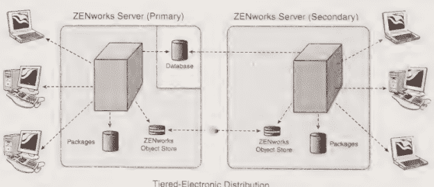

## 开源组件

ZENworks Linux 管理可以分为两个部分：ZENworks 服务器和 ZENworks 代理。ZENworks 服务器是 ZENworks Linux 管理的中心，运行系统的服务的服务。ZENworks 服务器是专有的，不是开源

另一方面，ZENworks Management Agent 是开源的，它允许 Linux 系统由 ZENworks 服务器进行管理。

如果您的环境中没有 ZENworks Linux 管理服务器，用户将只能从公共服务器接收更新。对于个人用户来说这是一个很好的解决方案，但不建议企业使用。

## 部署流程的最佳实践

强烈建议您在受管理设备的同一局域网（LAN）内创建一个主 ZENworks 服务器，这意味着您不要通过广域网（WAN）管理设备。对于加入主服务器的额外 ZENworks 服务器来说也是如此。加入的额外服务器将指向主服务器进行数据库，ZENworks 对象存储将进行复制，软件包将通过分层电子分发（Tiered-Electronic Distribution）进行。在高速局域网环境中完成这些过程将更快、更高效。

## 目录的使用

与其它 ZENworks 产品一样，ZENworks Linux Management 使用 Novell eDirectory 来提供安全、可扩展且基于策略驱动的管理。这被称为 ZENworks 对象存储（ZENworks Object Store），实际上是 Novell eDirectory 8.7.3，它在安装 ZENworks 服务器期间会自动安装和配置。这意味着在后台，您正在利用 eDirectory 的优势进行复制、联邦和对象管理。在大多数情况下，您不需要担心 ZENworks 对象存储的维护。然而，如果需要，可以使用标准的 eDirectory 工具。

## 现有数据库的使用

ZENworks Linux Management 默认带有 Postgres 数据库。如果您选择使用 Postgres，ZENworks Linux Management 会对其进行设置和安装。这包括应用架构程序。

在许多企业中，您可能已经运行了 Oracle 并拥有经过的 Oracle 数据库管理员。ZENworks Linux Management 也可以使用 Oracle 9i。您必须在与 ZENworks 服务器不同的服务器上运行 Oracle 9i。此外，您还需要采取其他步骤为 ZENworks Linux Management 配置 Oracle 9i。

# 第 2 章：理解 ZENworks Linux Management

在安装 ZENworks 服务器之前，请先确保您将安装的服务器与 Oracle 服务器之间具有连接性。您还需要应用 ZENworks 架构。然后在安装 ZENworks 服务器期间，系统会提示您想要使用的数据库。选择 Oracle 9i 并输入数据库服务器的 DNS 或 IP 地址。您可以在第 3 章“安装 ZENworks Linux Management”中获取更多关于数据库设置的信息。

## 现有服务器的使用

由于 ZENworks 服务器使用 HTTP/HTTPS（端口 80 和 443），最佳实践是拥有一个专用服务器。否则，其他使用端口 80/443 的 Web 服务可能会与 ZENworks Linux Management 服务发生冲突。使用专用服务器还为 RPM 软件包和其他存储在 Postgres 数据库中的项目提供了额外的磁盘空间。

## 如何以及在哪里管理 ZENworks Linux Management

ZENworks 服务器也被视为受管理设备。这意味着您可以像任何其他受管理设备一样管理和维护 ZENworks 服务器。

ZENworks Linux Management 使用一个名为 ZENworks Control Center 的 Web 界面。通过 ZENworks Control Center，您可以从中心位置管理所有的 Linux 系统。我们建议您花些时间熟悉 ZENworks Control Center，特别是如果您已经有现有的 ZENworks 客户时。

### 设备在 ZLM 中如何表示和管理

每个受管理设备都显示在 ZENworks Control Center 中。将设备引入控制中心的过程称为注册。在注册过程中，您可以通过注册密钥（registration key）确定设备的归属范围。您可以在第 5 章“将设备注册到系统”中阅读更多关于注册密钥的知识。

设备在 ZENworks Control Center 中可访问后，您可以对其进行资产清、交付和安装软件、执行策略以及远程控制设备。所有这些功能都通过 ZENworks Management Agent 实现。

### 内容如何交付

由于 ZENworks Linux Management 使用 Web 服务模型，所有工作都在服务器上完成，而不是在客户端或受管理设备上。请求由 ZENworks Management Agent 使用 Web 服务发出。服务器处理请求并向代理返回响应。这导致系统不会产生大量的流量交互并占用网络带宽。该过程如图 2.2 所示。

图 2.2
ZENworks 系统概览。


## 术语/词表

- `ZENworks Primary Server`: 这是第一台服务器。它包含数据库和对象存储。
- `ZENworks Secondary Server`: 这是任何加入主服务器的服务器。
- `ZONE`: 这是包含所有服务器的管理域。
- `ZENworks Management Agent`: 这是允许设备接入代理。
- `Registration Key`: 用于将设备注册到 ZENworks 的密钥。
- `ZENworks Control Center`: 用于管理 ZENworks 的 Web 控制台。
- `Managed Device`: 任何由 ZENworks 管理的设备（工作站或服务器）。
- `Packages`: 文件的集合，也称为 RPM 软件包。
- `Postgres`: 用于存储资产信息和其他信息的开源数据库。
- `ZENworks Object Store`: 存储设备、内容和其他关系。

# 安装 ZENworks Linux Management

本章提供了让所有组件运行的步骤指南。您始终需要先安装主服务器，然后可以安装辅助服务器。

## 准备服务器

在这一步中，您将设置并准备服务器以托管 ZLM。请遵循以下指南：


- 一台运行 SUSE Linux Enterprise Server 9 SP1 (`SLES 9 SP1`) 的专用服务器。该系统不得安装任何旧版本的 ZENworks。

- 此服务器必须能够通过某种方法（DNS, `/etc/hosts`/）解析主机名。对于测试环境，在 `/etc/hosts` 中为每个设备提供完整的域名条目就足够了。

- 在配置此服务器的网络时，必须使用静态 IP 地址。如果 IP 地址是从 DHCP 服务器获取的，可能会遇到数据存储库的问题。

- 端口 `80` 上不应运行任何服务。如果您的服务器上运行了 Apache（或任何其他绑定到 `80` 端口的服务），请在安装 ZENworks 之前停止此服务。可以使用以下命令停止 Apache：`/etc/init.d/apache stop`。

完成服务器配置后，您就可以准备安装 ZENworks Linux Management 了。

### 执行安装脚本

ZENworks Linux Management 由主服务器和辅助服务器组成。以下序列描述了如何安装这些各类型的服务器。

### 安装主服务器

运行以下步骤安装 ZENworks Linux Management 主服务器：

1. 插入 ZENworks Linux Management CD。
2. 以 root 身份登录并挂载安装媒体。
3. 进入 `/media/cdrom`（或步骤 2 中挂载的设备）目录，即 CD 挂载的位置。
4. 运行安装脚本：`./zlm-install`。
5. 首先安装程序将验证并安装 Python（如果需要）。然后系统会提示您是否要在该机器上安装 ZENworks。响应 `y`。
6. 接下来您将看到 ZENworks 许可协议。查看协议，然后系统会提示您是否接受许可协议。输入 `y` 接受。
7. 安装程序接下来安装在系统中安装软件包的守护进程。安装开始在服务器上安装依赖包。安装会在 `/var/opt/node11/log/zenworks` 目录下创建一个日志文件。
8. 在依赖项安装后，脚本安装 ZENworks 软件和数据存储组件。随后，它安装管理工具和预启动镜像服务。
9. 接下来安装脚本安装用于同步您的 ZENworks 后端服务器的镜像软件，随后是 Web 服务加载守护进程和服务器的 ZENworks 代理。
10. 现在所有软件包都已安装，需要对服务器进行配置。系统会提示你是否想要运行 `zlm-config`。请响应 `y`。
11. 系统将收集信息，然后提示你回答以下问题：
   - 当询问是否为该区域内的第一台服务器时，回答 `y`。
   - 当提示输入组织名称（Organizational Name）时，为此管理区域（Management Zone）输入一个唯一名称。
   - 当提示时，输入管理员密码，用于访问基于 Web 的 ZENworks 控制中心或 `zlm` 命令行界面。
12. 接下来，安装程序会询问你是否想使用外部数据库作为数据存储器。如果你选择使用 ZENworks 的本地数据库，请输入 `n` 并继续。如果你选择 `y` 将数据存储在另一机器上的数据库中，请在提示时输入：
   - 数据库服务器的 IP 地址或主机名。
   - 数据库的通信端口。
   - 数据库名称。
   - 数据库用户。此用户必须具有数据库的写权限，以便创建表并向表中填充数据。
   - 数据库用户密码。
13. ZENworks 随后完成其余组件的配置。

### 安装备用服务器

备用服务器必须与主服务器保持相同的时钟。在安装备用服务器软件之前，请确保已完成确保同步所需的必要流程。

你可以运行以下操作将 NTP 配置为外部时间源，并在安装后验证是否已正确同步：

- 1. 确定提供时钟服务器的 IP 地址。主备用服务器可以指向同一个源，你也可以让备用服务器指向主服务器。
- 2. 启动 YAST 并选择网络服务（Network Services）及其下的 NTP （NTP Client）。
- 3. 在 NTP Client 配置屏幕上，选择在系统启动时自动启动守护进程。
- 4. 在 NTP Server 字段中输入提供时钟服务器的 IP 地址。
- 5. 选择完成（Finish）保存配置并启动守护进程。

要验证时间同步是否正常工作，请输入 `ntpq -p` 命令，并验证偏移（offset）字段小于 1 秒。

运行以下步骤安装 ZENworks Linux 管理服务器：

- 1. 插入 ZENworks Linux 管理光。
- 2. 以 root 身份登录并挂载安装介质。
- 3. 切换到 `/media/cdrom` 目录，光盘挂载在该处。
- 4. 运行安装脚本 `./zlm-install`。
- 5. 安装程序将验证并在需要安装 Python。然后系统会提示你是否想在此台机器上安装 ZENworks。请响应 `y`。
- 6. 接下来你将看到 ZENworks 许可协议。查看协议并输入 `y` 接受。
- 7. 安装程序接下来将安装向系统安装软件包的守护进程。随后开始在服务器上安装依赖包。安装过程会在 `/var/opt/novell1/log/zenworks` 目录下创建一个日志文件。
- 8. 安装依赖项后，脚本将安装 ZENworks 软件和数据存储组件。然后它将安装管理工具和预启动镜像服务。
- 9. 接下来安装脚本将安装镜像软件以保持你的 ZENworks 后服务器同步，随后是 Web 服务加载守护进程和服务器的 ZENworks 代理。
- 10. 现在所有软件包都已安装，需要对服务器进行配置。系统会提示你是否想要运行 `zlm-config`。请响应 `y`。
- 11. 系统将收集信息并提示你以下内容。
  - 当询问是否为该区域内的第一台服务器时，回答 `n`。
  - 当提示主服务器的 IP 地址或 DNS 名称时，输入该区域内主服务器的 DNS 名称。该服务器将成为同一区域内的备用服务器。
  - 当提示时，输入管理该区域的管理员密码。这与安装主服务器时输入的管理员密码相同。

ZENworks 完成其余组件的配置。

安装过程完成后，按照下一节的说明验证安装。

## 第三章：安装 ZENworks Linux 管理

### 验证安装

安装完成后，ZENworks 管理守护进程 (`zmd`) 正在你的服务器上运行。使用以下命令确认这一点：

- `/etc/init.d/novell-zmd status`

使用以下命令确认额外服务正在运行：

- `/etc/init.d/novell-loader status`
- `/etc/init.d/novell-server status`
- `/etc/init.d/novell-postgresql status`
- `/etc/init.d/novell-nsd status`
- `/etc/init.d/novell-zenser status`
- `/etc/init.d/novell-policy status`
- `/etc/init.d/novell-proxyd status`
- `/etc/init.d/novell-cc status`
- `/etc/init.d/novell-zis status`
- `/etc/init.d/novell-tftpd status`

如果任何服务未运行，请使用以下命令手动启动：`/etc/init.d/novell-<servicename> start`

### 访问 ZENworks 控制中心

ZENworks 控制中心是用于 ZENworks 管理环境的全面 Web 界面。安装后，你可以通过以下 URL 打开支持的浏览器访问 ZENworks 控制中心：

```
https://zlmserver
```

将 `zlmserver` 替换为 ZENworks 服务器的实际 DNS 名称或 IP 地址。注意：ZENworks 控制中心需要 HTTPS。

当提示登录凭据时，使用你在安装期间提供的密码的 Administrator 用户。

### 在受管设备上安装客户端软件

每个客户端必须满足以下要求：

1. 以下支持的平台之一：
   - `SLES9 SP1`, `Opteron`, `EM64T`
   - `Novell Linux Desktop SP1`, `Opteron`, `EM64T`
   - `SUSE 9.3`, `Opteron`, `EM64T`
   - `RHEL3 AS/WS x86`
   - `RHEL4 AS/WS x86`
2. 为了使 Firefox 策略可用，必须安装 ZENworks 管理发行版提供的启用 GConf 的 Firefox。
3. 为了使 NLD 策略可用，必须安装 ZENworks 版本提供的 NLD RPM。

客户端软件安装使用与服务器相同的安装源文件和脚本，尽管它是带有标记 (`-a`) 执行的，以表示它是仅代理的安装。

执行以下操作安装客户端软件：

- 1. 在受管设备上以 root 身份登录。
- 2. 从解压安装包的目录运行安装脚本：`./zlm-install -a`
- 3. 在安装期间，系统要求你提供管理该设备的 ZENworks 服务器的 DNS 名称或 IP 地址。
- 4. 可选，你可以提供注册密钥，它决定了该设备接收的命名方案和分配。


如果没有提供注册密钥，则应用默认注册规则。

你也可以在安装完成后的任何时间使用设备上安装的命令行工具 `rug` 手动注册此设备。命令 `rug sd` 列出你已注册的服务。命令 `rug sd #` 移除指定的服务。命令 `rug sa URL` 将设备注册到指定的服务。

## 从之前的版本升级 ZENworks Linux 管理

ZENworks 7 Linux Management 的架构与之前的版本有很大不同。例如，ZENworks 7 Linux Management 引入了对象存储来管理系统。因此，在移动到此版本时涉及到一个迁移过程。你可以使用两种技术将信息从现有 ZENworks 管理系统移动到新的 ZENworks 7 安装中：同步或迁移。

同步方法是复制 RPM 文件并将其引入新系统，而迁移方法则是将数据库与 RPM 文件一起导入。两种方法都要求在设备上安装新代理程序（agent），以便由新系统进行管理。由于迁移数据库需要时间，而且迁移只带入包信息，因此最好使用同步方法将你的包从 ZENworks 6.6 系统迁移过来。

### 同步方法

同步方法要求你从现有的 ZENworks 6.6 安装中检索通道（channels），就像你将其他源同步到 ZENworks 7 中一样。有关此的更多详细信息，请参阅第 12 章“维护 ZENworks 管理”。现有系统中的通道变为新系统中的包（bundles）。它们被放置在分配给所有设备的目录中，允许它们获取更新后的 RPM。当代理安装在设备上时，设备将向新的 ZENworks 7 系统注册并开始更新。要安装代理，你可以将 ZENworks 7 RPM 放入通道中，然后让设备执行事务以运行设置，修改配置文件以将你的设备指向新的 ZENworks 7 系统。同步方法会将所有 RPM 和通道传输到你的新系统。清单（inventory）将由新系统重新生成。

### 迁移方法

迁移方法交付所有数据库信息连同 RPM 文件。然而，此步骤需要一些手动管理。请完成以下步骤将系统迁移到新的 ZENworks 7：

- 以 root 身份登录到现有的 ZENworks 6.6 系统。

- 执行以下命令转储现有的 ZENworks 数据库：

```bash
pg_dump -c -f rcserver.dump rcserver -U zenadmin
```

这将创建一个数据库转储文件。

- 使用安全命令 `scp` 将生成的转储数据库以及 `/ian` 目录下的所有包复制到新的 ZENworks 7 系统：

```bash
scp -r rcserver.dump root@<server>
```

这会将文件复制到目标服务器 root 的家目录。

- 下一步是在新的 ZENworks 7 服务器上创建新数据库，并将转储的信息加载到数据库中。以 root 身份登录 ZENworks 7 服务器并执行以下操作：

  a. 验证 `zlm-upgrade` 是否在路径中。它应该位于 `/opt/novell/zenworks/bin/zlm-upgrade`。

  b. 通过执行 `cat /opt/novell/zenworks/secretserver` 并获取输出获取 ZENworks 数据库密码。

  c. 使用 `su - postgres` 切换到 postgres 用户。

  d. 输入以下命令创建所需的数据库：

```bash
createdb -U zenadmin zlm661
```

提示密码时，输入 `secretserver` 文件的输出内容。

  e. 输入 Ctrl+D 返回 root 用户。

  f. 现在数据库已创建，你需要配置 postgres 使用它。通过编辑 `/var/lib/pgsql/data/pg_hba.conf` 文件并添加以下条目来实现：

| database | user | method |
| :--- | :--- | :--- |
| zlm661 | zenadmin | md5 |
| host zlm661 | zenadmin | 0.0.0.0/0 md5 |

  保存文件。

  g. 输入命令 `/etc/init.d/postgresql restart` 并等待数据库完成启动。

  h. 输入以下内容将转储的数据导入 `zlm661` 数据库：

```bash
psql -U zenadmin zlm661 < rcserver.dump
```

提示密码时，输入 `secretserver` 文件中的密钥。

- 运行以下命令将数据和文件系统包迁移到 ZENworks 7：

```bash
/opt/novell/zenworks/bin/zlm-upgrade zlm661 zenadmin ian/red-carpet-server <password from secretserver file>
```

- 完成这些步骤后，可以删除临时数据库。现在，所有包信息、通道等均已引入 ZENworks 7。此外，管理员已经在新系统中创建，且 RPM 文件已复制到相应的位置。

# 第 3 章：安装 ZENworks Linux 管理

## 理解 ZENworks 控制中心

本章讨论了 ZENworks 7 Linux 管理的主要管理控制台——ZENworks 控制中心（ZENworks Control Center, ZCC）。

### 什么是 ZENworks 控制中心？

ZENworks 控制中心是 ZENworks 7 Linux 管理的核心。它是一个面向任务的、基于 Web 的管理控制台。如果你更喜欢基于文本的管理，可以使用 ZCC。你可以在附录 A“命令”中学习更多 ZCC 命令。

ZENworks 控制中心分为三个主要区域（见图 4.1）。这些区域分别是横幅（Banner）、导航栏（Navigation Bar）和内容区域（Content region）。内容区域进一步分为头部（Header）和视图（View）。

# 第 4 章：理解控制中心

## 内容视图

内容区域是执行任务的主要区域。四种内容视图：门户视图（Portal View）、列表视图（List View）、设置视图（Settings View）和向导视图（Wizard View）。

### 门户视图

门户视图是控制中心常见的视图之一。门户视图由若干自独立的快照（snapshots）组成。每个快照包含受管理系统特定部分的信息。在图 4.2 中，你可以看到一个工作站视图示例，它包含一个硬件摘要快照和一个生效策略快照。

### 列表视图

列表视图顾其实义显示来自数据库和 ZENworks 对象存储等数据源的信息列表。列表视图中的信息让你能够轻松地对数据进行排序、搜索和执行操作。图 4.3 显示了一个服务器列表视图示例。在此视图中，你可以对任何列进行排序、添加或删除列，还可以进行搜索。要对列项进行排序或更改排序顺序，只需点击列标题即可。

列表视图的列上方还有新建（New）、编辑（Edit）、删除（Delete）以及向上移动图标的选项。新建和编辑下拉列表中的项目取决于你浏览的位置。你还可以在这些旁边看到其他选项。例如，如果你正在查看工作站列表

## 第 4 章：理解 ZENworks 控制中心

你会看到“操作”（Action）选项。然而，如果你正在查看报告列表，你会看到“生成”（Generate）项目。请记住，这些选项中的某些在你勾选列表项目旁边的复选框之前将处于灰色禁用状态。

图 4.3

服务器列表视图。

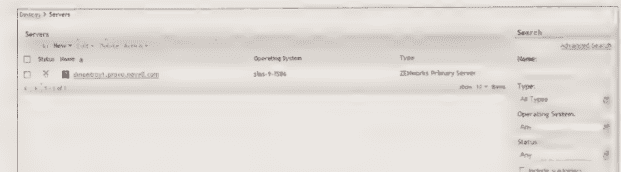

### 设置视图 (SETTINGS VIEW)

设置视图允许你更改对象的设置。例如，点击快照标题栏上的“高级”（Advanced）字样，将带你进入快照设置（参见图 4.4）。

图 4.4

热列表设置视图。

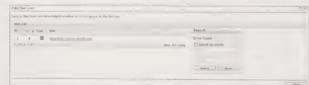

### 向导视图 (WIZARD VIEW)

向导视图允许逐步完成多步或复杂的任务。向导视图的一个示例是创建策略（参见图 4.5）。你可以通过访问第 9 章“策略”了解更多关于创建策略及所需步骤。

### 图 4.5

新策略向导视图。

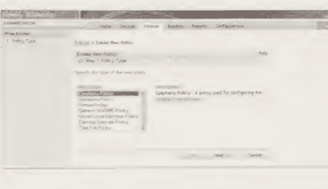

### 导航栏 (Navigation Bar)

上述的每个视图都与导航栏相关。导航栏的内容根据内容视图而异。例如，当你点击横幅中的“设备标签页”（Device Tabs）时，导航栏顶部将变为“设备任务”（Device Tasks）。

如果导航栏中的某些项目是全局性的，可能会始终显示。全局项目的一个示例是“常用”（Frequently Used）选项。常用选项下的项目会在你执行任务时自动构建；将列出你执行最频繁的前十项任务。最频繁的任务位于列表顶部。列表中两天内未使用的项目将自动从列表中删除。在此版本中，“常用”列表是可以自定义的。

### 对象浏览器 (Object Browser)


在某些情况下，你需要选择多个对象。在这种情况下，你将进入对象浏览器。使用对象浏览器的一个示例是将服务器添加到监视列表（Watch List）（参见图 4.6）。

要选择对象浏览器中的项目，请点击项目旁边的箭头或点击“全选”（select All）。要删除项目，点击项目旁边的删除图标，或点击“全部移除”（Remove All）。

### 图 4.6

选择服务器浏览器。

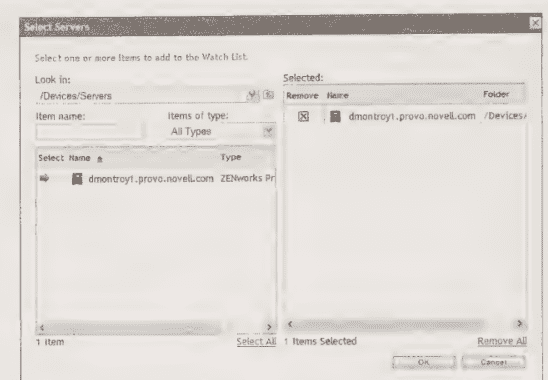

### 启动 ZENworks 控制中心

你可以通过 Internet Explorer 6 SP1（或更高）或 Firefox 1.0（或更高）启动 ZENworks 控制中心。如果你使用的是不支持的浏览器，登录时会看到警告消息。将 URL 输入 URL 定位器。ZCC 的默认 URL 为 `https://server/zenworks`，其中 `server` 是 ZENworks 的 DNS 或 IP 地址。

你看到的第一个屏幕是 ZENworks 登录界面（参见图 4.7）。输入你在安装期间分配的用户名（Username）和密码（Password）。你还可以选择语言（Language）。ZENworks 控制中心支持英语、法语、德语、葡萄语和西班牙语。

登录成功后，你会看到“入门指南”（Getting Started）页面（参见图 4.8）。从此页面，你可以：

- 获取产品概述
- 学习如何注册 Linux 设备
- 学习如何交付应用程序
- 学习如何使用策略
- 链接到在线文档

## 图 4.7

ZENworks 控制中心登录界面。

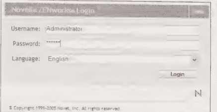

提示：如果你希望每次启动 ZENworks 控制中心时都出现“入门指南”页面，请取消勾选底部的“不再显示”（Do Not Show Me Again）选项。

图 4.8

入门指南页面。

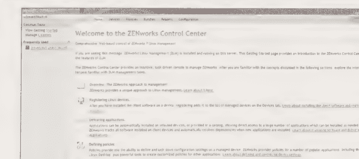

在首次查看入门指南页面后，你会看到主页面（参见图 4.9）。

图 4.9

ZENworks 控制中心主页面。

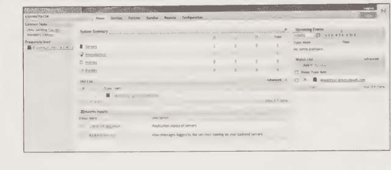

在主页面你可以看到系统摘要（System Summary）。它提供了有关 ZENworks 状态的信息。

## 自定义 ZENworks 控制中心

在门户视图（Portal View）中的每个快照在标题栏的最右侧都有一个最小化/展开按钮。当快照展开时，按钮显示两个向上箭头。在这种状态下，标题栏下方的项目是可见的。当快照最小化时，按钮显示两个向下箭头。在这种状态下，标题栏下的项目会被隐藏。当您导航或以后启动 ZENworks Control Center 时，快照的状态将被保留。

## 未来

ZENworks Control Center 是管理 ZENworks 7 Linux Management 的强大工具。其他 ZENworks 产品的未来版本也将利用 ZENworks Control Center 进行管理。这将使您能够通过单一 Web 工具管理 Linux、Windows、NetWare 和 Novell Open Enterprise Server。

## 将设备注册到系统中

本章讨论了在 ZENworks 7 Linux Management 中注册设备。它主要讨论了两种注册设备的方法：

- 通过命令行手动注册
- 通过安装程序进行注册

### 注册密钥和注册规则

在您安装了 ZENworks Linux Management 服务器后，您应该进入 ZENworks Control Center 设置注册密钥和/或注册规则。

注册密钥和规则告诉 ZENworks Linux Management 您希望如何将受管理的设备注册到系统中。

### 注册密钥

注册密钥适用于您希望对注册设备数量设置限制的情况。例如，如果您知道特定部门有 10 台工作站，您可以创建一个限制为 10 台设备的注册密钥。随着设备的注册，您可以轻松地看到已经注册了多少设备。

要创建新的注册密钥，请遵循以下步骤：

# 第 5 章：将设备注册到系统中

1. 打开 ZENworks Control Center。
2. 点击配置（Configuration）选项卡。
3. 点击注册密钥（Registration Keys）快照标题栏中的“新建”（New）并选择注册（Registration）。
4. 启动创建新注册密钥向导，如图 5.1 所示。

图 5.1

创建新注册密钥 > 创建新注册密钥

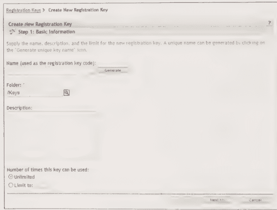

5. 输入注册密钥的名称并指定文件夹和描述。
6. 指定该密钥是无限制的在“限制为”（Limit To）中输入数字；然后点击“下一步”（Next）。

您将看到向导的第 2 步（见图 5.2）。

7. 指定为导入设备指定的名称规则。您可以选择多个机器变量（HostName, CPU, DNS, GUID, OS）。
8. 指定应放置导入机器的文件夹；然后点击“下一步”（Next）。

您将看到向导的第 3 步（见图 5.3）。

### 图 5.2

创建新注册密钥向导，第 2 步：命名和包含规则。

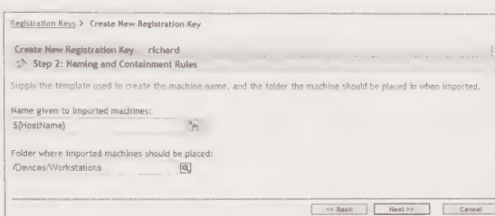

### 图 5.3

创建新注册密钥向导，第 3 步：组成员身份。

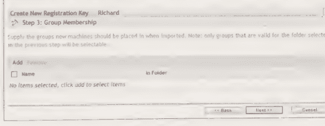

9. 点击“添加”（Add）将您想要导入新设备的组添加其中。
10. 点击“下一步”（Next）查看摘要（见图 5.4）。
11. 点击“完成”（Finish）完成向导，然后点击“确定”。

您可以按照以下步骤重命名、复制或移动注册密钥：

1. 标记选要修改的注册密钥旁边的选择框。
2. 点击注册密钥快照标题栏中的“高级”（Advanced）。
3. 点击标题栏中的“编辑”（Edit）下拉菜单并选择您想要的选项。

# 第 5 章：将设备注册到系统中

您可以通过点击注册密钥名称来修改注册密钥的常规选项（见图 5.5）。

图 5.4

新注册密钥向导，摘要页。

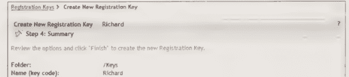

图 5.5

注册密钥详情。

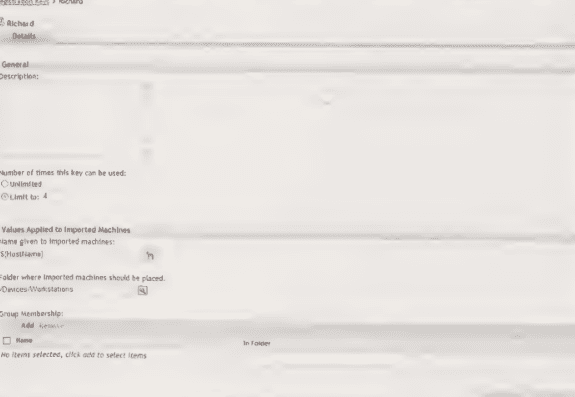

### 注册规则

注册规则与注册密钥类似。主要区别在于规则没有限制，且您在注册设备时不需要指定规则。

要创建注册规则，请遵循以下步骤：

1. 打开 ZENworks Control Center。
2. 点击配置（Configuration）选项卡。
3. 点击注册规则（Registration Rules）快照标题栏中的“新建”（New）。
4. 启动创建默认规则向导，如图 5.6 所示。

图 5.6

创建默认规则向导。

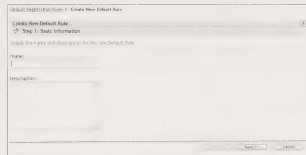

5. 输入注册规则的名称。
6. 如果需要，输入描述；然后点击“下一步”（Next）。

您看到向导的第 2 步（见图 5.7）。

7. 点击“添加过滤器”（Add Filter）以指定确定哪些机器使用该规则的过滤器。您必须至少创建一个过滤器行。
8. 点击“添加过滤器”（Add Filter）向过滤器添加内容；然后点击“下一步”（Next）。

您看到向导的第 3 步（见图 5.8）。

# 第 5 章：将设备注册到系统中

图 5.7

创建默认规则向导，第 2 步：导入过滤器。


图 5.8

创建默认规则向导，第 3 步：命名和包含。


9. 指定为导入设备指定的名称规则。您可以选择多个机器变量（HostName, CPU, DNS, GUID, OS）。
10. 指定应放置导入机器的文件夹；然后点击“下一步”（Next）。

您看到向导的第 4 步（见图 5.9）。

11. 点击“添加”（Add）将您想要导入新设备的组添加其中。
12. 点击“下一步”（Next）查看摘要（见图 5.10）。

图 5.9

创建默认规则向导，第 5 步：组成员身份。

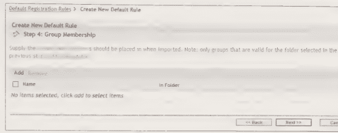

图 5.10

创建默认规则向导，摘要页。

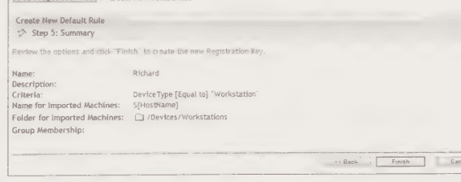

13. 点击“完成”（Finish）完成向导；然后点击“确定”。


您可以按照以下步骤重命名、复制或移动注册密钥：

- 1. 标记选要修改的注册规则旁边的选择框。
- 2. 点击注册规则快照标题栏中的“高级”（Advanced）。
- 3. 点击标题栏中的“编辑”（Edit）下拉菜单并选择您想要的选项，或者“向上移动”或“向下移动”（见图 5.11）。

图 5.11

编辑默认规则设置页。

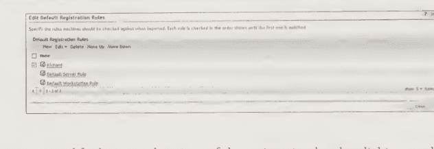

### 注册设备

在按照本章前面的说明设置注册密钥和规则后，您就可以开始注册设备了。在 ZENworks Control Center 中，这也被称为*导入*。

注册设备可以是工作站也可以是服务器。运行 Novell Linux Desktop 的机器默认注册为工作站，运行 SUSE Linux Enterprise Server 或 Red Hat Enterprise Linux 的机器默认注册为服务器。可以通过注册密钥或规则进行更改。

要注册设备，请遵循以下步骤：

- 在要管理的设备上以 root 身份登录，并确保已安装 ZENworks Linux Management 代理。使用以下命令确认这一点：`/etc/init.d/novell-zmd status`

该状态应被识别为运行。

- 如果未安装 ZENworks 代理，请参考第 3 章“安装 ZENworks Linux Management”，并按照“在托管设备上安装客户端软件”章节下列的步骤操作。

- 输入 `rug s1` 检查 ZENworks 服务是否运行；如果它报告 ERROR: No services found，输入 `rug sa <servername>` 或 `rug sa <servername>=<registration key>`。

服务器是 IP 地址、DNS 名称或 URL。在示例中，输入 `rug sa zimserver.zendemo.com/`。您将看到显示注册完成百分比的进度（见图 5.13）。

图 5.13

完成百分比的进度条。

| zimserver:" rug sa zimserver.zendemo.com/ |

| Adding ZENworks Service... | 33% |

- 您应该看到一条“Successfully added service”的消息。如果没有看到此消息，请验证服务器名称和注册密钥，进行任何更改，并重复第 3 步。

- 输入 `rug s1` 验证服务；您应该看到类似图 5.14 的内容。

图 5.14

# 第 5 章：将设备注册到系统

图 5.14

ZENworks 服务的列表和状态。

| 状态 | 类型 | URI |

|---|---|---|

| 激活 | ZENworks | ZENworks Linux 管理 | https://zlserver.zendemo.com/ |

`rug sa` 还有其他选项。您可以通过输入 `rug sa --help` 查看这些选项，或者参考本书中的附录 A，“命令”。

### 移除受管设备

在某些情况下，您需要从系统中移除设备。要移除受管设备，请执行以下操作：

1. 打开 ZENworks 控制中心。
2. 点击“设备”（Devices）选项卡。
3. 浏览到您想要移除的工作站或服务器。
4. 勾选设备复选框并点击标题栏中的“删除”（Delete）。

仅执行步骤 1–4 并不会删除设备；您必须按照以下步骤继续操作：

5. 在受管设备上以 root 身份登录。
6. 输入 `rug s1` 查看服务。注意每个运行的服务旁边都有一个数字。
7. 输入 `rug sd <service number>` 删除该服务。对每个服务重复此操作。请注意，每当删除一个服务时，服务都会重新编号。
8. 再次输入 `rug s1` 验证所有服务均已删除。

### 结论

设备注册是一种强大且灵活的导入想要管理的设备的方法。在开始注册设备之前，请确保您已经有了关于它们呈现方式的计划。这可以确保您的设备组织良好，方便您今后的管理。

## 系统设置

本章讨论了 ZENworks 7 Linux 管理中设置的配置。系统设置控制 ZENworks 7 Linux 管理的行为和配置。

ZENworks 控制中心内有一个名为“配置”（Configuration）的选项卡。点击此选项卡会显示多种用于控制 ZENworks 7 Linux 管理行为的选项。“配置”视图包含五个快照：管理员（Administrators）、管理区域设置（Management Zone Settings）、注册密钥（Registration Keys）、默认注册规则（Default Registration Rules）和许可（Licensing）。

### 管理员

管理员快照允许您创建新管理员、编辑管理员属性以及删除管理员。

主管理员始终被称为“Administrator”（管理员）。无法更改或重命名它。但是，您可以更改密码。

要创建新管理员：

1. 点击管理员快照标题栏中的“新建”（New）。
2. 屏幕上出现“添加新管理员”（Add New Administrator）对话框（见图 6.1）。
3. 输入管理员名称和密码，再次输入密码，并点击确定。

# 第 6 章：系统设置

图 6.1

添加新管理员对话框。

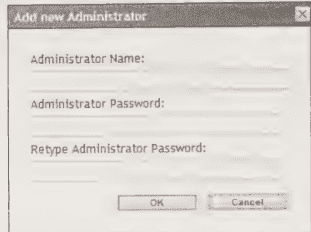

### 注意

您以后可以通过点击管理员名称，然后点击屏幕左侧导航栏顶部的“更改密码”（Change Password）来更改管理员密码。

创建管理员后，您可以通过点击名称对其进行进一步配置。这会让您进入“管理员配置”（Administrator Configuration）视图（见图 6.2）。

在此视图中您可以执行以下操作：

- 允许创建其他管理员
- 允许修改区域设置
- 分配包权限（Bundle Rights）
- 分配设备权限（Device Rights）
- 分配策略权限（Policy Rights）
- 分配报告权限（Report Rights）

要为包、设备、策略或报告分配权限，请遵循以下步骤：

1. 点击您想要更改的权限标题栏中的“添加”（Add）。
2. 出现“添加权限文件夹”（Add Rights Folder）对话框（见图 6.3）。
3. 浏览到您想要修改的文件夹。

### 图 6.2

ZENworks 控制中心中的管理员配置视图。

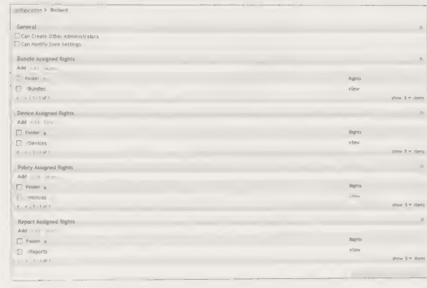

4. 选择您想要分配的权限（全部、修改）。
5. 点击确定以分配权限。

### 图 6.3

添加权限对话框。


# 第 6 章：系统设置

您可以通过以下步骤以后更改管理员密码：

1. 点击管理员标题栏中的高级。
2. 勾选您想要编辑的管理员复选框。
3. 点击“高级”（Advanced）。
4. 选择“重命名”（Rename）。
5. 在重命名对话框中输入新名称。
6. 点击确定以进行更改。

要删除管理员，请遵循此程序：

1. 勾选该管理员或多个管理员的复选框。
2. 点击“删除”（Delete）。

### 管理区域设置

管理区域设置是管理区域快照。这些设置驱动管理区域的行为。您可以从“理解 ZENworks”章节了解更多信息。

在管理区域设置中，您可以配置：

- 系统变量
- 刷新计划
- 设备清单
- 远程服务
- 集中日志记录
- 复制计划
- 平台

您通过查看右侧的列可以轻松判断是否配置了选项。

### 系统变量

系统变量允许将变量应用于所有设备。

要更改系统变量，请遵循以下步骤：

1. 点击管理区域快照中的“系统变量”。
2. 出现系统变量页面（见图 6.4）。

图 6.4

系统变量页面。

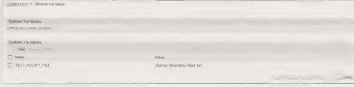

3. 点击“添加”（Add）创建新变量。出现“添加变量”对话框（见图 6.5）。

图 6.5

添加变量对话框。


3. 输入变量的名称和值。
4. 点击确定以添加新变量。

您还可以编辑变量：

1. 勾选您想要编辑的变量复选框。
2. 点击“编辑”（Edit）。
3. 进行必要的更改。
4. 点击确定。

要删除一个或多个变量，请遵循以下步骤：

1. 勾选变量或多个变量的复选框。
2. 点击“删除”（Remove）。

### 刷新计划

此设置允许您配置刷新策略和设置的频率或间隔。确定正确的值取决于设备数量、网络速度以及交付策略的重要性。

要更改刷新计划，请这些步骤：

1. 点击管理区域快照中的“刷新计划”。
2. 出现刷新计划内容视图（见图 6.6）。

图 6.6

刷新计划内容视图。

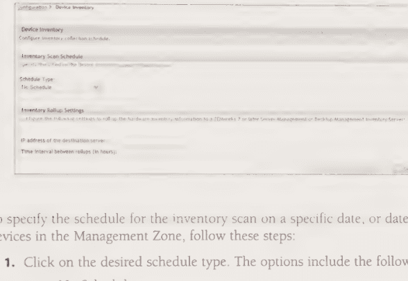


# 第6章：系统设置

3. 为“策略刷新计划”或“设置刷新计划”输入所需的日期、小时和分钟值。

4. 点击“应用”（`Apply`）更改设置。

如果您想回到默认值，请点击页面上的“重置”（`Reset`）按钮。

## 设备清单

设备清单设置允许您配置扫描计划并配置硬件清单汇总设置（见图 6.7）。

图 6.7

设备清单配置视图。

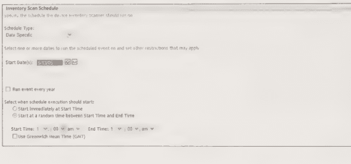

要为特定日期或管理区域内的设备指定扫描计划，请遵循以下步骤：

1. 点击所需的计划类型。选项包括：

- 无计划
- 特定日期
- 按周特定
- 每月

各种计划类型在流程章节中有更详细的描述。

2. 选择“应用”（`Apply`）以使计划生效。

### 无计划类型

无计划类型阻止扫描发生。这是 ZENworks Linux Management 系统安装时的默认计划。

### 特定日期调度类型

使用“特定日期”调度类型，您可以识别一年内希望执行此操作的某个或多个日期。当您选择“特定日期”时，屏幕将显示图 6.8 所示的页面。

图 6.8

特定日期调度页面。


在特定日期调度页面上，您可以输入以下信息：

- **开始日期 (Start Dates)**——点击加号图标。这将弹出一个日历对话框（参见图 6.9），您可以在其中选择所需的日期。要更改月份，请点击月份旁边的菱形。要更改年份，请点击年份旁边的菱形。选择日期后，对话框会自动关闭，所选日期将出现在“开始日期”列表中。

图 6.9

用于选择全年特定日期的日期选择器对话框。

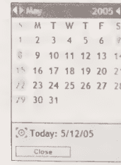

要删除日期，请选择“开始日期”列表中的日期并点击减号图标。

- 每年运行事件 (Run event every year)——勾选复选框以便在指定的日期每年进行内容复制。
- 选择调度执行开始时间 (Select when schedule execution should start)——在此区域，您可以选择复制是在给定的开始时间发生，还是在给定的开始时间和结束时间之间随机执行。

输入您希望开始复制的开始时间。如果您选择了随机执行，请输入停止时间。

勾选输入的时间应被解释为格林威治标准时间（或通用时间）。否则，系统将假设您指的是主服务器的本地时间。

### 特定周几调度类型

周几调度允许您选择一周中的某一天，并设置希望执行库存扫描的某些时间表。完成以下章节以识别您的每周调度。图 6.10 是此类类型调度的示例。

图 6.10

特定周几调度页面。

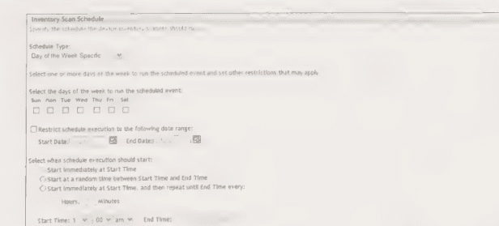

#### 选择周几 (SELECT THE DAYS OF THE WEEK)

首先要选择的是希望运行库存扫描的周几。通过点击所需日期下方的复选框来选择周几。

#### 将调度限制在以下日期范围 (RESTRICT SCHEDULE TO THE FOLLOWING DATE RANGE)

如果您希望系统仅在指定的日历范围 own执行调度活动，请勾选“限制调度”复选框。然后通过选择日历浏览按钮并在弹出日历视图中选择日期来输入开始和结束日期。

#### 选择调度执行开始时间 (SELECT WHEN SCHEDULE EXECUTION SHOULD START)

在此区域，您可以选择在早之前指定的日期内，希望开始库存扫描的时间或范围。

选择以下选项之一：

- 在开始时间立即开始 (Start Immediately at Start Time)—这将在指定时间激活库存扫描。
- 在开始时间和结束时间之间的随机时间开始 (Start at a Random Time Between Start Time and End Time)—此选项将生成一个处于开始时间和结束时间之间的随机时间。然后库存扫描将在该随机选择的时间开始。
- 在开始时间立即开始，然后重复直到结束时间 (Start Immediately at Start Time, and Then Repeat Until End Time)—此选项将在指定时间开始库存扫描。然后它根据“小时”和“分钟”字段中指定的间隔重新启动库存扫描。系统将继续按照指定的间隔扫描，直到达到结束时间。

接下来，指定您的开始时间和结束时间。通过从下拉列表中选择小时和分钟并选择 a.m. 或 p.m. 来完成操作。同时输入开始时间和结束时间。

接下来，如果您指定的时间是格林威治标准时间或通用时间而非主服务器的本地时间，请勾选“使用格林威治标准时间 (GMT)”选项旁边的框。

#### 设置不应执行的屏蔽时间范围 (SET THE BLACKOUT TIME RANGES WHEN EXECUTION SHOULD NOT OCCUR)

此选项允许您指定时间范围，这些范围可能落在计算出的开始和结束日期之内。例如，假设您希望每周六进行一次库存扫描。然而，在每个季度的末，您希望服务器处理季度末活动，而不是消耗周期传输库存数据。您可以通过输入调度，然后选择每个季度末的屏蔽日期来实现这一点。这样一来，如果计算出的开始时间落在指定的屏蔽日期内，ZENworks 将不会启动库存扫描。在下一次调度时间之前，库存扫描不会再次启动。

要输入屏蔽日期，请完成以下操作：

1. 点击“添加 (Add)”菜单项。将弹出一个对话框（参见图 6.11）。

图 6.11

输入屏蔽日期时间的弹出对话框。

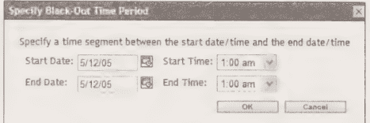

2. 通过选择“开始日期”字段旁边的日历图标输入屏蔽期的开始日期。这将打开日历，您可以在其中选择日期。
3. 输入屏蔽期在开始日期开始的时间。通过点击此字段旁边的下拉列表完成。
4. 通过选择“结束日期”字段旁边的日历图标输入屏蔽期的结束日期。
5. 输入屏蔽期结束的 own。通过点击此字段旁边的下拉列表完成。
6. 点击确定 (`OK`)”按钮将输入的时间作为屏蔽规范。

### 事件调度类型 (Event Schedule Type)

事件调度允许您选择一个触发库存扫描的事件。图 6.12 是此类类型调度的示例。

图 6.12

事件调度页面。

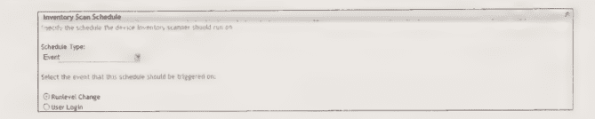

您可以从两种类型的事件中进行：

- 运行级别更改 (Runlevel Change)—设置运行级别更改后，当运行级别更改时执行库存扫描。
- 用户登录 (User Login)—选择用户登录将在用户登录时执行库存扫描。

标准运行级别为：

- 0—停止系统。
- 1—单用户。
- 6—重启系统。
- a, b, c—处理 inittab。

### 相对于刷调度类型 (Relative to Refresh Schedule Type)

相对于刷调度允许您相对于设置、策略或包刷新来执行库存扫描。图 6.13 是此类类型调度的示例。

图 6.13

相对于刷调度页面。


选择以下执行选项之一：

- 刷新时立即开始 (Start Immediately on Refresh)—这将在刷新的同时启动库存扫描。
- 刷新后延迟执行 (Delay Execution After Refresh)—此选项将根据指定的日期、小时和分钟延迟库存扫描的启动。
- 执行后重复每 (After Executing, Repeat Every)—此选项将根据指定的日期、小时和分钟重复运行库存扫描。

屏蔽 (`Black Out`) 选项允许您指定时间范围，这些范围可能落在计算出的开始和结束日期之内。如果计算出的开始时间落在指定的屏蔽日期内，ZENworks 将不会启动库存扫描。在下一次调度时间之前，扫描不会再次开始。

输入的停机期将显示在屏幕上。停机期从开始日的指定时间开始，到结束日的选定结束时间结束。

要删除之前输入的停机期，请选择列出的停机期旁边的复框，然后点击“移除 (Remove)”菜单项。

### 月度计划类型

月度计划允许您选择每月在哪些天运行库存扫描。

首先，选择您希望进程开始的每月日期。这通过选择以下选项之一来实现：

- 在每月的特定日期启动计划事件。此选项将在该月的指定日期开始库存扫描。输入您希望每月运行该进程的数字日期。
- 在每月的最后一天启动计划事件。此选项将在当前月的最后一天开始扫描。

现在，选择您希望开始库存扫描的时间或时间范围。选择以下选项之一：

- 立即在开始时间开始 (Start Immediately at Start Time)——这将在指定时间开始库存扫描。


- 在开始时间和结束时间之间的随机时间开始 (`Start at a Random Time Between Start Time and End Time`)——此选项将生成一个开始时间和结束时间之间的随机时间。库存扫描将在随机选择的时间开始。

接下来，通过从下拉列表中选择小时和分钟并选择 a.m. 或 p.m. 来指定您的开始时间和结束时间。均输入开始时间和结束时间。

接下来，如果您指定的时间是格林威治标准时间 (`GMT`) 或世界时间 (`UTC`)，而不是主服务器的本地时间，请勾选“使用格林威治标准时间 (`Use the Greenwich Mean Time (GMT)`)”选项。

现在，您可以为库存扫描设置停机时间。

“停机 (`Black Out`)”选项允许您指定时间范围，这些范围可能落在计算出的开始和结束时间内。如果计算出的开始时间发生在指定的停机日期内，`ZENWOK` 将不会启动库存扫描。将在下次计划时间之前不会重新扫描。

### 特定日期计划类型

要输入停机日期，请完成以下操作：

- 点击“添加 (`Add`)”菜单项。将弹出对话框（参见图 6.11）。
- 通过选择“开始日期 (`Start Date`)”字段旁边的日历图标，输入停机期的开始日期。这将弹出日历窗口，您可以在其中选择日期。
- 输入停机期在开始日期开始的“开始时间 (`Start Time`)”。这是通过点击该字段旁边的下拉列表并选择当天的特定小时来实现的。
- 输入停机期的“结束日期 (`End Date`)”。该日期初始化为与所选开始日期相同。
- 通过从下拉列表中选择小时，输入停机期在结束日结束的“结束时间 (`End Time`)”。
- 点击“确定 (`OK`)”按钮，将输入的时间作为停机规格录入。

输入的停机期将显示在屏幕上。停机期从开始日的指定时间开始，到结束日的选定结束时间结束。

要删除之前输入的停机期，请选择列出的停机期旁边的复框，然后点击“移除 (`Remove`)”菜单项。

### 库存汇总设置

此快照允许您配置设置，将硬件库存信息汇总到 `ZENWorks` 库存服务器。

要更改这些设置，请按照以下步骤操作：

- 在 IP 地址字段中输入库存服务器的 IP 地址。
- 输入您希望进行库存汇总的间隔（以小时计）。

### 本地设备日志

此设置允许您配置记录在管理区域内受管设备上的警告和错误（参见图 6.14）。

在“本地文件 (`Local File`)”快照的顶部，您可以看到本地日志文件的路径。该路径无法修改。该路径为 `/var/opt/nove11/log/zenworks`。

# 第 6 章：系统设置

图 6.14

本地设备日志页面。

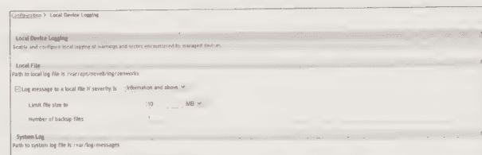

要修改受管设备上本地文件的设置，请按照以下步骤操作：

1. 点击“本地文件日志消息严重性 (`Log Message to a Local File If Severity is`)”下拉列表，选择您想要记录的消息的严重程度。
2. 如果您想记录所有错误，请选择“错误 (`Error`)”。如果您想记录所有消息，请选择“警告及以上 (`Warning and Above`)”。

（注：原文后续部分存在大量重复和损坏文本，已按要求进行清理处理。）

- ■ 使用前缀—输入前缀名称。
- ■ 使用 BIOS 资产标记
- ■ 使用 BIOS 序列号
- ■ 不自动分配名称—此选项需要您或用户在镜像恢复后手动分配计算机名称。

5. 选择其中一种 IP 配置选项：

- ■ 使用 DHCP
- ■ 指定地址列表—点击此选项时，您将看到图 6.16 所示的额外信息。

### 图 6.16

指定地址列表信息。

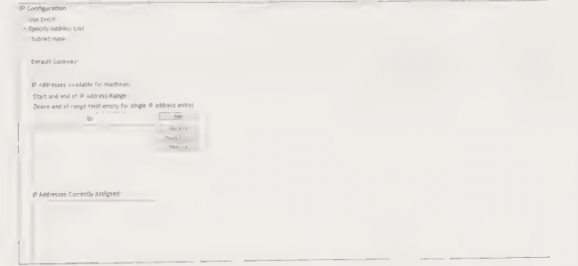

6. 点击“应用”使所做的更改生效。

要指定地址列表，请按照以下步骤操作：

1. 输入子网掩码。
2. 输入默认网关。
3. 指定 IP 地址范围（起始和结束）。如果您只需要一个 IP 地址，请将“结束”文本留空。
4. 点击“应用”使所做的更改生效。

## 第 6 章：系统设置

可以通过重复步骤 3 来添加更多 IP 地址或范围。您可以通过选择一个地址并点击“向上移动”或“向下移动”来更改 IP 地址的顺序。您可以通过选择地址并点击“删除”来移除地址。

此选项中的最后一个字段是静态的，显示了所有已分配的当前 IP 地址。这是确定要使用哪些 IP 地址（或范围）以及列表中的优先级顺序的好方法。

要确定使用哪个预启动包包（见第 7 章，“包”），...

1. 在“预启动工作分配”快照中点击“添加”按钮。这将弹出规则构造对话框（见图 6.17）。

### 图 6.17

规则构造对话框。

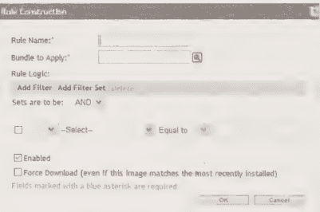

2. 输入规则名称。
3. 输入要应用的包，或点击放大镜图标并浏览包。
4. 通过创建过滤器来指定规则逻辑。您可以在第 4 章“理解 ZENworks 控制中心”中找到更多关于过滤器的信息。
5. 如果您想应用规则逻辑，请勾选“启用”旁边的复框。
6. 如果您即使镜像与最新安装的镜像匹配也强制执行规则逻辑，请勾选“强制下载”旁边的复框。
7. 点击“确定”创建规则。

### 特定日期计划类型

8. 创建规则后，可以通过重复步骤 1–7 来添加更多规则。

通过选择规则并点击“编辑”来编辑规则。通过选择规则并点击“向上移动”或“向下移动”来更改规则顺序。或者通过选择规则并点击“删除”来删除规则。

9. 点击“应用”使所做的更改生效。

分配多个服务器来处理镜像任务可能会很有用。例如，一台服务器可以托管 PXE 服务，另一台服务器可以用于存储镜像文件。当同时对许多系统进行镜像时，这特别有用。

要指定可以托管预启动操作的服务器，请按照以下步骤操作：

1. 输入服务器的 IP 地址或 DNS 名称并点击“添加”。
2. 重复步骤 1 向列表中添加更多服务器。通过选择列表中的服务器并点击“向上移动”或“向下移动”更改服务器顺序。在列表中选择服务器并点击“删除”来删除服务器。
3. 点击“应用”使所做的更改生效。

`ZENworks` Linux 管理支持 Intel 活动管理技术 (`AMT`)，在设备进行镜像时提供更多功能。`ZENworks` 提供了硬盘上存储身份信息和镜像标识的能力，使您能够集中管理何时对机器进行镜像。Intel `AMT` 通过在主板的 `AMT` 芯片上存储信息增强了 `ZENworks`，即使更换了硬盘也能对网络设备进行镜像管理。您可以访问 `www.intel.com/technology/manage/iamt/` 更多关于 `AMT` 的信息。

要输入全局企业名称，请按照以下步骤操作：

1. 在名称列表中输入并点击“添加”。
2. 重复步骤 1 向列表中添加更多名称。通过选择列表中的名称并点击“向上移动”或“向下移动”重新排列名称。在列表中选择名称并点击“删除”删除名称。
3. 点击“应用”使所做的更改生效。

### 远程管理

远程管理配置设置非常简单。要更改这些设置，请按照以下步骤操作：

1. 在“管理区域设置”快照中点击“远程管理”（见图 6.18）。

## 第 6 章：系统设置

### 图 6.18

远程管理配置页。

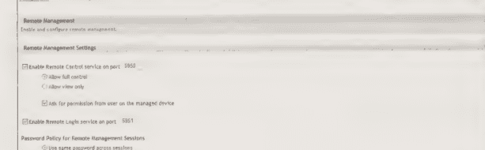

2. 确保勾选了“端口上的启用远程控制服务”和“端口上的启用远程登录服务”复框。如果没有勾选，将无法远程控制设备。
3. 输入远程控制服务和远程登录服务的端口号。默认值远程控制为 5950，远程登录为 5951。
4. 指定您想要“允许控制”还是“允许查看”。
5. 如果您要求用户接受远程控制，请勾选“询问”。
6. 指定以下：

- 跨会话
- 之后清除
- 每次

7. 点击“应用”使所做的更改生效。

### 集中日志

您可以通过以下步骤更改日志相关的设置：

1. 在“管理区域设置”快照中点击“集中日志”（见图 6.19）。

### 图 6.19

集中日志配置页。

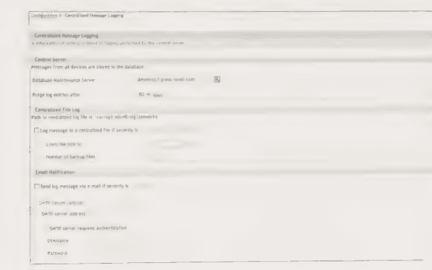

2. 输入数据库服务器。
3. 点击“清理日志条目”下拉列表，选择每 30、60 或 90 天清理。
4. 如果您想捕获消息，勾选“日志到集中文件”旁边的框。调整此快照中的其他选项。
5. 如果您希望发生特定消息时通过电子邮件发送日志，勾选“通过电子邮件发送日志”。
6. 如果您标记了第 5 项，输入 SMTP 服务器设置，如果 SMTP 服务器需要身份验证，请输入用户名和密码。
7. 输入邮件显示设置，包括发件人、收件人和主题。您可以使用格式占位符进一步自定义主题。
8. 如果您想通过 SNMP 发送，勾选“日志到 SNMP 阱”旁边的框。
9. 如果您执行了第 8 ，输入陷阱目标、端口和团体字符串。

本书未详细介绍所有 SNMP 选项。

### 内容复制计划

点击“管理区域设置”快照中的“内容复制计划”，可以配置用于在 `ZENworks` 服务器之间复制内容的刷新计划。

### 图 6.20

内容复制配置页。


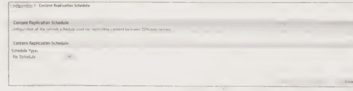

关于内容复制详情见第 13 章 ZENworks Linux 管理。

## 平台

您可以按照以下步骤配置可用的目标平台：
1. 在“管理区域设置”快照中点击“平台”（见图 6.21）。
视图已有一个平台列表。这些是默认平台，无法编辑或删除。
2. 要添加平台，在“目标平台”快照中点击“添加”按钮。弹出“添加平台”对话框（见图 6.22）。

### 图 6.21
平台配置页。
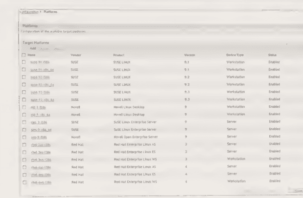

### 图 6.22
添加平台对话框。
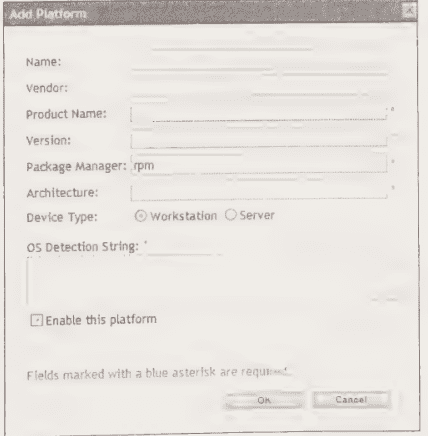

3. 如屏幕上蓝色星号所示，需要提供以下所有信息：
- 名称
- 供应商
- 产品名称
- 版本
- 软件包管理器
- 架构
- 设备类型
- 操作系统检测检测字符串
4. 检查您是否想要启用此平台。
5. 点击“确定”添加平台。

提示
为了简化平台的创建，请勾选与您想要添加的平台最匹配的平台旁的复选框。然后点击“复制”。这将从您标记的平台获取信息并填充步骤 3 中的字段。
6. 点击“应用”以使您所做的更改生效。

# 层级结构及更改设置的其他位置

如果您已经熟悉 ZENworks，您将理解策略和其他设置是如何执行的。但是，如果不熟悉，让我们讨论一下会发生什么。
本章或“配置”选项卡中已经涵盖的配置是“系统”设置。这意味着这些设置适用于管理区域内的所有设备。然而，您通通过对设备组或特定设备进行设置来覆盖系统设置。
要更改特定设备的设置，请遵循以下步骤：
1. 转到“设备”选项卡，并选择您想要更改的服务器或工作站。您将看到工作站或服务器摘要页（参见图 6.23）。
### 图 6.23
工作站摘要页。
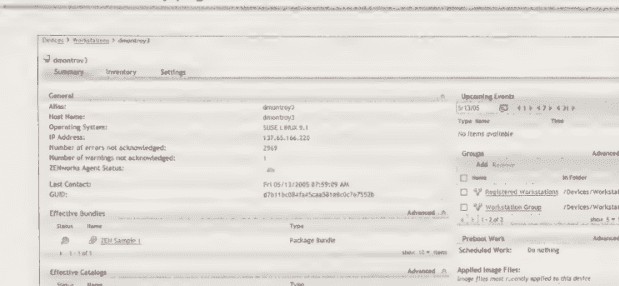
2. 点击“设置”选项卡以查看“配置”选项卡上的设置子集。这些包括
- 系统变量
- 刷新计划
- 设备清单
- 本地设备日志
- 预启动服务
- 远程管理
3. 点击这些选项之一，并按照本章前面章节中的步骤进行您想要做的更改。
如果您遵循了步骤 1-3 并进行了任何更改，这些更改现在将优先于系统设置。

## 许可

右下角的快照被称为“许可”。该快照向您显示运行的是受许可的 ZEN 7 Linux 管理版本还是评估版。如果是评估版，您可以看到评估类型，还可以看到您的评估期还剩余多少天数。
在评估过期之前，如果您购买了该产品，可以点击快照中的“更改”，然后在“产品激活”对话框中输入正确的产品激活密钥（参见图 6.24）。

### 结论
图 6.24
产品激活对话框。
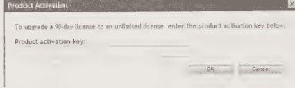
使用设置是控制管理区域许多行为的好方法。您可以通过进入“配置”选项卡进行系统级更改，也可以通过进入工作站或服务器页面进行特定的设备设置。

## 软件包 (Bundles)

本章讨论了 ZENWorks 7 Linux 管理产品中的包。包的创建、修改和分配与所有管理功能一样，都是在 ZENWorks 控制中心执行的。

### 什么是包？
包是内容的集合。这些内容可以交付到系统中的受管理设备。
ZENWorks 7 Linux 管理提供两种类型的包：RPM 包和预启动包。
RPM 包是 RPM 软件包的集合，可以分配并交付给受管理设备。包中的每个 RPM 软件包都可以指定该 RPM 软件包针对的架构。一个包可以包含任意数量的要安装在目标设备上的 RPM 文件。
预启动包包含需要放置在设备上的脚本或镜像文件的引用。此外，您还可以执行预启动操作，在启动时获取设备的镜像并将该镜像存储在服务器上。预启动包作为 PXE 系统的一部分交付，可以在目标机器上已安装的操作系统启动之前下载执行环境。预启动环境也可以从 CD-ROM 启动或从本地安装的 ZENWorks 分区启动。从该环境，系统可以在不通过 PXE 的情况下交付预启动包。

### 包有哪些优势？
包是管理软件集合的好方法。创建包后，您可以将包分配给设备，包内所有适当的 RPM 软件包将安装到受管理设备上。通过使用包，您可以将 RPM 集合分组为逻辑实体，从而简化交付到您的 Linux 系统的软件管理。

### 包组
您还可以创建包组。包组包含一组经过管理设置的包，并可以作为一个单一实体分配给受管理设备。因此，通过包组，您可以定义应作为单一实体管理和分配的包集。包组可能只包含包，而不包含其他包组。

### 如何创建 RPM 包
按照以下步骤在 ZENworks 7 Linux Management 中创建 RPM 包：
1. 启动浏览器并输入 ZENworks 控制中心的 URL。
2. 登录到 ZENworks 控制中心。
3. 按页面顶部菜单选项卡上的“包”。
4. 按“新建”下拉菜单并选择“包”。这会启动包创建向导（参见图 7.1）。
完成向导以创建包。向导的步骤将在后续章节中描述。

# RPM 包创建向导：包类型

在第一页上，您需要选择要创建的 RPM 包类型。RPM 包允许您指定一组想要安装在目标设备上的 RPM 文件。选择 RPM 包类型。点击“下一步”。这将让您移动到向导的第 2 步。

### 图 7.1
包创建向导的第 1 步。
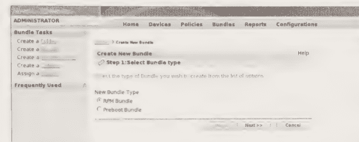

# RPM 包创建向导：包命名

图 7.2 显示向导的第 2 步。

### 图 7.2
包创建向导的第 2 步。
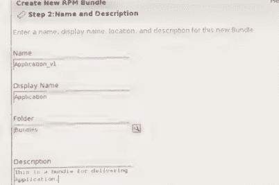

在向导的第 2 步中，您必须输入以下信息：
- 名称—输入包的名称。这是在 ZENWorks 控制中心中显示此包的名称。
- 显示名称—输入应在终端用户界面系统上显示的包名称。

# 第 7 章：包

- **文件夹**—浏览到“包”区域下您想要在此处创建此包的文件夹。文件夹可以帮助您组织包集。
- **描述**—如果您需要，请输入文本描述。此描述用于帮助您记忆此处可能包含的内容。
点击“下一步”。这将引导向导进入第 3 步，在何处指定 RPM 文件。

# RPM 包创建向导：RPM 添加

图 7.3
包创建的第 3 步，插入文件。
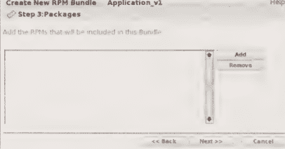

在向导的第 3 步中，要求您输入要包含的每个 RPM。对于您想要的每个 RPM 完成以下操作：
1. 点击“添加”按钮。这将弹出 RPM 文件上传对话框（参见图 7.4）。
2. 选择以下每项：
    - **目标平台**—为特定 RPM 选择目标平台。同一个包中可以有多个不同的平台。
    - **安装类型**—自动检测、更新或安装。
“安装”选项指示系统执行并行安装。并行安装要求并行安装的包之间没有文件冲突。此选项几乎适用于内核。
这将带您进入向导的下一页。

# 第 7 章：包

# RPM 包创建向导：图标规范

向导的第 4 步允许您指定一个图标文件，该文件包含您想要与此包关联的图形图标。当包在允许手动更新的 GUI 界面上显示时。
当您输入或浏览图标文件路径并点击“下一步”时，ZENworks 将该文件上传到系统。指定图标文件后，您将移动到向导的下一步。

# RPM 包创建向导：启动脚本

向导的第 5 步允许您指定您可能在包分发到设备并完成分发之前运行的脚本。
您首先看到一个允许您激活启动前和/或启动后脚本的屏幕（参见图 7.5）。
图 7.5
启动前和启动后脚本的激活屏幕。
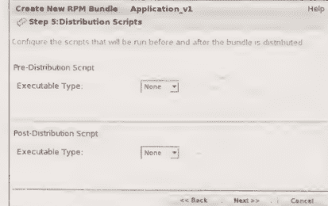

您可以指定四种脚本选项：
- 脚本—这代表可以在受管理设备上执行的 shell 脚本。
- 二进制文件—这代表可以在受管理设备上运行的可执行程序。
-   Java—这代表一个可以在托管设备上启动的 Java 可执行类。
+   无—这表示你不想执行任何脚本。
以下描述了如何进入脚本、二进制（Binary）或 Java 类型的系统。
在完成分发脚本输入后，点击“下一步”。

## shell 脚本 (SHELL SCRIPT)

当你选择脚本为 shell 脚本时，将显示额外的信息字段，如图 7.6 所示。

### 图 7.6
类型为 Script 的脚本的额外字段。
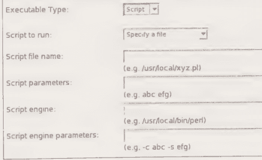

第一个字段允许你描述脚本是设备上已有的特定文件（指定文件），还是你想要输入到 ZENworks 控制中心的脚本（定义您自己的脚本）。
如果你选择定义自己的自己的脚本，系统将向你展示一个大文本框，你可以在可以在其中输入你的脚本。输入的脚本将作为 RPM 包的一部分传递到托管设备，并在标准 shell 环境中执行。没有额外的字段需要提供给 ZENworks。


然而，如果你选择指定文件，则需要向以下字段输入数据：

## 第 7 章：包 (Bundles)

- 脚本文件名——这是目标设备上脚本文件的路径
- 脚本参数——在此处，你可以识别在指定脚本文件名时想要放置在命令行上的任何额外参数。这将导致参数被传递给你的可执行脚本。
- 脚本引擎——这允许你指定要启动以运行你的脚本的解释器。
- 脚本引擎参数——这允许你指定在启动脚本引擎时想要包含在命令行中的任何参数。

在指定了所有相应的字段后，脚本即被定义。

### 二进制脚本 (BINARY SCRIPT)

如果你选择使用二进制脚本，将显示图 7.7 所示的字段。

#### 图 7.7

选择二进制脚本时显示的字段。

| 分发前脚本: |  |
|---|---|
| 可执行类型: | [二进制 (Binary)] |
| 可执行文件名称: | (例如 `/usr/local/bin/xyz`) |
| 可执行文件参数: | (例如 `abc efg`) |

完成以下字段：

- 可执行文件名称——指定可执行文件的路径。该文件必须已存在于托管设备上。
- 可执行文件参数——指定在启动可执行文件时想要包含在命令行上的任何参数。

在指定这些字段后，二进制脚本即被定义。

### JAVA 脚本 (JAVA SCRIPT)

如果你选择使用 Java 脚本，将显示图 7.8 所示的字段。

#### 图 7.8

选择 Java 脚本时显示的字段。

| 可执行类型 | java |
|---|---|
| Java 程序名称。 | 例如 `/home/user/Xyz/` |
| 程序参数: | 例如 `abc efg` |
| Java 运行时可执行文件 (JRE) | 例如 `/usr/local/jre/bin/java` |
| JRE 参数: | 例如 `-cp /usr/lib/tools.jar` |

完成以下字段：

- Java 程序名称——输入要启动的类路径。
- 程序参数——输入任何想要在执行时传递给 Java 类的参数。
- Java 运行时可执行文件 (JRE)——输入用于启动该类的 JRE 路径。该 JRE 必须已预先安装在目标设备上。
- JRE 参数——输入任何想要传递给 JRE 系统的参数。

在指定这些字段后，Java 脚本即被定义。

## RPM 包创建向导：安装脚本

向导的此步骤允许你指定在安装 RPM 包之前和之后启动的脚本。按照相同的步骤操作。

## RPM 包创建向导：总结

向导的最后一步是总结页。

查看总结页并点击“返回”回到上一页，点击“取消”终止，点击“完成”创建包。

## 如何创建启动包 (Preboot Bundle)

启动包是与镜像相关的，可以传递到设备。启动包需要两个步骤来完成镜像。

在第一个步骤中，创建启动包。执行以下操作：

1. 打开浏览器并进入 ZENworks 的 URL。
2. 登录 ZENworks 控制中心。
3. 点击顶部菜单的“包 (Bundles)”。
4. 点击下拉菜单并选择“新建 (New)”。这启动了向导。

按照以下步骤创建启动包。

### 启动包创建向导：包类型

在这一页，你需要选择要创建的启动包类型。点击下一步。

### 启动包创建向导：类型

图 7.9 显示向导的后续步骤。

#### 图 7.9

启动包创建向导的第 2 步。


在此步骤中，你必须选择要创建的启动包类型。选择以下类型之一：

- AutoYAST 包——允许你指定启动 SuSE 自动安装所需的参数。
- KickStart 包——允许你指定启动 RedHat 系统自动安装的信息。
- ZENworks 镜像包——允许你指定之前通过 ZENworks 获取的镜像。该镜像可以重新应用于任何托管设备。
- ZENworks 组播包——允许你指定通过组播协议向许多计算机单次发送镜像。
- ZENworks 脚本包——允许你指定一个可以在托管设备的镜像环境中执行的 Linux 脚本。

选择启动包类型后，点击下一步。

以下章节描述了每个类型启动包的向导步骤。

## AutoYAST 启动包创建

AutoYAST 启动包代表在分配的托管设备上对 SuSE 系统进行网络安装。

### AUTOAST 启动包创建向导第 3 步

在初始页点击“下一步”后，此向导页要求你命名并将包放在所需的文件夹中（见图 7.10）。

#### 图 7.10

启动创建向导的常规信息页。

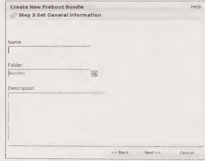

输入以下信息：

- `名称`——输入包的名称。这是在 ZENworks 控制中心显示的该包名称。
- `显示名称`——输入要在用户界面系统中显示的包名称。
- `文件夹`——浏览到包区域下你想要放置此包的文件夹。文件夹帮助你组织包集。
- `描述`——如果需要，输入文本描述。此描述用于帮助你记住此包可能包含的内容。

点击下一步。这将引导向导进入指定 AutoYAST 过程所需的内核文件和其他文件的位置。

### AUTOYAST 预启动包创建向导第 4 步

在此步骤中，你必须指定 AutoYAST 过程所需文件的路径。图 7.11 显示了此界面的示例。

#### 图 7.11

包向导页面：创建 AutoYAST 包，文件路径。

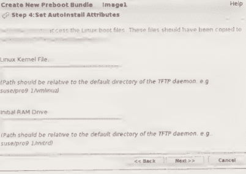

在此页面上输入以下值：

- `Linux 内核文件 (Linux Kernel File)`——输入相对于 ZENWorks 7 管理服务器 TFTP 目录位置的请求 Linux 内核文件路径。
- `初始 RAM 盘 (Initial RAM Drive)`——输入相对于 ZENWorks 7 Linux 管理服务器 TFTP 目录位置的 RAM 盘数据文件路径。

点击“下一步”(`Next`)进入向导的下一页。

### AUTOYAST 预启动包创建向导第 5 步

此步骤允许你指定协议、服务器地址以及可以找到系统的网络安装目录路径。图 7.12 显示了向导此页面的示例。

在页面中输入以下信息：

- `协议 (Protocol)`——选择在连接安装服务器时应使用的协议。协议可选有 NFS、FTP、HTTP 或 TFTP。
- `IP 地址 (IP Address)`——在“协议”字段旁边，输入 Autoinstall 服务器的 IP 地址，它将通过指定的协议提供安装信息。
- `安装目录路径 (Path to Install Directory)`——输入安装目录相对于该协议的路径。

点击“下一步”(`Next`)进入向导的下一页。

#### 图 7.12

包向导页面：创建 AutoYAST 包，Autoinstall 属性安装目录。

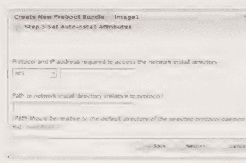

### AUTOYAST 预启动包创建向导第 6 步

此步骤允许你指定网络上 AutoYAST 脚本的协议、服务器地址和路径。图 1 显示了向导此页面的示例。

在页面中输入以下信息：

- `协议 (Protocol)`——选择在连接安装服务器时应使用的协议；（协议可选有 NFS、FTP、HTTP 或 TFTP）
- `IP 地址 (IP Address)`——在“协议”字段旁边，输入 Autoinstall 服务器的 IP 地址，它将通过指定的协议提供安装信息。
- `AutoYAST 脚本名称 (AutoYAST Script Name)`——输入用于协调安装的 AutoYAST 脚本的路径和文件名。
- `其他内核参数 (Additional Kernel Parameters)`——输入任何你想传递给 AutoYAST 系统的额外 Linux 内核参数。

点击“下一步”(`Next`)进入向导的下一页。

#### 图 7.13

包向导页面：创建 AutoYAST 包，AutoYAST 脚本的 Autoinstall 属性。

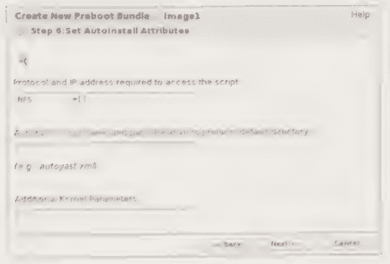

### AUTOYAST 预启动包创建向导：摘要

向导中的此步骤提供了你的预启动包的摘要。

检查摘要页面并点击“上一步”(`Back`)返回上一页进行修改，点击“取消”(`Cancel`)终止包的创建，或点击“完成”(`Finish`)完成并创建包。

安装完成后，ZFS 工作控制中心将显示包已成功创建。点击“确定”(`OK`)返回 ZenWorks 控制中心。

## KickStart 预启动包创建

KickStart 过程包代表向指定的托管设备对 RedHat 系统进行网络安装。

### KICKSTART 预启动包创建向导：命名

向导页面允许你为包命名并将其放置在所需的文件夹中（参见图 7.10）。

点击“下一步”(`Next`)进入向导中指定 KickStart 文件的页面。

### KICKSTART 预启动包创建向导：路径


在此步骤中，你必须指定 KickStart 必需文件的路径。图 7.14 显示了此界面。

图 7.14

包向导页面：创建 KickStart，路径。

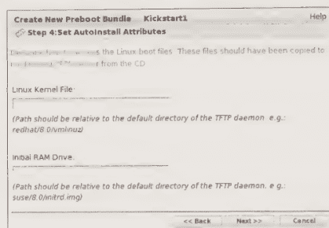

在此页面上输入以下值：

- **Linux 内核文件 (Linux Kernel File)**——输入相对于 ZENWorks 7 管理服务器 `TFTP` 目录位置的请求 Linux 内核文件路径。
- **初始 RAM 盘 (Initial RAM Drive)**——输入相对于 ZENWorks 7 管理服务器 `TFTP` 目录位置的 RAM 盘数据文件路径。

点击`Next`进入向导的下一页。

# KICKSTART 预启动包创建向导：服务器

此步骤允许你指定协议、服务器地址以及网络上 KickStart 脚本的路径。图 7.15 显示了此页面的示例。

在页面中输入以下信息：

- **协议 (Protocol)**——选择在连接安装服务器时应使用的协议。
- **IP 地址 (IP Address)**——在“协议”字段旁边，输入 Autoinstall 服务器的 IP 地址，它将通过指定的协议提供安装信息。
- **脚本名称 (Script Name)**——输入用于协调安装的 KickStart 脚本的路径和文件名。
- **其他内核参数 (Additional Kernel Parameters)**——输入任何你想传递给 的额外 Linux 内核参数。

点击`Next`进入向导的下一页。

图 7.15

包向导页面：创建 KickStart 包，AutoInstall 属性。

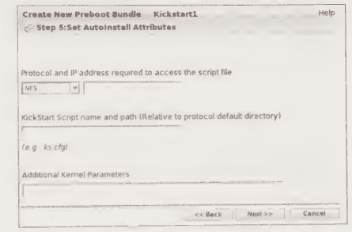

# 如何创建预启动包

ZENWorks Image 预启动包代表一个从设备创建的设备镜像。

# ZENWORKS 镜像预启动包创建向导：命名

向导页面允许你为包命名并将其放置在所需的文件夹中（参见图 7.10）。

点击`Next`进入向导中指定镜像文件的页面。

# ZENWORKS 镜像预启动包创建向导：镜像文件

在此步骤中，你必须指定包含基础镜像和附加镜像文件的 `.zmg` 文件路径。图 7.16 显示了此界面的示例。

当 ZENWorks Image 放置到系统时，首先放置基础镜像。基础镜像的放置默认是破坏性的，会移除该磁盘上的任何数据。在应用基础镜像后，非破坏性的附加镜像将应用到磁盘。

图 7.16

包向导页面：创建 ZENWorks Image 包，基础和附加文件。

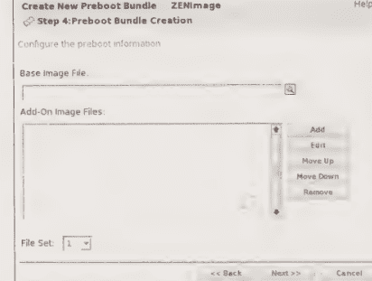

在此页面上输入以下值：

- **基础镜像文件 (Base Image File)**——你无法在该字段中输入数据。你必须点击右侧的浏览按钮。这将弹出图 7.17 所示的对话框。
- **服务器对象、IP 或 DNS (Server Object, IP, or DNS)**——输入持有镜像文件的 ZENWorks 设备名称。你也可以输入该服务器的 IP 或 DNS 地址。你可以可选点击字段旁边的浏览按钮，从 ZENWorks 控制中心浏览并选择服务器。
- **服务器上的文件路径 (File Path on Server)**——输入代表基础镜像的 `.zmg` 文件的完整路径。

图 7.17

基础镜像文件浏览对话框。

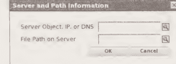

输入这些值后，点击`OK`按钮。

- **附加镜像文件 (Add-On Image Files)**——你可以通过点击右侧的`Add`按钮向包中添加附加镜像文件。这将弹出定义镜像文件和文件名的相同对话框（参见图 7.16）。在输入附加镜像文件后，可以通过选择特定的附加镜像文件并从左侧按钮中选择操作来删除、编辑或重新排序列表。
- **文件集 (File Set)**——从基础镜像选择你想应用到设备的文件集。文件集允许系统选择性地将镜像中的文件放置到托管设备上。

## 第 7 章：包 (Bundles)

## ZENWORKS 脚本预启动包创建向导：命名

此页面要求您为包命名并将其放置在指定的文件夹中（参见图 7.10）。

点击`Next`。这将进入向导的后续步骤，在此您可以指定要执行的脚本命令。

## ZENWORKS 脚本预启动包创建向导：脚本

此步骤允许您输入想要启动的脚本。图 7.18 显示了此页面的示例。

### 图 7.18

ZENWorks 镜像包向导创建页面，脚本。

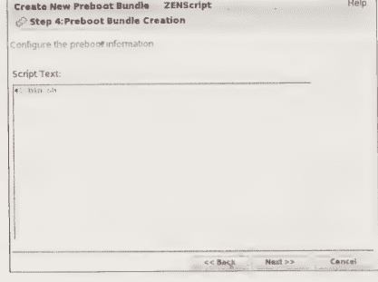

在此页面上将脚本输入文本框中。点击`Next`进入向导的下一页。

## ZENWORKS 脚本预启动包创建向导：摘要

向导的此步骤提供了您的预启动包的摘要。检查摘要页面，并点击`上一步`返回上一页进行修改，点击`取消`终止包的创建，或点击`完成`完成并创建包。

在点击`完成`按钮后，ZENWorks 控制中心将显示包创建的成功或失败。点击`确定`返回 ZENWorks 控制中心。

## 如何将包分配给设备

当包直接或间接分配给某个设备时，ZENWorks 会安装包中的 `RPM` 或将预启动包应用到该设备。

新分配给设备的包将在将在下次包刷新周期发生时进行安装。这可能发生在启动时，也可能根据受管理设备所在区域的包刷新设置发生。

您可以按照以下方法将包分配给设备。其中一种方法如下：

- 1. 打开 ZENworks 控制中心。
- 2. 点击屏幕顶部菜单上的`Devices`。
- 3. 在“设备”文件夹中浏览，找到特定设备所在的文件夹。
- 4. 点击设备旁边的复选框选择特定设备。这将激活设备菜单的其他部分。
- 5. 选择`Action`菜单打开下拉列表并选择`Assign Bundle`。这将启动包分配向导。

## 将包分配给设备时会发生什么

当 `RPM` 包分配给设备时，ZENWorks 会尝试在设备上安装该包中的软件包。当设备执行刷新（在启动时或达到计划刷新间隔时进行）时，设备将感知到任何新分配的包。

由于预启动包具有破坏性，它不会自动应用到设备。必须执行手动步骤才能将预启动包应用到设备。按照以下步骤使设备在下次启动时运行预启动包：

- 1. 打开 ZENworks 控制中心。
- 2. 浏览到需要运行预启动包的设备。
- 3. 打开设备进入`Summary`页面。
- 4. 在`Preboot Work`快照中选择`Advanced`选项。图 7.19 显示了此快照的。

### 图 7.19

设备摘要页面上的预启动工作快照示例。

| 预启动工作 (Preboot Work) | 高级 (Advanced) |
|---|---|
| 计划工作 (Scheduled Work): | 无操作 (Do nothing) |
| 应用的镜像文件 (Applied Image Files): 最近应用到此设备的镜像文件 类型 名称 无可用项目。 | |

5. 显示预启动工作的高级页面（参见图 7.20）。

### 图 7.20

预启动工作高级页面示例。


6. 在“计划工作”中选择所需的值：`Do Nothing`、`Apply Preboot Bundle`、`Take an Image`。

- `Apply Preboot Bundle`将显示图 7.21 所示的屏幕。

从这些字段中，您可以从下拉列表中选择包。其中包含所有已分配或间接分配给设备的包列表。如果没有定义任何包，您可以点击`Browse`按钮并选择一个预启动包。这将把选定的包分配给设备。其他字段显示了有关所选预启动包的信息。

### 图 7.21

预启动工作高级页面上的“应用预启动包”选项示例。


- 选择`Take Image`将显示图 7.22。此选项要求您在获取设备镜像时输入要创建的镜像文件的路径和名称。此外，您还可以选择镜像文件的压缩级别。

### 图 7.22

预启动工作页面上的“获取镜像”选项示例。


7. 点击`确定`。当设备下次启动时，系统将应用所选的预启动包。

## 更新之前创建包

有时您想要更新之前创建的包。这可能是为了添加 `RPM`、删除 `RPM` 或修改其条目。当对包进行任何更改时，ZENWorks 都会为该包创建一个新版本。

当一个包有多个版本时，您可以选择希望将哪个包交付到已分配的设备。当设备验证通过后，设备将感知到已分配的包有新版本。

要选择包的版本，请按照以下步骤操作：

- 1. 打开 ZENWorks 控制中心。


- 2. 浏览并选择所需的包。
- 3. 点击包的“详细 (Details)”选项卡。
- 4. 点击版本旁边的下拉列表。选择所需的版本。点击“部署 (Deploy)”按钮将所选版本标记为要部署的版本。

### 包组 (Bundle Groups)

为了简化一组包的管理。ZENWorks 允许您创建包组。包组由一组定义的包组成。您可以通过分配包组来一次性分配这些包。

当包组分配给设备时，包组代表的所有包将安装到设备上。

通过执行以下任务创建包组：

- 1. 启动 ZENworks。
- 2. 选择屏幕顶部的“包 (Bundle)”选项卡。
- 3. 浏览到您想要创建包组的文件夹。
- 4. 点击“新建 (New)”选项并选择“包组 (Bundle Group)”。

### 图 7.23

创建包组的性首页。


5. 显示摘要页面。这仅创建了包组，但它还没有成员包。您可以稍后将包分配到组中，也可以通过点击“下一步”按钮现在进行。

### 图 7.24

组向导的“添加成员”页面示例。


- 6. 在“添加”页面上，点击“添加”按钮，浏览并选择您想要添加到此组中的一个或多个包。在弹出框中点击“确定”返回此页面。点击“下一步”。
- 7. 下一页允许您将此组分配给任何设备、组或文件夹。如果您想现在分配此组，请点击“添加”按钮。然后选择所需的设备并点击“确定”退出弹出对话框。点击“下一步”。
- 8. 下一个屏幕是摘要页面。点击“完成”完成包的创建。

您现在已成功创建了包组。您可以通过选择包组并使用“添加成员”或“删除成员”屏幕上显示的快照来修改包组。

## 第 8 章

## 目录

本章讨论了 ZENworks Linux 管理产品中的目录（Catalogs）。与其他管理功能一样，目录的创建、修改和分配都在 ZENworks Control Center 中进行。

### 什么是目录？

目录与 RPM 束（RPM bundles）密切不可分，它简单来说是 RPM 束的有序集合。（参见第 7 章，“束”）。目录可以被分配并交付到受管理的设备。

尽管 RPM 束存储在 ZENworks 管理数据库中，但目录是存储在 ZENworks 对象存储器（ZENworks Object Store）中的对象。更多信息请参阅第 13 章“ZENworks Linux 数据库”。

### 目录有什么优势？

目录用于依赖关系解析以及安装可选软件。当 RPM 束具有尚未满足的需求，或者目录中的依赖 RPM 包被自动安装时，就会发生依赖关系解析。

### 如何创建目录

按照以下步骤操作，在 ZENworks 7 Linux 管理中创建一个目录：

- 1. 启动浏览器并输入 ZENworks Control Center 的 URL。
- 2. 登录 ZENworks Control Center。
- 3. 点击页面顶部菜单选项卡上的 Bundles（束）。
- 4. 点击 New（新建）下拉菜单并选择 Catalog（目录）。这会启动目录创建向导（见图 8.1）。

图 8.1

目录创建向导的第 1 步。


完成向导以创建目录。向导的步骤将在后续章节介绍。

### 目录创建向导：目录名称

在向导的第 1 步中，你必须输入以下信息：

- 名称（Name）——输入目录名称。这是 ZENworks Control Center 中显示的该目录名称。
- 显示名称（Display Name）——输入应在终端用户界面系统中显示的目录名称。
- 文件夹（Folder）——浏览到 Bundles 区域下你想创建此目录的文件夹。文件夹帮助你组织目录。
- 描述（Description）——如果需要，请输入文本描述。此描述用于帮助你记住此目录可能包含的内容。

点击 Next（下一步）。这将向导带到第 2 步，在该步骤中你将指定目录属性。

### 目录创建向导：目录属性

第 2 步显示的屏幕与图 8.2 类似。

图 8.2

目录创建向导的第 2 步，用于分配属性。


在向导的第 2 步中，系统只需询问是否想要从客户端机器上隐藏此目录。

如果你使用目录部署具有依赖 RPM 包的软件，那么隐藏目录是一个好主意。这样你就不需要依靠用户来安装软件。例如，你会隐藏一个用于部署依赖杀毒软件安装的病毒库的目录。

要隐藏目录，请勾选 Hide This Catalog in the Client User Interface（在客户端用户界面中隐藏此目录）旁复选框。

### 目录创建向导：摘要

向导的第 3 步是摘要页。摘要页显示了目录的所有方面。见图 8.3。

检查摘要页并点击 Back（返回）回到上一页进行修改，点击 Cancel（取消）终止目录创建，或点击 Finish（完成）完成并创建目录。

按下 Finish 按钮后，ZENworks Control Center 将显示目录创建成功。点击 OK（确定）返回 ZENworks Control Center。

图 8.3

目录创建向导的摘要页。


## 向目录添加 RPM 束

除非向目录中添加了 RPM 束，否则目录将不起任何作用。有几种不同的方法可以实现。向目录添加单个或多个 RPM 束 最简单的方法是：

- 1. 打开 ZENWorks Control Center。
- 2. 点击屏幕顶部菜单上的 Bundles（束）。
- 3. 通过点击列表中想要添加的束旁边的复选框来选择特定的束或多个束。这将激活 Bundles 菜单的其余部分。
- 4. 选择 Action（操作）菜单打开下拉列表并选择 Add to Catalog（添加到目录）。这会启动添加目录向导。见图 8.4。

图 8.4

添加目录向导。


- 5. 点击菜单上的 Add（添加）按钮并选择你想包含这些 RPM 束的目录。然后点击 Next（下一步）。
- 6. 按 Back（返回）回到上一页进行修改，点击 Cancel（取消）终止向导，或点击 Finish（完成）完成向导。

## 如何将目录分配给设备

当目录直接或间接地分配给设备时，ZENWorks 为该设备安装目录中的 RPM 束。

新分配给设备的目录将在下次束刷新周期发生时安装。

你可以通过以下方法分配目录：

- 1. 打开 ZENWorks Control Center。
- 2. 点击屏幕顶部菜单上的 Bundles（束）。
- 3. 通过点击列表中想要添加的束旁边的复选框来选择特定的束或多个束。这将激活 Bundles 菜单的其余部分。
- 4. 选择 Action（操作）菜单打开下拉列表并选择 Add to Catalog（添加到目录）。这会启动添加目录向导。见图 8.4。（等等，此处逻辑重复，遵循文本流）


- 5. 点击菜单上的 Add（添加）按钮并选择你想包含这些 RPM 束的目录。然后点击 Next（下一步）。
- 6. 按 Back（返回）回到上一页进行修改，点击 Cancel（取消）终止向导，或点击 Finish（完成）完成向导。

### 如何将目录分配给设备

当目录直接或间接地分配给设备时，ZENWorks 为该设备安装目录中的 RPM 束。

新分配给设备的目录将在下次束刷新周期发生时安装。

你可以通过以下方法分配目录：

- 1. 打开 ZENWorks Control Center。
- 2. 点击屏幕顶部菜单上的 Devices（设备）。
- 3. 通过点击列表中设备旁边的复选框来选择特定设备。这将激活 Devices 菜单的其余部分。
- 4. 选择 Action（操作）菜单项打开下拉列表并选择 Assign Catalog（分配目录）。这会启动分配目录向导。见图 8.5。

图 8.5

分配目录向导。


- 5. 点击 Next（下一步）进入向导的第 2 步以设置 Special Flags（特殊标志）。见图 8.6。

图 8.6

分配目录向导的第 2 步，特殊标志。


在这一步你会看到两个选项：

- Remove Conflicting Packages（移除冲突包）——此选项允许你指定是否覆盖冲突包。
- Attempt a Dry Run（尝试运行）——勾选此选项将模拟安装以测试问题。


- 7. 按 `Back`（返回）回到上一页进行修改，点击 `Cancel`（取消）终止向导，或点击 `Finish`（完成）完成向导。

另一种分配目录的方法是：

- 1. 打开 `ZENworks Control Center`。
- 2. 点击屏幕顶部菜单上的 `Bundles`（束）。
- 3. 通过点击列表中想要分配的目录旁边的复选框来选择特定目录。这将激活 `Bundles` 菜单的其余部分。
- 4. 选择 `Action`（操作）菜单项打开下拉列表并选择 `Assign Catalog`（分配目录）。这会启动分配目录向导。

你也可以直接通过设备或设备组来分配目录。

## 目录分配给设备后发生了什么

当目录分配给设备时，`ZENWorks` 会按照它们在目录中的顺序尝试安装 `RPM` 束。当设备执行刷新时（启动时）就会感知到新分配的目录。

要更改目录中 `RPM` 束的顺序，请遵循以下步骤：

- 1. 打开 `ZENworks Control Center`。
- 2. 点击屏幕顶部菜单上的 `Bundles`（束）。
- 3. 点击你想修改的目录名称。你看到的屏幕与图 8.7 类似。

图 8.7

目录摘要页。


- 4. 点击 `Bundles` 快照标题栏上的 `Advanced`（高级）选项。你看到的屏幕与图 8.8 类似。

图 8.8

编辑 `Bundles` 高级页。


- 5. 勾选想要移动的束旁边的框。这将激活其余的菜单选项。
- 6. 选择 `Move Up`（上移）或 `Move Down`（下移）更改所选束的顺序。
- 7. 点击 `Close`（关闭）返回目录摘要页。

### 结论

目录提供了交付和安装软件以及执行依赖解析的极佳方法。它们让管理员的工作变得更加轻松，并确保应用程序安装和运行正常。

# 策略

本章讨论了 `ZENworks 7 Linux` 管理产品中的策略。策略的创建、修改和分配与所有管理功能一样，都在 `ZENworks Control Center` 中进行。

### 什么是策略？

策略是对受管设备上的操作系统或应用程序进行的配置。例如，可以在策略中设置安全设置或默认配置。

在创建了这些策略后，您可以将它们分配给注册在您的 `ZENworks` 系统中的设备。当设备发现（或被告知）已分配了策略时，它将检索该策略并根据指定的计划或事件应用该策略。当应用策略时，配置将设置在操作系统或应用程序上。应用策略是由于安装 `ZENworks 7` 代理时安装在设备上的执行器（enforcers）的。

### 为什么策略很有用？

策略在管理业务环境方面之所以非常强大，是因为你可以创建一个策略，并只需点击鼠标即可将该策略应用于成百上千个设备。在完成分配后，这些设备会自动应用该策略。您可以确信策略已发送到设备上并执行。

## 第 9 章：策略

现在，如果您决定更改策略，只需在 `ZENworks Control Center` 中对其进行编辑，系统将自动为所有分配的设备更新该更新策略。您什么都不需要做。

## 如何分配策略？

策略在 `ZENworks Control Center` 中通过直接或间接分配进行分配。无论是间接分配还是直接分配，策略都会发送到设备并应用于该受管设备。

### 直接分配

直接分配的策略是直接分配给受管设备的策略。

### 间接分配

间接分配的策略是通过组成员关系或包含（containment）分配对设备有效的策略。

### 分配策略

`ZENworks Control Center` 提供了多种向设备分配策略的方法。以下描述了您可以将策略分配给设备的不同方式：

- 作为策略创建向导的一部分。
- 作为标准 `ZENworks Control Center` 列表中的操作。
- 在查看文件夹、策略或设备详情期间。
- 在受管设备的命令行中。

### 使用创建向导分配策略

所有策略都是通过策略创建向导创建的。每个向导页面都针对正在创建的特定策略进行了定制。无论创建的是何种类型的策略，所有向导都会显示相同的页面，以便将策略分配给受管设备、文件夹或组。

在向导中定义策略并在查看摘要页面后，您可以点击页面上的“完成（`Finished`）”按钮完成策略定义，或者继续执行向导并点击“下一步（`Next`）”按钮来选择策略的分配（见图 9.1）。

## 如何分配策略？

图 9.1

允许分配策略的向导页面。


当您查看“策略分配”页面时，可以选择分配已创建策略的设备、组或文件夹。完成以下步骤分配策略：

1. 点击屏幕中间加粗的 `添加（Add）` 菜单项。
2. 屏幕上出现“选择分配（Select Assignments）”对话框（见图 9.2）。

图 9.2

“选择关联”弹出对话框。


3. 选择您想要分配策略的设备、组或文件夹。要进入文件夹，请选择绿色带下划线的文件夹名称。可以通过点击对象名称左侧的蓝色箭头来选择项。当您选择该项时，它将显示在对话框的右面板中（见图 9.3）。

图 9.3

“选择关联”弹出对话框中的选中项。


4. 如果您想移除之前选择的内容，点击红框中的 `X`。
5. 完成选择后，点击 `确定（OK）`。

### 通过列表分配策略

在查看“策略分配”页面时，可以选择分配已创建策略的设备、组或文件夹。完成以下步骤分配策略：

1. 点击屏幕中间加粗的 `添加（Add）` 菜单项。
2. 屏幕上出现“选择分配（Select Assignments）”对话框（见图 9.2）。

图 9.2

“选择关联”弹出对话框。


3. 选择您想要分配策略的设备、组或文件夹。要进入文件夹，请选择绿色带下划线的文件夹名称。可以通过点击对象名称左侧的蓝色箭头来选择项。当您选择该项时，它将显示在对话框的右面板中（见图 9.3）。

图 9.3

“选择关联”弹出对话框中的选中项。


4. 如果您想移除之前选择的内容，点击红框中的 `X`。
5. 完成选择后，点击 `确定（OK）`。

## 第 9 章：策略

## 如何分配策略？

1. 点击屏幕中间加粗的 `添加（Add）` 菜单项。
2. 屏幕上出现“选择分配（Select Assignments）”对话框（见图 9.2）。

图 9.2

“选择关联”弹出对话框。


3. 选择您想要分配策略的设备、组或文件夹。要进入文件夹，请选择绿色带下划线的文件夹名称。可以通过点击对象名称左侧的蓝色箭头来选择项。当您选择该项时，它将显示在对话框的右面板中（见图 9.3）。

图 9.3

“选择关联”弹出对话框中的选中项。


4. 如果您想移除之前选择的内容，点击红框中的 `X`。
5. 完成选择后，点击 `确定（OK）`。

## 第 9 章：策略

## 如何分配策略？

1. 点击屏幕中间加粗的 `添加（Add）` 菜单项。
2. 屏幕上出现“选择分配（Select Assignments）”对话框（见图 9.2）。

图 9.2

“选择关联”弹出对话框。


3. 选择您想要分配策略的设备、组或文件夹。要进入文件夹，请选择绿色带下划线的文件夹名称。可以通过点击对象名称左侧的蓝色箭头来选择项。当您选择该项时，它将显示在对话框的右面板中（见图 9.3）。

图 9.3

“选择关联”弹出对话框中的选中项。


4. 如果您想移除之前选择的内容，点击红框中的 `X`。
5. 完成选择后，点击 `确定（OK）`。

## 第 9 章：策略

## 如何分配策略？

分配策略向导的第 2 步允许您从上一步中选择您想要分配的策略（见图 9.6）。

图 9.6

分配策略向导的第一页：设备到已分配


7. 从“选择对象（Select Objects）”对话框中选择所需的策略（见图 9.7）。

图 9.7

“选择对象”对话框。


## 在文件夹详情中分配策略

当您向文件夹分配策略时，该文件夹或子文件夹中的所有设备都将分配指定的策略。要文件夹分配策略，请完成以下步骤：


# 第 9 章：策略

浏览到显示所需文件夹的列表。例如，图 9.8 显示“设备（Devices）”文件夹，它包含两个子文件夹：“工作站（Workstations）”和“服务器（Servers）”。

图 9.8

设备列表。

| 操作 | 类型 |
|---|---|
| 工作站 (详情) | 文件夹 |
| 服务器 (详情) | 文件夹 |
| 1-2 共 2 | 显示 18 项 |

4. 这将带你通过如上一节所述的“分配策略向导”。

你也可以通过输入文件夹的详细信息为文件夹分配策略。点击文件夹名称旁边的“详细信息”（Details）链接即可输入详细信息。在该文件夹的详细信息中有一个“有效策略”（Effective Policies）快照。你可以使用此方法按照后文“在策略详细中分配策略”节介绍的方法来分配策略。

当将策略分配给文件夹时，该文件夹中的所有设备以及任何子文件夹都将接收该策略。这种通过上级文件夹“继承”的策略，可以通过以分级方式向更靠近设备的地方分配策略来被覆盖。

例如，如果将 PolicyA 分配给 Folder1，那么 Folder1 和 Folder1.1 中的任何设备如果符合该策略的系统要求，都将应用 PolicyA。如果在 Folder1.1 上应用了另一个策略（称为 PolicyA1），则 Folder1.1 中的设备将获得 PolicyA1 而不是 PolicyA。若要发现哪些策略将应用于设备，你可以模拟进入设备在对象存储中所在的 ZENworks 位置。然后向上查找文件夹寻找策略。当你找到某个策略时，即停止寻找该特定类型的策略。你可以继续搜索文件夹层次查找其他策略，但将不会应用任何之前已找到的同类型策略。

此规则的唯一例外是通用 GNOME 策略。该策略是累积的，这意味着它是与设备或设备所在的组或容器关联的所有有效通用 GNOME 策略的合并。

## 在策略详细中分配策略

在 ZENworks 控制中心中，你可以查看任何策略的详细信息。在策略的详细信息中，你可以查看或编辑该策略的所有设置。此外，你可以将该策略分配给任何设备、组或文件夹。图 9.9 显示了策略详细页。

要分配所显示的策略，请完成以下步骤：

- 1. 滚动到页面上的“关联”（Associations）快照。
- 2. 点击关联快照上的“编辑”（Edit）菜单项。这会在全屏模式下打开快照，并允许编辑关联列表（见图 9.10）。
- 3. 要添加更多需要分配策略的设备、组或文件夹，点击“添加”（Add）按钮。这将弹出如早在“通过列表视图分配策略”节中所述的分配策略向导。
- 4. 添加完成后，点击“关闭”（Close）按钮。
- 5. 若要移除分配，通过勾选项目旁边的复选框从列表中选择设备、组或文件夹。这应当激活“移除”（Remove）菜单项。
- 6. 点击“移除”菜单项以移除分配。
- 7. 完成后，点击“关闭”（Close）按钮。

### 图 9.9

策略的详细页。


### 图 9.10

编辑模式下的关联列表。


## 在设备详细中分配策略

在 ZENworks 控制中心中，你可以查看任何设备的详细信息。在设备的详细信息中，你可以查看或编辑其所有设置。此外，你可以将任何策略分配给该设备。

要向显示的设备分配策略，请完成以下步骤：

- 1. 在页面上找到“有效策略”（Effective Policies）快照。图 9.11 显示了该快照的示例。
- 2. 点击快照上的“编辑”（Edit）菜单项。这会在全页模式下打开快照。图 9.12 显示了该页示例。
- 3. 要添加更多需要分配策略的设备、组或文件夹，点击“添加”（Add）按钮。这将弹出如早在“通过列表视图分配策略”节中所述的分配策略向导。
- 4. 添加完成后，点击“关闭”（Close）按钮。
- 5. 若要移除分配，通过勾选项目旁边的复选框从列表中选择设备、组或文件夹。这应当激活“移除”（Remove）菜单项。
- 6. 点击“移除”菜单项以移除分配。
- 7. 完成后，点击“关闭”（Close）按钮。

### 图 9.11

设备详细页上的有效策略快照。


### 图 9.12

全页模式下的有效策略。


## Epiphany 浏览器策略

- 禁用书签编辑。
- 禁用工具栏编辑。
- 禁用历史记录。
- 禁用从不安全的协议加载内容。默认安全协议为 HTTP 和 HTTPS。
- 向安全协议列表添加协议。

Epiphany 浏览器策略的以下选项已输入了额外数据。此外，除了设置以下选项的值外，该策略还可能锁定该值。要锁定该值，请选择对应值旁边的锁定按钮。这将防止用户在分配的托管设备上修改该值。

- 主页 URL（Home page URL）—指定浏览器的默认主页 URL。未指定默认主页 URL。
- 下载文件夹（Download Folder）—指定浏览器应存放任何下载文件的本地文件夹。未指定默认文件夹。
- 允许弹出窗口（Allow Popups）——指定是否允许弹出窗口。默认值为是。
- 允许 Java（Allow Java）——指定是否允许在浏览器页面上执行 Java 程序。默认值为是。
- 允许 JavaScript（Allow JavaScript）——指定是否在页面上执行 JavaScript。默认值为是。
- Cookies——指定是否将 Cookie 的接受设置设置为“始终接受”、“仅来自访问过的网站”或“从不接受”。默认值为“始终接受”。
- 临时文件磁盘空间（Disk Space for Temporary Files）——指定为临时文件预留的空间（单位：MB）。默认值为 50MB。

## Evolution 策略

Evolution 是由 Novell, Inc. 提供的一个电子邮件、日历和协作工具（参阅 http://www.novell.com/products/desktop/features/evolution.html）。

Novell Evolution 采纳了邮件、日历和地址录标准以方便数据共享。支持的邮件协议包括 IMAP、POP、SMTP 和身份验证 SMTP，以及 Microsoft Exchange 2000 和 2003 以及 Novell。

## ZENworks 7 Linux 管理中的可用策略

GroupWise iCalendar 支持允许不同协作服务器上的用户共享信息、发布信息并订阅发布在 Web 上的日历 (webcal)。轻量级目录访问协议 (LDAP) 允许用户访问现有的公司地址录。用户还可以使用 vCard 消息附件共享联系信息。

ZENworks 提供了一项策略，允许管理员在托管设备上配置 Evolution 客户端。通过勾选或取消勾选设置旁边的相应复选框来配置设置。当选中复选框时，该组件将被激活，用户无法更改该选项。以下是 Evolution 策略的可配置设置列表：

- 对新消息应用过滤器选项
- 安全套接层 (SSL) 选项
- 邮件签名
- 邮件服务器身份验证方法
- 自动检查新邮件
- 发送和草稿文件夹位置
- 保存密码选项
- 接收邮件配置
- 发送邮件配置
- 仅显示已订阅文件夹（针对 IMAP 邮件账户）
- 覆盖服务器提供的文件夹命名空间（针对 IMAP 邮件账户）

Evolution 策略的以下选项已输入了额外数据。此外，除了为以下选项放置默认值外，该策略可能锁定该值。通过选择对应值旁边的勾选按钮锁定该值。这将防止用户在分配的托管设备上修改该值。

- 显示默认字符编码（Default Character Encoding for Display）——默认值为西欧（ISO-8859-1）。从下拉列表中选择其他 25 种语言值之一。
- 编写邮件默认字符编码（Default Character Encoding for Composed Mail）——默认值为西欧（ISO-8859-1）。从下拉列表中选择其他 25 种语言值之一。
- 退出时清空垃圾箱（Empty Trash Folders on Exit）——默认值为“从不”，可选值包括“每次”、“每天一次”、“每周一次”或“每月一次”。

- 检查收件箱垃圾邮件——默认值为是。
- 包含远程垃圾邮件测试——默认值为是。
- 加载图像——此字段的默认值为“从不从网络加载图像”。可选值包括“如果发件者在地址录中则加载图像”或“始终从网络加载图像”。
- 可用的 MIME 类型（MIME Types Available）——此处未提供具体内容。

ZENworks 策略允许管理员在托管设备上配置 Evolution 客户端。通过勾选或取消勾选设置旁边的相应复选框来配置设置。当选中复选框时，该组件将被激活，用户无法更改该选项。

- 对新消息应用过滤器的选项


## 邮件设置选项

- 安全套接层 (SSL) 选项
- 邮件签名
- 邮件服务器身份验证方法
- 自动检查新邮件
- 发送和草稿文件夹位置
- 保存密码选项
- 接收邮件配置
- 发送邮件配置
- 仅显示已订阅文件夹（针对 IMAP 邮件账户）
- 覆盖服务器提供的文件夹命名空间（针对 IMAP 邮件账户）

### Firefox 策略

Firefox 是一个由 Mozilla 提供的精简浏览器。ZENworks 管理提供了一项策略，允许在托管设备上配置 Firefox。你可以通过勾选或取消勾选设置旁边的相应复选框来配置设置。当选中复选框时，该组件将被激活。

- 禁用扩展
- 禁用书签编辑
- 禁用工具栏编辑
- 禁用历史记录
- 禁用更新
- 主页 URL——无默认值。
- 允许弹出窗口——默认值为是。
- 允许 Java——默认值为是。
- 允许 JavaScript——默认值为是。
- 允许网站设置 Cookies——默认值为是。
- 允许加载图像——默认值为任何位置。
- 临时文件磁盘空间——默认值为 50MB。

### 通用 GNOME 策略

- 禁用书签编辑
- 禁用工具栏编辑
- 禁用历史记录
- 禁用从不安全的协议加载内容。默认安全协议为 HTTP 和 HTTPS。
- 向安全协议列表添加协议。

### Novell Linux 桌面策略

允许你配置 Novell Linux 工作站。

- 禁用命令行程序启动
- 禁用屏幕锁定
- 禁用注销
- 禁用面板配置
- 禁用打印
- 禁用打印设置
- 禁用小组件。此设置还包括桌面上可用的小组件。你可以选择任何小组件并按箭头按钮将其从“小组件”移动到“禁用”框。可用小组件包括字典、时钟、鱼、水、OpenOffice 启动、便签、股票更新、天气、CD 播放器、量控制和地址录。背景图像文件名——未指定默认文件名。你必须指定托管设备上的本地文件（例如，`/opt/gnome/share/images/roses.jpeg`）。

背景位置—设置为“居中”。可选值包括填充屏幕、缩放、平铺、无背景。

背景阴影—默认值为“实色”。可选值包括垂直或水平。

主题文件名称—此值没有指定默认文件名。您必须为受管设备指定本地主题文件（例如，`/opt/gnome/share/themes/small.gtk`）。

代理设置—此设置允许您选择以下选项之一：

- 直接连接互联网。
- 手动代理配置—在此设置下，您可以指定以下参数：HTTP 代理地址和端口、HTTP 安全代理和端口、FTP 代理地址和端口，以及 Socks 代理地址和端口。
- 使用指定的自动配置 URL 进行自动代理配置。。

### 远程执行策略

远程执行（Remote Execute）策略允许您指定何时指定的受管设备上执行脚本。

执行以下操作以构建远程执行策略：

- 1. 在指定策略的名称、文件夹以及任何可选描述后，点击“下一步”。
- 2. 指定此策略的可执行类型。值包括脚本、二进制文件或 Java。
- 3. 指定执行完成的最大等待时间。您可以从三个选项中任选一：
  - 不要等待。
  - 等待程序完成执行。
  - 等待 X 秒。您可以输入 ZENworks 等待执行完成的秒数。

如果您选择运行脚本，请遵循以下步骤：

- 1. 指定要运行的脚本。您的选择包括“指定文件”或“定义您自己的脚本”。如果您选择指定文件，请在“脚本名称”字段中输入脚本文件的路径。脚本必须已存在于受管设备上。如果您选择定义自己的脚本，屏幕上会出现一个框，您可以手动向框中输入脚本。
- 2. 指定脚本的额外参数：脚本参数、脚本引擎和脚本引擎参数。当执行脚本时，ZENworks 将启动指定的脚本引擎带有指定的参数运行脚本。点击“下一步”。

如果您选择运行二进制文件或 Java 文件，请遵循以下步骤：

- 1. 指定可执行文件名。可执行文件必须已存在于受管设备上。
- 2. 指定您想要传递给可执行文件的任何可执行参数。

如果您选择运行 Java 文件，请遵循以下步骤：

- 1. 输入 Java 程序名称。Java 文件必须已存在于受管设备上。
- 2. 输入在启动 Java 程序时想要发送给 Java 程序的任何程序参数。
- 3. 输入将运行 Java 程序的 JRE（Java 运行时）路径。JRE 必须已安装在受管设备上。
- 4. 输入您希望包含在程序启动中的 JRE 参数。

点击“下一步”获取执行策略的摘要，然后点击“完成”创建策略。

### 文本文件策略

文本文件（Text File）策略允许管理员修改受管设备上的任何文本文件。

完成以下步骤以创建并定义您的文本文件策略：

- 1. 完成策略所在的名称和文件夹。输入任何额外的描述并点击“下一步”。
- 2. 输入您想要修改的文件名称。
- 3. 输入想要保留的最大修订次数。默认值为 5。每当 ZENworks 开始修改文本文件时，它会在继续之前保存文件的备份副本。此参数指定了保留的副本数量。
- 4. 输入更改名称。您可以在文本文件策略中有多个更改。每个更改都必须命名。
- 5. 选择更改类型：搜索文件、向文件末尾追加行、向文件开头插入行。

如果您选择“搜索文件”类型，请完成以下操作：

- 1. 使用正则表达式格式输入搜索字符串。
- 2. 标记搜索是否区分大小写。默认是区分大小写。
- 3. 选择搜索出现选项。此选项可以是以下任一：第一次出现、最后一次出现或查找所有出现。
- 4. 选择找到出现项后的后续操作。选项包括：
  - 在当前行之后添加行
  - 在当前行之前添加行
  - 在字符串后添加字符串
  - 在字符串前添加字符串
  - 在单词后添加单词
  - 在单词前添加单词
  - 在行末尾追加字符串
  - 在行开头插入字符串
  - 删除字符串
  - 删除行
  - 删除之后的所有行
  - 删除之前的所有行
  - 替换字符串
  - 替换行
  - 替换之后的所有行
  - 替换之前的所有行
  - 如果未找到，则向文件末尾追加字符串
  - 如果未找到，则向文件开头插入字符串
- 5. 在提供的文本框中输入新字符串并点击“下一步”。

如果您选择向文件追加或插入行，只需输入您想要放入文件的文本即可。点击“下一步”。

文本文件策略还允许您指定在对文本文件进行更改之前执行脚本、二进制文件或 Java 应用程序。这非常有用，例如如果您需要在修改配置文件之前停止某些守护进程。选择脚本、二进制文件或 Java 所涉及的额外管理工作与上文“远程执行策略”部分描述的相同。

执行以下操作以完成策略：

- 1. 在输入任何应在更改之前完成的执行后，选择如果执行向 ZENworks 返回非零值，您希望 ZENworks 如何表现。选项包括“继续修改文本文件”和“不修改文本文件”。
- 2. 选择在文本文件编辑完成后想要运行的任何可执行文件。定义方式与上一步相同。点击“下一步”。
- 3. 完成向导并点击“完成”。

要向策略添加更改，您必须浏览到该策略并选择查看该策略详情。您可以向单个文件添加更改，也可以添加多个要更改的文件。

要添加更改，选择文件并选择“新建”、“更改”并输入请求的更改。所有更改都输入在模拟向导的对话框中。

要添加另一个要更改的文本文件，选择“新建”、“文件”菜单选项并输入文件名。所有更改都输入在模拟向导的对话框中。

### 结论

任何对策略的编辑都可以通过浏览策略并选择策略详情完成。

策略是非常强大的工具，允许您仅通过创建策略并将其分配给您选择的任意设备来管理许多设备。系统会自动将分配的策略应用到该受管设备。

所有策略分配都会反映在所有设备上存在的“生效策略”（Effective Policies）快照中。此外，设备会将消息发送到 ZENworks 服务器，以记录策略是否以及何时应用于受管设备。

## 报告

本章讨论了 ZENworks 7 Linux Management 产品中的报告功能。报告与所有管理功能一样，在 ZENworks 控制中心中执行。

通过 ZENworks Linux Management 的报告功能，您可以创建、删除、修改和生成报告。报告的输出可以打印或导出到 HTML、XML 或 CSV 文件。

ZENworks Linux Management 中的报告允许您使用从网络中受管设备收集的清单数据（硬件和软件）创建表格化输出。

### 创建报告

您可以通过执行以下步骤在 ZENworks 7 Linux Management 中创建报告：

- 1. 打开浏览器并输入 ZENworks Linux Management 主服务器的 URL（例如，`http://server/zenworks`）。
- 2. 输入您的管理员账户和密码登录。点击“登录”。
- 3. 点击页面顶部工具栏上的“报告”菜单。您应该能看到类似于图 10.1 的显示。

# 第 10 章：报告

图 10.1

ZENworks 控制中心中的初始报告主页。

| 报告 | 新建 | 编辑 | 删除 | 生成 |
| 名称 | 类型 | |
| 束报告 (详细) | 文件夹 | |
| 设备报告 (详细) | 文件夹 | |
| 第 1-2 共页 | 显示 15 项 | |


# 第 10 章：报告

- 4. 点击“新建”菜单项并从下拉列表中选择“报告”。这将启动“创建新报告向导”，该向导将引导您完成报告的创建。向导的第 1 步与图 10.2 类似。

图 10.2

创建新报告向导的第 1 步（报告信息）。


- 5. 浏览并选择“报告”类别下的任何文件夹，作为此报告定义的存放位置。默认情况下，所有报告都在根目录 `/Reports` 文件夹下。

- 6. 在“报告名称”字段中输入报告名称。

- 7. 可选：在提供的文本框中输入报告描述。下一步。向导的第 2 步与图 10.3 类似。

图 10.3

创建新报告向导的第 2 步（列）。


在报告向导的第 2 步中，您需要定义报告中所需的列。不必担心在这一阶段就完成所有设置；报告创建后，您可以随时编辑这部分。首先点击“列”字段上的下拉箭头，选择您想要报告的数据。列名称即为您所选数据成员的名称。

可用的数据成员列于表 10.1。

### 表 10.1

报告和过滤数据成员、表达式和值类型

| 数据成员 | 运算符 | 值 |
|---|---|---|
| 电池化学成分 | 具有，不具有 | 锂离子、镍金属氢、镍镉、铅酸、未知、锂聚合物、锌空气 |
| 电池设计容量 | <>,=, <=,<< | 数值 |
| 电池设计电压 | <,>,=, <=,<< | 数值 |
| 电池制造商 | 等于，包含 | 字符串 |
| 电池名称 | 等于，包含 | 字符串 |
| 电池序列号 | 等于，包含 | 字符串 |
| Bios 制造商 | 等于，包含 | 字符串 |
| Bios 名称 | 等于，包含 | 字符串 |
| Bios 主优先级 | <,>,=, <=,<< | 数值 |

表 10.1

报告和过滤数据成员、表达式和值类型（续表）

| 数据成员 | 运算符 | 值 |
| --- | --- | --- |
| Bios 发布日期 | 之前、之后、相对 | 日期和时间或几小时前 |
| Bios SMBios 版本 | 等于，包含 | 字符串 |
| Bios 大小 (字节) | <, >=, >=, <= | 数值 |
| Bios 版本 | 等于，包含 | 字符串 |
| 束创建日期 | 之前、之后、相对 | 日期和时间或几小时前 |
| 束描述 | 等于，包含 | 字符串 |
| 束显示名称 | 等于，包含 | 字符串 |
| 束可探索 | 是真，是否 | |
| 束已隐藏 | 是真，是否 | 字符串 |
| 束最新 | 是真，是否 | 字符串 |
| 束名称 | 等于，包含 | 字符串 |
| 束路径 | 等于，包含 | 字符串 |
| 束版本 | <, >=, >=, <= | 数值 |
| 总线描述 | 等于，包含 | 字符串 |
| CD 驱器描述 | 等于，包含 | 字符串 |
| CD 驱器制造商 | 等于，包含 | 字符串 |
| 机箱标签 | 等于，包含 | 字符串 |
| 机箱制造商 | 等于，包含 | 字符串 |
| 机箱类型 | 等于，包含 | 字符串 |
| 机箱序列号 | 等于，包含 | 字符串 |

### 表 10.1

报告和过滤数据成员、表达式和值类型（续）

| 数据成员 | 运算符 | 值 |
|---|---|---|
| 别名 | 等于，包含 | 字符串 |
| 容量 | 等于，包含 | 字符串 |
| 代码 | 等于，包含 | 字符串 |
| GUID | 等于，包含 | 字符串 |
| 主机名 | 等于，包含 | 字符串 |
| 注册日期 | 之前、之后、相对 | 日期和时间或几小时前 |
| 最后时间 | 之前、之后、相对 | 日期和时间或几小时前 |
| 端口 | <, >=, <= | 数值 |
| 主优先级 | 等于，包含 | 字符串 |
| 序列号 | 等于，包含 | 字符串 |
| 可见 | 等于，包含 | 字符串 |
| 磁盘容量 | <, >=, <= | 数值 |
| 磁盘描述 | 等于，包含 | 字符串 |
| 磁盘可用空间 (字节) | <, >=, <= | 数值 |
| 磁盘文件大小 (字节) | <, >=, <= | 数值 |
| 磁盘标签 | 等于，包含 | 字符串 |
| 磁盘类型 | 等于，包含 | 字符串 |
| 资产 | 等于，包含 | 字符串 |
| 模型 | 等于，包含 | 字符串 |
| 数量 | 等于，包含 | 字符串 |
| 厂商 | 等于，包含 | 字符串 |
| 附加信息 | 等于，包含 | 字符串 |
| 组件名称 | 等于，包含 | 字符串 |
| 检测到 | 等于，包含 | 字符串 |
| 来源 | 等于，包含 | 字符串 |
| ID | <, >=, <= | 数值 |
| 记录时间 | 之前、之后、相对 | 日期和时间或几小时前 |
| 严重性 | 等于，不等于 | 信息、警告、错误 |
| 类型 | 等于，不等于 | 客户端、服务器 |
| 名称 | 等于，包含 | 字符串 |
| 描述 | 等于，包含 | 字符串 |
| 制造日期 | 之前、之后、相对 | 日期和时间或几小时前 |
| 制造商 | 等于，包含 | 字符串 |
| 型号 | 等于，包含 | 字符串 |
| 序列号 | 等于，包含 | 字符串 |
| 可视大小 | <, >=, <= | 数值 |
| 描述 | 等于，包含 | 字符串 |
| 主板描述 | 等于，包含 | 字符串 |
| 主板插槽数量 | <, >=, <= | 数值 |
| 主板版本 | 等于，包含 | 字符串 |

## 第 10 章：报告

表格 10.1

报告与过滤数据成员、表达式和值类型（续）

| 数据成员 | 运算符 | 值 |
| --- | --- | --- |
| 物理磁盘序列号 | 等于, 包含 | 字符串 |
| 指针名称 | 等于, 包含 | 字符串 |
| 指针的按钮数量 | <>, =, >=, <=, << | 数值 |
| 电源描述 | 等于, 包含 | 字符串 |
| 处理器时钟 (MHz) | <>, =, >=, <=, << | 数值 |
| 处理器描述 | 等于, 包含 | 字符串 |
| 处理器系列类型 | 有, 无 | AMD AthlonMP™ 处理器系列, AMD AthlonXP™ 处理器系列, 特 Xeon 处理器 MP, K602+, AMD29000 系列, Itanium 处理器, Pentium III, Pentium II Xeon, 6x86, Celeron, 带有 MMX 技术的 Pentium 处理器, Pentium Pro, 品牌, Pentium 4 处理器, 带有 Intel Step 技术的 Pentium III 处理器, Pentium III Xeon, AMD Athlon 处理器系列, K6-3, K6-2, K5 系列, AMD Duron 处理器系列, 未, 其他 |
| 处理器最大速度 (MHz) | <>, =, >=, <=, << | 数值 |
| 处理器名称 | 等于, 包含 | 字符串 |
| 处理器其他系列描述 | 等于, 包含 | 字符串 |
| 处理器角色描述 | 有, 无 | 视频处理器, DSP 处理器, 数学处理器, 中央处理器, 未, 其他 |

# 表格 10.1 报告与过滤数据成员、表达式和值类型（续）

| 数据成员 | 运算符 | 值 |
| --- | --- | --- |
| 处理器升级方法 | 有, 无 | 插槽2, 插槽1, LIF 插槽, 无, 替换/背夹, ZIF 插槽, Slot M, 子板, 未, 插槽 A, 其他, 370 Socket |
| RPM 架构 | 等于, 包含 | 字符串 |
| RPM 冲突 | 等于, 包含 | 字符串 |
| RPM 描述 | 等于, 包含 | 字符串 |
| RPM 纪 | <, >= >=, <, < | 数值 |
| RPM 正名 | 等于, 包含 | 字符串 |
| RPM 名称 | 等于, 包含 | 字符串 |
| RPM 淘汰 | 等于, 包含 | 字符串 |
| RPM 提供 | 等于, 包含 | 字符串 |
| RPM 发布 | 等于, 包含 | 字符串 |
| RPM 需要 | 等于, 包含 | 字符串 |
| RPM 章节 | 等于, 包含 | 字符串 |
| RPM 摘要 | 等于, 包含 | 字符串 |
| RPM 版本 | 等于, 包含 | 字符串 |
| 串口名称 | 等于, 包含 | 字符串 |
| 音频适配器描述 | 等于, 包含 | 字符串 |
| 音频适配器名称 | 等于, 包含 字符串 |
| 视频描述 | 等于, 包含 | 字符串 |
| 视频制造商 | 等于, 包含 | 字符串 |
| 视频插槽 | 等于, 包含 | 字符串 |


- 9. 通过从列表中选择其他列并点击“添加”按钮继续创建列。图 10.4 显示了选择报告选择列的屏幕示例。

- 10. 您可以通过选择列名上蓝色箭头来重新排列列。左箭头将列向左移动，右箭头则将列向右移动。

## 第 10 章：报告

图 10.4

定义列后，“创建新报告”向导的第 2 （列）。


- 11. 如需删除列，请按要删除的列右上角的 X。

- 12. ZENworks Linux 管理报告还允许您通过指定主排序和次要排序对报告进行排序。如果没有指定排序，报告将按第一列自动排序。通过选择“主排序”字段右侧的下拉菜单来选择主排序。这将显示报告中所有列的列表。图 10.5 显示了为报告选择过滤器的示例。

图 10.5

“创建新报告”向导的第 2 步（列），选择排序。


- 13. 接下来根据主排序选择排序是升序还是降序。如果选择了次要排序，也对次要排序进行相同的选择。点击“下一步”。现在应显示向导的第 3 步（见图 10.6）。

### 图 10.6

“创建新报告”向导的第 3 步（过滤器）。


# 第 10 章：报告

在报告的右侧有三个超链接选项。这些选项可以将报告以各种格式输出到您的硬盘上。它们包括：

- XML——这以 XML 格式输出报告，适用于使用执行代码解析。

- CSV——这以逗号分隔的格式输出报告，适用于导入到大多数数据库、表格或电子表格中。

- HTML——这以浏览器格式输出报告，适用于在浏览器中查看。

在选择了您所需的输出类型后，系统会提示您输入文件名和位置。完成这些字段后，系统将创建本地文件，并按照指定的格式将报告输出到该文件中。

### 编辑现有报告

要编辑现有报告，请在屏幕上的报告列表中点击报告名称超链接（示例参见图 10.1）。

这将向您显示报告的详情，包括名称、描述、报告列以及任何过滤条件。通过完成之前在相应章节向导中描述的必要操作，可以修改您希望更改的任何组件。

### 结论

报告是从对象存储器或数据库中检索信息的方法。通过 ZENworks Linux Management 和 ZENworks Control Center，您可以定义并生成所需的所有报告。

# 常用设备管理任务

# 查看入门指南

当您首次启动并登录 ZENworks Control Center 时，将显示“入门指南”页面。入门指南页面为您提供说明、参考以及指向其他文档的链接，帮助您在环境中运行 ZENworks Linux Management。

进入 ZENworks Control Center 后，后续启动时将不再显示入门指南页面。如果您希望再次查看入门指南页面，需要进入 ZENworks Control Center 的“主页”（Home）选项卡，并在快速任务列表中点击“查看入门指南”（View Getting Started）任务。

# 管理许可证

当初始安装 ZENworks Linux Management 而没有许可证代码时，软件将配置为评估模式。评估模式是从安装之日起 90 天内的全功能产品。90 天结束后，您将无法再通过 ZENworks Control Center 管理系统。

# 第 11 章：常用设备管理任务

当拥有许可证代码后，可以输入该代码对 ZENworks Linux Management 产品进行完全授权。可以通过进入 ZENworks Control Center 的“主页”选项卡，然后点击快速任务列表中的“管理许可证”（Manage Licenses）任务来实现。

点击“管理许可证”任务将弹出“产品激活”对话框，如图 11.1 所示。

图 11.1 产品激活对话框。


输入购买时提供的许可证代码。输入有效代码后，点击 OK 按钮。

### 清除消息日志

消息分为：未确认（N-Acknowledged）、已确认（Acknowledged）或已清除（Cleared）。当消息未被确认时，它会显示在显示消息和事件的状态屏幕上。当管理员操作确认消息后，该消息将仅显示在 ZENworks Control Center 事件快照的高级选项中。

在某些情况下，您可能想要清除消息。清除消息时，它仍然保留在数据库中，但不会显示在标准事件快照和高级选项中。已清除的消息可以通过报告显示。

要清除消息日志，请执行以下操作：

1. 启动 ZENworks Control Center。

2. 以 ZENworks 管理员身份登录。

3. 点击“配置”（Configuration）选项卡。

4. 点击“清除消息日志”（Clear Message Log）快速任务。这将显示一个对话框，允许您选择性地清除日志（参见图 11.2）。

图 11.2

清除消息日志对话框。


5. 输入想要清除的起始和结束日期。

6. 选择“清除”（Clear）单选按钮来清除日志。如果您想永久删除所选日志，请选择“永久删除”（Permanently Delete）单选按钮。

7. 点击 OK。

日志现在已清除或删除。

### 确认所有事件

在设备详情卡中，快速任务列表中有一个“确认所有事件”（Acknowledge All Events）。

当您在 ZENworks Control Center 中按下“确认所有事件”任务时，将把针对特定设备的所有事件标记为已确认。这不会从消息日志中删除事件，但会将其不再显示在每个设备显示的事件快照中。

已确认的消息可以通过 ZENworks Linux Management 的报告功能查看。

### 远程控制设备

有时，您可能需要远程控制区域（Zone）内的设备。这可以通过设备列表或设备详情页中启动“远程控制”（Remote Control）任务来实现。ZENworks Linux Management 使用开源 VNC 工具。

要远程控制设备，您必须在托管设备上安装 Java 运行时，并为您正在使用的浏览器正确配置插件。您可以从 www.java.com 获取 Java 运行时和插件。

此外，出于安全考虑，远程控制要求设备已设置密码。您可以在远程设备上运行以下命令为设备分配密码：

```
/opt/novel1/zenworks/sbin/zrmservice --passwd
```

这会提示您输入密码。这通常由用户运行，以确保密码仅该用户已知。然后将信息传递给帮助台人员，以远程控制用户的桌面。

用户可以通过输入 `--clrpasswd` 来清除密码。

当您选择远程控制设备时，ZENworks Control Center 会弹出以下对话框（参见图 11.3）。

图 11.3

远程管理对话框。


在远程管理对话框中，您可以输入以下内容：

- **IP 地址**——如果选择了设备，此项将自动填充。如果没有，您将需要输入要控制设备的 IP 地址。

- **操作**——选择您想要执行的操作。有效操作包括远程控制（Remote Control）、远程查看（Remote View）和远程登录（Remote Login）。如果您选择远程控制，将联系设备上的 VNC 代理。如果您选择远程查看，将激活远程控制会话，但管理员没有鼠标控制权，因此只能查看会话。最后，如果您选择执行远程登录，将在远程设备上启动一个新的登录会话并提示您输入用户名和密码。

- **端口**——输入您为 VNC 操作配置的端口。默认为 5950。

### 注意

了解远程控制和远程登录的区别非常。远程控制执行的是您传统的预期：查看用户的桌面并控制鼠标和键盘。然而，远程登录会启动一个新的登录会话（类似于终端服务器），根据您提供的用户名和密码创建一个桌面。您拥有自己的桌面，而不是控制其他用户的桌面。

选择 OK 按钮执行请求的远程操作。您可以通过在远程管理部分进行设置更改来配置远程控制的各种选项（端口、是否提示用户等）。请参阅第 6 章“系统设置”获取更多信息。

### 设备映像

组织拥有一个可以应用于所有 Linux 设备（包括服务器和工作站）的标准映像是有价值的。这在诊断和修复故障设备时通常最有价值。例如，管理员可能会修复用户的工作站，如果经过一段时间后仍无法修复，重新对设备成像通常是最有效的。

ZENWORKS Linux Management 允许您对设备获取并应用映像。在可以使用 PXE 获取映像之前，必须在 ZENWORKS 服务器上运行 `novel-proxydcp`。如果您想通过从 CD 或设备上的 ZENWORKS 分区引导获取映像，只需确保映像服务器 (`pbpserv`) 和 `novel-zmgreproboot` 服务器正在运行。

这可以通过 YAST 工具修改每个服务的运行级别来设置。


获取映像可以通过 ZENworks Control Center 自动完成，也可以从设备手动完成。以下章节描述了如何实现这些操作。

## 第 11 章：常见设备管理任务

### 从 ZENworks Control Center 获取镜像

设备在 ZENworks Zone 注册后，可以对其进行镜像。执行以下操作为已注册的设备获取镜像：
- 1. 启动 ZENworks Control Center。
- 2. 以管理员身份登录。
- 3. 浏览到要获取镜像的设备。
- 4. 点击“获取镜像”（Take Image）快速任务。将显示“文件信息”（File Information）屏幕（参见图 11.4）。

图 11.4

*用于获取镜像的文件页面。*


- 5. 在“服务器和文件路径”（Server and File Path）字段中输入服务器地址或 DNS 名称以及目录文件路径。可以通过点击字段旁边的浏览按钮并输入信息来实现。点击“下一步”（Next）。
- 6. 检查摘要页面并点击“完成”（Finish）。
- 7. 系统现在已创建了一个工作单，将在设备下次启动时获取镜像。可以通过远程控制或在设备上手动重启设备来实现。
- 8. 使用 PXE 或其他 ZENworks 镜像启动方法设备到网络。这将导致系统连接到随产品安装的 ZENworks Linux 管理镜像系统。系统将识别该设备并确认已创建获取该设备镜像的工作单。
- 9. 系统随后启动用于镜像的 Linux 内核并获取设备镜像，将生成的文件放置在指定的路径下。

### 手动获取镜像

你可以任何时候手动获取设备的镜像。你可以通过之前描述的组件，从 CD/DVD 或从网络启动来实现。

如果你打算通过 CD/DVD 手动获取镜像，必须先创建 CD/DVD。这可以通过将 ZENworks 服务器上的 `.iso` 镜像（`/opt/novell/zenworks/zdm/imaging/winutils/bootcd.iso`）刻录到 CD 或 DVD 上来实现。可以通过 CD 上的 `settings.txt` 文件调整配置选项。

要手动获取设备镜像，请执行以下操作：
- 1. 从网络启动。当设备获取 DHCP 地址时，按住 Ctrl-Alt 键，直到 ZENworks 菜单出现。从菜单中选择“ZENworks 维护模式镜像”（ZENworks Maintenance Mode Imaging）。
- 或
插入前面步骤中创建的 CD 并启动到 CD。当菜单出现时，选择“手动模式”（Manual Mode）选项。

### 注意

你可以通过“配置”页面上管理的区域设置来控制 ZENworks 菜单上的可用菜单选择。更多信息请参见第 9 章“策略”（Policies）。

- 2. Linux 系统启动后，你将进入标准的 bash 提示符。此时你可以通过输入 `img` 来运行本地界面。
- 3. 按照选项创建镜像并放置在服务器或本地分区上。

### 将镜像还原到设备

恢复之前获取的镜像可以通过 ZENworks Control Center 或手动完成。

要从 ZENworks Control Center 恢复镜像，请执行以下操作：
- 1. 启动 ZENworks Control Center。
- 2. 以管理员身份登录。
- 3. 创建包（reboot bundle）。更多信息请参见第 7 章“包”（Bundles）。
- 4. 将包分配给设备。
- 5. 在 ZENworks Control Center 中浏览到该设备。
- 6. 在屏幕上的预启动工作（Preboot Work）快照上点击“高级”（Advanced）菜单项。参见图 11.5 的示例屏幕。

图 11.5

预启动工作高级页示例屏幕。


- 7. 选择“计划工作”（Scheduled Work）字段上的下拉列表并选择“应用预启动包”（Apply Preboot Bundle）。这将显示类似于图 11.6 的页面。

图 11.6

已选择“应用”的预启动工作高级页示例屏幕。


- 8. 通过字段旁边的浏览按钮选择代表要应用到此设备的镜像预启动包。
- 9. 点击 OK。
- 10. 现在重启设备到 PXE，ZENworks 将该镜像放到设备上。

要手动还原镜像，插入你在“手动获取镜像”节中创建的相同 CD，并通过接口请求将镜像放置在设备上。

### ZENworks 分区

某些旧设备不支持操作系统启动环境。对于来自网络在预操作系统环境中的镜像，ZENworks 提供了在本地机器上放置 ZENworks 分区的功能，该分区包含通常通过 PXE 发送到设备的 Linux 预操作系统环境。

当设备放置了 ZENworks 分区时，硬件首先启动到加载到 Linux 环境的 ZENworks 分区，并向 ZENworks 镜像服务器检查系统是否配置为还原镜像。

## 第 12 章：保持 ZENworks Linux 管理同步

本章讨论如何保持所有 ZENworks 服务器（主、从）与包数据同步。

### 内容复制

在区域配置页下，有一个类别称为“内容复制”（Content Replication）。该类别代表了 ZENworks 管理中向整个系统发送内容的设置。

### ZENworks 分级发行

ZENworks Linux 管理利用最初由传统 ZENworks 产品开发的传输技术。该技术允许向任何服务器进行高效且受控的内容分发。

ZENworks Linux 管理使用分级发行（TED）有效地从主服务器向所有从服务器传输 RPM 包。例如，TED 只向从服务器传输更新，而不发送任何已复制到从服务器的包。TED 还具有检查点重启功能，如果源和目标服务器之间的连接断开，TED 在连接恢复时恢复内容传输，无需重新传输已发送的数据。

### 注意

TED 只单向同步内容：从源到目标服务器。这就是为什么 ZENworks Linux 管理中的包管理必须在主服务器上进行。它始终被视为源，而所有从服务器都是目标。

### 配置同步

要配置 ZENworks 何时同步从服务器与主服务器包内容，请执行以下步骤：
- 1. 在浏览器中打开 ZENworks Control Center。
- 2. 以管理员身份登录。
- 3. 点击 ZENworks Control Center 顶部的“配置”选项卡。这将打开管理区域设置页。参见示例页 12.1。
- 4. 点击“内容复制”设置。这将打开进行此设置的页面。参见示例图 12.2。
- 5. 点击所需的计划类型。选项包括：
  - 无计划（No Schedule）
  - 特定日期（Date Specific）
  - 特定星期（Day of the Week Specific）
  - 每月（Monthly）
各种计划类型将在后续章节中详细说明。
- 6. 选择“关闭”（Close）以应用计划。

### 图 12.1

管理区域设置页面。

| 管理员 | 高级 | 注册密钥 | 高级 |
| --- | --- | --- | --- |
| 名称 | | 注册代码 | 用法 |
| 无可用项目 | | 无可用项目 | |
| 管理区域设置 | | | 默认注册规则 | 高级 |
| 类别 | 描述 | 已配置 | | |
| 通用 | 配置此设备的系统变量和刷新间隔 | 否 | 默认服务器规则 | |
| | | | 默认工作站规则 | |
| | | | 1-2，共 5 项 | |
| 设备清单 | 配置此设备的库存收集计划 | 否 | 许可评估 | |
| | | | 90 天评估剩余天数： | |
| 本地设备日志 | 启用并配置本地日志和错误 | 是 | | |

### 图 12.2

内容复制设置页面示例。


在计划事件发生后，ZENworks 会在主服务器和备服务器之间动态创建 TED 关系。然后，它会收集所有更改或新的包，对其进行压缩，并发送到备服务器。

备服务器在接收压缩内容后，会提取文件并将其相应地放置在备服务器上。

### 无计划类型

“无计划”类型禁止发生内容复制。这是安装 ZENworks Linux 管理系统时的默认计划。

## 第 12 章：保持 ZEnworks Linux 管理服务器同步

### 特定日期计划类型

使用“特定日期”计划类型，您可以指定一年中希望执行此操作的某个或多个日期。当您选择特定日期时，屏幕将显示如图 12.3 所示的页面。

图 12.3

特定日期计划页面。


在特定日期计划页面上，您可以输入以下信息：


进入`/path/to/xxx`目录，找到`xxx.json`。

在表达式`cvar = avar + bvar`中，加法运算符（`+`）将`avar`与`bvar`相加，得到它们的和`cvar`

在`List.of(arg0, arg1, arg2)`中，`List`接口的工厂方法`of()`接受一系列的元素，返回包含它们的只读列表。

之后我们这样调用`cmd`命令：`cmd arg0 arg1 arg2`。

```
if (condVar > someVal) {console.log("xxx")}
```


以下显示了从 `zone1` 到 `zone2` 镜像 NLD 目录的典型配置文件。

```xml
<ZLMMirConf>
<SourceServer>
<Base>https://sourceprimary.zone1.com</Base>
<Proxy />
<Type>zlm</Type>
<User>Administrator</User>
<Password>source</Password>
</SourceServer>
```

```xml
<CatalogConf>
<Name nld-9-i586/>
<LocalName nld-9-i586/>
<Folder Mirror />
<Target />
<ExcludeTarget />
<Bundle />
<ExcludeBundle />
<Package />
<ExcludePackage />
</CatalogConf>
</ZLMMirConf>
```

此配置文件会导致 `nld-9-1586` 目录在本地主服务器上进行复制和更新。本地目录名称也将是 `nld-9-586`，并存在于 ZENworks Control Center 的 `/Bundles/Mirror` 文件夹中。

### 完成配置

你应该测试您的配置文件，以查看其是否正确形成以及是否会执行预期操作。

在创建源服务器的配置文件后，运行以下命令执行镜像操作的干运行，并可选地添加 `verbose` 参数以查看详细消息：

```bash
zlmirror -c config.xml --dryrun --verbose
```

如果此操作提供了预期结果，请运行命令完成操作：

```bash
zlmirror -c config.xml
```

### 总结

需要理解的是，与关系型数据库不同，你不直接更改或修改数据库。本章讨论了 ZENWorks Management 使用的数据库。

## 第 12 章：保持 ZENWorks Linux Management 服务器同步

### 数据库存储的信息

默认情况下，ZENWorks Linux Management 使用数据库。但是，你可以使用几个命令来查看数据库中的信息：

- 库存 (Inventory)
- 日志 (Logs)
- 策略 (Policies)
- 注册 (Registration)
- 层级 (Tier)

### 访问数据库

设置 ZENWorks Management，请遵循以下步骤：

1. 在终端中，输入 `psql` 登录：

```sql
Welcome to psql 7.4.7
Type=#
```

2. 输入 `\d` 查看数据库内容。

```sql
zenworks=# \d
```

3. 输入 `\d <value>` 查看数据库中特定项目的描述。例如，如果你输入 `\d battery`，你将看到类似于图 13.1 的屏幕。

### 图 13.1

PostgreSQL 的关系列表。

| Schema | Name | Type | Owner |
| --- | --- | --- | --- |
| public | action_arg | table | postgres |
| public | batchmetry_enum | table | postgres |
| public | battery | table | postgres |
| public | bundle_deps | table | postgres |
| public | bundle_package | table | postgres |
| public | bundle_world | table | postgres |
| public | bus | table | postgres |
| public | bustype_enum | table | postgres |
| public | chassis | table | postgres |
| public | chassis_enum | table | postgres |
| public | dependency_type | table | postgres |
| public | desktop_monitor | table | postgres |
| public | driver | table | postgres |
| public | eventaram | view | postgres |
| public | file_dependency | table | postgres |
| public | floppy_disk | table | postgres |
| public | liberate_sequence | sequence | postgres |

### 图 13.2

`battery` 表描述。

| Column | Type | Modifiers |
| --- | --- | --- |
| batteryid | bigint | not null |
| name | character varying(128) |  |
| chemistry | smallint |  |
| design_capacity | smallint |  |
| design_voltage | smallint(32) |  |
| smart_bat_version | character varying(128) |  |
| manufacturer | character varying(64) |  |
| serial_number | bigint |  |
| hwid | |  |

除了列出的命令外，你还可以使用 ZENworks Control Center 或使用 `zlman` 中的命令来管理来自中的信息。

### 获取更多信息

您可以在 `www.postgresql.org` 获取 PostgreSQL 的极佳信息、文档等。

您可以在 `http://www.novell.com/documentation/edir873/index.html` 获取更多关于 ZENworks Object Store (eDirectory 8.7.3) 的信息。

### 结论

ZENworks Linux Management 为存储和管理您的 Linux 系统提供了强有功能。无论您选择 PostgreSQL 还是 Oracle，您都将获得来自 Novell 预期的企业级工具和实力。

## 故障排除

ZENworks Linux Management 是一个强大的工具，用于管理和更新您的 Linux 设备。然而，由于网络环境的复杂性，可能会出现导致 ZENworks 无法正常工作的问题。本章介绍了如何在 ZENworks Linux Management 系统中排除故障。

### 注册与取消注册设备

某些情况下，您可能需要将工作站从区域（zone）中取消注册。通过本地 `rug` 命令，您可以将设备取消注册并重新注册到目标区域。

要取消注册设备，请执行以下操作：

1. 进入设备上的命令行界面。
2. 输入 `rug sl` 命令以查看该设备注册的所有服务。注意您想要删除的服务编号（这是输出结果第一列的数字）。
3. 输入以下命令从服务中取消注册：`rug sd <服务编号>`。

这将删除该服务。如果该服务是 ZENworks Linux Management 服务且您之前已注册了它，那么取消注册的操作不会删除对象存储中的设备。如果您想删除设备对象，必须在 ZENworks 控制中心中将其删除。

## 第 14 章：故障排除

要注册一个设备，请执行以下操作：

1. 进入设备上的命令行界面。
2. 输入 `rug sl` 命令以查看该设备注册的所有服务。检查您是否已注册到目标服务器。如果已注册，您需要先取消注册。
3. 输入以下命令从服务中注册：`rug sa <ZENworks 服务器的 DNS 或地址>`。

这会将您的设备注册到该服务器的 ZENworks 区域。此操作是在系统内核注册您的设备对象。

### 创建自定义平台

有时，您的公司可能根据 ZENworks Linux Management 支持的平台之一，创建创建了某些特殊的自定义发行版。ZENworks 可以识别这些自定义发行版，随后程序包（bundles）中的 RPM 可以这些新的自定义发行版作为目标，从而允许您识别该 RPM 仅适用于此类设备类型。

要创建一个新的自定义平台，请完成以下操作：

1. 启动 ZENworks 控制中心。
2. 选择浏览器顶部的“配置”（Configuration）选项卡。
3. 从“管理区域设置”（Management Zone Settings）选择“平台”（Platforms）。
4. 滚动到屏幕底部，从“自定义平台”（Custom Platforms）快照选择“添加”（Add）。您将看到如图 14.1 所示的对话框。

图 14.1

用于创建自定义目标的“添加平台”对话框。


5. 填充自定义平台的简单方法是复制与您的自定义系统相似的默认平台，然后编辑内容。点击下拉菜单列表并选择现有目标平台来选择相似平台。点击确定。

6. 接下来您将看到“添加平台”对话框，字段已设为您复制的平台默认值（见图 14.2）。根据需要编辑字段。

图 14.2

“添加平台”对话框。


- 名称（Name）——输入名称。
- 厂商（Vendor）——输入厂商。
- 产品名称（Product Name）——输入产品名称。
- 版本（Version）——输入版本。
- 包管理器（Package Manager）——输入包管理器。
- 架构（Architecture）——输入架构。
- 设备类型（Device Type）——选择设备类型。
- 操作系统检测（OS Detection）——选择操作系统检测。
- 启用此平台（Enable This Platform）——勾选此框以启用该平台。

7. 点击确定。

现在该平台已出现在您的自定义平台列表中。此操作是在系统中注册您的设备对象。

### 创建自定义平台

有时，您的公司可能根据 ZENworks Linux Management 支持的平台之一，创建创建了某些特殊的自定义发行版。ZENworks 可以识别这些自定义发行版，随后程序包中的 RPM 可以这些新的自定义发行版作为目标，从而允许您识别该 RPM 仅适用于此类设备类型。

要创建一个新的自定义平台，请完成以下操作：

1. 启动 ZENworks 控制中心。
2. 选择浏览器顶部的“配置”（Configuration）选项卡。
3. 从“管理区域设置”（Management Zone Settings）选择“平台”（Platforms）。
4. 滚动到屏幕底部，从“自定义平台”（Custom Platforms）快照选择“添加”（Add）。您将看到如图 14.1 所示的对话框。

图 14.1

用于创建自定义目标的“添加平台”对话框。


5. 填充自定义平台的简单方法是复制与您的自定义系统相似的默认平台，然后编辑内容。点击下拉菜单列表并选择现有目标平台来选择相似平台。点击确定。

6. 接下来您将看到“添加平台”对话框，字段已设为您复制的平台默认值（见图 14.2）。根据需要编辑字段。

图 14.2

“添加平台”对话框。


- 名称（Name）——输入名称。
- 厂商（Vendor）——输入厂商。
- 产品名称（Product Name）——输入产品名称。
- 版本（Version）——输入版本。
- 包管理器（Package Manager）——输入包管理器。
- 架构（Architecture）——输入架构。
- 设备类型（Device Type）——选择设备类型。
- 操作系统检测（OS Detection）——选择操作系统检测。
- 启用此平台（Enable This Platform）——勾选此框以启用该平台。

7. 点击确定。

现在该平台已出现在您的自定义平台列表中。此操作是在系统中注册您的设备对象。

### 配置静默安装

您可以以静默模式安装 Agent 并记录其响应。当您使用配置文件安装 Agent 时，安装是静默的。

通过运行 `zlm-install -a -r <配置文件路径>` 来记录响应。

要在静默模式运行安装，请运行 `zlm-install -s <配置文件路径>`。这将使用指定的配置安装 Agent。

### 更新 Agent

有时，您需要确保 Agent 更新到最新代码。这可以通过运行 `rug` 命令来实现。

### 加密 VNC 会话

ZENworks 自带的 VNC 版本目前不加密查看器和客户端之间的通信。如果您需要运行 GUI 仍想加密会话，请执行以下步骤：

1. 在管理员设备（查看器）上启动终端会。您需要在 ZCC 和托管设备之间建立隧道。执行此操作需要三项信息：
- 空闲端口（示例为 1234）
- 目标设备上运行的 VNC 服务器端口（为 5950）
- 目标设备的 IP 地址（已获取）

在终端中输入：

`ssh -L 1234:localhost:5950 <目标 IP 地址>`

此外，您可以包含 `-l <user>` 来指定用户账户。SSH 连接需要输入目标设备上有效账户的密码。当 shell 连接到远程设备时，会提示输入用户密码。提供密码后，安全连接即完成。

您可以在 http://www.uk.research.att.com/archive/vnc/sshvnc.html 获取更多关于与 SSH 使用 VNC 的额外信息。

4. 返回 ZENworks 控制中心并点击“设备”（Devices）选项卡。

5. 从左侧的任务列表中选择远程控制设备。您将看到以下对话框（见图 14.3）。

图 14.3

远程管理对话框。


6. 在“IP 地址”字段中输入 `localhost`。

7. 在“端口”字段中输入 `1234`。

8. 点击确定。这将通过隧道到目标设备启动 VNC 查看器会话。输入远程控制会话的密码并点击确定。这将打开设备的 GUI。

### 不安装 VNC Agent

出于安全或空间考虑，有时您可能不希望 Agent 安装允许您远程控制设备的 VNC 组件。您可以通过向 `zlm-install` 命令传递 `-x` 来实现。

当 `zlm-install` 命令接收到 `-x` 时，不会安装任何 X-Windows 组件（即 VNC）。

# 日志

默认情况下，ZENworks Linux Management 会尝试记录大量信息和事件数据。你可以通过区域设置（zone settings）配置服务器和设备上的日志级别。请参阅第 6 章“系统设置”获取有关区域设置的更多信息。

在 ZENworks Linux Management 中，所有日志都存储在单一位置：`/var/opt/novell/log/zenworks`。进入此目录可以发现所有包含系统上运行进程信息的各种日志。设备上的日志可能位于相同的位置。

# 附录 A

## 命令

本附录讨论了用于 ZENworks Linux Management 的命令行工具。

共有三种不同的命令行工具：
- `zlman`——这是管理 ZENworks Linux Management 的主工具。
- `rug`——受管理设备上的代理（agent）用于执行安装、更新、删除软件等任务的工具。
- `zlmirror`——用于将包（bundles）和目录列表（catalogs）从远程 ZENworks Linux Management、YAST Online Updates 以及 RedHat Network 服务器镜像到你的本地 ZENworks 管理服务器或本地目录。

每个命令在页面的边缘都标有命令名称。如果有快捷方式，它将显示在命令旁边的括号中。语法行之后是简要描述以及任何额外选项列表。

### zlman

以下选项被所有命令理解：

```
-?, --help—获取特定命令的帮助。
-U, --user=<username>—指定用户名。
-P, --password=<password>—指定密码。
-log=<logfile>—指定要记录的文件（默认：/var/opt/nov11/log/zenworks/zlman.log）。
-d, --debug—显示调试输出。
```

--version--打印 `zlman` 版本并退出。

-V, --verbose--启用详细输出。

--quiet--静默输出，仅打印错误信息。

--ignore-rc-file--忽略 `~/.zlmanrc` 文件。

--host=<host>--指定要连接的主机名（默认：local-host）。

--port=<port>--指定服务器监听的端口（默认：443）。

--cleartext--为了调试目的禁用 SSL。端口必须设置为明文端口。

### ZLMAN 命令总结

| 命令 | 用法/选项 | 描述 |
| :--- | :--- | :--- |
| ping | `zlman ping <options>` | 验证服务器正在运行并有响应。 |
| registration-list (rl) | `zlman registration-list <options><filter>` | 列出所有注册。 |
| | -f, --filter=<filter> | 仅显示匹配指定过滤器的选项。（如果过滤器加了引号，可以使用通配符 * 和 ?。） |
| | -r, --recursive | 包含子文件夹中的对象。 |


# ZLMAN 命令总结（续）

| 命令 | 用法/选项 | 描述 |
| :--- | :--- | :--- |
| `registration-folder-create` (`rfc`) | `zlman registration-folder-create <options><name>` | 创建新文件夹。 |
| `registration-create-workstation` (`rcw`) | `zlman registration-create-workstation <options><key><folder><device>` | 创建新注册。可以指定工作站文件夹。使用此注册创建的工作站将放置在此文件夹中。 |
| `registration-create-server` (`rcs`) | `zlman registration-create-server <options><key><device><folder>` | 创建新注册。可以指定服务器文件夹。使用此注册创建的服务器将放置在此文件夹中。 |
| `registration-info` (`ri`) | `zlman registration-info <options><key>` | 显示特定注册的详细信息。 |

## 命令总结（续）

| 命令 | 用法/选项 | 描述 |
| :--- | :--- | :--- |
| `registration-list-groups` (`rlg`) | `zlman registration-list-groups <key>` | 显示使用指定密钥注册时设备将添加的组列表。 |
| `registration-delete` (`rd`) | `zlman registration-delete <options>` | 删除注册。 |
| `registration-update` (`ru`) | `zlman registration-update <options>` | 更新注册。 |
|  | `-k, --newkey=<key>` | 新的密钥值。 |
|  | `-u, --usage=<count>` | 使用此密钥可以创建设备的最大数量。 |
|  | `--unlimited` | 移除使用此密钥创建设备的数量限制。 |
|  | `-n, --rule=<rule>` | 指定新的命名规则，例如 `<hostname>`。 |
|  | `--workstation-folder=<folder>` | 指定导入的工作站应放置的工作站文件夹。 |
|  | `--server-folder=<folder>` | 指定导入的服务器应放置的服务器文件夹。 |
| `registration-add-workstation-group` (`rawg`) | `zlman registration-add-workstation-group <options> <key>` | 为使用给定密钥导入的对象添加组成员身份。 |
| `registration-add-server-group` (`rasg`) | `zlman registration-add-server-group <options> <key>` | 为使用给定密钥导入的对象添加组成员身份。 |
| `registration-remove-workstation-group` (`rrg`) | `zlman registration-remove-workstation-group <options> <key>` | 从注册中移除工作站组成员身份。 |
| `registration-remove-server-group` (`rsg`) | `zlman registration-remove-server-group <options> <key>` | 从注册中移除服务器组成员身份。 |

## 命令 命令总结（续）

| 命令 | 用法/选项 | 描述 |
| :--- | :--- | :--- |
| `registration-move` (`rmv`) | `zlman registration-move <options> <folder>` | 将注册移动到文件夹。 |
| `admin-list` (`al`) | `zlman admin-list <options>` | 显示所有列表。 |
|  | `-r, --recursive` | 包含子文件夹中的对象。 |
|  | `-f, --filter=<filter>` | 仅显示匹配指定过滤器的选项。 |
| `admin-create` (`ac`) | `zlman admin-create <options> <name>` | 创建管理员。 |
| `admin-delete` (`ad`) | `zlman admin-delete <options>` | 删除管理员。 |
| `admin-rename` (`arn`) | `zlman admin-rename <options> <name>` | 重命名管理员。 |
| `admin-rights-get` (`arg`) | `zlman admin-rights-get <options> <name>` | 显示特定注册的详细信息。 |
|  | `-w, --workstations` | 指定工作站文件夹。 |
|  | `-s, --servers` | 指定服务器文件夹。 |
|  | `-a, --administrators` | 指定管理员文件夹。 |
|  | `-b, --bundles` | 指定包文件夹。 |
|  | `-p, --policies` | 指定策略文件夹。 |
|  | `-R, --reports` | 指定报告。 |

## 命令总结（续）

| 命令 | 用法/选项 | 描述 |
| :--- | :--- | :--- |
| `admin-rights-assign` (`ara`) | `zlman admin-rights-assign <options> <name>` | 显示特定注册的详细信息。 |
|  | `-w, --workstations` | 指定工作站文件夹。 |
|  | `-s, --servers` | 指定服务器文件夹。 |
|  | `-a, --administrators` | 指定管理员文件夹。 |
|  | `-b, --bundles` | 指定包文件夹。 |
|  | `-p, --policies` | 指定策略文件夹。 |
|  | `-R, --reports` | 指定报告。 |
| `bundle-list` (`bl`) | `zlman bundle-list <options> <folder>` | 列出文件夹中的包。 |
|  | `-r, --recursive` | 包含子文件夹中的对象。 |
|  | `-f, --filter=<filter>` | 仅显示匹配指定过滤器的选项。 |
| `bundle-create` (`bc`) | `zlman bundle-create <options> <name> <folder>` | 创建新包。 |
| `bundle-folder-create` (`bfc`) | `zlman bundle-folder-create <options> <name> <folder>` | 创建包含包文件夹。 |
| `bundle-delete` (`bd`) | `zlman bundle-delete <options> <bundle>` | 删除一个或多个包。 |
| `bundle-rename` (`br`) | `zlman bundle-rename <options> <name>` | 重命名包。 |
| `bundle-move` (`bmv`) | `zlman bundle-move <options> <bundle> <folder>` | 移动包。 |
| `bundle-add-package` (`bap`) | `zlman bundle-add-package <options> <bundle> <target> <package file> --installtype=<install type` | 向包添加包。指定 rpm 安装类型。值“upgrade”表示“rpm-U”行为，值“install”表示“rpm -i”。 |
| `bundle-copy-package` (`bcp`) | `zlman bundle-copy-package <options> <<source bundle>> <<target>> <<package>> ID` | 从一个包复制到另一个包。 |
| `bundle-list-packages` (`blp`) | `zlman bundle-list-packages <options> <target>` | 显示包含的包列表。 |
| `bundle-remove-package` (`brp`) | `zlman bundle-remove-package <options> <bundle> <target> <package ID>` | 从包中移除包。包 ID 在 `bundle-list-packages` 命令列出。 |
| `bundle-group-create` (`bgc`) | `zlman bundle-group-create <options> <name> <folder>` | 创建包组。 |


| `bundle-group-members` (`bgl`) | `zlman bundle-group-members <options> <group>` | 列出包组的成员。 |

### ZLMAN 命令摘要（续）

| 命令 | 用法/选项 | 说明 |
|---|---|---|

| `bundle-group-` (`bga`) | `zlman bundle-group-add <options> <group> <bundle>` | 将包添加到组中。 |

| `bundle-group-remove` (`bgr`) | `zlman bundle-group-remove <options> <bundle>` | 从组中移除一个包。 |

| `bundle-dep-list` (`bdl`) | `zlman bundle-dep-list <options> <name>` | 列出包的依赖项。 |

| `bundle-dep-add` (`bda`) | `zlman bundle-dep-add <options> <dependency name>` | 为包添加依赖项。 |

| `bundle-dep-remove` (`bdr`) | `zlman bundle-dep-remove <options> <dependency name>` | 从包中移除依赖项。 |

| `patch-bundle-create` (`pbc`) | `zlman patch-bundle-create <options> <Product Name> <Product Version> <Product Arch> <Patch File> <folder>` | 创建一个新的补丁包。 |

| `catalog-list` (`cl`) | `zlman catalog-list <options> <folder> <filter>` | 列出文件夹中的目录。 |

| | `-r, --recursive` `-f, --filter=<filter>` | 包含子文件夹中的对象。仅显示匹配特定过滤器的选项。如果过滤器使用了引号，可以使用 `*`。 |

| `catalog-create` (`cc`) | `zlman catalog-create <options> <name>` | 创建一个新的目录。 |

| `catalog-folder-create` (`cfc`) | `zlman catalog-folder-create <options> <name>` | 创建一个用于包含目录的新文件夹。 |

| `catalog-delete` (`cd`) | `zlman catalog-delete <options><catalog>` | 删除目录。 |

| `catalog-rename` (`cr`) | `zlman catalog-rename <options> <new name>` | 重命名目录。 |

## 附录 A：命令

### ZLMAN 命令摘要（续）

| 命令 | 用法/选项 | 说明 |
| --- | --- | --- |

| `catalog-move` (`cmv`) | `zlman catalog-move <catalog> <folder>` | 移动目录。 |

| `catalog-list-bundles` (`clb`) | `zlman catalog-list-bundles <options> <catalog>` | 显示与目录关联的所有包的列表。 |

| `catalog-add-bundle` (`cab`) | `zlman catalog-add-bundle <options> <bundle>` | 将包与目录关联。 |

| | `--dry-run` `-a, --allow-removal` `--prepare-time=<HH:MM>` | 指定执行操作的时间。时间格式应为 "HH:MM"，小时采用 24 小时制。 |

| `--prepare-date=<YYYY-MM-DD>` | | 指定执行操作的特定日期。日期格式应为 "YYYY-MM-DD"。 |

| `--time=<HH:MM>` | | 指定执行操作的时间。时间格式应为 "HH:MM"，小时采用 24 小时制。 |

| `--date=<YYYY-MM-DD>` | | 指定执行操作的特定日期。日期格式应为 "YYYY-MM-DD"。 |

| `--now` | | 指定尽可能尽快执行该操作。可以指定重复频率。如果没有指定其他计划，则默认为现在。 |

### ZLMAN 命令摘要（续）

| 命令 | 用法/选项 | 说明 |
|---|---|---|

| | `--relative=<DD:HH:MM>` | 指定相对于当前时间执行操作的时刻。时间格式应为 "DD:HH:MM"。可以指定重复频率。 |

| | `--weekly=<MWF>` | 指定执行操作的星期几。如果指定，则操作每七天重复一次。例如："MWF" 表示每周一、周三、周五执行操作。周一 = M，周二 = TU，周三 = W，周四 = TH，周五 = F，周六 = SA，周日 = SU。 |

| | `--monthly=<DD>` | 指定每月执行操作的日期。如果指定，则操作每月重复一次。不能指定多个日期。 |

| | `--yearly=<MM-DD, MM-DD,...>` | 指定每年执行操作的日期。如果指定，则操作每年重复一次。日期格式应为 "MM-DD"。多个日期之间用逗号分隔。 |

| | `--repeat=<DD:HH:MM>` | 指定操作的重复频率，格式为 "DD:HH:MM"。天数可选可选。 |

| | `--gmt` | 所有时间均被视为 GMT。如果未给出，所有时间均被视为 `catalog-remove-bundle` (`crb`)。移除包与目录之间的关联。 |

## 附录 A：命令

ZLMAN 命令摘要（续）

| 命令 | 用法/选项 | 明明 |
| --- | --- | --- |

| `Catalog-remove-bundle` (`crb`) | `zlman catalog-remove-bundle <options> <bundle>` | 移除包与目录之间的关联。 |

| `workstation-info` (`wi`) | `zlman workstation-info <options> <Workstation>` | 显示工作站的信息。 |

| `workstation-list` (`wl`) | `zlman workstation-list <options> <folder> -r, --filter=<filter>` | 列出文件夹中的目录。包含子文件夹中的对象。仅显示匹配特定过滤器的选项。如果过滤器使用了引号，可以使用 `*`。 |

| `workstation-messages` (`wm`) | `zlman workstation-messages <options> <Workstation>` | 确认消息。 |

| `workstation-delete` (`wd`) | `zlman workstation-delete <options> <Workstation>` | 删除消息。 |

| `workstation-refresh` (`wr`) | `zlman workstation-refresh <options> <Service>` | 刷新服务。 |

| `workstation-rename` (`wrn`) | `zlman workstation-rename <options> <name>` | 重命名设备。 |

| `workstation-move` (`wmv`) | `zlman workstation-move <options> <folder>` | 移动目录。 |

### ZLMAN 命令摘要（续）

| 命令 | 用法/选项 | 说明 |
| --- | --- | --- |

| `workstation-folder-create` (`wfc`) | `zlman workstation-folder-create <options> <name>` | 创建新文件夹。 |

| `workstation-group-create` (`wgc`) | `zlman workstation-group-create <options> <name>` | 创建新组。 |

| `workstation-group-members` (`wgm`) | `zlman workstation-group-members <options> <catalog>` | 列出组的成员。 |

| `workstation-group-add` (`wga`) | `zlman workstation-group-add <options> <bundle>` | 将包添加到组中。 |

| `workstation-group-remove` (`wgr`) | `zlman workstation-group-remove <options> <bundle>` | 从组中移除一个包。 |

| `workstation-list-bundles` (`wlb`) | `zlman workstation-list-bundles <options> <catalog>` | 显示与目录关联的所有包的列表。 |


| `workstation-add-bundle` (`wab`) | `zlman workstation-add-bundle <options> <bundle>` | 将包与目录关联。 |

## 附录 A：命令

### ZLMAN 命令摘要（续）

| 命令 | 用法/选项 | 描述 |
|---|---|---|

| | `--date=<YYYY-MM-DD>` | 指定执行该操作的特定日期。日期格式应为 "`YYYY-MM-DD`"。 |
| | `--now` | 指定尽快执行该操作。可以指定重复频率。如果没有指定其他调度，则默认为现在执行。 |
| | `--relative=<DD:HH:MM>` | 指定相对于当前时间执行该操作。时间格式应为 "`DD:HH:MM`"。可以指定重复频率。 |
| | `--weekly=<MWF>` | 指定执行该操作的星期。如果指定，则操作每七天重复一次。例如：“MWF”表示每周周一、周三、周五执行操作。周一 = M，周二 = TU，周三 = W，周四 = TH，周五 = F，周六 = SA，周日 = SU。 |
| | `--monthly=<DD>` | 指定执行该操作的日期。如果指定，则操作每月重复一次。不能指定多个日期。 |
| | `--yearly=<MM-DD, MM-DD,...>` | 指定执行该操作的日期。如果指定，则操作每年重复一次。日期格式应为 "`MM-DD`"。多个日期之间用逗号隔开。 |
| | `--repeat=<DD:HH:MM>` | 指定操作的重复频率，格式为 "`DD:HH:MM`"。天数可选。/ 所有给出的时间均视为 GMT。如果没有给出，则所有时间均视为 `catalog-remove-bundle`。移除程序包（bundle）与目录（catalog）之间的关联。 |

| `workstation-remove-catalog` (`wrc`) | `zlman workstation-remove-catalog` | 移除设备与一个或多个目录之间的关联。 |

| `workstation-list-policies` (`wlp`) | `zlman workstation-list-policies <options> <Workstation>` | 列出与设备相关的策略。 |

| `workstation-add-policy` (`wap`) | `zlman workstation-add-policy <options> <Workstation> --time=<HH:MM>` | 将一个或多个策略与设备关联。/ 指定执行该操作的具体时间。时间格式应为 "`HH:MM`"，小时采用 24 小时制。 |
| | `--date=<YYYY-MM-DD>` | 指定执行该操作的特定日期。日期格式应为 "`YYYY-MM-DD`"。 |
| | `--now` | 指定尽快执行该操作。可以指定重复频率。如果没有指定其他调度，则默认为现在执行。 |
| | `--relative=<DD:HH:MM>` | 指定相对于当前时间执行该操作。时间格式应为 "`DD:HH:MM`"。可以指定重复频率。 |
| | `--weekly=<MWF>` | 指定执行该操作的星期。如果指定，则操作每七天重复一次。例如：“MWF”表示每周周一、周三、周五执行操作。周一 = M，周二 = TU，周三 = W，周四 = TH，周五 = F，周六 = SA，周日 = SU。 |
| | `--monthly=<DD>` | 指定执行该操作的日期。如果指定，则操作每月重复一次。不能指定多个日期。 |
| | `--yearly=<MM-DD, MM-DD,...>` | 指定执行该操作的日期。如果指定，则操作每年重复一次。日期格式应为 "`MM-DD`"。多个日期之间用逗号隔开。 |
| | `--repeat=<DD:HH:MM>` | 指定操作的重复频率，格式为 "`DD:HH:MM`"。天数可选。 |
| | `--gmt` | 所有给出的时间均视为 GMT。如果没有给出，则所有时间均视为 `catalog-remove-bundle` (`crb`)。移除程序包（bundle）与目录（catalog）之间的关联。 |

| `workstation-remove-policy` (`wrp`) | `zlman workstation-remove-policy <options> <workstation> <policy>` | 移除设备与一个或多个策略之间的关联。 |

| `server-info` (`si`) | `zlman server-info <options> <Server>` | 显示设备的详细信息。 |

| `server-list` (`sl`) | `zlman server-list <options> <folder>` | 列出文件夹中的设备。 |
| `-r`, `--recursive` | | 子文件夹中的对象。 |
| `-f`, `--filter=<filter>` | | 显示匹配指定过滤器的选项。（如果过滤器使用了引号，可以使用通配符 `*` 和 `?`）。 |

| `server-messages` (`sm`) | `zlman server-messages <options> <Server>` | 显示与指定设备关联的消息列表。 |
| `-a`, `--all` | | 显示所有消息，包括已确认的消息。 |

| `server-ack` (`sa`) | `zlman server-ack <options> <Server> <Log ID` | 确认一个与设备相关的消息。 |

| `server-delete` (`sd`) | `zlman server-delete <options> <Server>` | 删除一个或多个设备、文件夹或组。 |

| `server-refresh` (`sr`) | `zlman server-refresh <options> <Server>` | 刷新一个或多个设备或组上的策略和程序包。 |
| `--Service=<Service>` | | 指定要在设备上刷新的服务名称。如果没有指定，则刷新所有服务。 |

| `server-rename` (`srn`) | `zlman server-rename <options> <Server> <New name>` | 重命名设备。 |

| `server-move` (`smv`) | `zlman server-move <options> <folder>` | 将设备移动到另一个文件夹。 |

| `server-folder-create` (`sfc`) | `zlman server-folder-create <options> <Name> <folder>` | 创建新文件夹。 |

| `server-group-create` (`sgc`) | `zlman server-group-create <options> <folder>` | 创建新组。 |

| `server-group-members` (`sgm`) | `zlman server-group-members <options> <Group>` | 列出组成员。 |

| `server-group-add` (`sga`) | `zlman server-group-add <options> <Group> <Server>` | 将一个或多个设备加入组。 |

| `server-group-remove` (`sgr`) | `zlman server-group-remove <options> <Group> <Server>` | 从组中移除一个或多个成员。 |

| `server-list-bundles` (`slb`) | `zlman server-list-bundles <options> <Server>` | 列出与设备相关的程序包。 |

| `server-add-bundle` (`sab`) | `zlman server-add-bundle <options> <Server> <bundle>` | 将一个或多个程序包与设备关联。 |
| | `--dry-run`, `-a`, `--allow-removal --prepare-time=<HH:MM>` | 指定执行该操作的具体时间。时间格式应为 "`HH:MM`"，小时采用 24 小时制。 |
| | `--prepare-date=<YYYY-MM-DD>` | 指定执行该操作的特定日期。日期格式应为 "`YYYY-MM-DD`"。 |
| | `--time=<HH:MM>` | 指定执行该操作的具体时间。时间格式应为 "`HH:MM`"，小时采用 24 小时制。 |

# ZMAN 命令摘要（续）

| 命令 | 用法/选项 | 说明 |
|---|---|---|

| | `--date=<YYYY-MM-DD>` | | |
| | `--now` | 指定尽快执行该操作。可以指定重复频率。如果未指定计划，则默认为现在。 |
| | `--relative=<DD:HH:MM>` | 指定在相对于当前的一个时间执行操作。时间格式应为 "`DD:HH:MM`"。可以指定重复频率。 |


## 附录 A：命令

# ZMAN 命令摘要（续）

|  | --weekly=<MWF> | 指定执行操作的星期几。如果指定，操作将每七天重复一次。示例：`"MWF"` 表示在周一、周三和周五执行操作。周一 = `M`，周二 = `TU`，周三 = `W`，周四 = `TH`，周五 = `F`，周六 = `SA`，周日 = `SU`。 |
|  | --monthly=<DD> | 指定执行操作的每月几几。如果指定，操作将每月重复一次。不能指定多个日期。 |
|  | --yearly=<MM-DD, MM-DD,...> | 指定执行操作的每年哪些日期。如果指定，操作将每年重复一次。日期格式为 `"MM-DD"`。多个日期之间可用逗号分隔。 |

| 命令 | 用法/选项 | get |
|---|---|---|
|  | --repeat=<DD:HH:MM> | 指定操作的重复频率，格式为 `"DD:HH:MM"`。天数可选。 |
|  | --gmt | 所有给定的时间均视为 GMT。如果未给出，所有时间均视为目录移除包 (`crb`)。 移除包（bundle）与目录（catalog）之间的关联。 |
| `server-remove-bundle` (`srb`) | `zman server-remove-bundle <options><Server>` | 设备与一个或多个包之间的关联。 |
| `server-list-catalogs` (`slc`) | `zman server-list-catalogs <options><Server>` | 列出设备关联的目录。 |
| `server-add-catalog` (`sac`) | `zman server-add-catalog <options><Server><catalog>` | 将一个或多个目录与设备关联。 |
|  | --time=<HH:MM> | 指定执行操作的每日时间。时间格式为 `"HH:MM"`，采用 24 小时制。 |
|  | --date=<YYYY-MM-DD> | 指定执行操作的特定日期。格式为 `"YYYY-MM-DD"`。 |
|  | --now | 指定尽快执行该操作。可以指定重复频率。如果未指定计划，则默认为现在。 |
|  | --relative=<DD:HH:MM> | 指定在相对于当前的一个时间执行操作。时间格式为 `"DD:HH:MM"`。可以指定重复频率。 |

# ZMAN 命令摘要（续）

| 命令 | 用法/选项 | get |
|---|---|---|
| `server-remove-catalog` (`src`) | `zlman server-remove-catalog <options> <Server>` | 移除设备与多个目录之间的关联。 |
| `server-list-policies` (`slp`) | `zlman server-list-policies <options> <Server>` | 列出设备关联的策略。 |

## 附录 A：命令

# ZMAN 命令摘要（续）

| 命令 | 用法/选项 | get |
|---|---|---|
| `server-add-policy` (`sap`) | `zlman server-add-policy <options> <Server> <policy> --time=<HH:MM>` | 将一个或多个策略与设备关联。 |

### ZLMAN 命令摘要（续）

| 命令 | 用法/选项 | 描述 |
| --- | --- | --- |
| `ruleset-remove-rule` (`rsrr`) | `zlman ruleset-remove-rule <options> <Name or Position> <Rule Position>` | 从规则集中删除一条规则。 |
| `ruleset-add-workstation-group` (`rsaw`) | `zlman ruleset-add-workstation-group <options> <Name or Position> <group>` | 为通过特定规则集导入的对象添加服务器组成员。 |
| `ruleset-add-server-group` (`rsas`) | `zlman ruleset-add-server-group <options> <Name or Position> <group>` | 为通过特定规则集导入的对象添加工作站组成员。 |
| `ruleset-remove-workstation-group` (`rrsw`) | `zlman ruleset-remove-workstation-group <options> <Name or Position> <group>` | 从规则集中删除工作站组成员关系。 |
| `ruleset-remove-server-group` (`rsrs`) | `zlman ruleset-remove-server-group <options> <Name or Position> <group>` | 从规则集中删除服务器组成员关系。 |
| `license-info` (`li`) | `zlman license-info <options>` | 显示许可信息。 |
| `license-activate` | `zlman license-activate <options> <key>` | 激活您的系统。 |
| `license-set-seats` (`lss`) | `zlman license-set-seats <options> <count>` | 设置允许的活动设备数量。 |
| `target-list` (`tl`) | `zlman target-list <options> -r,--recursive -f,--filter=<filter>` | 显示所有 OS 目标列表。包含子文件夹中的对象。仅显示匹配指定过滤的对象（如果过滤器过滤，可以使用通配符 `*` 和 `?`）。 |
| `target-create` (`tc`) | `zlman target-create <options> <arch> <Package Manager> <Primary Role> <Product Name> <Vendor> <Version> <Detect String>` | 创建一个新的 OS 目标。 |

## 附录 A：命令

### ZLMAN 命令摘要（续）

| 命令 | 用法/选项 | 描述 |
|---|---|---|
| `target-info` (`ti`) | `zlman target-info <options> <target>` | 显示 OS 目标的详细信息。 |
| `target-update` (`tu`) | `zlman target-update <options> <target>` | 修改用户创建的 OS 目标的值。 |
|  | --arch=<arch> | 指定新的架构值。 |
|  | --pkgmgr=<Package Manager> | 指定新的包管理器。 |
|  | --enable | 启用禁用的 OS 目标。 |
|  | --disable | 禁用启用的 OS 目标。 |
|  | --role=<Primary Role> | 指定主角色。 |
|  | --product=<Product Name> | 指定产品名称。 |
|  | --vendor=<Vendor> | 指定供应商。 |
|  | --detect=<Detect String> | 指定 检测字符串。 |
|  | --version=<Version> | 指定新版本。 |
| `target-delete` (`td`) | `zlman target-delete <options> <target>` | 删除用户创建的 OS 目标。 |
| `queue-list` (`ql`) | `zlman queue-list <options> <status>` | 列出所有队列条目 |
|  | -r, --recursive | 包含子文件夹中的对象。 |
|  | -f, --filter=<filter> | 仅显示匹配过滤器的（如果过滤器过滤，可以使用通配符 `*` 和 `?`）。 |
| `queue-reset` (`qr`) | `zlman queue-reset <options> <status>` | 重置队列。 |
| `queue-flush` (`qf`) | `zlman queue-flush <options> <status>` | 刷新队列。 |
| `hotlist` | `zlman hotlist <options>` | 显示带有警告或错误的列表。 |
| `policy-list` (`pl`) | `zlman policy-list <options> <folder>` | 列出文件夹中的策略。 |
|  | -r, --recursive | 包含子文件夹中的对象。 |

### ZLMAN 命令摘要（续）

| 命令 | 用法/选项 | 描述 |
| --- | --- | --- |
| -f, --filter=<filter> | 仅显示匹配过滤器的（如果过滤器过滤，可以使用通配符 `*` 和 `?`）。 |


| `policy-folder-create (pfc)` | `zlman policy-folder-create <options> <folder>` | 创建包含策略的新文件夹。 |

| `policy-delete (pd)` | `zlman policy-delete <options> <policy>` | 删除策略。 |

| `policy-rename (pr)` | `zlman policy-rename <options> <new name>` | 重命名策略。 |

| `policy-move (pmv)` | `zlman policy-move <options> <policy> <folder>` | 移动策略。 |

| `policy-group-create (pgc)` | `zlman policy-group-create <options> <Name> <folder>` | 创建策略组。 |

| `policy-group-members (pgl)` | `zlman policy-group-members <options> <Group>` | 列出策略组的成员。 |

| `policy-group-add (pga)` | `zlman policy-group-add <options> <Group> <policy>` | 将策略添加到策略组。 |

| `policy-group-remove (pgr)` | `zlman policy-group-remove <options> <Group> <policy>` | 从策略组中删除策略。 |

# rug

以下选项适用于所有命令：

- `--help`—获取特定命令的帮助。
- `--normal-output`—正常输出（默认）。
- `--terse`—简洁输出。
- `--quiet`—安静输出，仅打印错误消息。
- `--debug`—调试输出，打印完整异常堆栈。

## 附录 A：命令

# 包管理 (BUNDLE MANAGEMENT)

| 命令 | 用法 <options> | 描述 |
| --- | --- | --- |
| `bundle-install (bin)` | `rug <options> bundle-install <options>` | 安装包。 |
| | `-y, --no-confirmation` | 无确认。 |
| | `-p, --prepare-only` | 仅准备包。 |
| | `-f, --freshen` | 更新子项。 |
| | `-N, --dryrun` | 执行空运行。 |
| `bundle-list (bl)` | `rug <options> bundle-list` | 列出所有可用包。 |
| `bundle-remove (brm)` | `rug <options> bundle-remove <options>` | 包。 |
| | `-y, --no-confirmation` | 无确认。 |
| | `-p, --prepare-only` | 仅准备包。 |
| | `-f, --freshen` | 更新子项。 |
| | `-N, --dryrun` | 执行空运行。 |
| `bundle-search (se)` | `rug <options> bundle-search <options>` | 搜索包。 |
| | `-i, --installed` | 仅已安装的包。 |
| `bundle-upgrade (up)` | `rug <options> bundle-upgrade <options>` | 升级包。 |
| | `-y, --no-confirmation` | 无确认。 |
| | `-p, --prepare-only` | 仅准备包。 |
| | `-f, --freshen` | 更新子项。 |
| | `-N, --dryrun` | 执行空运行。 |
| `catalogs (ca)` | `rug <options> catalogs` | 列出所有可用目录。 |
| `subscribe (sub)` | `rug <options> subscribe <options>` | 订阅目录。 |

# 包管理（续）

| 命令 | 用法/选项 | 描述 |
| --- | --- | --- |
| | `-s, --strict` | 如果尝试订阅已订阅的目录，则失败。 |
| | `-a, --all` | 订阅所有目录。 |
| `unsubscribe (unsub)` | `rug <options> unsubscribe <options>` | 取消订阅目录。 |
| | `-s, --strict` | 如果尝试取消订阅未订阅的目录，则失败。 |
| | `-a, --all` | 取消订阅所有目录。 |

# 杂 (MISCELLANEOUS)

| 命令 | 用法/选项 | 描述 |
| --- | --- | --- |
| `apt-import (ai)` | `rug <options> import` | 从 apt 导入文件。 |

# 包管理 (PACKAGE MANAGEMENT)

| 命令 | 用法/选项 | 描述 |
| --- | --- | --- |
| `dump` | `rug <options> dump` | 获取系统的 XML 转储。 |
| `file-list (fl)` | `rug <options> file-list <package>` | 列出包内的文件。 |
| `history (hi)` | `rug <options> history <options> <search-string>` | 历史条目。 |
| | `-n, --search-name` | 按名称搜索（默认）。 |
| | `-a, --search-action` | 按操作搜索。 |
| | `--search-host` | 按主机搜索。 |
| | `--search-user` | 按用户搜索。 |
| | `--match-all` | 要求匹配所有字符串（默认）。 |
| | `--match-any` | 允许匹配任何字符串。 |

## 附录 A：命令

### 包管理（续）

| 命令 | 用法/选项 | 描述 |
| --- | --- | --- |
| | `--match-substrings` | 匹配文本中的任何部分。 |
| | `--match-words` | 要求搜索字符串匹配整个单词。 |
| | `-d, --days-back` | 向后查找的天数（默认 30）。 |
| `info (if)` | `rug <options> info <options> <package>` | 显示包的完整信息。 |
| | `-i, --uninstalled` | 搜索未安装的包。 |
| | `-u, --unsubscribed` | 在未订阅目录中搜索。 |
| `info-conflicts (ic)` | `rug <options> info-conflicts <package>` | 列出包的所有冲突。 |
| `info-obletes (io)` | `rug <options> info-obsoletes <package>` | 列出包的所有弃用。 |
| `info-provides (ip)` | `rug <options> provides <package>` | 列出包提供的。 |
| `info-requirements (ir)` | `rug <options> info-requirements <options><package>` | 列出包的需求。 |
| | `-a, --all-providers` | 列出所有可以满足要求的包。 |
| | `-v, --show-versions` | 显示包的完整版本信息。 |
| `install (in)` | `rug <options> install <options>` | 安装包。 |
| | `-u, --allow-unsubscribed` | 允许未订阅目录。 |
| | `-d, --download-only` | 仅下载包。 |
| | `--entire-catalog` | 安装指定目录中的所有包。 |
| | `-N, --dry-run` | 执行空运行。 |
| | `-Y, --no-confirmation` | 无确认。 |

## 包管理（续）

| 命令 | 用/<选项> | 描述 |
| --- | --- | --- |
| `list-updates (lu)` | `rug <options> list-updates <catalog> <catalog>` | 显示可用的更新。 |
| `package-file (pf)` | `rug <options> package-file <file>` | 获取包含文件的包。 |
| `packages (pa)` | `rug <options> packages <options> [catalog] [catalog]` | 显示指定目录中的包。 |
| | `-i, --installed-only` | 仅显示已安装的包。 |
| | `-u, --uninstalled-only` | 仅显示未安装的包。 |


# 附录 A：命令

## 包管理

| 命令 | 用/选项 | 描述 |
|---|---|---|
| `remove (rm)` | `rug <options> remove <options>` | 移除包。 |
|  | `-N, --dry-run` | 执行空运行。 |
|  | `-y, --no-confirmation` | 无需确认。 |
| `search (se)` | `rug <options> search <options>` | 搜索匹配模式的包。 |
|  | `--match-all` | 匹配所有搜索字符串（默认）。 |
|  | `--match-any` | 匹配搜索字符串中的任意一个。 |
|  | `--match-substrings` | 搜索字符串的匹配可以是部分单词。 |
|  | `--match-words` | 搜索字符串的匹配可以是单词。 |
|  | `-d, --search-descriptions` | 在包描述中搜索，而非包名。 |
|  | `-i, --installed-only` | 仅显示已安装的包。 |
|  | `-u, --uninstalled-only` | 仅显示当前未安装的包。 |

## 包管理（续）

| 命令 | 用/选项 | 描述 |
|---|---|---|
|  | `--locked-only` | 仅显示锁定的包。 |
|  | `--unlocked-only` | 仅显示未锁定的包。 |
|  | `-c, --catalog` | 仅显示来自指定目录的包。 |
|  | `--sort-by-name` | 按名称排序包（默认）。 |
|  | `--sort-by-catalog` | 按目录排序包，而非按名称。 |
| `update (up)` | `rug <options> update <options>` | 更新包。 |
|  | `-d, --download-only` | 仅下载包。 |
|  | `-N, --dry-run` | 执行空运行。 |
|  | `-y, --no-confirmation` | 无需确认。 |
| `verify (ve)` | `rug <options> verify <options>` | 验证系统依赖项。 |
|  | `-N, --dry-run` | 执行空运行。 |
|  | `-y, --no-confirmation` | 无需确认。 |
| `what-conflicts (wc)` | `rug <options> what-conflicts <package-dep>` | 列出与你指定的项发生冲突的包。 |
| `what-provides (wp)` | `rug <options> what-provides <package-dep>` | 显示哪些包提供了指定的令牌。 |
| `what-requires (wr)` | `rug <options> what-requires <package-dep>` | 显示哪些包需要指定的令牌。 |

## 偏好管理

| 命令 | 用/选项 | 描述 |
|---|---|---|
| `get-prefs (get)` | `rug <options> get-prefs <options>` | 列出可能设置的系统偏好。 |
|  | `-d, --no-descriptions` | 不显示偏好的描述。 |

## 偏好管理（续）

| 命令 | 用/选项 | 描述 |
|---|---|---|
| `set-prefs (set)` | `rug <options> set-prefs <options>` | 设置偏好变量。 |
|  | `-s, --subscribed` | 仅列出订阅的通道。 |
|  | `-u, --unsubscribed` | 仅列出未订阅的通道。 |
|  | `-m, --mounted` | 仅列出挂载的通道。 |
|  | `--show-ids` | 显示通道 ID。 |
|  | `--service` | 仅列出此（服务）中的通道。 |

## 服务管理

| 命令 | 用/选项 | 描述 |
|---|---|---|
| `mount` | `rug <options> mount <path>` | 将目录挂载为通道。 |
|  | `-r, --recurse` | 递归进入目录。 |
|  | `-a, --alias` | 新通道的别名。 |
|  | `-n, --name` | 新通道名称。 |
| `refresh (ref)` | `rug <options> refresh` | 刷新所有或部分服务。 |
| `register (reg)` | `rug <options> register <options>` | 注册服务。 |
|  | `-s, --service` | 针对服务注册。 |
| `service-add (sa)` | `rug <options> service-add <options> <uri>` | 添加服务。 |
|  | `-t, --type` | 服务类型；默认为 `zenworks`。 |
|  | `-d, --device-type` | 设备类型。 |
|  | `-k, --key` | 注册密钥。 |
| `service-delete (sd)` | `rug <options> service-delete [<uri>\|<number>\|<name>]` | 删除服务。 |

## 服务管理（续）

| 命令 | 用/选项 | 描述 |
|---|---|---|
| `service-list (sl)` | `rug <options> service-list` | 列出可用服务。 |
| `service-types (st)` | `rug <options> service-types` | 列出可用类型。 |

## 系统

| 命令 | 用/选项 | 描述 |
|---|---|---|
| `ping` | `rug <options> ping` | 测试守护进程。 |
| `restart` | `rug <options> restart` | 重启守护进程。 |
|  | `-f, --force` | 强制重启。 |
| `schedules (sch)` | `rug <options> schedules` | 显示调度任务。 |
| `shutdown` | `rug <options> shutdown` | 关闭守护进程。 |
|  | `-f, --force` | 强制关闭。 |

## 用户管理

| 命令 | 用/选项 | 描述 |
|---|---|---|
| `user-add (ua)` | `rug <options> user-add <privilege>` | 添加用户。 |
| `user-delete (ud)` | `rug <options> user-delete <privilege>` | 删除用户。 |
| `user-edit (ue)` | `rug <options> user-edit` | 编辑用户。 |
| `user-list (ul)` | `rug <options> user-list` | 列出用户。 |

所有命令均支持以下选项：

- `-h, --help`: 显示帮助信息。
- `--log=[logfile]`: 日志到指定文件。
- `-v, --verbose`: 显示详细输出。
- `--version`: 退出。

## 配置

| 命令 | 用/选项 | 描述 |
|---|---|---|
| `convert (cc)` | `rug <options> conf-convert <filename>` | 转换配置。 |
| `generate (cg)` | `rug <options> conf-generate <filename>` | 创建配置。 |
| `validate (cv)` | `rug <options> conf-validate <filename>` | 验证配置。 |

## 目录与包

| 命令 | 用/选项 | 描述 |
|---|---|---|
| `bundle-list-packages (blp)` | `rug <options> bundle-list-packages <catalog>` | 列出包中的包。 |
|  | `--conf=[filename]` | 指定配置文件。 |
|  | `-t,--target` | 限制列表到指定目标。 |
| `catalog-list-bundles (clb)` | `rug <options> catalog-list-bundles <catalog>` | 列出目录中的可用包。 |
|  | `--conf=[filename]` | 指定配置文件。 |
|  | `-t,--target` | 限制列表到指定目标。 |

## 镜像

| 命令 | 用/选项 | 描述 |
|---|---|---|
| `mirror (m)` | `rug <options> mirror` | 执行镜像操作。 |

# 附录 B：ZENworks 资源


ZENWorks Cool Solutions 的网站为 http://www.novell.com/coolsolutions/zenworks。

该网站经常更新，包含了来自真实客户或内部人员的文章，介绍如何让 ZENworks 在您的网络中顺畅运行。该网站还包含了一个常见问题列表及其解答，以及来自其他一线战线的部署专家的文章。您通常可以在 Cool Solutions 网站上找到白皮书，其中包含了您解决问题所需的信息。

该网站还会定期发布不受 Novell 支持的软件，这些软件由某些 Novell 内部工程师、Novell 顾问或客户提供。这些工具可以帮助您进行 ZENworks 的部署和管理。

有一次在 ZENworks Cool Solutions 网站上，管理员曾安排一组 ZENworks 工程师进行现场的专家提问会议。客户可以提出自己的问题，并获得其问题的实时解答。您甚至可能会看到一些公司的招聘信息，他们正在寻找 ZENworks 大师来在他们的环境中实施 ZENworks。

## Novell 高级技术培训

Novell 高级技术培训服务为初学者到高级 ZENworks 管理员提供了许多优质的 ZENworks 课程。Novell 高级技术培训提供在线课程或由 Novell 导师提供的课程。无论您是通过互联网接受额外的 ZENworks 培训，还是通过 Novell 导师接受，您都将学到更多如何让 ZENworks 在您的环境中真正发挥作用，以及如何从产品中获得最大的收益。

访问网站以获取更多有关提供课程的信息：http://www.novell.com/training/pep/att/def.html。

## Novell 咨询服务

Novell 咨询服务拥有许多优秀的工程师，他们熟悉 ZENworks 以及它如何帮助 Novell 客户在他们的环境中工作。除了技术支持外，他们还可以帮助您让 ZENworks 完全按照您网络的要求运行。Novell 咨询服务可以为您提供现场咨询以及任何您可能需要的定制开发，根据您的组织需求身定制 ZENworks。

## Novell 技术支持服务

Novell 拥有行业内培训水平最高、响应速度最快的技术支持服务部门之一。Novell 的技术支持工程师帮助客户解决安装、配置、不兼容性和软件问题。他们跟踪这些问题并创建技术信息文档 (TID)，详细说明问题的症状和解决方案。您可以通过以下地址从 Novell 技术支持知识库获取 TID：http://support.novell.com/search/kb_index.jsp。

您还可以访问 Novell 支持论坛，查看并发布有关您的问题的消息。其他用户以及 Novell 的支持工程师都可以回复这些消息。Novell 支持论坛的访问地址为：http://support.novell.com/forums/

## 索引

- 确认所有事件任务 (ZENworks 控制中心), 147
- 添加目录向导，将 RPM 包添加到目录, 103
- 添加成员页面 (创建包组向导), 97
- 添加平台对话框
- 配置选项卡，管理区域设置选项, 177
- 平台页面, 70
- 添加权限文件夹对话框 (管理员配置视图), 46
- 添加变量对话框 (系统页面), 49
- 管理员配置视图, 46 管理员
- 配置, 46-48
- 创建, 45
- 删除, 48
- 密码，更改, 46-48
- 管理员快照 (配置视图), 45-46
- 高级页面 (预启动工作快照), 94
- 高级搜索, 32 代理
- 静默安装, 178
- 更新, 179
- 允许 Java
- Epiphany 策略, 120
- Firefox 策略, 123
## 允许 JavaScript
允许 JavaScript 选项
- Epiphany 策略, 120
- Firefox 策略, 123
- 允许加载图像选项 (Firefox 策略), 123
- 允许弹出窗口选项
- Epiphany 策略, 120
- Firefox 策略, 123
- 允许网站设置 Cookie (Firefox 策略), 123
- AMT 企业名称, 65
- 年度活动操作, 53
- 应用预启动包选项 (预启动工作快照), 95)
- `apt-import` 命令 (`zman` 命令行实用), 211
- 分配目录向导, 104
- 分配
- 包权限, 46
- 包权限, 46
- 给设备, 93
- 设备权限, 107
- 直接分配, 108
- 在设备详情中, 116
- 在文件夹详情中, 113-114
- 在策略详情中, 114
- 间接分配, 108
- 通过命令行, 117
- 通过创建向导, 108-110
- 通过列表视图 (ZENworks 中心), 110-113
- 策略权限, 46
- 报告权限, 46
- 服务器映像制作任务, 65
- 附件，可用选项 (Evolution 策略), 122
- 属性 (目录)，分配, 101
- 自动检测选项 (RPM 上传对话框), 77
- 自动预启动创建向导包页面, 85-86
- 基本信息页面, 84
- 预启动包命名, 84
- 指定自动脚本路径, 86
- 指定文件路径, 85
- 指定网络目录, 85
- 指定协议, 85-86
- 指定服务器地址, 85-86
- 摘要
- 预启动包命名, 2
- Epiphany 策略, 120
- Firefox 策略, 123
- 允许 123
  123
- Epiphany 策略, 120
- Firefox 策略, 123
- 允许网站设置 Cookie (Firefox 策略), 123
- AMT 企业名称, 65
- 年度活动操作, 53
- 应用预启动包选项 (预启动工作快照), 95)
- `apt-import` 命令 (`zman` 命令行实用), 211
- 分配目录向导, 104
- 分配
- 包权限, 46
- 包权限, 46
- 给设备, 93
- 设备权限, 107
- 直接分配, 108
- 在设备详情中, 116
- 在文件夹详情中, 113-114
- 在策略详情中, 114
- 间接分配, 108
- 通过命令行, 117
- 通过创建向导, 108-110
- 通过列表视图 (ZENworks 中心), 110-113
- 策略权限, 46
- 报告权限, 46
- 服务器映像制作任务, 65
- 附件，可用选项 (Evolution 策略), 122
- 属性 (目录)，分配, 101
- 自动检测选项 (RPM 上传对话框), 77
- 自动预启动创建向导包页面, 85-86
- 基本信息页面, 84
- 预启动包命名, 84
- 指定自动脚本路径, 86
- 指定文件路径, 85
- 指定网络目录, 85
- 指定协议, 85-86
- 指定服务器地址, 85-86
- 摘要
- 预启动包命名, 84
- Epiphany 策略, 120
- Firefox 策略, 123
- Firefox 策略, 123
- 1 3
- Firefox 策略, 123
- Epiphany 策略, 120
- Firefox 策略, 123
- Epiphany 策略, 120
- Firefox 策略, 123
- Firefox 策略, 123
- 允许加载图像选项 (Firefox 策略), 123
- 允许弹出窗口选项
- Epiphany 策略, 120
- Firefox 策略, 123
- 允许网站设置 Cookie (Firefox 策略), 123
- AMT 企业名称, 65
- 年度活动操作, 53
- 应用预启动包选项 (预启动工作快照), 95)
- `apt-import` 命令 (`zman` 命令行实用), 211
- 分配目录向导, 104
- 分配
- 包权限, 46
- 包权限, 46
- 给设备, 93
- 设备权限, 107
- 直接分配, 108
- 在设备详情中, 116
- 在文件夹详情中, 113-114
- 在策略详情中, 114
- 间接分配, 108
- 通过命令行, 117
- 通过创建向导, 108-110
- 通过列表视图 (ZENworks 中心), 110-113
- 策略权限, 46
- 报告权限, 46
- 服务器映像制作任务, 65
- 附件，可用选项 (Evolution 策略), 122
- 属性 (目录)，分配, 101
- 自动检测选项 (RPM 上传对话框), 77
- 自动预启动创建向导包页面, 85-86
- 基本信息页面, 84
- 预启动包命名, 84
- 指定自动脚本路径, 86
- 指定文件路径, 85
- 指定网络目录, 85
- 指定协议, 85-86
- 指定服务器地址, 85-86
- 摘要
- 预启动包命名, 84
- Epiphany 策略, 120


- Firefox 策略, 123
- Firefox 策略, 123
- 1 3
- Firefox 策略, 123
- Epiphany 策略, 120
- Firefox 策略, 123
- Epiphany 策略, 120
- Firefox 策略, 123
- Firefox 策略, 123
- 允许加载图像选项 (Firefox 策略), 123
- 允许弹出窗口选项
- Epiphany 策略, 120
- Firefox 策略, 123
- 允许网站设置 Cookie (Firefox 策略), 123
- AMT 企业名称, 65
- 年度活动操作, 53
- 应用预启动包选项 (预启动工作快照), 95)
- `apt-import` 命令 (`zman` 命令行实用), 211
- 分配目录向导, 104
- 分配
  - 包权限, 46
  - 包权限, 46
  - 给设备, 93
  - 设备权限, 107
  - 直接分配, 108
  - 在设备详情中, 116
  - 在文件夹详情中, 113-114
  - 在策略详情中, 114
  - 间接分配, 108
  - 通过命令行, 117
  - 通过创建向导, 108-110
  - 通过列表视图 (ZENworks 中心), 110-113
  - 策略权限, 46
  - 报告权限, 46
  - 服务器映像制作任务, 65
  - 附件，可用选项 (Evolution 策略), 122
  - 属性 (目录)，分配, 101
  - 自动检测选项 (RPM 上传对话框), 77
  - 自动预启动创建向导包页面, 85-86
  - 基本信息页面, 84
  - 预启动包命名, 84
  - 指定自动脚本路径, 86
  - 指定文件路径, 85
  - 指定网络目录, 85
  - 指定协议, 85-86
  - 指定服务器地址, 85-86
  - 摘要
  - 预启动包命名, 84
- Epiphany 策略, 120
- Firefox 策略, 123
- Firefox 策略, 123
- 1 3
- Firefox 策略, 123
- Epiphany 策略, 120
- Firefox 策略, 123
- Epiphany 策略, 120
- Firefox 策略, 123
- Firefox 策略, 123
- 允许加载图像选项 (Firefox 策略), 123
- 允许弹出窗口选项
- Epiphany 策略, 120
- Firefox 策略, 123
- 允许网站设置 Cookie (Firefox 策略), 123
- AMT 企业名称, 65
- 年度活动操作, 53
- 应用预启动包选项 (预启动工作快照), 95)
- `apt-import` 命令 (`zman` 命令行实用), 211
- 分配目录向导, 104
- 分配
  - 包权限, 46
  - 包权限, 46
  - 给设备, 93
  - 设备权限, 107
  - 直接分配, 108
  - 在设备详情中, 116
  - 在文件夹详情中, 113-114
  - 在策略详情中, 114
  - 间接分配, 108
  - 通过命令行, 117
  - 通过创建向导, 108-110
  - 通过列表视图 (ZENworks 中心), 110-113
  - 策略权限, 46
  - 报告权限, 46
  - 服务器映像制作任务, 65
  - 附件，可用选项 (Evolution 策略), 122
  - 属性 (目录)，分配, 101
  - 自动检测选项 (RPM 上传对话框), 77
  - 自动预启动创建向导包页面, 85-86
  - 基本信息页面, 84
  - 预启动包命名, 84
  - 指定自动脚本路径, 86
  - 指定文件路径, 85
  - 指定网络目录, 85
  - 指定协议, 85-86
  - 指定服务器地址, 85-86
  - 摘要
  - 预启动包命名, 84


## 附录 B：ZENworks 资源

ZENWorks Cool Solutions 的网站为 `http://www.novell.com/coolsolutions/zenworks`。

该网站经常更新，包含了来自真实客户或内部人员的文章，介绍如何让 ZENworks 在您的网络中顺畅运行。该网站还包含了一个常见问题列表及其解答，以及来自其他一线战线的部署专家的文章。您通常可以在 Cool Solutions 网站上找到白皮书，其中包含了您解决问题所需的信息。

该网站还会定期发布不受 Novell 支持的软件，这些软件由某些 Novell 内部工程师、Novell 顾问或客户提供。这些工具可以帮助您进行 ZENworks 的部署和管理。

有一次在 ZENworks Cool Solutions 网站上，管理员曾安排一组 ZENworks 工程师进行现场的专家提问会议。客户可以提出自己的问题，并获得其问题的实时解答。您甚至可能会看到一些公司的招聘信息，他们正在寻找 ZENworks 大师来在他们的环境中实施 ZENworks。

## Novell 高级技术培训

Novell 高级技术培训服务为初学者到高级 ZENworks 管理员提供了许多优质的 ZENworks 课程。Novell 高级技术培训提供在线课程或由 Novell 导师提供的课程。无论您是通过互联网接受额外的 ZENworks 培训，还是通过 Novell 导师接受，您都将学到更多如何让 ZENworks 在您的环境中真正发挥作用，以及如何从产品中获得最大的收益。

访问网站以获取更多有关提供课程的信息：`http://www.novell.com/training/pep/att/def.html`。

## Novell 咨询服务

Novell 咨询服务拥有许多优秀的工程师，他们熟悉 ZENworks 以及它如何帮助 Novell 客户在他们的环境中工作。除了技术支持外，他们还可以帮助您让 ZENworks 完全按照您网络的要求运行。Novell 咨询服务可以为您提供现场咨询以及任何您可能需要的定制开发，根据您的组织需求身定制 ZENworks。

## Novell 技术支持服务

Novell 拥有行业内培训水平最高、响应速度最快的技术支持服务部门之一。Novell 的技术支持工程师帮助客户解决安装、配置、不兼容性和软件问题。他们跟踪这些问题并创建技术信息文档 `TID`，详细说明问题的症状和解决方案。您可以通过以下地址从 Novell 技术支持知识库获取 TID：`http://support.novell.com/search/kb_index.jsp`。

您还可以访问 Novell 支持论坛，查看并发布有关您的问题的消息。其他用户以及 Novell 的支持工程师都可以回复这些消息。Novell 支持论坛的访问地址为：`http://support.novell.com/forums/`

## 索引

- - 确认所有事件任务 `ZENworks 控制中心`, 147
- 添加目录向导，将 RPM 包添加到目录, 103
- 添加成员页面 `创建包组向导`, 97
- 添加平台对话框
- 配置选项卡，管理区域设置选项, 177
- 平台页面, 70
- 添加权限文件夹对话框 `管理员配置视图`, 46
- 添加变量对话框 `系统页面`, 49
- 管理员配置视图, 46 管理员
- 配置, 46-48
- 创建, 45
- 删除, 48
- 密码，更改, 46-48
- 管理员快照 `配置视图`, 45-46
- 高级页面 `预启动工作快照`, 94
- 高级搜索, 32 代理
- 静默安装, 178
- 更新, 179
- 允许 Java 
- Epiphany 策略, 120
- Firefox 策略, 123

## 允许 JavaScript 

允许 JavaScript 选项
- Epiphany 策略, 120
- Firefox 策略, 123
- 允许加载图像选项 `Firefox 策略`, 123
- 允许弹出窗口选项
- Epiphany 策略, 120
- Firefox 策略, 123
- 允许网站设置 Cookie `Firefox 策略`, 123
- AMT 企业名称, 65
- 年度活动操作, 53
- 应用预启动包选项 `预启动工作快照`, 95)
- `apt-import` 命令 `zman 命令行实用`, 211
- 分配目录向导, 104
- 分配
- - 包权限, 46
- 包权限, 46
- 给设备, 93
- 设备权限, 107
- 直接分配, 108
- 在设备详情中, 116
- 在文件夹详情中, 113-114
- 在策略详情中, 114
- 间接分配, 108
- 通过命令行, 117
- 通过创建向导, 108-110
- 通过列表视图 `ZENworks 中心`, 110-113
- 策略权限, 46
- 报告权限, 46
- 服务器映像制作任务, 65
- 附件，可用选项 `Evolution 策略`, 122
- 属性 `目录`，分配, 101
- 自动检测选项 `RPM 上传对话框`, 77
- 自动预启动创建向导包页面, 85-86
- 基本信息页面, 84
- 预启动包命名, 84
- 指定自动脚本路径, 86
- 指定文件路径, 85
- 指定网络目录, 85
- 指定协议, 85-86
- 指定服务器地址, 85-86
- 摘要

### 内容复制

- `conf-generate` 命令, 217
- `conf-validate` 命令, 217
- `mir` 命令, 218
- `conf-convert` 命令 `zlmmirror 命令行工具`, 217
- `conf-generate` 命令 `zlmmirror 命令行工具`, 217
- `conf-validate` 命令 `zlmmirror 命令行工具`, 217

- 平台页面, 68-70
- 预启动服务页面, 61-65
- 刷新计划页面, 50
- 相对于刷新计划
- 设置, 56-58
- 远程管理页面, 65-66
- 系统变量页面, 49
- 配置管理员, 46-48

## 配置视图
- 访问, 45
- 管理员快照
- 更改管理员密码, 46
- 创建管理员, 45
- 功能, 46

- 内容复制, 156-157
- 日期特定计划类型, 158
- 周几特定计划类型, 159-162
- 每月计划类型, 162-163
- 无计划类型, 157

- 许可证快照, 产品激活对话框, 71
- 管理区域设置快照
- 添加平台对话框, 177
- 集中消息日志页面, 67

- PXE 菜单显示, 61
- 顾问, Novell 咨询服务, 220
- 包含规则
- 注册密钥创建, 36
- 注册规则, 40

### 内容复制计划
- 页面, 68
- 日期特定类型设置, 52-53
- 周几特定计划类型设置, 53-55
- 设备清单类型设置, 51
- 事件计划汇总类型设置, 56
- 清单设置, 59
- 已配置列, 48
- 本地设备日志设置, 59-60
- 每月计划类型设置, 58
- 无计划类型设置, 51

- 内容区域 `ZENWorks 控制中心`
- 列表视图, 25-26, 31
- 门户视图, 25
- 设置视图, 26
- 向导视图, 26
- 内容复制
- 配置配置, 156-157
- 日期特定计划类型, 158
- 周几特定计划类型, 159-162
- 每月计划类型, 162-163
- 无计划类型, 157
- TED, 155-156

## 内容复制计划页面

- 内容复制计划页面 `管理区域设置快照`, 68
- 内容复制设置页面 `ZENWorks 控制中心, 管理区域设置页面`, 156

- 日期特定类型
- 每年运行事件复选框, 159
- 选择计划执行开始时间对话框, 159
- 开始日期对话框, 158

- 周几特定类型, 159, 162
- 将计划限制在以下日期范围复选框, 160
- 选择不应执行的“停机”时间范围, 161
- 选择周几复选框, 160
- 选择计划执行开始时间对话框, 160
- 每月计划类型, 162-163

- 无计划类型, 157

## 控制中心

- 访问, 18
- 横幅条, 24
- 内容区域
- 列表视图, 25-26
- 列表视图，搜索, 31
- 门户视图, 25
- 设置视图, 26
- 向导视图, 26

- 创建向导, 分配策略, 108-110, 自定义, 33
- 设备详细, 分配策略, 116
- 文件夹详细, 分配策略, 113-114
- 页面, 28
- 首页, 30
- 启动, 28
- 列表视图, 分配策略, 110-113
- 登录屏幕, 28-29
- 导航, 31
- 导航栏, 27
- 对象浏览器, 27
- 策略详细, 分配策略, 114

- Cookie `Epiphany 策略`, 120
- Cool Solutions 网站, 219-220
- 组成员, 41
- 注册密钥, 37
- 创建新报告
- 定义, 133
- 重新排序, 139
- 移除, 140
- 数据过滤器, 选择, 141-142
- 文件夹位置, 设置, 132
- 报告, 140
- 创建包, 96-98
- 包含规则, 40
- 默认注册规则, 41
- 组成员, 40
- 导入过滤器, 39
- 命名规则, 40
- 摘要页面, 41

## 新注册向导
- 包含规则, 36
- 组成员, 37
- 命名规则, 36
- 摘要页面, 37

## 设备特定类型
- 每年运行事件复选框, 159
- 选择计划执行开始时间对话框, 159
- 开始日期对话框, 158
- 创建向导, 分配策略, 108-110
- 自定义发行版, 创建, 176-178
- 自定义平台, 创建, 176-178
- 客户支持
- Novell 培训网站, 220
- Novell 支持论坛, 221
- Novell 技术支持知识库, 221
- ZENWorks Cool Solutions 网站, 219-220

## 周几特定类型
- 内容复制设置页面, 159, 162
- 将计划限制在以下日期范围, 160
- 选择不应执行的“停机”时间范围, 161
- 选择周几复选框, 160
- 选择计划执行开始时间对话框, 160
- 管理区域设置快照, 53-55
- 本地设备日志设置, 60
- 系统日志设置, 60
- ZENWorks 控制中心, 33
- 专用服务器, ZENWorks Linux, 10

## 数据管理 `ZENWorks`
- 数据过滤器, 141-142
- 成员可用性表, 133
- 邮件默认字符编码 `Epiphany 策略`, 121
- 显示默认字符编码 `Epiphany 策略`, 121
- 清理, 178
- PostgreSQL 关系列表, 173
- 存储信息, 174
- 管理员, 48
- 管理设备, 44
- RPM 包中的 RPM 文件, 77
- 系统变量, 50
- 桌面管理 `ZENWorks`
- 设备清单页面 `管理区域设置快照`, 51
- 包, 分配给, 93
- 目录, 分配给, 103-104
- 详细, 查看, 116
- 映像化, 149
- 手动, 151
- 恢复镜像, 151-152
- 通过 ZENWorks 控制中心, 150

## 设备身份设置, 62

### 设备清单
- eDirectory `Novell`, ZENWorks Linux 管理, 9
- 修改包高级页面 `包快照`, 106
- 修改默认注册规则页面 `创建新规则向导`, 41
- 清单计划, 指定, 51
- 管理设备, 定义, 12
- 策略, 分配, 107, 116
- 注册, 19, 42-43, 176
- 远程管理, 147-149
- 移除, 44
- 权限, 分配, 46
- 设置, 更改, 70-71
- 取消注册, 175
- ZENWorks 分区, 153
- 编辑策略, 108
- 注册规则, 42
- 报告, 144
- 系统变量, 49
- 邮件 `垃圾邮件`, 122
- 退出时清空垃圾箱选项 `Evolution 策略`, 121
- 加密 VNC 会话, 179-180
- 结束时间, 调度, 54
- Epiphany 策略, 119-120
- 评估模式 `ZENWorks Linux 管理`, 15
- 设备文件夹, 分配策略, 113-114
- 直接策略分配, 108
- 临时文件磁盘空间选项 `Epiphany 策略`, 120
- Firefox 策略, 123
- 事件计划类型设置 `管理区域设置快照`, 56
- 附件, 可查看的 MIME 类型 `Evolution 策略`, 122
- 设备详细, 116
- 入门页面 `ZENWorks 控制中心`, 145
- 策略详细, 116
- PXE 菜单, 61
- 自定义发行版, 创建, 176-178
- 每年运行事件, 53
- Evolution 策略, 120-122
- 包含包 `zlmmirror.files`, 167
- 目标字段 `zlmmirror.files`, 167
- 成员可用性表, 133

## F - G
- `file-list` 命令 `zlman 命令行工具`, 211
- 高级搜索, 32
- 数据过滤器, 选择, 141-142
- Firefox 策略, 122-123
- 文件夹 `zlmmirror.files`, 167
- 文件夹, 分配策略, 113-114
- 通用信息 `AutoYAST 启动创建`, 84
- `get-prefs` 命令 `zlman 命令行工具`, 214
- 入门页面 `ZENWorks`, 28, 145
- 全局企业名称, 输入, 65
- 全局设备身份设置, 62
- GNOME, 通用 GNOME 策略, 123
- 复制, 41
- 注册密钥创建, 37
- 注册规则, 40
- 分组包, 74, 96-98

## 主页 URL
- Epiphany 策略, 120
- 热点快照 `ZENWorks 控制中心首页`, 30
- 图标, 在 RPM 包中指定, 78
- 允许加载图像选项 `Firefox 策略`, 123
- 背景文件名选项 `Novell Linux 桌面策略`
- 文件保存限制, 62
- 加载图像选项 `Evolution 策略`, 122
- 映像化, 149
- 手动, 151
- 恢复镜像, 151-152
- 通过 ZENWorks 控制中心, 150
- 服务器, 分配给, 65
- 导入过滤器 `注册规则`, 39
- 远程垃圾邮件测试 `Evolution 策略`, 122
- 间接策略分配, 108
- 插入 RPM 文件到 RPM 包, 76-77
- 安装选项 `RPM 文件上传对话框`, 76
- 代理, 静默安装, 188
- 客户端软件, 19
- RPM 包中的启动脚本, 81

## H - I
- 手持设备管理 `ZENworks`, 2
- 隐藏目录, 101
- `history` 命令 `zlman 命令行工具`, 211

- 安装
- 主服务器 `ZENworks Linux Management`, 14-15
- 备服务器 `ZENworks Linux Management`, 15-17
- VNC Agent, 180
- JavaScript,  JavaScript 选项, 120, 123
- 垃圾邮件, 122
- ZENworks Linux Management 访问 ZENworks Control Center, 18
- 客户端软件安装, 19
- 客户端软件要求, 18-19
- 管理设备注册, 19
- 主服务器安装, 14-15
- 备服务器安装, 15-17
- 服务器配置, 13-14
- 验证安装, 17
- ZENworks 分区, 153

## KickStart 启动包创建向导

- 向导页, 88
- 启动包 `preboot bundles`
    - 命名, 87
    - 指定文件路径, 87-88
    - 指定 KickStart 脚本路径, 88-89
    - 指定协议, 88-89
    - 指定服务器地址, 88-89
- 摘要页, 89
- 指导网站
    - Novell 高级技术培训网站, 220
    - ZENworks Cool Solutions 网站, 219-220
- 启动脚本, RPM 包
    - 安装在, 81
    - 指定在, 78
    - 二进制脚本, 80
    - Java 脚本, 80-81
    - Shell 脚本, 79
- 资源库卷汇总设置 `管理区域设置快照`, 59
- IP 地址, ZENworks Linux Management 安装, 13
- IP 配置设备身份设置, 62
- 已配置列 `管理区域设置快照`, 48
- ZENworks Linux Management 授权, 146
- 授权许可快照 `配置视图`, 产品激活对话框, 71
- Linux Management `ZENworks`, 3

## J-K-L

- 架构的, 7
- 专用服务器, 10
- 安装
    - 访问 ZENworks Control Center, 18
    - 客户端软件安装, 19
    - 客户端软件要求, 18-19
- Java
    -  Java 选项
    - Epiphany 策略, 122
    - Firefox 策略, 123
    - RPM 包, 80-81

## 管理区域设置快照

- 管理设备注册, 19
- 主服务器安装, 14-15
- 备服务器安装, 15-17
- 服务器配置, 13-14
- 验证, 17
- 登录界面 `ZENworks Control Center`, 28-29
- 日志 `消息`, 清理, 146-147

## M

- 管理许可任务 `ZENWorks Control Center`, 产品激活对话框, 146
- 管理设备
    - 新功能, 3
    - Novell eDirectory, 9
    - Novell Linux Desktop, 3-4
    - Oracle 服务器, 9
    - Postgres 数据库, 9
    - 部署程序, 9
    - 分目录,分配, 103-104
    - 定义, 12
    - 注册, 19, 42-43, 176
    - 删除, 44
    - 未注册, 175
    - SUSE LINUX Enterprise Server, 4-5
    - 升级
        - 迁移方法, 21-22
        - 同步方法, 20
    - ZENworks Control Center, 10
    - ZENworks Management Agent, 9-11
    - ZENworks Server, 8

## 管理区域设置快照 `配置视图`

- 集中日志记录页, 67
- 内容复制设置页, 68
- 列表视图 `ZENWorks Control Center`, 25-26
- 内容复制页, 156
- 策略,分配, 110-113
- 搜索, 31
- 特定日期和特定每周的计划, 158
- 星期计划类型, 159-162
- 加载图像选项 `Evolution (策略), 122`
- 每月计划类型, 162-163
- 无计划类型, 157
- 本地设备日志设置 `管理区域设置快照`
    - 特定日期类型设置, 52-53
    - 本地文件快照, 59-60
    - 系统日志快照, 60
    - 星期特定计划类型设置, 53-55
    - 本地文件快照 `本地设备日志设置`, 59-60
- 设备资源库页, 51
- 事件计划类型设置, 56
- 资源库汇总设置, 59
- 已配置列, 48
- 本地名称 `zlmirrorconf.xml 文件, CatalogConf 节`, 167
- 日志, 60, 181

## 管理区域设置快照

- 本地设备日志设置
    - 本地文件快照, 59-60
    - 系统日志快照, 60
- 每月计划类型设置, 58
- 无计划类型设置, 51
- 平台页, 68-70
- 启动服务页
    - 应用已恢复的镜像配置设置, 62-63
    - 将多个服务器分配到镜像任务, 65
    - 设备身份设置, 62
    - 显示 PEX 菜单, 61
    - 输入全局 AMT 名称, 65
    - 镜像保存限制, 62
    - 规则构造框, 64
    - 触发启动包, 64
    - 刷新计划页, 50
    - 计划类型设置, 56-58
    - 远程管理页, 65-66
    - 系统变量页, 151
    - 手动镜像设备, 151
    - 日志,清理, 146-147
    - 迁移方法 `ZENworks 管理`, 21-22
    - 可查看 MIME 类型 `附件`, 122
    - 镜像命令 `zlmirror 命令行`, 218
    - 镜像, 163
    - zlmirror 命令行工具, 164
    - lzmirrorconf.xml 文件, 164
    - 目录库配置, 167-168
    - 配置示例, 168-169
    - 配置测试, 169
    - 目标服务器描述, 166
    - 源服务器定义, 165
    - 修改本地设备日志设置, 60
    - 系统日志设置, 60
    - ZENWorks Control Center, 33
    - 每月计划设置, 162-163
    - 管理区域设置, 58
    - 挂载命令 `zlmirror 命令行`, 215
    - 移动注册密钥, 37
    - 注册规则, 41
    - 名称字段 `zlmirrorconf.xml 文件, CatalogConf 节`, 167
    - 命名目录库, 100
    - RPM 包, 75
    - 注册密钥创建, 36
    - 导航栏 `ZENworks Center`, 27

### 无计划类型

- 内容复制设置页, 157
- 管理区域设置快照, 51
- Novell 咨询服务, 220
- Novell eDirectory, ZENworks 管理, 9
- Novell Linux Desktop 策略, 124-125
- ZENworks Linux Management, 3-4
- Novell 支持论坛, 221
- Novell 技术支持知识库, 221
- Novell 网站,从 Banner 访问, 24
- 对象浏览器 `ZENworks Center`, 27
- 对象存储库 `ZENworks`,定义, 12
- 软件包字段 `zlmirrorconf.xml 文件, CatalogConf 节`, 168
- 包管理选项 `zlmirror 命令行`, 211-214
- 软件包,定义, 12-分区 `ZENworks`, 153
- 密码 `管理员`, 46-48
- 个性迁移 `ZENworks`, 2
- 机器设备身份设置, 62
- `ping` 命令 `zlmirror 命令行`, 184
- `ping` 命令 `zlmirror 命令行`, 216
- 平台,创建, 176-178
- 平台页 `管理区域设置快照`, 68-70
    - 分配, 107
    - 直接分配, 108
    - 设备详情, 116
    - 文件夹详情, 113-114
    - 策略详情, 114
    - 间接分配, 108
    - 通过命令, 117
    - 通过向导, 108-110
    - 通过列表视图 `ZENworks Control Center`, 110-113
    - 更改, 108
    - 定义, 107
    - 详情,查看, 114
    - 编辑, 108
    - Epiphany, 19-120
    - Firefox, 122-123
    - 通用 GNOME 组,创建-117
    - ell Linux Desktop, 124-125
    - 远程执行, 126
    - 权限,分配, 46
    - 文本文件, 126-128
    - 完整性, 107
    - 弹出窗口,允许弹出窗口选项, 120, 123
    - 门户视图 `ZENworks Control Center`, 25

## Postgres 数据库

- 清理, 178
- 定义, 12
- ZENworks Linux Management, 9
- PostgreSQL
    - 访问, 172
    - 关系列表, 173
    - 网站, 174

## 启动包创建向导

- AutoYAST 启动包创建向导, 84-86
- 包类型,选择, 82
- KickStart 启动包创建向导, 87-89
- 启动类型,选择, 82-83
- ZENworks 镜像启动包创建向导, 89-91
- ZENworks 脚本启动包创建向导, 92
- 启动包
    - 创建选择包类型, 82
    - 选择启动类型, 82
    - 通过 AutoYAST 启动包创建向导, 84-86
    - 通过 KickStart 启动包创建向导, 87-89
    - 通过 ZENworks 镜像启动包创建向导, 89-91
    - 通过 ZENworks 脚本启动包创建向导, 92
    - 定义, 73
    - 设备,分配到, 93-94
    - 触发, 64
    - 更新, 96

## 启动服务页 `管理区域设置快照`

- 设备身份设置, 62
- 全局 AMT 名称,输入, 65
- 镜像文件保存限制, 62
- 将多个服务器分配到镜像任务, 65
- 启动包,触发, 64
- PXE 菜单,显示, 61
- 应用已恢复的镜像配置设置, 62-63
- 规则构造框, 64

## 启动工作快照

- 高级页, 94
- 应用启动包选项, 95
- 摘要页, 94
- 镜像选项, 95

## 主服务器

- 定义, 12
- 安装, 14-15

## 产品激活对话框

- 授权许可快照, 71
- 管理许可任务, 146
- 代理设置选项 `Nov Linux Desktop 策略`, 125
- PXE `预启动执行环境` 菜单,显示, 61

## Q - R

- 重排列 `报告`, 139
- 刷新计划页 `管理区域设置快照`, 50
- 注册
    - 设备, 176
    - 管理设备, 19, 42-43
    - 取消注册, 175
    - ZENworks Control Center, 10

### 注册密钥

- 拷贝, 37
- 创建, 35
- 包含规则, 36
- 组成员性, 37
- 命名规则, 36

## RPM 束创建向导

- 定义，12
- 移动，37
- 重命名，37
- 注册规则
  - 包含规则，40
  - 创建，39
  - 编辑，42
  - 组成员身份，40
- 导入过滤器，39
  - 移动，41
  - 命名规则，40
  - 重命名，41
- 列表命令 `zrman 命令行工具`，184-186
- 可用类型表，133
  - 定义，133
  - 排序列，139
  - 删除列，140
  - 选择数据过滤器，141-142
  - 设置文件夹位置，132
  - 排序报告，140
  - 输出，143
  - 权限分配，46
  - 运行，142-143
- 刷新类型设置 `区域设置快照`，56-58

- 重启命令 `zrman 命令行工具`，216

- 远程控制 `ZENworks 控制中心`，147-149

- 恢复镜像
- 配置设置，62-63

- 远程执行策略，125-126

- 设备镜像，151-152

- 远程管理页 `区域设置快照`，65-66

- 按以下日期范围限制计划 `每周特定类型`，160

- 限制镜像文件，62

- 删除
- 管理员，48
- 报告中的列，140
- 管理设备，44
- RPM 束中的文件，77
- 系统变量，50

- RPM 束创建向导
- 访问，74
- 束
  - 创建，图标规格，78
  - 删除 RPM 文件，77
  - 插入 RPM 文件，76-77
  - 安装脚本，81
  - 命名束，75
  - 选择束类型，74
  - 指定脚本，78-81
  - 定义，73
  - 分配给设备，93
  - 更新，96

- RPM 文件上传对话框 `RPM 束创建向导`
- 自动检测选项，77
- 安装选项，76
- 目标平台，76
- 更新选项，77

- RPM 包，定义，12
- 规则构建对话框 `启动服务页`，64

- 每年运行事件 `日期特定类型`，159
- 运行报告，142-143

- 日期特定类型设置 `区域设置快照`，52-53
- 星期操作，设置，54

- 每周特定类型设置 `区域设置快照`，53-55
- 设备清单计划，
  - 指定，51

- 事件计划类型设置 `区域设置快照`，56
- 事件，年度操作，86
- 执行开始/结束时间，53-54

- 月计划类型设置 `区域设置快照`，58
- 无计划类型设置 `区域设置快照`，51

- 刷新计划，更改，50
- 相对刷新类型类型设置 `区域设置快照`，56-58
- 开始日期，52

- 搜索
- 高级，32
- 列表视图 `ZENworks 控制中心`，31
- 通配符，31

- 二级服务器
- 定义，12
- 安装，15-17

- 安全
- VNC 代理，180
- VNC 会话加密，179-180

- 保存
- 镜像文件，限制，62
- 报告输出，143
- 计划
- 禁用时间/日期，设置，55-59
- 数据范围，设置，44

- 选择应执行的“停断”时间范围 `每周特定类型`，161

- 选择星期复选框 `每周特定类型`，160

- 选择计划开始对话框
- 日期特定类型，159
- 每周特定类型，160

- 服务器管理 `ZENworks`，服务器内容复制
  - 配置，156-163
  - 日期特定类型，158
  - 每周特定类型，159-162
  - 月计划类型，160
  - 无计划类型，157

- TED，155-156 镜像，zrman 命令行工具，164
- zlmmirrorconf.xml 文件，164-169

- 服务器 专用服务器镜像任务，分配给，65
- 定义，12
- 安装，14-15
- 二级服务器定义，12
- 安装，15-17

- ZENworks Linux 管理安装，13-14
- 主服务器安装，14-15
- 二级服务器安装，15-17
- 服务管理选项 `zrman 命令行工具`，215
- 高级搜索，32
- 设置视图 `ZENworks 控制中心`，26, 71
- Shell 脚本，RPM 束，79

- 快照
- 管理员快照 `配置视图`，45-46
- 束快照
- 目录页，105
- 束高级页，106
- 等待列表快照 `ZENworks 控制中心页`，30
- 许可快照 `配置视图`，激活对话框，71
- 本地文件快照 `本地设备日志设置`，59-60
- 区域设置快照 `配置视图页`，67
- 内容复制服务页，68
- 内容复制设置页，156
- 日期特定类型设置，52-53

## 快照

- 每周特定类型计划设置，53-55
- 设备清单页，51
- 事件计划类型设置，56
- 清单汇总设置，59
- 已配置列，48
- 本地设备日志设置，59-60
- 月计划类型设置，58
- 无计划类型页，68-70
- 启动服务页，61-65
- 刷新周期页，50
- 相对刷新类型类型设置 `区域设置快照`，56-58
- 远程管理页，65-66
- 系统变量页，49

- 启动工作快照
- 高级页，94
- 启动束选项，95
- 摘要页，94
- 提取镜像，95
- 本地设备日志快照，60
- 即将事件快照 `ZENworks 控制中心页`，30
- 等待列表快照 `ZENworks 控制中心首页`，30
- ZENworks 健康快照 `ZENworks 控制中心首页`，30

 软件
- 安装，19
- ZENworks Linux 管理要求，18-19
- 软件打包 `ZENworks`，3
- 排序报告，140
- 开始日期 `计划`，设置，52
- 开始日期对话框 `日期特定类型`，158
- 开始时间 `计划`，设置，53-54
- 静态 IP 地址，ZENworks 管理安装，13

 摘要页
- AutoYAST 启动束创建向导，87
- 目录创建向导，101
- 创建束组向导，97
- 创建默认规则向导，41
- 摘要页 `创建注册密钥向导`，37
- KickStart 启动束创建向导，89
- 启动工作快照，94
- RPM 束创建向导，82
- ZENworks 镜像启动束创建向导，91
- ZENworks 脚本启动束创建向导，92

- 支持 `技术`
- Novell 高级培训网站，220
- Novell 支持论坛，221
- Novell 技术支持知识库网站，221

## T - U

ZENworks 酷爽解决方案网站，219-220

 提取镜像选项 `启动工作快照`，95

ZENworks 补丁/修复网站，219

 目标字段 `zlmmirrorconf.xml 文件，目录配置部分，166`

SUSE LINUX 企业服务器，ZENworks Linux 管理，4-5
 同步方法 `ZENworks Linux 管理升级，同步服务器`

 目标平台 `RPM 文件上传对话框`，76

 内容复制
- 配置，156-163
- 日期特定类型，158
- 每周特定类型，159-162
- 月计划类型，162-163
- 无计划类型，157

 技术支持
- Novell 高级培训网站，220
- Novell 支持论坛，221
- Novell 技术支持知识库网站，221
ZENworks 酷爽解决方案网站，219-220

TED `分层电子分布`，155-156
- 镜像，163
- zrman 命令行工具，164
- zlmmirrorconf.xml 文件，164-169

系统日志快照 `本地设备日志设置`，60
- 系统日志，修改设置，60
- 系统选项 `zrman 命令行工具`，216

 测试 zlmmirrorconf.xml 文件配置，169

系统摘要快照 `ZENworks 控制中心首页`，30

- 文件文本策略，126-128
- 桌面策略），125
- 主题文件名选项 `Novell Linux 选项 `Evolution策略`，125
- 垃圾桶，退出时清空垃圾桶 `Evolution策略`，121
- 触发重启束，64

故障排除
- 系统变量
  - 添加，49
  - 更改，49
  - 编辑，49
  - 删除，50

系统变量 `区域设置快照`，49

注销设备, 175
即将活动快照 `ZENworks Control Center 主页`, 30
更新选项 `RPM 文件上传对话框`, 77

VNC, 会话加密, 179-180
VNC Agent, 180

更新
- Agent, 179
- ZENworks Linux 列表, 20
- 迁移方法, 21-22
- 同步方法, 20
- ZENworks 补丁/修复网站, 30
- URL `统一资源定位符`, 216
- 主页 URL 选项, 120, 123

等待列表快照 `ZENworks Control Center 主页`, 30
通配符搜索, 31
向导视图 `ZENworks Control Center`, 26

向导
- 添加目录向导, 103
- 分配目录向导, 104
- AutoYAST 预启动包创建向导
  - 包向导页, 85-86
  - 通用信息页, 84
  - 预启动包命名, 84
  - 指定 AutoYAST 脚本路径, 86
  - 指定文件路径, 85
  - 指定 KickStart 脚本路径, 88-89
- `user-add` 命令 `zlman 命令行实用程序`, 216
- `user-delete` 命令 `zlman 命令行实用程序`, 216
- `user-edit` 命令 `zlman 命令行实用程序`, 216
- `user-list` 命令 `zlman 命令行实用程序`, 216

# V - W

值类型可用性表, 133
变量 `系统`
- 添加, 49
- 更改, 49
- 编辑, 49
- 移除, 50
- 验证 ZENworks Linux 安装, 17
查看
- 附件, 查看附件的可用 MIME 类型选项 `Evolution 策略`, 122
- 设备详情, 116
- 入门页 `ZENworks Control Center`, 145
- 策略详情, 114
- PXE 菜单, 61
- 指定网络安装目录, 85
- 指定协议, 85-86
- 指定服务器地址, 85-86
- 摘要页, 87
- 目录创建向导
  - 目录属性, 101
  - 目录名称, 100
  - 摘要页, 101
- 创建新报告向导
  - 定义列, 133, 139
  - 重新排列列, 139
  - 移除列, 140
  - 选择数据过滤器, 141-142
  - 设置文件夹位置, 132
  - 报告排序, 140
- 创建包组向导, 96-98
- 创建默认规则向导
  - 包含规则, 40
  - 编辑默认注册规则页, 41
  - 组成员身份, 40
  - 导入过滤器, 39
  - 规则命名, 40
  - 摘要页, 41
- 创建注册密钥向导
  - 包含规则, 36
  - 组成员身份, 37
  - 规则命名, 36
  - 摘要页, 37

图标规范, 78
- 插入 RPM 文件, 76-77
- 安装启动脚本, 81
- 命名规则, 75
- RPM 文件上传对话框, 76
- 选择包类型, 74
- 指定启动脚本, 78-81
- 摘要页, 82
- ZENworks 镜像预启动包创建向导
  - 预启动包命名, 89
  - 指定镜像路径, 90-91
  - 摘要页, 91
- ZENworks 脚本预启动包创建向导, 92
- 工作站摘要页 `设置标签页`, 71
- KickStart 预启动包创建向导
  - 包向导页, 88
  - 预启动包命名, 87
  - 指定文件路径, 87-88
  - 指定协议, 88-89
  - 指定服务器地址, 88-89
  - 摘要页, 89
- 预启动包创建向导
  - AutoYAST 预启动包创建向导, 84-86
  - 包类型, 选择, 82
  - KickStart 预启动包创建向导, 87-89
  - 预启动类型, 选择, 82-83
  - ZENworks 镜像预启动包创建向导, 89-91
  - ZENworks 脚本预启动包创建向导, 92
  - RPM 包创建向导
  - 访问, 74
  - 删除 RPM 文件, 77

# X - Y - Z

ZENworks Control Center
- 访问, 18
- 确认所有事件, 147
- 横幅, 24
- 清除消息对话框, 146-147
- 内容区域
  - 列表视图, 25-26
  - 列表视图, 搜索, 83
  - 门户视图, 25
  - 设置视图, 26
  - 向导视图, 26
  - 创建向导, 分配策略, 108-110
- 自定义, 33
- 定义, 12

ZENworks Control Center
- 设备详情, 分配策略, 116
- 设备
  - 镜像, 150
  - 注册, 10
  - 文件夹详情, 分配策略, 113-14
  - 入门页, 28, 145
  - 主页, 30
  - 启动, 28
  - 列表视图, 分配策略, 110-13
  - 登录屏幕, 28-29
  - 管理许可证, 产品激活对话框, 146
  - 管理区域, 内容同步, 156
  - 日期类型, 158
  - 周类型, 199
  - 月份类型, 162-63
  - 无计划类型, 157
  - 导航, 31
  - 导航栏, 27
  - 对象浏览器, 27
  - 策略详情, 分配策略, 14
  - 远程控制任务, 147-49
  - ZENworks Linux 管理, 10
  - ZENworks 解决方案网站, 219-220
  - ZENworks 数据管理 `ZENworks Suite`, 2
  - ZENworks 桌面管理 `ZENworks Suite`, 2
  - ZENworks 手持管理 `ZENworks Suite`, 2
  - ZENworks 健康快照 `ZENworks Control Center 主页`, 30
  - ZENworks 镜像预启动包创建向导
    - 预启动包命名, 89
    - 指定镜像路径, 90-91
    - 摘要页, 91
  - ZENworks Linux 管理架构, 7
  - 专用服务器, 10
  - 评估模式, 145
  - 安装 ZENworks Control Center, 18
  - 客户端软件安装, 19
  - 客户端软件要求, 18-19
  - 主服务器安装, 14-15
  - 管理设备注册, 19
  - 次服务器安装, 15-17
  - 服务器配置, 13-14
  - 验证, 17
  - 许可, 146
  - 新功能, 3
  - Novell eDirectory, 9
  - Novell Linux 桌面, 3-4
  - Oracle 服务器, 9
  - Postgres 数据库, 9
  - 部署流程, 9
  - SUSE LINUX Enterprise Server, 4-5
- `zlman` 命令行实用程序
  - Oracle 服务器, 9
  - 迁移方法, 21-22
  - Postgres 数据库, 9
  - 同步方法, 20
  - 部署流程, 9
  - ZENworks Control Center, 10
  - SUSE LINUX Enterprise Server, 4-5
  - ZENworks Management Agent, 9-11
  - 升级, 20
  - ZENworks 服务器, 8
  - 升级,迁移方法, 21-22
  - ZENworks Management Agent, 9, 12
  - 升级,同步方法, 20
  - ZENworks Linux 管理, 11
  - ZENworks 对象存储, 9, 12
  - ZENworks Control Center, 10
  - ZENworks 分区, 153
  - ZENworks Management Agent, 9-11
  - ZENworks 补丁管理 `ZENworks Suite`, 3
  - ZENworks 服务器, 8
  - ZENworks 身份迁移 `ZENworks Suite`, 2
  - ZENworks 补丁管理, 3
  - ZENworks 身份迁移, 2
  - ZENworks 主服务器, 定义, 12
  - ZENworks 服务器管理, 2
  - ZENworks 脚本预启动包创建向导, 92
  - ZENworks 软件包打包, 3
  - ZENworks 次服务器, 定义, 12
  - ZENworks 网站, 219
  - ZENworks 服务器, 8
  - ZENworks 服务器管理 `ZENworks Suite`, 3
  - `apt-import` 命令, 211
  - `bundle-install` 命令, 210-211
  - ZENworks 软件包打包 `ZENworks Suite`, 3
  - 命令选项, 183-209
  - `dump rug` 命令, 211
  - `file-list` 命令, 211
  - `get-prefs` 命令, 211
  - ZENworks 数据管理, 2
  - `history` 命令, 211
  - `mount rug` 命令, 215
  - 包管理选项, 211-14
  - ZENworks 手持管理, 2
  - `ping` 命令, 184
  - `ping` 命令, 216
  - ZENworks Linux 管理架构, 7
  - 策略,分配, 117
  - 注册列表命令, 184-86
  - 重启命令, 216
  - RPM 文件, 插入 RPM
  - 新功能, 3
  - Novell eDirectory, 9
  - Novell Linux 桌面, 3-4
  - `zlman` 命令行实用程序
    - 服务管理选项, 215
    - 系统选项, 216
    - `user-add` 命令, 216
    - `user-delete` 命令, 216
    - `user-edit` 命令, 216
    - `user-list` 命令, 216
  - `zlmirror` 命令行实用程序, 164, 217-18
  - `zmmirrorconf.xml` 文件, 216
  - 目录/包配置, 167-68
    - `CatalogConf` 节
      - `Bundle` 字段, 167
      - `ExcludeBundle` 字段, 167
      - `ExcludePackage` 字段, 168
      - `ExcludeTarget` 字段, 167
      - `Folder` 字段, 167
      - `Local Name` 字段, 167
      - `Name` 字段, 167
      - `Package` 字段, 168
      - `Target` 字段, 167
    - 配置示例, 168-69
    - 配置测试, 169
    - 目标服务器描述, 166
    - 源服务器定义, 165

ZONE, 定义, 12

# Novell.
ZENworks 7 Linux 管理员手册

通过 ZENworks 7 Linux 管理掌控大局

Novell 的 Linux 产品提供了广泛的网络服务，允许各种规模的组织通过为安全的企业级计算构建稳实的基础，来利用 Linux 和开源技术。现在，Novell ZENworks 7 管理允许各种规模的组织能够集中地管理这些不断增长且日益复杂的 Linux 系统基础架构。

这本由 Novell Press 出版的官方书籍是 ZENworks 7 Linux 管理的权威指南。本书专为所有系统管理员、顾问以及其他实施和支持 ZENworks 的人员编写，旨在帮助他们有效地管理 Linux 基础架构，并配置所有配置，确保各种类型的 Linux 系统都配备了正确的内容并保持运行。

本书涵盖的主题从设备管理的基础知识，到设备上安装的软件和更新，再到设备镜像的拍摄与恢复，以及在 Linux 设备上应用策略以强制执行业务规则。

无论您是需要为一个小部门快速设置 Linux 桌面系统，还是需要搭建整个 Linux 基础架构，Novell. ZENworks 7 Linux 管理员手册都是您完整且权威的解决方案。

# 在书中，您将发现所需的...

- 安装、配置和更新 Linux 系统
- 安装和配置应用程序
- 利用策略
- 管理 Linux 服务
- 建立标准操作环境
- 监控软件发行
- 加固 Linux 系统

# 关于作者

Ron Tanner 是 Novell ZENworks 的高级产品经理，负责定义产品的未来。他在软件开发和领导团队进入激动的前沿技术方面拥有超过 17 年的经验。他还合著了六本 ZENworks Novell Press 书。

Richard Whitehead 是 ZENworks 产品营销总监，负责为 Novell 客户管理和开发企业系统解决方案。他在软件行业拥有超过 15 年的经验。

经 Novell, Inc. 授权并合作出版

DVD 包含 ZENworks 7 Linux 管理的评估版以及 PDF 格式的整书


Novell.

www.novellpress.com


图书分类分类：
网络管理/Linux

美国印印

ISBN 0-672-32784-9

定价：
美国 $39.99
加拿大 $55.99
英国 £28.99（含增值税）

Novell 和 ZENworks 是注册商标，Novell Press 是 Novell, Inc. 在美国及其他国家的注册商标。


9 780672 327841 1 9240

Linux
Tim Wiley *

```
