# NW.js 精要：使用最新 Web 技术构建适用于 Windows、Mac OS 或 Linux 的原生桌面应用程序


## 贡献名单
**作者** Alessandro Benoit
**项目协调员** Harshal Ved
**审稿人**
- Dan Bendell
- Marco Fabbri
- Julio Freitas
**校对人员**
- Stephen Copestake
- Safis Editing
**责任编辑** Amarabha Banerjee
**索引编辑** Mariammal Chettiyar
**选题编辑** Reshma Raman
**美术设计**
- Disha Haria
- Abhinash Sahu
**内容开发编辑** Gaurav Sharma
**生产协调员** Alwin Roy
**技术编辑** Humera Shaikh
**封面设计** Alwin Roy
**文案编辑** Sarang Chari
## 关于作者
**Alessandro Benoit** 是一名来自意大利的31岁Web开发人员。他目前同时从事后端和前端技术开发，工作范围涵盖PHP开发（主要使用WordPress和Laravel框架）、Web设计以及开源jQuery插件的开发。他也是NW.js的早期使用者，同时也是开源应用Nuwk!的开发者，该应用简化了在Mac OS X上构建NW.js应用的流程。
## 致谢
撰写《NW.js 精要》是我第一次尝试成为技术书籍作者。写作过程充满乐趣和刺激，但也相当艰辛。工作与个人事务交织的时刻里，我曾数次认为自己无法完成。但如今我们做到了！在此，我要感谢所有陪伴我走过这段旅程的出色的人们。
首先，我要感谢整个开源社区。这些人正是我最初投身信息技术领域的原因。我至今仍记得14岁时，IRC上的某位朋友教我如何破解NetBIOS以访问微软Windows的远程主机（我发誓我从来没有做过任何破坏性操作）；那是我第一次意识到技术对我来说是多么令人兴奋。
我由衷感谢Roger Wang为使NW.js成为将Web技术带入我们桌面的便捷、稳定环境所付出的所有努力。
我要特别感谢我在Packt Publishing的编辑Reshma Raman和Gaurav Sharma。我们从未见过面，但他们在整个写作过程中一直给予我积极的支持。
感谢Marco Fabbri、Dan Bendell和Julio Freitas为本书审稿付出的辛勤工作。
我还要感谢我在Comodolab的雇主Abramo Capozzolo，他非常乐于采用最新技术，并将人和研究置于营收之上。
当然，我还要感谢我的同事兼朋友Christian Pucci，最初是他带我进入这个领域的。
感谢我的生活伴侣Elisa Rocchi，尽管我最近情绪波动很大，她始终陪伴在我身边，并且一直理解我。
还要感谢我最好的朋友Andrea Valli，在我消失数月之后，他依然把我当作朋友。
感谢我的母亲Patrizia Capacchi，她无条件的爱着我。
最后，我想将本书的出版献给一位不幸已经离世、无法分享这份喜悦的老朋友。这本书也是为你而作，Andrea Benvenuti。
## 关于审稿人
**Dan Bendell** 是一位有潜力的年轻开发人员，目前就读于普利茅斯大学，主修计算机和游戏开发专业。他将在完成1年的行业工作后于2016年完成学业。完成学业后，他希望追求自己的梦想，或是创业，或是在一家游戏公司工作，从而能够创作真正吸引玩家的游戏，并且每天与形形色色的新人共事。
**Marco Fabbri** 是一位经验丰富的软件工程师，曾任意大利博洛尼亚大学分布式系统（多智能体系统中间件、ReST架构和Node.js）教授。他也为NW.js代码库做出了活跃的贡献。
**Julio Freitas** 毕业于计算机科学专业，主修信息系统与技术方向。自2000年起他一直是Web应用开发人员。他曾就职于巴西天气预报与气候研究中心/国家空间研究所（CPTEC/INPE），长达5年担任使用Java和PHP开发网格计算项目的开发人员及Unix系统管理员。他目前居住在英国，在一家Web系统公司工作，现在正在创办自己的创业公司，同时作为全栈Web开发人员参与专注于API开发与安全、以及使用MEAN栈和Ionic开发移动设备应用的项目。Julio还曾参与审阅Packt Publishing出版的Loiane Groner所著的*JavaScript 正则表达式*。
## www.PacktPub.com
### 支持文件、电子书、折扣优惠等
如需获取与本书相关的支持文件和下载内容，请访问www.PacktPub.com。你知道吗？Packt为每一本出版书籍都提供电子版，支持PDF和ePub格式。你可以通过www.packtpub.com升级到电子版，作为纸质版图书的购买者，你还有权享受电子版购买的折扣。
发送邮件至service@packtpub.com联系我们获取更多详情。在www.PacktPub.com上，你还可以阅读大量免费技术文章，订阅多种免费时事通讯，获取Packt图书和电子书的专属折扣与优惠。
```https://ww2.packtpub.com/books/subscription/packtlib```
你是否需要即时解决IT问题？PacktLib是Packt的在线数字图书库，在这里你可以搜索、访问并阅读Packt的全库图书。
### 为何订阅？
- 可搜索Packt出版的所有图书
- 可复制、粘贴、打印和收藏内容
- 按需获取，可通过网页浏览器访问
### Packt账户持有人可免费访问
如果你在www.PacktPub.com拥有Packt账户，现在即可用该账户访问PacktLib，查看9本完全免费的图书。只需使用你的登录凭据即可立即访问。
<!-- no content -->
## 前言
NW.js 是一个基于 Node.js 和 Chromium 开源浏览器项目的 Web 应用运行时，使 Web 开发者能够利用 Node.js、HTML5、CSS 等知名 Web 技术的全部能力，为 Windows、Mac OS X 或 Linux 构建类原生桌面应用。
在*《NW.js 精要》*中，你将全面了解 NW.js 的全流程开发，从 NW.js 技术的理论基础到实现一款功能完整、跨平台的桌面应用。

### 本书涵盖内容
第1章 *遇见 NW.js* 介绍了 NW.js 技术，随后对 NW.js 的底层运行原理做了简要拓展讲解，分析了该库的优势，并通过分步教程指导你构建第一个简单的「Hello World」应用。
第2章 *NW.js 原生 UI API* 通过大量实例详细介绍原生 UI API，教你如何与操作系统窗口交互、使用菜单、运行 Shell 命令等等更多内容。
第3章 *发挥 Node.js 的力量* 介绍了 NW.js 开发与标准服务器/客户端编程的区别，并提供了几个实用技巧，教你如何在 NW.js 应用中最大程度发挥 Node.js 的优势。
第4章 *数据持久化方案与其他浏览器 Web API* 进一步讲解数据处理，并借助浏览器 Web API 构建美观、易用、类原生的桌面应用。
第5章 *整合所有内容* 基于前几章所学的大量概念，构建一个功能完整的应用。
第6章 *为发布打包你的应用* 提供了在 Microsoft Windows、Mac OS X 和 Linux 上打包 NW.js 应用的分步教程。
第7章 *自动化打包工具* 借助第三方工具简化 NW.js 应用的打包流程。
第8章 *调试你的应用* 教你多种调试应用的方法，以及 NW.js 的几个常见问题。
第9章 *让你的应用更上一层楼* 汇总了诸多思路与资源，帮你最大化利用本书所学内容。

### 阅读本书所需基础
要完全理解本书讲解的概念，你需要扎实掌握以下知识：
- Node.js 编程及 Node.js 模块的使用
- HTML5、CSS3、JavaScript 等现代 Web 应用语言
- 熟悉 Unix 终端和 Microsoft Windows 命令行的使用
以下并非强制要求，但如果有使用 *JavaScript 任务运行器*（如 Gulp 和 Grunt）的经验，会对你有帮助。

### 本书读者对象
本书面向具有一定前端 Web 开发基础的资深 Node.js 开发者。

### 排版约定
本书中你会看到多种文本样式，用于区分不同类型的信息。以下是这些样式的示例及含义说明：
文本中的代码、数据库表名、文件夹名、文件名、文件扩展名、路径名、示例 URL、用户输入和 Twitter 账号会以下列样式显示：「Mac 和 Windows 的安装包为压缩包，而 Linux 的安装包为 `tar.gz` 格式。」

代码块样式如下：
```json
{
  "name": "nw-hello-world",
  "main": "index.html",
  "dependencies": {
    "markdown": "0.5.x"
  }
}
```
当我们希望提醒你关注代码块的特定部分时，相关行或项目会以粗体显示：
```javascript
var markdown = require("markdown").markdown,
  div = document.createElement("div"),
  content = "#Hello World!\n" +
    "We are using **.io.js** " +
    "**version **" + process.version + "**";
div.innerHTML = markdown.toHTML(content);
document.body.appendChild(div);
```
命令行输入或输出会以下列样式显示：
``` 
$ cd nwjs
$ ./nw
```
**新术语**和**重要词汇**会以粗体显示。你在菜单、对话框等界面中看到的文本会以如下样式呈现：「打开它，在顶部菜单中依次点击 **Tools** | **Build System** | **New Build System.**」

> 警告或重要提示会显示在这样的方框中。
> 提示与技巧会显示在这样的方框中。


## 前言
### 读者反馈
我们始终欢迎读者反馈。请告知您对本书的看法——您喜欢或不喜欢的内容。
读者反馈对我们非常重要，因为它能帮助我们创作出您能真正从中获益的作品。如需向我们发送一般反馈，只需发送邮件至feedback@packtpub.com，并在邮件主题中注明书名。如果您有擅长的主题，且有参与图书撰写或投稿的兴趣，可访问我们的作者指南：www.packtpub.com/authors。
### 客户支持
现在您已成为Packt图书的拥有者，我们为您提供多项服务，帮助您充分利用所购图书。
### 勘误
尽管我们已竭尽全力确保内容准确，但仍难免出现疏漏。如果您在本书中发现错误——无论是文字错误还是代码错误，我们都恳请您告知我们。这样做不仅能避免其他读者遭遇困扰，还能帮助我们改进本书的后续版本。
如果您发现任何勘误，请访问http://www.packtpub.com/submit-errata提交，选择您所购图书，点击勘误提交表链接，并填写勘误详情。一旦您的勘误通过核实，提交内容将被采纳，勘误会更新至我们的网站，或添加至对应图书的勘误板块的既有勘误列表中。
如需查看已提交的勘误，请前往https://www.packtpub.com/books/content/support，在搜索栏中输入图书名称即可。所需信息将展示在勘误板块下。
### 盗版
互联网上受版权保护的内容盗版是所有媒体领域长期存在的问题。在Packt，我们非常重视对自身版权和授权的保护。如果您在互联网上发现任何形式的我方作品非法副本，请立即向我们提供其地址或网站名称，以便我们采取措施处理。请发送邮件至copyright@packtpub.com，并附上疑似盗版内容的链接。
感谢您协助保护我们的作者，以及我们为您提供优质内容的能力。
### 问题反馈
如果您对本书的任何方面有疑问，可发送邮件至questions@packtpub.com联系我们，我们会尽力为您解决。
## 1 认识NW.js
不久之前，开发一款兼容最常见操作系统的桌面应用，需要掌握海量的专业知识，针对每个平台使用不同的编程语言和开发逻辑。然而，近年来随着网络技术的发展，我们的浏览器中出现了众多功能不逊于桌面端替代品的网页应用。试想Gmail、Google日历等谷歌应用，对许多人来说，它们已经完全取代了本地邮件客户端的必要性。这一切的实现，都要归功于最新版浏览器Web API实现的惊人潜力，以及最新服务器技术令人难以置信的灵活性和速度。
尽管我们生活在一个日益互联、对互联网依赖度越来越高的世界，但出于多方面原因，我们仍然需要开发桌面应用：
- 弥补基于网络技术的垂直领域应用的不足
- 在数据安全至关重要、无法容忍因数据公开展示在互联网上而出现风险的情况下，实现软件解决方案
- 弥补（哪怕是暂时的）网络连接缺失的问题
- 原因很简单：操作系统仍然是本地安装的

既然我们已经确定无法完全抛弃桌面应用，且在不同平台上实现桌面应用往往需要付出高昂的学习成本，那么很自然会产生一个问题：为什么不使用网页开发所用的一模一样的技术来开发桌面应用呢？
这个问题的答案，或者至少是答案之一，就是**NW.js**！
NW.js无需多做介绍。它在GitHub上获得了*超过2万颗星*（是该代码托管平台最热门的四大C++项目之一），绝对是使用网络技术开发桌面应用*最有潜力的项目之一*。
用GitHub上的描述来概括，NW.js是一个**网页应用运行时**，它允许浏览器DOM直接访问Node.js模块。**Node.js**负责硬件与操作系统的交互，浏览器则负责提供图形界面，并实现所有典型网页应用的功能。
显然，这两种技术的使用范围可能存在重叠；例如，如果要向在线服务的API发起异步调用，我们既可以使用Node.js的HTTP客户端，也可以使用浏览器内的XMLHttpRequest Ajax调用。
无需深入技术细节，要使用NW.js开发桌面应用，你只需要对Node.js有基本的了解，并掌握一定的HTML5网页应用开发经验即可。
在本章中，我们将围绕以下几点展开详细讲解：
- NW.js工作原理的简要技术说明
- 优缺点分析，以确定适用场景
- 下载与安装NW.js
- 开发工具
- 制作你的第一个简单的“Hello World”应用
> **关于NW.js的重要说明**（又名**Node-Webkit**）以及**io.js**
> 2015年1月之前，自项目诞生起，NW.js名为**Node-Webkit**。
> 此外，由于Node.js更新迭代稍显迟缓，加之V8 JavaScript引擎更新的影响，自0.12.0版本起，NW.js不再基于Node.js，而是基于**io.js**——一个最初基于Node.js、兼容npm的平台。
> 为便于本书阅读，只要不影响对主题的正确理解，我们在提及io.js时仍会沿用Node.js的称呼。

### NW.js的工作原理
如前文所述，NW.js由英特尔开源技术中心（上海办公室）的**罗杰·王**于2011年打造，是一款基于Node.js和Chromium开源浏览器项目的网页应用运行时。
要理解其工作原理，我们首先需要分析它的两个组成部分：
- Node.js是一款采用C++编写的高效JavaScript运行时，基于谷歌开发的V8 JavaScript引擎。Node.js位于操作系统的应用层，能够访问硬件、文件系统和网络功能，应用场景十分广泛，从实现Web服务器到开发机器人控制软件均可胜任。（如前文所述，NW.js自0.12.0版本起已将Node.js替换为io.js。）
- WebKit是一款布局引擎，能够基于表示网页的对象树DOM渲染网页。实际上，NW.js并非直接基于WebKit，而是基于**Blink**——一款专门为Chromium开源浏览器项目开发、与Node.js一样基于V8 JavaScript引擎的WebKit分支。

出于安全原因，浏览器无法访问应用层，而Node.js又缺少图形界面，因此罗杰·王想到了将这两种技术结合起来，打造了NW.js。
下图展示了Node.js与WebKit结合的方式，使NW.js应用能够同时访问图形界面和操作系统：
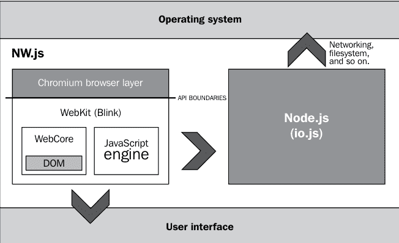

为了集成这两个虽说使用同一种语言、但截然不同的系统，开发者采用了一些巧妙的设计。首先，由于两者都是事件驱动的（遵循动作/反应逻辑，而非连续的操作流），因此对事件处理进行了统一。其次，将Node上下文注入到WebKit中，使其可以访问该上下文。
最棒的是，你可以完全用JavaScript编写所有应用的逻辑，无需担心Node.js和WebKit的边界在哪里。
如今，NW.js已经迭代到0.12.0版本，尽管仍处于发展早期，但已是使用网络技术开发桌面应用最有潜力的网页应用运行时之一。

### NW.js的优缺点
接下来我们来看看NW.js的一些典型特性：
- NW.js支持使用HTML5、CSS3、JS、WebGL以及Node.js的全部能力（包括使用第三方模块）开发现代化的桌面应用
- 原生UI API支持菜单、剪贴板、托盘图标、文件绑定等功能，能够开发出外观与原生应用一致的应用
- 由于Node.js和WebKit运行在同一线程内，NW.js的性能表现十分出色
- 使用NW.js，将现有网页应用移植为桌面应用非常简单
- 得益于CLI（命令行工具）和众多第三方工具的存在，在微软Windows、Mac OS和Linux平台上调试、打包和部署应用都非常简便

然而，金无足赤。使用NW.js开发应用时也需要考虑一些缺点：
- **应用体积**：由于每个应用都需要附带一份NW.js（体积为70-90MB），因此相比原生应用，其应用体积较大。不过，如果您担心下载时长，将NW.js压缩后再分发可将体积缩减约一半。
- **通过Mac App Store分发应用的难度较高**：本书不会对此展开讨论（您可以在谷歌上自行搜索），但即便流程相当复杂，您仍然可以通过Mac App Store分发NW.js应用。目前，由于.appx应用的架构不同，暂不支持将NW.js应用部署到Windows Store。


- 缺少iOS或Android支持：与其他SDK和库不同，目前无法将NW.js应用部署到iOS或Android平台，近期似乎也没有实现这一点的可能。不过，可以使用PhoneGap或TideSDK等工具将HTML、JavaScript、CSS代码分发到其他平台，这一点值得考虑。不幸的是，并非所有通过Node.js实现的功能都具备这种可移植性。
- 稳定性：最后，该平台仍然非常年轻，且存在不少bug。

## NW.js 使用场景
NW.js的灵活性和良好的性能使其能够应用在无数场景中，但为了方便，这里仅列举几个值得注意的场景：
- 开发工具
- 围绕现有CLI工具实现GUI
- 多媒体应用
- Web服务客户端
- 视频游戏

新项目的开发平台选择显然取决于开发者；为了全面评估事实，考虑一些不建议使用NW.js的具体场景可能会有所帮助：
- 当针对特定平台开发时，图形一致性至关重要，且可能需要通过应用商店分发应用
- 如果性能因素限制了前述技术的使用
- 如果应用大量使用了应用层通过Node.js提供的功能，且需要向移动设备分发

## 流行的NW.js应用
在总结完NW.js的优缺点后，我们不要忘了该平台真正的优势——已经有许多基于NW.js构建的广泛应用被发布。这里列举几个值得注意的：
- Windows 7版的Wunderlist：这是一款待办事项/日程管理应用，拥有数百万用户
- Cellist：这是一款HTTP调试代理，可在Mac App Store获取
- **Game Dev Tycoon**：这是首批NW.js游戏之一，让你扮演20世纪80年代的游戏开发者
- **Intel® XDK**：这是一款HTML5跨平台解决方案，支持开发者编写Web和混合应用

# 下载并安装NW.js
安装NW.js非常简单，但有很多方法可以实现。最简单的方法之一可能是从终端运行`npm install nw`，但为了本书的教学目的，我们将手动下载并安装它，以便正确理解其工作原理。你可以在项目网站`http://nwjs.io/`或GitHub项目页面的**下载**板块`https://github.com/nwjs/nw.js/`找到所有下载链接；从这里下载适合你操作系统的安装包。

> 例如，在我编写本书时，Node-Webkit的版本是0.12.0，我的操作系统是运行在64位MacBook Pro上的Mac OS X Yosemite 10.10；因此，我将下载`nwjs-v0.12.0-osx-x64.zip`文件。Mac和Windows的安装包是zip格式，而Linux的安装包是`tar.gz`格式。解压文件后，根据你的操作系统按如下步骤操作。

## 在Mac OS X上安装NW.js
在压缩包内，我们会找到三个文件：
- `Credits.html`：包含NW.js所有依赖的版权和许可信息
- `nwjs.app`：这是NW.js的实际可执行文件
- `nwjc`：这是一个CLI工具，用于编译你的源代码以保护代码

> 在v0.12.0之前，nwjc的文件名是nwsnapshot。

目前，我们唯一感兴趣的文件是`nwjs.app`（根据操作系统配置的不同，扩展名可能不会显示）。我们只需要将该文件复制到`/Applications`文件夹（你的主应用程序文件夹）中即可。

> 💡 如果你更愿意使用**Homebrew Cask**安装NW.js，只需在终端中输入以下命令：
> ```
> $ brew cask install nw
> ```
> 如果你使用Homebrew Cask安装NW.js，请记住Cask仓库可能不会及时更新，并且`nwjs.app`文件将被复制到`~/Applications`，同时会在`/Applications`文件夹中创建一个符号链接。

## 在微软Windows系统上安装NW.js
在微软Windows版的NW.js安装包中，我们会找到以下文件：
- `credits.html`：包含NW.js所有依赖的版权和许可信息
- `d3dcompiler_47.dll`：Direct3D库
- `ffmpegsumo.dll`：媒体库，需要使用` `和` `标签时必须包含
- `icudtl.dat`：重要的网络库
- `libEGL.dll`：WebGL和GPU加速
- `libGLESv2.dll`：WebGL和GPU加速
- `locales/`：语言文件夹
- `nw.exe`：NW.js的实际可执行文件
- `nw.pak`：重要的JS库
- `pdf.dll`：Web引擎用于打印的库
- `nwjc.exe`：CLI工具，用于编译你的源代码以保护代码

文件夹中的部分文件在最终应用分发时会被省略，但出于开发目的，我们只需将文件夹中的所有内容复制到`C:/Tools/nwjs`即可。

## 在Linux上安装NW.js
在Linux上，根据你使用的发行版不同，步骤可能更复杂。首先，如果你还没有这样做，将下载的压缩包复制到你的主文件夹，然后打开终端，输入以下命令解压压缩包（根据下载的版本相应修改版本号）：
``` $ gzip -dc nwjs-v0.12.0-linux-x64.tar.gz | tar xf - ```
接下来，使用以下命令将新创建的文件夹重命名为nwjs：
``` $ mv ~/nwjs-v0.12.0-linux-x64 ~/nwjs ```
在nwjs文件夹中，我们会找到以下文件：
- credits.html：包含NW.js所有依赖的版权和许可信息
- icudtl.dat：重要的网络库
- libffmpegsumo.so：媒体库，需要使用` `和` `标签时必须包含
- locales/：语言文件夹
- nw：NW.js的实际可执行文件
- `nw.pak`：重要的JS库
- nwjc：CLI工具，用于编译你的源代码以保护代码

打开终端中的文件夹，输入以下命令尝试运行NW.js：
``` $ cd nwjs $ ./nw ```
> 如果你遇到以下错误，说明你可能使用的是13.04之后的Ubuntu版本、18之后的Fedora版本，或其他使用libudev.so.1而非libudev.so.0的Linux发行版；否则，你可以继续进行下一步：
``` error while loading shared libraries: libudev.so.0: cannot open shared object file: No such file or directory ```
在NW.js更新支持libudev.so.1之前，有多种解决方案可以解决这个问题。对我来说，最简单的解决方案是在包含nw的目录中输入以下终端命令：
``` $ sed -i 's/udev\.so\.0/udev.so.1/g' nw ```
这会将应用程序代码中与`libudev`相关的字符串替换为新版本。这个过程可能会持续一段时间，因此请等待终端返回光标后再尝试输入以下内容：
``` $ ./nw ```
最终，NW.js窗口应该会正常打开。

## 开发工具
由于你将使用Node.js的第三方模块，因此需要**npm**来下载和安装所有依赖；所以，你的开发环境中显然必须安装Node.js（http://nodejs.org/）或io.js（https://iojs.org/）。我知道你急不可待地想要编写第一个应用程序，但在开始之前，我想向你介绍**Sublime Text 2**。这是一款简单却复杂的*集成开发环境*，得益于对自定义构建脚本的支持，它允许你在编辑器内部运行（和调试）NW.js应用。如果我没有说服你，你更愿意继续使用你喜欢的IDE，可以跳到下一部分；否则，请按照以下步骤安装和配置Sublime Text 2：
1. 从http://www.sublimetext.com/下载并安装适合你平台的Sublime Text 2。
2. 打开它，从顶部菜单导航到**Tools | Build System | New Build System**。
3. 会打开一个新的编辑屏幕；根据你的平台粘贴以下代码：

Mac OS X系统：
```json { "cmd": ["nwjs", "--enable-logging", "${project_path}:${file_path}"], "working_dir": "${project_path}:${file_path}", "path": "/Applications/nwjs.app/Contents/MacOS/" } ```
Microsoft Windows系统：
```json { "cmd": ["nw.exe", "--enable-logging", "${project_path}:${file_path}"], "working_dir": "${project_path}:${file_path}", "path": "C:/Tools/nwjs/" } ```


# 初识 NW.js
```json
{
  "shell": true
}
- Linux系统下：
```json
{
  "cmd": ["nw", "--enable-logging", "${project_path:${file_path}}"],
  "working_dir": "${project_path:${file_path}}",
  "path": "/home/userName/nwjs/"
}
```
4. 按下*Ctrl + S*（Mac系统下为*Cmd + S*），将文件保存为`nw-js.sublime-build`。
完成！现在你可以直接在IDE中运行你的应用了。
> 💡 Sublime Text 2 上有大量可用插件，例如*SublimeLinter*、*LiveReload*和*Node.js代码补全*。要安装这些插件，首先需要安装**Package Control**。打开https://sublime.wbond.net/installation 链接，按照页面说明操作即可。
## 编写并运行你的第一个“Hello World”应用
终于，我们可以开始编写第一个简单的应用了。本次我们将借助一个用于Markdown解析的Node.js模块，来编写我们熟悉的“Hello World”应用。
> “Markdown是一种纯文本格式化语法，设计目的是通过同名工具将其转换为HTML及其他多种格式。”——维基百科
现在创建一个`Hello World`文件夹，用Sublime Text 2或你常用的IDE打开它。
接下来新建一个`package.json`文件，输入以下JSON代码：
```json
{
  "name": "nw-hello-world",
  "main": "index.html",
  "dependencies": {
    "markdown": "0.5.x"
  }
}
```
> 如你在*第6章 打包应用用于分发*中将会看到的，`package.json` **清单文件**对应用分发至关重要，它决定了大量窗口属性以及应用的基础信息。此外，在开发过程中，你可以在其中声明所有依赖项。本次案例中，我们将配置应用名称、主文件，以及我们的依赖项——由*多米尼克·巴戈特*编写的**markdown模块**。
> 如果你乐意，也可以在终端中像创建普通npm包那样，使用`npm init`命令来生成`package.json`清单文件。
保存`package.json`文件后，新建一个`index.html`文件作为应用主文件，输入以下代码：
```html
<!DOCTYPE html>
<html>
<head>
  <title>Hello World!</title>
</head>
<body>
  <script>
    <!-- Here goes your code-->
  </script>
</body>
</html>
```
可以看到，这是非常常见的*HTML5*基础模板。我们在script标签中添加以下内容：
```javascript
var markdown = require("markdown").markdown,
  div = document.createElement("div"),
  content = "#Hello World!\n" + "We are using **io.js** " +
  "version **" + process.version + "**";
div.innerHTML = markdown.toHTML(content);
document.body.appendChild(div);
```
这里我们通过`require`引入markdown模块，再对`content`变量进行解析。为了尽可能简单，我使用了*原生JavaScript*将解析后的HTML输出到页面。你在高亮的代码行中应该注意到了，我们用到了`process.version`，这是Node.js上下文中的一个属性。
> 如果你尝试在浏览器中直接打开`index.html`，会遇到**Reference Error: require is not defined**错误，这是因为Node.js尚未注入到WebKit进程中。
保存`index.html`文件后，只剩下最后一步：在项目文件夹下的终端中运行以下命令安装依赖项：
```bash
$ npm install
```
现在，我们就可以运行第一个应用了！
## 在Sublime Text 2中运行NW.js应用
如果你选择使用Sublime Text 2，并且已经按照开发工具部分的流程完成了配置，只需点击**Project | Save Project As**，将`hello-world.sublime-project`文件保存在项目文件夹内即可。
接着在顶部菜单中，点击**Tools | Build System**，选择**nw-js**。
最后按下*Ctrl + B*（Mac系统下为*Cmd + B*）即可运行程序。
如果你选择的是其他IDE，请根据你的操作系统参考接下来的步骤操作。
## 在Microsoft Windows系统上运行NW.js应用
打开命令提示符，输入以下内容：
```cmd
C:\> c:\Tools\nwjs\nw.exe c:\path\to\the\project\
```
> 在Microsoft Windows系统上，你也可以将包含`package.json`的文件夹拖拽到`nw.exe`上来打开应用。
## 在Mac OS系统中运行NW.js应用
打开终端，输入以下内容：
```bash
$ /Applications/nwjs.app/Contents/MacOS/nwjs /path/to/the/project/
```
或者，如果你要在包含`package.json`的目录下运行NW.js应用，输入：
```bash
$ /Applications/nwjs.app/Contents/MacOS/nwjs .
```

> 如你在Mac OS X上看到的，NW.js套件的可执行二进制文件位于.app文件内的隐藏目录中。
## 在Linux系统上运行NW.js应用
打开终端，输入以下内容：
```bash
$ ~/nwjs/nw /path/to/the/project/
```
或者，如果你要在包含`package.json`的目录下运行NW.js应用，输入：
```bash
$ ~/nwjs/nw .
```

> 运行应用时，你可能会注意到不同平台下会出现一些错误。正如我在优缺点部分提到的，NW.js仍处于发展初期，出现这种情况非常正常，通常都是一些小问题。你可以前往NW.js的GitHub问题页面搜索这些错误是否已经被提交过；如果没有，你可以提交新的问题，你的帮助将非常有价值。
现在，无论你使用什么操作系统，都应该会出现类似下面的窗口：
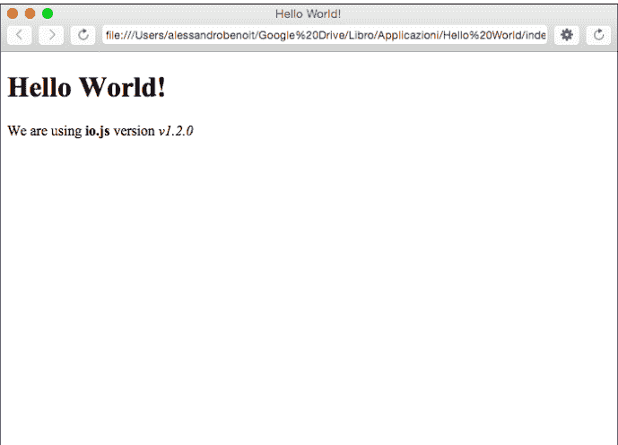
如图所示，`process.version`对象变量已经正确输出，因为Node.js已经被正确注入，可以从DOM中访问。
可能结果和你预期略有不同，因为Chromium的*顶部导航栏*是可见的。不用担心！你随时可以将`window.toolbar = false`参数添加到清单文件中来隐藏导航栏，但目前为了调试应用，让导航栏保持可见是很重要的。
## 本章总结
在本章中，你了解了NW.js的底层运行原理、推荐的开发工具、该库的几种使用场景，以及如何借助Node.js的第三方模块运行你的第一个简单应用。
我真的希望我没有因为过多讲解NW.js运行背后的理论概念让你感到无聊；我已经尽力让内容保持简洁了。
下一章我们会更多关注实战，学习如何借助NW.js的**原生UI API**与操作系统进行交互。
在*第2章 NW.js原生UI API*中，你将学到如何处理多窗口、操作文件选择对话框、创建自定义菜单，以及更多更多内容！
# NW.js 原生UI API
正如你在第一章中看到的，仅通过一个简单的HTML页面就能构建桌面应用非常简单，但要想真正理解NW.js的强大之处，我们还需要更进一步。
我们知道，**Node.js**负责处理底层系统功能，**WebKit**负责处理窗口GUI以及你通常在Web应用中做的所有事情，但还有一部分功能是缺失的。
为了*打造良好的用户体验*，我们需要让用户感觉到他们正在使用的是一款**原生桌面应用**，具备处理多窗口、访问剪贴板、最小化到系统托盘等功能。
总而言之，我们的应用需要完全与操作系统GUI集成。这部分功能WebKit无法实现，因为存在*API边界*限制；Node.js也无法实现，因为它没有GUI访问权限。幸运的是，NW.js为我们提供了完整的能力，在另外两者的基础上新增了一层可与操作系统图形界面交互的JavaScript API。
## 我们所讲的就是NW.js原生UI API。
原生UI API是一组自定义API，可让你在NW.js中创建*原生UI控件*。
要使用这些API，首先需要像下面这样引入`nw.gui`：
```javascript
var gui = require('nw.gui');
```
`gui`对象本质上就是一个库，包含了本章我们将接触的所有API的引用。
举个例子，如果你需要关闭当前窗口，可以编写如下代码：
```javascript
var gui = require('nw.gui');
var currentWindow = gui.Window.get();
currentWindow.close();
```

# NW.js 原生 UI 接口
> 为尽可能保持简洁，本章所有示例均为内联代码，需嵌入非常基础的HTML5样板的`<script>`或`<body>`标签内。要运行这些示例，请按照*第一章 认识NW.js*中介绍的Hello World应用流程操作。
还有一点需要注意：部分示例中我会使用`console.log()`来输出数据。我们目前还未讲解*调试*相关内容，现在你需要知道的是，当工具栏可见时，点击刷新按钮左上角的图标即可打开**开发者工具**窗口。
如前所述，我们会引入`nw.gui`库，为当前窗口实例化`window`对象，之后再调用其`close`方法。
关于原生UI接口还有一点需要注意：所有对象都继承自**Node.js事件发射器**，用于监听并恰当响应生成的事件。
参考以下示例：
```javascript
var gui = require('nw.gui');
var currentWindow = gui.Window.get();
currentWindow.on('minimize', function() {
    alert('Minimizing the window');
});
```
上述代码与之前的逻辑一致，只是这次我们没有直接调用方法，而是等待最小化事件触发，进而弹出提示框。
后续章节我们会深入讲解**窗口API**相关内容，不过目前你需要了解的内容就这么多。
使用原生UI接口时还有一点需要注意：如果代码编写有误，应用会直接崩溃——且不会抛出任何异常！因此你需要遵循以下最佳实践：
- 记得为已删除/移除的元素赋`null`值，避免后续复用该元素时出现异常行为
- 尽可能不要重新创建UI元素——复用已有元素
- 不要重新给元素赋值
- 不要修改UI类型的原型
以下是本章你将掌握的所有接口的简要概览：
| 接口 | 说明 |
| --- | --- |
| App | 该接口可用于与应用的基础功能交互，包括打开绑定文件类型、访问清单文件、注册全局快捷键、退出应用等操作。 |
| Window | 这是一组扩展的窗口接口，可用于处理单个或多个窗口、获取用户注意力、响应窗口事件。 |
| Screen | 这是一个单例接口，可用于获取屏幕信息、响应屏幕事件，例如分辨率变更、新增显示设备等。 |
| Menu | 该接口可用于创建窗口菜单、托盘菜单和右键上下文菜单。 |
| 文件对话框 | 该接口可通过文件对话框实现文件的打开或保存操作。 |
| 托盘 | 该接口可用于启用和管理托盘/状态图标。 |
| 剪贴板 | 该接口可用于访问系统剪贴板。 |
| Shell | 该接口可通过操作系统默认应用打开文件或URI。 |
> 本章仅介绍我认为开发类原生应用必不可少的接口。由于还有部分接口与本书主旨无关，我会在每节末尾的汇总列表中提供相关参考。你可以通过该项目的GitHub wiki页面了解更多内容：https://github.com/nwjs/nw.js/wiki/Native-UI-API-Manual
## App API——应用的核心
接下来我们将深入讲解NW.js应用背后的实际代码。App API提供了一系列实用的功能，可用于获取应用的核心信息与事件。我们将逐一介绍这些功能。
## 以原生方式打开应用内文件
NW.js应用中有很多打开文件的方式；本节我们将介绍*绑定文件类型*的打开方法。假设你正在开发一个文本编辑器，你可能希望将`.txt`文件与该编辑器关联。实际上，真正的绑定操作会在*第六章 打包应用用于分发*中介绍的打包步骤完成，但若要使用操作系统功能（例如通过**打开方式**右键菜单）打开文件，我们首先需要读取应用启动时传入的参数。
事实上，当你选择用某个应用打开指定文件时，流程如下：
```bash
$ nw path/to/nwjs/app path/to/file.txt
$ nw path/to/nwjs/app path/to/file.txt path/to/other_file.txt
```
要获取这些文件路径，我们需要访问`App.argv`属性，该属性会返回传入应用可执行文件的参数数组。
> 为了运行后续示例，你需要先按照*第六章 打包应用用于分发*中的步骤打包你的应用，因为开发阶段无法向应用传入参数。
这是一个拦截上述参数的简单示例：
```javascript
var gui = require('nw.gui');
var args = gui.App.argv;
// If arguments are passed
if (args.length > 0){
    // For each of them
    args.forEach(function (arg) {
        // Check if arg is valid file type and do something with it
    });
}
```
如上所示，我们会拦截传入的参数，若存在参数则遍历所有参数，检查是否为合法的文件类型，再执行对应操作。这个方案的弊端是*仅运行一次*，仅在应用首次启动时触发。由于你大概率不希望每打开一个文件就启动一个新的应用实例，因此你需要拦截`open`事件。
`open`事件仅在应用的一个实例已经启动时触发。参考以下示例：
```javascript
var gui = require('nw.gui');
gui.App.on('open', function(cmdline) {
    console.log('command line: ' + cmdline);
});
```
与以数组存储所有参数的`App.argv`不同，每传入一个文件路径，`open`事件就会触发一次。回调参数`cmdline`是包含文件路径的字符串变量。
> 💡 将文件拖拽到应用图标上时，文件路径的传递方式与通过**打开方式**打开时一致。
## 访问应用数据文件夹路径
我们接触的所有操作系统都会为每个应用、每个用户提供专属的默认文件夹，用于存储个人设置、应用支持文件，部分情况下还会存储应用数据。为了避免针对不同平台硬编码该文件夹路径，你可以直接通过`App.dataPath`属性获取路径。使用如下代码：
```javascript
var gui = require('nw.gui');
alert(gui.App.dataPath);
```
上述代码会根据操作系统不同，弹出以下某个值：
- **Microsoft Windows**：`%LOCALAPPDATA%/<name>`
- **Linux**：`~/.config/<name>`
- **Mac OS X**：`~/Library/Application Support/<name>`
以上列表中的`<name>`是清单文件中设置的应用名称。参考以下示例：
```javascript
var fs = require('fs'), gui = require('nw.gui'), path = require('path');
var settings = {
    'show_sidebar': true,
    'show_icons': false
};
var settingsFilename = path.join(gui.App.dataPath, 'mySettings.json');
// Write settings file
fs.writeFile(settingsFilename, JSON.stringify(settings));
// Read settings file
fs.readFile(settingsFilename, 'utf8', function (err, data) {
    var savedSettings = JSON.parse(data);
    console.log(savedSettings);
});
```
上述示例中，我们将一些设置存储在了应用数据文件夹内的JSON文件中。如你所见，在高亮行中我们使用`App.dataPath`获取路径，因此代码可以跨平台运行。在同一文件上连续调用`fs.writeFile`后立刻调用`fs.readFile`显然是错误的，因为我们无法保证此时文件已经可以读取。生产环境中应该使用回调函数替代这种写法。
## 访问清单文件数据
如前所述，`package.json`清单文件是应用的主配置文件。虽然我们还未在NW.js上下文中讲解过该文件（相关内容会在*第六章 打包应用用于分发*中介绍），但这并不改变你迟早需要读取其中数据的事实。当然你可以用Node.js实现该功能，但这毫无必要，因为清单数据已经存储在`App.manifest`对象中了。
这是一个非常基础的示例：
```javascript
var gui = require('nw.gui');
var manifestData = gui.App.manifest;
alert(manifestData.name);
```

这将打开一个提示框，其中包含清单文件中设置的应用程序名称。
## 关闭应用程序的最佳实践
在讲解`App.closeAllWindows()`的工作原理之前，我们需要先了解NW.js应用程序生命周期的一个重要特性：默认情况下，要退出应用程序，必须先关闭其所有窗口。不过我们可以轻松修改这一默认行为。
举个例子，假设我们有一个带主窗口和设置窗口的应用程序，我们希望实现以下效果：
- 关闭主窗口时应关闭所有应用程序窗口并退出
- 关闭设置窗口时应保存设置
因此，关闭主窗口时，设置窗口需要有机会在应用程序退出前保存数据。
我们可以按如下方式实现该功能：
- index.html（主窗口）：
```javascript
var gui = require('nw.gui'),
mainWindow = gui.Window.get();
window.open('settings.html');
mainWindow.on('close', function() {
gui.App.closeAllWindows();
this.close(true);
});
```
- settings.html（设置窗口）：
```javascript
var gui = require('nw.gui'),
settingsWindow = gui.Window.get();
settingsWindow.on('close', function() {
// Save data here
this.close(true);
});
```
上述实现逻辑非常巧妙。在`index.html`中，我们监听`close`事件，通过`App.closeAllWindows()`向所有其他窗口发送关闭信号。在`settings.html`中，我们监听关闭事件，以便在窗口关闭前保存数据。数据保存完成、所有窗口都关闭后，应用程序就可以彻底退出了。
如你所料，`App.closeAllWindows()`非常实用，它为窗口提供了*退出前保存数据的机会*。如果你还没完全理解这个示例也不用担心，你可以在Window API部分找到关于打开/关闭窗口的更详细说明。
在某些场景下，你可能需要*不发送任何关闭信号就关闭应用程序*；要实现这个效果，你可以按如下方式使用`App.quit()`：
```javascript
var gui = require('nw.gui');
gui.App.quit();
```
## 注册系统级快捷键
`App.registerGlobalHotKey()`可用于注册按键组合（**系统级快捷键**），即使应用程序没有获得焦点、已最小化或位于系统托盘，该快捷键也能触发应用操作。为方便说明，我们将借助**Shortcut API**的功能来实现这一能力，下文会具体介绍。
下面是一个简单示例：
```javascript
var gui = require('nw.gui');
var shortcut = new gui.Shortcut({
key: "Ctrl+Alt+A",
active: function() {
gui.Window.get().show();
console.log("You pressed: " + this.key);
}
});
gui.App.registerGlobalHotKey(shortcut);
```
如上例所示，我们先创建了一个键盘快捷键，再通过`App.registerGlobalHotKey()`完成注册。在快捷键配置项中，我们设置了`active`回调函数，当输入正确的按键组合时该回调会被触发。在本例中，当你按下*Ctrl + Alt + A*时，主窗口会显示出来（即使当前未获得焦点或已最小化），同时按键组合会输出到控制台。
> 💡 注册系统级快捷键时**务必小心**，因为你可能会拦截用于其他用途的按键组合（例如*Ctrl + C*）。
你也可以在不指定操作的情况下注册键盘快捷键，并监听active事件，方式如下：
```javascript
shortcut.on('active', function() {
// Do something
});
```
否则，你可以通过`App.unregisterGlobalHotKey(shortcut)`注销该快捷键。
## 其他应用程序API
NW.js还提供了其他一些与应用程序相关的API，我们一起来看看吧：
- `App.fullArgv`：该属性用于获取传递给可执行文件的完整参数列表，包含NW.js特有的参数。
- `App.createShortcut(string filePath)`：该API仅在Microsoft Windows系统上可用，可用于创建指向应用程序的快捷方式，快捷方式会使用清单文件中设置的`AppUserModelID`。
- `App.clearCache()`：清除内存和磁盘中的HTTP缓存，该方法是同步调用的。
- `App.crashBrowser()`、`App.crashRenderer()`：`App.crashBrowser()`用于崩溃浏览器进程，`App.crashRenderer()`用于崩溃渲染进程，二者均用于测试**崩溃转储**功能（见第8章*调试你的应用程序*）。
- `App.setCrashDumpDir(string dir)`：该API用于设置崩溃转储文件的保存目录（见第8章*调试你的应用程序*）。
- `App.getProxyForURL(string url)`：该API用于查询加载DOM中URL时要使用的**代理**配置。
- `App.setProxyConfig(string config)`：该API用于设置加载DOM中URL时要使用的代理配置。
- `App.addOriginAccessWhitelistEntry(sourceOrigin, destinationProtocol, destinationHost, allowDestinationSubdomains)`：该API用于向跨域访问控制白名单添加条目，**跨域访问**是粗体，对的。
- `App.removeOriginAccessWhitelistEntry(sourceOrigin, destinationProtocol, destinationHost, allowDestinationSubdomains)`：该API用于从跨域访问控制白名单中移除条目。
- `App.on('reopen', callback)`：该事件仅在Mac OS X系统上有效，当用户点击已运行应用程序的停靠栏图标时触发。
## Window API——NW.js窗口操作
在NW.js中，**Window API**本质上是DOM`window`对象的封装，为应用程序窗口操作提供了额外的功能层。本文描述的多数窗口方法都由DOM`window`对象继承。如前所述，`window`也是*Node.js EventEmitter*的实例，支持监听和响应`move`、`resize`等窗口事件。
### 实例化新窗口对象
实例化`window`对象有多种方式。如果需要引用当前窗口，只需调用`Window.get([window_object])`方法且不传入参数即可，示例如下：
```javascript
var gui = require('nw.gui');
var currentWindow = gui.Window.get();
```
如需实例化其他`window`对象，可通过`get`方法传入DOM`window`对象实现，示例如下：
```javascript
var gui = require('nw.gui');
var extraWindow = gui.Window.get(window.open('window.html'));
```
除此之外，也可以使用`Window.open(url[, options])`方法：
```javascript
var gui = require('nw.gui');
var extraWindow = gui.Window.open('window.html', {
position: 'center',
width: 640,
height: 480,
focus: true
});
```
如上例所示，`open`方法支持可选的配置项，可用于设置窗口的所有参数。所有可用设置的参考文档位于*第6章 打包应用程序用于分发*，这些设置与清单文件中使用的配置一致。
此外，`open`方法还支持以下自定义配置项：
- `new-instance: true`：该配置项用于在新WebKit进程中打开窗口。
- `inject-js-start: path/to/script.js`或`inject-js-end: path/to/script.js`：前者会在所有其他DOM构建完成前运行提供的JavaScript代码，后者会在文档对象加载完成、onload事件触发前运行代码。


> 需要注意的是，打开新窗口时，该窗口默认可能不会获得焦点；若要为其设置焦点，需要将focus配置项设为true。

NW.js应用程序启动时，从主窗口显示到代码执行完成之间可能会有一定延迟。为了提升用户体验，建议在所有后台任务执行完成前隐藏主窗口。
要实现这一效果，需要按如下方式修改清单文件来隐藏应用程序窗口：
```json
{
"window": {
"show": false
}
}
```
之后，我们可以利用onload事件：
```javascript
var gui = require('nw.gui');
window.onload = function() {
gui.Window.get().show();
};
```
这样就能在所有内容完全加载后显示窗口了。
该技巧的另一个适用场景是创建驻留在系统托盘的后台应用程序。


## NW.js 原生 UI API
还有最后一点。如开篇所述，`window` 不过是 DOM `window` 对象的封装。要访问原生 window 对象，你可以借助 `Window.window` 属性。这非常方便，因为 `window` 对象提供了很多无法通过 Window API 访问的功能。我们可以通过访问 `window` 对象上的 `window.navigator.language`（当前系统的区域设置）来演示这个用法，具体操作如下：
```js
var gui = require('nw.gui');
var currentWindow = gui.Window.get();
var language = currentWindow.window.navigator.language;
console.log(language);
```
在我的场景下，控制台会输出 `it-IT` 字符串。在上面的示例中，调用 `currentWindow.window` 和直接在当前作用域调用 `window` 效果完全一致，我相信你已经明白这个要点了。

## Window 窗口——设置窗口尺寸与位置
NW.js 提供了很多用于调整应用窗口尺寸、移动窗口的属性和方法。最容易记住的用法就是访问 `window` 对象的 `x`、`y`、`width`、`height` 属性，示例如下：
```js
var gui = require('nw.gui'), currentWindow = gui.Window.get();
// 输出当前窗口的尺寸与位置
console.log({ 'x': currentWindow.x, 'y': currentWindow.y, 'height': currentWindow.height, 'width': currentWindow.width });
// 2秒后修改窗口的尺寸与位置
setTimeout(function () {
    currentWindow.x = 10;
    currentWindow.y = 10;
    currentWindow.width = 200;
    currentWindow.height = 200;
}, 2000);
```
`Window.x` 和 `Window.y` 属性表示窗口在屏幕上的绝对位置，而 `Window.width` 和 `Window.height` 的含义不言自明。
你也可以通过调用 `Window.setResizable(false)` 方法禁止用户调整窗口大小，或者通过 `Window.setMaximumSize(maxWidth, maxHeight)` 和 `Window.setMinimumSize(minWidth, maxHeight)` 方法设置窗口的最大、最小尺寸边界。
> 不要同时使用 `setMaximumSize()`/`setMinimumSize()` 和 `setResizable(false)`，否则这两个功能都会失效。

以下是其他可用于移动或调整应用窗口尺寸的方法：
- `Window.setPosition(String position)`：该方法可用于设置窗口的相对位置。目前，所有平台都支持的取值仅有 `center`（居中）。
- `Window.moveTo(x, y)`：该方法用于设置窗口在屏幕上的坐标。
- `Window.moveBy(x, y)`：该方法允许你按照指定的像素值移动窗口。
- `Window.resizeTo(width, height)`：该方法用于直接设置窗口的尺寸。
- `Window.resizeBy(width, height)`：该方法允许你按照指定的数值调整窗口的尺寸。

此外，当你修改窗口的位置或尺寸时，还会触发以下两个事件：
```js
var gui = require('nw.gui'), currentWindow = gui.Window.get();
// 位置变更时输出新位置
currentWindow.on('move', function (x, y) {
    console.log('New position', 'x:' + x + ', y:' + y);
});
// 尺寸变更时输出新尺寸
currentWindow.on('resize', function (x, y) {
    console.log('New size', 'x:' + x + ', y:' + y);
});
```
无论是手动还是通过 API 修改窗口的位置、尺寸，上述两个事件都将会被触发。

### 更改窗口状态
每个桌面窗口都可能处于不同的状态：*最小化、最大化、隐藏、获得焦点、失去焦点、关闭*。通过 Window API，你可以在运行时轻松设置窗口的状态，我们来看具体做法：
```html
<script>
    var gui = require('nw.gui');
    var currentWindow = gui.Window.get();
    var newWindow = gui.Window.open('options.html');
</script>
<a href="#" onclick="newWindow.minimize()">Minimize Window</a><br>
<a href="#" onclick="newWindow.restore()">Restore Window</a><br>
<a href="#" onclick="newWindow.show()">Show Window</a><br>
<a href="#" onclick="newWindow.hide()">Hide Window</a><br>
<a href="#" onclick="newWindow.maximize()">Maximize Window</a><br>
<a href="#" onclick="newWindow.unmaximize()">Unmaximize Window</a><br>
<a href="#" onclick="newWindow.focus()">Focus Window</a><br>
```
上面的示例是深入理解所有窗口可见性 API 运行原理的绝佳方式，但你要谨**记**，这些 API 在不同平台上的运行逻辑存在差异（例如在 Mac OS X 上，`Window.show()` 会还原最小化的窗口，而在 Windows 8.1 上则会弹出一个黑色窗口）。因此，成对使用这些 API 非常重要：*最小化/还原、显示/隐藏、最大化/取消最大化*，同时要大量进行测试！

你可以通过监听以下事件来监控窗口可见性的变化：
- `Window.on('minimize', callback)`：窗口最小化时触发该事件。
- `Window.on('restore', callback)`：窗口从最小化状态还原时触发该事件。
- `Window.on('maximize', callback)`：窗口最大化时触发该事件。
- `Window.on('unmaximize', callback)`：窗口取消最大化时触发该事件。部分平台上，如果手动调整窗口尺寸，该事件不会被触发。
- `Window.on('focus', callback)`：窗口获得焦点时触发该事件。
- `Window.on('blur', callback)`：窗口失去焦点时触发该事件。

## 全屏窗口与 Kiosk 模式
为了提升小屏幕上的用户体验，越来越多应用（尤其是写作类应用）开始支持**全屏**工作模式。例如在 Mac OS X 上，标题栏原生的最大化按钮已经被全屏按钮完全取代。
实现该功能的代码非常简单，你可以通过以下方式设置或读取 `Window.isFullscreen` 属性的值：
```js
var gui = require('nw.gui'), currentWindow = gui.Window.get();
currentWindow.isFullscreen = true;
```
另外，你也可以使用 `Window.enterFullscreen()`、`Window.leaveFullscreen()` 和 `Window.toggleFullscreen()` 这三个方法，它们的含义不言自明。
你也可以监听 `enter-fullscreen` 和 `leave-fullscreen` 事件：
```html
<script>
    var gui = require('nw.gui');
    var currentWindow = gui.Window.get();
    currentWindow.on('enter-fullscreen', function () {
        console.log('Window has entered fullscreen mode');
    });
    currentWindow.on('leave-fullscreen', function () {
        console.log('Window has left fullscreen mode');
    });
</script>
<a href="#" onclick="currentWindow.toggleFullscreen()">Toggle Fullscreen</a>
```

### 另一个实用的功能是支持将应用设置为**Kiosk 模式**。
> *自助终端软件是专为交互式自助终端或互联网自助终端设计的系统与用户界面软件，它会锁定应用以防止用户对终端造成破坏。*
> ——维基百科

当应用处于 Kiosk 模式时，会进入全屏状态，且无法通过指针设备退出。在 Linux 和微软 Windows 系统上，你可以使用 *Alt + F4* 或 *Ctrl + Alt + Delete* 快捷键组合退出，否则这类应用会被系统识别为病毒；而在自助终端支持较为完善的 Mac OS X 上，你几乎会被完全锁定。
你仍然需要记得禁用屏幕热点，以及禁用或覆盖系统级快捷键，例如聚焦搜索、调度中心等。
> <span style="float:left; margin-right:0.3em; margin-top:0.1em;">✎</span> 在 Mac OS X 上，你需要从清单文件中禁用工具栏才能让 Kiosk 模式正常运行，否则会抛出致命错误。

和之前提到的全屏 API 一样，Kiosk 模式的实现也非常简单。你可以通过设置或读取 `Window.isKioskMode` 属性的值，或者使用 `Window.enterKioskMode()`、`Window.leaveKioskMode()` 和 `Window.toggleKioskMode()` 方法来控制该模式。进入/退出 Kiosk 模式时，会触发全屏相关事件，具体实现如下：
```html
<script>
    var gui = require('nw.gui'), currentWindow = gui.Window.get();
    // 调用 Window.enterKioskMode() 时会触发 enter-fullscreen 事件
    currentWindow.on('enter-fullscreen', function () {
        alert('Window has entered fullscreen mode');
    });
</script>
<a href="#" onclick="currentWindow.enterKioskMode();">Toggle Kiosk Mode</a>
```
> <span style="float:left; margin-right:0.3em; margin-top:0.1em;">💡</span> 你也可以通过清单文件启用 Kiosk 模式（见*第6章 打包应用用于分发*）。


## 无边框窗口与拖拽区域
如果你需要更灵活地控制窗口外观，可以将窗口设置为无边框模式，完全禁用窗口边框与标题栏。要将窗口设为无边框，你需要按如下方式编辑应用的清单文件：
``` 
{ 
  "name": "My frameless App", 
  "main": "index.html", 
  "window": { 
    "frame": false, 
    "toolbar": false 
  } 
} 
```
完成上述操作后，你会发现窗口无法移动，除非这正是你想要的效果，否则你需要在视口中*设置可拖拽区域*。接下来我们看看如何实现它：
```html
<!-- Custom title bar --> 
<span class="draggable"> 
  Draggable 
  <a href="#" onclick="window.close()" class="exit">&#x2716;</a> 
</span> 
<!-- Window content --> 
<p>Window content</p> 
<style> 
  html, body { 
    padding: 0; 
    margin: 0; 
  } 
  .draggable { 
    display: block; 
    background: #eee; 
    padding: 10px; 
    cursor: default; 
    -webkit-app-region: drag; 
    -webkit-user-select: none; 
  } 
  .exit { 
    float: right; 
    color: #666; 
    text-decoration: none; 
    cursor: default; 
    -webkit-app-region: no-drag; 
  } 
  .exit:hover { 
    color: #333; 
  } 
</style>
```
## NW.js 原生UI API

> 注意不要滥用`-webkit-app-region: no-drag`区域，因为在部分平台上，操作系统会将这类区域与`contextmenu`事件一同视为非客户端框架生成问题。

> 如高亮代码行所示，你可以通过`-webkit-app-region` CSS属性调用该API。在本例中，我们在自定义标题栏上将其设置为`drag`，在可拖拽区域内的退出按钮上设置为`no-drag`。这样非常方便，不是吗？你一定注意到了我们还用到了另一个WebKit CSS属性，也就是`-webkit-user-select`，该属性会禁止文本选择。这个属性非常实用，因为在原生桌面应用中，大部分应用文本都是无法被选中的。
## 任务栏图标——获取用户注意力！
到目前为止，我们已经介绍了窗口相关内容，但应用的另一个非常重要的部分，尤其是在应用最小化或未获得焦点时尤为重要，也就是我们接下来要讲的**任务栏图标**（macOS上称为Dock图标），注意不要和之后会介绍的*系统托盘图标*混淆。以下是几个与任务栏图标相关的API：
- `Window.setShowInTaskbar(bool show)`：该API允许将`show`属性设为false，从而隐藏图标。
- `Window.setBadgeLabel(string label)`：这是NW.js一个非常实用但鲜为人知的功能，它允许在应用图标附近的小徽章内显示文本字符串。该功能在macOS和Windows系统上运行良好，但在大多数Linux发行版上无法使用，仅Ubuntu支持，且只能显示数值。
- `Window.requestAttention(number|bool count)`：有时当应用最小化或未获得焦点时，你需要获取用户的注意力。`Window.requestAttention()`的表现因操作系统而异：在macOS上，调用`requestAttention`时应用必须处于未聚焦状态；如果`count`参数设为`-1`，图标会闪烁1次，如果设为`1`，图标会持续闪烁直到你关注该应用。在Windows系统上，图标和窗口都会按照`count`参数设定的次数闪烁，例如`currentWindow.requestAttention(5)`。在Linux系统（测试环境为Ubuntu + Cinnamon桌面环境）上，除`0`外，所有`count`值都有效；如果窗口已经处于激活状态，图标不会闪烁。
> 另一种获取用户注意力的方式是触发**通知**。请务必阅读*第四章 数据持久化方案与其他浏览器Web API*中的相关章节。
- `Window.setProgressBar(number progress)`：当运行耗时较长的处理流程时，在应用图标上显示简易进度条会非常有用，这样用户在进行其他操作时也能随时了解处理进度。`progress`属性的取值范围为0到1，例如`0.5`代表进度完成一半。
> 要使`Window.setBadgeLabel()`和`Window.setProgressBar()`在**Ubuntu**上生效，你需要创建一个`nw.desktop`文件，具体方法可参考*第六章 打包应用以进行分发*。
## 关闭窗口
`Window.close([force])`方法需要特别说明，该方法和我们在`App.closeAllWindows()`示例中见过的事件在关闭窗口时保存数据非常有用。此外，所有关闭相关的操作可能会拖慢关闭流程，因此我们更倾向于先隐藏窗口以提升用户体验。下面是一个简单示例：
```javascript
var gui = require('nw.gui'), 
currentWindow = gui.Window.get(); 
currentWindow.on('close', function (event) { 
  // Hide the window 
  this.hide(); 
  // Save data 
  // ... 
  // Close the window 
  this.close(true); 
}); 
currentWindow.close(); 
```
如你所料，在监听`close`事件时，`close()`方法不会立即关闭窗口，而是会等待将`force`参数设为`true`的关闭方法被调用。通过这种方式，你可以轻松隐藏窗口（避免用户不必要的等待）、保存数据，最终彻底关闭窗口。
> 注意调用`App.quit()`时不会触发close事件。此外，在上述示例中，你可以通过检查`event`参数的值来判断退出调用是来自菜单、Dock或快捷键发起的真正退出请求（此时`event == 'quit'`），还是来自关闭窗口的请求（此时`event == undefined`）。
关闭流程还提供了另一个事件，在存在多个窗口的场景下会用到，也就是`closed`事件，该事件会在窗口关闭且所有关联的JavaScript对象被释放时触发：
```javascript
var gui = require('nw.gui'), 
newWindow = gui.Window.open('window.html'); 
newWindow.on('closed', function () { 
  newWindow = null; 
}); 
```
在上述示例中，你可以看到*我们遵循了最佳实践*，在对象被移除时将其值设为`null`。后续代码中，我们可以检查`extraWindow`变量的值是否为非`null`，以验证该对象是否仍可用。
### 其他窗口API
还有一些其他与窗口相关的API：
- `Window.title`：可在运行时设置或获取窗口标题
- `Window.cookies.*`：可用于设置或获取窗口的Cookie
- `Window.menu`：可为窗口关联菜单（我们将在本章后续内容中介绍）
- `Window.reload()`：重新加载窗口
- `Window.reloadIgnoringCache()`：重新加载窗口，同时清除缓存
- `Window.setAlwaysOnTop()`：将窗口置于所有其他应用窗口的顶部
- `Window.isTransparent`和`Window.setTransparent(transparent)`：这两个API允许将窗口背景设置为透明（例如*Adobe Photoshop*的启动画面）
- `Window.showDevTools([id | iframe, headless])`、`Window.closeDevTools()`和`Window.isDevToolsOpen()`：这三个方法支持在运行时打开、关闭或检查**开发者工具**的可见性
- `Window.capturePage(callback [, image_format | config_object])`：对窗口进行**截图**
- `Window.eval(frame, script)`：在指定的框架中执行给定脚本
- `Window.zoomLevel`：设置或获取窗口的缩放级别（在处理*4K显示屏*时可能会用到）
此外还有许多我们可以监听的事件，用于实现更完善的应用：
- `capturepagedone`：当`Window.capturePage()`执行成功时触发，会传递一个buffer参数
- `devtools-opened`和`devtools-closed`：在**开发者工具**打开或关闭时触发
- `zoom`：窗口缩放时触发，会传递一个包含缩放级别的参数
- `loading`和`loaded`：分别在窗口开始重新加载和窗口完全加载时触发（是`window.load`的不依赖DOM的替代方案）
- `document-start`：当`document`对象可用时触发，但此时其他DOM对象都还未构造，任何脚本也未运行；如果处理的是iframe，会传递一个`frame`属性
- `document-end`：当`document`对象完全加载时触发；在`onload`事件触发之前，如果处理的是iframe，会传递一个`frame`属性


# NW.js 原生 UI API
## Screen API —— 屏幕几何函数
Screen API 是近期新增的接口，用于更妥善地处理单屏或多屏场景下的窗口尺寸调整与定位。运行以下代码：
```js
var gui = require('nw.gui');
gui.Screen.Init(); // Screen API is a Singleton
var screens = gui.Screen.screens;
```
你将获得一个屏幕对象数组，每个屏幕对象的结构如下：
```js
screen {
  // unique id for a screen
  id: 69673536,
  // physical screen resolution bounds
  bounds: { x: 0, y: 0, width: 1280, height: 800 },
  // usable area within the screen bounds
  work_area: { x: 0, y: 23, width: 1280, height: 773 },
  scaleFactor: 1,
  isBuiltIn: false
}
```
你可以轻松获取这些属性的值来优化用户体验。举个例子，如果你想把窗口定位到屏幕的右上角，在 Microsoft Windows 系统上你可能会按如下方式操作：
```js
var gui = require('nw.gui'),
  currentWindow = gui.Window.get();
currentWindow.moveTo(screen.width - currentWindow.width, 0);
```
但在 Mac OS X 或 Linux 系统上，窗口标题栏会刚好出现在系统菜单栏下方。我们本应首先校验屏幕的可用区域，让我们重新调整一下：
```js
var gui = require('nw.gui'),
  currentWindow = gui.Window.get();
gui.Screen.Init();
var screens = gui.Screen.screens;
// Let's assume we have only one display
var myScreen = screens[0];
var rightCorner = myScreen.work_area.width - currentWindow.width;
currentWindow.moveTo(rightCorner, myScreen.work_area.y);
```
现在我们的窗口刚好在右上角，不会和任务栏重叠，但如果把笔记本电脑连接到分辨率更低的投影仪上会发生什么呢？不出所料，窗口会超出屏幕边界。接下来我们添加一个 `displayBoundsChanged` 监听器来保持窗口位置：
```js
gui.Screen.on('displayBoundsChanged', function (newScreen) {
  rightCorner = newScreen.work_area.width - currentWindow.width;
  currentWindow.moveTo(rightCorner, newScreen.work_area.y);
});
```
`newScreen` 属性是一个新的屏幕对象，包含之前提到的所有属性，可根据需要调整参数。本示例就到这里，但在实际场景中，你可能还需要调整窗口尺寸、缩放比例，或将窗口移动到其他屏幕。这些都可以通过结合使用屏幕数据和三个可用事件来实现：我们已经介绍了 `displayBoundsChanged`，它会在屏幕分辨率变更时触发；另外还有 `displayAdded` 和 `displayRemoved`，这两个事件都会传递屏幕属性。

## 菜单 API —— 处理窗口菜单与上下文菜单
在 NW.js 中，菜单可以在三种不同场景下使用：
- **上下文菜单**：在应用内右键点击元素时弹出。
- **窗口菜单**：在 Microsoft Windows 和 Linux 系统上，每个窗口可配置一个独立菜单；而在 Mac OS X 系统上，每个应用仅能配置一个窗口菜单，该菜单会显示在系统任务栏中。
- **托盘图标菜单**：点击通常位于系统任务栏右侧的托盘图标时弹出。

本章将介绍前两种场景的菜单用法。托盘图标菜单的基础规则与此一致，更多相关内容可参考**托盘 API**章节。

## 上下文菜单
要在 NW.js 中实例化一个新菜单，步骤如下：
```js
var gui = require('nw.gui');
var menu = new gui.Menu();
```
菜单创建完成后，需要向其中追加一个或多个 MenuItem 对象：
```js
menu.append(new gui.MenuItem({
  label: 'Menu Item'
}));
```
菜单项共有三种类型：**普通（默认值）**、**复选框（开关项）**和**分隔符**。以下是实例化新菜单项时可声明的完整选项列表：
```js
var menuItem = new gui.MenuItem({
  type: 'checkbox', // Can be normal, checkbox or separator
  label: 'Menu Checkbox',
  icon: 'icon16.png',
  tooltip: 'Hello World!',
  click: function () {
    // Do something on click
  },
  enabled: true,
  checked: false, // Only for checkboxes
  key: 'M',
  modifiers: 'ctrl-shift',
  iconIsTemplate: true, // Only on Mac OS
  submenu: new gui.Menu() // Accept a Menu Object
});
```
大部分选项的含义都很直观，既可以在实例化对象时作为参数传入，也可以在运行时作为属性修改。`click` 选项接受一个回调函数，点击菜单项时会触发该回调，也可以通过 `MenuItem.on('click', callback)` 在运行时绑定点击事件。

修饰键（`Cmd`、`Shift`、`Ctrl`、`Alt`）和 `key`（单个按键）选项可以为当前菜单项绑定键盘快捷键。
> 在上下文菜单和托盘菜单中，菜单项绑定的键盘快捷键仅会在对应菜单打开时触发；而注册在窗口菜单中的键盘快捷键，即使菜单关闭也会触发。**请务必牢记这一点**，尤其是在使用 `document.addEventListener('keyup', callback)` 注册自定义键盘快捷键时，否则两个事件都会被触发。

了解完所有菜单项选项后，我们需要在用户触发特定操作时显示上下文菜单。你可以使用 `Menu.popup(x, y)` 方法来显示菜单，但通常我们不会手动传入坐标，而是将其与指定元素的右键点击事件绑定，接下来我们看看如何在 `contextmenu` 事件触发时调用该方法：
```html
<div id="area" style="padding:40px;background: #00f;">Right click here</div>
<script>
  var gui = require('nw.gui');
  var menu = new gui.Menu();
  menu.append(new gui.MenuItem({'label':'menuItem1'}));
  document.getElementById('area').addEventListener('contextmenu', function(e) {
    e.preventDefault();
    menu.popup(e.x, e.y);
    return false;
  });
</script>
```
如上例所示，弹出坐标由事件自身作为参数传入，再由 `popup` 方法捕获。Menu 对象还提供了其他几个属性和方法，可用于操作菜单项：
- `Menu.items`：该属性是与菜单关联的菜单项数组，因此你可以通过数组下标访问对应菜单项，格式为：`Menu.items[i]`
- `Menu.insert(MenuItem item, number i)`：与在队列末尾追加菜单项的 `Menu.append()` 不同，insert 方法允许你传入对应数组下标的 i 参数，将菜单项插入到任意指定位置（如果该位置已有菜单项，该位置及之后所有位置的菜单项下标会自动加 1）。
- `Menu.remove(MenuItem item)` 和 `Menu.removeAt(number i)`：这两个方法可用于删除指定的菜单项。

## 窗口菜单
上下文菜单的所有用法都适用于窗口菜单，但两者存在一些重要差异：
首先，要实现窗口菜单，需要将菜单类型设置为 menubar：
```js
var gui = require('nw.gui');
var windowMenu = new gui.Menu({
  type: 'menubar'
});
```
如果你计划将应用部署到 Mac OS X 平台，通常需要添加以下代码来实现系统内置的 Mac 菜单（包含应用、编辑和窗口菜单）：
```js
windowMenu.createMacBuiltin("App Name");
```
传入的应用名称字符串用于填充部分子菜单项的默认值。

回到我们的示例，`windowMenu` 的所有一级菜单项都必须包含子菜单，因为大多数平台都不允许存在空菜单：
```js
// Add first level menu
var firstMenuItem = new gui.MenuItem({
  label:'File',
  submenu: new gui.Menu()
});
windowMenu.append(firstMenuItem);
// Add submenu items
firstMenuItem.submenu.append(new gui.MenuItem({label:'Open'}));
```
```js
firstMenuItem.submenu.append(new gui.MenuItem({label:'Save'}));
firstMenuItem.submenu.append(new gui.MenuItem({type:'separator'}));
firstMenuItem.submenu.append(new gui.MenuItem({label:'Exit'}));
```
看起来有点复杂，但实际操作非常简单。我们向 `windowMenu` 中添加了一个名为 File 的一级菜单，再为其添加所有关联子菜单（打开、保存、退出）。最后只需添加下面这行代码，即可将 `windowMenu` 设置为当前窗口的菜单：
```js
gui.Window.get().menu = windowMenu;
```
完成。请务必阅读以下关于 Mac OS X 的注意事项，否则很容易遇到问题。
> 将应用部署到 Mac OS X 平台时你会发现，无论你如何自定义菜单名称，第一个菜单始终会显示为 `.plist` 文件中设置的应用名称（相关内容我们会在*第6章 打包应用用于分发*中介绍），对此你没有任何办法修改。另外正如前文提到的，Mac OS X 应用仅支持每个应用配置一个菜单，因此如果你需要根据不同平台实现不同的菜单，可以利用 `process.platform` 属性进行判断。

## 文件对话框 —— 打开与保存文件
在介绍*文件对话框*之前，需要先做个简单说明。你可能已经知道，浏览器中的文件对话框支持上传或下载文件，而在 NW.js 中，文件对话框仅用于*传递所选文件夹或文件的路径*，后续所有操作都会直接在原文件上执行，而非操作副本。

WebKit 支持通过**文件输入框**打开文件对话框，但由于*安全限制*，该方式存在诸多不足。在 NW.js 中，这些限制已被移除，且默认文件输入框也得到了增强，可提供完整的原生用户体验。

打开文件对话框的更快捷方式是为文件输入框添加事件监听器，示例如下：
```html
<input id="fileDialog" type="file">
<script>
  document.querySelector('#fileDialog')
    .addEventListener("change", function() {
      var filePath = this.value;
```


## NW.js 原生 UI API
```alert(filePath); }); </script> ```
在前面的示例中，浏览器视口中会渲染一个默认的文件输入框，点击它会打开文件选择对话框，选择文件后就会触发 change 事件，该事件会返回 `this.value` 属性内的文件路径。
这非常简单，但你大概率会想去掉这个难看的默认输入框。接下来我们来看看如何借助可复用的 JavaScript 对象实现：
```<input id="fileDialog" type="file">
<script>
function FileDialog(inputId, callback) {
  var fd = this;
  fd.chooser = document.querySelector(inputId);
  fd.chooser.addEventListener("change", function() {
    var path = this.value;
    callback(path);
    fd.chooser.value = '';
  });
  fd.open = function () {
    fd.chooser.click();
  };
  return fd;
}
var myFileDialog = new FileDialog('#fileDialog', function (path) {
  // Do something with path
  console.log(path);
});
</script>
<a href="#" onclick="myFileDialog.open();">打开文件</a>
```
我在这里实现的是一个非常简单的对象，它会监听文件输入框的值变化，并触发指定的回调函数。随后会重置输入框的值，这样即使连续两次选择同一个文件，也能再次触发回调。
这显然只是处理文件对话框的其中一种方式；你也可以轻松编写更优秀的处理逻辑，或像https://github.com/nwjs/nw.js/wiki/Native-UI-API-Manual这个wiki页面所描述的，借助jQuery实现。
目前我们接触的都是单文件打开对话框，但我们可以更进一步，实现打开*多个文件、目录*，或是**保存对话框**的功能。
你可以在接下来的章节中找到所有可用选项的相关说明。

### 打开多个文件
以下是打开多个文件的示例：
```<input type="file" multiple />
```
使用上述代码，path 属性会返回由 `";"` 字符分隔的路径列表。

### 按文件类型筛选
以下是按文件类型筛选的示例：
```<input type="file" accept=".doc,.docx,.xml,application/msword">
```
通过这种方式，你可以限制文件对话框允许打开的文件类型（保存对话框不支持该属性）。

### 打开目录
以下是打开目录的示例：
```<input type="file" nwdirectory />
```
所有文件选项会被禁用，你只能选择目录。

### 保存文件
以下是保存文件的示例：
```<input type="file" nwsaveas />
```
此时会显示保存对话框（而非默认的打开对话框），支持输入文件名。
你还可以按照如下方式指定默认文件名：
```<input type="file" nwsaveas="defaultFileName.txt" />
```

### 指定默认路径
以下是指定默认路径的示例：
```<input type="file" nwworkingdir="C:\Documents" />
```
你的应用可以智能地推荐打开或保存文件的默认路径，路径需要根据操作系统明确指定。

### 通过拖拽文件打开
很多原生桌面应用都提供了通过拖拽文件到应用窗口来打开文件的备选方式。
要实现这一功能，我们可以借助**HTML5 接口**。
由于这已经超出了本书的讲解范围，但该功能非常实用，因此我会给出一个示例来简化实现流程：
```<div id="dropFileHere">拖放文件到此处</div>
```
```<style>
#dropFileHere {
  display: block;
  background: #f00;
}
#dropFileHere.hover {
  background: #0f0;
}
</style>
```
```<script>
// Prevent default drop file behaviors
window.ondragover = function(e) {
  e.preventDefault();
};
window.ondrop = function(e) {
  e.preventDefault();
};
var holder = document.getElementById('dropFileHere');
holder.ondragenter = function() {
  this.className = 'hover';
};
holder.ondragleave = function() {
  this.className = '';
};
holder.ondrop = function(e) {
  e.preventDefault();
  this.className = '';
  for (var i = 0; i < e.dataTransfer.files.length; ++i) {
    var filePath = e.dataTransfer.files[i].path;
    // Do something with filePath
  }
};
</script>
```

### 托盘 API —— 将你的应用藏于明处
**系统托盘**是屏幕上的一个小区域，通常位于系统任务栏右侧，其中存放着一组属于常驻运行的应用或服务的图标，这些应用/服务无法放进已经非常拥挤的任务栏中。
要想为你的应用关联一个或多个托盘图标，你需要按照如下方式实例化一个**Tray 对象**：
```var gui = require('nw.gui');
var tray = new gui.Tray({
  icon: 'icon.png'
});
```
在**Microsoft Windows**和**Linux**系统上，只要你实例化了托盘对象，就可以通过给 `Tray.tooltip` 属性赋值来添加工具提示，通过 `Tray.icon` 属性在运行时切换图标，或是给 `Tray.menu` 属性赋值来关联菜单。
> 目前NW.js的托盘API并非在所有Linux发行版上都可用，因为它当前仍在使用较旧的GTKStatusIcon，而非更新的AppIndicator。不过GitHub上已存在相关的待处理issue，因此未来的版本可能会修复这个问题。
要显示菜单，你需要右键点击托盘图标；如果点击左键，则会触发 `click` 事件。
为了便于理解，我们来看一个示例：
```var gui = require('nw.gui');
var tray = new gui.Tray({
  icon: 'icon16.png'
});
// Assign tooltip
tray.tooltip = 'Hello World!';
// On right click show menu
tray.menu = new gui.Menu();
tray.menu.append(new gui.MenuItem({
  label: 'Exit'
}));
// On left click change icon
// You'd get the same behavior using alticon when a menu is attached
// to the tray icon
tray.on('click', function () {
  tray.icon = 'icon16_clicked.png'
});
```
你也可以通过 `Tray.remove()` 方法移除托盘图标，但要注意调用该方法后需要给对应的对象赋值为 `null`。
```tray.remove();
tray = null;
```
> 实例化新的托盘对象时，要注意必须在全局作用域中操作，否则如果放在其他仅在应用部分生命周期内存在的作用域中，垃圾回收机制运行时图标就会消失。

在**Mac OS X**系统上，设置托盘图标的流程基本相同，但你可以使用更多额外的属性和方法。
此外，当你为托盘图标关联菜单后，左击会用于显示菜单本身，因此不会触发 `click` 事件。
由于深入介绍Mac OS X的定制功能超出了本书的范畴，因此我仅在此列出这些功能供你参考：
- `Tray.title`：可用于设置或获取显示在图标旁（或替代图标）的自定义文本。
- `Tray.alticon`：可用于获取或设置托盘图标关联的菜单被打开时显示的激活状态图标。
- `Tray.iconsAreTemplates`：在Mac OS X上，图标可被视为模板（默认值为`true`）。

需要在需要时加载视网膜屏幕图标的话，可按照如下方式操作：
```if (window.devicePixelRatio > 1) {
  tray.icon = 'icon16@2x.png'; // The icon size should be 32x32px
}
```
另外，你也可以使用如下终端脚本将多个PNG图片合并为tiff图标（仅支持Mac OS X）：
```$ tiffutil -cathidpicheck icon16.png icon16@2x.png -out icon16.tiff
```
最后还有一点需要注意：无法自定义关联到托盘图标菜单的外观；但你可以显示一个自定义形状的透明窗口，跟踪点击位置。
要实现该功能，在监听点击事件时，你可以获取作为参数传入的 `position` 对象。
参考示例如下：
```tray.on('click', function(position) {
  // position.x is x coordinate of the tray icon
  // position.y is y coordinate of the tray icon
});
```

### 剪贴板 API —— 访问系统剪贴板
NW.js的**剪贴板 API**支持读取和写入系统剪贴板中的纯文本。
访问剪贴板内容主要有三个方法：`Clipboard.set(data)` 用于向剪贴板复制文本数据，`Clipboard.get()` 方法用于获取剪贴板中的数据，`Clipboard.clear()` 方法用于清空剪贴板。
以下是一个简单示例：
```var gui = require('nw.gui'), clipboard = gui.Clipboard.get();
// Copy
clipboard.set('I love NW.js :)');
// Paste
var data = clipboard.get('text');
// Clear
clipboard.clear();
```
> NW.js的剪贴板API目前仍非常新，现阶段仅支持访问系统剪贴板中的纯文本，不支持X11中的选中剪贴板。
> 要实现剪切、复制、粘贴功能，你可以借助 document.execCommand('cut')、document.execCommand('copy') 和 document.execCommand('paste') 方法。


## Shell API —— 依赖平台的桌面功能
Shell API由一系列方法组成，可帮助你完成与平台相关的任务：
- `Shell.openExternal(String URI)`：如果默认系统应用已关联对应协议，此方法会用默认系统应用打开任意给定的URI（如http://、mailto:等）；若未关联则不会触发任何操作。
- `Shell.openItem(String file_path)`：如果默认系统应用已关联对应文件类型，此方法会用默认系统应用打开任意给定的文件；若未关联则会显示“打开方式”对话框。
- `Shell.showItemInFolder(String path)`：此方法会用系统文件管理器/访达打开给定路径对应的文件夹。
下面是一个在默认浏览器中打开Google.com的简单示例：
```javascript
var gui = require('nw.gui');
gui.Shell.openExternal('http://www.google.com');
```
## 总结
在本章中，我尽力为你介绍了NW.js原生UI API的使用方法。我们实操了窗口、菜单、托盘图标以及更多与操作系统相关的功能。我经常采用“食谱式”的写作风格，因为我坚信最好的学习方式就是通过示例学习，就像我们小时候学习知识时的做法一样。遗憾的是，我无法深入讲解所有API，但我力争覆盖那些我认为对本书最重要的内容。现在你已经对如何与应用程序GUI交互有了大致的了解，我们可以进入下一个主题——Node.js。你大概率已经是这个领域的专家了，但在NW.js编程的场景下，Node.js的使用方式和常规场景略有不同。你将学习如何在多平台上定位并处理路径、使用模块，以及在WebKit和Node.js之间传递对象。我们不要再浪费时间了，直接进入第3章《发挥Node.js的威力》。
# 3. 发挥Node.js的威力
Node.js是Ryan Dahl于2009年创建的**事件驱动的运行时环境**，它提供了完善的环境来处理数万个并发连接，无需担心这些连接带来的运维开销。由于它还提供了用于*文件*操作、*套接字*通信和*HTTP通信*的**内置异步I/O库**，它已被诸多行业领军企业采纳为服务端平台，例如雅虎、微软、Groupon和领英。它在简单场景下的广泛应用，很大程度上是因为Node.js应用使用**纯JavaScript**编写，这是一种成熟的Web编程语言，拥有大量文档，学习曲线陡峭。
你们中的许多人已经使用Node.js构建过**客户端-服务端**应用，可能会想在NW.js中复刻客户端/服务端架构。这种做法并非完全错误，你几乎不用费什么力气就能将Node.js Web应用直接移植到NW.js中，但*这会影响平台潜力的发挥*。你需要始终记住，NW.js允许你*直接从DOM层面操作Node.js模块*，这会让你的应用运行速度更快，还能减少大量无用的代码行。
在本章中，我将尽量讲解NW.js环境下Node.js编程的特殊性，重点介绍*应用架构*、*路径处理*、*上下文问题*和*模块*相关的内容。由于你们在这个主题上的经验大概率比我更丰富，我不会深入讲解Node.js本身的编程知识。
## NW.js中的路由与模板渲染
许多Node.js开发者在实现应用程序的路由和模板渲染时，会倾向于采用诸如*Express*之类的Web框架，但正如我们在引言中提到的，我们并不推荐这种做法，因为这是客户端-服务端架构下的问题解决思路。下面我们来看看如何用**NW.js的方式**实现同样的效果。
你或许已经注意到，大部分新兴的**Web应用框架**都提供了基于客户端路由的功能。当你点击链接时，页面不会重新加载，而是借助HTML5 History API实时渲染新视图，同时页面URL也会同步更新。这种方式下，服务端和客户端之间仅需交换极少量的数据，你也不会遭遇全页面加载带来的糟糕体验。
因此，你当然可以使用**AngularJS**、**Ember.js**之类的Web应用框架来处理所有路由逻辑，但也可以自己编写一个非常简单的视图加载器——因为在桌面应用中，你不需要修改URL：
```html
<div id="mainView"></div>
<script>
var myApp = {};
myApp.loadView = function (view, containerId, callbackName) {
  var fileName = 'views/' + view + '.html';
  $(containerId).load(
    fileName, function (response, status) {
      if (status == 'error'){
        console.warn('Could not load ' + fileName);
      } else if (typeof myApp[callbackName] == 'function') {
        myApp[callbackName]($(this));
      }
    }
  );
};
// Loading views/view1.html
myApp.loadView('view1', '#mainView', 'view1Controller');
myApp.view1Controller = function ($currentView) {
  // Do something after main view is loaded
};
</script>
```
> 上述示例仅用于教学目的，用于帮助你在没有Web应用框架时理解该如何处理相关问题。本章中我会使用**jQuery**来精简代码，但你当然也可以使用原生JavaScript实现！
在上面的示例中，我们在运行时加载了views/view1.html文件，并提供了回调函数，确保只有视图加载完成后才会执行对应的代码。这个示例也体现了加载完整页面的另一个重大缺陷：每次调用时你都会丢失窗口上下文。
关于模板渲染没有太多需要补充的内容。如果你不想依赖Web应用框架，而是希望继续使用Node.js模板引擎，你可以直接从DOM层面轻松实现。我们复用上文的loadView()函数来演示如何加载Swig模板：
```javascript
myApp.loadSwigView = function (view, data) {
  var fileName = 'views/' + view + '.html',
  swig = require('swig');
  return swig.renderFile(fileName, data||{});
};
// Loading views/swigTemplate.html
var template = myApp.loadSwigView('swigTemplate', {
  pagename: 'awesome people',
  authors: ['Paul', 'Jim', 'Jane']
});
$('#mainView').html(template);
```
> 如果你计划开发大型桌面应用，我个人推荐你选用Web应用框架，充分利用MVC模式的优势。但不同场景适用不同策略，具体选择取决于你的需求。
## Node.js的全局对象与process对象
在NW.js中，全局对象的工作机制和Node.js中的基本一致，特殊之处在于它可以被DOM内部访问，为窗口上下文和Node.js上下文共享对象提供了额外的途径。此外，当窗口对象被创建时，全局对象的所有成员都会被赋值给该窗口对象，因此你可以在DOM内部直接使用`require()`。这种绑定是双向的，你也可以在Node.js模块中访问在窗口上下文中定义的全局属性和方法。
下面是一个简单示例：
- **index.html**：
```javascript
var gui = require('nw.gui');
gui.Window.open('newWindow.html');
global.sharedObjects = {
  myData: 'Foo'
};
var myModule = require('./module.js');
```
- **module.js**：
```javascript
console.log(sharedObjects.myData);
```
- **newWindow.html**：
```javascript
console.log(global.sharedObjects.myData);
```
如上所示，在我们的模块中，我们省略了`global`，因为它已经被赋值为**全局根变量**。你可能因此想将所有编码逻辑都放在Node.js模块中，但请记住，*少量DOM操作无法在Node.js上下文中运行*；例如`window.openDatabase`和`nw.gui`都无法使用，因为它们依赖窗口上下文。
> 💡 你需要记住，滥用全局变量通常被视为不良实践，因此务必三思——几乎一定有更好的处理方式。
`process`对象是全局对象，可在窗口上下文和Node.js上下文中同时访问。在NW.js中，为该对象新增了若干字段：
- `process.versions['NW.js']`：获取NW.js的版本
- `process.versions['chromium']`：获取NW.js所带Chromium的版本
- `process.mainModule`：获取manifest文件中main字段指定的启动页（如`index.html`）
如果manifest文件中指定了`node-main`字段，`process.mainModule`将指向该字段指定的文件。


## window对象
当所有初始化步骤完成后，一旦环境就绪，window对象就会被传入Node.js的global对象中，这样你就可以在模块里通过`global.window`或者直接使用`window`来引用它。页面导航时，window引用会被替换为新页面对应的window。参考以下示例：
- **nodeModule.js:**
```javascript
exports.checkWindowVar = function () {
  console.log(window.myVar);
}
```
- **index.html:**
```javascript
var myVar = 'Hello';
var nodeModule = require('./nodeModule.js');
nodeModule.checkWindowVar(); // Hello
// 导航到newWindow.html
location.href = 'newWindow.html';
```
- **newWindow.html:**
```javascript
var myVar = 'Foo';
var nodeModule = require('./nodeModule.js');
nodeModule.checkWindowVar(); // Foo
```

### *发挥Node.js的能力*
上述代码会始终打印最后一次实例的`myVar`值。但如果你不是导航到新页面，而是*在新窗口中打开它*，那么即使窗口已经关闭，引用也会保留第一个实例的`myVar`。因此我们修改`index.html`：
```javascript
var myVar = 'Hello';
var gui = require('nw.gui');
gui.Window.open('newWindow.html');
```
当你查看控制台时，仍然会得到`Hello`的结果。这种情况下，如果你需要从Node.js访问新的`window`对象，就必须手动替换它。我们对应修改`newWindow.html`，只需在代码开头添加`global.window = window;`即可，你就能如预期地拿到`Foo`字符串。

## **使用NW.js的主模块**
如我们在第一章所述，NW.js会检查manifest文件中的`main`字段，以便在打开应用第一个窗口时加载指定的文件。`node-main`字段作用类似，但它指向的不是HTML文件，而是允许你*设置一个Node.js主模块*，该模块会在后台运行，独立于窗口上下文，贯穿整个应用生命周期（不过当所有应用窗口都关闭时，它会默认退出）。在上一章中我们提到，可以通过窗口上下文中的`process.mainModule`获取主模块，更具体地说，除了`global`之外，我们还可以利用`process.mainModule.exports`在两个上下文之间共享对象。
> 💡 多亏了`global`对象，`window`对象也会和主模块共享，但显然在DOM发送就绪信号之前，你无法访问它。我们来看一个示例：
- **package.json:**
```json
{
  "name": "secondsSinceStart",
  "node-main": "nodemain.js",
  "main": "index.html"
}
```
- **nodemain.js:**
```javascript
var seconds = 0;
setInterval(function() {
  seconds++;
}, 1000);
exports.secondsSinceStart = function () {
  return seconds;
}
```
- **index.html:**
```html
<div id="time"></div>
<script>
  seconds = process.mainModule.exports.secondsSinceStart();
  $('#time').text(seconds + ' seconds');
</script>
```
我们已经配置manifest文件，将`nodemain.js`加载为主模块；当你重新加载窗口时，会发现`seconds`变量并没有被重置。这是因为主模块独立于窗口实例在后台运行。

## 在NW.js中处理路径
最初，在NW.js中处理路径可能会比较棘手。你最先可能遇到的麻烦是，需要引入一个不在默认`node_modules`文件夹中的自定义模块。举个例子，假设我们的文件夹结构如下：
```
Application root
- data/myData.json
- js/script.js
- modules/myModule.js
- modules/otherModule.js
- index.html
- package.json
```
当从窗口上下文引入模块时，模块路径会被视为相对于应用根目录，因此在我们的示例中，无论你是从`index.html`还是`js/script.js`调用，都可以按照以下代码操作：
```javascript
require('./modules/myModule');
```
但从另一个模块中调用模块时，你应该使用相对于当前文件的路径。假设我们要从同一个文件夹下的`myModule.js`中引入`otherModule.js`，代码如下：
```javascript
require('./otherModule');
```

### *发挥Node.js的能力*
接下来你可能担心的是，如何从两个上下文中使用相对路径*访问文件进行I/O操作*。这其实非常简单，因为你始终可以将文件路径视为相对于应用根文件夹：
```javascript
var fs = require('fs');
fs.readFile('data/myData.json', 'utf8', function (err, data) {
  console.log(JSON.parse(data));
});
```
无论你是在`index.html`、`js/script.js`还是`modules/otherModule.js`中使用这段代码，相对文件路径都会是相同的。有两种方式可以获取应用根文件夹的**绝对路径**。你当然可以在`index.html`中调用`window.location.pathname`，但有一个更好的*Node.js原生方式*来实现。Node.js提供了`__dirname`全局变量，它会返回当前文件的路径名，唯一限制是只能在*Node.js上下文*中访问。但为了在窗口上下文中使用`__dirname`，我们可以提供一个简单的变通方案：在应用根文件夹中创建一个`util.js`模块：
```javascript
exports.dirname = __dirname;
```
之后我们可以从`index.html`中引入该模块：
```javascript
var dirname = require('./util').dirname;
console.log(dirname);
```
由于`util`模块在根文件夹中，因此无论在何处调用，`dirname`都会返回应用根路径。关于路径最后需要注意的一点是，在Microsoft Windows系统中使用反斜杠而不是普通斜杠。为了给不同平台提供正确的路径格式，你应该使用Node.js的**path模块**：
```javascript
var path = require('path');
console.log(path.normalize('/my/custom/folder'));
```
在Mac OS X或Linux系统上，`path.normalize()`会返回`/my/custom/folder`，但在Microsoft Windows上，它会返回`\my\custom\folder`（额外的反斜杠是转义用的）。如果你需要拼接多个路径，可以使用`path.join()`替代：
```javascript
var path = require('path'), dirname = require('./util').dirname;
console.log(path.join(dirname, 'data/myData.json'));
```
根据平台不同，它可能会返回`/.../myApp/data/myData.json`或者`C:\...\myApp\data\myData.json`。
> 💡 如果你需要获取应用的绝对**dataPath**，可以使用*第2章《NW.js原生UI API》*中提到的`App.dataPath` API。如果你需要根据当前操作系统定位特定文件夹，可以利用`process.platform`属性：
```javascript
var path = require('path'), desktopPath;
switch(process.platform) {
  case 'darwin':
  case 'linux':
    desktopPath = path.join(process.env.HOME, 'Desktop');
    break;
  case 'win32':
  case 'win64':
    desktopPath = path.join(process.env.USERPROFILE, 'Desktop');
    break;
  default:
    throw 'Platform not supported';
}
console.log(desktopPath);
```
这是一个非常基础的示例，演示了如何返回当前平台的**桌面路径**。

## NW.js上下文问题
我们之前已经讨论过上下文，以及如何通过`global`在窗口和Node.js上下文之间传递对象，但在多上下文开发时仍有一些需要注意的事项。首先，你需要考虑*在DOM和Node.js上下文之间切换会消耗一定时间*，因此如果你计划运行数百个依赖窗口和Node.js上下文的并发操作，可能会遇到轻微延迟。为了避免这类问题，你最好提前确定要使用哪个上下文。另一件一开始可能会让人困惑的事情是，不同上下文中的相同对象在其原型链中也有不同的构造函数。这会导致`instanceof`运算符行为异常，它*无法识别来自不同上下文的原型*。


## 发挥 Node.js 的优势
我们来看一个示例：
- **nodeContext.js：**
```exports.myArray = ['one','two','three'];```
- **index.html：**
```var windowContext = { myArray: ['one','two','three'] }; // First statement
console.log(windowContext.myArray instanceof Array); // true
var nodeContext = require('./nodeContext'); // Second statement
console.log(nodeContext.myArray instanceof Array); // false```

如上所示，尽管我们看似是在检查同一个数组对象，但得到的结果却不同。避免这类问题的一个更快捷的方法是弃用`instanceof`，改用更可靠的替代方案，比如`Array.isArray`。如果还是无法解决问题，你可以使用 nwglobal 模块（https://github.com/Mithgol/nwglobal）。nwglobal 提供了一种非常简单的导出 Node.js 构造函数的方法，用于避免 window 上下文和 Node.js 上下文中的`instanceof`问题。

我们来回顾一下上个示例中的第二条语句：
```var nwglobal = require('nwglobal');
console.log(nodeContext.myArray instanceof nwglobal.Array); // true```

这次，这条语句会返回 true，因为我们通过`nwglobal.Array`获取到了正确的构造函数。多亏了 nwglobal，我们还可以使用 Node.js 构造函数创建对象，因此如果你需要向使用了`instanceof`的 Node.js 模块传递对象，可以按照以下代码所示的方式操作：
- **nodeContext.js：**
```exports.checkArray = function (myArray) {
  return myArray instanceof Array;
}```
- **index.html：**
```var windowArray = ['one', 'two', 'three'];
console.log(nodeContext.checkArray(windowArray)); // false
var nodeArray = nwglobal.Array('one', 'two', 'three');
console.log(nodeContext.checkArray(nodeArray)); // true```

最后需要注意的一点是，nwglobal 支持**数组类型转换**。如果你需要向 Node.js 模块传递 jQuery 集合，这一功能会非常方便。我们来回顾一下相关代码：
```var nodeArray = nwglobal.Array.prototype.slice.call(windowArray);
console.log(nodeContext.checkArray(nodeArray)); // true```

> 你可以在 https://github.com/nwjs/nw.js/wiki/Differences-of-JavaScript-contexts 找到更多关于 NW.js 上下文问题的相关信息。
如果你的 NW.js 项目中使用了**RequireJS**，它会和 Node.js 的`require`产生冲突。要解决这个问题，你可以参考 http://www.requirejs.org/docs/faq-advanced.html。

### 使用 Node.js 模块
Node.js 的一大优势无疑是拥有数万个可通过**npm**免费下载的模块。想必你已经知道，Node.js 支持三种类型的模块：
- 内部模块，即 Node API 的组成部分
- 用 JavaScript 编写的第三方模块
- 带有 C/C++ 插件的第三方模块

在 NW.js 中你可以使用所有这些模块，但需要注意一些事项。

#### 内部模块
**fs**、**path**、**http** 这类内部模块开箱即用，你可以通过以下代码非常轻松地调用它们：
```var fs = require('fs');```

#### 用 JavaScript 编写的第三方模块
第三方 JavaScript 模块可通过 npm 安装，所有依赖会随模块一起下载到应用根目录的`node_modules`文件夹中，方便随应用一起分发。你可以通过以下代码非常轻松地引入这些模块：
```var modulename = require('modulename');```

#### 带有 C/C++ 插件的第三方模块
尽管大多数 Node.js 模块都是用纯 JavaScript 编写的，但你可能需要用到包含 C/C++ 插件的模块。这种情况和之前略有不同：这类模块安装时会自动编译，以便适配 Node.js 运行。由于 NW.js 和 Node.js 的**应用程序二进制接口（ABI）**不同，编译后的版本无法和你的应用兼容。你需要使用**nw-gyp**手动编译该模块，它是*node-gyp*的一个特殊分支。接下来我们看看本章中的具体操作步骤：
1. 使用以下命令安装`nw-gyp`：`npm install nw-gyp -g`
2. 像平常一样通过 npm 安装你的模块。
3. 在模块文件夹（即存放`binding.gyp`文件的目录）中运行`nw-gyp`，并指定 NW.js 目标版本：`$ nw-gyp rebuild --target=0.11.2`
4. 完成。现在你就可以像平常一样引入该模块了：`var modulename = require('modulename');`
> 💡 在 Mac OS X 上，只需要安装 Xcode 命令行工具即可；在其他操作系统上，你需要手动安装 Python、Make 以及合适的 C/C++ 编译器。更多相关信息可以参考 https://github.com/nwjs/nw-gyp。
> 💡 在微软 Windows 系统上，引擎的可执行文件必须命名为`nw.exe`，C/C++ 插件才能正常运行，因为它们依赖 NW.js 引擎维持执行。

你可以通过`npm install 模块名`的方式安装 NW.js 模块，也可以将模块添加为 manifest 文件中的依赖项，再运行`npm install`完成安装。示例如下：
```{
  "name": "hello-world",
  "main": "index.html",
  "dependencies": {
    "markdown": "0.5.x",
    "swig": "1.4.2"
  }
}```

## 总结
如我在引言中所说，本章主要讲解如何将你已有的 Node.js 知识适配到 NW.js 开发中。这需要较强的*灵活性*，也意味着要放弃已经过检验的编程习惯，难度不小，但最终会得到运行更快、结构更清晰、针对平台优化的代码。我介绍的有些概念对水平较高的读者来说可能非常简单，但我宁愿讲得繁琐一些，也不愿留到需要的时候再去碰运气。下一章我们会讲解**浏览器 API**，更具体地说，会介绍它们能为你的 NW.js 应用带来的所有优势，重点讲解如何借助*Web SQL 数据库、嵌入式数据库和 Web 存储 API*实现持久化数据存储。

# 4 数据持久化方案及其他浏览器 Web API
最近，人们提到**浏览器 Web API**时，通常会统称为**HTML5 API**。这是因为新的 HTML5 标准为 Web 应用开发注入了新的活力。在 HTML5 出现之前，WebSocket、Canvas、视频和 Web 存储这类功能实现起来非常繁琐且困难。实际上，浏览器 Web API 是一套 API 集合，包含标准的*JavaScript* API、*XMLHttpRequest*、*WebKit* API、*V8* API、*HTML5* 以及其他新兴 API。如你所想，Chromium 的 Web API 为你提供了海量工具来构建应用，从自定义输入框（日期、邮箱等）到通过 WebSocket 实现实时推送通知，应有尽有。但为了简洁起见，本章只会介绍在 NW.js 桌面应用开发中特别实用的 API。我们会介绍存储*永久数据*、处理*媒体文件*的各类方案，也会简要涉及*安全问题*，最后会讲解*Web 通知 API*。

你可能已经想到这一点，但开发 NW.js 应用时有一个很关键的点需要记住：尽管你使用的是 JavaScript、CSS 和 HTML，看起来是在开发 Web 应用，但实际上你只针对一个浏览器进行开发，那就是**Chromium**。这意味着你无需考虑浏览器兼容性问题，可以直接使用最新的浏览器 Web API 实现。不再需要加各种前缀（除了 WebKit 相关的），也不再需要用到 polyfill 填充脚本，而且你可以放心使用通知、Flex 布局、Canvas 甚至地理定位这类前沿技术，无需有任何顾虑。

## 数据持久化方案
NW.js 提供了多种数据持久化处理方式。你当然可以选择使用 Node.js 持久化数据库，比如*EJDB*、*locallyDB*、*NeDB*或*LowDB*，但本章我们会介绍如何借助最新的浏览器存储技术保存和访问持久化数据。
> ⚠️ 我不会在**HTML5 应用缓存**上花费太多篇幅，因为我觉得它在 NW.js 应用中并没有什么用处；但如果你需要实现离线导航，你也可以选择使用它。

### Web 存储
Web 存储是一项浏览器技术，最初属于 HTML5 规范的一部分，后来独立成了单独的规范，用于在客户端存储临时或永久的**键值对**数据。它无疑是浏览器中*实现数据持久化的最简单方式*，但同时也是最薄弱的一种。我们来看看 Web 存储的一些缺点：
- 最大存储限制为 5MB
- Web 存储的调用是同步的，可能会阻塞主文档的渲染
- Web 存储会将数据写入硬盘，因此性能较差
- 不支持高级索引/查询，因为存储的值只能是字符串类型

显然，只有在你需要进行非常简单的、非密集型数据事务时，Web 存储才是合适的选择。Web 存储分为两种：第一种称为**localStorage**，是永久存储，生命周期超出应用会话；后一种称为**sessionStorage**，是临时存储，应用关闭后就会被删除。本章我们会讲解`localStorage`的使用。要往它的键值结构中存储数据，你可以按照以下方式操作：
```localStorage.setItem('myKey', 'myValue');```
然后，如果你需要取出存储的值，可以通过对应的**键**轻松访问存储的字符串：
```var foo = localStorage.getItem('myKey');
console.log(foo); // myValue or null if not set before```

前面的示例可以使用方括号或点语法重写：
```
localStorage.myKey = 'myValue';
console.log(localStorage['myKey']); // myValue
```
如你所见，使用 web storage 非常简单；要删除一个键值对，你可以使用以下代码：
```
localStorage.removeItem('myKey');
// or delete localStorage.myKey;
```
你甚至可以使用 `localStorage.clear()` 删除所有已存储的数据。`localStorage` 对象还有一个 `length` 属性，返回其中存储的键值对数量，以及一个 `key()` 方法，通过数字键获取对应的值：
```javascript
var lastKey = localStorage.length - 1;
console.log(localStorage.key(lastKey)); // Returns older value
```
> 请注意，`sessionStorage` 具有与 `localStorage` 完全相同的属性和方法。

如前所述，`localStorage` 只接受字符串作为其值，因此如果你需要存储更复杂的数据，必须先将其转换为 JSON 或 base64。前者非常适合存储普通的 JavaScript 对象，而后者非常适合存储图像和其他称为二进制大对象（BLOBs）的文件类型。为了将 JavaScript 对象存储到 `localStorage` 中，我们可以这样做：
```javascript
localStorage.myObject = JSON.stringify({ artist: 'Ludovico Einaudi', song: 'Experience - Starkey Remix' });
var myObject = JSON.parse(localStorage.myObject);
console.log(myObject);
```

## 数据持久化解决方案及其他浏览器 Web API
你可以通过打开**开发者工具**并查看 **Resources** | **Local Storage** 选项卡来轻松调试存储在 `localStorage` 中的数据，如下方截图所示：
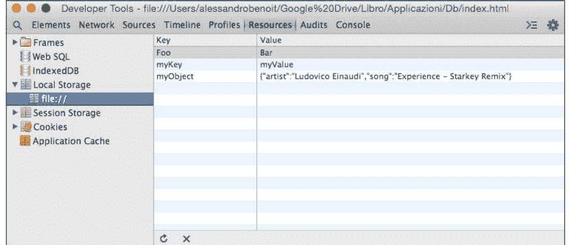

当你在 `localStorage` 中存储一个值时，所有并发窗口都会触发一个 `storage` 事件。因此，打开一个新窗口并按如下方式监听 storage 事件：
```javascript
window.addEventListener('storage', function (e) {
  console.log(e.key, e.newValue);
});
```
实际上，你可以在触发事件的窗口和监听事件的窗口之间进行通信（storage 事件不会在触发它的同一个窗口中被捕获）。

如果你更愿意使用更高级的 API 通过 web storage 来存储对象，可以使用 **StoreDB**，这是一个非常简单的、基于 `MongoDB 风格的 API`，构建在 `localStorage` 之上。你可以从 GitHub（[https://github.com/djyde/StoreDB](https://github.com/djyde/StoreDB)）下载或通过 Bower 安装 StoreDB：
```bash
$ bower install storedb
```
然后，在页面的 head 中通过以下代码引入它：
```html
<script type="text/javascript" src="bower_components/storedb/storedb.js"></script>
```

要使用 StoreDB 存储对象，只需输入：
```javascript
storedb('players').insert({ name: 'Lucas', sex: 'male', score: 24 });
```
然后，要检索数据，可以这样做：
```javascript
var players = storedb('players').find({name:'Lucas'});
console.log(players); // Array of players with the name Lucas
```
你可以使用 MongoDB 风格的操作符来更新值，例如 `$inc`（增加）、`$set`（替换）或 `$push`（追加）：
```javascript
// Add 10 to the score of the players named Randy
storedb('players').update( {'name':'Randy'}, {'$inc':{'score':10}} );
```
最后，使用以下代码删除数据：
```javascript
// Remove players named Randy
storedb('players').remove({'name':'Randy'});
```
不带选项使用 `find()` 或 `remove()` 将分别查找或删除给定键下的所有对象。

最后需要注意的是，StoreDB 还提供了一个回调函数来处理错误。每个事务的结果不会由方法本身返回，而只会通过回调返回（如果你这样设置的话）。让我们看一个例子：
```javascript
var outcome = storedb('players').find({name:'Lucas'}, function (err, result) {
  if(err) throw err;
  console.log(result); // Array of players named Lucas
});
console.log(outcome); // null
```
如上所示，StoreDB 是一个非常小的项目，显然具有与 `localStorage` 相同的缺陷，但它在小型项目中存储和查找对象时确实非常方便。

### Web SQL 数据库
Web SQL Database 是一个基于 *SQLite* 的规范，将 SQL 带到了客户端。它的优势在于**SQL 语言**的便捷性（除了 select、insert、update 和 delete 之外，你还可以进行 join、子查询等操作）以及能够*异步*查询，但它也相当冗长，且**目前已被 W3C 废弃**，因为其实现标准存在争议。然而，由于它尚未被停止使用，而且短期内可能也不会被停止，你可以自由地在 NW.js 项目中使用它。

为了使用 Web SQL Database，你必须首先创建并打开一个数据库：
```javascript
var dbName = 'myDb',
  dbVersion = '1.0',
  dbDisplayName = 'My Database',
  dbSize = 1024 * 1024;
var Database = openDatabase(dbName, dbVersion, dbDisplayName, dbSize, function(Database) {
  console.log("Database open");
});
```
数据库连接是动态创建的，并返回一个 `Database` 对象以开始事务。

> 要处理数据库版本控制，请使用 `Database.changeVersion()`。

事务是按顺序运行一个或多个 SQL 语句的容器。事务有两种类型：`transaction()` 和 `readTransaction()`；前者允许读写操作，而后者只允许读操作，但速度更快。两者都接受两个回调作为参数：
```javascript
Database.transaction(SQLTransactionCallback, SQLTransactionErrorCallback);
function SQLTransactionCallback(SQLTransaction) {
  SQLTransaction.executeSql(...);
  SQLTransaction.executeSql(...);
}
function SQLTransactionErrorCallback(SQLError) {
  console.warn(SQLError);
}
```
`SQLTransactionCallback` 是用于封装 SQL 语句的回调，而 `SQLTransactionErrorCallback` 是在一条或多条 SQL 语句失败时调用的错误回调。

`SQLTransaction.executeSql()` 运行一条 SQL 语句并提供四个参数：
```javascript
SQLTransaction.executeSql(
  sqlStatement,
  arguments,
  SQLStatementCallback,
  SQLStatementErrorCallback
);
function SQLStatementCallback (SQLTransaction, SQLResultSet) {
  // Do something with SQLResultSet
}
function SQLStatementErrorCallback (SQLTransaction, SQLError) {
  // Do something with SQLError
  return Boolean;
}
```
以下是各参数的说明：
- `sqlStatement` 字符串：这是实际的 SQL 查询语句。
- `arguments` 数组（可选）：用于替换 SQL 查询中所有 `?` 字符为相应的值，以避免 SQL 注入。
- `SQLStatementCallback` 函数（可选）：这是一个成功回调，在没有错误发生时运行。它提供一个 `SQLResultSet` 对象，可用于获取 SQL 语句的结果。
- `SQLStatementErrorCallback` 函数（可选）：这是一个错误回调。它提供一个 `SQLError` 对象，其中包含错误代码和消息。

让我们看看 `transaction()` 的生命周期：
1. 向数据库打开一个新的 SQL 事务。如果发生错误，转到步骤 5。
2. 按顺序运行每条 SQL 语句。如果发生错误且给定语句提供了 `SQLStatementErrorCallback`，则转到步骤 4；否则转到步骤 5。
3. 提交 SQL 语句。如果没有错误发生，在此停止；否则转到步骤 5。
4. 检查 `SQLStatementErrorCallback` 的返回值；如果返回值为 `true`，则转到步骤 5；如果为 `false`，则处理错误并继续通过步骤 3 运行剩余的语句。
5. 调用 `SQLTransactionErrorCallback` 并回滚所有事务。

我花了一些时间才弄清楚提交、回滚和错误在事务内部是如何运作的。我希望我解释清楚了，但如果没有，我相信下面的例子会说明白：
```javascript
var db = openDatabase('myDb', '1.0', 'My Database', 1024*1024);
db.transaction(function (t) {
  // Create articles TABLE
  t.executeSql("CREATE TABLE IF NOT EXISTS articles (id INTEGER PRIMARY KEY, title TEXT, content TEXT)");
  // Seed data into the articles TABLE
  var data = ['My test article title', 'My test article body'];
  t.executeSql(
    "INSERT INTO articles(title, content) VALUES (?, ?)",
    data
  );
  // Log the operation into the mylogs TABLE
  // which I assume already exists
  var message = ['articles Table created and seeded'];
  t.executeSql(
    "INSERT INTO mylogs(messages) VALUES (?)",
    message
  );
}, function(SQLError) {
  console.warn(SQLError.message);
});
```
在前面的示例中，我们有三条语句。我们首先创建 **articles** 表，向其中插入一些数据，最后在 **mylogs** 表中记录一条消息，我们假设该表已经存在。如果我们的假设是错误的，`mylogs` 表不存在，你认为会发生什么？我们会从 **SQLTransaction** 错误回调中得到一个 **no such table: mylogs** 错误，并且所有其他语句都会被回滚。


我们来回顾第三条语句：
```javascript
var message = ['articles Table created and seeded'], query = "INSERT INTO mylogs(messages) VALUES (?)";
t.executeSql(query, message, null, function (t, SQLError) {
  console.warn('Could not log operation', SQLError.message);
  return false;
});
```
如图所示，我们正确处理了错误，并让错误回调返回`false`。重新运行代码后，仍然会抛出**无此表：mylogs**的错误，但这次错误是由该语句自身触发的，因此其余所有语句都能正常提交。
与Web存储类似，你可以通过打开**开发者工具**，点击**资源 | Web SQL**来查看WebSQL数据：
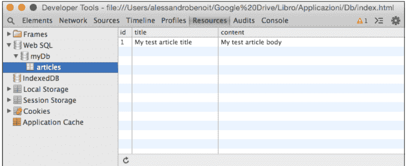
填充完数据库后，我们就可以从中读取一些数据了：
```javascript
db.transaction(function (t) {
  t.executeSql("SELECT * FROM articles", [], function (tr, SQLResultSet) {
    var data = [], row, rowNumber = SQLResultSet.rows.length;
    for (var i = 0; i < rowNumber; i++) {
      row = SQLResultSet.rows.item(i);
      data.push(row);
    }
    console.log(data);
  }, function(SQLError) {
    console.warn(SQLError);
  });
});
```
如图所示，我们使用了SQLResultSet对象。SQLResultSet.rows有length属性，但行为不像数组，因此你需要通过`SQLResultSet.rows.item(i)`来遍历它。
在我们的例子中，我们将结果行对象推入一个data数组，该数组大致如下所示：
```javascript
[
  {
    "id": 1,
    "title": "My test article title",
    "content": "My test article content"
  }
]
```
你可以在W3C官网的http://www.w3.org/TR/webdatabase/页面找到更多关于WebSQL规范的信息。

## IndexedDB
IndexedDB是一个事务型数据库系统，被视为WebSQL在NoSQL领域的继任者，它通过存储键值对来运行。存储的值可以是复杂的JavaScript对象，由一个或多个对象属性作为索引，能够高效检索大量条目，并妥善处理每个键对应的多个值。所有操作都是异步执行的，不会阻塞应用程序。此外，由于没有存储上限，IndexedDB可以用来处理海量数据。它的唯一“缺陷”是不支持关系型数据库，但这恰恰是面向对象数据库管理系统的设计初衷。
要打开数据库，我们可以按以下方式进行：
```javascript
var dbName = 'DatabaseName', dbVersion = 1; // Int
var request = indexedDB.open(dbName, dbVersion);
```
`open()`方法会返回一个继承自`IDBRequest`的`IDBOpenDBRequest`对象。`IDBRequest`接口提供了访问数据库异步请求结果的途径，并暴露了两个事件处理程序：
```javascript
request.onerror = function(event) {
  // Do something with this.error.message!
};
request.onsuccess = function(event) {
  // Do something with this.result!
};
```
当出现问题时（例如数据库版本不匹配），会触发`onerror`事件处理程序；而请求成功时，会调用`onsuccess`。`IDBOpenDBRequest`还有一个`onupgradeneeded`事件处理程序，当新建数据库或修改现有数据库版本时，它会先于其他所有事件触发。
`onupgradeneeded`事件处理程序是编写所有定义数据库架构的代码的理想位置：
```javascript
request.onupgradeneeded = function(event) {
  var IDBDatabase = this.result;
  // Create an objectStore for this database
  var objectStoreName = 'MyObjectStore', objectStoreOptions = {
    keyPath: null,
    autoIncrement: false
  };
  var IDBObjectStore = IDBDatabase.createObjectStore(
    objectStoreName, objectStoreOptions
  );
};
```
在上面的代码片段中，我们获取了`IDBDatabase`对象，然后创建了一个名为`MyObjectStore`的`IDBObjectStore`对象。`autoIncrement`选项用于定义添加新条目时主键是否自动递增，`keyPath`则允许你将存储对象的某个属性指定为主键（例如`keyPath: 'SocialSecurityNumber'`）。
> **注意**
> 你可以在`onupgradeneeded`中使用`event.oldVersion`和`event.newVersion`访问数据库版本，以便妥善处理架构修订。
`IDBObjectStore.deleteIndex`方法用于删除索引，`IDBDatabase.deleteObjectStore`方法用于删除`IDBObjectStore`。
现在我们把之前学过的内容整合起来：

## 数据持久化方案及其他浏览器Web API
```javascript
var request = indexedDB.open('AppDB', 1);
request.onerror = function() {
  console.warn('Database error: ' + this.error.message);
};
request.onupgradeneeded = function(event) {
  var db = this.result;
  var customers = db.createObjectStore('customers', {
    autoIncrement: true
  });
  // Create extra indexes
  customers.createIndex('by_name', 'name');
  customers.createIndex('by_email', 'email', { unique: true });
};
request.onsuccess = function() {
  var db = this.result;
  // Do something once the db is ready
};
```
在上面的示例中，我们额外添加了两个索引，以便能通过姓名和电子邮箱搜索客户`IDBObjectStore`。`IDBObjectStore.createIndex()`方法接收三个参数：索引名称、待索引对象属性的键路径（或键路径数组），以及一个包含两个额外选项的对象：`unique`标志用于阻止插入多个共享同一属性值的对象，`multiEntry`标志则支持将数组类型的单个属性映射到同一索引下的多个独立键。
创建完数据库并设置好架构后，我们就可以向其中插入一些数据了：
```javascript
request.onsuccess = function() {
  var db = this.result;
  // Create a transaction
  var transaction = db.transaction(['customers'], 'readwrite');
  // Retrieve the IDBObjectStore
  var customers = transaction.objectStore('customers');
  // Add a new customer
  var request = customers.add({
    name: 'Marge Griffin',
    email: 'marge@example.com',
    phone: '+390541234567'
  });
  request.onsuccess = function() {
    // Output the Key of the new Object
    var ObjectKey = this.result;
    console.log(ObjectKey);
  };
};
```
> IndexedDB还支持直接存储**BLOB对象**，无需繁琐的转换；具体示例可以查看下一节。
在上面的简单示例中，我们向`customers`的`IDBObjectStore`中添加了一个新对象。为此，我们创建了`IDBTransaction`，获取了`IDBObjectStore`，最后添加了该新对象。`IDBObjectStore.add()`方法返回一个`IDBRequest`对象，也就是数据库对象所继承的同一个对象。最终，你可以通过调用`IDBRequest`上的`onsuccess`事件处理程序来获取新添加对象的键。
你可以通过打开**开发者工具**，进入**资源 | IndexedDB**标签页来检查对象是否真的已添加，如下图所示：
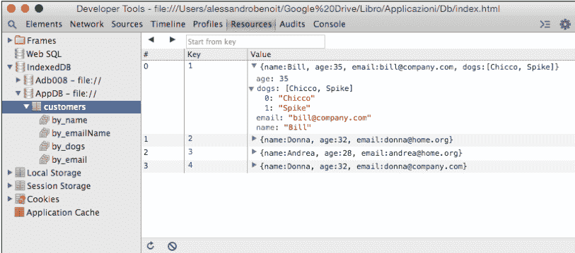
还需要注意的一点是，事务支持三种模式：
- `readonly`：该模式允许多个并发事务
- `readwrite`：该模式不允许并发事务，且无法添加或删除对象存储和索引
- `versionchange`：该模式与`readwrite`事务类似，但支持创建和删除对象存储与索引
这里还缺少**错误处理**机制。如果尝试运行同一个请求两次，就会因为同一电子邮箱被用于多个条目而触发**重复索引错误**。和**WebSQL**中一样，错误既可以在单个请求层面处理，也可以在包含多个请求的完整事务层面处理。

## 数据持久化方案及其他浏览器Web API
因此，默认情况下，*如果单个请求失败*，整个事务会被终止，回滚事务内的所有请求。如果在单个请求的`onerror`事件处理程序中使用`event.preventDefault()`，就会禁用默认行为，让你能够单独处理每个请求的错误。
但千言万语不如几行代码直观：
```javascript
var transaction = db.transaction(["customers"], "readwrite");
var customers = transaction.objectStore("customers");
// Add a new customer twice
for (var i = 2; i > 0; i--) {
  customers.add({
    name: 'Homer Griffin',
    email: 'homer@example.com',
    phone: '+390541234567'
  });
}
transaction.onabort = function(event) {
  console.warn(event.target.error.message);
};
```
在这个例子中，由于我们尝试插入两个使用相同电子邮箱的客户，事务会被终止，没有任何请求会被提交。事实上，如果你检查`customers`的`IDBObjectStore`，会发现根本没有Homer Griffin这条记录。
你可以通过以下方式轻松处理该异常：
```javascript
// Add a new customer twice
for (var i = 2; i > 0; i--) {
  customers.add({
    name: 'Homer Griffin',
    email: 'homer@example.com',
    phone: '+390541234567'
  }).onerror = function(event) {
    event.preventDefault();
    // Handle the exception with this.error.code
  };
}
transaction.onerror = function(event) {
  console.warn(
    'Transaction committed with errors', event.target.error.message
  );
};
```


这次，如果发现重复的索引键，你依然会收到报错，但第一个请求会被正确提交，霍默·格里芬会出现在客户端的IDBObjectStore中。

> 要确认请求确实已提交，IDBTransaction.onsuccess是比IDBRequest.onsuccess更合适的检查位置，因为后者触发时，仍然可能出现异常。
要更新记录，我们可以用put()方法替换IDBObjectStore.add()方法，它的功能和IDBObjectStore.add()非常相似——如果找不到已有的对应值，put()方法会存储新值：
```javascript
customerKey = 1; // Key for Marge Griffin
customers.put({ name: 'Marge Griffin', email: 'newemail@example.com', phone: '+390541234567' }, customerKey);
```
put()方法有一个可选属性，用于指定要更新的值的键。如果IDBObjectStore的主键是通过keyPath选项设置的，你不需要额外设置可选键，系统会使用已分配的对象属性。
假设你按如下方式设置了IDBObjectStore：
```javascript
var cstmrs = db.createObjectStore('customers', {keyPath: 'phone'});
```
那么你可以按如下方式更新Marge对象：
```javascript
cstmrs.put({ name: 'Marge Griffin', email: 'newemail@example.com', phone: '+390541234567' });
```
至此，我们已经创建了一个包含对象存储和一些数据的数据库，接下来可以开始执行读取操作。要根据键获取单个条目，你可以按以下步骤操作：
```javascript
var customerKey = 2; // Key for Homer Griffin customer
var request = customers.get(customerKey);
request.onsuccess = function() {
  if (!this.result) {
    console.warn('No customer found for key: ' + customerKey);
    return;
  }
  var customer = this.result;
  console.log(customer);
};
```
`this.result`会返回与给定键对应的单个客户对象。上述代码可以简化为：
```javascript
customers.get(2).onsuccess = function () {
  if (!this.result) return;
  console.log(this.result);
};
```
如果需要从索引中获取值，你可以按如下方式改写上述代码：
```javascript
customers.index('by_email').get('homer@example.com')
  .onsuccess = function () {
    if (!this.result) return;
    console.log(this.result);
  };
```
要获取多个值，你需要使用**游标**遍历记录。游标包含索引或对象存储中的一系列记录。因此，要获取客户存储中的所有数据，请使用以下代码：
```javascript
var customersArray = [];
customers.openCursor().onsuccess = function () {
  var cursor = this.result;
  if (cursor) {
    customersArray.push(cursor.value);
    cursor.continue(); // Loop
  } else {
    // Do something with customers
    console.log(customersArray);
  }
};
```
要获取给定索引中的所有存储对象，你可以将`IDBKeyRange`对象传给openCursor方法：
```javascript
customers.index('by_name')
  .openCursor(IDBKeyRange.only('Homer Griffin'))
  .onsuccess = function (event) {
    var cursor = this.result;
    if (!this.result) return;
    console.log(this.result.value);
    cursor.continue();
  };
```
`IDBKeyRange`用于定义键范围。你可以使用only()、lowerBound()、upperBound()和bound()方法来指定范围。
要删除条目，你可以使用IDBObjectStore.delete(key)方法，示例如下：
```javascript
var customerKey = 2; // Key for Homer Griffin customer
customers.delete(customerKey).onsuccess = function () {
  console.log('Customer deleted');
};
```
如上所述，IndexedDB是处理数据的非常强大的工具。我已尽可能全面地介绍相关内容，但如果你还想了解更多，可以访问W3C规范页面：http://www.w3.org/TR/IndexedDB/。
如果你觉得IndexedDB过于繁琐，可以看看Dexie，它是一个轻量级的IndexedDB封装库（http://www.dexie.org）。
如果你需要快速将应用数据与服务器端数据库同步，可以考虑使用PouchDB，它基于IndexedDB或WebSQL构建，支持与Apache CouchDB进行双向数据同步（http://pouchdb.com）。
## XMLHttpRequest与BLOB
在NW.js应用中使用XMLHttpRequest时，有一点需要注意：通过file://或app://协议调用的本地文件，会返回0作为HTTP响应。
```javascript
var xhr = new XMLHttpRequest(), blob;
xhr.open('GET', 'myBlob.jpg', true);
xhr.responseType = 'blob';
xhr.addEventListener('load', function () {
  if (xhr.status !== 200) return;
  blob = xhr.response; // Do something with blob
}, false);
xhr.send();
```
在前面的例子中，我们尝试获取一个**BLOB**（本例中是图片），但由于本地文件返回的状态码确实是0，代码会在检查`xhr.status !== 200`时停止执行。
借此机会，我来演示如何将BLOB存储到**IndexedDB**对象存储中：
```javascript
var xhr = new XMLHttpRequest(), blob;
xhr.open('GET', 'maggieAvatar.jpg', true);
xhr.responseType = 'blob';
xhr.addEventListener('load', function () {
  maggieAvatar = xhr.response;
  customers.add({ name: 'Maggie Griffin', email: 'maggie@example.com', phone: '+390541234567', avatar: maggieAvatar // Our blob
  });
});
xhr.send();
```
那么，要获取存储的图片，可以按以下步骤操作：
```html

<script>
  customers.index('by_name').get('Maggie Griffin')
    .onsuccess = function(event) {
      if (!this.result) return;
      document.getElementById('myImg').src = URL.createObjectURL(this.result.avatar);
    };
</script>
```
## 处理媒体文件
HTML5 API提供了处理**音频**和**视频**等媒体文件的简单方式，API的实现也非常简单：
```html
<video width="400" controls>
  <source src="video.ogv" type="video/ogg">
  <audio controls>
    <source src="audio.ogg" type="audio/ogg">
```
# 第4章
支持的音频格式包括`ogg`、`ogv`和`wav`。
预编译的`ffmpegsumo`库包含的编解码器有*Theora*、*vorbis*、*vp8*、*pcm_u8*、*pcm_s16le*、*pcm_s24le*、*pcm_f32le*、*pcm_s16be*和*pcm_s24be*。
想必你已经知道，你无法原生播放`mp3`和`mpeg4`格式的文件，因为它们的编解码器是专利性的。
遗憾的是，这个问题没有简单的解决办法。有人曾成功使用过**Chrome**的媒体库，但我无法在NW.js 0.11.5上复现这一过程。
为你的应用支持这些编解码器的最佳方式是用对应选项编译`ffmpeg`，但需要注意，MP3和H.264编解码器在`ffmpeg`中采用GPL许可证，这意味着任何衍生作品都必须以相同的许可证发布。
你可以在NW.js的GitHub Wiki页面找到构建`ffmpeg`的完整指南。
## 浅析安全问题
开发桌面应用时，大部分资源通常来自可信来源，因此在NW.js中，Chromium实现的许多安全措施已被禁用。
但是，我们需要区分**普通帧**和**Chrome帧**。
前者是我们在前面章节中介绍过的帧，后者是普通的浏览器帧，功能和Chrome帧非常相似。
在安全方面，Node帧允许：
- 访问Node.js中的`require`、`global`、`process`、`Buffer`和`root`对象
- 跳过跨域安全检查访问其他帧
- 忽略子帧的X-Frame-Options请求头
默认情况下，以下资源会由Node帧处理：
- 本地资源
- 应用协议资源，例如`app://myApp/index.html`（更多相关信息请参阅*第6章 打包应用用于分发*）
- 清单文件中`node-remote`选项指定的远程资源，例如`"node-remote": "*.google.com, *.twitter.com"`


## 数据持久化解决方案及其他浏览器 Web API

以下资源使用普通框架处理：
- 远程资源
- 通过原生 UI API 打开的窗口，这些窗口会将 `new-instance` 标志设为 `true`，`nodejs` 设为 `false`。示例如下：
```
var gui = require('nw.gui');
gui.Window.open('localFile.html', {
  'new-instance': true,
  'nodejs': false
});
```
每次处理不受信任的代码和内容时，都应坚持使用普通框架和 iframe。在这方面，`iframes` 需要特别注意。为了在 iframe 中加载不受信任的资源，必须指定 `nwdisable` 和 `nwfaketop` 属性，如下所示：
```
<iframe src="http://www.google.com" style="width: 80%;" nwdisable nwfaketop>
```
还可以通过 `nwUserAgent` 属性指定可选的用户代理：
```
<iframe src="http://www.google.com" style="width: 80%;" nwdisable nwfaketop nwUserAgent="Mozilla/5.0 (Macintosh; Intel Mac OS X 10_10_0) AppleWebKit/537.36 (KHTML, like Gecko) Chrome/39.0.2171.95 Safari/537.36">
```
一个非常非常简单的应用内浏览器实现可能如下所示：
```
<input id="url" type="text" placeholder="Insert the website address">
<iframe id="browserFrame" src="http://www.google.com" style="width:100%;height:400px;" nwdisable nwfaketop nwUserAgent="Mozilla/5.0 (Macintosh; Intel Mac OS X 10_10_0) AppleWebKit/537.36 (KHTML, like Gecko) Chrome/39.0.2171.95 Safari/537.36"></iframe>
<script type="text/javascript">
  var addressBar = document.getElementById('url');
  addressBar.addEventListener('keydown', function(e) {
    if (e.keyCode == 13) document.getElementById('browserFrame').src = addressBar.value;
  });
</script>
```

在这种情况下，你可能还需要考虑启用外部插件（如 Adobe Flash Player）、Java 支持和页面缓存。为此，必须按如下方式编辑清单文件：
```
{
  "name": "inapp-browser",
  "main": "index.html",
  "webkit": {
    "plugin": true,
    "java": true,
    "page-cache": true
  }
}
```
记住要给你的应用程序一个在运行时清除缓存的机会，使用 `gui.App.clearCache()`。NW.js 中的页面缓存默认是禁用的。

> 我必须推翻我自己的说法，因为在 NW.js 0.11.5 上进行测试时，我发现无论 `page-cache` 设置为 `true` 还是 `false`，每次访问远程网站时，都会在 dataPath 文件夹内的缓存文件夹中存储一些数据。我猜这是一个 bug，所以我已经报告了它。

### Web 通知 API

通知是小的弹出窗口，通常显示在屏幕的右上角，是操作系统为了与用户共享重要事件而实现的。每个通知都有一个标题、一些描述性文本，以及可选的小缩略图/图标；更多的通知可以堆叠显示。

我真的很想把这个论点放在 **原生 UI API** 章节中，因为它有相同的目标，但通知 API 虽然相对较新，实际上是 **HTML5** 规范的一部分。

在你的 NW.js 应用程序中实现网络通知的代码非常简单：
```
var notification = new Notification('Notification Title', {
  icon: "icon32.png",
  body: "Here is the notification text"
});

notification.onclick = function () {
  console.log("Notification clicked");
};
```

```
notification.onshow = function () {
  console.log('Show');
  // 1 秒后关闭通知
  setTimeout(function() {notification.close();}, 1000);
};
```

你可以使用 `new Notification('Title', options)` 创建一个通知，其中 `options` 是通知的 `icon`（32 x 32 像素）和其 `body`。一旦通知被创建，你就可以监听 `click` 和 `onshow` 事件，以便做出适当的响应。

网络通知高度依赖于操作系统，在这里事情变得更加棘手，因为 *每个操作系统实现通知的方式都不同*：
- 在 **Mac OS X** 上，网络通知会在预定的时间内显示，因此 `Notification.onshow` 事件和 `Notification.close()` 方法都不起作用。
- 在 **Microsoft Windows** 8 及以上版本中，为了显示通知，你首先需要在开始屏幕上创建一个应用程序快捷方式，并提供 AppUserModelID。这看起来比实际更难，因为你可以通过清单文件轻松设置 AppUserModelID，使用 `{"app-id": "com.node.webkit.notification.test"}`，然后使用内置的应用程序 API 创建快捷方式：
  ```
  var gui = require('nw.gui');
  gui.App.createShortcut(process.env.APPDATA + "\\Microsoft\\Windows\\Start Menu\\Programs\\NW.js.lnk");
  ```
- 在 **Linux** 上，`Notification.onshow` 事件、`Notification.onclick` 事件以及 `Notification.close()` 方法都不起作用。

### 总结

正如你可能已经注意到的，我花了本章的大部分时间来处理 **数据持久化解决方案**，因为它不仅是最棘手的问题，而且对于开发真正的桌面应用程序也至关重要。浏览器 Web API 内容庞大——可能十本这样的书都不足以完全探索这个主题。幸运的是，网上有很多材料，所以深入探讨这个问题应该不会太难。

至此，你已经学会了如何与操作系统 GUI 交互，如何利用 Node.js 的底层功能，以及如何与浏览器 Web API 良好协作。剩下的就是将所有部分组合在一起，以实现一个 **现代桌面应用程序**，这正是我们将在下一章中要做的。让我们开始编码吧...

## 5 让我们整合一切

最后，我们准备好将目前所学付诸实践了。在本章中，我们将从头开始开发一个完整的、可运行的 NW.js 桌面应用程序。我们将一步一步地进行，从一些样式建议开始，接着实现 **基本功能**，最后将它们集成起来，借助原生 UI API 创建一个合适的 **桌面 GUI**。

我们的应用程序将看起来如下所示：
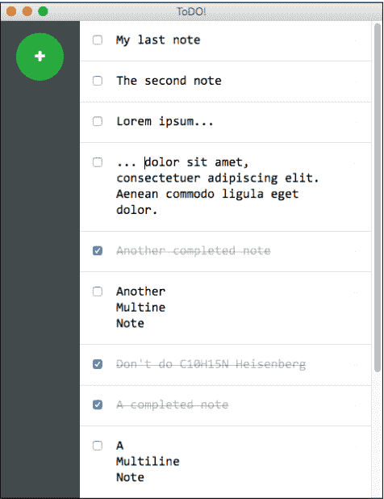

我为缺乏想象力而道歉，但我认为最合适的例子是经典的 **待办事项列表应用程序**。然而，为了使其有趣，我添加了 *通过 PouchDB 远程同步数据库* 的功能，以及一个简单的选项面板，以便更好地理解如何使用多个窗口。此外，该应用程序将准备好在 Mac OS X、Microsoft Windows 和 Linux 上运行。

> ## 关于本章采用的编程风格的一些说明
>
> 本章采用的编程风格可能与我在生产环境中使用的风格大不相同。我希望你不会因此责备我，但为了让不同背景的程序员都能理解，我不得不做出选择。所以我决定使用 **jQuery** 来操作 DOM，而不是 MVC Web 应用程序框架，并且我将所有内容都 **命名空间化**，以保持学习路径尽可能线性。此外，由于本书的大多数读者已经是熟练的 io.js/Node.js 开发人员，我决定专注于浏览器 Web API 和原生 UI API。


## 让我们开始吧！

我们开始吧。我在开发新项目时考虑的第一件事通常是应用程序文件夹结构：
```
myApp/ > css/ -- app.css -- options.css > js/ -- nativeui.js -- helpers.js -- main.js -- options.js -- todos.js > node_modules/ > vendor/ -- jquery.2.1.3.min.js -- pouchdb-3.2.1.min.js > views/ -- app.html -- options.html -- todo.html - icon16.png
```
如图所示，在开始实际编程之前，我们需要安装一些资源。所以让我们创建 `myApp` 文件夹和所有子文件夹，然后在根目录中创建一个 `package.json` 文件：
```
{
  "name": "ToDO!",
  "main": "index.html",
  "window": {
    "show": true,
    "icon": "icon16.png",
    "min_width": 480,
    "min_height": 600,
    "width": 480,
    "height": 600,
    "toolbar": false
  },
  "dependencies": {
    "swig": "1.4.2"
  }
}
```
我们在这里做的事情非常简单；我们设置了应用程序的大部分数据，包括主窗口的大小和图标（图标将在某些操作系统中显示在应用程序标题栏旁边），最后添加了 **Swig 模板引擎** 作为依赖项。为了安装依赖项，只需在应用程序根目录下的终端中运行 `npm install`。

现在你需要一个 16 x 16 像素的图标（你可以在 iconfinder.com 上找到一个 MIT 许可下的图标）；将其放在根目录中，命名为 `icon16.png`。我们将使用 **jQuery 2.1.x** 进行 DOM 操作，使用 **PouchDB 3.2.x** 作为数据库；你可以从以下网址下载每个软件包的最新版本：
- http://jquery.com/download/
- http://pouchdb.com/

下载完软件包后，你可以将压缩文件放在 vendor 文件夹中。


## 让我们整合所有内容
### 样式相关
待文件夹结构准备就绪后，我们就可以开始创建样式表了。在`css`文件夹中，分别为主窗口创建`app.css`文件，为选项窗口创建`options.css`文件。我们先来看主窗口的样式表：
```css
/* Reset */
html, body, #mainView {
    width: 100%;
    height: 100%;
    margin: 0;
    padding: 0;
}
/* Custom behaviors */
html * {
    -webkit-user-select: none;
    box-sizing: border-box;
}
/* mainView container */
#mainView {
    display: flex;
    border-top: 1px solid #c7c7c7;
}
/* Right sidebar */
#sidebar {
    flex: 0 0 100px;
    padding: 15px 0;
    text-align: center;
    background: #414A4C;
    color: #f8f8f8;
}
/* Todo container */
#todoListContainer {
    flex: 1;
    background: #F8F8FF;
    overflow: auto;
}
/* Button styling */
.button {
    font-family: sans-serif;
    font-weight: 800;
    display: inline-block;
    border-radius: 100%;
    color: #F8F8FF;
    text-align: center;
    text-decoration: none;
    transition: background-color 0.2s linear;
}
/* Add button */
.add-button {
    background: #28a93f;
    height: 60px;
    width: 60px;
    line-height: 60px;
    font-size: 26px;
}
.add-button:hover {
    background-color: #46BA5A;
}
/* Delete button */
.delete-button-container {
    flex: 0 0 30px;
    text-align: right;
}
.delete-button {
    background: rgba(0,0,0,0.0);
    height: 20px;
    width: 20px;
    line-height: 18px;
    font-size: 18px;
}
/* ToDo List */
#todoList {
    list-style: none;
    padding: 0;
    margin: 0;
}
#todoList li {
    display: flex;
    border-bottom: 1px solid rgba(0,0,0,0.1);
    padding: 15px 10px;
    background: #F8F8FF;
}
#todoList li:hover .delete-button {
    background: rgba(0,0,0,0.1);
}
#todoList li:hover .delete-button:hover {
    background: #d62700;
}
#todoList input {
    flex: 0 0 30px;
}
/* ToDo Content */
.todo-content {
    flex: 1;
    line-height: 20px;
    height: 20px;
    padding: 0;
    font-size: 16px;
    color: #333;
    font-family: Consolas, monospace;
    overflow: hidden;
    resize: none;
    border: none;
    background: transparent;
}
.todo-content[disabled] {
    text-decoration: line-through;
    color: rgba(0,0,50,0.3);
}
.todo-content:focus {
    color: #000;
    outline: 0px solid transparent;
}
/* Sync overlay */
#syncing {
    font-family: Consolas, monospace;
    display: block;
    position: fixed;
    top: 0;
    right: 0;
    bottom: 0;
    left: 0;
    background: rgba(0,0,0,0.8);
    text-align: center;
    color: #18E713;
}
#syncing > span {
    margin-top: 60px;
    display: block;
    font-size: 15px;
}
#syncing > span > span {
    -webkit-animation: blink 1s linear infinite;
}
/* Animation */
@-webkit-keyframes blink {
    from {
        opacity: 1.0;
    }
    to {
        opacity: 0.0;
    }
}
```
你可以直接复制粘贴上述代码继续后续操作，但有几处注意事项需要留意：
- 要为NW.js应用设置样式，**flex** 可以说是最实用的CSS属性之一，它用于定义容器内的弹性布局
- 给所有元素添加 `-webkit-user-select: none;` 可以避免应用元素出现非预期的文本选中效果，需要时你可以通过 `-webkit-user-select: all;` 开启文本选中
- 如*第4章 数据持久化方案及其他浏览器Web API*中所述，除了`-webkit-`前缀之外，无需再定义其他浏览器前缀
- 本示例中提供的是基础的样式重置代码，但你最好使用更全面的重置方案，比如**埃里克·迈耶**提供的重置样式

以下是选项页面的样式，我尽量将其写得尽可能简洁：
```css
/* Reset */
html, body {
    width: 100%;
    height: 100%;
    margin: 0;
    padding: 0;
}
/* Custom behaviors */
html * {
    box-sizing: border-box;
    -webkit-user-select: none;
}
/* Body */
body {
    background: #f4f4f4;
    font-family: sans-serif;
    padding: 20px;
    border-top: 1px solid #ccc;
}
/* Labels */
label {
    display: block;
    border-bottom: 1px solid #eee;
    margin-bottom: 15px;
    color: #151515;
}
/* Inputs */
input {
    margin: 5px 0 15px 0;
}
input[type=text] {
    padding: 5px;
    width: 100%;
}
input[type=color] {
    display: inline-block;
    margin-left: 20px;
}
/* Buttons */
.buttons {
    position: absolute;
    bottom: 20px;
    right: 20px;
}
```

### HTML5骨架结构
现在我们来创建`index.html`和`options.html`页面的HTML骨架。两个页面结构相同，但会引入不同的样式表和JavaScript文件：
```html
<!DOCTYPE html>
<html>
<head>
    <title>ToDO!</title>
    <link rel="stylesheet" href="css/app.css"></link>
    <script type="text/javascript" src="vendor/jquery.2.1.3.min.js"></script>
    <script type="text/javascript" src="vendor/pouchdb-3.2.1.min.js"></script>
    <script type="text/javascript" src="js/main.js"></script>
    <script type="text/javascript" src="js/todos.js"></script>
    <script type="text/javascript" src="js/nativeui.js"></script>
    <script type="text/javascript" src="js/helpers.js"></script>
</head>
<body>
    <div id="mainView"></div>
</body>
</html>
```
在options.html中，你可以复用上述代码，只需要将`<head>`标签内的所有内容替换为以下内容即可：
```html
<title>ToDO! &raquo; Options</title>
<link rel="stylesheet" type="text/css" href="css/options.css"></link>
<script type="text/javascript" src="vendor/jquery.2.1.3.min.js"></script>
<script type="text/javascript" src="js/options.js"></script>
<script type="text/javascript" src="js/helpers.js"></script>
```
上述代码没有太多需要解释的内容：我们已经定义了所有需要的文件，还添加了`#mainView` div，后续会用它来加载Swig模板。

### 深入应用逻辑
在前面的内容中，我们已经完成了manifest文件的配置，创建了各视图的样式表和HTML骨架。现在，终于可以深入讲解应用的实际逻辑了。`main.js`文件本质上是定义命名空间、初始化应用各模块的封装文件：
```javascript
var myApp = {};
myApp.init = function () {
    // Instance the DB
    myApp.db = new PouchDB('todos');
    // Init the todo App
    myApp.todos.init();
};
$(window).load(myApp.init);
```
如图所示，我们在window加载完成后初始化应用，是为了确保所有资源加载完毕后再声明任何逻辑。在`myApp.init()`函数中，我们会实例化一个PouchDB数据库对象，后续会用它来访问和存储待办列表。

如官网介绍，**PouchDB**是一款受Apache CouchDB启发的开源JavaScript数据库，专为在浏览器中流畅运行设计。它的特性是底层基于**indexedDB**在浏览器中存储数据，且可以非常轻松地与**CouchDB**同步，你无需编写大量额外逻辑来处理**双向数据复制**。

如果要调试PouchDB存储的数据，你可以按照调试indexedDB的方式操作：打开**开发者工具**，点击**Resources | IndexedDB**。但需要注意，数据的显示效果可能和你预期的不一致，因为为了实现正确的同步，PouchDB会自动创建大量额外的对象存储，并保存每个存储对象的修订版本。

完成数据库初始化后，我们会调用待办应用本身的`init`函数。相关内容我们很快会讲解，但首先需要往`js/helpers.js`文件中添加几个全局使用的函数：
```javascript
// Load Template
myApp.loadTemplate = function (view, data, target) {
    var swig = require('swig'),
        fileName = 'views/' + view + '.html';
    var template = swig.renderFile(fileName, data || {});
    if (target) return $(target).html(template);
    return template;
};
// Remove elements from the DOM after slideUp
myApp.removeFromGUI = function ($items) {
    $items.slideUp(200, function () {
        $(this).remove();
    });
};
// Autoresize textarea on add/delete content
myApp.resizeTextarea = function ($ta) {
    $ta.height(20).height($ta.prop("scrollHeight"));
};
```

## 把所有内容整合起来
我们在`myApp`命名空间中加载了三个函数。第一个函数可以帮助我们借助Swig模块完成加载模板的繁琐操作。`view`属性是views文件夹内不带HTML扩展名的文件名；`data`属性（可选）是需要由Swig解析的数据数组；`target`属性（可选）是我们要将生成的HTML加载到的DOM元素的ID。如果未设置`latest`属性，HTML模板将由函数自身返回。接下来是`removeFromGUI()`函数，它会使传入的任意jQuery对象向上滑动并从DOM中移除；还有`resizeTextarea()`函数，这是一个简易的Hack技巧，能让文本区域根据内容自动调整大小。完成这些辅助函数后，我们就可以开始编写应用程序的内部逻辑了，整个过程分为两步：
1. 实现实际的应用层
2. 实现原生UI层

### 应用层
应用层是待办列表应用运行相关的全部逻辑。在这一步中，我们会创建一个功能完整、可正常使用的应用，编写方式与普通网页基本一致（仅额外支持Node.js模块）。在编写任何代码之前，我们先明确应用层需要实现的功能：
- 启动时从数据库加载所有待办事项
- 点击指定按钮时添加新的待办事项
- DOM中的每个待办项都支持以下操作：
  - 设置待办状态（已完成/未完成）并保存
  - 编辑待办内容并保存
  - 删除待办项
此外还有一组由原生UI层触发、但最终会在应用层执行对应操作的功能：
- 显示/隐藏已完成的待办事项
- 修改待办列表背景色
- 将本地数据库与远程数据库同步
- 以JSON格式导出待办列表

当你清楚应用要实现的功能后，我们就可以进入有趣的编码环节了！首先，我们需要为待办应用搭建HTML骨架，打开`views/app.html`并添加以下内容：
```html
<!-- Export file dialog -->
<input style="display:none;" id="fileDialog" type="file" accept=".json" nwsaveas="todos.json"/>
<!-- Left sidebar -->
<div id="sidebar">
  <a href="#" class="button add-button">+</a>
</div>
<!-- ToDo List -->
<div id="todoListContainer">
  <ul id="todoList"></ul>
</div>
<!-- Sync in progress -->
<div id="syncing" style="display: none"><span>SYNC IN PROGRESS <span></span></div>
```
我们来分析上述代码：
- 得益于`nwsaveas`属性，`#fileDialog`文件输入框会打开**另存为**对话框，相关内容可参考*第2章 NW.js原生UI API*
- `#sidebar` div元素包含`.add-button`，点击该按钮即可添加新的待办项
- `#todoList` ul元素是待办列表项的容器
- `#syncing` div元素是遮罩层，PouchDB同步过程中会显示**正在同步**，默认处于隐藏状态

搭建好应用骨架后，我们就可以向`todos.js`中添加逻辑了，现在开始编写`init`函数：
```javascript
myApp.todos = {};
myApp.todos.init = function () {
  // Load main application view
  myApp.loadTemplate('app', null, '#mainView');
  // Change todos bg color
  myApp.todos.changeBackgroundColor(localStorage.notesColor || '#F8F8FF');
  // Listen for events
  myApp.todos.listenForEvents();
  // Load data from DB
  myApp.todos.load();
};
```
```javascript
myApp.todos.listenForEvents = function () {
  // Add new todo
  $('.add-button').click(function (e) {
    e.preventDefault();
    myApp.todos.addNew();
  });
};
myApp.todos.load = function () {};
```
在上面的代码中，我们创建了`todos`命名空间，随后在`init`函数中通过`myApp.loadTemplate()`加载应用模板，该函数会将`views/app.html`加载到`#mainView` div中。初始化待办应用时，我们还需要设置待办列表的背景色，因此调用`myApp.todos.changeBackgroundColor()`，传入`localStorage.notesColor`选项（如果已设置），否则传入默认颜色#F8F8FF。接下来我们在`todos.js`文件末尾添加该函数：
```javascript
myApp.todos.changeBackgroundColor = function (color) {
  var $customStyle = $('<style/>', {
    html: '#todoListContainer, #todoList li {background:' + color + ';}',
    id: 'customStyle'
  });
  if ($('#customStyle').length > 0) {
    $('#customStyle').replaceWith($customStyle);
  } else {
    $customStyle.appendTo('head');
  }
};
```
如上述代码所示，`changeBackgroundColor()`仅需向文档的head中添加一个style标签，即可设置待办列表的背景色。

### 添加新任务
现在，我们可以开始监听事件了，具体来说，是监听`.add-button`的点击事件，该事件会调用`myApp.todos.addNew()`。接下来我们按如下方式创建该函数，并将其添加到其余代码之后：
```javascript
myApp.todos.addNew = function () {
  var todo = {
    _id: new Date().toISOString(),
    content: '',
    checked: false
  };
  myApp.db.put(todo, function (err, result) {
    if (err) return console.warn(err);
    todo._rev = result.rev;
    myApp.todos.render(todo, true);
  });
};
```
要创建新的待办项，我们需要先提供`_id`属性来生成空的todo对象，这是PouchDB API将新项正确插入数据库所必需的。`_id`可以是任意随机字符串，但使用日期作为`_id`可以以更低的计算成本按时间顺序对结果进行排序。创建好todo对象后，我们通过`myApp.db.put()`将其存入数据库，若未发生错误，即可通过`myApp.todos.render()`将其渲染到页面上。同时，因为我们给todo对象分配了`_rev`属性，该字段可实现数据库复制，是更新/删除操作正常运行的必要条件。

在这段代码后添加以下内容：
```javascript
var myApp.todos.render = function (todo, focus) {
  var todoTemplate = myApp.loadTemplate('todo', todo),
    $todo = $(todoTemplate).prependTo('#todoList').hide().slideDown(300),
    $content = $todo.find('.todo-content'),
    $check = $todo.find('.todo-check');
  myApp.resizeTextarea($content);
  // Focus on the created todo
  if (focus) $content.focus();
  // -- Add events here --
};
```
`myApp.todos.render()`方法接收两个参数。第一个是todo对象，此时它的格式大致如下：
```json
{
  "_id": "2015-01-24T18:43:36.234Z",
  "_rev": "114-61d532da6f6d5bdbedabd39416d0c9d4",
  "content": "",
  "checked": false
}
```
`focus`参数是布尔值，用于决定调用时是否需要聚焦到待办内容上，本例中该值为true。第一行代码中我们加载了单个待办的模板，现在按如下内容编辑`views/todo.html`：
```html
<li>
  <input class="todo-check" type="checkbox" checked>
  <textarea class="todo-content" disabled>{{content}}</textarea>
  <div class="delete-button-container">
    <a href="#" class="button delete-button">-</a>
  </div>
</li>
```
> 💡 如果你不熟悉Swig模板，建议你访问其官网 http://paularmstrong.github.io/swig/。

解析完模板后，我们将其前置添加到#todoList ul中，创建若干指向待办DOM元素的jQuery对象，最后聚焦到待办内容并调整文本区域大小。即使待办项已经显示出来，我们的工作仍未完成：还需要实现一系列交互动作，比如点击删除按钮链接、修改待办内容或状态时触发对应功能。我们在`-- Add events here --`注释后添加以下事件：
```javascript
// On check/uncheck item
$check.on('change', function () {
  todo.checked = $(this).is(':checked');
  myApp.todos.update(todo);
  // Disable on check
  if (todo.checked) {
    if (localStorage.hideCompleted === 'true') myApp.removeFromGUI($todo);
    else $content.attr('disabled', true);
  } else {
    $content.removeAttr('disabled');
  }
});
```


当复选框状态变更时，会产生两个结果。首先，`todo` 对象的数据库版本必须更新，我们通过 `myApp.todos.update()` 来完成这一步；然后，我们需要检查用于确定已完成待办项是否隐藏的选项，以此判断任务完成后是否需要从视图中移除。

## 接下来我们需要监听待办内容的任何变更：
```javascript
// On content change
var timer;
$content.on('input', function () {
  myApp.resizeTextarea($content);
  if (typeof timer !== 'undefined') clearTimeout(timer);
  timer = setTimeout(function () {
    todo.content = $content.val();
    myApp.todos.update(todo);
  }, 1000);
});
```
当我们在文本区域输入内容时，需要更新数据库，但为了避免给数据库造成过重负担，我们设置了一个计时器，仅在停止输入1秒后才会保存变更。如上所示，我们还调用了 `resizeTextarea()` 辅助函数，该函数会在内容新增或删除时实时调整文本区域的大小。

正如你所见，`$content` 和 `$check` 发生变更时，事件会调用 `myApp.todos.update()`，目前我们还未实现该方法，现在我们来创建它，并将其添加到 `myApp.todos.render()` 之后：
```javascript
myApp.todos.update = function (todo) {
  myApp.db.put(todo, function callback(err, result) {
    if (err) return console.warn(err);
    todo._rev = result.rev;
  });
};
```
如上所示，`myApp.todos.update()` 只是 PouchDB `put()` API 的一个封装。有一点需要注意：在回调函数中，我们会重新赋值 `todo._rev` 属性，因为该属性在每次更新时都会发生变化。

我们还需要支持用户通过点击 `.delete-button` 来删除待办项。请将以下代码添加到 `myApp.todos.render()` 内的其他事件下方：
```javascript
// On delete item
$todo.find('.delete-button').on('click', function (e) {
  e.preventDefault();
  myApp.removeFromGUI($todo);
  myApp.db.remove(todo);
});
```

## 整合所有内容
我们已经了解过 `myApp.removeFromGUI()` 辅助函数，`myApp.db.remove()` 的含义也非常直观。

## 加载所有任务
如果此时尝试运行我们的应用，大部分待办功能已经可以正常工作；但仍有一些功能缺失。首先，我们需要在应用打开时将全部待办项加载到视图中，现在我们来编辑 `myApp.todos.load()` 函数，该函数应该已经被定义，并由 `myApp.todos.init()` 调用：
```javascript
myApp.todos.load = function () {
  myApp.removeFromGUI($('#todoList').find('li'));
  if (localStorage.hideCompleted === 'true')
    myApp.todos.loadUncompleted();
  else
    myApp.todos.loadAll();
};
```
`myApp.todos.load()` 方法首先需要清理之前添加到待办列表容器中的所有项；之后有两种执行路径：可以加载所有之前保存的任务，也可以仅加载状态仍为“未完成”的任务。第一种情况下会调用 `myApp.todos.loadAll()` 函数，你可以将这个方法直接添加到 `myApp.todos.load()` 下方：
```javascript
myApp.todos.loadAll = function () {
  myApp.db.allDocs({include_docs: true}, function(err, resp) {
    resp.rows.forEach(function (item) {
      myApp.todos.render(item.doc);
    });
  });
};
```
PouchDB 的 `allDocs()` API 会异步返回所有存储在 `resp.rows` 属性中的对象。我们需要做的就是遍历该属性，并使用 `myApp.todos.render()` 渲染每一项，这和创建新待办时的操作一致。我本可以直接在循环中展示仅显示未完成任务的逻辑，但我更想向你说明 `PouchDB.allDocs()` 和 `PouchDB.query()` 的区别。接下来我们看看第二种方法在 `myApp.todos.loadUncompleted()` 中的实现：
```javascript
myApp.todos.loadUncompleted = function () {
  function map (doc) {
    if (doc.checked === false) emit();
  }
  myApp.db.query(map, {include_docs : true}, function (err, resp) {
    resp.rows.forEach(function (item) {
      myApp.todos.render(item.doc);
    });
  });
};
```
`query()` 方法接收一个 map 函数，用于判断是否需要返回指定项。你可能已经注意到，两种情况下 `include_docs` 选项都被设置为了 `true`。这其实非常重要；否则只会返回项的键值，而我们的场景下需要完整的待办对象。

## 实现导出与同步功能
现在我们需要实现 JSON 导出功能。实际的导出操作由 NativeUI 层的菜单触发，但该功能本身属于应用层，因此我们在 `myApp.todos.listenForEvents()` 函数中添加一个新事件：
```javascript
// Export data
$('#fileDialog').on('change', function () {
  myApp.todos.export($(this).val());
  $(this).val(''); // Reset the value
});
```
当 `views/app.html` 中文件输入框的值发生变化时，我们会调用 `myApp.todos.export()` 函数，该方法我们可以添加到 `todos.js` 文件的末尾：
```javascript
myApp.todos.export = function (path) {
  var fs = require('fs'), data = [], jsonData;
  myApp.db.allDocs({include_docs: true}, function(err, resp) {
    resp.rows.forEach(function (item) {
      var newItem = {
        content: item.doc.content,
        completed: item.doc.checked
      };
      data.push(newItem);
    });
    fs.writeFile(path, JSON.stringify(data, null, 2), function(err) {
      if(err) return alert(err);
    });
  });
};
```

## 整合所有内容
这里我们使用了 Node.js 原生的 `fs` 模块，将 `PouchDB.allDocs()` 的结果写入文件对话框提供的文件路径中。应用层的开发已经接近完成，剩下要做的就是实现与 CouchDB 的双向数据同步。
> 我不会深入讲解 CouchDB 的工作原理；你可以轻松搭建属于自己的 CouchDB 服务器（http://couchdb.apache.org/），也可以从 https://www.iriscouch.com/ 获取免费的 CouchDB 服务。两种情况下都需要注意：如果在同步数据库时遇到 405 错误，可能是 CORS（跨域资源共享）配置问题，你需要正确设置 CORS 相关配置。
在 `todos.js` 文件的末尾添加以下代码：
```javascript
myApp.todos.sync = function () {
  if (!navigator.onLine) return alert('No internet connection available');
  $('#syncing').show();
  PouchDB.sync('todos', localStorage.couchDbUrl)
    .on('complete', function (info) {
      myApp.todos.load();
      $('#syncing').fadeOut();
    })
    .on('error', function (err) {
      alert(err);
      $('#syncing').fadeOut();
    });
};
```
代码的第一行会检查是否存在网络连接，随后我们会用之前添加到 `views/app.html` 中的同步遮罩层覆盖应用界面。为了启动同步，我们调用 `PouchDB.sync()`，传入本地数据库名称和远程 CouchDB 的 URL（格式类似 `https://xxx.iriscouch.com/todo`）。双向数据同步完成后，我们会监听两个可能的事件：
- 监听 `complete` 事件：隐藏遮罩层并重新加载待办列表
- 监听 `error` 事件：隐藏遮罩层并弹出提示

至此我们终于完成了应用层的开发。但遗憾的是，许多功能还无法被用户直接使用，需要额外触发才能生效。在下一节中，我们将学习如何实现上下文菜单、窗口菜单、选项窗口，以及其他一些能让应用在不同平台上可正常使用的必要功能。

## 原生UI层
和开发应用层时一样，在编写任何代码之前，我们最好先明确原生UI层需要实现哪些功能：
- 实现窗口菜单
- 为待办内容实现上下文菜单
- 打开应用时恢复主窗口位置
- 实现选项窗口
- 应用退出时存储窗口位置，支持选项窗口保存数据并压缩数据库
- 所有内容加载完成后平滑启动应用

首先，我们需要在 `js/main.js` 文件的 `myApp.init()` 函数中调用 `myApp.nativeUI.init()`，之后打开 `js/nativeui.js` 文件，添加以下代码：
```javascript
myApp.nativeUI = {};
myApp.nativeUI.init = function () {
  // Instance nw.gui
  myApp.gui = require('nw.gui');
  // Globals
  myApp.mainWindow = myApp.gui.Window.get();
  myApp.name = myApp.gui.App.manifest.name;
  // -- Call the other functions here --
};
// -- Declare the other functions here --
```


## 整合所有内容
在前两部分中，我们已完成以下操作：
- 创建了 `nativeUI` 命名空间
- 创建了 `myApp.nativeUI.init()` 函数，该函数会被 `myApp.init()` 调用
- 我们创建了以下变量：
  - `myApp.gui`：这是原生UI API的对象
  - `myApp.mainWindow`：这是主窗口对象
  - `myApp.name`：这是清单文件中配置的应用名称
我们会在整个原生UI层中使用上述变量，因此在需要时重新声明它们毫无意义。完成这一步后，我们就可以开始实现前面提到的功能了。

### 实现窗口菜单
窗口菜单将包含以下子菜单：
- **文件**：该菜单包含一个**退出**菜单项（在 Mac OS X 上，它被称为**应用**菜单，还实现了其他几个功能）
- **编辑**：该菜单包含**剪切、复制、粘贴**和**全选**功能（在 Mac OS X 上，它还实现了其他几个功能）
- **选项**：该菜单下包含以下可用项：
  - **选项**：点击后会打开选项窗口
  - **隐藏已完成项**：这是一个复选框选项，勾选后将会隐藏已完成的任务
  - **导出**：该选项会将待办列表导出为 JSON 文件
  - **同步**：该选项会手动触发与选项窗口中配置的 CouchDB 数据库的双向数据同步，如果未配置数据库，该选项将处于禁用状态

为了简化开发流程，我们发现 NW.js 提供了 `createMacBuiltin()` API，可以自动创建 Mac OS 默认菜单。但这种方式存在一些缺陷，最明显的一点是其他平台没有类似 API，因此我们需要为微软 Windows 和 Linux 平台手动构建这些菜单。此外，调用 `createMacBuiltin()` 会生成本地化菜单，由于我们的示例应用未提供本地化支持，在我的 MacBook 上，**应用**和**编辑**菜单会显示为意大利语，**选项**菜单为英语。这显然不符合原生应用的预期效果，但不幸的是，当前示例我们只能接受这个情况。

不过，在开发你自己的应用时，可以考虑以下两种方案：
- 使用 `window.navigator.language` 实现应用本地化
- 从零开始实现 Mac OS X 菜单

为了实现窗口菜单，我们首先需要在 `myApp.nativeUI.init()` 中添加对 `myApp.nativeUI.createWindowMenu()` 的调用。完成这一步后，我们就可以在调用语句后添加对应的函数：
```js
myApp.nativeUI.createWindowMenu = function () {
 // Create window menu
 var windowMenu = new myApp.gui.Menu({
 type: 'menubar'
 });
 if (process.platform === 'darwin'){
 // Create default Mac OS menus
 windowMenu.createMacBuiltin(myApp.name, { hideWindow: true });
 } else {
 // Create default file menu for Windows and Linux
 var fileMenu = new myApp.gui.MenuItem({
 label: "File"
 });
 var fileSubmenu = new myApp.gui.Menu();
 fileSubmenu.append(new myApp.gui.MenuItem({
 label: 'Exit', key: "x", modifiers: "ctrl", click: function () {
 myApp.gui.App.closeAllWindows();
 }
 }));
 fileMenu.submenu = fileSubmenu;
 windowMenu.append(fileMenu);
 // Create default edit menu for Windows and Linux
 var editMenu = new myApp.gui.MenuItem({
 label: "Edit"
 });
 var editSubmenu = myApp.nativeUI.createEditMenu();
 editMenu.submenu = editSubmenu;
 windowMenu.append(editMenu);
 }
 // Assign the menu to the window
 myApp.mainWindow.menu = windowMenu;
};
```
首先我们创建了窗口菜单对象，然后判断当前平台是否为 Mac OS X（Darwin 是 Mac OS 的内核代号），如果是则调用 `createMacBuiltin()`，否则为微软 Windows 和 Linux 平台创建自定义的**文件/编辑**菜单。这段代码非常基础，不过你可能已经注意到，为了创建编辑子菜单，我们调用了一个自定义的 `myApp.nativeUI.createEditMenu()` 函数。我将其单独拆分出来，是因为任务右键菜单也会复用同一个菜单。

我们可以在 `nativeui.js` 文件的末尾声明这个函数：
```js
myApp.nativeUI.createEditMenu = function () {
 var editMenu = new myApp.gui.Menu();
 editMenu.append(new myApp.gui.MenuItem({
 label: 'Cut', click: function() {
 document.execCommand("cut");
 }
 }));
 editMenu.append(new myApp.gui.MenuItem({
 label: 'Copy', click: function() {
 document.execCommand("copy");
 }
 }));
 editMenu.append(new myApp.gui.MenuItem({
 label: 'Paste', click: function() {
 document.execCommand("paste");
 }
 }));
 editMenu.append(new myApp.gui.MenuItem({
 label: 'Select All', click: function() {
 document.execCommand("selectAll");
 }
 }));
 return editMenu;
};
```
这里的逻辑并不复杂，我们只是创建了一个默认的**编辑**菜单，其中每个菜单项都对应一个文档操作命令。

现在回到窗口菜单的实现，我们还需要创建**选项**菜单。在 `myApp.nativeUI.createWindowMenu()` 函数的最后一行代码（也就是将 `windowMenu` 赋值给 `myApp.mainWindow.menu` 的那行）之前，添加以下代码：
```js
// Create options menu
var optionsMenu = new myApp.gui.MenuItem({
 label: "Options"
});
// Options submenu
var options = new myApp.gui.Menu();
```
我们已经创建了子菜单，现在需要逐个添加子菜单项，我们一步步来看：
- 选项菜单项：
```js
options.append(new myApp.gui.MenuItem({
 label: 'Options', key: "o", modifiers: "ctrl-alt", click: myApp.nativeUI.openOptionsWindow()
}));
```
点击选项菜单项时，会调用 `myApp.nativeUI.openOptionsWindow()` 函数。我们稍后会详细介绍这个函数，现在先看其他菜单项。
- 隐藏已完成项菜单项：
```js
options.append(new myApp.gui.MenuItem({
 label: 'Hide completed', type: 'checkbox', key: "h", modifiers: "ctrl-alt", checked: (localStorage.hideCompleted === 'true'), click: function () {
 localStorage.hideCompleted = this.checked;
 myApp.todos.load();
 }
}));
```
该菜单项为复选框样式，具备开启/关闭状态，通过 `localStorage` 存储状态。因此它的选中状态会根据 `localStorage.hideCompleted` 的值来设置。点击该菜单项时会触发两个操作：首先将 `localStorage.hideCompleted` 设置为当前菜单的选中状态，然后调用 `myApp.todos.load()`。你可以验证一下，`myApp.todos.load()` 确实会读取 `localStorage.hideCompleted` 的值，来判断是加载全部任务还是仅加载未完成的任务。正如我们在*第4章 数据持久化方案与其他浏览器Web API*中提到的，Web存储可能不是最好的数据持久化方案，但绝对是存储简单配置数据的最佳选择。
- 导出菜单项：
```js
options.append(new myApp.gui.MenuItem({
 label: 'Export', key: "e", modifiers: "ctrl-alt", click: function () {
 $('#fileDialog').click();
 }
}));
```
导出菜单项的点击事件效果非常简单，它会模拟点击 `views/app.html` 中的文件输入框，从而打开文件保存对话框。
- 同步菜单项：
```js
options.append(new myApp.gui.MenuItem({
 label: 'Sync', enabled: Boolean(localStorage.couchDbUrl), key: "s", modifiers: "ctrl-alt", click: myApp.todos.sync
}));
```
同步菜单项的点击事件仅会调用我们在应用层已经实现过的 `myApp.todos.sync()` 函数。需要注意的是，如果创建该菜单项时 `localStorage.couchDbUrl` 为空，那么该菜单项会自动处于禁用状态。

创建完所有子菜单项后，我们就可以通过以下代码将子菜单关联到窗口菜单：
```js
optionsMenu.submenu = options;
windowMenu.append(optionsMenu);
```
这段代码的作用是将子菜单赋值给 `optionsMenu`，再将 `optionsMenu` 添加到窗口菜单中。

### 实现上下文菜单
我们需要在这里实现一个编辑上下文菜单，当右键点击任务内容时弹出。我们可以借助 jQuery 的 on 方法，将点击坐标传递给 `contextMenu.popup()` 来实现这个功能。
来看具体的实现代码：
```js
myApp.nativeUI.addContextMenuToTodos = function () {
 $("body").on("contextmenu", '.todo-content', function(e) {
 e.preventDefault();
 var contextMenu = myApp.nativeUI.createEditMenu();
 contextMenu.popup(e.originalEvent.x, e.originalEvent.y);
 });
};
```
我们已经实现了 `myApp.nativeUI.createEditMenu()` 函数，因此可以将上面的函数添加到 `myApp.nativeUI.createWindowMenu()` 之后，并在 `myApp.nativeUI.init()` 中调用它。

### 恢复窗口位置
我们还没有实现窗口位置的保存功能，但可以先完成恢复窗口位置的代码。我们可以借助 `localStorage` 来实现：
```js
myApp.nativeUI.restoreWindowPosition = function () {
 if (localStorage.window_x !== 'undefined'){
 myApp.mainWindow.x = localStorage.window_x;
 myApp.mainWindow.y = localStorage.window_y;
 myApp.mainWindow.width = localStorage.window_w;
 myApp.mainWindow.height = localStorage.window_h;
 }
};
```


## 让我们把所有这些整合起来
上面的代码非常简单；我只是在检查`localStorage.window_x`之前是否已经被设置过。如果是的话，我就设置主窗口的坐标和尺寸。和之前一样，记得调用`myApp.nativeUI.restoreWindowPosition()`并将其添加到`myApp.init()`中。

## 实现选项窗口
创建菜单的时候，我们添加了一个选项菜单项，点击后会调用`myApp.nativeUI.openOptionsWindow()`。现在我们来实现它：
```javascript
myApp.nativeUI.openOptionsWindow = function () {
  if (myApp.optionsWindow) return false;
  myApp.optionsWindow = myApp.gui.Window.open('options.html', {
    position: 'center',
    width: 400,
    height: 220,
    resizable: false,
    focus: true,
    toolbar: false
  });
  myApp.mainWindow.on('focus', function () {
    myApp.optionsWindow.focus();
  });
  myApp.optionsWindow.on('closed', function () {
    myApp.optionsWindow = null;
    myApp.mainWindow.removeAllListeners('focus');
  });
};
```
首先，我们确认选项窗口尚未打开，然后调用`myApp.gui.Window.open()`，传入要打开的文件名（`options.html`）并传入一些配置参数，包括焦点标识。选项窗口打开后，我们会监听主窗口的焦点事件，并调用选项窗口的`focus`方法。这是一种取巧的做法，目的是在选项窗口打开时阻止主窗口获取焦点。最后几行代码遵循了给已释放对象赋值为`null`的黄金准则，因此当选项窗口关闭时，我们会将其赋值为`null`，然后注销之前绑定在主窗口上的`focus`事件。

现在，我们需要实现实际的选项窗口，所以让我们打开`views/options.html`并定义HTML模板：
```html
<form>
  <label>
    Notes Background color
    <input type="color" id="notesColor" value="{{notesColor}}" list="color"/>
    <datalist id="color">
      <option value="#F8F8FF"></option>
      <option value="#d7e5c5"></option>
      <option value="#c8c3e0"></option>
      <option value="#cbdde1"></option>
    </datalist>
  </label>
  <label>
    Remote CouchDB Url
    <input type="text" id="couchDbUrl" value="{{couchDbUrl}}" placeholder="https://xxx.iriscouch.com/todo"/>
  </label>
  <div class="buttons">
    <button id="dismiss">Dismiss</button>
    <button id="save">Save</button>
  </div>
</form>
```
如你所料，这是一个非常简单的表单，只有两个字段。**笔记背景颜色**输入框是颜色选择器；你可以看到我们将其与`datalist`颜色元素关联，以便向用户推荐一些预设颜色。**远程CouchDB地址**输入框用于存储远程CouchDB数据库的URL。最后还有两个按钮——一个用于保存数据，另一个用于不保存直接关闭窗口。

现在，你可以打开`js/options.js`并开始编写代码：
```javascript
var myApp = {options:{}};
myApp.options.init = function () {
  var gui = require('nw.gui');
  myApp.optionsWindow = gui.Window.get();
  myApp.loadTemplate('options', {
    notesColor: localStorage.notesColor || '#F8F8FF',
    couchDbUrl: localStorage.couchDbUrl
  }, '#mainView');
  myApp.options.listenForEvents();
};
myApp.options.listenForEvents = function () {};
$(window).load(myApp.options.init);
```
在jQuery窗口加载时，我们会调用init函数，该函数会调用原生UI接口，存储当前窗口对象，然后将`views/options.html`模板加载到视图中。模板加载完成后，我们就可以开始监听事件了，所以让我们在`myApp.options.listenForEvents()`中添加以下内容：
```javascript
var softClose = false;
myApp.optionsWindow.on('close', function () {
  if (!softClose && confirm("Save the data before closing?"))
    myApp.saveData();
  this.hide();
  this.close(true);
});
$('#save').click(function() {
  myApp.saveData();
  softClose = true;
  myApp.optionsWindow.close();
});
$('#dismiss').click(function() {
  softClose = true;
  myApp.optionsWindow.close();
});
```
首先，我们声明了一个名为`softClose`的变量，它用于判断关闭操作是由按钮触发、点击窗口右上角的X触发，还是通过键盘快捷键触发的。如上所示，我们在关闭事件中首先检查的就是它的值。如果`softClose`被设置为`false`（也就是说你正在用常规方式关闭窗口），就会弹出一个确认对话框，询问用户是否要在关闭窗口前保存数据。正如我们在第2章《NW.js原生UI接口》中看到的，选项窗口的关闭事件也会被`App.closeAllWindows()`触发，因此当我们尝试在选项窗口仍然打开的情况下关闭主窗口时，这个逻辑同样适用。检查完关闭事件后，我们终于可以为点击保存或关闭按钮触发对应操作了。我们之前还没见过`myApp.options.saveData()`的作用，但它其实非常简单：
```javascript
myApp.options.saveData = function () {
  // Using window to avoid context issue when closing
  window.localStorage.notesColor = $('#notesColor').val();
  window.localStorage.couchDbUrl = $('#couchDbUrl').val();
};
```
如上所示，我们使用的是`window.localStorage`而不是单纯的`localStorage`，这是为了避免关闭次级窗口时出现问题，因为在关闭过程中访问窗口上下文似乎存在一些异常。

现在我们的选项窗口已经搭建完成并可运行了，但如果你现在试一下，会注意到你必须关闭并重新打开应用，更改才会生效。我们需要一种在选项窗口和主窗口之间共享数据的方法。显然有很多方法可以实现，但最简单的大概是利用存储事件。正如第4章《数据持久化方案及其他浏览器Web接口》中提到的，当在`localStorage`中存储值时，存储事件会在同时打开的多个窗口上触发，因此我们可以在`js/nativeui.js`中使用这个事件来监听`myApp.options.saveData()`所做的更改。接下来，我们在`myApp.nativeUI.init()`中添加对`myApp.nativeUI.listenForStorageEvents()`的调用，然后在文件末尾前声明这个函数：
```javascript
myApp.nativeUI.listenForStorageEvents = function () {
  // Fired only when the event comes from a different window
  window.addEventListener('storage', function (e) {
    switch(e.key) {
      case 'notesColor':
        myApp.todos.changeBackgroundColor(e.newValue);
        break;
      case 'couchDbUrl':
        myApp.mainWindow
          .menu.items[2]
          .submenu.items[3]
          .enabled = Boolean(e.newValue);
        break;
    }
  });
};
```
在上述函数中，我们监听存储事件。当我们更改的值的键是`notesColor`时，我们会调用`myApp.todos.changeBackgroundColor()`并传入新的背景色；而当键是`couchDbUrl`时，我们会启用/禁用同步菜单项。我用来更改菜单项属性的方法可能不是最理想的，因为如果我调整了菜单的顺序或位置，这段代码就会失效；不过我觉得还是应该让你了解这个思路。另一种显然更好的方法是：在创建菜单时保存菜单项的引用，然后在运行时修改它的属性。

## 关闭应用
正如我们之前看到的，我们可以延迟NW.js应用的关闭，以便在真正退出前保存数据或执行操作。在我们的案例中，关闭NW.js应用时需要实现三个操作：
- 给选项窗口提供保存数据的机会
- 存储窗口位置
- 压缩数据库
前两个操作非常容易理解，但你可能想知道为什么需要压缩数据库。好吧，尽管拥有能够与远程数据库自动同步的数据库非常棒，但至少有一个缺点：PouchDB会存储大量额外数据，用于保持同步的一致性。然而这些数据大部分都不是必需的，因此我们可以在关闭应用时清理这些数据。

在`myApp.nativeUI.init()`中添加对`myApp.nativeUI.delayClosing()`的调用，然后在`nativeui.js`的末尾声明这个函数：
```javascript
myApp.nativeUI.delayClosing = function () {
  myApp.mainWindow.on('close', function () {
    // Store window size and position
    if ( localStorage ) {
      localStorage.window_x = myApp.mainWindow.x;
      localStorage.window_y = myApp.mainWindow.y;
      localStorage.window_w = myApp.mainWindow.width;
      localStorage.window_h = myApp.mainWindow.height;
    }
    // Hide window
    myApp.mainWindow.hide();
    // Close other opened windows
    myApp.gui.App.closeAllWindows();
    // Compact Db
  });
};
```
 ```markdown 因此，主窗口关闭时我们要做的第一件事是存储窗口位置。执行该操作前，我们会先检查localStorage对象是否已设置，因为如果应用因任何原因崩溃，localStorage对象将无法使用，尝试访问undefined对象的属性会导致应用无法关闭。此时，我们可以隐藏主窗口，并通过App.closeAllWindows()向选项窗口发送关闭信号。最后，我们会压缩数据库，待压缩操作完成后关闭应用。 ```
```javascript myApp.db.compact({}, function () { // Actually close the Application myApp.mainWindow.close(true); }); }); }; ```
## 让应用顺畅启动
我们几乎已经完成了。应用到现在应该能正常运转了，但还有一个问题。打开应用时，你可能会注意到闪烁问题。这是因为目前应用窗口会在我们的代码执行完成前就显示出来。正如我们在第2章《NW.js原生UI API》中看到的，我们可以轻松避免这个问题。打开清单文件，将window.show字段设置为false，然后在myApp.nativeui.init()的最末尾添加下面这行代码：
```javascript myApp.mainWindow.show(); ```
## 总结
一路走来可谓是漫长之旅，但我们做到了！你已经搭建了第一个完全可用的NW.js应用。当然，它还不够完美，还有很多功能可以进一步实现，所以我认为继续新增一些功能是个不错的选择，比如：在应用启动、关闭以及按固定分钟间隔同步CouchDB；为单个任务添加截止日期；允许用户在任务内容中使用Markdown语法；以及通过JSON导入新任务。
## 整合所有部分
这些当然只是些初步想法，但在NW.js环境中实现起来其实相当简单。现在我们的应用已经准备就绪，但仍需要依赖NW.js才能运行。我们显然需要一种更好的方式来向用户部署它。在接下来的章节中，我们将了解*如何手动以及在第三方打包工具的帮助下，将NW.js应用打包并部署到不同平台*。
## 应用打包分发
至此，你应该已经清楚NW.js应用实现过程中涉及的各部分是如何协同工作的了。接下来，我们终于可以开始针对不同平台进行打包了。使用*自动化打包工具*可以简化打包流程。不过考虑到NW.js一直在持续更新，我们无法始终保证所选用的打包工具与当前使用的NW.js版本保持同步，因此我认为有必要用整整一章来讲解*手动打包流程*。在本章中，我们会逐步了解完整的打包流程，流程可归纳为以下几点：
- **自定义清单文件**
- **多平台打包的通用逻辑**
- **创建并自定义平台专属配置文件**
- **为应用关联图标**
- **代码保护**
- **关于授权问题的简要说明**
遗憾的是，我即将介绍的功能并非全都适用于所有平台。因此本章将划分为各平台专属的章节。
### 清单文件
正如我们在前几章中所讲，清单文件是应用运行所必需的。`package.json`中存储了NW.js处理应用所需的所有通用配置。让我们先来看一个最简化的清单文件：
```json { "main": "index.html", "name": "My Application" } ```
上述代码大概是NW.js要求的最低配置，但还有很多可自定义的选项。所有可配置项如下所列：
- **main**：表示NW.js加载运行项目时要打开的主文件的路径。
- **name**：表示应用的唯一名称。该名称必须唯一，因为它也用于确定数据路径的名称，即存放应用所有数据（例如数据库、缓存等）的文件夹。名称不能包含空格，仅能包含字母数字字符以及`_`、`-`和`.`字符。
- **version**：表示应用版本（例如1.0.0）。
- **nodejs**：该字段为布尔值。在NW.js后续版本中，该字段可能会变为`iojs`。默认值为`true`，若设置为其他值，则会禁用应用的Node.js支持。
- **node-main**：如*第3章《发挥Node.js的强大功能》*中所述，该字段表示要在后台加载并执行的Node.js JavaScript文件的路径。
- **single-instance**：该字段为布尔值。默认值为`true`，即同一时间只能运行一个该应用的实例（例如连续点击应用图标两次不会打开两个窗口，仅会响应第一次点击打开一个窗口）。若设置为`false`，则允许多个实例同时运行。
- **window**：该字段为对象，包含一组用于自定义主窗口外观和行为的属性。其中大部分选项也可用于通过原生UI API创建的`Window`对象：
  - **title**：表示标题栏中显示的窗口标题，该标题可被HTML页面头部的`<title/>`标签覆盖。
  - **width**：该字段为整数值，表示窗口的初始宽度。
  - **height**：该字段为整数值，表示窗口的初始高度。
  - **toolbar**：该字段为布尔值，用于决定是否显示Chromium工具栏（包括**开发者工具**按钮）。
  - **icon**：表示应用标题旁以及*微软Windows系统任务栏中*显示的图标的路径。（Mac OS X系统完全不会显示该图标。）
  - **position**：表示窗口在屏幕上的初始位置，可取值有三类：`null`、`center`或`mouse`。后两个值分别对应窗口中心位置和当前鼠标位置。
  - **min_width**：该字段为整数值，表示用户可调整的窗口最小宽度。
  - **min_height**：该字段为整数值，表示用户可调整的窗口最小高度。
  - **max_width**：该字段为整数值，表示用户可调整的窗口最大宽度。
  - **max_height**：该字段为整数值，表示用户可调整的窗口最大高度。
  - **as_desktop**：该字段为布尔值。在搭载X11的Linux系统中，该字段用于决定是否将窗口设置为桌面背景。
  - **resizable**：该字段为布尔值，表示用户是否可以调整窗口大小。
  - **always-on-top**：该字段为布尔值，表示窗口是否应永久显示在所有其他窗口的上方。
  - **visible-on-all-workspaces**：该字段为布尔值，仅在Mac OS X和Linux系统中生效，用于使窗口可在所有工作区中被访问。
  - **fullscreen**：该字段为布尔值，表示窗口是否应以全屏模式打开（参见*第2章《NW.js原生UI API》*）。
  - **show_in_taskbar**：该字段为布尔值，表示是否应在系统的任务栏/程序坞（因平台而异）中显示应用图标。
  - **frame**：该字段为布尔值，设置为`false`时，会移除窗口的标题栏、工具栏和调整大小的边框。
  - **show**：该字段为布尔值，表示窗口是否应在启动时显示。如前所述，大多数情况下最好将其设置为`false`，等到所有内容加载完成后再在运行时显示窗口（参见*第2章《NW.js原生UI API》*）。
  - **kiosk**：该字段为布尔值，表示窗口是否应以自助终端模式打开（参见*第2章《NW.js原生UI API》*）。
  - **transparent**：该字段为布尔值，设置为`true`时会使窗口透明，从而创建自定义形状的界面。
  - **webkit**：该字段为对象，其下的字段可用于启用指定的WebKit组件；默认情况下所有字段均设置为`false`：
    - **plugin**：该字段为布尔值，用于启用WebKit插件（例如Adobe Flash Player）。
    - **java**：该字段为布尔值，用于启用Java小程序的支持。
    - **page-cache**：该字段为布尔值，用于启用浏览器缓存。
    - **user-agent**：该字段为发送HTTP请求时使用的用户代理字符串。在该GitHub项目的Wiki页面中，你可以找到用于附加应用特定信息的占位符列表（例如`%name`、`%ver`、`%osinfo`等）。
    - **node-remote**：该字段为字符串，包含一个逗号分隔的主机列表，这些主机被允许访问Node.js功能（参见*第4章《数据持久化方案及其他浏览器Web API》*中的安全相关部分）。
    - **chromium-args**：该字段为字符串，包含一个空格分隔的参数列表，这些参数会被传递给Chromium以启用/禁用指定功能（例如`--disable-accelerated-video`会禁用GPU加速）。
    - **js-flags**：该字段为字符串，包含一个空格分隔的参数列表，这些参数会被传递给V8引擎。
    - **inject-js-start**：该字段表示一个JavaScript文件的路径，该文件的内容会在DOM构建完成前被加载执行。
    - **inject-js-end**：该字段表示一个JavaScript文件的路径，该文件的内容会在DOM加载完成、`onload`事件触发前被加载执行。
    - **additional_trust_anchors**：该字段为字符串，包含一个PEM格式编码的证书列表。
```

- `snapshot`：正如我们将在本章末尾看到的，我们可以保护部分代码。在这种情况下，`snapshot`字段将被赋值为编译文件的路径。
- `dom_storage_quota`：该字段取整数值，表示分配给DOM存储的兆字节数。清单文件标准要求分配其他字段，但这些对NW.js来说并不相关。这些字段包括：
  - `description`：提供项目描述
  - `keywords`：这是一个描述项目的关键词数组
  - `maintainers`：这是项目维护者数组
  - `contributors`：这是项目贡献者数组
  - `bugs`：这是提交潜在bug的URL
  - `licenses`：这是项目采用的许可证数组
  - `repositories`：这是下载项目的仓库数组
  - `dependencies`：这是一个包含可通过`npm install`安装的依赖项列表的对象

### 打包流程背后的通用逻辑
通常，我们可以说打包NW.js应用程序的步骤如下：
- **Linux和Microsoft Windows**：将项目所有文件复制到包含NW.js可执行文件的文件夹中，然后部署整个文件夹
- **Mac OS X**：将所有项目文件复制到`nwjs.app/Contents/Resources/app.nw/`中，然后部署`nwjs.app`文件

如果这条规则通常适用，但它也只是打包NW.js应用的多种方式之一，且不提供应用外观和行为的任何自定义。还需要注意的是，部分已安装的*Node.js/io.js模块可能无法工作*，或根据当前平台需要不同的依赖项。因此，你应当在你计划部署的每个平台上都重新执行`npm install`。

## 为分发打包你的应用
命名文件和文件夹时还有一点需要注意：虽然Mac OS X和Microsoft Windows不区分大小写，但Linux并非如此。此外，打包NW.js应用时，你必须始终遵守**大小写敏感**规则；否则，应用将无法运行，即使在之前提到的那些不区分大小写的平台上也是如此。

最后，这里有一个关于本书用于说明打包步骤的方法的重要说明：我们将要构建的应用是**独立版（或可便携版）**，这意味着它们不需要安装程序即可运行。不幸的是，如果在某些平台上，你可以将大多数与操作系统相关的功能直接实现到应用可执行文件中，那么在另一些平台上，这可能非常困难，且超出了本书的范围。一个简单的例子是在不同平台上将特定文件类型注册到我们的应用中：在Mac OS X上，这非常简单，你只需要编辑包中附带的`Info.plist`文件即可；而在Microsoft Windows上，你需要根据文件扩展名是已注册还是新扩展，采用不同方式来编辑系统注册表。

每当你遇到之前描述的这种情况时，你都有很多可以继续的方案；最简单的可能是执行以下操作：
1. 使用第三方工具为你的应用创建安装程序。在我们的示例中，我们可以采用Inno Setup（`http://www.jrsoftware.org/isinfo.php`），以便在安装过程中编辑系统注册表。
2. 利用Node.js的能力将功能直接实现到应用代码中。在我们的示例中，我们可以使用Windows版Node.js模块（`https://github.com/Benvie/node-Windows`）在应用首次运行时注册文件关联。如果你打算注册系统服务、将应用与应用启动器关联，或访问任何其他无法在应用层轻松实现的功能，这一点同样适用。

能够正确将应用部署到不同平台，需要对每个图形环境的工作原理有非常扎实的专业知识；*《NW.js入门精髓》*不会深入探讨超出必要范围的话题，但阐明原因似乎很重要。不过，我会逐例尝试为你提供一些后续步骤的提示，以使你的应用具有原生应用的外观和体验。

在本章的下一部分，我们假设你已经按照*第1章 认识NW.js*中的描述下载了所有平台的NW.js。以下流程对每个操作系统都非常具体，因此每个流程都必须在目标平台上执行。为了使流程更易懂，我们将假设我们正在打包示例ToDO应用。

#### **为Mac OS X打包NW.js应用**
要为Mac OS X打包NW.js应用，请按以下步骤操作：
1. 复制一份`nwjs.app`并将其重命名为`ToDO.app`。
2. 右键点击`ToDO.app`文件，选择**显示包内容**。
3. 此时应该会打开一个Finder窗口；打开`Contents/Resources`文件夹。
4. 创建一个新文件夹，命名为`app.nw`，然后将你的ToDO项目的所有内容复制到其中（包括清单文件）。
5. 如果你的项目足够大，你可以考虑将`app.nw`文件夹的内容压缩为`Contents/Resources`文件夹内的压缩包，删除`app.nw`文件夹，然后将压缩包重命名为`app.nw`，但请注意，每次运行时解压其内容可能会减慢应用启动速度。
6. 将位于`Contents/Resources/nw.icns`的默认图标替换为你的应用专属图标。要创建`*.icns`图标，你可以从512×512像素或1024×1024像素（视网膜屏）的透明PNG图标开始，然后使用**img2icns**（`http://www.img2icnsapp.com/`）或`http://www.iconverticons.com/`这类在线服务将其转换为`*.icns`文件。
7. 此时，`ToDO.app`的内容应当如下面的截图所示：
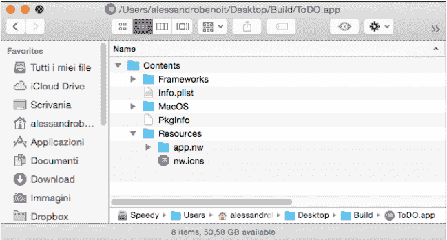
8. 用你喜欢的编辑器打开`Todo.app`内的`Contents/Info.plist`文件，然后应用以下更改：
   1. 编辑`CFBundleName`，将其改为你的应用名称：
      ```xml
      <key>CFBundleName</key>
      <string>ToDO</string>
      ```
   2. 编辑`CFBundleShortVersionString`和`CFBundleVersion`，将其改为你的应用版本：
      ```xml
      <key>CFBundleShortVersionString</key>
      <string>1.0.1.0</string>
      <key>CFBundleVersion</key>
      <string>1.0</string>
      ```

现在，作为一个绕过系统图标缓存的简单技巧，你可以将`ToDO.app`文件移动到其他位置，你应该就能看到应用了新图标。为了确保一切正常，启动应用并验证应用名称是否显示在窗口菜单的左上角，替换默认的`nwjs`菜单：
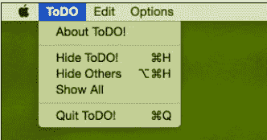
[126]
现在，你可以点击**ToDO**菜单，然后点击**关于ToDO!**，在刚打开的小窗口中，你应该能看到正确的应用名称和版本，如下面的截图所示：
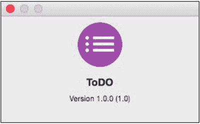

##### 将文件扩展名与你的应用关联
要将特定文件扩展名与你的应用关联，你可以打开`Contents/Info.plist`文件，并在`CFBundleDocumentTypes`部分添加以下代码：
```xml
<dict>
<key>CFBundleTypeIconFile</key>
<string>nw.icns</string>
<key>CFBundleTypeName</key>
<string>ToDO</string>
<key>CFBundleTypeRole</key>
<string>Viewer</string>
<key>LSHandlerRank</key>
<string>Owner</string>
<key>CFBundleTypeExtensions</key>
<array>
<string>todo</string>
</array>
<key>LSIsAppleDefaultForType</key>
<true/>
<key>CFBundleIconFile</key>
<string>nw.icns</string>
</dict>
```


现在，如果我们创建一个扩展名为`.todo`的新文件，且该扩展名尚未被其他应用程序占用，那么该文件就会显示`CFBundleIconFile`字段中描述的图标，而且会自动由我们的应用程序打开（关于如何用NW.js处理文件打开操作，请参阅第2章*NW.js原生UI API*）。

## 打包适用于Microsoft Windows的NW.js应用程序
> **开始之前**
如果你打算为应用程序添加桌面快捷方式，建议使用`gui.App.createShortcut()`方法，相关说明可查阅第4章末尾关于*Web通知API*的内容，对应章节为《数据持久化方案与其他浏览器Web API》。
- 复制下载好的NW.js文件夹，将其重命名为`ToDO`。
- 删除不必要的文件，比如`nwjc.exe`，如果不需要媒体库的话，还要删除`ffmpegsumo.dll`。
- 将包含`package.json`文件的ToDO项目文件夹内的所有内容压缩为`app.zip`文件（注意只压缩文件夹内的内容，如果压缩整个文件夹的话会无法正常使用）。
- 将压缩包重命名为`app.nw`（如果文件扩展名被隐藏，请依次点击**查看 | 文件夹选项**，取消勾选**隐藏已知文件类型的扩展名**选项）。
- 将`app.nw`文件复制到重命名为`ToDO`的NW.js文件夹中。
- 在该文件夹内打开命令提示符，输入以下命令：
```cmd
C:\...\ToDO\> copy /b nw.exe+app.nw todo.exe
C:\...\ToDO\> del nw.exe
C:\...\ToDO\> del app.nw
```

## **关于重命名NW.js可执行文件**
上述命令会将NW.js可执行文件与`app.nw`合并为新的`todo.exe`文件，并删除旧版本文件。如果因为某些原因你正在使用原生Node.js/io.js模块，那么生成的可执行文件将不会被重命名为任意名称的`.exe`文件，而需要保持`nw.exe`的名称。
- 下载、安装并打开**ResourceHacker**，其下载地址为`http://www.angusj.com/resourcehacker/`。
- 用ResourceHacker打开`todo.exe`，选择对应应用程序图标的资源，可参考下方截图：
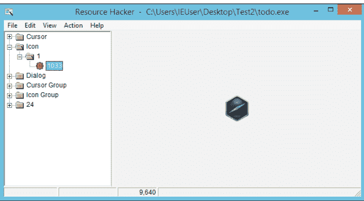
- 右键点击资源名称（本例中为**1033**），选择**替换资源**。
- 在刚打开的窗口中，点击**打开带新图标的文件**，选择你的`*.ico`文件（你可以通过`http://www.iconverticons.com/`，基于256×256像素的透明PNG文件在线生成该文件），然后点击**替换**。
- 最后，你可以点击**文件**，再点击**保存**。附带效果是会自动生成一个带`_original`后缀的原始可执行文件副本，请在确认应用程序运行正常后再删除该副本。

## 打包应用程序以进行分发
如果图标还没有变化，大概率是Microsoft Windows图标缓存的问题。你可以通过以下命令清理图标缓存，只需在命令提示符中输入：
```cmd
C:\>ie4unit.exe -ClearIconCache
```
```cmd
C:\>taskkill /IM explorer.exe /F
```
```cmd
C:\>explorer
```

> 请注意，Microsoft Windows任务栏显示的图标并非唯一生效的图标，真正生效的是清单文件中`window.icon`字段指定的图标。

## 在Microsoft Windows上注册文件类型关联
要在Microsoft Windows上注册文件类型关联，请查阅*打包流程背后的通用逻辑*章节。你需要添加/修改的注册表项位于`HKEY_CLASSES_ROOT`下。我花了点时间才弄懂Microsoft Windows如何处理这类关联，能给你的最佳建议是参考其他应用程序如何处理文件/MIME类型关联。

## 打包适用于Linux的NW.js应用程序
在Linux上，情况更加棘手，因为我发现独立应用程序的概念在Linux平台上并不普及。以下流程可以帮你为应用程序构建可执行文件，但其中添加图标的步骤无法直接复现，除非你将应用打包为多种可用格式之一的Linux安装包：`*.pkg`、`*.rpm`、`*.deb`、`*.tgz`等。很遗憾，讲解这类打包系统的工作原理已经超出了本书的范畴，但我们还是逐一解决问题吧：
- 复制下载好的NW.js文件夹，将其重命名为`TODO`。
- 如果不需要媒体库，删除`nwjc`和`libffmpegsumo.so`文件。
- 进入`TODO`项目文件夹，执行以下命令创建名为`app.nw`的压缩包：
```bash
$ zip -r ../app.nw *
```
- `app.nw`文件会被存放在项目文件夹外的上一级目录，请将其复制到TODO文件夹内。
- 进入TODO文件夹，执行以下命令将NW.js可执行文件与你的项目压缩包合并：
```bash
$ cat nw app.nw > todo
$ chmod +x todo
$ rm nw
$ rm app.nw
```
- 完成！双击`todo`文件，应用程序就会按预期启动。

## **在Linux上添加图标和文件类型关联**
如前所述，现在我们需要为`todo`可执行文件关联图标。以下流程会带你了解*.desktop 文件*的创建方法（desktop文件也常被称为**应用程序启动器**），这是X11环境下用于指定运行程序行为的标准格式：
- 在`/usr/share/applications/`文件夹内创建`todo.desktop`文件，用你常用的代码编辑器打开它。
- 将以下内容粘贴到文件中：
```ini
[Desktop Entry]
Version=1.6
Name=ToDO
Comment=ToDO Application
Exec=/path/to/todo $U
Icon=/path/to/icon.png
Terminal=false
Type=Application
Categories=Utility;Application;
```
- 保存文件后，你需要用以下命令将其设置为可执行文件：
```bash
$ sudo chmod +x todo.desktop
```
- 至此，你就可以在启动器中看到带指定图标的该启动了。不过你可能已经猜到，这种方法的缺陷是：在用户的实际系统上，你无法提前知道应用程序的路径，因此你需要借助某种安装程序/打包工具才能让该方法正常工作。

## **打包应用程序以进行分发**
文件类型关联也需要在分发时处理。要让你的应用程序支持处理特定文件类型，你需要根据目标Linux发行版，编辑（或创建）以下任一文件：
- `~/.local/share/applications/mimeapps.list`
- `~/.local/share/applications/defaults.list`
添加以下指令，即可将纯文本文件与你的应用程序关联：
```ini
[Default Applications]
text/plain=todo.desktop
```
你可以访问https://wiki.archlinux.org/index.php/Desktop_entries获取更多关于X11 .desktop文件的信息。

> 希望这节内容没有太混乱。我对Mac OS X和Linux命令行还算熟悉，但处理Microsoft Windows或X11相关问题时总感觉力不从心。希望你对这部分内容的了解比我深得多，能够把缺失的部分补全。

### 保护你的源代码
如导言所述，NW.js提供了通过`nwjc`（旧称`nwsnapshot`）保护部分源代码的方式，你可以在下载好的NW.js压缩包中找到该工具。这仍然是一项*实验性功能*，因此使用时需要格外小心。
你的代码需要在打包过程中通过`nwjc`编译，在应用程序运行时会被动态处理。这会带来明显的运行开销，*会使你的代码性能下降约30%*（数据基于项目Wiki报告的V8基准测试套件结果）。此外，*编译后的代码不具备跨平台性，也无法在不同版本的NW.js之间兼容*，因此每次NW.js更新、每个操作系统版本，你都需要重新编译代码。
`nwjc`的另一项限制是，待编译的源代码大小上限约为250KB。了解了`nwjc`的所有限制后，接下来我们深入讲解它的工作原理。
要在Mac OS X或Linux上编译代码，你需要在项目文件夹内的终端/命令提示符中执行以下命令：
```bash
$ path/to/nwjc --extra_code source.js snapshot.bin
```

在Microsoft Windows系统上执行以下命令：
```bash
C:\...\project> C:\path\to\nwjc.exe --extra_code source.js snapshot.bin
```
该命令将在你的项目文件夹中新建一个`snapshot.bin`文件。随后，你可以通过编辑如下清单文件，使其在你的NW.js应用中加载：
```json
{
    "name": "nw-demo",
    "main": "index.html",
    "snapshot" : "snapshot.bin"
}
```
你需要特别注意：编译进`snapshot.bin`的代码会在应用启动前执行，因此届时`window`对象和`document`对象都尚未实例化。为了避免出现问题，最好在`snapshot.bin`中仅声明函数和变量，而非执行代码。但出于学习目的，以下所有代码都可以正常执行：
- **source.js » snapshot.bin：**
```javascript
var variable = 'Hello';
(function () {
    variable += ' World';
})();
function writeHelloWorld () {
    console.log(variable);
    localStorage.string = variable;
    document.getElementById('main').innerHTML = localStorage.string;
}
```
- **index.html：**
```html
<div id="main"></div>
<script type="text/javascript">
    writeHelloWorld();
    console.log('Accessing variable', variable);
</script>
```
在`snapshot.bin`中，你也可以引入Node.js模块并使用原生UI API，但要始终记住：这部分源代码执行时，绝大多数对象都还不可用。
## 打包应用以便分发
### 关于NW.js应用授权
我不是律师，你也不该在这方面完全信任我；不过我觉得我还是应该给你至少一些关于NW.js应用授权处理的提示。首先，我引用该项目GitHub Wiki页面上的内容：
> “由于该二进制文件基于Chromium，因此需要附加多项开源许可声明，包括MIT许可、LGPL许可、BSD许可、Ms-PL许可以及MPL/GPL/LGPL三重许可。”
```http
http://www.gnu.org/licenses/license-list.en.html
```
依我理解，MPL/GPL/LGPL三重许可允许你从三者中选择最适合你项目的许可，因此**你不需要按照GPL许可的要求以开源许可发布你的代码**，也可以选择商业许可。我再次引用NW.js项目的官方文档内容：
> “这不适用于你的代码，你也没有必要开源你的代码。”
## 总结
完成打包流程后，我们的学习之旅就接近尾声了。现在你应该已经能熟练自定义清单文件，调整所有与窗口外观相关的选项。你可能已经为多个可能的操作系统打包过应用，在实现平台专属功能时或许处处碰壁，不过（你肯定会怪我这么说），这都是学习过程的一部分。最重要的是，你不仅发现了为每个平台构建完整可执行文件非常简单，也体会到了这个过程有多耗时，因此下一章我们会专门讲解几款最有前景的自动化打包工具，帮助你深入了解它们。
## 7 自动化打包工具
如上一章所述，尽管为指定平台构建NW.js包非常简单，但每次发布更新时为每个平台重复这一流程，很容易让人感到挫败。久而久之，许多热心且技术出色的开发者在不同平台上使用不同技术开发了自动化打包工具。本章我们会分析几款最有前景的工具的优缺点，并介绍快速构建完整可用NW.js包所需的全部步骤。这些工具中，部分带有图形界面，其余则是独立的CLI工具或Grunt插件。你可以根据自身开发流程，选择最适合的一款。
### Web2Executable
Web2Executable的下载链接为：[Web2Executable下载链接](https://github.com/jyapayne/Web2Executable)。Web2Executable是一款非常智能的NW.js打包工具，由加拿大技术开发者Joey Paine使用Python编写。在我将要介绍的多款工具中，这是唯一一款附带基础但实用性很强的图形界面的工具（如果你对图形界面不感兴趣，也可以下载其CLI版本）。Web2Executable支持所有三大平台：Mac OS X、Windows 7及以上版本的系统，以及Linux（已在Ubuntu 14.04上完成测试）。如果你选择从源码运行它，需要准备Python、PySide和PIL；但如果你下载预编译的可执行文件，解压即可直接使用，无需额外配置。
Web2Executable的功能可以归纳为以下几点：
- 下载所选平台指定版本的NW.js安装包
- 为多个平台构建安装包
- 为Mac OS X和Windows系统的可执行文件添加图标
接下来我们看看Web2Executable的界面：
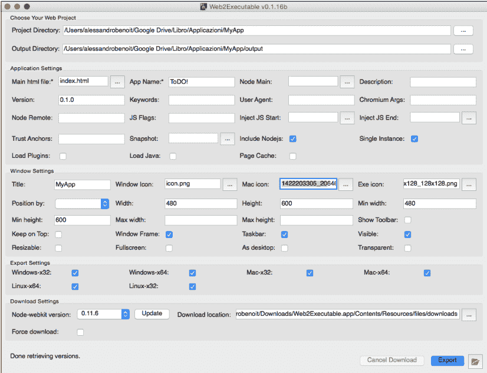
接下来我们一步步介绍Web2Executable的构建流程：
1. 在顶部面板选择项目文件夹路径和目标目录（默认为项目文件夹内的output输出目录）。
2. 如果还没配置过，请在**应用设置**和**窗口设置**面板中配置清单文件选项。你大概率会取消勾选**显示工具栏**选项，我每次打包时都忘不了要把它关掉。
3. 如果你打算为Mac OS X或Windows系统部署，请在**窗口设置**面板中设置Mac或Exe对应的图标。
4. 在**导出设置**中，选择你要部署的目标平台，对应的NW.js版本会自动下载。Web2Executable支持同时为多个平台构建包，但要注意，这种情况下Node.js/io.js模块不会重新编译，可能会出现兼容性问题。
5. 在**下载设置**面板中，选择你要使用的NW.js版本以及所有安装包的下载路径。（如果需要自定义NW.js包，你需要记住这个路径）。
6. 最后，点击**导出**按钮，就能让Web2Executable完成所有工作。
前面步骤设置的所有选项都会保存在你的清单文件（`package.json`）中。Web2Executable专属的选项会存储在`webexe_settings`对象中，而少量与Mac或Exe图标相关的自定义选项会被添加到`window`对象中。目前Web2Executable还不会自动修改Mac OS X包内的`Info.plist`文件，你需要手动完成这一操作（具体方法可参考*第6章 打包应用以便分发*）；不过开发者向我保证，这个功能已经在开发中了。
> **加载共享库时出错：libudev.so.0**
>
> 为Linux平台构建时，你可能会遇到`libudev.so.0`报错。这种情况下，你需要解压该工具下载的NW.js Linux包，按照*第1章 初识NW.js*中的步骤操作，最后再将包重新压缩即可。本章介绍的其他所有工具也是如此。
### node-webkit-builder与grunt-node-webkit-builder
node-webkit-builder和grunt-node-webkit-builder的项目链接分别如下：
- [node-webkit-builder项目仓库](https://github.com/mllrsohn/node-webkit-builder)
- [grunt-node-webkit-builder项目仓库](https://github.com/mllrsohn/grunt-node-webkit-builder)
`node-webkit-builder`是一个Node.js脚本，既可以作为模块使用，也可以作为CLI工具使用。正如你所料，它还有**Grunt插件版本**；如果你是**Gulp**用户，直接使用它的模块即可。node-webkit-builder是目前最完整的工具之一，它能完成打包、添加图标、填充Mac OS X的`Info.plist`数据这些操作，运行速度快，还提供了大量自定义选项。遗憾的是，目前这些优秀的自定义选项大多无法通过CLI访问。在这些功能被集成进来之前，CLI版本在测试阶段仍然非常实用，接下来我们看看它的用法。
首先，使用以下命令全局安装该模块：
```bash
$ npm install node-webkit-builder -g
```
模块安装完成后，你可以按照以下方式运行`nwbuild`命令：
```bash
$ nwbuild [options] [path]
```
其中`path`是你的项目文件夹路径，`options`是如下代码中列出的参数：
```bash
-p Operating System to build ['osx32', 'osx64', 'win32', 'win64']
-v NW.js version [default: "latest"]
-r Runs NW.js project [default: false]
-o The path of the output folder [default: "./build"]
-f Force download of node-webkit [default: false]
--quiet Disables logging
```
我们来看几个示例：
- **运行项目**（在当前平台）：
```bash
$ nwbuild -r /path/to/the/project
```
- **为所有平台构建项目**（不支持图标）：
```bash
$ nwbuild -p win32,win64,osx64,linux32,linux64 /path/to/the/project
```


运行上一条命令会让`node-webkit-builder`下载所有需要的NW.js包，将它们缓存起来，最终运行或构建项目。运行CLI会进入如下界面：
``` 
Downloading: http://dl.nwjs.io/v0.12.0-alpha3/nwjs-v0.12.0-alpha3-linux-x64.tar.gz downloading [===========================] 100% 0.0s Create release folder in /Users/alessandrobennoit/Desktop/Built/ToDo!/osx32 Create release folder in /Users/alessandrobennoit/Desktop/Built/ToDo!/win64 Create release folder in /Users/alessandrobennoit/Desktop/Built/ToDo!/win32 Create release folder in /Users/alessandrobennoit/Desktop/Built/ToDo!/osx64 Create release folder in /Users/alessandrobennoit/Desktop/Built/ToDo!/linux32 Create release folder in /Users/alessandrobennoit/Desktop/Built/ToDo!/linux64 
```
运行CLI时，你可能会遇到如下错误：
``` env: node\r: No such file or directory ```
这个问题是由于项目源码中换行符处理错误导致的。要修复该问题，你需要修改`node-webkit-builder/bin/nwbuild`文件的换行符。在VIM中，你可以使用`:set ff=unix`命令；而在Sublime Text中，你可以通过点击**视图 | 换行符 | Unix**来修复：
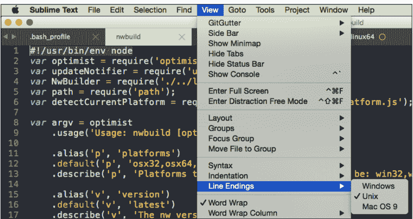

## 自动打包工具
如前所述，目前通过CLI还无法处理图标或其他自定义设置。要实现这些功能，你需要编写一个Node.js脚本来定义所有需要的选项。接下来我会举一个非常简单的示例，方便你理解。首先，创建一个`myApp`文件夹，然后在其中添加以下文件和子文件夹：
``` myApp/ > project/ - nwbuild.js - macCredits.html - macIcons.icns - winIcon.ico - package.json ```
将你的项目文件移动到project文件夹中，然后按如下内容编辑`package.json`文件：
``` { "name": "myAppBuilder", "dependencies": { "node-webkit-builder":"~1.0.8" } } ```
保存文件后，运行`npm install`在本地安装node-webkit-builder。现在，按如下内容编辑`nwbuild.js`文件：
``` var NwBuilder = require('node-webkit-builder'); // Configuration var nw = new NwBuilder({ files: './project/**', platforms: ['win', 'osx', 'linux'], macIcons: './macIcon.icns', macCredits: './macCredits.html', winIco: './winIcon.ico' }); // Handle logging nw.on('log', console.log); // Build returns a promise nw.build().then(function (a) { console.log('\033[32m' + '✔ All done!'); }).catch(function (error) { console.error('\033[31m ✖ ' + error); }); ```
在上述脚本中，我们加载了模块，提供了一组选项，最终启动打包操作并监听其结果。要运行该脚本，请在myApp文件夹的命令行/终端中输入以下命令：
``` $ node nwbuild.js ```
下面我们来看完整的可用选项列表，以便更好地理解上述代码的工作原理：
- files：项目的路径。由于它支持simple-glob语法，你可以声明多个不想打包的文件，甚至是文件和文件夹（例如`['foo/*.js', '!foo/bar.js', 'foo/bar.js']`）。
- version：你要使用的NW.js版本。每次下载新版本时，它都会被缓存到myApp根路径下的cache文件夹中。默认会使用最新版本。
- platforms：你要为其构建项目的操作系统。你可以指定特定平台（例如`['osx32', 'osx64']`），也可以指定整个平台组（例如`['osx']`）。
- appName：用于命名文件、填充Plist文件的应用名称。默认会使用项目清单文件中的name属性。
- appVersion：用于命名文件、填充Plist文件的应用版本。默认会使用项目清单文件中的version属性。
- buildDir：输出目录的路径。默认会在myApp的根路径下创建一个新的build文件夹。
- cacheDir：存储已下载NW.js包的文件夹路径。默认会在myApp的根路径下创建一个新的cache文件夹。
- buildType：用于命名输出包的约定。默认使用纯appName选项，该选项还支持另外三个值：
  - versioned：`[appName]-v[appVersion]`
  - timestamped：`[appName]-[timestamp]`
  - 一个函数，选项会作为作用域传入，例如：
    ``` function () { return this.appVersion; } ```
- `forceDownload`：如果该选项被设置为`true`，则会清除所有已缓存的NW.js包，重新下载所有内容。
- `macCredits`：仅在Mac系统下可用，你可以设置一个自定义的HTML致谢文件，其内容会显示在**关于信息框**中，效果如下：
  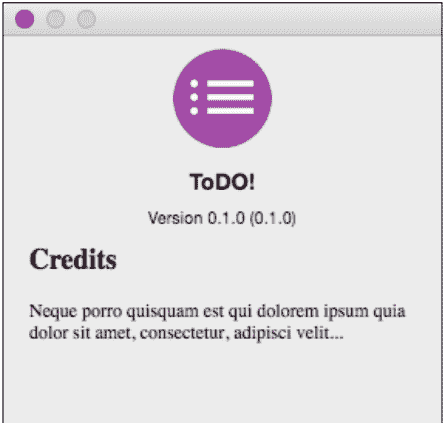
- `macIcons`：与Mac OS X可执行文件关联的图标路径。
- `macZip`：指示是否要在Mac OS X下将`app.nw`文件夹打包为zip文件。默认值为`false`。
- `macPlist`：用于替换默认`Info.plist`文件的自定义文件路径。你还可以传入一个对象，定义要添加到`node-webkit-builder`生成的默认Plist文件中的自定义属性。
- `winIco`：与Microsoft Windows可执行文件关联的`*.ico`文件路径。要在Mac OS X和Linux系统上使用该选项，你需要从http://winehq.org/安装Wine，或运行`brew install wine`进行安装。

关于node-webkit-builder还有一点需要了解：它允许你基于目标平台使用自定义选项覆盖默认的清单配置。要实现该功能，你需要在项目清单文件中声明一个`platformOverrides`对象。我们来看一个简单示例：
``` { "name": "myApp", "version": "0.1.0", "main": "index.html", "window": { "height": 400 }, "platformOverrides": { "win": { "name": "myAppWin", "main": "indexWin.html" }, "osx32": { "window": { "height": 500 } } } } ```
在最终生成的安装包中，`platformOverrides`选项会被移除，但特定的覆盖项会被应用到主选项集中。因此，例如Win32和Win64的清单文件会大致如下所示：
``` { "name": "myAppWin", "version": "0.1.0", "main": "indexWin.html", "window": { "height": 400 } } ```
这非常方便，因为它为构建过程增加了一层自定义能力，否则我们需要编写多个构建脚本来满足特定平台的需求。

## grunt-node-webkit-builder
现在，我们来看grunt-node-webkit-builder是如何工作的：
1. 复制之前创建的文件夹结构，并按如下内容编辑`package.json`文件：
``` { "name": "myAppBuilder", "dependencies": { "grunt":"^0.4.1", "grunt-node-webkit-builder":"~1.0.0" } } ```
2. 保存文件后运行`npm install`；现在你可以创建`gruntfile.js`文件：
``` module.exports = function(grunt) { // Configuration grunt.initConfig({ nodewebkit: { options: { platforms: ['osx', 'win', 'linux'], macIcons: './macIcon.icns', macCredits: './macCredits.html', winIco: './winIcon.ico' }, src: ['./project/**'] // Your node-webkit app } }); // Load plugin grunt.loadNpmTasks('grunt-node-webkit-builder'); // Run grunt.registerTask('default', ['nodewebkit']); }; ```
在grunt-node-webkit-builder中，你可以使用node-webkit-builder支持的所有选项。唯一的区别是，你需要在`src`字段中指定项目文件夹。
3. 保存Grunt文件后，只需使用以下命令即可运行它：
``` $ grunt ```


### **Mac OS X ulimit 配置**
如果你遇到`EMFILE`错误或通用的*打开的文件过多*错误，你需要在终端中运行`ulimit -n 1024`命令，或者将该命令写入你的`~/.bash_profile`文件中。
如你所见，node-webkit-builder 和 grunt-node-webkit-builder 是非常完善且可定制的解决方案，能够一次性为多个平台构建 NW.js 应用，但你仍然需要始终记得在每个平台上重新构建 Node.js/io.js 模块的最佳实践。

### **generator-node-webkit**
generator-node-webkit 的项目链接为 `https://github.com/Dica-Developer/generator-node-webkit`。
**generator-node-webkit** 是一个用于 NW.js 的 **Yeoman 生成器**。与之前介绍的工具不同，它不仅可以便捷地打包 NW.js 应用，还能*强制执行良好的编码规范*，并附带*配套工具*和*基础项目文件夹结构*，方便你启动项目。你可能已经熟悉 Yeoman 了，如果还不了解的话，它是一个基于 Node.js 的 Web 应用脚手架工具，完全适用于我们的场景。你可以通过 npm 轻松全局安装 Yeoman：
``` $ npm install -g yo ```
安装完成后，你还可以安装 generator-node-webkit：
``` $ npm install -g generator-node-webkit ```
最后，为你的项目创建一个新文件夹，通过以下命令启动生成器：
``` $ yo node-webkit ```

## **自动打包工具**
如果所有步骤都顺利完成，你应该会看到如下图所示的界面：
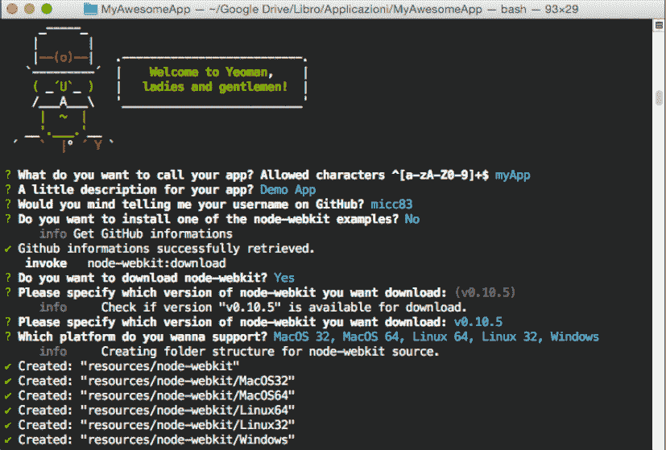
如你所见，你需要回答几个问题，我们逐步来看：
- **你的应用要叫什么名字？**
  - 这是应用的名称，会用于填充清单文件、最终安装包的文件名，以及 macOS Plist 文件中的应用名称字段。
- **为你的应用写一段简短描述？**
  - 这段描述会用在多个相关位置，例如最终的应用安装包中。
- **可以告诉我你的 GitHub 用户名吗？**
  - 这是作者的 GitHub 用户名，会用于添加到 macOS Plist 文件的版权信息中。（我推测未来它也会用在其他位置。）
- **是否要安装一个 node-webkit 示例项目？**
  - 如果回答是，你会被要求选择一个要下载的 NW.js 示例项目。
- **是否要下载 node-webkit？**
  - 如果回答是，你会被要求选择版本和平台。选择版本时，记得在数字前加上 `v` 前缀（例如 `v0.11.6`）。

回答完所有问题后，你的项目文件夹中会生成大量文件和文件夹，我们来看一下打包流程中需要用到的部分：
- `app/`：项目源代码会放在这个文件夹中，会附带一份预编译的清单文件，以及 `css`、`views` 和 `js` 几个默认文件夹。
- `dist/`：这是打包流程的输出文件夹。
- `resources/mac/`：这个文件夹中包含了构建 macOS 版 NW.js 包所需的所有资源文件。
- `resources/node-webkit/`：这个文件夹中包含了所有解压后的 NW.js 安装包（当你需要修复 **libudev.so.0** 错误时非常有用）。
- `.editorconfig`：这是你的 IDE 配置文件，会预设一些默认规则来规范开发实践。要让 IDE 识别这些规则，你需要从 `http://editorconfig.org/` 下载对应的插件。
- `.jshintrc`：这是 **JSHint** 的配置文件。如果你没听说过这个工具，一定要去 `http://jshint.com/` 看看。（Sublime Text 也有对应的插件。）
- `bower.json`：Bower 不是必用的，这里提供了一份模板配置文件。
- `Gruntfile.js`：所有打包逻辑都在这个文件里。要构建你的应用，你需要调用对应的 Grunt 任务，我们稍后会讲到。
- `package.json`：这是 generator-node-webkit 的清单文件，不要和项目内的那个 `package.json` 混淆，作者信息会存储在这个文件中。

现在我们来看一下可用的 Grunt 任务：
``` $ grunt check ```
该命令会对你的代码执行 JSHint 检查，每次你调用打包任务时，这个任务也会自动执行：
``` $ grunt dist-[platform] ```
该命令会执行打包流程，其中 `[platform]` 是你想要构建包的目标操作系统，可用的平台包括：Linux、Linux32、Win、Mac 和 Mac32。你还可以通过在默认 Grunt 文件中添加新任务来同时执行多个打包任务，这点不言而喻。

遗憾的是，目前 generator-node-webkit 还不支持为 Windows 安装包关联图标。不过当你在 macOS 上运行 `$ grunt dist-mac` 时，有一些好用的选项。如果在 `resources/mac/` 目录下存在 `nw.icns` 图标文件，它会被关联到最终生成的安装包上。此外，还会生成一份自定义的 Info.plist 文件，包含你的应用名称、版本和版权信息，你可以通过编辑 `resources/mac/Info.plist` 来自定义这份文件。
generator-node-webkit 有一个独特的有趣功能：它支持构建 *.dmg 文件（苹果磁盘镜像），这类文件目前仍然是 macOS 应用在 App Store 外最常用的分发方式之一。
要为你应用构建 *.dmg 文件，你需要先构建 macOS 版本的安装包，然后运行以下命令：
``` $ grunt dmg ```
新的 *.dmg 文件会生成在 `dist/MacOS64/` 目录下，窗口背景会使用 `resources/mac/` 文件夹中提供的 `background.png` 文件。
遗憾的是，dmg 命令只能在 macOS 平台上执行。
以下是 *.dmg 压缩包打开后的效果截图：
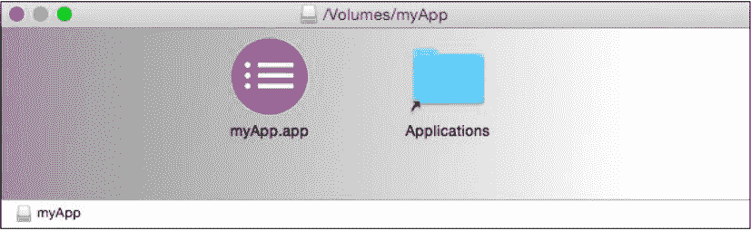 
我第一次在 1.0.3 版本的 generator-node-webkit 中运行 `grunt dmg` 时，遇到了以下错误：
``` hdiutil: create failed - No such file or directory ```
如果本书出版时这个问题还没有被修复，你可以轻松解决：打开 `resources/mac/package.sh` 文件，将所有出现的 macOS 路径名修改为正确的名称（我遇到的情况是修改为 MacOS64）。

## 本章总结
本章中，我快速介绍了几款最实用的打包工具，但其实还有很多其他工具，比如 nodebob 和 lein-node-webkit-builder。我自己也开发了一款（叫 Nuwk!），已经有几千次下载，但目前我没有时间维护这个仍处于早期开发阶段的项目。如果有个前端开发者愿意花时间为 node-webkit-builder 开发一款好用的图形界面，那就太棒了。仔细想想，你们中的大多数人现在应该都能做到这一点，这也会成为新手接触 NW.js 的额外动力。话不多说，我们接下来进入下一个主题：调试 NW.js 应用。调试有很多种方法，我无法深入讲解每一种，所以只会给你介绍相关工具的概览。

## 8 调试你的应用
在之前的章节中，你已经接触过 **NW.js DevTools**，你也发现 NW.js DevTools 和你之前用来开发前端应用的 **Google Chrome** 开发者工具差别不大。NW.js DevTools 是远程调试工具，数据通过本地实例化服务器的套接字连接传输。NW.js DevTools 只保留了最核心的工具，比如实现设备模拟器就完全没有必要。默认情况下，要打开开发者工具，需要将清单文件中的 `window toolbar` 选项设置为 `true`，具体可参考*第6章 打包应用用于分发*。应用打开后，你需要点击窗口工具栏右上角的齿轮按钮，即可调出开发者工具窗口：
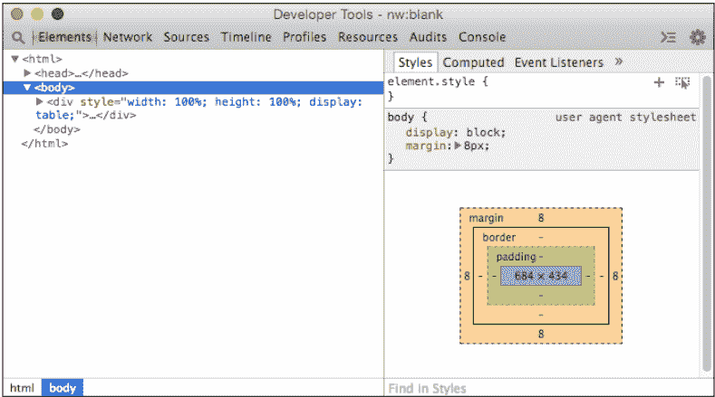

## *调试你的应用*
- **元素**面板会实时展示DOM结构。用户不仅可以轻松编辑页面渲染后的HTML和CSS，还能监控与每个元素关联的JavaScript事件和属性。使用放大镜工具，你就可以直接从浏览器窗口中选择目标元素。
- **网络**面板会列出页面加载的所有资源，并详细标注它们的加载时间、来源（包括请求方法、请求头，以及每次远程或本地调用的响应内容）。
- **源代码**面板为V8调试器提供了图形化界面。这个工具功能强大且复杂，简化来说，它支持你通过监控JavaScript变量和事件来调试问题，每次设置一个断点，逐步定位问题根源。
- **时间轴**面板能完整展示应用的各项时间线，涵盖从资源加载到JavaScript解析、页面渲染的全流程。
- **性能**面板允许开发者监控应用的CPU和内存使用情况，提供多种方式优化代码性能。
- **资源**面板可以让我们访问浏览器实现的多种存储技术的内容（详见第4章*数据持久化方案及其他浏览器Web API*）。
- **审核**面板在Web应用场景下可能没那么实用，但它可以提供网络利用和网页性能的详细概览，逐条给出优化建议。
- **控制台**面板是开发者的最佳助手，它支持与页面的DOM和JavaScript代码实时交互。我并非要轻视这个强大工具的功能，但本书的重点并非深入讲解Chromium开发者工具的所有功能。如果你已经熟悉这个工具，那可以直接上手；否则你可以在`https://developer.chrome.com/devtools`找到更详细的说明。调试对于任何开发流程都至关重要，而对于NW.js这类基于Web、发展时间短且容易出Bug的项目来说，调试更是必不可少。因此，NW.js提供了直接从IDE输出的错误日志（我们在*第1章 认识NW.js*中介绍过）、**远程调试**功能，以及一套用于操作开发者工具的**API**。

### 远程调试
要启用远程调试功能，你需要给NW.js添加`--remote-debugging-port=端口号`参数。你可以通过命令行/终端完成这个操作：
```
$ nwjs --remote-debugging-port=9222 /path/to/your/project
```
> 本书的审阅人员指出，在NW.js v0.12.0版本中，远程调试功能运行异常，会显示空白页。要解决这个问题，请确保至少升级到v0.12.1版本。

你也可以直接从**Sublime Text**的NW.js构建脚本中启用远程调试。要编辑之前在*第1章 认识NW.js*中创建的构建文件，你需要打开Sublime Text，然后依次进入**Preferences | Browse Packages**（在Windows系统中位于**Files**菜单下，在Mac OS X系统中位于**Sublime Text**菜单下），会弹出*Packages*文件夹。接下来打开`user`文件夹，找到`nw-js.sublime-build`文件并用Sublime Text打开。现在你可以**修改文件的第一行**，内容如下：
```json
"cmd": ["nwjs", "--remote-debugging-port=9222", "${project_path:${file_path}}"]
```
> 请根据你的操作系统修改NW.js可执行文件的名称：Mac OS X系统使用nwjs，Linux系统使用nw，Microsoft Windows系统使用nw.exe。

无论你是在Sublime Text中操作还是在终端操作，只要运行了应用，你就可以在浏览器中直接访问`http://localhost:9222/`打开开发者工具。在打开的页面中，你会看到一个或多个链接，点击和你的应用同名的链接，就会弹出开发者工具实例，你就可以开始远程调试应用了。

### 开发者工具API
开发者工具API是我们在*第2章 NW.js原生UI API*中见过的Window API的一部分，它提供了三个方法：
- `Window.isDevToolsOpen()`
- `Window.closeDevTools()`
- `Window.showDevTools([id | iframe, headless])`

前两个方法顾名思义很容易理解，而第三个方法值得我们深入讲解。`Window.showDevTools`最常用的用法是不传参数，这样你就可以在运行时打开开发者工具，无需启用窗口工具栏：
```javascript
require('nw.gui').Window.get().showDevTools();
```
第一个参数`[id|iframe]`用于设置要启用调试的目标框架，我们来看个例子：
```html
<iframe src="test.html" id="toDebug"></iframe>
<script type="text/javascript">
var win = require('nw.gui').Window.get();
win.showDevTools('toDebug');
</script>
```
这样开发者工具就只会为#toDebug这个iframe启用。该参数的值可以设置为iframe元素的ID或对象。第二个参数`headless`在开发Web IDE时非常实用，这种情况下你可能希望用户可以直接在IDE内部预览和调试代码，因此你需要将开发者工具集成到IDE界面中。要实现这个功能，你需要将`headless`设为`true`，并将开发者工具加载到iframe中。我们来看一个实现示例，首先创建一个名为`idePreview.html`的示例HTML文件，然后将以下代码添加到你的主文件（index.html）中：
```html
<iframe id="toDebug" src="idePreview.html" style="width:100%"></iframe>
<iframe id="devTools" style="width:100%;"></iframe>
<script type="text/javascript">
var win = require('nw.gui').Window.get();
win.showDevTools('toDebug', true);
win.on("devtools-opened", function(url) {
    document.getElementById('devTools').src = url;
});
</script>
```
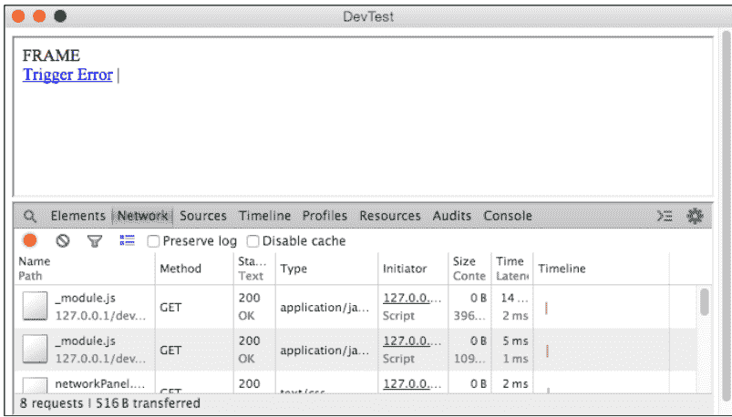

在这个例子中，我们正在调试#toDebug这个iframe，它展示的是一个HTML文件的渲染预览。开发者工具会直接在#devTools这个iframe中打开。实现原理是我们拦截了`devtools-opened`事件，该事件会传递一个直接指向开发者工具页面的URL属性。你甚至可以更进一步，使用拦截到的URL在默认浏览器中打开开发者工具，和远程调试的操作类似。
>> 截至本书撰写时，NW.js v0.12.1版本的无头开发者工具功能无法正常运行。希望这个问题能在后续的版本更新中得到修复。作为临时解决方案，你可以在清单文件中临时添加`"node-remote": "127.0.0.1"`配置，这样可以消除跨域错误；不过仍然会弹出外部的开发者工具窗口，请记得在发布生产版本前删除该配置，避免出现安全问题。

## NW.js的热重载
在开发应用前端时，每次修改代码后都能重新加载应用界面会非常方便。*热重载*有很多实现方案，我们来看其中两种。如果你在单个文件夹下开发，只需要借助Node.js，在你的文件末尾直接添加以下代码片段即可：
```html
<script>
var path = './', fs = require('fs');
fs.watch(path, function() {
    if (location) location.reload();
});
</script>
```
如果需要更完善的方案来递归监听文件变化，你就需要借助监听类工具库，比如**Gaze、Gulp或Chokidar**。我们再看一个基于Gulp的示例，首先你需要安装Gulp（手动安装或通过清单文件安装），然后在你的文件末尾添加以下代码：
```javascript
var gulp = require('gulp');
gulp.task('reload', function () {
    if (location) location.reload();
});
gulp.watch('**/*', ['reload']);
```
以上只是从NW.js官方Wiki中提取的部分示例，你可以在https://github.com/nwjs/nw.js/wiki/Livereload-nw.js-on-changes找到更多相关内容。

## 常见问题排查
在*第1章 认识NW.js*中，我们介绍了如何修复`libudev.so.0`相关问题，但在NW.js官方Wiki中还有其他一些常见问题的解决方案：
- **音频问题**：这类问题可能是由于使用了MP3等非免费媒体格式导致的，更多相关内容详见第4章*数据持久化方案及其他浏览器Web API*。


- **视频问题**：你的显卡可能被列入黑名单；如果是这种情况，请在清单文件的`chromium-args`对象中添加`--ignore-gpu-blacklist`参数来启动NW.js。如果仍然无法运行，可能是缺少DLL动态链接库；你可以尝试从Chrome安装目录中复制`d3dx9_43.dll`和`d3dcompiler_43.dll`文件。
- **开发者工具无法显示**：如前所述，开发者工具运行在本地实例化服务器上。代理设置或自定义主机配置可能会干扰其正常显示。
- **JavaScript阻塞CSS动画**：JavaScript和CSS动画运行在同一个线程中。你可以在清单文件的`chromium-args`对象中添加`--enable-threaded-compositing`标记来修改这一行为。

## 总结
关于NW.js的调试还有很多内容可以补充。如前所述，NW.js功能非常强大，但发展时间还比较短。根据你部署应用时选择的版本，你可能会遇到各种bug或功能缺失，这些都可能让你头疼。因此才有了这个issues页面（https://github.com/nwjs/nw.js/issues），该页面已有超过1700个已关闭的issue，但仍有一千多个未解决的issue。

此外，为了解决这类问题，从0.8版本开始，NW.js支持崩溃转储功能。我并没有深入研究这个话题，因为对于本书的写作目的来说，这*有点过于复杂*。不过你可以访问https://github.com/nwjs/nw.js/wiki/Crash-dump了解更多相关内容。

我们即将完成全部内容。在最后一章中，我们将介绍后续步骤，并列举相关资源和工具，帮助你继续学习NW.js。

## 9 将你的应用提升到新高度
至此，我们的学习之旅即将结束。希望你能和我一样享受这个过程。现在你需要思考后续的学习步骤，以便掌握相关知识，开发出出色的NW.js应用。因此，在结束之前，我想为你推荐一些工具和学习资源，帮助你简化学习流程。

### NW.js项目模板
在启动新的NW.js项目时，准备好一套项目模板会非常方便：这类模板不仅提供了所有基础内容，还包含编码规范、工具和架构提示（我们已经在*第7章 自动化打包工具*中介绍过**generator-node-webkit**）。项目中涉及的技术非常多，其中大部分你或许从未听说过，在正式开始开发前都需要学习，因此要*仔细挑选最适合你需求的那一款*。

#### **angular-desktop-app**
下载链接：`http://github.com/jgrenon/angular-desktop-app`
这是一套简单的应用骨架，可用于基于NW.js和Angular.js开发桌面应用。它使用Require.js管理Angular.js的依赖，使用Bower管理客户端库，使用Twitter Bootstrap处理样式，使用grunt-node-webkit-builder进行构建。

#### **node-webkit-tomster-seed**
下载链接：`http://github.com/Kerrick/node-webkit-tomster-seed`
这是node-webkit-hipster-seed的分支版本，使用Ember.js替代了Angular.js。

#### **node-webkit-boilerplate**
下载链接：`https://github.com/brandonjpierce/node-webkit-boilerplate`
这是一套简单的项目模板，使用Vue作为MVVM框架，使用Gulp和Browserify进行测试。它是唯一一套不提供NW.js构建工具的模板（这可能是有利也有弊，由你自己决定）。

#### **nw-boilerplate**
下载链接：`https://github.com/szwacz/nw-boilerplate`
这是另一套NW.js项目模板，提供了自定义的Gulp构建任务。这套模板的一大亮点是自带es6-module-transpiler，支持你使用ES6规范草案中的模块语法，生成的文件会被自动转换为AMD模块。此外它还集成了Jasmine用于测试。

## **开发思路**
如果认为所有读者都有相同的目标，那想法就太简单了，因此我想为你提供几个可以参考的应用场景：

- **游戏开发**：如果你已经从事过浏览器游戏开发，那么上手NW.js游戏开发应该没有什么难度；否则你需要知道，有很多JavaScript框架可以简化开发流程。我首先想到的是Phaser，这是一款开源的桌面和移动端HTML5游戏框架。它支持WebGL、Canvas、物理引擎和瓦片地图，能让游戏开发变得异常简单（http://phaser.io/）。
- **系统工具开发**：如果你打算开发系统工具，那么必须熟练掌握Node.js/io.js相关知识。这部分内容你可以通过书籍、在线课程和大量的实践经验来学习，我也没什么好额外介绍的。不过当你掌握了所需的技能后，就需要考虑应用的界面设计了，因此我想为你推荐pawnee，这是一款开源的托盘栏工具，可用于管理本地Apache安装。这款应用最让我印象深刻的就是它从托盘栏弹出的精美图形界面，你绝对应该去看看它的源码（`https://github.com/johansatge/pawnee`）。
- **IDE与开发工具**：这类应用同时利用了Node.js和Chromium的特性。IDE通常非常复杂，但幸运的是，你可以先从Ace入手，这是一款用JavaScript编写的高级独立代码编辑器。我们说的是和GitHub用的同一款编辑器，它可扩展，功能非常丰富（`http://ace.c9.io/`）。近年来，你可以找到越来越多的开发者开源工具，我也希望这个趋势能一直保持。有这么多选择当然很好，但有时候我觉得让10个开发者一起开发同一个开源项目，比开发10个都不完整的独立项目效率高得多。我的意思是，在启动一个全新项目之前，最好先检查是否已经有类似的项目存在，再判断你是否可以对它进行改进。话虽如此，我想为你推荐几款你绝对不能错过的优秀NW.js开发工具：
  - **Koala**，一款用于编译Less、Sass、Compass和CoffeeScript的图形化应用（`http://koala-app.com/`）
  - **Fenix**，一款简单的静态桌面Web服务器（`http://fenixwebserver.com/`）
  - **Gisto**，一款跨平台的代码片段管理工具（`http://www.gistoapp.com/`）
  - **Markdown编辑器**：在我看来，现在市面上的Markdown编辑器已经够多了，如果你真的想做的话，可以考虑参与Haroopad的开发（`https://github.com/rhiokim/haroopad`）。
  - **非常规用途、虚拟现实与机器人技术**：好吧，这个方向确实有点跨界；不过……如果能为机器人领域那些难看的命令行界面轻松制作图形界面，岂不是超酷？这里有几篇教程可能符合你的需求：
    - [Arduino、Johnny-Five与NW.js](https://github.com/rwaldron/johnny-five/wiki/Getting-started-with-Johnny-Five-and-Node-Webkit)
    - [使用NW.js开发Oculus Rift Hello World示例](http://tyrovr.com/2014/06/01/nw-ovrsdk-tutorial.html)

## 资源与教程
- **开发点对点NW.js应用：** http://laike9m.com/blog/a-tutorial-on-using-peerjs-in-node-webkit-app,57/
- **NW.js应用入门：** http://thejackalofjavascript.com/getting-started-with-node-webkit-apps/
- **HTML5DevConf——使用NW.js将Web应用转为桌面应用：** https://www.youtube.com/watch?v=d2tYH7vXMUM
- **使用JetBrains WebStorm IDE运行/调试NW.js：** https://www.jetbrains.com/webstorm/help/run-debug-configuration-node-webkit.html
- **COLT——NW.js实时编码工具：** http://codeorchestra.com/
- **NW.js与Angular.js教程：** http://thejackalofjavascript.com/node-webkit-and-angularjs-a-moviestub-app/
- **Markdown编辑器开发教程；不好意思提这个……（开玩笑的）：** http://duco.cc/node-webkit-tutorial-creating-a-markdown-editor/

## 总结
在最后一章中，我为你简要介绍了围绕NW.js的一系列工具、资源和教程。重点在于，社区才是这个库真正的核心力量。许多投入且热情的开发者会在工作、学习和家庭的间隙抽空为NW.js的改进贡献力量。


与其他专有解决方案不同，NW.js 依赖你——依赖你跑测试、查找并分享漏洞、实现漏洞修复或新功能的能力。它是一个复杂的生态系统，每个用户都可以在其中尽自己的一份力。因此，我认为结束这本书的最佳方式就是感谢你，并为你提供几个可以联系优秀的 NW.js 社区的渠道：
- **NW.js Gitter 频道**：https://gitter.im/nwjs/nw.js
- **NW.js Google 用户组**：https://groups.google.com/forum/#!forum/nwjs-general

# 目录
## 符号
- **"Hello World" 应用程序**
  - 在 Linux 上运行 13,14
  - 在 Mac OS X 上运行 13
  - 在 Microsoft Windows 上运行 12
  - 在 Sublime Text 2 上运行 12
  - 编写 10-12
## A
- **绝对路径** 56
- **Ace**
  - 网址 161
- **angular-desktop-app**
  - 简介 160
  - 网址 160
- **AngularJS** 50
- **App API**
  - 简介 17
  - 访问应用数据文件夹路径 19,20
  - 关闭应用 21,22
  - 打开文件 18,19
  - 访问清单文件数据 20
  - 其他 API 23
  - 注册系统级热键 22,23
- **应用二进制接口（ABI）** 60
- 应用启动器 131
- **应用层，To-Do 列表应用**
  - 实现导出功能 103-105
  - 实现 96-98
  - 添加新任务 98-101
  - 实现同步功能 103-105
  - 加载任务 102,103
- **数组类型转换** 59
## B
- NW.js 开发者工具 Audits 面板 152
- 自动化打包工具 135
- **二进制大对象（BLOBs）**
  - 简介 65
  - 与 XMLHttpRequest 79,80
- **Blink** 3
- **样板项目**
  - 简介 159
  - angular-desktop-app 160
  - node-webkit-boilerplate 160
  - node-webkit-hipster-seed 159
  - node-webkit-tomster-seed 160
  - nw-boilerplate 160
- **浏览器 Web API** 63
- **Mac 内置菜单** 40
## C
- **Cellist** 5
- **Chokidar** 156
- **Chromium** 63
- **Chromium 开发者工具**
  - 网址 152
- **客户端-服务器应用** 49
- **剪贴板 API**
  - 简介 17
  - 访问系统剪贴板 47
- **NW.js 组件**
  - Node.js 3
  - WebKit 3
- **控制台面板，NW.js 开发者工具** 152
- **上下文问题**
  - 简介 57,58
  - 参考链接 59
- **上下文菜单**
  - 简介 37
  - 处理 38-40
- **CouchDB**
  - 简介 95,104
  - 网址 79
- **崩溃转储功能** 23
- **跨域访问** 23
- **光标** 78
- **清单文件自定义选项**
  - additional_trust_anchors 122
  - chromium-args 122
  - dom_storage_quota 123
  - inject-js-end 122
  - inject-js-start 122
  - js-flags 122
  - main 120
  - name 120
  - nodejs 120
  - node-main 120
  - node-remote 122
  - single-instance 120
  - snapshot 123
  - user-agent 122
  - version 120
  - webkit 122
  - window 120-122
## D
- **数据持久化方案**
  - 简介 64
  - IndexedDB 72-79
  - Web SQL 数据库 68-72
  - Web 存储 65-67
- **开发思路**
  - 开发工具 161
  - 游戏开发 160
  - IDE 161
  - Markdown 编辑器 161
  - 系统工具开发 161
- **开发工具**
  - 使用 9,10
- **开发者工具窗口** 16
- **Dexie**
  - 网址 79
## E
- **EditorConfig**
  - 网址 147
- **元素面板，NW.js 开发者工具** 152
- **Ember.js** 50
- **错误处理** 75
- **事件驱动运行时环境** 49
- **EventEmitter，Node.js** 16
- **Express** 50
## F
- **Fedora** 8
- **Fenix**
  - 简介 161
  - 网址 161
- **文件对话框**
  - 简介 17,41
  - 建议默认路径 43
  - 打开目录 43
  - 打开文件 41,42
  - 通过拖拽文件打开 44
  - 保存文件 41-43
  - 按文件类型过滤 43
  - 打开多个文件 43
- **flex** 92
## G
- **Game Dev Tycoon** 6
- **Gaze** 156
- **generator-node-webkit**
  - 示例 146-149
  - 安装 145
  - 网址 145
- **Gisto**
  - 简介 161
  - 网址 161
- **全局对象** 51,52
- **全局根变量** 52
- **Google Chrome** 151
- **grunt-node-webkit-builder**
  - 简介 137,138
  - 示例 144,145
  - 网址 137
- **Grunt 插件版本** 138
- **Gulp** 138,156
## H
- **Haroopad**
  - 简介 161
  - 网址 161
- **Homebrew Cask** 7
- **HTML5 API** 44,63
- **HTML5 应用缓存** 64
## I
- **iConvert Icons**
  - 网址 125
- **img2icns**
  - 网址 125
- **IndexedDB** 72-79
- **Inno Setup**
  - 网址 124
  - 使用 124
- **NW.js 安装**
  - 简介 6
  - 在 Linux 上 8,9
  - 在 Mac OS X 上 6,7
  - 在 Microsoft Windows 上 7
- **Intel® XDK** 6
- **内部模块** 59
- **io.js**
  - 简介 2
  - 网址 9
## J
- **jQuery**
  - 简介 42
  - 参考链接 42
  - 使用 50,88
- **jQuery 2.1.x**
  - 简介 89
  - 网址 89
- **JSHint**
  - 网址 147
## K
- **Kiosk 模式，Window API** 29,30
- **Koala**
  - 简介 161
  - 网址 161
## L
- **NW.js 应用许可**
  - 简介 134
  - 网址 134
- **Linux**
  - 运行“Hello World”应用 13,14
  - 添加文件类型关联 131,132
  - 添加图标 131,132
  - 打包 NW.js 应用 130,131
  - 安装 NW.js 8,9
- **实时重载**
  - 简介 156
  - 参考链接 156
## M
- **Mac OS X**
  - 运行“Hello World”应用 13
  - 关联文件扩展名 127,128
  - 打包 NW.js 应用 125-127
  - 安装 NW.js 6,7
- **主模块**
  - 使用 54,55
- **清单文件**
  - 自定义 120-123
  - 字段 123
- **Markdown 模块** 11
- **媒体文件**
  - 处理 80,81
- **菜单 API**
  - 简介 17,37
  - 处理上下文菜单 37-40
  - 处理托盘图标菜单 38
  - 处理窗口菜单 37-41
- **Microsoft Windows**
  - 运行“Hello World”应用 12
  - 注册文件类型关联 130
  - 打包 NW.js 应用 128-130
  - 安装 NW.js 7
- **Node.js 模块**
  - 简介 59
  - 内部模块 59
  - 带 C/C++ 附加组件的第三方模块 60
  - 用 JavaScript 编写的第三方模块 60
## N
- **原生桌面应用** 15
- **原生 UI API**
  - 简介 15,16,120
  - App 17
  - 剪贴板 17
  - 文件对话框 17
  - 菜单 17
  - 参考链接 17
  - Screen 17
  - Shell 17
  - Tray 17
  - Window 17
- **To-Do 列表应用的 NativeUI 层**
  - 实现上下文菜单 111
  - 实现 105,106
  - 实现选项窗口 112-116
  - 实现窗口菜单 106-111
  - 恢复窗口位置 111
- **网络面板，NW.js 开发者工具** 152
- **Node 帧**
  - 与普通帧 81-83
- **Node.js**
  - 简介 2,3,15
  - 全局对象 51,52
  - 进程对象 51,52
  - 网址 9
- **Node-Webkit**：参见**NW.js**
- **node-webkit-boilerplate**
  - 简介 160
  - 网址 160
- **node-webkit-builder**
  - 简介 137
  - 示例 138-143
  - 安装 138
  - 网址 137
- **node-webkit-hipster-seed**
  - 简介 159
  - 网址 159
- **node-webkit-tomster-seed**
  - 简介 160
  - 网址 160
- **普通帧**
  - 与 Node 帧 81-83
- **npm** 59
- **nw-boilerplate**
  - 简介 160
  - 网址 160
- **nwglobal 模块**
  - 简介 58
  - 网址 58
- **nw-gyp**
  - 使用 60
- **NW.js**
  - 简介 1,2
  - 组件 3,4
  - 下载 6
  - 缺点 4
  - 特性 4
  - 安装 6
  - 在 Linux 上安装 8,9
  - 在 Mac OS X 上安装 6,7
  - 在 Microsoft Windows 上安装 7
  - 实时重载 156
  - 资源 162
  - 下载网址 6
  - 使用场景 5
- **NW.js 应用**
  - Cellist 5
  - 为 Mac OS X 关联文件扩展名 127,128
  - 在 Microsoft Windows 上注册文件类型关联 130
  - 在 Linux 上添加文件类型关联 131,132
  - Game Dev Tycoon 6
  - 在 Linux 上添加图标 131,132
  - Intel® XDK 6
  - 许可 134
  - 为 Linux 打包 130,131
  - 为 Mac OS X 打包 125-127
  - 为 Microsoft Windows 打包 128-130
  - Windows 7 版 Wunderlist 5
- **NW.js 开发者工具**
  - 简介 151
  - API 154,155
  - Audits 面板 152
  - 控制台面板 152
  - 元素面板 152
  - 网络面板 152
  - 配置文件面板 152
  - 资源面板 152
  - 源代码面板 152
  - 时间线面板 152
## P
- **Package Control**
  - 网址 10
- **package.json 清单文件** 11
- **打包流程**
  - 通用逻辑 123,124
- **path 模块** 56
- **路径**
  - 处理 55,56
- **pawnee**
  - 简介 161
  - 网址 161
- **Phaser**
  - 简介 160
  - 网址 160
- **原生 JavaScript** 49
- **PouchDB**
  - 简介 95
  - 网址 79
- **PouchDB 3.2.x**
  - 网址 89
- **进程对象** 51,52
- **配置文件面板，NW.js 开发者工具** 152
- **快捷键 API** 22
- **源代码**
  - 保护 132,133
- **源代码面板，NW.js 开发者工具** 152
- **SQL 语言** 68
- **StoreDB**
  - 网址 66
- **Sublime Text** 153
- **Sublime Text 2**
  - 运行“Hello World”应用 12
  - 简介 9
  - 网址 9
- **Swig 模板引擎** 89
- **Swig 模板**
  - 简介 51
  - 网址 100
- **系统托盘** 44
- **系统级热键**
  - 注册 22,23
## R
- **远程调试**
  - 简介 152,155
  - 启用 153
- **RequireJS**
  - 网址 59
- **ResourceHacker**
  - 网址 129
- **资源面板，NW.js 开发者工具** 152
- **路由** 50,51
## S
- **Screen API** 17,36,37
- **Shell API**
  - 简介 17,48
  - 平台相关桌面功能 48
## T
- **任务栏图标，Window API** 32,33
- **模板化** 50,51
- **第三方模块**
  - 带 C/C++ 附加组件 60
  - 用 JavaScript 编写 60
- **时间线面板，NW.js 开发者工具** 152
- **To-Do 列表应用**
  - 简介 88
  - 应用层 96-98
  - 应用逻辑 94-96
  - 关闭 116,117
  - 创建文件夹结构 88,89
  - 创建 HTML5 骨架 93,94
  - 实现 NativeUI 层 105,106
  - 平滑打开 117
  - 创建样式表 90-92
- **托盘 API**
  - 简介 17,44
  - 隐藏应用 44-47
- **托盘图标菜单** 38
- **Tray 对象** 45
- **故障排除，常见问题**
  - 音频问题 156
  - 阻止 CSS 动画 157

- DevTools 可视化问题 157
- 视频相关问题 157
- 双向数据复制 95
## U - Ubuntu 8
## W
- W3C 规范
- URL 79
- Web2Executable
  - 相关介绍 135, 136
  - 构建流程 136, 137
  - 网址 135
- Web 应用框架 50
- Web 应用运行时 2
- WebKit 3, 15
- Web 通知 API 83, 84
- Web SQL 数据库
  - 相关介绍 68-71
  - 网址 72
- Web 存储
  - localStorage 64
  - sessionStorage 64
- Window API
  - 相关介绍 16, 17, 24
  - 拖拽区域 31, 32
  - 事件 35
  - 无边框窗口 31, 32
  - 全屏窗口 29, 30
  - 信息亭模式 29, 30
  - 其他 Window API 34, 35
  - 任务栏图标 32, 33
  - 实例化窗口对象 24-26
  - 设置窗口位置 26, 27
  - 关闭窗口 33, 34
  - 设置窗口大小 26, 27
  - 修改窗口状态 28, 29
- Window 菜单
  - 相关介绍 37
  - 处理逻辑 40, 41
  - 窗口对象 53, 54
- Windows 版 Node.js 模块
  - 网址 124
  - 使用方法 124
- Wine
  - 网址 142
- 奇妙清单
  - Windows 7 版 5
## X - X11 131
- XMLHttpRequest
  - 与 BLOB 79, 80
# 感谢您购买《NW.js核心精要》
## 关于 Packt 出版公司
Packt 发音同“packed”，于2004年4月出版了首部书籍 *《精通phpMyAdmin实现高效MySQL管理》*，此后一直专注于出版针对特定技术和解决方案的垂直领域专著。
我们的书籍和出版物分享了诸位IT从业者在适配和定制当下系统、应用程序及框架过程中的实践经验。我们以解决方案为核心的书籍能为您提供定制所用软件和技术所需的专业知识与能力，帮助您高效完成工作。
相较于您过去接触过的IT类书籍，Packt的书籍内容更聚焦、针对性更强。我们独特的商业模式能够为您提供更精准的信息，让您掌握更多真正需要了解的内容，过滤掉冗余信息。
Packt是一家现代且独特的出版公司，致力于为开发者、运维人员以及技术新手社群输出高质量、前沿的书籍。更多信息请访问我们的官网 www.packtpub.com。
## 关于 Packt 开源品牌
2010年，Packt推出了Packt Open Source和Packt Enterprise两个新品牌，以持续深耕专业出版领域。本书属于Packt Open Source品牌旗下，该品牌专注于出版围绕开源许可构建的软件相关书籍，为从资深开发者到初入行的网页设计师在内的所有受众提供所需信息。
Packt Open Source品牌同时运营着Packt的开源版税计划：只要书籍涉及某开源项目的软件并完成销售，Packt就会向该项目支付版税。
## 为 Packt 撰写书籍
我们欢迎所有有意向创作图书的人士咨询。书籍提案请发送至 author@packtpub.com。如果您的书籍创意尚处于早期阶段，希望先沟通再提交正式提案，也请联系我们，我们的约稿编辑会尽快与您对接。
我们不仅寻找已出版过作品的作者：如果您具备扎实的技术能力但无写作经验，我们经验丰富的编辑可以帮助您开启写作生涯，或是将您的专业知识转化为额外收益。
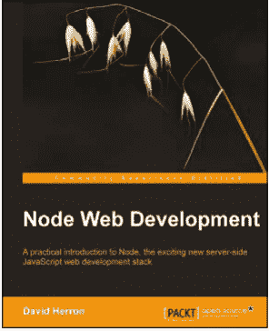
# 《Node Web开发实战》
ISBN：978-1-84951-514-6
平装版：172页
本书是Node.js的实用入门指南，这款激动人心的全新服务端JavaScript Web开发栈能够帮您快速搭建出支持数据库的Web应用：
- 无需复杂准备即可从零开始搭建支持数据库的Web应用。
- 快速上手Node.js，就会发现JavaScript早已不再局限于浏览器端。
- 本书将介绍服务端JavaScript开发，涵盖Node.js、Connect和Express框架，以及使用SQL或MongoDB作为后端数据库的相关内容。
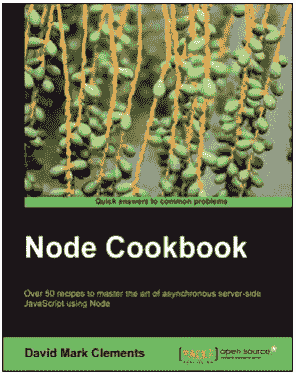
# 《Node Cookbook》
ISBN：978-1-84951-718-8
平装版：342页
本书包含50余个实用配方，助您掌握使用Node.js开发异步服务端JavaScript的核心技巧：
- 内容涵盖从基础入门到自定义扩展Node模块的诸多实用方案，带您逐步精通。
- 搭建您自己的Web服务器，直观体验Node.js的核心特性。
- 实践JSON、XML、Web Socket相关开发，充分利用异步编程的优势。
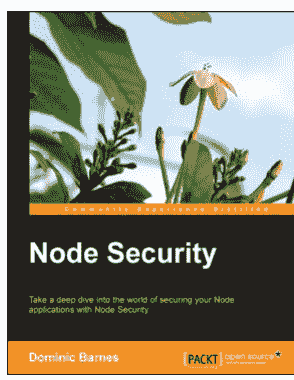
# 《Node安全指南》
ISBN：978-1-78328-149-7
平装版：94页
《Node安全指南》将带您深入探索Node应用的安全防护领域：
- 研究JavaScript中的安全特性与潜在漏洞。
- 深入了解Node平台，包括事件循环与核心模块。
- 利用现有npm模块解决常见的安全问题。
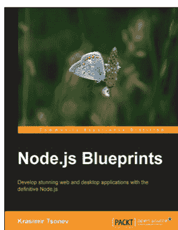
# 《Node.js架构实战》
ISBN：978-1-78328-733-8
平装版：268页
使用权威Node.js开发出功能惊艳的Web和桌面应用：
- 运用各类库和框架，使用Node.js开发真实世界的应用。
- 探索Node.js与AngularJS、Socket.io、BackboneJS、EmberJS和GruntJS的兼容性。
- 通过分步教程充分发挥Node.js的强大能力。
