# OCP：Oracle9i DBA 基础 II学习指南：考试 1Z0-032

## 致我们亲爱的读者：

在 CertCities.com 2001 年 12 月 15 日的一篇文章中，Oracle 认证在“2002 年 10 大最热门认证”名单中位列第二。这并不令人意外，尤其是当你考虑到 OCP 项目的规模几乎增长了三倍（从 30 人增加到 100,000 人）。本学习指南旨在帮助您准备 OCP Oracle9i DBA 基础 II 考试。我们涵盖了您通过考试所需的必备主题，希望本指南对您的学习有所帮助。

OCP 认证对于任何数据库专业人员来说都是一项卓越的成就。它证明了您具备管理 Oracle9i 数据库所需的知识和技能。祝您在学习和未来的职业中一切顺利。

致 Brant 和 Brea

—Doug Stuns

致 Rachel、Laura、Alyssa 和 Karen——我生命中真正的财富

—Matt Weishan

## 致谢

首先，我要感谢我的主，我的救主，让这一切成为可能。感谢 Mae、Elizabeth 和 Richard 在本书写作期间提供的指导和引导。感谢 Rebecca 的辛勤工作、编辑和建议，这极大地改进了这本书并让我的工作变得轻松。感谢 John Anwanwan 和 Damir Bersinic 提供的技术编辑和评审，这极大地提升了本书的质量。我想向 Hobbs 家庭表示迟到的感谢，感谢他们让我参与其中。

最后，我要感谢我的妻子和家人在整个过程中对我支持。感谢你们给我时间来写这本书。我知道这是一种巨大的牺牲。我由表感谢！

> Doug Stuns

我要感谢整个 Sybex 团队付出的巨大努力。团队可能与上一本书相比有所变化，但结果一如既往。Mae Lum、Elizabeth Hurley 和 Richard Mills 组成的团队合作起来非常愉快。我还要特别感谢 Rebecca Rider 出色的编辑工作。与这群极棒的人士合作，让我的工作变得轻松得多。

我再次感谢 Joe Johnson，当初给了我在原始 Oracle8 OCP 系列中获得的机会。第二次合作和第一次一样令人欣慰。

我还要感谢家人所有的爱和支持。感谢你们再次信任我。有了你们的信仰和主的引导，一切皆有可能。

> Matt Weishan

Sybex 感谢电子出版专家 Jill Niles 和索引员 Ann Rogers 对本书做出的宝贵贡献。

## 引言

信息技术（IT）行业对专业人才的需求巨大，而 Oracle 认证是数据库领域最热门的凭证。你追求认证是一个正确的决定，因为获得 Oracle 认证将使你在这个竞争激烈的市场中拥有独特优势。

许多读者可能已经熟悉 Oracle，不需要对 Oracle 数据库世界进行介绍。对于那些不熟悉这家公司的人，Oracle 成立于 1977 年，销售了首个商业关系型数据库，现在是全球最大的数据库公司和第二大独立软件公司，服务规模超过 100 亿美元，服务 145 个国家。

Oracle 数据库是大型互联网网站的事实标准，Oracle 广告商在宣布“互联网运行在 Oracle 上”时，他们是自豪但诚实的。几乎所有大型互联网网站都运行 Oracle 数据库。Oracle 在数据库市场的渗透非常深，并且不仅限于新实施。许多公司的企业资源计划（ERP）应用程序套件、数据仓库和自定义应用程序都依赖 Oracle。在经济时期，对 DBA 资源的需求仍然高于其他领域。

本书旨在帮助你通往成为 Oracle9i 认证专业人士 (OCP) 和 Oracle 认证大师 (OCM) 的激动道路。要从从书中获得最大收益，你应该已经具备网络、操作系统、Oracle SQL 和 DBA 概念的知识。通过使用本书和练习数据库，你可以开始学习 Oracle 并通过 1Z0-032 测试：Oracle9i 数据库：基础知识 II。

### 为什么要成为 Oracle 认证专业人士？

成为 OCP 的首要原因是获得更高的曝光率，并更多接触行业最具挑战性的机会。Oracle 认证是展示你在 Oracle 数据库系统的知识和技能的最佳方式。认证考试是基于场景的，这是评估你的实战经验和关键问题解决能力最有效的方法。

认证是你知识的证明，表明你具备支持 Oracle 核心产品所需的技能。Oracle 认证计划可以帮助公司识别出已证明技能的优秀人才，他们可以支持公司对 Oracle 技术的投资。它证明了你对自己的工作角色以及在该职位使用的 Oracle 产品有深入的理解。

OCP 是 IT 行业薪资最高的群体之一。薪资调查显示，OCP 认证的薪资高于其他认证，包括微软、Novell 和 Cisco。

因此，无论你是职业生涯初期、转换职业、巩固现有职位，还是寻求精炼和提升你的职位，这本书都是为你准备的！

### Oracle 认证

Oracle 认证遵循面向工作角色的路径。分为数据库管理、数据库操作和开发者三个路径。在每个路径中，Oracle 都有一个三级认证计划：

- 第一级是 Oracle 认证关联 (OCA)。OCA 认证通常要求你完成两场考试，第一场通过互联网进行，第二场在监控环境中进行。
- 下一级是 Oracle 认证专业人士 (OCP)，它建立在 OCA 认证之上并需要 OCA 认证。OCP 认证的额外要求是额外的监控考试。
- 第三也是最高级是 Oracle 认证大师 (OCM)。OCM 认证建立在 OCP 认证之上并需要 OCP 认证。要获得 OCM 认证，你必须参加两次 Oracle 教育课堂课程（来自特定的合格课程列表）并完成实操考试。

以下材料将仅介绍数据库管理路径，因为在写作时，这是 Oracle 提供的唯一 9i 路径。其他路径有 8 和 9i 认证，无疑也会 9i 认证。请访问 Oracle 网站 `http://www.oracle.com/education/certification` 获取最新信息。

### Oracle9 认证数据库关联员

数据库管理员 (DBA) 的角色已成为当今高度复杂的数据库系统成功的关键。最好的 DBA 在幕后工作，但在关键问题出现时会处于焦点中心。他们计划、创建、维护并确保数据库对业务可用。他们始终监控数据库的性能问题并防止非计划停机。DBA 的工作需要对 Oracle 数据库架构有广泛的理解以及解决问题的专业知识。

Oracle9 认证数据库关联员是数据库管理路径的入门认证，是向更高级别迈进的基础。此认证要求你通过两场考试以证明你对 Oracle 基础的知识：

- `1Z0-007`: Oracle9 简介：SQL
- `1Z0-031`: Oracle9 数据库：基础 I

`1Z0-007` 考试《Oracle9 简介：SQL》通过互联网提供。`1Z0-031` 考试《Oracle9 数据库：基础 I》在 Sylvan Prometric 设施提供。

### Oracle9i 认证专业人士 (OCP)

数据库管理路径的 OCP 级挑战你展示对 Oracle 技术的持续经验和知识。Oracle9i 认证数据库管理员要求达到认证数据库关联员级别，并在 Sylvan Prometric 设施通过以下两场考试：

- `1Z0-032`: Oracle9 数据库：基础 II
- `1Z0-033`: Oracle9 数据库：性能调优

### Oracle9i 认证大师

Oracle9i 认证大师是 Oracle 提供的最高级别认证。要成为认证大师，你必须首先获得 OCP 身份，在 Oracle 教育机构参加两次高级授师指导课程，最后在 Oracle 教育通过实操考试。课程和实操考试仅提供且需要差旅。计入 OCM 要求的高级课程包括：

- Oracle9i: 使用 PL/SQL 编程
- Oracle9i: 高级 PL/SQL
- Oracle9i: SQL 调优工作坊

## 简介

- Oracle9i: 互联网环境下的高可用性
- Oracle9i: 数据库：实施分区
- Oracle9: 实时应用程序集群实现
- Oracle9i: 数据仓库管理
- Oracle9i: 高级复制
- Oracle9i: 企业管理器

## 及格分数

`1Z0-032`: Oracle9 数据库：基础 II 考试由两个部分组成——基础部分和精通部分。在本书时，基础部分的及格分为 71%，精通部分的及格分为 56%。在参加考试之前，请下载并阅读 Oracle9 认证指南。基础部分涵盖基本概念，精通部分涵盖更困难的问题，这些问题大部分基于实践和经验。你必须通过两个部分才能通过考试。目标、测试评分、题目数量等信息列在 `http://www.oracle.com/education/certification`。

## 更多信息

关于 Oracle 认证的当前信息可以在 `http://www.oracle.com/education/certification` 找到。点击认证链接并选择你感兴趣的方向。阅读《考生指南》以了解考试目标和测试内容，并记住这些内容可能会随时更改且不另行通知。

## OCA/OCP 学习指南

Oracle9i 数据库管理方向认证由四个测试组成：两个 OCA 级和两个 OCP 级测试。Syex 提供了若干学习指南来帮助你获得此认证：

- OCA/OCP: Oracle9i™ SQL 学习指南（考试 `1Z0-007`：Oracle9i：SQL 简介）


- OCA/OCP: Oracle9i™ DBA 数据库基础 I 学习指南（考试 1Z0-031：Oracle9i 数据库：基础 I）
- OCP: Oracle9i™ DBA 数据库基础 II 学习指南（考试 1Z0-032：Oracle9i 数据库：基础 II）
- OCP: Oracle9i™ DBA 性能调优（考试 1Z0-033：Oracle9i 数据库：性能调优）

此外，这四本书以套装提供：OCP: Oracle9i™ DBA 认证包。

# DBA 认证所需的技能

通过认证考试，你需要掌握以下技能：

- 编写 SQL SELECT 语句来显示来自单表或多表的数据。
- 使用单函数和组函数对数据进行限制、排序、聚合和管理。
- 创建和管理表、视图、约束、同义词、序列和索引。
- 创建用户和角色以控制访问并维护安全性。
- 理解 Oracle 服务器架构（数据库和实例）。
- 理解数据库的物理和逻辑存储，并能够管理分配和增长。
- 管理数据，包括其存储、加载和重组。
- 管理重做日志、自动撤销（undo）和回滚段。
- 使用全球化特性选择数据库字符集和国家语言支持（NLS）。
- 在服务器端和客户端配置 Oracle Net。
- 使用备份和恢复选项。
- 归档重做日志和热备份。
- 使用恢复管理器 (RMAN) 执行备份和恢复操作。
- 使用数据字典视图设置数据库参数。
- 配置并使用 Oracle 共享服务器（Shared Server）。
- 识别并调整数据库和 SQL 性能。
- 使用调整/诊断工具 STATPACK、TKPROF 和 EXPLAIN PLAN。
- 调整数据块、共享池、缓冲缓存和回滚段的大小。
- 诊断由于位锁（latches）、锁（locks）和回滚段引起的竞争。

# OCP 考试备技巧

使用这些技巧帮助你准备并通过每场考试。

- 每个 OCP 测试包含约 55-80 道题，可在 90 分钟内完成。先回答你会的题目，以防时间不够。
- 考试中的许多题目选项乍看完全相同。请仔细阅读题目。不要过早结论。确保你完全理解题目的要求。
- 大多数测试题是基于场景的。某些场景包含非本质信息和演示。你需要能够识别哪些是重要的，哪些是不重要的。
- 不要留有任何未回答的题目。没有扣分。在选择答案后，你可以标记一个困难或你不确定的题目，并稍后回来。
- 在回答你不确定的问题时，使用排除法先排除明显错误的答案。如果你需要进行明智的猜测，这样做将大大增加你的几率。
- 如果你不确定答案，将其标记为待复习，然后寻找其他可能帮助你排除错误答案的题目。考试结束时，你可以返回查看你标记复习的题目。

# 在哪里考试？

你可以在全球 800 多多个 Sylvan Prometric 授权测试中心参加考试。要查询你附近的测试中心位置，请拨打 1-800-891-3926。在美国加拿大之外，请联系当地的 Sylvan Prometric 注册中心。通常可以在那里参加考试。

# 本书涵盖了什么？

本书涵盖了通过 Oracle9 数据库：基础 II 考试所需的所有内容。该考试是数据库管理方向的一部分。它教你 Oracle 网络以及备份恢复的基础知识。每一章都从一份考试目标列表开始。

第 1 章介绍了 Oracle 网络架构以及 DBA 管理网络的职责。

第 2 章讨论了服务器端 Oracle Net 的设置和管理。它解释了如何配置服务器端组件以及如何排除服务器端网络问题。

第 3 章解释了如何设置和管理客户端组件。它演示并讨论了如何配置 Oracle 使客户端连接到服务器。它还讨论了客户端连接问题。

第 4 章介绍了共享服务器。它讨论了何时使用共享服务器以及如何在 Oracle 环境中配置它。

第 5 章介绍了备份和恢复概述。讨论了数据库的各种故障类型。

第 6 章讨论了实例和介质恢复结构。讨论了与恢复相关的进程、内存结构和文件。还讨论了检查点、重做日志和归档日志的重要性。

第 7 章解释了如何配置数据库归档日志。讨论了归档日志和不归档日志的区别。

第 8 章介绍了恢复管理器概述和配置。讨论了 RMAN 存储库、通道分配和 RMAN 配置。

第 9 章讨论了用户管理和基于 RMAN 的备份方法。对这些备份方法都执行了不同的示例。

第 10 章讨论了用户管理和基于 RMAN 的完全恢复方法。执行了完全恢复的示例。

第 11 章讨论了用户管理和基于 RMAN 的不完全恢复方法。执行了不完全恢复的示例。

第 12 章介绍了 RMAN 维护。讨论了维护 RMAN 存储库、保留策略、备份和备份可用性。

第 13 章介绍了恢复存储库的创建和维护。本章描述了恢复存储库以及如何创建它。了维护恢复存储库、创建和运行脚本、生成列表和报告以及备份恢复存储库。

第 14 章讨论了如何使用导出和导入工具在数据库之间传输数据。

# 第 15 章介绍了 SQL*Loader 实用程序和直接加载插入操作。本章还讨论了这些数据加载方法的使用。

每章的末尾都有复习题，专门为帮助你留住所呈现的知识而设计。为了真正巩固你的技能，请仔细阅读并回答每个问题。

## 如何使用本书

本书可以为你认真准备 OCP 数据库管理考试轨道提供坚实的基础。为了从本书中获得最大的收益，请使用以下学习方法：

- 1. 在读完本引言后，立即进行评估测试（答案在测试末尾）。仔细阅读你错的任何题目的解释，并记录这些材料来自哪些章节。这些信息将帮助你制定学习策略。
- 2. 仔细学习每个章节，确保你完全理解了每章开头列出的信息和测试目标。对于你在评估测试中错过的题目相关的任何章节，要格外注意。
- 3. 完成章节中的所有动手练习，并参考该章节以理解每一步操作的原因。如果你没有可用的 Oracle 数据库，请务必仔细研究示例。回答与该章节相关的复习题（答案出现在每章末尾“复习题”部分之后）。
- 4. 记录那些让你困惑或误导你的题目，并重新学习书中的这些章节。
- 5. 在考试之前，尝试一下书中附带 CD 提供的额外奖励考试。这些考试中的题目只出现在 CD 中。这些将让你对真实考试中可能看到的内容有一个全面的了解。
- 6. 记得使用书中附带 CD 中的产品。电子闪卡和 EdgeTest 考试备考软件是专为帮助你学习并通过考试而设计的。

## 导言

电子闪卡可以在你的 Windows 电脑或 Palm 设备上使用。

为了学习本书中涵盖的所有材料，你需要定期且有规律地投入自己。尝试每天留出相同的时间来学习，并选择一个舒适安静的地方。如果你努力，你会惊讶于自己学习这些材料的速度有多快。祝你好运！

## CD 光里有什么？

我们努力提供一些出色的工具来帮助你通过认证。在复习考试时，应将以下所有工具加载到你的工作站上。

## 用于 Oracle 认证 DBA 准备的 EdgeTest 软件

该备考软件由 EdgeTest Learning Systems 提供，旨在帮助你通过 Oracle9i Database: Fundamentals II 考试。在本次测试中，你会找到书中的所有题目，以及两份专门出现在 CD 中的额外奖励考试。此外，你可以进行评估测试、按章节测试，或从所有题目中随机生成考试。

## 适用于 PC 和 Palm 设备的电子闪卡

你应该仔细阅读《OCP: Oracle9i Database: Fundamentals II 学习指南》，特别是每章末尾的复习题，还应该利用 CD 中包含的奖励考试。等一下，还有更多！务必使用 CD 中包含的闪卡进行测试。如果你通过了这些问题并理解了答案，你就知道自己已经准备好考试了。

闪卡包含了 150 道专门编写的题目，旨在帮助你努力并确保你已准备好考试。通过复习题、奖励考试和闪卡，你应该为考试做好了准备。

## PDF 版《 OCP: Oracle9i Database: Fundamentals II 学习指南

Sybex 现在以 CD 形式提供 Oracle 认证书籍，以便你可以在 PC 或笔记本电脑上阅读。这些考试的所有题目都以 Adobe Acrobat 格式显示，CD 中还包含了 Acrobat Reader 5 以供你查看。对于乘飞机、乘坐巴士或火车通勤且不想携带书籍的读者，以及那些发现从电脑上阅读更舒适的读者来说，这将非常有帮助。

## 关于作者

Doug Stuns（OCP）已担任 Oracle DBA 十余多年。他曾在 Oracle 公司担任过五年的咨询和教育工作，是 SCS, Inc.（一家基于 Oracle 的咨询公司）的创始人和所有者。如需联系 Doug，可以发送电子邮件至 stuns@scs-corp.net。

Matthew Weishan 是 OCP 也是认证技术培训师，拥有超过九年的 Oracle 数据库经验。他目前担任位于威斯康星州麦迪逊的 EDS 高级专家，为几家大型客户担任 Oracle DBA。他曾担任过几年的 Oracle DBA 讲师。他在 IT 行业拥有 18 年以上的经验，曾在多家财富 500 强公司担任高级系统分析师、首席顾问和首席数据库管理员。如需联系 Matt，可以发送电子邮件至 mweishan@yahoo.com。

## 评估测试

- 1. 哪种不完全恢复是基于每个事务的？
  A. 基于时间的
  B. 基于更改的
  C. 基于取消的
  D. 基于停止的


### 2. 哪个陈述最描述恢复目录？
A. `RMAN` 的强制性功能
B. `RMAN` 的一个存储备份元数据的可选功能
C. `RMAN` 的一个存储备份元数据的强制性功能
D. `RMAN` 的一个可选功能

### 3. 使用 `SQL Loader` 时，哪些文件可以存储加载数据？（选择所有适用）
A. 通用日志文件
B. 输入文件
C. 控制文件
D. 丢弃日志文件

### 4. 下列哪些是 Oracle 数据库的物理结构？（选择所有适用）
A. 控制文件
B. 输入文件
C. 参数文件
D. 警报日志

### 5. 为了在恢复目录中存储信息以及通过 OS 命令备份的实际数据文件，你需要执行以下哪一个 `RMAN` 命令？
A. `BACKUP DATAFILE`
B. `BACKUP`
C. `DATAFILE COPY`
D. `CATALOG DATAFILECOPY`

### 6. 下列哪些是执行控制文件备份的正确方法？（选择所有适用）
A. 将数据库备份控制文件更改为 `TRACE`。
B. 将数据库备份控制文件更改为 `'<controlfile_name>'`。
C. 将系统备份控制文件更改为 `TRACE`。
D. 将系统备份控制文件更改为 `'<controlfile_name>'`。

### 7. 哪些是 Oracle Net 在 Oracle 网络架构中扮演的角色？（选择所有适用）
A. 处理客户端和服务器之间的通信
B. 处理服务器到服务器之间的通信
C. 用于建立与 Oracle 服务器的初始连接
D. 充当信使，在客户端和服务器之间传递请求
E. 以上所有

### 8. 你授予恢复目录 `RMAN` 所有者哪些角色？（选择所有适用）
A. `dba`
B. `connect`
C. `resource`
D. `recovery_catalog_owner`

### 9. 下列哪些是共享服务器的优点？（选择所有适用）
A. 更少的服务器进程
B. 以相同或更少的内存管理更多连接
C. 更好的客户端响应时间
D. 以上所有

### 10. 哪种故障需要不完全恢复？（选择所有适用）
A. 涉及系统表空间的任何介质故障
B. 存档或活动重做日志的丢失
C. 自上次当前备份以来存档日志的丢失
D. 控制文件的丢失

### 11. 关于分发器（dispatchers），下列哪项是正确的？
A. 它监听客户端连接请求。
B. 它替代了专用服务器。
C. 它将客户端请求放在响应队列中。
D. 以上所有

### 12. 导出程序的哪个命令行选项将命令组合在一个公共文件中？
A. `config.ora`
B. `PARFILE`
C. `ifile`
D. `commandfile`

### 13. 哪种不完全恢复需要 DBA 在某一点手动停止恢复？
A. 基于取消的
B. 基于时间的
C. 基于更改的
D. 基于序列的

### 14. Oracle9i 中引入的新型参数文件是什么？
A. `spfile.ora`
B. `init.ora`
C. `config.ora`
D. `ifile.ora`

### 15. 你可以使用哪种实用程序来验证备份文件和在线数据文件的损坏？
A. `DBMS_REPAIR`
B. `DBVERIFY`
C. `ANALYZE`
D. `DB_CHECKSUM`

### 16. 当你使用 `ALTER DATABASE OPEN RESETLOGS` 打开数据库时，需要在 `RMAN` 中执行哪个命令来处理数据库的具身（incarn）？
A. `REGISTER`
B. `UNREGISTER`
C. `RESET`
D. `UNSET`

### 17. `locnaming` 选项的主配置文件是什么？
A. `sqlnet.ora`
B. `tnsnames.ora`
C. `listener.ora`
D. `names.ora`

### 18. 利用磁带的手动分配通道方法的名称是什么？
A. `ALLOCATE CHANNEL C1 TYPE 'SBT_TAPE'`
B. `ALLOCATE CHANNEL C1 TYPE DLT_TAPE`
C. `CONFIGURE DEFAULT DEVICE TYPE SBT_TAPE`
D. `CONFIGURE DEFAULT DEVICE TYPE TAPE`

### 19. 实现直接加载插入需要哪些前提条件？（选择所有适用项）
A. 必须启用并行 `DML`。
B. 必须为并行查询配置初始化参数。
C. 必须为 `SQL*Loader` 实用程序配置并行处理。
D. `DML` 语句中必须有提示（hints）。
E. 必须存在多个 `SQL*Loader` 控制文件和数据文件。

### 20. 动态注册（Dynamic Registration）的作用是什么？
A. 允许监听器自动向 Oracle 服务器注册
B. 允许 Oracle 服务器自动向监听器注册
C. 允许客户端自动向 Oracle 监听器注册
D. 以上均不是

### 21. 当关于数据库的哪种条件为真时，可以执行开放备份？（选择所有适用项）
A. 它处于 `NOARCHIVELOG` 模式。
B. 它处于 `ARCHIVELOG` 模式。
C. 使用 `ALTER TABLESPACE <tablespace_name> BEGIN BACKUP` 命令将表置于备份模式时。
D. 数据库已关闭。

### 22. 以下哪些备份和恢复参数利用了 SGA 中 `LARGE_POOL` 内存的操作？（选择所有适用项）
A. `DBWR_IO_SLAVES`
B. `ASYNC_IO_SLAVES`
C. `BACKUP_TAPE_IO_SLAVES`
D. `SYNCH_IO_SLAVES`

### 23. 哪种陈述最符合部分恢复（incomplete recovery）？
A. 完全没有数据丢失。
B. 故障点之后的数据丢失。
C. 因为恢复发生在故障点之前，所以丢失了数据。
D. 因为数据文件不完整，所以丢失了数据。

### 24. 下列哪项最描述网络访问控制？
A. 它允许使用不同协议的客户端和服务器进行通信。
B. 它设置规则来允许或禁止连接 Oracle 服务器。
C. 它将连接汇聚到指向 Oracle 服务器的单一输出连接。
D. 以上均不是。

### 25. 当对目标数据库执行什么操作时，应该执行同步恢复目录（recovery catalog）？
A. 撤销数据库同步。
B. 移除数据库重置。
C. 仅撤销最近的数据库同步。
D. 对目标数据库进行物理更改。

### 26. 哪些命令在 `RMAN` 恢复过程中移动数据文件？（选择所有适用项）
A. `SET NEWFILE`
B. `SET RENAME`
C. `SET NEWNAME`
D. `SWITCH`

### 27. 日志记录（logging）和跟踪（tracing）之间的主要区别是
A. 跟踪无法禁用。
B. 日志记录无法禁用。
C. 日志记录仅记录重大事件。
D. 跟踪仅记录重大事件。

### 28. 以下哪个参数确保了在重做（redo）信息被覆盖之前，成功的归档目的地数量？
A. `LOG_ARCHIVE_SUCCESS`
B. `LOG_ARCHIVE_MIN_SUCCEED_DEST`
C. `LOG_MIN_SUCCESS`
D. `LOG_ARCHIVE_SUCCEED`

### 29. 当 Oracle `PMON` 进程遇到错误时，生成的跟踪文件位于哪里？
A. `USER_DUMP_DEST`
B. `BACKGROUND_DUMP_DEST`
C. `CORE_DUMP_DEST`
D. `ARCH_DUMP_DEST`

### 30. 下列哪个参数用于提高实例恢复操作的性能？
A. `FAST_START_MTTR_TARGET`
B. `FAST_START`
C. `CHECKPOINT_INTERVAL`
D. `CHECKPOINT`

### 31. 可以哪种实用程序检查客户端是否能看到 Oracle 监听器？
A. `netstat`
B. `namesctl`
C. `tnsping`
D. `lsnrctl`
E. 以上都不是

### 32. 以下哪些命令从恢复目录或目标数据库控制文件生成报告？（选择所有适用项）
A. `REPORT`
B. `LIST`
C. `SELECT`
D. `PUTLINE`

### 33. 下列 Oracle 进程 `SMON` 在启动时不是强制性的？
A. `SMON`
B. `PMON`
C. `DBWR`
D. `ARCH`

### 34. 早期版本 `RMAN` 中的 `RESTORE` 命令与 Oracle9i `RMAN` 之间的主要区别是什么？该区别已经变化。
A. 没有变化。
B. 关于文件是否需要恢复的决定。
C. 仅恢复备份集（backup sets）。
D. 仅恢复映像拷贝（image copies）。


## 35. 关于共享服务器（shared servers），以下哪项是正确的？
+   A. 它们与分发器（dispatchers）通信。
+   B. 它们执行客户端请求。
+   C. 它们直接与监听器通信。
+   D. 它们直接与客户端进程通信。

## 36. 哪个 `init.ora` 参数负责设置多个远程归档位置？
+   A. `LOG_ARCHIVE_DUPLEX_DEST`
+   B. `LOG_ARCHIVE_DEST_n`
+   C. `LOG_DEST_ARCHIVE_n`
+   D. `LOG_ARCHIVE_DEST_DUPLEX`

## 37. 以下哪些不是 Oracle Net 的层？
+   A. Two-Task
+   B. Oracle Foundation
+   C. Oracle Call Interface
+   D. Application
+   E. 都是层

## 38. 必须执行什么特殊活动来执行 `CROSSCHECK` 命令？
+   A. `ALLOCATE CHANNEL`
+   B. `ALLOCATE CHANNEL FOR DISK`
+   C. `AUTOMATIC CHANNEL`
+   D. `ALLOCATE CHANNEL FOR UPGRADE`

## 39. 以下哪个不是解析服务的方法？
+   A. Local
+   B. Host
+   C. Oracle Internet
+   D. Internal

## 40. 在恢复目录中执行脚本的正确语法是什么？
+   A. `start { execute; }`
+   B. `RUN { execute; }`
+   C. `execute;`
+   D. `run;`

## 41. 哪种恢复会导致表表文件的恢复？（选择所有适用项）
+   A. 只读备份恢复
+   B. 读写备份恢复
+   C. 备份后立即进行的只读
+   D. 读写

## 42. 哪个 Oracle9i 新功能允许在原始数据被删除的情况下进行查询？
+   A. Flashback 查询
+   B. 并行查询
+   C. 快速恢复
+   D. Undo 查询

## 43. 第三方硬件供应商需要 RMAN 的哪个方面才能正常工作？
+   A. 恢复目录
+   B. 介质管理库
+   C. 通过 Enterprise Manager
+   D. 命令行模式

## 44. 导出数据的两种技术方法是什么？（选择所有适用项）
+   A. 传统
+   B. 用户
+   C. 全量
+   D. 直接导出

## 45. 客户端无法连接到 PROD Oracle 服务器。以下哪些客户端检查无法在工作站上执行以排除故障？
+   A. 检查客户端 `sqlnet.ora` 文件中的 `NAMES.DIRECTORY_PATH`。
+   B. 从客户端执行 `tnsping PROD`。
+   C. 从客户端执行 `lsnrctl services`。
+   D. 检查客户端上的 TNS_ADMIN 注册表设置。

## 49. 哪个配置文件控制监听器？
-   A. `tnsnames.ora`
-   B. `listener.ora`
-   C. `sqlnet.ora`
-   D. `names.ora`

## 50. RMAN 存储库主要定义了什么？（选择所有适用项）。
-   A. 恢复类目录 (Recovery catalog)
-   B. 控制文件 (Control file)
-   C. 目标数据库 (Target database)
-   D. ATL数据库

## 51. Process-111 失败和实例故障均属于哪种故障？
-   A. 媒介故障 (Media failure)
-   B. 用户故障 (User failure)
-   C. 非媒介故障 (Non-media failure)
-   D. 语句故障 (Statement failure)

## 52. 哪个 `init.ora` 参数配置数据库进行自动归档？
-   A. `LOG_ARCHIVE_START=TRUE`
-   B. `LOG_START_ARCHIVE=TRUE`
-   C. `LOG_AUTO_ARCHIVE=TRUE`
-   D. `LOG_ARCHIVE_AUTO=TRUE`

## 53. 使用哪个命令行工具来启动和停止监听器？
-   A. `listener`
-   B. `lsnrctl`
-   C. `listen`
-   D. `listen_ctl`

## 54. 用户管理的备份和恢复最好定义的是哪个陈述？
-   A. 使用操作系统命令和数据库命令执行的自定义备份和恢复
-   B. 基于 RMAN 的非自动化备份
-   C. 一种使用 RMAN 但由用户执行的新类型备份
-   D. 基于 RMAN 的自动备份

## 55. 哪个 Oracle 后台进程负责执行实例恢复中的向前滚（roll forward）？
-   A. `PMON`
-   B. `SMON`
-   C. `RECO`
-   D. `DBWR`

## 56. 使用以下哪个命令可以使备份集变为不可用？
-   A. `CHANGE`
-   B. `MAKE`
-   C. `FORCE`
-   D. `EXPIRE`

## 57. 数据库管理员应该考虑的网络复杂性问题有哪些？（选择所有适用项。）
-   A. 配置客户端需要多少时间
-   B. 将执行什么类型的工作
-   C. 正在使用什么类型的协议
-   D. 将执行的事务的大小和数量
-   E. 以上所有

## 58. 完全恢复由以下哪个陈述最好地定义？
-   A. 大多数事务已恢复。
-   B. 除了最后一个归档日志外，所有事务都已恢复。
-   C. 所有提交的事务都已恢复。
-   D. 没有任何数据丢失。

## 59. 使用 SQL*Loader 工具加载数据的不同技术方法有哪些？（选择所有适用项。）
-   A. 直接路径加载 (Direct-path load)
-   B. 传统加载 (Conventional load)
-   C. 默认路径加载 (Default-path load)
-   D. 外部路径加载 (External-path load)

## 60. 三种主要的网络配置是什么？
-   A. 层架构
-   B. 单层架构
-   C. 多层架构
-   D. 二层架构

## 61. 当数据库处于 `ARCHIVELOG` 模式时，可以执行以下哪些恢复？
-   A. 仅不完全恢复
-   B. 仅完全恢复
-   C. 仅部分恢复
-   D. 完全恢复和不完全恢复

## 62. 使用检查点（checkpoints）的主要目的是什么？
-   A. 减少 SGA 中的空缓冲区
-   B. 将未修改的数据库缓冲区写入数据库文件，并相应地同步数据库的物理结构
-   C. 记录写入数据库文件的已修改数据库缓冲区，并相应地同步数据库的物理结构
-   D. 增加 SGA 中的空内存缓冲区

## 63. 使用哪个命令在保留日期之后继续保留备份？
-   A. `HOLD`
-   B. `RETAIN`
-   C. `KEEP`
-   D. `STORE`

## 64. 哪个视图可以识别失败的热备份或在线备份后的清理问题？
-   A. `V$BACKUP`
-   B. `ALL_BACKUP`
-   C. `USER_BACKUP`
-   D. `DBA_BACKUP`

## 65. Oracle 共享服务器（Shared Server）与专用服务器（dedicated server）有何区别？（选择所有适用项。）
-   A. 客户端使用分发器（dispatchers）而不是专用连接。
-   B. 全局共享区（SGA）包含请求和响应队列。
-   C. 共享服务器进程执行客户端请求。
-   D. 以上所有。

## 66. `hostname` 选项的缺点是什么？
-   A. 它不能使用遗留连接（bequeath connections）。
-   B. 它不能使用 Oracle 共享服务器连接。
-   C. 它不能使用客户端负载均衡。
-   D. 以上所有。

# xlviii 评估测试

## 67. 以下哪些选项是 RMAN `BACKUP` 命令能够执行的？（选择所有适用项。）
-   A. 增量备份
-   B. 全量备份
-   C. 镜像拷贝 (Image copy)
-   D. 当前控制文件备份
-   E. 备份集创建

## 68. IIOP 代表什么？
-   A. Internet Interactive Objects Protocol
-   B. Internet Instance Objects Protocol
-   C. Internet Inter-Orb Protocol
-   D. Internet Inter-Objects Protocol
-   E. 以上都不是

## 69. 哪种类型的故障需要 DBA 发出 `RECOVER DATABASE` 命令？
-   A. 用户进程
-   B. 媒介故障
-   C. 实例故障
-   D. 语句故障

## 70. 运行 `RECOVER DATABASE` 时数据库必须处于什么模式？


- A. NOARCHIVOG
- B. MOUNT
- C. OPEN
- D. ARCHIVOG

# 评估测试答案

1. B. 取消恢复需要 DBA 在该行手动取消恢复过程。
2. B. 恢复类目录是一个可选功能。
3. C. 恢复类目录在数据库中存储备份的元数据。
4. A, C. 控制文件和 redo日志构成了物理结构。
5. D. RMAN 命令备份数据文件。
6. A, B. 控制文件可以以两种方式备份：ASCII 格式或二进制格式。
7. E. Oracle Net 负责处理客户端到服务器和服务器与之间的通信。
8. B, C, D. 恢复类目录所需的角色。
9. A, B. 共享服务器允许 Oracle 管理更多的连接。
10. B, C. 丢失非活动或活动 redo日志将需要不完全恢复。
11. B. 分发器取代了专用服务器进程。
12. B. `PARFILE` 命令选项允许将命令导出到文件中。
13. A. 取消恢复需要 DBA 在该行手动取消恢复过程。
14. A. `spfile.ora` 是用于 Oracle9i 的。
15. B. `DBVERIFY` 工具可以验证在线数据文件和在线数据文件的副本。
16. C. 如果目标数据库已通过 `ALTER DATABASE OPEN RESETLOGS` 打开，则必须在恢复目录中的数据库实例上使用 `RESET` 命令。更多信息请参见第 13 章。
17. B. 本地命名方法的主要特征是使用 `tnsnames.ora` 文件来解析服务名。事实上，这有时被称为 `tnsnames.ora` 方法。该文件包含了客户端可以连接的服务名信息以及对应的连接描述符。更多信息请参见第 3 章。
18. A. `CONFIGURE DEFAULT DEVICE` 设置自动配置分配通道。`ALLOC CHANNEL <channel_name> TYPE` 方法用于手动配置通道。类型 `SBT` 用于为磁带配置手动通道。更多信息请参见第 8 章。
19. A, B. 数据库必须配置并行查询或必须设置适当的初始化参数，例如 `PARALLEL_MIN_SERVERS` 和 `PARALLEL_MAX_SERVERS`。会话必须运行并行 DML。在 DML 语句中必须输入适当的提示（hints）以允许直接加载插入。更多信息请参见第 15 章。
20. B. 动态注册允许 Oracle 服务器自动向监听器注册。这减少了 DBA 在本地命名环境中维护 `listener.ora` 文件时需要完成的维护工作。更多信息请参见第 2 章。
21. B, C. Open备份也称为热备份，当数据库处于 `ARCHIVELOG` 模式时，可以通过执行 `ALTER TABLESPACE <tablespace_name> BEGIN BACKUP` 命令执行此备份。更多信息请参见第 9 章。
22. A, C. `DBWR_TO_SLAVES` 和 `BACKUP_TAPE_TO_SLAVES` 初始化参数可以提高备份和恢复操作的性能。这些参数使用 `LARGE_POOL` 内存来执行操作。更多信息请参见第 6 章。

## Assessment

23. C. 准确描述不完全恢复的语句是：部分数据丢失，因为恢复发生在故障点之前。更多信息请参见第 11 章。
24. B. 客户端访问控制是 Connection Manager 的功能，使 Connection Manager 的工作方式类似于防火墙。可以根据客户端位置、目标服务器以及客户端尝试连接的 Oracle 服务来接受或拒绝连接。这为 DBA 配置 Oracle 环境的访问控制提供了所需的灵活性。更多信息请参见第 1 章。
25. D. 当对目标数据库进行物理更改（例如添加新的数据文件或控制文件）时，应使用 `resynch` 命令。更多信息请参见第 13 章。
26. D. `SETFLAT` 和 `SWITCH` 命令协同工作，将 RMAN 备份恢复到新位置。更多信息请参见第 10 章。
27. C. 日志（Logging）记录重大事件，如监听器的启动和停止以及特定的网络错误。跟踪（Tracing）记录发生的所有事件，即使没有发生错误。跟踪文件提供了日志未包含的大量信息。更多信息请参见第 2 章。
28. B. `LOG_ARCHIVE_MIN_SUCCEED_DEST` 参数决定在重写 redo日志之前所需的归归目的地数量。更多信息请参见第 7 章。
29. B. Oracle PMON 进程是一个后台进程。从后台进程生成的所有跟踪文件都进入 `BACKGROUND_DUMP_DEST` 位置。更多信息请参见第 12 章。
30. A. `FAST_START_MTTR_TARGET` 参数决定实例恢复所需的秒数。该参数是一个 0 到 3600 之间的整数值。更多信息请参见第 6 章。
31. C. 可以使用 `tnsping` 工具检查客户端是否可以连接监听器。命令格式为 `tnsping <dbname><number of tries>`。例如 `tnsping DBA 3` 将尝试连接 DBA 数据库三次。该工具提供了连接监听器所需时间的信息。更多信息请参见第 3 章。
32. A, B. `REPORT` 和 `LIST` 命令在 RMAN 工具中生成报告输出。更多信息请参见第 13 章。
33. D. `ARCH` 或 `ARCHs` 进程负责归档 redo日志。更多信息请参见第 6 章。
34. B. 在 RMAN 中，`RESTORE` 命令用于从备份中恢复文件。更多信息请参见第 10 章。
35. B. `ALTER DATABASE` 命令用于更改数据库的设置。更多信息请参见第 4 章。
36. B. `LOG_ARCHIVE_DEST_n` 指定归档日志的存储地。更多信息请参见第 7 章。
37. E. 监听器是一个监听来自客户端连接请求的进程。更多信息请参见第 2 章。
38. B. `CROSSCHECK` 命令用于验证介质上是否存在备份文件。更多信息请参见第 12 章。

## Assessment

39. D. `listener.ora` 文件包含了监听器的配置。更多信息请参见第 3 章。
40. B. 正确的语法是 `RUN ( <script> )`。更多信息请参见第 13 章。
41. B, D. RMAN 仓库存储在控制文件或恢复目录中。更多信息请参见第 10 章。
42. A. 回查询（Flashback Query）允许您查询过去存在的数据。更多信息请参见第 5 章。
43. B. 介质管理库（MML）用于管理备份介质。更多信息请参见第 8 章。
44. A, D. 导出数据的两种方法是常规和直接的。更多信息请参见第 14 章。
45. C. 监听器必须在服务器上运行。更多信息请参见第 2 章。
46. B. `ALTER DATABASE RENAME '<old_file_name>' to '<new_file_name>'` 用于移动数据文件。更多信息请参见第 10 章。
47. A. Oracle Net Manager 是用于配置网络设置的图形化工具。更多信息请参见第 2 章。
48. C. 不在介质上的备份集在目录中标记为 `EXPIRED`（过期）。更多信息请参见第 12 章。
49. B. `listener.ora` 文件包含了监听器的配置。更多信息请参见第 2 章。
50. A, B. RMAN 仓库存储在控制文件或恢复目录中。更多信息请参见第 8 章。
51. C. 进程故障和实例故障是非介质故障的类型。更多信息请参见第 5 章。
52. A. 正确的参数是 `LOG_ARCHIVE_START=TRUE`。更多信息请参见第 7 章。
53. B. `lnrctl` 命令行工具用于启动和停止监听器。更多信息请参见第 2 章。
54. A. 用户管理备份（User-managed backup）是用于描述自 Oracle 诞生以来一直使用的标准备份术语。这些备份通常是通过使用操作系统和数据库命令自定义编写的。更多信息请参阅第 9 章。
55. B. 系统监控 SMON 进程负责应用在线重做日志中所有已提交或未提交的更改。更多信息请参阅第 6 章。
56. A. `CHANGE` 命令使备份集在恢复目录中变为可用或不可用。更多信息请参阅第 12 章。
57. B, C, D. DBA 需要考虑此类条目，例如网络需要支持的客户端数量、客户端执行的工作类型、客户端在网络中的位置以及在网络中进行的事务规模。更多信息请参阅第 1 章。
58. D. 完全恢复意味着所有事务都已恢复。数据库恢复时，数据不会丢失，也不需要重新输入。更多信息请参阅第 10 章。


- 59. A, B, D. 传统加载（Conventional load）是执行正常 SQL 命令处理的默认加载。直接路径加载（Direct-path load）绕过缓冲区直接写入数据文件。外部路径加载（External-path load）用于处理外部文件的加载。更多信息请参阅第 15 章。

- 60. A, B, D. 三种主要的网络配置是单层、双层和 n 层架构。在大型机主导环境的多年里，单层是最主要的架构。双层架构随着 PC 的引入而流行，并从以后一直是主流架构。随着互联网的出现，越来越多的机构转向 n 层架构，以利用许多计算机并增强其应用的灵性和性能。更多信息请参阅第 1 章。

- 61. D. 当数据库处于 `ARCHIVELOG` 模式时，可以执行完全恢复和不完全恢复。更多信息请参阅第 7 章。

- 62. C. 数据库检查点（Checkpoint）的主要目的是记录修改的缓冲区已写入数据文件并建立数据一致性，以便在发生故障时更快恢复。更多信息请参阅第 6 章。

- 63. C. `KEEP` 命令导致备份在超过数据库保留设置后保留。更多信息请参阅第 12 章。

- 64. A. `VBACKUP` 视图可识别数据库是否正在进行备份。更多信息请参阅第 9 章。

- 65. D. Oracle 共享服务器（Shared Server）使用共享模型。客户端共享称为分发器（dispatchers）的进程来处理它们的请求。客户端处理称为共享服务器（shared servers）的进程来执行它们的请求。共享通过修改 `SGA` 实现。更多信息请参阅第 4 章。

- 66. C. 缺点是当使用主机名方法时，客户端负载均衡和故障转移等功能不可。更多信息请参阅第 3 章。

- 67. A, B, D, E. `RMAN` `BACKUP` 命令能够执行除创建镜像拷贝之外的所有选项。镜像拷贝是由 `RMAN` `COPY` 命令创建的。更多信息请参阅第 9 章。

- 68. C. 互联网节点间协议（Internet Inter-Orb Protocol）由 Oracle Net 支持，以支持 Enterprise JavaBeans 和 CORBA。更多信息请参阅第 2 章。

- 69. B. 如果是用户管理的恢复，介质故障可能会导致 DBA 通过输入恢复命令积极参与数据库的恢复。提到的其他故障通常由 Oracle 自动处理。更多信息请参阅第 5 章。

- 70. D. 数据库必须处于 `ARCHIVELOG` 模式，以便表空间可以在线备份。更多信息请参阅第 7 章。

# 第 1 章

## 网络管理简介

**本章涵盖的 ORACLE9i: DBA 基础 II 考试目标：**

- 解释 Oracle9i 包含的用于管理复杂网络的解决方案。
- 描述 Oracle 网络附加解决方案。
- 解释 Oracle Net 分层架构的关键组件。
- 解释 Oracle Net 服务在客户端/服务器连接中的作用。
- 描述如何通过 Oracle 网络产品建立 Web 客户端连接。

> 目标可能会随时更改，不另行通知，并由 Oracle 决定。请访问 Oracle 认证网站（http://www.oracle.com/education/certification/）获取最新的考试目标列表。

Copyright ©2002 SYBEX, Inc, Alameda, CA

..syex.com

img/4debf1b63c52a79830c9e4.png

网络已从简单的基于终端系统演变为复杂的多层系统。现代网络可能由运行多个操作系统的许多计算机组成，并使用互联网进行通信。虽然网络变得越来越复杂，但它们也变得更易用了。

丰富的数据库管理员已经在 Oracle 网络架构中看到了这种成熟。从第一个版本的 SQL*Net 到最新的 Oracle 版本，Oracle 已经演进了其网络策略和基础设施以满足需求。

本章强调了数据库管理员 (DBA) 在实施网络策略时需要考虑的领域。它还查看了数据库管理员在管理网络时的职责。该章节随后探讨了常见的网络配置类型，并介绍了网络架构。

## 网络设计考虑

网络设计决策涉及许多因素。首先是 Oracle 网络架构的设计。它是灵活且可配置的，并具有适应各种规模网络的扩展性。此外，当你使用 Oracle 网络时，有多种网络配置供选择。后续章节总结了 DBA 设计网络基础设施时需要考虑的领域。

## 网络复杂度问题

网络复杂性对你的许多网络设计决策起着重要作用。考虑以下问题以确定网络复杂度：

- 网络需要支持多少客户端？
- 客户端将执行什么工作？
- 客户端的位置在哪里？在复杂网络中，客户端可能在地理上广泛分散。
- 将支持哪些类型的客户端？这些是基于 PC 的客户端还是基于终端的客户端？这些是处理很少的瘦客户端，还是执行大部分应用程序处理的胖客户端？
- 预计网络增长如何？
- 处理将在哪里进行？是否涉及任何中间层服务器，例如应用程序服务器或事务服务器？
- 客户端和服务器之间的通信将使用什么类型的网络协议？
- Oracle 服务器需要与企业中的其他 Oracle 服务器通信吗？
- 网络会涉及多个操作系统吗？
- 应用程序是否有特殊的网络要求？

## 网络安全问题

随着公司通过互联网和局域网将其系统开放给越来越多的用户，网络安全已变得愈关重要。请考虑以下问题以确定网络的安全性：

- 组织对安全网络连接是否有任何特殊要求？哪些信息将在 Oracle 网络上传输？
- 你是否能确保网络上的连接安全且没有信息被篡改的风险？这可能涉及以防篡改的格式发送数据，并确保数据不会被客户端和目标 Oracle 服务器以外的任何方捕获和读取。
- 是否需要利用个人对每个 Oracle 服务器的授权？在拥有许多 Oracle 服务的的大型组织中，这可能是一个管理和运维问题。

## 现有系统与新系统的接口

当现有计算机系统必须与 Oracle 服务器网络通信时，应考虑以下问题：

- 需要通信的应用程序是否需要无缝、实时的接口？
- 现有系统是否使用了非 Oracle 数据库（如 DB2 或 Sybase）？
- 信息是否会定期从现有系统传输？如果是，频率是多少？应该使用什么传输机制？Oracle 服务器是否需要向现有系统传回信息？
- 应用程序是否需要同时从多个源（包括 Oracle 和非 Oracle 数据库）收集数据？
- 涉及此接口的应用程序有哪些？
- 这些网络需求是否会导致对现有系统进行设计更改？

## DBA 的网络职责

数据库管理员（DBA）有许多设计问题需要考虑，并在企业实施 Oracle 服务器网络时发挥着重要作用。以下是 DBA 在 Oracle 网络实施过程中的一些主要职责：

- 理解可选的网络配置选项，并根据组织的需求了解应该使用哪些选项。
- 理解组织的底层网络架构，以便做出明智的设计决策。
- 与网络工程师紧密合作，确保到 Oracle 服务器的连接一致且可靠。
- 理解用于配置和管理网络的可用工具。
- 排除客户端、中间层和服务器上的连接问题。
- 确保安全连接并在必要时使用可用的网络配置，以实现敏感数据传输更高程度的安全性。
- 关注行业趋势和 Oracle 架构的变化，这些变化可能会影响网络设计决策。

## 网络配置

在设计 Oracle 基础设施时，三种基本类型的网络配置供选择。简单的类型是单层架构。它已经存在多年，其特点是使用终端通过串行连接到 Oracle 服务器。其他网络配置类型是双层客户端/服务器架构以及最近引入的 n 层架构。让我们来看每种配置替代方案。

## 单层架构

在 PC 诞生之前，单层架构是许多年的标准。利用单层架构的应用程序有时被称为“绿色屏幕应用程序”，因为使用它们的大多数终端（如 IBM 3270 终端）具有绿色屏幕。单层架构通常与大型机类型的应用程序相关。

这种架构今天仍用于许多任务关键型应用程序，例如订单处理与履行以及库存控制，因为它是最易于配置和管理的架构。终端直接连接到主机计算机，不存在网络协议和多个操作系统的复杂性。

当使用单层架构时，用户使用终端与数据库进行交互。这些终端是非图形的、基于字符的设备。图 1. 显示 显示单层架构的示例。在这种架构中，客户端终端直接连接到大型机等大型系统。所有的智能都存在于大型机上，所有的处理都在那里完成。大型机上也存在简单的串行连接。虽然不需要复杂的网络架构，但单层架构在扩展性和灵活性方面具有局限性。由于所有处理都必须在服务器上进行，服务器可能会成为性能提升的瓶颈。

## 图 1.1 单层架构

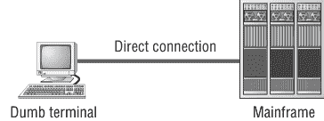

## 双层架构

双层架构随着 PC 的引入而流行，通常被称为客户端/服务器计算。在双层环境中，客户端通过网络协议通过网络连接到服务器，网络协议是客户端与服务器通信的约定方法。TCP/IP 是一种非常流行的网络协议，已成为网络计算的事实标准。无论选择 TCP/IP 还是其他协议，客户端和服务器都必须理解所选的协议。图 1.2 显示双层架构的示例。

## 图 1.2 双层架构

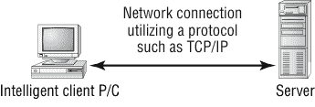


这种架构与单层架构相比具有明确优势。首先，客户端/服务器计算引入了图形用户界面；它更容易理解和学习，并且比单层架构传统的字符界面更具灵活性。此外，双层架构允许客户端计算机共享应用程序处理负载。在某种程度上，这减少了一些故障，降低了服务器的处理需求。

双层架构确实解决了一些故障，尽管它曾被认为是所有网络架构的万灵药。遗憾的是，扩展性的主要问题仍然存在。请注意，“客户端/服务器计算”术语包含了经常被忽视的双层架构组件。通过原型项目，许多开发人员未能考虑网络组件，并很快发现在小型环境中有效的方法在大型、复杂的系统中可能无法有效扩展。我们需要的是一种更具扩展性的网络通信模型。这正是 n 层架构所提供的。

# n 层架构

n 层架构是双层架构之后的下一个逻辑步骤。你不是在客户端和服务器之间划分应用程序处理工作，而是将工作分配给三或更多机器。n 层架构引入了中间件组件，即位于客户端和服务器之间的一或多台计算机，可用于各种任务。其中一些任务包括：

- 在使用不同网络协议的机器之间移动数据。
- 作为防火墙，控制客户端对服务器的访问。
- 将业务逻辑处理从客户端和服务器卸到中间层。
- 执行事务并监控客户端与服务器之间的活动，以在多个服务器之间平衡负载。
- 作为网关，连接现有系统与新系统。

互联网提供了终极的 n 层架构，用户浏览器提供了一致的呈现界面。这种通用界面减少了员工的培训，并增加了客户端应用程序组件的可重用潜力。

n 层架构使得利用网络计算机等技术成为可能。此类计算机可以作为个人计算机更具效益、维护成本的替代方案。由于大部分应用程序处理可以在服务器上完成，这些网络计算机的客户端计算需求被大大降低了。

n 层模型具有非常好的扩展性，并将呈现、业务逻辑和数据库处理的任务分配给许多机器，这意味着该模型能够适应大型应用程序。此外，数据库服务器处理负载的减少意味着服务器可以使用相同的资源完成更多工作。此外，事务服务器可以智能地平衡网络事务的流量，应用程序服务器可以减少客户端的处理和内存需求（见图 1,3）。

## 图 1.3 N 层层架构

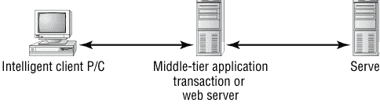

# Oracle Net 特性概述

`Oracle Net` 是将 Oracle 网络连接在一起的粘胶水。它负责处理客户端到服务器以及服务器到服务器的通信，并可以在客户端、中间层应用程序、Web 服务器以及 Oracle 服务器上进行配置。

`Oracle Net` 还管理 Oracle 网络基础设施中的信息流。首先，它被用于建立与 Oracle 服务器的初始连接，并充当信使的角色，将请求从客户端传回服务器，或在两个 Oracle 服务器之间进行传递。在客户端连接期间，`Oracle Net` 会处理客户端与服务器之间的所有协商。在本章随后的“Oracle 堆栈架构”节中，我们将讨论 `Oracle Net` 的架构设计。

除了作为信息管理器外，`Oracle Net` 还支持使用 `Oracle9i Application Server (Oracle9iAS)` 和 `Oracle Connection Manager` 等中间件产品。这些产品允许在企业中使用 N 层架构，从而提高了应用程序设计的灵活性和性能。

要了解更多关于这些产品以及 `Oracle Net` 的某些特性，请阅读以下章节，这些章节反映了 `Oracle Net` 提供的五类网络解决方案：连接性、目录服务、可扩展性、安全性和可用性。

## 连接性：多协议支持

`Oracle Net` 支持广泛的行业标准协议，包括 `TCP/IP`、`IBM LU6.2`、命名管道 (`Named Pipes`) 和 `DECNet`。（与其前身 `Net8` 不同，`Oracle Net` 不再支持 `Novell IPX/SPX` 协议。）这种支持是透明处理的，允许 `Oracle Net` 建立各种计算机和各种操作系统环境建立连接。

# 第 1 章 • 网络管理简介

> `Oracle Net` 为一种用于集群环境的系统局域网 (`SAN`) 新协议提供了支持。这种硬件的特殊配置用于多个服务器之间需要高速通信的场景。新的虚拟接口 (`VI`) 协议是轻量级的，并与特定的硬件配置配合，将网络活动责任从 CPU 卸载并放到特殊的网络适配器上。有关 `VI` 协议的使用、配置和限制的详情，请参阅《`Oracle9i Net 服务管理员指南`》（部件号 `A90154-01`）。可以从 `Oracle Technology Network` 网站 (`technet.oracle.com`) 获取。在该网站上，您可以找到 Adobe Acrobat 格式或 HTML 格式的所有 `Oracle9i` 文档。

## 连接性：多种操作系统

`Oracle Net` 可运行在许多不同的操作系统平台上，从 `Windows NT/2000` 到所有 Unix 变体，再到大型大型机操作系统。这种范围允许用户将系统桥接到其他 Unix 或基于 PC 的系统，从而在不对现有系统进行彻底更改的情况下，增加了组织的数据灵活性。

## 连接性：Java 与 互联网

随着 `Oracle8i` 的引入，Oracle 允许应用程序使用 Java 组件（如企业 JavaBean）和通用对象请求代理体系架构 (`CORBA`) 连接到 Oracle 服务器，`CORBA` 是定义跨网络对象交互的标准。`Oracle Net` 通过支持标准的连接性解决方案（如 Internet-ORB 协议 (`IIOP`) 和通用 ORB 协议 (`GIOP`)）继续了这一特性。这些功能允许客户端通过 浏览器连接到与 Oracle 数据库交互的应用程序。通过利用安全套接层 (`SSL`) 等功能，客户端连接可以在互联网上获得更高层次的安全。

## 目录服务：目录命名

目录命名允许通过集中式命名存储库解析网络名称。中央存储库的形式符合轻量级目录访问协议 (`LDAP`) 标准。`LDAP` 是一种定义服务存储、识别和检索标准方法的协议和语言。它提供了一种管理信息目录的简化方法，无论这些信息是关于组织中的用户，还是连接到网络的 Oracle 实例。`LDAP` 服务器允许在 Oracle 环境中以标准形式进行名称管理和解析。这些服务的质量非常出色，因为 `LDAP` 为如 `Oracle Internet 目录 (OID)` 等目录服务提供了单一的标准接口。通过使用 `Oracle Internet 目录`，您可以确保目录信息的安全性和可靠性，因为它们存储在 Oracle 数据库中。


从 `Oracle9` 开始，目录命名已成为 Oracle 环境中集中式命名的首选方法，取代了 `Oracle 命名服务器 (Oracle Names Server)`。然而，在 `Oracle8` 及更早版本中可以使用 `Oracle 命名服务器`。`Oracle 命名服务器`也可以配置为指向符合 `LDAP` 标准的命名目录的代理，以便从 `Oracle 命名`进行迁移。

## 目录服务：Oracle Internet 目录

`Oracle Internet Directory (OID)` 是一种 `LDAP` 目录服务，它提供了启用使用目录命名的集中命名解决方案所需的存储库和基础设施。`OID` 可同时用于 `Oracle8` 和 `9` 数据库。在 `Oracle9` 中，`OID` 作为应用程序运行。`OID` 服务可以运行在远程服务器上，并使用 `Oracle Net` 与 Oracle 服务器通信。`OID` 是一种可扩展的架构，并提供了在其他服务器之间复制服务信息的机制。

`OID` 还通过多种方式提供安全保障。首先，它可以集成到安全套接层 (`SSL`) 环境中以确保用户身份验证。此外，管理员可以维护授予或拒绝访问服务的策略。这些策略是为 `Oracle Internet 目录` 树结构内的实体定义的。

## 可扩展性：Oracle 共享服务器

`Oracle 共享服务器`（以前称为多线程服务器）是 Oracle 服务器的一种可选配置，允许支持更大的-

## 可扩展性：连接管理器

`Oracle Connection Manager` 是一种中间件解决方案，提供双向协议转换，允许使用不同协议的客户端和服务器进行通信。`Connection Manager` 由一组后台进程控制，管理客户端之间的通信。该选项使用图形化 Oracle 工具进行配置。图 1.4 提供了 `Connection Manager` 架构的概述。

## 图 1.4 连接架构

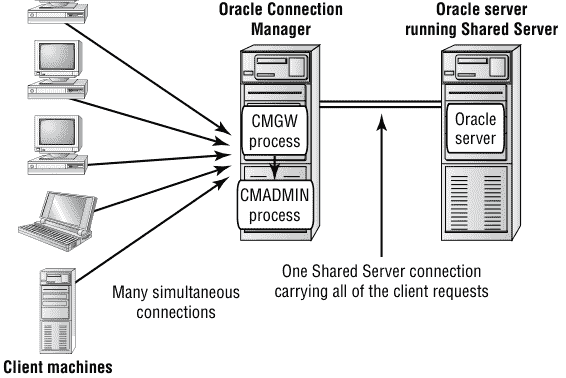

## 安全：高级安全

随着网络系统数量和复杂性的增长以及用户对系统访问的增加，数据篡改威胁已成为许多组织日益关注的问题。

高级安全（以前称为高级安全选项和网络选项）不仅提供了确保安全传输所需的工具，还提供了可靠地识别和验证用户的机制。

在客户端和 Oracle 服务器上配置后，高级安全通过对传输的信息进行加密和可选的校验，来支持安全数据交易。Oracle 通过利用行业标准算法（如 `RSA RC4`、标准 `DES` 和三重 `DES`，以及 `MD5` 校验）来实现加密和校验。

这些安全功能确保了从客户端传输到 Oracle 服务器期间的数据未被篡改。


高级安全使数据库管理员能够验证连接到 Oracle 服务器的用户。事实上，有很多身份验证功能可以确保用户确实是他们所称的。这些功能以令牌卡（使用物理卡和用户识别的 PIN 码访问系统）、生物识别选项（使用指纹技术验证用户连接请求）、公钥以及基于证书的身份验证的形式提供。

高级安全的另一个功能是为客户端提供单点登录。单点登录通过集中的安全服务器进行优化，允许用户使用单一用户 ID 和密码连接到企业中的任何 Oracle 服务。Oracle 利用 `Kerberos` 的行业标准特性来实现这些功能。这极大地简化了管理员在处理大量用户和系统时必须面对的权限管理。

## 安全：防火墙支持

防火墙已成为企业网络中重要的安全机制。防火墙通常是硬件和软件的结合

# 第14 章 第1 章 • 网络管理简介

这些工具用于控制网络流量并防止入侵者破坏企业网络安全。防火墙分为两大类：

**`IP 过滤防火墙`** `IP 过滤防火墙`监控 IP 网络上的数据包流量，并过滤掉源自特定机器组或并非源自这些组的数据包。通过查询 IP 数据包头中包含的信息来获取此类信息。此类产品的供应商包括 Network Associates Associates 和 Axent Communications。

**`基于代理的防火墙`** `基于代理的防火墙`防止来自外部的信息直接流入企业网络。相反，防火墙充当网关，检查数据包并仅将适当的信息发送到企业网络。这防止了防火墙外客户端与防火墙内应用程序之间的直接通信。Check Point Software Technologies 和 Cisco 是销售代理防火墙的厂商示例。

Oracle 与这两种类型产品的供应商紧密合作，以确保通过这些机制支持数据库流量。Oracle 为防火墙供应商提供 `Oracle Net` 应用代理套件。该产品可以集成到防火墙架构中，允许数据库数据包通过防火墙，同时保持高水平的安全性。


> 理解你的网络基础设施、你用于获取数据库连接的网络路由以及你正在使用的防火墙产品非常重要。我遇到过多次情况，防火墙导致了客户端与 Oracle 服务器之间的连接性问题。

例如，我记得在为一家前雇主担任 DBA 时，在防火墙应用了一个小补丁后发生了什么。在这种情况下，员工开始遇到从 Oracle 数据库间歇性断开连接。经过多天的调查和网络追踪，我们才确定了具体问题。确定后，我们联系了防火墙供应商，他们发送给我们一个新的补丁进行应用，解决了该问题。

# Oracle Net 特性概述

最近，当我为一个大型企业客户担任 DBA 时，开发人员遇到了类似的问题。事实证明，开发人员的网络路由被修改为将连接路由到一个新的防火墙。该防火墙配置为在活动 20 分钟后断开连接，这对于该部门来说时间太短了。因此，我们增加了超时参数以满足开发人员的需求。

这些是 DBA 需要注意的网络更改类型示例，以避免不必要的停机并避免浪费时间和资源。

## 可访问性：异构服务

异构服务（Heterogeneous Services）提供了与非 Oracle 数据库及服务的通信能力。这些服务允许组织利用并与其现有数据存储交互，而无需不必将数据移动到 Oracle 服务器。

异构服务由 Oracle 透明网关（Oracle Transparent Gateway）和通用连接（Generic Connectivity）组成。这些产品允许 Oracle 以无缝配置与非 Oracle 数据源通信。异构服务还将将现有系统集成到 Oracle 环境中，允许你利用对这些系统的投资。这些服务还允许从 Oracle 数据源到非 Oracle 数据源的双向通信和复制。

**透明网关 (Transparent Gateway)** 透明网关无缝扩展了 Oracle 到非 Oracle 数据存储的范围，允许你将非 Oracle 数据源视为 Oracle 环境的一部分。事实上，用户并不知道数据来自非 Oracle 溯源。这可以显著减少从现有系统过渡到 Oracle 环境所需的时间和投资。透明网关完全支持 SQL 和 Oracle 事务控制功能，目前支持访问 30 多个非 Oracle 数据源。

**通用连接 (Generic Connectivity)** 通用连接提供了一组代理，这些代理包含基本的连接能力。它还提供了一个基础，使你可以使用标准的 `OLE DB`（微软的数据访问接口）自定义构建连接解决方案。`OLE DB` 需要一个开放数据库连接（`ODBC`）驱动程序来与代理接口。你也可以将 `ODBC` 作为独立的连接解决方案。例如，通过适当的 `ODBC` 驱动程序，你可以从 Microsoft Excel 等程序访问 Oracle 数据库。（这些驱动程序可以从 Oracle 或第三方供应商获得。）由于这些驱动程序本质上是通用的，它们提供的外部服务接口没有透明网关那样健壮。

## 可访问性：外部过程

在某些开发工作中，可能需要与位于数据库外部的过程建立接口。这些过程通常用第三代语言（如 `C` 语言）编写。`Oracle Net` 提供了从 `PL/SQL` 调用外部过程的能力。当进行调用时，将启动一个充当 Oracle 与过程之间接口的进程。`listener` 负责向被调用的过程提供信息，例如库或过程名称以及任何参数。这些程序然后在 `extproc` 的控制下加载并执行。

# 第1 章 • 网络管理简介

# Oracle Net 栈式架构

Oracle Net 软件由一系列程序组成，形成一种栈式架构。这些程序程序负责处理网络通信的各个方面，每个程序都充当栈的一层。本节讨论了 Oracle Net 栈的架构并定义了每一层的职责。为了成功通过 OCP 考试，你需要理解 Oracle Net 栈的结构和功能。该结构基于开放系统互连（`OSI`）模型。

## OSI 模型

开放系统互连（`OSI`）模型是一个广泛接受的模型，它定义了如何在网络中进行数据通信。

# Oracle Net 栈式架构

`OSI` 模型有七层，每层都负责网络通信的某个方面。模型的上层处理如与应用程序通信和呈现数据等职责。下层负责跨网络传输数据。上层将信息（如数据目的地以及应如何处理数据）传递给下层。底层向上层返回状态信息。表 1.1 显示了 `OSI` 模型的层以及每一层在执行跨网络通信时所承担的职责。从表中可以看出，这种分层方法允许职责的分离。它还允许将网络通信的逻辑方面（如呈现和数据管理）与通信的物理方面（如比特在网络上的物理传输）分离。

表 1.1 OSI 模型层

| OSI 模型层 | 职责 |
|---|---|
| 应用层 | 与应用程序交互。接受命令并返回数据。 |
| 呈现层 | 解决客户端和服务器之间的数据差异。也负责数据格式。 |
| 会话层 | 管理网络流量。确定数据是正在发送还是接收。 |
| 传输层 | 处理源端和目的网络进程的交互。错误纠正和检测在此处。 |
| 网络层 | 在节点之间传递数据。 |
| 数据链路层 | 维护连接可靠性和重传功能。 |
| 物理层 | 在网络上传输电信号。 |

## Oracle 通信栈

`OSI` 模型是 Oracle 通信栈架构的基础。Oracle 通信栈的每一层都具有根据 `OSI` 模型设计的特征和职责。Oracle 在 `OSI` 模型的最高层与底层网络进行交互。从本质上说，它位于底层网络基础设施之上，并与底层网络进行通信。

Oracle 在客户端和服务器上使用 `Oracle Net` 来促进通信。通信栈充当客户端和服务器之间共享和管理数据的通道。Oracle 通信栈的层级如下：

- 应用程序层（客户端）
- Oracle 接口层（`OCI` 层，客户端）或 Oracle 程序接口层（`OPI` 层，服务器）
- 双任务公共传输层（`TTC` 层）
- Oracle Net 基础层（Oracle Net Foundation layer）
- Oracle 协议适配器层（`OPA` 层）
- 网络特定协议层（Network Specific Protocols）
- 网络接口层（`NPI`，仅用于服务器到服务器通信）

图 1.5 展示了栈在客户端和服务器上每一层的关系。客户端进程发出网络调用，通过 `Oracle Net` 客户端层向下传输到网络协议。服务器接收网络请求，对其进行处理，并将结果返回给客户端。

## 应用程序层（客户端）

Oracle 通信栈的应用程序层提供了与 `OSI` 模型应用层相同的功能。该层负责与用户交互，涉及提供界面组件、屏幕和数据控制元素。表单或菜单等接口都是应用程序层的示例。此层与 Oracle 接口层（`OCI` 层）通信。

## Oracle Net 栈架构 19

图 1.5 Oracle Net 栈架构

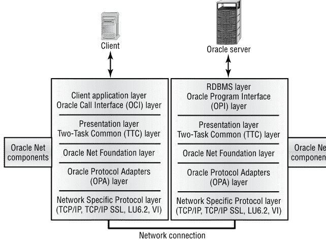

| Oracle Net 组件 | 客户端应用程序层 Oracle 接口层 (OCI 层) | RDBMS 层 Oracle 程序接口层 (OPI 层) |
|---|---|---|
| | 表示层 双任务公共传输层 (TTC 层) | 表示层 双任务公共传输层 (TTC 层) |
| | Oracle Net 基础层 | Oracle Net 基础层 |


| | Oracle 协议适配器层 (OPA 层) | Oracle 协议适配器层 (OPA 层) |
| | 网络特定协议层 (TCP/IP, TCP/IP SSL, LU6.2, VI) | 网络特定协议层 (TCP/IP, TCP/IP SSL, LU6.2, VI) |

## Oracle 接口层 (OCI 层)

Oracle 接口层（OCI 层）负责客户端与 Oracle 服务器之间发生的所有 SQL 处理。OCI 层仅存在于客户端。在服务器上有一个类似的服务器组件，称为 Oracle 程序接口层（OPI 层）。OCI 层负责打开和关闭游标、在共享内存空间中绑定变量以及取行。由于 OCI 是一种开放架构，第三方产品可以编写直接与通信栈的此层交互的应用程序。OCI 层将信息直接传递给双任务公共传输层（TTC 层）。

## 双任务公共传输层 (TTC 层)

双任务公共传输层（TTC 层）负责协调客户端和服务器之间的任何数据类型或字符差异。TTC 层充当翻译器，将值从一个字符集转换为另一个。TTC 在建立连接时确定是否存在任何数据类型差异。TTC 层将信息传递给 Oracle Net 基础层。该层具有 OSI 模型中表示层的某些特征。

## Oracle Net 基础层

Oracle Net 基础层（以前称为透明网络子系统或 TNS 层）是 Oracle 通信架构不可组成部分，它类似于 OSI 模型中的会话层。它基于透明网络子系统（TNS），允许 Oracle Net 成为一种非常灵活的架构，能够与各种网络协议接口。TNS 接口保护客户端和服务器不受网络通信复杂性的影响。

在通信栈的此层，Oracle Net 与栈的其他层及其底层协议交互。正是这一层提供了使 Oracle Net 成为灵活且自适应架构所需的抽象级别，并且这一层补偿了机器和底层协议之间连接的差异。该层还处理中断消息并将信息直接传递给 Oracle 协议适配器层（OPA 层）。Oracle Net 基础层有几个子层：

`网络接口 (NI) 子层` 网络接口子层提供了一个通用接口，客户端和服务器可以在上面处理功能。栈的此层还负责处理任何中断请求。

`网络路由 (NR) 子层` 这是 Oracle Net 保留其网络工作地图的地方，记录如何到达源地或目的地。

`网络命名 (NN) 子层` 该层获取网络信息并将其转换为 Oracle Net 目的地址信息。

`网络认证 (NA) 子层` 该层负责身份验证连接所需的任何协调。

`网络会话 (NS) 子层` 网络会话层处理 Oracle 网络连接大部分活动。该层负责协调来自客户端的初始连接请求。它还负责管理 Oracle Net 缓冲区并在客户端和服务器之间传递缓冲区信息。如果使用了这些选项，它还处理连接管理的特殊功能，例如缓冲区池和多路复用。

## Oracle Net 栈架构

### Oracle 协议适配器 (OPA) 层

Oracle 协议适配器层（OPA 层）与底层网络交互。这是进入底层网络的入口。该层将 Oracle Net 基础层映射到底层协议中的底层功能。每个支持的协议都有不同的适配器。该层结合网络协议层类似于 OSI 模型中的网络层。

### 网络特定协议层

这是将信息从客户端传输到服务器的实际传输层。Oracle 支持的一些协议包括 TCP/IP 和 DCNet。这些协议不随 Oracle 软件提供，必须到位以促进网络通信。

### Oracle 程序接口层 (OPI 层)（仅限服务器）

对于客户端发出的每个请求，Oracle 接口层负责发送相应的响应。当客户端发出请求数据库数据的 SQL 语句时，OPI 接口完成该请求。在服务器到服务器的通信中，使用网络接口层（NPI）代替 OPI。

### 网络接口层 (NPI 层)（仅限服务器）

网络接口层（NPI 层）仅存在于 Oracle 服务器上。它类似于客户端上的 OCI。该层负责服务器到服务器的通信，而 OPI 用于客户端-服务器通信，并用于数据库跨数据库链接进行通信的分布式环境。该层类似于 OSI 模型中的表示层，但是从服务器的角度来看的。

## Oracle Net 和 Java 支持

为了提供与在 Oracle 服务器环境内部编写和部署的 Java 代码交互的能力，Oracle Net 支持通用对象请求协议（GIOP）。该协议允许对象请求

代理。对象请求代理（Object Request Broker，简称 ORB）是一种处理分布式网络中对象请求路由的软件。互联网对象请求代理协议（IIOP）是运行在 TCP/IP 之上的一种 GIOP 变体，它支持安全套接层（SSL），以便在跨互联网建立安全的网络连接。如果应用程序需要访问编写并存储在 Oracle 数据库中的 Java 过程，就会使用这种连接方式。在这种情况下，Oracle9 Java 虚拟机（JVM）将运行在 Oracle 服务器上，提供对象请求代理功能。

所需的 Oracle Net 部分是 Oracle Net 层。当使用服务器端 Java 过程时，这种精简通信栈允许 Oracle 服务器之间实现更高效的连接。图 1.6 显示了修改如何简化了 Oracle 通信栈。

### 图 1.6 IIOP 栈通信

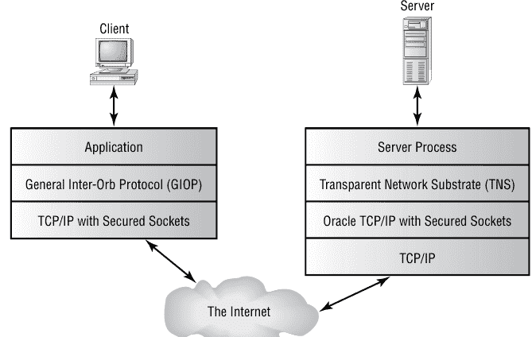

Oracle Net 还为基于 Web 的应用程序提供了稳健的连接。可以通过 Java 应用程序、Java Applet 或通过 Oracle9IAS 等应用程序服务器直接与 Oracle 服务器建立连接。

## 使用 Oracle Net 的互联网连接

通过 Web 浏览器发起到 Oracle 服务器的连接与客户端/服务器应用程序非常。主要区别在于应用程序服务器充当客户端，提供与 Oracle 服务器之间的通信。如果 Java 应用程序位于 Web 服务器上，则使用 Java 数据库连接（JDBC） OCI 驱动程序来启动与 Oracle 服务器的通信。（JDBC） 是一个允许 Java 程序与存储在表格形式的数据（例如 Oracle 数据库中的数据）交互的接口。）如果通过 Java Applet 连接，则使用 JDBC Thin 驱动程序。JDBC Thin 驱动不需要安装 Oracle 客户端软件，因此被称为“轻量级驱动（thin driver）”。它提供了从 Applet 到 Oracle 服务器的连接。

通常在这种环境下，由客户端发起 HTTP 请求并发送到应用程序服务器。应用程序服务器将请求提供给适当的数据库服务器进行处理。Oracle Net 充当应用程序服务器与数据库之间的通信机制。HTTP 用于发送请求到应用程序服务器并接收应用程序服务器的响应。图 1.7 显示了使用 Java 应用程序的 Web 连接示例。

### 图 1.7 使用 Java 应用程序的 Web 连接

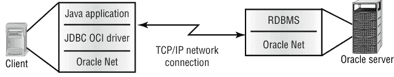

## 无应用程序服务器的 Web 连接

数据库可以配置为直接接受来自 Web 环境的请求，而无需中间层应用程序服务器。因为 HTTP 和 IIOP 可以在 Oracle 服务器上配置。Oracle 支持在 Oracle 服务器内部开发和部署常用的 Java 对象，例如企业级豆（EJB）。客户端可以向 Oracle 数据库发送请求并直接与这些组件交互。必须在服务器上配置 Oracle Net 以接受并处理此类请求。该解决方案的吸引人之处在于，不需要向客户端部署任何软件；客户端只需要一个 Web 浏览器来与数据库交互。

## 总结

在 Oracle 环境中进行网络连接并取得成功，有几个关键组件是必须的。网络管理员的主要职责包括确定将支持的应用程序和连接类型、用户数量以及访问网络的位置，以及涉及保护敏感信息的安全问题，例如单点登录和数据加密。

除了需要了解自己的职责外，数据库管理员（DBA）在设置 Oracle 网络时，还需要从三种基本的网络配置类型中进行选择：单层架构、二层架构和 n 层架构。由于系统已从简单的单层演变为更复杂的 n 层架构（可以包括通过中间层服务器和互联网的连接），管理员很可能会发现自己需要在 Oracle Net 所或缺的两种架构之间做出选择：二层架构或 n 层架构。

Oracle Net 管理从客户端计算机到 Oracle 服务器的信息流，并构成了 Oracle 环境中所有网络计算的基础。Oracle Net 由一系列层组成，形成了 Oracle Net 栈架构。该架构基于网络交互的 OSI 模型。Oracle Net 栈中的每一层都负责一个或多个网络任务。请求和响应在存在于客户端和服务器上的栈中上下传输。

# 第 1 章 · 网络管理引论

通过互联网相互通信的代理。对象请求代理（Object Request Broker，简称 ORB）是一种处理分布式网络中对象请求路由的软件。互联网对象请求代理协议（IIOP）是运行在 TCP/IP 之上的一种 GIOP 变体，它支持安全套接层（SSL），以便在跨互联网建立安全的网络连接。如果应用程序需要访问编写并存储在 Oracle 数据库中的 Java 过程，就会使用这种连接方式。在这种情况下，Oracle9 Java 虚拟机（JVM）将运行在 Oracle 服务器上，提供对象请求代理功能。


除了支持连接到 Oracle 服务器的主网络架构外，Oracle Net 还提供了可以分为五大类的服务：连接性、目录服务、可扩展性、安全性和可用性。连接解决方案包括对多种协议、多个操作系统以及 Java 和互联网的支持。目录服务提供了一个接口，通过集中式命名库解析 Oracle 名称。可扩展性解决方案包括连接管理器（`Connection Manager`）和 Oracle 共享服务器（`Shared Server`）。安全选项包括 Oracle 高级安全（`Advanced Security`），它提供了额外的安全选项以及对多种防火的稳健支持。可用性支持包括异构服务（`Heterogeneous Services`）以及对调用外部过程的支持。Oracle 为 Java 存储过程提供了连接支持：`HTTP` 和 `IIOP` 协议。

## 考试要点

了解数据库管理员的职责以及它们与网络管理的关系。你应该能够列出数据库管理员在网络管理方面的职责。你是否能够定义基本的网络配置选择并总结这些选项的优缺点？

理解 Oracle Net 是什么以及它提供的功能。你应该能够定义 Oracle Net 提供的五类功能以及哪些功能属于每一类。你还应该理解共享服务器（`Shared Server`）和连接管理器（`Connection Manager`）提供的功能。此外，你应该能够定义 Oracle 高级安全（`Advanced Security`）以及何时使用它。

能够定义异构服务的用途以及适用于这些的情况。异构服务提供了与非 Oracle 数据库通信的能力。这些允许组织利用并与现有数据存储交互，而无需将数据移动到 Oracle 服务器。

能够定义 Oracle Net 栈架构。该架构基于网络计算的 OSI 模型。该模型将网络事务的责任分配给不同的层。你应该知道 Oracle Net 栈变体的名称和定义。

理解 Oracle 对存储在服务器上的 Java 的支持。Oracle 通过支持 `GIOP` 来存储在服务器上的 Java，允许对象请求代理在互联网上相互通信。`Oracle9 JVM` 在服务器上提供对象请求代理功能。

熟悉 Oracle 的互联网连接选项。你应该基本理解 Oracle 从互联网提供的连接选项。这包括通过应用程序服务器进行的连接以及从 Web 浏览器直接到 Oracle 服务器的连接。

## 关键术语

在考试之前，确保你熟悉以下术语：

- 应用层 Oracle 调用接口 (`OCI`) 层
- 外部过程 `extproc` Oracle 连接管理器
- 防火墙 Oracle Net 基础层
- 通用连接 Oracle 程序接口 (`OCI`) 层
- 异构服务 Oracle 协议适配器 (`OPA`) 层
- IP 过滤防火墙 Oracle 共享服务器
- Java 数据库连接 (`JDBC`) Oracle 透明网关
- 中间件代理防火墙
- 网络程序接口 (`NPI`) 单层架构
- n 层架构 系统区域网 (`SAN`)
- 对象请求代理 双任务通用协议 (`TTC`) 层
- 开放系统互模型 (`OSI`) 二层架构
- Oracle 高级安全 虚拟接口 (`VI`) 协议

## 复习题

- 1. 以下所有项都不是网络架构的示例：
  A. 客户端/服务器 (`Client/server`)
  B. N 层 (`N-tier`)
  C. 单层 (`Single-tier`)
  D. 双层 (`Two-tier`)
  E. 以上所有都是网络架构的示例。

- 2. 你管理一个非 Oracle 数据库和多个 Oracle 数据库。应用程序需要访问非 Oracle 数据库，就像它是 Oracle 数据库的一部分一样。哪种工具可以解决这个业务问题？请选择最佳答案。
  A. Oracle Advanced Security
  B. Oracle Connection Manager
  C. 异构服务 (`Heterogeneous Services`)
  D. Oracle Net
  E. 以上都不是

- 3. 关于 Oracle Net，下列哪项是正确的？
  A. 它不是 Oracle Enterprise 安装中的选项。
  B. 它仅在 TCP/IP 平台上工作。
  C. 它具有开放的 API。
  D. 它从不直接安装在客户端工作站上。

- 4. DBA 想要在一个具有许多网络服务的大型 Oracle9 安装中集中管理所有的 Oracle 网络服务。哪种功能能以最低成本提供此功能？
  A. Advanced Security
  B. 异构服务 (`Heterogeneous Services`)
  C. Oracle Shared Server
  D. Oracle Internet Directory

- 5. TCP/IP、DECnet 和 LU6.2 都是什么的示例？
  A. 计算机编程语言
  B. Oracle Net 连接工具
  C. 网络协议
  D. 网络编程语言

- 6. Oracle Net 的哪种特性最能描述这一陈述：“Oracle Net 支持 TCP/IP 和 LU6.2。”
  A. GUI 工具集成
  B. 健壮的跟踪和诊断工具
  C. 客户端零配置
  D. 网络传输协议支持

- 7. Oracle9i 配合 Oracle Net 采用哪种解决方案允许 Java 组件（如 Enterprise JavaBeans）进行连接？
  A. LU6.2
  B. IPA
  C. GIOP
  D. Oracle Internet Directory

- 8. Oracle Net 通信栈基于哪种标准？
  A. OCI
  B. NPI
  C. OSI
  D. API

9. “负责在导缆上传输比特”描述的是 OSI 模型中的哪一层？
  A. 应用层 (`Application Layer`)
  B. 物理层 (`Physical Layer`)
  C. 数据链路层 (`Data Link Layer`)
  D. 网络层 (`Network Layer`)

10. 用于通过 Oracle Net 进行外部调用的进程默认名称是什么？
  A. externalproc
  B. external
  C. extproc
  D. procect

11. IIOP 是以下哪项的示例？
  A. 用于 Oracle Net 的工具
  B. Oracle 网络集成工具
  C. 互联网网络协议 (`Internet network protocol`)
  D. Oracle Net 栈的一部分

12. Connection Manager 提供以下哪些功能？
  A. 多路复 (`Multiplexing`)
  B. 跨协议连接 (`Cross protocol connectivity`)
  C. 网络访问控制 (`Network access control`)
  D. 以上所有

- 13. 关于 OCI 层，以下哪项是正确的？
  A. 它显示图形界面。
  B. 它处理数据类型转换。
  C. 它直接与协议适配器接口。
  D. 它直接与 TTC 层接口。
  E. 以上都不是。

- 14. 下述陈述适用于以下选项中的哪一个？
  “防止客户端与公司网络内部应用程序之间的直接通信。”
  A. 基于代理的防火墙 (`Proxy-based firewalls`)
  B. 基于过滤的防火墙 (`Filter-based firewalls`)
  C. 两种类型的防火墙
  D. 两种防火墙都不是

- 15. 当通过 Java applet 连接时，使用的是什么类型的驱动程序？
  A. JDBC OCI driver
  B. JDBC Thin Driver
  C. ODBC driver
  D. OCI driver

- 16. 客户端工作站连接到事务服务器，由服务器将请求传递给 Oracle 数据库。这是对以下哪项的描述？
  A. 单层架构
  B. 客户端/服务器架构
  C. N 层架构
  D. 以上都不是

17. 哪种 Oracle Net 网络产品最能被描述为中间件？
  A. Oracle Internet Directory
  B. Oracle Connection Manager
  C. Oracle Advanced Networking
  D. Oracle Shared Server

18. 以下哪些项是复杂性网络的特征？
  A. 多种协议
  B. 多样的地理位置
  C. 多个操作系统
  D. 多个硬件平台
  E. 以上所有

19. 在 Oracle9i 环境中，优的集中命名方法是什么？
  A. Oracle Names Server
  B. Oracle Connection Manager
  C. Oracle Shared Server
  D. 使用 Oracle Internet Directory 进行目录命名

20. 以下哪项是将连接分组在一起的能力的示例？
  A. 协议交换 (`Protocol Interchange`)
  B. 网络访问控制 (`Network Access Control`)
  C. 多路复 (`Multiplexing`)
  D. 数据完整性检查 (`Data Integrity checking`)
  E. 以上都不是

## 复习题答案


- 1. 这些都是网络连接配置的示例。网络可以简单到如通过串口直接连接到服务器的哑终端。它也可以复杂到如 `n` 层架构，其中可能涉及客户端、中间件、互联网和数据库服务器。

- 2. `Oracle Advanced Security` 无法解决这个问题，因为它解决的是安全以及对非 `Oracle` 数据库的访问性。`Oracle Net` 是解决方案的一部分，但还需要另一个 `Oracle` 网络组件。`Connection Manager` 本身也无法满足这一需求。异构服务（`Heterogeneous Services`）是正确答案，因为这些服务为非 `Oracle` 数据库提供了跨平台连接。

- 3. `Oracle Net` 包含在 `Oracle Enterprise` 安装中，并与多种协议配合。它包含客户端和服务器组件。关于 `Oracle Net` 唯一正确的陈述是它具有应用程序编程接口（`API`），这意味着第三方软件可以根据这些规范编写以与 `Oracle Net` 直接交互。

- 4. `Advanced Security`、`Heterogeneous Services` 和 `Oracle Shared Server` 不能为此业务提供解决方案，因为其中任何一个都没有解决集中管理网络服务的问题。该问题的最佳解决方案是 `Oracle Internet Directory`，它可以促进集中命名。

- 5. `TCP/IP`、`DECnet` 和 `LU6.2` 都是网络协议的示例。

- 6. `Oracle Net` 支持多种协议。`TCP/IP` 和 `LU6.2` 是 `Oracle Net` 支持的两种协议示例。

- 7. 通用 `ORB` 协议（`General Inter-ORB Protocol`）是一种支持 `Java` 组件连接的协议。

- 8. `C`。`Oracle Net` 通信栈基于开放系统互连模型（`OSI`）。`NPI` 和 `OCI` 是 `Oracle Net` 栈的一部分，`API` 代表应用程序编程接口。

- 9. `B`。物理层负责跨网络发送实际的数据比特。其他层都在这个基础层之上。

- 10. `C`。外部进程的默认名称是 `extproc`。`lsnnrctl1` 是一个用于管理监听器服务的工具。`external` 和 `reproct` 不是有效回答。

- 11. `C`。`IIOP` 是互联网网络协议的示例。

- 12. `D`。`Connection Manager` 是一种中间件解决方案，提供了连接的多路复、跨协议连接和网络访问控制。所有答案都在描述 `Connection Manager`。

- 13. `D`。`OCI` 层位于应用层之下，`TTC` 层之上。调用接口处理游标管理和 `SQL` 执行等操作。这些信息传递给 `Two-Task` 层。

- 14. `A`。基于代理的防火墙防止客户端与公司防火墙内部应用程序之间的直接接触。基于过滤的防火墙检查包头，但不修改包将其传递给目标应用程序。基于代理的防火墙在外部客户端和内部应用程序之间作为中继。

- 15. `B`。如果使用 `Java` 程序通过应用程序服务器与 `Oracle` 数据库通信，将使用 `JDBC Thin Driver`。

- 16. 当在事务处理中引入中间层时，这被称为 `n` 层架构。

- 17. `B`。`Connection Manager` 是一个中间层选项，提供多协议交换、连接集中和客户端访问控制。

- 18. `E`。这些都是复杂性网络的特征。

- 19. `D.` `Oracle Internet Directory` 和 `Directory Naming` 正在取代 `Oracle Names Server`，成为集中命名的首选方法。

- 20. `C.` 多路复用（`Multiplexing`）是 `Oracle Connection Manager` 的特性，允许通过单个出站连接同时处理并传输多个入站请求。这是 `Connection Manager` 提供的一种扩展性特性。

# 第 2 章

## 在服务器上配置 Oracle Net

本章涵盖的 `ORACLE9i DBA` 基础 `II` 考试目标：

- 识别监听器（`listener`）如何响应传入的连接。
- 使用 `Oracle Net Manager` 配置监听器。
- 使用监听器控制工具 (`lsnrctl`) 控制监听器。
- 描述动态服务注册（`Dynamic Service Registration`）。
- 为 `IIOP` 和 `HTTP` 连接配置监听器。

> 注意：考试目标可能会随时更改，无需另行通知，并由 `Oracle` 自行决定。请访问 `Oracle` 认证网站（`http://www.oracle.com/education/certification/`）查看最新的考试目标列表。


`DBA` 必须在服务器上配置 `Oracle Net` 以便建立客户端连接。本章将重点介绍如何配置 `Oracle` 服务器的基础网络元素。

首先，我们将讨论如何管理和配置 `Oracle` 服务器网络组件以及监听器进程，以及如何使用 `Oracle Net Manager` 和 `nrctl` 命令行工具。我们还将讨论动态注册（`Dynamic Registration`）功能，该功能允许实例在 `Oracle` 服务器上自动注册监听器。我们还将查看如何配置监听器，使其通过 `IIOP` 和 `HTTP` 连接通过互联网连接到 `Oracle` 服务器。最后，我们将探索排查服务器端连接问题的方法。

本章描述了在配置 `Oracle Net` 环境时需要采取的第一步。一旦在数据库服务器上正确配置了 `Oracle Net`，客户端就可以连接到 `Oracle` 数据库，而无需直接连接到 `Oracle` 数据库所在的服务器。如果没有这种配置，将无法实现此类连接。

## Oracle 监听器 (The Oracle Listener)

`Oracle` 监听器是主要的服务器端 `Oracle` 网络组件，允许客户端计算机与 `Oracle` 数据库之间建立连接。你可以将监听器想象成一只大耳朵，监听对 `Oracle` 服务的连接请求。

请求的 `Oracle` 服务类型是请求连接的进程提供的连接描述符信息的一部分，服务名称解析为 `Oracle` 数据库。监听器可以监听服务器上配置的任意数据库，并能够监听传输在 `TCP/IP`、`DECnet` 和 `LU6` 等各种协议上的请求。客户端连接可以从监听器所在的同一机器启动，也可能来自某些远程位置。

监听器使用集中的 `listener.ora` 文件进行配置。虽然每台机器只配置了一个 `listener.ora` 文件，但服务器上可能存在多个监听器，而该文件包含了服务器上配置的每个监听器的所有配置信息。如果单个服务器上配置了多个监听器，它们通常是为了平衡连接请求并最大限度地减少单个监听器的连接负担。


`listener.ora` 文件的内容和结构将在本章稍后讨论。

每个监听器都是运行在服务器上的命名进程。`Oracle` 监听器的默认名称为 `LISTENER`，它通常在安装 `Oracle` 时创建。如果你配置了多个监听器，每个监听器将有一个唯一的名称。以下是 `listener.ora` 文件的默认配置示例。

```
# LISTENER.ORA Network Configuration File:
D:\oracle\ora90\network\admin\listener.ora
# Generated by Oracle configuration tools.
```

```
LISTENER =
(DESCRIPTION_LIST =
  (ADDRESS_LIST =
    (ADDRESS = (PROTOCOL = TCP)(HOST = mjworn)
      (PORT = 1521)))
  (ADDRESS_LIST =
    (ADDRESS = (PROTOCOL = IPC)(KEY = EXTPROCO)))
  )
)
```

```
SID_LIST_LISTENER =
(SID_LIST = =
```

Copyright ©2002 SYBEX, Inc., Alameda, CA www.sybex.com

```
(SID_DESC =
(SID_NAME = PLSExtProc)
(ORACLE_HOME = D:\oracle\ora90)
(PROGRAM = extproc)
)
(SID_DESC =
(GLOBAL_DBNAME = ORCL)
(ORACLE_HOME = D:\oracle\ora90)
(SID_NAME = ORCL)
)
```

## 监听器如何响应连接请求？

监听器有几种方式响应客户端的连接请求。响应取决于多个因素，例如服务器端网络组件的配置方式以及客户端请求的连接类型。监听器将以两种方式之一响应连接。


监听器可以产生新进程并将客户端会话的控制权传递给该进程。在专用服务器环境中，每个客户端连接都由其自己的服务器端进程提供服务。服务器端进程不在客户端之间共享。根据操作系统的能力，可能有两种类型的专用服务器连接：遗留连接（bequeath connections）和重定向连接（redirect connections）。每种方式都会产生一个处理的独立进程，但实际连接的机制是不同的。


从 Oracle9i 开始，不再支持预启动的专用进程。

## 遗留连接 (Bequeath Connections)

当底层操作系统支持端点的继承时，遗留连接是可能的。这意味着操作系统能够产生一个进程并将信息传递给进程。

遗留连接的另一个名称是直接交接连接（direct hand-off connections）。

遗留连接的步骤如图2.1 所示：

- 1. 客户端在解析服务名称后连接 Oracle 服务器。
- 2. 服务器产生一个专用进程并将连接遗留。新进程继承产生进程的所有信息，包括来自服务器的 TCP/IP 套接字。
- 3. 服务器进程通过向客户端发送 RESEND 包通知客户端开始发送信息。
- 4. 客户端向新建立的进程发送 CONNECT 包。
- 5. 服务器返回 ACCEPT 包并管理客户端。

### 图 2.1 遗留连接过程

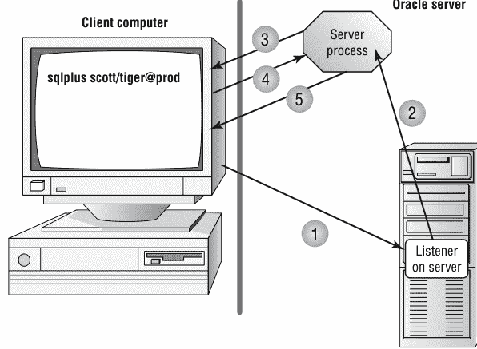

为了在 Windows NT/2000 上支持遗留会话，需要设置注册表项 `USESHARED_SOCKET`。该设置可以在 `HKEY_LOCAL_MACHINE > SOFTWARE > ORACLE > HOMEX` 中设置，其中 X 等于你使用的 Home，例如 HOME0。默认情况下，此注册表设置未初始化，因此当使用专用客户端时，Windows NT/2000 将使用重定向类型连接。

## 重定向连接 (Redirect Connections)

监听器还可以将用户重定向到服务器进程或调度器进程。当操作系统不支持遗留连接或监听器与 Oracle 服务器不在同一物理机上，就会发生此类连接。

以下步骤如图2.2 所示：

- 1. 客户端在解析服务后连接 Oracle 服务器。
- 2. 在 Oracle 共享服务器的情况下，监听器产生一个新的进程或调度器。如果现有共享服务器有剩余容量，则不需要产生调度器进程。
- 3. 新进程或线程选择一个 TCP/IP 端口与用户交互。此信息随后传递回监听器。
- 4. 监听器将信息传回客户端，将客户端重定向到新的服务器或调度器端口。监听器与客户端之间的原始网络连接断开。
- 5. 客户端向服务器或调度器进程发送连接信号以建立网络连接。
- 6. 调度器或服务器进程向客户端返回确认。
- 7. 如果正在使用 Oracle 共享服务器进程，PMON 会向监听器发送有关正在服务的连接信息。

由分发器。监听器使用这些信息来维护分发器之间的负载均衡。

### 图 2.2 重定向连接过程

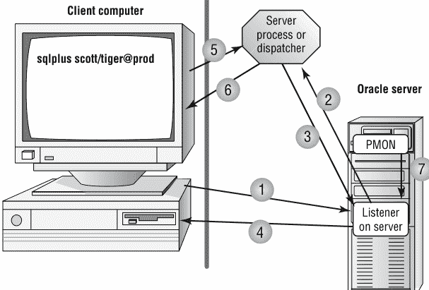

## 管理 Oracle 监听器

DBA 有多种方法可以配置服务端监听器文件。在 Oracle 初始安装过程中，安装程序会提示 DBA 创建默认监听器。如果 DBA 不想以这种方式提供监听器，也可以使用 Oracle Net 配置助手（Oracle Net Configuration Assistant）来配置监听器。如果选择此方法，安装程序将使用该助手包含的屏幕进行初始监听器配置。图 2.3 显示了 Oracle Net 配置助手的启动界面示例。

# 第 2 章 · 在服务器上配置 Oracle Net

### 图 2.3 Oracle Net 配置助手的启动界面

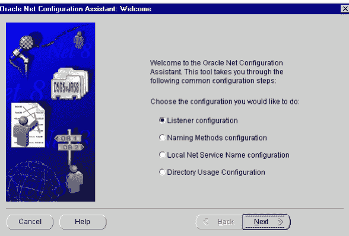

Oracle Net 配置助手旨在成为一个简单的、基于向导的工具，可以用它对客户端和服务端网络产品进行基础设置。

静态服务注册发生在使用 Oracle Net Assistant 手动向 `listener.ora` 文件添加条目时。它是静态的，因为你是手动添加这些信息的。如果你将要使用 Oracle Enterprise Manager 连接到 Oracle 8 之前的实例，或者将连接到外部服务，则需要静态服务注册。

还有另一种管理监听器的方法，不需要手动更新 `listener.ora` 文件中的服务信息。这被称为动态服务注册。动态服务注册功能允许 Oracle 实例自动向 Oracle 监听器注册自身。该功能的用处是，当创建新的 Oracle 实例时，不需要 DBA 对服务端网络文件进行任何更新。动态服务注册将在本章后面的“服务的动态注册”部分进行更详细的介绍。

Copyright©2002 SYBEX, Inc., Alameda, CA www.syex.com

如果你正在使用 Oracle9i，必须配置一个 Oracle9i 监听器以连接到 Oracle 服务器。Oracle9i 监听器向后兼容，可以监听对早期 Oracle 数据库版本的连接请求。

如果你希望设置的不只是 Oracle 网络文件的基本配置，你将必须使用 Oracle Net Manager。在接下来的章节中，你将学习如何使用 Oracle Net Manager 配置服务端网络文件。

## 使用 Oracle Net Manager

Oracle Net Manager 是你可以用于创建和管理大多数客户端和服务端配置文件的工具。Oracle Net Manager 从 Oracle7 工具 Network Manager 演变为最新的 Oracle9i 版本。在演变过程中，Oracle 继续增强该工具的功能和易用性。

我们强烈建议使用 Oracle Net Manager 创建和管理所有的网络文件。这是因为这些文件需要特定的格式，而 Oracle Net Manager 确保文件是以该格式创建的。如果文件格式不正确，网络连接可能会出现问题。像额外的空格或制表符这样细微的问题都可能导致网络连接问题，如果你习惯通过复制粘贴旧条目来在这些文件中创建新条目，现在使用 Oracle Net Manager 创建新条目会更好。

如果你正在使用 Windows NT/2000 环境，可以通过选择“开始 ► 程序 ► 你的 Oracle9i 程序 ► 配置和迁移工具 ► Oracle Net Manager”来启动 Oracle Net Manager。在 Unix 环境中，可以通过从 `$ORACLE_HOME/bin` 目录运行 `./netmgr` 来启动它。

### 图 2.4 Oracle Net Manager 的启动界面

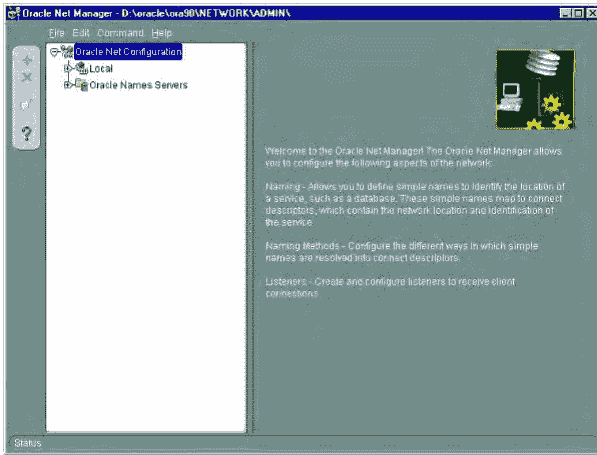

# 第 2 章 · 在服务器上配置 Oracle Net

## 使用 Oracle Net Manager 配置监听器服务

你将希望 Oracle Net Manager 来配置监听器。正如第 1 章“网络管理介绍”所述，Oracle Net Manager 提供了一个易于使用的图形界面，用于配置服务端网络文件。当你首次启动 Oracle Net Manager 时，界面在右侧显示监听器列表。

| 图标 | 设置 |
| :--- | :--- |
| Listener | `listener.ora` |
| Service | `tnsnames.ora` |
| Protocol | `sqlnet.ora` |
| Host | default settings |

Copyright©2002 SYBEX, Inc., Alameda, CA www.syex.com

如果你正在使用 Oracle9i，必须配置一个 Oracle9i 监听器以连接到 Oracle 服务器。Oracle9i 监听器向后兼容，可以监听对早期 Oracle 数据库版本的连接请求。

### 创建监听器

如上一章所述，Oracle Net Manager 在安装时默认为 `LISTENER`。以下是创建监听器的步骤：

- 1. 点击 Listeners 图标。
- 2. 点击编辑（Edit）菜单中的创建（Create）。
- 3. 出现选择名称（Choose Name）对话框。
- 4. 为监听器输入一个名称。
- 5. 点击确定（OK）进入选择监听器（Choose Listener）屏幕。


- 6. 根据你的协议，提示会有所不同。默认显示 TCP/IP 信息。主机（host）是运行监听器的机器名称，端口（port）是 TCP/IP 的监听位置。端口的默认值为 1521。
- 7. 选择文件（File）► 网络配置（Save Network Configuration）来保存你的信息。


通过查看 Oracle Net Manager 始终知道文件存储的位置。Oracle Net Manager 在此过程中实际上创建了三个文件：`listener.ora`、`tnsnames.ora` 和 `sqlnet.ora`。`tnsnames.ora` 不包含任何信息。`sqlnet.ora` 文件此时可能包含一些条目，但目前可以忽略。`listener.ora` 文件将包含本章稍后 `listener.ora` 内容所示的信息。

```
# LISTENER.ORA 网络配置文件：
D:\oracle\ora90\network\admin\listener.ora
# 由 Oracle 配置工具生成。
```

```
LISTENER1 =
(DESCRIPTION_LIST =
(DESCRIPTION =
(ADDRESS_LIST =
(ADDRESS = (PROTOCOL = TCP)(HOST = mjworn)
(PORT = 1521)))
)
)
```

**图 2.5** 监听器位置屏幕

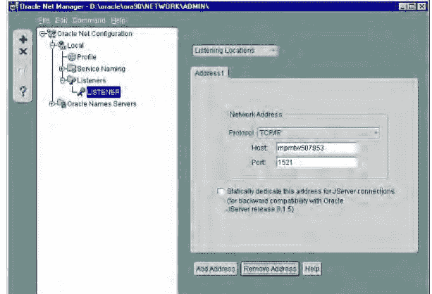

## 为监听器添加服务名称信息

在使用名称、协议和监听位置创建监听器后，你定义了监听器负责连接用户的网络服务。监听器可以监听的网络服务名称数量没有限制。

添加服务名称信息的步骤如下：

- 1. 点击 `Listeners` 图标并突出显示你想要配置的监听器来选择监听器。
- 2. 选择监听器后，从屏幕右上角的下拉列表框选择数据库服务（Database Services）。
- 3. 点击屏幕底部的“添加数据库”（Add Database）按钮。
- 4. 在全局数据库名称（Global Database Name）、Oracle Home 目录（Oracle Home Directory）和 SID 中输入值。如果您使用的是平面命名法，SID 和全局数据库名称是相同的（参见图 2.6）。

### 图 2.6 Oracle Net Manager 中的添加服务界面

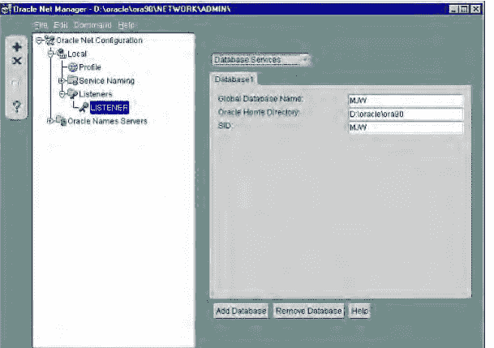

- 5. 选择 文件（File）➤ 保存（Save）以保存您的配置。这里是一个完成的 `listener.ora` 文件示例：

# LISTENER.ORA 网络配置文件:

D:\oracle\ora90\network\admin\listener.ora

# 由 Oracle 配置工具生成。

```
LISTENER_LIST =
  (DESCRIPTION_LIST =
    (DESCRIPTION =
      (ADDRESS = (PROTOCOL = TCP)
        (HOST = mprntw507953)(PORT = 1521))))
```

Copyright ©2002 SYBEX, Inc., Alameda, CA www.syex.com

```
(ADDRESS_LIST = 
(ADDRESS = (PROTOCOL = IPC)(KEY = EXTPROCO))
)
```

```
SID_LIST_LISTENER = 
(SID_LIST = 
(SID_DESC = 
(SID_NAME = PLSExtProc)
(ORACLE_HOME = D:\oracle\ora90)
(PROGRAM = extproc)
)
(SID_DESC = 
(GLOBAL_DBNAME = MJW)
(ORACLE_HOME = D:\oracle\ora90)
(SID_NAME = MJW)
)
)
```

表 2.1 描述了 `listener.ora` 文件中 Listening（监听）部分的每个监听器参数。

### 表 2.1 listener.ora 中 Listening部分的参数

| 参数 | 描述 |
| --- | --- |
| `LISTENER` | 指定监听器定义的起始点。这实际上是正在定义的监听器的名称。默认名称是 `LISTENER`。 |
| `DESCRIPTION` | 描述每个监听位置。 |
| `ADDRESS_LIST` | 监听器监听的位置的地址信息。 |
| `PROTOCOL` | 指定此监听位置的协议。 |
| `HOST` | 包含监听器所在的机器名称。 |

### 表 2.1 listener.ora 中 Listening部分的参数（续）

| 参数 | 描述 |
| --- | --- |
| `PORT` | 包含监听器监听的地址。 |
| `SID_LIST_ENER` | 定义监听器配置为监听的 Oracle 服务列表。 |
| `SID_DESC` | 描述每个 Oracle SID。 |
| `GLOBAL_DBNAME` | 标识全局数据库名称。此项应与 Oracle 服务的 `init.ora` 文件中的 `SERVICE_NAMES` 条目匹配。 |
| `ORACLE_HOME` | 显示服务器上 Oracle 可执行文件的位置。 |
| `SID_NAME` | 包含实例的 Oracle SID 名称。 |

## 添加额外的监听器

要添加监听器，请按照上述步骤操作。监听器必须具有唯一的名称并在不同的端口上监听，请为监听器一个新名称并将其分配一个不同的端口（例如 `1522`）。您还必须为监听器分配服务名称。

## 可选的 listener.ora 参数

您可以选择可选参数来为监听器添加功能。可以通过选择屏幕右上角的“常规参数”（General Parameters）下拉列表添加可选参数。表 2.2 描述了这些参数以及在 Oracle Net Manager 中找到它们的位置。

根据需要，某些参数无法直接从 Oracle Net Manager 添加，必须手动添加。这些可选参数还附带了监听器名称，以便您可以判断它们属于哪个监听器定义。例如，如果为默认监听器设置了 `STARTUP_WAIT_TIME` 参数，则创建的参数为 `START_WAIT_TIME_LISTENER`。

### 表 2.2 可选 listener.ora 参数定义

| Oracle Net Manager 提示 | listener.ora 参数 | 描述 |
| --- | --- | --- |
| 启动等待 (Startup Wait Time) | `STARTUP_WAIT_TIME` | 定义监听器在响应 `lsnrctl` 命令行工具中的 命令之前等待多久。 |
| Net Manager 中不可用 (Unavailable from Net Manager) | `CONNECT_TIMEOUT` | 定义会话启动后监听器等待客户端响应的时间。默认值为 10 秒。 |
| Net Manager 中不可用 (Unavailable from Net Manager) | `SAVE_CONFIG_ON_STOP` | 指定在退出 `listenerctl` 会话期间是否应保存所的修改。 |
| 日志文件 (Log File) | `LOG_FILE` | 如果使用默认设置，则不会出现在 `listener.ora` 中。默认情况下，启用监听器日志，日志在默认位置创建。指定监听器写入日志信息的地方。默认开启，并默认为 `%ORACLE_HOME%\network\listener.log` |
| 跟踪级别 (Trace Level) | `TRACE_LEVEL` | 如果禁用了跟踪，则不存在。默认是 OFF。 如果正在跟踪监听器连接，则设置详细程度。有效值包括 Off, User, Support, Admin。 |
| 跟踪文件 (Trace File) | `TRACE_FILE` | 指定监听器跟踪信息的位置。默认值为 `%ORACLE_HOME%\network\trace\listener.trc`。 |

### 表 2.2 可选 listener.ora 参数定义（续）

| Oracle Net Manager 提示 | listener.ora 参数 | 描述 |
| --- | --- | --- |
| 监听器操作需要密码 (Require a Password for listener operations) | `PASSWORDS` | 指定执行 `lsnrctl` 中管理任务所需的密码。 |

要管理监听器，请按照上述步骤操作。监听器必须具有唯一的名称并在不同的端口上监听，请为监听器一个新名称并将其分配一个不同的端口（例如 `1522`）。您还必须为监听器分配服务名称。

## 可选的 listener.ora 参数

您可以选择可选参数来为监听器添加功能。可以通过选择屏幕右上角的“常规参数”（General Parameters）下拉列表添加可选参数。表 2.2 描述了这些参数以及在 Oracle Net Manager 中找到它们的位置。


根据需要，某些参数无法直接从 Oracle Net Manager 添加，必须手动添加。这些可选参数还附带了监听器名称，以便您可以判断它们属于哪个监听器定义。例如，如果为默认监听器设置了 `STARTUP_WAIT_TIME` 参数，则创建的参数为 `START_WAIT_TIME_LISTENER`。

## 重新加载监听器

如果监听器正在运行，且手动或通过 Oracle Net Manager 对 `listener.ora` 文件进行了修改，则必须重新加载监听器以使用最新信息刷新监听器。`reload` 命令将重新读取 `listener.ora` 文件以获取新定义。如你所见，重新加载监听器不需要停止并启动监听器。虽然停止并重启监听器也可以实现重新加载，但使用 `reload` 命令更好，因为监听器实际上并没有停止，这使得该过程更加高效。以下代码显示了 `reload` 命令的示例：


重新加载监听器对连接到 Oracle 服务的器的客户端不会产生任何影响。

```
C:\lsnrctl reload
```

LSNRCTL for 32-bit Windows: Version 9.0.1.1.1 – Production on 08-OCT-2001 20:34:26

Copyright (c) 1991, 2001, Oracle Corporation. All rights reserved.

Connecting to

(DESCRIPTION=(ADDRESS=(PROTOCOL=TCP)(HOST=mprntw507953)(PORT=1521)))

The command completed successfully

## 显示监听器状态

你可以使用 `status` 命令显示监听器的状态。`status` 命令显示监听器是否处于状态、日志和跟踪文件的位置、监听器运行了多久以及监听器的服务。这是验证监听器是否正常运行且无问题的快速方法。下面的代码显示了 `lsnrctl` 命令的结果。

```
C:\lsnrctl status
LSNRCTL for 32-bit Windows: Version 9.0.1.1.1 – Production on 08-OCT-2001 20:36:14
Copyright (c) 1991, 2001, Oracle Corporation. All rights reserved.
```

# 56 第 2 章 · 在服务器上配置 Oracle Net

Connecting to

(DESCRIPTION=(ADDRESS=(PROTOCOL=TCP))HOST=mprntw507953)

(PORT=1521))

监听器状态 (STATUS of the LISTENER)

| 别名 (Alias) | 监听器 (LISTENER) |
| --- | --- |
| 版本 (Version) | TNSLSNR for 32-bit Windows: Version 9.0.1.1.1 - Production |
| 日期 (Start Date) | 08-OCT-2001 20:32:11 |
| 运行时间 (Uptime) | 0 days 0 hr. 4 min. 4 sec off |
| 跟踪级别 (Trace Level) | OFF |
| 安全 (Security) | OFF |
| SNMP | OFF |

监听器参数文件 (Listener Parameter File)

`D:\oracle\ora90\network\admin\listener.ora`

监听器日志文件 (Listener Log File)

`D:\oracle\ora90\network\log\listener.log`

结束端点摘要 (Ending Endpoints Summary...)

(DESCRIPTION=(ADDRESS=(PROTOCOL=tcp))HOST=mprntw507953.cmg.com)(PORT=1521))

(DESCRIPTION=(ADDRESS=(PROTOCOL=ipc))(PIPENAME=\\pipe\_EXTPROCOIPC))\n(DESCRIPTION=(ADDRESS=(PROTOCOL=tcps))HOST=127.0.0.1)(PORT=2482))(PRESENTATION=GOP)(SESSION=RAW))

(DESCRIPTION=(ADDRESS=(PROTOCOL=tcps))HOST=127.0.0.1)(PORT=2481))(PRESENTATION=GOP)(SESSION=RAW))

(DESCRIPTION=(ADDRESS=(PROTOCOL=tcps))HOST=127.0.0.1)(PORT=9090))(PRESENTATION=http:///admin)(SESSION=RAW))

(DESCRIPTION=(ADDRESS=(PROTOCOL=tcps))HOST=127.0.0.1)(PORT=8080))(PRESENTATION=http:///admin)(SESSION=RAW))

服务摘要 (Services Summary...)

服务 "MWJ" 有 2 个实例 (instance)。实例 "MWJ" 状态为 UNKNOWN，该服务有 1 个处理器 (handler)。

实例 "MWJ" 状态为 READY，该服务有 3 个处理器 (handler)。

服务 "PLSExtProc" 有 1 个实例 (instance)。实例 "PLSExtProc" 状态为 UNKNOWN，该服务有 1 个处理器 (handler)。

命令执行成功 (The command completed successfully)

# 使用 lnrctl 管理监听器 57

## 列出监听器的服务

`services` 命令显示服务的信息，例如服务是否有任何生成的进程 (spawned) 或派生进程 (dispatched)，以及每个服务接受和拒绝的连接数。这是检查监听器是否正在监听特定服务的方法。下面的代码显示了 `services` 命令的示例：

```
C:\lsnrctl services
```

LSNRCTL for 32-bit Windows: Version 9.0.1.1.1 - Production on 08-OCT-2001 20:39:14

Copyright (c) 1991, 2001, Oracle Corporation. All rights reserved.

Connecting to (DESCRIPTION=(ADDRESS=(PROTOCOL=TCP))(HOST=mprntw507953)(PORT=1521))

服务摘要 (Services Summary)...

服务 "MWJ" 有 2 个实例 (instance)。实例 "MWJ" 状态为 UNKNOWN，该服务有 1 个处理器 (handler)。

```
处理器 (s):
"DEDICATED" established:0 refused:0 LOCAL SERVER
```

实例 "MWJ" 状态为 READY，该服务有 3 个处理器 (handler)。

```
处理器 (s):
"DEDICATED" established:0 refused:0 current:0 state:ready
DISPATCHER <ADDRESS=(PROTOCOL=tcp))(HOST=mprntw507953.cmg.com)(PORT=1038))
Copyright ©2002 SYSEX, Inc., Alameda # 58 第 2 章 · 在服务器上配置 Oracle Net

"DEDICATED" established:0 refused:0 current:2 state:ready
DISPATCHER <ADDRESS=(PROTOCOL=tcp))(HOST=mprntw507953.cmg.com)(PORT=1036))
"DEDICATED" established:0 refused:0 LOCAL SERVER
服务 "PLSExtProc" 有 1 个实例 (instance)
实例 "PLSExtProc" 状态为 UNKNOWN，该服务有 1 个处理器 (handler)。
```

处理器 (s):

"DEDICATED" established:0 refused:0 LOCAL SERVER


```
命令执行成功 (The command completed successfully)
```

## `lnrctl` 中的其他命令

在 `lsnctl` 中可以运行其他命令。表 2.3 显示了其他命令的摘要。在 `lsnctl` 中输入命令来执行它。

## 表 2.3 `lsnctl` 命令摘要

| 命令 | 定义 |
|---|---|
| `change_password` | 允许用户更改停止监听器所需的密码。 |
| `exit` | 退出 `lsnctl` 实用。 |
| `quit` | 执行与 `EXIT` 相同的功能。 |
| `reload` | 在不停止监听器的情况下重新读取 `listener.ora` 文件。当文件发生更改时用于刷新监听器。 |
| `save_config` | 当 `lsnctl` 修改 `listener.ora` 文件时，创建一个名为 `listener.bak` 的副本。 |

## 表 2.3 `lsnctl` 命令摘要（续）

| 命令 | 定义 |
| --- | --- |
| `services` | 列出服务的摘要，以及每个协议服务处理器已建立连接数和被拒绝连接数的详细信息。 |
| `start listener` | 启动命名的监听器 |
| `status listener` | 显示命名的监听器状态 |
| `stop listener` | 停止命名的监听器 |
| `trace` | 开启监听器的跟踪 |
| `version` | 显示 Oracle Net 软件和协议适配器的版本 |

## `Lsnctl` 中的命令

`lsnctl` 实用程序还有 `set` 命令。这些命令通过在 `LSRCTL` 提示符处输入 `set <command>` 发出。这些命令用于修改 `listener ora` 文件，例如设置日志和跟踪。大部分这些参数可以使用 Oracle Net Manager 设置。要显示参数的当前设置，使用 `show` 命令，它用于显示使用 `set` 命令设置的当前设置。表 2.4 显示了 `lsnctl` 命令的摘要。

## 表 2.4 `set` 命令摘要

| set 命令 | 描述 |
| --- | --- |
| `current_listener` | 设置监听器进行修改或显示当前监听器的名称 |
| `displaymode` | 设置 `lsnctl` 实用程序的显示为 `RAW`、`COMPACT`、`NORMAL` 或 `VERBOSE` |

### 表 2.4 `lsnctl set` 命令摘要（续）

| set 命令 | 描述 |
|--- |--- |
| `log_status` | 显示监听器的日志是开启还是关闭。 |
| `log_file` | 显示监听器日志文件的名称。 |
| `log_directory` | 显示日志目录位置。 |
| `rawmode` | 开启时对 `STATUS` 和 `SERVICES` 显示更详细的信息。值：`ON` 或 `OFF`。 |
| `startup_waittime` | 设置监听器在 `lsnctl` 命令行实用程序中响应状态命令的等待时间。 |
| `spawn` | 启动监听器正在监听并运行在服务器上的外部服务。 |
| `save_config_on_stop` | 退出 `lsnctl` 时保存 `listener.ora` 文件的更改。 |
| `trc_level` | 设置跟踪级别为 `OFF`、`USER`、`ADMIN`、`SUPPORT`。 |
| `trc_file` | 设置监听器跟踪文件的名称。 |
| `trc_directory` | 设置监听器跟踪目录名称。 |

## 停止监听器

为了停止监听器，必须发布 `lsnctl stop` 命令。该命令将停止默认监听器。要停止非默认监听器，请包含监听器的名称。例如，停止 `LISTENER1`，输入 `lsnrctl stop listener1`。如果你在 `lsnctl>` 界面中，将停止由 `current_listener` 设置定义的当前监听器。要查看当前监听器是什么，使用 `show` 命令。默认值为 `LISTENER`。

停止监听器不会影响连接到数据库的客户端。这意味着在监听器重启之前，没有新的连接可以使用此监听器。下面的代码显示了 `stop` 命令的样式：

```
C:\lsnrctl stop
```

# 服务的动态注册 61

32位 Windows 版 `LSNRCTL`：版本 9.0.1.1.1 - 2001年10月08日 20:43:52 生产版
版权所有 (c) 1991, 2001, Oracle Corporation。保留所有权利。

正在连接到
`(DESCRIPTION=(ADDRESS=(PROTOCOL=TCP)(HOST=mprntw507953)(PORT=1521))`
命令执行成功

## 服务的动态注册

Oracle9i 数据库能够自动向现有的监听器注册其存在。实例将与在本地机器上定义的监听器进行注册。动态服务注册允许您利用其他功能，例如负载均衡和自动故障转移。`PMON` 进程负责向监听器进行此类注册。

当使用动态服务注册时，您将不在 `listener.ora` 文件中看到列出的服务。若要查看列出的服务，您应该运行 `lsnrctl services` 命令。请注意，如果监听器在 Oracle 实例之后启动，实例在向监听器准确注册信息之前可能存在时间滞后。

为了让实例能够自动向监听器注册，监听器必须配置为默认监听器，或者您必须指定 `init.ora` 参数 `LOCAL_LISTENER`。`LOCAL_LISTENER` 参数定义了 Oracle 服务器注册的监听器的位置。默认监听器的定义所示：

```
Listener Name = LISTENER

Port = 1521

Protocol = TCP/IP
```

这里使用 `LOCAL_LISTENER` 参数将 Oracle 服务器注册到非默认监听器的示例：

```
local_listener="(ADDRESS_LIST = (Address =

(Protocol = TCP)(Host=weishan))
```

在上面的示例中，Oracle 服务器将使用 TCP/IP 注册到端口 1522 上的监听器。这是一个非默认端口位置，因此您必须使用 `LOCAL_LISTENER` 参数才能进行注册。

版权所有©2002 SYSEX, Inc., Alameda, CA

62 第 2 章 · 在服务器上配置 Oracle Net

需要配置两个 `init_ora` 参数以允许实例向监听器注册。有两个参数用于允许自动注册：`INSTANCE_NAME` 和 `SERVICE_NAMES`。
`INSTANCE_NAME` 参数设置为您想要向监听器注册的 Oracle 实例名称。`SERVICE_NAMES` 参数是实例名和域名的组合。域名设置为初始化参数 `DB_DOMAIN` 的值。例如，如果您的 `DB_DOMAIN` 设置为 `GR.COM` 且您的 Oracle 实例为 `DBA`，则参数设置如下：

```
Instance_name = DBA

Service_names = DBA.GR.COM
```

如果您没有使用域名，则 `INSTANCE_NAME` 和 `SERVICE_NAMES` 参数应设置为相同的值。

## 为 Oracle9i JVM 配置监听器

您可以配置 Oracle Net 服务以响应通过 TCP/IP 或带有安全套接层 (SSL) 的 TCP/IP 来自 Oracle9i Java 虚拟机 (JVM) 的请求。Java 虚拟机运行在 Oracle 服务器内部。客户端进程可以通过 HTTP 或 Internet Inter-ORB Protocol (IIOP) 直接与 JVM 内部运行进程交互。

如果您对这些选项使用 Oracle 8.1 之前的实例，必须按照下面的说明手动配置监听器地址。如果您正在使用 Oracle9i 数据库和监听器，动态注册将处理这些服务向监听器的注册工作。

添加服务名称信息的步骤如下：

- 1. 启动 Oracle Net Manager。
- 2. 选择本地 (Local) 和监听器 (Listener)。
- 3. 选择一个监听器并在右侧面板的下拉列表中选择监听位置 (Listening Locations)。
- 4. 选择添加地址 (Add Address)。
- 5. 选择 TCP/IP 或带 SSL 的 TCP/IP。
- 6. 在数据库主机字段中输入主机名。版权所有©2002 SYSEX, Inc., Alameda, CA www.syex.com

## 排除服务器端连接问题 63

7. 输入 TCP/IP 协议端口 2481，或带 SSL 的 TCP/IP 协议端口 2482。

8. 选择静态定义 (Static Definition)。
9. 选择文件并配置。

这是 `listener.ora` 中的条目示例：

```
## listener.ora

(DESCRIPTION

  (ADDRESS =

    (PROTOCOL = TCP)(HOST = mprntw507953)(PORT = 1521))

  (ADDRESS =
```


```
    (PROTOCOL = TCP)(HOST = mprntw507953)(PORT = 1522))

  (SID_LIST =

    (SID_DESC =

      (SID = DBA)

      (DB_NAME = DBA.GR.COM))

  )
```

## 排除服务器端连接问题

即使看起来配置一切正确，仍可能发生错误。可以进行若干服务器端检查。

在 TCP/IP 网络上，可以使用 `ping` 工具测试到服务器的连通性。这里是测试名为 `matt` 机器示例：

```
C:\users\default>ping matt
```

正在泛洪 `matt` [10.69.30.113] 具有 32 字节的数据：

```
来自 10.69.30.113 的回复：32 字节，时间=10ms TTL=248

来自 10.69.30.113 的回复：32 字节，时间=10ms TTL=248

来自 10.69.30.113 的回复：32 字节，时间<10ms TTL=248

来自 10.69.30.113 的回复：32 字节，时间=10ms TTL=248
```

回复表明该机器在网络上可见。

## 检查数据库

确保数据库正在运行。连接到 Oracle 服务器并使用 SQL*Plus 等工具登录数据库。您应该首先尝试本地连接，本地连接不使用监听器。
使用本地连接到 Oracle 服务器，将您的环境变量 `ORACLE_SID` 设置为想要连接的 Oracle 实例名称。然后，尝试连接 SQL*Plus。以下是 Windows NT/2000 上的连接序列，由于数据库未运行而失败。例如，如果您尝试连接的数据库名为 `MJW`，则可以在 Windows NT/2000 环境中使用以下代码：

```
D:>set ORACLE_SID=MJW

D:\>sqlplus system/manager
```

SQL*Plus: Release 9.0.1.0.0 - 生产版于2001年10月15日11:32:05

(c) 版权所有2000 Oracle Corporation。保留所有权利。

错误:
ORA-01034: ORACLE 不可用

# ORA-27101: 共享内存区域不存在

输入用户名：
ORA-01034 错误 Oracle 实例未运行。你需要启动 Oracle 实例。ORA-27101 错误意味着目前没有可用的实例可以连接到指定的 `ORACLE_SID`。

## 验证数据库是否对所有用户开放

数据库可以在受限制模式（restricted mode）下打开。这意味着只有具有限制模式的用户才能使用系统。这不是网络问题，但它会导致客户端无法连接到 Oracle 服务器。

```
D:\>sqlplus scott/tiger@MWJ

SQL*Plus: Release 9.0.1.0 - Production on Mon Oct 15

11:37:25 2001
```

> (c) Copyright 2000 Oracle Corporation. 保留所有权利。

错误:
ORA-01035: ORACLE 仅对具有 RESTRICTED SESSION 权限的用户可用

输入用户名：

## 检查用户权限

确保尝试建立连接的用户已获得数据库的 `CREATE SESSION` 权限。用户连接到 Oracle 服务器需要此权限。如果客户端没有此权限，你必须授予该用户此权限。按照此示例操作：

```
D:\oracle\ora90\BIN\sqlplus matt/matt

SQL*Plus: Release 9.0.1.0 - Production on Mon Oct 15

14:04:51 2001
```

## 故障排除 服务器端连接问题 67

(c) Copyright 2001 Oracle Corporation. 保留所有权利。
错误:\ORA-01045: 用户 MATT 缺少 CREATE SESSION 权限；登录被拒绝

以下是 DBA 如何向用户授予 `CREATE SESSION` 权限的示例：

```
SQL> grant create session to matt;

Grant succeeded

SQL>
```

## 服务器端检查 检查检查

在验证了数据库所在的服务器已启动并可用，且确认用户具有适当权限后，你应该检查服务器上是否存在任何底层的网络问题。

## 检查监听器

确保监听器在 Oracle 服务器上运行。请确保你检查了 Oracle 服务器上所有监听器的服务；你可以使用 `lsnnrctl status` 命令来执行此操作。以下命令显示了名为 LISTENER 的默认监听器的状态：

```
D:\>lsnrctl status
```

LSNRCTL for 32-bit Windows: Version 9.0.1.1.1 - Production on 03-JAN-2002 10:56:04

Copyright (c) 1991, 2001, Oracle Corporation. 保留所有权利。

正在连接到
(DESCRIPTION=(ADDRESS=(PROTOCOL=TCP)(HOST=prntw507953))
(PORT=1521))

## LISTENER 的状态

| 别名 | LISTENER |
| --- | --- |
| 版本 | TNLSLNR for 32-bit Windows: Version 9.0.1.1.1 - Production 03-JAN-2002 08:38:30 |
| 日期 | |
|  | 0 days 2 hr. 17 min. 34 sec |
| 跟踪级别 | off |
| 安全 | OFF |
| SNMP | OFF |

监听器参数文件
D:\oracle\ora90\network\admin\listener.ora
监听器日志文件
D:\oracle\ora90\network\log\listener.log
监听端点摘要...

```
(DESCRIPTION=(ADDRESS=(PROTOCOL=tcp))(HOST=10.72.127.148 (PORT=2481)))(PRESENTATION=GIOP)(SESSION=RAW))

(DESCRIPTION=(ADDRESS=(PROTOCOL=tcps))(HOST=10.72.127.148 (PORT=2482)))(PRESENTATION=GIOP)(SESSION=RAW))
```

服务摘要...
Service "MJW" 有 1 个实例。
实例 "MJW"，状态为 READY，有 3 个处理程序...
Service "PLExtProc" 有 1 个实例。
实例 "PLExtProc"，状态为 UNKNOWN，有 1 个处理程序...
命令执行成功

还要检查监听监听的服务。你需要看到客户端尝试连接的服务。如果该服务不在列表中，可能是客户端输入的服务名错误，或者监听器未配置该服务。

## 检查 GLOBAL DBNAME

如果客户端使用主机命名方法，请确保 `GLOBAL_DBNAME` 参数已设置为主机名。你可以在 `listener.ora` 的服务定义中找到此参数。通过检查 `listener.ora` 配置来验证设置。

## 故障排除 服务器端连接

## 检查监听器协议

检查监听器配置的协议。这可以通过 `lsnnrctl services` 命令显示。确保服务协议与客户端请求连接时使用的协议匹配。如果客户端请求的协议监听器未监听，用户将收到 ORA-12541 “无监听器”错误。

## 检查服务器协议

确保服务器上的底层网络协议已激活。对于运行 TCP/IP 的系统，你可以尝试使用 `ping` 命令。这是该服务器。

## 服务器日志

默认情况下，监听器被配置为启用生成日志文件。日志文件记录了监听器的启动和关闭信息、成功和失败的连接尝试，以及某些类型的网络错误。默认情况下，在 Unix 上的监听器日志位置是 `ORACLE_HOME/network/log`，在 Windows NT/2000 上为 `%ORACLE_HOME\network\log`。文件的默认名称为 `listener.log`。

`listener.log` 文件中信息的格式是固定长度的定隔符格式，每个字段之间用星号（*）分隔。如果你想对日志中的信息进行进一步分析，可以使用 SQL* 等工具将数据加载到 Oracle 表中。请注意下方的示例列表，该文件包含连接尝试信息、执行请求的程序名称以及尝试连接的客户端名称。如果请求成功完成，最后一个字段将包含 0。

```
TNSLR for 32-bit Windows: Version 9.0.1.1.1 - Production on 02-OCT-2001 09:52:02
```


> 版权所有 (c) 1991, 2001, Oracle Corporation. 保留所有权利。

系统参数文件为
`D:\oracle\ora90\network\admin\listener.ora`
日志消息写入到
`D:\oracle\ora90\network\log\listener.log`
跟踪信息写入到
`D:\oracle\ora90\network\trace\listener.trc`
跟踪级别为 0

Started with pid=`260`

Listening on:

`(DESCRIPTION=(ADDRESS=(PROTOCOL=tcp)(HOST)=mprntw507953.cmg.com)(PORT=1521))`

Listening on:

`(DESCRIPTION=(ADDRESS=(PROTOCOL=ipc)(PIPENAME=\pipe\EXTPROCOpc)))`

```
TIMESTAMP * CONNECT DATA [* PROTOCOL INFO] * EVENT [* SID]

* RETURN CODE
```

```
02-OCT-2001 09:52:07 * (CONNECT_DATA=(CID=(PROGRAM)=)(HOST)=(USER=CBIWEIS))(COMMAND=status)ARGUMENTS=64)(SERVICE=LISTENER) (VERSION=150999297) *status 0

02-OCT-2001 10:15:54 * service_register * MJW * 0

02-OCT-2001 10:16:02 * service_update * MJW * 0

02-OCT-2001 10:16:03 * service_update * MJW * 0
```

## 服务器跟踪

如前所述，跟踪收集有关跨网络连接流量的信息。数据以数据包的形式往返传输。数据包包含发送者信息、接收者信息和数据。即使是单个请求也可能产生大量的包。

在跟踪文件中，文件的每行都以在 Oracle Net 层中执行的程序开头，随后跟着一组十六进制数。十六进制数是实际传输的数据。如果你没有对数据进行加密，有时会在十六进制数之后看到实际数据。

每个 Oracle Net 程序都负责不同的操作。每个包根据所执行的操作具有不同的代码类型。每个包类型都以 `NSP` 开头。以下是常见包类型的摘要。

| 包关键字 | 包类型 |
| --- | --- |
| `NSPTAC` | 接受 (Accept) |
| `NSPTRF` | 拒绝 (Refuse) |
| `NSPTRS` | 重发 (Resend) |
| `NSPDA` | 数据 (Data) |
| `NSPCNL` | 控制 (Control) |
| `NSPTMK` | 标记 (Marker) |


如果你正在进行服务器到服务器的通信，并且服务器上有一个 `sqlnet.ora` 文件，你可以在 Oracle Net Manager 跟踪屏幕的 Server Information 部分输入信息。这为服务器到服务器的通信提供了跟踪信息。

版权所有 ©2002 SYBEX, Inc., Alameda, CA www.syex.com

还有几个数字代码用于诊断和排排除 Oracle Net 连接问题。这些代码可以在跟踪文件中找到。以下是跟踪文件中包含代码值的一行示例：
`plen=12, type=4`

以下是你可能在跟踪文件中遇到的数字代码的摘要。

| 代码 | 包类型 |
| --- | --- |
| 1 | 连接包 (Connect packet) |
| 2 | 接受包 (Accept packet) |
| 3 | 确认包 (Acknowledge packet) |
| 4 | 拒绝包 (Refuse packet) |
| 5 | 重定向包 (Redirect packet) |
| 6 | 数据包 (Data packet) |
| 7 | 空包，空数据 (Null packet, empty data) |
| 9 | 中止包 (Abort packet) |
| 11 | 重发包 (Resend packet) |
| 12 | 标记包 (Marker packet) |
| 13 | 注意/警报包 (Attention packet) |
| 14 | 控制包 (Control packet) |

# 启用跟踪

你可以从之前显示的 Oracle Net Manager 屏幕启用服务器跟踪。只需选择 Tracer 按钮即可。默认文件名和位置在 Unix 上为 `ORACLE_HOME/network/trace`，在 Windows NT/2000 上为 `%ORACLE_HOME\network\trace\listener.tr`。你可以将跟踪级别设置为 `OFF`、`USER`、`ADMIN` 或 `SUPPORT`。`USER` 级别将检测用户错误。`ADMIN` 级别包含所有特定错误。`SUPPORT` 是最高级别，可用于产生对人员可能有益的信息。此级别还可以产生非常大的跟踪文件。下面的列表显示了监听器跟踪的示例：

```
nsglhfre: entry

sglhrem: entry

sglhrem: entry

sglhfre: exit

nsglma: Reporting the following error stack:

TNS-0150: The address of the specified listener name is incorrect

TNS-0153: Failed to process request string: DESCRIPTION=(ADDRESS=(PROTOCOL=tcp)(HOST)=mprntw507953(PORT=1521)))

refuse: entry

nsdo: entry

sdo: cid=0, opcode=67, *what=10, uflgs=0x0

sdo: rank=64, nsctxrnk=0

nsdo: nsctx: state=2, flg=0x204, mvd=0

sdo: gtn=152, gct=152, ptn=10

nscon: entry

nscon: sending NSPTR packet

nspsend: entry

spsend: plen=12, type=4

tnpwer: entry

tnpwer: exit
```


## 考试要点

能够定义 Oracle 监听器（listener）的主要职责。为了充分理解 Oracle 监听器的功能，你应该理解监听器如何响应客户端连接请求。此外，你应该知道直连连接（bequeath connections）和重定向连接（redirect connections）之间的区别，并知道监听器在什么情况下会使用每种连接。同时，你应该能够概述这些连接类型中涉及的步骤。

能够定义 `listener.ora` 文件以及创建该文件的方法。为了理解此文件的目的，你应该知道它的默认内容以及如何使用 Oracle Net Manager 工具对其进行修改。此外，你应该能够定义文件的不同部分，并了解其中包含的可选参数定义。你还应该理解当配置了一个或多个监听器时 `listener.ora` 文件的结构。

理解如何使用 `lsnrctl` 命令行工具。为了启动和关闭监听器，你应该知道如何使用 `lsnrctl` 命令行工具。你还需要能够解释 `lsnrctl` 工具的命令行选项，例如 `services`、`status` 和 `reload`。在使用该工具时，你还应该知道可供使用的不同选项，并能够定义各种命令。

理解静态服务注册（static service registration）和动态服务注册（dynamic service registration）的概念。能够定义静态服务注册与动态服务注册之间的区别，并知道使用动态服务注册的优势。此外，还要注意必须使用静态服务注册的情况。最后，熟悉为了启用动态服务注册需要设置的 `init.ora` 参数。

理解 Oracle 和 Java 连接的基础。你应该了解配置 Oracle 的基础，以便通过 IIOP 和 HTTP 连接到 Oracle9i JVM。

能够诊断并修复网络连接问题。你应该知道可能发生的服务器端错误类型以及如何诊断和修复这些问题。你应该能够定义记录（logging）和跟踪（tracing）之间的区别，并知道如何使用跟踪文件中可能发现的数据包信息。

## 关键术语

在参加考试之前，请确保你熟悉以下术语：

- 直连连接 (bequeath connection)
- `lsnrctl`
- 专用服务器 (dedicated server)
- `lsnrctl stop`
- 动态服务注册 (dynamic service registration)
- 端口 (port)
- 主机 (host)
- 重定向连接 (redirect connection)
- 监听器 (listener)
- 拒绝数据包 (refuse packet)
- `listener.ora`
- 静态服务注册 (static service registration)
- 记录 (logging)
- 跟踪 (tracing)

## 复习题

+ 1. 为了启动 Oracle 监听器，服务器上必须存在哪个文件？
A. `listener.ora`
B. `lsnrctl.ora`
C. `sqlnet.ora`
D. `tnsnames.ora`

+ 2. 监听器将用户连接到 Oracle9i 实例可能的方法有哪些？（选择所有适用）。
A. 预产生连接 (Prespawn connection)
B. 重定向连接 (Redirect connection)
C. 直连连接 (Bequeath connection)
D. 多路通过连接 (Multipass connection)

+ 3. Oracle 监听器的默认名称是什么？
A. `lsnrctl`
B. Listen
C. `sqlnet`
D. `tnslistener`
E. 以上都不是

+ 4. 监听器处理的数据库最大数量是多少？
A. 1 个数据库
B. 2 个数据库
C. 10 个数据库
D. 25 个数据库
E. 以上都不是

+ 5. 服务器上应该存在的 `listener.ora` 文件最大数量是多少？
+ A. 一个
+ B. 两个
+ C. 四个
+ D. 八个
+ E. 以上都不是

+ 6. 下列描述描述哪个特征：“记录网络上发生的所有事件，即使没有发生错误也是如此。”
+ A. Oracle Net Manager
B. 网络跟踪 (Network tracing)
C. 网络记录 (Network logging)
D. 以上都不是

+ 7. 当使用服务的自动注册时，你不会在以下哪个文件中看到服务列表？
+ A. `sqlnet.ora`
B. `tnsnames.ora`
C. `listener.ora`
D. 以上都不是

+ 8. 下列哪些不是 `listener.ora` 的设置？（选择所有适用。）
+ A. Listener name = LISTENER
B. Port = 1521
C. Protocol = IPX
D. Protocol = TCP/IP
E. Listener name = `lsnrctl`

+ 9. 下列哪项是用于管理监听器的命令行界面？
+ A. LISTENER
B. `lismgr`
C. TCPCTL
D. `lsnrctl`
E. 以上都不是

+ 10. 你应该选择哪个 Oracle Net Manager 图标来管理监听器？
+ A. Services
B. Listener Names
C. Profile
D. Listeners
E. 以上都不是

+ 11. 哪个参数设置了服务器进程等待获取有效客户端请求的秒数？
+ A. `connect_waittime_listener_name`
B. `connect_wait_listener_name`
C. `timeout_listener_name`
D. `connect_timeout_listener_name`

+ 12. 下列哪项是产生产生信息信息的跟踪级别？
+ A. ADMIN
B. USER
C. ALL
D. 以上都不是

+ 13. 可以配置的监听器最大数量是多少？
+ A. 一个
+ B. 两个
+ C. 四个
+ D. 八个
+ E. 以上都不是

+ 14. 有一个名为 LISTENER 的监听器。启动它的正确方法是哪一个？
+ A. `lsnrctl startup`
B. `lsnrctl start`
C. `listener start`
D. `listener startup`

+ 15. 有一个名为 listener 的监听器。启动它的正确命令是哪一个？
+ A. `lsnrctl startup`
B. `lsnrctl start`
C. `listener start`
D. `listener startup`
E. `lsnrctl start`

+ 16. 使用 Net Manager 对 `listener.ora` 文件进行了修改。这些修改何时生效？
+ A. 立即生效
B. 退出 Net Manager 后
C. 保存 `listener.ora` 时
D. `refresh`
+ E. 以上都不是

+ 17. 有一个名为 listener 的监听器，你想使用 `lsnrctl` 进行编辑。你会使用哪个命令来指定该监听器？
+ A. `set_listener`
B. `accept_listener`
C. `reload`
D. `refresh`

+ 18. 使用 `lsnrctl` 进行了修改。为了使更改永久生效，必须将什么设置为 ON？
+ A. `configuration`
B. `listener.ora`
C. `stop`
D. `save`

+ 19. 管理员想在使用 `lsnrctl` 修改文件后对监听器文件进行备份。执行哪个命令来实现此备份？
+ A. `create_backup`
B. `configuration_stop`
C. `save`
D. `backup`

+ 20. 当为 TCP/IP Oracle9i 配置监听器时，使用的端口号是多少？
+ A. 1521
B. 2482
C. 2481
D. 1526

## 复习题答案

+ A. 监听器是管理连接请求的进程。`listener.ora` 文件用于配置监听器。`sqlnet.ora` 是可选的客户端和服务端文件。`tnsnames.ora` 文件用于本地解析。不存在 `lsnrctl.ora` 这种文件。

+ B. 监听器可以通过两种方式之一处理连接请求：它可以产生进程并将控制传递（bequeath）给该进程，或者在使用共享服务器时将进程重定向到专用进程或分发器。

+ E. 使用 Oracle Net Manager 创建监听器时，助手建议默认名称为 LISTENER。通过命令行工具启动和停止监听器时，如果没有提供监听器名称，工具将假设监听器的名称为 LISTENER。

+ E. 虽然监听器可以监听的服务数量没有物理限制，但只有一个 `listener.ora` 文件。如果配置了多个监听器，仍然只有一个 `listener.ora` 文件。

+ B. 网络跟踪是在没有错误发生时记录网络上所有事件。跟踪应谨慎使用，并仅在出现网络问题时作为最后手段。记录将记录重大事件，如监听器启动和连接请求。

+ C. 当服务自动注册时……

+ A. 默认监听器的名称为 LISTENER，并在端口 1521 上监听 TCP/IP 连接。

# 86 第 2 章 · 在服务器上配置 Oracle Net

- 9. LISTENER 是 Oracle 监听器的默认名称。并没有名为 `lsmgr` 的实用程序，那实际上是一个用于启动和停止 `SQL*NET` 版本 1 监听器的旧实用程序。使用 `lsnrctl` 命令来管理监听器。

- 10. 熟悉 Oracle Net Manager 界面。Listeners（监听器）是正确的选择。Profile（配置文件）用于 `sqlnet.ora` 的管理。其他选项不是有效的菜单选项。

- 11. 当用户发起连接请求时，监听器会将控制权传递给某些服务器进程或调度器（dispatcher）。一旦用户连接到此进程，所有与数据库的协商和交互将通过该进程进行。如果用户提供了无效的用户 ID 或密码，该进程将等待一段时间以获得有效响应。如果用户在规定时间内没有通过有效响应联系服务器进程，则服务器进程将终止，用户必须重新联系监听器，以便监听器能够再次生成进程或将客户端重定向到现有的调度器。进程等待这段时间由 `connect_timeout_listener_name` 参数指定，单位为秒。

- 12. 可用的最高跟踪级别是 SUPPORT 级。这是用于跟踪数据包流量信息的级别。

- 13. E. 每个服务器可以配置的监听器数量没有上限。

- 14. B. 默认监听器名称为 LISTENER。由于这是默认值，只需输入 `lsnrctl start` 即可。在这种情况下，假设 LISTENER 是要启动的监听器。

- 15. E. Oracle 期望监听器的默认名为 LISTENER。启动监听器的设施程序是 `lsnrctl`。使用 `lsnrctl start` 将启动默认监听器。要启动另一个名称的监听器，请输入 `lsnrctl start listener_name`。

- 16. E. 无论使用 Oracle Net Manager 手动修改还是使用 `lsnrctl` 对监听器文件进行任何修改，必须重新加载监听器修改才能生效。要执行此重载，进入命令行并输入 `lsnrctl reload`。你也可以停止并启动监听器，效果是相同的。由于 `lsnrctl reload` 并不是选项之一，上述所有内容都不是正确答案。

- 17. A. 如果在使用 `lsnrctl` 时想要管理默认监听器以外的任何监听器，必须指定该监听器。`set` 命令用于更改 `lsnrctl` 会话设置。因此，`set current_listener listener1` 是正确的命令。

- 18. C. 在 `lsnrctl` 设施中对 `listener.ora` 文件进行的更改可以是永久的。要使更改永久，将 `save_config_on_stop` 设置为 ON。

- 19. C. DBA 在使用 `lsnrctl` 对现有的 `listener.ora` 文件进行修改后，可以进行备份。备份将命名为 `listener.bak`。这是通过 `save_config` 选项实现的。

- 20. B. 当你想为通过 TCP/IP 使用 SSL 的 HTTP 和 IIOP 连接配置 Oracle Net 时，使用端口 2482。当使用 TCP/IP 用于 HTTP 和 IIOP 连接时，使用端口 2481。

## 为客户端配置 Oracle Net

ORACLE9i: DBA 基础 II 本章涵盖的考试目标：

- 描述主机命名（Host Naming）与本地服务名解析（local service name resolution）之间的区别。
- 使用 Oracle Net 配置助手（Oracle Net Configuration Assistant）配置：主机命名、本地命名方法、网络服务名。
- 执行简单的连接故障排除。

> 考试目标可能会随时更改，恕不另行通知，并由 Oracle 单方面裁权决定。请访问 Oracle 认证网站（http://www.oracle.com/education/certification/）查看最新的考试目标列表。


一旦正确配置了 Oracle 服务器，你就可以专注于配置客户端，以允许其连接到 Oracle 服务器。本章详细说明了 Oracle 客户端配置的基本网络元素。它讨论了在创建网络服务名时可以选择的不同类型的服务名模型。此外，它还详细说明了可用的服务解析配置，以及如何使用 Oracle Net Manager 配置主机命名和本地命名。它还讨论了可能发生的客户端故障类型以及如何排查客户端连接问题。

理解如何配置 Oracle 客户端以连接 Oracle 服务器至关重要。如果没有如何配置客户端的正确知识，你的连接选择将受到限制。DBA 必须理解组织的网络需求和所需的连接类型（例如，客户端/服务器连接、三层架构连接），以便对客户端配置做出适当选择。本章将阐明你可用的客户端连接选项以及如何排查客户端连接问题。

# 客户端名称解析选项

当客户端需要连接到 Oracle 服务器时，客户端必须提供三部分信息：用户 ID、密码和网络服务名。服务名以连接描述符（connect descriptor）的形式提供必要信息，用于在网络中定位 Oracle 服务器的名称。

此连接描述符描述了 Oracle 服务器的路径及其服务名，服务名是 Oracle 数据库的别名。根据你选择的名称解析方法，这些信息存储在不同的位置。

## 客户端名称解析

> 注意：服务名可能会随时更改，恕不另行通知，并由 Oracle 单方面裁权决定。请访问 Oracle 认证网站（http://www.oracle.com/education/certification/）查看最新的考试目标列表。

服务名以连接描述符的形式提供必要信息，用于在网络中定位 Oracle 服务器的名称。此连接描述符描述了 Oracle 服务器的路径及其服务名，服务名是 Oracle 数据库的别名。根据你选择的名称解析方法，这些信息存储在不同的位置。

## 主机命名方法

在服务器较少的小网络中，你可以利用主机命名。主机命名可以让你避免在客户端上进行配置，尽管它具有局限性。使用主机命名的四个前提是：

# 配置主机命名方法

默认情况下，Oracle 在尝试使用本地命名连接后才会尝试使用主机命名方法。如果你想覆盖解析名称的默认搜索路径，请设置客户端 `sqlnet.ora` 文件中的 `NAMES.DIRECTORY_PATH` 参数，使其仅搜索主机命名。你可以使用 Oracle Net Manager 配置此参数（见图 3.1）。

使用 Oracle Net Manager 配置参数，从 Local 选项卡选择 Profile，并在屏幕顶部下拉列表中选择 Naming。这会列出可用的命名方法列表。Selected Methods（已选方法）列表显示正在使用的命名方法以及使用这些方法解析服务名的顺序。Available Methods（可用方法）列表

更改可用方法列表，使用鼠标高亮名称并点击箭头 (>) 将其包含在已选列表中。你可以通过在已选列表中选择它并点击另一个键 (<) 来移除名称。你还可以使用 Demote（下移）和 Promote（上）按钮来更改列表顺序。从 Selected Methods 列表中选择一个名称并点击 Demote 按钮将其向下移动，或点击 Promote 按钮将其向上移动。确保 HOSTNAME（主机）出现在 Selected Methods 列表中。

# 图 3.1 Oracle Net Manager - Oracle 配置屏幕

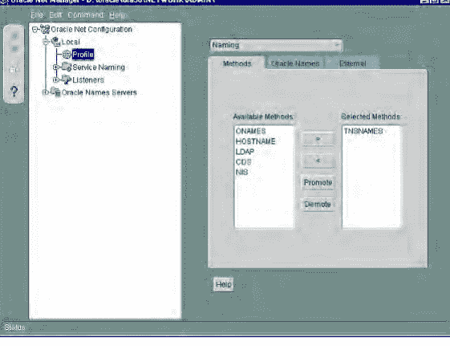

# 客户端名称解析选项 93

一旦保存配置，Oracle 将根据你所做的更改更新 `sqlnet.ora` 文件。以下是 `sqlnet.ora` 文件的示例。


# SQLNET.ORA 网络配置文件

`D:\oracle\ora90\network\admin\sqlnet.ora`

# 由 Oracle 配置工具生成。

```
NAMES.DEFAULT_DOMAIN = cmg.com
NAMES.DIRECTORY_PATH=( HOSTNAME)
```

主机命名方法不需要任何客户端配置文件。只要客户端安装了 TCP/IP 适配器和 Oracle 客户端 Net Services，客户端就可以使用主机命名方法。你可以使用 TCP/IP 工具 `ping` 从客户端检查 TCP/IP 连通性。`ping` 通过发送一个较小的请求数据包连接服务器。服务器将返回相应的确认包。以下代码显示了 `ping` 的工作原理以及从客户端到服务器再返回的往返时间：

```
C:\ping mil020ora
```

```
Pinging mil020ra [10.1.5.210] with 32 bytes of data:
```

```
Reply from 10.1.5.210: bytes=32 time<10ms TTL=128

Reply from 10.1.5.210: bytes=32 time<10ms TTL=128

Reply from 10.1.5.210: bytes=32 time<10ms TTL=128

Reply from 10.1.5.210: bytes=32 time<10ms TTL=128
```

服务器必须配置一个运行 TCP/IP 的监听器（`listener`）。监听器必须在默认端口 `1521` 上监听。如果实例尚未向监听器进行动态注册，则你必须使用 `GLOBAL_DBNAME` 参数配置监听器（第 2 章“在服务器上配置 Oracle Net”中解释了如何配置监听器）。下面的代码显示了使用此参数配置时 `listener.ora` 文件的样子。在此示例中，主机名为为 `GR99c0073`。这是运行监听器的物理机器的名称。

```
# C:\v9i\NETWORK\ADMIN\LISTENER.ORA 配置

# File:C:\v9i\NETWORK\ADMIN\listener.ora

# 由 Oracle Net Manager 生成
```

```
LISTENER =
(DESCRIPTION =
(ADDRESS = (PROTOCOL = TCP)(HOST = gr99c0073)
(PORT = 1521))
(PROTOCOL_STACK =
 (PRESENTATION = TTC)
 (SESSION = NS)
)
)
```

```
SID_LIST_LISTENER =
(SID_LIST =
 (SID_DESC =
  (GLOBAL_DBNAME = GR99c0073) - machine listener is on
  (ORACLE_HOME = c:\v9i)
  (SID_NAME = DBA)
)
)
```

图 3.2 显示了 Oracle Net Manager 数据库服务屏幕。监听器服务的每个数据库都作为单独条目列出。提供全局数据库名称、Oracle Home 目录和 Oracle SID 信息。这就完成了数据库端口-监听器的配置工作。

## 图 3.2 用于主机命名的 Oracle Net Manager listener.ora 设置

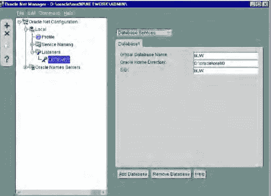

# 使用主机命名时的连接过程

当使用主机命名时，客户端必须提供用户 ID 和密码，以及他们想要连接的机器名称。例如，如果密码为 `casey` 的用户 `Matt` 想要连接到位于机器 `GR99c073` 数据库，他将输入 `Sqlplus matt/casey@gr99c073`。主机名将通过 `HOSTS` 文件或外部命名环境（如 DNS）进行解析。外部命名（如 DNS）优于 `HOSTS` 文件，因为它们便于主机名的集中化管理。以下代码包含一个 Windows NT/2000 环境下的 `HOSTS` 文件示例。Unix 系统上 `HOSTS` 文件的默认位置在 `/etc` 目录。在 Windows NT 2000 上，默认位置是 `c:\winnt\system32\drivers\etc`。一旦主机名解析，即可建立与该机器的连接。

```
# Copyright (c) 1993-1995 Microsoft Corp.
# 这是 Windows TCP/IP 使用的 HOSTS 文件。
# 此文件包含 IP 地址到主机的映射。每个条目应单独占一行。
# IP 地址应放在第一列，随后是相应的主机。
# IP 地址和主机名之间应至少有一个空格分隔。
# 此外，可以在机器名后面通过 '#' 符号插入注释（如这些）。
# 例如：
# 102.54.94.97 rhino.acme.com # 源服务器
# 38.25.63.10 rhino.acme.com # 主
```


# 第 3 章 为客户端配置 Oracle Net

## 在同一机器上配置多个服务

## 使用 Oracle Net 配置本地命名方法

### 本地命名方法

### 选择网络服务名称

当你配置客户端使用本地命名方法时，首先必须选择一个网络服务名称。这是用户在引用他们想要连接的位置时所输入的名称。如果你使用分级命名模式，在此处提供的名称不应包含域名部分。点击“下一步”按钮继续。图 3.5 显示了选择网络服务名称的示例。

## 图 3.5 选择网络服务名称

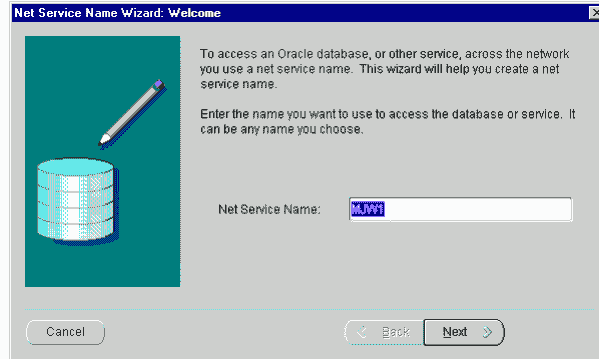

## 选择网络协议

下一步是输入客户端在连接到此网络服务名称的服务器时应使用的协议类型。默认选择 TCP/IP。协议列表将根据你的平台而变化。点击“Next”（下一步）按钮继续（参见图 3.6）。

## 图 3.6 Oracle Net Manager 网络协议

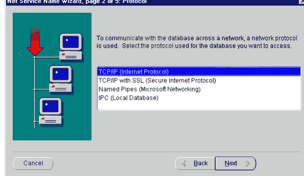

## 选择主机名和端口

此步骤将取决于你在上一步中选择的协议。如果选择了 TCP/IP，系统会提示你输入主机名和端口号。主机名是运行监听器的机器的名称。端口号是监听器的监听位置。默认端口为 1521（参见图 3.7）。

## 图 3.7 Oracle Net Manager 主机名和端口号

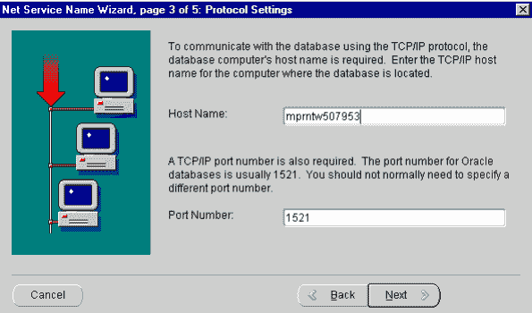

## 选择服务名称

下一步是定义服务名称。对于 Oracle9i，服务名称不必与 `ORACLE_SID` 相同，因为一个数据库可以为它定义多个服务名称。在 Oracle9i 中，服务名称通常与全局数据库名称相同。这是提供给监听器的服务名称，因此监听器必须监听此服务。你还可以选择此服务是用于 Oracle8i 或更高版本的数据库，还是 Oracle8 及以前版本的数据库。还有一个选项允许你从以下选择中选择连接类型：数据库默认（Database Default）、共享服务器（Shared Server）和专用服务器（Dedicated Server）。图 3.8 显示 Oracle Net Manager 服务名称屏幕的示例。

## 图 3.8 Oracle Net Manager 向向，第 4 页共 5 页：服务

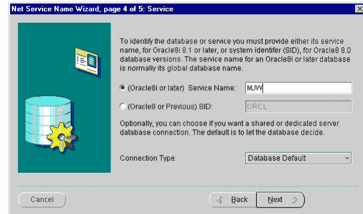

## 测试网络服务名称连接

最后一步是测试网络服务名称。此测试将验证所有输入的连接信息都是正确的。点击“Test”（测试）按钮测试网络连接。图 3.9 显示 Oracle Net-agent 测试连接表单的示例。

> 测试连接将默认尝试使用用户名 `Scott` 和密码 `tiger` 连接到数据库。如果你的连接失败，请检查你是否有 `Scott/tiger` 用户。你可以通过点击 Test Connection 屏幕中的“Change Login”（更改登录）按钮来更改登录测试。你也可以通过运行名为 `scott` 的脚本来创建 Scott 用户，该脚本位于 Unix 的 `$ORACLE_HOME/rdbms/admin` 目录或 Windows NT/2000 的 `%ORACLE_HOME%\rdbms\admin` 下。

## 图 3.9 Oracle Net Manager 测试网络连接表单

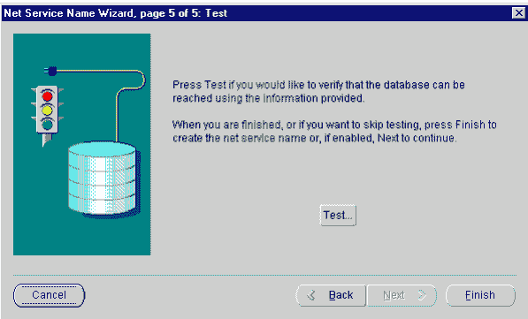

如果一切都是正确的，你应该看到与图 3.10 类似的结果。

## 图 3.10 Oracle Net Manager tnsnames.ora 向向导测试结果屏幕

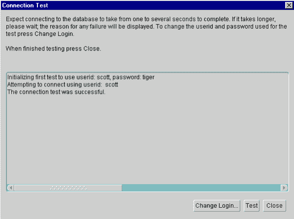

完成所有操作后，你必须通过从 File（文件）菜单中选择“Save Network Configuration”（保存网络配置）来保存更改。这将创建 `tnsnames.ora` 文件。

## tnsnames.ora 的内容和结构

这是一个你创建的 `tnsnames.ora` 文件示例：

```
# D:\ORACLE\NETWORK\ADMIN\TNSNAMES.ORA

# Configuration

# File:D:\Oracle\NETWORK\ADMIN\tnsnames.ora

# Generated by Oracle Net Manager

DBA =

(DESCRIPTION =

  (ADDRESS_LIST =

    (ADDRESS = (PROTOCOL = TCP)(HOST = gr99c073)(PORT = 1521))

  )

  (CONNECT_DATA =

    (SERVICE_NAME = DBA)

  )

)
```

表 3.1 总结了 `tnsnames.ora` 文件中的参数。

## 表 3.1 tnsnames.ora 参数

| 参数 | 描述 |
| :--- | :--- |
| Description | 文件的描述部分。 |
| Address_list | 连接描述符列表。 |
| Address | 指定网络服务名称的描述符。 |
| Protocol | 指定使用的协议，例如 TCP/IP。 |

### 表 3.1 tnsnames.ora 参数（继续）

| 参数 | 描述 |
| :--- | :--- |
| Host | 指定监听器运行的机器名称。在 TCP/IP 中也可以指定 IP 地址。 |
| Port | 指定监听器的监听位置。 |
| Connect_data | 指定此服务的服务的部分。 |
| Service_name | 替换旧版本中的 SID 参数。定义连接到什么服务。可以是 `ORACLE_SID` 或设置为全局数据库名称。可以使用多个服务名称引用。 |

## 排除客户端连接问题

客户端必须能够连接到 Oracle 服务器所在的计算机以及监听服务的监听器。客户端还必须能够解析网络服务名称。让我们看看客户端需要执行的检查：

- 客户端可以连接服务器吗？
- 客户端能看到监听器吗？
- 验证命名文件。
- 是否存在多个网络文件？
- 检查网络文件位置。
- 检查 `NAMES_DIRECTORY_PATH` 参数。
- 检查 `NAMES_DEFAULT_DOMAIN` 参数。
- 检查客户端适配器。
- 是否有客户端错误代码？

## 检查客户端/服务器连接

确保客户端能看到主机。如果你在使用 TCP/IP，可以尝试 `ping` 主机。只需输入 `ping` 和主机名。如果找不到主机，尝试使用主机的 IP 地址。如果有效，说明你的域名无法识别主机。例如，你可以这样对 `gr99c073` 进行 `ping`：

```
C:\>ping gr99c073
```

正在 ping gr99c073 [127.10.1] 32 字节数据：

```
Reply from 127.10.1: bytes=32 time<10ms TTL=128

Reply from 127.10.1: bytes=32 time<10ms TTL=128

Reply from 127.10.1: bytes=32 time<10ms TTL=128

Reply from 127.10.1: bytes=32 time<10ms TTL=128
```

## 检查客户端/监听器连接

接下来，检查客户端是否可以连接到监听器。你可以使用名为 `tnsping` 的工具来验证这一点。`tnsping` 是一个尝试连接 Oracle 监听器的 工具。它的工作方式类似于 `ping`，你可以输入服务名称和连接监听器的次数。该工具验证客户端可以连接到监听器，但不验证客户端实际上可以连接到 Oracle 服务器。你还可以指定尝试次数。在下面的示例中，尝试连接三次 `PROD` 数据库。

```
C:\>tnping PROD 3
```

```
TNS Ping Utility for 32-bit Windows: Version 8.1.5.0.0

Production on 19-FEB-00

21:18:25

Attempting to contact

(ADDRESS=(PROTOCOL=TCP)(HOST=gr99c073)(PORT=1521))

OK (270 msec)

OK (40 msec)

OK (30 msec)
```


`tnsping`工具显示连接监听器的往返时间。正如侧边栏所示，此信息也可以帮助你发现连接问题。

# 现实场景

## 神秘的超时问题

我使用`tnsping`帮助排除了一些非常有趣的连接问题。其中一个问题涉及一个经历间性连接超时的客户端。有时客户端可以连接，但有时客户端会收到超时错误。客户端报告说登录Oracle服务器总是花费异常的时间。

这台出现问题的客户端机器恰好位于另一台客户端旁边，后者完全没有连接或超时问题。我使用`tnsping`运行了一些连接测试，发现问题的客户端平均连接到监听器需要3000毫秒，而另一个客户端只需要30毫秒。两个客户端都相同的网络路由连接到服务器。

经过进一步调查，我发现机器使用了不同的TCP/IP实现。这导致了间性的超时问题。在`tnsping`工具的帮助下，我将问题缩小到客户端配置的差异。

## 验证本地命名配置文件

如果客户端使用本地命名方法解析服务名称，请检查`tnsnames.ora`文件中的条目。确保条目语法正确，并且有一个网络服务名称的条目。还要确保协议是正确的。

## 查找多个客户端网络配置文件

确保这些文件的所有副本都是完全相同的。通常，像`tnsnames.ora`和`sqlnet.ora`这样的客户端网络文件只有一个副本。在某些情况下，例如当你使用Oracle工具（如Oracle Developer）时，这些产品被安装在客户端的一个独立的`ORACLE_HOME`目录下，并拥有它们自己的网络文件副本。这可能导致客户端需要多个网络文件副本。

### 检查网络文件位置

我遇到的最常见问题之一是客户端无法工作，且没有将`TNS_ADMIN`环境变量设置为新的文件位置。Oracle期望`tnsnames.ora`和`sqlnet.ora`文件位于默认位置。如果无法找到这些文件且你没有设置`TNS_ADMIN`，就会收到`ORA-12154`错误。以下是该错误的示例。如果提供的网络名称无效，也会收到此错误。

```
D:\ORACLE81\NETWORK\ADMIN>sqlplus system/manager@Database Administrator
```

```
SQL*Plus: Release 9.0.1.0.0 - Production on Sat Oct 19 21:40:12 2001
```

```
(c) Copyright 1999 Oracle Corporation. All rights reserved.
```

```
ERROR:

ORA-12154: TNS:could not resolve service name
```


如果你决定移动网络文件，请务必将 `TNS_ADMIN` 环境变量设置为文件所在的位置。Oracle 首先在默认位置查找文件，然后在 `TNS_ADMIN` 位置查找文件。

## 检查 NAMES.DIRECTORY_PATH

确保客户端具有适当的名称解析设置。`sqlnet.ora` 文件中的 `NAMES.DIRECTORY_PATH` 参数控制客户端解析服务名称的顺序。如果没有设置该参数，默认值为 `localnaming`（本地命名）、`Oracle Internet Directory`（Oracle 目录）以及 `hostnaming`（主机命名）。

如果该参数设置错误，客户端可能永远不会检查相应的名称解析类型。例如，如果你正在使用 `localnaming` 但参数被设置为 `HOSTNAMES`，则永远不会使用 `tnsnames.ora` 文件来解析服务名称。你将收到 `ORA-12154` “Cannot Resolve Service Name”（无法解析服务名称）错误。

## 检查 NAMES.DEFAULT_DOMAIN

`NAMES.DEFAULT_DOMAIN` 是另一个常见错误。它在旧版本的 Oracle 中更常见，因为该参数的默认值为 `WORLD`。检查客户端的 `sqlnet.ora` 文件以查看是否设置了该参数。如果参数有值且你使用的是未限定的服务名称，则参数值将附加在服务名称的末尾。未限定的服务名称是不包含信息的服务的名称。

例如，如果你输入了 `Sqlplus matt/casey@PROD`，且 `NAMES.DEFAULT_DOMAIN` 被设置为 `WORLD`，Oracle 会在服务名称后附加 `WORLD`；结果变为 `sqlplus matt/casey@PROD.WORLD`。如果服务名称不应包含 `.WORLD` 域扩展，你就会收到 `ORA-12154` 错误。仅在使用分级命名约定时才使用此参数。

## 检查客户端协议适配器

验证客户端上已安装适当的协议适配器。你可以调用 Universal Installer 并检查客户端设置。查找已安装的客户端协议适配器列表。

## 检查客户端错误代码

以下是你可能会遇到的一些常见客户端 Oracle 错误的总结。

- `ORA-12154` "TNS: could not resolve service name"（无法解析服务名称）
- `ORA-12198` "TNS: could not find path to destination"（无法找到目标路径）
- `ORA-12203` "TNS: Unable to connect to destination"（无法连接到目标）
- `ORA-12533` "TNS: illegal address parameters"（非法地址参数）
- `ORA-12541` "TNS: No listener"（无监听器）

`ORA-12154` 表示客户端无法找到 `tnsnames.ora` 文件中列出的服务。其原因之一如上所述，即文件不在正确的目录，或者未指定 `TNS_ADMIN` 变量或指定错误。

`ORA-12198` 或 `ORA-12203` 表示客户端找到了 `tnsnames.ora` 条目，但未找到指定的服务。请检查 `tnsnames.ora` 文件中指定的服务确实指向有效的数据库服务。

`ORA-12533` 表示你错误地配置了 `tnsnames.ora` 文件的 `ADDRESS` 部分。检查并确保语法正确，或使用 Oracle Net Manager 工具重新创建定义。

`ORA-12541` 表示客户端连接的服务器在指定端口上没有运行监听器。确保服务器上已启动监听器，并且客户端和服务器上的监听端口规范匹配。

## 总结

客户端可用的名称解析方法包括主机命名（hostnaming）、本地命名（localnaming）和 `Oracle Internet Directory`。`hostnaming` 仅在你在使用 TCP/IP 时才能使用，主要用于大型 Oracle 网络。`localnaming` 是最流行的名称解析方法，它使用 `tnsnames.ora` 文件（通常位于每个客户端上）来解析服务名称。客户端在 `tnsnames.ora` 文件中查找服务名称并使用生成的连接描述符信息连接到 Oracle 服务器。`hostnaming` 和 `localnaming` 方法通过 Oracle Net 配置。

## 复习题

- 1. 客户端可以通过哪些方式解析网络服务名称？（选择所有适用项。）
A. 本地命名 (Localnaming)
B. 主机命名 (Hostnaming)
C. 全局命名 (Globalnaming)
D. Oracle 内部目录 (Oracle Internet Directory)

- 2. 在配置客户端时，必须存在哪个文件来完成本地命名？
A. 1snrctl1.ora
B. names.ora
C. tnsnames.ora
D. sdns.ora
E. 以上都不是

- 3. 下列哪是主机命名（hostnaming）的先决条件？
A. 你必须在客户端上使用 tnsnames.ora。
B. 你必须使用 TCP/IP。
C. 你必须拥有一个 Oracle Internet Directory。
D. 你必须在客户端上拥有一个 sqlnet.ora 文件。
E. 以上都不是。

- 4. 关于 tnsnames.ora 的下列陈述中错误的是？
A. 它用于解析 Oracle 服务名称。
B. 它可以存在于客户端。
C. 它用于本地命名。
D. 它不支持 TCP/IP 协议。

- 5. sqlnet.ora 文件中的哪个目会在其他名称解析类型之前使用本地命名解析？
A. NAMES.DIRECTORY_PATH=(TNSNAMES, LDAP, HOSTNAME)
B. NAMES.SEARCH_PATH=(TNSNAMES, HOSTNAME, LDAP)
C. NAMES.DIRECTORY_PATH=(HOSTNAME, LDAP, TNSNAMES)
D. NAMES.SEARCH_PATH=(HOSTNAME, TNSNAMES, LDAP)

- 6. Oracle Net Manager 中的哪个选项用于配置 tnsnames.ora？
A. 配置文件 (Profile)
B. 监听器 (Listeners)
C. 网络服务名称 (Net service names)
D. 服务命名 (Service Naming)

- 7. 密码为 apple的用户 Bob 需要连接到 DBA 服务。以下哪个连接语句是可行的？
A. sql*plus apple/bob@DBA
B. sql*plus bob/apple@DBA
C. sql*plus DBA@bob/apple
D. sql*plus bob\apple@DBA
E. sql*plus bob/apple#DBA

- 8. 哪个短语最能完成以下句子？网络服务名称是 ______________。
A. ORACLE_SID 的名称
B. 数据库名称
C. 我网络上数据库位置的另一种名称
D. 我作为 DB_NAME init.ora 设置的名称
E. 以上都不是

- 9. tnsnames.ora 文件的哪个部分包含 SERVICE_NAME 参数？
A. 地址 (Address)
B. Connect_Data
C. 主机 (Host)
D. 描述 (Description)

- 10. DBA 想要从客户端检查到特定 Oracle 监听器的连接性。服务名称为 mjw。string以下哪个命令可以实现此操作？
A. ping mjw
B. trcaset mjw
C. tnsping mjw
D. 以上都不是

- 11. DBA 管理一个大型服务器网络，每个服务器上都配置了许多 Oracle9 实例。业务希望将 Oracle 服务集中到一个公共位置以便于维护。对于集中化命名服务，以下哪项是最佳选择？
A. 主机命名 (Hostnaming)
B. 本地命名 (Localnaming)
C. Oracle 名称服务器 (Oracle Names Server)
D. Oracle 内部目录 (Oracle Internet Directory)

- 12. 客户端接收到以下错误消息：
`ORA-12154 ": could not resolve service name"`
以下哪些该错误的可能原因？（选择所有适用项。）
A. 监听器未在 Oracle 服务名称上运行。
B. 用户输入了无效的服务名称。
C. 用户提供了正确的服务名称，但 tnsnames.ora 文件中的服务名称拼写错误。
D. 监听器未配置为监听此服务。

- 13. 如果 sqlnet.ora 文件中存在哪个参数，当用户在请求连接时提供未限定的服务名称时，该参数会被附加到服务名称之后？
A. NAMES.DEFAULT_PATHNAMES
B. NAMES.DEFAULT_DOMAIN
C. NAMES.SERVICE_NAME
D. NAMES.CONNECTION_NAME

- 14. 在什么情况下，管理员会选择使用主机命名（hostnaming）？
A. 管理员拥有一个具有许多待管理的复杂网络。
B. 管理员对最小化客户端侧配置感兴趣。
C. 管理员不想使用 Oracle Net Manager。
D. 管理员想使用 tnsnames.ora 文件来包含配置设置。
E. 以上都不是。

- 15. tnsnames.ora 文件的哪个部分指定了监听器进程监听的服务器名称或 IP 地址？
A. CONNECT_DATA
B. PORT
C. SERVICE_NAME
D. HOST

- 16. 关于主机命名（hostnaming）的这些陈述中错误的是？
A. 必须使用 TCP/IP。
B. 主机名通过外部命名服务解析。
C. 连接管理器（Connection Manager）可以配合主机命名。
D. 用户只需提供主机名称即可连接。

## 第 3 章 · 为客户端配置 Oracle Net

- 17. 哪个短语最能完成以下句子？网络服务名称是 ________。
A. 由 Oracle 安装
B. 数据库的另一种名称
C. 对于客户端不是必要的
D. 需要由指定

- 18. 下列哪项用于测试 TCP/IP？
A. trcasst
B. lsnctl
C. tnsping
D. sqlplus

- 19. 如果数据库未向监听器注册，并且使用了主机命名，需要设置哪个 sqlnet.ora 参数？
A. GLOBAL_DATABASE
B. DATABASE_NAME
C. GLOBAL_PATH
D. SERVICE_NAME

- 20. tnsnames.ora 的哪个部分是正确的？
A. (ADDRESS=(PROTOCOL=TCP)(HOST=oracle)(PORT=1521))
B. (ADDRESS=(PROTOCOL=TCP)(HOST=02ORA)(PORT=1521))
C. (ADDRESS=(PROTOCOL=TCP)(HOST=1521)(PORT=02ORA))
D. (ADDRESS=(PROTOCOL=TCP)(HOST=1521)(PORT=oracle))

## 复习题答案

1. A, B, D
2. C
3. B
4. D
5. A
6. C
7. B
8. C
9. B
10. C
11. D
12. B, C
13. B
14. B
15. D
16. A
17. B
18. C
19. A
20. A

15. D. `HOST` 指定了要连接的服务器名称。`PORT` 指定监听器在 `HOST` 上监听的位置。`CONNECT_DATA` 指定了要连接的数据库服务。`SERVICE_NAME` 是实际数据库服务的名称。

16. C. 使用主机名命名法时，无法使用 Oracle 连接管理器（Connection Manager）等高级网络选项。

17. D. 所有网络数据都通过底层网络协议从客户端传输到数据库服务器。Oracle Net 的正常运行需要该协议就到位。协议独立于 Oracle 软件，且不等同于 Oracle 协议适配器。适配器是允许 Oracle Net 与底层协议通信的关键。

18. D. 协议自带了允许您测试网络连通性的工具。TCP/IP 的一个实用程序是 `ping`。用户向 `ping` 程序提供 IP 地址或主机名。它会在网络中搜索该地址。如果找到，它将显示发送和接收的数据信息，以及找到该地址的速度。其他选项是 Oracle 提供的实用程序。

19. D. 如果实例未向监听器动态注册，则需要在 `listener.ora` 文件中设置 `GLOBAL_DBNAME` 参数。

20. A. 检查网络文件的语法和格式。所有其他语法示例都是错误的。

# 第 4 章

## 配置共享服务器选项

**本章涵盖的 ORACLE9i：DBA 基础知识 II 考试目标：**

- 识别 Oracle 共享服务器的组件。
- 描述 Oracle 共享服务器架构。
- 配置 Oracle 共享服务器。
- 识别并解释相关字典视图的用处。

> 注意：考试目标可能会根据 Oracle 的自行裁量随时随时更改，且恕不另行通知。请访问 Oracle 认证网站（http://www.oracle.com/education/certification/）查看最新的考试目标列表。


随着企业中连接 Oracle 服务的用户数量增加，服务器的系统需求也随之增加——特别是内存和进程需求。本章将讨论 Oracle 共享服务器选项（以前称为 Oracle 多线程服务器）及其益处。此外，你将学习连接过程的步骤、如何配置共享服务器选项，以及在共享服务器配置中如何处理用户请求。你还将学习如何使用各种 Oracle 数据视图管理共享服务器环境，以及在连接到配置了共享服务器的 Oracle 数据库时如何配置客户端请求专用连接。你将学习在何处找到帮助调优共享服务器的信息。

对于数据库管理员来说，理解 Oracle 共享服务器架构以及何时以及使用此功能是非常关重要的。如果使用当，此功能可以帮助缓解服务器运行进程数量过多导致的负载压力问题。当共享服务器配置得当时，它可以帮助避免看似迫在眉睫的系统升级，从而为组织节省时间和金钱。

## 共享服务器配置

共享服务器是 Oracle 服务器的一种可选配置，允许服务器在不增加物理资源需求的情况下支持更大量的并发连接。这是通过在用户组之间共享资源来实现。

## 共享服务器配置 123

## 专用服务器与共享服务器

如果你去过高档餐厅，你可能拥有过自己的专属服务员。服务员的作用是迎接你并带你入座。。服务员会记录你的食物和饮料订单，甚至帮助准备你的订单。无论餐厅进入了多少位顾客，你的服务员只负责服务你的请求。因此，只要这个服务员足够优秀，你的服务就会非常稳定。

专用服务器环境的工作方式非常相似。每个客户端连接在 Oracle 服务器所在的机器上都有一个专用的服务器进程。无论与服务器建立了多少连接，你始终有同一个服务器负责处理你的你的请求。在你与 Oracle 服务器断开连接之前，你一直在使用该服务器进程的服务。

大多数餐厅倾向于更像共享服务器。当你走进去时，会被分配一名服务员或女服务员，但他们可能需要负责服务很多桌子。这对餐厅是有好处的，因为他们可以在不增加工作人员的情况下服务更多客户。如果服务员不忙，且女服务员负责的桌子也不太多，这对你来说可能也是好处。此外，如果大部分订单都是小订单，工作人员就能跟上请求，服务质量就会像你拥有自己的专属服务员一样好。

在简餐馆里，情况略有不同；女服务员接受你的订单并将其放在转门上。如果简餐馆有多个副本，订单将从转门上被取走并由一名空闲的厨师进行准备。当厨师完成晚餐的准备后，它会被放在一个位置，服务员可以在那里取走并带回你的桌子。

这就是共享服务器的工作方式。在共享服务器环境中，客户端共享 Oracle 服务器上的进程。这些共享进程被称为分发器（dispatchers）。分发器就像简餐馆里的服务员或女服务员。一个分发器可以负责接收许多客户端的订单。

当你向服务器请求内容时，由分发器负责你的请求并将其放在一个称为请求队列（request queue）的地方。请求队列的功能就像简餐馆类比中的转门。有一个请求队列，所有分发器将他们的客户端请求放在那里。请求队列是包含在系统全局区域（SGA）中的一个结构。

共享服务器进程就像简餐馆里的厨师，负责履行客户端请求。共享服务器进程执行请求并制作

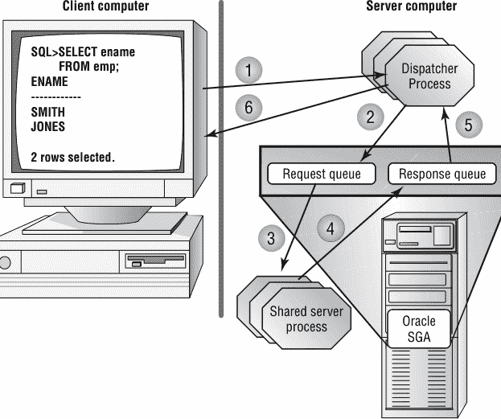

## 共享服务器的优点

共享服务器用于资源（如内存和活动进程）受到限制的情况。人们倾向于通过增加硬件来解决这类问题；这可能会解决问题，但可能是一项不必要的支出。

如果你的系统正面临这些问题，共享服务器允许你在不增加硬件要求的情况下支持相同或更多的连接。结果是，共享服务器往往会减少服务器的整体内存和进程需求。

一个平均专用连接占用 2 到 4 MB 内存。共享服务器连接占用大约 2 MB 内存。你可以看到，内存会有所减少。此外，由于客户端共享进程，进程总数减少了。这些转化为了服务器资源的节省。

共享服务器还需要用于配置以利用网络选项，例如使用连接管理器时的连接集中。

## 适用于共享服务器的应用程序

共享服务器适用于“高频”应用程序。高频应用程序由在事务模式中具有自然停顿的小事务组成。这些类型的应用程序是共享服务器连接的理想选择。高频应用程序的一个例子是订单输入系统。订单输入系统往往在信息工作模式中具有自然停顿的小事务。

## 共享服务器的缺点

产生大量网络流量或导致大型结果集的应用程序不是共享服务器连接的理想选择。这就是之前讨论过的简餐馆类比。你的服务一直很好，直到两组 12 人的客人出现。突然之间，女服务员被另外两张桌的工作压垮了，你的服务开始下降。同样的事情也会发生在共享服务器环境中。如果对大量信息的请求开始发送给分发器，分发器可能会被这些大型请求压垮，导致连接到该分发器的其他客户端可能会性能下降。反过来，这将

# 126 第 4 章 • 配置共享服务器选项

这将增加你的响应时间。专用进程能更好地服务此类应用程序。

当使用共享服务器连接时，某些功能是不允许的。当通过共享服务器连接时，你无法启动、关闭或对 Oracle 服务器执行某些类型的恢复。

## 可扩展性与性能

共享服务器是一个可扩展性增强选项，而不是性能增强选项。如果你正在寻求提高性能，那么共享服务器并不是你所需要的。只有当你遇到前面讨论的系统限制问题时，才使用共享服务器。在专用服务器环境中，你始终会获得相等或更好的性能。

## 共享服务器环境中的 Oracle 服务器更改

配置共享服务器时，Oracle 在 SGA 中添加两种新类型的结构：请求队列（request queues）和响应队列（response queues）。这些结构在专用服务器环境中不存在。所有分发器共享一个请求队列，但每个分发器都有自己的响应队列。如果你有四个分发器，就会有一个请求队列四个响应队列。请求队列是 SGA 中的一个位置，分发器在此放置客户端请求。共享服务器进程执行每个请求，然后将完成的请求放在分发器的响应队列中。

你必须配置在实例启动时想要启动的分发器和共享服务器进程的数量；你还必须配置这些结构的最大数量。稍后，你将看到如何确定分发器和共享服务器进程的启动数量。

在专用环境中，每个专用服务器都有名为程序全局区域（PGA）的内存段。PGA 是维护有关每个客户端会话信息的内存区域。这些信息包括绑定变量、游标信息和客户端的排序区域。在共享环境中，这些信息从 PGA 移动到 SGA 中一个名为用户全局区域（UGA）的区域。你可以配置 SGA 中一个名为大池（Large Pool）的特殊区域来容纳大部分 UGA。在 Oracle 的较旧版本中，整个 UGA 存储在共享池（Shared Pool）中。从 Oracle 8 开始，大部分 UGA 可以存储在大池中。你稍后将看到如何配置大池。图 4.2 显示了专用服务器环境和共享服务器环境之间 SGA 和 PGA 结构的差异。

## 图 4.2 SGA 专用服务器与共享服务器

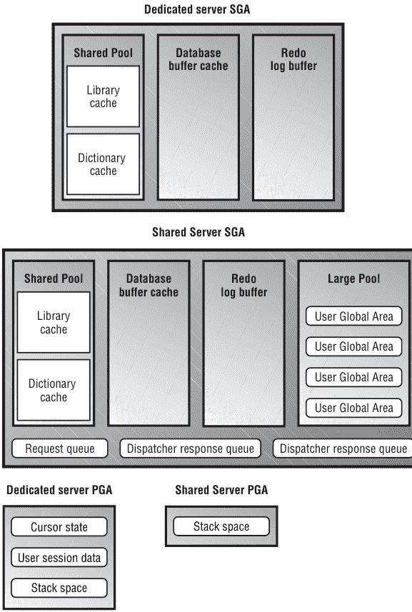

# 第 4 章 • 配置共享服务器选项

每个由分发器服务的连接都绑定到一个共享内存段并形成一个虚拟电路。共享内存段被分发器用于管理客户端与 Oracle 服务器之间的通信。共享服务器进程使用虚拟电路向适当的分发器进程发送和接收信息。

## 监听器在共享服务器环境中的作用

监听器（Listener）在共享服务器环境中起着重要作用。当用户请求连接到共享服务器时，由监听器负责为客户端提供连接的分发器地址。Oracle 后台进程 PMON 通知分发器其负责服务该虚拟电路。随后，监听器就会知道分发器正在管理的连接数。此信息允许监听器利用分发器负载均衡。负载均衡在 Oracle 8i 中引入，允许监听器智能地决定将连接重定向到哪个分发器，以防止任何分发器过载。当监听器接收到连接请求时，它会查看每个分发器的当前连接负载，并将客户端连接请求重定向到负载最低的分发器。通过这种方式，监听器确保连接均匀分布在各个分发器上。当客户端连接终止时，监听器将更新以反映分发器处理的连接数的变化。图 4.3 描述了此处所示共享服务器连接过程的步骤：

- 1. 实例启动时创建分发器进程。
- 2. 客户端在解析服务名后联系 Oracle 服务器。
- 3. 服务器将客户端连接重定向到最空的分发器。
- 4. 分发器进程管理客户端服务器请求。
- 5. PMON 在监听器处注册连接信息。

## 图 4.3 共享服务器连接过程

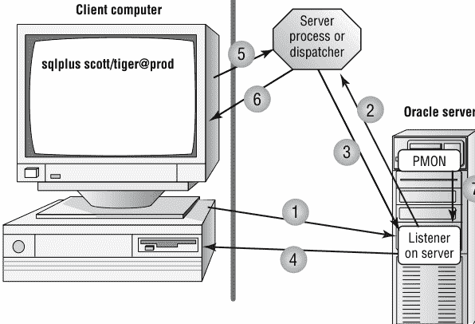

## 配置共享服务器选项

共享服务器需要在 init.ora 文件中额外的参数。这些参数确定了分发器的数量和类型、共享服务器的数量，以及你想要与共享服务器关联的数据库名称。

> 注意 从 Oracle 9 开始，参数名称已经过修改以消除了开头的“MTS”前缀。例如，MTS_DISPATCHERS 现在简单为 DISPATCHERS。这些参数已弃用，但为了向后兼容仍然受到支持。

# 130 第 4 章 · 配置共享服务器选项

## DISPATCHERS 参数

此参数配置实例启动时应启动的分发器数量。`DISPATCHERS` 参数指定分发器的数量以及分发器可以响应的协议类型。

你可以使用 `ALTER SYSTEM` 命令动态地添加分发器。此命令允许你在不停止实例的情况下增加分发器的数量。此外，此命令具有许多可选属性。两个主要属性是分发器的数量和分发器将监听的协议。例如，假设你想配置三个 TCP/IP 分发器和两个 IPC 分发器。

```


`DISPATCHERS = *(PRO=TCP)(DIS=3) (PRO=IPC)(DIS=2)`

此参数的所有属性都可以缩写。表 4.1 显示了你可以用 `DISPATCHERS` 设置的其他属性。在 `ADDRESS`、`DESCRIPTION` 或 `PROTOCOL` 这三个属性中只需指定一个。

## 表 4.1 分PATCH器属性摘要

| 属性 | 缩写 | 描述 |
| :--- | :--- | :--- |
| `ADDRESS` | `ADD` or `ADDR` | 指定分发器监听的网络协议地址。 |
| `CONNECTIONS` | `CON` or `CONN` | 每个分发器的最大连接数。默认值随操作系统异。 |
| `DESCRIPTION` | `DES` or `DESC` | 分发器监听的端点的描述，包括协议。 |
| `DISPATCHERS` | `DIS` or `DISP` | 实例启动时启动的分发器数量。默认值为 1。 |

## 表 4.1 分PATCH器属性摘要（续）

| 属性 | 缩写 | 描述 |
| :--- | :--- | :--- |
| `LISTENER` | `LIS` or `LIST` | `PMON` 发送连接信息的监听器地址。 |
| `PROTOCOL` | `PRO` or `PROT` | 分发器监听的网络协议。 |
| `SESSIONS` | `SES` or `SESS` | 此分发器允许的最大会话数。 |

## 确定启动的分发器数量

启动的分发器数量取决于具体的配置。操作系统可能会对分发器可以处理的连接数设置限制。请咨询你的操作系统文档获取此类信息。
当你决定初始配置多少分发器时，可以使用以下公式作为指南：

分发器数量 = 向上取整 (最大并发会话数 / 每个分发器的连接数)

例如，如果你有 200 个并发 TCP/IP 连接，你需要每个分发器管理 20 个并发会话。你可以这样设置 `DISPATCHERS` 参数：

```
DISPATCHERS = * (PRO=TCP)(DIS=10)
```

你可以通过查询 `V$SESSION` 视图来并发连接数。该视图显示了连接到 Oracle 服务器的客户端数量。以下是查询示例：

```
SQL> select sid,serial#,username,server,program from v$session
2* where sid > 6
```

## 第 132 第 4 章 • 配置共享服务器选项

| SID 序列号 | 用户名 服务端程序 |
|--------------|-------------------------|
| 7 13 | DEDIC SQLPLUS.EXE |
| 8 12 | DEDIC SQLPLUS.EXE |
| 9 4 | DEDIC SQLPLUS.EXE |

在例例中，你会看到三个用户连接到服务器，它们的 SID 以数字 7 开头。这是因为在 SQL 语句中，你可以忽略前六个会话。这些条目指的是 `PMON` 和 `SMON` 等后台进程。如果你在典型时间段内对此视图进行采样，就可以获得系统平均并发连接数的概览。然后你可以将此数字作为建立初始分发器（dispatcher）数量的指导。

## 管理分发器数量

你可以使用 `ALTER SYSTEM` 命令动态启动额外的分发器或移除分发器。你可以启动最多 `MAX_DISPATCHERS` 设置的分发器。以下是一个在配置了两个 TCP/IP 分发器的系统中添加三个 TCP/IP 分发器的示例：

```
ALTER SYSTEM SET DISPATCHERS="PRO=TCP)(DIS=5)";
```

注意，你设置的数字是你想要的分发器总数，而不是你想要添加的分发器数量。

## MAX_DISPATCHERS 参数

将此参数设置为你预计 Oracle 服务器可能需要的分发器最大数量。此数字无法动态设置。分发器可以并发运行的最大进程数由操作系统决定。使用以下公式设置此参数：

```
MAX_DISPATCHERS = (每个分发器的最大并发会话数/连接数)
```

以下是该参数的示例：

```
MAX_DISPATCHERS = 5
```

## SHARED_SERVERS 参数

此参数指定了 Oracle 实例启动时要启动的共享服务器数量。可以使用 `ALTER SYSTEM` 命令动态修改此参数。你必须将此参数设置为 1，以让 Oracle 使用共享服务器连接。设置为 0 或不设置意味着将不使用共享服务器。由于此参数可以动态更改，因此如果实例启动时没有配置共享服务器，你可以在不重启 Oracle 实例的情况下进行配置。

所需的服务器数量取决于用户正在执行的活动类型。通常，对于将使用共享服务器连接的高事务类应用，每个服务器配备 15 到 20 个连接应该是充足的。如果你的用户需要更大的结果集或正在进行更密集的处理，你可能需要降低这个比例。

```
SERVERS = 3
```

## SHARED_SERVER_SESSIONS 参数

此参数指定了 Oracle 实例允许的总共享服务器会话数。此参数源于 `CIRCUITS` 或 `SESSIONS` 中的较小值。例如，如果 `CIRCUITS` 设置为 10 且 `SESSIONS` 设置为 20，那么 `SHARED_SERVER_SESSIONS` 将等于 10，因为这是这两个值中的较小值。这是一个派生值，不会手动在 `init.ora` 文件中设置。

## 管理共享服务器数量

你可以使用 `ALTER SYSTEM` 命令动态启动额外的共享服务器或减少共享服务器的数量。你可以启动最多 `MAX_SERVERS` 设置的共享服务器。以下是一个在初始配置了两个共享服务器的系统中添加三个额外共享服务器的示例：

```
ALTER SYSTEM SET SHARED_SERVERS = 5;
```

注意，你设置的数字是你需要的共享服务器总数，而不是你想要添加的共享服务器数量。

## MAX_SERVERS 参数

将此参数设置为你预计 Oracle 服务器可能需要的共享服务器最大数量。此数字无法动态设置。通常，你应该设置此参数以适应你最繁忙的工作时段。以下是该参数的示例：

```
MAX_SERVERS = 5
```

## CIRCUITS 参数

此参数管理所有入出网络会话允许的虚拟电路总数。这是一个静态参数，其值等于 `SESSIONS` init 参数的值。此参数影响系统启动时 SGA 的总大小。以下是该参数的示例：

```
CIRCUITS = 200
```

## 启动实例并管理共享服务器

在完成 `init.ora` 中的配置工作后，你需要重启数据库。重启数据库后，你应该查询 `V$` 视图以查看实例是否已启动共享服务器和分发器进程。随后我们将讨论用于管理共享服务器的各种字典视图。

## 向监听器注册分发器信息

当共享服务器启动时，`PMON` 会向监听器注册分发器信息。你可以查询监听器以查看这些注册信息。监听器将跟踪所有分发器的当前连接负载。这些信息是必要的，以便监听器能够利用分发器负载均衡。

## 启动实例并管理共享服务器


## 现实场景

## 共享服务器启动问题故障排除

如果在启动实例时遇到问题，可能是某个 Oracle Net 文件有问题。如果你收到提示 `DISPATCHERS` 参数错误的错误信息，请备份所有 Oracle Net 文件（如 `tnsnames.ora` 和 `listener.ora`），并使用 Oracle Net Manager 重新创建文件。

## 使用 isnnrctl 显示共享服务器信息

你可以使用 `isnrctl` 工具查看有关分发器的信息。下面的示例显示了两个分发器的监听器。该示例有三个活动连接和一个分发器 D01。

```
isnrctl services
LSNRCTL for 32-bit Windows: Version 9.0.1 - Production on 03-OCT-2001 20:50:35
Copyright (c) 1991, 2001, Oracle Corporation. All rights reserved.
Connecting to (DESCRIPTION=(ADDRESS=(PROTOCOL=TCP))(HOST=mprntw5079) (PORT=1521)))
Services Summary...
Service 'MJW' has 2 instance(s).
Instance 'MJW', status UNKNOWN, has 1 handler(s) for this service...
Handler(s):
```
"DEDATED" established:0 refused:0
LOCAL SERVER
```
Instance 'MJW', status READY, has 3 handler(s) for this service...
Handler(s):
```


```
"DEDATED" established:0 refused:0 state:ready
LOCAL SERVER
"D001" established:11 refused:1 current:1 max:1002
state:ready
DISPATCHER <machine:MPRNTW50953, pid:352>
```

`(ADDRESS=(PROTOCOL=tcp)(HOST=mprntw5053.cmg)`

`(PORT=1038))`

```
"D000" established:15 refused:3 current:2 max:1002
state:ready
DISPATCHER <machine:MPRNTW50953, pid:117>
```

`(ADDRESS=(PROTOCOL=tcp)(HOST=mprntw5053.cmg)`

`(PORT=1036))`

命令执行成功

## 共享服务器数据字典视图

数据字典提供了你可以查询的视图，用于收集共享服务器环境的信息。这些视图提供了配置的分发器和共享服务器数量、共享服务器与分发器之间的活动、请求和响应队列中的活动，以及使用共享服务器连接的客户端信息。数据字典视图将在后续章节中介绍。有关 V$ 视图所有列定义的完整列表，请参阅 Oracle9i Database Release 1 [9,0.1) 卷号 A90190-02。

### V$DISPATCHER 字典视图

`V$DISPATCHER` 视图包含有关分发器的信息。你可以收集有关分发器活动的信息，在连接数之内

# 启动实例与管理共享服务器

分发器当前处理的消息，以及每个分发器自实例启动以来处理的连接数。以下是 `V$DISPATCHER` 视图的示例输出：

```sql
SQL> select name,status,messages,idle,busy,bytes,breaks
from v2$dispatcher
```

| NAME | STATUS | MESSAGES | IDLE | BUSY | BYTES | BREAKS |
| :--- | :--- | :--- | :--- | :--- | :--- | :--- |
| D000 | WAIT | 168 | 389645 | 108 | 12435 | 0 |
| D001 | WAIT | 94 | 389668 | 48 | 6940 | 0 |

### V$DISPATCH_RATE 字典视图

`V$DISPATCH_RATE` 视图显示分发器的统计信息，例如处理的平均字节数、入站和出站连接的最大数，以及每个客户端连接的平均字节速率。表中带有 `AVG` 或 `MAX` 的列显示了某些时间间隔内的历史统计数据。该时间间隔通常以百秒为单位。每种列类型使用的缩放测量周期包含在以 `SCALE` 开头的列中。当你对分发器进行负载测量时，这些信息非常有用。以下是该视图的输出示例。

```sql
SQL> select name,cur_event_rate,cur_msg_rate,
cur_svr_byte_rate from v$dispatcher_rate
```

| NAME | CUR_EVENT_RATE | CUR_MSG_RATE | CUR_SVR_BYTE_RATE |
| :--- | :--- | :--- | :--- |
| D000 | 12 | 0 | 0 |
| D001 | 14 | 0 | 1 |

### V$QUEUE 字典视图

`V$QUEUE` 字典视图包含有关请求队列和响应队列的信息。这些信息涉及等待队列中的长时间请求。当你试图确定是否需要更多的共享服务器时，这些信息非常有价值。以下示例显示了 `COMMON` 请求队列和两个响应队列：

```sql
SQL> select * from v$queue;
```

| PADDR | TYPE | QUEUED | WAIT | TOTAL |
| :--- | :--- | :--- | :--- | :--- |
| 00 | COMMON | 0 | 0 | 152 |
| 03C6244 | DISPATCHER | 0 | 0 | 91 |
| 03C6534 | DISPATCHER | 0 | 0 | 71 |

### $VCIRCUIT 字典视图

`$VCIRCUIT` 显示有关共享服务器虚拟电路的信息，例如客户端和分发器之间传输的信息量以及客户端连接的当前状态。`SADDR` 列显示已连接会话的会话地址。它可以与 `$VSESSION` 视图连接，以显示该连接所属的用户。以下是该视图的示例输出：

```sql
SQL> select circuit,dispatcher,server,wait WTR,
status,queue,bytes from v$circuit;
```

| CIRCUIT | DISPATCH | SERVER | WTR STATUS | QUEUE | BYTES | SADDR |
| :--- | :--- | :--- | :--- | :--- | :--- | :--- |
| 03E2A624 | 03C6244 | 00 | NORMAL | NONE | 47330 | 03C7AB68 |
| 03E2A724 | 03C6534 | 00 | NORMAL | SERVER | 43572 | 03C79BE8 |

### $VHARED_SERVER 字典视图

此视图包含有关共享服务器进程的信息。它显示了请求的数量以及共享服务器处理的信息（即处于活动还是空闲状态）。

```sql
SQL> select name,status,messages,idle,busy,
requests from v$shared_server;
```

| NAME | STATUS | MESSAGES | BYTES | IDLE | BUSY | REQUESTS |
| :--- | :--- | :--- | :--- | :--- | :--- | :--- |
| S000 | EXEC | 372 | 86939 | 98472 | 300 | 175 |
| S001 | EXEC | 26 | 9851 | 98703 | 38 | 13 |

### $VHARED_SERVER_MONITOR 字典视图

`V$SERVER_Monitor` 视图包含可以辅助调优共享服务器的信息。这些自实例启动以来的最大连接数以及自实例启动以来启动的服务器总数。下面的查询显示了该视图的输出示例：

```sql
SQL> select maximum_connections "MAX CONN",maximum_sessions "MAX SESS", servers_started "STARTED" from v$shared_server_monitor
```

| MAX CONN | MAX SESS | STARTED |
| :--- | :--- | :--- |
| 155 | | |

### V$SESSION 字典视图

此视图包含有关客户端会话的信息。`SERVER` 列指示此客户端使用的是专用会话还是分发器。下面的列表显示了 `V$SESSION` 视图示例。注意 Scott 的 server 值为 `SHARED`，这意味着 Scott 连接到了分发器。`SYSTEM` 用户因为状态为 `NONE` 而使用本地连接。如果用户使用专用会话，状态将是 `DEDATED`。

```sql
SQL> select username,program,server from v$session where username is not null;
```

| USERNAME | PROGRAM | SERVER |
| :--- | :--- | :--- |
| SYSTEM | SQLPLUS.EXE | NONE |
| SCOTT | SQLPLUS.EXE | SHARED |

### V$MTS 字典视图

`V$MTS` 视图包含有关分发器和共享服务器配置的信息。对于每个分发器的最大连接数、已启动和停止的共享服务器数量，以及同时活动的共享服务器最大数量。此视图告诉你是否应该启动更多的共享服务器进程。下面的示例显示了该视图的输出：

```sql
SQL> select MAX_CONNECTIONS "MAX_CONN", SERVERS_STARTED "SRV_STARTED", SERVERS_TERMINATED "SRV_TERM", SERVERS_HIGHWATER "SRV_HW" FROM V$mts;
```

| MAX_CONN | SRV_STARTED | SRV_TERM | SRV_HW |
| :--- | :--- | :--- | :--- |
| 60 | 0 | | |

> `V$MTS` 视图的内容与 `V$SHARED_SERVER_MONITOR` 视图相同。`V$MTS` 是 Oracle 8 版本中的视图名称。

# 在共享服务器环境中请求专用连接


你可以让共享服务器和专用服务器连接到同一个 Oracle 服务器。当 Oracle 服务器上有混合活动时，这种做法是有优势的。某些用户可能适合共享连接，而其他类型的用户可能更适合专用连接。

默认情况下，如果配置了共享服务器，客户端将连接到分发器，除非客户端式请求专用连接。作为连接描述符的一部分，客户端会发送请求专用连接的信息。如果命名方法是本地命名（`localnaming`），客户端可能会请求此类连接。此选项不能与主机命名（`hostnaming`）配合。

# 使用本地命名时配置专用连接

如果你使用本地命名，需要在 `tnsnames.ora` 文件的服务名条目中添加参数。` (SERVER=DEDICATED)` 被添加到 DBA 服务名中。`SERVER` 也可以缩写为 `SRVR`。以下是 `tnsnames.ora` 文件中的条目示例：

```text
# D:\ORACLE\ORA90\NETWORK\ADMIN\TNSNAMES.ORA Configuration
# File:D:\Oracle\Ora90\NETWORK\ADMIN\tnsnames.ora
# Generated by Oracle Net Manager
```

```text
DBA =
  (DESCRIPTION =
    (ADDRESS_LIST =
      (ADDRESS = (PROTOCOL = TCP)(HOST = weishan)
      (PORT = 1521))
    )
    (CONNECT_DATA =
      (SERVICE_NAME = DBA)
      (SRVR = DEDICATED))
  )
```

## 调优共享服务器选项

在调优共享服务器之前，你应该检查分发器和共享服务器进程的性能。你需要确保有足够的分发器，以便客户端无需等待分发器响应其请求，并且要有足够的共享服务器进程，以便请求无需等待处理。你还需要配置 Large Pool SGA 内存区域。Large Pool 用于存储 UGA。UGA 代替了用于专用服务器的 PGA。

Large Pool 的设计允许数据库从 SGA 的独立区域请求大量内存。在数据库拥有 Large Pool 设计之前，共享服务器的内存分配来自 Shared Pool。这导致共享服务器与更新 Shared Pool 中信息的其他进程发生竞争。Large Pool 减轻了 Shared Pool 的内存负担并提升了 Shared Pool 的性能。

# 配置 Large Pool

你可以通过在 `init_ora` 文件设置 `LARGE_POOL_SIZE` 参数来配置 Large Pool。该参数可以设置为最小 300KB，最大 2GB；最大设置取决于操作系统。当使用默认值时，如果指定了 `DISPATCHERS` 参数，Oracle 会为每个共享服务器增加 250KB。如果你不配置 Large Pool，Oracle 将使用 Shared Pool UGA。因为如此，在使用共享服务器时应配置 Large Pool，以免影响 Shared Pool 的性能。

```sql
LARGE_POOL_SIZE = 5M
```

通过查询 `V$SGASTAT` 查看 Large Pool 使用了多少空间。`free memory` 显示 Large Pool 中的可用空间，`session heap` 行显示 Large Pool 中使用的空间量。以下是示例列表：

```sql
SQL select * from vsgastat = 'Large Pool';
```

| POOL | NAME | BYTES |
| :--- | :--- | :--- |
| large pool | free memory | 251640 |
| large pool | session heap | 48360 |

## Large Pool 的定价

Large Pool 应该足够容纳所有的共享服务器连接。通常，每个连接占用 1 到 3 MB 的内存，但这取决于客户端的活动类型。进行大量排序或打开许多游标的客户端将使用更多内存。

# 调整共享服务器（Shared Server）选项

你可以通过查询 `V$SESSTAT` 视图来衡量共享服务器连接占用的内存量。该视图包含每个用户内存的信息。下面的查询显示了如何衡量自实例启动以来所有共享服务器会话占用的最大内存。你可以将其作为指南，以确定应该为大池（Large Pool）分配多少内存。此示例显示，所有共享服务器会话使用的最大内存约为 240KB。

```sql
select sum(value) 'Max MTS Memory Allocated' from v$sesstat, v$statname st = 'session uga memory max' and ss.statistic#;
```

Max MTS Memory Allocated

244416

# 确定是否有足够的分发器（Dispatchers）

可以通过查询 `V$DISPATCHER` 视图来监控分发进程。该视图包含有关分发进程繁忙程度的信息。查询此视图以确定启动更多分发器是否有利。

下面的示例查询针对 `V$DISPATCHER` 视图运行，显示分发器的繁忙百分比：

```sql
Select name, (busy / (busy + idle))*100
"Dispatcher % busy Rate"
From V$DISPATCHER
```

| Protocol | Dispatcher % Busy Rate |
|---|---|
| D000 | .00070079 |
| D001 | .0059 |

这些分发器的繁忙时间非常短。如果分发器的繁忙时间超过 50%，你应该考虑考虑启动更多分发器。这可以通过 `ALTER SYSTEM` 命令动态完成。可以全部或增加一个或两个分发器，并监控分发器的繁忙率，查看它们是否降至 50% 以下。

# 确定用户等待分发器多久

要衡量用户等待分发器执行其请求的时间，请查看组合的 `V$QUEUE` 和 `V$DISPATCHER` 视图。见下列表示例：

```sql
SELECT decode(sum(totalQ),0,'No Responses',
  Sum(wait)/sum(totalQ)) "Average Wait time"
FROM V$QUEUE q, V$DISPATCHER d
WHERE q.type = 'DISPATCHER'
AND q.paddr = d.paddr;
```

```
Average Wait Time
-----------------
.0413
```

分发器的平均等待时间略多于百分之一秒。随时间推监控此指标。如果该数字持续增加，你应该考虑添加更多分发器。

# 确定是否有足够的共享服务器（Shared Servers）

你可以使用 `V$SHARED_SERVER` 和 `V$QUEUE` 字典视图监控共享服务器。共享服务器负责执行客户端请求并将请求放在适当的分发器响应队列中。

你最感兴趣的衡量是客户端请求在请求队列中等待的时间。请求在队列中停留越久，客户端等待响应的时间越久。以下语句将告诉你请求在队列中等待多久：

```sql
Select decode(totalQ,0,'No Requests') 'Wait Time',
Wait/totalQ || 'hundredths of seconds'
"Average Wait time per request"
from V$QUEUE
where type = 'COMMON'
```

# 总结 145

| Wait Time | Average Wait time per request |
|---|---|
| .023132 | hundredths of a second |

请求队列中的平均等待时间略多于百分之一秒。随时间推监控此指标。如果该数字持续增加，你应该考虑添加更多共享服务器。

## 总结

共享服务器是 Oracle 服务器的一种配置，允许你在不需要额外资源的情况下支持更多的连接。理解共享服务器选项非常重要，因为当你面临服务器能够管理的进程数量问题时，它可以防止潜在且不必要的硬件升级。

在此配置下，用户连接共享称为“分发器”（`dispatchers`）的进程。分发器取代了专用服务器进程。通过。查询此视图以确定启动更多分发器是否有利。

这些分发器显示出繁忙时间非常短。如果分发器的繁忙时间超过 50%，你应该考虑考虑启动更多分发器。这可以通过 `ALTER SYSTEM` 命令动态完成。可以全部或增加一个或两个分发器，并监控分发器的繁忙率，查看它们是否降至 50% 以下。

确定用户等待分发器多久

要衡量用户等待分发器执行其请求的时间，请查看组合的 `V$QUEUE` 和 `V$DISPATCHER` 视图。见下列表示例：

分发器的平均等待时间略多于百分之一秒。随时间监控此指标。如果该数字持续增加，你应该考虑添加更多分发器。

确定是否有足够的共享服务器

你可以使用 `V$SHARED_SERVER` 和 `V$QUEUE` 字典视图监控共享服务器。共享服务器负责执行客户端请求并将请求放在适当的分发器响应队列中。


# 调整共享服务器（Shared Server）选项

你可以通过查询 `V$SESSTAT` 视图来衡量共享服务器连接占用的内存量。该视图包含每个用户内存的信息。下面的查询显示了如何衡量自实例启动以来所有共享服务器会话占用的最大内存。你可以将其作为指南，以确定应该为大池（Large Pool）分配多少内存。此示例显示，所有共享服务器会话使用的最大内存约为 240KB。

```sql
select sum(value) 'Max MTS Memory Allocated' from v$sesstat, v$statname st = 'session uga memory max' and ss.statistic#;
```

`Max MTS Memory Allocated`

244416

# 确定是否有足够的分发器（Dispatchers）

可以通过查询 `V$DISPATCHER` 视图来监控分发进程。该视图包含有关分发进程繁忙程度的信息。查询此视图以确定启动更多分发器是否有利。下面的示例查询针对 `V$DISPATCHER` 视图运行，显示分发器的繁忙百分比：

```sql
Select name, (busy / (busy + idle))*100
"Dispatcher % busy Rate"
From V$DISPATCHER
```

| Protocol | Dispatcher % Busy Rate |
|---|---|
| D000 | .00070079 |
| D001 | .0059 |

这些分发器的繁忙时间非常短。如果分发器的繁忙时间超过 50%，你应该考虑考虑启动更多分发器。这可以通过 `ALTER SYSTEM` 命令动态完成。可以全部或增加一个或两个分发器，并监控分发器的繁忙率，查看它们是否降至 50% 以下。

# 确定用户等待分发器多久

要衡量用户等待分发器执行其请求的时间，请查看组合的 `V$QUEUE` 和 `V$DISPATCHER` 视图。见下列表示例：

```sql
SELECT decode(sum(totalQ),0,'No Responses',
  Sum(wait)/sum(totalQ)) "Average Wait time"
FROM V$QUEUE q, V$DISPATCHER d
WHERE q.type = 'DISPATCHER'
AND q.paddr = d.paddr;
```

```
Average Wait Time
-----------------
.0413
```

分发器的平均等待时间略多于百分之一秒。随时间监控此指标。如果该数字持续增加，你应该考虑添加更多分发器。

# 确定是否有足够的共享服务器（Shared Servers）

你可以使用 `V$SHARED_SERVER` 和 `V$QUEUE` 字典视图监控共享服务器。共享服务器负责执行客户端请求并将请求放在适当的分发器响应队列中。你最感兴趣的衡量是客户端请求在请求队列中等待的时间。请求在队列中停留越久，客户端等待响应的时间越久。以下语句将告诉你请求在队列中等待多久：

```sql
Select decode(totalQ,0,'No Requests') 'Wait Time',
Wait/totalQ || 'hundredths of seconds'
"Average Wait time per request"
from V$QUEUE
where type = 'COMMON'
```

# 总结 145

| Wait Time | Average Wait time per request |
|---|---|
| .023132 | hundredths of a second |

请求队列中的平均等待时间略多于百分之一秒。随时间监控此指标。如果该数字持续增加，你应该考虑添加更多共享服务器。

## 总结

共享服务器是 Oracle 服务器的一种配置，允许你在不需要额外资源的情况下支持更多的连接。理解共享服务器选项非常重要，因为当你面临服务器能够管理的进程数量问题时，它可以防止潜在且不必要的硬件升级。

在此配置下，用户连接共享称为“分发器”（`dispatchers`）的进程。分发器取代了专用服务器进程。

4. 在哪个文件中可以找到共享服务器配置参数？

+   A. `listener.ora`
+   B. `mts.ora`
+   C. `init.ora`
+   D. `tnsnames.ora`
+   E. `sqlnet.ora`

5. 下列哪项是共享服务器（Shared Server）的组件之一？

+   A. 共享用户进程 (Shared user processes)
+   B. 检查进程 (Checkpoint processes)
+   C. 调度器进程 (Dispatcher processes)
+   D. 专用服务器进程 (Dedicated server processes)

6. DBA 想要将数据库设置为共享服务器模式。在哪个文件中进行修改？

+   A. `tnsnames.ora`
+   B. `cman.ora`
+   C. `names.ora`
+   D. `init.ora`

7. 在 Oracle Net Manager 中选择哪项可以配置共享服务器？

+   A. 本地 (Local)
+   B. 服务命名 (Service Naming)
+   C. 监听器 (Listeners)
+   D. 配置文件 (Profile)
+   E. 以上均不是

8. DBA 想要在实例启动时启动两个 TCP/IP 调度器和一个 IPC 调度器。哪行代码可以实现这一目标？

+   A. `dispatchers=(protocol=tcp)(dispatchers=2) (protocol=IPC)(dispatchers=1)dispatchers=(protocol=tcp)(dispatchers=2) (protocol=IPC)(dispatchers=1)`
+   B. `dispatchers="protocol=tcp)(dispatchers=2) (protocol=IPC)(dispatchers=1)`
+   C. `dispatchers_start=(protocol=tcp)(dispatchers=2) (protocol=IPC)(dispatchers=1)`
+   D. `dispatchers_start=(pro=tcp)(dis=2) (pro=IPC)(dis=1)`

9. 在通过共享服务器进行通信期间，客户端连接绑定的共享内存称为什么？

+   A. 程序全局作用区 (Program Global Area)
+   B. 系统全局作用区 (System Global Area)
+   C. 虚拟电路 (Virtual Circuit)
+   D. 数据库缓冲缓存 (Database Buffer Cache)
+   E. 以上均不是


## 10. 调度器在收到用户请求后应该采取的第一步是什么？

+   A. 将请求传递给共享服务器。
+   B. 将请求放在 `PGA` 中的请求队列中。
+   C. 将请求放在 `SGA` 中的请求队列中。
+   D. 处理请求。

## 11. 调度器（Dispatchers）具有以下所有特征，除外的是：

+   A. 调度器可以被许多连接共享。
+   B. 可以通过 `ALTER SYSTEM` 命令动态添加更多调度器。
+   C. 一个调度器可以监听多个协议。
+   D. 每个调度器都有自己的响应队列。

## 12. 在共享服务器模式下配置时，以下哪项包含在 `PGA` 中？

+   A. 游标状态 (`Cursor state`)
+   B. 排序信息 (`Sort information`)
+   C. 用户会话数据 (`User session data`)
+   D. 栈空间 (`Stack space`)
+   E. 以上均不是

## 13. 关于共享服务器，以下哪项是*错误*的？

+   A. 共享服务器可以处理许多用户的请求。
+   B. 共享服务器直接从调度器接收请求。
+   C. 共享服务器将完成的请求放在调度器的响应队列上。
+   D. `SERVERS` 参数配置了实例启动时启动共享服务器的数量。

## 14. 下列哪项*不是*处理共享服务器请求的步骤之一？

+   A. 共享服务器将信息传回给客户端进程。
+   B. 调度器将信息放在请求队列中。
+   C. 用户将请求交给调度器。
+   D. 调度器从响应队列中获取请求。

## 15. 在共享服务器模式下配置时，需要调整以下哪个参数？

+   A. `DB_BLOCK_SIZE`
+   B. `BUFFERS`
+   C. `SHARED_POOL_SIZE`
+   D. `DISPATCHERS`
+   E.

## 16. 关于请求队列，以下哪项是*错误*的？

+   A. 它们位于 `SGA` 中。
+   B. 它们被所有调度器共享。
+   C. 每个调度器都有自己的请求队列。
+   D. 共享服务器从队列中获取请求。

## 17. DBA 想要收集通过共享服务器连接的用户信息。应该查询以下哪个视图？

+   A. `V$USERS`
+   B. `V$CIRCUIT`
+   C. `V$SHARED_MONITOR`
+   D. `V$SESS_STATS`
+   E. 以上都不是

## 18. 哪个进程在建立连接后通知监听器？

+   A. `SMON`
+   B. `DBWR`
+   C. `PMON`
+   D. `LGWR`

## 19. DBA 想要收集与共享服务器相关的性能和调优信息。应该查询以下哪个视图？

+   A. `V$USERS`
+   B. `V$CIRCUIT`
+   C. `V$QUEUE`

## 20. 执行哪个命令可以获取关于共享服务器的详细信息？

+   A. `lsnrctl check`
+   B. `mts`
+   C. `lnrctl status`
+   D. `services`

### 复习题答案

1. 共享服务器可以处理许多用户的请求。完成的请求被放在调度器的响应队列中。服务器通过 `SERVERS` 参数配置。然而，共享服务器并不直接从调度器接收请求。请求是从请求队列中获取的。

2. 在 `init.ora` 文件的 `DISPATCHERS` 参数用于配置调度器，因此正确答案是 B。其他选项均无效。

3. 在共享服务器模式下，对 `init.ora` 文件进行修改。正确参数是 `SERVER=SHARED`。

4. 共享服务器配置参数位于 `init.ora` 文件中。

5. 许多用户可以连接到调度器，调度器可以动态添加。此外，每个调度器都有自己的响应队列。这些选项中错误的是 C，因为调度器只能监听一种协议。可以配置多个调度器使每个负责多个协议。

6. `Oracle Net Manager` 可以配置共享服务器，包括 `tnsnames.ora` 和 `sqlnet.ora`。但由于共享服务器是数据库的特性而非网络，因此不使用 `Oracle Net Manager` 进行配置。

7. 即使大部分移动到 `SGA`（在共享池或大内存池中称为 `UGA`），仍然维护一个较小的 `PGA`。留在缩减后的 `PGA` 中的唯一信息是栈空间。

8. 一旦调度器收到用户进程的请求，它就会将请求放在请求队列中。这是通过将请求和用户信息放在 `SGA` 中实现的。

9. `SGA` 是 Oracle 在实例启动时获取的共享内存。`PGA` 是在专用连接期间主要使用的内存区域。虚拟电路是客户端绑定的共享内存区域。

15. C. 共享服务器（Shared Server）需要内存从单个会话进程转移到 `SGA`。更多信息必须存储在共享池（Shared Pool）中的 `SGA`（即 `UGA`）中。也可以配置大池（Large Pool），它可能负责大部分 `SGA` 空间分配。但由于这不是一个选项，因此选项 C 是正确答案。块大小和块缓冲区不影响共享服务器。

16. C. 请求队列位于 `SGA` 中，每个实例有一个请求队列。共享进程在此处获取用户发出的请求。分发器（Dispatchers）有它们自己的响应队列，但它们共用一个请求请求队列。

17. D. 有几个 `V$` 视图可以用于管理共享服务器。`V$QUEUE` 提供了有关请求队列和响应队列的信息。`V$USERS` 和 `V$SESS_STATS` 不是有效视图。`V$CIRCUIT` 将提供有关通过共享连接连接的用户信息，并提供必要的信息。

18. C. `PMON` 进程负责在客户端连接建立后通知监听器（listener）。这样监听器就可以跟踪每个分发器正在服务的连接数。

19. C. 可以查询 `V$SHARED_SERVER_MONITOR` 视图来查看有关最大连接和会话数、启动和终止的服务器数量以及服务器高水位（high-water mark）。这些数字可以帮助确定 DBA 是否启动更多的共享服务器。

20. C. 分发器向监听器注册，以便当监听器将连接定向到分发器时，监听器知道分发器正在服务多少个活动连接。`lnrctl status` 命令汇总了建立的连接数、活动连接以及关于共享服务器的其他信息。`lnrctl services` 命令仅提供分发器的摘要，不提供任何关于连接的细节。

# 第 5 章

## 备份与恢复概述

**本章涵盖的 ORACLE9i: DBA 基础 II（DBA FUNDAMENTALS II）考试目标：**

- 描述数据库备份、恢复和重建的基础知识。
- 列出 Oracle 环境中可能发生的故障类型。
- 定义备份和恢复策略。

> 考试目标可能会随时更改，恕不另行通知，并由 Oracle 酌权决定。请访问 Oracle 认证网站（http://www.oracle.com/education/certification/）查看最新的考试目标列表。

Oracle 数据库环境中的备份和恢复可以是简单的，也可以复杂的，取决于业务环境的要求。数据库提供了支持此类环境的方法，而每种方法在备份和恢复操作上都需要不同级别的复杂性。

首先，Oracle 数据库环境中可能发生多种类型的故障。每种故障都可能导致不同类型的恢复操作。你必须理解这些故障类型，以便做出正确的恢复决策。

一旦你理解了 Oracle 备份和恢复以及可能的 Oracle 数据库故障类型，你就能创建一个备份和恢复策略。在确定此策略时，你需要考虑许多问题。首先，请记住，为了使备份和恢复成功，从技术团队到管理层的每一个人都必须理解备份恢复策略的要求和影响。如果该策略达成共识并实施，就可以基于该策略制定灾难恢复计划。在创建灾备计划时，理解高可用（high availability）选项以及配置数据库以进行恢复的选项是非常重要的。成功创建此计划后，最后一步是进行测试。

本章将逐步介绍备份和恢复的基本原理：它向你介绍了可能发生的故障类型以及备份恢复策略。最后，你应该对 Oracle 数据库恢复和重建过程中涉及的内容了如指掌。你应该对不同类型的故障有足够的了解，以便在恢复情况下识别出适当的行动方案。这种程度的理解不仅会让你的 DBA 工作变得更容易，还应该让你感到更加轻松。

## 数据库备份、恢复和重建

如果你理解并能识别 Oracle 数据库正常运行所需的方面，你就能理解必须进行备份、恢复和重建。

Oracle 数据库由一组物理结构组成，这些结构必须存在且一致，数据库才能正常运行。至少，这些物理结构包括数据文件（data files）、重做日志（redo logs）、控制文件（control files）和初始化文件（initialization files）。


如果缺少这些文件中的任何一个，数据库可能无法启动或者在正常运行期间停止。所有这些文件必须定期备份到磁盘、磁带或两者。此类备份由用户管理的备份或基于恢复管理器（`RMAN`）的备份组成。用户管理的备份包括任何自定义备份；此类备份通常在 `OS` 脚本（如 Unix 脚本或基于 `DOS` 的批处理）中执行。这些脚本执行数据库命令和 `OS` 命令，将必要的数据库文件复制到磁盘或磁带。基于 `RMAN` 的备份由 Oracle 恢复管理器工具执行，它是 Oracle 软件的一部分。`RMAN` 备份通过执行标准的 `RMAN` 命令或脚本完成。

这两种备份都可以用于从磁盘将必要的数据库文件恢复到所需位置。恢复（`restore`）过程是将数据库文件从磁带或磁盘复制到所需位置，以便开始数据库重建（`recovery`）。

重建过程包括启动数据库并使某些物理结构的完整或部分副本保持一致。重建有很多选项，取决于备份的类型。我们将在用户管理和基于 `RMAN` 的情况下讨论不同类型的重建。

## Oracle 环境中的故障类型

数据库故障分为两大类：非介质故障（`non-media failures`）和介质（磁盘）故障（`media failures`）。非介质故障包括四类，通常在性质上不那么严重。介质故障只有一种，通常在性质上更为严重——无法从数据库文件中读取或写入数据。

## 非介质故障

此类故障由语句故障（`statement failures`）、进程故障（`process failures`）、实例故障（`instance failures`）和错误（`errors`）组成，几乎总是比介质故障不严重。在大多数情况下，语句、进程和实例故障由 Oracle 自动处理，只有需要 `DBA` 干预的故障才需要 `DBA` 执行手动重建。

语句故障是指语句中的语法错误，Oracle 通常会返回错误代码和描述。进程故障通常发生在用户程序由于某种原因失败时，例如异常断开或终止。进程监控（`PMON`）通常会处理终止的进程。实例故障发生在数据库实例由于电压波动或中断异常终止时。Oracle 在启动时通过读取当前重做日志并将必要的更改应用回数据自动处理。错误发生在表被错误删除或数据被错误移除时。

## 介质或磁盘故障

介质故障是最严重的。介质故障发生在数据库无法对其所需进行读取或写入。例如，磁盘驱动器可能故障，支持磁盘驱动器的控制器可能故障，或者数据库文件可能被删除、覆盖或损坏。每种介质故障都需要不同的重建方法。

执行介质重建的基本步骤如下：

- 确定哪些文件需要重建：数据文件、控制文件和/或重做日志。
- 确定需要何种类型的介质重建：完全重建或不完全重建，打开数据库或关闭数据库重建。你将在后续章节中学习这些重建类型。
- 恢复所需文件的备份：数据文件、控制文件以及重建所需的离线重做日志（存档日志）。
- 将离线重做日志（归档日志）应用到数据文件。
- 在所需的点打开数据库，这取决于你是在进行完全恢复还是不完全恢复。
- 对该过程进行频繁测试。为典型的故障场景创建测试计划。

# 定义备份与恢复策略

要创建一个稳健的备份和恢复策略，你必须记住六个主要需求：

- 数据库发生故障时可能丢失的数据量
- 数据库发生故障时，业务在没有数据库的情况下持续多久
- 数据库是否可以离线进行备份，如果是的话，可以离线持续多长时间
- 用于执行备份和恢复的资源类型
- 如果必要，撤销对数据库更改的程序
- 购买和维护硬件以及执行额外备份的成本，与在灾难发生替换或重新创建数据的成本相比

在计划备份和恢复策略之前，必须清楚地理解所有这些需求。

## 数据库故障中的数据丢失

故障发生时可能丢失的数据量有助于确定实施的备份和恢复策略。例如，如果故障发生时丢失一周的数据是可以接受的，那么每周备份可能是一个可能的选项。另一方面，如果故障发生时不能丢失任何数据，那么每周备份将不予考虑，需要每天执行备份。

## 数据库故障中无数据库的生存

如果公司数据库在停机期间发生故障，业务需要多久才会受到负面影响？通常，这个问题可以由管理层回答。如果所有数据都由数据输入人员手动输入，停机时间可能会较长而不会损害业务运营。业务可以通过生成订单或表单并在稍后输入数据库，从而可能正常运行。这种情况对业务的影响可能是微乎其微。

另一方面，一个 24 小时通过电子方式感知和接收数据的金融机构无法承受任何时间的停机，如果真的这样了，业务运营无疑会受到。在数据库恢复之前，电子交易可能无法使用。

一旦你确定了业务在没有数据库的情况下可以生存多久，你就可以使用平均恢复时间（`MTTR`）来计算数据库发生故障时的平均持续时间。`MTTR` 是从某些类型的故障中恢复所需的平均时间。你应该记录每个测试的每种类型故障，以便确定平均恢复时间。`MTTR` 可以帮助确定不同故障场景的恢复时间。你可以在测试周期期间记录这些时间。

### 执行离线备份

要确定在数据库离线或关闭时是否可以执行数据库备份，你必须首先知道数据库可以承受无法运行多久。

例如，如果数据库正与具有国家或国际访问权限的网站一起使用，或者它被用于跨不同区域工作两个或三个班次并有夜间批处理的制造工厂，那么它必须每天 24 小时可用。在这种情况下，除了计划的维护停机时间外，数据库始终需要保持在线。在这种情况下，需要执行在线备份（或热备份）。这种备份是在数据库在线或运行时执行的。

不需要 24 小时可用性且在晚上没有长时间批处理活动的企业，可能负担得起在定期夜间间隔内让数据库离线以进行离线备份，或*冷备份*。数据库线。在这种情况下，每个站点都应该根据其环境特有的因素进行自己的备份测试，以确定执行冷备份需要多久。如果该站点的数据库停机时间是可以接受的，那么冷备份可能是一个可行的解决方案。

# 了解你的备份和恢复资源

企业可用的人员、硬件和软件资源也会影响备份和恢复策略。人员资源将包括来自数据库管理员（`DBA`）、系统管理员（`SA`）和操作员的充分支持。`DBA` 将负责备份的技术部分，例如用户管理的脚本或恢复管理器（`RMAN`）脚本。用户管理的备份是使用 `OS` 脚本语言编写的 `OS` 备份，例如 Unix 操作系统中的 Korn。`RMAN` 是 Oracle 提供的一个自动化工具，可以执行备份和恢复过程。`SA` 将涉及脚本、磁带软件和磁带硬件的某些方面。操作员可能涉及更换磁带并确保遵循正确的磁带循环。

硬件资源可能包括自动磁带库（`ATL`）、独立式磁带驱动器、用于脚本化热备份和导出的充足阶段磁盘空间、足够的日志磁盘空间以及磁盘镜像。许多存储系统硬件供应商都提供自己的磁盘镜像选项或等效方案。这些方案可以在几分钟内创建 100 GB 或更大的磁盘磁盘副本。所有类型的磁盘子系统至少应该是镜像的或使用某种形式的冗余磁盘阵列（`RAID`），且性能不会受到损害。

软件资源可能包括备份软件、脚本能力和磁带库软件。Oracle `RMAN` 程序在选择 Oracle9i Enterprise Server 的所有组件时，随 Oracle9i Server 软件安装。

技术人员（至少是 `DBA` 和 `SA`）通常负责告知管理层为了实现所需的恢复目标所需的硬件和软件。

`RAID` 本质上是防止单个硬盘崩溃的容错机制。`RAID` 有多个级别。`RAID 0` 实现不带冗余的磁盘分层。`RAID 1` 是标准磁盘镜像。`RAID 2-5` 在单独的磁盘上提供某种形式的校验和检查。`RAID 5` 近年来已最受欢迎，许多供应商提供了其自己的 `RAID 5` 增强方案以提高性能。`RAID 0 +1` 对于 Oracle 数据库具有良好的容错性和性能。这是由于冗余保护和强大的写入性能。然而，随着新的 `RAID 5` 增强（由阵列供应商执行以包含大型缓存或内存缓冲区），写入性能已大幅提高。对于数据库都是可行的配置。

# 撤销数据库更改

有三种主要方法撤销数据库更改；一种是手动方法，另外两种使用 Oracle 功能撤销数据。

- 手动——通过重新执行代码或重建表
- 使用 Oracle `LogMiner` 恢复被删除的对象
- 使用 Oracle9 的新功能回溯查询（`Flashback Query`）

是否可以通过手动方法撤销数据库更改取决于代码发布的复杂程度以及相关应用程序的配置控制。如果配置控制高度结构化并具有定义的发布计划，则撤销更改可能是必要的。高度结构化的发布计划会减少数据错误或对象删除的可能性。为这些问题做好准备是个好主意。导出可以为 `DBA` 提供数据库内所有必要对象的静态副本。虽然导出有局限性，但它们对于修复数据错误有用。此外，可以更频繁地对高用表空间进行单个表空间备份。

Oracle `LogMiner` 最初引入于 Oracle 8/8i。该工具可以从重做日志（`redo log`）生成的事务中重建数据。`LogMiner` 允许你通过执行一系列步骤（例如构建外部数据字典和识别必须重新加载的事务）来重建被误删除的表。`LogMiner` 通过过程语言 SQL（`PL/SQL`）过程运行以构建 `LogMiner` 工具。表 5.1 描述了使用 `LogMiner` 涉及的 `PL/SQL` 过程。在执行 `PL/SQL` 过程后，可以在 `v$logminer_contents` 表中看到数据语言（`DML`）。

## TABLE 5.1 LogMiner PL/SQL 过程

| PL/SQL 过程 | 目的 |
|---|---|


| `sys.dbms_logmnr_d.build` | 构建数据字典 |
| `dbms_logmnr.add_logfile` | 访问所需的重做日志文件 |
| `dbms_logmnr.start_logmnr` | 开始使用 LogMiner 会话 |

Oracle 回查询（Flashback Query）是 Oracle9i 的新功能。该功能允许用户访问字典表的历史版本。该功能通过使用数据生成过去数据的快照来实现。这是通过识别自创建以来所有被修改的并根据保留策略保留的数据完成的。然后检索对应的数据。

回滚查询是通过执行 PL/SQL `dbms_flashback` 包来完成的。此外，必须通过设置 `init.ora` 文件中的 `UNDO_MANAGEMENT = AUTO` 参数来启用自动回滚管理。还必须指定一个回滚表空间，设置 `UNDO_TABLESPACE = UNDOTS`。这在使用回滚查询之前必须在 `init.ora` 中设置。控制回滚查询保留长度的称为 `UNDO_RETENTION`。可以通过 `UNDO_RETENTION = n` 设置该参数，其中 `n` 是秒为单位的整数。

> 回滚查询无法查询超过五天的数据。如果 `UNDO_RETENTION` 参数设置为大于五天的值，此依然有效。

## 权衡成本

对关键数据库进行充分的测试和故障转移通常需要额外的硬件。当这些额外硬件可用时，发生不可恢复数据库故障的风险更大。

应该将额外硬件的成本与发生不可恢复的数据库故障时重新创建丢失数据的成本进行权衡。这种比较将使管理团队识别手动重新创建丢失数据的必要步骤（如果可以的话）。

一旦确定了重新创建丢失数据的步骤并确定了相关成本，这些成本就可以与额外硬件的成本进行比较。这些额外硬件将用于测试备份，并在生产服务器严重损坏时作为系统故障转移。

## 测试备份和恢复计划

恢复计划中最重要的（但经常被忽视的）组件之一是测试。测试应该在你在生产环境中支持的数据库之前和之后进行。测试验证了你的备份是否正常工作，并让你在发生真实灾难时对恢复能够成功感到放心。

你应该记录并练习你所熟悉的故障类型场景，并且你应该确保从这些类型的故障中恢复的方法已得到明确定义。至少，你应该记录并练习以下类型的故障：

- 系统表空间丢失
- 非系统表空间丢失
- 当前联机重做日志丢失
- 整个数据库丢失

测试恢复应该包括将你的数据库恢复到另一台服务器，例如测试服务器或开发服务器。对于某些企业来说，提供可用于测试的额外服务器成本可能会令人望而却畏，这可能是阻碍充分测试的一个因素。然而，测试服务器是绝对必要的，未能履行此项要求的企业可能会面临严重的数据丢失或不可恢复状况的风险。

### 测试备份和恢复计划 167

测试恢复的一种方法是创建一个新的开发或测试环境，并在新的软件版本中将数据库恢复到开发或测试服务器。在将其移动到生产环境之前，通常需要数据库副本来支持数据库和应用程序代码的新版本。RMAN 提供了 `DUPLICATE` 命令支持此操作。Unix 中的手动操作系统工具（如从磁带使用 `restore`、`tar` 和 `cp` 或从磁盘暂存区域复制）通常用于脚本化备份。


### 真实世界场景

### 通过服务水平协议驱动充分测试

让我们来看这个真实案例，确定为恢复准备进行多少测试才足够。许多公司试图通过不为测试分配足够的资源来减少实施和支持成本。在特定情况下，一家制造公司正试图确定多少测试才足够应付。在此之前，该公司公司一直在大型机定制化环境中进行所有数据处理，因此定制的 Oracle 环境对他们来说是新的。结果，当公司切换到基于 Oracle 的环境时，他们没有与信息技术（IT）部门建立服务水平协议来确保其数据库环境得到妥善维护。

由于缺乏数据库客户的此类服务水平协议，他们没有驱动测试的工具，也没有执行测试所需的资源。他们缺乏这些资源的理由是基于这样一个前提：测试是一项昂贵的工作，而且结果可能永远不需要。在这种情况下，公司需要证明为执行测试投入资源（IT 员工和设备）费用的合理性。这家公司没有意识到的是，至少应该执行某些恢复测试以验证备份过程，并对数据库管理人员进行某些常见故障的培训。

由于缺乏与数据库客户的服务水平协议，他们没有形式化的测试策略来支持数据库的恢复。结果，在公司将其制造环境转换为基于 Oracle 的解决方案的一年内，发生了停机。结果，公司经历了联机重做日志损坏，但由于公司有备份策略，备份是可用的。

处理问题的人员并没有发现故障是由于重做日志损坏。结果，DBA 组花费了六小时才准确诊断问题。一旦确定，人员不确定应执行哪种类型的恢复。由于由于，浪费了更多时间并造成了更多焦虑。最后，在 Oracle 支持的帮助下诊断出了问题，确定公司需要对重做日志的损坏点之前进行不完全恢复。

## 总结

Oracle 提供了多种备份和恢复选项以支持不同的业务需求。这些选项建立在备份、恢复和恢复过程所需的数据库文件结构的基础之上。其中一个原则是定期对 Oracle 数据库文件进行备份，以便在必要时对这些文件进行恢复。

熟悉 Oracle 数据库的备份、恢复和恢复过程是重要的。同样重要的是一个

考试要点 169

对可能导致数据库恢复的故障或问题类型有理解。如果不了解某些故障的重要性以及应采取的适当行动，就会导致严重的时间浪费或产生错误。确保数据库处于打开且可用的状态是数据库管理员（DBA）最重要的责任之一。

## 考试要点

识别故障分类。确保你意识到非介质故障和介质故障。介质故障更为严重，因为它是硬件故障或损坏，它将阻止用户读取或写入数据库文件。非介质故障通常不那么严重；从此类故障中恢复通常很容易。

识别不同类型的非介质故障。四种故障类型为：语句失败、进程失败、实例失败和用户错误。你应该了解这些故障各是如何触发的。

理解撤销用户错误的多种方法。识别在数据库中撤销用户错误的三种方法。撤销用户可以通过可以通过手动执行（重建丢失的代码或数据，或导入对象）、使用 Log-Miner 从归档日志文件中恢复事务，以及使用闪回查询（Flashback Query）根据撤销信息查询数据。

理解介质恢复过程。介质恢复过程包括恢复受介质故障影响的物理数据库文件，并应用归档日志将恢复的文件回滚到指定的某个点。

理解用户管理的备份与 RMAN 备份恢复之间的区别。传统的、用户管理的备份和恢复是在操作系统脚本语言中自定义的，以便它可以调用数据库命令并执行操作系统命令。RMAN 备份和恢复是使用 RMAN 工具创建的。

识别备份恢复策略的要求。能够理解备份恢复策略的一般概念，以便你意识到为了恢复数据库以满足客户需求而需要进行的独特规划。

版权所有©2002 SYBEX, Inc., Alameda, CA www.syex.com

## 关键术语

在参加考试之前，请确保你熟悉以下术语：

- 备份恢复策略 (backup and recovery strategy)
- 冷备份 (cold backup)
- 热备份 (hot backup)
- 实例失败 (instance failure)
- 实例恢复 (instance recovery)
- 平均恢复时间 (MTTR)
- 介质（磁盘）故障 (media (disk) failures)
- 非介质故障 (non-media failures)
- 进程失败 (process failure)
- 恢复 (recovery)
- 恢复管理器 (RMAN)
- 还原 (restore)
- 基于 RMAN 的备份 (RMAN-based backup)
- 语句失败 (statement failure)
- 用户错误 (user error)
- 用户管理的备份 (user-managed backup)

## 复习题

1. 哪种是非介质故障的类型？（选择所有适用项）。

**A.** 进程失败

**B.** 包含数据文件无法访问的硬盘驱动器

**C.** 实例失败

**D.** 用户错误

**E.** 语句失败

2. 为什么让管理层理解并同意备份恢复计划很重要？（选择所有适用项）。

**A.** 让他们理解计划的益处和成本。

**B.** 让他们理解该计划对业务操作的影响。

**C.** 管理层理解这些这一点并不重要。

**D.** 让他们他们对该计划给予批准。

3. DBA 可能会测试备份恢复策略的原因有哪些？

**A.** 验证备份恢复过程

**B.** 保持对某些类型故障的熟悉

**C.** 练习备份和恢复

**D.** 构建复制的生产数据库以支持新版本

**E.** 以上所有

4. 数据库中哪种撤销事务的方法需要归档日志信息？

**A.** 闪回查询 (Flashback Query)

**B.** 快速回查询 (Fastback Query)

**C.** LogMiner

**D.** 导出/导入数据

## 172 第 5 章 • 备份与恢复概述

5. 为什么要进行备份恢复测试？

A. 练习你的恢复技能

B. 验证备份恢复过程

C. 获取 MTTR 统计数据

D. 将数据库从生产服务器移动到测试服务器

E. 以上所有


## 复习题

### 6. 数据库中哪种撤销事务的方法需要数据库参数 `UNDO_MANAGEMENT = AUTO`？

A. 闪回查询 (Flashback Query)

B. LogMiner

C. 手动重建数据

D. 并行查询

### 7. 至少应该执行哪些备份恢复测试？

A. 从系统表空间丢失中恢复

B. 从非系统表空间丢失中恢复

C. 全数据库恢复

D. 从系统表空间丢失中（重复）

E. 以上所有

### 8. 列出所有在不进行全数据库恢复的情况下防止错误更改的方法。

A. 高频使用表空间的表空间备份

B. 控制文件

C. 导出

### 9. 用户管理的备份是指哪种术语：

A. 基于 RMAN 的备份

B. 数据库导出

C. 热备份

D. 使用操作系统命令

### 10. 哪些 IT 专业人员最可能参与备份恢复的技术方面工作？（选择所有适用项）

A. 数据库管理员 (DBA)

B. 管理层

C. 系统管理员 (SA)

D. 应用开发人员

### 11. 在满足什么情况下，撤销更改可以更 easily执行：

A. 强制执行软件配置

B. 开发人员修改生产代码

C. 执行了有限的测试

D. 临时 DML 语句

### 12. 语句失败是指发生以下哪种情况？

A. 用户删除了一个表

B. 用户写了无效的 SQL 命令

C. 用户删除了数据

D. 执行了用户导出

### 13. 表中的错误数据被不小心删除。这种错误或故障被称为：

A. 语句错误

B. 用户错误

C. 实例失败

D. 介质故障

### 14. Oracle 9i 中的哪种新功能用于根据撤销记录查看数据？

A. LogMiner

B. 快速回查询 (Fastback Query)

C. 闪回查询 (Flashback Query)

D. 导出

## 复习题答案

1. A, C, D, E。介质故障发生在数据库文件无法读取或写入时。所有其他类型的故障都是非介质故障。

2. A, B, D。管理层需要理解备份恢复计划，以便根据业务需求定制该计划。此外，通过理解计划，管理层可以更好地衡量他们即将做出的决策的益处和成本。

3. 以上都是测试备份恢复策略的相关原因。

4. C. `LogMiner` 工具读取归档日志以重建以前运行的信息。这些信息可用于撤销数据库的更改。

5. 所有都是执行备份的潜在原因，最重要的是测试验证了备份恢复过程。

- 11. A, C. DBA（数据库管理员）和 SA（系统管理员）极可能参与备份和恢复策略的技术方面，因为他们负责执行恢复操作所需的技术领域。

- 12. A. 代码和数据的修改应通过软件配置管理工具或手动过程进行严格执行。这为对数据库所所的修改提供了审计跟踪。有了这些信息，撤销错误的几率会更高。

- 13. B. 当用户编写了错误的 SQL 命令时，会发生语句错误（Statement error）。Oracle 数据库在评估 SQL 命令的解析阶段不会处理无效命令；相反，它将返回一个错误。

- 14. B. 当用户在数据库中执行了他们不想执行的操作时，就会发生用户错误（User error）。

- 15. C. 回溯查询（Flashback Query）功能是 Oracle9i 的新功能。该功能使用回滚事务（undo transactions）来重建查询。

# 实例和媒体恢复结构

## Oracle9i: DBA 基础 II 本章涵盖的考试目标：

- 描述与恢复相关的 Oracle 进程、内存结构和文件。
- 识别检查点（checkpoints）、重做日志文件（redo log files）和归档日志文件（archived log files）的重要性。
- 描述调整实例恢复的方法。

> 注意：考试目标随时更改，恕另另通知，并由 Oracle 自行决定。请访问 Oracle 认证网站（http://www.oracle.com/education/certification/）查看最新的考试目标列表。


Oracle 使用各种进程和结构来提供一套强大的恢复选项。进程是执行特定任务的守护进程或后台程序。结构是数据库的一部分的物理或逻辑对象，例如文件或数据库对象本身。

进程包括日志写入器（LGWR）、系统监器（SMON）、进程监器（PMON）、检查点（CKPT）和归档器（ARC）。可用结构包括重做日志、回滚段、控制文件和数据文件。你在第 5 章“备份与恢复概述”中接触过这些术语。本章提供了更详细的细节，包括如何通过这些进程和结构的组合来从不同类型的故障。

本章还介绍了你可以用于调整实例恢复的方法，包括估算从实例故障中恢复所需时间限制的能力。我们将讨论并提供这些方法的示例。

为了理解备份和恢复过程，你必须首先理解进程和结构。这些知识将帮助你作为 DBA 对备份和恢复情况做出真实的决策。例如，如果你理解数据库物理结构是如何同步的，你就能理解恢复过程。如果你真正理解进程和结构是如何与备份和恢复程序相互作用的，你就走在了坚实理解恢复过程的道路上。

# Oracle 恢复进程、内存组件和文件结构

Oracle 恢复进程、内存组件和文件结构在恢复期间共同工作，以维护数据库的物理完整性。Oracle 恢复进程与 Oracle 内存组件相互作用，以协调写入磁盘的数据块。这些数据块留在内存中，以便在数据库操作的不同阶段进行更快的访问。随着内存结构的变化，会与物理和逻辑结构进行协调，以保持数据库的一致性。

基本上，恢复进程协调需要读取（或从内存中的数据块修改）的块（或其他信息），然后写入磁盘或以在线重做日志、归档日志或数据文件的形式写入物理和逻辑结构。每个进程都有其需要完成的特定任务。

这些物理和逻辑结构就像它们所由的数据块组成的内存结构。但物理结构是由数据块构成的。物理结构是静态的，位于控制文件中。在 Oracle7 中，如果不存在检查点进程，检查点将位于系统全局区域（System Global Area）中。在某些情况下，检查点中的信息会被写入物理结构的。

## 恢复进程

Oracle 有五个与恢复相关的五个进程。这些进程包括日志写入器，系统监器，进程管理器，检查点和归档器。让我们详细查看这些进程。

**日志写入器 (LGWR)** 日志写入器（`LGWR`）写入重做缓冲区。重做缓冲区记录已提交或未提交的事务的记录。`LGWR` 进程是强制的，并在默认启动的。

**系统监器 (SMON)** 系统监器（`SMON`）执行各种功能。`SMON` 负责实例恢复，它还执行清理。它是强制的，并在默认启动的。

**进程监器 (PMON)** 进程监器（`PMON`）负责用户进程的恢复。它是强制的，并在默认启动的。

**检查点 (CKPT)** 检查点（`CKPT`）进程在控制文件和数据文件中执行检查点。检查点是在控制文件和数据文件中对唯一计数器的标记。

**归档器 (ARC)** 归档器（`ARC`）执行重做日志到归档文件的复制。如果启用了 `ARCHIVE` 模式，这是强制的。

## 内存结构

恢复有两个内存结构：日志缓冲区和数据缓冲区。日志缓冲区在写入磁盘之前记录更改或事务。在线重做日志记录已提交或回滚的事务。

数据缓冲区是存储需要读取、更改或修改数据的内存缓冲区。未写入磁盘的数据缓冲区被称为脏缓冲区（dirty buffers）。在某个点，Oracle 确定这些脏缓冲区必须写入磁盘。当这种情况发生时就会发生检查点。

两种内存结构可以通过多种方式查看。最常见的方法是从 SQL 执行 `SHOW SGA` 命令。这将显示你所连接的数据库的所有内存大小。参考以下示例：

```
oracle@octilli:/oracle/admin/orc9/pfile > sqlplus /nolog
SQL*Plus: Release 9.0.1.0 - Production on Tue Sep 25
00:38:13 2001
(c) Copyright 2001 Oracle Corporation. All rights reserved.
```

SQL> `connect /as sysdba`

Connected.

SQL> `show sga`


```
Total System Global Area 235693104 bytes
Fixed Size 279600 bytes
Variable Size 16772160 bytes
Database Buffers 67108864 bytes
Redo Buffers 532480 bytes
SQL>
```

当你查看代码示例时，你会发现数据缓冲区约为 67MB，重做缓冲区约为 512KB。运行 `SHOW SGA` 命令时，数据块被称为数据库缓冲区，日志缓冲区被称为重做缓冲区。这些值非常小，适用于示例数据库或测试。对于具有几百用户的中等数据库，数据块缓冲区可以是 100MB 到 300MB。

在此系统全局区域（SGA）输出中，变量是 `init.ora` 文件中的 `SHARED_POOL` 和 `LARGE_POOL` 值。`SHARED_POOL` 存储解析过的 SQL 和 PL/SQL 版本以便重复使用。`LARGE_POOL` 值为共享服务器会话提供大型内存大小。

内存以及备份和恢复操作。`init.ora` 文件中的 `DBWR_TO_SLAVES` 和 `BACKUP_TAPE_IO_SLAVES` 参数是使用 `LARGE_POOL` 内存的备份和恢复操作示例。在 SGA 输出中，“Fixed Size” 涉及 `init.ora` 中一些不那么重要的参数。

## 文件结构

与恢复相关的 Oracle 文件结构包括在线重做日志、归档日志、控制文件、数据文件和参数文件。重做日志由记录数据库所有更改的文件组成。归档日志由重做日志的副本文件组成，这些文件是为了在需要时利用对数据库所做所有更改的历史记录。控制文件是包含数据库物理结构的二进制文件，例如构成数据库的所有文件的操作系统文件名。数据文件是构成一个名为“表空间（tablespace）”的逻辑结构的数据库物理结构。所有数据都存储在表空间内的某种对象中。参数文件是包含数据库初始化参数的文件。这些文件在数据库启动时设置数据库的初始设置或值。让我们详细地查看其中的每一个项。

## 重做日志

重做日志由记录数据库所有更改的文件组成。从恢复的角度来看，记录所有更改是 Oracle 数据库中最重要的活动之一。重做日志的信息在数据库中所有其他物理结构之前写入。重做日志的目的是防止在故障时发生数据丢失。“重做日志”术语包含许多分类。重做日志包括在线重做日志、离线重做日志（也称为归档日志）、当前在线重做日志和非当前在线重做日志。下面是对每种的描述。

- 在线重做日志：日志缓冲区以循环方式写入的日志。这些日志会被写入和重写。
- 离线重做日志（或归档日志）：在线日志在 `LGWR` 覆盖之前的副本。
- 当前在线重做日志：当前正在写入的日志，因此被视为活动状态。
- 非当前重做日志：当前未被写入且处于非活动状态的在线重做日志。

每个数据库至少有两组在线重做日志，Oracle 建议至少三组。当我们在下一节讨论归档日志时，你就会明白原因。重做日志记录了对数据库的所有更改；这些更改是 `LGWR` 在特定事件或时间将缓冲区写入日志的结果。

如之前所述，重做日志是以循环方式写入的。这意味着，如果有三组日志，则先写入日志 1 直到填满。然后 Oracle 移动到日志 2，并写入直到填满。然后 Oracle 回到日志 3，覆盖现有信息，并重复此过程。以下是来自 `VLOGFILE` 视图的日志列表。

```
SQL> select group#, member from v$logfile;

GROUP# MEMBER
```

| 3 | `/oracle/oradata/orc9/redo03.log` |
| 2 | `/oracle/oradata/orc9/redo02.log` |
| 1 | `/oracle/oradata/orc9/redo01.log` |

3 rows selected.

图 6.1 显示了重做文件生成循环过程的示例，它一次写入日志，从日志 1 开始，然后是日志 2，然后是日志 3，最后回到日志 1。

### 图 6.1 重做文件生成的循环过程

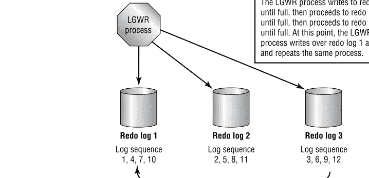

`LGWR` 进程写入重做日志 1 直到填满，然后继续写入重做日志 2 直到填满，然后继续写入重做日志 3 直到填满。此时，`LGWR` 覆盖重做日志 1 并重复相同的过程。

Copyright 2002 SYBEX, Inc., Alameda, CA www.syb.com

## Oracle 恢复过程、内存组件和文件结构 183

重做日志包含称为系统更改号（SCN）的值，它可以唯一标识数据库中的每个已提交事务。SCN 唯一标识数据库中的每个已提交事务。

## 归档日志

归档日志是在线日志在被 `LGWR` 覆盖之前的副本。归档日志用于恢复。

## 控制文件

控制文件是包含数据库物理结构的二进制文件，例如构成数据库的所有文件的操作系统文件名。你应该始终至少保留两个控制文件。控制文件的复用是为了可靠性。

## 参数文件

有两个参数文件构成了 Oracle9i 数据库的文件结构。参数文件是包含在启动时使用的数据库初始化参数的文件。标准参数文件称为 `init<ORACLE_SID>.ora`，包含了实例启动所需的参数。`ORACLE_SID` 等于 Oracle 系统标识符的名称或数据库名称。该参数文件是 ASCII 格式，可以进行编辑。

第二个参数文件 `spfile<ORACLE_SID>.ora` 是服务器参数文件，存储了实例启动所需的持久性参数以及在数据库启动时修改的参数。服务器参数文件以二进制格式存储，这是 Oracle9i 的新功能。

这两个文件中的任何一个都可以用于启动 Oracle 数据库，但 `spfile.ora` 文件是启动数据库的默认文件。如果找不到这些文件，将使用 `init.ora` 文件。

这些文件的默认位置位于以下目录结构中。我们将演示 Unix 和 Windows NT/2000 的位置。

```
Unix $ORACLE_HOME/dbs

Windows NT/2000 %ORACLE_HOME%\database
```

## 检查点、重做日志和归档日志

现在你已经对用于恢复的各种 Oracle 进程、文件结构和内存结构有了基本的了解，是看看它们是如何相互关联的。正如你之前学到的，检查点、重做日志和归档日志对恢复的所有方面都非常重要。

检查点是一个确定磁盘上事务同步或一致性的事件。检查点通过在控制文件、数据文件头、在线重做日志和归档日志中存储一个唯一数字——SCN（再次，这代表系统更改号）来实现。

检查点由 `CKPT` 进程执行。数据块写器（`DBWR`）进程启动检查点的方法之一。`DBWR` 进程通过将数据缓冲区中所有已修改的数据块（脏缓冲区）写入检查点来启动检查点。检查点完成后，所有提交的事务都会写入数据文件。

### 检查点、重做日志和归档日志 187

如果实例在此时发生崩溃，则只需要将此检查点之后发生的新事务应用到数据库以实现完整恢复。因此，检查点过程决定了在发生故障和后续恢复时，需要从重做日志将哪些事务应用到数据库。记住，所有事务（无论是否提交）都会写入重做日志。

导致检查点发生的其他方法包括以下任何命令：`ALTER SYSTEM SWITCH LOGFILE`、`ALTER SYSTEM CHECKPOINT LOCAL`、`ALTER TABLESPACE BEGIN BACKUP` 和 `ALTER TABLESPACE END BACKUP`。

SCN 在日志切换时记录在重做日志中，至少每次日志切换都会发生检查点。归档日志中记录的 SCN 与在线重做日志相同，因为归档日志仅仅是在线日志的副本。

让我们来看检查点、在线重做日志和归档日志相互关联的例子。首先，使用 `ALTER TABLESPACE BEGIN BACKUP` 命令开始数据库的在线备份。


> 在线备份（也称为热备）在数据库仍然可用或运行期间发生。请参阅第 9 章“用户管理和基于 RMAN 的备份”获取有关热备的更详细解释。

`ALTER TABLESPACE BEGIN BACKUP` 命令之后是一个一个 OS 命令来复制文件，例如在 Unix 中。然后使用 `ALTER TABLESPACE END BACKUP` 结束热备。正如我们所讨论的，这些 `ALTER TABLESPACE` 命令也会导致检查点的发生。以下是正在备份的表空间 DATA 的数据文件 `data01.dbf` 的示例：

```
SQL> connect /as sysdba

Connected.

SQL> alter tablespace data begin backup;

Tablespace altered.

SQL> ! cp data01.dbf /stage/data01.dbf

SQL> alter tablespace data end backup;

Tablespace altered.

SQL>
```


# 188 第 6 章 • 实例和媒体恢复结构

注意，`DATA` 表被置于备份模式，然后执行了 OS 命令，将数据文件 `data01.dbf` 复制到新目录 `/stage`，并在其中等待完成。最后，`DATA` 表被移出备份模式。这是一个热备的简化示例。（注：此处删除了原文中大量重复的文本描述，以保持逻辑流畅）。

如果实例在此时发生崩溃，则只需要将此检查点之后发生的新事务应用到数据库以实现完整恢复。因此，检查点过程决定了在发生故障和后续恢复时，需要从重做日志将哪些事务应用到数据库。记住，所有事务（无论是否提交）都会写入重做日志。

导致检查点发生的其他方法包括以下任何命令：`ALTER SYSTEM SWITCH LOGFILE`、`ALTER SYSTEM CHECKPOINT LOCAL`、`ALTER TABLESPACE BEGIN BACKUP` 和 `ALTER TABLESPACE END BACKUP`。

`SCN` 在日志切换时记录在重做日志中，至少每次日志切换都会发生检查点。归档日志中记录的 `SCN` 与在线重做日志相同，因为归档日志仅仅是在线日志的副本。

让我们来看检查点、在线重做日志和归档日志相互关联的例子。首先，使用 `ALTER TABLESPACE BEGIN BACKUP` 命令开始数据库的在线备份。


> 在线备份（也称为热备）在数据库仍然可用或运行期间发生。请参阅第 9 章“用户管理和基于 RMAN 的备份”获取有关热备的更详细解释。

`ALTER TABLESPACE BEGIN BACKUP` 命令之后是一个 OS 命令来复制文件，例如在 Unix 中。然后使用 `ALTER TABLESPACE END BACKUP` 结束热备。正如我们所讨论的，这些 `ALTER TABLESPACE` 命令也会导致检查点的发生。以下是正在备份的表空间 `DATA` 的数据文件 `data01.dbf` 的示例：

```
SQL> connect /as sysdba

Connected.

SQL> alter tablespace data begin backup;

Tablespace altered.

SQL> ! cp data01.dbf /stage/data01.dbf

SQL> alter tablespace data end backup;

Tablespace altered.

SQL>
```

注意，`DATA` 表被置于备份模式，然后执行了 OS 命令，将数据文件 `data01.dbf` 复制到新目录 `/stage`，并在其中等待完成。最后，`DATA` 表被移出备份模式。这是一个热备的简化示例。

## 实例恢复的方法

正如我们之前在第 5 章“备份与恢复”中讨论过的，实例失败是指 Oracle 实例因停电等原因异常终止。实例恢复是 Oracle 执行的确保数据库正常运行的自动过程。这被称为向前（roll forward）和回滚（rollback）过程。

有两个可以加速实例恢复的主要初始化参数。第一个参数是 `FAST_MTTR_TARGET`。该参数使数据库写器（`DBW0`）后台进程以更快的速度和预定义的速率写入脏块，以满足约定的时间范围。该参数可以设置为 0 到 3600 之间。

第二个参数是 `FAST_PARALLEL_ROLLBACK`。该参数确定了执行并行回滚的最大进程数。当实例恢复涉及运行中的事务时，该参数非常有用。这使得实例恢复的回滚部分处理得更快。该参数可以设置为 `HIGH`、`LOW` 和 `FALSE`。以下是 `.init_ora` 参数：

```
fast_start_mttr_target = 300

fast_start_parallel_rollback = LO
```

有三个 `v$` 视图可以监控这些参数：`v$INSTANCE_RECOVERY`、`v$FAST_START_SERVERS` 和 `v$FAST_START_TRANSACTIONS`。以下是 `v$INSTANCE_RECOVERY` 视图的示例，可用于监控并确定 `FAST_START_MTTR_TARGET` 参数的恢复长度。在发生实例故障时，`TARGET_MTTR` 和 `ESTIMATED_MTTR` 应显示恢复数据库的预计秒数。

```
SQL> select target_mttr,estimated_mttr from v$instance_recovery;
```

| TARGET_MTTR | ESTIMATED_MTTR |
|---|---|
| 29 | 17 |

```sql
SQL>
```


# 分布式数据库环境中的真实场景实例恢复

让我们来看一个真实示例，确定即使 Oracle 实例恢复能够正确处理所有数据丢失，什么情况下仍会导致数据丢失。

一家小型制造公司在 Oracle 数据库上生成其制造数据。该数据库跟踪原材料、半制品和成品。为了完成所需的工作，该数据库在公司为了客户需求运行三个班次期间必须保持可用。

出于财务考虑，该制造数据库的信息会定期被传输到另一个位于另一台服务器上的财务数据库。这是通过各种数据库外传输完成的，这导致数据在流回财务数据库之前一直处于暴露风险状态。

在其中一次传输过程中，公司经历了严重的电压激增，导致服务器重启。结果是，当电压激增发生时，每份正在从制造数据库传输到财务数据库的数据，其所在的数据库上都发生了实例故障。此外，数据库传输机制没有恢复传输中的数据。

此时，经验丰富的数据库管理员可以发现，这里的问题是一个松散的分布式数据库环境。这可能是由于公司对制造应用和财务应用使用了不同的供应商，并配有自定义的应用程序接口（`API`）导致的。

## 总结 191

现在电压激增结束，系统管理员必须重启服务器，数据库管理员需要验证数据库是否再次可用。完成后，管理员发现制造数据库认为数据已传输到财务数据库，但在实例故障发生之前，数据从未真正进入财务数据库。

结果是，数据库之间不同步，必须手动跟踪数据不一致性问题。分析师和业务人员必须通过一系列即时 SQL 语句来确定哪些数据进入或没有进入相应的数据库。

### 总结

Oracle 中提供的恢复结构和过程为 DBA 提供了恢复选项。这些恢复结构由位于数据库中的文件、内存缓冲区和逻辑对象组成。除了这些恢复结构外，本章还识别了文件结构——重做日志、归档日志、控制文件、数据文件和参数文件，以及进程——`PMON`、`SMON`、`LGWR`、`CKPT` 和 `ARC`。随后讨论了内存结构，包括日志缓冲区和数据缓冲区。所有这些结构在恢复过程中都起着不同的角色，并且可以用于不同类型的恢复。

本章还描述了检查点（checkpoint）。在讨论期间，你学习了 `SCN` 的重要性，以及这些标识符如何决定已应用于数据库的事务的一致性。

此外，你查看了调优恢复过程所需的三个主要初始化参数。通过这些参数，DBA 可以限制恢复过程的时间，使其恢复到近似限制。这些参数可以通过一系列 `V$` 视图进行监控。

本章为后续章节和真实世界中备份与恢复过程的决策奠定了基础。理解本章中讨论的文件结构和进程如何运作，以在故障情况下使数据库保持一致或变得不一致，是至关重要的。这些主题可以被视为备份和恢复过程的基石。

### 考试要点

- 识别参与恢复的 Oracle 后台进程。恢复涉及五个后台进程。这些进程如下：日志记录器（`LGWR`）写入重做日志；系统监器（`SMON`）参与实例恢复；进程监控器（`PMON`）执行进程故障恢复；检查点（`CKPT`）执行数据文件的检查点；归档器（`ARCn`）将在线重做日志复制到归档日志。
- 识别参与恢复的 Oracle 内存结构。恢复过程涉及两个内存结构。日志缓冲区记录重做日志更改的内存缓冲区，数据块缓冲区存储所有用户查询和修改的缓存数据。
- 识别参与恢复的 Oracle 文件结构。与恢复相关的文件结构包括在线重做日志、归档日志、控制文件、数据文件和参数文件。这些文件 Oracle 数据库的物理组件。
- 理解检查点过程。检查点过程与重做日志、归档日志和数据文件头交互，以 `SCN` 同步数据库。检查点的发生由于日志切换、脏块缓冲区、系统命令和初始化参数。
- 理解归档日志的区别。你查看了调优恢复过程所需的三个主要初始化参数。通过这些参数，DBA 可以限制恢复过程的时间，使其恢复到近似限制。这些参数可以通过一系列 `V$` 视图进行监控。

### 关键术语

在参加考试之前，确保你了解以下术语：
- 归档日志 (`archived log`)
- 归档器 (`ARCn`)
- 检查点 (`CKPT`)
- 检查点操作 (`checkpointing`)
- 提交 (`commit`)
- 控制文件 (`control file`)
- 当前在线重做日志 (`current online redo log`)
- 数据块 (`data block`)
- 数据文件 (`data file`)
- 数据缓冲区 (`data buffer`)
- 脏缓冲区 (`dirty buffer`)
- 头部块 (`header block`)
- 热备 (`hot backup`)
- `init.ora`
- 实例故障 (`instance failure`)
- 实例恢复 (`instance recovery`)
- 日志缓冲区 (`log buffer`)
- 日志记录器 (`LGWR`)
- 逻辑对象 (`logical object`)
- 逻辑结构 (`logical structure`)
- 多路复 (`multiplexing`)
- 非当前重做日志 (`non-current redo log`)
- 离线重做日志 (`offline redo log`)
- 在线备份 (`online backup`)
- 在线重做日志 (`online redo log`)
- `ORACLE SID`
- 参数文件 (`parameter file`)
- 物理结构 (`physical structure`)
- 进程 (`process`)
- 进程监控器 (`PMON`)
- 重做缓冲区 (`redo buffer`)
- 重做条目 (`redo entry`)
- 重做日志 (`redo log`)
- 前滚和回滚过程 (`roll forward and rollback process`)
- `spfile.ora`
- 结构 (`structure`)
- 系统更改号 (`SCN`)
- 系统监器 (`SMON`)
- 表空间 (`tablespace`)
- 事务 (`transaction`)

### 题目

1. DBA 必须执行什么命令来启动实例恢复？
A. `RECOVER DATABASE`
B. `RECOVER INSTANCE`
C. `RECOVER TABLESPACE`
D. 不需要命令。

2. 哪个进程负责写入重做日志？
A. 日志缓冲区
B. `ARCnn`
C. 数据缓冲区
D. `LGWR`

3. 哪些文件结构与恢复相关？（多选）
A. 重做日志
B. 归档日志
C. 日志缓冲区
D. 数据文件

4. 哪种文件是由存储数据库所有物理组件信息的二进制文件？
A. 重做日志
B. 数据文件
C. 控制文件
D. 归档日志

5. 哪些进程与恢复相关？（多选）
A. `PMON`
B. `SMON`
C. `ARCcn`
D. `DBWR`

6. Oracle9 中哪个进程负责执行检查点？
A. `SMON`
B. `PMON`
C. `LGWR`
D. `CKPT`

7. 以下哪些是内存结构？（多选）
A. 回滚段
B. 日志缓冲区
C. 数据块缓冲区
D. 数据文件

8. 种类型的关闭在启动时需要实例恢复？
A. `SHUTDOWN NORMAL`
B. `SHUTDOWN IMMEDIATE`
C. `SHUTDOWN TRANSACTIONAL`
D. `SHUTDOWN ABORT`

9. 哪些事件会触发检查点的发生？（多选）
A. `CKPT`
B. `SHUTDOWN NORMAL`
C. `SHUTDOWN IMMEDIATE`
D. 日志切换

10. 哪个过程负责为所有必要的物理数据库结构打上 `SCN`？
+ A. 读一致性映像
+ B. 检查点（Checkpointing）
+ C. 提交（Commits）
+ D. 回滚（Rollbacks）

11. 什么事件发生时，脏缓冲区会被写入磁盘？
A. 发生了提交（commit）。
B. 发生了回滚（rollback）。
C. 发生了检查点（checkpoint）。
D. 发生了强制关闭（`SHUTDOWN ABORT`）。

12. 数据库启动时，哪个数据库进程不是强制性的或不存在的？
A. `PMON`
B. `CKPT`
C. `SMON`
D. `ARCn`

13. 负责实例恢复的主要后台进程是哪个？
A. `PMON`
B. `LGWR`
C. `SMON`
D. `ARCn`

14. 正在被活动写入的重做日志被称为？
A. 在线归档日志
B. 当前在线重做日志
C. 在线重做日志
D. 离线重做日志

15. 当前没有被写入，而是被复制到新位置的重做日志被称为？
+ A. 在线归档日志
+ B. 当前在线重做日志
+ C. 离线重做日志
+ D. 在线重做日志

16. 哪个文件结构将数据库的物理结构与逻辑数据库结构连接起来？
+ A. 表（Table）
+ B. 控制文件（Control file）
+ C. 重做日志（Redo log）
+ D. 数据文件（Data file）

17. 哪个内存结构负责临时存储重做日志记录？
+ A. 大池（Large pool）
+ B. 数据库缓冲区（Database buffers）
+ C. 日志缓冲区（Log buffers）
+ D. 共享池（Shared pool）

18. 拥有多个控制文件称为？
+ A. 多个控制文件
+ B. 复制控制文件
+ C. 多路用控制文件（Multiplexing）
+ D. 双工控制文件（Duplexing）

19. 日志切换（log switch）发生时会发生什么事件？
+ A. 创建了一个归档日志。
+ B. 发生了检查点（checkpoint）。
+ C. 所有事务都已提交。
+ D. 所有挂起的事务都已提交。

20. 哪个是 Oracle9i 新引入的物理结构？
+ A. 所有参数文件
B. 多路用控制文件
C. `init.ora`
D. `spfile.ora`

### 复习题答案

- 1. D. 实例恢复是自动的。
- 2. D. `LGWR`（或日志写入进程）将更改从日志缓冲区写入到在线重做日志中。
- 3. A, B, D. 重做日志、归档日志和数据文件都是与恢复相关的文件结构。日志缓冲区是内存结构。
- 4. C. 控制文件是一个二进制文件，存储了数据库的所有物理组件。
- 5. A, B, C. `PMON`、`SMON` 和 `ARCn` 都与恢复过程的某些部分有关。`PMON` 恢复失败的进程，`SMON` 协助实例恢复，`ARCn` 生成用于恢复数据库的归档日志。`DBWR` 在适当将数据写入数据文件。
- 6. D. `CKPT` 进程执行所有的检查点操作。该进程默认启动。
- 7. B, C. 与恢复相关的内存结构只有两种：日志缓冲区和数据块缓冲区。
- 8. D. `SHUTDOWN ABORT` 在启动时需要实例恢复，因为数据文件在关闭期间没有进行检查点。
- 9. B, C, D. `SHUTDOWN NORMAL`（正常关闭）和 `SHUTDOWN IMMEDIATE`（立即关闭）事件会对所有必要的物理数据库结构执行检查点。切换日志文件会强制所有必要的物理数据库结构执行检查点。`CKPT` 进程负责启动或执行检查点，而不是触发它。
- 10. B. 检查点是由 `CKPT` 进程启动的过程，它为所有数据文件、重做日志和控制文件打上最新的 `SCN`。
- 11. C. 检查点清理要刷到磁盘的脏缓冲区。`SHUTDOWN NORMAL` 或 `SHUTDOWN_IMMEDIATE` 会导致检查点的产生。
- 12. D. 由于数据文件在关闭期间没有进行检查点，因此 `SHUTDOWN ABORT` 在启动时需要实例恢复。
- 13. C. `SMON` 负责实例恢复。
- 14. B. 当前在线重做日志正在被写入。
- 15. C. 离线重做日志被复制到新位置。
- 16. D. 数据文件是新的物理结构。
- 17. C. 日志缓冲区临时存储重做日志记录。
- 18. C. 拥有多个控制文件的这种做法被称为多路用。
- 19. B. 日志切换强制所有事务执行检查点。
- 20. D. `spfile.ora` 是 Oracle9i 的功能。

# 第 7 章 配置数据库

## 配置数据库

## 归档模式

**本章目标：**

- 描述归档模式（Archivelog）和非归档模式（Noarchivelog）之间的差异
- 配置归档
- 启用和禁用归档
- 执行手动归档
- 配置多个目的地

考试目标可能会更改。请访问 Oracle 网站获取最新信息。

### 归档模式

配置归档


在第 6 章“实例和恢复”中，你学习了结构。在本章中，我们将讨论归档过程。归档日志是恢复的关键组件。了解如何配置数据库归档以便在发生故障时非常重要。

### 选择归档模式或非归档模式

数据库管理员（DBA）做出的最基本的决策之一是用 `ARCHELOG` 模式还是 `NOARCHELOG` 模式运行数据库。正如你之前学的，重做日志记录了发生的所有事务，归档日志是这些历史事务的副本。

### ARCHELOG 模式

在归档模式下，数据库从重做日志生成归档日志。这意味着数据库创建了所有的历史事务。运行归档模式还有其他特点：

- 可以进行在线备份（热备）。这种备份是在数据库运行时进行的，因此执行备份不需要中断服务。执行 `ALTER TABLESPACE <表空间名> BEGIN backup` 命令进行热备份。执行此命令后，可以对每个表的关联数据文件进行 OS 复制。当 OS 复制完成后，必须执行 `ALTER TABLESPACE <表空间名> END backup` 命令。这些命令需要在数据库的每个表执行。
- 可以进行完全恢复。这是因为归档日志包含了故障点之前的更改。所有日志都可以应用于数据库的备份（热备或冷备）。这适用于直到故障发生为止的所有事务。不会有数据丢失或事务缺失。
- 表空间可以立即离线。
- 归档日志需要更多的磁盘空间，并且维护这些磁盘空间也需要更多的工作。

### NOARCHELOG 模式

在非归档模式下，数据库不从重做日志生成归档日志。这意味着数据库没有存储任何此类历史事务。相反，重做日志会根据 Oracle 的需要相互覆盖。因此，只有

# 204 第7 章 · 配置数据库归档模式

在实例发生故障时，用于恢复的数据位于当前的重做日志（redo logs）中。在 `NOARCHILOG` 模式下运行具有以下特点：

- 在大多数情况下，无法进行完全恢复。这意味着将会丢失数据。需要使用最后一次冷备份进行恢复。
- 备份时必须完全关闭数据库，这意味着在此期间数据库用户将无法使用数据库。这意味着只能进行冷备份。
- 表空间无法立即离线。
- 不需要额外的磁盘空间和维护工作来存储归档日志。

### 理解 NOARCHIVELOG 模式的恢复影响

在 `NOARCHIVELOG` 模式下运行数据库的恢复影响非常重要。当使用最后一次一致的全量备份进行恢复时，通常会发生数据丢失。因此，为了减少发生故障时丢失的数据量，需要频繁进行冷备份。这意味着数据库可能会定期对用户不可用。

现在你已经熟悉与此模式相关的问题，让我们来看看在什么情况下使用 `NOARCHIVELOG` 模式是不合理的，在什么情况下是合理的。

假设 A 公司的数据库必须每天 24 小时可用，以支持三个班次的工作。这些工作包括输入订单、装载、发货指令和库存调整。班次为：白班，上午 9 点到下午 5 点；晚班，下午 5 点到凌晨 1 点；夜班，凌晨 1 点到上午 9 点。如果该数据库在午夜到凌晨 2 点之间为了冷备份而关闭，那么夜班和晚班在在此期间将无法使用它。因此，`NOARCHIVELOG` 备份策略对于 A 公司来说是不可行的。

另一方面，如果 B 公司的数据库只需要在白班（上午 9 点到下午 5 点）可用，那么可以在下午 5 点之后、上午 9 点之前进行备份，而不会影响用户。因此，DBA 可以安排数据库在午夜关闭并进行两个小时的备份。数据库将在上午 9 点之前重启，不会对用户工作产生干扰。如果发生故障，将会有每个晚的备份，且最多只会丢失一天的数据。如果一天的数据丢失是可以接受的，那么这对于 B 公司来说就是一个可行的备份和恢复策略。

这些示例表明，在某些情况下，运行 `NOARCHILOG` 模式是有意义的。但这种选择会带来恢复影响。其中一个影响是发生故障时会丢失数据。此外，恢复方式的选择也有限。通常的选择是在数据库关闭（冷备份）期间，从最后一次一致的全量备份恢复整个数据库。

### 配置数据库的 ARCHIVLOG 模式和自动归档

一旦决定将数据库设置为 `ARCHIVLOG` 模式，就需要对数据库进行正确配置。你可以在创建数据库时对新数据库进行配置，或者通过 Oracle 命令对现有数据库进行配置。数据库进入 `ARCHIVELOG` 模式后，你可能还会配置自动归档。自动归档使 DBA 从在在线重做日志完成完整循环之前通过命令手动归档日志的任务中解放出来。

### 配置 ARCHIVLOG 模式

`ARCHIVLOG` 模式可以在数据库创建期间或通过 `ALTER DATABASE ARCHIVLOG` 命令设置。执行此命令时，数据库必须挂载（mounted）但不能打开（open）。该命令一直有效，直到使用 `ALTER DATABASE NOARCHLOG` 命令关闭。执行此命令时数据库也必须挂载但不能打开。

重做日志文件将归档到 `init.ora` 文件中 `LOG_ARCHIVE_DEST` 参数指定的的位置。默认情况下，数据库处于手动归档模式。这意味着重做日志满后，数据库将挂起直到 DBA 发布 `ARCHIVE LOG` 命令，该命令将归档所有尚未归档的在线重做日志。图 7.1 显示了一个配置为 `ARCHIVELOG` 模式的数据库。

# 第7 章 · 配置数据库归档模式

图 7.1 配置为 `ARCHIVELOG` 模式的数据库

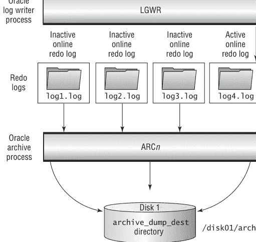

让我们来看一个如何判断数据库处于 `ARCHIVELOG` 还是 `NOARCHIVELOG` 模式的示例。你需要运行 `SQL*Plus` 并执行查询一个 `V$` 视图的 SQL 语句。或者，你也可以执行操作系统命令（例如在 Unix 中使用 `ps -ef |grep`）来检查进程列表，查看哪个 `ARCn` 进程正在运行。该进程负责将归档日志复制到重做日志的工作。此示例使用 `V$` 视图显示 `ARCHIVELOG` 模式：


oracle@ocommit: ~ `sqlplus /nolog`

```
SQL*Plus: Release 9.0.1.0.0 - Production on Tue Sep 25 19:08:25
```

oracle@ocommit: ~ `sqlplus /nolog`

```
SQL*Plus: Release 9.0.1.0.0 - Production on Tue Sep 25 19:08:25
```

Copyright©2002 SYBEX, Inc., Alameda, CA
www.sysex.com

# 配置数据库的 ARCHIVLOG 模式和自动归档 205

Copyright©2002 SYBEX, Inc., Alameda, CA
www.sysex.com

## 210 第 7 章 配置数据库归档模式

1. 首先，编辑 `init.ora` 文件并将参数 `LOG_ARCHIVE_START` 修改为 `TRUE`。结果是数据库将进入自动 `ARCHIVELOG` 模式。见下面的 `init.ora` 文件示例。

```
###########################################
# Init.ora 文件部分示例
###########################################
###########################################
## 归档日志
###########################################
log_archive_start=true
log_archive_dest=/oracle/admin/orc9/%arch
log_archive_format=archorc9_%s.log
```

2. 接下来在 SQL 中运行以下命令：

```sql
SQL shutdown
SQL startup mount
SQL alter database archlog;
SQL alter database open;
```

该数据库现在已启用自动功能。要验证数据库是否配置正确，可以执行以下检查。

1. 首先，执行 `ALTER SYSTEM SWITCH LOGFILE`。这需要执行 $n + 1$ 次，其中 $n$ 是数据库中重做日志（redo logs）的数量。

```sql
SQL alter system switch logfile;
```

2. 接下来，对 `LOG_ARCHIVE_DEST` 中的归档目标执行目录列表。Unix 命令 `pwd` 显示当前工作目录，`ls` 显示目录内容。

```
oracle@octilli:/oracle/admin/orc9/arch > ls -ltr
total 276
-rw-r---- 1 oracle dba 133632 Sep 25 00:27 archorc9_3.log
-rw-r---- 1 oracle dba 125952 Sep 25 00:28 archorc9_4.log
-rw-r---- 1 oracle dba 1024 Sep 25 00:28 archorc9_5.log
-rw-r---- 1 oracle dba 1536 Sep 25 00:28 archorc9_6.log
-rw-r---- 1 oracle dba 1024 Sep 25 00:28 archorc9_7.log
oracle@octilli:/oracle/admin/orc9/arch >
```

另一种验证自动归档功能已启的方法是执行 `ARCHIVE LOG LIST` 命令，它显示这些设置的状态（如下）。

```sql
SQL> archive log list;
Database mode Archive Mode
Automatic archival Enabled
Archive destination /oracle/admin/orc9/arch
Oldest log sequence 6
Next log sequence to archive 8
Current log sequence 8
SQL>
```

> 如果启用了 `ARCHIVOG` 但由于没有通过编辑 `init.ora` 并将 `LOG_ARCHIVE_START` 更改为 `TRUE` 而未能启用自动归档，数据库在达到最后一个可用重做日志时将会挂起。您需要执行手动归档作为临时修复，或者在更改 `LOG_ARCHIVE_START` 参数后关闭并启动数据库。


| 现实世界场景 |
| :--- |
| 为归档日志提供足够的空间 |
| `ARCHIVLOG` 模式所需的额外磁盘空间经常被忽略或低估。对于普通数据库，您应该有足够的空间保留一到两天的归档日志在线运行。为了估算文件的正确大小，您需要估算交易高峰期间的量。峰值时间通常是事务活动或批处理活动最频繁的时候。将此估算大小乘以设置的 `log_archive_dest_n_locations` 数量。如果您在系统上进行每晚热备，从归档日志的角度来看，一到两天的归档日志应该满足您大多数的恢复需求。 |

> 但如果归档进程没有足够的磁盘空间写入归档日志，数据库将挂起或停止所有活动。这种挂起状态将一直持续，直到您通过将旧的归档日志移出系统、压缩日志文件或通过设置自动化作业在日志写入磁带后将其删除。在尝试为归档进程释放空间时，您必须小心不要放错或删除归档日志。请记住，这些归档日志在恢复情况下可能是需要的。

## 手动归档日志

日志的手动归档包括启用数据库以启用 `ARCHIVLOG` 模式，然后从 SQL 手动执行 `ARCHIVE LOG` 命令。`init.ora` 参数 `LOG_ARCHIVE_START` 必须设置为 `FALSE` 以禁用自动归档。下一步是通过执行以下命令将数据库置于 `ARCHIVLOG` 模式：

```sql
SQL> shutdown
SQL> startup mount
SQL> alter database archivel;
SQL> alter database open;
```

现在您准备可以使用以下命令进行重做日志的手动归档：

```sql
SQL> archive log all;
```

或

```sql
SQL> archive log next;
```


`ARCHIVE LOG ALL` 命令将归档所有可用的重做日志，而 `ARCHIVE LOG NEXT` 命令将归档下一组日志。

## 多个归档进程和位置

多个归档日志目标的能力首次在 Oracle8i 和 9i 中引入；可以使用两个以上的目标，提供更大的归档日志冗余。为归档文件设置多个目标的原因是为了消除单点故障。例如，如果您在备份这些归档日志之前丢失了存储日志的磁盘，数据库将面临数据丢失的风险。如果包含归档日志的磁盘丢失，那么最安全的办法是运行备份。只有一个归档日志位置将成为备份过程的单点故障。多个位置（可以位于不同的磁盘驱动器上）显著降低了归档日志丢失的可能性。参见图 7.2，它演示了具有多个目标的 `ARCHIVELOG` 模式。

除了减少潜在的日志丢失外，多个位置之一可以是远程的。远程位置支持 Oracle 数据库，这是一个可以配置以保护计算站点免受灾难影响的选项。Oracle 备用数据库可以将归档日志移动到运行生产数据库副本的远程服务器。该生产数据库副本处于永久恢复状态，来自生产数据库的归档日志定期应用到备用数据库。使用了某些初始化参数来确保归档日志到达远程位置。这些初始化参数将在接后的章节“远程归档位置”中进行详细介绍。

## 图 7.2 具有多个目标的 ARCHIVELOG 模式

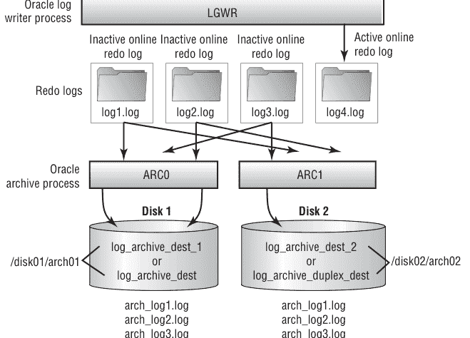

注意：`log_archive_dest_1` 和 `log_archive_dest_2` 参数协同工作。多个位置可以使归档日志的创建更快。当有大量数据通过时，归档进程可能会成为瓶颈。此外，如果数据库向多个目标写入，归档进程需要执行更多工作。因此，多个归档进程可以支持额外的目标。

要实现这些新功能，数据库必须处于 `ARCHIVELOG` 模式（按照前文“配置 ARCHIVELOG 模式和自动归档”章节所示步骤设置）。要验证数据库是否处于 `ARCHIVELOG` 模式，请运行归档列表命令或查询 `V$DATABASE` 视图。

## 用于多个归档进程和位置的 init.ora 参数

要为多个归档进程配置数据库，请使用两组 `init.ora` 参数。

第一组基于目标参数，该参数已稍微更改为 `LOG_ARCHIVE_DEST_N`（其中 N 为 1 到 10 的数字）。这些参数 `LOG_ARCHIVE_DEST_1` 和 `LOG_ARCHIVE_DEST_2` 的值为：`'LOCATION = /oracle/admin/orc9/arch1'`、`'LOCATION = /oracle/admin/orc9/arch2'` 以及 `'LOCATION = /oracle/admin/orc9/remote_arch3'`。第一组参数列在 `init.ora` 中：

```
############################################
## 归档日志
############################################
log_archive_start=true
#log_archive_dest=/oracle/admin/orc9/arch
#log_archive_dest_1='location=/oracle/admin/orc9/arch1'
#log_archive_dest_2='location=/oracle/admin/orc9/arch2'
#log_archive_dest_3='location=/oracle/admin/orc9/remote_arch3'
log_archive_max_processes=3
log_archive_format=archorc9%s.log
```


更改或添加这些参数后，您需要启动数据库以使用新参数。这些位置将生效。

第二组参数是 `LOG_ARCHIVE_DEST=<SOME/DIRECTORY/LOCATION>` 和 `LOG_ARCHIVE_DUPLEX_DEST=<SOME/DIRECTORY/LOCATION>`。示例使用的是 `LOG_ARCHIVE_DEST=/oracle/admin/orc9/arch1` 和 `LOG_ARCHIVE_DUPLEX_DEST=/oracle/admin/orc9/arch2`。这种方法的主要区别在于，如果您只有两个位置或想使用 8.0.x 支持的相同 `init.ora` 参数格式，则使用这些参数。这些参数与上一个示例中提到的 `LOG_ARCHIVE_DEST_N` 是互斥的。

确保每个 `LOG_ARCHIVE_DEST_N` 和 `LOG_ARCHIVE_DUPLEX_DEST` 都位于不同的物理设备上。这些新参数的主要目的是在磁盘发生故障时，允许文件的副本保持完好。

## 总结

Oracle 的备份和恢复功能完备且健壮。它提供了许多支持各种备份和恢复场景的。在本章中，你已经了解如何配置 Oracle 数据库进行备份和恢复。你学习了在 `ARCHIVELOG` 模式与 `NOARCHIVELOG` 模式下运行的影响，反之亦然，以及这种选择如何影响备份和恢复过程。你看到了参数如何控制归档日志的目的地和自动化的示例。最后，你通过一个示例，启用了数据库的 `ARCHIVELOG` 模式和日志自动归档。

深入理解归档日志过程是备份和恢复过程的基础。启用归档日志的决定对 DBA 恢复数据库的能力有重大影响。此外，后续章节将涵盖的某些恢复选项取决于你是否启用了 `ARCHIVELOG` 模式。确保你理解启用或不启用归档日志过程的原因，因为这些知识将有助于你在 OCP 测试以及现实生活中的应用。

## 考试要点

- 识别 `ARCHIVELOG` 和 `NOARCHIVELOG` 模式之间的区别。你应该知道数据库是否生成归档日志的区别。确保你意识到 `ARCHIVELOG` 和 `NOARCHIVELOG` 模式对备份和恢复过程的影响。
- 知道如何如何在 `ARCHIVELOG` 模式下配置数据库。能够解释如何配置数据库使其生成归档日志。你应该能够识别参与此过程的命令和初始化参数。
- 知道如何配置数据库进行自动归档。能够识别用于启用自动归档的初始化参数 `LOG_ARCHIVE_START = TRUE`。
- 知道如何执行手动归档。知道如何使用所需的命令手动生成归档日志。
- 理解如何为多个归档目的地配置数据库。了解两种初始化参数方法：`ARCHIVE_DEST_LOG_N` 和 `ARCHIVE_LOG_DEST_DUPLEX`。你还应该理解这些方法之间的区别，例如远程归档日志和位置数量。
- 理解如何配置多个归档进程。要配置多个归档进程，你必须熟悉配置数据库多归档进程的初始化参数。
- 理解涉及远程归档的命令和初始化参数。你应该熟悉影响远程归档的命令，如 `MANDATORY`、`OPTIONAL` 和 `REOPEN`。你还应该熟悉相关的初始化参数，如 `LOG_ARCHIVE_MIN_SUCCEED_DEST`。

## 关键术语

在参加考试之前，请确保熟悉以下术语：

| `ARCHIVELOG` 模式 | 介质故障 |
| :--- | :--- |
| 自动归档 | `NOARCHIVOG` 模式 |
| `LOG_ARCHIVE_DEST` | 在线备份 (hot) |
| `LOG_ARCHIVE_START` | 单点故障 |
| 手动归档 | |

## 复习题

- 1. 启用归档数据库需要处于什么状态？
  A. 打开 (Opened)
  B. 关闭 (Closed)
  C. 挂载 (Mounted)
  D. 未挂载 (Unmounted)

- 2. 当数据库运行在 `ARCHIVELOG` 模式时，DBA 应该哪些问题？
  A. 是否具有完全恢复的能力
  B. 是否需要关闭数据库进行备份
  C. 是否具有不完全恢复的能力
  D. 此模式是否会导致磁盘空间增加

- 3. 下面哪些选项是更改归档日志目的地的方法？（多选）
  A. 修改 `LOG_ARCHIVE_DEST_n` init.ora 参数
  B. 配置控制文件
  C. 修改 `LOG_ARCHIVE_DEST` init.ora 参数
  D. 修改 `LOG_ARCHIVE_D` init.ora 参数

- 4. 支持的最大归档目的地数量是多少？
  A. 1
  B. 2
  C. 5
  D. 10

### 220 第 7 章 • 配置数据库归档模式

5. 哪种类型的数据库备份需要关闭数据库？（多选）
  A. `ARCHIVELOG` 模式数据库
  B. `NOARCHIVOG` 模式数据库
  C. 在线备份 (hot backup)
  D. 离线备份 (offline backup)

6. 列出所有判断数据库是否处于 `ARCHIVELOG` 模式的方法。（多选）
  A. 查询 `V$DATABASE` 视图
  B. 查看 ARCn 进程是否正在运行
  C. 检查 `LOG_ARCHIVE_DEST` 参数
  D. 查看 `ARCHIVE LOG` 命令的结果

7. 你是一家制造公司的 DBA，该公司每天运行三班，24 小时处理订单、库存调整和发货。你应该执行哪种类型的备份？（多选）
  A. `ARCHIVELOG` 模式下的在线备份
  B. `ARCHIVELOG` 模式下的离线备份
  C. `NOARCHIVOG` 模式下的在线备份
  D. `ARCHIVELOG` 模式下的在线备份

8. 哪个 init.ora 参数允许两个以上的归档目的地？
  A. `ARCHIVE_DEST_N`
  B. `ARCHIVE_DEST_DUPLEX`
  C. `LOG_ARCHIVE_DEST`
  D. `LOG_DEST`

### 221 复习题

9. 哪个 init.ora 参数允许超过 10 个归档目的地？
  A. `ARCHIVE_DEST_N`
  B. `ARCHIVE_DEST_DUPLEX`
  C. `LOG_ARCHIVE_DEST`
  D. `LOG_DEST`

10. 哪个 init.ora 参数允许多个远程归档目的地？
  A. `ARCHIVE_DEST`
  B. `ARCHIVE_DEST_DUPLEX`
  C. `LOG_ARCHIVE_DEST`
  D. `LOG_ARCHIVE`

11. 执行手动归档需要哪个命令？
  A. `ARCHIVE LOG`
  B. `MANUAL`
  C. `ARCHIVE LIST`
  D. `ALL`

12. 手动归档数据库需要什么？
  A. 数据库运行在 `ARCHIVELOG` 模式
  B. `LOG_ARCHIVE_START` 设置为 TRUE
  C. `MANUAL_ARCHIVE` 设置为 TRUE
  D. 什么都不

13. 执行手动归档需要哪个命令？
  A. `ARCHIVE NEXT`
  B. `ARCHIVE LIST`
  C. `ARCHIVE LOG`
  D. `ALL`

14. 如果启用了 ARCHIVELOG 模式，但 `LOG_ARCHIVE_START` 未设置为 TRUE，数据库会发生什么？（多选）
  A. 数据库将带问题运行
  B. 数据库将挂起直到日志归档
  C. 数据库将因为配置错误无法启动
  D. 数据库将一直工作直到重做日志填满

15. 关于 `NOARCHIVELOG` 模式，以下哪项是正确的？
  A. 数据库必须完全关闭
  B. 备份前必须将表空间离线
  C. 数据库必须运行以进行备份
  D. 数据库可以运行以进行备份，但并没有

16. 哪个初始化参数决定了在重写重做日志之前必须有多少个归档目的地成功写入？
  A. `ARCHIVE_MIN_SUCCEED`
  B. `LOG_ARCHIVE_MIN_SUCCEED`
  C. `LOG_ARCHIVE_MIN_SUCCEED_DEST`
  D. `ARCHIVE_MIN_SUCCEED_DEST`

17. 如果归档日志未到达归档目的地，哪个参数将允许数据库继续处理？
  A. `REOPEN`
  B. `MANDATORY`
  C. `OPTIONAL`
  D. `UNSSCCESSFUL`

18. 哪个参数会导致失败的归档日志传输在指定时间后重试？
  A. `MANDATORY`
  B. `OPTIONAL`
  C. `REOPEN`
  D. `RETRY`

19. 你如何识别数据库是否处于 `ARCHIVELOG` 模式？（多选）
  A. 你可以使用 `ARCHIVE LOG LIST` 命令
  B. 你可以查询 `V$DATABASE`
  C. 你可以使用 `ARCHIVELOG LIST` 命令（注：此处原文重复）
  D. 你可以查询 `V$LOG`

20. 当数据库满足哪种情况时，可以进行完全恢复？
  A. 处于 `ARCHIVELOG` 模式
  B. 处于 `NOARCHIVELOG` 模式
  C. 启用了手动归档
  D. 启用了自动归档

## 复习题答案

- 1. C. 数据库必须在 MOUNT 模式下才能启用归档日志。
- 2. D. 由于归档日志的创建，数据库将使用更多空间。
- 3. A, C. 归档目的地由 init.ora 中的 `LOG_ARCHIVE_DEST` 参数以及在数据库运行时通过 `ALTER SYSTEM` 命令控制。
- 4. D. 最大归档目的地数量由 init.ora 中的 `LOG_ARCHIVE_DEST_N` 参数控制。它最多支持 10 个位置。
- 5. B, D. 处于 NOARCHELOG 模式的数据库不支持在不关闭的情况下进行备份，冷备份是在数据库离线或关闭时执行的备份。
- 6. A, B, D. V$DATABASE 显示数据库是处于 ARCHIVELOG 模式还是 NOARCHIVOG 模式，ARCh 进程直接决定归档进程正在运行，ARCHIVE LOG LIST 命令显示是否启用了归档。检查 `LOG_ARCHIVE_DEST` 参数的值仅表示是否存在一个包含归档日志的目录，并不表示数据库是否处于 ARCHIVELOG 模式。
- 7. A. 热备份和在线备份是同义词。冷备份和离线备份是同义词（因此答案 C 中的方法并不存在）。热备份可以在数据库运行时运行；因此，它不会影响数据库的可用性。由于此数据库必须保持 24 小时可用，因此热备份或在线备份是合适的。
- 8. D. `LOG_ARCHIVE_DUPLEX_DEST` 参数允许归档目的地。此外，此参数必须与第一个归档日志目的地的 `LOG_ARCHIVE_DEST` 参数配合使用。
- 9. E. `LOG_ARCHIVE_DEST_N` 允许最多 10 个位置。
- 10. C. `LOG_ARCHIVE_DEST_N` 允许最多 10 个位置。这些位置中的一个可以是远程的，即不在同一台服务器上。
- 11. D. `ARCHIVE LOG ALL` 命令负责手动生成归档日志。`ARCHIVE LOG NEXT` 命令也会手动归档日志，但它只归档序列中的下一个日志，而不是所有的归档日志。数据库必须处于 ARCHIVELOG 模式。
- 12. A. 以 ARCHIVELOG 模式运行数据库是执行手动或自动归档的要求。这意味着数据库必须使用 `START MOUNT` 重启，然后执行 `ALTER DATABASE ARCHIVELOG` 命令。然后打开数据库以供正常使用。
- 13. A. `ARCHIVE LOG NEXT` 命令将归档下一组重做日志。
- 14. B, D. 在所有在线重做日志填充后数据库将挂起，但只要有未填充的重做日志，它就能正常工作。
- 15. A. 备份时必须完全关闭数据库。如果数据库打开打开并进行备份，备份将是无效。
- 16. C. `LOG_ARCHIVE_MIN_SUCCEED_DEST` 参数决定了在重写重做日志之前必须有多少个日志归档目的地成功写入。
- 17. C. `OPTIONAL` 参数允许数据库在在线重做日志已满且归档日志尚未到达归档目的地时继续继续处理。
- 18. C. `REOPEN` 参数将导致失败的归档日志传输在指定时间段后重试。
- 19. A, B. `ARCHIVE LOG LIST` 命令可以在 SQL*Plus 中执行，并将显示数据库是否处于 ARCHIVELOG 模式。选择 V$DATABASE 也会显示此信息。
- 20. A. 当数据库处于 ARCHIVELOG 模式时，可以执行完全恢复。使用哪种模式是你在数据库备份和恢复方面可以出的最重要的决策之一。

# 第 8 章

## Oracle 恢复管理器（RMAN）概述与配置

本章涵盖的 ORACLE9i: DBA 基础 II 考试目标：

- 识别 RMAN 的功能和组件。
- 描述 RMAN 存储库和控制文件的用法。
- 描述通道分配。
- 描述媒体管理库（MML）接口。
- 在不使用恢复目录的情况下连接到 RMAN。
- 配置 RMAN 环境。

> 注意：考试目标可能会随时更改，恕不另行通知，并由 Oracle 最终自行决定。请访问 Oracle 认证网站 (http://www.oracle.com/education/certification/) 获取最新的考试目标列表。


本章提供了 RMAN 的概述，包括 RMAN 工具的功能和组件。RMAN 实用程序试图摆脱早期章节中讨论的高度定制化 OS 备份脚本（用户管理），转向高度标准化的备份和恢复过程。因此，从 Oracle 8 开始，你可以减少与 RMAN 发布之前所使用的高度定制化 OS 备份脚本相关的备份和恢复错误。

在本章中，你将通过一个实际示例，学习如何在不使用可选但建议的的恢复目录的情况下连接到 RMAN 实用程序。我们还将演示配置 RMAN 环境和设置手动 RMAN 设置的多种方法。

本章涵盖的每个主题都非常重要。当你知道如何使用 RMAN 存储库、通道分配和 MML，并配置了 RMAN 环境时，你将能够更好地在现实场景中使用 RMAN。

## Oracle 恢复管理器 (RMAN) 功能识别

Oracle 恢复管理器 (RMAN) 具有许多可以方便备份和恢复的功能。该工具具有图形界面和命令行版本。通常情况下，RMAN 执行并标准化备份和恢复过程，借此减少 DBA 犯的错误。是 RMAN 的主要功能列表：

- 备份数据库、表空间、数据文件、控制文件和归档日志 RMAN 能够多种方式备份 Oracle 以实现备份和恢复方法的灵活。
- 通过确定哪些块已更改并备份这些块来压缩备份 RMAN 提高性能的一种方法。空块不进行备份。
- 执行增量备份 RMAN 有执行增量备份和全备份的能力。增量备份包含自上次备份以来更改。这种备份类型通过每周执行一次全备份，其余时间执行增量备份来提高性能。
- 提供脚本能力以组合任务 RMAN 通过允许编写 RMAN 命令来提高备份、还原和恢复操作的效率。脚本由存储在恢复目录中的多个 RMAN 命令组成。这些脚本可以被调用和执行以完成任务。
- 记录备份操作 RMAN 有能力记录备份进行中的状态。这些信息存储在日志文件和跟踪文件中。
- 与第三方磁带库集成 RMAN 工具与许多第三方磁带库有 API。这些接口允许 RMAN 在其他非 Oracle 备份工具中执行，并集成到组织的通用备份策略中。
- 提供目录信息的报告和列表存储在恢复目录中的备份信息可以通过 RMAN LIST 和 REPORT 命令查询。这些命令提供了实用的显示方式。
- 在 Oracle 数据库目录中存储备份信息备份信息存储在恢复目录中。这些信息可以在以后或需要时检索。
- 提供性能优势，例如备份和恢复操作的并行处理备份和恢复操作可以设置为并行。这可以将工作负载分到不同的磁带头和磁盘设备上，从而提高性能。
- 为测试和开发目的创建复制数据库可以从 RMAN 备份中创建复制数据库并用于测试目的。
- 测试备份是否可以成功还原 RMAN 提供了 VALID 命令来检查备份是否有效。

确定备份是否在媒体库中仍然可用
RMAN 提供了 CROSSSCHECK 命令来确定备份介质和目录信息是否一致。

图 8.1 展示了 RMAN 与早期章节中使用的自定义备份脚本和命令之间的某些区别。

## 图 8.1 备份脚本与 RMAN 工具的差异

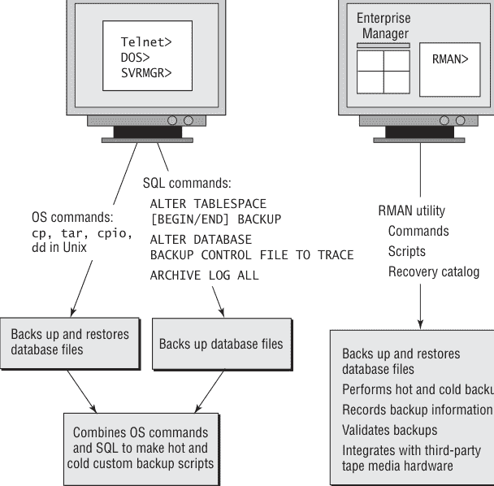

| OS 命令 | SQL TABLESPACE | RMAN 工具 |
| :--- | :--- | :--- |
| Unix 中的 cp, tar, cpio, dd | [BEGIN/END] BACKUP | 命令 |
| | ALTER DATABASE | 脚本 |
| | 备份并恢复数据库文件 | 备份数据库文件 |
| | 备份控制文件到跟踪(TRACE) | 备份并恢复数据库文件 |
| | ARCHIVE LOG ALL | 执行热备和冷备 |
| | | 记录备份信息 |
| 恢复目录 | 恢复目录 | 验证备份 |
| | | 与第三方磁带媒体硬件集成 |
| | | 结合 OS 命令和 SQL 创建热备和冷备自定义备份脚本 |

## 探索 RMAN 组件

RMAN 的主要组件包括 GUI 或命令行访问、可选的恢复目录、RMAN 命令和脚本以及磁带媒体连接。这些组件使 DBA 能够自动化和标准化备份与恢复过程。下面描述了每个组件：

GUI 或命令行访问方法：此方法提供了对恢复管理器（Recovery Manager）的访问，进而可以访问 RMAN。GUI 方法产生连接到数据库的服务器会话——该数据库是 RMAN 执行备份或恢复操作的目标数据库。GUI 访问通过 Oracle Enterprise Manager (OEM) 工具提供，这是一个用于执行备份、导出/导入、数据加载、性能监控/调优、作业和事件调的 DBA 工具，可以在标准的 Unix Telnet 或 X Windows 会话中运行，也可以在 Windows 环境下的 DOS 终端中运行。

可选的恢复目录：这些特殊的备份信息数据存储在一组表中，方式与数据库字典信息相同。恢复目录提供了一种存储备份、恢复和还原信息的方法。这些信息提供了备份成功或失败的状态更新，以及 OS 备份、数据文件副本、表空间副本、控制文件副本、归档日志副本、全数据库备份和数据库物理结构的状态。

RMAN 命令：这些命令允许执行不同的操作，以促进数据库的备份和恢复。这些命令可以逻辑地组织成脚本，然后存储在恢复目录数据库中。脚本可以重用于其他备份，从而保持不同目标数据库备份之间的一致性。

磁带媒体连接：此组件提供了一种与各种第三方磁带供应商接口的方法，以便在自动磁带库 (ATL) 中存储和跟踪备份。ATL 是一个大型磁带柜，可以存储许多磁带，并可以同时向多块磁带写入数据以提高性能。ATL 使用机械臂加载、卸载和存储磁带。默认情况下，Oracle 为 Legato Storage Management (LSM) 软件提供了媒体管理库 (MML)，该软件负责管理 ATL 设备。

图 8.2 显示了 RMAN 工具的组件如何组合成一个完整的备份和恢复包的示例。

## 图 8.2 RMAN 的组件

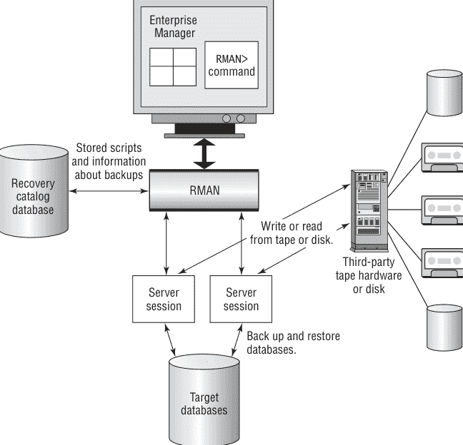

# 使用 RMAN 存储库和控制文件存储信息

RMAN 工具使用两种方法来存储关于备份的目标数据库的信息。每种方法被称为 RMAN 存储库。当 RMAN 使用第一种方法时，它访问有关备份信息的优化 RMAN 目录或恢复目录。在第二种方法中，它访问目标数据库控制文件中必要的备份信息。如果没有使用优化恢复目录数据库，将使用目标数据库的控制文件作为 RMAN 存储库。RMAN 在恢复目录数据库或目标数据库控制文件中运行所需的信息也称为 RMAN 存储库。无论是否使用目录，目标数据库的控制文件始终会被更新。在接下来的段落中，我们将讨论将恢复目录作为存储信息的 RMAN 存储库，然后列出您在该方法中可以使用的命令。列表之后，我们将重点关注使用控制文件作为 RMAN 存储库。

Oracle 建议您将 RMAN 备份数据存储在恢复目录数据库中，而不是目标的控制文件中。如果您以这种方式存储数据，RMAN 工具将具有完整的功能。此恢复目录数据库是另一个 Oracle 数据库，具有特殊的 RMAN 目录表，以数据字典存储数据库中数据对象的方式存储备份的元数据。可以执行交叉检查（crossing backups）和可用磁带等活动。此外，使用这种方法可以创建备份脚本并存储在恢复目录数据库中供以后使用。该数据库可以进行备份，以确保包含的信息是安全的。我们将在第 13 章“恢复目录的创建与维护”中详细讨论恢复目录数据库。

在详细介绍第二种方法之前，请查看这些命令。只有在您使用 RMAN 恢复目录作为 RMAN 存储库时，才允许这些命令：

- CREATE CATALOG
- UPGRADE CATALOG
- DROP CATALOG
- CREATE SCRIPT
- DELETE SCRIPT
- REPLACE SCRIPT
- LIST STORED FILES
- LIST INCARNATION
- REGISTER DATABASE
- REPORT SCHEMA AT TIME
- RESET DATABASE
- RESYNC CATALOG

### 234 第 8 章 • 恢复管理器概述与配置

如前所述，RMAN 工具还允许您在没有恢复目录的情况下连接到目标数据库。尽管 Oracle 不建议这种方法，但如果创建和维护恢复目录的开销太大，您可以使用它。

如果您使用目标数据库的控制文件，则必须管理*控制部分*。init.ora 文件中的 `CONTROL_FILE_KEEP_TIME` 参数决定了 RMAN 保留信息多长时间。该参数的默认值为 7 天，但可以长达 365 天。数字越大，控制文件越大，以便存储更多信息。可用的部分由以下类别组成：

- 归档日志
- 备份数据文件
- 备份重做日志
- 副本损坏
- 离线范围
- 备份集
- 数据文件副本
- 日志历史

## 描述通道分配

通道分配是用于连接 RMAN 和目标数据库的方法。在执行分配时，还可以确定服务器进程用于备份或恢复操作的 I/O 设备类型。图 8.3 显示了此示例。I/O 设备可以是磁带或磁盘（在图 8.3 中可以看到两者）。

## 图 8.3 通道分配

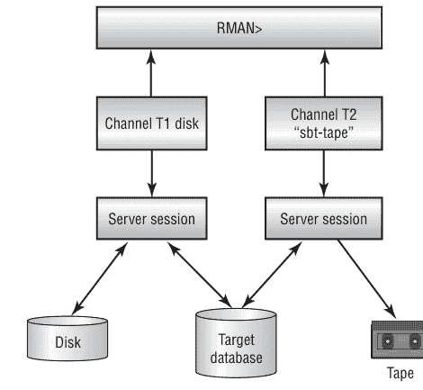

通道可以手动或自动分配。手动通道分配是在每次执行 `ALLOCATE CHANNEL` 命令时进行的，该命令会在数据库服务器上启动一个进程。要手动写入磁盘文件系统，您将使用 `ALLOCATE CHANNEL <channel name> TYPE DISC` 命令。同样，要写入磁带备份系统，您将使用 `ALLOCATE CHANNEL <channel name> TYPE 'SBT_TAPE'` 命令。这些是最常见的手动通道分配用法。

自动通道分配是在您设置 RMAN 配置提示时执行的。通过使用 `CONFIGURE DEFAULT DEVICE` 或 `CONFIGURE DEVICE` 命令来实现这一点。当您执行 `BACKUP`、`RESTORE` 或 `DELETE` 命令时，这种分配是自动的。通过使用 `CONFIGURE` 命令，您可以消除在每次执行备份、恢复或删除时都使用 `ALLOCATE CHANNEL <channel name> TYPE DISC` 或 `'SBT_TAPE'` 命令的需求。自动通道分配命令的完整列表如下：

- CONFIGURE DEVICE TYPE PARALLELISM
- CONFIGURE DEFAULT DEVICE TYPE

### 236 页 第 8 章 • Oracle 恢复管理器概述与配置

- 配置通道设备类型
- 配置通道 n 设备类型

磁盘和磁带设备类型有一些默认的命名规范——ORA_MAINT_DISK_n 和 ORA_SBT_TAPE_n。示例显示将默认设备类型设置为 DISK，并行度设置为 1。这意味着如果你不手动分配通道，你将获得下面列出的参数。


RMAN> `show all`;

RMAN configuration parameters are:

...

`CONFIGURE DEFAULT DEVICE TYPE TO DISK;` # 默认

`CONFIGURE DEVICE TYPE DISK PARALLELISM 1;` # 默认

nRMAN>

```
## 探索媒体管理库接口

介质管理库（MML）接口是一个连接 RMAN 和不同硬件厂商 ATL（自动磁带库）的 API（应用程序接口）。
所有希望与 Oracle RMAN 配合的磁带硬件厂商都会制作自己的 MML。这是必要的，因为大多数磁带硬件设备是专有的，并且需要不同的程序调用。MML 随后与 Oracle 数据库内核链接，以便 RMAN 服务器进程和 MML 能够读写 Oracle 数据到磁带设备。8.4 节描述了这一概念。


Oracle 提供了一个第三方介质管理库（MML），它默认随 RMAN 包含在软件安装中。该 MML 用于 Legato Storage Manager (LSM) 软件，该软件将管理自动磁带库（ATL）。

Copyright ©2002 SYBEX, Inc., Alameda, CA www.syex.com

## 图 8.4 MML 和 RMAN 服务器进程

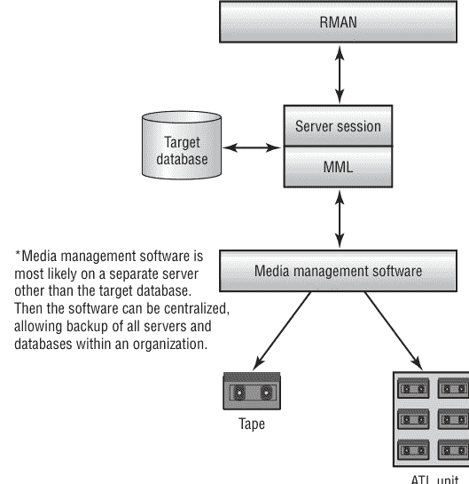

*介质管理软件可能位于与目标数据库不同的服务器上。这样，软件就可以集中管理，允许对组织内的所有服务器和数据库进行备份。*

当使用 RMAN 设置 MML 时，你需要使用操作系统命令将现有的共享库替换为新介质管理厂商的库。这是一个在 Unix 环境下执行此操作的通用示例。

- 1. 如果 `ORACLE_HOME/` 下已存在旧的 `libbob.so` 符号链接，在安装介质管理器之前需要删除它。例如：

```
oracle@octillii:/oracle/product/9.0.1/rdbms/lib > libob.so
```

- 2. 从厂商访问新的介质管理库有两种方法。创建一个符号链接，

```
oracle@octillii: > ln -s /vendor/lib/oracle_lib.so $ORACLE_HOME/rdbms/lib/libbob.so
```

或者将库移动到 `$ORACLE_HOME/lib` 目录。

```
oracle@octillii: > cp /vendor/lib/oracle_lib.so $ORACLE_HOME/rdbms/lib/libbob.so
```

## 在没有恢复目录连接 RMAN

### 现实场景
#### 配置和使用介质管理器厂商软件

作为 DBA，你已经配置了 RMAN 并确保它能够正常运行。你还有一套自己熟悉的备份脚本和方法。但你还没有大功告成。

这是因为对于你选择的与 RMAN 集成的软件和硬件解决方案，通常涉及整套全新的设置、配置、使用和测试工作。例如，如果你与 ATL 接口，你将遇到管理磁带的软件，很可能也管理 RMAN 备份。在某些情况下，这些软件解决方案可以是执行 shell 脚本（然后调用 RMAN 脚本）的简单代理。但在某些情况下，你可能需要处理从其自己的 GUI 界面执行 RMAN 的全功能软件应用程序。

因此，你应该确保为配置和使用这些软件工具所需的所需的额外时间做好计划。你还需要考虑与系统管理员、备份协调员和其他数据库管理员合作的时间，以确保你的完整备份包得到正确实施。

为了在 RMAN 中连接到目标数据库，你必须将 `ORACLE_SID` 设置适当的目标数据库。在本例中，它是 `ora9`。此示例使用了 Oracle 为 9i 数据库软件提供的 `oraenv` shell 脚本来更改数据库环境。接下来，你启动 RMAN 实用程序。一旦启动 RMAN 程序，使用适当的 SYSDBA 特权账户执行 `CONNECT TARGET` 命令。这将执行到目标数据库的连接。

### 配置 RMAN 环境 239 页

让我们逐步完成这一过程：

- 1. 将 `ORACLE_SID` 设置为你想要连接的的目标数据库。
`oracle@octillii:/oracle/product/9.0.1/bin > oraenv`
`ORACLE_SID = [rc9] orc9`

- 2. 输入 RMAN 并按回车执行 RMAN 实用程序。
`oracle@octillii:/oracle/product/9.0.1/bin > rman`

Recovery Manager: Release 9.0.1.0 - Production

(c) Copyright 2001 Oracle Corporation. All rights reserved.

```
RMAN>
```

- 3. 使用适当的 DBA 特权账户执行 `CONNECT TARGET` 命令。
`RMAN> connect target /`
`connected to target database: ORC (DBID=396)`

```
RMAN>
```

这里是无需恢复目录连接目标数据库的另外两种方法：
`oracle@octillii: > rman target /`
`oracle@octillii: > rman target / sysdba`

## 配置 RMAN 环境

让我们逐步进行：

配置 RMAN 环境主要涉及在 RMAN 提示符某处执行 `CONFIGURE` 命令。

可以通过 `SHOW ALL` 命令查看现有配置，正如我们在“通道分配”部分中所做的。让我们首先查看 `SHOW ALL` 命令的输出。目标数据库。

```
RMAN> show all;

using target database: ORC

CONFIGURE RETENTION POLICY TO WINDOW OF 7 DAYS;

CONFIGURE OPTIZATION OFF;

CONFIGURE FORMAT FOR DISK TO '%F';

CONFIGURE DEVICE TYPE DISK PARALLELISM 1;

CONFIGURE DATAFILE BACKPIES FOR DISK TO 1;

CONFIGURE ARCHIVEL BACKPIES FOR DISK TO 1;

CONFIGURE MAXSIZE TO UNLIMITED;

CONFIGURE SNAPSHOT CONTROLFILE NAME TO '/oracle/product/9.0.1/db/snap_ora';
```

现在让我们看看配置 AUTACKUP 控制文件的具体示例。这一过程始于 RMAN 提示符下执行 `CONFIGURE CONTROLFILE AUTACK ON` 命令，所示：

```
RMAN> configure controlfile autoback on;
```

```
new RMAN configuration parameters:

CONFIGURE

FILE

ack

;
```

如果你想恢复 AUTACKUP 控制文件或其他配置设置的默认值，可以使用 `CLEAR` 命令，所示：

```
RMAN> configure controlfile autoback clear;
```


```
old RMAN configuration parameters:
CONFIGURE CONTROLFILE autoback ON;
RMAN configuration parameters are successfully reset to default value

RMAN>
```

在 RMAN 中可以使用其他配置参数。
每个这些配置参数都可以以与之前的配置示例类似的方式使用。其他配置参数可以分为以下几大类：

- 配置自动通道
- 配置 AUTACKUP 控制文件
- 配置备份保留策略
- 配置备份集的最大大小
- 配置备份优化
- 配置备份副本数量
- 配置排除在数据库备份之外的表空间
- 配置快照控制文件位置

## 总结

本章讨论了 RMAN 实用程序的功能和能力。通过它，你应该对 RMAN 的一些基本功能有所了解。你应该学会如何在有或没有恢复目录的情况下 RMAN，以及这种做法在哪些环境中有利。此外，你还了解了在没有恢复目录的情况下使用 RMAN 对控制文件的影响。你还学习了手动和自动通道分配，并探索了每种的具体示例。

本章涵盖的每个主题都会出现在测试中。理解 RMAN 的组件和功能对于测试和工作场所都至关重要。当你知道如何与 RMAN 仓库配合、使用通道分配和 MML（媒体管理库）以及配置 RMAN 环境时，你就能在工作中实施和使用 RMAN 时做出相应的决策。这种程度的理解在测试过程中将非常有益。

## 考试要点

- 列出 RMAN 的组件。构成 RMAN 的不同组件包括通过 Oracle Enterprise Manager 进行 GUI 访问、RMAN 命令行功能、媒体管理（Media Management）支持以及可选的恢复目录数据库（recovery catalog database）。
- 知道如何配置 RMAN 在没有恢复目录的情况下存储备份信息。你需要配置控制文件（control file）使其存储有关备份的信息。你可以通过设置 `CONTROL_FILE_RECORD_KEEP_TIME` 参数来实现。
- 理解 RMAN 仓库或目标数据库控制文件的局限性。如果你使用 RMAN 仓库访问目标数据库的控制文件而不是自己数据库的 RMAN 目录，则并非所有命令对你可用。请注意这些命令。
- 定义通道分配（channel allocation）。你需要理解什么是通道分配以及它可能连接的两个 I/O 设备：磁带和磁盘。你还应该知道有两种类型的通道分配：自动和手动。
- 配置 RMAN 环境。能够使用 `CON` 命令以及配置此环境所需的参数。此外，请注意你可以在操作系统中配置 NLS 设置和媒体管理层。
- 描述媒体管理库（MML）接口。熟悉媒体管理库并知道它是由磁带硬件供应商创建的库，用于将 RMAN 与其独特的硬件设备和软件连接起来。
- 能够在没有恢复目录的情况下连接到 RMAN。你应该知道如何将数据库环境 `ORACLE_SID` 设置为你想要备份的正确目标数据库。

## 关键术语

在参加考试之前，请确保你已熟悉以下术语：

- 自动磁带库 (ATL)
- 自动通道分配 (automatic channel allocation)
- 通道分配 (channel allocation)
- 手动通道分配 (manual channel allocation)
- Oracle Enterprise Manager (OEM)
- Oracle Recovery Manager (RMAN)
- 可重用解决方案 (reusable solution)
- RMAN 仓库 (RMAN repository)
- 目标数据库 (target database)

## 复习题

1. RMAN 工具需要使用恢复目录吗？
   A. 需要恢复目录。
   B. 不需要恢复目录。
   C. 如果恢复目录存储在与目标数据库相同的数据库中，则需要它。
   D. 如果恢复目录存储在与目标数据库相同的数据库中，则不需要它。

2. RMAN 工具具有哪些功能？（选择所有项）
   A. 备份数据库、表空间、数据文件、控制文件和归档日志
   B. 压缩备份
   C. 提供脚本能力
   D. 测试备份是否可以恢复
   E. 以上所有

3. RMAN 工具支持什么类型的接口？（选择所有项）
   A. 通过 Oracle Enterprise Manager 的 GUI
   B. 命令行界面
   C. 仅限命令行
   D. 仅通过 Oracle Enterprise Manager 的 GUI

4. 在 RMAN 工具中可以执行哪些操作？（选择所有项）
   A. 启动目标数据库。
   B. 关闭目标数据库。
   C. 给用户授予角色。
   D. 创建用户账户。

5. 磁带媒体管理库（MML）使 RMAN 执行以下哪些操作？（选择所有项）
   A. 与第三方磁带硬件供应商建立接口。
   B. 使用第三方自动磁带库 (ATLs)。
   C. 写入任何磁带。
   D. 写入磁盘。

6. 下列哪个命令被用于自动通道分配？
   A. `ALLOCATE CHANNEL C1 TYPE DISK`
   B. `ALLOCATE CHANNEL C1 TYPE 'SBT_DEVICE'`
   C. `CONFIGURE DEVICE`
   D. `CONFIGURE DEVICE`

7. 下列哪些命令用于手动通道分配的？（选择所有项）
   A. `ALLOCATE CHANNEL C1 TYPE DISK`
   B. `ALLOCATE CHANNEL C1 TYPE 'SBT_DEVICE'`
   C. `CONFIGURE DEVICE`
   D. `CONFIGURE DEVICE`

8. 下列哪些媒体管理库是 RMAN 安装提供的？
   A. 支持 Legato Storage Manager。
   B. 支持磁盘。
   C. 不提供。
   D. 支持磁带。

9. 使用下列哪个命令来设置并行度？
   A. `SET DEVICE PARALLELISM`
   B. `CONFIGURE DEVICE PARALLELISM`
   C. `INSTALL DEVICE PARALLELISM`
   D. `CONFIGURE PARALLELISM`

10. 在没有恢复目录的情况下可以使用哪些命令？（选择所有项）
    A. `RESYNC CATALOG`
    B. `RESET DATABASE`
    C. `SCRIPT`
    D. `LIST INCARNATION`
    E. 以上所有

11. 下列哪些命令描述手动通道分配？（选择所有项）
    A. `CONFIGURE DEVICE`
    B. `CONFIGURE DEVICE`
    C. `ALLOCATE CHANNEL 'channel_name'`
    D. `ALLOCATE CHANNEL DISK`

12. 下列哪些命令用于备份控制文件？
    A. `SET CONTROLFILE AUTO`
    B. `CONFIGURE CONTROLFILE AUTO`
    C. `SET CONTROLFILE ON`
    D. `CONFIGURE CONTROLFILE ON`

13. 下列哪个文件是 Unix 的默认媒体管理库？
    A. `tape1.sl`
    B. `libobk.so`
    C. `libmm.so`
    D. `oracle`

14. 研究下列命令，然后选择最符合其功能的选项：
```
RMAN> connect /
```


```
A. 连接到恢复目录
B. 连接到目标数据库
C. 连接到目标数据库和恢复目录
D. 既不连接目标数据库也不连接恢复目录
```

15. 如果未使用恢复目录，RMAN 仓库的大小是多少？
    A. 取决于操作系统
    B. 无限制
    C. 2 gigabytes
    D. 4 gigabytes

## 复习题答案 249

1. B. 无论目标数据库如何配置，恢复目录都是可选的。
2. E. 以上所有都是 RMAN 工具的功能。
3. A, B. RMAN 工具可以通过 Enterprise Manager 以 GUI 模式或通过命令行界面运行。
4. A, B. RMAN 工具可以启动和停止目标数据库。
5. A, B. 媒体管理库使 RMAN 能与其他硬件供应商建立接口并使用它们的磁带库系统。
6. C. `CONFIGURE DEVICE` 命令用于自动通道分配。
7. A, B. 所有包含 `ALLOCATE CHANNEL` 的命令都是手动通道分配的示例。
8. A. 大多数 RMAN 安装提供的库支持 Legato Storage Manager。
9. B. `CONFIGURE DEVICE PARALLELISM` 命令将设置默认并行度值。
10. E. 除非实现了恢复目录，否则这些命令都无法使用。
11. C, D. 这两个选项都是手动通道分配的方法。
12. B. `CONFIGURE CONTROLFILE AUTO` 命令将配置自动备份控制文件。
13. B. `libobk.so` 文件是默认的媒体管理库。必须被替换或指向所使用的任何供应商。
14. B. 该命令连接到目标数据库。
15. A. 如果未使用恢复目录，RMAN 仓库就是目标数据库控制文件。

# 第 9 章

## 用户管理和基于 RMAN 的备份

本章涵盖的 ORACLE9i: DBA 基础知识 II 考试目标：

- 描述用户管理型备份和恢复操作。
- 讨论与只读表空间相关的备份问题。
- 执行关闭式数据库备份。
- 执行开放式数据库备份。
- 备份控制文件。
- 在在线备份失败后执行清理。
- 使用 DBVERIFY 工具检测损坏。
- 识别 RMAN 特定的备份类型。
- 使用 RMAN `BACKUP` 命令创建备份集（sets）。
- 备份控制文件。
- 备份归档的重做日志文件。
- 使用 RMAN `COPY` 命令创建映像复制（image copies）。

> 注意：考试目标可能会随时更改，恕不另行通知，并由 Oracle 自行裁 way。请访问 Oracle 认证网站（http://www.oracle.com/education/certification/）查看最新的考试目标列表。


物理数据库文件的副本，可以通过两种方式进行。第一种是通过 Oracle 提供的恢复管理器（RMAN）工具。第二种是执行用户管理型（或非 RMAN）备份。本章将重点介绍这两种类型的备份。

用户管理型备份多年以来用于备份 Oracle 数据库。OS 备份脚本是一种完全自定义的解决方案，因此它具有与自定义解决方案相关的变和不一致性。这种备份通常由使用脚本语言创建的 OS 备份组成，例如 Unix 环境下的 Korn shell 或 Bourne shell，或者在 Windows NT/2000/XP 环境下的批处理命令。

尽管用户管理型备份在历史上很有帮助，但目前的趋势表明，大多数大型数据库站点现在都使用 RMAN 进行备份。其原因是由于 RMAN 具有扩展功能，并且可以跨平台一致地使用。

然而，OS 备份对 DBA 仍然很有用。你以及许多存储子系统提供商仍然利用用户管理备份结合三级镜像功能在短时间内加速备份。（三级镜像或等效功能提供了一种在硬件层级分离磁盘镜像第三份副本的方法。这第三份副本被制成备份并可以复制到磁带。）在你从用户管理型备份中尽可能学习之后，请转向 RMAN，它是基于这些基础构建的。

在本章中，你将学习使用用户管理型备份和 RMAN 备份的各种物理备份方法。

## 用户管理备份和恢复操作

如前所述，不同的站点根据不同的需求自定义其用户管理备份和恢复操作。这种自定义是可能的，因为这种类型的备份通常是使用 Unix shell 或 Windows NT/2000/XP 批处理命令编写的脚本。因此，用户管理备份和恢复操作必须作为自定义代码进行管理，并进行大量的测试以验证其功能。

此描述展示了这种类型备份的优点和缺点。虽然这种自定义能力允许用户管理型备份针对特殊情况进行设计（此外还需要经过大量的测试和验证），但这些自定义可能会导致错误，从而使整个备份和恢复过程失效。

尽管可能存在副作用，用户管理型备份在 Oracle 环境中已使用了多年。除了广泛使用外，这些备份还提供了你理解整个 Oracle 备份和恢复过程（包括 RMAN）所需的构建基块。这就是为什么每个 DBA 都应该熟悉用户管理型备份和恢复操作。这些知识将允许他们在发生故障情况时，无论站点是使用用户管理型还是基于 RMAN 的备份与恢复，都能做出正确的决策。

## 处理只读表空间

只读表空间的备份和恢复在某些情况下需要独特的程序。备份和恢复过程取决于备份时和恢复时表空间的状态，以及控制文件的状态。本讨论详细说明了每种情况的影响。

只读表空间的备份程序与读写表空间备份所需的程序不同。只读表空间如其名所示被标记为只读；换句话说，所有的写操作都被禁用。因此，只要表空间保持只读，在变为只读后其系统更改号（SCN）就不会改变。这意味着发生数据库故障，如果表空间在备份时是只读的，则标记为只读的表空间不需要恢复。只读表空间可以直接还原，在恢复过程中不会应用任何归档日志。如果一个表空间在备份时处于读写模式，但在故障发生时为只读，则需要执行恢复。这是因为在读写模式期间会发生更改。归档日志将一直应用到该表空间变为只读为止。

控制文件的状态也会影响只读表空间的恢复过程。在恢复备份控制文件期间，如果控制文件是创建的，只读表空间应离线，否则将出现 `ORA-1233` 错误。在恢复命令之前，只读表空间必须离线。恢复后，只读表空间可以上线。将在第 10 章“用户管理和 RMAN 恢复”中查看只读表空间的示例。

## 理解关闭式和开放式备份

关闭式备份是处于非打开状态的数据库备份。通常这意味着数据库已完全关闭。这种类型的备份被称为冷备份。开放式备份是处于打开状态的数据库备份。在这种状态下，数据库是完全可用的。开放式备份被称为热备份。

关闭式备份的影响是在备份完成之前用户无法使用该数据库。进行冷备份的理想条件之一是使用 `NORMAL` 或 `IMMEDIATE` 选项关闭数据库，以便使其处于一致状态。换句话说，数据文件在同一时间标记了相同的 SCN。这被称为一致性备份。冷备份需要将归档日志信息应用到数据文件。图 9.1 是冷备份的示例。

### 图 9.1 在 Unix 中使用冷、离线或关闭方法的物理备份

```
VRMGRL >

VRMGRL > SHUTDOWN NORMAL

VRMGRL > !cp/Disk1/*staging

VRRLRL > !cp/Disk5/*staging
```

开放式备份的主要影响是在备份期间用户可以使用该数据库。备份通过 `ALTERSPACE <TABLESPACE_NAME> BEGIN BACKUP` 命令、OS 命令以及 `ALTERSPACE <TABLESPACE_NAME> END BACKUP` 命令完成。有关热备份的详细讨论，请参考第 7 章“配置数据库归档模式”。图 9.2 是开放式备份的示例。

### 图 9.2 在 Unix 中使用热、在线或开放方法的物理备份

```
SVRMRL >

VRMRL > ALTERSPACE <TABLESPACE_NAME> BEGIN BACKUP;

SVRMRL > cp /Disk3/datafile* /staging

SVRMRL > ALTERSPACE <TABLESPACE_NAME> END BACKUP;
```


为了恢复复制归档日志。
与运行过 `ALTERSPACE <TABLESPACE_NAME> BEGIN/END BACKUP` 的表空间的所有数据文件复制到 `/staging` Disk。

注意：复制每个表空间的所有数据文件。

# 执行关闭式和开启式数据库备份 257

关闭备份（closed backup）只是复制构成数据库的所有必要物理文件；这些文件包括数据文件、在线重做日志（online redo logs）、控制文件和参数文件。

开启备份（opened backup）也是通过执行操作系统完成完成。这些命令在 `ALTER TABLESPACE <TABLESPACE_NAME> BEGIN BACKUP` 命令和 `ALTER TABLESPACE <TABLESPACE_NAME> END BACKUP` 命令之间执行。开启备份只需要数据文件的副本。`ALTER TABLESPACE <TABLESPACE_NAME> BEGIN BACKUP` 会导致表空间中的数据文件或数据文件发生检查点（checkpoint）。这将导致所有脏块写入数据文件，并在数据文件头上标记与这些数据块一致的 SCN。数据文件中的数据操作语言（DML）——如 `INSERT`、`UPDATE` 和 `DELETE` 语句，在数据文件和重做日志中的记录方式与普通数据库操作几乎相同。然而，在执行 `ALTER TABLESPACE <TABLESPACE_NAME> END BACKUP` 命令并发生检查点之前，数据文件头不会更新。为了区分在恢复情况下需要哪些块，Oracle 在执行 `ALTER TABLESPACE <TABLESPACE_NAME> BEGIN BACKUP` 命令期间会在重做日志中写入更多信息。

这就是为什么数据文件在根本上与其他 Oracle 数据库文件不同，因为在备份方面，重做日志、控制文件和 init.ora 文件并非如此。重做日志、控制文件和 init.ora 文件可以使用标准的操作系统命令进行复制，而无需执行任何准备步骤（如 `ALTER TABLESPACE <TABLESPACE_NAME>` 命令）。这在 Unix 环境下是完全正确的。在 Windows NT/2000/XP 环境下部分正确，因为对打开的文件执行了锁定。


即使是热备份（hot backups）也可以在数据库打开时任何时候进行，但在 DML 活动最少时进行热备份是一个好主意。这可以防止过度的重做日志记录，过度记录可能会损害数据库性能。

以下是执行关闭数据库备份需要采取的步骤：

- 1. 关闭你想要备份的数据库。确保使用的是 `SHUTDOWN NORMAL`、`IMMEDIATE` 或 `TRANSACTIONAL` 命令，而不是 `SHUTDOWN ABORT`。

```
oracle@octillii:opt/oracle > sqlplus /nolog
```

Copyright©2002 SYBEX, Inc., Alameda, CA www.symtex.com

# 258 第 9 章 • 用户管理和基于 RMAN 的备份

SQL*Plus: Release 9.0.1.0.0 - Production，于 Sat Sep 29 00:11:37 2001

(c) Copyright 2001 Oracle Corporation. All rights reserved.

```
SQL> connect /sysdba
Database closed.
Database dismounted.
ORACLE instance shut down.
```

- 2. 一旦数据库关闭，请将所有数据文件、参数文件和控制文件通过操作系统（OS）到磁盘或磁带设备。在 Unix 中，执行以下命令将数据文件、参数文件和控制文件复制到磁盘暂存位置，在那里等待复制到磁带。

```
cp /oracle/product/9.0.1/oradata/*.dbf /staging/cold
## datafile
cp /oracle/admin/orc9/pfile/* /staging/cold
## INIT.ora files
cp /oracle/oradata/*.ctl /staging/cold
## control files location 1
cp /oracle/product/9.0.1/oradata/*.ctl /staging/cold
## control files location 2
cp /oracle/oradata/orc9/*.log /staging/cold
## online redo logs group 1
```

- 3. 重启数据库并继续正常的数据库操作。
`SQL> startup;`

以下是执行执行式数据库备份时将使用的步骤。在这些操作期间，数据库对用户仍然可用，但取决于正在备份的表空间，用户的响应时间可能会降低。

- 1. 要确定构成数据库的所有表空间，查询 `V$TABLESPACE` 和 `V$FILE` 动态视图。以下是识别表空间及其关联数据文件的 SQL 语句。

# 执行关闭式和开启式数据库备份 259

```
select a.TS#,a.NAME,b.NAME from
vtablespace a, v$datafile b
where a.TS#=b.TS;
```

- 2. 确定构成每个表空间的所有数据文件。
每个表空间可以由许多数据文件组成。当表空间处于备份模式时，所有与表空间关联的数据文件都需要被复制。连接到 SQLPLUS 执行上述查询。

```
oracle@octilli:~ > sqlplus /nolog
```

SQL*Plus: Release 9.0.1.0.0 - Production，于 Sat Sep 29 10:44:22
2001

(c) Copyright 2001 Oracle Corporation. All rights reserved.

```
SQL>
SQL> connect /as sysdba
Connected.
```

```
SQL> select a.TS#,a.NAME,b.NAME from
vtablespace a, v$datafile b
where a.TS#=b.TS;
```

| TS# | NAME |
| :--- | :--- |
| 0 | SYSTEM | /oracle/product/9.0.1/oradata/orc/system01.dbf |
| 1 | UNDOTBS | /oracle/product/9.0.1/oradata/orc/undotbs01.dbf |
| 2 | CWMLITE | /oracle/product/9.0.1/oradata/orc/cwmlite01.dbf |
| 3 | DRSYS | /oracle/product/9.0.1/oradata/orc/drys01.dbf |
| 4 | EXAMPLE | /oracle/product/9.0.1/oradata/orc/example01.dbf |
| 5 | INDEX | /oracle/product/9.0.1/oradata/orc/indx01.dbf |
| 7 | TOOLS | /oracle/product/9.0.1/oradata/orc/tools01.dbf |
| 8 | USERS | /oracle/product/9.0.1/oradata/orc/users01.dbf |

- 3. 将表空间放入备份模式。
`SQL> alter tablespace begin backup;`

Copyright©2002 SYBEX, Inc., Alameda, CA www.symtex.com

# 302 - 4. 对每个数据文件执行操作系统复制。

```
cp /oracle/product/9.0.1/oradata/orc/users01.dbf /staging/cold
```

- 5. 结束表空间的备份。

```
SQL> alter tablespace end backup;
Tablespace altered.
```

这一系列命令可以对构成数据库的表空间重复。使用 `ALTER TABLESPACE <TABLESPACE_NAME> BEGIN` 和 `END` 命令，这种备份在 Unix 或 Windows 上进行。


在开启式或关闭式备份期间，主意是备份控制文件、所有归档日志和参数文件。这些与数据文件打包。这被称为**全数据库备份**。

## 识别用户管理的控制文件备份

有两种用户管理的控制文件备份。第一类型通过执行命令在新目录中创建现有控制文件的二进制副本。例如，以下命令执行控制文件的二进制副本。


```
SQL> alter database controlfile to '/staging/bak';
```

第二类型控制文件备份在 `USER_DUMP_DEST` 位置创建当前控制文件的 ASCII 副本（跟踪文件）。`USER_DUMP_DEST` 参数在你的 `init.ora` 文件中设置。在符合优化架构（OFA）的配置中，这将是导出目录。使用以下命令：

```
SQL> alter database controlfile to trace;
```
文件的输出如下：
`/oracle/admin/orc9/udump/ora_4976.trc`
`Oracle9i Enterprise Edition Release 9.0.1.0.0 - Production`
带有分区选项
`IServer Release 9.0.1.0.0 - Production`
`ORACLE_HOME = /oracle/product/9.0.1`
`System name: Linux`
`Node name: octilli`
`Release: 2.4.4-4GB`
`Version: #1 Fri May 18 14:11:12 GMT 2001`
`Machine: i686`
`Instance name: orc9`
`Redo thread mounted by this instance: 1`
`Oracle process number: 13`
`Unix process pid: 4976, image: oracle@octilli (TNS V1-V3)`

# 以下命令将创建一个新的控制文件并使用它打开数据库。恢复管理器使用的数据将丢失。对于离线数据文件的媒体恢复可能需要额外的日志。只有在当前版本的所有在线日志可用时才使用此命令。

```
STARTUP NOMOUNT
CREATE CONTROLFILE REUSE DATABASE "ORC9" NORESETLOGS
ARCHELOG
MAXLOGFILES 50
MAXLOGMEMBERS 5
MAXDATAFILES 100
```

# 第 9 章 • 用户管理和基于 RMAN 的备份

`MAXINSTANCES 1`

`MAXLOGISTORY 226`

```
LOGFILE
GROUP 1 '/oracle/oradata/orc9/redo01.log' SIZE 100M,
GROUP 2 '/oracle/oradata/orc9/redo02.log' SIZE 100M,
GROUP 3 '/oracle/oradata/orc9/redo03.log' SIZE 100M,
## STANDBY LOGFILE
DATAFILE
'/oracle/product/9.0.1/oradata/orc9/system01.dbf'
'/oracle/product/9.0.1/oradata/orc9/undotbs01.dbf'
'/oracle/product/9.0.1/oradata/orc9/cwmlite01.dbf'
'/oracle/product/9.0.1/oradata/orc9/drsys01.dbf'
'/oracle/product/9.0.1/oradata/orc9/example01.dbf'
'/oracle/product/9.0.1/oradata/orc9/indx01.dbf'
'/oracle/product/9.0.1/oradata/orc9/tools01.dbf'
'/oracle/product/9.0.1/oradata/orc9/users01.dbf'
CHARACTER SET WE8IS0859P1
;
# 如果任何数据文件是恢复的备份，则需要进行恢复，
# 如果最后一次关闭不是正常或立即关闭。
RECOVER DATABASE
# 所有日志都需要归档，并且需要日志切换。
ALTER SYSTEM ARCHIVE LOG ALL;
# 数据库现在可以正常打开了。
ALTER DATABASE OPEN;
# 向临时表空间添加临时文件的命令。
# 在线临时文件具有完整的空间信息。
# 其他临时文件可能需要调整。
ALTER TABLESPACE TEMP ADD TEMPFILE '/oracle/product/9.0.1/oradata/orc9/temp01.dbf' REUSE;
# 临时文件添加结束。
```


ASCII 格式的控制文件备份可以作为生产数据库迁移到测试和开发服务器的常用技术。这种技术对于测试备份非常有用。

## 在线备份失败后的清理工作

在线备份（无论是用户管理的还是基于 RMAN 的）都执行相同的数据库命令。这些命令中的一个 `ALTER TABLESPACE <tablespace name> BEGIN BACKUP` 命令会导致表空间被置于备份模式。当所需的数据文件（文件）完全复制后，将执行 `ALTER TABLESPACE <tablespace name> END BACKUP` 命令。

如果在表空间退出备份模式之前出现问题，该表空间可能会在恢复期间引起问题，或者锁定整个备份。如果数据库在表空间处于备份模式时被关闭，则在不将相关数据文件退出备份模式的情况下，数据库将无法启动。如果下一次计划的备份尝试将已经处于备份模式的表空间再次置于备份模式，RMAN 可能会出现问题。这将导致 RMAN 备份失败，或在尝试将表空间置于备份模式时挂起。

如果在线备份失败，应该检查所有表空间数据文件，以确保它们没有处于备份模式。这可以通过检查 `VBACKUP` 视图完成。下面的示例显示一个数据文件处于备份模式。数据文件 4 表空间应该退出备份模式。应该识别该表空间并使用 `ALTER TABLESPACE <tablespace_name> END BACKUP` 将其退出备份模式。见下例：

- 1. 首先，检查是否有任何数据文件处于活动状态；如果是，则意味着该表空间及其关联的数据文件处于备份模式。

```
select * from vbackup;
```

| FILE | STATUS | CHANGE TIME |

|---|---|---|

| 1 | NOT ACTIVE | 0 |

| 2 | NOT ACTIVE | 0 |

| 3 | NOT ACTIVE | 0 |

| 4 | ACTIVE | 27914 29-SEP-01 |

| 5 | NOT ACTIVE | 0 |

| 6 | NOT ACTIVE | 0 |

| 7 | NOT ACTIVE | 0 |

| 8 | NOT ACTIVE | 27885 29-SEP-01 |

- 2. 接下来，执行以下 SQL 找到与数据文件 4 关联的表空间。注意数据文件 4 与表空间 DRSYS 关联。

```sql
select substr(b.name,10) name,file#,status
from v$datafile a,v$tablespace b
where a.ts#=b.ts#
order by file#;
```

| NAME | FILE# | STATUS |

|---|---|---|

| SYSTEM | 0 | SYSTEM |

| OTS | 2 | ONLINE |

| CWMLITE | 3 | ONLINE |

| DRSYS | 4 | ONLINE |

| EXAMPLE | 5 | ONLINE |

| INDEX | 6 | ONLINE |

| TOOLS | 7 | ONLINE |

| USERS | 8 | ONLINE |

- 3. 接下来，执行以下命令将此表空间退出备份模式。然后查询 `V$BACKUP` 以验证数据文件状态不再活动。

```sql
alter tablespace DRSYS end backup;
```

表空间已修改。

```sql
select * from v$backup;
```

| FILE# | STATUS | CHANGE TIME |

|---|---|---|

| 1 | NOT ACTIVE | 0 |

| 2 | NOT ACTIVE | 0 |

| 3 | NOT ACTIVE | 0 |

| 4 | NOT ACTIVE | 27914 29-SEP-01 |

| 5 | NOT ACTIVE | 0 |

| 6 | NOT ACTIVE | 0 |

| 7 | NOT ACTIVE | 0 |

| 8 | NOT ACTIVE | 27885 29-SEP-01 |

### 现实场景

### 关机前的备份

由于媒体管理软件调用的 RMAN 备份在后台执行，它们往往会被遗忘。备份被忘记的另一个原因是这些备份任务可能由系统管理员执行并控制。作为一个整体，当备份由于某些原因终止时，你可能并不知情。因此，备份可能会以这种方式终止：导致部分表空间处于备份模式且其关联的数据文件处于活动状态，或者导致作业未完成并留在恢复目录中。


当数据库在处于备份模式时关闭会发生什么？如果发生这种情况，数据文件将不会检查点以与数据库的其他部分保持一致。因此，当数据库重启时，数据文件被标记为不一致并需要恢复。当你由于某些原因重启数据库时，这种情况可能会是一个意想不到的惊喜。

你可以通过发布 `ALTER DATAFILE '<filename>' END BACKUP` 命令来解决这种情况而无需恢复。然而，如果你在关闭数据库之前检查 `V$BACKUP` 视图以验证关闭数据库是安全的，从源上就可以避免这种情况。

## DBVERIFY 工具

通过命令行提示符输入 `dbv` 来执行 Oracle DBVERIFY 工具。该工具在执行时可以指定六个参数：`FILE`、`START`、`END`、`BLOCKSIZE`、`LOGFILE` 和 `FEEDBACK`。表 9.1 描述了这些参数。

### 表 9.1 DBVERIFY 参数

| 参数 | 说明 | 参数默认值 |
|---|---|---|
| `FILE` | 工具验证的文件 | 无默认参数 |
| `START` | 开始验证的块 | 数据文件的第一个 |
| `END` | 结束验证的块 | 数据文件的最后一个 |
| `BLOCKSIZE` | 数据库块大小。这应与 `init.ora` 参数 `DB_BLOCK_SIZE` 相同。 | 2048 |
| `LOGFILE` | 存储工具运行结果的日志文件 | 无默认参数 |
| `FEEDBACK` | 通过显示每个处理块数量的点来显示工具的进度 | 0 |

通过执行 `DBV HELP=Y` 命令也可以查看此帮助信息。见下例：

```
oracle@octilli://db01/oracle/tst9 > dbv help=y
```

DBVERIFY: Release 9.0.1.0 - Production on Tue Oct 9 00:06:48 2001

```
(c) Copyright 2001 Oracle Corporation. 保留所有权利。
```

### DBVERIFY 工具参数详解

| 关键字 | 说明 | (默认) |
| --- | --- | --- |
| `FILE` | 验证的文件 | (无) |
| `START` | 起始块 | (第一个块) |
| `END` | 结束块 | (末一个块) |
| `BLOCKSIZE` | 逻辑块大小 | (2048) |
| `LOGFILE` | 输出日志 | (无) |
| `FEEDBACK` | 显示进度 | (0) |
| `PARFILE` | 参数文件 | (无) |
| `USERID` | 用户名/密码 | (无) |
| `SEGMENT_ID` | 段 ID (tsn.refile.block) | (无) |

```
oracle@octilli://db01/oracle/tst9 >
```

要运行 DBVERIFY 工具，`BLOCKSIZE` 参数必须与你的数据库块大小匹配，否则会出现以下结果：

```
oracle@octilli://db01/oracle/tst9 > dbv file=data01.dbf
```

DBVERIFY: Release 9.0.1.0.0 - Production on Tue Oct 9 00:12:55 2001

```
(c) Copyright 2001 Oracle Corporation. 保留所有权利。
```

DBV-00103: 指定 BLOCKSIZE (2048) 与实际值 (8192) 不同
```
oracle@octilli://db01/oracle/tst9 >
```

一旦 `BLOCKSIZE` 设置为与数据库块大小匹配，DBVERIFY 工具即可继续。运行此工具有两种方法：不指定 `LOGFILE` 参数，以及指定它。让我们逐一查看这些示例。首先，这是没有设置 `LOGFILE` 参数时的：

```
oracle@octilli://db01/oracle/tst9 > dbv file=data01.dbf BLOCKSIZE=8192
```

### 268 第 9 章 • 用户管理和基于 RMAN 的备份

DBVERIFY: Release 9.0.1.0.0 - 生产版本，2001年10月9日 周二

00:10:53

```
(c) Copyright 2001 Oracle Corporation. 版权所有。
```

DBVERIFY - 开始验证：FILE =data01.dbf

DBVERIFY - 验证完成

检查的总页数 : 6400

处理的总页数 (数据) : 0

失败的总页数 (数据) : 0

处理的总页数 (索引) : 0

失败的总页数 (索引) : 0

处理的总页数 (其他): 1

处理的总页数 (段) : 0

失败的总页数 (段) : 0

空页数 : 6399

标记为损坏的页数 : 0

流入 : 0

```
oracle@octilli:/db01/oracle/tst9 >
```

以下代码演示了设置了 `LOGFILE` 参数的 DBVERIFY 工具。此命令的结果将写入文件 `data01.log` 而不是显示在屏幕上。可以通过编辑日志文件显示。

```
oracle@octilli:/db01/oracle/tst9 >dbv file=data01.dbf
BLOCKSIZE=8192 LOGFILE=data01.log
```

DBVERIFY: Release 9.0.1.0.0 - 生产版本，2001年10月9日 周二

00:14:13

```
(c) Copyright 2001 Oracle Corporation. 版权所有。
```

```
oracle@octilli:/db01/oracle/tst9 >
```

## 识别 RMAN 特有的备份

RMAN 工具支持三种类型的备份：

- 全量或增量备份
- 开放或关闭的备份
- 一致性或不一致性备份

接下来的章节将对每种进行描述。

### 全量或增量备份

全量备份和增量备份的区别在于目标数据库中备份数据块的方式。全量备份备份数据文件中所有的数据块，无论是否被修改过。增量备份仅备份数据文件中自上次增量备份以来修改过的数据块。

全量备份不能作为增量备份策略的一部分。增量备份的基是级别 0 备份。级别 0 备份是该时间点的全量备份。因此，所有块（无论是否修改过）都会被备份，从而使级别 0 备份能够作为未来增量备份的基。随后，可以将增量备份与基准（即级别 0 备份）结合，以在未来的某个时间形成一个全量备份。增量备份的优点是速度更快，因为不需要备份所有的数据块。

增量备份有两种类型：差异型（differential）和累计型（cumulative），这两者都只备份修改过的块。这两种增量备份的区别在于用于识别需要备份的修改块时所使用的基准数据库。

差异增量备份（differential incremental backup）仅备份自相同级别或更低级别的最近备份以来修改的数据块。差异增量备份将确定最近发生的是级别 1 备份还是级别 2 备份，并仅备份自该备份以来更改的块。差异增量备份是默认的增量备份。

累计增量备份（cumulative backup）仅备份自最近低一个级别——n–1 或更低级别（n 为现有的备份级别）的备份以来更改的数据块。例如，如果你正在执行级别 2 累计增量备份，备份将仅从最近的级别 1 备份复制数据块。如果没有级别 1 备份，它将备份自最近的级别 0 备份以来更改的所有数据块。

> 注意：全量备份并不意味着备份了整个或完整的数据库。换句话说，全量备份可以只备份数据库的一部分，而不是所有的数据文件、控制文件和日志。

### 开放或关闭的备份

开放备份（opened）和关闭备份（closed）的区别在于被备份目标数据库的状态。当目标数据库处于打开或可用状态时进行备份，就会发生 RMAN 开放备份。这与在本章之前演示的非 RMAN 热备类似。当目标数据库已挂载（mounted）但未打开（opened）时，发生 RMAN 关闭备份。

### 一致性或不一致性备份

一致性备份（consistent）和不一致备份（inconsistent）的区别在于被备份目标数据库的状态。当目标数据库处于一致状态时，发生一致性备份。当数据库在不一致状态下进行备份时，会发生不一致备份，这类似于热备。

## 识别 RMAN 特有的备份

RMAN 工具支持三种类型的备份：

- 全量或增量备份
- 开放或关闭的备份
- 一致性或不一致性备份

接下来的章节将对每种进行描述。

### 全量或增量备份

全量备份和增量备份的区别在于目标数据库中备份数据块的方式。全量备份备份数据文件中所有的数据块，无论是否被修改过。增量备份仅备份数据文件中自上次增量备份以来修改过的数据块。

### 表 9.2 BACKUP 命令选项（续）

| 选项 | 描述 |
| --- | --- |
| `FILESPERSET INTEGER` | 确定备份集中的文件数量。当使用此选项时，会将数据文件的数量与分配给备份通道的确定文件数进行比较，并取两者中的较值。使用此选项是执行并行备份的另一种方法。 |
| `DISKRATIO INTEGER` | 强制 RMAN 将跨指定数量磁盘驱动器的数据文件分组到备份集中。 |


| `SKIP OFFLINE READONLY` | `INACCESSIBLE` | 从备份集中排除数据文件或重做日志。它排除的文件包括离线数据文件、只读数据文件、不可访问的文件以及归档日志。 |

| `MAXSIZE INTEGER` | 指定备份集的最大大小。默认单位是字节（Bytes），也可以使用千字节（K）、兆字节（M）和吉字节（G）。 |

| `DELETE INPUT` | 在备份集创建后删除输入文件。此选项应仅在备份归档日志、数据文件副本或备份集时使用。这等于对所有输入文件使用 `CHANGE` 和 `DELETE` 命令。 |

| `INCLUDE CURRENT CONTROLFILE` | 创建当前控制文件的副本并将其置于每个备份集中。 |

# 表 9.3 BACKUP 命令格式

| 格式 | 描述 |
| --- | --- |
| `%c` | 指定多路备份副本内备份副本的副本。 |
| `%d` | 指定数据库名称。 |

# 表 9.3 BACKUP 命令格式（续）

| 格式 | 描述 |
|---|---|
| `%n` | 指定数据库名称，右侧用 n 个字符填充，使其长度等于 8 个字符。 |
| `%p` | 指定备份集中的备份片段编号。该数字从 1 开始，每创建一个备份片段就会加 1。 |
| `%s` | 指定备份次数。该数字从 1 开始，每创建一个备份片段就会加 1。 |
| `%t` | 指定备份集时间戳。`%s` 和 `%t` 的组合可用于为备份集形成唯一名称。 |
| `%u` | 指定一个 8 字符的名称，结合了备份集编号的压缩版本和备份集创建的时间。 |
| `%U` | 此格式参数等于 `%u_%p_%c`。 |

# 使用 RMAN COPY 创建镜像副本

在本示例中，我们将利用 `RMAN COPY` 命令创建各种数据库文件的镜像。在此示例中，您正在将系统数据文件和当前控制文件作为镜像副本备份到 `/staging` 目录。

```
RMAN> run { allocate channel ch1 type disk;
2> copy
3> datafile 1 to '/staging/system01.dbf',
4> current controlfile to '/staging/control.ctl';

allocated channel: ch1
channel ch1: sid=12 devtype=DISK
```

Starting copy at 30-SEP-01

channel ch1: copied datafile 1

output filename=/staging/system01.dbf recid=1

stamp=44184852

## 备份控制文件

```
channel ch1: copied current controlfile
output filename=/staging/control.ctl
Finished copy at 30-SEP-01
released channel: ch1
```

## 备份控制文件

可以通过执行 `CURRENT CONTROLFILE` 命令通过 `RMAN` 工具程序执行控制文件备份。以下是一个在连接到相应的目标数据库和 `RMAN` 目录数据库后，在 `RMAN` 工具中使用该命令的简要示例。


在接下来的示例中，注意使用 `TAG` 命令在恢复目录中将备份的控制文件命名为 `controlfile_thurs`。正如您从此名称推测的那样，`TAG` 命令用于为备份或镜像副本分配有意义的逻辑名称。通过执行此任务，该命令允许您在 `LIST` 输出中更地找到备份。`TAG` 命令名称也可用于 `SWITCH` 和 `RESTORE` 命令。

```
RMAN> run {
2> allocate channel ch1 type disk;
3> backup
4> format 'cf_t%s_%s%p'
5> tag controlfile_thurs
6> (current controlfile);
7> release channel ch1;
8> }
```

```
allocated channel: ch1
channel ch1: sid=11 devtype=DISK
```

Starting backup at 05-OCT-01

channel ch1: starting full datafile backupset

channel ch1: specifying datafile(s) in backupset

including current controlfile in backupset

channel ch1: starting piece 1 at 05-OCT-01

```
channel ch1: finished piece 1 at 05-OCT-01
piece handle=/oracle/product/9.0.1/dbs/cf_t442286312_s7_p1
comment=NONE
channel ch1: backup set complete, elapsed time: 00:00:02
Finished backup at 05-OCT-01
```

```
released channel: ch1
```

```
RMAN>
```

# 备份归档重做日志

完整数据库备份的另一个重要部分是包含归档日志。没有归档重做日志，无法从在线备份进行向前恢复。以下是一个包含归档重做日志的完整数据库备份文件示例。在此示例中，执行的第一个活动是备份数据库。接下来是所有可以刷新到文件系统中归档日志的重做日志。之后，使用 `BACK ARCHIVE ALL` 命令在 `RMAN` 目录备份归档日志；此命令备份文件系统中所有可用的归档日志。以下是在完整数据库备份中使用该命令的简要示例。

```
run {
  allocate channel c1 type disk;
  backup database;
  backup archlog all;
}
```

## 总结

用户管理的备份多年来一直常见。最近，`RMAN` 备份变得更加流行。理解如何执行用户管理的备份是理解 `RMAN` 的前提。

## 复习题

- 1. 哪种类型的备份最接近打开备份（opened backup）？（选择所有适用项）。
  - A. 在线备份
  - B. 离线备份
  - C. 热备份
  - D. 冷备份

- 2. 在发生需要全数据库还原的数据库故障时，你将如何对只读表空间进行恢复？（选择所有适用项）。
  - A. 如果还原的副本是在表空间处于只读状态时制作的，则不需要恢复。
  - B. 无论表空间副本的状态如何，你都通过将重做日志（redo log）项应用到只读表空间来恢复。
  - C. 如果用于还原的备份时表空间处于读写模式，你将通过将重做日志项应用到只读表空间来恢复。
  - D. 如果用于还原的备份时表空间处于只读模式，你将通过将重做日志项应用到只读表空间来恢复。

- 3. 哪种类型的备份是一致的？
  - A. 在线备份
  - B. 打开备份
  - C. 热备份
  - D. 冷备份

- 4. 哪种类型的备份是不一致的？（选择所有适用项。）
  - A. 冷备份
  - B. 在线备份
  - C. 打开备份
  - D. 关闭备份

- 5. 如果在数据文件为只读时从备份中还原只读表空间，需要哪种类型的恢复？
  - A. 数据文件恢复
  - B. 表空间恢复
  - C. 数据库恢复
  - D. 不需要恢复。

- 6. 在数据库运行时备份控制文件（control file）的有效方法有哪些？（选择所有适用项。）
  - A. 备份到跟踪文件（trace file）
  - B. 备份到二进制控制文件
  - C. 操作系统级拷贝到磁带
  - D. 备份到还原文件（restore file）

- 7. 关于用户管理的备份（user-managed backup），以下哪个陈述是正确的？
  - A. 这种备份是使用 `RMAN` 工具进行的。
  - B. 用户管理的备份可以使用操作系统和数据库命令的组合进行自定义。
  - C. 用户管理的备份是 Oracle9i 中的一种新备份类型。
  - D. 用户管理的备份是 `RMAN` 内的备份选项之一。

- 8. 如果表空间在设置为只读后不久进行了备份，那么在恢复该表空间时，对归档日志（archived logs）需要做什么？
  - A. 需要应用所有的归档日志。
  - B. 只需要应用备份之后添加的归档日志。
  - C. 只需要应用备份之前添加的归档日志。
  - D. 不需要应用任何归档日志。

- 9. 关于 `RMAN` 镜像拷贝（image copy），以下哪个陈述是正确的？
  - A. 它可以备份到磁带或磁盘。
  - B. 它只能备份到磁盘。
  - C. 它只能备份到磁带。
  - D. 它可以只能拷贝到磁带。


- 10. 冷备份需要数据库处于什么种状态？（选择所有适用项。）

   - A. `ARCHIVELOG` 模式
   - B. `NOARCHIVELOG` 模式
   - C. 数据库必须启动。
   - D. 数据库不能包含任何只读表空间。

- 11. 执行打开备份或热备份，数据库必须处于什么状态？

   - A. `ARCHIVELOG` 模式
   - B. `NOARCHIVELOG` 模式
   - C. 关闭（Shutdown）
   - D. 必须启用自动归档。

- 15. 以下哪些是 RMAN 备份的类型？（选择所有适用项。）

   - A. 打开和关闭备份
   - B. 全备和增量备份
   - C. 一致和不一致备份
   - D. 控制文件备份

## 复习题答案

- 1. A, C. 打开备份是在数据库打开或可用（在线）时执行的。热备份和在线备份是同义。
- 2. A, C. 在只读表空间中，SCN 不改变；或者如果用于还原的备份时表空间处于读写模式，则通过应用重做日志项进行恢复。
- 3. D. 冷备份是一致的。
- 4. B, C. 在线备份和打开备份是不一致的。
- 5. D. 如果在数据文件为只读时从备份还原只读表空间，则不需要恢复。
- 6. A, B, C, D. 这些都是在数据库运行时备份控制文件的有效方法。
- 7. B. 用户管理的备份可以使用操作系统和数据库命令的组合进行自定义。
- 8. D. 如果表空间在设置为只读后不久进行了备份，则不需要应用任何归档日志。
- 9. A. RMAN 镜像拷贝可以备份到磁带或磁盘。
- 10. B. 冷备份需要数据库处于 `NOARCHIVELOG` 模式。
- 11. A. 执行打开备份或热备份，数据库必须处于 `ARCHIVELOG` 模式。

# 定义介质恢复

介质恢复用于恢复任何不可用的数据文件、控制文件或在线重做日志文件的恢复类型。数据文件或控制文件可能由于多种原因变得不可用——它们可能已经丢失、被删除或从原始位置移动，或者可能由于数据损坏或硬件故障而受损。所有这些情况都会导致 Oracle 数据库无法读取或写入该文件。

当发生需要介质恢复的情况时，DBA 必须恢复不可用的文件。如果数据库处于 `ARCHIVELOG` 模式，你还必须通过将归档日志应用到恢复后的文件来恢复这些文件。这将使得恢复后的文件与数据库的其他数据文件保持同步状态。

## 使用 NOARCHIVELOG 和 ARCHIVELOG 模式进行恢复

DBA 可以做出的最重大的备份恢复决策之一是选择在 `ARCHIVELOG` 模式还是 `NOARCHIVELOG` 模式下运行。这一决策的结果会极大影响可用的备份和恢复选项。

当数据库处于 `ARCHIVELOG` 模式时，它会以离线重做日志或归档日志的形式生成历史更改。也就是说，数据库在创建副本之前不会覆盖在线重做日志，这个副本被称为离线重做日志或归档日志。这些日志可以应用到数据文件的备份上，以将数据库恢复到故障点。图 10.1 展示了 `ARCHIVELOG` 模式下的完全恢复。

当数据库处于 `NOARCHIVELOG` 模式时，它不会生成历史更改；因此，没有归档日志记录。在这种模式下，数据库会直接覆盖在线重做日志，而不创建归档日志。因此，没有生成并保存历史信息以供日后使用。图 10.2 展示了 `NOARCHIVELOG` 模式下的不完全恢复。尽管这被称为完全恢复，但由于你没有生成用于在恢复过程中应用的归档日志，恢复过程将丢失某些事务。

### 图 10.1 1 月 28 日介质故障在 ARCHIVELOG 模式下的完全恢复

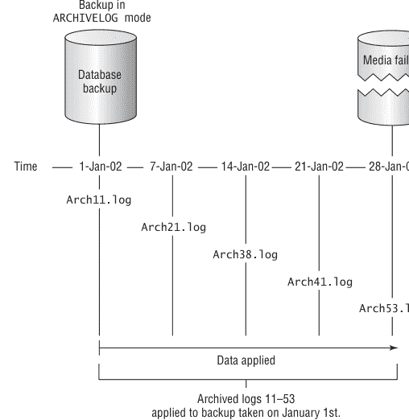

### 图 10.2 1 月 28 日介质故障在 NOARCHIVELOG 模式下的完全恢复（事务丢失）

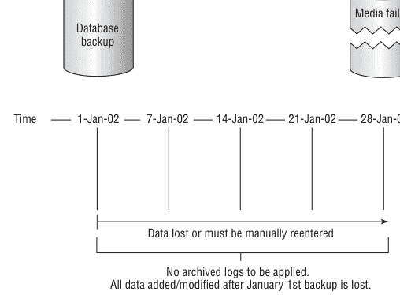

### 290 第 10 章 • 用户管理的完全恢复和 RMAN 完全恢复

介质故障需要数据库恢复。如果数据库处于 `ARCHIVELOG` 模式，可以执行完全恢复。这意味着备份可以恢复到受影响的文件系统，并将归档日志应用到故障点。因此，数据不会丢失。

然而，如果数据库处于 `NOARCHIVELOG` 模式，无法在不丢失某些事务的情况下进行完全恢复。这意味着备份可以恢复到受影响的文件系统，但不会保存任何归档日志或历史更改。因此，数据库将仅包含备份时存在的事务。如果每晚安排一次备份，业务将只丢失一天的事务。另一方面，如果每周安排一次备份，业务将丢失一周的事务。结果是，在几乎所有情况下，都会丢失某些数据。这种数据库的完全恢复并不包含直到故障点的所有事务。最终结果是数据库将恢复为不完全恢复，这将在第 11 章“用户管理和基于 RMAN 的不完全恢复”中讨论。区别在于，不完全恢复会在所有事务应用到数据库之前有意地停止，且不完全恢复需要数据库处于 `ARCHIVELOG` 模式并执行其他一些操作。

## 在 NOARCHIVELOG 模式下执行用户管理恢复

这是一个数据库处于 `NOARCHIVELOG` 模式时用户管理恢复的示例。在这种情况下，数据库无法进行完全恢复。数据库在周期间全天可用。每每个周六，关闭数据库并执行完全的冷备份（离线备份）。活动完成后重启数据库。

### 诊断故障

周三早上，数据库中出现一个丢失或被删除的文件。启动时收到的错误如下：

```
SQL> startup
ORACLE instance started.
Total System Area 195428 bytes
Fixed Size 6412 bytes
Variable Size 169828 bytes
Database Buffers 245760 bytes
Redo Buffers 7328 bytes
```

```
Database mounted.
ORA-01157: cannot identify/lock data file 4 - see DBWR trace file
ORA-01110: data file 4: '/db01/oracle/tst9/users01.dbf'
```

由于你运行在 `NOARCHIVELOG` 模式，你必须从上周末的备份执行全数据库恢复。你无法在 `ARCHIVELOG` 模式下执行表空间或数据文件恢复，因为你没有回滚和向前恢复的能力。没有归档日志可以应用到数据文件以使数据文件与数据库的其他部分保持一致。周一、周二和周三输入数据库的数据丢失了，如果可能，必须重新输入。

要执行数据库恢复，你需要从备份中拷贝所有数据文件、在线重做日志和控制文件。然后将这些文件恢复到原始位置。

## 逐步恢复

当你在 `NOARCHIVELOG` 模式下恢复丢失的文件时，请采取以下步骤：

1. 执行周六的冷备份。以下是一个示例脚本，通过关闭数据库并复制必要的数据文件、重做日志和控制文件来执行。

```
## User-managed backup
## Cold backup for tst9

echo 'starting backup...'
# Script to stop database!
./stopdb_tst9.sh

echo 'tst9 shutdown...'
echo 'clean up last backup'

rm /staging/cold/tst9/* /staging/cold/tst9/*
echo 'copying files to staging...'
cp db01/oracle/tst9/* /staging/cold/tst9/
cp db02/oracle/tst9/* /staging/cold/tst9/
cp oracle/admin/tst9/* /staging/cold/tst9/
echo 'tst9 starting up...'
## Script to startup database
```

2. 验证对象是否存在于 `USERS` 表空间。这是你要移除以模拟丢失或删除文件的空间。

```
SQL> select username, default_tablespace, temporary_tablespace from dba_users;
```

| | DEFAULT_TABLESPACE | TEMPORARY_TABLESPACE |
|---|---|---|
| SYS | SYSTEM | TEMP |
| SYSTEM | TOOLS | TEMP |
| OUTLN | SYSTEM | SYSTEM |
| DBSNMP | SYSTEM | SYSTEM |
| TEST | USERS | TEMP |

5 行记录。

3. 创建表并插入数据以模拟在周六备份后输入的数据。这些是在故障前、周一到周三输入的数据。用户 `TEST` 在冷备份之前创建，默认表空间为 `USERS`。该账户拥有连接和资源权限。


```
SQL> connect test/test
SQL> create table t1 (c1 number, c2 char (50));
Statement processed.
SQL> insert into t1 values (1, 'This is a test!');
1 row processed.
SQL> commit;
Statement processed.
```

### 4. 验证 `USERS` 表空间的数据文件位置。然后删除此文件。

```
SQL> select name from v$datafile;
NAME
----------------------------
/db01/ORACLE/tst9/system01.dbf
/db01/ORACLE/tst9/rbs01.dbf
/db01/ORACLE/tst9/temp01.dbf
/db01/ORACLE/tst9/users01.dbf
/db01/ORACLE/tst9/tools01.dbf
/db01/ORACLE/tst9/data01.dbf
/db01/ORACLE/tst9/indx01.dbf
7 行记录。
SQL>
```

```
rm /db01/ORACLE/tst9/users01.dbf
```

### 5. 启动数据库并验证发生“cannot identify/lock data file”错误。

```
[oracle@DS-LINUX tst9]$ sqlplus /nolog

SQL*Plus: Release 9.0.1.0.0 - Production on Thu Nov 21:24:04 2001
```

# 294 第 10 章 • 用户管理型完全恢复与 RMAN 完整恢复

(c) Copyright 2001 Oracle Corporation. 保留所有权利。

```sql
SQL> connect / sysdba
Connected.
SQL> startup
ORACLE instance started.
Total System Global Area      19504528 bytes
Fixed Size                   64912 bytes
Variable Size                16908288 bytes
Database Buffers             2457600 bytes
Redo Buffers                73728 bytes
Database mounted.
ORA-01157: cannot identify/lock data file 4 -
see DBWR trace file
ORA-01110: data file 4:
'/db01/ORACLE/tst9/users01.dbf'
```

- 6. 关闭数据库以执行完全数据库恢复。恢复冷备份时必须关闭数据库。

```sql
SQL> shutdown
ORA-01109: database not open
Database dismounted.
ORACLE instance shut down.
SQL>
```

- 7. 通过将所有数据文件、日志文件和控制文件复制到它们的原始位置来执行完全数据库恢复。

```bash
cp /staging/cold/tst9/* /db01/ORACLE/tst9
```

- 8. 启动数据库并检查冷备份后输入的数据是否存在。当你检查时，你会发现表 `t1` 和数据并不存在。最后备份后输入的所有数据都必须重新输入。

```bash
[oracle@DS-LINUX backup]$ sqlplus /nolog
```

```sql
SQL*Plus: Release 9.0.1.0.0 - Production on Nov 1
21:04:10 2001
```

# 使用 NOARCHILOG 和 ARCHIVELOG 模式进行恢复 295

(c) Copyright 2001 Oracle Corporation. 保留所有权利。

```sql
SQL> connect test/test
Connected.
```

```sql
SQL> select * from t1;
select * from t1
*
ORA-00942: table or view does not exist
SQL>
```

# 结论

关于此场景最显著的观察是，当数据库处于 `NOARCHILOG` 模式时，数据会丢失。备份之后、故障之前输入的所有数据都会丢失且必须重新输入。为了恢复它，你必须关闭数据库。此外，你必须恢复整个数据库，而不仅仅是丢失或删除的数据文件，这可能会增加恢复时间。

# 在 ARCHIVELOG 模式下执行用户管理型完全恢复

在本示例中，数据库被完全恢复，因为它处于 `ARCHIVELOG` 模式。该数据库每天 24 小时、每周 7 天可用（计划维护除外）。每天早上 1 点会执行一次热备份。数据文件、归档日志、控制文件、备份控制文件和 `init.ora` 文件被复制到临时目录，然后从那里复制到磁带。副本也会保留在磁盘上，直到第二天早上再次运行热备份。这允许在发生故障时进行快速访问。当备份再次运行时，临时目录将被清空并重写。

## 诊断故障

周三早晨，数据库中有一个丢失或删除的数据文件。启动时收到的错误如下：

```sql
SQL> startup
ORACLE instance started.
```

296 第 10 章 • 用户管理型完全恢复与 RMAN 完整恢复

Total System Global Area 19504528 bytes

Fixed Size 64912 bytes

Variable Size 16908288 bytes

Database Buffers 2457600 bytes

Redo Buffers 73728 bytes

Database mounted.

ORA-01157: cannot identify/lock data file 4 -

see DBWR trace file

ORA-01110: data file 4:

'/db01/ORACLE/tst9/users01.dbf'

# 逐步恢复步骤

要恢复丢失的数据文件，请执行以下步骤：

- 连接到用户 `TEST` 并在 `USERS` 表空间中的表 `t1` 中输入数据，该表空间由数据文件 `users01.dbf` 组成。这将模拟 `USERS` 表空间热备份中的数据。

```bash
[oracle@DS-LINUX backup]$ sqlplus /nolog
```

```sql
SQL*Plus: Release 9.0.1.0.0 - Production on Thu Nov 1
21:04:10 2001
```

(©) Copyright 2001 Oracle Corporation. 保留所有权利。

```sql
SQL> connect test/test
Connected.
SQL> insert into t1 values (1,'This is test one
before hot backup');
1 row processed.
SQL> connect / as sysdba
SQL> commit;
Statement processed.
```

Copyright©2002 SYBEX, Inc., Alameda, CA www.sybex.com

# 使用 NOARCHIVOG 和 ARCHIVOG 模式进行恢复 297

```sql
SQL select username,default_tablespace from
2> dba_users where username = 'TEST';
DEFAULT_TABLESPACE

TEST
USERS
1 row selected.
```

- 2. 通过将 `USERS` 表空间放入备份模式，对该表空间执行热备份。继续将数据文件 `users01.dbf` 复制到临时目录。然后，结束 `USERS` 表空间的备份。

```sql
SQL>
[oracle@DS-LINUX backup]$ sqlplus /nolog
```

```sql
SQL*Plus: Release 9.0.1.0.0 - Production on Thu Nov 1
21:04:10 2001

(c) Copyright 2001 Oracle Corporation. 保留所有权利。

```sql

SQL> connect /as sysdba

Connected.

SQL> alter tablespace begin backup;

Statement processed.

SQL> cp /db01/ORACLE/tst9/users01.dbf /stage

SQL> alter tablespace end backup;

Statement processed.

SQL> alter systemfile;


- 3. 连接到 `USER` 并向 `t1` 添加更多数据。这些数据是在 `users01.dbf` 文件备份后添加的，因此这些数据位于临时目录中的文件中。完成后，执行日志切换。这将触发归档进程生成归档日志。

```bash
[oracle@DS-LINUX backup]$ sqlplus /nolog
```

```sql
SQL*Plus: Release 9.0.1.0.0 - Production on Thu Nov 1
21:04:10 2001
298 第 10 章 • 用户管理型完全恢复
(c) Copyright 2001 Oracle Corporation. 保留所有权利。
```
```sql
SQL> connect test/test
Connected.
SQL> insert into t1 values (1,'This is test one
before hot backup');
1 row processed.
SQL> connect / as sysdba
SQL> commit;
Statement processed.
SQL> insert into t1 values (2,'This is test two
after hot backup');
1 row processed.
SQL> insert into t1 values (3,'This is test
after hot backup');
1 row processed.
SQL> alter systemfile;
Statement processed.
SQL> alter systemfile;
Statement processed.
SQL> alter systemfile;
Statement processed.
SQL> alter systemfile;
Statement processed.
```

- 4. 验证该数据文件的位置。移除或删除该文件。

- 5. 关闭数据库。在重启时，会发生该错误。

```bash
[oracle@DS-LINUX backup]$ sqlplus /nolog
```
```sql
SQL*Plus: Release 9.0.1.0.0 - Production on Thu Nov 1
21:04:10 2001
299 使用 NOARCHIVOG 和 ARCHIVOG 模式进行恢复
(c) Copyright 2001 Oracle Corporation. 保留所有权利。
Copyright©2002 SYBEX, Inc., Alameda, CA www.sybex.com
```

- 6. 将该数据文件设为离线。这将允许你在恢复期间处理该数据文件。

- 7. 通过将数据文件 `users01.dbf` 复制回原始位置来恢复它。

- 8. 数据库打开后，通过执行 `RECOVER` 命令开始恢复。然后应用所有可用的日志；最后将数据文件设为在线以便用户访问。

## 使用 NOARCHIVOG 和 ARCHIVOG 模式恢复 301

指定日志： (`<RET>`=建议的 | 文件名 | `AUTO` | `CANCEL`)

日志已应用。
媒体恢复完成。

```sql
SQL>
alter database datafile
      /db01/ORACLE/tst9/users01.dbf; online;
```

语句已处理。验证没有数据丢失，尽管在热备份之后添加了记录 2 和 3。这些记录的数据已从离线重做日志（归档日志）中应用。

```sql
SQL> select * from t1;
1 C2
```

- 1 这是一个测试项 - 热备份之前
- 2 这是一个测试项 - 热备份之后
- 3 这是一个测试项 - 热备份之后

已选择 3 行。
SQL>

## 结论

关于此场景，最显著的观察结果是：在 `ARCHIVELOG` 模式下，数据没有丢失。在故障发生前，`USERS` 表空间中热备份之后输入的所有数据都没有丢失。只需还原数据文件 `users01.dbf`，这所需的时间比还原所有文件要短。因此，通过在恢复过程中应用归档日志，你可以恢复数据文件热备份之后发生的所有更改。

另一个同样重要的特性是，在恢复某个表空间及其相关数据文件时，数据库可以保持对用户开放状态。这允许用户访问数据库中不受故障影响的其他表空间中的数据。

## 将数据文件还原到不同的位置

在 `ARCHIVELOG` 和 `NOARCHIVOG` 模式下，将数据文件还原到不同的位置都可以以类似的方式进行。主要的区别在于，与任何 `NOARCHIVOG` 模式恢复不同，在大多数情况下，数据库无法完全恢复到故障点。在 `NOARCHIVOG` 模式下数据库可以完全恢复的唯一情况是数据库自上一次完整备份以来没有循环所有的在线重做日志。

要将文件还原到不同的位置，你需要从备份位置到新位置执行 `OS` 拷贝，然后在 `mount` 阶段启动数据库。之后，你需要使用 `ALTER DATABASE RENAME FILE` 命令更新控制文件以指定新位置。让我们来看这个过程。

- 1. 使用 `OS` 命令将文件还原到新位置。

```bash
cp /db01/oracle/tst9/data01.dbf /db02/oracle/tst9/data01.dbf
```

- 2. 启动数据库实例并挂载数据库。

```bash
oracle@octilli:~ > oraenv
ORACLE_SID = [tst9] ?
oracle@octilli:~ > sqlplus /nolog
```
> SQLPlus: Release 9.0.1.0.0 - Production on Mon Oct 29 23:26:23 2001
(c) Copyright 2001 Oracle Corporation. All rights reserved.
SQL> connect /sysdba
Connected.
SQL> startup mount
ORACLE instance started.

| Total System Global Area | 75854976 bytes |
| :--- | :--- |
| Fixed Size | 279680 bytes |
| Variable Size | 71303168 bytes |
| Database Buffers | 4194304 bytes |

## 使用归档重做日志重定位并恢复表空间 303

Redo Buffers 77824 bytes
Database mounted.
SQL>

- 3. 使用 `ALTER DATABASE RENAME FILE` 命令指定新位置。

```sql
SQL> ALTER DATABASE RENAME FILE
2> '/db01/oracle/tst9/data01.dbf' to
3> '/db02/oracle/tst9/data01.dbf';
```

- 4. 使用 `ALTER DATABASE OPEN` 命令打开数据库。

```sql
SQL>alter database open;
Database altered.
```

## 使用归档重做日志重定位并恢复表空间

在此示例中，恢复过程中你会将一个表空间重定位到一个新的文件系统。你将使用 `RECOVER DATABASE` 命令确定需要将哪些归档日志应用到新重定位的数据文件。如果可以在表空间级别进行恢复，则你需要将表空间设置为离线；在数据库级别，你需要启动并挂载数据库。以下是此数据库级别进行此恢复过程的示例。

- 1. 将 `ORACLE_SID` 设置为 `ORCL`（即你的目标数据库），以便可以使用 `SQL*Plus` 启动或挂载数据库。

```bash
oracle@octilli:~ oraenv
ORACLE_SID = [tst9] ?
```

- 2. 运行适当的用户管理脚本将 `tst9` 数据库备份到磁盘。该自定义脚本会关闭数据库并将数据文件、控制文件、重做日志和归档日志文件拷贝到阶段目录。之后，重启数据库 `tst9`。

```bash
# 用户管理备份脚本
# 用于 tst9 的冷备份脚本
```

## 304 第 10 章 • 用户管理完全恢复和 RMAN 完全恢复

```bash
# ''
echo '' 'starting cold backup...''
echo ''
# 停止数据库的脚本！
./stopdb_tst9.sh
echo ''
echo 'tst9 shutdown...'
echo ''
echo 'clean up last backup in staging directory'
rm /staging/cold/tst9/*
rm /staging/cold/tst9/*
echo ''
echo 'copying files to staging...'
echo ''
cp /db01/oracle/tst9/* /staging/cold/tst9/
cp /db02/oracle/tst9/* /staging/cold/tst9/
```


`cp /oracle/admin/tst9/* /staging/cold/tst9/`

`echo ''`

`echo 'tst9 starting up...'`

`echo ''`

# 启动数据库的脚本

`./startdb_tst9.sh`

- 3. 现在启动数据库以演示将还原、恢复并重定位到新文件系统的 INDEX 表空间。

```bash
oracle@octilli:~/db01/oracle/tst9 > sqlplus /nolog
```

SQL*Plus: Release 9.0.1.0 - Production on Thu Nov 1 21:04:10 2001

(c) Copyright 2001 Oracle Corporation. All rights reserved.

`connect /sysdba`

Connected to an idle instance.

## 使用归档重做日志重定位并恢复表空间 305

```sql
SQL> startup mount
ORACLE instance started.
```

| Total System Global Area | 7584976 bytes |
| : | : |
| Fixed Size | 279680 bytes |
| Variable Size | 7130368 bytes |
| Database Buffers | 4194304 bytes |
| Redo Buffers | 77824 bytes |
Database mounted.
`SQL> alter database open`
ERROR at line 1
ORA-01157: cannot identify data file 7 - see DBWR trace
ORA-01110: data file 7: '/db01/oracle/tst9/index01.dbf'

- 6. 接下来，关闭数据库。
```sql
SQL> shutdown
ORA-01109: database not open
Database dismounted.
ORACLE instance shut down.
```

- 5. 完成后，将位于 `/staging/cold/tst9/index01.dbf` 的备份还原到新文件系统 `/db02/oracle/tst9`。

```bash
oracle@octilli:/staging/cold/tst9 > cp index01.dbf /db02/oracle/tst9.
```

- 6. 接下来，启动并挂载数据库，然后使用 `RENAME` 命令更新控制文件中 `index01.dbf` 的位置。

```sql
SQL> startup mount
ORACLE instance started.
```

## 306 第 10 章 • 用户管理完全恢复和 RMAN 完全恢复

Total System Global Area 75854976 bytes
Fixed Size 279680 bytes
Variable Size 71303168 bytes
Database Buffers 4194304 bytes
Redo Buffers 77824 bytes
Database mounted.

```sql
SQL> alter database rename file /db01/oracle/tst9/indx1.dbf to /db02/oracle/tst9/indx01.dbf;
```

Database altered.

- 7. 然后恢复数据库并应用必要的归档日志以使 INDEX 表空间的 `indx01.dbf` 数据文件最新。然后打开数据库。

```sql
SQL> recover database:
ORA-00279: change 153845 generated at 10/31/2001 23:12:23 needed for thread 1
ORA-00289: suggestion : /oracle/admin/tst9/arch/archst9_12.log
ORA-00280: change 153845 for thread 1 is in sequence #12
Specify log: {<RET>=suggested | filename | AUTO | CANCEL}
```
日志已应用。

媒体恢复完成。

```sql
SQL> alter database open;
```

Database altered.

## 只读表空间恢复 307

- 8. 验证 INDEX 表空间及其相关数据文件已从文件系统 `/db01/oracle/tst9` 移动到 `/db02/oracle/tst9`。

```sql
SQL> select name,status from v$datafile;
```

| NAME | STATUS |
| :--- | :--- |
| /db01/oracle/tst9/system01.dbf | SYSTEM |
| /db01/oracle/tst9/rbs01.dbf | ONLINE |
| /db01/oracle/tst9/temp01.dbf | ONLINE |
| /db01/oracle/tst9/users01.dbf | ONLINE |
| /db02/oracle/tst9/tools01.dbf | ONLINE |
| /db01/oracle/tst9/data01.dbf | ONLINE |
| /db02/oracle/tst9/indx01.dbf | ONLINE |
| /db02/oracle/tst9/data02.dbf | ONLINE |

已选择 8 行。

`SQL>`

## 只读表空间恢复

进行只读表空间恢复时可能会发生三种场景。情况如下：

- 只读备份和只读恢复

- 只读备份和读写恢复

- 读写备份和只读恢复

第一种情况是最简单的，因为不需要恢复。由于表空间是只读的，SCN 不发生。在这种类型的恢复中，你需要的操作是还原与只读表空间相关的数据文件；因此不需要应用归档日志。第二种情况将需要更复杂的恢复过程，因为表空间被恢复到读写状态，此时 SCN 已经发生变化或表空间中发生了事务。

在这种情况下，你将从备份恢复表空间，并从表空间设为读写的时间点开始应用归档日志。

最后一种场景也需要恢复，因为表空间是在读写状态下恢复的，然后才被恢复为只读状态。在这种情况下，你需要以读写模式恢复表空间的备份，并应用归档日志直到表空间被设为只读模式的时间点。你应该在将表空间设置为只读后始终执行备份，因为这样做可以消除恢复表空间的需求。

## 使用 RMAN 进行恢复

使用 RMAN 进行恢复（restore and recovery）时的考量因素包括你将如何从 RMAN 恢复数据库、表空间、数据文件、控制文件和归档日志。恢复和还原可以从磁盘和磁带设备执行。

有两个主要的备份源可以作为 RMAN 恢复过程的依据。这些源是镜像副本（image copies）和备份集（backup sets）。镜像副本仅存储在磁盘上。镜像副本是数据库文件、归档日志或控制文件的实际副本，并不存储在特殊的 RMAN 格式中。RMAN 中的镜像副本等同于操作系统的复制命令，例如 Unix 中的 `cp` 或 `dd`，或者 Windows/2000/XP 中的 `COPY`。

在 Oracle 9 中，`RESTORE` 命令将确定在还原过程中使用的最佳可用备份集或镜像副本，只有在需要还原时才会进行文件还原。在之前的 Oracle 版本中，即使没有必要，文件总是会被还原。

`RECOVER` 命令应用在线重做日志和归档日志文件中的必要更改来恢复已还原的文件。如果你使用增量备份，将应用在线重做日志和归档日志来恢复数据库。

## 在 NOARCHIVE 模式下执行 RMAN 恢复

在用 RMAN 进行恢复的第一个示例中，你将在 NOARCHIVELOG 模式下恢复数据库。要在此模式下恢复数据库，必须首先确保数据库已正常关闭，以确保获得的是一致的备份。这意味着数据库应该使用 `SHUTDOWN NORMAL`、`IMMEDIATE` 或 `TRANSACTION` 命令关闭，而不应使用 `ABORT` 命令。数据库应以 `MOUNT` 模式启动，但不要打开。这是因为当数据库打开且未处于 ARCHIVELOG 模式时，无法备份数据库文件。

接下来，在 RMAN 工具中，你必须连接到目标数据库，在我们的示例中是 Unix 环境下的 `tst9`。然后你可以连接到 `rcat` 数据库中的恢复目录。

一旦你连接到正确的目标和目录，你就可以执行相应的 RMAN 备份脚本。该脚本将备份整个数据库。完成后，可以使用相应的 RMAN 脚本还原数据库。最后，可以打开数据库使用。让我们来看这个示例：

- 1. 将 `ORACLE_SID` 设置为 `tst9`（即你的目标数据库），以便可以使用 SQL*Plus 在 `MOUNT` 模式下启动数据库。


```
oracle@octilli~ > oraenv
orACLE_SID = [tst9] ?
noracle@octilli~ > sqlplus /nolog
```

SQL*Plus: Release 9.0.1.0.0 - Production on Mon Oct 23:36:19 2001

(c) Copyright 2001 Oracle Corporation. All rights reserved.

```
SQL> connect /as sysdba
Connected to an idle instance.
SQL> startup mount
ORACLE instance started.
```

| Total System Global Area | 75854976 bytes |
| Fixed Size | 279680 bytes |
| Variable Size | 71303168 bytes |
| Database Buffers | 4194304 bytes |
| Redo Buffers | 77824 bytes |

```
SQL>
```

## 2. 在命令行提示符处启动 RMAN 工具并连接到目标和恢复目录数据库 `rcat`

```
oracle@octilli: ~ rman
```

Recovery Manager: Release 9.0.1.0.0 - Production

(c) Copyright 2001 Oracle Corporation. All rights reserved.

```
RMAN> connect target
connected to target database: tst9 (not mounted)
RMAN> connect catalog rman@rcat
connected to recovery catalog
RMAN>
```

## 3. 一旦你连接到目标和恢复目录，就可以将目标数据库备份到磁盘或磁带

在本示例中，选择磁盘。为数据库指定一个备份集唯一标识符格式，然后将备份编号接到数据库名后。

```
RMAN> run
{
allocate channel c1 type disk;
backup database format 'db_%u_%d_%s';
release channel c1;
}
allocated channel: c1
channel c1: sid=DISK
Starting backup at 29-OCT-01
channel c1: starting full backupset
channel c1: specifying datafile(s) in backupset including current controlfile in backupset
input datafile fno=00001 name=/oracle/product/9.0.1/dbs/system01.dbf
input datafile fno=00002 name=/oracle/or/db/tst9/system01.dbf
input datafile fno=00003 name=/oracle/or/db/tst9/undo01.dbf
input datafile fno=00004 name=/oracle/or/db/tst9/temp01.dbf
input datafile fno=00005 name=/oracle/or/db/tst9/users01.dbf
input datafile fno=00006 name=/oracle/or/db/tst9/data01.dbf
input datafile fno=00007 name=/oracle/or/db/tst9/idx01.dbf
channel c1: starting piece 1 at 29-OCT-01
channel c1: finished piece 1 at 29-OCT-01
channel c1: backup set complete, elapsed time: 00:01:57
Finished backup at 29-OCT-01
released channel: c1
```

## 4. 一旦备份完成，即可还原数据库

数据库必须处于挂载状态而非打开。在还原脚本中，选择三个通道来利用还原过程的并行化。`RESTORE` 命令负责 RMAN 内部的还原过程。由于数据库处于 NOARCHELOG 模式且还原了整个数据库，因此不需要恢复。

```
RMAN> run
{
  allocate channel c1 type disk;
  allocate channel c2 type disk;
  allocate channel c3 type disk;
  restore database;
}
```

## 5. 一旦数据库还原完成，就可以打开它然后正常关闭

此时，应该执行一次启动以确保还原过程成功。

```
SQL> alter database open;
```

Database altered.

```
SQL> shutdown
Database closed.
Database dismounted.
ORACLE instance shut down.
```

```
SQL> startup
ORACLE instance started.
Total System Global Area 75854976 bytes
Fixed Size 279680 bytes
Variable Size 71303168 bytes
Database Buffers 4194304 bytes
Redo Buffers 77824 bytes
Database mounted.
Database opened.
SQL>
```

# 在 ARCHIVOG 模式下执行 RMAN 完整恢复

作为用 RMAN 进行恢复的第二个示例，你将在 ARCHIVOG 模式下恢复数据库。在这种情况下，数据库可以挂载，也可以打开。这是因为当数据库处于打开且处于 ARCHIVOG 模式时，可以备份数据库文件，其方式类似于用户管理的 `ALTER TABLESPACE <tablespace_name> BEGIN BACKUP` 命令。

# 314 第10 章 • 用户管理的完全恢复与 RMAN 的完全恢复

(c) Copyright 2001 Oracle Corporation. 保留所有权利。

```
RMAN> connect target
```

连接到目标数据库: `tst9` (未挂载)

```
RMAN> connect catalog rman/rman@rcat
```

连接到恢复目录数据库

```
RMAN>
```

## 3. 一旦你连接到目标数据库和恢复目录，你就可以将目标数据库（包括归档日志）备份到磁盘或磁带

在例例中，你选择了磁盘。为格式 `db_%u_%d_%s` 设定一个数据库名称，这意味着 `db_` 将与备份集的唯一标识符拼接，然后与备份集编号拼接。

```
RMAN> run
{
3> allocate channel c1 type disk;
4> backup database format 'db_%u_%d_%s';
5> backup format 'log_%t_s_%s_%p'
6> (archivelog all);
7 )
```

allocated channel: c1

channel c1: sid=11 devtype=DISK

Starting backup at 30-OCT-01

channel c1: starting full datafile backup

channel c1: specifying datafile(s) in backup

including current controlfile in backup

input datafile fno=00001 name=/db01/oracle/tst9/system01.dbf

input datafile fno=00006 name=/db01/oracle/tst9/data01.dbf

Copyright©2002 SYBEX, Inc., Alameda, CA www.sysex.com

# 在 ARCHIVELOG 模式下执行 RMAN 完全恢复 315


```
input datafile fno=00002 name=/db01/oracle/tst9/rbs01.dbf
input datafile fno=00008 name=/db01/oracle/tst9/data02.dbf
input datafile fno=00003 name=/db01/oracle/tst9/temp01.dbf
input datafile fno=00004 name=/db01/oracle/tst9/users01.dbf
input datafile fno=00007 name=/db01/oracle/tst9/idx01.dbf
input datafile fno=00005 name=/db01/oracle/tst9/tools01.dbf
channel cl: starting piece 1 at 30-OCT-01
channel cl: finished piece 1 at 30-OCT-01
piece handle=/oracle/product/9.0.1/dbs/db_07tqts_\NST59_20 comment=NONE
channel cl: backup set complete, elapsed time: 00:01:48
```

Starting backup at 30-OCT-01

current log archived

+ channel cl: starting archive log backupset

channel cl: specifying archive log(s) in backup set

input archive log thread=1 sequence=1 recid=8 stamp442361669

input archive log thread=1 sequence=2 recid=9 stamp442361872

input archive log thread=1 sequence=3 recid=10 stamp442362056

input archive log thread=1 sequence=4 recid=11 stamp442362297

input archive log thread=1 sequence=5 recid=12 stamp442362415

input archive log thread=1 sequence=6 recid=13 stamp4427922220

input archive log thread=1 sequence=7 recid=14 stamp443231077

input archive log thread=1 sequence=8 recid=15 stamp444439517

# 316 第10 章 • 用户管理的完全恢复与 RMAN 的完全恢复

```
input datafile fno=00002 name=/db01/oracle/tst9/rbs01.dbf
input datafile fno=00008 name=/db01/oracle/tst9/data02.dbf
input datafile fno=00003 name=/db01/oracle/tst9/temp01.dbf
input datafile fno=00004 name=/db01/oracle/tst9/users01.dbf
input datafile fno=00007 name=/db01/oracle/tst9/idx01.dbf
input datafile fno=00005 name=/db01/oracle/tst9/tools01.dbf
```

+ 4. 一旦备份完成，就可以对数据库进行恢复和恢复。数据库必须挂载但打开。在在恢复恢复脚本中，选择三个磁盘通道来利用恢复过程的并行化。这并非必须的，但可以提高恢复时间。`RESTORE` 命令负责 RMAN 内部的恢复过程，因为数据库处于 `ARCHIVELOG` 模式，为了执行完全恢复，需要将这些文件应用到数据文件中最后，数据库将打开。

```
RMAN>           311
```

`RMAN>` `run`

2> {

3> `allocate channel c1 type disk;`

4> `allocate channel c2 type disk;`

5> `allocate channel c3 type disk;`

6> `restore database;`

7> `recover database;`

8> `alter database;`

9> }

```

allocated channel: c1
channel c1: sid=11 devtype=DISK

allocated channel: c2
channel c2: sid=12 devtype=DISK

# 在 ARCHIVELOG 模式下执行 RMAN 完全恢复 317

allocated channel: c3
channel c3: sid=13 devtype=DISK

Starting restore at 30-OCT-01

```

channel c1: starting datafile backupset

channel c1: specifying datafile(s) to restore from backup set

restoring datafile 00001 to `/db01/oracle/tst9/`

restoring datafile 00002 to `/db01/oracle/tst9/rbs01.dbf`

restoring datafile 00003 to `/db01/oracle/tst9/temp01.dbf`

restoring datafile 00004 to `/db01/oracle/tst9/users01.dbf`

restoring datafile 00005 to `/db01/oracle/tst9/tools01.dbf`

restoring datafile 00006 to `/db01/oracle/tst9/data01.dbf`

restoring datafile 00007 to `/db01/oracle/tst9/idx01.dbf`

restoring datafile 00008 to `/db01/oracle/tst9/data02.dbf`

channel c1: restored backup 1

piece handle=/oracle/product/9.0.1/dbs/db_07tqts_\TST9_20 tag=null

channel c1: restore complete

Finished restore at 30-OCT-01

```

Starting recover at 30-OCT-01

```

starting media recovery

media recovery complete

```

Finished recover at 30-OCT-01

database opened
released channel: c3
released channel: c1
released channel: c2

```

`RMAN>`

5. 一旦数据库已恢复、恢复并打开，就应该正常关闭。应该执行一次启动以确保恢复过程成功。

`SQL>` `shutdown`

Database closed.

Database dismounted.

ORACLE instance shut down.

`SQL>` `startup`

ORACLE instance started.

Total System Global Area 7584976 bytes

Fixed Size 279680 bytes

Variable Size 7130168 bytes

Database Buffers 4194304 bytes

Redo Buffers 77824 bytes

Database mounted.

Database opened.

`SQL>`


# 使用 RMAN 将数据文件恢复到不同的位置

作为第三个示例，你将使用 RMAN 恢复和恢复数据文件。在这种情况下，也将处于 `ARCHIVELOG` 模式，因为将备份单个数据文件。与上一个表空间示例一样，数据库将在打开时进行备份。

Copyright ©2002 SYBEX, Inc., Alameda, CA www.sybex.com

首先，在 RMAN 内部，必须执行适当的数据备份脚本。在本例中，你将选择 `DATA` 表空间的文件。作为额外的预防，你将备份当前的控制文件。

一旦数据文件备份完成，就可以开始恢复和恢复过程。对于此过程，数据库应该挂载但不要打开。你还需要使用 `SET NEWNAME` 命令来识别新的数据文件位置，并使用 `SWITCH` 命令在控制文件中恢复位置更改。在数据库挂载的情况下，你可以执行适当的 RMAN 脚本来恢复和恢复数据文件。步骤如下：

1. 将 `ORACLE_SID` 设置为 `ORCL`，即你的目标数据库，这样可以使用 `SQL*Plus` 启动或挂载数据库。

```
oracle@oraenv

ORACLE_SID = [tst9] ?
```

2. 连接到 RMAN、目标数据库和恢复目录。

```
oracle@client~\> rman target / catalog rman/rman@rcat

Recovery Manager: Release 9.0.1.0

(c) Copyright 2001 Oracle Corporation. 保留所有权利。

连接到目标数据库: TST9 (未挂载)

连接到恢复目录数据库
```

3. 运行适当的 RMAN 脚本将 `DATA` 数据文件备份到磁盘。

```
RMAN> run
2> {
3> allocate channel c1 type disk;
4> backup
5> format '%d_%u'
6> (datafile '/db01/oracle/tst9/data02.dbf');
7> release channel c1;
8> }
```

```
allocated channel: c1

channel c1: sid=11 devtype=DISK
```

# 第10章 • 用户管理的完全恢复与 RMAN 的完全恢复

执行命令：`SET NEWENAME`

正在于 30-OCT-01 开始恢复

分配通道：`ORA_DISK_1`

channel `ORA_DISK_1`: sid=11 devtype=DISK

channel `ORA_DISK_1`: 正在从备份集开始恢复数据文件备份集

正在恢复数据文件 000011 到 `/db01/oracle/tst9/system01.dbf`

正在恢复数据文件 00002 到 `/db01/oracle/tst9/rbs01.dbf`

正在恢复数据文件 00003 到 `/db01/oracle/tst9/temp01.dbf`

正在恢复数据文件 00004 到 `/db01/oracle/tst9/users01.dbf`

正在恢复数据文件 00005 到 `/db01/oracle/tst9/tools01.dbf`

正在恢复数据文件 00006 到 `/db01/oracle/tst9/data01.dbf`

正在恢复数据文件 00007 到 `/db01/oracle/tst9/indx01.dbf`

channel `ORA_DISK_1`: 已恢复备份碎片 1

piece handle=oracle/product/9.0.1/dbs/db_0kd7qtts-TST59_20 tag=null params=NULL

channel `ORA_DISK_1`: 恢复完成

channel `ORA_DISK_1`: 正在开始数据文件备份集

channel `ORA_DISK_1`: 正在指定从备份集恢复的数据文件

正在恢复数据文件 00008 到 `/db01/oracle/tst9/data02.dbf`

channel `ORA_DISK_1`: 已恢复备份碎片 1

piece handle=oracle/product/9.0.1/dbs/TST59_0nd7tstb tag=null params=NULL

channel `ORA_DISK_1`: 恢复完成

于 31-OCT-01 结束恢复

数据文件 8 已切换到数据副本

## 第 10 章 • 用户管理的完全恢复和 RMAN 完全恢复

```
input datafilecopy recid=322 stamp=444528057 filename=/ndb02/oracle/tst9/data02.df
开始对恢复目录进行完全同步
完全同步完成
```

正在于 31-OCT-01 开始恢复

使用通道 `ORA_DISK_1`

开始介质恢复

介质恢复完成

于 31-OCT-01 结束恢复

数据库已打开

`RMAN>` 一旦数据库恢复完成，正常关闭它。然后执行启动以确保恢复过程已完成。

```
SQL> shutdown
SQL> startup
```

# 使用 RMAN 结合归档日志迁移并恢复表空间

在本示例中，你将在恢复过程中将表空间迁移到新的文件系统。你可以使用之前提到的 `SET NEWENAME` 和 `SWITCH` 命令来执行此操作。在，`RECOVER` 命令中，会应用必要的数据文件备份和归档日志。此过程与迁移数据文件过程的主要区别在于，在将相关数据文件移动到新位置之前，需要将表空间处于离线状态。然而，数据库在此过程中是可以打开的。以下是此步骤的示例。

## 使用归档日志迁移并恢复表空间

1. 将 `ORACLE_SID` 设置为 `ORCL`（即你的目标数据库），以便可以使用 `SQL*Plus` 启动或挂载数据库。

```
oracle@octilli:~ > oraenv

ORACLE_SID = [tst9] ?
```

2. 一步到位连接到 RMAN、目标数据库以及恢复目录。

```
oracle@octilli:~ > rman target / catalog rman/rman@rcat

Recovery Manager: Release 9.0.1.0 - Production

(c) Copyright 2001 Oracle Corporation. 保留所有权利

连接到目标数据库 TST9 (DBID=1268700551) 连接到恢复目录
```

3. 运行适当的 RMAN 脚本备份 `tst9` 数据库：

```
RMAN> run
2> {
3> allocate channel c1 disk;
4> backup database format 'db_%u_%s';
5> backup format 'log_%s_%p'
6> (archivelog all);
7> }
```

4. 然后发布恢复脚本，该脚本将利用 `SET NEWNAME`、`RESTORE` 和 `RECOVER` 命令。最后将表空间上线。

```
RMAN> run
2> {
3> sql 'alter tablespace offline';
4> set newname for datafile '/db01/oracle/tst9/tools01.dbf' to '/db02/oracle/tst9/tools01.dbf';
5> restore (tablespace tools);
6> switch datafile 5;
7> recover tablespace tools;
8> sql 'alter tablespace online';
```

语句：`alter tablespace offline`

执行命令：`SET NEWENAME`

于 31-OCT-01 开始恢复

分配通道 `ORA_DISK_1`

channel `ORA_DISK_1`: sid=11 devtype=DISK

channel `ORA_DISK_1`: 正在从备份集恢复数据文件

正在恢复数据文件 00005 到 `/db02/oracle/tst9/tools01.dbf`

channel `ORA_DISK_1`: 已恢复备份碎片 1

piece handle=oracle/product/9.0.1/dbs/db_0kd7qtts-TST59_20 tag=null params=NULL

channel `ORA_DISK_1`: 恢复完成

于 31-OCT-01 结束恢复

数据文件 5 已切换到数据副本

input datafilecopy recid=322 stamp=444528057 filename=/ndb02/oracle/tst9/tools01.dbf

开始对恢复目录进行完全同步

完全同步完成

于 31-OCT-01 开始恢复

使用通道 `ORA_DISK_1`

开始介质恢复

介质恢复

archive log thread 1 已经在磁盘上 `/oracle/admin/arch/tst9_16.log`

archive log thread 1 已经在磁盘上 `/oracle/admin/arch/tst9_17.log`


`archive log thread 1` 已经在磁盘上 `/oracle/admin/arch/tst9_18.log`

`archive log filename=/oracle/admin/arch/tst9_16.log`

`thread=1` `sequence=6`

介质恢复完成

于 31-OCT-01 结束恢复

语句：`alter tablespace online`

`RMAN>`

## 总结

在本章中，我们强调了介质恢复。我们描述了执行介质故障数据库恢复的两种方法（用户管理和基于`RMAN`的恢复），并执行了具体的示例。

此外，我们识别了`ARCHIVELOG`模式和`NOARCHIVE`模式之间的区别，并描述了每种模式对备份和恢复过程的重大影响。我们还通过用户管理和`RMAN`方法展示了`ARCHIVELOG`模式和`NOARCHIV`模式恢复的示例。

我们讨论了只读表空间恢复及其相关的三个恢复场景。这些场景都需要不同的恢复操作。我们还执行了需要迁移文件的用户管理和基于`RMAN`的恢复。

介质恢复是测试和实际情况中的重要主题。恢复情况的处理取决于执行介质恢复的 DBA 的信心。你可以通过练习上述所有情况的介质恢复来获得信心。这样当你需要执行介质恢复时，不确定性将大大减少。这些练习也将帮助你应对作为 DBA 会遇到的情况。

## 考试要点

- 理解介质恢复。当数据库文件（如数据文件、控制文件或联机 redo日志）不可用时，需要介质恢复。这些文件可能由于硬件故障、损坏或意外删除而变得不可用。

- 了解`ARCHIVELOG`模式和`NOARCHIVOG`模式恢复的区别。为了执行完全恢复，数据库必须处于`ARCHIVELOG`模式。在`NOARCHIV`模式下，必须执行不完全恢复——否则从上次完全备份到故障点之间的事务将丢失。

- 熟悉将数据文件恢复到不同位置的过程。要将数据文件恢复到不同位置，必须使用操作系统命令从备份位置复制到新位置。你将使用 `ALTER DATABASE RENAME FILE` 命令在控制文件中恢复新的数据文件位置。

- 列出只读表空间的恢复场景。三个只读恢复场景包括只读备份和只读恢复、只读备份和读写恢复以及读写备份和只读恢复。你应该理解恢复在这些场景中是何不同的。

- 理解执行`RMAN`恢复和恢复所需的命令。`RESTORE` 命令将确定用于恢复的最佳可用备份集或镜像副本。`RECOVER` 命令将把联机 redo日志和归档日志中的必要更改作为增量备份（如果使用）应用到恢复的文件中。

- 理解`ARCHIVELOG`和`NOARCHIVOG`模式下的`RMAN`恢复。在`NOARCHIV`模式下，你对一致数据库使用`RESTORE` 命令，但不使用`RECOVER` 命令。在`ARCHIVELOG`模式下，同时使用`RESTORE`和`RECOVER` 命令。

使用 `RMAN` 命令通过归档日志重新定位并恢复表空间。`SET NEWNAME` 命令用于指定数据文件的新位置，而 `SWITCH` 命令用于用新位置更新控制文件。注意，执行恢复时表空间必须处于离线状态（`offline`），恢复完成后，在数据库仍开启的情况下必须将其恢复在线（`online`）。

## 关键术语

在参加考试之前，请确保你熟悉以下术语：

- `ARCHIVELOG` 模式下的不完全恢复

- 冷备份介质恢复

- `NOARCHIVELOG` 模式下的完全恢复

- 热备份 `RECOVER DATABASE`

- 镜像拷贝 `RESTORE DATABASE`

## 复习题

- 1. 下列哪种故障情况最能描述介质故障并需要恢复？（选择所有适用项。）

  A. 数据文件被删除

  B. 所有控制文件均被删除

  C. 访问存储数据文件的磁盘的磁盘控制器故障

  D. 包含数据文件的非镜像存储阵列发生磁盘驱动器崩溃

  E. 以上所有

- 2. 为了执行器到故障点的完全数据库恢复，数据库必须处于以下哪种模式？

  A. `NOARCHIVELOG`

  B. `ARCHIVELOG`

  C. `Export`

  D. `LOG`

- 3. 当事务未应用且数据库处于 `NOARCHIVELOG` 模式时，执行的是哪种类型的恢复？

  A. 完全恢复

  B. 部分恢复

  C. 不完全恢复

  D. 无恢复

- 4. 在用户管理的恢复中，重新定位文件需要什么命令？

  A. `ALTER DATABASE RENAME FILE`

  B. `SET NEWNAME`

  C. `ALTER DATABASE SET NEWNAME`

  D. `ALTER DATABASE NEWNAME FILE`

- 5. 你对包含只读表空间的数据库进行了冷备备，然后将该表空间设置为读写模式。在下周备份之前，该表空间被设置为读写，且你需要对该表空间进行恢复。必须执行哪种选项？

  A. 不需要恢复，因为表空间是以只读模式备份的。

  B. 不需要恢复，因为表空间在设置为读写模式后没有发生任何更改。

  C. 需要恢复，因为表空间被设置为读写模式，而备份是只读的。

  D. 只需要恢复只读表空间即可。

- 6. 在 `NOARCHIVELOG` 模式下恢复数据库需要什么 `RMAN` 命令？

  A. `RESTORE`

  B. `RECOVER`

  C. `SET NEWNAME`

  D. `SWITCH`

- 7. 哪种 `RMAN` 命令负责应用增量备份和归档日志？

  A. `RESTORE`

  B. `RECOVER`

  C. `SET NEWNAME`

  D. `SWITCH`

- 8. 使用 `RMAN` 时，数据库需要处于什么模式才能执行数据库还原和恢复？

  A. `Opened`

  B. `Nomount`

  C. `Closed`

  D. `Mount`

## 330 页 10 章 • 用户管理的完全恢复与 RMAN 完全恢复

- 9. 在数据库文件重新定位过程中，`SWITCH` 命令负责以下哪项活动？

  A. 重命名位置

  B. 更新控制文件

  C. 移动物理文件

  D. 更新数据字典中的文件

- 10. 下列哪种恢复不需要你恢复数据库？

  A. 只读表空间备份，且恢复时表空间为只读

  B. 只读表空间备份，且恢复时表空间为读写

  C. 读写表空间备份，且恢复时表空间为只读

  D. 读写表空间备份，且恢复时表空间为读写

- 11. 只读表空间的恢复场景有哪些？（选择所有适用项。）

  A. 只读备份到只读恢复

  B. 只读备份到读写恢复

  C. 读写备份到读写恢复

  D. 读写备份到只读恢复

- 12. 如果按照建议步骤操作，DBA 可以避免哪种类型的只读恢复？

  A. 只读备份到只读恢复

  B. 只读备份到读写恢复

  C. 读写备份到读写恢复

  D. 读写备份到只读恢复

- 13. 关于 `RMAN` 镜像拷贝（image copy）有什么独特之处？

  A. 它只能备份数据文件。

  B. 它只能备份到磁带。

  C. 它只能备份到磁盘。

  D. 它不能备份控制文件。

- 14. 关于备份集（backup set），以下哪项是正确的？

  A. 它不是以特殊的 `RMAN` 格式存储。

  B. 包含多个数据文件。

  C. 包含多个数据文件和归档日志。

  D. 每个备份集只能包含一个数据文件。

- 15. 哪个 `RMAN` 命令负责从备份介质拷贝文件？

  A. `RESTORE`

  B. `RENAME`

  C. `RECOVER`

  D. `SWITCH`

## 复习题答案

- 1. 这些故障都需要介质恢复。每种故障都会导致数据库文件不可用，这意味着需要还原和恢复。

- 2. `ARCHIVELOG`

- 3. 不完全恢复

- 4. `ALTER DATABASE RENAME FILE`

- 5. 需要恢复，因为表空间被设置为读写模式，而备份是只读的。

- 6. `RECOVER`

- 7. `RECOVER`

- 8. `Mount`

- 9. 更新控制文件

- 10. 读写表空间备份，且恢复时表空间为读写

- 11. A, B

- 12. B

- 13. 它只能备份到磁盘。

- 14. 包含多个数据文件和归档日志。

- 15. `RESTORE`

## 描述用户管理的不完全恢复 337

这些选项中的每一个都允许恢复到故障发生之前的某个时间点。之所以有三个选项，主要原因是 DBA 可以对恢复过程中停止的位置具有更好的灵活性和控制力。接下来的节将详细描述这些选项中的每一个一个。

当你不想应用所有为了将数据库恢复到故障发生点所需的归档日志文件和非归档日志文件时，就会执行不完全恢复。结果是数据库没有被完全恢复；某些事务仍然缺失。图 11.1 展示了不同类型的不完全恢复。

## 图 11.1 1 月 28 日介质故障在 ARCHIVELOG 模式下的不完全恢复

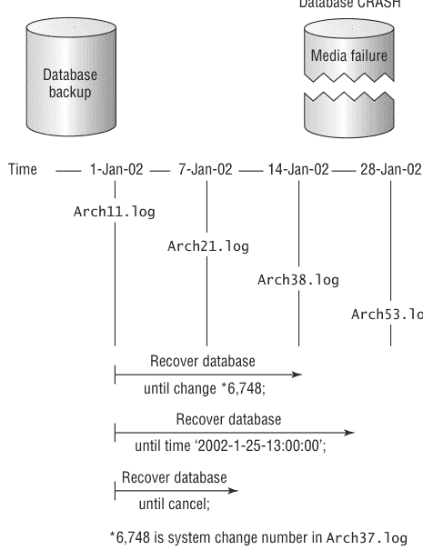

当 DBA 想要或需要将数据库恢复到数据库故障之前的时间点时，应该执行不完全恢复。可能需要此类恢复类型的情况包括数据文件损坏、重做日志损坏或由于用户错误导致表丢失。

Copyright©2002 SYBEX, Inc., Alameda, CA www.symtex.com


在某些情况下，不完全恢复是唯一的可用选项。在涉及当前和活动归档重做日志文件丢失或损坏的故障情况下，在不包含这些文件中事务的情况下恢复数据库是唯一的选择。如果改为执行完全恢复，错误将由于恢复过程而重新引入。

## 执行不完全数据库恢复

本节详细介绍了三种类型的不完全数据库恢复：基于取消的（cancel-based）、基于时间的（time-based）和基于变化的。每种方法适用于不同的情况，你应该了解每种方法何时适用。

### 基于取消的恢复

在基于取消的恢复中，你在故障发生点之前取消恢复。基于取消的恢复对于恢复过程中停止点的灵活性和控制力最小。在这种类型的恢复中，你在恢复过程中应用归档日志。在恢复完成之前的某个时间点，你输入 `CANCEL` 命令。在此时点，恢复停止，且不再应用更多的归档日志。

以下是基于取消的不完全恢复的示例。

```sql
SQL> recover database until cancel;
```

使用基于取消的不完全恢复的一个示例是，当你需要从热备中恢复丢失数据文件的备份时。要做到这一点，你需要执行以下步骤：

- 1. 使用 SQL*Plus 中的 `SHUTDOWN` 命令确保数据库已关闭。
- 2. 确保存在数据文件、控制文件和参数文件的当前副本，以防恢复过程中出现错误。如果这些文件存在，如有需要，你将能够重新恢复过程，而不会引入可能由于之前的恢复失败而产生的任何新错误。
- 3. 确保存在当前的备份，因为从当前备份复制的文件将替换失败的数据文件、在线重做日志文件或控制文件。
- 4. 将数据文件从备份位置还原到正确的位置。你通过发布特定于操作系统的命令来实现。在 Unix 中，你将使用 `cp` 命令，例如所示：

```bash
cp /stage/data01.dbf /oracle/database/tst9/data01.dbf
cp /stage/system01.dbf /oracle/database/tst9/system01.dbf
cp /stage/rbs01.dbf /oracle/database/tst9/rbs01.dbf
cp /stage/temp01.dbf /oracle/database/tst9/temp01.dbf
cp /stage/users01.dbf /oracle/database/tst9/users01.dbf
```

- 5. 以 `MOUNT` 模式启动数据库（见下）。
- 6. 确保你需要恢复的所有文件处于在线状态。以下查询显示状态：

```sql
SELECT file#, status, name FROM v$datafile;
```

| FILE# | STATUS | NAME |
| :--- | :--- | :--- |
| 1 | ONLINE | /oracle/database/tst9/data01.dbf |
| 2 | ONLINE | /oracle/database/tst9/system01.dbf |
| 3 | ONLINE | /oracle/database/tst9/rbs01.dbf |
| 4 | ONLINE | /oracle/database/tst9/temp01.dbf |
| 5 | ONLINE | /oracle/database/tst9/users01.dbf |
| 6 | ONLINE | /oracle/database/tst9/tools01.dbf |
| 7 | ONLINE | /oracle/database/tst9/indx01.dbf |

- 7. 使用 `CANCEL` 执行恢复：

```sql
SQL> recover database until cancel;
```

- 8. 使用 `RESETLOGS` 打开数据库：

```sql
SQL> alter database open resetlogs;
```

- 9. 执行数据库备份。

### 执行不完全数据库恢复 339

不完全恢复选项（例如控制文件 `UNTIL`）在尝试将数据库从一个位置移动到另一个位置时非常有用。当你使用此类选项时，可以为了迁移到新服务器而移动数据库。你必须确保如果将数据库迁移到新服务器，所使用的 Oracle 数据库软件以及新服务器上的操作系统是类似的。

这种迁移数据库的方法是通过对数据库进行热备并移动数据文件和初始化文件来实现的。你需要控制文件来引用所有物理数据库文件，例如重做日志和数据文件。完成后，你需要验证 `ORACLE_SID` 并确保它是正确的数据库；然后你需要以 sysdba 身份执行备份控制文件。这将在新服务器上创建一个数据库。请参考 Oracle 文档获取执行此任务的准确步骤，并始终在测试环境中尝试此过程。

### 真实世界场景：使用不完全恢复迁移数据库

恢复操作可以用于故障以外的活动。因此，你需要熟悉与不完全恢复相关的备份和功能。

### 基于时间的恢复

在基于时间的恢复中，DBA 将数据库恢复到故障发生之前的某个点。基于时间的恢复比基于取消的选项提供了更大的灵活性控制力。基于取消选项的粒度是重做日志文件的大小；也就是说，应用重做日志文件时，你会获得该文件中所有的事务，无论该日志填充的时间跨度如何。

在基于时间的恢复中，你将归档日志应用到数据库指定的某个点。该点可能位于归档日志的中间，而不一定适用于整个归档日志。

数据库中的致命操作，例如数据块损坏或由于用户错误导致数据库对象丢失。以下是一个基于时间的不完全恢复示例。

```
SQL> recover database until time '2001-9-30:22:55:00';
```

你可以使用该示例来恢复丢失的数据文件，然后使用基于时间的恢复代替基于取消（cancel）的恢复。要实现这一点，你像以前一样，从热备中恢复所有必要的数据文件。唯一的变化是在第 7 步中使用 `UNTIL TIME` 子句代替 `UNTIL CANCEL` 子句，如下所示：

- 7. 使用使用 `UNTIL TIME` 子句执行不完全恢复。

```
SQL> recover database until time '2001-9-30:22:55:00';
```

所有其他步骤保持不变。

### 基于更改的恢复

在基于更改的恢复中，你恢复到故障点之前的系统更改号（SCN）。这种类型的不完全恢复能给你提供最大的控制。

正如你已经学到的，SCN 是 Oracle 用来唯一标识每个已提交事务的标识。SCN 是一个数字，在每个事务发生时按顺序在重做日志中连续事务。此数字也记录在回滚段的事务表、控制文件和数据文件头中。事务与这些文件之间的 SCN 协调将数据库同步到一致状态。

每个日志都与下方的低和高 SCN 号相关联。注意每个日志序列或日志文件中 `FIRST_CHANGE#` 和 `NEXT_CHANGE#` 列中的日志和高 SCN 号。

```
SQLWKS select sequence#,first_change#,next_change#,first_time
```

```
2 from v$log_history where sequence# > 10326;
```

| SEQUENCE# | FIRST_CHANGE | NEXT_CHANGE | FIRST_TIME |
| :--- | :--- | :--- | :--- |
| 10327 | 60731807 | 60732514 | 30-SEP-01 |
| 10328 | 60732514 | 60732848 | 30-SEP-01 |
| 10329 | 60732848 | 60747780 | 30-SEP-01 |
| 10330 | 60747780 | 60748140 | 30-SEP-01 |

4 行已。

### 在丢失当前重做日志后恢复

这些 SCN 之间的所有事务都包含在这些日志中。Oracle 通过记录在回滚段事务表、控制文件和数据文件头中的 SCN 信息来确定应该恢复哪些内容。要要执行基于更改的恢复，你可以使用之前的不完全数据库恢复示例，但要使用基于更改的恢复代替基于取消或基于时间的恢复。要实现这一点，从热备中恢复所有需要的数据文件，然后使用接下来的第 7 步代替之前显示的步骤。

- 7. 使用使用 `UNTIL CHANGE` 子句执行不完全恢复。`SQL> recover database until change 60747681;`

### 在丢失当前重做日志后恢复

如果丢失当前和/或非活动的非归档重做日志文件，则必须进行不完全恢复。如果发生这种情况，意味着你没有器到故障点的所有重做文件，因此唯一的替代方案是恢复到故障点之前。


Oracle 已进行了改进以补偿这种故障，让你能够镜像重做日志或在不同的文件系统上创建成员。

警告日志中可能会某些常见错误消息有 `ORA-00255`、`ORA-00286` 和 `ORA-00334`。这些错误消息中的每一个表示写入在线重做日志文件时出现问题。

要在重做日志丢失后执行不完全恢复，你需要：


### 启动 Server Manager 并执行命令

1. 启动 Server Manager 并执行 `CONNECT INTERNAL` 命令。
```
SQL> connect / as sysdba;
```

2. 执行 `SHUTDOWN` 命令并复制所有数据文件。
```
SQL> shutdown;
cp /stage/data01.dbf /oracle/database/tst9/data01.dbf
cp /stage/system01.dbf /oracle/database/tst9/system01.dbf
cp /stage/rbs01.dbf /oracle/database/tst9/rbs01.dbf
cp /stage/temp01.dbf /oracle/database/tst9/temp01.dbf
cp /stage/users01.dbf /oracle/database/tst9/users01.dbf
cp /stage/tools01.dbf /oracle/database/tst9/tools01.dbf
cp /stage/indx01.dbf /oracle/database/tst9/indx01.dbf
```

3. 执行 `STARTUP MOUNT` 命令以读取控制文件的内容。
```
SQL> startup mount;
```

4. 执行 `RECOVER DATABASE UNTIL CANCEL` 命令开始恢复过程。
```
SQL> recover database until cancel;
```

5. 应用必要的归档日志，但不包括丢失或损坏的日志。

6. 打开数据库并重置日志文件。
```
SQL> alter database open resetlogs;
```

7. 切换日志文件以查看新日志是否正常。
```
SQL> alter system logfile;
```

8. 关闭数据库。
```
SQL> shutdown normal;
```

9. 执行 `STARTUP` 和 `SHUTDOWN` 命令，通过确保执行这些命令后的警告日志正常来验证数据库功能正常。
```
SQL> startup;
SQL> shutdown normal;
```

10. 执行冷备或热备。如果你需要从不同位置恢复归档日志，只需将 `ARCHIVE_DEST` 更改为归档文件的新位置即可。这可能发生在从磁带到磁盘恢复归档日志的情况下。

## 使用 UNTIL TIME 执行基于 RMAN 的不完全恢复

在此示例中，你将使用 RMAN 执行一种类型的恢复。你将把数据库恢复到特定的时间点。为了实现这一点，你将创建一个名为 `TEST` 的用户，以及两个存储了日期和时间的表。然后你将在 `ARCHIVOG` 模式下执行数据库备份，并恢复到 2:30 之间的时间。你将使用 `UNTIL TIME` 子句执行恢复。这可能发生在从磁带到磁盘恢复归档日志的情况下。

# 348 第11 章 • 用户管理和基于 RMAN 的不完全恢复

`channel chl1: backup set complete, elapsed time:`

`00:01:49`

`Finished backup at 04-OCT-01`

5. 备份所有的归档日志文件。

```
RMAN> run {
2> allocate channel chl1 type disk;
3> backup
4> format 'log_t%t_s%s%p'
5> (archivelog all);
6> }
```

6. 创建第二张表 `t2`，并向表中日期时间数据。该日期时间为同一天，但是下午 3:59。假设你已经运行了一些日志切换（log switches）以将数据移动到归档日志。

```SQL
SQL> connect test/test
Connected.
SQL> insert into t2 values (2, to_char(sysdate, HH:MI DD-MON-YYYY'));
1 row processed.
SQL> commit;
SQL> select * from t2;
C1          C2

1          03:59 04-OCT-2001
1 row selected.
SQL> connect system/manager
SQL> alter system switch logfile;
SQL> alter system switch logfile;
```

7. 使用适当的 RMAN 脚本将归档日志备份到磁盘。

```
RMAN> run {
2> allocate channel chl1 type disk;
3> backup
4> format '/oracle/backups/log_t%t_s%s%p'
5> (archivelog all);
6> }
```

Copyright©2002 SYBEX, Inc., Alameda, CA    www.syex.com

## 使用 Until TIME 执行基于 RMAN 不完全恢复

8. 将数据库恢复到 2:31 到 3:59 之间的某个时间点。然后验证你没有看到第二张表。

```
RMAN> run {
  allocate channel ch1 type disk;
  set until time 'OCT 04 2001 15:58:00';
  restore database;
  recover database;
  sql 'alter database open resetlogs';
}
```

```SQL
SQL> select * from t1;
C1 C2
---------------------------------------------
1 02:31 04-OCT-2001
1 row selected.
SQL> select * from t2;
No rows selected.
SQL>
```

9. 一旦数据库恢复完成，应该正常关闭数据库。然后你应该执行启动（startup）以确保恢复过程成功完成。

```SQL
SQL> shutdown
SQL> startup
```

10. 一旦数据库通过验证，应该在 RMAN 目录中重新注册（rerister）。每当进行不完全恢复并执行 SQL 'ALTER DATABASE OPEN RESETLOGS' 命令时，必须执行此操作。要重新注册数据库，你必须连接到目标数据库和恢复目录。

```
oracle@octilli:~ > rman target / catalog rman/rman@rcat

Recovery Manager: Release 9.0.1.0.0 - Production
```

(c) Copyright ©2001 Oracle Corporation. All rights reserved.

connected to target database: TST9 (DBID=1268700551)

connected to recovery catalog database

```
RMAN> reset database;
ndatabase registered in recovery catalog
starting full resync of recovery catalog
full resync complete
```

RMAN>

> 对于任何使用 RESLOGS 选项打开的数据库，应执行完全备份，因为使用这些选项打开的数据库之前所有的归档日志都是无效的。

## 使用 UNTIL SEQUENCE 执行基于 RMAN 不完全恢复

在本示例中，你将使用 RMAN 执行另一种类型的不完全恢复。你将数据库恢复到特定的日志序列号。为了实现这一点，你需要使用 SET UNTIL [LOGSEQ/SEQUENCE/SCN] 子句来执行恢复到某个序列点的不完全恢复。在本例中，你将恢复到损坏的在线重做日志之前的那个日志序列。当恢复完成并验证后，你需要在恢复目录中注册数据库。让我们来看这个示例：

- 将 `ORACLE_SID` 设置为 `tst9`，即你的目标数据库，以便可以使用 SQL 在 MOUNT 或 OPEN 模式下启动数据库。

```
oracle@octilli:~ ~ >
orACLE_SID = [tst9] tst9
oracle@octilli:~ ~ >
```

## 使用 UNTIL SEQUENCE 执行基于 RMAN 不完全恢复

```
SQL> startup mount
Oracle instance started
database mounted
```

| Total System Global Area | 75854976 bytes |
| :--- | :--- |
| Fixed Size | 279680 bytes |
| Variable Size | 71303168 bytes |
| Database Buffers | 4194304 bytes |

Or


```
SQL> startup mount
ORACLE instance started.
Total System Global Area | 75854976 bytes |
Fixed Size | 279680 bytes |
Variable Size | 71303168 bytes |
Database Buffers | 4194304 bytes |
Redo Buffers | 77824 bytes |
database mounted.
```

## 2. 连接到 RMAN、目标数据库和恢复目录

```
oracle@octilli:~ > rman target / catalog rman/rman@rcat

Recovery Manager: Release 9.0.1.0.0 - Production
```

connected to target database: `TST9` (DBID=1268700551)

connected to recovery catalog database

```
RMAN> reset database;
ndatabase registered in recovery catalog
starting full resync of recovery catalog
full resync complete
```

RMAN>

> 对于任何使用 `RESLOGS` 选项打开的数据库，应执行完全备份，因为使用这些选项打开的数据库之前所有的归档日志都是无效的。

## 3. 创建在本示例中使用的表。可以在 SQL 语句中看到结果。

```SQL
SQL> connect test/test
Connected.
SQL> insert into t2 values (2, to_char(sysdate, HH:MI DD-MON-YYYY'));
1 row processed.
SQL> commit;
SQL> select * from t2;
C1          C2

1          03:59 04-OCT-2001
1 row selected.
SQL> connect system/manager
SQL> alter system switch logfile;
SQL> alter system switch logfile;
```

## 4. 备份归档日志和数据库。

```
RMAN> run {
2> allocate channel chl1 type disk;
3> backup
4> format '/oracle/backups/log_t%t_s%s%p'
5> (archivelog all);
6> }
```

## 5. 在这种情况下，有一个损坏的在线日志序列号 264，因此你需要恢复日志序列 263。

```
RMAN> run {
2> allocate channel chl1 type disk;
3> set until logseq=263 thread=1;
4> restore database;
5> recover database;
6> sql "alter database open resetlogs";
7>
```

## 使用 UNTIL SEQUENCE 355 执行基于 RMAN 的不完全恢复

正在恢复数据文件 00006 到 `/db01/oracle/tst9/data01.dbf`
正在恢复数据文件 00007 到 `/db01/oracle/tst9/ndx01.dbf`

```
channel ch1: restored backup piece 1

piece handle=/oracle/product/9.0.1/dbs/04d5peg1_1_1

tag=null params=NULL

channel ch1: restore complete

Finished restore at 05-OCT-01
```

正在于 05-OCT-01 开始恢复

启动媒体恢复

```
archive log thread 1 sequence 262 is already on disk as

file /oracle/admin/tst9/arch/archst9_262.log

archive log filename=/oracle/admin/tst9/archst9_262.log thread=1 sequence=2

media recovery complete

Finished recover at 05-OCT-01
```

sql 语句: `alter database open resetlogs`
已释放通道: `ch1`

接下来，你可以验证数据库是否已打开以及日志是否已重置，从而在损坏的日志序列 263 之前完成恢复。

```
SQL> archive log list

Database log mode             Archive Mode

Automatic archival             Enabled

Archive destination           /oracle/admin/tst9/arch

Oldest online log sequence    0

Next log sequence to archive  1

Current log sequence          1

SQL>
```

## 7. 数据库恢复完成后，正常关闭它。然后执行启动以确保恢复过程已成功完成。

```
SQL> shutdown

SQL> startup
```

## 8. 一旦数据库通过验证，应使用 RESET DATABASE 命令在 RMAN 目录中取消注册。每当执行不完全恢复并执行 SQL 'ALTER DATABASE OPEN RESETLOGS' 命令时，都必须执行此操作。你必须连接到目标数据库和恢复目录数据库。

```
oracle@octilli:~ > rman target / catalog rman/rman@rcat
```

恢复管理器: Release 9.0.1.0.0 - 生产版

(c) Copyright 2001 Oracle Corporation. 保留所有权利。

连接到目标数据库：`TST9` (DBID=1268700551) 连接到恢复目录数据库

```
RMAN> reset database;

database registered in recovery catalog

starting resync of recovery catalog

full resync complete
```

```
RMAN>
```


## 总结

不完全恢复允许你将数据库恢复到故障发生点之前，或者恢复到故障发生时的最后一个可用事务。换句话说，由于这种类型的恢复，恢复后的数据库将丢失某些事务或是不完整的。

你可能出于各种原因需要执行数据库的不完全恢复。需要此类恢复的故障类型可能发生在数据库内部，例如损坏错误或丢失的数据库对象。这意味着恢复将需要提前停止，而不应用所有可用的归档日志。如果这样做，故障将从归档 redo 日志中撤销，因为事务是从归档 redo 日志中读取的。

另一种可能需要不完全恢复的情况是你的数据库丢失了当前的 redo 日文件。之所以只能通过不完全恢复来解决，是因为并不是所有之前的事务都可用。至少有一个 redo 日文件损坏或丢失了。

RMAN 不完全恢复过程还通过使用 `SET UNTIL TIME` 和 `SEQUENCE` 命令的示例进行了演示。

不完全恢复是某些类型故障的关键组件；因此，为了充分准备测试，你必须理解这个概念。在工作中，你可以将这些概念用于日常维护活动，例如可能需要将数据库从一台服务器移动到另一台服务器的操作。

## 考试要点

- 识别用户管理的不完全恢复的类型。
- 理解不完全恢复的类型：基于时间、基于序列和基于更改的恢复。
- 在工作中，你可以将这些概念用于日常维护活动，例如可能需要将数据库从一台服务器移动到另一台服务器的操作。
- 理解这个概念。
- 识别用户管理的不完全恢复的类型：基于时间、基于序列和基于更改的恢复。
- 了解在执行不完全恢复后执行 `ALTER DATABASE OPEN RESETLOGS`。
- 理解不完全恢复的类型：基于时间、基于序列和基于更改的恢复。

## 关键术语

- 归档日志 `Archive log`
- 归档模式 `Archive Mode`
- 归档目标 `Archive destination`
- 最旧的在线日志序列 `Oldest online log sequence`
- 下一个要归档的日志序列 `Next log sequence to archive`
- 当前日志序列 `Current log sequence`
- 媒体恢复 `Media recovery`
- 目标数据库 `Target database`
- 恢复目录 `Recovery catalog`
- 不完全恢复 `Incomplete recovery`
- 损坏错误 `Corruption error`
- 丢失的数据库对象 `Dropped database object`
- 归档 redo日志 `Archived redo logs`
- 当前 redo 日志 `Current redo log file`
- `UNTIL TIME`
- `SEQUENCE`
- `RESETLOGS`

## 复习题

- 1. 哪些是不完全恢复的类型？（选择所有）
- 2. 哪种类型的不完全恢复可以在 `ARCHIVELOG` 模式下执行？
- 3. 由于 redo日志丢失，你需要执行哪种类型的不完全恢复？
- 4. Oracle 使用什么来唯一标识每个事务？
- 5. 执行 `ALTER DATABASE RESETLOGS` 需要哪种类型的恢复？（选择所有）
- 6. 在 `RESETLOGS` 命令后应该执行什么？
- 7. 哪种类型的不完全恢复赋予 DBA 最大的权限？
- 8. 哪种类型的不完全恢复赋予 DBA 最小的权限？
- 9. 使用什么命令用于 RMAN 不完全恢复？
- 10. 在什么操作后应该执行 reset 命令？
- 11. RMAN 基于更改的恢复具有哪些选项？（选择所有）
- 12. 如果你需要执行用户管理的不完全恢复，并且在 10 月 4 日 15:01:00 之前停止恢复，你应该使用哪个命令？
- 13. 哪些情况将强制进行不完全恢复？
- 14. 哪些命令是在不完全恢复中都必须执行而在完全恢复中不需要的？
- 15. 执行更改恢复可能需要哪些信息？（选择所有）

# 复习习题答案

- 1. A, B, D。选项 A、B 和 D 均描述了有效的不完全恢复类型。选项 C 和 E 不属于不完全恢复类型。
- 2. E。在 `NOARCHIVELOG` 模式下无法执行不完全恢复。
- 3. E。除非在第一次故障后采取了新的备份，否则无法执行不完全恢复。在进行不完全恢复之前的所有备份对于任何现有的数据文件、控制文件或重做日志都是无效的。
- 4. C。系统更改号 `SCN` 唯一地标识日志文件中的每个已提交事务。
- 5. B, C, D。所有形式的不完全恢复在执行 `ALTER DATABASE OPEN` 命令时都需要使用 `RESETLOGS` 子句。所有重做日志都必须重置为一个新的序列号。这将使该数据库之前的所有日志失效。
- 6. B。如果已应用 `ALTER DATABASE OPEN RESETLOGS` 命令，则应对数据库进行备份。
- 7. C。基于更改的恢复使 DBA 对不完全恢复过程最大的控制权，因为它允许通过 SCN 号指定停止点。
- 8. A。基于取消的恢复在取消或停止恢复过程之前应用归档日志。因此，你无法像基于更改的时间的恢复那样恢复归档日志中的部分事务。
- 9. B。RMAN 基于时间的恢复将归档日志中的更改应用到 `SET UNTIL TIME` 命令中指定的时间点。
- 10. A。每当使用 `RESETLOGS` 选项打开数据库时，都需要重置恢复目录中的目标数据库。

- 11. A, C, D。RMAN 有三个更改选项：`LOGSEQ`、`SEQUENCE` 和 `SCN`。这些选项与 `SET UNTIL` 命令配合使用。
- 12. C。用户对数据库的备恢复将通过 `RECOVER DATABASE UNTIL TIME 'OCT 04 2001 15:00:00'` 命令执行。
- 13. D。损坏的当前在线重做日志将强制执行不完全恢复，因为该日志中的事务将不会应用到恢复过程中，并且数据库在通过时间、更改或取消命令进行恢复之前需要停止。
- 14. C。所有不完全恢复都必须执行 `ALTER DATABASE OPEN RESETLOGS` 命令，但完全恢复不需要执行。
- 15. E。所有选项信息均来自 `V$LOG_HISTORY` 视图，该视图包含日志序列号和 SCN 信息。

# 第 12 章

# RMAN 维护

`ORACLE9i`: `DBA` 基础知识 II 本章涵盖的目标：

- 对备份和副本进行交叉检查 `cross checking`。
- 在备份被删除时更新存储库 `repository`。
- 更改备份和副本的可用性状态。
- 将备份或副本免于保留策略。
- 对使用操作系统命令制作的备份进行编目 `catalog`。

> 注意：考试目标可能会随时更改，恕不另行通知，并由 Oracle 自行裁量决定。请访问 Oracle 认证网站 http://www.oracle.com/education/certification/ 获取最新的考试目标列表。

Copyright ©2002 SYBEX, Inc., Alameda, CA www.syex.com


本章讨论了与 RMAN 维护相关的实际主题，包括恢复目录信息以及有关备份介质 `磁盘或磁带` 的信息。这些 RMAN 功能的主要重点是保持目录与备份介质同步。

除了学习目录同步外，你将熟悉用于多种维护操作的维护命令。例如，你将学习如何与目录条目对备份进行交叉检查、在删除备份时更新目录、更改备份状态以及将备份免于保留策略。此外，本章还将演示如何将操作系统文件编目或复制到此 RMAN 目录中。

本章讨论的 RMAN 维护命令对于测试以及 RMAN 工具的日常管理是必需的。重要的是，你需要知道如何对恢复目录、存储库和相关的介质源执行维护功能，以便 RMAN 在备份和恢复中能够正常工作。

备份和副本的交叉检查是将目录信息与磁盘或磁带上的实际介质进行比较的过程。执行交叉检查时，它会识别出介质上不再提供的备份。

在示例中，注意该文件已使用操作系统命令重命名，现在被列为过期 `expired`。这意味着目录中的备份是不可用的。让我们逐步执行这一过程：

1. 将备份集 `035peks_1_1` 重命名为 `035peks_1_1.old`，以便目录无法识别存储在数据库中该的文件名。

```bash
oracle@octilli:/oracle/product/9.2/dbms > mv 035peks_1_1 035peks_1_1.old
```

2. 接下来，执行交叉检查命令，并注意 `035peks_1_1` 备份集已过期。

```bash
RMAN> crosscheck;
```

以下是在目标数据库 `TST9` 中交叉检查副本的示例。其执行方式和功能与我们之前过的过的备份集交叉检查示例类似。在这种情况下，你将使用 `CROSSCHECK COPY` 命令。

```bash
RMAN> crosscheck copy of database;
```


`validation succeeded for datafile copy datafile filename=/staging/cold/tst9/data01.dbf recid=15 stamp=44249505`

# 在备份被删除时更新存储库

RMAN 可以将存储库（即恢复目录或控制文件）中的备份标记为已删除（`deleted`）状态。请记住，如果你使用恢复目录，备份信息将存储在目标数据库的控制文件中。RMAN 使用特殊的命令 `ALLOCATE CHANNEL FOR DELETE TYPE DISK` 来执行此维护活动。

1. 设计一个与存储介质（在本例中为磁带）协作工作的通道。

```bash
RMAN> allocate channel for delete type;
```

## 370 第 12 章 • RMAN 维护

2. 将备份集和控制文件标记为删除。

```bash
RMAN> change backupset 261 delete;
```

### 备份份 (Backup Pieces) 列表

| BP Key | BS Key | Pc# | Cp | 状态 | 设备类型 | 路径 |
| :--- | :--- | :--- | :--- | :--- | :--- | :--- |
| 262 | 261 | 1 | 1 | AVAILABLE | TAPE | /oracle/product/9.0.1/dbs/02d5p1 |

你确定要删除上述对象吗（输入 YES 或 NO？）YES
已删除备份份
backup piece handle=/oracle/product/9.0.1/dbs/02d5p88_1_1
recid=1 stamp=442289

3. 完成后，你必须释放该通道，以便 RMAN 内部其他作业可以使用。

```bash
RMAN> release channel;
```
已释放通道: ORA_MAINT_TAPE_1

```bash
RMAN>
```

# 修改备份和副本的可用状态

RMAN 可以将备份或副本标记为不可用（`unavailable`）或可用（`available`）。该功能主要用于指定备份，或者指定已移至异地或带回现场的副本。以下示例展示了如何将备份集设为不可用并再次恢复可用。要实现这一点，我们使用 `CHANGE`、`UNAVAILABLE` 和 `AVAILABLE` 命令。`CHANGE`、`UNAVAILABLE` 和 `AVAILABLE` 命令用于在恢复目录库（`recovery catalog`）中将备份集或副本标记为不可用或可用。与之前的示例一样，在执行这些命令之前，你必须连接到目标数据库和恢复目录库。

1. 执行 `CHANGE` 命令将备份集设为不可用。

```bash
RMAN> change backupset 283 unavailable
```

已更改备份份状态为不可用

backup piece handle=/oracle/product/9.0.1/dbs/03d5pe6s_1_1 recid=2 stamp=4422842

2. 执行 `CHANGE` 命令将备份集设为可用。

```bash
RMAN> change backupset 283 available;
```

已分配通道: ORA_DISK_1

channel ORA_DISK_1: sid=11 devtype=DISK

已更改备份份状态为可用

backup piece handle=/oracle/product/9.0.1/dbs/03d5pe6s_1_1 recid=2 stamp=4422842

```bash
RMAN>
```

下一个示例展示了如何将已编目录的复制文件设为不可用。操作方法与备份集相同，但我们将使用 `CHANGE DATAFILECOPY` 命令。

1. 首先，我们连接到 RMAN 并列出数据库中的所有副本。注意 S 列（状态列）的值为 A 表示可用。

```bash
oracle@octili:~> rman target / catalog rman/rmanrcat
```
Recovery Manager: Release 9.0.1.0.0 - Production版

(c) Copyright 2001 Oracle Corporation. 版权所有。

已连接到目标数据库: TST9 (DBID=1268700551)
已连接到恢复目录库数据库

```bash
RMAN> list copy of database;
```

### 数据文件副本列表

| Key | File | S | 完成时间 | CkpSCN | 备份时间 | 路径 |
| :--- | :--- | :--- | :--- | :--- | :--- | :--- |
| 502 | 6 | A | 06-OCT-01 | 67540 | 05-OCT-01 | staging/cold/tst9/data01.dbf |

2. 接下来，使用 `CHANGE DATCOPY` 命令更改数据文件使其变为不可用。

```bash
RMAN> change datafilecopy '/staging/cold/tst9/data01.dbf' unavailable;
```
已更改数据文件副本状态为不可用
datafile filename=/staging/cold/tst9/data01.dbf
recid=15 stamp=44249505

3. 使用 `LIST` 命令显示该副本不可用。在 S 列中可以看到状态（U 表示不可用）。

```bash
RMAN> list copy of database;
```

数据文件副本列表

| Key | File | S | 完成时间 | CkpSCN | 备份时间 | 路径 |
| :--- | :--- | :--- | :--- | :--- | :--- | :--- |
| 502 | 6 | U | 06-OCT-01 | 67540 | 05-OCT-01 | staging/cold/tst9/data01.dbf |

4. 现在可以使用以下命令将文件恢复为可用：

```bash
RMAN> change datafilecopy '/staging/cold/tst9/data01.dbf' available;
```

已分配通道: ORA_DISK_1

channel ORA_DISK_1: sid=11 devtype=DISK

已更改数据文件副本状态为可用

datafile filename=/staging/cold/tst9/data01.dbf

recid=15 stamp=44249505

5. 现在再次验证文件是可用的。注意 S 列的值为 A。

```bash
RMAN> list copy of database;
```
| Key | File | S | 完成时间 | CkpSCN | 备份时间 | 路径 |
| :--- | :--- | :--- | :--- | :--- | :--- | :--- |
| 502 | 6 | A | 06-OCT-01 | 67540 | 05-OCT-01 | staging/cold/tst9/data01.dbf |

# 使备份或副本免受保留策略

要使备份或副本免受保留策略，必须执行特定的 RMAN 命令。这些命令涉及使用下述配置参数。这些设置默认对所有 RMAN 连接生效。

1. 首先，你必须了解当前的 RMAN 配置设置。你可以通过执行 `ALL` 命令来实现。

```bash
RMAN> show all;
```


```
RMAN 配置参数如下：
CONFIGURE RETENTION POLICY TO REDUNDANCY 1; # 默认
CONFIGURE BACKUP OPTIMIZATION OFF; # 默认
CONFIGURE DEFAULT DEVICE TYPE TO DISK; # 默认
CONFIGURE CONTROLFILE AUTBACKUP OFF; # 默认
CONFIGURE CONTROLFILE AUTBACKUP FORMAT FOR DEVICE DISK TO '%F'; # 默认
CONFIGURE DEVICE TYPE DISK PARALLELISM 1; # 默认
CONFIGURE DATAFILE BACKUP COPIES FOR DEVICE DISK TO 1; # 默认
CONFIGURE ARCHLOG BACKUP COPIES FOR DEVICE DISK TO 1; # 默认
CONFIGURE MAXSIZE TO UNLIMITED; # 默认
CONFIGURE SNAPSHOT CONTROLFILE NAME TO '/oracle/product/9.0.1/dbs/spf_tst9.cfg'
```

- 2. 接下来，你应该将保留策略设置为天数。在示例中，我们将保留期任意设置为 10 天。在现实生活中，该值应由 IT 管理层确定。此设置的结果是恢复目录库仅保留 10 天的备份。要设置保留策略，使用 `CONFIGURE RETENTION POLICY TO RECOVERY WINDOW OF N days` 设置。

```
RMAN> CONFIGURE RETENTION POLICY TO RECOVERY WINDOW OF 10 DAYS;
```

```
新的 RMAN 配置参数：
CONFIGURE RETENTION POLICY TO RECOVERY WINDOW OF 10 DAYS;
新的 RMAN 配置参数已存储
开始同步恢复目录库
完全同步完成
```

- 3. 接下来，你应该使用 `KEEP` 命令创建备份。`KEEP` 命令可以使用定义的时间段或永久保留。在示例中，我们将使用设定的日期或时间 `01-DEC-02`。这意味着即使保留策略为 10 天，在到达该日期之前，数据库和日志也不会过期。

```
RMAN> run
2> allocate channel c1 type disk;
3> backup database keep until time '01-DEC-02' logs;
4> backup (archivelog all);
5> release channel c1;
6> )
```

# 第 12 章 • RMAN 维护

```
input archive log thread=1 sequence=1 recid=8
stamp=442361669
```

```
input archive log thread=1 sequence=2 recid=9
stamp=442361872
```

```
input archive log thread=1 sequence=3 recid=10
stamp=442362056
```

```
input archive log thread=1 sequence=4 recid=11
stamp=442362297
```

```
input archive log thread=1 sequence=5 recid=12
stamp=442362415
```

```
input archive log thread=1 sequence=6 recid=13
stamp=442792220
```

```
channel c1: starting piece 1 at 10-OCT-02
channel c1: finished piece 1 at 10-OCT-02
```

```
piece handle=/oracle/product/9.0.1/dbs/id68u8_1_1
comment=NONE
channel c1: backup set complete, elapsed time: 00:00:01
Finished backup at 10-OCT-02
```

```
RMAN>
```

## 现实场景

### 磁带上的多种备份类型

您的磁带设备可以支持多种备份，其中可能包括基于 RMAN 的备份和普通文件系统备份。大多数自动磁带库（ATL）及其相关软件都支持文件系统备份以及 RMAN 备份。这意味着您可以在磁带上拥有每种类型的备份，特别是因为数字线性磁带（DLT）支持大容量存储——每张磁带 40–200 兆字节——这意味着文件系统备份和 RMAN 备份可以交错存储单条磁带上。

# 使用操作系统命令创建的目录备份

您应该意识到这种可能性。首先，确保您的组织能够满足文件系统备份和 RMAN 备份所需的最长时间保留的要求。例如，文件系统备份只需要一周时间——直到下周进行下一次文件系统备份。但某些 RMAN 备份可能需要长达一个月以满足业务需求。因此，在这种情况下，您应该将所有磁带保存一个月。

# 使用操作系统命令创建的目录备份

RMAN 可以在目录中分类或存储有关基于系统的备份的信息。在传统备份中，您将使用 `ALTER TABLESPACE BEGIN BACKUP` 命令来实现此。然后您将在 Unix 中执行 `cp` 命令将文件复制到磁盘上的另一个位置。该新位置会在 RMAN 中进行分类。分类意味着恢复目录中的信息被存储了。以下是对 `data01.dbf` 文件的分类示例。对任何数据库都可以执行此操作，类似于对于用户管理的备份。

- 1. 将 `data01.dbf` 数据文件复制到备份位置。

  `oracle@octilli:~ cp /db01/ORACLE/tst9/data01.dbf /staging/data01.dbf`

- 2. 连接到目标数据库和恢复目录。

  `oracle@octilli:~ rman target / catalog rman/rman@rcat`

- 3. 通过执行 `CATALOG DATAFILECOPY` 命令将数据文件存储在恢复目录中。

```
RMAN> catalog datafilecopy '/staging/cold/tst9/data01.dbf;
```

cataloged datafile copy

datafile filename=/staging/cold/tst9/data01.dbf

recid=15 stamp=44242905

RMAN>:

现在您已经已经在 RMAN 仓库中分类了该文件，可以使用 `LIST` 命令的变体来查询仓库。此 `LIST` 命令将查看目标数据库的所有已分类信息。

```
RMAN> list copy of database;
```

# 数据文件副本列表

| Key | File S Completion CkpSCN Ckp Time Name |
| :--- | :--- | :--- | :--- | :--- | :--- | :--- |
| 502 | 6 | A | 06-OCT-01 | 67540 | |

## 总结

在本章中，我们讨论了 RMAN 维护的各个方面。我们学习了如何将基于系统的备份分类到 RMAN 仓库中。我们还探索了如何管理已分类的信息。最后，我们讨论了维护健康的恢复目录的重要性。

### 13. 在 RMAN 中，以下哪个命令将把保留策略设定为 7 天？

- A. `CONFIGURE RETENTION POLICY TO RECOVERY PERIOD OF 7 DAYS;`
- B. `CONFIGURE RETENTION POLICY TO RECOVERY WINDOW OF 7 DAYS;`
- C. `CONFIGURE RETENTION POLICY TO RECOVERY TIME OF 7 DAYS;`
- D. `CONFIGURE RETENTION POLICY TO RECOVERY TIMEFRAME OF 7 DAYS;`

### 14. 下面哪个命令将显示保留策略？

- A. `show retention plan`
- B. `display all`
- C. `show all`
- D. `display retention plan`

### 15. 下面哪个命令可以允许你识别数据文件副本的可用性性变化？

- A. `LIST COPY OF DATABASE AVAILABILITY`
- B. `LIST COPY OF DATABASE`
- C. `LIST COPY OF AVAILABILITY`
- D. `LIST BACKUP OF AVAILBILITY`

## 复习题答案

- 1. `CROSSCHECK` 命令需要使用恢复目录。这是必须与恢复目录进行检查的备份信息，以便与存储实际备份的磁带或磁盘介质进行比较。

- 2. 为 `CROSSCHECK` 命令分配的通道是仅用于维护的特殊通道。`c1` 和 `t1` 仅仅是通道设备的名称。


- 3. B, C。`CROSSCHECK` 命令可以执行对备份集和副本的操作。

- 4. B。`DELETE` 命令会删除目录中的备份集和副本。

- 5. A。使用 `DELETE` 命令时，必须为删除操作分配通道。`c1` 和 `t1` 是通道设备的名称。

- 6. A, C, D。`CHANGE AVAILABILITY` 命令可以用于备份集、副本以及作为文件副本的目录备份。

- 7. 不可用（unavailable）的状态在 `list` 命令的输出中，显示为 `U`。

- 8. 保留策略是一个被称为 `CONFIGURATION` 参数的参数。还有许多其他配置参数。

- 9. RMAN `KEEP` 命令导致备份跳过或持续时间超过保留策略。

- 10. 目录备份是为操作系统或用户维护的备份进行备份的文件。

- 11. 将备份集设为不可用的命令是 `CHANGE BACKUPSET <backups_number> UNAVAILBLE`。

- 12. B。`ALLOCATE CHANNEL FOR DELETE TYPE DISK` 命令将在你可以在 RMAN 内删除备份之前分配必要的资源。

- 13. B。正确的命令是 `CONFIGURE RETENTION POLICY TO RECOVERY WINDOW OF 7 DAYS`。其他选项是配置参数的无效语法。

- 14. C。`show all` 命令将显示 RMAN 中所有的配置参数。这些配置参数之一就是保留策略。

- 15. B。`LIST COPY OF DATABASE` 命令将显示状态：可用为 `A`，不可用为 `U`。

# 第 13 章

## 恢复目录的创建与维护

ORACLE9i: DBA 基础 II 本章涵盖的考试目标：

- 描述恢复目录的内容。
- 创建恢复目录。
- 使用 RMAN 命令维护恢复目录。
- 使用 RMAN 注册、重新同步和重置数据库。
- 查询恢复目录以生成报告和列表。
- 创建、存储和运行脚本。
- 描述备份和恢复恢复目录的方法。

> 注意 目标可能会随时更改，不另行通知，并由 Oracle 自行决定。请访问 Oracle 认证网站 (http://www.oracle.com/education/certification/) 获取最新的考试目标列表。

Copyright ©2002 SYBEX, Inc., Alameda, CA www.syex.com


本章讨论了与 RMAN 和恢复目录相关的实操和概念性主题。你将学习使用恢复目录的原因和考虑因素，还将探索构成该目录的组件。

本章侧重于恢复目录的实际方面，例如安装和配置。你将使用本章介绍的 RMAN 命令来管理和维护恢复目录，并学习如何创建报告以及提供有关备份过程的信息。你还将处理脚本以执行辅助备份任务和活动，这与你之前执行过的热备份和冷备份脚本所做的类似。但是，本章中的脚本是在 RMAN 实用程序内部执行的。

本章涵盖的主题在测试和现实情况中都是需要的。恢复目录是一个关键组件，它允许 RMAN 实现完整的功能。理解这些信息对于在考试中取得良好成绩以及在工作中充分利用 RMAN 关重要。

## 使用恢复目录的考虑因素

决定是否使用恢复目录是你使用 RMAN 时做出的最重要的决定之一。使用恢复目录比使用目标数据库控制文件提供了更多的备份和恢复功能。因此，当你使用 RMAN 时，这种建议尽可能使用恢复目录。

关于使用恢复目录的主要考虑因素如下：

- 除非存在恢复目录，否则某些功能将无法支持
- 你应该创建一个独立的数据库
- RMAN 脚本可以存储在这里
- 你必须备份目录
- 你必须决定是否保留它

Oracle 建议尽可能使用恢复目录。然而，如果数据库很小，没有目录也是可以接受的。


你应该将恢复目录存储在目标数据库之外的服务器上。这可以防止目标数据库的故障影响恢复目录。

图 13.1 显示了备份过程与恢复目录的交互关系。

### 图 13.1 RMAN 实用程序与恢复目录


## 恢复目录的组件

恢复目录的主要组件支持备份和恢复信息的记录。这些信息存储在表、视图和其他对象中。

以下是恢复目录包含的组件列表：

- 长期使用的备份恢复信息
- 可以存储和重复使用的 RMAN 脚本
- 关于数据文件和归档日志的备份信息
- 目标数据库的物理结构

## 创建恢复目录

如前，恢复目录是 RMAN 的一个可选功能。它与标准目录类似，都存储有关恢复过程的信息。

RMAN 可以在没有的情况下运行。因此，恢复目录必须存储在自己的数据库中，最好位于目标数据库所在的服务器上。为了实现这一点，必须创建一个具有 `CONNECT_RESOURCE` 和 `RECOVERY_CATALOG_OWNER` 权限的账户来持有目录。完成后，必须以数据库用户身份执行目录创建脚本。

让我们演示创建恢复目录的步骤。此示例假设你已经建立了一个名为 `rcat` 的数据库，并在其中存储恢复目录。

1. 首先，你必须选择恢复目录所在的数据库。这不是目标数据库。在这种情况下，你的 RMAN 数据库被称为 `rcat`。在这种情况下，你将使用 Oracle `oraenv` 脚本切换到同一服务器上的其他数据库。

```
oracle@octilli:/oracle/product/9.0.1/bin > oraenv
orACLE_SID = [rcat] ?
oracle@octilli:/oracle/product/9.0.1/bin >
```

在完成上述步骤后，你需要创建一个存储目录的用户。为此，请使用名称 `RMAN` 和密码 `RMAN`。将 `DATA` 设置为默认表空间，并将 `TEMP` 设置为临时表空间。

```
oracle@octilli:~ > sqlplus /nolog
```

SQL*Plus: Release 9.0.1.0.0 - Production on Sat Sep 29 14:21:01 2001

(c) Copyright 2001 Oracle Corporation. All rights reserved.

```sql
SQL> connect /as sysdba
Connected.
SQL> create user rman identified by rman
2> default tablespace data
3> temporary tablespace temp;
Statement processed.
```

3. 给 RMAN 用户授予适当的权限。

```sql
SQL> grant connect,resource,recovery_catalog_owner
to rman;
Statement processed.
SQL>
```

4. 然后启动 RMAN 工具。

```
oracle@octilli:/oracle/product/9.0.1/bin > rman
Recovery Manager: Release 9.0.1.0.0 - Production
(c) Copyright 2001 Oracle Corporation. All rights
reserved.
```

5. 使用在步骤 2 中创建的 RMAN 用户连接到恢复库（catalog）。

```
RMAN> connect catalog rman/rman
connected to recovery catalog database
recovery catalog is not installed
```

6. 最后，你可以通过执行以下命令创建恢复库，并指定你想存储恢复库的表空间。

```
RMAN> create catalog tablespace data;
recovery catalog created
RMAN>
```

## 使用 RMAN 注册、同步和重置数据库


Oracle 建议 RMAN 在恢复库数据库表空间中的年度增长空间需求如下：系统表空间 90MB；回滚表空间 5MB；临时表空间 5MB；恢复库表空间 15MB。

## 使用 RMAN 命令维护恢复库

有多个 RMAN 命令可以帮助你维护恢复库：

- `CROSSCHECK` 识别恢复库与介质（磁盘或磁带）上实际文件之间的差异。
- `DELETE` 移除任何 `LIST` 或 `CROSSCHECK` 命令可以操作的文件。
- `DELETE EXPIRED` 从恢复库中删除已过期的备份记录。
- `DELETE INPUT` 在具有多个归档目的的情况下，与 `BACKUP` 命令配合使用。如果是这种情况，则会复制一个归档日志并删除其他目的中的日志。
- `CHANGE`/`KEEP`/`NOKEEP` 修改你保留备份的时间，以便能够对特殊备份跳过保留策略。


# 使用 RMAN 注册、同步和重置数据库

还有其他三个 RMAN 命令用于对恢复库执行初始设置和配置操作。本质上，这些命令是使用频率较低的维护命令。这些命令分为以下类别：

- 注册和注销目标数据库
- 重置恢复库
- 同步恢复库

你应该熟悉这些设置和配置类别以及相关的命令。

## 注册和注销目标数据库

注册目标数据库是为了让 RMAN 能够在恢复库中存储有关目标数据库的信息。这些是 RMAN 用于妥妥备份数据库的信息。以下是注册目标数据库的示例：

```bash
oracle@octilli:~> rman target / catalog rman/rman@rcat

noracle@octilli:~> . oraenv
ORACLE_SID = [tst9] ? orc9
oracle@octilli:~> rman target / catalog rman/rman@rcat
```

Recovery Manager: Release 9.0.1.0.0 - Production

(c) Copyright 2001 Oracle Corporation. All rights reserved.

connected to target database: ORC9 (DBID=3960695)

connected to recovery catalog database

```sql
RMAN> register database;

database registered in recovery catalog
starting full resync of recovery catalog
full resync complete
```

```sql
RMAN>
```

Copyright ©2002 SYBEX, Inc., Alameda, CA www.sybex.com

通过注销目标数据库，你移除了备份数据库所需的信息。此任务不在 RMAN 实用程序中执行，而是通过作为恢复库模式所有者执行存储过程来完成。

以下是注销目标数据库的示例：

1. 你必须在位于 Recovery Manager 恢复库的 DB 表中获取 `DB_ID` 和 `DB_KEY` 值。

```bash
oracle@octilli:~ ~ sqlplus rman/rman@rcat
```

```sql
SQL*Plus: Release 9.0.1.0.0 - Production on Sat Oct 6 22:42:08 2001
```

(c) Copyright 2001 Oracle Corporation. All rights reserved.

Connected to:

Oracle9 Enterprise Edition Release 9.0.1.0.0 Production

With the Partitioning option

JSever Release 9.0.1.0.0 - Production

```sql
SQL> select * from db;
```

| DB_KEY | DB_ID | HIGH_CONF_RECID | CURR_DBINC_KEY |
|---|---|---|---|
| 504 | 396065 | 0 | 505 |

```sql
SQL>
```

2. 然后，你必须使用这些值运行存储过程。

```sql
SQL> execute dbms_rcat.unregisterdatabase(504,396065);
```

PL/SQL procedure completed.

3. 最后，你可以验证该数据库已不在恢复库中。

```sql
SQL> select * from db;
```

no rows selected

SQL> 

## 重置恢复库

重置恢复库允许你清除所有恢复库信息并重新开始。如果恢复库已损坏或你需要进行全新的设置，这将非常有用。以下是重置恢复库的示例：

1. 连接到恢复库并执行重置命令。

```sql
RMAN> connect catalog rman/rman

connected to recovery catalog database

RMAN> reset catalog;

recovery catalog reset
```

2. 重置恢复库后，你需要重新注册目标数据库。

```bash
oracle@octilli:~> rman target / catalog rman/rman@rcat
```

Recovery Manager: Release 9.0.1.0.0 - Production

connected to target database: ORC9 (DBID=3960695)

connected to recovery catalog database

```sql
RMAN> register database;

database registered in recovery catalog
starting full resync of recovery catalog
full resync complete
```

## 同步恢复库

同步恢复库使 RMAN 能够比较目标数据库与存储在恢复库中的信息并更新恢复库。部分同步不会使用物理信息（如数据文件、表空间）来更新恢复库。完全同步会捕获上述所有物理信息以及更改的记录。此过程在执行备份时发生。

以下是连接目标数据库并同步恢复库的示例：

1. 通过向 `DATA` 表空间添加新的数据文件对目标数据库进行物理更改。

```sql
oracle@octilli:~ sqlplus /nolog
```

SQL*Plus: Release 9.0.1.0.0 - Production on Tue Oct 9 17:52:19 2001

(c) Copyright 2001 Oracle Corporation. All rights reserved.

```sql
SQL> connect /as sysdba
Connected.
SQL> ALTER TABLESPACE DATA ADD
DATAFILE '/db01/oracle/tst9/data02.dbf' SIZE 20M
```

2. 接下来，连接到 RMAN 并同步恢复库以反映此更改。

```bash
oracle@octilli:~ rman target / catalog rman/rman@rcat
```

Recovery Manager: Release 9.0.1.0.0 - Production

connected to target database: TST9 (DBID=205850149)

connected to recovery catalog database

```sql
RMAN> resync catalog;
```

starting full resync of recovery catalog

full resync complete

3. 现在运行报告以查看 TST9 数据库的更改。注意新的数据文件 `data02.dbf`，它是报告中的第八个数据文件。

## 从恢复目录中生成列表和报告

```sql
RMAN> report schema;
```

数据库架构报告

| 文件 K-bytes | 表空间 | RB 分段 | 数据文件名称 |
|---|---|---|--|
| 1 | 204800 SYSTEM | YES | `/db1/oracle/tst9/system01.dbf` |
| 2 | 40960 RBS | YES | `/db1/oracle/tst9/rbs01.dbf` |
| 3 | 10240 TEMP | NO | `/db1/oracle/tst9/temp01.dbf` |
| 4 | 10240 USERS | NO | `/db1/oracle/tst9/users01.dbf` |
| 5 | 5120 TOOLS | NO | `/db1/oracle/tst9/tools01.dbf` |
| 6 | 51200 DATA | NO | `/db1/oracle/tst9/data01.dbf` |
| 7 | 10240 INDX | NO | `/db1/oracle/tst9/indx01.dbf` |
| 8 | 20480 DATA | NO | `/db1/oracle/tst9/data02.dbf` |

```sql
RMAN>
```


# 从恢复目录中生成列表和报告

`RMAN` 有两种类型的命令（`list` 和 `report`），你可以使用这些命令来访问恢复目录，以便查看你可能需要备份、复制、恢复的状态，以及关于目标数据库的通用信息。这些命令中的每一个都可以在 `RMAN` 实用程序中执行。

## 使用 List 命令

`List` 命令查询恢复目录或控制文件，以确定哪些备份或副本是用的。这些命令提供了来自恢复目录的最基本信息。生成的信息主要是截止到目前为止已经执行的操作；通过这些信息，你可以判断哪些是用的，哪些是不可用的。

在与 `Oracle9i` 兼容的 `RMAN` 版本中，`list` 命令增加了一些新功能和能力。这些功能通过添加更多信息改进了输出，例如备份集和备份集的内容（备份分段和文件）。这组新功能包含在 `LIST BACKUP` 命令中。

`Oracle9i` 中还有两个新的 `list` 命令。第一个是 `LIST BACKUP BY FILE`。它按文件类型显示备份集和副本的输出。文件类型列表按数据文件、归档日志和副本文件进行分组。第二个命令是 `LIST BACKUP SUMMARY`；它会显示所有 `RMAN` 备份的摘要版本。

在下面的三个示例中的每一个，你必须首先使用 `LIST` 命令的某种变体连接到目标数据库和恢复目录。第一个示例显示了数据库的实例（`incarnation`）。此列表显示了数据库何时注册到恢复目录中。再次，你必须首先连接到目标数据库和恢复目录。

```
oracle@octilli:~> rman target / catalog rman/rman@rcat
```

```
RMAN> list incarnation of database;
```

数据库实例列表
| DB Key | Inc Key DB Name ID | CUR SCN | Reset Time |
|---|---|---|---|---||
| 1 | 2 | TST59 | 1268700551 | NO 1 | 03-OCT-01 |
| 1 | 358 | TST59 | 1268700551 | YES 66901 | 05-OCT-01 |

```
RMAN>
```

接下来的示例列出了数据库中发生过的 `DATA` 表空间备份。此列表显示了 `DATA` 表空间上次备份的时间。再次，你必须首先连接到目标数据库和恢复目录。

```
oracle@octilli:~> rman target /catalog rman/rman@rcat
```

```
RMAN> list backup of tablespace data;
```

备份集列表

```
========================================
| BS Key | Type LV Size | Device Type | Elapsed Time | Completion Time |
|---|---|---|---|--|
| 446 | Full 200K | DISK | 00:01:42 | 05-OCT-01 |
| BP Key: 447 Status: AVAILABLE Tag: | | | |
| Piece Name: /oracle/product/9.0.1/dbs/0ad5rppmm_1_1 | | | |
```

备份集 446 中的数据文件列表
| File LV Type Cpk SCN Cpk Time Name |
|---|---|---|---|---|---|
| 6 | Full 66989 05-OCT-01 /db01/oracle/tst9/data01.dbf | | |

| BS Key Type LV Size Device Type Elapsed Time Completion Time |
|---|---|---|---|---|---|
| 488 | Full 104K | DISK | 00:00:40 | 05-OCT-01 |
| BP Key: 490 Status: AVAILABLE Tag: | | | | |
| Piece Name: /oracle/product/9.0.1/dbs/0fd5rv49_1_1 | | | | |

备份集 488 中的数据文件列表
| File LV Type Cpk SCN Cpk Time Name |
|---|---|---|---|---|---|
| 6 | Full 67092 05-OCT-01 /db01/oracle/tst9/data01.dbf | | |

最后，这个示例列出了数据库中发生过的全数据库备份。此列表显示了全数据库上次备份的时间。再次，你必须首先连接到目标数据库和恢复目录。此命令假设你已经连接到目标数据库和恢复目录。

```
oracle@octilli:~ rman target / catalog rman@rcat
```

```
RMAN> list backup of database;
```

备份集列表
```
======================
| BS Key | Type LV | Device Type Elapsed Time Completion Time |
|---|---|---|---|---|---|
| 261 | Full 115M | DISK | 00:01:42 | 04-OCT-01 |
| BP Key: 262 | Status: AVAILABLE | Tag: | | | |
| Piece Name: /oracle/product/9.0.1/dbs/02d5p88_1_1 | | | | |
```
备份集 261 中的数据文件列表

| File LV Type Cpk SCN Cpk Time Name |
|---|---|---|---|---|---|
| 1 | Full 66671 04-OCT-01 /db01/oracle/tst9/data01.dbf | | |
| 2 | Full 66671 04-OCT-01 /db01/oracle/tst9/rbs01.dbf | | |
| 3 | Full 66671 04-OCT-01 /db01/oracle/tst9/temp01.dbf | | |
| 4 | Full 66671 04-OCT-01 /db01/oracle/tst9/users01.dbf | | |
| 5 | Full 66671 04-OCT-01 /db01/oracle/tst9/tools01.dbf | | |
| 6 | Full 66671 04-OCT-01 /db01/oracle/tst9/data01.dbf | | |
| 7 | Full 66671 04-OCT-01 /db01/oracle/tst9/indx01.dbf | | |

## 使用 Report 命令

`Report` 命令提供了来自恢复目录的更详细信息，其用途比 `list` 命令更复杂。`Report` 命令通过添加更多信息（例如备份集和备份集的内容（备份分段和文件））来改进输出。第一个示例显示了你可能需要备份的内容的状态。再次，你必须首先连接到目标数据库和恢复目录。

```
RMAN> report schema;
```

数据库架构报告

| 文件 K-bytes | 表空间 | RB 分段 | 数据文件名称 |
|---|---|---|--|
| 1 | 204800 SYSTEM | YES | /db1/oracle/tst9/system01.dbf |
| 2 | 40960 RBS | YES | /db1/oracle/tst9/rbs01.dbf |
| 3 | 10240 TEMP | NO | /db1/oracle/tst9/temp01.dbf |
| 4 | 10240 USERS | NO | /db1/oracle/tst9/users01.dbf |
| 5 | 5120 TOOLS | NO | /db1/oracle/tst9/tools01.dbf |
| 6 | 51200 DATA | NO | /db1/oracle/tst9/data01.dbf |
| 7 | 10240 INDX | NO | /db1/oracle/tst9/indx01.dbf |
| 8 | 20480 DATA | NO | /db1/oracle/tst9/data02.dbf |

第二个示例显示了包含额外副本的过期备份集。再次，你必须首先连接到目标数据库和恢复目录。

```
oracle@octilli:~ rman target / catalog rman/rman@rcat
```

```
RMAN> report redundancy = 2;
```


# 过期备份和副本报告

| 类型 | Key | 完成 | 文件名/句柄 |
|---|---|---|---|
| 备份集 | 261 | 04-OCT-01 | |
| 备份分段 | 262 | 04-OCT-01 | `/oracle/product/9.0.1/dbs/02d5pb1` |
| 备份集 | 283 | 05-OCT-01 | |
| 备份分段 | 284 | 05-OCT-01 | `/oracle/product/9.0.1/dbs/03dpe1` |
| 备份集 | 294 | 05-OCT-01 | |
| 备份分段 | 295 | 05-OCT-01 | `/oracle/product/9.0.1/dbs/04dpe1` |

# 创建、存储和运行 RMAN 脚本

RMAN 脚本可以创建以执行一组 RMAN 命令。这些脚本可以存储在恢复目录中。一旦在恢复目录中存储，就可以以类似于存储 PL/SQL 过程的方式执行脚本。让我们通过创建一个、存储和运行 RMAN 脚本的示例。在这个示例中，你将备份整个数据库：

- 1. 连接到恢复目录。
`oracle@octilli:~ > rman catalog rman/rman@rcat`

- 2. 当你在 RMAN 实用程序中，创建一个名为 `complete_bac` 的脚本。将在恢复目录中创建、编译并存储该脚本。

```
RMAN> create script complete_bac{
2> allocate channel c1 type disk;
3> allocate channel c2 type disk;
4> backup database;
5> backup archivelog all;
6> )
```

已创建脚本 `complete_bac`

`RMAN>`

- 3. 一旦脚本在恢复目录中创建并存储，就可以根据需要重新运行。这确保了在后续作业中复制相同的脚本和功能。图 13.2 显示了如何在恢复目录中创建和存储脚本。

## 图 13.2 在恢复目录中创建和存储 RMAN 脚本

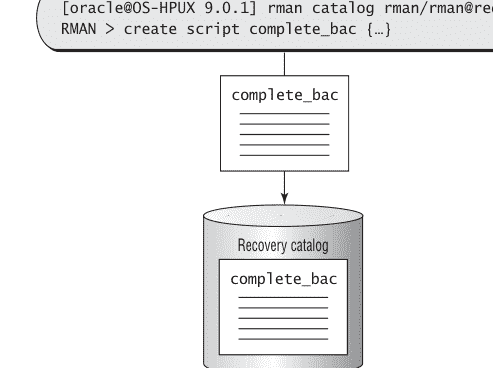

4. 运行存储的 RMAN 脚本 `complete_bac`。在连接到目标数据库和恢复目录（recovery catalog）时，执行以下命令即可完成。注意 ERROR MESSAGE STACK，它表示没有归档日志需要归档。

```
RMAN> run { execute script complete_bac; }
```

正在执行脚本: `complete_bac`

已分配通道: `c1`
channel `c1`: sid=11 devtype=DISK

已分配通道: `c2`
channel `c2`: sid=8 devtype=DISK

05-OCT-01 开始备份
channel `c1`: 正在开始全数据文件备份
channel `c1`: 正在备份集中指定数据文件
input datafile fno=000006 name=`/db01/oracle/ts9/data01.dbf`
input datafile fno=000002 name=`/db01/oracle/ts9/rbs01.dbf`
input datafile fno=00003 name=`/db01/oracle/ts9/temp01.dbf`
input datafile fno=000004 name=`/db01/oracle/ts9/users01.dbf`
channel `c1`: 05-OCT-01 开始备份分片 piece 1
channel `c2`: 正在开始全数据文件备份
channel `c2`: 正在备份集中指定数据文件
备份集中包含当前控制文件
input datafile fno=00001 name=`/db01/oracle/ts9/system01.dbf`
input datafile fno=000007 name=`/db01/oracle/ts9/ndx01.dbf`
input datafile fno=000005 name=`/db01/oracle/ts9/tools01.dbf`
channel `c2`: 05-OCT-01 开始备份分片 piece 1
channel `c1`: 05-OCT-01 完成备份分片 piece 1

piece handle=`/oracle/product/9.0.1/dbs/0fd5rv49_1_1`
comment=NONE
channel `c1`: 备份集完成，通过时间: 00:00:48
channel `c2`: 05-OCT-01 完成备份分片 piece 1
piece handle=`/oracle/product/9.0.1/dbs/0fd5rv49_1_1`
comment=NONE
channel `c2`: 备份集完成，通过时间: 00:01:44
05-OCT-01 备份结束

============================================================

RMAN-00571:

=============================================================

```
RMAN-00569: ================= 接下来是错误消息栈
=============================================================
RMAN-00571:
=============================================================
```

```
RMAN-00579: 1错误发生在 10/05/2001 23:46:58
RMAN-03015: 在存储的脚本 complete_bac 中发生错误
RMAN-03006: 在执行命令: sql 期间发生不可重试错误
RMAN-12004: 在默认通道上执行命令期间发生未处理的异常
RMAN-20000: 任务步骤异常终止
RMAN-11003: 解析/执行 SQL 语句期间失败: ALTER SYSTEM ARCHIVE
RMAN-11001: Oracle 错误: ORA-00271: 没有日志需要归档
RMAN>
```

图 13.3 显示了如何在 RMAN 中运行存储的脚本。

## 备份和恢复恢复目录的方法

**图 13.3** RMAN 脚本

```
[oracle@OS-HUPX 9.0.1]$ rman target user/ password@brdb catalog rman/rman@rcdb
RMAN > run (execute script complete_bac)
```


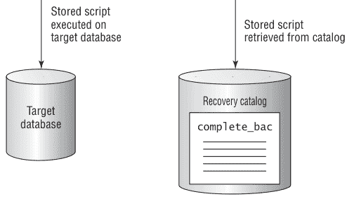

## 备份和恢复恢复目录的方法

你有几种方法可以用来备份和恢复目录。在处理这些方法之前，你需要了解一个铁律的规则：目录数据库必须位于存储目标数据库的不同的服务器上。这可以防止目录数据库受到目标数据库服务器全方位故障的影响。

如有必要，可以通过另一个 RMAN 目录或用户管理的备份对目录数据库进行备份。在进行此类备份时，根据活动情况，数据库可以处于 `ARCHIVELOG` 模式或 `NOARCHIVLOG` 模式。

你如何使用目录决定了备份过程需要变得多复杂。例如，假设你支持的环境仅在晚上执行备份。这些备份在第二天早上 6:00 之前完成。在这种情况下，RMAN 目录备份可以在每天备份完成后的某个时间进行。如果需要，这种类型的环境可能安全地在 `NOARCHIVLOG` 模式下运行。

让我们看一个更苛刻的、需要 `ARCHIVELOG` 模式的时间表。在这个例子中，备份全天候进行，因此没有时间进行冷备份。这意味着数据库必须在 `ARCHIVELOG` 模式下运行。此外，目录备份应该在在使用最少时进行，以避免冲突，就像你对其他备份所做的那样。

`RESETLOGS` 选项。重新同步恢复目录将根据目标数据库控制文件中更改的物理信息来更新恢复目录。

了解从恢复目录生成报告和列表的不同方法。能够使用 `list` 命令从恢复目录中生成格式化输出的各种信息，并能够使用 `report` 提供更复杂的输出，以回答更详细的问题。

了解 Oracle9i 的新列表命令。你应该意识到 Oracle9i 中新增加的两个列表命令：`LIST BACKUP SUMMARY AND` 和 `LIST BACKUP BY FILE`。

了解如何创建、存储和执行 RMAN 脚本。确保你熟悉创建和存储 RMAN 脚本所需的命令语法——`CREATE SCRIPT <script_name>`。你还应该知道，为了执行脚本，必须执行 `RUN {EXECUTE SCRIPT <script_name>}` 命令。

理解备份和恢复恢复目录所需的各种方法。可以使用用户管理的备份或 RMAN 备份来备份恢复目录。也可以使用导出（`export`）来备份 RMAN 目录模式（`catalog schema`）。

## 关键术语

在参加考试之前，请确保你熟悉以下术语：

- 全重新同步报告命令
- 具身重置（incarnation resetting）
- 列表命令重新同步
- 部分重新同步 RMAN 脚本
- 恢复目录注销
- 注册

## 复习习题

+ 1. RMAN 工具不需要使用以下哪种工具？
A. 恢复目录
B. 服务器会话
C. 用于备份的分配通道
D. 用于恢复的分配通道

+ 2. 恢复目录支持哪些功能？（选择所有适用项）
A. 备份数据库、表空间、数据文件、控制文件和归档日志
B. 压缩备份
C. 脚本能力
D. 确定备份是否可以恢复的测试
E. 以上所有

+ 3. 存储托管（housing）恢复目录的数据库的最佳位置是哪里？
A. 在同一台服务器上，但与恢复目录备份的目标数据库位于不同的文件系统
B. 在同一台服务器上，且与恢复目录备份的目标数据库位于相同的文件系统
C. 在位于与目标数据库不同的服务器上
D. 以上都不是

+ 4. 恢复管理器目录账户需要哪些权限？（选择所有适用项）
A. DBA 权限
B. 连接权限（`connect`）
C. 资源权限（`resource privilege`）
D. `RECOVERY_CATALOG_OWNER` 权限

+ 5. 哪个命令在目标数据库上只能执行一次？
+ A. `CHANGE AVAILABILITY OF BACKUPS`
+ B. `DELETE BACKUPS`
+ C. `REGISTER THE DATABASE`
+ D. `RESYNCHRONIZING THE DATABASE`

+ 6. 下述哪个陈述最描述目标数据库？
+ A. 任何由 RMAN 指定备份的数据库
+ B. 存储恢复目录的数据库
+ C. 目标不是由 RMAN 备份的数据库
+ D. RMAN 工具的特殊存储数据库

+ A. 基于 OS 命令的非 RMAN 备份
+ B. 全数据库备份
+ C. 表空间备份
+ D. 控制文件备份
+ E. 以上所有

+ 8. 下列哪些项是用于从恢复目录中获取信息的工具？（选择所有适用项）
+ A. `REPORT` 命令
+ B. SQL*Plus 中的查询
+ C. `LIST` 命令
+ D. `RETRIEVAL` 命令

+ 9. 在运行 `REPORT` 或 `LIST` 命令之前，你必须做什么？
+ A. 确定日志文件。
+ B. 导出输出（`spool`）。
+ C. 连接到目标。
+ D. 连接到目标和恢复目录。

+ 10. 报告（`reports`）和列表（`lists`）之间的主要区别是什么？
+ A. 列表的输出比报告多。
+ B. 报告的输出比列表多。
+ C. 报告提供的信息比列表更详细。

+ 11. 哪个命令可以在恢复目录中存储脚本？
+ A. `CREATE SCRIPT <script_name>`
+ B. `STORE SCRIPT <script_name>`
+ C. `RUN SCRIPT <script_name>`

+ 12. 下列哪些项是 Oracle9i 的新列表命令？
+ A. `LIST BACKUP SUMMARY AND`
+ B. `LIST BACKUP BY FILE`
+ C. `LIST`

+ 13. 如果向恢复目录添加了新的数据文件（`data file`），你需要对具身（`incarnation`）做什么？
+ A. 执行报告
+ B. 执行重新同步
+ C. 注册
+ D. 执行列表

+ 14. 下述代码用于启动脚本。请找出错误的行。
```sql
run {
execute script
complete_bac}
```
+ A. 第一行
+ B. 第二行
+ C. 第三行

+ 15. 下述代码用于创建脚本。请找出错误的行。
```
CREATE script
Allocate channel type disk;
Backup all;
```
+ A. 第一行
+ B. 第二行
+ C. 三行
+ D. 第四行

## 复习题答案

+ 1. A. 恢复目录是可选的。
+ 2. 以上都是 RMAN 工具的功能。
+ 3. C. 恢复目录应位于与目标数据库不同的服务器上，以消除一台服务器的故障影响另一台。
+ 4. B, C, D. 恢复目录不需要 DBA 权限。该用户必须能够连接数据库、在数据库内创建对象并拥有 `RECOVERY_CATALOG_OWNER` 权限。
+ 5. C. 注册数据库只能执行一次，除非被注销。
+ 6. A. 目标数据库是任何由 RMAN 指定备份的数据库。
+ 7. E. RMAN 可以基于 OS 命令的非 RMAN 备份，以及全数据库备份、表空间备份和控制文件备份。
+ 8. A, B, C. RMAN 工具提供了 `REPORT` 和 `LIST` 命令来生成恢复目录输出。SQL*Plus 也可以手动查询恢复目录。
+ 9. D. 在运行任何 `REPORT` 或 `LIST` 命令之前，你必须连接到目标数据库和恢复目录。
+ 10. C. 报告提供的信息比列表更详细。报告命令用于回答更多“如果……”或“需要做什么”类型的问题。
+ 11. A. `CREATE SCRIPT <script_name>` 命令将相关脚本存储在恢复目录。该脚本以后可以执行。
+ 12. D. `LIST BACKUP OF FILE` 和 `LIST BACKUP SUMMARY` 都是 Oracle9i 的新列表命令。
+ 13. B. 如果目标数据库的物理组件发生变化，应运行重新同步（`resync`）命令。
+ 14. C. 错误的行是 program。正确的语法如下：
```sql
run {
execute script
complete_bac}
```


```
+ 15. D. 错误的语法是 Backup all; 应该是 BACKUP ARCHIVELOG ALL;
```

# 在数据库之间传输数据

ORACLE9i: DBA FUNDAMENTALS II 考试
本章涵盖的目标：

- 描述导出（Export）和导入（Import）工具的用途
- 描述导出和导入的概念和结构
- 执行简单的导出和导入操作
- 列出使用导出和导入的准指南

> 考试目标可能会随时更改且不另行通知，并由 Oracle 自行决定。请访问 Oracle 认证网站 (http://www.oracle.com/education/) 获取最新的考试目标列表。


Oracle 数据库软件提供了两种主要的数据库备份方法。第一种物理备份，由复制文件并在需要时恢复这些文件。这种方法在前四个章节中已经介绍过。第二种备份是数据库的逻辑备份，它需要某些数据库对象并将它们写入文件，而不考虑它们的物理位置。然后，可以将该文件作为逻辑恢复重新导入数据库中。

Oracle 还提供了两个实用程序来处理 Oracle 数据库的备份和恢复：Export（导出）工具和 Import（导入）工具。Export 工具用于创建数据库的逻辑备份，而 Import 工具用于执行数据库的逻辑恢复。

本章将演示如何使用 Export 和 Import 工具对数据库进行备份和恢复。本章还解释了增量备份和恢复。

本章的主题是测试和现实世界恢复情况中的重要部分。Export 和 Import 工具是对用户管理备份或基于 RMAN 备份的良好补充。这些工具可以用于开发者或最终用户无意中删除表或删除数据的真实恢复场景。

## 使用 Export 和 Import 工具

Export 和 Import 工具主要执行逻辑备份和恢复，但它们也可以用于以下各种不同的操作：

**恢复数据库对象** 使用 Export 和 Import 工具进行备份和恢复的主要用途是替换单个对象，例如表或由多个数据库对象组成的模式（schema）。虽然也可以恢复整个或完整的数据库，但这并不常见。在某些情况下，表可能会被用户或开发者删掉，但你可能不想恢复整个数据库。虽然可以恢复整个数据库，但由于导出具有时间点特性，数据可能是不一致的。

**表空间时间点恢复 (TSPITR)** 在 Oracle 8i 中，引入了表空间时间点恢复 (TSPITR)。TSPITR 的设计目的是为了通过它来恢复大型单个对象。因此，我们建议你在执行任何 TSPITR 之前寻求 Oracle 支持的帮助。为了成功执行此恢复，你将需要同时使用物理和逻辑技术。此外，你将需要使用克隆数据库来执行整个过程，这将需要额外的资源。由于有许多缺点，你可能会奇怪为什么有人使用它。其原因是 TSPITR 允许你恢复整个表空间中的所有对象，而无需恢复整个数据库。这对于大型数据库非常有用，因为完整的恢复和还原需要花费很长时间。

为了使用 TSPITR，你必须熟悉几个特殊参数：`TRANSPORT_TABLESPACE` 和 `DATAFILES`。`TRANSPORT_TABLESPACE` 参数标识在 TSPITR 过程中将使用的表空间。`DATAFILES` 参数标识支持要恢复表空间的数据文件。

**重组数据库以提高性能** Export 和 Import 工具也可以用于重组数据库并恢复单个对象。当以这种方式恢复对象时，它们包含的数据可能会被打包或压缩到更少的区（extents），以便更快速地检索。这是通过使用 `COMPRESS=Y` 命令实现的，它是默认值。以下是该参数的示例。

```
oracle@octilli: ~ > exp userid=test/test compress=Y file=tst9.dmp
```

**升级对象或数据库** 你还可以使用这些工具将数据库或对象从一个版本升级到另一个版本。如果这样使用这些工具，会对表或数据库进行导出，然后将其升级后的版本导入新数据库。

**将数据从一个数据库移动到另一个数据库** Export 和 Import 工具还可以将数据从一个数据库移动到另一个数据库。导出过程创建二进制转储文件可以通过 FTP 从一个服务器发送到另一个服务器，然后将其加载到新数据库中。

## 使用 Export 增加额外保护

导出提供了常规备份计划之外的额外保护，它们通常被用于补充单个对象的备份保护。在某些情况下，导出还可以作为完全恢复的宝贵资产。

在这种情况下，一个初级 DBA 不小心删除了一个包含一个静态数据表的表空间，属于一家小型保险公司。意识到自己的错误后，该 DBA 尝试从昨晚打开的 RMAN 备份中恢复数据库。令他沮丧的是磁带硬件出了问题，他无法让其工作。这个硬件问题最早要第二天才能解决。

此时，已经是深夜了，DBA 知道数据库将在第二天早早开始接收来自东海岸的自动呼叫器信息。因此，数据库必须在解决硬件问题之前可用；否则，公司的业务将受到严重影响。

但 DBA 记得数据库中对关键表有自动导出，包括被删除的那个表空间中的那张表。该导出发生在中午，伴随批量加载进行。

经过仔细思索后，DBA 重新创建了这个错误删除的表空间。在 DBA 完成重新创建表空间后，他导入了位于新创建表空间中的那个表。最后，DBA 通过重新加载必要的几个扁平文件（flat files）完成了整个过程，使该表完全一致。

通过使用导出，DBA 完全恢复了数据库，只丢失了四个小时的业务。这种情况运作得很好，是因为数据是隔离的且相当静态的。表的主要更改在扁平文件中被识别。

## Export 和 Import 概念和结构

正如本章引言所述，Export 工具可用于创建数据库的逻辑备份。Import 工具可以恢复这些逻辑备份。导出有两种类型：常规路径（conventional-path）导出和直接路径（direct-path）导出。

常规路径导出是 Export 工具的默认模式。对于大型对象或导出，这种方法可能非常耗时。但它对于日常使用良好。

直接路径导出通过在命令行输入 `DIRECT=Y` 来启用。这种导出方式比常规路径导出快得多。直接路径导出跳过了 SQL 层，重新存储在二进制转储文件中的命令。这就是性能提升的地方。图 14.1 显示了每种导出的执行路径。

图 14.1 直接路径导出与常规路径导出的差异

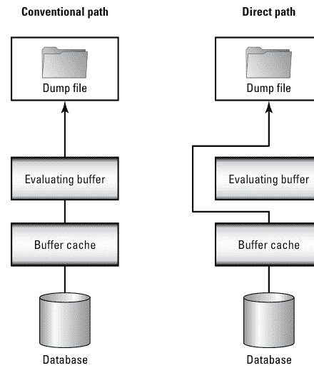

Export 工具对表执行完全查询，然后将数据转储到文件的二进制文件中（该文件具有 `.dump` 扩展名，默认名为 `expdat.dump`）。Export 工具通过重现备份表的数据定义语言 (DDL) 创建表和索引。这些信息可以由 Import 工具回放以恢复对象及其数据。

要显示所有可导出选项，请从命令行使用 `EXP -HELP`。

```
oracle@octilli:db01/oracle/tst9 > exp -help
```

Export: Release 9.0.1.0 - Production on Fri Oct 5 23:09:00 2001

(c) Copyright 2001 Oracle Corporation. All rights reserved.

你可以通过在 `EXP` 命令后输入用户名/密码让 Export 提示参数：

示例：`EXP SCOTT/TIGER`

或者你可以通过在 `EXP` 命令后输入各种参数来控制 Export 的运行。指定参数时，使用关键字：

```
格式：EXP KEYWORD=value 或 KEYWORD=(value1,value2,...,valueN)

示例：EXP SCOTT/TIGER GRANTS=Y TABLES=(EMP,DEPT,MGR)

或 TABLES=(T1:P1,T1:P2),

如果 T1 是分区表
```


`USERID` 必须是命令行上的第一个参数。

# 导出与导入概念与结构 423

关键字描述（默认）

| 关键字 | 说明 |
| --- | --- |
| `USERID` | 用户名/密码 |
| `BUFFER` | 数据缓冲区的大小 |
| `FILE` | 输出文件 (`EXPDAT.DMP`) |
| `COMPRESS` | 导入到一个扩展区中 (`Y`) |
| `GRANTS` | 导出权限 (`Y`) |
| `INDEXES` | 导出索引 (`Y`) |
| `ROWS` | 导出数据行 (`Y`) |
| `CONSTRAINTS` | 导出约束 (`Y`) |
| `LOG` | 屏幕输出的日志文件 |
| `DIRECT` | 直接路径 (`N`) |
| `FEEDBACK` | 每隔 x 行显示进度 (`0`) |
| `FILESIZE` | 每个转储文件的最大大小 |
| `QUERY` | 用于导出表子集的 select 子句 |
| `VOLSIZE` | 写入每个磁带文件的字节数 |
| `FULL` | 导出整个文件 (`N`) |
| `OWNER` | 所有者用户名列表 |
| `TABLES` | 表名列表 |
| `RECORDLENGTH` | IO 记录长度 |
| `INCTYPE` | 增量导出类型 |
| `RECORD` | 跟踪增量导出 (`Y`) |
| `PARFILE` | 参数文件名 |
| `CONSISTENT` | 跨表一致性 |
| `STATISTICS` | 分析对象 (`ESTIMATE`) |
| `TRIGGERS` | 导出触发器 (`Y`) |

`FEEDBACK` 每隔 x 行显示进度 (`0`)
`FILESIZE` 每个转储文件的最大大小
`FLASHBACK_SCN` 用于设置快照回的 SCN
`FLASHBACK_TIME` 用于获取最接近指定时间的 SCN 的时间
`QUERY` 用于导出表子集的 select 子句
`RESUMABLE` 遇到空间相关错误时暂停 (`N`)

# 424 第 14 章 • 数据库之间的数据传输

`RESUMABLE_NAME` 用于标识可恢复语句的文本字符串
`RESUMABLE_TIMEOUT` `RESUMABLE` 的等待时间
`TTS_FULL_CHECK` 检查 TTS 执行全量或部分依赖关系
`VOLSIZE` 写入每个磁带的字节数
`TABLESPACES` 要导出的表空间列表
`TRANSPORT_TABLESPACE` 导出可传输表空间元数据 (`N`)
`TEMPLATE` 调用 iAS 模式导出的模板名称

导出成功结束，无警告。
`oracle@octilli:/db01/oracle/tst9 >`

Oracle 9 的导出功能发生了一些变化。如下：为了适应 Java 虚拟机，在全导出模式下不再导出 `sys` 架构下的触发器；同时也不再支持增量/累积/完全导出，并且也不再支持从 Oracle 9 数据库创建 7.x 版本的导出文件的过程。请阅读您的 Oracle 文档以获取这些更改的完整细节。

# 执行简单的导出和导入操作

让我们看看 DBA 如何执行简单的导出和导入。我们将使用交互式方法运行导出和导入工具。这意味着用户将对工具的每个提示符做出响应。首先，我们将导出一个名为 `t1` 的表。然后，我们将导入同一个表。此外，我们还将演示如何使用 `PARFILE` 运行导出，这样就不需要用户交互。这种类型的导出可以在命令行运行，并且可以经过化和计划执行。`PARFILE` 是一个参数文件，将导出参数分组在一个文件中，因此 DBA 无需在命令行上输入每个参数。该过程将在接后的导出过程之后进行演示。让我们逐一完成这些示例。

## 执行简单的导出

在这个交互式导出示例中，你将对用户 `TEST` 拥有的 `t1` 进行全量导出。以下是执行导出时使用的步骤：

- 在命令行上执行 `exp` 来启动导出工具。在 Unix 中，你应该先设置 `ORACLE_SID` 环境变量以指向你尝试连接的数据库。这可以通过命令行执行 `ORACLE_SID = tst9` 来完成。或者，你也可以通过显式定义目标数据库的 `tnsnames` 条目通过 SQL*Net 连接。`oracle@octilli:/db01/oracle/tst9 > exp`

```
Export: Release 9.0.1.0 - Production on Fri Oct 5 23:18:08 2001

(c) Copyright 2001 Oracle Corporation

Export: Release 9.0.1.0 - Production on Fri Oct 5 23:18:08 2001

(c) Copyright 2001 Oracle Corporation
```

Username: (用户名)
Password: (密码)
Connected to: Oracle Database 9.0.1.0 - Production (连接)
保留所有权利。

- 输入适当的缓冲区大小。如果你想保留 4096 的默认大小，请按回车。默认大小已经足够。输入缓冲区大小: `4096 >`

- 下一个提示询问转储文件的文件名。你可以输入自己的文件名或选择默认值。导出文件: `expdat.dump`

- 下一个提示指定用户或表。`t1` 的交互式导出已完成。

- 下一个提示询问是否导出数据。(yes/no) > `yes`

- 下一个提示询问是否压缩。例如，如果你选择 no，则导出将不会压缩表空间。压缩: (yes/no) > `yes`

- 下一个提示询问要导出哪些表。在示例中，你选择了 `t1`。当导出完成后，按回车。导出完成。

导出成功结束，无警告。
`oracle@octilli:/db01/oracle/tst9 >`

Oracle 9 的导出功能发生了一些变化。如下：为了适应 Java 虚拟机，在全导出模式下不再导出 `sys` 架构下的触发器；同时也不再支持增量/累积/完全导出，并且也不再支持从 Oracle 9 数据库创建 7.x 版本的导出文件的过程。请阅读您的 Oracle 文档以获取这些更改的完整细节。

## 执行简单的导入

导入工具被用于执行 Oracle 数据库的逻辑恢复。该工具读取由导出工具生成的转储文件。如前所述，导出工具转储表中的数据并使用必要的 DDL 命令重新创建表。导入工具重放这些命令，重新创建表并插入存储在二进制转储文件中的数据。本节提供了此过程工作原理的逐步概述。

导入工具还有许多选项。要显示可用的导入选项，请从命令行使用命令 `oracle@octilli:~ imp -help`。

```
Import: Release 9.0.1.0 - Production on Fri Oct 5 23:24:45 2001

(c) Copyright 2001 Oracle Corporation
```

你可以通过输入 `IMP` 命令后跟你的用户名/密码来让导入提示输入参数：

示例：`IMP SCOTT/TIGER`
或者，你可以通过输入 `IMP` 命令后跟各种参数来控制导入的运行。要指定参数，使用关键字：

```
格式: IMP KEYWORD=value 或

KEYWORD=(value1,value2,...,valueN)

示例: IMP SCOTT/TIGER IGNORE=Y

TABLES=(EMP,DEPT) FULL=N

或 TABLES=(T1:P1,T1:P2),

如果 T1 是分区表
```


## 执行简单的导出和导入操作 429

`USERID` 必须是命令行上的第一个参数。

关键字描述（默认）

| 关键字 | 描述 |
| --- | --- |
| `USERID` | 用户名/密码 |
| `BUFFER` | 数据缓冲区大小 |
| `FILE` | 输入文件 (`EXPDAT.DMP`) |
| `SHOW` | 仅列出文件内容 (`N`) |
| `IGNORE` | 忽略创建错误 (`N`) |
| `GRANTS` | 导入权限 (`Y`) |
| `INDEXES` | 导入索引 (`Y`) |
| `ROWS` | 导入数据行 (`Y`) |
| `LOG` | 屏幕输出的日志文件 |
| `DESTROY` | 将表/索引信息覆盖到指定文件 (`N`) |
| `UNUS_INDEXES` | 跳过不可用索引的维护 (`N`) |
| `FEEDBACK` | 每 x 行显示进度 (`O`) |
| `TOID_VALIDATE` | 指定类型 ID 的验证 |
| `FILESIZE` | 每个导出文件的最大大小 |
| `STATISTICS` | 导入预计算统计信息 (始终) |
| `RESUMABLE` | 遇到空间相关的错误时暂停 (`N`) |
| `RESUMABLE_NAME` | 用于标识可恢复语句的文本字符串 |
| `RESUMABLE_TIMEOUT` | 可恢复操作的等待时间 |
| `COMPILE` | 编译过程、程序包和函数 (`Y`) |
| `VOLSIZE` | 磁带上文件每个卷中文件中包含的字节数 |

以下关键字仅适用于可传输表空间：
`TRANSPORT_TABLESPACE` 导入可传输表空间元数据 (`N`)
`TABLESPACES` 要传输到数据库的表空间

## 430 第 14 章 · 在数据库之间传输数据

`DATAFILES` 要传输到数据库的数据文件
`TTS_OWNERS` 设置为拥有可传输表空间中数据的用户集

导入成功结束，无警告。
`oracle@octilli:~ >`

以下步骤说明了如何使用 `Import` 工具对表进行恢复。此处 `Import` 工具处于交互模式。

- 1. 要恢复数据库，你必须验证应该恢复哪些内容。在这种情况下，请使用在早几节“执行简单导出”中创建的来自 `t1.dump` 的导出文件。在这里，你正在导出完整的 `t1` 表，该表包含四行数据。

```sql
SQL> select * from t1;

C1 C2

1 This is a test one - before backup

3 This is a test three - after hot backup

2 This is a test two - after hot backup

4 This is test four - after complete export
```
4 rows selected.

SQL>
```
- 2. 清空表以模拟表中的完全数据丢失。

```sql
SQL> truncate table t1;

Statement processed.

SQL>
```
- 3. 从导出 dump 文件的工作目录执行 `IMP` 命令并连接到用户 `TEST`。
`oracle@octilli:~ > imp`

Import: Release 9.0.1.0.0 - Production on
Fri Oct 5 23:31:44 2001

(c) Copyright 2001 Oracle Corporation.
All rights reserved.

Copyright©2002 SYBEX, Inc., Alameda, CA www.sybex.com

Username: test
Password:

Connected to: Oracle9i Enterprise Edition Release 9.0.1.0.0 - Production
With the Partitioning option
IServer Release 9.0.1.0.0 - Production
- 4. 下一个提示是 dump 文件的文件名。你可以输入完全限定文件名，或者如果你在 dump 文件的目录中操作，只需输入文件名。

Import file: `expdat.dmp` > `t1.dmp`
- 5. 下一个提示是导入数据加载的缓冲区大小。选择最小值，即 8KB。
Enter insert buffer size (minimum is 8192) 30720 8192
- 6. 下一个提示是是否列出 dump 文件的内容而不是实际执行导入。默认是 no，在本例中选择该。
Export file created by EXPORT:V09.00.01 via conventional path
import done in USASCII character set
AL16UTF16 NCHAR character set
List contents of import file (yes/no): no > n
- 7. 下一个提示是如果对象存在是否忽略 CREATE错误。在本例中，选择 yes。
Ignore error due to object existence (yes/no): no > y
- 8. 下一个提示是是否导入与导入的对象相关的权限。选择 yes。
Import grants (yes/no): yes > y
- 9. 下一个提示是是否导入表中的数据而不仅仅是表定义。选择 yes。
Import table data (yes/no): yes > y
- 10. 下一个提示是是否导入整个导出文件。在这种情况下，选择 yes，因为导入仅包含你想导入的表。如果 dump 文件中有多个对象，则你应该选择默认值，即 no。

Import entire export file (yes/no): no > y
- importing `TEST`'s objects into `TEST` table
- `T1` 4 rows imported

导入成功结束，无警告。
`oracle@octilli: ~`
- 11. 接下来，你需要验证导入是否成功恢复了 `t1` 表。对表进行查询以验证。

```sql
SQL> select * from t1;

C1 C2

1 This is a test one - before backup

3 This is a test three - after hot backup

2 This is a test two - after hot backup

4 This is test four - after complete export
```


`4 rows selected.`

# 执行简单的导出和导入操作 431

# 473 使用导出和导入的指南

# 474 考试要点

描述 TSPIT 概念。表空间点映像恢复（TSPIT）是在使用物理恢复属性恢复单个数据文件时，向克隆数据库导出元数据的操作。这主要用于大型数据库，因为对于这些数据库来说，完全恢复会非常耗时。

描述与 TSPIT 相关的参数。`TRANSPORT_TABLESPACE` 和 `DATAFILES` 参数是传输表空间功能特有的。

## 关键术语

在参加考试之前，请确保你熟悉以下术语：

- 块损坏 (block corruption)
- 常规路径导出 (conventional-path export)
- 直接路径导出 (direct-path export)
- 转储文件 (dump file)
- 导出实用 (Export utility)
- 导入工具 (Import utility)
- 逻辑备份 (logical backup)
- `PARFILE`
- 物理备份 (physical backup)
- 表空间点映像恢复 (TSPIT)

## 复习习题

- 1. 哪种类型的数据库工具执行逻辑备份？
  A. 导出 (Export)
  B. 导入 (Import)
  C. 冷备份 (Cold backup)
  D. 热备份 (Hot backup)

- 2. 哪种类型的数据库工具将转储文件读入数据库？
  A. 导出 (Export)
  B. 导入 (Import)
  C. SQL*Loader
  D. Forms

- 3. 默认的转储文件名称是什么？
  A. export.dmp
  B. expdata.dmp
  C. expdata.dmp
  D. export_data.dmp

- 4. 检查以下导出命令并确定错误的语法处。
  `exp users=ar/trar2 conventional=false tables=ra_customer_deductions`
  
  A. 第一行错误。
  B. 第二行错误。
  C. 第三行错误。
  D. 第四行错误。

- 5. 使用 TSPITR 需要哪些类型的备份？（选择所有适用项）
  A. 逻辑 (Logical)
  B. 物理 (Physical)
  C. 导入 (Import)
  D. 导出 (Export)

- 6. 读取参数文件的参数名称是什么？
  A. PARAMETER FILE
  B. PARFILE
  C. PARAFILE
  D. PAR-FILE

- 7. 使用 TSPITR 时，另一个数据库称为什么？
  A. 二级数据库 (Secondary database)
  B. 恢复数据库 (Recovery database)
  C. 克隆数据库 (Cloned database)
  D. 备份数据库 (Backup database)

- 8. 专门用于 TSPITR 的参数名称是什么？
  A. DATABASE
  B. TRANSPORT_TABLESPACE
  C. CONTROL
  D. COMPRESS

- 9. 哪种导出类型最快？
  A. 完全 (Complete)
  B. 累积 (Cumulative)
  C. 直接路径 (Direct-path)
  D. 常规路径 (Conventional-path)

- 10. 使用导出和导入工具并为大型数据库对象设计的复杂恢复方法是什么？
  A. 全量导出 (Full Export)
  B. Full=Y
  C. TPSTIR
  D. TSPITR

- 11. 哪种导出命令可以与数据库重组结合使用以提高性能？
  A. COMPRESS_EXTENT=Y
  B. COMPRESS_EXT=Y
  C. COMPRESS=Y
  D. COMPEXT=Y

- 12. 关于导出和导入工具，以下哪项是正确的陈述？
  A. 它们不能用于升级数据库。
  B. 它们可以用于升级数据库。
  C. 只有导出工具可以升级数据库。
  D. 只有导入工具可以升级数据库。

- 13. 关于在不使用任何导出关键字选项的情况下使用导出工具处理表，以下哪项是正确的陈述？
  A. 导出工具将数据加载到数据库。
  B. 导入工具从数据库中提取数据。
  C. 导出工具对表执行全选择，然后将数据转储到二进制文件中。
  D. 导出工具对表执行全选择，然后将数据转储到 ASCII 文件。

- 14. 哪一个导出关键字选项可以选择表的子集？
  A. SUBSET
  B. SELECT
  C. WHERE
  D. QUERY

- 15. 下面哪一个导出关键字选项执行完全数据库导出？
  A. ALL=Y
  B. COMPLETE=Y
  C. TOTAL=Y
  D. FULL=Y

## 复习习题答案

- 1. 导出工具执行 Oracle 数据库的逻辑备份。
- 2. 导入工具负责读取转储文件。
- 3. `expdata.dmp` 是默认的转储文件名。
- 4. 常规路径导出是默认的。`conventional=false` 行是无效语法。
- 5. A, B。TSPITR 同时执行逻辑和物理数据库备份，而导出是逻辑备份。导入不是备份；它是恢复工具。
- 6. B. `PARFILE` 是指定参数文件的参数。
- 7. C. 克隆数据库是使用 TSPITR 另一个数据库。
- 8. B. `TRANSPORT_TABLESPACE` 参数专门用于 TSPITR。它用于识别需要恢复的表。
- 9. C. 直接路径导出最快。完全和累积导出取决于数据。
- 10. D. 表空间点映像恢复 (TSPITR) 是一种使用导出和导入工具并为大型数据库对象设计的方法。
- 11. C. `COMPRESS=Y` 可以与数据库重组结合使用以提高性能。
- 12. B. 它们可以用于升级数据库。
- 13. C. 导出工具对表执行全选择，然后将数据转储到二进制文件中。
- 14. D. `QUERY` 关键字可以选择表的子集。
- 15. D. `FULL=Y` 执行完全数据库导出。

# 使用 SQL*Loader

`SQL*Loader` 是一个 Oracle 实用程序，设计用于从一个数据库加载或传输外部数据到另一个数据库。`SQL*Loader` 用于与数据库交互的其他非 Oracle 系统进行夜间提取。它已成为 Oracle 数据库构建或刷新数据仓库或数据市（Data Marts）的首选工具。这种新颖受欢迎源于它在处理 Oracle 和非 Oracle 源的大型数据集时的快速速度和多功能。

由于 `SQL*Loader` 的解析能力，它可以处理各种格式的外部文件。由于这种多功能性，你可以使用 `SQL*Loader` 执行以下操作：

- 在同一个加载会话中从多个数据文件或输入文件加载数据。
- 在同一个加载会话中将数据加载到多个表中。
- 将多个输入记录合并为一个逻辑记录进行加载。
- 指定数据的字符集。
- 接受固定长度或变长度的输入字段。
- 选择性加载数据（你可以根据记录的值加载记录）。
- 在加载前使用 SQL 函数对数据进行处理。
- 在指定的列中生成唯一的序列的键值。
- 使用操作系统的文件系统访问数据文件。
- 从磁盘、磁带或命名管道加载数据。
- 向表中追加数据并替换表中现有数据。
- 通过跳过缓冲区缓存将数据直接加载到数据块。
- 使用辅助数据文件加载大型二进制对象（LOBs）和集合。

在使用 `SQL*Loader` 时，你需要熟悉三种主要的文件结构：控制文件；日志文件（包括错误日志、丢弃日志和常规日志）；以及输入数据或数据文件。这些文件结构将在本节中详细讨论。

# 使用 SQL*Loader 447

`SQL*Loader` 还使用三种方法将数据加载到数据库——常规加载、直接路径加载和外部路径加载——并在并行模式下使用其他三种方法来进一步提高性能——并行加载、结合直接路径加载的段间并发以及结合直接路径加载的段内并发。这两组方法在接下来的几页中也得到了讨论。

# 控制文件、日志文件和输入数据或数据文件

`SQL*Loader` 的三个主要组件是控制文件、日志文件、输入数据（或数据文件）。*控制文件*是数据加载背后的逻辑，决定了如何加载加载哪些数据。*日志文件*包括错误日志、丢弃日志和常规日志。*错误日志（bad log）*记录被 Oracle 数据库拒绝的记录，或者由于格式无效、键违反或缺少必要字段而被拒绝的记录。*丢弃日志（discard log）*包含在加载过程中被丢弃或不符合控制文件加载标准的记录。*常规日志（general log）*包含加载过程的详细摘要。*数据文件*（或输入数据）是要加载的原始数据。图 15.1 显示了此利用日志、数据文件和控制文件的 `SQL*Loader` 过程。

# 图 15.1 SQL*Loader 输入和输出文件

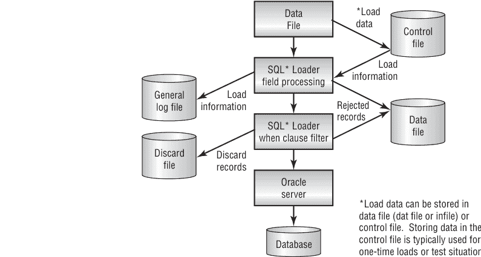

Copyright ©2002 SYBEX, Inc., Alameda, CA www.syb.com

## 控制文件

控制文件是 `SQL*Loader` 中一个相当详细的组件，负责加载过程中的大部分功能。控制文件作用正如其名；它控制着 `SQL*Loader` 过程。控制文件在 `SQL*Loader` 过程中执行以下功能：

- 指示你找到数据
- 提供数据格式
- 存放配置和设置信息
- 告诉你好如何处理数据

实际加载的数据可以保留在文件中，但这应仅用于样本或测试加载。下面的示例显示了一个不包含输入数据的控制文件；使用 `INFILE` 参数指定的外部文件（invoice_header.dat）来引用这些输入数据。左侧的行号用于标识我们将要详细讨论的行。

```
```


# Invoice Sample Control File

```
1 Invoice Sample Control File

2 Created 10-19-01

3 LOAD DATA

4 INFILE 'invoice_header.dat'

5 BADFILE 'invoice_header.bad'

6 DISCARDFILE 'invoice_header.dsc'

7 REPLACE

8 INTO TABLE SALESESION(100) = 'EDI'

9 WHEN FIELDS TERMINATED BY ',' OPTIONALLY ENCLOSED BY '"'

10 TRAILING NULLCOLS

11 ( COMPNO

    INV_NO decimal external

    decimal external

    DISCOUNT_RATE external ":discount_rate * .90"

    DUEDATE date "SYYYYMMDDH24MISS"

    INVDATE date "SYYYYMMDDH24MISS"

    CUST_NO char

    CUST_CAT char NULLIF cust_cat=BLANKS

    CO_OBJ decimal

SALESMAN char UPPER(: salesman)

CUSTREF char

)
```

控制文件有许多选项需要处理；上面的示例演示了其中许多功能。让我们逐行通过行号识别这些这些功能和能力。

**第 1 行**

**第 3 行** 此 SQL*Loader 中的 `LOAD DATA` 语句是数据加载的开始。如果你是从一个中断的过程中继续，你可以在这里使用 `CONTINUE LOAD DATA` 语句。

**第 4 行** `INFILE` 关键字指定输入文件——`invoice_header.dat`。

**第 5 行** `BADFILE` 关键字指定存储被拒绝记录的文件名。

**第 6 行** `DISCARDFILE` 关键字指定存储丢弃记录的文件名。

**第 7 行** `REPLACE` 关键字是在你想要替换现有数据时使用的选项之一。

**第 8 行** `INTO TABLE` 关键字指定目标表——`SALESESION(100)`。

**第 9 行** `WHEN` 子句评估一个或多个条件。如果条件结果为真，则加载记录；否则，不加载。

**第 10 行** `OPTIONALLY ENCLOSED BY` 子句表示字段也可以被双引号(`"`)包。

**第 11 行** `TRAILING NULLCOLS` 子句将记录中不存在的列视为空值。

**第 12 行** 剩余行包含了提供格式信息的字段列表。

# 使用 SQL*Loader 加载数据

## 日志文件

SQL*Loader 的日志文件由错误文件、丢弃文件和常规日志组成。这些日志文件都记录了 SQL*Loader 在加载不同阶段的活动。错误文件和丢弃文件以加载格式存储信息。如果需要，这些文件可以实际加载。常规日志是包含整个 SQL*Loader 过程信息的实际日志文件。

## 错误文件

错误文件是 SQL*Loader 实用程序生成的三个日志文件的第一个。这些文件包含了被 Oracle 数据库拒绝或不符合控制文件格式标准的记录。创建这些日志是为了在需要时用于重载过程。这种文件有用的情况是你有大型输入文件。错误日志文件可以小得多，因此，加载过程中发生的问题在这些文件中更容易识别。

## 丢弃文件

只有在你指定了创建它们时，SQL*Loader 才会创建丢弃文件；此过程是可选的。这些日志文件包含了不符合任何选择标准的记录。因此，这些记录被排除在加载之外。这不是因为它们对加载不可接受（正如错误文件中的数据那样），而是因为这些记录根据控制文件的设置方式被正确过滤掉了。

## 常规日志文件

这些文件存储了加载过程的一般信息。这些信息用于确定何时执行 SQL*Loader 过程以及执行如何。以下是常规日志文件中涵盖的信息列表。

- 加载日期
- 版本信息
- 使用 SQL*Loader 451
- 输入文件
- 输出文件
- 命令行参数
- 表名
- `WHEN` 子句标准
- `INSERT`、`APPEND` 和 `REPLACE` 规范
- `DEFAULTIF` 或 `NULLIF` 关键字用法规范（可选）
- `RECNUM`、`SEQUENCE`、`CONSTANT` 或 `EXPRESSION` 关键字用法规范（可选）
- `DATETIME` 或 `INTERVAL` 规范（可选），后跟指定的指定的掩码
- 数据记录错误
- 丢弃的记录
- 记录加载计数
- 拒绝的记录计数
- 空字段记录计数
- 绑定大小
- 每个分区加载的记录数

## 输入数据或数据文件

输入数据、数据文件或输入文件，描述的都是同一种文件；它们都包含要加载到数据库表或外部表的数据。该文件可以是多种格式。一种常见且易于处理的格式是逗号分隔。逗号分隔的数据文件使用逗号来分隔文件中的字段。当数据加载到数据库时，每个逗号之间的数据会被加载到一列中。无论数据文件的格式如何，SQL*Loader 都具有强大的解析能力，并能够加载大多数格式。

## 常规加载、直接路径加载和外部路径加载

使用 SQL*Loader 加载数据三种方法。这些方法分别是常规加载、直接路径加载和外部路径加载。常规加载是默认方法，其加载方式与在 SQL*Plus 中执行的 `insert` 语句非常相似。直接路径加载旨在通过提供类似的功能提高常规加载的性能。最后，外部路径加载是一种特殊的加载方式，旨在让 SQL*Loader 能与外部表协作。

### 常规加载

常规加载是使用 SQL*Loader 加载数据的种种方法。常规加载比直接路径加载慢得多。常规加载会构建一个绑定数组，当该数组满时，就会执行一条 SQL `insert` 语句。这种方法与 Oracle 用于处理普通 DML 语句（如 `insert`）的方法相当。常规加载是 SQL*Loader 用户的默认方法。

### 直接路径加载

直接路径加载通过在命令行上使用 `DIRECT=TRUE` 关键字启动。这种方法比常规加载快得多。直接路径加载不使用绑定数组；而是使用直接路径 API 将数据更直接地加载到数据库中，而没有 SQL 命令处理的开销。由于数据实际上跳过了正常的 SQL 处理层，Oracle 必须将这些数据加载到表中未使用的块或高水位线之上的块中。高水位线无论块中是否有数据，都是表中最后使用的位置。表 15.1 对比了常规加载和直接路径加载，图 15.2 显示了这两种方法的功能差异。

#### 表 15.1 常规加载与直接路径加载

| 常规加载 | 直接路径加载 |
| :--- | :--- |
| 使用标准提交保存数据 | 使用数据保存 |
| 始终生成 redo 信息 | 在满足特定条件时生成 redo 信息 |
| 触发 insert 触发器 | 不触发 insert 触发器 |
| 可以加载到聚簇表 | 不能加载到聚簇表 |
| 强制约束 | 不强制约束 |

#### 表 15.1 常规加载与直接路径加载（续）

| 常规加载 | 直接路径加载 |
| :--- | :--- |
| 允许用户在加载过程中修改表数据或拥有活动事务 | 锁定用户使其无法进行更改或拥有活动事务 |
| 允许在控制文件中使用 SQL 函数 | 不允许在控制文件中使用 SQL 函数 |

直接路径加载的功能与直接路径插入类似。每个控制文件和输入数据文件都会被加载到临时段，然后合并到高水位线以上的表中。参见图 15.2，该图显示了 SQL*Loader 直接路径加载与常规加载的对比。

#### 图 15.2 SQL*Loader 直接路径加载与常规加载概述


## 外部路径加载

外部路径加载是专门设计的，以便 SQL*Loader 能与外部表工作。让我们简单概述一下必要的组件。

## 现实场景：使用直接路径加载调整高水位线

当你使用直接路径加载时，Oracle 必须将数据放在水位线处。如果你没有准备好空间增加，可能希望在操作之前截空表，以防止每次每次加载数据都增长。

## SQL*Loader 并行加载方法

SQL*Loader 可以并行运行以进一步提高大数据加载的性能。并行加载主要有三种变体：并行常规加载、直接路径加载段间并发以及直接路径加载段内并发。

### 并行常规加载

并行常规加载通过发布 SQL*Loader 命令来实现，每个命令都有自己的控制文件和输入数据文件，但都指向同一个表。输入数据文件在表的记录边界上进行逻辑划分。例如，第 1 到 100 条记录使用 `inv.dat` 输入文件加载，第 101 到 200 条记录使用 `inv2.dat` 输入文件加载。

```sql
oracle@octilli: sqlldr test/test control=inv.ctl
load=inv.dat
```

```sql
oracle@octilli: sqlldr test/test control=inv2.ctl
load=inv2.dat
```


### 直接路径加载段间并发

直接路径加载段间并发通过使用直接路径加载同时加载到表内的多个表或分区。这种方法的执行方式与并行常规加载相同，但增加了 `DIRECT-TRUE` 关键字并使用了不同的表。注意，第一次加载进入 `inv.dat` 表，第二次加载根据控制文件和输入文件名的定义进入 `orders.dat` 表。

```sql
oracle@octilli: sqlldr test/test control=inv.ctl
load=inv.dat direct=true
```

```sql
oracle@octilli: sqlldr test/test control=orders.ctl
load=orders.dat direct=true
```

### 直接路径加载段内并发

直接路径加载段内并发通过使用直接路径加载将数据加载到单个表或分区来实现。这可以通过在命令行上放置 `DIRECT-TRUE` 和 `PARALLEL=TRUE` 选项来实现。在此并行服务器中，进程将数据加载到临时段并将其合并到各个段。

```sql
oracle@octilli: sqlldr test/test control=inv.ctl
load=inv.dat direct=true parallel=true
```

# 执行基础 SQL*Loader 操作

基础 SQL*Loader 功能通过在操作系统命令行提示符中执行 `sqlldr` 命令来启动。以下是一个 Unix 示例，显示了 SQL*Loader 工具提供的所有命令和选项。

```
oracle@octilli:/oracle/admin/tst9/adhoc > sqlldr
```

SQL*Loader: Release 9.0.1.0.0 - Production on Tue Oct 16 21:11:51 2001

(c) Copyright 2001 Oracle Corporation. All rights reserved.

用法: `SQLLOAD keyword=value [,keyword=value,...]`

有效关键字:

- `userid` -- ORACLE 用户名/密码
- `control` -- 控制文件路径
- `log` -- 日志文件名
- `bad` -- 错误文件（bad file）
- `data` -- 数据文件名
- `discard` -- 丢弃文件名
- `discardmax` -- 允许丢弃的数量（默认全部）
- `skip` -- 跳过的逻辑记录数（默认 0）
- `load` -- 加载的逻辑记录数（默认全部）
- `errors` -- 允许的错误数（默认 50）
- `rows` -- 常规路径数组或直接路径之间的行数（默认：常规路径 64，直接路径全部）
- `bindsize` -- 常规路径绑定数组的大小（字节）（默认 256000）
- `silent` -- 运行期间抑制消息（页眉、反馈、错误、丢弃、摘要）
- `direct` -- 使用直接路径（默认 FALSE）
- `parfile` -- 参数文件：包含参数规格的文件名
- `parallel` -- 执行并行加载（默认 FALSE）
- `file` -- 从此分配段（extents）的文件
- `skip_unusable_indexes` -- 不允许/允许不可用的索引或分区
- `skip_index_maintenance` -- 不维护索引，将受影响的索引为未使用
- `commit_discontinued` -- 加载停止时提交已加载的行（默认 F）
- `resizesize` -- 读缓冲区的大小（默认 1048576）
- `external_table` -- 使用外部表加载；NOT_USED, GENER_ONLY, EXECUTE
- `columnarrays` -- 直接路径列数组的行数（默认 5000）
- `streamsize` -- 直接流缓冲区的大小（字节）（默认 256000）
- `multithreading` -- 在直接路径中使用多线程
- `resumable` -- 为当前话启用或禁用可恢复（默认 FALSE）
- `resumable_name` -- 帮助识别可恢复语句的文本字符串
- `resumable_timeout` -- 可恢复的等待时间（秒）（默认 7200）

请注意：命令行参数可以通过位置或关键字指定。前者的示例是 `sqldlr scott/tiger foo`；后者的示例是 `sqldlr control=foo userid=scott/tiger`。可以在关键字指定的参数之前按位置指定参数，但不能在关键字指定的参数之后指定。例如，`sqldlr scott/tiger control=foo logfile='log'` 是允许的，但 `sqldlr scott/tiger control=foo log` 是允许的，即使参数 'log' 的位置是正确的。

oracle@oracle:oracle/admin/tst9/adhoc >

SQL*Loader 可以通过命令行运行，参数可以在行中使用。可以执行许多变体，但我们将演示一些常见示例来说明基本单元。第一个示例使用了包含 `invoice_header.dat` 输入文件和 `invoice_header.ctl` 控制文件中的 10 条记录。下面的示例显示了控制部分，然后显示包含加载数据的输入文件，最后显示实际的 `sqlldr` 命令。

```
load data
infile invoice_header.dat
to table invoice_header
fields terminated by ',', optionally enclosed by '""'
trailing nulls
```

```
( COMP_NO decimal external
, INV_NO decimal external
, CUST_NO decimal external
, DUE_DATE date "YYYYMMDDH24"
, INV_DATE date "YYYYMMDDH24"
, CUST_NAME char
, CUST_CAT char
, CUST_OBJ decimal external
, SALESMAN char
, CUST_REF char
)
```

```
20,141596,1154427,20000925000000,20000827000000,CUSTONE,20,EDI,09020
20,141597,1153954,20000925000000,20000827000000,SUPERSTAR,20,EDI,09020
20,141598,1154365,20000925000000,20000827000000,MINIMART,20,EDI,09020
20,141599,1154422,20009260000000,20000827000000,PRICEBUST,20,EDI,09020
20,141600,1154419,20009260000000,20000827000000,BIGSTORE,20,EDI,09020
20,141601,1154481,20009260000000,20000827000000,MAPAPS,20,EDI,09020
20,141602,1154477,20009260000000,20000827000000,HOLEWALL,20,EDI,15010
20,141603,1154387,20009260000000,20000827000000,CUSTWTO,20,EDI,09020
20,141604,1154317,20009260000000,20000827000000,LITTSTORE,20,EDI,07020
20,141605,1153327,20009260000000,20000827000000,MEDSTORE,20,EDI,07020
```

```
oracle@octilli: > sqlldr test/test control=invoice_header.ctl
SQL*Loader: Release 9.0.1.0.0 - Production on Tue Oct 16 21:11:51 2001
```

(c) Copyright 2001 Oracle Corporation. All rights reserved.
Commit point reached - logical count 9
Commit point reached - logical count 10
oracle@octilli: >

接下来，我们将演示如何使用直接路径方法加载数据。我们将使用与上一个示例相同的控制文件和表。

```
oracle@octilli: > sqlldr test/test control=invoice_header.ctl direct=true
SQL*Loader: Release 9.0.1.0.0 - Production on Tue Oct 16 21:11:51 2001
```


(c) Copyright 2001 Oracle Corporation. All rights reserved.
Load completed - logical count 10.
oracle@octilli: >

# 使用 SQL*Loader 和直接加载的指南

为了有效使用 SQL*Loader，你需要考虑以下指南：

- 使用参数文件来指定并简化常用命令行选项的使用。对于可以调度的重复加载任务，这是一个很好的选择。参数文件与导出和导入工具使用的参数文件类似。有了参数文件中的命令，DBA 在执行工具时不需要交互式地回答提示。
- 对于小型的、一次性加载，你应该只在控制文件中放置较小的数据集。这种方法限制了控制文件对新数据集的使用。该方法主要用于加载示例或测试数据，因为控制文件信息与原始数据结合在了一起。每次加载时，原始数据都需要合并或连接到控制文件中。这比在数据文件中单独保留数据要繁琐得多。
- 通过分配足够的初始空间来优化性能。当你进行这种优化时，可以防止动态段分配，这会减慢加载过程。
- 通过在大索引上对数据进行预排序来优化性能。这种优化有助于减轻重建索引时必须在临时段中执行的工作。
- 通过使用不同的文件作为临时段来执行并行加载。你应该为每个并行的 `sqlldr` 命令执行使用不同的数据文件。这是通过使用控制文件中的 `FILE` 选项来指定在并行加载操作期间创建临时段的数据文件实现的。

## 总结

Oracle SQL*Loader 工具是一个旨在将外部数据加载到 Oracle 数据库的工具。使用 SQL*Loader 时，有三种加载数据的方法：常规加载、直接路径加载和外部路径加载。

在 SQLPlus 中运行的直接路径插入 DML 语句与 SQL*Loader 中的直接路径加载类似。该方法具有串行和并行加载选项。

有一些基础 SQL*Loader 活动可以帮助你熟悉 SQL*Loader 的某些用法，并且你可以使用一些常用的命令、格式和方法。此外，还有 SQL*Loader 的使用指南。

本章涵盖的主题在现实中均适用且具有价值。SQL*Loader 和直接加载插入有多种用途。SQL*Loader 非常适用于从一个数据库加载数据到另一个数据库。直接路径插入操作在数据库内备份表时有用。

## 考试要点

- 理解直接路径插入操作。知道直接路径插入是一种在 Oracle 数据库内表之间传递数据的 DML 语句。当你使用此 DML 语句时，可以跳过 SQL 缓冲并直接加载目标表的数据块。
- 指定 SQL*Loader 使用的文件。能够列出 SQL*Loader 使用的文件——控制文件、错误日志（bad log）、丢弃日志（discard log）、常规日志（general log）以及输入数据或数据文件——确保你理解每个文件的用途。
- 了解 SQL*Loader 加载数据的方法。SQL*Loader 使用常规加载、直接路径加载和外部路径加载来加载数据。
- 识别用于加载数据的并行 SQL*Loader 方法。能够区分并行常规加载（parallel conventional）、带直接路径段内并发（intrasegment concurrency with direct-path load）以及带直接路径段间并发（intersegment concurrency with direct-path load）之间的区别。
- 理解如何使用 SQL*Loader。确保你熟悉执行 SQL*Loader 所需命令行引用。能够在操作系统提示符下使用类似 `sqlldr username/password control1=ctl1` 的命令。
- 理解高效使用 SQL*Loader 的指南。熟悉高效使用 SQL*Loader 必须遵循的指南：使用参数文件处理常用命令、避免将数据保留在控制文件中、避免动态空间分配、减轻索引过程中的排序、以及使用 SQL*Loader 的 `FILE` 关键字将临时段分布在不同的数据文件中。

## 关键术语

在参加考试之前，请确保你熟悉以下术语：

- 错误日志 (bad log) 高水位 (high-water mark)
- 控制文件 (control file) 提示 (hint) 常规加载 (conventional load) 直接路径段间并发 (intersegment concurrency with direct-path load)
- 数据文件 (data file) 直接路径段内并发 (intrasegment concurrency with direct-path load)
- 直接加载 (direct-load insert) 日志文件 (log files)
- 直接路径加载 (direct-path load) 并行常规加载 (parallel conventional load)
- 丢弃日志 (discard log) 并行直接路径插入 (parallel direct-load insert)
- 外部表 (external tables) 串行 (serial) 直接插入 (direct-load insert)
- 外部路径 (external-path) 加载 (load) SQL*Loader
- 通用日志 (general log)

## 复习题

1. 哪种插入语句将绕过 SQL 缓冲区缓存以便加载数据？
   - A. SQL*Loader 直接路径加载 (direct-path load)
   - B. SQL*Loader 常规加载 (conventional load)
   - C. 直接路径插入 (Direct-load insert)
   - D. SQL*Loader 外部表 (external table)

2. 使用直接路径插入语句时，以下哪些方法会导致目标表处于并行模式？（选择所有适用项）
   - A. 使用 ALTER TABLE 命令
   - B. 使用多个直接路径加载 SQL*Loader 语句
   - C. 使用带有 PARALLEL 子句的提示 (hints)
   - D. 使用一个 SQL*Loader 直接路径加载语句

3. 以下哪种 SQL*Loader 文件结构负责格式化要加载的数据？
   - A. 错误文件 (Bad file)
   - B. 格式文件 (Format file)
   - C. 控制文件 (Control file)
   - D. 丢弃文件 (Discard file)

4. 哪个日志文件包含关于 SQL*Loader 运行期间加载记录数的累积信息？
   - A. 错误日志 (Bad log)
   - B. 通用日志 (General log)
   - C. 丢弃日志 (Discard log)
   - D. 控制文件 (Control file)

5. 哪个日志文件包含被数据库拒绝的记录？
   - A. 错误日志 (Bad log)
   - B. 通用日志 (General log)
   - C. 丢弃日志 (Discard log)
   - D. 控制文件 (Control file)

6. 哪个日志文件包含由于控制文件中的子句而被加载过滤掉的记录？
   - A. 错误日志 (Bad log)
   - B. 通用日志 (General log)
   - C. 丢弃日志 (Discard log)
   - D. 控制文件 (Control file)

7. 哪个文件包含 SQL*Loader 运行中加载的数据？（选择所有适用项）
   - A. 输入文件 (Input file)
   - B. 控制文件 (Control file)
   - C. 数据文件 (Data file)
   - D. 日志文件 (Log file)

8. 哪个 SQL*Loader 关键字在加载之前删除表中的数据？
   - A. APPEND
   - B. DELETE
   - C. REPLACE
   - D. INSERT

9. 哪种 SQL*Loader 技术允许并行处理？
   - A. 在同一表上使用不同的输入文件运行多个 `sqlldr` 命令
   - B. 使用 PARALLEL 提示 (hint)
   - C. 在目标表上使用 ALTER TABLE 命令
   - D. 在 `sqlldr` 命令行使用 PARALLEL 命令

10. 哪种 SQL*Loader 方法无法加载到聚集表中？
    - A. 常规加载 (Conventional load)
    - B. 直接路径加载 (Direct-path load)
    - C. 在目标表上使用 ALTER TABLE 命令
    - D. 并行加载提示 (Parallel load hints)

11. 哪种 SQL*Loader 方法使用绑定数组 (bind arrays)？
    - A. 直接路径加载 (Direct-path load)
    - B. 常规加载 (Conventional load)
    - C. 直接路径插入 (Direct-path insert)
    - D. 并行加载提示 (Parallel load hints)

12. 哪种 SQL*Loader 方法在加载过程中不能有活动事务？
    - A. 常规加载 (Conventional load)
    - B. 直接路径加载 (Direct-path load)
    - C. 数据仅存储在输入文件中
    - D. 数据仅存储在控制文件中
    - D. 不能对直接路径加载或常规加载的表执行活动事务或更改。

## 复习题答案

1. C. 直接路径插入语句在执行插入时将绕过缓冲区缓存。SQL*Loader 直接路径加载也会绕过缓冲区缓存，但它不是一个插入语句。

2. A, C. ALTER TABLE 命令和带有 PARALLEL 子句的提示都允许表置于并行模式。

3. C. 控制文件负责格式化要加载的数据。

4. B. 通用日志包含关于加载记录数的累积信息。

5. A. 错误日志包含被数据库拒绝的记录。

6. C. 丢弃日志包含根据控制文件设计从加载中过滤掉的数据。

7. A, B, C. 输入文件（或数据文件）、控制文件可以包含 SQL*Loader 运行中加载的数据。

8. C. REPLACE 命令在加载之前删除表中的数据。

9. A. 在同一表上使用不同的输入文件运行多个 `sqlldr` 命令。

10. B. 直接路径加载无法加载到聚集表中。

11. B. 常规加载使用绑定数组。

12. B. 直接路径加载在加载过程中不能有活动事务。

# 术语表

## C

**基于取消的恢复 (cancel-based recovery)** 一种不完全恢复的类型，当 DBA 在手动恢复操作期间执行 CANCEL 命令时，该恢复将停止。

**编目录化 (cataloging)** 将信息存储在恢复管理器目录中。这是通过发布 RMAN CATALOG 命令完成的。

**CHANGE** 用于 RMAN 命令，用于将备份集的状态更改为 AVAILABLE（可用）或 UNAVAILABLE（不可用）。

**基于更改号的恢复 (change-based recovery)** 一种不完全恢复的类型，它通过在启动恢复时指定的更改号来停止。

**更改向量 (change vector)** 参见重做日志项 (redo log entry)。

**通道分配 (channel allocation)** 分配一个物理设备与服务器会话关联。

**检查点 (checkpoint)** 更新数据库中所有数据文件和控制文件中的 SCN 的过程，同时将数据缓冲区中的所有必要数据块写入磁盘。此过的目的是确保数据库的一致性和同步。

**创建检查点 (checkpointing)** 参见 *checkpoint*。

**检查点进程 (CKPT)** 检查点进程更新数据文件和控制文件的头部；实际的数据块由 DBW 进程写入文件。

**CKPT** 参见 *checkpoint process (CKPT)*。

**关闭的备份 (closed backup)** 当目标数据库关闭或停止时发生的备份。这意味着在备份期间目标数据库不可用。这也被称为离线备份或冷备份。

**冷备份 (cold backup)** 参见 *cold backup*。

**提交 (commit)** 将事务结果保存或永久存储在数据库中。

**完全恢复 (complete recovery)** 一种没有数据丢失的恢复情况。

配置参数 (CONFIGURATION parameters) 决定 RMAN 设置的参数。

**一致性备份 (consistent backup)** 对挂载但未打开的目标数据库进行备份，并使用 SHUTDOWN IMMEDIATE 或 SHUTDOWN NORMAL 选项关闭，但不使用 SHUTDOWN ABORT。数据库文件在同一时间点被标记了相同的 SCN。这通常发生在数据库的冷备份期间，不需要恢复。

**控制文件（数据库） (control file (database))** 存储 RMAN 存储库信息并记录数据库物理信息的文件。控制文件包含数据库名称、数据库创建的时间戳，以及每个数据文件和重做日志文件的名称和位置。

**控制文件（SQL*Loader） (control file (SQL*Loader))** 数据加载背后的逻辑，决定如何加载以及加载哪些数据。这是 SQL*Loader 控制文件，不要与数据库控制文件混淆。

**传统路径导出 (conventional-path export)** 通过 SQL 评估层的标准导出。

**常规加载 (conventional load)** 常规加载是 SQL*Loader 的默认加载过程。常规加载构建一个绑定数组，当该绑定数组满时，将执行一条 SQL insert 语句。

**COPY** 执行镜像复制的 RMAN 命令。

**CROSSCHECK** 用于比较 RMAN 存储库与存储的介质备份的 RMAN 命令。

**交叉检查 (cross checking)** 使用 CROSSCHECK 命令将 RMAN 存储库与存储的介质备份进行比较的过程。

**累积型增量备份 (cumulative incremental backup)** 仅备份自最近的下一低级别备份（n-1 或更低级别）以来更改的数据块（n 为现有的备份级别）。

**当前在线重做日志 (current online redo logs)** 正在被 LGWR 进程写入的日志。

## D

**数据库 (database)** 存储实际数据的物理结构。Oracle 服务器由数据库和实例组成。

**数据库缓冲区缓存 (database buffer cache)** 缓存数据库数据的内存区域。它保存了从数据库数据文件中读取的最新数据块。

**数据块缓冲区 (database buffers)** 参见 *data block buffers*。

**数据库写入进程 (DBWN)** *DBWN* 进程负责将 SGA 中更改的数据库块写入数据文件。它最多可以有 10 个数据库写入进程（DBWN0 到 DBWN）。

**数据块 (data block)** 参见 *block*。

**数据块缓冲区 (data block buffers)** 包含数据块的内存缓冲区，如果这些数据块被修改并提交，则会被刷写到磁盘。

**数据字典 (data dictionary)** 数据库表和视图的集合，包含有关数据库、其结构、权限和用户的元数据。Oracle 在解析 SQL 语句期间频繁访问数据字典。

**数据文件（数据库） (data file (database))** 数据库中的数据文件或数据文件包含整个数据库。一个数据文件只能属于一个数据库和一个表空间。

**数据文件（SQL*Loader） (data file (SQL*Loader))** 数据文件、输入数据或 infile 描述的同一个文件，即包含 SQL*Loader 加载的原始数据的文件。

**DBVERIFY 工具 (DBVERIFY utility)** 一种用于判断数据文件是否有损坏块的 Oracle 工具。

**DBWN** 参见 *database writer process (DBWN)*。

**专用服务器 (dedicated server)** 一种连接类型，每个客户端连接都有一个关联的服务器进程。

**并行度 (degree of parallelism)** 你为特定活动（如恢复）选择的并行进程数量。

**差异型增量备份 (differential incremental backup)** 一种备份类型，仅备份自相同级别上次备份以来被修改的数据块。

**直接加载插入 (direct-load insert)** 使用 `INSERT INTO ... SELECT ...` 语句从现有表向表中添加行的更快方法。直接加载插入跳过缓冲区缓存并直接将数据块写入文件。

**直接路径导出 (direct-path export)** 绕过 SQL 评估层的导出类型。

**直接路径加载 (direct-path load)** 使用 DIRECT=TRUE 关键字启动的 SQL*Loader加载类型。该加载直接处理数据块。

**脏缓冲区 (dirty buffers)** 数据库缓冲区中已更改但尚未写入磁盘的块。

**灾难恢复 (disaster recovery)** 对由于火灾、地震或其他灾难性情况完全损坏的数据库进行恢复。

**丢弃日志 (discard log)** 存储 SQL*Loader 未满足标准的记录的日志。

**磁盘故障 (disk failure)** 参见介质故障 (media failure)。

**分发器 (dispatchers)** 服务器环境中的进程，负责管理来自一个或多个连接的请求。

**分布式事务 (distributed transactions)** 发生在远程数据库的事务。

**转储文件 (dump file)** 存储逻辑备份的文件。该文件由导出工具创建并由导入工具读取。

**动态服务注册 (dynamic service registration)** Oracle 实例向监听器自动注册其存在的能力。

## E

**导出 (exp) 工具** Oracle 用于二进制格式卸载（导出）数据到外部文件的工具。导出工具可以导出数据库中所有对象的定义。它创建数据库的逻辑备份。

**外部路径加载 (external-path load)** 专门用于加载外部表的 SQL*Loader 进程。

**外部表 (external table)** 位于 Oracle 数据库外部文件中，但可以通过 SQL 通过数据库访问的表。

**extproc** 从 Oracle 执行外部程序时使用的默认调用进程名称。

## F

**防火墙 (firewall)** 通常是硬件和软件的结合，用于控制网络流量并防止入侵破坏公司网络安全。

**全备份 (full backup)** 一种备份数据文件中所有数据块（无论是否修改）的备份类型。

**全同步 (full resynchronization)** 数据库的所有物理更改，包括控制文件、数据文件和重做日志。此外，在此过程中会在 RMAN 存储库中更新更改记录。

## G

**通用日志 (general log)** 包含加载过程各个方面详细摘要的日志文件。

**通用连接通性 (Generic Connectivity)** Oracle 提供的异构服务之一，允许基于 OLEDB 和 ODBC 等第三方连接选项的连接解决方案。

## H

**异构服务 (Heterogeneous Services)** 提供与非 Oracle 数据库和服务的通信能力。

**高水位 (high-water mark, HWM)** 表所使用的块的最大数量。删除行时，高水位不会重置。

**提示 (hint)** SQL 语句中带有加号（+）的多行注释。该机制会影响查询的执行计划。

**主机 (host)** Oracle 服务器所在的物理机器名称。这可以是一个 Internet 协议 (IP) 地址，也可以是通过某些外部命名解决方案（如 DNS）解析的名称。

**主机命名方法 (hostnaming method)** 一种用于小型网络的名称解析方法，可最大限地减少数据库管理员（DBA）必须执行的配置工作。

**热备份 (hot backup)** 也称为打开备份或在线备份。在数据库打开状态下发生，对每个表空间的数据文件进行物理文件复制（通过 `ALTER TABLESPACE [BEGIN/END] BACKUP` 命令将其置备份模式）。

**映像拷贝 (image copies)** 数据文件、控制文件或归档日志的副本，可以是单个的，也可以是整个数据库。这些副本不以 RMAN 格式存储。这些副本以标准格式（如文件）存储，必须存储在磁盘上。

**导入工具 (Import utility)** Oracle 工具，用于从导出工具（Export utility）创建的文件读取并导入数据。可以使用适当的参数进行选择性导入。导入工具读取导出生成的逻辑备份。

**实例 (incarnation)** 恢复目录中目标数据库的引用。

**不完全恢复 (incomplete recovery)** 一种无法将数据库完全恢复到故障发生点的恢复形式。不完全恢复有三类类型：基于取消的、基于时间的和基于更改的。不完全恢复需要执行 `RESETLOGS`。

**不一致备份 (inconsistent backup)** 在数据库打开时进行的目标数据库备份，但其在挂载之前发生崩溃，或者在挂载之前使用 `SHUTDOWN ABORT` 选项关闭时执行的备份。在此类备份中，数据库文件被标记了不同的系统更改号 (SCN)，这是在数据库热备份期间发生的。需要进行恢复。

**增量备份 (incremental backup)** 一种备份，仅备份自上次增量备份以来修改过的文件数据块。增量备份有两种类型：差异备份 (differential) 和累积备份 (cumulative)。

**init<ORACLE_SID>.ora** 包含实例启动所需参数的参数文件。

**实例 (instance)** Oracle 服务器的内存结构和后台进程。

**实例故障 (instance failure)** Oracle 数据库的异常关闭，随后在重启时需要将最新的在线重做日志应用到数据库以确保一致性。

**实例恢复 (instance recovery)** Oracle 数据库实例的自动恢复，由实例故障或数据库的突然关闭引起。

**交互式导出 (interactive export)** 一种导出方式，用户用户响应导出工具的提示以执行各种操作。

**带直接路径加载的段间并发 (intersegment concurrency with direct-path load)** 一种并行直接路径加载，使用直接路径加载同时将数据加载到一个表内的多个表或分区中。

**带直接路径加载的段内并发 (intransgment concurrency with direct-path load)** 一种并行直接路径加载，使用直接路径加载将数据加载到单个表或分区。

**IP 过滤防火墙 (IP-filtering firewall)** 一种防火墙，用于监控 IP 网络上的数据包流量，并过滤掉源自特定机器组或非源自特定机器组的数据包。

## J

**Java 数据库连接 (Java Database Connectivity)** 用于将基于 Java 的应用程序连接到数据库服务器的解决方案。

## L

**大池 (Large Pool)** SGA 中的一个可选区域，用于特定的数据库操作，如备份、恢复或使用 MTS 配置的用户全局区域 (UGA) 空间。

**LGWR** 参见日志写入进程 (LGWR)。

**列表命令 (List commands)** RMAN 命令，通过对目录进行简单查询，以说明到目前为止执行了哪些操作。

**监听器 (listener)** 服务端进程，负责根据客户端请求监听并与 Oracle 服务器建立连接。

**listener.ora** 位于 Oracle 服务器上的 Oracle 监听器配置文件。

**负载均衡 (load balancing)** Oracle 平衡客户端连接的能力。

**本地管理表空间 (locally managed tablespace)** 一种通过位图管理数据的表空间。

**本地命名方法 (localnaming method)** 一种依赖 `tnsnames.ora` 文件的名称解析方法。

**日志归档 (logging)** 记录 DML 语句、创建对象以及其他事件。

**逻辑备份 (logical backup)** 读取数据库数据并将其存储在备份文件中。可以用于不完全恢复。

**逻辑对象 (logical objects)** 数据库之外的对象，如表、索引、序列。

**逻辑结构 (logical structures)** 用户可见的结构。表空间、段、块、表和索引都是逻辑结构。

**LogMiner** 一个可以分析重做日志文件的工具。它可以通过重做日志的内容构建重做和撤滚语句。

**日志序列号 (log sequence number)** 分配给每个重文件文件的序列号。

**日志写入进程 (LGWR)** 负责将重做缓冲区写入在线日志文件。

**lsnrctl** 用于控制和监控 监听器的命令行工具。

**lsnrctl services** 查看特定监听器正在监听的服务的命令。

**lsnrctl stop** 停止默认或当前选定监听器的命令。

## M

**手动归档 (manual archiving)** 执行创建归档日志的操作。归档日志不会在重做切换时自动创建。

**手动通道分配 (manual channel allocation)** 每当你执行 `ALLOCATE CHANNEL` 命令时执行的通道分配。手动分配通道的命令是 `ALLOCATE CHANNEL <channel name> TYPE DISK`。

**平均恢复时间 (MTTR)** 从某种类型的故障中恢复数据库所需的平均时间。

**介质（磁盘）故障 (media (disk) failure)** 物理磁盘故障，或在实例无法访问数据库文件时发生的故障。

**媒体管理库 (media management library (MML))** 一种磁带媒体库，允许 RMAN 与磁带硬件厂商的磁带备份设备接口。也称为媒体管理层。

**介质恢复 (media recovery)** 由介质（磁盘）故障引起的恢复操作。

**中间件 (middleware)** 位于客户端和 Oracle 服务器之间的软件和硬件。中间件可以提供各种功能，如负载均衡、安全和特定的应用程序业务逻辑处理。

**MML** *参见媒体管理库 (MML)。

**MTTR** *参见平均恢复时间 (MTTR)。

**多重化 (multiplexing)** Oracle 写入多个重做日志文件或控制文件的机制。该过程涉及镜像，即创建副本。多重化确保了如果你丢失了重做日志组的一个成员或一个控制文件，可以使用另一个进行恢复。它在备份集中交插 Oracle 数据文件的块。

## N

**NAMES.DIRECTORY_PATH** 位于 `sqlnet.ora` 文件中的项，定义了客户端网络服务名搜索层次结构。

**国家语言支持 (NLS)** 使 Oracle 能够以用户无论在世界何处都能理解的格式和语言存储和检索信息。数据库字符集及其他各种参数用于增强此能力。

**网络服务名称 (net service name)** 网络上 Oracle 服务的名称。这是用户在引用 Oracle 服务时输入的名称。

**网络程序接口 (NPI)** 位于 Oracle 服务器上的 Oracle Net 堆栈中的一个层，负责服务器之间的通信。

**NLS** 参见 *国家语言支持 (NLS)*。

**NOARCHIVELOG 模式** 数据库运行的一种模式，在该模式下，不会为了恢复或分析目的保留重做日志文件。

**nlogging** 在此过程中，不会记录 DML 语句、创建新对象以及重做日志中的其他更改——因此，在下一次物理备份之前，更改是无法恢复的。

**非当前在线重做日志 (non-current online redo logs)** 不是正在写入的当前或活跃组重在线日志。

**非介质故障 (non-media failures)** 除磁盘故障以外的原因引起的故障。构成此组的故障类型包括语句故障、进程故障、实例故障和用户错误。

**NPI** 参见 *网络程序接口 (NPI)*。

**n 层架构 (n-tier architecture)** 涉及至少 3 台计算机的网络架构，通常包括一个客户端、一台中间层计算机和一个数据库服务器。

## O

**OEM** 参见 *Oracle 企业级管理器 (OEM)*。

**OFA** 参见 *最优灵活架构 (OFA)*。

**离线备份 (offline backup)** 参见 *封闭备份 (closed backup)*。

**离线重做日志 (offline redo log)** 参见 *归档日志 (archived logs)*。

**在线备份 (online backup)** 参见 *热备 (hot backup)*。

**在线重做日志 (online redo logs)** 在某个时刻由 LGWR 进程写入且尚未归档的重做日志。

**OPA** 参见 开放协议适配器 (OPA) 层。

**已打开备份 (opened backup)** 参见 *热备 (hot backup)*。

**开放系统连接 (OSI)** 一种广泛接受的模型，定义了跨网络进行数据通信的方式。

**OPI** 参见 Oracle 协议接口 (OPI) 层。

**最优灵活架构 (OFA)** 提供设置 Oracle 数据库最优方式的标准。它包含了创建数据库文件位置的指南，以获得更好的性能和管理。

**Oracle 高级安全 (Oracle Advanced Security)** Oracle 提供的一种可选软件包，用于增强和扩展标准 Oracle 服务器配置的安全功能。

**Oracle 调用接口 (OCI) 层** Oracle Net 堆栈中的一个层，负责处理客户端和 Oracle 服务器之间发生的所有 SQL 处理。

**Oracle 连接管理器 (Oracle Connection Manager)** Oracle 提供的的一种可选中间件功能，提供多路复用、网络访问控制和跨连接协议连接。

**Oracle 企业级管理器 (OEM)** 一种 DBA 系统管理工具，可执行多种 DBA 任务，包括在 GUI 模式下运行 RMANset、管理 Oracle 的不同组件以及在统一位置管理数据库。

**ORACLE_HOME** 定义 Oracle 软件安装位置的环境变量。

**Oracle Net Foundation 层 (Oracle Net Foundation layer)** Oracle Net 堆栈中的一个层，保护客户端和服务器免受网络通信复杂性的影响，并基于透明网络子层 (TNS)。

**Oracle 程序接口 (OPI) 层** 位于服务器上的 Oracle Net 堆栈层。对于从客户端发出的每个请求，Oracle 程序接口负责向客户端返回相应的响应。

**Oracle 协议适配器 (OPA) 层** Oracle Net 堆栈中的一个层，将 Oracle Net Foundation 层的函数映射到底层协议的等效函数。

**Oracle 恢复管理器 (RMAN)** 恢复管理器实用程序，是自动化的负责 Oracle 数据库的备份和恢复。

**Oracle 共享服务器 (Oracle Shared Server)** 一种增强 Oracle 服务器可扩展性的连接配置。共享服务器是 Oracle 服务器的一种可选配置，允许服务器在不增加物理资源需求的情况下，支持更多的并发连接。

**ORACLE_SID** 定义数据库实例名称的环境变量。如果你没有使用 Net8，连接将默认连接到此数据库实例。

**OSI** 参见 *开放系统连接 (OSI)*。

**Oracle 透明传输网关 (Oracle Transparent Gateway)** 一种连接解决方案，它能够无缝地扩展 Oracle 到非 Oracle 数据存储器的访问范围，允许你将非 Oracle 数据源视作是 Oracle 环境的一部分。

## P

**并行常规加载 (parallel conventional load)** 这种常规加载通过发布 SQL*Loader 命令执行，每个命令都有自己的控制文件和输入数据文件，且都指向同一张表。

**并行直接加载插入 (parallel direct-load insert)** 这种直接加载与串行直接加载插入是相同的 DML 插入操作，但在这种情况下，语句或表被设置为并行模式。

**PARALLEL_MAX_SERVERS** 一个 init.ora 参数，决定在任何给定时刻并行查询进程的最大。

**并行查询进程 (parallel query processes)** 处理部分查询的 Oracle 后台进程。每个并行查询进程运行在独立的 CPU 上。

**参数文件 (Export, Import, SQL*Loader)** 包含该实用程序命令行参数的文本文件，每行一个。

**参数文件 (init.ora)** 包含用于配置数据库内（内存、数据库文件位置和数据库限制的参数的文件。在数据库启动时会读取此文件。

**PARFILE** 存储 Export、Import 或 SQL*Loader 选项的参数文件。

**部分同步 (partial resynchronization)** 在部分同步中，RMAN 读取当前控制文件以更新修改的信息，但不会同步关于数据库模式的元数据，例如数据文件、表空间、重做线程、数据库打开时产生的回滚段以及在线重做日志。

**PGA** 参见 *程序全局局区 (PGA)*。

**物理备份 (physical backup)** 所有数据库文件的副本，包括数据文件、控制文件和重做日志。

**物理结构 (physical structure)** 用于存储实际数据的数据库结构。数据文件、控制文件和重做日志构成了物理结构。

**ping** 一个 TCP/IP 实用程序，用于检查两台计算机之间的基本网络连接性。

**PMON** 参见 *进程监控进程 (PMON)*。

**端口 (port)** TCP/IP 使用的监听进程。端口用于命名逻辑连接的端点，连接携带两台计算机之间的对话。

**进程 (process)** 执行特定任务的守护进程或后台程序。

**进程故障 (process failure)** Oracle 进程的异常终止。

**进程监控进程 (PMON)** 负责对失败的进程进行恢复。这是一个强制进程并在并在启动时启动。它会释放失败进程持有的所有资源。

**程序全局局区 (PGA)** 维护每个客户端会话的内存区域。这些信息包括二进制变量、游标信息和客户端的排序区域。

**基于代理的防火墙 (proxy-based firewall)** 一种防止防火墙外信息直接流入企业网络的防火墙。防火墙充当门员，检查数据包并仅将适当的信息发送到企业网络。

## R

**RAID** 参见 独立磁盘阵列 (Redundant Array of Inexpensive Disks (RAID))。

**只读表空间 (read-only tablespace)** 只允许读取操作（如 SELECT 语句）的表空间，仅用于查询。数据是静态的且不会更改。不允许任何写入操作（例如 INSERT、UPDATE 和 DELETE 语句）。只读表空间需要备份。

**读写表空间 (read-write tablespace)** 同时允许读取和写入操作的表空间，包括 SELECT、INSERT、UPDATE 和 DELETE 语句。这是默认的表空间模式。

**RECOVER DATABASE** 这条 RMAN 命令用于确定恢复过程中要应用到数据库的归档日志。

**恢复 (recovery)** 包含启动数据库并使用数据库某些物理结构的完整或部分备份副本使其保持一致的过程组成。

**恢复类目录 (recovery catalog)** 存储在数据库中的信息，供 RMAN 实用程序用于备份和恢复数据库。

**恢复管理器 (RMAN)** 参见 *Oracle 恢复管理器 (RMAN)*。

**重定向连接 (redirect connection)** 一种需要 Oracle 监听器向客户端返回有关适当连接端口位置信息的连接。

**重做日志缓冲区 (redo log buffer)** SGA 中记录数据库所有更改的区域。基础更改被称为重做条目或更改向量，用于在发生故障时将更改重新应用于数据库。

**重做日志条目 (redo log entry)** 参见 日志记录 (log record)。

redo log file 参见 redo logs。

redo logs 重做日志来自 SGA 的 redo log buffers 会定期复制到 redo logs 中。重做日志对于数据库恢复至关重要。它们记录了数据库的所有更改，无论事务是提交还是回滚。重做日志分为在线 redo日志或离线 redo日志（也称为归档日志），后者只是在线 redo日志的副本。还有正在写入的当前 redo日志和未正在写入的非当前 redo日志。

redo record 变更向量组。redo 记录了数据，我们可以利用这些数据重建对数据库进行的所有更改，包括回滚段。

冗余磁盘阵列 (RAID) 存储在多个磁盘上的数据，以实现容错并防止单个磁盘故障。如果一个磁盘故障，可以从其他磁盘进行重建。RAID 有许多变体，可以在单独的磁盘上冗余存储数据，其中最流行的是 RAID 0 到 5。

refuse packet 拒绝包通过 TCP/IP 发送的用于确认拒绝某些网络请求的封包。

registering 注册使用 REGISTER 命令的过程，该命令用于使 RMAN 可以在恢复目录中存储有关目标数据库的信息。

Report commands 报告命令这些 RMAN 命令提供了比列表更详细的目录查询，并告知可能需要执行的操作。

request queue 请求队列是 Oracle 共享环境中 SGA 中的一个位置，分发进程在此处理客户端请求。共享服务器处理这些请求。

RESETLOGS 重置 redo日志文件序列号的过程。

resetting 更新已使用 ALTER DATABASE OPEN RESETLOGS 命令打开的目标数据库的恢复目录。

response queue 响应队列是 Oracle 环境 SGA 中的位置，共享服务器在此放置完成的客户端请求。分发进程获取完成的请求并将其发回客户端。

restore 将备份文件从备份位置复制到磁盘。

RESTORE DATABASE RMAN 命令负责检索数据库备份将其从 RMAN 格式转换回磁盘上特定操作的文件格式。

resynchronization 同步使用有关目标数据库的物理或逻辑信息（或两者）更新恢复目录的过程。

reusable section 可用区域存储在目标数据库控制文件中的信息用于备份和恢复目标数据库。

RMAN 参见 Oracle 恢复管理器 (RMAN)。

RMAN-based backup 由 Oracle 恢复管理器工具（Oracle 软件的一部分）执行的备份。

RMAN repository RMAN 在恢复目录中运行所需的信息（或者在未使用恢复目录时使用控制文件）称为 RMAN 仓库。

RMAN scripts 使用 RMAN 命令的脚本，可以存储在文件系统或恢复目录中。

roll back 回滚撤销数据库中的某个事务。

row forward and rollback process 行向前和回滚过程将所有事务（无论已提交或未提交）应用于数据库并撤销所有未提交的事务。

row chaining 行链由于整个行无法放入一个块而将行存储在多个块中。通常发生在表具有 LONG 或 LOB 列时。Oracle 建议使用 CLOB 代替 LONG，因为 LONG 类型正在被淘汰。

row migration 行迁移在更新期间将行从一个块移动到另一个块，因为没有足够的可用空间来适应更新后的行。

## S

**SAN** 参见系统区域网络 (SAN)。

**SCN** 参见系统更改号 (SCN)。

**serial direct-load** 直接加载插入使用一个服务器进程在水位水位之外插入数据。这是直接插入的默认方式。

**server process** 服务器进程，一个接收来自用户进程的请求并将其应用于 Oracle 数据库的后台进程。

**session** 会话 Oracle 管理的作业或任务。当你使用 SQL*Plus 或任何工具登录数据库时，你就启动了一个会话。

**SET UNTIL [TIME/CHANGE/CANCEL]** RMAN 中的子句，用于执行不完全恢复，通过使恢复过程在时间戳或 SCN 终止或手动取消。

**SGA** 参见系统全局区域。

**Shared Area** 参见系统全局区域。

**shared server processes** 共享服务器进程 Oracle 配置中负责实际执行请求的进程。

**single point of failure** 单点故障会导致整个数据库崩溃的故障点。

**single-tier architecture** 单层架构一种通过某种类型的串行链路客户端直接连接到服务器的网络架构。

**SMON** 参见系统监控进程 (SMON)。

**spfile:ACLE_SID** 存储参数的文件。

**SQL*Loader** 用于从文本文件加载数据的工具。

**statement failure** SQL 语句语法错误。

**static service registration** 静态服务注册向监听器输入服务名。

**structure** 数据库的物理或逻辑对象。

系统区域网络 (SAN) 通过高速连接的两个或多个计算机。

**system change number (SCN)** 系统更改号是在 COMMIT 时生成的唯一数字，作为一致性的内部计数器。

System Global Area (SGA) 所有用户共享的内存区域。

**system monitor process (SMON)** 在启动时使用 redo日志执行实例恢复。SMON 还负责清理不再使用的表空间。

## T

tablespace 表空间最高层的逻辑存储结构。表空间可以包含许多用于数据、排序（临时）或回滚信息的段。数据文件直接相关。一个段只能属于一个表空间。

tablespace point-in-time recovery (TSPITR) 通过结合逻辑和物理备份将表空间恢复到不同时间的恢复类型。

TAG 此命令用于为备份或镜像分配有意义的逻辑名称。

target database 将被备份的数据库。

third mirror 三级镜像在硬件级别执行磁盘镜像的方法。

time-based recovery 根据恢复启动时指定的时间点停止的不完全恢复。

**TNS_ADMIN** Unix 中的环境变量以及 Windows 中的注册表设置，定义 Oracle Net 文件的目录路径。

**tnsnames.ora** 使用命名解析方法时用于解析 Oracle Net 物理文件。

**tnsping** Oracle 提供的工具，用于测试 Oracle 客户端到 Oracle 监听器的基本连通性。

**tracing** 在未发生错误时记录网络上发生的所有事件的过程。此功能可以在客户端、中间层或服务器位置启用。

**transaction** 对数据的任何更改、添加或删除。

**transportable tablespace** 一种 Oracle8i 中引入的特性，可以将属于一个数据库的表空间复制到另一个数据库。

**TSPITR** 参见表空间点点恢复 (TSPITR)。

**Two-Task Common (TTC) layer** Oracle Net 栈中的一层，负责在客户端和服务器之间协商任何数据类型或字符集。

**two-tier architecture** 二层架构，其特点是客户端计算机和后端服务器使用某种网络协议（如 TCP/IP）进行通信。

## U

**UNAVAILABLE** 用于使备份在 RMAN 仓库中不可用或无法访问的 RMAN 命令。

unregistering 移除备份所需的信息。此任务不是在 RMAN 工具中执行的，而是通过恢复目录所有者身份执行存储过程完成的。

UNTIL CANCEL `RECOVER` 命令中用于指定基于取消的恢复的子。

UNTIL CHANGE `RECOVER` 命令中用于指定基于更改的恢复的子。

UNTIL TIME `RECOVER` 命令中用于指定基于时间的恢复的子。

user error 用户错误用户对数据库进行的无意且有害的操作——例如删除数据或删除表。

User Global Area (UGA) 用户全局区域系统全局区域 (SGA) 中的一个区域，用于在 Oracle 共享服务器环境中跟踪特定会话特定信息。

user-managed backup 用户管理的备份是指由任何自定义备份组成的备份；此类备份通常在 OS 脚本（如 Unix shell 脚本或基于 DOS 的批处理脚本）中执行。

## V

virtual circuit 虚拟电路是分发器利用来管理客户端与 Oracle 服务器之间通信的共享内存段。共享服务器进程使用虚拟电路来向适当的分发器进程发送和接收信息。

Virtual Interface (VI) protocol 一种轻量级网络通信协议，它将消息传递负担交给高速网络硬件，并从计算机收发硬件中消除该负担。

## W

whole database backup 整个数据库备份是指 Oracle 数据库的完整物理映像备份，例如数据文件、控制文件、重做日志和 init.ora 文件。
