# OCP：Oracle9i DBA 基础 II 学习指南

**Doug Stuns**

**Matthew Weishan**

- 对使用操作系统命令制作的备份进行目录化（Catalog）。

> 考试目标随时更改且不另行通知，由 Oracle 决定。请访问 Oracle 认证网站 (http://www.oracle.com/education/certification/) 获取最新的考试目标列表。

**Doug Stuns**

**Matthew Weishan**

副编辑：Neil Edde

收购与开发编辑：Elizabeth Hurley

编辑：Rebecca Rider

制作编辑：John Anwanwan, Damir Bersinic

平面插画：Tony Jonick

电子出版专家：Jill Niles

校对：Nancy Duffy, Emily Hsu, David Nash, Laurie O'Connell

索引：Ann Rogers

CD 协调：Dan Dummert

CD 技术员：Kevin Ly

书籍设计：Bill Gibson

封面设计

# 致我们亲爱的读者：

在 CertCities.com 2001 年 12 月 15 日的一篇文章中，Oracle 认证在“2002 年 10 大最热门认证”名单中位列第二。这并不令人意外，尤其是考虑到 OCP 项目在过去一年中规模几乎增长了三倍（从 30,000 人增加到 80,000 人）。Oracle 继续扩大其在数据库市场的主导地位，随着公司开始将 Oracle9i 系统集成到其 IT 基础设施中，你可以确信获得 Oracle 认证助理（Oracle Certified Associate）和 Oracle 认证专业人员（Oracle Certified Professional）认证的人才的需求巨大。

多年来，Sybex 荣幸帮助了数千名 Oracle 候选人准备考试，我们非常高兴有机会继续为像你这样的专业人士提供在竞争激烈的 IT 行业中成功所需的技能。

我们的作者和编辑付出了巨大努力，确保你手中的这本《Oracle9i 学习指南》是详尽、深入且符合教学逻辑的。我们坚信，这本书将满足并超越认证市场严苛的标准，并帮助你——这位 Oracle9i 认证候选人——在努力中取得成功。

祝你追求 Oracle9i 认证的道路一切顺利！

Neil Edde

副出版商——认证

Sybex, Inc.

# 软件许可协议：条款与条件

本书的媒体以及书中现在或未来提供的任何在线材料均包含与本书相关使用的程序和/或文件（“软件”）。SYBEX 授予你使用该软件的许可，但须遵守以下条款。你对软件的购买、接受或使用将构成你对该等条款的接受。

如果你在保修期内发现介质存在故障，你可以通过寄回缺陷介质（预付邮费）并附上购买证明，免费获得相同格式的替换：

除非另有说明，软件编译版本为 SYBEX 的财产，并受 SYBEX 或媒体文件中其他版权所有者（“所有者”）的版权保护。你获得了一个单用户许可，仅可供个人、非商业用途使用该软件。未经 SYBEX 以及本媒体包含的任何软件特定版权所有者的书面许可，你不得复制、销售、分发、出版或商业利用该软件或其任何部分。

SYBEX Inc.

产品支持部

1151 Marina Village Parkway

Alameda, CA 94501

网址: http://www.sybex.com

90 天期过后，你可以通过寄回缺陷磁盘、购买证明以及一张支付给 SYBEX 的 10 美元支票或汇票，获得相同格式的替换介质。

如果软件或组件包含特定的许可要求或用户端协议、条件声明、限制或保证（“用户端许可”），则对于该特定软件，这些用户端许可将优于本文包含的条款。你对软件的购买、接受或使用将构成你对用户端许可的接受。

通过使用或接受软件，你进一步同意美国所有的出口法律和法规，无论这些法律法规随时间变化而存在。

SYBEX 对软件或其内容、质量、性能、销售性或特定用途不做任何明示或隐含的保证或声明。在任何情况下，即使被告知可能发生此类损害，SYBEX、其分销商或经销商均不对因使用或无法使用软件及其内容而导致的任何直接、间接、偶然、后果或其他损害对你或任何其他方负责。

SYBEX 声称无义务在初始期限之外对任何功能提供任何保证。

# 软件支持

补充软件的组件及其相关内容可能由该材料的特定所有者提供支持。

对隐含保证的排除不仅限于上述规定。但此类限制适用。本保修为你提供了特定的法律权利；这些权利可能根据州而异。本协议包含的风险分配和限制。

# 软件分发

本软件可能包含由所有者发布的程序。

# 保修

SYBEX 保证内置介质在购买后 90 天内无物理缺陷。该软件不以书中包含的任何形式或媒体发布在 www.sybex.com 上。

# 版权保护

软件的整体或部分可能受到版权保护或加密。然而，在所有情况下，除非所有者明确提供，否则禁止转售或分发这些文件。

致 Brant 和 Brea

——Doug Stuns

致 Rachel、Laura、Alyssa 和 Karen——我生命中的真实财富

——Matt Weishan

# 致谢

首先，感谢主让这一切成为可能。

感谢 Mae、Elizabeth 和 Richard 在本书编写期间提供的指导和帮助。感谢 Rebecca 的辛勤工作、编辑和建议，这些极大地改进了这本书并让我的工作变得简单许多。感谢 John Anwanwan 和 Damir Bersinic 的技术编辑和评审，这些提升了写作质量。我想特别感谢 Hobbs 一家最初让我参与进来。

最后，感谢我的妻子和家人在此过程中给予我的支持。感谢你们让我抽出时间来写这本书。我知道这是一个巨大的牺牲。我深表感谢！

——Doug Stuns

感谢整个 Sybex 团队再次付出的努力。团队可能与上一本书相比发生了变化，但结果一如既往。与 Mae Lum、Hurley 和 Richard Mills 团队合作非常愉快。我还要特别感谢 Rebecca Rider 出色的编辑工作，这让我与这支优秀的团队合作变得简单得多。

我再次感谢 Joe Johnson 让我参与了 Oracle8i OCP 系列。第二次经历和第一次一样令人欣慰。

我还要感谢我的家人所有的爱和支持。感谢你们再次信任我。有了你们的和主的引导，一切皆有可能。

——Matt Weishan

Sybex 感谢电子出版专家 Jill Niles 和索引编员 Ann Rogers 对本书做出的宝贵贡献。

- 现有系统与新系统的接口 4

- 总结 24

关键术语 147

复习题答案 154

执行离线备份 162

- 权衡成本 166

考试要点 192

- 手动归档日志 212

- 考试要点 217

- 复习题答案 224

- 总结 276

关键术语 278

复习题答案 283

## 第 10 章 用户级完全恢复 285

还原数据文件到不同位置 302

- 复习题答案 363

- 复习题答案 415

- 执行简单的导入 428

- 考试要点 434

- 复习题 436

- 使用 SQL*Loader 446

- 常规加载、直接路径加载和外部路径加载 451

- 执行基础 SQL*Loader 操作 456

- 总结 461

- 关键术语 462

- 复习题答案 467

# 引言

信息技术（IT）行业对专业人才的需求非常大，而 Oracle 认证是数据库领域最热门的凭证。你追求认证是一个正确的决定，因为获得 Oracle 认证将使你在这一竞争异常激烈的市场中拥有独特优势。

许多读者可能已经熟悉 Oracle，不需要对 Oracle 数据库世界进行介绍。对于那些不熟悉这家公司的人来说，Oracle 成立于 1977 年，销售了首个商业关系型数据库，现在是全球领先的数据库公司，也是第二大独立软件公司，收入超过 100 亿美元，服务于全球 145 个国家。

Oracle 数据库是大型网站的事实标准，当 Oracle 广告商宣称“互联网运行在 Oracle 之上”时，他们虽然自豪但很诚实。几乎所有大型网站都运行 Oracle 数据库。Oracle 对数据库市场的渗透非常深，不仅限于 dot.com 实现。许多公司的企业资源计划（ERP）应用程序套件、数据仓库和自定义应用程序都依赖于 Oracle。在经济时期，对 DBA 资源的需求仍然高于其他时期。

本书旨在帮助你通往成为 Oracle 9i 认证专业人员（OCP）和 Oracle 认证大师（OCM）的精彩道路。为了从这本书中获得最大益处，你应该已经在网络、操作系统、Oracle SQL 和 DBA 概念方面具备了知识。通过使用本书和练习数据库，你可以开始学习 Oracle 并通过 `1Z0-032` 测试：数据库基础知识 II。

## 为什么要成为 Oracle 认证专业人员？

成为 OCP 的首要原因是在就业市场上获得竞争优势。该认证是你技能和知识的认可标准。许多雇主看重 OCP，因为它证明了你具有管理复杂 Oracle 数据库的技术专长。在经济时期，对 DBA 资源的需求仍然高于其他时期。

## Oracle 认证

Oracle 认证遵循一套验证你专业能力的分级系统。许多雇主看重 OCP，因为它证明了你具有管理复杂 Oracle 数据库的技术专长。

### Oracle9i 认证数据库助理

数据库管理员（DBA）的角色在当今复杂的系统中已成为成功的关键。最好的 DBA 在幕后工作，但在关键问题出现时会处于风暴中心。他们创建、维护并确保数据库的可用。

### Oracle9i 认证专业人员 (OCP)

数据库管理路径的 OCP 层级挑战你证明对 Oracle 技术的持续经验和知识。Oracle9i 认证数据库管理员认证需要获得数据库助理层级，并在 Sylvan Prometric 设施通过两次考试：

- `1Z0-032`: Oracle9i 数据库：基础知识 II
- `1Z0-033`: Oracle9i 数据库：性能调优

### Oracle9i 认证大师

Oracle9i 认证大师是 Oracle 提供的最高级别认证。要成为认证大师，你必须获得 OCP 身份，在 Oracle 教育中心完成两门高级授师课程，最后在 Oracle 教育中心通过实操考试。课程和实操考试仅在 Oracle 教育中心提供，并可能需要旅行。计入你的 OCM 的高级课程包括：

- Oracle9i: 使用 PL/SQL 编程
- Oracle9i: 高级 PL/SQL
- Oracle9i: SQL 调优工作坊
- Oracle9i: Internet 环境下的高可用性
- Oracle9i: 数据库：实施分区
- Oracle9i: 实时应用集群实现
- Oracle9i: 数据仓库管理
- Oracle9i: 高级复制
- Oracle9i: 企业管理器

### 及格分数

`1Z0-032`: Oracle9i 数据库：基础 II 考试由两个部分组成——基础部分和精通部分。在本书编写时，基础部分的及格分数为 71%，精通部分的及格分数为 56%。在参加考试之前，请下载并阅读《Oracle9i 认证候选人指南》。基础部分涵盖基本概念，精通部分涵盖更困难的问题，这些问题大多基于实践和经验。你必须通过这两个部分才能通过考试。目标、测试评分、题目数量等列于 http://www.oracle.com/education/certification。

### 更多信息

关于 Oracle 认证的当前信息可以在 http://www.oracle.com/education/certification 找到。点击“Certification”（认证）链接并选择你感兴趣的路径。阅读《候选人指南》了解测试目标和测试内容，并记住它们可能会随时更改而不另行通知。

# OCA/OCP 学习指南

Oracle9i 数据库管理路径认证由四个测试组成：两个 OCA 级测试和另外两个 OCP 级测试。Sybex 提供了若干学习指南帮助你获得此认证：

- OCA/OCP: Oracle9i SQL 简介学习指南（考试 `1Z0-007`: Oracle9i 简介：SQL）
- OCA/OCP: Oracle9i™ DBA 数据库基础 I 学习指南（考试 `1Z0-031`: Oracle9i: 基础 I）
- OCP: Oracle9i™ DBA 数据库基础 II 学习指南（考试 `1Z0-032`: Oracle9i 数据库：基础 II）
- OCP: Oracle9i™ DBA 性能调优（考试 `1Z0-033`: Oracle9i 数据库：性能调优）

此外，这四本书以套装形式提供：OCP: Oracle9i™ DBA 认证套装。

# DBA 认证所需的技能

要通过认证考试，你需要掌握以下技能：

- 编写 SQL `SELECT` 语句以显示来自单个表或多个表的数据。
- 使用单函数和组函数对数据进行限制、排序、聚合和处理。
- 创建和管理表、视图、约束、同义词、序列和索引。
- 创建用户和角色以控制用户访问并维护安全性。
- 理解 Oracle 服务器架构（数据库和实例）。
- 理解数据库的物理和逻辑存储，并能够管理空间分配和增长。
- 管理数据，包括其存储、加载和重组。
- 管理重做日志、自动回滚（undo）和回滚段。
- 使用全球化功能选择数据库字符集和语言支持（NLS）。
- 在服务器端和客户端配置 Oracle Net。
- 使用备份和恢复选项。
- 归档重做日志文件和热备。
- 使用恢复管理器 (RMAN) 执行备份恢复操作。
- 使用数据字典视图并设置数据库参数。
- 配置并使用共享服务器（Shared Server）。
- 识别并调优数据库性能。
- 使用调优/诊断工具 STATACK、TKPROF 和 EXPLAIN PLAN。
- 调优数据块、共享池（shared pool）和缓冲区缓存（buffer caches）的大小。
- 诊断锁（latches）、锁（locks）和回滚段的竞争。

### 参加 OCP 考试的提示

使用以下提示帮助你准备并通过每次考试：

- 每个 OCP 测试包含约 55–80 道题，可在 90 分钟内完成。先回答你会的题，以防时间不够。
- 考试中的许多题目的选项乍看之下看起来完全一样。请仔细阅读题目。不要直接下结论。确保你完全理解了每道题。
- 大多数测试题是基于场景的。某些场景包含无关的信息和演示。你需要能够识别哪些是重要的，哪些是不重要的。
- 不要留有任何未回答的题目。考试有倒分机制。在选择答案后，你可以标记难题或你不确定的题目，稍后回来查看。
- 在回答你不确定的问题时，使用排除法去掉显然错误的答案。如果你需要进行有根据的猜测，这样做可以增加你的几率。
- 如果你不确定答案，将其标记为待复习，然后寻找其他可能帮助你排除错误答案的题目。考试结束时，你可以返回查看标记为待复习的题目。

### 在何处考试？

你可以在全球范围内 800 多个 Sylvan Prometric 授权测试中心之一参加考试。需查询附近的测试中心位置，请拨打 800-891-3926。在美国和加拿大之外，请联系当地的 Sylvan Prometric 注册中心。通常可以按任何顺序参加考试。

要在 Sylvan Prometric 测试中心注册监考的 Oracle 专业级考试：

- 确定你想参加的考试编号。
- 在 http://www.oracle.com 在线注册 Sylvan Prometric，或在北美拨打 800-891-3926。此时将被要求预付考试费用。本书期间，每场考试费用为 125 美元，必须在付款一年内参加。
- 在安排考试时，你将收到有关预约和取消程序、ID 要求以及测试中心位置信息的说明。

本书涵盖了通过 Oracle9i 数据库：基础 II 考试所需的所有知识。该考试是 Oracle9i 认证数据库管理员路径的一部分。它教授了 Oracle 网络以及备份恢复的基础知识。每个章节都列出了考试目标。

第 1 章介绍了 Oracle 网络架构以及 DBA 管理职责。

## 关于作者

Doug Stuns 是 OCP，已担任 Oracle DBA 十余多年。他在咨询行业工作过五年，并且是 SCS, Inc.（一家基于 Oracle 的公司）的创始人兼所有者。需联系 Doug，可以发送邮件至 `stuns@scscorp.net`。

Matthew Weishan 是 OCP 和认证技术培训师（CTT），拥有超过九年的 Oracle 数据库经验。他在 IT 行业拥有超过十八年的经验，曾在财富 500 强公司担任高级系统分析师。需联系 Matt，可以发送邮件至 `weishan@yahoo.com`。

## 评估测试

1. 哪种不完全恢复是基于事务的？

A. 基于时间的

B. 基于更改的

C. 基于取消的


# D. 基于停止的

## 2. 哪个语句最好描述恢复目录（recovery catalog）？

A. RMAN 的强制性功能

B. RMAN 的可选功能，用于存储备份元数据

C. RMAN 的强制性功能，用于存储备份元数据

D. RMAN 的可选功能

## 3. 使用 SQL*Loader 时，哪些文件可以存储数据？（选择所有项）

A. 通用日志文件

B. 输入文件

C. 控制文件

D. 丢弃文件（Discard files）

## 4. 以下哪些项是 Oracle 数据库的物理结构？（选择所有项）

A. 控制文件

B. 输入文件

C. 参数文件

D. 警日志（Alert logs）

## 5. 为了将信息存储在恢复目录以及通过 OS 命令备份的实际数据文件中，您需要执行以下哪一个 RMAN 命令？

A. BACKUP DATAFILE

B. BACKUP

C. DATAFILE COPY

D. CATALOG DATA COPY

## 6. 以下哪些是执行控制备份（control backups）的正确方法？（选择所有项）

A. `ALTER DATABASE BACKUP CONTROLFILE TO TRACE`

B. `ALTER DATABASE BACKUP CONTROLFILE TO '<controlfile_name>'`

C. `ALTER SYSTEM BACKUP CONTROLFILE TO TRACE`

D. `ALTER SYSTEM BACKUP CONTROLFILE TO '<controlfile_name>'`

## 7. 以下哪些是 Oracle Net 在 Oracle 网络架构中的作用？（选择所有项）

A. 处理客户端与服务器之间的通信

B. 处理服务器到服务器之间的通信

C. 用于建立与 Oracle 服务器的初始连接

D. 充当信使，在客户端和服务器之间传递请求

E. 以上所有

## 8. 你必须授予恢复目录 RMAN Schema 所有者哪些角色？（选择所有项）

A. dba

B. connect

C. resource

D. recovery_catalog_owner

# 评估测试

## 9. 以下哪些是共享服务器（Shared Server）的优势？（选择所有项）

A. 较少的服务器进程

B. 用相同或更少的内存管理更多连接

C. 更好的客户端时间

D. 以上所有

## 10. 哪种类型的故障需要不完全恢复？（选择所有项）

A. 涉及表空间的任何介质故障

B. 不活动或活动联重做日志的丢失

C. 自上一次当前备份以来归档日志的丢失

D. 控制文件的丢失

## 11. 关于分发器（dispatchers），以下哪项是正确的？

A. 它们监听客户端连接请求。

B. 它们取代了专用服务器。

C. 它们将客户端请求放在响应队列中。

D. 以上所有。

## 12. 哪个文件选项将命令组合在一起？

A. config.ora

B. PARFILE

C. ifile

D. commandfile

## 13. 哪种类型的不完全恢复手动停止恢复？

A. 基于取消的

B. 基于时间的

C. 基于更改的

D. 基于序列的

## 14. Oracle 9i 引入了什么新参数文件？

A. spfile.ora

B. init.ora

C. config.ora

D. ifile.ora

## 15. 你可以使用什么工具验证备份和在线文件的损坏？

A. DBMS_REPAIR

B. DBVERIFY

C. ANALYZE

D. DB_CHECKSUM

## 16. 当使用 `ALTER DATABASE OPEN RESETLOG` 打开数据库时，需要在 RMAN 中执行哪个命令来注册数据库实例？

A. REGISTER

B. UNREGISTER

C. RESET

D. UNSET

## 17. 命名的主要配置文件是？

A. sqlnet.ora

B. tnsnames.ora

C. listener.ora

D. names.ora

## 18. 使用带机的手动分配通道是什么？

A. `ALLOCATE CHANNEL C1 'SBT_TAPE'`

B. `ALLOCATE CHANNEL C1 'DLT_TAPE'`

C. `CONFIGURE DEVICE TYPE SBT_TAPE`

D. `CONFIGURE DEVICE TYPE TAPE`

## 19. 实现直接加载插入（direct-load insert）需要哪些条件？（选择所有项）

A. 必须启用并行 DML。

B. 初始化参数必须配置并行查询。

C. SQL*Loader 工具必须配置并行处理。

D. DML 语句中必须有提示。

E. 必须存在多个 SQL*Loader 控制文件数据文件。

## 20. 动态注册（Dynamic Registration）的作用是

A. 允许监听器自动向 Oracle 服务器注册

B. 允许 Oracle 服务器自动向监听器注册

C. 允许客户端自动向 Oracle 监听器注册

D. 以上都不是

## 21. 在什么情况下数据库可以进行开放备份？（选择所有项）

A. 处于 NOARCHIVELOG 模式。

B. 处于 ARCHIVELOG 模式。

C. 表空间通过 `ALTER TABLESPACE <tablespace_name> BEGIN BACKUP` 命令置于备份模式。

D. 数据库已关闭。

## 22. 以下哪些备份恢复参数在 SGA 的 LARGE_POOL 内存中执行操作？

A. DBWR_IO_SLAVES

B. ASYNC_IO_SLAVES

C. BACKUP_TAPE_IO_SLAVES

D. SYNCH_IO_SLAVES

## 23. 哪种描述最符合不完全恢复（incomplete recovery）？

A. 完全没有数据丢失。

B. 故障点之后的数据丢失了。

C. 因为恢复发生在故障点之前，所以丢失了数据。

D. 因为数据文件恢复不完整，所以丢失了数据。

## 24. 下列哪项最符合网络访问控制（network access control）？

A. 它允许使用不同协议的客户端和服务器进行通信。

B. 它设置规则来允许或拒绝到 Oracle 服务器的连接。

C. 它将客户端连接汇聚到指向 Oracle 服务器的单一输出连接。

D. 以上都不是。

## 25. 当对目标数据库执行什么操作时，应该重新同步恢复备目录（recovery catalog）？

A. 撤销数据库重同步。

B. 移除数据库重置。

C. 仅撤销最近一次的数据库重同步。

D. 对目标数据库进行物理更改。

## 26. 哪些命令在 RMAN 恢复过程中移动数据文件？（选择所有项）

A. SET NEWFILE

B. SET RENAME

C. SET NEWENAME

D. SWITCH

## 27. 日志（logging）和跟踪（tracing）的主要区别是：

A. 跟踪无法禁用。

B. 日志无法禁用。

C. 日志仅记录重要事件。

D. 跟踪仅记录重要事件。

## 28. 下列哪个参数确保在写入重做（redo）信息之前成功的归档目的地数量？

A. LOG_ARCHIVE_SUCCESS

B. LOG_ARCHIVE_MIN_SUCCEED_DEST

C. LOG_MIN_SUCCESS

D. LOG_ARCHIVE_SUCCEED

## 29. 当 Oracle PMON 进程遇到错误时，生成的跟踪文件（trace file）位于？

A. USER_DUMP_DEST

B. BACKGROUND_DUMP_DEST

C. CORE_DUMP_DEST

D. ARCH_DUMP_DEST

## 30. 下列哪个参数用于提高实例恢复（instance recovery）操作的性能？

A. FAST_START_MTTR_TARGET

B. FAST_START

C. CHECKPOINT_INTERVAL

D. CHECKPOINT

## 31. 使用什么实用程序来检查客户端是否能看到 Oracle 监听器（listener）？

A. netstat

B. namesctl

C. tnsping

D. lsnrctl

E. 以上都不是

## 32. 下列哪些命令可以从恢复备目录或目标数据库控制文件中生成报告？（选择所有项）

A. REPORT

B. LIST

C. SELECT

D. PUTLINE

## 33. 下列哪种 Oracle 进程在启动时不是强制性的？

A. SMON

B. PMON

C. DBWR

D. ARCH

## 34. 下列哪项是早期版本 RMAN 中的 RESTORE 命令与 Oracle9i RMAN 的主要区别？

A. 没有任何变化。

B. 关于是否需要恢复文件的决定。

C. 仅恢复备份集（backup sets）。

D. 仅恢复映像拷贝（image copies）。

## 35. 关于共享服务器（shared servers），以下哪项是正确的？

A. 它们与分发器（dispatchers）通信。

B. 它们执行客户端请求。

C. 它们直接与监听器通信。

D. 它们直接与客户端进程通信。

## 36. 哪个 init.ora 参数负责设置多个归档位置？

A. LOG_ARCHIVE_DUPLEX_DEST

B. LOG_ARCHIVE_DEST_n

C. LOG_DEST_ARCHIVE_n

D. LOG_ARCHIVE_DEST_DUPLEX

## 37. 下列哪项*不是* Oracle Net 栈（Oracle Net Stack）的层？

A. Two-Task Common

B. Oracle Net Foundation

C. Oracle Call Interface

D. Application

E. 这些都是 Oracle Net 栈中的层

## 38. 执行 CROSSCHECK 命令必须执行什么特殊活动？

A. ALLOCATE CHANNEL

B. ALLOCATE CHANNEL FOR MAINTENANCE TYPE DISK

C. AUTOMATIC CHANNEL ALLOCATION

D. ALLOCATE CHANNEL FOR UPGRADE TYPE DISK

## 39. 下列哪项不是解析网络服务名（net service name）的方法？

A. Localnaming

B. Hostnaming

C. Oracle Internet Directory

D. Internal Naming

## 40. 在恢复备目录中执行名为 *complete_bac* 的脚本所需的正确命令语法是什么？

A. `start {execute script complete_bac;}`

B. `RUN { execute script complete_bac; }`

C. `execute script complete_bac;`

D. `run execute script complete_bac;`

## 41. 哪种只读表空间恢复会导致表空间及关联数据文件的还原和恢复？（选择所有项）

A. 只读备份和只读恢复

B. 只读备份和读写恢复

C. 读写备份，以及在将其设置为只读后立即进行备份的只读恢复

D. 读写备份和只读恢复

## 42. 哪种 Oracle9 的新功能允许你在原始数据已被删除的情况下查询旧数据？

A. Flashback 查询（Flashback Query）

B. 并行查询（Parallel query）

C. 快速恢复（Fast recovery）

D. Undo 查询（Undo query）

## 43. 第三方硬件供应商需要 RMAN 的哪个方面才能正常工作？

A. 恢复备目录（Recovery catalog）

B. 介质管理（Media management）

C. 通过 Enterprise Manager 使用 RMAN

D. 命令行中的 RMAN

## 44. 导出数据的不同技术方法有哪些？（选择所有项）

A. 传统（Conventional）

B. 用户（User）

C. 全量（Full）

D. 直接导出（Direct export）

## 45. 客户端无法连接到 Oracle 服务器。你可以在工作站上执行哪些客户端侧检查来排故障？

A. 检查 `sqlnet.ora` 文件中的 NAMES.DIRECTORY。

B. 从客户端执行 `tnsping`。

C. 从客户端执行 `lsnrctl`。

D. 检查客户端上的 TNS_ADMIN 设置。

## 46. 哪个命令允许将数据文件移动到新位置？

A. ALTER DATABASE MOVE

B. ALTER DATABASE RENAME

C. ALTER SYSTEM RENAME

D. MOVE

## 47. 下列哪项最符合 Oracle Net Manager 的功能？

A. 它是一个用于配置网络文件的图形化工具。

B. 它是一个用于配置协议的工具。

C. 它是一个用于监控连接的图形化工具。

D. 它是一个用于排故障的工具。

## 48. 什么状态决定备份在 CROSSCHECK 比较中不可用？

A. AVAILABLE

B. UNAILABLE

C. EXPIRED

D. INVALID

## 49. 哪个文件控制监听器？

A. tnsnames.ora

B. listener.ora

C. sqlnet.ora

D. names.ora

## 50. RMAN 定义了什么？（选择所有项）

A. 恢复备目录（Recovery catalog）

B. 控制文件（Control file）

C. 目标数据库（Target database）

## 51. 故障和实例故障都是哪种类型？

A. 介质故障（Media failure）

B. 用户故障（User failure）

C. 非介质故障（Non-media failure）

D. 语句故障

## 52. 哪个 init.ora 参数配置自动归档？

A. LOG_ARCHIVE_START=TRUE

B. START_ARCHIVE=TRUE

C. LOG_AUTO_ARCHIVE=TRUE

D. ARCHIVE_AUTO=TRUE

## 53. 哪个实用程序用于启动和停止监听器？

A. listener

B. lsnctl

C. listen

D. listen_ctl

## 54. 用户管理的备份和恢复定义为：

A. 使用操作系统命令执行

B. 非自动 RMAN 备份

C. 由用户执行的 RMAN 备份

D. 自动备份

## 55. 哪个 Oracle 后台进程负责实例恢复中的向前滚（roll forward）？

A. PMON

B. SMON

C. RECO

D. DBWR

## 56. 使用以下哪个命令使备份集不可用？

A. CHANGE

B. MAKE

C. FORCE

D. EXPIRE

## 57. 数据库管理员应该考虑哪些网络复杂性问题？

A. 配置客户端需要的时间

B. 客户端将执行什么类型的工作

C. 使用什么类型的协议

D. 事务的大小数量

E. 以上所有

## 58. 完整恢复（Complete recovery）最符合以下哪种描述？

A. 大多数事务已恢复。

B. 除了最后一个归档日志外，所有事务已恢复。

C. 所有提交的事务已恢复。

D. 完全没有丢失。

## 59. 使用 SQL*Loader加载数据的不同技术方法有哪些？（选择所有项）

A. 直接路径加载（Direct-path load）

B. 传统加载（Conventional load）

C. 默认路径加载（Default-path load）

D. 外部路径加载（External-path load）

## 60. 三种主要的网络配置是什么？

A. N 层架构

B. 单层架构

C. 多层架构

D. 双层架构

## 61. 当数据库处于 ARCHIVELOG 模式时，可以执行哪种恢复？

A. 仅不完全恢复

B. 仅完整恢复

C. 仅部分恢复

D. 完整恢复和不完全恢复

## 62. 使用检查点（checkpoints）的主要目的是什么？

A. 减少 SGA 中的空闲缓冲区

B. 将未修改的数据库缓冲区写入数据库文件并同步数据库物理结构

C. 记录已写入数据库文件的修改数据库缓冲区并同步数据库物理结构

D. 增加 SGA 中的空闲缓冲区

## 63. 你使用什么命令来保留已超过保留日期的备份？

A. HOLD

B. RETAIN

C. KEEP

D. STORE

## 64. 哪种视图可以识别热备份或在线备份失败后的清理问题？

A. V$BACKUP

B. ALL_BACKUP

C. USER_BACKUP

D. DBA_BACKUP

## 65. Oracle 共享服务器（Shared Server）与专用服务器（dedicated server）有何不同？（选择所有适用）

A. 客户端使用分发器（dispatchers）而不是专用连接。

B. 系统全局区域（SGA）包含请求和响应队列。

C. 共享服务器进程执行客户端请求。

D. 以上所有。

## 66. 命名（hostnaming）选项的缺点是什么？

A. 它无法继承连接。

B. 它无法使用 Oracle 共享服务器连接。

C. 它无法使用客户端负载均衡。

D. 以上所有。

## 67. 以下哪些选项是 RMAN BACKUP 命令能够执行的？（选择所有适用）

A. 增量备份

B. 全备

C. 镜像拷贝（Image copy）

D. 当前控制文件备份

E. 备份集创建

## 68. IIOP 代表什么？

A. Internet Interactive Objects Protocol

B. Internet Instance Objects Protocol

C. Internet Inter-Orb Protocol

D. Internet Inter-Objects Protocol

E. 以上都不是


## 评估测试题

### 69. 什么类型的故障需要 DBA 发布 `RECOVER DATABASE` 命令？

- A. 用户进程
- B. 介质故障
- C. 实例故障
- D. 语句故障

### 70. 执行 `ALTER TABLESPACE <tablespace_name> BEGIN BACKUP` 命令，数据库必须处于什么模式？

- A. NOARCHIVLOG
- B. startup nomount
- C. startup mount
- D. ARCHIVELOG

## 评估测试答案

- **1. B.** 基于更改的恢复基于每个事务唯一包含的 `SCN` 号。更多信息请参阅第 11 章。
- **2. B.** 恢复目录（`recovery catalog`）是 `RMAN` 的一个可选功能。尽管 Oracle 建议使用它，但并非强制。恢复目录的一个主要优势是它在数据库中存储备份的元数据，可以进行报告或查询。更多信息请参阅第 8 章。
- **3. C.** 数据文件或控制文件都可以存储加载的数据。控制文件应仅存储一次性使用或测试目的的小数据加载。更多信息请参阅第 15 章。
- **4. A, C.** 控制文件和参数文件是 Oracle 数据库两个物理结构。数据文件和重做日志（`redo logs`）组成其他结构。更多信息请参阅第 6 章。
- **5. D.** `CATALOG DATAFILECOPY` 命令用于备份在用户管理备份中通过 OS 命令复制或备份的数据文件。更多信息请参阅第 12 章。
- **6. A, B.** 控制文件有两种备份方式：以 ASCII 格式，可以备份到 `TRACE` 文件；或者以二进制格式，可以备份到新位置。`ALTER DATABASE BACKUP CONTROLFILE TO TRACE` 和 `ALTER DATABASE BACKUP CONTROLFILE TO '<controlfile_name>'` 分别将控制文件备份为 ASCII 格式和二进制格式。更多信息请参阅第 9 章。
- **7. E.** `Oracle Net` 负责处理 Oracle 环境中客户端到服务器以及服务器到服务器的通信。它管理 Oracle 网络基础设施中的信息流。`Oracle Net` 用于建立与 Oracle 服务器的初始连接，并充当信使将请求从客户端传回服务器或在两个 Oracle 服务器之间传递。更多信息请参阅第 1 章。
- **8. B, C, D.** 拥有恢复目录的 `RMAN` 所需的角色是 `connect`、`resource` 和 `recovery_catalog_owner`。更多信息请参阅第 13 章。
- **9. A, B.** Oracle 共享服务器允许 Oracle 服务器利用相同或更少的内存和进程资源管理更多的连接。如果 Oracle 服务器受到这些进程资源的限制，Oracle 共享服务器可以作为一个提供缓解的备选配置。更多信息请参阅第 4 章。
- **10. B, C.** 激活或活动在线重做日志的丢失将需要不完全恢复，因为备份没有所有应用到数据库所需的日志。自当前备份以来的归档日志丢失也会由于与重做日志相同的原因无法进行完全恢复。更多信息请参阅第 11 章。
- **11. B.** 分发器取代了专用服务器进程。分发器通过将请求置于 `SGA` 中的请求队列（而不是响应队列）来响应客户端请求；它们还检索放在共享服务器上完成的请求并将其传回客户端。更多信息请参阅第 4 章。
- **12. B.** `PARFILE` 选项允许你将导出命令分组并在文件中，这样当你在运行导出时无需交互式地响应提示。这还允许你更有效地对导出进行脚本。更多信息请参阅第 14 章。
- **13. A.** 基于取消的恢复要求 DBA 在命令行中手动取消恢复过程。更多信息请参阅第 11 章。
- **14. A.** `spfile.ora` 是 Oracle 9i 新引入的。这是在 Oracle 启动时默认加载的二进制初始化文件。该文件包含持久参数。只有在没有 `spfile.ora` 初始化文件时，才会搜索 `init.ora` 文件。更多信息请参阅第 6 章。
- **15. B.** `DBVERIFY` 工具可以验证在线数据文件和在线数据文件的副本。更多信息请参阅第 9 章。
- **16. C.** 如果目标数据库已使用 `ALTER DATABASE OPEN RESETLOGS` 打开，则必须在恢复目录中的数据库实例上使用 `RESET` 命令。更多信息请参阅第 13 章。
- **17. B.** 本地命名（`local naming`）方法的主要特征是使用 `tnsnames.ora` 文件来解析服务名。事实上，这种方法有时被称为 `tnsnames.ora` 方法。该文件包含客户端可以连接的每个服务名的信息和连接描述符。更多信息请参阅第 3 章。
- **18. A.** `CONFIGURE DEFAULT DEVICE` 设置自动配置分配通道。`ALLOCATE CHANNEL <channel_name> TYPE` 方法用于手动配置通道。类型 `'SBT_TAPE'` 用于为磁带配置手动通道。更多信息请参阅第 8 章。
- **19. A, B, D.** 数据库必须配置为并行查询，或者必须设置适当的初始化参数，例如 `PARALLEL_MIN_SERVERS` 和 `PARALLEL_MAX_SERVERS`。会话必须启用以运行并行 `DML`，并且在 `DML` 语句中插入适当的提示以允许直接加载插入。更多信息请参阅第 15 章。
- **20. B.** 动态注册允许 Oracle 服务器自动在监听器中注册。这减少了 DBA 在本地命名环境中维护 `listener.ora` 文件所需要做的工作量。更多信息请参阅第 2 章。
- **21. B, C.** 开放备份（`open backup`）也称为热备份，可以在数据库处于 `ARCHIVELOG` 模式并通过执行 `ALTER TABLESPACE <tablespace_name> BEGIN BACKUP` 命令时执行。更多信息请参阅第 9 章。
- **22. A, C.** `DBWR_IO_SLAVES` 和 `BACKUP_TAPE_IO_SLAVES` 是可以提高备份和恢复性能的初始化参数。这些参数使用 `LARGE_POOL` 内存来执行操作。更多信息请参阅第 6 章。
- **23. C.** 描述不完全恢复的语句是“丢失了一些数据，因为恢复发生在故障点之前”。更多信息请参阅第 11 章。
- **24. B.** 客户端访问控制是 `Connection Manager` 的一个功能，使 `Connection Manager` 的功能类似于防火墙。可以根据客户端位置、目标服务器和客户端尝试连接的 Oracle 服务来接受或拒绝连接。这为 DBA 配置 Oracle 环境的访问控制提供了所需的灵活性。更多信息请参阅第 1 章。
- **25. D.** 当你对目标数据库进行物理更改时（例如添加新的数据文件或控制文件），应使用 `RESYNC` 命令。更多信息请参阅第 13 章。
- **26. C, D.** `SET NEWNAME` 和 `SWITCH` 命令协同工作将 `RMAN` 备份存储到新位置。更多信息请参阅第 10 章。
- **27. C.** 记录重大事件（例如监听器的启动和停止）以及某些网络错误。跟踪记录发生的所有事件，即使没有发生错误也是如此。跟踪文件提供了日志不具备的详细信息。更多信息请参阅第 2 章。
- **28. B.** `LOG_ARCHIVE_MIN_SUCCEED_DEST` 参数决定在覆盖重做日志之前所需的归档目标数量。更多信息请参阅第 7 章。
- **29. B.** Oracle `PMON` 进程是一个后台进程。所有从后台进程生成的跟踪文件都进入 `BACKGROUND_DUMP_DEST` 位置。更多信息请参阅第 12 章。
- **30. A.** `FAST_START_MTTR_TARGET` 参数决定实例恢复所需的秒数。该参数是一个位于 0 到 3600 之间的整数值。更多信息请参阅第 6 章。
- **31. C.** `tnsping` 实用程序可检查客户端是否可以连接到监听器。命令格式为 `tnsping <database> <number of tries>`。例如，`tnsping DBA 3` 将尝试连接 DBA 数据库三次。该实用程序还提供了连接监听器所需时间的信息。更多信息请参阅第 3 章。
- **32. A, B.** `RMAN` 工具中的 `REPORT` 和 `LIST` 命令生成报告输出。更多信息请参阅第 13 章。
- **33. D.** `ARCH` 或 `ARCn` 进程不是强制进程。归档日志可以启用和禁用。更多信息请参阅第 6 章。
- **34. B.** 在 Oracle9i 中，`RESTORE` 命令会决定是否需要恢复文件。在 `RMAN` 的较早版本中，即使没有必要也会恢复文件。更多信息请参阅第 10 章。
- **35. B.** 共享服务器进程负责执行客户端请求。它们从请求队列中检索请求，并将完成的请求放在适当的调度器响应队列中。更多信息请参阅第 4 章。
- **36. B.** `LOG_ARCHIVE_DEST_n`（n 为整数值）负责多个远程归档位置。`LOG_ARCHIVE_DUPLEX_DEST` 也可以支持多个目标，但不是远程目标。更多信息请参阅第 7 章。
- **37. E.** 这些都是 `Oracle Net` 栈的一部分。该栈由应用层、`OCI`、`Two-Task Common`、`Oracle Net Foundation`、`Oracle Protocol Adapters` 和网络协议层组成。更多信息请参阅第 1 章。
- **38. B.** `CROSSCHECK` 命令要求使用 `ALLOCATE CHANNEL FOR MAINTENANCE TYPE DISK` 或 `SBT_TAPE` 来对磁盘/磁带介质和恢复目录的内容进行比较活动。更多信息请参阅第 12 章。
- **39. D.** 内部命名不是解析服务名的方法之一，而是本地命名、主机名命名和 Oracle 目录目录。更多信息请参阅第 3 章。
- **40. B.** 执行脚本的正确语法是 `RUN <script_name>;`。更多信息请参阅第 13 章。
- **41. B.** 选项 B（只读备份和读写恢复）将需要还原和恢复数据文件，因为自备份以来数据库已发生更改。选项 D 也会需要还原数据文件并恢复到表空间变为只读的时间点。在选项 A 中，不会进行任何更改，因为表空间在整个过程中都是只读的。选项 C 不需要还原和恢复，因为数据库备份是在表空间变为只读后立即拍摄的。更多信息请参阅第 10 章。
- **42. A.** 闪回查询允许你通过在撤回表表空间中重构必要的数据元素来查询已删除的数据。更多信息请参阅第 5 章。
- **43. B.** 介质管理库（`MML`）或介质管理层是第三方供应商库，它被链接到 Oracle 内核中，以便 `RMAN` 生成的服务器会话与第三方供应商的硬件建立接口。更多信息请参阅第 8 章。
- **44. A, D.** 导出数据的两种方法是传统导出和直接导出。传统导出是默认方法，使用标准的 `SQL` 命令处理，而直接导出则跳过 `SQL` 评估层的某些方面以提高性能。更多信息请参阅第 14 章。
- **45. C.** 监听器不会运行在客户端上。这将是在服务器端进行的检查。更多信息请参阅第 2 章。
- **46. B.** `ALTER DATABASE RENAME FILE '<datafile_name_and_location>' TO '<datafile_name_and_location>'` 是允许你将数据文件移动到新位置的命令。记住，操作系统命令（如 `cp`）不可用于此操作。更多信息请参阅第 9 章。
- **47. A.** 监听器是一个在服务器端进行的检查。更多信息请参阅第 2 章。
- **48. B.** 归档日志不是强制性的。归档日志可以启用和禁用。更多信息请参阅第 12 章。
- **49. B.** `LOG_ARCHIVE_DEST_n`（n 为整数值）负责多个远程归档位置。`LOG_ARCHIVE_DUPLEX_DEST` 也可以支持多个目标，但不是远程目标。更多信息请参阅第 7 章。
- **50. E.** 所有这些都是 `Oracle Net` 栈的一部分。该栈由应用层、`OCI`、`Two-Task Common`、`Oracle Net Foundation`、`Oracle Protocol Adapters` 和网络协议层组成。更多信息请参阅第 1 章。
- **51. B.** `CROSSCHECK` 命令要求使用 `ALLOCATE CHANNEL FOR MAINTENANCE TYPE DISK` 或 `SBT_TAPE` 来对磁盘/磁带介质和恢复目录的内容进行比较活动。更多信息请参阅第 12 章。
- **52. D.** 内部命名不是解析服务名的方法之一，而是本地命名、主机名命名和 Oracle 目录目录。更多信息请参阅第 3 章。
- **53. B.** 执行脚本的正确语法是 `RUN <script_name>;`。更多信息请参阅第 13 章。
- **54. B.** 选项 B（只读备份和读写恢复）将需要还原和恢复数据文件，因为自备份以来数据库已发生更改。选项 D 也会需要还原数据文件并恢复到表空间变为只读的时间点。在选项 A 中，不会进行任何更改，因为表空间在整个过程中都是只读的。选项 C 不需要还原和恢复，因为数据库备份是在表空间变为只读后立即拍摄的。更多信息请参阅第 10 章。
- **55. A.** 闪回查询允许你通过在撤回表表空间中重构必要的数据元素来查询已删除的数据。更多信息请参阅第 5 章。
- **56. B.** 介质管理库（`MML`）或介质管理层是第三方供应商库，它被链接到 Oracle 内核中，以便 `RMAN` 生成的服务器会话与第三方供应商的硬件建立接口。更多信息请参阅第 8 章。
- **57. A, D.** 导出数据的两种方法是传统导出和直接导出。传统导出是默认方法，使用标准的 `SQL` 命令处理，而直接导出则跳过 `SQL` 评估层的某些方面以提高性能。更多信息请参阅第 14 章。
- **58. C.** 监听器不会运行在客户端上。这将是在服务器端进行的检查。更多信息请参阅第 2 章。
- **59. B.** `ALTER DATABASE RENAME FILE '<datafile_name_and_location>' TO '<datafile_name_and_location>'` 是允许你将数据文件移动到新位置的命令。记住，操作系统命令（如 `cp`）不可用于此操作。更多信息请参阅第 9 章。
- **60. B.** 在 Oracle9i 中，`RESTORE` 命令会决定是否需要恢复文件。在 `RMAN` 的较早版本中，即使没有必要也会恢复文件。更多信息请参阅第 10 章。
- **61. B.** 共享服务器进程负责执行客户端请求。它们从请求队列中检索请求，并将完成的请求放在适当的调度器响应队列中。更多信息请参阅第 4 章。
- **62. B.** `LOG_ARCHIVE_DEST_n`（n 为整数值）负责多个远程归档位置。`LOG_ARCHIVE_DUPLEX_DEST` 也可以支持多个目标，但不是远程目标。更多信息请参阅第 7 章。
- **63. E.** 所有这些都是 `Oracle Net` 栈的一部分。该栈由应用层、`OCI`、`Two-Task Common`、`Oracle Net Foundation`、`Oracle Protocol Adapters` 和网络协议层组成。更多信息请参阅第 1 章。
- **64. B.** `CROSSCHECK` 命令要求使用 `ALLOCATE CHANNEL FOR MAINTENANCE TYPE DISK` 或 `SBT_TAPE` 来对磁盘/磁带介质和恢复目录的内容进行比较活动。更多信息请参阅第 12 章。
- **65. D.** `ARCH` 或 `ARCn` 进程不是强制进程。归档日志可以启用和禁用。更多信息请参阅第 6 章。
- **66. D.** 内部命名不是解析服务名的方法之一，而是本地命名、主机名命名和 Oracle 目录目录。更多信息请参阅第 3 章。
- **67. B.** `REPORT` 和 `LIST` 命令在 `RMAN` 工具中生成报告输出。更多信息请参阅第 13 章。
- **68. C.** `tnsping` 实用程序可检查客户端是否可以连接到监听器。命令格式为 `tnsping <database> <number of tries>`。例如，`tnsping DBA 3` 将尝试连接 DBA 数据库三次。该实用程序还提供了连接监听器所需时间的信息。更多信息请参阅第 3 章。
- **69. B.** 介质故障需要 DBA 发布 `RECOVER DATABASE` 命令。更多信息请参阅第 11 章。
- **70. D.** 数据库必须处于 `ARCHIVELOG` 模式。更多信息请参阅第 9 章。

# 网络管理简介

**ORACLE9i: DBA 基础 II** 本章涵盖的考试目标：

- 解释 Oracle9i 自带的用于管理复杂网络的解决方案。
- 描述 Oracle 网络附加组件解决方案。
- 解释 Oracle Net 分层架构的关键组件。
- 解释 Oracle Net 服务在客户端/服务器连接中的作用。
- 描述如何通过 Oracle 网络产品建立 Web 客户端连接。

> **注意：** 考试目标可能会根据 Oracle 的决定随时更改，恕不另行通知，并由 Oracle 独家决定。请访问 Oracle 认证网站（`http://www.oracle.com/education/certification/`）查看最新的考试目标列表。

网络已经从简单的基于终端的系统演变为复杂的多层系统。现代网络可以由运行在多个操作系统上的许多计算机组成，使用各种协议并在广阔的地理区域进行通信。只需看看互联网的爆发式增长就能看到网络是如何趋成熟的，以及网络对我们工作和相互交流的方式产生了多深远的影响。

虽然网络变得越来越复杂，但它们也变得更易使用和管理了。例如，我们都在利用互联网，却并不知道也不关心实现这种通信的组件，因为这个庞大网络的复杂性完全对我们隐藏了。

经验丰富的 Oracle 数据库管理员也见证了这一成熟过程。从第一个版本的 `SQL*Net` 到最新的 `Oracle Net` 版本，Oracle 演变了其策略和基础设施，以满足快速变化的网络通信格局的需求。

本章重点强调了数据库管理员 (DBA) 在实施 Oracle 网络策略时需要考虑的领域。它还涉及了数据库管理员在管理 Oracle 网络时的职责。随后，本章探讨了最常见的网络配置类型，并介绍了 `Oracle Net` 的功能——它是 Oracle 网络架构的骨干连接管理软件。它还将探索 Oracle 网络架构并总结 Oracle 网络基础设施。

## 网络设计考虑

在做出网络设计决策时涉及许多因素。首要的是 Oracle 网络架构本身的设计。它是灵活且可配置的，具有容纳各种规模网络的可扩展性。此外，当你与 Oracle 网络工作时，有多种网络配置供选择。接下来的章节总结了 DBA 在设计 Oracle 网络基础设施时需要考虑的领域。

## 网络复杂度问题

网络的复杂性在你的许多工作设计决策中起着重要作用。考虑以下问题来确定网络复杂性：

- 网络需要支持多少客户端？


- 客户端将执行什么类型的工作？
- 客户端的位置在哪里？在复杂网络中，客户端可能在广阔的区域内地理分散。
- 将支持哪些类型的客户端？这些是基于 PC 的客户端还是基于终端的客户端？这些是处理能力有限的`thin clients`还是承担大部分应用程序处理的`fat clients`？
- 网络的预计增长情况如何？
- 将在哪里处理？是否存在任何中间层服务器，例如应用程序服务器或事务服务器？
- 将使用什么类型的网络协议在客户端和服务器之间通信？
- Oracle 服务器是否需要与企业内的其他 Oracle 服务器通信？
- 将要使用的应用程序是否有任何特殊的网络要求？在处理第三方应用程序时，考虑这一点尤为重要。

## 网络安全问题

随着公司通过实习生和内网将系统开放给越来越多的用户，网络安全已变得更加关键。考虑以下问题来确定网络的安全性：

- 组织对安全网络连接是否有任何特殊要求？什么种的信息将通过 Oracle 网络发送？
- 你是否可以确保网络连接的安全且没有信息被篡改的风险？这可能涉及以防篡改的格式发送数据，并确保数据不会被客户端和目标 Oracle 服务器以外的其他方捕获和读取。
- 是否需要对个人对每个 Oracle 服务器的权限进行集中授权？在拥有许多 Oracle 服务的大型组织中，这可能是一个管理和管理问题。

## 旧系统与新系统的接口

当现有计算机系统必须与 Oracle 服务器网络通信时，应考虑以下问题：

- 应用程序所需的通信需要无缝、实时的接口吗？
- 现有系统是否使用非 Oracle 数据库（如 `DB2` 或 `Sybase`）？
- 信息会定期从现有系统传输到 Oracle 服务器吗？如果是，频率是多少，应该使用什么传输机制？Oracle 服务器是否需要向现有系统发回信息？
- 应用程序是否需要同时从多个源（包括 Oracle 和非 Oracle 数据库）收集数据？
- 涉及需要此接口的应用程序有哪些？
- 这些网络需求是否会使现有系统发生设计变更？

## DBA 的网络职责

数据库管理员有许多设计问题需要考虑，并在企业中实施 Oracle 服务器网络时起着重要作用。以下是 DBA 在 Oracle 网络实施过程中的一些职责：

- 了解可用的网络配置选项，并根据组织需求知道应该使用哪些选项。
- 了解组织的底层网络架构，以便做出明智的设计决策。
- 与网络工程师紧密合作，以确保连接一致且可靠。
- 了解用于配置和管理网络的可用工具。
- 诊断客户端、中间层和服务器上的连接问题。
- 确保连接安全，并在必要时使用可用的网络配置为敏感数据获得更高程度的安全性。
- 关注行业趋势和 Oracle 架构的变化，这些变化可能对设计决策产生影响。

## 网络配置

在设计基础设施时，三种基本的网络配置类型可选。最简单的类型是单层架构。这种类型已存在，其特点是使用终端与服务器进行串行连接。其他类型的网络配置是双层架构（即客户端/服务器架构）以及最近引入的 n 层架构。让我们来看看每一种。

### 单层架构

在 PC 诞生之前，单层架构一直是标准。利用单层架构的应用程序有时被称为绿色屏幕应用程序，因为使用它们的终端（如 `IBM 3270` 终端）具有绿色屏幕。单层架构通常与大型机应用程序相关联。

这种架构今天仍用于许多关键任务应用程序，例如订单处理和履行库存控制，因为它是最易配置和管理的架构。

当使用单层架构时，用户与数据终端交互。这些终端是非图形、基于字符的设备。图 1.1 显示了单层架构的一个示例。在这种架构中，客户端终端直接连接到大型机等较大的服务器系统。所有的智能都位于大型机，所有的处理都在那里进行。大型机上也存在串行连接。虽然不需要复杂的网络架构，但单层架构在扩展性和灵活性方面具有局限性。

图 1.1 单层架构

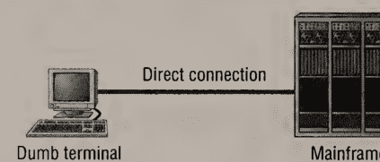

### 双层架构

双层架构随着 PC 的引入而流行起来，通常被称为客户端/服务器计算。在双层环境中，客户端通过网络使用网络协议连接到服务器，网络协议是客户端与服务器通信的约定的方法。

`TCP/IP` 是一种非常流行的网络协议，已成为网络计算的事实标准。无论选择 `TCP/IP` 还是其他网络协议，客户端和服务器都必须能够理解所选的协议。图 1.2 显示了两层架构的示例。

## 图 1.2 二层架构


这种架构相比单层架构具有明确的优势。首先，客户端/服务器计算引入了图形化用户界面；该界面更容易于理解和学习，并且比单层架构中传统的字符界面更具灵活性。此外，二层架构允许客户端分担应用程序的处理负载。在某种程度上，这降低了服务器的处理需求。

二层架构确实存在一些缺陷，尽管它曾被认为是所有网络架构的灵丹妙药。遗憾的是，扩展性这一问题仍然存在。注意，“客户端/服务器”计算这一术语包含一个斜杠（`/`）。这个斜杠代表了二层架构中一个不可见的组件，也是经常被忽略的部分：网络！

在进行项目原型设计时，许多开发人员未能考虑网络组件，结果发现小型环境中运行良好的程序可能无法有效地扩展到更大、更复杂的系统中。二层架构模型中存在大量的冗余，因为每台桌面电脑上都需要安装应用程序软件。由于这种情况，许多公司最终拥有了臃肿的 PC 和大型服务器，但仍然无法提供足够的性能。我们需要一种更具扩展性的网络通信模型。这正是 n 层架构所提供的。

### n 层架构

n 层架构是二层架构之后的下一个逻辑步骤。我们不再在客户端和服务器之间分应用程序处理工作，而是将工作分配给三台或更多机器。n 层架构引入了中间件组件，即位于客户端和 Oracle 服务器之间的一台或多台计算机，可以用于各种任务。其中一些任务包括：

- 在运行不同网络协议的机器之间移动数据。
- 充当防火墙，控制客户端对服务器的访问。
- 将业务逻辑的处理从客户端和服务器卸载到中间层。
- 执行事务并监控客户端与服务器之间的活动，以平衡多个服务器之间的负载。
- 充当网关，将现有系统与新系统连接起来。

互联网提供了终极的 n 层架构，用户浏览器提供了一个一致的呈现界面。这种通用界面意味着减少了员工培训，并增加了客户端应用程序组件的潜在重用性。

n 层架构使得利用网络计算机等技术成为可能。此类计算机可以是个人电脑的经济型、低维护型替代品。由于大部分应用程序处理可以由应用程序服务器完成，这些网络计算机的客户端计算需求被大大降低。此外，事务处理也可以卸载到事务服务器，从而减轻了数据库服务器的负担。

n 层模型具有很强的扩展性，它将呈现、业务逻辑和路由以及数据库处理的任务分配给许多机器，这意味着该模型能够胜任大型应用程序。此外，数据库服务器处理负载的减少意味着服务器可以使用相同的资源完成更多工作。同时，事务服务器可以智能地平衡网络事务的流量，而应用程序服务器可以减少客户端的处理和内存需求（见图 1.3）。

## 图 1.3 n 层架构

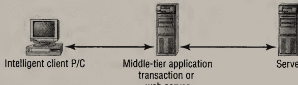

## Oracle Net 功能概述

Oracle Net 是将 Oracle 网络连接在一起的胶水。它负责处理客户端到服务器以及服务器到服务器的通信，并可以在客户端、中间层应用程序和 Oracle 服务器上进行配置。

Oracle Net 还管理着 Oracle 网络基础设施中的信息流。首先，它被用于建立与 Oracle 服务器的初始连接，然后它充当信使，将请求从客户端传回服务器，或在两个 Oracle 服务器之间传递请求。基本上，Oracle Net 处理了客户端连接期间客户端和服务器之间的所有协商。在本章稍后题为“Net Net 堆栈架构”的节中，我们将讨论 Oracle Net 的架构设计。

除了作为信息管理器外，Oracle Net 还支持使用中间件产品，如 `Oracle9iAS`（Oracle9i Application Server）和 `Oracle Connection Manager`。这些产品允许在企业中使用 n 层架构，增加了应用程序设计的灵活性和性能。

要了解更多关于这些产品以及 Oracle Net 的某些功能，请阅读以下章节，这些章节反映了 Oracle Net 提供的五类网络解决方案：连接性、目录服务、扩展性、安全性和可访问性。

## 连接性：多协议支持

Oracle Net 支持广泛的行业标准协议，包括 `TCP/IP`、`IBM LU6.2`、命名管道（`Named Pipes`）和 `DCNet`。（与其前身 `Net8` 不同，Oracle 不再支持 `Novell IPX/SPX` 协议。）这种支持是透明处理的，允许 Oracle Net 与各种计算机和各种操作系统环境建立连接。

## 第 1 章 · 网络管理简介


> Oracle Net 现在增加了一种专为系统区域网络（`SAN`）设计的协议支持，此类网络常用于集群环境。`SAN` 是硬件的特殊配置，用于多个服务器之间需要高速通信的情况。新的虚拟接口（`VI`）协议是轻量级的，并通过特定的硬件配置将网络活动从 `CPU` 卸载到网络适配器。有关 `VI` 协议的使用、配置和限制的详情，请参阅 `Oracle9i Net Services Administrator's Guide`（部件 `A90154-01`）。该指南可以通过 Oracle 技术网站 `technet.oracle.com` 获取。在该网站上，你可以获得 Acrobat 或 HTML 格式的所有 Oracle9i 文档。

## 连接性：多操作系统

Oracle Net 可以运行在许多不同的操作系统平台上，从 `Windows NT/2000` 到所有 Unix 变体，再到大型大型机操作系统。这种范围还允许用户将现有系统桥接到 Unix 或 PC 系统，从而在不对系统进行彻底更改的情况下增加组织的数据访问活性。

## 连接性：Java 与互联网

随着 `Oracle8i` 的引入，Oracle 允许使用 Java 组件（如企业级 `JavaBeans` 和通用对象体系架构 `CORBA`，这是一种定义跨网络对象交互的标准）的应用程序连接 Oracle 服务器。Oracle Net 通过支持标准的连接解决方案（如互联网对象互操作协议 `IIOP` 和通用对象互操作协议 `GIOP`）延续了这一点。这些功能允许客户端通过浏览器连接到与 Oracle 数据库交互的应用程序。通过利用安全套接层（`SSL`）等功能，客户端连接可以在互联网上获得更高程度的安全。

## 目录服务：目录命名

目录命名允许通过中心命名存储库解析网络名称。该中心存储库的形式为符合轻量级目录访问协议（`LDAP`）的服务器。`LDAP` 是一种定义了服务存储、识别和检索标准方法的协议和语言。它提供了一种简化的方法，用于管理信息目录，无论这些信息是关于组织中的用户，还是连接到网络的 Oracle 实例。`LDAP` 服务器允许在 Oracle 环境中以标准形式管理和解析名称。这些服务的质量非常优异，`LDAP` 为如 `Oracle Internet Directory (OID)` 等目录服务提供了单一的行业标准接口。通过利用 `Oracle Internet Directory`，你可以确保目录信息的安全可靠性，因为它们存储在 Oracle 数据库中。

从 `Oracle9i` 开始，目录命名（`Directory Naming`）已成为 Oracle 环境中集中命名的首选方法，取代了 `Oracle Names Server`。然而，`Oracle Names Server` 也可以用于 `Oracle8i` 及更早版本。`Oracle Names Server` 也可以配置为符合 `LDAP` 标准的命名目录服务的代理，以简化从 `Oracle Names` 到目录命名的迁移。

## 目录服务：Oracle Internet Directory

`Oracle Internet Directory (OID)` 是一种符合 `LDAP v3` 标准的目录服务，它提供了使用目录命名启用集中命名方案所需的存储和基础设施。`OID` 可同时用于 `Oracle8i` 和 `Oracle9i` 数据库。在 `Oracle9i` 中，`OID` 作为应用程序运行。`OID` 服务可以运行在远程服务器上，并可以使用 Oracle Net 与 Oracle 服务器通信。`OID` 是一种可扩展架构，并提供了在其他 Oracle 服务器之间复制服务信息的机制。

`OID` 还通过多种方式提供安全性。首先，它可以集成到安全套接层（`SSL`）环境中以确保用户身份验证。此外，管理员可以维护授予或拒绝访问服务的策略。这些策略是为 Oracle 目录树结构中的实体定义的。

## 可扩展性：Oracle 共享服务器

`Oracle Shared Server`（以前称为多线程服务器）是 Oracle 服务器的一种可选配置，它允许在不增加物理资源需求的情况下支持更多的并发连接。这是通过在用户组之间共享资源来实现的。

## 可扩展性：连接管理器 (Connection Manager)

`Oracle Connection Manager` 是一种中间件解决方案，提供了三个额外的可扩展性功能：

- **多路复用连接管理器**：可以将许多客户端连接分组，并将它们作为单一的多路复用网络连接发送 Oracle 服务器。这减少了服务器需要管理的网络连接总数。
- **网络访问连接管理器**：可以配置规则以根据 IP 地址限制访问。这种基于规则的配置可以设置为接受或拒绝客户端连接请求。此外，连接还可以根据源点、目标服务器或 Oracle 服务器进行限制。
- **跨协议连接性**：此功能允许使用不同网络协议的客户端和服务器进行通信。连接管理器充当翻译器，提供双向协议转换。

`Oracle Connection Manager` 由一组管理客户端和服务器之间通信的后台进程控制。此选项不使用图形化的 `Oracle Net Manager` 工具配置。图 1.4 提供了 Connection Manager 架构的概述。

## 图 1.4 连接管理器架构


## 安全性：高级安全

随着网络系统数量和复杂性的不断增长以及用户访问系统的权限不断增加，数据篡改威胁正成为许多组织日益关注的问题。敏感的业务交易频率更高，且在许多情况下，用户访问系统的权限不断增加。


等等，图 1.4 提供了 Connection Manager 架构的概述。

数据篡改威胁正成为许多组织日益关注的问题，随着网络系统数量和复杂性的不断增长以及用户访问系统的权限不断增加。敏感的业务交易频率更高，且在许多情况下，用户访问系统的权限不断增加。

## 安全性：防火墙支持

防火墙已成为企业网络中重要的安全机制。防火墙通常是硬件和软件的结合，用于控制网络流量并防止入侵者破坏网络安全。防火墙分为两大类：

- **IP 过滤防火墙**：监控 IP 网络上的数据包流量，并过滤源自或非源自特定机器组的数据包。通过对 IP 数据包头进行查询来获取此类信息。此类防火墙的供应商包括 Network Associates 和 Axent Communications。
- **代理防火墙**：防止防火墙外部的信息直接流入企业网络。相反，防火墙充当看门员，检查数据包并仅将适当的信息发送到企业网络。这阻止了客户端与防火墙内部之间的直接通信。Check Point Software Technologies 和 Cisco 是销售代理防火墙的供应商示例。Oracle 与这两类产品的供应商紧密合作，以确保通过此类机制支持数据库流量。Oracle 向防火墙供应商提供 `Net 代理套件`。此产品可以集成到防火墙架构中，允许数据库通过防火墙并保持高水平的安全性。

## 真实世界场景

## 你的防火墙

了解你的网络基础设施、用于获取数据库连接的网络路由以及你使用的防火墙产品类型是非常重要的。我经历过多次防火墙导致客户端与 Oracle 服务器之间连接问题的问题。例如，我记得在为前雇主担任 DBA 时，在防火墙应用了一个小补丁后发生了什么。在这种情况下，员工开始间歇性地断开数据库连接。在几天的调查和网络追踪后，我们才确定了具体问题。确定后，我们联系了防火墙供应商，他们向我们提供了一个可以应用的补丁，解决了该问题。

最近，当我为一家大型企业客户担任 DBA 时，开发人员开始遇到类似的问题。事实证明，开发人员的网络路由被修改为将连接路由通过一个新的防火墙。该防火墙被配置为在无活动 20 分钟后断开连接，这对于该部门来说时间太短了。因此，我们增加了超时时间参数，以满足开发人员的需求。

这些是 DBA 需要注意的网络更改类型示例，以避免不必要的停机时间，并避免人员和资源的浪费。

## 可访问性：异构服务

异构服务提供了与非 Oracle 数据库和服务通信的能力。这些服务允许组织利用并与其现有的数据存储进行交互，而无需必然将数据迁移到 Oracle 服务器。

异构服务套件由 `Oracle 透明网关` 和 `通用连接` 组成。这些产品允许 Oracle 以无缝配置与非 Oracle 数据源进行通信。异构服务还将系统与 Oracle 环境集成，从而允许您利用对这些系统的投资。这些服务还允许从 Oracle 数据源到非 Oracle 数据源的双向通信和复制。

### 透明网关

透明网关产品无缝扩展了 Oracle 到非 Oracle 数据存储的范围，允许您将非 Oracle 数据源视为 Oracle 环境的一部分。事实上，用户甚至察觉不到正在从非 Oracle 源访问数据。这可以显著减少从现有系统过渡到 Oracle 环境所需的时间和投资。透明网关完全支持 SQL 和 Oracle 事务控制功能，并且目前支持访问超过 30 多个非 Oracle 数据源。

### 通用连接

通用连接提供了一组代理，这些代理包含基本的连接能力。它还提供了一个基础，以便您可以使用标准自定义构建连接解决方案。

## 可访问性：外部过程

`OLE DB` 是微软指向 `ODBC` 的接口，它需要一个开放数据库连接（`ODBC`）驱动程序作为独立的连接解决方案进行接口。例如，通过适当的 Oracle `ODBC` 驱动，可以从 Microsoft Excel 等程序访问 Oracle 数据库。（这些驱动程序可以从 Oracle 或第三方供应商获得。）由于这些驱动程序在本质上是通用的，它们提供的外部服务接口没有透明网关那样稳健。

在某些开发工作中，可能需要与位于数据库外部的过程建立接口。这些过程通常用第三代语言（如 C 语言）编写。Oracle Net 提供了从 Oracle PL/SQL 调用调用外部过程的能力。当进行调用时，将启动一个作为 Oracle 和外部过程之间接口的进程。该调用进程默认名称为 `extproc`。监听器负责向被调过程提供信息，例如库或过程名称以及任何参数。这些程序随后在 `extproc` 进程的控制下加载并执行。

## Oracle Net 栈架构

Oracle Net 软件由一组形成栈架构的程序组成。这些程序每个负责处理网络通信的各个方面，每个程序都作为栈的一层。本节讨论了 Oracle Net 栈的架构并定义了每个部分的职责。要成功通过 OCP 考试，你需要理解 Oracle Net 栈的结构和职责。Oracle Net 栈的结构和功能基于开放系统互连（`OSI`）模型。

## OSI 模型

开放系统互连（`OSI`）模型是一个广泛接受的模型，它定义了如何在网络上执行数据通信。

`OSI` 模型有七层，每层负责网络通信的某方面。该模型的上层处理如与应用程序通信和呈现数据等职责。下层负责跨越网络传输数据。上层将信息（例如数据目的地和应如何处理数据）传递给下层。下层将状态信息传回上层。表 1.1 显示了 `OSI` 模型的层以及为了执行网络通信每层所承担的职责。从该表中可以看出，这种分层方法实现了职责分离。它还允许将网络通信的逻辑方面（如呈现和数据管理）与通信的物理方面（如位跨越网络的物理传输）分离开。

### 表 1.1 OSI 模型的层

| OSI 层 | 职责 |
| :--- | :--- |
| 应用层 | 与应用程序交互。接受命令并返回数据。 |
| 表示层 | 解决客户端和服务器之间的数据差异。还负责数据格式。 |
| 会话层 | 管理网络流量。确定数据是正在发送还是接收。 |
| 传输层 | 处理源和目的地网络进程的交互。错误修正和检测在此发生。 |
| 网络层 | 在节点之间传递数据。 |
| 数据链路层 | 维护连接可靠性和重传功能。 |
| 物理层 | 跨网络传输电信号。 |

## Oracle 通信栈

`Oracle OSI` 模型是 Oracle 通信栈架构的基础。Oracle 通信栈的每一层都有按照 `OSI` 模型模式的特征和职责。Oracle 在 `OSI` 模型的最高层与底层网络进行交互。本质上，它位于底层网络基础设施之上，并与底层网络进行通信。

Oracle 在客户端和服务器上使用 Oracle Net 来促进通信。通信栈充当客户端和服务器之间共享和管理数据的导管。Oracle 通信栈的层如下：

- 应用程序（客户端）层
- Oracle 调用接口（`OCI`）层（客户端）或 Oracle 程序接口（`OPI`）层（服务器）
- 双任务通用协议（`TTC`）层
- Oracle Net 基础层
- Oracle 协议适配器（`OPA`）层
- 网络特定协议层
- 网络程序接口（`NPI`，仅用于服务器到服务器通信）

图 1.5 描述了客户端和服务器栈各层之间的关系。客户端进程发起网络调用，经过 Oracle Net 客户端层到达网络协议。服务器接收请求、进行处理并将结果返回给客户端。

## 应用层（客户端）

Oracle 通信栈的应用层提供了与 `OSI` 模型应用层相同的功能。该层负责与用户交互，涉及提供界面组件、屏幕和数据控制元素。表单或菜单界面是应用程序层的示例。该层与 Oracle 调用接口（`OCI`）层通信。

## Oracle Net 栈架构

图 1.5 Oracle Net 栈架构


## Oracle 调用接口 (OCI) 层（客户端）

Oracle 调用接口（`OCI`）层负责客户端和 Oracle 服务器之间发生的所有 SQL 处理。`OCI` 层仅存在于客户端。在服务器上有一个类似的服务器组件称为 Oracle 程序接口（`OPI`）层。`OCI` 层负责打开和关闭游标、在服务器共享内存空间中绑定变量以及取回行。由于 `OCI` 是开放架构，第三方产品可以编写直接与通信栈此层建立接口的应用程序。`OCI` 层将信息直接传递给双任务通用协议（`TTC`）层。

## 双任务通用协议 (TTC) 层

双任务通用协议（`TTC`）层负责协调客户端和服务器之间任何数据类型或字符集的差异。`TTC` 层充当翻译器，将值从一个字符集转换为另一个。`TTC` 将确定任何数据类型差异当连接建立时，这些就会存在。`TTC` 层将信息传递给 Oracle Net Foundation 层。这一层共享了 `OSI` 模型中表示层的一些特性。

## Oracle Net Foundation 层

Oracle Net Foundation 层（以前称为透明网络子系统或 `TNS` 层）是 Oracle 通信栈架构中不可或缺的，类似于 `OSI` 模型中的会话层。它基于透明网络子系统（`TNS`），这使得 Oracle Net 成为一种非常灵活的架构，能够与各种网络协议建立接口。`TNS` 接口保护客户端和服务器免受网络通信复杂性的影响。

在通信栈的这一层，Oracle Net 与栈的其他层及其底层协议进行接口交互。正是这一层提供了使 Oracle Net 成为灵活且适应性强的架构所需的抽象级别，也是这一层补偿了机器之间在连接问题和所用协议方面的差异。该层还会中断消息并将信息直接传递给 Oracle 协议适配器（`OPA`）层。Oracle Net Foundation 层有几个子层：

- **网络接口 (NI) 子层**：提供了一个通用接口，客户端和服务器可以在其上处理功能。栈的这一层负责处理任何中断请求。
- **网络路由 (NR) 子层**：这是 Oracle Net 保留其网络路线图的地方，即如何从源端或客户端到达目的地。
- **网络命名 (NN) 子层**：该层获取网络信息并将其转换为 Oracle Net 目标地址信息。
- **网络认证 (NA) 子层**：该层负责连接认证所需的任何协商。
- **网络会话 (NS) 子层**：网络会话层处理 Oracle 网络连接中的大部分活动。该层负责诸如协商客户端的初始连接请求。它还负责管理 Oracle Net 缓冲区的内容并在客户端和服务器之间传递缓冲区信息。如果使用了这些选项，它还处理连接管理的特殊功能，例如缓冲区池和多路复用。

## Oracle 协议适配器 (OPA) 层

Oracle 协议适配器（`OPA`）层与底层建立接口。这成为了进入底层网络的入口点。该层将 Oracle Net Foundation 层的功能映射到底层协议中相应的函数。针对支持的协议有不同的适配器。该层与网络特定协议层相结合，类似于 `OSI` 模型中的网络层。

## 网络特定协议层

这是实际的传输层，负责将信息从客户端传输到服务器。Oracle Net 支持的一些协议包括 `TCP/IP` 和 `DECnet`。这些协议并不随 Oracle 软件提供，必须已到位以促进网络通信。

## Oracle 程序接口 (OPI) 层（仅限服务器）

对于来自客户端的每一个请求，Oracle 程序接口层都负责发送相应的响应。当客户端发布 SQL 语句请求从数据库获取数据时，`OPI` 接口完成该请求。在服务器到服务器的通信中，使用网络程序接口（`NPI`）而不是 `OPI`。

## 网络程序接口 (NPI) 层（仅限服务器）

网络程序接口（`NPI`）仅存在于 Oracle 服务器上。它类似于客户端上的 `OCI`。该层负责服务器到服务器的通信，而 `OPI` 用于客户端到服务器的通信，以及数据库跨数据库链接进行相互通信的分布式环境。该层类似于 `OSI` 模型中的表示层，但是从服务器的角度来看。

## Oracle Net 和 Java 的支持

为了提供与在 Oracle 服务器环境内部编写和部署的 Java 代码建立接口的能力，Oracle Net 支持通用对象-ORB 协议（`GIOP`）。该协议允许对象代理通过互联网相互通信。对象请求代理器是一段处理分布式网络中对象请求路由的软件。互联网对象-ORB 协议（`IIOP`）是运行在 `TCP/IP` 下的 `GIOP` 变体，支持安全套接字层（`SSL`），用于跨互联网建立安全的网络连接。如果应用程序访问编写并存储在 Oracle 数据库中的 Java 过程，就会使用这种连接。在这种情况下，Oracle9 Java 虚拟机（`JVM`）将运行在 Oracle 服务器上，提供对象请求代理功能。

Oracle Net 需要的唯一部分是 Oracle Foundation 层。这种精简的通信栈在使用服务器端 Java 程序时允许 Oracle 服务器实现更高效的连接。图 1.6 显示了这些修改如何简化了 Oracle 通信栈。

图 1.6 IIOP 栈通信

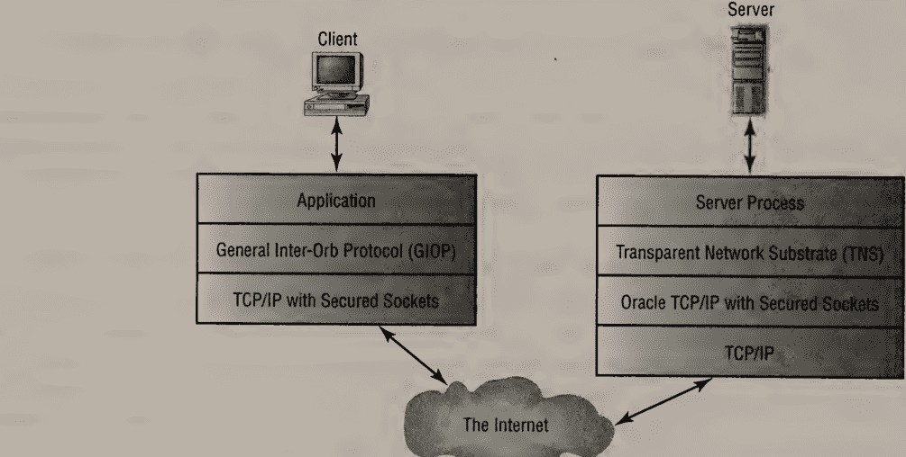

Oracle Net 还为基于 Web 的应用程序提供了强大的连接。到 Oracle 服务器的连接可以通过 Java 应用程序、Java Applet 或通过 Oracle9iAS 等应用程序服务器直接可用。

## 使用 Oracle Net 的 Internet 连接

由 Oracle 服务器通过网络浏览器发起的连接非常像客户端-服务器应用程序。主要区别是应用程序服务器充当客户端，提供与 Oracle 服务器之间的通信。如果 Java 应用程序位于 Web 服务器上，则使用 Java 数据库连接（`JDBC`）`OCI` 驱动程序启动到 Oracle 服务器的通信。`JDBC` 是一个允许 Java 程序与存储为表格形式的数据（例如 Oracle 数据库中的数据）交互的接口。如果通过 Java Applet 进行连接，则使用 `JDBC Thin` 驱动程序。该驱动程序不需要安装 Oracle 客户端软件，因此被称为“薄驱动程序”。该驱动程序提供了到 Oracle 服务器的连接。

### 1.7 通过 Java 应用程序进行 Web 连接

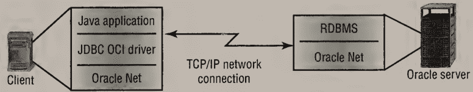

## 服务器连接

由 Oracle 服务器通过网络浏览器发起的连接非常像客户端-服务器应用程序。主要区别是应用程序服务器充当客户端，提供与 Oracle 服务器之间的通信。如果 Java 应用程序位于 Web 服务器上，则使用 Java 数据库连接（`JDBC`）`OCI` 驱动程序启动到 Oracle 服务器的通信。`JDBC` 是一个允许 Java 程序与存储为表格形式的数据（例如 Oracle 数据库中的数据）交互的接口。如果通过 Java Applet 进行连接，则使用 `JDBC Thin` 驱动程序。该驱动程序不需要安装 Oracle 客户端软件，因此被称为“薄驱动程序”。该驱动程序提供了到 Oracle 服务器的连接。

Oracle Net 支持在 Oracle 服务器内部开发和部署常用的 Java 对象，例如企业豆（`EJB`）。客户端可以向数据库发送请求并与这些组件交互。Oracle 必须在服务器上配置以接受此类请求。这种解决方案的吸引人之处在于客户端不需要部署软件；客户端只需要一个网络浏览器来与数据库交互。


适用于许多类型的防火墙。可访问性支持包括服务（`Services`）以及调用外部过程的支持。Oracle Net 还提供了与 Java 存储过程的连接：`HTTP` 和 `IIOP` 协议。

本章提供了你在设计 Oracle 网络基础设施时所需的知识基础。你对网络设计所做出的决策将对你的 Oracle 环境的可扩展性、安全性和灵活性产生深远影响。当你理解底层网络架构和可用的网络选项时，你就能在设计 Oracle 网络时做出明智的选择。

## 考试要点

- 了解数据库管理员的职责以及它们如何与网络管理相关。你应该能够列出数据库管理员在网络管理方面的职责。你是否能定义基本的网络配置选择，并总结这些选项的优缺点？

- 理解什么是 Oracle Net 以及它提供的功能。你应该能够定义 Oracle Net 提供的五类功能以及哪些功能属于每一一类。你还应该理解 Oracle 共享服务器（`Shared Server`）和连接管理器（`Connection Manager`）选项提供的功能。此外，你应该能够定义 Oracle 高级安全（`Oracle Advanced Security`）以及何时使用它。

- 能够定义异构服务（`Heterogeneous Services`）的用途以及这些选项适用的情况。异构服务提供了与非 Oracle 数据库及服务的通信能力。这些允许组织利用并与其现有的数据存储交互，而无需必须将数据移动到 Oracle 服务器。

- 能够定义 Oracle Net 栈架构。Oracle Net 架构基于网络计算的 `OSI` 模型。该模型将执行网络事务的责任分配在不同的层之间。你应该知道 Oracle Net 栈各层的名称和定义。

- 理解 Oracle Net 对存储在 Oracle 服务器上的 Java 的支持。Oracle 通过支持 `GIOP` 来存储在服务器上的 Java，这允许对象请求代理（`Object Request Brokers`）通过 Internet 进行相互通信。对象 `JVM` 在 Oracle 服务器上提供对象请求代理功能。

- 熟悉 Oracle 的 Internet 连接选项。你应该对 Oracle 提供的 Internet 连接选项有基本的了解。这包括通过应用程序服务器建立的连接，以及从 Web 浏览器直接到 Oracle 服务器的连接。

## 关键术语

在参加考试之前，确保你熟悉以下术语：

- 应用层（`application layer`）
- `extproc`
- 防火墙（`firewall`）
- 通用连接（`Generic Connectivity`）
- 异构服务（`Heterogeneous Services`）
- IP 过滤防火墙（`IP-filtering firewall`）
- Java 数据库连接（`JDBC`）
- 中间件（`middleware`）
- 网络程序接口（`NPI`）
- n 体系架构（`n-tier architecture`）
- 对象请求代理（`Object Request Broker`）
- 开放系统互连（`OSI`）
- Oracle 高级安全（`Oracle Advanced Security`）
- Oracle 接口（`OCI`）层
- Oracle 连接管理器（`Oracle Connection Manager`）
- Oracle 基础层（`Oracle Foundation layer`）
- Oracle 程序接口（`OPI`）层
- Oracle 协议适配器（`OPA`）层
- Oracle 共享服务器（`Oracle Shared Server`）
- Oracle 透明形网关（`Oracle Transparent Gateway`）
- 基于代理的防火墙（`proxy-based firewall`）
- 单层架构（`single-tier architecture`）
- 存储区域网络（`SAN`）
- 透明通用传输（`TTC`）层
- 两层架构（`two-tier architecture`）
- 虚拟接口（`VI`）

## 复习题

1. 以下所有都不是网络架构的示例：

   A. 客户端/服务器（`Client/server`）
   B. n 体系（`N-tier`）
   C. 单层（`Single-tier`）
   D. 两层（`Two-tier`）
   E. 以上所有

2. 你管理一个非 Oracle 数据库和几个 Oracle 数据库。一个应用程序需要访问非 Oracle 数据库，就像它是 Oracle 数据库的一部分一样。什么工具可以解决这个问题？选择最佳答案：

   A. 高级安全（`Advanced Security`）
   B. Oracle 连接管理器（`Oracle Connection Manager`）
   C. 异构服务（`Heterogeneous Services`）
   D. Oracle Net
   E. 以上都不是

3. 关于 Oracle Net，以下哪项是？

   A. 它未包含在 Oracle 安装中。
   B. 它只在 TCP/IP 平台上工作。
   C. 它有一个 API。
   D. 它从未安装在客户端工作站上。

4. DBA 想要在一个具有许多服务的大型 Oracle9i 安装中集中管理所有网络服务。哪种设施能以最低成本实现这一点？

   A. 高级安全（`Advanced Security`）
   B. 异构服务（`Heterogeneous Services`）
   C. Oracle 共享服务器（`Oracle Shared Server`）
   D. Oracle Internet 目录（`Oracle Internet Directory`）

5. TCP/IP、DECnet 以及所有这些都是什么的例子？

   A. 计算机编程语言
   B. Oracle 连接工具
   C. 网络协议
   D. 网络语言

6. Oracle Net 的哪种特征描述了这一语句：“Oracle Net 支持 TCP/IP 和 LU”？

   A. GUI 工具
   B. 健壮的跟踪和诊断工具
   C. 客户端零配置
   D. 网络传输支持

7. Oracle9i 配合 Oracle Net 采用的什么解决方案允许 JavaBeans 等 Java 组件的连接？

   A. LU
   B. IPA
   C. GIOP
   D. Oracle Internet 目录

8. Oracle Net 通信栈基于哪种标准？

   A. OCI
   B. NPI
   C. OSI
   D. API

9. “负责在电线上传输比特位”描述的是 OSI 的哪一层？

   A. 应用层（`Application Layer`）
   B. 物理层（`Physical Layer`）
   C. 数据链路层（`Data Link Layer`）
   D. 网络层（`Network Layer`）

10. 用于通过 Oracle Net 进行外部调用的进程默认名称是什么？

    A. externalproc
    B. external
    C. extproc
    D. process

11. IIOP 是以下哪项的示例？

    A. 用于 Oracle Net 的工具
    B. 网络集成实用
    C. Internet 协议
    D. Oracle 栈的部分

12. 连接管理器（`Connection Manager`）提供以下哪些项？

    A. 多路复用（`Multiplexing`）
    B. 跨协议连接
    C. 网络访问
    D. 以上所有

13. 关于 OCI 层，以下哪项是正确的？

    A. 它显示图形界面。
    B. 它处理其数据类型转换。
    C. 它直接与协议适配器接口。
    D. 它直接与 TTC 层接口。
    E. 以上都不是。

14. 下述语句适用于哪些选项：“防止公司内部客户端与应用程序之间的直接通信。”

    A. 基于代理的防火墙（`Proxy-based firewalls`）
    B. 基于过滤的防火墙（`Filter-based firewalls`）
    C. 两种防火墙
    D. 两种都不是

15. 当通过 Java applet 连接时，使用了什么类型的驱动？

    A. JDBC OCI 驱动
    B. JDBC Thin 驱动
    C. ODBC 驱动
    D. OCI 驱动

16. 客户端工作站连接到事务服务器，服务器将请求传递给 Oracle 数据库。这是对哪项的描述？

    A. 单层架构（`Single-tier architecture`）
    B. 客户端/服务器架构（`Client/server architecture`）
    C. n 体系架构（`N-tier architecture`）
    D. 以上都不是

17. 哪种 Oracle Net 网络产品最适合描述为中间件？

    A. Oracle Internet 目录（`Oracle Internet Directory`）
    B. Oracle 连接管理器（`Oracle Connection Manager`）
    C. Oracle 高级网络（`Oracle Advanced Networking`）
    D. Oracle 共享服务器（`Oracle Shared Server`）

18. 以下哪些是复杂网络的特征？

    A. 多协议
    B. 多样地理位置
    C. 多操作系统
    D. 多硬件平台
    E. 以上所有

19. 在 Oracle9i 环境中，集中命名的首选方法是什么？

    A. Oracle 名称服务器（`Oracle Names Server`）
    B. Oracle 连接管理器（`Oracle Connection Manager`）
    C. Oracle 共享服务器（`Oracle Shared Server`）
    D. 使用 Oracle Internet 目录进行命名（`Directory Naming with Oracle Internet Directory`）

20. 以下哪项是将连接分组在一起的能力的示例？

    A. 协议交换（`Protocol Interchange`）
    B. 网络访问控制（`Network Access Control`）
    C. 多路复用（`Multiplexing`）
    D. 数据完整性检查（`Data Integrity checking`）
    E. 以上都不是

## 复习题答案

- 1. 这些都是网络连接已配置的示例。网络连接可以简单到通过串行连接直接连接到服务器的哑终端。它也可以复杂到涉及 n 层架构，该架构可能涉及客户端、中间件、互联网和数据库服务器。

- 2. Oracle Advanced Security 无法解决此应用程序问题，因为它解决的是安全性问题，而不是对非 Oracle 数据库的可访问性。Oracle Net 会是解决方案的一部分，但还需要另一个 Oracle 网络组件。Connection Manager 本身也无法满足这一需求。Heterogeneous Services（异构服务）是正确答案，因为这些服务为非 Oracle 数据库提供了跨平台连接。

- 3. Oracle Net 包含在 Oracle Enterprise 安装包中，并与多种协议配合。它还包含客户端和服务器组件。关于 Oracle Net 唯一正确的陈述是它具有一个开放的应用程序接口（`API`），这意味着第三方软件可以根据这些规范编写以与 Oracle Net 直接交互。

- 4. Advanced Security、Heterogeneous Services 和 Oracle Shared Server 都无法为这一业务需求提供解决方案；其中任何一个都无法解决集中管理网络服务的问题。该问题的最佳解决方案是 Oracle Internet Directory，因为它可以促进集中式命名。

- 5. TCP/IP、DECnet 和 LU6.2 都是网络协议的示例。

- 6. Oracle Net 支持支持多种协议。TCP/IP 和 LU6.2 是 Oracle Net 支持的两种协议示例。

- 7. 通用 ORB 协议（`GIOP`）是一种支持 Java 组件连接的协议。

- 8. C. Oracle Net 通信栈基于开放系统互连（`OSI`）模型。NPI 和 OCI 是 Oracle Net 栈的一部分，API 代表应用程序接口（`Applications Program Interface`）。

- 9. B. 物理层负责跨网络发送实际的数据位。其他层都在这个基础层之上。

- 10. C. 外部过程进程的默认名称是 `extproc`；`lnrctl` 是用于管理监听服务的程序。External 和 prosect 均无效响应。

- 11. C. IIOP 是互联网网络协议的一个示例。

- 12. D. Connection Manager 是一种中间件解决方案，提供连接多路复用跨协议连接和网络访问控制。所有答案都描述了 Connection Manager。

- 13. D. OCI 层位于应用层之下，`TTC` 层之上。调用接口处理光标管理和 SQL 执行等事务。这些信息传递给 Two-Task Common 层。

- 14. A. 基于代理的防火墙防止客户端与公司防火墙内部应用程序之间的直接接触。基于过滤的防火墙检查数据包头但不修改地将数据包传递到目标应用程序。基于代理的防火墙在外部客户端和内部应用程序之间起到中继作用。

- 15. B. 如果使用 Java Applet 通过应用程序服务器与 Oracle 数据库通信，则将利用 JDBC Thin Driver。

- 16. C. 当你在事务处理中引入中间层时，这被称为 n 层架构。

- 17. B. Connection Manager 是一种中间层选项，提供多协议交换、连接集中和客户端访问控制。

- 18. E. 这些都是复杂网络的特征。

- 19. D. Oracle Internet Directory 和目录命名（`Directory Naming`）正在取代 Oracle Names Server，成为首选的集中命名方法。

- 20. C. 多路复用是 Oracle Connection Manager 的特性，允许多个入站请求通过单个出站连接同时被处理和传输。这是 Connection Manager 提供的扩展性功能。

## 在服务器上配置 Oracle Net

本章涵盖的 ORACLE9i DBA 基础知识 II 考试目标包括：

- 识别监听器如何响应入站的连接。
- 使用 Oracle Net Manager 配置监听器。
- 使用监听器控制工具（`lsnrctl`）控制监听器。
- 描述动态服务注册（`Dynamic Service Registration`）。
- 为 IIOP 和 HTTP 连接配置监听器。

考试目标可能会在任何时候发生变化，且不另行通知，并由 Oracle 拥有最终最终裁决权。请访问 Oracle 认证网站（`http://www.oracle.com/education/certification/`）查看最新的考试目标列表。

## Oracle 监听器

DBA 必须在服务器上配置 Oracle Net，以便建立客户端连接。本章将重点介绍如何配置 Oracle 服务器的基础网络元素。

首先，我们共同讨论管理和配置主要的 Oracle 服务器网络组件及监听器进程的方法，以及如何使用 Oracle Listener Manager 和 `lnrctl` 命令工具。动态注册功能允许实例自动在 Oracle 服务器上的监听器进行注册。我们还将如何配置监听器，使其能够通过 IIOP 和 HTTP 连接通过互联网将客户端连接到 Oracle 服务器。最后，我们将探索解决服务器端连接问题的方法。

本章描述了你在配置 Oracle Net 环境时需要采取的第一步。一旦正确配置了 Oracle Net，数据库服务器客户端将连接到 Oracle 数据库，而无需直接连接到位于 Oracle 数据库的服务器。如果没有这种配置，这种连接将无法实现。

Oracle 监听器是主要的服务器端 Oracle 网络组件，允许客户端计算机与 Oracle 数据库之间建立连接。你可以将监听器想象成大耳朵，监听对 Oracle 服务的连接请求。

所请求的 Oracle 服务类型是请求连接的进程提供的连接描述符信息的一部分，服务名称解析为 Oracle 数据库。监听器可以监听服务器上配置的任意数据库，并能够监听通过各种协议（如 `TCP/IP`、`DECnet` 和 `LU6.2`）传输的请求。

客户端连接可以在监听器所在的本地机器启动，也可以来自远程位置。

监听器使用名为 `listener.ora` 的集中文件进行配置。虽然每台机器只有一个 `listener.ora` 文件，但一台服务器上可以有多个监听器，该文件包含了服务器上配置的所有监听器的配置信息。如果在单台服务器上配置了多个监听器，通常是为了平衡连接请求并减轻单个监听器的负担。

`listener.ora` 文件的内容和结构将在本章后部分讨论。

每个监听器都是运行在服务器上的具名进程。Oracle 监听器的默认名称为 `LISTENER`，它通常在你 Oracle 时创建。如果你配置了多个监听器，每个监听器将有一个唯一的名称。以下是 `listener.ora` 文件的默认配置示例。

```
### LISTENER.ORA 网络配置文件：
D:\ora90\network\admin\listener.ora
### 由 Oracle 配置工具生成。
```

```
LISTENER =
(DESCRIPTION_LIST =
(DESCRIPTION =
(ADDRESS_LIST =
(ADDRESS = (PROTOCOL = TCP)(HOST = mjworn)
(PORT = 1521)))
(ADDRESS_LIST =
(ADDRESS = (PROTOCOL = IPC)(KEY = EXTPROCO))
)\)
)
```

```
SID_LIST_LISTENER =
(SID_LIST =
```

```sql
(SID_DESC =
  (SID_NAME = PLSExtProc
  (ORACLE_HOME = D:\oracle\ora90
    (PROGRAM = extproc)
  )
  (SID_DESC =
    (GLOBAL_DBNAME = ORCL)
    (ORACLE_HOME = D:\oracle\ora90
    (SID_NAME = ORCL)
  )
)
```

### 监听器如何响应连接请求？


# 监听器响应连接请求的方式

监听器有多种方式响应客户端的连接请求。响应取决于多个因素，例如服务器端网络组件的配置情况以及客户端请求的连接类型。监听器将以两种方式之一响应连接请求。

监听器可以启动一个新的进程，并将客户端会话的控制权传递给该进程。在专用服务器环境中，每个客户端连接都由其自身的服务器进程提供服务。服务器端进程不在客户端之间共享。根据操作系统的功能，可能存在两种类型的专用服务器连接：遗留交付连接（bequeath connections）和重定向连接（redirect connections）。每种连接都会产生一个处理客户端任务的独立进程，但实际连接启动过程的机制是不同的。

> 从 Oracle9i 开始，不再支持预启动专用进程（prespawn dedicated processes）。

## 遗留交付连接 (Bequeath Connections)

当底层操作系统（如 Unix）支持网络端点的继承时，遗留交付连接是可行的。这意味着操作系统能够启动新进程并将信息传递给该进程；这允许操作系统进程立即与客户端建立会话。

遗留交付连接的另一个名称是直接交接连接（direct hand-off connections）。

图 2.1 显示了遗留交付连接的连接过程及其步骤：

### 图 2.1 遗留交付连接过程

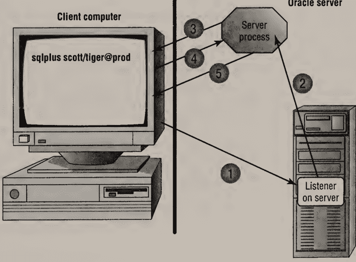

> 注意：为了在 Windows NT/2000 上支持遗留会话，需要设置注册表项 `USE_SHARED_SOCKET`。该设置可以在 `HKEY_LOCAL_MACHINE > SOFTWARE > ORACLE > HOMEX` 中设置，其中 X 等于你正在使用的 HOME。默认情况下，此注册表设置未初始化，因此当使用专用客户端时，Windows NT/2000 将使用重定向类型连接。

## 重定向连接 (Redirect Connections)

监听器也可以将用户重定向到服务器进程或调度器进程（dispatcher process）。当操作系统不支持遗留交付或监听器与 Oracle 服务器不在同一台机器上，就会发生此类连接。图 2.2 展示了以下步骤：

- 客户端在解析服务名后联系 Oracle 服务器。
- 对于 Oracle 服务器，监听器启动一个新的进程或调度器。对于共享服务器，如果现有服务器还有剩余容量，则需要启动一个调度器。
- 新进程或线程选择用于与客户端交互的 TCP/IP 端口。此信息将传回给监听器。
- 监听器将信息传回客户端，将客户端重定向到新的服务器或调度器。监听器与客户端之间的原始网络连接被断开。
- 客户端向服务器或调度器发送连接信号以建立网络连接。
- 调度器或服务器进程向客户端发送确认。
- 如果正在使用 Oracle 共享服务器进程，PMON 会向监听器发送有关调度器服务的连接数的信息。监听器使用这些信息来保持调度器之间的负载均衡。

### 图 2.2 重定向连接过程

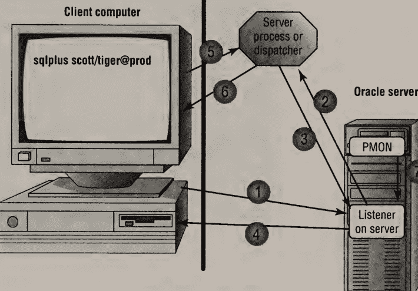

# 第 2 章 · 在服务器上配置 Oracle Net

## 管理监听器

DBA 有多种方法配置服务器端监听器文件。在初始安装过程中，安装程序会提示 DBA 创建默认监听器。如果 DBA 不想以这种方式提供监听器，也可以使用 Oracle Net 助手（Oracle Net Assistant）来配置监听器。如果选择此方法，安装程序将使用该助手包含的屏幕进行初始监听器配置。图 2.3 显示了 Oracle Net 配置助手的启动界面示例。

### 图 2.3 Oracle Net 配置助手启动界面

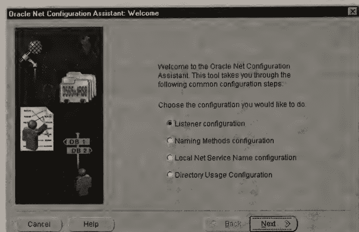

Oracle Net 配置助手旨在作为一个简单、基于向导的工具，您可以使用它对客户端和服务器端网络产品进行基础设置。

静态注册是指使用 Oracle Net 助手手动向 `listener.ora` 文件添加条目时发生的情况。之所以称为静态的，是因为你是手动添加这些信息的。如果你将使用 Oracle Enterprise Manager 连接到 Oracle 8 之前的实例，或者你将连接到外部服务，则静态注册是必要的。

还有另一种管理监听器的方法，不需要手动更新 `listener.ora` 文件中的服务信息。这被称为动态注册（dynamic registration）。动态服务注册是一项功能，允许 Oracle 实例自动向 Oracle 监听器注册自己。该功能的用处是，当创建新的 Oracle 实例时，不需要 DBA 对服务器端网络文件进行任何更新。动态服务注册将在本章后面的“服务的动态注册”章节中进行更详细的介绍。

如果您正在使用 Oracle9i，则必须配置 Oracle9i 监听器以连接 Oracle 服务器。Oracle9i 监听器具有向后兼容性，可以监听对早期版本数据库的连接请求。

如果您想能够配置网络文件的基础设置，则必须使用 Oracle Net Manager。在接下来的几节中，您将学习如何使用 Oracle Net Manager 配置网络文件。

## 使用 Oracle Net Manager

Oracle Net Manager 是一个可以使用来创建和管理客户端和服务器端配置文件的工具。Oracle Net Manager 从 Oracle7 的 Network Manager 演变为最新的 Oracle9i 版本。在演变过程中，Oracle 不断增强该工具的功能和可用性。

我们建议使用 Oracle Net Manager 创建和管理所有的网络文件。这是因为这些文件需要特定的格式，而 Oracle Net Manager 可以确保按该格式创建文件。如果文件格式错误，可能会出现连接问题。即使是微小的空格或制表符也会导致连接问题，因此如果您习惯在这些文件中剪切粘贴条目，现在最好使用 Oracle Net Manager 创建新条目。

如果您在使用 Windows NT/2000 环境，可以通过选择 `开始 > 程序 > Oracle9i > 配置和迁移工具 > Oracle Net Manager` 来启动 Oracle Net Manager。在 Unix 环境中，可以在 `$ORACLE_HOME/bin` 目录下运行 `./netmgr` 启动。

图 2.4 显示了 Oracle Net Manager 的首页示例。

### 图 2.4 Oracle Net Manager 界面

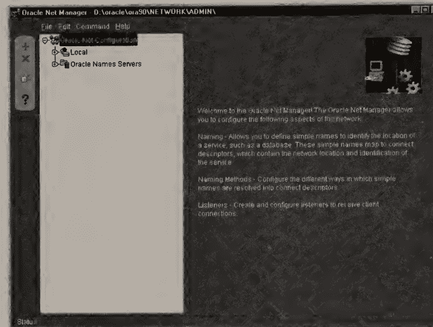

## 使用 Oracle Net Manager 配置监听器服务

您将希望使用 Oracle Net Manager 配置监听器。正如第一章“网络管理简介”所述，Oracle Net Manager 为您将使用的大多数网络文件提供了一个易于使用的图形界面。通过使用 Oracle Net Manager，可以确保文件以一致的格式创建，从而减少连接问题的可能性。

当首次启动 Oracle Net Manager 时，启动界面会在屏幕右侧的 Network 文件夹下显示一组图标。Local 文件夹下的选项对应不同的网络配置文件。以下是不同的网络文件选项及其各自配置的内容。

| 图标 | 配置的文件 |
| --- | --- |
| 配置文件 | `sqlnet.ora` |
| 服务命名 | `tnsnames.ora` |
| 监听器 | `listener.ora` |
| Oracle 名称服务器 | `names.ora` |

> 如上一章所述，Oracle Names Server 正在被 Oracle Internet Directory 作为中心式 Oracle 服务名称解析的首选方法。然而，Oracle Names Server 仍然可以通过 Oracle Net Manager 进行配置，并在 Oracle 9i 中支持。但是，该产品不再进行任何修订，未来的 Oracle 版本可能不再支持 Names Server。

### 创建监听器

之前我们提到，默认情况下，Oracle 在安装时会创建一个名为 `LISTENER` 的监听器。Oracle 用于 `listener.ora` 文件的默认设置如下所示。

| 文件部分 | 设置 |
| --- | --- |
| 监听器名称 | `LISTENER` |
| 端口 | `1521` |
| 协议 | `TCP/IP` 和 `IPC` |
| 主机名 | 默认主机名 |
| SID 名称 | 默认实例 |

你可以使用 Oracle Net Manager 创建非默认监听器或更改现有监听器的定义。Oracle Net Manager 具有用于创建大多数网络元素的向导界面，例如 `listener.ora` 和 `tnsnames.ora` 文件。

按照以下步骤创建监听器：

1. 点击 Local 图标旁边的加号（`+`）。
2. 点击 Listeners 文件夹。
3. 点击加号图标或从 Edit 菜单中选择 Create。
4. 出现 Choose Listener Name 对话框。如果是首次创建监听器，在未配置监听器的情况下，Oracle Net Manager 认为 `LISTENER`；如果已创建了默认监听器，则默认为 `LISTENER1`。如果正确，请点击 OK 或输入新名称。这里是 Choose Listener Name 屏幕示例。


5. 选择监听器名称后，你可以配置监听位置；要进行此操作，点击 Listener Locations 下拉列表并进行选择。然后点击屏幕底部的 Add Address，如图 2.5 所示。

#### 图 2.5 来自 Oracle Net Manager 的 Listener Locations 屏幕

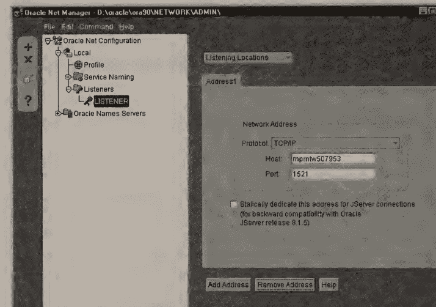

6. Oracle Net Manager 右侧会出现一个新屏幕。根据你的协议，提示内容会有所不同。默认显示 TCP/IP 信息。如果你使用 TCP/IP，系统会自动为你填写 Host 和 Port 字段。主机是运行监听器的机器名称，端口是 TCP/IP 连接的监听位置。端口的默认值为 `1521`。
7. 选择 `File > Save Network Configuration` 保存你的信息。保存信息后，查看其保存所在的目录。

你可以通过查看 Oracle Net Manager 屏幕顶部的横幅随时知道文件的存储位置。

Oracle Net Manager 在此过程中实际上创建了三个文件：`listener.ora`、`tnsnames.ora` 和 `sqlnet.ora`。`tnsnames.ora` 不包含任何信息。`sqlnet.ora` 文件此时可能包含少量条目，但目前可以忽略。`listener.ora` 文件将包含下方代码列表所示的信息。我们将在本文稍后讨论 `listener.ora` 文件的结构和内容。

```
### LISTENER.ORA Network Configuration File:
D:\oracle\ra90\network\admin\listener.ora
```

```
LISTENER1 =
(DESCRIPTION =
(ADDRESS_LIST =
(ADDRESS = (PROTOCOL = TCP)(HOST = mjworn)
(PORT = 1521))))
```

## 向监听器添加服务名称信息

在使用名称、协议和监听位置信息创建监听器后，你需要定义由监听器负责为用户连接的网络服务。监听器可以监听的网络服务名称数量没有限制。

添加服务名称信息的步骤如下：

1. 点击 Listeners 图标并突出显示你想要配置的监听器名称，以选择该监听器。
2. 选择监听器后，从屏幕右上角的下拉列表中选择 Database Services。
3. 点击底部的 Add Database 按钮。
4. 在 Global Database Name、Oracle Home Directory 和 SID 的提示中输入值。如果你使用扁平化命名法，SID 和全局数据库名称的条目是相同的（参见图 2.6）。

#### 图 2.6 来自 Oracle Net Manager 的 Add Service 屏幕

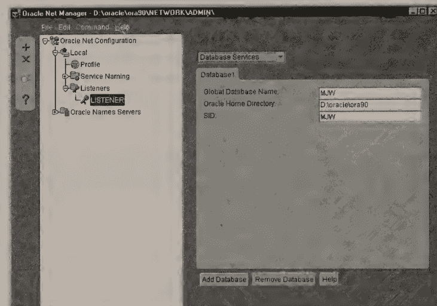

5. 选择 `File > Save` 保存你的配置。这里是完成的 `listener.ora` 文件示例：

### LISTENER.ORA Network Configuration File

`D:\oracle\ora90\network\admin\listener.ora`

### Generated by Oracle configuration tools.

```
LISTENER =
(DESCRIPTION_LIST =
(DESCRIPTION =
(ADDRESS_LIST =
(ADDRESS = (PROTOCOL = TCP))
(HOST = mprntw507953)(PORT = 1521)) =
```

```
(ADDRESS_LIST =
(ADDRESS = (PROTOCOL = IPC)(KEY = EXTPROCO))
)
)
SID_LIST_LISTENER =
(SID_LIST =
(SID_DESC =
(SID_NAME = PLSExtProc)
(ORACLE_HOME = D:\oracle\ra90)
(PROGRAM = extproc)
(SID_DESC =
(GLOBAL_DBNAME = MJW)
(ORACLE_HOME = D:\oracle\ora90)
(SID_NAME = MJW)
)
)
```

### 表 2.1 关于 listener.ora 的 Listening Section 参数

| 参数 | 描述 |
| --- | --- |
| `LISTENER` | 监听器的定义。默认名称是 `LISTENER`。 |
| `DESCRIPTION` | 监听位置。 |
| `ADDRESS_LIST` | 关于监听位置的信息。 |
| `PROTOCOL` | 此监听位置协议。 |
| `HOST` | 监听器所在的机器名称。 |
| `PORT` | 监听器的端口。 |
| `SID_LIST_LISTENER` | 监听器配置的 SID 列表。 |
| `SID_DESC` | 每个 SID 定义。 |
| `SID_NAME` | SID 名称。 |
| `GLOBAL_DBNAME` | 全局数据库名称。 |
| `ORACLE_HOME` | Oracle 可执行文件的位置。 |

### 表 2.1 关于 listener.ora 的 Listening Section 参数（续）

| 参数 | 描述 |
| --- | --- |
| `PORT` | 监听器的端口。 |
| `SID_LIST` | 监听器配置的服务。 |
| `SID_DESC` | 每个 SID。 |
| `GLOBAL_DBNAME` | 标识全局数据库名称。 |
| `ORACLE_HOME` | 服务器上的 Oracle 位置。 |
| `SID_NAME` | SID 的名称。 |

## 添加监听器

要添加更多监听器，请按照上述步骤操作。监听器必须具有唯一的名称并在不同的端口上监听，因此为监听器分配一个新名称和不同的端口（例如 `1522`）。你必须为监听器分配服务名称。

## 可选 listener.ora 参数

你可以设置为监听器添加功能的可选参数。可选参数通过屏幕右上角的 General Parameters 添加。表 2.2 描述了这些参数以及在 Oracle Net Manager 中查找的位置。

如你所见，某些参数无法直接从 Net Manager 添加，必须手动添加。这些可选参数还附加了监听器名称，以便识别它们属于哪个定义。例如，如果为默认监听器设置了 `STARTUP_WAIT_TIME`，则创建的参数为 `START_WAIT_TIME_LISTENER`。

### 表 2.2 可选 listener.ora 参数定义

| Oracle Net Manager 提示 | listener.ora 参数 | 描述 |
| --- | --- | --- |
| Startup Wait Time | `STARTUP_WAIT_TIME` | 定义监听器在响应 `STATUS` 命令前等待的时间。 |
| Unavailable from Net Manager | `CONNECT_TIMEOUT` | 会话启动后监听器等待有效响应的时间。默认为 10 秒。 |
| Unavailable from Net Manager | `SAVE_CONFIG_ON_STOP` | 指定退出时是否保存在 `snrctl` 会话期间的修改。 |
| Log File | `LOG_FILE`（如果使用默认设置则不在 `listener.ora` 中。默认情况下启用监听器日志。） | 指定监听器写入日志信息的位置。默认开启并默认为 `%ORACLE_HOME%\network\listener.log` |
| Trace Level | `TRACE_LEVEL`（如果禁用跟踪则不存在。默认为 OFF。） | 设置监听器连接正在被跟踪时的详细程度。有效值包括 Off, User, Support, Admin。 |
| Trace File | `TRACE_FILE` | 指定监听器跟踪信息的位置。默认为 `%ORACLE_HOME%\network\trace\listener.trc`。 |

### 表 2.2 可选 listener.ora 参数定义（续）

| Oracle Net Manager 提示 | listener.ora 参数 | 说明 |
| --- | --- | --- |
| 为监听器操作请求密码 | `PASSWORDS` | 指定在 `lnrctl` 命令行工具中执行管理任务所需的密码。 |

## 使用 lnrctl 管理监听器

一旦你创建并保存了监听器定义，必须在客户端连接并请求数据库连接之前启动监听器。无法从 Oracle Net Manager 启动或停止监听器。


# 监听器管理

监听器使用命令行工具 `lnrctl`。其他 Oracle 网络组件（如连接管理器 Connection Manager）也具有用于停止和启动相关进程的命令行工具。

在 Windows NT/2000 上，监听器作为服务运行。服务是在 Windows NT/2000 后台运行的程序。你可以从 Windows NT/2000 服务面板启动监听器：选择“开始 > 设置 > 控制面板 > 服务”。从服务列表中选择监听器服务的名称。如果你的 `%ORACLE_HOME%` 目录是 ORANT，且你的监听器名称为 Listener，那么你需要寻找类似于 `OracleOraHome90TNSlistener` 的名称。选择监听器名称并点击“启动”。

## lnrctl 工具

`lnrctl` 工具位于 Windows NT/2000 上的 `%ORACLE_HOME%\bin` 目录下，以及 Unix 系统上的 `$ORACLE_HOME/bin`。使用早期版本 Oracle 的用户会注意到工具名称不再包含版本扩展。例如，在 Oracle8 中，该工具被称为 `lnrctl180`。现在所有工具在跨平台上具有一致的名称——为了符合这一点，版本扩展已被删除。

在命令行中输入 `lsnrctl`。下面的代码显示了生成的登录界面样式：

```
C:\>lsnrctl

LSNRCTL for 32-bit Windows: Version 9.0.1.1.1 – Production
en 08-OCT-2001 20:30:02

Copyright (c) 1991, 2001, Oracle Corporation. All rights reserved.

Welcome to LSNRCTL, type `help` for information.

LSNRCTL>
```

## 启动监听器

监听器具有执行各种功能的命令。你可以在 `LSNRCTL>` 提示符处输入 `help` 来获取命令列表。要启动名为 LISTENER 的默认监听器，在提示符处输入 `start`。如果你想启动不同的监听器，必须输入该监听器的名称加上 `start`。

例如，输入 `start listener1` 将启动 LISTENER1 监听器。

以下代码显示了默认监听器的启动结果：

```
C:\>lsnrctl start

LSNRCTL for 32-bit Windows: Version 9.0.1.1.1 – Production
en 08-OCT-2001 20:32:09

Copyright (c) 1991, 2001, Oracle Corporation. All rights reserved.

Starting tnslsnr: please wait...

TNSLSNR for 32-bit Windows: Version 9.0.1.1.1 – Production

System parameter file is
D:\oracle90\network\admin\listener.ora

Log messages written to
D:\oracle90\network\log\listener.log

Listening on:
(DESCRIPTION=(ADDRESS=(PROTOCOL=tcp))(HOST=mprntw5079533.cmg.com)(PORT=15221))

Listening on:
(DESCRIPTION=(ADDRESS=(PROTOCOL=ipc)(PIPENAME=\.\pipe\EXTPROCOipc)))

Connecting to
(DESCRIPTION=(ADDRESS=(PROTOCOL=TCP))(HOST=mprntw507953)(PORT=1521))

STATUS of the LISTENER
------------------------
Alias                     LISTENER
Version                   TNSLSNR for 32-bit Windows: Version 9.0.1.1.1 - Production
Start Date                08-OCT-2001 20:32:11
Uptime                    0 days 0 hr. 0 min. 2 sec
Trace Level               off
Security                  OFF
SNMP                      OFF

Listener Parameter File
D:\oracle\ora90\network\admin\listener.ora

Listener Log File
D:\oracle\ora90\network\log\listener.log

Listening Endpoints Summary...
(DESCRIPTION=(ADDRESS=(PROTOCOL=tcp))(HOST=mprntw5079533.com)(PORT=1521))
(DESCRIPTION=(ADDRESS=(PROTOCOL=ipc)(PIPENAME=\.\pipe\EXTPROCOipc)))

Services Summary...
Service "MWJ" has 1 instance(s).
Instance "MWJ", status UNKNOWN, has 1 handler(s) for this service...
Service "PLSExtProc" has 1 instance(s).
Instance "PLSExtProc", status UNKNOWN, has 1 handler(s) for this service...

The command completed successfully
```

此列表显示了所呈现信息的摘要；它包含了监听器正在监听的服务、日志位置，以及监听器是否启用了跟踪。

## 重新加载监听器

如果监听器正在运行，且手动或通过 Oracle Net Manager 对 `listener.ora` 文件进行了修改，则必须重新加载监听器以刷新其最新信息。`reload` 命令将重新读取 `listener.ora` 文件以获取新定义。如你所见，重新加载不需要停止并重新启动监听器。停止并重启监听器也可以达到重新加载的效果，但在监听器处于激活状态时使用 `reload` 命令更有效。以下代码是 `reload` 命令的示例：

```
C:\>lsnrctl reload

LSNRCTL for 32-bit Windows: Version 9.0.1.1.1 - Production
en 08-OCT-2001 20:36
Copyright (c) 1991, 2001, Oracle Corporation. All rights reserved.

Connecting to
(DESCRIPTION=(ADDRESS=(PROTOCOL=tcp))(HOST=mprntw507953)(PORT=1521))
```

## 显示监听器的状态

你可以通过 `status` 命令显示监听器的状态。`status` 命令显示监听器是否处于激活状态、日志的位置、监听器运行的时间以及监听器的服务。这是验证监听器正在运行且没有问题的快速方法。下面的代码显示了 `lsnrctl status` 的结果：

```
C:\>lsnrctl status

LSNRCTL for 32-bit Windows: Version 9.0.1.1.1 - Production
en 08-OCT-2001 20:34
Copyright (c) 1991, 2001, Oracle Corporation. All rights reserved.

Connecting to
(DESCRIPTION=(ADDRESS=(PROTOCOL=TCP))(HOST=mprntw507953)(PORT=1521))

STATUS of the LISTENER
------------------------
Alias                     LISTENER
Version                   TNSLSNR for 32-bit Windows: Version 9.0.1.1.1 - Production
Start Date                08-OCT-2001 20:32:11
Uptime                    0 days 0 hr. 0 min. 2 sec
Trace Level               off
Security                  OFF
SNMP                      OFF

Listener Parameter File
D:\oracle\ora90\network\admin\listener.ora

Listener Log File
D:\oracle\ora90\network\log\listener.log

Listening Endpoints Summary...
(DESCRIPTION=(ADDRESS=(PROTOCOL=tcp))(HOST=mprntw5079533.com)(PORT=1521))
(DESCRIPTION=(ADDRESS=(PROTOCOL=ipc)(PIPENAME=\.\pipe\EXTPROCOipc)))

Services Summary...
Service "MWJ" has 2 instance(s).
Instance "MWJ", status UNKNOWN, has 1 handler(s) for this service...
Instance "MWJ", status READY, has 3 handler(s) for this service...
Service "PLSExtProc" has 1 instance(s).
Instance "PLSExtProc", status UNKNOWN, has 1 handler(s) for this service...

The command completed successfully
```

## 列出监听器的服务

`services` 命令显示有关服务的信息，例如服务是否关联了专用进程或分派进程，以及每个服务接受和拒绝的连接数。使用此方法可以检查监听器是否正在监听特定服务。以下代码是运行 `services` 命令的示例：

```
C:\>lsnrctl services

LSNRCTL for 32-bit Windows: Version 9.0.1.1.1 - Production
en 08-OCT-2001 20:39:14

Copyright (c) 1991, 2001, Oracle Corporation. All rights reserved.

Connecting to
(DESCRIPTION=(ADDRESS=(PROTOCOL=TCP))(HOST=mprntw507953)(PORT=1521))

Services Summary...
Service "MWJ" has 2 instance(s).
Instance "MWJ", status UNKNOWN, has 1 handler(s) for this service...

Handler(s):
"DEDICATED" established:0 refused:0
LOCAL SERVER

Instance "MWJ", status READY, has 3 handler(s) for this service...
Handler(s):
"D001" established:0 refused:0 current:0 max:1002 state:ready
DISPATCHER <machine:MPRNTW507953, pid: 373>
(ADDRESS=(PROTOCOL=tcp)(HOST=mprntw5079533.cmg.com)(PORT=1038))

"D000" established:0 refused:0 current:0 max:1002 state:ready
DISPATCHER <machine:MPRNTW507953, pid: 370>
(ADDRESS=(PROTOCOL=tcp)(HOST=mprntw507953.cmg)(PORT=1036))

"DEDICATED" established:0 refused:0 state:ready
LOCAL SERVER

Service "PLSExtProc" has 1 instance(s).
Instance "PLSExtProc", status UNKNOWN, has 1 handler(s) for this service...

Handler(s):
"DEDICATED" established:0 refused:0
LOCAL SERVER

The command completed successfully
```

## lsnrctl 中的其他命令

在 `lsnrctl` 中还可以运行其他命令。表 2.3 显示了其他命令的摘要。在 `lsnrctl` 提示符处输入命令即可执行。

### 表 2.3 lsnrctl 命令摘要

| 命令 | 定义 |
| --- | --- |
| `change_password` | 允许用户更改停止监听器所需的密码。 |
| `exit` | 退出 `lsnrctl` 工具。 |
| `quit` | 执行与 `exit` 相同的功能。 |
| `reload` | 在不停止监听器的情况下重新读取 `listener.ora` 文件。当对文件进行更改时，用于刷新监听器。 |
| `save_config` | 当通过 `lsnrctl` 对 `listener.ora` 文件进行更改时，创建一个名为 `listener.bak` 的 `listener.ora` 副本。 |
| `services` | 列出服务的摘要以及关于每个协议服务处理程序的已建立连接数和被拒绝连接数等详细信息。 |
| `start listener` | 启动指定命名的监听器。 |
| `status listener` | 显示指定名称监听器的状态。 |
| `stop listener` | 停止指定名称监听器。 |
| `trace` | 开启监听器的跟踪。 |
| `version` | 显示 Oracle Net 软件和协议适配器的版本。 |

## lsnrctl 中的 set 命令

`lsnrctl` 工具还有一些称为 set 命令的命令。通过在 `lsnrctl>` 提示符处输入 `set <commandname>` 来发布这些命令。set 命令用于对 `listener.ora` 文件进行修改，例如设置日志和跟踪。大部分参数可以使用 Oracle Net Manager 进行设置。要显示参数的当前设置，使用 `show` 命令。`show` 用于显示使用 `set` 命令设置的当前设置。表 2.4 显示了 `lsnrctl` set 命令的摘要。如果你只输入 `set` 或 `show`，将看到所有命令的列表。

### 表 2.4 lsnrctl set 命令摘要

| set 命令 | 描述 |
| --- | --- |
| `current_listener` | 设置当前监听器名称或对当前监听器进行修改。 |
| `displaymode` | 将 `lsnrctl` 工具的显示模式设置为 RAW、COMPACT、NORMAL 或 VERBOSE。 |
| `log_status` | 显示监听器的日志记录是否开启。 |
| `log_file` | 显示监听器日志文件名。 |
| `log_directory` | 显示日志目录位置。 |
| `rawmode` | 显示设置为 ON 的 STATUS 和 SERVICES 的更多详细信息。值：ON 或 OFF。 |
| `startup_waittime` | 设置监听器在 `lsnrctl` 命令行工具中等待状态命令响应的时间。 |
| `spawn` | 启动监听器正在监听的运行在服务器上的外部服务。 |
| `save_config_on_stop` | 退出 `lsnrctl` 时保存 `listener.ora` 文件的更改。 |
| `trc_level` | 将跟踪级别设置为 OFF、USER、ADMIN、SUPPORT。 |
| `trc_file` | 设置监听器跟踪文件名。 |
| `trc_directory` | 设置监听器跟踪目录名。 |

## 停止监听器

为了停止监听器，你必须发布 `lsnrctl` 命令。该命令将停止非默认监听器，包含监听器的名称。例如，要停止 LISTENER1，请输入 `lsnrctl stop listener1`。如果你在 `lsnrctl` 环境中，你将停止由 `current_listener` 设置定义的当前监听器。要查看当前正在使用的监听器是什么，请使用 `show` 命令。默认值为 LISTENER。

停止监听器不会影响连接到数据库的客户端。它仅意味着在监听器重启之前，没有新的连接可以使用此监听器。以下代码显示了 `stop` 命令的样子：

```
C:\>lsnrctl stop
```


# LSNRCTL 用于 32 位 Windows: 版本 9.0.1.1.1 - 生产版

于 08-OCT-2001 20:43:52
Copyright (c) 1991, 2001, Oracle Corporation. 保留所有权利。

正在连接
`(DESCRIPTION=(ADDRESS=(PROTOCOL=TCP))(HOST=mprntw70953))(PORT=1521)))`

命令执行成功

## 服务动态注册

Oracle9 数据库能够自动向现有的监听器注册其呈现信息。实例将与本地机器上定义的监听器进行注册。动态服务注册允许利用负载均衡和自动故障转移等功能。`PMON` 进程负责向监听器注册这些信息。

使用动态服务注册时，可以在 `listener.ora` 文件中看到服务。请注意，如果启动监听器后才启动实例，可能会有延迟。为了让实例自动注册，监听器必须配置为默认监听器。`LOCAL_LISTENER` 参数定义了注册的位置：

`(DESCRIPTION=(ADDRESS=(PROTOCOL=TCP))(HOST=mprntw70953)) (PORT=1521)))`

- 监听器名称 = `LISTENER`
- 端口 = `1521`
- 协议 = `TCP`

在上面的示例中，Oracle 服务器将通过端口 `1522` 进行注册。这是一个非默认端口，因此你必须使用 `local_listener` 参数：

```
local_listener="ADDRESS_LIST = (ADDRESS = (Protocol = TCP)(Host=weishan)(Port=1522)))"
```

## 为了在服务器上配置 Oracle Net

需要配置两个 `init_ora` 参数以允许实例向监听器注册信息。有两个用于自动注册的参数：`INSTANCE_NAME` 和 `SERVICE_NAMES`。`INSTANCE_NAME` 参数设置为要向监听器注册的 Oracle 实例名称。`SERVICE_NAMES` 参数是实例名和域名的组合。域名设置为 `DB_DOMAIN` 初始化参数的值。例如，如果你的 `DB_DOMAIN` 设置为 `GR.COM`，Oracle 实例为 `DBA`，则设置如下：

```
Instance_name = DBA

Service_names = DBA.GR.COM
```

如果你不使用域名，`INSTANCE_NAME` 和 `SERVICE_NAMES` 参数应设置为相同的值。

## 为 Oracle9i JVM 配置监听器

你可以配置 Oracle Net 服务以通过 TCP/IP 或带有安全套接层 (SSL) 的 TCP/IP 响应 Oracle9 Java 虚拟机 (JVM)。Java 虚拟机运行在 Oracle 服务器内部。客户端进程通过 HTTP 或 Internet-ORB 协议 (IIOP) 直接与 JVM 内部的进程交互。

如果你使用的是 Oracle 8.1 之前的实例，必须按照下所述手动配置地址。如果你使用的是 Oracle9 数据库和监听器，动态注册将处理这些服务向监听器的注册。

添加服务名称信息的步骤如下：

1. 启动 Oracle Net Manager。
2. 选择 Local（本地）和 Listener（监听器）。
3. 选择一个监听器，然后在右侧面板的下拉列表中选择 Listening Locations（监听位置）。
4. 选择 Add Address（添加地址）。
5. 选择 TCP/IP 或 TCP/IP With SSL。
6. 在数据库主机字段中输入主机名。
7. 对于 TCP/IP 协议输入端口 `2481`，对于带有 SSL 协议的 TCP/IP 输入端口 `2482`。
8. 选择静态专用用于 Jserver 连接（Statically Dedicate This Address For Jserver Connections）。
9. 选择文件并保存配置。

以下是 `listener.ora` 文件中的条目示例，包含通过 IIOP 或 HTTP 使用 TCP/IP 连接 Oracle 服务器的配置信息：

```
### LISTENER.ORA Network Configuration File:
D:\oracle\ora90\NETWORK\ADMIN\listener.ora
### Generated by Oracle configuration tools.
```

```
LISTENER =
  (DESCRIPTION_LIST =
    (DESCRIPTION =
      ADDRESS = (PROTOCOL = TCP)(HOST = mprntw507953)(PORT = 1521))
      (DESCRIPTION =
        ADDRESS = (PROTOCOL = TCPS)(HOST = mprntw507953)(PORT = 2482))
        (PROTOCOL_STACK =
          (PRESENTATION = GIOP)
          (SESSION = RAW)
    )
  )
)
```

## 排除服务器端连接问题

即使你似乎正确配置了 Oracle 服务器端组件，仍可能发生需要解决的网络错误。网络问题可能有许多种原因：

- 客户端、中间层或 Oracle 服务器可能配置不当。
- 客户端可能无法解析网络服务名（net service name）。
- 底层网络协议可能在服务器上未激活；例如，服务器上的 TCP/IP 进程可能没有运行。
- 用户可能输入错误的服务器名称、用户 ID 或密码。

此类错误可以很容易地诊断和纠正。在“服务器端计算机和数据库检查”章节中，你将看到如何诊断和修复源于 Oracle 服务器的连接问题。在下一章中，我们将讨论客户端网络配置问题的故障排除。

当客户端出现需要你来修复的连接问题时，首先收集相关信息是有帮助的。确保你记录了以下信息：

- 接收到的 Oracle 错误。
- 客户端的位置。客户端是从远程位置连接，还是直接连接到服务器？
- 客户端尝试连接的 Oracle 服务器名称。
- 检查其他客户端是否遇到了连接问题。如果其他客户端也遇到了问题，这些客户端是否位于同一个区域？
- 询问用户哪里失败了。是正在使用的应用程序还是连接？

我们现在将查看需要检查的特定网络区域以及用于进一步诊断来自 Oracle 服务器连接问题的方法。我们还将查看有助于识别和纠正问题的 Oracle 错误代码。

## 服务器端计算机和数据库检查

发生连接问题时可以可以多项服务器端检查。在运行此类检查之前，请确保机器正在运行、Oracle 服务器可用且监听器（`listener`）处于激活状态。以下是在服务器上执行的检查总结。

### 检查服务器机器

确保服务器处于激活状态并可以连接。在某些系统中，可以以限制模式启动系统，仅允许主管或管理员登录计算机。确保计算机对所有用户开放并可用。

在 TCP/IP 网络上，你可以使用 `ping` 工具测试与服务器的连通性。以下是使用 `ping` 测试到名为 `matt` 的机器连接的示例：

```
C:\users\default>ping matt
```

```
Pinging cupira03.cmg.com [10.69.30.113] with 32 bytes of data:
Reply from 10.69.30.113: bytes=32 time=10ms TTL=248
Reply from 10.69.30.113: bytes=32 time=10ms TTL=248
Reply from 10.69.30.113: bytes=32 time<10ms TTL=248
Reply from 10.69.30.113: bytes=32 time=10ms TTL=248
```

回复表示该机器在网络上可见。

### 检查数据库

确保数据库正在运行。连接到 Oracle 服务器并使用 SQL*Plus 等工具登录数据库。你应该首先尝试进行本地连接，不使用 Oracle 监听器。

使用本地连接连接到 Oracle 服务器，将 `ORACLE_SID` 环境变量设置为你想要连接的 Oracle 实例名称。然后尝试连接 SQL*Plus。以下示例是 Windows NT/2000 上的连接序列，由于数据库未运行而失败了。例如，如果你尝试连接的数据库命名为 `MJW`，则可以在 Windows NT/2000 环境下以下代码示例进行测试：

```
D:\>set ORACLE_SID=MJW
D:\>sqlplus system/manager
```

```
SQL*Plus: Release 9.0.1.0.0 - Production on Mon Oct 25
11:32:05 2001
(c) Copyright 2000 Oracle Corporation. All rights reserved.
ERROR:
ORA-01034: ORACLE not available
ORA-27101: shared memory realm does not exist
Enter user-name:
```

`ORA-01034` 错误意味着 Oracle 实例未运行。你需要启动 Oracle 实例。`ORA-27101` 错误意味着对于指定的 `ORACLE_SID` 目前没有可连接的实例。

### 验证数据库是否对所有用户开放

数据库可以在限制模式下打开。这意味着具有限制模式访问权限的用户才能使用系统。这不是一个网络问题，但它会导致客户端无法连接到 Oracle 服务器。

```
D:\>sqlplus scott/tiger@MJW
```

```
SQL*Plus: Release 9.0.1.0.0 - Production on Mon Oct 15 13:37:25 2001
(c) Copyright 2000 Oracle Corporation. All rights reserved.
ERROR:
ORA-01035: Oracle only available to users with RESTRICTED SESSION privilege
Enter user-name:
```

### 检查用户权限

确保尝试建立连接的用户已获得数据库的 `CREATE SESSION` 权限。用户连接到 Oracle 服务器需要此权限。如果客户端没有此权限，你必须向用户授予该权限。请按照此示例操作：

```
D:\oracle\ora90\BIN>sqlplus matt/matt
```

```
SQL*Plus: Release 9.0.1.0.1 - Production on Mon Oct 15 14:04:51 2001
(c) Copyright 2001 Oracle Corporation. All rights reserved.
ERROR:
ORA-01045: user MAT lacks CREATE SESSION privilege; logon denied
```

以下是 DBA 如何向用户授予 `CREATE SESSION` 权限的示例：

```
SQL> grant create session to matt;
Grant succeeded
SQL>
```

## 服务器端网络检查

在验证了数据库所在的服务器已启动且可用且用户具有适当权限后，应开始检查服务器上的任何底层网络问题。

### 检查监听器

确保监听器在 Oracle 服务器上运行。确保检查 Oracle 服务器的服务；你可以使用 `lsnrctl` 命令。以下命令显示了默认监听器的状态：

```
lsnrctl status
```

| Alias | LISTENER |
| --- | --- |
| Version | TNSLSNR for 32-bit Windows: Version 9.0.1.1 - Production |
| Start Date | 03-JAN-2002 08:38:30 |
| Uptime | 0 days 2 hr. 17 min. 34 sec |
| Trace Level | off |
| Security | OFF |
| SNMP | OFF |
| Listener Parameter File | D:\oracle90\network\admin\listener.ora |
| Listener Log File | D:\oracle90\network\log\listener.log |

Listening Endpoints Summary...

`(DESCRIPTION=(ADDRESS=(PROTOCOL=tcp)(HOST=10.72.127.148)(PORT=2481))(PRESENTATION=GIOP)(SESSION=RAW))`

`(DESCRIPTION=(ADDRESS=(PROTOCOL=tcps)(HOST=10.72.127.148)(PORT=2482))(PRESENTATION=GIOP)(SESSION=RAW))`

Services Summary...

Service "MJW" has 1 instance(s).
Instance "MJW", status READY, has 3 handler(s) for this service...
Service "PLSExtProc" has 1 instance(s).
Instance "PLSExtProc", status UNKNOWN, has 1 handler(s) for this service...

The command completed successfully

还要检查监听器监听的服务。你必须看到客户端尝试连接的服务。如果服务不在列表中，客户端可能输入了错误的服务，或者监听器未配置为监听该服务。

### 检查 GLOBAL_DBNAME

如果客户端使用主机名，请确保 `GLOBAL_DBNAME` 参数设置为主机名称。你可以在 `listener.ora` 文件的服务定义中找到此参数。通过查看 `listener.ora` 配置来验证服务。

## 解决服务器端连接问题 69

## 检查监听器协议

检查监听器所配置的协议。这可以通过 `lnrctl services` 命令显示。确保服务的协议与客户端在请求连接时使用的协议相匹配。如果客户端请求使用监听器未在监听的协议进行连接，用户将收到 `ORA-12541` “无监听器”错误。

## 检查服务器协议

确保服务器上的底层网络协议处于激活状态。对于运行 TCP/IP 的系统，你可以尝试使用 `ping` 命令来测试服务器。这将验证服务器上的 TCP/IP 守护进程是否处于激活状态。还有其他方法可以检查此项，例如在 Windows NT/2000 上验证服务，或在 Unix 上使用 `ps` 命令进行检查。`ping` 命令的示例用法可以在下一章中找到。

## 检查服务器协议适配器

确保服务器上已安装了适当的协议适配器。在许多平台上，你可以调用 Oracle 通用安装程序（Oracle Universal Installer）并检查已安装的协议列表。在 Unix 平台上，你可以使用适配器工具（adapter utility）来确保适当的适配器已链接到 Oracle。下面提供如何运行此工具的示例。该工具位于 `$ORACLE_HOME/bin` 目录下。

```
[root@localhost] ./adapters oracle
```

与 oracle 链接的网络协议适配器有：

- BEQ
- IPC
- TCP/IP
- RAW

与 oracle 链接的网络命名适配器有：

- Oracle TNS 命名适配器
- Oracle 命名适配器

与 oracle 链接的高级网络选项/网络安全产品有：

### Oracle 安全服务器 身份验证适配器

如果未列出所需的协议适配器，你必须安装该适配器。可以通过使用 Oracle 安装程序安装 Oracle Net Server 软件，并在安装过程中选择适当的适配器来实现。

## 检查连接超时

如果客户端接收到 `ORA-12535` 或 `ORA-12547` 错误，说明客户端在建立有效连接之前超时了。这可能发生在网络连接较慢的情况下。你可以尝试通过增加监听器等待客户端有效响应的时间来解决此问题；只需将 `CONNECT_TIMEOUT` 参数设置为较大的数值即可。该参数是监听器在建立连接时等待客户端有效响应的秒数。

## 服务器上的 Oracle Net 日志和跟踪

如果网络问题持续存在，你可以使用日志和跟踪来帮助解决。Oracle 会将信息生成到日志文件和跟踪文件中，这些可以帮助你追踪网络连接问题。你可以使用日志查找有关 Oracle 网络某些组件成功或失败的通用信息。跟踪可用于获取特定网络连接的深度信息。

默认情况下，Oracle 会为客户端和 Oracle 监听器生成日志。客户端日志无法禁用。

日志记录重要的事件，例如监听器的启动和停止，以及某些类型的网络错误。错误以错误栈的形式生成在日志中。监听器日志记录了版本号、连接尝试以及它正在监听的协议等信息。可以在客户端、中间层和服务器位置启用日志。

## 服务器上的 Oracle Net 日志和跟踪

跟踪（你也可以客户端、中间层或服务器位置启用）记录了网络上发生的所有事件，即使在没有错误时也是如此。跟踪文件提供了许多日志中未包含的信息，例如网络连接期间的网络往返次数，或网络连接期间发送和接收的封包数量。跟踪允许你收集网络连接处理过程中实际语句执行顺序的详尽列表。这让你能够更详细地了解监听器正在处理的连接的发生情况。

## 真实世界场景

## 谨慎使用跟踪

如果你在客户端和服务器之间遇到连接问题，应仅将跟踪作为最后手段。在诉诸跟踪之前，你应该完成上述描述的所有服务器端检查。这是因为跟踪过程会产生大量的开销，并且根据设置的跟踪级别，可能会创建非常大的文件。由于向日志写入了大量信息，此活动将阻碍系统 I/O 性能，如果不检查，可能会填满你的磁盘或文件系统。


我曾参与过一个使用 JDBC 连接到 Oracle 服务器的大型项目。我们面临 JDBC 客户端和 Oracle 服务器之间连接周期性掉线的问题。我们启用了跟踪来尝试找出问题所在。我们最终发现 DNS 服务器配置存在问题，但无意中留下了跟踪。当我们最终进入生产环境时，跟踪文件变得非常大，填满了收集跟踪信息的磁盘。为了防止这种情况发生，定期确保跟踪参数未开启是非常重要的，如果开启了，则应该将它们关闭。

使用 Oracle Net Manager 启用大多数日志和跟踪参数。许多日志和跟踪参数可以在 `sqlnet.ora` 文件中找到。让我们看看如何为 Oracle 网络中的各种组件启用日志和跟踪。

## 服务器日志

默认情况下，监听器配置为启用生成日志文件。日志文件记录了监听器启动、成功和失败连接尝试的信息。（注：源文中存在大量重复内容，此处已精简）跟踪（注：源文中存在重复）

```
02-OCT-2001 09:52:07 * (CONNECT
DATA=(CID)=(PROGRAM)=(HOST)=(USER=C)(COMMAND=status)
ARGUMENTS=64)(SERVICE=LISTENER)(VERSION=9.0.1)) *
status * 0
02-OCT-2001 10:15:54 * service_register * MJW * 0
02-OCT-2001 10:16:02 * service_update * MJW * 0
02-OCT-2001 10:16:03 * service_update * MJW * 0
```

跟踪（注：源文中存在重复）

| 数据包关键字 | 数据包类型 |
|---|---|
| NSPTAC | 接受 |
| NSPTRF | 拒绝 |
| NSPTRS | 重发 |
| NSPDA | 数据 |
| NSPCNL | 控制 |
| NSPTMK | 标记 |

如果你正在进行服务器到服务器的通信，并且服务器上有 `sqlnet.ora` 文件，你可以在 Oracle Net Manager 跟踪屏幕的服务器信息部分输入信息。这为服务器到服务器的通信提供了跟踪。

还有一些数字代码用于帮助诊断和排除 Oracle Net 连接中的问题。这些代码可以在跟踪文件中找到。以下是跟踪文件中包含代码值的一行示例：

```
nspsend: plen=12, type=4
```

以下是可能在跟踪文件中遇到的数字代码摘要。

| 代码 | 数据包类型 |
|---|---|
| 1 | 连接包 (Connect packet) |
| 2 | 接受包 (Accept packet) |
| 3 | 确认包 (Acknowledge packet) |
| 4 | 拒绝包 (Refuse packet) |
| 5 | 重定向包 (Redirect packet) |
| 6 | 数据包 (Data packet) |
| 7 | 空包，空数据 (Null packet, empty data) |
| 9 | 中止包 (Abort packet) |
| 11 | 重发包 (Resend packet) |
| 12 | 标记包 (Marker packet) |
| 13 | 注意包 (Attention packet) |
| 14 | 控制信息包 (Control information packet) |

## 启用服务器跟踪

你可以从之前显示的 Oracle Net Manager 界面启用服务器跟踪。只需选择“Tracing Enabled”（启用跟踪）单选按钮。默认文件名和位置在 Unix 上为 `ORACLE_HOME/network/trace/listener.trc`，在 Windows/2000 上为 `ORACLE_HOME\network\trace\listener.trc`。你可以将跟踪级别设置为 OFF、USER、ADMIN 或 SUPPORT。USER 级会检测特定的用户错误。ADMIN 级包含所有用户级信息以及与安装相关的错误。SUPPORT 是最高级别，可用于生成可能对 Oracle 支持人员有益的信息。此级别还会产生非常大的跟踪文件。以下列表显示监听器跟踪文件的示例：

```
nsglhfre: entry
nsglhrem: entry
sglhrem: entry
nsglhfre: Deallocating cxd 0x4364d0.
nsglhfre: exit
nsglma: Reporting the following error stack:
TNS-01150: The address of the specified listener name is
incorrect
TNS-01153: Failed to process string:
(DESCRIPTION=(ADDRESS=(PROTOCOL=TC)(HOST=mprntw507953))
(PORT=1521))
nsrefuse: entry
sndo: cid=0, opcode=67, *bl=437, *what=10, uflgs=0x0,
cflgs=0x3
sndo: rank=64, nsctrnk=0
sndo: nsctx:state=2, flg=0x4204, mvd=0
sndo: gtn=152, gtc=152, ptn=10, ptc=2019
nscon: entry
nscon: sending NSPTR packet
nspsend: entry
nspsend: plen=12, type=4
tnpwr: exit
```

你可以通过查看跟踪文件中程序名称的前两个字符来判断跟踪文件属于 Oracle Net 堆栈的哪部分。在上面的示例中，`nscon` 指的是 Oracle Net 基础层的网络会话 (NS) 子层。正在以 `NSPTR` 包的形式向客户端发送消息。这是一个拒绝包，意味着请求的操作被拒绝。

你可以在错误消息中看到嵌入的 Oracle 错误号。在本例中，生成了 `TNS-01153` 错误。此错误意味着监听器启动失败。它还显示了监听器失败的行信息。此错误可能是由于在相同位置监听的另一个进程出现问题，或者是 `listener.ora` 文件中的语法问题导致的。基本上，此错误表示发生了语法错误，协议被指定为 `TC` 而不是 `TCP`。除了此错误外，还有一些较新的错误。最近的错误位于文件的底部。

下一个示例显示了启用了日志和跟踪参数的 `listener.ora` 文件部分：

```
# D:\ORACLE\ORA90\NETWORK\ADMIN\LISTENER.ORA Configuration
# File:D:\Oracle\Ora90\NETWORK\ADMIN\listener.ora
### Generated by Oracle Net Manager
```

```
TRACE_LEVEL_LISTENER = ADMIN
TRACE_FILE_LISTENER = LISTENER.trc
TRACE_DIRECTORY_LISTENER = D:\Oracle\Ora8\network\trace
LOG_DIRECTORY_LISTENER = D:\Oracle\Ora8\network\log
LOG_FILE_LISTENER = LISTENER.log
```

表 2.5 包含了这些参数含义的摘要。

## 表 2.5 listener.ora 日志和跟踪参数

| 参数 | 定义 |
| --- | --- |
| `TRACE_LEVEL_LISTENER` | 此参数开启或关闭跟踪。级别有 OFF、USER、ADMIN 和 SUPPORT。SUPPORT 生成的数据最多。 |
| `TRACE_FILE_LISTENER` | 跟踪文件的文件名。 |
| `TRACE_DIRECTORY_LISTENER` | 写入跟踪文件的目录。 |
| `LOG_DIRECTORY_LISTENER` | 写入日志文件的目录。 |
| `LOG_FILE_LISTENER` | 监听器日志文件名。 |

## 总结

监听器是 Oracle 环境中的主要服务器组件。监听器配置信息存储在 `listener.ora` 文件中，并使用 `lnrctl` 命令行工具管理监听器。你可以使用 Oracle Net Manager 配置监听器。Oracle Net Manager 提供图形化界面，用于创建用于 Oracle 监听器的多数 Oracle Net 文件。`listener.ora` 文件。如果配置了多个监听器，每个监听器在 `listener.ora` 中将有一个单独的条目。根据操作系统的不同，存在两种类型的连接：bequeath 和重定向。bequeath 连接在操作系统支持时使用使用。重定向连接需要进程间通信。Oracle9 提供了一个名为动态注册的功能。此功能允许实例向监听器自动注册。你可以使用 Oracle Net Manager 配置日志和跟踪。日志记录重要事件，如启动和停止监听器。跟踪即使在没有错误时也记录所有事件。跟踪占用的空间大，并可能对性能产生影响。仅当其他方法无法解决问题时启用跟踪。

正确配置服务器是实施 Oracle 的第一步。如果你没有正确配置服务器网络组件，将无法为客户端提供支持。在进行第 3 章配置 Oracle 客户端之前，应该配置并测试服务器网络组件。

能够诊断并修复网络连接性问题。你应该了解可能发生的服务器端错误类型，以及如何诊断和修复这些问题。你应该能够定义日志（logging）和跟踪（tracing）之间的区别，以及如何使用跟踪文件中可能找到各种数据包信息。

## 关键术语

在参加考试之前，请确保你熟悉以下术语：

- bequeath 连接
- `lsnrctl`
- 专用服务器
- `lsnrctl stop` (dedicated server `lsnrctl stop`)
- 动态服务注册端口 (dynamic service registration port)
- 主机
- 重定向连接
- 监听器
- 拒绝数据包
- `listener.ora`
- 静态服务注册
- 日志
- 跟踪

## 复习题

1. 若要启动 Oracle 监听器，Oracle 服务器上必须存在哪个文件？

   A. `listener.ora`
   B. `lsnrct1.ora`
   C. `sqlnet.ora`
   D. `tnsnames.ora`

2. 监听器将用户连接到 Oracle9i 实例可能方式有哪些？（选择所有适用）。

   A. 预派连接 (Prespawned connection)
   B. 重定向连接 (Redirect connection)
   C. Bequeath 连接 (Bequeath connection)
   D. 多路连接 (Multipass connection)

3. Oracle 监听器的默认名称是什么？

   A. `lsnrctl`
   B. Listen
   C. `sqlnet`
   D. `tnslistener`
   E. 以上都不是

4. 监听器处理的数据库最大数量是多少？

   A. 1 个数据库
   B. 2 个数据库
   C. 10 个数据库
   D. 25 个数据库
   E. 以上都不是

5. 服务器上应该存在的 `listener.ora` 文件最大数量是多少？

   A. 一个
   B. 两个
   C. 四个
   D. 八个
   E. 以上都不是

6. 下列哪项描述了该短语的特征：“……记录网络上发生的所有事件，即使没有发生错误时也是如此。”

   A. Oracle Net Manager
   B. 网络跟踪 (Network tracing)
   C. 网络日志 (Network logging)
   D. 以上都不是

7. 当使用服务的自动注册时，你不会在以下文件中看到列出的服务？

   A. `sqlnet.ora`
   B. `tnsnames.ora`
   C. `listener.ora`
   D. 以上都不是

8. 下列哪些不是默认的 `listener.ora` 设置？（选择所有适用）。

   A. 监听器名称 = LISTENER
   B. 端口 = 1521
   C. 协议 = IPX
   D. 协议 = TCP/IP
   E. 监听器名称 = `lsnrctl`

9. 下列哪个用于管理监听器的命令行界面？

   A. LISTENER
   B. lismgr
   C. TCPCTL
   D. `lsnrctl`
   E. 以上都不是

10. 你应该选择哪个 Oracle Net 图标来管理监听器？

    A. 服务 (Services)
    B. 监听器名称 (Listener Names)
    C. 配置文件 (Profile)
    D. 监听器 (Listeners)
    E. 以上都不是

11. 哪个参数设置了服务器进程等待有效客户端请求的秒数？

    A. `connect_waittime_listener_name`
    B. `connect_wait_listener_name`
    C. `timeout_listener_name`


# 复习题

## 12. 下列哪个跟踪级别会产生最大量的信息？

A. ADMIN

B. USER

C. ALL

D. SUPPORT

E. 以上都不是

## 13. 为服务器可以配置的监听器最大数量是多少？

A. 一个

B. 两个

C. 四个

D. 八个

E. 以上都不是

## 14. 有一个名为 LISTENER 的监听器。启动此监听器的正确方法是哪个？

A. `lsnrctl startup listener`

B. `lsnrctl start`

C. `listener start`

D. `listener start listener`

## 15. 有一个名为 listenerA 的监听器。启动此监听器的正确命令是？

A. `lsnrctl startup listenerA`

B. `lsnrctl start`

C. `listener start`

D. `listener startup`

E. `lsnrctl startup listenerA`

## 16. 使用 Oracle Net Manager 对 `listener.ora` 文件进行了修改。这些修改何时生效？

A. 立即生效

B. 退出 Oracle Net Manager 后

C. 保存 `listener.ora` 文件时

D. 执行 `lsnrctl refresh` 后

E. 以上都不是

## 17. 有一个名为 listener1 的监听器，你想使用 `lsnrctl` 工具对其进行编辑。你会使用哪个命令将该监听器指定为当前编辑监听器？

A. `set current_listener listener1`

B. `accept current_listener listener1`

C. `reload listener1`

D. `refresh listener1`

## 18. 使用 `lsnrctl` 功能进行了修改。为了使更改永久，必须将什么设置为 ON？

A. `save_configuration`

B. `save_listener.ora`

C. `save_listener`

## 19. 管理员想使用 listener…… 创建监听器……

...

.....

....

.....

## 20. TCP/IP 的监听器端口是几？

A. 1521

B. 2482

C. 248

D. 248

# 复习题答案

- **D.** 监听器的默认名称。使用了 `listener.ora` 文件。如果配置了多个监听器，仍然有一个监听器。

- **B**……是是……

- **3.** 当通过命令行启动监听器时，工具假设监听器的名称为 `LISTENER`。

- **4.** 监听器可以监听的服务数量没有限制。

- **5. A.** 虽然监听器可以处理无限数量的服务，但只有一个 `listener.ora` 文件。

- **6.** 网络跟踪记录的是。日志会记录如监听器的重大事件。

- **7. C.** 当服务向监听器动态注册时，其信息不在 `listener.ora` 文件中。

- **8. C, E.** 默认监听器的名称为 `LISTENER`，并在端口 1521 上监听 TCP/IP。

- **9. D.** `LISTENER` 是 Oracle 监听器的默认名称。没有 `lismgr` 这样的工具。使用 `ctrl` 命令管理监听器。

- **10. D.** 熟悉 Oracle Net 监听监听是正确的选项。Profile 用于 `sqlnet.ora`。

- **11. D.** 当用户连接请求时，监听器将控制权交给某些服务器进程或调度器。一旦用户连接该进程，所有的协商与数据库的交互都通过该进程进行。如果用户提供了无效的用户 ID 或密码，进程将等待有效响应。如果用户在规定时间内未提供有效响应，服务器进程将终止，用户必须再次联系监听器，以便监听器再次生成进程或重定向到现有的调度器。进程等待的这段时间由 `connect_timeout_listener_name` 参数指定。

- **12. D.** 可用的最高跟踪级别是 SUPPORT 级。

- **13. E.** 每个服务器可以配置的监听器数量没有上限。

- **14. B.** 默认监听器名称是 `LISTENER`。由于这是默认值，只需输入 `lsnrctl start`。情况下假设启动的监听器是 `LISTENER`。

- **15. E.** Oracle 期望监听器名为 `LISTENER`。启动监听器的工具名称是 `lsnrctl`。使用 `lsnrctl start` 将启动默认监听器。启动另一个名称的监听器，输入 `lsnrctl start listener_name`。

- **16.** 使用 Oracle Net Manager 手动或使用 `lsnrctl` 对监听器文件进行任何修改后，必须重新加载监听器更改才能生效。要执行此重载，请进入命令行输入 `lsnrctl reload`。你也可以启动监听器，达到相同的效果。由于 `lsnrctl reload` 并不是选项之一，因此上述均不是正确答案。

- **17. A.** 如果在使用 `lsnrctl` 时要管理默认监听器以外的任何监听器，你必须指定目标监听器。`set` 命令用于更改 `lsnrctl` 会话设置。因此，`set current_listener listener1` 是正确的命令。

- **18. C.** 在 `lsnrctl` 工具中对 `listener.ora` 文件所做的更改可以是永久的。要使更改永久生效，请将 `save_config_on_stop` 选项设置为 ON。

- **19. C.** DBA 在使用 `lsnrctl` 对现有 `listener.ora` 文件进行修改后，可以进行备份。备份将命名为 `listener.bak`。这是通过 `save_config` 选项实现的。

- **20. B.** 当你希望配置 Oracle Net 通过 TCP/IP 和 SSL 进行 HTTP 和 IIOP 连接时，使用端口 2482。当 TCP/IP 用于 HTTP 和 IIOP 连接时，使用端口 2481。

# 第3 章 为客户端配置 Oracle Net

本章涵盖的 ORACLE9i: DBA 基础 II 考试目标：

- 描述主机命名（host naming）与本地服务名（local service name）解析之间的区别。
- 使用 Oracle Net 配置助手（Net Configuration Assistant）配置：主机命名、本地命名方法、网络服务名。
- 执行简单的连接故障排除。

> 考试目标可能会随时更改，恕不另行通知，并由 Oracle 公司自行决定。请访问 Oracle 认证网站（http://www.oracle.com/education/certification/）查看最新的考试目标列表。

一旦正确配置了 Oracle 服务器，你就可以专注于配置客户端以允许其连接到 Oracle 服务器。本章详细介绍了 Oracle 客户端配置的基本网络元素。它讨论了在创建服务名时可以选择的不同类型的服务名模型。此外，它还详细介绍了可用的资源解析配置，以及如何使用 Oracle Net Manager 配置主机命名和本地命名。它还讨论了可能发生的客户端端故障以及如何排除客户端端连接问题。

理解如何配置 Oracle 客户端以连接 Oracle 服务器至关重要。如果没有如何配置客户端的正确知识，你对服务器的连接选择将受到限制。DBA 必须理解组织的网络需求以及所需的连接类型（例如，客户端/服务器连接与三层连接），以便对客户端端配置做出适当选择。本章应帮助你理清可用的客户端端连接选项以及如何排除客户端连接问题。

## 客户端端名称解析选项

当客户端需要连接到 Oracle 服务器时，客户端必须提供三部分信息：用户 ID、密码和服务名。网络服务名以连接描述符（connect descriptor）的形式提供必要信息，以便在网络中定位 Oracle 服务器。

该连接描述符描述了 Oracle 数据库的路径及其服务名（服务名是 Oracle 数据库的别名）。根据你选择的解析方法，这些信息存储在不同的位置。网络服务名解析的三种方法是主机命名、本地命名和 Oracle Internet Directory（OID）。通常，你只会选择这些方法之一，但可以使用任何组合。

Oracle Names Server 在 Oracle9i 中仍然可用，尽管不再对 Oracle Names Server 进行进一步开发。Oracle Names Server 正在被 Oracle Internet Directory 取代，作为大型 Oracle 网络的首选名称解析方法。

当你希望减少必要的配置工作量时，选择主机命名是有优势的。但在使用此选项之前，你必须考虑几个前提；我们很快将讨论这些前提并配置该方法。它通常用于 Oracle 服务器较少的小型网络。

本地命名是最常用的名称解析方法。这种方法涉及配置 `tnsnames.ora` 文件，该文件包含解析网络服务名的连接描述符。在讨论主机命名之后，我们将看到如何配置本地命名。

当你处理具有许多 Oracle 服务器的复杂网络时，Oracle Internet Directory 具有优势。当 DBA 选择此方法时，他们能够在中心位置配置和管理服务名以及连接描述符信息。重要的是 Oracle Internet Directory 是可用的，通过 OCP 考试不需要对该选项有深入了解。

## 主机命名方法

在管理 Oracle 服务器较少的小型网络中，你可以利用主机命名方法。主机命名方法不需要任何客户端配置。主机命名有四个前提条件：

- 必须使用 TCP/IP。
- 不能使用高级功能。
- 必须使用 DNS 进行命名。
- 监听器必须使用 `GLOBAL_DBNAME` 进行设置。

## 配置主机命名方法

默认情况下，Oracle 只会尝试本地命名。如果你想覆盖此默认设置，请使用 `sqlnet.ora` 文件。以下是 `sqlnet.ora` 的示例：

```
### SQLNET.ORA 网络配置文件：
D:\oracle\v90\network\admin\sqlnet.ora
### 由 Oracle 配置工具生成。

NAMES.DEFAULT_DOMAIN = cmg.com

NAMES.DIRECTORY_PATH=(HOSTNAME)
```

```
(ADDRESS = (PROTOCOL = TCP)(HOST = gr99c0073)
(PORT = 1521))

(PROTOCOL_STACK =
(PRESENTATION = TTC)
(SESSION = NS)
)
```

```
SID_LIST_LISTENER =
(SID_LIST =
(SID_DESC =
(GLOBAL_DBNAME = GR99c0073) - 机器监听器
(ORACLE_HOME = c:\v9i)
(SID_NAME = DBA)
)
)
```

图 3.2 显示了 Oracle Net Manager 数据库服务屏幕。监听器服务的每个数据库作为一个单独条目。提供全局数据库名称、Oracle Home 目录和 Oracle SID 信息。这完成了监听器配置中数据库部分的配置工作。

### 图 3.2 用于主机命名的 Oracle Net Manager listener.setup

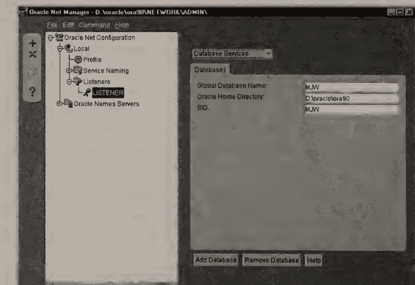

## 使用主机命名的连接过程

当使用主机命名时，客户端必须提供用户 ID 和密码，以及他们想要连接的机器名称。例如，如果用户 Matt 使用密码 casey 想要连接到位于机器 GR990073 数据库，他将输入 `sqlplus casey@gr990073`。

主机将通过 HOSTS 文件或外部命名环境（如 DNS）解析。外部命名方法（如 DNS）优于 HOSTS 文件，因为它们便于主机名的集中管理。以下代码包含一个来自 Windows NT/2000 环境的 HOSTS 文件示例。Unix 系统上 HOSTS 文件的默认位置位于 `/etc` 目录。在 Windows NT 2000 上，默认位置是 `c:\winnt\system32\drivers\etc`。一旦建立了到机器的主机连接。

```
版权所有 (c) 1993-1995 Microsoft Corp.

#
# 这是 Microsoft
# 用于 Windows NT TCP/IP 使用的示例 HOSTS 文件。
# 此文件包含了 IP 地址到
# 主机名的映射。每个
# 条目应保持单独成行。
# IP 地址应该
# 放在第一列，其后是
# 对应的主机名。
# IP 地址和主机名之间应
# 至少用一个
# 空隔。
# 此外，注释（如这些）可以
# 插入到单独的
# 行中或在以 '#' 符号表示
# 的机器之后。
# 例如：
# 102.54.94.97 rhino.acme.com # 源服务器
# 38.25.63.10 x.acme.com # x客户端主机
```


## 第 3 章 为客户端配置 Oracle Net

```text
127.0.0.1 localhost
10.2.0.91 gr99c0073 # Oracle 数据库服务器
```

监听器接收请求并查找匹配的 `GLOBAL_DBNAME`。如果找到，将根据 Oracle 服务器的配置建立专用的、分派的、基于连接的。图 3.3 说明了以下连接过程。

1. 客户端连接 DNS 服务器或本地 `HOSTS` 文件。
2. 客户端连接 Oracle 服务器。
3. 服务器产生一个专用进程并将连接重定向到新产生的进程，或者在您使用 Oracle 共享服务器时将连接重定向到分派进程。
4. 服务器将连接信息传回给客户端。
5. 客户端现在与服务器进程或分发器直接接触。

### 图 3.3 主机命名连接摘要

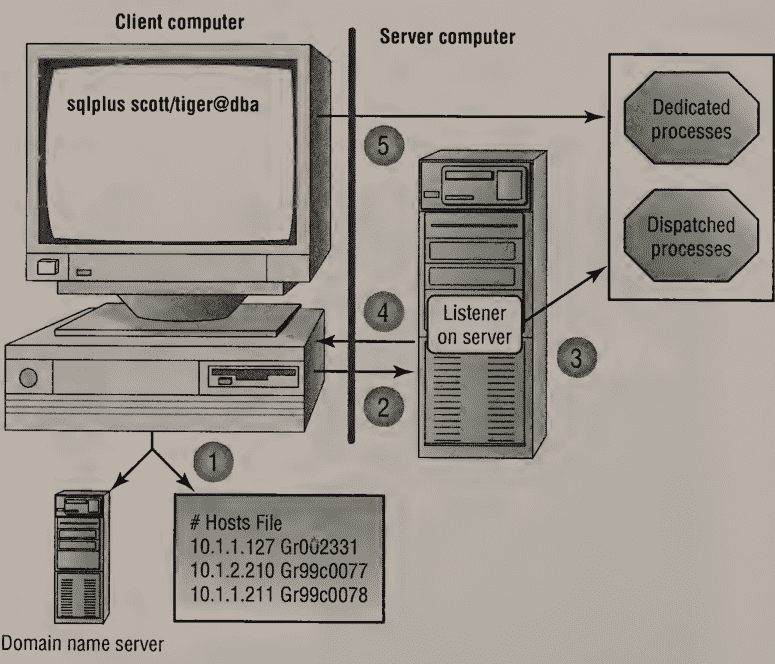

## 同主机上配置多个服务

如果您在同一台机器上有多个 Oracle 服务器，可以继续使用主机方法。要这样做，您必须在 `HOSTS` 文件或您的外部命名服务中为每个 Oracle 服务拥有单独的主机条目。例如，如果在 IP 地址为 `10.2.0.91` 的机器上有两个 Oracle 服务，一个 `DBA`，一个 `PROD`，您可以这样配置您的 `HOSTS`：

```text
10.2.0.91 DBA # 机器1 服务器别名 DBA
10.2.0.91 PROD # 机器1 服务器别名 PROD
```

注意，这些名称都解析到相同的 IP 地址。您还需要为监听器配置两个条目，一个 `DBA`，一个 `PROD`，并将 `GLOBAL_DBNAME` 参数分别设置为 `DBA` 和 `PROD`。（如果您使用带域名的分级命名，请包含域名。）

## 本地命名方法

本地命名方法可能是最广泛使用且为人知的解析服务的方法。大多数用户使用 `tnsnames.ora` 文件使用这种方法。要使用本地命名方法，只要客户端可以访问，可以在任何位置配置服务文件。`tnsnames.ora` 文件和 `sqlnet.ora` 的默认位置在 Windows NT/2000 上是 `%ORACLE_HOME%\network\admin`，在 Unix 系统上是 `%ORACLE_HOME/network/admin`。如果您想更改此文件的位置，请设置环境变量 `TNS_ADMIN`。在基于 Unix 的系统中，`TNS_ADMIN` 可以导出到用户环境或在用户配置文件。在 Windows NT/2000 中，此设置位于注册表中。存储 `TNS_ADMIN` 的 Windows 注册表取决于您的设置。通常情况下，它位于 `Hkey_local_machine/software/oracle` 注册表下，但可能取决于您的配置位于较低级别。大多数安装在客户端和服务器的这些默认位置保留这些文件。某些用户创建共享并将 `tnsnames.ora` 和 `sqlnet.ora` 文件放置在此共享位置，以采用集中的方法管理这些文件。如果需要服务器到服务器的通信，这些文件需要在服务器上。服务器上的默认位置与客户端的默认位置相同。

## 使用 Oracle Net Manager 配置本地命名

使用 Oracle Net Manager 配置本地命名。要开始此配置，打开 Oracle Net Manager 并点击 Local 标签下的 Service Naming。点击屏幕左侧的加号或从 Edit 菜单选择 Create（见图 3.4）。

### 图 3.4 选择了 Service Naming 的 Oracle Net Manager 标题

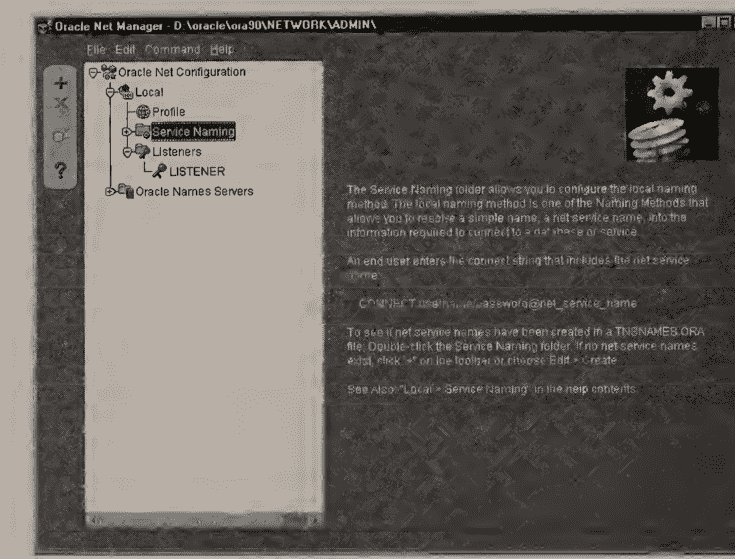

Oracle Net Manager 将向您显示 Net Service Name 向导，引导您完成网络服务名称定义。

## 选择服务名称

配置客户端使用本地命名方法时，必须首先选择服务名称。这是用户引用他们想要连接的位置时输入的名称。如果您使用分级命名模式，此处提供的名称不应包含域部分。点击 Next 按钮继续。图 3.5 显示了选择服务名称的示例。

### 图 3.5 选择服务名称

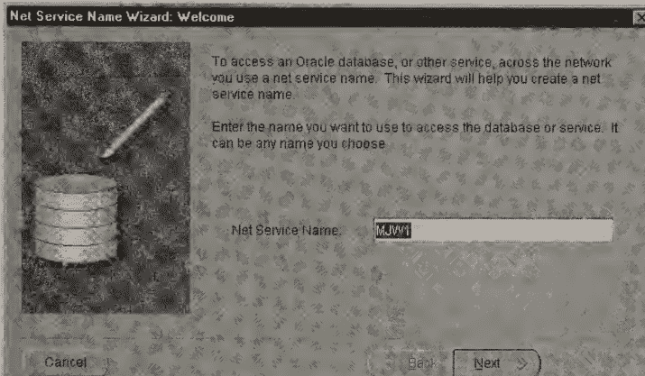

## 选择网络协议

下一步是输入客户端在为此服务名称连接服务器时应使用的协议类型。默认情况下，选了 TCP/IP。协议列表将随您的平台而异。点击 Next 按钮继续（见图 3.6）。

### 图 3.6 Oracle Net Manager 网络协议屏幕

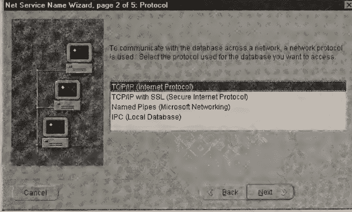

## 选择主机名和端口

此步骤取决于您在上一步中选择的协议。如果选择了 TCP/IP，将提示输入主机名和端口号。主机名是运行监听器进程的机器名称。端口号是监听器的监听位置。默认端口为 1521（见 3.7）。

### 图 3.7 Oracle Net Manager 主机名和端口号屏幕

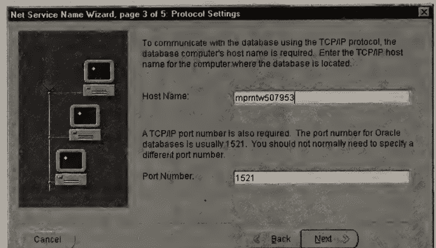

## 选择服务名称

下一步是定义服务名称。对于 Oracle9i，服务名称不需要与 `ORACLE_SID` 相同，因为可以为数据库定义多个服务名称。在 Oracle9i 中，服务名称并不等同于全局数据库名称。这是提供给监听器的服务名称，因此监听器必须监听此服务。您还可以选择由于是用于 Oracle8i 或更高版本的数据库，还是用于 Oracle8 及之前的数据库。这也是一个允许您从这些选择中选择连接类型的选项：数据库默认、共享服务器和专用服务器。图 3.8 显示了 Oracle Net Manager 服务名称屏幕的示例。

### 图 3.8 Oracle Net Manager 名称界面

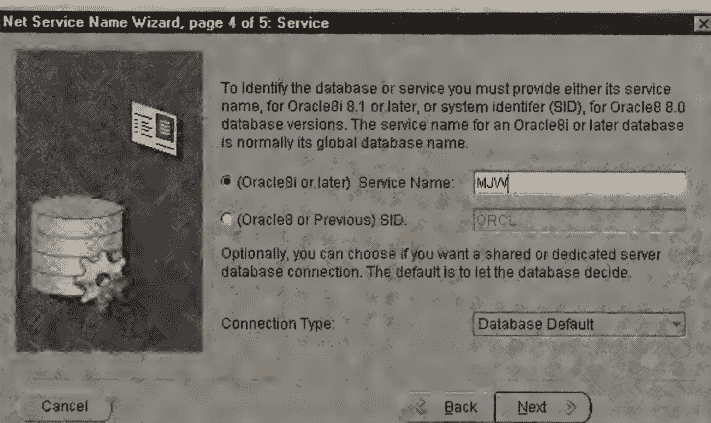

## 测试网络服务名连接

最后一步是测试网络服务名。此测试将验证所有输入的连接信息是否正确。点击“测试”按钮测试网络连接。图 3.9 显示了 Oracle Net Manager 测试网络连接表单示例。

测试连接将尝试使用用户名 `Scott` 和密码 `tiger` 连接到数据库。如果连接失败，请检查您是否具有 `Scott/tiger` 用户。您可以通过点击“测试连接”屏幕中的“更改登录”按钮来更改测试的登录信息。您还可以运行名为 `scott` 的脚本来创建 Scott 用户，该脚本位于 Unix 的 `$ORACLE_HOME/rdbms/admin` 目录，或 Windows NT/2000 的 `%ORACLE_HOME%\rdbms\admin` 。

### 图 3.9 Oracle Net Manager 测试网络连接表单

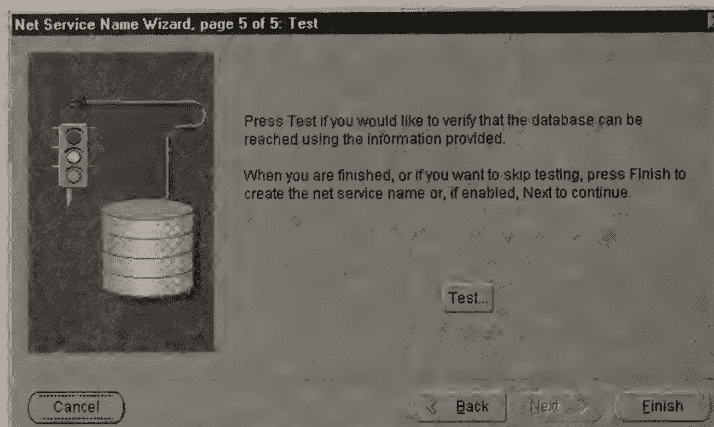

如果一切都正确，您应该看到类似于图 3.10 的结果。

### 图 3.10 Oracle Net Manager tnames.ora 向导测试结果屏幕

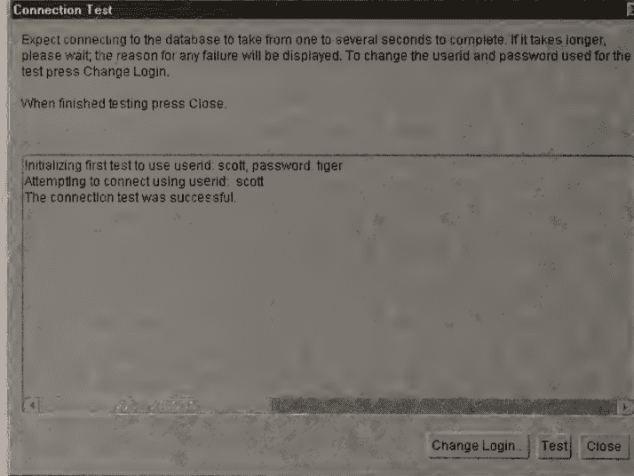

完成所有操作后，必须从“文件”菜单中选择“保存网络配置”来保存更改。这将创建并保存 `tnsnames.ora` 文件。

## tnsnames.ora 文件的内容和结构

以下是您创建的 `tnsnames.ora` 文件示例：

```text
# D:\ORACLE\ORA90\NETWORK\ADMIN\TNSNAMES.ORA

### Configuration

# File:D:\Oracle\Ora90\NETWORK\ADMIN\tnsnames

### Generated by Oracle Net Manager
```

```
DBA =
(DESCRIPTION =
(ADDRESS_LIST =
(ADDRESS = (PROTOCOL = TCP)(HOST = gr99c0073)
(PORT = 15221))
)
(CONNECT_DATA =
(SERVICE_NAME = DBA)
)
)
```

表 3.1 汇总了 `tnsnames.ora` 文件中的参数。

## 表 3.1 tnsnames.ora 参数

| 参数 | 描述 |
| :--- | :--- |
| Description | 开始文件的连接描述符部分。 |
| Address_list | 开始所有连接描述符地址信息的列表。 |
| Address | 指定网络服务名的连接描述符。 |
| Protocol | 指定使用的协议，例如 TCP/IP。 |

### 表 3.1 tnsnames.ora 参数（续表）

| 参数 | 描述 |
| :--- | :--- |
| Host | 指定监听器运行的机器名称。在 TCP/IP 中也可以指定 IP 地址。 |
| Port | 指定特定 TCP/IP 协议的监听器监听位置。 |
| Connect_data | 开始此服务名的服务部分。 |
| Service_name | 替换了 Oracle 旧版本中的 `SID` 参数。定义要连接到哪个服务。它可以与 `ORACLE_SID` 相同，也可以设置为全局数据库名。数据库现在可以通过多个服务名进行引用。 |

## 排除客户端连接问题

客户端必须能够接触到 Oracle 服务器所在的计算机，以及正在监听 Oracle 服务器连接的监听器。客户端还需要能够解析网络服务名。让我们来看看在客户端上需要执行的检查，以验证与 Oracle 服务器的连接性。

- 客户端可以联系服务器吗？
- 客户端能看到监听器吗？
- 验证本地命名配置文件。
- 是否存在多个客户端网络配置文件？
- 检查网络文件位置。
- 检查 `NAMES_DIRECTORY_PATH` 参数。
- 检查 `NAMES_DEFAULT_DOMAIN` 参数。
- 检查客户端协议适配器。
- 是否有常见的客户端错误代码？

### 检查客户端/服务器接触

确保客户端能看到主机计算机。如果您使用 TCP/IP，可以尝试 `ping` 主机。只需输入 `ping` 加上主机名即可。如果找不到主机，请尝试使用主机的 IP 地址而不是主机名。如果这有效，问题可能是您的 `hosts` 文件不正确，或者您的域名服务器不识别主机名。例如，您可以 ping 主机名为 `gr99c0073` 的计算机：

```
C:\>ping gr99c0073
```

```text
正在向 gr99c0073 [127.1.10.1] 发 32 字节数据：

Reply from 127.1.10.1: bytes=32 time<10ms TTL=128
Reply from 127.1.10.1: bytes=32 time<10ms TTL=128
Reply from 127.1.10.1: bytes=32 time<10ms TTL=128
```

### 检查客户端/服务器接触

接下来，检查客户端是否能联系监听器。我使用 `tnsping` 来验证这一点。以下是一个示例：

```text
SQL*Plus: Release 9.0.1.0 - Production on Sat
Oct 19 21:40:12 2001
(c) Copyright 1999 Oracle Corporation. 保留所有。
```

## 现实场景：神秘的超时问题

我使用 `tnsping` 来帮助排除连接故障。一个问题涉及一个遇到超时的客户端。有时客户端可以连接，但有时客户端报告超时。通过 `tnsping` 的帮助，我将问题范围缩小到：

## 验证本地命名配置文件

如果客户端使用本地命名方法解析网络服务名，请检查 `tnsnames.ora` 文件中的条目。确保条目语法正确，并且存在对应服务的目的条目。还要确保协议正确。

客户端在此处解析网络服务名称。如果未设置此参数，默认值为本地命名、Oracle 目录以及主机。
如果此参数设置错误，客户端可能不会检查适当的名称解析类型。例如，如果您正在使用本地命名但将参数设置为 HOSTNAMES，则 `tnsnames.ora` 文件将永远不会用于解析服务名称。您将收到 `ORA-12154` “无法解析服务名”。

### 检查 NAMES.DEFAULT_DOMAIN

`NAMES.DEFAULT_DOMAIN` 是旧版本 Oracle 中的另一个常见错误，因为该参数的默认值为 WORLD。检查客户端的 `sqlnet.ora` 文件以查看该参数是否已设置。如果该参数有值并附加在网络服务名称的末尾，则“未限定的服务名称”是指一个不包含任何信息的服务名称。
例如，如果您输入 `Sqlplus matt/casey@PROD`，且 `NAMES.DEFAULT_DOMAIN` 被设置为 WORLD，Oracle 将在服务名称后附加 WORLD；结果是，Oracle 将该命令作为 `sqlplus matt/casey@PROD.WORLD` 传递。如果服务名称不应包含 .DOMAIN 扩展，您将收到 `ORA-12154` “无法解析服务名”错误。只有在在使用分级命名约定时才使用此参数。

## 检查客户端协议适配器

验证客户端上已安装适当的协议适配器。您可以调用通用安装程序并检查客户端设置。查找已安装的客户端协议适配器的列表。

## 检查客户端错误代码

以下是您可能会遇到的常见客户端 Oracle 错误总结。

```
ORA-12154 "TNS: could not resolve service name"
ORA-12198 "TNS: could not find path to destination"
ORA-12203 "TNS: Unable to connect to destination"
```


# 总结

## ORA-12533 "TNS: illegal address parameters"
## ORA-12541 "TNS: No listener"

`ORA-12154` 表示客户端无法找到 `tnsnames.ora` 文件中列出的服务。上述描述了部分错误的产生原因，例如文件不在正确的目录下，或未指定 `TNS_ADMIN` 变量或指定错误。

`ORA-12198` 或 `ORA-12203` 表示客户端在 `tnsnames.ora` 文件中服务的条目，但未找到指定的服务。检查确保 `tnsnames.ora` 中指定的服务实际指向有效的数据库服务。

`ORA-12533` 表示您错误地配置了 `tnsnames.ora` 文件的 `ADDRESS` 部分。检查语法是否正确，或使用 Oracle Net Manager 工具重新创建定义。

`ORA-12541` 表示客户端连接的服务器在该端口上没有运行监听器。确保服务器上已启动监听器，并且客户端和服务器上的监听端口规格匹配。

## 总结

客户端可用的名称解析方法包括主机命名、本地命名和 Oracle 目录，后者只有在使用 TCP/IP 时才能使用，主要用于非常简单的 Oracle 网络。本地命名是最流行的名称解析方法，它使用 `tnsnames.ora` 文件（通常位于每个客户端上）来解析服务名称。客户端在 `tnsnames.ora` 文件中查找服务名称，并使用生成的连接描述符信息连接到 Oracle 服务器。主机命名和本地命名使用 Oracle Net Manager 配置。Oracle 目录服务是一个符合轻量级目录访问协议（LDAP）的服务器，提供 Oracle 数据库连接标识符信息的集中管理。Oracle 目录取代 Oracle Names Server 成为数据库服务集中管理的首选方法。

了解如何排除连接问题非常重要。您应该熟悉 `tnsnames.ora` 和 `sqlnet.ora` 文件的通用格式和内容，以便识别语法错误。您应该知道这些文件位于客户端何处。您应该理解各种名称解析方法的工作原理。您应该熟悉可以使用工具，例如 TCP/IP 提供的 `ping` 实用程序和 Oracle 提供的 `tnsping` 工具，以协助您排查这些问题。最后，您应该熟悉由于连接问题可能导致的最常见 Oracle 错误。

本章涵盖了配置 Oracle 网络环境的第二个主要领域。Oracle 服务器和客户端的配置涵盖了数据库管理员网络管理中最常见的领域。事实上，当建立客户端连接性后，您的大部分网络任务已经完成了。在关于 Oracle 共享服务器的下一章节中，您将看到如何更改提供客户端连接请求的方式，以及您可能选择使用此选项的原因。但这仍然不会改变本章和上一章中讨论的基础设置工作。

## 考试要点

### 定义三个 Oracle 客户端名称解析选项
您应该能够定义这三个 Oracle 客户端名称解析选项。您应该知道在什么情况下会使用本地、主机和 Oracle 目录。

### 定义使用主机方法的先决条件
您应该知道如何使用 Oracle Net Manager 配置此方法，并能够理解在用此方法时的连接过程。您还需要能够定义在用此方法时可能需要添加到 `listener.ora` 文件的参数。此外，您应该理解 `HOSTS` 文件是什么。

### 使用 Oracle Net Manager
您应该能够使用 Oracle Net Manager 配置客户端上的 `sqlnet.ora` 文件。您应该理解 `sqlnet.ora` 文件中 `NAMES.DEFAULT_DOMAIN` 的含义。

### 定义本地命名方法
除了了解本地命名方法的含义及其作用外，您还需要理解如何使用 Oracle Net Manager 配置这些名称解析方法。`sqlnet.ora` 文件中的 `NAMES.DIRECTORY_PATH` 参数。

### 定义 tnsnames.ora 文件的内容和结构
您应该能够定义 `tnsnames.ora` 文件、其各个部分以及它是如何使用的。您应该熟悉 `tnsnames.ora` 文件的结构，以及如何设置 `TNS_ADMIN` 来覆盖该文件和其他客户端文件的默认位置。

### 定义并修复客户端错误
您需要定义可能发生的客户端连接错误类型。您应该能够定义这些错误并理解出现这些错误的情况。

## 关键术语

在考试之前，请确保您熟悉以下术语：

- 主机方法
- `ping`
- 本地命名方法
- `TNS_ADMIN`
- `NAMES.DIRECTORY_PATH`
- 网络服务名称
- `tnsnames.ora`
- `tnsping`

## 复习题

1. 客户端可以通过哪些方式解析网络服务名称？（多选）
   A. 本地命名
   B. 主机命名
   C. 全局命名
   D. Oracle 目录

2. 配置客户端时，必须存在哪个文件来实现本地命名？
   A. `lsnct1.ora`
   B. `names.ora`
   C. `tnsnames.ora`
   D. `sdns.ora`
   E. 以上都不是

3. 下列哪项是主机方法的先决条件？
   A. 必须在客户端上使用 `tnsnames.ora`。
   B. 必须使用 TCP/IP。
   C. 必须有 Oracle 目录。
   D. 客户端必须存在 `sqlnet.ora` 文件。
   E. 以上都不是。

4. 关于 `tnsnames.ora` 的下列哪种说法是错误的？
   A. 它用于解析 Oracle 服务名称。
   B. 它可以存在于客户端上。
   C. 它用于本地命名。
   D. 它不支持 TCP/IP 协议。

5. `sqlnet.ora` 文件中的哪个条目会在其他名称解析类型之前使用本地命名解析？
   - A. `NAMES.DIRECTORY_PATH=(TNSNAMES, LDAP, HOSTNAME)`
   - B. `NAMES.SEARCH_PATH=(TNSNAMES, HOSTNAME, LDAP)`
   - C. `NAMES.DIRECTORY_PATH=(HOSTNAME, LDAP, TNSNAMES)`
   - D. `NAMES.SEARCH_PATH=(HOSTNAME, TNSNAMES, LDAP)`

6. Oracle Net Manager 中的哪个选项用于配置 `tnsnames.ora`？
   - A. Profile
   - B. Listeners
   - C. tnsnames
   - D. Net service names
   - E. Service Naming

7. 用户 Bob 的密码为 apple，需要连接到 DBA 服务。以下哪一个连接语句可以工作？
   - A. `sqlplus apple/bob@DBA`
   - B. `sqlplus bob/apple@DBA`
   - C. `sqlplus DBA@bob/apple`
   - D. `sqlplus bob\apple@DBA`
   - E. `sqlplus bob/apple#DBA`

8. 哪个短语最能完成以下句子？网络名是 ________。
   - A. `ORACLE_SID` 的名称
   - B. 数据库名称
   - C. 我网络上数据库位置的另一个名称
   - D. 与我的 `init.ora` 设置中的 `DB_NAME` 相同
   - E. 以上都不是

9. `tnsnames.ora` 文件的哪个部分包含参数 `SERVICE_NAME`？
   - A. Address
   - B. Connect_Data
   - C. Host
   - D. Description

10. DBA 想要从客户端检查与特定 Oracle 监听器的连通性。服务名为 mjw。使用以下哪个命令可以完成此操作？
    - A. `ping mjw`
    - B. `trcasest mjw`
    - C. `tnsping mjw`
    - D. 以上都不是

11. DBA 管理着一个大型服务器网络，每台服务器上都配置了许多 Oracle9i 实例。业务希望将 Oracle 服务集中到一个公共位置以便维护。对于集中式命名服务，以下哪种将是最佳选择？
    - A. Hostnaming
    - B. Localnaming
    - C. Oracle Names Server
    - D. Oracle Internet Directory

12. 客户端接收到以下错误消息：
    `ORA-12154 "TNS: could not resolve service name"`
    以下哪些该错误的可能原因？（选择所有适用项）
    - A. 监听器未在 Oracle 服务器上运行。
    - B. 用户输入了无效的服务名。
    - C. 用户提供了正确的服务名，但 `tnsnames.ora` 文件中的服务名拼写错误。
    - D. 监听器未配置监听此服务。

13. 如果 `sqlnet.ora` 文件中存在哪个参数，当用户在请求连接时提供未限定的服务名时，该参数会被附加到服务名之后？
    - A. `NAMES.DEFAULT_PATHNAMES`
    - B. `NAMES.DEFAULT_DOMAIN`
    - C. `NAMES.SERVICE_NAME`
    - D. `NAMES.CONNECTION_NAME`

14. 在什么情况下，管理员会选择使用主机命名进行管理？
    - A. 管理员拥有具有许多实例的复杂网络
    - B. 管理员倾向于最小化客户端配置。
    - C. 管理员不想使用 Oracle Net Manager。
    - D. 管理员想使用 `tnsnames.ora` 文件来包含配置设置。
    - E. 以上都不是。

15. `tnsnames.ora` 文件的哪个部分指定了监听器进程监听的服务器名称或 IP 地址？
    - A. `CONNECT_DATA`
    - B. `PORT`
    - C. `SERVICE_NAME`
    - D. `HOST`

16. 关于主机命名，以下哪个说法是错误的？
    - A. 必须使用 TCP/IP。
    - B. 主机通过外部命名服务解析。
    - C. 主机命名可以配合 Connection Manager。
    - D. 用户只需提供主机名即可连接。

17. 哪个短语最能完成以下句子？网络协议 ________。
    - A. 由 Oracle 安装程序默认安装
    - B. 是 Oracle 协议适配器的另一个名称
    - C. 对于客户端/服务器连接不是必须的
    - D. 客户端/服务器连接需要它存在

18. 以下哪个工具是你可以用于跨 TCP/IP 测试网络连接的程序？
    - A. `trcasest`
    - B. `lsnrctl`
    - C. `namesctl`
    - D. `ping`
    - E. 以上都不是

19. 如果 Oracle 实例未向监听器进行动态注册，并且正在使用主机命名，则需要设置哪个 `listener.ora` 参数？
    - A. `GLOBAL_DATABASE`
    - B. `DATABASE_NAME`
    - C. `GLOBAL_DNAME`
    - D. `GLOBAL_DBNAME`

20. `tnsnames.ora` 文件的哪个部分是正确的？
    - A. `(ADDRESS = (PROTOCOL = TCP)(HOST = MIL020ORA) (PORT = 1521))`
    - B. `(ADDRESS=(PROTOCOL = TCP)(HOST = MIL020ORA) (PORT = 1521))`
    - C. `(ADDRESS=(PROTOCOL = TCP)(HOST = MIL020ORA) (PORT = 1521))`
    - D. `(ADDRESS=(PROTOCOL = TCP)(HOST = MIL020ORA) (PORT = 1521))`

## 习题答案

1. A, B, D.
2. C.
3. B.
4. D.
5. A.
6. E.
7. B.
8. C.
9. B.
10. C.
11. D.
12. B, C.
13. B.
14. B.
15. D.
16. A.
17. D.
18. D.
19. A.
20. B.

### 答案解析

**15. D.** `HOST` 指定要连接的服务器名称。`PORT` 指定监听器正在监听的位置。`CONNECT_DATA` 指定要连接的数据库服务。`SERVICE_NAME` 是实际数据库服务的名称。

**16. C.** 当使用主机名方法时，无法使用 Oracle 连接管理器等高级网络选项。

**17. D.** 所有网络数据通过底层网络协议从客户端传输到数据库服务器。Oracle Net 的正常运行需要该协议到位。协议独立于 Oracle 软件，且不等同于 Oracle 协议适配器。适配器允许 Oracle Net 与底层协议进行通信。

**18. D.** 协议附带了允许你测试网络连通性的工具。TCP/IP 的其中一种实用程序是 `ping`。用户向 `ping` 工具提供 IP 地址或主机名。然后它就会在网络中搜索该地址。如果找到，它将显示有关发送和接收的数据的信息，以及找到该地址的速度。其他选项是 Oracle 提供的实用程序。

**19. D.** 如果实例没有被动态地注册到监听器中，则必须在 `listener.ora` 文件中设置 `GLOBAL_DBNAME` 参数。

**20. A.** 检查网络文件的语法和格式。所有其他语法示例都是错误的。

# 配置共享服务器选项

**ORACLE9i：数据库基础 II 考试目标——本章涵盖的范围：**

- 识别 Oracle 共享服务器的组件。
- 描述 Oracle 共享服务器架构。
- 配置 Oracle 共享服务器。
- 识别并解释相关字典视图的用途。

> 考试目标可能会随时更改，恕不另行通知，并由 Oracle 自行裁量决定。请访问 Oracle 认证网站（http://www.oracle.com/education/certification/）查看最新的考试目标列表。

## 共享服务器配置

随着企业环境中连接到 Oracle 服务的用户数量增加，服务器的系统需求也随之增加——特别是内存和进程需求。本章将讨论 Oracle 共享服务器选项（以前称为 Oracle 多线程服务器）及其益处。此外，你将学习连接过程的步骤、如何配置共享服务器选项，以及如何使用各种 Oracle 数据字典视图在共享服务器环境中处理用户请求。你还将学习如何管理共享服务器环境，以及当你连接到配置了共享服务器的 Oracle 数据库时，如何配置客户端请求专用连接。最后，你将学习在何处可以找到协助你调整共享服务器的信息。

对于数据库管理员来说，理解共享服务器架构以及何时如何使用此功能至关重要。当使用恰当时，此功能可以帮助缓解服务器运行进程过多导致的服务器压力问题。当共享服务器配置正确时，它可以帮助避免看似迫在眉睫的系统升级，从而为组织节省资金。

共享服务器是 Oracle 服务器的一种可选配置，允许服务器在不增加物理资源竞争需求的情况下支持更多的并发连接。这是通过在用户组之间共享资源来实现的。

## 专用服务器与共享服务器

如果你去过高档餐厅，你可能曾有一个自己的专属服务员。服务员负责迎接你并带你就座。服务员会记录你的食物和饮料订单，甚至帮助准备订单。无论餐厅里进入多少顾客，你的服务员只负责于你的请求。因此，只要此人是个好服务员，你的服务就会非常稳定。

专用服务器环境的工作方式与上述相同。每个客户端连接在存在 Oracle 服务器的机器上，都有一个关联的专用服务器进程。无论向服务器建立了多少其他连接，你始终有一个相同的专用服务器负责处理你的请求。你一直使用该服务器进程的服务，直到你与 Oracle 服务器断开连接。

大多数餐厅倾向于共享服务器。当你走进去时，会被分配一名服务员或女服务员，但他们可能还负责服务许多其他桌子。这对餐厅是有好处的，因为他们可以在不增加员工的情况下服务更多顾客。如果餐厅不忙，且服务员或女服务员负责的桌子不多，对你来说可能也可以。此外，如果大多数订单都是小订单，员工就能跟上请求，服务质量将像你有自己的专属服务员一样好。

在简餐馆，情况有所不同；在这里，女服务员接受你的订单并将其放在转门上。如果简餐馆有多个厨师，订单会从转门上被取并由其中一个空闲的厨师准备。当厨师完成晚餐准备后，它会被放在一个可以让共享服务器环境的工作人员取走并带回你桌边的地方。

这就是共享服务器环境的工作方式，客户端在 Oracle 服务器上共享进程。这些共享进程被称为**分发器**。分发器就像简餐馆里的服务员或女服务员。一个分发器可以负责许多客户端的订单。

当你向服务器请求某些内容时，由分发器负责接收你的请求并将其放在一个名为**请求队列**的地方。请求队列的功能就像简餐馆类比中的转门。有一个请求队列，所有分发器进程都将其客户端请求放在其中。请求队列是包含在系统全局区域（SGA）中的一个结构。

共享服务器进程就像简餐馆里的厨师，负责履行客户端请求。共享服务器进程执行请求并将结果放在 SGA 中名为**响应队列**的区域。每个分发器都有自己的响应队列。分发器从响应队列中取回完成的请求并将结果返回给客户端。图 4.1 描绘了此处所示共享服务器请求的处理步骤：

1. 客户端将请求传递给处理它的分发器。
2. 分发器将请求放在 SGA 中的请求队列。
3. 一个共享服务器进程执行请求。
4. 共享服务器将完成的请求放在分发器的响应队列中。
5. 分发器从响应队列中取回完成的请求。
6. 完成的请求返回给客户端。

> **图 4.1 共享服务器中的请求处理**

## 共享服务器的优势

共享服务器用于服务器资源（如内存和活动进程）受限的情况。人们倾向于解决这些硬件问题；这可能会解决问题，但可能是一项不必要的支出。

如果你的系统正经历这些问题，共享服务器允许你在不增加硬件需求的情况下支持相同或更多的连接。结果，共享服务器往往会减少服务器的内存和进程需求。

平均专用连接占用大约二到四 MB 内存。共享服务器连接占用约两 MB 内存。正如你所见，内存会有所减少。此外，由于客户端共享进程，总进程数减少了。这些转化为服务器资源的节省。

共享服务器还为了利用某些网络选项，例如使用 Oracle 连接管理器时的连接集中。

## 适用于共享服务器的应用程序

共享服务器适用于“高思考”应用程序。高思考应用程序由事务模式中具有自然间隔的小事务组成。这类应用程序是共享服务器连接的良好选择。回想之前讨论的简餐馆类比。你的服务很好，直到两个各有 12 人的团体出现。突然之间，女服务员被同样类型的工作压垮了。如果大量信息的请求开始发送给分发器，分发器可能会被这些大请求压垮，你可能会看到连接到该分发器的其他客户端性能下降。反过来这将增加你的响应时间。专用进程能更好地服务这类应用程序。

当使用共享服务器连接时，某些功能是不允许的。当通过共享服务器连接时，你无法启动、关闭或对 Oracle 服务器进行各种类型的恢复操作。

## 可扩展性与性能

共享服务器是一种可扩展性增强选项，而不是性能增强选项。如果你正在寻求性能的提升，共享服务器并不是你应该配置的内容。只有当你遇到前面讨论的系统限制问题时，才使用共享服务器。在专用服务器环境中，你将始终获得相同或更好的性能。

## 共享服务器环境中的 Oracle 服务器更改

当配置共享服务器时，Oracle 在 SGA 中添加了新类型的结构：请求队列和响应队列。这些结构在专用服务器环境中并不存在。所有分发器共用一个请求队列，但每个分发器都有自己的响应队列。因此，如果你有四个分发器，就会有一个请求队列四个响应队列。请求队列是 SGA 中的一个位置，分发器在此放置客户端请求。共享服务器进程执行每个请求，然后将完成的结果放在分发器的响应队列中。

你必须配置在实例启动时想要启动的分发器和共享服务器进程的数量；你还必须配置这些结构中最大数量。你将看到如何确定分发器和共享服务器进程的起始数量。

在专用环境中，每个专用服务器段称为程序全局区域（PGA）。PGA 是一个内存区域，用于维护有关每个客户端会话的信息。这些信息包括绑定变量、游标信息和客户端的排序区域。在共享服务器环境中，这些信息从 PGA 移动到 SGA 的一个区域，该区域称为用户全局区域（UGA）。你可以配置 SGA 中一个称为大池的特殊区域来容纳大部分 UGA。在 Oracle 的旧版本中，整个 UGA 均存储在共享池中。从 Oracle8 开始，大部分 UGA 可以存储在大池中。你稍后将看到如何配置大池。图 4.2 显示了专用服务器环境和共享服务器环境之间 SGA 和 PGA 结构的差异。

> **图 4.2 SGA 专用服务器对比共享服务器**
> 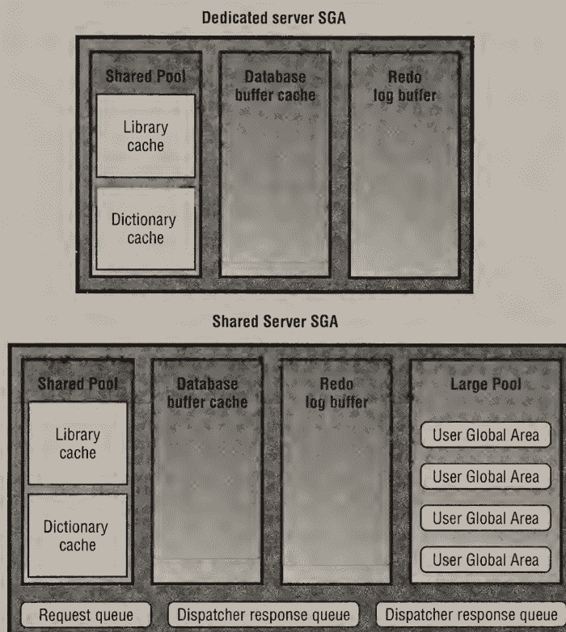
> 

每个由分发器服务的连接都绑定到一个共享内存段并形成一个虚拟电路。共享内存段被分发器用于管理客户端与 Oracle 服务器之间的通信。共享服务器进程使用虚拟电路向适当的分发器进程发送和接收信息。

## 监听器在共享服务器环境中的作用

监听器在共享服务器环境中起着重要作用。当用户请求连接到共享服务器时，监听器负责为客户端提供要连接的分发器地址。Oracle 后台进程 `PMON` 通知监听器哪个分发器负责处理此虚拟电路。随后，监听器知道该分发器管理的连接数量。这些信息允许监听器利用分发器负载均衡功能。分发器负载均衡是在 Oracle8i 中引入的。

负载均衡允许监听器做出智能决策，决定将客户端连接重定向到哪个分发器，以防止某个分发器变得过载。当监听器接收到连接请求时，它会查看每个分发器的当前负载，并将客户端连接请求重定向到负载最少的分发器。通过这样做，监听器确保连接均匀分布在各个分发器之间。当客户端连接终止时，监听器将更新以反映分发器处理的连接数量的变化。图 4.3 描述了此处所示的共享服务器连接过程：

1. 实例启动时创建分发器进程。
2. 客户端解析服务名后联系 Oracle 服务器。
3. 服务器将客户端连接重定向到最空闲的分发器。
4. 分发器进程管理客户端请求。
5. `PMON` 向监听器注册连接信息。

> **图 4.3 共享服务器连接过程**
> **注意：** 从 Oracle9i 开始，参数名已经过修改以消除开头的 "MTS" 前缀。例如，`MTS_DISPATCHERS` 现在简单为 `DISPATCHERS`。这些参数已弃用，但为了向后兼容仍然受支持。

## DISPATCHERS 参数

此参数配置实例启动时应启动的分发器数量。`DISPATCHERS` 参数指定了分发器的数量以及分发器可以响应的协议类型。

你可以使用 `ALTER SYSTEM` 命令动态添加额外的分发器。该命令允许你在不停止实例的情况下增加分发器的数量。此外，该命令还具有若干可选属性。主要属性是分发器的数量和分发器监听的协议。例如，假设你想配置三个 TCP/IP 分发器和两个 IPC 分发器。你可以按照以下方式设置参数：

```
DISPATCHERS="(PROTOCOL=TCP)(DISPATCHERS=3)"
DISPATCHERS="(PROTOCOL=IPC)(DISPATCHERS=2)"
```


`DISPATCHERS = " (PRO=TCP)(DIS=3)(PRO=IPC)(DIS=2) "`

此参数的所有属性都可以缩写。表 4.1 显示了你可以用 `DISPATCHERS` 设置的其他属性。在三个属性（`ADDRESS`、`DESCRIPTION` 或 `PROTOCOL`）中，定义 `DISPATCHERS` 时只需指定其中一个。

## 表 4.1 DISPATCH 属性摘要

| 属性 | 缩写 | 描述 |
| --- | --- | --- |
| `ADDRESS` | `ADD` or `ADDR` | 指定分发器监听的端点的网络协议地址。 |
| `CONNECTIONS` | `CON` or `CONN` | 每个分发器的最大连接数。 |
| `DESCRIPTION` | `DES` or `DESC` | 分发器监听的端点的网络描述，包括所监听的协议。 |
| `DISPATCHERS` | `DIS` or `DISP` | 实例启动时启动的分发器数量。默认值为 1。 |

## 表 4.1 DISPATCH 属性摘要（续）

| 属性 | 缩写 | 描述 |
| --- | --- | --- |
| `LISTENER` | `LIS` or `LIST` | `PMON`发送连接信息的监听器地址。 |
| `PROTOCOL` | `PRO` or `PROT` | 分发器监听的网络协议。 |
| `SESSIONS` | `SES` or `SESS` | 此分发器允许的最大网络会话数。 |

## 启动的分发器数量

你启动的分发器数量取决于具体的配置。操作系统可能会对分发器可以处理的连接数设置限制。请咨询操作系统文档以获取此类信息。
在决定初始配置多少分发器时，可以使用以下公式指南：

分发器数量 = CEIL (并发会话数 / 每个分发器的连接数)

例如，如果你有 200 个并发 TCP/IP 连接，且你需要每个分发器管理 20 个并发会话，那么你需要 10 个分发器。你可以按照如下方式设置 `DISPATCHERS` 参数：

```
DISPATCHERS = "(PRO=TCP)(DIS=10)"
```

你可以通过查询 `V$SESSION` 视图来确定并发连接的数量。它显示了连接到 Oracle 服务器的客户端数量。以下是查询示例：

```sql
SQL select sid,serial#,username,server,program from v$session
2 where sid > 6
```

# 第 4 章 · 配置共享服务器选项

| SID | SERIAL# | USERNAME | SERVER | PROGRAM |
|---|---|---|---|---|
| 7 | 13 | SCOTT | DEDICATED | SQLPLUS.EXE |
| 8 | 12 | SCOTT | DEDICATED | SQLPLUS.EXE |
| 9 | 4 | SYSTEM | DEDICATED | SQLPLUS.EXE |

在示例中，你会看到三个用户连接到服务器，它们的 SID 以数字 7 开始。这是因为在 SQL 语句中，你忽略了前六会话。这些条目指的是如 `PMON` 和 `SMON` 等后台进程。如果你在典型工作期间对此视图进行采样，就可以对系统的平均并发连接数有一个大致的了解。然后你可以此数字作为建立初始分发器数量的指导。

## 管理分发器数量

你可以使用 `ALTER SYSTEM` 命令动态地启动额外的分发器或移除分发器。你可以根据 `MAX_DISPATCHERS` 设置启动任意数量的分发器。以下是一个在配置了两个 TCP/IP 分发器的系统中添加三个 TCP/IP 分发器的示例：

```
ALTER SYSTEM SET DISPATCHERS="(PRO=TCP)(DIS=5)"
```

注意，你设置的数字是你想要的分发器总数，而不是你想要添加的分发器数量。

## MAX_DISPATCHERS 参数

将此参数设置为你预计 Oracle 服务器所需的最大分发器数量。此参数无法动态设置。一个分发器可以并发运行的最大进程数取决于操作系统。使用以下公式设置此参数：

```
MAX_DISPATCHERS = (每个分发器的最大并发会话/连接数)
```

以下是该参数的示例：

```
MAX_DISPATCHERS = 5
```

## SHARED_SERVERS 参数

此参数指定了 Oracle 实例启动时启动的共享服务器数量。可以使用 `ALTER SYSTEM` 命令动态修改此参数。你必须将此参数至少设为 1，以便 Oracle 能够使用共享服务器连接。设置为 0 或不设置意味着将不使用共享服务器。此参数可以动态更改，即使在实例启动时没有配置共享服务器，也可以在不关闭并重启 Oracle 实例的情况下进行配置。

所需的共享服务器数量取决于用户正在执行的活动类型。通常，对于使用共享服务器连接的高频交互应用，每个服务器 15 到 20 个连接应该是充足的。如果你的用户需要更大的结果集或进行更密集的处理，你可能希望降低这个比例。以下是该参数的示例：

```
SHARED_SERVERS = 3
```

## SHARED_SERVER_SESSIONS 参数

此参数指定了 Oracle 实例允许的共享服务器会话总数。此参数由 `CIRCUITS` 或 `SESSIONS - 5` 中的较小决定。例如，如果 `CIRCUITS` 设置为 10 `SESSIONS` 设置为 20，则 `SHARED_SERVER_SESSIONS` 等于 10，因为这是这两个值中的较小。这是一个派生值，不会手动在 `init.ora` 文件中设置。

## 管理共享服务器数量

你可以使用 `ALTER SYSTEM` 命令启动额外的共享服务器或减少共享服务器的数量。你可以根据 `MAX_SERVERS` 设置启动任意数量的共享服务器。以下是一个在初始配置了两个共享服务器的系统中添加三个额外共享服务器的示例：

```
ALTER SYSTEM SET SHARED_SERVERS = 5;
```

注意，你设置的数字是你想要的共享服务器总数，而不是你想要添加的共享服务器数量。

## MAX_SERVERS 参数

将此参数设置为你预计 Oracle 服务器所需的最大共享服务器数量。此参数无法动态设置。通常，你应该设置此参数以适应你最忙碌的工作段。以下是该参数的示例：

```
MAX_SERVERS = 5
```

## CIRCUITS 参数

此参数管理所有入站和出站网络会话允许的总虚拟电路数。这是一个静态参数，默认值为 `init.ora` 中 `SESSIONS` 参数的值。此参数确实影响系统启动时 SGA 的总大小。以下是该参数的示例：

```
CIRCUITS = 200
```

## 启动实例并管理共享服务器

在完成 `init.ora` 文件中的配置工作后，你需要重启数据库。重启数据库后，你应该查询 `V$` 视图以查看实例是否已启动共享服务器和分发器进程。在本章的稍后部分中，我们将讨论用于管理共享服务器的各种数据字典。

## 向监听器注册分发器信息

当共享服务器启动时，`PMON` 会向监听器注册分发器信息。你可以查询监听器以查看此注册信息。监听器将跟踪所有分发器上的当前连接负载。这些信息是必要的，以便监听器能够利用分发器负载均衡。

## 现实场景

### 排除共享服务器启动问题

如果你在启动实例时遇到问题，可能是你的 Oracle Net 文件之一存在问题。如果你收到显示 `DISPATCHERS` 参数错误的错误，请使用 `tns.ora` 和 `listener.ora` 备份所有文件，并重新创建这些文件。共享服务器的大多数问题都可以追溯到对这些文件的修改。在你重新创建文件后，尝试重启实例。

## 启动实例与管理共享服务器

`V$QUEUE` 字典视图包含了有关请求队列和响应队列的信息。这些信息涉及请求在队列中等待多长时间。当你尝试确定是否需要更多的共享服务器时，这些信息非常有价值。下面的示例显示了 `COMMON` 请求队列和两个响应队列：

```
SQL> select * from v$queue;
```

| PADDR | TYPE | QUEUED | WAIT | TOTALQ |
| --- | --- | --- | --- | --- |
| 00 | COMMON | 0 | 0 | 152 |
| 03C6244 | DISPATCHER | 0 | 0 | 91 |
| 03C6534 | DISPATCHER | 0 | 0 | 71 |

## V$CIRCUIT 字典视图

`V$CIRCUIT` 显示有关共享服务器虚拟电路的信息，例如客户端与分发器之间传输的数据量以及客户端连接的当前状态。`SADDR` 列显示已连接会话的会话地址。它可以与 `V$SESSION` 视图连接，以显示该连接所属用户的信息。以下是该视图的示例输出：

```
SQL> select circuit,dispatcher,server,wait WTR,
      status,queue,bytes from v$circuit;
```

| CIRCUIT | DISPATCHER | SERVER | WTR | STATUS | QUEUE | BYTES | SADDR |
| --- | --- | --- | --- | --- | --- | --- | --- |
| 03E2A624 | 03C6244 | 00 | 00 | NORMAL | NONE | 47330 | 03C7AB68 |
| 03E2A747 | 03C6534 | 03C6BC64 | 00 | NORMAL | | 43572 | 03C79BE8 |

## V$SHARED_SERVER 字典视图

此视图包含有关共享服务器进程的信息。它显示了请求数量以及共享服务器处理的信息量。它还指示了共享服务器的状态（即它是活动还是空闲）。

```
SQL> select name,status,messages,bytes,idle,busy,
      requests from v$shared_server;
```

| NAME | STATUS | MESSAGES | BYTES | IDLE | BUSY | REQUESTS |
| --- | --- | --- | --- | --- | --- | --- |
| S000 | EXEC | 372 | 86939 | 98472 | 300 | 175 |
| S001 | EXEC | 26 | 9851 | 98703 | 38 | 13 |

## V$SHARED_SERVER_MONITOR 监控字典视图

此视图包含辅助调整共享服务器的信息。这包括自实例启动以来实现的最大并发连接数以及自实例启动以来启动的服务器总数。下面的查询显示了 `V$SHARED_SERVER_MONITOR` 视图的输出示例。

```
SQL> select maximum_connections "MAX CONN",maximum_sessions "MAX SESS", servers_started "STARTED" from v$shared_server_monitor;
```

| MAX CONN | MAX SESS | STARTED |
| --- | --- | --- |
| 115 | 120 | 10 |

## V$SESSION 字典视图

此视图包含有关客户端会话的信息。`SERVER` 列指示此客户端是使用专用会话还是分发器。下面的列表显示了 `V$SESSION` 视图显示服务器信息的示例。此列表忽略了任何没有用户的行，以避免列出后台进程的信息。注意，Scott 的服务器值为 `SHARED`。这意味着 Scott 连接到了分发器。`SYSTEM` 用户使用本地连接连接，因为状态为 `NONE`。如果用户使用专用连接连接，状态将为 `DEDICATED`。

```
SQL> select username,program,server from v$session where username is not null;
```

| USERNAME | PROGRAM | SERVER |
| --- | --- | --- |
| SYSTEM | SQLPLUS.EXE | NONE |
| SCOTT | SQLPLUS.EXE | SHARED |

## V$MTS 字典视图

此视图包含有关分发器和共享服务器配置的信息。这包括每个分发器的最大连接数、已启动和停止的共享服务器数量，以及同一时间活跃的共享服务器的最高数量。此视图可以让你了解判断是否应该启动更多的共享服务器进程。下方的示例显示了此视图的输出：

```
select MAX_CONNECTIONS MAX_CONN, SERVERS_STARTED SRV_STARTED, SERVERS_TERMINATED SRV_TERM, SERVERS_HIGHWATER SRV_HW
FROM V$MTS;
```

| MAX_CONN | SRV_STARTED | SRV_TERM | SRV_HW |
|---|---|---|---|
| 60 | 0 | 0 | 2 |

> `V$MTS` 视图的内容与 `V$SHARED_SERVER_MONITOR` 视图相同。`V$MTS` 是 Oracle 8i 发布时该视图的名称，目前仍可供参考。

## 在共享服务器环境中请求专用连接

你可以让共享服务器和专用服务器连接到单个 Oracle 服务器。这在 Oracle 服务器上存在混合活动的情况下是极有优势的。某些用户可能更适合共享服务器连接，而其他类型的用户可能更适合专用连接。

默认情况下，如果配置了共享服务器，客户端将连接到分发器，除非客户端显式地请求专用连接。作为连接描述符的一部分，客户端必须发送请求专用连接的信息。使用 Oracle Net Manager 配置此选项。如果名称解析方法为 `localnaming`，客户端可以请求这种类型的连接。此选项不能与 `hostnaming` 一用。

## 在使用 localnaming 时配置专用连接

如果你正在使用 `localnaming`，你需要在 `tnsnames.ora` 文件的服务名称条目中添加参数。参数 `(SERVER=DEDICATED)` 被添加到 `DBA` 网络服务名称中。`SERVER` 参数也可以缩写为 `SRVR`。以下是 `tnsnames.ora` 文件中的条目示例。

```
# D:\<unused123>ACLE\ORA90\NETWORK\ADMIN\TNSNAMES.ORA 配置
# File:D:\Oracle\Ora90\NETWORK\ADMIN\tnsnames.ora
### Generated by Oracle Net Manager
DBA =
  (DESCRIPTION =
    (ADDRESS_LIST =
      (PROTOCOL = TCP)(HOST = weishan)
      (PORT = 1521))
    (CONNECT_DATA =
      (SERVICE_NAME = DBA)
      (SRVR = DEDICATED)) 请求专用连接
  )
```

## 调整共享服务器选项

在调整共享服务器之前，你应该检查分发器和共享服务器的性能。你希望确保有足够的分发器来响应请求，并且有足够的共享服务器进程，以便请求无需等待处理。你还希望配置 Large Pool。

Large Pool 的设计允许数据库从 SGA 的一个独立区域请求大量内存。在数据库拥有 Large Pool 之前，共享服务器的内存分配来自 Shared Pool。这导致共享服务器与 Shared Pool 中的其他进程产生竞争。Large Pool 减轻了 Shared Pool 的内存负担并提高了性能。

## 配置 Large Pool

你可以通过在 `init.ora` 文件中设置 `LARGE_POOL_SIZE` 参数来配置 Large Pool。该参数可以设置为最小 300KB，最大 2GB（取决于操作系统）。当使用默认值时，Oracle 会为每个共享服务器增加 250KB。如果你不配置 Large Pool，Oracle 将 UGA 放入 Shared Pool。由于此，在使用共享服务器时应配置 Large Pool，以免影响 Shared Pool 的性能。以下是在 `init.ora` 文件中设置 `LARGE_POOL_SIZE` 参数的示例：

```
LARGE_POOL_SIZE = 50M
```

你可以通过查询 `V$SGASTAT` 视图查看 Large Pool 使用了多少空间。`free memory` 行显示 Large Pool 中的可用量，`session heap` 行显示 Large Pool 中使用的空间。以下是该查询的列表：

```
SQL select * from v$sgastat where pool = 'Large Pool';
```

| POOL | NAME | BYTES |
|---|---|---|
| large pool | free memory | 251640 |
| large pool | session heap | 48360 |

## 确定 Large Pool 的大小

Large Pool 应该足够大以容纳所有的共享服务器连接。通常，每个连接需要 1 到 3 兆内存，但这取决于客户端的活动类型。进行大量排序或使用大量游标的客户端将消耗更多内存。

## 调整共享服务器选项

你可以通过查询 `V$SESSTAT` 视图来衡量共享服务器连接占用的内存。该视图包含每个用户内存使用率的信息。下面的查询显示了如何衡量自实例启动以来所有共享服务器会话使用的最大内存。你可以将其作为指南，以确定应该为大内存池（Large Pool）分配多少内存。此示例显示所有共享服务器会话使用的最大内存约为 240KB：

```sql
select sum(value) "Max MTS Memory Allocated" from v$sesstat
, v$statname st
where name = 'usage memory max and ss.statistic#'
```


# 已分配的最大内存

244416

# 确定是否有足够的分发器

可以通过查询 `V$DISPATCHER` 视图监控分发器进程。该视图包含分发器进程繁忙程度的信息。运行此查询以确定启动更多分发器是否有利。

下面的示例查询针对 `V$DISPATCHER` 视图运行，显示分发器忙碌的时间百分比：

```sql
Select name, (busy / (busy + idle))*100
"*Dispatcher % busy Rate"
From V$DISPATCHER
```

| 协议 | 分发器忙碌率 |
|---|---|
| D000 | .00070079 |
| D001 | .0059 |

这些分发器的忙碌时间非常短。如果分发器的忙碌时间超过 50%，则你应该考虑启动更多分发器。这可以通过 `ALTER SYSTEM` 命令动态完成。增加一或两个分发器并监控分发器的忙碌率，查看它们是否降到 50% 以下。

# 确定用户等待分发器多久

要衡量用户等待分发器执行其请求的时间，请查看组合 `V$QUEUE` 和 `V$DISPATCHER` 视图。参见下列表示例：

```sql
SELECT decode(sum(totalq),0,'No Responses',
Sum(wait)/sum(totalq)) "Average Wait time"
FROM V$QUEUE q, V$DISPATCHER d
WHERE q.type = 'DISPATCHER'
AND q.paddr = d.paddr;
```

```
平均等待时间
---------------------
.0413
```

分发器的平均等待时间略多于四分之一秒。随时间推移监控此指标。如果该数字持续增加，你应该考虑添加更多分发器。

# 确定是否有足够的共享服务器

你可以使用 `V$SHARED_SERVER` 和 `V$QUEUE` 字典视图监控共享服务器。共享服务器负责执行客户端请求并将请求放在适当的响应队列中。

你最感兴趣的衡量是客户端请求在请求队列中等待的时间。请求在队列中停留越久，客户端等待响应的时间就越长。以下语句将告诉你请求在队列中等待的时间：

```sql
Select decode(totalq,0,'No Requests') 'Wait Time',
Wait/totalq || 'hundreds of seconds'
"Average Wait time per request"
from V$QUEUE
where type = 'COMMON'
```


## 总结

| 等待时间 | 每个请求平均等待时间 |
| :--- | :--- |
| 23132 | 百分之一秒 |

请求队列中的平均等待时间略多于两百分之一秒。随时间推监控此指标。如果该数字持续增加，你应该考虑添加更多共享服务器。

## 总结

共享服务器是 Oracle 服务器的一种配置，允许你在不需要额外资源的情况下支持更多的连接。理解共享服务器选项非常重要，因为当你面临服务器能够管理的进程数量问题时，它可以避免可能不必要的硬件升级。

在这种配置中，用户连接共享了被称为“分发器（`dispatchers`）”的进程。分发器取代了专用服务器环境中的专用服务器进程。Oracle 服务器还配置了共享服务器进程，它们可以处理许多客户端的请求。

Oracle 服务器配置了单个请求队列，分发器将客户端请求放入队列，共享服务器将从中获取并处理。共享服务器进程将完成的请求放在适当的分发器的响应队列中。分发器将完成的请求发回客户端。这些请求和响应队列是添加到 `SGA` 中的结构。

有许多参数添加到 `init.ora` 中以配置共享服务器。在 Oracle 服务器启动后，可以动态添加分发器和共享服务器。你可以添加多达指定最大值的共享服务器和分发器。

有多个 `V$` 视图用于监控共享服务器。这些视图包含的信息涉及分发器、共享服务器进程以及连接到分发器进程的客户端。

你可以使用 `V$` 视图来调整共享服务器。最重要的是衡量客户端等待分发器处理其请求的时间，以及共享服务器处理客户端请求所需的时间。这些因素可能导致共享服务器和分发器进程数量增加。你还想要监控大内存池（`Large Pool`）的使用情况。

## 考试重点

定义 Oracle 共享服务器。对你来说，能够列出共享服务器相对于专用服务器的优点以及何时适合考虑任一选项将是重要的。

理解 Oracle 共享服务器的架构。能够总结客户端与共享服务器建立连接的步骤以及这些步骤背后的进程。你应该理解在客户端请求处理期间发生了什么，并概述所涉及的步骤。

理解 `SGA` 和 `PGA` 中所做的更改。确保你理解在共享服务器环境中，许多 `PGA` 结构被移动到了 `SGA` 中。

了解配置共享服务器。你应该能够定义配置共享服务器参数的含义。了解哪些参数可以动态修改，哪些参数需要重启实例才能生效。

了解运行在共享服务器模式下的客户端。你应该能够配置在以共享服务器模式运行时需要专用连接的客户端。

了解使用哪些视图来监控共享服务器。你需要能够使用 `V$` 视图调整共享服务器，并在必要时进行设置。

## 关键术语

在参加考试之前，请确保熟悉以下术语：

- 专用服务器 (`dedicated server`)
- 分发器 (`dispatchers`)
- 大内存池 (`Large Pool`)
- 负载均衡 (`load balancing`)
- 监听器服务 (`listener services`)
- Oracle 共享服务器选项 (`Oracle Shared Server option`)
- 程序全局区域 (`PGA`)
- 请求队列 (`request queue`)
- 响应队列 (`response queue`)
- 共享服务器进程 (`shared server processes`)
- 用户全局区域 (`UGA`)
- 虚拟电路 (`virtual circuit`)

## 复习题

1. 使用共享服务器配置服务器的原因**不是**：
   A. 减少了整体内存利用率。
   B. 系统主要用于返回大型结果集的决策支持。
   C. 系统主要用于大量用户的小事务。
   D. 减少了服务器上的空闲连接数。

2. 关于共享服务器，哪项是*正确的*？
   A. 配置共享服务器后无法建立连接。
   B. 配置共享服务器后无法套接连接。
   C. 通过共享服务器连接时可以启动数据库。
   D. 通过共享服务器连接时无法停止数据库。

3. 管理员允许一个用户通过专用连接到以共享服务器模式运行的数据库。下面哪行代码可以实现此目标？
   A. `(SERVER=DEDICATED)`
   B. `(CONNECT=DEDICATED)`
   C. `(INSTANCE=DEDICATED)`
   D. `(MULTITRHEADED=FALSE)`
   E. 以上均非

4. 在哪个文件中可以找到共享服务器配置参数？
   - A. `listener.ora`
   - B. `mts.ora`
   - C. `init.ora`
   - D. `tnsnames.ora`
   - E. `sqlnet.ora`

5. 以下哪项是共享服务器（`Shared Server`）的组件之一？
   - A. 共享用户进程 (`Shared user processes`)
   - B. 检查点进程 (`Checkpoint processes`)
   - C. 分发器进程 (`Dispatcher processes`)
   - D. 专用服务器进程 (`Dedicated server processes`)

6. DBA 想将数据库设置为共享服务器模式。在哪个文件中进行哪些修改？
   - A. `tnsnames.ora`
   - B. `cman.ora`
   - C. `names.ora`
   - D. `init.ora`

7. Oracle Net Manager 中的哪个选项允许配置共享服务器？
   - A. 本地 (`Local`)
   - B. 服务命名 (`Service Naming`)
   - C. 监听器 (`Listeners`)
   - D. 配置文件 (`Profile`)
   - E. 以上都不是

8. DBA 希望在实例启动时启动两个 TCP/IP 分发器。哪行代码可以实现此目标？
   - A. `dispatchers=(protocol=tcp)(dispatchers=2)(protocol=IPC)(dispatchers=1)dispatchers=(protocol=tcp)(dispatchers=2)(protocol=IPC=1)`
   - B. `dispatchers=(protocol=tcp)(dispatchers=2)(protocol=IPC)(dispatchers=1)`
   - C. `dispatchers_start=(protocol=tcp)(dispatchers=2)(protocol=IPC)(dispatchers=1)`
   - D. `dispatchers_start=(pro=tcp)(dis=2)(pro=IPC)(dis=1)`

9. 在通过共享服务器通信期间，客户端连接所绑定的共享内存部分称为什么？
   - A. 程序全局区域 (`Program Global Area`)
   - B. 系统全局区域 (`System Global Area`)
   - C. 虚拟电路 (`Virtual Circuit`)
   - D. 数据库缓冲缓存 (`Database Buffer Cache`)
   - E. 以上都不是

10. 分发器在收到用户请求后应该采取的第一步是什么？
    - A. 将请求传递给共享服务器。
    - B. 将请求放在 `PGA` 中的请求队列中。
    - C. 将请求放在 `SGA` 中的请求队列中。
    - D. 处理请求。

11. 分发器具有以下所有特征，但**不包括**：
    - A. 分发器可以被许多连接共享。
    - B. 可以使用 `ALTER SYSTEM` 命令动态添加更多分发器。
    - C. 一个分发器可以监听多个协议。
    - D. 每个分发器都有自己的响应队列。

12. 在共享服务器模式下配置时，以下哪项包含在 `PGA` 中？
    - A. 游标状态 (`Cursor state`)
    - B. 排序信息 (`Sort information`)
    - C. 用户会话数据 (`User session data`)
    - D. 栈空间 (`Stack space`)
    - E. 以上都不是

13. 关于共享服务器，以下哪项是*错误的*？
    - A. 共享服务器可以处理许多用户的请求。
    - B. 共享服务器直接从分发器接收请求。
    - C. 共享服务器将完成的请求传递到分发器响应队列。
    - D. `SERVERS` 参数配置了实例启动时启动的共享服务器数量。

14. 以下哪项*不是*处理共享服务器请求的步骤？
    - A. 共享服务器将信息传回客户端进程。
    - B. 分发器将信息放在请求队列中。
    - C. 用户将请求传递给分发器。
    - D. 分发器从它的响应队列中提取完成的请求。
    - E. 以上都不是。

15. 当配置共享服务器时，你可能需要增加哪个初始化参数？
    - A. `DB_BLOCK_SIZE`
    - B. `DB_BLOCK_BUFFERS`
    - C. `SHARED_POOL_SIZE`
    - D. `BUFFER_SIZE`
    - E. 以上都不是

16. 关于请求队列，以下哪项是*错误的*？
    - A. 它们位于 `SGA` 中。
    - B. 由所有分发器共享。
    - C. 每个分发器都有自己的请求队列。
    - D. 共享服务器进程从请求队列中移除请求。

17. DBA 有兴趣收集通过共享服务器连接的用户信息。以下哪个视图包含此类信息？
    - A. `V$USERS`
    - B. `V$QUEUE`
    - C. `V$SESS_STATS`
    - D. `V$CIRCUIT`
    - E. 以上都不是

18. 哪个进程负责通知监听器数据库连接已建立？
    - A. `SMON`
    - B. `DBWR`
    - C. `PMON`
    - D. `LGWR`

19. DBA 有兴趣收集共享服务器进程的性能和调优相关信息。DBA 应该从查询哪个视图开始？
    - A. `V$USERS`
    - B. `V$CIRCUIT`
    - C. `V$SHARED_SERVER_MONITOR`
    - D. `V$SESS_STATS`

20. 执行什么命令可以提供通过共享服务器连接的会话数量详情？
    - A. `mtslsnr check`
    - B. `lsnrctl mts`
    - C. `lsnrctl status`
    - D. `lsnrctl services`
    - E. 以上都不是

## 复习题答案

1. B
2. D
3. A
4. C
5. C
6. D
7. E
8. B
9. C
10. C
11. C
12. D
13. B
14. A
15. C
16. C
17. D
18. C
19. C
20. C

### 答案解析

+ **15. C.** 共享服务器（`Shared Server`）要求内存从单个会话进程转移到 `SGA`。更多信息必须存储在 `SGA` 中（位于共享池的 `UGA` 中）。也可以配置大池（`Large Pool`），它可能负责大部分 `SGA` 空间分配。但由于这不是一个可选选项，因此选项 C 是正确答案。块大小和块缓冲区设置不会影响共享服务器。

+ **16. C.** 请求队列位于 `SGA` 中，每个实例都有一个请求队列。共享服务器进程在此处获取由用户发起的请求。分发器（`Dispatchers`）有自己的响应队列，但它们共享同一个请求队列。

+ **17. D.** 有几个 `V$` 视图可以用于管理共享服务器。`V$QUEUE` 提供有关请求队列和响应队列的信息。`V$USERS` 和 `V$SESS_STATS` 不是有效的视图。`V$CIRCUIT` 将提供有关使用共享服务器连接的用户信息，并能提供必要的信息。

+ **18. C.** `PMON` 进程负责在客户端连接建立后进行通知。这样监听器（`listener`）就可以跟踪每个分发器正在服务的连接数。

+ **19. C.** 可以查询 `V$SHARED_SERVER_MONITOR` 视图来查看最大连接数和会话数、启动和终止的服务器数量以及服务器水位（`water-mark`）。这些数字可以帮助判断 DBA 是否应该启动更多服务器。

+ **20. C.** 分发器向监听器注册，以便当监听器将连接重定向到分发器时，监听器知道该分发器正在服务多少连接。`lsnrctl status` 命令汇总了已建立的连接、当前活跃的连接以及有关共享服务器的其他有价值信息。`lsnrctl services` 命令仅提供分发器的摘要，不提供任何关于连接的细节。

# 第 5 章

## 备份与恢复概述

**ORACLE9i: DBA 基础知识 II 考试目标 - 本章涵盖内容：**

- 描述数据库备份、还原和恢复的基础。
- 列出 Oracle 环境中可能发生的故障类型。
- 定义备份和恢复策略。

> **注意**
> 考试目标可能会随时更改，恕不另行通知，并由 Oracle 拥有最终裁决权。请访问 Oracle 认证网站（http://www.oracle.com/education/certification/）查看最新的考试目标列表。

在 Oracle 数据库环境中，备份和恢复可以是简单的，也可以是复杂的，取决于支持的业务环境的需求。Oracle 提供了支持此类环境的方法，每种方法在备份和恢复操作上都需要不同复杂程度。

首先，Oracle 数据库环境中可能发生多种类型的故障。每种故障都会导致不同类型的恢复操作。你必须理解这些故障类型，以便做出正确的恢复决策。

一旦你理解了 Oracle 备份和恢复以及 Oracle 数据库可能的故障类型，你就能创建备份和恢复策略。在确定此策略时，你将考虑许多问题。首先，请记住，为了使备份和恢复成功，技术团队的每个人都必须理解备份恢复策略的要求和影响。在达成并实施该策略后，就可以根据该策略创建灾难恢复计划。在创建恢复计划时，理解高可用性选项以及配置数据库进行恢复的选项至关重要。在成功创建此计划后，最后一步是进行测试。

本章将带你一步步深入地学习备份和恢复的基本原理；它向你介绍了可能发生的故障类型以及备份和恢复策略。最后，你应该对 Oracle 备份、还原和恢复过程涉及的内容了如指掌。你应该对不同类型的故障有足够的了解，以便在恢复情况下识别并采取适当的行动。这种程度的理解不仅会让你的 DBA 工作更轻松，还应该让它更加从容。

# Oracle 环境中的故障类型

## 数据库备份、还原与恢复

如果你理解并能够识别 Oracle 数据库正常运行所需的各个**物理结构**，你就能理解哪些必须进行备份、还原和恢复。

Oracle 数据库由一组物理结构组成，这些物理结构必须存在并保持一致，数据库才能正常运行。至少，这些物理结构包括数据文件、重做日志（`redo logs`）、控制文件和初始化文件。

如果这些文件中的任何一个不存在，数据库可能无法启动，或者在正常运行期间可能会停止。所有这些文件都必须定期备份到磁盘、磁带或两者。此类备份可以是由用户管理的备份或基于恢复管理器（`RMAN`）的备份。用户管理的备份由任何自定义备份；此类备份通常在 OS 脚本中执行，如 shell 脚本或基于 DOS 的批脚本。这些脚本执行数据库命令和 OS 命令，将必要的数据库文件复制到磁盘或磁带。基于 `RMAN` 的备份由 Oracle 恢复管理器工具执行，该工具是 Oracle 软件的一部分。`RMAN` 备份通过执行标准的 `RMAN` 命令或脚本来完成。

这两种备份都可以用于从磁盘或磁带将必要的数据库文件还原到所需的位置。还原过程包括将数据库文件从磁带或磁盘复制到所需的位置，以便开始数据库恢复。

恢复过程包括启动数据库并使其与数据库某些物理结构的完整或部分副本保持一致。根据备份类型的不同，恢复有许多选项。我们将在用户管理和基于 `RMAN` 的情况下分别讨论不同类型的恢复。

## Oracle 环境中的故障类型

数据库故障分为两大主要类：非介质故障（`non-media failures`）和介质故障（`media failures`）。非介质故障包含四种类型的故障，性质通常不严重。介质故障只有一种类型的故障，其性质通常更为严重——无法读取或写入文件。

### 非介质故障

这种故障类型由语句故障、进程故障、实例故障和用户错误组成，总是比介质故障轻。大多数情况下，语句故障、进程故障和实例故障由 Oracle 自动处理，不需要 DBA 干预。用户错误可能需要 DBA 执行手动恢复。

语句故障是指语句中的语法错误，Oracle 通常会返回错误代码和描述。进程故障是指用户程序由于某种原因失败，例如异常断开或终止。实例故障是指数据库由于电压波动或停机而异常终止。Oracle 在启动时通过读取在线重做日志并将必要的更改应用回数据库来自动处理这种情况。用户错误发生在误删表或误删数据时。

### 介质故障或磁盘故障

这些故障是最严重的。介质故障发生在数据库无法读取或写入所需文件时。例如，驱动器可能故障，支持磁盘驱动器的控制器可能故障，或者数据库文件被删除、覆盖或损坏。发生的每种介质故障都需要不同的恢复方法。

执行恢复的基本步骤如下：

1. 确定需要恢复的文件：数据文件、控制文件和/或重做日志。
2. 确定需要何种类型的介质恢复：完全或不完全恢复、打开数据库或关闭数据库。（你将在后面的章节中详细学习这些恢复类型）。
3. 还原所需文件的备份：用于恢复所需的数据文件、控制文件和离线重做日志（归档日志）。
4. 将离线重做日志（归档日志）应用到数据文件。
5. 在所需的点打开数据库，取决于你是在执行完全恢复还是不完全恢复。
6. 对该过程进行频繁测试。针对典型的故障场景创建测试计划。

## 定义备份与恢复策略

要创建一个可靠的备份和恢复策略，你必须记住六个主要需求：

* 数据库发生故障时允许丢失的数据量
* 数据库发生故障时，业务可以在没有数据库的情况下运行的最长时间
* 数据库是否可以离线进行备份，如果是，则可以离线多长时间
* 执行备份和恢复的可用资源类型
* 在必要时撤销对数据库更改的程序
* 购买和维护硬件以及执行备份的成本，与灾难后替换或重新创建丢失数据的成本之间的对比

在计划备份和恢复策略之前，必须明确理解所有这些需求。

### 数据库故障导致的数据丢失

故障时允许丢失的数据量有助于决定实施的备份和恢复策略。例如，如果发生故障时丢失一周的数据是可以接受的，那么每周备份可能是一个可行选项。另一方面，如果发生故障时不能丢失任何数据，那么每周备份将不予考虑，必须每天执行备份。

### 数据库故障期间无数据库生存

如果公司数据库在停机期间发生故障，业务多久会受到负面影响？通常，这个问题可以由管理层回答。如果所有数据都由数据输入人员手动输入，那么停机时间可能较长而不会损害业务运营。业务可以通过生成订单或表单并在稍后输入数据库，从而可能正常运行。这种情况下对业务的影响可能是微乎其微的。

另一方面，24 小时电子发送和接收数据的金融机构无法承受任何停机，如果真的停机，业务运营将会受到损害。在数据库恢复之前，电子交易可能无法使用。

在你确定了业务在没有数据库的情况下可以生存多久之后，你可以使用平均恢复时间 (`MTTR`) 来计算数据库发生故障时可能宕机的平均时间。`MTTR` 是从某些类型的故障中恢复所需的平均时间。你应该记录测试的每种类型的故障，以便确定平均恢复时间。`MTTR` 有助于确定不同故障场景的恢复时间。你可以在测试周期期间记录这些时间。

### 执行离线备份

要确定在数据库离线或关闭时是否可以执行数据库备份，你必须首先知道数据库可以承担多久的故障状态。

例如，如果数据库正与一个具有国家或国际访问权限的网站一起使用，或者正与一个跨不同时区工作两三班次且有夜间批处理的制造现场使用，那么它必须 24 小时可用。在这种情况下，数据库始终需要保持在线，但计划的维护停机除外。在这种情况下，需要执行在线备份（或热备份）。此类备份是在数据库在线或运行期间进行的。

不需要 24 小时可用性且在晚上没有长时间批处理活动的企业，可能负担得在常规夜间间隔让数据库离线以进行离线备份和冷备份。在这种情况下，每个站点都应该根据其环境的独特因素进行自己的备份测试，以确定执行冷备份需要多久。如果数据库停机时间是可以接受的，那么冷备份就是一个可行的解决方案。

### 了解你的备份和恢复资源

企业可用的人员、硬件和软件资源也会影响备份恢复策略。人员资源将包括至少来自数据库管理员 (`DBA`)、系统管理员 (`SA`) 和操作员的充分支持。`DBA` 负责备份的技术部分，例如用户管理脚本或恢复管理器 (`RMAN`) 脚本。用户管理备份是使用 OS 脚本语言编写的 OS 备份，例如 Unix 操作系统中的 Korn shell。`RMAN` 是 Oracle 的一个自动化工具，可以执行备份和恢复过程。`SA` 将参与脚本、磁带备份软件和磁带硬件的一些方面。操作员可能参与更换磁带并确保遵循了正确的磁带顺序。

硬件资源可能包括自动磁带库 (`ATL`)、独立磁带驱动器、用于脚本化热备份和导出的充足阶段磁盘空间、足够的归档日志磁盘空间以及第三磁盘镜像。许多存储子系统硬件供应商都提供自己的第三磁盘镜像选项或等效方案。这些选项可以在几分钟内创建 100 GB 或更大的磁盘副本。所有类型的磁盘子系统都至少应该是镜像或使用某种形式的冗余磁盘阵列 (`RAID`)，例如 `RAID 5`，且性能不受影响。

软件资源可能包括备份软件、脚本能力和磁带库软件。Oracle `RMAN` 程序随 Oracle9i Server 一起提供，并在选择 Oracle9i 企业版的所有组件时进行安装。

技术人员（至少是 `DBA` 和 `SA`）通常负责告知管理层实现所需恢复目标所需的硬件和软件。

> **注意**
> `RAID` 本质上是防止单个磁盘崩溃的容错机制。`RAID` 有多个级别。`RAID 0` 实现带有冗余的磁盘条纹。`RAID 1` 是标准的磁盘镜像。`RAID 2-5` 在单独磁盘上提供某种形式的校验位检查。`RAID 5` 在过去几年变得最受欢迎，许多供应商对 `RAID 5` 提供了自己的改进以提高性能。`RAID 0+1` 一直是 Oracle 配置中容错和性能的首选。这归功于冗余保护和强大的写入性能。然而，由于阵列厂商的新改进（包括大缓存或内存缓冲区），写入性能已大幅提高。`RAID 0+1` 和 `RAID 5` 都是可行的配置。

### 撤销数据库更改

撤销数据库更改有三种主要方法；一种是手动方法，另外两种方法使用 Oracle 功能撤销数据。

- 手动——通过重新执行代码或重建表
- 使用 Oracle `LogMiner` 恢复删除的对象
- 使用 Oracle9i 新功能闪回查询 (`Flashback Query`)

能否手动方法撤销数据库更改取决于应用程序的发布类型和配置管理控制。

如果配置控制高度结构化并具有定义的发布计划，那么撤销更改可能是必要的。高度结构化的发布计划会减少数据错误或损坏对象的可能性。

另一方面，如果发布计划倾向于无结构化，开发者产生数据错误的可能性可能会更高。在任何情况下，为这些问题做好准备都是好的。

Oracle `LogMiner` 最初在 Oracle 8/8i 中引入。此工具可以通过重做日志（`redo log`）生成的事务来重建数据。`LogMiner` 允许你通过执行一系列步骤（包括构建数据字典和识别必须重新加载的事务）来重建误删的表。`LogMiner` 是通过使用过程语言（`PL/SQL`）过程来运行的。表 5.1 描述了使用 `LogMiner` 涉及 `PL/SQL` 过程。数据操作语言（`DML`）可以在 `v$logmnr_contents` 中执行。

#### 表 5.1 LogMiner PL/SQL 过程

| PL/SQL 过程 | 目的 |
| :--- | :--- |
| `sys.dbms_logmn.build` | 构建字典 |
| `dbms_logmn.add_logfile` | 添加重做日志文件 |
| `dbms_logmn.start_logmn` | 开始 LogMiner 会话 |

闪回查询（`Flashback Query`）是 Oracle 9i 的一项新功能。该功能允许用户访问数据库的历史版本。该功能通过生成自创建以来修改的所有数据的快照来工作，并根据保留策略检索相应的回滚数据。

闪回查询通过执行 `dbms_flashback` 包来实现。此外，必须通过设置 `init.ora` 文件 `UNDO_MANAGEMENT = AUTO` 来启用自动回滚管理。必须指定回滚表空间，例如 `UNDO_TABLESPACE = <tablespace_name>`。控制闪回查询保留长度的参数是 `UNDO_RETENTION`。该参数可以设置为 `UNDO_RETENTION = n`，其中 n 为整数。注意：即使 `UNDO_RETENTION` 设置为大于五天，闪回查询无法查询超过五天的数据。

### 权衡成本

通常需要额外的硬件对关键数据库进行充分测试和切换。当这些额外硬件可用时，数据库无法恢复的风险更大。

应该将额外硬件的成本与发生无法恢复的故障时重建丢失数据的成本进行权衡。一旦确定了手动重建丢失数据的步骤，这些成本就可以与额外硬件进行比较。这些额外硬件将用于测试备份，并在生产服务器严重损坏时进行切换。

### 测试备份与恢复计划

恢复计划中最重要的（但最被忽视）的部分之一是测试。测试应该在支持生产的数据库之前和之后进行。验证备份工作正常，可以让你在发生真实灾难时对恢复充满信心。

你应该记录并练习某些类型故障的场景，以便熟悉它们，并应明确定义从这些类型故障中恢复的方法。至少，你应该记录并练习以下故障类型：

- 表空间丢失
- 非系统重做日志丢失
- 整个数据库丢失

恢复测试应该将数据库恢复到另一个服务器，例如测试或开发服务器。对于某些企业来说，提供用于测试的额外服务器的成本可能是令人畏惧的，这可能成为充分测试的阻因素。然而，未能满足此要求的企业可能会面临严重数据丢失或无法恢复的局面。

测试恢复的一种方法是创建一个开发或测试环境，并将数据库恢复到开发或测试服务器以支持新的软件发布。在移动到生产环境之前，通常需要支持数据库和应用程序代码的新版本。`RMAN` 提供了支持此点的 `DUPLICATE` 命令。Linux 中的手动操作系统工具（使用 `ufsrestore`、`tar` 和 `cpio` 从磁盘阶段区拷贝）通常用于脚本备份。


## 现实场景

### 通过服务水平协议进行充分测试

让我们来看这个真实案例，以确定准备恢复需要多大的测试。

许多公司尝试通过不分配足够的测试资源来减少实施和支持成本。在特定情况下，一家制造公司正试图确定多大的测试才足够。到目前为止，该公司一直一直在主机自定义环境中执行所有数据处理，因此自定义的 Oracle 数据库环境对他们来说是新的。结果，当他们切换到基于 Oracle 的环境时，他们没有与信息技术（`IT`）部门建立服务水平协议，以便他们的数据库环境得到适当维护。

由于缺乏数据库客户的这种服务水平协议，他们没有驱动测试所需的工具，也没有执行测试所需的资源。他们缺乏这些资源的理由是基于认为测试是一项昂贵的工作，且其结果可能永远不需要。在这种情况下，公司需要证明为测试投入资源（`IT` 员工和设备）费用是合理的。这家公司没有意识到的是，至少应该执行某些测试来验证备份过程并培训数据库员工。

此外，由于与数据库客户没有服务协议，因此没有正式的测试策略来支持数据库恢复。结果，在公司一年内将制造环境转换为自定义的基于 Oracle 的解决方案后，发生了停机。结果，公司遇到了在线重做日志损坏，但由于公司有可用的备份策略而幸免。

## 总结

Oracle 提供了多种备份和恢复选项，以支持不同的业务需求。这些选项基于备份、还原和恢复过程中所需的数据库文件结构的基本原理。其中一个原理是定期备份必要的数据库文件结构，以便在需要时可以执行这些文件的还原和恢复。

对于 DBA 来说，理解可能导致数据库恢复的故障或问题类型**是非常重要的**。如果不了解某些故障的重要性以及应采取的适当行动，可能会导致严重的停机或发生错误。确保数据库处于打开且可用的状态是 DBA 最核心的职责之一。

## 考试要点

- **识别故障分类。** 确保你意识到非介质故障和介质故障。介质故障更为严重，因为它是硬件故障或损坏，将阻止用户读取或写入数据库文件。非介质故障通常不严重，因为从此类故障中恢复通常很容易。
- **识别不同类型的非介质故障。** 四种故障类型是语句故障（`statement failure`）、进程故障（`process failure`）、实例故障（`instance failure`）和用户错误。你应该了解每种故障是如何处理的。
- **理解撤销用户错误的多种方法。** 识别数据库中撤销用户错误的三种方法。撤销用户错误可以通过手动（重建丢失的代码或数据，或导入对象）、使用 `LogMiner` 从归档日志文件中恢复事务，以及使用闪回查询（`Flashback Query`）功能根据还原信息查询数据。
- **理解介质恢复过程。** 介质恢复过程包括受介质故障影响的物理数据库文件，并应用归档日志将还原的文件向前滚动到确定的时间点。
- **理解用户管理备份与 RMAN 备份及恢复之间的区别。** 传统的用户管理备份和恢复是用 OS 脚本语言自定义的，以便它可以调用数据库命令并执行 `RMAN` 命令。`RMAN` 备份和恢复是使用 `RMAN` 工具创建的。
- **识别备份和恢复策略的要求。** 能够理解备份和恢复策略的通用概念，以便你意识到为了满足客户需求而恢复数据库所需要的独特规划。

## 关键术语

在参加考试之前，请确保你熟悉以下术语：

- 备份和恢复策略 (`backup and recovery strategy`)
- 进程故障 (`process failure`)
- 冷备份 (`cold backup`)
- 恢复 (`recovery`)
- 热备 (`hot backup`)
- 恢复管理器 (`RMAN`)
- 实例故障 (`instance failure`)
- 还原 (`restore`)
- 实例恢复 (`instance recovery`)
- 基于 RMAN 的备份 (`RMAN-based backup`)
- 平均恢复时间 (`MTTR`)
- 语句故障 (`statement failure`)
- 介质（磁盘）故障 (`media (disk) failures`)
- 用户错误 (`user error`)
- 非介质故障 (`non-media failures`)
- 用户管理备份 (`user-managed backup`)

## 复习题

1. 哪种是非介质故障的类型？（多选）
   - A. 进程故障
   - B. 数据文件不可读的崩溃磁盘驱动器
   - C. 实例故障
   - D. 用户错误
   - E. 语句故障

2. 为什么让管理层理解并同意备份和恢复计划很重要？（多选）
   - A. 为了让他们理解该计划的收益和成本。
   - B. 为了让他们理解该计划对业务操作的影响。
   - C. 管理层理解这一点并不重要。
   - D. 为了让他们批准该计划。

3. DBA 可能测试备份和恢复策略的理由有哪些？
   - A. 验证备份和恢复过程
   - B. 保持对某些类型故障熟悉
   - C. 练习备份和恢复
   - D. 构建复制的生产数据库以支持新版本
   - E. 以上所有

4. 数据库中哪种撤销事务的方法需要读取归档日志信息？
   - A. 闪回查询 (`Flashback Query`)
   - B. 快速闪回查询 (`Fastback Query`)
   - C. `LogMiner`
   - D. 导出/导入数据

5. 为什么要进行备份和恢复测试？
   - A. 练习你的恢复技能
   - B. 验证备份和恢复过程
   - C. 获取 `MTTR` 统计数据
   - D. 将数据库从生产服务器移动到测试服务器
   - E. 以上所有

6. 数据库中哪种撤销事务的方法需要数据库参数 `UNDO_MANAGEMENT = AUTO`？
   - A. 闪回查询 (`Flashback Query`)
   - B. `LogMiner`
   - C. 手动重建数据
   - D. 并行查询

7. 至少应该执行哪些备份和恢复测试？
   - A. 从系统表空间丢失中恢复
   - B. 从非系统表空间丢失中恢复
   - C. 全数据库恢复
   - D. 从在线 `redo` 日志丢失中恢复
   - E. 以上所有

8. 列出所有在不进行全数据库恢复的情况下，防止数据库错误更改的方法。（多选）
   - A. 高使用率表空间的表空间备份
   - B. 控制文件备份
   - C. 导出 (`Exports`)
   - D. 多路复用 `redo` 日志 (`Multiplexed redo logs`)

9. 用户管理备份最好描述为：
   - A. 一个基于 `RMAN` 的备份
   - B. 数据库的导出
   - C. 仅限热备
   - D. 使用 OS 和数据库命令的自定义备份

10. 离线备份在什么类型的业务环境中执行最好？
    - A. 每天 24 小时都有事务活动的数据库
    - B. 每天 12 小时有事务活动，其他 12 小时进行批处理的数据库
    - C. 仅 12 小时有事务活动的数据库
    - D. 18 小时有事务活动，其他 6 小时进行数据中心数据提取的数据库

11. 哪些 IT 专业人员最可能参与备份和恢复的技术方面？（多选）
    - A. 数据库管理员 (`DBA`)
    - B. 管理层
    - C. 系统管理员 (`SA`)
    - D. 应用开发人员

12. 当遵循以下做法时，撤销更改可以更容易地执行：
    - A. 严格执行软件配置。
    - B. 开发人员在不知情的情况下修改生产代码。
    - C. 限制的测试。
    - D. 在生产数据库中执行 `DML` 语句。

13. 语句故障发生在以下哪种情况？
    - A. 用户删除了表。
    - B. 用户编写了无效命令。
    - C. 用户删除了错误的数据。
    - D. 执行了导出。

14. 用户误删了数据。这种错误或故障被称为：
    - A. 语句错误
    - B. 用户错误
    - C. 实例故障
    - D. 介质故障

15. Oracle 中哪种新功能根据还原信息查看数据？
    - A. `LogMiner`
    - B. 快速闪回查询 (`Fastback Query`)
    - C. 闪回查询 (`Flashback Query`)
    - D. 导出 (`Export`)

## 复习题答案

1. **A, C, D, E**。介质故障发生在数据库文件无法读取或写入时。其他所有类型均为非介质故障。
2. **A, B, D**。管理层需要理解备份恢复计划，以便调整计划以满足业务需求。此外，通过理解计划，管理层可以更好地衡量他们必须做的决策的收益和成本。
3. **E**。以上都是测试备份恢复策略的相关理由。
4. **C**。`LogMiner` 工具读取 `redo` 日志以重建以前运行的信息。这些信息可用于撤销数据库的更改。
5. **E**。所有答案都是执行备份的潜在理由，最重要的是测试验证了备份和恢复过程。
6. **A**。闪回查询要求 `UNDO_MANAGEMENT` 参数设置为 `AUTO`，以便在指定的 undo 表空间中自动记录 undo 信息。
7. **E**。所有选项都是应该执行的备份和恢复测试。
8. **A, C**。高使用率表空间的表空间备份和整个数据库导出可以在不进行全数据库恢复的情况下防止错误更改。
9. **D**。用户管理备份是使用 OS 脚本（如 Unix Shell 脚本或 Windows 批文件）结合数据库命令备份 Oracle 数据库的术语。
10. **C**。每天 24 小时都在访问的数据库不会是离线备份的候选对象，因为必须关闭数据库。
11. **A, C**。`DBA` 和 `SA` 最可能参与备份和恢复策略的各个方面，因为他们负责执行恢复操作所需的各个领域。
12. **A**。代码和数据的修改应通过软件审计配置管理工具或手动过程进行严格执行。这为对数据库进行的修改提供了审计跟踪轨迹。有了这些信息，有更大的机会撤销错误。
13. **B**。当用户编写了错误的 SQL 命令时，就会发生语句错误（`statement error`）。Oracle 数据库在评估 SQL 命令的解析阶段不会处理无效命令；相反会返回一个错误。
14. **B**。当用户在数据库中执行了某些他们不想执行的操作时，就会发生用户错误（`user error`）。
15. **C**。闪回查询（`Flashback Query`）是 Oracle9i 的新功能。该功能使用回滚事务（`undo transactions`）来重建查询。

# 第 6 章
## 实例与媒体恢复结构

**ORACLE9i: DBA 基础 II 本章涵盖的考试目标：**

- 描述与恢复相关的 Oracle 进程、内存结构和文件。
- 识别检查点（`checkpoints`）、重做日志文件（`redo log files`）和归档日志文件（`archived log files`）的重要性。
- 描述调整实例恢复的方法。

> **注意**
> 考试目标可能会随时更改，恕不另行通知，并由 Oracle 自行裁决定。请访问 Oracle 认证网站（http://www.oracle.com/education/certification/）查看最新的考试目标列表。

Oracle 使用各种进程和结构来提供稳健的恢复选项。进程是一个守护进程（或后台程序），负责执行特定任务。结构是数据库一部分的物理或逻辑对象，例如文件或数据库对象。

进程包括日志写入器（`LGWR`）、系统监控器（`SMON`）、进程监控器（`PMON`）、检查点进程（`CKPT`）和归档器（`ARCn`）。可用的结构包括重做日志、回滚段（`rollback segments`）、控制文件和数据文件。你已在第 5 章“备份与恢复概述”中接触过这些术语。本章提供了更详细的细节，包括如何使用这些进程和结构的不同组合从不同类型的故障中恢复。

本章还介绍了你可以用于调整实例恢复的方法，包括能够对从实例故障恢复所需的时间设置近似限制的能力。我们将讨论并提供这些方法的示例。

为了理解备份和恢复过程，你必须理解进程和结构。这些知识将帮助你（`DBA`）对备份和恢复情况做出真实的决策。例如，如果你理解数据库的物理结构是如何同步的，你就能理解恢复过程。如果你真正理解了进程和结构是如何与备份恢复程序交互的，你就走在了坚实理解备份和恢复过程的道路上。

## Oracle 恢复进程、内存组件和文件结构

Oracle 恢复进程、内存组件和文件结构在恢复期间共同工作，以维护数据库的物理完整性。Oracle 恢复进程与 Oracle 内存组件交互，以协调写入磁盘的数据块。这些数据块存储在内存中，以便在操作的不同阶段进行快速访问。这些内存结构会发生变化，通过与物理和逻辑结构的协调，以保持数据库的一致性。

基本上，恢复进程协调哪些块（以及其他信息）需要被读取（或从内存中的数据块进行修改），然后写入磁盘或以在线重做日志、归档日志或数据文件的形式写入物理和逻辑结构。每个进程都有其需要完成的任务。

这些物理和逻辑结构就像内存结构一样，它们由数据块组成。物理结构是操作系统中由文件组成的静态结构。数据块和其他信息被写入这些物理结构以使其保持一致。逻辑结构被临时用于存储中间时段的部分信息，或者直到进程能够在物理结构中永久地记录相关信息。

## 恢复进程

Oracle 有五个与恢复相关的进程。这些进程包括日志写入器、系统监控器、进程监控器、检查点和归档器。让我们详细地查看这些每一个进程。

- **日志写入器 (`LGWR`)**：日志写入器 (`LGWR`) 从重做缓冲区（`redo buffers`）写入重做日志条目。重做日志条目是任何应用到数据库的更改或事务，无论是否已提交（`commit`，提交是指将事务的结果保存或永久地存储到数据库中）。`LGWR` 进程是强制性的，并在数据库启动时默认启动。
- **系统监控器 (`SMON`)**：系统监控器 (`SMON`) 进程执行一系列不同的功能。`SMON` 负责实例恢复，还执行临时段清理。它是一个强制性进程，并在数据库启动时默认启动。
- **进程监控器 (`PMON`)**：进程监控器 (`PMON`) 负责对失败的用户进程进行恢复。这是一个强制性进程，并在数据库启动时默认启动。
- **检查点 (`CKPT`)**：检查点 (`CKPT`) 进程在控制文件和数据文件中执行检查点。检查点是在控制文件和数据文件中盖上唯一计数器的过程，用于确保数据库的一致性和同步。在 Oracle7 中，如果不存在 `CKPT` 进程，`LGWR` 将执行检查点。然而，从 Oracle8 开始，`CKPT` 进程变为强制性并默认启动。这在 Oracle9i 中继续保持。
- **归档器 (`ARCn`)**：归档器 (`ARCn`) 进程执行重做日志到归档文件的复制。只有当 `ARCHIVE` 设置为 `TRUE` 时，`ARCn` 进程才启用。在 Unix 环境中，通过输入以下 `<ORACLE_SID>` 可以看到每个的示例：


ps -ef | grep ORACLE_SID

oracle 1234 1 0 10:00 ? 00:00 pmon_ora

oracle 1235 1 0 10:00 ? 00:00 smon_ora

oracle 1236 1 0 10:00 ? 00:00 lgwr_ora

oracle 1237 1 0 10:00 ? 00:00 ckpt_ora

oracle 1238 1 0 10:00 ? 00:00 arcn_ora

oracle 1239 1 0 10:00 ? 00:00 dbw_ora

## 内存结构

有两个与恢复相关的内存结构：日志缓冲区（log buffers）和数据缓冲区（data buffers）。日志缓冲区是在写入在线重做日志之前记录数据块更改的缓冲区。数据缓冲区是存储用户需要读取、更改或修改的所有数据的缓冲区。尚未写入磁盘的数据缓冲区被称为脏缓冲区。在某个时刻，Oracle 确定这些脏缓冲区必须写入磁盘。这种情况发生时，就会产生检查点。

两种内存结构可以通过多种方式查看。最常见的方法是在 SQL 中执行命令。这会显示你所连接数据库的所有内存大小。参考以下示例：

```
oracle@ctilli:/oracle/admin/orc9/profile > sqlplus /nolog
```

```
SQL*Plus: Release 9.0.1.0 - Production on Tue Sep 25 00:38:13 2001

(c) Copyright 2001 Oracle Corporation. All rights reserved.
```
SQL> connect /as sysdbaConnected.
SQL> show sga

| | |
|---|---|
| Total System Global Area | 235693104 bytes |
| Fixed Size | 279600 bytes |
| Variable Size | 167772160 bytes |
| Database Buffers | 67108864 bytes |
| Redo Buffers | 532480 bytes |

当你查看此代码示例时，你会发现数据缓冲区大约为 67MB，重做缓冲区大约为 512KB。这些值非常小，适用于示例数据库或测试。运行 SGA 命令时，数据缓冲区被称为数据库缓冲区，日志缓冲区被称为重做缓冲区。

在此系统全局区域 (SGA) 输出中，Variable Size 对应 init.ora 文件中的 SHARED_POOL 和 LARGE_POOL 值。SHARED_POOL 值存储解析后的 SQL 和 PL/SQL 版本以便重用。LARGE_POOL 为共享服务器会话提供大型内存内存。

以及备份和恢复操作。init.ora 文件中的 `DBWR_IO_SLAVES` 和 `BACKUP_TAPE_IO_SLAVES` 参数是使用 `LARGE_POOL` 内存进行备份和恢复操作的示例。在上面的 SGA 输出中，Fixed Size 指的是 init.ora 中一些不那么重要的参数。

## 文件结构

与恢复相关的 Oracle 文件结构包括在线重做日志（online redo logs）、归档日志（archived logs）、控制文件、数据文件和参数文件。重做日志由记录数据库所有更改的文件组成。归档日志由重做日志的副本文件组成；这些文件的存在是为了在必要时可以利用对数据库所进行的所有更改的历史记录。控制文件是二进制文件，包含数据库的物理结构，例如构成数据库的所有文件的操作系统文件名。数据文件是数据库的物理结构，它们构成了一个称为表空间（tablespace）的逻辑结构。所有数据都存储在表空间中的某种对象中。参数文件是包含数据库初始化参数的文件。这些文件在数据库启动时设置数据库资源的初始设置或值。让我们更详细地查看每一个项。

## 重做日志 (Redo Logs)

重做日志由记录数据库所有更改的文件组成。从恢复的角度来看，记录所有更改是 Oracle 数据库最重要的活动之一。在写入数据库中所有物理结构之前，信息会先写入重做日志。重做日志的目的是防止在故障时发生数据丢失。

“重做日志”一词包含许多细分。重做日志包括在线重做日志、离线重做日志（也称为归档日志）、当前在线重做日志和非当前在线重做日志。下面是对它们的描述：

- 在线重做日志：日志缓冲区循环方式写入的日志。这些日志会被写入和重写。
- 离线重做日志或归档日志：在 LGWR 覆盖之前在线重做日志的副本。
- 当前在线重做日志：当前正在写入的日志，因此被视为活动状态。
- 非当前重做日志：当前未被写入的在线重做日志，因此是非活动状态。

每个数据库至少有两组在线重做日志，但 Oracle 建议至少三组。我们将在下一节讨论归档日志时说明原因。重做日志记录对数据进行的所有更改；这些更改由于 LGWR 在特定事件或时间将日志缓冲区写入重做日志而产生。

如前所述，重做日志是以循环方式写入的。也就是说，如果有三组日志，则写入 log 1 直到满。然后 Oracle 移动到 log 2，并写入直到满。然后 Oracle 移动到 log 3，并写入直到满。Oracle 回到 log 1，覆盖现有信息，并重复此过程。以下是 V$LOGFILE 视图中的日志列表。

```sql
SQL> select group#, member from v$logfile;
GROUP#          M
```

| GROUP# | MEMBER |
| :--- | :--- |
| 3 | /oracle/oradata/orc9/redo03.log |
| 2 | /oracle/oradata/orc9/redo02.log |
| 1 | /oracle/oradata/orc9/redo01.log |

3 rows selected.

图 6.1 显示了重做文件生成循环过程的示例，它一次向写入一个日志，从 log 1 开始，然后到 log 2，再次回到 log 1。

## 图 6.1 重做文件生成的循环过程

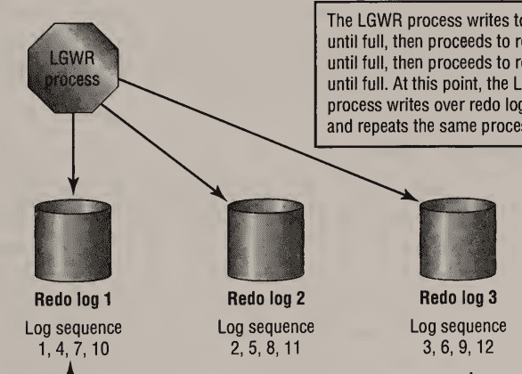

重做日志标识数据库中称为已提交事务（committed transaction）的值。SCN 像时钟一样唯一标识每个已提交事务，作为数据库中发生事件的时间钟，它们是恢复中的主要同步元素之一。每个数据文件头和控制文件都与当前最高 SCN 同步。

## 归档日志 (Archived Logs)

归档日志是被到离线的非当前在线重做日志。该位置是 init.ora 文件中 `LOG_ARCHIVE_DEST` 参数的值。如果数据库处于 ARCHIVELOG 模式而非 NOARCHIVOG 模式，则创建归档日志。

如果数据库处于 NOARCHIVOG 模式，在线重做日志不会归档；它们在被覆盖时会被丢弃。在 ARCHIVELOG 模式下，在线重做日志在被覆盖之前复制到指定位置。这允许恢复到任何时间点。关于此点的更详细解释见第 10 章“用户管理恢复”。

## 控制文件 (Control Files)

控制文件是存储数据库物理结构的二进制文件。控制文件还存储恢复所需的最高 SCN。你应该始终在不同的设备上至少保留两个控制文件。这被称为多路（multiplexing）。

每当数据库挂载（mount）时，都会访问控制文件以识别数据库运行所需的数据文件和 redo日志。默认情况下，数据库的所有新物理更改都会记录在控制文件中。

## 数据文件 (Data Files)

数据文件是存储在文件系统上的物理文件。所有 Oracle 数据库至少有一个数据文件，但通常更多。表空间是逻辑结构，由一个或多个数据文件组成。所有逻辑对象都位于表空间中。逻辑对象是指不存在数据库之外的对象，例如表、索引、序列和视图。

数据文件由块组成。这些块是数据库中最小的单位。逻辑对象（如表和索引）存储在数据块中，数据块位于数据文件中。

每个文件的第一个块称为头（header block）。数据文件的头包含文件大小、块大小和关联表空间等信息。它还包含用于恢复的 SCN。

以下是 V$DATAFILE 视图的输出，显示了构成示例数据库的数据文件。

```sql
SQL> select file#, status, substr(name,0,50) from v$datafile;
```

| FILE# | STATUS | SUBSTR(NAME,0,50) |
| :--- | :--- | :--- |
| 1 | SYSTEM | /oracle/product/9.0.1/oradata/orc9/system01.dbf |
| 2 | ONLINE | /oracle/product/9.0.1/oradata/orc9/undots01.dbf |
| 3 | ONLINE | /oracle/product/9.0.1/oradata/orc9/cwmlite01.dbf |
| 4 | ONLINE | /oracle/product/9.0.1/oradata/orc9/drsys01.dbf |
| 5 | ONLINE | /oracle/product/9.0.1/oradata/orc9/example01.dbf |
| 6 | ONLINE | /oracle/product/9.0.1/oradata/orc9/indx01.dbf |
| 7 | ONLINE | /oracle/product/9.0.1/oradata/orc9/tools01.dbf |
| 8 | ONLINE | /oracle/product/9.0.1/oradata/orc9/users01.dbf |

8 rows selected.

## 参数文件

有两个参数文件构成了 Oracle 数据库的文件结构。参数文件是包含数据库启动时使用的数据库参数的文件。标准参数文件名为 `init<ORACLE_SID>.ora`，包含了实例启动所需的参数。`ORACLE_SID` 等于 Oracle 标识符或数据库名称。该参数文件以 ASCII 和二进制格式存在。

第二个参数文件名为 `spfile<ORACLE_SID>.ora`，是服务器参数文件，存储了实例启动所需的持久性参数以及数据库启动时会修改的参数。服务器参数文件以二进制格式存储，这是 Oracle9i 的一个新特性。

这两个文件中的任何一个都可以用于启动 Oracle 数据库，但 `spfile.ora` 文件是启动数据库的默认文件。如果找不到这些文件，则使用 `init.ora` 文件。

这些文件的默认位置位于以下目录结构中。我们将演示 Unix 和 Windows NT/2000。

| 操作系统 | 路径 |
| :--- | :--- |
| Unix | $ORACLE_HOME/dbs |
| Windows NT/2000 | $ORACLE_HOME%\database |

## 检查点、重做日志和归档日志

现在你已经对用于恢复的各种 Oracle 结构、文件结构和内存结构有了基本的了解，现在是看看它们是如何相互关联的。正如你之前学到的，检查点、重做日志和归档日志对恢复的所有方面都至关重要。

检查点（Checkpoint）是一个确定磁盘上所有事务同步或一致性的事件。检查点的实现是通过存储一个唯一的数字——SCN（再次，这代表系统更改号）到控制文件、数据文件头、联机重做日志和归档日志中的。检查点由 CKPT 进程执行。触发检查点的方法之一是通过数据块写器（DBWR）进程。DBWR 通过将数据缓冲区（脏缓冲区）中的所有已修改数据块写入数据文件来启动检查点。在执行检查点后，所有已提交的事务都会被写入数据文件。

如果实例在此处崩溃，则只需要将此检查点之后发生的新事务应用到数据库中，以实现完整恢复。因此，检查点过程决定了在发生故障和随后的恢复期间，需要将重做日志中的哪些事务应用到数据库中。记住，所有事务无论是否提交，都会写入重做日志。

其他导致检查点发生的方法包括以下命令：`ALTER SYSTEM SWITCH LOGFILE`、`ALTER SYSTEM CHECKPOINT LOCAL`、`ALTER TABLESPACE BEGIN BACKUP` 和 `ALTER TABLESPACE END BACKUP`。

SCN 至少在每次日志切换时记录在重做日志中。因为每次日志切换都会发生检查点。归档日志中记录的 SCN 与联机重做日志相同，因为归档日志仅仅是联机重做日志的副本。

让我们来看检查点、联机重做日志和归档日志是如何相互关联的示例。首先，执行 `ALTER TABLESPACE BACKUP` 命令，随后是一个用于开始数据库在线备份的操作系统命令。

在线备份（也称为热备）在数据库仍然可用或运行期间发生。关于热备的更详细解释，请参见第 9 章“用户管理和基于 RMAN 的备份”。

`ALTER TABLESPACE BEGIN BACKUP` 命令之后是用于用于复制文件的操作系统命令，例如 Unix 中的 `cp`。然后，使用 `ALTER TABLESPACE END BACKUP` 命令结束热备。正如我们所讨论的，这些 `ALTER TABLESPACE` 命令也会导致检查点的发生。以下是正在备份的表空间 `DATA` 的数据文件 `data01.dbf` 的示例：

```
SQL> connect /sysdba
Connected.
SQL> alter tablespace data begin backup;
Tablespace altered.
SQL> ! cp data01.dbf /stage/data01.dbf
SQL> alter tablespace data end begin backup;
Tablespace altered.
SQL>
```

注意，表空间 `DATA` 被置于备份模式，然后执行了操作系统命令，将数据文件 `data01.dbf` 复制到新目录 `/stage`，它在其中等待写入磁带。最后，表空间 `DATA` 被移出备份模式。这些步骤在数据库的每个表空间上重复执行。这是一个热备的简化示例。

如果是在周日凌晨 2 点执行了热备，而数据库在周二下午 3 点崩溃，那么最后一个检查点将在所有数据文件备份后发出的。此备份将是数据库的最后一次经过检查点的磁盘副本。因此，凌晨 2 点备份之后生成的所有日志都需要应用到经过检查点的数据库中，以将其恢复到下午 3 点（即崩溃发生的时间）。当你对数据库进行热备时，你获得的是一个每个数据文件都已检查点的数据库副本。在这种情况下，每个数据文件在头文件中都有不同的 SCN 标记，并将需要应用所有 SCN 大于它的重做日志条目到数据文件中。

# 调整实例恢复的方法

正如我们之前在第 5 章“恢复概述”中讨论过的，*实例故障*是指数据库由于某些原因（如断电）异常终止。*实例恢复*是数据库执行的一种过程，以确保数据库运行正常且数据一致。这也被称为*向前恢复和回滚过程*。在实例故障后启动数据库时，读取当前的重做日志并应用该重做日志中的所有更改。未提交的更改将被回滚。因此，数据库从故障时刻变得一致。

定义实例恢复近似时间的概念被称为*界限恢复*（Bounded time recovery）。*界限恢复*意味着 DBA 控制了实例故障后恢复所需的时间。这些界限通过两个初始化参数来控制。

有两个可以加速实例恢复的主要初始化参数。第一个参数是 `FAST_START_MTTR_TARGET`。它使得数据库写器（DBW0）后台进程更快地以预定义的速度写入，以满足约定的恢复时间框架。该参数可以设置为 0 到 3600。

第二个参数是 `FAST_START_PARALLEL_ROLLBACK`。它决定了执行并行回滚的最大进程数。当实例恢复涉及运行事务时，该参数非常有用。这使得实例恢复的回滚部分处理得更快。该参数可以设置为 `HIGH`、`LOW` 和 `FALSE`。以下是示例 `init.ora` 参数：

```
fast_start_mttr_target      = 300
fast_start_parallel_rollback  = LOW
```

有三个 V$ 视图可以查询这些参数。它们是 `V$INSTANCE_RECOVERY`、`V$FAST_START_SERVERS` 和 `V$FAST_START_TRANSACTIONS`。以下是 `V$INSTANCE_RECOVERY` 视图的示例，它可以用于监控并确定 `FAST_START_MTTR_TARGET` 参数。`TARGET_MTTR` 和 `ESTIMATED_MTTR` 显示了发生实例故障时恢复数据库所需的时间（秒）。

```sql
SQL> select target_mttr,estimated_mttr from v$instance_recovery;
```

# 分布式数据库环境中的实例恢复

让我们来看一个真实案例，以确定在 Oracle 实例恢复能够正确处理所有数据丢失的情况下，哪些情况可能导致数据丢失。

一家小型制造企业公司在 Oracle 数据库上生成制造信息。该数据库跟踪原材料、在制品和成品。为了完成所需的工作，该数据库在公司运行的三个班次期间都必须保持可用，以满足客户需求。

出于财务考虑，该制造数据库的信息会定期从该数据库传输到位于另一台服务器上的财务数据库中。这是通过各种数据库外传输完成的，这导致数据在流回财务数据库之前一直处于暴露状态。

在这些传输的其中一次，公司遭遇了严重的电压激增，导致服务器重启。结果是，由于电压激增发生时，数据正在从制造数据库传输到财务数据库的过程中，因此每个数据库都发生了实例故障。此外，数据库传输机制并无法恢复传输中的数据。

此时，经验丰富的数据库管理员可以发现，这里的问题在于松散的分布式数据库环境。这可能是由于公司对制造和财务应用使用了不同的供应商，并配备了自定义的应用程序接口（API）。

现在电压激增已经过去，系统管理员必须重启服务器，数据库管理员需要验证数据库是否再次可用。当完成这些操作后，管理员发现制造数据库认为数据已传输到财务数据库，但在实例故障发生之前，数据从未真正进入财务数据库。

结果是各个数据库之间不同步，必须手动跟踪数据不一致性问题。分析师和业务人员必须通过一系列即时 SQL 语句来确定哪些数据已进入或未进入相应的数据库。

## 总结


# Oracle 恢复结构与过程概述

Oracle 提供的恢复结构和过程为 DBA 提供了大量的恢复选项。这些恢复结构由位于数据库中的文件、内存缓冲区和逻辑对象组成。除了这些恢复结构外，本章还识别了文件结构——重做日志、归档日志、控制文件、数据文件和参数文件，以及进程——`PMON`、`SMON`、`LGWR`、`CKPT` 和 `ARC`。它还讨论了内存结构，由日志缓冲区和数据缓冲区组成。所有这些结构在恢复过程中都起着不同的角色，并用于不同类型的恢复。

本章还描述了检查点概念。在讨论过程中，你学习了 `SCN` 的重要性，以及这些标识符如何帮助确定应用于数据库的事务的一致性。

此外，你还查看了调优实例恢复过程时所需的三个主要初始化参数。通过这些参数，DBA 可以将恢复过程的时间限制在某些近似范围内。这些参数可以通过一系列 `V$` 视图进行监控。

本章为后续章节以及现实世界中备份和恢复过程的决策奠定了基础。理解本章中讨论的文件结构和进程如何在故障情况下起作用使数据库保持一致或不一致，是至关重要的。

## 考试要点

这些主题可以被认为是备份和恢复过程的基石。

### 识别参与恢复的 Oracle 后台进程

参与恢复的有五个后台进程。这些进程如下：

- **日志写入器（`LGWR`）**：写入重做日志
- **系统监视器（`SMON`）**：参与实例恢复
- **进程监视器（`PMON`）**：执行进程故障恢复
- **检查点（`CKPT`）**：执行数据库文件的检查点
- **归档进程（`ARC`）**：将在线重做日志复制到归档日志

### 识别参与恢复的 Oracle 内存结构

恢复过程涉及两个内存结构：

- **日志缓冲区**：记录重做日志变化的内存缓冲区
- **数据块缓冲区**：存储所有用户查询和修改的缓存数据

### 识别参与恢复的 Oracle 文件结构

与恢复相关的文件结构包括在线重做日志、归档日志、控制文件、数据文件和参数文件。这些文件构成了物理组件。


# 分布式数据库环境中的实例恢复

让我们来看一个真实案例，以确定在 Oracle 实例恢复能够正确处理所有数据丢失的情况下，哪些情况可能导致数据丢失。

一家小型制造企业在 Oracle 数据库上生成制造信息。该数据库跟踪原材料、在制品和成品。为了完成所需的工作，该数据库在公司运行的三个班次期间都必须保持可用，以满足客户需求。

出于财务考虑，该制造数据库的信息会定期从该数据库传输到位于另一台服务器上的财务数据库中。这是通过各种数据库外传输完成的，这导致数据在流回财务数据库之前一直处于暴露状态。

在这些传输的其中一次，公司遭遇了严重的电压激增，导致服务器重启。结果是，由于电压激增发生时，数据正在从制造数据库传输到财务数据库的过程中，因此每个数据库都发生了实例故障。此外，数据库传输机制并无法恢复传输中的数据。

此时，经验丰富的数据库管理员可以发现，这里的问题在于松散的分布式数据库环境。这可能是由于公司对制造和财务应用使用了不同的供应商，并配备了自定义的应用程序接口（API）。

现在电压激增已经过去，系统管理员必须重启服务器，数据库管理员需要验证数据库是否再次可用。当完成这些操作后，管理员发现制造数据库认为数据已传输到财务数据库，但在实例故障发生之前，数据从未真正进入财务数据库。

结果是各个数据库之间不同步，必须手动跟踪数据不一致性问题。分析师和业务人员必须通过一系列即时 SQL 语句来确定哪些数据已进入或未进入相应的数据库。

## 总结

Oracle 提供的恢复结构和过程为 DBA 提供了大量的恢复选项。这些恢复结构由位于数据库中的文件、内存缓冲区和逻辑对象组成。除了这些恢复结构外，本章还识别了文件结构——重做日志、归档日志、控制文件、数据文件和参数文件，以及进程——`PMON`、`SMON`、`LGWR`、`CKPT` 和 `ARC`。它还讨论了内存结构，由日志缓冲区和数据缓冲区组成。所有这些结构在恢复过程中都起着不同的角色，并用于不同类型的恢复。

本章还描述了检查点概念。在讨论过程中，你学习了 `SCN` 的重要性，以及这些标识符如何帮助确定应用于数据库的事务的一致性。

此外，你还查看了调优实例恢复过程时所需的三个主要初始化参数。通过这些参数，DBA 可以将恢复过程的时间限制在某些近似范围内。这些参数可以通过一系列 `V$` 视图进行监控。

本章为后续章节以及现实世界中备份和恢复过程的决策奠定了基础。理解本章中讨论的文件结构和进程如何在故障情况下起作用使数据库保持一致或不一致，是至关重要的。

## 考试要点

这些主题可以被认为是备份和恢复过程的基石。

- 识别参与恢复的 Oracle 后台进程。参与恢复的有五个后台进程。这些进程如下：日志写入器（`LGWR`）写入重做日志；系统监控器（`SMON`）参与实例恢复；进程监控器（`PMON`）执行进程故障恢复；检查点（`CKPT`）执行数据库文件的检查点；归档进程（`ARC`）将在线重做日志复制到归档日志。
- 识别参与恢复的 Oracle 内存结构。恢复过程涉及两个内存结构。日志缓冲区是记录重做日志变化的内存缓冲区，数据块缓冲区存储所有用户查询和修改的缓存数据。
- 识别参与恢复的 Oracle 文件结构。与恢复相关的文件结构包括在线重做日志、归档日志、控制文件、数据文件和参数文件。这些文件构成了物理组件。

- 10. 哪个过程负责为所有必要的物理数据库结构打上 `SCN` 标记？
  - A. 读取一致性映像
  - B. 检查点
  - C. 提交
  - D. 回滚

- 11. 当发生什么事件时，脏缓冲区会被写入磁盘？
  - A. 发生了提交。
  - B. 发生了回滚。
  - C. 发生了检查点。
  - D. 发生了强制关机。

- 12. 哪个数据库进程在数据库启动时不是强制性的或不存在的？
  - A. `PMON`
  - B. `CKPT`
  - C. `SMON`
  - D. `ARCn`

- 13. 负责实例恢复的主要后台进程是哪个？
  - A. `PMON`
  - B. `LGWR`
  - C. `SMON`
  - D. `ARCn`

- 14. 正在被活动写入的重做日志称为什么？
  - A. 在线归档日志
  - B. 当前在线重做日志
  - C. 在线重做日志
  - D. 离线重做日志

- 15. 当前未被写入而是被复制到新位置的重做日志称为什么？
  - A. 在线归档日志
  - B. 当前在线重做日志
  - C. 离线重做日志
  - D. 在线重做日志

- 16. 构成逻辑表空间的物理结构是什么？
  - A. 表
  - B. 控制文件
  - C. 重做日志
  - D. 数据文件

- 17. 哪个内存结构负责临时存储日志记录？
  - A. 大池
  - B. 数据库缓冲区
  - C. 日志缓冲区
  - D. 共享池

- 18. 拥有多个控制文件称为什么？
  - A. 多个控制文件
  - B. 复制控制文件
  - C. 控制文件复用
  - D. 控制文件双备

- 19. 当发生日志切换时会发生什么事件？
  - A. 创建了一个归档日志。
  - B. 发生了检查点。
  - C. 所有事务都已提交。
  - D. 所有待处理事务都已提交。

- 20. 哪个是 Oracle9i 中新增的物理结构？
  - A. 所有参数文件
  - B. 复用的控制文件
  - C. `init.ora`
  - D. `spfile.ora`

## 复习题答案

- 1. D. 实例恢复是自动的。
- 2. D. `LGWR`（或日志写入进程）将更改从日志缓冲区写入到在线重做日志中。
- 3. A, B, D. 重做日志、归档日志和数据文件都是与恢复相关的文件结构。日志缓冲区是内存结构。
- 4. C. 控制文件是一个二进制文件，存储了数据库所有物理组件的所有信息。
- 5. A, B. `PMON`、`SMON` 和 `ARCn` 都与恢复过程的某些相关。`PMON` 恢复失败的进程，`SMON` 协助实例恢复，`ARCn` 生成用于恢复数据库的归档日志。`DBWR` 默认在适当的时候将数据写入数据文件。
- 6. D. `CKPT` 进程执行所有检查点操作。该进程默认启动。
- 7. B, C. 与恢复相关的内存结构只有两个：日志缓冲区、数据块缓冲区。
- 8. D. `SHUTDOWN ABORT` 在启动时需要实例恢复，因为数据文件在关闭期间没有进行检查点。
- 9. B, C, D. `SHUTDOWN NORMAL` 和 `SHUTDOWN IMMEDIATE` 事件会对所有必要的物理数据库结构执行检查点。切换日志文件会强制对必要的物理数据库结构执行检查点。`CKPT` 进程负责启动或执行检查点，而不是触发它。
- 10. B. 检查点是由 `CKPT` 进程启动的过程，它为所有数据文件、重做日志和控制文件打上最新的 `SCN` 标记。
- 11. C. 检查点会将脏缓冲区刷盘。`SHUTDOWN NORMAL` 或 `SHUTDOWN IMMEDIATE` 会在关闭时触发检查点，但 `SHUTDOWN ABORT` 不强制执行检查点。这就是为什么启动时需要恢复的原因。回滚和提交不会导致检查点。
- 12. D. `ARCn` 在启动时不是必须的。该进程仅在数据库以归档模式运行时才使用。
- 13. C. `SMON` 进程负责大部分实例恢复。
- 14. B. 当前在线日志是 `LGWR` 进程正在写入的日志。
- 15. C. 归档日志是离线重做日志。这些是在 `LGWR` 写入它们之前被复制到新位置的重做日志。
- 16. D. 数据文件是构成逻辑表空间的物理结构。
- 17. C. 日志缓冲区负责临时保存将要写入重做日志的日志记录。
- 18. C. 你应该始终拥有多个控制文件，以防其中一个丢失。这被称为控制文件复用。
- 19. B. 日志切换作为恢复同步过程的一部分，会立即强制检查点。
- 20. D. `spfile.ora` 参数文件是 Oracle9i 新的。`init.ora` 文件自 Oracle 数据库诞生以来一直存在，但 `spfile.ora` 文件是一个新的二进制初始化文件。

# 配置数据库归档模式

Oracle9i: DBA 基础 II 本章涵盖的考试目标：

- 描述归档模式和非归档模式之间的区别。
- 为归档模式配置数据库。
- 启用自动归档。
- 执行手动归档。
- 配置多个归档目的地。

> 考试目标可能会随时更改且不另行通知。请访问 Oracle 网站 `http://www.oracle.com/education/certification/` 获取最新的目标列表。

配置数据库进行备份和恢复是复杂的。至少你必须理解归档过程、与归档相关的初始化参数、启用和禁用归档的命令、手动归档的命令以及初始化归档的过程。本章提供了备份和恢复的示例。在第 6 章“实例和媒介恢复”中，我们学习了相关的结构。归档进程和归档日志是你需要的组件。了解如何配置数据库进行归档以及你需要多个归档日志副本以减少故障造成的损害是非常重要的。

## 选择归档或非归档模式

DBA 做的最基本的备份和恢复决策之一是在 `ARCHIVELOG` 还是 `NOARCHIVELOG` 模式下运行数据库。正如之前所学的，重做日志记录了数据库中发生的所有事务，而归档日志包含了历史事务。运行归档模式将生成归档日志；运行 `NOARCHIVELOG` 模式意味着数据库不会生成归档日志。

### 归档模式

在归档模式下，数据库从重做日志生成归档文件。这意味着数据库对发生的所有历史事务进行了备份。该模式还有其他特征：

- 可以进行在线（热）备份。这种备份是在数据库运行期间进行的。因此，执行备份不需要停止服务。使用 `ALTER TABLESPACE <TABLESPACE_NAME> BEGIN BACKUP` 命令执行热备份。执行此命令后，可以对表空间关联的数据文件进行操作系统拷贝。必须使用 `ALTER TABLESPACE <TABLESPACE_NAME> END BACKUP` 命令。这些命令必须在数据库的每个表空间执行。
- 可以进行完全恢复。这是因为归档日志包含了直到故障点的所有更改。所有日志都可以应用于数据库的备份（热备或冷备）。这适用于故障发生前的所有事务。因此，不会有数据丢失或事务缺失。
- 表空间可以立即离线。
- 存储归档日志需要更多的磁盘空间，并且与维护该磁盘空间相关的维护工作增加。

### 非归档模式

在非归档模式下，数据库不从重做日志生成归档文件。这意味着数据库没有存储此类日志的任何历史事务。相反，重做日志会根据 Oracle 的需要相互覆盖。因此，只能恢复到实例故障时，使用的数据存储在当前的重做日志中。以 `NOARCHIVELOG` 模式运行具有以下特征：

- 在某些情况下，无法进行完全恢复。这将导致数据丢失。恢复时需要上一次冷备份。
- 备份时必须完全关闭数据库，这意味着在此期间数据库用户无法访问数据库。这意味着只能进行冷备份。
- 表空间无法立即离线。
- 不需要为了减少归档日志而提供额外的磁盘空间和维护。

## 理解 NOARCHIVELOG 模式对恢复的影响

以 `NOARCHIVELOG` 模式运行数据库时相关的恢复影响至关重要。当使用最后一次一致的完整备份进行恢复时，通常会发生数据丢失。为了减少故障时丢失的数据量，需要频繁进行冷备份。这意味着数据库可能会定期对用户不可用。

既然你已经熟悉了该模式相关的问题，让我们来看看在什么情况下使用 `NOARCHIVELOG` 模式是不合理的，而在什么情况下是合理的。

假设 A 制造公司的数据库必须 24 小时可用，以支持三个班次的工作。这些工作包括输入订单、提单、装运指示和库存调整。班次安排如下：白班，上午 9 点到下午 5 点；中班，下午 5 点到凌晨 1 点；以及夜班，凌晨 1 点到上午 9 点。如果该数据库从午夜到凌晨 2 点关闭以进行冷备份，那么夜班和中班在这一段时期内将无法使用它。因此，`NOARCHIVELOG` 备份策略对于 A 制造公司来说是不可行的。

另一方面，如果 B 制造公司的数据库只需要在白班期间（上午 9 点到下午 5 点）可用，那么可以在下午 5 点之后、上午 9 点之前进行备份，而不会影响用户。因此，DBA 可以调度数据库在午夜关闭并进行两个小时的备份。数据库将在上午 9 点之前重启，且不会对用户的工作产生干扰。如果发生故障，将会有每个晚上的备份，且最多只会丢失一天的数据。如果一天的数据丢失是可以接受的，那么对于 B 制造公司来说这就是可行的备份和恢复策略。

这些示例表明，在某些情况下，以 `ARCHIVELOG` 模式运行是有意义的。但这种选择也会带来恢复影响。一个影响是发生故障时会导致数据丢失。此外，恢复方式的选择有限。通常的选择是从数据库关闭（冷备份）期间的最后一次一致备份恢复整个数据库。

## 为 ARCHIVELOG 模式和自动归档配置数据库

一旦决定以 `ARCHIVELOG` 模式运行数据库，就需要对数据库进行正确配置。你可以在创建数据库期间对新数据库进行配置，或通过 Oracle 命令对现有数据库进行配置。在数据库进入 `ARCHIVELOG` 模式后，你很可能会配置自动归档。自动归档让 DBA 免于在在线重做日志完成一个循环之前通过命令手动归档日志的手动任务。

### 设置 ARCHIVELOG 模式

`ARCHIVELOG` 模式可以在创建数据库期间或通过使用 `ALTER DATABASE ARCHIVELOG` 命令设置。执行此命令时，数据库必须挂载但不能打开。该命令一直有效，直到使用 `ALTER DATABASE NOARCHIVELOG` 命令将其关闭。执行此命令时，数据库也必须挂载但不能打开。

重做日志文件将归档到 `init.ora` 文件中由 `LOG_ARCHIVE_DEST` 参数指定的位置。默认情况下，数据库处于手动归档模式。这意味着当重做日志满时，数据库会发出 `ARCHIVE LOG ALL` 命令，归档所有尚未归档的在线重做日志。图 7.1 显示了一个配置为 `ARCHIVELOG` 模式的数据库。

### 图 7.1 配置为 ARCHIVELOG 模式的数据库

| Oracle 日志写入进程 | LGWR | 不活跃的在线重做日志 | 不活跃的重做日志 | 不活跃的重做日志 | 活跃的在线重做日志 |
|---|---|---|---|---|---|
| 重做日志 | | log1.log | log2.log | log3.log | log4.log |

让我们来看判断处于 `ARCHIVELOG` 还是 `NOARCHIVELOG` 模式的示例。你需要运行 SQL*Plus 并执行以下查询 `V$` 视图的 SQL 语句。或者，你可以执行操作系统命令，例如在 Unix 中运行 `ps -ef | grep arch`，检查进程列表以查看 `ARCn` 进程正在运行。该进程负责将归档日志从重做日志中复制。此示例显示了使用 `V$` 视图的 `ARCHIVELOG` 模式：

```
oracle@octill1: ~ sqlplus /nolog

SQL*Plus: Release 9.0.1.0.0 - Production on Tue Sep 25 19:08:25
```

### 为 ARCHIVELOG 模式和自动归档配置数据库

要确定数据库处于 `ARCHIVELOG` 还是 `NOARCHIVELOG` 模式，你可以查询 `V$` 视图。

```
oracle@octill1: ~ sqlplus /nolog

SQL*Plus: Release 9.0.1.0.0 - Production on Tue Sep 25 19:08:25
```

- 1. 首先，编辑 `init.ora` 文件并将参数 `LOG_ARCHIVE_START` 设置为 `TRUE`。结果是，数据库将处于自动 `ARCHIVELOG` 模式。见下方的 `init.ora` 文件示例。

```
################################################################
```


# Init.ora 文件部分示例

## 归档日志

```text
log_archive_start=true
log_archive_dest=oracle/admin/orc9%s
log_archive_format=archorc9%s.log
```

### 启用自动归档

接下来，在 SQL 中运行以下命令：

```sql
SQL shutdown;
SQL startup mount;
SQL alter database archivelog;
SQL alter database open;
```

该数据库现在已启用自动归档功能。要验证数据库是否配置正确，你可以执行以下检查。

1. 首先，执行 `ALTER SYSTEM SWITCH LOGFILE`。这需要执行 n + 1 次，其中 n 是数据库中重做日志（redo logs）的数量。

```sql
SQL alter system switch logfile;
```

2. 接下来，对 `LOG_ARCHIVE_DEST` 中的归档目标执行目录列表。Unix 命令 `pwd` 显示当前工作目录，`ls` 显示目录内容。

```text
oracle@octilli:/oracle/admin/orc9/ ls -ltr
total 276
-rw-r----- 1 oracle dba 133632 Sep 25 00:27 archorc9_3.log
-rw-r----- 1 oracle dba 125952 Sep 25 00:28 archorc9_4.log
-rw-r----- 1 oracle dba 1024 Sep 25 00:28 archorc9_5.log
-rw-r----- 1 oracle dba 1536 Sep 25 00:28 archorc9_6.log
-rw-r----- 1 oracle dba 1024 Sep 25 00:28 archorc9_7.log
oracle@octilli:oracle/admin/orc9/arch >
```

验证自动归档功能已启另一种方法是执行 `ARCHIVE LOG LIST` 命令，它会显示这些设置的状态（如下所示）。

```sql
SQL> archive log list:
Database mode Archive Mode
Automatic archival Enabled
Archive destination /oracle/admin/orc9
Oldest online log sequence 6
Next log sequence to archive 8
Current log sequence 8
SQL>
```

如果你启用了 `ARCHIVELOG` 模式，但由于没有通过编辑 init.ora 或将 `LOG_ARCHIVE_START` 设置为 `TRUE` 来启用自动归档，数据库在达到最后一个可用的重做日志时将会挂起。你需要执行手动归档作为临时修复，或者在更改 `LOG_ARCHIVE_START` 参数后关闭并启动数据库。

## 现实世界场景

### 为归档日志提供足够的空间

`ARCHIVELOG` 模式所需的额外磁盘空间经常被忽略或低估。对于普通数据库，你应该有足够的空间来保留至少一两天的在线归档日志。为了估算这些文件的正确大小，你需要估算交易峰值期间的量。峰值时间通常是事务活动或批处理最频繁的时间。

将此估算大小乘以设置的 `log_archive_dest_locations` 数量。如果你在系统上每晚进行热备份，那么一两天的在线归档日志应该能从归档日志的角度满足你的大多数恢复需求。

> 但如果归档进程没有足够的磁盘空间来写入归档日志，数据库将挂起或停止所有活动。这种挂起状态将一直持续，直到你通过将旧归档日志移出系统、压缩日志文件或设置写入磁带后删除日志的自动作业来释放更多空间。在尝试为归档进程释放空间时，必须小心不要移动或删除归档日志。记住，这些归档日志在恢复情况下可能是需要的。

## 手动归档日志

日志的手动归档包括启用数据库的 `ARCHIVELOG` 模式，然后从 SQL 中手动执行 `ARCHIVE LOG ALL` 命令。init ora 参数 `LOG_ARCHIVE_START` 必须设置为 `FALSE` 以禁用自动归档。下一步是通过执行以下命令将数据库置 `ARCHIVELOG` 模式：

```sql
SQL> shutdown;
SQL> startup mount;
SQL> alter database archivelog;
SQL> alter database open;
```

现在你可以使用以下命令执行重做日志的手动归档：

```sql
SQL> archive log all;
```

或

```sql
SQL> archive log next;
```

`ARCHIVE LOG ALL` 命令将归档所有可归档的重做日志，而 `ARCHIVE LOG NEXT` 命令将归档下一组重做日志。

## 使用 init.ora 参数实现多个归档进程和位置

拥有多个归档日志目标和多个归档的功能最早在 Oracle8 和 9i 中引入，可以使用两个以上的目标，提供更强的归档日志冗余。

为归档日志文件设置多个目标的主要目的是消除任何单点故障。例如，如果包含归档日志的磁盘丢失，数据库将面临数据丢失的风险。只有一个位置是一个单点故障。多个位置显著降低了数据丢失的概率。参见图 7.2，它展示了具有多个目标的 `ARCHIVELOG` 模式。

要为数据库配置多个归档进程，你将使用两组 init.ora 参数。第一组基于 `LOG_ARCHIVE_DEST_N`（其中 N 是 1 到 10 的数字）。这些 `LOG_ARCHIVE_DEST_N` 的值为：`'LOCATION = /ORACLE/ADMIN/orc9/arch1'`、`'LOCATION = /ORACLE/ADMIN/orc9/arch2'` 以及 `'LOCATION = /ORACLE/ADMIN/orc9/arch_remote'`。第一组列在 init.ora 中所示：

```text
############################
# 归档日志
###########################################
log_archive_start=true
log_archive_dest_1='location=/oracle/admin/orc9/arch1'
log_archive_dest_2='location=/oracle/admin/orc9/arch2'
log_archive_dest_3='location=/oracle/admin/orc9/arch_remote'
log_archive_max_processes=3
log_archive_format=archorc9%s.log
```

更改或添加这些参数后，你需要启动数据库以使用新参数。这些新的转储位置将生效。

第二组参数是 `LOG_ARCHIVE_DEST = <SOME/DIRECTORY/LOCATION>` 和 `LOG_ARCHIVE_DUPLEX_DEST = <SOME/DIRECTORY/LOCATION>`。以下示例使用了 `LOG_ARCHIVE_DEST = /ORACLE/ADMIN/orc9/arch1` 和 `LOG_ARCHIVE_DUPLEX_DEST = /ORACLE/ADMIN/orc9/arch2`。这种方法的主要区别在于，当你需要两个位置或使用 8.0.x 支持的相同 init.ora 参数格式时。这些参数与上一个示例中提到的 `LOG_ARCHIVE_DEST_N` 互斥。第二组参数可以在下方的 init.ora 参数值。

```text
############################
# 归档日志
###########################################
log_archive_start=true
log_archive_dest=/oracle/admin/orc9/arch1
log_archive_duplex_dest=/oracle/admin/orc9/arch2
log_archive_max_processes=2
log_archive_format=archorc9%%.log
```

这种镜像归档日志的第二种方法旨在镜像一份日志文件，而第一种方法可以镜像多 10 份，其中一个是远程数据库。

## 远程归档日志位置

对于所有远程事务，存在更大程度的潜在问题。为了处理这些潜在的事务问题，Oracle 为远程归档目标开发了一些特定的命令。其中，有几个命令和初始化参数决定了日志是否需要到达远程位置，以及是否需要对失败的发送重试。

`LOG_ARCHIVE_MIN_SUCCEED_DEST=N` 是初始化参数，它决定了在覆盖重做日志（redo logs）之前，10 个最大归档目标中必须有多少个完全接收了归档日志。如果不满足此条件，数据库将挂起。

第一个参数指定了目标是强制性的还是可选的归档目标。当你使用 `MANDATORY` 参数时，目标将要求文件到达远程位置；如果这些文件未到达，生成这些日志的数据库将挂起。当你使用 `OPTIONAL` 参数（与 `MANDATORY` 参数相反）时，如果日志未到达远程位置，数据库将继续处理而不会挂起。

`REOPEN` 命令会导致在一段时间后重试失败的归档目标。以下是该命令以及之前参数的示例。注意，`REOPEN` 示例使用了服务目标以用于备用数据库模式。

```text
LOG_ARCHIVE_DEST_1=LOCATION=/oracle/admin/tsn9/arch1 MANDATORY
LOG_ARCHIVE_DEST_2=LOCATION=/oracle/admin/tsn9/arch2 OPTIONAL
LOG_ARCHIVE_DEST_3=SERVICE=euro_fin_db_V9.0.1 REOPEN=60
```


确保每个 `LOG_ARCHIVE_DEST_N` 和 `LOG_ARCHIVE_DUPLEX_DEST` 位于不同的物理设备上。这些新参数的主要目的是允许在磁盘崩溃时，文件的副本能够保持完好。

## 总结

Oracle 的备份和恢复功能是健壮的。它提供了许多支持各种备份和恢复情况的选择。在本章中，你了解了如何配置 Oracle 数据库进行备份和恢复。你学习了在 `ARCHIVELOG` 模式与 `NOARCHIVELOG` 模式之间运行的影响，反之亦然，这种选择会影响备份和恢复过程。你看到了 `init.ora` 参数如何控制归档日志的目标和自动化的示例。最后，你通过了一个启用了数据库 `ARCHIVELOG` 模式和日志自动归档的示例。

对归档日志过程的深入理解是备份和恢复过程的基础。启用归档日志的决定对 DBA 恢复数据库的能力有重大影响。此外，在后续章节中将涵盖某些恢复选项取决于你是否启用了 `ARCHIVELOG` 模式。确保你理解启用或不启用归档日志过程的原因，这些知识将在 OCP 测试期间以及现实情况中对你有益。

## 考试要点

- 识别 `ARCHIVELOG` 和 `NOARCHIVELOG` 模式之间的差异。你应该知道数据库生成归档日志与不生成归档日志之间的区别。确保你意识到 `ARCHIVELOG` 和 `NOARCHIVELOG` 模式对备份和恢复过程的影响。
- 知道如何在 `ARCHIVELOG` 模式下配置数据库。能够解释如何配置数据库使其生成归档日志。你还应该能够识别涉及此过程的命令和初始化参数。
- 知道如何配置数据库进行自动归档。能够识别初始化参数 `LOG_ARCHIVE_START = TRUE`，它用于启用自动归档。
- 演示如何执行手动归档。知道如何使用所需的命令手动生成归档日志。
- 理解如何配置数据库多个归档目标。知道两种不同的初始化参数方法：`ARCHIVE_DEST_LOG_N` 和 `ARCHIVE_LOG_DEST_DUPLEX`。你还应该理解这些方法之间的区别，例如远程归档日志和位置数量。
- 理解如何配置多个归档进程。要配置多个归档进程，你必须熟悉配置数据库使用多个归档日志进程的初始化参数。
- 理解涉及远程归档的命令和初始化参数。你应该熟悉影响远程归档的命令，例如 `MANDATORY`、`OPTIONAL` 和 `REOPEN` 参数，以及 `ARCHIVE_MIN_SUCCEED_DEST`，以及它们如何影响远程归档过程。

## 关键术语

在参加考试之前，确保你熟悉以下术语：

| ARCHIVELOG 模式 | 介质故障 |
| :--- | :--- |
| 自动归档 | NOARCHIVELOG 模式 |
| LOG_ARCHIVE_DEST | 在线（热）备份 |
| LOG_ARCHIVE_START | 单点故障 |
| 手动归档 | |

## 复习题

1. 数据库需要处于什么种状态才能启用归档？

- A. 已打开 (Opened)
- B. 关闭 (Closed)
- C. 已挂载 (Mounted)
- D. 未挂载 (Unmounted)

2. 当数据库在 `ARCHIVELOG` 模式下运行时，DBA 应该注意哪些问题？

- A. 是否具有恢复的能力
- B. 是否具有关闭数据库的能力
- C. 是否具有不完全恢复的能力
- D. 这种模式是否增加了磁盘利用率

3. 下列哪些是你可以更改归档日志目标的方法？

- A. `LOG_ARCHIVE_DEST` 参数。
- B. 修改控制文件。
- C. `LOG_ARCHIVE_` 参数。
- D. `LOG_ARCHIVE_DUMP` 参数。

4. 支持的最大归档目标数量是多少？

- A. 1
- B. 2
- C. 5
- D. 10

5. 哪种类型的备份需要关闭数据库？

- A. ARCHIVELOG
- B. NOARCHIVELOG
- C. 在线备份（热）
- D. 冷备份（离线）

6. 确定数据库处于 `ARCHIVELOG` 模式的方法有：

- A. 查询 `V$DATABASE` 视图。
- B. 查看 `ARC` 进程是否在运行。
- C. 检查 `LOG_ARCHIVE` 的值。
- D. 查看 `ARCHIVE LOG` 命令的结果。

7. 你是一家制造公司的 DBA，数据库每天运行 24 小时处理订单、调整库存和发货。你应该执行哪种类型的备份？

- A. `ARCHIVELOG` 模式下的热备份
- B. `ARCHIVELOG` 的冷备份
- C. `NOARCHIVELOG` 模式下的在线备份
- D. `ARCHIVELOG` 模式下的在线备份

8. 哪个 `init.ora` 参数允许两个以上的归档目标？

- A. `ARCHIVE_DEST_LOG_N`
- B. `ARCHIVE_LOG_DEST_DUPLEX`
- C. `LOG_ARCHIVE_DEST_DUPLEX`
- D. `LOG_ARCHIVE_DUPLEX_DEST`

9. 哪个 `init.ora` 参数允许最多 10 个归档目标？

- A. `ARCHIVE_DEST_LOG_N`
- B. `ARCHIVE_LOG_DEST_DUPLEX`
- C. `LOG_ARCHIVE_DEST_DUPLEX`
- D. `LOG_ARCHIVE_DUPLEX_DEST`
- E. `LOG_ARCHIVE_DEST_N`

10. 哪个 `init.ora` 参数允许远程归档日志目标？

- A. `ARCHIVE_LOG_DEST`
- B. `ARCHIVE_LOG_DEST_DUPLEX`
- C. `LOG_ARCHIVE_DEST_N`
- D. `LOG_ARCHIVE_DUPLEX_DEST`

11. 执行手动归档需要哪个命令？

- A. MANUAL ARCHIVE ALL
- B. ARCHIVE MANUAL
- C. LOG ARCHIVE LIST
- D. ARCHIVE LOG ALL

12. 手动归档数据库需要什么？

- A. 数据库在 `ARCHIVELOG` 模式下。
- B. `LOG_ARCHIVE_START` 设置为 TRUE。
- C. `MANUAL_ARCHIVE` 设置为 TRUE。
- D. 无。

13. 执行手动归档需要哪个命令？

- A. ARCHIVE LOG NEXT
- B. ARCHIVE LOG LIST
- C. ARCHIVE ALL LOG
- D. ARCHIVE ALL

14. 如果启用了 `ARCHIVELOG` 模式，但 `LOG_ARCHIVE_START` 命令未设置为 TRUE，数据库会发生什么？（选择所有适用项）

- A. 数据库运行出现问题。
- B. 数据库将挂起，直到手动归档存档日志。
- C. 数据库将因为配置不当而无法启动。
- D. 在所有在线重做日志填满之前，数据库将正常工作。

15. 关于 `NOARCHIVELOG` 模式，以下哪项是正确的？

- A. 备份必须完全关闭数据库。
- B. 备份前必须将表空间离线状态。
- C. 备份时数据库必须处于运行状态。
- D. 备份时数据库可以运行，但不是必须的。

16. 哪个初始化参数决定了在写入在线重做日志之前，必须成功写入多少个归档日志目标？

- A. ARCHIVE_MINIMUM_SUCCEED
- B. LOG_ARCHIVE_MIN_SUCCEED
- C. LOG_ARCHIVE_MIN_SUCCEED_DEST
- D. ARCHIVE_MIN_SUCCEED_DEST

17. 如果归档日志未到达日志归档目标，哪个参数将允许数据库继续处理？

- A. REOPEN
- B. MANDATORY
- C. OPTIONAL
- D. UNSSUCCESSFUL

18. 哪个参数会导致失败的归档日志传输在指定的间隔时间内重试？

- A. MANDATORY
- B. OPTIONAL
- C. REOPEN
- D. RETRY

19. 如何识别数据库是否处于 `ARCHIVELOG` 模式？（选择所有适用项）

- A. 你可以使用 `ARCHIVE LOG LIST` 命令。
- B. 你可以从 `V$DATABASE` 中查询 *。
- C. 你可以使用 `ARCHIVELOG LIST` 命令。
- D. 你可以从 `V$LOG` 中查询 *。

20. 当数据库满足什么种条件时，可以执行完全恢复？

- A. 它处于 `ARCHIVELOG` 模式。
- B. 它处于 `NOARCHIVELOG` 模式。
- C. 启用了手动归档日志。
- D. 启用了自动归档日志。

## 复习题答案

1. C. 数据库必须处于 MOUNT 模式才能启用归档日志。
2. D. 由于创建了归档日志，数据库将使用更多空间。
3. A. 归档目标由 `LOG_ARCHIVE_DEST` init.ora 参数以及在数据库运行时通过执行 `ALTER SYSTEM` 命令进行控制。
4. D. 最大归档目标数由 `LOG_ARCHIVE_DEST_N` init.ora 参数控制。它支持多达 10 个位置。
5. B, D. `NOARCHIVELOG` 模式的数据库不支持在不关闭的情况下进行备份，冷备份是在数据库离线或关闭时采取的备份。
6. A, B, D. `V$DATABASE` 视图显示数据库处于 `ARCHIVELOG` 还是 `NOARCHIVELOG` 模式，`ARC` 进程直接决定归档程序正在运行，`ARCHIVE LOG LIST` 命令显示是否已启用归档。检查 `LOG_ARCHIVE_DEST` 参数的值仅表示是否存在包含归档日志的目录，而不表示数据库是否处于 `ARCHIVELOG` 模式。
7. A, D. 热备份和在线备份同义。冷备份和离线备份同义。热备份只能在 `ARCHIVELOG` 模式下运行（因此答案 C 中的备份方法不存在）。热备份可以在数据库运行时运行；因此它不会影响数据库的可用性。因为此数据库必须 24 小时可用，热备份或在线备份是合适的。
8. D. `LOG_ARCHIVE_DUPLEX_DEST` 参数允许第二个归档目标。此外，此参数必须与第一个归档日志目标的 `LOG_ARCHIVE_DEST` 参数配合使用。
9. E. `LOG_ARCHIVE_DEST_N` 允许多达 10 个位置。
10. C. `LOG_ARCHIVE_DEST_N` 允许多达 10 个位置。位置可以是远程的，即不在服务器上。
11. D. `ARCHIVE LOG ALL` 命令负责手动生成归档日志。`LOG NEXT` 命令也会手动归档日志，但它只归档序列中的下一个归档日志，而不是所有的归档日志。数据库必须处于 `ARCHIVELOG` 模式。
12. A. 数据库以 `ARCHIVELOG` 模式运行是执行手动或自动归档的要求。这意味着数据库必须使用 `START MOUNT` 重启，然后执行命令 `ALTER DATABASE ARCHIVELOG`。数据库必须打开以正常使用。
13. A. `ARCHIVE LOG NEXT` 命令将归档下一组重做日志。
14. B, D. 在所有在线重做日志填满后数据库将挂起，但只要还有未填满的在线重做日志，它就能正常工作。

# 识别 Oracle 恢复管理器 (RMAN) 的特性

- 通过确定哪些块发生了变化并仅备份这些块来压缩备份：RMAN 通过压缩备份来提高性能的一种方法。RMAN 识别已变化的块并仅备份这些块。此外，不会备份空块。
- 执行增量备份：RMAN 具有执行增量备份和全备的能力。增量备份仅包含自上次备份以来发生的更改。这种备份类型允许您每周执行一次全备，而在其余时间执行增量备份，从而提高性能。
- 提供脚本能力以组合任务：RMAN 通过允许对 RMAN 命令进行脚本化来提高备份、恢复和重建操作的效率。脚本可以包含多个 RMAN 命令，并可以存储在恢复目录（`recovery catalog`）中。这些脚本可以被调用和执行，以完成重复任务。
- 记录备份操作：RMAN 能够记录备份进展过程中的状态。这些信息存储在日志和跟踪文件中。
- 与第三方磁带媒体软件集成：RMAN 工具具有许多第三方磁带媒体软件的 API。这些允许 RMAN 在其他非 Oracle 备份工具中执行，并集成到组织的通用备份策略中。
- 提供目录信息的报告和列表：存储在恢复目录中的备份信息可以通过 RMAN `LIST` 和 `REPORT` 命令进行查询。这些命令提供了显示信息的有用方法。
- 在 Oracle 数据库的目录中存储备份信息：备份信息存储在恢复目录中。这些信息可以在日后的某个日期或任何需要时检索。
- 提供性能优势，例如备份和恢复操作的并行处理：备份和恢复操作可以设置为并行执行。这可以将工作负载分配到不同的磁带头和磁盘设备，从而提高性能。
- 为测试和开发目的创建数据库：可以从 RMAN 备份创建复制数据库并用于测试。
- 测试备份能否成功恢复：RMAN 提供 `VALIDATE` 命令来检查备份是否有效。
- 确定备份在介质库中仍然可用：RMAN 提供 `CROSSCHECK` 命令来确定备份介质和目录信息是否匹配。

图 8.1 展示了 RMAN 与前面的章节中自定义备份脚本和命令之间的某些区别。

## 图 8.1 备份脚本与 RMAN 工具之间的差异

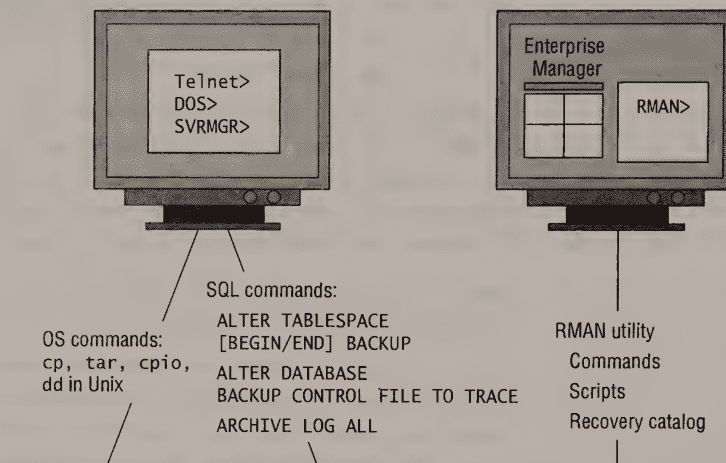

| OS 命令 | RMAN 工具 | 脚本 | 恢复目录 |
| :--- | :--- | :--- | :--- |
| Unix 中的 `cp`, `tar`, `cpio` | 命令 | | 备份并恢复数据库文件 |
| `ALTER TABLESPACE` | | | 备份数据库文件 |
| `[BEGIN/END] BACKUP` | | | 备份并恢复数据库文件 |
| `ALTER DATABASE` | | | 执行热备和冷备 |
| `BACKUP CONTROL FILE TO TRACE` | | | 记录备份信息 |
| `ARCHIVE LOG ALL` | | | 验证备份 |
| | | | 与第三方磁带媒体硬件集成 |
| | | | |
| 结合 OS 命令和 SQL 以制作热备和冷备自定义备份脚本 | | | | |

# 探索 RMAN 组件

RMAN 的主要组件是 GUI 或命令行访问、可选的恢复目录、RMAN 命令和脚本，以及磁带媒体连接。这些组件允许 DBA 自动化和标准化备份与恢复过程。每个组件描述如下：

**GUI 或命令行访问方法** 此方法提供了对恢复管理器的访问，恢复管理器进而提供了对 RMAN 的访问。GUI 方法启动连接到目标数据库的服务器会话——即通过 RMAN 进行备份或恢复操作的数据库。GUI 访问通过 Oracle Enterprise Manager (OEM) 工具提供，这是一个 DBA 工具，可以执行备份、导入/导出、数据加载、性能监控/调优、作业和事件调度以及状态管理等。命令行访问可以在标准的 Unix Telnet 或 X Windows 会话中运行，也可以在 Windows 环境下的 DOS shell 中运行。

**可选的恢复目录** 这种特殊的备份信息字典存储在一组表中，方式与字典存储数据库信息的方式相同。恢复目录提供了一种存储备份、恢复和重建信息的方法。这些信息提供了备份成功或失败、OS 备份、数据文件副本、表空间、控制文件、归档日志副本、全数据库备份以及数据库物理结构的状态更新。

**RMAN 命令** 这些命令允许执行不同的操作，以促进数据库的备份和恢复。这些命令可以逻辑地组织成脚本，然后存储在恢复目录数据库中。脚本用于其他备份，保持不同目标数据库备份之间的一致性。

**磁带媒体连接** 此组件提供了一种与不同的第三方磁带硬件供应商接口的方法，以便在自动磁带库 (ATL) 中存储和跟踪备份。ATL 是一个大型磁带柜，存储许多磁带并可以同时写入多块磁带以提高性能。ATL 使用机械臂加载、卸载和存储磁带。默认情况下，Oracle 为管理 ATL 设备的 Legato Storage Management (LSM) 软件提供了媒体管理库 (MML)。

图 8.2 显示了 RMAN 工具组件如何组合形成一个完整的备份和恢复包。

## 图 8.2 RMAN 的组件

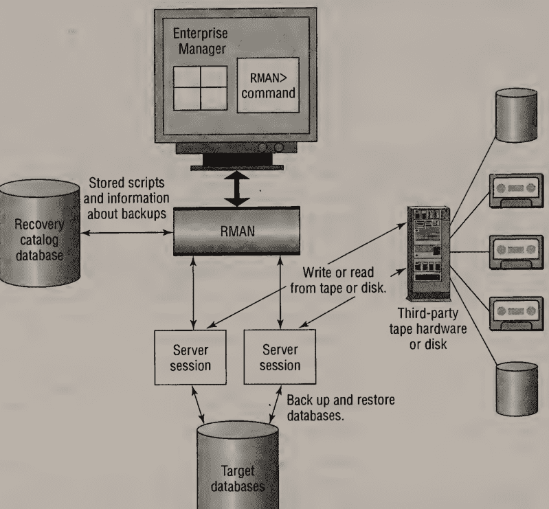

# 使用 RMAN 仓库和控制文件存储信息

RMAN 工具使用两种方法来存储有关备份的目标数据库的信息。每种方法被称为 RMAN 仓库。当 RMAN 使用第一方法时，它访问一个可选的备份信息 RMAN 目录。在第二方法中，它访问目标数据库控制文件中必要的备份信息。如果不使用可选的恢复目录数据库，则使用目标数据库的控制文件作为 RMAN 仓库。RMAN 在恢复目录或目标数据库控制文件中运行所需的信息也被称为 RMAN 仓库。无论是否使用目录，目标数据库的控制文件始终会更新。在下一段中，我们将讨论将恢复目录作为存储信息的 RMAN 仓库，然后列出可以在这种方法中使用的命令。在列表之后，我们将关注使用控制文件作为 RMAN 仓库。

Oracle 建议将 RMAN 备份数据存储在恢复目录中，而不是目标数据库的控制文件中。如果您以此方式存储数据，RMAN 工具将具有完整功能。此恢复目录是另一个 Oracle 数据库，具有特殊的 RMAN 目录表，存储备份的元数据。使用此数据库时，可以执行检查备份和可用磁带等活动。此外，使用这种方法可以在恢复目录中创建并存储脚本供以后使用。该数据库也可以进行备份，以确保其包含的信息安全。我们将在第 13 章“恢复目录的创建与维护”中详细讨论恢复目录数据库。

在详细讨论第二方法之前，请看这些命令。只有在在使用 RMAN 恢复目录作为 RMAN 仓库时，才允许这些命令。

- `CREATE CATALOG`
- `UPGRADE CATALOG`
- `DROP CATALOG`
- `CREATE SCRIPT`
- `DELETE SCRIPT`
- `REPLACE SCRIPT`
- `PRINT SCRIPT`
- `LIST STORED FILES`
- `LIST INCARNATION`
- `REGISTER DATABASE`
- `REPORT SCHEMA AT TIME`
- `RESET DATABASE`
- `RESYNC`

如前所述，RMAN 实用程序还允许您不使用此恢复目录数据库连接到目标数据库。虽然 Oracle 不推荐这种方法，但它确实有其用处。（例如，如果创建和维护恢复目录的开销对您的组织来说太大了，您可能会使用这种方法。）

如果您在没有恢复目录的情况下使用 RMAN，您将存储关于每个目标数据库控制文件的大部分必要信息，它作为 RMAN 仓库。因此，您必须管理目标数据库的控制文件以支持这些数据。`init.ora` 文件中的 `CONTROL_FILE_RECORD_KEEP_TIME` 参数决定了 RMAN 生成的信息在控制文件中保留多长时间。该参数的默认值为 7 天，但最多可以长达 365 天。数值越大，控制文件就越大，以便存储更多信息。控制文件的大小只能达到操作系统允许的程度，因此请注意这一点。存储在控制文件中信息存储在可重用区域中。如果 `CONTROL_FILE_RECORD_KEEP_TIME` 参数的值为 1 或更多，这些重用区域将会增长。可重用区域由以下类别组成：

- 归档日志 (Archived log)
- 备份数据文件 (Backup data file)
- 备份重做日志 (Backup redo log)
- 副本损坏 (Copy corruption)
- 删除的对象 (Deleted object)
- 离线范围 (Offline range)
- 备份损坏 (Backup corruption)
- 备份分 (Backup piece)
- 备份集 (Backup set)
- 数据文件副本 (Data file copy)
- 日志历史 (Log history)

## 描述通道分配

通道分配是您可以用于连接 RMAN 和目标数据库的方法。在执行此操作时，您还可以确定服务器进程执行备份或恢复操作时使用的 I/O 设备类型。图 8.3 显示此示例。I/O 设备可以是带或磁盘（在图 8.3 中，您可以看到两者）。

## 图 8.3 通道分配

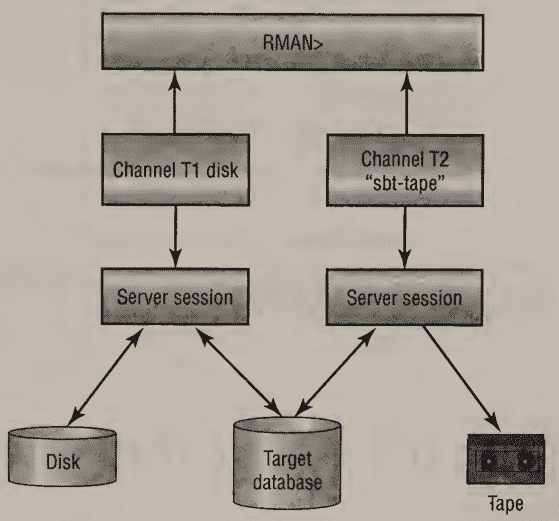

通道可以手动分配或自动分配。手动通道分配在您发行 `ALLOCATE CHANNEL` 命令时执行，该命令会在目标数据库的服务器上启动一个服务器进程。要手动写入到磁盘文件系统，您将使用 `ALLOCATE CHANNEL <name> TYPE DISK` 命令。同样，要写入磁带备份系统，您将使用 `ALLOCATE CHANNEL <channel name> TYPE SBT_TAPE` 命令。这些是最常见的手动通道分配。

自动通道分配是在您 RMAN 命令提示符处设置 RMAN 配置时执行的。您通过使用 `CONFIGURE DEFAULT DEVICE` 或 `CONFIGURE DEVICE` 命令来实现。当您执行 `BACKUP`、`RESTORE` 或 `DELETE` 命令时，这种分配是自动的。通过使用 `CONFIGURE` 命令，您可以消除每次执行 `BACKUP`、`RESTORE` 或 `DELETE` 时使用 `ALLOCATE CHANNEL <name> TYPE DISK` 或 `SBT_TAPE` 命令的需求。自动通道分配命令的完整列表如下：

- `CONFIGURE DEVICE TYPE PARALLELISM`
- `CONFIGURE DEFAULT DEVICE TYPE`
- `CONFIGURE CHANNEL DEVICE TYPE`
- `CONFIGURE CHANNEL n DEVICE TYPE`

磁盘和磁带设备类型有一些默认命名规范——`ORA_MAINT_DISK_n` 和 `ORA_SBT_TAPE_n`。下面的示例显示默认设备类型设置为 `DISK`，并行度设置为 `1`。这意味着如果您不手动分配通道，您将获得下面列出的参数。

```
RMAN> show all;
RMAN 配置参数为：
```


CONFIGURE DEFAULT DEVICE TYPE TO DISK; # default

CONFIGURE DEVICE TYPE DISK PARALLELISM 1; # default

```
RMAN>
```

## 探索媒体管理库接口

媒体管理库 (MML) 接口是一个连接 RMAN 和不同硬件厂商 ATL（自动磁带库）的 API。

所有希望与 Oracle RMAN 合作的磁带硬件供应商都将制作自己的 MML。这是必须的，因为大多数磁带硬件设备是专用的，并且需要不同的程序调用。MML 被链接到 Oracle 数据库内核中，以便 RMAN 服务器进程可以读取并向磁带设备写入 Oracle 数据。8.4 节描述了这一概念。

> Oracle 提供了一个第三方媒体管理库 (MML)，它默认包含在带有 RMAN 的软件安装中。该 MML 与 Legato Storage Manager (LSM) 软件配合使用，后者将管理自动磁带库 (ATL)。

## 图 8.4 MML 和 RMAN 服务器进程

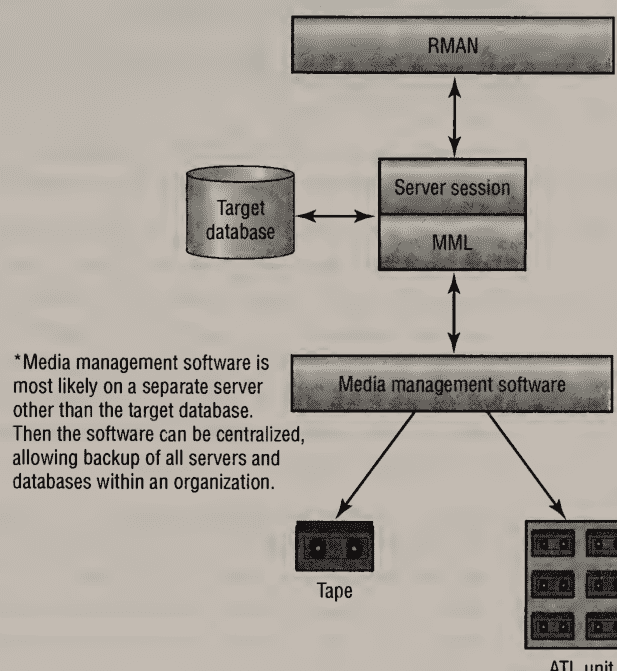

媒体管理软件可能位于目标数据库之外的单独服务器上。这样软件就可以集中化，允许对组织内的所有服务器和数据库进行备份。

当您使用 RMAN 设置 MML 时，您需要使用 OS 命令将现有的共享库替换为新的媒体供应商库。以下是在 Unix 环境下执行此操作的通用示例。

1. 如果 `$ORACLE_HOME/lib` 中存在旧的 `libobk`，则在安装媒体管理器之前删除它。例如：

```
oracle@octilli:~/oracle/product/9.0.1/rdbms/lib > rm libobk.so
```

2. 有两种方法可以从供应商访问新的媒体管理库。可以创建一个符号链接，

```
oracle@octilli: > ln -s /vendor/lib/oracle_lib.so $ORACLE_HOME/rdbms/lib/libobk.so
```

或者将库移动到 `$ORACLE_HOME/lib` 目录中。

```
oracle@octilli: > mv /vendor/lib/oracle_lib.so $ORACLE_HOME/lib/
```

## 真实世界场景：配置并使用媒体管理库

在 DBA 角色中，您配置了 RMAN 并确保其正常工作。由于您配置了 RMAN，您感到很放心。在与 ATL 交互时，某些情况下会出现这些 RMAN 脚本。让我们查看配置 `AUTOBACKUP` 控制文件时发生了什么。由于某些特定配置的脚本。

## 无带目录连接 RMAN

为了连接到目标数据库，您必须设置 `ORACLE_SID` 为目标数据库。接下来，执行 RMAN 实用程序。一旦 RMAN 实用程序启动，使用具有权限的账户执行 `CONNECT` 命令。让我们走过这一步骤：

1. 设置 `ORACLE_SID` 为目标数据库。

```
oracle@octilli:/oracle/product/9.0.1/bin > oraenv
orACLE_SID = orc9
```

2. 输入 RMAN 执行 RMAN 实用程序。

```
oracle@octilli:/oracle/product/9.0.1/bin > rman
Recovery Manager: Release 9.0.1
(c) 2001 Oracle Corporation. All rights reserved.
```

3. 执行 `CONNECT TARGET` 命令。

```
RMAN> connect target /
connected to target database: ORC9 (DBID=3960695)
```

这里是另外连接目标数据库的方法：
`oracle@octilli:~ > rman target / nocatalog`
以及
`oracle@octilli:~ > rman target /tst9`

## 配置 RMAN 环境

配置 RMAN 环境主要由在 RMAN 提示符处随时执行配置命令组成。可以通过执行 `SHOW ALL` 命令查看现有配置，正如我们在“描述通道分配”部分所做的那样。让我们查看来自目标 TST9 的 `SHOW ALL` 命令输出。

```
RMAN> show all;
```
使用目标数据库控制文件而不是使用恢复目录

RMAN 配置参数为：
CONFIGURE RETENTION POLICY TO RECOVERY WINDOW OF 5 DAYS;
CONFIGURE BACKUP OPTIMIZATION OFF; # default
CONFIGURE DEVICE TYPE TO DISK; # default
CONFIGURE CONTROLFILE AUTOBACKUP OFF; # default
CONFIGURE CONTROLFILE AUTOBACKUP FORMAT FOR DEVICE TYPE DISK TO '%F'; # default
CONFIGURE DEVICE TYPE DISK PARALLELISM 1; # default
CONFIGURE DATAFILE BACKUP COPIES FOR DEVICE TYPE DISK TO 1; # default
CONFIGURE ARCHIVELOG BACKUP COPIES FOR DEVICE TYPE DISK TO 1; # default
CONFIGURE MAXSIZE TO UNLIMITED; # default
CONFIGURE SNAPSHOT CONTROLFILE NAME TO '/oracle/product/9.0.1/dbs/snapcf_tst9.ft

RMAN>
现在让我们查看在配置 `AUTOBACKUP` 控制文件时发生的特定示例。当我们在 RMAN 提示符上执行 `CONFIGURE CONTROLFILE AUTOBACKUP ON` 命令时，该过程开始，如下：

```
RMAN> configure controlfile autobackup on;
```
新的 RMAN 配置参数：
CONFIGURE CONTROLFILE AUTOBACKUP ON;
新的 RMAN 配置参数已成功存储

如果你想将 `AUTOBACKUP` 控制文件或其他某些配置设置恢复为默认值，可以使用 `CLEAR` 命令，如下所示：

```
RMAN> configure controlfile autobackup clear;
```

旧的 RMAN 配置参数：
CONFIGURE CONTROLFILE AUTOBACKUP ON;

RMAN 配置参数已成功重置为默认值

RMAN> 在 RMAN 中还可以使用其他配置参数。这些中每一个配置参数的使用方式都与之前的配置示例类似。其他配置参数可以分为以下几大类：

- 配置自动通道
- 配置 AUTOBACKUP 控制文件
- 配置备份留存策略
- 配置备份集的最大尺寸
- 配置备份优化
- 配置备份副本的数量
- 配置在全数据库备份中排除的表空间
- 配置快照控制文件的位置

## 总结

本章讨论了 RMAN 工具的功能和能力。通过本章，你应该已经对 RMAN 的一些基本功能有了了解。你已经学习了如何在使用或不使用恢复目录的情况下使用 RMAN，以及在什么环境下这种实践最获益。此外，你还学习了如果不使用恢复目录，使用 RMAN 对控制文件产生什么影响。你还学习了手动和自动通道分配，并探索了每个具体的示例。本章涵盖的每个主题都会出现在考试中。对于测试和工作场所来说，理解 RMAN 的组件和特性都是至关重要的。当你知道如何操作 RMAN 仓库、使用通道分配和媒体管理库（MML）以及配置 RMAN 环境时，你能够在工作中实施和使用 RMAN 时做出相应的决策。这种程度的理解在测试过程中无疑会非常有帮助。

## 考试要点

列出 RMAN 的组件。组成 RMAN 的不同组件包括通过 Oracle Enterprise Manager 进行 GUI 访问、RMAN 命令行能力、媒体管理（Media Management）支持以及可选的恢复目录数据库。

了解如何配置 RMAN 以在没有恢复目录的情况下存储备份信息。你需要配置控制文件以便存储备份信息。你可以通过设置 `CONTROL_FILE_RECORD_KEEP_TIME` 参数来实现此。

理解 RMAN 仓库或目标数据库控制文件的局限性。如果你使用 RMAN 仓库访问目标数据库的控制文件而不是你自己的数据库 RMAN 目录，则并非所有命令对你都可用。请注意这些命令。

定义通道分配。你需要理解什么是通道分配以及它它可以连接的两个 I/O 设备：磁带和磁盘。你还应该知道通道分配有两种类型：自动和手动。

配置 RMAN 环境。能够使用 `CONFIGURE` 命令以及配置此环境所需的参数。此外，注意你可以在操作系统中配置 NLS 设置和媒体管理层。

描述媒体管理库接口。熟悉媒体管理库并知道它是由磁带硬件供应商创建的库，用于将 RMAN 与他们独特的硬件设备和软件连接起来。

能够在没有恢复目录的情况下连接到 RMAN。你应该知道如何将数据库环境 `ORACLE_SID` 设置为你想要备份的正确目标数据库。

## 关键术语

在参加考试之前，请确保你熟悉以下术语：

- 自动磁带库 (ATL)
- Oracle 恢复管理器 (RMAN)
- 自动通道分配
- 可重区域 (reusable section)
- 通道分配
- RMAN 仓库
- 手动通道分配
- 目标数据库
- Oracle Enterprise Manager (OEM)

## 复习题

- 1. RMAN 工具需要使用恢复目录吗？
A. 需要恢复目录。
B. 不需要恢复目录。
C. 如果恢复目录存储在与目标数据库相同的数据库中，则需要恢复目录。

- 2. RMAN 工具有哪些功能？（选择所有适用项）
A. 备份数据库、表空间、数据文件、控制文件和归档日志
B. 压缩备份
C. 提供脚本能力
D. 测试备份是否可以恢复
E. 以上所有

- 3. RMAN 工具支持什么类型的接口？（选择所有适用项）
A. 通过 Oracle Enterprise Manager 使用 GUI
B. 命令行界面
C. 仅限命令行
D. 仅限通过 Oracle Enterprise Manager 使用 GUI

- 4. 在 RMAN 工具中可以执行哪些操作？（选择所有适用项）
A. 启动目标数据库。
B. 关闭目标数据库。
C. 给用户授予角色。
D. 创建用户账户。

- 5. 磁带媒体管理库 (MML) 使 RMAN 执行以下哪些？（选择所有适用项）
A. 与第三方磁带硬件供应商接口交互。
B. 使用第三方自动磁带库 (ATL)。
C. 写入任何磁带。
D. 写入到磁盘。

- 6. 以下哪个命令用于自动通道分配？
A. ALLOCATE CHANNEL C1 TYPE 'SBT_TAPE'
B. ALLOCATE CHANNEL C1 TYPE 'SBT_TAPE'
C. CONFIGURE DEFAULT DEVICE TYPE
D. CONFIGURE DEFAULT DEVICE DEVICE

- 7. 以下哪些命令是手动通道分配过程中的示例？（选择所有适用项）
A. ALLOCATE CHANNEL T1 TYPE DISK
B. ALLOCATE CHANNEL T1 TYPE 'SBT_TAPE'
C. CONFIGURE DEFAULT DEVICE TYPE
D. CONFIGURE DEFAULT DEVICE DEVICE

- 8. 大多数 RMAN 安装提供了以下哪些媒体管理库？
A. 支持 Legato Storage Manager 的 MML。
B. 支持磁盘的 MML。
C. 不提供的。
D. 专用于磁带。

- 9. 使用以下哪个命令设置 RMAN 会话的并行度？
A. SET DEVICE TYPE PARALLEISM
B. CONFIGURE DEVICE TYPE PARALLEISM
C. INSTALL DEVICE TYPE PARALLEISM
D. CONFIGURE DEVICE TYPE PARALLEISM

- 10. 在没有恢复目录的情况下，可以使用以下哪些命令？（选择所有适用）
A. RESYNC CATALOG
B. RESET DATABASE
C. REPLACE SCRIPT
D. LIST INCAR
E. 以上所有

- 11. 以下哪些命令描述手动分配？（选择所有适用项）
A. CONFIGURE DEVICE TYPE
B. CONFIGURE DEVICE TYPE
C. ALLOCATE CHANNEL <channel_name> TYPE 'SBT_TAPE'
D. ALLOCATE CHANNEL <channel_name> TYPE DISK

- 12. 以下哪个命令自动备份控制文件？
A. SET CONTROLFILE AUTO
B. CONFIGURE CONTROLFILE AUTO
C. SET CONTROLFILE ON
D. CONFIGURE CONTROLFILE ON

- 13. 以下哪个文件描述了 Unix？
A. libbob.sl
B. libobk.so
C. obklib.so
D. libmml1.so

- 14. 研究以下命令并选择描述该命令作用的选项。

```
RMAN> connect target /
```


# 复习题答案

10. E. 除非你已经实现了恢复目录库（recovery catalog），否则无法使用这些任何命令。

11. C, D. 这两个选项都是手动通道分配的方法。`SBT_TAPE` 支持磁带分配，`DISK` 支持磁盘分配。

12. B. `CONFIGURE CONTROLFILE AUTOBACKUP ON` 命令将配置控制文件以进行自动备份。

13. B. `libbob.so` 文件是默认的媒体管理库。必须根据所使用的供应商对其进行替换或指向相应的供应商提供的库文件。

14. B. 此命令连接到目标数据库。

15. A. 如果没有使用恢复目录库，RMAN 仓库就是目标数据库的控制文件。任何文件的大小取决于其所在的操作系统。

# 用户管理和基于 RMAN 的备份

本章涵盖的 ORACLE9i DBA 基础 II（ORACLE9i DBA FUNDAMENTALS II）考试目标如下：

- 描述用户管理的备份和恢复操作。
- 讨论与只读表空间（read-only tablespaces）相关的备份问题。
- 执行关闭数据库备份（closed database backups）。
- 执行开放数据库备份（open database backups）。
- 备份控制文件。
- 在在线备份失败后执行清理。
- 使用 `DBVERIFY` 实用程序检测损坏。
- 识别 RMAN 特定的备份类型。
- 使用 `RMAN BACKUP` 命令创建备份集（backup sets）。
- 备份控制文件。
- 备份归档 redo 日志文件（archived redo log files）。
- 使用 `RMAN COPY` 命令创建映像拷贝（image copies）。

> **注意** 目标可能会随时更改，恕不另行通知，并由 Oracle 自行决定。请访问 Oracle 认证网站（http://www.oracle.com/education/certification/）查看最新的考试目标列表。

物理备份是物理数据库文件的副本，可以通过两种方式进行。第一种是通过 Oracle 提供的恢复管理器（RMAN）工具。第二种方法是执行用户管理的（或非 RMAN）备份。本章将重点关注这两种备份。

用户管理备份多年一直被用于备份 Oracle 数据库。操作系统备份脚本是一种完全自定义的解决方案，存在与自定义解决方案相关的变体和不一致性。这种备份通常由使用脚本语言创建的操作系统备份组成，例如在 Windows NT/2000/XP 环境下使用 Korn shell 或 Bourne shell。

尽管用户管理备份在历史上很有帮助，但目前的趋势显示，大多数大型数据库站点现在都使用 RMAN 进行备份。原因在于 RMAN 具有扩展功能，并且无论什么平台都可以一致地使用。

然而，操作系统备份对 DBA 来说仍然有用。你可以利用它来训练自己，从而理解物理备份的基础。此外，许多存储子系统提供商仍然在使用用户管理备份结合第三方镜像功能，以便在短时间内完成大型备份。（第三方镜像或等效镜像功能提供了一种在硬件级别分离磁盘镜像第三份拷贝的方法。这第三份拷贝被制作可以复制到磁带的备份。）在从用户管理备份中学到尽可能多的知识后，请转向 RMAN，它是建立在这些基础之上的。

在本章中，你将学习使用用户管理备份和 RMAN 备份的各种物理备份方法。

## 用户管理的备份和恢复操作

如所述，不同的站点会根据不同需求对其用户管理的备份和恢复操作进行自定义。这种自定义之所以可能实现，是因为这类备份通常是使用 Unix shell 脚本或 Windows NT/2000/XP 批处理命令编写的。因此，这些用户管理的备份和恢复操作必须作为自定义代码进行管理，并进行大量的测试以验证其功能。

此描述同时展示了使用此类备份的优点和缺点。虽然这种自定义能力允许用户管理备份针对特殊情况进行设计（尽管还需要大量的测试和验证），但此类自定义可能会导致错误，使整个备份或恢复过程失效。

尽管存在可能的副作用，用户管理备份在 Oracle 环境中已使用了多年。除了广泛应用外，这些备份还提供了你理解整个 Oracle 备份和恢复过程（包括 RMAN）所需的构建模块。这就是为什么每位 DBA 都应该熟练掌握用户管理的备份和恢复操作。这些知识将使他们在发生故障时，无论站点使用的是用户管理备份还是基于 RMAN 的备份和恢复，都能做出正确的决策。

## 与只读表空间的操作

只读表空间的备份和恢复在某些情况下需要独特的程序。备份和恢复过程取决于备份时表空间的状态以及控制文件的状态。本节将讨论这些每种情况的影响。

只读表空间的备份所需的程序与备份读写表空间时使用的程序不同。只读表空间顾其名被标记为只读；换句话说，工作活动被禁用。因此，只要表空间保持只读状态，系统更改号（SCN）在表空间变为只读后就不会改变。这意味着在数据库发生故障后，如果表空间在备份时是只读的，则不需要对标记为只读的表空间进行恢复。只读表空间可以直接还原，归档日志将在恢复过程中应用。如果恢复的备份包含一个备份时处于读写模式但在故障时处于只读模式的表空间，则需要执行恢复。这是因为在读写模式下会发生更改。

控制文件的状态也会影响只读表空间的恢复过程。在恢复备份控制文件或在没有当前控制文件时进行恢复期间，只读表空间应处于离线状态，否则你将收到 `ORA-1233` 错误。控制文件无法在只读表在线的情况下创建。执行恢复命令之前，必须将与只读表相关的数据文件离线。在数据库恢复后，可以将只读表空间上线。我们将在第 10 章“用户管理完全恢复与 RMAN 完全恢复”中查看只读表空间恢复的示例。

## 理解关闭和开放备份

关闭备份是对未打开状态数据库的备份。通常意味着数据库已完全关闭。这种备份也被称为冷备份、离线备份或关闭备份。开放备份是对处于打开状态数据库的备份。在这种状态下，数据库完全可用。开放备份也被称为热备份或在线备份。

关闭备份的主要影响是在备份完成之前用户无法访问数据库。进行冷备份的理想先决条件是应使用 `NORMAL` 或 `IMMEDIATE` 选项关闭数据库，使数据库处于一致状态。换句话说，数据库文件在同一时间被标记了相同的 SCN。这被称为一致备份。由于不需要将归档日志中的恢复信息应用到数据文件，因此一致的关闭备份不需要恢复。图 9.1 是关闭备份的一个示例。

### 图 9.2 在 Unix 中利用热备、在线或开启备份方法进行的物理备份

```
SVRMRL> \a
SVRM > ALTER TABLESPACE <TABLESPACE_NAME> BEGIN BACKUP;
SVRM > ! cp /Disk3/datafile /staging
SVRM > ALTER TABLESPACE <TABLESPACE_NAME> END BACKUP;
```

为了恢复目的复制归档日志。将未运行过 `ALTER TABLESPACE <TABLESPACE_NAME> BEGIN/END BACKUP` 的表空间相关的所有数据文件复制到 /staging Disk6。

注意：复制与每个表空间相关的所有数据文件。

```
tar cvf /dev/rmt0 /staging
```

在开启备份期间，数据库处于不一致状态；换句话说，数据文件和控制文件的 SCN 信息并不一定一致。因此，这被称为不一致备份。这需要通过应用归档日志来恢复数据文件，从而将数据文件恢复到一致状态。

## 执行关闭式和开启式数据库备份

关闭备份和开启备份的执行方式相似——通过执行 OS 复制命令。关闭式备份可以在数据库关闭后像标准的 OS 备份一样进行。基本上，关闭备份只是对组成数据库的所有必要物理文件进行复制；这些文件包括数据文件、在线重做日志、控制文件和参数文件。

开启备份也是通过发布 OS 复制命令执行的。这些命令在 `ALTER TABLESPACE <TABLESPACE_NAME> BEGIN BACKUP` 命令和 `ALTER TABLESPACE <TABLESPACE_NAME> END BACKUP` 命令之间发布。开启备份只需要数据文件的副本。`ALTER TABLESPACE <TABLESPACE_NAME> BEGIN BACKUP` 命令会导致表中的数据文件或数据文件产生检查点（checkpoint）。数据头被盖上与这些数据块一致的 SCN。数据文件中来自数据操纵语言（DML，如 `INSERT`、`UPDATE` 和 `DELETE` 语句）的所有更改，将以与正常数据库操作期间几乎相同的方式记录在数据文件和重做日志中。然而，在执行 `ALTER TABLESPACE <TABLESPACE_NAME> END BACKUP` 命令并在恢复检查点中需要之前，数据头的 SCN 不会更新。Oracle 在执行 `ALTER TABLESPACE <TABLESPACE_NAME> BEGIN BACKUP` 命令期间会在重做日志中写入更多信息。

这就是为什么数据文件在备份方面与其他 Oracle 数据库文件（如重做日志、控制文件和 `init.ora` 文件）本质不同的原因之一。重做日志、控制文件和 `init.ora` 文件可以使用标准的 OS 复制命令复制，而无需执行任何准备步骤（如 `ALTER TABLESPACE <TABLESPACE_NAME>` 命令）。这在 Unix 环境中完全正确。在 Windows NT/2000/XP 环境中，由于对打开的文件进行了锁定，这一点部分正确。

尽管可以在数据库打开的任何时间进行热备，但在 DML 活动最少时执行热备是一个好主意。这将防止过度的重做日志，可能会损害数据性能。

以下是执行关闭式数据库备份需要的步骤：

1. 关闭你想要备份的数据库。确保使用的是 `SHUTDOWN NORMAL`、`IMMEDIATE` 或 `TRANSACTIONAL` 命令，而不是 `SHUTDOWN ABORT`。

```
oracle@octilli:/opt/oracle > sqlplus /nolog

SQL*Plus: Release 9.0.1.0.0 - Production on Sat Sep 29 00:11:37 2001
(c) Copyright 2001 Oracle Corporation. All rights reserved.

SQL> connect /as sysdba
Connected.

SQL> shutdown immediate
Database closed.
Database dismounted.
ORACLE instance shut down.
```

2. 一旦数据库关闭，将所有数据文件、参数文件和控制文件通过 OS 复制到磁盘或磁带设备。在 Unix 中，执行以下命令将数据文件、参数文件和控制文件复制到存储在磁盘上的位置，以便等待复制到磁带。

```
cp /oracle/product/9.0.1/oradata/*.dbf /staging/cold
# 数据文件

cp /oracle/admin/orc9/pfile/* /staging/cold
# INIT.ora 文件

cp /oracle/oradata/*.ctl /staging/cold
# 控制文件位置 1

cp /oracle/product/9.0.1/oradata/*.ctl /staging/cold
# 控制文件位置 2

cp /oracle/oradata/orc9/*.log /staging/cold
# 在线重做日志组 1
```

3. 重启数据库并继续正常的数据库操作。

```
SQL> startup;
```

以下是你执行开启式数据库备份将使用的步骤。在这些操作期间，数据库对用户可用，但取决于正在备份的表空间，用户的响应时间可能会降低。

1. 要确定组成数据的所有表空间，查询 `V$TABLESPACE` 和 `V$DATAFILE` 动态视图。以下是识别表空间及其相关数据文件的 SQL 语句。

```
select a.TS#, a.NAME from v$tablespace a, v$datafile b where a.TS# = b.TS#;
```

2. 确定组成数据的所有空间。每个表空间由许多数据文件组成。当表空间处于备份模式时，需要复制每个表空间。使用 Unix Shell 脚本将数据文件和表空间的列表导出到文件中，并解析为 `svrmgr` 和 `cp` 命令，以便对所有表空间和数据文件进行备份。

3. 将表空间设置为备份模式。

```
SQL> alter tablespace <tablespace_name> begin backup;
Tablespace altered.
```

4. 对备份模式下表空间的每个数据文件执行 OS 复制。

```
SQL> ! cp /oracle/product/9.0.1/oradata/orc9/users01.dbf /staging/cold
```

5. 结束表空间的备份模式。

```
SQL> alter tablespace <tablespace_name> end backup;
Tablespace altered.
```

这一系列命令可以对组成数据库的每个表空间和相关数据文件重复。数据库必须处于 `ARCHIVELOG` 模式才能执行 `ALTER TABLESPACE <TABLESPACE_NAME> BEGIN BACKUP` 和 `END BACKUP` 命令。通常，这种类型的备份在 Unix 中使用脚本语言完成，在 Windows 环境中使用第三方 GUI 工具完成。

在开启或关闭式备份期间，保留控制文件、所有归档日志和参数文件的副本是一个好主意。可以将这些内容与数据文件打包，以便将恢复所需的或可能需要的组件组合在一起。这被称为全数据库备份。

## 识别用户管理的控制文件备份

有两种类型的用户管理控制文件备份。第一类型通过执行命令完成，该命令在新目录位置创建现有控制文件的二进制副本。例如，以下命令执行了控制文件的二进制复制。

```
SQL> alter database backup controlfile to '/staging/control.ctl.bak';
```

第二类型控制文件备份会在 `USER_DUMP_DEST` 位置创建当前控制文件的 ASCII 副本，作为跟踪文件。`USER_DUMP_DEST` 参数应在 `init.ora` 中设置。在配置中符合最优灵活架构 (OFA)，这将是转储目录。控制文件的备份可以通过执行以下命令来完成：

```
SQL> alter database backup controlfile to trace;
```

跟踪文件的输出如下所示：

```
/admin/orc9/udump/ora_4976.trc
Oracle9i 企业版发布 9.0.1.0.0 - 生产
带有分区选项
JServer Release 9.0.1.0 - Production
ORACLE_HOME = /oracle/product/9.0.1
System name: Linux
Node name: octilli
Release: 2.4-4GB
Version: #1 Fri May 18 14:11:12 GMT 2001
Machine: i686
Instance name: orc9
此实例挂载的还原线程: 1
Oracle 进程数: 13
Unix 进程 ID: 4976, image: oracle@octilli (TNS V1-V3)

> *** 会话 ID:(8.7) 2001-09-29 00:29:20.499
*** 2001-09-29 00:29:20.499

# 以下命令将创建一个新的控制文件并使用它来打开数据库。
# 恢复管理器使用的数据将会丢失。
# 离线数据文件的介质恢复可能需要额外的日志。
# 仅当所有在线日志可用时才使用此命令。

STARTUP NOMOUNT
CREATE CONTROLFILE REUSE DATABASE "ORC9" NORESETLOGS ARCHIVELOG
MAXLOGFILES 50
MAXLOGMEMBERS 5
MAXDATAFILES 100
MAXINSTANCES 1
MAXLOGHISTORY 226

LOGFILE
GROUP 1 '/oracle/oradata/orc9/redo01.log' SIZE 100M,
GROUP 2 '/oracle/oradata/orc9/redo02.log' SIZE 100M,
GROUP 3 '/oracle/oradata/orc9/redo03.log' SIZE 100M

DATAFILE
'/oracle/product/9.0.1/oradata/orc9/system01.dbf',
'/oracle/product/9.0.1/oradata/orc9/undotbs01.dbf',
'/oracle/product/9.0.1/oradata/orc9/cwmleite01.dbf',
'/oracle/product/9.0.1/oradata/orc9/drsys01.dbf',
'/oracle/product/9.0.1/oradata/orc9/example01.dbf',
'/oracle/product/9.0.1/oradata/orc9/indx01.dbf',
'/oracle/product/9.0.1/oradata/orc9/tools01.dbf',
'/oracle/product/9.0.1/oradata/orc9/users01.dbf';

CHARACTER SET WE8ISO859P1
```


# 数据库恢复与备份操作

## 数据库恢复步骤

如果还原了任何数据文件，或者上次关闭不是正常或立即的，则需要恢复。

```sql
RECOVER DATABASE
```

所有日志都需要归档，并且需要切换日志。

```sql
ALTER SYSTEM ARCHIVE LOG ALL;
```

现在可以正常打开数据库了。

```sql
ALTER DATABASE OPEN;
```

向临时表空间添加临时文件的命令。在线临时文件具有完整的空间信息。其他临时文件可能需要调整。

```sql
ALTER TABLESPACE TEMP ADD TEMPFILE '/oracle/product/9.0.1/oradata/orc9/temp01.dbf' REUSE;
```

临时文件添加结束。

> ASCII 格式的控制文件备份可以作为生产数据库迁移到测试和开发服务器的常用技术的一部分。这种技术对于测试备份非常有用。

## 在线备份失败后的清理

在线备份（无论是用户管理的还是基于 RMAN 的）都执行相同的数据库命令。这些命令中的一个 `ALTER TABLESPACE <tablespace name> BEGIN BACKUP` 命令会导致表空间被置于备份模式。当所需的数据文件完全复制后，将执行 `ALTER TABLESPACE <tablespace name> END BACKUP` 命令。

如果在表空间退出备份模式之前出现问题，该表空间在恢复期间或锁定网络备份时可能会导致问题。如果数据库在表空间处于备份模式时被关闭，则在不将相关数据文件退出备份模式的情况下数据库将无法启动。有时，如果下一次计划备份尝试将已经处于备份模式的表空间置于备份模式，RMAN 可能会出现问题。这将导致下次 RMAN 备份在尝试将表空间置于备份模式时失败或挂起。

如果在线备份失败，应检查所有与表空间相关的数据文件，确保它们不处于备份模式。可以通过检查 `V$BACKUP` 视图来实现。下面的示例显示一个数据文件处于备份模式。与数据文件 4 关联的表空间应该退出备份模式。应该识别此表空间，然后使用 `ALTER TABLESPACE <tablespace_name> END BACKUP` 退出备份模式。参见下例：

1. 首先，检查是否有任何数据文件处于活动状态；如果是，则意味着表空间及其关联文件处于备份模式。在这种情况下，数据文件处于备份模式。

```sql
SELECT * FROM V$BACKUP;
```

| FILE# | STATUS |
| --- | --- |
| 1 | NOT |
| 2 | NOT |
| 3 | NOT |
| 4 | ACTIVE |
| 5 | NOT |
| 6 | NOT |
| 7 | NOT |
| 8 | NOT |

2. 其次，通过执行以下 SQL 查找哪些表空间处于备份模式。数据文件 4。

```sql
SELECT NAME, STATUS FROM V$DATAFILE;
```

| NAME | STATUS |
| --- | --- |
| 1 | NOT |
| 2 | NOT |
| 3 | NOT |
| 4 | ACTIVE |
| 5 | NOT |
| 6 | NOT |
| 7 | NOT |
| 8 | NOT |

3. 最后，通过执行以下命令将表空间退出备份模式。检查 `V$BACKUP` 视图以验证关闭数据库是安全的。

```sql
ALTER TABLESPACE TEMP END BACKUP;
```

表空间已修改。

```sql
SELECT * FROM V$BACKUP;
```

## 失败备份后的清理

| FILE# | STATUS |
| --- | --- |
| 1 | NOT |
| 2 | NOT |
| 3 | NOT |
| 4 | ACTIVE |
| 5 | NOT |
| 6 | NOT |
| 7 | NOT |
| 8 | NOT |

当表空间处于备份模式时关闭数据库会发生什么？如果发生这种情况，数据文件没有检查点，因此与其余部分不一致。当重启数据库时，数据文件被标记为不一致并需要恢复。可以通过执行 `ALTER DATAFILE '<logfile>' END BACKUP` 命令在不需要恢复的情况下解决此问题。然而，如果在这样做之前检查 `V$BACKUP` 视图，可以从根本避免这种情况。

## DBVERIFY 工具

Oracle DBVERIFY 工具通过在提示符处输入 `dbv` 执行。该工具可以指定六个参数。这些参数是 `FILE`、`START`、`END`、`BLOCKSIZE`、`LOGFILE` 和 `FEEDBACK`。表 9.1 描述了这些参数。

### 表 9.1 DBVERIFY 参数

| 参数 | 说明 | 参数默认值 |
| --- | --- | --- |
| FILE | 工具验证的数据文件 | 无默认参数 |
| START | 开始验证的块 | 数据文件的第一个块 |
| END | 结束验证的块 | 数据文件的最后一个块 |
| BLOCKSIZE | 数据库块大小。这应与 `init.ora` 参数 `DB_BLOCK_SIZE` 一致。 | 2048 |
| LOGFILE | 存储工具运行结果的日志文件 | 无默认参数 |
| FEEDBACK | 通过为每个处理的块数显示一个点来显示工具的进度。 | 0 |

通过执行 `DBV HELP=Y` 命令也可以查看此帮助信息。以下示例：

```bash
oracle@octilli::/db01/oracle/tst9 > dbv help=y
```

```
DBVERIFY: Release 9.0.1.0.0 - Production 于 Tue Oct 9 00:06:48 2001
(c) Copyright 2001 Oracle Corporation. 保留所有权利。
```

### DBVERIFY 实用程序

| 关键字 | 说明 | (默认) |
| --- | --- | --- |
| FILE | 要验证的文件起始块 | (NONE) (文件的第一个块) |
| END | 结束块 | (文件的最后一个块) |
| BLOCKSIZE | 逻辑块块大小 | (2048) |
| LOGFILE | 输出日志 | (NONE) |
| FEEDBACK | 显示进度 | (0) |
| PARFILE | 参数文件 | (NONE) |
| USERID | 段 ID (tsn.rlefile.block) | (NONE) |

```bash
oracle@octilli://db01/oracle/tst9 >
```

要运行 DBVERIFY 工具，`BLOCKSIZE` 参数必须与您的数据库块大小匹配，否则会导致错误：

```bash
oracle@octilli://db01/oracle/tst9 > dbv file=data01.dbf
```

```
DBVERIFY: Release 9.0.1.0.0 - 生产于 2001年10月9日 星期二
00:12:55 2001
(c) Copyright 2001 Oracle Corporation. 保留所有权利。
DBV-00103: 指定 BLOCKSIZE (2048) 与实际的 (8192) 不符
oracle@octilli://db01/oracle/tst9 >
```

一旦 `BLOCKSIZE` 参数设置为与数据库块大小匹配，DBVERIFY 工具即可继续执行。运行此工具共有两种方法：不指定 `LOGFILE` 参数和指定该参数。

让我们逐一查看这些示例。首先，这是未设置 `LOGFILE` 参数时的显示情况：

```bash
oracle@octilli://db01/oracle/tst9 > dbv file=data01.dbf BLOCKSIZE=8192
```

```
DBVERIFY: Release 9.0.1.0.0 - 生产于 2001年10月9日 星期二 00:10:53 2001
(c) Copyright 2001 Oracle Corporation. 保留所有权利。
DBVERIFY - 正在验证 : FILE = data01.dbf
DBVERIFY - 验证完成
检查总页数 : 6400
处理总页数 (数据) : 0
失败总页数 (数据) : 0
处理总页数 (索引) : 0
失败总页数 (索引) : 0
处理总页数 (其他) : 1
处理总页数 (段) : 0
失败总页数 (段) : 0
空页数 : 6399
标记损坏页数 : 0
流入页数 : 0
```

```bash
oracle@octilli:/db01/oracle/tst9 >
```

以下代码演示了设置了 `LOGFILE` 参数的 DBVERIFY 工具。此命令的结果被写入文件 `data01.log` 而不是屏幕。可以通过编辑日志文件来显示内容。

```bash
oracle@octilli:/db01/oracle/tst9 > dbv file=data01.dbf BLOCKSIZE=8192 LOGFILE=data01.log
```

```
DBVERIFY: Release 9.0.1.0.0 - 生产于 2001年10月9日 星期二 00:14:13 2001
(c) Copyright 2001 Oracle Corporation. 保留所有权利。
```

```bash
oracle@octilli:/db01/oracle/tst9 >
```

## 识别 RMAN 特定的备份

RMAN 工具支持三种类型的备份：

- 全量或增量
- 开放式或关闭式
- 一致性或不一致性

每种类型将在后续章节中进行描述。

### 全量备份或增量备份

全量备份和增量备份是通过数据块在目标数据库中的备份方式来区分的。**全量备份**备份数据文件中所有的数据块，无论是否被修改。**增量备份**仅备份数据文件中自上一次增量备份以来修改过的数据块。

全量备份不能作为增量备份策略的一部分。增量备份的基准备份是 0 级备份。0 级备份是该时间点上的的全量备份。因此，所有块（无论是否被修改）都会被备份，使得 0 级备份可以作为未来增量备份的基准。增量备份可以与基准备份（即 0 级备份）结合使用，在未来的某个时刻形成一个全量备份。增量备份的好处是速度更快，因为不需要备份所有的数据块。

增量备份有两种类型：差异增量（differential）和累积增量（cumulative），两者都只备份修改过的块。这两种增量备份的区别在于用于识别需要备份的已修改块的基准数据库。

**差异增量备份**仅备份自相同级别或更低级别的最近一次备份以来的块。差异增量备份将确定最近发生的是哪一次 1 级或 2 级备份，并仅备份自该备份以来更改的块。差异增量备份是默认的增量备份方式。

**累积增量备份**备份自最近的下一低级别（即 *n*-1）或更低级别的备份（其中 *n* 为现有的备份级别）以来更改的所有数据块。例如，如果你正在执行 2 级累积增量备份，该备份将仅从最近的 1 级备份中复制数据块。如果没有 1 级备份，则它将备份自最近的 0 级备份以来的所有数据块。

### 开放式备份或关闭式备份

开放式备份和关闭式备份是通过数据库的状态来区分的。开放式备份发生在数据库运行时。关闭式备份发生在数据库关闭时。

### 一致性备份或不一致备份

一致性备份和不一致备份是通过数据文件和控制文件的状态来区分的。一致性备份发生在数据库正常关闭时。不一致备份发生在数据库崩溃时。

## 使用 RMAN 的 BACKUP 和 COPY 命令

有两种可以作为 RMAN 恢复基础的主要备份源：映像拷贝（image copies）和备份集（backup sets）。

### 使用 RMAN BACKUP 创建集

`RMAN BACKUP` 命令用于执行创建备份集的备份。在使用备份命令时，目标数据库应处于挂载或打开状态。你必须手动分配一个通道供备份命令在备份过程中使用。以下是该命令的运行示例。在此示例中，你正将 US 表空间和当前控制文件备份到备份集中。

```
allocated channel: ch1
channel ch1: sid=12 devtype=DISK
Starting backup at 30-SEP-01
channel ch1: starting full datafile backupset
channel ch1: specifying datafile(s) in backupset
input datafile fno=00008 name=oracle/product/9.0.1/oradata/orc9/users01.dbf
including current controlfile in backupset
channel ch1: starting piece 1 at 30-SEP-01
channel ch1: finished piece 1 at 30-SEP-01
piece handle=oracle/product/9.0.1/dbs01d5bsmp_1_1
comment=NONE
channel ch1: backup complete, elapsed time: 00:00:08
Finished backup at 30-SEP-01
released channel: ch1
```

你无法将归档日志和数据文件包含在同一个备份中。换句话说，你需要使用 `BACKUP` 命令进行数据库或表空间备份，并且需要为备份归档日志再次使用该命令。

`BACKUP` 命令有多个可以指定的选项。这些选项可以控制备份的性能、格式、大小和类型等。以下是表 9.2 和表 9.3，它们描述了 `BACKUP` 命令选项和格式的完整列表。

### 表 9.2 BACKUP 命令选项

| 选项 | 说明 |
| :--- | :--- |
| FULL | 导致服务器会话从数据文件中将所有使用的块复制到备份集中。唯一没有被复制的块是从未使用过的块。当指定归档日志进行备份时，所有的归档日志块和重做日志块都会被复制。 |
| INCREMENTAL LEVEL INTEGER | 导致服务器会话复制自上一次增量第 n 备份以来修改过的数据块，其中 n 是 1 到 4 之间的任何整数。 |

### 表 9.2 BACKUP 命令选项（续）

| 选项 | 说明 |
| :--- | --- |
| FILESPERSET INTEGER | 确定备份集中包含多少文件。当使用此选项时，会将数据文件的数量与每个分配的通道正在备份的确定文件数量进行比较，并取两者中的较小。使用此选项是执行并行备份的另一种方法。 |
| DISKRAT INTEGER | 强制 RMAN 将数据文件分组到跨指定数量磁盘驱动器的备份集中。 |
| SKIP OFFLINE \| READONLY \| INACCESSIBLE | 从备份集中排除某些数据文件或归档重做日志。排除的文件可以包括离线数据文件、只读数据文件或不可访问的数据文件以及归档日志。 |
| MAXSIZE INTEGER | 指定备份集的最大大小。字节是默认计量单位，也可以使用千字节（K）、兆字节（M）和吉字节（G）。 |
| DELETE INPUT | 在备份集创建后删除输入文件。此选项应仅在备份归档日志、数据文件副本或备份集时使用。这等于对所有输入文件使用 `CHANGE` 和 `DELETE` 命令。 |
| INCLUDE CURRENT CONTROLFILE | 创建当前控制文件的副本并将其放在每个备份集中。 |

### 表 9.3 BACKUP 命令格式

| 格式 | 说明 |
| :--- | --- |
| %c | 指定在双份备份备份集中每个备份份的副本号。 |
| %d | 指定数据库名。 |

### 表 9.3 BACKUP 命令格式（续）

| 格式 | 说明 |
| :--- | --- |
| %n | 指定数据库名，右侧填充 n 个字符，长度等于 8 个字符。 |
| %p | 指定备份集中的备份份编号。该数字从 1 开始，每创建一个备份份就会递加 1。 |
| %s | 指定备份号。该数字从 1 开始，每创建一个备份份就会递加 1。 |
| %t | 指定备份集的时间戳。%s 和 %t 的组合可以用于为备份集形成唯一名称。 |
| %U | 此格式参数等同于 %u_%p_%c。 |

### 使用 RMAN COPY 创建映像副本

在本例中，我们将利用 `RMAN COPY` 命令为各种数据库文件创建映像副本。在示例中，你正在将系统数据文件和当前控制文件作为映像副本备份到 `/staging` 目录。

```sql
RMAN> run {
    allocate channel ch1 type disk;
    copy
    datafile 1 to '/staging/system01.dbf',
    current controlfile to '/staging/control.ctl';
}
```

```
allocated channel: ch1
channel ch1: sid=12 devtype=DISK
Starting copy at 30-SEP-01
channel ch1: copied datafile 1
output filename=/staging/system01.dbf recid=1 stamp=441840852
channel ch1: copied current controlfile
output filename=/staging/control.ctl
Finished copy at 30-SEP-01
released channel: ch1
```

### 备份控制文件

可以通过执行 `CURRENT CONTROLFILE` 命令通过 RMAN 工具程序执行控制文件备份。以下是在连接到适当的目标数据库和 RMAN 目录数据库后，在 RMAN 工具中使用该命令的简要示例。

在以下示例中，请注意在 RMAN 工具中使用此命令：

```sql
RMAN> run {
    allocate channel c1 type disk;
    backup backupformat '/cf_t_%s_%p' current controlfile;
    release channel c1;
}
```

```
allocated channel: ch1
channel ch1: sid=12 devtype=DISK
```


Starting backup at 30-SEP-01

channel `ch1`: starting full datafile backupset

channel `ch1`: specifying datafile(s) in backupset

including current controlfile in backupset

channel `ch1`: starting piece 1 at 30-SEP-01

channel `ch1`: finished piece 1 at 30-SEP-01

piece handle=`oracle/product/9.0.1/dbs01d5bsmp_1_1`

comment=`NONE`

channel `ch1`: backup complete, elapsed time: 00:00:08

Finished backup at 30-SEP-01

released channel: `ch1`

# 备份归档日志

数据库备份的一个重要部分是包含归档日志。没有归档日志，你无法从在线备份进行恢复。以下是包含归档日志的完整数据库备份示例。在本例中，首先执行的操作是备份数据库。

```
run {
  allocate channel c1 type disk;
  allocate channel c2 type disk;
  backup database;
  backup arch log all;
}
```

## 总结

用户管理备份多年来一直很流行。这种类型的备份主要由基于系统的命令组成，例如在 Unix 环境中从 Korn 或 Bourne Shell 产生的。在 Windows 环境中，可以通过第三方 GUI 工具和批命令进行。最近，RMAN 备份在许多站点变得更加流行。

备份 Oracle 数据库的基本原理可以通过分析系统备份清楚地看到。这些基本技术中的一些用于热备份（打开）示例，另一些用于冷备份（关闭）示例。如果你充分理解这些概念，就应该完全理解基于 RMAN 的备份过程。

基于 RMAN 的备份可以执行与用户管理备份相同的功能。但由于它们使用了通用的命令集，RMAN 备份往往更具标准化。在本章中，我们演示了在 RMAN 中执行各种备份操作时涉及的一些命令。

了解在线备份失败后需要清理哪些内容。可以使用 `V$BACKUP` 视图查看在线备份失败后数据文件的状态。`V$BACKUP` 视图显示数据文件在备份过程中是处于 `ACTIVE`（活动）状态还是 `INACTIVE`（非活动）状态。

了解 `DBVERIFY` 工具如何工作以检测损坏。`DBVERIFY` 工具对在线和离线数据文件运行，以识别损坏的块。

识别 RMAN 特有的备份类型。RMAN 备份有三种类型：全量/增量、开放/关闭、以及一致/不一致。

了解备份集（`backup sets`）和映像副本（`image copies`）之间的区别。备份集是以特定 RMAN 格式存储的备份；映像副本只是以与操作系统相同的格式对实际数据库文件进行的备份。你还应该熟悉 `BACKUP` 命令的选项和格式。

知道如何使用 RMAN 命令备份控制文件和归档 redo 日志（`archived redo logs`）。你应该知道如何使用正确的语法使用所有必要的 RMAN 命令来备份控制文件和归档日志。

## 关键术语

在参加考试之前，请确保你熟悉以下术语：

- `BACKUP image copies`（备份映像副本）
- `backup sets`（备份集）
- `inconsistent backup`（不一致备份）
- `closed backup`（关闭备份）
- `incremental backup`（增量备份）
- `consistent backup`（一致备份）
- `opened backup`（开放备份）
- `COPY`（拷贝）
- `physical backup`（物理备份）
- `cumulative incremental backup`（累计增量备份）
- `read-only tablespace`（只读表空间）
- `DBVERIFY utility`（DBVERIFY 工具）
- `read-write tablespace`（读写表空间）
- `differential incremental backup`（差异增量备份）
- `third mirror`（第三镜像）
- `full backup`（全量备份）
- `whole database backup`（整个数据库备份）

## 复习题

1. 哪种备份类型最接近开放备份？（选择所有适用项。）

- A. 在线备份
- B. 离线备份
- C. 热备份
- D. 冷备份

2. 在发生需要全数据库恢复的故障时，你会如何对只读表空间进行恢复？（选择所有适用项。）

- A. 如果恢复的副本是在表空间处于只读模式时制作的，则不需要恢复。
- B. 你通过将 redo 日志条目应用到只读表空间来恢复，无论表空间副本的状态如何。
- C. 如果用于恢复的备份时表空间处于读写模式，你通过将 redo 日志条目应用到只读表空间来恢复。
- D. 如果用于恢复的备份时表空间处于只读模式，你通过将 redo 日志条目应用到只读表空间来恢复。

3. 哪种类型的备份是一致的？

- A. 在线备份
- B. 开放备份
- C. 热备份
- D. 冷备份

4. 哪种类型的备份是不一致的？（选择所有适用项）
- A. 冷备份
- B. 在线备份
- C. 开放备份
- D. 关闭备份

5. 如果只读表空间在数据文件只读时从备份中恢复，需要哪种类型的恢复？
- A. 数据文件恢复
- B. 表空间恢复
- C. 数据库恢复
- D. 不需要恢复。

6. 在数据库运行时，备份控制文件的有效方法有哪些？（选择所有适用项）。
- A. 备份到跟踪文件（`trace file`）
- B. 备份到二进制控制文件
- C. OS 拷贝到磁带
- D. 备份到恢复文件

7. 关于用户管理的备份（`user-managed backup`），以下哪种描述是正确的？
- A. 这种类型的备份是使用 RMAN 工具进行的。
- B. 用户管理的备份可以使用 OS 命令和数据库命令的组合进行自定义。
- C. 用户管理的备份是 Oracle9i 中的一种新类型的备份。
- D. 用户管理的备份是 RMAN 内的备份选项之一。

8. 如果一个表空间在设置为只读模式后不久进行了备份，在恢复该表空间期间，对归档日志需要做什么操作？

- A. 需要应用所有的归档日志。
- B. 只需要应用备份之后添加的归档日志。
- C. 只需要应用备份之前添加的归档日志。
- D. 不需要应用任何归档日志。

9. 关于 RMAN 映像副本，以下哪种陈述是正确的？
- A. 它可以备份到磁带或磁盘。
- B. 它只能备份到磁盘。
- C. 它可以只能备份到磁带。
- D. 它可以只能拷贝到磁带。

10. 冷备份要求数据库处于什么状态？（选择所有适用项。）
- A. `ARCHIVELOG` 模式
- B. `NOARCHIVELOG` 模式
- C. 数据库必须启动。
- D. 数据库不能包含任何只读表空间。

11. 为了执行开放或热备份，数据库必须处于什么状态？
- A. `ARCHIVELOG` 模式
- B. `NOARCHIVELOG` 模式
- C. 关闭
- D. 必须启用自动归档。

12. 热备份在数据库发生什么操作时运行效果最好？
- A. 密集的 DML 活动
- B. 密集的批处理
- C. 数据库正在关闭。
- D. 低频率的 DML 活动

13. 使用哪种方法可以清理失败的在线或热备份？
- A. 关闭数据库
- B. 查询 `V$SPACE`
- C. 查询 `V$BACKUP`
- D. 查询 `V$DATAFILE`

14. 哪种工具可以检查数据文件是否有损坏？
- A. `VALIDATE`
- B. `DBVERIFY`
- C. `VERIFIED`
- D. `VERIFY`

15. 以下哪些是 RMAN 备份的类型？（选择所有适用项）
- A. 开放和关闭
- B. 全量和增量
- C. 一致和不一致
- D. 控制文件

## 复习题答案

- 1. A, C
- 2. A, D
- 3. D
- 4. B, C
- 5. D
- 6. A, B
- 7. B
- 8. D
- 9. B
- 10. B, C
- 11. A
- 12. D
- 13. C
- 14. B
- 15. A, B, C

# 介质恢复概述

在本章中，我们将重点关注介质故障以及如何从中恢复。有两种方法可以用于从介质故障中恢复：用户管理的恢复和基于 RMAN 的恢复。本章将使用示例来演示每种类型之间的差异。

正如我们在之前的章节中讨论过的那样，你选择运行的模式（`ARCHIVELOG` 模式或 `NOARCHIVELOG` 模式）决定了你可以执行的恢复选项。本章将进一步介绍这些选项以及你所运行的模式。你还将熟悉使用用户管理方法和 RMAN 恢复方法分别对 `ARCHIVELOG` 模式和 `NOARCHIVELOG` 模式进行介质恢复的示例。除了对恢复方法进行详细讨论外，你还将查看需要重定位文件的文件的恢复情况，并学习在不同情况下处理只读表空间恢复。

介质恢复是测试过程和工作环境中的关键任务。如何处理介质恢复情况取决于执行恢复的 DBA。你可以通过测试各种介质恢复情况来提高自己执行此类恢复的能力，从而获得信心。通过这种练习，当你需要执行介质恢复时，你的不确定性将显著减少。测试恢复情况还将为你作为 DBA 将会经历的现实情况做好准备。

## 定义介质恢复

介质恢复是一种用于恢复任何当前使用的不可用数据文件、控制文件或在线重做日志文件的恢复类型。数据文件或控制文件可能由于多种原因变得不可用——它可能已经丢失、被删除或从原始位置移动，也可能由于数据损坏或硬件故障而损坏。所有这些情况都会导致 Oracle 数据库无法对这些文件进行读取或写入。

当发生需要介质恢复的情况时，DBA 必须恢复不可用的文件。如果数据库处于 `ARCHIVELOG` 模式，你必须通过将归档日志应用到恢复的文件来恢复这些文件。这将使恢复的文件与数据库的其余数据文件一样，恢复到最新状态。

## 使用 NOARCHIVELOG 和 ARCHIVELOG 模式进行恢复

DBA 可以做出的最重要的备份和恢复决策之一是在以 `ARCHIVELOG` 模式还是 `NOARCHIVELOG` 模式运行。此决策的结果会极大影响备份和恢复选项。

当数据库处于 `ARCHIVELOG` 模式时，它会以离线重做日志或归档日志的形式生成历史更改。这意味着，数据库在创建副本之前不会重写在线重做日志，而这个副本被称为离线重做日志或归档日志。这些日志可以应用到数据文件的备份上，以恢复数据库到故障点为止。图 10.1 描述了 `ARCHIVELOG` 模式下的完全恢复。

当数据库处于 `NOARCHIVELOG` 模式时，它不会生成历史更改；因此，没有归档日志。数据库在不创建归档日志的情况下直接重写在线重做日志。因此，没有生成并保存供备后使用的历史信息。图 10.2 描述了 `NOARCHIVELOG` 模式下的恢复。尽管这被称为完全恢复，但恢复过程将丢失事务，因为你没有生成用于在恢复过程中应用的归档日志。

### 图 10.1 1 月 28 日介质故障在 ARCHIVELOG 模式下的完全恢复

### 图 10.2 1 月 28 日介质故障在 NOARCHIVELOG 模式下的完全恢复（事务丢失）

一种重大的故障类型是介质故障，在大多数情况下，它要求你在恢复期间恢复所有或部分数据文件并应用重做日志。正如第 6 章“实例和介质恢复结构”中所讨论的，当数据库文件由于某些原因无法访问时，就会发生介质故障。通常原因是磁盘崩溃或控制器故障。

## 现实场景

### 介质故障和恢复的危险

介质故障通常被认为是最危险的故障类型，而且恢复起来最棘手。这种类型故障的严重程度可能从丢失或意外删除数据文件到严重的硬件故障不等。

无论 DBA 处理的是哪种类型的介质故障，他们必须对介质故障投入更多的分析和思考，多于处理大多数其他情况（例如与实例恢复或基本用户错误相关的情况）。事实上，在某些情况下，硬件故障会导致大量的物理数据库被重定位到新的文件系统。在某些情况下，可能需要重新创建新的文件系统并为条带、负载和冗余进行正确配置。当数据库停机时执行这项任务可能是困难的，特别是当用户无法忍受最短停机时间的情况下。在要求不那么严格的环境中，数据库可能会不可用长时间。

介质故障需要数据库恢复。如果数据库处于 `ARCHIVELOG` 模式，可以执行完全恢复。这意味着备份可以恢复到受影响的文件系统，并且可以将归档日志应用到故障点为止。因此，数据不会丢失。

如果数据库处于 `NOARCHIVELOG` 模式，在丢失某些事务的情况下无法进行恢复。这意味着备份可以恢复到受影响的文件系统，但不会保存任何归档日志。因此，数据库将只有备份时可用的事务。如果安排每晚备份一次，业务将只丢失一天的事务。另一方面，如果安排每周备份一次，业务将丢失一周的事务。最终结果是，在所有情况下，某些数据将会丢失。这是数据库的完全恢复，但不包含到故障点为止的所有事务。最终结果是数据库将类似于不完全恢复，这将在第 11 章“用户管理和基于 RMAN 的不完全恢复”中介绍。区别在于，不完全恢复是有意地在所有事务应用到数据库之前停止的，而不完全恢复要求数据库处于 `ARCHIVELOG` 模式并执行某些特定操作。

## 在 NOARCHIVELOG 模式下执行用户管理恢复

这是一个在 `NOARCHIVELOG` 模式下执行用户管理的恢复示例。在这种情况下，无法进行完全恢复。数据库在周期间一直可用。每个周六，关闭数据库并执行完整的冷备份（离线备份）。活动完成后重启数据库。

## 诊断故障

周三早上，数据库中有一个丢失或被删除的文件。启动时收到的错误如下：

```
SQL> startup

ORACLE instance started.

Total System Global Area    19504528 bytes
Fixed Size                   64912 bytes
Variable Size              16908288 bytes
Database Buffers           24576000 bytes
Redo Buffers                73728 bytes

Database mounted.
ORA-01157: cannot identify/lock data file 4 - see DBWR trace file
ORA-01110: data file 4: '/db01/ORACLE/tst9/users01.dbf'
```

由于您在 `NOARCHIVELOG` 模式下操作，您必须从上周的备份进行全数据库恢复。在 `NOARCHIVELOG` 模式下，您无法进行表空间或数据文件恢复，因为您无法回滚和向前滚动历史更改。没有归档日志应用于数据文件以使数据文件与数据库其他部分同步。周一、周二和周三输入的数据，如果可能，必须重新输入。

要执行数据库恢复，您需要从上周六的备份复制所有数据文件、在线 redo 日志控制文件，并进行全数据库恢复。然后您将这些文件复制回它们的原始位置。

## 逐步恢复

当在 `NOARCHIVELOG` 模式下操作恢复丢失的数据文件时，请按照以下步骤操作：

1. 对数据库进行冷备份以模拟周六备份。
以下是一个示例脚本，它通过关闭数据库并复制必要的数据文件、redo 日志和控制文件来执行冷备份。

```
# 用户管理的备份脚本
# 用于 tst9 的冷备份脚本
#
echo ''
echo 'starting cold backup...'
echo ''

# 停止数据库的脚本！
./stopdb-tst9.sh

echo ''
echo 'tst9 shutdown...'
echo ''

echo '清理阶段目录中的上一次备份'

rm /staging/cold/tst9/*
mv /staging/cold/tst9/*

echo ''
echo 'copying files to staging...'
echo ''

cp /db01/oracle/tst9/* /staging/cold/tst9/
cp /db02/oracle/tst9/* /staging/cold/tst9/
cp /oracle/admin/tst9/* /staging/cold/tst9/

echo ''
echo 'tst9 starting up......'
echo ''

# 启动数据库的脚本:
./startdb_tst9.sh
```

2. 验证用户 TEST 的对象是否存在于 USERS 表空间中。
这是您将移除以模拟丢失或删除数据文件的表空间。

```
select username, default_tablespace, temporary_tablespace from dba_users
```

| USER | DEFAULT_TABLESPACE | TEMPORARY_TABLESPACE |
| --- | --- | --- |
| SYS | SYSTEM | TEMP |
| SYSTEM | TOOLS | TEMP |
| OUTLN | SYSTEM | SYSTEM |
| DBSNMP | SYSTEM | SYSTEM |
| TEST | USERS | TEMP |

5 行选择。
SQL>

3. 创建表并插入数据，以模拟在周六冷备份后输入的数据。这些数据是在故障前（周一到周三）冷备份之后输入的数据。用户 TEST 在冷备份之前创建，默认表空间为 USERS。该账户拥有 connect 和 resource 权限。

```
SQL> connect test/test
SQL> create table t1 (c1 number, c2 char (50));
Statement processed.
SQL> insert into t1 values (1, 'This is a test!');
1 row processed.
SQL> commit;
Statement processed.
SQL>
```

4. 验证 USERS 表空间的数据文件位置。然后移除或删除此文件。

```
SQL> select name from v$datafile;

NAME
------------------------------------
/db01/ACLE/tst9/system01.dbf
/db01/ACLE/tst9/rbs01.dbf
```


# 数据库文件路径

- `/db01/ACLE/tst9/temp01.dbf`
- `/db01/ACLE/tst9/users01.dbf`
- `/db01/ACLE/tst9/tools01.dbf`
- `/db01/ACLE/tst9/data01.dbf`
- `/db01/ACLE/tst9/indx01.dbf`

7 rows selected.

SQL>

```bash
rm /db01/ACLE/tst9/users01.dbf
```

## 5. 数据库并验证发生“无法识别/锁定数据文件”的错误

```bash
[oracle@DS-LINUX tst9]$ sqlplus /nolog
```

```
SQL*Plus: Release 9.0.1.0 - Production on Thu Nov 1 21:04:10 2001
(c) Copyright 2001 Oracle Corporation. All rights reserved.
```

```sql
SQL> connect / as sysdba
Connected.
SQL> instance started.
Total System Global Area      19504528 bytes
Fixed Size                    64912 bytes
Variable Size               16908288 bytes
Database Buffers             2457600 bytes
Redo Buffers                73728 bytes
Database mounted.
ORA-01157: cannot identify/lock data file 4 - see DBWR trace file
ORA-01110: data file 4: /db01/ORACLE/tst9/users01.dbf
```

## 6. 关闭数据库以执行完整恢复。必须关闭数据库以恢复冷备份

```sql
SQL> shutdown
ORA-01110: database not open
Database dismounted.
ORACLE instance shut down.
SQL>
```

## 7. 通过将所有数据文件、redo 日志和控制文件复制到原始位置来执行完整数据库恢复

```bash
cp /staging/cold/tst9/* /db01/ORACLE/tst9
```

## 8. 启动数据库并检查冷备份后输入的数据是否存在。当你检查时，会发现表 t1 不存在。备份后的所有数据都必须重新输入

```bash
[oracle@DS-LINUX backup]$ sqlplus /nolog
```

```
SQL*Plus: Release 9.0.1.0 - Production on Thu Nov 1 21:04:10 2001
(c) Copyright 2001 Oracle Corporation. All rights reserved.
```

```sql
SQL> connect test/test
Connected.
SQL> select * from t1;
ORA-00942: table or view does not exist
SQL>
```

## 结论

最明显的观察是，当数据库处于 `NOARCHIVELOG` 模式时，数据会丢失。备份后的所有数据都丢失且必须重新输入。为了恢复它，必须关闭数据库。此外，您必须恢复整个数据库，而不仅仅是丢失的文件，这可能会增加恢复时间。

# 在 ARCHIVELOG 模式下执行用户完整恢复

在本例中，由于处于 `ARCHIVELOG` 模式，数据库被完全恢复。该数据库每天可用 24 小时（维护期间除外）。每天执行热备份。数据文件、归档日志和控制文件被复制到阶段目录，然后复制到磁带。副本保留在磁盘上，直到第二天再次运行热备份。当备份再次运行时，阶段目录会被清除并重写。

## 诊断故障

周三早上，数据库中有一个丢失或删除的数据文件。启动时收到的错误如下：

```sql
SQL> startup
ORACLE instance started.
Total System Global Area 19504528 bytes
Fixed Size 64912 bytes
Variable Size 16908288 bytes
Database Buffers 2457600 bytes
Redo Buffers 73728 bytes
Database mounted.
ORA-01157: cannot identify/lock data file 4 - see DBWR trace file
ORA-01110: data file 4: /db01/ORACLE/tst9/users01.dbf
```

在这种情况下，您在 `ARCHIVELOG` 模式下操作，因此只需要替换损坏或丢失的文件：`/db01/oracle/tst9/users01.dbf`。然后，打开数据库后，可以将归档日志应用于数据库。此归档日志操作将重新应用数据库的所有更改；因此不会丢失数据。

## 逐步恢复

要恢复丢失的数据文件，请采取以下步骤：

### 1. 连接到用户 TEST 并在 USERS 表空间（包含 users01.dbf）中表 t1 输入数据。这将模拟 USERS 表空间热备份中的数据

```bash
oracle@DS-LINUX backup]$ sqlplus /nolog
```

```
SQL*Plus: Release 9.0.1.0 - Production on Thu Nov 1 21:04:10 2001
(c) Copyright 2001 Oracle Corporation. All rights reserved.
```

```sql
SQL> connect test/test
Connected.
SQL> insert into t1 values (1,'This is test one before hot backup')
1 row processed.
SQL> connect / as sysdba
SQL> commit;
Statement processed.
```

```sql
SQL> select username,default_tablespace from dba_users where username = 'TEST';
USERNAME                DEFAULT_TABLESPACE
------------------------------------
TEST                               USERS
1 row selected.
```

### 2. 通过将表空间置于备份模式执行 USERS 表空间的备份。将数据文件 users01.dbf 复制到阶段目录。然后备份 USERS 表空间

```
SQL*Plus: Release 9.0.1.0.0 - Production on Thu Nov 1 21:04:10 2001
(c) Copyright 2001 Oracle Corporation. All rights reserved.
```

```sql
SQL> connect /as sysdba
Connected.
SQL> alter tablespace users begin backup;
Statement processed.
SQL ! cp /db01/ORACLE/tst9/users01.dbf /stage
SQL> alter tablespace users end backup;
Statement processed.
SQL> alter system switchfile;
Statement processed.
```

### 3. 连接到用户 TEST 并向表 t1 添加更多数据。这些数据位于第 2 和第 3 行。这些数据是在 users01.dbf 数据文件备份之后添加的，因此这些数据不属于较早复制的文件。完成后，执行日志切换以模拟数据库的正常活动。这将激活归档进程，为新添加的数据生成归档日志

```sql
SQL> connect test/test
Connected.
SQL> insert into t1 values(2,'This is test two - after hot backup');
1 row processed.
SQL> insert into t1 values(3,'This is test three - after hot backup');
1 row processed.
SQL> commit;
Statement processed.
SQL> connect / as sysdba
Connected.
SQL> alter system switch logfile;
Statement processed.
SQL> alter system switch logfile;
Statement processed.
SQL> alter system switch logfile;
Statement processed.
SQL> alter system switch logfile;
Statement processed.
```

### 4. 验证 USERS 表空间空间数据文件的位置。然后移除或删除此文件

```sql
SQL> ! rm /db01/ORACLE/tst9/users01.dbf
```

### 5. 关闭数据库。在重启时，验证是否发生了数据丢失错误

```bash
[oracle@DS-LINUX tst9]$$ sql
```

```
SQL*Plus: Release 9.0.1.0.0 - Production on Thu Nov 1 21:04:10 2001
(c) Copyright 2001 Oracle Corporation. All rights reserved.
```

```sql
SQL> connect /as sysdba
Connected to an idle instance.
SQL> startup
ORACLE instance started.
```

| Total System Global Area | 19504528 bytes |
|--------------------------|----------------|
| Fixed Size               | 649128 bytes   |
| Variable Size            | 1690288 bytes  |
| Database Buffers         | 2457600 bytes  |
| Redo Buffers             | 73728 bytes    |

Database mounted.
ORA-01157: cannot identify/lock data file 4 - 请查看 BWDR trace文件
ORA-01110: data file 4: '/db01/ORACLE/tst9/users01.dbf'
SQL>

### 6. 将恢复的数据文件设为离线（offline）。这将允许你在数据库其他部分可用户访问的同时，恢复此数据文件和表空间

```sql
SQL> alter datafile '/db01/oracle/tst9/users01.dbf' offline;
Statement processed.
```

### 7. 通过将数据文件 users01.dbf 复制回原始位置来还原单个数据文件

```bash
[oracle@DS-LINUX tst9]$ cp /stage/users01.dbf /db01/oracle/tst9
```

### 8. 在数据库打开状态下，通过执行 RECOVER DATABASE 命令开始恢复过程。然后，应用所有可用的重做日志（redo logs）；这将实现完全恢复。最后，将数据文件恢复上线（online），以便用户访问

```sql
SQL> connect /as sysdba
Connected.
SQL> recover datafile '/db01/ORACLE/tst9/users01.dbf'
ORA-00279: change 48323 generated at 03/29/00 22:04:25 needed for thread 1
ORA-00289: suggestion : /oracle/admin/tst9/archchtst9_84.log
ORA-00280: change 48323 for thread 1 is in sequence #84
指定日志：{<RET>=suggested | filename | AUTO | CANCEL}
Log applied.
ORA-00279: change 48325 generated at 03/29/00 22:05:25 needed for thread 1
ORA-00289: suggestion : /oracle/admin/tst9/arch1/archst9_85.log
ORA-00280: change 48325 for thread 1 is in sequence #85
ORA-00278: log file '/oracle/admin/tst9/arch1/archst9_84.log' no longer needed for this recovery
指定日志：{<RET>=suggested | filename | AUTO | CANCEL}
Log applied.
ORA-00279: change 48330 generated at 03/29/00 22:08:41 needed for thread 1
ORA-00289: suggestion : /oracle/admin/tst9/arch1/archst9_86.log
ORA-00280: change 48330 for thread 1 is in sequence #86
ORA-00278: log file '/oracle/admin/tst9/arch1/archst9_85.log' no longer needed for this recovery
指定日志：{<RET>=suggested | filename | AUTO | CANCEL}
Log applied.
ORA-00279: change 48330 generated at 03/29/00 22:08:41 needed for thread 1
ORA-00289: suggestion : /oracle/admin/tst9/arch1/archst9_86.log
ORA-00280: change 48330 for thread 1 is in sequence #86
ORA-00278: log file '/oracle/admin/tst9/arch1/archst9_85.log' no longer needed for this recovery
指定日志：{<RET>=suggested | filename | AUTO | CANCEL}
Log applied.
Media recovery complete.
```

```sql
SQL> alter datafile '/db01/oracle/tst9/users01.dbf' online;
Statement processed.
```

### 9. 验证即使处于离线状态也没有数据丢失

```sql
SQL> select * from t1;
--------------------
1 test one
2 test two
3 test three
3 rows.
```

## 结论

关于此场景最明显的观察是，当数据库处于 `ARCHIVELOG` 模式时，没有数据丢失。另一个重要特性是在表空间恢复期间数据库可以保持打开状态。

# 将数据文件还原到不同位置

将文件还原到不同位置，数据库必须处于 `mount` 模式。主要区别在于在 `NOARCHIVELOG` 模式下，如果丢失了文件将无法完全恢复。将文件还原到不同位置，你需要执行操作系统复制，然后使用重做日志更新控制文件。让我们走一遍此流程。

### 1. 使用操作系统命令将文件还原到新位置

### 2. 启动并挂载数据库

```bash
cp /db01/oracle/tst9/users01.dbf /db02/oracle/tst9/users01.dbf
oracle@octilli:> oraenv
ORACLE_SID = [tst9]
acle@octilli:~ sqlplus /nolog
```

```
SQL*Plus: Release 9.0.1.0.0 - Production on Mon Oct 29 23:26:23 2001
(C) Copyright 2001 Oracle Corporation. All rights reserved.
```

```sql
SQL> connect /as sysdba
Connected.
SQL> startup mount
ORACLE instance started.
```

| Total System Global Area | 75854976 bytes |
|--------------------------|----------------|
| Fixed Size               | 279680 bytes   |
| Variable Size            | 71303168 bytes |
| Database Buffers         | 4194304 bytes  |
| Redo Buffers             | 77824 bytes    |

Database mounted.
SQL>


- 3. 使用 `ALTER DATABASE RENAME` 命令指定新位置。

```sql
SQL> ALTER DATABASE RENAME FILE
2 '/db01/oracle/tst9/users01.dbf' to
3 '/db02/oracle/tst9/users01.dbf';
```

- 4. 使用 `ALTER DATABASE OPEN` 命令打开数据库。

```sql
SQL> alter database open;
Database altered.
```

# 304 第10章 · 用户管理的完全恢复与RMAN完全恢复

```bash
# echo ''
echo '正在开始离线备份...'
echo ''
# 停止数据库的脚本！
./stopdb_tst9.sh

echo ''
echo 'tst9 关闭...'
echo ''
echo '清理 staging 目录中的备份'
rm /staging/cold/tst9/*
rm /staging/cold/tst9/*
echo ''
echo '正在拷贝文件到 staging...'
echo ''
cp /db01/oracle/tst9/* /staging/cold/tst9/*
cp /db01/oracle/tst9/* /staging/cold/tst9/*
cp /oracle/admin/tst9/arch/* /staging/cold/tst9/
echo ''
echo 'tst9 启动中......'
echo ''
# 启动数据库的脚本！
./startdb_tst9.sh
```

- 3. 现在启动数据库以演示 `INDEX` 表空间失败，该表空间需要恢复、介恢复并迁移到新的文件系统。

```bash
oracle@octilli:db01/oracle/tst9 > sqlplus /noglog
```

```text
SQL*Plus: Release 9.0.1.0.0 - Production于 2001年11月1日 周四 21:04:10

(c) Copyright 2001 Oracle Corporation. 保留所有权利。

SQL> connect /sysdba

已连接到空实例。
```

# 使用归档重做日志重定位并恢复表空间 305

```sql
SQL> startup mount
ORACLE 实例已启动。
```

```text
系统全局区域 75854976 字节

固定大小 2796880 字节

变量大小 71303168 字节

数据库缓冲区 4194304 字节

重做缓冲区 77824 字节

数据库已挂载。
SQL> alter database open;
alter database open
*
第 1 行错误：
ORA-01157: 无法识别/锁定数据文件 7 - 请查看 DBWR 跟踪文件
ORA-01110: 数据文件 7: '/db01/oracle/tst9/indx01.dbf'
```

```sql
SQL>
SQL> shutdown
ORA-01109: 数据库未打开
```

- 接下来，关闭数据库。

```text
数据库已取消挂载。

ORACLE 实例已关闭。
```

- 完成此操作，从位于 `/staging/cold/tst9/indx01.dbf` 的在线备份目录将备份的 `indx01.dbf` 还原到新的文件系统 `/db02/oracle/tst9`。

```bash
oracleoctilli:/staging/cold/tst9 > cp indx01.dbf /db02/oracle/tst9/
```

- 接下来，启动并挂载数据库，然后使用 `RENAME` 命令更新控制文件，以包含 `indx01.dbf` 数据文件的新位置。

```sql
SQL> startup mount
ORACLE 实例已启动。
```

# 306 第10章 · 用户管理的完全恢复与RMAN完全恢复

```text
系统全局区域 75854976 字节

固定大小 279680 字节 

变量大小 71303168 字节 

数据库缓冲区 4194304 字节 

重做缓冲区 77824 字节

数据库已挂载。
```

```sql
SQL> alter database rename file
2 '/db02/oracle/tst9/indx01.dbf' to
3 '/db02/oracle/tst9/indx01.dbf';
```

数据库已更改。

```sql
SQL>
```

- 7. 然后，恢复数据库并应用必要的归档日志，使 `INDEX` 表空间中的 `indx01.dbf` 数据文件处于当前状态，以便打开数据库。

```sql
SQL> recover database;
ORA-00279: 更改 153845 生成于 2001/10/31 23:12:23
线程 1 需要
ORA-00289: 建议 : /oracle/admin/tst9/arch/
archst9_12.log
ORA-00280: 线程 1 的更改 153845 位于序列 #12
```

```text
指定日志：(<RET>=建议的 | 文件名 | AUTO | CANCEL)

日志已应用。

媒体恢复完成。
```

```sql
SQL> alter database open;
```

```text
数据库已更改。
```

- 8. 验证 `INDEX` 表空间及其关联数据文件已从文件系统 `/db01/oracle/tst9/` 移动到 `/db02/oracle/tst9`。

```sql
SQL> select name,status from v$datafile;
```

| NAME | STATUS |
| :--- | :--- |
| /db01/oracle/tst9/system01.dbf | SYSTEM |
| /db01/oracle/tst9/rbs01.dbf | ONLINE |
| /db01/oracle/tst9/temp01.dbf | ONLINE |
| /db01/oracle/tst9/users01.dbf | ONLINE |
| /db02/oracle/tst9/tools01.dbf | ONLINE |
| /db01/oracle/tst9/data01.dbf | ONLINE |
| /db02/oracle/tst9/indx01.dbf | ONLINE |

选择了 8 行。

```sql
SQL>
```

# 描述只读表空间恢复

对于表空间恢复有三种场景可以以只读方式发生：

- 只读备份与只读恢复
- 只读备份与只读恢复
- 只读备份与只读恢复

第一种场景是最简单的，因为它只需要只读备份。在这种情况下，SCN 不改变，只需要只读。
第二种场景需要更复杂的恢复过程，因为表空间是恢复到只读的。在这种情况下，需要应用归档日志。
最后一种场景也需要恢复，因为表空间是恢复到只读的。在这种情况下，你需要还原备份并应用归档日志到只读状态。在这种情况下，始终应用归档日志以使数据库处于只读状态。你应该在使表空间处于只读状态后进行备份，以确保数据库保持只读状态。

# 使用 RMAN 进行还原和恢复

使用 RMAN 进行还原和恢复的考虑因素包括如何通过 RMAN 从还原数据库、表空间、数据文件、控制文件和归档日志。还原和恢复可以从磁盘和磁带设备进行。
有两种主要的备份源：副本和备份集。`副本只能存储在磁盘上。`副本是数据文件、归档日志或控制文件的实际副本，并不是特殊的 RMAN 格式。RMAN 中的副本等同于 Unix 中的 `cp` 或 `dd`，或 Windows 中的 `COPY`。
在 Oracle 9 中，`REST` 命令将确定最佳可用备份集或副本。在之前的版本中，即使不需要也会总是还原。`RECOVER` 命令应用在线重做日志和归档文件来恢复数据库。

# 在 ARCHIVE 模式下执行 RMAN 恢复

作为使用 RMAN 进行还原和恢复的示例，你将在 NOARCHOG 模式下还原数据库。在此模式下还原数据库，首先必须确保数据库已正常关闭，以确保获得一致的备份。这意味着应该使用 `SHUTDOWN NORMAL`、`IMMEDIATE` 或 `TRANSACTIONAL` 关闭数据库，而不应使用 `ABORT` 命令。然后应以 MOUNT 模式启动，但不打开。这是因为当数据库打开且未开启 ARCHOG 模式时，无法对数据文件进行备份。

接下来，在 RMAN 工具中（在我们的示例中是 Unix 环境下的 tst9）。然后连接到 rcat 数据库中的恢复目录。

一旦连接到正确的目标和目录，就可以执行适当的 RMAN 备份脚本。该脚本将备份数据库。完成后，可以使用适当的 RMAN 脚本还原数据库。最后，可以打开数据库使用。让我们通过这个示例：

- 1. `ORACLE_SID` 为 tst9，即你的目标数据库，以便可以使用 SQLPlus 启动数据库。

```bash
oracle@octillii:~ > oraenv
ORACLE_SID = [tst9] ?
oracle@octillii:~ sqlplus /nolog
```

# 310 第10 章 · 用户管理的完全恢复与 RMAN 完全恢复

- 2. 在命令提示符处启动 RMAN 工具并连接到目标数据库和恢复目录数据库 rcat。

```bash
oracle@octilli:~ rman
Recovery Manager: Release 9.0.1.0 - Production
(c) Copyright 2001 Oracle Corporation. All rights reserved.
RMAN> connect target
connected to target database: tst9 (not mounted)
RMAN> connect catalog rman/rman@rcat
connected to recovery catalog database
RMAN>
```

- 3. 一旦连接到目标数据库和恢复目录，你就可以将目标数据库备份到磁盘或磁带。在本例中，你选择了磁盘。为数据库指定备份集唯一标识符的格式，然后将数据库名称与备份集编号拼接。

```bash
RMAN> run
2> {
3> allocate channel c1 type disk;
4> backup database format 'db_%u_%d_%s';
5> release channel c1;
6 >
```

```text
allocated channel: c1
channel c1: sid=11 devtype=DISK
Starting backup at 29-OCT-01
channel c1: starting datafile backupset
channel c1: specifying datafile(s) in backupset
including current controlfile in backupset
datafile fno=00001 name=/db01/oracle/tst9/system01.dbf
datafile fno=00006 name=/db01/oracle/tst9/data01.dbf
input datafile fno=00002 name=/db01/oracle/tst9/rbs01.dbf
input datafile fno=00008 name=/db01/oracle/tst9/data02.dbf
input datafile fno=00003 name=/db01/oracle/tst9/users01.dbf
input datafile fno=00004 name=/db01/oracle/tst9/temp01.dbf
input datafile fno=00007 name=/db01/oracle/tst9/ndx01.dbf
input datafile fno=00005 name=/db01/oracle/tst9/tools01.dbf
channel c1: starting piece 1 at 29-OCT-01
channel c1: finished piece 1 at 29-OCT-01
piece handle=/oracle/product/9.0.1/dbs/db_0jd7r8e3_TST_9_19 comment=NONE
channel c1: backup set complete, elapsed time: 00:01:57
Finished backup at 29-OCT-01
released channel: c1
```

- 4. 备份完成后，数据库可能已经过恢复。它必须处于挂载（mounted）状态但不能打开。在恢复脚本中，选择三个磁盘通道来利用恢复过程的并行化。`RESTORE DATABASE` 命令负责 RMAN 内部的恢复过程。不需要恢复，因为数据库处于 NOARCHIVELOG 模式且恢复了整个数据库。

```bash
RMAN> run
{allocate channel c1 type disk;
allocate channel c2 type disk;
allocate channel c3 type disk;
restore database;
}
```

- 5. 一旦数据库恢复完成，就可以正常打开和关闭。此时，应该执行启动（startup）操作以确保恢复过程成功。

```sql
SQL> alter database open;
Database altered.
SQL> shutdown
Database closed.
Database disounted.
ORACLE instance shut down.
```

```sql
SQL> startup
ORACLE instance started.
Total System Global Area 75854976 bytes
Fixed Size 279680 bytes
Variable Size 71303168 bytes
Database Buffers 4194304 bytes
Redo Buffers 77824 bytes
Database mounted.
Database opened.
SQL>
```

# 在 ARCHIVELOG 模式下执行 RMAN 恢复

作为使用 RMAN 恢复的第二个示例，将在 ARCHIVELOG 模式下恢复数据库。在这种情况下，数据库可以挂载或打开。这是因为当数据库打开并处于 ARCHIVELOG 模式时，可以备份数据库文件，方式与用户管理的 `ALTER TABLESPACE <tablespace_name> BEGIN BACKUP` 命令类似。

# 在 ARCHIVELOG 模式下执行 RMAN 完全恢复

要执行此操作，你必须连接到目标数据库（在示例的 Unix 环境中为 tst9）。然后你可以连接到 rcat 数据库中的恢复目录。

一旦你连接到正确的目标和目录，你就可以执行相应的 RMAN 备份脚本。该脚本将备份整个数据库。完成后，你可以使用相应的 RMAN 脚本恢复数据库并将其打开使用。让我们来看这个示例：

- 1. 将 `ORACLE_SID` 设置为 tst9，以便可以使用 SQL*Plus 在 MOUNT 模式下启动数据库。

```bash
oracle@octilli:~ oraenv
ORACLE_SID = [tst9] ?
oracle@octilli:~ sqlplus /nog
```

```text
SQL*Plus: Release 9.0.1.0 on Mon Oct 29 23:36:19
SQL> connect / sysdba
Connected to an idle instance.
SQL> startup
ORACLE instance started.
| Total System Global Area | 75854976 bytes |
| Fixed Size | 279680 bytes |
| Variable Size | 71303168 bytes |
| Database Buffers | 4194304 bytes |
| Redo Buffers | 77824 bytes |
SQL>
```

- 2. 在命令提示符处启动 RMAN 工具并连接到目标和恢复目录 rcat。

```bash
oracle@octilli:~ rman
Recovery Manager: Release 9.0.1.0 - Production
RMAN> connect target
connected to target database: tst9 (not mounted)
RMAN> connect catalog rman/rman@rcat
connected to recovery catalog
RMAN>
```

- 3. 一旦连接到目标和恢复目录，你就可以备份目标数据库、归档日志到磁盘或磁带。在本例中，你选择了磁盘。为数据库指定格式 `db_%u_%d_%s`，这意味着数据库将与备份集唯一标识符拼接，然后备份集编号拼接。

```bash
RMAN> run
2> {
3> allocate channel c1 type disk;
4> backup database format 'db_%u_%d_%s';
5> backup format 'log_%s_%p';
6> (archivelog all);
7> )
```


# RMAN 备份与恢复操作示例

## 完整数据库备份

```
allocated channel: c1
channel c1: sid=11 devtype=DISK

Starting backup at 30-OCT-01
channel c1: starting datafile backupset
channel c1: specifying datafile(s) in backupset
including current controlfile in backupset
datafile fno=00001 name=/db01/oracle/tst9/system01.dbf
datafile fno=00006 name=/db01/oracle/tst9/data01.dbf
input datafile fno=00002 name=/db01/oracle/tst9/rbs01.dbf
input datafile fno=00008 name=/db01/oracle/tst9/data02.dbf
input datafile fno=00003 name=/db01/oracle/tst9/users01.dbf
input datafile fno=00004 name=/db01/oracle/tst9/temp01.dbf
input datafile fno=00007 name=/db01/oracle/tst9/ndx01.dbf
input datafile fno=00005 name=/db01/oracle/tst9/tools01.dbf

channel c1: starting piece 1 at 30-OCT-01
channel c1: finished piece 1 at 30-OCT-01
piece handle=/oracle/product/9.0.1/dbs/db_Okd7tqs_TST9_20 comment=NONE
channel c1: backup set complete, elapsed time: 00:01:48
Finished backup at 30-OCT-01
```

## 归档日志备份

```
Starting backup at 30-OCT-01
current log archived
channel c1: starting archive log in backup set
channel c1: specifying archive log(s) in backup set
input archive log thread=1 sequence=1 stamp=442361669
input archive log thread=1 sequence=2 stamp=442361872
input archive log thread=1 sequence=3 stamp=442362056
input archive log thread=1 sequence=4 stamp=442362297
input archive log thread=1 sequence=5 stamp=442362415
input archive log thread=1 sequence=6 stamp=442792220
input archive log thread=1 sequence=7 stamp=443231077
input archive log thread=1 sequence=8 stamp=444439517
input archive log thread=1 sequence=9 stamp=444512889
input archive log thread=1 sequence=10 stamp=444525609
channel c1: starting piece 1 at 30-OCT-01
channel c1: finished piece 1 at 30-OCT-01
piece handle=/oracle/product/9.0.1/dbs/log_t444525610_s21_p1 comment=NONE
channel c1: backup set complete, elapsed time: 00:00:04
Finished backup at 30-OCT-01
```

## ARCHIVELOG 模式下的 RMAN 完整恢复

一旦备份完成后，数据库可能已经过恢复和还原。数据库必须处于挂载状态但不能打开。在恢复和还原脚本中，选择三个磁盘通道来利用恢复过程的并行化。这不是必须的，但它缩短了恢复时间。`RESTORE DATABASE` 命令负责 RMAN 内部的恢复；需要此命令是因为数据库处于 `ARCHIVELOG` 模式，且这些文件需要应用到数据文件中才能完成完全恢复。最后，打开数据库。

```bash
RMAN> run
{
  allocate channel c1 type disk;
  allocate channel c2 type disk;
  allocate channel c3 type disk;
  restore database;
  recover database;
  alter database open;
}
```

### 恢复过程输出

```
allocated channel: c3
channel c3: sid=13 devtype=DISK

于 30-OCT-01 开始恢复

channel c1: starting datafile backupset restore
channel c1: specifying datafile(s) to restore from backup set
restoring datafile 00001 to /db01/oracle/tst9/system01.dbf
restoring datafile 00002 to /db01/oracle/tst9/rbs01.dbf
restoring datafile 00003 to /db01/oracle/tst9/temp01.dbf
restoring datafile 00004 to /db01/oracle/tst9/users01.dbf
restoring datafile 00005 to /db01/oracle/tst9/tools01.dbf
restoring datafile 00006 to /db01/oracle/tst9/data01.dbf
restoring datafile 00007 to /db01/oracle/tst9/idx01.dbf
restoring datafile 00008 to /db01/oracle/tst9/data02.dbf
channel c1: restored backup piece 1
piece handle=/oracle/product/9.0.1/dbs/db_0kd7qts_TST9_20 tag=null params=NULL
channel c1: restore complete
Finished restore at 30-OCT-01

于 30-OCT-01 开始恢复
starting media recovery
media recovery complete
于 30-OCT-01 结束恢复
```

```
database opened
released channel: c3
released channel: c1
released channel: c2
RMAN>
```

一旦数据库完成恢复、故障备并打开，应将其正常关闭。随后应执行一次启动操作以确保恢复过程成功。

```
SQL> shutdown
Database closed.
Database dismounted.
ORACLE instance shut down.

SQL> startup
ORACLE instance started.
Total System Global Area 75854976 bytes
Fixed Size 279680 bytes
Variable Size 71303168 bytes
Database Buffers 4194304 bytes
Redo Buffers 77824 bytes
Database mounted.
Database opened.
SQL>
```

## 使用 RMAN 将数据文件恢复到不同的位置

作为第三个示例，你将使用 RMAN 恢复并还原一个数据文件。在这种情况下，数据库也将处于 `ARCHIVELOG` 模式，因为单个数据文件将进行备份。与之前的表空间示例一样，数据库将在打开状态下进行备份。

首先，在 RMAN 内部，你必须执行适当的数据文件备份脚本。对于此示例，你选择 `DATA` 表空间的数据文件。作为额外措施，你将备份当前的控制文件。

一旦数据文件完成备份，就可以开始恢复和还原过程。对于此过程，数据库应处于挂载状态但不要打开。你还需要使用 `SET NEWNAME` 命令来标识新的数据文件位置，并使用 `SWITCH` 命令在控制文件中记录位置更改。在数据库已挂载的状态下，你可以执行适当的 RMAN 脚本来恢复数据文件。步骤如下：

1. 将 `ORACLE_SID` 设置为 `ORCL`（即你的目标数据库），以便可以使用 SQL*Plus 启动或挂载数据库。
   ```
   oracle@octilli:~ > oraenv
   ORACLE_SID = [tst9] =
   ```

2. 一次性连接到 RMAN、目标数据库以及恢复目录。
   ```
   oracle@octilli:~ > rman target / catalog rman/rman@rcat
   Recovery Manager: Release 9.0.1.0.0 - Production
   (c) Copyright 2001 Oracle Corporation. All rights reserved.
   connected to target database: TST9 (DBID=1268700551)
   connected to recovery catalog database
   ```

3. 运行适当的 RMAN 脚本，将 `DATA` 数据文件备份到磁盘。
   ```bash
   RMAN> run
   2> {
   3> allocate channel ch1 type disk;
   4> backup
   5> format '%d_%u'
   6> (datafile '/db01/oracle/tst9/data02.dbf');
   7> release channel ch1;
   8> }
   ```

   ```
   allocated channel: ch1
   channel ch1: sid=12 devtype=DISK

   于 30-OCT-01 开始备份
   channel ch1: starting full datafile backupset
   channel ch1: specifying datafile(s) in backupset
   input datafile sno=00008 name=/db01/oracle/tst9/data02.dbf
   channel ch1: starting piece 1 at 30-OCT-01
   channel ch1: finished piece 1 at 30-OCT-01
   piece handle=/oracle/product/9.0.1/dbs/TST9_
   channel ch1: backup complete, elapsed time: 00:00:01
   Finished backup at 30-OCT-01
   released channel: ch1
   RMAN>
   ```

4. 一旦数据文件完成备份，你就可以通过适当的 RMAN 脚本恢复并还原数据文件。在此过程中，使用 `SET NEWNAME` 命令指定数据文件的新位置，以便数据库将被还原，并使用 `SWITCH` 命令在控制文件中记录位置更改。最后，对数据库进行恢复。
   ```bash
   RMAN> run
   2> {
   3> set newname datafile 8 to '/db01/oracle/tst9/data02.dbf';
   4> restore database;
   5> switch database;
   6> recover database;
   7> }
   ```

   ```
   执行命令：SET NEWNAME

   Starting restore at 30-OCT-01

   allocated channel: c3
   channel c3: sid=13 devtype=DISK
   channel c3: starting datafile backupset restore
   using channel c1
   channel c1: specifying datafile(s) to restore from backup set
   restoring datafile 00001 to /db01/oracle/tst9/system01.dbf
   restoring datafile 00002 to /db01/oracle/tst9/rbs01.dbf
   restoring datafile 00003 to /db01/oracle/tst9/temp01.dbf
   restoring datafile 00004 to /db01/oracle/tst9/users01.dbf
   restoring datafile 00005 to /db01/oracle/tst9/tools01.dbf
   restoring datafile 00006 to /db01/oracle/tst9/data01.dbf
   restoring datafile 00007 to /db01/oracle/tst9/idx01.dbf
   restoring datafile 00008 to /db01/oracle/tst9/data02.dbf
   channel c1: restored backup piece 1
   piece handle=/oracle/product/9.0.1/dbs/db_0kd7qts_TST9_20 tag=null params=NULL
   channel c1: restore complete
   Finished restore at 30-OCT-01
   using channel c1
   channel c1: sid=12 devtype=DISK
   channel c1: starting datafile backupset restore
   channel c1: specifying datafile(s) to restore from backup set
   restoring datafile 00008 to /db01/oracle/tst9/data copy
   channel c1: starting piece 1 at 30-OCT-01
   channel c1: finished piece 1 at 30-OCT-01
   piece handle=/oracle/product/9.0.1/dbs/TST9_
   channel c1: backup complete, elapsed time: 00:00:01
   Finished restore at 30-OCT-01
   released channel: c1
   RMAN>
   ```

   ```
   resync of recovery catalog
   full resync complete
   ```


Starting restore at 30-OCT-01
using channel c3
channel c3: sid=13 devtype=DISK
channel c3: starting datafile backupset restore
using channel c1
channel c1: specifying datafile(s) to restore
from backup set
restoring datafile 00001 to `/db01/oracle/tst9/system01.dbf`
restoring datafile 00002 to `/db01/oracle/tst9/rbs01.dbf`
restoring datafile 00003 to `/db01/oracle/tst9/temp01.dbf`
restoring datafile 00004 to `/db01/oracle/tst9/users01.dbf`
restoring datafile 00005 to `/db01/oracle/tst9/tools01.dbf`
restoring datafile 00006 to `/db01/oracle/tst9/data01.dbf`
restoring datafile 00007 to `/db01/oracle/tst9/idx01.dbf`
restoring datafile 00008 to `/db01/oracle/tst9/data02.dbf`
channel c1: restored backup piece 1
piece handle=`/oracle/product/9.0.1/dbs/db_0kd7qts_TST9_20` tag=null params=NULL
channel c1: restore complete
Finished restore at 30-OCT-01
using channel c1
channel c1: sid=12 devtype=DISK
channel c1: starting datafile backupset restore
channel c1: specifying datafile(s) to restore
from backup set
restoring datafile 00008 to `/db01/oracle/tst9/data copy`
channel c1: starting piece 1 at 30-OCT-01
channel c1: finished piece 1 at 30-OCT-01
piece handle=`/oracle/product/9.0.1/dbs/TST9_`
channel c1: backup complete, elapsed time: 00:00:01

Finished restore at 30-OCT-01
released of channel: c1

RMAN>
一旦数据库完成恢复、故障备并打开，应将其正常关闭。随后应执行一次启动操作以确保恢复过程成功。

```
SQL> shutdown
SQL> startup
```

## 使用归档日志进行表空间迁移和恢复

database opened

在此示例中，你将把一个表空间迁移到新的文件系统。你可以使用之前提到的 `SET NEWNAME` 和 `SWITCH` 命令来实现。此外，`RECOVER` 命令会对数据文件和归档日志进行备份。此过程与移动文件的主要区别在于，表空间需要离线才能将关联的数据文件移动到新位置。然而，数据库在此过程中可以打开。以下是该操作的示例。

## 使用归档日志进行表空间迁移和恢复 324

1. 将 `ORACLE_SID` 设置为 ORCL（即你的目标数据库），以便可以使用 SQL*Plus 启动或挂载数据库。

```
oracle@octilli:~ \ oraenv

ORACLE_SID = [tst9] ?
```

2. 一次性连接到 RMAN、目标数据库以及恢复目录。

```
oracle@octilli:~ > rman target / catalog rman/rman@rcat
```

```
Recovery Manager: Release 9.0.1.0.0 - Production

(c) Copyright 2001 Oracle Corporation. All rights reserved.

connected to target database: TST9 (DBID=1268700551)
connected to recovery catalog database
```

3. 运行适当的 RMAN 脚本，将 tst9 数据库备份到磁盘。

```
RMAN> run

2> {

3> allocate channel c1 type disk;

4> backup database format 'db_%u_%d_%s';

5> backup format 'log_%t_t_%s_p%p'

6> (archivelog all);

7> }
```

sql 语句: `alter tablespace tools offline immediate`

执行命令: `SET NEWNAME`

开始恢复于 31-OCT-01
分配通道: ORA_DISK_1
channel ORA_DISK_1: sid=11 devtype=backupset
channel ORA_DISK_1: 启动数据文件备份
channel ORA_DISK_1: 正在指定要从备份集中恢复的数据文件
正在恢复数据文件 00005 到 `/db02/oracle/tst9/tools01.dbf`
channel ORA_DISK_1: 已恢复备份分 1
piece handle=`/oracle/product/9.0.1/dbs/db_0kd7qtqs-TST9_20` tag=null params=NULL
channel ORA_DISK_1: 恢复完成
结束恢复于31-OCT-01

数据文件 5 已切换到数据文件副本
input datafilecopy recid=344 stamp=444610301 filename=db02/oracle/tst9/tools01.f
开始恢复目录的全量同步
全量同步完成

开始恢复于 31-OCT-01
使用通道 ORA_DISK_1

开始介恢复
介恢复
归档日志线程 1 序号 16 已在磁盘上，文件 `/oracle/admin/tst9/arch/archst9_16.log`
归档日志线程 1 序号 17 已在磁盘上，`/oracle/admin/tst9/arch/archst9_17.log`
归档日志线程 1 序号 18 已在磁盘上，文件 `/oracle/admin/tst9/arch/archst9_18.log`
归档日志
filename=`oracle/admin/tst9/arch/archst9_16.log`
thread=1 sequence=6
介恢复完成

结束恢复于 31-OCT-01

sql 语句: `alter tablespace tools online`

RMAN>

## 总结

在本章中，我们强调了介恢复。我们描述了执行介质故障 Oracle 数据库恢复的两种方法（用户管理恢复和基于 RMAN 的恢复），并对每种方法执行了特定示例。

此外，我们识别了 ARCHIVELOG 模式和 NOARCHIVELOG 模式之间的区别，并描述了两种模式对备份和恢复过程的重大影响。我们还展示了使用用户管理和 RMAN 方法进行 ARCHIVELOG 模式和 NOARCHIVELOG 模式恢复的示例。

然后，我们讨论了只读表空间恢复及其相关的三个恢复场景。每种场景都需要不同的恢复操作。我们还执行了需要文件重定位的用户管理恢复和基于 RMAN 的恢复情况。

介恢复是测试和实际工作中的一个重要课题。如何处理介质恢复情况取决于执行介恢复的 DBA 的信心程度。通过在上述所有情况的练习介恢复，你可以获得信心。这样，当你需要执行介恢复时，你的不确定性将显著减少。此类练习场景也将为你应对测试以及作为 DBA 会遇到的情况做好准备。

# 考点

理解介恢复。当数据库文件（如数据文件、控制文件或联机重做日志）不可用时，就需要介恢复。这些文件可能由于硬件故障、损坏或意外删除而变得不可用。

了解 ARCHIVELOG 模式和 NOARCHIVELOG 模式之间的恢复差异。为了执行完全恢复，数据库必须处于 ARCHIVELOG 模式。在 NOARCHIVELOG 模式下，必须执行不完全恢复——否则从上次备份到故障点之间的所有事务将丢失。

熟悉将数据文件恢复到不同位置的过程。要将数据文件恢复到不同位置，你必须使用操作系统命令将文件从备份位置复制到新位置。然后你将使用 `ALTER DATABASE RENAME FILE` 命令在控制文件中记录新的数据文件位置。

列出只读表空间恢复场景。三个只读恢复场景包括只读备份和只读恢复、只读备份和读写恢复，以及读写备份和只读恢复。你应该理解在这些场景中恢复方式有何不同。

理解执行 RMAN 备份和恢复所需的命令。`RESTORE` 命令将确定用于恢复的最佳可用备份集或镜像副本。`RECOVER` 命令将把来自联机重做日志、归档日志以及增量备份（如果使用）的必要更改应用到恢复的文件。

理解 ARCHIVELOG 和 NOARCHIVELOG 模式下的 RMAN 恢复。在 NOARCHIVELOG 模式下，你对一致性数据库使用 `RESTORE` 命令，但不使用 `RECOVER` 命令。在 ARCHIVELOG 模式下，`RESTORE` 和 `RECOVER` 命令均会被使用。

使用 RMAN 命令将数据文件恢复到不同位置。`SET NEWNAME` 命令用于指定数据文件的新位置，`SWITCH` 命令用于用新位置更新控制文件。之后，数据库将进行恢复。

使用 RMAN 命令使用归档日志重定位并恢复表空间。`SET NEWNAME` 命令用于指定数据文件的新位置，`SWITCH` 命令用于用新位置更新控制文件。注意，执行恢复前必须将表空间离线，并在恢复完成后在数据库保持打开的情况下将其置回联机状态。

## 关键术语

在考试之前，请确保你熟悉以下术语：

- ARCHIVELOG 模式
- 不完全恢复
- 冷备
- 介质恢复
- 完全恢复
- NOARCHIVELOG 模式
- 热备
- RECOVER DATABASE
- 镜像副本
- RESTORE

## 复习题

1. 哪些情况最能描述介质故障并需要恢复？（选择所有适用项）
A. 删除的文件
B. 删除的控制文件
C. 带有数据文件的磁盘
D. 存储数据文件的镜像阵列

2. 在何种模式下数据库必须执行到故障点的完全恢复？
A. NOARCHIVELOG
B. ARCHIVELOG
C. 导出
D. 日志

3. 在 ARCHIVELOG 模式下执行的是哪种类型的恢复？
A. 完全恢复
B. 部分恢复
C. 不完全恢复
D. 无恢复

4. 用户管理恢复需要哪种命令？
A. ALTER DATABASE RENAME
B. SETENAME
C. ALTER DATABASE NEWENAME
D. RENAME

5. 你对只读表空间进行了备份并将其变为读写。在下次备份之前，表空间已变为读写。你需要进行哪种操作？
A. 因为备份是只读的。
B. 因为变为只读后没有更改。
C. 因为表空间已变为读写。
D. 恢复只读表空间即可。

6. ARCH 模式需要哪种 RMAN 命令？
A. RESTORE
B. RECOVER
C. SET NEWENAME
D. SWITCH

7. 哪种 RMAN 命令负责应用增量备份和归档日志？
A. RESTORE
B. RECOVER
C. SET NEWENAME
D. SWITCH

8. 使用 RMAN 时，数据库需要处于什么模式才能执行备份恢复？
A. Opened
B. Nomount
C. Closed
D. Mount

9. 在数据库文件重定位过程中，`SWITCH` 命令负责哪些活动？
A. 重命名位置
B. 更新控制文件
C. 移动物理文件
D. 更新数据字典中的文件

10. 下列哪种恢复不需要你恢复数据库？
A. 只读表空间备份且恢复时是只读的
B. 只读表空间备份且恢复时是读写的
C. 读写表空间备份且恢复时是只读的
D. 读写表空间备份且恢复时是读写的

11. 哪些是只读表空间恢复场景？（选择所有适用项）
A. 只读备份到只读恢复
B. 只读备份到读写恢复
C. 读写备份到读写恢复
D. 读写备份到只读恢复

12. 如果按照建议程序操作，DBA 可以避免哪种只读恢复？
A. 只读备份到只读恢复
B. 只读备份到读写恢复
C. 读写备份到读写恢复
D. 读写备份到只读恢复

13. RMAN 映像复制（image copy）的独特之处在于？

- A. 它只能备份数据文件。
- B. 它只能备份到磁带。
- C. 它只能备份到磁盘。
- D. 它无法备份控制文件。

14. 关于备份集（backup set），以下哪项陈述是正确的？

- A. 它不存储在特殊的 RMAN 格式中。
- B. 它可以包含多个数据文件。
- C. 它可以包含多个数据文件和归档日志。
- D. 每个备份集只能包含一个数据文件。

15. 哪条 RMAN 命令负责从备份介质复制文件？

- A. RESTORE
- B. RENAME
- C. RECOVER
- D. SWITCH

## 复习题答案

1. E. 所有这些失败都需要进行介恢复。每次失败都会导致数据库文件不可用，这意味着需要进行还原。
2. B. 只有当数据库处于 ARCHIVELOG 模式时，才能执行到故障点之前的完全恢复。
3. A. 在 NOARCHIVELOG 模式下进行完全恢复是正确答案。尽管你正在执行完全恢复，但并不是所有的事务都被应用了，可能会丢失数据。这是因为数据库未处于 ARCHIVELOG 模式或没有生成日志。
4. A. `ALTER DATABASE RENAME FILE` 命令用于用户管理的备份。
5. C. 当只读表空间变为读写，且备份是在表空间为只读时采取的，就需要进行恢复。这意味着数据文件标头中的 SCN 已经更改，在恢复过程中需要与数据库的其他部分重新同步。
6. A. 当数据库处于 NOARCHIVELOG 模式时，`RESTORE` 命令负责恢复过程，因为不需要进行恢复。
7. B. `RECOVER` 命令将增量备份和归档日志应用到恢复过程中。
8. D. 数据库应挂载（mounted）以执行数据库还原和恢复，这样就可以读取控制文件并连接到目标数据库。
9. B. `SWITCH` 命令负责用移动文件的新位置更新控制文件。
10. A. 当表空间在备份期间是只读的，在恢复期间也是只读的，则不需要恢复。只读表空间的数据文件可以被还原，因为数据文件标头的 SCN 没有发生变化。
11. A, B, D. 只读表空间恢复的场景包括：只读到只读恢复、只读备份到读写恢复，以及读写备份到只读恢复。
12. D. 每当你将表空间设为只读时，应在之后立即进行备份。这消除了在“读写备份到只读恢复”场景下进行恢复的必要。
13. C. RMAN 映像复制类似于操作系统的复制。它只能在磁盘上执行。
14. B. 备份集可以在同一个备份集内包含多个数据文件，但不能在同一个备份集中同时包含数据文件和归档日志。与映像复制不同，备份集存储在特殊的 RMAN 格式中。
15. A. `RESTORE` 命令负责将文件从备份介质复制到目标位置。

# 用户管理和基于 RMAN 的不完全恢复

ORACLE9i: DBA 基础 II 本章涵盖的考试目标：

- 描述不完全恢复的步骤。
- 执行不完全数据库恢复。
- 识别当前重做日志文件的丢失。
- 使用 UNTIL TIME 执行不完全数据库恢复。
- 使用 UNTIL SEQUENCE 执行不完全数据库恢复。

> 考试目标可能会随时更改，恕不另行通知，并由 Oracle 酌情决定。请访问 Oracle 认证网站 (http://www.oracle.com/education/certification/) 获取最新的考试目标列表。

不完全数据库恢复需要理解重做日志（redo log）和 ARCHIVELOG 过程、Oracle 数据库的同步以及允许执行不完全恢复的选项。本章讨论了不完全恢复过程以及与每个不完全恢复选项相关的命令。还包含一个示例，展示了如何由于日志丢失或损坏执行不完全恢复。

除了用户管理的不完全恢复外，本章还演示了如何使用 RMAN 处理此过程。涵盖的 RMAN 示例介绍了如何使用 `SET UNTIL TIME` 和 `UNTIL SEQUENCE` 子句。

不完全恢复是某些类型故障的唯一恢复方法。了解何时以及如何使用不完全恢复方法非常重要。每当会导致你无法将所有更改应用回数据库的故障时，你都需要使用本章中讨论的不完全恢复方法之一。

# 描述用户管理的不完全恢复

不完全恢复发生在数据库没有完全恢复到数据库故障的时间点时。这是数据库的部分恢复，其中某些归档日志被应用到数据库，但并非全部。通过这种恢复，只有一部分事务被应用。

有三种类型的不完全介质恢复：
- 基于取消的 (Cancel-based)
- 基于时间的 (Time-based)
- 基于更改的 (Change-based)

(注：原文中后续部分存在大量重复段落，此处已按逻辑合并处理)

4. 将数据文件从备份位置恢复到正确的位置。
你通过发布操作系统命令来实现这一点。在 Unix 中，你将使用 `cp` 命令，例如所示：

```
cp /stage/data01.dbf /oracle/database/tst9/data01.dbf

cp /stage/system01.dbf /oracle/database/tst9/system01.dbf

cp /stage/rbs01.dbf /oracle/database/tst9/rbs01.dbf

cp /stage/temp01.dbf /oracle/database/tst9/temp01.dbf

cp /stage/users01.dbf /oracle/database/tst9/users01.dbf
```


cp `/stage/tools01.dbf` `/oracle/database/tst9/tools01.dbf`

cp `/stage/indx01.dbf` `/oracle/database/tst9/indx01.dbf`

```
5. 以 MOUNT 模式启动数据库。
```

```
SQL> startup mount
```

```
6. 验证所有需要恢复的数据文件均已在线。以下查询显示了每个在线数据文件的状态（系统数据文件除外，它是始终在线的；状态等于 system）。
```

```
SQL> select file#,status,enabled,name from v$datafile;
```

| FILE | STATUS | ENABLED | NAME |
| :--- | :--- | :--- | :--- |
| 1 | SYSTEM | READ WRITE | `/oracle/database/tst9/system01.dbf` |
| 2 | ONLINE | READ WRITE | `/oracle/database/tst9/rbs01.dbf` |
| 3 | ONLINE | READ WRITE | `/oracle/database/tst9/temp01.dbf` |
| 4 | ONLINE | READ WRITE | `/oracle/database/tst9/users01.dbf` |
| 5 | ONLINE | READ WRITE | `/oracle/database/tst9/tools01.dbf` |
| 6 | ONLINE | READ WRITE | `/oracle/database/tst9/data01.dbf` |
| 7 | ONLINE | READ WRITE | `/oracle/database/tst9/indx01.dbf` |

7行已。

- 7. 在 `RECOVER DATABASE` 命令中使用 `UNTIL CANCEL` 子句执行不完全恢复。

```
SQL> recover database until cancel;
```

- 8. 使用 `RESETLOGS` 选项打开数据库。

```
SQL> alter database open resetlogs;
```

对于所有类型的不完全恢复，你都必须在 `ALTER DATABASE` 命令中使用 `RESETLOGS` 子句。`RESETLOGS` 选项通过重置日志序列号并重建现有的在线 redo 日志，确保在恢复中应用的日志文件永远无法被再次使用。此过程将永久停用未归档日志文件中的所有事务，使其永远无法被恢复。同时，它会将日志文件与数据文件和控制文件同步。如果这些事务没有被清除，日志文件将产生错误的归档日志。这就是为什么在执行不完全恢复之前应该对控制文件、数据文件和 redo 日志进行备份的主要原因。

- 9. 对数据库进行新的冷或热备份。现有的备份不再有效。

> 记住，在应用 `ALTER DATABASE OPEN RESETLOGS` 命令后，之前的日志文件和备份的数据文件对于这个新恢复的数据库是无用的。这是因为日志文件中存在空隙。旧的备份数据文件和日志无法再次与数据库同步。因此，在进行任何类型的不完全恢复后，必须执行完全备份。

## 真实世界场景：使用不完全恢复迁移数据库

恢复操作可以作为工具，执行典型故障恢复以外的活动。由于原因，你需要熟悉与不完全恢复相关的备份和恢复功能及能力。

### 执行数据库不完全恢复

不完全恢复选项（例如备份控制文件结合 `RECOVER DATABASE USING BACKUP CONTROLFILE UNTIL CANCEL` 命令使用）在你尝试将数据库从一个位置移动到另一个位置时会非常有用。当你使用此类选项时，你可以出于任何目的迁移数据库，例如为了测试迁移数据库，或将数据库迁移到新服务器。你必须确保，如果你正在将数据库迁移到新服务器，新服务器上的 Oracle 数据库软件和操作系统是类似的。

这种迁移数据库的方法通过对要迁移的数据库进行热或冷备份，并将数据文件和初始化文件移动到新位置来实现。然后，你需要更改备份控制文件，指向所有物理数据库文件（如 redo 日志和数据文件）的路径引用。完成后，你需要验证你的 `ORACLE_SID` 并确保它指向正确的数据库；然后你需要在 SQL 提示符处以 `sysdba` 身份执行备份控制文件。这将在新服务器和不同位置上生成一个新的数据库。请参考 Oracle 文档获取执行此任务的精确步骤，并始终尝试在测试环境中运行此过程。

作为一名 DBA，你将由于许多原因负责建立测试环境。你会发现，为了测试和升级目的，在不同服务器之间迁移并设置数据库及应用程序的能力是一项必备技能。每当有任何重大升级时，都需要在生产环境之外的环境中进行测试。这种移动数据文件并重建控制文件的方法在许多测试和升级场景中效果良好。

### 基于时间的恢复

基于时间的恢复允许将数据库恢复到某个时间点。基于时间的恢复比基于 cancel 的选项更具灵活性。

特别是，基于时间的恢复允许将数据库恢复到某个时间点。基于时间的恢复比基于 cancel 的选项更具灵活性。

### 基于 SCN 的恢复

SCN（系统更改号）是 Oracle 用于唯一标识事务的。每个 SCN 是一个时间点。

### 丢失 redo 日志后的恢复

这些 SCN 之间的事务都包含在这些日志中。SCN 也记录在回滚段、控制文件和数据文件头中。

不完全恢复在当丢失了当前和/或活动未归档的 redo 日志时是必要的。在这种情况下，你没有故障点之前的所有 redo 日志文件，因此唯一的替代方案是恢复到故障点之前。

Oracle 已经通过改进来补偿这种失败，提供了……

在警报日志中可能会看到的错误消息有 `ORA-00255`、`ORA-00312`、`ORA-00286`，以及这些消息都指示了写入在线 redo 日志文件的问题。

在在线 redo 日志丢失后执行不完全恢复，你执行以下操作：

1. 启动 Server Manager 并执行 `CONNECT INTERNAL` 命令。
```
SQL> connect / sysdba ;
```
2. 执行 `SHUTDOWN` 命令并复制所有数据文件。
```
SQL> shutdown;
cp /stage/data01.dbf /oracle/database/tst9/data01.dbf
cp /stage/rbs01.dbf /oracle/database/tst9/rbs01.dbf
cp /stage/temp01.dbf /oracle/database/tst9/temp01.dbf
cp /stage/users01.dbf /oracle/database/tst9/users01.dbf
cp /stage/tools01.dbf /oracle/database/tst9/tools01.dbf
cp /stage/indx01.dbf /oracle/database/tst9/indx01.dbf
```
3. 执行 `STARTUP MOUNT` 命令以读取控制文件的内容。
```
SQL> startup mount;
```
4. 执行 `RECOVER DATABASE UNTIL CANCEL` 命令以启动恢复过程。
```
SQL> recover database until cancel;
```
5. 应用必要的归档日志，但不包括丢失或损坏的日志。
6. 打开数据库并重置日志文件。
```
SQL> alter database open resetlogs;
```
7. 切换日志文件，以检查新日志是否工作正常。
```
SQL> alter system switch logfile;
```
8. 关闭数据库。
```
SQL> shutdown normal;
```
9. 执行 `STARTUP` 和 `SHUTDOWN NORMAL` 命令，通过检查执行这些命令后的 alert 日志来验证数据库功能正常。
```
SQL> startup;
```
```
SQL> shutdown normal;
```
10. 执行冷备份或热备份。


如果你需要从不同的位置恢复归档日志，只需将 `LOG_ARCHIVE_DEST` 更改为归档日志文件的新位置。这可能发生在恢复场景中，即你从磁带将归档日志恢复到磁盘上的临时暂存位置。

## 使用 UNTIL TIME 执行基于 RMAN 的不完全恢复

在本例中，你将执行一种特定类型的 RMAN 不完全恢复。你将把数据库恢复到特定的时间点。为了实现这一目标，你将创建一个名为 TEST 的用户，并创建两个存储了日期和时间数据的表。然后，你将在 ARCHIVELOG 模式下执行数据库备份，恢复到 2:31（数据存储在第一个表中）和 3:59（数据存储在第二个表中）之间的某个时间。你通过 RMAN 中的 `SET UNTIL TIME` 子句完成所有这些操作；执行不完全恢复时需要使用该子句。因此，当数据库恢复后，你将看不到第二个表的数据。当恢复完成并验证后，你需要在恢复目录中注册数据库。让我们来看这个示例：

1. 将 `ORACLE_SID` 设置为 tst9（即你的目标数据库），以便可以使用 SQL 在 MOUNT 或 OPEN 模式下启动数据库。
```
oracle@octilli:~ > . oraenv
ORACLE_SID = [tst9] tst9
oracle@octilli:~ >
```
```
SQL> startup mount
Oracle instance started
database mounted
```

| 总系统全局区 (Total System Global Area) | 75854976 bytes |
| :--- | :--- |
| 固定大小 (Fixed Size) | 279680 bytes |
| 可变大小 (Variable Size) | 71303168 bytes |
| 数据库缓冲区 (Database Buffers) | 4194304 bytes |

或者
```
SQL> startup mount
ORACLE instance started.
Total System Global Area | 75854976 bytes |
Fixed Size | 279680 bytes
Variable Size | 71303168 bytes
Database Buffers | 4194304 bytes
Redo Buffers | 77824 bytes
Database mounted.
```


- 2. 一步到位连接到 RMAN、目标数据库以及恢复目录。

```
oracle@octilli:~> rman target / catalog rman/rman@rcat
```

Recovery Manager: Release 9.0.1.0.0 - Production

(c) Copyright 2001 Oracle Corporation. 保留所有。

connected to target database: TST9 (DBID=1268700551)

connected to recovery catalog database

RMAN>

- 3. 创建用户 TEST 和两个表，这些表将在整个示例中使用。数据将添加到第一个表中。可以在 SELECT 语句中看到此数据插入的结果。

```
SQL> create user test identified by test
2> default tablespace users
3> temporary tablespace temp;
Statement processed.
SQL> grant connect,resource to test;
Statement processed.
SQL> connect test/test
Connected.
SQL> create table t1 (c1 number, c2 char(50));
Statement processed.
SQL> insert into t1 values (1, to_char(sysdate, 'HH:MI DD-MON-YYYY'));
SQL> commit;
SQL> create table t2 (c1 number, c2 char(50));
Statement processed.
```

# 使用 UNTIL TIME 执行基于 RMAN 的不完全恢复

```
SQL> connect system/manager
SQL> alter system switch logfile;
Statement processed.
SQL> select * from t1;
```

C1 C2 --------------------

1 02:31 04-OCT-2001

row selected.

- 4. 备份数据库。

```
RMAN> run {
2> allocate channel ch1 type disk;
3> backup;
4>
}
```

allocated channel: ch1

ch1: sid=10 dev=DISK

Starting backup at 04-OCT-01

ch1: starting full backupset

ch1: specifying datafile(s) in backup

including controlfile in backup

input datafile fno=00001 `/oracle/database/tst9/system01.dbf`

input datafile fno=00006 `/oracle/database/tst9/data01.dbf`

input datafile fno=00002 `/oracle/database/tst9/rbs01.dbf`

input datafile fno=00003 `/oracle/database/tst9/temp01.dbf`

input datafile fno=00004 `/oracle/database/tst9/users01.dbf`

input datafile fno=00007 `/oracle/database/tst9/indx01.dbf`

input datafile fno=00005 `/oracle/database/tst9/tools01.dbf`

ch1: starting piece 1 at 04-OCT-01

piece=`/oracle/product/9.0.1/dbbs/025_1_1`

ch1: backup set complete, elapsed time:

00:01:49

Finished backup at 04-OCT-01

- 5. 备份所有日志文件。

```
RMAN> run {
2> allocate channel ch1 type disk;
3> backup;
4>
}
```

- 6. 归档日志恢复到第二个表。

```
RMAN> run {
2> allocate channel ch1 type disk;
3> backup
4>
}
```

- 7. 切换日志文件，以检查新日志是否工作正常。

- 8. 恢复到，，将数据存储到第二个表。

```
SQL> connect test/test
Connected.
SQL> connect test/test
SQL> insert into t2 values (2, to_char(sysdate, 'HH:MI DD-MON-YYYY'));
SQL> commit;
SQL> select * from t1;
```

C1 C2 --------------------

1 02:31 04-OCT-2001

row selected.

- 9. 关闭数据库。

- 10. 执行冷备份或热备份。


如果你需要从不同的位置恢复归档日志，只需将 `LOG_ARCHIVE_DEST` 更改为归档日志文件的新位置。这可能发生在恢复场景中，即你从磁带将归档日志恢复到磁盘上的临时暂存位置。

# 使用 UNTIL TIME 执行基于 RMAN 的不完全恢复

```
SQL> connect system/manager
SQL> alter system switch logfile;
Statement processed.
SQL> select * from t1;
```

C1 C2 --------------------

1 02:31 04-OCT-2001

row selected.

- 4. 备份数据库。

```
RMAN> run {
2> allocate channel ch1 type disk;
3> backup;
4>
}
```

allocated channel: ch1

ch1: sid=10 dev=DISK

Starting backup at 04-OCT-01

ch1: starting full backupset

ch1: specifying datafile(s) in backup

including controlfile in backup

input datafile fno=00001 `/oracle/database/tst9/system01.dbf`

input datafile fno=00006 `/oracle/database/tst9/data01.dbf`

input datafile fno=00002 `/oracle/database/tst9/rbs01.dbf`

input datafile fno=00003 `/oracle/database/tst9/temp01.dbf`

input datafile fno=00004 `/oracle/database/tst9/users01.dbf`

input datafile fno=00007 `/oracle/database/tst9/indx01.dbf`

input datafile fno=00005 `/oracle/database/tst9/tools01.dbf`

ch1: starting piece 1 at 04-OCT-01

piece=`/oracle/product/9.0.1/dbbs/025_1_1`

ch1: backup set complete, elapsed time:

00:01:49

Finished backup at 04-OCT-01

- 5. 备份所有日志文件。

```
RMAN> run {
2> allocate channel ch1 type disk;
3> backup;
4>
}
```

- 6. 归档日志恢复到第二个表。

```
RMAN> run {
2> allocate channel ch1 type disk;
3> backup
4>
}
```

- 7. 切换日志文件，以检查新日志是否工作正常。

- 8. 恢复到，，将数据存储到第二个表。

```
SQL> connect test/test
Connected.
SQL> connect test/test
SQL> insert into t2 values (2, to_char(sysdate, 'HH:MI DD-MON-YYYY'));
SQL> commit;
SQL> select * from t1;
```

C1 C2 --------------------

1 02:31 04-OCT-2001

row selected.

- 9. 关闭数据库。

- 10. 执行冷备份或热备份。


# 使用 UNTIL SEQUENCE 执行基于 RMAN 的不完全恢复

```
SQL> startup mount
```

Oracle 实例启动

数据库挂载

| 总系统全局区域 (Total System Global Area) | 75854976 bytes |
| --- | --- |
| 固定大小 (Fixed Size) | 279680 bytes |
| 变量大小 (Variable Size) | 71303168 bytes |
| 数据库缓冲区 (Database Buffers) | 4194304 bytes |

或者

2. 连接到 RMAN、目标数据库以及恢复目录，并一步到位连接恢复目录。

```
oracle@octctilli:~ > rman target / catalog rman/rman@rcat
```

Recovery Manager: Release 9.0.1.0.0 - Production

(c) Copyright 2001 Oracle Corporation. All rights reserved.

connected to target database: TST9 (DBID=1268700551) connected to recovery catalog database

RMAN>

3. 创建用户 TEST 和两个表，这些表将在整个示例中使用。将向第一个表添加数据。可以通过 SELECT 语句查看这些数据插入的结果。

```
oracle@octilli:~> sqlplus /nolog
```

SQL*Plus: Release 9.0.1.0.0 - Production on Fri Oct 5

00:33:53 2001

(c) Copyright 2001 Oracle Corporation. All rights reserved.

```
SQL> connect /as sysdba
Connected.
SQL> archive log list;
Database log mode Archive Mode
Automatic archival Enabled
Archive destination /oracle/admin/t9/arch
Oldest online log sequence 262
Next log sequence to archive 264
Current log sequence 264
```

4. 备份数据库并归档日志文件。

```
RMAN> run {
2> allocate channel ch1 type disk;
3> backup database;
4> backup (archivelog all);
5> }
```

allocated channel: ch1
channel ch1: sid=9 devtype=DISK

Starting backup at 05-OCT-01
channel ch1: starting full datafile backupset
channel ch1: specifying datafile(s) in backupset
including current controlfile in backupset
input datafile fno=00001 name=`/db01/oracle/tst9/system01.dbf`
input datafile fno=00006 name=`/db01/oracle/tst9/data01.dbf`
input datafile fno=00002 name=`/db01/oracle/tst9/rbs01.dbf`
input datafile fno=00003 name=`/db01/oracle/tst9/temp01.dbf`
input datafile fno=00004 name=`/db01/oracle/tst9/users01.dbf`
input datafile fno=00007 name=`/db01/oracle/tst9/idx01.dbf`
input datafile fno=00005 name=`/db01/oracle/tst9/tools01.dbf`
channel ch1: starting piece 1 at 05-OCT-01
channel ch1: finished piece 1 at 05-OCT-01
piece handle=`/oracle/product/9.0.1/dbs/05d5petc_1_1`
comment=NONE

channel ch1: backup set complete, elapsed time:

00:01:48

Finished backup at 05-OCT-01

Starting backup at 05-OCT-01

current log archived

channel ch1: starting archive log backupset

channel ch1: specifying archive log(s) in backup set

input archive log thread-1 sequence=257 recid=1 stamp=442278586

input archive log thread-1 sequence=258 recid=2 stamp=442278595

input archive log thread-1 sequence=259 recid=3 stamp=442278598

input archive log thread-1 sequence=260 recid=4 stamp=442278603

input archive log thread-1 sequence=261 recid=5 stamp=442278607

input archive log thread-1 sequence=262 recid=6 stamp=442284653

input archive log thread-1 sequence=263 recid=7 stamp=442285081

channel ch1: starting piece 1 at 05-OCT-01

channel ch1: finished piece 1 at 05-OCT-01

piece handle=`/oracle/product/9.0.1/dbs/06d5pf0q_1_1`

comment=NONE

channel ch1: backup set complete, elapsed time:

00:00:01

Finished backup at 05-OCT-01

released channel: ch1

5. 在这种情况下，存在一个损坏的在线 redo 日志序列号 264，因此你需要恢复到日志序列号 263。

```
RMAN> run {
2> allocate channel ch1 type disk;
3> set until logseq=263 thread=1;
4> restore database;
5> recover database;
6> alter database open resetlogs;
7> }
```

allocated channel: ch1

channel ch1: sid=1 devtype=DISK

executing command: SET until clause

Starting restore at 05-OCT-01

channel ch1: starting datafile restore

channel ch1: specifying datafile(s) to restore from backup set

restoring datafile 00001 to `/db01/oracle/tst9/system01.dbf`

restoring datafile 00002 to `/db01/oracle/tst9/rbs01.dbf`

restoring datafile 00003 to `/db01/oracle/tst9/temp01.dbf`

restoring datafile 00004 to `/db01/oracle/tst9/users01.dbf`

restoring datafile 00005 to `/db01/oracle/tst9/tools01.dbf`


restoring datafile 00006 to `/db01/oracle/tst9/data01.dbf`

restoring datafile 00007 to `/db01/oracle/tst9/idx01.dbf`

channel ch1: restored backup piece 1

handle=`/oracle/product/9.0.1/dbs/05d5petc_1_1`

tag=null params=NULL

channel ch1: restore complete

Finished restore at 05-OCT-01

Starting recover at 05-OCT-01

starting media recovery

archive log thread 1 sequence 262 is already on disk as file `/oracle/admin/tst9/arch/archst9_262.log`

media recovery complete

Finished recovery at 05-OCT-01

sql statement: `alter database open resetlogs`

released channel: ch1

RMAN> 接下来，你可以验证数据库已打开且日志已重置，从而恢复到损坏的日志序列 263 之前的状态。

```
SQL> archive log list
Database log mode Archive Mode
Automatic archival Enabled
Archive destination /oracle/admin/tst9/arch
Oldest online log sequence 0
Next log sequence to archive 1
Current log sequence 1
SQL>
```

7. 一旦数据库恢复完成，将其正常关闭。然后执行启动以确保恢复过程成功完成。

```
SQL> shutdown
SQL> startup
```

8. 一旦数据库验证通过，应该使用 `RESET DATABASE` 命令重新注册到 RMAN 目录。每当执行不恢复并执行 SQL `ALTER DATABASE OPEN RESETLOGS;` 命令时，必须执行此操作。你必须连接到目标数据库和恢复目录。

```
oracle@octctilli:~ > rman target / catalog rman/rman@rcat
Recovery Manager: Release 9.0.1.0 - Production
```

(c) Copyright 2001 Oracle Corporation. All rights reserved.

connected to target database: TST9 (DBID=1268700551)

connected to recovery catalog database

```
RMAN> reset database;
database registered in recovery catalog
starting full resync of recovery catalog
full resync complete
```

RMAN>

## 总结

不恢复允许你将数据库恢复到故障之前的点，或者恢复到故障时的最后一个可用事务。换句话说，由于这种类型恢复的结果，恢复的数据库缺少某些事务或是不完整的。

# 考点 357

你可能由于各种原因需要执行不恢复。需要恢复的故障类型可能是数据库内部，例如损坏错误或删除的数据库对象。这意味着恢复需要提前停止并使用所有可用的归档日志。如果不这样做，故障将在从归档日志读取事务重新引入。

另一种可能需要不恢复的情况是你的数据库丢失了当前的 redo 日志。再次，之所以只能通过不恢复来解决是因为至少有一个在线日志文件损坏或丢失。

# 考点

识别用户管理不恢复的类型。三种不同的用户管理不恢复类型是基于取消、基于时间以及基于更改的恢复。确保你理解所有这些类型。

理解如何执行用户管理的不恢复。你应该知道在不恢复过程中必须执行的命令。这些包括 `RECOVER DATABASE UNTIL CANCEL/TIME/CHANGE`。

理解如何使用 RMAN `UNTIL TIME` 命令。在基于 RMAN 的恢复中，该命令用于根据发生的时间在完全恢复之前停止恢复。

了解何时使用 `RMAN UNTIL SEQUENCE` 命令。该命令用于基于 RMAN 的不完全恢复，以便在恢复变为基于序列号（如日志序列号、序列号或 SCN）的完全恢复之前停止恢复。

## 关键术语

在参加考试之前，请确保你熟悉以下术语：

- 基于取消的恢复 (cancel-based recovery)
- 基于时间的恢复 (time-based recovery)
- 基于更改的恢复 (change-based recovery)
- `UNTIL CANCEL`
- 不完全恢复 (incomplete recovery)
- `UNTIL CHANGE`
- `RESETLOGS`
- `UNTIL TIME`
- 系统更改号 (SCN)
- `V$LOG_HISTORY`

## 复习题

1. 不完全恢复有哪三种类型？（选择所有适用项.）
   A. 基于更改的
   B. 基于时间的
   C. 基于停止的
   D. 基于取消的
   E. 基于退出的

2. 在 NOARCHIVELOG 模式下可以执行哪种类型的不完全恢复？
   A. 基于更改的
   B. 基于时间的
   C. 基于停止的
   D. 基于取消的
   E. 否

3. 你是一个 DBA，且刚刚执行了一次不完全恢复。你忽略了在不完全恢复后进行备份。在使用几小时后，由于存储某些数据文件的磁盘丢失，数据库再次故障。你可以执行哪种类型的不完全恢复？
   A. 基于更改的
   B. 基于停止的
   C. 基于时间的
   D. 基于取消的
   E. 否

4. Oracle 使用什么来唯一标识日志文件中的每个提交事务？
   A. 唯一事务 ID
   B. 静态事务 ID
   C. 系统更改号 (SCN)
   D. 序列更改号
   E. 事务更改号

5. 执行 `ALTER DATABASE OPEN RESETLOGS` 命令需要哪种类型的恢复？（选择所有适用项.）
   A. 完全恢复
   B. 不完全恢复
   C. 基于取消的恢复
   D. 基于时间的恢复

6. 应用 `ALTER DATABASE OPEN RESETLOGS` 命令后应该执行什么操作？
   A. 数据库恢复
   B. 数据库备份
   C. 数据库导入
   D. 什么都不需要

7. 哪种不完全恢复赋予 DBA 最大的控制权？
   A. 基于取消的
   B. 基于时间的
   C. 基于更改的
   D. 所有提供的控制权相等。

8. 哪种不完全恢复赋予 DBA 最小的控制权？
   A. 基于取消的
   B. 基于时间的
   C. 基于更改的
   D. 所有提供的控制权相等。

9. RMAN 不完全恢复中使用哪种命令？
   A. `SET SEQUENCE`
   B. `SET UNTIL TIME`
   C. `SET TIME`
   D. `SET CHANGE`

10. 在数据库执行完什么操作后应该执行重置（reset）命令？
    A. 使用 RESETLOGS 选项打开数据库。
    B. 恢复目录发生了物理变化。
    C. 目标数据库发生了物理变化。
    D. 数据库已完成完全恢复。

11. RMAN 基于更改的恢复具有以下哪些选项？（选择所有适用项.）
    A. LOGSEQ
    B. SEQLOG
    C. SEQUENCE
    D. SCN

12. 如果你需要对数据库进行用户管理的恢复，并且在 10 月 4 日 15:01:00 之前停止恢复，应该使用哪个命令？
    A. `SET UNTIL TIME 'OCT 04 2001 15:00:00'`
    B. `RECOVER UNTIL TIME 'OCT 04 2001 15:00:00'`
    C. `RECOVER DATABASE UNTIL TIME 'OCT 04 2001 15:00:00'`
    D. `RECOVER TABLESPACE UNTIL TIME 'OCT 04 2001 15:00:00'`

13. 下列什么情况将强制导致不完全恢复？
    A. 数据文件丢失
    B. 数据文件损坏
    C. 已归档的在线 redo日志丢失
    D. 当前在线 redo日志损坏

14. 下列哪个是所有不完全恢复中必须执行但在完全恢复中不需要执行的常用命令？
    A. `RECOVER DATABASE`
    B. `RECOVER UNTIL CANCEL`
    C. `ALTER DATABASE OPEN RESETLOGS`
    D. `RESTORE DATABASE`

15. 为了执行更改恢复可能需要哪些信息？（选择所有适用项.）
    A. SEQUENCE#
    B. FIRST_CHANGE#
    C. NEXT_CHANGE#
    D. 来自 `V$LOG_HISTORY` 的信息
    E. 以上所有

## 复习题答案

1. A, B, D. 选项 A、B 和 D 都描述了有效的不完全恢复类型。选项 C 和 E 不是不完全恢复类型。

2. E. NOARCHIVELOG 模式下无法执行不完全恢复。

3. E. 除非在第一次故障后进行了新备份，否则无法执行不完全恢复。不完全恢复之前的所有备份对于任何现有数据文件、控制文件或 redo 日志都是无效的。

4. C. 系统更改号 SCN 唯一标识日志文件中的每个提交事务。

5. B, C, D. 所有形式的不完全恢复在执行 `ALTER DATABASE OPEN` 命令期间都需要使用 `RESETLOGS` 子句。所有 redo 日志必须重置为新的序列号。这将使该数据库之前的所有日志失效。

6. B. 如果应用了 `ALTER DATABASE OPEN RESETLOGS` 命令，应该对数据库进行备份。

7. C. 基于更改的恢复赋予 DBA 对不完全恢复过程最大的控制权，因为它允许通过 SCN 号指定停止点。

8. A. 基于取消的恢复在取消或停止恢复之前应用归档日志。因此，你无法像基于更改的恢复那样恢复归档日志中的部分事务。

9. B. 基于时间的恢复根据 `SET UNTIL TIME` 命令指定的参考点应用归档日志中的更改。

10. A. 只要使用 RESETLOGS 选项打开数据库，你都需要在恢复目录中重置目标数据库。

11. A, C, D. RMAN 有三个更改选项：LOGSEQ、SEQUENCE 和 SCN。

12. C. 数据库的用户恢复将使用 `RECOVER DATABASE UNTIL TIME 'OCT 04 2001 15:00:00` 执行。

13. D. 当前在线 redo日志损坏将强制不完全恢复，因为该日志中的事务无法通过时间、更改或取消应用于恢复过程。

14. C. `ALTER DATABASE OPEN RESETLOGS` 命令在所有不完全恢复中都必须执行，但在完全恢复中不一定执行。

15. E. 以上所有选项都是来自 `V$LOG_HISTORY` 的信息。

使用 `CROSSCHECK` 命令来检查此项。当你使用此命令时，请注意所有备份都将被列为可用（available）。

在此处演示的示例中，我们使用的是包含 t 文件的磁盘介质，但带介质也可以包含这些文件。在示例中，对 TST9 数据库使用了 `CROSSCHECK` 命令。注意备份碎片 `stamp=4422842` 在这里是可用的。还要注意特殊的 `ALLOCATE COMMAND FOR MAINTENANCE TYPE DISK` 命令，它执行了作为维护活动的 `CROSSCHECK` 命令。

```
RMAN> allocate channel for maintenance type disk;

allocated channel: ORA_MAINT_DISK_1

channel ORA_MAINT_DISK_1: sid=12 devtype=DISK

RMAN> crosschecked backup of database;

+   crosschecked backup piece: found to be 'AVAILABLE'

backup piece handle=oracle/product/9.0.1/dbs/03d5peg6l_1

recid=2 stamp=4422842

crosschecked backup piece: found to be 'AVAILABLE'

backup piece handle=oracle/product/9.0.1/dbs/04d5peg1l_1

recid=3 stamp=4422846

crosschecked backup piece: found to be 'AVAILABLE'

backup piece handle=oracle/product/9.0.1/dbs/05d5petc_1

recid=4 stamp=4422842

crosschecked backup piece: found to be 'AVAILABLE'

backup piece handle=oracle/product/9.0.1/dbs/08d5srmrn_1

recid=7 stamp=4423588

crosschecked backup piece: found to be 'AVAILABLE'

backup piece handle=oracle/product/9.0.1/dbs/0ad5rppmm_1

recid=9 stamp=4423618

crosschecked backup piece: found to be 'AVAILABLE'

backup piece handle=oracle/product/9.0.1/dbs/0fd5rv49_1

recid=12 stamp=4423633

crosschecked backup piece: found to be 'AVAILABLE'

backup piece handle=oracle/product/9.0.1/dbs/0gd5rv49_1

recid=13 stamp=4423646
```

# 368 第 12 章 · RMAN 维护

在示例中，注意该文件通过 Unix 命令 `mv` 重命名后，现在被列为过期（EXPIRED）。这意味着目录库中的 EXPIRED 备份在介质上是不可用的。让我们逐步执行这一过程。

-   1. 将备份集文件 `03d5pe6s_1_1` 重命名为 `03d5pe6s_1_old`，以便目录库无法识别存储在数据库中的该文件名。

```
oracle@octilli:/oracle/product/9.0.1/dbs > mv 03d5pe6s_1_1 03d5pe6s_1_old

oracle@octilli:/oracle/product/9.0.1/dbs >
```

-   2. 接下来，重新执行 `CROSSCHECK` 命令，并注意到 `03d5pe6s_1_1` 备份已过期。

```
RMAN>

crosschecked backup piece: found to be 'EXPIRED'

backup piece handle=oracle/product/9.0.1/dbs/03d5pe6s_1_1 recid=2 stamp=4422842

crosschecked backup piece: found to be 'AVAILABLE'

backup piece handle=oracle/product/9.0.1/dbs/04d5peg1_1_1 recid=3 stamp=4422846

crosschecked backup piece: found to be 'AVAILABLE'

backup piece handle=oracle/product/9.0.1/dbs/05d5petc_1_1 recid=4 stamp=4422846

crosschecked backup piece: found to be 'AVAILABLE'

backup piece handle=oracle/product/9.0.1/dbs/08d5vrmn_1_1 recid=7 stamp=4423588

crosschecked backup piece: found to be 'AVAILABLE'

backup piece handle=oracle/product/9.0.1/dbs/0ad5rppmm_1_1 recid=9 stamp=4423618

crosschecked backup piece: found to be 'AVAILABLE'

backup piece handle=oracle/product/9.0.1/dbs/0fd5rv49_1_1 recid=12 stamp=4423636

crosschecked backup piece: found to be 'AVAILABLE'

backup piece handle=oracle/product/9.0.1/dbs/0gd5rv49_1_1 recid=13 stamp=4423646
```

```
RMAN>
```

# 在备份被删除后更新存储库

以下是一个如何在目标数据库 TST9 中检查副本的示例。此的执行方式和功能与我们之前使用 `CROSSCHECK BACKUP OF DATABASE` 命令通过的备份集交叉检查示例相似。在这种情况下，你将使用 `CROSSCHECK COPY OF DATABASE` 命令。

```
RMAN> crosscheck copy of database;
```


validation succeeded for datafile datafile copy filename=`staging/cold/tst9/data01.dbf` recid-15 stamp=442429505

RMAN>

# 在备份被删除后更新存储库

RMAN 可以将存储库（无论是恢复目录库还是控制文件）中的备份标记为已删除（deleted）。请记住，如果不使用恢复目录库，备份信息将存储在目标数据库的控制文件中。以这种方式标记的备份在查询恢复目录库时不会出现在输出列表中。RMAN 使用特殊的命令 `ALLOCATE CHANNEL FOR DELETE TYPE DISK` 来执行此维护活动。我们将在这些示例中使用 `CHANGE` 命令和 `DELETE` 命令。

此示例显示了删除部分备份集和控制文件的过程：

1. 指定一个通道与存储介质工作——在本示例中为磁带。

```
RMAN> allocate channel for delete type tape;
```

```
allocated channel: ORA_MAINT_TAPE_1
channel ORA_MAINT_TAPE_1: sid=12 devtype=DISK
```

# 第 12 章 · RMAN 维护

2. 标记备份集和控制文件：

```
RMAN> change backupet 261 delete;
```

# 备份碎片列表

| BP Key | Key | Type | Name |
| --- | --- | --- | --- |
| 261 | 1 | AVAILABLE | oracle/product/9.0.1/dbs/03d5pe6s_1_1 |

3. 完成后，释放通道。

```
RMAN> release channel;
```

```
allocated channel: ORA_MAINT_TAPE_1
channel ORA_MAINT_TAPE_1: sid=12 devtype=DISK
```

```
CONFIGURE DATAFILE BACKUP COPIES FOR DEVICE TYPE DISK
TO 1; # default

CONFIGURE ARCHIVE BACKUP COPIES FOR DEVICE TYPE DISK
TO 1; # default

CONFIGURE MAXSIZE TO UNLIMITED; # default

CONFIGURE SNAPSHOT CONTROLFILE NAME TO '/oracle/product/9.0.1/dbs/snapcf_tst_9.ft'
```

RMAN>

2. 接下来，您应该将保留策略设置为天数。在本示例中，我们将任意将保留策略设置为 10 天。在现实生活中，此值将由 IT 管理层达成一致，意味着恢复目录将仅保留 10 天的备份。要设置保留策略，您将使用 `CONFIGURE RETENTION POLICY TO RECOVERY WINDOW OF N DAYS` 配置设置。

```
RMAN> CONFIGURE RETENTION POLICY TO RECOVERY WINDOW OF 0 DAYS;
```

```
新的 RMAN 配置参数已更新：

CONFIGURE RETENTION POLICY TO RECOVERY WINDOW OF 10 DAYS;

new RMAN configuration parameters are successfully stored

starting full resync of recovery catalog
full resync complete
```

3. 接下来，您应该使用 `KEEP` 命令创建备份。`KEEP` 命令定义了一个特定的时间段或永久保留。在本示例中，我们将使用指定的日期或时间 `01-DEC-02`。这意味着即使保留策略仅设置为 10 天，数据库和日志在到达该日期之前也不会过期。

```
RMAN> run {
2> allocate channel c1 type disk;
3> backup database keep until '01-DEC-02' logs;
4> backup (archivelog all);
5> release channel c1;
6> }
```

# 使备份或拷贝免受保留策略限制 375

```
分配通道: c1
channel c1: sid=9 devtype=DISK

正在于 10-OCT-02 开始备份
备份将于 01-DEC-02 过期
从此备份恢复所需的归档日志
expire when this backups 在此备份时过期

channel c1: starting full datafile backupset
channel c1: specifying datafile(s) in backupset
including current controlfile in backupset
input datafile fno=00001 name=/db01/oracle/tst9/system01.dbf
input datafile fno=00006 name=/db01/oracle/tst9/data01.dbf
input datafile fno=00002 name=/db01/oracle/tst9/rbs01.dbf
input datafile fno=00003 name=/db01/oracle/tst9/temp01.dbf
input datafile fno=00004 name=/db01/oracle/tst9/users01.dbf
input datafile fno=00007 name=/db01/oracle/tst9/idx01.dbf
input datafile fno=00005 name=/db01/oracle/tst9/tools01.dbf
channel c1: starting piece 1 at 10-OCT-02
channel c1: finished piece 1 at 10-OCT-02
piece handle=/oracle/product/9.0.1/dbs/0hd68u54_1_1
comment=NONE
channel c1: backup set complete, elapsed time: 00:01:58
Finished backup at 10-OCT-02

正在于 10-OCT-01 开始备份
current log archived
channel c1: starting archive log backupset
channel c1: specifying archive log(s) in backup set
```

# 第 12 章 • RMAN 维护

```
input archive log thread=1 sequence=1 recid=8
stamp=442361669
input archive log thread=1 sequence=2 recid=9
stamp=442361872
input archive log thread=1 sequence=3 recid=10
stamp=442362056
input archive log thread=1 sequence=4 recid=11
stamp=442362297
input archive log thread=1 sequence=5 recid=12
stamp=442362415
input archive log thread=1 sequence=6 recid=13
stamp=442792220
channel c1: starting piece 1 at 10-OCT-02
channel c1: finished piece 1 at 10-OCT-02
piece handle=/oracle/product/9.0.1/dbs/0id68u8u_1_
comment=NONE
channel c1: backup set complete, elapsed time: 00:00:01
Finished backup at 10-OCT-02
```

released channel: c1

RMAN>

您的磁带备份设备可能支持多个备份，其中包含基于 RMAN 的备份和普通文件系统备份。大多数自动磁带库 (ATL) 及其相关软件都支持文件系统备份以及 RMAN 备份。这意味着可以将每种备份都放在磁带上，特别是因为数字磁带 (DLT) 将支持巨大的存储容量——

## 复习题

1. RMAN `CROSSCHECK` 命令需要使用以下哪项？

   A. 恢复目录库 (Recovery catalog)

   B. 仅需 RMAN 存储库

   C. 标准通道分配

   D. 用于恢复的分配通道

2. 为 `CROSSCHECK` 命令分配的是什么类型的通道？

   A. c1

   B. t1

   C. MAINTENANCE（维护）

   D. 仅限 sbt_tape

3. `CROSSCHECK` 命令只能对什么种类型的备份执行？（选择所有适用项）。

   A. 仅限备份分片 (Backup pieces)

   B. 备份集 (Backup sets)

   C. 副本 (Copies)

   D. 仅限备份集

4. 使用哪个命令从恢复目录库中删除备份集和副本？

   A. REMOVE

   B. UNAVAILBLE

   C. DELETE

   D. MARK UNUSUABLE（标记为不可用）

5. 使用 `DELETE` 命令需要什么类型的通道？

   A. DELETE

   B. c1

   C. MAINTENANCE

   D. t1

6. `CHANGE AVAILABILITY` 命令可以用于什么种类型的备份？（选择所有适用项。）

   A. 副本

   B. 用户管理备份

   C. 备份集

   D. 目录化备份 (Cataloged backups)

7. 不可用备份的状态是什么？

   A. Unavailable（不可用）

   B. Deleted（已删除）

   C. U

   D. UA

8. RMAN 保留策略被称为什么？

   A. Command（命令）

   B. Report（报告）

   C. List（列表）

   D. CONFIGURATION 参数（配置参数）

9. 什么命令可以跳过保留策略？

   A. EXTEND

   B. KEEP

   C. EXEMPT

   D. UNLIMITED

10. 在 RMAN 存储库中记录非 RMAN 备份的术语是什么？

    A. OS 文件副本

    B. 备份集

    C. 备份分片

    D. 目录化备份

11. 当备份集被设置为不可用时，必须使用哪些命令？

    A. `CHANGE` 和 `UNAVAILABLE`

    B. `SET` 和 `UNAVAILABLE`

    C. `MAKE` 和 `UNAVAILABLE`

    D. `CHANGE` 和 `REMOVE`

12. 为了从磁盘上删除备份，你必须执行以下哪个命令？

    A. `ALLOCATE CHANNEL FOR REMOVE TYPE DISK`

    B. `ALLOCATE CHANNEL FOR DELETE TYPE DISK`

    C. `ALLOCATE CHANNEL FOR UNAVAILABLE TYPE DISK`

    D. `ALLOCATE CHANNEL TO DELETE TYPE DISK`

13. 以下哪个命令将在 RMAN 中设置 7 天的保留策略？

    A. `CONFIGURE RETENTION POLICY TO RECOVERY PERIOD OF 7 DAYS;`

    B. `CONFIGURE RETENTION POLICY TO RECOVERY WINDOW OF 7 DAYS;`

    C. `CONFIGURE RETENTION POLICY TO RECOVERY TIME OF 7 DAYS;`

    D. `CONFIGURE RETENTION POLICY TO RECOVERY TIMFRAME OF 7 DAYS;`

14. 下面哪个命令将显示保留策略？

    A. `show retention plan`

    B. `display all`

    C. `show all`

    D. `display retention plan`

15. 下面哪个命令将允许你识别数据文件副本的可用性是否发生了变化？

    A. `LIST COPY OF DATABASE AVAILABILITY`

    B. `LIST COPY OF DATABASE`

    C. `LIST COPY OF AVAILABILITY`

    D. `LIST BACKUP OF AVAILBILITY`

## 复习题答案

1. **A.** `CROSSCHECK` 命令需要使用恢复目录库。这是必须通过恢复目录库检查的备份信息，以便与存储实际备份的磁带或磁盘介进行比较。

2. **C.** 为 `CROSSCHECK` 命令分配的通道是仅用于维护的特殊通道。`c1` 和 `t1` 仅仅是通道设备的名称。

3. **B, C.** `CROSSCHECK` 命令可以同时执行备份集和副本。

4. **C.** `DELETE` 命令从目录中删除备份集和副本。

5. **C.** 使用 `DELETE` 命令时，需要分配用于维护的通道。`c1` 和 `t1` 是通道设备的名称。

6. **A, C, D.** `CHANGE AVAILABILITY` 命令可以用于备份集、副本以及作为文件副本的目录化备份。

7. **C.** 不可用（unavailable）状态在 `list` 命令的输出中显示为 `U`。

8. **D.** 保留策略是一个被称为 `CONFIGURATION` 参数的参数。还有许多其他配置参数。

9. **B.** RMAN `KEEP` 命令导致备份跳过或持续超过保留策略。

10. **D.** 目录化备份是为 OS 或用户管理的备份进行备份的文件。

11. **A.** 将备份集设为不可用的命令是 `CHANGE BACKUPSET <upset_number> UNAVAILABLE`。

12. **B.** `ALLOCATE CHANNEL FOR DELETE TYPE DISK` 命令会在你可以在 RMAN 内删除备份之前分配所有必要的资源。

13. **B.** 正确的命令是 `CONFIGURE RETENTION POLICY TO RECOVERY WINDOW OF 7 DAYS`。其他选项是配置参数的无效语法。

14. **C.** `show all` 命令将显示 RMAN 中所有的配置参数。这些其中一个配置参数就是保留策略。

15. **B.** `LIST COPY OF DATABASE` 命令将显示状态。

## 恢复目录库的创建与维护

本章涵盖的 ORACLE FUNDAMENTALS II 目标：

- 描述目录的内容。
- 创建恢复目录库。
- 使用 RMAN 维护恢复目录库。
- 使用 RMAN 注册、同步和重置数据库。
- 查询恢复目录库以生成报告。
- 创建、存储和脚本。
- 描述备份和恢复的方法。

考试目标可能会随时更改。

请访问 Oracle 认证网站获取最新信息。

本章讨论了与 RMAN 和恢复目录库相关的实际和概念主题。你将学习使用恢复目录库的原因和考虑因素，并探索构成它的组件。本章重点关注目录库的实际方面，例如安装和配置。你将使用本章介绍的 RMAN 命令来管理和维护恢复目录库，并处理脚本来完成活动。本章涵盖的主题在测试和现实场景中都是需要的。恢复目录库是一个关键组件，并允许完整的功能。理解如何存储和利用这些信息非常重要。

## 使用恢复目录库的考虑因素

使用恢复目录库的决定是在使用 RMAN 时所做的最重要的决策之一。与使用目标数据库的控制文件作为 RMAN 存储库相比，恢复目录库提供了更多的备份和恢复功能。因此，我们建议尽可能使用恢复目录库。

使用恢复目录库的主要考虑因素如下：

- 除非存在恢复目录库，否则某些功能不支持。
- 你应该创建一个独立的目录数据库。
- 你必须像管理其他数据库一样管理目录数据库，包括数据增长和存储的数据库对象（如脚本）。
- 你必须备份目录数据库。
- 你必须决定是否将每个目标数据库保留在独立的恢复目录库中。

除非维护和创建目录数据库的过程消耗了站点多的资源，否则 Oracle 建议使用恢复目录库。任何拥有经验且合格的 DBA 和系统管理员的站点都能够维护和创建目录数据库。然而，如果数据库较小且不重要，不使用恢复目录库使用 RMAN 是可以接受的，并且在之前的 Oracle 版本中有所改进。

图 13.1 显示了恢复目录库与整个 RMAN 备份过程的关联。

# 图 13.1 与恢复目录交互的 RMAN 实用程序

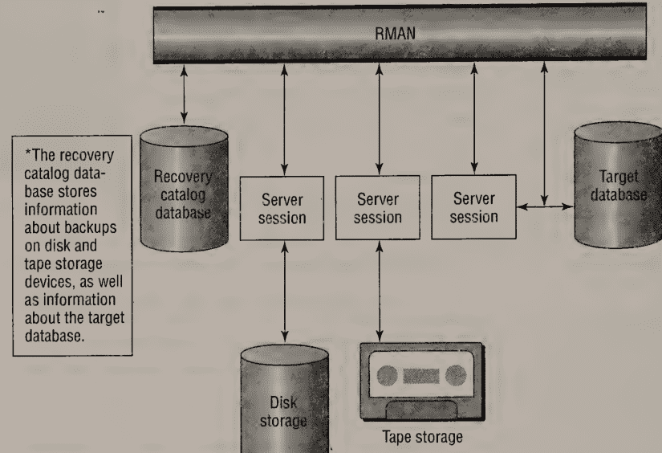

## 恢复目录的组件

RMAN 恢复目录的主要组件用于支持在目录中记录备份和恢复信息。这些信息存储在 Oracle 数据库的表、视图和其他数据库对象中。备份经过了压缩处理以实现优化存储。以下是恢复目录中包含的组件列表：

- 为目标数据库记录的、供长期使用的备份和恢复信息
- 可以存储和重用的 RMAN 脚本
- 关于数据文件和归档日志的备份信息
- 关于目标数据库物理结构（或模式，schema）的信息

## 创建恢复目录

如前所述，恢复目录是 RMAN 的一个可选功能。该目录与标准数据库目录相似，因为它存储了关于恢复过程的信息，正就像数据库目录存储关于数据库的信息一样。

RMAN 可以在不使用目录的情况下运行。由于原因，恢复目录必须存储在自己的数据库中，最好存储在与目标数据库不同的服务器上。要启用目录，必须创建一个具有 `CONNECT`、`RESOURCE` 和 `RECOVERY_CATALOG_OWNER` 权限的账户来存放目录表。完成后，必须以连接到 RMAN 实用程序的数据库用户身份执行目录创建脚本。

让我们介绍创建恢复目录的步骤。此示例假设你已经建立了一个名为 `rcat` 的数据库，并计划在其中存储恢复目录。

1. 首先，你必须选择恢复目录将所在的数据库。这并不是目标数据库。在这种情况下，此 RMAN 数据库被称为 `rcat`。在这种情况下，你将使用 `oraenv` 脚本（由 Oracle 提供）切换到同一服务器上的其他数据库。


```
oracle@octilli:/oracle/product/9.0.1/bin > . oraenv
orACLE_SID = [rcat] ?
oracle@octilli:/oracle/product/9.0.1/bin >
```

在完成上一步后，你需要创建一个存储目录的用户。要执行此操作，请使用名称 `RMAN` 和密码。将 `DATA` 设置为默认表空间，并将 `TEMP` 设置为临时表空间。

```
oracle@octilli:~ sqlplus /nolog
```

SQL*Plus: Release 9.0.1.0.0 - Production on Sat Sep 29 14:21:01 2001

(c) Copyright 2001 Oracle Corporation. All rights reserved.

```
SQL> connect /as sysdba
Connected.
SQL> create user rman identified by rman
2> default tablespace data
3> temporary tablespace temp;
Statement processed.
```

### 3. 为 RMAN 用户授予相应的权限。

```
SQL> grant connect,resource,recovery_catalog_owner
to rman;
Statement processed.
SQL>
```

### 4. 然后启动 RMAN 工具。

```
oracle@octilli:/oracle/product/9.0.1/bin > rman

Recovery Manager: Release 9.0.1.0.0 - Production

(c) Copyright 2001 Oracle Corporation. All rights reserved.
```

### 5. 使用你在步骤 2 中创建的、名为 `RMAN` 的用户连接到目录。

```
RMAN> connect catalog rman/rman

connected to recovery catalog database
recovery catalog is not installed
```

### 6. 最后，你可以通过执行以下命令创建目录，并指定你想要存储目录的表空间。

```
RMAN> create tablespace data;

recovery catalog created

RMAN>
```

> **注意**：对于恢复目录数据库中一年的增长，Oracle 建议 RMAN 在表空间中留有如下空间需求：系统表空间（system）90MB；回滚表空间 5MB；临时表空间 5MB；以及恢复目录表空间 15MB。

## 使用 RMAN 命令维护恢复目录

有多个 RMAN 命令可以帮助你维护恢复目录：

- **CROSSCHECK**：识别目录与介质（磁盘或磁带）上实际文件之间的差异。
- **DELETE**：删除任何 `LIST` 或 `CROSSCHECK` 命令可以操作的文件。
- **DELETE EXPIRED**：从恢复目录中删除过期的备份记录。
- **DELETE INPUT**：在具有多个归档目的的情况下，与 `BACKUP` 命令配合使用。如果是这种情况，则会复制一个归档日志并删除其他目的地的日志。
- **CHANGE/KEEP/NOKEEP**：更改保留备份的时间，以便对特殊备份绕过保留策略。

## 使用 RMAN 注册、重同步和重置数据库

还有三个 RMAN 命令用于对恢复目录执行初始设置和配置操作。本质上，这些命令是使用频率较低的维护命令。这些命令属于以下类别：

- 注册和注销目标数据库
- 重置恢复目录
- 重同步恢复目录

你应该熟悉这些设置和配置类别以及相关的命令。

## 注册和注销目标数据库

注册目标数据库是为了让 RMAN 能够存储关于目标数据库的信息。以下是注册目标数据库的示例：

```
oracle@octilli:~ > oraenv
ACLE_SID = [ts99] ? orc9
oracle@octilli:~ > rman target / catalog rman/rman@rcat

Recovery Manager: Release 9.0.1.0.0 - Production

(c) Copyright 2001 Oracle Corporation. All rights reserved.

connected to target database:
TST59 (DBID=205850149)
connected to recovery catalog database

RMAN> register database;

database registered in recovery catalog
starting resync of recovery catalog
full resync complete

RMAN>
```

## 重置恢复目录

重置恢复目录允许 RMAN 能够与使用 `ALTER DATABASE OPEN RESETLOGS` 命令打开的数据库工作。当你使用此命令时，你会导致 RMAN 创建目标数据库的“新实例化”。目标数据库的实例化是恢复目录中数据库的一个新引用。该实例化被标记为目标数据库的当前引用，所有未来的备份都与此实例化关联。

以下是如何连接到目标数据库和恢复目录并重置数据库的示例：

### 1. 你必须获取恢复目录中 `DB` 表的 `DB_ID` 和 `DB_KEY` 值。

```
SQL*Plus: Release 9.0.1.0.0 on Oct 6 22:42:08 2001

(c) Copyright 2001 Oracle Corporation. All rights reserved.

Connected to:
Oracle9i Enterprise Edition Release 9.0.1.0.0
With the Partitioning option

SQL> select * from db;

DB_KEY HIGH_CONF_RECID CURR_DBINC_KEY
---------------------------------------
504 39695 0 505
```

### 2. 然后你必须使用这些值运行存储过程。

```
SQL> execute dbms_rcvcat.unregisterdatabase(504,39695);

PL/SQL procedure successfully completed.
```

### 3. 最后，你可以验证 `DB` 中没有引用数据库的值。

```
SQL> select * from db;

no rows selected
```

### 重置恢复目录示例

以下是连接到目标数据库和恢复目录并重置数据库的示例：

```
oracle@octilli:~ > rman target / catalog rman/rman@rcat

Recovery Manager: Release 8.1.5.0.0 - Production

connected to target database:
TST59 (DBID=205850149)
connected to recovery catalog database

RMAN> reset database;

compiling command: reset
executing command: reset
```

## 真实世界场景

### 确保新的化身被识别

你刚刚将生产数据库的每月刷新移动到测试服务器。这是许多组织遵循的典型流程，以便开发人员拥有最新的数据来开发新代码。“test”这个名称与测试服务器上之前的数据库名称相同。

在测试数据库的新副本运行之后，你需要确保对数据库进行备份，以防开发人员的工作任何丢失。为了做到这一点，你启动了测试数据库的 RMAN 备份脚本，并发现在恢复目录（recovery catalog）中找不到该数据库，尽管该数据库的名称和物理结构与你执行刷新之前相同。

RMAN 目录识别出这个名为“test”的数据库是一个新的化身（incarnation），并且它在恢复目录中具有唯一标识。这是因为该数据库是用 `RESETLOGS` 选项打开的。必须使用 `RESET` 命令对该数据库进行重置，以便它能够正确识别旧测试数据库恢复目录与刷新后的新测试数据库恢复目录之间的差异。结果是恢复目录的备份信息将不会在这些数据库之间产生混淆。

## 重同步恢复目录

重同步恢复目录允许 RMAN 将测试数据库的控制文件与存储在恢复目录中的信息进行比较，并适当更新恢复目录。部分重同步不会用任何物理信息来更新恢复目录，例如数据文件、表空间和重做日志。全重同步会捕获所有之前提到的物理信息加上更改的记录。此过程在执行备份时也会发生。

以下是你如何连接到目标数据库和恢复目录，然后重同步数据库的示例：

### 1. 通过向 `DATA` 表空间添加新的数据文件来对目标数据库进行物理更改。

```
oracle@octilli:~ sqlplus /nolog

SQL*Plus: Release 9.0.1.0.0 - Production on Tue Oct 9
17:52:19 2001

(c) Copyright 2001 Oracle Corporation. All rights reserved.

SQL> connect /as sysdba
Connected.
SQL> ALTER TABLESPACE DATA ADD
DATAFILE '/db01/oracle/tst9/data02.dbf' SIZE 20M
```

### 2. 接下来，连接到 RMAN 并重同步目录以反映此更改。

```
oracle@octilli:~ rman target / catalog rman/rman@rcat

Recovery Manager: Release 8.1.5.0.0 - Production

connected to target database:
TST9 (DBID=2058500149)
connected to recovery catalog database

RMAN> resync catalog;
starting full resync of recovery catalog
full resync complete
RMAN>
```

### 3. 现在运行报告以查看 TST9 数据库的更改。注意新的数据文件 `data02.dbf`，它是报告中的第八个数据文件。

```
RMAN> report schema;

# 数据库架构报告

| File | K-bytes | Tablespace | RB segs | Datafile Name |
|---|---|---|---|---|
| 1 | 24800 | SYSTEM | YES | /db01/oracle/tst9/system01.dbf |
| 2 | 40960 | RBS | YES | /db01/oracle/tst9/rbs01.dbf |
| 3 | 10240 | TEMP | NO | /db01/oracle/tst9/temp01.dbf |
| 4 | 10240 | USERS | NO | /db01/oracle/tst9/users01.dbf |
| 5 | 5120 | TOOLS | NO | /db01/oracle/tst9/tools01.dbf |
| 6 | 51200 | DATA | NO | /db01/oracle/tst9/data01.dbf |
| 7 | 10240 | INDX | NO | /db01/oracle/tst9/indx01.dbf |
| 8 | 20480 | INDX | NO | /db01/oracle/tst9/data02.dbf |
```

## 从恢复目录生成列表和报告

RMAN 有两种类型的命令（列表 `LIST` 和报告 `REPORT`），你可以使用它们来访问恢复目录，以便列出你需要备份、复制或恢复的状态，以及关于你目标数据库的一般信息。这些命令均在 RMAN 工具中执行。

## 使用 LIST 命令

`LIST` 命令查询恢复目录或控制文件以确定哪些备份或副本是可用的。这些命令提供了来自恢复目录的最基本信息。生成的信息主要是到目前为止已执行的操作；通过这些信息，你可以判断哪些是可用的，哪些是不可用的。

在与 Oracle 9i 兼容的 RMAN 版本中，`LIST` 命令中增加了一些新功能和能力。这些功能通过添加更多信息（例如备份集和备份集的内容（备份分量和文件））改进了输出。这组新功能包含在 `LIST BACKUP` 命令中。

Oracle 9i 中还有两个新的 `LIST` 命令。第一个是 `LIST BACKUP BY FILE`，它显示按文件分组的备份集、归档日志和控制文件。第二个是 `LIST BACKUP SUMMARY`，它是命令的摘要。在以下三个示例中，你都必须连接到恢复目录。第一个示例显示了在恢复目录中注册的数据库化身。

```
oracle@octilli:~ rman target / catalog
RMAN> list of database;
```

### 数据库化身列表

| DB Key | ID | Name | SCN |
|---|---|---|---|
| 1 | 2 | TST9 | 126870511 |
| 1 | 3 | TST9 | 126870511 |

下一个示例列出了表空间备份。它显示了表空间最后备份的时间。你仍然必须连接到恢复目录。

```
oracle@octilli:~ rman target /catalog
RMAN> list of tablespace;
```

### 表空间备份列表

| Type | Size | Device Type | Completion |
|---|---|---|---|
| 446 | Full | DISK | 05-OCT |

### 备份集

| BP Key | Size | Device Type | Elapsed Time | Completion |
|---|---|---|---|---|
| 447 | | | | |
| Piece Name: /oracle/product/9.0/dbbs/ad51 | | | | |

| File | Type | SCN | Name |
|---|---|---|---|
| 6 | | 66992 | 05-OCT | /db01/oracle/tst9/data01 |

| BS Key | Size | Device Type | Elapsed Time | Completion |
|---|---|---|---|---|
| 488 | Full | DISK | 00:40 | 05-OCT |

| BP Key | Size | Device Type | Elapsed Time | Completion |
|---|---|---|---|---|
| 490 | | | | |
| Piece Name: /oracle/product/9.0/dbbs/fd49 | | | | |

| File | Type | SCN | Name |
|---|---|---|---|
| 6 | | 67092 | 05-OCT | /db01/oracle/tst9/data01 |

最后，这个示例列出了数据库的备份。它显示了数据库最后备份的时间。你仍然必须连接到目标数据库和恢复目录。该命令假设你已经连接到目标数据库和恢复目录。

```
RMAN> list backup of database;
```

### 备份列表

| BS Key | Size | Device Type | Elapsed Time | Completion |
|---|---|---|---|---|
| 261 | Full | DISK | 00:01:42 | 04-OCT |

| BP Key | Size | Device Type | Elapsed Time | Completion |
|---|---|---|---|---|
| 262 | | | | |
| Piece Name: /oracle/product/9.0/dbbs/02588p | | | | |

| File | Type | SCN | Name |
|---|---|---|---|
| 1 | Full | 66671 | 04-OCT | /db01/oracle/tst9/system01.dbf |
| 2 | Full | 66671 | 04-OCT | /db01/oracle/tst9/rbs01.dbf |
| 3 | Full | 66671 | 04-OCT | /db01/oracle/tst9/temp01.dbf |
| 4 | Full | 66671 | 04-OCT | /db01/oracle/tst9/users01.dbf |
| 5 | Full | 66671 | 04-OCT | /db01/oracle/tst9/tools01.dbf |
| 6 | Full | 66671 | 04-OCT | /db01/oracle/tst9/data01.dbf |
| 7 | Full | 66671 | 04-OCT | /db01/oracle/tst9/indx01.dbf |

## 使用 REPORT 命令

`REPORT` 命令从恢复目录提供更详细的信息，其用途比 `LIST` 命令更复杂。报告可以提供关于应该执行操作的信息。报告的一些用途包括确定哪些数据库文件需要备份，或者哪些数据库文件在最近被备份过。

```
RMAN> report schema;

# 数据库架构报告

| 文件 (K-bytes) | 表空间 | RB 回段 | 数据文件名称 |
|---|---|---|---|
| 1 | 204800 SYSTEM | 是 | /db01/oracle/tst9/system01.dbf |
```


| 2 | 40960 RBS | 是 | /db01/oracle/tst9/rbs01.dbf |
| 3 | 10240 TEMP | 否 | /db01/oracle/tst9/temp01.dbf |
| 4 | 10240 USERS | 否 | /db01/oracle/tst9/users01.dbf |
| 5 | 5120 TOOLS | 否 | /db01/oracle/tst9/tools01.dbf |
| 6 | 51200 DATA | 否 | /db01/oracle/tst9/data01.dbf |
| 7 | 10240 INDX | 否 | /db01/oracle/tst9/indx01.dbf |

RMAN>

第二个示例显示了所有包含额外或重复备份的备份集。再次，在执行任何报告之前，你必须先连接到目标数据库和恢复目录。

```
oracle@octilli:~\> rman target / catalog rman@rcat
RMAN> report obsolete redundancy = 2;
```

| 类型 | 键 | 完成的文件名/句柄 |
|---|---|---|
| 备份集 | 261 | 04-OCT-01 |
| 备份份 | 262 | 04-OCT-01 /oracle/product/9.0.1/dbs/02d5p81 |
| 备份集 | 283 | 05-OCT-01 |
| 备份份 | 284 | 05-OCT-01 /oracle/product/9.0.1/dbs/03d5pe1 |
| 备份集 | 294 | 05-OCT-01 |
| 备份份 | 295 | 05-OCT-01 /oracle/product/9.0.1/dbs/04d5pe1 |

## 创建、存储和运行 RMAN 脚本

可以创建 RMAN 脚本来执行一组 RMAN 命令。这些脚本可以存储在 RMAN 目录中。一旦存储在恢复目录中，脚本执行的方式与存储的 PL/SQL 过程非常相似。让我们来看一个创建、存储和运行 RMAN 脚本的示例。在这个示例中，你将备份整个数据库：

1. 连接到恢复目录。

   ```
   oracle@octilli:~ > rman catalog rman/rman@rcat
   ```

2. 当你在 RMAN 工具中时，创建一个名为 `complete_bac` 的脚本；这将在恢复目录中创建、编译并存储该脚本。

```
RMAN> create script complete_bac{
2> allocate channel c1 type disk;
3> allocate channel c2 type disk;
4> backup database;
5> backup archivelog all;
6> }
```

已创建脚本 `complete_bac`

RMAN>

3. 一旦脚本在恢复目录中创建并存储，就可以根据需要重新运行。这确保了在后续作业中重现相同的脚本和功能。图 13.2 显示了如何使用恢复目录创建和存储脚本。

## 图 13.2 在恢复目录中创建和存储 RMAN 脚本

```
[oracle@OS-HPUX 9.0.1] rman catalog rman/rman@redo
RMAN > create script complete_bac [_]
```

## 创建、存储和运行 RMAN 脚本 405

4. 运行存储的 RMAN 脚本 `complete_bac`。在连接到目标数据库时执行以下命令完成此操作，并注意 `ERROR MESSAGE STACK`，它表示没有归档日志归档。

```
RMAN> run { execute script complete_bac; }
```

```
正在执行脚本: complete_bac
已分配通道: c1
channel c1: sid=11 devtype=DISK
已分配通道: c2
channel c2: sid=8 devtype=DISK
正在 05-OCT-01 开始备份
channel c1: 正在启动全数据文件备份集
channel c1: 正在指定备份集中的数据文件
input datafile fno=00006 name=/db01/oracle/tst9/data1.dbf
input datafile fno=00002 name=/db01/oracle/tst9/rbs01.dbf
input datafile fno=00003 name=/db01/oracle/tst9/temp01.dbf
input datafile fno=00004 name=/db01/oracle/tst9/users01.dbf
channel c1: 于 05-OCT-01 开始备份份 1
channel c2: 正在启动全数据文件备份集
channel c2: 正在指定备份集中的数据文件
备份集中包含当前控制文件
input datafile fno=00001 name=/db01/oracle/tst9/system01.dbf
input datafile fno=00007 name=/db01/oracle/tst9/dx01.dbf
input datafile fno=00005 name=/db01/oracle/tst9/tools01.dbf
```

## 考试要点

理解恢复目录库（`recovery catalog`）是理解 RMAN 所有功能的关键。当你选择实现恢复目录库时，RMAN 的所有功能都将可用。恢复目录库数据库涉及额外的维护和管理，这必须考虑在内。了解信息如何在恢复目录库中存储和利用，对于考试以及在工作中充分利用 RMAN 具有至关意义。

理解在使用恢复目录时必须考虑的因素。恢复目录的考虑因素包括：你必须使用一个独立的数据库作为恢复目录；你必须拥有该目录数据库的数据库管理权限；你必须考虑恢复目录的备份策略；你必须使用恢复目录来提供 RMAN 命令的全功能。

了解构成恢复目录的组件。构成恢复目录的组件如下：长期备份和恢复信息的存储、RMAN 脚本的存储与重用，以及数据文件、归档日志和目标数据库物理结构信息的备份信息的存储。

了解如何创建恢复目录。要创建恢复目录，你必须创建一个具有以下权限的账户：`CONNECT`、`RESOURCE` 和 `RECOVERY_CATALOG_OWNER`。然后，在 RMAN 连接到恢复目录后，必须执行 `CREATE CATALOG TABLESPACE <table>` 命令。

了解维护恢复目录所需的命令。你需要熟悉以下用于维护恢复目录的命令：`DELETE INPUT`、`KEEP`、`NOKEEP`、`CHANGE`、`DELETE`、`DELETE EXPIRED` 和 `CROSSHECK`。

了解如何注册、重同步和重置数据库。`register`、`resynchronize` 和 `reset` 命令用于对恢复目录执行初始设置和配置操作。注册（`Register`）恢复目录会在恢复目录中创建数据库的初始化身（`incarnation`）。重置（`Reset`）恢复目录会在数据库使用 `RESETLOGS` 选项打开后创建一个新的化身。重同步（`Resynchronizing`）恢复目录将根据目标数据库控制文件中更改的物理信息来更新恢复目录。

了解从恢复目录生成报告和列表的不同方法。能够使用 `list` 命令以格式化输出从恢复目录中生成基本信息，并能够使用 `reports` 命令提供更复杂的输出，以回答更详细的问题。

了解 Oracle 9i 新的 `list` 命令。你应该意识到 Oracle 9i 新的两个 `list` 命令：`LIST BACK SUMMARY` 和 `LIST BACKUP BY FILE`。

了解如何创建、存储和执行 RMAN 脚本。确保你熟悉创建和存储 RMAN 脚本所需的命令语法——`CREATE SCRIPT <script_name>`。你还应该知道，为了执行脚本，必须执行 `RUN {EXECUTE SCRIPT <script_name>}` 命令。

了解备份和恢复恢复目录的不同方法。恢复目录可以使用用户管理备份或 RMAN 备份。也可以使用导出（`export`）来备份 RMAN 目录架构。

## 关键术语

在参加考试之前，请确保你熟悉以下术语：

- 全重同步报告命令 (`full resynchronization report commands`)
- 化身重置 (`incarnation resetting`)
- 列表命令重同步 (`list commands resynchronization`)
- 部分重同步 RMAN 脚本 (`partial resynchronization RMAN scripts`)
- 恢复目录取消注册 (`recovery catalog unregistering`)
- 注册 (`registering`)

## 复习题

1. RMAN 不需要使用以下哪？

   A. 恢复目录 (`Recovery catalog`)
   B. 服务器会话 (`Server sessions`)
   C. 用于备份的分配通道 (`Allocated channel for backup`)
   D. 用于恢复的分配通道 (`Allocated channel for restore`)

2. 恢复目录支持哪些功能？（选择所有项。）

   A. 备份数据库、表空间、数据文件、控制文件和归档日志
   B. 压缩备份
   C. 脚本能力
   D. 确定备份是否可以恢复的测试
   E. 以上所有

3. 存储托管恢复目录的数据库的最佳位置是？

   A. 在同一台服务器上，但与恢复目录备份的目标数据库位于不同的文件系统
   B. 在同一台服务器上，且与被恢复目录备份的目标数据库位于相同的文件系统
   C. 在与目标数据库不同的服务器上
   D. 以上都不是

4. 恢复管理器用户账户需要哪些权限？（选择所有项）。

   A. DBA 权限
   B. Connect 权限
   C. Resource 权限
   D. RECOVERY_CATALOG_OWNER 权限

5. 哪个命令只能在目标数据库上执行一次？

   A. `CHANGE AVAILABILITY OF BACKUPS`
   B. `DELETE BACKUPS`
   C. `REGISTER THE DATABASE`
   D. `RESYNCHIZING THE DATABASE`

6. 下列哪种陈述最描述目标数据库？

   A. 任何被 RMAN 指定用于备份的数据库
   B. 存储恢复目录的数据库
   C. 一个未目标为 RMAN 备份的数据库
   D. 用于 RMAN 工具的特殊存储数据库

7. 哪些类型的备份可以存储在 RMAN 的恢复目录中？（选择所有项）。

   A. 基于 OS 命令的非 RMAN 备份
   B. 全库备份
   C. 表空间备份
   D. 控制文件备份
   E. 以上所有

8. 下列哪项是用于从恢复目录获取信息的工具？（选择所有项）。

   A. `REPORT` 命令
   B. SQL*Plus 中的查询
   C. `LIST` 命令
   D. `RETRIEVAL` 命令

9. 在运行 `REPORT` 或 `LIST` 命令之前，你必须做什么？

   A. 确定日志文件。
   B. 溢出输出（Spool）。
   C. 连接到目标。
   D. 连接到目标和恢复目录。

10. 报告（`reports`）和列表（`lists`）的主要区别是什么？

    A. 列表的输出比报告多。
    B. 报告的输出比列表多。
    C. 报告比列表提供更详细的信息。
    D. 列表比报告提供更详细的信息。

11. 哪个命令将脚本存储在恢复目录中？

    A. `CREATE SCRIPT <SCRIPT_NAME>`
    B. `STORE SCRIPT <SCRIPT_NAME>`
    C. `CREATE OR REPLACE <SCRIPT_NAME>`
    D. 脚本无法存储在恢复目录中。

12. Oracle 9i 新的 `list` 命令有哪些？（选择所有项）。

    A. `LIST BACKUP BY FILE`
    B. `LIST BACKUP SET`
    C. `LIST BACKUP SUMMARY FILE`
    D. `LIST BACKUP SUMMARY`

13. 如果你向数据库添加了新的数据文件，你应该对该数据库在恢复目录中的化身做什么？

    A. 执行重置（`reset`）。
    B. 执行重同步（`resync`）。
    C. 执行注册（`register`）。
    D. 执行报告（`report`）。

14. 下面代码旨在启动存储的 RMAN 脚本。找到语法错误的行。

```
run {
  execute
  program
  complete_bac; }
```

   A. 第一行
   B. 第二行
   C. 第三行
   D. 第四行

15. 下面代码旨在创建一个复制归档日志的脚本。找到语法错误的行。

```
Create script
Arch_bac_up {
Allocate channel c1 type disk;
Backup archives;}
```

   A. 第一行
   B. 第二行
   C. 第三行
   D. 第四行

## 复习题答案

1. A. 恢复目录是可选的。恢复目录用于存储备份过程的信息，就像字典存储数据库信息一样。

2. E. 以上都是 RMAN 工具的功能。

3. C. 恢复目录应位于与目标数据库不同的服务器上，以消除单台服务器故障影响 RMAN 备份恢复能力的可能性。

4. B, C, D. 恢复目录账户不需要 DBA 权限。该用户必须能够连接数据库、在数据库中创建对象并拥有 `RECOVERY_CATALOG_OWNER` 权限。

5. C. 每个数据库只能执行一次注册，除非数据库被取消注册。

6. A. 目标数据库是任何被 RMAN 工具指定用于备份的数据库。

7. E. RMAN 可以对基于 OS 命令的非 RMAN 备份进行分类，也可以备份全库备份、表空间备份和控制文件备份。

8. A, B. RMAN 工具提供了 `REPORT` 和 `LIST` 命令从恢复目录生成输出。某些情况下也可以使用 SQL*Plus 手查询恢复目录。

9. D. 在运行任何 `REPORT` 或 `LIST` 命令之前，你必须连接到目标数据库和恢复目录。

10. C. `REPORT` 命令提供的信息比 `LIST` 命令更详细。`REPORT` 命令用于回答比 `LIST` 命令更多关于“如果……会”或“需要做什么”类型的问题。

11. A. `CREATE SCRIPT <SCRIPT_NAME>` 命令将关联的脚本存储在恢复目录中。该脚本可以在之后的某一天运行。

12. A, D. `LIST BACKUP OF FILE` 和 `LIST BACKUP SUMMARY` 命令都是 Oracle9i 中新增的列表命令。

13. B. 如果目标数据库的物理组件发生变化，则应运行 `resync` 命令。

14. C. 错误的语法是 `program`。正确的语法如下：

```
run {
  execute
script
  complete_bac; }
```

15. D. 错误的语法是 `BACKUP ARCHIVES ALL;`。正确的语法应该是 `BACKUP ARCHIVELOG ALL;`。

## 在数据库之间传输数据

**本章涵盖的 ORACLE9i: DBA 基础知识 II 考试目标：**

- 描述导出（`Export`）和导入（`Import`）工具的用途。
- 描述导出和导入的概念与结构。
- 执行简单的导出和导入操作。
- 列出使用导出和导入的指南。

> 考试目标可能会随时更改，恕不另行通知，并由 Oracle 自行决定。请访问 Oracle 认证网站（`http://www.oracle.com/education/certification/`）查看最新的考试目标列表。

Oracle 数据库软件提供了两种备份数据库的方法。第一种是物理备份，包括复制文件并在需要时恢复这些文件。你在之前的四个章节中已经读过关于这种方法。第二种备份是逻辑备份。数据库的逻辑备份需要恢复某些数据库对象并将它们写入文件，而不考虑它们的物理位置。然后可以将该文件作为逻辑恢复导入回数据库中。

Oracle 还提供了两个工具来处理 Oracle 数据库的备份和恢复：导出工具和导入工具。导出工具创建数据库的逻辑备份，导入工具执行数据库的逻辑恢复。

本章演示了如何使用导出和导入工具来备份和恢复数据库。它还解释了增量备份和恢复。

本章的主题是测试和现实世界恢复情况的重要部分。导出和导入工具是用户管理或基于 RMAN 备份的良好补充。这些工具可以用于现实世界的恢复场景，例如开发者或最终用户无意中删除表或数据。

## 使用导出和导入工具

导出和导入工具主要执行逻辑备份和恢复，但它们也可以用于执行以下各种操作：

**恢复数据库对象**：导出和导入工具用于备份和恢复的主要用途是替换单个对象，例如表或由多个数据库对象组成的模式。也可以恢复整个数据库，但这并不常见。在某些情况下，用户或开发者可能会删除一个表，但你可能不想恢复整个数据库。虽然可以恢复整个数据库，但由于导出的时间点特性，数据可能是不一致的。

**使用表空间时间点恢复 (TSPITR) 进行恢复**：在 Oracle8 中引入了表空间时间点恢复 (`TSPITR`)。`TSPITR` 设计用于通过相当复杂的恢复过程来恢复大型单个对象。因此，我们建议你在执行恢复之前寻求 Oracle 支持的帮助，否则你将需要使用物理和逻辑恢复技术。此外，你还需要使用克隆数据库来执行整个过程，这将需要额外的资源。有这么多缺点，你可能会奇怪为什么有人会使用它。原因是 `TSPITR` 允许你恢复整个表空间中的所有对象，而无需恢复整个数据库。这对于完整还原和恢复需要很长时间的大型数据库非常有用。

在使用 `TSPITR` 时，你必须熟悉几个特殊参数：`TRANSPORT_TABLESPACE` 和 `DATAFILES`。`TRANSPORT_TABLESPACE` 参数指定 `TSPITR` 过程中使用的表空间。`DATAFILES` 参数指定支持要恢复表空间的数据文件。

**重组织数据库以提高性能**：导出和导入工具也可用于重组织数据库并恢复单个对象。当以这种方式恢复对象时，数据可能会被打包或压缩到更少的区（`extents`）中，以便更快检索。这是通过使用 `COMPRESS=Y` 命令实现的，它是默认值。以下是使用该参数的示例。


```
oracle@ottillii:~ > exp userid-test/test compress=Y file=tst9.dmp
```

# 升级对象或数据库

还可以使用这些工具将数据库或对象从一个版本升级到另一个版本。如果这样使用工具，会对表或数据库进行导出，然后使用升级后的版本将其导入新数据库。

# 现实场景

## 将数据从一个数据库移动到另一个

导出和导入工具也可将数据从一个数据库移动到另一个。导出过程创建的二进制 dump 文件可以通过 FTP 从一个服务器发送到另一个服务器，然后加载到新数据库中。

# 使用导出和导入工具

（注：此部分似乎是源代码中的重复/延续）

# 导出和导入的概念与结构

如本章引言所述，导出工具可创建 Oracle 数据库的逻辑备份。导入工具可以恢复这些逻辑备份。导出有两种类型：常规路径导出和直接路径导出。

常规路径导出是导出工具的默认模式。对于大型对象或导出，这种方法可能非常耗时。但它对于日常使用良好。

直接路径导出通过在命令行中输入 `DIRECT=Y` 启用。这种导出选项明显快于常规路径导出。直接路径导出跳过了 SQL 评估层，因为它重新生成存储在二进制 dump 文件中的命令。这就是性能提升的地方。图 14.1 显示了每种导出的执行路径。

Export 工具对表执行全量 `SELECT` 操作，并将数据转储到一个名为“dump文件”的二进制文件中。（该文件具有 `.dmp` 扩展名，默认名为 `expdat.dmp`。）

Export 工具通过重现备份表的数据定义语言（DDL）来创建表和索引。这些信息随后可以由 Import 工具进行回放，以重建对象及其底层数据。

要显示所有可用的导出选项，请执行 `EXP -HELP` 命令行。

```
oracle@octilli:db01/oracle/tst9 > exp -help
```

```
Export: Release 9.0.1.0 - Production on Fri Oct 5 23:09:00 2001
(c) Copyright 2001 Oracle Corporation. All rights reserved.
```

你可以通过输入 `EXP` 命令后跟你的用户名/密码来让 Export 提示你输入参数：

示例：`EXP SCOTT-TIGER`

或者，你可以通过输入 `EXP` 命令后跟各种参数来控制 Export 的运行。要指定参数，你可以使用关键字：

```
Format: EXP KEYWORD=value 或
KEYWORD=(value1,value2,...,valueN)
示例: EXP SCOTT-TIGER GRANTS=Y
TABLES=(EMP,DEPT,MGR)
或 TABLES=(T1:P1,T1:P2),
如果 T1 是分区表
```

`USERID` 必须是命令行上的第一个参数。

## 导出与导入概念结构 423

| 关键字 | 描述 (默认值) |
| :--- | :--- |
| USERID | 用户名/密码 |
| BUFFER | 数据缓冲区的大小 |
| FILE | 输出文件 (EXPAT.DMP) |
| COMPRESS | 导入到一个扩展区 (Y) |
| GRANTS | 导出权限 (Y) |
| INDEXES | 导出索引 (Y) |
| ROWS | 导出数据行 (Y) |
| CONSTRAINTS | 导出约束 (Y) |
| LOG | 屏幕输出的日志文件 |
| DIRECT | 直接路径 (N) |
| FEEDBACK | 每隔 x 行显示一次进度 (0) |
| FILESIZE | 每个 dump 文件的最大大小 |
| QUERY | 用于导出表子集的 select 子句 |
| VOLSIZE | 写入每个磁卷的字节数 |
| FULL | 导出整个文件 (N) |
| OWNER | 所有者用户名列表 |
| TABLES | 表名列表 |
| RECORDLENGTH | IO 记录长度 |
| INCTYPE | 增量导出类型 |
| RECORD | 跟踪增量导出 (Y) |
| PARFILE | 参数文件名 |
| CONSISTENT | 跨表一致性 |
| STATISTICS | 分析对象 (ESTIMATE) |
| TRIGGERS | 导出触发器 (Y) |
| FEEDBACK | 每隔 x 行显示一次进度 (0) |
| FILESIZE | 每个 dump 文件的最大大小 |
| FLASHBACK_SCN | 用于设置会话快照回的 SCN |
| FLASHBACK_TIME | 用于获取最接近指定时间的 SCN |
| QUERY | 用于导出表子集的 select 子句 |
| RESUMABLE | 遇到空间相关错误时挂 (N) |
| RESUMABLE_NAME | 用于标识可恢复语句的文本字符串 |
| RESUMABLE_TIMEOUT | 可恢复的等待时间 |
| TTS_FULL_CHECK | 为 TTS 执行全量或部分依赖检查 |
| VOLSIZE | 写入每个磁带的字节数 |
| TABLESPACES | 要导出的表空间列表 |
| TRANSPORT_TABLESPACE | 导出可传输的元数据 (N) |
| TEMPLATE | 调用 IAS 模式导出的模板名称 |

导出成功，无警告。`oracle@octilli:db01/oracle/tst9 >`

Oracle 9 的导出功能变化较少。变化如下：为了适应 Java 虚拟机，在全量模式下不再导出 sys 架构下的触发器，同时也不再支持增量/累计导出（INCREMENTAL/CUMULATIVE），以及从 Oracle 9 数据库创建 7.x 导出文件的过程。请阅读 Oracle 文档以获取这些更改的完整细节。

# 执行简单的导出和导入操作

让我们看看 DBA 如何执行简单的导出和导入。我们将使用交互式方法运行 Export 和 Import 工具。这意味着用户将对工具的每个提示做出响应。

首先，我们将导出表 t1。然后我们将导入同一个表。此外，我们还将演示如何使用 `PARFILE` 运行导出，以便其不需要用户交互。这种导出可以在命令行运行，并且既可以是脚本化的也可以调度的。`PARFILE` 是参数文件，将导出参数分组在一个文件中，因此 DBA 就不需要在命令行上输入每个参数。该过程将在接下来的导出过程之后演示。让我们逐一完成这些示例。

## 执行简单的导出

在这个交互式导出示例中，你将对用户 TEST 拥有的表 t1 进行全量导出。以下是执行导出的步骤：

1. 执行 `exp` 行来启动 Export 工具。在 Unix 中，你应该先设置 `ORACLE_SID` 环境变量指向你正尝试连接的数据库。可以通过在命令行执行 `export ORACLE_SID = tst9` 来。或者，你也可以通过显式定义目标数据库的 tnsora 条通过 SQL*Net 连接。

```
oracle@octilli:db01/oracle/tst9 > exp
Export: Release 9.0.1.0.0 - Production on Fri Oct 5 23:09:00 2001
(c) Copyright 2001 Oracle Corporation. All rights reserved.
连接到: Oracle Database Release 9.0.1.00 - Production Edition - Universal Use
用户名: test
密码:
```

2. 输入适当缓冲区大小。如果你想要默认的 64KB，请按..缓冲区大小: 4096

3. 下一个提示 dump 文件的文件名。导出文件: expdat.d

4. 下一个提示指定用户或表: t1

5. 下一个提示是否导出数据。

6. 下一个提示是否压缩扩展区。例如，如果你选择否，则扩展区将保留。压缩扩展区 (yes/no): yes

7. 下一个提示指定要导出的表。在示例中，你选择了 t1。导出完成后，将提示另一个表。如果你已完成，按回车。

导出字符集为 US7ASCII

正在通过常规路径导出指定的表

```
Table(T) or Partition(T:P) to be exported:
(RETURN to quit) > t1
. . exporting table
T1
3 rows exported
Table(T) or Partition(T:P) to be exported:
(RETURN to quit) >
```

导出完成。

## 执行简单的导入 (Import)

Import 工具用于执行 Oracle 数据库的逻辑恢复。该工具读取由 Export 工具生成的转储文件。如前所述，Export 工具将表中的数据转储出来，并使用必要的 DDL 命令重新创建表。随后，Import 工具会回放这些命令，重新创建表，并插入存储在二进制转储文件中的数据。本节将提供该过程工作原理的逐步步骤概述。

Import 工具还具有许多选项。要显示所有可用的导入选项，请在命令行中执行 `IMP -HELP` 命令。

```
oracle@octilli: ~ imp -help
Import: Release 9.0.1.0 - Production on
Fri Oct 5 23:24:45 2001
> (c) Copyright 2001 Oracle Corporation.
All rights reserved.
```

你可以通过输入 `IMP` 命令并后跟你的用户名/密码来让 Import 提示你输入参数：

示例：`IMP SCOTT/TIGER`

或者，你可以通过输入 `IMP` 命令后跟各种参数来控制 Import 的运行方式。要指定参数，你需要使用关键字：

```
Format: IMP KEYWORD=value or
KEYWORD=(value1,value2,...,valueN)
Example: IMP SCOTT/TIGER IGNORE=Y
TABLES=(EMP,DEPT) FULL=N
or TABLES=(T1:P1,T1:P2),
if T1 是分区表
```

`USERID` 必须是命令行上的第一个参数。

| 关键字 | 说明 (默认值) |
| :--- | :--- |
| USERID | 用户名/密码 |
| BUFFER | 数据缓冲区的大小 |
| FILE | 输入文件 (EXPDAT.DMP) |
| SHOW | 列出文件内容 (N) |
| IGNORE | 创建错误 (N) |
| GRANTS | 导入权限 (Y) |
| INDEXES | 导入索引 (Y) |
| ROWS | 导入数据行 (Y) |
| LOG | 屏幕输出日志文件 |
| DESTROY | 覆盖表空间数据文件 (N) |
| INDEXFILE | 将表/信息写入指定文件 |
| SKIP_UNUSABLE_INDEXES | 跳过不可用索引的维护 (N) |
| FEEDBACK | 每隔 x 行显示进度 (0) |
| TOID_VALIDATE | 跳过指定类型 ID 的验证 |
| FILESIZE | 每个转储文件的最大大小 |
| STATISTICS | 导入预计算的统计信息 (always) |
| RESUMABLE | 遇到空间相关错误时暂停 (N) |
| RESUMABLE_NAME | 用于标识可恢复语句的文本字符串 |
| RESUMABLE_TIMEOUT | 可恢复的等待时间 |
| COMPILE | 编译过程、包和函数 (Y) |
| VOLSIZE | 磁带上文件每个卷的字节数 | |

以下关键字仅适用于可传输表空间 (transportable tablespaces)：

| 关键字 | 说明 |
| :--- | :--- |
| TRANSPORT_TABLESPACE | 导入传输表空间元数据 (N) |
| TABLESPACES | 要传输到数据库的表空间 |
| DATAFILES | 要传输到数据库的数据文件 |
| TTS_OWNERS | 拥有传输表空间中数据的用户 |

```
Import terminated successfully without warnings.
oracle@octilli:~ >
```

以下步骤指示了如何使用 Import 工具执行表的恢复。在这里，Import 工具处于交互模式。

1. 要恢复数据库，你必须验证应该恢复的内容。在这种情况下，请使用前文名为“执行简单导出”章节中针对 `t1.dmp` 的导出文件。在这里，你正在导出整个 t1 表，该表包含四行数据。

```
SQL> select * from t1;
C1
```

| 1 这是一个测试 - 热备之前 |
| 3 这是一个测试三 - 热备之后 |
| 2 这是一个测试二 - 热备之后 |
| 4 这是一个测试四 - 完整导出之后 |

已选择 4 行。

```
SQL>
```

2. 截断表以模拟表中数据的完全丢失。

```
SQL> truncate table t1;
Statement processed.
SQL>
```

3. 从导出的转储文件的工作目录，执行 `IMP` 命令并连接到用户 TEST。

```
oracle@octilli:~ imp
Import: Release 9.0.1.0.0 - Production on
Fri Oct 5 23:31:44 2001
(c) Copyright 2001 Oracle Corporation.
All rights reserved.
```

4. 下一个提示是转储文件的文件名。你可以输入完全限定的文件名，或者如果你位于转储文件的工作目录，则只需输入文件名。

Import file: expdat.dmp > t1.dmp

5. 下一个提示是导入数据加载的缓冲区大小。选择最小，即 8KB。

Enter insert buffer size (minimum is 8192) 30720 > 8192

6. 下一个提示询问是否列出转储文件的内容，而不是实际执行导入。默认是否；在本示例中选择该选项。

Export file created by::V09.00.01

done

List contents of file (yes/no): no > n

7. 下一个提示询问是否由于对象存在而忽略错误。在本示例中选择是。

Ignore error due to (yes/no): yes > y

8. 下一个提示询问是否导入对象相关的权限。在本示例中选择是。

Import grants (yes/no): yes > y

9. 下一个提示询问是否导入表中的数据。在本示例中选择是。

Import data (yes/no): yes > y

10. 下一个提示询问是否导入导出文件。在这种情况下，选择默认值，即否。

Import file (yes/no): no > n

- 导入 TEST
- 表
- 已导入 4 行

```
Import terminated successfully without warnings.
oracle@octilli:~
```

11. 接下来，你需要验证导入是否成功恢复。对表进行查询以验证有四行数据。

```
SQL> select * from t1;
```

| 1 这是一个测试 - 热备之前 |
| 3 这是一个测试三 - 热备之后 |
| 2 这是一个测试二 - 热备之后 |
| 4 这是一个测试四 - 完整导出之后 |


# 使用导出和导入的指南

使用导出和导入工具的指南要求逻辑备份和恢复是可以接受的。此问题的另一种方法是：“数据可以从某个时间点恢复吗？”

对于导出，无法像完全恢复或不完全恢复那样向前回滚。导出中的数据是导出提取时的数据，并且无法更改。它是特定时间点的数据快照。

既然如此，导出和导入工具不是最好的备份和恢复解决方案。这些工具更多是作为良好物理备份策略的补充。

以下是使用导出和导入工具的一些指南：数据应该是静态的。被导出的数据是一致的，或者尽可能不要处于更新过程中。如果在导出期间发生了剧烈的 DML 活动，转储文件对于恢复目的将无用。

表之间的逻辑引用应有限。表具有具有的引用完整性约束。复杂的引用完整性会给导出工具带来问题。

本章演示了 Oracle 逻辑备份和恢复工具：Export 和 Import。在本章中，你练习了使用这些工具对数据库对象进行备份和恢复。你学习了如何显示导出和导入工具中所有可用选项，并看到了直接路径导出的示例，它比标准的常规路径导出快得多。

此外，你已经介绍了导出（Export）和导入（Import）工具适用的场景类型。你还熟悉了为了充分利用导出和导入工具而需要遵循的指导原则。

在大多数环境中，导出和导入工具并不作为主要的备份，而是作为物理备份的补充。然而，导出和导入工具提供了额外的保护，并消除了对某些物理恢复的需求。

本章涵盖的主题将是测试的重要部分，在工作中也同样有益。导出和导入工具是任何备份和恢复计划的宝贵补充。当数据库发生用户或开发者错误时，这些工具可以防止完全恢复并消除停机时间。

# 考试要点

- 理解导出和导入工具的用途。导出和导入工具可恢复数据库对象、重组数据库以获得最佳性能、升级数据库或将数据从一个数据库移动到另一个数据库。
- 理解如何执行导出。要执行导出，必须熟悉相关的命令。你还应该知道导出的两种方式：通过用户交互和使用 `PARFILE`。
- 理解如何执行导入。要执行导入，必须熟悉相关的命令。你还应该知道导入的两种方式：通过用户交互和使用 `PARFILE`。


# 识别利用导出和导入工具的指导原则

在使用导出和导入工具时，你应该遵循三个主要指导原则：你的数据应该是某种程度静态的，你应该限制逻辑引用，并且确保你的数据集是中等规模的（`TSPITR` 除外）。

# 描述 TSPITR 概念

表空间点映像恢复（`TSPITR`）是在使用物理恢复属性恢复单个数据文件时，将元数据导出到克隆数据库。这主要用于大型数据库，因为此类数据库的完全恢复将非常耗时。

# 描述与 TSPITR 相关的参数

`TRANSPORT_TABLESPACE` 和 `DATAFILES` 参数是使用可迁移表空间功能特有的。

# 关键术语

在考试之前，请确保你熟悉以下术语：

- 数据块损坏 (`block corruption`)
- 普通路径导出 (`conventional-path export`)
- 直接路径导出 (`direct-path export`)
- 转储文件 (`dump file`)
- 导出工具 (`Export utility`)
- 导入工具 (`Import utility`)
- 逻辑备份 (`logical backup`)
- `PARFILE`
- 物理备份 (`physical backup`)
- 表空间点映像恢复 (`TSPITR`)

# 复习题

## 1. 哪种数据库工具执行逻辑备份？

A. 导出  
B. 导入  
C. 冷备份  
D. 热备份

## 2. 哪种数据库工具将转储文件读入数据库？

A. 导出  
B. 导入  
C. `SQL*Loader`  
D. Forms

## 3. 默认转储文件的名称是什么？

A. export.dmp  
B. expdat.dmp  
C. expdata.dmp  
D. export_data.dmp

## 4. 检查以下导出命令并确定错误的语法。

```
exp
users=ar/trar2
conventional=false
tables=ra_customer_dedu
```

A. 第一行错误。  
B. 第二行错误。  
C. 第三行错误。  
D. 第四行错误。

## 5. 使用 TSPITR 需要哪些类型的备份？（选择所有适用项。）

A. 逻辑  
B. 物理  
C. 导入  
D. 导出

## 6. 读取参数文件的参数名称是什么？

A. PARAMETER FILE  
B. `PARFILE`  
C. PARAFILE  
D. PAR-FILE

## 7. 使用 TSPITR 时，另一个数据库被称为什么？

A. 二级数据库  
B. 恢复数据库  
C. 克隆数据库  
D. 备份数据库

## 8. 专门用于 TSPITR 的参数名称是什么？

A. DATABASE  
B. `TRANSPORT_TABLESPACE`  
C. CONTROL  
D. COMPRESS

## 9. 哪种导出类型最快？

A. 完全  
B. 累积  
C. 直接路径  
D. 普通路径

## 10. 使用导出和导入工具设计的大型数据库对象的复杂恢复方法是什么？

A. 全量导出  
B. Full=Y  
C. TPSTIR  
D. `TSPITR`

## 11. 哪种导出命令可以与数据库重组结合以提高性能？

A. COMPRESS_EXTENT=Y  
B. COMPRESS_EXT=Y  
C. `COMPRESS=Y`  
D. COMPEXT=Y

## 12. 关于导出和导入工具，以下哪个说法是正确的？

A. 它们不能用于升级数据库。  
B. 它们可以用于升级数据库。  
C. 只有导出工具可以用于升级数据库。  
D. 只有导入工具可以用于升级数据库。

## 13. 在不使用任何导出关键字选项的情况下，对表使用导出工具的以下哪个说法是正确的？

A. 导出工具将数据加载到数据库。  
B. 导入工具从数据库中提取数据。  
C. 导出工具对表执行全查询，然后将数据转储到二进制文件中。

## 14. 关于导出和导入工具，以下哪个说法是正确的？

A. 它们  
B. 它们  
C. 只有  
D. 只有

## 15. 关于导出和导入工具，以下哪个说法是正确的？

A.  
B.  
C.  
D.

# 复习题答案

## 1. A. 导出工具执行逻辑备份。

## 2. B. 导入工具读取转储文件。

## 3. C. `expdata.dmp` 是默认名称。

## 4. D. 第四行错误。

## 5. A, B. `TSPITR` 需要逻辑和物理备份。

## 6. B. `PARFILE` 是参数名称。

## 7. C. 克隆数据库是你正在使用的另一个数据库。

## 8. B. `TRANSPORT_TABLESPACE` 参数专门用于 `TSPITR`。

## 9. C. 直接路径最快。

## 10. D. `TSPITR` 是为大型数据库对象设计的恢复方法。

## 11. C. `COMPRESS=Y` 命令可以压缩表区。

## 12. B. 结合使用时，导出和导入工具都可以用于升级数据库。

## 13. C. 导出工具对表执行全查询，然后将其转储到二进制文件中。

## 14. D. `QUERY` 关键字使导出工具对表执行过滤查询。

## 15. D. `FULL=Y` 导致导出执行完全数据库导出。

# 使用直接加载插入操作

直接写入你正在加载的表中的数据块中。此功能允许这两种操作都变得极快。

直接加载插入有两种形式：串行直接加载插入和并行直接加载插入。串行直接加载插入是正常操作，它使用一个服务器进程在水位标记之后插入数据。串行直接加载插入可用于未分区表、分区表和子分区表。以下是串行直接加载插入的示例。

```sql
SQL> INSERT /*+ APPEND */ INTO T1_NEW
> NOLOGGING
> SELECT * FROM T1;
> COMMIT;
```

第二种直接加载插入被称为并行直接加载插入。并行直接加载插入与串行直接加载插入是相同的 DML 插入操作，在这种情况下，语句或表被置于并行模式。此描述意味着数据库必须为并行操作进行配置，这意味着你必须在初始化参数中配置了并行查询。（此主题在 Joseph C. Johnson 编写的《OCP: Oracle9i Performance Tuning Study Guide》[Sybase, 2002] 中有更详细的介绍。）

此外，你必须对执行并行直接加载插入的会话启用 DML。你将通过 `ALTER SESSION ENABLE PARALLEL DML` 命令来实现此。在使用此命令后，你必须启用提示（hint）或将要插入的表置于并行模式。提示是用带有加号的多行注释创建的，例如 `/*+ PARALLEL (TEST.T1_NEW, 4) */`。提示影响查询以特定方式执行的解释路径的机制。或者，你可以使用以下命令 `ALTER TABLE T1_NEW PARALLEL (DEGREE 4)` 使表 `T1_NEW` 的并行度为 4。

并行直接加载插入会导致多个服务器进程将插入分成多个临时段，还会导致并行协调器将临时段合并到表中。以下是并行直接加载插入语句的示例。

```sql
SQL> ALTER SESSION ENABLE PARALLEL DML;
SQL> INSERT /*+ PARALLEL (TEST.T1_NEW, 4) */ INTO T1_NEW
> NOLOGGING
> SELECT * FROM T1;
> COMMIT;
```

# 使用 SQL*Loader

`SQL*Loader` 是一个 Oracle 实用程序，旨在从一个数据库加载或传输外部数据到另一个数据库。`SQL*Loader` 通常用于从其他与数据库可能交互的非 Oracle 系统进行夜间提取。它已成为数据加载到 Oracle 数据库以构建或刷新数据仓库或数据市的首选工具。这种新发现的受欢迎源于它在处理 Oracle 和非 Oracle 源的大型数据集时具有速度和多功能性。

由于 `SQL*Loader` 的解析能力，它处理的外部文件可以是各种格式。由于这种多样性，你可以使用 `SQL*Loader` 执行以下操作：

- 在同一个加载会话期间从多个数据文件或输入文件加载数据。
- 在同一个加载会话期间将数据加载到多个表中。
- 将多个输入记录合并为一个逻辑记录进行加载。
- 指定数据的字符集。
- 接受固定长度或可变的输入字段。
- 选择性加载数据（你可以根据记录的值加载记录）。
- 在加载之前使用 SQL 函数对数据进行处理。
- 在指定的列中生成唯一的、顺序的键值。
- 使用操作系统的文件系统访问数据文件。

# 第 15 章 · 使用 SQL*Loader 加载数据

第 12 行括号 `()` 之间的剩余行包含字段列表，提供了有关待加载表中列格式的详细信息。

# 日志文件

`SQL*Loader` 日志文件包括错误文件（bad files）、丢文件（discard files）和常规日志文件（general log files）。这些日志文件中的每一个都记录了 `SQL*Loader` 在加载过程不同阶段活动的信息。错误文件和丢文件以加载数据格式存储这些信息。如果需要，这些文件实际上可以被重新加载。常规日志是一个实际日志文件，包含有关 `SQL*Loader` 整体过程的信息。输入文件和数据文件是将被加载到表中的实际数据。我们将在接下来的章节中详细讨论每个文件。

# 错误文件 (The Bad Files)

错误文件是 `SQL*Loader` 工具生成的三个日志文件中的第一个。这些文件包含了被 Oracle 数据库拒绝或不符合控制文件中格式标准的记录。创建这些日志是为了在需要时可以在重载过程中使用。这种文件可能实用的情况通常是输入文件很大的时候。错误日志文件可能要小得多，因此，加载过程中发生的问题在这些较小的文件中会更容易识别。

# 丢文件 (Discard Files)

如果你指定了应该创建丢文件，`SQL*Loader` 就会创建它们；此过程是可选的。这些日志文件包含了不匹配任何记录选择标准的记录。因此，这些记录被排除在加载之外。这并不是因为它们对加载不可接受（就像错误文件中的数据那样），而是因为这些记录根据控制文件的设置被正确过滤掉了。

# 常规日志文件 (General Log Files)

这些文件存储了关于加载过程的一般信息。这些信息用于确定何时执行了 `SQL*Loader` 过程以及执行情况如何。下面是常规日志文件中涵盖的信息列表。

- 加载日期
- 版本信息
- 输入文件
- 输出文件
- 命令行参数
- 表名
- `WHEN` 子句标准
- `INSERT`、`APPEND` 和 `REPLACE` 规范
- `DEFAULTIF` 或 `NULLIF` 关键字的使用规范（可选）
- `RECNUM`、`SEQUENCE`、`CONSTANT` 或 `EXPRESSION` 关键字的使用规范（可选）
- `DATETIME` 或 `INTERVAL` 规范（可选），其后跟指定的掩码
- 数据记录错误
- 丢弃记录
- 记录加载计数
- 拒绝记录计数
- 空字段计数
- 绑定大小
- 每个分区加载的记录

# 输入数据或数据文件

输入数据、数据文件或输入文件描述的是同一个文件；其中一个包含了将被加载到数据库表或外部表的数据。此文件可以是各种格式。一种常见且易于处理的格式是逗号分隔符。逗号分隔数据文件用逗号分隔文件内的字段。当数据文件加载到数据库中时，每个逗号之间的数据被加载到表中的一列。无论数据文件的格式如何，`SQL*Loader` 都具有强大的解析能力，并能够加载大多数格式。

# 常规加载、直接路径加载和外部路径加载

使用 `SQL*Loader` 加载数据有三种方法。这些方法分别是常规加载（`conventional load`）、直接路径加载（`direct-path load`）和外部路径加载（`external-path load`）。常规加载是默认方法，其加载数据的方式与 `SQL*Plus` 中执行的 `insert` 语句非常相似。直接路径加载旨在通过提供类似的功能提高常规加载的性能。最后，外部路径加载是一种专门的加载方法，旨在让 `SQL*Loader` 与外部表配合。

# 常规加载 (Conventional Load)

常规加载是你使用 `SQL*Loader` 加载数据的三种方法中的第一种。常规加载比直接路径加载慢得多。常规加载构建一个绑定数组（`bind array`），当此绑定数组满时，就会执行一个 SQL `insert` 语句。这种方法与 Oracle 用于处理普通 DML 语句（作为插入）的方法相当。常规加载是 `SQL*Loader` 使用的默认方法。

# 直接路径加载 (Direct-Path Load)

直接路径加载通过在命令行上使用 `DIRECT=` 关键字启动。这种方法比常规加载快得多。直接路径加载不使用绑定数组；而是使用直接路径 API 将数据更直接地加载到数据库中，而没有标准 SQL 处理的开销。由于数据实际上跳过了正常的 SQL 处理层，Oracle 必须将这些数据加载到表中未使用的或高于高水位（`high-water mark`）的块中。高水位是表中最后一次使用的块，无论该块中是否有数据。表 15.1 比较了常规加载和直接路径加载，图 15.2 显示了这两种方法的功能差异。

# 表 15.1 常规加载与直接路径加载

| 常规加载 | 直接路径加载 |
| :--- | :--- |
| 使用标准提交保存数据 | 使用数据保存 |
| 始终生成重做（`redo`）信息 | 在满足特定条件时生成重做信息 |
| 触发 `insert` 触发器 | 不触发 `insert` 触发器 |
| 可以加载到聚簇表 | 不能加载到聚簇表 |
| 强制约束 | 不强制约束 |

# 表 15.1 常规加载与直接路径加载（续）

| 常规加载 | 直接路径加载 |
| :--- | :--- |
| 允许用户在加载过程中修改表数据或拥有活动事务 | 锁定用户使其无法更改或拥有活动事务 |
| 允许在加载过程中使用 SQL 函数 | 不允许使用 SQL 函数 |

直接路径加载的功能方式与 `insert` 类似。每个控制文件和输入数据都加载到临时段，并合并到高水位以上。参见图 15.2，该图显示了 `SQL*Loader` 直接加载与常规加载的对比。

# 图 15.2 SQL*Loader 概述

# 外部路径加载 (External-Path Load)

外部路径加载专门用于让 `SQL*Loader` 工具应用于外部表。默认情况下，如果文件由多个数据文件组成，则尝试并行外部路径加载。外部表是存储在数据库之外的表，具有特殊限制（例如只读）。外部表主要用作临时存储表，之后可以加载到普通表中。

让我们简单概述创建外部表所需的组件。创建外部表的命令与标准表创建命令非常相似；它是 `CREATE TABLE <表名> ORGANIZATION EXTERNAL`。此外，还需要创建组成外部表文件的逻辑目录。命令是 `CREATE DIRECTORY EXTERNAL_TAB_DIR as '/u01/ora9/ext_files'`。完成这些步骤后，创建表的架构需要对外部目录（即 `EXTERNAL_TAB_DIR`）具有读权限。

# 使用直接路径加载调整高水位

当你使用 `SQL*Loader` 的直接路径方法时，你可以将数据直接插入表中的数据块。通过这样做，Oracle 将无法识别数据块是否有数据。因此，每当你使用直接路径加载时，Oracle 都必须将数据放在表的高水位之后。但如果你已经准备好表空间的使用增加且这种增长符合你的计划，这并不是问题。如果你没有准备好，表每次加载数据时都会快速增长，并消耗不必要的空间。

如果你正在向表重新加载数据并替换旧数据，你可能想在这样做之前截断（`truncate`）表以重置高水位。这可以防止表每次加载时都随着数据加载的大小而增长。

# SQL*Loader 并行加载方法

`SQL*Loader` 可以以并行方式运行，以进一步提高大量数据加载的性能。并行加载主要有三种类型：并行常规加载、使用直接路径加载的段间并发（`intersegment concurrency`）以及使用直接路径加载的段内并发（`intrasegment concurrency`）。在这里我们将探索这些加载方法。

## 并行常规加载

并行常规加载通过执行 `SQL*Loader` 命令完成，每个命令都有其自己的控制文件和输入数据文件，且所有文件均相同。输入数据文件在表中的记录边界上进行逻辑拆分。例如，第 1 到 100 条记录使用 `inv1.dat` 输入文件加载，而第 101 到 200 条记录使用 `inv2.dat` 输入文件加载。

```
oracle@octilli:> sqlldr test/test control=inv-ctl load=inv.dat
oracle@octilli:> sqlldr test/test control=inv2-ctl load=inv.dat
```

## 使用直接路径加载的段间并发

使用直接路径加载的段间并发是通过使用直接路径加载同时将数据加载到表内的多个表或分区来实现的。这种方法的执行方式与并行常规加载相同，但增加了 `DIRECT=TRUE` 关键字并使用了不同的表。注意，根据控制文件和输入文件的定义，第一次加载进入 `inv.dat` 表，第二次加载进入 `orders.dat` 表。

```
oracle@octilli:> sqlldr test/test control=inv-ctl load=inv.dat
oracle@octilli:> sqlldr test/test control=inv2-ctl load=orders.dat
```

## 使用直接路径加载的段内并发

使用直接路径加载的段内并发是通过使用直接路径加载将数据加载到同一个表中的多个分区来实现的。这种方法的执行方式与并行常规加载相同，但根据控制文件和输入文件的定义，第一次加载进入 `inv.dat` 表，第二次加载进入 `orders.dat` 表（注：此处原文逻辑示例）。

```
oracle@octilli:> sqlldr test/test control=inv-ctl load=inv.dat
oracle@octilli:> sqlldr test/test control=inv2-ctl load=orders.dat
```

*(注：由于原文段落中存在逻辑重复或翻译源文错误，此处译文遵循原文结构)*


# SQL*Loader 并行加载方法

SQL*Loader 可以以并行方式运行，以进一步提高大量数据加载的性能。并行加载主要有三种类型：并行常规加载、使用直接路径加载的段间并发以及使用直接路径加载的段内并发。在这里我们将探索这些加载方法。

## 并行常规加载

并行常规加载通过执行 `SQL*Loader` 命令完成，每个命令都有其自己的控制文件和输入数据文件，且所有文件均相同。输入数据文件在表中的记录边界上进行逻辑拆分。例如，第 1 到 100 条记录使用 `inv1.dat` 输入文件加载，而第 101 到 200 条记录使用 `inv2.dat` 输入文件加载。

```
oracle@octilli:> sqlldr test/test control=inv-ctl load=inv.dat
oracle@octilli:> sqlldr test/test control=inv2-ctl load=inv.dat
```

## 使用直接路径加载的段间并发

使用直接路径加载的段间并发是通过使用直接路径加载同时将数据加载到表内的多个表或分区来实现的。这种方法的执行方式与并行常规加载相同，但增加了 `DIRECT=TRUE` 关键字并使用了不同的表。注意，根据控制文件和输入文件的定义，第一次加载进入 `inv.dat` 表，第二次加载进入 `orders.dat` 表。

```
oracle@octilli:> sqlldr test/test control=inv-ctl load=inv.dat
oracle@octilli:> sqlldr test/test control=inv2-ctl load=orders.dat
```

## 使用直接路径加载的段内并发

使用直接路径加载的段内并发是通过使用直接路径加载将数据加载到同一个表中的多个分区来实现的。这种方法的执行方式与并行常规加载相同，但根据控制文件和输入文件的定义，第一次加载进入 `inv.dat` 表，第二次加载进入 `orders.dat` 表。

# 摘要

Oracle `SQL*Loader` 是一种用于将外部数据加载到 Oracle 数据库的工具。在使用 `SQL*Loader` 时，有三种数据加载方法：常规加载、直接路径加载和外部路径加载。

在 SQL* 中运行的直接路径插入 DML 语句与 `SQL*Loader` 中的直接路径加载相似。该方法同时具有串行加载和并行加载选项。

这里有一些基础的 `SQL*Loader` 活动，可以帮助你熟悉 `SQL*Loader` 工具的一些用法，以及一些可以用于运行 `SQL*Loader` 的命令、格式和方法。此外，还有若干条 `SQL*Loader` 的使用指南。

本章涵盖的主题将出现在考试中，并且在实际情况下也很有价值。`SQL*Loader` 和直接加载插入可用于多种用途。`SQL*Loader` 非常适用于从一个数据库批量加载数据到另一个。当你在数据库内部进行表备份或将数据从一个表移动到另一个表时，直接加载插入操作非常有用。这两种工具对于 DBA 来说都是宝贵资产。

## 考试要点

理解直接加载插入操作。知道直接加载插入是一种 DML 语句，用于将数据从 Oracle 数据库的一个表传递到另一个表。当你使用此 DML 语句时，可以跳过 SQL 缓冲并将直接加载到目标表的数据块中。

了解 `SQL*Loader` 使用的文件。能够列出 `SQL*Loader` 使用的文件——控制文件、错误日志、丢弃日志、常规日志以及输入数据或数据文件，并确保你理解这些文件的用途。

了解 `SQL*Loader` 加载数据的方法。`SQL*Loader` 使用常规加载、直接路径加载和外部路径加载。直接路径加载用于提高性能，常规加载用于普通操作，而外部路径加载是仅用于外部表的特殊加载选项。

识别加载数据的并行 `SQL*Loader` 方法。能够区分并行常规加载、直接路径加载段内并发和直接路径加载段间并发之间的区别。

理解如何使用 `SQL*Loader`。确保你熟悉执行 `SQL*Loader` 所需的命令行引用。能够在操作系统提示符下使用 `sqlldr username/password control=control.ct1` 命令。

理解高效使用 `SQL*Loader` 的指南。熟悉高效使用 `SQL*Loader` 必须遵循的指南：为常用命令使用参数文件、避免在控制文件中保留数据、避免动态空间分配、减轻索引过程中的排序，以及使用 `SQL*Loader` 的 `FILE` 关键字分配临时段文件。

## 关键术语

在参加考试之前，请你熟悉以下术语：

- 错误日志
- 高水位
- 控制文件
- 提示
- 常规加载
- 直接路径加载段间并发
- 数据文件
- 直接路径加载段内并发
- 直接加载插入
- 日志文件
- 直接路径加载
- 并行常规加载
- 丢弃日志
- 并行直接加载插入
- 外部表
- 串行直接加载插入
- 外部路径加载
- `SQL*Loader`
- 常规日志

## 复习题

1. 哪种插入语句将跳过 SQL 缓冲以便数据被加载？

   A. `SQL*Loader` 直接路径加载

   B. `SQL*Loader` 常规加载

   C. 直接加载插入

   D. `SQL*Loader` 外部表

2. 使用直接路径插入语句时，以下哪种方法会导致目标表处于并行模式？（选择所有适用）

   A. 使用 `ALTER TABLE` 命令

   B. 使用多个直接路径加载 `SQL*Loader` 语句

   C. 使用带有 `PARALLEL` 子句的提示

   D. 使用单个 `SQL*Loader` 直接路径加载语句

3. 下列哪项是负责格式化加载数据的 `SQL*Loader` 文件结构？

   A. 错误文件

   B. 格式文件

   C. 控制文件

   D. 丢弃文件

4. 哪个日志文件包含关于 `SQL*Loader` 运行期间加载记录数的累积信息？

   A. 错误日志

   B. 常规日志

   C. 丢弃日志

   D. 控制文件

5. 哪个日志文件包含被数据库拒绝的记录？

   A. 错误日志

   B. 常规日志

   C. 丢弃日志

   D. 控制文件

6. 哪个日志文件包含由于控制文件中子而被过滤掉的加载记录？

   A. 错误日志

   B. 常规日志

   C. 丢弃日志

   D. 控制文件

7. 哪个文件包含 `SQL*Loader` 运行中加载的数据？（选择所有适用）

   A. 输入文件

   B. 控制文件

   C. 数据文件

   D. 日志文件

8. 哪个 `SQL*Loader` 加载关键字在加载之前删除表中的数据？

   A. `APPEND`

   B. `DELETE`

   C. `REPLACE`

   D. `INSERT`

9. 哪种 `SQL*Loader` 技术允许并行处理？

   A. 在同一表上使用不同的输入文件运行多个 `sqlldr` 命令行

   B. 使用 `PARALLEL` 提示

   C. 在目标表上使用 `ALTER TABLE` 命令

   D. 在 `sqlldr` 命令行上使用 `PARALLEL` 命令

10. 哪种 `SQL*Loader` 方法不能加载到簇表？

    A. 常规加载

    B. 直接路径加载

    C. 外部加载

    D. 并行加载

11. 哪种 `SQL*Loader` 方法使用绑定数组？

    A. 直接路径加载

    B. 常规加载

    C. 索引

    D. 直接行

12. 哪种 `SQL*Loader` 方法在加载时不能进行事务？

    A. 常规加载

    B. 直接路径加载

    C. 输入文件

    D. 日志文件

13. 启用直接加载插入需要做什么？（选择所有适用）

    A. 使用 `ALTER SESSION PARALLEL` 命令。

    B. 使用 `INDEX` 提示。

    C. 使用 `PARALLEL` 提示。

    D. 运行多个直接加载。

14. 关于 SQL 函数和 `SQL*Loader`，以下哪项描述是正确的？

    A. SQL 函数无法在常规加载中使用。

    B. SQL 函数可以在直接路径加载中使用。

    C. SQL 函数无法在直接路径加载中使用。

    D. SQL 函数可以在常规加载和直接路径加载中使用。

15. 使用 `SQL*Loader` 时，关于事务或更改，以下哪项描述是正确的？

    A. 常规加载的表不能进行事务或更改。

    B. 直接路径加载的表不能进行事务或更改。

    C. 直接路径加载的表可以进行事务或更改。

    D. 直接路径加载或常规加载的表都不能进行事务或更改。

# 解析

1. **C** 直接插入语句在执行插入时将跳过缓冲。`SQL*Loader` 直接路径加载也会跳过缓冲，但它不是一个插入语句。

2. **A, C** `ALTER TABLE` 命令和带有 `PARALLEL` 子句的提示都可以允许表处于并行模式。

3. **C** 控制文件负责格式化要加载的数据。

4. **B** 常规日志包含关于加载记录数的累积信息。

5. **A** 错误日志包含被数据库拒绝的记录。

6. **C** 丢弃日志包含根据控制文件设计被过滤掉的数据。

7. **A, C** 输入文件或数据文件以及控制文件可以包含 `SQL*Loader` 运行中加载的数据。

8. **C** `REPLACE` 命令在插入新数据之前删除表中的当前数据。

9. **A** 在同一表上使用不同的数据文件运行多个 `sqlldr` 命令行会导致并行加载。

10. **B** 直接路径加载无法加载数据到簇表中。

11. **B** 常规加载在插入到数据库之前使用绑定数组临时存储数据。

12. **B** 直接路径加载在正在加载的表上不能进行活动事务。这是因为对表加了锁，并且数据直接加载到数据块中。

13. **D** 运行多个直接加载。

14. **B** SQL 函数可以在直接路径加载中使用。

15. **B** 直接路径加载的表不能进行事务或更改。

# 468 第 15 章 · 使用 SQL*Loader 加载数据

13. **A, C** 要启用直接路径插入，你执行并行 DML 的会话必须启用 `PARALLEL DML`。其次，你必须使用 `PARALLEL` 提示，或者将正在插入的的表设置为并行。

14. **C** 当使用直接路径加载时，控制文件中不能使用任何 SQL 函数。这是因为出于性能考虑，直接路径加载跳过了标准的 SQL 语句处理。

15. **B** 无法在直接路径加载的表上执行活动事务或更改。用户被阻止进行更改。

# 术语表

## A

**应用层** Oracle Net 栈中与用户交互的层。该层接受命令并返回数据。

**归档日志** 也称为离线重做日志。这些日志是在线重做日志的副本，在在线副本被重用之前会被保存到另一个位置。

**ARCHIVELOG 模式** 数据库运行的一种模式。当 Oracle 数据库处于 `ARCHIVELOG` 模式时，在线重做日志文件在被覆盖之前会被复制到另一个位置。这些归档日志文件可以用于数据库的时间点恢复。它们也可以用于分析。

**归档进程** 执行在线重做日志文件到归档日志文件的复制。

**ARCn** 参见归档进程。

**ATL** 参见自动磁带库。

**自动磁带库** 一种可以与 RMAN 接口并通过磁带媒体软件自动存储和检索磁带的磁带设备。

**自动归档** 在适当的重做日志切换后自动创建归档日志。在 `init.ora` 文件中必须将 `LOG_ARCHIVE_START` 参数设置为 `TRUE` 才能进行自动归档。

**自动通道分配** 这种类型的通道分配通过在 RMAN 提示符处设置 RMAN 配置来完成。这是通过 `CONFIGURE DEFAULT DEVICE` 或 `CONFIGURE DEVICE` 命令实现的。

**AVAILABLE** RMAN 命令，用于使备份集在 RMAN 存储中变为可用或可访问。

## B

**BACKUP** RMAN 命令用于执行创建备份集的备份。

**备份与恢复策略** 组织数据库、应用程序和系统的备份与恢复计划，由组织内相关小组正式制定并达成一致。

**BACKUP CONTROLFILE TO TRACE** 一个创建控制文件的命令，它对二进制控制文件进行 ASCII 备份，然后可以执行该备份以重新创建二进制控制文件。`BACKUP CONTROLFILE` 被转储为用户跟踪文件。在编辑注释和其他杂杂跟踪信息后，可以对该文件进行查看、编辑并作为脚本运行。

**备份分** 存储数据文件、控制文件或归档日志的物理对象，位于备份集内部。

**备份脚本** 用不同的操作系统脚本语言编写的脚本，例如 Unix 环境下的 Korn shell 或 C shell。

**备份集** 存储一个或多个包含物理备份分的逻辑对象，这些备份分包含数据文件、控制文件或归档日志。在使用这些文件之前，必须使用 `RESTORE` 命令对备份集进行处理。

**错误日志** `SQL*Loader` 记录文件，记录了由于格式无效、唯一键冲突或必填字段为空而被 Oracle 数据库或 `SQL*Loader` 拒绝的记录。

**委派连接** 一种连接类型，控制直接传递给专用的派生进程或分发进程。不需要重定向。

**块** Oracle 数据库中最小的存储单元。数据以块的形式存储在数据库中。块的大小在数据库创建时定义，是操作系统块大小的倍数。

**块损坏** 数据库中损坏的块。

**边界时间恢复** 由 DBA 控制的实例恢复，或者对实例在故障后恢复所需的时间进行限制。

## C

**基于取消的恢复** 一种不完全恢复，当 DBA 在手动恢复操作期间执行 `CANCEL` 命令时停止。

**编目** 将信息存储在恢复管理器（RMAN）目录中。这是通过发布 `RMAN CATALOG` 命令完成的。

**CHANGE** RMAN 命令用于将备份集的状态改为 `AVAILABLE` 或 `UNAVAILABLE`。

**基于更改的恢复** 一种不完全恢复，在启动恢复时通过指定的数量来停止。

**更改向量** 参见重做日志记录。

**通道分配** 分配一个物理设备与服务器会话关联。

**检查点** 更新数据库中所有数据文件和控制文件 SCN 的过程，同时将数据缓冲区中的所有必要数据块写入磁盘。这样做是为了确保数据一致性和同步。


# 术语表

## 检查点过程 (checkpointing)
参见检查点。

## 检查点进程 (checkpoint process (CKPT))
检查点进程更新数据文件和控制文件的头；实际的块由 `DBWn` 进程写入文件。

## CKPT
参见检查点进程 (checkpoint process (CKPT))。

## 封闭备份 (closed backup)
在目标数据库关闭或停止时发生的备份。这意味着在此类备份期间，目标数据库不可用。这也被称为离线备份或冷备份。

## 冷备份 (cold backup)
参见封闭备份。

## 提交 (commit)
将事务结果保存或永久存储在数据库中。

## 完全恢复 (complete recovery)
一种没有数据丢失的恢复情况。

## 配置参数 (CONFIGURATION parameters)
决定 RMAN 设置的参数。

## 一致性备份 (consistent backup)
对已挂载但未打开的目标数据库进行的备份，且该数据库使用 `SHUTDOWN IMMEDIATE` 或 `SHUTDOWN NORMAL` 关闭。数据库文件标记有相同的 SCN。这发生在数据库的冷备份期间，不需要恢复。

## 控制文件 (数据库) (control file (database))
存储 RMAN 目录并记录数据库物理信息的文件。控制文件包含数据库名称和创建的时间戳。

## 控制文件 (*Loader) (control file (*Loader))
数据文件、输入数据或 infile 指同一个文件，即包含 SQL*Loader 加载的原始数据的文件。

## 常规路径导出 (conventional-path export)
经过评估层的标准导出。

## 常规加载 (conventional load)
常规加载是 SQL*Loader 的默认过程。常规加载构建一个数组，当该数组满时，就会执行 `insert` 语句。

## COPY (复制)
执行镜像复制的 RMAN 命令。

## CROSSCHECK (交叉检查)
RMAN 命令，用于比较 RMAN 目录与存储的介质备份。

## 交叉检查 (cross checking)
使用 `CROSSCHECK` 命令将 RMAN 目录与介质备份进行比较的过程。

## 累计增量备份 (cumulative incremental backup)
仅备份自最近的较低一级别备份（$n-1$ 或更低级别，其中 $n$ 为现有级别）以来更改的数据块。

## 当前在线重做日志 (current online redo logs)
由 `LGWR` 进程正在写入的日志。

## 数据库 (database)
存储实际数据的物理结构。Oracle 服务器由数据库和实例组成。

## 数据库缓冲区缓存 (database buffer cache)
缓存数据库数据的内存区域。它持有从数据文件中读取的最新块。

## 数据库缓冲区 (database buffers)
参见数据缓冲区。

## 数据库写入进程 (database writer process (DBWn))
`DBWn` 进程负责将 SGA 中更改的数据库块写入数据文件。可以有 10 个数据库写入进程（`DBW0` 到 `DBW9`）。

## 数据块 (data block)
参见块。

## 数据块缓冲区 (data block buffers)
包含数据块的内存，如果被修改并提交，将刷入磁盘。

## 数据字典 (data dictionary)
一组数据库表和视图，包含关于数据库、结构、权限和用户的元数据。Oracle 在解析 SQL 语句期间频繁访问数据字典。

## 数据文件 (数据库) (data file (database))
数据库中的数据文件包含所有数据库数据。数据文件只能属于一个数据库和一个表空间。

## DBVERIFY 工具 (DBVERIFY utility)
用于确定数据文件是否存在损坏块的 Oracle 工具。

## DBWn
参见数据库写入进程 (database writer process (DBWn))。

## 专用服务器 (dedicated server)
连接连接类型，每个客户端连接在 Oracle 服务器所在的机器上都有关联的专用服务器进程。

## 并行度 (degree of parallelism)
你为特定的并行活动（如恢复）选择启用的并行进程数量。

## Export (exp) 实用程序
Oracle 用于以二进制格式将数据导出到外部文件的实用程序。Export 实用程序可以导出数据库中所有对象的定义。它还可对数据库进行逻辑备份。

## external-path load
专门为加载外部表设计的特殊 SQL*Loader 进程。

## external table
一种存储在 Oracle 数据库之外的文件中，但可以通过 SQL 通过数据库访问的表。

## extproc
从 Oracle 执行外部过程时使用的调用进程（callout process）的默认名称。

## firewall（防火墙）
通常是硬件和软件的结合，用于控制网络流量并防止入侵者破坏公司网络安全。

## full backup（全备）
一种备份类型，会备份数据文件中所有的数据块，无论是否被修改过。

## full resynchronization（完全重同步）
数据库的所有物理更改，包括控制文件、数据文件和重做日志。此外，在此过程中，更改的记录会更新到 RMAN 仓库中。

## general log（通用日志）
包含加载过程所有各个方面详细摘要的日志文件。

## Generic Connectivity（通用连接性）
Oracle 提供的异构服务（Heterogeneous Services）之一，允许基于 OLEDB 和 ODBC 等第三方连接选项的连接解决方案。

## header block（头部块）
数据文件的第一个块；它包含有关数据文件的信息，如大小信息、事务使用和检查点信息。

## Heterogeneous Services（异构服务）
提供了与非 Oracle 数据库和服务的通信能力。

## high-water mark (HWM)（高水位）
表使用的最大块数。当删除行时，高水位不会重置。

## hint（提示）
SQL 语句中带有加号符号的多行注释。该机制影响查询的执行计划。

## host（主机）
Oracle 服务器所在物理机器的名称。这可以是一个 Internet 协议 (IP) 地址或通过某些外部命名解决方案（如 DNS）解析的名称。

## hostnaming method（命名方法）
一种针对小型网络的解析方法，可以尽可能地减少 DBA 必须执行的配置工作。

## hot backup（热备）
也称为打开备份或在线备份。当数据库打开时发生，并创建每个表空间相关数据文件的物理文件副本（通过 `ALTER TABLESPACE [BEGIN/END] BACKUP` 命令置于备份模式）。

## image copies（镜像拷贝）
数据文件、控制文件或归档日志的副本，可以是单个的或整个数据库。这些拷贝不以 RMAN 格式存储。它们以标准文件格式存储，类似于必须存储在磁盘上的文件。

## import utility（导入实用程序）
Oracle 用于读取并从 Export 实用程序创建的文件导入数据的实用程序。可以使用适当的参数执行选择导入。Import 实用程序读取由 export 生成的逻辑备份。

## incarnation（实例变体）
恢复目录中目标数据库的引用。

## incomplete recovery（不完全恢复）
一种无法将数据库完全恢复到故障点的恢复形式。不完全恢复的三个类型是基于取消的、基于时间和以及基于更改的。不完全恢复需要执行 `RESETLOGS`。

## inconsistent backup（不一致备份）
在目标数据库打开但在挂载（mounting）之前崩溃，或者在挂载之前使用 `SHUTDOWN ABORT` 选项关闭时进行的备份。在此类备份中，数据库文件被标记了不同的 SCN，这发生在数据库的热备期间。需要进行恢复。

## incremental backup（增量备份）
一种备份类型，备份自上一次增量备份以来修改过的数据文件中的数据块。增量备份有两种类型：差异备份和累计备份。

## init<ORACLE_SID>.ora
包含启动实例所需的参数的文件。

## instance（实例）
Oracle 服务器的内存结构和后台进程。

## instance failure（实例故障）
Oracle 数据库的异常关闭，随后在重启时需要将最新的在线重做日志应用于数据库以确保数据库一致性。

## instance recovery（实例恢复）
Oracle 数据库实例的自动恢复，由实例故障或数据库突然关闭引起。

## interactive export（交互式导出）
一种用户对 Export 实用程序的提示做出响应以执行各种操作的导出。

## intersegment concurrency with direct-path load（直接路径加载的段间并发）
一种通过使用直接路径加载同时加载数据到一个表内的多个表或分区的的并行直接路径加载。

## intrasegment concurrency with direct-path load（直接路径加载的段内并发）
一种通过使用直接路径加载加载数据到单个表或分区的并行直接路径加载。

## IP-filtering firewall（IP 过滤防火墙）
一种防火墙类型，监控 IP 网络上的数据包流量，并过滤掉源自或非源自特定机器组的数据包。

## Java Database Connectivity（Java 数据库连接）
用于 Java 应用程序连接到数据库服务器的连接解决方案。

## Large Pool（大池）
SGA 中的一个可选区域，用于特定的数据库操作，如备份、恢复或在使用 MTS 配置时使用用户全局区域 (UGA) 空间。

## LGWR
参见 log writer process (LGWR)。

## List commands（列出命令）
RMAN 命令，通过对目录进行简单查询，以说明目前为止已执行的操作。

## listener（监听器）
服务器端进程，根据客户端连接请求监听并建立到 Oracle 服务器的连接。

## listener.ora
位于 Oracle 服务器上的 Oracle 监听器的配置文件。

## load balancing（负载均衡）
Oracle 监听器在 Oracle 共享服务器环境中一组调度进程之间平衡连接数量的能力。

## locally managed tablespace（本地管理表空间）
通过关联数据文件中的位图管理范围分配和释放的表空间。

## localnaming method（本地命名方法）
通过通过物理文件 `tnsnames.ora` 解析 Oracle Net 服务名称的命名方法。

## LOG_ARCHIVE_DEST
一个 init.ora 参数，用于确定归档日志的目的地。不能与 `LOG_ARCHIVE_DEST_n` 配合使用。

## LOG_ARCHIVE_DEST_N
一个 init.ora 参数，用于确定归档日志的目的（远程或本地）。此参数支持 1 到 10 个位置。这些目的地中只有一个可以是远程的。不能与 `LOG_ARCHIVE_DUPLEX_DEST` 使用。

## LOG_ARCHIVE_DUPLEX_DEST
一个 init.ora 参数，用于双路配置下的归档日志目的地。不能与 `LOG_ARCHIVE_DEST` 配合使用。

## LOG_ARCHIVE_START
一个启用自动归档的 init.ora 参数。

## log buffers（日志缓冲区）
包含将写入日志文件的目的内存缓冲区。

## log file（日志文件）
在使用 SQL*Loader 或 Export 或 Import 等工具时，写入操作状态的文件。

## logging（日志）
在重做日志中记录 DML 语句、创建对象和其他更改。此过程还记录重大事件，如监听器的启动和停止以及某些网络错误。

## logical backup（逻辑备份）
读取数据库数据并将其存储在导出文件中，创建数据库所有数据的快照。不能与不完全恢复配合使用。

## logical objects（逻辑对象）
在数据库之外不存在的对象，如表、索引、序列和视图。

## logical structures（逻辑结构）
用户使用的数据库结构。表空间、段、范围、块、表和索引都是逻辑结构。

## LogMiner
可用于分析重做日志文件的工具。它可以通过从重做日志的内容构建重做和撤销 SQL 语句，为逻辑损坏提供修复。LogMiner 一个 PL/SQL 包和动态性能视图。

## log sequence number（日志序列号）
分配给每个重做日志文件的序列号。

## log writer process (LGWR)
负责将重做日志缓冲区条目（更改向量）写入在线重做日志文件。

## Isnrctl
用于控制和监控 Oracle 监听进程的命令行工具。

## Isnrctl services
用于查看特定 Oracle 监听器正在监听哪些服务的。

## lsnrctl stop
停止默认或当前选定的 Oracle 监听器的命令。

## 手动归档 (manual archiving)
执行命令创建归档日志。在重做日志切换后不会自动创建归档日志。

## 手动通道分配 (manual channel allocation)
这种通道分配在你执行 `ALLOCATE CHANNEL` 命令时随时执行。分配通道的手动命令为 `ALLOCATE CHANNEL <channel1 name> TYPE DISK`。

## 平均恢复时间 (mean time to recovery, MTTR)
从特定类型的故障恢复数据库所需的平均时间。

## 介质（磁盘）故障 (media (disk) failure)
物理磁盘故障，或实例无法访问数据库文件时发生的故障。

## 媒体管理库 (MML) 或 媒体管理层 (Media Management Layer)
一种磁带媒体库，允许 RMAN 与硬件厂商的磁带备份设备接口。也称为媒体管理层。

## 介质恢复 (media recovery)
由介质（磁盘）故障导致的恢复操作。

## 中间件 (middleware)
位于客户端和 Oracle 服务器之间的软件和硬件。中间件可以提供负载均衡、安全和特定应用程序的业务逻辑处理等多种功能。

## MML
参见 media management library (MML)。

## MTTR
参见 mean time to recovery (MTTR)。

## 多复用 (multiplexing)
Oracle 用于向重做日志或控制文件的多个副本写入的机制。此过程涉及镜像或创建复制副本。多复用确保了如果你丢失了重做组中的一个成员或一个控制文件，可以使用另一个进行恢复。它在备份集中交错排列来自 Oracle 数据文件的块。

## NAMES.DIRECTORY_PATH
存在于 `sqlnet.ora` 文件中的条目，定义了客户端的网络服务名搜索层次结构。

## 区域语言支持 (National Language Support, NLS)
使 Oracle 能够以任何用户都能理解的格式和语言存储和检索信息。数据库字符集和其他各种参数被用于增强此能力。

## 网络服务名 (net service name)
网络上 Oracle 服务的名称。这是用户在引用 Oracle 服务时输入的名称。

## 网络程序接口 (Network Program Interface, NPI)
Oracle 服务器上 Oracle Net 栈中的层，负责服务器与服务器之间的通信。

## NLS
参见 National Language Support (NLS)。

## 非归档模式 (NOARCHIVELOG mode)
数据库运行模式，在该模式下，不会为了恢复或分析目的保留重做日志。

## 非日志记录 (nologging)
在此过程中，DML 语句的记录、新对象的创建和其他更改不会记录在重做日志中——因此，在下一次物理备份之前，更改是不可恢复的。

## 非当前在线重做日志 (non-current online redo logs)
不在正在写入的当前或活动组中的在线重做日志。

## 非介质故障 (non-media failures)
除磁盘故障以外的其他原因引起的故障。构成此组的故障类型包括语句故障、进程故障、实例故障和用户错误。

## NPI
参见 Network Program Interface (NPI)。

## n 层架构 (n-tier architecture)
一种涉及至少 3 台计算机的网络架构，通常包括一台客户端计算机、一台中间层计算机和一台数据库服务器。

## OEM
参见 Oracle Enterprise Management (OEM)。

## OFA
参见 Optimal Flexible Architecture (OFA)。

## 离线备份 (offline backup)
参见 closed backup。

## 离线重做日志 (offline redo log)
参见 archived logs。

## 在线备份 (online backup)
参见 hot backup。

## 在线重做日志 (online redo logs)
在某个时间点由 `LGWR` 进程写入且尚未归档的重做日志。

## OPA
参见 Open Protocol Adapters (OPA) 层。

## 已打开备份 (opened backup)
参见 hot backup。

## 开放系统体系 (Open Systems Interconnection, OSI)
一种被广泛接受的模型，定义了跨网络如何进行数据通信。

## OPI
参见 Oracle Protocol Interface (OPI) 层。

## 最佳灵活架构 (Optimal Flexible Architecture, OFA)
一种展示设置 Oracle 数据库最佳方式的标准。它包含了关于创建数据库文件位置的指南，以获得更好的性能和管理。


# Oracle 高级安全 (Oracle Advanced Security)

Oracle 提供的一种可选包，用于增强和扩展 Oracle 服务器配置的功能。

# Oracle 调用接口 (Oracle Call Interface, OCI) 层

Oracle Net 栈中的一个层，负责客户端和 Oracle 服务器之间发生的所有 SQL 处理。

# Oracle 连接管理器 (Oracle Connection Manager)

Oracle 提供的一种可选中间件功能，提供多复用、网络访问控制和跨连接——协议连接。

# Oracle 企业级管理器 (Oracle Enterprise Manager, OEM)

一种 DBA 系统管理工具，可执行各种 DBA 任务，包括在 GUI 模式下运行 `RMAN` 工具、管理 Oracle 的不同组件以及在单处管理数据库。

# ORACLE_HOME

定义 Oracle 软件安装位置的环境变量。

# Oracle Net 基础层 (Oracle Net Foundation layer)

Oracle Net 栈中的层，保护客户端和服务器免受网络通信复杂性的影响，并基于透明传输子层 (TNS)。

# Oracle 程序接口 (Oracle Program Interface, OPI) 层

位于服务器上的 Oracle Net 栈的一个层。对于从客户端发出的每个请求，Oracle 程序接口负责向客户端返回适当的响应。

# Oracle 协议适配器 (Oracle Protocol Adapters, OPA) 层

Oracle Net 栈中的一个层，将 Oracle Net 基础层映射到底层协议（`RMAN`）中相应的功能。

# Oracle 恢复管理器 (Oracle Recovery Manager, RMAN)

恢复管理器工具，是自动化的并负责 Oracle 数据库的备份和恢复。

# Oracle 共享服务器 (Oracle Shared Server)

一种增强 Oracle 服务器可扩展性的连接配置。共享服务器是 Oracle 服务器的一种可选配置，允许服务器在不增加物理资源需求的情况下支持更多的并发连接。

# ORACLE_SID

定义数据库实例名称的环境变量。如果你没有使用 Net8，则默认连接到此数据库实例。

# OSI

参见 `Open Systems Interconnection (OSI)`。

# Oracle 透明网关 (Oracle Transparent Gateway)

一种连接解决方案，无缝地将 Oracle 的范围扩展到非 Oracle 数据源，使其像数据库的一部分一样。

# P

## 并行常规加载 (parallel conventional load)

这种常规加载通过执行多个 `SQLLoader` 命令完成，每个加载都有自己的控制文件和输入文件，都指向同一个表。

## 并行直接插入 (parallel direct-load)

这种直接加载与串行直接插入的 DML 操作相同，但在这种情况下表被设置为并行模式。

## PARALLEL_MAX_SERVERS

一个 `init.ora` 参数，确定给定时间内并行查询进程的最大数量。

## 并行查询进程 (parallel query processes)

处理查询部分的 Oracle 后台进程。每个并行进程在独立的 CPU 上运行。

## 参数文件 (Export, Import, SQLLoader)

用于工具参数的文本文件，每行一个。

## 参数文件 (init.ora)

用于配置内存、数据库文件位置限制的文件。该文件在数据库启动时读取。

## PARFILE

存储 Export、Import 或 `SQLLoaderset` 的参数文件。

## 部分同步 (partial resynchronization)

在部分同步中，`RMAN` 读取当前控制文件以更新修改信息，但不同步数据库物理模式的元数据，如数据文件、表空间、重做线程、数据库打开时的回滚段以及在线重做日志。

## PGA

参见 `Program Global Area (PGA)`。

## 物理备份 (physical backup)

Oracle 数据库文件的副本，包括数据文件、控制文件、重做日志和 `init.ora` 文件。

## 物理结构 (physical structure)

用于存储数据库实际数据和操作的结构。数据文件、控制文件和重做日志构数据库的物理结构。

## ping

用于检查两个计算机之间基本网络连接的 TCP/IP 工具。

## PMON

参见 `process monitor process (PMON)`。

## 端口 (port)

TCP/IP 使用的监听位置。端口用于命名逻辑连接的端点，逻辑连接携带 TCP/IP 网络中两台计算机之间的对话。

## 进程 (process)

执行特定任务的守护进程或后台程序。

## 进程故障 (process failure)

Oracle 进程的异常终止。

## 进程监控进程 (process monitor process, PMON)

负责失败的用户进程的恢复。这是一个强制进程，并在数据库启动时默认启动。它会释放失败进程占用的所有资源。

## 程序全局区域 (Program Global Area, PGA)

用于维护每个客户端会话信息的内存区域。这些信息包括绑定变量、游标信息和客户端的排序区。

## 代理防火墙

一种防止来自外部信息直接流入公司网络的防火墙。防火墙充当看门员，检查数据包并仅将适当的信息发送到公司网络。

# R

## RAID

参见冗余磁盘阵列（`Redundant Array of Inexpensive Disks, RAID`）。

## 只读表空间

仅允许读取操作（如 `SELECT` 语句）的表空间，且仅用于查询。数据是静态的，不会更改。不允许任何写入操作（例如 `INSERT`、`UPDATE` 和 `DELETE` 语句）。仅在释放空间时需要备份表空间。

## 读写表空间

允许执行读取和写入操作（包括 `SELECT`、`INSERT`、`UPDATE` 和 `DELETE` 语句）的表空间。这是默认表空间模式。

## RECOVER DATABASE

这条 `RMAN` 命令用于确定在恢复过程中需要应用数据库的必要归档日志。

## 恢复

恢复过程包括启动数据库并使用数据库某些物理结构的完整或部分备份副本使其保持一致的过程。

## 恢复分类目录

存储在数据库中的信息，`RMAN` 实用程序使用它来备份和恢复数据库。

## 恢复管理器

参见 `Oracle Recovery Manager (RMAN)`。

## 重定向连接

一种需要 Oracle 监听器向客户端发送有关连接的适当端口位置信息的连接。

## 重做缓冲区

参见日志缓冲区（`log buffers`）。

## 重做日志缓冲区

`SGA` 中用于记录数据库所有更改的区域。这些更改被称为重做日志条目或更改向量，用于在发生故障时将更改重新应用于数据库。

## 重做日志条目

参见重做记录（`redo record`）。

# 术语表 487

## 重做文件

参见重做日志。

## 重做日志

将 `SGA` 中的重做缓冲区定期复制到重做日志。重做日志对于数据库恢复至关重要。它们记录了数据库的所有更改，无论事务是提交还是回滚。重做日志分为在线 redo 日或离线 redo 日（称为归档日志），后者是在线 redo 日的简单副本。还有正在积极写入的当前 redo 日和未积极写入的当前 redo 日。

## 重做记录

一组更改向量。重做条目记录了你可以用于重构对数据库的所有更改的数据，包括回滚段。

## 冗余磁盘阵列 (RAID)

在多个磁盘上存储数据以实现容错性，并防止单个磁盘崩溃。如果一个磁盘故障，可以从其他磁盘重建该磁盘。RAID 有许多变体用于在单独磁盘上冗余存储数据，最流行的是称为 RAID 0 到 5。

## 拒绝数据包

通过 TCP/IP 发送的数据包，用于确认拒绝某些网络请求。

## 注册

使用 `REGISTER` 命令的过程，该命令是必须，以便 `RMAN` 可以在恢复目录中存储目标数据库的信息。

## 报告命令

这些 `RMAN` 命令提供了对目录的查询，比列表更详细，并告诉您可能需要执行什么操作。

## 请求队列

Oracle 共享服务器环境 `SGA` 中的一个位置，分发器进程在此处放置客户端请求。然后由共享服务器进程处理这些请求。

## RESETLOGS

重置重做日志序列号的过程。

## 重置

为已使用 `ALTER DATABASE OPEN RESETLOGS` 命令打开的数据库更新恢复目录。

## 响应队列

Oracle 共享服务器环境 `SGA` 中的一个位置，共享服务器在此处放置已完成的客户端请求。分发器进程随后提取完成的请求并将其发回客户端。

## 恢复 (restore)

将备份文件从备份位置复制到磁盘。

## 恢复数据库 (RESTORE DATABASE)

负责检索数据库备份并将其从 `RMAN` 格式转换回磁盘上特定操作系统文件格式的 `RMAN` 命令。

## 重同步 (resynchronization)

使用关于目标数据库的物理或逻辑信息（或两者）更新恢复目录的过程。

## 可重用段 (reusable section)

存储在目标数据库控制文件信息，用于备份和恢复目标数据库。

## RMAN

参见 `Oracle Recovery Manager (RMAN)`。

## 基于 RMAN 的备份 (RMAN-based backup)

由 `Oracle Recovery Manager` 实用程序执行，它是 Oracle 软件的一部分。

## RMAN 仓库 (RMAN repository)

在恢复目录中（如果未使用恢复目录则在控制文件中）运行 `RMAN` 所需的信息称为 `RMAN` 仓库。

## RMAN 脚本

使用 `RMAN` 命令的脚本，可以存储在文件系统或恢复目录中。

## 回滚 (roll back)

撤销数据库中的事务。

## 向前和向后滚动过程 (roll forward and roll backward process)

将所有事务（无论是否提交）应用到数据库，然后撤销所有未提交的事务。

## 行链 (row chaining)

由于整行无法放入一个块，将一行存储在多个块中。这通常发生在表具有 `LONG` 或 `LOB` 列时。Oracle 建议使用 `CLOB` 代替 `LONG`，因为 `LONG` 数据类型正在被淘汰。

## 行迁移 (row migration)

更新操作期间将行从一个块移动到另一个，是因为没有足够的可用空间来适应更新后的行。

# S

## SAN

参见存储区域网络 (`System Area Network, SAN`)。

## SCN

参见系统更改号 (`SCN`)。

## 串直接加载插入 (serial direct-load insert)

使用一个服务器进程向水位之外插入数据的直接加载插入操作。这是直接加载插入的默认设置。

## 服务器进程

接收用户进程请求并将其应用于 Oracle 数据库的后台进程。

## 会话 (session)

Oracle 管理的工作或任务。当您使用 `SQL*Plus` 或任何工具登录数据库时，您启动了一个会话。

## SET UNTIL [TIME/CHANGE/CANCEL]

`RMAN` 中的子句，通过使恢复过程在时间戳或 `SCN` 处终止或手动执行完全恢复。

## SGA

参见系统区域（`System Area`）。

## 共享全局区域

参见系统区域。

## 共享服务器进程

Oracle 共享服务器配置中负责实际执行客户端请求的进程。

## 单点故障

一个可能导致整个数据库崩溃的故障点。

## 单层架构

客户端通过硬链接类型直接连接到服务器的网络架构。

## SMON

参见系统监控进程。

## SMON

在数据库启动时使用在线 redo 日志执行实例恢复。`SMON` 还负责清理表空间中不再使用的临时段并合并表空间中的连续空闲空间。

`spfile<ORACLE_SID>.ora` 服务器参数文件，存储实例启动所需的持久参数以及在启动时修改的参数。

## SQL Loader

用于从文本文件加载数据到 Oracle 表的工具。

## 语句失败 (statement failure)

SQL 语句构造中的语法错误。

## 静态服务注册

通过 Oracle Net Manager 直接将服务名称信息输入 `listener.ora` 文件。

## 结构 (structure)

数据库的物理或逻辑对象，例如文件或数据库对象。

## 存储区域网络 (SAN)

通过高速连接在短距离内通信的两个计算机。例如是 Web 服务器到数据库服务器的高速连接。

## 系统更改号 (SCN)

在 `COMMIT` 时生成的唯一数字，作为 Oracle 数据库的内部计数器，用于恢复和读取一致性。

## 系统全局区域 (SGA)

Oracle 实例中所有用户共享的内存区域。

## 系统监控进程 (SMON)

在数据库启动时使用在线 redo 日志执行实例恢复。`SMON` 还负责清理表空间中不再使用的临时段并合并表空间中的连续空闲空间。

# T

## 表空间 (tablespace)

最高层级的逻辑结构。表空间可以包含许多可能用于存储数据、索引、排序或回滚信息的段。数据文件与表空间直接相关。一个段只能属于一个表空间。

## 表空间时间点恢复 (TSPITR)

一种恢复类型，通过结合逻辑和物理备份将表空间恢复到与数据库其他部分不同的时间点。

## TAG

此命令用于为备份或镜像副本分配一个有意义的逻辑名称。

## 目标数据库

将被备份的数据库。

## 第三镜像镜像

在硬件层级对镜像磁盘进行复制的方法。

# 术语 491

## 基于时间的恢复 (time-based recovery)

一种不完全恢复，在启动恢复时指定的某个时间点停止。

## TNS_ADMIN

Unix 中的环境变量以及 Windows NT 中的注册表设置，用于定义 Oracle 文件的目录路径。

## tnsnames.ora

当使用本地命名解析方法时，用于解析 Oracle Net 服务名称的物理文件名。

## tnsping

Oracle 提供的实用程序，用于测试从 Oracle 客户端到监听器的基本连通性。

## 跟踪 (tracing)

记录网络上发生的所有事件的过程，即使没有发生错误时也是如此。该功能可以在客户端、中间层或服务器位置启用。

## 事务 (transaction)

对数据的进行的任何更改、添加或删除。

## 可传输表空间 (transportable tablespace)

Oracle 8i 中引入的一项功能，可以将属于一个数据库的表空间复制到另一个数据库。

## TSPITR

参见表空间时间点恢复 (`tablespace point-in-time recovery`)。

## Two-Task Common (TTC) 层

Oracle Net 栈中的层，负责协调客户端和服务器之间的任何数据类型或字符集差异。

## 两层架构 (two-tier architecture)

一种网络架构，其特征是客户端计算机和后端服务器使用如 `TCP/IP` 等某种网络协议进行通信。

# U

## UNAVAILABLE

`RMAN` 命令，用于使备份在 `RMAN` 存储库中不可用或无法访问。

## 注销 (unregistering)

移除备份数据库所需的信息。此任务不在 `RMAN` 实用程序中执行，而是通过以恢复目录架构所有者的身份执行存储过程来完成。

## UNTIL CANCEL

`RECOVER` 命令中指定基于取消的恢复的子句。

## UNTIL CHANGE

`RECOVER` 命令中指定基于更改的恢复的子句。

## UNTIL TIME

`RECOVER` 命令中指定基于时间的恢复的子句。

## 用户错误 (user error)

用户对数据库进行的无意、有危害的操作——例如删除数据或删除表。

## 用户全局区域 (UGA)

系统全局区域 (`SGA`) 中的一个区域，用于在 Oracle 共享服务器环境中跟踪会话特定信息。

## 用户管理备份 (user-managed backup)

由任何自定义备份组成的备份；此类备份通常在 OS 脚本（如 Unix Shell 脚本或基于 DOS 的批处理脚本）中执行。

# V

## 虚拟电路 (virtual circuit)

调度发器用于管理客户端与 Oracle 服务器之间通信的共享内存段。共享服务器进程使用虚拟电路向适当的调度发进程发送和接收信息。

## 虚拟接口 (VI) 协议

一种轻量级网络通信协议，它将消息负担置于高速网络硬件，并从发送和接收的计算机硬件中移除。

# W

## 全数据库备份 (whole database backup)

获取 Oracle 数据库完整物理映像的备份，例如数据文件、控制文件、重日志和 `init.ora` 文件。

# 索引

读者注：在本索引中，**粗体页码**表示某主题的主要讨论。*斜体页码*表示插图。

# A

- 可访问性 (accessibility)

- 外部过程, 16

- 异构服务 (Heterogeneous Services), 15–16

- `ALTER DATABASE OPEN RESETLOGS` 命令, 340, 349

- `ALTER DATABASE RENAME FILE` 命令, 302

- 应用（客户端）层, 18–19, 19

- 架构 (architecture)

    - N 层架构, 8–9

    - 单层架构, 6, 6

    - 栈, 16–24

    - Java 支持, 21–24, 22

    - Oracle 通信栈, 18–21

    - OSI 模型, 16–17

    - 两层, 6–7

- 归档日志 (archived logs)

    - 备份, 276

    - `BACKUP` 命令, 272

    - 恢复, 184, 187, 188

    - 使用其迁移并恢复表空间, 303–307, 322–325

- ARCHIVOG 模式

    - 使用进行完全恢复, 287–301

    - 基础, 287–290, 288

    - `RMAN` 和, 312–318

    - 用户管理的, 295–301

- 配置 (configuration), 205–212

    - 为归档日志提供空间, 211–212

    - 设置, 205–206


# 索引

## A

- 设置自动归档, 209–211
- 对比 NOARCHIVOG 模式, 201–204

- 归档进程 (ARCn)
    - 自动归档, 209–211. *另见* ARCHIVOG 模式
    - 手动归档, 212

- 归档模式 (archiving mode), 配置, 201–226

- ARCHIVOG 配置, 205–212
    - 为归档日志提供空间, 211–212
    - 设置 ARCHIVOG 模式, 205–209, 206
    - 设置自动归档, 209–211

- ARCHIVOG 对比 NOARCHIVOG 模式, 201–204

- 考试准备, 201, 217–226

- 手动归档, 212

- 多个归档进程和位置
    - 基础, 213–214
    - 远程归档日志位置, 216

- NOARCHIVOG 和恢复, 204–205

- 备份和恢复中的重要性, 201

- 总结, 217

- ARCn (归档进程), 180

- 自动归档磁带库 (ATLs)

- 存储管理器 (LSM) 和, 236

- 真实世界场景, 238

- RMAN 和, 231

- 自动通道分配, 定义, 235–236

- 离线备份, 162–163

- 资源, 163–164

- 幸存失败, 162

- 撤销数据库的更改, 164–165

- 总结, 168

- 测试, 166

- 失败类型, 159–161

- 用户管理的备份, 251–268

- 备份和恢复, 253–254

- 基础, 252

- 关闭和开放备份, 255–256

- AVAILABLE 命令, 370–371

## B

- DBVERIFY, 266–268

- 定义, 159

- 考试准备, 251, 277–284

- 失败的在线备份, 263–265

- 识别控制文件备份, 260–262

- 执行关闭和开放备份, 256–260

- 只读表空间, 253–254

- 总结, 276

- 全数据库备份, 定义, 290

- 坏日志文件, 447, 450

- 备份连接, 38–40, 39

- 块损坏, 以及 Export 实用程序, 427

- 边界时间恢复, 定义, 188

- 数据块缓冲区, 定义, 180–181

- 数据库缓冲区, 定义, 181

- 脏缓冲区, 定义, 180

- 重日志缓冲区, 定义, 181

## C

- 基于取消的恢复, 338–340

- 目录备份, 377–378

- CATALOG DATAFILECOPY, 377

- 基于更改的恢复, 342–343

- CHANGE 命令, 370–371

- CHANGE DATAFILECOPY, 371–373

- CHANGE/KEEP/NOKEEP 命令, 393

- 通道分配, 以及 RMAN, 234–236, 235

- 检查点 (CKPT), 以及恢复, 180

- 检查. 参见故障排除

- CUITS 参数, 134

- 客户端, 配置. 参见 Oracle Net

- 关闭的备份, 定义, 255

- 描述, 254–255

- 执行, 256–258

- RMAN 关闭的备份, 270

- 代码示例. 另见过程

- ARCHIVEL 模式
    - 失败, 诊断, 295–296
    - it.ora 文件, 210–211

- V$ 视图, 206–207

- 控制文件备份, 261–262

- DBVERIFY 实用程序运行, 267–268

- 查看帮助信息, 266–267

- 主机命名 (hostnaming)
    - 连接过程, 95–96

- GLOBAL_DBNAME, 93–94

- 监听器 (listeners)
    - 完成的 listener.ora 文件, 48–49
    - 联系, 105–106
    - listener.ora 文件中的项, 63
    - 显示监听器跟踪文件, 75
    - listener.ora 默认配置, 37–38
    - lnrctl status 命令结果, 55–57
    - lnisnrctl stop 命令, 60–61
    - reload 命令, 55
    - running services 命令, 57–58
    - 默认启动, 53–54
    - 跟踪文件, 75
    - 使用 Import 实用程序的逻辑恢复, 428–430

- NOARCHIVEL 模式, 诊断失败, 290–291

- 恢复目录 (recovery catalog)
    - 显示备份集, 403
    - DATA 表备份, 400–401
    - 确定数据库结构, 402–403
    - 全数据库备份, 列表, 401–402
    - 数据库实例, 400
    - 重置目标数据库, 396

- RMAN
    - 将文件作为镜像备份, 274–275
    - 备份 USERS 表空间, 271–272
    - 连接到目标数据库, 239
    - 交叉检查备份和副本, 367, 368
    - 注册目标数据库, 394
    - TAG 命令, 275–276
    - 显示服务器连接尝试, 72–73

## 共享服务器 (Shared Server)

- tnsnames.ora 文件中的项, 141

- 使用 lsrctl, 135–136

- SHOW SGA 命令, 181

- SQL*Loader

- 命令和选项, 456–460

- 控制文件, 448–449

- 表 表空间 备份

# RESTORE DATABASE 命令, 311, 316

RMAN 命令, 231

SET NEWNAME 命令, 319, 320–321, 322, 323

SHOW ALL 命令输出, 240

SWITCH 命令, 319, 320, 322–323

TAG 命令, 275

UNAVAILABLE 命令, 370–371

提交, 定义, 179

计算机系统, 与 Oracle 接口连接

服务器网络, 4

CONFIGURE RETENTION POLICY TO

恢复 窗口为 n 天

命令, 374

连接超时检查, 290

连通性

互联网, 23, 23–24

Java 与 Internet, 10

多协议支持, 9–10

多个操作系统, 10

磁带媒体连接与 RMAN, 231

一致性备份, 定义, 270

控制文件

备份, 260–262, 275–276

文件结构与, 184–185

存储库 (RMAN) 与, 232–234

SQL*Loader 中的 s, 447–450

CONTROL_FILE_RECORD_KEEP_PARAMETER 参数, 234

常规加载, 451–453, 453

常规路径导出, 421, 421

连接管理器 (Connection Manager)。请参见 Oracle Connection Manager

副本 (RMAN)

更改可用性状态, 370–373

从保留策略中排除, 373–376

COPY 命令 (RMAN), 274–275

成本, 备份与恢复的, 166

交叉检查备份与副本, RMAN, 366–369

CROSSCHECK 命令

交叉检查备份与副本, 367–369

恢复目录, , 393

累积增量备份, 269, 270

当前在线重做日志, 182

## 数据

加载. 参见 SQL*Loader

在数据库之间传输数据。 参见 SQL*Loader

数据库, 在它们之间传输数据:

数据块缓冲区, 定义, 180–181

数据块, 定义, 185

数据字典视图, 136–140

数据文件

BACKUP 命令与, 272

基于取消的恢复, 338–340

文件结构与, 185

恢复到不同位置, 302–303

使用 RMAN 恢复到不同位置, 318–382

SQL*Loader 中的 s, 447, 447, 451

## 498 数据操作语言 (DML) 命令 – 分发器

数据操作语言 (DML) 命令

直接加载插入操作与, 444–445

直接路径加载, 444–445

并行 DML, 445

简单导出, 425–427

简单导入, 428–432

导出和导入实用程序基础, 418–420

总结, 433–434

- 数据库管理员的职责, 列出, 5

数据库缓冲区, 定义, 181

数据库. 另见归档模式, 配置; 备份; 恢复

诊断, 290–291, 295–296

在其中丢失数据, 161

在没有数据库的情况下生存, 162

类型, 159–161

移动, 340–341

恢复目录

注册, 393–396

重置, 393, 396–397

与...重同步, 393, 397–399

为了提高性能而重组, 419

恢复, 159

故障排除检查, 65–66

对...撤销更改, 164–165

升级, 419

数据库, 在它们之间传输数据, 417–441. 另见 SQL*Loader

考试准备, 417, 434–441

- DBAs

设计考虑, 3–4

实施职责, 列出, 5

DBVERIFY 实用程序

参数, 列出, 266

用户管理的备份与, 266–268

描述的专用服务器, 123

- 对比 共享服务器, 123–124

DELETE EXPIRED 命令, 393

DELETE INPUT 命令, 393

针对 DBAs 的设计考虑, 3–4

字典词汇, 136–140

差异增量备份, 定义, 269

直接交接连接. 参见 行为

直接加载插入操作, 444–445, 460

直接路径导出, 421, 421

直接路径加载, 452–453, 453, 454

直接服务目录命名, 10–11

- Oracle 内部目录 (OID), 11

脏缓冲区, 定义, 181

磁盘日志文件, 450

磁盘故障. 参见媒体故障与分发器

忙碌率, 143–144

描述, 123

DISPATCHERS 参数, 130–132

导出和导入概念与结构, 421, 421–424

导出和导入操作, 424–436

指南, 433

## DML (数据操作语言) – FAST_START_PARALLEL_ROLLBACK 参数 499

管理数量, 132

MAX_DISPATCHERS 参数, 132

数量, 131–132

注册分发器信息, 134

等待时间, 144

恢复

备份与恢复, 157, 169–176

恢复目录, 387, 409–416

恢复 (完全的), 285, 326–333

恢复 (不完全), 335, 357–364

恢复结构, 177, 192–200

RMAN (Oracle 恢复管理器), 227, 242–249, 365, 378–385

用户管理的与基于 RMAN 的备份, 251, 277–284

DML (数据操作语言)

直接加载插入操作, 444–445

直接路径加载, 444–445

并行 DML, 445

转储文件, 定义, 422

简单导出与, 426

简单导入与, 428, 430

动态服务注册, 基础, 61–62

定义, 421

共享服务器, 121, 146–156

SQL*Loader, 443, 461–468

导出实用程序, 基础, 418–420

概念与结构, 421, 421–424

导出选项, 显示, 422–424

操作, 基础, 424–425

指南, 433

简单导出, 425–427

Oracle 更改特性, 424

导出类型, 421

外部路径加载, 454

错误

客户端侧错误代码, 列出, 108–109

用户错误, 定义, 160

归档模式, 配置, 201, 217–226

为客户端配置 Oracle Net, 89, 110–119

在服务器上, 35, 78–87

数据库, 在它们之间传输数据, 417, 434–441

网络管理, 1, 25–34

数据库故障, 类型, 159–160

FAST_START_MT_TARGET 参数, 189

FAST_START_PARALLEL_ROLLBACK 参数, 189

## 文件结构, 与恢复 – 命名

不一致备份, 270

增量备份, 269

init.ora 参数, 以及多个归档进程和位置, 213–216, 214

init<ORACLE_SID>,ora, 186

data data, 在 SQL*Loader, 447, 447, 451

实例

实例故障, 定义, 160, 188

实例恢复, 188–191

启动, 以及 共享服务器, 134, 135

## 热备份 - listener.ora 501

热备份

ARCHIVELOG 模式与, 203

定义, 162, 187

失败, 263–265

执行, 256–257, 258–260

理解, 255–256,

段间并发, 455

跨段并发, 455

IP 防火墙, 14

## Java

连通性与, 10

Java 支持与架构, 21–24, 22

Java 数据库连通性 (JDBC), 23, 23

Java 虚拟机 (JVM), 配置监听器, 62–63

Johnson, Joseph C., 445

## I

- IGNORE CREATE ERROR DUE TO 选项, 432

镜像副本

使用 COPY 命令创建, 274–275

定义, 271

TAG 命令与, 275

导入实用程序

基础, 418–420

概念与结构, 421

操作

基础, 424–425

指南, 433

简单导入, 428–432

## 502 监听器 – 逻辑结构，定义

- 日志和跟踪参数，列表, 76

- 可选参数，50–52 ..

- 监听器

  - 基础, 36–38

  - 使用 Oracle Net Manager 配置, 44–52

  - 本地命名方法，97–104

    - 基础, 97

    - 配置专用连接, 以及 141

    - 使用 Oracle Net Manager 配置, 98–102, 98–103

    - tnames.ora 文件, 103–104

- 日志缓冲区，180

- 日志文件，在 SQL*Loader 中，447, 447, 450–451

- 日志写入器 (LGWR) 和恢复, 179, 183

- 添加额外的, 50

- 添加服务名称信息, 47–50, 48

- 创建, 45–47, 46

- 可选 listener.ora 参数，50–52

- 管理基础，41–43, 42

- 使用 lsnrctl 管理，52–61

- 列出监听器服务，57–58

- lsnrctl 工具，52–53

  - 重新加载, 55

  - set 命令, 59–60

  - 显示状态, 55–57

  - 启动, 53–54

  - 停止，60–61

- lsnrctl 命令摘要，58–59

- 协议检查，69

- 在共享服务器环境中的作用，128–129, 129

- 故障排除检查，67–68

- 列表。参见代码示例；过程

- 负载均衡，128

- 负载加载方法，在 SQL*Loader 中

  - 常规加载，451–452, 453

  - 直接路径加载，452–453, 453, 454

  - 外部路径加载，454

  - 并行加载，455

- LOG_ARCHIVE_DEST 参数

  - 确定归档日志的位置和，208–209

- LOG_ARCHIVE_DEST_N 参数，211, 215

- LOG_ARCHIVE_DUPLEX_DEST 参数，215

  - 多个归档进程和位置和，以及 215

  - 恢复归档日志和，344

  - 远程归档日志的位置和，216

- 设置 ARCHIVELOG 模式和，205

- 设置自动归档和，209, 210

- LOG_ARCHIVE_START 参数，209–210, 211, 212

- 日志记录

  - 日志记录，定义，70

  - 服务器日志记录，72–73

  - 逻辑备份。也参见 Export 实用；Import 实用

  - 块损坏，和 427 定义，418

  - 逻辑对象，定义，185

  - 逻辑结构，定义，179

## LogMiner，以及重建数据 – 网络管理 503

- LogMiner，以及重建数据，165

- 日志。参见归档模式，配置

- LSM (Legato Storage Manager)软件，235

- 中间件组件，定义，8

- MTTR (平均恢复时间)，162

- 控制文件多路化，184–185

- lsnrctl 查询，123–136

- lsnrctl 工具，52

## N

- 使用管理监听器，52–61

- 列出监听器服务，57–58

- lsnrctl 工具，52–53

  - 重新加载, 55

  - set 命令, 59–60

  - 显示状态, 55–57

  - 启动, 53–54

  - 停止，60–61

- lsnrctl 命令摘要，58–99

- N 层架构，8–9

- 名称

  - 客户端名称解析，90–104

  - 基础，90–91

  - 主机命名方法，91–97, 92, 94, 96

  - 本地命名方法，97–104, 102

  - 网络服务名称，定义，98–99

  - 参数名称，129

  - 共享服务器连接信息和，135–136

- NAMES.DEFAULT_DOMAIN，参数检查，108

## M

- NAMES.DIRECTORY_PATH，检查设置，107–108

- 网络管理

  - 手动通道分配，定义，235

- MAX_DISPATCHERS 参数，132


- `MAX_SERVERS` 参数，134
- 平均恢复时间 (MTTR)，定义，162
- 媒体故障和恢复
  - 定义媒体恢复，287
  - 描述的媒体故障，159, 160–161, 289–290
  - 用于恢复的方法，286
- 媒体管理库 (MML) 接口，以及 RMAN，236–237, 237
- 内存结构，和恢复，179, 180–182
- DBA 实现责任，5
  - 设计考虑，3–4
  - 考试准备，1, 25–34
  - Oracle 的特性，9–16
    - 可访问性，15–16
    - 连接性，9–10
    - 目录服务，10–11
    - 可扩展性，11–12
    - 安全性，13–15
  - 网络配置，5–9
  - N 层架构，8–9
  - 单层架构，6, 6
  - 二层架构，6–7

## 网络身份验证 (NA) 子层 – 开放备份 504

- 栈架构，16–24
- Java 支持，21–24, 22
- Oracle 通信栈，18–22
- OSI 模型，16–17
- 摘要，24
- 网络身份验证 (NA) 子层，20
- 网络接口 (NI) 子层，20
- 网络命名 (NN) 子层，20
- 网络程序接口 (NPI) 层，19, 21
- 网络路由 (NR) 子层，20
- 网络会话 (NS) 子层，20–21
- 网络特定层，19, 21
- 网络
  - 配置，5–9
  - N 层架构，8–9, 9
  - 单层架构，6, 6
  - 二层架构，6–7
  - 问题检查，67–70
  - 本地命名，99, 99
  - 在 ARCHIVELOG 模式下选择网络协议，201–204
  - 使用进行完全恢复，287–290, 288
  - RMAN 和恢复，308–312
  - 用户管理，290–295
  - 非当前重做日志，182
  - 非媒体故障，159, 160
- 对象请求代理，定义，22
- 对象
  - 逻辑对象，定义，185
  - 恢复数据库对象，418–419
  - OCI (Oracle Call Interface) 层（客户端），19, 19
  - OEM (Oracle Enterprise Manager)，231, 232
  - 定义，255
  - 描述，254–265
  - 执行，162–163, 256–258
  - OID (Oracle Internet Directory)
    - 基础，11
    - 对比 Oracle Names Server，45, 91
  - ARCHIVELOG 模式和，203
  - 定义，187
  - 失败，263–265
  - 执行，256–257, 258–260
  - 理解
  - 在线日志，182
  - OPA (Oracle 适配器) 层，19, 21
  - OSI 模型，16–17
    - 失败，263–265
    - 执行，256–257, 258–260
  - 使用 RMAN 开放备份，270
  - 理解，255
- Oracle Net Foundation layer – parameters 567
- 停止，60–61
- `lsnrctl` 命令摘要，58–99
- Oracle Net Manager，43–52
- 开放，44, 44
- Oracle9i JVM，配置，62–63
- 摘要，77
- 故障排除服务器连接，63–70
- 基础，63–64
- 网络检查，67–70
- Oracle Recovery Manager。参见 RMAN (Recovery Manager)
- 共享服务器，和可扩展性，11
- Oracle9i 的优势，9
- 配置监听器，以及 43
- Export 实用用的特性，424
- Oracle9i JVM，配置，62–63
- `Oracle_SID` 参数，186

# PARFILE – 过程 507

## `listener.ora`

- NOARCHELOG 模式备份, 49–50
- 监听位置（Listening Location）部分参数, 309–312
- 开放备份, 258–259
- 可选参数, 50–52
- 备份失败时的表空间检查, 263–265
- `LOG_ARCHIVE_START` 参数, 209–210, 211, 212
- 数据文件, 恢复到新位置, 302–303
- `NAMES_DEFAULT_DOMAIN`, 参数检查, 108
- 数据库, 重同步, 398–399
- 监听器
- `Oracle_SID` 参数文件, 186
- 参数文件, 定义, 186
- 添加服务器信息, 62
- 创建, 45–47
- 参数名称, 129
- 执行全导出, 425–427
- 覆盖数据文件
- 共享服务器（Shared Server）选项配置与, 130–134
- ARCHIVELOG 模式, 296–301
- ARCHIVELOG 模式, 291–295
- `CIRCUITS` 参数, 134
- `DISPATCHERS` 参数, 130–132

## RMAN

- 目录备份, 377–378
- 更改备份集的可用状态, 370–371
- 过程
- 备份
- ARCHIVELOG 模式备份, 313–318
- 关闭备份, 257–258
- 更改副本的可用状态, 371–373

# 508 进程失败, 定义 – 恢复

- 删除备份集和控制文件的部分, 369–370
- 将备份或副本从保留策略中排除, 373–376
- RMAN 脚本, 404, 404–407, 407
- 共享库, 替换, 237
- 表空间, 迁移, 322–325
- 取消数据库注册, 395–396
- 进程失败, 定义, 160
- 进程监器 (PMON) 与恢复, 180
- 定义的进程, 178
- 导入到恢复, 178
- 滚前进和回滚过程, 188
- 集成 RMAN 和厂商软件, 238
- 使用不完全恢复移动数据库, 340–341
- 磁带上的多种备份类型, 376–377
- 新的合并, 397
- 为归档日志记录提供空间, 211–212
- 共享服务器启动问题, 135
- 恢复准备测试, 167–168
- 跟踪, 71
- 使用 mmsp 故障排除, 106
- `RECOVER DATABASE` 命令, 299, 303, 308
- 恢复。另见备份; 导出工具; 导入工具; RMAN (Oracle Recovery Manager)
- 备份, 还原与恢复, 159
- 基础, 157
- 完整恢复。另见恢复
- 定义备份和恢复策略, 161–166
- 成本及, 166
- 失败导致丢失, 161
- 资源, 163–164
- 幸存失败, 162
- 撤销数据库的更改, 164–165
- 考试准备, 157, 169–177
- 不完全恢复。另见恢复 (不完全)
- 恢复过程定义, 159
- 还原过程, 定义, 159
- 摘要, 168–169

# R

- RAID (独立磁盘阵列), 163–164
- 现实世界场景
- 关机前检查 RMAN 备份, 265
- 介质的危险, 289
- 直接路径加载 (direct-path load), 454
- 增加保护的导出, 382
- 防墙, 14–15
- 实例恢复, 190–191

## 恢复目录 – 恢复结构 509

- 测试备份与恢复, 166–168

## 表空间恢复

- 用户管理备份与恢复, 253–254
- 只读表空间, 307–308
- 恢复目录, 387–416. 另见 RMAN (Oracle Recovery Manager)
- 使用归档日志, 303–307
- 备份与恢复, 407–408
- 使用 RMAN, 322–325
- 组成, 390
- 不连接到 RMAN, 238–239
- ARCHIVELOG 模式, 287–301
- 创建, 391–393
- 基础, 290–288
- 用户管理恢复, 295–301
- 生成列表和报告, 399–403
- ARCHIVELOG 模式, 290–295
- 列表命令, 399–402
- 报告命令, 402–403
- 重要性, 389
- 在 ARCHIVELOG 模式下, 312–318
- 注册与注销数据库, 394–396
- 在 NOARCHELOG 模式下, 308–312
- 数据文件到不同位置, 318–332
- 重置, 396–397
- 同步, 397–399
- 定义, 290
- 考试准备, 335, 357–364
- 基础, 231, 232–234
- 基于 RMAN
- 使用 RMAN 维护, 311–316
- 使用 SEQUENCE, 355–356
- 使用 TIME, 345–350
- 与 RMAN 的关系, 389–391
- 摘要, 356–357
- 使用 RMAN 脚本, 403–407
- 用户管理
- 丢失重做日志后, 343–344
- 基于取消的恢复, 338–340
- 恢复 (完全), 285–333
- 基于更改的恢复, 342–343
- 数据文件还原位置, 302–303
- 描述, 336–337
- 使用移动数据库, 340–341
- 定义, 290
- 基于时间的恢复, 341–342
- 考试准备, 285, 326–333
- 恢复结构, 177–188
- 介质恢复, 定义, 287
- 检查点, 177, 192–200
- 摘要, 325
- 考试准备, 192–200

# 510 重定向连接, 与监听器 — RMAN (Oracle Recovery Manager)

- 文件结构, 179, 182
- 归档日志, 184, 187, 188
- 控制文件, 184–185
- 数据文件, 185
- 参数文件, 186
- 重做日志, 182–184, 183, 186–187, 188
- 实例恢复, 188–191
- 内存结构, 179, 180–182
- 恢复过程, 179–180
- 摘要, 191–192
- 直接连接，与监听器, 38, 40–41, 41
- 重做缓冲区 (redo buffers), 定义, 181
- 重做日志备份, 276
- 丢失后的不完全恢复, 343–345
- 恢复与, 182–184, 183, 186–187
- 重做日志条目, 定义, 179
- 拒绝包 (refuse packets), 定义, 75
- 使用恢复目录注册数据库, 393–396
- 报告命令, 402–403
- 使用恢复目录生成报告, 397, 402–403
- 存储 (RMAN)
- 控制文件与, 232–234
- 删除备份后的更新, 369–370
- 描述请求队列, 123, 124
- 监控恢复队列时间, 144–145
- `RESETLOGS` 子句
- 备份的必要性及, 350
- 用户管理不完全恢复, 340
- 使用恢复目录重置数据库, 393, 396–397
- 备份与恢复的资源, 163–164
- 响应队列, 定义, 124, 124
- `RESTORE DATABASE` 命令, 311, 316
- 还原数据库, 定义, 159
- 使用恢复目录同步数据库, 393, 397–399
- RMAN (Oracle Recovery Manager), 227–249. 另见备份; 恢复目录

## 512 服务 - SQL*Loader

### 服务

- 配置多个服务，使用主机名, 97
- 列出监听器服务, 57–58
- `set` 命令和 `lsnrctl`, 59–60
- `SET RENAME` 命令, 319, 320–321, 322, 333
- 共享服务器 (Shared Server), 121–156
  - 配置, 122–129
  - 共享服务器进行的更改, 126–128, 127
  - 专用用于共享服务器, 123–125, 124
  - 共享服务器的缺点, 125–126
  - 监听器在共享服务器环境中的作用, 128–129, 126
  - 能力与性能, 126
  - 适用应用, 125
  - 考试准备, 121, 146–156
  - 管理, 134–140
    - 数据字典视图, 136–140
    - 显示信息, 135–136
    - 注册调度器信息, 134
    - 启动故障排除, 135
    - 配置所需的参数, 129–134
      - `CIRCUITS` 参数, 134
      - `DISPATCHERS` 参数, 130–132
      - `MAX_DISPATCHERS` 参数, 132
      - `MAX_SERVERS` 参数, 134
      - `SHARED_SERVERS` 参数, 133
      - `SHARED_SERVERS_SESSIONS` 参数, 133
  - 请求专用连接, 140–141
- 共享服务器进程，描述, 123–124
- 启动实例, 134, 135
- 总结, 145
- 调优, 141–145
- 配置大池 (Large Pool), 142
  - 确定调度器的忙碌率, 143–144
  - 确定等待时间
  - 监控请求队列时间, 144–145
  - 确定大池大小, 142–143
- `SHARED_SERVERS` 参数, 133
- `SHARED_SERVERS_SESSIONS` 参数, 133
- `SHOW ALL` 命令输出, 240
- 单层架构, 6, 6
- SMON (系统监器), 179
- SQL*Loader, 443–468
  - 基础操作, 444
  - 直接加载插入操作, 444–445, 464
  - 考试准备, 443, 461–468
  - 所列出的功能, 461
  - 总结, 461
  - 使用, 445–447
    - 基础, 444
    - 控制文件, 447–450
    - 常规加载, 451–452, 453
    - 直接路径加载, 452–453, 453, 454
    - 外部路径加载, 454
    - 输入数据或数据文件, 447, 447, 451
    - 日志文件, 447, 447, 450–451
    - 并行加载方法, 455
- 栈架构, 16–24
- 栈架构 – 三级镜像，定义 513
- Java 支持, 21–24, 22
- `SWITCH` 命令, 319, 320, 322–323
- Oracle 通信栈, 18–21
- 局域网 (SANs)
  - 基础, 126–127
  - OSI 模型, 16–17
  - 定义, 10
- 语句失败，定义, 160
- 系统更改号 (SCNs)
  - 静态服务注册，定义, 42
  - 基于更改的恢复和, 342
- 存储
  - 检查点和, 186
  - 恢复目录, 389
  - 定义, 184
  - RMAN 脚本的, 403, 404, 405–407
- 系统局区 (SGA)
  - 结构
    - 请求队列和, 123–124
    - 定义, 178
    - SGA 专用服务器对比 共享服务器, 127, 127
    - 对恢复的重要性, 178
    - 逻辑结构，定义, 179
    - UGA 和, 126
    - 物理结构，定义, 179
  - 系统监器 (SMON), 175
  - 总结

## T

- 归档模式，配置, 217
- 表，加载数据到表。参见 SQL*Loader
- 数据库，在之间传输数据
  - 表空间点点恢复 (TSPITR), 419, 433–434
- 网络管理, 24
- 表空间
  - Oracle Net
    - 定义, 185
    - 为客户端配置, 109–118
    - 在服务器上配置, 77
    - 只读表空间备份和恢复, 253–254, 307–308
  - 恢复
    - 备份和恢复, 168–169
    - 迁移恢复
    - 使用 redo日志, 303–307
    - 恢复目录, 408–409
    - 使用 RMAN, 322–325
    - 恢复（完全）, 325
    - RMAN 中的空间需求, 393
    - 恢复（不完全）, 356–357
    - 恢复结构, 191–192
    - 磁带备份, 376–377


- RMAN (Oracle 恢复管理器), 241–242, 276–378
  - 测试备份和恢复计划, 166–168
- 用户管理备份, 276–377
- 三级镜像，定义, 252
- 共享服务器, 145
- SQL*Loader, 461

## 基于时间的恢复 – V$SHARED_SERVER_Monitor 视图

- 基于时间的恢复, 341–342
- `tsnames.ora` 文件和解析, 102, 103–104
- `tnames.ora` 单词, 102, 102
- 用于故障排除的恢复, 106
- 跟踪
  - 定义, 71
  - 现实场景, 71
  - 服务器跟踪, 73–76
  - 透明网关, 15
  - 故障排除。参见日志记录
  - 客户端连接, 104–109
  - 客户端适配器, 105–106
  - 错误代码, 108–109
  - 本地配置文件和, 107
  - UGA (用户局区)，定义, 126–127
  - 可用命令, 370–371
  - Unix 和恢复过程, 180
  - 取消注册数据库, 393–396
- SEQUENCE, 350–356
- TIME, 345–350
- 用户局区 (UGA)，定义, 126–127
- 用户管理备份。参见备份
  - 检查权限, 66–67
  - 验证数据库打开, 66
  - SOCKET 设置, 40
- 网络文件位置, 107
- 服务器端连接, 63–64
- 服务器端计算机检查, 64–70
- 共享服务器启动, 135
- TSPITR (表空间点恢复), 419
- `V$CIRCUIT` 视图, 138
- `V$DISPATCHER` 视图, 136–137
- `V$DISPATCHER_RATE` 视图, 137
- 虚拟电路，定义, 128
- 虚拟接口 (VI) 协议，定义, 10
- `V$LOG_HISTORY` 视图, 342
- `V$MT` 视图, 140
- `V$QUEUE` 视图, 137–138
- `V$SESSION` 视图, 139
- `V$SHARED_SERVER` 视图, 138–139
- `V$SHARED_SERVER_Monitor` 视图, 139, 140
- Two-Task (TTC) 层, 19–20
- 双层架构, 6–7
- Oracle9 文档网站, 10
- Windows NT/2000 监听服务和, 52
- 在启动 Oracle Net Manager, 43–44
- 遗留会话的支持, 40

## 告诉我们你的想法！

告诉我们想法

在 Sybex，我们努力生产最好的产品。您的反馈对我们非常重要，并帮助我们实现生产更好书籍和软件的目标。请告诉我们对该产品的看法。您提供的信息将保密并可能用于促销目的。

谢谢！

1. 您对该产品提供的整体技术内容打分如何？（差）⭐⭐⭐⭐（优）
2. 您对信息的呈现方式（例如：组织、语气、教学方法）打分如何？（差）⭐⭐⭐⭐（优）
3. 您对该产品中包含的插图和示例打分如何？（差）⭐⭐⭐⭐（优）

您的反馈对于我们为您提供市场上最好的书籍和软件至关重要。告诉我们您对所购产品的看法。操作非常简单：

1. 访问 Sybex 网站
2. 进入产品页面
3. 点击评论 (Review)
4. 填写问卷和意见
5. 点击提交 (Submit)

有了您的反馈，我们可以继续出版当今 IT 专业人士所值得的高质量计算机书籍和软件产品。

www.sybex.com

SYBEX Inc. • 1151 Marina Village Parkway, Alameda, CA 94501 • 510-523-8233

## Sybex 提供的最全面的 MCSA 学习解决方案

Microsoft® 认证系统管理员 (MCSA) 是微软推出的一项新认证，旨在解决 行业对中级认证的需求。无论您决定参加哪些考试组合，Sybex 都有您所需的学习工具，让您能够自信应对考试。

MCSA 虚拟实验室软件

James Chellis

ISBN: 0-7821-3030-5

美国 199.99

## MCSA: 微软认证系统助理考试要求

### 通过一个客户端操作系统考试

安装、配置和管理 Microsoft Windows 2000 专业版——或——安装、配置和管理 Microsoft Windows XP 专业版

### 通过两个网络系统考试

安装、配置和管理 Microsoft Windows 2000 服务器——或——安装、配置和管理 Microsoft Windows .Net Server（2002年可用）

管理 Microsoft Windows 2000 网络环境——或——管理 Microsoft Windows .Net Server 网络环境（2002年可用）

### 通过一个可选考试

实施、配置和管理 Microsoft Windows 2000 网络基础设施

安装、配置和管理 Microsoft SQL Server 2000

安装、配置和管理 Microsoft Exchange 2000 服务器

安装、配置和管理 Microsoft ISA Server 2000

MCSA/MCSE: Windows® 2000 网络管理学习指南

Michael Chao, James Chellis, Anil Desai 和 Matthew Sheltz

ISBN: 0-7821-4105-6 • $49.99

# www.sybxetrainer.com

您的首选认证在线培训终点！

在 Sytex 新的在线认证培训网站 www.sybxetrainer.com，您可以在线学习，或以极低的价格购买畅销的 Sytex 软件和书籍。该网站提供了一个交互式环境以及您提升技能和实现认证目标所需的所有工具。

查看这些 SYBEX 电子培训产品：

## 虚拟导师 (VIRTUAL TRAINERS)

交互式在线课程，涵盖所有考试目标，价格 $48.99 起

## 虚拟测试中心 (VIRTUAL TEST CENTERS)

在线、可定制测试——就像真实考试一样，价格 $34.99 起

## 虚拟测试 (VIRTUAL TESTS)

快速便捷的在线测试，助力深度备，价格 $54.99

其他可选产品：

- 虚拟实验室 (VIRTUAL LABS)：用于实练习的模拟网络配置
- 抽记卡 (FLASHCARDS)：适用于您的 Palm 设备或 PC 的快速测验软件
- SYBEX 学习指南与考试笔记 (SYBEX STUDY GUIDES & EXAM NOTES)：全面涵盖考试主题


# Sybex—认证领域的领导者

SYBEX 电子书 • 培训指南 • 资料

www.sybxetrainer.com

## 市面上最好的 Oracle9i 书/CD 组合！

准备好迎接 Oracle9i 数据库：基础 II 考试吧，这里有最全面、最具挑战性的模拟题！

新的 Sybex Edge Tests 特具有：

- 逐章节涵盖书中所有复习题的考试范围。
- 仅限 CD 提供的两份额外考试。


OCP: Oracle9i DBA Fundamentals II 学习指南

| 章节测试 | 章节 |
| --- | --- |
| 评估测试 | 第 1 章 |
| | 第 2 章 |
| | 第 3 章 |
| | 第 4 章 |
| 额外考试 | 第 5 章 |
| | 第 6 章 |
| 随机测试 | 第 7 章 |
| | 第 8 章 |
| | 第 9 章 |
| | 第 10 章 |
| | 第 11 章 |
| | 第 12 章 |
| | 第 13 章 |
| | 第 14 章 |
| | 第 15 章 |

OCP: Oracle9i Fundamentals II EdgeTests

> ©2002 Sybex, Inc. 由 Matt Shell 和 Edge Group 打印

# OCP 抽记卡 (FLASHCARDS)

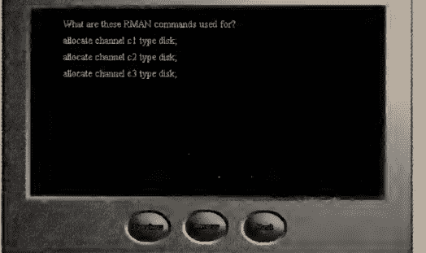

# 使用电子抽记卡唤醒记忆并为考试做最后的冲刺！

- 通过这些硬核的抽记卡式问题强化您的理解。（现在也适用于您的 Palm 设备）


# 检索 OCP: Oracle 9i DBA Fundamentals II 学习指南

- 以电子格式访问整个 OCP: Oracle 9i Fundamentals II 学习指南，包含图表。

OCP: Oracle-9i DBA Fundamentals II Study Guide

| 文件 | 编辑 | 文档 | 工具 | 视图 | 帮助 | 退出 |
| --- | --- | --- | --- | --- | --- | --- |
| OCP Oracle9i 电子抽记卡 | | | | | | |
| OCP Oracle 9i DBA Fundamentals II Study | | | | | | |
| 要求 | | | | | | |
| 评估 | | | | | | |
| 评估测试 | | | | | | |
| 网络设计考虑 | | | | | | |
| DBA 的网络服务 | | | | | | |
| 网络配置 | | | | | | |
| Oracle 黑色架构 | | | | | | |
| 考试示例 | | | | | | |
| 复习题 | | | | | | |
| 第 2 章：在...配置 Oracle Net | | | | | | |
| Oracle 集群管理器 | | | | | | |
| 服务动态注册 | | | | | | |
| 服务器故障排除指南 | | | | | | |
| 表加载与训练 | | | | | | |
| 总结 | | | | | | |


# Sybase 的 Oracle 认证解决方案

新的 Oracle9i 认证计划提供三个认证级别，旨在满足 IT 专业人士以及寻求聘用他们的需求。随着您通过实践和培训的努力获得更多技能和知识，您每获得一个新级别的认证都能增加更多信誉。Sybase 拥有一系列全面的学习指南，让您能够自信地应对考试。

# OCA: Oracle 认证关联员

Oracle9i 认证计划从关联员级开始。Oracle 将其定位为一种学徒级认证，验证基础知识，使数据库专业人士能够在数据库管理员或应用程序开发人员旁边担任初级职位。

| 考试名称 | 考试编号 | Sybase 产品 |
| --- | --- | --- |
| Oracle9i 简介 | 1Z-007 | OCA/OCP: Introduction to Oracle9i Study Guide 0-7821-42 |
| Oracle9i 基础 I | 1Z-031 | OCA/OCP: Oracle9i Fundamentals I Study Guide 0-7821-43 |

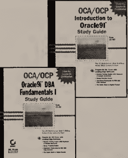

# OCP: Oracle 认证专业人士

Oracle 认证专业人士是 Oracle 计划的第二级别。候选人在进行 OCP 之前必须拥有 OCA 认证...管理大型数据库。

| 考试名称 | 考试编号 | Sybase 产品 |
| --- | --- | --- |
| Oracle9i 基础 II | 1Z-032 | OCA/OCP: Oracle9i Fundamentals II Study Guide 0-7821-44 |
| Oracle9i 性能调优 | 1Z-033 | OCA/OCP: Oracle9i Performance Tuning Study Guide 0-7821-44 |


# OCM: Oracle 认证专家大师

Oracle 认证专家大师是 Oracle 计划的最高级别。要成为 OCM，您必须首先通过四个...

## 市面上最好的 Oracle9i 书/CD 组合！

准备好迎接 Oracle9i 数据库：基础 II 考试吧，这里有最全面、最具挑战性的模拟题！

新的 Sybex Edge Tests 特具有：

- 逐章节涵盖书中所有复习题的考试范围。
- 仅限 CD 提供的两份额外考试。

OCP: Oracle9i Fundamentals II Study Guide

| 章节测试 | 章节 |
| --- | --- |
| 评估测试 | 第 1 章 |
| | 第 2 章 |
| | 第 3 章 |
| | 第 4 章 |
| 额外考试 | 第 5 章 |
| | 第 6 章 |
| 随机测试 | 第 7 章 |
| | 第 8 章 |
| | 第 9 章 |
| | 第 10 章 |
| | 第 11 章 |
| | 第 12 章 |
| | 第 13 章 |
| | 第 14 章 |
| | 第 15 章 |

OCP: Oracle9i Fundamentals II EdgeTests

> ©2002 Sybex, Inc. 由 Matt Shell 和 Edge Group 打印

# OCP 抽记卡 (FLASHCARDS)

# 使用电子抽记卡唤醒记忆并为考试做最后的冲刺！

- 通过这些硬核的抽记卡式问题强化您的理解。（现在也适用于您的 Palm 设备）

# 检索 OCP: Oracle 9i DBA Fundamentals II 学习指南

- 以电子格式访问整个 OCP: Oracle 9i Fundamentals II 学习指南，包含图表。

OCP: Oracle-9i DBA Fundamentals II Study Guide

| 文件 | 编辑 | 文档 | 工具 | 视图 | 帮助 | 退出 |
| --- | --- | --- | --- | --- | --- | --- |
| OCP Oracle9i 电子抽记卡 | | | | | | |
| OCP Oracle 9i DBA Fundamentals II Study | | | | | | |
| 要求 | | | | | | |
| 评估 | | | | | | |
| 评估测试 | | | | | | |
| 网络设计考虑 | | | | | | |
| DBA 的网络 | | | | | | |
| 网络配置 | | | | | | |
| Oracle 黑色架构 | | | | | | |
| 考试示例 | | | | | | |
| 复习题 | | | | | | |
| 第 2 章：在...配置 Oracle Net | | | | | | |
| Oracle 集群管理器 | | | | | | |
| 服务动态注册 | | | | | | |
| 服务器故障排除指南 | | | | | | |
| 表加载与训练 | | | | | | |
| 总结 | | | | | | |

# Sybase 的 Oracle 认证解决方案

新的 Oracle9i 认证计划提供三个认证级别，旨在满足 IT 专业人士以及寻求聘用他们的需求。随着您通过实践和培训的努力获得更多技能和知识，您每获得一个新级别的认证都能增加更多信誉。Sybase 拥有一系列全面的学习指南，让您能够自信地应对考试。

# OCA: Oracle 认证关联员

Oracle9i 认证计划从关联员级开始。Oracle 将其定位为一种学徒级认证，验证基础知识，使数据库专业人士能够在数据库管理员或应用程序开发人员旁边担任初级职位。

| 考试名称 | 考试编号 | Sybase 产品 |
| --- | --- | --- |
| Oracle9i 简介 | 1Z-007 | OCA/OCP: Introduction to Oracle9i Study Guide 0-7821-42 |
| Oracle9i 基础 I | 1Z-031 | OCA/OCP: Oracle9i Fundamentals I Study Guide 0-7821-43 |

# OCP: Oracle 认证专业人士

Oracle 认证专业人士是 Oracle 计划的第二级别。候选人在进行 OCP 之前必须拥有 OCA 认证...管理大型数据库。

| 考试名称 | 考试编号 | Sybase 产品 |
| --- | --- | --- |
| Oracle9i 基础 II | 1Z-032 | OCA/OCP: Oracle9i Fundamentals II Study Guide 0-7821-44 |
| Oracle9i 性能调优 | 1Z-033 | OCA/OCP: Oracle9i Performance Tuning Study Guide 0-7821-44 |

# OCM: Oracle 认证专家大师

Oracle 认证专家大师是 Oracle 计划的最高级别。要成为 OCM，你必须首先通过四个...
