# OCP：Oracle 9i 性能调优学习指南（附CD）

## 使用您的 Sybex 电子书

为了充分发挥这本 Sybex 电子书的功能，您的计算机必须安装了带有搜索功能的 Adobe Acrobat Reader。要确定您是否拥有正确版本的 Acrobat Reader，请单击“编辑”菜单——“搜索”应为此菜单中的一个选项。如果“编辑”菜单中没有“搜索”选项，请退出此应用程序，并从此 CD（双击 Adobe 文件夹中的 `rp500emu.exe`）安装带有搜索功能的 Adobe Acrobat Reader。

### 导航

通过点击左侧面板中出现的标题来浏览全书；对应的页面将显示在右侧面板中。

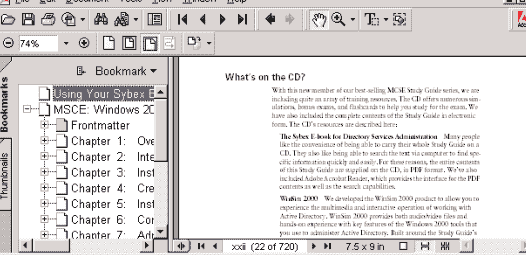

### 搜索

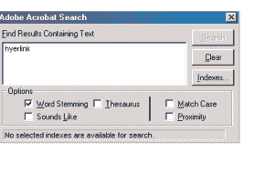

要进行搜索，请单击工具栏上的搜索查询按钮（图标），或者选择“编辑 > 搜索 > 查询”以打开搜索窗口。在 Adobe Acrobat 搜索对话框的文本字段中，输入您要查找的文本，然后单击“搜索”。

使用“下一个搜索”按钮（图标）`Control+U`和“上一个搜索”按钮（图标）`Control+Y`可以跳转到书中的其他匹配项。搜索命令还提供了强大的工具，用于限制和扩展您要搜索的术语的定义。有关更多信息，请参阅 Acrobat 的在线帮助（帮助 > 插件帮助 > 使用 Acrobat 搜索）。


## 致我们宝贵的读者

在 `CertCities.com` 于 2001 年 12 月 15 日发表的一篇文章中，Oracle 认证在"2002 年十大热门认证"榜单中排名第二。这并不令人惊讶，尤其是考虑到 OCP 计划在过去一年中规模几乎翻了一番（从 30,000 人增加到 80,000 人）。Oracle 继续扩大其在数据库市场的主导地位，随着公司开始将 Oracle® 系统集成到其 IT 基础设施中，您可以确信对持有 Oracle 认证助理（Oracle Certified Associate）和 Oracle 认证专业（Oracle Certified Professional）证书的专业人员的需求将会很高。

Sybex 很自豪地在过去几年中帮助了数千名 Oracle 认证考生为考试做准备，我们也兴奋地期待继续为您这样的专业人士提供在竞争激烈的 IT 行业中成功所需的技能。

我们的作者和编辑们努力工作，以确保您手中的 Oracle 9i 学习指南是全面的、深入的且在教学法上是健全的。我们有信心，这本书将满足并超越认证市场的严格标准，并帮助作为 Oracle 9i 认证考生的您取得成就。

祝您在追求 Oracle 9i 认证的过程中好运！


尼尔·埃德（Neil Ede）  
认证领域副出版人  
Sybex, Inc.

# 软件许可协议：条款和条件

随本书附带的介质和/或目前或未来提供的在线材料包含与本书配合使用的程序和/或文本文件（“软件”）。SYBEX 特此授予您使用软件的权利，但须遵守以下条款。您对软件的购买、接受或使用将构成您对这些条款的接受。

除非另有说明，软件汇编归 SYBEX 所有，并受版权保护，版权归 SYBEX 或在介质文件中指明的其他版权所有人（“所有人”）所有。特此授予您单用户许可，仅用于个人、非商业用途。未经 SYBEX 和本介质中包含的任何组件软件的具体版权所有人的书面同意，您不得复制、销售、分发、出版、传播或商业利用该软件或其任何部分。

如果软件或组件包含特定的许可要求或最终用户协议、条件声明、免责声明、限制或保证（“最终用户许可”），这些最终用户许可将取代本协议中的条款和条件，适用于该特定软件组件。您对软件的购买、接受或使用将构成您对这些最终用户许可的接受。

通过购买、使用或接受软件，您进一步同意遵守美国所有出口法律和法规，这些法律和法规可能不时存在。

## 本书中的可复用代码

作者在本出版物中创建了可复用代码，专门供读者复用。Sybex 授予读者权限，可出于任何目的复用本出版物或其随附 CD-ROM 中找到的代码，只要在任何包含可复用代码的应用中都将所有作者署名，并且代码本身永远不作为独立产品销售或商业利用。

## 软件支持

补充软件的组件及其相关要约可能由该材料的特定所有人提供支持，但 SYBEX 不提供支持。有关可用支持的信息，可通过适当 readme 文件中提供的信息或介质上其他列出的信息向所有人获取。

如果制造商或其他所有人停止提供支持或拒绝履行任何要约，SYBEX 不承担责任。此关于软件支持的通知仅供参考。SYBEX 不是所有人的代理人或委托人，SYBEX 对提供软件支持不承担任何责任，也不对所有人提供或未提供的任何支持负责。

## 保修

SYBEX 保证随附介质在购买后九十天（90）内无物理缺陷。除随附介质或发布在 `www.sybex.com` 上的形式外，SYBEX 不以任何其他形式或介质提供软件。如果您在此保修期内发现介质有缺陷，您可以将带有缺陷的介质、预付邮资及购买证明寄送至以下地址，免费获得相同格式的替换介质：

- 产品支持部
- 1151 Marina Village Parkway
- Alameda, CA 94501
- 网络：`http://www.sybex.com`

90 天期满后，您可通过向我们寄送有缺陷的磁盘、购买证明以及一张抬头为 SYBEX 的 10 美元支票或汇票，获得相同格式的替换介质。

## 免责声明

SYBEX 不对其软件或其内容、质量、性能、适销性或特定用途的适用性作出任何明示或暗示的保证或陈述。在任何情况下，即使被告知此类损害的可能性，SYBEX、其分销商或经销商对由使用或无法使用软件或其内容引起的直接、间接、特殊、附带、后果性或其他损害，您或任何第三方均不承担责任。如果软件包含在线升级功能，SYBEX 进一步免除其在初始发布后提供任何特定持续时间之外提供该功能的义务。某些法规不允许排除暗示的保证。因此，上述排除可能不适用于您。本保修为您提供特定的法律权利；您可能拥有随州而异的其他权利。SYBEX 对随附软件的定价反映了本条款和条件协议中规定的风险分配和责任限制。

## 共享软件分发

本软件可能包含各种作为共享软件分发的程序。版权法适用于共享软件和普通商业软件，版权所有人保留所有权利。如果您试用共享软件程序并继续使用该程序，则应对其进行注册。各程序在试用期、注册和付款的细节上有所不同。请遵守适当文件中规定的要求。

## 复制保护

本软件整体或部分可能经过复制保护或加密，也可能没有。然而，在任何情况下，除所有人特别规定外，未经授权的转售或重新分发这些文件是明确禁止的。

# 致谢

我谨此感谢众多对塑造我的职业经历，从而促成本书写作之人。其中包括我在格林布里尔·罗素公司（Greenbrier & Russel, Inc.）的甲骨文（Oracle）同事，他们的 Oracle 挑战也帮助塑造了我自己的职业路径：Christopher Guillaume、John Golden、Jesus Quinones、Jim Whitte 和 Jane Yang。

此外，我还要感谢在过去几年中为我提供许多有趣 Oracle 经验的客户和同行数据库管理员（DBA），包括：美国输电公司（American Transmission Company）的 Jonathan Jackson、Tim Eleyt、Linda Ramme、Bob Budden、Greg Van Haren 和 John Aaholm；高地社区学院（Highland Community College）的 Tony Gastel 和 Audrey Smith；迪恩健康计划（Dean Health Plan）的 George Carpenter 和 Lorin Weiler；密尔沃基地区技术学院（Milwaukee Area Technical College）的 Mike Gavin、Jerri Wang、Dan Hartsman、Thomas Baas 和 Ted Drankus；以及 Snap-On Tools 的 Jim Schwarz 和 Reginald Bron。

我要感谢 Matt Weishan，他撰写或修订了 9i 书籍及 CD 中的所有问题。我很高兴我们能在这个项目中再次合作。

还要感谢 Bob Bryla 和 Ashok Hanumantth 在技术审查期间的付出，以及 Sybex 公司所有让这个项目顺利进行的人：Christine McGeever、Jeff Kellum、Dan Schiff、Linda Stephenson 和 Leslie Light。

最后，我要感谢我的妻子 Brenda，她总能在截止日期临近时，腾出时间为我校对章节或修复屏幕截图。

# 引言

信息技术（IT）行业对专业人才的需求很高，而 Oracle 认证是数据库领域最炙手可热的资历凭证。你做出追求认证的决定是正确的，因为获得 Oracle 认证将为你在这个竞争激烈的市场中带来明显的优势。


许多读者可能已经熟悉 Oracle，不需要介绍 Oracle 数据库世界。对于那些不熟悉该公司的读者，Oracle 成立于 1977 年，销售了第一个商用关系数据库，如今是全球领先的数据库公司，也是第二大独立软件公司，营收超过 100 亿美元，服务于 145 多个国家。

Oracle 数据库是大型互联网网站的事实标准。当 Oracle 的广告商宣称“互联网运行在 Oracle 之上”时，他们虽然自夸，但说的是事实。几乎所有大型互联网网站都运行 Oracle 数据库。Oracle 在数据库市场的渗透很深，并不仅限于互联网公司的应用。许多公司的企业资源规划（ERP）应用程序套件、数据仓库和定制应用程序都依赖 Oracle。在经济低迷时期，对 DBA 资源的需求仍然高于其他领域。

本书旨在帮助你踏上成为 Oracle 认证专业人员（OCP）和 Oracle 认证大师（OCM）的激动人心之旅。具备 Oracle SQL 的基础知识在阅读本书时是一个优势，但并非必要条件。使用本书和一个练习数据库，你可以开始学习 Oracle 并通过 `1Z0-033` 考试：Oracle9i 数据库：性能调整。

## 为什么要成为 Oracle 认证专业人员？

成为 OCP 的首要原因是获得更高的知名度，并更大程度地进入该行业最具挑战性的机会。Oracle 认证是展示你在 Oracle 数据库系统方面知识和技能的最佳方式。认证考试是基于场景的，这是评估你动手能力和关键问题解决技能的最有效方式。

认证是你知识的证明，表明你具备支持 Oracle 核心产品所需的技能。Oracle 认证计划可以帮助公司识别那些经过验证的表现优异者，他们已展示了自己的技能，并能支持公司对 Oracle 技术的投资。它表明你对自己的职位角色及该角色中使用的 Oracle 产品有扎实的理解。

OCP 是 IT 行业中薪酬最高的群体之一。薪资调查一致表明，OCP 认证带来的薪资高于其他认证，包括 Microsoft、Novell 和 Cisco。

因此，无论你正在开始职业生涯、转换职业、稳固现有职位，还是希望完善和提升你的职位，这本书都适合你！

## Oracle 认证

Oracle 认证遵循面向职位角色的路径。有数据库管理、数据库操作员和开发者等路径。在每个路径中，Oracle 都有一个三级认证计划：

- 第一级是 Oracle 认证助理（OCA）。OCA 认证通常要求你完成两项考试，第一项通过互联网进行，第二项在监考环境中进行。
- 下一等级是 Oracle 认证专业人员（OCP），它建立在 OCA 认证之上，并要求持有 OCA 认证。获得 OCP 认证的额外要求是通过额外的监考考试。
- 第三级也是最高级别是 Oracle 认证大师（OCM）。OCM 认证建立在 OCP 认证之上，并要求持有 OCP 认证。要获得 OCM 认证，你必须参加两门高级 Oracle 教育课堂课程（来自特定合格课程列表）并完成一项实践考试。

以下内容仅讨论数据库管理路径，因为截至本书写作时，它是 Oracle 提供的唯一 9i 路径。其他路径拥有 8 和 8i 认证，并且无疑将推出 9i 认证。请访问 Oracle 网站 `http://www.oracle.com/education/certification/` 获取最新信息。

## Oracle9i 认证数据库助理

数据库管理员（DBA）的角色已成为当今高度复杂的数据库系统中成功的关键。最优秀的 DBA 在幕后工作，但当关键问题出现时，他们会成为焦点。他们进行规划、创建、维护数据库，并确保数据库对业务可用。他们始终关注数据库的性能问题，并防止计划外的停机。DBA 的工作要求对 Oracle 数据库的架构有广泛的理解，以及解决问题的专业知识。

Oracle9i 认证数据库助理是数据库管理路径的入门级认证，是向更高级别认证等级晋级所必需的。该认证要求你通过两项考试，以展示你对 Oracle 基础知识的掌握：

- `1Z0-007`：Oracle9i 介绍：SQL
- `1Z0-031`：Oracle9i 数据库：基础 I

`1Z0-007` 考试，Oracle9i 介绍：SQL，在互联网上提供。`1Z0-031` 考试，Oracle9i 数据库：基础 I，在 Sylvan Prometric 考场提供。

## Oracle9i 认证数据库管理员（OCP）

数据库管理路径的 OCP 级别要求你展示你对 Oracle 技术的持续经验和知识。Oracle9i 认证数据库管理员认证要求达成认证数据库助理级别，并在 Sylvan Prometric 考场通过以下两项考试：

- `1Z0-032`：Oracle9i 数据库：基础 II
- `1Z0-033`：Oracle9i 数据库：性能调整

## Oracle9i 认证大师

Oracle9i 认证大师是 Oracle 提供的最高级别认证。要成为认证大师，你必须首先获得 OCP 状态，然后在 Oracle 教育设施完成两门高级讲师引导课程，最后在 Oracle 教育通过一项动手考试。这些课程和实践考试仅在 Oracle 教育设施提供，可能需要差旅。计入 OCM 要求的高级课程包括以下课程：

- Oracle9i：使用 PL/SQL 编程
- Oracle9i：高级 PL/SQL
- Oracle9i：SQL 调整研讨班
- Oracle9i：互联网环境中的高可用性
- Oracle<sup>9i</sup>：数据库：分区实现
- Oracle<sup>9i</sup>：Real Application Clusters 实现
- Oracle<sup>9i</sup>：数据仓库管理
- Oracle<sup>9i</sup>：高级复制
- Oracle<sup>9i</sup>：Enterprise Manager

## 更多信息

有关 Oracle 认证的最新信息可以在 `http://www.oracle.com/education/certification` 上找到。请跟随认证链接并选择您感兴趣的领域。阅读考生指南以了解测试目标和测试内容，并请记住，这些内容可能随时更改且不会另行通知。

## OCA/OCP 学习指南

Oracle<sup>9i</sup> 数据库管理方向的认证由四场考试组成：OCA 级别两场，OCP 级别额外两场。Sybex 提供了多份学习指南，帮助您获得此认证：

- OCA/OCP：Introduction to Oracle<sup>9i</sup><sup>™</sup> SQL 学习指南（考试代码 `1Z0-007`；Introduction to Oracle<sup>9i</sup>：SQL）
- OCA/OCP：Oracle<sup>9i</sup><sup>™</sup> DBA 基础 I 学习指南（考试代码 `1Z0-031`；Oracle<sup>9i</sup> 数据库：基础 I）
- OCP：Oracle<sup>9i</sup><sup>™</sup> DBA 基础 II 学习指南（考试代码 `1Z0-032`；Oracle<sup>9i</sup> 数据库：基础 II）
- OCP：Oracle<sup>9i</sup><sup>™</sup> DBA 性能调优（考试代码 `1Z0-033`；Oracle<sup>9i</sup> 数据库：性能调优）

此外，这四本书还提供为套装：OCP：Oracle<sup>9i</sup><sup>™</sup> DBA 认证套件。

## DBA 认证所需技能

要通过认证考试，您需要掌握以下技能：

- 编写 SQL SELECT 语句，以显示来自单表或多表的数据。
- 使用单行函数和组函数来限制、排序、聚合和操作数据。
- 创建和管理表、视图、约束、同义词、序列和索引。
- 创建用户和角色以控制用户访问并维护安全性。
- 理解 Oracle 服务器架构（数据库和实例）。
- 理解数据库的物理和逻辑存储，并能够管理空间分配和增长。
- 管理数据，包括其存储、加载和重新组织。
- 管理重做日志、自动回滚和回滚段。
- 使用全球化功能选择数据库字符集和 National Language Support (NLS) 参数。
- 在服务器端和客户端配置 Oracle Net。
- 使用备份和恢复选项。
- 归档重做日志文件和热备份。
- 使用恢复管理器 (`RMAN`) 执行备份和恢复操作。
- 使用数据字典视图并设置数据库参数。
- 配置和使用共享服务器和连接管理器。
- 识别并调整数据库和 SQL 性能。
- 使用调优/诊断工具 `STATSPACK`、`TKPROF` 和 `EXPLAIN PLAN`。
- 调整数据块、共享池、缓冲区缓存和回滚段的大小。
- 诊断闩锁、锁和回滚段的竞争情况。

## 参加 OCP 考试的技巧

使用以下技巧来帮助您准备并通过每场考试：

- 每个 OCP 测试包含大约 60–80 道题目，需在 90 分钟内完成。请先回答您知道答案的问题，以免时间耗尽。
- 考试中的许多题目其答案选项乍看之下似乎相同。请仔细阅读问题。不要贸然下结论。确保您清楚理解每道问题具体在问什么。
- 大多数测试题目是基于场景的。某些场景包含无意义的信息和插图。您需要能够识别哪些是重要的，哪些是不重要的。


- 不要留任何题目未回答。没有负分项。选择答案后，您可以标记一道难题或您不确定的题目，稍后再回来处理。
- 当您不确定答案时，使用排除法先去除明显错误的选项。如果您需要做出有根据的猜测，这会极大地提高您的几率。
- 如果您不确定自己的答案，请将其标记为待复习，然后寻找其他可能帮助您排除错误答案的问题。在考试结束时，您可以返回并审查标记为待复习的问题。

## 在哪里参加考试？

您通过互联网参加 Introduction to Oracle9i: SQL 考试（`1Z0-007`）。要注册在线 Oracle 认证考试，您需要至少 33Kbps 的互联网连接，但推荐使用 56Kbps、局域网或宽带连接。您还需要 Internet Explorer 5.0（或更高版本）或 Netscape 4.x（Oracle 不建议使用 Netscape 5.x 或 6.x）。撰写本文时，在线 `1Z0-007` 考试的费用为 90 美元。如果您没有信用卡用于付款，您需要联系 Oracle 购买兑换券。您可以使用认证兑换券、促销代码或信用卡付款。

您可以参加世界范围内 800 多个 Sylvan Prometric 授权测试中心的其他考试。要查询您附近的测试中心位置，请拨打 `1-800-891-3926`。在美国和加拿大境外，请联系您当地的 Sylvan Prometric 注册中心。通常，考试可以以任何顺序参加。

要注册 Sylvan Prometric 测试中心的 Oracle 认证专家（`OCP`）监考考试：

- 确定您要参加的考试的编号。
- 在线通过 `http://www.2test.com` 或与 Sylvan Prometric 在北美联系（拨打 `1-800-891-EXAM` (`800-891-3926`) 注册。此时，您将需要预先支付考试费用。撰写本文时，每场考试的费用为 125 美元，且必须在付款后一年内完成。
- 当您安排考试时，您将获得关于所有预约和取消程序、身份证件要求以及测试中心位置的信息。

您可以提前最多六周安排考试，或最晚在您希望参加考试的当天前一个工作日。如果有突发状况，您需要取消或改期考试预约，请至少提前 24 小时联系 Sylvan Prometric。

## 本书涵盖哪些内容？

本书涵盖了通过 Oracle9i：性能调优考试所需的所有内容。该考试是数据库管理方向 Oracle9i 认证专家（`OCP`）认证层级的一部分。它教您如何使用 Oracle 的调优方法论和技术来提高数据库性能。每章以考试目标列表开头。

- 第 1 章 以 Oracle 性能调优方法论概述和 Oracle 架构回顾开始。
- 第 2 章 讨论性能调优信息的来源，从数据字典和动态性能视图到 Oracle 提供的调优工具。
- 第 3 章 讨论如何根据优化器行为、执行计划和索引策略来衡量和调整应用程序设计。
- 第 4 章 解释如何衡量和提高共享池的性能。
- 第 5 章 探讨如何衡量和提高数据库缓冲区缓存的性能。
- 第 6 章 讨论如何衡量和调整其他 SGA 区域（如大型池、Java 池和共享服务器进程）的性能。
- 第 7 章 解释如何监控和管理 Oracle 重做机制的性能。
- 第 8 章 描述如何衡量和管理 Oracle 架构中执行物理磁盘 I/O 部分性能的。
- 第 9 章 解释如何衡量和调优与闩锁、自由列表 (`Free Lists`) 和锁的竞争相关的性能问题。
- 第 10 章 讨论如何使用 Oracle 的资源管理器功能来改善 Oracle 服务器资源（如 CPU 和内存）的利用率。

每章以复习问题结尾，这些问题专门设计用来帮助您保留所呈现的知识。要真正巩固您的技能，请仔细阅读并回答每个问题。

## 如何使用本书

本书可以为认真准备 `OCP` 数据库管理考试方向打下坚实的基础。要最好地利用本书，请使用以下学习方法：

1. 紧接本简介之后立即参加评估测试。（答案在测试末尾。）仔细阅读您答错的任何问题的解释，并注明材料来自哪些章节。这些信息应帮助您规划学习策略。
2. 仔细学习每一章，确保您完全理解信息以及每章开头列出的测试目标。对评估测试中您错过的题目相关的章节给予特别密切的关注。
3. 完成章节中的所有动手练习，参考章节内容以理解您采取的每个步骤的原因。如果您没有可用的 Oracle 数据库，请务必仔细研究示例。回答与该章相关的复习问题。（答案出现在每章末尾，“复习问题”部分之后。）
4. 注意那些使您困惑或被您误解的问题，并再次学习书中的相应部分。
5. 在参加考试之前，尝试做一下随书附赠 CD 中包含的两份附加练习题。

这些考试中的题目仅包含在光盘中。这将为你提供一个关于实际考试中可能出现内容的完整概览。

+ 请记住使用随本书附带光盘中的产品。电子闪卡（electronic flashcards）和 EdgeTest 考试准备软件是专门为帮助你备考和通过考试而设计的。电子闪卡可以在你的 Windows 计算机或 Palm 设备上使用。

要掌握本书涵盖的所有内容，你需要定期且有纪律地投入精力。试着每天留出相同的时间段来学习，并选择一个舒适、安静的地方进行。如果你努力，你会惊讶于自己学习这些材料的速度。祝你好运！

## 光盘里有什么？

我们努力提供了一些真正出色的工具，以帮助你完成认证过程。当你为考试做准备时，以下所有工具都应该安装在你的工作站上。

### 面向 Oracle 认证 DBA 的 EdgeTest 准备软件

由 EdgeTek Learning Systems 提供，这款考试准备软件帮助你通过 Oracle9i 数据库：性能调优考试。在此测试中，你可以找到书中的所有题目，以及仅出现在光盘中的两份额外练习题。你可以参加评估测试（Assessment Test），按章节自测，参加一份或两份练习题，或者从所有题目中随机生成一份考试。

### PC 和 Palm 设备的电子闪卡

在读完《OCP：Oracle9i 性能调优学习指南》之后，请阅读每章末尾的复习题，并学习光盘中包含的练习题。但等等，还有更多！用光盘中包含的闪卡进行自测。如果你能通过这些难题并理解答案，你就知道自己为考试做好了准备。

闪卡包含超过 150 个专门编写的问题，旨在考验你并确保你为考试做好了准备。结合复习题、练习题和闪卡，你应该能充分准备考试。

### OCP：Oracle9i 性能调优学习指南 PDF 版

Sybex 现在在光盘中提供这本 Oracle 认证书，以便你可以用 PC 或笔记本电脑阅读。它采用 Adobe Acrobat 格式。光盘中还包含 Acrobat Reader 5。这对于经常乘飞机或乘坐公交、火车通勤且不想携带书本的读者非常有帮助，同时也适用于那些觉得在电脑上看书更舒适的读者。

### 如何联系作者

你可以通过电子邮件 `jjohnson@gr.com` 联系 Joe Johnson。

## 评估测试

1. 某些类型的操作系统参数可以由 DBA 进行调整。这些参数叫什么？
   - A. 内核参数
   - B. 基础参数
   - C. 初始化参数
   - D. 基本参数

2. 闩锁（Latches）保护对哪些 Oracle 结构的访问？
   - A. 数据文件
   - B. 控制文件
   - C. 表
   - D. 内存结构

3. 当你使用 `EXPLAIN PLAN FOR…` 语法在 `SQL*Plus` 中为 SQL 语句生成执行计划（Explain Plan）时，以下哪项是正确的？
   - A. 查询本身不会执行。仅创建执行计划。
   - B. 除非开启了 `AUTOTRACE`，否则信息不会存储在 `PLAN_TABLE` 中。
   - C. `TKPROF` 工具在 `EXPLAIN PLAN FOR` 语句后自动运行，以生成格式化输出。
   - D. 查询被执行并且执行计划被创建。

4. DBA 希望确保某些用户不受限制地访问所有服务器资源。DBA 应该将这些用户放入哪个默认资源组？
   - A. `OTHER_GROUPS`
   - B. `SYS_GROUP`
   - C. `LOW_GROUP`
   - D. `DEFAULT_CONSUMER_GROUP`

5. `DBA_TABLES` 视图中的 `EMPTY_BLOCKS` 列衡量的是什么？
   - A. 表中的总空块数
   - B. 表中高于高水位线（`High Water Mark`）的总空块数
   - C. 表中低于高水位线（`High Water Mark`）的总空块数
   - D. 以上都不是

6. 在默认的 Oracle9i 配置中，客户端连接的默认方法是什么？
   - A. 专用服务器（Dedicated Server）
   - B. 共享服务器（Shared Server）
   - C. 客户端/服务器（Client/Server）
   - D. ODBC

7. DBA 和开发人员正在为大学构建学生记录系统。他们决定使用以下语法创建一个 `STUDENT_HISTORY` 表。这个表将如何分区？


```sql
SQL> CREATE TABLE student_history
 2  (student_id       NUMBER(10),
 3  degree           VARCHAR2(3),
 4  graduation_date DATE,
 5  final_gpa        NUMBER)
 6  PARTITION BY RANGE (graduation_date)
 7  SUBPARTITION BY HASH(student_id) SUBPARTITIONS 4
 8  STORE IN (hist_tab01, hist_tab02, hist_tab03, hist_tab04)
 9  (PARTITION p_1997 VALUES LESS THAN
10  (TO_DATE('01-JUN-1997', 'DD-MON-YYYY'))),
11  PARTITION p_1998 VALUES LESS THAN
12  (TO_DATE('01-JUN-1998', 'DD-MON-YYYY'))),
13  PARTITION p_1999 VALUES LESS THAN
14  (TO_DATE('01-JUN-1999', 'DD-MON-YYYY'))),
15  PARTITION p_2000 VALUES LESS THAN
16  (TO_DATE('01-JUN-2000','DD-MON-YYYY')) ,
17  PARTITION p_2001 VALUES LESS THAN
18  (TO_DATE('01-JUN-2001','DD-MON-YYYY')) ,
19  PARTITION p_ERROR VALUES LESS THAN (MAXVALUE));
```

- A. 哈希（Hash）
- B. 列表（List）
- C. 范围（Range）
- D. 复合（Composite）

### 8. 数据库的资源计划中，在实例级别同一时间最多可以有多少个处于活动状态？

- A. 全部
- B. 无
- C. 一个
- D. 最多四个

### 9. 你的数据库处于 ARCHIVELOG 模式，并发生了日志切换。正在切换到的在线重做日志尚未归档。会发生什么？

- A. `LGWR` 将覆盖该日志。
- B. 实例将崩溃。
- C. 将自动创建额外的在线日志以满足日志切换请求。
- D. `LGWR` 进程将等待 `ARC0` 完成在线重做日志文件的归档。

### 10. 以下哪个命令不会导致 `DBW0` 写入脏块（dirty blocks）？

- A. `ALTER TABLESPACE DATA BEGIN BACKUP`
- B. `SHUTDOWN IMMEDIATE`
- C. `SHUTDOWN ABORT`
- D. `ALTER SYSTEM SWITCH LOGFILE`

### 11. 以下哪项不是性能调优的两个基本原则之一？

- A. 增加服务器的内存
- B. 增加应用程序可用的磁盘数量
- C. 减少用户数量
- D. 增加 `SGA` 的大小

### 12. 初级 DBA 决定每天检查 Alert 日志，以确定数据库中是否存在性能问题。初级 DBA 可能会在 Alert 日志中找到以下哪些类型的信息（选择三项）？

- A. 实例启动和关闭
- B. 重做日志切换
- C. 数据库用户创建
- D. 表空间创建

### 13. 在 `SGA` 中，Oracle 保存最近执行的 SQL 的位置叫什么？

- A. 大池（Large Pool）
- B. 数据库缓冲区缓存（Database Buffer Cache）
- C. 重做日志缓冲区（Redo Log Buffer）
- D. 共享池（Shared Pool）

### 14. 以下哪个命令不会导致排序？

- A. `ORDER BY`
- B. `ANALYZE TABLE`
- C. `SELECT DISTINCT`
- D. `INTERSECT`
- E. 以上所有都可能导致排序发生。

### 15. 当创建资源消费者组（resource consumer group）、资源计划（resource plan）或资源计划指令（resource plan directive）时，以下哪项是正确的？（选择所有适用项。）

- A. 每个参数前必须加上 `=>`。
- B. 每个参数必须用引号括起来。
- C. 命令必须在一行中键入。
- D. 以上所有都正确。

### 16. 当发生死锁情况时，为了解决死锁，哪个会话的语句将被回滚？

- A. 导致死锁的会话
- B. 检测到死锁的会话
- C. 完成工作量最少的会话
- D. 最后登录的会话

### 17. 一位 DBA 管理数据库有三个目标：可恢复性（recoverability）、可靠性（reliability）和可扩展性（scalability）。Oracle 的共享服务器（Shared Server）功能将解决这三个目标中的哪一个？

- A. 性能
- B. 可扩展性
- C. 可靠性
- D. 安全性

### 18. 你希望为若干你认为需要调优的 SQL 语句生成执行计划。你想保存计划信息以便日后评估。你应该做的第一件事是什么？

- A. 运行 `TKPROF`。
- B. 使用“Explain plan for...”语法运行 SQL 语句。
- C. 在你的 `SQL*Plus` 会话中开启 `AUTOTRACE`。
- D. 运行 `utlxplan.sql`。

### 19. 你使用以下语法创建一个表：

`CREATE TABLE EMP_HOLD AS SELECT * FROM EMP NOLOGGING;`

为了确保护 `EMP_HOLD` 表的可恢复性，执行此语句后应该做什么？

### 19. 以下哪项操作**不会**导致数据库生成重做日志条目？

- A. 停止并启动 Oracle 实例。
- B. 发出 `COMMIT` 语句。
- C. 执行热备份或冷备份。
- D. 执行手动日志切换。

### 20. 以下都是收集数据库缓冲区命中率测量值的方法，除了哪一项？

- A. `UTLBSTAT`/`UTLLESTAT`
- B. `STATSPACK`
- C. `V$SYSSTAT`
- D. `V$DB_CACHE`

### 21. 一个组织决定增加与他们的 Oracle 应用程序交互的用户数量。这属于哪种类型的调优生命周期变更？

- A. 设计变更
- B. 配置变更
- C. 工作负载变更
- D. 应用程序设计变更

### 22. 关于 `V$SESSTAT` 和 `V$SYSSTAT` 视图之间差异的下列陈述中，哪些是不正确的？（选择两项。）

- A. `V$SESSTAT` 显示每个会话的统计信息，`V$SYSSTAT` 显示实例范围的统计信息。
- B. `V$SESSTAT` 包含用户名，`V$SYSSTAT` 不包含。
- C. `V$SESSTAT` 显示已连接会话的统计信息，`V$SYSSTAT` 显示自实例启动以来所有已连接会话的累计统计信息。
- D. `V$SESSTAT` 和 `V$SYSSTAT` 中的统计信息在实例启动后立即最准确。

### 23. Oracle 建议 CPU 使用率保持在什么百分比以下以获得最佳性能？

- A. 70
- B. 80
- C. 90
- D. 100

### 24. 如果共享池（Shared Pool）大小设置得当，在 OLTP 系统中，它将在内存中缓存应用程序的 SQL 和 PL/SQL，命中率达到 90% 或更高。这对以下哪些原因很重要？（选择三项。）

- A. 减少总体内存开销
- B. 减少 I/O
- C. 减少 CPU 使用率
- D. 最小化锁定

### 25. 以下哪个 GUI 工具最适合监控 Oracle 的锁定机制？

- A. Top Sessions
- B. Lock Monitor
- C. Trace Data Viewer
- D. SQL Analyze

### 26. 在对数据库进行调优工作之前，应建立基准。应在哪些领域进行这些基准测试？（选择三项。）

- A. 响应时间
- B. 内存芯片数量
- C. CPU 使用率
- D. 服务器电源数量
- E. 物理 I/O 和内存消耗

### 27. 从以下查询中可以得出什么观察结果？


```sql
SQL> SELECT owner, segment_type,
       2  segment_name, buffer_pool
       3  FROM dba_segments;

OWNER SEGMENT_TYPE SEGMENT_NAME              BUFFER_
----- ------------ ------------------------- --------
APPS  TABLE  EMPLOYEE                       DEFAULT
APPS  TABLE  REGION                          KEEP
APPS  TABLE  DIVISION                        RECYCLE
APPS  INDEX  EMPLOYEE_FIRST_NAME_IDX         DEFAULT
APPS  INDEX  EMPLOYEE_ID_PK                  RECYCLE
APPS  TABLE  SALES_HISTORY                   RECYCLE
```

- A. `REGION` 表可能是一个非常大且不经常使用的表。
- B. `DIVISION` 表的块将被放置在 LRU 列表的 MRU 端。
- C. `REGION` 表可能是一个小型代码表。
- D. 我们希望在数据库缓冲区中保留 `SALES_HISTORY` 表的块。

### 28. 下列哪个进程负责将数据从联机重做日志复制到归档日志？

- A. `ARC0`
- B. `LGWR`
- C. `DBW0`
- D. `PMON`

### 29. 你想基于一个唯一列创建分区表。你希望确保 Oracle 在各分区之间保持相当均匀的每分区行数分布。哪种类型的分区方案能确保给定分区之间的高度分布？

- A. 哈希（Hash）
- B. 范围（Range）
- C. 列表（List）
- D. 这些分区类型的工作效果都一样好。

### 30. DBA 正在调查一个非常大的 SQL 语句的问题，需要查看该 SQL 语句执行时的完整文本。查找完整 SQL 文本的最佳视图是：

- A. `V$SQLAREA`
- B. `V$SQLTEXT`
- C. `V$SQL`
- D. `V$SQL_PLAN`

### 31. DBA 有兴趣为运行第三方应用程序的客户端设置跟踪。由于他无法直接访问应用程序代码或客户端会话，启动此跟踪会话的正确方法是使用什么？

- A. 在 `init.ora` 文件中设置 `SQL_TRACE=TRUE`。
- B. 对他想要跟踪的会话执行 `DBMS_SYSTEM.SET_SQL_TRACE_IN_SESSION`。
- C. 对客户端会话执行 `ALTER SESSION SET SQL_TRACE=TRUE`。
- D. 无法直接跟踪另一个客户端会话。

### 32. DBA 正在制定数据库性能调优的部门准则。这些准则应包括以下哪些项目？（选择三项。）

- A. 性能调优是一个迭代过程。
- B. 当对系统架构进行修改时，可能需要进行性能调优。
- C. 性能调优计划可能因运行的系统类型不同而有所不同。
- D. 在开始调优工作之前，应为系统建立性能基准。
- E. 性能调优只需执行一次。

### 33. 查询哪个视图可以看到数据库缓冲区收集的建议结果？

- A. `V$DB_CACHE_ADVICE`
- B. `V$SYSSTAT`
- C. `V$SGASTAT`
- D. `V$SGA`

### 34. 下列哪项不属于 Oracle 的重做机制？

- A. 日志写入器（Log Writer）
- B. 数据库写入器（Database Writer）
- C. 检查点（Checkpoints）
- D. 归档重做日志（Archive Redo Logs）

### 35. 为了改进现有应用程序的性能，DBA 正在考虑向数据库服务器添加额外的 CPU。哪种类型的应用程序 SQL 最能从多个 CPU 的存在中受益？

- A. DML 语句
- B. 并行语句
- C. DDL 语句
- D. 任何 PL/SQL 包和过程

### 36. 用于定义某些类型分区表的最大值（high value）的特殊关键字是什么？

- A. `UPPER`
- B. `MAXVALUE`
- C. `MAXIMUM`
- D. `UBOUND`

### 37. 在以下哪种情况下最可能使用 Java 池（Java Pool）？

- A. 当使用利用 JavaScript 的应用程序时
- B. 当使用 Java Applet 时
- C. 当访问使用 Java 存储过程的应用程序时
- D. 当使用 JDBC 连接时

### 38. Oracle 的默认锁定机制在行级别。这种级别的锁定有助于保证什么的高度程度？

- A. 数据一致性
- B. 数据并发性
- C. 数据准确性
- D. 数据可扩展性

### 39. 本地管理表空间和字典管理表空间在什么方面有所不同？

- A. 本地管理表空间使用系统表来跟踪已分配和未分配的空间，而字典管理表空间不使用。
- B. 本地管理表空间不能用于存储应用程序表和索引，而字典管理表空间可以。
- C. 本地管理表空间使用其数据文件中的位图来跟踪已分配和未分配的空间，而字典管理表空间不使用。
- D. 本地管理表空间只能利用数据库的主要块大小，而字典管理表空间可以使用不同的块大小。

### 40. 缓存在共享池中的编译后的 SQL 代码版本的另一个名称是什么？

- A. 动态链接库
- B. P-Code
- C. script
- D. S-Code

### 41. 哪种优化方法考虑许多不同的执行计划，然后选择相对执行成本最低的那个？

- A. 基于规则的优化
- B. 基于值的优化
- C. 基于成本的优化
- D. 基于性能的优化

### 42. Oracle 建议你在设置 Oracle 服务器时使用符合 OFA 的架构。OFA 代表什么？

- A. Oracle Flexible Architecture
- B. Oracle FailSafe Architecture
- C. 最优灵活架构（Optimal Flexible Architecture）
- D. 最优故障安全架构（Optimal FailSafe Architecture）

### 43. DBA 想要将数据库缓冲区缓存的大小增加 100MB。目前，SGA 的总体大小为 256MB，`SGA_MAX_SIZE` 已设置为 300MB，机器上可供 Oracle 使用的总系统内存为 300MB。DBA 应该怎么做？

- A. 发出 `ALTER SYSTEM` 命令来动态修改 `SGA_MAX_SIZE` 和 `DB_CACHE_SIZE`。
- B. 发出 `ALTER DATABASE` 命令来动态修改 `SGA_MAX_SIZE` 和 `DB_CACHE_SIZE`。
- C. 关闭数据库，修改 `SGA_MAX_SIZE` 和 `DB_CACHE_SIZE` 参数，然后重启实例。
- D. DBA 无法将数据库缓冲区缓存的大小增加 100MB。

### 44. 下列哪项不会是一个可能需要进一步调优的 SQL 语句的特征？

- A. 消耗过多 CPU 资源的语句
- B. 解析、获取或执行时间很长的语句
- C. 从 SGA 读取数据块过多而从磁盘读取过少的语句
- D. 访问许多数据块但只返回几行数据的语句

### 45. 你正在设置一个新数据库。你已设置用于排序的临时文件（tempfiles），并且希望确保在数据库中创建的用户不会使用系统表空间作为其默认临时表空间。你可以发出什么命令来防止这种情况？

## 评估问题

### 45. 以下哪个命令用于更改数据库的默认临时表空间？

- A. `ALTER DATABASE DEFAULT TEMPORARY TABLESPACE temp;`
- B. `ALTER TABLESPACE DEFAULT TEMPORARY TABLESPACE temp;`
- C. `ALTER SYSTEM DEFAULT TEMPORARY TABLESPACE temp;`
- D. `ALTER DATABASE DATAFILE temp DEFAULT TEMPORARY TABLESPACE temp;`

### 46. DBA 确定几个繁忙的应用程序表上发生了自由列表（Free List）争用。DBA 可以使用的最小化这些表上自由列表争用的方法是什么？

- A. `CREATE TABLE` 语句中的 `FREELISTS` 关键字
- B. 自动段空间管理（Automatic Segment-Space Management）
- C. `init.ora` 参数中的 `FREELISTS`
- D. 删除并重新创建表，配置更多的自由列表。

### 47. 关于 Oracle 共享服务器（Shared Server）连接，以下哪个陈述是*正确的*？

- A. 许多共享服务器进程可以由单个客户端连接提供服务。


## 题目

- **B.** 客户端将其请求放入请求队列。
- **C.** 分发器（Dispatchers）可以同时为许多客户端提供服务。
- **D.** 每个分发器进程必须有一个共享服务器进程。

### 48
通常，在解释执行计划的结果时，检查的 SQL 语句中首先被执行的是计划中的哪些操作？

- **A.** 列出的第一个操作
- **B.** 列出的最后一个操作
- **C.** 格式化为嵌套树形结构时的最内层操作
- **D.** 格式化为嵌套树形结构时的最外层操作

### 49
Oracle 数据库必须拥有的最少重做日志（Redo Logs）数量是：

- A. 一个
- B. 两个
- C. 四个
- D. 八个

### 50
追踪服务器 CPU 数量的 Oracle `init.ora` 参数是什么？

- A. `SERVER_CPUS`
- B. `CPU_COUNT`
- C. `CPU_NUMBER`
- D. `NUM_CPUS`

### 51
如果一个事务在回滚段（rollback segment）的一个区（extent）中开始，但该区的空间不足以容纳事务的全部内容，会发生什么？

- A. 事务将失败，无法完成。
- B. 事务将继续进入下一个可用的回滚段。
- C. 即使该区域存在活跃事务，事务也会扩展到回滚段的下一个区域。
- D. 如果下一个回滚段不包含活跃事务，事务将环绕进入下一个回滚段。

### 52
需要授予哪些角色给希望运行 AUTOTRACE 的 SQL*Plus 用户？

- A. `AUTOTRACE`
- B. `PLUSTRACE`
- C. `TRACING`
- D. `STATISTICS`

### 53
DBA 决定某些应用程序查询将通过并行执行受益。如果要使用并行查询，应配置 SGA 的哪个可选区域？

- A. 重做日志缓冲区
- B. 数据库缓冲区缓存
- C. 共享池
- D. 大型池

### 54
关于 `AUTOTRACE` 的以下说法中哪些是**错误的**（请选择所有适用的选项）？

- A. 你需要属于特定角色才能使用该工具。
- B. 你需要使用 `SET AUTOTRACE ON` 来使用该工具。
- C. 你必须拥有一个可用的 `PLAN_TABLE`。
- D. 你可以使用第三方工具使用 `AUTOTRACE` 实用程序。

### 55
在检查实例的自由列表争用时，你在 `V$SYSTEM_EVENT` 中查询哪个统计信息？

- A. `free list`
- B. `buffer busy waits`
- C. `segment header`
- D. 以上都不是

### 56
影响系统性能的三个主要服务器资源区域是什么？（选择三项。）

- A. CPU
- B. 服务器上运行的进程数
- C. 磁盘 I/O
- D. 内存

### 57
哪个内部 Oracle 结构跟踪正在等待获取锁的用户？

- A. 闩锁（Latch）
- B. 缓冲区（Buffer）
- C. 段（Segment）
- D. 入队（Enqueue）

### 58
如果你想查看表最后一次被分析的时间，你会查看哪个 DBA 视图？

- A. `DBA_SEGMENTS`
- B. `DBA_TABLES`
- C. `DBA_EXTENTS`
- D. `DBA_OBJECTS`

### 59
以下哪种启用用户跟踪的方法可以由 DBA 对另一个已连接的用户执行？

- A. `ALTER SESSION SET SQL_TRACE=TRUE;`
- B. 使用 `DBMS_SYSTEM.SET_SQL_TRACE_IN_SESSION` 包。
- C. 使用 `DBMS_UTILITY.SET_SQL_TRACE_IN_SESSION` 包。
- D. 以上任何方法都可以用于启用跟踪。

### 60
在解析 SQL 语句时，以下步骤中哪一个不会发生？

- A. 对象名称会被解析。
- B. 语句语法会被检查。
- C. 从服务器检索第一组行。
- D. 生成语句的编译版本。

### 61
以下哪个由一组资源计划指令组成？

- A. 资源使用者组
- B. `DBMS_RESOURCE_MANAGER`
- C. 资源计划
- D. 使用者计划组

### 62
在生成统计信息时，使用 ANALYZE TABLE 命令的 COMPUTE 参数，以下哪项是正确的？

- A. 它应该用于非常大的表。
- B. 它仅使用表中的行采样来生成统计信息。
- C. 它可以与 SAMPLE 子句一起使用。
- D. 它评估表中的所有行以生成统计信息。

### 63
在 Oracle9i 数据库上对某一行发出更新语句。锁在该行上保持多长时间？

- A. 直到发出 COMMIT 或 ROLLBACK
- B. 时间持续时间取决于操作系统。
- C. 1 小时
- D. 取决于 `init.ora` 文件中 `LOCK_TIMEOUT` 参数的设置。

## 评估测试答案

1. **A.** 这些是内核参数。这些参数类似于 Oracle 服务器的 `init.ora` 参数，并控制操作系统中某些结构的大小和阈值，例如操作系统可以同时执行的最大进程数。更多信息请参见第 10 章。

2. **D.** 闩锁（Latches）保护 Oracle 环境中对内存结构的访问。这种保护是必要的，以确保在任何给定时刻只有一个进程正在更新内存中的特定信息。这确保了正在访问的结构完整性。更多信息请参见第 9 章。

3. **A.** `EXPLAIN PLAN FOR` 语法不执行查询。只创建执行计划。这是优于 `AUTOTRACE` 设施的优势，`AUTOTRACE` 设施始终会执行查询。更多信息请参见第 3 章。

4. **B.** `SYS` 和 `SYSTEM` 数据库用户是 `SYS_GROUP` 资源使用者组的成员。更多信息请参见第 10 章。

5. **B.** `EMPTY_BLOCKS` 列显示高水位标记（High Water Mark）上方总块数的信息。这些是从未包含任何数据的块。更多细节请参见第 8 章。

6. **A.** 默认 Oracle9i 配置使用到 Oracle 服务器的专用服务器连接。Oracle 客户端由单独的专用进程提供服务。更多细节请参见第 6 章。

7. **D.** 这是复合分区的示例，它是两种不同分区技术的组合。这是一个常见的示例，按范围进行主分区，然后使用哈希分区进行子分区。更多信息请参见第 3 章。

8. **C.** 在实例级别一次只能定义数据库资源计划中的一个。更多信息请参见第 10 章。

9. **D.** 当日志切换到一个尚未归档的在线重做日志时，`LGWR` 进程将等待归档进程完成日志文件的归档，然后才覆盖信息。在调优得当的 Oracle 数据库中，这种情况不应发生，并且是日志太小或在线重做日志组不足的表现。更多信息请参见第 7 章。

10. **C.** 执行 `SHUTDOWN ABORT` 不会导致检查点发生，因此 `DBW0` 不会写入任何脏块。这种类型的关闭意味着在数据库重新启动时需要实例恢复。将数据库置于热备份模式、立即关闭（`shutdown immediate`）以及强制日志切换都会导致 `DBW0` 将脏块写入磁盘。更多细节请参见第 5 章。

11. **C.** 减少用户数量虽然可能有效，但它不是性能调优的两个简单原则之一。所有其他选项都是“增加更多”或“使其更大”的示例。更多信息请参见第 1 章。

12. **A, B, 和 D.** 包含在警报日志中的信息示例包括实例启动和关闭、重做日志切换、表空间和创建数据文件、块损坏错误以及段空间分配错误。更多信息请参见第 2 章。

13. **D.** 共享池是 Oracle 在 SGA 中保存最近执行的 SQL 和 PL/SQL 语句的位置。数据库缓冲区缓存是 Oracle 保留最近使用数据的位置。重做日志缓冲区包含最近执行的数据修改的恢复信息，大型池用于包括 Oracle 共享服务器在内的其他用途。更多细节请参见第 4 章。

14. **E.** 这些命令中的任何一个都可能导致排序发生。排序也可能由其他命令引起，例如对连接表执行 SELECT 语句和使用 UNION 运算符。更多细节请参见第 8 章。

15. **A, C.** 创建资源使用者组、资源计划或资源计划指令时使用的并非所有参数都包含在引号中。例如，CPU 强调度和并行度参数的参数未包含在引号中。更多信息请参见第 10 章。

16. **B.** 检测到死锁的会话将回滚其死锁语句，以解决死锁情况。更多信息请参见第 9 章。

17. **B.** 可扩展性是 Oracle 共享服务器解决的主要问题。如果你的数据库服务器达到进程限制或内存紧张，你可能需要考虑在共享服务器环境中运行。更多细节请参见第 6 章。

## 答案与解析

18. D. 首先要做的是运行 `ut1xplan.sql` 脚本。该脚本会创建用于存储执行计划的 `PLAN_TABLE`。更多信息请参阅第 3 章。

19. C. 由于插入新表的数据未被记录，因此该表在通过热备份或冷备份进行备份之前无法恢复。详细信息请参阅第 7 章。

20. D. `V$DB_CACHE` 不是一个有效的动态性能视图。其他所有收集方法都是有效的。更多详情请参阅第 5 章。


21. C. 增加使用该应用程序的用户数量将构成工作负载变化。更多信息请参阅第 1 章。

22. B, D. `V$SESSSTAT` 视图显示了连接到实例的所有会话的统计信息。`V$SYSSTAT` 视图不包含任何特定于会话的统计信息，只包含整个实例的汇总统计信息。由于 `V$` 视图的内容在实例关闭时会被清除，因此在实例启动后，没有 `V$` 视图包含有用的统计信息。更多信息请参阅第 2 章。

23. C. CPU 利用率超过 90% 会导致服务器上运行的所有进程性能变差。更多信息请参阅第 10 章。

24. A, B 和 C。所有这些都是 Oracle 缓存 SQL 语句的有效原因。通过缓存 SQL，Oracle 减少了 I/O 开销，因为无需访问磁盘从数据字典中检索信息。由于无需为相同的语句分配额外的内存，因此减少了内存使用率；由于无需重新解析语句，因此减少了 CPU 使用率。更多详情请参阅第 4 章。

25. B. Oracle Enterprise Manager Diagnostics Pack 中的锁监视器组件提供有关应用程序用户正在获取的锁的实时信息。更多信息请参阅第 2 章。

26. A, C 和 E。在建立性能基准时，应监控应用程序和数据库的所有区域。这些区域包括 SQL 语句的吞吐量和响应时间、CPU 和内存消耗的统计数据，以及有关物理 I/O 的信息。更多信息请参阅第 1 章。

27. C. 来自 `REGION` 表的块已被分配到 Keep 池。通常，这类表的规模很小，不超过整个数据库缓冲池大小的 10%。更多详情请参阅第 5 章。

28. A. `ARC0` 进程负责将信息从联机重做日志移动到归档日志。如果单个进程不足以跟上归档负载，您可以拥有多个归档过程来完成这项工作。详细信息请参阅第 7 章。

29. A. 当目标是保持行在给定分区之间大致均匀分布时，哈希分区是最佳解决方案。Oracle 使用哈希算法，根据分区键值将行分布到给定的分区中。更多信息请参阅第 3 章。

30. B. 这道题的关键在于 DBA 需要看到完整的 SQL 语句。`V$SQL.TEXT` 将提供 SQL 的完整文本。`V$SQL` 仅包含 SQL 语句的前 1000 个字符。`V$SQLAREA` 也不显示 SQL 语句的完整文本，而 `V$SQL_PLAN` 包含的是 SQL 语句的地址，而不是实际文本。请记住，`V$SQLTEXT` 中包含的 SQL 可能分布在多行中，因此执行查询时最好使用 `ORDER BY` 子句。更多详情请参阅第 4 章。

31. B. 使用 `DBMS_SYSTEM.SET_SQL_TRACE_IN_SESSION` 包过程是跟踪其他客户端进程会话的最佳方法。不应将整个实例的 `SQL_TRACE` 设置为 `TRUE`，因为这会为所有会话始终生成跟踪文件。`ALTER SESSION` 命令仅跟踪连接用户的会话。更多信息请参阅第 2 章。

32. A, B, C 和 D。关于性能调优，所有这些陈述都是正确的。更多信息请参阅第 1 章。

33. A. `V$DB_CACHE_ADVICE` 动态性能视图包含关于数据库缓冲池在不同大小时性能的统计信息。这是一个旨在帮助 DBA 实现数据库缓冲池最佳大小的工具。请记住将 `DB_CACHE_ADVICE` `init.ora` 参数设置为 `ON` 以开始收集这些统计信息。更多详情请参阅第 5 章。

34. B. 数据库写入器（Database Writer）不被视为 Oracle 重做机制的一部分。重做日志缓冲区、联机重做日志、检查点、归档器过程和归档日志构成了 Oracle 重做架构的组件。详细信息请参阅第 7 章。

35. B. 并行语句可以利用多个 CPU。单个并行进程可以分配给可用的 CPU，并同时运行以更高效地执行整体语句。更多信息请参阅第 10 章。

36. B. 分区表的边界应包含一个 `MAXVALUE` 分区，以便确保没有插入的行落在分区列给定的值范围之上。更多信息请参阅第 3 章。

37. C. 当使用服务器端 Java 时，将使用 Java 池。Java 存储过程是服务器端 Java 的一个示例。更多详情请参阅第 6 章。

38. B. 行级锁确保了高度的数据并发性。通过行级锁，两个用户在同一时间对同一行请求相同锁从而相互影响的可能性大大降低。这种锁并不阻止读取者访问锁定行中的数据并获得数据的一致读视图。更多信息请参阅第 9 章。

39. C. 字典管理表空间使用存储在 `SYSTEM` 表空间中的数据字典表来确定表空间中的空间是空闲还是已分配给段。本地管理表空间使用存储在每个数据文件头中的位图来确定表空间内的块是空闲还是正在使用。更多详情请参阅第 8 章。

40. B. P-Code 是 Oracle 在 SQL 执行解析阶段创建的代码编译版本的另一个名称。更多详情请参阅第 4 章。

41. C. 基于成本的优化器分析 SQL 语句中对象的统计信息，考虑许多不同的执行计划，然后选择相对执行成本最低的那个。更多信息请参阅第 3 章。

42. C. 最优灵活架构（Optimal Flexible Architecture）是一种目录命名和位置设置方法，使您能够为所有关键的 Oracle 软件和应用组件拥有通用的目录树和命名结构。更多信息请参阅第 2 章。

43. D. 虽然如果我们有足够的内存，增加 `SGA_MAX_SIZE` 和 `DB_CACHE_SIZE` 并重启实例将是使用的方法，但在本案例中，没有足够的可用内存来进行我们想要的更改。更多详情请参阅第 5 章。

44. C. 除读取 SGA 中的块外，所有这些都可能表明语句需要调优。您希望从 SGA 进行更多读取，从磁盘进行更少读取。这将带来更好的性能。更多信息请参阅第 3 章。

45. A. 您会使用 `ALTER DATABASE DEFAULT TEMPORARY TABLESPACE temp;` 命令来设置数据库用户的默认临时表空间。应该这样做以避免使用 `SYSTEM` 表空间进行排序。更多详情请参阅第 8 章。

46. B. 自动段空间管理利用表空间数据文件头中的位图，而不是自由列表（Free Lists），来管理该表空间中每个段的空闲块分配。这减少了在段头中自由列表上可能发生的闩锁（latch）问题。更多信息请参阅第 9 章。

47. C. 分发器（Dispatchers）可以同时为许多客户端提供服务。因此，您可以获得更好的资源利用率。更多详情请参阅第 6 章。

48. C. 通常，执行计划的最内层操作是最先执行的操作。更多信息请参阅第 3 章。

49. B. 您必须至少有两个联机重做日志——一个是当前的联机重做日志，另一个是在当前日志填满时切换使用的日志。联机日志的数量没有限制。详细信息请参阅第 7 章。

50. B. `CPU_COUNT` 是告诉 Oracle 服务器上可用 CPU 数量的 `init.ora` 参数。更多信息请参阅第 10 章。

51. D. 事务必须在同一个回滚段中开始和结束。如果扩展区（extent）没有活动事务，事务将尝试环绕到回滚段的下一个扩展区。如果有活动事务，则会在回滚段中添加一个新扩展区，事务将增长到该扩展区中。更多详情请参阅第 8 章。

52. B. 将 `PLUSTRACE` 角色授予将使用 SQL*Plus 中 AUTOTRACE 工具的用户。如果他们不属于该角色，尝试启用 AUTOTRACE 时将收到错误。更多信息请参阅第 3 章。

53. D. 大池（Large Pool）可用于以下场景之一：当您使用并行查询命令时。恢复管理器（Recovery Manager）和共享服务器（Shared Server）也会使用大池。有关更多详情，请参阅第 6 章。

54. D. AUTOTRACE 实用程序仅适用于 SQL*Plus。某些第三方工具（如 TOAD）确实提供了类似 AUTOTRACE 的功能。有关更多信息，请参阅第 3 章。

55. B. `V$SYSTEM_EVENT` 中 `buffer busy waits` 统计项的出现表明实例可能正在经历自由列表（Free List）争用。有关更多信息，请参阅第 9 章。

56. A、C、D。CPU、内存和磁盘 I/O 是在操作系统层面需要管理的三个资源。这三个组件会影响服务器的性能。有关更多信息，请参阅第 10 章。

57. D. Enqueues（队列）是一种内存结构，用于跟踪正在等待获取锁的用户。Enqueue 会记录等待锁的用户、他们所需的锁模式以及他们请求锁的顺序。有关更多信息，请参阅第 9 章。

58. B. `DBA_TABLES` 视图将提供有关上次分析表的时间的信息。有关更多信息，请参阅第 3 章。

59. B. DBA 可以通过使用 `DBMS_SYSTEM.SET_SQL_TRACE_IN_SESSION` PL/SQL 包，或者通过设置 `init.ora` 参数 `SQL_TRACE=TRUE` 来跟踪已连接用户的会话。有关更多信息，请参阅第 2 章。

60. C. 在 SQL 执行过程中，直到取数（Fetch）阶段才会检索行。在解析期间，对象名称会被解析，语句会被编译，并且语句语法会被检查。有关更多详情，请参阅第 4 章。


61. C. 资源计划由一个或多个资源计划指令组成。这些指令描述了如何分配与 CPU 和并行度相关的数据库资源给用户。有关更多信息，请参阅第 10 章。

62. D. `COMPUTE` 参数会评估表中的所有行以生成统计信息。对于非常大的表，由于全量 `COMPUTE` 带来的开销和时间成本，使用 `ESTIMATE` 参数可能更好。有关更多信息，请参阅第 3 章。

63. A. Oracle 对锁没有超时机制。因此，锁将一直持有，直到发出 `COMMIT` 或 `ROLLBACK` 命令。有关更多信息，请参阅第 9 章。


## 性能调整入门

**ORACLE9i 性能调整考试**

**本章涵盖的目标：**

- 描述与数据库调优过程相关的角色
- 描述不同开发阶段中调优之间的依赖性
- 描述服务级别协议（Service Level Agreements）
- 描述适当的调优目标
- 描述最常见的调优问题
- 描述开发和生产期间的调优注意事项
- 描述性能与安全性之间的权衡


> 考试目标可能会随时变更，恕不另行通知，且完全由 Oracle 自行决定。请访问 Oracle 认证网站 (http://www.oracle.com/education/certification/) 查看当前的考试目标列表。


“为什么系统这么慢？”能够确定且权威地回答这个问题，是 Oracle DBA 必须具备的最重要技能之一。获取这项技能需要深入理解 Oracle 服务器架构，以及 Oracle 如何处理 SQL 语句、Oracle 如何与宿主操作系统和服务器硬件交互。因此，调整 Oracle 数据库可能是一项艰巨的任务。事实上，Oracle9i 的可调优性和功能之丰富，往往让人难以知道从哪里开始进行调优工作。因此，应用经过验证的调优方法方法是成功进行调优练习的关键。

本章将介绍选择适当的性能调优方法的相关概念，然后讨论如何应用该方法以取得成功的 Oracle 数据库调优效果。

### Oracle 调优方法论

Oracle 推荐的调优方法在 Oracle9i 中经历了一些优化。传统上，Oracle 推荐一种自顶向下的调优方法，该方法在检查与数据库内存结构和物理 I/O 相关的调优问题之前，侧重于应用程序设计和 SQL 调优。虽然这种方法在某些情况下仍然有用，但 Oracle 现在建议，当传统的自顶向下方法不适用时，应遵循一套更通用的“性能调整原则”。

然而，这两种方法并不一定互斥。相反，它们旨在帮助您认识到，在任何特定情况下，调优工作的侧重点都是不同的。无论您选择哪一种，性能调优都应被视为一个持续的、迭代的过程——而不是在解决第一个调优问题时结束的过程。这两种方法也认识到，调优工作不仅需要 DBA 的专业知识，还需要应用设计师和开发人员，以及系统和网络管理员的专业知识。

#### Oracle 目标

描述与数据库调优过程相关的角色。

您选择的方法通常取决于您要调优的系统类型。通常，传统方法仍然非常适合调优开发数据库，而新的基于原则的方法通常更适合调优生产系统。

### 调优开发系统

在调优开发系统时，Oracle 推荐一种自顶向下的方法，该方法强调首先检查具有最高性能回报的领域，而将性能影响较小的领域留待后续检查。表 1.1 展示了该方法关注的领域及其检查顺序。

**表 1.1**

Oracle 的自顶向下调优方法

| 优先级 | 需要检查和调整的领域 |
| :--- | :--- |
| 第一 | 调整数据设计 |
| 第二 | 调整应用程序设计 |
| 第三 | 调整内存分配 |
| 第四 | 调整 I/O 和物理结构 |
| 第五 | 调整资源争用 |
| 第六 | 调整底层平台 |

使用这种方法，在考虑任何数据库调优问题之前，都会先检查与应用相关的领域。这是一个极好的策略，因为几乎所有 90% 的调优问题都与应用程序有关，而且对前两个领域所做的更改可能对其余领域产生重大影响。例如，应用程序设计的改进可能需要对内存分配和 I/O 领域进行更改。因此，开发调优方法的前两步侧重于与应用程序设计和 SQL 调整相关的问题。

一旦处理完所有应用程序问题，该方法中剩余的四个领域专注于与 Oracle 服务器直接相关的性能调优主题。这些主题包括调整内存结构、磁盘 I/O 活动以及数据库中的资源争用。使用 Oracle 提供的脚本、针对数据字典的查询以及 GUI 工具（如 Oracle Enterprise Manager、Oracle Expert 和 Oracle Trace）来识别这些领域的性能问题。


Oracle9i 性能调优 OCP 考试仅涉及前两个领域——调整数据设计和调整应用程序设计——中的一些主题。这些主题将在第 3 章“SQL 应用程序调优和设计”中介绍，但仅限于 OCP 考试涵盖的范围。对这些主题的全面论述超出了本书的范围。Oracle9i 性能调考考试重点集中在最后四个领域——调整内存、I/O 和物理结构、资源争用以及底层平台。通常，考试要求您了解这些架构机制的工作原理、有哪些指标可用于衡量这些机制的性能、如何解释这些测量的结果，以及哪些更改适合改善这些机制的性能。此外，考试还涵盖了特殊调优注意事项，例如决策支持系统（DSS）和在线事务处理系统（OLTP）的调考注意事项，以及 Oracle 共享服务器选项的功能。这些主题分别在第 3 章和第 6 章中讨论。

**Oracle 目标**

描述开发和生产期间的调优注意事项。

## 生产系统调优

与开发调优不同，Oracle 推荐用于生产系统的“性能调优原则”侧重于使用更通用的技术来识别和解决调优问题。Oracle 在《数据库性能指南和参考手册》（1 版（9.0.1）文档，部件号 A87503-02）第 22 章“实例调优”中阐述了这些原则。这些原则也总结在表 1.2 中。


Oracle 文档的完整库可以在 Oracle 免费的 Technet 网站上在线获取：http://technet.oracle.com。该网站还提供试用软件下载和有用的用户论坛。

**表 1.2** Oracle 的生产性能调优原则

| 优先级 | 描述 |
| :--- | :--- |
| 第一 | 明确定义问题，然后制定调优目标。 |
| 第二 | 检查宿主系统并收集 Oracle 统计信息。 |
| 第三 | 将识别出的问题与 Oracle 在 Oracle9i 数据库性能方法 1 版（9.0.1）文档（部件号 A87504-02）中识别出的常见性能问题进行比较。 |
| 第四 | 使用第二步中收集的统计信息，对系统中可能发生的情况形成概念性认知。 |
| 第五 | 识别需要进行的更改，然后实施这些更改。 |
| 第六 | 确定第一步中识别的目标是否已达成。如果已达成，停止调优。如果未达成，重复第五和第六步，直到达到调优目标。 |

请注意，传统自顶向下方法法和这种较新的基于原则的方法之间有几个重叠领域。一个重要的区别在于，基于原则的调优方法认识到，一旦生产系统投入使用，修改应用程序设计是困难的，甚至是不可能的。随着打包业务应用程序变得越来越普遍，这种调优方法变得越来越重要，因为传统自顶向下方法考虑的最高优先级调优因素（数据和应用程序设计）在使用打包应用程序时几乎完全在 DBA 的控制范围之外。

Oracle9i 性能调优 OCP 考试的绝大多数目标与*第二、第四和第五原则*（如表 1.2 所列）相关。它们通常侧重于检查数据库中的等待事件——*正在等待访问数据库资源的用户或进程*——然后尝试通过做出*适当的更改*来最小化这些等待，从而调整系统配置。

### 以目标为导向的调优

无论您选择哪种调优方法学，设定具体的调优目标并在整个调优过程中衡量您向这些目标取得的进度都是很重要的。这与医生治疗患者的过程没有什么不同，医生会记录标准的“*性能*”指标（即，血压、体温、呼吸、心率等），然后在整个治疗过程中使用这些指标来跟踪患者状况的进展。

这个过程包括建立基准和收集基准统计信息或计时，以便您可以衡量调优进度，并设定可衡量的调优目标。

### 建立基准

在开始任何调优工作之前，您应该准确衡量系统当前的性能。使用这个基准，然后就可以构想出在初始调优工作完成后希望系统表现如何。与医学一样，在收集基准性能数据时，从整体角度看待系统非常重要。不应孤立地检查任何单一领域。初始测量中应包含的一些项目有：

- 用于访问系统的客户端机器的性能
- 用于访问系统的网络的性能
- 用于访问系统的中间层应用程序或 Web 服务器的性能
- 用于托管系统的服务器硬件的性能
- 用于管理系统硬件的操作系统性能
- 用作应用程序数据存储库的 Oracle 数据库的性能


理想情况下，在系统处于正常工作负载期间，所有这些领域都应在有意义的时间内同时监控。此监控可能需要许多人的专业知识，包括系统设计人员、应用程序开发人员、系统和网络管理员以及高级用户。监控的输出主要由统计信息和计时组成。

### 统计信息

可以在上述列出的所有设计、应用程序和开发人员领域中收集重要的基准统计信息。这些统计信息可能包括：

- 客户端 PC 的 CPU 和内存利用率
- 网络流量效率
- 服务器 CPU 和内存利用率
- 服务器磁盘 I/O 和控制器活动
- Oracle 实例内存利用率
- Oracle 数据库 I/O 活动

这些统计信息可以使用供应商提供的实用程序、第三方调优工具或经验性观察来收集。Oracle Server 统计信息通常通过运行 Oracle 提供的脚本、使用 GUI 工具监控活动或通过检查数据库跟踪和日志文件来收集。生成的统计信息通常以比率、百分比或等待时间的形式表示。其他统计信息以吞吐量形式表示。*吞吐量*是计算机或系统在给定时间内可以处理的数据量。吞吐量的一个例子可能是：“在常规工作负载下，我们能在四小时内将多少客户存款记入相应的账户？” 在考虑系统的可扩展性时，吞吐量是一个重要的衡量指标。*可扩展性*指的是可以在不导致系统性能显著下降的情况下向系统添加更多用户的程度。诸如 Real Application Clusters 等新特性使 Oracle9i 成为市场上可扩展性最高的数据库平台之一。


> 在线事务处理系统的性能调优考量通常围绕吞吐量最大化展开。

### 计时

与性能调优相关的计时通常与响应时间相关。*响应时间*是使用应用程序时单个用户的请求返回所需结果所花费的时间。响应时间的一个例子可能是“系统返回所有购买了需要服务合同产品的客户列表需要多长时间？” 与调优相关的计时的另一个例子是用户等待访问特定数据库资源所花费的时间。


> 决策支持系统的性能调优考量通常围绕响应时间最小化展开。

### 设定性能目标

一旦您建立了良好的基准线来衡量您的调优活动，就需要建立可衡量的调优目标。这些目标应该是具体的，并以可衡量的方式陈述，以便您可以使用现有数据进行比较。

| Oracle 目标 | | 描述适当的调优目标 |
| :--- | :--- | :--- |
| | | 描述服务级别协议 |

调优目标应该足够具体，以便您可以定量衡量调优工作带来的好处。例如：

- “我希望将五个最经常使用的 PL/SQL 包固定在内存中，以便用户可以更快地访问它们。”
- “我希望将输入客户的支票账户存款、将资金记入客户账户并开具收据所需的时间缩短到 10 秒或更短。”

这些都是可衡量调优目标的良好示例。与“我希望系统运行得更快”这样笼统的说法相比，它们作为调优目标要实用得多。

明确陈述目标之所以重要，有以下几个原因。首先，它将调优工作限制在狭窄的范围内。同时改变太多因素已经阻碍了许多意图良好的调优行动。通过将调优活动限制在一个或两个目标领域，每个更改的效果可以更轻松地衡量和评估其有效性。

其次，明确的目标允许您在目标达成时停止调优过程的该部分。虽然整体调优是一个持续且迭代的过程，但通过无休止地调整产生很少或没有实际性能收益的晦涩组件，是有可能“将系统调死”的。通过允许您在实现具体目标后转向新的调优领域，设定调优目标有助于防止这一问题。可以指定可衡量调优目标的具体领域包括：

- 减少等待数据库资源的频率和持续时间。这些技术在第 9 章“调优延续”中讨论。
- 确保经常访问的数据和 SQL 语句缓存在内存中。这些技术在第 4 章“共享池调优”和第 5 章“数据库缓冲缓存调优”中讨论。
- 最小化响应时间并最大化吞吐量。这些概念在第三章《SQL 应用程序调优与设计》中进行了讨论。

服务水平协议（Service Level Agreements）也可能驱动您的性能调优目标。*服务水平协议*或 SLA，是数据库管理员与其用户社区之间签署的书面协议。某些 SLA 可能会规定特定报告或流程必须在特定时间段内完成。SLA 还可能包含有关系统在媒体故障或用户错误后允许的最大停机时间和恢复时间的参考。这些服务级别条件中的每一个都代表了可以通过适当的性能调优来管理的领域。

## 通用调优概念

您现在已了解 Oracle 的调优方法法，并能够理解目标设定和性能测量在该模型中所扮演的角色。本节将基于这些概念，通过解释如何考虑调优权衡、常见问题领域、简单的调优指南以及调优生命周期，来增强性能调优过程。

### 理解权衡

有句老话说：“Oracle 根本不是一家软件公司；它只不过是 CPU、磁盘和内存制造商联盟的一个幌子。” 在许多采购经理批准了又一份 Oracle 相关硬件采购订单后，他们可能也是这样认为的。

然而，这句谚语确实表明，即使应用了利用广泛基准测试的成熟调优方法，大多数调优工作都涉及一定程度的妥协。这是因为每个 Oracle 服务器都受到三种关键资源可用性的限制：CPU、磁盘（I/O）和内存。

#### CPU

如果服务器的处理器已经不堪重负，那么调优 Oracle 的内存和 I/O 活动带来的益处将微乎其微。然而，即使在高端多 CPU 服务器中，也应考虑更改内存或设备配置对 CPU 利用率的影响。Oracle 还是一个非常“CPU 感知”的产品。这意味着当服务器添加或移除 CPU 时，若干 Oracle 服务器配置参数会动态改变。

#### 磁盘（I/O）

发生在内存中的 Oracle 服务器活动越多，物理 I/O 就越少。然而，通过过度扩大 Oracle 的内存结构来对可用内存施加过多需求，可能会导致以操作系统分页和交换形式出现的不利额外 I/O。现代磁盘缓存硬件和软件也使数据库 I/O 调优变得更加复杂，因为在此类系统上的 I/O 活动可能导致从磁盘控制器缓存中读取，而不是直接从磁盘读取。

#### 内存

为 Oracle 的内存结构提供内存的可用性对于良好的性能至关重要。管理这些内存非常重要，以便在不浪费本可由其他服务器进程更有效地使用的资源的情况下，最大限度地利用其效益。Oracle 提供了多种内存调优选项，帮助您最有效地利用可用内存。

> 旨在改善数据库某一领域功能的可选 Oracle9i 特性，如果配置不当，可能会同时阻碍其其他方面的性能。例如，Oracle9i 提供了几种新的高可用性特性，可以最大限度地提高数据库的运行时间和可恢复性，但也可能会偶尔在资源争用和服务器资源调优方面引入额外的性能调优考量。

### 常见调优问题领域

在检查您的系统以寻求可能的性能改进时，重要的是首先检查那些最可能导致性能不佳的领域。这些领域包括：

- 编写不佳的应用程序 SQL
- 低效的 SQL 执行计划
- 尺寸不当的系统全局区（SGA）内存结构
- 过度的文件 I/O
- 对数据库资源访问的异常等待

###### Oracle 目标

描述最常见的调优问题

#### 低效的应用程序 SQL

低效的应用程序 SQL 是许多数据库性能问题的根源。事实上，低效的 SQL 会导致上述所有问题。这是因为低效的 SQL 会导致在语句执行时使用无效的执行计划。无效的执行计划可能导致过多的 I/O。过多的 I/O 会降低 SGA 内存结构的有效性，从而导致过多的 I/O 以及增加对其他数据库资源的争用。应用程序 SQL 的调优在第三章《SQL 应用程序调优与设计》中进行了讨论。

#### 低效的执行计划

即使编写良好的应用程序 SQL，如果 Oracle 优化器没有为该 SQL 制定有效的执行计划，也可能表现不佳。优化器对执行计划的选择主要基于数据库统计信息。与 Oracle 优化器相关的数据库调优问题在第三章《SQL 应用程序调优与设计》中进行了讨论。

#### 尺寸不当的 SGA

Oracle 使用 SGA 来缓存应用程序 SQL 和表数据。这种缓存活动的目的是通过允许应用程序用户在请求时随时在内存中找到所需的 SQL 语句和数据，从而增强性能。因此，错误地确定这些结构的尺寸可能会导致数据库性能不佳。第 4、5、6 和 7 章均涉及 SGA 各个组件的调优。

#### 过度的文件 I/O

虽然许多 Oracle 后台进程在数据库运行期间必须执行一定数量的 I/O，但调优这些物理 I/O 以避免不必要的磁盘读写，对于实现最佳数据库性能至关重要。物理 I/O 的调优在第八章《磁盘 I/O 调优》中进行了讨论。

#### 等待数据库资源

Oracle 使用许多内部机制来管理对 SGA 内存结构和进程的访问。当发生对这些机制访问的等待时，可能会导致数据库性能不佳。这些机制的监控和调优在第九章《争用调优》中进行了讨论。

### 两条调优指南

后续章节将讨论若干不同的性能调优主题和概念。其中许多主题涉及新的 Oracle 服务器配置参数，或比率计算及数据字典查询的解释。当您关注所有这些细节时，很容易忽视整体调优图景。在阅读本书时，请努力牢记以下两个简单的性能调则：

- 增加更多。
- 使其更大。

在完成冗长的调优分析后，这些建议中的任何一个或两者通常都会是您调优问题的解决方案。

#### 增加更多


Oracle 的性能调优方法有助于识别哪些资源正在造成瓶颈，因为对它们的需求频率超过了其供应能力。解决此类性能问题最简单的方法就是向系统添加更多该资源。

### 使其更大

Oracle 的性能调优方法还有助于确定哪些资源正在经历性能困难，并非因为该特定资源太少，而是因为该资源太小，无法处理针对其发出的请求。解决此类性能问题最简单的方法就是使这些资源中的每一个都变大。


令人恐惧的 `ORA-01555`“快照太旧”错误，当数据库的回滚段太小和/或太少而无法正确处理数据库事务时发生，是这一概念的经典例子。有关此错误以及如何利用 Oracle9i 的系统管理撤销（System Managed Undo）特性来防止它发生的进一步讨论，见本书第八章。

### 调优生命周期

数据库性能调优经验的重要性和相关性在系统生命过程中会出现高峰和低谷。虽然成熟的系统应始终进行持续监控以确定是否可以实现性能改进，但通常有三个时期性能调优具有更大重要性：


| | |
| :--- | :--- |
| **Oracle 目标** | **描述不同开发阶段调优之间的依赖关系** |

**应用程序设计期间** 如前所述，大多数应用程序性能问题源于开发过程早期做出的糟糕设计决策。一个例子是过度规范化的数据库设计，这种设计需要大量的连接才能产生有用的输出。

**配置新系统** 每当实施新系统时，关于操作系统选择、服务器硬件、可选 Oracle 特性和网络连接的重要决策都将对系统性能产生影响。在比较潜在配置时，准确代表最终系统工作负载的基准测试至关重要。

**工作负载变化** 当前运行表现尚可的现有系统，当工作负载系统的某部分突然发生变化。这种情形的一些例子包括在现有的应用程序套件中添加新模块，或通过互联网将应用程序的一部分对外部客户开放，从而突然向系统中添加额外的用户。

## Oracle 架构回顾

要成为一名成功的 Oracle DBA，你需要完全理解 Oracle 的底层架构及其机制。在对这些领域进行任何调优之前，理解 Oracle 内存结构、后台进程和 I/O 活动之间的关系至关重要。此处简要回顾了 Oracle 架构模型。

Oracle Server 架构可分为两大类：逻辑（或内存）结构和物理（或文件）结构。Oracle Server 的内存结构统称为 Oracle 实例。Oracle 的物理文件结构统称为 Oracle 数据库。将这两种结构合在一起称为 Oracle Server。无论是传统的自上而下，还是较新的基于原则的性能调优方法，都强调在检查数据库文件的物理调优之前，先调优内存结构。

## Oracle 实例

Oracle Server 实例由 Oracle 的主内存结构（称为系统全局区，`SGA`）和 Oracle 后台进程组成。`SGA` 至少由四个组件组成：共享池（Shared Pool）、数据库缓冲区高速缓存（Database Buffer Cache）、Java 池（Java Pool）和重做日志缓冲区（Redo Log Buffer）。根据你选择使用的 Oracle9i 可选功能，`SGA` 的其他组件，如大型池（Large Pool），也可能存在于你的系统中。

Oracle 后台进程至少包括：系统监视器（`SMON`）、进程监视器（`PMON`）、数据库写入器（`DBW0`）、日志写入器（`LGWR`）和检查点进程（`CKPT`）。根据你的决定实施的可选功能不同，你的系统上可能还在运行其他一些 Oracle 后台进程，例如恢复器（`RECO`）。图 1.1 总结了这些机制中每一项的职责。关于性能调优，本书后面将更详细地讨论这些区域。

### 图 1.1 系统全局区组件

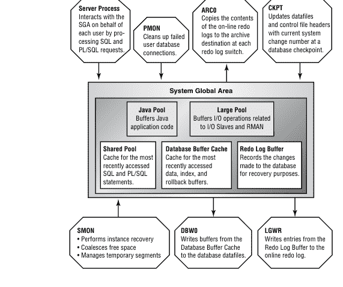

### SGA 管理

实例的组件——`SGA` 和必需的后台进程——在数据库启动时立即获取服务器内存中的空间。虽然必需的后台进程始终为其用途获取相同数量的内存，但四个 `init.ora` 参数是决定 `SGA` 内存需求的主要因素。表 1.3 展示了这四个参数及其默认值和描述。

| 参数 | 默认大小 | 描述 |
|---|---|---|
| `DB_CACHE_SIZE` | 48MB | 缓存来自表、索引等的段数据。关于此参数使用的讨论见第 5 章，“数据库缓冲区高速缓存调优”。 |
| `SHARED_POOL_SIZE` | 在 64 位操作系统上为 64MB，在其他所有系统上为 16MB | 缓存 SQL 和 PL/SQL 语句以及数据字典数据。关于此参数使用的讨论见第 4 章，“共享池调优”。 |
| `LOG_BUFFER` | 4 × 主机操作系统的最大数据块大小 | 缓存用于恢复目的的事务信息。关于此参数使用的讨论见第 7 章，“重做机制调优”。 |
| `LARGE_POOL_SIZE` | 零字节 | 为 I/O 服务器进程以及备份和恢复提供缓冲。当使用共享服务器功能时，还缓存会话数据。关于此参数使用的讨论见第 6 章，“其他 SGA 区域调优”。 |
| `JAVA_POOL_SIZE` | 20,000 字节 | 在 Java 组件的数据库调用之间缓冲 Java 状态信息。关于此参数使用的讨论见第 6 章，“其他 SGA 区域调优”。 |

虽然这些 `SGA` 相关参数在 `init.ora` 中指定，但在实例启动后，其中一些参数也可以动态修改。在 Oracle 的早期版本中，在对 `SGA` 相关参数所做的更改生效之前，必须关闭实例然后重新启动。因此，在高可用性环境中调整这些参数以实施性能增强是比较困难的。

在 Oracle9i 中，`SGA` 的总体大小由单个 `init.ora` 参数定义：`SGA_MAX_SIZE`。在此最大值范围内，`SGA` 的两个独立组件——共享池和数据库缓冲区高速缓存——可以使用 `ALTER SYSTEM` 命令动态调整大小，而无需关闭并重启实例。如果在实例启动时，`SGA_MAX_SIZE` 的值小于其组件总和，Oracle 将忽略 `SGA_MAX_SIZE` 的设置，并改用组件总和作为值。


截至本文撰写时，大型池或 Java 池都不能使用 `ALTER SYSTEM` 命令动态调整大小。然而，Oracle 暗示这可能是 Oracle9i 后续版本中的一个增强功能。

为了实现这种动态 `SGA` 管理，向 Oracle 架构模型添加了一个新的 `SGA` 存储单元：粒度（granule）。在 Oracle9i 中，`SGA` 内的内存被划分为称为粒度的单元。粒度是在 `SGA` 内分配的一段连续虚拟内存。每个粒度的大小根据 `init.ora` 参数 `SGA_MAX_SIZE` 定义的 `SGA` 总体大小而变化。表 1.4 显示了 `SGA` 粒度的两种可能大小。

### 表 1.4 SGA 大小和粒度大小

| 总 SGA 大小 | 粒度大小 |
|---|---|
| 小于 128MB | 4MB |
| 128MB 或更大 | 16MB |

当实例最初启动时，在 `SGA` 内创建等于 `SGA_MAX_SIZE` 指定值的粒度。然后，每个 `SGA` 组件通过利用这些可用的粒度获取其所需的存储空间。Oracle 对每个 `SGA` 组件执行最小粒度要求。这些最小值如表 1.5 所示。


Oracle9i `SGA` 的最小 `SGA` 大小为三个粒度，即 12MB。

### 表 1.5 SGA 组件的最小大小（以粒度计）

| SGA 组件 | 最小大小 |
| :--- | :--- |
| 共享池 | 一个粒度 |
| 数据库缓冲区高速缓存 | 一个粒度 |
| 重做日志缓冲区 | 一个粒度 |

如果 `SGA` 组件没有利用所有可用的粒度，多余的粒度将保留在 `SGA` 中，当使用 `ALTER SYSTEM` 命令动态增加某个 `SGA` 组件的大小时，它们可供使用。动态增加 `SGA` 组件的大小时，必须有足够的空闲粒度来满足请求，否则会返回 `ORA-02097` 或 `ORA-04033` 错误。有时，你可能需要减少一个 `SGA` 组件的大小以增加另一个的大小，因为 Oracle 不会自动在 `SGA` 组件之间执行这种类型的空间动态重新分配。

> 注意
>
> 在 `SGA` 内使用粒度作为存储单元也允许 Oracle9i 数据库包含具有不同 Oracle 块大小的表空间。有关多个块大小的更多信息，请参阅第 8 章，“磁盘 I/O 调优”。

## 用户进程管理

如图 1.1 所示，服务器进程允许最终用户与 `SGA` 及其内存结构进行交互。在专用服务器配置中，每个最终用户都有自己专属的服务器进程。当使用共享服务器选项时，多个最终用户共享一个或多个服务器进程。用户进程和服务器进程的管理可能是整体数据库性能调优的一个重要方面。特别是，作为使用应用程序的用户对数据库进行反复临时连接的 Web 应用程序，随着用户数量随时间增加，可能导致性能下降。


## Oracle 数据库

Oracle 数据库由称为`控制文件`、`数据文件`和`重做日志`的物理文件组成。与 Oracle 数据库相关的其他物理文件包括`init.ora`、`跟踪`和`警报日志`文件、`密码`文件，以及任何`归档重做日志`文件。表 1.6 总结了这些文件在数据库架构中所扮演的角色。关于性能调优，本书后面将更详细地讨论这些区域。

### 表 1.6 Oracle 物理文件

| 文件名 | 文件中包含的信息 |
|---|---|
| 控制文件 | 其他物理文件的位置、数据库名称、数据库块大小、数据库字符集以及恢复信息 |
| 数据文件 | 来自所有数据库段（包括表和索引）的数据块 |
| 重做日志 | 对数据库所做的所有更改的记录，用于恢复 |
| `init.ora` | 实例和数据库的配置参数列表 |
| 归档日志文件 | 先前联机重做日志内容的副本，用于恢复 |
| 密码文件 | 被授予 `SYSDBA` 和 `SYSDOPER` 权限的用户 |
| 警报日志文件 | 由数据库活动生成的信息消息和错误消息 |
| 跟踪文件 | 由用户或后台进程生成的信息消息和错误消息 |

`init.ora` 文件对于 Oracle Server 性能调优非常重要。许多调优更改是通过修改 `init.ora` 中的参数来实施的。在 Unix 系统上，`init.ora` 的默认位置是 `$ORACLE_HOME/dbs`，而在 Windows 系统上是 `%ORACLE_HOME%\database`。

Windows 2000 系统。在 Unix 系统上，init.ora 通常是存储在 `$ORACLE_BASE/admin/SID/pfile` 中的文件的符号链接，其中 SID 是与该 init.ora 关联的实例名称。某些 init.ora 参数可以在数据库打开时动态更改，但其他参数要求关闭并重启实例后才能生效。例如，Oracle9i 具有动态更改 SGA 组件大小的功能，而无需每次关闭并启动实例。


在 Oracle9i 中大约有 250 个不同的有文档记录的 init.ora 参数。幸运的是，你不需要知道其中每一个参数就能成功进行性能调优。与性能调优相关的 init.ora 参数将在本书中加以讨论。

Oracle9i 还引入了服务器参数（SP）文件的概念。与 init.ora 类似，这些文件位于 Unix 系统的 `$ORACLE_HOME/dbs` 和 Windows 2000 系统的 `$ORACLE_HOME\database`。SP 文件在两个操作系统上都命名为 `spfileSID.ora`。然而，与传统的 init.ora 文件不同，spfile.ora 文件会自动纳入通过 `ALTER SYSTEM` 命令进行的所有动态更改。除非手动将更改添加到 init.ora 文件中，否则 init.ora 文件不会反映任何动态系统更改。


除非实例是专门使用启动 pfile 选项和现有的 init.ora 启动的，否则将使用 spfile.ora 中包含的值（而不是 init.ora）来确定实例参数。

#### 真实世界场景

### 小心处理：未记录的 init.ora 参数

你刚阅读了发布在 comp.databases.oracle.server Oracle 新闻组上的一条性能调优技巧。发布技巧的人建议将未记录的 init.ora 参数 `dyn_sel_est_num_blocks` 设置为 200，以提高数据库性能。你应该实施这个建议吗？

在 Oracle9i 中有 400 多个未记录的 `init.ora` 参数可用。未记录的 `init.ora` 参数与其有文档记录的同名参数是通过名称前的下划线来区分的，就像新闻组帖子中描述的参数一样。

我不建议在您的任何系统上使用未记录的 `init.ora` 参数，因为了解使用这些参数的适当原因以及将这些参数设置为何种适当值几乎纯属猜测，这是因为它们具有未记录的性质。虽然一些未记录的参数相对无害，但错误地使用其他参数可能会导致不可预见的数据库问题。`_dyn_sel_est_num_blocks` 参数是做什么的，以及应该将其设置为什么值？只有 Oracle9i 内核代码的工程师才确切知道。

这个建议的一个例外情况是，当 Oracle 全球支持团队指示你使用未记录的 `init.ora` 参数时。Oracle 支持团队偶尔会使用这些参数来增强调试信息的生成或绕过内核代码中的 bug。如果 Oracle 支持团队要求你使用未记录的 `init.ora` 参数，你应该在 `init.ora` 中包含一个注释，注明技术协助请求（TAR）编号、日期以及使用该参数的原因。

对于数据库性能调优，有一个重要的需要记住的 `init.ora` 参数是 `TIMED_STATISTICS`。每当进行调优工作时，都应该将此参数设置为 TRUE，然后关闭并重启实例，或者使用 `ALTER SYSTEM SET TIMED_STATISTICS=TRUE` 命令动态激活此功能。此参数使 Oracle 收集针对数据库执行的操作的计时信息。这些计时对系统造成的额外开销远小于它们提供的有用信息。

还有许多性能调优修改可以在不更改 `init.ora` 的情况下对数据库进行。这些修改是通过向 Oracle 服务器发出 SQL 命令来完成的，这些命令通常用于对数据库进行结构性更改。这些更改的例子包括修改表空间、回滚段、数据文件和重做日志。这些命令是从适当的 Oracle 管理工具（如 `SQL*Plus` 或 Oracle Enterprise Manager 工具之一）中发出的。

## 总结

采用经过验证的调优方法是 Oracle 服务器性能调优的关键。由于彻底的调优工作需要对整个系统进行分析，因此应用程序设计人员、开发人员和数据管理员（DBA）都应该参与该过程。Oracle 推荐的调优方法包括一种基于开发的自顶向下方法，强调在解决物理数据库问题之前先解决应用程序问题；以及一种基于原则的方法，即监控并尽量减少对各种数据库资源的等待。考虑到所有涉及的权衡，为了使调优工作取得成功，必须在准确的基准测试和可衡量目标的框架内进行调优。

### 考试要点

- 描述谁负责调优。 除了 DBA 之外，了解谁应该参与数据库调优工作。
- 理解生命周期阶段如何影响调优。 理解调优需求在应用程序设计阶段、新系统实施阶段和工作负载变化阶段之间的差异。
- 描述服务级别协议的作用。 了解 SLA 如何与性能调优过程相关，以及它们如何影响调优目标。
- 理解设定目标的重要性。 能够解释为什么设定性能目标很重要，并给出可衡量调优目标的例子。
- 了解性能问题区域。 描述应用程序和数据库中的哪些区域是进行初始检查和调优的最佳候选区域。

## 关键术语

在参加考试之前，请确保你熟悉以下术语：

- 警报日志
- 归档重做日志
- 检查点进程 (CKPT)
- 控制文件
- 数据库
- 数据库写手 (DBW0)
- 数据文件
- 颗粒
- init.ora
- 实例
- 日志写手 (LGWR)
- Oracle 服务器
- 密码文件
- 进程监视器 (PMON)
- 重做日志
- 响应时间
- 可扩展性
- 服务级别协议
- 系统全局区 (SGA)
- 系统监视器 (SMON)
- 吞吐量
- 跟踪

## 复习题

1. **一个大型组织的业务组正在启动一个新的信息技术项目。部分需求规定系统必须在周一至周六每天 24 小时可用，且恢复过程不超过一小时。这类需求通常在哪里列出？**
    - A. 系统协议
    - B. 服务级别协议
    - C. 应用程序章程
    - D. DBA 合同

2. **在进行自顶向下调优方法时，首先应考虑审查的区域是什么？**
    - A. 内存分配
    - B. 资源争用
    - C. 数据设计
    - D. 底层平台

3. **一家公司决定部署大型打包财务系统，并使用 Oracle 数据库作为信息的主要存储库。DBA 通常使用哪种方法来监控系统性能？**
    - A. 自顶向下方法
    - B. 瀑布调优方法
    - C. 基于原则的生产调优方法
    - D. 数据库架构调优方法

4. **以下哪一项不是 Oracle 提供以协助 DBA 解决性能问题的工具？**
    - A. SQLSTAT/UTLSTAT
    - B. 恢复管理器
    - C. Oracle Enterprise Manager
    - D. STATS PACK

5. **为什么设定调优目标很重要？**
    - A. 目标允许你集中你的调优工作。
    - B. 目标有助于识别系统瓶颈。
    - C. 目标可以通过 SQL 脚本编写和监控。
    - D. 以上都不正确。

6. **基准测试应该：**
    - A. 仅针对数据库
    - B. 仅针对网络


- C. 仅针对客户端 PC
- D. 以上所有

7. **以下哪项不是调优前基准测试的例子？**
    - A. 统计信息
    - B. 计时
    - C. 这两者都是良好的调优前基准测试。
    - D. 这两者都不是良好的调优前基准测试。

8. **在利用通过广域网访问数据库的 PC 客户端的系统中，收集调优前基准测试的最佳方式是什么？**
    - A. 从 PC 客户端、网络和数据库收集统计信息和计时，但不要同时收集。
    - B. 在系统未使用时收集统计信息和计时，以免干扰常规处理。
    - C. 仅短时间内收集统计信息和计时，最好少于两分钟。
    - D. 在常规处理期间，在 PC 客户端、网络和数据库上收集一段有用时间内的统计信息和计时。

## 复习题

- 9. 响应时间衡量的是什么？
  - A. 单用户在应用程序内工作时，接收返回结果集所需的时间。
  - B. 系统在一给定时间内能处理多少工作量。
  - C. 用户个人电脑刷新屏幕并显示新数据的速度。
  - D. Oracle 不使用索引查找数据所需的时间。

- 10. 吞吐量衡量的是什么？
  - A. 单用户在应用程序内工作时，接收返回结果集所需的时间。
  - B. 系统在一给定时间内能处理多少工作量。
  - C. 用户个人电脑刷新屏幕并显示新数据的速度。
  - D. Oracle 不使用索引查找数据所需的时间。

- 11. 下列哪一项不是收集和统计数据库性能统计信息和计时的方式？
  - A. 使用 Oracle 提供的脚本。
  - B. 使用 Oracle 的 GUI 工具。
  - C. 检查 Oracle 日志和跟踪文件。
  - D. 所有这些都是数据库性能统计信息的良好来源。

- 12. 下列哪种硬件资源最易受到性能调优更改的影响？
  - A. 服务器 CPU。
  - B. 服务器内存。
  - C. 服务器 I/O 系统。
  - D. 上述所有资源都会受到调优更改的影响。

- 13. Oracle 实例由什么组成？
  - A. `SGA` 和 `init.ora`
  - B. `SGA` 和后台进程
  - C. `SGA`、数据文件、控制文件和重做日志
  - D. `SGA`、Alert 日志和跟踪文件

- 14. Oracle 数据库由什么组成：
  - A. 数据文件、重做日志和跟踪文件
  - B. 数据文件、控制文件和 `init.ora`
  - C. 数据文件、重做日志和控制文件
  - D. 重做日志、归档重做日志和密码文件
  - E. `CKPT`

- 15. 使用供应商特定工具在 Oracle 服务器上收集的统计类型可能包括以下哪一项？
  - A. 网络流量效率
  - B. 服务器磁盘 I/O 和控制器活动
  - C. 客户端 PC 的 CPU 和内存利用率
  - D. 以上所有

- 16. DBA 确定 `SGA` 组件之一的当前命中率是 85%。然而，她认为如果向 `SGA` 分配额外资源，该比率很可能会提高到 95% 或更高。这是下列哪一项的良好示例？
  - A. 维护良好的客户关系
  - B. 目标导向的调优
  - C. 有效利用 DBA 的时间和资源
  - D. 以上都不是

- 17. System Global Area 中的哪个组件缓存最近访问的数据、索引和回滚块？
  - A. 共享池
  - B. 数据库缓冲区高速缓存
  - C. 大池
  - D. 重做日志缓冲区

- 18. DBA 注意到系统的 CPU 利用率始终处于 90% 到 100%。她决定将磁盘上的一些数据文件移动位置，以更均匀地分配数据库 I/O。这一决定对整体系统性能可能有多大程度的益处？
  - A. 极大的益处
  - B. 一些益处
  - C. 非常小的益处
  - D. 没有任何益处

- 19. 当 DBA 希望收集与性能相关的统计信息时，需要设置的一个重要参数是：
  - A. `TIMED_STATISTICS`
  - B. `PERFORMANCE_STATISTICS`
  - C. `STATS_TIMING`
  - D. `TIMED_STATS`

- 20. DBA 增加了 `SGA` 的大小，导致操作系统开始将额外的进程从内存中交换和分页。这个问题的可能原因是什么？
  - A. 磁盘驱动器太少
  - B. CPU 负担太重
  - C. 内存不足
  - D. 应用程序代码编写不佳

## 复习题答案

- 1. B. 服务级别协议（SLA）概述了这类需求，并且是大多数大型 IT 项目的重要组成部分。
- 2. C. 数据设计是启动此类调优工作的正确起点。大多数性能问题通常归因于数据设计和应用程序设计。
- 3. C. 基于原理的生产调优侧重于观察系统等待事件，并使用 DBA 可控的技术来最小化这些等待。这一点非常重要，特别是对于软件包，因为通常软件供应商控制架构变更。
- 4. B. 除了用于备份和恢复 Oracle 数据库的恢复管理器（Recovery Manager）之外，所有这些工具都为 DBA 提供了调优功能。
- 5. A. 调优目标使你可以首先关注最重要的领域，然后在达成目标后转向次要目标。
- 6. D. 在测试调优过程之前，系统的所有方面都应该建立基准。这可以让你确认你的调优更改产生了积极影响，而不仅仅是与其他更改巧合。
- 7. C. 在实施任何调优更改之前，应进行良好的基线测量，以便正确评估调优更改的效果。系统统计信息和计时都是此类基准统计信息的良好示例。
- 8. D. 调优前性能的准确度量必须包含系统的所有方面，并应在足够长的持续时间内进行，以提供有意义的结果。这些测量也应在正常甚至高负载处理期间进行，以便在测试时系统处于压力之下。
- 9. A. 响应时间是衡量终端用户是否从调优过程中受益的一个示例。
- 10. B. 吞吐量是衡量批处理和整体处理是否从调优过程中受益的一个示例。
- 11. D. 所有这些领域都可以提供有用的统计信息和计时。这些领域将在本书后文中进行更详细的讨论。
- 12. D. CPU、内存和 I/O 都会受到调优更改的影响。例如，减少 I/O 所做的更改通常会增加对内存和 CPU 的需求。
- 13. B. 系统全局区域（`SGA`）及其关联的 `PMON`、`SMON`、`DBW0`、`LGWR` 和 `CKPT` 后台进程构成了 Oracle 实例。
- 14. C. Oracle 数据库由控制文件、重做日志和数据文件组成。跟踪文件、归档重做日志、密码文件和 `init.ora` 不被视为数据库的一部分。
- 15. B. 磁盘读/写活动和控制器缓存效率是两个重要的服务器统计指标，可以使用供应商提供的工具进行收集。
- 16. B. 拥有适当的起始基准测量和目标调优目标都是目标导向调优技术的关键要素。
- 17. B. 数据库缓冲区高速缓存持有用户通过应用程序访问的数据、索引和回滚块。数据库写入器（`DBW0`）将这些块写入数据库数据文件。
- 18. C. 虽然如果你的系统受 I/O 限制，移动文件以分配 I/O 通常是一个很好的练习，但如果你的系统受 CPU 限制，它可能只能带来非常小的益处。
- 19. A. 如果你希望 Oracle 服务器捕获和维持与性能相关的统计信息，必须将 `TIMED_STATISTICS` 设置为 TRUE。
- 20. C. 可能的原因是系统内存不足。两种可能的补救措施是减少 `SGA` 的大小或增加服务器上的可用内存。

## 调优信息来源

**本章涵盖的 ORACLE9i 性能调优考试目标：**

- 解释如何使用 Alert 日志文件
- 解释如何使用后台跟踪文件
- 解释如何使用用户跟踪文件
- 描述动态性能视图中保存的统计信息
- 解释 `STATSPACK` 如何收集统计信息
- 使用 `STATSPACK` 收集统计信息
- 使用 Enterprise Manager 收集统计信息
- 使用其他调优工具


> 考试目标随时可能变更，恕不另行通知，并完全由 Oracle 自行决定。请访问 Oracle 认证网站（`http://www.oracle.com/education/certification/`）查看当前的考试目标列表。

正如你在第一章“性能调整入门”中所见，Oracle 的调整方法强调在整个 Oracle 服务器性能调整过程中衡量性能统计数据的重要性。这些统计数据通过多种来源收集，包括系统生成的日志和跟踪文件、针对动态性能视图和数据字典视图的查询、`STATSPACK` 和 `UTLBSTAT`/`UTLESTAT` 报告、Oracle 图形化管理工具以及自定义 SQL 脚本。

除了以下所有性能调整信息来源外，许多数据库管理员还严重依赖自定义 SQL 脚本来监控重要的调整统计数据和事件。这些自定义脚本的来源包括杂志、书籍、网站和用户组。只需在互联网上快速搜索关键词“Oracle tuning scripts”，就可以找到许多这些脚本。本书的后续章节中还包含了此类脚本的几个示例。

## 警报日志


Oracle 警报日志记录了在数据库运行期间针对数据库发生的各种活动的信息消息和错误消息。这些活动按时间顺序记录，从最旧到最新。警报日志位于 `init.ora` 参数 `BACKGROUND_DUMP_DEST` 指定的目录中。在遵循 Oracle 推荐的最佳灵活架构 `OFA` 模型的系统中，该目录在 Unix 系统上为 `$ORACLE_BASE/admin/SID/bdump`，在 Windows 2000 系统上为 `%ORACLE_BASE%\admin/SID/bdump`，其中 `SID` 代表将创建警报日志的 Oracle 实例的名称。

## 说明警报日志文件是如何使用的

警报日志的名称因操作系统而异。在 Unix 系统上，它遵循 `alert_SID_log` 的命名约定。在 Windows 2000 系统上，它遵循 `SIDalert.log` 的命名约定。在这两种情况下，`SID` 代表警报日志所属的 Oracle 实例的名称。图 2.1 展示了一个来自 Windows 2000 `Oracle9i` 服务器的警报日志示例。

### 图 2.1 警报日志文件的示例部分

```
Recovery of Online Redo Log; Thread 1 Group 3 Seq 591 Reading
Mem# 0 errs 0; D:\ORACLE-ORADATA-PROD-REDO03A.RDO
Mem# 1 errs 0; D:\ORACLE-ORADATA-PROD-REDO03B.RDO
Mon Jan 14 18:18:50 2002
Ended recovery at
Thread 1: logseq 591, block 7761, scn 0.1741975
494 data blocks read, 494 data blocks written, 8192 redo blocks read
Crash recovery completed successfully
Mon Jan 14 18:22:50 2002
  Successful open of redo thread 1.
Mon Jan 14 18:48:50 2002
SMON: enabling cache recovery
Mon Jan 14 18:48:54 2002
Undo Segment 11 Onlined
Undo Segment 12 Onlined
Undo Segment 13 Onlined
Undo Segment 14 Onlined
Undo Segment 15 Onlined
Undo Segment 16 Onlined
Undo Segment 17 Onlined
Undo Segment 18 Onlined
Undo Segment 19 Onlined
Undo Segment 20 Onlined
Successfully onlined Undo Tablespace 12.
Mon Jan 14 18:48:54 2002
SMON: enabling tx recovery
Thread 1 advanced to log sequence 588
  Current log# 3 seq# 588 mem# 0: D:\ORACLE-ORADATA-PROD-REDO03A.RDO
  Current log# 3 seq# 588 mem# 1: D:\ORACLE-ORADATA-PROD-REDO03B.RDO
  Thread 1 advanced to log sequence 589
  Current log# 1 seq# 589 mem# 0: D:\ORACLE-ORADATA-PROD-REDO01A.RDO
  Current log# 1 seq# 589 mem# 1: D:\ORACLE-ORADATA-PROD-REDO01B.RDO
Errors in file d:\oracle\admin\PROD\bdump\prodsm00.TRC:
ORA-11556: error freeing extent (2) of rollback segment (18)
ORA-01554: attempt to wrap into rollback segment (18) extent (2) which is being freed
  Thread 1 advanced to log sequence 590
  Current log# 2 seq# 590 mem# 0: D:\ORACLE-ORADATA-PROD-REDO02A.RDO
  Current log# 2 seq# 590 mem# 1: D:\ORACLE-ORADATA-PROD-REDO02B.RDO
Mon Jan 14 19:58:53 2002
Errors in file D:\oracle\admin\PROD\bdump\prodpm01.TRC:
ORA-00600: internal error code, arguments: [1100], [0x37FE97E8], [ ], [ ], [
```

警报日志通常能迅速提示数据库中是否存在严重的性能调整问题。无法获取额外存储的表、失败的排序以及回滚段问题都是可能以警报日志中消息形式出现的调整问题的例子。因此，你应该每天检查警报日志，看看是否存在这些明显的性能调整问题。表 2.1 展示了一些与性能调整问题相关的常见警报日志条目。这并不是一份完整的列表，并非所有这些消息都会出现在每个警报日志中。其中一些可以在上一节所示的示例警报日志中找到。

### 表 2.1 与性能调整相关的常见警报日志消息

| 警报日志消息 | 消息描述 |
| :--- | :--- |
| 无法在表空间 `$x` 中扩展临时段 `$n` | 由错误代码 `ORA-01652` 标识，当用户的服务器进程无法在其临时表空间中找到足够的连续空闲空间来执行所需的排序操作时，会出现此错误。排序活动的调整在第 8 章“磁盘 I/O 调整”中讨论。 |
| 无法在表空间 `$x` 中扩展表 `$x` `$n` | 由错误代码 `ORA-01653` 标识，当表段尝试获取额外的区但无法做到，因为表空间中没有足够的连续空闲空间时，会出现此错误。区管理在第 8 章“磁盘 I/O 调整”中讨论。 |
| 无法在表空间 `$x` 中扩展回滚段 `$x` `$n` | 由错误代码 `ORA-01650` 标识，当回滚段需要增长但无法做到，因为回滚段所在的表空间中没有足够的连续空闲空间时，会出现此错误。回滚段调整在第 8 章“磁盘 I/O 调整”中讨论。 |
| 在表 `$x` 中达到最大区数 `$n` | 由错误代码 `ORA-01631` 标识，当表段需要增长但无法做到，因为将超过其允许的最大区数时，会出现此错误。段区调整在第 8 章“磁盘 I/O 调整”中讨论。 |
| 检查点未完成 | 当数据库检查点事件开始，但未在下一个检查点事件开始前完成时，会出现此消息。此机制的调整在第 7 章“重做机制调整”中讨论。 |
| 线程 `*n*` 已前进到日志序列 `*n*` | 此消息表明在线重做日志之间发生了日志切换。该消息还将包含关于当时正在写入哪个重做日志文件的信息。这些消息在日志切换的正常过程中生成，除非发生得过于频繁，否则并不一定表示存在性能问题。重做日志调整在第 8 章“磁盘 I/O 调整”中讨论。 |
| 快照过旧：名为 `*x*` 的回滚段号 `*n*` 太小 | 表明由于事务无法在回滚段中找到正在查询的数据的读一致性视图，因此该事务失败。回滚段调整在第 8 章“磁盘 I/O 调整”中讨论。 |

警报日志还包含与备份和恢复问题相关的信息，包括数据文件和重做日志损坏。特别是，应定期检查警报日志中的 `ORA-00600` 错误。这些模糊的内部错误大多没有文档记录。然而，它们可能是数据损坏或其他数据库结构问题的指示器。解决这些错误时应借助 Oracle 全球支持，网址为 http://metalink.oracle.com。

关于由 `ORA-codes` 标识的所有 Oracle 错误的解释，可在 *Oracle9i 数据库错误消息，版本 1 (9.0.1)* (部件号 A90202-02) 中找到。

只要数据库处于运行状态，警报日志就会不断被追加。如果不加管理，它可能会变成非常大的文件。虽然警报日志中的信息是极好的调整辅助工具，但包含数月前甚至数年前信息的较大警报日志很难处理。

您可以通过定期重命名、裁剪或删除 Alert 日志来管理其大小。您可能希望在执行夜间或每周数据库备份后执行此维护操作。如果先前的日志被重命名或删除，Oracle 会自动创建一个新的 Alert 日志。

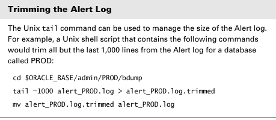

## 背景、事件和用户跟踪文件

Oracle 跟踪文件是包含创建它们的进程会话信息的文本文件。跟踪文件可以由 Oracle 后台进程生成，通过 `init.ora` 跟踪事件的使用生成，或由用户服务器进程生成。许多这些跟踪文件包含用于性能调整和系统故障排除的有用信息。我们将在以下部分中查看背景、事件和跟踪文件。

- **Oracle 目标**
  - 解释如何使用后台跟踪文件


### 解释如何使用用户跟踪文件

### 后台进程跟踪文件

后台进程跟踪文件位于由 `init.ora` 参数 `BACKGROUND_DUMP_DEST` 指定的目录中。在遵循 OFA（标准目录结构）模型的系统中，此目录在 Unix 系统上为 `$ORACLE_BASE/admin/$SID/bdump`，在 Windows 2000 系统上为 `%ORACLE_BASE%\admin\%SID\_bdump`，其中 *SID* 是生成该文件的 Oracle 实例的名称。后台进程跟踪文件在其文件名中包含生成它们的后台进程的名称。表 2.2 中显示了 Unix 和 Windows 2000 后台跟踪文件名称的示例。

**表 2.2 后台进程跟踪文件名称示例**

| **进程名称** | **Unix 系统** | **Windows 2000 系统** |
|---|---|---|
| 进程监视器 (PMON) | `Pmon_nnnn.trc` | `sidPMON.trc` |
| 系统监视器 (SMON) | `Smon_nnnn.trc` | `sidSMON.trc` |
| 数据库写入器 (DBW0) | `Dbw0_nnnn.trc` | `sidDBW0.trc` |
| 日志写入器 (LGWR) | `Lgwr_nnnn.trc` | `sidLGWR.trc` |
| 检查点进程 (CKPT) | `Ckpt_nnnn.trc` | `sidCKPT.trc` |
| 归档进程 (ARC0) | `Arc0_nnnn.trc` | `sidARC0.trc` |

### 事件跟踪文件

Oracle(i) 服务器还有特殊的选项，您可以配置这些选项来启用特定数据库事件的详细跟踪信息收集。*数据库事件*是数据库中发生的特定操作或活动。默认情况下，大多数数据库事件不会导致创建跟踪文件。然而，某些数据库事件可以通过在要跟踪的数据库的 `init_ora` 中添加跟踪事件参数，强制创建其活动的跟踪文件。跟踪文件将创建在 `init_ora` 文件中由 `BACKGROUND_DUMP_DEST` 参数指定的位置。

作为故障排除工作的一部分，您可能偶尔会被 Oracle 全球技术支持要求激活数据库事件的跟踪，作为故障排除或调整工作的一部分。

这些事件的跟踪通常通过在 `init_ora` 中添加新行在实例级别完成。如果向 `init.ora` 添加了多个跟踪事件，应将它们分组在一起并适当注释。`init.ora` 条目看起来像这样：

```
EVENT='10046 trace name context forever, level 12'
```

双引号是此参数实际语法的一部分；请注意，每个事件条目由两个组件组成：

- 要跟踪的事件，由一个数字指定（上例中为 10046）
- 将执行跟踪的级别，由一个数字指定（上例中为 12）

事件及其相关级别的数值通常没有广泛记录。在大多数情况下，Oracle 全球支持人员会在需要使用跟踪事件时提供这些值。将它们设置为正确的值对于事件跟踪的正常工作至关重要。

### 用户跟踪文件

用户跟踪文件位于由 `init.ora` 参数 `USER_DUMP_DEST` 指定的目录中。在遵循 OFA 模型的系统中，此目录在 Unix 系统上为 `$ORACLE_BASE/admin/$SID/udump`，在 Windows 2000 系统上为 `%ORACLE_BASE%\admin\%SID%\udump`，其中 *SID* 是生成该文件的 Oracle 实例的名称。用户进程跟踪文件在其文件名中包含操作系统进程标识符。在 Unix 系统上，它们还包含用户生成文件时连接的实例名称。Unix 和 Windows 2000 用户跟踪文件名称的示例如下：

- Unix 系统：`ora_prod_4327.trc`
- Windows 2000 系统：`ora00117.trc`

可以对 `V$PROCESS` 和 `V$SESSION` 动态性能视图执行查询，以确定是哪个用户生成了特定的跟踪文件。以下代码演示了如何将用户跟踪文件匹配到生成它的用户会话。

```sql
SQL> SELECT s.username, p.spid
2  FROM v$session s, v$process p
3  WHERE s.paddr = p.addr
4  AND p.background is null;
```

| USERNAME | SPID |
|---|---|
| MATT | 4292 |
| DBSNMP | 4377 |
| SYSTEM | 4372 |
| JOE | 4437 |
| BRENDA | 4368 |
| EMILY | 4469 |

使用此 SQL 查询的输出，可以看出名为 `ora_prod_4292.trc` 或 `ora04292.trc` 的跟踪文件属于 Matt 的会话。请注意，通过共享服务器进程连接、使用 XA X/Open 接口的事务管理器或 Oracle 调用接口 `OCI` 的会话跟踪可能会为每个用户会话生成多个跟踪文件。

以下部分解释如何激活整个实例和单个用户的用户跟踪。使用 `TKPROF` 实用程序格式化结果跟踪文件的技术可以在第 3 章“SQL 应用程序调整和设计”中找到。

### 激活用户跟踪

当用户服务器进程中出现处理错误时，Oracle 偶尔会创建用户跟踪文件。下面的代码列表显示了在 Windows 2000 Oracle9i 服务器上发生死锁错误时生成的用户跟踪文件输出的一部分。死锁错误在第 9 章“争用调整”中进行了更详细的讨论。

```
Dump file d:\oracle\admin\SEED\udump\ORA00476.TRC
Fri Jan 04 20:57:08 2002
ORACLE V9.0.1.1.1 - Production vsnsta=0
vsnsql=10 vsnxtr=3
Windows 2000 Version 5.0 Service Pack 1, CPU type 586
Oracle9i Enterprise Edition Release 9.0.1.1.1 - Production
With the Partitioning option
JServer Release 9.0.1.1.1 - Production
Windows 2000 Version 5.0 Service Pack 1, CPU type 586
Instance name: prod

Redo thread mounted by this instance: 1

Oracle process number: 9

Windows thread id: 476, image: ORACLE.EXE

*** 2002-01-04 20:57:08.000
*** SESSION ID:(8,5) 2002-01-04 20:57:08.000
DEADLOCK DETECTED
Current SQL statement for this session:
update payroll.deductions set FICA = '120' where emp_id =
'101'
```

以下死锁不是 ORACLE 错误。这是由于应用程序设计中的用户错误或发布了错误的临时 SQL 导致的死锁。以下信息可能有助于确定死锁：

死锁图：

虽然像死锁这样的事件会自动生成跟踪文件，但除非用户或 DBA 请求，否则不会发生用户会话的全量跟踪。全量用户跟踪可以使用以下任何方法在实例级别或会话级别激活。

### 实例级跟踪

通过设置 `init.ora` 参数 `SQL_TRACE=TRUE`，针对实例的所有进程都将创建自己的跟踪文件。由于此特定跟踪方法会对系统产生大量开销，因此应谨慎使用。此参数的默认值为 `FALSE`。

### 用户级自我跟踪

用户可以使用以下 SQL 命令在自己的会话中开启或关闭 SQL 跟踪：

```sql
ALTER SESSION SET SQL_TRACE=TRUE;
```

以开始跟踪过程，以及

```sql
ALTER SESSION SET SQL_TRACE=FALSE;
```

以结束跟踪过程。

在 `SQL_TRACE` 设置为 `TRUE` 和设置为 `FALSE` 之间发出的任何 SQL 语句都会记录在用户的跟踪文件中。

## 用户级 DBA 跟踪

大多数应用程序不会为用户提供从应用程序内部发出 SQL 命令的机制。因此，上一节中展示的用 `ALTER SESSION` 命令无法在此类环境中用于启动跟踪。在这种情况下，你可以使用 Oracle 提供的名为 `DBMS_SYSTEM` 的 PL/SQL 包来启动用户会话的跟踪。这个 PL/SQL 包中包含一个名为 `SET_SQL_TRACE_IN_SESSION` 的过程，它允许你通过提供 `V$SESSION` 视图中该用户的系统标识符（`sid`）和序列号（`serial#`）值，来激活其他用户会话中的跟踪功能。以下示例演示了如何首先识别用户 Bob 的会话，然后在该会话中激活跟踪。


1. 通过查询 `V$SESSION` 来确定 Bob 会话的 `sid` 和 `serial#`：

```sql
SQL> select username, sid, serial#
2   from v$session
3   where username = 'BOB';
```

| 用户名 | SID | SERIAL# |
| :--- | :--- | :--- |
| BOB | 10 | 2642 |

2. 使用 `DBMS_SYSTEM` PL/SQL 包以及 `sid` 和 `serial#` 的值，在 Bob 的会话中激活跟踪：

```sql
SQL> exec sys.dbms_system.set_sql_trace_in_session(10, 2642, TRUE);
```

3. Bob 的会话现在正在向 `init.ora` 中 `USER_DUMP_DEST` 指定的目录生成跟踪文件列表。一旦你希望跟踪的活动完成，你可以再次使用 `DBMS_SYSTEM` 包来禁用 Bob 会话的跟踪。

```sql
SQL> exec sys.dbms_system.set_sql_trace_in_session(10, 2642, FALSE);
跟踪现在已在 Bob 的会话中停止。
```

# 解读用户跟踪文件输出

一旦使用上述任意方法生成了用户跟踪文件，它就可以用于辅助性能调优的许多方面。关于如何使用 `TKPROF` 实用程序解读用户跟踪文件内容的详细信息，将在第 3 章“SQL 应用程序调优与设计”中介绍。

## 管理跟踪文件

一旦在用户会话中激活了跟踪，用户对实例执行的每个操作都会包含在跟踪文件输出中。如果跟踪开启的时间较长，生成的文件可能会非常大。事实上，跟踪文件可能会增长到填满 `USER_DUMP_DEST` `init.ora` 参数中指定的整个磁盘位置。

`init.ora` 参数 `MAX_DUMP_FILE_SIZE` 允许你限制用户跟踪文件可以增长到的大小。此值可以表示为操作系统块或字节。表 2.3 展示了指定此参数的各种方式。

### 表 2.3 指定 MAX_DUMP_FILE_SIZE 的值

| 参数指定方式 | 用户跟踪的最大结果大小 |
| :--- | :--- |
| `MAX_DUMP_FILE_SIZE=10000` | 10000 个操作系统块 |
| `MAX_DUMP_FILE_SIZE=500K` | 500,000 字节 |
| `MAX_DUMP_FILE_SIZE=10M` | 10 兆字节 |
| `MAX_DUMP_FILE_SIZE=unlimited` | 文件大小无限制 |

与告警日志文件一样，后台、事件和用户跟踪文件也应偶尔进行重命名、修剪或删除，以便在需要时更容易找到最新的跟踪文件数据。

# 性能调优视图

Oracle 内部视图中有两个广泛的调优信息来源：`V$` 动态性能视图和 `DBA` 数据字典视图。

这两个视图系列中包含的数据对于性能调优基准测试和随后的性能监控都非常有益。在详细检查这些视图的内容之前，让我们先简要总结一下这两类视图的差异：

- `V$` 视图的名称通常是单数形式，而 `DBA` 视图通常使用复数名称。例如 `V$DATAFILE` 对比 `DBA_DATA_FILES`。
- 许多 `V$` 视图在数据库处于 `nomount` 或 `mount` 状态时可用。`DBA` 视图仅在数据库打开时才可用。
- `V$` 视图中包含的数据通常是小写的。`DBA` 视图中包含的数据通常是大写的。在针对这些视图指定 `WHERE` 子句时，记住这一点很重要。
- `V$` 视图包含动态性能数据，这些数据在实例每次关闭时都会丢失。因此，这些视图始终包含自实例启动以来收集统计数据。从性能调优的角度来看，*何时*检查这些视图中的数据可能与你*如何*检查这些数据同样重要。如果实例大部分时间都在运行且很少关闭，这些统计数据可能涵盖了太长的时间范围，从而变得毫无用处。`DBA` 视图中包含的数据更静态，且在实例关闭时不会被清除。由于 `V$` 视图的动态特性，你会发现它们作为用于性能调优的数据字典视图更为常用。

动态性能视图和数据字典视图将在以下各节中详细讨论。

## 性能调优中常用的 V$ 视图

Oracle9i 数据库中大约有 225 个 `V$` 动态性能视图。这些视图基于统称为 `X$` 表的动态表。这些虚拟表仅存在于内存中，且大多没有文档记录，名称晦涩难懂，如 `X$KSMS` 和 `X$KMQSI`。因此，大多数性能调优信息是直接获取自 `V$` 视图本身。表 2.4 包含了性能调优中经常使用的部分 `V$` 视图列表。

`Oracle 目标：描述保存在动态性能视图中的统计数据`

### 表 2.4 动态性能视图示例

| 视图名称 | 视图描述 |
| :--- | :--- |
| `V$SGASTAT` | 显示系统全局区（SGA）各组件大小的信息。 |
| `V$EVENT_NAME` | 显示由系统或单个会话请求时可能需要等待的数据库事件。大约有 200 种可能的等待事件。等待事件在第 9 章“调优争用”中讨论。 |
| `V$SYSTEM_EVENT` | 显示所有访问系统的会话发生等待的事件。 |
| `V$SESSION_EVENT` | 显示发生等待的事件，并按会话单独标识。 |
| `V$SESSION_WAIT` | 显示当前发生等待的事件，并按会话单独标识。 |
| `V$STATNAME` | 将名称与仅在 `V$SESSTAT` 和 `V$SYSSTAT` 中按数字列出的统计数据进行匹配。 |
| `V$SYSSTAT` | 显示所有会话的总体系统统计信息，包括当前连接的会话和之前连接的会话。 |
| `V$SESSTAT` | 显示当前连接会话的基于会话的统计信息。 |
| `V$SESSION` | 显示基于会话的当前连接信息。 |
| `V$WAITSTAT` | 显示与块争用相关的统计信息。 |

通常，包含 `V$SYSSTAT` 的查询将显示自实例启动以来整个实例的统计数据。将此视图与其他相关视图连接起来，你就能看到数据库中性能的整体状况。或者，包含 `V$SESSTAT` 的查询将显示特定会话的统计数据。这些查询更适合检查单个操作或进程的性能。


所有 `V$` 视图的完整描述可以在《*Oracle9i 数据库参考手册 Release 1 (9.0.1)*》（部件号 A90190-01）第 3 章“动态性能（V$）视图”中找到。

## 性能调优中常用的 DBA 视图

Oracle9i 数据库中大约有 170 个 `DBA` 数据字典视图。这些视图底层对应的表是构成 Oracle 数据字典的物理表。类似于支撑 `V$` 视图的 `X$` 虚拟表，这些表通常也没有文档记录，名称意义较小，如 `OBJ$` 和 `FILE$`。然而，在大多数情况下，`DBA` 视图本身将提供你开始性能调优所需的信息。表 2.5 包含了在对数据库进行性能调优时使用的一些 `DBA` 视图的部分列表。

`表 2.5 静态字典视图示例`

| 视图名称 | 视图描述 |
| :--- | :--- |
| `DBA_TABLES` | 表的存储、行和块信息 |
| `DBA_INDEXES` | 索引的存储、行和块信息 |
| `INDEX_STATS` | 索引深度和分布信息 |
| `DBA_DATA_FILES` | 数据文件位置、命名和大小信息 |
| `DBA_SEGMENTS` | 数据库中任何占用空间的段的一般信息 |
| `DBA_HISTOGRAMS` | 表和索引直方图定义信息 |


有关所有 `DBA` 视图的完整说明，请参阅《*Oracle9i Database Reference Release 1 (9.0.1)*》（产品编号为 `A90190-01`）第 2 章“静态数据字典视图”。

在 `DBA` 视图中，某些列只有在通过 `ANALYZE TABLE` 或 `ANALYZE INDEX` 命令对其引用的表或索引进行分析之后，才会填充数据。


关于表和索引的分析将在第 3 章“SQL 应用调优与设计”中讨论。

## 视图的示例查询

为了展示这些视图在性能调优中的实用性，此处将简要介绍每种视图的一个示例。后续的每个章节也都会包含针对该章节主题相关的 `V$` 和 `DBA` 视图的示例查询。

### V$ 视图查询示例


在查询 `V$` 视图时，为了获取所需的所有信息，通常需要将两个或更多此类视图连接起来。例如，查询 `V$SESSTAT` 可以获取特定用户会话内事件的详细统计数据，但不会显示每个统计项的名称。要获取每个统计项的含义，你需要将 `V$SESSTAT` 连接到 `V$STATNAME`。以下代码清单展示了此类查询的示例。此查询将显示名为 Chris 的用户的所有会话统计信息。

```sql
select s.username, n.name, t.value
from v$session s, v$statname n, v$sesstat t
where s.sid=t.sid
and t.statistic#=n.statistic#
and s.username = 'CHRIS';
```

请记住，将任何视图连接到 `V$SYSSTAT` 将为您提供系统范围的性能信息，而将任何视图连接到 `V$SESSTAT` 将为您提供单个用户的性能信息。

### DBA 视图查询示例

对 DBA 视图的查询对于性能调优也很有用。例如，您可能希望了解哪些表中的行被链接或迁移了。下面的查询将为最近使用 `ANALYZE TABLE` SQL 命令进行分析的名为 Chris 的用户（其架构）提供该信息。

```sql
select table_name, chain_cnt
from dba_tables
where owner = 'CHRIS'
and chain_cnt != 0;
```

有关链接和迁移的更详细讨论见第 8 章“磁盘 I/O 调优”。

## Oracle 提供的调实用工具

Oracle 提供了一些调实用工具，形式为脚本和 PL/SQL 包，可用于帮助您识别潜在的数据库性能问题。以下是一些常用的 Oracle 提供的调实用工具列表：

- `UTLSTAT.SQL`/`UTLESTAT.SQL`（在下一节中讨论）

- `STATSPACK`（在下一节中讨论）

- `UTLOCKT.SQL`（第 9 章，“锁争用调优”）

- `CATBLOCK.SQL`（第 7 章，“锁争用调优”）

- `CATPARR.SQL`（第 5 章，“数据库缓冲池调优”）

- `DBMSPOOL.SQL`（第 4 章，“共享池调优”）

- `UTLCCHAIN.SQL`（第 8 章，“磁盘 I/O 调优”）

- `UTLXPLAN.SQL`（第 3 章，“SQL 应用调优与设计”）

这些脚本中有一些只需运行一次，以构建用于性能调优的表或视图。其他脚本则在每次执行调优操作时运行。所有这些脚本将在后续章节中详细讨论。然而，由于 `UTLBSTAT.SQL`/`UTLESTAT.SQL` 脚本和 `STATSPACK` 工具的输出涵盖了数据库性能的所有方面，因此在此处包含对其的初步介绍。

## UTLBSTAT.SQL 和 UTLESTAT.SQL

尽管很大程度上已被下一节中介绍的较新的 `STATSPACK` 工具所取代，但 Oracle 提供的 `UTLBSTAT.SQL` 和 `UTLESTAT.SQL` 脚本仍然是 Oracle 服务器性能调优的有用工具。这些脚本的目的是捕获并总结特定时间段内几乎所有的数据库和实例性能活动到单个报告中。由于在所有平台和操作系统上，运行 `UTLBSTAT.SQL` 和 `UTLESTAT.SQL` 脚本的过程及其输出内容都是相同的，因此它仍然是您需要了解的重要工具。

`UTLBSTAT.SQL` 中的 `B` 代表*开始*（beginning）。`UTLESTAT.SQL` 中的 `E` 代表*结束*（ending）。正如这些名称所暗示的那样，`UTLBSTAT.SQL` 脚本在调优测量期的开始时运行，而 `UTLESTAT.SQL` 在调优测量期的结束时运行。

在 Unix 系统上，这些脚本位于 `$ORACLE_HOME/rdbms/admin`；在 Windows 2000 系统上，位于 `%ORACLE_HOME%\rdbms\admin`。

### 运行 UTLBSTAT.SQL 脚本

在运行 `UTLBSTAT.SQL` 脚本之前，重要的是实例已运行足够长的时间，以便让 `V$` 动态性能视图填充有意义的统计数据。通常，这意味着您希望在数据库开放并经历至少 30 分钟正常用户活动后，等待并运行 `UTLBSTAT.SQL` 脚本。

当执行 `UTLBSTAT.SQL` 脚本时，它会执行以下操作：

- 首先，它将删除 `UTLBSTAT.SQL` 脚本即将创建的任何表——如果它们已经存在。如果之前执行 `UTLBSTAT.SQL` 后未执行 `UTLESTAT.SQL`，这些表可能存在。由于这些表可能不存在，在执行 `UTLBSTAT.SQL` 期间看到 `ORA-00942` *表或视图不存在* 错误是正常的。

- 其次，`UTLBSTAT.SQL` 脚本创建一系列临时表，它们是当时某些 `V$` 视图内容的副本。例如，`UTLBSTAT.SQL` 将创建一个名为 `stats$begin_event` 的表，它是 `V$system_event` 视图的副本。

在 SQL*Plus 中，使用以下命令执行 `UTLBSTAT.SQL` 脚本：

- Unix：`@$ORACLE_HOME/rdbms/admin/utlbstat.sql`

- Windows 2000：`@%ORACLE_HOME%\rdbms\admin\utlbstat.sql`

### 运行 UTLESTAT.SQL 脚本

在运行 `UTLBSTAT.SQL` 和运行 `UTLESTAT.SQL` 之间，应该允许经过一段有意义的时间。通常，这段时间至少应为 15 分钟，但也可能是数小时甚至数天。


> 如果在运行 `UTLBSTAT.SQL` 和 `UTLESTAT.SQL` 之间的实例被关闭，您的结果将无法使用。这是因为这两个脚本使用的 `V$` 视图中的所有统计信息在实例关闭时被清除，然后在实例启动时重新填充。

当执行 `UTLESTAT.SQL` 脚本时，它会执行以下操作：

- 首先，它将删除 `UTLESTAT.SQL` 脚本即将创建的任何表——如果它们已经存在。如果之前执行 `UTLESTAT.SQL` 失败，这些表可能存在。由于这些表可能不存在，在执行 `UTLESTAT.SQL` 期间看到 `ORA-00942` *“表或视图不存在”* 错误是正常的。

- 其次，`UTLESTAT.SQL` 脚本创建一系列临时表，它们是 `UTLBSTAT.SQL` 所复制的相同 `V$` 视图内容的副本。然而，这次表的名字像 `stats$end_event`，并将包含当时存在的统计数据。

- 然后，它计算 `stats$begin` 表（由调优期开始的 `UTLBSTAT.SQL` 创建）中的统计信息与调优期结束的 `UTLESTAT.SQL` 创建的 `stats$end` 表中的统计信息之间的指标。

- 最后，它生成一个文本文件 `REPORT.TXT`，其中包含这些计算的结果。此文本文件包含大多数数据库调优活动所需的所有信息。

在 SQL*Plus 中，使用以下命令执行 `UTLESTAT.SQL` 脚本：

- Unix：`@$ORACLE_HOME/rdbms/admin/utlestat.sql`

- Windows 2000：`%ORACLE_HOME%\rdbms\admin\utlestat.sql`

生成的 `REPORT.TXT` 文件将写入用户当前目录中的操作系统文件。


> 标准的 `UTLBSTAT.SQL` 和 `UTLESTAT.SQL` 脚本在每个脚本的开头都包含 `CONNECT/AS SYSDBA` 字符串。如果您的数据库使用密码文件，那么您将需要编辑这些脚本，将 `CONNECT/AS SYSDBA` 命令更改为 `CONNECT SYS AS SYSDBA`，或其他某个 `SYSDBA` 用户名。然后，当脚本执行时，它们会动态提示您输入 `SYSDBA` 密码。

### 解读 REPORT.TXT 的内容

一旦由 `UTLBSTAT.SQL` 和 `UTLESTAT.SQL` 生成，生成的 `REPORT.TXT` 文件将包含 `UTLBSTAT.SQL` 执行时间和 `UTLESTAT.SQL` 执行时间之间的所有调优统计数据。`REPORT.TXT` 是一个简单的文本文件，可以使用任何编辑器查看。在初步检查时，解读 `REPORT.TXT` 文件的内容可能看起来是一项艰巨的任务。然而，通过练习和经验，您将能够以最小的努力迅速发现冗长的 `REPORT.TXT` 文件中的问题区域。本书其余部分将对 `REPORT.TXT` 文件的相关部分进行引用。在 Windows 2000 系统上的 Oracle9i 数据库中生成的示例 `REPORT.TXT` 文件的一部分显示在图 2.2 中。

## 图 2.2 REPORT.TXT 文件的示例片段


```
SQL> select nd_name 'statistic',
   2    nl.change 'total',
   3    round(nd.change/trans.change,2) 'Per Transaction',
   4    round (nl.change/((start_users + end_users)/2)/2) 'Per Logon',
   5    round (nl.change/(to_char(sysdate-1,'J')*60*60*24 +
   6    to_char(start_time,'J')*60*60*24 +
   7    to_number(to_char(end_time,
   8    to_number(to_char(start_time, ssssss )))
   9    ,2) 'Per Second'
  10    from stats$stats nl,
  11    stats$stats_trans,
  12    stats$dates
  13    where trans_name='user commits'
  14    and nl.change != 0
  15    order by nl.name;
```

| 统计项 | 总计 | 每事务 | 每次登录 | 每秒 |
|:----------|:------|:-------------|:----------|:-----------|
| DBW checkpoint buffers wr | 1127 | 1127 | 118.63 | 5.64 |
| DBW checkpoints | 2 | 2 | .21 | .01 |
| DBW transaction table wr | 8 | 8 | .84 | .04 |
| DBW undo block writes | 733 | 733 | 77.16 | 3.67 |
| SQL"net roundtrips to/from | 645 | 645 | 67.89 | 3.23 |
| background checkpoints com | 1 | 1 | .11 | .01 |
| background checkpoints sta | 2 | 2 | .21 | .01 |
| background timeouts | 196 | 196 | 20.63 | .98 |
| buffer is not pinned count | 9578 | 9578 | 1008.21 | 47.89 |
| buffer is pinned count | 4096 | 4096 | 431.16 | 20.48 |
| bytes received via SQL*Net | 81451 | 81451 | 8575.79 | 407.26 |
| bytes sent via SQL*Net to c | 77345 | 77345 | 8143.79 | 386.73 |
| calls to crget snapshot scn | 138 | 138 | 14.53 | .69 |
| calls to crmgcs | 159 | 159 | 16.74 | .8 |
| calls to crmgcs | 78 | 78 | 8.21 | .39 |
| cleanouts only - consistent | 2 | 2 | .11 | .01 |
| Cluster key scan block gets | 5869 | 5869 | 617.79 | 29.33 |
| cluster key scans | 3260 | 3260 | 342.16 | 16.3 |
| commit cleanouts | 14 | 14 | 1.47 | .07 |
| commit cleanouts successful | 14 | 14 | 1.47 | .07 |
| consistent gets | 18394 | 18394 | 1936.27 | 91.97 |
| consistent gets - examined | 10482 | 10482 | 1103.37 | 52.41 |
| cursor auths | 6 | 6 | .63 | .03 |
| db block changes | 182789 | 182789 | 19240.95 | 913.95 |
| db block gets | 175845 | 175845 | 18510 | 879.23 |
| deferred (CURRENT) block cl | 127 | 127 | 13.37 | .64 |
| enqueue release | 151 | 151 | 15.89 | .76 |
| enqueue requests | 145 | 145 | 15.26 | .73 |
| execute count | 133 | 133 | 14 | .67 |
| free buffer requested | 1297 | 1297 | 136.53 | 6.49 |
| Immediate (CR) block clean | 1 | 1 | .11 | .01 |
| logons cumulative | 4 | 4 | .42 | .02 |

## STATSPACK

STATSPACK 最初在 Oracle8i 2 版中引入，它是前一节中讨论的 `ULT LSTAT.SQL` 和 `ULTESTAT.SQL` 脚本生成的、常常令人费解的 `REPORT.TXT` 报告的升级版和大幅改进版。STATSPACK 使用 Oracle 提供的 SQL 脚本和 PL/SQL 包相结合的方法，对数据库的整体性能进行评估，并就可能的性能增强变更提供建议。

本文仅简要介绍 STATSPACK 实用工具。有关完整详情，请参阅《*Oracle9i 数据库性能指南和参考 1 (9.0.1) 版*》（部分编号 A87503-02）第 21 章“使用 STATSPACK”。

### 配置 STATSPACK

在使用 STATSPACK 监控数据库性能之前，必须创建拥有所有 STATSPACK PL/SQL 包、表和索引的 `PERFSTAT` 数据库架构。当连接至数据库并以 `SYSDBA` 用户身份执行 `SPCREATE.SQL` 脚本时，将创建 `PERFSTAT` 架构及其所有相关对象。

`PERFSTAT` 架构的默认密码为 `PERFSTAT`。出于安全原因，应在创建 `PERFSTAT` 用户后立即更改此密码。

在 SQL*Plus 中使用以下命令执行 `SPCREATE.SQL` 脚本：

- Unix：`$ORACLE_HOME/rdbms/admin/spcreate.sql`
- Windows 2000：`%ORACLE_HOME%\rdbms\admin\spcreate.sql`

在执行 `SPCREATE.SQL` 脚本期间，系统会提示输入应分配给 `PERFSTAT` 用户的默认和临时表空间名称。为了更轻松地管理 STATSPACK 段，应创建一个仅用于存放 `PERFSTAT` 段的新 250MB 表空间。`PERFSTAT` 段最初仅需要约 80MB 的表空间，但随着额外的性能统计信息被存储，日后将需要更多空间。`SPCREATE.SQL` 脚本会生成三个日志文件：`SPCUS.R1IS`、`SPECTAB.LIS` 和 `SPCPKG.LIS`，执行后应检查这些文件以确认所有 STATSPACK 组件均已正确创建。

请勿将 `SYSTEM` 表空间用作 `PERFSTAT` 架构的默认或临时表空间。这样做会导致 `SPCREATE.SQL` 脚本失败。如果脚本在执行过程中失败，可以以 `SYSDBA` 身份登录并运行 `SPDROP.SQL` 脚本来删除部分创建的 `PERFSTAT` 架构。

### 使用 STATSPACK 收集性能统计信息

一旦配置好 STATSPACK 组件，就可以使用它们来监控数据库的性能。STATSPACK 性能监控可以通过两种方式实现：

- 手动执行 STATSPACK `.SNAP` 过程
- 自动使用 `SPAUTO.SQL` 调度脚本

Oracle 学习目标

|  |  |
| :--- | :--- |
| 描述 STATSPACK 如何收集统计信息 | 使用 STATSPACK 收集统计信息 |

#### 通过手动执行 STATSPACK 收集统计信息

若要手动启动使用 STATSPACK 实用工具收集数据库性能统计信息，必须登录至 SQL*Plus 并作为 `PERFSTAT` 用户发出以下命令，以执行 STATSPACK PL/SQL 包中的 `SNAP` 过程：

```
SQL> execute statspack.snap
```


当执行 SNAP 过程时，会捕获许多数据库性能统计信息的当前值快照，并将其存储在位于 `PERFSTAT` 架构中的表中。随后，当第二次执行 `STATSPACK.SNAP` 过程时，这些统计信息将与稍后时间点收集的性能统计信息进行比较。然而，与前一节中讨论的 `ULBSTAT.SQL` 和 `ULESTAT.SQL` 不同，`STATSPACK` 统计信息在收集结束统计信息后不会删除。相反，可以捕获第三、第四次或无限次快照的统计信息，并无限期地存储在 `PERFSTAT` 架构表中。然后可以在任何两个拍摄快照的时间点之间生成性能统计信息。

## 通过自动执行 STATSPACK 收集统计信息

由于 `STATSPACK` 实用工具能够收集许多性能统计信息快照，您可能希望安排在一天、一周或一个月内的固定间隔拍摄快照。Oracle 为此目的提供了一个 SQL 脚本。名为 `SPAUTO.SQL` 的脚本使用 Oracle 的 `DBMS_JOBS` 包来调度快照统计数据的收集。

`init.ora` 参数 `JOB_QUEUE_PROCESSES` 必须设置为非零值，自动快照统计收集功能才能正常工作。此参数告知 Oracle 在管理使用 `DBMS_JOBS` 包调度的作业时，使用多少个后台进程。

在 SQL*Plus 中使用以下命令执行 `SPAUTO.SQL` 脚本：

- Unix：`@$ORACLE_HOME/rdbms/admin/spauto.sql`
- Windows 2000：`%ORACLE_HOME%\rdbms\admin\spauto.sql`

默认情况下，`SPAUTO.SQL` 脚本将设置快照收集作业每小时整点运行一次。您可以通过编辑 `SPAUTO.SQL` 脚本并更改图 2.3 中显示为粗体的提交时间来改变快照统计收集周期的频率。进行这些更改后，重新执行 `SPAUTO.SQL` 脚本将导致统计信息收集按照您指定的计划进行。

### 图 2.3 更改 STATSPACK 统计信息收集间隔

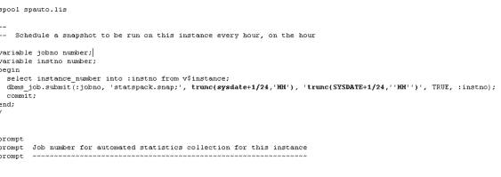

### 生成 STATSPACK 调优报告

一旦使用 `STATSPACK` 实用工具收集了两次或更多次的数据库性能统计信息快照，就可以使用 `SPREPORT.SQL` 脚本生成显示调优建议的报告。在 SQL*Plus 中使用以下命令执行 `SPREPORT.SQL` 脚本：

- Unix：`@$ORACLE_HOME/rdbms/admin/spreport.sql`
- Windows 2000：`%ORACLE_HOME%\rdbms\admin\spreport.sql`

在脚本执行过程中，系统会提示输入三个参数。每个参数在图 2.4 中均以粗体显示：

- 您希望用作性能分析起点的快照的 ID（图 2.4 中的 `2`）。
- 您希望用作分析终点的快照的 ID（图 2.4 中的 `4`）。
- 您希望赋予包含性能报告结果的文本文件的名称（图 2.4 中的 `statspack.txt`）。

### 图 2.4 Statspack 报告生成参数

```text
Instances in this Statspack schema
====================================
DB Id    Inst Num DB Name    Instance         Host
-------- ---------- --------- --------------  ----------
508515328      1 PROD       prod             FUTURA

Using  508515328 for database Id
Using  1 for instance number

Completed Snapshots

Instance    DB Name      Snap    Snap         Snap  Level Comment
--------    ---------  --------- ---------  ---------
prod        PROD       1 09 Jan 2002 19:41  5
                        2 09 Jan 2002 19:52  5
                        3 09 Jan 2002 20:32  5
                        4 09 Jan 2002 20:33  5

Specify the Begin and End Snapshot Ids
--------------------------------------
Enter value for begin_snap: 2
Begin Snapshot Id specified: 2

Enter value for end_snap: 4
End  Snapshot Id specified: 4

Specify the Report Name
-----------------------
The default report file name is sp_2_4.  To use this name,
press <return> to continue, otherwise enter an alternative.
Enter value for report_name: statspack.txt
```

## 解读 STATSPACK 报告内容

由 `SPREPORT.SQL` 脚本生成后，生成的报告将包含两个性能快照时间点之间所有调优统计信息。生成的报告文件是一个简单的文本文件，可以使用任何编辑器查看。与 `UTLESTAT.SQL` 和 `UTLFSTAT.SQL` 脚本生成的 `REPORT.TXT` 文件的内容不同，`STATSPACK` 报告布局非常清晰，便于识别重要的调优领域。在本书的其余部分，将引用 `STATSPACK` 报告文件的相关部分。图 2.5 展示了对 Oracle9i 数据库在 Windows 2000 系统上生成的示例 `STATSPACK` 报告文件的一个章节。

### 图 2.5 STATSPACK 报告文件示例章节


```text
STATSPACK report for

| DB Name   | DB Id    | Instance     | Inst Num Release   | Cluster Host |
| :-------- | :------- | :----------- | :----------------- | :----------- |
| PDCD      | 508513208| prod         | 1 9.0.1.1.0       | NO           |
|           |          |              |                    | FUTURE       |

---
Snap Id     Snap Time             Sessions Cur/Sess
---
Begin Snap:  2  08-Jan-02 19:41:07  9       5.2
End Snap:    4  08-Jan-02 19:52:05  9       3.3
Elapsed:     10.97 (mins)

Cache Sizes (end)
~~~~~~~~~~~~~~~~~~~~~
              Buffer Cache:            47M    std Block Size:      8K
              Shared Pool Size:         64M    Log Buffer:       1,024K

Load Profile
~~~~~~~~~~~~
                            Per Second         Per Transaction
Redo size:                     553.74       121,454.67
Logical reads:                  4.83      1,060.33
Block changes:                  0.93         204.33
Physical reads:                 0.22          49.00
Physical writes:                0.23          51.00
User calls:                     0.83         181.33
Parses:                         0.12          27.00
Hard parses:                    0.03          5.62
Sorts:                          0.15          32.67
Logons:                         0.00          0.67
Executes:                       0.22          47.33
Transactions:                   0.00

 %Blocks changed per read:        19.27   Recursive call %:        62.77
 Rollback per transaction %:       0.00   Rows per sort:           63.49

Instance Efficiency Percentages (Target 100%)
Buffer Nowait %:                 100.00  Redo Nowait %:          100.00
Buffer Hwt %:                    100.00  In-memory Sort %:        97.96
Library Hwt %:                   86.11   Soft Parse %:             79.61
Execute to Parse %:              42.96   Latch Hwt %:             100.00
Parse CPU to Parse Elapsd %:                   Non-Parse CPU:

Shared Pool Statistics        Begin  End
-----------------------       ------ ------
Memory usage %:                27.49   28.35
% SQL with executions>1:      53.78   58.42
% Memory for SQL w/exec>1:    63.47   79.74
```

# 图形化性能调优工具

`Oracle` 提供了多种 *图形用户界面 (GUI)* 数据库管理工具，可用于辅助调优工作。这些 GUI 工具分为三个产品类别：

- `Oracle Enterprise Manager Console`
- `Oracle Diagnostics Pack`
- `Oracle Tuning Pack`

`Oracle Enterprise Manager Console` 包含在基础 `Oracle9i` 数据库软件中。`Diagnostics` 和 `Tuning Pack` 是需要额外付费且需向 `Oracle` 购买单独许可证的选项。以下章节将简要介绍这些 GUI 工具。后续章节的相关部分还将包含关于这些 GUI 工具中一些工具的更多详细信息。

> **注意** 可以从 <http://technet.oracle.com/software/products/oem/content.html> 下载 `Oracle` 诊断包和调优包免费评估版。

## Oracle 目标：使用 Enterprise Manager 收集统计信息

# Oracle Enterprise Manager Console

`Oracle Enterprise Manager (OEM)` 是 `Oracle` GUI 数据库管理工具的核心。`OEM Console` 包含几个旨在帮助您通过图形化方式监控和管理数据库的工具。图 2.6 展示了 `Oracle9i` 的 `OEM Console` 界面图片。

`OEM Console` 将 `DBA 管理`、`调优` 和 `诊断包` 的组件无缝集成到一个集中的 GUI 环境中，您可以从中管理所有数据库。基础 `OEM` 产品由六个管理工具组成。表 2.6 总结了这些工具及其用途。

`OEM` 架构中的一个关键组件是 `Oracle Intelligent Agent`。这个自主的操作系统进程允许 `OEM Console` 对其管理的数据库执行各种任务。

## 图 2.6 Oracle9i Enterprise Manager Console

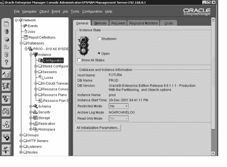

## 表 2.6 基础 Oracle Enterprise Manager Console 的组件

| 组件 | 用途 |
|---|---|
| Instance Manager | 启动、停止和管理 Oracle 实例 |
| Schema Manager | 创建和管理 Oracle 数据库对象。 |
| Security Manager | 创建和管理 Oracle 用户、权限和角色 |
| Storage Manager | 创建和管理表空间和数据文件 |
| Replication Manager | 管理 Oracle 快照和复制功能的 GUI 环境 |
| Workspace Manager | 允许对数据库中的数据进行更改的虚拟工作区。 |

`Oracle Intelligent Agent` 独立于 `OEM Console` 运行。每个被 `OEM` 工具监控的服务器（或节点）上运行一个 `Intelligent Agent` 进程。无论该节点上存在多少个数据库，每个被 `OEM` 监控的服务器节点上只有一个 agent。`Intelligent Agent` 及其监控的数据库代表了 `Oracle` 三层 `OEM` 架构中的第三层。`OEM` 架构的中层是 `Oracle Management Server (OMS)`，它充当 `OEM` 配置存储库。`OMS` 可以通过 `OEM Console` 从各种客户端访问，包括 `Unix` 或 `Windows 2000` 工作站和 web 浏览器。这些客户端代表 `OEM` 架构的第一层。图 2.7 展示了 `OEM` 三层架构模型的概述。

## 三层 OEM 架构模型

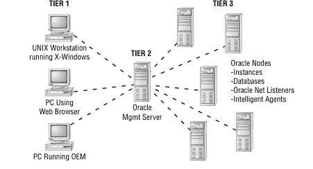


每个节点上的 `Intelligent Agent` 进程作为用户 `DBSNMP` 连接到该节点上的数据库。一旦连接，`Intelligent Agent` 代表 `Oracle Management Server` 执行通过 `OEM Console` 配置的操作。然后，`Agent` 将这些操作的结果报告回 `Oracle Management Server`，并在 `OEM Console` 的“事件”和“作业”分支中显示出来。通过这种方式，`OEM Intelligent Agent` 能够监控数据库中的特定数据库事件，并在某些事件发生时采取特定操作。

除了 `Intelligent Agent`，`Oracle8i` 还要求运行第二个名为 `Data Gatherer` 的进程才能使用某些 `GUI` 性能调优工具。而在 `Oracle9i` 中，`Data Gatherer` 的活动已整合到 `Intelligent Agent` 中。

智能代理的作用是在 `OEM` 控制台中执行指定的操作。这些操作可以采用两种形式：计划任务和事件监控。

### 计划任务

智能代理和 `OEM` 控制台可用于对智能代理管理的服务器节点上的数据库进行计划任务和任务执行。使用 `OEM` 控制台中的“Jobs”窗格来安排要执行任务的时间、日期和名称。一旦安排完毕，智能代理就是在指定时间实际执行任务的进程。每晚备份、清除旧的归档日志以及收集数据库统计信息，都是可以使用智能代理进行计划任务的示例。

### 事件监控

`OEM` 包含一个复杂的事件管理系统。这些事件可以是性能调优的非常有用的工具。例如，你可以使用 `OEM` 事件和智能代理，每当在数据库中检测到包含链式行的表时（链式行在第 8 章“磁盘 I/O 调优”中讨论），通过电子邮件或寻呼机通知你。

> 可以配置事件监控，使得每当智能代理检测到特定事件发生时，执行一个称为`修复任务`的指定任务来响应该事件。因此，通常需要人工干预的问题可以根据你的预定义规范立即得到修复。

`Oracle` 在 `OEM` 控制台中提供了许多预定义事件，以便你可以立即开始监控你感兴趣的常见事件。这些事件包括监控数据库是否处于活动状态或停止状态，`Oracle Net` 监听器是否处于活动状态或停止状态，以及数据库所在的服务器节点是否处于活动状态或停止状态。当添加了诸如调优包或诊断包等额外成本选项时，它们提供了额外的内置监控，监控诸如过多 `extent` 增长和表空间存储可用性低的事件，以及内存使用率统计信息和某些数据库资源争用。你还可以使用 `TCL` 命令语言创建自定义事件供智能代理监控。

关于使用 `TCL` 脚本创建自定义 `OEM` 事件的更多信息，可在`Oracle 智能代理用户指南，版本 9.0.1`（零件号 `A88771-02`）第 4 章“任务和事件脚本”中找到。

#### 真实世界场景

### 保护智能代理的 Oracle 账户

你刚刚配置了企业管理基础设施的各个组件。你担心智能代理访问被管理数据库所使用的用户账户（`DBSNMP`）是一个安全风险，因为其默认密码 `DBSNMP` 已广为人知。你记录了更改默认密码的步骤，并生成了以下清单：

1. 删除与你要更改其 `DBSNMP` 密码的数据库相关联的所有 `OEM` 任务或事件。
2. 关闭托管你要更改其 `DBSNMP` 密码的数据库的节点上的智能代理。
3. 编辑位于 Unix 系统 `$ORACLE_HOME/network/admin` 下的 `SNMP_RW.ORA` 文件和 Windows 2000 系统 `%ORACLE_HOME%\network\admin` 下的相应文件。向 `SNMP_RW.ORA` 文件添加此行 - 其中 `ConnectString` 是你要更改其 `DBSNMP` 密码的数据库的 `Oracle Net` 连接字符串：

   `SNMP.CONNECT.ConnectString.PASSWORD=Password`
4. 编辑位于 Unix 系统 `$ORACLE_HOME/rdbms/admin` 和 Windows 2000 系统 `%ORACLE_HOME%\rdbms\admin\` 下的 `CATSNMP.SQL` 文件。更改此文件末尾对默认密码的引用 - 由 `DBSNMP;` 标识 - 为你在前一步骤中指定的新密码。更改此文件可防止在稍后重新运行 `CATSNMP.SQL` 脚本时 `DBSNMP` 密码被意外重置为默认值 `DBSNMP`。
5. 在操作系统级别设置 `SNMP_RW.ORA` 和 `CATSNMP.SQL` 文件的安全权限，以保护密码。在 Unix 系统上，通过将文件的权限掩码设置为 700 来执行此操作；在 Windows 2000 系统上，通过使文件仅对管理员可访问来执行此操作。
6. 以 `SYSDBA` 用户身份登录到你要更改其 `DBSNMP` 密码的数据库。使用以下命令更改 `DBSNMP` 用户的密码：

   `ALTER USER DBSNMP IDENTIFIED BY Password`
7. 重启智能代理。如果所有更改都正确执行，智能代理应无错误启动。如果发生错误，你可以检查智能代理日志和跟踪文件中的错误。这些日志包括位于 Unix 系统 `$ORACLE_HOME/network/log` 和 Windows 2000 系统 `%ORACLE_HOME%\network\log` 下的 `nmi.conf.log` 和 `nmi.log` 文件，以及位于 Unix 系统 `$ORACLE_HOME/network/trace/dbsnmp.trc` 和 Windows 2000 系统 `%ORACLE_HOME%\network\trace\dbsnmp.trc` 下的跟踪文件。

## Oracle 诊断包

`Oracle 诊断包` 由若干工具组成，旨在帮助你识别、诊断和修复数据库中的问题区域。表 2.7 显示了诊断包的组件。

**表 2.7** 诊断包的组件

| 组件 | 用途 |
| :--- | :--- |
| Capacity Planner | 基于当前工作负载估算未来的系统需求 |
| Performance Manager | 以图形格式呈现实时性能信息 |
| TopSessions | 监控用户会话活动，包括资源消耗和锁定 |
| Trace Data Viewer | 查看跟踪文件输出的图形工具 |
| Lock Monitor | 监控已连接用户会话的锁定信息。 |
| Top SQL | 监控用户会话活动，并识别正在执行的 SQL 语句及其消耗的资源。 |
| Performance Overview | 数据库整体性能的单屏幕摘要。 |

除了 `Capacity Planner` 之外，这些 `GUI` 工具中的每一个对于性能调优都非常有用。以下章节将更详细地描述这些工具中的每一个。

### Performance Manager

`Performance Manager` 是一个 `GUI` 性能监控工具，允许你实时观察数据库中的性能指标。`Performance Manager` 跟踪的指标与我们将在全书中讨论的指标相同。然而，它不是通过发出查询或检查 `STATSPACK` 或 `REPORT.TXT` 文件来获取这些信息，而是以图表和图形的形式进行可视化展示。图 2.8 显示了 `Performance Manager` 图形输出的示例。

`Performance Manager` 的一个独特功能是，性能数据可以记录几个小时，然后以加速速率在图形上“回放”，以帮助你识别可能对系统产生负面影响的负载峰值。表 2.8 显示了你可以使用预定义的 `Performance Manager` 图表监控的一些调优区域。请注意，这些区域中的许多与后续章节中从非 `Performance Manager` 角度覆盖的内容相同。

除了这些特定区域，`Performance Manager` 还提供了若干预定义图表，将服务器整体性能汇总到一个易于解读的图表中。还可以创建用户定义的图表。

**图 2.8** Performance Manager 输出

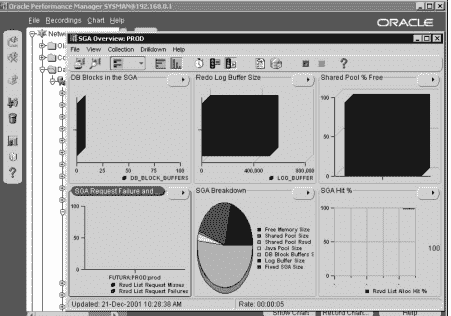

**表 2.8** Performance Manager 监控区域

| 区域 | 可监控的内容 |
| :--- | :--- |
| 磁盘 I/O | 文件 I/O、文件 I/O 速率和系统 I/O |
| 争用 | 闩锁、共享服务器队列、重做活动 |
| 实例 | 整体系统、单独进程和单独用户的统计信息 |
| 负载 | 排序和吞吐量活动 |
| 内存 | 所有 SGA 组件的命中率 |
| 资源 | 顶级资源使用者 |

### TopSessions

`TopSessions` 是一个图形工具，用于实时识别哪些用户消耗了最多的服务器资源。可以监控的资源包括 CPU、内存、文件 I/O 和事务量。图 2.9 显示了 `TopSessions` 屏幕的示例。

**图 2.9** TopSessions 屏幕

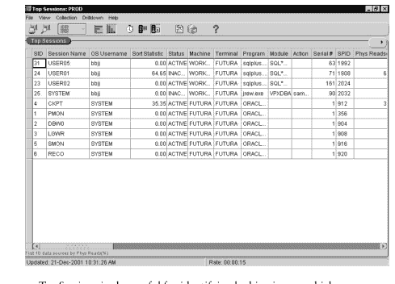

`TopSessions` 还很有助于识别锁定问题，这些问题可能导致其他数据库用户过度等待。锁定在第 9 章“调优争用”中有详细讨论。


### Trace Data Viewer

许多 Oracle 服务器被非 Oracle 中心性质的应用程序访问。这些应用程序仅将 Oracle 数据库作为应用程序数据的存储库。所有应用程序逻辑和处理都在数据库之外进行。从这些类型的应用程序中收集和分析性能数据可能很困难。Oracle 的 `Trace Data Viewer` GUI 工具允许你收集这些类型应用程序中特定事件的性能数据。这是通过使用一个应用程序

## 程序接口 (API)

专为此目的设计的 API 已自 Oracle 7.3 版本起集成到 Oracle 服务器中。通过此 API 收集的数据类型通常与资源使用率、执行时间以及应用程序专用数据相关。此外，您还可以使用 `Trace Data Viewer` 来收集与常规数据库事件相关的性能信息。


有关配置、调度和管理 Oracle 跟踪管理器图形界面实用程序的更多详细信息，请参阅《`Oracle9i` 数据库性能指南和参考，版本 1 (9.0.1)》（编号 A87503-02）中的第 12 章“使用 Oracle 跟踪”。

## 锁监视器

锁监视器是一个非常实用的工具，用于识别在处理过程中哪些用户会话正在锁定数据库段。图 2.10 展示了一个锁监视器界面的示例。

### 图 2.10 锁监视器

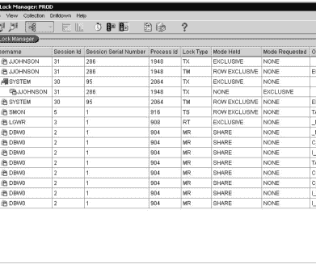

图 2.10 中的输出显示，用户 JJOHNSON 正在尝试获取 EMPLOYEES 表的独占锁，但由于用户 SYSTEM 阻塞了其请求，目前仍在等待获取该锁。


> 关于与锁相关的性能调优问题的完整讨论，请参阅第 9 章“调整争用”。

## 顶级 SQL

顶级 SQL 旨在帮助您轻松识别哪些 SQL 语句消耗了最多的系统资源。图 2.11 展示了顶级 SQL 界面的一个示例。

### 图 2.11 顶级 SQL 界面

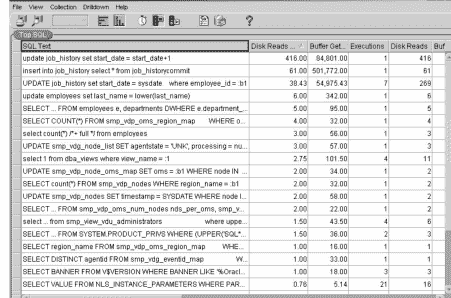

图 2.11 中的输出显示了消耗最多系统资源的 SQL 命令。顶级 SQL 还允许您仅通过双击某条语句即可向下钻取查看详细信息。下钻信息将包括该语句的执行计划以及关于该语句 I/O 和 CPU 使用情况的详细统计信息。

## 性能概览

性能概览是一个便捷的单一入口点，用于广泛概述数据库当前的性能状况。图 2.12 展示了性能概览界面的一个示例。

### 图 2.12 性能概览界面

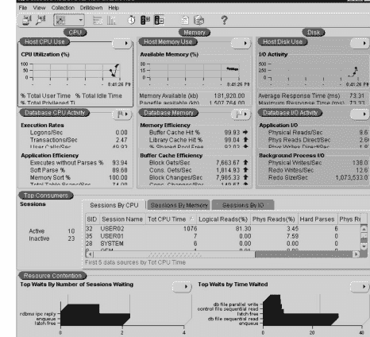

图 2.12 中的输出显示了内存和 CPU 使用率以及物理 I/O 和 SQL 处理方面的性能统计数据。


> 本书其余章节包含了对性能概览摘要屏幕上表示的各个领域的完整讨论。

## Oracle 调优包

Oracle 调优包专门设计用于协助您解决数据库性能调优问题。表 2.9 展示了调优包的组成部分。

**表 2.9** 调优包的组成部分

| 组件 | 用途 |
| :--- | :--- |
| Oracle 专家 | 基于 Oracle 调优方法论的向导式数据库调优工具。 |
| SQL 分析 | 分析和重写 SQL 语句以提高其性能。 |
| 索引调优向导 | 帮助识别应用程序用户正在使用哪些索引，以及这些索引的有效性。 |
| 大纲管理 | 用于管理存储大纲。存储大纲在第 3 章“SQL 应用程序调优与设计”中进行了讨论。 |
| 重新组织向导 | 协助执行表和索引重新组织任务，如将段移动到新表空间，或根据新的尺寸规格重建段。 |
| 表空间映射 | 以图形方式显示每个段的各个扩展段存储在表空间的数据文件中的位置。 |

虽然这些图形界面工具都提供了重要的调优信息，但 Oracle 专家、`SQL 分析` 和索引调优向导对于数据库层面的性能调优尤为实用。

## Oracle 专家

`Oracle 专家` 是一个图形界面工具，它根据您的规格收集并分析性能调优数据。一旦数据分析完成，Oracle 专家便会使用其内置的推理引擎来制定调优建议。这些建议可以以摘要报告的形式呈现，并附带 SQL 脚本和新的 `init.ora` 文件，可用于帮助您实施推荐的更改。

Oracle 专家的调优方法包括以下步骤：

1. 定义调优范围
2. 收集数据
3. 查看和编辑收集的数据并调整调优规则
4. 分析收集的数据
5. 生成调优建议并审查结果
6. 创建实施建议所需的 SQL 脚本

这些步骤中的每一个都对应于 Oracle 专家界面上的一个不同选项卡。例如，图 2.13 显示了范围选项卡，其中指定了调优工作的总体目标。

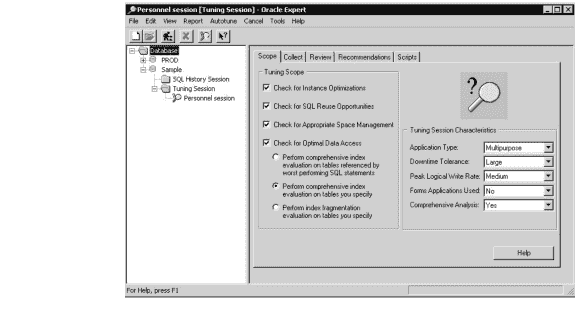

Oracle 专家工具生成的建议摘要十分详尽，为每项推荐的调更变提供了解释依据。图 2.14 展示了 Oracle 专家建议报告的一个示例输出。

### 图 2.14 Oracle 专家建议报告

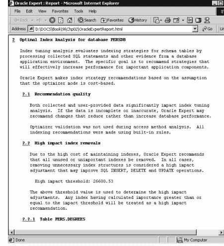

就像诊断包中的顶级 SQL 图形界面工具一样，SQL 分析也旨在帮助您识别性能不佳的 SQL 语句。图 2.15 展示了 SQL 分析界面的一个示例。

### 图 2.15 SQL 分析界面

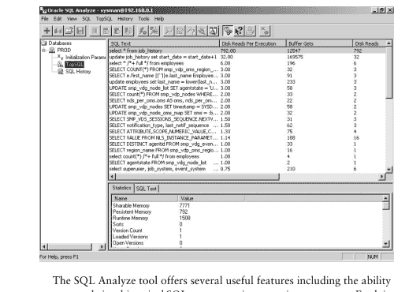

SQL 分析工具提供了许多实用功能，包括在存储库中存储和查看历史 SQL 语句、生成执行计划以及生成发现结果的 HTML 报告。


关于生成和解释执行计划的完整讨论，请参阅第 3 章。

## 索引调优向导

在应用程序开发过程中，程序员通常会识别出适合作为索引候选项的表列。然而，设计阶段放置在表上的索引并非在应用程序投入使用时都会被实际使用。虽然索引旨在提高查询性能，但在应用程序中拥有未使用的索引实际上可能会阻碍性能。索引调优向导工具旨在帮助您识别哪些应用程序索引未被使用，以便您考虑删除它们。图 2.16 展示了索引调优向导界面的一个示例。

### 图 2.16 索引调优向导界面

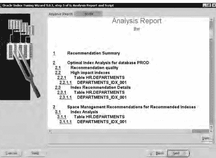

索引调优向导不仅有助于识别未使用的索引，还会编写删除或修改这些索引所需的 SQL 语句，以增强性能。


> 有关如何确定哪些应用程序索引利用率不足的详细信息，请参阅作者的文章“使用新的 `Oracle9i` 功能管理索引”，载于 2002 年 1 月/2 月期的《`Oracle` 杂志》（http://www.oracle.com/oramag/oracle/index.html）。

### 摘要

在调优过程之前、期间和之后，拥有准确且完整的信息至关重要。这些信息可以从多个位置收集。告警日志包含各种实例级事件信息，而后台和用户跟踪文件可用于更精确地识别数据库中正在发生的事情。Oracle 的动态 V$ 和 DBA 数据字典视图也允许您收集数据库调优所需的重要统计数据和信息。

Oracle 还提供两种实用程序：`STATSPACK` 和 `UTLBSTAT.SQL`/`UTLESTAT.SQL`，您可以使用它们捕捉特定时间段内的统计数据，然后使用生成的 `STATSPACK` 报告和 `REPORT.TXT` 输出分析这些统计数据。

Oracle 企业管理器控制台还通过其通过智能代理进行的事件监控提供了有用的调优信息。此外，还可为 Oracle 企业管理器使用几个有用的性能调优附加包。这些包括诊断包和调优包，两者均通过使用性能管理器和 Oracle 专家组件提供额外的性能调优功能。

### 考试要点

- **知道如何使用字典和性能视图。** 理解包含调优信息的 V$ 动态性能视图和 DBA 数据字典视图的名称和内容。
- **描述如何安装和使用 STATSPACK。** 能够描述如何安装和使用 `STATSPACK` 实用程序以生成调优建议。
- **知道还有哪些可用的性能调优工具。** 列出并描述 Oracle 企业管理器图形界面工具和基于脚本的调优工具（如 `UTLBSTAT.SQL` 和 `UTLESTAT.SQL`）的与调优相关的组件。
- **理解告警和跟踪文件的位置及内容。** 知道实例生成的告警文件和跟踪文件在哪里可以找到。能够描述在告警日志、后台跟踪文件和用户跟踪文件中找到的调优信息。

## 关键术语

在参加考试之前，请确保你熟悉以下术语：

- 警告日志
- `BACKGROUND_DUMP_DEST`
- 数据字典视图
- 数据库事件


# 术语表

- 动态性能视图
- Fixit Job
- 图形用户界面（GUI）
- `MAX_DUMP_FILE_SIZE`
- 最佳灵活架构（OFA）
- Oracle 诊断包
- Oracle 企业管理器（OEM）
- Oracle 专家
- Oracle 智能代理
- 性能管理器
- SQL 分析
- STATSPACK
- TopSessions
- 跟踪数据查看器
- 跟踪文件
- `USER_DUMP_DEST`
- `UTLBSTAT.SQL`
- `UTLSTAT.SQL`

# 复习题

1. 警告日志不包含以下哪项信息？
    - A. 实例启动和关闭。
    - B. 新数据库用户的创建。
    - C. 重做日志切换。
    - D. 以上所有都在警告日志中。

2. 以下哪些视图可用于确定哪个用户生成了特定的用户跟踪文件？（选择所有适用项。）
    - A. `V$SYSTEM`
    - B. `V$SESSION`
    - C. `V$USER`
    - D. `V$PROCESS`

3. 以下哪个 `init.ora` 参数会在实例级别激活跟踪？
    - A. `TRACE_ON`
    - B. `TRACE_SQL`
    - C. `SQL_FILE`
    - D. `SQL_TRACE`

4. 以下哪个 Oracle 提供的 PL/SQL 包可用于激活另一个用户的会话跟踪？
    - A. `DBMS_SYSTEM`
    - B. `DBMS_SESSION`
    - C. `DBMS_TRACE`
    - D. `DBMS_UTILITY`

5. 以下哪个视图包含有关整体系统统计信息的信息，包括之前和当前连接的统计信息？
    - A. `V$SGASTAT`
    - B. `V$STATNAME`
    - C. `V$SESSSTAT`
    - D. `V$SYSSTAT`

6. 哪个 DBA 视图会显示单个表的存储、行和块信息？
    - A. `DBA_TABLES`
    - B. `DBA_OBJECTS`
    - C. `DBA_TABLE_SIZE`
    - D. `DBA_TAB_PRIVS`

7. 由 `UTLBSTAT.SQL` 和 `UTLESTAT.SQL` 生成的文件名称是什么？
    - A. `REPORT.TXT`
    - B. `REPORT.LOG`
    - C. `REPORT.LST`
    - D. `REPORT.SQL`

8. 在每个 Oracle 服务器上运行，用于管理作业并监视该节点上事件的自治进程被称为：
    - A. Oracle 网络监听器
    - B. 企业管理器控制台
    - C. 智能代理
    - D. 数据收集器

9. 以图形方式实时记录和报告数据库性能统计信息的 OEM 图形用户界面工具被称为：
    - A. TopSessions
    - B. 性能管理器
    - C. 跟踪数据查看器
    - D. 容量规划器

10. 收集性能数据、分析该数据并做出适当调优建议的图形用户界面工具叫什么？
    - A. SQL 分析
    - B. Oracle 专家
    - C. 跟踪专家
    - D. SQL 专家

11. 当你使用 `UTLBSTAT`/`UTLESTAT` 时，如果你想要准确的统计信息，应该避免做什么？
    - A. 断开与启动 `UTLBSTAT` 实用程序进程的连接。
    - B. 停止并启动 Oracle 实例。
    - C. 停止 Oracle 代理。
    - D. 这些都不会对该实用程序造成问题。

12. 拥有 STATSPACK 实用程序使用的所有对象的模式（Schema）名称是什么？
    - A. `PERFSTAT`
    - B. `DBSNMP`
    - C. `SYS`
    - D. `SYSTEM`

13. STATSPACK 相比 UTLBSTAT/UTLESTAT 的优势是什么？
    - A. 每次运行过程后统计信息不会被删除。
    - B. 可以在任何两个快照时间点之间生成性能统计信息。
    - C. STATSPACK 报告比 UTLBSTAT/UTLESTAT 的输出清晰得多。
    - D. 这些全是优势。

14. `SPAUTO.SQL` 脚本执行什么操作？
    - A. 生成 STATSPACK 报告
    - B. 使用 STATSPACK 手动收集数据库统计信息的方法
    - C. 使用 STATSPACK 自动收集数据库统计信息的方法。
    - D. 以上都不是

15. 以下哪个 Oracle 企业管理器组件可以生成调优建议列表？
    - A. 智能代理
    - B. 性能管理器
    - C. Oracle 专家
    - D. Oracle 管理服务器

16. Enterprise Manager 监视的每个服务器节点上最多可以运行多少个智能代理进程？
    - A. 一个
    - B. 两个
    - C. 四个
    - D. 取决于 CPU 的数量

17. “监视用户会话活动，包括资源消耗和锁定”最准确地描述的是什么实用工具？
    - A. 容量规划器
    - B. TopSessions
    - C. 跟踪数据查看器
    - D. 性能管理器

18. 开发人员编写了一个未最佳调整的查询。DBA 可以使用什么实用工具协助开发人员调整此查询？
    - A. STATSPACK
    - B. 容量规划器
    - C. UTLBSTAT/UTLESTAT
    - D. SQL 分析

19. 一位 DBA 进行了系统监视，并有一些关于可以改进系统性能的数据库变更想法。可以使用什么实用工具来支持她的发现并增强她建议的可信度？
    - A. STATSPACK
    - B. Oracle 专家
    - C. `REPORT.TXT`
    - D. 智能代理

20. 智能代理使用哪个用户连接到数据库？
    - A. `DBSNMP`
    - B. `SYS`
    - C. `SYSTEM`
    - D. `PERFSTAT`

21. 可以使用哪个图形用户界面工具来监视哪些用户正在发出资源密集型最高的 SQL 语句？
    - A. Top SQL
    - B. 锁定监视器
    - C. 索引调优向导
    - D. 跟踪数据查看器

# 复习题答案

1. B. 警告日志不包含任何用户信息。

2. B, D. 联接 `V$SESSION` 和 `V$PROCESS` 视图可以将用户名与进程 ID 关联起来。此进程 ID 包含在用户的跟踪文件名中。

3. D. 将 `init.ora` 参数 `SQL_TRACE` 设置为 `TRUE` 将为连接到实例的每个会话激活跟踪。

4. A. `DBMS_SYSTEM` 中的 `SET_SQL_TRACE_IN_SESSION` 过程用于使用来自 `V$SESSION` 的用户的 `sid` 和 `serial#` 在另一个用户的会话中激活跟踪。

5. D. `V$SYSSTAT` 显示自实例启动以来所有当前和历史会话的整体系统统计信息。

6. A. 一旦进行分析，表的存储利用率、块使用和行长度信息可以在 `DBA_TABLES` 中找到。

7. A. `UTLSTAT.SQL` 脚本通过对由 `UTLBSTAT.SQL` 创建的表中的 `stat$bg` 和由 `UTLESTAT.SQL` 创建的 `stat$ses`nd 表执行计算，生成 `REPORT.TXT` 文件。

8. C. Oracle 智能代理在每个包含 Oracle 数据库的节点上运行。代理代表 Oracle 企业管理器控制台监视该节点上的数据库。

9. B. OEM 性能管理器图形用户界面工具以图形格式显示数据库性能数据。

10. B. Oracle 专家工具在做出调优建议之前，会根据你的规范分析数据库统计信息。

11. B. 使用 `UTLBSTAT`/`UTLESTAT` 实用程序时，不应停止并重新启动实例。这将使已收集的任何统计信息失效。

12. A. `PERFSTAT` 模式拥有 `STATSPACK` 实用程序使用的所有对象。

13. D. 这些都是 STATSPACK 相比 UTLBSTAT/UTLESTAT 的优势。因为此信息存储在 Oracle 数据库中，并且在 STATSPACK 过程的执行之间不会被删除，所以可以查询并在任何时间段内保留。此外，报告更容易理解。

14. C. `SPAUTO.SQL` 提供了执行 STATSPACK 实用程序的自动化方式。该脚本使用 Oracle 的 `DBMS_JOBS` 包来安排快照统计数据收集。

15. C. Oracle 专家 OEM 组件可以生成一份冗长的报告，其中包含所选分析领域的调优建议。

16. A. 每个 Oracle 服务器节点上的智能代理进程最大数量为一个。


17. B. TopSessions 实用工具是 Oracle 企业管理器诊断包的一部分，可用于监视用户会话活动，包括资源消耗和锁定。

18. D. DBA 将使用 SQL 分析实用工具帮助开发人员处理该查询。此实用工具特别适用于有问题的 SQL 语句调优。

19. B. 可以 Oracle 专家实用工具作为帮助 DBA 发现性能瓶颈的工具；它还建议对系统进行更改以提高性能。这是一个有价值的工具，可用于验证 DBA 自己的分析。

20. A. 每个节点上的智能代理进程以用户 `DBSNMP` 的身份连接到该节点上的数据库。

21. A. Oracle 企业管理器诊断包中的 Top SQL 组件显示了哪些应用程序用户正在消耗最多的服务器资源。

# 第 3 章

# SQL 应用调优与设计

## 本章涵盖的 ORACLE 9i 性能调优考试目标：

- 描述 DBA 在应用调优中的角色
- 解释不同的存储结构，以及为什么一种存储结构可能优于另一种
- 解释不同类型的索引
- 解释索引组织表
- 描述分区方法
- 解释 `DBMS_STATS` 过程的使用
- 描述物化视图及查询重写的使用
- 列出 OLTP、DSS 和混合系统的要求
- 描述优化器的使用
- 解释计划稳定性的概念
- 使用存储大纲
- 描述提示的使用
- 收集索引和表的统计信息
- 描述直方图的使用
- 在数据库之间复制统计信息
- 执行索引重组
- 监控索引以确定其使用情况

考试目标可能会随时变更，且无需提前通知，由 Oracle 全权决定。请访问 Oracle 认证网站 (`http://www.oracle.com/education/certification/`) 获取最新的考试目标列表。

性能不佳的应用问题通常可以追溯到结构不良的 SQL 语句或低效的数据库设计。因此，Oracle 提供了多种工具，帮助您识别和修复性能不佳的应用 SQL。

这些工具在应用代码仍在完善的开发系统上非常有价值。然而，即使在生产系统上，由于 Oracle 较新的调优原则认识到调优应用 SQL 或设计可能非常困难甚至不可能，这些工具仍可能帮助您识别那些可能需要更广泛的 DBA 干预的 SQL 语句——例如添加索引以提高长时间运行的报告查询的性能。

### Oracle 目标

**描述 DBA 在应用调优中的角色**

这种类型的调优修改要求您理解所有可用的调优选项，从 SQL 提示和存储大纲到物化视图和索引组织表。您还必须考虑鉴于正在评估的系统类型，您可用的工具是否合适。例如，在线事务处理系统（OLTP）与决策支持系统（DSS）在 SQL 和设计方面有不同的考虑因素。

然而，无论系统类型如何，或者您面临何种类型的调优问题，您都必须首先准确测量当前应用 SQL 的性能，然后才能识别可能的改进领域。

## 测量 SQL 性能

有效的数据库调优要求您对应用中发生的具体 SQL 活动进行准确且及时的测量。

一旦完成这些测量，您就可以尝试使用各种技术来提高其性能。关于 SQL 语句调优技术的完整讨论超出了本书及性能调优 OCP 考试的范畴。然而，作为 DBA，理解用于测量 SQL 语句性能的五个最常用工具非常重要：`TKPROF` 实用程序、`Top SQL`、解释计划、`AUTOTRACE` 和 `STATSPACK` 报告。

## TKPROF 实用程序

跟踪内核配置文件，即 `TKPROF`，用于格式化使用第 2 章“调优信息源”中讨论的用户会话跟踪技术生成的用户跟踪文件。用户跟踪文件包含用户在跟踪激活期间发出的所有 SQL 语句、关于每个语句执行耗时的信息以及该语句消耗的资源数量。

### Oracle 目标

**使用 SQL 跟踪和 TKPROF**

由于原始未格式化的跟踪文件内容难以解释，因此使用 `TKPROF` 实用程序将跟踪文件转换为更容易理解的形式。以下部分解释了如何使用该实用程序。

### 使用 TKPROF 格式化用户跟踪文件

`TKPROF` 实用程序是一个独立实用程序，直接从操作系统提示符执行。以下是一个从 Unix 系统获取的简单 `TKPROF` 格式化示例：

```
$ tkprof ora_1253.trc trace.txt
```

此示例将格式化名为 `ora_1253.trc` 的用户跟踪文件，并将格式化版本存储在名为 `trace.txt` 的文件中。如该示例所示，`TKPROF` 命令后的前两个参数分别是跟踪文件名称和输出文件名称。`TKPROF` 实用程序还有几个额外的命令行参数，也可以用于格式化跟踪文件，具体取决于所需的信息。这些选项在命令行上紧跟在必需的跟踪文件名称和输出文件名称参数之后指定。表 3.1 列出了这些选项。

**表 3.1** *TKPROF 命令行选项*

| 选项 | 定义和用法 |
| :--- | :--- |
| EXPLAIN | 通过使用该命令指定的架构中的 `PLAN_TABLE`，为跟踪文件中的每个语句生成解释计划。此选项必须包含有效的 Oracle 用户名和密码。 |
| TABLE | 使用由 `EXPLAIN` 选项指定的架构，执行计划存储在被指定的表中，而不是默认表 `PLAN_TABLE`。 |
| SYS | 指示格式化文件是否应包含递归 SQL 语句（即为了支持主要 SQL 语句而隐式发出的针对数据字典的语句）。 |
| SORT | 确定格式化跟踪文件中语句的排序顺序。22 种排序选项列在表 3.2、3.3 和 3.4 中。 |
| RECORD | 指定应将跟踪文件中的 SQL 语句写入的文件名。允许您隔离 SQL 语句而不包含任何伴随的资源使用情况信息。递归 SQL 将被省略。 |
| PRINT | 将结果格式化跟踪文件中包含的 SQL 语句数量限制为指定值。 |
| INSERT | 创建一个 SQL 脚本，执行时将创建一个名为 `TKPROF_TABLE` 的表，然后使用此跟踪文件中包含的原始统计数据填充该表。 |
| AGGREGATE | 确定同一 SQL 语句的多次发射的统计信息是合并计算还是独立计算。 |
| WAITS | 计算发生在跟踪内的等待事件的汇总统计信息。等待事件在第 9 章“调优争用”中讨论。 |

下面展示了几个使用 `TKPROF` 及其中一些选项的示例。

以下展示了在 Unix 系统上使用带有 `SYS` 和 `EXPLAIN` 参数的 `TKPROF`：

```
$ tkprof ora_1234.trc trace.txt sys=no explain=jo e/sidney@PROD
```

此 `TKPROF` 的用法将：

- 格式化跟踪文件 `ora_1234.trc` 并将结果存储在名为 `trace.txt` 的输出文件中。
- 导致原始跟踪文件中的任何递归 SQL 从格式化后的跟踪文件 `trace.txt` 中被省略。
- 在格式化后的跟踪文件 `trace.txt` 中包含每个发出的 SQL 语句的解释计划。`PROD` 数据库中用户 `Joe` 的架构中的 `PLAN_TABLE` 将用于生成解释计划。

以下展示了在 Windows 2000 系统上使用带有 `RECORD` 和 `PRINT` 参数的 `TKPROF`：

```
C:\> tkprof ora00740.trc trace.txt print=10 record=sql.txt
```

此 `TKPROF` 实用程序的用法将：

- 格式化跟踪文件 `ora00740.trc` 并将前 10 个 SQL 语句存储在名为 `trace.txt` 的输出文件中。
- 创建一个名为 `sql.txt` 的文件，其中包含原始跟踪文件中的前十个 SQL 语句。

以下展示了在 Unix 系统上使用带有 `INSERT` 和 `SORT` 参数的 `TKPROF`：

```
$ tkprof ora_1702.trc trace.txt insert=trace.sql sort=fchrow
```

这种 `TKPROF` 工具的用法将执行以下操作：

- 格式化跟踪文件 `ora_1702.trc`，并将结果按每条语句返回的行数排序，存储到一个名为 `trace.txt` 的输出文件中。下一节将讨论其他 `TKPROF` 排序选项。
- 创建第二个名为 `trace.sql` 的文件，其中包含创建名为 `TKPROF_TABLE` 的表所需的 SQL 命令，然后将跟踪文件中 SQL 语句的统计信息填充到该表中。

如果没有使用如 `FCHROW` 之类的排序参数，`TKPROF` 工具将按照 SQL 语句执行的顺序，在格式化输出文件中列出这些语句。当不希望使用此默认排序顺序时，`TKPROF` 提供了几个额外的排序参数。格式化输出将根据指定的选项按降序排序。也可以同时使用多个排序参数。在这种情况下，排序输出将按照指定的顺序排序，但基于排序选项值的总和。

## TKPROF 排序参数

每个参数都与 SQL 语句处理的三个阶段之一相关：解析（Parse）、执行（Execute）或获取（Fetch）。*解析* 是指将 SQL 语句准备就绪以便执行的过程。此过程包括检查语句的语法正确性，以及确定用户在该语句中引用的对象上的权限。与 SQL 语句处理解析阶段相关的 `TKPROF` 排序选项如表 3.2 所示。

### 表 3.2 语句处理解析阶段的排序选项

| 选项 | 排序顺序 |


| :--- | :--- |

| PRSCNT | 语句被解析的次数 |

| PRSCPU | 解析语句所消耗的 CPU 时间 |

| PRSELA | 解析语句所消耗的实际时间（Elapsed time） |

| PRSDSK | 语句解析期间发生的磁盘读取次数 |

| PRSMIS | 语句解析期间库缓存未命中的次数 |

| PRSCU | 语句解析期间从 SGA 读取的数据或索引缓冲区数量 |

| PRSQRY | 语句解析期间从 SGA 读取的回滚缓冲区数量 |

SQL 语句处理的第二步是 *执行*，当 SQL 语句执行该语句指定的操作时发生。执行的示例可能包括从段中选择、插入、更新或删除数据，或者创建用户、表空间或数据文件。表 3.3 显示了与 SQL 语句处理执行阶段相关的 `TKPROF` 排序选项。

### 表 3.3 语句处理执行阶段的排序选项

| 选项 | 排序顺序 |

| :--- | :--- |

| EXECNT | 语句被执行次数 |

| EXECPU | 执行语句所消耗的 CPU 时间 |

| EXEELA | 执行语句所消耗的实际时间 |

| EXEDSK | 语句执行期间发生的磁盘读取次数 |

| EXECQRY | 语句执行期间从 SGA 读取的回滚缓冲区数量 |

| EXECU | 语句执行期间从 SGA 读取的数据缓冲区数量 |

| EXEROW | 语句执行期间处理的行数 |

| EXEMIS | 语句执行期间发生的库缓存未命中次数 |

如果发出的 SQL 语句是 `SELECT` 语句，它还将执行 SQL 语句处理的最后一步——获取（Fetch）操作。获取阶段发生在 SQL 语句返回的结果集发回给用户时。与 SQL 语句处理获取阶段相关的 `TKPROF` 排序选项如表 3.4 所示。

### 表 3.4 语句处理获取阶段的排序选项

| 选项 | 排序顺序 |

| :--- | :--- |

| FCHCNT | 发生的行获取次数 |

| FCHCPU | 获取行所消耗的 CPU 时间 |

| FCHELA | 获取行所消耗的实际时间 |

| FCHDSK | 获取行期间发生的磁盘读取次数 |

| FCHQRY | 获取行期间从 SGA 读取的回滚块数量 |

| FCHCU | 获取行期间从 SGA 读取的数据块数量 |

| FCHROW | 语句获取的行数 |

> 除了表 3.2、3.3 和 3.4 中显示的排序参数外，`TKPROF` 输出还可以使用 `USERID` 排序参数，按解析该语句的用户 ID 进行排序。

## 解释使用 TKPROF 格式化的跟踪文件

一旦使用 `TKPROF` 工具对用户跟踪文件进行格式化，结果文件的内容可以作为衡量 SQL 性能的绝佳指标。图 3.1 展示了一个使用 `TKPROF` 格式化的示例跟踪文件。

### 图 3.1 TKPROF 格式化跟踪文件的示例输出

```text
select /*+ rule */ bucket_cnt, row_cnt, cache_cnt, null_cnt, timestamp,
     sample_size, minimum, maximum, distcnt, lowval, hival, density, col,
     spare2, spare3, maxnum, where obj#=:1 and intcol#=:2
from hist_head

 call count cpu elapsed disk query current rows
------ ------ ------ ------ ------ ------ ------ ------
Parse 2 0.07 0.10 2 2 1 0
Execute 11 0.00 0.00 0 0 0 0
Fetch 11 0.00 0.00 2 22 0 11
total 24 0.07 0.11 4 58 1 11

Misses in library cache during parse: 1
Optimizer goal: RULE
Parsing user id: SYS (recursive depth: 1)
**********************************************************************
select employee_id, last_name, hire_date, job_id
from hr.employees
where salary > 15000

 call count cpu elapsed disk query current rows
------ ------ ------ ------ ------ ------ ------ ------
Parse 1 0.06 0.18 0 149 0 0
Execute 1 0.00 0.00 0 0 0 0
Fetch 2 0.00 0.03 3 3 2 3
total 4 0.06 0.22 3 152 2 3

Misses in library cache during parse: 1
Optimizer goal: CHOOSE
Parsing user id: 3
**********************************************************************
insert into hr.employees
(employee_id, last_name, email, hire_date, job_id)
values
(500, 'johnson', 'jjohnson@r.com', sysdate, 'AD_VP')

 call count cpu elapsed disk query current rows
------ ------ ------ ------ ------ ------ ------ ------
Parse 1 0.01 0.00 0 0 0 0
Execute 1 0.01 0.10 5 5 1 1
Fetch 0 0.00 0.00 0 0 0 0
total 2 0.02 0.11 5 1 1 1
```


上述示例中显示的 CPU 和 Elapsed 计时仅当 `init.ora` 参数为 `TIMED_STATISTICS=TRUE` 时才为非零值。

查看上述跟踪文件时，您会注意到以下元素：

- 第一个列表是针对一个递归语句，该语句针对数据字典发出，以支持随后的 `SELECT` 语句。由于这种详细程度很少有用，可以在格式化期间使用 `SYS=NO` 选项，以从输出文件中消除这些类型的条目。
- 第二个列表是一个 `SELECT` 语句，包含解析、执行和获取阶段的信息。
- 第三个列表是一个 `INSERT` 语句，它不返回任何行（例如，Fetch），因此仅包含解析和执行阶段的信息。

表 3.5 显示了格式化 `TKPROF` 输出文件中每一列的描述。

### 表 3.5 TKPROF 输出描述

| 统计名称 | 统计描述 |

| :--- | :--- |

| Count | 解析、执行或获取阶段发生的次数 |

| CPU | CPU 处理该语句中所有解析、执行或获取调用所消耗的总秒数 |

| Elapsed | 处理该语句中所有解析、执行或获取调用所消耗的总秒数 |

| Disk | 该语句中解析、执行和获取调用期间从磁盘读取的数据块总数 |

| Query | 该语句中解析、执行和获取调用期间从 SGA 读取的回滚块（一致模式下的块）总数 |

| Current | 该语句中解析、执行和获取调用期间从 SGA 读取的数据块（当前模式下的块）总数 |

| Rows | 受执行阶段影响的行数（对于 `INSERT`、`UPDATE` 和 `DELETE` 语句），或受获取阶段影响的行数（对于 `SELECT` 语句） |

使用这些统计信息，您可以看到第二条语句被解析了一次，执行了一次，并执行了两次获取。此处理共消耗了 `.06` 秒的 CPU 时间，并且语句处理期间过去了 `.22` 秒。该语句需要从磁盘读取 3 个数据块，从 SGA 读取 152+2=154 个块，并返回了 3 行。

## 识别可能需要调优的语句

`TKPROF` 工具还会在输出文件的末尾以汇总形式显示这些统计信息。这些统计信息将提供递归和非递归语句的总体总计。

使用 `TKPROF` 的格式化输出，相对容易定位可能需要进一步调优的 SQL 语句。通常，你会寻找包含以下一个或多个缺点的语句：

- 消耗过多的 CPU 资源
- 解析、执行或获取花费时间过长
- 从磁盘读取过多的数据块，而从 SGA 读取的数据块过少
- 访问了大量数据块，但只返回了少量行

作为 `TKPROF` 工具的替代方案，OEM 诊断包中的 Top SQL 组件也可以用来识别表现出上述缺点的 SQL 语句。图 3.2 展示了 Top SQL GUI 工具输出示例。

### 图 3.2 Top SQL 的输出示例


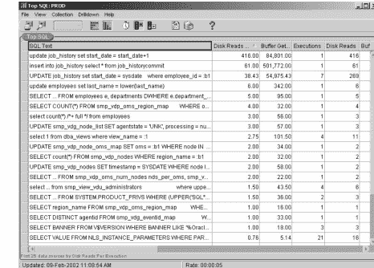

图 3.2 中显示的输出表明，在 Top SQL 监控期间发出的资源密集型最高的 SQL 语句是对 `JOB_HISTORY` 表的更新，该语句修改了 `START_DATE` 列的值。如 Top SQL 输出中第一、第二和第三列的数值所示，该更新语句仅执行了一次，就产生了每次执行 416 次磁盘读取和每次执行 84,801 次缓冲区获取。

一旦你使用 `TKPROF` 或 Top SQL 识别出符合上述调优标准的 SQL 语句，就可以使用 `Explain Plan` 设施进一步确定这些语句性能不佳的原因。

## Explain Plan 设施

Oracle 的 `Explain Plan` 设施用于确定特定 SQL 语句的处理方式。有了这些信息，就可以通过重写 SQL 代码以消除不必要的行为来提高语句的性能。

> 虽然完整解读 `Explain Plan` 输出超出了本文和 Oracle9i 性能调优 OCP 考试的范畴，但你应该对这个重要工具有基本的了解。

`Explain Plans` 可以使用 `TKPROF` 工具生成，也可以使用 `EXPLAIN PLAN FOR` 命令生成。这些技术在以下章节中进行了讨论。

### 使用 TKPROF 生成 Explain Plans

正如你在上一节中看到的，`EXPLAIN` 参数可用于在使用 `TKPROF` 工具格式化用户跟踪文件时为 SQL 语句生成 `Explain Plans`。图 3.3 展示了该 `Explain Plan` 输出的外观。

然而，使用 `EXPLAIN` 参数格式化大型跟踪文件可能需要花费极其漫长的时间。在这些情况下，你可能希望检查格式化后的跟踪文件以找出性能不佳的 SQL 语句，然后使用下一节中讨论的技术仅针对这些语句生成 `Explain Plans`。

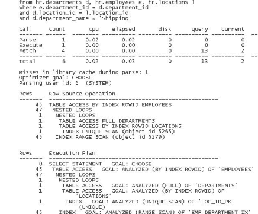

### 使用 EXPLAIN PLAN FOR 生成 Explain Plans

一旦识别出性能不佳的 SQL 语句，就可以使用 `EXPLAIN PLAN FOR` 命令为该语句生成 `Explain Plan`。使用此技术生成 `Explain Plan` 的步骤如下：

- 使用位于 Unix 系统上的 `$ORACLE_HOME/rdbms/admin` 或 Windows 2000 系统上的 `%ORACLE_HOME%\rdbms\admin\` 中的 `utl1xplan.sql` 脚本创建 `PLAN_TABLE` 表。此步骤只需要执行一次。以下是在 Unix 系统上执行该脚本的示例：

  ```
  SQL> $ORACLE_HOME/rdbms/admin/utl1xplan.sql
  ```

- 使用 `EXPLAIN PLAN FOR` 命令将 SQL 语句的执行计划填充到 `PLAN_TABLE` 中。这里使用对名为 `DISTRIBUTOR`、`DISTRICT` 和 `EMPLOYEE` 的三个表的查询进行演示：

```
SQL> EXPLAIN PLAN FOR
2  SELECT dist.distributor_id,
3         dist.city,
4         dist.state,
5         dist.zip_code,
6         district.name,
7         emp.last_name
8  FROM   distributor dist, district, employee emp
9  WHERE  emp.employee_id = dist.manager_id
10 AND    district.district_id = dist.district_id;
```

- `EXPLAIN PLAN FOR` 命令将查询的执行计划填充到 `PLAN_TABLE` 中。查询本身不会执行。只生成其执行计划。


请务必在两次执行 `EXPLAIN PLAN FOR` 命令之间截断 `PLAN_TABLE` 或使用 `SET STATEMENT_ID=` 语法。否则，来自多个查询的执行计划将同时存储在 `PLAN_TABLE` 中，使解释变得困难。

- 现在你可以查询 `PLAN_TABLE` 以查看被解释语句将如何执行。以下查询可用于从 `PLAN_TABLE` 中提取重要的执行计划信息：

```
SQL> SELECT LPAD(' ',4*(LEVEL-2))||
2         operation||' '||
3         options||' '||
4         object_name "EXECUTION_PLAN"
5  FROM plan_table
6  START WITH id = 0
7  CONNECT BY PRIOR id = parent_id;
```

此查询在 `PLAN_TABLE` 上执行的输出看起来像以下示例：

```
EXECUTION_PLAN
------------------------------------------------
SELECT STATEMENT
NESTED LOOPS
    NESTED LOOPS
        TABLE ACCESS FULL DISTRIBUTOR
        TABLE ACCESS BY INDEX ROWID EMPLOYEE
        INDEX UNIQUE SCAN EMPLOYEE_ID_PK
        TABLE ACCESS BY INDEX ROWID DISTRICT
        INDEX UNIQUE SCAN DISTRICT_ID_PK
```

无论是通过 `TKPROF` 还是 `EXPLAIN PLAN FOR` 生成的，你都需要检查 `PLAN_TABLE` 的输出，以识别 SQL 处理中的任何单个操作是否可以从调优中受益。

Oracle 还提供了两个内置的 SQL 脚本用于查询 `PLAN_TABLE` 的内容，它们可以替代上面显示的示例查询。这两个脚本都位于 Unix 系统上的 `$ORACLE_HOME/rdbms/admin` 和 Windows 2000 系统上的 `%ORACLE_HOME%\rdbms\admin\`。第一个脚本 `utlxp1s.sql` 会排除 `Explain Plan` 中的并行查询信息。第二个脚本 `utlxplp.sql` 会包含 `Explain Plan` 中的并行查询信息。

## 解读 Explain Plan 输出

通常，解读 `Explain Plan` 输出是从 `Explain Plan` 中最内层的操作开始。该操作总是首先执行，除非它是一个索引访问。在这种情况下，直接位于索引访问上方的表操作将开始执行计划。从这个起点开始，你检查 `Explain Plan` 的剩余操作，向计划的左侧操作逐级向上向外移动。

如果两个操作出现在同一级别且都是最内层操作，那么上方的操作首先执行。

掌握阅读 `Explain Plans` 的技能需要练习。为了向你介绍这个过程，这里对之前示例的输出进行了解读：

- 此计划的最内层操作是 `INDEX UNIQUE SCAN` `EMPLOYEE_ID_PK`。

- 由于这一步骤涉及索引而非表，因此直接位于此步骤上方的操作 `TABLE ACCESS BY INDEX ROWID` `EMPLOYEE` 被视为此执行计划的可能起点。这样做的的原因是索引查找和表访问本质上是一步，而不是两步。

- 然而，与 `EMPLOYEE` 的访问处于同一级别的操作是 `TABLE ACCESS FULL DISTRIBUTOR`。由于这两个操作出现在同一级别，因此位于上方的操作 `TABLE ACCESS FULL DISTRIBUTOR` 是执行计划的开始。请注意，虽然操作 `INDEX UNIQUE SCAN` `DISTRICT_ID_PK` 也与 `EMPLOYEE` 和 `DISTRIBUTOR` 的访问处于同一级别，但由于它涉及位于另一个更外层级别的表，因此此时忽略此索引访问。


`Explain Plan` 中的 `TABLE ACCESS FULL` 操作表示发生了全表扫描 (`FTS`)。该操作会导致访问表中的每一行。根据表中的行数以及查询返回的行数比例，这可能是一个代价高昂的操作。索引的适当使用有助于最小化与 `FTS` 相关的性能问题。索引将在本章后续部分讨论。

- 向外和向上移动，你遇到的下一个操作是 `NESTED LOOPS`。在此操作中，`DISTRIBUTOR` 表通过 `EMPLOYEE_ID_PK` 索引与 `EMPLOYEE` 表连接。每当 Oracle 获取第一个操作（`DISTRIBUTOR` 的 `FTS`）的结果行，然后将该操作的结果与第二个操作（通过索引访问 `EMPLOYEE`）中的每一行进行比较时，就会发生 `NESTED LOOPS` 连接。

为了更好地理解执行计划到目前为止发生的情况，请查看下面的示例，其中已对每个操作进行了编号


在 Explain Plan 中按照其出现的顺序编号：

```text
Order    Execution Plan
----------------------------------------------
               SELECT STATEMENT
               NESTED LOOPS
4       NESTED LOOPS
1              TABLE ACCESS FULL DISTRIBUTOR
3              TABLE ACCESS BY INDEX ROWID EMPLOYEE
2                   INDEX UNIQUE SCAN EMPLOYEE_ID_PK
                   TABLE ACCESS BY INDEX ROWID DISTRICT
                   INDEX UNIQUE SCAN DISTRICT_ID_PK
```

现在考虑其解释：

- 由于 `NESTED LOOPS`（嵌套循环）连接和 `TABLE ACCESS BY INDEX ROWID DISTRICT`（通过索引 ROWID 访问表 DISTRICT）都出现在这一级别，我们接下来将分析它们。这些操作意味着第一个操作的结果——即 `DISTRIBUTOR` 和 `EMPLOYEE` 的 `NESTED LOOPS` 连接——本身又通过位于下一级别的第二个 `NESTED LOOPS` 连接，借助 `DISTRICT_ID_PK` 索引与 `DISTRICT` 进行连接。
- 剩余的唯一操作是将结果行返回给用户。此步骤并未在 Explain Plan 中明确表达，但由 Explain Plan 输出开头出现的 `SELECT STATEMENT`（选择语句）关键字所隐含。

为了结束前面的示例，Explain Plan 的最后几个阶段将按照其发生的顺序编号：

```text
Order    Execution Plan
----------------------------------------------
8       SELECT STATEMENT
7       NESTED LOOPS
4       NESTED LOOPS
1              TABLE ACCESS FULL DISTRIBUTOR
3              TABLE ACCESS BY INDEX ROWID EMPLOYEE
2                   INDEX UNIQUE SCAN EMPLOYEE_ID_PK
6       TABLE ACCESS BY INDEX ROWID DISTRICT
5              INDEX UNIQUE SCAN DISTRICT_ID_PK
```

## AUTOTRACE 实用工具

Oracle `Autotrace` 实用工具结合了 `TKPROF` 实用工具和 `EXPLAIN PLAN FOR` 功能的元素。与 `TKPROF` 不同，`AUTOTRACE` 无需格式化跟踪文件即可获取资源使用情况信息。此信息会自动包含在 `AUTOTRACE` 输出中，连同所发出 SQL 语句的执行计划一起显示。无需对 `PLAN_TABLE` 进行单独查询。然而，与 `EXPLAIN PLAN FOR` 功能不同，`AUTOTRACE` 在生成执行计划之前，实际上会先执行正在检查的语句。

在使用 `AUTOTRACE` 实用工具检查 SQL 执行路径之前，必须执行一些初步的配置操作。这些必要的配置步骤以及随后使用 `AUTOTRACE` 实用工具的技术将在以下部分中描述。

### 准备使用 AUTOTRACE

在使用 `AUTOTRACE` 实用工具之前，必须首先执行几个初始设置操作。这些操作只需执行一次。

首先，每个希望使用 `AUTOTRACE` 实用工具的用户都需要在其模式（schema）中有一个 `PLAN_TABLE` 表。可以使用在 Unix 系统上位于 `%ORACLE_HOME%\rdbms\admin` 或在 Windows 2000 系统上位于 `%ORACLE_HOME%\rdbms\admin` 的 `utl1xplan.sql` 脚本创建该表。与 `EXPLAIN PLAN FOR` 不同，`AUTOTRACE` 会在执行之间自动清除 `PLAN_TABLE` 的内容。

其次，您需要以 `SYS` 用户身份登录，然后运行 Oracle 提供的名为 `plustrc.sql` 的脚本，创建一个名为 `PLUstrace` 的数据库角色。该脚本位于 Unix 系统的 `%ORACLE_HOME%\sqlplus\admin` 或 Windows 2000 系统的 `%ORACLE_HOME%\sqlplus\admin`。

最后，您必须将新的 `PLUstrace` 角色授予将使用 `AUTOTRACE` 实用工具的每个用户。

### 使用 AUTOTRACE

`AUTOTRACE` 实用工具仅在 `SQL*Plus` 会话内部可用。通过在 `SQL*Plus` 会话中发出 `SET AUTOTRACE ON` 命令来激活 `AUTOTRACE`。以下示例展示了 `AUTOTRACE` 实用工具的输出：

```sql
SQL> set autotrace on
SQL> SELECT dist.distributor_id 'ID',
2  dist.city,
3  dist.state,
4  dist.zip_code,
5  district.name,
6  emp.last_name
7  FROM  distributor dist,
8       district,
9       employee emp
10 WHERE  emp.employee_id = dist.manager_id
11  AND    district.district_id = dist.district_id;
```

ID CITY STATE ZIP_CODE NAME LAST_NAME

---- ---- ----- ------ ---- --------

101 Madison WI 53704 Northern Bryla

110 Freeport IL 61032 Midwest Gastel

205 Phoenix AZ 85024 Southwest Girardin

355 El Cajon CA 92020 Western Anderson

451 Boston MA 02152 Eastern Wojtkunski

**执行计划**

```text
0  SELECT STATEMENT Optimizer=CHOOSE
0  NESTED LOOPS
2 1  NESTED LOOPS
3 2  TABLE ACCESS (FULL) OF 'S_WAREHOUSE'
4 2  TABLE ACCESS (BY INDEX ROWID) OF 'S_EMP'
5 4  INDEX (UNIQUE SCAN) OF 'S_EMP_ID_PK' (UNIQUE)
6 1  TABLE ACCESS (BY INDEX ROWID) OF 'S_REGION'
7 6  INDEX (UNIQUE SCAN) OF 'S_REGION_ID_PK' (UNIQUE)
```

**统计信息**

```text
0 recursive calls
4 db block gets
24 consistent gets
0 physical reads
0 redo size
1717 bytes sent via SQL*Net to client
786 bytes received via SQL*Net from client
4 SQL*Net roundtrips to/from client
1 sorts (memory)
0 sorts (disk)
5 rows processed
```


`AUTOTRACE` 输出末尾列出的统计信息将在第 8 章“调优磁盘 I/O”中详细解释。

除了 `ON` 之外，`SET AUTOTRACE` 命令还有表 3.6 中所示的四个附加选项。

**表 3.6 AUTOTRACE 实用工具的选项**

| 选项 | 描述 |
| :--- | :--- |
| `ON` | 显示查询结果、执行计划和统计信息 |
| `ON STATISTICS` | 显示查询结果和统计信息，但不显示执行计划 |
| `ON EXPLAIN` | 显示查询结果和执行计划，但不显示统计信息 |
| `TRACEONLY` | 显示执行计划和统计信息，但不显示查询结果* |
| `TRACEONLY STATISTICS` | 仅显示统计信息，不显示执行计划或查询结果* |
| `OFF` | 关闭 `AUTOTRACE` 实用工具 |

* 即使未显示查询结果，查询仍会被执行。

## STATSPACK 输出中的 SQL 调优信息


除了前面章节中介绍的 `TKPROF`、`EXPLAIN PLAN` 和 `AUTOTRACE` 实用工具外，`STATSPACK` 报告的输出还包含有用的 SQL 语句调优信息。这些信息位于 `STATSPACK` 输出文件的四个部分中：
- 按获取次数（Gets）排序的 SQL
- 按读取次数（Reads）排序的 SQL
- 按执行次数（Executions）排序的 SQL
- 按解析调用（Parse Calls）排序的 SQL 执行

### 按获取次数（Gets）排序的 SQL

与 SQL 语句调优相关的 `STATSPACK` 输出的第一个部分如图 3.4 所示。

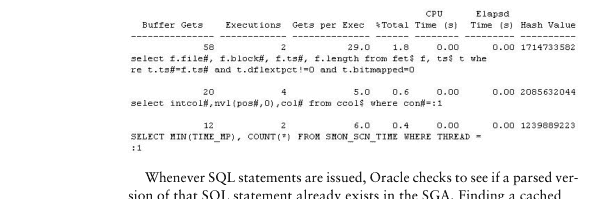

```text
SQL ordered by Gets for DB: PROD Instance: PROD Snaps: 1 - 2
--> End Buffer Gets Threshold: 10000
-- Note that resources reported for PL/SQL includes the resources used by
all SQL statements called within the PL/SQL code. As individual SQL
statements are also reported, it is possible and valid for the sumned
total to exceed 100

Buffer Gets | Executions | Gets per Ex | CPU Time | Elapsed Time (s) | Hash Value
----------- | ---------- | ----------- | -------- | -------------- | ---------
58          | 2          | 22.0        | 1.8      | 0.00           | 1714733582
select f.file#, f.block#, f.t#,f, f.length from fet1 f, tsf t whe

re f.t#=f.t# and t.dfilexpct=0 and t.bitmapped=0
20          | 4          | 5.0         | 0.6      | 0.00           | 2085632044
select int_col#,ni1(pos#,0),col# from cc01# where con#!=1
12          | 2          | 6.0         | 0.4      | 0.00           | 1239009223
SELECT MIN(TIME_MP), COUNT(*) FROM SMON_SCN_TIME WHERE THREAD =
:1
```

每当发出 SQL 语句时，Oracle 都会检查 `SGA`（系统全局区）中是否已经存在该 SQL 语句的已解析版本。在 `SGA` 中找到 SQL 语句的缓存版本被称为*获取*（Get）。`STATSPACK` 输出的这一部分显示了在两个快照期间之间拥有最高获取次数的 SQL 语句。改善应用程序 SQL 的获取性能将在第 4 章“调优共享池”中讨论。

> 一条 SQL 语句必须至少经历过 10,000 次获取，才能包含在 `STATSPACK` 输出中。

### 按读取次数（Reads）排序的 SQL

与 SQL 语句调优相关的 `STATSPACK` 输出的第二个部分如图 3.5 所示。

**图 3.5 按读取次数（Reads）排序的 SQL 的 `STATSPACK` 输出**

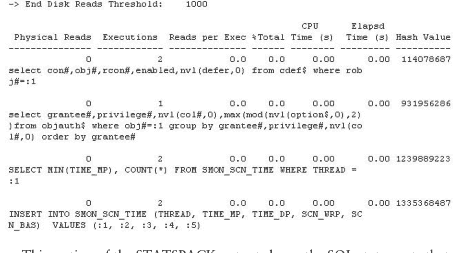

`STATSPACK` 输出的这一部分显示了在两个快照期间之间导致最高读取活动量的 SQL 语句。改善读取活动的性能在第 5 章“调优数据库缓冲区高速缓存”和第 8 章“调优磁盘 I/O”中讨论。


一条 SQL 语句必须至少执行过 1,000 次读取，才能包含在 `STATSPACK` 输出中。

### 按执行次数（Executions）排序的 SQL

与 SQL 语句调优相关的 `STATSPACK` 输出的第三个部分如图 3.6 所示。

`STATSPACK` 输出的这一部分显示了在两个快照期间之间执行最频繁的 SQL 语句。了解哪些语句被频繁执行，在决定哪些 `PL/SQL` 包和过程应固定在内存中时会很有用。`PL/SQL` 包的固定将在第 4 章“调优共享池”中讨论。

## 按解析调用次数排序的 SQL 执行

与 SQL 语句调优相关的 `STATSPACK` 输出的最后一部分如 图 3.7 所示。

### 按解析调用次数排序的 SQL 执行

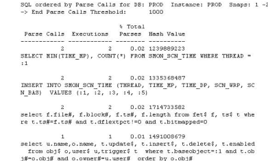

`STATSPACK` 输出的这部分内容展示了在两个快照周期之间被解析次数最多的 SQL 语句。了解哪些语句被频繁解析可以帮助您识别那些可能通过重写来提升共享池（Shared Pool）中 SQL 复用率的语句。该概念在第 4 章《调优共享池》中有详细讨论。

一条 SQL 语句必须至少被解析了 1,000 次，才能被包含在 `STATSPACK` 输出中。

确定 SQL 语句是否符合纳入 `STATSPACK` 输出条件的各个阈值都可以根据您的需求进行修改。这些新的阈值可以临时设置，也可以永久设置。有关如何修改这些阈值的详细信息，请参阅《Oracle9i 数据库性能指南和参考手册》第 21 章《使用 `STATSPACK`》（第 1 版 Release 1 (9.0.1)）（部件号 A87503-02）。

## 理解 Oracle 优化器

正如前一部分所学习的，存在几种工具可以查看特定 SQL 语句的执行计划。一条 SQL 语句往往有许多种不同的可能执行计划，它们都返回相同的结果，但只有一种是最佳的。Oracle 优化器的任务就是选择最佳的执行计划。

| 目标 | 说明优化器的使用方式 |
| :--- | :--- |
| | |

在 Oracle 中，主要有两种优化器模式：基于规则（Rule）和基于成本（Cost）。如您将在后续章节中看到的，这两种优化器模式在选择给定语句的最优执行计划时有所不同。

### 基于规则的优化

*基于规则的优化器*（RBO）使用一组预定义的“经验法则”来决定如何最佳地执行查询。这些准则包括诸如“如果 WHERE 子句中引用的表列上存在索引，则在访问相应的表数据时始终使用索引”这样的规则。在 Oracle 的早期版本中，如 6 版及更早版本，应用程序开发人员经常利用对这些规则的了解来直接影响 RBO 的行为。

然而，像这样的规则可能导致 RBO 即使在包含极少行的非常小的表上也会低效地使用索引。这种行为导致 Oracle 在执行时进行两次 I/O（一次在索引上，一次在表上），而实际上完全可以通过跳过使用索引，仅用一次 I/O 就能更轻松地访问整个表。

除了表的大小外，列基数（Cardinality）也是 RBO 在确定执行计划时被忽略的因素。*基数*指的是列内数据的变化程度。包含许多不同值的列具有高基数。包含很少不同值的列具有低基数。有时，这种无法考虑基数的特性导致 RBO 采用无效的 SQL 执行计划，即便查询最终将读取并检索表的大部分行，RBO 仍会使用索引。与前面的例子类似，这种情况也会导致不必要的 I/O。

虽然 RBO 为了向后兼容目的仍被支持，但 Oracle 现在建议在所有新的开发环境中使用基于成本的优化器而非 RBO。

### 基于成本的优化

与只遵循预定义准则执行查询的基于规则的优化器不同，*基于成本的优化器*（CBO）会考虑许多不同的执行计划，然后选择执行成本最低的那个。虽然以前的 Oracle 版本主要将逻辑 I/O 视为 SQL 语句执行成本的主要决定因素，但 Oracle9i 在确定 SQL 语句的总体成本时，也会权衡 CPU 和排序的成本。以下简单示例展示了这三个 CBO 成本因素如何包含在一个 Explain Plan 查询中：

```sql
SQL> EXPLAIN PLAN FOR
  2  SELECT e.employee_id, d.department_name
  3  FROM employees e, departments d
  4  WHERE e.department_id=d.department_id;
```

Explained.


```sql
SQL> SELECT LPAD(' ',4*(LEVEL-2))||
  2  operation||' '||
  3  options||' '||
  4  object_name 'EXECUTION_PLAN',
  5  io_cost,
  6  cpu_cost,
  7  temp_space
  8  FROM plan_table
  9  START WITH id = 0
 10 CONNECT BY PRIOR id = parent_id;
```

| EXECUTION_PLAN | IO_COST | CPU_COST | TEMP_SPACE |
| :-- | :-- | :-- | :-- |
| SELECT STATEMENT | 3 | | |
| HASH JOIN | 3 | | |
| TABLE ACCESS FULL DEPARTMENTS | 1 | | |
| TABLE ACCESS FULL EMPLOYEES | 1 | 1 | |

与 CBO 每个成本组件相关的值在 表 3.7 中有描述。

> Explain Plan 输出中 IO_COST 或 CPU_COST 列的空值表示该语句的部分使用了基于规则的优化器进行评估。


Explain Plan 输出中 TEMP_SPACE 列的空值表示该语句的部分使用了基于规则的优化器进行评估，或者表示不需要临时空间。

**表 3.7** *EXPLAIN_PLAN* 成本列的描述

| 列 | 描述 |
| :--- | :--- |
| IO_COST | 与查询执行计划中该操作相关的估计 I/O 成本 |
| CPU_COST | 与查询执行计划中该操作相关的估计 CPU 周期成本 |
| TEMP_SPACE | 与查询执行计划中该操作相关的估计临时空间（以字节为单位） |

为了确定每个执行计划的相对成本，CBO 严重依赖数据库中表和索引的统计数据。这些统计数据存储在数据字典中，其中包括以下内容：

- 每个表或索引的大小
- 每个表或索引包含的行数
- 每个表或索引使用的数据库块数量
- 每个表行的长度
- 索引列中列数据的基数

默认情况下，这些统计数据并不存在于数据库中。当对表和索引进行分析时，统计数据和索引才会被收集并存储在数据库中。可以在单个表和索引级别、模式（Schema）级别或整个数据库级别收集数据库统计数据。统计数据的收集技术在以下章节中讨论。

## 分析单个表和索引

以下命令展示了如何分析单个表和索引以收集其统计数据：

```sql
SQL> ANALYZE INDEX employee_last_name_idx COMPUTE STATISTICS;
SQL> ANALYZE TABLE employee COMPUTE STATISTICS;
```

第一条命令收集名为 `EMPLOYEE_LAST_NAME_IDX` 的索引的统计数据。第二条命令通过检查表中的每一行来收集 `EMPLOYEE` 表的统计数据。它还将收集与 `EMPLOYEE` 表相关的所有索引的统计数据。如果 `EMPLOYEE` 是一个非常大的表，这种方法可能会耗时且消耗大量资源。可以使用以下命令对较大的表进行分析：

```sql
SQL> ANALYZE INDEX distributor_id_pk ESTIMATE STATISTICS;
```

使用 `ESTIMATE` 代替 `COMPUTE` 会使 Oracle 使用表或索引数据的样本估算表和索引统计数据。默认样本大小为 1,064 行。在大多数情况下，`ESTIMATE` 参数提供的统计数据几乎与使用 `COMPUTE` 选项收集的统计数据一样准确。您可以使用以下命令指定自己的样本大小（以行数或整体表的百分比表示）：

```sql
SQL> ANALYZE TABLE distributors ESTIMATE STATISTICS
   2  SAMPLE 500 ROWS;
SQL> ANALYZE INDEX distributor_id_pk ESTIMATE STATISTICS
   2  SAMPLE 35 PERCENT;
```

## 提示

如果您对 `SAMPLE` 指定了一个超过表中行数 50% 的值，Oracle 将使用 `COMPUTE` 而不是 `ESTIMATE` 来生成统计信息。

如果您希望对表中的数据进行更为深入细致的分析，您可以在 `ANALYZE TABLE` 命令中包含 `FOR` 子句：

```sql
SQL> ANALYZE TABLE distributors ESTIMATE STATISTICS
2  FOR COLUMNS district_id SIZE 200;
```

该命令会将表的分析仅限于 `DISTRICT_ID` 列，而不是默认的考察所有列的行为。`SIZE` 参数指定了在考察每个切片内数据的基数之前，将列的值分成多少个切片。切片的数量越多，`CBO` 对该列中数据分布情况的了解就越准确。`SIZE` 的默认值为 `75`。可接受的范围是 `1` 到 `254`。如果没有这些信息，`CBO` 会假设数据是正态分布的，而实际上可能并非如此。`ANALYZE` 命令的 `FOR` 子句的其他选项见表 3.8。

## 表 3.8 `ANALYZE` 命令的 `FOR` 子句选项

| 选项 | 描述 |
|---|---|
| FOR TABLE | 仅收集表统计信息，不包括列统计信息 |
| FOR COLUMNS | 仅收集指定列的列统计信息 |
| FOR ALL COLUMNS | 仅收集所有列的列统计信息 |
| FOR ALL INDEXES | 收集此表上所有索引的统计信息，但不收集表统计信息 |
| FOR ALL INDEXED COLUMNS | 仅收集已建立索引的列的列统计信息 |
| FOR ALL LOCAL INDEXES | 收集分区表中所有局部索引的列统计信息 |

`ANALYZE` 命令还有一个 `DELETE` 选项，可用于在需要时移除统计信息：

```sql
SQL> ANALYZE TABLE employee DELETE STATISTICS;
```

## 直方图

当分析表时，Oracle 会将每列中的最低和最高数据值作为表统计信息的一部分存储起来。


### 描述直方图的用途

Oracle 优化器假设这两个数据值之间的数据是正态分布的。换句话说，优化器假设列中的大多数数据落在这个高值和低值之间，而列中落在两个极端值上的数据较少。如果这个假设不成立，优化器可能会在如何执行涉及该列的 SQL 语句方面做出非常糟糕的选择。*直方图*统计信息可用于改进底层数据非均匀分布的 SQL 语句的性能。


### 直方图的重要性

有一次，我遇到了一个在大型表上运行的查询，该表的索引列数据并非正态分布。该表上的一个特定查询解析、执行和获取其行需要花费超过 17 个小时。在我们意识到数据并非在低值和高值之间正态分布，而是遍布整个范围存在高低值的尖峰后，我们使用以下选项分析了该表：

```sql
SQL> ANALYZE TABLE finaid COMPUTE STATISTICS FOR COLUMNS award SIZE 100;
```

该命令创建了一个直方图，将 `FINAID` 表中 `AWARD` 列中的数据分成 100 个独立的切片。然后，直方图确定了每个切片的高值和低值，并将这些值作为表和索引统计信息的一部分存储起来。这些统计信息使优化器对数据的了解以及关联索引的有用性更加准确。结果，完成时间原本需要 17 小时的相同查询，在没有其他更改的情况下，现在只需 3 分钟即可运行。这清楚地表明，当访问的列数据不是正态分布时，使用直方图的重要性。可以在 `DBA_HISTOGRAMS` 数据字典视图中找到直方图信息。

## 按模式分析

为了使 CBO 获得最佳性能，SQL 语句涉及的所有表和索引都应经过分析。Oracle 提供了两个 PL/SQL 包，`DBMS_UTILITY` 和 `DBMS_STATS`，它们可用于分析用户模式中的每个表和索引，而无需逐个按名称指定每个段。在 Oracle9i 中，Oracle 推荐使用 `DBMS_STATS` 包而不是旧的 `DBMS_UTILITY`。Oracle Enterprise Manager 控制台也可用于收集表和索引统计信息。

### DBMS_UTILITY

`DBMS_UTILITY` 包接受多个与前面章节中 `ANALYZE` 命令中看到的类似的参数。下面是一个使用其中多个参数的示例：

```sql
SQL> EXECUTE DBMS_UTILITY.ANALYZE_SCHEMA( 'SCOTT',
   'ESTIMATE',0,40,'FOR ALL INDEXED COLUMNS SIZE 40');
```


该示例中使用的每个参数都在表 3.9 中进行了描述。

## 表 3.9 `DBMS_UTILITY.ANALYZE_SCHEMA` 的参数

| 示例中使用的参数 | 描述 |
| :---------------------- | :---------------------------------------------------------- |
| SCOTT | 要分析的模式。 |
| ESTIMATE | 要执行的分析类型。如果使用 `COMPUTE`，则下两个参数无效。 |
| 0 | 在估计中使用的行数。如果估计将以行百分比表示，请在此处输入零。 |
| 40 | 估计中使用的总行数的百分比。如果前一个参数不为零，则此参数无效。 |
| FOR ALL INDEXED COLUMNS SIZE 40 | 如表 3.8 中所示的额外选项。 |

`DBMS_UTILITY` 包也可用于分析整个数据库。数据库级别分析可以使用表 3.9 中讨论过的相同参数，除了模式参数外。以下是一个使用与前面示例相同样本大小的完整数据库分析示例：

```sql
SQL> EXECUTE SYS.DBMS_UTILITY.ANALYZE_DATABASE
( 'ESTIMATE', 0,40,'FOR ALL INDEXED COLUMNS SIZE 40');
```

> **注意：** 由于递归数据字典查询严重依赖于特定的访问路径才能高效运行，您永远不应分析 `SYS` 模式中的段。使用 `ANALYZE_DATABASE` 过程会导致为 `SYS` 模式收集统计信息。您应该使用 `DBMS_UTILITY.ANALYZE_SCHEMA('SYS', 'DELETE');` 命令来删除它们。

### Oracle 目标

解释 `DBMS_STATS` 过程的用途

### DBMS_STATS

`DBMS_STATS` 包提供了一些在 `DBMS_UTILITY` 包中不可用的额外分析选项。其中一些选项包括：

- 在新统计信息收集之前备份旧的统计信息。这个非常有用的功能允许您在更新后的统计信息收集后，如果 CBO 表现不佳，恢复部分或全部原始统计信息。
- 在估算统计信息时，对*数据块*而不仅仅是行进行随机抽样。
- 通过并行执行分析来更快地收集表统计信息。
- 自动收集高波动表的统计信息，并跳过静态表的统计信息收集。

以下示例展示了如何使用 `DBMS_STATS` 包在 Joe 的模式中收集 `EMPLOYEE` 表的统计信息：

```sql
SQL> EXECUTE DBMS_STATS.GATHER_TABLE_STATS ('JOE', 'EMPLOYEE');
```

与 `DBMS_UTILITY` 包一样，`DBMS_STATS` 包也可以用于分析索引、整个模式或整个数据库，使用表 3.10 中显示的过程。

## 表 3.10 DBMS_STATS 包中的过程

| 过程名称 | 描述 |
| :--- | :--- |
| GATHER_INDEX_STATS | 用于收集指定索引的统计信息 |
| GATHER_SCHEMA_STATS | 用于收集指定模式的统计信息 |
| GATHER_DATABASE_STATS | 用于收集整个数据库的统计信息 |
| GATHER_SYSTEM_STATS | 用于收集服务器的 I/O 和 CPU 性能统计信息 |

表 3.10 中显示的两个过程，`GATHER_SCHEMA_STATS` 和 `GATHER_SYSTEM_STATS`，在使用 CBO 时特别有用。

### 使用 GATHER_SCHEMA_STATS 过程

表 3.10 中列出的 `GATHER_SCHEMA_STATS` 过程对于为 CBO 维护准确的统计信息特别有用。使用 `GATHER` 选项，您可以指定以下三个选项之一来收集模式统计信息：

- `GATHER STALE` 选项：使用 `ALTER TABLE ... MONITORING` 命令指定为“已监视”的模式中任何表都会收集其统计信息。

### GATHER EMPTY 选项

模式中任何先前未分析过的表都将收集其统计信息。

### GATHER AUTO 选项

根据应用程序用户的活动，Oracle 会自动确定哪些表需要进行分析，并仅针对这些表使用最合适的分析方法收集统计信息。

如果需要直方图统计信息，Oracle 引入了一个新的 `DBMS_STATS` 参数常量，称为 `AUTO_SAMPLE_SIZE`，它进一步简化了直方图统计信息的 manage。当与 `DBMS_STATS.GATHER_SCHEMA_STATS` 过程一起使用时，`AUTO_SAMPLE_SIZE` 常量将自动确定模式中每个段应使用的适当采样百分比，以及是否需要在这些段上收集直方图统计信息。以下示例展示了如何使用 `AUTO_SAMPLE_SIZE` 来收集 Joe 模式的统计信息：

```sql
SQL> EXECUTE DBMS_STATS.GATHER_SCHEMA_STATS(
  ownname => 'JOE',
  estimate_percent => DBMS_STATS.AUTO_SAMPLE_SIZE,
  method_opt => 'for all columns size AUTO'
  );
```

上述命令将使 Oracle 收集 Joe 模式中所有表、列和索引的统计信息，使用由 Oracle 确定的样本大小。由于在 `METHOD_OPT` 中指定了 `AUTO` 选项，如果 Oracle 根据应用程序访问列数据的频率和方式确定需要直方图，则也会在这些段上收集直方图统计信息。`METHOD_OPT` 参数的另外两个选项是 `REPEAT` 和 `SKEWONLY`。`REPEAT` 选项将导致 `DBMS_STATS` 包使用与原始直方图相同数量的直方图桶来重新填充任何现有的直方图统计信息。无论应用程序访问列数据的方式是否受益于直方图的存在，只要列数据存在偏斜，`SKEWONLY` 选项都会生成直方图统计信息。

## 使用 GATHER_SYSTEM_STATS 过程

为了让 CBO（基于成本的优化器）就可能的执行计划做出良好的选择，重要的是让 CBO 了解 Oracle 数据库所在的服务器上的整体 CPU 和 I/O 利用模式。例如，如果系统统计信息显示服务器通常是 I/O 受限而非 CPU 受限，那么当可用 I/O 密集型和 CPU 密集型执行计划相当时，CBO 将选择 I/O 密集度较低的执行计划。以下示例展示了如何使用 `GATHER_SYSTEM_STATS` 过程来收集系统统计信息：

```sql
SQL> EXECUTE DBMS_STATS.CREATE_STAT_TABLE ( -
> ('SYSTEM','SYSTEM_STATISTICS','TOOLS'));
```

```sql
PL/SQL procedure successfully completed.
```

```sql
SQL> EXECUTE DBMS_STATS.GATHER_SYSTEM_STATS ( -
> interval => 180,
> stxttab => 'SYSTEM_STATISTICS', -
> statid => '05-MAR-02'
> );
```

```sql
PL/SQL procedure successfully completed.
```

上述命令将创建一个表（即 `SYSTEM_STATISTICS`）来保存系统统计信息，用在三个小时（180 分钟）期间收集的统计信息填充该表，并为这些统计信息分配标识符 `05-MAR-02`。

> 在使用 `GATHER_SYSTEM_STATS` 过程的 `INTERVAL` 选项之前，必须将 `init.ora` 参数 `JOB_QUEUE_PROCESSES` 设置为非零值。

或者，你也可以通过交互式输入以下命令手动确定系统统计信息收集间隔：

```sql
SQL> EXECUTE DBMS_STATS.GATHER_SYSTEM_STATS ( -
> gathering_mode => 'START', -
> sttxttab => 'SYSTEM_STATISTICS' -
> );
```

```sql
PL/SQL procedure successfully completed.
```

```sql
SQL> EXECUTE DBMS_STATS.GATHER_SYSTEM_STATS ( -
> gathering_mode => 'STOP' -
> );
```

```sql
PL/SQL procedure successfully completed.
```

**提示** 如果在 `STATTAB` 参数中未指定表名，则收集的系统统计信息将存储在数据字典中。希望将统计信息存储在数据字典中的用户必须具有 `SYSDBA` 权限。

**提示** Oracle 强烈建议收集系统统计信息，以改进 CBO 的性能。

**注意** 要查看 `DBMS_STATS` 包中可用众多选项的完整详情，请参阅《Oracle9i 提供的 PL/SQL 包和类型参考，Release 1 (9.0.1)》（部件号 A89852-02）第 63 章“DBMS_STATS”。


### 使用 OEM 控制台收集统计信息

也可以使用 OEM 控制台来收集模式统计信息。通过从 OEM 控制台菜单中选择 Tools > Database Wizards > Analyze，将显示如图 3.8 所示的 Analyze 向导。

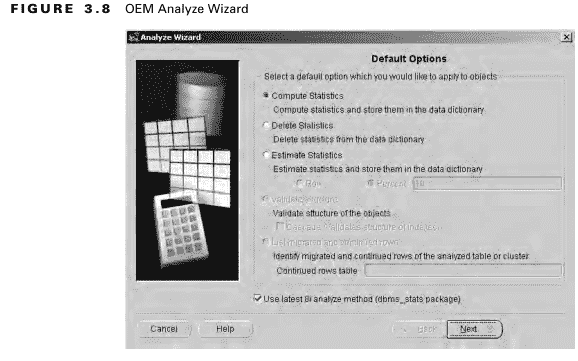

Analyze 向导中可用所有分析选项，包括 `COMPUTE`、`ESTIMATE` 和 `VALIDATE`。默认情况下，Analyze 向导使用 `DBMS_STATS` 包来执行其统计分析。

## 查看表和索引统计信息

一旦使用之前定义的方法之一收集了统计信息，你可以通过查询几个数据字典视图来查看它们。除了使用 `DBMS_STATS` 包动态监控功能的表之外，这些视图仅包含收集统计信息时存在的统计信息。

已分析表的统计信息可在 `DBA_TABLES` 数据字典视图中找到。图 3.9 显示了一个查询，演示了在使用 `DBMS_STATS.GATHER_SCHEMA_STATS` 命令分析名为 `HR` 的模式中的表之前和之后 `DBA_TABLES` 中统计信息的差异。

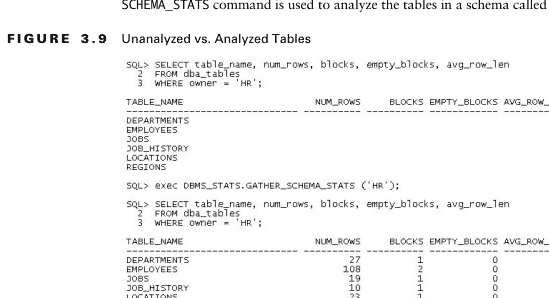

表 3.11 中包含了存储 `DBA_TABLES` 数据字典视图中统计信息的各列内容的描述。

索引统计信息可在 `DBA_INDEXES` 数据字典视图中找到。图 3.10 显示了一个查询，演示了在使用 `ANALYZE INDEX` 命令分析名为 `EMP_DEPARTMENT_IX` 的索引之前和之后 `DBA_INDEXES` 中统计信息的差异。

| 列名 | 描述 |
|---|---|
| NUM_ROWS | 表中的行数 |
| BLOCKS | 高水位线以下的块数 |
| EMPTY_BLOCKS | 高水位线以上的块数 |
| AVG_SPACE | 表中可用的平均自由空间 |
| CHAIN_CNT | 链接或迁移行的数量 |
| AVG_ROW_LEN | 行数据和行开销所占的平均长度（以字节为单位） |
| AVG_SPACE_FREELIST_BLOCKS | 表 Freelist 上块的平均自由空间（以字节为单位） |
| NUM_FREELIST_BLOCKS | 表 Freelist 上的块数 |
| SAMPLE_SIZE | 上次分析表时使用的样本大小 |
| LAST_ANALYZED | 表上次分析的日期 |

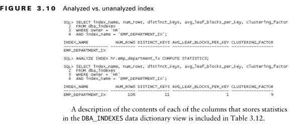

| 列名 | 描述 |
|---|---|
| BLEVEL | 索引根块和叶块之间的级别数 |
| LEAF_BLOCKS | 索引中的叶块数 |
| DISTINCT_KEYS | 索引列中的不同值数量——衡量列基数性的度量 |
| AVG_LEAF_BLOCKS_PER_KEY | 索引中每个不同键值使用的平均叶块数 |
| AVG_DATA_BLOCKS_PER_KEY | 索引中每个不同键值的平均数据块数 |
| CLUSTERING_FACTOR | 衡量索引底层表中数据有序程度的度量 |
| NUM_ROWS | 索引中包含的行数 |
| SAMPLE_SIZE | 上次分析索引时使用的样本大小 |
| LAST_ANALYZED | 索引上次分析的日期 |


`CLUSTERING_FACTOR` 的值由 CBO 使用，用于估计为了通过索引检索所有表数据需要执行多少次逻辑 I/O。

`DBA_TAB_COL_STATISTICS` 数据字典视图中可以查找到表和索引列内容的更大粒度信息。表 3.13 中包含了存储 `DBA_TAB_COL_STATISTICS` 数据字典视图中统计信息的各列内容的描述。

请注意，`DBA_TAB_COL_STATISTICS` 数据字典视图缺少 owner 列来区分两个具有相同名称的表。使用 `USER_TAB_COL_STATISTICS` 数据字典视图来查看每个表的列统计信息。

## 表 3.13 DBA_TAB_COL_STATISTICS 列描述

| 列名 | 描述 |
| --- | --- |
| TABLE_NAME | 表的名称 |
| COLUMN_NAME | 表列的名称 |
| NUM_DISTINCT | 列中不同值的数量——基数的一种度量 |
| LOW_VALUE | 列中的最小值 |
| HIGH_VALUE | 列中的最大值 |
| DENSITY | 列数据密度的一种度量；定义为 1/NUM_DISTINCT 的派生值 |
| NUM_NULLS | 列中值为 NULL 的数量 |
| NUM_BUCKETS | 数据在上次分析时被划分的“切片”数量 |
| SAMPLE_SIZE | 上次分析表时使用的样本量 |
| LAST_ANALYZED | 表上次分析的日期 |
| GLOBAL_STATS | 指示统计信息是否是使用分区数据生成的 |
| USER_STATS | 指示统计信息是否由用户输入 |
| AVG_COL_LEN | 列的平均长度，单位为字节 |

为了使基于成本的优化器（CBO）有效运行，表统计信息和索引统计信息必须保持最新。过时的统计信息不再反映实际的基础表数据，这可能导致 CBO 选择非最优的执行计划。

在表被分析之前，`DBA_TAB_COL_STATISTICS` 中不会有该表的条目。

一旦使用上述技术收集了统计信息，就可以将其从一个数据库复制到另一个数据库，以实现生产环境和开发环境之间的一致性。

###### 目标

- 在数据库之间复制统计信息

### 在数据库之间复制统计信息

开发环境的一个常见缺点是，它们不能准确反映最终生产系统中将使用的数据量。这可能导致应用程序从开发环境迁移到生产环境时出现意外地性能低下。为了尽量减少这个问题，Oracle9i 允许您将优化器统计信息从生产系统复制到较小的开发系统。尽管开发系统上的数据量可能较小，但优化器的行为与面对生产系统的数据量时的行为相同。这对开发人员来说非常有用，因为他们现在可以看到应用程序迁移后在生产环境中将使用的执行计划。

这种统计信息迁移过程通过从生产系统导出统计信息，然后将其导入开发系统来完成。以下步骤展示了如何使用 `DBMS_STATS` 包来执行导出和导入操作：

1. 在生产数据库中，在 `JOE` 架构的 `TOOLS` 表空间中创建 `STATS` 表。此表将用于保存生产架构的统计信息。

```sql
SQL> EXECUTE DBMS_STATS.CREATE_STAT_TABLE
    ('JOE', 'STATS', 'TOOLS');
```

2. 捕获 Joe 架构的当前统计信息，并将其存储在新创建的 `STATS` 表中。

```sql
SQL> EXECUTE DBMS_STATS.EXPORT_SCHEMA_STATS
    ('JOE', 'STATS');
```

3. 使用操作系统命令行上的 Oracle Export 实用工具将生产数据库中 `STATS` 表的内容导出。

```bash
$ exp joe/sidney@PROD file=stats.dmp tables=(STATS) log=stats.log
```

4. 使用 FTP 将导出转储文件从生产服务器移动到开发服务器。

```bash
$ ftp dev1
Connected to DEV1
220 DEV1 FTP server (Tue Oct 22 16:48:12 EDT 2002) ready.
Name (DEV1:jjohnson): johnson
331 Password required for johnson.
Password:
230 User johnson logged in.
Remote system type is Unix.
Using binary mode to transfer files.
ftp> put stats.dmp
200 PORT command successful.
150 Opening BINARY mode data connection for stats.dmp
226 Transfer complete.
ftp> bye
```

5. 在开发数据库中，在 `JOE` 架构的 `TOOLS` 表空间中创建 `STATS` 表。此表将保存从生产数据库导出的 `STATS` 表的内容。

```sql
SQL> EXECUTE DBMS_STATS.CREATE_STAT_TABLE
    ('JOE', 'STATS', 'TOOLS');
```


6. 使用操作系统命令行上的 Oracle Import 实用工具，将在生产服务器上创建的 STATS 转储文件导入到开发服务器上的 STATS 表中。

```bash
$ imp joe/sidney@DEV file=stats.dmp log=stats.log full=y
```

7. 将 Joe 的 STATS 表中的统计信息移动到开发数据库的数据字典中。

```sql
SQL> EXECUTE DBMS_STATS.IMPORT_SCHEMA_STATS
    ('JOE', 'STATS');
```

## 设置优化器模式

现在，既然您已经了解了基于规则和优化器与基于成本的优化器之间的区别，理解了及时统计信息对 CBO 正常运作的重要性，以及如何在数据库之间移动统计信息，那么您已准备好将数据库配置为以您选择的优化器模式运行。优化器模式可以在以下三个级别设置：

- 实例级别
- 会话级别
- 语句级别

以下部分讨论了这些设置优化器模式的方法。


> CBO 的行为在 Oracle 的不同版本之间略有不同。Oracle9i 包含一个新的 `init.ora` 参数 `OPTIMIZER_FEATURES_ENABLE`，可用于指定您希望使用的 Oracle CBO 版本。例如，将 `OPTIMIZER_FEATURES_ENABLE=8.1.7` 设置为该值将使 Oracle9i 实例使用 Oracle8i CBO。

### 优化器模式：实例级别

通过设置 `OPTIMIZER_MODE` `init.ora` 参数，在实例级别设置优化器模式。一旦设置，此参数将确定所有针对该实例操作的会话所使用的默认优化器模式。`OPTIMIZER_MODE` 参数可以设置为以下五个值之一：

- `RULE`
- `CHOOSE`
- `FIRST_ROWS`
- `FIRST_ROWS_n`
- `ALL_ROWS`

#### RULE 模式

在 `init.ora` 中设置 `OPTIMIZER_MODE=RULE` 会将实例置于基于规则的优化模式。在此模式下，统计信息的存在或缺失对优化器没有影响，除非使用了 SQL 提示（提示将在本节的稍后部分讨论）。此优化器模式是为了向后兼容性而包含的，不推荐用于新开发。

#### CHOOSE 模式

在 `init.ora` 中设置 `OPTIMIZER_MODE=CHOOSE` 会将实例置于基于规则或基于成本的优化模式。如果 `OPTIMIZER_MODE=CHOOSE` 并且查询中涉及的任何一个表都存在统计信息，那么实例在执行该查询时将使用基于成本的优化。任何缺失的统计信息将由优化器“即时”估算。如果 `OPTIMIZER_MODE=CHOOSE` 并且查询中的任何表或索引都没有统计信息，那么实例在执行查询时将使用基于规则的优化。`CHOOSE` 是 `init.ora` 中 `OPTIMIZER_MODE` 的默认设置。


> 某些 Oracle 功能要求使用 CBO。例如，即使实例优化器模式设置为 `RULE`，每当使用以下功能之一时，都将使用 CBO：分区表和索引、索引组织表、反向键索引、函数基于索引、位图索引、查询重写和物化视图。本章稍后讨论其中几个功能。

#### FIRST_ROWS 模式

在 `init.ora` 中设置 `OPTIMIZER_MODE=FIRST_ROWS` 也会根据表统计信息和索引统计信息的存在或缺失将实例置于基于规则或基于成本的优化模式。在此模式下，如果存在统计信息，那么实例将使用 CBO 的一种变体，旨在尽可能快地返回查询获取的第一批行。此模式旨在提高查询的总体响应时间。

#### FIRST_ROWS n 模式

与 `FIRST_ROWS` 一样，`FIRST_ROWS n` 也旨在提高查询的总体响应时间。但是，通过为 *n* 指定 1、10、100 或 1,000 的值，您可以针对查询返回的前 *n* 行专门优化响应时间。

#### ALL_ROWS 模式

在 `init.ora` 中设置 `OPTIMIZER_MODE=ALL_ROWS` 也会根据表统计信息和索引统计信息的存在或缺失将实例置于基于规则或基于成本的优化模式。在此模式下，如果存在统计信息，那么实例将使用 CBO 的一种变体，旨在尽可能快地返回查询获取的所有行。此模式用于提高查询的总体吞吐量。`ALL_ROWS` 是默认的 CBO

### 优化器模式：会话级别

`mode`. `ALL_ROWS` 是在 `init.ora` 中将 `OPTIMIZER_MODE` 设置为 `CHOOSE` 时使用的默认优化器模式。

一旦在实例级别设置了 `init.ora` 的优化器模式，连接到该实例的所有用户都将使用该优化模式作为处理其查询的默认模式。然而，用户可以仅使用 `ALTER SESSION` 命令更改其会话的优化器模式。以下示例展示了将当前会话更改为基于成本的优化模式：

```sql
SQL> ALTER SESSION SET OPTIMIZER_MODE=CHOOSE;
```

会话级别的优化器模式的可能值与实例级别相同：`RULE`、`CHOOSE`、`FIRST_ROWS`、`FIRST_ROWS_n` 和 `ALL_ROWS`。该优化器模式将保留在会话中，直到用户再次使用 `ALTER SESSION` 命令重置它或注销为止。

### 优化器模式：语句级别

优化器还可以通过使用提示（hints）在语句级别受到影响。提示是具体的指令，使优化器以特定方式执行。

#### Oracle 目标

描述提示的使用方法

提示通过用 `/*+` 和 `*/` 符号包围提示嵌入在实际的 SQL 语句中。这里展示了一个使指定 SQL 语句以基于规则的优化模式运行的提示示例：

```sql
SQL> SELECT /*+ RULE */ dist.distributor_id,
  2  dist.city,
  3  dist.state,
  4  dist.zip_code,
  5  district.name,
  6  emp.last_name
  7  FROM distributor dist, district, employee emp
  8  WHERE emp.employee_id = dist.manager_id
  9  AND district.district_id = dist.district_id;
```


在指定提示时，请确保在 `/*` 之后立即加上 `+`。如果在提示之前有 `/*+` 之外的空格或任何其他字符，Oracle 会将提示指定视为注释并忽略它。

您之前见过的四个实例级和会话级优化器模式（`RULE`、`FIRST_ROWS`、`FIRST_ROWS_n` 和 `ALL_ROWS`）也可以作为提示指定。这些是影响优化器模式的唯一提示。除了这些，Oracle9i 中还有近 40 个其他可用的提示。本文和 Oracle9i 性能调优 OCP 考试的范围不包括详细讨论所有这些内容。然而，表 3.14 描述了一些更常用的提示。

#### 表 3.14 常用优化器提示

| 提示名称 | 示例 | 描述 |
| :--- | :--- | :--- |
| FULL | `/*+ FULL SALES */` | 强制优化器在访问 SALES 表时使用全表扫描 |
| INDEX | `/*+ INDEX SALES_ID_PK */` | 强制优化器在访问建立了该索引的 SALES 表时使用索引 SALES_ID_PK |
| REWRITE | `/*+ REWRITE */` | 强制优化器动态重写查询，以便如果有可用的物化视图则加以利用 |
| PARALLEL | `/*+ PARALLEL */` | 使指定操作并行执行 |

除了 `RULE` 之外的所有提示都会在查询执行时导致使用 CBO（基于成本的优化器）。


所有 Oracle 提示的完整列表可以在《*Oracle9i Database Performance Guide and Reference Release 1 (9.0.1)*》（零件号 A87503-02）第 5 章“优化器提示”中找到。

### 优化器优先级规则

由于优化器模式可以以提示形式在实例、会话或语句级别设置，因此了解当语句实际执行时哪个设置具有优先级非常重要：

- 语句级提示覆盖会话级和实例级优化器模式。
- 会话级优化器设置覆盖实例级优化器设置。
- 如果没有指定会话级优化器设置或提示，则实例级设置生效。
- 默认实例优化器模式是 `CHOOSE`。如果查询中涉及的任何表或索引存在统计信息，则使用 CBO。如果不存在统计信息，则使用 RBO。

## 提高应用程序性能


以跟踪文件和执行计划的形式收集和分析应用程序信息是理解应用程序性能的第一步。了解应用程序如何受到 Oracle 优化器行为的影响也很重要。基于这些信息，接下来的部分将检查可用于提高应用程序性能的选项。这些技术分为两大类：通过存储最优计划和使用物化视图来提高执行路径，以及通过使用索引和集群来最小化 I/O。

# 改进执行路径

根据查询的复杂性、表的大小以及 Oracle 优化器考虑的替代方案数量，CBO 可能会选择不佳的执行计划，从而导致查询性能下降。Oracle 9i 使用两个功能——计划稳定性和物化视图——通过直接影响 CBO 对执行计划的选择来帮助提高性能。

### Oracle 目标

解释计划稳定性的概念

## 计划稳定性

您对数据库所做的更改可能会无意中影响执行计划。例如，为了提高数据库调优的某个方面而对 `init.ora` 参数所做的更改可能会导致 Oracle 优化器的行为与之前不同——这可能会损害之前经过良好调优的 SQL 语句。Oracle9i 允许您通过为指定的执行计划提供“稳定性”来解决此问题。计划稳定性是通过在数据字典中存储给定 SQL 语句的首选执行计划来实现的，然后在发出该 SQL 语句时始终使用该执行计划。

### Oracle 目标

使用存储的大纲

## 存储的大纲

Oracle9i 以*存储的大纲*形式在数据字典中维护这些预定义的执行计划。这些存储的大纲代表优化器在关联 SQL 语句执行时将使用的执行计划。即使收集了新的统计信息或对 `init.ora` 进行了与优化器相关的更改，该存储的执行计划也保持恒定。存储的大纲本质上是一组提示，用于复现优化器最初执行语句时使用的执行计划。

> 通过称为*计划等价性*的过程，SQL 语句必须与用于生成大纲的原始语句**完全**匹配，存储的大纲才能被使用。即使是添加提示或注释的相同语句也不会被视为存储大纲使用的等价语句。

## 创建存储的大纲

在使用共享大纲功能之前，必须执行几个配置步骤。这些步骤按执行顺序列出如下：

1. 确定您想要为哪些语句存储执行计划。很可能这些语句涉及数据相对静态的表和索引。利用高度易变数据的表和索引的查询可能受益于 CBO 的常规动态特性。如果您希望为每个语句生成存储的大纲，只需将 `init.ora` 参数设置为 `CREATE_STORED_OUTLINES=TRUE`。由于存储的大纲不太可能适用于每个 `SQL` 语句，因此应谨慎使用此选项。如果使用此选项，步骤 2–4 不适用。

2. 确定您识别出的语句是否可以归入两个或两个更广泛的语句类别。这样做将有助于确定语句是否有资格进行存储大纲执行。类别示例可能包括“访问 `EMPLOYEE` 表的查询”或“对 `DISTRIBUTOR` 表的 `ADDRESS` 列进行查找的查询”。在创建大纲时，如果不指定存储的大纲应属于哪个类别，它将存储在一个名为 `DEFAULT` 的类别中。存储的大纲类别可以按如下方式指定：
   - 在实例级别使用 `init.ora` 中的 `USE_STORED_OUTLINES` 参数。设置 `USE_STORED_OUTLINES=TRUE` 会自动使 Oracle9i 将大纲存储在 `DEFAULT` 类别中。
   - 在会话级别使用 `ALTER SESSION SET USE_STORED_OUTLINE` 命令。

3. 修改 `OUTLN` 模式。此模式存储数据库的所有存储的大纲。
   - 出于安全目的，更改 `OUTLN` 模式的密码。默认密码（`OUTLN`）已有详细文档记录。Oracle9i 在首次登录后自动提示您更改 `OUTLN` 用户的密码。
   - 将 `OUTLN` 模式的默认和临时表空间更改为除了 `SYSTEM` 表空间之外的其他空间。
   - 将 `OUTLN` 模式用于存储大纲的两个表（`OL$` 和 `OL$HINTS`）移出 `SYSTEM` 表空间，并移至 `OUTLN` 的新默认表空间。可以使用 Export 和 Import 实用程序或 `ALTER TABLE ... MOVE...` 命令来执行此操作。

4. 要为您识别出的语句创建存储的大纲，请使用以下命令：

```sql
SQL> CREATE OR REPLACE OUTLINE employee_mgr_last_name
   2  FOR CATEGORY employee_queries ON
   3  SELECT lastname
   4  FROM employee
   5  WHERE job_title = 'MGR';
```

其中 `EMPLOYEE_MGR_LAST_NAME` 是新存储概要的名称，`EMPLOYEE_QUERIES` 是将其分配到的类别名称。或者，你可以在当前会话中激活特定类别的概要，然后发出你希望为其创建概要的命令：

```
SQL> ALTER SESSION SET CREATE_STORED_OUTLINES = employee_queries;
SQL> SELECT lastname
    2  FROM employee
    3  WHERE job_title = 'MGR';
SQL> ALTER SESSION SET CREATE_STORED_OUTLINES = false;
```

其中 `EMPLOYEE_QUERIES` 是该存储概要将被分配的类别名称。存储概要的名称将由系统生成。

你还可以使用 Enterprise Manager 调优包中的 Outline Manager 图形用户界面工具来创建你的存储概要。图 3.11 显示了使用 Outline Manager 屏幕创建名为 `EMPLOYEE_STATE` 的概要。

### 图 3.11 Enterprise Manager 的 Outline Manager

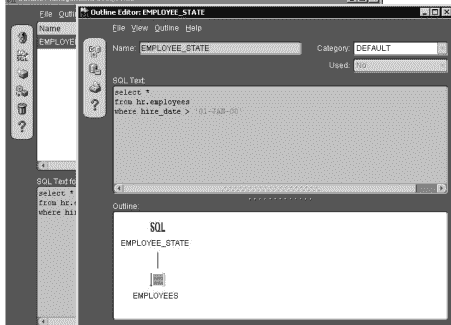

5. 接下来，使用以下三种方法之一激活存储概要功能：
   - 设置 `init.ora` 参数 `USE_STORED_OUTLINES=TRUE` 并重新启动实例。
   - 使用以下命令动态将实例置于存储概要模式：

```
SQL> ALTER SYSTEM SET USE_STORED_OUTLINES = true;
```


上述命令将激活所有类别中的存储概要。若要选择性地激活特定类别，请使用：`ALTER SYSTEM SET USE_STORED_OUTLINES = employee_queries;`
   - 使用以下命令在会话级别开启存储概要功能：

```
SQL> ALTER SESSION SET USE_STORED_OUTLINES = true;
```


上述命令将激活所有类别中的存储概要。若要选择性地激活特定类别，请使用：`ALTER SESSION SET USE_STORED_OUTLINE = employee_queries;`

## 存储概要的使用方式

当执行 SQL 语句时，Oracle 首先将该语句以及会话级或实例级概要类别与共享池中已缓存的语句和类别进行比较。如果在共享池中找到匹配项，则使用缓存的信息执行该语句。如果在共享池中找不到匹配项，Oracle 接下来会检查数据字典，以查看是否存在针对此语句和此类别的存储概要。如果数据字典中存在存储概要，优化器将使用存储的执行计划来执行查询。如果数据字典中不存在存储概要，CBO（基于成本的优化器）将按常规动态生成执行计划。


如果某个 SQL 语句在 `DEFAULT` 类别中存在存储概要，但在活动类别中不存在对应的概要，仍会使用 `DEFAULT` 存储概要。

## 管理存储概要

存储概要的需求会随时间变化。可能需要修改、删除、重命名概要，或将其从一个类别移动到另一个类别。这些维护操作使用 Outline Manager 图形用户界面工具、Oracle 提供的包 `OUTLN_PKG` 以及 `ALTER OUTLINE` 和 `DROP OUTLINE` 命令来执行。

### 使用 OUTLINE MANAGER

除了创建存储概要外，Outline Manager 图形用户界面工具还可用于修改现有的存储概要。图 3.12 显示了使用 Outline 编辑器更改名为 `EMPLOYEE_STATE` 的存储概要的访问方法（通过 `FULL` 提示）。

Outline 编辑器也可用于修改存储概要背后 SQL 语句的连接顺序、更改存储概要所属的类别，或删除存储概要。

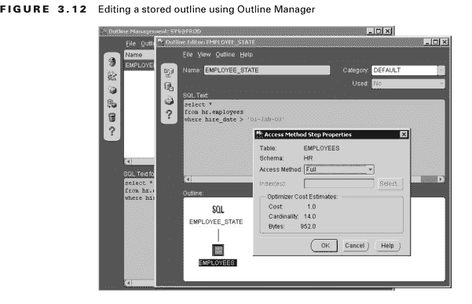

### 使用 OUTLN_PKG

`OUTLN_PKG` 包包含三个可用于管理存储概要的过程。这些过程的名称和描述如表 3.15 所示。

#### 表 3.15 *OUTLN_PKG* 中的过程


| 过程名称 | 描述 |
| :------------- | :---------- |
| `DROP_UNUSED` | 删除当前架构中自创建以来从未使用过的概要 |
| `DROP_BY_CAT` | 删除指定类别及其包含的所有概要 |
| `UPDATE_BY_CAT` | 创建指定的新类别名称，并将旧指定类别中的所有概要移动到新年别 |

以下示例演示了这些过程中每一个的使用方法：

```
SQL> EXECUTE OUTLN_PKG.DROP_UNUSED;
SQL> EXECUTE OUTLN_PKG.DROP_UNUSED('EMPLOYEE_QUERIES');
SQL> EXECUTE OUTLN_PKG.UPDATE_BY_CAT('DEFAULT', 'DSS_QUERIES');
```

### 使用 ALTER 和 DROP OUTLINE

`ALTER OUTLINE` 和 `DROP OUTLINE` 命令也可用于管理存储概要。表 3.16 显示了 `ALTER OUTLINE` 命令的可用选项。

#### 表 3.16 *ALTER OUTLINE* 的选项

| 命令 | 描述 |
| :------------ | :---------- |
| `REBUILD` | 使用当前统计信息为指定的存储概要生成新的执行计划 |
| `RENAME TO` | 将存储概要的名称更改为指定的新名称 |
| `CHANGE CATEGORY TO` | 更改存储概要所属的类别 |

以下示例演示了这些选项中每一个的使用方法：

```
SQL> ALTER OUTLINE employee_mgr_last_name REBUILD;
SQL> ALTER OUTLINE employee_mgr_last_name RENAME TO employee_lname;
SQL> ALTER OUTLINE employee_lname CHANGE CATEGORY TO emp_queries;
```

如果不再需要某个概要，可以使用 `DROP OUTLINE` 命令将其从系统中删除。该语法的示例如下所示：

```
SQL> DROP OUTLINE employee_lname;
```

**提示**

如果删除的存储概要是其类别中的最后一个概要，该类别也将被删除。Oracle 不维护不包含存储概要的类别。

### 查看存储概要数据

数据字典视图 `DBA_OUTLINE_HINTS` 和 `DBA_OUTLINES` 包含有关数据库中所有存储概要的信息。表 3.17 和表 3.18 中包含了这些视图各自内容的描述。

**表 3.17** `DBA_OUTLINES` 视图的内容

| 列名 | 描述 |
| :--- | :--- |
| `NAME` | 存储概要的名称 |
| `OWNER` | 存储概要所有者的架构名称 |
| `CATEGORY` | 存储概要关联的类别 |
| `USED` | 指示概要是否曾被使用过（值为 USED/UNUSED/UNDEFINED） |
| `TIMESTAMP` | 创建存储概要的日期和时间 |
| `VERSION` | 创建该存储概要的 Oracle RDBMS 版本 |
| `SQL_TEXT` | 与存储概要关联的原始 SQL 查询的实际文本 |

**表 3.18** `DBA_OUTLINE_HINTS` 视图的内容

| 列名 | 描述 |
| :--- | :--- |
| `NAME` | 存储概要的名称 |
| `OWNER` | 存储概要所有者的架构名称 |
| `NODE` | 指示提示属于哪个 SQL 语句的标识符 |
| `STAGE` | 应用提示的计算过程中的阶段 |
| `JOIN_POS` | 表在 SQL 查询原始连接顺序中的位置 |
| `HINT` | 与存储概要关联的原始 SQL 查询中使用的提示的实际文本 |

## 私有概要

使用上述技术修改存储概要会导致该概要的行为对实例的所有用户发生变化。然而，用户有时可能希望进行仅影响其自身会话的存储概要更改。这可以通过使用私有概要来实现。私有概要是驻留在单个用户会话中的概要。因此，对概要所做的任何更改仅会影响该会话，而所有其他会话将继续使用未修改的公共存储概要。

在使用私有概要之前，必须在用户的架构中创建表以保存公共存储概要的私有副本。可以通过执行 `DBMS_OUTLN.EDIT.CREATE_EDIT_TABLES` 过程来构建这些表。此外，希望创建私有概要的用户还必须拥有 `CREATE ANY OUTLINE` 权限以及概要查询中涉及的表上的 `SELECT` 权限。满足这些先决条件后，你可以使用以下步骤创建私有概要。此示例创建一个名为 `PRIVATE_OL` 的私有概要，其基础为名为 `PUBLIC_OL` 的公共存储概要：

1. 使用 `CREATE PRIVATE OUTLINE private_ol FROM public_ol` 命令将公共存储概要的定义复制到私有概要中。

2. 使用前一节中讨论的技术之一修改私有概要，然后使用 `CREATE PRIVATE OUTLINE private_ol FROM PRIVATE private_ol` 命令重新同步概要。

3. 使用 `ALTER SESSION SET USE_PRIVATE_OUTLINES=TRUE` 命令在会话中激活私有概要文件。

4. 执行概要文件中引用的查询，然后使用 `EXPLAIN PLAN` 或 `TKPROF` 实用工具检查新私有概要文件的有效性。

5. 如果您希望将该私有概要文件开放给所有其他用户，可以通过发出 `CREATE OR REPLACE OUTLINE public_o1 FROM PRIVATE private_o1` 命令将其设为公有。

6. 使用 `ALTER SESSION USE_PRIVATE_OUTLINES=FALSE` 命令在会话中禁用私有概要文件。

## 物化视图

存储概要文件通过告诉优化器如何处理特定 SQL 语句相关的查询执行，从而帮助加速查询。*物化视图* 也旨在通过以预先连接、预先汇总的格式存储查询数据来加速查询。与传统视图不同，传统视图仅仅是以 SELECT 语句的形式存储在数据字典中，并在访问视图时执行；而物化视图将其自身的物理结果存储在独立的段中，该段独立且区别于其基于的底层表。该段可以存储在独立的数据表中，并且可以进行索引和分区。

| Oracle 目标 |  |
|---|---|
|  | 解释不同的存储结构，以及为什么一种存储结构可能比另一种更受青睐 |
|  | 描述物化视图及查询重写的使用 |

物化视图主要用于数据仓库和决策支持系统，在这些系统中，通过查询访问和汇总大量数据。与存储概要文件一样，优化器会识别何时适合使用物化视图，并动态调整查询以利用相关视图。

然而，与存储概要文件不同，查询不需要与用于创建物化视图的 SQL 语句完全匹配。相反，优化器可以动态重写接近原始定义的查询，从而可以使用物化视图代替实际的表。此查询重写功能是自动发生的，对发出查询的用户来说是透明的。


您可以使用 `DBMS_MVIEW` 包中的 `EXPLAIN_MV` 和 `EXPLAIN_REWRITE` 包来识别 Oracle 为何或未将特定查询重写为以利用可用的物化视图。有关更多信息，请参见*Oracle9i 提供的 PL/SQL 包和类型参考 版本 1 (9.0.1) (部件号 A89852-02)* 中的第 29 章“DBMS_MVIEW”。

### 使用物化视图

在使用物化视图功能之前，必须执行多个配置步骤。这些步骤按应执行的顺序列出如下：

- 1. 确定您希望为其创建物化视图的语句。这些语句很可能涉及相互连接的大型事实表，并包含如 `COUNT`、`MAX`、`MIN` 或 `SUM` 等汇总函数。


Oracle 提供了一个汇总顾问（Summary Advisor）实用工具，可用于识别可能适合作为物化视图候选者的 SQL 语句。汇总顾问还有助于识别那些未充分利用且可能被删除的现有物化视图。有关更多信息，请参见*Oracle9i 数据仓库指南 版本 1 (9.0.1) (部件号 A90237-01)* 中的第 16 章“Summary Advisor”。

- 2. 决定是否需要将视图中的数据与底层基表保持同步。如果您不希望保持数据同步，将在创建视图时指定 `NEVER` 选项。如果您希望保持数据同步，将在创建视图时指定 `COMPLETE`、`FAST` 或 `FORCE` 选项。这些选项将影响物化视图中包含的数据的刷新方式：

    - `COMPLETE`：在刷新期间，物化视图被截断，然后使用查询中基表的数据完全重新填充。

    - `FAST`：在刷新期间，物化视图仅填充自上次重新同步以来在基表中发生变化的数据。此刷新使用视图的日志数据或通过 `ROWID` 执行。

    - `FORCE`：Oracle 首先尝试使用快速刷新方法刷新视图。如果快速刷新方法不可用，则使用完全刷新。Force 是默认的同步模式。


### 3. 接下来，确定您希望所选刷新过程发生的频率。有三种可能的刷新模式：

- `ON COMMIT`：物化视图数据将随基表上的每个已提交事务进行刷新。
- `By Time`：通过在创建视图期间使用 `START WITH` 和 `NEXT` 选项，物化视图数据可以在指定日期的指定时间进行刷新。这些刷新时间和日期作为作业提交给 Oracle 作业队列。
- `ON DEMAND`：您也可以手动刷新物化视图的内容。

### 4. 设置与物化视图相关的 `init.ora` 参数。这些参数及其描述列表见表 3.19。

**表 3.19 物化视图 `init.ora` 参数**

| 参数 | 描述 |
| :-- | :-- |
| `JOB_QUEUE_PROCESSES` | 要启动的后台作业队列进程数——在使用物化视图时必须设置为 1 或更大的值。 |
| `QUERY_REWRITE_ENABLED` | 当设置为 `TRUE` 时，允许优化器动态重写查询以利用物化视图。 |
| `QUERY_REWRITE_INTEGRITY` | 确定访问物化视图时应遵循的数据一致性程度。选项包括：`ENFORCED`：仅当 Oracle 能保证数据最新性时（默认值）才发生查询重写；`TRUSTED`：当声明的关系存在时，即使没有完全的数据最新性，也可以发生查询重写；`STALE_TOLERATED`：即使视图数据和底层表数据不是最新的，也可以发生查询重写。 |
| `OPTIMIZER_MODE` | 必须设置为基于成本的优化器模式之一。 |

`QUERY_REWRITE_ENABLED` 和 `QUERY_REWRITE_INTEGRITY` 参数也可以使用 `ALTER SESSION` 命令在会话级别设置。必须授予希望以此方式更改其会话的用户系统权限 `GLOBAL QUERY REWRITE` 和/或 `QUERY REWRITE`。还有两个 SQL 提示，`REWRITE` 和 `NOREWRITE`，也可以用于在使用物化视图时开启和关闭查询的动态重写。


用户只需要在物化视图底层的基表上拥有权限即可使用该视图，而不需要在视图本身上拥有权限。

## 创建物化视图

一旦您确定了希望为其创建物化视图的 SQL 语句，就可以开始构建物化视图。下面的示例代码展示了如何在 `DISTRICT`、`DISTRIBUTOR` 和 `EMPLOYEE` 表上构建物化视图：

```sql
SQL> CREATE MATERIALIZED VIEW EMP_BY_DISTRICT
2    TABLESPACE MVIEW_DATA
3    BUILD IMMEDIATE
4    REFRESH FAST
5 ENABLE QUERY REWRITE
6 AS
7 SELECT d.id, COUNT(e.last_name)
8 FROM distributor dist, district d, employee e
9 WHERE e.id = dist.manager_id
10 AND d.id = dist.district_id
11 GROUP BY d.id;
```

上述命令将创建一个名为 `EMP_BY_DISTRICT` 的新物化视图。在刷新时，物化视图将仅用自上次刷新以来添加的数据进行刷新。物化视图还将自动利用 Oracle 的查询重写功能，以提高视图的可用性。物化视图将使用 `BUILD IMMEDIATE` 选项进行构建。这是创建物化视图期间可以指定的三个选项之一：

- `BUILD IMMEDIATE` 使 Oracle 在命令执行后立即构建物化视图并用数据填充它。
- `BUILD DEFERRED` 使 Oracle 构建物化视图的结构，但在发生第一次刷新之前不填充数据。
- `ON PREBUILT TABLE` 使 Oracle 使用一个已经包含视图定义中数据的预存在的 Oracle 表，而不是构建一个新的结构来持有相同的数据。

## 管理物化视图

一旦您的物化视图创建完成，您需要了解如何刷新、禁用和删除它们。

### 刷新物化视图

物化视图可以设置为手动或自动刷新。手动刷新是通过 `DBMS_MVIEW` 包执行的。自动刷新是通过使用 `COMMIT` 选项创建物化视图，或使用 `DBMS_MVIEW` 包计划刷新来实现的。

可以使用 `DBMS_MVIEW` 包及其三个过程之一：`REFRESH`、`REFRESH_DEPENDENT`、`REFRESH_ALL_MVIEWS` 手动生成刷新。这些过程的描述见表 3.20。

## 表 3.2.0 物化视图手动刷新过程

| 过程名称 | 描述 |
| :--- | :--- |
| `REFRESH` | 刷新指定的物化视图 |
| `REFRESH_DEPENDENT` | 刷新所有使用该表的物化视图 |
| `REFRESH_ALL_MVIEWS` | 刷新架构中所有自基表最后一次批量加载数据以来未被刷新的物化视图 |

以下示例展示了如何使用这些过程：

```sql
SQL> EXECUTE DBMS_MVIEW.REFRESH('EMP_BY_DISTRICT');

SQL> EXECUTE DBMS_MVIEW.REFRESH_DEPENDENT('EMPLOYEE');

SQL> EXECUTE DBMS_MVIEW.REFRESH_ALL_MVIEWS;
```

使用 `REFRESH FAST ON COMMIT`（快速提交时刷新）或 `REFRESH COMPLETE ON COMMIT`（提交时完全刷新）选项创建的物化视图将在每次提交后自动刷新。你也可以使用 `REFRESH FAST ON DEMAND`（按需快速刷新）或 `REFRESH COMPLETE ON DEMAND`（按需完全刷新）选项创建视图，然后使用 Oracle 提供的 PL/SQL 包 `DBMS_MVIEW` 和 `DBMS_JOB` 要求刷新它们。提交一个用于刷新名为 `EMP_BY_DISTRICT` 的物化视图的作业，使其每周日凌晨 2:00 执行一次，可以使用下面所示的 PL/SQL 过程完成：

```sql
CREATE OR REPLACE PROCEDURE refresh_emp_by_district
IS
v_job_num NUMBER;
BEGIN
DBMS_JOB.SUBMIT(
v_job_num,
'DBMS_MVIEW.REFRESH(''EMP_BY_DISTRICT'');',
SYSDATE,
'NEXT_DAY(TRUNC(SYSDATE),'SUNDAY') + 2/24'
);
END;
/
```

## 禁用的物化视图

可以使用以下四种方法之一，在实例、会话或语句级别禁物化视图：

- 将 `init.ora` 参数设置为 `QUERY_REWRITE_ENABLED=FALSE` 并重启实例。
- 使用 `ALTER SYSTEM` 命令动态设置 `QUERY_REWRITE_ENABLED=FALSE` 的值。
- 使用 `ALTER SESSION` 命令在会话级别设置 `QUERY_REWRITE_ENABLED=FALSE`。
- 在语句级别，在查询中使用 `NOWRITE` 提示符。


> 用户需要 `QUERY_REWRITE` 或 `GLOBAL QUERY REWRITE` 系统权限，分别以便在其自身架构或其他用户的架构中启用和禁用物化视图的查询重写功能。

## 删除物化视图

以下示例演示了删除物化视图的语法：

```sql
SQL> DROP MATERIALIZED VIEW emp_by_district;
Materialized view dropped.
```


> 删除物化视图不会影响该视图所基于的基表中的任何数据。

## 使用索引和集群最小化 I/O

存储大纲（Stored outlines）和物化视图通过减少优化器在开发执行计划时必须考虑的选项，从而有助于提高查询性能。本节讨论查询执行方程式的另一半——一旦计划执行，数据实际检索的速度。通过利用索引、分区和集群，可以最有效的方法之一来减少 Oracle 服务器查找并返回行所需的时间。

### Oracle 目标

解释不同类型的索引

### 索引

适当使用索引可能是 DBA 工具包中单独且最有效的调优工具。这是因为索引极大地减少了对大表不必要的 I/O，从而大大有助于提高查询的响应时间。`Oracle9i` 中可用的六种索引类型是：

- `B-Tree` 索引
- 压缩 `B-Tree`
- 位图索引
- 基于函数的索引
- 反向键索引 (`RKI`)
- 索引组织表 (`IOT`)

### B-Tree 索引


# 平衡树，即 B-Tree 索引

平衡树，即 `B-Tree` 索引，是现代关系数据库中最常见的索引类型。`B-Tree` 索引将它们所基于的表列的列数据按升序排序。除了排序后的列数据外，`B-Tree` 索引还存储一个行 `ID`，指示该行的其余数据存储在索引化表中的位置。然后，索引以树形结构格式存储这些值。

例如，假设你的应用程序有一个名为 `EMPLOYEE` 的表，其中包含以下数据：

```sql
SQL> SELECT *
2   FROM employee;
```

| EMP_ID | LAST_NAME | FIRST_NAME | TITLE | DEPT_ID | G |
| :--- | :--- | :--- | :--- | :--- | :--- |
| 100 | Baker | Brenda | Dir Web Development | 601 | F |
| 101 | Douglass | Laura | Dir of Research | 301 | F |
| 102 | Schwarz | Jim | Dir of IS | 401 | M |
| 110 | Block | Robin | Corporate Counsel | 501 | F |
| 106 | Bron | Reginald | Dir of Marketing | 601 | M |
| 108 | Weishan | Matt | Technical Writer | 601 | M |
| 107 | Gastel | Tony | Oracle DBA | 401 | M |

通过检查跟踪文件和执行计划，你已确定在表的 `LAST_NAME` 列上建立 `B-Tree` 索引可能有助于提高针对 `EMPLOYEE` 表的查询性能：

```sql
SQL> CREATE INDEX employee_last_name_idx
2    ON employee (last_name)
3    TABLESPACE APPL_IDX;
```

生成的索引将以 `B-Tree` 结构存储 `LAST_NAME` 列的值以及这些值的行 `ID`，如图 3.13 所示。

**图 3.13** `EMPLOYEE` 表 `LAST_NAME` 列的 `B-Tree` 索引内容和结构

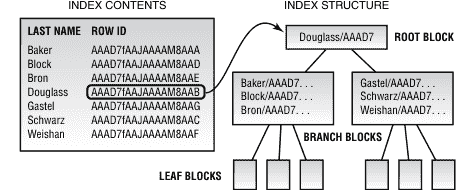

通过首先搜索呈多级树结构排列的索引，然后通过行 `ID` 访问所需的表数据，可以避免代价高昂的全表扫描操作，并增强查询性能。当执行仅返回表中总行数中较小部分的数据时，`B-Tree` 索引非常有用。作为经验法则，Oracle 建议在查询频繁返回表总行数不到 5% 时，考虑采用 `B-Tree` 索引策略。`B-Tree` 索引的最佳候选对象是那些数据具有高基数（high cardinality）的列。这些列也应经常用于 SQL 语句的 `WHERE` 子句中。

在设计上，`B-Tree` 索引总是平衡的。这是因为当向建立索引的表添加新值时，Oracle 服务器会不断分割已满的索引块。然而，随着表上发生插入和删除活动，其相关索引可能会发展出许多层级。这倾向于降低 `B-Tree` 索引的效率，因为 Oracle 服务器需要更长时间从根块（或起始块）向下遍历到实际包含所关注数据索引条目的层级。你可以通过分析索引，然后在 `DBA_INDEXES` 上执行以下查询来确定索引有多“深”：

```sql
SQL> SELECT index_name, blevel
2       FROM dba_indexes
3      WHERE blevel >= 4;
```

上述查询将显示根块和最深层叶块之间有四个或更多层级的所有索引。这些索引是重建的良好候选对象。重建这些索引将减少层级数量并提高索引性能。相同的信也可以在上部菜单选项 `Databases ► Schema ► Indexes` 下的 OEM 控制台中找到。通过右键单击一个索引并选择“查看/编辑详细信息”菜单选项，可以选择“统计信息”选项卡，此时将显示如图 3.14 所示的屏幕。

**图 3.14** 显示索引统计信息的 OEM 架构选项

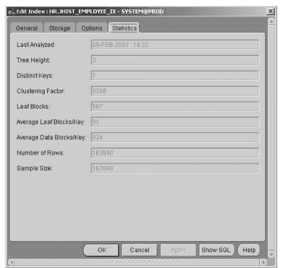

**150** 第 3 章 - SQL 应用调优与设计

图 3.14 中的输出表明 `JHI_ST_EMPLOYEE_IX` 索引的树高度为 2。这小于建议的高度（4 层或更多层），只有在达到此高度之前，索引才应被视为重建的候选对象。

索引可能受益于重建的另一个迹象是，当索引中的已删除条目占整体条目的 20% 以上时显而易见。在这种情况下，索引使用了比存储索引条目所需更多的空间，因此增加了检索条目时必须访问的块数。以下 SQL 命令展示了如何识别存在此问题的索引：

```sql
SQL> ANALYZE INDEX employee_last_name_idx VALIDATE STRUCTURE;
```

`ANALYZE` 命令的 `VALIDATE STRUCTURE` 选项会用值填充数据字典视图 `INDEX_STATS`。然后你可以查询该视图以查看索引中是否有空间浪费：

```sql
SQL> SELECT (DEL_LF_ROWS_LEN/LF_ROWS_LEN) * 100 AS 'Wasted Space'
2    FROM index_stats
3   WHERE name = 'EMPLOYEE_LAST_NAME_IDX';
```


上述查询的结果表明，索引块中 34% 的空间被浪费，因为它们以前包含已删除行的条目。

> 使用此计算，Oracle 建议重建任何浪费空间超过 20% 的索引。

当上述任一查询表明索引的性能将从重建中受益时，可以考虑三种重建技术：

1. 从头开始删除并重新创建索引。
2. 使用 `ALTER INDEX ... REBUILD` 命令重建索引。
3. 使用 `ALTER INDEX ... COALESCE` 命令重建索引。

## 执行索引重组

尽管上述每种技术都能使重建索引的过程更加精简，但每种技术都有其自身的优缺点。

- **删除并重新创建索引**：删除并重新创建索引是重建索引最耗时且资源密集型的技术。然而，在 Oracle 7.3 之前的版本中，这是唯一的重建索引技术。
- **使用 ALTER INDEX ... REBUILD 命令**：使用带有 `REBUILD` 选项的 `ALTER INDEX` 命令是快速重建索引的有效方式，因为会使用现有的索引条目来创建新索引。以下是使用 `ALTER INDEX` 命令重建名为 `EMP_LAST_NAME_IDX` 的索引的示例：

```sql
SQL> ALTER INDEX emp_last_name_idx REBUILD ONLINE;
```

在使用 `ALTER INDEX... REBUILD` 命令时，应使用 `ONLINE` 选项以最大限度地减少在重建索引期间，用户继续对底层表执行 DML 操作时可能发生的锁定问题。

> 也可以使用 `COMPUTE STATISTICS`、`PARALLEL`、`UNRECOVERABLE` 和 `NOLOGGING` 选项来重建索引。

由于在重建过程中旧索引和新索引会短暂共存，因此使用此技术重建索引需要临时提供额外的磁盘空间。`ALTER INDEX ... REBUILD` 命令还可以用于将索引移动到一个新的表空间。
- **使用 ALTER INDEX ... COALESCE 命令**：使用带有 `COALESCE` 选项的 `ALTER INDEX` 命令是快速重建索引的另一种有效方式。以下是使用 `ALTER INDEX` 命令对名为 `EMP_BIRTH_DATE_IDX` 的索引进行合并的示例：

```sql
SQL> ALTER INDEX emp_birth_date_idx COALESCE;
```

与 `REBUILD` 选项不同，`COALESCE` 选项在重建操作期间不需要额外的磁盘空间。相反，`COALESCE` 选项在重建索引时合并同一索引分支内的叶块。这最大限度地减少了与重建过程相关的潜在锁定问题。然而，不能使用 `COALESCE` 选项将索引移动到一个新的表空间。


有关 `ALTER...INDEX` 命令的更多信息，请参阅《Oracle9i 数据库管理员指南》第 1 版（Release 1）（9.0.1）（部件号 A90117-01）第 16 章“管理索引”。

## 压缩 B-Tree 索引


当在大型表上构建 B-Tree 索引时，特别是在数据仓库或决策支持系统中，这些索引也可能消耗大量的存储空间。*压缩 B-Tree 索引* 用于最小化某些类型 B-Tree 索引所占用的空间量。当 B-Tree 索引被压缩时，被索引列值的重复出现将被消除——从而减少了存储该索引所需的总体空间量。图 3.15 展示了在 `EMPLOYEE` 表上非压缩和压缩 B-Tree 索引的对比，其中多名员工的姓氏为 Smith。

### 图 3.15 非压缩与压缩 B-Tree 索引

#### 非压缩 B-Tree 索引

| 姓氏 | 关联的 ROWID |
| :--- | :--- |
| Smith | AAABSOAAEAAABTAAB |
| Smith | AAABSOAAEAAABTAAC |
| Smith | AAABSOAAEAAABTAAD |
| Smith | AAABSOAAEAAABTAAE |

#### 压缩 B-Tree 索引

| 姓氏 | 关联的 ROWID |
| :--- | :--- |
| Smith | AAABSOAAEAAABTAAB, AAABSOAAEAAABTAAC, AAABSOAAEAAABTAAD, AAABSOAAEAAABTAAE |

在非压缩索引中，姓氏 Smith 的每次出现都存储其关联的 ROWID 条目。在压缩索引中，Smith 条目仅存储一次，并将每个关联行的 ROWID 条目附加到姓名之后。通过在 `CREATE INDEX` 语句末尾添加关键字 `COMPRESS` 来构建压缩索引：

```sql
SQL> CREATE INDEX employee_hist_last_name_idx
  2  ON employee_history (last_name)
  3  TABLESPACE APPL_IDX
  4  COMPRESS;
```

或者，可以使用 `ALTER INDEX` 语句将非压缩索引压缩：

```sql
SQL> ALTER INDEX employee_hist_last_name_idx REBUILD COMPRESS;
```


不可能在包含唯一值的单个表列上构建压缩 B-Tree 索引，因为没有任何两个索引值会是相同的。

## 位图索引

B-Tree 索引最适用于数据具有高精度的列。对于低精度列，位图索引可能是更有效的索引选项。与 B-Tree 索引不同，位图索引创建表行中的二进制映射，并将该映射存储在索引块中。这意味着生成的索引将需要显著更少的空间来存储索引数据，并且比等效的 B-Tree 索引更快地检索列等值匹配的行。这种类型的索引特别适用于包含非常少不同值的大型、低 DML 活动表中的列。

例如，如果你通过检查跟踪文件和执行计划决定应在 `EMPLOYEE` 表的 `GENDER` 列上构建索引，位图索引将是一个不错的选择，因为该表相当大且列的数据精度较低。这是因为该列仅允许两个可能的值：M（男）或 F（女）：

```sql
SQL> SELECT *
2    FROM employee;
```

| EMP_ID | LAST_NAME | FIRST_NAME | TITLE | DEPT_ID | GENDER |
| :--- | :--- | :--- | :--- | :--- | :--- |
| 100 | Baker | Brenda | 网络开发总监 | 601 | F |
| 101 | Douglass | Laura | 研究总监 | 301 | F |
| 102 | Jim | Schwarz | 信息总监 | 401 | M |
| 110 | Block | Robin | 公司法律顾问 | 501 | F |
| 106 | Bron | Reginald | 市场总监 | 601 | M |
| 108 | Weishan | Matt | 技术文档工程师 | 601 | M |
| 107 | Gastel | Tony | Oracle DBA | 401 | M |

```sql
SQL> CREATE BITMAP INDEX employee_gender_idx
2    ON employee (gender)
3    TABLESPACE APPL_IDX;
```

然后，位图索引将存储这两个可能的值以及与列数据相关的每个值的二进制映射。如果值对该行为真，位图索引存储 1；否则存储 0。图 3.16 展示了位图索引存储 `GENDER` 列数据的方式。

### 图 3.16 GENDER 列的位图索引

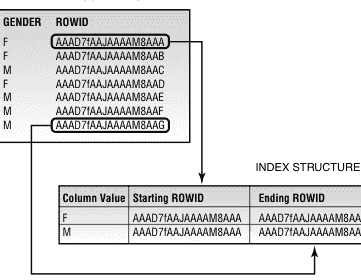

随后在 `WHERE` 子句中对 `GENDER` 进行等值匹配的对 `EMPLOYEE` 的查询现在可以仅通过一次 I/O 定位满足查询的所有行 ID。此外，在 SQL 语句的 `WHERE` 子句中对索引列使用 `AND` 或 `OR` 条件的查询在确定查询结果时能够进行逐位行消除。

> **警告**
>
> 不应在高频率插入、更新或删除活动的表上使用位图索引。由于这些 DML 操作会导致在位图级别发生锁定，并且需要动态重建所有可能值的整个位图，因此在性能方面代价高昂。然而，即使更改了多行，每个位图也仅在每次 DML 活动时更新一次。因此，位图索引最适合数据仓库和决策支持系统。

每当使用位图索引时，都应考虑 `SORT_AREA_SIZE` 和 `PGA_AGGREGATE_TARGET` `init.ora` 参数。增加这些参数中每一个的大小通常能增强创建和操作位图索引的速度。表 3.21 中描述了这三个参数。

**表 3.21** 与位图索引相关的重要 `init.ora` 参数

| 参数 | 描述 |
| :--- | :--- |
| **SORT_AREA_SIZE** | 在批量提交之前存储排序的位图列和行 ID 信息的缓冲区大小（以字节为单位） |
| **PGA_AGGREGATE_TARGET** | 管理分配给位图索引创建以及索引范围扫描后的位图合并的内存量（以字节为单位） |


虽然在 Oracle9i 中并未明确弃用，但 Oracle8i 中设计用于管理位图索引创建和合并的两个 `init.ora` 参数 `CREATE_BITMAP_AREA_SIZE` 和 `BITMAP_MERGE_AREA_SIZE` 不再推荐用于调整位图活动。应改用新的 `PGA_AGGREGATE_TARGET` 参数。

## 函数索引

当在 SQL 语句中对索引列应用函数时，该列上的任何索引都会被否定，因此在制定语句的执行计划时不会被考虑。例如，如果在 `EMPLOYEE` 的 `FIRST_NAME` 列上构建了索引，由于在 `WHERE` 子句中对 `FIRST_NAME` 列应用了函数（`UPPER`），优化器不会在以下 SQL 语句中使用它：

```sql
SQL> SELECT last_name, first_name
    2  FROM employee
    3  WHERE UPPER(first_name) = 'REGINALD' ;
```

生成的执行计划在寻找名为 Reginald 的员工时，将对 `EMPLOYEE` 表执行全表扫描——甚至

尽管该列上存在索引。当 SQL 语句的 WHERE 子句中对索引列应用了任何函数或操作时，就会出现这种行为。*基于函数的索引* 通过在创建索引时将函数纳入索引中来解决此问题。B-Tree 索引和位图索引都可以创建为基于函数的索引。以下是一个在 EMPLOYEE 表的 FIRST_NAME 列上创建的基于函数的索引示例：

```sql
SQL> CREATE INDEX employee_first_name_upper_idx
  2  ON employee (UPPER(first_name));
```

优化器现在可能会考虑使用新的 `EMPLOYEE_FIRST_NAME_UPPER_IDX` 索引，从而在检索名为 Reginald 的员工时避免全表扫描。

基于函数的索引的另一个实用例子是，当你希望在使用派生列的语句 WHERE 子句中避免全表扫描时。例如，在下面的查询中，列 `TOTAL_SALE` 并不是表中的实际列；相反，它是通过将 `UNITS` 乘以 `PRICE` 派生出来的：

```sql
SQL> SELECT product_id, units, price, price*units 'TOTAL_SALE'
  2  FROM sales
  3  WHERE (price*units) > 10000;
```

然而，我们可以在派生列 `TOTAL_SALE` 上创建一个基于函数的 B-Tree 索引，然后使用该索引来消除查询中本应发生的全表扫描：


```sql
SQL> CREATE INDEX sales_total_sale_idx
  2  ON sales (price*units)
  3  TABLESPACE appl_idx;
```

优化器现在能够在为上一个查询制定执行计划时考虑使用该索引。


必须将 `init.ora` 参数 `QUERY_REWRITE_ENABLED` 设置为 `TRUE` 才能使用基于函数的索引。

## 反向键索引

反向键索引（RKI）是一种特殊类型的 B-Tree 索引。当在包含顺序数字的列上构建索引时，RKI 非常有用。如果在包含此类数据的列上构建传统 B-Tree 索引，索引往往会发展出许多层级。由于 B-Tree 的深度超过四层会降低性能，因此 RKI 非常适合这种情况。

反向键索引通过简单地反转索引列中的数据来解决这个问题：它将每个列键值的字节反转，然后对新的反转数据进行索引。与原始顺序数据相比，这种新的数据在值范围内通常分布得更加均匀。

例如，如果你确定需要在 `EMPLOYEE` 表的 `EMP_ID` 列上建立索引，那么反向键索引是合适的，因为存储在 `EMP_ID` 列中的数据是顺序的：

```sql
SQL> SELECT *
  2  FROM employee;
```

| EMP_ID | LAST_NAME | FIRST_NAME | TITLE | DEPT_ID | GENDER |

| :----- | :--------- | :----------- | :------------------- | :------ | :----- |

| 100 | Baker | Benda | Dir Web Development | 601 | F |

| 101 | Douglass | Laura | Dir of Research | 301 | F |

| 102 | Jim | Schwarz | Dir of IS | 401 | M |

| 110 | Block | Robin | Corporate Counsel | 501 | F |

| 106 | Bron | Reginald | Dir of Marketing | 601 | M |

| 108 | Weishan | Matt | Technical Writer | 601 | M |

| 107 | Gastel | Tony | Oracle DBA | 401 | M |

```sql
SQL> CREATE INDEX employee_emp_id_idx
  2  ON employee (emp_id)
  3  REVERSE
  4  TABLESPACE APPL_IDX;
```

使用 `ALTER INDEX` 命令也可以将现有的非反向键索引重建为反向键索引：

```sql
ALTER INDEX employee_emp_id_idx REBUILD REVERSE;
```

图 3.17 展示了一个示例，说明 `EMPLOYEE` 表上 `EMP_ID` 列的反向键索引在内部看起来是什么样子的。

| ORIGINAL ID | REVERSED ID | ROWID |

| :---------- | :---------- | :---------------------------------- |

| 100         | 001         | AAAD7IAAJAAAAAM8AAA               |

| 101         | 101         | AAAD7IAAJAAAAAM8AAB               |

| 102         | 201         | AAAD7IAAJAAAAAM8AAC               |

| 110         | 011         | AAAD7IAAJAAAAAM8AAD               |

| 106         | 601         | AAAD7IAAJAAAAAM8AAE               |

| 108         | 801         | AAAD7IAAJAAAAAM8AAF               |

| 107         | 701         | AAAD7IAAJAAAAAM8AAG               |

索引是反向键这一事实对应用程序开发人员和用户来说是透明的。在查询中使用它不需要特殊的语法。

反向键索引仅适用于等值和非等值搜索。在反向键索引列上执行范围扫描（例如，使用 `BETWEEN`、`>`、`<`）的查询将无法使用该索引，并会导致全表扫描。

## 索引组织表

使用 B-Tree、位图（Bitmapmed）和反向键索引所带来的性能提升，源于这些索引中的条目直接指向索引底层表中对应数据的行 ID。这是从行未按任何特定顺序物理存储的表中检索行的一种有效方式。这种类型的表被称为 *堆表*（Heap Tables）。Oracle 在大多数表中以堆方式存储行数据，因为行在表内的块中分配方式或多或少是随机的。这种随机性是因为 Oracle 在决定存储位置时不考虑行的内容。相反，Oracle 只是将行存储在表的自由列表（Freelist）中找到的第一个块上。

### Oracle 学习目标

解释索引组织表


> 有关自由列表如何用于管理表的块，请参阅第 8 章“磁盘 I/O 调优”。

如果你确实希望以特定顺序存储表数据，那么你就不能使用堆表。Oracle 专门为此目的提供了索引组织表（IOTs）。索引组织表不再存储指向行数据其余部分存储位置的行 ID 指针，而是将行数据完整地存储在索引本身中。这带来了两个性能好处：

- 表行按索引顺序存储。如果你使用主键访问表，IOT 比传统表能更快地返回行。
- 使用 B-tree 索引时，读取索引然后读取表所产生的额外 I/O 被消除了。

假设你决定创建一个名为 `EMPLOYEE_HISTORY` 的新应用表，它将按 `EMP_ID` 存储员工信息。由于你预计会按 `EMP_ID` 访问此表，创建此表时选择 IOT 可能是一个不错的选择：

```sql
SQL> CREATE TABLE employee_history
  2  (employee_id number primary key,
  3   last_name varchar2(20),
  4   first_name varchar2(20),
  5   title varchar2(30),
  6   hire_date date,
  7   departure_date date)
  8  ORGANIZATION INDEX TABLESPACE app1_idx
  9  PCTTHRESHOLD 25
 10  INCLUDING first_name
 11  OVERFLOW TABLESPACE app1_of
 12  MAPPING TABLE;
```


所有索引组织表都必须在作为索引基础的列上定义主键约束。IOT 不能包含唯一约束，也不能进行聚簇。聚簇将在后续章节中讨论。

与 IOT 创建相关的 `CREATE TABLE` 语法的重要部分总结在表 3.22 中。

### 表 3.22 IOT 创建语法

| 子句 | 描述 |

| :--- | :--- |

| `ORGANIZATION INDEX` | 指定此表是 IOT。 |

| `PCTTHRESHOLD` | 指定保留多少百分比的整个数据块以存储与主键值相关的行数据，该值必须在 0 到 50 之间（默认为 50）。 |

| `INCLUDING` | 指定当行长度超过 `PCTTHRESHOLD` 预留的大小时，在哪一列将行拆分为两部分。 |

| `OVERFLOW TABLESPACE` | 指定当行长度超过 `PCTTHRESHOLD` 预留的大小时，行数据的第二半部分将存储的表空间。 |

| `MAPPING TABLE` | 促使创建关联的映射表，这是在 IOT 上创建位图索引所需的。映射表在本节末尾有详细描述。 |

在此表中填充数据后，其内容可能类似于图 3.18 所示。

## *EMPLOYEE_HISTORY* 表的内容

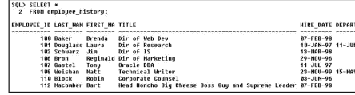

图 3.19 展示了该表数据在 IOT 段和 IOT 溢出段之间的物理存储方式。

## *EMPLOYEE_HISTORY* 数据的物理存储

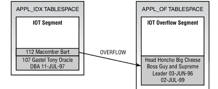


请注意图 3.19 中，与员工 107（Gastel）相关的所有行数据都能容纳在分配给 *EMPLOYEE_HISTORY* IOT 的一个块中。然而，员工 112（Macomber）的职称过长，无法放入 PCTTHRESHOLD 预留的空间。因此，Macomber 的行在 INCLUDING 列（*FIRST_NAME*）处被截断，剩余的列数据则存储在属于另一个表空间中溢出段的块里。关于如何找到此溢出段，将在下一节中讨论。

位图索引（Bitmapmed indexes）可以建立在堆表和索引组织表上。当在堆表上建立位图索引时，该索引存储位图及物理行 ID 以定位堆表中的行。然而，在 IOT 上的位图索引必须利用映射表来定位被索引的 IOT 行。*映射表*将索引的物理行 ID 映射到索引组织表使用的相应逻辑行 ID。由于 IOT 在添加或删除数据时，其物理行 ID 可能会发生变化（因为 IOT 叶子块可能会像 B-树索引一样在满时发生分裂），所以 IOT 使用逻辑行 ID 来管理对其行的索引访问。因此，如果没有这个映射表，IOT 中的叶子块分裂会改变行的物理行 ID，并导致相关的位图索引项无法使用。

由于使用了这种中间映射表，随着时间的推移，位图映射索引（Bitmapmapped index）条目可能无法准确反映被索引 IOT 中逻辑行 ID 和物理行 ID 之间的真实映射关系。这降低了索引的有效性。你可以通过发出以下查询来查看映射表与位图索引不同步的程度：

```sql
SELECT index_name, pct_direct_access
FROM dba_indexes
WHERE pct_direct_access IS NOT NULL;
```

只有 IOT 表的 PCT_DIRECT_ACCESS 值才非空。任何 PCT_DIRECT_ACCESS 值超过 30% 的索引，都应重建其位图映射索引以保持其有效性。

> 每个 IOT 只需维护一个映射表，即使该 IOT 上有多个位图索引。
>
> Oracle9i 的文档存在一个错误，声称可以使用以下命令在 EMPLOYEE_HISTORY IOT 上重建映射表：
>
> `ALTER TABLE employee_history MAPPING TABLE UPDATE BLOCK REFERENCES;`
>
> 然而，截至本文写作时，此命令不可用。

## 索引数据字典视图

数据字典视图 `DBA_INDEXES`、`DBA_SEGMENTS` 和 `DBA_TABLES` 都包含有关你迄今已了解的一种或多种索引类型的信息。

### DBA_INDEXES

`DBA_INDEXES` 是包含 DBA 所需大多数索引信息的数据字典视图。表 3.23 描述了 `DBA_INDEXES` 视图中与前面章节讨论的索引相关的列。

#### 表 3.23 选定的 DBA_INDEXES 列描述

| 列名 | 描述 |
| :--- | :--- |
| INDEX_TYPE | 指定索引的类型：<br>NORMAL（标准 B-树）<br>NORMAL/REV（反向键）<br>FUNCTION-BASED NORMAL<br>BITMAP<br>IOT—TOP（索引组织表）<br>CLUSTER<br>LOB（大对象） |
| COMPRESSION | 指示索引是否压缩。使用两个值：<br>DISABLED<br>ENABLED |
| FUNCIDX_STATUS | 指示函数索引的状态：<br>NULL（不是函数索引）<br>ENABLED<br>DISABLED |

图 3.20 展示了一个针对 `DBA_INDEXES` 的示例查询，显示了我们讨论过的索引信息。

#### 图 3.20 显示索引类型的示例查询

```sql
SQL> SELECT index_name, index_type, table_name, compression, funcidx_status
FROM dba_indexes
WHERE table_name in ('EMPLOYEE_HISTORY','EMPLOYEE')
ORDER BY index_name;

INDEX_NAME            INDEX_TYPE        TABLE_NAME       COMPRESS FUNCIDX_STATUS
EMPLOYEE_EMP_ID_IDX   NORMAL/REV        EMPLOYEE         DISABLED
EMPLOYEE_FIRST_NAME_UPPER_IDX FUNCTION-BASED NORMAL EMPLOYEE DISABLED ENABLED
EMPLOYEE_GENDER_IDX   BITMAP            EMPLOYEE         DISABLED
EMPLOYEE_LAST_NAME_IDX NORMAL            EMPLOYEE         DISABLED
SYS_IOT_TOP_8372      IOT - TOP         EMPLOYEE_HISTORY   DISABLED
```

### DBA_SEGMENTS

图 3.19 中查询缺失的唯一信息是 IOT `EMPLOYEE_HISTORY` 的溢出段详情。该信息可从 `DBA_SEGMENTS` 获取，如下所示。

```sql
SQL> SELECT segment_name,
2  segment_type,
3  tablespace_name
4  FROM dba_segments
5  WHERE segment_name LIKE '%IOT%';

SEGMENT_NAME    SEGMENT_TYPE    TABLESPACE_NAME
SYB_IOT_OVER_16102 TABLE APPL_OF
SYB_IOT_TOP_16102 INDEX APPL_IDX
```

此查询显示了 IOT `EMPLOYEE_HISTORY` 的两个组成部分：索引本身 `SYB_IOT_TOP_16102` 和溢出段 `SYB_IOT_OVER_16102`。名称中的数字部分是在创建 IOT 时由系统生成的。

### DBA_TABLES

为了更清楚地看出 `EMPLOYEE_HISTORY` IOT 及其关联溢出段之间的关系，我们可以如下查询 `DBA_TABLES`。

```sql
SQL> SELECT table_name,
2  iot_name,
3  iot_type,
4  tablespace_name
5  FROM dba_tables
6  WHERE table_name = 'EMPLOYEE_HISTORY'
7  OR iot_name = 'EMPLOYEE_HISTORY';

TABLE_NAME          IOT_NAME          IOT_TYPE      TABLESPACE
EMPLOYEE_HISTORY    IOT              SYB_IOT_OVER_16102
EMPLOYEE_HISTORY    IOT_OVERFLOW      APPL_OF
```

请注意，表 `SYB_IOT_OVER_16102` 的关联表条目为 `EMPLOYEE_HISTORY`。此外，请注意 `EMPLOYEE_HISTORY` 表的 `TABLESPACE_NAME` 条目为 NULL，因为实际存储数据的段是索引，而不是表。

## 监控索引以确定使用情况

###### 目标

### 识别未使用的索引

根据优化器选择的执行计划，某些应用程序索引可能在应用程序用户工作期间从未被使用。如果索引未被使用，删除该索引可能通过消除在对被索引表执行 DML 时的索引维护开销来提高性能。删除未使用的索引还将释放表空间供其他索引使用。Oracle9i 引入了一个新的数据字典视图 `V$OBJECT_USAGE`，可用于识别未使用的索引。监控索引使用技术在此简要说明：

你可以使用以下命令来激活名为 `EMP_LAST_NAME_IDX` 的索引监控：

```sql
ALTER INDEX hr.emp_last_name_idx MONITORING USAGE;
```

在正常的用户活动一段时间后，你可以使用以下命令禁用监控：

```sql
ALTER INDEX hr.emp_last_name_idx NOMONITORING USAGE;
```

然后，你可以查询 `V$OBJECT_USAGE` 动态性能视图中的 `INDEX_NAME` 和 `USED` 列，以确定该索引是否在监控期间被访问过。`USED` 列中的 YES 值表示该索引在监控期间至少被访问过一次。`USED` 列中的 NO 值表示该索引在监控期间未被访问，可能是删除的候选对象。

## 分区

减少查询执行期间 I/O 量的另一种技术是将表数据划分为更小的子集，称为*分区*。一旦正确分区、索引和分析，大表查询将从 CBO 使用分区消除（partition elimination）以跳过不包含相关数据的表分区的能力中受益。此外，许多表维护操作也可以在分区级别执行。Oracle9i 提供了四种表分区方法。

###### 目标

描述分区方法

### Oracle 表分区方法


在对表进行分区之前，必须选择合适的分区方法。分区方法的选择通常由分区键中存储的数据驱动——即你希望作为细分表数据基础的列。例如，假设你是一所大型大学的 DBA。作为更大的数据仓库倡议的一部分，大学的数据架构师要求你构建一个大表（即 `STUDENT_HISTORY`），用于存储该机构学术项目毕业生在五年期间的信息。每年会为当年的毕业生添加一组新记录，而最旧的记录（来自五年前的毕业生）将从表中清除。为简单起见，假设该表由表 3.24 中显示的四列组成。

### 表 3.24 `STUDENT_HISTORY` 表描述

| 列名 | 描述 |
| :--- | :--- |
| `STUDENT_ID` | 学生标识号 |
| `DEGREE` | 学生获得学位的三个字符缩写：BS, BA, BBA, MFA, MA, MBA, MFA, MS, PHD |
| `GRADUATION_DATE` | 学生从大学毕业的日期 |
| `FINAL_GPA` | 学生毕业时的最终平均绩点 |

此示例表结构将用于演示四种类型的分区：

- 范围分区

## 范围分区

范围分区是对 `STUDENT_HISTORY` 表内容进行细分的一种选择。范围分区使用列值的范围来决定数据行将被插入到哪个分区。假设你决定使用范围分区对 `GRADUATION_DATE`（毕业日期）列来分区 `STUDENT_HISTORY` 表。这意味着 `GRADUATION_DATE` 是分区键：

```sql
SQL> CREATE TABLE student_history
2  (student_id      NUMBER(10),
3  degree          VARCHAR2(3),
4  graduation_date DATE,
5  final_gpa       NUMBER)
6  PARTITION BY RANGE (graduation_date)
7  (PARTITION p_1997 VALUES LESS THAN
8    (TO_DATE('01-JUN-1997','DD-MON-YYYY')) TABLESPACE hist_tab01,
9   PARTITION p_1998 VALUES LESS THAN
10   (TO_DATE('01-JUN-1998','DD-MON-YYYY')) TABLESPACE hist_tab02,
11   PARTITION p_1999 VALUES LESS THAN
12   (TO_DATE('01-JUN-1999','DD-MON-YYYY')) TABLESPACE hist_tab03,
13   PARTITION p_2000 VALUES LESS THAN
14   (TO_DATE('01-JUN-2000','DD-MON-YYYY')) TABLESPACE hist_tab04,
15   PARTITION p_2001 VALUES LESS THAN
16   (TO_DATE('01-JUN-2001','DD-MON-YYYY')) TABLESPACE hist_tab05,
17   PARTITION p_ERROR VALUES LESS THAN
18   (MAXVALUE) TABLESPACE hist_tab06);
```

上述语法将创建一个包含六个分区的表，名称从 `P_1997` 到 `P_2001`，以及 `P_ERROR`。出于性能考虑，这些分区中的每一个在物理上都存储在一个独立的表空间中（`HIST_TAB01` 到 `HIST_TAB06`）。插入到表中的每一行都将根据学生的毕业日期被放置到相应的分区中。图 3.21 展示了这一概念。

### 图 3.21 范围分区的 `STUDENT_HISTORY` 表

```sql
INSERT INTO
  student_history
  (student_id, degree,
   graduation_date, final_gpa)
VALUES
  (123456789,'BBA','12-MAY-99',3.75);
```

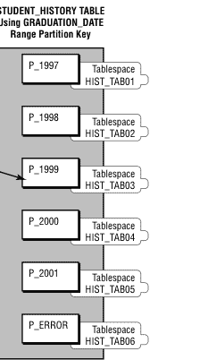

在检查上述结构时，应考虑与范围分区相关的若干规则：

- 分区键可以由最多 16 列组成。
- 一个表最多可以有 65,636 个分区。
- 分区范围之间不能有空隙。例如，你不能拥有 1991–1993 年 和 1995–2001 年 的毕业日期分区（跳过了 1994 年）。
- 存储在分区中的所有行，其值必须小于且不等于该分区的上界。换句话说，如果插入一条毕业日期为 01-JUN-2000 的学生记录，该记录将存储在 `P_2001` 分区中，而不是 `P_2000` 分区。因此，插入毕业日期为 01-JUN-2001 或更晚的学生记录将导致该记录存储在 `P_ERROR` 分区中。
- `LESS THAN` 子句中指定的值必须是一个字面量、日期，或者是通过 `TO_DATE` 函数填充后的常量。日期值也必须使用 `TO_DATE` 函数来包含世纪。
- 范围分区表不能包含 `LONG` 或 `LONG RAW` 数据类型的列。
- 会导致记录跨越分区边界的更新操作不被允许，除非在创建表时指定了 `ENABLE ROW MOVEMENT` 子句。如果没有此子句，尝试将学生的毕业日期从 16-MAY-95 更新为 16-MAY-96 将需要将该记录从分区 `P_1995` 移动到 `P_1996`，这是不被允许的。
- 尝试插入不符合任何已定义分区范围值的记录将导致 `ORA-14400`：*插入分区键超出了最高合法分区键值错误*。如果未指定带有 `MAXVALUE` 子句的 `P_ERROR` 分区，则插入毕业日期为 01-JUN-2001 或更晚，或值为 `NULL` 的学生记录将不被允许。

如果每年毕业的学生人数差异较大，选择 `GRADUATION_DATE` 作为表的分区键可能效率较低。如果是这种情况，那么存储在每个分区内的行数将变得不均匀，有些分区的增长速度远快于其他分区。虽然这种不均匀并不总是对性能有害，但它可能导致并行操作（如并行查询和并行 DML）的性能低下。如果是这种情况，则可以考虑使用哈希分区代替范围分区。


> “并行操作的更多细节将在第 10 章“操作系统调优”中描述。”

### 列表分区

列表分区与范围分区类似，不同的是它们基于一组指定的值，而非值的范围。例如，假设你决定使用列表分区对 `DEGREE`（学位）列来分区 `STUDENT_HISTORY` 表。这意味着 `DEGREE` 是分区键：

```sql
SQL> CREATE TABLE student_history
2  (student_id        NUMBER(10),
3   degree            VARCHAR2(3),
4   graduation_date DATE,
5   final_gpa         NUMBER
6  PARTITION BY LIST (degree)
7  (PARTITION p_undergrad VALUES ('BS', 'BA', 'BBA', 'BFA')
8   TABLESPACE hist_tab01,
9   PARTITION p_graduate VALUES ('MA', 'MBA', 'MFA', 'MS')
10  TABLESPACE hist_tab02,
11  PARTITION p_doctorate VALUES ('PHD')
12  TABLESPACE hist_tab03);
```

上述语法将创建一个包含三个分区的表，名称分别为 `P_UNDERGRAD`、`P_GRADUATE` 和 `P_DOCTORATE`。出于性能考虑，这些分区中的每一个在物理上都存储在一个独立的表空间中（`HIST_TAB01` 到 `HIST_TAB03`）。插入到表中的每一行都将根据学生的学位代码被放置到相应的分区中。图 3.22 展示了这一概念。

### 图 3.22 列表分区的 `STUDENT_HISTORY` 表

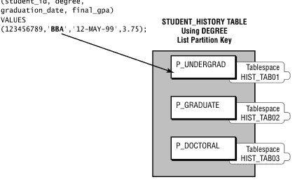

在检查上述结构时，应考虑与列表分区相关的一条规则：不符合分区键任何条件的值将引发 `ORA-14400` 错误。与范围分区不同，Oracle9i Release 1 目前不支持使用 `MAXVALUE` 选项来消除此问题。

> 特定的物理段属性，如 `STORAGE` 参数，可以在分区级别进行分配。这些属性将覆盖表的默认属性。

### 哈希分区

哈希分区使用哈希算法将插入的记录分配到各个分区中。这样做保持每个分区中的记录数量相对均匀，从而改善并行操作（如并行查询和并行 DML）的性能。假设你决定使用哈希分区对 `STUDENT_ID` 列，而不是使用范围分区来分区 `STUDENT_HISTORY` 表。这意味着 `STUDENT_ID` 是分区键：


```sql
SQL> CREATE TABLE student_history
  2 (student_id     NUMBER(10),
  3 degree         VARCHAR2(3),
  4 graduation_date DATE,
  5 final_gpa      NUMBER)
  6 PARTITION BY HASH (student_id)
  7 PARTITIONS 6
  8 STORE IN (hist_tab01, hist_tab02, hist_tab03,
  9            hist_tab04, hist_tab05, hist_tab06);
```

上述语法将创建一个包含六个分区的表，并使用系统生成的名称。每当向 `STUDENT_HISTORY` 表中插入新记录时，Oracle 将 `STUDENT_ID` 中的值通过哈希算法处理，然后使用生成的哈希值来确定该行应插入哪个分区。图 3.2.3 展示了这一概念。

# 172 第 3 章 - SQL 应用程序调优与设计

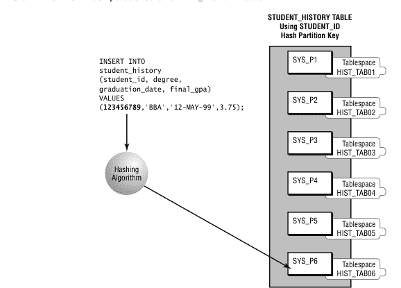

在检查上述结构时，应考虑与哈希分区相关的若干规则：

- 分区键应具有高基数——该列应包含唯一值或极少重复值。
- 当应用程序通过唯一键从分区表中检索数据时，哈希分区的效果最好。对哈希分区表进行范围查找并不能从分区中获益。
- 当正确建立索引时，哈希分区表可以改善两个或多个分区表之间连接的性能。
- 导致记录跨越分区边界的更新操作不被允许。
- 可以为每个分区构建本地哈希索引。

关于分区表的索引策略将在本节后续部分讨论。


Oracle 建议分区总数应为 2 的幂次方，以最大化哈希分区算法的有效性。

## 组合分区

顾名思义，*组合分区* 是范围分区和哈希分区的结合。这种分区类型在希望进行范围分区，但每个范围内的值数量不均匀时非常有用。组合分区会创建范围分区，然后将其进一步细分为哈希子分区：

```sql
SQL> CREATE TABLE student_history
2  (student_id       NUMBER(10),
3   degree           VARCHAR2(3),
4   graduation_date DATE,
5   final_gpa        NUMBER)
6  PARTITION BY RANGE (graduation_date)
7  SUBPARTITION BY HASH(student_id) SUBPARTITIONS 4
8  STORE IN (hist_tab01, hist_tab02, hist_tab03, hist_tab04)
9  (PARTITION p_1997 VALUES LESS THAN
10  (TO_DATE('01-JUN-1997', 'DD-MON-YYYY' )),
11  PARTITION p_1998 VALUES LESS THAN
12  (TO_DATE('01-JUN-1998', 'DD-MON-YYYY' )),
13  PARTITION p_1999 VALUES LESS THAN
14  (TO_DATE('01-JUN-1999', 'DD-MON-YYYY' )),
15  PARTITION p_2000 VALUES LESS THAN
16  (TO_DATE('01-JUN-2000', 'DD-MON-YYYY' )),
17  PARTITION p_2001 VALUES LESS THAN
18  (TO_DATE('01-JUN-2001', 'DD-MON-YYYY' )),
19  PARTITION p_ERROR VALUES LESS THAN (MAXVALUE));
```

上述语法将创建一个包含六个范围分区的表，命名从 `p_1997` 到 `p_2001`，以及 `p_ERROR`。每个范围分区将划分为四个哈希子分区，每个子分区都有一个系统生成的名称。图 3.24 说明了这一概念。

### 图 3.24 组合分区的 STUDENT_HISTORY 表

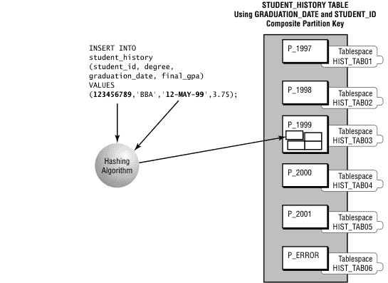

在检查上述结构时，应考虑与组合分区相关的若干准则：

- 分区仅是逻辑结构；表数据在子分区级别进行物理存储。
- 组合分区对于分区级别的与历史相关的日期查询非常有用。
- 组合分区对于子分区级别的并行操作（包括查询和 DML）也很有用。
- 通过使用组合本地索引，也支持分区连接。不支持全局本地索引。

本地索引和全局分区索引之间的差异将在下一节中讨论。

## 为分区表创建索引

在创建范围、列表、哈希或组合分区表后，应该为其创建索引，以充分利用分区表带来的性能增强优势。正确地为分区表创建索引还将提高在执行本章前述描述的日常索引维护任务时索引的可管理性。分类分区索引有两种方法。第一类，*本地与全局* 索引，与索引的分区结构是否与底层被索引表的分区结构相匹配有关。

### 本地分区索引

当索引中的分区数量与底层表的分区数量呈一一对应关系时，分区索引被称为本地索引。因此，如果一个表包含四个分区，该表上的本地索引也将包含四个分区，每个分区索引该表的四个分区之一。图 3.25 说明了本地分区索引与其相关分区表之间的关系。在检查上述结构时，应考虑与本地分区索引相关的若干准则：

- 本地分区索引可以使用四种分区类型中的任意一种。
- Oracle 自动维护表分区和索引分区之间的关系。如果合并、拆分或丢弃表的某个分区，相关的索引分区也会被合并、拆分或丢弃。
- 建立在分区表上的任何位图索引都必须是本地索引。

### 图 3.25 本地分区索引与表之间的关系

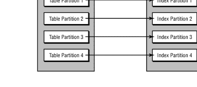

### 全局分区索引

当索引中的分区数量与底层表的分区数量不呈一一对应关系时，分区索引被称为全局索引。例如，如果一个表包含四个分区，其全局索引可能仅由两个分区组成，每个分区可能涵盖一个或多个表分区。图 3.26 说明了全局分区索引与其相关分区表之间的关系。

### 图 3.26 全局分区索引与表之间的关系

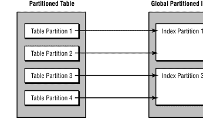

在检查上述结构时，应考虑与全局分区索引相关的若干准则：

- 虽然全局索引可以建立在范围、列表、哈希或组合分区表上，但全局分区索引本身必须是范围分区。
- 全局索引的最高分区必须使用 `MAXVALUE` 参数进行定义。
- 对分区表执行维护操作可能导致其相关的全局索引进入无效状态。处于无效状态的索引必须在用户访问之前重建。


为避免意外导致索引失效，Oracle 建议在可能的情况下优先使用本地索引而非全局索引。

- 创建具有与其底层表相同数量分区的全局分区索引（即模拟本地分区索引）不能替代本地分区索引。尽管结构相似，优化器（CBO）不会将这些索引视为相同。

分类分区索引的第二种方法，前缀与非前缀索引，与索引是否包含分区键以及分区键在索引结构中出现的位置有关。

### 前缀分区索引

当索引的最左列与底层表的分区键列相同时，分区索引被称为前缀索引。例如，如果 `STUDENT_HISTORY` 表基于 `GRADUATION_DATE` 列进行分区，则前缀分区索引也将使用 `GRADUATION_DATE` 作为其索引定义中的第一列。


> 前缀索引可以是唯一的，也可以是非唯一的。

### 非前缀分区索引

当索引的最左列与底层表的分区键列不相同时，分区索引被称为非前缀索引。例如，如果 `STUDENT_HISTORY` 表基于 `GRADUATION_DATE` 列进行分区，则非前缀分区索引将使用除 `GRADUATION_DATE` 之外的其他列作为其索引定义中的第一列。


> 非前缀索引可以是唯一的或非唯一的。然而，仅当索引的分区键是索引键的子集时，才允许使用唯一的非前缀索引。

分区索引的两种分类可以以多种方式组合。图 3.27 展示了索引分类的可能组合。

### 图 3.27 分区索引的组合

| | 本地索引 | 全局索引 |
|---|---|---|
| 前缀索引 | 本地、前缀分区索引 | 全局、前缀分区索引 |
| 非前缀索引 | 本地、非前缀分区索引 | 不允许 |

创建图 3.27 中每种索引类型的语法如下所示。

### 创建本地、前缀分区索引

如果要在前一个示例中基于范围分区的 `STUDENT_HISTORY` 表创建本地、前缀分区索引，可以使用以下语法：


```sql
SQL> CREATE INDEX student_history_lp_idx
  2  ON student_history (graduation_date) LOCAL;
```

上述语法将创建一个包含六个分区的索引（与底层表的分区数量相同），其前导列将是 `GRADUATION_DATE`（即构成底层表分区键的列）。

### 创建本地、非前缀分区索引

如果要在基于范围分区的 `STUDENT_HISTORY` 表的 `DEGREE` 列上创建本地、非前缀分区索引，可以使用以下语法：

```sql
SQL> CREATE INDEX student_history_lnp_idx
  2  ON student_history (final_gpa) LOCAL;
```

上述语法将创建一个包含六个分区的索引（与底层表的分区数量相同），其前导列将是 `FINAL_GPA`（一个不同于构成底层表分区键的列）。

### 创建全局、前缀分区索引

如果要在基于范围分区的 `STUDENT_HISTORY` 表的 `GRADUATION_DATE` 列上创建全局、前缀分区索引，可以使用以下语法：

```sql
SQL> CREATE INDEX student_history_gp_idx
  2  ON student_history (graduation_date)
  3  GLOBAL PARTITION BY RANGE (graduation_date)
  4  (PARTITION p_199n VALUES LESS THAN
  5    (TO_DATE(' 01-JUN-1999', 'DD-MON-YYYY')), 
  6   PARTITION p_200n VALUES LESS THAN
  7    (TO_DATE(' 01-JUN-2009', 'DD-MON-YYYY')), 
  8   PARTITION p_error VALUES LESS THAN (MAXVALUE));
```

上述语法将创建一个包含三个分区的索引，其前导列将是 `GRADUATION_DATE`。

除上述分区索引类型外，还可以在分区表上创建传统的非分区 B-Tree 索引。这些索引被称为全局、前缀非分区索引。

## 分区表如何影响优化器

一旦创建了分区表和索引，代价基于的优化器（CBO）将决定在执行应用程序查询时如何有效利用它们。由于 Oracle9i CBO 非常“感知分区”，它可以排除那些不会成为查询结果一部分的分区。例如，假设在范围分区的 `STUDENT_HISTORY` 表上执行以下查询：

```sql
SQL> SELECT *
2 FROM student_history
3 WHERE graduation_date = '16-MAY-97';
```

由于存在表分区和索引分区，CBO 将知道只需要访问一个分区（P_1997）即可满足查询。其他分区甚至不需要被考虑。这种快速排除不需要的分区以改善查询性能的过程被称为分区修剪。


如果查询对分区键列应用了函数，CBO 无法修剪表分区。如果查询在非基于函数的索引的分区键列上应用了函数，CBO 无法修剪索引分区。

分区表和索引还有助于 CBO 制定有效的执行计划，通过影响两个或多个分区表之间联接执行的方式来实现。当使用 Oracle 并行查询并行执行时，CBO 会考虑两种可能的联接方法：全部分区式联接和部分分区式联接。只要两个表根据它们的分区键列进行联接，就会发生分区式联接。分区式联接可以串行或并行执行。只要两个表根据其中一个表的分区键列进行联接，就会发生部分分区式联接。部分分区式联接只能并行执行。每种联接类型都减少了处理查询所需的总体 CPU 和内存，特别是在非常大的分区表上。

如前一节所述，准确的表和索引统计信息对于高效的 CBO 性能至关重要。`DBMS_STATS` 包中的 `GATHER_TABLE_STATS` 过程可用于收集分区表的全局统计信息。这些统计信息可以在段、分区或子分区级别收集。以下示例展示了如何收集 `STUDENT_HISTORY` 表的 `P_1998` 分区的统计信息：

```sql
SQL> EXECUTE DBMS_STATS.GATHER_TABLE_STATS ( 
>    ownername => 'APPS', 
>    tablename => 'STUDENT_HISTORY', 
>    partname => 'P_1998', 
>    granularity => 'PARTITION');
```

`DBMS_STATS` 包中的 `GATHER_INDEX_STATS` 过程可用于收集分区索引的全局统计信息。这些统计信息可以在段、分区或子分区级别收集。以下示例展示了如何收集 `STUDENT_HISTORY_GP_IDX` 索引的 `P_200n` 分区的统计信息：

```sql
SQL> EXECUTE DBMS_STATS.GATHER_INDEX_STATS ( 
>    ownername => 'SY5', 
>    indname => 'STUDENT_HISTORY_GP_IDX', 
>    partname => 'P_200n' );
```


`DBMS_STATS` 包中的 `GATHER_SCHEMA_STATS` 和 `GATHER_DATABASE_STATS` 过程也可用于收集分区表和索引的统计信息。

### 与分区相关的数据字典视图

共有 15 个数据字典视图包含与分区表和索引相关的信息。表 3.25 显示了这些视图的名称和描述。

#### 表 3.25

分区数据字典视图的描述

| 视图名称 | 描述 |
| :--- | :--- |
| DBA_IND_PARTITIONS | 包含有关索引分区详细信息 |
| DBA_IND_SUBPARTITIONS | 包含有关索引子分区详细信息 |
| DBA_LOB_PARTITIONS | 包含有关大对象分区详细信息 |
| DBA_LOB_SUBPARTITIONS | 包含有关大对象子分区详细信息 |
| DBA_PART_COL_STATISTICS | 包含分区表的列统计信息 |
| DBA_PART_HISTOGRAMS | 包含分区表的分箱统计信息 |
| DBA_PART_INDEXES | 包含有关每个分区索引的详细信息 |
| DBA_PART_KEY_COLUMNS | 包含所有分区表和索引的分区键列 |
| DBA_PART_LOBS | 包含有关每个分区大对象的详细信息 |
| DBA_PART_TABLES | 包含有关每个分区表的详细信息 |
| DBA_SUBPART_COL_STATISTICS | 包含子分区列统计信息 |
| DBA_SUBPART_HISTOGRAMS | 包含子分区分箱统计信息 |
| DBA_SUBPART_KEY_COLUMNS | 包含每个子分区表或索引的分区键列 |
| DBA_TAB_PARTITIONS | 包含有关每个表的各个分区的详细信息 |
| DBA_TAB_SUBPARTITIONS | 包含有关每个表的各个子分区的详细信息 |

## 索引聚簇和哈希聚簇

索引通过消除全表扫描并将 Oracle 引导至请求行的精确位置来提高查询性能。这减少了为满足查询需求而必须读取的数据块总数。通过最小化 I/O 来提高性能的第二种机制可以通过使用聚簇来实现。聚簇是一组或多个表，其数据存储在同一数据块中。这样，通过这些表进行联接的查询无需读取两组数据块即可获取结果；它们只需读取一组即可。Oracle9i 中有两种类型的聚簇：索引聚簇和哈希聚簇。

> **Oracle 目标**
>
> 解释不同的存储结构，以及为什么某种存储结构可能优于另一种

### 索引聚簇

索引聚簇用于将一个或多个表的数据存储在相同的物理 Oracle 块中。聚簇的有用性仅限于非常特定的情况。通常，聚簇表应具备以下属性：

- 总是被一起查询，且很少单独查询
- 在初始加载后执行的数据操纵语言（DML）活动很少或没有
- 对于每个父键，子记录的数量大致相等

如果你有符合这些标准的表，你可能需要考虑创建一个索引聚簇来存储这些表的数据。聚簇表的行为与非聚簇表相同，但其存储空间不是来自表空间，而是来自聚簇，聚簇本身是一个存储在表空间中的段。聚簇是通过索引访问的，该索引包含指向表之间联接（即聚簇）的具体键值的条目。假设你拥有两张表，`TEACHER` 和 `STUDENT`，其中包含以下数据：

```sql
SQL> SELECT *
2   FROM teacher;
```


```
TEACHER_ID LAST_NAME FIRST_NAME ROOM_NUMBER
--------------------------------------------------------------------------------
100 Banasser Viola 222
101 Massingil Jeanne 223
102 Jennings Steve 224
103 Dorch Neil 225

SQL> SELECT *
2 FROM student;
```

```
STUDENT_ID LAST_NAME FIRST_NAME TEACHER_ID
--------------------------------------------------------------------------------
345891001 Anderson Jerry 100
345097651 Smith Audrey 100
348990122 Johnson Emily 100
365778012 Anderson Ian 100
368791033 St.ubbins David 100
.
.
.
368211431 Smalls Derek 103
```

你已注意到，应用程序很少在没有伴随学生信息的情况下检索教师信息。如果每位教师的学生数量均匀，你可以决定将这两个表的数据聚簇到相同的物理块中，以提高查询性能。以下示例显示了创建名为 `TEACHER_STUDENT` 的聚簇、名为 `TEACHER_STUDENT_IDX` 的聚簇索引以及该聚簇中的 `TEACHER` 和 `STUDENT` 表所需的 SQL 语句：

```sql
SQL> CREATE CLUSTER teacher_student
2 (teacher_id number)
3 SIZE 1000
4 STORAGE (initial 500K next 500K pctincrease 0);
5 TABLESPACE apps_clst;
```

上述命令创建了一个名为 `TEACHER_STUDENT` 的聚簇，并指定列 `TEACHER_ID` 将是聚簇键，即两个表的数据将围绕该列进行聚簇。选择此列是因为它将是 `TEACHER` 和 `STUDENT` 表共有的列。参数 `SIZE` 指定我们预计拥有的聚簇键数量

每个 Oracle 块。如果我们采用 2048 字节（2K）的 Oracle 块大小，那么这个参数表示我们预计每个块大约能存储两个集群键（2048/1000 ≈ 2.048）。换句话说，你预计在每个 Oracle 块中存储两位教师及其所有学生的数据。如果所有集群键值（教师）拥有的集群记录数（学生）都不相同，那么为 `SIZE` 选择适当的值就比较困难。然而，正确设置此值对于获得最佳集群性能至关重要：

```
SQL> CREATE INDEX TEACHER_STUDENT_IDX
2  ON CLUSTER teacher_student
3  TABLESPACE apps_idx;
```

索引已创建。

请注意，在对集群段创建索引时，并未指定被索引的列。索引会自动在集群键列 `TEACHER_ID` 上创建。

现在，既然集群结构已经存在，你就可以在集群中创建 `TEACHER` 和 `STUDENT` 表：

```
SQL> CREATE TABLE TEACHER
2  (teacher_id number,
3   last_name varchar2(20),
4   first_name varchar2(20),
5   room_number number)
6  CLUSTER teacher_student
7  (teacher_id);
```

表已创建。

```
SQL> CREATE TABLE student
2  (student_id number,
3   last_name varchar2(20),
4   first_name varchar2(20),
5   teacher_id number)
6  CLUSTER teacher_student
7  (teacher_id);
```

表已创建。

请注意，在集群中创建表时没有指定表空间。这并不是因为我们想使用用户的默认表空间，而是因为集群本身就是每个表数据的存储区域。这样一来，插入到 `TEACHER` 或 `STUDENT` 表中的任何数据都将存储在相同的物理块中——即它们所在的集群段的块。图 3.28 展示了两个集群表、集群本身、集群索引以及它们所存储的表空间之间的关系。

### 图 3.28 索引集群与表之间的关系

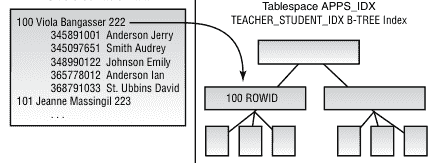

### 哈希集群

*哈希集群* 用于替代传统索引，以快速查找存储在表中的行。与集群索引类似，哈希集群的实用性也仅限于非常具体的场景。一般来说，哈希集群表应具有以下属性：

- 初始加载后，对其执行的 DML 活动很少或没有
- 被索引列中的值分布均匀
- 被索引列中的值数量可预测
- 通过利用 `WHERE` 子句中对被索引列进行相等匹配的 SQL 语句进行查询

与检查索引然后从表中检索行不同，哈希集群的数据存储方式使得针对集群的查询可以使用哈希算法直接确定行的存储位置，无需中间的索引。为了比较哈希集群和非哈希集群表上的索引，假设你在 `EMPLOYEE` 表上发出以下查询：

```
SQL> SELECT *
2  FROM employee
3 WHERE emp_id = 100;
```

如果 `EMPLOYEE` 表是作为非哈希集群表创建的，这样的查询将导致以下操作：

- 在 `EMP_ID` 列的索引中找到 `EMP_ID`。
- 使用索引中存储的行 ID 值在表中定位该行。
- 从表中读取该行，并将信息返回给用户。

这需要至少两次 I/O 操作才能检索行信息，一次（或多次）用于索引，一次用于表。但是，如果使用哈希集群创建该表，则该查询将涉及以下操作：

- `WHERE` 子句中的值（100）通过插入行时使用的相同哈希算法进行处理。此过程在内存中发生，不需要 I/O。算法生成的结果值直接指向表中行的位置。
- 读取该行，并将信息返回给用户。

在这种情况下，检索该行只需要一次 I/O 操作，而传统的表/B-Tree 索引组合则需要两次或更多。


在实施索引集群和哈希集群之前，应进行仔细测试。当表数据不适合它们的用法，或者在创建集群时错误地指定存储参数时，实际上可能会阻碍性能，而不是提高性能。

### 比较不同类型的表的物理存储

既然你已经知道了 DBA 在存储和访问数据方面可用的所有选项，下面简要回顾一下各种物理表类型在如何实际存储其行方面的比较。列表从无序到有序的结构排列：

- 堆表：数据按表块填充的顺序存储。随着块进出表的 Freelist，行存储的顺序变得基本上随机。
- 集群索引：相关的行围绕集群键值以相关的分组方式存储在一起。分组之间没有保证数据的顺序。
- 索引组织表：数据严格按索引顺序存储。

### OLTP 与 DSS 调优需求

到目前为止，你已检查了可用于改进查询执行的索引技术。现在是时候考虑当考虑目前使用的两种主要数据库系统类型时，这些选项的适用性有何不同：在线事务处理系统（OLTP）和决策支持系统（DSS）。

#### Oracle 目标

> 列出 OLTP、DSS 和混合系统的需求

#### 调优 OLTP 系统

在线事务处理（OLTP）系统通常由大量用户访问，这些用户执行短小的 DML 事务。订单接收、库存管理和调度系统都是 OLTP 系统的例子。OLTP 系统的用户主要关心的是吞吐量：完成订单、从库存中移除物品或安排预约所需的总时间。

OLTP 系统需要足够多的 B-Tree 和 Reverse Key 索引以满足性能目标，但不能多到减慢 `INSERT`、`UPDATE` 和 `DELETE` 活动的性能。位图索引由于可能引起的锁定问题，不是 OLTP 系统的良好选择。

如果使用 `CBO`，应定期收集表和索引统计信息，因为在 OLTP 系统中数据量往往变化很快。如果它们所索引的表中的数据经常被修改，OLTP 索引也应经常重建。

#### 调优 DSS 系统

决策支持系统（DSS）和数据仓库代表了调优光谱的另一端。这些系统通常很少或没有 `INSERT`、`UPDATE` 和 `DELETE` 活动，除非在每周、每月、每季或每年结束时进行批量加载或清除数据。这些系统的用户关心响应时间，即获取查询结果所需的时间。

DSS 大量使用全表扫描，因此索引和哈希集群的适当使用非常重要。索引组织表也可以成为大型 DSS 系统的重要调优选项。如果被索引列的数据具有低基数且经常作为查询的基础，可以考虑使用位图索引。还应考虑选择适当的优化器模式，并在每次加载或清除数据时收集新的统计信息。使用直方图也可能有助于提高 DSS 响应时间。最后，应考虑数据库块大小、与排序相关的 `init.ora` 参数以及可能使用 Oracle 并行查询选项。


与 `OLTP` 系统一样，如果使用 `CBO`，也应在使用每次数据加载后收集数据库统计信息。

# 调优混合系统：OLTP 和 DSS

某些系统是 `OLTP` 和 `DSS` 的结合。这些*混合*系统可能带来重大挑战，因为帮助一种系统类型的调优选项通常会妨碍另一种系统类型。然而，通过仔细使用索引和资源管理，通常可以实现一定程度的共存。随着对这两种系统的需求增长，你可能最终需要将这两种类型的系统拆分为两个独立的环境，以满足两个用户群体的需求。

# 摘要

了解如何使用 `TKPROF`、`执行计划`、`STATSPACK` 和 `AUTOTRACE` 来分析应用程序 `SQL` 处理对于每个 `DBA` 来说都很重要。这些工具不仅允许你了解应用程序 `SQL` 是如何执行的，还了解与这些执行相关的资源成本。

数据库性能的一个主要决定因素是 Oracle 优化器做出良好的 `SQL` 执行选择的程度。这些选择受优化器模式和数据库统计信息的存在或缺失的影响。这些统计信息可以在段、模式或数据库级别收集。统计信息也可以在数据库之间移动，以便可以使用现实数据测试优化器的行为。

有各种方法可用于提高应用程序性能。这些方法包括存储大纲、物化视图、`B-Tree` 索引、位图索引、基于函数的索引、压缩索引、Reverse Key 索引、索引组织表、索引集群和哈希集群。这些选项的适用性随所管理系统的类型而变化。`OLTP` 系统的索引策略与 `DSS` 环境不同。

### 考试要点

描述 `SQL` 分析的工具。了解如何使用 `TKPROF`、`AUTOTRACE`、执行计划（Explain Plans）和 `STATSPACK` 来执行 `SQL` 分析。知道如何根据潜在的性能调优改进来解释这些工具的输出。

理解优化器的作用。了解 Oracle 优化器的重要性以及如何管理其行为。理解数据库可以运行的优化器模式，以及每种模式如何受数据库统计信息的存在或缺失的影响。

了解不同的索引策略。能够描述每种索引类型及其如何用于改进 `SQL` 执行。理解每种索引类型适用的情况。

了解不同的调优要求。理解 `OLTP`、`DSS` 和混合系统之间的调优目标有何不同。能够将本章讨论的所有调优考虑因素置于每种这些调优环境的框架内。

## 关键术语

在参加考试之前，请确保你熟悉以下术语：

- Autorace
- Bitmap
- 数据块 (blocks)
- B-Tree
- 基数 (Cardinality)
- 集群 (cluster)
- 复合分区 (composite partitioning)
- 压缩 (Compressed)
- 基于成本的优化器 (CBO)
- 决策支持系统 (DSS)
- 执行 (Execute)
- 执行计划 (Explain Plan)
- 获取 (Fetch)
- 基于函数的索引 (Function-based indexes)
- 获取 (Get)
- 哈希集群 (Hash clusters)
- 哈希分区 (Hash partitions)
- 堆表 (Heap Tables)
- 提示 (Hints)
- 直方图 (Histogram)
- 索引集群 (Index clusters)
- 索引组织表 (IOTs)
- 列表分区 (List partitions)
- 映射表 (Mapping Table)
- 物化视图 (Materialized views)
- 在线事务处理
- 解析 (Parsing)
- 分区裁剪 (partition pruning)
- 分区 (partitions)
- 计划等价 (plan equivalence)
- 私有概要文件 (Private Outline)
- 范围分区 (Range partitioning)
- 反向键索引 (RKI)
- 基于规则的优化器
- 存储的概要文件 (stored outlines)
- TKPROF

## 复习题

1. 以下哪个工具可以让你查看 `SQL` 语句在解析、执行和获取上花费了多少 `CPU` 时间？

   - A. `AUTOTRACE`
   - B. 执行计划 (Explain Plan)
   - C. `TKPROF`
   - D. 物化视图

2. 在语句 `tkprof ora_1234.trc trace.txt sys=no explain=joed/sidney@PROD` 中，`sys=no` 的作用是什么？

   - A. 导致原始跟踪文件中的任何递归 `SQL` 都被省略在格式化后的跟踪文件中。
   - B. 强制不计算汇总统计信息。
   - C. 限制包含在结果格式化跟踪中的 `SQL` 语句数量。
   - D. 为跟踪文件中的每个语句生成执行计划。

3. 哪个 `TKPROF` 统计信息提供了处理所有 Parse、Execute 或 Fetch 调用的总秒数？

   - A. `COUNT`
   - B. `ELAPSED`
   - C. `CURRENT`
   - D. `ROWS`

4. 为了使 `TKPROF` 输出包含计时信息，必须将哪个 `init.ora` 参数设置为 `TRUE`？

   - A. `TIMINGS`
   - B. `TIME_QUERY`
   - C. `STATISTICS`
   - D. `TIMED_STATISTICS`

5. 执行计划显示正在访问表中的所有数据块以满足查询。这种类型的表访问叫什么？

   - A. 全表扫描 (Full table scan)
   - B. 嵌套循环 (Nested loop)
   - C. 范围扫描 (Range scan)
   - D. 以上都不是

6. 在对 `SQL` 语句运行执行计划后，你应该查询哪个表来获取信息？

   - A. `SQL_PLAN`
   - B. `SQL_PLAN_TABLE`
   - C. `PLAN_TABLE`
   - D. `EXECUTION_PLAN`

7. 执行以下 `SQL` 语句的结果是什么？

```sql
SQL> ANALYZE TABLE EMP ESTIMATE STATISTICS
   2 SAMPLE 55 PERCENT;
```

   - A. Oracle 将基于 55% 的行样本估算 `EMP` 表及其上所有索引的统计信息。
   - B. Oracle 将仅基于 55% 的行样本估算 `EMP` 表的统计信息。
   - C. Oracle 将计算 `EMP` 表及其上所有索引在 100% 行上的统计信息。
   - D. Oracle 将仅计算 `EMP` 表在 100% 行上的统计信息。

8. 以下哪个不是 `init.ora` 参数 `OPTIMIZER_MODE` 的有效值？

   - A. `COST`
   - B. `RULE`
   - C. `CHOOSE`
   - D. 以上都是有效值。

9. 如果 *init.ora* 优化器模式设置为 **CHOOSE**，但尚未为应用程序的表和索引收集统计信息，Oracle 将使用哪种优化器模式？

   - A. **COST**
   - B. **RULE**
   - C. **HINT**
   - D. 以上都不是

10. 以下哪个 Oracle 包可用于分析特定模式中的所有对象？

    - A. **DBMS_PACKAGE**
    - B. **DBMS_STATS**
    - C. **DBMS_SYSTEM**
    - D. **DBMS_ANALYZE**

11. 在 **ANALYZE** 命令之后，以下哪个数据字典视图将包含表中行数多少的统计信息？

    - A. **DBA_ROWS**
    - B. **DBA_TABLE_ROWS**
    - C. **DBA_TABLES**
    - D. **DBA_STATISTICS**

12. 直方图很有用，因为它们允许优化器更好地了解索引列中的数据是否 ____________________ 均匀。

    - A. 排序
    - B. 命名
    - C. 输入
    - D. 分布

13. 优化器模式可以在以下哪个级别设置？

    - A. 实例
    - B. 会话
    - C. 语句
    - D. 以上所有

14. 能够存储预定义的执行计划，以便优化器提前知道哪个执行计划是最佳的，这种能力叫什么？

    - A. 存储的概要文件
    - B. 物化视图
    - C. 哈希集群
    - D. 索引组织表

15. 如果不指定存储的概要文件所属的类别，它将默认被分配到哪个类别？

    - A. SYSTEM
    - B. TEMP
    - C. USERS
    - D. DEFAULT

16. 如果物化视图在基于它的某个表发生提交时每次都完全刷新，那么创建该视图时使用了哪个选项？

    - A. REFRESH SYNC
    - B. REFRESH FAST
    - C. REFRESH COMPLETE
    - D. REFRESH TOTAL


## 17. 如果使用物化视图，必须将哪个 `init.ora` 参数设置为 `TRUE`？

- A. `FAST_REFRESH`
- B. `QUERY_REWRITE`
- C. `QUERY_REWRITE_ENABLED`
- D. `MATERIALIZED_VIEWS`

## 18. 以下哪种类型的索引将索引列的值和相关行 ID 存储为二进制字符串？

- A. `B-Tree` 索引
- B. 反向键索引
- C. 位图索引
- D. 按位索引

## 19. 以下哪个因素不会使一列成为 `B-Tree` 索引的良好候选项？

- A. 该列中的数据基数较低。
- B. 该列经常用于 SQL 语句的 `WHERE` 子句中。
- C. 对表的大多数查询只返回所有行的一小部分。
- D. 以上都不是。

## 20. 索引组织表将超过索引 `PCTTHRESHOLD` 的行数据存储在哪种类型的段中？

- A. 链段
- B. 超额段
- C. 溢出段
- D. 索引段

## 21. Oracle9i 基于成本的优化器在确定 SQL 语句的成本时使用以下所有统计信息，除了：

- A. 逻辑 I/O
- B. 网络负载
- C. CPU 成本
- D. 执行的排序量

## 22. DBA 希望分析一个模式并仅为当前没有统计信息的表收集统计信息。应该使用哪个 `DBMS_STATS` 过程来执行此活动？

- A. `GATHER_SCHEMA_STATS`，`OPTIONS` 参数设置为 `GATHER_EMPTY`
- B. `GATHER_SCHEMA_STATS`，`OPTIONS` 参数设置为 `GATHER_AUTO`
- C. `GATHER_SYSTEM_STATS`，`OPTIONS` 参数设置为 `GATHER_STALE`
- D. `GATHER_SYSTEM_STATS`，`OPTIONS` 参数设置为 `GATHER_EMPTY`

## 23. 此示例中使用的是哪种类型的分区？

```sql
SQL> CREATE TABLE student_history
   2 (student_id NUMBER(10),
   3 degree VARCHAR2(3),
   4 graduation_date DATE,
   5 final_gpa NUMBER)
   6 PARTITION BY RANGE (graduation_date)
  11 PARTITION p_1999 VALUES LESS THAN
  12 (TO_DATE('01-JUN-1999', 'DD-MON-YYYY')) TABLESPACE hist_tab01,
  13 PARTITION p_2000 VALUES LESS THAN
  14 (TO_DATE('01-JUN-2000', 'DD-MON-YYYY')) TABLESPACE hist_tab02,
  15 PARTITION p_2001 VALUES LESS THAN
  16 (TO_DATE('01-JUN-2001', 'DD-MON-YYYY')) TABLESPACE hist_tab03,
  17 PARTITION p_ERR0R VALUES LESS THAN
  18 (MAXVALUE) TABLESPACE hist_tab04);
```

- A. 哈希
- B. 范围
- C. 复合
- D. 列表

## 24. 给定下列分区表，如果用户尝试向学位列插入值为 *MD* 的行，会发生什么情况？

```sql
SQL> CREATE TABLE student_history
 2  (student_id NUMBER(10),
 3   degree VARCHAR2(3),
 4   graduation_date DATE,
 5   final_gpa NUMBER)
 6  PARTITION BY LIST (degree)
 7  (PARTITION p_undergrad VALUES ('BS','BA','BBA','BFA')
 8   TABLESPACE hist_tab01,
 9   PARTITION p_graduate VALUES ('MA','MBA','MFA','MS')
 10  TABLESPACE hist_tab02,
 11  PARTITION p_doctorate VALUES ('PHD')
 12  TABLESPACE hist_tab03);
```

- A. 它将被放入最后一个分区。
- B. Oracle 会自动创建一个分区，其分区值为 *MD*。
- C. Oracle 会允许插入该值，但 `COMMIT` 操作将失败。
- D. Oracle 会在插入该行时生成一个错误。

## 25. 当索引中的分区数与底层表的分区以一对一方式匹配时，分区化索引被称为 ______________________。

- A. 复合（Composite）
- B. 全局（Global）
- C. 局部（Local）
- D. 均匀（Uniform）

### 复习题答案

- C. 在使用 `TKPROF` 格式化用户跟踪文件后，格式化后的跟踪文件将包含查询解析（Parse）、执行（Execute）和获取（Fetch）阶段的 CPU 时间和经过时间的计时数据（假设 `init.ora` 参数 `TIMED_STATISTICS = TRUE`）。
- A. `TKPROF` 实用程序中的 `SYS=NO` 参数会导致原始跟踪文件中的任何递归 SQL 被省略在格式化后的跟踪文件之外。递归 SQL 语句的一个例子是在执行 SQL 语句期间对数据字典的调用。
- B. `ELAPSED` `TKPROF` 统计信息表示处理语句中所有解析、执行或获取调用所花费的总秒数。
- D. 如果 `init.ora` 参数 `TIMED_STATISTICS` 未设置为 `TRUE`，则格式化后的 `TKPROF` 文件中的所有计时值将为 0。
- A. 全表扫描会导致 Oracle 读取表的每一行。当对表执行全表扫描但查询只返回表中总行数中很少一部分时，应调查合适的索引策略。
- C. 将查询 `PLAN_TABLE` 以提供使用 `EXPLAIN PLAN` 语法生成的执行计划信息。`PLAN_TABLE` 是通过运行 `utlxplan.sql` 脚本创建的。
- C. 此语句将导致 Oracle 计算 `EMP` 表的统计信息，包括表本身及与该表相关的所有索引的统计信息。由于样本百分比大于 50%，因此将执行计算（compute）。
- A. `init.ora` 的有效优化器模式为 `RULE`、`CHOOSE`、`FIRST_ROWS` 和 `ALL_ROWS`。
- B. 即使在 `init.ora` 中优化器模式设置为 `CHOOSE`，如果不存在统计信息，也将使用基于规则（rule-based）的优化。
- B. `DBMS_STATS` 包可用于分析给定模式、索引或整个数据库中的所有对象。
- C. `DBA_TABLES` 数据字典视图还包含有关表使用的块数以及每行表平均长度的统计信息。
- D. 直方图通过将列数据分成片段并在分析每个片段内的数据，提供了关于数据分布的更好视图。
- D. 优化器模式可以使用 `init.ora` 参数 `OPTIMIZER_MODE` 在实例级别设置，使用 `ALTER SESSION` 命令在会话级别设置，或使用提示（hints）在语句级别设置。
- A. 存储轮廓（Stored outlines）对于任何与原始 SQL 语句完全匹配的后续 SQL 语句，都使用在创建时生成的执行计划。
- D. 除非指定类别，否则存储轮廓将存储在 `DEFAULT` 类别中。可以使用 `OUTLN_PKG.UPDATE_BY_CAT` 过程将存储轮廓移动到其他类别。
- C. `REFRESH COMPLETE` 选项导致物化视图在底层表的每次提交（commit）时进行刷新。`REFRESH FAST` 选项仅用自上次刷新以来添加的数据更新视图。
- C. 通过使用 `/*+ REWRITE */` 提示，也可以启用语句级别的物化视图。
- C. 位图索引将索引列值存储为 1 和 0 的二进制字符串。
- A. 高基数（high cardinality）列最适合 `B-Tree` 索引。低基数列更适合位图索引。
- C. Oracle 将长度超过 `PCTTHRESHOLD` 值的行存储在溢出段（overflow segment）中。行的第一部分，直到 `INCLUDING` 子句中指定的列，存储在索引中。行的剩余部分存储在溢出段中。
- B. 基于成本的优化器（CBO）在创建 SQL 执行计划时使用多个权重因子，包括逻辑 I/O、`CPU` 成本以及执行的排序量。它未将网络负载计入其计算中。


- 22. A. DBA 应使用 `GATHER_SCHEMA_STATS` 过程，并将 `OPTIONS` 参数设置为 `GATHER_EMPTY`。这将仅收集尚未收集统计信息的表的统计信息。

- 23. B. 这是一个范围分区（`Range partitioned`）表的示例。

- 24. D. Oracle 不允许将 `MD` 值放入表中，并在插入时生成 `ORA-14400` 错误。

- 25. C. 局部分区索引具有与底层表分区以一对一方式匹配的分区键。

# 调整共享池

## 本章涵盖的 ORACLE 9i 性能调整考试目标：

- ✔ 测量和调整库缓存（Library Cache）命中率
- ✔ 测量和数据字典缓存（Dictionary Cache）命中率
- ✔ 调整共享池中的对象大小并固定（pin）对象
- ✔ 调整共享池保留空间
- ✔ 描述 `UGA` 和会话内存考虑事项
- ✔ 解释与共享池相关的其他调整问题

> 考试目标可能会随时在没有预先通知的情况下由 Oracle 独家酌情变更。请访问 Oracle 认证网站 (`http://www.oracle.com/education/certification/`) 查看当前的考试目标列表。


上一章展示了如何识别和解决应用程序 SQL 代码中的性能瓶颈。这是数据库调整中非常重要的一部分，因为重写性能较差的 SQL 可以对基于 Oracle 的应用程序的性能产生巨大影响。然而，试图通过重写应用程序 SQL 来提高数据库性能往往不是一个选项，特别是在涉及生产应用程序或第三方应用程序（你可能无法访问其 SQL 代码）的情况下。在这种情况下，当涉及到调整时，你有以下选项：

- 对于购买的应用程序，你可以向供应商投诉并希望他们能解决性能差的问题。
- 你可以在交付的产品中添加自己的索引，希望它们能提高性能。
- 你可以调整 Oracle 的共享内存结构，即 `SGA`（系统全局区），并尝试通过最小化与 SQL 语句处理以及访问应用程序数据和索引块相关的开销来提高应用程序性能。

认识到第三个选项可能会带来最大的性能提升，在接下来的四章中，我们将讨论调整 Oracle `SGA` 组件的问题。本章涉及调整共享池；第 5 章“调整数据库缓冲区缓存”讨论调整数据库缓冲区缓存；第 6 章“调整其他 SGA 区域”涵盖调整大池（Large Pool）、Java 池和共享服务器 `SGA` 组件；第 7 章“调整重做机制”讨论调整重做日志缓冲区。

## 理解共享池

**共享池**是 `SGA` 中缓存应用程序用户最近发出的 `SQL` 和 `PL/SQL` 语句的部分。共享池由*最近最少使用*（`LRU`）算法管理。一旦共享池已满，该算法会通过淘汰最近最少访问的语句来为后续的 `SQL` 语句腾出空间。通过这种方式，Oracle 服务器将“热门”的 `SQL` 和 `PL/SQL` 语句保留在共享池中，而不常用的语句则被逐步淘汰。通过在内存中缓存这些经常使用的语句，发出与之前用户相同 `SQL` 或 `PL/SQL` 语句的应用程序用户将受益于此，因为该语句已经在内存中，随时可以执行。这对后续的应用程序用户非常有用，因为他们可以跳过在最初发出语句时产生的一些开销。

### 语句缓存的好处

当应用程序用户向 Oracle 实例发出 `SQL` 或 `PL/SQL` 语句时，在语句实际执行之前会发生几个操作。例如，让我们看看发出以下 `SQL` 语句时会发生什么：

```sql
SQL> SELECT last_name, first_name
  2  FROM customers
  3  WHERE customer_id = 2201;
```

首先，Oracle 将语句中的字符转换为其 ASCII 等价数字代码。接下来，这个 ASCII 字符字符串通过一个哈希算法，从而产生一个单一的哈希值。用户的服务器进程然后检查该哈希值是否已存在于共享池中。如果存在，用户的服务器进程使用语句的缓存版本来执行该语句。

如果共享池中不存在该哈希值，用户的服务器进程将进行语句的解析过程，然后执行它。这个额外的解析步骤会增加每个 `SQL` 操作的开销，因为解析步骤必须完成以下任务：

- 检查语句的语法正确性。
- 执行对象解析，将引用对象的名称和结构与数据字典进行检查比对。
- 通过检查数据字典，收集关于查询中引用对象的信息统计。
- 在可用计划中准备并选择一个执行计划，包括确定存储概要（Stored Outlines）或物化视图（Materialized Views）是否相关。
- 通过检查数据字典，确定查询中引用对象的安全权限。
- 生成语句的编译版本（称为 P-Code）。

由于这种额外的准备工作，解析操作成本较高。通过确保大多数语句在共享池（Shared Pool）中已找到其解析版本，可以避免解析。在共享池中找到匹配的 `SQL` 语句被称为缓存命中（cache hit）。未找到匹配语句且必须执行解析操作则被视为缓存未命中（cache miss）。为了使缓存命中发生，两个 `SQL` 语句必须完全匹配；两个语句的 ASCII 等价值必须相同，以便在共享池中哈希为相同的值。因此，即使是两个语句之间的细微差异，如小写与大写，都会导致缓存未命中发生。最大化缓存命中并最小化缓存未命中是共享池调优的目标。

> 从 Oracle9i 开始，还会为每个缓存 `SQL` 语句的执行计划分配一个哈希值。与 `SQL` 语句哈希值类似，Oracle 可以使用此哈希值来确定两个执行计划是否相同。

然而，在你开始调优共享池之前，你必须首先理解共享池每个组件执行的功能。

## 共享池的组件

共享池由三个组件组成：库缓存（Library Cache）、数据字典缓存（Data Dictionary Cache）和用户全局区域（User Global Area）。这些组件中的每一个都在 `SQL` 和 `PL/SQL` 语句的性能中发挥作用。

## 库缓存

共享池的*库缓存*是 Oracle 缓存近期由应用用户发出的 `SQL` 和 `PL/SQL` 语句的位置。`PL/SQL` 语句可以是过程、函数、包、触发器、匿名 `PL/SQL` 块或 Java 类的形式。一旦缓存，这些缓存语句具有几个组件：

- 语句本身的实际文本
- 与语句相关的哈希值
- 语句的 P-Code
- 与语句相关的任何统计信息
- 语句的执行计划

`SQL` 语句的这些组件中的许多可以在四个动态性能视图中查看：`V$SQL`, `V$SQLAREA`, `V$SQL_TEXT` 和 `V$SQL_PLAN`。表 4.1 比较了这四个视图的内容，它们都包含关于库缓存中缓存的 `SQL` 语句的信息。

### 表 4.1 SQL 相关动态性能视图的内容

| 视图名称 | 内容 |
| :--- | :--- |
| `V$SQL` | 所有缓存 `SQL` 语句的文本和统计信息，包括 I/O、内存使用和执行频率 |
| `V$SQLAREA` | 类似于 `V$SQL`，但仅显示缓存到内存中、已解析并准备好执行的 `SQL` 语句的信息 |
| `V$SQLTEXT` | 缓存 `SQL` 语句的完整文本，以及按命令类型进行的分类 |
| `V$SQL_PLAN` | 每个缓存 `SQL` 语句的执行计划信息 |

可以使用这些视图来查看应用用户实际对实例发出的语句、语句发出的次数，以及语句执行了多少次磁盘读取、缓冲区读取和排序。


**`V$SQLAREA`** 视图仅包含正在发出的 `SQL` 或 `PL/SQL` 语句的前 80 个字符。这些 `SQL` 或 `PL/SQL` 语句的完整文本可以在数据字典视图 `V$SQLTEXT` 的 `SQL_TEXT` 列中找到。

缓存到共享池中的执行计划可以通过查询 **`V$SQL_PLAN`** 动态性能视图来查看。此视图包含 `EXPLAIN_PLAN` 表中找到的大多数列，外加一些用于跟踪每个执行计划属于哪个缓存 `SQL` 语句的额外列。甚至可以将这些视图连接在一起，以获得关于数据库 `SQL` 活动的更完整图像。例如，图 4.1 中显示的查询显示了用户 `HR` 在库缓存中缓存的 `SQL` 语句的用户名、`SQL` 文本和执行计划。

### **图 4.1 检查库缓存的内容**


```sql
SELECT p.username, l.sql_text, LPAD('.4*(LEVEL-2))||
       l.operation||' ||
       l.options||'' ||
       o.object_name 'Execution Plan'
FROM (
     select s.username, p.address, p.hash_value, p.operation,
            p.options, p.object_plan, p.p_id, p.p_a
     from v$sql_plan p, v$session s
     where p.address = s.sql_address
        and p.hash_value = s.sql_hash_value
     and s.username = 'HR' p.v$sql')
  WHERE () .address=p.address
  AND l.hash_value=l.hash_value) p, v$sql
  START WITH id = 0
  CONNECT BY PRIOR id = parent_id;
```

USERNAME        SQL_TEXT                                   Execution Plan

----------------- ------------------------------------------ --------------------------------------

HR

                select e.employee_id, e.first_name, SELECT STATEMENT

                e.last_name, d.department

                t_name from employees e, dept

                d where e.department_id

                  = d.department_id

                                      HASH JOIN

                                      TABLE ACCESS FULL EMPLOYEES

                                      TABLE ACCESS FULL DEPARTMENTS

如果你只希望获取关于应用用户发出的 SQL 语句类型的一般信息，可以使用 `V$SESSION` 和 `V$DB_OBJECT_CACHE` 视图。

`V$SESSION` 视图包含当前连接到实例的每个用户进程的一般信息。`V$SESSION` 视图中的 `COMMAND` 列可用于大致识别用户正在发出什么类型的语句。`COMMAND` 大约有 90 个可能的值；每个代表不同类型的 SQL 命令。表 4.2 显示了一些在查询此视图中的 `COMMAND` 列时你可能希望使用的值示例。

**表 4.2** `V$SESSION` 中 *COMMAND* 的值

| 命令 | 描述 |
| :------ | :---------- |
| 2       | 插入      |
| 3       | 查询      |
| 6       | 更新      |
| 7       | 删除      |
| 26      | 锁定表    |
| 44      | 提交      |
| 45      | 回滚      |
| 47      | PL/SQL 执行 |

例如，你可以使用 `V$SESSION` 视图上的以下查询来查看哪些用户当前正在发出 `UPDATE` 命令：

```sql
SQL> SELECT username
 2   FROM v$session
 3   WHERE command = 6;
```

```
USERNAME
--------
ZOE
MAX
ROBIN
JIM
```

`V$DB_OBJECT_CACHE` 视图可用于确定应用程序的 SQL 语句正在引用什么类型的数据库对象。通过从此视图选择 `TYPE` 和 `EXECUTIONS` 列，你可以获得应用程序 SQL 对每种数据库对象类型的引用频率列表：

```sql
SQL> SELECT type, COUNT(executions)
2   FROM v$db_object_cache
3   GROUP BY type
4   ORDER BY 2 DESC
```

| TYPE                 | COUNT(EXECUTIONS) |
| :------------------- | :---------------- |
| CURSOR               | 271               |
| NOT LOADED           | 91                |
| TABLE                | 73                |
| INDEX                | 31                |
| VIEW                 | 29                |
| SYNONYM              | 13                |
| CLUSTER              | 6                 |
| PACKAGE              | 4                 |
| PUB_SUB              | 4                 |
| NON-EXISTENT         | 2                 |
| PACKAGE BODY         | 2                 |
| SEQUENCE             | 2                 |
| PROCEDURE            | 1                 |
| TRIGGER              | 1                 |

`CURSOR` 执行的高数量与 `PACKAGE BODY` 和 `PACKAGE` 执行的低数量相结合，表明大多数应用程序 SQL 是通过直接的 SQL 语句发出的，而不是通过使用存储过程或函数。这一信息是有用的，因为将其中一些直接 SQL 转换为 PL/SQL 包或函数可能有助于提高共享池性能。这一概念在本章的“提高共享池性能”部分中讨论。


> 关于动态性能视图 `V$SQL`, `V$SQLAREA`, `V$SQLTEXT`, `V$DB_OBJECT_CACHE`, `V$SQL_PLAN` 和 `V$SESSION` 的详细信息，可在《*Oracle9i Database Reference, Release 1 (9.0.1)*》（编号 A90190-01）的第 3 章“动态性能（V$）视图”中找到。

## 数据字典缓存

每当发出 SQL 或 PL/SQL 语句时，也必须检查数据字典，以确保语句中引用的表存在、列名和数据类型正确，并且发出该语句的应用程序用户对所涉及的段具有足够的权限。与语句本身一样，这些信息也被缓存在共享池中的 *Data Dictionary Cache*（数据字典缓存）内存中。该内存区域也使用 LRU 机制进行管理。

通过使用数据字典缓存，Oracle 服务器将数据字典信息缓存在与相关 SQL 语句不同的内存区域中。这在两方面很有用：

- 库缓存和数据字典缓存的 LRU 机制独立工作。这倾向于使数据字典信息在内存中停留更长时间。
- 后续发出与之前用户相似但不完全相同的语句的应用程序用户会受益于数据字典信息可能已在内存中的事实——即使实际语句不在内存中。

## 用户全局区域

用户全局区域（UGA）仅在使用共享服务器选项时存在于共享池中。在共享服务器体系结构中，*User Global Area*（用户全局区域）用于缓存应用程序用户会话信息。由于共享服务器体系结构使用几个不同的共享服务器进程来处理针对实例的 SQL 和 PL/SQL 活动，因此这些信息必须存储在共享位置中。由于启动事务的共享服务器进程可能不是结束该事务的进程，因此对与会话信息的访问必须存储在 UGA 中。在非共享（或专用）服务器情况下，此会话信息维护在应用程序用户的私有 *Process Global Area*（进程全局区域，PGA）中。

> **注意**
>
> 有关调优共享服务器配置的更多详细信息，请参阅本书第 6 章“调优其他 SGA 区域”。

## 测量共享池的性能


共享池性能的主要指标是缓存命中率。高缓存命中率表明您的应用程序用户经常在内存中找到他们发出的 SQL 和 PL/SQL 语句。*命中率*可以针对库缓存和数据字典缓存分别计算。


> 注意
>
> Oracle 建议先调优库缓存以最大化其命中率，然后再尝试调优数据库缓冲区缓存，因为库缓存未达到最佳命中率对性能的影响比数据库缓冲区缓存表现不佳的影响更大。

### 测量库缓存的性能

库缓存的性能通过计算其命中率来衡量。此命中率信息可以在四个地方找到：`V$LIBRARYCACHE`动态性能视图、`STATSPACK`和`REPORT.TXT`输出，以及性能管理器 GUI 工具的输出。

`Oracle`目标

测量和调优库缓存命中率

### 使用 V$LIBRARYCACHE 监控库缓存

库缓存未命中可能发生在 SQL 语句处理的解析或执行阶段。与解析阶段相关的缓存命中率显示在`V$LIBRARYCACHE`的`GETHITRATIO`列中。与执行阶段相关的缓存命中率显示在`V$LIBRARYCACHE`的`PINITRATIO`列中。`V$LIBRARYCACHE`的`RELOADS`和`INVALIDATIONS`列对于库缓存调优也很有用。这里包含了一个查询`V$LIBRARYCACHE`并显示这些列的示例查询，见 4.2 图。

**图 4.2 V$LIBRARYCACHE 示例查询**

```sql
SQL> SELECT namespace, gethitratio, pinhitratio, reloads, invalidations
  2  FROM v$librarycache
  3  WHERE namespace IN ('SQL AREA',
  4    'TABLE/PROCEDURE',
  5    'BODY',
  6    'TRIGGER');
```

| NAMESPACE | GETHITRATIO | PINHITRATIO | RELOADS | INVALIDATIONS |
| :--- | :--- | :--- | :--- | :--- |
| SQL AREA | .915877437 | .937549722 | 10 | 2 |
| TABLE/PROCEDURE | .799093656 | .807164634 | 0 | 0 |
| BODY | .7 | .625 | 0 | 0 |
| TRIGGER | 1 | 1 | 0 | 0 |

上图中`NAMESPACE`列显示了缓存代码的来源。表 4.3 展示了每种命名空间类型的定义。

**表 4.3 按命名空间类型划分的代码来源**

| 命名空间 | 代码来源 |
| :--- | :--- |
| SQL AREA | SQL 语句 |
| TABLE/PROCEDURE | PL/SQL 存储过程或函数 |
| BODY | PL/SQL 包体 |
| TRIGGER | PL/SQL 触发器 |

在`V$LIBRARYCACHE`中发现的`NAMESPACE`的其他值指用于确定缓存对象与语句之间依赖关系的信息。就数据库调优而言，这些值对您价值不大。

#### GETHITRATIO

在`V$LIBRARYCACHE`中，Oracle 使用术语 *get* 来指代一种称为 *Parse Lock*（解析锁）的锁，这种锁是在解析阶段针对引用该对象的语句所获取的。每次解析语句时，`V$LIBRARYCACHE`视图中 GETS 的值增加 1。`GETHIT`列存储应用程序发出的 SQL 和 PL/SQL 语句在内存中发现已解析副本的次数。当这种情况发生时，无需解析语句。用户的服务器进程只是执行内存中已有的副本。已解析语句（GETS）与无需解析的语句（GETHITS）的比率在`V$LIBRARYCACHE`的`GETHITRATIO`列中计算。在 4.2 图的示例输出中，我们的应用程序用户在 91.5% 的时间内发现他们发出的 SQL 语句已在库缓存中（即`GETHITRATIO`）。此数值越高，应用程序的性能越好。

> 根据 Oracle 的说法，调优良好的 OLTP 系统可以期望库缓存 SQL 区域部分的`GETHITRATIO`达到 90% 或更高。由于针对 DSS 和数据仓库应用的查询具有临时性（ad hoc nature），因此这些应用的命中率通常较低。

#### PINHITRATIO

PINS 与 GETS 一样，也与锁有关。然而，虽然 GETS 与解析时发生的锁相关，但 PINS 与执行时发生的锁相关。这些锁是在访问对象时使用的短期锁。因此，每个库缓存 GET 在访问语句引用的对象之前，也需要一个相关的 PIN（共享模式或排他模式）。每次执行语句时，PINS 的值增加 1。`V$LIBRARYCACHE`中的`PINHITRATIO`列指示已执行的语句在库缓存中发现相关已解析 SQL 的频率。在 4.2 图的示例输出中，这种情况发生的频率为 93.7%（即`PINHITRATIO`）。

> Oracle 建议调优良好的 OLTP 系统力争使库缓存 SQL 区域部分的`PINHITRATIO`超过 90%。DSS 和数据仓库应用通常会较低。

#### RELOADS

`RELOADS`列显示已执行的语句因库缓存已老化或使语句的已解析版本无效而必须重新解析的次数。可以通过比较已执行的语句数（`PINS`）与需要重新加载的语句数（`RELOADS`）来监控重新加载活动：

```sql
SQL> SELECT SUM(reloads)/SUM(pins) "Reload Ratio"
2 FROM v$librarycache;

Reload Ratio
----------
.001506251
```

在此示例中，我们的重新加载比率为 .0015，或 0.15%。这意味着我们很少重新解析之前加载到库缓存中的语句。


#### INVALIDATIONS

当缓存的 SQL 语句被标记为无效，因此即使它已在库缓存中，也被强制进行解析时，就会发生无效化。每当它们引用的对象以某种方式被修改时，缓存的语句就会被标记为无效。例如，重新编译之前由缓存 SQL 语句使用的视图将导致这些缓存语句被标记为无效。因此，后续使用此视图的语句需要被解析，即使该语句的精确副本可能已被缓存。`INVALIDATIONS`的高值意味着应用程序的额外开销。因此，在权衡可能引起无效化的活动的预期好处时，应考虑这些活动。

### 使用 STATSPACK 监控库缓存

从上述对`V$LIBRARYCACHE`的查询中获得的许多信息也可以在`STATSPACK`实用程序的输出中找到。库缓存性能统计信息包含在`STATSPACK`标题为**Instance Efficiency Percentages (Target 100%)**（实例效率百分比（目标 100%））的部分中。4.3 图所示的`STATSPACK`输出显示，被监控的数据库的库缓存命中率为 86.11%。

## 图 4.3 显示库缓存命中率的 STATSPACK 输出

| 实例效率百分比（目标 100%） | | | |
| :--- | :--- | :--- | :--- |
| Buffer Nowait %: | 100.00 | Redo Nowait %: | 100.00 |
| Buffer Hit %: | 100.00 | In-memory Sort %: | 97.96 |
| Library Hit %: | 88.11 | Soft Parse %: | 79.01 |
| Execute to Parse %: | 42.96 | Latch Hit %: | 100.00 |
| Parse CPU to Parse Elapsed %: | | Non-Parse CPU: | |
| 共享池统计信息 | 开始 | 结束 |
| :--- | :--- | :--- |
| 内存使用率 %: | 27.49 | 28.35 |
| 执行次数 >1 的 SQL 占比 %: | 53.78 | 58.42 |
| 执行次数 >1 的 SQL 内存占比 %: | 63.47 | 79.74 |

`STATSPACK`还包含第二部分，标题为 *Library Cache Activity for DB*（数据库库缓存活动），显示了与前一部分中所示的`V$LIBRARYCACHE`查询中出现的相同的关于失效（invalidations）和重新加载（reloads）的信息。图 4.4 展示了来自名为 PROD 的数据库的示例`STATSPACK`输出。

## 图 4.4 显示库缓存失效和重新加载的 STATSPACK 输出

| 数据库: prod 实例: prod 库缓存活动 快照: 1 - 2 | | | | | | |


| :--- | :--- | :--- | :--- | :--- | :--- | :--- |

| -> "Pct Misses"（缺失百分比）应该非常低 | | | | | | |

| | 获取 (Get) | 缺失 % (Pct) | 固定 (Pin) | 缺失 % (Pct) | 重新加载 (Invali-) | |

| **命名空间 (Namespace)** | **请求次数 (Requests)** | **缺失 % (Miss)** | **请求次数 (Requests)** | **缺失 % (Miss)** | **重新加载次数 (Reloads)** | **失效次数 (dations)** |

| BODY | 7 | 0.0 | 7 | 0.0 | 0 | 0 |

| SQL AREA | 72 | 2.8 | 438 | 11.4 | 2 | 0 |

| TABLE/PROCEDURE | 219 | 0.5 | 390 | 16.9 | 0 | 0 |

STATSPACK 的这一部分还展示了关于库缓存获取比率（Get ratio）的信息。然而，在 STATSPACK 输出中，性能是通过缺失比率（miss ratio）而不是之前描述的命中比率来表示的。图 4.4 显示 SQL AREA 命名空间的获取请求活动的 Pct Miss（缺失百分比）值为 2.8，即 2.8%。相反，这意味着在监控期间，库缓存中 SQL AREA 部分的命中率达到了 97.2%——这很好地符合了 Oracle 推荐的 90% 的指导标准。

### 使用 REPORT.TXT 监控库缓存

通过运行 `UTIBSTAT.SQL` 和 `UTLESTAT.SQL` 生成的 `REPORT.TXT` 文件还包含一个部分，显示库缓存的 `GETHITRATIO`（获取命中率）、`PINHITRATIO`（固定命中率）、`RELOADS`（重新加载次数）和 `INVALIDATIONS`（失效次数）信息。图 4.5 展示了 `REPORT.TXT` 文件的相关部分。

#### 图 4.5 显示库缓存统计信息的 REPORT.TXT 输出

```sql
SQL> column library  format a12 trunc;
SQL> column pnhitratio  heading 'PINHITRATIO';
SQL> column gethitratio  heading 'GETHITRATIO';
SQL> column invalidations  heading 'INVALIDATI';
SQL> set numwidth 10;
SQL> rem Select Library Cache statistics. The pin hit rate should be high.
SQL> select name\space library,
3          gets,
3        round((decode(gethits,0,1,gethits)/decode(gets,0,1,gets),3)
3        gethitratio,
3        pns,
3        round((decode(pnhits,0,1,pnhits)/decode(pins,0,1,pins),3)
3        pnhitratio,
3        reloads, invalidations
9        from stats$libt;
```

LIBRARY     GETS GETHITRATIO  PINS PINHITRATIO  RELOADS INVALIDATI

------  --------  -----------  ----------  -----------  ---------

BODY       10        1           10        1        0       0

CLUSTER      176        .989         238        .994       0       0

INDEX      0         1           0         1        0       0

JAVA DATA    0         1           0         1        0       0

JAVA RESOURCE 0         1           0         1        0       0

JAVA SOURCE 0         1           0         1        0       0

OBJECT       0         1           0         1        0       0

PIPE         0         1           0         1        0       0

SQL AREA     3669        .939        88360        .992       36      0

TABLE/PROC 1224        .859         7653        .994       43      0

TRIGGER      82        .89          82        .829       5       0

这些信息本质上与 `V$LIBRARYCACHE` 视图中包含的信息相同。然而，与对 `V$LIBRARYCACHE` 的查询（它显示自实例启动以来的库缓存统计信息）不同，`REPORT.TXT` 中包含的库缓存统计信息仅涵盖执行 `UTLBSTAT.SQL` 和 `UTLESTAT.SQL` 脚本之间的时间段。

### 使用企业经理监控库缓存

Oracle Enterprise Manager GUI 工具中的性能管理器组件包含多个库缓存性能信息源。第一个如图中所示，是位于性能管理器实用工具内存类别中的 SGA 概览选项的输出。

#### 图 4.6 OEM 性能管理器中的 SGA 概览

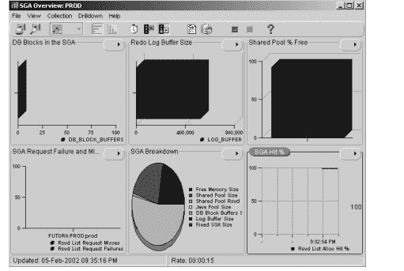

#### 图 4.7 OEM 性能管理器中的库缓存命中率 %

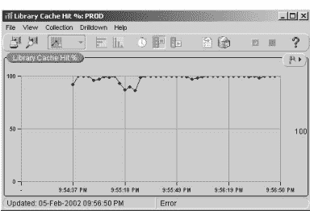

图 4.6 中显示的输出表明，右上角面板中显示的共享池空闲百分比（Shared Pool % Free）值接近 100%。这表明共享池仍有足够的空间来缓存额外的应用程序 SQL 语句。

性能管理器的另一个有用组件是“库缓存命中率 %”（Library Cache Hit %），它位于性能管理器实用工具的数据库实例类别中。图 4.7 显示了该实用工具的示例输出。

图 4.7 展示了在特定时间间隔内监控后的库缓存命中率图表。该图表显示，库缓存命中率在监控期的大部分时间内保持在 100% 左右，但在监控期开始附近短暂降至大约 90%。

性能管理器中 SQL 类别下的工具也有助于监控库缓存活动。特别是，SQL 类别中的“SQL 硬解析分析”（SQL Hard Parse Analysis）选项显示了应用程序 SQL 语句发生解析的频率。图 4.8 展示了“SQL 硬解析分析”选项的示例输出。

#### 图 4.8 OEM 性能管理器中的 SQL 硬解析分析

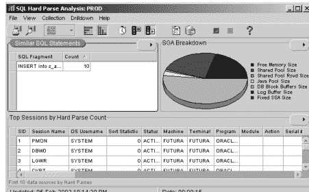

图 4.8 中的输出显示了当前 SGA 大小的分解，以及硬解析代码的 SQL 片段和每个数据库会话的硬解析次数。如果某个用户会话显示出高硬解析计数的证据，则应检查由该用户执行的应用程序代码，寻找可能增强 SQL 重用而非硬解析的改进方法。本章后文将描述鼓励 SQL 代码重用的技术。

## 衡量数据字典缓存性能

与库缓存类似，数据字典缓存有效性的衡量标准也是通过命中率来表述的。这个字典缓存命中率显示了应用程序在内存中找到所需数据字典信息的频率，而不是不得不从磁盘读取。这种命中率信息包含在一个名为 `V$ROWCACHE` 的动态性能视图中。`STATSPACK` 和 `REPORT.TXT` 的输出也包含与数据字典缓存命中率相关的统计信息。

**Oracle 目标**：衡量和调整 `字典缓存` 命中率

### 使用 `V$ROWCACHE` 监控数据字典缓存

`V$ROWCACHE` 视图中包含的两个列，`GETS`（获取次数）和 `GETMISSES`（获取缺失次数），可用于计算数据字典缓存的命中率。该视图中的统计信息通常不会单独检查，而是使用此处所示的查询以聚合形式进行检查：


```sql
SQL> SELECT 1 - (SUM(getmisses)/SUM(gets))
  2   "Data Dictionary Hit Ratio"
  3   FROM v$rowcache;

Data Dictionary Hit Ratio
-------------------------
               .969700203
```

此查询的结果表明，您的应用程序在 96.9% 的情况下能够找到已经位于内存中的所需数据字典信息。

**提示** 如果整体数据字典缓存命中率低于 85%，Oracle 建议考虑调整共享池。

### 使用 `STATSPACK` 监控数据字典缓存

数据字典缓存性能指标也可以找到在 `STATSPACK` 实用程序输出中标题为 `Dictionary Cache`（字典缓存）的部分中。

数据库统计信息。图 4.9 展示了 STATSPACK 报告中此部分输出的示例。

#### 图 4.9 显示数据字典缓存命中率的 STATSPACK 输出

```
Dictionary Cache Stats for DB: PROD  Instance: prod  Snap: 1 - 2
--"Pct Misses"  should be very low (< 3% in most cases)
--"Cache usage"  is the number of cache entries being used
--"Pct SGA"  is the ratio of usage to allocated size for that cache

     Requests      Get      Pct    Scan   Pct     Mod    Final Pct
     Reqs         Miss     Reqs   Miss    Reqs   Usage  SGA
Cache -----------------------------------------------------------------
dc_free_extents       4    0.0      0        0     30    98    88
dc_object_ids        39    0.0      0        0    403    99     99
dc_objects            83    1.2      0        0    838    99     99
dc_profiles           2    0.0      0        0      2    11     11
dc_rollback_segments  80    0.0      0        0      1     91     91
dc_segments          56    0.0      0        0    181    94     94
dc_tablespace_s       6    0.0      0        0      9     60     60
dc_user_grants       19    0.0      0        0      19    51     51
dc_usernames         28    3.6      0        0      17    81     81
dc_users             43    0.0      0        0      19    86     86
-------------------------------------------------------------
```

与库缓存的输出类似，数据字典缓存性能的 STATSPACK 输出也以未命中率（miss ratio）来表示。图 4.9 显示，数据字典缓存（例如，`dc_free_extents`，`dc_object_ids`）各组件的`未命中百分比`值在零到 3.6 个百分点的未命中率范围内变化。反过来说，这意味着在监控期间，数据字典缓存的命中率在 96.4% 到 100% 之间。


如果 STATSPACK 输出显示数据字典缓存的任何单个组件（例如，`dc_free_extents`，`dc_object_ids`）的命中率低于 98%，且大多数组件都如此，Oracle 建议考虑对共享池（Shared Pool）进行调优。

### 使用 `REPORT.TXT` 监控数据字典缓存

数据字典信息也包含在由 `UTLBSTAT.SQL` 和 `UTLSTAT.SQL` 生成的 `REPORT.TXT` 输出中。与 STATSPACK 类似，`REPORT.TXT` 单独显示每个被缓存组件的数据字典缓存统计信息。因此，在计算总体命中率之前，你需要自行添加 `GET_REQS` 和 `GET_MISS` 列。图 4.10 显示了 `REPORT.TXT` 文件的相关部分。

#### 图 4.10 显示数据字典缓存统计信息的 `REPORT.TXT` 输出

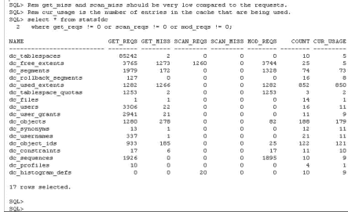

使用该输出和公式 1–(`GET_MISS` 列总和 + `GET_REQS` 列总和)，你可以计算出该数据库的数据字典缓存命中率为 96.9%。

## 改进共享池性能

既然你已经了解了共享池的组成成分并且能够衡量每个成分的性能，那么你就可以研究改进共享池性能的方法了。所有这些方法的目标都是通过提高库缓存和数据字典缓存的命中率来提高共享池的性能。这些技术分为五类：

- 增大容量
- 为大型 PL/SQL 语句腾出空间
- 将重要的 PL/SQL 代码保留在内存中
- 鼓励代码重用
- 调整库缓存相关的 init.ora 参数

### 增大容量

提高库缓存和数据字典缓存性能的最简单方法是增加共享池的大小。由于 Oracle Server 动态管理库缓存和数据字典缓存相对于共享池可用总空间的大小，因此增大共享池可以减少缓存信息被 LRU 机制移出任何一个缓存的可能性。这有助于提高库缓存和数据字典缓存的命中率。

很少会出现库缓存命中率良好但数据字典缓存命中率糟糕，或者相反的情况。由于在两个缓存之间动态分配空间，这两个缓存的命中率往往会一起波动。

共享池的大小由 init.ora 参数 `SHARED_POOL_SIZE` 决定。该参数以字节为单位指定，在 64 位操作系统上默认设置为 64MB，在 32 位操作系统上默认设置为 16MB。可以通过查询 `V$SGASTAT` 动态性能视图来确定共享池当前的尺寸：

```
SQL> SELECT pool, sum(bytes) "SIZE"
2    FROM v$sgastat
3    WHERE pool = 'shared pool'
4    GROUP BY pool;
```

POOL                 SIZE

---------- ----------

shared pool 209715200

如果你使用 Oracle 的 Java 功能，确保共享池至少为 50MB 至关重要。实例启动时会加载超过 4,000 个 Java 类，它们需要至少这么多共享池空间才能正常工作。默认情况下，Oracle9i 配置了第三个池，即 Java 池，大小为 20,000 字节。Java 池的大小由 init.ora 参数 `JAVA_POOL_SIZE` 指定。该池用于缓存 Java 状态和运行时执行信息。


有关 Java 池尺寸调整的更多信息，请参阅《Oracle9i Java 开发人员指南》第 6 章“Oracle9i Java 应用程序性能”，第 1 版（产品编号 A90209-01）。

前文讨论的 `V$DB_OBJECT_CACHE` 和 `V$SQLAREA` 动态性能视图可用于估算库缓存的大小。图 4.11 显示了一个匿名 PL/SQL 块，你可以使用它来确定实例中缓存的 SQL 语句当前占用了多少可共享内存：

#### 图 4.11 使用 V$视图估算合适的共享池大小


```
set echo off
set feedback off
set serveroutput on

DECLARE

v_total_plsql_mem NUMBER := 0;
v_total_sql_mem NUMBER := 0;
v_total_shareable_mem NUMBER := 0;

BEGIN
-- Find the total shareable memory used by non-SQL objects like
-- packages, views, etc.
SELECT sum(shareable_mem)
INTO v_total_plsql_mem
FROM v$db_object_cache;

-- Find the total shareable memory used by SQL statements
SELECT sum(shareable_mem)
INTO v_total_sql_mem
FROM v$sqlarea
WHERE executions > 10;

-- Now add these two values to get the total shareable memory
-- (i.e. Library Cache) requirements
v_total_shareable_mem := v_total_plsql_mem + v_total_sql_mem;

DBMS_OUTPUT.PUT_LINE
('Estimated required Shared Pool size is: '||TO_CHAR(v_total_shareable_mem, '999,999,999,999')||' bytes');

END;
```

上述查询汇总了非 SQL 对象（如包、视图等）使用的全部可共享内存，以及执行次数超过十次的任何 SQL 语句使用的可共享内存。这有助于排除那些可能不属于核心应用程序代码的无关且不常执行的 SQL 语句。图 4.12 显示了执行此匿名 PL/SQL 块的示例输出。

### 图 4.12 匿名 PL/SQL 块推荐的共享池大小

```
SQL> DECLARE
2 v_total_plsql_mem NUMBER := 0;
3 v_total_sql_mem NUMBER := 0;
4 v_total_shareable_mem NUMBER := 0;
5 BEGIN
6
7 -- Find the total shareable memory used by non-SQL objects like
8 -- packages, views, etc.
9 SELECT sum(shareable_mem)
10 INTO v_total_plsql_mem
11 FROM v$db_object_cache;
12 -- Find the total shareable memory used by SQL statements
13 SELECT sum(shareable_mem)
14 INTO v_total_sql_mem
15 FROM v$sqlarea
16 WHERE executions > 10;
17 -- Now add these two values to get the total shareable memory
18 -- (i.e. library cache) requirements
19 v_total_shareable_mem := v_total_plsql_mem + v_total_sql_mem;
20 DBMS_OUTPUT.PUT_LINE
21 ('Estimated required Shared Pool size is: ' || TO_CHAR(v_total_shareable_mem,'fm9,999,999,999,999')
22 END;
23 /
```

估算所需的共享池大小为：2,368,271 字节


除了上一个查询返回的值之外，Oracle 建议为每个预期的并发用户会话在共享池大小估计值上额外增加 250 字节。

使用这些结果，可以通过动态调整或手动通过实例关闭和启动来调整共享池的大小。

#### 动态增加共享池大小

可以使用 `ALTER SYSTEM` 命令动态更改共享池的大小。以下示例将共享池大小更改为 200MB：

```
SQL> ALTER SYSTEM SET shared_pool_size = 200M;
```

在调整共享池大小时，新的共享池、数据库缓冲区高速缓存和重做日志缓冲区的总大小不能超过由 `SGA_MAX_SIZE` 指定的值。


试图将共享池的大小增加到 `init.ora` 文件中 `SGA_MAX_SIZE` 参数所限制的界限之上，会导致 `ORA-04033: 内存不足，无法扩展池` 错误。

#### 手动增加共享池大小

也可以通过关闭实例、修改 `SHARED_POOL_SIZE` 的值，然后重新启动实例来调整共享池的大小。当您需要增加 `SGA_MAX_SIZE` 的值以便指定更大的 `SHARED_POOL_SIZE` 值时，必须使用此技术。


关闭并重新启动实例会导致共享池命中率人为地降低，直到实例“预热”完成且共享池重新加载了应用程序 SQL 语句为止。

##### 实际场景

### 在新服务器上共享池应该设多大？

在设置没有可用历史统计信息的新服务器时，您只能对像共享池这样的 SGA 组件的大小进行有依据的猜测。虽然 Oracle 在其示例 `init.ora` 文件中为各种 SGA 组件提供了一些建议值（小、中、大），但这些值很少有用，因为“小、中、大”只是相对术语。

#### 初始 SGA 大小计算

在使用新系统时，我不使用 Oracle 的示例值，而是使用以下经验法则来设置 SGA 大小：

- 服务器物理内存 × 0.55 = 分配给所有 SGA 的总内存量 `TSGA`
- `TSGA` / 服务器上的 Oracle 实例数量 = 每个实例的总 SGA 大小 `TSAGI`

使用该 `TSGAI` 值，然后可以计算每个单独实例的 SGA 大小：

- `TSGAI` × 0.45 = 分配给共享池的总内存
- `TSGAI` × 0.45 = 分配给数据库缓冲区高速缓存的总内存（第 5 章）
- `TSGAI` × 0.10 = 分配给重做日志缓冲区的总内存（第 6 章）

在大多数情况下，为重做日志缓冲区预留 10% 的 SGA 空间会过多。然而，一旦获得调优统计信息，可以随时从该区域取出内存并分配给共享池、数据库缓冲区高速缓存和大型池。

#### 注意事项

此计算旨在充分利用可用内存，同时为操作系统、Oracle 后台进程、用户服务器进程以及服务器上运行的其他非 Oracle 进程保留足够的内存。操作系统所需的内存量在 Windows NT 系统（通常需求更多）和基于 Unix 的系统（通常需求较少）之间差异很大，因此您可能需要相应地调整计算。在整体内存小于 1GB 的服务器上，此经验法则效果相当好。对于内存超过 1GB 的服务器，应将在 `TSGA` 计算中使用的初始 55% 减少量调整为更大的值（即 60–75%）。

#### 为大型 PL/SQL 语句腾出空间

如果应用程序调用大型 PL/SQL 包或触发器，当此大型包加载到库高速缓存中时，LRU 机制可能会将其他几个缓存的 SQL 语句移出内存。如果这些语句随后再次读入内存，这将导致库高速缓存命中率降低。为避免此问题，Oracle 允许您将库高速缓存的一部分保留给大型 PL/SQL 包使用。共享池的这一区域称为*共享池保留区域*。

`Oracle 目标`：调优共享池保留空间

`init`.ora 参数 `SHARED_POOL_RESERVED_SIZE` 可用于保留共享池的一部分，专供大型 PL/SQL 包和触发器使用。`SHARED_POOL_RESERVED_SIZE` 的值以字节为单位指定，可以设置为 `SHARED_POOL_SIZE` 指定值的 50% 以内的任何值。默认情况下，`SHARED_POOL_RESERVED_SIZE` 将是共享池大小的 5%。


作为一个起点，Oracle 建议将 `SHARED_POOL_RESERVED_SIZE` 设置为 `SHARED_POOL_SIZE` 的 10%。

确定保留池最佳大小的一种方法是监控 `V$DB_OBJECT_CACHE` 动态性能视图。可以使用以下查询查看当前在内存中缓存的 PL/SQL 包的名称和大小：


```sql
SQL> SELECT owner, name, sharable_mem
2  FROM v$db_object_cache
3  WHERE type IN ('PACKAGE', 'PACKAGE BODY')
4  ORDER BY SHARABLE_MEM DESC;
```

| OWNER | NAME | SHARABLE_MEM |
| :--- | :--- | :--- |
| SYS | STANDARD | 218260 |
| SYS | DBMS_SPACE_ADMIN | 19312 |
| SYS | DBMS_STANDARD | 15809 |
| SYS | DBMS_OUTPUT | 14171 |
| SYS | DBMS_APPLICATION_INFO | 12629 |
| SYS | DBMS_OUTLIT | 6231 |
| SYS | DBMS_SPACE_ADMIN | 5324 |
| SYS | DBMS_APPLICATION_INFO | 2865 |

动态性能视图 `V$SHARED_POOL_RESERVED` 可用于监控共享池保留区域的使用情况，并帮助确定其大小是否合适。指示您为保留区域分配的内存过多的迹象包括：

- `REQUEST_MISSES` 列中的统计值始终为零或静止不变。
- `FREE_SPACE` 列中的统计值超过分配给保留区域的总大小的 50%。

`REQUEST_FAILURES` 统计值的非零值或持续增加表明保留区域太小。

在使用共享池保留区域时，Oracle 建议您在 `V$SHARED_POOL_RESERVED` 中使 `REQUEST_MISSES` 和 `REQUEST_FAILURES` 接近零。

管理大型 PL/SQL 对象库高速缓存空间请求的另一种方法是通过使用 `DBMS_SHARED_POOL` 包中的 `ABORTED_REQUEST_THRESHOLD` 过程。此过程用于指定当大型 PL/SQL 对象试图在内存中为自己寻找空间时，可以从共享池的 LRU 列表中刷出多少库高速缓存内存：

```sql
SQL> EXECUTE dbms_shared_pool.aborted_request_threshold (10000);
```

此示例允许大型 PL/SQL 对象从共享池的 LRU 列表中刷出多达 10,000 字节。`ABORTED_REQUEST_THRESHOLD` 限制以字节为单位指定，数值范围在 5,000 到 2,000,000,000 之间。如果应用程序用户超出此限制，Oracle 将向用户返回内存不足错误。

### 将重要的 PL/SQL 代码保留在内存中

大量使用 PL/SQL 包、触发器或 Oracle 序列的应用程序可以通过将这些频繁使用的 PL/SQL 对象永久缓存到内存中直到实例关闭，从而提高共享池命中率。这个过程称为*固定（pinning）*，通过 Oracle 提供的 PL/SQL 包 `DBMS_SHARED_POOL` 来实现。被固定的包存储在由 `init.ora` 参数 `SHARED_POOL_RESERVED_SIZE` 为此目的预留的空间中。

即使是命令 `ALTER SYSTEM FLUSH SHARED_POOL` 也不会刷出已固定的对象。但是，在下次实例关闭时，已固定的对象将从内存中移除。

**Oracle 目标**：设置共享池中对象的大小并固定对象

## 构建 `DBMS_SHARED_POOL`

`DBMS_SHARED_POOL` 包不是由在数据库创建时运行的 `catproc.sql` 脚本构建的。相反，必须在 Unix 系统上以 `SYS` 用户身份登录并运行位于 `$ORACLE_HOME/rdbms/admin` 的 `dbmspool.sql` 脚本，或在 Windows 2000 系统上运行 `$ORACLE_HOME%\rdbms\admin` 中的脚本来构建它：

```sql
SQL> @$ORACLE_HOME/rdbms/admin/dbmspool.sql
```

## 使用 `DBMS_SHARED_POOL`

`DBMS_SHARED_POOL PL/SQL` 包含两个过程，`KEEP` 和 `UNKEEP`，分别用于在内存中固定或取消固定（unpin）一个包、触发器或序列。以下示例演示如何固定一个名为 `APPROVE_PO` 的应用程序 `PL/SQL` 包：

```sql
SQL> EXECUTE DBMS_SHARED_POOL.KEEP ('APPROVE_PO');
```

## 识别已固定的对象

您可以通过对 `V$DB_OBJECT_CACHE` 发出以下查询来识别使用 `DBMS_SHARED_POOL` 固定的对象：

```sql
SQL> SELECT owner, name, type
2  FROM v$dba_object_cache
3  WHERE kept = 'YES';
```

| OWNER | NAME | TYPE |
| --- | --- | --- |
| APPS | APPROVE_PO | PACKAGE |
| APPS | APPLY_TAX | TRIGGER |
| APPS | ASSIGN_ORG | PROCEDURE |

## 应该固定哪些对象

确定哪些对象应该被固定需要对应用程序及其组件有深入的了解。收集关于数据库中哪些对象被频繁访问信息的一种方法是对您考虑固定的对象激活 Oracle 的审计功能。如果您在正常处理期间对应用程序中的 `PL/SQL` 包、触发器和序列进行审计，您可以回过头来查看哪些对象在该期间被大量访问，然后考虑将其固定。

……这些项。某些供应商也会为其产品推荐固定策略。

直接使用 SQL 以及匿名的 PL/SQL 代码块无法使用 `DBMS_SHARED_POOL` 包轻松固定。如果你在开发环境中工作，并且你的应用程序发出直接 SQL 语句或匿名 PL/SQL 代码块，你或许可以通过将这些 SQL 语句重写为 PL/SQL 存储过程或包来提高应用程序的库缓存命中率，这些对象随后可以被固定。你可以通过查询 `V$SQLAREA` 视图的 `SQL_TEXT` 列来识别大型匿名 PL/SQL 块中包含的 SQL 语句，查找那些 `COMMAND_TYPE` 为 47（即 PL/SQL 执行）的 SQL 语句：

```sql
SQL> SELECT SUBSTR(sql_text,1,45), LENGTH(sql_text)
       "STMT_SIZE"
   2  FROM v$sqlarea
   3  WHERE command_type = 47
   4  ORDER BY LENGTH(sql_text) DESC;
```


为了提高共享池的命中率，Oracle 建议将超过 500 字符的任意匿名 PL/SQL 块重写为存储过程或包。

## 何时固定

为了从固定对象中获得最大利益，待固定的对象应在实例启动后立即加载到内存中。这通常通过手动执行在实例启动后立即执行的 SQL 脚本，或通过 `AFTER STARTUP ON DATABASE` 数据库触发器在实例启动时自动执行来实现。虽然一些应用程序供应商提供用于固定其常用包的脚本，但许多并不提供。在这种情况下，你将不得不自己编写脚本，每个你希望固定的包对应一个 `EXECUTE DBMS_SHARED_POOL.KEEP` 命令。

## 鼓励代码重用

提高共享池命中率的另一种方法是在可能的情况下使用已缓存在那里的代码。只有当两个语句具有相同的哈希值时，新语句才会被视为与缓存语句等效。为了增加这种情况发生的可能性，应用程序开发人员使用规范代码标准的做法至关重要，这些标准应明确规定应用程序代码中大小写、空格和行数的适当使用。在可能的情况下，还应考虑使用通用代码。

**Oracle 目标**

解释与共享池相关的其他调优问题

提高代码重用的另一种方法是通过使用绑定变量。绑定变量允许应用程序开发人员在代码中使用通用变量，而不是特定值。例如，假设两个用户，用户 A 和用户 B，都发出类似的 SQL 语句。用户 A 查找客户 2204：

```sql
SQL> SELECT last_name, first_name
   FROM app.customer
  WHERE customer_id = '2204';
```

用户 B 查找客户 2301：

```sql
SQL> SELECT last_name, first_name
   FROM app.customer
  WHERE customer_id = '2301';
```

正如你在本章前面所见，这两个语句不会哈希到相同的值，因此会导致库缓存未命中。然而，如果这两个语句是使用绑定变量发出的，用户 A 使用绑定变量查找客户 2204 将如下所示：


```sql
:customer_id = 2204

SQL> SELECT last_name, first_name
   FROM app.customer
  WHERE customer_id = :customer_id;
```

用户 B 使用绑定变量查找客户 2301 将如下所示：

```sql
:customer_id = 2301

SQL> SELECT last_name, first_name
   FROM app.customer
  WHERE customer_id = :customer_id;
```

在这种情况下，这两个语句将哈希到相同的值，并导致库缓存命中，因为生成哈希值使用的是绑定变量本身，而不是其中存储的值。


绑定变量的使用也有调优上的缺点。由于绑定变量只是值的容器，而不是实际值，它们往往会使基于成本的优化器困惑，该优化器被迫盲目猜测容器中的值如何影响最佳执行计划。

## 调优库缓存特定的 init.ora 参数

除了 `SHARED_POOL_SIZE` 之外，还有三个直接影响库缓存性能的 `init.ora` 参数：

- `OPEN_CURSORS`
- `CURSOR_SPACE_FOR_TIME`
- `SESSION_CACHED_CURSORS`
- `CURSOR_SHARING`

下一节将讨论这些参数各自的目的及其对共享池性能的影响。

### Oracle 目标

解释与共享池相关的其他调优问题

### OPEN_CURSORS

通过使用游标，每个独立的用户会话都被分配服务器主内存中的私有 SQL 区域。`OPEN_CURSORS` `init.ora` 参数限制用户会话可以打开的这些游标的数量。该参数的默认值 50 对大多数应用程序来说通常太小。增加此值不仅允许每个用户打开更多的游标，还可能最大限度地减少重新解析用户之前执行的 SQL 语句，从而提高库缓存命中率。

### CURSOR_SPACE_FOR_TIME

当此 `init.ora` 参数设置为 `TRUE` 时，共享 SQL 区域被固定在共享池中。这可以防止 LRU 机制从内存中移除共享 SQL 区域，除非引用该共享 SQL 区域的所有游标都关闭。这可以提高库缓存命中率并减少 SQL 执行时间，但代价是使用更多的服务器主内存。`CURSOR_SPACE_FOR_TIME` 的默认值是 `FALSE`。如果你有足够的服务器内存使共享池足够大以容纳所有潜在的固定 SQL 区域，并且你的应用程序不频繁使用即席 SQL，那么考虑将此参数设置为 `TRUE`。


### SESSION_CACHED_CURSORS

当相同的 SQL 语句由同一用户会话发出多次时，`SESSION_CACHED_CURSORS` `init.ora` 参数可用于指定应缓存在库缓存中这些 SQL 语句关联的游标数量。该参数的默认值为 `0`（即无游标缓存）。如果你的应用程序是基于表单的，将此参数设置为非零值可能会提高库缓存命中率。这是因为表单中包含的 SQL 语句，随着用户在表单之间导航而反复发出，将被缓存，从而最大限度地减少语句的重新解析。


### CURSOR_SHARING

`init.ora` 中的 `CURSOR_SHARING` 参数允许你更改共享池在解析和缓存 SQL 语句时的默认行为。

表 4.4 描述了可以分配给 `CURSOR_SHARING` 参数的值。

#### 表 4.4 `CURSOR_SHARING` 参数的值

| 值 | 描述 |
| :--- | :--- |
| `FORCE` | 允许两个仅字面量值不同的 SQL 语句共享缓存在共享池中的已解析代码。字面量值的差异不得改变语句的含义。此值在 Oracle8i 中引入。 |
| `SIMILAR` | 允许两个仅字面量值不同的 SQL 语句共享缓存在共享池中的已解析代码。字面量值的差异不得改变语句的含义或其缓存的执行计划。此值在 Oracle9i 中新增。 |
| `EXACT` | 两个 SQL 语句必须完全匹配才能共享缓存在共享池中的已解析代码。这是 `CURSOR_SHARING` 的默认值。 |

例如，假设应用程序用户 Bob 发出以下 SQL 语句：

```sql
SQL> SELECT order_id, customer_id FROM orders WHERE
   order_id = 1001;
```

该 SQL 语句将使用本章前面描述的过程进行解析并存储在共享池中。现在，假设应用程序用户 Linda 发出以下 SQL 语句：

```sql
SQL> SELECT order_id, customer_id FROM orders WHERE
   order_id = 1299;
```

由于这两个语句不完全相同，Linda 在共享池中不会获得缓存命中，而必须解析她的语句。然而，这两个语句本质上相同，只是 `order_id` 的字面量值不同（即 Bob 的查询中为 1001，Linda 的查询中为 1299）。通过将 `CURSOR_SHARING` 设置为 `SIMILAR` 或 `FORCE` 值，Oracle 将认为这两个相似的 SQL 语句是相同的。

这将允许 Linda 重用 Shared Pool 中 Bob 的 SQL 语句的缓存和解析版本，而无需再次解析该语句。


Oracle 动态替换 SQL 语句中字面量值的绑定变量，以实现对相似语句的光标共享。

### 摘要

Shared Pool 在处理应用程序向实例发出的 SQL 语句时起着重要作用。它充当缓存，存储之前发出的语句，以便后续对同一命令的请求可以避免重新解析相同的 SQL 命令。

Shared Pool 在两个区域中缓存其信息：Library Cache 和 Data Dictionary Cache。Library Cache 用于缓存 SQL 语句；PL/SQL 过程、函数和触发器；以及序列。Data Dictionary Cache 存储关于数据库中被缓存的 SQL 语句使用的对象的信息。Shared Pool 的性能通过这两个缓存的命中率来衡量。这些缓存的命中率可以通过分别查询 `V$LIBRARYCACHE` 和 `V$ROWCACHE` 的内容来计算。命中率还可以从 `STATSPACK` 和 `REPORT.TXT` 输出以及 Oracle Enterprise Manager 的 Performance Manager 图表中获取。

通过增加 Shared Pool 的大小、设置 Shared Pool Reserved Area、在内存中固定（pin）经常使用的 PL/SQL 代码和序列、重写应用程序 SQL 代码以鼓励重用已解析的语句，以及利用 `OPEN_CURSORS`、`CURSOR_SPACE_FOR_TIME` 和 `SESSION_CACHED_CURSORS` `init.ora` 参数，可以提高 Shared Pool 的缓存命中率。

### 考试要点

理解 Shared Pool 的每个组件。了解每个组件如何应用于应用程序 SQL 处理，以及每个组件的内容如何管理。

了解如何衡量 Shared Pool 及其组件的性能。能够查询 Data Dictionary 视图，检查 `STATSPACK` 输出，并检查 `REPORT.TXT` 文件以找到这些性能指标。

理解可以实施哪些更改来提高 Shared Pool 及其组件的性能。能够解释哪些更改影响最大，哪些更改性质更细粒度。

## 关键术语

在参加考试之前，请确保你熟悉以下术语：

- 绑定变量 (bind variables)
- 缓存命中 (cache hit)
- 缓存未命中 (cache miss)
- 数据字典缓存 (Data Dictionary Cache)
- 哈希值 (hash values)
- 命中率 (hit ratios)
- 最近最少使用 (LRU) (Least Recently Used)
- 库缓存 (Library Cache)
- 解析锁 (Parse Lock)
- P-代码 (P-Code)
- 固定 (pinning)
- 进程全局区域 (PGA) (Process Global Area)
- 共享池 (Shared Pool)
- 共享池保留区域 (Shared Pool Reserved Area)
- 用户全局区域 (User Global Area)

## 复习题

1. 以下哪项*不*是 Shared Pool 的一部分？

   - A. Dictionary Cache
   - B. Redo Log Buffer
   - C. Library Cache


### 题目

- D. User Global Area

2. Shared Pool 的内容使用什么类型的算法进行管理？

   - A. 最近最少需求 (Least Recently Needed)
   - B. 最近最少使用 (Least Recently Used)
   - C. 最近最少访问 (Least Recently Accessed)
   - D. 最近最少解析 (Least Recently Parsed)

3. 为执行做准备语句的过程叫什么？

   - A. Caching
   - B. Hashing
   - C. Parsing
   - D. 以上都不是

4. 在 Library Cache 中找到已经缓存的语句被称为什么？

   - A. Cache hit
   - B. Cache miss
   - C. Cache match
   - D. Cache parse

5. 为了确定新语句是否与 Shared Pool 中现有的语句匹配，Oracle 比较每个语句的 `________`。

   - A. 结果集
   - B. 安全性
   - C. 执行计划
   - D. 哈希值

6. 为了让两个语句导致缓存命中，以下哪项必须为真？

   - A. 语句必须使用相同的用例——大写、小写或混合。
   - B. 语句必须针对相同的表发出。
   - C. 语句必须位于相同的行数上。
   - D. 以上所有必须为真。

7. 以下哪个动态 Data Dictionary 视图包含用户发出的完整 SQL 语句？

   - A. `V$LIBRARYCACHE`
   - B. `V$SQLTEXT`
   - C. `V$SQLAREA`
   - D. `V$ROWCACHE`

8. Oracle 在 Shared Pool 中保留 SQL 语句的所有以下信息，*除了*：

   - A. 语句本身的实际文本
   - B. 语句的执行计划
   - C. 语句的 P-Code
   - D. 与语句相关的统计数据
   - E. 上述所有都保留在缓存中

9. 哪个动态 Data Dictionary 视图包含关于 Library Cache 命中率的信息？

   - A. `V$ROWCACHE`
   - B. `V$LIBRARYCACHE`
   - C. `V$DICTIONARYCACHE`
   - D. 以上所有

10. 根据 Oracle，在 OLTP 系统上，`V$LIBRARYCACHE` 中 `GETHITRATIO` 的值应该追求什么？

    - A. 小于 10 百分比
    - B. 在 60 到 80 百分比之间
    - C. 高于 95 百分比
    - D. 在 10 到 20 百分比之间

11. `V$LIBRARYCACHE` 中以下哪个列的值的变化表明之前解析的语句已从缓存中老化并必须随后重新解析？

    - A. `INVALIDATIONS`
    - B. `RELOADS`
    - C. `PINHITRATIO`
    - D. `GETHITRATIO`

12. 根据 Oracle，一个调整良好的系统应该具有什么样的 Reload Ratio？

    - A. 90 百分比或更高
    - B. 10 百分比或更高
    - C. 小于 1 百分比
    - D. 大于 1 百分比

13. 如果将序列更改为按新值递增，每个引用此序列的缓存 SQL 语句都将 `________`。

    - A. 固定在 Library Cache 中
    - B. 在 Library Cache 中标记为无效
    - C. 在 Library Cache 中哈希为新值
    - D. 对 Library Cache 没有影响

14. 你在生产服务器上对一个视图进行了更改并重新编译它。在 SQL 的下一次执行期间，依赖于该视图的任何缓存 SQL 会发生什么？

    - A. 失效 (Invalidation)
    - B. 重新编译 (Recompilation)
    - C. 重组 (Reorganization)
    - D. 重新提交 (Resubmission)

15. 以下哪个动态性能视图包含关于 Data Dictionary Cache 命中率的信息？

    - A. `V$LIBRARYCACHE`
    - B. `V$DICTIONARYCACHE`
    - C. `V$ROWCACHE`
    - D. `V$SQLAREA`

16. 根据 Oracle，对于调整良好的 OLTP 系统，Data Dictionary 命中率应该是多少？

    - A. 高于 85 百分比
    - B. 低于 85 百分比
    - C. 在 50 到 60 百分比之间
    - D. 以上都不是

17. 你发出命令 `ALTER SYSTEM FLUSH SHARED_POOL`。被固定的对象会发生什么？

    - A. 它们从缓存中被刷新。
    - B. 它们被标记为无效。
    - C. 它们在下一次执行时重新编译。
    - D. 什么都没有发生。

18. 如果应用程序发出许多相似但不相同的 SQL 语句，以下哪项有助于提高 Shared Pool 命中率？

    - A. 减少 `SHARED_POOL_SIZE` init.ora 参数
    - B. 增加 `SHARED_POOL_RESERVED_SIZE` init.ora 参数
    - C. 在 Shared Pool 中固定 PL/SQL 包
    - D. 重写应用程序代码以更多地使用绑定变量

19. 以下哪个 Oracle 提供的 PL/SQL 包用于将 PL/SQL 包固定到 Shared Pool 中？

    - A. `DBMS_UTILITY`
    - B. `DBMS_SYSTEM`
    - C. `DBMS_SHARED_POOL`
    - D. `DBMS_KEEP`

20. 哪个动态性能视图可用于监控 Shared Pool Reserved Area 的有效性？

    - A. `V$LIBRARYCACHE`
    - B. `V$ROWCACHE`
    - C. `V$DB_OBJECT_CACHE`
    - D. `V$SHARED_POOL_RESERVED`

21. 以下哪个 Oracle Enterprise Manager 组件包含与 Shared Pool 相关的性能信息？

    - A. DBA Studio
    - B. Performance Manager
    - C. Lock Manager
    - D. Change Manager

### 复习题答案

1. B. `Redo Log Buffer` 是 `System Global Area (SGA)` 的一个独立组件，不属于 Shared Pool，Shared Pool 也是 SGA 的一部分。Shared Pool 的三个部分是 Dictionary Cache、Library Cache 以及在某些配置下的 User Global Area。

2. B. 管理 Shared Pool 的 LRU 机制确保最近使用的语句将保留在内存中，而较旧的语句会被移出。

3. C. 解析过程包括检查语句的语法正确性、对象解析（即表名、列名和数据类型）以及确定执行计划。

4. A. 每当应用程序发现已解析版本的语句已经缓存在内存中时，就会发生缓存命中。

5. D. 一旦减少为其 ASCII 等价物，每个 Oracle 语句随后通过哈希算法传递。这个哈希值与 Library Cache 中缓存语句相关的哈希值进行比较，以确定是否需要执行解析。

6. D. 两个语句必须完全匹配才能被视为缓存命中。

7. B. `V$SQLAREA` 仅包含发出的 SQL 语句的前 80 个字符。

8. E. Oracle 缓存关于 SQL 语句的所有这些信息。

9. B. `V$LIBRARYCACHE` 的 `GET HITRATIO` 和 `PIN HITRATIO` 列显示 Library Cache 的命中率。

10. C. 调整良好的 OLTP 系统的 Library Cache `GET HITRATIO` 应超过 95 百分比。

11. B. `V$LIBRARYCACHE` 的 `RELOADS` 列的非零值表明语句在从 Library Cache 刷新后立即被重新解析。

12. C. 对于大多数系统，Reload Ratio 小于 1 百分比被认为是合适的。

13. B. 如果被缓存的 SQL 语句引用的对象被修改或丢弃，所有引用此对象的缓存语句都将被标记为无效，并需要在语句的下次执行时重新解析。

14. A. 当代码被重新编译或对依赖对象（如向表中添加列或修改视图）进行更改时，共享池中缓存的 SQL 会发生无效化。


15. C. `V$ROWCACHE` 视图包含两个列：`GETMISSES` 和 `GETS`，可用于计算数据字典缓存的命中率。

16. A. 经过良好调优的 OLTP 系统的命中率将高达 85% 或更高。

17. D. 即使发出 `alter system flush shared pool` 命令，固定（Pinned）对象也不会从共享池中清除。要移除这些对象，您可以使用 `DBMS_SHARED_POOL.UNKEEP` 过程。

18. D. 如果应用 SQL 中的字面值被绑定变量替换，则会提高共享池的命中率，因为缓存命中次数会增加。

19. C. `DBMS_SHARED_POOL` 包中的 `KEEP` 和 `UNKEEP` 过程可用于在共享池中固定和解除固定 PL/SQL 包。

20. D. 在 `V$SHARED_POOL_RESERVED` 视图中找到的 `FREE_SPACE`、`REQUEST_MISSES` 和 `REQUEST_FAILURES` 统计信息都可以用来判断共享池保留区的大小是否适当。

21. B. OEM 诊断包中的性能管理器组件包含多个工具，用于监控库缓存和数据字典缓存的命中率。

# 第 5 章

## 调整数据库缓冲区缓存

**本章涵盖的 ORACLE 9i 性能调优考试目标：**

- 描述缓冲区缓存如何被不同的 Oracle 进程使用
- 描述与缓冲区缓存相关的调优问题
- 监控缓冲区缓存及其内部不同池的使用情况
- 实施动态 SGA 分配
- 设置 `DB_CACHE_ADVICE` 参数
- 创建并确定多个缓冲区池的大小


> **注意**
>
> 考试目标可能随时在未经事先通知的情况下变更，且完全由 Oracle 单方面决定。请访问 Oracle 认证网站（http://www.oracle.com/education/certification/）查看当前的考试目标列表。


我们在第 4 章中通过讨论共享池开始了 Oracle SGA 调优的研究。你已经看到，在内存中找到缓存语句可以极大地提升性能。提高性能的另一个重要方式是确保用户不仅能在内存中找到其 SQL 和 PL/SQL 语句的缓存，还能找到其请求的数据。这就是数据库缓冲区缓存的作用。了解数据库缓冲区缓存的机制工作原理、如何监控其性能以及如何在需要时对其进行调优，这些都是 Oracle 性能调优的关键要素。

本章将讨论这些领域，首先从回顾缓冲区缓存架构开始。

## 理解数据库缓冲区缓存

*数据库缓冲区缓存*，或简称缓冲区缓存，是 SGA 中用于缓存应用程序用户最近访问的数据库段的数据块副本的部分。缓冲区缓存中的每个缓冲区的大小与数据库块相对应，并存储一个数据库块的内容。缓冲区缓存中缓存的块可能属于以下任一类型的段：

- 表
- 索引
- 簇
- 大对象（LOB）段
- LOB 索引
- 回滚段
- 临时段

这些缓冲区在数据库缓冲区缓存中的使用由多种机制管理，包括：

- 最近最少使用（LRU）列表
- 用户服务器进程
- 数据库写器（DBW0）后台进程

以下部分将详细讨论这些机制中的每一种。

## LRU 列表

当应用程序用户发出 SQL 语句时，与该 SQL 语句关联的段数据将从磁盘复制到 SGA 中的缓冲区缓存。例如，当用户发出 SELECT 语句时，满足查询条件的行必须先通过用户进程读取缓冲区缓存才能返回给用户，这些行需要从磁盘读入缓冲区缓存。

与共享池类似，数据库缓冲区缓存也由 *最近最少使用*（LRU）算法管理。一旦缓冲区缓存的缓冲区已满，LRU 算法会通过使最近访问最少的缓冲区老化来为后续请求新的缓冲区腾出空间。这使得 Oracle 服务器能够将最近请求的数据缓冲区保留在缓冲区缓存中，而将不太常用的数据缓冲区刷新出去。以这种方式缓存数据缓冲区，如果某个应用程序用户需要与前一个用户相同的数据缓冲区，他就会受益于缓冲区已在内存中的事实，因此用户的 *服务器进程* 不需要从磁盘读取。这是有益的，因为从内存读取的速度比从磁盘读取快数千倍。

你可以认为管理数据库缓冲区缓存中缓冲区的 *LRU 列表*类似于传送带。图 5.1 说明了这一概念。

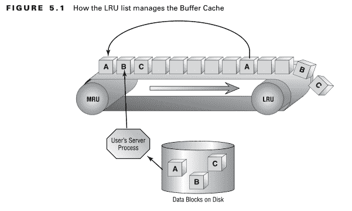

当请求数据时，用户的服务器进程将从磁盘将块（A、B、C）复制到 LRU 列表开头（最近使用端）的缓冲区。这些缓冲区保留在 LRU 列表中，但随着更多数据块被读入内存，它们会向最近最少使用端移动。如果在缓冲区（A）在 LRU 列表上的期间再次被访问，该缓冲区会被移回 LRU 列表的开头（即回到 MRU 端）。如果在缓冲区到达 LRU 列表末端之前没有再次被访问，这些缓冲区（B 和 C）将被标记为空闲，随后将被从磁盘读取的另一块覆盖。

**注意** 当通过全表扫描（FTS）访问表时，LRU 列表的行为略有不同。在 FTS 期间，表缓冲区会被立即放置在 LRU 列表的最近最少使用端。虽然这会导致这些块立即从缓存中刷新出去，但也防止了对大表进行 FTS 时将其他所有缓冲区推出缓存。

LRU 列表维护的缓冲区可以处于四种状态之一。这些状态如表 5.1 所示。

**表 5.1** 数据库缓冲区缓存缓冲区的可能的状态

| 状态 | 描述 |
| :--- | :--- |
| 空闲 (Free) | 缓冲区当前未使用。 |
| 固定 (Pinned) | 缓冲区当前正被某个服务器进程使用。 |
| 干净 (Clean) | 刚刚释放固定的缓冲区，如果其内容不再被请求，则标记为立即重用，因为缓冲区中的数据未被修改。 |
| 脏 (Dirty) | 缓冲区未使用，但包含尚未由数据库写器写入磁盘的已提交数据。 |

最初，存储在空闲缓冲区中的数据库块副本与磁盘上对应的块包含相同的数据。换句话说，块及其在缓冲区中的副本是同步的。脏缓冲区是指其在缓冲区缓存中的副本与磁盘上的块版本不匹配的缓冲区。这些块及其在缓冲区中的副本是不同步的。虽然当需要新块存入内存时，Oracle 服务器可以自由地覆盖空闲缓冲区的内容，但在脏缓冲区的内容被写入磁盘之前，不能将其覆盖为新读取的块。

管理这些脏缓冲区的机制称为 *脏列表*或 *写列表*。使用检查点队列，此列表记录所有由应用程序用户通过 `INSERT`、`DELETE` 或 `UPDATE` 语句修改但尚未写入磁盘的块。脏缓冲区由 Oracle 后台进程数据库写器（DBW0）写入磁盘。每个用户的服务器进程在执行与缓冲区缓存相关的活动时也会使用脏列表。

## 用户服务器进程

当用户的服务器进程发现其需要的数据尚未缓存在缓冲区缓存中时，它必须从磁盘读取数据。然而，在从磁盘读取数据之前，必须找到一个空闲缓冲区来持有数据块的内存副本。当寻找用于保存需要读取的区块中，用户的服务进程会同时使用LRU列表和脏列表：

- 在LRU列表中搜索空闲区块时，服务进程会将其在LRU列表中找到的任何脏区块移至脏列表。
- 随着缓冲区被添加到脏列表中，其长度会越来越长。当达到预定的阈值长度时，DBW0 会将脏缓冲区写入磁盘。
- 即使脏列表尚未达到其阈值长度，DBW0 也可以将脏缓冲区写入磁盘。这种情况发生在用户的服务进程检查了过多的缓冲区却未能成功找到空闲缓冲区时。在这种情况下，DBW0 将直接从LRU列表（而不是像上面那样先移至脏列表）将脏缓冲区写入磁盘。


> “检查的空闲缓冲区”（Free Buffer Inspected）统计指标是衡量每个服务进程在寻找空闲缓冲区过程中所检查的缓冲区数量的指标。该统计指标将在本章稍后题为“非命中率性能度量”的章节中讨论。


当用户的服务进程需要一个缓冲区并在内存中找到该缓冲区时，该缓冲区可能包含未提交的数据，或自用户事务开始以来已更改的数据。由于 Oracle 服务器从不允许用户看到未提交的数据，或在事务开始后更改的已提交数据，服务进程将使用包含数据前映像（before-image）的缓冲区，以提供数据库的读一致性视图。该前映像存储在回滚段中，其块也被缓存于缓冲区高速缓存（Buffer Cache）中。

数据库写入器（Database Writer）后台进程也直接协助管理LRU列表和脏列表。

## 数据库写入器（Database Writer）

不仅用户的服务进程可以导致 DBW0 将脏缓冲区写入磁盘，还有几种其他的数据库事件也可以导致数据库写入器将脏缓冲区写入磁盘。可能导致 DBW0 执行磁盘写入的所有事件的完整列表总结在表 5.2 中。

**表 5.2** 导致数据库写入器执行磁盘写入的事件

| 事件 | DBW0 如何写入 |
| --- | --- |
| 当脏列表达到其阈值长度时 | DBW0 从脏列表写入脏缓冲区。 |


| 当LRU列表被搜索过久而未找到空闲缓冲区时 | `DBW0` 直接从LRU列表写入脏缓冲区。 |

| 当经过三秒时 | `DBW0` 将脏缓冲区从LRU列表移至脏列表。如果超出阈值长度，还会发生磁盘写入。 |

| 在检查点（Checkpoint）时 | `DBW0` 将所有脏缓冲区从LRU列表移至脏列表，然后将它们写入磁盘。 |

| 在数据库关闭时 | 除非使用 `SHUTDOWN ABORT`，否则 `DBW0` 在数据库关闭时总是将所有脏缓冲区写入磁盘。 |

| 在表空间热备份（Hot Backup）时 | `DBW0` 将该表空间的脏缓冲区从LRU列表移至脏列表，然后将它们写入磁盘。 |

| 在表空间离线临时（Offline Temporary）时 | `DBW0` 将该表空间的脏缓冲区从LRU列表移至脏列表，然后将它们写入磁盘。 |

| 在删除段（Drop Segment）时 | 删除表或索引会导致 `DBW0` 首先将该段的脏块写入磁盘。 |

现在，既然您了解了数据库缓冲区高速缓存是如何被管理的，您可以开始考察度量其性能的方法。

# 度量数据库缓冲区高速缓存的性能

与共享池（Shared Pool）类似，数据库缓冲区高速缓存性能的一个指标是缓存命中率。每当用户发现其 SQL 语句所需的数据缓冲区已缓存在内存中时，就会发生缓存命中（cache hits）；当用户发现所需数据并未缓存在内存中时，就会发生缓存未命中（cache misses）——这导致数据从磁盘读取。较高的缓存命中率表明您的应用用户经常发现其所需的数据缓冲区已在内存中。数据库缓冲区高速缓存的命中率信息可以在多个地方找到：

- `V$SYSSTAT`
- `STATSPACK` 输出
- `UTLBSTAT.SQL`/`UTLLESTAT.SQL` 输出（`REPORT.TXT`）

此外，还有数据库缓冲区高速缓存有效性的非命中率度量指标，包括：

- 检查空闲缓冲区（Free Buffer Inspected）等待
- 缓冲区忙等待（Buffer Busy Wait）事件
- 空闲缓冲区等待（Free Buffer Wait）事件

Oracle 企业管理器（Enterprise Manager）还包含图形化工具，其中包含有关缓冲区高速缓存性能的有用信息。以下章节讨论了这些缓冲区高速缓存性能度量指标。

## Oracle 目标

**监控缓冲区高速缓存的使用情况，以及缓冲区高速缓存内的不同池**

## 使用 V$SYSSTAT 监控缓冲区高速缓存

`V$SYSSTAT` 动态性能视图包含自实例启动以来收集的有关整个系统性能的统计信息。`V$SYSSTAT` 视图所包含的四个列的名称及其内容描述如表 5.3 所示。

**表 5.3** `V$SYSSTAT` 的内容

| 列名 | 描述 |
| :--- | :--- |
| `STATISTIC#` | 与性能统计名称相关联的标识符。 |
| `NAME` | 性能统计的名称。 |
| `CLASS` | 统计指标所属的广泛类别，由数字代码指定，其中：<br>1 = 用户<br>2 = Redo<br>4 = 队列<br>8 = 缓存<br>16 = 操作系统<br>32 = 真实应用集群（Real Application Cluster）<br>64 = SQL<br>128 = 调试<br>这些值是累加的，允许一个统计指标属于多个类别。 |
| `VALUE` | 当前与该统计指标关联的数值。 |

`V$SYSSTAT` 视图跟踪超过 200 种不同的统计指标。然而，在计算数据库缓冲区高速缓存性能时，只使用其中四种：

**物理读（Physical Reads）** 此统计指标指示自实例启动以来，从磁盘读入缓冲区高速缓存的数据块数量（即表、索引和回滚段）。

**直接物理读（Physical Reads Direct）** 此统计指标指示因数据块直接从磁盘读取而未经过缓冲区高速缓存的读取次数。由于在 Oracle 使用某些功能（如并行查询）时是直接有意进行直接物理读的，因此在计算缓冲区高速缓存命中率时，这些读取次数会从物理读数中减去。否则，将这些直接读取包含在缓冲区高速缓存命中率的计算中会导致命中率人为降低。

**直接物理读（LOB）** 此统计指标指示因数据块与大型对象（LOB）数据类型相关而未经过缓冲区高速缓存的读取次数。

由于在 Oracle 访问包含 LOB 数据类型的段时是直接有意进行直接物理读的，因此在计算缓冲区高速缓存命中率时，这些读取次数也会从物理读数中减去。将这些直接读取包含在缓冲区高速缓存命中率的计算中同样会导致命中率人为降低。

**会话逻辑读（Session Logical Reads）** 此统计指标指示使用已缓存在数据库缓冲区高速缓存中的缓冲区来满足数据块请求的次数。出于读一致性考虑，其中一些缓冲区可能包含来自回滚段的数据。

图 5.2 展示了如何使用这些统计指标来计算数据库缓冲区高速缓存的命中率。

**图 5.2 使用 V$SYSSTAT 计算数据库缓冲区高速缓存命中率**

```sql
SQL> SELECT 1 - ((physical.value - direct.value - lobs.value) / logical.value) "Buffer Cache Hit Ratio"
2  FROM v$sysstat physical,
3  v$sysstat direct,
4  v$sysstat lobs,
5  v$sysstat logical
6  WHERE physical.name = 'physical reads'
7  AND direct.name = 'physical reads direct'
8  AND lobs.name = 'physical reads direct (LOB)'
9  AND logical.name = 'session logical reads';
Buffer Cache Hit Ratio
.937164521
```

图 5.2 中查询的结果表明，在 93.7% 的时间里，应用用户发现他们请求的数据已经缓存在缓冲区高速缓存中。用于计算数据库缓冲区高速缓存命中率的通用公式如图 5.2 所示：

1 – ((物理读 – 直接物理读 – 直接物理读 [LOB]) ÷ 会话逻辑读)

> 根据 Oracle，经过良好调优的 OLTP 系统，其数据库缓冲区高速缓存命中率应在 90% 或更高。

## 使用 STATSPACK 监控缓冲区高速缓存

`STATSPACK` 实用程序的输出也包含数据库缓冲区高速缓存命中率的计算。图 5.3 展示了示例 `STATSPACK` 输出中的相应部分，其中缓冲区高速缓存命中率以粗体显示。

示例输出的结果表明，在 92.21% 的时间里，应用用户发现他们请求的数据已经缓存在缓冲区高速缓存中。

### 图 5.3 显示缓冲区高速缓存命中率统计包的 STATS PACK 输出

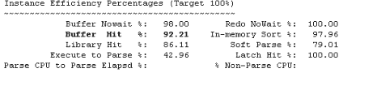

## 使用 REPORT.TXT 输出

通过运行 `UTLBSTAT.SQL` 和 `UTLESTAT.SQL` 生成的 `REPORT.TXT` 文件还包含一个部分，该部分显示了计算数据库缓冲区高速缓存命中率所需的统计信息。这些统计信息包括与图 5.2 中从 `V$SYSSTAT` 查询的相同的“物理读”（Physical Reads）、“直接物理读”（Physical Reads Direct）、“直接物理读 (LOB)”（Physical Reads Direct (LOB)）和“会话逻辑读”（Session Logical Reads）统计信息。图 5.4 展示了 `REPORT.TXT` 样本的相关部分。

### 图 5.4 显示缓冲区高速缓存统计信息的 REPORT.TXT 输出

```sql
SQL> select ni.name "Statistic", 
2  ni.change "Total", 
3  round(ni.change/(trans.change/2),2) "Per Transaction", 
4  round(ni.change/((start_users + end_users) / 2),2) "Per Logon", 
5  round(ni.change/(to_number(to_char(end_time, 'J'))*60*60*24 -
6  to_number(to_char(start_time, 'J'))*60*60*24 + 
7  to_number(to_char(end_time, 'SSSSS'))) - 
8  to_number(to_char(start_time, 'SSSSS'))), 2) "Per Second"
9  from v$sysstat ni,
10 v$sysstat trans,
11 v$sysstat_dates 
12 where trans.name='user commits'
13 and ni.change != 0
14 order by ni.name;
```

| 统计项 | 总计 | 每事务 | 每次登录 | 每秒 |
|---|---|---|---|---|


| 物理读 | 4832 | 37.33 | 584.00 | 19.38 |

| 直接物理读 | 266 | 1.91 | 25.75 | .99 |

| 直接物理读 (lob) | 22 | .21 | 1.32 | .02 |

| 物理写 | 19950 | 184.72 | 2495.75 | 95.51 |

| 直接物理写 | 206 | 1.91 | 25.75 | .99 |

| 直接物理写 (lob) | 97 | .90 | 1.32 | .42 |

| 非检查点物理写 | 6508 | 60.26 | 813.50 | 31.29 |

| 预取块 | 3107 | 28.77 | 388.38 | 14.94 |

| 进程最后非空闲时间 | 5033083984 | 46602629.48 | 629135498.00 | 24197519.15 |

| 递归调用 | 170049 | 1574.53 | 21256.13 | 817.54 |

| 通过调用/回调获取的行数 | 18223 | 168.73 | 2277.88 | 87.61 |

| 会话连接时间 | 5033083984 | 46602629.48 | 629135498.00 | 24197519.15 |

| 会话逻辑读 | 704252 | 6520.85 | 88031.50 | 3393.83 |

| 会话工作单元内存 | 63572 | 605.30 | 8071.50 | 314.29 |

使用这些统计信息，数据库缓冲区高速缓存命中率的计算公式为：

$1 - \frac{(4832 - 266 - 22)}{704252} = 0.99349$

或者命中率为 99.35%。

### 非命中率性能度量指标

命中率是衡量缓冲区高速缓存性能的有效指标之一。然而，还有几种非命中率指标用于衡量数据库缓冲区高速缓存的性能。这些指标是动态性能视图中找到的与缓冲区高速缓存相关的系统统计信息，以及来自 `STATSPACK` 和 `REPORT.TXT` 的输出。


由于这些统计信息可以帮助您找到真正的调优问题点，因此将缓冲区高速缓存命中率作为起点往往比盲目增加缓冲区高速缓存的大小更有效。

以下系统统计信息涉及在数据库缓冲区高速缓存中寻找空闲缓冲区的过程。有三个统计信息用于衡量此活动：

- **空闲缓冲区检查次数 (Free Buffer Inspected)**：用户服务器进程在找到空闲缓冲区之前检查的缓冲区高速缓存中的缓冲区数量。一个密切相关的统计项是 `dirty_buffer_inspected`，它表示用户进程在尝试查找空闲缓冲区时发现的脏缓冲区总数。

- **空闲缓冲区等待 (Free Buffer Waits)**：用户服务器进程在空闲缓冲区检查活动期间经历的等待次数。每当服务器进程必须等待数据库写入器（Database Writer）将脏缓冲区写入磁盘时，就会发生这些等待。

- **缓冲区忙等待 (Buffer Busy Waits)**：用户服务器进程等待空闲缓冲区可用的次数。每当用户服务器进程请求的缓冲区已在内存中但被另一个进程使用时，就会发生这些等待。这些等待可能发生在回滚段缓冲区以及数据和索引缓冲区上。

这些统计信息中任何一个的高值或持续增加的值都表明，用户服务器进程正在花费太多时间在数据库缓冲区高速缓存中搜索和等待访问空闲缓冲区。

可以使用 `V$SYSSTAT` 和 `V$SYSTEM_EVENT` 动态性能视图来监控这些缓冲区高速缓存性能的次要指标。

`V$SYSSTAT` 视图包含有关“空闲缓冲区检查次数”的统计信息，而 `V$SYSTEM_EVENT` 视图包含有关“空闲缓冲区等待”和“缓冲区忙等待”的统计信息。可以使用以下 SQL 语句将这三个统计信息合并到一个查询中：

```sql
SQL> SELECT name, value
2    FROM v$sysstat
3    WHERE name IN ('free buffer inspected')
4    UNION
5    SELECT event, total_waits
6    FROM v$system_event
7    WHERE event in ('free buffer waits','buffer busy waits');
```

| 名称 | 值 |

|---|---|

| 缓冲区忙等待 | 170 |

| 空闲缓冲区检查次数 | 0 |

这些统计信息也包含在 `STATSPACK` 和 `REPORT.TXT` 的输出中。图 5.5 和 5.6 展示了显示这些统计信息的 `STATSPACK` 输出样本。

## 图 5.5 显示空闲缓冲区检查次数统计信息的 STATSPACK 输出

```text
Instance Activity Stats for DB: PROD Instance: prod Snaps: 1 - 2
Statistic                 Total per Second per Trans
---------------------------- ---------------- ------
<snip>
enqueue waits             0      0.0    0.0
execute count            142      0.2    47.3
free buffer inspected     41      0.1    13.7
free buffer requested    704      1.1   234.7
immediate (CR) block cleanout app  0      0.0    0.0
immediate (CURRNT) block cleanup 16      0.0    5.3
<snip>
```

## 图 5.6 显示缓冲区忙等待统计信息的 STATSPACK 输出

```text
Buffer Pool Statistics for DB: PROD Instance: prod Snaps: 1 - 2
-> Standard block size Pools D: default, K: keep, R: recycle
-> Default Pools for other block sizes: 2k, 4k, 8k, 16k, 32k
                                Free                Buffer
        Number of Cache  Buffer   Physical   Physical  Write           Busy
P  Buffers Hit %        Gets     Reads    Writes  Waits Complete Waits Waits
----------------------------------------------------------
D       6,010  100.0     3,165       0          236      2     0       12
```

图 5.7 和 5.8 展示了显示这些统计信息的 `REPORT.TXT` 输出样本。

## 图 5.7 显示空闲缓冲区检查次数统计信息的 REPORT.TXT 输出

```sql
SQL> select nl.name 'Statistic',
2         nl.change 'Total',
3         round(nl.change/(trans.change/2),2) "Per Transaction",    
4         round(nl.change/((start_users + end_users)/2),2) "Per Logon",
5         round(nl.change/to_number(to_char(end_time, 'J'))*60*60*24
6               - to_number(to_char(start_time, 'J'))*60*60*24 -
7               to_number(to_char(end_time, 'SSSSS'))
8               + to_number(to_char(start_time, 'SSSSS'))
9               , 2) "Per Second"
10        from
11           stats$stats nl,
12           stats$stats trans,
13           stats$dates
14        where
15           trans.name='user commits'
16           and nl.change != 0
17        order by nl.name;
```


| 统计项 | 总计 | 每事务 | 每次登录 | 每秒 |
|---|---|---|---|---|
| <snip> |  |  |  |  |
| 队列超时 | 5 | .05 | .63 | .02 |
| 队列等待 | 9 | .08 | 1.13 | .04 |
| 执行计数 | 80502 | 745.39 | 10062.75 | 387.05 |
| 空闲缓冲区检查次数 | 10 | .25 | 1.45 | .13 |
| 空闲缓冲区请求次数 | 17415 | 161.25 | 2176.88 | 83.73 |
| 即时 (CR) 块清除 | 427 | 3.95 | 52.38 | 2.05 |

## 图 5.8 显示缓冲区忙等待统计信息的 REPORT.TXT 输出

```sql
SQL> Rem System wide events for non-background processes (EMON,
SQL> Rem EMON, etc). Times are in hundredths of seconds. Each one of
SQL> Rem these is a context switch which costs CPU time. By looking at
SQL> Rem the Total Time you can often determine what is the bottleneck
SQL> Rem that processes are waiting for. This shows the total time spent
SQL> Rem waiting for a specific event and the average time per wait on
SQL> Rem that event.
SQL> select nl.event "Event Name",
2         nl.event_count "Count",
3         nl.time_waited "Total time",
4         round(nl.time_waited/nl.event_count, 2) "Avg Time"
5         from stats$event nl
6         where nl.event_count > 0
7         order by nl.time_waited desc;
```

| 事件名称 | 计数 | 总时间 | 平均时间 |
|---|---|---|---|
| SQL*Net 客户端消息 | 40057 | 35572 | .89 |
| 队列 | 21 | 4724 | 224.95 |
| 库缓存加载锁 | 18 | 3487 | 193.72 |
| 日志文件切换完成 | 39 | 2672 | 68.51 |
| 数据文件顺序读 | 290 | 2024 | 6.98 |
| 数据库名称 IPC 响应 | 29 | 1476 | 50.90 |
| 日志文件同步 | 98 | 1101 | 11.23 |
| 数据文件随机读 | 450 | 1059 | 2.35 |
| 日志缓冲区空间 | 162 | 1011 | 6.24 |
| 切换日志文件命令 | 5 | 651 | 130.20 |
| 缓冲区忙等待 | 170 | 246 | 1.45 |
| 控制文件顺序读 | 56 | 244 | 4.36 |
| 闩锁释放 | 119 | 195 | 1.64 |

## 使用 OEM 监控缓冲区高速缓存性能

OEM 控制台的 Performance Manager（性能管理器）组件也可用于监控缓冲区高速缓存（Buffer Cache）性能。图 5.9 展示了与缓冲区高速缓存相关的性能管理器输出示例。

图 5.9 中的输出显示，在 OEM 监控期间，缓冲区高速缓存的命中率（hit ratio）为 97.38%。

**图 5.9** OEM 性能管理器缓冲区高速缓存监控

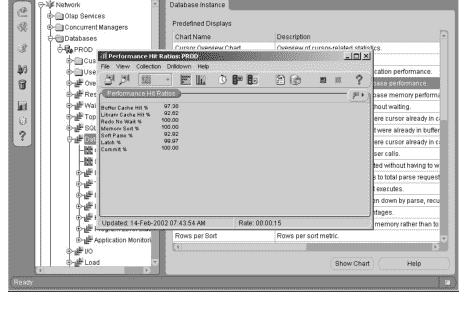

## 提升缓冲区高速缓存性能

现在您已经了解了数据库缓冲区高速缓存管理机制的工作原理以及如何监控其性能，接下来可以查看提升性能的方法。这些方法的目标是通过提高命中率来提升数据库缓冲区高速缓存的性能。这些技术分为五类：

- 增大其尺寸。
- 使用多个缓冲区池（Buffer Pools）。
- 将表缓存在内存中。
- 绕过缓冲区高速缓存。
- 恰当地使用索引。

### 增大尺寸

提升数据库缓冲区高速缓存性能最简单的方法是增加其尺寸。数据库缓冲区高速缓存越大，缓存的缓冲区被 LRU 列表（最近最少使用列表）移出缓存的可能性就越小。缓冲区存储在数据库缓冲区高速缓存中的时间越长，命中率就会越高。增加缓冲区高速缓存的尺寸还会降低由 `free buffer inspected`（空闲缓冲区检查）、`buffer busy waits`（缓冲区繁忙等待）和 `free buffer waits`（空闲缓冲区等待）系统统计报告中的等待次数。

在 Oracle9i 中，数据库缓冲区高速缓存的尺寸由多个 `init.ora` 参数决定。这些参数的描述如表 5.4 所示。

**表 5.4** 影响缓冲区高速缓存尺寸的 `init.ora` 参数

| 参数名称 | 描述 |
| :--- | :--- |
| `DB_BLOCK_SIZE` | 定义数据库的主要块大小。Oracle9i 支持多种块大小，允许特定表空间的块大小与此大小不同。 |
| `DB_CACHE_SIZE` | 确定主要块大小（由 `DB_BLOCK_SIZE` 确立）对应的默认缓冲区池（Default Buffer Pool）的尺寸。默认尺寸为 48M。 |
| `DB_KEEP_CACHE_SIZE` | 确定 Keep 缓冲区高速缓存（Keep Buffer Cache）的尺寸。默认尺寸为 0KB。它也使用主要块大小作为其缓冲区大小。Keep 缓存将在下一节“使用多个缓冲区池”中讨论。 |
| `DB_RECYCLE_CACHE_SIZE` | 确定 Recycle 缓冲区高速缓存（Recycle Buffer Cache）的尺寸。默认尺寸为 0KB。它也使用主要块大小作为其缓冲区大小。Recycle 缓存将在下一节“使用多个缓冲区池”中讨论。 |
| `DB_2K_CACHE_SIZE` | 如果 2KB 不是主要块大小，则指定具有 2KB 块大小的段（segments）的缓冲区高速缓存尺寸。 |
| `DB_4K_CACHE_SIZE` | 如果 4KB 不是主要块大小，则指定具有 4KB 块大小的段的缓冲区高速缓存尺寸。 |
| `DB_8K_CACHE_SIZE` | 如果 8KB 不是主要块大小，则指定具有 8KB 块大小的段的缓冲区高速缓存尺寸。 |
| `DB_16K_CACHE_SIZE` | 如果 16KB 不是主要块大小，则指定具有 16KB 块大小的段的缓冲区高速缓存尺寸。 |
| `DB_32K_CACHE_SIZE` | 如果 32KB 不是主要块大小，则指定具有 32KB 块大小的段的缓冲区高速缓存尺寸。 |

数据库主要块大小由 `DB_BLOCK_SIZE` 参数以字节为单位指定。该值在数据库创建时设置，只能通过重新创建数据库来更改。`DB_BLOCK_SIZE` 的默认值因平台而异。在大多数 Unix 系统中，它介于 2KB 和 8KB 之间。Windows 2000 系统的默认块大小为 2KB。无论默认值如何，大多数系统都可以使用 2KB、4KB、8KB、16KB 或 32KB 的块大小。并非所有表空间都需要具有相同的块大小。第 2 章“调优信息源”中讨论的粒度（granules）概念，允许 Oracle9i 数据库中的表空间具有不同的块大小。然而，SYSTEM 和 TEMP 两个表空间将始终使用 `init.ora` 参数中由 `DB_BLOCK_SIZE` 定义的主要块大小，任何未明确指定不同块大小创建的其他表空间也将如此。尽管数据库缓冲区高速缓存可以存储各种尺寸的缓冲区，但仍应根据此主要块大小进行调优。


> 不要使用 `DB_nK_CACHE_SIZE` 参数来定义主要块大小的缓冲区高速缓存尺寸。始终使用 `DB_CACHE_SIZE` 参数来设置主要块大小的缓冲区高速缓存尺寸。

为了提升性能，可以将缓冲区高速缓存划分为最多三个不同的区域，称为默认池（Default）、保留池（Keep）和回收池（Recycle）池，使用表 5.4 中所示的 `init.ora` 参数实现。这些参数中每一个的尺寸都可以通过在参数指定的数值后附加相应字符（K、M 或 G）来表示为千字节、兆字节或吉字节。默认情况下，只配置了 *默认池*，因为回收池和 *保留池* 都被分配为零字节。多个缓冲区池的使用将在后续章节“使用多个缓冲区池”中讨论。就性能而言，增加默认缓冲区池的尺寸通常能提高缓冲区高速缓存的命中率。默认池的尺寸可以通过动态调整或通过实例关闭和启动来调整。


# Oracle 目标：实施动态 SGA 分配

## 动态增加缓冲区高速缓存尺寸

可以使用 `ALTER SYSTEM` 命令动态更改数据库缓冲区高速缓存及其三个组成池的尺寸。图 5.10 展示了使用 `ALTER SYSTEM` 命令将默认池从 48MB 增加到 100MB 的过程。

**图 5.10** 动态增加默认池尺寸

```sql
SQL> show parameter db_cache_size
 NAME                TYPE      VALUE
 ------------------- --------- ----------------
 db_cache_size        unknown   50331648

SQL> ALTER SYSTEM SET db_cache_size = 100m;
 System altered.

SQL> show parameter db_cache_size
 NAME                TYPE      VALUE
 ------------------- --------- ----------------
 db_cache_size        unknown   109051904
```

> 使用 `ALTER SYSTEM` 命令更改缓冲区高速缓存的尺寸时，实例关联的 `SPFILE` 也会随之更新。这将使更改在下一次实例重启后依然有效。

在调整数据库缓冲区高速缓存池的尺寸时，必须牢记三条规则：
- 指定的尺寸必须是粒度（granule）尺寸的整数倍。
- 缓冲区高速缓存、共享池（`Shared Pool`）和重做日志缓冲区（`Redo Log Buffer`）的总尺寸不能超过 `SGA_MAX_SIZE` 指定的值。
- 由 `init.ora` 参数 `DB_CACHE_SIZE` 指定的默认池不能设置为零尺寸。

> **提示** 尝试将缓冲区高速缓存的尺寸增加到超出可用粒度的值会导致发生 `ORA-00384: Insufficient memory to grow cache`（内存不足，无法扩展缓存）错误。

## 手动增加缓冲区高速缓存尺寸

也可以通过关闭实例、更改 `DB_CACHE_SIZE` 的值，然后重启实例来调整缓冲区高速缓存的尺寸。当您需要增加 `SGA_MAX_SIZE` 的值以便指定更大的 `DB_CACHE_SIZE` 值时，必须使用此技术。

> **注意** 关闭然后重启实例会导致缓冲区高速缓存命中率人为偏低，直到实例“预热”且缓存从数据库数据文件中重新加载缓冲区为止。

## 增加缓冲区高速缓存尺寸：多大才足够？

通常，将数据库缓冲区高速缓存动态或手动增加直到数据库缓冲区高速缓存命中率不再提升或服务器可用内存耗尽，是可以接受的调优实践方法。然而，除了简单猜测应该将缓冲区高速缓存增大多少之外，您还可以使用 Oracle9i 的缓冲区高速缓存建议（Buffer Cache Advisory）功能。*缓冲区高速缓存建议* 功能会跟踪如果将缓冲区高速缓存变得比现有尺寸更大（或更小），缓冲区高速缓存性能可能发生的变化。使用缓冲区高速缓存建议功能需要进行一些初始配置。

# Oracle 目标：设置 DB_CACHE_ADVICE 参数

## 配置缓冲区高速缓存建议功能

为了使缓冲区高速缓存建议功能收集关于缓冲区高速缓存尺寸变化可能如何影响性能的统计信息，必须将 `init.ora` 参数 `DB_CACHE_ADVICE` 设置为 `ON`。将此参数设置为 `ON` 会导致 Oracle9i 为缓冲区高速缓存建议分配内存

该特性，并启动缓冲池缓存顾问功能，开始收集有关缓冲池缓存性能的信息。`DB_CACHE_ADVICE` `init.ora` 参数的其他可能取值如下：
- `OFF`：关闭缓冲池缓存顾问功能，并释放分配给它的任何内存或 CPU 资源。
- `READY`：为缓冲池缓存顾问进程预先分配内存，但并未实际启动它。因此，在将 `DB_CACHE_ADVICE` 参数设置为 `ON` 之前，不会消耗 CPU 资源，也不会收集统计信息。`READY` 选项用于确保在稍后激活该功能时，缓冲池缓存顾问功能能够找到其所需的内存。

与 `DB_CACHE_SIZE` 参数一样，`DB_CACHE_ADVICE` 参数也可以手动或动态设置。除了内存之外，激活缓冲池缓存顾问功能还会消耗一些 CPU 资源。因此，你可能希望将该参数的使用限制在从事性能调优工作的时间段内。

> 如果之前未使用 `READY` 选项，当动态尝试将 `DB_CACHE_ADVICE` 设置为 `ON` 时，可能会遇到 `ORA-04031 unable to allocate n bytes of shared memory` 错误。

为了获得可靠的建议，在激活缓冲区高速缓存建议功能后，应等待 30 分钟或更长时间，然后再查看建议统计信息。

## 检查缓冲池缓存顾问统计信息

由缓冲池缓存顾问功能收集的性能统计信息存储在 `V$DB_CACHE_ADVICE` 动态性能视图中。该视图的内容如表 5.5 所述。

**表 5.5** `V$DB_CACHE_ADVICE` 视图说明

| 列名 | 说明 |
| :--- | :--- |
| `ID` | 所引用的缓冲池的标识符。可以是 1 到 8 之间的值。 |
| `NAME` | 所引用的缓冲池的名称。 |
| `BLOCK_SIZE` | 该缓冲池中缓冲区的块大小，以字节显示。 |
| `ADVICE_STATUS` | 缓冲池缓存顾问功能的状态（即 `OFF`、`READY`、`ON`）。 |
| `SIZE_FOR_ESTIMATE` | 用于预测物理读数的缓存大小估计值，单位为 MB。 |
| `BUFFERS_FOR_ESTIMATE` | 用于预测物理读数的缓存大小估计值，以缓冲区为单位。 |
| `ESTD_PHYSICAL_READ_FACTOR` | 估计的物理读数与实际针对当前缓存发生的读数之间的比率，如果没有发生物理读数则为 null。 |
| `ESTD_PHYSICAL_READS` | 如果实际使用了由 `SIZE_FOR_ESTIMATE` 和 `BUFFER_FOR_ESTIMATE` 指定的缓存大小作为 `DB_CACHE_SIZE`，预计会发生的物理读数。 |

在正常的数据库处理经过一段时间后，你可以检查 `V$DB_CACHE_ADVISE` 视图，以查看缓冲池缓存顾问功能考虑的各个 `DB_CACHE_SIZE` 值所能预期的性能提升。以下查询展示了 `V$DB_CACHE_ADVISE` 查询的示例输出，请注意，该查询将输出限制为块大小为 8KB（8,192 字节）的记录，因为这是由 `DB_BLOCK_SIZE` `init.ora` 参数指定的数据库主要块大小：

```sql
SQL> SELECT name, size_for_estimate, estd_physical_reads
2 FROM v$db_cache_advise
3 WHERE block_size = '8192'
4 AND advice_status = 'ON';
```

| NAME | SIZE_FOR_ESTIMATE | ESTD_PHYSICAL_READS |
|---|---|---|
| DEFAULT | 10.1797 | 7686 |
| DEFAULT | 20.3594 | 6614 |
| DEFAULT | 30.5391 | 6028 |
| DEFAULT | 40.7188 | 5785 |
| DEFAULT | 50.8984 | 5497 |
| DEFAULT | 61.0781 | 5342 |
| DEFAULT | 71.2578 | 4915 |
| DEFAULT | 81.4375 | 4867 |
| DEFAULT | 91.6172 | 4866 |
| DEFAULT | 101.7969 | 4866 |
| DEFAULT | 111.9766 | 4866 |
| DEFAULT | 122.1563 | 4866 |
| DEFAULT | 132.3359 | 4866 |
| DEFAULT | 142.5156 | 4866 |
| DEFAULT | 152.6953 | 4866 |
| DEFAULT | 162.875 | 4866 |
| DEFAULT | 173.0547 | 4866 |
| DEFAULT | 183.2344 | 4866 |
| DEFAULT | 193.4141 | 4866 |
| DEFAULT | 203.5938 | 4866 |

假设生成此输出的实例当前 `DB_CACHE_SIZE` 的值为 30MB。该值出现在输出的第三行，在 `SIZE_FOR_ESTIMATE` 列下为 30.5391。`ESTD_PHYSICAL_READS` 列表明，基于启用缓冲池缓存顾问功能期间发生的数据库活动，当 `DB_CACHE_SIZE` 为此时大小时，预计会有 6028 次物理读。


如果将 `DB_CACHE_SIZE` 减小到 20MB，鉴于相同的数据库活动量，你可以预期会有 6614 次物理读。同样，如果将缓冲池缓存增加到 100MB，鉴于相同的数据库活动量，你可以预期会有 4866 次物理读。

通过这种方式，缓冲池缓存顾问功能提供了“苹果对苹果”的比较，即根据 `DB_CACHE_SIZE` `init.ora` 参数大小的增加或减少，预计会增加或减少多少物理 I/O。


查询输出显示，一旦 `DB_CACHE_SIZE` 增加到 80MB，预计物理 I/O 数量不会显著减少。从 80MB 增加到 90MB 仅会使物理 I/O 减少 2 次，并且估计超过 90MB 的增加不会进一步减少物理 I/O。

数据库缓冲池缓存的增加通常并非直接的线性关系。例如，将 `DB_CACHE_SIZE` 的值加倍并不一定会使缓冲池缓存命中率加倍。

改进缓冲池缓存性能的另一种技术是将缓冲池缓存划分为多个缓冲池。

## 使用多个缓冲池

默认情况下，所有数据库段都在默认池中竞争使用相同的数据库缓冲池缓存缓冲区。这可能导致一种情况：一些仅受少数应用程序用户关注的不经常访问的表，将更常用的数据缓冲区从内存中挤出。为了避免这种情况，Oracle 提供了将数据库缓冲池缓存划分为多达三个称为 `缓冲池` 的独立区域的能力。然后，段被显式分配给由 DBA 决定的适当缓冲池。

### 缓冲池类型

在创建任何缓冲池之前，你必须确定希望使用哪些类型的池。每个缓冲池都用于根据你预计应用程序访问这些段的频率来缓存段：

- `Keep Pool`：用于缓存你极少（如果有的话）希望其离开数据库缓冲池缓存的段。该池的大小由 `init.ora` 参数 `DB_KEEP_CACHE_SIZE` 指定，单位为字节、千字节、兆字节或吉字节。使用 Keep Pool 是可选的。其默认大小为 0 字节。
- `Recycle Pool`：用于缓存你极少（如果有的话）希望其保留在数据库缓冲池缓存中的段。`Recycle Pool` 的大小由 `init.ora` 参数 `DB_RECYCLE_CACHE_SIZE` 指定，单位为字节、千字节、兆字节或吉字节。使用 Recycle Pool 也是可选的。其默认大小为 0 字节。
- `Default Pool`：用于缓存未指定给 Keep 或 Recycle 池的段。该池的大小由 `init.ora` 参数 `DB_CACHE_SIZE` 指定，单位为字节、千字节、兆字节或吉字节。Default Pool 是必需的。其默认大小为 48 兆字节。此参数不能设置为 0。

除非在 `init.ora` 中另有指定，否则仅在实例启动时创建 Default Pool。


如果使用多个块大小，可以为每个块大小的缓冲池缓存创建 Keep、Recycle 和 Default Pool。


与从分配给 Default Pool 的内存中扣除 Keep 和 Recycle 池内存的 Oracle8i 不同，Oracle9i 独立地为三种缓冲池类型中的每一种分配内存。这使得可以在不影响分配给剩余池的内存的情况下，单独修改每个缓冲池的大小。

在配置缓冲池之前，你需要确定哪些段将被缓存在 Keep 和 Recycle 池中。

## 确定要缓存哪些段

确定要在非默认缓冲池中缓存哪些段，以及在哪些池中缓存它们，需要对应用程序、其段以及段是如何被访问的有透彻的了解。确定应将哪些段分配给每个缓冲池的一种方法是确定哪些段当前缓存在默认池中，并将这些段分类为包含在 Keep 或 Recycle 池中的候选者。四个视图 `V$BH`、`DBA_OBJECTS`、`V$CACHE` 和 `DBA_USERS` 可用于此目的。

## 使用 V$BH 和 DBA_OBJECTS 识别缓存候选者

`V$BH` 和 `DBA_OBJECTS` 视图都包含有用的信息，可以帮助你识别当前缓存在缓冲池缓存中的段。利用这些信息和对应用程序的了解，你可以确定这些对象中是否有任何一个应该缓存在 Keep 或 Recycle 池中，以提高缓冲池缓存的性能。表 5.6 和表 5.7 描述了将这些视图用于将段分配到适当缓冲池的有用列。

### 表 5.6 V$BH 视图的部分说明

| 列名 | 说明 |
| --- | --- |
| `BLOCH#` | 缓冲区高速缓存中缓存块的块号 |
| `OBJD` | 缓冲区高速缓存中缓存块所属对象的对象 ID |

### 表 5.7 DBA_OBJECTS 视图的部分说明

| 列名 | 说明 |
| --- | --- |
| `OBJECT_ID` | 分配给该对象的数字标识符 |
| `OWNER` | 该对象的所有者 |
| `OBJECT_NAME` | 该对象的名称 |
| `OBJECT_TYPE` | 对象类型（例如，表、索引、视图） |

`V$BH` 视图实际上是为调整运行 Oracle9i 实时应用程序集群（RAC）功能的 Oracle 服务器而设计的。然而，对于非 RAC 系统，它也有用，因为它显示了每个缓存段中当前有多少个缓存缓冲区位于数据库缓冲区高速缓存中。通过查询 `V$BH` 和 `DBA_OBJECTS` 视图并使用公共列 `OBJECT_ID`，你还可以查看哪些对象当前被缓存在缓冲区高速缓存中；这些对象正在使用多少缓冲区高速缓存缓冲区；以及这些对象的所有者、名称和类型：

```sql
SQL> SELECT obj.owner,
            obj.object_name,
            obj.object_type,
            COUNT(DISTINCT bh.block#) "Num. Buffers"
  FROM   dba_objects obj, v$bh bh
  WHERE  obj.object_id = bh.objd
  AND    owner != 'SYS'
  GROUP BY obj.owner,
           obj.object_name,
           obj.object_type
  ORDER BY 4;
```

| OWNER | OBJECT_NAME | OBJECT_TYPE | Num. Buffers |
| --- | --- | --- | --- |
| APPS | EMPLOYEE | TABLE | 12 |
| APPS | EMPLOYEE_PK_ID | INDEX | 10 |
| APPS | REGION | TABLE | 8 |

该查询排除了属于用户 SYS 的段，因为它们通常是数据字典段，在正常处理过程中几乎总是保留在 LRU 列表上。

使用该查询的输出，我们可以看到 EMPLOYEE 和 REGION 表以及 EMPLOYEE_PK_ID 索引当前被缓存在内存中。根据其使用模式，这些段可能是 Keep 池或 Recycle 池的良好候选者。查找类似信息的另一种方法是查询 `V$CACHE` 和 `DBA_USERS` 视图。

## 使用 V$CACHE 和 DBA_USERS 识别缓存候选项

两个额外的视图，`V$CACHE` 和 `DBA_USERS`，可以提供关于可能成为 Keep 池或 Recycle 池缓存良好候选者的段的更多信息。表 5.8 和表 5.9 描述了这些视图中有助于将段分配到适当缓冲区高速缓存池的选定列。

### 表 5.8 V$CACHE 视图的部分说明

| 列名 | 说明 |
| --- | --- |
| `BLOCK#` | 缓冲区高速缓存中缓存块的块号 |
| `NAME` | 缓冲区高速缓存中缓存段的名称 |
| `KIND` | 缓冲区高速缓存中缓存的段类型（例如，表、索引） |
| `OWNER#` | 分配给拥有其块被缓存在缓冲区高速缓存中的段的数据库用户的标识符 |

### 表 5.9 DBA_USERS 视图的部分说明

| 列名 | 说明 |
| :--- | :--- |
| `USERNAME` | 数据库用户的名称 |
| `USER_ID` | 分配给数据库用户的标识符 |


在使用 `V$CACHE` 视图之前，你必须通过运行 Oracle 提供的名为 `CATPARR.SQL` 的脚本创建它。该脚本应作为用户 SYS 登录时运行。在 Unix 系统中，该脚本位于 `$ORACLE_HOME/rdbms/admin/admin`；在 Windows 2000 系统中，位于 `%ORACLE_HOME%\rdbms\admin\admin`。与 `V$BH` 类似，`V$CACHE` 动态性能视图实际上也是为调整 Oracle9i 实时应用程序集群而设计的。


通过查询 `V$CACHE` 和 `DBA_USERS` 视图并使用公共列 `OWNER#` 和 `USER_ID`，你还可以查看哪些对象当前被缓存在缓冲区高速缓存中；这些对象正在使用多少缓冲区高速缓存缓冲区；以及这些对象的所有者、名称和类型：

```sql
SQL> SELECT username "Owner",
            name "Seg. Name",
            kind "Seg. Type",
            COUNT(DISTINCT block#) "Num. Buffers"
  FROM v$cache, dba_users
  WHERE v$cache.owner# = dba_users.user_id
  GROUP BY name, username, kind
  HAVING COUNT(DISTINCT block#) > 10
  ORDER BY 3 DESC;
```

Owner   Seg. Name      Seg. Type   Num. Buffers

-------- --------------- --------- ------------

APPS    EMPLOYEE        TABLE                 12

APPS    EMPLOYEE_PK_IDX INDEX                 10

APPS    REGION          TABLE                  8


该查询仅显示在缓冲区高速缓存中至少缓存了 10 个块的段。可以使用更严格（或宽松）的 `HAVING` 子句来使查询更具（或更少）选择性。

使用该查询的输出，我们再次看到 `EMPLOYEE` 和 `REGION` 表以及 `EMPLOYEE_PK_ID` 索引当前被缓存在内存中，因此它们可能是 `Keep` 池或 `Recycle` 池的良好候选者。为了示例的目的，假设你已经确定表 5.10 中显示的应用程序段以及另外几个段应被专门缓存在所示的池中。未专门分配到 `Keep` 池或 `Recycle` 池的其他任何应用程序段将使用默认池。

### 表 5.10 示例段及其分配的缓冲区高速缓存池

| 段名称 | 段类型 | 缓冲区高速缓存池 |
|---|---|---|
| EMPLOYEE | 表 | Keep 池 |
| REGION | 表 | Keep 池 |
| DIVISION | 表 | Recycle 池 |
| EMPLOYEE_FIRST_NAME_IDX | 索引 | Keep 池 |
| EMPLOYEE_ID_PK | 索引 | Keep 池 |
| SALES_HISTORY | 表 | Recycle 池 |


Oracle 建议你考虑将总大小小于默认池大小 10% 的频繁访问段缓存在 `Keep` 池中。


Oracle 建议你考虑将不会在单个事务之外访问其块的段，以及总大小超过默认池大小两倍的段缓存在 `Recycle` 池中。

在能够实际将这些段缓存在其适当的缓冲区高速缓存池中之前，你需要确定 `Keep` 池和 `Recycle` 池需要多大尺寸才能容纳每个段的数据。

## Oracle 目标：创建和调整多个缓冲区高速缓存池的大小

### 确定每个池的大小

在确定要缓存哪些段之后，你需要确定每个池应该有多大。如果要缓存的段已经过分析，那么这个决定就很简单了。可以使用数据字典视图 `DBA_TABLES` 和 `DBA_INDEXES` 中的 `BLOCKS` 列来确定缓存整个段或该段的一部分需要多少个数据库缓冲区高速缓存缓冲区。为了示例的目的，假设你决定创建三个具有以下尺寸的缓冲区高速缓存池，以缓存表 5.10 中显示的六个段：

- Keep 池：150MB
- Recycle 池：50MB
- 默认池：300MB

图 5.11 显示了这三个缓冲区高速缓存池在创建后在 SGA 中的概念外观。

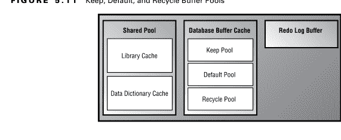

### 创建缓冲区高速缓存池

接下来，必须以选定大小创建缓冲区高速缓存池。可以使用 `ALTER SYSTEM` 命令动态创建缓冲区高速缓存池，或者通过更改 `init.ora` 然后关闭并重启实例来手动创建。

#### 动态创建缓冲区高速缓存池

如果分配给 `SGA_MAX_SIZE` 的值允许，你可以使用 `ALTER SYSTEM` 命令动态创建 `Keep` 池和 `Recycle` 池：

```sql
SQL> ALTER SYSTEM SET db_cache_size=300M;
```

```sql
SQL> ALTER SYSTEM SET db_keep_cache_size=150M;
SQL> ALTER SYSTEM SET db_recycle_cache_size=50M;
```

如果 `SGA_MAX_SIZE` 的值设置得太低，无法允许你动态添加这两个额外的缓冲区高速缓存池，那么你必须手动设置它们。

### 手动创建缓冲区高速缓存池

必须将 `SGA_MAX_SIZE` 参数设置为足够大的值以容纳所有 SGA 组件。如果值太低，可能无法创建 `Keep` 池和 `Recycle` 池。你可以编辑 `init.ora`，并同时增加 `SGA_MAX_SIZE`、`DB_CACHE_SIZE`、`DB_KEEP_CACHE_SIZE` 和 `DB_RECYCLE_CACHE_SIZE` 的值，然后在关闭并重启实例使它们生效。这些参数之前已在表 5.4 中描述。

使用我们期望的 `Keep` 池 150MB、`Recycle` 池 50MB 和默认池 300MB 的值，我们可以这样配置 `init.ora`：

```ini
# Maximum size of the SGA, must be large enough to hold
# the Shared Pool, Buffer Cache, and Redo Log Buffer
SGA_MAX_SIZE = 1G
#
# Desired total size of the Default Buffer Pool
DB_CACHE_SIZE = 300M
#
# Desired total size of the Keep Buffer Pool
DB_KEEP_CACHE_SIZE = 150M
#
# Desired total size of the Recycle Buffer Pool
DB_RECYCLE_CACHE_SIZE = 50M
```


> Oracle8i 中以前用于创建多个缓冲区高速缓存池的 `init.ora` 参数，`DB_BLOCK_BUFFERS`、`BUFFER_POOL_KEEP`、`BUFFER_POOL_RECYCLE` 和 `DB_BLOCK_LRU_LATCHES`，在 Oracle9i 中不应再使用，因为它们将在未来的 Oracle 版本中变得过时。请改用此处讨论的新 `init.ora` 参数。

一旦以适当的尺寸创建了缓冲区高速缓存池，你就可以将段分配到适当的池中。

## 将片段分配给缓存池

现在，既然合适的缓冲区池（Buffer Pool）已经创建完成，你必须使用 `ALTER` 命令将每个片段（segment）分配给指定的缓冲区池。以下示例展示了如何将我们在上一节中识别出的各个片段分配到相应的缓冲区池：

```sql
SQL> ALTER TABLE apps.employee
2  STORAGE (BUFFER_POOL KEEP);

SQL> ALTER TABLE apps.region
2  STORAGE (BUFFER_POOL KEEP);

SQL> ALTER TABLE apps.division
2  STORAGE (BUFFER_POOL RECYCLE);

SQL> ALTER INDEX apps.employee_first_name_idx
2  STORAGE (BUFFER_POOL KEEP);

SQL> ALTER INDEX apps.employee_id_pk
2  STORAGE (BUFFER_POOL KEEP);

SQL> ALTER TABLE apps.sales_history
2  STORAGE (BUFFER_POOL RECYCLE);
```

你可以使用以下针对 `DBA_SEGMENTS` 的查询来查看哪些片段被分配了非默认的缓冲区池：

```sql
SQL> SELECT owner, segment_type,
2  segment_name, buffer_pool
3  FROM dba_segments
4  WHERE buffer_pool != 'DEFAULT';
```


| 拥有者 | 片段类型 | 片段名称 | 缓冲区池 |
| :--- | :--- | :--- | :--- |
| APPS | 表 | EMPLOYEE | KEEP |
| APPS | 表 | REGION | KEEP |
| APPS | 表 | DIVISION | RECYCLE |
| APPS | 索引 | EMPLOYEE_FIRST_NAME_IDX | KEEP |
| APPS | 索引 | EMPLOYEE_ID_PK | KEEP |
| APPS | 表 | SALES_HISTORY | RECYCLE |

> 在 `ALTER` 命令之前已缓存的任何片段缓冲区仍会保留在其当前的池中。这些缓冲区不会移动到新指定的缓冲区池，直到它们下次从磁盘重新读取时。

# 监控多个缓冲区池的性能

在对 `init.ora` 进行适当更改并指定将哪些片段缓存在哪些缓冲区池之后，你可以使用 `V$BUFFER_POOL` 和 `V$BUFFER_POOL_STATISTICS` 动态性能视图来监控缓冲区池的性能。

| **Oracle 目标** | 监控缓冲区缓存的使用情况，以及缓冲区缓存内不同的池 |
| :--- | :--- |

## 使用 V$BUFFER_POOL

`V$BUFFER_POOL` 动态性能视图包含关于多个缓冲区池自身配置的信息。表 5.11 描述了用于获取各个缓冲区池信息的有用列。

**表 5.11** `V$BUFFER_POOL` 列的部分描述

| **列名** | **描述** |
| :--- | :--- |
| NAME | 缓冲区池的名称 |
| BLOCK_SIZE | 此缓冲区池中缓冲区的块大小，以字节为单位 |
| CURRENT_SIZE | 缓冲区池的当前大小，以兆字节（MB）为单位 |

你可以使用这些列来查询此视图，并检查每个单独缓冲区池的大小：

```sql
SQL> SELECT name, block_size, current_size
 2   FROM v$buffer_pool;
```

| 名称 | 块大小 | 当前大小 |
|------------|------------|----------------|
| KEEP | 8192 | 150 |
| RECYCLE | 8192 | 50 |
| DEFAULT | 8192 | 300 |

## 使用 V$BUFFER_POOL_STATISTICS

`V$BUFFER_POOL_STATISTICS` 动态性能视图包含多个列，其中包含用于计算各个单独缓冲区池命中率的信息。表 5.12 描述了用于计算命中率的列。

**表 5.12** `V$BUFFER_POOL_STATISTICS` 列的部分描述

| 列名 | 描述 |
| :--- | :--- |
| NAME | 缓冲区池的名称 |
| DB_BLOCK_GETS | 通过使用缓存的片段缓冲区来满足的数据片段请求数量 |
| CONSISTENT_GETS | 通过使用缓存的回滚块（用于读取一致性）来满足的数据片段请求数量 |
| PHYSICAL_READS | 需要从磁盘将数据读入缓冲区缓存的数据片段请求数量 |

你可以使用 `V$BUFFER_POOL_STATISTICS` 中的统计信息，通过以下查询来计算每个单独缓冲区池的命中率：

```sql
SQL> SELECT name 'Buffer Pool',
2 1-
3 (physical_reads / (db_block_gets + consistent_gets))
4 'Buffer Pool Hit Ratio'
5 FROM v$buffer_pool_statistics
6 ORDER BY name;
```

缓冲区池 缓冲区池命中率
------------------- --------------------
DEFAULT .713179916
KEEP .9721
RECYCLE .238907

正如你所料，如果你正确地调整了多个缓冲区池，Keep 池的命中率应该非常高，而 Recycle 池的命中率应该很低。Default 池的命中率应该介于这两个值之间，但通常在 70–80 百分比的范围内。

### 实际场景

#### 100% 的命中率并不总是意味着最佳性能

你的用户一直抱怨应用程序性能较差，但你在 `V$SYSSTAT` 上执行的查询显示缓冲区缓存命中率为 99.97 百分比。由于这个命中率表明改进空间很小，你考虑转向其他领域以寻找可能的调优改进。

在这种情况下，应该仔细检查缓冲区缓存的内容。特别是，你应该确定有多少个索引缓冲区被缓存在缓冲区缓存中，以及它们属于哪些索引。假设使用 `V$CACHE` 和 `DBA_USERS`，你确定非常大的 `ORDERS` 表中 `ORDER_STATUS` 列上的索引使用了缓冲区缓存中的许多缓冲区。进一步检查后，你还确定 `ORDER_STATUS` 只有三个可能的值：Open（开启）、Closed（关闭）和 Hold（保持）。此外，你发现 `ORDERS` 表中 90 百分比的记录状态为 Closed。

`ORDERS` 表中 `ORDER_STATUS` 列上的低选择性索引可能是导致你的应用程序性能差但缓冲区缓存命中率高的主要原因。当扫描此类索引时，其许多块会被引入缓冲区缓存。如果索引位于“热门”应用程序表——如 `ORDERS`——上，那么由于缓冲区缓存中缓存了大量索引块以及应用程序频繁请求这些块，缓冲区缓存命中率会被人为地抬高。这导致高命中率，但应用程序的整体性能低下。

> 可以采取几个步骤来修复这种情况。第一步是确保在数据字典中维护当前统计信息，以便基于成本的优化器能够确定索引的选择性，并在全表扫描更有效时放弃使用该索引。减少此问题的第二种方法是在 `ORDERS` 表上创建直方图，以便基于成本的优化器能更好地掌握 `ORDER_STATUS` 列中值的分布情况。最后，你可能希望指定将来自该索引的缓冲区缓存在 Recycle 池而不是缓冲区缓存中。所有这些步骤不仅有助于保持高的缓冲区缓存命中率，而且确保为你的应用程序用户提供真正的性能好处。

# 在内存中缓存表

无论决定使用多少个缓冲区池，每个池仍由一个最近最少使用（LRU）列表进行管理。通常，应用程序用户访问的块会被放置在 LRU 列表的最近使用端。然而，正如本章前面提到的，通过全表扫描（FTS）访问的表会将其块立即放置在 LRU 列表的最久未使用端。

这种行为可能会带来一个有趣的调优困境。如果基于成本的优化器看到经常使用的表（如验证表或查找表）很小，它很可能会通过全表扫描访问该表。但这种全表扫描会将该表的缓冲区放置在 LRU 列表的最久未使用端，在那里它们很快会从缓冲区缓存中移除，仅仅因为随后的应用程序用户再次需要它们时，它们会被重新读入内存。

管理此问题的一种方法，特别是对于小表，是利用缓存表。被指定为*缓存表*的表，在通过全表扫描访问时，其缓冲区不会被放置在 LRU 列表的最久未使用端。相反，这些缓冲区会被放置在 LRU 列表的最近使用端，就好像它们没有经过全表扫描一样。这具有在内存中保留这些缓冲区更长时间的效果，同时仍以最高效的方式访问它们。缓存表可以通过三种方式实现：在表创建时、在表创建后通过修改表、或使用提示（hint）。

## 创建表时的缓存设置

在创建表时包含关键字 `CACHE` 即可将表设置为缓存表，方法如下：

```sql
SQL> CREATE TABLE phone_list
 2   ( employee_id number,
 3     phone_number varchar2(11),
 4     extension varchar2(4))
 5   TABLESPACE appl_tab
 6   STORAGE (INITIAL 50K NEXT 50K PCTINCREASE 0)
 7   CACHE;
```

除非指定了 `CACHE` 选项，否则默认情况下所有表都创建为 `NOCACHE` 表。

## 使用 ALTER TABLE 创建缓存表

你可以使用带有 `CACHE` 关键字的 `ALTER TABLE` 命令将现有表更改为缓存表：

```sql
SQL> ALTER TABLE employee CACHE;
```

`NOCACHE` 选项用于将表恢复为其常规的 FTS（全表扫描）行为。

## 使用提示符进行缓存

你还可以使用相应的提示符（hint）动态地对表进行 `CACHE` 或 `NOCACHE` 操作：

```sql
SQL> SELECT /*+ CACHE */ last_name, first_name
 2   FROM employee;
```

该提示符仅影响此查询；对 `EMPLOYEE` 表的所有其他访问仍会使用表的默认缓存模式。

## 显示缓存表信息


你可以使用 `DBA_TABLES` 视图中的 `CACHE` 列来确定哪些表被缓存，如下所示：

```sql
SQL> SELECT owner, table_name
 2   FROM dba_tables
 3   WHERE LTRIM(cache) = 'Y';
```

| OWNER | TABLE_NAME |

|---|---|

| APPS | EMPLOYEE |

| APPS | PHONE_LIST |

## 绕过缓冲区高速缓存

改进数据库缓冲区高速缓存（Database Buffer Cache）性能的另一种技术是，对于某些类型的缓冲区请求，完全绕过缓冲区高速缓存。通过绕过缓冲区高速缓存，在处理过程中，已经存储在那里的缓冲区不会被移到 LRU 列表的下部或移除。这两种类型的交易可以配置为绕过数据库缓冲区高速缓存：

- 排序直接写入（在第八章“磁盘 I/O 调整”中介绍）
- 并行 DML

并行数据操纵语言（DML）涉及通过启动多个进程并行执行批量插入、更新和删除操作。在能够有效使用并行执行之前，必须正确设置若干 `init.ora` 参数。


关于并行 DML 配置流程的完整讨论超出了本文以及 Oracle9i 性能调整 OCP 考试的范围。然而，只有当你的服务器拥有多个未被充分利用的 CPU、合适的 I/O 子系统以及支持并行执行的充足内存时，才应考虑使用并行执行。

## 适当使用索引

从应用程序 SQL 代码的角度来看，对数据库缓冲区高速缓存性能产生的另一个重大影响是确保通过适当使用索引来避免不必要的全表扫描。发生的全表扫描越少，数据库缓冲区高速缓存的命中率就越高。鼓励使用索引的一个简单方法是，在引用另一表中主键列的表的列上建立索引。这不仅有助于提高多表连接的有效性，还能最小化两个表之间密集占用缓冲区高速缓存的 FTS 排序合并连接。

## 总结

SGA 中数据库缓冲区高速缓存的作用是缓存最常使用的段，以便应用程序用户在访问数据时最大限度地减少物理磁盘 I/O。数据库缓冲区高速缓存的大小由 `init.ora` 参数 `SGA_MAX_SIZE`、`DB_CACHE_SIZE`、`DB_KEEP_CACHE_SIZE` 和 `DB_RECYCLE_CACHE_SIZE` 指定。每个缓冲区高速缓存缓冲区持有一个段块的数据。数据库缓冲区高速缓存的活动由 LRU 算法、Dirty List（脏列表）、用户服务器进程和数据库写入器（`DBW0`）管理。

数据库缓冲区高速缓存的性能通过命中率来衡量，该比率比较实例中执行的总读取次数与从磁盘执行的读取次数。对于调整良好的 OLTP 系统，预期缓冲区高速缓存命中率为 90% 或更高。可以通过查询 `V$SYSSTAT` 以及 `STATSPACK` 和 `REPORT.TXT` 的输出来计算命中率。缓冲区高速缓存性能的其他指标包括 Free Buffer Inspected、Buffer Busy Wait 和 Free Buffer Wait 统计信息，以及使用 Oracle 企业管理器性能管理器工具绘制的缓冲区高速缓存性能图形表示。

提高数据库缓冲区高速缓存命中率的选择包括：扩大缓冲区高速缓存、使用多个缓冲区池、在缓冲区高速缓存中缓存表、对 I/O 密集型操作绕过缓冲区高速缓存，以及适当使用索引以最小化全表扫描。

### 考试要点

- 了解缓冲区高速缓存是如何被管理和利用的。能够描述数据是如何进出缓冲区高速缓存的，以及管理位于其中的缓冲区的 LRU 机制。
- 了解如何衡量缓冲区高速缓存的性能。知道如何使用动态性能视图、`STATSPACK` 和 `REPORT.TXT` 的输出来确定缓冲区高速缓存命中率。能够描述哪些次要统计信息可用作缓冲区高速缓存性能的指示。
- 了解如何创建和使用多个缓冲区池。能够动态和手动创建三种类型的缓冲区池。知道如何将段分配给各个缓冲区池，然后监控其性能。
- 描述表缓存的好处。知道如何在缓冲区高速缓存中缓存表，以及哪些类型的表适合作为缓存对象。

## 关键术语

在参加考试之前，请确保你熟悉以下术语：

- 缓冲区高速缓存顾问 (`Buffer Cache Advisory`)
- 缓冲区池 (`Buffer Pool`)
- 缓存表 (`cache table`)
- 数据库缓冲区高速缓存 (`Database Buffer Cache`)
- 默认池 (`Default Pool`)
- 脏列表 (`Dirty List`)
- 命中率 (`hit ratio`)
- 保留池 (`Keep Pool`)
- LRU 列表 (`LRU list`)
- 回收池 (`Recycle Pool`)
- 用户服务器进程 (`user Server Process`)
- 写入列表 (`Write List`)

## 复习题

1. 数据库缓冲区高速缓存使用哪种机制来管理其内存？
   - A. LRU 列表
   - B. Dirty List
   - C. `DBW0`
   - D. 以上所有在管理数据库缓冲区高速缓存中发挥作用。

2. 以下哪项*不*缓存在数据库缓冲区高速缓存中？
   - A. 表
   - B. 重做日志
   - C. 索引
   - D. 回滚段

3. 以下哪个进程将段块从磁盘复制到数据库缓冲区高速缓存缓冲区中？
   - A. `DBW0`
   - B. `LGWR`
   - C. 服务器进程
   - D. `PMON`

4. 除非发生全表扫描，用户的服务进程将数据库缓冲区高速缓存中的缓冲区放在 LRU 列表的哪一端？
   - A. MRU
   - B. LRU
   - C. 中间
   - D. 以上都不是

5. 每次访问数据库缓冲区高速缓存 LRU 列表上的缓冲区时，它被移动到 LRU 列表的哪个部分？
   - A. MRU
   - B. LRU
   - C. 中间
   - D. 以上都不是

6. 在数据库缓冲区高速缓存中的副本与磁盘上段块副本不匹配的缓冲区叫什么？
   - A. 固定缓冲区
   - B. 空闲缓冲区
   - C. 脏缓冲区
   - D. 回滚缓冲区

7. 用户的服务进程在定位数据库缓冲区高速缓存中的空闲缓冲区时使用哪种机制？
   - A. LRU 列表
   - B. Dirty List
   - C. `DBW0`
   - D. 以上所有

8. `DBW0` 在以下哪种时间将脏缓冲区写入磁盘？
   - A. 当 Dirty List 达到阈值长度时
   - B. 当用户的服务进程搜索 LRU 列表时间过长而未找到空闲缓冲区时
   - C. 在检查点时
   - D. 以上所有

9. 选择数据库缓冲区高速缓存性能的主要衡量指标：
   - A. 平均 LRU 列表长度
   - B. 最大 Dirty List 缺失率
   - C. 数据库缓冲区高速缓存命中率
   - D. 以上所有

10. 以下哪个动态性能视图用于计算数据库缓冲区高速缓存命中率？
    - A. `V$BUFFERCACHE`
    - B. `V$SYSTEMSTATS`
    - C. `V$SYSSTAT`
    - D. `V$SGASTAT`

11. 根据 Oracle，OLTP 系统中调整良好的数据库缓冲区高速缓存应有多少命中率？
    - A. 10% 或更低
    - B. 50%
    - C. 60–80%
    - D. 90% 或更高

12. 以下哪个数据库缓冲区高速缓存池是必需的？
    - A. 保留池
    - B. 默认池
    - C. 回收池
    - D. 以上所有都是必需的。

13. 当用户发出 `COMMIT` 语句时，哪个 Oracle 进程最终将数据库缓冲区高速缓存中的信息写入磁盘？
    - A. `SMON`
    - B. `DBW0`
    - C. `PMON`
    - D. `LGWR`

### 14. 根据以下来自 `V$DB_CACHE_ADVICE` 的查询输出结果，在不浪费资源的前提下，数据库缓冲区缓存（Database Buffer Cache）的最佳大小是多少？

| 名称 (NAME) | 估算大小 (SIZE_FOR_ESTIMATE) | 估算物理读取次数 (ESTD_PHYSICAL_READS) |

| :--- | :--- | :--- |

| 默认 (DEFAULT) | 10.1797 | 7686 |

| 默认 (DEFAULT) | 20.3594 | 6614 |

| 默认 (DEFAULT) | 30.5391 | 6028 |

| 默认 (DEFAULT) | 40.7188 | 5785 |

| 默认 (DEFAULT) | 50.8984 | 5497 |

| 默认 (DEFAULT) | 61.0781 | 5342 |

| 默认 (DEFAULT) | 71.2578 | 4915 |

| 默认 (DEFAULT) | 81.4375 | 4867 |

| 默认 (DEFAULT) | 91.6172 | 4866 |


| 默认 (DEFAULT) | 101.7969 | 4866 |

| 默认 (DEFAULT) | 111.9766 | 4866 |

| 默认 (DEFAULT) | 122.1563 | 4866 |

| 默认 (DEFAULT) | 132.3359 | 4866 |

- A. 70MB

- B. 50MB

- C. 100MB

- D. 132MB

**15.** 以下哪个参数*不*影响数据库缓冲区缓存的大小？

- A. `DB_KEEP_CACHE_SIZE`

- B. `DB_BLOCK_SIZE`

- C. `DB_MAX_CACHE_SIZE`

- D. `DB_RECYCLE_CACHE_SIZE`

**16.** 为什么增加数据库缓冲区缓存的大小会提高性能？

- A. 服务器进程在需要时更有可能找到空闲的缓冲区。

- B. 缓冲区不太可能因 LRU 机制而被过早地移出缓存。

- C. 以上两者均正确。

- D. 以上两者均不正确。

**17.** 以下哪个缓冲池可用于缓存你确定经常被访问的段？

- A. Kept

- B. Keep

- C. Cache

- D. Pin

**18.** 以下哪个视图可用于确定哪些段可能是 Keep 池的良好候选对象？

- A. `V$BH`

- B. `DBA_OBJECTS`

- C. `V$CACHE`

- D. 以上任意一个

**19.** 选出数据库缓冲区缓存中可用的三种组件池类型。

- A. Default（默认池）

- B. Common（公共池）

- C. Keep（保持池）

- D. Recycle（回收池）

**20.** 即使执行全表扫描，其缓冲区也被放置在 LRU 列表最 recently used（最近使用）端的表叫什么？

- A. Pinned tables（固定表）

- B. Cache tables（缓存表）

- C. Kept tables（保持表）

- D. 以上都不是

## 复习题答案

1. D. `LRU` 列表用于将频繁访问的缓冲区保持在内存中。脏列表（Dirty List）用于跟踪内存中的副本已发生更改的缓冲区。数据库写入进程（Database Writer，`DBW0`）将脏缓冲区写入磁盘。

2. B. 表、索引、簇（cluster）、LOB 索引、LOB 段、回滚段和临时段都可以缓存在数据库缓冲区缓存中。

3. C. 每个用户的服务器进程会将请求的块复制到数据库缓冲区缓存中。

4. A. 段块被复制到位于 `LRU` 列表最 recently used（最近使用）端的缓冲区中。

5. A. 一旦被访问，任何已缓存的缓冲区都会从其在 `LRU` 列表中的当前位置移动到 `LRU` 列表的起始端，即 most recently used（最近使用，MRU）端。

6. C. 脏缓冲区存储由应用程序用户更改但尚未由 `DBW0` 写入磁盘的数据。

7. D. 当服务器进程在 `LRU` 列表中搜索空闲缓冲区时，脏缓冲区会被移动到脏列表，当脏列表达到其阈值长度时，由 `DBW0` 将其写入磁盘。

8. D. 除了这些时候，当存储这些段的块的表空间处于热备份或离线模式时，以及当段被删除时，`DBW0` 也会将脏缓冲区写入磁盘。

9. C. 数据库缓冲区缓存命中率是找到能够使用现有缓存缓冲区满足的缓冲区请求百分比。

10. C. `V$SYSSTAT` 动态性能视图包含有关读取的缓冲区总数以及从磁盘读取的数量的统计信息。

11. D. 对于非 OLTP 系统，命中率可能会更低。

12. B. 只有默认池（Default Pool）是必需的。Keep 池和 Recycle 池可以配置为分别针对经常和很少访问的段来增强缓冲区缓存性能。

13. B. 数据库写入进程负责将块从数据库缓冲区缓存写入磁盘上的数据文件。

14. A. `DB_CACHE_SIZE` 的最佳设置是 70MB，因为超过此点后的任何增加只会带来物理读取次数的微小减少。

15. C. `DB_MAX_CACHE_SIZE` 不是有效的初始化参数。

16. C. 增加数据库缓冲区缓存的大小可以提供更多的空闲缓冲区，并减少缓冲区不必要的 `LRU` 刷新。

17. B. 通过使用 `ALTER` 命令中的 `STORAGE (BUFFER_POOL KEEP)` 参数，你可以将经常访问的应用程序段分配给 Keep 缓冲池。

18. D. `V$BH` 和 `V$CACHE` 动态性能视图可用于确定当前哪些段的块被缓存在内存中。此外，`DBA_OBJECTS` 数据字典视图可以与 `V$BH` 连接以确定每个缓存段的拥有者和名称。

19. A、C、D。默认池（Default）、保持池（Keep）和回收池（Recycle）可用于数据库缓冲区缓存。在定义或修改段定义时，可以利用存储子句中的 `BUFFER_POOL` 语法来指定要将段放置到哪个池中。

20. B. 使用 `CACHE` 关键字创建或修改的表，或使用 `CACHE` 提示访问的表，在全表扫描期间，其缓冲区将被放置在 `LRU` 列表的最 recently used（最近使用）端。

# 第 6 章

# 调整其他 SGA 区域

**本章涵盖的 ORACLE9i 性能调试试题目标：**

- 描述 UGA 和会话内存的考量

- 设置大池（Large Pool）

- 识别与在共享服务器环境中管理用户相关的问题

- 诊断和解决 Oracle 共享服务器进程的性能问题

- 配置 Oracle 共享服务器环境以优化性能

- 监控和设置 Java 池（Java Pool）

- 控制会话使用的 Java 会话内存量

> 考试目标可能会随时在无预先通知的情况下由 Oracle 单方面决定进行更改。请访问 Oracle 认证网站（[`http://education.oracle.com/certification/`](http://education.oracle.com/certification/)）查看当前的考试目标列表。


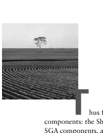

到目前为止，你已经研究了两个 SGA 组件的调整技术：共享池（Shared Pool）和数据库缓冲区缓存。这两个 SGA 组件，以及第 7 章“调整重做机制”中讨论的重做日志缓冲区（Redo Log Buffer），被每个 Oracle 应用程序使用。然而，本章将重点讨论 SGA 内部可能并非在所有环境中都使用的三个区域：

- 共享池架构组件

- 大池（Large Pool）

- Java 池

由于某些 Oracle 环境不使用这些 SGA 组件，本章将首先介绍这些区域相关的核心概念，然后介绍用于监控和增强其性能的技术。

## 共享服务器概念

每个 Oracle 应用程序用户与其到数据库的连接都关联两个进程：用户进程（User Process），它在用户的客户端机器或应用程序的 Web 服务器上执行；以及服务器进程（Server Process），它在 Oracle 服务器机器上执行。

在默认的 Oracle9i 配置中，称为专用服务器（Dedicated Server），每个用户的服务器进程专门用于仅处理该用户会话的请求。在 Unix 系统上，这些服务器进程在 Oracle 服务器上作为独立的操作系统进程运行。如果有 50 个连接用户，则 Oracle 服务器机器上将运行 50 个相应的服务器进程来服务于他们的数据库活动。

还可用第二种可选配置，称为共享服务器（Shared Server）。在这种配置中，在 Oracle


服务器机器上创建几个共享服务器进程。这些共享服务器进程可以被任何需要它们的用户进程使用，以向实例发送应用程序 SQL 语句或从实例返回数据。

在早于 Oracle9i 的版本中，共享服务器选项被称为多线程服务器（Multithreaded Server，MTS）选项。

### Oracle 考试目标

识别与在共享服务器环境中管理用户相关的问题

你可以将专用服务器和共享服务器之间的差异类比为拥有自己的汽车和使用出租车在地方之间旅行之间的差异。如果你拥有自己的车辆，你可以随时去任何你想去的地方，而无需等待获得汽车的权限。然而，当你不使用你的车辆时，例如当你睡觉时，这个昂贵的资源就完全闲置了。相反，如果你使用出租车作为交通工具，你并不一定能在你想用的时候恰好有车辆可用，但你最终会到达你想去的地方。然而，在你不需要它的时候，其他乘客可以持续利用出租车，从而充分利用该资源。

这些区别同样适用于专用服务器和共享服务器。专用服务器配置提供了用户进程和服务器进程之间的高效通信，因为用户的服务器进程专门用于仅针对该单个用户向实例发送应用程序 SQL 语句或从实例返回数据。然而，就像汽车一样，专用服务器有消耗 Oracle 服务器机器上的内存和 CPU 资源的缺点——即使用户处于空闲状态。当应用程序用户数量较大时，这可能导致可扩展性问题，因为支持用户服务器进程所需的服务器资源通常未被高效利用。


共享服务器配置通过更好地利用 Oracle 服务器机器可用的内存和 CPU 来支持应用程序用户的活动，解决了专用服务器配置的可扩展性问题。但是，就像出租车一样，共享服务器也可能产生负面影响

如果共享服务器在用户进程需要时不可用，它们将影响性能。共享服务器本身仅仅是共享服务器架构的一个组成部分。


在 Windows 2000 系统上，所有用户服务器进程都在与 `oracle.exe` 可执行文件关联的操作系统线程中运行，而不是像在 Unix 系统中那样作为独立的操作系统进程运行。因此，`共享服务器` 功能在 Windows 2000 系统上提供的可扩展性改进不如在 Unix 系统上显著。

## 共享服务器架构

当你需要出租车时，你必须先给出租车公司打电话，告知他们你需要乘车。出租车公司会将你的请求传达给出租车调度员，调度员会将你的名字列入想要乘车的名单中。然后，调度员会将你的请求分配给一辆特定的出租车，该车最终会来到你的地址接你，并将你送到目的地。`共享服务器` 架构有几个组件执行类似的功能。`共享服务器` 架构的组件包括：

- `用户进程`
- Oracle Net 监听器进程
- 调度器进程
- 请求队列
- 共享服务器进程
- 响应队列

以下各节将讨论这些组件中的每一个。

`用户进程` 每个应用程序用户，无论他们是通过基于客户端的可执行文件还是通过中间层应用服务器发起数据库连接，都会创建一个`用户进程`来管理其与 Oracle 服务器主机的连接。

`Oracle Net 监听器` Oracle Net 监听器监听来自客户端的数据或 DML 活动请求。当检测到请求时，监听器会将该请求分配给最空闲的调度器进程。

### 调度器进程

`调度器` 是运行在 Oracle 服务器主机上的 Oracle 后台进程，用于接受来自用户进程的数据库处理请求。同一时间最多可以有五个调度器在运行。每个调度器进程都有一个独特的名称。在 Unix 环境中，可以使用 `ps` 命令从操作系统查看这些进程：

```
$ ps -ef |grep ora_d
oracle   13323    1  0 16:38 ?    00:00:00 ora_d0w0_PROD
oracle   13343    1  0 16:38 ?    00:00:00 ora_d000_PROD
oracle   13345    1  0 16:38 ?    00:00:00 ora_d001_PROD
oracle   13347    1  0 16:38 ?    00:00:00 ora_d002_PROD
oracle   13356 13257   0  0 16:39 pts/0 00:00:00 grep ora_d
```

上述 `ps` 命令的输出显示，有三个调度器进程 `ora_d000_PROD`、`ora_d001_PROD` 和 `ora_d002_PROD` 正在针对名为 `PROD` 的实例运行。调度器进程在实例启动时生成，即使当前没有用户连接到该实例，它们也会持续在内存中运行。

> 使用 Unix `kill` 命令终止调度器进程不仅会终止该调度器进程，还会断开所有使用该调度器进程连接数据库的用户连接。

### 请求队列

调度器将来自用户进程的请求放入的队列称为 *请求队列*。只有一个请求队列。此队列存储在 Oracle SGA 中。

### 共享服务器进程

共享服务器进程是运行在 Oracle 服务器主机上的 Oracle 后台进程，代表单个用户进程与 SGA 进行交互。共享服务器执行与专用服务器进程相同的活动（例如，解析 SQL 语句、将段块从磁盘读取到缓冲区高速缓存等）。可以有很多共享服务器进程。最大数量取决于操作系统。每个共享服务器进程都有一个独特的名称。在 Unix 环境中，可以使用 `ps` 命令从操作系统查看这些进程：

```
$ ps -ef |grep ora_s
oracle   13329    1  0 16:38 ?    00:00:00 ora_smon_PROD
oracle  13333    1   0 16:38 ?        00:00:00 ora_s000_PROD
oracle  13335    1   0 16:38 ?        00:00:00 ora_s001_PROD
oracle  13337    1   0 16:38 ?        00:00:00 ora_s002_PROD
oracle  13339    1   0 16:38 ?        00:00:00 ora_s003_PROD
oracle  13341    1   0 16:38 ?        00:00:00 ora_s004_PROD
oracle  13342    1   0 16:38 ?        00:00:00 ora_s005_PROD
oracle  13390 13257   0  16:48 pts/0     00:00:00 grep ora_s
```

上述 `ps` 命令的输出显示，有五个共享服务器进程 `ora_s000_PROD`、`ora_s001_PROD`、`ora_s002_PROD`、`ora_s003_PROD`、`ora_s004_PROD` 和 `ora_s005_PROD` 正在针对名为 `PROD` 的实例运行。共享服务器进程在实例启动时生成，即使当前没有用户连接到该实例，它们也会持续在内存中运行。

### 响应队列

共享服务器进程将数据库活动结果放入的队列称为 *响应队列*。然后，调度器进程将这些结果返回给发起请求的用户进程。每个调度器都有一个响应队列。这些队列存储在 Oracle SGA 中。

图 6.1 展示了这些组件在共享服务器配置中如何交互。

#### 图 6.1 共享服务器架构

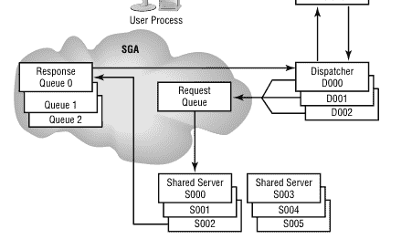

为了有效地实施共享服务器而不损害整体性能，在考虑共享服务器配置之前，必须满足若干条件：

`许多应用程序用户` 通常只有当并发应用程序用户数量超过 200 个或更多用户时（取决于 Oracle 服务器的内存和 CPU 资源），实施共享服务器选项才有意义。

`短应用程序事务` 由于应用程序用户在与数据库通信时将共享服务器进程，因此应用程序 SQL 执行短事务非常重要。发出长运行事务的应用程序会导致单个用户独占共享服务器进程，从而导致其他用户等待该资源。

`非连续事务` 应用程序用户应以偶尔在其活动中出现暂停的方式使用该应用程序。这些暂停将允许共享服务器进程更有效地处理其他用户的请求。此类暂停在 OLTP 环境中很常见，例如订单录入系统。订单录入应用程序的用户通常在处理交易时会频繁暂停，以便与下单客户讨论订单细节。

如果你的应用程序符合上述列出的准则，你需要执行下一节中描述的操作来配置共享服务器功能。


> 注意
> 关于共享服务器配置技术的完整讨论超出了本书和 OCP 性能调整考试的范围。有关配置共享服务器环境的完整细节，请参阅《Oracle9i Net Services Administrator’s Guide Release 1 (9.0.1)》（部件号 A0154-01）第 14 章“配置共享服务器”。

## 配置共享服务器

在实施共享服务器选项之前，必须正确配置若干 `init.ora` 参数。这些参数用于确定在实例启动时应生成多少个调度器和共享服务器进程，以及一旦用户开始访问数据库后它们如何管理。

`Oracle 目标`

配置 Oracle 共享服务器环境以优化性能

用于配置共享服务器选项的 `init.ora` 参数在表 6.1 中描述。

**表 6.1** 共享服务器 `init.ora` 参数

| 参数 | 描述 |
| :--- | :--- |
| `DISPATCHERS` | 用于指定在实例启动时要生成的调度器数量以及分配给每个调度器的 Oracle Net 协议。有效值为 0 到 5。 |
| `MAX_DISPATCHERS` | 用于指定允许针对实例的最大调度器进程数。默认值为 5；最大值是 5 或 `DISPATCHERS` 的值，取两者中较大者。 |
| `SHARED_SERVERS` | 用于指定在实例启动时要生成的共享服务器进程数。设置为 0 时，共享服务器选项被禁用。共享服务器选项的最小值为 1；最大值取决于操作系统。 |
| `MAX_SHARED_SERVERS` | 用于指定允许针对实例的最大共享服务器进程数。默认值要么为 20，要么为 `SHARED_SERVERS` 值的 2 倍；最大值取决于操作系统。 |
| `CIRCUITS` | 用于指定用于处理传入和传出网络连接的虚拟电路数量。 |
| `PROCESSES` | 用于指定可以访问实例的最大操作系统进程数。默认值取决于操作系统，但使用共享服务器选项时通常需要增加该值，以允许额外的进程。 |


表 6.1 中显示的 `init.ora` 参数取代了已弃用的 Oracle8i 参数 `MTS_DISPATCHERS`、`MTS_MAX_DISPATCHERS`、`MTS_SERVERS`、`MTS_MAX_SERVERS` 和 `MTS_CIRCUITS`。

虽然 `DISPATCHERS` 和 `SHARED_SERVERS` 参数用于在实例启动时建立这些进程的最小生成数量，但两者都可以上调至 `MAX_DISPATCHERS` 和 `MAX_SHARED_SERVERS` 指定的上限值。然而，虽然 Dispatcher 进程必须由 DBA 使用 `ALTER SYSTEM` 命令显式启动，但共享服务器进程可以根据已连接应用程序用户对这些资源的需求，由 `PMON` 后台进程动态启动和停止。

确定在实例启动时应生成多少个 Dispatcher 和共享服务器，可以通过在初始配置完成后监控共享服务器环境的性能来决定。

数据库管理员不能使用共享服务器连接来执行 DBA 操作，如数据库启动、关闭等。

## 衡量共享服务器性能

一旦配置了共享服务器选项，就必须对其进行监控和调整以获得最佳性能。就像共享池和数据库缓冲区缓存一样，可以使用几个动态性能视图来监控共享服务器环境的性能。这些动态性能视图在表 6.2 中有描述。

### 表 6.2 共享服务器动态性能视图

| 视图名称 | 描述 |
| :--- | :--- |
| `V$SHARED_SERVER` | 包含关于共享服务器进程的详细统计信息，包括每个共享服务器进程的空闲和忙碌时间。 |
| `V$QUEUE` | 包含关于共享服务器请求和响应队列争用的信息。 |
| `V$SHARED_SERVER_MONITOR` | 包含关于共享服务器进程的统计信息，包括自实例启动以来由 `PMON` 动态启动和终止的共享服务器。 |
| `V$DISPATCHER` | 包含关于共享服务器 Dispatcher 进程的详细统计信息，包括每个 Dispatcher 进程的空闲和忙碌时间。 |
| `V$DISPATCHER_RATE` | 包含关于 Dispatcher 活动的历史和实时统计信息。 |
| `V$CIRCUIT` | 包含用户进程通过 Dispatcher、请求队列、共享服务器、响应队列并返回到用户进程所经过的路径（即电路）的统计信息。 |

上述每个视图都可以用于监控共享服务器架构的两个动态组件：共享服务器进程和 Dispatcher 进程。

Oracle 目标 诊断并解决 Oracle 共享服务器进程的性能问题

## 监控共享服务器进程性能

监控共享服务器进程性能的一种方法是监控可用服务器进程处理数据库请求的速率。这个忙碌比率可以使用 `V$SHARED_SERVER` 动态性能视图计算得出。该视图中用于监控共享服务器忙碌比率的有用列在表 6.3 中显示。

图 6.2 展示了如何通过查询这些列来计算共享服务器忙碌比率。

### 表 6.3 `V$SHARED_SERVER` 中的选定列

| 列名 | 描述 |
| :--- | :--- |
| `NAME` | 共享服务器进程名称 |
| `REQUESTS` | 共享服务器在运行期间处理的请求总数 |
| `BUSY` | 共享服务器在运行期间忙碌的总时间（以百分之一秒为单位） |
| `IDLE` | 共享服务器在运行期间空闲的总时间（以百分之一秒为单位） |

### 图 6.2 计算共享服务器忙碌比率

```sql
SQL> SELECT name, DECODE(busy+idle, 0, 0,
2    FROM v$shared_server
3         ROUND((busy/(busy+idle))*100,4)) "BUSY_RATE"
4  WHERE status != 'QUIT' ;
```

NAME   BUSY_RATE

-------- ----------

5000   12.34

5001   16.85

5002    9.73

上述查询的输出显示，最多情况下，共享服务器进程在处理数据库请求时，忙碌时间占比仅为 16.85%。

> 较高或上升的共享服务器忙碌比率表明可能需要在实例启动时生成额外的共享服务器进程。

当用户进程使用共享服务器发起数据库请求时，其请求最初由 *Dispatcher* 进程放入请求队列中。如果共享服务器进程太少，这些请求在等待服务时可能会经历延迟。可以使用 `V$QUEUE` 动态性能视图来监控对共享服务器进程的访问等待。该视图中用于监控共享服务器争用的有用列在表 6.4 中显示。

### 表 6.4 `V$QUEUE` 中的选定列

| 列名 | 描述 |
| :--- | :--- |
| `TYPE` | 统计信息对应的队列类型，可以是 `DISPATCHER` 或 `COMMON`（共享服务器） |
| `TOTALQ` | 放入队列中的项目总数 |
| `WAIT` | 队列中所有项目等待访问共享服务器进程的总时间，以百分之一秒为单位 |

通过查询这些列，可以计算访问共享服务器的平均等待时间。这种类型的查询在图 6.3 中显示。

### 图 6.3 计算共享服务器的平均等待时间

```sql
SQL>SELECT DECODE(totalq,0,'TOTALQ IS ZERO',
2
ROUND(SUM(wait)/SUM(totalq),4) "AVG DISPATCHER WAIT"
3
FROM v$queue
4
WHERE type = 'COMMON'
5
GROUP BY totalq;
```

AVG DISPATCHER WAIT

---------------

.0003

上述查询的输出显示，平均而言，用户进程等待共享服务器进程处理其数据库请求的时间为 0.0003 百分之一秒。


对共享服务器进程的较高或增加等待可能表明需要在实例启动时生成额外的共享服务器进程。

## 监控 Dispatcher 性能

与共享服务器类似，Dispatcher 进程的性能也可以通过“忙碌比率”来监控。该比率可以使用 `V$DISPATCHER` 动态性能视图计算得出。该视图中用于监控 Dispatcher 忙碌比率的有用列在表 6.5 中显示。通过查询这些列，可以使用图 6.4 中显示的 SQL 语句来计算 Dispatcher 忙碌比率。

### 表 6.5 `V$DISPATCHER` 中的选定列

| 列名 | 描述 |
| :--- | :--- |
| `NETWORK` | Dispatcher 使用的协议（网络地址） |
| `STATUS` | Dispatcher 的当前状态。可能的 Dispatcher 状态有：`WAIT`（空闲）、`SEND`（发送消息）、`RECEIVE`（接收消息）、`CONNECT`（建立连接）、`DISCONNECT`（断开会话）、`BREAK`（执行中断）、`TERMINATE`（终止连接）、`ACCEPT`（接受连接）、`REFUSE`（拒绝连接） |
| `OWNED` | 此 Dispatcher 拥有的虚电路数量 |
| `BUSY` | Dispatcher 忙碌的总时间（以百分之一秒为单位） |
| `IDLE` | Dispatcher 空闲的总时间（以百分之一秒为单位） |

### 图 6.4 确定 Dispatcher 忙碌比率的查询

```sql
SQL> SELECT name "DISPATCHER", network, (ROUND(SUM(busy)/(SUM(busy)+SUM(idle)),4))*100 "BUSY_RATE" FROM v$dispatcher GROUP BY name, network;
```

| DISPATCHER | NETWORK | BUSY_RATE |
| :--- | :--- | :--- |
| D000 | ADDRESS=<PROTOCOL=tcp)(HOST=moderne)(PORT=45280)) | 33.23 |
| D001 | ADDRESS=<PROTOCOL=tcp)(HOST=moderne)(PORT=45282)) | 27.12 |
| D003 | ADDRESS=<PROTOCOL=tcp)(HOST=moderne)(PORT=45283)) | 17.29 |

上述查询的输出显示，最多情况下，TCP/IP 网络协议的三个 Dispatcher 进程在处理数据库请求时，忙碌时间占比仅为 33.23%。


Oracle 建议在 Dispatcher 忙碌率持续超过 50% 时增加额外的 Dispatcher 进程。

共享服务器性能的另一个指标是用户进程等待其请求被分发程序接受的时间。可以使用 `V$QUEUE` 和 `V$DISPATCHER` 动态性能视图来计算用户进程在等待访问分发程序进程时经历的平均等待时间（以百分之一秒为单位），方法如上图 6.5 所示的查询。

## 图 6.5 计算分发程序等待时间


```sql
SQL> SELECT DECODE(totalq_0, 'TOTALq IS ZERO',
2  FROM v$queue q, v$dispatcher d
3  ROUND(SUM(wait)/SUM(totalq),4) 'AVG DISPATCHER WAIT'
4  WHERE q.paddr = d.paddr
5  AND q.type = 'DISPATCHER'
6  GROUP BY totalq;

AVG DISPATCHER WAIT
-------------------
             .0093
```

此输出显示，平均而言，用户进程等待分发程序进程处理其数据库请求的时间为 .0093 百分之一秒。

> 对分发程序进程的等待时间高或呈增加趋势，可能表明需要在实例启动时生成更多的共享服务器进程。

上述针对 `V$QUEUE` 和 `V$DISPATCHER` 查询所指示的等待时间是分发程序争用的迹象。要确定共享服务器环境中是否正在发生分发程序争用，可以通过查询 `V$DISPATCHER_RATE` 动态性能视图来获得额外证据。下表 6.6 展示了该视图中对监控分发程序争用有用的选定列。

### 表 6.6 `V$DISPATCHER_RATE` 的选定列

| 列名 | 描述 |

|---|---|

| NAME | 分发程序名称 |

| CUR_IN_CONNECT_RATE | 分发程序当前处理来自应用程序用户请求的速率 |

| MAX_IN_CONNECT_RATE | 分发程序处理来自应用程序用户请求的最大速率 |

图 6.6 展示了一个针对 `V$DISPATCHER_RATE` 的查询，该查询比较了处理客户端请求的当前速率与处理客户端请求的最大速率。

## 图 6.6 当前与最大分发程序服务速率

```sql
SQL> SELECT name, cur_in_connect_rate, max_in_connect_rate,
           cur_in_connect_rate - max_in_connect_rate "VARIANCE"
    2  FROM v$dispatcher_rate;

NAME  CUR_IN_CONNECT_RATE MAX_IN_CONNECT_RATE VARIANCE
D000          12      22      10
D001           8      19      11
D002          11      28      17
```


当前与最大分发程序服务速率之间的较大差异表明，可能需要额外的分发程序进程来改进共享服务器性能。

`V$SHARED_SERVER_MONITOR` 动态性能视图提供了共享服务器环境累积活动的概览。该视图包含五个列，如表 6.7 所示。

### 表 6.7 `V$SHARED_SERVER_MONITOR` 的列

| 列名 | 描述 |

| :--- | :--- |

| MAXIMUM_CONNECTIONS | 自实例启动以来，共享服务器选项使用的最大虚拟电路数 |

| MAXIMUM_SESSIONS | 自实例启动以来，已使用的最大共享服务器会话数 |

| SERVERS_STARTED | 自实例启动以来，由共享服务器选项自动启动的额外共享服务器总数——超出了由 `SHARED_SERVERS` init.ora 参数指定的共享服务器数量 |

| SERVERS_TERMINATED | 自实例启动以来，由共享服务器选项自动关闭的共享服务器总数 |

| SERVERS_HIGHWATER | 自实例启动以来运行的最大共享服务器数量——既包括在 init.ora 中显式启动的，也包括由 `PMON` 隐式启动的 |

图 6.7 展示了对 `V$SHARED_SERVER_MONITOR` 视图的示例查询。

## 图 6.7 显示共享服务器使用情况的 `V$SHARED_SERVER_MONITOR` 查询

```sql
SQL> SELECT *
2  FROM v$shared_server_monitor;

MAXIM_CONNECT MAXIM_SESSIONS SERVERS_STARTED SERVERS_TERMINATED SERVERS_HIGHWATER
             22             20               2                  1                  5
```

图 6.7 中查询的输出表明，当对由 `SHARED_SERVERS` init.ora 参数指定的三个共享服务器的需求无法满足应用程序用户的需求时，实例启动了两个额外的共享服务器进程。这两个动态启动的共享服务器中有一个在系统需求下降后自动关闭。

> **提示** `SERVERS_HIGHWATER` 的值与 init.ora 中 `SHARED_SERVERS` 的值之间的较大差异表明，应增加 init.ora 中 `SHARED_SERVERS` 的值。

偶尔，您可能需要跟踪用户进程从用户进程到分发程序，再到分配的共享服务器，再回到用户进程的路径。图 6.8 展示了如何使用 `V$CIRCUIT`、`V$SESSION`、`V$DISPATCHER` 和 `V$SHARED_SERVER` 之间的公共列连接这些视图，并构建这样的查询。

## 图 6.8 显示用户进程电路的查询

```sql
SQL>  SELECT s.username, d.name "DISPATCHER", ss.name "SHARED_SERVER"
     2  FROM v$session s, v$circuit c, v$dispatcher d, v$shared_server ss
     3  WHERE s.saddr = c.saddr
     4  AND    c.dispatcher = d.paddr
     5  AND    c.server = ss.paddr;

USERNAME    DISP  SHAR
---------   ----- ----
SYSTEM      D003  S000
JOE         D003  S001
BRENDA      D001  S002
EMILY       D000  S000
MATT        D002  S001
```

使用此查询的输出，您可以看到 Emily 的会话正在利用分发程序 D000 和共享服务器 S000 来处理她的数据库请求。此信息对于故障排除 Emily 会话潜在的性能问题可能有用。

一旦使用上述指标确定了当前的分发程序和共享服务器性能，就可以考虑下一节中讨论的调整措施，以改进共享服务器功能的性能。

## 改进共享服务器性能

共享服务器架构的性能问题通常与以下领域之一有关：

- SGA 组件未按共享服务器环境的需求进行适当调整

- 运行的共享服务器数量太少，无法充分处理用户请求

- 运行的分发程序数量太少，无法充分处理用户请求

在所有这些情况下，调整方案都属于“扩大规模”类别。以下章节将讨论每种情况。


Oracle 的共享服务器选项应被视为一种*垂直扩展*（scale up）特性，而非*提速*（speed up）特性。换句话说，虽然共享服务器特性允许您更好地利用可用的服务器资源，从而允许您使用相同的资源支持更多的应用程序用户，但它并不一定会同时提高系统的整体吞吐量或响应时间。

## 增加相关 SGA 组件的大小

由于共享服务器基于语句而非事务进行操作，通常在专用服务器配置下位于用户进程全局区域（PGA）内的用户全局区域（UGA）中的用户会话和游标状态信息（例如绑定变量值和会话设置），在共享服务器配置下会移动到 SGA 中的共享池。如您在第 4 章中学到的，共享池的主要功能是缓存 SQL 语句和数据字典信息。当共享服务器 UGA 信息的缓存被添加到共享池时，共享池的命中率可能会下降。因此，至少，当实施共享服务器选项时，共享池的大小必须增加。

- Oracle

- 目标

- *描述 UGA 和会话内存的考虑因素*

共享池应增加的数量可以通过查询 `V$SESSTAT` 和 `V$STATNAME` 动态性能视图来确定。以下查询可用于确定自实例启动以来用于存储用户会话和游标状态信息的最大内存量：

```sql
SQL> SELECT SUM(value) "Total UGA Bytes"
 2  FROM v$sesstat s, v$statname n
 3  WHERE n.name = 'session uga memory max'
 4  AND s.statistic# = n.statistic#;

Total UGA Bytes
365852
```


在此示例中，至少应增加 365,852 字节到共享池的大小中，以容纳共享服务器将使用的 UGA 信息。这部分额外空间可以通过使用 `ALTER SYSTEM` 命令动态添加，或者通过手动更改 `init.ora` 中 `SHARED_POOL_SIZE` 的值来添加。

- *另一种解决方案是将部分 UGA 数据从共享池移动到大型池。请参阅本章后面部分的“配置大型池”。*

## 增加共享服务器数量

当已分配的共享服务器无法处理针对数据库活动的传入请求时，`PMON` 后台进程将动态启动额外的共享服务器进程，直至达到 `init.ora` 中 `MAX_SHARED_SERVERS` 值指定的限制。你也可以动态或手动显式地添加额外的共享服务器进程。

### Oracle 目标

诊断并解决 Oracle 共享服务器进程的性能问题

### 动态添加额外的共享服务器

可以使用 `ALTER SYSTEM` 命令添加额外的共享服务器进程，直至达到由 `init.ora` 参数 `MAX_SHARED_SERVERS` 指定的最大值：

```
SQL> ALTER SYSTEM SET shared_servers = 10;
```

该命令将动态地将共享服务器的数量增加到总共 10 个。

### 手动添加额外的共享服务器

也可以通过增加 `init.ora` 中 `SHARED_SERVERS` 的值来添加额外的共享服务器。值更改后，必须关闭并重启实例才能使更改生效。

## 增加分发器数量

与共享服务器进程不同，当用户请求到达速度快于其处理速度时，分发器进程不会由 `PMON` 后台进程动态启动。如果上一节中显示的查询揭示了分发器的争用情况，你可以动态或手动添加额外的分发器。


用户进程在其整个会话期间始终与其原始分发器进程保持绑定。因此，任何新添加的分发器进程都不会被现有的客户端连接使用。只有到实例的新连接才会使用新的分发器。

### 动态添加额外的分发器

可以使用 `ALTER SYSTEM` 命令添加额外的分发器，直至达到由 `init.ora` 参数 `MAX_DISPATCHERS` 指定的最大值：

```
SQL> ALTER SYSTEM SET dispatchers = 'tcp, 6';
```

必须指定分发器的数量以及与分发器关联的协议。在上面的示例中，启动了 6 个 TCP/IP 分发器。

### 手动添加额外的分发器

也可以通过增加 `init.ora` 中 `DISPATCHERS` 的值来添加额外的分发器。值更改后，必须关闭并重启实例才能使更改生效。


Oracle 建议为每 250 个并发用户连接配置一个分发器进程。

## 大型池概念

如你在第 4 章中看到的，增加共享池的大小、设置保留区域以及固定 PL/SQL 包都是提高共享池性能的有效方法。然而，为共享池保留的空间也可以用于其他非 SQL 数据。例如，共享服务器选项的 UGA 信息缓存在共享池中。其他可选的 Oracle 功能，如恢复管理器 `RMAN` 实用程序和并行查询 `PQ`，也可能导致共享池缓存与应用程序 SQL 无关的其他项。当使用这些类型的可选 Oracle 功能时，即使已经尽最大努力固定包并正确调整共享池及其保留区域的大小，共享池的性能仍可能受到负面影响。

为了解决这个问题，Oracle 提供了在 SGA 中创建称为*大型池*的专用区域的能力，该区域可用于处理恢复管理器和并行查询等可选功能的请求。

### 配置大型池

要创建大型池，请将 `init.ora` 参数 `LARGE_POOL_SIZE` 设置为以字节为单位的所需大小。默认情况下，此参数为零，即不存在大型池，除非 `PARALLEL_AUTOMATIC_TUNING` 参数设置为 `TRUE`，在这种情况下，大型池的大小会自动设置。配置完成后，大型池的内存区域可用于缓存与以下相关的数据：

- 数据库写入器的 I/O 从进程，在第 8 章“调优磁盘 I/O”中讨论
- 恢复管理器的备份和恢复操作
- 共享服务器会话数据
- 并行查询选项的消息信息

手动配置大型池时，`LARGE_POOL_SIZE` 允许的最小非零值为 600K。配置完成后，Oracle 服务器将自动使用大型池为 I/O 服务器进程、`RMAN` 和共享服务器连接分配内存。通过这样做，分配给共享池的内存将不会被这些进程消耗，而是可供应用程序用户使用。

### 衡量大型池的性能

一旦你配置了大型池以利用其增强共享池性能的能力，你就应该监控其性能，以确定它是否已最佳配置。

**Oracle 目标：** 设置大型池

你可以使用动态性能视图 `V$SGASTAT` 中的 `POOL` 列来跟踪分配给大型池的空间是如何被使用的：

```
SQL> SELECT name, bytes
2    FROM v$sgastat
3    WHERE pool = 'large pool';
```

| 名称 | 字节数 |
| :--- | :--- |
| PX msg pool | 2347731 |
| 自由内存 | 612030 |

此视图中显示的自由内存值可用于帮助调整大型池的大小。如果 `V$SGASTAT` 显示自由内存的值较高或在增加，你可能已经为大型池过度分配了空间。如果自由内存的值较低或在减少，你可能需要考虑增加大型池的大小。

### 提高大型池的性能

当上述查询结果表明需要时，你可以通过增加 `init.ora` 中 `LARGE_POOL_SIZE` 的值来增加大型池的大小。大型池的大小可以指定为字节、千字节，使用 `K` 后缀或兆字节，使用 `M` 后缀。`LARGE_POOL_SIZE` 的取值范围是从 600K 到 2GB 或更多，具体取决于操作系统。`LARGE_POOL_SIZE` 的值不能通过 `ALTER SYSTEM` 命令动态更改。

#### 实际场景：使用大型池解决 RMAN 错误

你正在使用 Oracle `RMAN` 实用程序运行每晚的热备份。你注意到在备份运行期间，警报日志中偶尔会出现 `ORA-04031` 无法分配 x 字节共享内存错误。此外，用户投诉在热备份期间应用程序性能较差。

在 Oracle 中使用恢复管理器功能时，`RMAN` 会在共享池中缓冲其 I/O 活动。如果数据库活动量很高，且 `RMAN` 备份正在运行，可能会出现 `ORA-04031` 无法分配 x 字节共享内存错误。此错误表示在共享池中请求了一大块连续内存，但无法获得。如果此请求来自 `RMAN`，则可能导致备份错误和应用程序性能下降。

当存在大型池时，`RMAN` 将使用大型池而非共享池来缓冲此 I/O。这将不仅带来更好的 `RMAN` 性能，还会提高共享池的命中率。

## Java 池概念

近年来，应用程序开发人员越来越多地选择 Java 作为首选的应用程序开发平台。Java 的流行源于 Java 应用程序具有操作系统独立性，并且可以容易地在基于 Web 浏览器的环境中分发和执行。Java 环境由操作系统独立的 Java 应用程序代码本身以及用于在特定操作系统上解释和执行该代码的 Java 虚拟机或 `JVM` 组成。Oracle9i 包含几个应用程序编程接口和 Java 类库，以便促进基于 Java 的应用程序与 Oracle9i 数据库之间的交互。Oracle9i 还允许你将 SGA 的一部分，称为 Java 池，专门用于在程序执行期间存储特定于会话的 Java 代码和应用变量。正确配置 Oracle9i 组件对于任何基于 Java 的 Oracle 应用程序的成功性能至关重要。

### 配置 Oracle Java 环境

使用几个 `init.ora` 参数来配置 Oracle 中的 Java 环境。主要参数是 `JAVA_POOL_SIZE`，它用于设置 SGA 内存结构的大小，大多数 Java 相关的会话数据在执行期间在此处缓存。其他与 Java 相关的 `init.ora` 参数在表 6.8 中有描述。

**表 6.8 与 Java 相关的 init.ora 参数**

| 参数名称 | 描述 |
| :--- | :--- |
| `SHARED_POOL_SIZE` | 当加载和编译 Java 类以及访问数据库中的 Java 资源时，`JVM` 会使用共享池内存。 |
| `JAVA_POOL_SIZE` | 所有其他 Java 相关的会话数据都缓存在 Java 池内存结构中。默认大小为 20M；取值范围为 1M 到 1GB。 |
| `JAVA_SOFT_SESSIONSPACE_LIMIT` | 当向 Java 进程分配内存时，请求的内存量会与此限制进行比较。如果请求超过此限制，消息将写入 `USER_DUMP_DEST` 中的用户跟踪文件。默认值为零；最大值为 4GB。 |

### 表 6.8 Java 相关的 init.ora 参数（续）

| 参数名称 | 描述 |
| :--- | :--- |
| `JAVA_MAX_SESSIONSPACE_SIZE` | 当内存被分配给 Java 进程时，请求的内存量将与此限制进行比较。如果请求超过此限制，则会发生内存不足错误 `ORA-29554`。默认值为零；最大值为 4GB。 |


**提示**：Oracle 建议对于大型 Java 应用程序，将 `JAVA_POOL_SIZE` 设置为 50MB 或更高。

### 控制会话使用的 Java 会话内存量

使用 Java，应用程序程序员可以在数据库内部编写和加载 Java 应用程序。这种应用代码与数据库之间的紧密程度受到支持，因为 Java 应用程序与操作系统交互的程度不如操作系统特定的应用程序那样高。这种隔离使得 Java 应用程序能够在数据库内安全地执行，而无需过多担心操作系统相关的安全性。然而，Java 与数据库之间的这种紧密关系也可能导致严重的性能问题，如果某个失序的 Java 应用程序消耗了过多的数据库资源。表 6.8 中描述的 `JAVA_SOFT_SESSIONSPACE_LIMIT` 和 `JAVA_MAX_SESSIONSPACE_SIZE` 旨在让你能够限制 Java 会话在数据库内允许利用的资源。

## 测量 Java 池的性能

一旦你配置了 Java 池以利用其增强基于 Java 的数据库应用程序性能的能力，你应该监控其性能，以便确定它是否已最佳配置。你可以使用 `V$SGASTAT` 动态性能视图和 `STATSPACK` 输出来监控 Java 池的性能。

### 使用 V$SGASTAT 测量 Java 池性能

你可以使用动态性能视图 `V$SGASTAT` 中的 `POOL` 列来跟踪分配给 Java 池的内存是如何被利用的：

```sql
SQL> SELECT name, bytes
2    FROM v$sgastat
3    WHERE pool = 'java pool';
```

| 名称 | 字节 |
| :--- | :--- |
| 空闲内存 | 58720256 |
| 使用中内存 | 277821 |

此视图中显示的空闲内存值可用于帮助调整 Java 池的大小。如果 `V$SGASTAT` 显示与使用中内存相比，空闲内存的值较高或正在增加，那么你很可能为 Java 池分配了过多的空间。如果你的空闲内存值较低或正在减少，你可能需要考虑增加 Java 池的大小。

### 使用 STATSPACK 测量 Java 池性能

`STATSPACK` 实用程序输出的内容还包括 Java 池的性能信息。图 6.9 显示了 `STATSPACK` 报告此部分的示例输出。

**图 6.9 显示 Java 池统计信息的 STATSPACK 输出**

| SGA 分解差异 针对数据库：PROD 实例：prod 快照：1 - 2 | 开始值 | 结束值 | 百分比差异 |
| :--- | :--- | :--- | :--- |
| java 空闲内存 | 58,720,256 | 19,573,410 | 0.00 |
| 共享 1M 缓冲区 | 1,049,088 | 1,049,088 | 0.00 |
| 共享 Checkpoint 队列 | 141,152 | 141,152 | 0.00 |
| 共享 FileIdentificationBlock | 323,292 | 323,292 | 0.00 |
| 共享 FileOpenBlock | 174,008 | 174,008 | 0.00 |
| 共享 KCH 堆 | 3,756 | 3,756 | 0.00 |
| 共享 KGLL 堆 | 1,906,476 | 1,906,232 | -1.59 |
| 共享 KXSR 大型响应队列 | 43,224 | 43,224 | 0.00 |

图 6.9 中显示的输出表明，在 `STATSPACK` 监控周期开始时，Java 池中的空闲内存为 58MB，但到快照周期结束时下降到大约 19MB。结束时的 Java 池值接近或稳定趋向于零，表明 Java 池可能太小。

## 提高 Java 池的性能

如果上述查询结果支持这样做，你可以通过增加 `init.ora` 中 `JAVA_POOL_SIZE` 的值来增加 Java 池的大小。大型池的大小可以以字节、千字节（使用 K 后缀）或兆字节（使用 M 后缀）指定。`JAVA_POOL_SIZE` 的值范围为 1M 到 1GB。Java 池的大小不能动态更改。

> **注意**：如果配置了大型池，Java 操作将使用大型池来存储 UGA 信息。

### 摘要

Oracle9i 包含若干功能，如果加以利用，将影响 SGA 结构的整体性能。共享服务器选项旨在允许你在现有系统中添加额外的应用程序用户，而无需为支持这些用户添加额外的 CPU 或内存资源。共享服务器配置通过使用调度程序（Dispatchers）和队列，将传入的用户请求在多个可用的共享服务器进程之间进行协调，而不是为每个用户指定一个服务器进程，从而实现了这一点。可以使用动态性能视图监控共享服务器和调度程序，以确定是否有足够数量的它们来充分满足用户请求。可以根据需要手动或动态启动额外的共享服务器和调度程序进程。

大型池可用于缓冲共享服务器配置的 UGA 信息，以及 RMAN、并行查询和数据库写入器 I/O 从进程选项的相关 I/O 数据。也可以通过检查动态性能视图来分析大型池的有效性，并相应地调整其大小。

Java 池是 SGA 组件，用于缓存通过基于 Java 的应用程序访问数据库的用户 Java 状态信息。与大型池一样，Java 池的性能也可以通过检查动态性能视图来确定，并相应地调整其大小。

### 考试要点

- **理解共享服务器架构。** 能够描述可选的共享服务器架构与默认的专用服务器配置之间的区别。知道每个共享服务器组件的名称和用途，以及如何衡量其性能。

- **了解大型池的作用。** 知道哪些 `init.ora` 参数用于配置大型池，以及在什么情况下应使用大型池来增强数据库性能。能够确定大型池性能的有效性。

- **描述 Java 池的功能。** 知道哪些 `init.ora` 参数用于配置 Java 池并约束失控 Java 进程消耗的资源。理解在什么情况下需要 Java 池，以及如何从性能角度确定其有效性。

## 关键术语

在参加考试之前，请确保你熟悉以下术语：

- 忙碌比率
- 专用服务器
- 调度程序
- Java 池
- Java 虚拟机
- 大型池
- 请求队列
- 响应队列
- 共享服务器

## 复习题

1. 以下选项中哪两种是客户端连接 Oracle 9i 数据库的可能方式？
   - A. 共享服务器
   - B. 动态服务器
   - C. 专用服务器
   - D. 多线程服务器

2. 以下哪项*不是*Oracle 共享服务器架构的组成部分：
   - A. 调度程序
   - B. 共享服务器
   - C. 请求队列
   - D. 回复队列

3. 在共享服务器环境中，在 Oracle 服务器机器上运行并接受传入数据库处理请求的后台进程被称为：
   - A. 用户进程
   - B. 调度程序
   - C. 共享服务器
   - D. 专用服务器

4. 在实施共享服务器配置之前必须满足若干条件。除了以下哪一个之外，这些条件都包括：
   - A. 许多应用程序用户
   - B. 短应用程序事务
   - C. 非连续事务
   - D. 连续事务

5. 实施共享服务器架构将解决以下哪个问题？
   - A. I/O 瓶颈
   - B. 机器上的进程数达到最大限制
   - C. CPU 瓶颈
   - D. 应用程序 SQL 问题

6. 调度程序将从用户进程接收的消息放入的队列被称为：
   - A. 请求队列
   - B. 消息队列
   - C. 调度程序队列
   - D. 响应队列

7. 用于指定共享服务器进程最大数量的参数被称为：
   - A. `SHARED_SERVERS_MAX`
   - B. `MAXIMUM_SERVERS`
   - C. `MAX_SHARED_SERVERS`
   - D. `SHARED_SERVERS`

8. 连接到共享服务器时，不能执行以下哪个命令？
   - A. `ALTER DATABASE`
   - B. `RECOVER DATABASE`
   - C. `ALTER SYSTEM`
   - D. `ALTER TABLESPACE ABC BEGIN BACKUP`

9. “包含有关共享服务器调度程序进程的详细统计信息，包括调度程序用于处理的活动程度”描述的是哪个动态性能视图？

10. DBA 希望将共享服务器进程的数量增加到 10。执行此操作的最快捷方式是下列哪一项？
    - A. `ALTER SYSTEM SET shared_servers = 10;`
    - B. 停止数据库。修改 `init.ora` 文件中的 `SHARED_SERVERS` 参数并重启。
    - C. `ALTER SESSION SET shared_servers = 10;`
    - D. `ALTER DATABASE SET shared_servers = 10;`

11. 关于共享服务器，下列哪项陈述是*正确的*？
    - A. 它们将完成的信息放入请求队列中。
    - B. 它们从客户端进程接收请求。
    - C. 它们可以响应来自多个分发器（dispatcher）的请求。


- D. 它们基于每事务（Per Transaction）的方式运行。

## 12. 大型池（Large Pool）可用于以下所有目的，*除了*：

- A. 数据库写进程（Database Writer）的 I/O 从属进程
- B. 缓冲重做日志条目
- C. 共享服务器会话数据
- D. 并行查询选项的消息信息

## 13. 大型池是通过哪个 Oracle 参数进行配置的？

- A. `LARGE_POOL_SIZE`
- B. `LARGE_POOL`
- C. `LARGE_POOL_CACHE`
- D. `LARGE_POOL_BUFFER`

## 14. `PARALLEL_AUTOMATIC_TUNING` 参数对大型池有什么影响？

- A. 没有影响
- B. 导致其不被使用
- C. 导致其被动态配置
- D. 启用使用大型池的能力

## 15. 可以使用哪个动态性能视图来监控大型池的大小？

- A. `V$LGAREA_POOL`
- B. `V$SGASTAT`
- C. `V$POOLSTAT`
- D. `V$LGAREA_POOL_SIZE`

## 16. 大型池的最小大小是多少？

- A. 128K
- B. 4M
- C. 16M
- D. 600K

## 17. 在程序执行期间，特定于会话的 Java 代码和应用程序数据驻留的地方叫什么？

- A. 大型池
- B. Java 池
- C. 共享池
- D. 数据库缓冲区高速缓存

## 18. 使用哪个参数来配置 `JAVA_POOL`？

- A. `JAVA_POOL`
- B. `JAVA_SHARED_POOL`
- C. `JAVA_POOL_SIZE`
- D. `SHARED_POOL_SIZE`

## 19. 通过设置哪个参数，你可以监控用户会话在 Java 池中分配的空间量？

- A. `JAVA_SPACE_LIMIT`
- B. `JAVA_SOFT_SESSION_LIMIT`
- C. `JAVA_SOFT_LIMIT`
- D. `JAVA_SOFT_SESSIONSPACE_LIMIT`

## 20. `JAVA_POOL_SIZE` 的默认值是多少？

- A. 128K
- B. 600K
- C. 8M
- D. 20M

## 复习题答案

- 1. A, C。客户端可以通过专用服务器连接或共享服务器连接连接到 Oracle9i 数据库。注意这一点，因为多线程服务器（Multithreaded Server）是共享服务器的*旧*名称。
- 2. D。分发器、共享服务器和请求队列都是 Oracle 共享服务器配置的组件。不存在名为回复队列（Reply Queue）的组件。
- 3. B。分发器进程负责与客户端进程交互，并将客户端请求放入请求队列，由共享服务器从中拾取并处理这些请求。
- 4. D。共享服务器配置是一种可扩展性解决方案。适用于此类型的应用程序的特征是上述所有选项，除了连续事务。
- 5. B。在共享服务器环境中，客户端共享分发器。因此，相对少量的分发器就可以服务于许多客户端。此解决方案可以缓解机器达到最大进程数限制的情况。
- 6. A。分发器将客户端请求放入请求队列，共享服务器进程会从中拾取并处理它们。已完成的请求随后被放入响应队列。
- 7. C。`MAX_SHARED_SERVERS` 参数指定可以启动的最大共享服务器进程数。如果需要更多的共享服务器，可以调整此数字。
- 8. B。此类型的数据库恢复必须使用专用连接进行。
- 9. B。`V$DISPATCHER` 动态性能视图包含关于分发器活动的信息。
- 10. A。可以通过发出 `ALTER SYSTEM` 命令动态设置共享服务器的数量。你也可以停止数据库并重置 `SHARED_SERVERS` 参数，但这并不是改变该参数的最快方式，并且会导致系统停机。
- 11. C。共享服务器可以处理来自任何分发器的请求。以此方式，Oracle 最大化了共享服务器进程的效率。
- 12. B。重做日志条目在重做日志缓冲区中缓冲，而不是在大型池中。
- 13. A。`LARGE_POOL_SIZE` 初始化参数用于设置大型池的大小。
- 14. C。如果设置了此参数，则 `LARGE_POOL_SIZE` 将自动配置。
- 15. B。你需要查询 `V$SGASTAT` 并查找 `pool1 = 'large pool'`。
- 16. D。大型池的默认大小为 600K。你可以在 `init.ora` 文件中设置 `LARGE_POOL_SIZE` 参数来覆盖此默认值。
- 17. B. Java 池（在 Oracle 8i 中引入）是 SGA 中的位置，Oracle 在此存储最近执行过的 Java 存储过程代码。
- 18. C. Java 池通过在 `init.ora` 文件中设置 `JAVA_POOL_SIZE` 参数进行配置。
- 19. D. 将 `JAVA_SOFT_SESSIONSPACE_LIMIT` 设置为特定值会导致 Oracle 在用户的 Java 内存使用量超过指定值时向用户跟踪文件写入警告消息。如果你的应用程序大量使用 Java 存储过程，你可能需要考虑使用此参数。
- 20. D. Java 共享池 `JAVA_POOL_SIZE` 参数的默认大小为 20M。

# 第 7 章

# 调整重做机制

**本章涵盖的 ORACLE9i 性能调整考试目标：**

- ✓ 监控和调整重做日志缓冲区
- ✓ 监控和调整重做日志
- ✓ 描述检查点的工作方式
- ✓ 监控和调整检查点
- ✓ 描述性能与安全性的权衡

> **注意**
>
> 考试目标可能会随时在无事先通知的情况下更改，完全由 Oracle 自行决定。请访问 Oracle 认证网站 (http://www.oracle.com/education/certification) 查看当前的考试目标列表。


在本章中，你将看到 SGA 最后一个必需组件——重做日志缓冲区的作用，如何补充你在第 4 章（“共享池”）和第 5 章（“调整数据库缓冲区高速缓存”）中已经探索过的两个 SGA 结构的功能。本章将讨论重做日志缓冲区的作用、其机制、如何监控其性能以及何时需要调整它。本章还将讨论 Oracle 重做机制物理组件的调整，包括重做日志 I/O 和重做日志归档过程。

## 理解 Oracle 的重做机制

Oracle 的重做机制记录应用程序用户对应用程序数据所做的更改，以便在服务器硬件故障或用户错误的情况下，可以“重做”这些已提交的事务。Oracle 的重做机制由五个组件组成：

- 重做日志缓冲区
- 日志写入器 (`LGWR`)
- 数据库检查点
- 在线重做日志文件
- 归档重做日志文件

**重做日志缓冲区** 重做日志缓冲区是 SGA 的一部分，它记录在媒体故障或用户错误情况下重做应用程序用户事务所需的信息。这些事务可以是 **INSERT**、**UPDATE** 或 **DELETE** 等 DML 语句，也可以是 **CREATE**、**ALTER** 或 **DROP** 等 DDL 语句。重做信息由每个用户的服务器进程复制到重做日志缓冲区中。

**日志写入器 (`LGWR`)** 日志写入器后台进程负责将重做日志缓冲区的内容写入在线重做日志。每个实例只有一个日志写入器。

**数据库检查点** *数据库检查点*事件代表数据库处于一致状态的时刻。检查点非常重要，因为在实例故障之后，在实例恢复期间，只有那些发生在最后一个检查点之后的事务需要恢复。

**在线重做日志** 当日志写入器 (`LGWR`) 后台进程将重做日志缓冲区的内容写入磁盘时，这些条目被写入称为重做日志的物理文件。每个数据库必须至少拥有两个重做日志文件。当 `LGWR` 用重做信息填满当前重做日志时，`LGWR` 在写入下一批重做信息之前会切换到下一个重做日志组。

**归档重做日志** 在 `LGWR` 写入所有可用的在线重做日志后，`LGWR` 将重新开始，再次写入第一个重做日志组。如果该重做日志中的数据没有以某种方式保留，日志中包含的重做信息将丢失——这将限制你执行完整数据库恢复的能力。但是，以归档日志模式运行的数据库不会重用在线重做日志，直到归档器 (`ARC0`) 后台进程将日志内容复制到归档目标为止。

图 7.1 说明了重做日志缓冲区机制的概念。

###### Oracle 目标

描述性能与安全性的权衡

Oracle 的一些可选重做机制，如重做日志归档和备用数据库，由于它们引起的额外 I/O 活动，可能会阻碍性能。然而，使用这些功能可能导致的任何性能下降都必须与这些功能在数据库灾难恢复需要时提供的大大改善的可恢复性仔细权衡。为了避免额外的 I/O 而在非归档日志模式下运行生产数据库是不建议的。

日志写入器通常做得相当不错，能够跟上管理重做日志缓冲区内容的步伐。然而，以下部分讨论了在出现重做瓶颈时监控和调整这些重做组件的技术。

## 图 7.1 概念性重做日志缓冲区机制

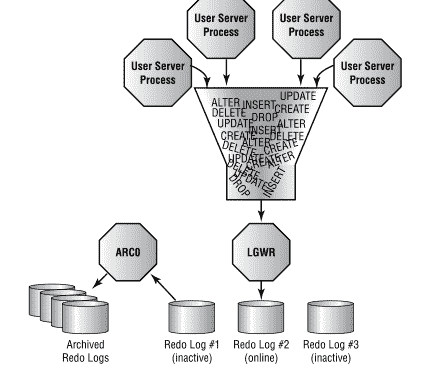

## 调整重做日志缓冲区


与共享池和数据库缓冲区缓存不同，重做日志缓冲区不是由 LRU（最近最少使用）机制管理的。不同于 LRU 列表的传送带概念，重做日志缓冲区的管理机制可以被想象成一个漏斗，事务重做信息从漏斗顶部进入，然后偶尔由 `LGWR` 后台进程从漏斗底部清空。为了跟上进入重做日志缓冲区的条目的数量，每当发生以下任一事件时，`LGWR` 会被提示将重做日志缓冲区的内容写入磁盘：

- 每当应用程序用户发出 `COMMIT` 命令时
- 每隔三秒钟
- 每当重做日志缓冲区填充至三分之一时
- 每当重做日志缓冲区中重做条目信息的数量达到 1MB 时
- 每当数据库检查点发生时

重做日志缓冲区的大小由 `init.ora` 参数 `LOG_BUFFER` 决定。


对于每次 I/O 操作，`LGWR` 都会写入自上次 `LGWR` 写操作以来添加到重做日志缓冲区的所有重做信息。

### 测量重做日志缓冲区的性能

测量重做日志缓冲区性能的一种方式是查看用户服务器进程在尝试将条目放入重做日志缓冲区时所经历的等待次数和时长。这些等待可以在 `V$SYSSTAT` 和 `V$SESSION_WAIT` 动态性能视图中查看。相同的统计信息也可以在 `STATSPACK` 输出以及由 `UTLBSTAT.SQL` 和 `UTLESTAT.SQL` 生成的 `REPORT.TXT` 文件中找到。

**Oracle 目标**

监控和调整重做日志缓冲区的大小

#### 使用 V$SYSSTAT 测量重做日志缓冲区性能

`V$SYSSTAT` 中记录的与调整重做日志缓冲区相关的数据库统计信息包括重做缓冲区分配重试次数、重做条目数以及重做日志空间请求数。

统计项 `redo entries`（重做条目）报告自实例启动以来用户服务器进程放入重做日志缓冲区的条目数量。统计项 `redo buffer allocation retries`（重做缓冲区分配重试）指用户服务器进程因为 `LGWR` 尚未将当前条目写入联机重做日志而不得不等待并重试将其条目放入重做日志缓冲区的次数。使用这两个统计项，可以通过在 `V$SYSSTAT` 上运行以下查询来计算重做日志缓冲区重试比率：

```sql
SQL> SELECT retries.value/entries.value "Redo Log Buffer Retry Ratio"
2    FROM   v$sysstat retries, v$sysstat entries
3    WHERE  retries.name = 'redo buffer allocation retries'
4    AND    entries.name = 'redo entries';
```

**重做日志缓冲区重试比率**

------------------------------------------------  

.000345

理想情况下，你希望用户服务器进程永远不需要等待访问重做日志缓冲区。该比率值较高或呈上升趋势表明重做日志缓冲区可能需要调整。

> **提示** Oracle 建议此重做日志缓冲区重试比率应小于 1 个百分点。

`V$SYSSTAT` 中的统计项 `redo log space requests`（重做日志空间请求）衡量 `LGWR` 在从当前联机重做日志切换到下一个时等待重做日志切换发生的频率：

```sql
SQL> SELECT name, value
2    FROM v$sysstat
3    WHERE name = 'redo log space requests';
```

| name | value |
| :--- | :--- |
| redo log space requests | 34 |

在重做日志切换期间，`LGWR` 无法清空重做日志缓冲区的内容。这可能导致用户服务器进程在尝试访问重做日志缓冲区时经历等待。这种等待会产生上一节所述的重试请求。因此，重做日志空间请求的值较高或呈上升趋势表明你的重做日志可能过小，从而有助于增加重做日志缓冲区重试比率。这也可能表明存在 I/O 争用问题。物理 I/O 的调整将在下一章中讨论。

关于 `V$SYSSTAT` 中所有统计信息的定义，请参阅《Oracle9i 数据库参考指南，版本 1》（部件号 A90190-01）中的附录 C“统计信息说明”。


#### 实际场景

##### 确定重做日志缓冲区的大小

假设你继承了一个现有的 Oracle 数据库，该数据库用于支持公司的订单录入系统。在检查了共享池和数据库缓冲区缓存的命中比率后，你意识到通过增大这些结构的大小可能会提高命中率，但服务器内存不足。重做日志缓冲区的重试比率很低——为 0.0000012。

在你放弃并请求老板为服务器订购更多内存之前，检查重做日志缓冲区的大小。由于重试比率如此低，重做日志缓冲区很可能是过大的，从而浪费了内存。

假设你检查重做日志缓冲区的大小，发现它是 10MB。任何超过 1MB 的值将大部分未被使用，因为当重做日志缓冲区填充至三分之一或填充了 1MB 的重做条目时，`LGWR` 就会收到写入信号的提示。通过将重做日志缓冲区的大小减小到 1MB 或更小，你可以将剩余的大约 9MB 空间分配给共享池和/或数据库缓冲区缓存。这很可能会在不消耗服务器额外内存的情况下改善整个 SGA 的命中比率。

### 使用 V$SESSION_WAIT 测量重做日志缓冲区性能

与显示整个实例统计信息的 `V$SYSSTAT` 不同，`V$SESSION_WAIT` 显示单个用户会话等待了多久以及等待了哪些事件。`log buffer space`（日志缓冲区空间）统计指标指示用户会话因为 `LGWR` 尚未完成将重做日志缓冲区内容写入联机重做日志，而在尝试将条目放入重做日志缓冲区时等待了多长时间。你可以使用以下查询同时针对 `V$SESSION_WAIT` 和 `V$SESSION` 按用户监视此活动：

```sql
SQL> SELECT username, wait_time, seconds_in_wait
2    FROM v$session_wait, v$session
3    WHERE v$session.sid = v$session.sid
4    AND event LIKE '%log buffer space%';
```

| USERNAME | SECONDS_IN_WAIT | STATE |
| :------------- | :------------- | :--------------- |
| JOE | 20 | WAITING |
| MATT | 213 | WAITED SHORT TIME |

表 7.1 显示了 `V$SESSION_WAIT` 中 `STATE` 的可能值以及这些状态各自的描述。

**表 7.1 `V$SESSION_WAIT` 中 STATE 的列值和描述**

| 值 | 描述 |
| :--------------- | :----------------- |
| WAITING | 会话此刻正在等待。 |
| WAITED UNKNOWN TIME | 最后一次等待的持续时间未知。* |
| WAITED SHORT TIME | 最后一次等待持续时间小于 1/100 秒。 |
| WAITED KNOWN TIME | `WAIT_TIME` 列中的值是实际等待时间。 |

\*在不支持快速计时机制的操作系统上，除非将 `init.ora` 参数 `TIMED_STATISTICS` 设置为 TRUE，否则此值可能不会始终显示。

与日志缓冲区空间相关的等待值较高或呈上升趋势可能表明重做日志缓冲区需要调整。

关于在 `V$SESSION_WAIT` 和 `V$SYSSTAT` 中找到的所有统计信息的定义，请参阅《Oracle9i 数据库参考指南，版本 1（部件号 A90190-01）》中的附录 A“Oracle 等待事件”。

### 使用 STATSPACK 输出测量重做日志缓冲区性能

`STATSPACK` 功能的输出也包含一些与重做日志缓冲区性能相关的信息。这些信息出现在 `STATSPACK` 输出文件的两个不同部分。

第一部分，标题为 *Instance Efficiency Percentages*（实例效率百分比），通过一个名为 **Redo NoWait %**（重做无等待百分比）的比率指标来指示重做日志缓冲区的性能。这是上一节针对 `V$SYSSTAT` 查询中显示的重做日志缓冲区重试比率的反面。它不显示用户服务器进程在访问重做日志缓冲区时经历等待的时间百分比，而是显示 `STATSPACK` 输出中用户服务器进程在尝试将条目放入重做日志时 *没有* 经历等待的时间百分比。图 7.2 显示了 `STATSPACK` 输出文件样本的此部分。

**图 7.2** 显示重做日志缓冲区性能的 `STATSPACK` 输出

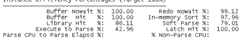


图 7.2 中显示的输出表明，在 99.12% 的时间里，用户服务器进程无需等待即可将它们的条目放入重做日志缓冲区。

Oracle 建议此重做日志缓冲区无等待比率应为 99% 或更好。

显示重做日志缓冲区性能信息的 `STATSPACK` 输出的第二部分是 *Instance Activity Stats*（实例活动统计）。该部分包含在 `V$SYSSTAT` 动态性能视图中找到的相同统计信息。图 7.3 显示了 `STATSPACK` 输出文件样本的此部分。

图 7.3 中显示的输出表明，用户服务器进程每次将条目放入重做日志缓冲区的尝试（`redo entries`）都成功且无需等待（`redo buffer allocation retries`）访问重做日志缓冲区。

### 图 7.3 显示重做日志缓冲区统计信息的 STATSPACK 输出

| 统计信息 | 总计 | 每秒 | 每事务 |
| :--- | :--- | :--- | :--- |
| 直接物理写 | 147 | 0.2 | 49.0 |
| 非检查点物理写 | 147 | 0.2 | 49.0 |
| 预取块 | 0 | 0.0 | 0.0 |
| 递归调用 | 917 | 1.4 | 305.7 |
| 已写入的重做块 | 707 | 1.1 | 235.0 |
| 重做缓冲区分配重试 | 0 | 0.0 | 0.0 |
| 重做条目 | 340 | 0.5 | 113.3 |
| 重做日志空间请求 | 0 | 0.0 | 0.0 |
| 重做排序标记 | 0 | 0.0 | 0.0 |
| 重做大小 | 364,364 | 553.7 | 121,454.7 |
| 重做同步写 | 0 | 0.0 | 1.0 |
| 重做浪费 | 3,028 | 4.6 | 1,009.3 |
| 重做写 | 9 | 0.0 | 3.0 |

### 使用 REPORT.TXT 输出测量重做日志缓冲区性能

通过运行 `UTLBSTAT.SQL` 和 `UTLESTAT.SQL` 生成的 `REPORT.TXT` 文件还包含一个部分，显示与 `V$SYSSTAT` 和 `STATSPACK` 输出中发现的与重做日志缓冲区性能相关的相同统计信息。图 7.4 展示了样例 `REPORT.TXT` 的相关部分。

### 图 7.4 显示重做日志缓冲区统计信息的 REPORT.TXT 输出

```
SQL> select nls.name "statistic",
   2  nls.change\("total",
   3  round(nls.change(\"start_users + end_user\",/2),2) "Per Transaction"
   4  round(nls.change(\"start_users + end_user\",/2),2) "Per Logon"
   5  round(nls.change(to_number(to_char(end_time, 'MM/DD/YYYY HH24:MI:SS'))/
   6  to_number(to_char(start_time, 'MM/DD/YYYY HH24:MI:SS'))
   7  + to_number(to_char(start_time, 'SSSS'))) -
   8  to_number(to_char(start_time, 'SSSS')))
   9  , 2) "Per Second"
  10  from  stats@stats nls,
  11  stats@stats trans,
  12  stats@stats
  13  where  trans.name= 'user_commits'
  14  and nls.change = 0
  15  order by nls.name;
```

| 统计信息 | 总计 | 每事务 | 每登录 | 每秒 |
| :--- | :--- | :--- | :--- | :--- |
| 此会话使用的 CPU | 5878 | 54.43 | 734.75 | 28.26 |
| 调用开始时使用的 CPU | 5878 | 54.43 | 734.75 | 28.26 |
| ... | | | | |
| 递归 CPU 使用量 | 4031 | 37.32 | 503.88 | 19.38 |
| 已写入的重做块 | 127510 | 1188.46 | 15588.75 | 828.48 |
| 重做缓冲区分配重试 | 307 | 2.84 | 38.38 | 1.48 |
| 重做条目 | 271852 | 2517.15 | 33981.1 | 1306.98 |
| 重做日志空间请求 | 109 | 1.01 | 13.63 | .52 |
| 重做日志切换等待时间 | 2670 | 24.81 | 304.88 | 12.88 |
| 重做大小 | 8559492 | 791754.59 | 10688606.5 | 411103.28 |
| 重做同步时间 | 1118 | 10.35 | 139.75 | .58 |
| 重做同步写 | 98 | 12.25 | 166.68 | 4.76 |
| 重做浪费 | 199948 | 1851.37 | 24909.5 | 961.29 |
| 重做写入时间 | 9311 | 86.21 | 1165.88 | 44.76 |
| 重做写入器闩锁时间 | 109 | 1.84 | 24.88 | .96 |
| 重做写 | 765 | 7.08 | 95.63 | 3.68 |

图 7.4 中显示的输出表明，在 `UTLBSTAT.SQL` 和 `UTLESTAT.SQL` 执行期间放入重做日志缓冲区的 271,852 个重做条目（`redo_entries`）中，有 307 个条目（`redo_buffer_allocation_retries`）经历了等待，并不得不重试将条目放入重做日志缓冲区。

> **提示**
>
> `REPORT.TXT` 输出中的一些统计信息名称被截断。例如，统计信息 `redo_buffer_allocation_retry` 被截断为 `redo_buffer_allocation_retr`。

### 提高重做日志缓冲区性能

现在，您已经了解了重做日志缓冲区机制的工作原理以及如何监控其性能，您可以研究提高其性能的方法。重做日志缓冲区调优的目标是确保用户服务器进程能够访问重做日志缓冲区并在其中放置条目，而无需经历等待。这些技术分为两类：

- 将其变大
- 减少重做生成

| **Oracle 目标** | 监控和确定重做日志缓冲区的大小 |

#### 将其变大

提高重做日志缓冲区性能最简单的方法是增加其大小。重做日志缓冲区越大，用户服务器进程在尝试将重做条目放入缓冲区时经历等待的可能性就越小。

重做日志缓冲区的大小以字节为单位，使用 `init.ora` 参数 `LOG_BUFFER` 指定。`LOG_BUFFER` 的默认值是 512KB，或者是服务器中 CPU 数量的 128KB，取较大者。取值范围是从 64K 到操作系统特定的最大值。

> **提示**
>
> 如果您通过将 `LOG_BUFFER` 设置为非常低的值而使重做日志缓冲区的大小过小，Oracle 服务器将覆盖您的设置并将重做日志缓冲区增加至其默认大小。

与共享池和数据库缓冲区缓存一样，继续进行调优练习以持续增加重做日志缓冲区的大小，直到重做日志缓冲区重试比率显示不再进一步改善，或者统计信息 `log buffer space in V$SESSION_WAIT` 的值停止减少，这是一种可接受的调优做法。


> 减少重做日志缓冲区闩锁的竞争是重做日志缓冲区性能改善的次要指标。闩锁调优在第 9 章“调优竞争”中讨论。

#### 减少重做生成

提高重做日志缓冲区性能的另一种方法是减少某些 DML 语句生成的重做信息量，从而减轻对其的压力。该技术通过以下方法之一实现：

- `UNRECOVERABLE` 关键字
- `NOLOGGING` 关键字

##### UNRECOVERABLE 关键字

在使用 `CREATE TABLE AS SELECT` SQL 命令创建表时使用 `UNRECOVERABLE` 关键字：

```
SQL> CREATE TABLE employee_history
   2  AS
   3  SELECT *
   4  FROM employee
   5  UNRECOVERABLE;
```

以这种方式创建的表不会为 `CREATE` 语句的子查询生成的插入操作生成任何重做信息。但是，该表上的任何后续 DML 都将在重做日志缓冲区中生成条目。默认情况下，使用 `CREATE TABLE AS SELECT` 语法创建的所有表都是可恢复的。


> 在创建分区表、索引组织表或包含大对象（LOB）的表时，不能使用 `UNRECOVERABLE`/`RECOVERABLE` 关键字。因此，自 Oracle 8.0.x 版本以来，它主要已被 `NOLOGGING` 选项所取代。

### NOLOGGING 关键字

与 `UNRECOVERABLE` 类似，`NOLOGGING` 选项也允许您指定在执行某些类型的 DML 时哪些表应跳过生成重做条目。然而，与 `UNRECOVERABLE` 不同，`NOLOGGING` 是表的属性，该属性在您禁用它之前一直有效。您可以在表创建时或创建后使用 `ALTER TABLE` 语句指定 `NOLOGGING` 属性。

#### 表创建期间的 NOLOGGING

以下示例展示了如何在表创建期间指定 `NOLOGGING` 关键字：

```
SQL> CREATE TABLE employee_history
   2   (employee_id number,
   3    last_name varchar2(30),
   4    first_name varchar2(30),
   5    hired_date date,
   6    start_date date,
   7    end_date date)
   8   TABLESPACE appl_tab
   9   STORAGE (INITIAL 500k NEXT 500k PCTINCREASE 0)
  10  NOLOGGING;
```

#### 表创建后的 NOLOGGING

也可以在 `ALTER TABLE` 命令中指定 `NOLOGGING` 选项：

```
SQL> ALTER TABLE employee_history NOLOGGING;
```

您还可以使用 `ALTER TABLE` 命令将表更改回 `LOGGING` 模式：

```
SQL> ALTER TABLE employee_history LOGGING;
```


除非在表创建时或通过 `ALTER TABLE` 命令指定了 `NOLOGGING` 选项，否则所有表都是 `LOGGING` 表。

通过查询 `DBA_TABLES`，您可以确定哪些表具有 `NOLOGGING` 属性：

```
SQL> SELECT owner, table_name
   2   FROM dba_tables
   3   WHERE logging = 'NO';
```

一旦在表上设置了 `NOLOGGING` 属性，仅当后续针对该表的 DML 属于以下类型时，才会抑制重做条目生成：

- 使用 `SQL*Loader` 的直接路径加载
- 使用 `/*+ APPEND */` 提示的直接加载插入

对 `NOLOGGING` 表的任何后续 DML，如果不属于这两个类别之一，仍然会在重做日志缓冲区中生成常规重做条目。

除了上面显示的 `CREATE TABLE` 和 `ALTER TABLE` 命令外，以下命令也可以与 `NOLOGGING` 选项一起使用：

- `CREATE TABLE AS SELECT`
- `CREATE INDEX`
- `ALTER INDEX REBUILD`
- `CREATE TABLESPACE`


> 在表上指定 `NOLOGGING` 属性意味着，如果在新增数据被纳入计划冷备份或热数据库备份之前需要介质恢复，则使用直接路径方法加载的任何数据都将丢失。

## 调优检查点

每当数据库中发生数据库检查点事件时，日志写入器后台进程会将重做日志缓冲区的内容写入在线重做日志。

### 目标：Oracle

#### 描述检查点的工作机制

数据库检查点事件代表数据库处于一致状态的某个时刻。检查点非常重要，因为在实例故障之后，实例恢复期间只需要恢复自上次检查点以来发生的那些事务。检查点分为两种类型：*增量和完整*。当发生增量检查点时，会执行以下操作：

- `CKPT` 后台进程立即更新控制文件头。
- `CKPT` 后台进程在新的重做日志切换时，再次更新控制文件头和数据文件头。

当发生完整检查点事件时，数据库中会发生以下操作：

- `DBW0` 后台进程将所有包含已提交事务的数据库缓冲池（Database Buffer Cache）中的缓冲区写入磁盘。
- `LGWR` 后台进程将重做日志缓冲区（Redo Log Buffer）中的所有内容写入联机重做日志（Online Redo Log）。
- `CKPT` 后台进程更新数据库控制文件和数据文件头，以指示检查点事件已经发生。

数据库在以下情况下会发生检查点：

- 使用除 `ABORT` 以外的任何方法关闭实例时。
- 当联机重做日志从当前日志切换到序列中的下一个重做日志时。
- 当 DBA 发出 `ALTER SYSTEM CHECKPOINT` 命令时。
- 当使用 `ALTER TABLESPACE ... BEGIN BACKUP` 命令将表空间置入热备份模式，或当表空间被置为离线时。此检查点是完整检查点的一种特殊形式，称为完整表空间检查点。在此类检查点期间，只有属于处于热备份模式的表空间的脏缓冲区会被写入磁盘。
- 当 `init.ora` 参数 `FAST_START_MTTR_TARGET` 指定的值被超过时。

监控检查点活动很重要，因为过多的检查点会导致不必要的 I/O，而过少的检查点会使数据库面临漫长的实例恢复时间。下一节描述测量数据库检查点性能的技术。

### 测量检查点性能

要在与检查点事件相关的 I/O 开销及其实例恢复收益之间取得适当平衡，需要利用 `V$SYSTEM_EVENT` 和 `V$SYSSTAT` 动态性能视图的内容、`STATSPACK`、`REPORT.TXT`、告警日志以及 `OEM` 性能管理器来监控检查点活动。

#### 使用 V$SYSTEM_EVENT 测量检查点性能

偶尔，检查点事件会启动，但由于第二个检查点请求紧随第一个请求之后发生，导致未能成功完成。您可以通过查询 `V$SYSTEM_EVENT` 中的统计项 `log file switch (checkpoint incomplete)` 来检测已启动但未完成的检查点。该动态性能视图报告自实例启动以来各种事件发生的等待次数。表 7.2 描述了在此查询中使用的 `V$SYSTEM_EVENT` 列的内容。

##### 表 7.2 V$SYSTEM_EVENT 中选定列的描述

| 列名 | 描述 |
| :--- | :--- |
| `EVENT` | 与等待相关联的事件名称 |
| `TOTAL_WAITS` | 此事件发生等待的总次数 |
| `AVERAGE_WAIT` | 等待此事件的平均时间，以百分之一秒为单位 |

图 7.5 展示了一个针对 `V$SYSTEM_EVENT` 的示例查询，显示了数据库中发生的与检查点活动相关的等待。

##### 图 7.5 V$SYSTEM_EVENT 中显示的检查点活动

```sql
SQL> SELECT event, total_waits, average_wait
   2  FROM V$SYSTEM_EVENT
   3  WHERE event LIKE '%check%'
   4  or event LIKE '%log file switch%';

EVENT                          TOTAL_WAITS AVERAGE_WAIT
checkpoint completed              1         10
log file switch (checkpoint incomplete) 54         38
```

`V$SYSTEM_EVENT` 视图中发现的两个事件是检查点性能的指示器：`checkpoint completed` 和 `log file switch (checkpoint incomplete)`。

`Checkpoint Completed`

此事件显示了为检查点完成其活动而发生等待的频率。该事件的高值或持续增加的值表明需要对检查点进行调优。图 7.5 中的输出显示，一个 `Checkpoint Complete` 事件必须等待 10 个百分之一秒才能完成。

`Log File Switch (Checkpoint Incomplete)`

此事件显示了在上一个日志切换的检查点有机会完成之前，联机重做日志从当前日志切换到下一个日志的频率。当这种情况发生时，正在进行的检查点会被放弃，并开始一个新的检查点。由于不完整的检查点会导致无法提供恢复收益的额外 I/O，因此该事件的频繁发生表明应该对检查点活动进行调优。图 7.5 中的输出显示，导致不完整检查点的日志切换发生了 54 次，平均等待时间为 38 个百分之一秒。


另一个检查点性能的指示器可以在 `V$SYSSTAT` 动态性能视图中找到。两个统计项，`background checkpoints started` 和 `background checkpoints completed`，可用于确定所有已启动的检查点是否实际完成了。这两个统计项之间的差异表明检查点已启动但未完成。与 `log file switch (checkpoint incomplete)` 事件一样，这种情况在检查点发生得太频繁时就会出现。图 7.6 展示了使用 `V$SYSSTAT` 动态性能视图呈现此问题的示例。


图 7.6 中的输出显示启动了 36 个检查点，且 36 个检查点成功完成。只要这两个值的差值大于 1，就应考虑进行检查点调优。

> 注意
>
> 如果在检查点正在进行时执行查询，后台检查点启动的数量和后台检查点完成的数量偶尔会相差一个检查点。这不一定表示存在检查点性能问题。

### 使用 STATSPACK 和 REPORT.TXT 测量检查点性能

图 7.6 中的查询所显示的检查点活动也包含在 `STATSPACK` 选项和 `REPORT.TXT` 文件的输出中。图 7.7 展示了 `STATSPACK` 报告中该部分的示例。


图 7.8 展示了包含检查点信息的 `REPORT.TXT` 文件的示例输出。

#### 图 7.8 REPORT.TXT 输出中显示的检查点活动

```sql
SQL> select nl.name 'Statistic',
2 nl.change 'Total',
3 round(nl.change/trans.change,2) 'Per Transaction',
4 round(nl.change/((start_users + end_users)/2),2) 'Per Logon',
5 round(nl.change/to_char(end_time, '0')*60*60*24 -
6 to_number(to_char(end_time, 'SSSSS'))) -
7 to_number(to_char(end_time, 'SSSSS'))) -
8 to_number(to_char(start_time, 'SSSSS')))
9 , 2) 'Per Second'
10 from v$sysstat nl,
11 v$sysstat tr,
12 v$sysstat sdate
13 where trans.name='user commits'
14 and nl.change != 0
15 order by nl.name;
```

| 统计项 | 总计 | 每事务 | 每登录 | 每秒 |
| :--- | :--- | :--- | :--- | :--- |
| CPU used by this session | 5070 | 54.43 | 794.75 | 20.26 |
| CPU used when call started | 5070 | 54.43 | 794.75 | 20.26 |
| CR blocks created | 790 | 7.31 | 90.75 | 3.0 |
| DBWR checkpoint buffer writ | 19716 | 182.65 | 2465.75 | 94.04 |
| DBWR checkpoints | 21 | .19 | 2.63 | .1 |
| DBWR revised bseg=write | 506 | 4.69 | 63.25 | 2.43 |
| DBWR txsn table writes | 308 | 3.59 | 40.5 | 1.87 |
| DBWR undo block writes | 4876 | 46.07 | 632 | 23.92 |
| SQL*Net roundtrips to/from | 40032 | 370.67 | 5004 | 192.46 |
| background checkpoints comp | 17 | .19 | 2.63 | .1 |
| background checkpoints star | 22 | .19 | 2.63 | .1 |
| background timeouts | 192 | 1.78 | 24 | .92 |
| branch node splits | 1 | .01 | .13 | 0 |
| buffer is not pinned count | 171752 | 1590.3 | 21469 | 825.73 |

这两个图中的输出都显示，虽然启动了 22 个检查点，但只有 17 个检查点运行至完成。这表明其中 4 或 5 个检查点未完成，因为它们被随后的检查点事件中断。这表明该实例应该对其检查点活动进行调优。

#### 使用告警日志测量检查点性能

告警日志也包含有关检查点活动的重要信息。如果在告警日志中发现以下消息，则表明重做日志切换过快，未给予已启动的检查点足够的时间以正常完成：

```text
Thread 1 advanced to log sequence 293
Current log# 1 seq# 293 mem# 0: /u03/oradata/PROD/log1a.dbf
Current log# 1 seq# 293 mem# 1: /u04/oradata/PROD/log1b.dbf
Thread 1 cannot allocate new log, sequence 294
Checkpoint not complete
```

当在 `init.ora` 文件中将 `LOG_CHECKPOINTS_TO_ALERT` 设置为 `TRUE` 时，更冗长的检查点信息也会被记录在警报日志中。

### 使用性能管理器测量检查点性能

`OEM` 的性能管理器组件也可用于监控检查点活动的性能。性能管理器 I/O 功能中的“平均脏队列长度”（Average Dirty Queue Length）选项表明检查点活动发生的频率。图 7.9 展示了来自某个示例平均脏队列长度屏幕的图形用户界面输出。


图 7.9 中的输出显示，在整个监控期间，平均脏队列长度接近于零。这表明在监控期间检查点活动相当频繁。平均脏队列长度值较高或持续增加，表明可能存在与检查点相关的性能瓶颈。

### 提高检查点性能

如前一节所述，检查点事件是数据库中的一个 I/O 密集型时刻。一旦检查点开始，你希望它能成功完成。如果没有成功完成，检查点事件最终会导致不必要的 I/O，因为它会促使 `DBW0` 和 `LGWR` 清空数据库缓冲区和重做日志缓冲区，但不提供任何恢复益处。调整数据库检查点活动的技术分为两类：

- 加大尺寸
- 调整与检查点相关的 `init.ora` 参数

#### Oracle 目标

监控和调整检查点

#### 加大尺寸

减少数据库中检查点事件数量的一种方法是增加重做日志的大小。由于每次日志切换时都会发生检查点，因此使日志更大将减少日志被重做条目填满并切换的频率。由于重做日志不能直接修改为更大尺寸，因此增加数据库现有重做日志大小的唯一方法是添加具有新的大尺寸的新日志，然后删除原始的较小日志。


重做日志中当前检查点位置与日志末尾之间的重做块数量将不超过重做日志大小的 `90%`。如果块数超过此大小，将发生增量检查点。


为了平衡检查点对恢复和性能的影响，Oracle 建议将重做日志的大小设置为大约每 20 到 30 分钟切换一次。

#### 与检查点相关的 `init.ora` 参数


数据库检查点事件的目的有两方面：确保包含已提交事务的所有数据库缓冲区中的数据块都写入磁盘，以及通过在数据文件和控制文件的头部中记录这一事实来限制实例恢复时间。Oracle9i 提供了几个允许 DBA 调优这两种操作的 `init.ora` 参数。然而，Oracle 建议在 Oracle9i 中仅使用一个参数来调优检查点活动：`FAST_START_MTTR_TARGET`。此 `init.ora` 参数用于指定在实例故障后恢复实例的平均时间（以秒为单位）。有效值为 0 到 3,600 秒。通过设置此参数，Oracle 将执行额外的检查点，除了日志切换时执行的检查点外，以确保检查点发生的频率足够高，以满足恢复目标。如果配置了 `FAST_START_IO_TARGET` 和 `LOG_CHECKPOINT_INTERVAL` 参数，则此参数将被这两个参数取代。然而，这两个参数都是向后兼容的 Oracle8i 参数，现在已弃用，转而使用 Oracle9i 的 `FAST_START_MTTR_TARGET` 参数。`FAST_START_MTTR_TARGET` 可以使用 `ALTER SYSTEM` 命令动态设置，或手动在 `init.ora` 中设置。`FAST_START_MTTR_TARGET` 的默认值为零，这实际上禁用了其功能。


注意

当服务级别协议（SLA）规定与实例故障相关的最大允许停机时间时，`FAST_START_MTTR_TARGET` 参数非常有用。

设置 `FAST_START_MTTR_TARGET` 参数后，可以使用 `V$INSTANCE_RECOVERY` 视图来监控其有效性。与此参数相关的 `V$INSTANCE_RECOVERY` 视图的选定列如表 7.3 所示。

### 表 7.3 V$INSTANCE_RECOVERY 中选定列的描述

| 列名 | 描述 |
| :--- | :--- |
| TARGET_MTTR | 指示目标平均恢复时间（Mean Time to Recover）。这通常与 `init.ora` 中指定的值匹配，但如果有限的系统资源无法维持指定目标，可能会略高。 |
| ESTIMATED_MTTR | 指示如果实例在该时刻发生故障，预计恢复实例的平均时间。 |

利用这些列，我们可以判断实例恢复时间的目标是否得到维持：

```sql
SQL> SELECT target_mttr, estimated_mttr
2 FROM v$instance_recovery;
TARGET_MTTR ESTIMATED_MTTR
------------ ----------------
218 12
```

上述查询的输出显示，我们预计实例的平均恢复时间为 12 秒，远低于 218 秒的目标平均恢复时间。这表明鉴于我们的实例恢复需求，我们的检查点事件频率是适当调优的。有关平均恢复时间的类似信息包含在 STATSPACK 输出中。图 7.10 展示了一份包含此信息的示例 STATSPACK 报告。

### 图 7.10 显示 MTTR 统计信息的 STATSPACK 输出

| | 目标 | 估算 | | 实际 | 目标 | 日志文件 | 日志检查点 |
|---|---|---|---|---|---|---|---|
| | MTTR | MTTR | 恢复 | 重做块 | 重做块 | 重做块 | 超时 |
| B | 0 | 10 | 0 | 249 | 23 | 10482 | 23 |
| E | 0 | 12 | 0 | 996 | 942 | 10482 | 242 |


`V$INSTANCE_RECOVERY` 视图中还包含了用于监控已弃用的 `FAST_START_IO_TARGET` 和 `LOG_CHECKPOINT_INTERVAL` 参数的类似列。

## 调整在线重做日志文件

所有重做信息最终都由 `LGWR` 写入在线重做日志。由于丢失在线重做日志可能导致已提交事务的丢失，这些重要文件应进行多路复用，使得每个重做日志组包含两个或更多成员。调重复做日志的性能不仅对确保最佳性能至关重要，对确保最佳恢复同样重要。测量重做日志的性能有点棘手。用于测量重做日志性能的动态性能视图不如用于监控其他重做机制的视图那么多。

### 测量重做日志的性能

测量数据库重做日志的性能比较困难，因为 Oracle 没有提供许多直接显示重做日志 I/O 活动的数据字典视图。然而，`V$SYSTEM_EVENT` 动态性能视图和某些操作系统实用程序在监控重做日志性能时可能会很有用。

监控和调整重做日志

#### 使用 V$SYSTEM_EVENT 测量重做日志性能

与检查点性能一样，`V$SYSTEM_EVENT` 表也可用于监控重做日志的活动。两个事件，`logfile switch completion` 和 `logfile parallel write`，可以作为重做日志性能的良好指标。

`日志文件切换完成` 此事件指示 `LGWR` 等待日志切换完成所花费的时间。此事件的高值或不断增加的值表明重做日志可能是性能瓶颈。

`日志文件并行写入` 此事件指示 `LGWR` 将重做日志缓冲区中的重做条目写入在线重做日志所花费的时间。此事件的高值或不断增加的值可能表明重做日志是性能瓶颈。

图 7.11 展示了对 `V$SYSTEM_EVENT` 的示例查询，检查这两个事件的发生情况。

### 图 7.11 显示在 V$SYSTEM_EVENT 中的重做日志活动

```sql
SQL> SELECT event, total_waits, average_wait
2 FROM v$system_event
3 WHERE event = 'log file switch completion'
4 or event = 'log file parallel write';
```

 EVENT              TOTAL_WAITS  AVERAGE_WAIT

 ------------------- ----------- -------------

 log file parallel write         71041            0

 log file switch completion        57           38

此查询的输出显示，自实例启动以来，发生了 57 次等待日志文件完成切换的情况。等待这些日志切换完成的平均时间是 38/100 秒。查询还显示，发生了 71,041 次 `LGWR` 写入

重做日志缓冲区中的重做条目。然而，该事件的平均等待时间极短，因此其平均等待时间显示为零。

### 使用操作系统工具衡量重做日志性能

收集有关重做日志的 I/O 信息的另一种方法是使用 `V$LOGFILE` 视图来确定重做日志文件的位置，然后使用操作系统工具监视这些设备上的 I/O。Unix 工具 `sar` 和 `iostat` 对于监控重做日志所在设备上的磁盘 I/O 都非常有用。表 7.4 简要介绍了这些 Unix 工具。

| 工具名称 | 描述 |
| :--- | :--- |
| sar | 系统活动报告（System Activity Reporter）实用程序。该实用程序用于获取有关重做日志所在设备上 I/O 活动的详细信息。 |
| iostat | I/O 统计实用程序。该实用程序也用于监控重做日志所在设备上的 I/O 活动。然而，iostat 的输出比 sar 实用程序简洁。 |

`sar` 和 `iostat` 的输出和选项因操作系统而异。对于 Unix 系统，请参阅您的 Unix `man` 手册页以了解在其环境中使用的完整详细信息。


性能监视器可用于 Windows 2000 系统上的类似监控，但其输出没有这么详细。

### 改进重做日志性能

如果上述指标表明重做日志存在性能问题，改进其性能的常用技术是将重做日志放置在可用的存储设备上，以最小化竞争并最大化吞吐量。

### Oracle 目标

监控和调优重做日志

#### 最小化重做日志竞争

确保重做日志不会导致任何 I/O 性能问题的最简单方法之一是将它们与其他数据库文件（如数据文件、控制文件和归档日志）分开，并放在自己的设备上。例如，将重做日志与数据文件分离通常有助于提高性能，因为前者的 I/O 活动通常是顺序的，而后者的 I/O 活动是随机的。分离这些不同的 I/O 模式可以帮助设备更有效地执行其 I/O 活动。

#### 最大化重做日志吞吐量


当重做日志如上所述与其他数据库文件分离时，还应注意将它们放置在最快的可用设备上。将重做日志放置在快速设备上将允许 `LGWR` 尽可能快地执行其写入操作。因此，不建议将重做日志放置在写入活动会产生额外 I/O 开销的 RAID 卷上。


> 可以在原始设备上创建重做日志以最大化吞吐量。

## 调整归档操作

*归档*过程是指将重做日志文件的内容复制到次要目标，以便在媒体故障或用户错误的情况下使用归档日志进行数据库恢复。虽然此机制是数据库管理备份和恢复方面的重要组成部分，但它也可能是 I/O 性能问题的主要来源，因此应对其进行监控和相应调整。

### 衡量归档性能

重做日志缓冲区性能的一个主要瓶颈是归档后台进程 `ARC0` 在数据库运行在归档日志模式下时，将重做日志文件的内容复制到归档目标频率和效率。如果 `LGWR` 需要写入当前正由 `ARC0` 归档的重做日志，`LGWR` 将等待，直到 `ARC0` 完成将重做日志内容复制到归档目标。为了降低这种情况发生的可能性，当系统需求需要时，`LGWR` 会自动启动额外的归档后台进程（`ARC1`、`ARC2` 等）。然而，与归档过程相关的两个领域也可能导致性能问题。与归档过程相关的常见性能问题包括：

- 归档目标被归档日志填满，导致数据库处理停止，直到腾出可用空间。
- `ARC0` 后台进程跟不上重做日志切换活动，导致在 `ARC0` 完成日志内容归档之前，当重做日志回卷时发生等待。

可以使用 `V$ARCHIVE_DEST`、`V$ARCHIVE_PROCESSES` 和 `V$SYSTEM_EVENT` 动态数据字典视图来监控这些事件。

#### 填满归档位置

归档的重做日志文件的位置是使用 `init.ora` 参数 `LOG_ARCHIVE_DEST` 或 `LOG_ARCHIVE_DEST_n` 指定的，其中 *n* 是 1 到 10 之间的值，允许您指定多达十个归档目标，以提供额外的可恢复性保障。当归档目标变满时，数据库处理停止，并且错误消息被写入数据库 Alert 日志。图 7.12 显示了此错误消息的示例。

当发生此错误时，数据库将保持停止状态，直到归档位置中腾出可用空间。您还可以使用以下命令临时更改归档位置：

```sql
SQL> ALTER SYSTEM ARCHIVE LOG ALL TO
2  '/u04/oradata/PROD' ;
```

一旦在归档目标中腾出空间，归档将恢复，并且一条消息将写入 Alert 日志，表明归档已恢复。

**图 7.12** 当归档目标已满时 Alert 日志中的错误消息


#### ARC0 进程在日志切换时导致等待

如果重做日志填满和切换过于频繁，`LGWR` 可能会回卷并尝试写入尚未由 `ARC0` 归档的重做日志。由于处于归档日志模式的数据库在重做日志被归档之前无法重用该日志，因此 `LGWR` 会挂起片刻，直到重做日志被归档并可用为止。为了防止这种情况，`LGWR` 会在检测到当前 Archiver 进程数量不足以跟上重做日志切换时自动启动新的归档进程（即 `ARC1`、`ARC2` 等）。DBA 也可以在实例启动时通过设置 `init.ora` 参数 `LOG_ARCHIVE_MAX_PROCESSES` 为 2 到 10 之间的值（默认为 1）来启动额外的 Archiver 进程。

您可以通过查询 `V$ARCHIVE_PROCESSES` 动态性能视图来主动监控对额外 Archiver 进程的需求。该视图显示每个 Archiver 进程的状态以及它当前是忙碌还是空闲。

此外，如果日志文件切换（需要归档）事件出现在 `V$SYSTEM_EVENT` 动态性能视图中，`LGWR` 可能会受到 `ARC0` 行为的阻碍。此事件指示 `LGWR` 将重做日志缓冲区内容写入联机重做日志时，因等待 `ARC0` Oracle 后台进程将重做日志内容复制到归档目标而中断的频率。

### 改进归档性能

如果您已确定归档机制或 `ARC0` 本身是性能瓶颈，您可以通过添加更多重做日志、增大现有重做日志的大小、积极管理归档目标以及创建额外的 `ARC0` 进程来协助归档过程，从而改进这些进程的性能。

#### 添加更多

每个 Oracle 数据库必须至少有两个重做日志组。然而，通过向数据库添加额外的重做日志组，您可以降低 `LGWR` 通过所有重做日志回卷并回到可能仍在归档的那个日志的可能性。没有适用于所有情况的“神奇”重做日志组数量，但在大多数联机事务处理系统中，5 到 20 个日志通常就足够了。


> 除了拥有足够数量的重做日志组外，每个组至少应有两个成员。在每个组中拥有多个重做日志成员可将因联机重做日志损坏或丢失而导致的可能数据损失降至最低。

#### 使其更大

除了调整重做日志的数量外，增加其大小还可以减少日志切换的频率以及随之而来的归档开销。就检查点和可恢复性而言，Oracle 建议日志切换大约每 20 到 30 分钟发生一次。然而，正如我们所见，可以使用 `init.ora` 中的 `FAST_START_MTTR_TARGET` 参数来调优检查点频率。因此，您可以增加重做日志的大小而不会对检查点频率产生负面影响。

### 调优归档目标

有几个 `init.ora` 参数可用于降低因归档位置已满而导致数据库停止的可能性。这些参数允许您指定多个并发的归档目标，以便即使其中一个其他位置被归档日志填满，数据库事务处理也可以继续。

`LOG_ARCHIVE_DUPLEX_DEST` 此参数与上一节中讨论的 `LOG_ARCHIVE_DEST` 参数配合使用。通过设置此参数，`ARC0` 被指示将归档的重做日志写入

……到这两个位置。当与下一节中所示的 `LOG_ARCHIVE_MIN_SUCCEEDED_DEST` 结合使用时，即使其中一个位置已满，`ARC0` 仍可继续归档重做日志文件。

+   **LOG_ARCHIVE_DEST_n** 通过设置 `LOG_ARCHIVE_DEST_n` 参数，`ARC0` 被指示将归档的重做日志写入多个位置。这些位置可以是本地或远程，并且当与 `LOG_ARCHIVE_MIN_SUCCEEDED_DEST` 和 `LOG_ARCHIVE_DEST_STATE_n` 结合使用时，可以指定为必需或可选。如下几节所示，即使其中一个位置已满，`ARC0` 仍可继续归档重做日志文件。


`init.ora` 参数 `LOG_ARCHIVE_DEST_n` 仅在 Oracle9i 企业版中可用。在 Oracle9i 标准版中，必须使用 `LOG_ARCHIVE_DEST` 和 `LOG_ARCHIVE_DUPLEX_DEST` 来指定多个归档位置。


不能同时使用 `LOG_ARCHIVE_DUPLEX_DEST` 和 `LOG_ARCHIVE_DEST_n` 参数。它们是互斥的。

+   **LOG_ARCHIVE_MIN_SUCCEEDED_DEST** 当与 `LOG_ARCHIVE_DUPLEX_DEST` 和 `LOG_ARCHIVE_DEST_n` 一起使用时，此参数指定在引发错误之前，`ARC0` 必须能够成功写入归档日志文件的位置数量。默认值为 1。当与 `LOG_ARCHIVE_DUPLEX_DEST` 一起使用时，有效值为 1 或 2；当与 `LOG_ARCHIVE_DEST_n` 一起使用时，有效值为 1 到 5 之间。

+   **LOG_ARCHIVE_DEST_STATE_n** 此 `init.ora` 参数与 `LOG_ARCHIVE_DEST_n` 配合使用。为每个对应的 `LOG_ARCHIVE_DEST_n` 参数指定一个 `LOG_ARCHIVE_DEST_STATE_n`。此参数的有效值为 `ENABLE` 或 `DEFER`。以下来自 `init.ora` 的示例展示了在运行 Oracle9i 企业版的 UNIX 系统上如何指定这些参数：

```
log_archive_dest_1 = /u01/oradata/PROD
log_archive_dest_2 = /u02/oradata/PROD
log_archive_dest_3 = /u03/oradata/PROD
log_archive_dest_state_1 = enable  
log_archive_dest_state_2 = defer  
log_archive_dest_state_3 = enable
```


使用这些参数，`ARC0` 将重做日志的内容复制到两个位置：`/u01/oradata/PROD` 和 `/u03/oradata/PROD`。尽管位置 `/u02/oradata/PROD` 被配置为归档位置，但在其状态从 `DEFER` 更改为 `ENABLE` 之前，它将不会被使用。可以通过编辑 `init.ora` 或发出 `ALTER SYSTEM SET LOG_ARCHIVE_DEST_STATE_n = ENABLE` 命令来将位置的状态从 `DEFER` 更改为 `ENABLE`。


可以使用动态数据字典视图 `V$ARCHIVE_DEST` 和 `V$ARCHIVED_LOG` 来监控每个归档目的地的归档活动的位置和状态。


你可以通过为归档重做日志文件的位置指定具有快速 I/O 能力的设备，进一步降低归档进程形成瓶颈的可能性。


不能使用原始设备来存储归档日志。

### 创建额外的 ARC0 进程

`LGWR` 会在进程数量不足以满足实例归档需求时，隐式地启动额外的归档进程。然而，如果 `ARC0` 似乎正在导致性能瓶颈，你可能希望尝试显式启动额外的归档进程。通过 `init.ora` 中的 `LOG_ARCHIVE_MAX_PROCESSES` 参数可以启动额外的归档进程。要启动的归档进程数量在一定程度上取决于你指定的归档目的地数量以及这些位置背后设备的速度。此参数的默认值为 1。此参数的有效值范围是 1 到 10。这些归档进程将在实例启动时立即启动。

每当 `init.ora` 参数 `DBWR_IO_SLAVES` 设置为非零值时，归档进程的数量会自动设置为四。有关数据库写入器 I/O 从进程的更多详细信息，请参阅第 8 章“调整磁盘 I/O”。

动态数据字典视图 `V$ARCHIVE_PROCESSES` 可用于监控多个归档进程的数量和活动。`V$ARCHIVE_PROCESSES` 视图的内容说明如表 7.5 所示。

#### 表 7.5 `V$ARCHIVE_PROCESSES` 视图的内容

| 列名 | 说明 |
|---|---|
| PROCESS | 标识统计信息关联的是 10 个归档进程中的哪一个（例如，ARC0、ARC1、ARC2）。 |
| STATUS | 关联归档进程的当前状态。有效值为 STOPPED、SCHEDULED、STARTING、ACTIVE、STOPPING、TERMINATED。 |
| LOG_SEQUENCE | 当前正在归档的重做日志的日志序列号。 |
| STAT | 关联归档进程的当前状态，为 IDLE 或 BUSY。 |

图 7.13 中所示的查询展示了针对 `V$ARCHIVE_PROCESSES` 的一个示例查询。

#### 图 7.13 针对 `V$ARCHIVE_PROCESSES` 的示例查询

```sql
SQL> SELECT process, status, log_sequence, state
   2  FROM v$archive_processes;

PROCESS STATUS   LOG_SEQUENCE STAT
------- -------- ------------ -----
0 ACTIVE   100231 BUSY
1 ACTIVE   100232 BUSY
2 ACTIVE   100233 IDLE
3 ACTIVE         0 IDLE
4 STOPPED        0 IDLE
5 STOPPED        0 IDLE
6 STOPPED        0 IDLE
7 STOPPED        0 IDLE
8 STOPPED        0 IDLE
9 STOPPED        0 IDLE
```

图 7.13 中的输出显示已启动了四个归档进程，其中两个（0 和 1）正忙于将重做日志序列号 100231 和 100232 的内容复制到归档目的地。


如果 `V$ARCHIVE_PROCESSES` 视图持续显示两个或更多日志需要归档，Oracle 建议启动额外的归档进程。

### 摘要

本章向你展示了 Oracle 的重做机制在维持 Oracle 高度的事务恢复方面所起的重要作用。重做信息最初由每个用户的服务器进程放入重做日志缓冲区中，直到 `LGWR` 将重做日志缓冲区的内容写入在线重做日志文件。当在线重做日志因重做条目填满时，`LGWR` 将切换到下一个可用的重做日志，如果数据库正在归档日志模式下运行，则会导致归档进程将重做日志的内容复制到归档目的地。可以使用几个动态性能视图来监控重做机制的组件，包括：`V$SYSSTAT`、`V$SESSION_WAIT`、`V$SYSTEM_EVENT`、`V$INSTANCE_RECOVERY`、`V$LOGFILE`、`V$ARCHIVE_DEST`、`V$ARCHIVE_PROCESSES` 和 `V$ARCHIVED_LOG`。`STATSPACK` 和 `REPORT.TXT` 文件的输出也包含重做调整信息。

提高重做日志机制性能的技术包括：增加重做日志缓冲区的大小、使用 `UNRECOVERABLE` 和 `NOLOGGING` 选项减少重做条目、提高检查点的效率、添加额外的重做日志、增大现有重做日志的大小，以及通过启动多个归档进程来提高归档 Oracle 后台进程的性能。

### 考试要点

了解如何监控重做日志缓冲区的性能。理解哪些统计信息和等待事件表明重做日志缓冲区可能存在潜在问题。能够描述可以进行哪些类型的更改以提高重做日志缓冲区的性能。

了解如何监控重做日志的性能。能够描述 Oracle 的重做日志机制如何受重做日志大小和数量变化的影响。知道哪些动态性能视图可用于监控重做日志性能。

理解检查点的重要性。知道检查点事件何时发生以及检查点事件期间发生了什么。能够描述可以在哪里找到有关检查点活动的信息，以及可以使用哪些 `init.ora` 参数来调整检查点活动。

### 关键术语

在参加考试之前，请确保你熟悉以下术语：

- 已归档重做日志
- 归档进程
- 数据库检查点
- 日志写入器
- 在线重做日志
- 重做日志缓冲区

### 复习问题

- 1. 下列哪个进程有助于管理重做日志缓冲区的内容？
  - A. LR List
  - B. Dirty List
  - C. `LGWR`
  - D. 以上所有都参与管理重做日志缓冲区。
- 2. 下列哪种命令类型不会在重做日志缓冲区中放置条目？
  - A. `INSERT`
  - B. `SELECT`
  - C. `UPDATE`
  - D. `DROP TABLE`
- 3. 哪个事件代表了数据库处于一致状态的时间点？
  - A. 重做日志写入
  - B. 数据库写入
  - C. 检查点
  - D. 高速缓存刷新
- 4. 下列哪个事件不会导致 `LGWR` 将重做日志缓冲区的全部内容写入磁盘？
  - A. 应用用户执行 `COMMIT`。
  - B. 数据库正常关闭。
  - C. 发生检查点。
  - D. 应用用户执行 `UPDATE`。
- 5. 下列哪些操作会导致 `LGWR` 将重做日志缓冲区的内容清空到在线重做日志？（选择两项。）
  - A. 发生数据库检查点事件。
  - B. `ARC0` 将重做日志复制到归档目标。
  - C. 任何用户执行 `COMMIT`。
  - D. `DBW0` 写入数据文件。
- 6. 你想复制一个大表。可以在 ‘`CREATE TABLE AS`’ 语法中添加什么关键字来最小化对重做日志的影响？
  - A. `NLOG`
  - B. `NOLOGGING`
  - C. `NOCACHE`
  - D. `NORECOVER`
- 7. 如果 `EMP` 表被指定为 `LOGGING`，下列哪个操作将为插入到该表中的行生成重做信息？
  - A. `INSERT` DML 语句。
  - B. 使用 `SQL*Loader` 的直接路径加载。
  - C. 使用 `/*+ APPEND */` 提示的直接加载插入。
  - D. 以上所有操作都会生成重做信息。
- 8. 下列所有情况都会导致数据库检查点，除了：
  - A. DBA 执行 `SHUTDOWN TRANSACTIONAL`。
  - B. 应用用户执行 `COMMIT`。
  - C. 重做日志切换。
  - D. 以上任何情况都可能导致数据库检查点事件发生。
- 9. 可以使用哪个动态性能视图来计算重做日志缓冲区重试比率？
  - A. `V$SYSSTAT`
  - B. `V$SESSION`
  - C. `V$SYSTEM_EVENT`
  - D. `V$SGASTAT`
- 10. `V$SESSION_WAIT` 动态性能视图中的哪个统计信息可用于确定当前哪些用户正在经历对重做日志缓冲区的访问等待？
  - A. buffer wait


- B. `redo log buffer wait`
- C. `log buffer space`
- D. `log buffer wait`

- 11. `REPORT.TXT` 文件输出中的哪个统计信息可用于识别过多的检查点活动？
  - A. `check point start/checkpoint stop`
  - B. `database checkpoints started/database checkpoint ended`
  - C. `background checkpoints started/background checkpoints completed`
  - D. `background checkpoint start time/background checkpoint end time`

- 12. 你在生产实例的 `init.ora` 文件中看到如下行：`FAST_START_MTTR_TARGET = 240`。哪个答案最能解释这行代码的含义？
  - A. 每 240 秒执行一次检查点
  - B. Oracle 每天执行的检查点不超过 240 次
  - C. Oracle 将执行足够的检查点，以确保实例故障后的平均恢复时间不超过 240 秒。
  - D. Oracle 将确保在从实例故障中恢复时，应用的检查点数量不超过 240 个。

- 13. 根据 Oracle，在调优良好的数据库中，用户服务器进程在重做日志缓冲区中找到空间而不等待的时间大约为：
  - A. 百分之一次
  - B. 百分之九十九次
  - C. 百分之五十五次
  - D. 百分之八十次

- 14. 下列哪种方法可用于提高重做日志缓冲区的性能？
  - A. 增加 `LOG_BUFFER` `init.ora` 参数的值。
  - B. 使用 `NOLOGGING` 选项减少生成的重做量。
  - C. 避免不必要的检查点。
  - D. 以上所有都是提高重做日志缓冲区性能的有效方法。

- 15. 使用 `NOLOGGING` 选项创建表会导致不会在重做日志缓冲区中放置重做条目，除非在该表上执行以下类型的 DML：
  - A. 直接路径 SQL*Loader 加载
  - B. 常规 DML
  - C. 使用 `/*+ APPEND */` 提示执行的插入
  - D. 由 `CREATE TABLE AS SELECT` 子查询结果执行的插入。

- 16. 可以查询哪个动态性能视图来获取有关在线重做日志性能的信息？
  - A. `V$SYSTEM_EVENT`
  - B. `V$REDO_LOG`
  - C. `V$LOGFILE`
  - D. `V$SYSTEM_STATS`

- 17. 重做日志缓冲区的大小由下列哪个 `init.ora` 参数指定？
  - A. `LOG_BUFFER_SIZE`
  - B. `REDO_LOG_BUFFER`
  - C. `REDO_LOG_BUFFERS`
  - D. `LOG_BUFFER`

- 18. 你将重做日志的大小从 20MB 增加到 50MB。如果 `init.ora` 参数 `FAST_START_MTTR_TARGET` 设置为零，这种重做日志大小的增加对检查点会有什么影响？
  - A. 检查点将更频繁地发生。
  - B. 检查点将较少发生。
  - C. 检查点不受影响。

- 19. `LGWR` 在到达什么点时开始将重做日志缓冲区的内容写入磁盘？
  - A. 三分之二满
  - B. 三分之一满
  - C. 一半满
  - D. 百分之百满

- 20. `LOG_ARCHIVE_DEST_STATE_`*n* 参数的两个可能值是什么？（选择两项。）
  - A. `START`
  - B. `DISABLED`
  - C. `DEFER`
  - D. `ENABLE`

### 复习问题答案

- 1. C. `LGWR` 后台进程将重做日志缓冲区的内容写入在线重做日志，以确保用户服务器进程能在缓冲区中找到放置条目的空间。

- 2. B. 只有 DML 和 DDL 语句需要在重做日志缓冲区中有条目。

- 3. C. 检查点事件标记了数据库达到一致状态的时间点。缓冲区高速缓存中修改过的数据库缓冲区被刷新到磁盘。此事件的意义在于，如果发生实例故障，Oracle 只需要恢复从最后一个完成的检查点事件到故障发生时的交易，从而加快恢复过程。

- 4. D. 像 `INSERT`、`UPDATE` 或 `DELETE` 这样的 DML 语句不会触发检查点的发生。

- 5. A, C. `LGWR` 还会每三秒写入一次，或者当重做日志缓冲区达到三分之一满时，或者当 1MB 的重做信息被写入重做日志缓冲区时进行写入。

- 6. B. `NOLOGGING` 关键字将导致 Oracle 不记录从旧表到新表的行插入操作。这将大大减小对重做日志的影响。

- 7. D. 通过指定表为 `LOGGING`，你要求记录对该表的所有 DML 操作。这是 Oracle 的默认行为。

- 8. B. 用户 `COMMIT` 会导致 `LGWR` 将重做日志缓冲区的内容清空到在线重做日志，但不会导致数据库检查点。

- 9. A. `V$SYSSTAT` 动态性能视图包含**重做条目**和**重做缓冲区分配重试**统计信息，可用于计算用户服务器进程等待在重做日志缓冲区中放置条目的频率。

- 10. C. 统计信息 `log buffer space` 指示哪些用户目前正在等待或最近等待访问重做日志缓冲区。

- 11. C. 如果开始的后台检查点数量和完成的后台检查点数量差异超过 1，则表明检查点并非总是在下一个检查点开始之前完成。

- 12. C. 此参数指定了期望的实例平均恢复时间。基于此指标，Oracle 可以执行足够的检查点来满足此要求。

- 13. B. 重做日志缓冲区条目与重做日志缓冲区重试的比率应小于 1%。

- 14. D. 提高重做日志缓冲区性能的另一个选项是提高重做日志归档的速度。

- 15. B. 即使表是 `NOLOGGING` 表，常规应用 DML 仍然会记录在重做日志缓冲区中。

- 16. A. `V$SYSTEM_EVENT` 视图包含有关在线重做日志性能的信息。需要注意的统计信息是 `log file switch complete` 和 `log file parallel write`。

- 17. D. 重做日志缓冲区的大小使用 `init.ora` 中的 `LOG_BUFFER` 参数以字节为单位指定。

- 18. B. 由于检查点在日志切换时发生，增加重做日志的大小将降低检查点的频率。这是管理检查点频率的一种技术。

- 19. B. `LGWR` 后台进程在缓冲区达到三分之一满时将重做日志缓冲区的内容写入在线重做日志。这有助于确保始终有空间供后续交易使用。

- 20. C, D. 两个有效值 is `ENABLE` 和 `DEFER`。当设置为 `ENABLE` 时，归档进程（Archiver process）将归档日志写入相应的 `LOG_ARCHIVE_DEST_n` 目标。当设置为 `DEFER` 时，归档进程不会将归档日志写入相应的 `LOG_ARCHIVE_DEST_n` 目标，直到该值更改为 `ENABLE`。

# 第 8 章

## 调整磁盘 I/O

**本章覆盖的 ORACLE9i 性能调整考试目标：**

- 解释分布不同 Oracle 文件类型的优势
- 描述在表空间中划分数据的原因
- 诊断表空间使用问题
- 描述区（extents）和 Oracle 块的正确用法
- 描述 Oracle 块参数的使用
- 解释空间使用和高等水位线（High Water Mark）
- 确定高等水位线
- 从稀疏填充的段中回收空间
- 描述并检测 Oracle 块的链接和迁移
- 描述排序是如何执行的
- 区分磁盘排序和内存排序
- 识别需要排序的 SQL 操作
- 创建和监控临时表空间
- 减少总排序次数和磁盘排序次数
- 确定在内存中执行的排序次数
- 设置旧的和新的排序参数
- 使用动态性能视图检查回滚段性能
- 重新配置和监控回滚段
- 定义回滚段的数量和大小
- 适当分配回滚段给事务
- 解释自动撤销管理的概念
- 创建和维护自动管理的撤销表空间
- 配置实例使用 I/O 从进程
- 配置和使用多个 `DBW` 处理器

> **注意**
>
> 考试目标可能随时变更，恕不另行通知，且最终解释权归 Oracle 所有。请访问 Oracle 认证网站 (`http://www.oracle.com/education/certification/`) 查看当前的考试目标列表。

数据库中的每个早期操作都会导致某种类型的 I/O 活动。该 I/O 活动可以是逻辑的（在内存中）或物理的（在磁盘上）。第 4、5、6 和 7 章都讨论了通过调整 `SGA` 组件来最小化物理 I/O 的技术，使得大多数 I/O 是逻辑读而不是物理读。从性能角度来看，这一点非常重要，因为逻辑 I/O 比物理 I/O 快数千倍。然而，任何程度的内存调整都无法完全消除物理 I/O 活动。例如，以下所有活动都可能是磁盘 I/O 的来源：


- 数据库写进程 (`DBW0`) 将数据缓冲区从数据库缓冲区高速缓存写入数据库的数据文件
- `DBW0` 将数据写入回滚段块以维护读一致性
- 用户服务器进程将数据块读取到数据库缓冲区高速缓存
- 日志写进程 (`LGWR`) 将事务恢复信息从重做日志缓冲区写入联机重做日志
- 归档进程 (`ARC0`) 读取重做日志的内容并将这些内容写入归档目标
- 应用程序用户活动暂时将大型排序请求写入磁盘

如果这些操作发生得过于频繁或效率低下，都可能导致性能问题。因此，调整物理 I/O 时的一般目标通常如下：
- 通过正确调整 SGA 的大小，尽可能减少物理 I/O。
- 当需要执行物理 I/O 时，尽可能快地完成它。

因此，本章探讨了调整数据库磁盘 I/O 的重要领域。接下来的章节将讨论如何测量和调整这些数据库结构的磁盘 I/O 性能：
- 数据文件
- `DBW0`
- 单个段数据块
- 排序活动和临时段
- 回滚段

这些测量将通过查询 `V$` 和 `DBA` 视图、检查 `STATSPACK` 和 `REPORT.TXT` 报告的内容以及 `OEM` 性能管理器 GUI 工具来实现。第一部分讨论如何调整数据文件 I/O。

### 调整表空间和数据文件 I/O

每个数据库段都存储在一个称为 *表空间* 的逻辑结构中。每个数据库至少有一个表空间 `SYSTEM`，用于存储 Oracle 数据字典表和数据索引。设计良好的数据库还会有许多额外的表空间来存储非数据字典的应用程序段。数据库中“正确”的表空间数量取决于应用程序类型、应用程序段的数量和类型、应用程序用户数量以及应用程序用户执行的事务类型。例如，使用 Oracle 的图形用户界面数据库创建工具数据库配置助手创建的数据库将包含表 8.1 中所示的表空间。

虽然表 8.1 中显示的表空间只是配置数据库的一种可能方式，但它们确实展示了一个重要概念。设计良好且经过精心调整的数据库将使用许多不同的表空间，以便将不相似的段（例如，应用程序表和应用程序索引）分别存储在其自己的独立表空间中。

#### 表 8.1 数据库配置助手默认表空间

| 表空间名称 | 描述 |
| :--- | :--- |
| `CMWILITE` | 存储联机分析处理 (OLAP) 处理的段 |
| `DRSYS` | 存储 Oracle Context 功能所需的段 |
| `EXAMPLE` | 存储示例架构的段（例如，HR, OE） |
| `INDEX` | 存储应用程序索引 |
| `SYSTEM` | 存储数据字典段 |
| `TEMP` | 用于排序的临时表空间 |
| `TOOLS` | 存储工具的非应用程序段 |
| `UNDOTBS` | 存储回滚段 |
| `USERS` | 存储用户创建的段 |

此外，拥有按功能隔离的多个表空间可以使数据库管理和备份活动变得更加容易。例如，将回滚段放在它们自己的表空间中，将有助于确保用户事务始终能找到足够的空间来存储它们的前镜像数据。另外，仅包含临时段的表空间不需要备份，因为它们不会存储任何应用程序数据。通常，您的数据库中至少应该有六个表空间：
1. 用于数据字典段的 `SYSTEM` 表空间。每个数据库都需要此表空间。不应在 `SYSTEM` 表空间中存储任何应用程序段。
2. 仅存储回滚段或撤销段的表空间。本章后面将详细讨论管理回滚段和撤销段的技术。
3. 存储在用户排序活动期间创建的临时段的表空间。每个应用程序用户都应指定此表空间作为他们的临时表空间。本章后面将详细讨论排序活动的调整。
4. 用于应用程序表的表空间。您可能希望为应用程序表设置多个表空间。例如，进一步划分应用程序表空间的一种方法是创建用于小表、中表和大表的表空间。包含只读数据的独立表空间也很有用。与表存储相关的额外主题，如区（extent）和块管理，将在本章后面讨论。
5. 用于应用程序索引的表空间。您可能希望为应用程序索引设置多个表空间。除了按大小划分外，您还可以考虑按应用程序模块划分应用程序的索引表空间——为人力资源 (HR) 表、订单录入 (OE) 表和发货 (SH) 表创建独立的表空间。
6. 用于存储大型对象数据和与索引组织表 (IOT) 关联的溢出段的表空间。

> 您可能还希望为非应用程序架构创建表空间，这些架构需要在数据库中存储段。这些类型架构的示例包括 Enterprise Manager 和 Recovery Manager 仓库表。

无论您有多少个表空间，每个表空间都由一个或多个称为数据文件的物理文件组成。实际的 I/O 是针对数据文件发生的，而不是针对表空间本身。因此，组成数据库表空间的物理数据文件的数量和位置是调整考虑的重要领域。特别是，您应该尝试通过将不同表空间的数据文件放置在不同的磁盘驱动器、卷组或磁盘控制器上来最大限度地减少磁盘争用，从而最大化 I/O 性能。下一节讨论如何测量数据文件 I/O 活动。

> 不仅重要的是要调整数据文件相对于其他数据文件的位置，还需要注意分离数据文件、重做日志和归档日志。此概念在“平衡数据文件 I/O 以提高性能”部分中有更详细的讨论。

### 衡量数据文件 I/O

可以使用 `V$FILESTAT` 和 `V$DATAFILE` 动态性能视图、`STATSPACK` 和 `REPORT.TXT` 的输出，以及 `OEM` 性能管理器 GUI 工具的输出，来衡量数据库中数据文件的物理 I/O 性能。

**Oracle 目标**

诊断表空间使用问题

#### 使用 `V$FILESTAT`、`V$DATAFILE` 和 `V$TEMPFILE` 衡量数据文件 I/O

`V$FILESTAT`、`V$DATAFILE` 和 `V$TEMPFILE` 动态性能视图可用于监控数据库中各个数据文件和表空间的读写活动性能。这三个视图中选定列的描述见表 8.2、8.3 和 8.4。

**表 8.2** `V$FILESTAT` 选定列描述

| 列名 | 描述 |
| :--- | :--- |
| `FILE#` | Oracle 在创建表空间时分配给该数据文件的内部标识符 |
| `PHYRDS` | 对该数据文件执行物理读的次数 |
| `PHYWRts` | 对该数据文件执行物理写的次数 |
| `AVGIOTIM` | 对该数据文件执行 I/O 操作的**平均时间**，以毫秒为单位 |
| `MINIOTIM` | 对该数据文件执行 I/O 操作的**最短时间**，以毫秒为单位 |
| `MAXIOWTM` | 对该数据文件写入的**最长耗时**，以毫秒为单位 |
| `MAXIORTM` | 对该数据文件读取的**最长耗时**，以毫秒为单位 |

**表 8.3** `V$DATAFILE` 选定列描述

| 列名 | 描述 |
| :--- | :--- |
| `FILE#` | Oracle 在创建表空间时分配给该数据文件的内部标识符 |
| `NAME` | 数据文件的完全限定路径和名称 |

**表 8.4** `V$TEMPFILE` 选定列描述

| 列名 | 描述 |
| :--- | :--- |
| `FILE#` | Oracle 在创建表空间时分配给该数据文件的内部标识符 |
| `NAME` | 数据文件的完全限定路径和名称 |

图 8.1 展示了针对这三个视图的查询，显示了数据库中所有数据文件（在第一列用 D 表示）和临时文件（在第一列用 T 表示）的总体统计信息。

**图 8.1** `V$FILESTAT`、`V$DATAFILE` 和 `V$TEMPFILE` 上的性能查询

```sql
SQL> SELECT s.file#||'D' "FILE#TYPE", d.name "DATAFILE",
  2          s.phyrds, s.phywrts,
  3          s.avgiotm, s.minitiorm,
  4          s.maxiowtm, s.maxiortm
  5    FROM v$filestat s, v$datafile d
  6   WHERE s.file# = d.file#
  7  UNION ALL
  8 SELECT s.file#||'T', t.name "DATAFILE",
  9          s.phyrds, s.phywrts,
 10          s.avgiotm, s.minitiorm,
 11          s.maxiowtm, s.maxiortm
 12   FROM v$filestat s, v$tempfile t
 13  WHERE s.file# = t.file#
 14 ORDER BY 1;
```

`FILE#TYPE` `DATAFILE` `PHYRDS` `PHYWRTS` `AVGIOTM` `MINIOTIM` `MAXIOWTM` `MAXIORTM`

`10` `D:\ORACLE\ORADATA\PROD\SYSTEM01.DBF` `956` `728` `4.82` `0` `57.30` `61.39`

`20` `D:\ORACLE\ORADATA\PROD\TEMP01.DBF` `956` `735` `1.69` `0` `37.30` `61.39`

`30` `D:\ORACLE\ORADATA\PROD\UNDO01.DBF` `64` `770` `11.4` `0` `57.30` `41.09`


40 `D:\ORACLE\ORADATA\PROD\APPL_IDX01.DBF` 31 1202 0.0 0 37.30 61.39

40 `D:\ORACLE\ORADATA\PROD\APPL_T101.DBF` 2311 13250 9.0 0 57.30 61.34

40 `D:\ORACLE\ORADATA\PROD\APPL_T201.DBF` 0 12 1.9 0 57.30 61.32

50 `D:\ORACLE\ORADATA\PROD\USER01.DBF` 1123 62 2.2 0 57.30 61.32

60 `D:\ORACLE\ORADATA\PROD\OEM_REPOSITORY1.DBF` 2 0 57.32 61.30

70 `D:\ORACLE\ORADATA\PROD\WEA01.DBF` 4701 0 0 0 38.31 72.71


`init.ora` 参数 `TIMED STATISTICS` 必须设置为 `TRUE`；否则，`PHYRDS`、`PHYWRTS`、`AVGIOTM`、`MINIOTIM`、`MAXIOWTM` 和 `MAXIORTM` 列的值都将为零。

### 调整表空间和文件 I/O

有关临时文件的更多详细信息，请参阅本章后面标题为“调整排序 I/O”的部分。

使用图 8.1 中的输出，可以看到大多数物理写操作发生在三个数据文件上：`app1_idx01.dbf`、`undo01.dbf` 和 `app1_tab01.dbf`，它们分别是应用程序索引、回滚段和表的文件。大多数物理读操作发生在组成只读表空间的数据文件（`readonly01.dbf`）上。正如您在下一节中看到的那样，这些文件在磁盘上的相对位置是一个重要的调整考虑因素。

`SYSTEM` 表空间的数据文件经常会经历较高的读取活动，因为 Oracle 用于执行递归 SQL 的数据字典表位于 `SYSTEM` 表空间中。然而，对 `SYSTEM` 表空间的过多写入活动可能表明非数据字典段存储在其中。

#### 使用 STATSPACK 衡量文件 I/O

`STATSPACK` 特性的输出包含有关数据文件和表空间 I/O 特征的类似信息。图 8.2 展示了 `STATSPACK` 报告的示例输出。


图 8.2 中显示的输出表明，在两个 `STATSPACK` 快照期间，`TEMP` 表空间接收了最多的读写活动。请注意，与 `V$FILESTAT` 的输出不同，`STATSPACK` 输出以秒和毫秒两种单位表示读写活动的持续时间。当确定数据文件在可用的磁盘驱动器、卷组和控制器上的物理位置时，此信息非常有用。

#### 使用 REPORT.TXT 衡量文件 I/O

由 `UTLBSTAT.SQL` 和 `UTLSTAT.SQL` 生成的 `REPORT.TXT` 文件也包含表空间级别和文件级别的文件 I/O 信息。图 8.3 显示了显示表空间 I/O 统计信息的 `REPORT.TXT` 输出。图 8.4 显示了包含表空间和文件 I/O 统计信息的 `REPORT.TXT` 部分。

**图 8.3** 显示表空间 I/O 统计信息的 `REPORT.TXT` 示例

```sql
SQL> rem sum I/O operations over tablespaces.
SQL> select
  2 table_space,
  3 sum(phys_reads) reads,
  4 sum(phys_blks_rd) blks_read,
  5 sum(phys_rd_time) read_time,
  6 sum(phys_writes) writes,
  7 sum(phys_blks_wr) blks_wr,
  8 sum(phys_wrt_time) write_time,
  9 sum(megabytes_size) megabytes
 10 from stats$xfiles
 11 group by table_space
 12 order by table_space;
```

| 表空间 | 读次数 | 读取块数 | 读时间 | 写次数 | 写入块数 | 写时间 | 兆字节 |
| :------------ | :------ | :---------- | :---------- | :------- | :--------- | :----------- | :--------- |
| APPL_IDX | 19 | 19 | 0 | 19 | 19 | 0 | 28 |
| APPL_TAB | 27 | 19 | 0 | 19 | 19 | 0 | 10 |
| ORA_REPOSITORY | 19 | 19 | 0 | 19 | 19 | 0 | 21 |
| SYSTEM | 107 | 107 | 481 | 356 | 356 | 2597 | 341 |
| TOOLS | 19 | 19 | 0 | 19 | 19 | 0 | 28 |
| UNDO | 19 | 19 | 0 | 5499 | 5499 | 69719 | 210 |
| USERS | 648 | 3755 | 2577 | 13946 | 13946 | 144108 | 60 |

**图 8.4** 显示表空间和文件 I/O 统计信息的 `REPORT.TXT` 示例

```sql
SQL> rem I/O should be spread evenly across drives. A big difference between
SQL> phys_reads and phys_blks_rd implies table scans are going on.
SQL> select table_space, file_name,
  2 phys_reads reads, phys_blks_rd blks_read, phys_rd_time read_time,
  3 phys_writes writes, phys_blks_wr blks_wrt, phys_wrt_time write_time,
  4 megabytes_size megabytes,
  5 round(decode(phys_blks_rd,0,0,phys_rd_time/phys_blks_rd),2) avg_rt,
  6 round(decode(phys_reads,0,0,phys_blks_rd/phys_reads),2) "blocks/rd"
  7 from stats$xfiles
  8 order by table_space, file_name;
```

| 表空间 | 文件名 | 读次数 | 读取块数 | 读时间 | 写次数 | 写入块数 | 写时间 |
| :------------ | :---------- | :------ | :---------- | :---------- | :------- | :--------- | :---------- |
| APPL_IDX | 0:\ORACLE\ORADATA\PROD\APPLIDX01.DBF | 112 | 19 | 0 | 19 | 19 | 0 |
| APPL_TAB | 0:\ORACLE\ORADATA\PROD\APPLT1\APLTAB01.DBF | 19 | 19 | 0 | 19 | 19 | 0 |
| APPL_TAB | 0:\ORACLE\ORADATA\PROD\APPLT2\APLTAB02.DBF | 8 | 8 | 0 | 8 | 8 | 0 |
| ORA_REPOSITORY | 0:\ORACLE\ORADATA\PROD\ORAREPOSITORY.DBF | 19 | 19 | 0 | 19 | 19 | 0 |
| SYSTEM | 0:\ORACLE\ORADATA\PROD\SYSTEM01.DBF | 107 | 107 | 481 | 356 | 356 | 2597 |
| TOOLS | 0:\ORACLE\ORADATA\PROD\TOOLS01.DBF | 19 | 19 | 0 | 19 | 19 | 0 |
| UNDO | 0:\ORACLE\ORADATA\PROD\UNDOTBS01.DBF | 19 | 19 | 0 | 5499 | 5499 | 69719 |
| USERS | 0:\ORACLE\ORADATA\PROD\USERS01.DBF | 648 | 3755 | 2577 | 13946 | 13946 | 144108 |


在图 8.3 中，您可以看到大多数读写 I/O 活动发生在 `APPL_IDX`、`USERS` 和 `SYSTEM` 表空间上。您还可以看到，在某些情况下，单次 I/O 操作读取和写入了多个块。例如，`USERS` 表空间执行了 648 次物理读，读取了 3,755 个块。这大约相当于该表空间每次物理读读取五个到六个数据库块。这种多块读取的调整在本章后面的数据文件和表空间调整部分有讨论。图 8.4 显示 `APPL_TAB` 表空间的 I/O 分布在该表空间的两个文件 `APPL_TAB01.DBF` 和 `APPL_TAB02.DBF` 上。然而，大约 70% 的 I/O 发生在 `APPL_TAB01.DBF` 文件上。当调整文件磁盘 I/O 时，这些信息也非常有用。

关于哪些文件应接收最多或最少 I/O 没有标准规则。然而，一般来说，您应努力在多个文件之间平衡 I/O 请求。

### 使用性能管理器衡量文件 I/O

Oracle 企业管理器诊断包中的性能管理器组件包含有关文件 I/O 性能的几种图形表示。图 8.5 显示了一个示例性能管理器屏幕，其中显示基于每个数据库中文件时间的 I/O 活动。


图 8.5 所示的输出表明，在 OEM 监控期间，`SYSTEM01.DBF` 和 `USER501.DBF` 花费在数据库 I/O 上的时间最长。

## 改进数据文件 I/O

一旦收集了关于数据文件 I/O 模式的统计数据，DBA 就有几种技术可以增强与数据文件相关的每个磁盘 I/O 的性能。通常，这些技术试图通过以下方式确保针对数据文件的所有 I/O 都是优化的：

- 确保非 Oracle I/O 不会干扰数据文件 I/O
- 使用本地管理表空间以减少 I/O
- 在多个设备、逻辑卷和控制器之间平衡数据文件 I/O
- 在发生数据文件 I/O 活动时，尽可能快地执行

以下各节将详细介绍每种技术。

**Oracle 目标**

- 解释将不同 Oracle 文件类型分布开的好处
- 描述在表空间中划分数据的原因

### 最小化非 Oracle I/O 以提高性能

为了使您的数据文件调优工作尽可能有效，重要的是不要将非 Oracle 文件放置在与数据文件相同的磁盘驱动器或逻辑卷上。不仅将非 Oracle 文件放置在与数据文件相同的磁盘上会导致对这些磁盘资源产生潜在的争用，而且针对非 Oracle 文件的任何 I/O 都不会包含在前一节提到的数据文件 I/O 统计中。因此，这些统计将不能反映数据文件及其关联设备的真实 I/O 特性。这可能会导致错误的调优决策。

### 使用本地管理表空间以提高性能

改进表空间 I/O 的另一种技术是创建*本地管理表空间*来存储应用程序数据。本地管理表空间（LMT）使用存储在表空间每个数据文件头部中的位图，而不是使用数据字典中的空闲列表来管理表空间内的空间分配。这使得 LMT 能够更快地从表空间中分配和释放空间，而无需访问 `SYSTEM` 表空间中的数据字典。存储在 LMT 中的段还具有额外优势，即可以拥有数千个扩展段而不产生任何性能下降。

### 平衡数据文件 I/O 以提高性能

平衡数据库中各段之间 I/O 的最简单方法是将这些段的存储空间分配给合适的表空间。至少，这需要将数据库的主要组件分离到它们自己的表空间中，并确保数据库用户没有将 `SYSTEM` 表空间分配为他们的默认表空间或临时表空间。`SYSTEM` 表空间数据文件上过多的 I/O 可能表明非数据字典段存储在 `SYSTEM` 表空间中。

表 8.5 显示了一个可实现这些目标的最小表空间配置。

#### 表 8.5 建议的最小表空间名称、类型和用途

| 表空间名称 | 类型和用途 |
|---|---|
| `SYSTEM` | 由用户 `SYS` 拥有的对象（即数据字典）。 |
| `TOOLS` | 用户 `SYSTEM` 和其他非应用程序架构的默认表空间。 |
| `USERS` | 所有其他数据库用户的默认表空间。 |
| `TEMP` | 用于排序的临时段的位置。此表空间应使用临时文件作为其关联的数据文件。 |
| `RBS` | 回滚（undo）段的位置。这应是一个 undo 表空间。 |
| `APPL_DATA` | 应用程序表的位置；这是应用程序架构的默认表空间。 |
| `APPL_IDX` | 应用程序索引的位置。 |

使用存储 PL/SQL 过程、函数、触发器和包的应用程序仍然必须将该 PL/SQL 源代码存储在 `SYSTEM` 表空间中的数据字典中。

## 现实场景

### 将一切放在合适的位置

我与几个封装应用程序合作过，这些应用程序从供应商交付时，将它们的所有应用程序表和索引都放在 `SYSTEM` 表空间中。我们已经看到，从性能和管理角度来看，这不是理想的配置。以下是一些将这些段移动到它们自己的表空间的技术：

- 创建两个新的本地管理表空间，一个用于存储应用程序表，另一个用于存储应用程序索引（例如，`APPL_TAB` 和 `APPL_IDX`）。
- 分别使用 `ALTER TABLE ... MOVE` 和 `ALTER INDEX ... REBUILD` 命令将所有应用程序表和索引移到新表空间。您可以使用以下 SQL 脚本来创建一个包含将所有应用程序表移动到新的 `APPL_TAB` 表空间的所有命令的第二个 SQL 脚本：

```sql
set echo off
set feedback off
set pagesize 0
set verify off

PROMPT Enter the name of the application owner:
ACCEPT app_owner
PROMPT Enter the name of the new tablespace for the application tables:
ACCEPT new_tab_tablespace
PROMPT Enter the name of the new tablespace for the application indexes:
ACCEPT new_idx_tablespace

spool MoveTablesIndexes.tmp

-- move the tables to the new tablespace
SELECT 'ALTER TABLE '||owner||'.'||table_name||CHR(10)||
       ' MOVE TABLESPACE &new_tab_tablespace;'
FROM dba_tables
WHERE owner = UPPER('&&app_owner');

-- rebuild all indexes on the moved tables, even those not
-- owned by the specified user because moving the tables will set
-- their status to UNUSABLE (unless they are IOT tables)
SELECT 'ALTER INDEX '||I.owner||'.'||I.index_name||CHR(10)||
       'REBUILD TABLESPACE '||I.tablespace_name||';'
FROM DBA_INDEXES I, DBA_TABLES T
WHERE I.table_name = T.table_name
   AND I.owner = T.owner
   AND T.owner = UPPER('&&app_owner');

-- rebuild any other indexes owned by this user that may
-- not be on the above tables
SELECT 'ALTER INDEX '||owner||'.'||index_name||CHR(10)||
'REBUILD TABLESPACE &new_idx_tablespace;'
FROM dba_indexes
WHERE owner = UPPER('&app_owner');

spool off

set echo on
set feedback on
set pagesize 60

spool MoveTablesIndexes.log

@MoveTablesIndexes.tmp

spool off
```

- 当表和索引移动到合适的位置后，执行一次良好的冷备份或热备份。

使用这些技术不仅可以提高您的应用程序性能，还可以增加 `SYSTEM` 表空间中可用于任何应用程序 PL/SQL 对象的空间。

如前所述，将临时段和回滚段表空间与 `SYSTEM` 表空间分离，对于调优和管理目的都很重要，将应用程序表与其关联的索引分离也是如此。特别是，当表和它们的关联索引正在读取块的同时也向其中插入行时，这种技术在繁忙的 OLTP 系统上有助于提高性能。这个概念甚至可以更进一步，通过按功能区域（即，将会计表和索引与库存表和索引分开）或大小（即，将大表和索引与小表和索引分开）来隔离段。


将非数据文件的数据库组件，如重做日志和控制文件分离也很重要，因为它们的 I/O 特性不同。这些特性将在下文讨论。

### 控制文件

数据库写入器和检查点后台进程写入控制文件。归档器后台进程在数据库恢复期间从控制文件读取。由于控制文件上的 I/O 很短暂，因此可以几乎放在任何位置而不会不利地影响性能。然而，出于可恢复性目的，至少一个控制文件应该位于不包含其他数据库组件的磁盘上。

### 数据文件

数据库写入器后台进程写入数据文件。用户服务器进程读取数据文件。将系统、临时和回滚段数据文件与应用程序表和索引数据文件分离有助于提高性能。

### 重做日志

重做日志由日志写入器后台进程以顺序方式写入。在创建归档重做日志时，归档进程也读取重做日志。不仅出于恢复目的，而且因为数据文件 I/O 通常是随机的，而重做日志 I/O 是顺序的，所以数据文件应与重做日志分离。出于可恢复性和性能原因，重做日志和归档重做日志不应放置在同一设备上。

### 归档重做日志

归档重做日志由归档后台进程在日志切换时写入。出于可恢复性和性能原因，重做日志和归档重做日志不应放置在同一设备上。

### 后台和用户跟踪文件

后台和用户跟踪文件写入到由 `init.ora` 参数 `BACKGROUND_DUMP_DEST` 和 `USER_DUMP_DEST` 指定的目录。跟踪文件可以由任何 Oracle 后台进程和用户服务器进程生成。由于这些 I/O 持续时间非常短，这些文件的放置对性能的影响可以忽略不计。

> 注意 在现代磁盘阵列中，真正将 Oracle 数据库文件分离到不同的物理设备上往往很困难。这是因为许多阵列使用复杂的软件来动态管理文件的位置，甚至可能根据 I/O 模式在设备之间动态移动文件。然而，在创建阵列的逻辑布局时，仍应考虑上述许多调优技术——即使物理布局由阵列本身处理。

在确定了合适的数据文件位置后，最大化数据文件 I/O 的下一步是尽可能快速地对数据文件执行读写操作。

## 快速执行数据文件 I/O 以提高性能

在通过分离表和索引到各自的表空间来平衡 I/O 请求之后，你可以尝试尽可能快地对这些结构执行 I/O。快速执行数据文件 I/O 可以通过三种方式实现：将高 I/O 数据文件放置在独立的磁盘驱动器和控制器上、对表空间进行条带化以及调整 `DB_FILE_MULTIBLOCK_READ_COUNT` `init.ora` 参数。

### 按驱动器和控制器分离数据文件

上一节已经解释了通过将表段与其关联的索引分离来提高 I/O 性能。如果额外确保使用两个不同的设备来存储这些数据文件，并且这些设备连接到两个独立的磁盘控制器，则可以进一步提高 I/O 性能。

### 数据文件条带化

将数据文件分离到不同设备的想法可以通过一种称为*条带化*的技术进一步扩展。当对数据文件进行条带化时，它被存储在多个设备上，而不仅仅是一个设备上。这增加了 I/O 性能，因为当需要读取或写入数据文件时，多组磁盘驱动磁头被投入工作。对数据文件进行条带化的最简单方法是将数据文件存储在*RAID* 设备上。RAID，即独立磁盘冗余阵列，由几个物理磁盘组成，它们可以像是一个或多个物理设备一样被管理和访问。因此，将数据文件放置在 RAID 设备上会隐式地导致该文件在 RAID 中的所有设备上进行条带化。此技术不需要数据库管理员（DBA）采取任何特殊行动。

使用 RAID 条带化时，有两个关键考虑因素是*条带宽度*和*条带深度*。构建条带的设备数量决定了条带宽度。*条带深度*指的是在移动到下一个设备之前写入一个设备的数据量。请咨询你的存储阵列供应商，获取其硬件推荐的条带宽度和深度配置。

在没有 RAID 阵列的情况下，也可以在设备之间手动对数据文件进行条带化。手动条带化通过创建由多个数据文件组成的表空间来实现，其中每个数据文件放置在一个独立的物理设备上。接下来，创建一个段，使其区（extents）存储在表空间关联的每个数据文件中，从而有效地将段条带化到可用设备上。以下步骤展示了如何使用 SQL 语句为名为 EMP 的表实现此功能。

1. 首先，创建一个表空间来容纳 EMP 表：

```sql
SQL> CREATE TABLESPACE appl_data
2 DATAFILE '/u01/oradata/PROD/appl_data01.dbf' SIZE 5M
3 EXTENT MANAGEMENT LOCAL
4 AUTOEXTEND ON NEXT 5M MAXSIZE 2000M;
```

2. 现在，在新表空间中创建 EMP 表的初始区：

```sql
SQL> CREATE TABLE emp
2 (emp_id number,
3  last_name varchar2(20),
4  first_name varchar2(30),
5  dept_id number)
6 STORAGE (INITIAL 4M NEXT 4M PCTINCREASE 0)
7 TABLESPACE appl_data;
```

3. 接下来，向存储 EMP 表的表空间添加两个额外的数据文件，每个数据文件位于与其他数据文件不同的设备上：

```sql
SQL> ALTER TABLESPACE appl_data
2 add datafile '/u02/oradata/PROD/appl_data02.dbf'
3 size 5M;

SQL> ALTER TABLESPACE appl_data
2 add datafile '/u03/oradata/PROD/appl_data03.dbf'
3 size 5M;
```

4. 最后，使用创建的数据文件为 EMP 表手动分配两个新区：

```sql
SQL> ALTER TABLE emp
2 ALLOCATE EXTENT
3 (DATAFILE
4 '/u02/oradata/PROD/appl_data02.dbf'
5 SIZE 4M);

Table altered.

SQL> ALTER TABLE emp
2 ALLOCATE EXTENT
3 (DATAFILE
4 '/u03/oradata/PROD/appl_data03.dbf'
5 SIZE 4M);

Table altered.
```

由于这两个新区被明确分配到了位于不同磁盘驱动器上的不同数据文件，该表将在挂载点 `/u01`、`/u02` 和 `/u03` 上被手动条带化。图 8.6 比较了这两种数据文件条带化方法。

#### 图 8.6 RAID 基于的和手动数据文件条带化的比较


> 手动条带化通常是一项耗时的活动，其所带来的收益可能与管理它所花费的时间不成正比。


有关本地管理表空间的创建和管理的更多详细信息，请参阅 *Oracle9i Concepts, Release 8.1.5*（编号 A67781-01）中的第 3 章“表空间和数据文件”。

### DB_FILE_MULTIBLOCK_READ_COUNT *init.ora* 参数

`DB_FILE_MULTIBLOCK_READ_COUNT` `init.ora` 参数确定了在用户服务器进程执行全表扫描读取操作时，一次 I/O 操作中读取的最大数据库块数。此参数的默认值为 8。此参数的最大值因操作系统而异。当通过全表扫描访问数据库块时，将此参数设置为大于 8 的值最能提升性能。通过增加此参数，每次 I/O 访问更多的块，从而减少扫描整张表所需的总 I/O 数量。

在设置此参数之前，你可以使用以下针对 `V$SYSSTAT` 的查询来确定你的应用程序执行全表扫描的频率：

```sql
SQL> SELECT name, value
2 FROM v$sysstat
3 WHERE name = 'table scans (long tables)';
```

| 名称 | 值 |
| :--- | :--- |
| table scans (long tables) | 948 |

此统计的高值表明你的应用程序正在执行频繁的全表扫描，并可能从增加 `DB_FILE_MULTIBLOCK_READ_COUNT` 参数中受益。


基于成本的优化器（Cost-based Optimizer, CBO）的行为也受此参数影响。如果通过全表扫描访问表的所有行所需的 I/O 较少，那么 CBO 现在可能会选择使用全表扫描而不是之前使用的索引来访问该表。

在使用 RAID 条带化时，`DB_FILE_MULTIBLOCK_READ_COUNT` 的值应设置为条带大小的倍数。


另一个对监控全表扫描操作有用的视图是 `V$SESSION_LONGOPS` 视图。该视图显示了与选定的长时间运行操作（如快照刷新、恢复操作和并行查询作业）相关的活动。表 8.6 显示了 `V$SESSION_LONGOPS` 视图中可用于监控全表扫描活动的选定列。

### 表 8.6 选定的 `V$SESSION_LONGOPS` 列

| 列名 | 描述 |

|---|---|

| SID | 运行长时间操作的用户会话的会话标识符 |

| SERIAL# | 运行长时间操作的用户会话的序列号 |

| OPNAME | 正在执行的长时间操作的名称（全表扫描的情况下为 `TABLE SCAN`） |

| START_TIME | 长时间操作开始的时间 |

| SOFAR | 目前已完成的总工作单元数 |

| TOTALWORK | 需要执行的总工作单元数 |

图 8.7 显示了一个使用这些列对 `V$SESSION_LONGOPS` 进行查询的示例。

### 图 8.7 对 `V$SESSION_LONGOPS` 的查询

```
SQL> SELECT username, opname, ROUND(((totalwork-sofar)/totalwork)*4,100) "PCT_REMAINING"
2       FROM v$session_longops
3      WHERE time_remaining > 0;

USERNAME            OPNAME                    PCT_REMAINING
------------        ----------------------    ------------
JOE                 Sort Output               45.00
BRENDA              Table Scan                9.54
EMILY               SQL Execution             11.97
```

图 8.7 中的输出显示，在对 `V$SESSION_LONGOPS` 发起查询时，有三个长时间操作正在进行。第二个操作 `Table Scan` 的出现表明应用程序中正在发生表扫描，并可以使用 `init.ora` 参数 `DB_FILE_MULTIBLOCK_READ_COUNT` 进行调优。


只要进程扫描了超过 10,000 个 Oracle 块，`Table Scan` 操作就会显示在 `V$SESSION_LONGOPS` 中。根据表的大小，这可能构成全表扫描，也可能不构成。

如果应用程序中正在发生频繁的全表扫描，你还可以使用 `DBMS_APPLICATION_INFO.SET_SESSION_LONG_OPS` 过程将用户会话“注册”到 `V$SESSION_LONGOPS` 视图。这样做将使你能够更深入地了解长时间运行查询的持续时间。特别是，此过程可以在 PL/SQL 循环中使用，允许你监控长时间运行的应用程序事务并向应用程序用户报告其进度。


有关如何在匿名 PL/SQL 块中使用 `SET_SESSION_LOG_OPS` 包（注：原文此处为 SET_SESSION_LOG_OPS，前文提及 SET_SESSION_LONG_OPS，请留意）的示例，请参阅 `Oracle9i Supplied PL/SQL Packages and Types Reference Release 1 (9.0.1) (Part Number A89852-02)` 中关于 `DBMS_APPLICATION_INFO` 的第 3 章。

## 原始与烹饪：你喜欢什么样的磁盘？

当一个新的磁盘被添加到基于 Unix 的 Oracle 服务器时，Unix 系统管理员在管理磁盘上的 I/O 活动方面有两种选择：

- 在磁盘上创建 Unix 文件系统
- 保持设备处于原始格式，不在其上建立 Unix 文件系统

包含文件系统的磁盘分区被称为“烹饪过的”（cooked）或 `同步` 设备。不包含文件系统的磁盘分区被称为“原始的”（raw）或 `异步` 设备。在 Oracle 服务器上使用这两种设备类型中的哪一种，一直是数据库管理员之间激烈辩论的焦点。争论源于以下事实，

由于裸设备不包含文件系统，因此在对这些设备发起读或写请求时，不会产生操作系统中介带来的额外开销。这使得针对该设备的 I/O 操作非常迅速，从而提升了数据库性能。然而，裸设备的日常管理通常比带有文件系统的设备更加困难。例如，在裸设备上无法使用 Unix 中用于列出设备内容（`ls`）或从一个设备复制文件到另一个设备（`cp`）的命令。历史上，这意味着数据库管理员（DBA）往往不得不牺牲管理便利性以换取更高的性能。

随着缓存控制器、更快的磁盘驱动器以及改进的逻辑卷管理器的出现，现代系统中裸设备与普通设备（cooked devices，即基于文件系统的设备）之间的性能差距已大大缩小。如今，选择使用裸设备还是普通设备，在很大程度上取决于个人偏好，而非性能需求。

## 调整 DBW0 性能

`数据库` 写进程（`DBW0`）负责将数据库缓冲区从数据库缓冲区高速缓存（Database Buffer Cache）写入到数据库数据文件（Datafiles）中。正如您在第 5 章“调整数据库缓冲区高速缓存”中所见，`DBW0` 在数据库检查点（checkpoints）以及用户服务器进程在数据库缓冲区高速缓存中搜索空闲缓冲区时执行此写操作。调整数据库写进程的 I/O 活动是调整数据库整体磁盘 I/O 性能的一个重要方面。

### 测量 DBW0 的 I/O

`V$SYSTEM_EVENT` 和 `V$SYSSTAT` 动态性能视图以及 `STATSPACK` 和 `REPORT.TXT` 的输出可用于确定 `DBW0` 在履行满足写请求的义务时是否遇到任何困难。

#### 使用 V$SYSTEM_EVENT 测量数据库写进程性能

`V$SYSTEM_EVENT` 中系统事件“缓冲区忙等待”（buffer busy waits）、“数据文件并行写”（db file parallel write）、“空闲缓冲区等待”（free buffer waits）和“写完成等待”（write complete waits）的发生情况都是与 `DBW0` 相关的 I/O 性能问题的潜在指标。名为 `缓冲区忙等待` 的事件表示在数据库缓冲区高速缓存中经历缓冲区等待。其中一些等待可能由 `DBW0` 对脏缓冲区写入效率低下引起。名为 `数据文件并行写` 的事件表示 `DBW0` 在并行写入多个块时可能正在经历等待。这些等待可能是由于数据文件所在的设备较慢，或者 `DBW0` 跟不上其被要求执行的写请求速度。频繁的 `空闲缓冲区等待` 事件表示用户服务器进程在遍历 LRU 列表寻找空闲缓冲区以将脏缓冲区移动到脏列表（Dirty List）时经历了等待。 `写完成等待` 事件表示用户会话正在等待 `DBW0` 将缓冲区从数据库缓冲区高速缓存中写出。

以下查询展示了如何确定您数据库中这些事件的数值：

```sql
SQL> SELECT event, total_waits, average_wait
2  FROM v$system_event
3  WHERE event IN ('buffer busy waits',
4                  'db file parallel write',
5                  'free buffer waits',
6                  'write complete waits');
```

| EVENT | TOTAL_WAITS | AVERAGE_WAIT |

| :--- | :--- | :--- |

| db file parallel write | 239 | .034454825 |

该查询表明，自实例启动以来，等待 `DBW0` 执行并行写的情况已发生 239 次。但是，由于 `AVERAGE_WAIT` 列的值是以 1/100 秒为单位的，因此在此特定情况下，这些等待尚未构成显著影响。请注意， `缓冲区忙等待`、 `空闲缓冲区等待` 和 `写完成等待` 统计数据的输出缺失，表示自实例启动以来这些事件尚未发生。


#### 使用 V$SYSSTAT 测量数据库写进程性能


`V$SYSSTAT` 视图中统计信息 `redo log space requests`（重做日志空间请求）、`DBWR buffers scanned`（DBWR 扫描的缓冲区）和 `DBWR lru scans`（DBWR LRU 扫描）的出现情况对于测量 DBW0 的性能也很有用。统计信息 `redo log space requests` 表示在日志切换后，等待重做日志可用时发生了等待。由于数据库检查点发生在日志切换时，LGWR 开始写入下一个重做日志之前，DBW0 和 LGWR 必须分别完成其在数据库缓冲区高速缓存和重做日志缓冲区中的写操作。如果 DBW0 未能足够快地将数据库缓冲区高速缓存的内容写出，可能会导致 `redo log space requests`。以下关于 `V$SYSSTAT` 的查询展示了该统计信息的示例输出：

```sql
SQL> SELECT name, value
2  FROM v$sysstat
3  WHERE name = 'redo log space requests';
```

| NAME | VALUE |

| :--- | :--- |

| redo log space requests | 5 |


`V$SYSSTAT` 中 `redo log space requests` 的高值或持续增加的值可能表明 DBW0 未高效执行其写操作。

`V$SYSSTAT` 中的 `DBWR buffers scanned` 和 `DBWR lru scans` 统计信息也可用作数据库写进程有效性的指标。统计信息 `DBWR buffers scanned` 表示为了找到要写入的脏缓冲区而在数据库缓冲区高速缓存中检查的缓冲区总数。由于 DBW0 执行此操作，当 DBW0 被通知进行写入时，如果它正忙于在 LRU 列表中查找脏缓冲区，则其写入操作可能效率低下。将 `DBWR buffers scanned` 除以 `DBWR lru scans` 的值，将得出每次 LRU 扫描平均检查的缓冲区数量。以下关于 `V$SYSSTAT` 的查询展示了此计算：

```sql
SQL> SELECT scanned.value/scans.value
2  'Avg. Num. Buffers Scanned'
3  FROM v$sysstat scanned, v$sysstat scans
4  WHERE scanned.name = 'DBWR buffers scanned'
5  AND scans.name = 'DBWR lru scans';
```

| Avg. Num. Buffers Scanned |

| :--- |

| 20.2711864 |


> 使用此查询，平均扫描缓冲区数量的高值或持续增加的值可能表明 DBW0 未高效执行其写操作。

### 使用 STATSPACK 测量数据库写进程性能

在 `V$SYSTEM_EVENT` 和 `V$SYSSTAT` 中发现的大部分数据库写进程性能信息也包含在 STATSPACK 功能的输出中。图 8.8 展示了包含与数据库写进程相关的等待事件信息的 STATSPACK 示例输出。

图 8.8 中的输出显示，在两次 STATSPACK 快照获取时间之间，发生了 56 次缓冲区忙等待事件。正如上一节所述，如果缓冲区忙等待、数据文件并行写、空闲缓冲区等待或写完成等待系统事件的等待时间显著，则表明数据库写进程可能导致性能瓶颈。图 8.9 展示了显示与数据库写进程相关的系统统计信息的 STATSPACK 示例输出。

#### 图 8.8 显示数据库写进程事件的 STATSPACK 输出

前 5 大等待事件

| 事件 | 等待次数 | 等待时间 (秒) | 总百分比 | 用户中心时间 |

| :--- | :--- | :--- | :--- | :--- |

| 控制文件顺序读取 | 79 | 0 | 26.26 | |

| 异步磁盘 I/O | 199 | 0 | 25.27 | |

| 控制文件并行写 | 214 | 0 | 23.68 | |

| 缓冲区忙等待 | 56 | 0 | 20.84 | |

| 日志文件并行写 | 9 | 0 | 2.01 | |

图 8.9 中的输出表明，在两次 STATSPACK 快照获取时间之间，发生了 DBWR LRU 扫描和重做日志空间请求。正如上一节所述，非零的 redo log space requests、DBWR buffers scanned 和 DBWR lru scans 统计数值表明数据库写进程可能从调整中受益。

#### 图 8.9 显示数据库写进程统计信息的 STATSPACK 输出

数据库 PROD 实例 prod 快照 1 - 2 的实例活动统计

| 统计信息 | 总数 | 每秒 | 每事务 |

| :--- | :--- | :--- | :--- |

| CR 块创建 | 1 | 0.0 | 0.3 |

| DBWR 检查点缓冲区写入 | 6 | 0.0 | 2.0 |

| DBWR 检查点 | 0 | 0.0 | 0.0 |

| **DBWR LRU 扫描** | **917** | **1.4** | **305.7** |

| ... | | | |

| 直接物理写 | 147 | 0.2 | 49.0 |

| 非检查点物理写 | 147 | 0.2 | 49.0 |

| 预取块 | 0 | 0.0 | 0.0 |

| 递归调用 | ... | | |

| **重做日志空间请求** | **9** | **0.0** | **3.0** |

| 重做排序标记 | 0 | 0.0 | |

| 重做大小 | 364,364 | 553.7 | 121,454.7 |

| 重做同步写 | 3 | 0.0 | 1.0 |

### 使用 REPORT.TXT 测量数据库写进程性能

本节中提到的所有事件和统计信息也可以在输出文件 `REPORT.TXT` 中找到。图 8.10 和 8.11 展示了 `REPORT.TXT` 中包含 `V$SYSTEM_EVENT` 视图事件和 `V$SYSSTAT` 视图统计信息的部分。

#### 图 8.10 显示 V$SYSTEM_EVENT 事件的 REPORT.TXT 示例

```sql
SQL> Rem 系统级后台进程等待事件 (PMON, SMON 等)
SQL> select nv.event "Event Name",
2 n1.event_count "Count",
3 n1.time_waited "Total Time",
4 round(n1.time_waited/n1.event_count, 2) "Avg Time"
5 from v$sysstat nv
6 where n1.event_count > 0
7 order by n1.time_waited desc;
```

| 事件名称 | 计数 | 总时间 | 平均时间 |

| :--- | :--- | :--- | :--- |

| dbwr ipc 消息 | 1708 | 50976 | 29.85 |

| smon 定时器 | 2 | 30042 | 15021 |

| pmon 定时器 | 79 | 20950 | 265.19 |

| **缓冲区忙等待** | **876** | **5583** | **6.37** |

| 控制文件顺序读取 | 400 | 2595 | 6.74 |

| 控制文件并行写 | 238 | 1250 | 5.25 |

| 日志文件并行写 | 766 | 1231 | 1.61 |

| 异步磁盘 I/O | 77 | 336 | 4.36 |

| LGWR 等待重做副本 | 111 | 204 | 1.84 |

| 直接路径写 | 140 | 196 | 1.4 |

| 直接路径读 | 140 | 118 | .84 |

| 日志文件单写 | 76 | 107 | 1.41 |

| 数据文件并行写 | 38 | 106 | 2.79 |

| 队列 | 2 | 99 | 49.5 |

| 闩锁空闲 | 21 | 54 | 2.57 |

| 数据文件顺序读取 | 2 | 27 | 13.5 |

#### 图 8.11 展示 V$SYSSTAT 统计信息的示例 REPORT.TXT


```sql
SQL> select nl_name "Statistic",
> nl_change "Total",
> round(nl_change/trans_change,2) "Per Transaction",
> round(nl_change/(start_users + end_users)/2) "Per Logon",
> round(nl_change/to_number(to_char(end_time, 'J')*60*60*24 -
> to_number(to_char(start_time, 'J')*60*60*24 +
> to_number(to_char(end_time, 'SSSSS'))) -
> to_number(to_char(start_time, 'SSSSS')))
> / 2) "Per Second"
> from
> v$stats stat, v$stats stat2
> where trans_name=' user commit'
> and nl_change != 0
> order by nl_name;
```

| 统计项 | 总计 | 每事务 | 每登录 | 每秒 |

| :--- | :--- | :--- | :--- | :--- |

| ... | | | | |

| DBWR checkpoint buffers wrt | 19726 | 101.65 | 2465.75 | 94.04 |

| DBWR checkpoints | 21 | .19 | 2.63 | .1 |

| DBWR reversed being-write | 506 | 4.69 | 63.25 | 2.43 |

| DBWR buffers scanned | 388 | 3.59 | 48.5 | 1.87 |

| ... | | | | |

| SQL*Net roundtrips to/from | 40032 | 370.67 | 5004 | 192.46 |

| background checkpoints comp | 21 | .19 | 2.63 | .1 |

| background checkpoints star | 21 | .19 | 2.63 | .1 |

| redo log space requests | 192 | 1.78 | 24 | .92 |

这些图表中出现了缓冲区繁忙等待事件，且 `DBWR buffer scanned` 和 `redo log space requests` 统计项的值为非零，这也表明通过调优可能会提高数据库写入进程的性能。

## 提高 DBW0 的 I/O 性能

可以使用两个 `init.ora` 参数来调优 DBW0 活动的性能：

- `DBWR_IO_SLAVES`
- `DB_WRITER_PROCESSES`

这些参数以及使用它们来提高数据库写入进程 I/O 的技术将在以下章节中描述。

### Oracle 目标：配置实例使用 I/O 从进程

#### DBWR_IO_SLAVES

该 `init.ora` 参数指定在实例启动时启动的数据库写入从进程数量。此参数的默认值为 0。

此参数的最大取决于操作系统。Unix 服务器上名为 PROD 的实例中 DBW0 从后台进程的命名约定如下所示：

- 第一个 DBW0 I/O 从进程：`ora_i1I01_PROD`
- 第二个 DBW0 I/O 从进程：`ora_i1I02_PROD`
- 第 n 个 DBW0 I/O 从进程：`ora_i_n_PROD`

> I/O 从进程名称中的每个部分都有含义。对于名称为 `ora_i1I03_PROD` 的进程，其名称中间的 `i103` 部分可以这样解释：第一个字符 `i` 表示该进程是从进程，第二个字符 `1` 表示该进程使用 1 号适配器（内存池），最后两个字符 `03` 表示这是使用此适配器的第三个从进程。

数据库写入从进程与实际的 DBW0 进程类似，不同之处在于它们只能执行写入操作，而不能像 DBW0 那样将缓冲区从数据库缓冲区缓存中的 LRU 列表移动到脏列表。这些从进程的用途是在仅支持同步 I/O 的系统上模拟异步 I/O。有关异步 I/O 的解释，请参见下一个侧边栏。

配置 I/O 从进程后，DBW0 将协调将 I/O 请求分配给每个从进程。如果发出 I/O 请求时所有可用的从进程都繁忙，则 DBW0 将生成额外的进程——直至 `init.ora` 中 `DBWR_IO_SLAVES` 指定值的上限。如果发出请求时没有可用的 I/O 从进程，将产生等待。

> 每当数据库写入进程生成 I/O 从进程时，执行磁盘 I/O 的其他后台进程（即日志写入进程、归档进程以及恢复管理器实用程序）也会生成 I/O 从进程以支持其 I/O 活动。例如，将 `DBWR_IO_SLAVES` 设置为非零值也会生成四个日志写入从进程。

> 通过在 `init.ora` 中将 `BACKUP_TAPE_IO_SLAVES` 参数设置为非零值，也可为恢复管理器实用程序的磁带 I/O 活动生成从进程。

### I/O 从进程如何模拟异步 I/O

如前一个侧边栏所述，设备可以配置为原始（raw）或煮熟（cooked）状态。从 DBW0 的角度来看，对煮熟设备的每次读取或写入请求都会因等待操作系统发出操作完成信号而中断。由于每次写入请求都因等待操作系统信号而被阻塞无法继续，因此这种 I/O 类型也被称为“阻塞 I/O”。向煮熟设备上的数据文件写入四个数据库块的请求可能看起来像以下图形所示的模式。


与这里显示的阻塞 I/O 不同，使用原始设备时，数据库写入进程无需等待写入请求处理完毕才能处理下一个写入请求。因此，由于异步设备无需等待操作系统发出 I/O 完成信号，原始设备通常比煮熟设备执行 I/O 操作更快。多个 DBW0 从进程允许 DBA 通过交错处理读写请求和读写处理，在同步（煮熟）I/O 设备上模拟异步（原始）I/O。以下图形说明了此过程。


如果您的服务器操作系统原生支持异步 I/O，您应该利用它。然而，如果您的服务器异步 I/O 能力对 Oracle I/O 效率低下，您可能希望告诉 Oracle 不使用它，而是使用 I/O 从进程。Oracle 提供了 `init_.ora` 参数 `DISK_ASYNCH_IO` 专门用于此目的。将此参数设置为 TRUE 会导致 Oracle 使用操作系统的异步 I/O 功能。将此参数设置为 FALSE 将禁用 Oracle 对操作系统异步 I/O 功能的使用。

### 配置和使用多个 DBW 进程

`DB_WRITER_PROCESSES`

虽然 DBW0 从进程可以帮助提高 I/O 性能，但它们无法执行 DBW0 的所有功能（例如管理数据库缓冲区缓存中的脏列表和 LRU 列表）。如果 DBW0 也需要协助执行这些任务，您可以使用 `init.ora` 中的 `DB_WRITER_PROCESSES` 参数启动额外的、完整的数据库写入进程。此参数的默认值为 1。此参数的最大值为 10。启动后，每个数据库写入后台进程将按顺序编号：`DBW0`、`DBW1`、`DBW2`，依此类推。

多个数据库写入进程通常比数据库写入 I/O 从进程具有更好的吞吐量。例如，具有五个数据库写入进程且没有 I/O 从进程将提供比具有一个数据库写入进程和四个数据库写入 I/O 从进程更好的性能。使用哪一种取决于第 5 章中显示的性能测量查询所指示的等待类型。如果缓冲区缓存等待事件严格与 DBW0 I/O 活动相关，则启动 I/O 从进程是合适的。如果缓冲区缓存等待事件发生在与内部缓冲区缓存管理（即 `free buffer waits` 事件）相关的活动时，则启动多个数据库写入进程来处理这些结构更为合适。


> 不能同时使用 DBWR I/O 从进程和多个 DBWR 进程。如果您为 `DBWR_IO_SLAVES` 指定非零值，则 `DB_WRITER_PROCESSES` 的值无效。

## 调优段 I/O

如前所述，Oracle 段（例如表和索引）将其数据存储于表空间中，而表空间由一个或多个物理数据文件组成。每个数据文件又由单独的数据库块组成。这些块存储每个段的数据，并代表对数据文件可执行的最小 I/O 单位。这些块由每个用户的服务器进程复制到数据库缓冲区缓存中，并由 DBW0 Oracle 后台进程写入。当创建段时，从与存储该段的表空间相关联的数据文件中分配一块连续块，称为 `区（extent）`。以下列表总结了 Oracle 存储层次结构：

- 数据库由一个或多个表空间组成
- 表空间使用数据文件存储段
- 段由一个或多个区组成
- 区由连续的 Oracle 块组成
- Oracle 块由连续的操作系块组成


# 与 Oracle 块和区 I/O 相关的调优注意事项

本章的这一部分将讨论与 Oracle 块和区 I/O 相关的调优注意事项。

## 理解 Oracle 块和区

在 Oracle9i 中，有两个 Oracle 块大小需要考虑。第一个称为主块大小。主块大小在创建数据库时设置，并以字节为单位通过 `init.ora` 参数 `DB_BLOCK_SIZE` 指定。`DB_BLOCK_SIZE` 的默认值因平台而异。在大多数 Unix 系统上，它介于 2K 到 8K 之间。Windows 2000 系统的默认块大小为 2K。无论默认值如何，大多数系统可以使用 2K、4K、8K、16K、32K 和 64K 的块大小。至少，SYSTEM 和 TEMP 表空间中的块将使用主块大小。更改主块大小的唯一方法是重新创建数据库。

需要考虑的第二个块大小是与单个表空间相关联的局部块大小。创建表空间时，可以使用 `BLOCKSIZE` 关键字指定大于或小于主块大小的块大小。

> **注意**
>
> 为 `BLOCKSIZE` 指定的值必须与 `init.ora` 中指定的相关 `DB_nK_CACHE_SIZE` 参数的值匹配。

存储在该表空间中的任何段将使用等于局部块大小的块来存储其数据。如果在创建表空间时省略了 `BLOCKSIZE` 选项，该表空间将使用主块大小。您可以使用 `DBA_TABLESPACES` 中的 `BLOCK_SIZE` 列来确定与每个表空间相关联的块大小。

为了获得最佳性能，主块大小和本地块大小应为操作系统块大小的整数倍，但不得超过操作系统的最大 I/O 大小。

### Oracle 目标

- 描述`区（extents）的正确用法`以及 Oracle 块
- 描述 Oracle 块参数的使用

区是连续 Oracle 块的集合。当创建段时，系统会分配至少一个称为初始区的区。当段被删除时，其区会被释放回表空间，供其他段使用。图 8.12 展示了以下表格（称为 EMPLOYEE）、其 250KB 的初始区、称为 APPL_DATA 的表空间及其关联的数据文件 `appl_data01.dbf` 和 `appl_data02.dbf` 之间的关系：

```sql
SQL> CREATE TABLE employee
2    ( emp_id     number,
3      last_name  varchar2(20),
4      first_name varchar2(20),
5      start_date date)
6  PCTFREE 20 PCTUSED 30
7  INITTRANS 5
8  STORAGE (initial 250K
9           next 250K
10          pctincrease 0
11          freelists 1)
12  TABLESPACE appl_data;
```

表已创建。

初始区的第一个块称为头部块（header block），它包含指向该区内所有其他块位置的路线图。如果你放大查看分配给 EMPLOYEE 表 250KB 初始区的 32 个块中的某一个块，你将看到它具有图 8.13 所示的结构。


**图 8.12** *EMPLOYEE* 表、初始区、表空间和数据文件之间的关系


**图 8.13** 单个 *EMPLOYEE* 表块的结构

版权 ©2002 SYBEX, Inc., Alameda, CA www.sybex.com

如图 8.13 所示，每个块分为三个部分：

- 块头部区域
- 保留空间
- 空闲空间

这些区域与空闲百分比（`PCTFREE`）和使用百分比（`PCTUSED`）参数结合使用，有助于确定块如何用于存储数据。

### 块头部空间

每个段块使用其分配空间的一部分来存储有关该块内容的头部信息。此头部信息包括在表创建时由 `INITRANS` 参数指定的事务槽位、包含在块内的行目录，以及管理块内容所需的其他通用头部信息。此块头部信息通常占用块总大小的 50 到 200 字节。

### 保留空间

参数 `PCTFREE` 告诉 Oracle 在每个块中预留多少空间来存储行更新。该值指定为块整体大小的百分比。例如，如果你创建一个 `PCTFREE` 设置为 20 的表，则块存储的 20% 将预留出来用于保存更新的行信息。一旦块中的数据填充到 `PCTFREE` 指定的水平，该块将不再接受新的插入，剩余空间用于存储已存储在块中的现有行的更新。

将块从可用块列表中移除的过程由表的空闲列表（Free List）执行。你可以将空闲列表想象成一个剪贴板，其中列出了属于特定段的块 ID。每当用户的服务器进程（Server Process）想要向段中插入新行时，服务器进程会咨询空闲列表，以找到可接受插入的块的块 ID。如果随后的插入导致该块填充超过由 `PCTFREE` 确定的阈值，则该块将从空闲列表中移除，并且不再向该块进行任何插入操作。

块将保持不在空闲列表中，直到删除的数据足够多，使块的空闲空间低于 `PCTUSED` 指定的值。当这种情况发生时，块将回到空闲列表的顶部，以便再次用于存储新的插入。`PCTFREE` 和 `PCTUSED` 的默认值分别为 10% 和 40%。可以在段创建时设置 `PCTFREE` 和 `PCTUSED`，或在创建后使用 `ALTER` 命令更改。然而，`ALTER` 命令不会更改当前包含数据的块的 `PCTFREE` 和 `PCTUSED`。只有新的块或返回到空闲列表的块才会使用新的 `PCTFREE` 和 `PCTUSED` 设置。

**注意** 预计更新很少或没有更新的段可以将其 `PCTFREE` 值设置为非常低（甚至为零）的值。这样做的好处是尽可能完全地填充块，从而在访问段数据时减少需要读取的块数。索引块没有关联的 `PCTUSED` 值。只有当索引块完全为空时，它们才会回到空闲列表。

### 空闲空间

在扣除块头部和 `PCTFREE` 保留空间之后，段块中剩余的空间是用于存储段行数据的空闲空间。每个块能容纳的行数取决于块的大小和存储在该段中的数据平均行长。

**注意** 只要块中存在的非连续空闲空间在总和上足够大以容纳插入或更新的行，Oracle 会在执行行插入或更新之前合并块内的空闲空间。

**提示** `PCTFREE` 和 `PCTUSED` 的默认值分别为 10% 和 40%。你可以在某些情况下调整这些值。例如，如果表没有更新活动，可以将 `PCTFREE` 设置为零。同样，如果表没有删除活动，也可以将 `PCTUSED` 设置为更高的值。Oracle 建议使用以下两个公式来确定表的适当 `PCTFREE` 和 `PCTUSED` 值：

`PCTFREE = 100 * 平均更新大小（字节） / 平均行长度`

`PCTUSED = 100 − PCTFREE − 100 * 表中行数 *（平均行长度 / 块大小）`

### 改进段 I/O

调整段 I/O 的首要目标是最大限度地减少为检索所需应用程序数据而必须访问的块数。如第 3 章所述，这主要可以通过正确使用索引和适当调整的 SQL 代码来实现。然而，与改进段 I/O 相关的其他关键领域包括：

- 动态区分配相关的成本
- 区大小对性能的影响
- 块大小对性能的影响
- 行链接和迁移如何影响性能
- 全表扫描期间高水位线（High Water Mark）的作用

以下内容将讨论这些领域的每一个。

### 动态区分配与性能

当分配给段的所有可用区都满时，下一次插入操作将导致段获取一个新区。在传统字典管理表空间中存储的快速增长表中，段的区动态分配会带来不理想的 I/O 开销。这种 I/O 源于 Oracle 必须对 SYSTEM 表空间中的数据字典执行的查询，以及在实际数据文件中获取区空间的过程。

完全避免此问题的一种方法是将所有应用程序表和索引存储在本地管理表空间中。由于本地管理表空间使用数据文件文件头中的位图（bitmaps）来分配空闲空间，而不是数据字典，因此本地管理表空间中区的动态分配引起的递归 I/O 非常少。相反，Oracle 只是改变位图值以指示数据文件内块的状态。

避免动态区分配的另一种方法是识别接近需要额外区的表和索引，然后主动手动为它们分配额外的区。以下查询显示了如何识别所有已使用分配给它们的 Oracle 块 95% 的段：

```sql
SQL> SELECT owner, table_name,
2        1-(empty_blocks/(empty_blocks+blocks))
3        '% Blocks Used'
4   FROM dba_tables
```

5  WHERE owner != 'SYS'

6   AND 1 - (empty_blocks/(empty_blocks+blocks)) > .95

7  ORDER BY 1;

| 所有者 | 表名 | 已用块百分比 |


|-------|------------|---------------|

| APPL | SALES | 1 |

| APPL | EMPLOYEE | .96654275 |

| APPL | DEPARTMENT | .96899225 |

此查询表明 `SALES` 表目前使用了其分配块的 100%。这意味着，下一次向该表插入行时，`SALES` 表将增加一个区（extent）。如果您预计将向此表插入更多行，可以使用以下命令为该表预分配额外的区：

```sql
SQL> ALTER TABLE appl.sales
2  ALLOCATE EXTENT;
```

现在添加此区可以避免在下一次插入行时发生的动态分配。


为了获得最佳性能，Oracle 指出，在字典管理的表空间中，段（segment）的最大区数不应超过 1,000。存储在本地管理表空间中的段可以拥有数千个区，而不会对性能产生负面影响。

### 区大小与性能

与区的动态分配密切相关的是每个区的大小。较大的区大小比较小的区提供更好的性能，因为它们不太可能发生动态扩展，并且它们的所有位置都可以从存储在段第一个区的头部的单个块（称为*区映射*）中识别出来。如果 `init.ora` 参数 `DB_FILE_MULTIBLOCK_READ_COUNT` 设置得当，大区域在执行全表扫描操作时也能获得更好的性能，因为读取这些区所需的 I/O 较少。偶尔，一个大表也可能大到如果使用小区域，它会有数十万个区。

大区大小的缺点是在表空间内可能存在空间浪费，并且在需要区域时可能没有足够大的一组连续的 Oracle 块可用。

### 块大小与性能

由于区由连续的块组成，数据库块大小与 I/O 性能密切相关。适合您系统的块大小将取决于您的应用程序、操作系统规格和可用硬件。一般来说，OLTP 系统出于以下原因使用较小的块大小：

- 小块为 OLTP 系统的随机访问性质提供了更好的性能。
- 小块减少块竞争，因为每个块包含的行数较少。
- 小块更适合存储 OLTP 系统中常见的小行。

然而，小块大小增加了数据库缓冲池（Database Buffer Cache）开销，因为通常必须访问更多的块，因为每个块存储的行数较少。

相反，DSS 系统出于以下原因使用较大的块大小：

- 大块在每个块中填充更多的数据和索引条目。
- 大块有利于大多数 DSS 系统中常见的顺序 I/O。

然而，较大的块大小也增加了块竞争的可能性，并且需要更大的数据库缓冲池大小来容纳实现可接受的数据库缓冲池命中率所需的所有缓冲区。

块大小还影响两个重要的块相关调优问题：行链接（row chaining）和行迁移（row migration）。

**Oracle 目标**

**描述并检测 Oracle 块的链接和迁移**

#### 行链接

当插入到表中的行超过数据库块的大小时，该行将溢出到两个或更多块中。每当一行以这种方式跨越多个块时，就被称为*链行*（chained row）。行链接对性能不利，因为必须读取多个块才能返回单行。修复链行的唯一方法要么减小插入的大小，要么增加 Oracle 块的大小。

#### 行迁移

行迁移发生在先前插入的行被更新时。如果对行的更新导致该行大于由 `PCTFREE` 指定的块中可用的空间，Oracle 会将（或迁移）该行到一个新块。发生迁移时，会在原始位置留下一个指针，该指针指向新块中行的新位置。行迁移对性能不利，因为 Oracle 必须执行至少两次 I/O（一次针对原始块，一次针对行指针引用的块）才能返回单行。可以通过将 `PCTFREE` 设置为适当的值来最小化行迁移，以便更新的行在同一块中找到足够的空间来存储新数据。有两种技术用于确定您的数据库中是否发生行链接和/或迁移：检查 `DBA_TABLES` 中的 `CHAIN_CNT` 列以及 `V$SYSSTAT` 中是否存在表获取继续行（table fetch continued row）统计信息。

##### 使用 DBA_TABLES 识别行链接和迁移

`ANALYZE` 命令填充 `DBA_TABLES` 的 `CHAIN_CNT` 列，否则该列为空。此列将指示表的多少行使用多于一个块来存储其数据。然而，仅记录了使用多于一个块存储数据的总行数。未区分链行和迁移行的数量。

##### 使用统计信息识别行链接和迁移

识别数据库中是否存在行链接和迁移的第二种方法是通过查询 `V$SYSSTAT` 中统计信息 `table fetch continued row` 的出现次数：

```sql
SQL> SELECT name, value
2   FROM V$SYSSTAT
3  WHERE name = 'table fetch continued row';
```

| 名称 | 值 |

| --- | --- |

| table fetch continued row | 450 |

此统计信息也可在 `STATSPACK` 和 `REPORT.TXT` 输出中找到，如图 8.14 和 8.15 所示。

###### 图 8.14 指示链接/迁移的 STATSPACK 报告示例

```text
Instance Activity Stats for DB: PROD Instance: prod Snaps: 1 - 2
Statistic Total Per Second per Trans
switch current to new buffer 2 0.0 0.7
table fetch by rowid 342 0.5 114.0
table fetch continued row 147 0.2 0.3
table scan blocks gotten 638 1.0 211.7
table scan rows gotten 7,433 11.3 2,477.7
```

###### 图 8.15 指示链接/迁移的 REPORT.TXT 示例

```text
Statistic Total Per Transact Per Logon Per Second
switch current to new buffer 1187 10.99 148.38 5.71
table fetch by rowid 41245 400.42 5405.63 207.91
table fetch continued row 18719 99.35 1339.88 91.53
table scan blocks gotten 63941 592.05 7992.63 307.41
table scan rows gotten 1088798 10062.94 135849.75 5224.99
```

由于行迁移仅在更新期间发生，因此只需删除迁移的行然后重新插入即可更正。这可以通过以下方式实现：

- 导出、删除或截断表，然后重新导入表
- 使用 `ALTER TABLE ... MOVE` 命令重建表
- 识别迁移的行然后重新插入。

以下展示了如何使用最后一种技术来识别并修复名为 `SALES` 的表中的迁移行。

使用 `ANALYZE TABLE` 命令来识别 `SALES` 表中是否存在链行或迁移行：

```sql
SQL> ANALYZE TABLE sales COMPUTE STATISTICS;

Table analyzed.

SQL> SELECT table_name, chain_cnt
2 FROM dba_tables
3 WHERE table_name = 'SALES';
```

| TABLE_NAME | CHAIN_CNT |

| --- | --- |

| SALES | 5 |

结果 `CHAIN_CNT` 为 5，表明 `SALES` 表有五行是链行和/或迁移行。


此视图不区分迁移的行和链的行。由于链行只能通过增加表的块大小来修复，因此以下步骤仅修复迁移的行。

接下来，使用 Oracle 提供的脚本 `UTLCHAIN.SQL` 构建一个名为 `CHAINED_ROWS` 的表。然后使用该表通过带有 `LIST CHAINED ROWS` 参数的 `ANALYZE` 命令来识别链行和/或迁移行。`UTLCHAIN.SQL` 脚本如下所示，位于 Unix 系统的 `$ORACLE_HOME/rdbms/admin` 和 Windows 2000 系统的 `%ORACLE_HOME%\rdbms\admin` 中。

```sql
SQL> @$ORACLE_HOME/rdbms/admin/utlchain.sql
Table created.
SQL> ANALYZE TABLE sales LIST CHAINED ROWS;
Table analyzed.
```

现在可以查询 `CHAINED_ROWS` 表，通过使用 `CHAINED_ROWS` 表的 `HEAD_ROWID` 列和 `SALES` 表的 `ROWID` 伪列，来识别 `SALES` 表中哪些行是迁移和/或链接的：


```sql
SQL> SELECT owner_name, table_name, head_rowid
2 FROM chained_rows
3 WHERE table_name = 'SALES';
```

| OWNER_NAME | TABLE_NAME | HEAD_ROWID |
| --- | --- | --- |
| APPL | SALES | AAAEHVAAgAABnUAA D |
| APPL | SALES | AAAEHVAAgAABnUAAE |
| APPL | SALES | AAAEHVAAgAABnUAAF |
| APPL | SALES | AAAEHVAAgAABnUAA G |
| APPL | SALES | AAAEHVAAgAABnUAA H |

接下来，你需要将链式行复制到一个临时表中，以便随后将它们从 `SALES` 表中删除，然后再重新插入到 `SALES` 表中：

```sql
SQL> CREATE TABLE temp
  2  AS SELECT *
  3  FROM sales
  4  WHERE rowid IN (SELECT head_rowid
  5                  FROM chained_rows);
```

表已创建。

```sql
SQL> DELETE FROM sales
  2  WHERE rowid IN (SELECT head_rowid
  3                  FROM chained_rows);
```

已删除 5 行。

```sql
SQL> INSERT INTO sales
  2  SELECT * FROM temp;
```

已创建 5 行。

最后，你可以使用 `COMPUTE STATISTICS` 选项重新分析 `SALES` 表。`DBA_TABLES` 视图中 `CHAIN_CNT` 列中剩余的任何非零值都表明那些行是链式行，而非迁移行，因为删除并重新插入这些行并未修复该问题：

```sql
SQL> ANALYZE TABLE sales COMPUTE STATISTICS;
```

表已分析。

```sql
SQL> SELECT table_name, chain_cnt
  2  FROM dba_tables
  3  WHERE table_name = 'SALES';
```

| TABLE_NAME | CHAIN_CNT |
| :--- | :--- |
| SALES | 1 |

在此示例中，实际上有一行是链式行而非迁移行，因此删除并重新插入行并未修复该问题。

### 高水位线与性能

在调整与单个数据库块相关的数据库 I/O 时，另一个重要的考量因素是*高水位线*（High Water Mark）的概念。当段使用分配给其区的数据库块时，Oracle 服务器会记录曾经用于存储段数据的最高块 ID。这个块 ID 被称为高水位线（HWM）。图 8.16 展示了这一机制。


> **Oracle 目标**
>
> - 解释空间使用情况和 高水位线
> - 确定高水位线

`HWM` 之所以重要，是因为当用户对某个段执行全表扫描时，该用户的服务器进程会读取 `HWM` 之前的所有段块。由于从段中删除行时 `HWM` 并不会移动，因此在执行全表扫描时，可能会扫描许多不再包含数据的空块。此外，如果该段是静态的（预期不会向该段添加更多行），那么 `HWM` 上方的空间将被浪费。使用 `ANALYZE` 命令后，`DBA_TABLES` 中的 `EMPTY_BLOCKS` 列将显示表在其 `HWM` 上方拥有的块数。可以使用 `ALTER TABLE tablename DEALLOCATE UNUSED` 命令将此未使用的空间释放回表空间。也可以使用 `DBMS_SPACE.UNUSED_SPACE` 过程来确定 `HWM` 上方的未使用空间。

> 尽管名为 `EMPTY_BLOCKS`，但 `DBA_TABLES` 中的 `EMPTY_BLOCKS` 列并不显示 `HWM` 下方有多少个空块。相反，它仅指示 `HWM` 上方有多少个块。

`DBA_TABLES` 中的 `BLOCKS` 列显示 `HWM` 下方的块数。然而，这些块可能包含也可能不包含数据，因此它并不是 `HWM` 相对于表实际数据位置的准确指示。为了估计 `HWM` 下方有多少块是空的，必须使用类似图 8.17 中所示的查询。

#### 图 8.17 查询 HWM 下方的空块

```sql
SQL> SELECT blocks "ACTUAL_BLOCKS_USED_BELOW_HWM",
  2         ROUND((t.avg_row_len * t.num_rows)/s.block_size,0) "EST_BLOCKS_NEEDED_BELOW_HWM",
  3         blocks - ROUND((t.avg_row_len * t.num_rows)/s.block_size,0) "WASTED_BLOCKS_BELOW_HWM"
  4         FROM dba_tables t, dba_tablespaces s
  5         WHERE t.tablespace_name = s.tablespace_name
  6           AND t.table_name = 'EMPLOYEES'
  7           AND t.owner='HR';
```

| ACTUAL_BLOCKS_USED_BELOW_HWM | EST_BLOCKS_NEEDED_BELOW_HWM | WASTED_BLOCKS_BELOW_HWM |
| :---: | :---: | :---: |
| 2134 | 1872 | 262 |

图 8.17 中的输出表明，在 `EMPLOYEE` 表的 `HWM` 下方的 2,134 个块中，大约需要 1,872 个块来存储这些块中的行。这可能意味着在 `EMPLOYEE` 表的 `HWM` 下方最多存在 262 个空块。找到并修复那些 `HWM` 远高于实际包含数据的块数的表上的 `HWM`，可以提高这些表的全表扫描性能。


有两种技术可以将表的 `HWM` 移动到适当的位置：

- 导出、删除或截断，然后重新导入该表
- 使用 `ALTER TABLE ... MOVE` 命令重建表

### 调整排序 I/O

**排序**发生在数据必须按指定顺序排列时。当 Oracle 实例中发生排序时，它可以在两个位置之一进行：在内存中或在磁盘上。在内存中进行的排序在性能方面成本最低。在磁盘上进行的排序成本最高，因为磁盘 I/O 会带来额外的开销。一般来说，关于排序的主要调整目标是尽量减少排序活动，但当必须执行时，尽可能在内存中执行。调整排序的第一个关键是理解哪些类型的操作会导致排序活动发生。


可能导致数据库排序发生的 SQL 语句类型包括以下：

- `ORDER BY`
- `GROUP BY`
- `SELECT DISTINCT`
- `UNION`
- `INTERSECT`
- `MINUS`
- `ANALYZE`
- `CREATE INDEX`
- 在两个表之间通过未建立索引的列进行连接

Oracle 允许每个用户进程为每个排序操作使用指定数量的内存。如果排序操作小于此大小，排序将在内存中执行。如果排序操作大于此大小，排序将被分解为称为排序运行的块。每个块随后*单独排序*，中间的排序块被写入用户的临时表空间。一旦所有块都已排序，当单独的排序块合并在一起并返回给用户时，就会创建最终的排序结果。

> **Oracle 目标**
>
> - 描述排序是如何执行的
> - 区分磁盘排序和内存排序

为每个用户的服务器进程执行这些排序操作而预留的内存量受以下 `init.ora` 参数影响：

- `SORT_AREA_SIZE`
- `SORT_AREA_RETAINED_SIZE`
- `PGA_AGGREGATE_TARGET`
- `WORKAREA_SIZE_POLICY`

每个 `init.ora` 参数及其对排序行为的影响将在以下部分中介绍。

#### SORT_AREA_SIZE

`SORT_AREA_SIZE` 的默认值取决于操作系统。此参数的最小大小等效于六个 Oracle 块。最大大小取决于操作系统。`SORT_AREA_SIZE` 指定每个用户的服务器进程应预留多少内存来执行内存排序操作。

可以在 `init.ora` 中设置 `SORT_AREA_SIZE` 参数，或者通过发出 `ALTER SYSTEM SET SORT_AREA_SIZE=n DEFERRED` 命令，或者通过 `ALTER SESSION SET SORT_AREA_SIZE=n` 命令进行设置。


当使用共享服务器选项时，每个用户的排序区域从 UGA 中获取，而不是从服务器主内存中获取。

> **Oracle 目标**
>
> 设置旧的和新的排序参数

### SORT_AREA_RETAINED_SIZE

默认情况下，`SORT_AREA_RETAINED_SIZE` 的值等于 `SORT_AREA_SIZE` 的大小。此参数的最小大小等效于两个 Oracle 块。最大大小限制为 `SORT_AREA_SIZE` 的值。排序操作完成后，如果排序区域仍包含需要返回给用户的已排序行，则用户的服务器进程将为最终获取预留的内存减少到由 `SORT_AREA_RETAINED_SIZE` 指定的值。

可以在 `init.ora` 中设置 `SORT_AREA_RETAINED_SIZE` 参数，或者通过使用 `ALTER SYSTEM SET SORT_AREA_RETAINED_SIZE=n DEFERRED` 命令，或者通过使用 `ALTER SESSION SET SORT_AREA_RETAINED_SIZE=n` 命令进行设置。


根据指定的并行度，使用 Oracle 并行查询选项执行的排序可能需要比 `SORT_AREA_SIZE` 指定的内存量大数倍。

### PGA_AGGREGATE_TARGET

在 `SORT_AREA_SIZE` 用于指定为每个用户分配多少内存以在每个会话级别进行排序之后，参数 `PGA_AGGREGATE_TARGET` 可用于建立所有用户进程在执行数据库活动（包括排序）时可消耗的最大内存量的上限。此 `init.ora` 参数的默认值为零。`PGA_AGGREGATE_TARGET` 的有效值为 10MB 到 4000GB。

### 工作区大小策略

此参数用于确定分配给所有用户进程的内存总量是显式管理还是隐式管理。当设置为默认值 `MANUAL` 时，每个用户的排序区大小将等同于所有用户的 `SORT_AREA_SIZE` 值。当设置为 `AUTO` 时，Oracle 将自动管理整体内存分配，使其不超过 `PGA_AGGREGATE_TARGET` 指定的目标值。


`PGA_AGGREGATE_TARGET` 和 `WORKAREA_SIZE_POLICY` 初始化参数是 Oracle9i 中的新功能。


如果您希望为 `PGA_AGGREGATE_TARGET` 指定目标值，则必须将 `WORKAREA_SIZE_POLICY` 设置为 `AUTO`。

### 测量排序 I/O

可以使用 `V$SYSSTAT` 和 `V$SORT_SEGMENT` 动态数据字典视图、`STATSPACK` 和 `REPORT.TXT` 的输出，以及 OEM 性能管理器的输出来监控排序活动。

#### Oracle 目标

- 确定在内存中执行的排序数量
- 区分磁盘排序和内存排序

#### 使用 V$SYSSTAT 测量排序活动

`V$SYSSTAT` 动态性能视图有两个统计信息：排序 (内存) 和 排序 (磁盘)，可用于监控排序用户活动。使用这两个统计信息，以下示例查询展示了如何计算内存内排序比率：

```sql
SQL> SELECT mem.value/(disk.value + mem.value)
  2  'In-memory Sort Ratio'
  3  FROM v$sysstat mem, v$sysstat disk
  4  WHERE mem.name = 'sorts (memory)'
  5  AND disk.name = 'sorts (disk)';
```

内存内排序比率

-------------------

.99233

此查询的输出显示，自实例启动以来发生的排序中，有 99.23 百分比在内存中执行，而不是写入磁盘。


> Oracle 建议的排序调优目标是让至少 95 百分比的排序在内存中发生。

#### 使用 STATSPACK 输出测量排序活动

`STATSPACK` 工具生成的报告显示了类似的排序统计信息。这些统计信息可以在 `STATSPACK` 报告的多个区域中找到。图 8.18 中的示例输出显示了在 `STATSPACK` 报告的负载配置文件部分中找到的排序统计信息。

##### 图 8.18 显示排序活动的 STATSPACK 输出

负载配置文件

| 每秒 | 每事务 |
| :--- | :--- |
| 重做尺寸: 553.74 | 121,454.67 |
| 逻辑读: 4.93 | 1,060.33 |
| 块更改: 0.93 | 204.33 |
| 物理读: 0.22 | 49.00 |
| 物理写: 0.23 | 51.00 |
| 用户调用: 0.83 | 181.33 |
| 解析: 0.12 | 27.00 |
| 硬解析: 0.03 | 5.67 |
| **排序:** **0.15** | **32.67** |
| 登录: 0.00 | 0.67 |
| 执行: 0.22 | 47.33 |
| 事务: 0.00 |  |

每读更改块百分比: 19.27   递归调用百分比: 62.77

每事务回滚百分比: 0.00  **每排序行数:** **63.49**

图 8.18 中的输出表明，在两个 `STATSPACK` 快照之间的时间段内，发生了每秒 0.15 次排序和每事务 32.67 次排序。在同一期间，平均每事务每排序的行数为 63.49 行。这些统计信息对于概览数据库中发生的排序活动量非常有用。但是，它们并不指示这些排序中有多少是在内存中执行的，有多少需要写入磁盘。可以在 `STATSPACK` 的实例效率百分比部分找到此信息，如图 8.19 所示。

##### 图 8.19 显示内存内排序活动的 STATSPACK 输出

实例效率百分比 (目标 100%)

-----------------------

缓冲区无等待百分比: 100.00          重做无等待百分比:   100.00

缓冲区命中百分比: 100.00             **内存内排序百分比:**  **97.96**

库缓存命中百分比: 85.11             排序暂停百分比: 79.01

执行与解析百分比: 42.96       闩锁命中百分比: 100.00

解析 CPU 与解析经过时间百分比:      非解析 CPU 百分比:

共享池统计信息             开始        结束

-----------------------

内存使用百分比:      27.49     28.35

执行时间 >1 的 SQL 百分比:  53.78     58.42

执行时间 >1 的 SQL 内存百分比:  63.47     79.74

图 8.19 中的输出表明，在两个 `STATSPACK` 快照之间发生的排序中，有 97.96 百分比在内存中发生。虽然此统计信息很重要，但它并不告诉你在监控期间发生了多少次内存内排序和多少次磁盘排序；相反，此信息可以在 `STATSPACK` 报告的实例活动统计部分中找到，如图 8.20 所示。

##### 图 8.20 显示排序数量和类型的 STATSPACK 输出

数据库 PROD 的实例活动统计  实例: prod  快照: 1 - 2

| 统计信息 | 总计 | 每秒 | 每事务 |
| :--- | :--- | :--- | :--- |
| ... | | | |
| 会话 UGA 内存最大 | 189,404 | 287.9 | 63,134.7 |
| 共享哈希闩锁升级 - 无等待 | 1,286 | 2.0 | 428.7 |
| **排序 (磁盘)** | **2** | **0.0** | **0.7** |
| **排序 (内存)** | **96** | **0.2** | **32.0** |
| **排序 (行数)** | **6,222** | **9.3** | **2,074.0** |
| 切换到新缓冲区的当前 | 2 | 0.0 | 0.7 |
| ... | | | |

图 8.20 中的输出显示，在 `STATSPACK` 监控期间，对 6,222 行进行了排序，并发生了 98 次排序：96 次在内存中，2 次写入磁盘。

#### 使用 REPORT.TXT 测量排序活动

图 8.21 显示了 `REPORT.TXT` 中指示在内存中和磁盘上执行的排序数量的信息。

##### 图 8.21 REPORT.TXT 排序统计信息


```sql
SQL> select nl.name "Statistic",
  2     nl.change "Total",
  3     round(nl.change/(trans_users+1),'Per Transaction',
  4     round(nl.change/(nxtst_users + end_users/2),2)'Per Logon',
  5     round(nl.change/to_char(to_char(end_time, 'J')*60*60*24 -
  6     to_number(to_char(start_time, 'J')*60*60*24 -
  7     to_number(to_char(end_time, '$$$S$')) -
  8     to_number(to_char(start_time, '$$$S$')))
  9     , 2)'Per Second'
 10     from
 11     stats@stats nl,
 12     stats@stats trans,
 13     stats@stats
 14     where
 15     trans.name='user commits'
 16     and nl.change > 0
 17     order by nl.name;
```

| 统计信息 | 总计 | 每事务 | 每登录 | 每秒 |
| :--- | :--- | :--- | :--- | :--- |
| 会话 UGA 内存最大 | 1490924 | 13878.93 | 187365.5 | 7206.37 |
| 共享哈希闩锁升级 | 2097 | 19.32 | 260.88 | 10.03 |
| 排序 (磁盘) | 1 | .01 | .13 | 0 |
| 排序 (内存) | 822 | 7.61 | 102.75 | 3.95 |
| **排序 (行数)** | **53945** | **499.49** | **6743.3** | **239.35** |
| 切换到新缓冲区的当前 | 1187 | 10.99 | 148.38 | 5.71 |
| 按行 ID 获取表数据 | 43245 | 400.42 | 5405.63 | 207.91 |

图 8.21 中的输出显示，在执行 `UTLBSTAT.SQL` 和 `UTLESTAT.SQL` 之间的这段时间内，发生了 53,945 次排序。这导致发生了 823 次排序：822 次在内存中，1 次写入磁盘。

### 使用 OEM 性能管理器测量排序活动

Oracle 企业管理器诊断包中的性能管理器组件包括排序性能的几种图形表示。图 8.22 显示了一个示例性能管理器屏幕，它显示了实例的内存内排序活动。

图 8.22 中显示的输出表明，大多数排序活动发生在内存中。然而，出现了两个峰值，其中内存内排序活动下降到大约 90 百分比。


#### 改进排序 I/O

当排序活动是在磁盘上而不是内存中执行时，可能会造成过度的 I/O，因此您应该尝试调优排序活动，以使其影响最小化。改进排序性能有几种可能的方法，包括：

- 避免导致排序的 SQL 语句
- 调整与排序相关的 `init.ora` 参数以鼓励内存内排序
- 正确使用临时表空间
- 改进与排序 I/O 相关的读取

这些技术将在以下部分中讨论。

| Oracle 目标 | 减少总排序数和磁盘排序数 |
| :--- | :--- |

##### 避免排序

改进排序性能的一种方法是尽量减少应用程序代码、临时查询和 DDL 活动所执行的排序数量。

本章前面简要列举了可能会导致排序的 SQL 语句列表。下面将解释避免与这些 SQL 语句相关的排序的一些技术。

**SQL 语句语法**

如果所需的输出不会受到负面影响，使用 `UNION ALL` 运算符代替 `UNION` 运算符可以避免通常用于消除两个联合 SQL 查询中重叠值的排序。避免使用 `INTERSECT`、`MINUS` 和 `DISTINCT` 关键字也能产生类似的效果。

**索引的适当使用**

对应用程序 SQL 语句中 `ORDER BY` 和 `GROUP BY` 子句引用的列进行索引，可以最大限度地减少不必要的排序。确保所有外键列都被索引也有助于减少通过主键和外键列连接表时的排序。这将有助于鼓励优化器执行嵌套循环连接而不是排序合并连接来连接表。

**索引创建开销**

如果被索引的表数据已经按索引顺序存储，可以使用 `CREATE INDEX` 命令的 `NOSORT` 选项来消除通常在索引创建期间发生的排序。

**统计信息计算开销**

每当收集表和索引统计信息时，都可能会发生排序。为了最小化与该过程相关的开销，建议在收集表和索引统计信息时使用 `ESTIMATE` 选项而不是 `COMPUTE`。通过使用 `ANALYZE ... FOR COLUMNS` 命令，仅收集与应用程序 SQL 相关的列的统计信息，可以进一步减少统计信息收集开销。

##### 增大排序区域

另一种改善与排序相关的 I/O 的技术是，通过增加 `init.ora` 中 `SORT_AREA_SIZE` 的值，来最小化写入磁盘的排序次数。然而，在增加此参数时必须小心。尽管 `SORT_AREA_SIZE` 指定的内存量直到用户启动排序时才分配给该用户的会话，但在排序处理期间，服务器的可用内存必须足以容纳用户的排序区域。特别是，如果 `SORT_AREA_SIZE` 设置为一个大值，并且许多用户同时排序，则对服务器内存的需求可能会产生不利影响，直到排序完成并释放分配给这些排序的内存。当 `SORT_AREA_SIZE` 增加时，减小 `SORT_AREA_RETAINED_SIZE` 的大小有助于最大限度地减少与排序相关的过度内存使用问题。

在使用并行查询功能时，在增加 `SORT_AREA_SIZE` 之前必须给予特别考虑。在并行查询环境中，单个 SQL 语句可能需要等于 `SORT_AREA_SIZE` × 2 × 指定并行度 的内存。

Oracle 表示，`SORT_AREA_SIZE` 的默认值对大多数 OLTP 系统来说是足够的。Oracle 还建议，对于使用 Oracle 并行查询选项的系统，1MB 的 `SORT_AREA_SIZE` 通常是最佳的。

**Oracle 目标**

创建和监控临时表空间

##### 创建临时表空间

当用户的服务器进程将排序块写入磁盘时，它将数据写入用户的*临时*表空间。虽然该表空间被称为用户的*临时*表空间，但其表空间属性可以是永久的或临时的。表 8.7 比较了临时表空间和永久表空间。

###### 表 8.7 临时表空间与永久表空间的比较

| 表空间类型 | 描述 |
| :--- | :--- |
| 永久 | 可以包含永久段，如表和索引，以及由每个用户服务器进程拥有的多个临时排序段 |
| 临时 | 只能包含由所有执行磁盘排序的用户共享的单个临时段 |

你可以使用以下查询在 `DBA_TABLESPACES` 数据字典视图上确定表空间是永久还是临时：

```sql
SQL> SELECT tablespace_name, contents
  2  FROM dba_tablespaces;
```

```text
TABLESPACE_NAME   CONTENTS
SYSTEM             PERMANENT
TEMP               TEMPORARY
APPL_DATA          PERMANENT
OEMGR              PERMANENT
RBS                PERMANENT
TOOLS              PERMANENT
USERS              PERMANENT
WEBDB              PERMANENT
APPL_IDX           PERMANENT
```

临时表空间概念进一步延伸为 tempfile 的概念。Tempfile 类似于数据文件，除了它们专门用于存储写入临时表空间的排序段数据。以下 SQL 命令可用于使用 tempfile 创建本地管理的临时表空间：

```sql
SQL> CREATE TEMPORARY TABLESPACE temp
  2  TEMPFILE '/u04/oradata/PROD/PRODO1.dbf' SIZE 500M
  3  AUTOEXTEND ON NEXT 50M MAXSIZE 2000M
  4  EXTENT MANAGEMENT LOCAL
  5  UNIFORM SIZE 64K;
```

> 为临时表空间指定的 `UNIFORM SIZE` 值应等于 `SORT_AREA_SIZE` + 1 个块，或者是其倍数。这允许每个排序块通过一次 I/O 写入。


如本章前面所述，在多设备上对 tempfile 进行条带化可以提供卓越的性能提升。一旦创建，可以使用 `V$TEMPFILE` 和 `DBA_TEMP_FILES` 数据字典视图来监控数据库 tempfile。这些视图的内容类似于 `V$DATAFILE` 和 `DBA_DATA_FILES` 视图的内容。

Oracle9i 还允许你使用 `ALTER DATABASE` 命令指定临时表空间作为所有数据库用户的默认临时表空间：

```sql
SQL> ALTER DATABASE DEFAULT TEMPORARY TABLESPACE temp;
```

上述命令将 `TEMP`（而不是 `SYSTEM`）表空间设为所有数据库用户的默认临时表空间。


**将非 SYSTEM 表空间指定为默认临时表空间**对数据库管理有一些影响。默认临时表空间必须是临时类型（即不能是永久的），并且一旦被指定为默认，就不能转换为永久表空间。此外，在创建另一个表空间之前，你无法删除默认临时表空间，因为这样会导致数据库没有地方执行到磁盘的排序。同样，默认临时表空间也不能被置于离线状态。


由于临时表空间不能包含任何永久对象，因此不需要将其包含在数据库备份策略中。

如果数据库不使用临时表空间进行排序，每个执行排序的用户必须在其临时表空间中构建，然后删除一个排序段。这种对单个排序段的动态管理在 I/O 和递归数据字典调用方面都很昂贵。

与存储在永久表空间中的排序段不同，临时表空间中的排序段在用户排序完成时不会被删除。相反，实例启动后的第一个排序操作创建一个排序段，该排序段保留在临时表空间中，供随后也执行磁盘排序的用户重用。此排序段将保留在临时表空间中，直到实例关闭。你可以使用 `V$SORT_SEGMENT` 和 `V$SORT_USAGE` 动态性能视图来监控排序段的大小和使用情况。


默认情况下，在临时表空间中创建的排序段的 `MAXEXTENTS` 值为 `UNLIMITED`。

### 使用 V$SORT_SEGMENT

`V$SORT_SEGMENT` 视图允许你监控驻留在临时表空间中的排序段的大小和增长。随着用户提出需求，排序段将动态增长。以下查询显示了该视图中三个更有用的列：

```sql
SQL> SELECT tablespace_name, 
>       current_users,
>       max_sort_blocks
> FROM v$sort_segment;
```

| TABLESPACE_NAME | CURRENT_USERS | MAX_SORT_BLOCKS |

| :--- | :--- | :--- |

| TEMP | 11 | 300 |

此查询输出显示，目前有 11 个用户正在使用存储在 `TEMP` 表空间中的排序段。此外，单个用户执行的最大排序相当于 300 个 Oracle 块的大小。特别是最后一个统计数据 `MAX_SORT_BLOCKS`，在试图确定 `SORT_AREA_SIZE` 和 `SORT_AREA_RETAINED_SIZE` 的最佳设置时可能非常有用。通过将 `init.ora` 中的这些参数设置为至少 `MAX_SORT_BLOCKS * DB_BLOCK_SIZE`，你可以在内存中容纳更多排序并减少 I/O。

### 使用 V$SORT_USAGE

虽然 `V$SORT_SEGMENT` 很好地显示了整体排序操作，但它不让你看到哪些个别用户导致大量磁盘排序。然而，`V$SORT_USAGE` 视图确实包含一个 `USER` 列，可以使用它来监控按用户划分的排序活动，如下面的查询所示：

```sql
SQL> SELECT user, tablespace, 
>       blocks
> FROM v$sort_usage 
> ORDER BY blocks;
```

| 用户 | 表空间 | 块数 |

|---|---|---|

| APPS | TEMP | 200 |

| JOE | TEMP | 110 |

| BRENDA | TEMP | 20 |

`TABLESPACE` 列告诉您排序是在哪个表空间中执行的。`BLOCKS` 列指示排序活动在 Oracle 块中占用的大小。在设置 init.ora 参数 `SORT_AREA_SIZE` 和 `SORT_AREA_RETAINED_SIZE` 时，监控此值也是有用的。

当至少有一个排序正在进行时，`V$SORT_USAGE` 视图才包含条目。如果您在没有用户连接或未执行任何排序活动时查询此视图，则不会返回任何行。

### 排序：完整说明

知道哪个用户在您的数据库中执行了最多的排序是有用的信息。然而，通常更有用的信息是确切知道他们正在执行哪些 SQL 操作来引发排序。利用这些信息，您或许能够识别出可以通过创建新索引或重写某些应用程序代码来消除排序的 SQL 语句。

以下对 `V$SESSION`、`V$SQLAREA` 和 `V$SORT_USAGE` 的查询展示了如何识别由排序活动较高的用户发出的 SQL：

```
SQL> SELECT sess.username,
2        sql.sql_text,
3        sort.blocks
4   FROM v$session sess,
5        v$sqltext sql,
6        v$sort_usage sort
7  WHERE sess.serial# = sort.session_num
8  AND sort.sqladdr = sql.address
9  AND sort.sqlhash = sql.hash_value
10 AND sort.blocks > 200;
```

| 用户名 | SQL文本 | 块数 |

| --- | --- | --- |

| APPS | SELECT customer_id, customer_name FROM customer ORDER BY city, state | 210 |

## 调整回滚段 I/O

Oracle 的基本准则之一是，绝不允许用户查看来自其他用户未提交事务的数据。为了实现这一目标，每当应用程序用户执行 DML 活动时，Oracle 必须使用回滚段来存储已更改数据的前映像。Oracle 不使用缓冲区高速缓存中未提交脏缓冲区中包含的数据，而是使用这些前映像，当其他应用程序用户请求时，显示修改后数据的原始版本。通过这种方式，回滚段在数据库的每个 DML 事务中都扮演着关键角色。正因为如此，应当检查回滚段以寻找可能的性能提升机会。以下部分提供了有关如何使用回滚段处理用户事务的更多详细信息。

### 理解回滚段

当用户开始一个 DML 事务时，已更改数据的前映像被缓冲在 SGA 中的数据库缓冲区高速缓存中。这些缓冲区的副本也写入回滚段，而回滚段存储在一个表空间中。该表空间又由一个或多个物理数据文件组成。存储在回滚段中的前映像数据用于三个重要目的：

- 如果执行 DML 命令的用户发出 `ROLLBACK` 命令，它可以用于恢复数据的原始状态。
- 它向在 DML 用户发出 `COMMIT` 命令之前访问相同数据的其他用户提供已更改数据的读一致性视图。
- 在实例恢复期间，用于撤销在实例故障前正在进行的未提交事务。

回滚段也被称为*撤销段*，因为在发出 `ROLLBACK` 命令时，它们用于*撤销*事务。

与其他数据库段一样，回滚段由区（extents）组成，而这些区又由五个或更多的连续 Oracle 块组成。在每个回滚段中，Oracle 循环使用这些区，直到回滚段满为止。一旦回滚段已满，就不会将新事务分配给它，直到用户发出 `COMMIT` 或 `ROLLBACK` 命令释放部分回滚段空间时。单个回滚段可以存储多个不同事务的前映像。然而，一个事务仅将其前映像信息写入一个回滚段。图 8.23 说明了这一概念，对于一个名为 `RBS01` 的回滚段，它由八个区组成。

#### 图 8.23 事务如何使用回滚段


图 8.23 显示两个事务 A 和 B 都在将它们的“前映像”存储在回滚段 `RBS01` 的 1 号区中，而较大的事务（C）则使用 2 到 6 号区来存储其撤销信息。7 和 8 号区当前处于非活动状态。

一旦事务被分配到某个回滚段，该事务永远不会切换到不同的回滚段，即使原始回滚段不是最合适的选择。如果一个事务的前映像从回滚段的某个区开始并增长到填满该区域，该事务将回绕到相邻的区并继续向该区域写入前映像信息。图 8.24 说明了上述 C 事务的这一概念。

#### 图 8.24 事务前映像回绕到下一个区


如果相邻区已经包含其他活动事务的前映像信息，Oracle 不会覆盖该信息，而是会向回滚段添加一个新区，以存储该事务不断增长的前映像。图 8.25 展示了当大型事务需要额外空间来存储其前映像时，这种区分配是如何发生的。

图 8.25 显示，需要额外空间来存储其前映像的事务 C，无法从 6 号区回绕到 7 号区，因为事务 D 已经在 7 号区存储其前映像。Oracle 也不允许事务 C 跳过 7 号区而使用下一个空闲区（8 号区）作为替代。这导致添加了一个新区（N），事务 C 随后回绕到该区域存储其前映像。

### 图 8.25 回滚段区的动态分配


事务导致回滚段回绕和扩展的频率将是调整其性能的关键。

除非您使用 `SET TRANSACTION USE ROLLBACK SEGMENT` 命令指定某个特定的回滚段，否则 Oracle 服务器会将事务分配给回滚段，从而尝试让每个回滚段管理大约相同数量的事务。回滚段能够处理的事务总数取决于您数据库的 Oracle 块大小。

使用大型对象（LOB）数据类型的表列不会使用回滚段来存储 LOB 前映像。这些段使用在创建时分配给该段的 `PCTVERSION` 值相关的空间来存储 LOB 前映像。

回滚段调优可能是数据库管理中难以把握的方面之一。即使回滚活动已达到稳定状态且没有明显问题，一个大型事务仍可能导致发生回滚段错误。这会导致令人沮丧的回滚段调优问题，这些问题可能永远无法完全消除。回滚段调优的目标通常涉及以下内容：

- 确保数据库用户在存储其事务前映像时总能找到一个回滚段，而不会经历等待
- 确保数据库用户在完成其事务时始终获得所需的读一致性视图
- 确保数据库回滚段不会造成不必要的 I/O

每个数据库都至少包含一个回滚段，即系统回滚段。一旦在数据库中创建了其他回滚段，该段仅用于数据字典的读一致性和事务控制。

### 衡量回滚段 I/O

通常，在尝试调整回滚段性能时，您应该监控四个领域：

- 回滚段头部的争用
- 回滚段区的争用
- 回滚段内事务从一个区到另一个区的回绕
- 回滚段区的动态分配

上述每个撤销段性能指标都可以使用 `V$` 动态性能视图、`STATSPACK` 输出和 `REPORT.TXT`、以及 OEM 性能管理器 GUI 工具进行监控。

#### 目标

使用动态性能视图检查回滚段性能。

#### 测量回滚段头争用

Oracle 服务器使用存储在每个回滚段头块中的事务表来跟踪使用该段存储其前像（before-images）的事务。该头块通常缓存在数据库缓冲池中，以便所有用户在尝试存储其事务前像时都可以访问它。在繁忙的 OLTP 系统中，用户可能会经历对这些*回滚段头*块的访问等待，从而导致其事务性能下降。

你可以使用 `V$SYSTEM_EVENT`、`V$WAITSTAT` 和 `V$ROLLSTAT` 动态性能视图以及 `STATSPACK` 和 `REPORT.TXT` 的输出，来测量这些等待发生的频率。

##### 使用 V$SYSTEM_EVENT 测量撤销头争用

`V$SYSTEM_EVENT` 视图通过*撤销段事务槽*统计信息跟踪与回滚段相关的性能信息。以下查询展示了如何显示此信息：

```sql
SQL> SELECT event, total_waits,
  2            time_waited, average_wait
  3      FROM v$system_event
  4     WHERE event like '%undo%';
```

| EVENT | TOTAL_WAITS | TIME_WAITED | AVERAGE_WAIT |

|---|---|---|---|

| undo segment tx slot | 28070 | 18 | .000641254 |

该查询表明，访问回滚段头块的平均等待时间为 .0006 的 1/100 秒，本质上为零。


理想情况下，`AVERAGE_WAIT` 统计值的值应始终为零或接近零。

##### 使用 V$WAITSTAT 测量撤销头争用

`V$WAITSTAT` 视图包含块争用统计信息。这些统计信息包括应用程序用户访问回滚段头块时经历等待次数的计数。以下查询展示了此信息在 `V$WAITSTAT` 视图中的显示方式：

```sql
SQL> SELECT class, count
2 FROM v$waitstat
3 WHERE class IN ('undo header',
4 'system undo header')
```

| CLASS | COUNT |

|---|---|

| system undo header | 0 |

| undo header | 12 |

*系统撤销头*统计信息与系统回滚段相关。*撤销头*统计信息针对非系统回滚段。该查询表明系统回滚段的头没有发生争用，但发生了 12 次访问非系统回滚段头的等待。


理想情况下，这些等待的计数应始终为零或接近零。

##### 使用 V$ROLLSTAT 测量撤销头争用

`V$ROLLSTAT` 视图包含有关数据库中回滚段行为的详细信息。特别是，`USN`、`GETS` 和 `WAITS` 列对于测量回滚段头的争用特别有用。表 8.8 列出了这些列的描述。

###### 表 8.8 用于测量头争用的 V$ROLLSTAT 列

| **列** | **描述** |

| :--- | :--- |

| USN | 撤销段号，分配给回滚段的内部系统生成编号 |

| GETS | 用户的服务器进程需要访问回滚段头并成功执行访问的次数 |

| WAITS | 用户服务器进程需要访问回滚段头但经历等待的次数 |

使用这些列，并将 `V$ROLLSTAT` 与 `V$ROLLNAME` 视图通过共同列 `USN` 进行连接，可以获得每个回滚段的名称，从而构建一个查询，返回数据库中每个回滚段头的获取率（get ratio）：

```sql
SQL> SELECT n.name, s.usn,
        2     DECODE (s.waits,0,1
        3     ,1-(s.waits/s.gets))
        4     'RBS Header Get Ratio'
        5 FROM v$rollstat s, v$rollname n
        6 WHERE s.usn = n.usn
        7 ORDER BY usn;
```

| NAME | USN | RBS Header Get Ratio |

| :--- | :--- | :--- |

| SYSTEM | 0 | 1 |

| RBS01 | 1 | .97 |

| RBS02 | 2 | 1 |

| RBS03 | 3 | 1 |

| RBS04 | 4 | .8425 |

| RBS05 | 5 | 1 |

| RBSBIG | 6 | 1 |

该查询的输出显示，大多数回滚段在访问其头时没有经历等待。只有 `RBS01` 和 `RBS04` 经历了等待。

> Oracle 建议，经过良好调优的 OLTP 系统所有回滚段的头获取率应为 95% 或更高。

##### 使用 STATSPACK 输出测量撤销头争用

`STATSPACK` 工具的输出也提供了有用的信息来测量回滚段头争用。图 8.26 显示了包含回滚段性能统计信息的 `STATSPACK` 报告的示例输出。

###### 图 8.26 显示撤销统计信息的 STATSPACK 输出

```
Rollback Segment Stats for DB: PROD Instance: prod Snaps: 1 -2
-A high value for "Pct waits" suggests more rollback segments may be required
->RBS stats may not be accurate between begin and end snaps when using Auto undo management, as RBS may be dynamically created and dropped as needed
```

| RBS NO | Trans Table Gets | Pct Waits | Undo Bytes Written | Wraps | Shrinks | Extends |

| --- | --- | --- | --- | --- | --- | --- |

| 0 | 3.0 | 0.00 | 0 | 0 | 0 | 0 |

| 2 | 10.0 | 0.00 | 122 | 0 | 0 | 0 |

| 3 | 13.0 | 0.00 | 0 | 0 | 0 | 0 |

| 4 | 9.0 | 0.00 | 122 | 0 | 0 | 0 |


| 5 | 9.0 | 0.00 | 138 | 0 | 0 | 0 |

| 17 | 46.0 | 0.00 | 106,992 | 21 | 0 | 10 |

| 18 | 4.0 | 0.00 | 1,620 | 4 | 0 | 2 |

| 19 | 15.0 | 0.00 | 138 | 0 | 0 | 0 |

图 8.26 输出中的 `Pct Waits` 列显示，在尝试访问回滚段头时，没有事务经历等待。

## 使用 REPORT.TXT 测量撤销头争用

回滚段头争用统计信息也会写入 `REPORT.TXT` 文件。图 8.27 和 8.28 显示了 `REPORT.TXT` 中包含回滚段头争用信息的部分。

### 图 8.27 显示撤销等待统计信息的 REPORT.TXT

```sql
SQL> Rem buffer busy wait statistics. If the value for 'buffer busy wait' in
SQL> Rem the wait event statistics is high, then this table will identify
SQL> Rem which class of blocks is having high contention. If there are high
SQL> Rem 'undo_header' waits then add more rollback segments. If there are
SQL> Rem high 'segment_header' waits then adding freelist$ might help, check
SQL> Rem $$session_wait to get the addresses of the actual blocks having
SQL> Rem contention.
SQL> select * from stats$waitstat
      2    where count != 0
      3    order by count desc;

CLASS               COUNT            TIME
---------------------------  -----------  -----------
data block                     164               241
segment header                  3                 0
undo header                     2                 0
undo block                      1                 0
```

### 图 8.28 显示撤销统计信息的 REPORT.TXT

```sql
SQL> set lines 189;
SQL> set numwidth 19;
SQL> Rem Waits_for_trans_tbl high implies you should add rollback segments.
SQL> select * from statsroll;
UNDO_SEGMENT_TRANS_TBL_G  TRANS_TBL_WAITS UNDO_BYTES_WRITTEN SEGMENT_SIZE_BYTES XACTS SHRINKS WRAPS
----------------------  ---------------  ----------------  -------------------  -----  ------  -----
        0             3                     0                401490            0      0      0
        1            122                    0              184064               -1      0      3
        2             494                   0              604680             778240      0     11
        3             363                   0              192400             188416      0      2
        4             223                   0              679460             969312      0     12
        5             436                   0              292592             480560      0      5
        6            1373                   0              8138146            9428992      0     23
        7            1674                   0              8722234           10477568      0     24
        8            1634                   0              9959844           10477568      0     24
        9             271                   0               371298             516096      1      7
       10            1375                   0              6556042            7331840      0     21
```

图 8.27 中的输出显示，在 `UTLBSTAT.SQL` 和 `UTLESTAT.SQL` 执行期间，访问非系统回滚段头的等待发生了两次。

由于图 8.28 中的输出显示在监控期间 `TRANS_TBL_WAITS` 的值均为零，这表明在尝试访问撤销段头时没有发生争用。

## 回滚段区争用

即使访问回滚段头块没有发生等待，访问块时仍可能发生等待

在每个回滚段各自的扩展区范围内。除了显示回滚段头块等待信息外，`V$WAITSTAT` 视图还包含有关访问回滚段扩展区块的等待统计信息。以下查询展示了如何确定数据库中是否发生了这些等待：

```sql
SQL> SELECT class, count
    2    FROM v$waitstat
    3  WHERE class IN ('undo block',
    4            'system undo block')
```

```
CLASS           COUNT
------------ ----------
system undo block    0
undo block            22
```

该查询的输出表明，自实例启动以来，您的应用程序用户经历了 22 次访问回滚段块的等待。您可以通过查询 `V$SYSSTAT` 中的“一致获取”`consistent gets` 统计值，然后计算比率，来确定等待的总请求所占的百分比：

```sql
SQL> SELECT value
    2    FROM v$sysstat
    3  WHERE name = 'consistent gets';
```

```
VALUE
----------
7804633
```

“一致获取”统计值指的是在数据库缓冲区高速缓存中访问回滚段扩展区块的次数。通过使用这两个查询的值，您可以计算访问回滚段扩展区块的等待比率：22 次等待，7,804,633 次尝试访问回滚段块 = .000003 或 .0003 的百分比等待比率。


如果回滚段扩展区块的等待比率超过 1 个百分点，Oracle 建议您考虑对回滚段进行调优。

## 回滚段事务回绕

当事务的前映像（before-image）大小超过分配给它的扩展区大小时，如果下一个扩展区可用，事务将回绕到下一个扩展区。这种动态回绕会产生少量的 I/O 开销，应尽量避免。您可以检查 `v$ROLLSTAT` 动态性能视图以及 `STATSPACK` 和 `REPORT.TXT` 的输出，以确定您的回滚段中是否发生了事务回绕。

### 使用 v$ROLLSTAT 衡量回滚段回绕

您可以查询 `v$ROLLSTAT` 的 `WRAPS` 列，以查看自实例启动以来事务从一个扩展区回绕到另一个扩展区的频率：


```sql
SELECT n.name, s.usn, s.wraps
FROM v$rollname n, v$rollstat s
WHERE n.usn = s.usn;
```

| NAME   | USN | WRAPS |
| :----- | :-: | ----: |
| SYSTEM |   0 |     0 |
| RBS01  |   1 |    10 |
| RBS02  |   2 |     0 |
| RBS03  |   3 |    22 |
| RBS04  |   4 |    35 |
| RBS05  |   5 |     8 |
| RBSBIG |   6 |     0 |

此查询的输出表明，回滚段 `RBS01`、`RBS03`、`RBS04` 和 `RBS05` 均处理了前映像无法放入单个回滚段扩展区的事务。这导致这些事务分别回绕到回滚段的下一个扩展区 10、22、35 和 8 次。


频繁的回绕表明每个回滚段的扩展区大小可能过小。

### 使用 STATSPACK 输出衡量回滚段回绕

`STATSPACK` 工具的输出也显示了撤销段回绕活动。图 8.29 展示了包含回滚段回绕信息的 `STATSPACK` 报告示例部分。

**图 8.29 显示撤销段回绕的 STATSPACK 输出**


该输出表明，某些回滚段（例如编号 17）确实经历了扩展区回绕问题。撤销段 17 有 21 个事务的前映像太大，无法放入分配给它的扩展区。这意味着事务必须回绕（由 `Wraps` 列表示）到回滚段的下一个扩展区，以找到容纳所有事务撤销信息所需的存储空间。

### 使用 REPORT.TXT 衡量回滚段回绕

扩展区回绕统计信息也可在 `REPORT.TXT` 的输出中找到，如图 8.30 所示。

**图 8.30 显示撤销段回绕的 REPORT.TXT 输出**


图 8.30 中的输出显示，几个回滚段正在经历回绕。最多的回绕发生在回滚段 7 和 8 中，在两次执行 `UTLESTAT.SQL` 之间，每个段分别发生了 24 次回绕。

### 回滚段的动态扩展区分配

当事务的前映像大小超过分配给它的扩展区大小，但由于该扩展区中仍有活动事务而无法回绕到下一个扩展区时，回滚段将添加一个新扩展区并回绕到该扩展区中。这种动态扩展区分配会产生 I/O 开销，应尽量避免。您可以检查 `V$ROLLSTAT` 和 `V$SYSTEM_EVENT` 动态性能视图以及 `STATSPACK` 的输出，以确定您的回滚段中是否发生了动态扩展区分配。

#### 使用 V$SYSTEM_EVENT 衡量动态撤销段扩展区分配

`V$SYSTEM_EVENT` 动态性能视图中的“undo segment extension”（撤销段扩展）统计值记录了用户服务器进程为了处理事务而等待回滚段添加扩展区的时长：

```sql
SQL> SELECT event, total_waits,
2 time_waited, average_wait
3 FROM v$system_event
4 WHERE event like '%undo%';
```

| EVENT                  | TOTAL_WAIT | TIME_WAITED | AVERAGE_WAIT |
| :--------------------- | :--------- | :---------- | :----------- |
| undo segment extension | 28070      | 18          | .000641254   |

此查询的输出表明，应用程序用户等待了 18 次，以便回滚段添加扩展区来存储它们的前映像。

**这些等待统计值的高值或持续增加值表明，您的回滚段数量太少，或回滚段太小，或者两者兼有。**


#### 使用 V$ROLLSTAT 衡量动态撤销段扩展区分配

`V$ROLLSTAT` 视图包含一个名为 `EXTENDS` 的列。该列指示回滚段为了支持数据库事务活动而被迫添加扩展区的频率：

```sql
SQL> SELECT n.name, s.usn, s.extends
  2  FROM v$rollname n, v$rollstat s
  3  WHERE n.usn = s.usn;
```

| NAME   | USN | EXTENDS |
| :----- | :-: | :------ |
| SYSTEM |  0  | 0       |
| RBS01  |  1  | 55      |
| RBS02  |  2  | 2       |
| RBS03  |  3  | 12      |
| RBS04  |  4  | 16      |
| RBS05  |  5  | 8       |
| RBSBIG |  6  | 52      |

上述查询的输出显示，几个回滚段在处理应用程序期间必须动态分配额外的扩展区。受影响最严重的是 `RBS01`（添加了 55 个扩展区）和 `RBSBIG`（添加了 52 个扩展区）撤销段。


如果您的回滚段频繁添加扩展区以支持数据库中的事务活动，那么回滚段可能太小了。

#### 使用 STATSPACK 衡量动态撤销段扩展区分配

关于撤销段动态扩展区分配的统计信息也可以在 `STATSPACK` 工具的输出中找到。图 8.31 展示了包含这些统计信息的示例 `STATSPACK` 输出。


该输出显示，在 12 个场合，撤销段 17 和 18 不得不添加额外的扩展区（由 `Extends` 列表示），以容纳分配给它们的事务的完整前映像数据。

### 使用 OEM 性能管理器衡量撤销段

Oracle Enterprise Manager 诊断包中的性能管理器组件包含几种关于撤销段性能的图形表示。这些图形显示可用于监控前几节中通过 `$` 动态性能视图、`STATSPACK` 和 `REPORT.TXT` 输出所检查的相同撤销段性能领域。图 8.32 展示了一个显示回滚段命中率的性能管理器屏幕示例。


图 8.32 中显示的输出结果表明，所有回滚段（undo segments）均达到了非常高的（接近 100%）命中率。这意味着应用程序用户基本上能够在请求回滚段时随时访问它们，而无需等待。回滚段的等待统计数据可以通过图 8.33 中所示的性能管理器（Performance Manager）GUI 工具进一步查看。

#### 图 8.33 性能管理器回滚等待统计数据


图 8.33 中显示的输出结果表明，在接近 100% 的时间内，应用程序用户在请求访问回滚段（rollback segments）时并未经历等待。这是回滚段性能良好的指示器。

### 改进回滚段 I/O

在测量了回滚段的性能后，您可能决定对其进行调优以提升性能。一般来说，您的回滚段调优目标是消除回滚段的争用，尽量最小化回滚段的扩展和循环使用，避免回滚段空间耗尽，并且始终拥有为应用程序用户构建读一致性映像所需的回滚数据。为了实现这些目标，请考虑以下四个调优类别：

- 添加更多回滚段
- 扩大现有回滚段的尺寸
- 显式管理大型事务的回滚段
- 最小化回滚空间需求
- 使用自动回滚管理功能

**注意**

棘手的问题变成了*多大*尺寸才合适，以及*多少*个额外的回滚段需要创建。

虽然精确确定这些技术的适当组合可能难以捉摸，但以下部分提到了一些有用的准则。

**Oracle 目标**

重新配置和监控回滚段

定义回滚段的数量和大小

#### 添加更多回滚段以提升性能

最小化回滚段头部和回滚段扩展块争用最简单的方法是增加这两种资源的可用性。为了添加这些资源，您必须在数据库中增加更多回滚段。为了进一步提高 I/O 性能，任何可能添加的额外回滚段都可以创建在新的表空间中，与现有的回滚段分开。

**提示**

Oracle 建议每四个并发事务配备 1 个回滚段，最多不超过 20 个回滚段。

#### 扩大回滚段尺寸以提升性能


您不仅需要数据库中拥有足够的回滚段，还必须确保它们的尺寸足够大，以容纳其中将要存放的前映像（before-images）。回滚段的最佳尺寸因系统类型（例如，OLTP 与 DSS）以及数据库中执行的事务类型而异。表 8.9 比较了每种 DML 命令的相对成本。

### 表 8.9 DML 操作的回滚成本比较

| 命令 | 存储在回滚段中的条目 | 相对回滚段成本 |
|:--------------------------------|:--------------------------------|:--------------------------------|
| INSERT | 插入行的 ROWID | 低 |
| UPDATE | 已更改列的列数据 | 中 |
| DELETE | 整个被删除的行 | 高 |

如果执行 DML 的表还关联有索引（一个或多个），那么对回滚段的需求将会更大，因为索引的前映像也必须得到维护。

为了更准确地确定您的用户需要多少回滚空间，您可以通过 `V$TRANSACTION`、`V$SESSION` 和 `V$ROLLSTAT` 动态性能视图监控他们当前使用的量。

#### 使用 `V$TRANSACTION` 和 `V$SESSION` 监控回滚段使用情况

通过连接 `V$SESSION` 和 `V$TRANSACTION` 视图，您可以查看每个会话在数据库回滚段中使用了多少空间：

```sql
SQL> SELECT s.osuser, s.username, t.used_ublk
2   FROM v$session s, v$transaction t
3   WHERE s.taddr = t.addr;
```

| OSUSER | USERNAME | USED_UBLK |
|:-------|:---------|----------:|
| rbron  | SYSTEM   |         2 |
| rbron  | APPS     |       280 |
| jschwartz | APPS     |        16 |
| jjohnson | APPS     |        12 |
| tgaste1 | APPS     |         8 |

此输出显示了在发出查询时，每个用户当前正在产生的回滚活动量。例如，用户 rbron 的事务产生了 290 个块的撤销信息。如果 Oracle 块大小为 8K，这意味着 rbron 产生了略多于 2MB 的回滚数据。

#### 使用 `V$ROLLSTAT` 监控回滚段使用情况

如果您有一个大型事务，似乎遇到了回滚段问题，您可能难以使用上述对 `V$SESSION` 和 `V$TRANSACTION` 的查询来跟踪其回滚段使用情况。在这些情况下，通常使用 `V$ROLLSTAT` 视图来确定该事务需要多少回滚段空间更容易。操作步骤如下：

1. 将所有但保留一个的回滚段设置为离线：

```sql
SQL> ALTER ROLLBACK SEGMENT rbs01 OFFLINE;
SQL> ALTER ROLLBACK SEGMENT rbs02 OFFLINE;
SQL> ALTER ROLLBACK SEGMENT rbs03 OFFLINE;
SQL> ALTER ROLLBACK SEGMENT rbs04 OFFLINE;
SQL> ALTER ROLLBACK SEGMENT rbs05 OFFLINE;
```

2. 查询 `V$ROLLSTAT` 和 `V$ROLLNAME` 视图，以确定迄今为止已写入回滚段的前映像数据有多少字节。此统计数据包含在 `V$ROLLSTAT` 的 `WRITES` 列中：

```sql
SQL> SELECT n.name, s.usn, s.writes
2 FROM v$rollname n, v$rollstat s
3 WHERE n.usn = s.usn
4 AND name != 'SYSTEM';
```

| NAME    | USN | WRITES |
|---------|-----|--------|
| RBS06   | 6   | 4498   |

此输出表明，迄今为止，已有 4,498 字节的撤销数据写入编号为 6 的回滚段。

3. 接下来，运行正在经历回滚段问题的事务：

```sql
SQL> DELETE FROM sales_history
2 WHERE sale_date < '01-JAN-95';
```

4. 现在，重新运行对 `V$ROLLSTAT` 和 `V$ROLLNAME` 视图的查询，以查看现在已写入回滚段多少字节：

```sql
SQL> SELECT n.name, s.usn, s.writes
2 FROM v$rollname n, v$rollstat s
3 WHERE n.usn = s.usn
4 AND name != 'SYSTEM';
```

| NAME  | USN |    WRITES |
|:------|:---:|----------:|
| RBS06 |   6 | 6,198,468 |

由于 `WRITES` 列记录已写入每个回滚段的字节数，因此步骤 2 中 `WRITES` 的值与步骤 4 中 `WRITES` 的值之间的差异将指示该事务的回滚需求大小。在此示例中：6,198,468 - 4,498 = 6,193,970 字节。这意味着，如果要处理此事务，您的回滚段总体大小至少需要 6MB。然而，如果每个回滚段都按最大事务大小进行设置，这种方法可能会浪费磁盘空间。下一节“显式管理回滚段”讨论了如何缓解此问题。


#### 更多和更大：SNAPSHOT TOO OLD 的特殊情况

许多数据库管理员（DBA）的噩梦是 `ORA-01555 SNAPSHOT TOO OLD`（回滚段过小）错误的不可预测出现。这些错误很难解决，因为它们并不总是以一致的方式发生。以下场景说明了 `SNAPSHOT TOO OLD` 错误如何发生，以及为什么这些错误很难通过调优消除。

- 11:30 上午：Malka 更新某客户的未付余额，从而将该数据的前映像写入数据库的回滚段。随后，她因接电话而被打断，使其更改暂时处于未提交状态。
- 11:32 上午：Jennifer 启动了一个作业，该作业生成一份报告，显示客户账户的所有未付余额，包括 Malka 正在更新的那个客户。为了读一致性，Oracle 服务器会记录詹妮弗的查询开始时的时间（使用系统变更号或 SCN），以便在整个查询过程中向詹妮弗展示该时刻的数据状态。
- 上午 11:33：马尔卡结束电话通话并将她对客户未付款余额的更改提交。这释放了之前存储其事务前像的回滚段条目。然而，Oracle 服务器会在“感兴趣的事务列表”中注明詹妮弗的进程对马尔卡的前像“感兴趣”，因为詹妮弗的事务需要这些数据以实现读一致性。
- 上午 11:48：为了保持读一致性，詹妮弗的长期运行报表需要展示马尔卡修改过的客户在上午 11:32 时的数据状态。由于马尔卡已提交她的更改，这些数据不再存在于表中，仅存在于回滚段中。如果其他用户没有恰好使用马尔卡存储其前像的回滚段块，詹妮弗的服务器进程将简单地读取这些块并继续执行。如果其他用户已覆盖了原本包含马尔卡前像的块，詹妮弗的查询将因无法为詹妮弗保持读一致性而失败，并抛出 `ORA-01555` 快照太旧（回滚段太小）错误。

防止快照太旧错误的最佳防护措施有两点。首先，尽量避免在底层表的短事务执行期间运行长查询。其次，增加回滚段的数量和大小，以降低已释放的回滚段条目（即其他会话所需的条目）在被其他会话使用之前被覆盖的可能性。


当在新系统中创建回滚段时，我使用标准的尺寸值：初始 512K、下次 512K，最小扩展次数为 20。此公式将生成一个 10MB 的回滚段。这些值通常可以防止大多数回滚段问题，但仍应进行监控以确定其大小是否合适。

#### 通过显式管理回滚段来提升性能

非常大的事务，如与批处理运行相关的事务，通常需要较大的回滚段，而这些回滚段并不一定适用于常规的 OLTP 事务。

**Oracle 目标**

> 为事务分配适当大小的回滚段

在这种情况下，最好创建一两个大型回滚段并将其专门用于此目的。然而，由于 Oracle 服务器通常自动将事务分配给回滚段，你需要在批处理中添加一些额外步骤才能利用此技术：

1. 创建一个新的、大型的回滚段，用于存储大型批处理作业的前像：

```sql
SQL> CREATE PRIVATE ROLLBACK SEGMENT rbsbatch
  2  STORAGE (INITIAL 10M NEXT 10M)
  3  TABLESPACE rbs;
```

创建完成后，新的回滚段将处于离线状态。在准备进行批处理之前，请保持回滚段处于离线状态。

2. 在开始批处理作业之前，将回滚段设置为在线：


### 3. 将批处理作业分配到回滚段

接下来，使用 `SQL` 命令 `SET TRANSACTION` 或 `DBMS_TRANSACTION` 存储过程将批处理作业分配到此回滚段：

```sql
SQL> SET TRANSACTION USE ROLLBACK SEGMENT rbsbatch;
```

或

```sql
SQL> EXECUTE DBMS_TRANSACTION.USE_ROLLBACK_SEGMENT('rbsbatch');
```

### 4. 启动批处理作业

现在，启动批处理作业：

```sql
SQL> EXECUTE posting_job;
```

### 5. 将大型回滚段设为离线

接下来，从执行批处理作业以外的数据库会话中，立即将大型回滚段设置为离线：

```sql
SQL> ALTER ROLLBACK SEGMENT rbsbatch OFFLINE;
```

回滚段不会立即离线，直到批处理事务完成。然而，由于已在数据字典中标记为离线，其他事务不会被分配给它。手动将事务分配给其专用的回滚段有助于确保事务能找到足够的撤销空间来存储事务的前像。

**警告** 批处理作业中发生的任何提交操作都会导致大型回滚段离线并不可用。因此，在每次提交后，你必须将回滚段重新设为在线，并重新发出 `SET TRANSACTION` 或 `DBMS_TRANSACTION` 命令，以防止批处理作业使用其他回滚段。

#### 通过最小化回滚段活动来提升性能

另一种解决与回滚段相关的性能问题的方法是尽量最小化写入回滚段的条目数量和大小。这可以通过频繁提交来减少大型回滚条目、在执行数据库导入时使用 `COMMIT=Y` 选项、在使用数据库 `EXPORT` 实用程序时避免使用 `CONSISTENT` 选项，以及在使用 `SQL*Loader` 实用程序时设置适当的 `COMMIT` 值来实现。

**注意** 有关 `EXPORT`、`IMPORT` 和 `SQL*Loader` 实用程序选项的更多信息，请参阅《Oracle9i Database Utilities, Release 1 (9.0.1) (Part Number A90192-01)》。

#### 使用自动撤销管理功能来提升性能

`Oracle9i` 提供了一项新功能：自动撤销管理（`AUM`），它减轻了前几节中描述的许多手动回滚段撤销（`RBU`）管理的负担。

自动撤销管理（也称为系统管理的撤销）旨在通过动态管理撤销段的大小和数量来最小化撤销段的性能问题。此概念类似于临时表空间中排序段的动态管理。在 `AUM` 中，创建专用的表空间（称为撤销表空间）来存储前像数据。`Oracle` 根据系统需求自动管理这些撤销段的数量和大小。以下各节介绍了使用此新功能改善撤销段 I/O 的技巧。

**Oracle 目标**

解释自动撤销管理的概念

##### 配置自动撤销管理

为了在数据库中使用 `AUM`，你必须首先将四个 `init.ora` 参数设置为适当的值。这些参数的说明如下：

- **`UNDO_MANAGEMENT`** 用于指示数据库中使用的是自动（`AUTO`）还是手动（`MANUAL`）撤销管理。默认值为 `MANUAL`。

- **`UNDO_TABLESPACE`** 指定存储 `AUM` 撤销段的表空间名称。默认值是数据库启动时找到的第一个撤销表空间。


如果不存在撤销表空间，`SYSTEM` 回滚段将被用于存储撤销数据。

- **`UNDO_RETENTION`** 指定（以秒为单位）在生成撤销信息的事务提交后保留撤销信息的时间。默认值为 `900` 秒。此参数旨在帮助减少因事务需要已被覆盖的前像数据用于读一致性而导致的 *Snapshot Too Old* 错误。


只有当撤销表空间已分配了足够的空间时，撤销数据才能保留到 `UNDO_RETENTION` 指定的时间。

- **`UNDO_SUPPRESS_ERRORS`** 用于抑制在 `AUM` 模式下使用在 `RBU` 模式下有效的命令（例如 `SET TRANSACTION USE ROLLBACK SEGMENT ...`）时本应发生的错误。

配置这些参数后，你接下来必须创建一个撤销表空间来存储系统管理的撤销段。

**Oracle 目标**

创建和维护自动管理的撤销表空间

##### 创建撤销表空间

一旦将 `UNDO_MANAGEMENT` `init.ora` 参数设置为 `AUTO`，你就必须创建一个表空间来存储系统管理的撤销段。创建 `AUM` 表空间的语法如下所示：

```sql
SQL> CREATE UNDO TABLESPACE undo
2  DATAFILE 'd:\oradata\PROD\undo01.dbf' SIZE 500M
3  AUTOEXTEND ON
4  NEXT 5M MAXSIZE 2000M;
```

一旦使用上述语法创建了 `UNDO` 表空间，必须在 `init.ora` 中添加参数 `UNDO_TABLESPACE=UNDO`，并重启实例，新的表空间才会被用于 `AUM`。


你无法为 `UNDO` 表空间指定默认的初始和下次扩展大小。这些值将由系统生成。

撤销表空间也可以在数据库创建时的 `CREATE DATABASE` 语句中定义。图 8.34 展示了该语法的示例。

**图 8.34** 在数据库创建时指定的撤销表空间

```sql
SQL> CREATE DATABASE PROD
2  MAXDATAFILES 500
3  MAXLOGMEMBERS 4
4  DATAFILE 'D:\oradata\PROD\system01.dbf' SIZE 250M
5  UNDO TABLESPACE rbs DATAFILE 'F:\oradata\PROD\rbs01.dbf' SIZE 500M
6  LOGFILE GROUP 1 ('d:\oradata\PROD\log1a.rdo','e:\oradata\PROD\log1b.rdo') SIZE 5M,
7  GROUP 2 ('d:\oradata\PROD\log2a.rdo','e:\oradata\PROD\log2b.rdo') SIZE 5M;
```

图 8.34 展示了如何在创建名为 `PROD` 的新数据库时，指定一个名为 `RBS` 的 500MB 撤销表空间。如果 `UNDO_MANAGEMENT` 参数设置为 `AUTO`，且在创建数据库时未指定撤销表空间，`Oracle` 将创建一个名为 `SYS_UNDOTBS` 的表空间来存储撤销段。在 Unix 系统上，该表空间的数据文件将创建在 `$ORACLE_HOME/dbs` 目录中；在 Windows 2000 系统上，则创建在 `%ORACLE_HOME%\dbs` 目录中。

##### 管理撤销表空间

虽然数据库可以拥有多个撤销表空间，但一旦配置了自动撤销管理，数据库中同时只能有一个活动的撤销表空间。然而，如果需要将数据库从一个系统管理的撤销表空间切换到另一个，可以使用以下 SQL 命令来实现：

```
SQL> ALTER SYSTEM SET UNDO_TABLESPACE=rbs;
```

一旦发出上述命令，任何新事务都会将前镜像数据写入 `UNDO` 表空间。但是，在发出 `ALTER SYSTEM` 命令之前已经开始的事务，其前镜像数据将保留在之前的撤销表空间中，直到这些事务完成并且 `UNDO_RETENTION` 期限已过。

基于这些限制，如果发现某个撤销表空间不再需要，还可以使用 `DROP TABLESPACE` 命令将其删除：

- 要删除的表空间不能是当前的活动撤销表空间

- 该表空间中不能有正在运行的、未提交的前镜像数据事务

> **警告**
>
> 如果需要读取一致性数据，而该数据存储在已删除的撤销表空间中，相关事务在需要这些数据时将收到错误。

##### 监控系统管理的撤销性能

创建之后，可以使用 `DBA_TABLESPACES` 和 `V$UNDOSTAT` 视图来监控系统管理的撤销表空间。

###### 使用 DBA_TABLESPACES 管理撤销表空间

`DBA_TABLESPACES` 数据字典视图中的 `CONTENTS` 列将为数据库中每个 `AUM`（自动撤销管理）表空间包含一个 `UNDO` 条目。以下查询显示该数据库有三个撤销表空间：默认撤销表空间 `UNDOTBS`，以及另外两个撤销表空间 `UNDO` 和 `RBS`：

```
SQL> SELECT tablespace_name, contents
2  FROM dba_tablespaces;
```

| 表空间名称 | 内容 |

| :-- | :-- |

| SYSTEM | PERMANENT |

| UNDOTBS | UNDO |

| APPL_IDX | PERMANENT |

| APPL_TAB | PERMANENT |

| TEMP | TEMPORARY |

| TOOLS | PERMANENT |


| USERS | PERMANENT |

| OEM_REPOSITORY | PERMANENT |

| UNDO | UNDO |

| RBS | UNDO |

### 使用 `V$UNDOSTAT` 管理撤销表空间

可以使用 `V$UNDOSTAT` 动态性能视图来监控系统管理的撤销表空间的使用情况。该视图包含历史统计数据，以直方图的形式呈现。`V$UNDOSTAT` 视图中的每一行存储之前 10 分钟间隔内的撤销统计信息。表 8.10 描述了这个视图中选定的列。

**表 8.10 `V$UNDOSTAT` 选定列的描述**

| 列名 | 描述 |

| :-- | :-- |

| `BEGIN_TIME` | 撤销统计监控周期开始的时间和日期。 |

| `END_TIME` | 撤销统计监控周期结束的时间和日期。 |

| `UNDOTSN` | 发生撤销活动的表空间的 ID。可以通过连接 `V$TABLESPACE` 视图的 `TS#` 列来确定表空间的名称。 |

| `UNDOBLKS` | 用于在开始时间和结束时间之间存储前镜像数据的撤销块数量。 |

| `TXNCOUNT` | 在开始时间和结束时间之间执行的总事务数。 |

| `MAXQUERYLEN` | 在开始时间和结束时间之间执行的最长查询所需的时间（秒）。使用此值来确定 `UNDO_RETENTION` 的适当值。 |

| `UNXPBLKREUCNT` | 那些被重用以存储另一个事务的前镜像数据，而非用于为另一个事务维护读取一致性的撤销块数量。使用此值来衡量数据库中发生“快照太旧”（Snapshot Too Old）错误的可能性。 |

**图 8.35 `V$UNDOSTAT` 示例查询**

```
SQL> SELECT TO_CHAR(u.begin_time, 'DD-MON-YY HH:MI s.m.') "BEGIN",
   2   TO_CHAR(u.end_time, 'DD-MON-YY HH:MI s.m.') "END" ,
   3   t.name "TABLESPACE", 
   4   u.blocks "BLOCKS_USED", 
   5   u.txncount "TRANSACTIONS",
   6   u.maxquerylen "LONGEST_QUERY", 
   7   u.expired_blocks "EXPIRED_BLOCKS"
   8   FROM v$undostat u, v$tablespace t
   9   WHERE u.undotn# = t.ts#;
```

| 开始时间 | 结束时间 | 表空间 | 使用块数 | 事务数 | 最长查询 | 过期块数 |

|---|---|---|---|---|---|---|

| 28-MAR-02 09:01 p.m. | 28-MAR-02 09:08 p.m. | UNDO | 7234 | 977 | 221 | 0 |

| 28-MAR-02 09:41 p.m. | 28-MAR-02 09:51 p.m. | UNDO | 8232 | 2212 | 83 | 0 |

| 28-MAR-02 09:51 p.m. | 28-MAR-02 10:01 p.m. | UNDO | 2139 | 2011 | 76 | 0 |

| 28-MAR-02 10:01 p.m. | 28-MAR-02 10:08 p.m. | UNDO | 1025 | 1670 | 202 | 12 |

利用图 8.35 中的输出，可以判断撤销表空间是否经过适当调整。以下讨论了一些性能指标的示例。

**`BLOCKS USED` 列** 源自 `UNDOBLKS` 列，图 8.35 中的 `BLOCKS USED` 列显示，自实例启动以来，在任何 10 分钟周期内，最多使用了 8,232 个块来存储前镜像数据。如果 Oracle 块大小为 8K，这表明撤销表空间至少应为 64MB（即，8K 块大小 * 使用的 8,232 个块 = 67436544 字节 = 64MB），以便容纳应用程序用户所需的前镜像数据。

**`TRANSACTIONS` 列** 源自 `TXNCOUNT` 列，图 8.35 中的 `TRANSACTIONS` 列显示，自实例启动以来，在任何 10 分钟周期内最多发生了 2,212 个事务。此信息非常有用，因为它有助于确保 `V$UNDOSTAT` 中显示的统计数据是在具有代表性的应用程序活动期间收集的。

**`LONGEST QUERY` 列** 源自 `MAXQUERYLEN` 列，`LONGEST QUERY` 列显示自实例启动以来运行的最长查询耗时 221 秒。这意味着应将 `UNDO_RETENTION` 的值设置为至少 221 秒，以帮助最小化与缺少撤销数据相关的“快照太旧”错误。

**`EXPIRED BLOCKS` 列** 源自 `UNXPBLKREUCNT` 列，`EXPIRED BLOCKS` 列表明有 12 个撤销块在被对它们“感兴趣”的事务完成之前被重用（过期）。该统计值的频繁出现也表明可能存在“快照太旧”错误。

### 摘要

**Oracle 后台进程和用户事务活动均会导致在正常运行期间发生 I/O。** 虽然对 SGA 进行适当的调整可以大大减少不必要的 I/O，但你仍应监控和调整数据库中与 I/O 相关的操作。有效的 I/O 调整包括管理数据文件 I/O、`DBW0` 的写活动、块级 I/O、排序活动以及回滚段。

数据文件 I/O 统计信息可以在 `V$FILESTAT` 和 `V$DATAFILE` 动态性能视图、`STATSPACK` 和 `REPORT.TXT` 的输出以及 OEM 性能调优 GUI 工具中找到。数据文件和表空间的 I/O 通常通过分离应用程序数据与数据字典对象、隔离应用程序表和索引、通过条带化将数据文件定位在多个不同的物理设备上，以及使用本地管理表空间来进行调整。

`DBW0` 的性能通过监控其性能并在需要时启动数据库写 I/O 从属进程或额外的数据库写进程来进行调整。

块级 I/O 取决于多种因素，包括块大小、区大小和更新频率。与 Oracle 块相关的常见 I/O 问题包括行迁移和行链式化。

当用户的服务器进程执行大于 `init.ora` 中指定的 `SORT_AREA_SIZE` 值的排序时，就会发生 I/O。使用真正的临时表空间和临时文件有助于提高磁盘排序的性能。

回滚段为数据库调优人员（DBA）带来了特殊的挑战。因为每个用户都必须能够获取数据库的读取一致视图，并且能够为其事务写入前镜像数据，所以回滚段有动态扩展并导致大量 I/O 的趋势。最小化回滚段的回绕（wrapping）和动态扩展是两个关键的 I/O 调优目标。通过使用撤销表空间利用自动撤销管理，可以帮助通过允许 Oracle 动态管理数据库中撤销段的大小和数量来改善撤销段性能。

### 考试要点

- **了解如何衡量数据文件和表空间 I/O。** 知道哪些动态性能视图、`STATSPACK` 输出和 `REPORT.TXT` 数据可用于确定数据文件和表空间 I/O 的有效性。能够解释这些来源的内容以确定是否存在性能问题。了解如何判断表空间是否配置得当。

- **能够描述改进数据文件和表空间 I/O 的技术。** 了解如何像手动条带化、`RAID` 存储和异步设备这样的数据文件存储选项可用于增强 I/O 性能。

- **了解 Oracle 如何管理段存储和 I/O。** 能够描述块和区之间的关系。了解 `PCTFREE`、`PCTUSED` 和高水位线（High Water Mark）在段块使用中所起的作用。理解行链式和行迁移的原因，以及如何检测和纠正这些问题。

### 了解如何测量和调整与排序相关的 I/O

了解哪些 SQL 操作会导致排序发生。理解在语句级别和实例级别可以采取哪些步骤来最大限度地减少排序，以及当排序发生时，可以使用哪些技术来尽可能快地执行排序。能够描述临时表空间和临时文件的使用如何提高排序性能。

### 能够解释如何测量和调整回滚段 I/O

理解哪些数据字典和动态性能视图包含有关 `undo` 段性能的信息。了解如何使用 `STATSPACK` 和 `REPORT.TXT` 的输出来分析回滚段 I/O。能够描述自动 `undo` 管理和 `undo` 表空间的使用如何提高回滚段性能。

## 关键术语

在参加考试之前，请确保你熟悉以下术语：

- 异步（asynchronous）

- 自动 Undo 管理

- 链接行（chained row）

- 数据文件

- 区（extent）

- 区映射

- 空闲列表

- 高水位线（High Water Mark）

- 本地管理表空间

- 主块大小

- RAID

- 回滚（rollback）

- 行迁移

- 段头

- 已排序（sorted）

- 条带化（striping）

- 同步（synchronous）

- 系统管理的 Undo

- 表空间

- 临时文件

- Undo

- Undo 段

## 复习题

1. 以下哪些动态性能视图包含与调整 I/O 相关的信息？（选择所有适用的项。）

   - A. `V$SYSSTAT`

   - B. `V$LIBRARYCACHE`

   - C. `V$SYSTEM_EVENT`


- D. `V$FILESTAT`

2. 以下哪一项不是 I/O 相关性能问题的可能来源？
   - A. 数据文件
   - B. Oracle 块
   - C. 控制文件
   - D. 重做日志

3. `V$FILESTAT` 中 `MINIOTIM` 和 `AVGIOTIM` 的值以哪种单位表示？
   - A. 分钟
   - B. 秒
   - C. 百分之一秒
   - D. 千分之一秒

4. 假设你确定 `EMP` 表及其 `LAST_NAME` 索引在应用程序处理中被频繁使用。下列哪一种是尝试改善此操作 I/O 的方法？
   - A. 确保表及其索引位于同一个表空间中。
   - B. 确保表及其索引位于同一个物理设备上。
   - C. 要求用户更频繁地提交他们的工作。
   - D. 将表及其索引分离到不同的表空间和不同的物理设备上。

5. 将应用的会计表与其制造表分离，是以下哪个选项的例子？
   - A. 按大小隔离段。
   - B. 按功能区域隔离段。
   - C. 按增长潜力隔离段。
   - D. 以上都不正确。

6. 以下哪一项不是数据文件条带化技术的例子？
   - A. 将单个数据文件放置在 RAID 设备上
   - B. 创建包含多个数据文件的表空间，并将这些文件放置在单个设备上
   - C. 创建包含多个数据文件的表空间，并将每个文件放置在单独的设备上
   - D. 创建包含多个数据文件的表空间，并将这些文件放置在 RAID 设备上

7. 为什么本地管理表空间提供性能优势？
   - A. 它们的存储管理在内存中执行。
   - B. 它们的区比普通表空间的大。
   - C. 它们不使用数据字典来管理存储分配。
   - D. 它们可以是临时或永久类型。

8. 以下哪一项描述了异步 I/O 设备相对于同步 I/O 设备的优势？
   - A. 它们不依赖操作系统层来执行写入操作。
   - B. 它们可以使用大于 1GB 的磁盘。
   - C. 它们可以备份到磁带。
   - D. 它们通常需要更多的技能来创建和管理。

9. 数据库写入器 I/O 从属进程和 `DBW0` 后台进程的行为有何不同？
   - A. I/O 从属进程仅在恢复期间使用。
   - B. `DBW0` 仅执行写入活动，而 I/O 从属进程还管理数据库缓冲区高速缓存的 LRU 列表。
   - C. I/O 从属进程只能从数据文件读取，而不能写入。
   - D. I/O 从属进程仅执行写入活动，而 `DBW0` 还管理数据库缓冲区高速缓存的 LRU 列表。

10. `V$SYSSTAT` 中的哪个统计指标表明 `DBW0` 可能没有足够快地将数据库缓冲区高速缓存的内容写入磁盘？
    - A. 重做日志空间请求
    - B. 缓冲区繁忙等待
    - C. 数据库文件并行写入
    - D. 忙碌缓冲区等待

11. 哪两个 `init.ora` 参数用于调整数据库写入器的性能？
    - A. `DB_BLOCK_WRITERS`
    - B. `DBWR_IO_SLAVES`
    - C. `DB_WRITER_PROCESSES`
    - D. `DB_WRITERS`

12. 数据库块填充到 `PCTFREE` 后会发生什么？
    - A. 块中的行迁移到新块。
    - B. 任何新行都将链接到另一个块。
    - C. 该块进入已用列表。
    - D. 该块从空闲列表中移除。

13. 行更新导致其所在的块中所有可用空间被填满。对该块中行的任何后续更新会引起什么反应？
    - A. 行链接
    - B. 行迁移
    - C. 行压缩
    - D. 行损坏

14. 使用 `ANALYZE TABLE LIST CHAINED ROWS` 命令可以识别以下哪项？选择所有适用的项。
    - A. 行迁移
    - B. 行链接
    - C. 行损坏
    - D. 行长度

15. 在完全表扫描期间，用户的服务器进程读取该表的所有块直到什么位置？
    - A. 最后一个区
    - B. `PCTFREE` 值
    - C. 高水位线
    - D. 用户的表空间配额

16. 以下哪一项是决定排序是在内存中进行还是在磁盘上进行的主要决定因素？
    - A. 用户 PC 中的内存量
    - B. 服务器中的内存量
    - C. 由 `SORT AREA SIZE` `init.ora` 参数保留用于排序的服务器内存量
    - D. 导致排序的查询中涉及的表数量

17. 排序之后，Oracle 服务器将分配给每个用户 PGA 的排序区域缩小到由以下哪项指定的值？
    - A. `SORT_AREA_SIZE`
    - B. `SORT_AREA_RETAINED_SIZE`
    - C. `SORT_AREA_MIN_SIZE`
    - D. `SORT_AREA_MAX_SIZE`

18. 当回滚段继续将其前像从一个区写入下一个相邻的回滚段区时，这被称为以下哪项？
    - A. 回绕（Wrapping）
    - B. 扩展（Extending）
    - C. 快照太旧（Snapshot Too Old）
    - D. 以上都不是

19. 以下哪一项可能是解决 `ORA-01555` 快照太旧错误的解决方案？选择所有适用的项。
    - A. 添加更多的回滚段。
    - B. 使现有的回滚段更大。
    - C. 避免对频繁更新的表运行长查询。
    - D. 以上都是可能的解决方案。

20. 哪个 `init.ora` 参数决定每次执行完全表扫描读取操作时，用户服务器进程读取的最大数据库块数量？
    - A. `DB_FILE_MAX_READ_COUNT`
    - B. `DB_FILE_MULTIBLOCK_READ_COUNT`
    - C. `DB_FILE_MULTIBLOCK_MAX`
    - D. `DB_FILE_MULTIBLOCK_READ_MAX`

21. 你想开始使用 Oracle9i 的自动 Undo 管理功能。需要设置哪个参数才能允许使用该功能？
    - A. `UNDO_MANAGEMENT=AUTO`
    - B. `MANAGED_UNDO=ON`
    - C. `UNDO_MANAGEMENT=TRUE`
    - D. `MANAGED_UNDO=TRUE`

22. 选择两个新的 Oracle9i 参数，旨在帮助 DBA 更有效地管理在内存中发生的排序：
    - A. `WORKAREA_SIZE_POLICY`
    - B. `PGA_AGGREGATE_TARGET`
    - C. `SORT_AREA_SIZE`
    - D. `SORT_AREA_RETAINED_SIZE`

23. 在 Oracle9i 中，关于块大小的哪项陈述是*错误的*？
    - A. 它可以在表空间级别设置。
    - B. 它可以在数据库级别设置。
    - C. 数据库级别的设置优先于表空间级别的设置。
    - D. 表空间级别的设置优先于数据库级别的设置。

24. 你启动一个使用并行查询操作的查询，并希望监控该查询的进度。可以使用哪个动态性能视图来监控此查询？
    - A. `V$SGA`
    - B. `V$QUERYSTAT`
    - C. `V$OPERATION`
    - D. `V$SESSION_LONGOPS`

**25.** 对于一行数据大小永远不会改变的表，选择适当的 `PCTFREE` 设置？
- A. 0
- B. 40
- C. 10
- D. 100

**26.** 以下哪个命令不会移动 `EMP` 表的高水位线（High Water Mark）？
- A. `TRUNCATE TABLE EMP;`
- B. `ALTER TABLE EMP MOVE TABLESPACE USER_DATA;`
- C. `ALTER TABLE EMP DEALLOCATE UNUSED;`
- D. `DROP TABLE EMP;`

## 复习题答案

- 1. A、C、D。`V$LIBRARYCACHE` 视图包含关于共享池（Shared Pool）的信息，而不是 I/O 信息。
- 2. C. 针对数据库控制文件的 I/O 操作极少。它们仅在检查点事件期间由 `CKPT` 后台进程进行短暂更新。
- 3. C. `V$FILESTAT` 中的列 `MAXIOWTM` 和 `MAXIORTM` 也以 $10^{\text {th }}$ 秒为单位表示。
- 4. D. 将表与其索引分离有助于提高在处理期间同时访问这两个段（segments）的 OLTP 事务的性能。
- 5. B. 按功能区域分离段有助于平衡由不同用户组使用的应用程序组件之间的 I/O。


- 6. B. 有效的数据文件条带化（striping）要求将表空间的数据文件或数据文件放置在多个设备上，无论是通过 `RAID` 还是手动放置在物理磁盘上。

- 7. C. 与数据字典不同，本地管理的表空间使用每个数据文件文件头中的位图来存储空间分配信息。

- 8. A. 异步（或原始）设备由 Oracle 直接写入，无需等待操作系统发出的信号，而这是同步（或煮熟）设备所必需的。

- 9. D. I/O 从属进程（slaves）仅设计用于协助数据库写入器（Database Writer）进行写操作。它们不会将块从 LRU 列表移动到脏块列表（Dirty List）。

- 10. A. 如果在数据库检查点时 `DBW0` 未能足够快地将数据库缓冲区高速缓存（Database Buffer Cache）的内容写入磁盘，则 `LGWR` 将无法清空重做日志缓冲区（Redo Log Buffer）的内容，从而导致 `redo log space requests` 事件发生。

- 11. B、C。`DBWR_IO_SLAVES` 用于启动 I/O 从属进程。`DB_WRITER_PROCESSES` 用于启动额外的数据库写入器进程。

- 12. D. 已填充到其 `PCTFREE` 值的块会从空闲列表（Free List）中移除，并且不再接受新的插入。一旦块的存储量低于 `PCTUSED`，该块将重新回到空闲列表。

- 13. B. 位于 `PCTFREE` 空间已完全耗尽的块中的行，在更新时会被迁移到另一个块。

- 14. A、B. `LIST CHAINED ROWS` 短语通过在 `DBA_TABLES` 中的 `CHAIN_CNT` 列填充一个数值来识别链式（chained）和/或迁移（migrated）的行。

- 15. C. 在完全表扫描期间，无论那些块是否包含数据，都会读取到高水位线为止的所有表块。

- 16. C. `SORT_AREA_SIZE` 参数允许你指定在用户的 PGA 中为排序保留多少内存。如果排序大小超过此值，排序将分块在磁盘上进行。

- 17. B. 排序完成后，分配给用户 PGA 的排序空间量会减少到由 `SORT_AREA_RETAINED_SIZE` 指定的值。默认情况下，这两个值是相等的。

- 18. A. 当用户的映像之前（before-image，即回滚段中的旧数据）填满了分配给它的区（extent），然后移动到相邻的区以存储剩余的映像之前数据时，就会发生包装（wrap）。如果相邻的区正在使用中，回滚段将添加额外的区。

- 19. D. `ORA-01555` 错误与长时间运行的查询有关，这些查询无法找到所需的数据库一致读（read consistent）视图。此错误可以通过创建更大且数量更多的回滚段，以确保在释放后尽可能长时间维护映像之前数据来补救。

- 20. B. `DB_FILE_MULTIBLOCK_READ_COUNT` 参数决定了完全表扫描期间读取的最大块数。如果你的应用程序使用许多完全表扫描，此参数可以增强 I/O 性能。

- 21. A. Oracle9i 的新自动撤销管理（Automatic Undo Management）功能使用参数 `UNDO_MANAGEMENT=AUTO` 进行初始化。这允许 Oracle 为你管理回滚区域。

- 22. A、B. Oracle 引入了两个新参数，以便你更有效地管理排序空间：`WORKAREA_SIZE_POLICY` 和 `PGA_AGGREGATE_TARGET`。这两个参数都旨在指定分配排序空间量的阈值。这有助于防止进程通过获取比期望更多的内存以及为所有会话设置可用排序空间的上限来损害系统性能。

- 23. C. Oracle9i 现在允许你基于表空间设置不同的块大小。这为你的数据库布局提供了极大的灵活性。表空间级别的设置优先于数据库级别的设置。因此，如果你想要不同于默认块大小的块大小，你需要在创建表空间时进行设置。

- 24. D. `V$SESSION_LONGOPS` 可以提供关于运行时间较长的操作（绝对时间为 6 秒以上）的信息。

- 25. A. 如果表中的行永远不会增长或缩小，那么你可以将 `PCTFREE` 设置为 0。这意味着你将使用块的完整容量来容纳所有插入的行，从而消除块中浪费的空间。

- 26. C. 当你使用 `ALTER TABLE` 命令的 `DEALLOCATE UNUSED` 子句时，这会释放高水位线以上未使用的空间。这不会移动高水位线。


# 调整争用

本章节涵盖的 ORACLE9i 性能调优考试目标：

- 检测和解决空闲列表争用
- 描述闩锁（latches）的用途
- 描述不同类型的闩锁请求
- 诊断闩锁争用
- 调整适当的资源以最小化闩锁争用
- 定义锁定级别
- 描述争用的可能原因
- 使用 Oracle 实用工具检测锁争用
- 在紧急情况下解决争用
- 防止锁定问题
- 识别由死锁引起的 Oracle 错误

> 考试目标可能会在没有事先通知的情况下随时变更，且仅由 Oracle 单方面决定。请访问 Oracle 认证网站 (http://www.oracle.com/education/certification/) 查看当前的考试目标列表。


本章讨论资源争用的调整。当 Oracle 进程试图访问 Oracle 结构，但由于该结构已被另一个进程使用而无法获得访问权限时，就会发生 Oracle 资源的 *争用*。闩锁、空闲列表和锁都是常见的争用来源。闩锁争用可以用作共享池、数据库缓冲区高速缓存和重做日志缓冲区性能的次要指示器。空闲列表争用会导致繁忙表上的 DML 操作性能低下。如果应用程序用户由于过于严格的锁定而频繁经历处理完全停滞，锁争用会对性能产生巨大影响。本章将探讨每种类型的争用。

## 闩锁争用

闩锁用于保护对 Oracle 内存结构的访问。*闩锁* 是一种专门类型的锁，用于序列化对特定内存结构的访问或序列化内核代码的执行。每个闩锁保护不同的结构或机制，如其名称所示。一次只能有一个进程访问闩锁；只有当闩锁未被另一个进程使用时，进程才被允许访问闩锁。通过这种方式，Oracle 确保没有两个进程同时访问相同的数据结构。

| Oracle 目标 |  |
| :--- | :--- |
|  | 描述闩锁的用途 |
|  | 描述不同类型的闩锁请求 |

如果某个进程需要申请一个在请求时处于繁忙状态的闩锁，该进程将经历等待。这种等待行为因所访问的闩锁类型而异：

- 如果该闩锁是 `Willing-to-Wait` 闩锁，请求该闩锁的进程会等待一小段时间，然后再次请求该闩锁，也许还会再次等待几次，直到成功获取所请求的闩锁为止。
- 如果该闩锁是 `Immediate` 闩锁，请求该闩锁的进程不会等待闩锁可用，而是继续执行其他处理指令。

`V$LATCH` 动态性能视图用于监控愿意等待和即时闩锁的活动。表 9.1 展示了 `V$LATCH` 中用于监控闩锁争用的一些重要列。

### 表 9.1 V$LATCH 中用于监控闩锁争用的选定列

| 列名 | 描述 |
| :--- | :--- |
| NAME | 闩锁的名称 |
| GETS | 获取愿意等待闩锁且无需等待的次数 |
| MISSES | 未获取到愿意等待闩锁并导致等待的次数 |
| SLEEPS | 进程在获得愿意等待闩锁前不得不等待的次数 |
| IMMEDIATE_GETS | 获取即时闩锁且无需等待的次数 |
| IMMEDIATE_MISSES | 未获取到即时闩锁并导致重试的次数 |

从性能调优的角度来看，我们希望在进程请求闩锁时，尽可能减少发现任何一种闩锁不可用的次数。


闩锁的行为在单 CPU 和多 CPU 服务器上有所不同。在单 CPU 服务器上，请求正在使用中的闩锁的进程会释放 CPU 并休眠，然后再尝试该闩锁。在多 CPU 服务器上，请求正在使用中的闩锁的进程会在 CPU 上“自旋（spin）”特定次数，然后才释放 CPU 并再次尝试。进程使用的自旋次数取决于操作系统。

以下章节将向您展示如何在实例中发生闩锁争用时检测它。

### 测量闩锁争用

关于闩锁性能的信息有多种来源。这些来源包括 `V$LATCH` 动态性能视图、`STATSPACK` 的输出以及 `REPORT.TXT`，还有 `OEM Performance Manager`。然而，在检查这些来源之前，您应该使用 `V$SYSTEM_EVENT` 动态性能视图来确定实例中是否确实发生了闩锁争用。可以通过检查 `V$SYSTEM_EVENT` 视图中闩锁释放（latch free）事件的发生次数来检测闩锁争用。下面的查询展示了可用于此目的的一条查询语句：


```sql
SQL> SELECT event, total_waits, time_waited
  2  FROM v$system_event
  3  WHERE event = 'latch free';
```

```text
EVENT     TOTAL_WAITS TIME_WAITED
--------- ------------- -----------
latch free     59          22
```

该查询显示，自实例启动以来，已发生 59 次与闩锁相关的等待事件。等待这些闩锁的总时间为 22 百分之一秒。

### Oracle 目标

诊断闩锁争用

调整适当的资源以最小化闩锁争用

#### 闩锁争用

一旦识别出闩锁争用，您必须确定 200 多个闩锁中哪些正在经历争用。幸运的是，从 DBA 的调优角度来看，这 200 多个可能的闩锁中只有一些是重要的。下文介绍了这些闩锁的描述以及改进其等待活动的技术。

##### 共享池闩锁（Shared Pool Latch）

共享池闩锁用于保护对共享池内存结构的访问。频繁等待访问此闩锁表明应使用第 4 章“共享池调优”中描述的技术检查共享池，以寻找可能的性能改进。

> **提示** 在未配置大型池（Large Pool）的情况下使用共享服务器（Shared Server）选项，可能会导致共享池闩锁的高争用。

##### 库缓存闩锁（Library Cache Latch）

与共享池闩锁类似，频繁等待库缓存闩锁也表明共享池调优不佳。请使用第 4 章中的技术来调优共享池的库缓存。

##### 缓存块 LRU 链闩锁（Cache Buffers LRU Chain Latch）

缓存块 LRU 链闩锁用于管理数据库缓冲区（Database Buffer Cache）中 LRU 列表上的块。当数据库写入器（Database Writer）将脏缓冲区写入磁盘时，以及当用户服务器进程（Server Process）在磁盘读取期间在 LRU 列表中搜索空闲缓冲区时，会使用此闩锁。频繁等待缓存块 LRU 链闩锁可能由以下两个可能的源引起或追溯至：

- 低效的应用程序 SQL 导致过多的全表扫描或低效的执行计划。请参阅第 3 章“SQL 应用调优和设计”，了解改进应用程序 SQL 性能的技术。
- 数据库写入器无法跟上写请求。请参阅第 8 章“磁盘 I/O 调优”，了解调优数据库写入器 I/O 的技术。

##### 缓存块链闩锁（Cache Buffers Chains Latch）

当用户服务器进程试图定位数据库缓冲区中缓存的数据缓冲区时，会访问缓存块链闩锁。等待此闩锁表明某些缓存块可能在缓冲区中被反复搜索。具有大块大小的在线事务系统比具有较小块大小的系统更容易出现缓存块链闩锁等待。请参阅第 8 章了解数据库块大小如何影响 I/O 的细节。


以前，两个 Oracle8i `init.ora` 参数 `DB_BLOCK_LRU_LATCHES` 和 `CPU_COUNT` 用于调优缓冲区闩锁活动的某些方面。这些参数在 Oracle9i 中已被弃用。

##### 重做分配闩锁（Redo Allocation Latch）

重做分配闩锁用于管理重做日志缓冲区（Redo Log Buffer）中的空间分配。如果许多用户试图同时将重做项放入重做日志缓冲区，则可能发生此闩锁的争用。可以使用第 7 章“重做机制调优”中描述的重做日志缓冲区调优技术来最小化重做分配闩锁的等待。

##### 重做复制闩锁（Redo Copy Latch）

当用户服务器进程将其重做信息复制到重做日志缓冲区时，会访问重做复制闩锁。可以使用第 7 章中讨论的重做日志缓冲区调优技术来最小化此闩锁的等待活动。

一旦您确定实例中正在发生**闩锁释放（latch free）**等待，您可以使用 `V$LATCH` 视图、STATSPACK 和 `REPORT.TXT` 输出以及 OEM Performance Manager 来识别上述任何闩锁是否在您的系统上正在经历等待。

### 使用 V$LATCH 识别闩锁争用

您可以查询 `V$LATCH` 动态性能视图，以识别上述任何闩锁是否有等待。图 9.1 显示了在 `V$LATCH` 上进行查询的示例。

图 9.1 中的输出显示了我们之前通过 `V$SYSTEM_EVENT` 查询检测到的 59 个与闩锁相关的等待事件的来源。从调优角度来看，我们只对上一节中列出的闩锁感兴趣。因此，可以忽略会话分配（session allocation）、重做写入（redo writing）和会话定时器（session timer）闩锁。可以通过调优与每个闩锁关联的 SGA 内存结构来改进剩余闩锁的等待事件，如上一节所述。

#### 图 9.1 V$LATCH 中的闩锁争用统计

```sql
SQL> SELECT name "WILLING TO WAIT LATCH", gets, misses, wait_time
  2  FROM v$latch
  3  WHERE misses != 0;

WILLING TO WAIT LATCH       GETS       MISSES WAIT_TIME
session allocation         529699         1        4039
enqueue                   1136861         2        3837
enqueue hash chains        697085         1        1090
redo writing              359884         1       28205
dml1 lock allocation      469733         1        1247
undo/Global data         109606          1           0
library cache             4243192        11       19570
```

### 使用 STATSPACK 输出识别闩锁争用

STATSPACK 实用程序的输出包括两个关于闩锁等待活动的信息源。第一个是标题为“Top 5 Wait Events”的部分，它表明**闩锁释放（latch free）**事件等待是否经常在实例中发生。图 9.2 展示了示例 STATSPACK 报告中的此部分。

#### 图 9.2 STATSPACK 报告中的闩锁释放等待事件

```text
Top 5 Wait Events
------------------
Event                       Waits   Time (s)      % Wait  % Total
                                                    Time    Wt Time
control file sequential read    79      0       26.26
async disk I/O                  139     0       25.27
control file parallel write      214     0       23.68
latch free                       56      0       20.84
log file parallel write           9      0        2.01
```

图 9.2 中的输出表明，**闩锁释放**事件等待发生了 56 次，占等待时间的 20.84%。由于此统计数据显示实例中正在发生某些闩锁争用，下一步是具体确定哪些闩锁正在经历等待。此信息也可以在 STATSPACK 报告中找到，如图 9.3 所示。

### 图 9.3 STATSPACK 报告中的闩锁等待统计信息


Latch Activity for DB: PRDG Instance: prod Shaps: 1 - 2

-> `"Get Requests"`, `"Pct Get Miss"` and `"Avg Slps/Miss"` are statistics for willing-to-wait latch get requests
-> `"NoWait Requests"`, `"Pct NoWait Miss"` are for no-wait latch get requests
-> `"Pct Misses"` for both should be very close to 0.0
-> ordered by Wait Time desc, Avg Slps/Miss, Pct NoWait Miss desc

| Latch | Get Requests | Pct Get Miss | Avg Slps /Miss | Wait Time (s) | NoWait Requests | Pct NoWait Miss |
|-------|--------------|--------------|----------------|----------------|-----------------|----------------|
| cache buffers chains | 7,580 | 0.3 | 0 | 0 | 44 | 0.1 |
| process allocation | 2 | 0.2 | 0 | 0 | 2 | 0.0 |
| redo copy | 8 | 0.0 | 0 | 0 | 345 | 0.0 |
| cache buffers lru chain | 59 | 0.1 | 0 | 0 | 0 | 0.0 |
| child cursor hash table | 172 | 0.3 | 0 | 0 | 0 | 0.0 |
| event group latch | 2 | 0.1 | 0 | 0 | 0 | 0.0 |
| loader stack object free | 12 | 0.0 | 0 | 0 | 0 | 0.0 |
| list of block allocation | 28 | 0.0 | 0 | 0 | 0 | 0.0 |
| library cache load lock | 58 | 0.0 | 0 | 0 | 0 | 0.0 |
| library cache | 6,237 | 0.0 | 0 | 0 | 0 | 0.0 |
| ktm global data | 22 | 0.2 | 0 | 0 | 0 | 0.0 |
| transaction branch alloc | 10 | 0.0 | 0 | 0 | 0 | 0.0 |
| transaction allocation | 42 | 0.0 | 0 | 0 | 0 | 0.0 |
| sort extent pool | 28 | 0.0 | 0 | 0 | 0 | 0.0 |
| shared pool | 1,299 | 0.0 | 0 | 0 | 0 | 0.0 |
| session allocation | 36 | 0.0 | 0 | 0 | 0 | 0.0 |
| sequence cache | 9 | 0.0 | 0 | 0 | 0 | 0.0 |
| row cache objects | 733 | 0.0 | 0 | 0 | 0 | 0.0 |
| redo writing | 889 | 0.0 | 0 | 0 | 0 | 0.0 |
| redo allocation | 569 | 0.0 | 0 | 0 | 0 | 0.0 |
| file number translation | 13 | 0.0 | 0 | 0 | 0 | 0.0 |

图 9.3 中显示的 STATSPACK 输出使用“获取未命中率（get miss ratio）”作为指标，指示请求的闩锁在请求时*不可用*的频率。`Pct Get Miss` 列指示在请求*愿意等待（Willing-to-Wait）*闩锁时它们不可用的频率。`Pct NoWait Miss` 列指示在请求立即（Immediate）闩锁时它们不可用的频率。这些比率中每一个的值都应该非常低，理想情况下为 0.0。如果比率非零，则 `shared pool`（共享池）和 `library cache`（库缓存）闩锁的等待表明应该检查共享池是否存在可能的性能增强；`cache buffers lru chain`（缓存缓冲区 LRU 链）和 `cache buffers chains`（缓存缓冲区链）闩锁的等待指向可能的缓冲区缓存性能增强机会；而 `redo allocation`（重做分配）和 `redo copy`（重做复制）闩锁等待则指示潜在的重做日志缓冲区调优改进。

### 使用 REPORT.TXT 识别闩锁争用

由 `UTLBSTAT.SQL` 和 `UTLTESTAT.SQL` 脚本生成的 `REPORT.TXT` 文件也包含关于闩锁等待活动的信息。图 9.4 显示了 `REPORT.TXT` 报告中样本闩锁活动输出。

#### 图 9.4 REPORT.TXT 中的闩锁争用统计信息

```
SQL> Rem Latch statistics. Latch contention will show up as a large value for
SQL> Rem the latch-free-wait events above.
SQL> Rem Sleeps should be low. The hit_ratio should be high.
SQL> select name latch_name, gets, misses,
2 round((gets-misses)/decode(gets,0,1,gets),3)
3 hit_ratio,
4 sleeps,
5 round(sleeps/decode(misses,0,1,misses),3) 'SLEEPS/MISS'
6 from v$latchstat
7 where gets != 0
8 order by name;
```

| LATCH_NAME | GETS | MISSES | HIT_RATIO | SLEEPS | SLEEPS/MISS |
| --- | --- | --- | --- | --- | --- |
| cache buffers chain | 2478480 | 27 | 1 | 25 | 1.074 |
| cache buffers lru | 40288 | 6 | 1 | 6 | 0 |
| child cursor hash | 4018 | 0 | 1 | 0 | 0 |
| dictionary lookup | 24 | 0 | 1 | 0 | 0 |
| dml lock allocation | 3703 | 0 | 1 | 0 | 0 |
| enqueue hash chain | 8596 | 1 | 1 | 1 | 1 |
| enqueues | 10619 | 0 | 1 | 0 | 0 |
| event group latch | 6 | 0 | 1 | 0 | 0 |
| latch wait list | 134 | 0 | 1 | 0 | 0 |
| library cache | 579334 | 63 | 1 | 72 | 1.143 |
| library cache load | 880 | 0 | 1 | 0 | 0 |
| list of block allo | 3093 | 0 | 1 | 0 | 0 |
| modef allocation | 4 | 0 | 1 | 0 | 0 |
| process group crea | 12 | 0 | 1 | 0 | 0 |
| redo allocation | 273619 | 13 | 1 | 13 | 1 |
| redo copy | 40 | 5 | .875 | 5 | 1 |
| redo writing | 3643 | 1 | 1 | 1 | 1 |
| row cache objects | 19687 | 2 | 1 | 2 | 1 |
| sequence cache | 1657 | 0 | 1 | 0 | 0 |
| session allocation | 18864 | 0 | 1 | 0 | 0 |
| shared pool | 39608 | 4 | 1 | 6 | 1.5 |

图 9.4 中的输出表明，与 STATSPACK 输出中发现的“获取未命中率”不同，`REPORT.TXT` 使用“命中率”来指示闩锁性能。该比率显示了请求的闩锁在被请求时可用的频率。`HIT_RATIO` 列中值小于 1 的任何闩锁相关的 SGA 组件都是潜在调优的候选对象。

### 使用 OEM 性能管理器识别闩锁争用


Oracle Enterprise Manager 诊断包中的性能管理器组件包含等待事件的图形表示，其中一些可能与闩锁相关。图 9.5 显示了一个样本性能管理器屏幕，其中显示实例等待事件。

图 9.5 中的输出表明，在性能管理器监控期间，没有发生与前一节中描述的闩锁相关的等待。


### 调优闩锁争用

DBA 不会调优闩锁。事实上，在 Oracle9i 中，所有与闩锁活动相关的 init.ora 参数已被弃用。相反，DBA 将闩锁争用的证据作为数据库其他结构（如 SGA）可能存在调优改进领域的指标。一旦识别出与闩锁争用相关的结构，则调优该结构，而不是闩锁本身。

### 空闲列表争用

在第 8 章“调优磁盘 I/O”中，我们讨论了 Oracle 段如何使用块来存储数据。该章节还讨论了每个段如何维护一个空闲列表（Free List），其中包含该段中哪些块能够接受新行的列表。您应该回忆起来，空闲列表上的块尚未填充到为该表指定的 PCTFREE 值。如果您的应用程序有许多用户执行频繁的插入操作，应用程序用户的服务器进程在尝试访问空闲列表时可能会经历等待。

对于经常插入的表而言。这些等待被称为`空闲列表争用`。关于空闲列表的调优目标是确保所有进程都能在不经历等待的情况下访问段的空闲列表，从而将此类争用最小化。

**Oracle 目标**

检测和解决空闲列表争用

#### 测量空闲列表争用

可以通过查询 `V$WAITSTAT`、`V$SYSTEM_EVENT` 和 `V$SESSION_WAIT` 动态性能视图，以及 `DBA_SEGMENTS` 数据字典视图来检测空闲列表争用。

##### 使用 `V$SYSTEM_EVENT` 测量空闲列表争用

`V$SYSTEM_EVENT` 视图显示了自实例启动以来在数据库中发生的等待事件的统计信息。`buffer busy wait` 事件的发生表明数据库中存在空闲列表争用。以下查询可用于确定实例中是否发生 `buffer busy waits`：

```
SQL> SELECT event, total_waits
2   FROM v$system_event
3   WHERE event = 'buffer busy waits';
EVENT			TOTAL_WAITS
--------------------------------------
buffer busy waits		1033
```

在您的 `V$SYSTEM_EVENT` 视图中找到 `buffer busy waits` 本身并不一定表明存在空闲列表争用问题。还应检查 `V$WAITSTAT` 视图，以确保在处理过程中正在发生空闲列表争用。

##### 使用 `V$WAITSTAT` 测量空闲列表争用

`V$WAITSTAT` 视图包含关于单个段块争用的统计信息。表 9.2 描述了 `V$WAITSTAT` 动态性能视图的内容。

###### 表 9.2 V$WAITSTAT 的内容

| 列名 | 描述 |
| :--- | :--- |
| CLASS | 块所属的段类型的简要描述 |
| COUNT | 发生等待访问该块的次数 |
| TIME | 等待访问块所花费的总时间 |

特别是两类块的非零等待统计：`free list`（空闲列表）和 `segment header`（段头），表明数据库中正在发生空闲列表争用。以下针对 `V$WAITSTAT` 的示例查询返回了自实例启动以来发生的空闲列表等待次数：

```sql
SQL> SELECT class, count
2   FROM v$waitstat
3   WHERE class IN ('free list',
4                    'segment header');
```


该查询的输出表明，与空闲列表相关的等待在段头上发生了 12 次，在空闲列表中发生了 4 次。

一旦确定存在空闲列表争用，接下来必须确定哪些段正在经历这种争用。可以通过对 `V$SESSION_WAIT` 和 `DBA_SEGMENTS` 执行查询来实现。

###### 使用 V$SESSION_WAIT 和 DBA_SEGMENTS 测量空闲列表争用

`V$SESSION_WAIT` 视图包含与单个会话经历的等待相关的统计信息，它可以与包含数据库中每个段信息的 `DBA_SEGMENTS` 视图进行连接，以确定哪些段正在经历上一节中识别出的空闲列表争用。以下查询展示了如何通过使用 `P1`、`P2`、`HEADER_FILE` 和 `HEADER_BLOCK` 列将这两个表连接起来：

```sql
SQL> SELECT s.segment_name, s.segment_type, s.freelists
2 FROM dba_segments s, v$session_wait w
3 WHERE w.p1 = s.header_file
4 AND w.p2 = s.header_block
5 AND w.event = 'buffer busy waits';
```

| SEGMENT_NAME | SEGMENT_TYPE | FREE_LISTS |
|---|---|---|
| EMPLOYEE | 表 | 1 |

该查询的输出表明，仅具有一个空闲列表的 EMPLOYEE 表是数据库中空闲列表争用的来源。

### 调优空闲列表争用

一旦识别出经历空闲列表争用的段，就有两个选项来减少争用。这些选项包括：向段添加额外的空闲列表，或者将段移动到使用自动段空间管理的表空间。

- **添加额外的空闲列表** 一个段可以拥有多个空闲列表。但是，默认情况下，在创建时仅分配一个空闲列表给段。如果需要向段添加额外的空闲列表以解决空闲列表争用，则可以修改该段：

```sql
ALTER TABLE hr.employee
STORAGE (FREE_LISTS 5);
```

使用上述语法，分配给 EMPLOYEE 表的空闲列表数量将增加到五个。

- **将段移动到自动段空间管理的表空间** 最小化空闲列表争用的一种方法是消除空闲列表在确定应使用哪些段锁来存储新插入行的过程中的作用。这可以通过使用 Oracle9i 的一个新功能——自动段空间管理来实现。启用了自动段空间管理功能的表空间利用表空间数据文件头中的位图，而不是空闲列表，来管理该表空间中每个段的空闲块分配。若要使用此功能来管理 EMPLOYEE 表的空闲空间分配，必须首先创建一个本地管理的自动段空间管理的表空间，用于存储 EMPLOYEE 表：

```sql
CREATE TABLESPACE app1_data
DATAFILE '/u01/oradata/PROD/app1_data01.dbf' SIZE 500M
EXTENT MANAGEMENT LOCAL
SEGMENT SPACE MANAGEMENT AUTO;
```

然后，您需要使用 MOVE 命令将 EMPLOYEE 表移动到新的表空间：

```sql
ALTER TABLE hr.employee MOVE TABLESPACE app1_data;
```

在自动段空间管理的表空间中创建的额外新段也将使用位图而不是空闲列表来进行空闲块分配。


> 一旦移动到自动段空间管理的表空间，`DBA_SEGMENTS` 视图中该段对应的 `FREELISTS` 列的值将为 null。

### 锁争用

如您所见，Oracle 使用闩锁（latches）来保护对内存结构的访问。闩锁持有的时间非常短暂，对繁忙闩锁的等待也非常短暂。

Oracle 的锁机制与闩锁机制类似，但锁用于保护对数据的访问，而不是内存结构。锁的限制性也小于闩锁。在某些情况下，多个用户可以共享对某个段的锁。而对于闩锁，这是不可能的，因为闩锁绝不在进程间共享。

此外，与闩锁不同，锁请求可以按照请求顺序进行排队，然后相应地应用。这种排队机制被称为“入队器”（enqueuer）。入队器跟踪等待锁的用户、他们所需的锁模式以及他们请求锁的顺序。

当两个用户试图同时锁定同一资源时，就会发生锁争用。锁争用通常出现在许多用户对相对较少的表执行 DML 操作时。当两个用户试图同时修改同一表中的同一行时，就会发生锁争用。

一般来说，锁用于保持数据一致性。这意味着用户正在更改的数据在其会话内保持一致，即使其他用户也在更改它。Oracle 的自动锁进程在尽可能低的级别锁定数据，以避免不必要地限制对应用程序数据的访问。由于这种锁定模型允许许多用户同时访问数据，应用程序用户可以实现高度的数据并发性。

一旦获取锁，它将由锁定用户持有，直到该用户发出 `COMMIT`（提交）或 `ROLLBACK`（回滚）命令。因此，持续时间过长或性质过于严格的锁可能会对其他需要访问被锁定数据的應用程式用户产生不利影响。在大多数情况下，锁定是在行级别进行的。使用 Oracle 的默认锁定机制，多个用户可以执行以下操作：


- 修改同一表中不同的行，而不会出现锁定问题。

- 修改同一表中的同一行，入队器决定谁将在何时拥有对该行的访问权，并由系统变更号（`SCN`）决定谁的更改将是最终的更改。除了锁请求的顺序外，入队机制还跟踪哪些用户正在等待获取锁，以及他们想要获取哪种类型的锁。


默认情况下，最大入队数是从 `init.ora` 中 `SESSIONS` 参数的值派生的。这种默认值通常足够，但也可以通过设置 `init.ora` 中的 `ENQUEUE_RESOURCES` 参数手动调优入队数量。

图 9.6 演示了这两种锁定情况（两个用户更新不同的行和同一行），此时两个用户正在更新和查询一个名为 `DEPT` 的表中的数据。

如图所示，当 Joe 发出他的 `UPDATE` 语句时，他锁定了与 `DEPT_ID` 20 相关的行。当 Matt 发出他的 `UPDATE` 命令时，他锁定了与销售部门相关的行。由于 Joe 和 Matt 各自锁定不同的行，因此互不影响。当 Joe 查询 `DEPT` 表以查找销售部门数据时，Matt 的锁不会阻止 Joe 查看销售数据。然而，由于 Matt 尚未提交他的更改，Joe 将使用 Matt 的回滚段条目中的前镜像数据来构建销售数据的读一致性视图。最后，当 Matt 试图通过更新 `DEPT_ID` 为 20 的行来修改会计部门的名称时，Matt 将体验到等待，被卡在 Joe 对同一行的锁后面。Matt 的会话将继续等待，直到 Joe 发出 `COMMIT`（提交）或 `ROLLBACK`（回滚）为止。

#### 图 9.6 Oracle 锁机制示例


> 如果需要更严格的表级锁，可以将 `init.ora` 参数 `ROW_LOCKING` 设置为 `INTENT` 值。该参数的默认值为 `ALWAYS`，这将产生行级锁。

Oracle 使用两种锁类型来执行其锁定操作：*DML 或数据锁* 和 *DDL 或字典锁*。在执行这些锁定功能时，Oracle 还使用两种不同的锁定模式来实现数据并发和数据一致性目标。第一种模式，*排他模式*，限制最严格。*排他锁* 会将资源锁定，直到持有该锁的事务完成为止。当资源处于排他模式锁定时，其他用户无法修改该资源。第二种锁模式，*共享锁*，限制最少。*共享锁* 锁定资源，但允许其他用户也在同一资源上获取额外的共享锁。以下章节将讨论这些锁类型和模式。

### Oracle 目标

定义锁的级别

#### DML 锁

`DML` 或数据锁由 `TM` 表示，用于在用户执行 `INSERT`、`UPDATE` 和 `DELETE` 命令时锁定表。数据锁可以是表级的，也可以是行级的。每个在表上执行 `DML` 的用户实际上都会获得两个表锁：一个表级的共享锁和一个行级的排他锁。这两个锁是隐式的，这意味着 Oracle 为用户执行锁定操作。在执行 `DML` 命令时也可以获取显式锁。显式锁需要手动请求指定的锁类型。表 9.3 比较了 `DML` 锁使用的模式。

#### 表 9.3 Oracle DML 锁模式比较

| 锁类型 | 锁模式 (锁符号) | 命令 | 描述 |
| :--- | :--- | :--- | :--- |
| 隐式 | 行独占 (`RX`) | `INSERT`, `UPDATE`, `DELETE` | 其他用户仍然可以对表中的任何其他行执行 `DML` 操作。 |
| 隐式 | 表行共享 (`RS`) | `SELECT ... FOR UPDATE` | 其他用户仍然可以对表中未被 `SELECT` 语句返回的行执行 `DML` 操作。 |
| 隐式 | 共享 (`S`) | 对具有与子表外键关系的父表执行 `UPDATE` 和 `DELETE` | 只要子表的外键列上存在索引，用户仍然可以在父表或子表中的任何其他行上执行 `DML` 操作。 |
| 隐式 | 共享行独占 (`SRX`) | 对具有与子表外键关系的父表执行 `DELETE` | 只要子表的外键列上存在索引，用户仍然可以在父表或子表中的任何其他行上执行 `DML` 操作。* |
| 显式 | 排他 (`X`) | `LOCK TABLE ... IN EXCLUSIVE MODE` | 其他用户只能查询该表，直到锁定事务被提交或回滚。 |

* 在 9i 之前的版本中，当子表的外键列上不存在适当的索引时，Oracle 会在子表上获取更严格的锁。


默认情况下，`DML` 锁的数量由 `init.ora` 中 `TRANSACTIONS` 参数的值推导得出。此默认值通常足够，但也可以通过设置 `init.ora` 中的 `DML_LOCKS` 参数手动调整 `DML` 锁的数量。

#### DDL 锁

`DDL` 或字典锁由 `TX` 表示，用于在用户创建、修改或删除表时锁定表。这种锁始终处于表级别，旨在防止两个用户同时修改表结构。表 9.4 显示了用于 `DDL` 锁的不同模式的比较。

#### 表 9.4 Oracle DDL 锁模式比较

| 锁类型 | 锁模式 | 命令 | 描述 |
| :--- | :--- | :--- | :--- |
| 隐式 | 排他 (`X`) | `CREATE`, `DROP`, `ALTER` | 在 `CREATE`、`DROP` 或 `ALTER` 操作完成之前，阻止其他用户对引用的表发出 `DML` 或 `SELECT` 语句 |
| 隐式 | 共享 (`S`) | `CREATE PROCEDURE`, `AUDIT` | 在 `CREATE PROCEDURE` 或 `AUDIT` 操作完成之前，阻止其他用户修改或删除引用的表 |
| 隐式 | 可中断解析 | - | 用于共享池中缓存的语句；从不阻止任何用户执行任何类型的 `DML`、`DDL` 或 `SELECT` |

### 真实世界场景

#### 死锁的特殊情况

我曾与一名应用用户一起工作，他当时正在培训一名新员工使用公司的客户关系管理 (`CRM`) 系统。在他们一起工作时，我听到资深员工说：“偶尔我会遇到这种奇怪的死锁错误。我不知道那是什么，但如果看到那个错误，只需重新输入数据即可正常工作。” 该用户描述的错误称为*死锁*（有时也称为*“致命拥抱”*）。每当两个或更多用户等待的数据锁已经被这两个或更多用户之一锁定时，就会发生死锁错误。听起来很混乱吗？一个简单的例子有助于澄清定义：

1. Malka 通过更改员工 20 的姓为 Jones 来更新 `EMP` 表：

```sql
SQL> UPDATE emp
2  SET last_name = 'Jones'
3  WHERE id = 20;
1 row updated.
```

2. 接下来，Jennifer 更新 `EMP` 表，将员工 25 的薪水更改为 50,000 美元：

```sql
SQL> UPDATE emp
2  SET salary = 50000
3  WHERE id = 25;
1 row updated.
```

3. Malka 还更新员工 25，将姓更改为 Smith。此时，Malka 卡在 Jennifer 对同一行的锁后面等待，因此 Malka 的会话挂起：

```sql
SQL> UPDATE emp
2  SET last_name = 'Smith'
3  WHERE id = 25;
```

4. 现在，Jennifer 开始更新员工 20（Malka 在第一步中锁定的行），并试图将其薪水更改为 80,000 美元：

```sql
SQL> UPDATE emp
2  SET salary = 60000
3  WHERE id = 20;
```

这使得 Jennifer 卡在 Malka 对同一行的锁后面等待。两个用户都在等待对方释放锁，但由于他们的会话挂起，他们都无法发出 `COMMIT` 或 `ROLLBACK` 来释放锁。这是一种死锁情况。

如果没有解决此情况的方法，这两个用户将无限期地等待对方释放锁。幸运的是，Oracle 通过简单地回滚其中一个阻塞语句，从而释放死锁中涉及的锁之一，自动为您解决死锁。被回滚的语句将属于检测到死锁情况的会话。在我们的示例中，这将是 Malka 的会话，她将会看到以下错误：

```
ORA-00060: deadlock detected while waiting for resource
```

Malka 的会话还会在 `init.ora` 中指定为 `USER_DUMP_DEST` 的目录中生成一个跟踪文件。该跟踪文件将指示死锁事件发生的时间以及涉及的表。以下是 Malka 跟踪文件的一部分：


```
*** 2002.02.13.10.07.14.777
*** SESSION ID:(16,43) 2002.02.13.10.07.14.750
ksged1: deadlock detected via did
DEADLOCK DETECTED
Current SQL statement for this session:
UPDATE emp
SET last_name = 'Smith'
WHERE id = 25

The following deadlock is not an ORACLE error. It is a
deadlock due to user error in the design of an application
or from issuing incorrect ad-hoc SQL. The following
information may aid in determining the deadlock:
Deadlock graph:... .
```

资深员工向新受训者提供的建议是合理的，因为通常再次尝试输入相同数据时，导致死锁所需的锁事件组合不太可能连续发生，因此不会导致另一个死锁错误。从 DBA 的角度来看，您应该监控 `USER_DUMP_DEST` 目录中包含死锁错误的跟踪文件。如果它们频繁发生，您应考虑修改应用程序代码或调整业务流程以减少死锁的发生。

### 衡量锁争用

如果让 Oracle 保持其默认机制，它通常能非常有效地管理锁。当锁争用发生时，可以使用 `V$LOCK` 和 `V$LOCKED_OBJECT` 动态性能视图、`DBA_WAITERS` 和 `DBA_BLOCKS` 数据字典视图，以及 `OEM` 性能管理器图形界面来识别锁争用。下面将讨论每种监控锁活动的方法。

> `DBA_BLOCKERS` 和 `DBA_WAITERS` 数据字典视图是通过在 Unix 系统上执行位于 `$ORACLE_HOME/rdbms/admin` 的 `CATBLOCK.SQL` 脚本，以及在 Windows 2000 系统上执行位于 `%ORACLE_HOME%\rdbms\admin` 的 `CATBLOCK.SQL` 脚本来创建的。

#### 使用 V$LOCK 监控锁争用

`V$LOCK` 动态性能视图包含有关在查询该视图时数据库当前持有的锁的数据。如下所示，该视图可以连接到 `DBA_OBJECTS` 和 `V$SESSION`，以便查看是谁在持有锁以及锁定的对象是什么：

```sql
SQL> SELECT s.username,
              DECODE(l.type,'TM','TABLE LOCK',
                    'TX','ROW LOCK',
                     NULL) 'LOCK LEVEL',
           o.owner, o.object_name, o.object_type
   FROM v$session s, v$lock l, dba_objects o
   WHERE s.sid = l.sid
     AND o.object_id = l.id1
     AND s.username IS NOT NULL;
```

| 用户名 | 锁级别 | 拥有者 | 对象名称 | 对象类型 |

|--------|--------|--------|----------|----------|

| JOE    | TABLE_LOCK | JOE | EMP | TABLE |

| SCOTT  | TABLE_LOCK | JOE | EMP | TABLE |

此示例显示用户 Scott 和 Joe 都锁定了由 Joe 拥有的 EMP 表。如果 Joe 打电话抱怨他的应用程序会话似乎无响应，此查询可能有助于判断 Joe 的事务是否卡在等待 Scott 提交或回滚其事务。然而，此查询并未明确指示哪个用户正在阻塞另一个用户。

#### 使用 V$LOCKED_OBJECT 监控锁争用

`V$LOCKED_OBJECT` 视图还列出了系统中每个用户当前持有的所有锁。然而，它还包含阻塞信息，显示哪个用户正在执行导致其他应用程序用户体验等待的锁定事务。可以使用以下查询来确定谁锁定了哪些对象，以及持有阻塞锁的用户是谁：

```sql
SQL> SELECT LPAD(' ',DECODE(l.indsn,0,3,0)) || l.oracle_username "User Name",
             o.owner, o.object_name, o.object_type
  FROM v$locked_object l, dba_objects o
 WHERE l.object_id = o.object_id
 ORDER by o.object_id, 1 desc;
```

| 用户名 | 拥有者 | 对象名称 | 对象类型 |

|--------|--------|----------|----------|

| SCOTT  | JOE | EMP | TABLE |

| BRENDA | JOE | EMP | TABLE |

| JOE    | JOE | EMP | TABLE |

| ROBIN  | APPS | PAYROLL | TABLE |

| REGI   | APPS | PAYROLL | TABLE |

查询输出显示，Scott、Joe 和 Brenda 都在锁定 Joe 的 EMP 表中的行，而 Robin 和 Regi 则锁定应用程序 PAYROLL 表中的行。此外，最左侧的用户名表示持有阻止其他用户继续工作的锁的用户。在第一个示例中，这意味着 Scott 在 Joe 的 EMP 表上的事务正在阻塞 Brenda 和 Joe 的事务。同样，Robin 在 PAYROLL 表上的事务正在阻塞 Regi 在该表上的事务。解决此类阻塞事务的技术将在下一节中介绍。

#### 使用 DBA_WAITERS 监控锁争用

`DBA_WAITERS` 数据字典视图包含关于等待其他用户会话释放锁的用户会话的信息。表 9.5 描述了该视图的内容。

**表 9.5** `DBA_WAITERS` 的内容

| 列名 | 描述 |

| :--- | :--- |

| WAITING_SESSION | 当前等待获取锁的用户会话的 SID |

| HOLDING_SESSION | 当前持有 WAITING_SESSION 中所示用户希望获取的锁的用户会话的 SID |

| LOCK_TYPE | 与 HOLDING_SESSION 关联的用户持有的锁类型 |

| MODE_HELD | 与 HOLDING_SESSION 关联的用户持有的锁模式 |

| MODE_REQUESTED | 与 WAITING_SESSION 关联的用户请求的锁模式 |

| LOCK_ID1 | 与 HOLDING_SESSION 关联的用户持有的第一个（通常为共享）锁的内部锁标识符 |

| LOCK_ID2 | 与 HOLDING_SESSION 关联的用户持有的第二个（通常为行排他）锁的内部锁标识符 |

图 9.7 展示了如何将 `DBA_WAITERS` 数据字典视图与 `V$SESSION` 动态性能视图连接，以便显示与等待会话和持有会话关联的用户名。


```sql
SQL> SELECT sw.username "WAITING_USER", bu.username "LOCKING_USER",
             dw.lock_type, dw.mode_held, dw.mode_requested
  FROM dba_waiters dw, V$session s, V$session bu
 WHERE dw.waiting_session = s.sid
   AND dw.holding_session = bu.sid;
```

| 等待用户 | 锁定用户 | 锁类型 | 持有模式 | 请求模式 |

|:---------|:---------|:-------|:---------|:---------|

| MATT     | JOE      | Transaction | Exclusive | Exclusive |

图 9.7 中的输出显示，用户 Matt 正在等待获取与用户 Joe 当前持有排他事务锁相同的表上的排他锁。

#### 使用 DBA_BLOCKERS 监控锁争用

通常，DBA 并不关心其他用户试图获取哪种类型的锁；他们只关心确定哪个用户引起了锁争用，以便使用下一节描述的技术之一来纠正锁争用。`DBA_BLOCKERS` 数据字典视图是这种简明锁定信息的最佳来源，因为 `DBA_BLOCKERS` 视图只包含一列 `HOLDING_SESSION`，显示正在阻塞其他应用程序用户锁请求的用户会话的 SID。以下示例展示了如何通过连接 `DBA_BLOCKERS` 和 `V$SESSION` 来识别阻塞其他用户的应用程序用户：


```sql
SQL> SELECT s.username
  FROM dba_blockers db, V$session s
 WHERE db.holding_session = s.sid;
```

| 用户名 |

|:-------|

| JOE    |

此输出显示用户 Joe 当前至少正在阻塞另一名应用程序用户获取请求的锁。


作为在 `DBA_BLOCKERS` 和 `DBA_WAITERS` 数据字典视图上构建自定义查询的替代方案，你还可以使用 Oracle 提供的脚本 `UTLOCKT.SQL` 来显示锁定信息。该脚本在 Unix 系统中位于 `ORACLE_HOME/rdbms/admin`，在 Windows 2000 系统中位于 `ORACLE_HOME\rdbms\admin`。

### 使用 OEM 性能管理器监控锁争用

Oracle 企业管理器诊断包中的性能管理器组件包含几种锁活动的图形化表示。图 9.8 展示了性能管理器的锁管理器屏幕示例。


图 9.8 中的输出显示，应用程序用户 HR 在 `JOB_HISTORY` 表上持有多项锁。

下一节将讨论在使用上述技术识别锁争用问题后，如何解决锁争用问题。

## 调优锁争用

如前所述，当两个用户同时尝试以排他模式锁定同一资源时，就会发生锁争用。使用 Oracle 的默认锁机制时，锁争用通常只在应用程序有大量用户对相对少量的表执行 DML 操作时才是一个问题。然而，由于 Oracle 的队列机制按请求顺序分配锁，希望锁定已被其他用户锁定的行的用户可能会经历不确定的时间延迟，等待其他用户提交或回滚其事务。由于这种延迟通常会被用户感知为数据库性能不佳，你需要使用以下方法之一来解决争用：

- 修改应用程序代码以使用限制性较小的锁

- 联系阻塞用户并要求他们提交或回滚其更改

- 使用 SQL 命令解决锁争用

### Oracle 目标

- 描述争用的可能原因

- 防止锁定问题

### 修改应用程序代码以解决锁争用

与应用程序 SQL 代码相关的锁争用问题源于两种情况：应用程序开发人员编码了过多的长事务，和/或应用程序开发人员显式编码了限制性较强的锁级别。

**编码长事务** 如果应用程序开发人员编码了不经常提交的长时间运行事务，且许多并发用户正在使用应用程序，那么体验锁争用的可能性大大增加。为了减少锁争用的发生，应用程序设计应包含逻辑提交点，以便事务不会不必要地长时间持有锁。

**限制性显式锁** 如果应用程序开发人员显式编码了比 Oracle 默认值更严格的锁，那么体验锁争用的可能性大大增加。具体而言，当开发人员在应用程序中编码频繁的 `LOCK TABLE IN EXCLUSIVE MODE` 命令时，可能会发生锁争用。除非有特定的应用程序需求，开发人员应让 Oracle 的默认锁机制处理所有锁，以最大限度地减少锁争用。

> 注意
>
> 许多商业应用程序的设计旨在让客户可以使用其自行选择的数据库软件来使用这些产品。因此，这些产品在设计时并未利用任何特定数据库厂商的独特功能。由于并非所有关系型数据库都具备 Oracle 对行级锁定的倾向，因此编写这些商业软件包的开发者有时会在应用程序中显式编写高于 Oracle 默认锁定机制的锁，以便使应用程序在不同数据库之间具有更好的可移植性。如果这些显式锁导致锁争用，DBA 几乎没有办法进行纠正，因为应用程序代码可能无法获取或修改成本过高。

### 联系用户以解决锁争用

阻塞其他用户请求锁的用户会话通常发生在应用程序用户在工作期间被中断时。电话、会议和用餐休息都可能使应用程序用户暂停其活动很长时间，从而导致锁争用。一旦识别出阻塞的用户会话，你可以尝试通过电子邮件或电话联系有问题的应用程序用户，促使用户提交或回滚他们的工作。这样将释放锁并解决锁争用。

防止此问题的另一种方法是使用 Oracle 的 Profile 功能断开空闲超过指定时间的用户。通过创建一个允许指定不活动时间后才断开的配置文件，然后将每个用户分配到该配置文件，你可以确保如果用户开始事务后空闲时间过长，这些事务将会被回滚。

> 注意
>
> 关于如何使用 Oracle 的 Profile 功能的详细信息，请参见 *Oracle9i Database Administrator's Release 1 (9.0.1) Guide* [产品编号 A90117-01] 的第 24 章“管理用户和资源”。

### 使用 SQL 命令解决锁争用

如果无法通过上一节中列出的任何方式联系到阻塞用户，则可以使用 `ALTER SYSTEM KILL SESSION` 命令来终止阻塞会话。此命令会断开阻塞用户的会话，并回滚其未提交的任何事务。在终止阻塞用户的会话之前，你必须使用 `V$SESSION` 识别其会话的 `SID` 和 `SERIAL#`。以下示例展示了如何使用 `DBA_BLOCKERS` 和 `V$SESSION` 来确定阻塞用户的 `SID` 和 `SERIAL#`：

```sql
SQL> SELECT s.username, s.sid, s.serial#
  2  FROM dba_blockers db, v$session s
  3  WHERE db.holding_session = s.sid;
```

USERNAME    SID SERIAL#

----------   --- ------

JOE           12  8881

> 提示
>
> 如果所有用户使用相同的 Oracle 用户名连接到应用程序，请尝试在查询中添加 `V$SESSION` 列 `OSUSER`、`MACHINE` 或 `PROGRAM`，以帮助识别应终止哪个用户的会话。

### Oracle 目标

### 在紧急情况下解决争用

一旦你确定了要终止会话的 `SID` 和 `SERIAL#`，就可以发出 `ALTER SYSTEM` 命令实际终止该会话：

```sql
SQL> ALTER SYSTEM KILL SESSION '12,8881';
```

> 注意
>
> 除非用户在那一刻正在访问数据库，否则其会话被终止的用户不会立即收到此指示。如果他们的会话被终止时他们处于空闲状态，直到他们对数据库发起新的操作之前，都不会收到 `ORA-00028`“Your Session Has Been Killed”错误消息。

减少锁定问题的另一种技术是使用 Oracle9i SQL 命令 `ALTER SYSTEM QUIESCE RESTRICTED`。如果资源管理器已启用，发出此命令将导致所有非活动用户会话释放其数据库资源，包括锁。

## 摘要

本章讨论了闩锁、Free List 和锁定的争用相关的调优方面。闩锁用于保护对内存结构的访问。虽然有许多类型的闩锁，但 Shared Pool、Library cache、Cache Buffers LRU Chain、Cache Buffers Chains、Redo Allocation 和 Redo Copy 闩锁在争用调优方面最为有用。可以通过检查 `V$SYSTEM_EVENT`、`V$LATCH`、`STATSPACK` 报告、TXT 输出以及 OEM 性能管理器来识别闩锁争用。闩锁不能直接调优。相反，使用前面章节中描述的技术对存在闩锁争用的 SGA 组件进行调优。

Free List 争用也可以是执行频繁插入活动的系统的性能调优考虑因素。表的 Free List 数量可以通过删除并重新创建表或使用 `ALTER TABLE` 命令来更改。动态性能视图 `V$SYSTEM_EVENT`、`V$SESSION_WAIT` 和 `V$WAITSTAT` 可用于确定数据库中是否正在发生 Free List 争用。

锁定问题也可能是性能调优问题的来源。虽然 Oracle 的默认锁定机制主要在行级别，但当应用程序代码设置了过高的锁定级别、长事务或用户长时间不提交事务时，仍可能出现性能问题。Oracle Server 会自动解决任何发生的死锁。你可以使用 `V$LOCK` 和 `V$LOCKED_OBJECT` 动态性能视图以及 `DBA_WAITERS` 和 `DBA_BLOCKERS` 数据字典视图来监控数据库中的锁争用。你可以通过修改应用程序代码、通知阻塞用户以及终止阻塞用户的会话来解决过度的锁争用。

## 考试要点

- 能够描述闩锁的用途以及如何监控其性能。知道每种类型的闩锁相关的系统事件。了解如果存在闩锁争用，应对每个 SGA 组件进行哪些更改。

- 知道如何检测 Free List 争用。能够描述 Free List 争用最可能发生的时间以及检测到后如何解决。

- 理解 Oracle 的锁类型和锁定模式。知道哪些锁类型限制最少，哪些限制最多。能够描述如何监控 Oracle 的锁定机制以及如何解决锁争用。

## 关键术语

在参加考试之前，请确保你熟悉以下术语：

- Automatic Segment-space Management

- contention

- data concurrency

- data consistency

- data lock

- deadlock


- `dictionary lock`
- `enqueue`
- `Free List contention`
- `Immediate`
- `latch`
- `lock contention`
- `Willing-to-Wait`

## 复习题

1. 以下哪种闩锁类型允许用户在请求的闩锁未立即可用时继续执行其他处理？
   - A. `Immediate`
   - B. `Instant`
   - C. `Willing-to-Wait`
   - D. `Unwilling-to-Wait`

2. 以下哪种闩锁类型在尝试重新获取繁忙的闩锁之前会等待？
   - A. `Immediate`
   - B. `Instant`
   - C. `Willing-to-Wait`
   - D. `Unwilling-to-Wait`

3. 以下哪种机制用于保护对内存结构的访问？
   - A. `Enqueue`
   - B. `Lock`
   - C. `Latch`
   - D. `init.ora`

4. 用户服务器进程成功获取 `Willing-to-Wait` 闩锁而未等待的次数记录在 `V$LATCH` 中的哪个列？
   - A. `MISSES`
   - B. `GETS`
   - C. `SLEEPS`
   - D. `IMMEDIATE_GETS`

5. 用户服务器进程成功获取 `Immediate` 闩锁而未等待的次数记录在 `V$LATCH` 中的哪个列？
   - A. `MISSES`
   - B. `GETS`
   - C. `SLEEPS`
   - D. `IMMEDIATE_GETS`

6. 服务器进程在数据库缓冲池中查找空间以复制块时使用哪个闩锁？
   - A. `LRU` 闩锁
   - B. `Buffer Cache` 闩锁
   - C. `Cache Buffers LRU Chain` 闩锁
   - D. `Chain LRU` 闩锁

7. 以下哪个语句不会获取行锁？
   - A. `SELECT FOR UPDATE`
   - B. `INSERT`
   - C. `DELETE`
   - D. `DROP TABLE`

8. 数据库缓冲池 LRU 列表的理想命中率是多少？
   - A. 99 percent
   - B. 85 percent
   - C. 1 percent
   - D. 5 percent

9. 段块根据与表关联的什么值进入和离开 `Free List`？
   - A. `INITIAL/NEXT`
   - B. `PCTFREE/PCTUSED`
   - C. 表空间/数据文件
   - D. `MINEXTENTS/MAXEXTENTS`

10. 可以使用以下哪些动态性能视图检测自由列表争用？（选择所有适用的项。）
    - A. `V$SYSTEM_EVENT`
    - B. `V$SESSION`
    - C. `V$SESSION_WAIT`
    - D. `V$WAITSTAT`

11. 在多 CPU 服务器上，一个请求正在使用的闩锁的过程在释放 CPU 并再次尝试之前，会在 CPU 上做什么？
    - A. 睡眠
    - B. 转向其他处理
    - C. 自旋（Spin）
    - D. 超时

12. 哪个术语指的是确保用户在事务过程中始终看到数据库的一致视图的过程？
    - A. 数据并发性
    - B. 数据恒定性
    - C. 数据一致性
    - D. 数据争用

13. 默认情况下，大多数与 DML 相关的 Oracle 排他锁处于什么级别？
    - A. 表级别
    - B. 列级别
    - C. 块级别
    - D. 行级别

14. 当使用 `SELECT FOR UPDATE` 命令时，会在选定的行上获取什么类型的锁？
    - A. 表锁
    - B. 行排他锁
    - C. 表行共享锁
    - D. 排他锁

15. 以下哪种锁类型限制性最强？
    - A. 排他锁
    - B. 唯一锁
    - C. 排斥锁
    - D. 以上均无限制性

16. 在创建、删除或修改表时，会获取哪种锁类型？
    - A. 限制性锁
    - B. 排他锁
    - C. 显式锁
    - D. 共享锁

17. 查看以下代码段：

```sql
SQL> SELECT s.username
   2  FROM dba_blockers db, v$session s
   3  WHERE db.holding_session = s.sid;

USERNAME
------------
JOE
```

下列哪个陈述最能描述代码段中的信息？
    - A. Joe 是一个阻塞者。
    - B. Joe 是一个等待者。
    - C. Joe 无法获取锁。
    - D. 提供的信息不足以确定任何有意义的结果。

18. 如果你的应用程序有很多用户对表进行频繁插入，哪种类型的争用可能会成为问题？
    - A. 重做分配闩锁争用
    - B. 自由列表争用
    - C. 重做复制闩锁争用
    - D. 库缓存闩锁争用

19. 如果你想杀死用户 Jim 的会话，且 `V$SESSION` 显示其 `SID` 和 `SERIAL#` 分别为 20 和 2369，你应该发出什么命令来杀死该会话？
    - A. `ALTER SYSTEM KILL SESSION (20,2369);`
    - B. `ALTER SESSION KILL SYSTEM '20,2369';`
    - C. `ALTER SYSTEM KILL SESSION '20','2369';`
    - D. `ALTER SYSTEM KILL SESSION '20,2369';`

20. 当发生 Oracle 死锁时，解决后死锁信息记录在哪里？
    - A. 警报日志
    - B. `V$DEADLOCK`
    - C. 用户跟踪文件
    - D. `PMON` 跟踪文件

### 复习问题答案

1. A. 立即闩锁在等待闩锁可用时继续处理。愿意等待（`Willing-to-Wait`）闩锁会在尝试获取闩锁之间睡眠。

2. C. 愿意等待（`Willing-to-Wait`）闩锁在尝试获取之前请求过但处于忙碌状态的闩锁之前会睡眠。

3. C. 闩锁用于保护对内存结构（如 LRU 列表和重做日志缓冲区）的访问。

4. B. `V$LATCH` 的 `GETS` 列显示了愿意等待（`Willing-to-Wait`）闩锁在未等待情况下被获取的次数。

5. D. `V$LATCH` 的 `IMMEDIATE_GETS` 列显示了立即闩锁在未等待情况下被获取的频率。

6. C. 用户服务器进程在将块副本放入数据库缓冲区缓存时，会使用缓存缓冲区 LRU 链闩锁搜索 LRU 列表。

7. D. `DROP TABLE` 语句会导致在表上获取 DDL 锁，以确保在删除过程中没有会话可以访问该表。所有其他语句都会获取某种行级别的锁。

8. A. 数据库缓冲区缓存 LRU 列表的命中率至少应为 99%。

9. B. 当段块填满至 `PCTFREE` 时，它们会从自由列表中移除；当它们被清空至 `PCTUSED` 时，它们会被放回自由列表。

10. A, C, D. `V$SYSTEM_EVENT` 视图包含缓冲区忙等待事件的统计信息。`V$WAITSTAT` 包含有关自由列表块等待的统计信息。`V$SESSION_WAIT` 可以与 `DBA_SEGMENTS` 连接以确定哪些段正在经历自由列表争用。

11. C. 该过程会在 CPU 上自旋若干次，直到释放 CPU。自旋过程是一种内部等待机制。

12. C. Oracle 使用回滚段和 SCN 来确保用户始终看到数据库的读一致视图。

13. D. 虽然 Oracle 确实会在表级别获取共享锁，但对正在更改的数据的排他锁仅在行级别获取。

14. C. `SELECT FOR UPDATE` 命令获取表行共享锁，防止其他用户对选定行执行 DML。

15. A. 排他锁是限制性最强的类型，允许其他用户在锁释放之前仅执行 `SELECT` 语句。

16. B. 对表执行 DDL 要求在该表上获取排他锁。

17. A. 通过查询 `DBA_BLOCKERS` 与 `V$SESSION` 的连接，我们可以看出 Joe 已获取并持有某个对象的锁，而另一个会话正在请求该锁。Joe 是阻塞者，阻止了另一个会话获取该锁。

18. B. 自由列表争用可能成为问题，因为许多资源试图从段头获取信息，以确定哪些块可用于存储新插入的行。段头中的自由列表包含此信息。

19. D. 在使用 `ALTER SYSTEM` 命令杀死会话时，`SID` 和 `SERIAL#` 的值必须用单引号括起来，并用逗号分隔。

20. C. 检测到死锁且事务被回滚的用户将在 `init.ora` 中指定的 `USER_DUMP_DEST` 位置生成跟踪文件。

# 第 10 章

# 操作系统调优

**本章涵盖的 ORACLE9i 性能调优考试目标：**

- 描述不同的系统架构
- 描述操作系统调优的主要步骤
- 识别操作系统调优和数据库调优之间的相似性
- 理解虚拟内存和换页
- 解释进程和线程之间的区别
- 设置数据库资源管理器
- 将用户分配到资源管理器组
- 在组内创建资源计划


> 注意：考试目标可能会随时在未经事先通知的情况下，由 Oracle 单方面酌情更改。请访问 Oracle 认证网站 (`http://www.oracle.com/education /certification/`) 查看当前的考试目标列表。


前面的章节解释了如何识别 Oracle 架构逻辑组件和物理组件中潜在的性能瓶颈。你也已经看到了可以采取哪些步骤来增强这些组件的性能。然而，每个 Oracle 数据库都位于宿主服务器操作系统和硬件资源的限制之内。因此，在采取整体方法进行数据库性能调优时，也应考虑许多非 Oracle 的服务器相关因素。

本章讨论了这些非 Oracle 因素对数据库性能的影响，以及如何利用 Oracle 的资源管理功能来管理这些服务器资源以增强性能。

## 理解服务器资源

影响 Oracle 数据库性能的三个主要服务器资源是：

1. 内存
2. 磁盘 I/O
3. CPU

通常，这些操作系统资源应按此顺序进行调优。由于第 9 章“调优争用”中已详细讨论了磁盘 I/O 调优，因此本章将重点关注与第一个和最后一个领域相关的调优考虑因素：内存和 CPU。

### Oracle 目标

- 描述操作系统调优的主要步骤
- 识别操作系统调优和数据库调优之间的相似性
- 理解虚拟内存和换页

## 理解和调优服务器内存

当实例启动时，`SGA` 及其所有后台进程都会创建在服务器的主内存中。这个内存区域不仅被 `SGA` 和后台进程使用，也被操作系统以及可能在服务器上运行的任何其他进程使用。下面列出了消耗服务器内存的一些非 Oracle 进程的示例。

### Unix 或 Windows 2000 内核代码

每个操作系统在服务器启动时都会将其基本操作系统可执行文件加载到内存中。这些可执行文件被称为操作系统内核，用于管理操作系统的基本内存和 I/O 功能。在 Unix 系统中，内核组件可以由系统管理员进行调优，就像 Oracle 的 `init.ora` 参数可以由 DBA 进行调优一样。表 10.1 展示了三个重要的与 Oracle 相关的 Unix 内核参数的示例。

### 表 10.1 Unix 内核参数示例

| 参数 | 描述 |
| :--- | :--- |
| `SHMMAX` | 共享内存段（如 `SGA`）的最大字节大小 |
| `SHMMIN` | 共享内存段（如 `SGA`）的最小字节大小 |
| `MAXFILES` | 单个进程可以利用的文件数量（如数据文件）的软限制 |
| `NPROC` | 服务器上可以同时运行的进程数量（如 Oracle 后台进程和服务器进程）的最大值 |

查阅适用于您操作系统的 Oracle 特定文档，以获取有关服务器操作系统适当内核参数更改的具体建议。

内核参数修改和内核重建仅应由经验丰富的 Unix 系统管理员尝试。不当的内核参数调整可能导致操作系统不稳定或不可用。

**Unix 和 Windows 2000 服务**

每个操作系统都有在服务器启动时开始运行的操作系统级别服务。Unix 系统中这些服务的示例包括打印服务；逻辑卷管理器；X-Windows 服务；以及 `telnet`、`cron` 和 `ftp` 守护进程。Windows 2000 操作系统服务的示例包括事件日志、即插即用和打印后台处理程序服务。这些服务中的每一个都会消耗服务器可用内存的一部分。

**应用程序或 Web 服务器**

一些数据库服务器还托管提供数据库应用程序业务逻辑或表示层的应用程序和 Web 服务器。例如，Oracle 自己的 E-Business 应用程序套件的一种配置将应用程序服务器、表单服务器、报表服务器和数据库服务器全部放置在同一台物理机器上。这些进程中的每一个也会消耗服务器内存。

**软件代理**

与 Oracle 自己的智能代理和 OEM 控制台类似，许多企业级网络监控和备份系统利用简单网络管理协议 (`SNMP`) 代理从被管理的服务器与管理或监控软件之间进行通信。这些代理在运行时将消耗服务器可用内存的一部分。

**应用程序程序**

一些服务器偶尔会安装应用程序软件包。这些应用程序的范围从 Unix 机器上的 Web 浏览器和 `PERL` 应用程序，到 Windows 2000 服务器上的完整办公套件。通常，使用数据库服务器来运行应用程序软件是一种不良实践，因为这同样会对 Oracle 可用的内存资源产生负面影响。

每个服务器都有两种类型的内存可用于存储操作系统内核组件以及任何 Oracle 内存结构和后台进程。

这两种内存类型中的第一种是物理内存。*物理内存*由服务器物理内存芯片中的内存量表示。现代服务器拥有大量的物理内存——2GB 和 4GB 的 RAM 很常见。这些可用内存被划分为称为页的较小部分。就像存储在表空间中的 Oracle 区一样，进程和数据分配到这些页的过程由操作系统通过称为页表的机制管理。如果物理内存页已满，服务器的操作系统可能需要暂时将页或进程从内存中移除，以为其他请求的页或进程腾出空间。这个过程被称为分页或交换。

**表 10.2** 分页与交换

| 分页 | 交换 |
| :--- | :--- |
| 将单个内存页临时从内存中移除并写入磁盘，以为另一个请求的页腾出空间。 | 将整个进程从内存中移除并写入磁盘，以为另一个请求的进程或页腾出空间。 |

当发生分页或交换时，第二种内存类型，*虚拟内存*，用于存储从物理内存中移除的页或进程的磁盘副本。就像 Oracle `SGA` 调整一样，操作系统调整的主要目标是最大化请求的内存页在请求时已被缓存在内存中的频率，从而无需从磁盘（即虚拟内存）读取。

用于监控分页和交换的技术因操作系统而异。表 10.3 展示了可用于监控分页和交换的 Unix 命令示例。有关这些命令返回输出的详细信息，请参阅您的 Unix `man` 页。

**表 10.3** Unix 系统上监控分页和交换的命令

| 命令 | 描述 |
| :--- | :--- |
| `ipcs` | 显示服务器上所有共享段的虚拟内存大小。 |
| `ps` | 配合 `-1` 或 `-u` 标志使用，此命令显示单个进程使用的虚拟内存量。 |
| `vmstat` | 显示服务器上关于分页活动的系统范围信息。 |
| `sar` | 配合 `-r`、`-g` 和 `-p` 标志使用，此命令也显示系统范围的分页信息。 |

Windows 2000 系统仅利用分页进行内存管理；不考虑交换。Windows 2000 任务管理器实用程序中的性能选项卡中的内核内存部分是监控 Windows 2000 服务器上分页活动的一种简便方法。图 10.1 显示了一个 Windows 2000 任务管理器屏幕示例。

**图 10.1** Windows 2000 任务管理器


图 10.1 中的输出表明，服务器中的物理内存总量为 1,048,032kB (1GB)，其中使用了 913,480kB (892MB)，有 267,056kB (250MB) 内存空闲。输出还显示，在处理过程中，有 40,624kB (40MB) 的内存被分页到磁盘。

由于从磁盘（虚拟内存）读取比从内存（物理内存）读取慢得多，过多的操作系统分页或交换也会导致数据库性能不佳。

有多种可用于配合 Oracle `SGA` 调整服务器内存的技术。这些技术包括锁定 `SGA` 和使用紧密共享内存。

**SGA 锁定**

将 `init.ora` 参数 `LOCK_SGA=TRUE` 的设置将防止操作系统通过锁定整个 `SGA` 在物理内存中来分页或交换 `SGA` 的任何部分。此参数的默认值为 `FALSE`。

`LOCK_SGA` 参数在 Windows 2000 服务器上不可用。

**紧密共享内存**

运行 Sun Solaris 操作系统的数据库服务器还可以使用紧密共享内存 (`ISM`) 来帮助调整操作系统分页和交换活动。启用 `ISM` 允许多个操作系统进程共享访问包含共享内存区域条目的操作系统页表，同时锁定 `SGA` 在物理内存中。

## 理解和调整服务器 CPU

服务器的 CPU 最终执行服务器上发生的所有处理。如果服务器具有多个 CPU，则处理任务由服务器操作系统分配，并在可用 CPU 之间共享。可用 CPU 的数量通常由服务器本身基于的架构决定。表 10.4 描述了五种常见的服务器架构。

**表 10.4** 常见服务器架构

| 架构 | 描述 |
| :--- | :--- |
| 单处理器 (`Uniprocessor`) | 具有单个 CPU 和内存区域的服务器。I/O、总线、磁盘资源由该服务器专用。 |
| 对称多处理器 (`SMP`) | 具有两个或更多 CPU，但只有一个内存区域的服务器。I/O、总线、磁盘资源由该服务器专用。 |
| 大规模并行处理器 (`MPP`) | 两个或更多连接在一起的服务器。每个服务器都有自己的 CPU、内存区域、I/O 总线、磁盘驱动器以及操作系统副本。 |
| 非统一内存访问 (`NUMA`) | 两个或更多连接在一起的 `SMP` 系统。每个服务器都有自己的 CPU，但每个服务器的内存区域在所有服务器之间共享为一个大型内存区域。在所有服务器上运行单个操作系统副本。 |


Oracle 也是一个对 CPU 非常敏感的产品。如果向数据库服务器添加新的 CPU，Oracle 将动态更改多个与 CPU 相关的参数的默认设置。表 10.5 展示了其中一些参数的示例。

**表 10.5** CPU 相关的 `init.ora` 参数

| 参数 | 描述 |
| :--- | :--- |
| `CPU_COUNT` | 指定服务器中 CPU 的数量。 |
| `PARALLEL_THREADS_PER_CPU` | 用于使用 Oracle 并行执行功能时建立默认并行度。 |
| `FAST_START_PARALLEL_ROLLBACK` | 并行回滚进程的数量由此值 (`HIGH`、`LOW`、`FALSE`) 和 CPU 数量推导得出。 |

虽然通常任何数据库服务器都能从增加 CPU 数量中获益，但当使用 Oracle 的并行执行功能时，性能提升最为显著。Oracle 并行执行功能的一些示例包括：并行查询、并行 DML、并行 ANALYZE（统计信息收集）和并行索引创建。

**并行查询** 当配置好后，Oracle 的并行查询功能允许单个查询生成多个查询从进程（query slaves）。每个查询从进程处理查询的一部分，随后将各个结果合并为最终结果集。可以生成的查询从进程数量与服务器的 CPU 数量密切相关。可以通过本章稍后讨论的资源管理器功能来控制并行查询的 CPU 使用率。

**并行 DML** 使用 Oracle 的并行 DML（PDML）功能，某些插入、更新和删除操作可以并行执行。PDML 的示例包括 `CREATE TABLE AS SELECT` 语句以及使用 `/*+ PARALLEL */` SQL 提示。

**并行 ANALYZE** 如果使用 `DBMS_STATS` 包，则表和索引统计信息的收集可以并行进行。

**并行索引创建** 如果在 `CREATE INDEX` 命令中包含 `PARALLEL` 关键字，则可以在大型表上并行创建索引。包含 `PARALLEL` 关键字允许 Oracle 启动多个进程协同工作，比单个进程构建索引更快地创建索引。

CPU 调优应从监控 CPU 利用率开始。可以使用 Unix 的 `top` 命令来监控 CPU 利用率。图 10.2 显示了 HP-UX `top` 命令的示例输出。

**表 10.5** 与 CPU 相关的 `init.ora` 参数（续）

| 参数 | 描述 |
| :--- | :--- |
| `LOG_BUFFER` | 最大值为 512K 或 128K × CPU 数量，以两者中较高者为准。 |
| `PARALLEL_MAX_SERVERS` | CPU 数量是决定允许的最大并行服务器数量的因素之一。 |

### 图 10.2 `top` 命令输出示例


图 10.2 输出中的上部显示，该服务器有两个 CPU（0 和 1），当前分别处于 99.8% 和 98.6% 的空闲状态。在输出的更下方，可以看到有六个 Oracle 进程正在运行，每个进程利用其中一个 CPU 来执行处理。

> Oracle 建议将 CPU 利用率保持在 90% 以下以获得最佳性能。Oracle 还建议配置多 CPU 服务器，使每个 CPU 执行大致相同量的处理。

上一节讨论的 Windows 2000 任务管理器的性能选项卡也可以用来监控 CPU 利用率，如图 10.3 所示。

### 图 10.3 Windows 2000 任务管理器性能选项卡


图 10.3 中显示的输出表明，该服务器包含一个 CPU——这可以从 CPU 使用率历史图中的单行得到证明。当前该 CPU 的利用率为 83%。任务管理器的进程选项卡可用于识别每个单独进程消耗了多少 CPU 资源。图 10.4 显示了任务管理器进程选项卡的示例输出。

图 10.4 中的输出显示，按 CPU 使用量排名靠前的两个进程是 Oracle 内核（`oracle.exe`）和 SQL*Plus（`sqlplus.exe`）。


> Oracle 建议大部分 CPU 活动应归属于应用处理，而非操作系统处理。操作系统的高 CPU 使用率可能是服务器内存管理不佳的一个指标。


### 理解并调优进程与线程

与 CPU 利用率紧密相关的是 Oracle 进程和线程管理的概念。Unix 和 Windows 2000 操作系统在如何创建这些进程方面表现出不同的行为。

- **Oracle 目标**：解释进程与线程之间的区别

在 Unix 系统中，每个与 Oracle 相关的进程（例如 `PMON`、`DBWO`、`sqlplus`）在操作系统上作为独立且不同的进程运行。每个进程消耗其自身的内存和 CPU 资源。

在 Windows 2000 系统中，每个与 Oracle 相关的进程作为单个操作系统进程（称为 `oracle.exe`）内的独立线程运行。*线程* 是在单个操作系统进程内执行的独立指令序列。该进程可以包含多个线程。


线程的一个优势是进程内线程之间通信的速度。这种通信比独立操作系统进程之间的类似通信速度更快。

## 理解资源管理器

正如前几节所述，当应用用户访问实例时，Oracle 利用了许多硬件资源。在这些资源稀缺的情况下，DBA 必须分配资源，以最有效的方式满足用户的需求。在 Oracle9i 之前的 Oracle 版本中，DBA 只能通过使用配置文件（profiles）来管理用户资源消耗。然而，配置文件提供的粒度不够，不能被视为完整的资源管理解决方案。

Oracle9i 引入了一项新功能：资源管理器（Resource Manager），旨在改进应用用户所需服务器资源的分配和管理。利用资源管理器，DBA 现在可以创建资源组并为它们分配特定的资源限制。这些资源组进而可以被分配给应用用户，用户将继承分配给该组的资源限制。

还有一套新的数据字典表可用于监控分配给每个组的资源和用户。在 Oracle9i 中，可以通过资源管理器控制应用处理的许多方面。其中几项与 CPU 消耗有关。例如，资源管理器允许 DBA 限制单个应用用户可以消耗的 CPU 量，以及执行并行查询操作时用户可以生成的从进程数量。此外，资源管理器也可用于控制资源分配，例如用户的最大撤滚段使用量和数据库会话数。

使用资源管理器控制这些资源允许 DBA 确保，即使许多用户正在访问系统，较高优先级资源组的成员也能获得足够的 CPU、内存、撤滚段和会话资源。相反，当其他首选资源组正在工作时，其他用户组对这些数据库资源的访问可以被限制。例如，即使其他用户正在执行为商业智能报告进行的复杂查询，执行关键业务操作（如订单处理）的用户也可以被保证获得足够的 CPU 资源访问权限。资源管理器还允许 DBA 通过更改实例的活跃资源计划来动态改变这些资源的分配。这使得 DBA 能够在正常的工作时间处理期间激活一个资源计划，而在非工作时间的批处理期间激活第二个资源计划。

> Oracle 资源管理器仅在 Oracle9i 企业版中可用。

Oracle9i 资源管理器使用三个组件来实现有效资源管理的目标：*资源消费者组*、*资源计划* 和 *资源计划指令*。表 10.6 描述了这些资源管理器组件中的每一个。

**表 10.6** 资源管理器组件描述

| 组件 | 描述 |
|---|---|
| 资源消费者组 | 由具有相似数据库资源需求的用户组成的组，并且这些用户受到相似的规则约束以分配资源给这些用户。用户可以是一个或多个资源组的成员，但一次只能有一个组处于活跃状态。 |
| 资源计划 | 用于确定如何向用户分配资源的资源计划指令集合。 |
| 资源计划指令 | 指定向每个资源计划分配多少资源。 |

### 资源管理器的资源

可以通过使用资源管理器控制的资源包括这些：

- 1. 分配给作为资源消费者组成员的每个用户的 CPU 量
- 2. 允许由作为资源消费者组成员的用户执行的并行查询的并行度
3. 当资源组成员执行长事务时，允许其消耗的回滚段空间量
4. 给定资源消费者组在同一时间允许拥有的最大活跃并发会话数
5. 资源消费者组成员执行的数据库操作的最大预期总时长

上述每种资源的分配方式将在以下各节中详细说明。

#### 管理 CPU 资源

CPU 资源使用强调法（Emphasis method）进行分配。与并行查询（Parallel Query）相关的资源则使用绝对法（Absolute method）进行分配。这两种方法均采用相对标度，由 1 到 8 的数值组成，用于确定应为用户的资源请求分配何种优先级。在此相对标度中，1 代表最高优先级，8 代表最低优先级。授予用户的优先级基于该用户所属的资源组（在资源计划内）。每一种方法以及使用它们进行资源管理的技巧都将在以下各节中讨论。


## 强调法如何管理 CPU 资源

*强调法* 使用以 0 到 100 之间数值表示的百分比，将 CPU 资源分配给八个优先级中的每一个。在给定级别上分配给资源消费者组的百分比决定了该组中的用户在该级别上可消耗的最大 CPU 量。如果在所有该级别的请求用户都得到服务后仍有剩余的 CPU 资源，则剩余的 CPU 资源将可供下一级别的请求用户，并依此类推。一个类比可能有助于阐明这一概念。

你可以将资源管理器（`Resource Manager`）用于管理 CPU 资源的机制想象成一座八层楼的酒店，其客房住满了饥饿的客人，他们都通过客房服务订购了晚餐。酒店礼宾部（资源管理器）的工作是决定如何分配酒店的十名行李员资源（CPU），以便将餐食送到客人的房间。由于礼宾部希望尽力满足所有客人的需求，他可能会决定以如下方式分配行李员资源。

顶层（五楼）的客人被赋予最高优先级，因为他们为他们的顶层公寓支付了最高费用。因此，礼宾部决定允许这些客人消耗多达 50% 的可用资源（五名行李员）来服务该楼层的客房服务请求。

七楼的客人被赋予第二高的优先级。礼宾部决定允许这些客人消耗多达 30% 的可用资源（三名行李员）来服务该楼层的客房服务请求。

剩余楼层的客人被赋予相等的优先级；每个楼层允许使用多达 20% 的可用资源（两名行李员）来提供这些楼层请求的餐食。

如果顶层的客人在仅由三名行李员服务的情况下已得到充分服务，那么原本分配给顶层服务但剩余的两名行李员将可供七楼的客人使用。如果七楼的客人不需要这些行李员，他们将被提供给剩余楼层的客人。然而，如果顶层的客人突然需要额外的行李员，那么任何正在较低楼层工作的行李员在完成手头正在进行的递送任务后，将立即被重新分配给顶层的客人。


资源组内的资源不使用强调法来分配 CPU 资源。相反，CPU 资源以“轮询”（round-robin）方式分配。换言之，CPU 资源首先提供给第一个消费者组，然后是下一个，再是下一个，依此类推，直到再次提供给第一个消费者组。

上述类比在概念上与资源管理器控制服务器 CPU 资源访问请求的方式完全相同。例如，假设我们要为你的最复杂的应用程序用户创建一个名为 `POWER USERS` 的资源消费者组。在此组内，你希望通过将 `POWER USERS` 资源消费者组划分为两个资源计划——`FUNCTIONAL` 和 `TECHNICAL`——来控制对 CPU 资源的访问。这两个资源计划可以分配多达八个精细度级别的 CPU 优先级。图 10.5 在概念上展示了这种资源分配如何分解。

请注意，`TECHNICAL` 资源计划在级别 1 被分配 100% 的 CPU，在级别 2 和级别 3 被分配 50%，在级别 4 被分配 25%，在剩余级别被分配 0%。这意味着 `TECHNICAL` 资源计划中的用户将能够使用他们所需的全部 100% 的 CPU 资源。如果他们未使用所有 CPU 资源，则分配到该资源消费者组的用户将按以下方式使用剩余的 CPU 资源：

- 在级别 1 的需求得到满足后，剩余 CPU 资源的 50%
- 在级别 2 的需求得到满足后，剩余 CPU 资源的 50%
- 在级别 3 的需求得到满足后，剩余 CPU 资源的 25%

> **注意**
>
> 在任何给定级别上，强调法百分比的总和必须小于或等于 100。

资源管理器使用类似的技术来管理并行查询资源。


### 强调法如何管理并行查询资源

资源管理器控制的并行查询（PQ）资源是 PQ 并行度（degree of parallelism）。并行度是指单个会话在处理其查询时允许启动的查询从进程（query slave processes）的数量。启动的查询从进程越多，查询处理速度越快。然而，这种速度的提升是以增加 CPU 利用率和磁盘 I/O 为代价的。资源管理器使用绝对法（Absolute method）来控制并行查询资源。这意味着最大并行度是一个特定的（即绝对的）值。我们可以用建房子来类比说明这一概念。

假设你是一位富裕的房主，正打算建造一栋昂贵的新房，而你的承建商雇用了十名木匠。然而，该承建商在你的房子建造期间，同时还在为其他七位客户建造房屋。承建商的施工经理（资源管理器）负责确保承建商雇用的十名木匠（资源）完成建造所有房屋所需的全部工作。如果多名木匠协作（即并行）为你的房子工作，你的新房将比一名木匠独自工作时完成得更快。但是，如果所有木匠都专门为你的一栋房子工作，其他客户的房屋将无法按时完工。

由于你的房子最大（且利润最高），施工经理决定允许最多四名木匠同时为你的房子工作。施工经理还决定允许最多三名木匠同时为正在建造的第二具利润最高的房屋工作，剩余的木匠则负责其余六栋正在建造的房屋。

上述类比在概念上与资源管理器控制并行查询资源访问请求的方式完全相同。例如，假设你决定限制前文中称为 `POWER_USERS` 的资源消费者组中用户的 PQ 资源。与 CPU 资源一样，两个资源计划 `TECHNICAL` 和 `FUNCTIONAL` 也可以分配多达八个精细度级别的 PQ 优先级。图 10.6 在概念上展示了这种资源分配如何分解。

图 10.6 中所示的 `FUNCTIONAL` 资源计划在执行并行查询操作时，最多可利用五个并行查询进程。如果有任何并行查询资源剩余，则剩余的并行查询资源将按以下方式分配：

- 在级别 1 的需求得到满足后，如果有剩余资源，可以额外启动最多五个查询进程。
- 如果在服务第 2 级需求后仍有剩余资源，可以最多启动两个额外的查询进程。
- 如果前一级别仍有剩余资源，可以为每个剩余的级别启动一个额外的查询进程。


资源管理器（`Resource Manager`）只能管理由服务器操作系统分配给实例的资源（即 CPU）。如果其他操作系统资源管理工具已经在操作系统层面管理资源到 Oracle 的分配，则资源管理器的有效性可能会受到限制。

除非在系统层面这些资源稀缺，否则 CPU 和并行查询（Parallel Query）资源限制不会影响处理。例如，如果您的服务器上存在过剩的 CPU 资源，那么 CPU 资源管理将不会起作用。这将允许通过计划指令（Plan Directive）被分配很少或没有资源的进程能够获取其所需的任何数量的 CPU 资源——甚至超过其分配指令中指定的数量。

### 管理撤销资源（Managing Undo Resources）

`Oracle9i` 引入了一种称为 `UNDO_PLAN` 的新计划指令。使用此计划指令，您可以在执行大型 DML 事务时控制用户允许消耗的撤销段（undo segment）空间量。对撤销段使用施加的限制以整个资源组的配额形式实现。如果撤销段空间的配额被超出，导致配额超出的用户执行 `UPDATE` 的操作，其 `UPDATE` 语句将被终止。在资源组的另一名成员释放撤销资源之前，该用户或用户资源组的任何其他成员都无法执行额外的 DML。

### 管理工作负载资源（Managing Workload Resources）

通过一种称为活动会话池（Active Session Pool）的机制，`Oracle9i` 允许您限制特定资源组的活跃并发会话数量。一旦资源组的成员达到允许的活跃并发会话数量，任何后续的活跃会话请求将由资源管理器排队，而不是立即处理。通过这种方式，活动会话池允许您保证每个资源组获得最低数量的资源，而又不允许单个资源组独占服务器的可用资源。任何排队的会话将在现有会话之一完成或变为非活动状态后执行。每个资源消费者组都有一个队列。排队的会话按先进先出（first-in first-out）原则分配资源。


`V$SESSION` 动态性能视图中 `CURRENT_QUEUE_DURATION` 列的非零值表示该会话当前正由资源管理器排队。`V$RSRC_CONSUMER_GROUP` 的 `QUEUE_LENGTH` 列也包含用于监控特定资源组排队会话总数的有用信息。

允许的最大会话数和排队的最大会话数都可以在创建资源组时指定。最大会话数使用 `ACTIVE_SESS_POOL_P1` 资源管理器参数指定。会话在放弃之前排队的最长时间（以秒为单位）使用 `QUEUING_P1` 资源管理器参数指定。`ACTIVE_SESS_POOL_P1` 和 `QUEUING_P1` 参数的默认值均为 1,000,000。这意味着每个资源组允许的最大会话数为 1,000,000，且每个会话在放弃前可以排队长达 1,000,000,000 秒。


如果当前正在参与 DML 事务、执行查询或某些其他并行操作，则视为该会话处于活动状态。

### 管理执行时长（Managing Execution Duration）


使用新的 Oracle9i 资源计划指令 `MAX_ESTIMATED_EXEC_TIME`，您可以指定数据库操作完成所需的最大时长。一旦设置，资源管理器将使用 `CBO`（成本基于优化器）中的统计信息为每个数据库操作生成预计完成时间。然后将此估计值与此指定的最大允许时间进行比较。如果操作耗时将超过指定时长，则该操作将不会启动。


如果资源消费者组被分配了多个竞争的 `maximum execution time`（最大执行时间）指令，则将使用最短的最大时间。

现在您已对资源组、资源计划和资源计划指令如何用于管理 CPU、并行查询、会话、撤销和执行时间资源有了了解，接下来的部分将介绍实现这些资源管理功能的机制。

### 配置资源管理（Configuring Resource Management）

为了使用 Oracle9i 的资源管理功能，您必须先执行几个简单的配置操作。这些操作包括向正确的用户授予资源管理权限，创建资源管理对象，将这些资源分配给个人用户，以及设置实例的整体资源目标。

| **Oracle 目标** | | 设置数据库资源管理器 |
| :--- | :--- | :--- |

#### 授予资源管理器权限（Granting Resource Manager Privileges）

将被允许管理资源组、计划和指令的用户必须被授予 `ADMINISTER_RESOURCE_MANAGER` 权限。与传统的系统权限不同（传统系统权限可以使用 `GRANT ... TO ...` 命令授予），`ADMINISTER_RESOURCE_MANAGER` 权限必须使用 Oracle 提供的名为 `DBMS_RESOURCE_MANAGER_PRIVS` 的 PL/SQL 包来授予。该包需要三个参数：`GRANTEE_NAME`、`PRIVILEGE_NAME` 和 `ADMIN_OPTION`。`GRANTEE_NAME` 是被授予权限的 Oracle 用户名称。`PRIVILEGE_NAME` 是被授予的权限名称（即 `DBMS_RESOURCE_MANAGER_PRIVS`）。`ADMIN_OPTION` 指示接收权限的用户是否可以将该权限传递给其他用户。图 10.7 展示了如何使用此包将带有 ADMIN 选项的 `ADMINISTER_RESOURCE_MANAGER` 权限授予用户 `Regi`。

**图 10.7** 授予资源管理器权限

```
SQL> EXECUTE dbms_resource_manager_privs.grant_system_privilege (grantee_name => "REGI", privilege_name => "ADMINISTER_RESOURCE_MANAGER", admin_option => TRUE);
PL/SQL procedure successfully completed.
```


图 10.7 中的 `->` 是执行 `DBMS_RESOURCE_MANAGER_PRIVS` 包的实际语法的一部分。为了使包成功执行，您还必须将所有参数输入在同一行，如图 10.7 所示。

如果需要撤销管理资源管理器的权限，请使用 `DBMS_RESOURCE_MANAGER_PRIVS` 包中的 `REVOKE_SYSTEM_PRIVILEGE` 过程。该过程接受两个参数：`REVOKEE_NAME` 和 `PRIVILEGE_NAME`。图 10.8 展示了如何撤销用户 `Regi` 的资源管理器权限。

**图 10.8** 撤销资源管理器权限

```
SQL> EXECUTE dbms_resource_manager_privs.revoke_system_privilege (revokee_name => "REGI", privilege_name => "ADMINISTER_RESOURCE_MANAGER");
PL/SQL procedure successfully completed.
```

一旦用户被分配了 `ADMINISTER_RESOURCE_MANAGER` 权限，该用户就可以创建其他资源管理器对象。


`DBA_RSRC_MANAGER_SYSTEM_PRIVS` 数据字典视图可用于显示哪些数据库用户被授予了 `ADMINISTER_RESOURCE_MANAGER` 权限。

#### 创建资源管理器对象（Creating the Resource Manager Objects）

一旦适当的权限已被分配给将管理资源管理器的用户，您必须构建资源管理器所需的数据库对象。设置资源管理器需要以下步骤：

- 创建挂起区（pending area）
- 创建一个或多个资源消费者组
- 创建一个或多个资源计划
- 创建一个或多个资源计划指令
- 验证资源消费者组、计划和指令
- 将资源消费者组、计划和指令保存到数据库

##### 创建挂起区（Creating the Pending Area）

每当创建新的资源消费者组、计划或指令时，它将暂时存储在挂起区中，直到被验证并写入数据库。挂起区的目的是让 DBA 有机会在实施之前确认每个消费者组、计划和指令的定义是正确的。挂起区使用 `DBMS_RESOURCE_MANAGER` 包和 `CREATE_PENDING_AREA` 过程创建：

```
SQL> EXECUTE dbms_resource_manager.create_pending_area;
```


数据库一次只能有一个挂起区。

##### 创建资源消费者组

资源消费者组（RCG）用于定义具有相似资源需求的一组应用程序用户。RCG 类似于 Oracle 角色，区别在于 RCG 用于管理资源，而角色用于管理数据库对象和系统权限。默认情况下，每个应用程序用户都至少属于一个 RCG，称为 `DEFAULT_CONSUMER_GROUP`。除了 `DEFAULT_CONSUMER_GROUP` 之外，在创建数据库时还会构建其他几个 RCG。这些 RCG 的名称和描述如表 10.7 所示。

###### 表 10.7 默认资源消费者组

| 资源组名称 | 描述 |
| :--- | :--- |
| `SYS_GROUP` | 该组拥有最高的资源访问优先级。用户 `SYS` 和 `SYSTEM` 默认被分配到此 RCG。 |
| `LOW_GROUP` | 该组接收最低的数据库资源优先级。每个用户都可以访问此 RCG。 |
| `DEFAULT_CONSUMER_GROUP` | 未明确分配到其他 RCG 的所有用户默认都被分配到此 RCG。 |
| `OTHER_GROUPS` | 当用户不属于当前实例中活动的那个特定资源计划成员时，他们所属的组。 |

如果你想要创建自己的 RCG，你将使用 `DBMS_RESOURCE_MANAGER` 包和 `CREATE_CONSUMER_GROUP` 过程。图 10.9 展示了使用此包创建名为 `POWER_USERS` 的 RCG。


此时，新的 `POWER_USERS` 资源消费者组存储在上一节中创建的待定区域中。新的 RCG 不会被写入数据库，直到其被提交后才可供使用。将新的 RCG 提交到数据库的内容将在本章后续部分介绍。

###### Oracle 目标

- 在组内创建资源计划

##### 创建资源计划

资源计划用于组织计划指令。一组计划指令可以被分配到一个资源计划，该计划进而可以被分配到一个或多个资源组。实例中同一时间只能有一个资源计划处于活动状态。确定实例中哪个资源计划处于活动状态将在本章后续的“设置实例资源目标”一节中讨论。

假设你想在 `POWER_USERS` 资源消费者组内创建两个资源计划，一个用于功能性用户，另一个用于技术性用户。图 10.10 展示了如何创建这两个资源计划。

###### 图 10.10 创建新的资源计划

```sql
SQL> EXECUTE dbms_resource_manager.create_plan ( plan => 'FUNCTIONAL', comment => 'Functional power users');
PL/SQL procedure successfully completed.
SQL> EXECUTE dbms_resource_manager.create_plan ( plan => 'TECHNICAL', comment => 'Technical power users');
PL/SQL procedure successfully completed.
```


在创建数据库时，会创建三个默认资源计划，分别称为 `SYSTEM_PLAN`、`INTERNAL_PLAN` 和 `INTERNAL_QUIESCE`。

与创建新的资源消费者组类似，新的 `FUNCTIONAL` 和 `TECHNICAL` 资源计划也会存储在待定区域中，直到它们被提交。将新的资源计划提交到数据库的内容也将在本章后续部分介绍。


资源计划也可以分配给其他计划以及资源消费者组。这些被称为子计划。当使用子计划时，允许的最大并行度将取所有可能子计划值的最小值。

### 创建计划指令

计划指令用于将资源消费者组链接到资源计划。计划指令是指定资源管理器（例如，CPU、并行度等）所控制的资源适当分配的地方。图 10.11 展示了将 CPU 和并行度资源分配给 `POWER_USERS` 资源消费者组中的 `FUNCTIONAL` 和 `TECHNICAL` 资源组。

#### 图 10.11 创建新的计划指令

```sql
SQL> EXECUTE dbms_resource_manager.create_plan_directive (plan => 'FUNCTIONAL', group_or_subplan => 'POWER_USERS', comment => 'Plan directive for functional power users', cpu_p1 => 80, parallel_degree_limit_p1 => 8);
PL/SQL procedure successfully completed.
SQL> EXECUTE dbms_resource_manager.create_plan_directive (plan => 'TECHNICAL', group_or_subplan => 'POWER_USERS', comment => 'Plan directive for technical power users', cpu_p1 => 50, parallel_degree_limit_p1 => 8);
PL/SQL procedure successfully completed.
```

图 10.11 中显示的 `CPU_P1` 参数用于指定最高优先级的资源消费者组/资源计划组合允许使用整体 CPU 的百分比。如前所述，你还可以使用 `CPU_P1` 和 `parallel_degree_limit_p1`、`CPU_P2` 和 `parallel_degree_limit_p2` 等，直到 `CPU_P8` 和 `parallel_degree_limit_p8`，为 CPU 和并行查询定义多达八级的资源分配。每个计划指令还必须包含对其他默认资源消费者组 `OTHER_GROUPS` 的引用。这是当用户不包含在实例级别活动的资源计划中时，该用户处于活动的资源消费者组。图 10.12 展示了将 `FUNCTIONAL` 和 `TECHNICAL` 资源计划分配给 `OTHER_GROUPS` 资源消费者组。

#### 图 10.12 将计划指令分配给 OTHER_GROUPS

```sql
SQL> EXECUTE dbms_resource_manager.create_plan_directive (plan => 'FUNCTIONAL', group_or_subplan => 'OTHER_GROUPS', comment => 'OTHER_GROUP default', cpu_p2 => 50, parallel_degree_limit_p1 => 1);
PL/SQL procedure successfully completed.
SQL> EXECUTE dbms_resource_manager.create_plan_directive (plan => 'TECHNICAL', group_or_subplan => 'OTHER_GROUPS', comment => 'OTHER_GROUP default', cpu_p2 => 50, parallel_degree_limit_p1 => 1);
PL/SQL procedure successfully completed.
```

### 验证消费者资源组、计划和指令

一旦资源消费者组已定义并被分配了资源计划和指令，在写入数据库之前，必须验证整个包。使用 `DBMS_RESOURCE_MANAGER` 包中的 `VALIDATE_PENDING_AREA` 过程对这些资源管理器组件进行验证，如下所示：

```sql
SQL> EXECUTE dbms_resource_manager.validate_pending_area ();
```

如果你在定义 `FUNCTIONAL` 和 `TECHNICAL` 计划指令时忘记包含对其他默认资源消费者组 `OTHER_GROUPS` 的引用，在验证执行时将会看到图 10.13 中所示的错误。

#### 图 10.13 当计划指令中省略 OTHER_GROUPS 时返回的错误

```text
SQL> execute dbms_resource_manager.validate_pending_area;
BEGIN dbms_resource_manager.validate_pending_area; END;
 
ERROR at line 1:
ORA-00604: error occurred at recursive SQL level
ORA-01001: invalid cursor
ORA-29362: validation of pending area failed
ORA-29377: consumer group OTHER_GROUPS is not part of top-plan TECHNICAL
ORA-29377: consumer group OTHER_GROUPS is not part of top-plan FUNCTIONAL
ORA-06512: at "SYS.DBMS_PLAN", line 329
ORA-06512: at "SYS.DBMS_RESOURCE_MANAGER", line 254
ORA-06512: at line 1
```

其他可能导致验证错误的情况包括：

- 赋予资源消费者组和资源计划相同的名称
- 尝试在任何活动计划内创建超过 32 个资源消费者组
- 某一层的 CPU 分配百分比总和超过 100 percent
- 通过子计划的使用创建循环
- 尝试删除实例中最顶层的活动计划

### 保存资源消费者组、计划和指令

一旦待定的资源消费者组、计划和指令经过验证，在将其分配给数据库用户之前，必须将它们提交到数据库。此提交操作是使用 `DBMS_RESOURCE_MANAGER` 包中的 `SUBMIT_PENDING_AREA` 过程执行的，如下所示：

```sql
SQL> EXECUTE dbms_resource_manager.submit_pending_area;
```

一旦你创建了资源消费者组，分配了资源计划，并关联了资源指令，就是时候将资源消费者组分配给应用程序用户了。

### 将资源分配给用户

您可以通过将 RCG 直接授予个别用户，或将 RCG 授予数据库角色，从而将资源使用者组分配给数据库用户。图 10.14 展示了如何使用 `DBMS_RESOURCE_MANAGER_PRIVS` 包中的 `GRANT_SWITCH_CONSUMER_GROUP` 过程将 `POWER_USERS` RCG 分配给名为 Betty 的用户，且该用户不具备将权限传递给其他用户的能力（即没有 `GRANT OPTION` 权限）。

#### 图 10.14 将资源使用者组分配给用户

```sql
SQL> EXECUTE dbms_resource_manager_privs.grant_switch_consumer_group ( grantee_name => 'BETTY', consumer_group => 'POWER_USERS', grant_option => FALSE);
PL/SQL procedure successfully completed.
```

由于用户一次可以是多个 RCG 的成员，通常建议指定一个默认 RCG，当用户最初连接到数据库时，该 RCG 将处于激活状态。用户的默认 RCG 是使用 `DBMS_RESOURCE_MANAGER` 包中的 `SET_INITIAL_CONSUMER_GROUP` 过程分配的。图 10.15 展示了如何为 Betty 分配默认 RCG `POWER_USERS`。如果未为用户分配默认使用者组，其初始 RCG 将是公用组 `DEFAULT_CONSUMER_GROUP`。

#### 图 10.15 为用户分配默认资源使用者组


```sql
SQL> EXECUTE dbms_resource_manager.set_initial_consumer_group ( user => 'BETTY', consumer_group => 'POWER_USERS');
PL/SQL procedure successfully completed.
```


虽然 RCG 可以通过角色进行分配，但通过角色授予的资源使用者组不能指定为某个用户的默认 RCG。

通过应用程序使用 `DBMS_SESSION` 包和 `SWITCH_CURRENT_CONSUMER_GROUP` 过程，还可以动态更改用户当前的活跃 RCG。这是一个有用的功能，允许应用程序在用户导航应用程序并执行具有不同资源需求级别的活动时，激活和停用各种 RCG。图 10.16 展示了可以嵌入在应用程序中的示例 PL/SQL 代码，用于在用户执行资源密集型计算时，使用 `DBMS_SESSION` 将用户的当前 RCG 更改为 `POWER_USERS`。

### 图 10.16 使用 DBMS_SESSION 更改活跃资源使用者组

```sql
 1 SQL> CREATE OR REPLACE PROCEDURE calc_tax
 2   IS
 3     v_original_rcg varchar2(30);
 4     v_previous_rcg varchar2(30);
 5     CURSOR c_sales IS
 6       SELECT sales_amount
 7       FROM sales;
 8     v_tax number;
 9   BEGIN
10
11     -- set the user's RCG to POWER_USERS before calculating the tax
12     -- the current RCG will be stored in the v_initial_rcg variable
13
14     DBMS_SESSION.SWITCH_CURRENT_CONSUMER_GROUP ( new_consumer_group => 'POWER_USERS', old_consumer_group => v_original_rcg, initial_group_on_error => FALSE);
15
16     FOR r_sales IN c_sales LOOP
17       v_tax := r_sales.sales_amount * .05;
18       dbms_output.put_line (v_tax);
19     END LOOP;
20
21     -- switch back to the original RCG
22
23     DBMS_SESSION.SWITCH_CURRENT_CONSUMER_GROUP ( new_consumer_group => v_original_rcg, old_consumer_group => v_previous_rcg, initial_group_on_error => TRUE);
24   END;
25   /
26 Procedure created.
```

一旦所有资源管理组、计划和指导方针都已就位并分配给用户，必须启用资源管理功能，以便这些指导方针生效。

> **自动使用者组切换**
>
> 如果用户在指定时间段内保持活跃，可以配置资源管理器（Resource Manager）自动将该用户的会话切换到次要资源组。此功能通过指定三个资源计划指导方针参数来管理：
>
> - `SWITCH_TIME`
> - `SWITCH_GROUP`
> - `SWITCH_ESTIMATE`

`SWITCH_TIME` 参数（默认值为 1,000,000）用于指定会话必须保持活跃的持续时间（以秒为单位），之后资源管理器会将会话切换到由 `SWITCH_GROUP` 参数（默认值为 NULL）指定的组。如果将 `SWITCH_ESTIMATE` 参数（默认值为 FALSE）设置为 TRUE，则资源管理器将使用估计的执行时间来决定是否在开始执行之前就将会话分配给 `SWITCH_GROUP`，而无需等待实际执行时间超过由 `SWITCH_TIME` 指定的值。

### 设置实例资源目标

可以激活任何已定义的资源计划。然而，同一时间只能激活一个资源计划。实例的活跃资源计划可以使用 `init.ora` 中的 `RESOURCE_MANAGER_PLAN` 参数来定义，或者通过动态发出 `ALTER SYSTEM SET RESOURCE_MANAGER_PLAN` 命令来指定哪个资源计划对实例有效。如果未设置此参数，则资源管理器的功能将被禁用。图 10.17 展示了如何在 `POWER_USERS` 资源使用者组中动态将实例级别的资源计划设置为 `TECHNICAL` 计划。


```sql
SQL> alter system set resource_manager_plan = technical;
System altered.
```

**注意** 如果在 `init.ora` 中指定一个不存在的资源计划，Oracle 将返回 `ORA-07452 "Specified Resource Manager Plan Does Not Exist in the Data Dictionary Error at Instance Startup"` 错误信息。

Oracle 还提供了动态更改单个连接用户的活跃 RCG 的功能。图 10.18 演示了如何使用 `DBMS_RESOURCE_MANAGER` 包中的 `SWITCH_CONSUMER_GROUP_FOR_USER` 过程在 Betty 的会话中激活 `POWER_USERS` RCG。

### 图 10.18 更改连接用户的活跃资源使用者组

```sql
SQL> EXECUTE dbms_resource_manager.switch_consumer_group_for_user ( user => 'BETTY', consumer_group => 'POWER_USERS');

PL/SQL procedure successfully completed.
```

对活跃资源计划的任何更改将立即生效。

在某些应用程序中，应用程序使用相同的数据库用户名连接数据库，代表所有用户（尽管每个应用程序用户都有独特的登录名）。在这种情况下，由于所有连接用户将激活相同的 RCG，因此无法使用图 10.18 中所示的技术。在这种情况下，可以使用 `DBMS_RESOURCE` 包中的 `SWITCH_CONSUMER_GROUP_FOR_SESS` 过程来更改单个用户会话的活跃 RCG——即使该用户使用与另一个连接用户相同的用户名连接到数据库。该过程接受要更改的会话的 `SID` 和 `SERIAL#` 作为输入参数。`SID` 和 `SERIAL#` 都可以通过查询 `V$SESSION` 来获取。图 10.19 演示了当所有应用程序用户使用数据库用户名 `APPS` 连接数据库时，如何使用此过程仅更改 Betty 会话的 RCG。

### 图 10.19 更改指定会话的活跃资源使用者组

```sql
SQL> SELECT sid, serial#, username, consumer
 2   FROM v$session
 3   WHERE username = 'betty';

    SID SERIAL# USERNAME   CONSUMER
---------- ---------- ------------------- ------------------------
       13     14 APPS     betty

1 row selected.

SQL> EXECUTE dbms_resource_manager.switch_consumer_group_for_sess ( session_id => 13, session_serial => 14, consumer_group => 'POWER_USERS');

PL/SQL procedure successfully completed.
```

如果被授予允许切换到该特定使用者组的权限，非 DBA 用户也可以使用 `DBMS_SESSION` 包中的 `SWITCH_CURRENT_CONSUMER_GROUP` 过程更改其活跃资源使用者组。

#### 真实世界场景

##### 确定应用程序用户 CPU 利用率

您已决定想要探索使用 Oracle9i 资源管理功能来控制每个应用程序用户可消耗的 CPU 资源数量的可能性。那么，您如何决定应该允许每个应用程序用户的资源组消耗多少 CPU？


确定用户消耗多少 CPU 资源的一种方法是将特定用户会话的 CPU 使用量与整个实例的 CPU 使用量进行比较。您可以通过使用下面显示的脚本来完成此操作：

```sql
set echo off
set feedback off
set verify off
set serveroutput on
ACCEPT uname PROMPT "Enter the username of the user whose CPU ratio you wish to calculate: "

DECLARE
v_username          VARCHAR2(30);
v_session_cpu       NUMBER:=0;
v_system_cpu        NUMBER:=0;
v_cpu_ratio         NUMBER:=0;
BEGIN
   v_username := UPPER('&uname');

SELECT value
  INTO v_session_cpu
  FROM V$sesstat
 WHERE sid = (SELECT sid
               FROM v$session
               WHERE username = v_username)
   AND statistic# = 12;

SELECT value
  INTO v_system_cpu
  FROM V$sysstat
 WHERE name = 'CPU used by this session';

v_cpu_ratio := ROUND((v_session_cpu/v_system_cpu)*100,2);
dbms_output.put_line
  (v_cpu_ratio||' % of the total system CPU used was requested by the user '||v_username);
EXCEPTION
  WHEN NO_DATA_FOUND THEN
    dbms_output.put_line ('The user you entered is not currently connected');
END;
/
```

执行时，该脚本会提示您输入想要计算其 CPU 消耗量的连接用户名称：

```sql
SQL> @userCPURatio.sql
Enter the username of the user whose CPU ratio you wish to calculate: BETTY
25.52% of the total system CPU used was requested by the user BETTY
SQL>
```

查询输出表明，自...以来，用户 `BETTY` 大约消耗了总 CPU 调用量的 25%

实例启动。因此，分配给用户 `BETTY` 的任何资源消费者组，其资源计划指令中第 1 级别的 CPU 分配比例应为 25%，以便她能够继续享受她习惯的性能体验。

### 监控资源管理器

在创建资源消费者组、资源计划和计划指令后，您可以在多个位置监控与资源管理器相关的话题，例如哪些消费者组存在、哪个计划处于活动状态，以及每个用户被分配了哪些计划。这些位置包括动态性能视图、DBA 数据字典视图和 Oracle Enterprise Manager。

#### 资源管理器动态性能视图

包含与资源管理器相关信息的三个动态性能视图如下：

- `V$SESSION`
- `V$RSRC_CONSUMER_GROUP`
- `V$RSRC_PLAN`


另外两个与资源管理器相关的 `V$` 视图是 `V$RSRC_PLAN_CPU_MTH` 和 `V$RSRC_CONSUMER_GROUP_CPU_MTH`。这两个视图仅包含一列 `NAME`，分别显示资源消费者组和资源计划可用的资源分配方法。默认情况下，使用的方法分别是 `EMPHASIS` 和 `ROUND-ROBIN`。

##### `V$SESSION`

`V$SESSION` 中的 `RESOURCE_CONSUMER_GROUP` 列显示每个会话当前的资源消费者组。以下对 `V$SESSION` 的查询显示了该列的内容：

```sql
SQL> SELECT username, resource_consumer_group
  2  FROM v$session
  3  WHERE username IS NOT NULL;
```

| USERNAME | RESOURCE_CONSUMER_GROUP |
| :--- | :--- |
| DBSNMP | DEFAULT_CONSUMER_GROUP |
| SYSTEM | SYS_GROUP |
| APPS | POWER_USERS |
| BETTY | POWER_USERS |

此查询的输出显示，已为连接的数据库用户分配了三个资源消费者组：`DEFAULT_CONSUMER_GROUP`、`SYS_GROUP` 和 `POWER_USERS`。

##### `V$RSRC_CONSUMER_GROUP`

`V$RSRC_CONSUMER_GROUP` 动态性能视图包含有关已分配给活动资源消费者组的资源分配详细信息。表 10.8 描述了这个视图的内容。

**表 10.8 `V$RSRC_CONSUMER_GROUP` 视图的内容**

| 列 | 描述 |
| :--- | :--- |
| NAME | 资源消费者组的名称 |
| ACTIVE_SESSIONS | 当前分配给此资源消费者组的会话数 |
| EXECUTION_WAITERS | 分配给此资源消费者组、在可以执行前正在等待资源分配的会话数 |
| REQUESTS | 此资源消费者组中的用户已执行的数据库请求总数 |
| CPU_WAIT_TIME | 此资源消费者组中的用户等待访问 CPU 的总时间（以百分之一秒为单位） |
| CPU_WAITS | 资源消费者组中的用户等待访问 CPU 的总次数 |
| CONSUMED_CPU_TIME | 此资源消费者组中的用户消耗的总 CPU 时间（以百分之一秒为单位） |
| YIELDS | 此资源消费者组中的用户被迫将 CPU 让给具有更高优先级的其他资源消费者组中用户的次数 |
| SESSIONS_QUEUED | 分配给此资源消费者组且正在等待变为活动状态的用户会话数 |

理想情况下，如果您的用户被有效地分配到了资源消费者组，数据库中具有高优先级的用户应该很少遇到 CPU 等待（`EXECUTION_WAITERS` 和 `CPU_WAIT_TIME`），并且没有很多未服务的会话（`SESSIONS_QUEUED`）。如果并非如此，您可能需要重新审视您创建的资源分配，以尝试最小化这些事件的发生。

##### `V$RSRC_PLAN`

`V$RSRC_PLAN` 动态性能视图显示所有当前活动的资源计划的名称。此视图中仅有一列，`NAME`，其中包含在实例级别活动的资源计划的名称。以下查询展示了如何使用 `V$RSRC_PLAN` 来确定活动的资源计划：

```sql
SQL> SELECT *
  2  FROM v$rsrc_plan;

NAME
--------------------------------
TECHNICAL
```

此查询的输出显示 `TECHNICAL` 资源计划当前在数据库中处于活动状态。这可能是由于 `init.ora` 参数 `RESOURCE_MANAGER_PLAN` 被设置为 `TECHNICAL`，或者是因为发出了 `ALTER SYSTEM SET RESOURCE_MANAGER_PLAN = 'TECHNICAL'` 命令。

#### 资源管理器数据字典视图

有六个数据字典视图包含与资源管理器相关的信息：

- `DBA_RSRC_CONSUMER_GROUPS`
- `DBA_RSRC_CONSUMER_GROUPS_PRIVS`
- `DBA_RSRC_PLANS`
- `DBA_RSRC_PLAN_DIRECTIVES`
- `DBA_RSRC_MANAGER_SYSTEM_PRIVS`
- `DBA_USERS`

### `DBA_RSRC_CONSUMER_GROUPS`

`DBA_RSRC_CONSUMER_GROUPS` 视图包含数据库中每个资源消费者组的信息。这些参数与创建资源消费者组时指定的参数相同。表 10.9 列出了此视图的内容。

**表 10.9 `DBA_RSRC_CONSUMER_GROUPS` 视图的内容**

| 列 | 描述 |
|:-------------|:-------------------------------------------------------------------|
| CONSUMER_GROUP | 资源消费者组的名称。 |
| CPU_METHOD | 用于向此消费者组分配 CPU 资源的 CPU 分配方法。 |
| COMMENTS | 创建资源消费者组时指定的注释（如果有）。 |


| `STATUS` | 资源消费者组的状况。新的、未提交的 RCG 状态为 `PENDING`。已提交的 RCG 状态为 `ACTIVE`。 |

| `MANDATORY` | 指示资源消费者组是否强制。强制 RCG 不能删除或修改。 |

以下对 `DBA_RSRC_CONSUMER_GROUPS` 的查询展示了如何检查之前创建的 `POWER_USERS` 资源消费者组的摘要信息：

```sql
SQL> SELECT consumer_group, cpu_method,
   2    status, mandatory
   3  FROM dba_rsrc_consumer_groups
   4 WHERE consumer_group = 'POWER_USERS';

CONSUMER_GROUP    CPU_METHOD STATUS     MANDATORY
---------------------------------------------------
POWER_USERS       ROUND-ROBIN ACTIVE     NO
```

### DBA_RSRC_CONSUMER_GROUP_PRIVS

`DBA_RSRC_CONSUMER_GROUP_PRIVS` 视图显示数据库中哪些用户或角色已被授予每个资源消费者组。表 10.10 列出了此视图中包含的列。

**表 10.10 DBA_RSRC_CONSUMER_GROUP_PRIVS 视图的内容**

| 列 | 描述 |

| :--- | :--- |

| `GRANTEE` | 被授予资源消费者组的用户名或角色 |

| `GRANTED_GROUP` | 授予给用户或角色的资源消费者组的名称 |

| `GRANT_OPTION` | 指示用户是否有能力将通过资源消费者组分配的权限传递给其他用户 |

| `INITIAL_GROUP` | 指示资源消费者组是否是用户的默认 RCG |

以下查询显示两个用户 `Apps` 和 `Betty` 的资源消费者组权限，这两个用户在之前的示例中被引用：

```sql
SQL> SELECT *
  2  FROM dba_rsrc_consumer_group_privs;

GRANTEE    GRANTED_GROUP          GRANT_OPT INITIAL_GROUP
---------  -------------------    --------- -------------
APPS       POWER_USERS            NO          NO
BETTY      POWER_USERS            NO          YES
PUBLIC     DEFAULT_CONSUMER_GROUP YES         YES
PUBLIC     LOW_GROUP              NO          NO
SYSTEM     SYS_GROUP              NO          YES
```

#### DBA_RSRC_PLANS

`DBA_RSRC_PLANS` 视图显示数据库中已创建的所有资源计划。表 10.11 显示了此视图的内容。

**表 10.11 DBA_RSRC_PLANS 视图的内容**

| 列 | 描述 |

| :--- | :--- |

| `PLAN` | 计划的名称。 |

| `NUM_PLAN_DIRECTIVES` | 计划内的指令数量。 |

| `CPU_METHOD` | 用于向该计划分配 CPU 资源的方法（Emphasis 方法）。 |

| `ACTIVE_SESS_POOL_MTH` | 用于活动会话池资源的分配方法。 |

| `PARALLEL_DEGREE_LIMIT_MTH` | 用于向该计划分配并行资源的方法（Absolute 方法）。 |

| `QUEUEING_MTH` | 用于排队会话资源的分配方法。 |

| `COMMENTS` | 在计划创建时定义的注释（如果有）。 |

| `STATUS` | 资源计划的状态。新的未提交计划的状态为 `PENDING`。已提交计划的状态为 `ACTIVE`。 |

| `MANDATORY` | 指示资源计划是否强制。强制计划不能修改或删除。 |

以下查询显示了之前示例中创建的 `TECHNICAL` 和 `FUNCTIONAL` 资源计划的 `DBA_RSRC_PLANS` 输出。它还显示了一个未提交的资源计划，名为 `AR_CLERK`：

```sql
SQL> SELECT plan, status, mandatory
  2  FROM dba_rsrc_plans;
```

PLAN STATUS MAN

------------ ---------------- ---

SYSTEM_PLAN ACTIVE NO

FUNCTIONAL ACTIVE NO

TECHNICAL ACTIVE NO

AR_CLERK PENDING NO

#### DBA_RSRC_PLAN_DIRECTIVES

`DBA_RSRC_PLAN_DIRECTIVES` 显示分配给每个资源计划的特定资源分配。表 10.12 展示了该视图中部分列的描述。

TABLE 10.12 DBA_RSRC_PLAN_DIRECTIVES 视图的部分内容

| 列 | 描述 |

| :--- | :--- |

| `PLAN` | 该指令所分配计划的名称。 |

| `CPU_P1` | 分配给每个级别 CPU 分配的优先级百分比。还有七个其他列（`CPU_P2` 到 `CPU_P8`），也用于报告这些级别的计划 CPU 分配。 |

| `COMMENTS` | 在创建计划时定义的注释（如果有）。 |

| `STATUS` | 资源计划的状态。新的、未提交的计划状态为 `PENDING`（待定）。已提交的计划状态为 `ACTIVE`（活动）。 |

| `MANDATORY` | 指示资源计划是否为强制性的。强制性计划不能被修改或删除。 |

以下查询展示了针对前文中示例创建的计划指令在 `DBA_RSRC_PLAN_DIRECTIVES` 中的输出：

```
SQL> SELECT plan, cpu_p1, cpu_p2, cpu_p3,
    2 cpu_p4, status, mandatory
    3 FROM dba_rsrc_plan_directives;
```

| `PLAN` | `CPU_P1` | `CPU_P2` | `CPU_P3` | `CPU_P4` | `STATUS` | `MAN` |

| --- | --- | --- | --- | --- | --- | --- |

| TECHNICAL | 100 | 0 | 0 | 0 | ACTIVE | NO |

| FUNCTIONAL | 80 | 0 | 0 | 0 | ACTIVE | NO |

| TECHNICAL | 0 | 50 | 0 | 0 | ACTIVE | NO |

| FUNCTIONAL | 0 | 80 | 0 | 0 | ACTIVE | NO |

| TECHNICAL | 0 | 0 | 50 | 0 | ACTIVE | NO |

| FUNCTIONAL | 0 | 0 | 80 | 0 | ACTIVE | NO |

| TECHNICAL | 0 | 0 | 0 | 25 | ACTIVE | NO |

| FUNCTIONAL | 0 | 0 | 0 | 20 | ACTIVE | NO |

#### DBA_RSRC_MANAGER_SYSTEM_PRIVS

`DBA_RSRC_MANAGER_SYSTEM_PRIVS` 视图包含哪些用户被授予 `ADMINISTER_RESOURCE_MANAGER` 权限的信息。表 10.13 列出了该视图中包含的列。

##### TABLE 10.13 DBA_RSRC_MANAGER_SYSTEM_PRIVS 视图的内容

| 列 | 描述 |

| --- | --- |

| `GRANTEE` | 被授予 `ADMINISTER_RESOURCE_MANAGER` 权限的用户。 |

| `PRIVILEGE` | 授予用户的系统权限。 |

| `ADMIN_OPTION` | 指示该用户是否有能力将权限授予其他用户。 |

#### DBA_USERS

`DBA_USERS` 视图包含一个名为 `INITIAL_RSRC_CONSUMER_GROUP` 的列，它指示已分配给用户作为默认的资源共享者组（resource consumer group）。以下查询展示了在前一个示例中分配给 `Betty` 的初始资源共享者组：

```
SQL> SELECT username, initial_rsrc_consumer_group
2   FROM dba_users
3   WHERE username = 'BETTY';
```

USERNAME INITIAL_RSRC_CONSUMER_GROUP

BETTY POWER_USERS

##### 资源管理器 OEM 工具


OEM 控制台中“数据库”部分下的“实例”部分包含图形用户界面（GUI）工具，这些工具提供关于资源共享者组和资源计划的信息。图 10.20 展示了 OEM 资源共享者组工具。

**图 10.20** OEM 资源共享者组 GUI 工具


图 10.20 显示数据库中存在五个资源共享者组：`DEFAULT_CONSUMER_GROUP`、`LOW_GROUP`、`OTHER_GROUPS`、`POWER_USERS` 和 `SYS_GROUP`。图 10.21 展示了如何使用相同的 GUI 工具创建一个名为 `FUNCTIONAL` 的新资源共享者组。

OEM 控制台还具有用于管理资源计划的 GUI 工具。图 10.22 展示了 OEM 资源计划工具。

### 图 10.21 使用 OEM 创建新的资源共享者组


### 图 10.22 OEM 资源计划 GUI 工具


图 10.22 显示数据库中存在五个资源计划：`FUNCTIONAL`、`INTERNAL_PLAN`、`INTERNAL_QUIESCE`、`SYSTEM_PLAN` 和 `TECHNICAL`。其中，只有 `INTERNAL_PLAN` 和 `INTERNAL_QUIESCE` 被指定为强制性计划。OEM 控制台也可以用于创建新的资源计划。图 10.23 展示了如何使用 OEM 创建一个名为 `BATCH` 的新资源计划。

### 图 10.23 使用 OEM 创建新的资源计划


## 总结

Oracle 数据库和实例位于服务器上。这些服务器拥有有限数量的可用 CPU、内存和磁盘资源。DBA（数据库管理员）应熟悉其操作系统中用于监控这些相同资源的实用工具。任何数据库调优工作也应包括对这些操作系统资源的检查，以确保为改进数据库性能所做的更改不会导致操作系统相关的问题，如操作系统分页和交换，或过高的 CPU 消耗。

Oracle 资源管理器用于将 CPU 和并行查询资源分配给用户。资源计划指令是实际使用 `DBMS_RESOURCE_MANAGER` `PL/SQL` 包定义 CPU 和并行度分配的地方。一旦指令被定义，它们就被分配给资源计划，资源计划被分配给资源共享者组，而这些组反过来又分配给数据库用户或角色。可以使用 `init.ora` 中的 `RESOURCE_MANAGER_PLAN` 参数或通过发出 `ALTER SYSTEM SET RESOURCE_MANAGER_PLAN` 命令来定义实例的资源计划。可以使用多个数据字典和动态性能视图来监控和管理资源共享者组、资源计划和资源计划指令。

## 考试重点

- **理解操作系统调优流程。** 能够描述检查操作系统调优组件的顺序。还能够解释如何使用操作系统命令和实用工具来衡量这些组件当前的性能。
- **了解分页和交换的区别。** 理解分页和交换发生的时间、发生时如何检测它们，以及分页或交换的对象存储在哪里。能够描述可以采取哪些步骤来最小化分页和交换。
- **理解资源管理器的作用。** 能够解释实施资源管理器所需的所有步骤。知道用户必须被授予哪些权限才能执行资源管理器操作。理解哪些数据字典和动态性能视图可用于监控资源管理器及其各自的内容。

## 关键术语

**在参加考前，请确保你熟悉以下术语：**

- 绝对方法 (Absolute method)
- 活动会话池 (Active Session Pool)
- 并行度 (degree of parallelism)
- 强调方法 (Emphasis method)
- 内核 (kernel)
- 待定区域 (pending area)
- 物理内存 (physical memory)
- 资源共享者组 (resource consumer group)
- 资源计划 (resource plan)
- 资源计划指令 (resource plan directives)
- 线程 (thread)
- 虚拟内存 (virtual memory)

## 复习题

1. 哪些 Oracle 版本包含资源管理器功能？
   - A. Oracle9i
   - B. Oracle9i Lite
   - C. Personal Oracle9i
   - D. Oracle9i 企业版

2. 一组具有相似资源需求的数据库用户可以被分配给：
   - A. 资源计划
   - B. 资源共享者组
   - C. 资源计划指令
   - D. 消费者资源组

3. 在单个操作系统进程中执行的独立指令序列称为什么？
   - A. 进程
   - B. 任务
   - C. 线程
   - D. 可执行文件

4. 以下哪些数据库资源可以使用计划指令分配给资源计划？（选择所有适用的选项。）
   - A. 内存
   - B. 撤销空间
   - C. 磁盘 I/O
   - D. 并行度

5. 可以在多少级别上定义 CPU 分配？
   - A. 只有两个。
   - B. 四个或更少。
   - C. 最多八个。
   - D. 数量没有限制。

6. 以下哪个由 Oracle 提供的 PL/SQL 包用于授予用户创建和管理资源管理对象及权限的能力？
   - A. `DBMS_RESOURCE_MANAGER`
   - B. `GRANT_RESOURCE_MANAGER_PRIVS`
   - C. `DBMS_RESOURCE_MANAGER_PRIVS`
   - D. `DBMS_RSRC_MANAGER_PRIVS`

7. 待定区域用于存储新的资源管理器共享者组、计划或指令，直到它们被：
   - A. 提交到数据库
   - B. 记录在归档日志中
   - C. 分配给数据库用户或角色
   - D. 从数据库中删除

8. 检查待定区域的内容并确定其中找到的资源共享者组、资源计划和资源计划指令已正确定义的过程称为：
   - A. 认证
   - B. 验证
   - C. 检查
   - D. 稳定化

9. 下列哪个 PL/SQL 包用于创建新的资源使用者组？
   - A. `DBMS_RESOURCE_MANAGER`
   - B. `DBMS_CREATE_CONSUMER_GROUP`
   - C. `DBMS_RESOURCE_GROUP`
   - D. `DBMS_RSRC_CONSUMER_GROUP`

10. 当为了为新请求的进程或页面腾出空间，将整个进程从内存移除并写入磁盘时，这被称为？
    - A. 交换（Swapping）
    - B. 固定（Pinning）
    - C. 包裹（Wrapping）
    - D. 分页（Paging）

11. 当用户不属于当前活动的资源计划时，下列哪个资源使用者组处于活动状态？
    - A. `LOW_GROUP`
    - B. `DEFAULT_GROUP`
    - C. `DEFAULT_CONSUMER_GROUP`
    - D. `OTHER_GROUPS`

12. `DBMS_RESOURCE_MANAGER` `PL/SQL` 包中的 `SET_INITIAL_CONSUMER_GROUP` 过程用于：
    - A. 设置实例的默认资源计划
    - B. 设置用户登录时将处于活动状态的资源计划
    - C. 创建四个默认的资源使用者组
    - D. 修改已连接用户的当前资源计划

13. 哪个 `init.ora` 参数用于在实例级别定义默认资源计划？
    - A. `INSTANCE_RESOURCE_PLAN`
    - B. `RESOURCE_PLAN`
    - C. `RESOURCE_MANAGER_PLAN`
    - D. `RSRC_MANAGER_PLAN`

14. `DBMS_RESOURCE_MANAGER` 包中的下列哪个过程可以更改已连接用户的活动资源组？（选择所有适用项。）
    - A. `SWITCH_CONSUMER_GROUP_FOR_USER`
    - B. `SWITCH_CONSUMER_GROUP_FOR_SESS`
    - C. `SWITCH_USER_CONSUMER_GROUP`
    - D. `SWITCH_CURRENT_CONSUMER_GROUP`

15. 某些操作系统允许你确保 Oracle SGA 从未被分页或交换。在这些情况下，可以使用哪个 `init.ora` 参数？
    - A. `LOCK_SGA=TRUE`
    - B. `NOPAGE_SGA=TRUE`
    - C. `SGA_LOCK=TRUE`
    - D. `PIN_SGA=TRUE`

16. 在数据库创建时创建的默认资源计划之一是：
    - A. `DEFAULT_PLAN`
    - B. `SYSTEM_DEFAULT`
    - C. `SYSTEM_PLAN`
    - D. `PLAN_DEFAULT`

17. 下列哪个视图显示有关用户被分配到每个资源使用者组的信息？
    - A. `DBA_RSRC_CONSUMER_GROUP`


- `B. DBA_RSRC_CONSUMER_GROUP_PRIVS`
- `C. DBA_RSRC_CONSUMER_GROUPS_GRANTED`
- `D. DBA_RSRC_CONSUMER_GROUPS`

### 18. 下列哪个视图显示实例中当前活动的资源计划？
- `A. V$RSRC_ACTIVE_PLAN`
- `B. V$RSRC_CURRENT_PLAN`
- `C. V$RSRC_PLAN`
- `D. V$RSRC_PLAN_ACTIVE`

### 19. 下列哪个视图显示已分配给特定资源计划的 CPU 分配指令？
- `A. DBA_RSRC_PLAN_DIRECTIVES`
- `B. DBA_RSRC_DIRECTIVES`
- `C. DBA_RSRC_DIRECTIVE_CPU`
- `D. DBA_RSRC_CPU`

### 20. “具有两个或更多 CPU，但只有一个内存区域的服务器。I/O、总线磁盘资源由该服务器独占使用”描述的是哪种类型的服务器架构？
- `A. 单处理器（Uniprocessor）`
- `B. 大规模并行处理（MPP）`
- `C. 对称多处理（SMP）`
- `D. 非统一内存访问（NUMA）`

# 复习题答案

1. `D.` 只有 Oracle9i 企业版包含资源管理器功能。
2. `B.` 对数据库资源具有相同访问需求的用户可以组合在一起，并分配到相同的资源使用者组。
3. `C.` 线程是在单个操作系统进程内执行的独立指令序列。这种执行模型被 Windows 2000 等 Windows 操作系统所采用。
4. `B, D.` CPU 利用率和活动会话数也可以通过资源计划指令来定义。
5. `C.` 可以在多达八个级别上定义不同程度的 CPU 分配。每当前一个级别有多余的 CPU 时间时，下一个级别就会获得 CPU 访问权限。
6. `C.` `DBMS_RESOURCE_MANAGER_PRIVS` 包中的 `ADMINISTER_RESOURCE_MANAGER` 过程可用于为用户分配创建和管理资源管理器所需的权限。
7. `A.` 新的资源使用者组、资源计划和资源计划指令保存在挂起区域，直到它们被验证并写入数据库。
8. `B.` 在将新的资源管理器对象写入数据库之前，必须使用 `DBMS_RESOURCE_MANAGER` PL/SQL 包中的 `VALIDATE_PENDING_AREA` 过程来验证它们。
9. `A.` `DBMS_RESOURCE_MANAGER` 包的 `CREATE_CONSUMER_GROUP` 过程用于创建新的资源使用者组。
10. `A.` 交换（Swapping）是将整个进程从内存移除并写入磁盘的处理过程。交换是一种资源密集型操作，可能对系统性能产生不利影响。应不惜一切代价避免这种情况。
11. `D.` `OTHER_GROUPS` 资源使用者组用于将资源权限分配给不属于实例级别当前活动的资源计划的某个资源计划的成员的用户。
12. `B.` 当用户启动与数据库的新连接时，指定为其初始 RCG 的资源使用者组将处于活动状态。
13. `C.` 实例的默认资源计划在实例启动时根据 `init.ora` 中的 `RESOURCE_MANAGER_PLAN` 参数确定。
14. `A, B.` `SWITCH_CONSUMER_GROUP_FOR_USER` 通过用户名更改已连接用户的当前资源使用者组。`SWITCH_CONSUMER_GROUP_FOR_SESS` 通过 SID 和 `SERIAL#` 更改已连接用户的当前资源使用者组。
15. `A.` `LOCK_SGA=TRUE` 参数可用于希望确保 SGA 从未被分页或交换的情况。请咨询你的操作系统文档以查看是否可以使用此参数。
16. `C.` 每个数据库都包含至少一个资源计划，称为 `SYSTEM_PLAN`。该计划在数据库创建时创建。
17. `B.` `DBA_RSRC_CONSUMER_GROUP_PRIVS` 视图还包含有关这是否是用户的初始资源使用者组的信息。
18. `C.` `V$RSRC_PLAN` 视图将显示可用的资源计划中哪个在实例级别处于活动状态。
19. `A.` `DBA_RSRC_PLAN_DIRECTIVES` 视图将显示在每个八个分配级别上分配给每个资源计划的 CPU 量。
20. `C.` 这描述的是对称多处理器（SMP）服务器。


# 术语表

## A

**绝对方法（Absolute Method）** 一种通过指定每个资源允许的具体值来向使用者组分配资源的方法。并行查询的并行度资源就是这样分配的。

**活动会话池（Active Session Pool）** 资源管理器的一个组件，允许你限制与特定资源组关联的活动并发会话的数量。

**警报日志（Alert Log）** 由 Oracle 实例生成的文本文件，包含有关针对数据库的实例级别活动的信息。

**归档重做日志（Archived Redo Log）** 当数据库处于归档日志模式时，在重做日志切换时创建的重做日志的副本。归档重做日志写入 `init.ora` 中由 `LOG_ARCHIVE_DEST` 或 `LOG_ARCHIVE_DEST_n` 参数指定的位置。

**归档进程（Archiver, ARC0）** 负责将重做日志文件的内容复制到归档目的地中归档日志的 Oracle 后台进程。

**归档（Archiving）** 在 LGWR 重新使用重做日志之前，将重做日志的内容复制到次要位置的过程。

**异步（Asynchronous）** 一种执行磁盘 I/O 的方法，不需要操作系统层的协助。这些通常被称为“裸”设备。

**自动段空间管理（Automatic Segment-space Management）** 使用此功能的表空间利用表空间数据文件头中的位图（而不是空闲列表）来分配空间给存储在该表空间中的段。

**自动撤销管理（Automatic Undo Management）** 允许 Oracle 服务器动态控制数据库中回滚段的数量和大小。

**Autotracer** 一种在 SQL*Plus 内部为 SQL 语句生成执行计划和资源使用信息的实用工具。

## B

**B树索引（B-Tree Index）** 多种 Oracle 索引类型使用的平衡树索引结构。

**背景转储目标目录（BACKGROUND_DUMP_DEST）** 指定由 Oracle 后台进程生成的跟踪文件应创建所在的目录的 `init.ora` 参数。

**绑定变量（Bind Variables）** 在 SQL 语句中保存传入值的容器，因此语句中不包含实际值本身。使用绑定变量可以提高共享池命中率。

**位图（Bitmap）** 在位图索引中用于指示列内容的二进制字符串。值为 1 表示指定值存在于该列中；值为 0 表示不存在。

**位图索引（Bitmap Index）** 索引列内容的二进制映射。在创建表列的位图索引时使用。

**块（Blocks）** Oracle 数据库中 I/O 的最小单位是一个 Oracle 块。每个块存储与特定段类型（例如表或索引）相关的数据。

**缓冲区缓存顾问（Buffer Cache Advisor）** 允许数据库管理员（DBA）评估如果对数据库缓冲区缓存的大小进行更改，缓冲区缓存命中率可能获得的改进。

**缓冲区池（Buffer Pool）** 根据段的使用性质，用于在数据库缓冲区缓存中缓存段缓冲区。经常访问的段可以缓存在 Keep 池中，不常访问的段可以缓存在 Recycle 池中。所有其他段将缓存在 Default 池中。

**忙碌比（Busy Ratio）** 忙碌比用于确定应用程序用户请求共享服务器组件的频率。高忙碌比表明可能需要增加共享服务器资源（例如调度程序和共享服务器）。

## C

**缓存命中（Cache Hit）** 在内存中找到所需对象，因此无需从磁盘读取（对于数据库缓冲区缓存而言）或解析（对于共享池而言）的过程。

**缓存未命中（Cache Miss）** 在内存中未找到所需对象，因此需要从磁盘读取（对于数据库缓冲区缓存而言）或解析（对于共享池而言）的过程。

**缓存表（Cache Table）** 即使通过全表扫描访问，其缓冲区也会放置在 LRU 列表最近使用端的一张表。

**基数（Cardinality）** 衡量存储在表列中数据变异程度的指标。如果列包含许多不同的值，则称其具有高基数。如果列包含很少的不同值，则称其具有低基数。

**检查点进程（Checkpoint Process (CKPT)）** 在数据库检查点事件时更新控制文件和数据文件头的 Oracle 后台进程。

**簇（Cluster）** 一种物理存储方法，允许将一个或多个表的数据存储在同一物理块中，并围绕一个共同值（簇键）进行聚集。

**复合分区（Composite Partitioning）** 一种使用范围分区和哈希分区组合来存储表数据的表分区技术。

**压缩（Compressed）** 一种通过为每个索引键存储一个值以及与该索引关联的所有 ROWID 来最小化磁盘使用和磁盘 I/O 的索引类型。

**争用（Contention）**


当两个或更多进程竞争访问同一资源时发生的调优问题。

### 控制文件（Control File）
存储数据库名称、物理结构和恢复时间戳信息的物理数据库文件。

### 基于成本的优化器（Cost-Based Optimizer (CBO)）
检查给定 `SQL` 语句所有可能执行计划，然后选择执行成本最低的 Oracle 优化器模式。

## D

### 数据并发（Data Concurrency）
通过使用限制性最小的锁，允许尽可能多的用户访问段数据的过程。

### 数据一致性（Data Consistency）
始终向应用程序用户呈现其会话内保持一致的数据的过程。

### 数据字典缓存（Data Dictionary Cache）
共享池中缓存数据字典信息的部分。

### 数据字典视图（Data Dictionary View）
显示静态数据库、用户和段信息的 DBA 视图。

### 数据锁（Data Lock）
在对段执行 `DML` 操作时，对这些段施加的锁。

### 数据库（Database）
组成数据库的物理文件：控制文件、数据文件和重做日志。

### 数据库检查点（Database Checkpoint）
在某一时刻，数据库缓冲区缓存和重做日志缓冲区的内容被写入磁盘，并且数据库控制文件和数据文件头被更新以记录该事件的发生。

### 数据库事件（Database Event）
在数据库级别发生的特定操作。特定事件可以通过 Oracle 企业管理器智能代理进行监控和管理。

### 数据库写器（Database Writer (DBW0)）
将数据库缓冲区从 `SGA` 写入数据文件的 Oracle 后台进程。

### 数据文件（Datafile）
存储应用程序表和索引的物理数据库文件。

### 死锁（Deadlock）
一种特殊的锁问题，其中两个或多个用户各自等待其他用户释放锁后，他们的处理才能继续。

### 决策支持系统（Decision Support Systems）
一种以通过查询方式访问大型表以获取数据趋势或模式见解为特征的系统，其查询通常较长。

### 专用服务器（Dedicated Server）
处理单个会话请求的服务器进程。

### 默认池（Default Pool）
数据库缓冲区缓存中用于缓存未指定存储在 Keep 池或 Recycle 池中的任何段的缓冲区池。

### 并行度（Degree of Parallelism）
指定在使用 Oracle 并行查询功能执行查询时要启动的进程数量。

### 字典锁（Dictionary Lock）
在对段执行 `DDL` 命令时，对这些段施加的锁。

### 脏列表（Dirty List）
数据库缓冲区缓存中内容与磁盘上的块副本不匹配的缓冲区列表。

### 调度程序（Dispatcher）
负责处理许多客户端请求的 Oracle 服务器进程。用于共享服务器环境中。

### 动态性能视图（Dynamic Performance View）
显示从实例启动到当前收集到的统计信息的 `V$` 视图。

## E

### 强调方法（Emphasis Method）
一种通过为资源指定 0 到 100 百分比之间的值来为使用者组分配资源的方法。`CPU` 资源以此方式分配。

### 入队（Enqueue）
Oracle 用于跟踪应用程序用户发出的锁请求类型和顺序的过程。

### 执行（Execute）
`SQL` 语句处理阶段，其中实际执行语句中指定的操作。

### 执行计划（Explain Plan）
`SQL` 操作执行时将执行的操作的逐步描述。

### 扩展区间（Extent）
属于特定段的连续数据库块集合。

### 扩展区间映射（Extent Map）
段初始扩展区间的头块中的一项，它告诉段该段其余扩展区间的位置及其大小。

## F

### 获取（Fetch）
`SQL` 语句处理阶段，语句选定的行在此阶段返回给用户。

### Fixit 作业（Fixit Job）
当与该 Fixit 作业相关的特定触发事件在数据库中发生时运行的作业。

### 自由列表（Free List）
属于特定段且可用于插入的数据库块列表。

### 自由列表争用（Free List Contention）
对表自由列表的过度访问请求，导致执行插入活动的用户等待。

### 基于函数的索引（Function-based Index）
在其初始定义中使用函数的索引。当对同一表列发出使用相同函数的查询时，基于成本的优化器可以考虑使用此索引。

## G

### 获取（Get）
找到已缓存在内存中所需 `SQL` 语句或数据库块的行为，从而分别无需解析或从磁盘读取。

### 颗粒（Granule）
在 `SGA` 的数据库缓冲区缓存中分配的一段连续内存。

### 图形用户界面（Graphical User Interface (GUI)）
使用图形而非命令行语法作为用户界面的软件。

## H

### 哈希簇（Hash Cluster）
一种允许 Oracle 使用哈希算法查找行值，而不是使用传统 B 树索引的物理存储方法。

### 哈希分区（Hash Partition）
一种对表内容进行分区的技术，其中哈希键列通过哈希算法处理

# 术语表

### 哈希值
将值传入哈希算法后，该算法返回的值。

### 堆表
其行未按任何特定顺序存储的表。相反，行的存储顺序取决于可用块进入和离开自由列表的顺序。

### 高水位标记
用于存储表数据的最高块编号所对应的块ID。在执行全表扫描期间，会读取高水位标记块及之前所有块。

### 提示
嵌入在 `SQL` 语句注释中的关键字，这些关键字会导致 Oracle 优化器以特定方式运行。

### 直方图
用于告知基于成本的优化器特定列中数据实际分布的统计信息。

### 命中率
用于计算用户多频繁地发现其请求的 `SQL` 和数据缓冲区已经缓存在内存中的指标。

### 即时闩锁
一种闩锁类型，立即重试获取先前忙碌的闩锁，而不等待。

### 索引集群
一种技术，用于将来自一个或多个表的数据存储在同一物理块中。

### 索引组织表 (IOT)
数据在物理上存储在索引中找到的相同 B-树结构中的表。

### init.ora
包含数据库和实例配置参数的物理文件。

### 实例
与 Oracle 数据库关联的内存结构集合。这些结构包括系统全局区以及所有的 Oracle 后台进程（例如，`PMON`、`SMON` 等）。

## J

### Java池
共享池中预留出来用于在 Java 程序执行期间缓存会话特定的 Java 代码和应用程序变量的部分。

### Java虚拟机
将 Java 代码转换为特定操作系统机器语言并随后执行它的软件。

## K

### 保留池
数据库缓冲区缓存中用于缓存频繁使用段的缓冲区池。

### 内核
服务器操作系统的核心基本组件。

## L

### 大池
共享全局区中预留出来用于缓冲 `I/O` 密集型操作（如恢复管理器）和 `I/O` 从进程的活动以及共享服务器信息的部分。

### 闩锁
用于保护对 Oracle 共享内存结构访问的机制。

### 最近最少使用 (LRU)
Oracle 服务器用来确定哪些对象应移出共享全局区以为新对象腾出空间的算法类型。

### 库缓存
共享池中用于缓存 `SQL` 语句、`PL/SQL` 块、触发器和序列的部分。

### 列表分区
一种分区技术，根据分区键列中的字符值将表数据存储在分区中。

### 本地管理表空间
其空间分配和管理由表空间数据文件头中的扩展区映射处理，而不是由数据字典中的条目处理的表空间。

### 锁争用
由于锁限制性过强或持有时间过长而导致的过多等待。

### 日志写入器 (LGWR)
负责将重做日志缓冲区的内容清空到联机重做日志的 Oracle 后台进程。

### LRU列表
Oracle 用于维护共享池和数据库缓冲区缓存内容的机制。这些内存结构中不常用的项将被新项覆盖。

## M

### 映射表
位图索引在索引组织表上构建位图索引时，用于将物理行ID映射到逻辑行ID。

### 物化视图
一种视图，在物理上存储查询对其基表的汇总结果。

### MAX_DUMP_FILE_SIZE
指定用户跟踪文件可以增长到的最大大小的 `init.ora` 参数。

## O

### 联机重做日志
当前正在由日志写入器 (`LGWR`) 写入的活动重做日志组。

### 联机事务处理
由强调响应时间的短 `DML` 事务为特征的系统。

### 优化灵活架构
Oracle 相关产品及文件所在的设备和目录的命名约定。

### Oracle 诊断包
一组用于执行数据库监控、调优和故障排除的 `GUI` 工具。

### Oracle 企业管理器 (OEM)
使 DBA 能够在 `GUI` 环境中管理和监控 Oracle 数据库的一组工具。

### Oracle 企业管理器仓库
存储 Oracle Expert 规则库、调优首选项和收集统计信息的表的集合。

### Oracle Expert
Oracle Enterprise Manager Oracle Performance Pack 的组件，用于收集和分析性能统计信息，以便根据存储的规则库提出调优建议。

### Oracle 智能代理
在由 Oracle Enterprise Manager 控制台管理的每个服务器节点上运行的自主 OS 进程。智能代理监控其节点上的数据库，并代表 `OEM` 控制台执行事件通知和作业调度操作。

### Oracle 性能管理器
允许您以图形方式监控所选数据库性能的 Oracle Enterprise Manager `GUI` 工具。


# Oracle 术语表

## Oracle 服务器
组成Oracle系统的所有逻辑和物理组件，包括系统全局区、后台进程、用户进程、数据文件、重做日志、控制文件和配置文件。

## Oracle SQL 分析
企业管理器调优包的组件，此GUI工具分析SQL语句并建议可能提高其性能的更改。

## Oracle TopSessions
用于识别和监控与实例交互的用户和后台进程的Oracle Enterprise Manager GUI工具。

## Oracle 跟踪数据查看器
Enterprise Manager 诊断包的组件，用于查看用户跟踪文件的内容。

## P

### P-代码
SQL语句的编译版本，缓存在共享池中。

### 解析
SQL语句处理阶段，在此阶段检查语句的语法正确性、安全性和对象解析。

### 解析锁
在解析时获取的锁类型。

### 分区
表中存储相关数据的子集，基于指定分区键列中的值。

### 分区裁剪
基于成本的优化器用于排除与特定查询不相关的表分区的处理过程。

### 密码文件
Oracle用于验证以SYSDBA或SYSOPER权限连接的数据库用户的物理文件。

### 挂起区
资源使用者组、资源计划和资源计划指令临时存储的地点，直到提交到数据库。

### 物理内存
由服务器中安装的物理内存芯片定义的内存量。

### 固定
将PL/SQL包锁定到共享池中，使其永不被共享池的LRU机制老化的过程。

### 计划等价性
决定存储的大纲是否用于执行特定查询的决定因素。如果计划等价，则使用存储的大纲。

### 主块大小
在数据库创建时指定的块大小。此值由 `init.ora` 中 `DB_BLOCK_SIZE` 参数的设置建立。

### 私有大纲
仅对修改它的会话可见的存储大纲。

### 进程
在操作系统上独立运行并消耗自身OS资源（如CPU和内存）的实体。

### 进程全局区
用于支持每个用户服务器进程活动的内存空间。

### 进程监视器 (PMON)
负责清理失败用户连接的Oracle后台进程。

## R

### RAID
一种旨在通过跨多个设备条带化数据来最小化停机时间的硬件解决方案。任何单个设备的故障都不会中断

### 范围分区（Range Partitioning）
一种对表内容进行分区的技术，通过比较分区键列中的值与构成表分区的互不重叠的值范围，来确定新插入的行应放置在哪个分区中。

### 回收池（Recycle Pool）
数据库缓冲区高速缓存中用于缓存不常用段的缓冲区池。

### 重做日志（Redo Log）
存储事务恢复信息的物理数据库文件。

### 重做日志缓冲区（Redo Log Buffer）
系统全局区（SGA）中用于存储恢复用户事务所需信息的部分。

### REPORT.TXT
执行 `ULTBSTAT.SQL` 和 `ULTESTAT.SQL` 脚本生成的文本文件。`REPORT.TXT` 文件包含 `ULTBSTAT.SQL` 和 `ULTESTAT.SQL` 执行期间详尽的性能调优相关统计信息。

### 请求队列（Request Queue）
共享服务器环境中，分发程序将客户端请求放置到 SGA 中以便共享服务器执行的位置。

### 资源使用者组（Resource Consumer Group）
对数据库资源需求相似的一组用户。

### 资源计划（Resource Plan）
用于实现资源管理的资源计划指令集合。

### 资源计划指令（Resource Plan Directive）
指定分配给特定资源计划的 CPU、并行度、撤销、会话和执行时长资源。

### 响应队列（Response Queue）
共享服务器将已完成的客户端请求放置到 SGA 中的位置。每个分发程序都有自己独立的响应队列。

### 响应时间（Response Time）
在系统上执行特定操作所需的时间。

### 反转键索引（RKI）
一种 B 树索引类型，在创建索引前反转被索引列的内容。

### 回滚（Rollback）
撤销事务并将修改的数据恢复至其原始状态的过程。

### 行链接（Row Chaining）
当表中的行过大，无法容纳在单个 Oracle 块中，从而跨越两个或更多块时发生的情况。

### 行迁移（Row Migration）
表数据行原本适合放在单个数据库块中，但在行更新时被移动到拥有更多可用空间的新块中。

### 基于规则的优化器（Rule-Based Optimizer）
Oracle 优化器模式，在确定给定 SQL 语句的最佳执行计划时使用一组预定义规则。

## S

### 可扩展性（Scalability）
系统在承受额外需求时仍能正常运行的能力。

### 段头（Segment Header）
存储段（即表、索引或回滚段）存储信息的块或块组。

### 服务级别协议（Service Level Agreement）
阐述用户群体对系统可用性和性能期望的书面文件。

### 共享池（Shared Pool）
系统全局区（SGA）中用于缓存针对实例发出的 SQL 语句的部分。

### 共享池保留区域（Shared Pool Reserved Area）
共享池中可以专门划拨给大型 PL/SQL 包和触发器使用的部分。

### 共享服务器（Shared Server）
负责在多线程服务器环境中执行客户端请求的 Oracle 进程。

### 排序（Sort）
每当需要将数据按特定顺序排列时就会发生排序。例如，在 SQL 语句中使用 ORDER BY 子句。

### STATSPACK
Oracle 提供的实用工具，用于捕获和分析多个用户定义时间段内的数据库和实例性能统计信息。

### 条带深度（Stripe Depth）
在 RAID 集中，从一个设备移动到下一个设备之前，将写入该设备的数据量。

### 条带宽度（Stripe Width）
创建 RAID 集所跨越的物理设备数量。

### 条带化（Striping）
使数据文件跨越多个物理设备以提高 I/O 性能的过程。

### 存储大纲（Stored Outlines）
针对给定 SQL 语句的预先确定并存储的执行计划，该语句每次发出时都会使用此计划。

### 同步（Synchronous）
一种执行磁盘 I/O 的方法，需要操作系统层的服务。这些通常被称为文件系统或“已处理”设备。

### 系统全局区（SGA）
Oracle 的共享内存结构，用于缓存 SQL 语句、数据缓冲区和事务恢复信息。

### 系统监视器（System Monitor）
负责执行实例恢复、管理排序段以及合并表空间中空闲空间的 Oracle 后台进程。

### 系统管理撤销（System-managed Undo）
参见自动撤销管理。

## T

### 表空间（Tablespace）
数据库内存储的逻辑划分。通常创建多个表空间来存储每种类型的应用程序段（例如表、索引、回滚段）。每个表空间由一个或多个数据文件组成。

### 临时文件（Tempfile）
用于创建临时表空间的特殊类型数据文件。

### 线程（Thread）
在单个操作系统进程内执行的独立指令序列。

### 吞吐量（Throughput）
系统在给定时间段内执行的工作量。

### TKPROF
Oracle 命令行实用工具，用于格式化用户跟踪文件，以便检查调优信息。

### 跟踪（Trace）
创建包含用户或后台进程执行的操作详情的文本文件的过程。

### 跟踪文件（Trace File）
包含在跟踪激活期间用户或后台进程执行的所有操作信息的文本文件。

## U

### 撤销段（Undo Segments）
撤销段（也称为回滚段）用于存储用户已修改数据的前像。这些前像既用于读一致性，也用于事务恢复。

### 用户全局区（User Global Area）
在使用多线程服务器模式时，用于缓存共享用户信息的共享池部分。

### 用户服务器进程（User Server Process）
当实例在专用服务器模式下运行时，每个连接的数据库用户在服务器上拥有的操作系统进程。用户服务器进程代表用户与系统全局区通信。

### USER_DUMP_DEST
指定 Oracle 服务器进程生成的跟踪文件应创建目录的 `init.ora` 参数。

### UTLBSTAT.SQL
在要检查的调优期间开始时运行的 Oracle 提供脚本。

### UTLESTAT.SQL
在要检查的调优期间结束时运行的 Oracle 提供脚本。该脚本还生成输出文件 `REPORT.TXT`。

## V

### 虚拟内存（Virtual Memory）
当对服务器物理内存的需求超过其物理大小时，操作系统用于临时缓存内存进程或内存页的磁盘空间。

## W

### 愿意等待闩锁（Willing-to-Wait Latch）
一种闩锁类型，在再次尝试获取先前忙碌的闩锁之前会等待。

### 写列表（Write List）
数据库缓冲区高速缓存中管理脏缓冲区的机制。它跟踪所有已通过使用 INSERT、DELETE 或 UPDATE 语句被应用程序用户修改但尚未写入磁盘的块。
