# Fedora 官方指南：Fedora 项目指南

10987654321

1B/SR/RR/QT/IN

# 关于作者

**Nick Petreley** 曾任程序员和顾问，也是一位获奖专栏作家，目前为 IT 计算杂志 *Computerworld* 撰写月刊。他是首批（如果不是第一批）意识到 Linux 是企业级可靠且最终优的替代操作系统的主流技术作家之一。事实上，红帽自己的 Bob Young 最近感谢 Petreley 为 Linux 如今享有的成功做出了关键作用。

Petreley 在计算领域的简微起点始于为惠尔士派普可编程计算器和自制 Z80 计算机编写游戏的痴迷，随后他将自学的汇编语言和高级语言编程技能推销给各研究开发公司。他最终在纽泽西州特伦顿创立了自己的咨询和培训公司，并并在《时报》的周刊中以及担任 IT 杂志 *InfoWorld* 的首席数据库评审员开启了写作生涯。他后全职加入 *InfoWorld*，在组织内担任过多种角色，从基准测试设计者到评审与测试执行编辑。离开 *InfoWorld* 后，Petreley 曾担任网络杂志 *LinuxWorld* 的编辑总、极其成功的 LinuxWorld Expo 的顾问，并创建并最初主持了在 LinuxWorld Expo 上播出的热门“金企鹅碗赛”问答节目。他还是网站 *VarLinux* 的创刊编辑。

# 鸣谢

收购编辑：Debra Williams Cauley

贡献者：Joe Merlini, Kate Wright

技术编辑：Kevin Kent

制作编辑：Gabrielle Nabi

红帽联络人：Chris Grams, Jeremy Hogan, Stephanie Jordan

拷贝与校对：Kim Cofer

编辑经理：Mary Beth Wakefield

总裁执行小组：Richard Swad

副总裁兼出版者：Joseph Wickert

编辑总：Mary Bedarek

项目协调员：Bill Ramsey

索引员：Julie Bess

封面图片：Michael J. Freeland

# 前言

欢迎阅读《Fedora 官方伴侣》，这是你进入社区开发操作系统的门户。

## 本书对象

虽然新手和资深用户都能从书中获得有用信息，但本书专门为那些希望 Fedora 体验快速、简单有趣的用户定制。通过本指南和内置软件，新手能够深入探索操作系统以及内置的文字处理器、电子表格、网络浏览器、电子邮件等。

## 本书结构

为了全面介绍 Fedora，本书包含 10 章和多个附录。

本书使用了以下图标来引起你对特别重要地点的注意。


“注意”（Note）图标提供了你应当特别关注的额外信息。


“提示”（Tip）图标显示了执行特定任务的特殊方法。


“警告”（Caution）图标提醒你在执行过程中要特别小心，否则可能会导致你的计算机硬件或软件损坏。


“交叉引用”（Cross-Reference）图标指向你可以在当前章节之外找到的关于某个主题的信息。

# 致谢

我想特别感谢 Debra Williams Cauley，她在两次搬家、一场婚礼以及在本书极极其短缺的截止期限内抚养我年幼的孩子的同时，为我提供了一个理智的支点。对于像我这样的作者来说，Deb 是完美的人选，因为我们往往会忘记细微的细节——比如呼吸。感谢 Kevin Kent，他收到了太多封带有遗漏或错误文件附件的邮件，并以宽容的姿态承担了这些大脑错误。感谢 Joe Merino 和 Kate Wrightson，他们在这如此短的时间内分担了制作这本书的部分负担。对于参与编写这本书籍的其他其他人，我们都清楚你们是 ——

如果没有 Linux，就没有 Fedora，你也就看不到这些致谢了。开源和 Linux 世界有太多英雄，无论有名的还是无名的，在这里无法逐一列举，但人们不得不至少点名感谢几个。感谢 Lin Torvalds，不仅是为了 Linux 内核，还源于他对现实的把握，以及对围绕 Linux 的无数争议所表现出的清新的冷淡。感谢 Richard GNU/Stallman 和自由软件基金，没有他们，阳光下将没有 GNU。还要感谢 Alan Cox、Eric Raymond、Larry Wall、Hans Reiser、Stephen Tweedie，我选择他们的名字仅仅是因为我对他们以及/或他们工作的个人钦佩。

我想特别感谢 Red Hat 创建了 Fedora 项目，它为 Fedora 注入了活力。感谢所有为该项目做出贡献的人。最后，我想感谢 Bill Gates 和 Steve Ballmer，他们的这些举措极大地增强并加速了对 Linux 的采用。

[此处]

（此处为目录结构，见下文翻译）

- 有限质修 ....................................................................... 182

## 附录 B：安装 Fedora ........................................ 183

- 启动图形安装时遇到问题？ ........... 217

+ 安装过程中的问题 . . . . . . . . . . . . . . . . . . . . . 217

分区创建问题？ . . . . . . . . . . . . . . . . . . . . . . . . . 217

使用剩余空间的问题？ . . . . . . . . . . . . . . . . . . . . . . . . 217

其他分区问题？ . . . . . . . . . . . . . . . . . . . . . . . . 218

你是否看到了 Python 错误？ . . . . . . . . . . . . . . . . . . . . . . . 218

安装后的问题 . . . . 219

图形化 GRUB 界面问题？ . . . . . . . . . . . . . . . . . . . . 219

图形化 LILO 界面问题？ . . . . . . . . . . . . . . . . . . . . 219

进入图形化环境的问题？ . . . . . . . . . . . . . . . . . 219

服务器安装与 X 的问题？ . . . . . . . . . . . . . . . . . . . . 220

尝试登录时的问题？ . . . . . . . . . . . . . . . . . . . . . . . . 220

你的 RAM 未被识别吗？ . . . . . . . . . . . . . . . . . . . . . . . . 221

你的打印机无法工作 . . . . . . . . . . . . . . . . . . . . . . 222

声音配置问题 . . . . . . . . . . . . . . . . . . . . . . . . 222

为技术支持收集系统信息 . . . . . . . . . . . . . 223

CPU . . . . . . . . . . . . . . . . . . . . . . . . . . . . . . . . . . 223

内存 . . . . . . . . . . . . . . . . . . . . . . . . . . . . . . . . . 223

硬件设备 . . . . . . . . . . . . . . . . . . . . . . . . . . . . . . 223

聊天 . . . . . . . . . . . . . . . . . . . . . . . . . . . . . . . . 238

错误报告 . . . . . . . . . . . . . . . . . . . . . . . . . . . . 238

# 引言

欢迎来到 Fedora，这是一个由 Red Hat 支持的、社区驱动的 Linux 发行版，Fedora 旨在以易用性为目标，提供最先进的特性。Fedora 同时也提供了 GNOME 和 KDE 版本，让用户根据喜好选择。Bluecurve 是一个定制版本的 GNOME 和 KDE，旨在让这两个环境变得更加一致。Fedora 的设计遵循“开箱即用”的理念，允许用户轻松进行个性化。Fedora 致力于提供开源的体验，并让用户能够轻松地切换不同的桌面环境。Fedora 包含了许多你可以体验的重量级功能。

# 快速开始

为了帮助你熟悉 Fedora，本章节将介绍如何操作它、如何登录以及如何关闭系统。在在使用 Fedora 之前，你需要了解这些概念。

# 介绍性术语


在使用图形用户界面（GUI）的Fedora 时，你需要了解以下基础术语：

- 图形用户界面 (GUI)：一个包含图标、菜单和面板的屏幕，用户可以通过点击它来执行操作。
- 指向并点击：将鼠标移动到某个地方并进行点击。
- 双击：快速连续两次左键，通常用于启动应用程序。
- 图标：代表应用程序、文件夹或系统资源的小图像，你可以通过鼠标指向并激活。
- 图形桌面环境：GUI 中可见的区域。你的桌面可以配置特殊的背景颜色和图片。
- GNOME (GNU 桌面环境)：Fedora 的默认图形桌面环境。
- KDE (K 桌面环境)：Fedora 提供的另一种图形桌面环境。
- Bluecurve：针对 GNOME 和 KDE 的定制版本，使两个桌面外观更加统一，方便在它们之间进行切换。
- 面板：通常位于屏幕底部的工具栏。GNOME 面板包含 GNOME 菜单和启动程序的快捷图标（见图 1-1），用户可以对其进行自定义。


### 图 1-1：桌面面板

- 权限：Linux 根据你作为用户拥有的权限来允许或禁止执行某些任务。如果你以 root 用户登录（见下文 root 的定义），你就是超级用户，拥有完全权限。你可以对 Fedora 执行任何操作，包括系统管理或意外损坏。
- root：root 是超级用户账户，拥有访问 Fedora 系统中几乎所有资源的特殊权限。你在安装时创建了这个账户。这个账户非常特殊，因为你必须以 root 登录才能完成某些系统管理任务。
- 用户：创建用户账户是为了在不使用 root 账户的情况下完成任务。当你以用户账户登录时，无法执行某些任务，这是一件好事。

# 第 1 章 入门

- **命令 (Command)** — 发给计算机的指令，通常是你你在键盘上输入的内容。
- **Man 页和 info 页 (Man page and info page)** — Man（manual 手册的缩写）和 info 页提供有关命令或文件的详细信息（man 页通常较简短，提供的解释比 info 页少）。例如，要查看 `su` 命令的 man 页，请在 shell 提示符输入 `man su`（或者输入 `info su` 查看 info 页，或输入 `pinfo su`（pinfo 是 info 更友好的版本））。要关闭这些页面之一，请按 q。
- **su 和 su --user** — `su <user>` 命令（切换到由 `<user>` 指定的用户）可以让你立即访问系统上的其他账户，而无需注销再以另一个用户的身份登录。通常你会使用 `su -otheruser` 命令（将 `otheruser` 替换为用户名），因为连字符 `-` 告诉系统使用该用户的默认设置。
- **su 和 su** — 当你直接切换（或直接运行该命令）时，它会要求你输入 root 密码并切换到你的 root 账户。这让经验丰富的管理员可以访问重要的系统文件，而无需注销再以 root 身份登录。这可能是危险的，因为 root 拥有破坏系统的权力，所以当你以 root 身份登录时要格外小心。

## 在登录之前

通过花时间理解本节中的概念并应用其中的提示，你可以消除系统遭受严重意外或恶意损坏的所有风险。如果你打算将你的 Fedora 系统连接到互联网，或者在他人可以物理接触到你工作区或电脑的环境中使用电脑，那么考虑我们的建议就尤为重要。在首次登录 Fedora 系统之前，请阅读本文。

### 为什么要创建用户账户？

在安装过程中，你应该至少创建一个用户账户，并在每次想使用 Fedora 时以该用户身份登录。如果你在安装期间没有创建用户账户，我们敦促你阅读本节并遵循“创建用户账户”章节中的指令。

原因如下：正如本章前面对权限或权利的定义，Linux 根据你作为用户所拥有的权限，允许你执行某些任务或禁止你执行某些任务。普通用户可以执行你通常想在 Fedora 中做的任何事情。`root` 用户拥有所有权限，不受任何任务（甚至是破坏性任务）的限制。这足以成为创建用户账户并避免经常地以 `root` 用户身份登录和使用系统的理由。

你真正需要 `root` 权限的时刻是进行重要的系统级更改，例如设置时间、添加打印机或配置你的系统以使用你可能更换或安装的某些硬件。即使如此，你也可以以普通用户身份登录，当你尝试执行这些特殊任务之一（如本章后面描述的设置日期、日期和时区）时，系统会提示你输入该特定特殊任务的 `root` 密码。默认情况下你仍然以普通用户身份登录，尽管你拥有 root 权限来完成当前的特定任务（如调整系统日期和时间）。

### 你的程序也有权利

意外损坏并不是唯一的风险。当你以 root 用户登录时启动的每个应用程序都与 root 用户具有相同的权限。因此，当你以 root 身份登录 Fedora 时，不仅你有权擦除系统上的每个文件，你的电子邮件程序、浏览器、即时通讯工具、文字处理器以及你使用的所有其他程序也是如此。诚然，你通过 Fedora 获取的应用程序专门设计设计以保护你免受恶意设计的网页或在其他操作系统上造成破坏的危险电子邮件的侵害，但如果你遵循我们的建议创建并使用普通用户账户，即使恶意程序失败并利用了你使用的某个应用程序的漏洞，你的系统也是安全的。

### 给“合理偏执症”的更多提示

每当你创建一个账户时，都需要为该账户选择密码。如果你想让账户安全（大多数用户都会特别希望他们的 root 账户安全），请务必选择一个没有人可能猜到的密码。

然后不要泄露密码——有很多方法你可能不确定如何避免泄露。

电影《终结者2：审判日》包含这样一个场景：终结者机器人（阿诺德·施瓦辛格 饰）用一只强大的伺服控制手从方向盘柱上拔出，夺取了一辆旅行车。电影中的小约翰·康纳（爱德华·福尔隆 饰）抓住机会，给终结者上了一堂安全课。他翻下遮阳板，在汽车钥匙从车主原本存放的地方掉落时在半空中接住它们，并问道：“我们学会了吗？你想从这个故事中学学到的是：如果你把密码写下来并贴在桌子下或键盘底部，无论你认为你的藏身之处有多聪明，猜你的密码有多难都不重要。如果你想让别人知道你的密码，不要在你的工作区域放置它的副本，无论你认为你的藏身处有多巧妙。如果你真的想让你的密码安全，不要使用显示器的密码，或其他任何你可以从贴在或靠近办公桌的海报、标牌或物品上读出来的数字。可能没有拥有足够蛮力去破解像你鼠标序列号那样加密的密码的终结者机器人，但那里有很多像约翰·康纳这样的人，他们可以轻易翻过你的鼠标并读取序列号，就像翻下遮阳板抓住你的钥匙一样简单。

### 创建用户账户

当你第一次启动 Fedora 时，你获得了创建用户账户的机会。如果你跳过了这一步，那真该怪你。如果你没有创建至少一个用户账户（包括 root 账户），你现在应该这样做。这是你唯一必须以 root 身份登录的时候，因为这是唯一的方法。

注意 我们再强调一遍这一点：除非绝对必要，否则应避免在 root 账户中工作，因此创建一个用户账户并使用该账户作为使用 Fedora 的默认方式。要创建用户账户，请遵循以下步骤：

- 1. 在登录界面（见图 1-2），输入用户名 root 并按回车。你会看到一个类似的屏幕，这次是密码（见图 1-3）。输入你创建 root 用户时选择的密码并按回车。
- 2. 点击主菜单按钮设置 用户和组。显示图 1-4，尽管它还没有列出示例用户。点击窗口工具栏附近的添加用户。
- 3. 在创建用户对话框中（见图 1-5），输入用户名（缩写或昵称——我们的示例是 carlotta，示例用户的名字）。输入为创建此账户的用户输入的全名。输入密码（你将再次输入进行验证）。对于大多数用户来说，你可以接受自动出现的其他配置选项的默认设置。点击确定。新用户应该出现在用户列表中。

你完成了创建用户账户。如果你愿意，可以关闭 Fedora 用户管理器。现在点击主菜单按钮注销。

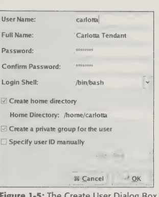

## 登录

当你登录时，你正在向系统介绍你自己（这也被称为*身份验证*）。如果你输入了错误的用户名或密码，在提供正确的用户名或密码之前，你将无法访问系统。

在安装过程中，如果你选择了图形化作为登录类型，你将看到一个如图 1-6 所示的图形化登录界面。我们的示例机器名称是 *Toluca*，但除非你选择为机器指定单独的主机（这主要用于网络设置），否则你的机器名称可能是 *localhost*。

> 注意
>
> 因为由于你的 Fedora 系统在安装期间创建了 root 账户，一些新用户倾向于现在和以后所有的活动都只使用 root 账户。这是一个危险的想法，因为 root 账户允许在系统上执行任何操作。本章前面的“登录之前”部分解释了为什么这非常重要。最好按照“创建用户账户”部分的说明操作，并经常使用该账户。

输入你在安装期间创建的或按照“创建用户账户”部分步骤创建的用户账户名称并按回车。当要求输入密码时，输入你为此账户创建的密码并按回车（见图 1-7）。

> 注意


# 第1章 ✨ 入门

> 像 Unix 一样，Linux 是大小敏感的。这意味着输入 `carlotta` 与输入 `Carlotta` 指的是不同的账户。这同样适用于你的密码——你必须按照创建时的格式完全输入，保持大小写一致，否则系统将不会将其识别为正确密码。

从图形化登录界面登录会自动为你启动图形化桌面。

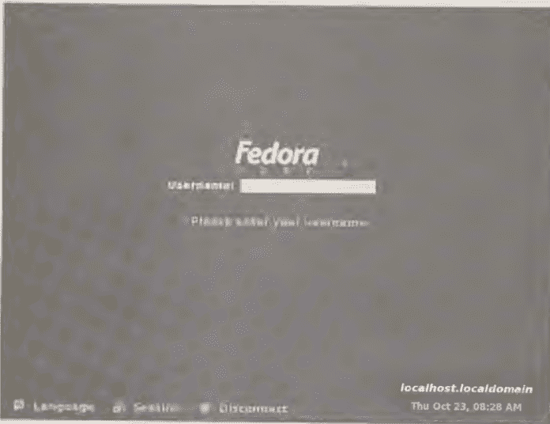

**图 1-6:** 登录界面

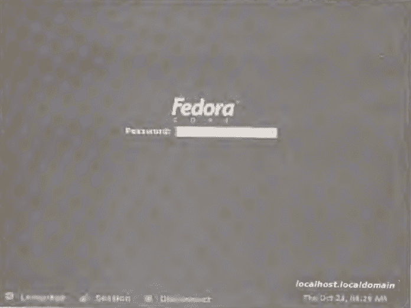

**图 1-7:** 密码对话框

## 图形桌面

一旦登录系统，你将看到一个被称为*桌面*的图形化界面。它看起来应该像图 1-8 所示。

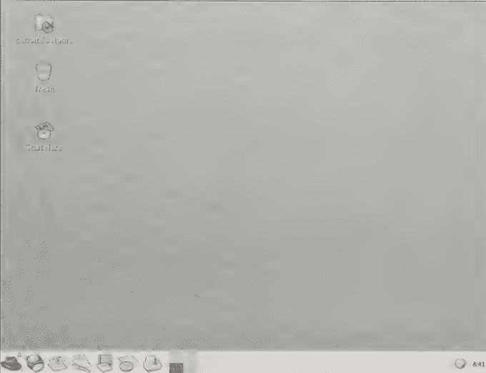

图 1-8: 图形桌面

下一章将详细介绍如何使用图形化桌面。现在，你只需要知道如何使用主菜单按钮和菜单。使用鼠标点击面板最左侧的大型红帽图标。这是面板的主菜单按钮。会弹出一个与图 1-9 所示类似的菜单。

本书使用箭头来指示应该选择 de哪个菜单和子菜单。例如，如果你需要点击红帽图标（主菜单）然后点击“系统设置”菜单选项，你将被指示点击*主菜单按钮 ⟲ 系统设置*。

## 日期和时间属性

日期时间属性工具允许你更改系统日期和时间，并由系统配置时区。如果你有互联网连接，还可以使用此工具设置系统保持计算机时钟更新。

要从桌面启动应用程序，请点击主菜单按钮 ⟲ 系统设置 ⟲ 日期与时间，由于你是以普通用户身份登录的，系统将提示你输入*root*密码。输入该密码并按回车。

### 配置系统日期和时间

启动日期时间属性工具后出现的第一个标签窗口用于配置系统日期和时间（见图 1-11）。

要更改日期，使用月份左右的箭头更改月份。使用年份左右的箭头更改年份，并点击星期几来更改星期几。在点击 OK 之前，更改不会生效。

要更改时间，使用时间部分“小时”、“分钟”和“秒”旁边的上下箭头。在点击 OK 之前，更改不会生效。

此程序还允许你指定网络时间协议 (NTP) 服务器，以便你的系统可以通过互联网设置时钟。要启用此功能，请勾选“启用网络协议”复选框。这将启用“服务器”下拉菜单。你可以选择预定义服务器之一，或在下拉菜单中输入服务器名称。在点击应用之前，你的系统将不会开始与服务器同步。

> 注意
>
> 如果你在安装期间使用安全级别工具配置了中等或高安全级别，防火墙规则将阻止与 NTP 的连接。要让 NTP 工作，请运行安全级别工具，选择“自定义”，并在其他端口中添加 udp:ntp。更多详情请参见第 10 章。

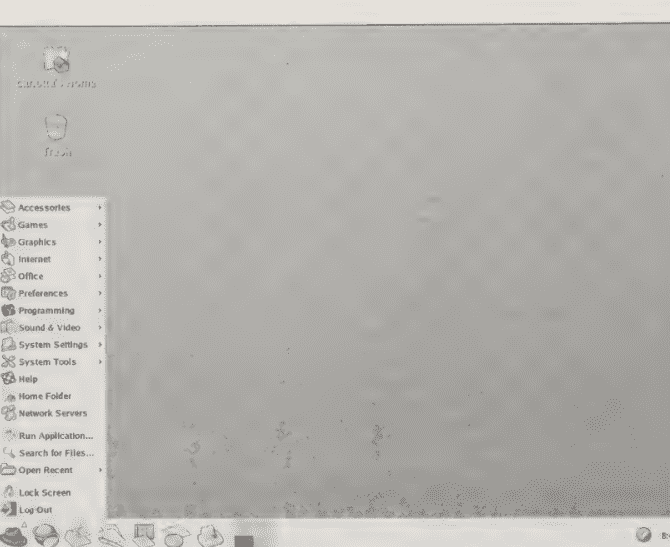

图 1-9: 主菜单

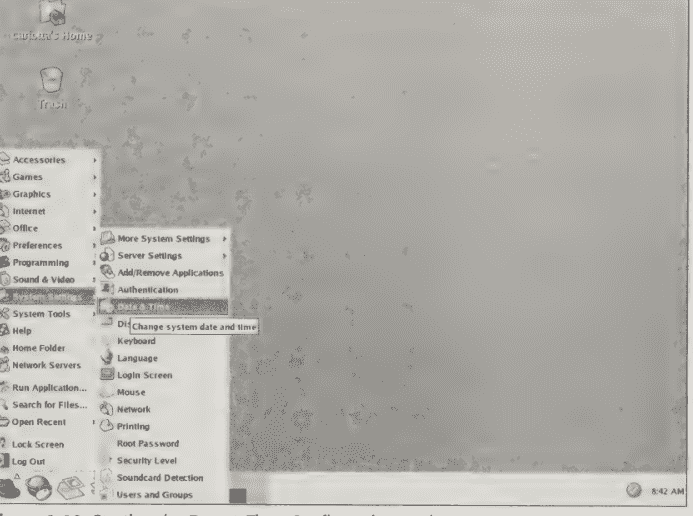

图 1-10: 启动日期与时间工具

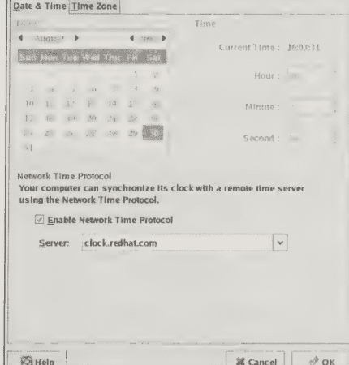

图 1-11: 日期时间属性

### 配置系统时区

要配置系统时区，使用鼠标点击对话框顶部的“时区”标签。你可以通过点击交互地图或从地图下列表选择所需的时区来更改时区（见图 1-12）。使用地图，点击代表所需时区的城市。会出现一个红色 X，地图下方的时区会发生变化。点击应用保存更改。

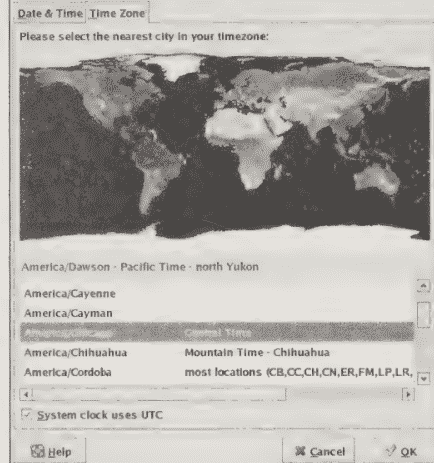

图 1-12: 时区标签

如果你的系统时钟设置为 UTC（也称为格林尼治标准时间或 GMT），选择“系统时钟使用 UTC”选项。其他时区通过在 UTC 上加或减来确定。

## 添加打印机

Fedora 包含打印机配置工具，允许用户配置打印机。如果打印机通过并行端口或 USB 端口连接到计算机，它被视为本地打印机。

> 注意
>
> 要配置打印机，点击主菜单系统设置 打印，如图 1-13 所示。

如果你是以普通用户身份登录的，系统可能会提示输入 root 密码。输入该密码并按回车。

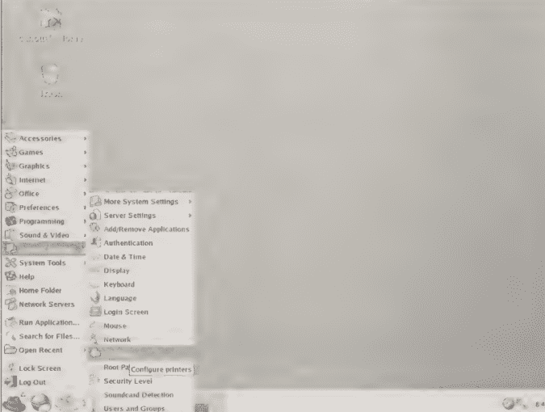

图 1-13: 启动打印机配置工具

### 添加本地打印机

如果你的打印机连接到计算机的并行端口或 USB 端口，请按照以下步骤配置它：

- 1. 点击打印机配置窗口中的“新建”按钮（见图 1-14）。

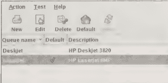

图 1-14: 打印机配置工具

- 2. 出现图 1-15 所示的窗口。点击“下一步”。

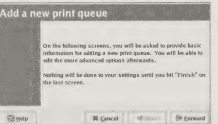

图 1-15: 添加打印机

- 3. 你将看到图 1-16 所示的屏幕。在“队列名称”文本字段中输入打印机的唯一名称。此名称不能包含空格并必须以字母（a-z 或 A-Z）开头。在第二个字段中你可以输入打印机的简要描述。输入一个对你有意义的名称，例如“我的彩色打印机”。完成后，点击“下一步”。

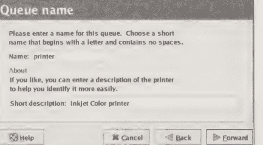

图 1-16: 配置打印机队列

- 4. 打印机配置工具尝试检测你的设备（如果有多个设备，则检测多个）。如果它找到一个或多个设备，它将显示它们。图 1-17 中的示例显示连接到 USB 端口的打印机。确保下拉选择列表显示“本地连接”。

如果打印机配置工具检测到你的打印机型号，它会显示推荐的打印机设备。

- 5. 如果未显示打印机设备，点击“自定义设备”。输入你的打印机设备名称并点击 OK 将添加到打印机列表中。

选择打印机设备，然后点击向前（Forward）。

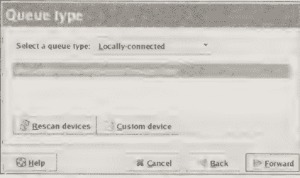

图 1-17：选择打印机设备

- 6. 下，打印机配置工具将尝试检测连接到您所选打印机设备的打印机。如果您正在配置本地打印机且自动检测到了型号，将自动选择推荐驱动程序并用星号 (*) 标记。

### 这不是我的打印机

如果 fold 正确检测了您的打印机和连接，请点击向前（Forward）按钮进入下一节，“完成打印机设置”。如果工具检测到错误的打印机或未检测到任何打印机，您可以从列表中手动选择打印机品牌和型号。

打印机按制造商组织，可以使用下拉列表进行选择。图 1-18 中的示例显示选择了 HP（惠尔/电气）。

点击下拉列表找到您的打印机制造商并选择它。滚动打印机型号列表，从展开的列表中找到您的打印机。找到后，点击您的打印机型号名称。点击向前（Forward）进入最后一步。

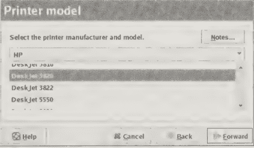

图 1-18：选择打印机型号

### 完成打印机设置

最后一步是确认并应用打印机设置。如果打印机型号和设置看起来正确，现在点击完成（Finish）。点击返回（Back）修改打印机配置。

新打印机出现在主窗口的打印机列表中。在主窗口中点击应用（Apply）以保存更改。

### 打印测试页

配置好打印机后，您应该打印测试页以确保打印机运行正常。如果您更改了打印驱动程序或修改了驱动程序选项，应该打印测试页来测试不同的配置。

要打印测试页，请从打印机列表中选择要测试的打印机，并在下拉菜单中选择测试（Test）-> 美国 Postscript 测试页（US List Postscript Test Page）、打印 A4 Postscript 测试页（Print A4 Postscript Test Page）或打印 ASCII 测试页（Print ASCII Test Page）。如果您的打印机不支持 PostScript 打印，请选择打印 ASCII 测试页。

如果测试页打印不正常，请检查打印机是否连接正确、是否有足够的纸以及是否已开启并准备好打印。如果打印机本身没有问题，您可能需要更改打印机设置。

## 获取在线

如果您在安装过程中设置了网络连接，那么您可能已经“在线”了，不需要阅读本节。尽管如此，值得浏览一下您可能会学到一些有用信息，特别是当通过电缆、DSL 调制解调器或路由器连接互联网时。

存在许多类型的互联网连接，最常见的包括：

- 调制解调器（Modems）
- 数字用户线路（DSL）调制解调器
- 电缆调制解调器
- 无线设备

虽然这并非连接类型的完整列表，但它们是目前连接互联网最常用的方法。其他连接类型，如集成业务数字网络（ISDN）和令牌环，几乎完全是企业级网络的领域，且超出了本书的范围。

### 网络配置

为了与其他计算机通信，您的计算机需要网络连接。计算机通过让操作系统识别网络接口适配器（如以太网）或其他硬件（如拨号调制解调器）来连接到网络。

可以使用 Fedora 的网络管理工具来配置您的网络接口。要使用网络管理工具，您必须运行 X Window 系统并具有 root 权限。要启动应用程序，点击主菜单“系统设置 -> 网络”。您应该会看到一个如图 1-19 所示的窗口。

## 我的计算机如何与网络通信？


# 第 1 章 - 入门

## 这些是四种常见的网络连接类型

- 调制解调器连接 — 调制解调器连接使用调制解调器建立与互联网的连接。数字数据被调制成模拟信号并通过电话线发送。要配置此类类型的连接，请参后续章节“建立调制解调器连接”以获取更多信息。

- 到电缆/XDSL/无线路由器的以太网连接 — 多计算机家庭通常通过一个廉价的电缆/DSL 路由器将所有计算机连接到互联网，该路由器可能包含无线功能。这些路由器不仅易于从电缆调制解调器或 DSL 模型等单一源将互联网访问扩展到所有 PC，还提供了一些防火墙功能（保护您的计算机免受恶意攻击）。
当您使用 DSL 路由器而不是直接连接 DSL 调制解调器时，您可能需要以不同的方式配置系统。请章节“建立到电缆/XDSL 调制解调器、电缆/XDSL 路由器或局域网的以太网连接”。

- 电缆连接 — 电缆调制解调器使用电视相同的同轴电缆传输数据。大多数互联网提供商要求您在计算机中安装以太网卡（或其他以太网适配器，如 USB 适配器）以连接电缆调制解调器。然后，电缆调制解调器连接到接收电电视信号的同轴电缆。

- xDSL 连接 — `xDSL`（数字用户线路）连接通过电话线进行高速传输。`DSL` 有不同类型，如 `ADSL`、`IDSL` 和 `DSL`。`xDSL` 术语意味着任何类型的 `DSL` 连接。像缆一样，`DSL` 提供商也要求您在计算机中安装以太网适配器（如 USB 适配器）以连接调制器。然后，调制器连接到电话线（通常通过 `DSL` 公司提供的过滤器或分线器）。

- 无线连接 — 如果您使用 `802.11` 网卡将计算机连接到无线接入点（`WAP`）或点对网络（也称为 ad-hoc 网络），则您需要配置您的无线设备。

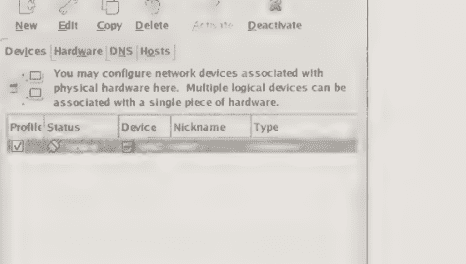

图 1-19：网络配置

## 建立调制解调器连接

可以使用调制解调器通过激活的电话线进行拨号上网连接。您还需要互联网服务提供商（`ISP`）账户（也称为*拨号账户*）。启动网络工具并按照以下步骤添加调制解调器连接：

- 1. 如果您尚未执行，请启动网络工具。点击主菜单按钮 ⊞ 系统设置 ⊞ 网络。
- 2. 点击工具栏左上角的“新建”图标。您应该看到一个如图 1-20 所示的窗口。

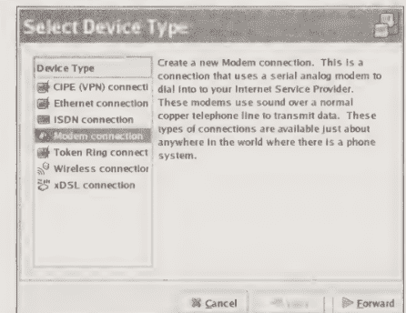

图 1-20：新建网络设备

- 3. 从列表中选择“调制解调器连接”。点击向前（`Forward`）。
- 4. 如果硬件选项卡（`Hardware`）列表中已经配置了调制解调器，网络工具假设您想建立调制解调器连接。如果没有配置调制解调器，它将尝试检测系统中的调制解调器。此探测可能需要一段时间。探测后，出现图 1-21 所示的窗口。
- 5. 配置波特率、流控制和调制音。如果您不知道这些数值，请保持当前值不变。如果没有音调拨号，请取消勾选框。点击向前（`Forward`）。
- 6. 您应该看到如图 1-22 所示的选择提供商窗口。如果您的 `ISP` 在列表中，否则输入 `ISP` 账户所需信息。如果您不知道这些数值，请联系您的 `ISP`。点击向前（`Forward`）。
- 7. 您应该看到如图 1-23 所示的 `IP` 设置窗口。除非您的 `ISP` 为您提供了静态 `IP` 地址，否则您将希望保持设置不变。大多数人都会希望保持设置不变。
- 8. 点击向前（`Forward`）。您应该看到如图 1-24 所示的关于调制解调器和设置的摘要。
- 9. 点击应用（`Apply`）。

### 选择调制解调器

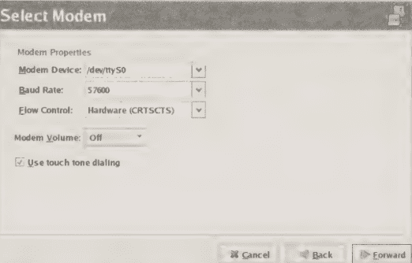

图 1-21：调制解调器设置

配置调制解调器设备后，它将出现在设备列表中，如图 1-25 所示。

添加设备后，你可以可以通过从设备列表中选择设备并点击工具栏中的“编辑 (`Edit`)”按钮来编辑其配置。例如，设备添加后，默认不会配置为开机时启动。编辑其配置可以修改此设置。你还可以更改压缩（`Compression`）、`PPP` 选项、登录名、密码等。

尽管你添加了调制解调器设备，但它尚未激活，从其“未激活（`Inactive`）”状态可以看出。要激活设备，请从设备列表中选择它，并点击“激活（`Activate`）”。

### 选择提供商

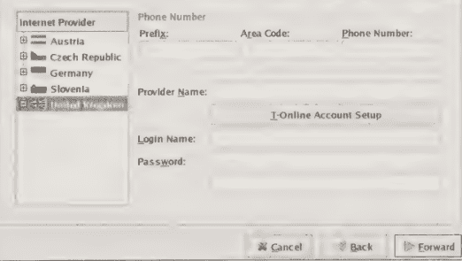

图 1-22：选择您的互联网服务提供商

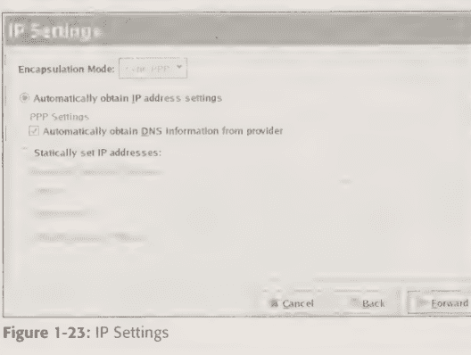

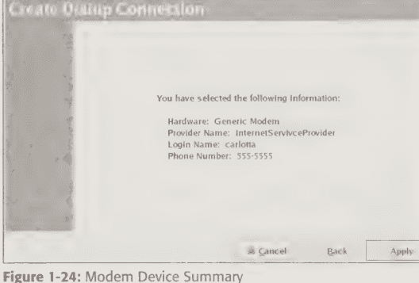

## 为电缆/xDSL 调制解调器、电缆/xDSL 路由器或局域网建立以太网连接

如果你使用电缆调制解调器或 `DSL` 调制解调器，或者直接连接到家中或公司已建立的局域网，通常需要建立以太网连接。你需要一张网卡（`NIC`），它应该已于 PC。

如果你连接到电缆调制解调器，需要从网卡连接一根网线到调制解调器。调制解调器通过同轴电缆连接到你的电视线路源。

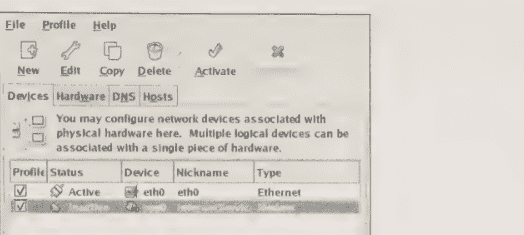

**图 1-25**：设备列表中的调制解调器设备

如果你连接到 `DSL` 调制解调器，需要从网卡连接一根网线到 `DSL` 调制解调器。你通常通过 `DSL` 提供商或电话公司提供的过滤器将 `DSL` 调制解调器连接到电话线。

如果你连接到局域网，请咨询你的网络管理员了解如何配置 `IP` 地址和默认路由器，以及如何设置其他配置细节。

如果你连接到路由器（例如电缆或 `xDSL` 路由器），你必须按照路由器的工作方式来设置以太网连接。这里是需要注意的问题：

- 如果你连接到电缆/`xDSL` 路由器，请找出电缆/`xDSL` 路由器如何通过 `DHCP` 自动提供 `IP` 地址。路由器的文档应该会告诉你。
- 如果你正在使用 `xDSL` 并连接到电缆/`xDSL` 路由器，你必须配置路由器而不是本地机器来与你的互联网服务提供商建立 `PPPoE` 连接。因此，不要遵循本章稍后“建立 `xDSL` 连接”部分中建立 `PPPoE` 连接的说明，而应在路由器上配置 `PPPoE`。你可以咨询路由器的文档获取详细信息，但大多数路由器都有基于 Web 的界面用于配置 `PPPoE`。

要添加以太网连接，点击“主菜单 ↩ 系统设置：网络”按钮启动网络管理工具，然后按照以下步骤操作：

- 1. 点击左上工具栏中的“新建 (`New`)”按钮。从设备类型列表中选择“以太网连接 (`Ethernet Connection`)”。见图 1-26。
- 2. 如果你已经将网卡添加到硬件列表，请从以太网卡列表中选择它（见图 1-27）。否则，选择“其他以太网卡 (`Other Ethernet Card`)”来添加硬件设备。

安装程序通常会检测支持以太网设备并提示你进行配置，如果你在安装期间配置了任何以太网设备，它们将已经出现在硬件（`Hardware`）”选项卡的硬件列表中。

### 官方 Fedora 伴侣

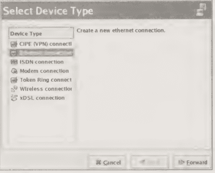

**图 1-26**：以太网连接

3. 如果你选择了“其他以太网卡”，则会弹出“选择以太网适配器 (`Select Ethernet Adapter`)”窗口。选择以太网卡的制造商和型号。选择设备名称。如果这是系统的第一块以太网卡，选择 `eth0` 作为设备名称；如果是第二块，选择 `eth1`；以此此类推。网络管理工具还允许你配置网卡（`NIC`）资源。点击“下一步 (`Forward`)”。

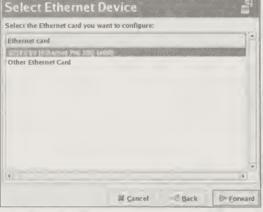

**图 1-27**：选择以太网适配器

4. 在“配置网络设置 (`Configure Network Settings`)”页面（如图 1-28所示），在 `DHCP` 和静态 `IP` 地址之间进行选择。如果你直接连接到 `DSL` 调制解调器或电缆调制解调器，你可能更想选择 `DHCP`。在这种情况下，不要指定主机名。只有当互联网服务提供商指示你这样做时，才应该指定 `IP` 地址。点击“下一步 (`Forward`)”。
5. 在“创建以太网设备 (`Create Ethernet Device`)”页面上点击“应用 (`Apply`)”。

### 配置网络设置

- 自动获取 `IP` 地址
- 静态 `IP`:
- 地址:
- 子网掩码:
- 默认网关:

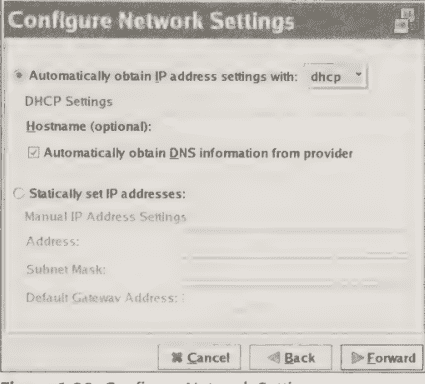

图 1-28：配置网络设置

- 自动获取 `IP` 地址
- 静态 `IP`:
- 地址:
- 子网掩码:
- 默认网关:

配置调制解调器设备后，它将出现在设备列表中，如图 1-25 所示。

添加调制解调器设备后，可以通过从设备列表中选择设备并点击工具栏中的“编辑 (`Edit`)”按钮来编辑其配置。例如，设备添加后，默认不会配置为开机时启动。编辑其配置可以修改此设置。你还可以更改压缩、`PPP` 选项、登录名、密码等。


尽管你添加了调制解调器设备，但它尚未激活，从其“未激活（Inactive）”状态可以看出。要激活设备，请从设备列表中选择它，并点击“激活（Activate）”。

## 建立 xDSL 连接

如前所述，DSL 代表数字线路。`PPPoE`（基于以太网的点对协议）配置用于连接到你的互联网服务提供商。

要添加以太网连接，启动网络管理工具并遵循以下步骤：

- 1. 点击左上工具栏中的“新建 (New)”按钮。从设备类型列表中选择“以太网连接 (Ethernet Connection)”。见图 1-26。
- 2. 如果你已经将网卡添加到硬件列表，请从以太网卡列表中选择它（见图 1-27）。否则，选择“其他以太网卡 (Other Ethernet Card)”来添加硬件设备。

安装程序通常会检测支持以太网设备并提示你进行配置，如果你在安装期间配置了任何以太网设备，它们将已经出现在硬件（Hardware）选项卡的硬件列表中。

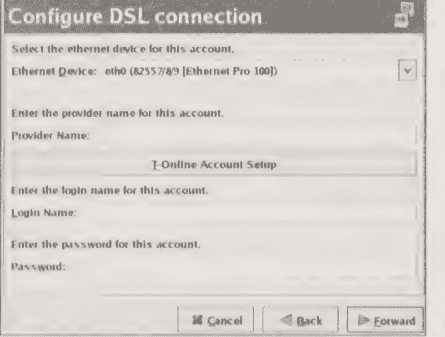

图 1-30：建立以太网连接

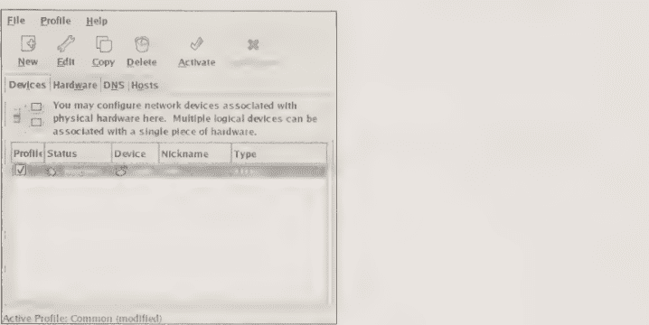

图 1-31：查看新的 xDSL 设备

# 26 Fedora 官方指南

4. 如果你选择了“其他以太网卡”，将出现“选择以太网适配器”窗口。选择以太网卡的设备的制造商和型号。如果这是系统的第一块以太网卡，请选择 `eth0`；如果这是系统的第二块以太网卡，请选择 `eth1`；以此此类推。网络管理工具还允许你配置无线网卡的的资源。点击“下一步”继续。

5. 在“配置无线连接”页面上（见图 1-32），为你的无线设备配置通道、传输速率和密钥。

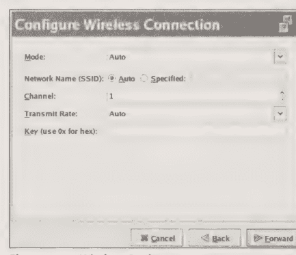

6. 在“配置网络设置”页面上，在 DHCP 和静态 IP 地址之间进行选择。你可以为设备指定主机名。如果设备每次启动网络时接收动态 IP 地址，请不要指定主机名。点击“下一步”继续。

7. 在“创建无线设备”页面上点击“应用”以保存你的更改。

配置无线设备后，它将出现在设备列表中，如图 1-33 所示。

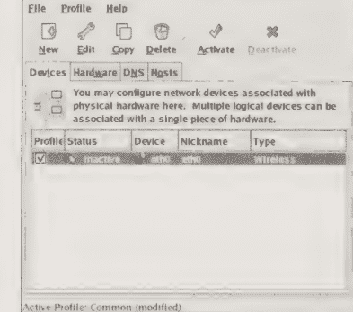

图 1-33：无线设备

添加无线设备后，你可以通过从设备列表中选择设备并点击“编辑”来编辑其配置。例如，你可以配置设备在启动时激活。

当设备被添加时，它是未激活的，从其“未激活”状态可以看出。要激活设备，请从设备列表中选择它并点击“激活”。

## 注销

要退出你的图形桌面会话，点击“主菜单”按钮“注销”。当确认对话框出现时，选择“注销”并点击“是”。

- 提示：如果你想保存桌面配置以及任何运行中的程序，请勾选“保存当前设置选项”。

## 关闭你的计算机

如果你已完成工作并想关闭电脑，先关闭 Fedora 是重要的。

- 警告：切不要在不先关机的情况下关闭电脑，否则可能会丢失未保存的数据或损坏你的系统。

在注销屏幕上选择“关机”，然后点击“确定”确认你的选择。

- 注意：你也可以通过图形登录界面点击“会话”、选择“关闭计算机”选项并点击“确定”来关机。

某些计算机在关闭 Fedora 后会自动关闭电源。如果你的电脑没有，你可以在看到以下消息后关闭电源：

正在关。

Fedora 包含了 Bluecurve，这是最流行的图形桌面环境 GNOME 和 KDE 的独特版本。Bluecurve 使比以往任何时候都更容易让你访问你的应用程序、文件和系统资源。新用户和老用户都能通过使用 Bluecurve 图形桌面充分利用 Fedora 系统。

本章涵盖了 GNOME 版本 Fedora Bluecurve 桌面的基础知识，并告诉你如何根据需求自定义桌面。我们将在下一章介绍 Bluecurve KDE。

## 介绍 Fedora 桌面

你对图形桌面的首次视图看起来像图 2-1。

横跨桌面底部的长条被称为“面板”（Panel）。面板包含应用程序启动器、状态指示器以及称为“小程序”（applets）的小型应用程序，它们让你能够控制音量、切换工作空间并监控系统状态。

桌面其他地方图标可以是文件夹、应用程序启动器，以及在挂载时的 CD-ROM 和磁盘等可移动式设备。要打开文件夹或启动应用程序，请双击其图标。

你可以通过点击“主”按钮（即面板最左侧的大红帽图标）来导航菜单系统。你也可以点击桌面上的“在此开始”并双击“应用程序”图标，之后你将看到几类应用程序。双击任何一类（例如“办公”）来浏览该类型的应用程序。

桌面的工作方式可能和你在使用其他操作系统（如 Windows 或 Mac OS）时预期的那样。你可以拖放文件和应用程序到容易访问的区域。你可以在桌面、面板和文件管理器为文件和应用程序添加新图标。你可以使用提供的配置工具更改大多数工具和应用程序的外观，以及更改系统设置。

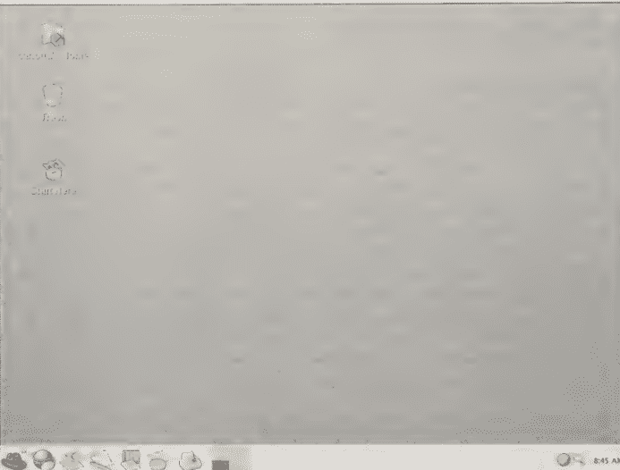

**图 2-1：** Bluecurve 图形桌面

## 介绍面板

面板是横跨屏幕底部的条，持有让使用系统变得更简单的图标和小型应用程序（见图 2-2）。面板还包含主菜单（大红帽），其中包含你所有应用程序的菜单项。面板显示许多小程序，允许你运行特定任务或监控系统或服务（如红帽网络），同时不干扰你的操作。


**图 2-2：** 桌面底部面板

## 使用主菜单

你可以点击面板的主菜单按钮（面板左侧的大红帽图标），将其展开为一组大型菜单，让你能够访问系统上的应用程序。从这里，你可以启动系统中的应用程序。除了推荐的应用程序外，你还可以通过“扩展”子菜单访问更多应用程序。从主菜单中，你还可以执行以下操作：

- 从命令行运行应用程序
- 打开最近处理过的文件

# 第 2 章 领先于 Bluecurve 31

## 介绍小程序

小程序是运行在面板上的小型应用程序。它们通常让你监控你的系统或互联网。有些具有特定的任务，而另一些则被设计用于娱乐。

有几个默认运行在面板上的小程序。这些小程序非常重要，将在后续章节中介绍。

## 工作空间切换器

工作空间切换器（见图 2-3）是一个简单的小程序，允许你查看工作空间中的应用程序（工作空间也称为虚拟桌面）。你可以在多个独立的工作空间中工作，每个空间看起来像一个独立的桌面。这让你无需将所有应用程序挤在一个视图中。

工作空间切换器用小方块表示每个工作空间并显示运行的应用程序。你可以用鼠标点击其中一个方块移动到该空间。

你也可以使用快捷键 `Ctrl+Alt+右箭头` 或 `Ctrl+Alt+左箭头` 在工作空间之间切换。


## 任务栏

工作空间切换器旁边是任务栏（见图 2-4）。任务栏是一个显示任何桌面运行应用程序标题的小程序。当你决定最小化一个应用程序时，这非常有用，因为它消失后可以通过点击任务栏中的标题将其恢复。通常，任务栏只显示当前工作空间运行的应用程序，尽管稍后你将看到如何让任务栏显示所有工作空间运行的应用程序，如果你更喜欢那样的话。

| GNOME 扫雷 | 计算器 |
| redhat.com | 全球学习服务 |

图 2-4：任务栏

## 使用图标

图标是一个图片（通常很小，你可以像本章后面讨论的那样调整图标大小），代表文件或目录，甚至是设备和应用程序启动器。双击图标以访问它。如果是一个文件如文字处理文档，双击应该启动文字处理器并打开文档。如果是一个应用程序，双击图标将启动该应用程序。

你也可以在图标上右键点击鼠标指针，然后选择“打开”（或者如果你想选择打开文件的应用程序，则选择“用 . . . 打开”），而不是双击。

在图 2-1 中，你可以看到桌面上的三个图标，以及面板（Panel，也称为 *applets* 小程序）上的几个图标。

# 32 官方 Fedora 伴侣指南

## 使用通知区域

作为面板通知区域的一部分，红帽网络通知工具（见图 2-5）为你提供了一种简便的方法，确保你的系统已更新红帽提供的最新的错误说明（errata）和错误修复。该小程序显示不同的图像，指示你的系统是否为最新状态或需要升级。如果你点击该小程序，将显示可用更新列表。要更新系统，请点击按钮启动红帽更新代理（Red Hat Update Agent）。如果你尚未注册红帽网络，它将启动注册程序。右键点击小程序图标并选择“帮助”查看详情。

> 图 2-5：红帽网络通知工具

通知区域中有时显示的一个图标是安全通知，每当你获得系统的 root 身份验证时，它都会提醒你（见图 2-6）。当身份验证超时时，它会消失。

> 图 2-6：身份验证图标

## 使用 Nautilus

图形化桌面包含一个名为 `Nautilus` 的文件管理器，它为你提供了系统和个人文件的图形化显示。然而，`Nautilus` 的设计远不仅仅是文件的视觉列表；它允许你：

- 配置你的桌面
- 配置你的 Fedora 系统
- 播放数字音乐和视频文件
- 浏览照片
- 访问你的网络资源


你可以通过一个集成界面完成所有这些及更多操作。从本质上说，`Nautilus` 是你整个桌面体验的导航工具。

在 `Nautilus` 中工作是高效的，并且为搜索主菜单连接的各种子菜单或使用 shell 提示符导航文件系统提供了一种替代方案。要将 `Nautilus` 作为文件管理器启动，请双击一次你的主目录。一旦 `Nautilus` 出现，你就可以在你的主目录或文件系统的其余部分之间进行导航。点击“向上”图标可以移动一个目录到包含当前文件夹的文件夹（如果存在）。你也可以双击文件夹图标来查看该文件夹的内容。你可以点击“后退”按钮回到之前的地方。

# 第 2 章 ♦ 领先于 Bluecurve 33

要返回主目录，请点击“主”按钮。

当你导航文件系统时，你始终可以通过查看“位置”字段查看你所处的位置。如果你想直接进入该位置，可以在“位置”字段中输入目录位置并按回车键。

你可以通过选择 ⟜ 新窗口来打开另一个 `Nautilus` 窗口。当你有了另一个 `Nautilus` 窗口后，你可以在窗口之间拖放文件。

> 注意 将文件从一个目录拖动到另一个目录将移动该文件。如果你想将文件复制到另一个地方，在拖放文件时按住 `Ctrl` 键。你也可以在拖放时按住 `Alt` 键，之后系统会询问你想要执行什么操作——复制、移动和链接。

默认情况下，主目录中的文本文件和图像将被视为缩略图。对于文本文件，你将在图标中看到部分实际文本。对于图像，你将看到图像的缩放（或缩略图）版本。要关闭此功能，选择 `编辑 ⟜ 偏好`。从左侧菜单中选择“性能”，并对想要禁用的视觉增强选择“从不”。禁用这些功能将提高 `Nautilus` 的速度。

## 从这里开始

“从这里开始”窗口（见图 2-7）旨在包含你使用系统时需要的所有工具和应用程序。从你喜爱的应用程序到系统和配置工具，“从这里开始”窗口为使用和自定义系统提供了中心位置。

你可以随时通过双击标记为“从这里开始”的桌面图标来访问该窗口。

通知区域中有时显示的一个图标是安全通知，每当你获得系统的 root 身份验证时，它都会提醒你（见图 2-6）。当身份验证超时时，它会消失。

> 图 2-6：身份验证图标

你可以通过选择 ⟜ 新窗口来打开另一个 `Nautilus` 窗口。当你有了另一个 `Nautilus` 窗口后，你可以在窗口之间拖放文件。

> 注意 将文件从一个目录拖动到另一个目录将移动该文件。如果你想将文件复制到另一个地方，在拖放文件时按住 `Ctrl` 键。你也可以在拖放时按住 `Alt` 键，之后系统会询问你想要执行什么操作——复制、移动和链接。

默认情况下，主目录中的文本文件和图像将被视为缩略图。对于文本文件，你将在图标中看到部分实际文本。对于图像，你将看到图像的缩放（或缩略图）版本。要关闭此功能，选择 `编辑 ⟜ 偏好`。从左侧菜单中选择“性能”，并对想要禁用的视觉增强选择“从不”。禁用这些功能将提高 `Nautilus` 的速度。

## 第 2 章 领先蓝曲线

### 设置您的偏好

自定义系统的中心位置位于主菜单的“偏好”`Preferences`菜单中。您也可以通过双击桌面上的“这里”图标并双击“偏好”图标来访问偏好。偏好菜单提供了大量的配置选项。以下列表简要讨论了这些选项。

- 关于我 `About Myself` —— 在这里你可以更改登录 shell，并添加个人信息，例如家庭和办公电话。
- 辅助功能 `Accessibility` —— 在这里你可以更改 Fedora 对按键、鼠标点击等操作响应方式。
- 背景 `Background` —— 在这里你可以用新颜色、图案或新图像配置你的背景。
- CD 属性 `CD Properties` —— 在这里你可以更改默认是否自动挂载 CD、向驱动器中插入 CD 时执行何种命令等。
- 文件类型和程序 `File types and programs` —— 在这里你可以添加新的文件类型并更改与文件类型关联的程序。
- 字体 `Font` —— 在这里你可以配置各种系统元素使用的字体，例如标题栏、终端窗口、桌面和应用程序。
- 键盘 `Keyboard` —— 你可以对键盘做出决定，例如键盘重复率、闪烁频率以及你是否希望键盘发出提示。
- 键盘快捷键 `Keyboard Shortcuts` —— 你可以配置快捷键（按下组合键）来执行应用程序或桌面上的某些操作。例如，你可以配置快捷键，通过按下 `Ctrl+F2` 从当前工作空间移动到另一个工作空间。
- 登录照片 `Login Photo` —— 如果你需要 Fedora 从登录名称列表中选择，可以使用此项来选择显示在登录名称旁边的脸。


## 菜单和工具栏（Menus and Toolbars）
自定义工具栏和菜单的行为方式。例如，你可以选择不在菜单中显示图标。

## 鼠标（Mouse）
在这里你可以配置鼠标，选项包括允许使用左手鼠标、设置双击延迟，以及更改光标和鼠标移动的灵敏度。

## 网络代理（Network Proxy）
在这里你可以设置你的 HTTP 代理（如果有的话），以及代理可能要求的用户名和密码。

## 密码（Password）
此工具允许你更改用户密码；你必须先输入现有密码。

## 首选应用程序（Preferred Applications）
你可以让 Fedora 启动默认浏览器（如 Mozilla），或者选择另一个默认编辑器或命令行终端。

## 屏幕分辨率（Screen Resolution）
你可以更改屏幕的大小和分辨率。

## 屏幕保护程序（Screensaver）
此工具允许你更改默认屏保、配置特定屏幕保护程序的设置，并设置系统等待几分钟显示屏幕保护程序。

## 声音（Sound）
在此部分你可以配置与各种功能相关的系统声音。

## 主题（Theme）
在这里你可以更改系统的外观，包括颜色、字体、图标和样式等。

## 字体（Font）
在这里你可以配置各种系统元素使用的字体，例如标题栏、终端窗口、桌面和应用程序。

## 登录照片（Login Photo）
如果你需要 Fedora 从登录名称列表中选择，可以使用此项来选择显示在登录名称旁边的脸。


# 系统设置说明

- 鼠标（Mouse）—— 在这里你可以配置鼠标，选项包括允许使用左手鼠标、设置双击延迟，以及更改光标和鼠标移动的灵敏度。
- 网络代理（Network Proxy）—— 在这里你可以设置你的 HTTP 代理（如果有的话），以及代理可能要求的用户名和密码。
- 密码（Password）—— 此工具允许你更改用户密码；你必须先输入现有密码。
- 首选应用程序（Preferred Applications）—— 你可以让 Fedora 启动默认浏览器（如 Mozilla），或者选择另一个默认编辑器或命令行终端。
- 屏幕分辨率（Screen Resolution）—— 你可以更改屏幕的大小和分辨率。
- 屏幕保护程序（Screensaver）—— 此工具允许你更改默认屏保、配置特定屏幕保护程序的设置，并设置系统等待几分钟显示屏幕保护程序。
- 声音（Sound）—— 在此部分你可以配置与各种功能相关的系统声音。
- 主题（Theme）—— 在这里你可以更改系统的外观，包括颜色、字体、图标和样式等。
- 字体（Font）—— 在这里你可以配置各种系统元素使用的字体，例如标题栏、终端窗口、桌面和应用程序。
- 登录照片（Login Photo）—— 如果你需要 Fedora 从登录名称列表中选择，可以使用此项来选择显示在登录名称旁边的脸。
- 菜单和工具栏（Menus and Toolbars）—— 自定义工具栏和菜单的行为方式。例如，你可以选择不在菜单中显示图标。


偏好菜单提供了丰富的配置选项。以下列表简要讨论了这些选项。

- 关于我（About Myself）—— 从这里你可以更改登录 shell，并添加关于你自己的信息，例如你的家庭和办公电话。
- 辅助功能（Accessibility）—— 在这里你可以更改 Fedora 对按键、鼠标点击等操作响应方式。
- 背景（Background）—— 在这里你可以用新颜色、图案或新图像配置你的背景。
- CD 属性（CD Properties）—— 在这里你可以更改默认是否自动挂载 CD、向驱动器中插入 CD 时执行何种命令以及更多。
- 文件类型和程序（File types and programs）—— 在这里你可以添加新的文件类型并更改与文件类型关联的程序。
- 字体（Font）—— 在这里你可以配置各种系统元素使用的字体，例如标题栏、终端窗口、桌面和应用程序。
- 键盘（Keyboard）—— 你可以对键盘做出决定，例如键盘重复率、闪烁频率以及你是否希望键盘向你鸣叫。
- 键盘快捷键（Keyboard Shortcuts）—— 你可以配置快捷键（按下组合键）来执行应用程序或桌面上的某些操作。例如，你可以配置快捷键，通过按下 `Ctrl+F2` 从当前工作空间移动到另一个工作空间。
- 登录照片（Login Photo）—— 如果你需要 Fedora 从登录名称列表中选择，可以使用此项来选择显示在登录名称旁边的脸。
- 菜单和工具栏（Menus and Toolbars）—— 自定义工具栏和菜单的行为方式。例如，你可以选择不在菜单中显示图标。
- 鼠标（Mouse）—— 在这里你可以配置鼠标，选项包括允许使用左手鼠标、设置双击延迟，以及更改光标和鼠标移动的灵敏度。
- 网络代理（Network Proxy）—— 在这里你可以设置你的 HTTP 代理（如果有的话），以及代理可能要求的用户名和密码。
- 密码（Password）—— 此工具允许你更改用户密码；你必须先输入现有密码。
- 首选应用程序（Preferred Applications）—— 你可以让 Fedora 启动默认浏览器（如 `Mozilla`），或者选择另一个默认编辑器或命令行终端。
- 屏幕分辨率（Screen Resolution）—— 你可以更改屏幕的大小和分辨率。
- 屏幕保护程序（Screensaver）—— 此工具允许你更改默认屏保、配置特定屏幕保护程序的设置，并设置系统等待几分钟显示屏幕保护程序。
- 声音（Sound）—— 在此部分你可以配置与各种功能相关的系统声音。
- 主题（Theme）—— 在这里你可以更改系统的外观，包括颜色、字体、图标和样式等。

### 自定义桌面（Customizing the Desktop）

在这里你可以自定义你的桌面环境。

- 屏幕分辨率（Screen Resolution）—— 你可以更改屏幕的大小和分辨率。
- 屏幕保护程序（Screensaver）—— 此工具允许你更改默认屏保、配置特定屏幕保护程序的设置，并设置系统等待几分钟显示屏幕保护程序。
- 声音（Sound）—— 在此部分你可以配置与各种功能相关的系统声音。
- 主题（Theme）—— 在这里你可以更改系统的外观，包括颜色、字体、图标和样式等。
- 字体（Font）—— 在这里你可以配置各种系统元素使用的字体，例如标题栏、终端窗口、桌面和应用程序。
- 登录照片（Login Photo）—— 如果你需要 Fedora 从登录名称列表中选择，可以使用此项来选择显示在登录名称旁边的脸。
- 菜单和工具栏（Menus and Toolbars）—— 自定义工具栏和菜单的行为方式。例如，你可以选择不在菜单中显示图标。
- 鼠标（Mouse）—— 在这里你可以配置鼠标，选项包括允许使用左手鼠标、设置双击延迟，以及更改光标和鼠标移动的灵敏度。
- 网络代理（Network Proxy）—— 在这里你可以设置你的 HTTP 代理（如果有的话），以及代理可能要求的用户名和密码。

### 任务栏（The Panel）

此部分允许你自定义任务栏的样式、位置和显示行为。

- 自动隐藏任务栏（Autohiding the Panel）—— 自动隐藏任务栏会让任务栏消失，直到你将鼠标移动到它。要实现此功能，右键点击任务栏并选择属性，勾选“自动隐藏”框并点击。
- 移动任务栏（Moving the Panel）—— 要移动任务栏，右键点击任务栏并选择属性。然后点击你所需的位置。
- 调整任务栏大小（Resizing the Panel）—— 要调整任务栏大小，右键点击任务栏并选择属性。然后从“大小”下拉列表中选择新尺寸。默认任务栏的大小为中等（48像素）。

### 向任务栏添加项目（Adding Items to the Panel）

你可以在任务栏上添加各种功能和快捷方式。

- 添加快捷方式（Adding Shortcuts to the Panel）—— 在任务栏上添加快捷方式的快速简单方法是右键点击空白区域并选择添加快捷方式。这会弹出一个对话框，让你选择应用程序。
- 添加小组件（Adding Applets to the Panel）—— 在任务栏上添加小组件的方法是右键点击任务栏并选择添加小组件。这将打开列表。
- 添加图标（Adding Icons to the Panel）—— 在任务栏上添加图标的方法是右键点击空白区域并选择添加图标。

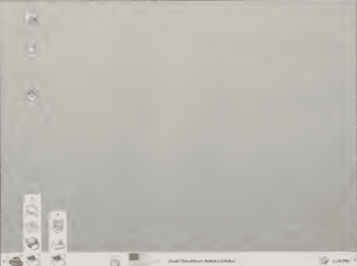

图 2-12: 在面板上添加抽屉

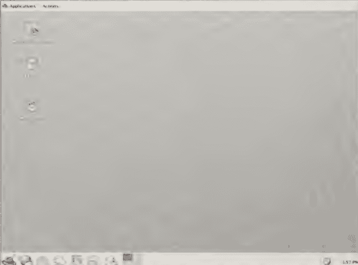

图 2-13: 添加新面板

## 自定义工作空间

工作空间等同于系统上的额外桌面。默认情况下，Fedora 带有四个你可以使用的工作空间，但你并不限于这四个。接下来的章节将向你展示如何添加和删除工作空间、在工作空间之间拖动应用程序，以及让单个应用程序在所有工作空间中都显示。

## 添加或删除工作空间

根据你的需求，你可能需要比四个默认工作空间更多或更少空间。要从面板中添加或删除工作空间，请右键点击工作空间切换器面板小组件（参考图 2-3）并选择“偏好设置”。会出现“工作空间切换器偏好设置”窗口（见图 2-14）。从此窗口中，你可以更改工作空间的数量、选择仅显示第一个工作空间（如果你不需要任何额外工作空间），或更改工作空间显示的行数。

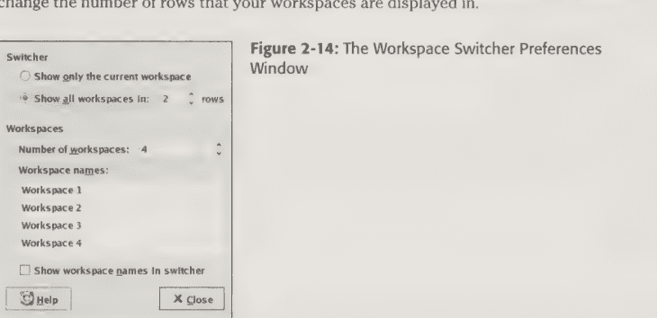

## 在工作空间之间拖动应用程序


如果你发现同时打开了许多应用程序，且不希望它们都挤在一个工作空间里，那么工作空间就会很有用。通过使用工作空间，你可以将特定类型的应用程序分组在不同的工作空间上。例如，如果你正在处理互联网应用程序、OpenOffice.org 以及几个图形应用程序，你可以让所有的互联网应用程序位于一个工作空间，所有的 OpenOffice.org 应用程序位于第二个工作空间，而所有的图形应用程序位于另一个工作空间。

跨越工作空间移动应用程序非常简单：在工作空间切换器面板小组件上点击打开窗口的图标（参考图 2-3），然后将其拖到小组件上的另一个工作空间上。

> 提示：当前的工作空间很容易识别，因为它是所有工作空间中颜色较深的方框，而其他工作空间颜色较浅。

在将应用程序拖动到不同的工作空间后，你可以点击工作空间切换器面板小组件上的该工作空间，然后点击该应用程序来访问它。

## 让一个窗口在所有工作空间中显示

你可能会发现，在使用工作空间时，你有一些在所有工作空间中都能访问的应用程序。例如，如果你正在等待一封重要的邮件，但不想反复切换工作空间来检查邮件，那么让一个窗口在所有工作空间中显示将让你无论使用哪个工作空间，都能一直关注你的邮件客户端。要让一个窗口出现在所有桌面上，请点击窗口左上角的向下箭头。在显示的菜单中，选择“放在所有工作空间”（Put on All Workspaces）。

## 更改系统外观

某些自定义功能并不会真正改变你使用系统的方式，只是改变系统的外观。例如，你的桌面背景不会影响你使用系统的方式，但它会改变桌面的外观。

以下章节将向你展示如何更改系统外观。

### 更改主题

主题在现代软件中变得越来越流行：主题基本上是为你的窗口和图形用户界面提供的不同界面。

- 即使是 Mozilla 1.4 也支持自己的主题（在 Mozilla 浏览器窗口中选择“视图 -> 应用主题”）。

要更改主题，点击主菜单按钮 -> 偏好设置 -> 主题，从已安装的主题列表中选择一个新主题（见图 2-15），并点击“关闭”。图 2-16 显示了一个应用主题的示例。

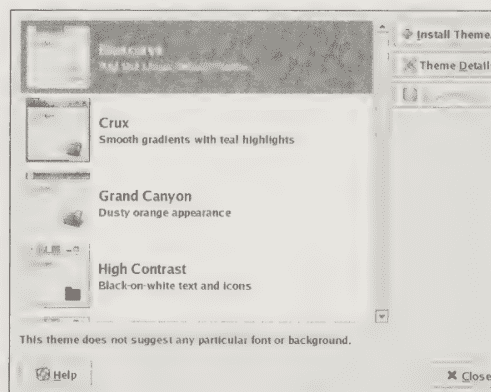

图 2-15: 偏好设置

## 第43 页 蓝色

 

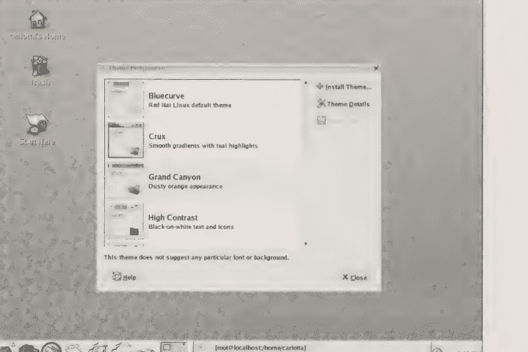

图 2-16: 主题

### 细节

每个主题由三部分组成：控制控件、窗口外观和图标。你可以通过点击“细节”（见图 2-17）来更改工作空间细节。你可以更改工作空间的数量，选择仅显示第一个工作空间（如果你不需要任何额外工作空间），或更改工作空间显示的行数。

你可以通过点击工作空间切换器面板小组件上的该工作空间，然后点击该应用程序来访问它。

> 提示：当前的工作空间很容易识别，因为它是所有工作空间中颜色较深的方框，而其他工作空间颜色较浅。

在将应用程序拖动到不同的工作空间后，你可以点击工作空间切换器面板小组件上的该工作空间，然后点击该应用程序来访问它。

### 保存主题

当你完成主题更改后，点击“保存”窗口。你会发现它创建一个新的条目。如果你喜欢这个主题并想保存它，可以给它一个名称然后点击“保存”。

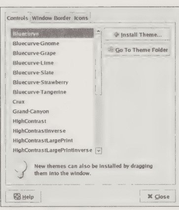

图 2-17: 细节


图 2-18: 桌面

### 更改背景

要更改桌面背景，点击“背景”。会出现“背景”窗口（见图 2-20），你可以从中更改背景。你也可以通过拖动图片到窗口来更改背景。

| 平铺 | 居中 | 缩放 | 无图片 |

|---|---|---|---|

| 背景样式: 垂直渐变 | 顶部颜色: | 底部颜色: |

图 2-19: 图标

### 更改桌面模式

此功能允许你更改窗口或桌面的模式。要执行此操作，打开 Nautilus 窗口，你可以通过双击桌面上的主目录来实现。从 Nautilus 窗口，选择“编辑 -> 背景和徽章”（见图 2-1）。默认情况下，模式自定义功能在前。在模式窗口上有你可以用于更改 Nautilus 的不同模式。找到你喜欢的模式，点击它，将其拖到 Nautilus 窗口或桌面上，观察 Nautilus（或桌面）发生变化。将“重置”框拖到项目上将其恢复到原始状态。

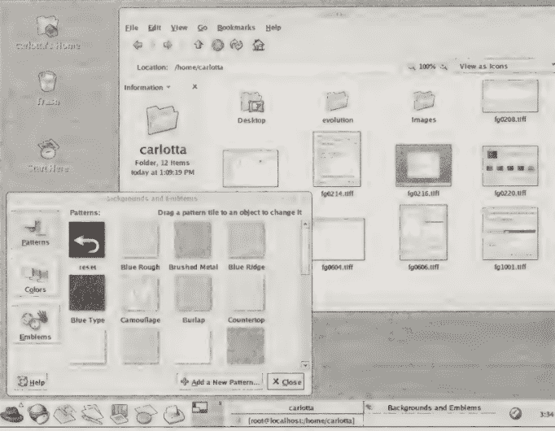

图 2-21: 更改桌面和窗口模式

### 更改桌面颜色

与更改模式一样，更改颜色也很简单。要执行此操作，从 Nautilus 窗口选择“编辑背景和徽章”，然后点击左侧的“颜色”按钮（见图 2-22）。你可以点击所需的颜色，并在按住鼠标时将颜色拖动到目标项目上并释放。将“重置”框将其恢复到原始状态。

### 为图标添加徽章

此功能允许你为图标添加小徽章，以帮助你更好地区分相似的图标。例如，其中一个徽章写着“草稿”；如果你有几个

## 第2章 ♦ 领先 Bluecurve

如果你在一个文件夹中工作，并希望能够直观地区分草稿和最终版本，可以为文件夹中的所有草稿版本添加“草稿（Draft）”徽章，以便区分它们。

要在图标上添加徽章，请点击“背景和徽章（Backgrounds and Emblems)”窗口中的“徽章（Emblems)”按钮，找到所需的徽章，并将其拖到图标上（见图2-23）。

你也可以右键点击图标，从右菜单中选择“属性（Properties）”，并在图标属性窗口的“徽章（Emblems）”选项卡中添加或删除图标。

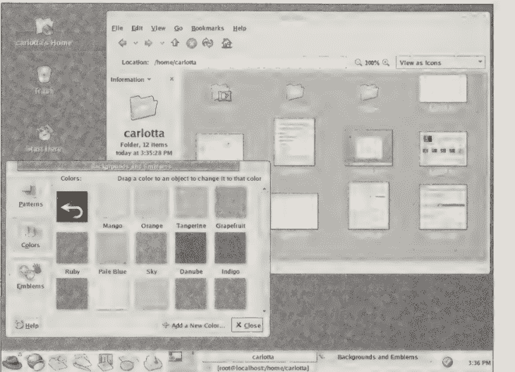

图2-22：更改桌面、窗口和面板颜色

### 调整图标大小

Fedora 包含了根据你的喜好或需求调整图标大小的功能（见图2-24）。

如果你在某个文件夹中处理许多文件和文件夹，并希望其中一个与其它一个更容易识别，请点击你想拉伸的图标。然后从文件夹菜单中点击“编辑（Edit）”，并从菜单中选择“拉伸图标（Stretch Icon）”。图标角落会出现一些手柄；你可以通过点击其中一个手柄并将其远离图标中心以使其变大，或向图标中心移动使其变小。

要将图标恢复到原始大小，请点击图标，从文件夹菜单选择“编辑（Edit）”，并选择“恢复图标原始尺寸（Restore Icon's Original Size）”。

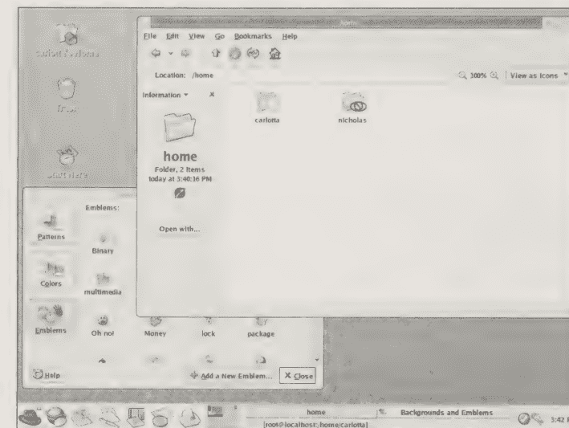

图2-23：为 Carlotta 图标添加特殊徽章

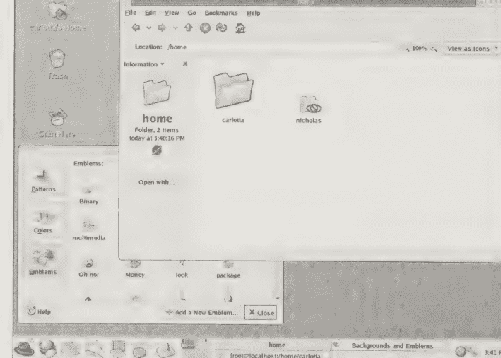

图2-24：调整图标大小

### 更改屏幕保护程序

Fedora 自带了一些令人深刻的屏幕保护程序（见图2-25）。

要更改屏幕保护程序，点击主菜单（Main Menu）按钮：偏好（Preferences）—屏幕保护程序（Screensaver）。将弹出屏幕保护程序偏好窗口（见图2-26），你可以在其中更改屏幕保护程序、修改屏幕保护程序的设置并预览屏幕保护程序。


图2-25：Fedora 中的屏幕保护程序

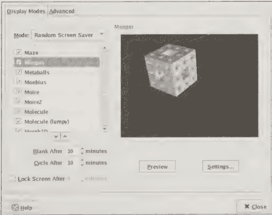

图2-26：屏幕保护程序设置窗口

### 注销

当你完成工作并想要退出图形桌面时，你将面临选择：注销图形桌面（系统继续运行）、重启机器或完全停止系统。

要退出图形桌面，请从主菜单中选择“注销（Log Out）”项。这将弹出一个对话框，向你提供上述选项。

## KDE Bluecurve

本章介绍了 KDE 版本 Fedora Bluecurve 桌面的基础知识，并告诉你可以如何根据你的需求自定义桌面。如果你使用的是 GNOME 版本的 Bluecurve，请参阅第2章。

### 安装 KDE Bluecurve

Fedora 默认安装 GNOME 版本的 Bluecurve，因此如果你想使用 KDE 版本，必须先安装它。这里有一种安装 KDE 的简单方法：首先，像往常一样登录。然后右键点击桌面，从弹出菜单中选择“打开终端（Open Terminal）”。在终端窗口的命令提示符处，输入以下命令切换到 root 用户：

```
su -
```

在提示时输入 root 密码。然后输入以下命令获取并安装常用的 KDE 软件包：

```
# yum install kdegraphics kdemultimedia kdenetwork kdepim deutils kgames
```

其他可用包还包括 `kdetoys`（趣味）和 `kdeedu`（教育程序）。

### 切换到 KDE Bluecurve


# 第 3 章 KDE Bluecurve

你可以选择每次登录时手动启动 KDE 版本的 Bluecurve。在登录界面，点击屏幕底部的“会话（Session）”。将弹出一个对话框。点击 `KDE` 然后点击“确定（OK）”。登录时，它将启动 Bluecurve 桌面而不是 GNOME，但仅对本次会话有效。

如果你想默认使用 KDE 桌面，首先登录你的 GNOME 或 KDE 桌面。然后点击主菜单并选择“系统设置（System Settings）—更多系统设置（More System Settings）—桌面切换（Desktop Switching）”。在列表中选择 `KDE` 并点击“确定（OK）”。这会将 KDE 设置为默认。


## 介绍 Fedora Bluecurve 桌面

你的第一个桌面视图看起来像图3-1。


**图3-1：** Bluecurve 桌面提供了应用程序和系统设置。你会注意到它提供了三个工具来使用应用程序：面板图标、桌面图标和菜单。

- 桌面底部的长条被称为*面板（Panel）*。面板包含应用程序启动器、状态指示器以及名为*组件（applets）*的小程序，让你控制音量、切换工作空间并监控系统状态。
- 桌面上的其他图标可以是文件夹、应用程序启动器以及已挂载的可移动设备（如 CD-ROM）。要打开文件夹或启动应用程序，双击即可。
- 你可以通过主菜单（面板最左侧带齿轮的大 K）来导航系统。你还可以点击“应用程序（Applications）”图标并双击，这将看到多个类别。双击任何类别（如 Office）即可浏览该类型。

桌面的工作方式与 Windows 或 OS 等系统类似。你可以将文件和应用程序图标拖放到易访问的区域。你可以为桌面、面板和文件管理器添加新的图标。你可以使用提供的工具更改大多数工具的外。

## 介绍面板

面板是横跨屏幕底部的条，包含了让系统更易用的图标和应用程序（见图3-2）。面板还带有主菜单（带齿轮的大 K），其中包含所有应用程序的菜单项。面板还显示许多组件，让你运行特定任务或监控系统服务（如网络），同时不占用你的空间。


图3-2：桌面底部的面板

## 使用主菜单

你可以点击面板的主菜单按钮（面板左侧带齿轮的图标），将其扩展为大型菜单，让你访问系统上的应用程序。在这里，你可以启动 Fedora 包含的大多数应用程序。注意，除了推荐应用程序外，你还可以在“额外（Extras）”项下访问更多应用程序。从主菜单还可以执行以下操作：

- 从命令行运行应用程序
- 运行常用的应用程序
- 查找文件
- 锁定屏幕（运行密码保护的屏幕保护程序）
- 获取帮助
- 注销

## 介绍组件

组件是运行在面板上的小程序。组件通常让你监控系统或互联网。有些设计用于娱乐。

与 GNOME 版本的 Bluecurve 一样，面板上默认运行着几个组件。这些组件非常重要，将在后续章节介绍。

### 工作空间切换器

工作空间切换器（见图3-3）是一个简单的组件，让你看到工作空间（工作空间也称为虚拟桌面）上打开了哪些应用程序。你可以在多个独立的工作空间中工作，每个工作空间都像一个独立的桌面。这使得无需将所有应用程序挤在一个视图区域内即可工作。

工作空间切换器用小方框表示每个工作空间并显示上面的应用程序。你可以用鼠标点击其中一个方框移动到该工作空间。


#### 图3-3：工作空间切换器

### 任务栏

工作空间切换器旁边是任务栏（见图3-4）。任务栏是一个组件，显示任何桌面上运行的应用程序标题。如果你决定最小化一个应用程序，这非常有帮助，因为它看起来会从桌面上消失。消失后，你可以点击任务栏中的标题将其带回来。

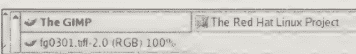

#### 图3-4：任务栏

## 操作图标

图标是一个图片（通常很小，尽管在本章后面会讨论你可以调整图标大小），代表文件或目录，甚至是设备和应用程序启动器。双击图标以访问图标所代表的内容。如果是一个文件（例如文字处理文档），双击应该启动文字处理器并打开文档。如果是一个应用程序，双击图标将启动该应用程序。

你也可以右键点击图标上的鼠标指针并选择“打开（Open）”（或选择“打开方式...如果你想选择打开文件的应用程序），而不是双击。

在图3-1中，你可以看到桌面上的四个图标，以及面板上的几个图标（也称为组件）。

## 使用 Konqueror

图形桌面包含一个名为 `Konqueror` 的文件管理器，它可以为你提供系统和个人文件的图形化显示。然而，Konqueror 的设计不仅仅是文件的视觉列表；它还允许你：

- 数字音乐和视频文件
- 浏览照片
- 访问网络资源
- 浏览 Web

你可以通过一个集成界面完成所有这些甚至更多的操作。从本质上说，Konqueror 变成了你桌面体验的导航工具。Konqueror 非常像 `Nautilus`（参见第 2 章）。Konqueror 有一个侧边栏，可以为你提供如目录和书签的树形视图、你使用 Konqueror 访问过的位置历史等功能。

要以文件管理器的身份启动 Konqueror，请双击你的主目录图标。一旦 Konqueror 出现，你就可以在主目录或文件系统的其他部分进行导航。点击“向上箭头”图标移动到上一级目录（如果存在，则包含当前文件夹的文件夹）。你也可以双击文件夹图标来查看该文件夹的内容。你可以点击后退按钮返回上次所在地。

要返回主目录，请点击“首页”（Home）。

当你浏览文件系统时，可以通过“位置”（Location）字段查看你所在的位置。如果你想去某个位置，可以在“位置”字段中选择目录并按回车键。你也可以通过观察左面板中的树形视图来查看你正要去哪里，它会跟踪你在文件夹之间的移动。

你可以通过选择“位置 -> 新窗口”来打开另一个 Konqueror 窗口。拥有另一个 Konqueror 窗口后，你可以在窗口之间拖放文件。

如果你不想打开多个窗口，可以通过选择“窗口 -> 新标签页”来打开标签页视图，或者按下 `Ctrl+Shift-N`。你还可以根据想要分割视图，通过选择“分视图 左/右”或“分视图 上/下”来将 Konqueror 窗口分为两个窗格。参见图 3-5，它有两个标签页，其中一个带有分视图。

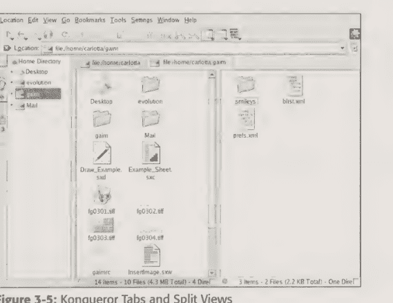

图 3-5：Konqueror 标签和分视图

你可以在两个窗口或两个视图之间拖放文件。当你将文件从一个目录拖到另一个目录时，系统会询问你想执行什么种操作——复制、移动、创建链接或取消。如果你想跳过此询问，下面的点显示了如何直接移动、复制和链接文件。

### Fedora 官方指南

- 要移动文件，按住 `Shift` 键并用鼠标拖动文件。
- 要复制文件，按住 `Ctrl` 键并用鼠标拖动文件。
- 要为另一个位置的文件创建链接，同时按住 `Ctrl` 和 `Shift` 键，然后用鼠标拖动文件。

默认情况下，主目录中的文本文件和图像将显示为缩略图。对于文本文件，这意味着你将在图标中看到部分实际文本。对于图像，你将看到图片的缩小（或缩略图）版本。要关闭当前窗口或视图的此功能，从菜单选择“视图 ⇌ 预览: 显示预览”来关闭该功能。执行相同的操作即可将其开启。

你可以通过配置 Konquer 来关闭特定类型文件的预览，或完全关闭预览。通过选择“设置 ⇌ 配置 Konquer”打开 Konquer 设置窗口（参见图 3-6）。点击左侧的图标以更改你想要修改的设置。在这种情况下，你将点击“预览”图标。

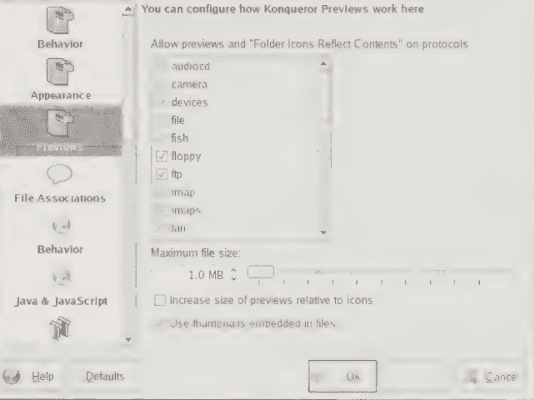

图 3-6：Konquer 预览设置

## 从这里开始

“在此开始”窗口（参见图 3-7）设计用于存放你使用系统时需要的所有工具和应用程序。从你喜爱的应用程序到系统和配置工具，“在此开始”窗口为你使用和自定义系统提供了一个中心位置。

你可以随时双击标记为“在此开始”（Start Here）的桌面图标来访问该界面。

“在此开始”屏幕包含允许你访问喜爱的应用程序、桌面偏好、主菜单项、服务器配置工具和系统设置的图标。

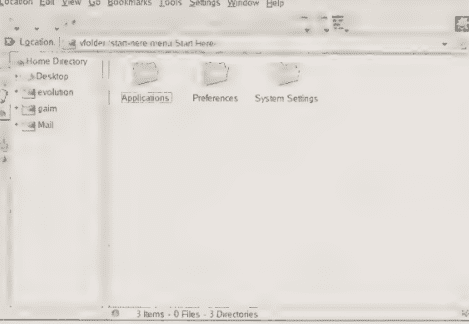

图 3-7：在此开始窗口

你可以将自己喜爱的应用程序添加到“在此开始”窗口的书签部分。要将应用程序添加到书签部分，请导航到你想要书签的位置，并选择“书签 -> 添加书签”。你将立即在书签菜单中看到该应用程序的图标。

### 提示：首页图标


首页图标打开 `Konqueror` 并带你进入主目录，如果你以 `root` 身份登录，则位于 `/home` 或 `/root` 下。例如，如果你的用户名是 `John`，那么你的主目录将是 `/home/John`。此外，此图标以用户命名；因此，在我们的示例中，首页图标将被称为 `John's Home`（参见图 3-1）。

### 注意
`root` 用户的主目录位于 `/root` 下。

你的主目录是用户所有文件的默认位置。当你在应用程序（如 `OpenOffice Writer`）中创建任何类型的新文件并点击“保存”时，弹出的保存对话框将把你的主目录显示为默认保存目录。

### 提示
通过将文件保存在主目录（或其子目录）中，你可以节省大量在目录间来回跳转的时间。当然，将所有文件都保存在主目录中并不是好主意。要创建子目录，可以执行以下操作：

1. 从“视图 ⇌ 预览: 显示预览”菜单中切换功能来关闭它。执行相同的操作即可将其开启。
2. 在你想要自定义的设置中，在主目录中。
3. 某个窗口将显示出来（参见图 3-8）。
4. 你将立即在书签菜单中看到该应用程序的图标。
5. 某个窗口将显示出来（参见图 3-9）。
6. 某个窗口将显示出来（参见图 3-10）。
7. 某个窗口将显示出来（参见图 3-11）。


## 向面板添加图标和小组件
为了让面板符合你的需求，你可能想要添加更多小组件（applets）和启动器图标。要在面板上添加小组件，在面板的空白区域右键点击，选择“添加 + 小组件”（Add + Applet），然后从菜单中选择。当你选择一个小组件时，它将出现在你的面板上，因为那是它运行的地方。如果你想将小组件移动到面板的其他位置，请右键点击小组件并选择“移动”（Move）。

你还可以向面板添加应用程序、按钮和扩展。例如，通过在面板空白区域右键点击，然后选择“添加 + 按钮 + 最近文档”（Add + Button + Recent Documents）来添加最近文档。这将添加一个图标，点击后会打开你最近打开的文件夹菜单（见图 3-12）。

## 自定义面板外观
你可以对面板进行极其精细的自定义。点击“偏好设置 + 配置面板”（Preferences + Configure Panel）来打开面板设置（见图 3-13）。左侧有三个图标：布局（Layout）、外观（Appearance）和任务栏（Taskbar）。


图 3-12: 最近文档按钮

## 移动和调整面板大小
点击“布局”图标来更改面板的位置和大小。你会看到一个带有几个面板形状按钮的正方形，点击这些按钮可以重新定位面板。当你点击“应用”（Apply）时，面板将移动到新位置。你还可以通过更改滑动块在这里调整面板的大小。在我们的示例中，面板被调整为宽度的 73%，并放置在底部中央（见图 3-14）。你还可以将面板的高度调整为极小（Tiny）、较小（Small）、普通（Normal）、大（Large）或自定义（Custom）。


图 3-13: 移动和调整面板大小

## 隐藏面板
你可以配置面板在启动应用程序时自动隐藏，或者添加“隐藏”按钮来隐藏面板，并在你任何需要的时候让它出现。点击“隐藏”（Hiding）选项卡，然后按照你的喜好设置选项。例如，通过勾选面板隐藏的一个选框，你可以让隐藏按钮出现在面板的右侧或左侧。当你点击这些按钮之一时，面板会滑出并只留下按钮，你可以点击该按钮让面板再次出现。图 3-15 显示了隐藏选项。

## 自定义面板菜单
点击“菜单”（Menus）选项卡来配置面板菜单（见图 3-16）。如果你希望“最近文档”选项出现在面板上而不是菜单中（或者在菜单之外显示），你可以在此处勾选该选项并点击“应用”。现在，你的面板上就有一个“最近文档”选项了。

如果你非常有野心（因为当你不知道自己在做什么时，这实际上为你提供了一个管理菜单的简单方法），你甚至可以编辑菜单中的所有选项。点击“编辑”（Edit）按钮打开菜单编辑器，如图 3-17 所示。


图 3-14: 移动和调整大小的面板


图 3-15: 隐藏选项

## 更改面板外观
点击面板设置窗口中的“外观”图标来更改面板图标的外观，或者让面板图标在鼠标悬停其上方时缩放。你还可以自定义面板背景。图 3-18 显示了设置窗口以及带有花纹背景的面板。


图 18: 花纹面板

## 自定义任务栏
在面板设置窗口中点击图标来自定义任务栏，如图 3-19 所示。这里有几个自定义选项。例如，如果你勾选“显示所有桌面的窗口”（Show Windows from All Desktops）选框，任务栏将包含你正在运行的所有应用程序。如果你取消勾选，任务栏将只显示在当前工作区运行的应用程序。

## 自定义工作区
工作区（Workspaces）相当于系统中的额外桌面。默认情况下，Fedora 带有四个你可以使用的工作区，但并不限于此。接下来的章节将介绍如何添加和删除工作区、跨工作区拖动应用程序，以及让单个应用程序出现在所有工作区上。

## 添加或删除工作区
根据你的需求，你可能想要比默认更多或更少的工作区。要在面板上添加或删除工作区，右键点击“工作区切换器”小组件（参考图 3-3）并选择“配置虚拟桌面”（Configure Virtual Desktops）。会弹出设置窗口（图 3-20）。从此窗口你可以更改工作区的数量并对其进行重命名。


图 3-19: 任务栏设置


图 3-20: 虚拟桌面设置窗口

## 桌面分页器
当你同时打开许多应用程序时，工作区会非常有用。桌面分页器（Desktop Pager）让你查看所有工作区并在它们之间快速切换。

# 70 Fedora 官方伴侣

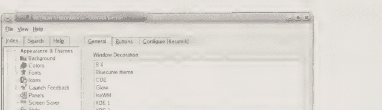

图 3-26：Keramik 窗口装饰

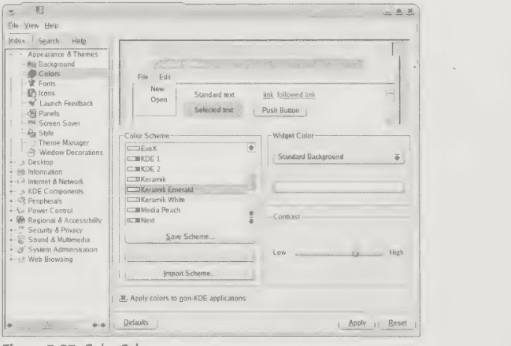

图 3-27：配色方案

## 更改图标
你也可以更改桌面图标的样式。点击控制中心中“外观与主题（Appearance & Themes）”子列表下的“图标（Icons）选项。从列表中选择一种图标样式。你应该看到图标的预览，如图 3-29 所示。

# 第 3 章 ✨ KDE Bluecurve 71

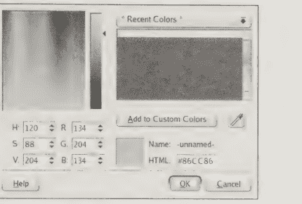

图 3-28：颜色选择器

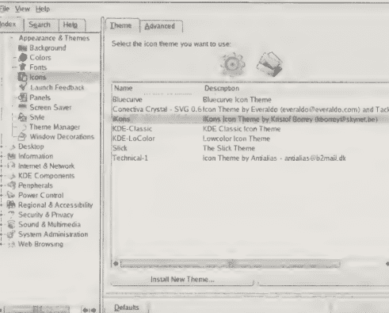

图 3-29：图标样式

你可以自定义图标在桌面、工具栏等地方的显示大小。你还可以为图标自定义特殊效果，使其在激活或禁用状态时改变外观。点击“高级（Advanced）”选项卡来获取这些选项，如图 3-30 所示。

## 更改桌面背景
你有许多选项可以更改桌面背景。点击“外观与主题（Appearance & Themes）”子列表下的“背景（Background）”。你可以更改背景颜色或将背景设置为壁纸。点击“壁纸（Wallpaper）”选项卡（如图 3-31 所示）来设置壁纸图像。

请图 3-32，这是一个使用 `triplegears.jpg` 作为壁纸的示例桌面。

## 保存自定义主题
当你更改桌面时，可以保存主题的细节。点击“外观与主题（Appearance & Themes）”子列表下的“主题管理器（Theme Manager）”项目。点击“创建（Create）”按钮，然后填写任何细节并点击“确定（OK）”。

## 更改屏幕保护程序
点击“外观与主题（Appearance & Themes）”子列表下的“屏幕保护程序（Screen Saver）”来更改屏幕保护程序，如图 3-30 所示。从列表中选择一个屏幕保护程序，点击“测试（Test）”按钮查看效果，在你找到你喜欢的时点击“应用（Apply）”。


图 3-30：高级图标设置


图 3-31：背景壁纸设置


图 3-32：三连齿轮壁纸背景

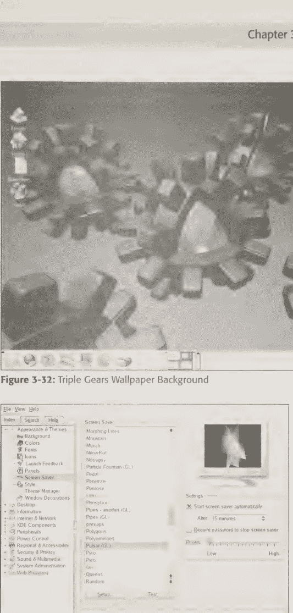

图 3-33：选择屏幕保护程序

## 锁定屏幕

如果你想离开电脑但不想让任何人访问你的桌面，不需要关闭所有应用程序并注销。相反，你可以锁定屏幕。点击主菜单（`Main Menu`）按钮并选择“锁定屏幕（`Lock Screen`）”。屏幕保护程序会自动启动。下次你按下键盘或移动鼠标时，桌面将要求你输入密码才能再次使用。

## 注销

当你完成工作并想退出图形化桌面时，点击主菜单（`Main Menu`）按钮并选择“注销（`Logout`）”（你会在菜单选择中看到你的用户名）。

## 使用和浏览网络

你对 eBay 或像 Netscape Search、Yahoo 或 Google 这样的搜索门户吗？如果你一天没有和你的 Yahoo Instant Messenger 或 AOL 朋友聊天，你会产生戒断症状吗？你是为了发送和阅读电子邮件而活吗？

本章介绍了如何使用 Firefox、Konqueror 等强大的浏览器，以及如 Yahoo Instant Messenger、AOL 和 KMail 等即时消息应用。

### 浏览

配置好浏览器后，你就可以开始访问网页了。Firefox 丰富的特性允许你：

- 搜索信息
- 使用书签收藏喜欢的网站
- 查看历史记录
- 使用多个标签页进行并发浏览

如果你想打开新标签页，请按 `Ctrl-T`，或者在 Firefox 菜单中点击“文件（`File`）”并选择“新标签页（`New Tab`）”。例如，如果你想继续浏览 Fedora Hill 上的页面，同时查看其中一个相关链接，你可以按 `Ctrl-T` 打开新标签页，然后点击链接在新标签页中加载新页面。

### 标签页

Mozilla 提供了标签页浏览功能，这意味着如果你想同时查看多个网站，无需为每个网站打开完全全新的浏览器窗口。只需创建一个新标签页并在视图中加载另一个网站即可。

要打开新标签页，请按 `Ctrl-T`，或者在 Firefox 菜单中点击“文件（`File`）”并选择“新标签页（`New Tab`）”。例如，如果你想继续浏览 Fedora Hill 上的页面，同时查看其中一个相关链接，你可以按 `Ctrl-T` 打开新标签页，然后点击链接在新标签页中加载新页面。

### 侧边栏

侧边栏提供了快速访问书签、历史记录和搜索等功能。如果侧边栏未显示，点击“查看（`View`）”菜单并选择“显示侧边栏（`Show Sidebar`）”。你还可以自定义侧边栏仅显示你需要的内容。点击“查看（`View`）”菜单并选择：

- 始终显示侧边栏
- 仅显示需要的侧边栏
- 隐藏侧边栏

### 书签

侧边栏提供了快速访问书签。你可以通过 `Ctrl-D` 或点击 Firefox 菜单并选择“签此页（`Bookmark This Page`）”来收藏任何喜欢的网站。之后，你可以点击菜单中的“书签（`Bookmark`）”访问书签。

当你添加书签时，会将它们组织到文件夹中以避免混乱。创建书签文件夹、更改书签名称、移动、复制、删除以及其他管理书签的操作非常简单。开始时按 `Ctrl-B` 打开书签管理器，或点击菜单上的“书签”并选择“管理书签（`Manage Bookmarks`）”（见图 4-2）。

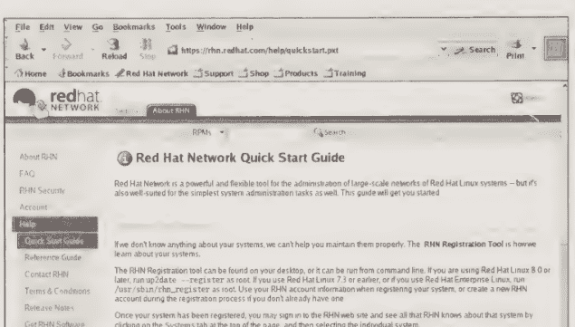

### 76 官方伴侣


图 4-1：Firefox 浏览器设置

### 历史记录

侧边栏提供了快速访问历史记录。你的历史记录显示了最近访问的页面列表。你可以使用历史记录返回早过的页面。要清除历史记录，点击“历史（`History`）”菜单并选择“立即清除最近历史（`Clear Recent History Now`）”。

### 搜索

侧边栏提供了快速搜索网页。你可以将查询输入搜索栏并按回车。Firefox 将使用你的默认搜索引擎查找结果。你可以在“选项（`Preferences`）”中更改默认搜索引擎。

### 个人工具栏

Mozilla 带有已加载链接的个人书签工具栏。你可以将自己的文件夹和最常访问的网站添加到工具栏，让使用 Mozilla 浏览变得前所未有的简单。例如，以下显示了如何将“搜索引擎”文件夹添加到个人工具栏，然后将 Google 添加到该文件夹中。

### 78 官方 Fedora 指南

1. 在工具栏最后一个项目（应显示为 Training/训练）右侧空白处点击鼠标右键。
2. 从弹出的菜单中选择“New Folder”（新建文件夹）。这将打开“New Folder”对话框（见图 4-3）。

图 4-3：新建文件夹对话框
3. 在新文件夹名称空间中输入“Search Engines”（搜索引擎），并可选地为该文件夹输入一段简短描述。
4. 点击 OK 接受这个新文件夹“Search Engines”。你应该会在你的个人工具栏上看到一个名为“Search Engines”的新条目。
5. 现在导航到网站 `www.google.com`。其中一种方法是按下 `Ctrl+Shift+L`（或在 Mozilla 菜单中点击“New”并选择“Open Web Location”）。然后，当“Open Location”对话框出现时，在位置字段中输入 `www.google.com` ... 并点击“Open”（打开）按钮（见图 4-4）。你现在应该可以看到 Google 搜索网站了。

图 4-4：打开网页位置
6. 现在点击 Mozilla 菜单中的“Bookmark”（书签）并选择“File Bookmark”（文件书签）。会弹出一个“File Bookmark”窗口（见图 4-5）。在文件夹列表中选择“Search Engines”并点击 OK。
7. 现在，当你点击个人工具栏上的“Search Engines”时，Google 的链接应该就会出现。

### 第 4 章 ✦ 使用和浏览互联网 79


图 4-5：文件书签

### 烦人的弹出窗口

当你第一次使用 Mozilla 访问一个会自动弹出窗口的网站时，Mozilla 会询问你是否想阻止网站执行此操作（见图 4-6）。


> 要设置控制弹出窗口的偏好，打开 `Edit`（编辑）菜单并选择 `Preferences`（偏好）。在 Privacy & Security（隐私与安全）类别下，点击 Popups（弹出窗口）。你现在要阻止弹出窗口并设置偏好吗？

图 4-6：首次弹出对话框

如果你不喜欢网站在未经许可的情况下弹出，请点击 Yes。这将进入弹出窗口偏好窗口（见图 4-7）。你可以配置 Mozilla 对于弹出窗口的行为。

### 关于 Mozilla 的更多信息

上述技术应该让你开始使用 Mozilla 获得便捷且有趣的浏览体验，但这仅仅触及 Mozilla 浏览器功能的一角。关于使用 Mozilla 的更多信息，请选择 `Help`（帮助）-> `Help Content`（帮助内容）。

### 使用 Conqueror 浏览网页

Conqueror（见图 4-8）是一个为 KDE 构建的全功能 Web 浏览器，但无论你偏好用于 GNOME 的 Bluecurve 桌面还是 KDE，都可以使用它。要启动 Conqueror，点击 `Main menu`（主菜单）-> `Internet`（互联网）-> `More Applications`（更多应用程序）-> `Conqueror Web Browser`。

### 80 官方 Fedora Windows

| 类别 | 弹出窗口 | 允许的站点... |
| :--- | :--- | :--- |
| Appearance (外观) | PopUp Windows (弹出窗口) | |
| Navigator (导航) | | |
| Compositor (合成器) | [ ] 阻止请求的弹出窗口 | |
| Web & Newsgroups (网页与新闻组) | 当弹出窗口被拦截时： | |
| Privacy & Security (隐私与安全) | [ ] 播放声音： | |
| Colors (颜色) | | |
| Images (图像) | [ ] 在导航栏上显示图标 | |
| Forms (表单) | | |
| 注意：拦截窗口可能会阻止某些网站的重要功能运行，例如银行和购物网站的登录窗口。关于如何在允许某些站点的同时拦截其他站点，请点击 `Help`（帮助）。如果被拦截，站点可能会使用其他方法显示弹出。 | | |


| Passwords (密码) | | |
| Master Passwords (主密码) | | |
| SSL | | |
| Certificates (证书) | | |
| Validation (验证) | | |
| Offline & Disk Space (离线与磁盘空间) | | |

图 4-7：配置弹出窗口


欢迎来到 Conqueror

熟悉 Conqueror 的最好方法之一是通过内置的 Introduction（介绍）。点击 Conqueror 菜单上的 Help（帮助），然后选择 Introduction（介绍）进入该页面。点击页面上的 Continue（继续）链接或 Tips（提示）以了解如何使用 Conqueror。

要开始第一次网页搜索，点击浏览器中的 Location（位置）文本字段，输入如 `netscape.com` 的 URL，然后按下 Enter。

## 侧边栏

Conqueror 也有侧边栏，尽管它被称为 Navigation Panel（导航面板），且工作方式与 Mozilla 侧边栏不同。按下 `F9` 使面板出现，或点击 Conqueror 菜单上的 Window（窗口）并 Show Navigation Panel（显示导航面板）。你现在应该可以看到导航侧边栏。Conqueror 侧边栏包含多个工具。将鼠标指针悬停在图标上，会出现一个提示显示该图标的功能。其中一个选项是查看你最近访问的站点历史。

## Conqueror 打开标签

与 Mozilla 类似，Conqueror 让你在单独的标签页中查看多个页面，而无需为每个页面打开新窗口。按下 `Ctrl+Shift+N` 或点击 Conqueror 菜单中的 Window 并选择 New Tab（新标签页）。

## 记住该站点！

你可以通过 `Ctrl+B` 或点击 Conqueror 菜单中的 Bookmark（书签）让 Conqueror 签下当前站点。

## 你自己的个人工具栏

Conqueror 没有默认的个人工具栏，但你可以创建一个。以下是将 Search Engines 作为文件夹添加到个人工具栏，然后添加 Google 的方法：

1. 点击 Conqueror 菜单中的 Settings（设置）并选择 Toolbars（工具栏）。点击 Show Toolbar（显示工具栏）。你会看到一个空白工具栏出现。
2. 点击 Conqueror 菜单中的 Bookmarks（书签）并选择 New Folder（新建文件夹）。在弹出的窗口中输入“Search Engines”，然后点击 OK（见图 4-9）。


图 4-9：新建文件夹
3. 现在在浏览器的 Location 字段中输入 `www.google.com`。如果那里已经有一个 URL，你可以点击箭头将其清除，之后输入 `www.google.com` 并按下 Enter。
4. 点击个人工具栏上的 Search Engines 并选择 Add Bookmark（添加书签）。这将添加到 Search Engines 文件夹。现在你可以从这里快速导航到 Google。

关于使用 Conqueror 的更多信息，请选择 Help（帮助）-> Conqueror Handbook（Conqueror 手册）（见图 4-10）。


图 4-10：Conqueror 手册

## 浏览器插件

一旦你熟悉了浏览器，你可能会发现访问某些网站时，它们提示你需要此插件才能查看该站点的所有内容。你需要的常用插件有 Macromedia Flash、Java 以及用于查看电影的媒体播放器。除了名为 Firefox 的通用插件外，你必须从互联网下载浏览器插件。这些插件更新频繁，请记住你在互联网上找到的版本可能与我们的不匹配。还要注意，下载插件的网站可能会变化，因此你可能无法按照我们概述的准确说明获取最新插件。解决方法很简单：当网站与书中的说明不符时，请凭常理遵循网站上的说明。

### 安装 Flash Player

Macromedia Flash Player 让你查看 Web 上最流行的媒体内容形式之一。按照以下步骤下载并安装 Flash Player：

1. 访问网站 `http://www.macromedia.com` 寻找 Macromedia Flash Player。
2. 点击 Download Flash Player 链接。
3. 点击 Download Now（立即下载）按钮。
4. 选择保存文件的位置。在示例中，我们假设你将其保存在 Carlotta 的家目录 `/home/carlotta` 下。点击 Save（保存）按钮。在示例中，我们将此文件称为 `flash_player_6_linux.tar.gz`，这是编写本书时的最新版本。
5. 打开终端窗口。如果你使用的是 Bluecurve 的 GNOME 环境，可以右键点击桌面并从菜单中选择 New Terminal（新建终端）。
6. 使用命令 `su` 登录 root，之后你需要输入 root 密码。
7. 进入你保存文件的目录（示例中为 `/home/carlotta`）。例如，输入命令 `cd /home/carlotta`。
8. 保存的文件是一个压缩包。你可以使用以下命令进行解压：

```
# tar xvf flash_player_6_linux.tar.gz
```

9. 上述命令创建了一个新目录，例如 `install_flash_player_6_linux`。进入该目录：

```bash
# cd install_flash_player_6_linux
```

10. 使用以下命令运行安装程序：

```bash
# ./flashplayer-installer
```

11. 按照安装程序的提示操作。它应该要求你按 Enter 安装 Macromedia Flash Player。按下 Enter。
12. 安装程序会提示你需要某些字体并要求你再次按 Enter。按下 Enter。
13. 安装程序会让你退出任何运行中的浏览器。退出 Mozilla，然后按下 Enter。
14. 安装程序将询问 Mozilla 的安装路径（我们只对 Mozilla）。输入路径 `/usr/lib/mozilla-1.4` 并按下 Enter。
15. 当安装程序询问是否要继续安装时，输入 `y` 并按下 Enter。
16. 当安装程序询问是否要执行另一个安装时，输入 `n` 并按下 Enter。
17. 启动 Mozilla。你现在应该可以查看使用 Macromedia Flash 动画的网站了。

### 安装 Java 运行时环境

1. 访问网站 `http://java.sun.com/downloads/` 获取 Java 运行时环境安装程序。在本书期间，最新版本为 1.4.1_01。
2. 点击标题为 Java 2 Platform, Standard Edition (J2SE) 的链接。
3. 在出现的下一个页面上点击 J2SE 1.4.2 链接。
4. 你应该看到一个可能的下载表格。向下滚动并寻找标题条目。该表中有两列——一列名为 JRE（代表 Java 运行时环境），另一列名为 SDK（代表软件开发工具包）。点击 JRE 列中的 Download（下载）链接。
5. 阅读许可协议，向下滚动，如果你同意许可条款，请点击 Accept（接受）按钮。
6. 点击标题为 Download `j2re-1.4_2_01-linux-i586-rpm.bin` 的链接。（如果版本已更新，名称可能会略有不同。）
7. Mozilla 将弹出一个窗口，询问你是否要保存文件。点击 OK。
8. 选择一个保存文件的位置。例如，如果你以用户 carlotta 的身份登录，你可以将文件保存到 carlotta 的家目录 `/home/carlotta`，这就是我们使用的示例目录。
9. 打开终端窗口。如果你使用的是 GNOME 版本的 Bluecurve，可以右键点击桌面并从菜单中选择 New Terminal（新建终端）。
10. 使用命令 `su -` get root 身份登录，之后你需要输入 root 密码。
11. 切换到保存下载文件的目录（在示例中为 `/home/carlotta`）。例如，输入命令 `cd /home/carlotta`。
12. 你下载的文件是你运行的应用程序。你不能直接运行它，因为 Linux 尚不知道可以运行此文件。你使用 `chmod` 命令告诉 Linux 可以执行此文件，如下例所示（如果版本已更新，请调整文件名）：

```
# chmod +x j2re-1.4_2_01-linux-i586-rpm.bin
```

13. 现在使用以下命令运行程序（如果版本已更新，请调整文件名）：

```
# ./j2re-1.4_2_01-linux-i586-rpm.bin
```


14. 再次，你将看到一个许可协议。按空格键滚动协议，并在提示时输入 `yes` 以表示同意许可条款。

15. 当程序完成工作后，它会在当前目录下留一个新的 RPM 文件，这就是我们需要安装的内容。使用以下命令对应的版本进行安装（如果版本已更新，请调整文件名）：

```
# rpm i j2re-1.4_2_01 linux i586.rpm
```

16. 最后一步，你需要在 Mozilla 插件目录中为 Java 插件放置一个符号链接。输入以下命令（如果版本已更新，请调整版本号部分）。

```
# ln -sf /usr/java/j2re1.4_2_01/plugin/lib138/ns60-gcc32/libjavaplogin_oji.so /usr/lib/mozilla/plugins/libjavaplogin_oji.so
```

17. 退出 Mozilla 应用程序并重启，以便 Mozilla 识别 Java 插件。

你现在应该可以访问带有 Java applet 的网站，它们应该会自动加载并运行。

# 安装 mplayer

有几种可以在 Mozilla 中使用的媒体播放器。最容易安装的之一是 `mplayer`。注意，你可能需要安装 "`Mozplugger`" 以让 `mplayer` 作为 Mozilla 插件工作（参见本章后面的“安装 Mozplugger”部分）。

你可以从各种网站找到并下载 `mplayer`。但请注意，某些封装版本的 `mplayer` 依赖许多你可能没有安装的其他包，这使得安装 `mplayer` 变得繁琐困难。按照以下步骤可以轻松地安装 `mplayer`：

- 1. 访问网站 `http://ftp.falsehope.com/home/rathann/mplayer/` 并点击 Essential Downloads（基本下载）链接。
- 2. 点击标题为 `mplayer` 的链接（后面应跟着文件大小，大小可能随 `mplayer` 的当前版本而异）。Mozilla 将弹出一个大小窗口。
- 3. 选择一个保存文件的位置。在我们的示例中，我们假设你将其保存到 `carlotta` 的家目录 `/home/carlotta`。点击 Save（保存）按钮。为了示例起见，我们将此文件称为 `mplayer-0.91-2.i386.rpm`，这是本书的最新版本。
- 4. 点击标题为 `mplayer` 的链接（后面应跟着文件大小大小可能随 `mplayer` 的当前版本而异）。Mozilla 将弹出一个大小窗口。
- 5. 选择一个保存文件的位置。在我们的示例中，我们假设你将其保存到 `carlotta` 的家目录 `/home/carlotta`。点击 Save（保存）按钮。为了示例起见，我们将此文件称为 `mplayer-0.91-2.i386.rpm`。
- 6. 打开终端窗口。如果你使用的是 GNOME 版本的 Bluecurve，可以右键点击桌面并从菜单中选择 New Terminal（新建终端）。
- 7. 使用命令 `su -` get root 身份登录，之后你需要输入 root 密码。
- 8. 切换到保存下载文件的目录（在示例中为 `/home/carlotta`）。例如，输入命令 `cd /home/carlotta`。
- 9. 输入以下命令（如果版本已更新，请调整文件名）：

```
# ./j2re-1.4_2_01-linux-i586-rpm.bin
```

- 10. 当程序完成工作后，它会在当前目录下留一个新的 RPM 文件，这就是我们需要安装的内容。使用以下命令对应的版本进行安装（如果版本已更新，请调整文件名）：

```
# rpm i j2re-1.4_2_01 linux i586.rpm
```

- 11. 最后一步，你需要在 Mozilla 插件目录中为 Java 插件放置一个符号链接。输入以下命令（如果版本已更新，请调整版本号部分）。

```
# ln -sf /usr/java/j2re1.4_2_01/plugin/lib138/ns60-gcc32/libjavaplogin_oji.so /usr/lib/mozilla/plugins/libjavaplogin_oji.so
```

# 第 4 章 ✦ 使用与畅游互联网 87

安装 `firefoxplugin` 需要管理员权限，因此你必须打开一个终端窗口。以下是关于安装 `firefoxplugin` 的方法，假设你已连接到互联网（`yum` 命令需要活动的网络连接）：

假设你已连接到互联网：

- 1. 打开终端窗口。如果你使用的是 GNOME 版本的 Bluecurve，可以在桌面上点击右键，并从菜单中选择“新建终端”（New Terminal）。你也可以通过以下方式在 GNOME 或 KDE 版本的 Bluecurve 中打开通用终端：按 Alt-F2，在弹出的对话框中使用 `xterm`，然后按回车。
- 2. 使用命令 `su` 以 root 身份登录，你需要输入 root 密码。
- 3. 使用以下命令安装 `firefoxplugin` 包：

```bash
# yum install firefoxplugin
```

安装完成后应该很明显，此时 `firefoxplugin` 已经安装好了。如果 Mozilla 正在运行，请退出并重启它，以便识别 `firefoxplugin`。

## 电子邮件

电子邮件是通过互联网与他人通信的一种非常流行的方式。你可以使用电子邮件客户端来处理邮件，客户端是一种理解各种电子邮件传输标准并允许你发送、接收和阅读邮件的应用。Fedora 包含了几个电子邮件应用程序：`Evolution`、`Mozilla Mail` 和 `KMail`。`Evolution` 还是一个个人信息管理器，可以帮助管理日程和待办事项列表。所有的客户端应用程序都旨在适合特定类型的用户；因此，你可以根据自己的需求选择最符合你功能的一个。

本节的目的是演示如何使用 Fedora 中包含的一些流行的电子邮件应用程序。由于所有电子邮件客户端都执行相同的基础任务（以及接收邮件），请选择最方便、易用的一个。

接下来的章节将讨论这些电子邮件客户端：

- `Evolution`
- `KMail`
- `Mozilla Mail`

在启动电子邮件客户端之前，你应该准备好来自你的互联网服务提供商（ISP）的信息，以便正确配置客户端。以下列出了你可能需要知道的几点信息：

- 你的电子邮件地址 —— 你用于发送和接收邮件的地址。这通常为 `yourname@yourisp.net` 格式。
- 接收邮件的服务器类型（`POP` 或 `IMAP`）—— 要接收邮件，你必须知道使用的是哪种网络管理员或 ISP。此 `POP` 或 `IMAP` 地址通常为 `mail.someisp.net` 格式。
- `POP`，Post Office Protocol（邮局协议）的缩写，用于从邮件服务器发送邮件到你的客户端收件箱（传入邮件存储的地方）。大多数 ISP 邮件服务器使用 `POP` 协议，尽管某些可以使用新的 `IMAP`。
- `IMAP`，Internet Message Access Protocol（互联网消息访问协议）的缩写，是一种用于从你的 ISP 邮件服务器检索消息的协议。`IMAP` 与 `POP` 的区别在于，`IMAP` 邮件存储在服务器上，并在下载和阅读邮件时保留在上面；而 `POP` 邮件直接下载到你的电脑上，不会留在服务器上。
- 发送邮件的服务器类型（`SMTP`） —— Simple Mail Transfer Protocol（简单邮件传输协议）是一种向服务器发送电子邮件消息的协议。大多数通过互联网发送邮件的邮件系统使用 `SMTP` 将消息从一个服务器发送到另一个服务器；可以使用电子邮件客户端通过 `POP` 或 `IMAP` 获取消息。`SMTP` 也用于从邮件客户端发送消息到邮件服务器。这就是为什么在配置电子邮件应用程序时，你需要同时指定 `POP` 或 `IMAP` 服务器和 `SMTP` 服务器。

如果你对所需内容有任何疑问，请联系你的 ISP 或网络管理员。

如果没有正确配置，你将无法充分利用本章讨论的电子邮件客户端。

## Evolution

`Evolution` 不仅仅是一个电子邮件客户端：它提供了所有标准的电子邮件客户端功能，包括强大的信箱管理、用户自定义过滤器和快速搜索。它还具有一个灵活的日历/调度器，允许用户在线创建和确认小组会议及特殊活动。`Evolution` 是适用于 Linux 和基于 Unix 系统的全功能个人和工作组管理工具，也是 Fedora 的默认客户端。

从桌面面板启动 `Evolution`，点击主菜单按钮 ↩ `Evolution`。首次启动 `Evolution` 时，你将看到欢迎界面，允许你配置电子邮件连接（见图 4-11）。


图 4-11：`Evolution` 欢迎界面

按照屏幕上的说明，在提供的文本框中填写从 ISP 管理员处收集的信息。完成后，点击“完成”（Finish），你将看到主界面（见图 4-12）。


图 4-12：`Evolution` 主界面


要查看收箱内容或发送电子邮件，点击收件箱（Inbox）图标（见图 4-13）。


图 4-13：Evolution 收件箱

## 出了什么问题？

如果没有正确配置，你将无法充分利用本章讨论的电子邮件客户端。如果没有设置，你就看不到任何邮件。方法如下：
1. 点击 Evolution 菜单并选择“设置”（Settings）。
2. 点击收件箱（Inbox）（见图 4-14）。

图 4-14：Evolution 设置
3. 点击“邮件”（Mail）。
4. 现在设置默认收件箱（见图 4-15）。

图 4-15：默认收件箱

## 发送邮件

要撰写邮件，点击“新邮件”（New Message）图标（见图 4-16）。

图 4-16：Evolution 新邮件
在你写好邮件并输入邮箱地址后，点击工具栏上的“发送”（Send）。

## Mozilla Mail

本节简要介绍了使用 Mozilla 发送和接收邮件的基本步骤。如果你需要更多关于使用 Mozilla Mail 的信息，可以在帮助菜单下找到内容。
启动 Mozilla Mail（见图 4-17），点击主菜单按钮“互联网应用程序”（Internet Applications）。

图 4-17：Mozilla 邮件客户端

## 官方伴侣

首次启动 Mozilla Mail 时，它会向你提出一系列在创建新账户时需要回答的问题。
1. 点击“下一步”（Next），在下一个屏幕输入你的姓名和电子邮件地址，再次点击“下一步”。
2. 在后续屏幕上，选择你拥有 POP 还是 IMAP 账户。然后输入发送邮件服务器和传入邮件服务器名称（有时是相同的）。你应该从你的互联网服务提供商那里获得这些信息。再次点击“下一步”。
3. 现在输入 ISP 分配给你的用户名以便登录。再次点击“下一步”。
4. 最后，输入你想为此账户使用的任何名称，然后点击“下一步”。
5. 检查信息，如果没有误，点击“完成”（Finish）。
要发送已填写地址并撰写的邮件，请点击“发送”（Send）（见图 4-18）或转到文件 -> 立即发送或 稍后发送；如果你选择稍后发送，可以返回主邮件界面并转到文件 -> 发送未设置的消息。
要阅读邮件，点击你为自己创建的文件夹以查看等待邮件列表。然后，点击你想阅读的消息。
在阅读邮件后，你可以将其删除、保存到单独的文件夹以及进行更多操作。

# 第 4 章 使用和浏览互联网 93


**图 4-18：** Mozilla Mail 编写新邮件界面

## KMail

KMail 是适用于 KDE（K 桌面环境）的电子邮件工具。它具有与 Evolution 类似的直观图形化界面，使得发送和接收电子邮件变得简单（见图 4-19）。要打开 KMail，点击主菜单按钮 ⮜ Internet Applications ⮜ KMail。
在使用 KMail 之前，你必须对其进行配置以便发送和接收邮件。配置工具可以通过从 KMail 工具栏选择 Settings ⮜ Configure KMail 获取。
KMail 客户端窗口包含七个部分：身份 (Identity)、网络 (Network)、外观 (Appearance)、组合器 (Composer)、MIME 头部、安全 (Security) 和杂项 (Miscellaneous)。要开始发送和接收消息，你需要更改身份和网络选项卡中的设置。网络选项卡包含两个你需要配置的标签页。一个帮助你配置 KMail 发送消息，另一个用于接收消息。再次强调，重要的是你知道你使用的是 IMAP 还是 POP 账户、你的用户名等。请准备好来自互联网服务提供商（ISP）或管理员的电子邮件信息，以便填写所需信息以开始使用 KMail。
如需更多信息，请参阅 KMail 用户手册（Help ⮜ Contents）或访问 KMail 主页 `http://kmail.kde.org`。
配置好电子邮件设置后，你就可以开始发送和接收电子邮件了。KMail 屏幕左侧的文件夹允许你查看收到的邮件、准备发送的邮件、已发送的邮件等内容。
要编写电子邮件，请点击工具栏上的新建图标（见图 4-20）。

图 4-19：KMail 主界面

图 4-20：KMail 新邮件消息界面
在你编写好消息并输入收件人地址后，点击工具栏中的 Send（发送）。

## 即时通讯器

Fedora 包含一个名为 GAIM 的即时通讯应用程序，它可以同时与 YIM（Yahoo 即时消息）、AIM（AIM 即时消息）以及其他几种流行的聊天方式工作，且包含在一个整洁的软件包中。
要打开 GAIM，点击主菜单按钮 Internet Instant Messenger。你应该能看到主窗口，如图 4-21 所示。

**图 4-21：** GAIM 即时通讯器
此时，你还没有定义任何账户。你需要一个现有账户才能使用 GAIM。你可以通过 浏览器访问 Yahoo 网站（`http://www.yahoo.com`）来创建一个新的 Yahoo YIM 账户配置。你可以通过 浏览器访问 AOL 网站（`http://my.screenname.aol.com`）为 AIM 即时消息创建一个新的账户配置。
一旦有了屏幕名称和密码，你就准备好创建一个新的 GAIM 账户了。点击主窗口中的 Accounts 按钮打开账户编辑器（见图 4-22）。

**图 4-22：** GAIM 账户编辑器
点击 Add（添加）添加新账户。你会看到类似图 4-23 这样的账户信息屏幕。

图 4-23：GAIM 账户信息
输入你的屏幕名称、密码和一个易记的别名。你可以创建 Yahoo、AOL 等账户，这样通过别名识别它们会更容易。例如，如果你的 AIM 屏幕名称是 My_Screen_Name，那么一个好的别名可以是 My_Screen_Name，这样当你启动并登录 GAIM 时就知道使用的是哪个账户。
完成后点击 OK，你的新账户将出现在账户编辑器窗口中。点击 Close（关闭）关闭编辑器。
在你关闭 GAIM 并重启之前，GAIM 不会识别你的新账户。点击主窗口上的关闭关闭 GAIM，然后点击主菜单按钮 Internet Instant Messenger 重启程序。你现在应该可以看到已选中账户的主窗口（见图 4-24）。

**图 4-24：** 带账户的 GAIM 即时通讯
如果你在创建账户时告诉 GAIM 记住密码，密码会自动输入。如果没有，输入密码并点击 Sign（登录）。这将进入好友列表（见图 4-25）。如果你已经有一个好友列表，它就会显示；否则你可以点击 Buddies 菜单添加好友。你也可以输入 Ctrl+B 并选择 Add。

图 4-25：GAIM 好友列表
要与好友聊天，双击你想交流的好友。你应该看到一个聊天窗口。在底部的框中输入任何内容并按 Enter（回车），你就会向好友发送消息（见图 4-26）。

图 4-26：GAIM 聊天窗口

# 第 5 章

## 音频、视频与娱乐

本章介绍了 Fedora 轻松的一面。从游戏、玩具到音频和视频应用，Fedora 提供了许多软件包让你尽玩电脑。

## 播放 CD

要播放音频 CD，将 CD 放入 CD-ROM 驱动器并点击主菜单按钮 Sound & Video > CD Player 打开 CD 播放器。


CD 播放器界面（见图 5-1）类似于标准的 CD 播放器，具有播放、暂停和停止功能。还有一个调节音量的滑动条。你可以点击 Next Track（下一曲）和 Previous Track（上一曲）按钮向前或向后跳一曲；你也可以使用 Track 下拉菜单从可用列表中选择曲目。


图 5-1：CD 播放器界面

你可以点击 Open（打开）按钮编辑 CD 的曲目列表。你还可以点击 Preferences（偏好）按钮更改工具的功能方式。如图 5-2 所示，在这里为播放器设置主题，并设置打开或退出 CD 播放器应用程序时 CD-ROM 驱动器的行为。

### 播放数字音乐文件

数字音频近年来非常流行。用户喜欢这项技术是因为与模拟磁带或唱片相比，音质非常好，而且文件紧凑，因此音频文件可以通过互联网轻松传输。

为了让你利用这项技术，Fedora 包含了强大的多媒体系统（`XMMS`），这是一种跨平台多媒体播放器，允许你播放多种数字文件格式（见图 5-3）。


图 5-3：`XMMS` 界面

`XMMS` 不仅可以播放数字音频文件。默认情况下，`XMMS` 可以播放 Ogg Vorbis、RIFF wave 和大多数模块格式。`XMMS` 可以通过插件扩展以播放许多其他数字多媒体格式。

启动 `XMMS`，点击主菜单按钮 Sound & Video > Audio Player（或在 shell 符输入命令 `xmms` 来启动 `XMMS`）。

要了解更多关于 `XMMS` 的信息，请在 shell 符输入 `man xmms` 查看 `XMMS` 手册。

## 为什么没有 MP3？

由于专利许可证与应用程序源码许可证之间的冲突，Fedora 不再在其产品中包含 MP3 支持。由于这些冲突，Fedora 从其所有多媒体应用程序中删除了 MP3 支持。如果你在 Fedora 机器上播放 MP3 音乐，有两种方法可以实现：

- 将你的 MP3 文件转换为支持的格式。使用命令行工具 `mp3ogg` 执行此操作，它可以将 MP3 文件转换为 Ogg 文件，可以通过 `XMMS` 播放。详情请参阅 `mp3ogg` 手册页。
- 为你的系统添加 MP3 支持。你可以通过安装独立的 MP3 播放器 `mpg123`（http://www.mpg123.org），或安装 `XMMS` 的 MP3 插件来实现。


图 5-2：CD 播放器偏好设置

### 102 官方 Fedora 指南

如果声卡配置工具无法工作（如果示例没有播放且你仍然听不到声音），还有其他替代方案，尽管它们并不像运行声卡配置工具那样简单。你可以像接下来将讨论的那样编辑你的 `modules.conf` 文件（此策略不建议不熟悉配置文件和内核模块系统的用户使用），或者参考声卡随附的文档以获取更多信息。

如果你的显卡不是即插即用卡，你可以手动编辑你的 `/etc/modules.conf` 文件，以包含它应该使用的声卡模块，例如：

```
alias sound sb
alias midi op3
options sb io=0x388
options sb io=0x220 irq=7 mpu_io=0x300
```

## 排除显卡故障

显卡配置是在显卡安装过程中处理的（参见附录 B）。但是，如果你在当时没有选择配置显卡，或者你需要重建设置，可以使用 X 配置工具（X Configuration Tool）实用程序。在安装新显卡时，你可能需要这样做。

> X 配置工具会将系统的原始视频配置文件备份到 `/etc/X11/XF86Config.backup`，以防你需要切换回。

要运行 X 配置工具，点击主菜单按钮 系统设置 显示。弹出的窗口提示你输入 root 密码。你也可以通过在 shell 提示符中输入命令 `redhat-config-xfre86` 来启动，然后它提示输入 root 密码。如果你在 shell 提示符下工作且 X 无法运行，`redhat-config-xfre86` 命令将尝试启动最小 X 会话，以便你继续配置。按照屏幕上显示的说明操作。X 配置工具尝试自动为你配置显卡和显示器设置。图 5-5 显示了手动配置视频设备的界面。


图 5-5：X 配置工具

### 第 5 章 音、视频和通用娱乐 103

使用 NVIDIA 显卡的用户可能会遇到显卡无法正常工作的问题，特别是在运行 Tux Racer 和 Chromium 这样的游戏时。这是因为 Linux NVIDIA 驱动程序并不控制 3D 支持。NVIDIA 选择不发布其 3D 加速规范，但他们提供了自己的 Linux 驱动程序，可能有助于这些显卡。详情和下载可以在 http://www.nvidia.com/content/drivers/drivers.aspx 找到。

要手动配置显示器，点击“高级”选项卡，然后点击“显示器类型”旁边的“配置...”。弹出窗口显示显示器模型列表。选择你的模型并点击确定。你也可以让 X 配置工具探测你的显示器以获取正确的模型和垂直/水平频率设置。

要手动配置显卡，点击“高级”选项卡，然后点击“显卡”输入旁边的“配置...”。弹出窗口显示显卡模型列表，如图 6-6 所示。选择你的模型并点击确定。你也可以通过点击“探测显卡”（Probe Videoocard）按钮让 X 配置工具探测你的显卡以正确的模型和设置。


图 6-6：显卡配置工具

当你完成显卡和显示器的重新配置后，你应该能够启动 X 会话并享受你的图形桌面环境。

## 玩游戏

Fedora 包含的游戏吸引了大量的视频游戏爱好者。无论你喜欢像 Aisle Riot（一种纸牌游戏）这样的纸牌游戏、像 Tux Racer 这样的街机游戏、像象棋这样的棋类，还是像 Chromium 和 Maelstrom 这样的太空射击游戏，你都 Fedora 中找到它们。

### 104 官方 Fedora 指南

要启动游戏，点击主菜单按钮并从“游戏”菜单中选择一个游戏。图 5-7 显示了一个适合所有年龄段儿童的趣味游戏 Same Gnome。在这个游戏中，你将鼠标指向匹配的弹珠，直到它们开始旋转；然后，你可以点击它们让它们消失。尝试让所有弹珠都消失。


图 5-7：Same Gnome

要启动游戏，点击主菜单按钮并从“游戏”菜单中选择一个游戏。图 5-7 显示了一个适合所有年龄段儿童的趣味游戏 Same Gnome。在这个游戏中，你将鼠标指向匹配的弹珠，直到它们开始旋转；然后，你可以点击它们让它们消失。尝试让所有弹珠都消失。

- http://www.evil.net/ — 3D 建议
- http://www.linux.com/ — Linux 工具
- http://www.linuxgames.com — Linux 新闻
- http://www.happypuin.org/ — Linux 仓库
- http://www.google.com — Linux 搜索
- http://www.search.com/ — Linux 商店
- http://www.email.com — Linux 引擎

## 图像与图形

存在多种图像文件。某些图像是用软件创建的，而另一些是由数码相机和扫描仪制作的。你可能从互联网下载了一些或通过电子邮件接收。本章介绍了如何在 Fedora 中使用许多图像。

## 查看图像

本节讨论了用于查看的一些工具。某些工具具有比 Nautilus 更多的图像功能，而其他工具则是通用的浏览器。

### 使用 Nautilus 查看图像

`Nautilus` 是你桌面环境的通用文件管理器和浏览器。`Nautilus` 具有许多超出简单图像查看的功能；然而，对于本节，我们将关注如何使用它。

有关 `Nautilus` 的更多信息，请参见第 8 章。

`Nautilus` 以其易用性著称，它处理图像与其他文件类型一样轻松。要通过 `Nautilus` 开始图像，请双击桌面图标。

### 106 官方 Fedora 指南

你将看到主目录内所有文件和文件夹的视图。双击图像（或文件夹），`Nautilus` 在浏览器窗口中打开新文件或文件夹。图 6-1 显示 `Nautilus` 会自动创建文件夹内任何图像的缩略图。

（注：此处对应 img/67d9607982940021da1fe4247b9b224c_127_0.png 描述）

双击任何缩略图图标以原始尺寸查看图像。图像将在浏览器窗口中加载，左侧面板显示缩略视图和详细的文件信息。如果你有一个带有滚轮的鼠标，可以使用滚轮放大或缩小图像。


在文件信息下方是处理文件的高级选项。默认情况下，Nautilus 提供使用 Eye of Gnome 打开文件的选项，这是一种比 Nautilus 具有更高级图像功能的强大图像查看器。Eye of Gnome 通过在命令行提示符中输入 `eog` 独立调用。

要在 Nautilus 中增大和缩小查看图像的尺寸，分别点击位置栏上的加号 (`+`) 图标或减号 (`-`) 图标（图 6-2）。

## 使用 gThumb

如果你觉得 Nautilus 对于简单查看图像来说太复杂，你可以考虑 gThumb。gThumb 是一个以缩略图加载图像的程序，以便浏览并打开选择的任何全尺寸图像。使用 gThumb 组织非常简单。你可以使用它进行一些基本的图像处理。

通过从主菜单选择图形 -> gThumb 查看器启动 gThumb。gThumb 窗口打开你的主目录（图 6-3）。目录中的任何图像文件都以缩略图的形式显示在右侧面板中。使用目录系统的树状视图导航到包含图像的其他文件。

# 第6章 - 图像与图形 107


**图 6-2:** Nautilus 中的缩放功能

要查看图像，点击其缩略图。使用“放大”（In）和“缩小”（Out）按钮来扩大或缩小视图。如果图像大于 gThumb 窗口，则会出现滚动条。

点击图像可以打开一个包含多种操作功能的菜单，例如旋转、翻转、镜像和调整大小。复杂的操作最好在 GIMP 中完成，但 gThumb 提供了几个用于快速处理图像的方便工具。


**图 6-3:** gThumb 图像查看器

## 使用数码相机

数码机的普及并不意外。它们易于使用、重量轻，并且能够产生可以立即共享的图像。然而，直到最近，数码相机和 Linux 还是不稳定的盟友。Fedora 现在提供了一个实用的程序，让使用数码相机成为一种轻松且无压力的体验。

> 注意 你必须有一台可以通过 USB 线连接到计算机的数码相机才能在 Fedora 中使用你的相机。使用“相机”下拉菜单中的“添加相机”工具配置 gtkam 以识别你的相机。

Fedora 的数码相机实用称为 gtkam。要启动它，从主菜单选择“图形数码相机工具”。出现 gtkam 窗口，如图 6-4 所示。将相机连接到计算机的 USB 端口，打开相机，并将其设置为与计算机通信所需的任何模式（详情请参阅相机手册）。


你的相机名称应该出现在 gtkam 窗口的左侧面板中。点击相机名称并浏览其子目录，找到包含图像文件的目录。所选目录中的图像将以缩略图的形式出现在右侧面板中。你可以点击照片进行预览。选择“文件 -> 保存所选照片”将图像从相机保存到硬盘上。

## 使用 GIMP 处理图像

GNU 图像处理程序 (GIMP) 是一个强大的工具，可用于创建、修改、处理和增强数字图像文件——照片、扫描图像、计算机生成的图像等。本节提供了对 GIMP 的简要概述，并引导你参考全面的参考文献以了解更多关于它的信息。

## 第6章 ♦ 图像与图形 109

## GIMP 基础

要使用 GIMP，你需要了解一些基础知识。通过点击桌面上的主菜单按钮 ✎ 图形 ☏ GIMP 从桌面启动 GIMP（在 shell 提示符中，你可以输入 `gimp` 来启动 GIMP）。

图 6-5 显示了一个典型的 GIMP 会话。


**图 6-5:** 运行中的 GIMP

## 加载文件

要加载现有文件，选择“文件 -> 打开”。你将看到“加载图像”对话框，如图 6-6 所示。

“加载图像”对话框显示你的工作目录——即你启动 GIMP 时所在的目录。你可以通过双击列表中的“目录”来向上或向下导航文件系统树，并在右侧的“文件”中选择要打开的文件。

GIMP 支持文件名补全。如果你在“选择”字段中输入文件名的第一个字母（或多个字母）并按 Tab 键，视图将变为仅显示以该字母或字母开头的子目录和/或文件。


图 6-6: 加载图像对话框

你选择的文件将出现在对话框底部的选择字段中。对话框将显示缩略图预览；或者，你会看到一个“生成预览”按钮。如果你想查看图像的缩略图，请点击“生成预览”按钮。

选择文件后，点击 OK 打开它。你也可以双击文件名来打开它。

## 保存文件

要保存图像文件，右键点击图像并选择“文件 -> 保存”（或“另存为”）。

> 注意 如果你选择“另存为”或选择“保存”且文件以前未保存过，将看到“保存图像”对话框。

“保存图像”对话框看起来与“加载图像”对话框几乎一样，导航系统树选择文件的方式也是相同的。

在保存图像时，你需要选择一种图像格式。GIMP 支持多种图像格式，包括 `.gif`、`.png`、`.jpg` 和 `.bmp`。

## 裁剪图像

裁剪是最频繁的操作之一。裁剪是选择图像文件并删除其他部分的过程。GIMP 让这项工作变得简单。

要裁剪图像，首先在 GIMP 中打开文件。右键点击图像并选择“工具 -> 变换 -> 变换”。光标变为裁剪工具。将光标放在你想裁剪区域的边缘，点击鼠标并在你想保留的区域画一个矩形。当你释放鼠标时，手柄会出现。


你选择的文件将出现在对话框底部的选择字段中。对话框将显示缩略图预览；或者，你会看到一个“生成预览”按钮。如果你想查看图像的缩略图，请点击“生成预览”按钮。

你的相机名称应该出现在 gtkam 窗口的左侧面板中。点击相机名称并浏览其子目录，找到包含图像文件的目录。所选目录中的图像将以缩略图的形式出现在右侧面板中。你可以点击照片进行预览。选择“文件 -> 保存所选照片”将图像从相机保存到硬盘上。

## GIMP 选项

与许多应用程序一样，GIMP 提供了多种方法来完成任务。例如，如果你想在图像上添加文本。

## 第6章 - 图像与图形 113

## 其他资源

虽然本章简要涵盖了 GIMP，但你可以用它做更多操作。如果你对了解更多关于 GIMP 的信息感兴趣，请参考以下资源。

## 有用的网站

如果你需要关于 GIMP 的深入信息，尝试以下网站：

- http://www.gimp.org/ — GIMP 官方网站。
- http://www.rru.com/~neo/gimp/faq-user.html —— 关于 GIMP 用户的常见问题 (FAQ) 列表（而非开发者）。
- http://manual.gimp.org/manual/ — GIMP 手册网站。
- http://tigert.gimp.org/gimp/ — tigert (Tuomas Kuosmanen) 的 GIMP 网站。

## 相关文档

GIMP 手册包含一些更高级的命令行选项和相关的环境变量。你可以通过 shell 提示符输入 `man gimp` 来阅读手册。

## 关于 GIMP 的书籍

如果你需要关于 GIMP 许多功能的深入信息，请去你喜欢的书店。写作时提供的书籍：

- *GIMP for Linux* 由 Stephanie Cottrell 等 (John Wiley and Sons, Inc., 2000)
- *Growing the GIMP* 由 Carey Bunks (New Riders Publishing, 2000)
- *The Artists' Guide to the GIMP* 由 Michael J. Hammel (Frank Kasper and Associates, Inc., 1998)

# 提高工作效率

使用 Fedora

Fedora 包含了强大的应用程序，用于查看、创建、编辑和管理文档、电子表格、演示文稿等内容。无论你是在准备商务或学校演示报告、撰写正式信函，还是打开邮件附件中的文档，Fedora 都有适合你需求的工具。

本章将向你展示如何启动并使用 OpenOffice.org 套件，如何使用 OpenOffice 的一些巧妙技巧，以及如何查看 PDF 文档。

## OpenOffice.org 套件

OpenOffice 办公套件是系列应用程序的集合，旨在节省时间并帮助办公室、学校和家庭的用户。通常，办公套件是图形化的，并包括文字处理器、电子表格和演示实用程序等应用程序。构成办公套件的应用程序是集成的——这意味着例如，你可以在文档中嵌入由电子表格应用程序创建的图表，以及来自图形化演示应用程序的幻灯片。构成办公套件的软件集成有助于让你的演示、讲座或打印材料更具影响力。

Fedora 包含一个名为 OpenOffice.org 的强大业务办公套件，它将多个互补的应用程序整合到一个集成包中。使用 OpenOffice.org 比学习用于格式化文档和演示的复杂标签和代码要快且简单得多。


OpenOffice.org 套件允许你对文档的布局和内容进行完全控制，并让你在编辑时看到结果。这种实时的、可视化的文档格式化被称为“所见即所得”（`WYSIWYG`——读音为“wizzywig”）编辑。

## OpenOffice.org 功能

OpenOffice.org 套件包含多个应用程序，用于创建和编辑文档、电子表格、商务演示和艺术作品。它包含了模板、表单和向导，用于快速创建基础专业的文档和演示文稿。OpenOffice.org 套件能够读取、编辑和创建多种格式的文件，包括与 Microsoft Office 常见的关联的文件，如 `.doc`（Microsoft Word 文件）、`.xls`（Microsoft Excel 文件）和 `.ppt`（Microsoft PowerPoint 文件）。

但请注意，OpenOffice 并不总是能完美地导入 Microsoft Word 文档。如果有人给你发送了一个 Word 文档，该文档在你面前显示可能与你使用 Microsoft Word 时不同。随着文档格式变得越来越复杂，这些差异往往会变得更加明显。如果你决定保存文档并返回给使用 Word 的人，请记住这一点——你收回的内容可能不是他们所希望的。如果你打算与使用 Microsoft Word 的人共享文档，可能会发现将文档保存为富文本格式（Rich Text Format）更有用。富文本格式更具移植性，因此在 OpenOffice 和 Microsoft Word 之间传递文档时，你不太可能丢失格式信息。

表 7-1 显示了你可以使用 OpenOffice.org 套件使用的不同类型的文件以及可以完成的任务。

### 表 7-1：OpenOffice.org 功能

| 应用程序 | 文件兼容性 | 文档类型 |
| --- | --- | --- |
| OpenOffice.org Writer | OpenOffice 和 StarOffice Writer 文档、Microsoft Word 文档、富文本格式、HTML 文件 | 正式信函、商务表单、学校论文、简历、通讯 |
| OpenOffice.org Calc | OpenOffice 和 StarOffice Calc 电子表格、xls 文件、Microsoft Excel 文件、逗号分隔值 (CSV)、HTML | 电子表格、图表、表格、图形、目录、地址簿、收据和账单、预算、小型数据库 |
| OpenOffice.org Impress | OpenOffice 和 StarOffice Impress 演示文稿、Microsoft PowerPoint | 商务和学术演示、网络演示、讲座展示 |
| OpenOffice.org Draw | OpenOffice 和 StarOffice Draw 文件、导出为 JPEG、GIF、位图 (BMP) | 插图、线条画、剪贴、组织结构图 |

如所示，OpenOffice.org 套件具有许多文件兼容性功能，允许你完成学术、商务或家庭用途的若干任务。接下来的章节将为你展示如何使用 OpenOffice.org 套件。

## OpenOffice.org Writer

使用 OpenOffice 编写文档与你以前使用过的其他文字处理应用程序相似，例如 Microsoft Word、Word 等。文字处理器类似于文本编辑器，但具有许多额外功能，允许你对文档进行格式化、设计和打印，无需记忆复杂的格式标签或代码。

OpenOffice.org Writer 是一个强大的文字处理器，具有 `WYSIWYG` 格式功能——你在 OpenOffice.org 窗口中看到的，与你打印文档或将文档文件交给他人查看时所得到的完全相同。图 7-1 显示了 OpenOffice.org Writer 的运行界面。

从桌面面板启动 OpenOffice.org Writer，点击主菜单按钮 ≣ `Office.org Writer`。


图 7-1：OpenOffice.org Writer

主界面是编辑区域（窗口中间的空白区域，你可以在其中输入文本）。窗口顶部是汇在工具栏中的各种功能，用于控制字体、字体大小、对齐（将文档文本向左边距、居中或右边距对齐）。还有一个文本框，允许你找到文档在机器上的确切位置，并将文档加载到编辑区域。还有打开、保存和打印文档的按钮，以及创建新文档的按钮（这将打开一个带有空白文档的新窗口供你添加内容）。

窗口左侧有一个工具栏，带有检查拼写、自动高亮拼写错误、单词和短语搜索以及其他方便功能的按钮。

如果你将鼠标悬停在工具栏按钮上，会弹出一个提示（通常称为*工具提示* tooltip），显示按钮功能的简要说明。你可以通过点击“帮助”菜单并勾选“扩展提示”来显示更多细节。

你可以使用默认设置立即开始在文档区域输入文本。

虽然 OpenOffice.org Writer 对通用文档编辑很有用，但你也可以向文档中添加图像、插图、图表和表格等对象，以补充文本或增强文档的影响力。要添加图像，点击“从文件插入图形”，并在弹出的文件浏览器中选择图像。图像将出现在你光标所在的位置，并可以根据需要放大或缩小。图 7-2 显示了向文档中添加的图像。


图 7-2：在文档中添加图像

创建文档后，你可以以任何所需的格式保存它。要保存文本，点击保存按钮（看起来像一个小软盘）。你可以从“文件类型”下拉菜单选择文件格式。默认文件类型适用于你仅使用 OpenOffice 应用程序的文件。然而，对于你需要分发给 Microsoft Office 的文件，或者你正在编辑以 `.doc` 扩展名作为邮件附件的文件，可以将文件保存为 Microsoft Word 文件类型，其他人可以在 Microsoft Word 中打开它。

## OpenOffice.org Calc

从大型企业到家庭办公室，各行各业的专业人士都使用电子表格进行记录、创建商务图表和处理数据。OpenOffice.org Calc 是一种电子表格应用程序，允许你在组织成行列的单元格中编辑和处理数据。

你可以对单元格组进行计算（例如对一列单元格进行加减），或根据单元格分组创建图表。你甚至可以将表格数据整合到文档中，以增加专业感。

## 第 7 章 ♦ 使用 Fedora 11 提高效率

要从桌面启动 OpenOffice.org Calc，点击主菜单按钮 ⊞ `OpenOffice.org Calc`。

图 7-3 显示了 OpenOffice.org Calc 的运行。


图 7-3：OpenOffice.org Calc

OpenOffice.org Calc 允许你输入和处理个人或业务数据。例如，你可以通过在 A 列输入数据描述（如租金、杂货和公用事业），并在 B 列输入数据描述的数量来创建一个个人预算。

OpenOffice.org Calc 允许你通过双击单元格并输入信息，或使用输入行（工具栏上的文本框）直接在单元格中输入数据。然后你可以对 B 列运行算术命令得出总和。

OpenOffice.org Calc 具有多个预设函数和计算（例如用于加法的 `=SUM`、用于乘法的函数、用于除法的 `=QUOTIENT` 以及用于准备收据的 `=SUBTOTAL`）。

尝试此练习来感受在 OpenOffice.org Calc 中输入数字：

- 1. 点击单元格 `A1`（A 列，第 1 行）。输入一个数字（例如 3000），按 Enter 键或向下箭头将数字放入单元格并移动到下一个单元格。
- 2. 输入另一个数字（例如 9000），按 Enter 键或向下箭头。该值将输入到单元格 `A2`。
- 3. 输入另一个数字（例如 110），按两次 Enter 键（或两次向下箭头）以跳过一行。
- 4. 现在，你将使用 `=SUM()` 函数对数值求和。请仔细遵循以下步骤。首先输入 `=SUM(`，然后停止——先不要完成函数剩余部分的输入。
- 5. 按向上方向键四次，高亮第一个单元格 `A1`。注意 Calc 正在自动输入函数的起始单元格。
- 6. 按住 Shift 键并按两次向下箭头。注意 Calc 正在高亮从 `A1` 到 `A3` 的所有单元格，并修改 `=SUM()` 函数以包含该单元格范围。
- 7. 按 Enter。你应该能看到数值总和出现在你创建函数的单元格 `A5` 中。

关于在 OpenOffice.org Calc 中创建函数来计算数值数据的更多详细信息，请通过选择 `Help -> Contents` 参考 OpenOffice.org Calc 文档。

## OpenOffice.org Calc 中的图表


如果你需要为课程或业务演示创建图表或图形，OpenOffice.org 提供了多种图表和图形模板供选择。高亮你想制作区域，然后点击`Insert -> Chart ...`。在图表窗口中，你选择的范围显示在文本框中，需要可以进一步自定义。点击`Next`显示可以使用你的数据创建的不同图表和图形。选择样式（参见图 7-4）。你可以将其移动到屏幕上的任何位置进行打印，也可以将图表保存为对象，嵌入到 OpenOffice.org Writer 文档或 OpenOffice.org Imp 演示文文中。


图 7-4：使用 OpenOffice.org Calc 创建图表

## 在文档之间复制对象

你可以从一种文档类型复制并粘贴到另一种类型。例如，你可以高亮电子表格中创建的图表，然后从菜单选择`Edit -> Copy`或按`Ctrl+C`。然后将图表的副本粘贴到 OpenOffice.org Writer 文档中。打开一个新或现有的 Writer 文档，将光标放置在你想让图表出现的地方，然后从菜单选择`Edit ✎ Paste`，或按`Ctrl+V`。示例结果参见图 7-5。


**图 7-5：** 从电子表格向文档复制图表

## OpenOffice.org 的网络技巧

这是一个巧妙的技巧，它利用了在有 Internet 连接的情况下，OpenOffice.org 可以加载网页的特性。你可以使用 OpenOffice.org 加载网页，并将网页上的数据复制到电子表格中。

在工具栏左上角，你会发现一个下拉框，它通常显示你加载的文件名（假设你已保存该文件——如果你从新文档开始或尚未保存，它将为空）。在此空间中，输入包含完整有用信息表格的网站 URL。例如，该网站应该为你提供一份最新地震列表：

```
http://www.neic.usgs.gov/neis/bulletin.html
```

一旦页面加载完成，使用鼠标选择（高亮）表格中的部分或全部地震信息（参见图 7-6）。然后从菜单选择`Edit ✎ Copy`（你也可以按`Ctrl+C`）。

现在打开一个电子表格，从菜单选择`Edit ✎ Paste`（或按`Ctrl+V`）。现在地震数据显示在电子表格中（参见图 7-7）。

如果你知道数据所在的位置，你可以在电子表格中对其进行格式设置。


图 7-6：从网页复制表格


图 7-7：将数据粘贴到电子表格

## OpenOffice.org Impress

视觉辅助可以增强你的演示冲击力，吸引他们的兴趣。OpenOffice.org Impress 是一个可以帮助你制作演示的图形工具。从桌面启动 OpenOffice.org Impress，点击主菜单按钮 ⊞ Office Impress。

OpenOffice.org Impress 包含多个自动向（AutoPilot）功能，允许你从模板集合创建幻灯片。你可以从 Calc 图表和图形。图 7-8 显示了 OpenOffice.org Impress 的运行。


**图 7-8：OpenOffice.org Impress**

当你启动 OpenOffice.org Impress 时，会出现一个设置界面，提示你关于想要的演示类型的信息（普通纸、投影仪用透明片或显示器）以及你想应用的任何视觉效果。在你使用自动向选择配置后，你可以选择想要创建的幻灯片类型。浮动工具栏上的`Insert Slide...`允许你选择幻灯片的布局。

你也可以通过下拉菜单选择幻灯片播放（`Slide Show ⇧ Slide Show`）随时预览演示。演示将处于全屏模式，你可以通过循环每个幻灯片直到结束或在任何时候按`Esc`键退出。

你可以将演示保存为多种文件格式：OpenOffice. Impress 格式（`.osm`）、Microsoft PowerPoint 格式（`.ppt`）或 StarImpress 格式（`.sld`）。你也可以通过点击打印（⇞）将演示打印到普通纸或透明片格式。


**图 7-9：OpenOffice.org Impress 自动向向导**

## OpenOffice.org Draw

如果你想为你的文档和演示创建图形，可以使用 OpenOffice.org Draw。使用鼠标就像使用笔或画笔一样，OpenOffice.org Draw 允许你制作插图并将其保存为多种格式，你可以将其添加到打印文档中、放置在网站上或作为电子邮件附件。

从桌面启动 OpenOffice.org Draw，点击主菜单按钮 ⊞ Office OpenOffice.org Draw（从 shell 提示符启动 OpenOffice.org Draw，输入 `oodraw`）。

# 第 7 章在 Fedora 125 中提高效率

## 查看 PDF

PDF（便携文档格式）文件是文档的电子图像。PDF 捕获了各种桌面出版应用的格式信息，使得发送格式化文档成为可能，并能在接收者的显示器或打印机上以预期的方式显示。

查看 PDF 文件最简单的方法是使用 Nautilus 定位，然后双击 PDF 文件图标。打开 Nautilus 窗口（你可以通过双击桌面上的“主目录”图标来实现），然后点击“位置”字段，删除那里显示的路径（它默认应指向你的主目录），并输入以下内容（见图 7-11）：

```
/usr/share/doc/pam-0.77/pdf
```


图 7-11：使用 Nautilus 导航到 PDF 文件

双击 `pam.pdf` 文件的图标将启动默认的 PDF 查看器（见图 7-12）。

你也可以手动打开 PDF 查看器并加载文件。

Fedora 自带了开源应用程序 `xpdf`（见图 7-13）。

要使用 `xpdf` 查看 PDF，请遵循以下步骤：

- 1. 在你的环境中，点击主菜单按钮 ❖ 图形 ❖ `xpdf`。

- 2. 在 `xpdf` 环境中点击右键显示选项列表，并选择“打开”以显示文件列表。导航到你想打开的文件，选中它，然后点击“打开”按钮。或者，你也可以只需按字母 `o` 直接弹出“打开文件”对话框。然后导航到你想打开的文件，选中并点击“打开”按钮。

要查看菜单选项列表，可以在屏幕内部点击右键。底部的工具栏具有导航工具，允许你在文档中前后移动，以及标准的缩放、打印和查找工具（见图 7-14）。


图 7-12：查看 PDF 文件

另一个流行的 PDF 查看器是 Adobe Acrobat Reader。虽然它没有包含在 Fedora 中，但你可以从 `http://www.adobe.com/` 免费下载。


图 7-13：`xpdf` PDF 查看器


图 7-14：在 `xpdf` 中查看 PDF

## 回顾 Evolution

我们在第 4 章访问过 Evolution 的邮件部分，但此应用程序远不仅仅邮件。Evolution 还是一个功能齐全个人信息管理器。你可以用它跟踪联系人、预约、会议、待事项列表等。Evolution 还将这些信息与 Palm Pilot 等手持电脑同步。

启动 Evolution。点击主菜单，然后选择办公 ✍ Evolution。

## 联系人

联系人管理器在 Evolution 中具有双重用途。你可以用它来跟踪业务伙伴和朋友的姓名、地址和其他信息。它也可以作为你的电子邮件地址列表。

点击左侧面板中的“联系人”图标进入联系人管理器，如图 7-15 所示。默认视图通过点击右侧的字母按钮按字母顺序显示所有联系人，如果你的联系人条目以数字开头，则点击 `123` 按钮。

你可以通过在“姓名开头”控件的文本输入字段中输入姓名的部分来搜索联系人。如果你通过其他信息知道该联系人，仍然可以搜索。点击“姓名开头”控件查看其他搜索标准。尝试每种方法来了解搜索联系人。


点击工具栏上的按钮输入新联系人。你应该会看到弹出一个，如图 7-16 所示。


## 任务

Evolution 的“任务”功能允许你创建和维护待事项列表。点击左侧面板中的“任务”图标进入任务列表，你会看到任务。点击“点击添加任务”行。开始输入新任务，完成后按 Enter。你可以通过点击复选框标记已完成的任务。图 7-17 显示三个任务，其中一个已完成。


图 7-17：Evolution 任务列表

## 日历

日历允许你安排预约、事件和任务。这也是访问计划任务和待事项列表的方便方式，因为日历窗口显示了两者（见图 7-18）。点击左侧面板中的“日历”图标进入日历窗口。


图 7-18：Evolution 日历。这是创建新预约或事件的方法。你可以点击主日历右上右上日历中的任何日期来查看不同日期。选择正确日期后，双击新预约的时间段。例如，双击上午 11:00 的空白区域，你应该看到一个如图 7-19 所示的新预约窗口。


图 7-19：创建新预约

填写此预约的相应详情，根据需要更改预约时长，然后点击保存。你可以点击工具栏上的“日”、“周”和“月”图标获取计划的不同视图。当你打印日历时，它将打印你当前使用的视图。

### 与 Palm Pilot 或兼容设备同步

如果你拥有 Palm Pilot、Handspring 或其他兼容 Palm 手持设备，可以将 Evolution 中的信息与你的手持设备同步。

你需要做的第一件事是告诉 Evolution 你的手持设备。你需要知道手持设备的正确设备定义，这取决于你如何将手持设备连接到电脑。大多数情况下，你会通过串口连接或 USB 端口将手持设备连接到电脑。你也可以使用红外连接或网络连接手持设备，但那些超出了本章的范围。查看表 7-2 并记住你将使用的设备定义。

表 7-2：可能的手持设备连接

| 端口 | 设备定义 |
| :--- | :--- |
| 将手持设备连接到第一个串口 | `/dev/ttyS0` |
| 将手持设备连接到第二个串口 | `/dev/tty1` |
| 使用 USB 适配器 | `/dev/usb/ttyUSB0` |
| 使用 USB 适配器但前面的定义无效 | 尝试 `/dev/usb/ttyUSB1` 或 `/dev/usb/ttyUSB2` 等 |

一旦知道要使用哪种设备，就可以使用 Evolution 设置你的手持设备。点击 Evolution 菜单中的“工具设置”（如果你有兼容 Palm 设备，即使不是 Palm Pilot，这应该有效）。假设你是第一次在系统上使用 Pilot，将看到图 7-20 所示的 GNOME Pilot 向导。


图 7-20：GNOME Pilot 向导

点击“下一步”继续到基座设置，如图 7-21 所示。


图 7-21：Pilot 基座设置

如果你在使用第一个串口，请将 `/dev/pilot` 定义替换为从表 7-2 中选择的定义，例如 `/dev/ttyS0`。点击“串口”或“USB”选择你正在使用的连接类型。点击“下一步”继续。

你现在应该看到图 7-22 所示的 Pilot 识别屏幕。假设你从未用手持设备用过同步软件，点击第二个选项并点击“下一步”继续。否则，点击第一个选项。

你现在应该看到初始同步屏幕，它看起来应该像图 7-23 所示。按下手持设备上的 Hotsync 按钮，当同步成功完成后，点击“下一步”按钮。

# 132 Fedora 官方指南


## Pilot 识别

- 是的，我以前对此 Pilot 使用过同步软件。
- 否，我以前从未对此 Pilot 使用过同步软件。
  - 用户 ID： 
  密码：****

帮助 取消 后退 进

**图 7-22:** Pilot 识别


## 初始同步

准备向 Pilot 发送以下数据。

用户名：Nicholas Petley

ID: 1000

请将 Pilot 放入底座 (dev/pilot) 并按下 HotSync 按钮。

取消 后退

**图 7-23:** 初始同步

现在你应该能看到 Pilot 属性屏幕（见图 7-24）。除非你有特殊理由，否则你可以接受默认设置并点击“前进”按钮。在随后的成功屏幕上点击“应用”，即可完成手持设备的连接设置。然而，你尚未完成 Evolution 与手持设备同步信息的配置。


### Pilot 属性

Pilot 名称：MyPilot

本地基于 `/home/carlotta/MyPilot`

帮助 取消 后退 进

**图 7-24:** Pilot 属性

# 第7章 ✦ 使用 Fedora 13 提高效率

你必须告诉 Evolution 你想要同步哪些信息。从 Evolution 菜单中点击工具 (Tools) -> Pilot 设置 (Pilot Settings)。由于你已经通过了初始设置向导，你现在应该看到一个类似于图 7-25 显示的设置屏幕。


图 7-25：Pilot 设置

点击“通道”(Conduits)选项卡。你现在应该能看到可以与手持设备同步的信息类别列表，如图 7-26 所示的列表。


图 7-26：通道

点击你想同步的项，例如 EAddress (Evolution 地址)。这将启用 Evolution 联系人与你的手持设备之间的双向同步。你还可以在弹出的设置对话框中调整更多设置（见图 7-27）。

当你完成启用并配置所需的所需的通道后，点击 Pilot 设置屏幕上的“关闭”按钮。


每当你想要同步手持设备与 Evolution 时，请确保 Evolution 正在运行，然后按下手持设备上的 Hotsync 按钮。

# 第8章

## 软盘和 CD-ROM

在 Fedora 中使用软盘和 CD-ROM 需要理解可移动介质。不，可移动介质并不是便携式电视，尽管在概念上有些相似之处。将可移动介质视为你可以……嗯，可以移掉的东西。你打开电脑的 CD-ROM 驱动器，取出 CD 并带走；CD-ROM 就是一种可移动介质。其他可移动介质的例子包括软盘和数字胶片设备（如闪存）。

本章讨论了如何读写软盘中的文件、如何格式化软盘，以及如何从 CD-ROM 读取和复制数据。本章还涵盖了 CD 可写和 CD 可重写驱动器。

> “disk”（磁盘）一词通常指硬盘等磁盘；“diskette”（软盘）通常特指磁盘软盘，而“disc”（光片）则指 CD-ROM 和 DVD 等光学介质。

## 使用软盘

软盘是 PC 可的最旧移动介质解决方案之一。对于需要物理移动的文件，软盘是理想的便携存储解决方案。例如，如果两台 PC 不在同一个网络上，软盘是从一台计算机传输文件到另一台计算机的极佳解决方案。

## 挂载与卸载软盘

你必须将软盘插入磁盘驱动器并挂载它才能开始使用。插入软盘后，通过右键点击 GN 桌面并选择“磁盘软盘”(Disks Floppy) 来挂载软盘。你也可以点击开始菜单并选择“系统工具”->“磁盘管理”，这将启动如图 8-1 所示的用户挂载工具 (User Mount Tool)。一旦挂载了软盘，桌面上会出现该软盘的图标。你可以双击此图标来浏览软盘内容（见图 8-2）。

# 136 Fedora 官方指南

图 8-1：你可以使用用户挂载工具挂载软盘或 CD-ROM 并格式化软盘

| 设备 | 目录 | 文件系统 |
| :--- | :--- | :--- |
| `/dev/cdrom` | `/mnt/cdrom` | udfs.iso9660 |
| [x] 关闭 | 格式化 | 挂载 |


图 8-2：挂载软盘

# 第8章 ✦ 软盘和 CD-ROM


图 8-3：软盘上的文件

## 使用 gfloppy


图 8-4：gfloppy 界面

# 第 8 章 ♦ 软磁盘和 CD-ROM 139

图 8-5：gfloppy 状态框


## 使用 KFloppy

另一种为 ext2 或 MS-DOS 格式化软磁盘的方法是使用 KFloppy。要启动该实用程序，打开 shell 提示符并输入命令 `kfloppy`。你将看到一个图形化界面，如图 8-6 所示。

插入你想要格式化的软磁盘，通过选择合适的按钮来决定进行“快速格式化”（Quick Format）还是“全格式化”（Full Format）。若要在格式化时检查软磁盘的坏道或区块，请勾选相关复选框中的“验证完整性”（Verify Integrity）。


图 8-6：KDE 软磁盘格式化

点击“格式化”（Format）按钮开始格式化。弹出的窗口询问你是否要格式化软磁盘。点击“继续”（Continue）关闭此窗口并开始格式化。窗口底部会出现一个状态栏，显示格式化状态。磁盘格式化完成后，会出现一个最终窗口通知你格式化成功。点击“确定”，移除软磁盘并点击“退出”（Quit）关闭应用程序。

## 使用 mke2fs

`mke2fs` 命令用于在硬盘分区或在此情况下软磁盘等设备上创建 Linux ext2 文件系统。`mke2fs` 实际上是格式化设备并创建一个空的、兼容 Linux 的设备，随后用于存储文件和数据。

将软磁盘插入驱动器，并在 shell 提示符执行以下命令：

```
/sbin/mke2fs /dev/fd0
```

在 Linux 系统上，`/dev/fd0` 指向第一个软驱。如果你的电脑有多个软驱，主软驱为 `/dev/fd0`，第二个为 `/dev/fd1`，以此此类推。

`mk2fs` 工具有许多选项。`-c` 选项使 `mk2fs` 命令在创建文件系统前检查设备是否有坏块。其他选项请参见 `mk2fs` 的 man 页面。

一旦你在软磁盘上创建了 ext2 文件系统，它就可以在 Fedora 系统上使用了。

## 使用 CD-ROM

CD-ROM 格式是交付大型软件应用和多媒体演示的流行方式。从零售店购买的大多数软件都采用 CD-ROM。本节将向你展示如何在 Fedora 系统中使用 CD-ROM。

默认情况下，当 CD-ROM 插入设备时，Fedora 会自动检测到。随后光盘会被挂载，你的文件管理器会打开一个显示光盘内容的窗口供你浏览。

如果你需要从桌面挂载 CD-ROM，可以右键点击 GNOME 桌面并选择“磁盘”（Disks）。如果你使用 KDE，右键点击 CD-ROM 图标并选择“挂载”（Mount）。你也可以点击开始菜单并选择“工具 -> 磁盘管理”，这将启动如图 8-1 所示的用户挂载工具。选择 CD-ROM 并点击“挂载”。

## 通过文件管理器使用 CD-ROM

默认情况下，CD 会自动挂载，且默认文件管理器会打开供你浏览 CD 内容。图 8-7 显示了 Nautilus 文件管理器中的 CD-ROM 内容。


图 8-7：Nautilus 中的 CD-ROM 内容

面上还会出现一个 CD 图标，你可以在使用后它来卸载并弹出 CD-ROM。右键点击该图标查看所有可用选项。例如，要卸载并弹出 CD-ROM，右键点击图标并从菜单中选择“弹出”（Eject）。

## 通过 shell 提示符使用 CD-ROM

你可以像处理软磁盘一样的方式来挂载 CD-ROM。将 CD 插入 CD-ROM 驱动器，右键点击桌面，然后从菜单中选择“磁盘 -> CD-ROM”。

现在 CD-ROM 应该已经挂载并供你的文件管理器使用了。例如，如果你正在使用 Konquer，可以通过点击桌面上的图标并在位置栏中输入 `/mnt/cdrom` 来访问 CD-ROM。图 8-8 显示了在 Konquer 文件管理器中显示的 CD-ROM 内容。


图 8-8：Konquer 中的 CD-ROM 内容

在使用完 CD 后

你也可以从 shell 提示符手动挂载和卸载 CD-ROM。将 CD 插入 CD-ROM 驱动器，打开 shell 提示符并输入以下命令：

```
mount /mnt/cdrom
```

使用完 CD-ROM 后，关闭任何正在使用 CD-ROM 的应用程序或文件管理器，并输入命令：

```
unmount /mnt/cdrom
```

现在你可以按下 CD-ROM 驱动器上的弹出按钮或使用 `eject` 命令取出你的 CD。

## CD-Rs 和 CD-RWs

CD 可刻录（CD-R）驱动器日益普及，常用于备份数据、个人文件甚至多媒体演示。Fedora 包含了多种处理 CD-R 和可重写（CD-RW）驱动器的工具。

## 使用 Nautilus

向 CD 写入数据最简单的方法之一是使用 Nautilus。当你插入 CD 时，Nautilus 应该会自动弹出窗口。如果该弹出，可以右键点击桌面并选择“新窗口”（New Window）。在 Nautilus 窗口中输入路径并按回车（见图 8-9）。


图 8-9：使用 Nautilus 写入 CD

将你想保存到 CD 的文件或目录拖入图 8-10 所示的位置。


图 8-10：Nautilus 窗口

准备好后，点击“写入”（Write）按钮即可开始。


图 8-11：向 CD 写入文件

如果你使用的是可重写光盘，将勾选“擦除 CD”（Erase CD）。

# 第 8 章 软磁盘和 CD-ROM 143

## 使用 X-CDRoast

X-CDRoast 是一款用于复制和制作（刻录）CD-ROM 的图形化应用程序。X-CDRoast 自动化了刻录 CD-R 和 CD-RW 的过程并具有很高的配置性。

## 安装 X-CDRoast

打开命令行窗口。右键点击桌面空白区域选择“打开终端”（Open Terminal）。你也可以按 Alt-F2 弹出一个对话框运行自定义命令，输入 `xterm` 并按回车。在终端命令行提示符处输入以下命令切换到 root 用户：

```
su -
```

在提示密码时输入 root 密码。然后输入以下命令检索安装 X-CDRoast：

```
# yum install xcdroast
```

要启动 X-CDRoast，点击主菜单系统工具中的 CD 刻录机。第一次运行 X-CDRoast 时，它会注意到你尚未进行设置。进入主界面（见图 8-12），点击“设置”（Setup）。


图 8-12：X-CDRoast 主界面

图 8-13 展示了设置界面及其配置选项。请注意，你的 CD-R(W) 驱动器品牌可能与图中不同。


图 8-13：X-CD-Roast 设置界面

# 第 8 章 + 软盘和光盘 145

检查您的 CD-R(W) 制造商文档以设置某些 CD 设置，例如 CD 刻录速度和 CD 刻录 FIFO 缓冲区。所有 CD 镜像（`.iso` 或 `.img`）文件都需要存储在 X-CD-Roast 可以访问的中央位置。您需要在您的硬盘文件系统上指定一个至少有 700MB 空闲空间的路径。您可以在下方的 HD Settings 选项卡中选择想要存储 CD 镜像的位置。X-CD-Roast 在界面内部提供了详尽的文档说明，因为某些选项具有描述性的弹出提示，可以向您详细介绍其相关功能。您只需将鼠标指针悬停在按钮或下拉菜单上至少两秒，即可访问这些工具提示。

完成后，点击 Save Configuration（保存配置）按钮，然后当弹出框提示已完成时，点击 OK 退出设置窗口。

## 使用 X-CD-Roast 复制光盘


为了备份目的复制 CD-ROM，请点击主面板中的 `Duplicate CD`（复制 CD）按钮。您可以通过点击 `Read CD`（读取 CD）读取 CD 上的所有轨道——所有的 CD-ROM 信息（包括数据和音频）都存储在轨道上。您可以设置读取 CD-ROM 的速度，并获取有关 CD-ROM 轨道的一些信息，例如其类型和大小。如果您正在从音频 CD 复制轨道，可以使用 `Play AudioTracks`（播放音频轨道）预览每个轨道。由于 X-CD-Roast 默认读取 CD 的所有轨道，您可以使用 `Delete Tracks`（删除轨道）删除不需要的轨道。

最后，要将轨道刻录到 CD-RW 介质，请点击 `Write CD`（刻录 CD）。图 8-14 显示了 `Write CD` 对话框，您可以在其中配置读取和写入到 CD-R 轨道的速度。您还可以选择实时复制 CD-ROM 或在刻录之前创建镜像文件，建议这样做以防止在复制过程中发生刻录或读取错误。

点击 `Write CD` 开始刻录过程。


图 8-14：使用 X-CD-Roast 复制光盘

## 使用 X-Roast 创建 CD

您应该备份个人数据和信息，以防硬件故障或文件系统损坏。X-Roast 允许您使用 `Create CD`（创建 CD）备份硬盘分区上的文件。此功能允许您使用 `Master Tracks`（主轨道）将文件和目录添加到 CD 会话中。

`Master Tracks` 对话框中的其他选项允许您配置配置高级设置；但是，默认值已正确设置为用于创建数据型 CD-ROM，因此无需进一步配置。图 8-15 显示了一个正在准备备份 `/home` 目录的会话。


图 8-15：使用 X-Roast 备份硬盘

高亮想要添加到会话的文件和目录，并点击 `Add`（添加）。在添加所有想要写入 CD-R(W) 的文件和目录后，点击 `Create session/image`（创建会话/镜像）标签来创建 `.img` 文件。您必须先点击 `Calculate Size`（计算大小）和 `Master to Image File`（主轨道转镜像文件）来创建镜像。

要将轨道写入 CD-R(W)，点击左侧面板上的 `Write Tracks`（写入轨道）。在 `Layout Tracks`（轨道布局）选项卡中，在右侧框中高亮您创建的镜像文件并点击 `Add`。镜像将显示在左侧的 `Write` 框中。接受 `Track Layout`（接受轨道布局），并点击 `Write Tracks` 标签返回主对话框。点击 `Write Tracks` 将镜像写入 CD-R(W)。

## 使用 X-Roast 写入 ISO

以 `.iso` 结尾的大型文件被称为 ISO9660（或 ISO）镜像文件。例如，Fedora 以 ISO 镜像的形式免费提供，您可以下载并将其写入 CD-R(W)。FTP 和 Web 网站上还有其他 ISO 镜像文件，以及其他可以作为镜像刻录的文件类型，如 `.img` 和 `.raw`，但 ISO 镜镜是最常见的 CD 镜像格式。

要使用 X-Roast 将 ISO 镜镜写入 CD-R(W)，请将 ISO 文件移动到设置期间指定的路径，然后点击 `Create CD`。在 `Layout`（布局）标签中，高亮您想要刻录的镜像文件，然后点击 `Accept Track Layout`。这会自动加载 `Write Tracks` 标签，您可以在其中点击 `Write Tracks` 将镜像写入 CD-R(W)。

## 命令行方法

有时在命令行执行任务会更简单或更有成就感。如果您熟悉如何打开 shell 提示符并输入命令，您可能会发现这些摘要和提示对于复制和创建音频及数据 CD 有用。

### 使用命令行工具使用 CD-Rs 和 CD-RWs

在命令行使用 CD-R 或 CD-RW 驱动器开始刻录之前，首先需要的操作之一是以 root 用户身份登录或使用 `sudo` 切换到 root 用户。接下来，您需要发现 Linux 中 CD-R 或 CD-RW 驱动器的位置。即使您的刻录机是集成电子设备（IDE）驱动器，此规则也适用于您的系统。即使您没有，Linux 也会通过小型计算机系统接口（SCSI）协议与 CD-R 和 CD-RW 驱动器通信。Linux 用来实现此点的魔法并不重要——只需注意您需要发现 Linux 分配给您的驱动器的接口。方法如下：输入：

```bash
ls
```

（注：此处原文似乎截断了，根据逻辑推断应为 `ls` 或类似命令，但根据提供的文本进行翻译）

Here's how. Type：

```bash
ls
```

（注：由于原文文本在 "Type" 之后似乎中断，此处仅根据用户提供的内容翻译。若原文无后续命令，则按原样处理。）

*纠正：提供的原文文本在 "Type" 处确实中断了，我将严格按照提供的文本进行翻译。*

Here's how. Type：

（此处原文缺失，未翻译）

## 第 8 章 ♦ 软盘与 CD-ROM 149

将你带回主目录。第二个命令会创建一个新的空目录 `emptydirectory`（或者你可以替换为任何喜欢的名称）。第三个命令将该新目录设置为你的当前工作目录。

```
cd -
mkdir emptydirectory
cd emptydirectory
```

现在，你需要使用以下命令从 CD 数据中读取所有信息。该命令仅将设备上的所有内容复制到一个名为 `cimage.raw` 的文件中。（此假设你只安装了一个 CD 驱动器，因此它是系统的第一个 SCSI 驱动器。）

```
cp /dev/scd0 cimage.raw
```

取决于系统的配置，该命令可能也有效，你可能会发现它更直观：

```
cp /dev/cdrom cimage.raw
```

现在放入你的空白可刻录 CD，并输入此命令进行复制：

```
cdrecord -v dev=1,0,0 cimage.raw
```

操作就这些。你现在应该拥有原始 CD 数据的准确副本了。

你遇到问题了吗？有很多原因可能导致你在先前的过程中遇到故障，但这里有需要检查的最常见问题：

- 你是否检查过 CD 驱动器是否为 `/dev/scd0` 或 `/dev/cdrom`？
- 在使用 `cp` 命令时，你是否有足够的可用磁盘空间在本地驱动器上存储 CD 数据？
- 原始 CD 是否有某种划痕或损坏？
- 原始数据 CD 是否受版权保护？
- 空白可刻录 CD 是否真的是一个空白、未使用过的、没有划痕、污垢或其他问题的可刻录 CD？
- 可刻录 CD 是否能够记录与原始音频 CD 相同的信息？例如，某些可刻录 CD 只存储 74 分钟或 650MB 的数据，而某些原始 CD 使用了需要更多空间的扩展格式。可以使用更大的可刻录 CD。

请参阅章节后部分的“使用 cdrecord”部分了解其他可能的问题。

## 将数据从磁盘备份到 CD-R(W)

当你想要将数据从磁盘存储到 CD-R 或 CD-RW 时，你应该首先使用 `mkisofs` 实用创建一个合适的 CD 镜像。然后你就可以将该文件直接写入 CD-R 或 CD-RW。

在使用 `mkisofs` 备份文件时请务必小心，因为它并不总是以你预期的方式存储文件属性（权限、文件所有者）。

### Fedora 官方辅助指南

首先，你需要找到或创建一个具有足够空间存放你将创建的镜像的空目录，并切换到该目录。假设你的主目录所在的分区有足够的空间，并且假设 `emptydirectory` 在你的主目录中不存在，你可以通过三个简单的命令完成操作。第一个命令将你带回主目录。第二个命令创建一个新的空目录（或者你可以替换为任何喜欢的名称）。第三个命令将该目录设置为当前工作目录。

```
cd -
mkdir emptydirectory
cd emptydirectory
```

现在假设你想为主目录创建一个备份。鉴于你正在使用主目录的一个子目录作为用于创建备份的 CD 镜像的临时存放，这产生了一个困境，不是吗？你如何在临时 CD 镜像中创建主目录及其所有子目录（包括备份本身）的备份呢？答案很简单——`mkisofs` 命令有一个开关 `-x`，你可以用它告诉程序从即将创建的镜像中排除某个目录。这就是为什么在以下命令中添加了 `-x /home/joeuser/emptydirectory`：

```
mkisofs -o backup.iso -x /home/joeuser/emptydirectory/ -J -R -A -V -v /home/joeuser/
```

现在放入你的可刻录 CD，并输入此命令进行复制：

```
cdrecord -v dev=1,0,0 backup.iso
```

操作就这些。你现在应该拥有主目录的准确备份，且不包含不需要的镜像。

你遇到问题了吗？有很多原因可能导致你在过程中遇到故障，但这里有需要检查的最常见问题：

- 你是否检查过 `cdrecord` 命令的 `dev=` 参数是否填写了正确的数字？它们应该与你通过 `cdrecord -scanbus` 命令检测到的 CD 驱动器数字匹配。


- 在使用 `cp` 命令时，你是否有足够的磁盘空间在本地驱动器上存储数据 CD 的副本？

- 空白可刻录 CD 是否真的是一个空白、未使用过的、没有划痕、污垢或其他问题的？

- 可刻录 CD 是否能够记录与你用 `mkisofs` 创建的 `backup.iso` 文件相同的信息？你可以通过以下命令查看 `backup.iso` 文件的兆字节大小：

```
ls -l --block-size=MB backup.iso
```

请参阅章节后部分的“cdrecord”部分了解其他可能的问题。

## 使用 mkisofs

在如何备份数据到 CD-R(RW) 的说明中，你使用了 `mkisofs` 实用将备份文件转换为适用于刻录到 CD-R(RW) 的 CD 镜像。再次查看该命令：

```
mkisofs -o backup.iso -x /home/joeuser/emptydirectory/ -J -R -A -V -v / home/joeuser/
```

表 8-1 解释了每个命令行选项。有关 `mkisofs` 的更多信息，请参阅章节后面的。

### 表 8-1：mkisofs 选项

| 选项 | 功能 |
| --- | --- |
| `-O` | 输出镜像文件名。 |
| `-J` | 生成 Juliet 命名记录；适用于 Windows 环境。 |
| `-R` | 生成 Rock Ridge (RR) 命名记录以保留文件名大小写，特别适用于 Unix/Linux 环境。 |
| `-A` | 设置应用程序 ID --a 字符串，将写入镜像的卷标。 |
| `-V` | 设置卷 ID --a 名称，当镜像被刻录时分配。 |
| `-v` | 设置详细执行，用于查看镜像制作过程的状态。 |
| `-x` | 从即将创建的镜像中排除目录。 |

## cdrecord

一旦你有了 CD 镜像，使用 `cdrecord` 将其写入 CD-R(RW)。这里是命令的另一种写法：

```
cdrecord -v dev=1,0,0 backup.iso
```

你还可以通过以下命令使用 `cdrecord` 擦除 CD 以重复：

```
cdrecord --dev=1,0,0 --blank
```

## 附加资源

本章简要介绍了一些应用程序。更多信息请参考以下资源。

### 安装文档

- `cdrecord` 手页——讨论了如何刻录数据、音频和混合模式 CD-ROM。提供了详细的选项和命令，以及 CD-R(W) 刻录任务的示例。

- `/usr/share/doc/cdrecord-version`（`version` 是你系统中安装的 cdrecord 版本）——包含了通用用法和许可信息的文档文件。

- `mkisofs` 手页——该工具的详细介绍，包括关于创建 ISO 类型的警告。提供了详细的选项和命令，以及创建 ISO 镜像文件的示例。

- `/usr/share/doc/mkisofs-version`（`version` 是你系统中安装的 mkisofs 版本）——包含了通用用法和许可信息的文档文件。

- `xcdroast` 手页——包含了 CD-R(W) 刻录应用的有用命令行选项和使用信息。

- `/usr/share/doc/xcdroast-version`（`version` 是你系统中安装的 xcdroast 版本）——如果你有 DVD-R(+W) 设备，这些文档将帮助你开始制作数据备份和多媒体演示的 DVD-ROM。

### 有用的网站

- `http://www.xcdroast.org/`——X-CD-Roast 项目的官方网站。

- `http://freshmeat.net/projects/cdrecord/`——Freshmeat 上的 cdrecord 项目页面会定期更新最新发布、新闻和用户评论。

- `http://www.freesoftware.fsf.org/dvdrtools/`——dvdtools 项目的官方网站，其中包含了用于刻录 DVD-R(+W) 光盘的 `dvdrecord` 工具。

# 命令行威力：Shell 提示符基础

在图形化桌面和鼠标出现很久以前，计算机用户通过输入命令和编写脚本来自动化这些命令来工作。“理解”这些命令并执行它们的程序称为 shell（外壳）。Linux 提供了许多命令 shell，但默认 shell 是 Bourne Shell 的一个免费许可变体（以其创建者 S.R. Bourne 命名）。Linux 变体称为 Bourne Again Shell，更广为人知的是 bash。

这个 shell 提示符（也称为命令行界面，或 CLI）是你的 Fedora 系统的纯文本界面，它比以往任何时候都要强大。几乎任何管理任务（如管理文件、用户和组）都可以在 shell 提示符中完成。当你在 shell 提示符处输入命令时，shell 会解释这些命令并告诉 Linux 操作系统（OS）该做什么。经验丰富的用户可以编写 shell 脚本来扩展他们的功能。

默认情况下，Fedora 使用 bash shell，但如果你有需要，可以在命令提示符处输入 shell 的名称来切换到另一个 shell；例如，在 bash 提示符处输入 `csh` 即可切换到 C shell。

本章将介绍如何通过 shell 提示符与 Fedora 交互的基础。

## 为什么要使用 shell 提示符？

Linux 的图形化环境在过去几年里取得了巨大进步。你在 X Window 系统中可以完全高效地工作，几乎不需要打开 shell 提示符来完成所有工作。许多 Fedora 功能在 shell 提示符中完成的速度比在 GNOME 或 KDE 等图形化桌面上更快。例如，在 shell 提示符中定位目录、创建、删除和修改文件，比打开文件管理器并使用图形桌面通过点击来执行相同操作要简单快捷得多。正如你在图 9-1 中所示，shell 提示符看起来与你熟悉的其他命令行界面相似，例如 MS-DOS。


**图 9-1：** Shell 提示符

后续章节将解释如何导航、操作文件、执行简单的管理任务以及其他 shell 提示符基础。

## 打开 shell 提示符

在可以在 shell 提示符处输入命令之前，你需要启动一个，或者换句话说，打开一个终端窗口。你可以从系统菜单中选择多个可用终端，它们根据你使用的是 Fedora 的 GNOME 版本还是 KDE 版本而略有不同。无论你使用的是 GNOME 还是 KDE，都可以在桌面的空白区域点击右键，并在弹出菜单中选择“打开终端”（Open Terminal）。你也可以通过按 Alt-F2 弹出运行命令对话框来打开一个基础命令行提示符终端，然后你可以输入 `xterm` 并按回车键。

## 什么是目录？

当你双击桌面上的主目录图标时，你打开了一个所谓的“文件夹”（folder）。图形桌面通常使用“文件夹”一词来反映办公环境，在其中你将文档存储在文件夹中，可能将这些文件夹存储在其他文件夹中。但在 Linux 中，文件夹就是目录（directory）。当你另一个文件夹内部创建一个新文件夹时，你实际上是在一个目录下方（或内部）创建了一个新目录。将新目录视为现有目录的分支可能会很有用，因为整个目录系统是一个目录树。Linux 文件系统的根由从根目录开始的目录组成。在“根目录”术语中的 root 与 root 用户（超级用户）没有关系。在这种情况下，root 一词仅仅意味着该目录位于整个目录树的根部或基部。

根目录是 `/`。根目录下有一个名为 `/home` 的目录，那是所有用户主目录存储的地方。例如，carlotta 的主目录是 `/home/carlotta`。

你系统上的几乎所有内容都被视为目录或文件。甚至你的 CD-ROM 和软盘也被视为目录。你的 CD-ROM 驱动器通常被挂载并访问为目录 `/mnt/cdrom`，软盘通常被挂载并访问为 `/mnt/floppy`。所以，如果你挂载了一张光盘并想查看该光盘上存在哪些文件和目录，你应该查看 `/mnt/cdrom` 目录来查找。

### 使用 `pwd` 确定当前目录

一旦你开始浏览目录，就很容易获取或忘记当前目录的名称。默认情况下，bash shell 仅显示当前目录，而不是整个路径。

要确定当前目录在文件系统中的确切位置，请进入 shell 提示符，输入命令 `pwd` 并按回车，如图 9-2 所示。

你应该看到类似这样的内容：

```
/home/carlotta
```

这告诉你你位于用户 carlotta 的目录中，该目录位于 `/home` 目录。


图 9-2：`pwd` 命令显示你所在的位置

`pwd` 命令代表 print working directory（打印工作目录）。当你输入 `pwd` 命令时，你基本上是在要求 Linux 显示你在文件系统中的当前位置。Linux 通过在 shell 提示符显示屏（也称为标准输出）打印当前目录的名称来响应。

### 使用 `cd` 切换目录


只要知道自己在哪里，切换目录就很简单。要切换目录，请使用 `cd` 命令。绝对路径从根目录开始，相对路径从你的当前目录开始。要切换目录，可以使用绝对或相对文件名。绝对路径从根目录开始，相对路径从你的当前目录。

表 9-1 显示了某些 `cd` 选项。如果你不确定，它告诉 Linux：

```
carlotta@toluca~
```

### 表 9-1：`cd` 选项

| 命令 | 功能 |
| --- | --- |
| `cd` | 返回你的主目录。 |
| `cd ~` | 也返回你的主目录。 |
| `cd /` | 进入系统的根目录。 |
| `cd /root` | 进入 root 用户（即超级用户）账户的主目录；你必须是 root 用户才能访问此目录。 |
| `cd /home` | 进入主目录，登录目录通常存储在那里。 |
| `cd ..` | 向上移动一个目录。 |
| `cd ~otheruser` | 进入其他用户的目录，如果该用户允许允许这样做。 |
| `cd /dir1/subdirfoo` | 无论你在哪个目录，此绝对路径都会直接带你进入 `subdirfoo`，它是 `dir1` 的子目录。 |
| `cd ../dir3/X11` | 此相对路径将你向上移动两个目录到达根目录，然后进入 `dir3`，最后进入 `X11`。 |

一旦你输入 root 密码，你会看到命令提示符发生了变化，显示出你新的超级用户状态——提示符开头有 root 账户标识，末尾有 `#`（如上一个示例所示）。

当你以 root 身份工作时，在提示符处输入 `exit`，即可返回你的用户账户。

```
[root@toluca /root]# exit
exit
[carlotta@toluca carlotta]$
```

## 使用 `ls` 查看目录内容

现在你已经学会了如何切换目录，是时候学习如何查看这些目录的内容了。通过 `ls` 命令，你可以显示当前目录的内容。

`ls` 命令有许多可选选项。`ls` 命令本身不会显示你目录中的所有文件。有些文件是隐藏文件（也称为点文件，因为它们文件名以点开头），只有在使用 `ls` 命令时配合 `-a` 选项才能看到（见图 9-3）。

- 提示：要查看 `ls` 命令的所有选项，可以在 shell 提示符处输入 `man 1 ls` 来阅读 `ls` 命令的帮助页。如果你想打印帮助页，在提示符处输入 `ls | col -b | 1pr`。

| 文件 查看 终端 转 帮助 |
| :--- | :--- | :--- | :--- |
| `[carlotta@carlotta]$ ls -a` | | | |
| `.bash_history bash_profile emacs .kde` | | | |
| `.bash_logout bashrc .gtkrc .vauthlqd` | | | |
| `[carlotta@carlotta]$` | | | |


- 注意：隐藏文件大多是配置文件，用于设置程序、窗口管理器、shell 等的偏好。它们之所以被隐藏，是为了帮助防止用户的任何无意篡改。

当你在目录中搜索某些内容时，通常不是在寻找配置文件，因此保持它们隐藏可以避免在 shell 提示符下查看目录时出现屏幕杂乱。

使用 `ls` 命令查看所有文件可以提供大量详细信息，但通过添加 `-l` 选项你可以查看更多。

在 `ls` 命令中添加 `-l` 选项可以向你显示诸如文件或目录的大小、文件创建日期、大小、所有者、权限和模式等信息。

你无需进入查看内容的目录即可使用 `ls` 命令。例如，要查看主目录下的 `/etc` 目录中的内容，输入 `ls /etc`（见图 9-4）。

| 文件 所有者 组 帮助 |
| :--- | :--- | :--- | :--- |
| `-rw-r--r--` | root | root | 8818 Jun 00 25:13 timidity.cfg |
| `-rw-r--r--` | root | root | 140 Jun 14 20:00 upstab.conf |
| `-rw-r--r--` | root | root | 25 Jul 27 13:11 upstab.conf |
| `-rw-r--r--` | root | root | 870 Jul 17 13:13 upstab.conf |
| `drwxr-xr-x` | root | root | 361 Aug 04 16:44 .../share |
| `VFSB/v2.6/tmp` | root | root | 4006 Jul 24 21:44 vfs |
| `drwxr-xr-x` | root | root | 4006 Jul 24 21:51 vsfpd ftpusers |
| `-rw-xr--x` | root | root | 125 Dec 26 21:43 vsfp |
| `.user_list` | | | |
| `--------` | root root root | root004  0244 22211 | |
| `mode` | | | |
| `-r--rrrr` | root | root root 64042  22:424.quota | |
| `-rw-r--r--` | root | root | 4022 Oct 25 05:33 wgtrc |
| `-rw-r--r--` | root | root | 380 Mar 02 32:46 inted.conf |
| `-rw-xr--x` | root | root | 2046 Jul 24 21:47 xertd.d |
| `drwxr-xr-x` | root | root | 4912 Apr 19 16:17 xprdfrc.conf |
| `-rw-r--r--` | root | root | 5436 May 16 17:28 modder.ja |
| `-rw-r--r--` | root | root | 5332 May 16 17:28 xprdfrc.conf |
| `-rw-r--r--` | root | root | 5534 May 16 17:28 xprdfrc.sh.cn |
| `-rw-r--r--` | root | root | 5621 Jun 16 17:28 xprdfrc.sh.tw |
| `drwxr-xr-x` | root | root | 501 Jul 24 21:53 yp.conf |
| `lrwxrwxrwx` | root | root | colattach! |

**图 9-4:** `/etc` 目录的 `ls` 输出示例

表 9-2 显示了 `ls` 常用的选项。记住，可以通过阅读 `ls` 帮助页 (`man ls`) 来查看完整列表。

| 选项 | 作用 |
| :--- | :--- |
| `-a` | 列出目录中的所有文件，包括隐藏文件（`.filename`）。你列表顶部的 `.` 和 `..` 分别引用父目录和当前目录。 |
| `-l` | 列出内容的详情，包括权限（模式）、所有者、组、大小、创建日期、是否指向系统其他地方的以及指向。 |
| `-F` | 在每个列表末尾添加符号。这些符号包括 `/` 表示目录；`@` 表示符号链接；`*` 表示可执行文件。 |
| `-r` | 从后向前列出目录内容。 |
| `-R` | 递归列出当前目录下所有目录的内容。 |
| `-S` | 按大小排序文件。 |

## 查找文件和目录

有时你知道某个文件或目录存在，但不知道在哪里。使用 `locate` 命令搜索文件或目录会更简单。通过 `locate`，你可以看到名称包含搜索标准的文件或目录。例如，如果你想搜索所有带有 `finger` 单词的文件，输入 `locate`。

`locate` 命令使用数据库来查找名称中包含该单词的文件和目录。搜索结果可能包括名为 `finger.txt` 的文件、`pointer.txt`、名为 `finger` 的目录等。要了解 `locate`，请阅读帮助页 (`man locate`)。

只要数据库是最新的，`locate` 命令运行非常快。该数据库通过 `cron` 任务每天自动更新。`cron` 是一个在后台运行的小程序，定期间隔执行各种任务（如更新 `locate` 数据库）。

- 提示：`cron` 是一个定期执行任务的守护进程。运行 `anacron` 可以根据指定的天数频率控制由 `cron` 控制的每日、每周和每月任务。

要手动更新数据库，请以 root 身份登录（在 shell 提示符处输入 `su`），然后输入 `locate`。

切换操作系统和在一天结束时关闭机器可能会干扰 `cron` 的自动更新。

- 注意：与 `cron` 不同，`anacron` 不假设机器持续运行。参考 `anacron` 的帮助页（在命令行输入 `man anacron`）。

## 通配符和正则表达式


如果你忘记了要查找的文件名，可以在不确定完整名称的情况下使用通配符或正则表达式。只需填写你已知的部分，然后用通配符替换剩余部分。通配符是特殊的符号，可以用来替换字母、数字和符号，使得查找特定的目录和文件比检查目录列表来寻找你要的内容简单得多。

- 提示：要阅读更多关于通配符和正则表达式的内容，请查看 `bash` 帮助页（`man bash`）。

你知道文件以 `sneak` 开头，在 `something.txt` 中，所以输入 `ls sneak*.txt` 并找到文件名 `sneakers.txt`。

你在搜索时可能会最频繁地使用星号（`*`）。星号会搜索所有匹配你寻找的模式的内容。因此，通过输入 `ls *.txt` 或 `ls *`，你会找到 `sneakers.txt` 以及任何以 `sn` 开头或以 `.txt` 结尾的文件。这有助于尽可能缩小你的搜索范围。

缩小搜索范围的一种方法是使用问号（`?`）。像星号一样，使用 `?` 可以帮助定位匹配模式的文件。但在这种，`?` 有助于匹配单个字符，所以如果你正在搜索 `sneaker?.txt`，你会得到 `sneakers.txt` 的结果，如果有同名文件，还会得到 `sneakerz.txt`。

正则表达式比简单的星号或问号更复杂。

当星号恰好是文件名的一部分时（例如文件 `sneakers.txt` 被命名为 `sneak*.txt`），这就是正则表达式很有用的地方。

使用反斜杠（`\`），你可以指定你不想使用星号进行搜索，而是寻找一个带有星号的文件。这被称为转义通配符。

例如，如果文件名为 `sneak*.txt`，请输入 `sneak\*txt`。

## 从命令行打印

当你在 GUI 中点击按钮或从命令行输入命令时，打印并不是一个复杂的过程。本节解释了如何从命令行打印、取消和查看打印作业，假设你的系统已连接了一台配置妥的打印机。

`lpr` 命令后跟文件名，会将指定的文件发送到打印队列。例如，`lpr foo.txt` 会打印 `foo.txt` 文件。

要查看打印队列中等待的任务，请在命令行中输入 `lpq`，你将看到类似下面的信息：

```
active root 389 foo.txt
```

在此示例中，389 是任务编号。

你可以通过输入 `lpr` 后跟使用 `lpr` 命令时显示的打印任务编号来取消队列中的任务。例如，要取消 `foo.txt` 打印任务，你需要输入 `lpr 389` 并按回车键。

## 清除和重置终端

即使在 shell 提示符中只执行了一个命令，你正在工作的终端窗口也可能开始变得拥挤。你可以随时退出终端窗口并打开一个新的，但有一种更快、更简单的方法可以清除终端中显示的内容：`clear`。

要清除终端，请在 shell 提示符输入命令 `clear`。该命令将清除终端。

有时，你可能会无意中在终端窗口中打开程序文件或某些非文本文件。关闭文件后，你会发现你输入的文本与显示器上的输出不匹配。

在这种情况下，输入 `reset` 将终端窗口恢复到默认值。

## 使用多条命令

Linux 允许一次输入多条命令。唯一的要求是使用分号（`；`）来分隔这些命令。

想同时查看你在线了多久并打开 Web 浏览器吗？只需将 `date` 命令与 Mozilla 命令组合即可：

```
[carlotta@toluca carlotta]$ date; mozilla
```

记住命令是区分大小写的，因此启动 Mozilla 的命令必须小写：

```
[carlotta@toluca carlotta]$ date; mozilla
Mon Feb 7 13:26:27 EST 2000
Mon Feb 7 14:28:32 EST 2000
[carlotta@toluca carlotta]$
```

运行此组合命令会打印出时间和日期，启动 Mozilla，然后会在你关闭 Mozilla 后再次打印时间和日期。`date` 命令的两个结果之间的差异表明你使用 Mozilla 运行了一个小时多小时。

## 使用 cat 操作文件

Fedora 有一个实用程序可以帮助你维护短列表、汇总列表，甚至显示有关你的系统的信息。该工具名为 `cat`，是 `concatenate`（连接）的缩写，意为合并文件。

`cat` 命令还可以在屏幕上显示整个文件的内容（例如，输入 `cat filename.txt`）。如果文件很长，它会在屏幕上快速滚动过。为了防止这种情况，请使用 `cat filename.txt | less` 命令。

结合使用管道符（`|`）和 `less` 命令可以一次显示一页文件。然后你可以使用向上和向下方向键在页面之间向后或向前移动。有关使用管道组合两个独立函数的更多信息，请参阅本章节稍后的“管道与分页器”部分。

## 使用重定向

Linux 使用了一种名为“重定向”（redirection）的技术，它极大地增强了命令行的功能。然而，为了掌握重定向，应该先熟悉标准输入和标准输出的概念。

### 标准输入和标准输出

Shell 命令有输入和输出。对于 shell 中的任何命令，默认输入都是你在键盘上输入的内容，或者你在屏幕上看到的任何内容。这些传统上被称为标准输入和标准输出。例如，当你输入以下命令时，`ls` 命令接收 `this` 作为参数，是因为你在键盘上输入了它，这就是 `ls` 命令的标准输入。`ls` 将它找到的信息打印到显示器上，这就是标准输出。

```
[carlotta@toluca carlotta]$ ls this
thisfile
```

重定向意味着使用 shell 来改变标准输入或标准输出的去向。

### 重定向输出

要将命令重定向到标准输出（显示器）以外的内容，请在命令后使用 `>` 符号。在 `cat` 命令或任何其他写入文件的实用程序或应用程序后使用 `>`。重定向意味着使用 shell 来改变标准输入或标准输出的去向。在 `cat` 命令后使用 `>`，将输出到文件名。

这里有一个例子。首先看看当你单独使用 `cat` 时它会在屏幕上显示你输入的每一行：

```
[carlotta@toluca carlotta]$ cat
buy sneakers
then go to the coffee shop
then go to the coffee shop
then buy coffee
then buy coffee
```

要将通常发送到标准输出（屏幕）的内容重定向到文件，请在 shell 提示符输入以下内容（按回车键进入下一个空行）：

```
[carlotta@toluca]$ cat > sneakers.txt
buy sneakers
then go to the coffee shop
then go to the coffee shop
then buy coffee
then buy coffee
```

按回车键进入空行并使用 Ctrl-D 键退出 `cat`。

注意没有重复项。这是因为 `cat` 命令的输出被重定向到了 `sneakers.txt` 而不是屏幕。你可以在启动 cat 的目录找到该文件（如果需要，输入 `ls sneakers.txt`）。

然后可以使用 `cat` 将文件打印到屏幕（标准输出）。在提示符处输入 `sneakers.txt`。

**注意**

重定向输出到文件时要小心，因为你可能会覆盖现有文件！确保文件名唯一以防丢失数据。

### 追加到输出

你还可以使用输出重定向将信息添加到现有文件的末尾。类似于你使用 `>` 符号时，你告诉 shell 将信息发送到标准输出以外的地方。

然而，当你使用 `>>` 时，你是向文件添加信息，而不是创建新文件或替换文件内容。

最好的解释是演示。取之前已经创建的两个文件（`sneakers.txt` 和 `home.txt`），并使用追加输出符号（`>>`）将它们合并。你想将 `home.txt` 中的信息添加到 `sneakers.txt` 信息的之后，所以输入：

```
[carlotta@toluca carlotta]$ cat home.txt >> sneakers.txt
```

现在使用命令 `cat sneakers.txt` 检查文件。最终输出显示 `home.txt` 的内容位于 `sneakers.txt` 的末尾。

现在对比 `sneakers.txt` 和 `saturday.txt` 文件的结果，你会发现它们是完全相同的。要进行比较，请输入以下内容（注意你正在使用冒号分隔的多个命令）：

```
[carlotta@toluca carlotta]$$ cat sneakers.txt; cat saturday.txt
```

两个文件的内容都会显示出来——首先是 sneakers.txt，然后是 saturday.txt（见图 9-6）。


图 9-6：组合命令与比较文件

### 重定向输入

不仅可以重定向标准输出，还可以对标准输入执行相同类型的重定向，使命令从键盘输入以外的地方获取输入。


当你使用重定向输入符号 `<` 并在后跟一个文件名时，你是在告诉 shell 你想将一个文件作为命令的输入。

现在，使用你已经创建的文件来演示这个概念。只需输入以下内容：

```
[carlotta@toluca carlotta]$ cat < sneakers.txt
```

因为你使用了小于符号 (`<`) 将 `cat` 命令与文件分隔

## 管道与分页器

管道是 `|` 符号，它位于键盘上与反斜杠相同的按键上。在 Linux 中，管道将一个命令的输出重定向到另一个命令的输入。考虑一下本章之前讨论过的 `ls` 命令。使用 `|` 有许多可用选项，但如果目录的内容滚动得太快，导致你无法查看怎么办？

## 第 9 章 ♦ 命令行威力：Shell 提示符基础 167

例如，查看 `/etc` 目录的内容：

```
$carlotta@toluca carlotta$ ls -al /etc
```

在输出离开屏幕之前，你如何更仔细地查看输出呢？

### 通过 less 管道输出

使长输出易于浏览的一种方法是通过名为 `less` 的工具进行管道输出。`less` 是一个分页工具，之所以这样命名是因为允许你每次查看一页（或一个屏幕）信息：

```
$carlotta@toluca carlotta$ ls -al /etc | less
```

现在你可以一次一个屏幕地查看 `/etc` 的内容。要向前移动一屏幕，按空格键或 Page Down 键；要向后移动一屏幕，按 `b` 或 Page Up 键。你可以使用箭头键逐行上下导航文件。当你完成操作并想退出 `less` 时，按 `q`。

为了更仔细地阅读启动信息，在提示符处，输入 `dmesg | less`。你将能够一次一个屏幕地阅读文件。使用箭头键导航文件。


### 在管道中使用 grep

这是你通过命令和管道可以执行的另一个技巧。你可以使用 `grep` 命令在 `sneakers.txt` 文件中搜索单词 `coffee`，它只会输出它找到 `coffee` 单词的行：

```
$carlotta@toluca carlotta$ grep coffee sneakers.txt
bring the coffee home
make some coffee
bring the coffee home
make some coffee
```

现在将输出通过打印机 `lpr` 将信息发送到打印机（显然，如果你安装并配置了默认打印机，这对你来说有效）。输入以下内容：

```
grep coffee sneakers.txt | lpr
```

这会将 `sneakers.txt` 文件中提到单词 `coffee` 的每一行发送到打印机（在本章后面的“grep 命令”部分更多关于 grep 的信息）。

### more 命令

`more` 命令是 `less` 命令的一个原始且基本上过时的版本，但它值得提到，因为你可能会看到或听到有人提到这个命令。`more` 和 `less` 的区别在于 `less` 允许你使用箭头键向前后移动，而人们通常只使用空格键向前翻页输出。使用 `less` 时，你可以按 `q` 退出 `more`。

使用 `ls` 和 `more` 列出 `/etc` 目录的内容（见图 9-7）。

```
$carlotta@toluca carlotta$ ls -al /etc | more
```

## 168 Fedora 官方伴侣

```
File Edit View Terminal Go Help | more
carlotta@toluca carlotta]$ ls -l /etc
total 2000
-rwxr root root 15228 Jun 05 18 a2ps.cfg
-rw root root 2562 Jun 05 18 a2ps-site.cfg
-rw root root 44 Aug 24 16:10 adwm
-rwx root root 4096 Jul 24 21:42 alchemist
-rw root root 217 Jul 23 17:35 aliases
-rw- root root 2194 Jul 24 21:53 be-activation
-rw- root root 12288 Jan 25 08:41 aliases.db
-rwx root root 4096 Jul 24 20:43 alternatives
-rw root root 3167 Jul 10 13:54 amessage
-rw root root 512 Jun 07 02:45 at.dump
-rw root root 575 Jun 09 17:55 auto.misc
-rw root root 1487 Aug 29 20:02 backup
-rw root root 2176 Jul 23 23:38 blind.tab
-rwx root root 4096 Jul 24 21:46 de-activation
-rw root root 1000 Jun 27 07:55 drecord.conf
-rw- root root 1767 Jun 16 16:33 cookies.txt
-rw root root 4096 Jul 15 15:58 CODBA
-rw root root 4096 Jul 23 23:38 cron.d
-rw root root 4096 Jul 24 21:57 cron.daily
-rw root root 4096 Feb 07 20:03 cron.hourly
-rw root root 4096 Jul 24 21:57 cron.daily
```

图 9-7：通过 less 管道输出

假设你正在寻找一个之前使用过的、类似于 `cat something` 的命令。同时，假设你最近用过这个命令，并且你认为它可能在你的历史文件中。在 shell 提示符下，输入以下内容：

```bash
[carlotta@toluca carlotta]$ history | grep sneak
```

### Tab 键补全 (Tab Completion)

另一个节省时间的工具被称为命令补全。如果你输入文件、命令或路径的一部分，然后按 Tab 键，bash 就会为你展示该文件/路径的剩余部分，或者发出“哔”声（如果你的系统开启了提示音）。如果你听到了“哔”声，再次按 Tab 键即可获取与目前输入匹配的文件/路径列表。

例如，如果你忘记了 `updatedb` 命令，但记得该命令的一部分，你可以 `su` 切换到 root 用户，然后在 shell 提示符下输入 `up`；按两次 Tab 键，你将看到包括 `updatedb` 在内的可能的命令列表。通过输入部分命令 `upd` 并再次按 Tab 键，你的命令就会为你自动完成。

### 所有权与权限 (Ownership and Permissions)

在本章前面的部分，当你尝试 `cd` 进入 root 的登录目录时，你收到了以下消息：

```
[carlotta@toluca carlotta]$ cd /root
bash:/root: Permission denied
[carlotta@toluca carlotta]$
```

这是 Linux 安全功能的一个演示。与 Unix 不同，Linux 是一个多用户系统，文件权限是系统防止意外或恶意篡改的一种方式。

当你被拒绝权限时，进入的一种方法是 `su` 切换到 root，正如你在本章之前学的那样。这是因为任何知道 root 密码的人对系统都有完全访问权限。

```
[carlotta@toluca carlotta]$ su
Password:your_root_password
[root@localhost carlotta]$# cd /root
[root@localhost /root]$
```

但切换到 root 用户并不总是方便或推荐的，因为作为 root 身份很容易犯错并修改重要的配置文件。

所有文件和目录都由创建它们的人“所有”。例如，如果你在登录目录中创建了 `sneakers.txt` 文件，那么 `sneakers.txt` 就属于你。这意味着你可以指定谁允许读取文件、写入文件，或（如果它是应用程序而不是文本文件）谁可以执行该文件。

读取、写入和执行是权限三个主要设置。由于用户被分配到创建账户时所在的组中，你还可以指定某些组是否可以读取、写入或执行文件。

使用 `ls` 命令的 `-l`（长格式）选项仔细查看 `sneakers.txt`（见图 9-8）：

```
[carlotta@toluca carlotta]$ls -l sneakers.txt
-rw-rw-r-- 1 carlotta carlotta 150 Mar 19 08:08 sneakers.txt
```


这里提供了列表详细信息。你可以看到谁可以读取 (`r`) 和写入 (`w`) 文件，以及是谁创建了文件 (`carlotta`)，以及它属于哪个组 (`carlotta`)。记住，默认情况下，你的组名与你的登录名相同。

组名右侧的其他信息包括文件大小、文件创建日期时间和文件名。第一列显示当前权限；它有十个槽位。第一个槽位代表文件类型。剩下的九个槽位实际上是针对三类用户的三组权限。

```
-rw-rw-r--
```

这三组权限如下：文件的所有者、文件所属的组以及“其他” (`others`)，即未指定的用户和组。

```
(rw--) (rw--) (r--) 1 carlotta carlotta
|       |       |
type owner group others
```

第一个项指定文件类型，可以显示以下内容之一：

- `-` `d` 一个目录
- `-`（横杠）——一个普通文件（而不是目录或链接）
- `l` 指向系统其他地方程序或文件的符号链接

除了第一项之外，在三组权限中，你将看到以下内容之一：

- `-` `r`—文件可以读取。
- `w`—文件可以写入。
- `x`—文件可以执行（如果它是程序）。

当你看到横杠、组或其他人时，意味着该特定权限未被授予。再次查看 `sneakers.txt` 的第一列并识别它的权限：

```
[carlotta@toluca carlotta]$ ls -l sneakers.txt
-rw-rw-r-- 1 sam 150 Mar 19 08:08 sneakers.txt
```

文件的所有者（在此例中为 `sam`）具有读取和写入文件的权限。组（也称为 `sam`）也具有读取和写入 `sneakers.txt` 的权限。它不是一个程序，所以所有者和组都没有执行权限。不在 `sam` 组的人只能读取该文件。

## chmod 命令

使用 `chmod` 命令可以轻松更改权限。此示例展示了如何使用 `chmod` 命令更改 `sneakers.txt` 的权限。

原始文件看起来如下，带有其权限设置：

```
-rw-rw-r-- 1 sam 150 Mar 19 08:08 sneakers.txt
```

如果你是文件的所有者或登录了 `root` 账户，你可以更改所有者、组和其他人的任何权限。现在，所有者和组可以读取和写入该文件（`rw-`）。组之外的任何人只能读取该文件（`r--`）。

注意，作为 `root` 身份很容易犯错并修改重要的配置文件。

所有文件和目录都由创建它们的人“所有”。例如，如果你在登录目录中创建了 `sneakers.txt` 文件，那么 `sneakers.txt` 就属于你。这意味着你可以指定谁允许读取文件、写入文件，或（如果它是应用程序而不是文本文件）谁可以执行该文件。

读取、写入和执行是权限三个主要设置。由于用户被分配到创建账户时所在的组中，你还可以指定某些组是否可以读取、写入或执行文件。

使用 `ls` 命令的 `-l`（长格式）选项仔细查看 `sneakers.txt`（见图 9-8）：

```
[carlotta@toluca carlotta]$ ls -l sneakers.txt
-rw-rw-r-- 1 carlotta carlotta 150 Mar 19 08:08 sneakers.txt
```


所有文件和目录都由创建它们的人“所有”。例如，如果你在登录目录中创建了 `sneakers.txt` 文件，那么 `sneakers.txt` 就属于你。这意味着你可以指定谁允许读取文件、写入文件，或（如果它是应用程序而不是文本文件）谁可以执行该文件。

读取、写入和执行是权限三个主要设置。由于用户被分配到创建账户时所在的组中，你还可以指定某些组是否可以读取、写入或执行文件。

使用 `ls` 命令的 `-l`（长格式）选项仔细查看 `sneakers.txt`（见图 9-8）：

```
[carlotta@toluca carlotta]$ls -l sneakers.txt
-rw-rw-r-- 1 carlotta carlotta 150 Mar 19 08:08 sneakers.txt
```

这里提供了列表详细信息。你可以看到谁可以读取 `(r)` 和写入 `(w)` 文件，以及是谁创建了文件 (`carlotta`)，以及它属于哪个组 (`carlotta`)。记住，默认情况下，你的组名与你的登录名相同。

组名右侧的其他信息包括文件大小、文件创建时间和文件名。第一列显示当前权限；它有十个槽位。第一个槽位代表文件类型。剩下的九个槽位实际上是针对三类用户的三组权限。

```
-rw-rw-r--
```

这三组权限如下：文件的所有者、文件所属的组以及“其他”(`others`)，即未指定的用户和组。

```
(rw--) (rw--) (r--) 1 carlotta carlotta
|       |       |
type owner group others
```

第一个项指定文件类型，可以显示以下内容之一：

- `-` `d` 一个目录
- `-`（横杠）——一个普通文件（而不是目录或链接）
- `l` 指向系统其他地方程序或文件的符号链接

除了第一项之外，在三组权限中，你将看到以下内容之一：

- `-` `r`—文件可以读取。
- `w`—文件可以写入。
- `x`—文件可以执行（如果它是程序）。

当你看到横杠、组或其他人时，意味着该特定权限未被授予。再次查看 `sneakers.txt` 的第一列并识别它的权限：

```
[carlotta@toluca carlotta]$ls -l sneakers.txt
-rw-rw-r-- 1 sam 150 Mar 19 08:08 sneakers.txt
```

文件的所有者（在此例中为 `sam`）具有读取和写入文件的权限。组（也称为 `sam`）也具有读取和写入 `sneakers.txt` 的权限。它不是一个程序，所以所有者和组都没有执行权限。不在 `sam` 组的人只能读取该文件。

## `chmod` 命令

使用 `chmod` 命令可以轻松更改权限。此示例展示了如何使用 `chmod` 命令更改 `sneakers.txt` 的权限。

原始文件看起来如下，带有其权限设置：

`-rw-rw-r-- 1 sam 150 Mar 19 08:08 sneakers.txt`

如果你是文件的所有者或登录了 `root` 账户，你可以更改所有者、组和其他人的任何权限。现在，所有者和组可以读取和写入该文件（`rw-`）。组之外的任何人只能读取该文件（`r--`）。

注意，作为 `root` 身份很容易犯错并修改重要的配置文件。

## 174 Fedora 官方伴侣

去买杯咖啡

把咖啡带回家

脱鞋

换上运动鞋

做咖啡

放松！

```
[carlotta@toluca carlotta]$
```

```bash
文件 编辑 查看 帮助
[carlotta@toluca carlotta]$ chmod a-rwx sneakers.txt
[carlotta@toluca carlotta]$ cat sneakers.txt
[carlotta@toluca carlotta]$ chmod u+rwx sneakers.txt
[carlotta@toluca carlotta]$ cat sneakers.txt
把咖啡带回家
脱鞋
换上运动鞋
做咖啡
放松
把咖啡带回家
脱鞋
换上运动鞋
做咖啡
放松
[carlotta@toluca carlotta]$ ]
```

**图 9-9:** 关于更改 `sneakers.txt` 权限的更多说明。

以下是可以使用 `chmod` 的常用设置示例：

- `g+w`—为组添加访问权限
- `o-rwx`—移除其他用户的所有权限
- `u+x`—允许所有者执行文件
- `a+rw`—允许所有人读取和写入文件
- `ug+r`—允许所有者和组读取文件
- `g-rx`—仅允许组读取和执行（不写入）

通过添加 `-R` 选项，你可以更改整个目录树的权限。

由于你无法像运行应用程序那样真正“执行”目录，或移除目录的执行权限，你实际上是在允许（或拒绝）搜索该目录的权限。

要允许所有人对 `tigger` 示例目录中的每个文件进行读写，请输入以下命令：

```bash
[carlotta@toluca carlotta]$ chmod -R a+rw tigger
```

如果你不允许其他人拥有 `tigger` 的执行权限，那么无论谁有读或写权限都没有关系——除非他们知道想要进入的确切名称，否则无人进入该目录。

例如，使用 `chmod a-x tigger` 移除所有人的执行权限。现在当你输入 `cd` 进入 `tigger` 时，会发生什么：

```bash
[carlotta@toluca carlotta]$ cd tigger
bash: tigger: Permission denied
[carlotta@toluca carlotta]$
```

接下来，恢复你和你组的访问权限：

```bash
[carlotta@toluca carlotta]$ chmod ug+x tigger
```

现在，如果你检查 `ls`，你会发现只有其他人被拒绝访问 `tigger` 目录。

## 使用数字更改权限

还记得 `chmod` 的简写引用吗？虽然看起来有点复杂，但回到 `sneakers.txt` 的原始权限（输入 `ls -l sneakers.txt`）：

```
-rw-r--r-- 1 sam Mar 19 08:08 sneakers.txt
```

每个权限设置都可以用数值值表示：

- `r = 4`
- `w = 2`
- `x = 1`
- `o = 0`

当这些值相加时，其总和被用于设置特定的权限。例如，如果你有读和写权限，值为 `6`，即 `4`（读）+ `2`（写）。对于 `sneakers.txt`，这些是数值设置：


```
(rw-) (rw-) (r--)
4+2+0 4+2+0 4+0+0
```

用户的总和为 6，组的总和为 6，其他人的总和为 4。权限读为 664。如果你想更改 `sneakers.txt`，让组中的人员没有写权限但仍可以读取，通过从该组数字中减去 2 来移除访问，将变为 6、4 和 4 `644`。要实现这些新设置，输入以下命令：

```bash
[carlotta@toluca carlotta]$ chmod 644 sneakers.txt
```

现在通过列出文件来验证你的更改：

```bash
[carlotta@toluca carlotta]$ ls -l sneakers.txt
```

你会看到只有其他人被拒绝访问 `tigger` 目录。

```
-rw-r--r-- 1 sam Mar 19 08:08 sneakers.txt
```

现在，如果你检查 `ls`，你会发现只有其他人被拒绝访问 `tigger` 目录。

```bash
[carlotta@toluca carlotta]$ ls -l tigger
```

配置防火墙设置：

```bash
[carlotta@toluca carlotta]$ chmod -R a+rw tigger
```

现在，如果你通过列出文件来验证你的更改：

```bash
[carlotta@toluca carlotta]$ ls -l sneakers.txt
```

你会看到：

```
-rw-r--r-- 1 sam Mar 19 08:08 sneakers.txt
```

# 174 Fedora 官方伴侣

去买杯咖啡

把咖啡带回家

脱鞋

换上运动鞋

做咖啡

放松！

`[carlotta@toluca carlotta]$`

```bash
文件 编辑 查看 终端 帮助
[carlotta@toluca carlotta]$ chmod a-rwx sneakers.txt
[carlotta@toluca carlotta]$ cat sneakers.txt
[carlotta@toluca carlotta]$ chmod u+rwx sneakers.txt
[carlotta@toluca carlotta]$ cat sneakers.txt
把咖啡带回家
脱鞋
换上运动鞋
做咖啡
放松
把咖啡带回家
脱鞋
换上运动鞋
做咖啡
放松
[carlotta@toluca carlotta]$ ]
```

**图 9-9:** 关于更改 `sneakers.txt` 权限的更多说明。

以下是可以使用 `chmod` 的常用设置示例：

- `g+w`—为组添加访问权限
- `o-rwx`—移除其他用户的所有权限
- `u+x`—允许所有者执行文件
- `a+rw`—允许所有人读取和写入文件
- `ug+r`—允许所有者和组读取文件
- `g-rx`—仅允许组读取和执行（不写入）

通过添加 `-R` 选项，你可以更改整个目录树的权限。

由于你无法像运行应用程序那样真正“执行”目录，或移除目录的执行权限，你实际上是在允许（或拒绝）搜索该目录的权限。

要允许所有人对 `tigger` 示例目录中的每个文件进行读写，请输入以下命令：

```bash
[carlotta@toluca carlotta]$ chmod -R a+rw tigger
```

如果你不允许其他人拥有 `tigger` 的执行权限，那么无论谁有读或写权限都没有关系——除非他们知道想要进入的确切名称，否则无人进入该目录。

例如，使用 `chmod a-x tigger` 移除所有人的执行权限。现在当你输入 `cd` 进入 `tigger` 时，会发生什么：

```bash
[carlotta@toluca carlotta]$ cd tigger
bash: tigger: Permission denied
[carlotta@toluca carlotta]$
```

接下来，恢复你和你组的访问权限：

```bash
[carlotta@toluca carlotta]$ chmod ug+x tigger
```

现在，如果你检查 `ls`，你会发现只有其他人被拒绝访问 `tigger` 目录。

## 使用数字更改权限

还记得 `chmod` 的简写引用吗？虽然看起来有点复杂，但回到 `sneakers.txt` 的原始权限（输入 `ls -l sneakers.txt`）：

```
-rw-r--r-- 1 sam Mar 19 08:08 sneakers.txt
```

每个权限设置都可以用数值值表示：

- `r` = 4
- `w` = 2
- `x` = 1
- `o` = 0

当这些值相加时，其总和被用于设置特定的权限。例如，如果你有读和写权限，值为 6，即 4（读）+ 2（写）。对于 `sneakers.txt`，这些是数值设置：

```
(rw-) (rw-) (r--)
4+2+0 4+2+0 4+0+0
```

用户的总和为 6，组的总和为 6，其他人的总和为 4。权限读为 664。如果你想更改 `sneakers.txt`，让组中的人员没有写权限但仍可以读取，通过从该组数字中减去 2 来移除访问，将变为 6、4 和 4 `644`。要实现这些新设置，输入以下命令：

```bash
[carlotta@toluca carlotta]$ chmod 644 sneakers.txt
```

现在通过列出文件来验证你的更改：

```bash
[carlotta@toluca carlotta]$ ls -l sneakers.txt
```

你会看到：

```
-rw-r--r-- 1 sam Mar 19 08:08 sneakers.txt
```

现在，配置防火墙设置：

```bash
[carlotta@toluca carlotta]$ chmod -R a+rw tigger
```

邮件 `SMTP` — 如果你想允许通过防火墙接收的邮件投递，以便远程主机可以直接连接到你的机器并投递邮件，请启用此选项。如果你使用 `POP3` 或 `IMAP` 从 ISP 的服务器收集邮件，或者使用诸如 `fetchmail` 等工具，则无需启用此选项。请注意，配置不当的简单邮件传输协议 `SMTP` 服务器可能会允许远程机器使用你的服务器发送垃圾邮件。

# 关于 CD-ROM

本书包含一份由 Red Hat, Inc. 提供的 2 光光版 Fedora Core 发行版，您可以根据软件随附的许可协议使用它。欲了解更多信息和源代码，请参阅 Fedora 项目网站 `http://fedora.redhat.com/`。

要使用 CD-ROM 安装 Fedora，请遵循以下步骤：

- 将 CD-ROM #1 插入您计算机的 CD-ROM 驱动器。
- 启动（或重启）您的计算机，确保您的 BIOS 设置为从 CD-ROM 启动。出现 Fedora 安装欢迎界面。

如果您无法启动 CD-ROM，则需要创建一个启动软盘。有关创建启动盘的信息，请参阅附录 B。

有关安装 Fedora 的说明，请参阅附录 B。

# 系统要求

确保您的计算机符合这些最低要求：

- 400 MHz Pentium II 或更高版本
- 2.1GB 空闲磁盘空间
- 128MB 内存（尽管 256MB 为优选）

如果您的计算机不符合这些要求，您可能无法从这些 CD-ROM 安装 Fedora。

# 源代码优惠券

为了给您提供更多软件的 CD，我们将通过邮件提供源代码（源代码通常随 Linux 操作系统一起提供）。此优惠有效期为自购买之日起一年。请将书末的优惠券寄回，并附上带日期的收银机收据以及美国境内订单的 10 美元汇票或美国境外订单的 16 美元汇票（仅限美元）。请确保在您的支票或汇票上列出 ISBN 558366，以便我们确保您收到与书籍对应的 CD。请留出 4 到 6 周的送货时间。

# 需要帮助吗？

如果您在安装或使用配套 CD-ROM 的任何材料时遇到困难，请参阅附录 B 和附录 C 中的详细安装和故障排除说明。

如果 CD-ROM 仍然出现问题，请拨打 `800` 762-2974。在美国境外，请拨打 `1` `317` 572-3994。您也可以通过 `http://www.wiley.com/techsupport` 联系 Wiley 产品技术支持。Wiley 出仅对安装和其他质量控制项目提供技术支持；有关应用程序本身的技术支持，请咨询程序供应商。

如需额外订单或请求其他 Wiley 产品的信息，请拨打 `800` 225-5945。

# 有限保证


- WPI 保证软件和软件介质在正常使用下，自购买本书之日起六十 (60) 天无材料和工艺缺陷。如果 WPI 在保修期内收到材料或工艺缺陷的通知，WPI 将更换缺陷的软件介质。
- WPI 以及书籍作者对软件、程序、其中包含的源代码和/或书中描述的技术不承担任何其他明示或暗示的保证，包括但不限于对适销性和特定用途的暗示保证。WPI 不保证软件中包含的功能将满足您的需求，也不保证软件的操作将无错误。
- 此有限保证赋予您特定的法律权利，您可能还根据不同管辖区的不同拥有其他权利。

# 安装 Fedora

本附录解释了如何从 CD-ROM 安装 Fedora。讨论了以下主题：
- 熟悉安装界面
- 启动安装程序
- 选择安装方法
- 在安装期间进行配置（语言、鼠标等）

> 注意：如果您已安装了另一个操作系统并想创建双启动系统以便同时使用 Fedora 和另一个操作系统，请阅读附录 D。

## 图形化安装程序

## 用户界面

如果您以前使用过图形用户界面 (`GUI`)，将熟悉此过程；只需使用鼠标导航屏幕、“点击”按钮或输入文本字段。您还可以使用 `Tab` 和 `Enter` 键进行导航。

> 注意：如果您不想使用 GUI 安装程序，也提供文本模式安装程序。请使用 `boot` 命令启动文本模式安装程序。

## 正确的组件


在开始安装之前，您需要检查您的硬件。您的硬盘上至少应有 2.1GB 的空闲空间用于最基本的 Fedora 安装。然而，5GB 更加现实，且更多的空间可以让 Linux 运行得更好。显然，如果您计划在图形环境中运行 Linux，将需要显示器、键盘和鼠标。查看 Red Hat 兼容硬件页面 (`http://hardware.redhat.com/hcl`) 查看您是否具有任何兼容硬件。


# 附录 B - 安装 Fedora 18

## 启动安装程序

安装程序将探测您的系统并尝试识别您的 CD-ROM。如果您的 CD-ROM 未被检测到，且它是 SCSI 驱动器，您可以手动选择。安装安装程序将要求您选择一个 SCSI 驱动程序。查看 Red Hat 兼容硬件页面 (http://hardware.redhat.com/hcl) 查看您是否具有任何兼容硬件。

## 语言选择


图 B-1: 语言选择

## 键盘配置


图 B-2: 键盘配置

## 鼠标配置

为系统选择正确的鼠标类型。如果无法找到完全匹配的，请选择一个你确定与系统兼容的鼠标类型（参见图 B-3）。


图 B-3: 鼠标配置

如果您在笔记本电脑上安装 Fedora，在很多情况下指针设备将是 PS/2 的。

要确定鼠标的接口，请顺着鼠标线回溯到它插入系统的地方，以确定鼠标类型。

如果您无法找到与系统兼容的鼠标，请根据鼠标的按钮数量和接口选择通用条目之一。

如果您使用的是滚轮鼠标、PS/2、USB 或 AT 鼠标，则不需要选择端口和设备。如果您使用的是串口鼠标，则应该选择串口鼠标所在的正确端口和设备。

“模拟3 按钮”复选框允许您将双键鼠标当作三键鼠标使用。图形界面（X Window 系统）使用三键鼠标更好用。如果您勾选此选框，可以通过同时按下两个鼠标按钮来模拟第三个“中键”。

## 显示器配置

在大多数情况下，您的显示器会自动检测到。如果不是，系统将为您提供显示器类型选择列表，如图 B-4 所示。选择您显示器的品牌和型号；如果您不知道品牌和型号，请选择符合您显示器的描述，例如分辨率为 1024x768 的笔记本 LCD 屏幕。


图 B-4: 显示器选择

## 安装类型

下一个屏幕让您选择是升级现有的 Fedora 安装还是从头开始安装 Fedora。这假设您是第一次安装 Fedora，因此请点击此屏幕上的“安装 Fedora Core”按钮（参见图 B-5）。

选择您想要执行的安装类型（参见图 B-6）。Fedora 允许您选择最符合您需求的安装类型。您的选项有：个人桌面（Personal Desktop）、工作站（Workstation）、服务器（Server）和自定义（Custom）。大多数 Linux 初学者选择个人桌面。您可以以后随时安装其他配置中的软件。

## 升级检查

安装程序检测到系统中之前安装过 Fedora Core。您是想升级系统还是进行全新安装？

升级现有的安装：如果您想升级您的 Fedora Core 系统，请选择此选项。此安装将保留驱动器上的现有数据。

如果您选择升级系统，请核实正在升级的 Fedora Core 版本是否正确。


安装 Fedora Core：选择此选项进行全新安装。根据您的配置选择软件和帮助可能需要一些时间。

要执行全新安装，请选择“执行新的 Fedora Core 安装”。

做出选择后，点击“下一步”继续。


图 B-5: 安装或升级 Fedora

## 安装类型选择

选择最符合您需求的安装类型。

- 个人桌面：对于个人电脑或笔记本电脑，选择此安装类型以获得完整的桌面环境并为您创建一个系统。安装将破坏所选磁盘上的任何信息。
- 工作站：此选项将安装带有软件开发和系统管理工具的桌面。有关安装类别之间差异的信息，请参考产品文档。
- 服务器：如果您想建立服务器，请选择此安装类型，可能包含额外的组件，您可以选择是否安装图形环境。
- 自定义：选择此安装类型以获得对安装过程的完全控制，包括软件选择和分区。


图 B-6: 选择安装类型

## 分区设置

分区允许您将硬盘划分为孤立区域，每个区域的行为都像自己的驱动器一样（参见图 B-7）。如果您运行多个操作系统，分区特别有用。自动分区允许您在无需自己划分硬盘的情况下进行安装。如果您不熟悉分区，建议不要手动分区，而是让安装程序为您分区。要手动分区，请选择 `Disk Druid` 工具（仅供专家使用）。


图 B-7: 分区设置

> Red Hat 更新默认将更新包下载到 `/var`。如果您手动分区并创建单独 `/var` 分区，请确保该分区足够下载更新。

## 自动分区

自动分区允许您控制从系统中删除哪些数据（参见图 B-8）。您的选项有：

- 删除系统上的所有分区：选择此选项仅删除 Linux 分区（从之前的安装创建的）。这不会删除您硬盘上的其他分区（如 VFAT 或 FAT32 分区）。
- 删除系统上的所有分区：选择此选项删除硬盘上的所有分区（包括由其他操作系统创建的分区，如 Windows FAT 和 NTFS）。注意：如果您选择了此选项，安装程序将删除所选硬盘上的所有数据。
- 保留分区和空空间：选择此选项以保留您当前的数据和分区，前提是您的硬盘上有足够的可用空间。


图 B-8: 自动分区

使用鼠标选择您想要安装 Fedora 的硬盘。如果您有两个或多个硬盘，可以选择哪些硬盘应包含此安装。

注意：未选择的硬盘及其上的任何数据将不会被触动。要检查自动分区创建的分区并进行任何更改，请选择“审核”选项。在选择审核并点击“下一步”之后，您将在 Druid 中看到为您创建的分区。如果这些分区不满足您的要求，您也可以对它们进行修改。做出选择后，点击“下一步”继续。

## 手动分区系统

如果您选择自动分区且没有选择“审核”，请跳到“引导加载器配置”部分。如果您使用 `Disk Druid` 手动分区，请参见本章节稍后器“使用 Disk Druid 分区”部分。

## 推荐分区方案

我们建议您创建以下分区：

- 交换分区（至少 32MB）：交换分区用于支持虚拟内存。换句话说，当没有足够的 RAM 来存储系统处理的数据时，数据会被写入交换分区。您的交换分区的大小应该是计算机 RAM 的两倍或 32MB（以较大者为准）。例如，如果您有 1GB 或更少的 RAM，您的交换分区至少应等于系统的 RAM 容量，最多为两倍。对于超过 1GB 的 RAM，建议交换分区最大 2GB。
- `/boot` 分区（100MB）：挂载在 `/boot` 的分区包含系统内核（允许您的系统启动 Fedora）以及引导过程中使用的文件。由于许多 PC BIOS 的限制，创建一个小分区来存放这些文件是一个好主意。对于大多数用户来说，100MB 的启动分区足够了。不要将 `/boot` 分区创建为 LVM 分区类型。Fedora 自带的引导加载器无法读取 LVM 分区，您将无法启动 Fedora 系统。如果您的驱动器超过 1024 个磁道（且您的系统制造于两年前以前），如果您希望根 `(/)` 分区使用硬盘上的所有剩余空间，则可能需要创建 `/boot` 分区。
- 根 `(/)` 分区（1.5–4.5GB）：这是根目录 `/` 所在地。在此设置下，所有文件（存储在 `/boot` 之外）都在根分区上。1.5GB 的根分区将允许等同于个人桌面或工作站安装（剩余空间极小），而 4.5GB 的根分区将允许您安装所有软件包。

## 使用 Disk Druid 分区

使用的分区工具是 `Disk Druid`。除了特殊选择外，`Disk Druid` 可以处理典型安装的分区需求。如果您选择自动分区并选择“审核”，您可以接受当前设置（点击“下一步”）或使用 `Disk Druid` 修改设置。此时，您必须告诉安装程序在哪里安装 Fedora。您通过为 Fedora 安装的一个或多个磁盘分区定义挂载点来实现。此时您可能还需要创建和删除分区（参见图 B-9）。


图 B-9：使用 Disk Druid分区

### Disk Druid 按钮

`Disk Druid` 的按钮控制实用程序的操作。这些按钮用于更改分区的属性（例如文件系统和挂载点），并创建 RAID 设备。屏幕上的按钮用于接受您所做的更改或退出 `Disk Druid`。如需进一步说明，请顺序查看每个按钮：

- `New（新建）`—用于请求新分区。选中后，会弹出一个包含必须填写字段（如挂载点和大小）的对话框。


### Edit（编辑）
用于修改“Partitions”部分中当前选中分区的属性。选择 `Edit` 会打开一个对话框。根据分区信息是否已写入 Druid，可以编辑部分或全部字段。您还可以编辑图形显示中的空闲空间，在该空间内创建新分区。要这样做，请高亮空闲空间然后选择 `Edit` 按钮或双击空闲空间进行编辑。

### Delete（删除）
用于删除“Current Disk Partitions”部分中当前高亮的分区。系统将要求您确认删除分区。

### Reset（重置）
用于将 Disk Druid 恢复到初始状态。如果重置分区，所有更改将丢失。

### RAID
用于为任何或所有磁盘分区提供冗余。只有在您具有使用 RAID 经验时才使用。要了解更多关于 RAID 的信息，请参阅 Red Hat Press 出版的《官方管理员指南》。要创建 RAID 设备，您必须先创建两个或多个软件分区，选择 `RAID` 将这些软件 RAID 分区合并为一个 RAID 设备。

### LVM
允许您创建 LVM 逻辑卷。LVM（逻辑卷管理器）的作用是为物理存储空间（如硬盘）提供一个简单的逻辑视图。LVM 管理单个物理磁盘——更准确地说，管理它们上的单个分区。只有在您具有使用 LVM 经验时才应使用。要创建 LVM 逻辑卷，您必须先创建物理卷 (LVM) 分区。一旦创建了一个或多个物理卷 (LVM) 分区，选择 `LVM` 即可创建 LVM 逻辑卷。

### 分区字段

分区层次结构上方是显示您正在创建的分区信息的标签。这些标签定义如下：

- `Device（设备）`—此字段显示分区的设备名称。
- `Mount Point/RAID/Volume（挂载点/RAID/卷）`—挂载点是卷所在的目录层次结构中的位置；卷在此位置被“挂载”。此字段指示分区在哪里。如果没有设置，您需要定义挂载点。双击分区或点击 `Edit` 按钮即可。
- `Type（类型）`—此字段显示分区的类型（例如 `ext2`、`ext3` 或 `vfat`）。
- `Format（格式）`—此字段显示正在创建的分区是否将被格式化。
- `Size (MB)（大小）`—此字段显示以兆字节为单位的分区大小。
- `Start（起始）`—此字段显示硬盘上分区开始的扇区。
- `End（结束）`—此字段显示硬盘上分区结束的扇区。
- `Hide RAID Device/LVM Volume Group Members（隐藏 RAID 设备/LVM卷组成员）`—如果您不想查看已创建的任何 RAID 设备或 LVM 卷组成员，请选择此选项。

### 添加分区

要添加新分区，点击 `New`。弹出一个对话框（见图 B-10）。


图 B-10：创建新分区

以下列表描述了对话框的主要元素：

- `Mount Point（挂载点）`—输入分区的挂载点。例如，如果此分区应为根分区，输入 `/`；对于 `/boot` 分区输入 `/boot`，依此类推。您也可以使用下拉菜单为分区选择挂载点。
- `File System Type（文件系统类型）`—使用下拉菜单选择此分区的选系统类型。推荐使用 `ext3`。
- `Allows Drives（允许驱动器）`—此字段包含系统中安装的硬盘列表。如果某个硬盘的框被高亮，则可以在该硬盘上创建所需分区。如果未勾选框，则分区永远不会在该硬盘上创建。通过使用不同的复选框设置，您可以让 Disk Druid 在您认为合适的地方放置分区，或让 Disk Druid 决定分区应该放在哪里。
- `Size (MB)（大小）`—输入分区的尺寸（兆字节）。注意，此字段从 100MB 开始；除非更改，否则只会创建一个 100MB 的分区。
- `Additional Size Options（其他大小选项）`—选择将此分区保持为固定大小、允许其*增长*（即填满可用硬盘空间）到某一点，或允许其通过填充剩余可用硬盘空间来增长。如果您选择 `Fill Up To (MB)`，则必须在该选项右侧的字段中提供大小限制。这允许您在硬盘上保留某些空闲空间供将来使用。
- `Force To be a Primary Partition（强制为主分区）`—选择您正在创建的分区是否为硬盘上的前四个分区之一。如果未选择，分区将被创建为逻辑分区。
- `OK（确定）`—一旦您对设置满意并希望创建分区，请选择 `OK`。
- `Cancel（取消）`—如果您不想创建分区，请选择 `Cancel`。

### 编辑分区

要编辑分区，点击 `Edit` 或双击现有分区。

> 如果分区已存在于您的硬盘上，您将只能更改分区的挂载点。如果您想进行任何其他更改，将需要删除分区并重新创建。

### 删除分区

要删除分区，在 Partitions 部分中高亮该分区并点击 `Delete`。系统将要求您确认删除。

### 引导程序配置

要在没有软盘的情况下启动系统，您通常需要安装一个引导程序。引导程序是计算机启动时运行的第一个程序。它负责加载操作系统。内核随后会初始化系统的其余部分。

安装程序（见图 B-11）提供了两个引导程序供您选择：

- `GRUB（大统一引导加载程序）`—默认安装，是一个非常强大的引导程序。`GRUB` 可以加载各种操作系统，以及通过链式加载专有操作系统。
- `LILO（Linux加载器）`—是一种多功能的 Linux 引导器。`LILO` 不依赖于特定的文件系统，可以从软盘和硬盘加载 Linux 内核，甚至可以引导其他操作系统。


图 B-11：引导配置

如果您不想将 `GRUB` 作为您的引导程序，请点击 `Change Loader`。然后您可以选择安装 `LILO` 或不安装任何引导程序。

如果您已经有一个可以启动的引导程序且不想覆盖当前的加载程序，或者如果您计划使用引导软盘启动系统，请通过点击 `Change Loader` 选择不安装引导程序。请注意，此选项仅在您确定有另一种启动系统的方法时有效！

每个引导分区都会列出，包括其他操作系统的分区。持有系统根文件系统的分区标签为 Fedora（对于 `GRUB`）或 Linux（对于 `LILO`）。其他分区也可能有标签。如果您想为安装程序检测到的分区添加或更改引导标签，请单击一次分区进行选择。选中后，可以通过点击 `Edit` 更改引导标签。

加载 `GRUB` 引导界面后，使用方向键选择引导标签或输入 `e` 进行编辑。您将看到所选引导标签的配置文件的项列表。

# 附录 B - 安装 Fedora 197

在图形 `LILO` 界面，按 `Ctrl-X` 退出启动提示符。如果您忘记了系统上定义的启动标签，可以随时在提示符处按 `Tab` 键来显示定义的启动标签列表。

引导加载程序密码在可以物理访问服务器的环境中提供了一种安全机制。

注意

如果您正在安装引导加载程序，您应该创建一个密码来保护您的系统。如果没有引导加载程序密码，访问您系统的用户可以向内核传递选项，这可能会危及您的系统安全。在有了引导加载程序密码的情况下，在选择任何非标准启动选项之前必须先输入密码。

如果您选择使用引导加载程序密码来增强系统安全性，请务必勾选标记为“使用引导加载程序密码”（`Use Boot Loader Password`）。

勾选后，输入并确认密码。

## 高级引导加载程序配置

要配置更多引导选项（例如更改驱动器顺序或向内核传递选项），请确保在点击“下一步”之前选中了“配置高级引导加载程序选项”（`Configure Advanced Boot Loader Options`）。

现在您已经选择了要安装哪种引导加载程序，还可以确定您希望将引导加载程序安装在何处（见图 B-12）。您可以在两个位置之一安装引导加载程序：

- 主引导记录 (MBR) —— 除非 MBR 已经启动另一个操作系统加载程序（如 System Commander），否则这是安装引导加载程序的推荐位置。MBR 是硬盘上的一个特殊区域，由计算机 BIOS 自动加载，它是引导加载程序接管启动过程的最早点。如果您将其安装在 MBR 中，当机器启动时，`GRUB`（或 `LILO`）会显示启动提示符。然后您可以启动 Fedora 或您已配置引导加载程序程序的任何其他操作系统。
- 启动分区的第一个扇区 —— 如果已经在系统中使用了另一个引导加载程序，则建议使用此处。在这种情况下，您的其他引导加载程序首先接管。然后您可以配置该引导加载程序启动 `GRUB`（或 `LILO`），从而启动 Fedora。

如果您的系统仅使用 Fedora，您应该选择 MBR。对于带有 Windows 95/98 的系统，也应该将引导加载程序安装到 MBR，以便它可以同时启动两个操作系统。

注意

对于带有 NT/2000/XP 的系统，您应该将引导加载程序安装在分区的第一个扇区，否则 Linux 引导加载程序将覆盖引导加载程序，导致您无法再次启动 Windows。


如果您想重新排列驱动器顺序，请点击“更改驱动器顺序”（`Change Drive Order`）按钮。如果您有多个 SCSI 适配器或同时 SCSI 和 IDE 适配器并希望从 SCSI 设备启动，更改驱动器顺序可能会很有用。

# 198 附录


## B-12: 引导加载程序安装

`Force LBA32`（通常不需要）选项允许您超过 `/boot` 分区的1024 磁道限制。如果您的系统支持用于启动超过1024个磁道的LBA32扩展，且您希望将 `/boot` 分区放在1024个磁道之上，则应选择此选项。

如果您希望向启动命令中添加默认选项，请将其输入“内核参数”（`Kernel Parameters`）字段。您输入的任何选项将在每次 Linux 启动时传递给 Linux 内核。

## 备用引导加载程序

如果您不想使用引导加载程序，有以下几种替代方案：

- 启动软盘 —— 您可以使用安装程序的启动软盘（如果您创建了的话）。
- `LOADLIN` —— 您可以从 MS-DOS 加载 Linux。遗憾的是，这需要在 MS-DOS 分区上有 Linux 内核副本（如果您有 SCSI 适配器，还需要初始 RAM 磁盘）。实现此点的唯一方法是使用其他方法（例如使用软盘）启动系统，然后将内核拷贝到 MS-DOS 分区。`LOADLIN`可以通过以下 URL 镜像站点获取：

`SYLINUX` 是与 `LOADLIN` 非常类似的 MS-DOS 程序。它可以通过以下 URL 镜像站点获取：

```
ftp://metalab.unc.edu/pub/Linux/system/boot/dualboot/
```

```
ftp://metalab.unc.edu/pub/Linux/system/boot/loaders/
```

## 附录 B - 安装 Fedora 199

商业引导加载程序 —— 您可以使用商业引导加载程序加载 Linux。例如，System Commander 和 Partition Magic 能够启动 Linux（但需要在 Linux 分区中安装 `GRUB` 或 `LILO`）。

像 `LOADLIN` 和 System Commander 这样的引导加载程序被认为是第三方引导加载程序，不受 Fedora 支持。

### 网络配置

如果您没有网络设备，将不会看到此屏幕。在这种情况下，您可以直接跳到下一节。

如果您有网络设备且尚未配置网络（例如，尚未通过创建的网络启动软盘启动并按照提示输入网络信息），现在可以进行配置了（见图 B-13）。


图 B-13: 网络配置

安装程序将自动检测您拥有的网络设备并将其显示在“网络设备”列表中。

选择您的网络设备后，可以对其进行设置。如果以后需要更改设置，可以点击“编辑”（`Edit`）按钮。如果您想使用 DHCP 进行配置，请选择该选项。如果您想手动配置设置，请选择该选项。

# 20 附录


图 B-16: 时间支持选择

## 时区配置

你可以通过选择计算机的物理位置或指定你的时区相对于协调世界时 (UTC) 的偏移量来设置你的时区（见图 B-17）。点击地图上的城市以显示你所在的所在地，或者从列表中选择时区。如果你将计算机时钟设为 UTC，可以勾选底部的复选框（大多数人可以不勾选）。


图 B-17: 时区配置

## 设置 root 密码

“设置 root 密码”屏幕允许你设置 root 密码（见图 B-18）。


图 B-18: 设置 root 密码

设置 root 账户和密码是安装过程中最重要的步骤之一。root 账户（有时称为*超级用户*）类似于 Windows NT 机器上使用的管理员账户。root 账户用于安装软件包、升级 RPM 以及执行某些系统维护。以 root 身份登录可让你获得对系统的完全控制权。

> 注意：由于 root 用户对整个系统具有完全访问权限，因此以 root 用户身份登录最好只在系统维护或管理时进行。root 账户不在普通用户账户的限制内运行，因此作为 root 身份进行的更改可能会对整个系统产生影响。遵循这一规则可以最大限度地减少拼写错误或错误命令损坏系统的概率。

在登录另一个账户时变为 root（例如，当你需要快速修复某些问题时），你可以在终端窗口的 shell 提示符输入 `su` 并按回车，输入 root 密码并按回车。

安装程序提示你为系统设置 root 密码。*root 密码*是 Fedora 系统的管理密码。你必须输入 root 密码；如果不输入密码，安装程序将不允许你进入下一部分。

root 密码长度至少为六个字符；你输入的密码不会显示在屏幕上。如果你输入两次密码；如果两个密码不匹配，安装程序会要求你重新输入。

你应该设置一个你能够记住的 root 密码，但不要是别人容易猜到的密码。你的名字、电话号码、qwerty、password、root、123456 和 anteater（食蚁兽）都是坏密码的例子。良好的密码将数字与大小写字母混合，且不包含字典词汇，例如 Aard387vark 或 420BMINT。记住密码是区分大小写的。建议你不要写下此密码或你创建的任何密码；如果你写下了密码，请将其存放在安全的地方。

不要使用本书中提供的密码示例之一。使用这些密码之一可能会带来安全风险。

## 软件包组选择

在完成分区的选择并配置格式化后，你就可以选择要安装的软件包了。如果你没有选择自定义安装，并且希望 Fedora 为你的个人桌面、工作站或服务器选择默认安装软件包，请保持“默认软件软件包”处于选中状态，并点击“下一步”按钮（见图 B-19）。


图 B-19: 选择默认或自定义软件包

如果你选择“自定义要安装的软件包”选项，你可以根据功能选择软件包组（例如 X Window）、单个软件包或两者的组合。

要选择某个组件，请勾选它旁边的框（见图 B-20）。

## 附录 B 安装 Fedora


图 B-20: 软件包组

选择你想要安装的每个组件。在自定义安装期间选择列表末尾“全部”将安装所有软件包。

### 选择单个软件包

选择软件包组后，点击“详细信息”查看将安装哪些软件包，并从该组中移除可选软件包（见图 B-21）。


图 B-21: 软件包组详细信息

## 准备安装

你现在应该看到一个准备安装 Fedora 的屏幕（见图 B-22）。为了参考，重启系统后可以在 `/root/install.log` 中找到完整的安装日志。

如果由于某些原因你不想继续安装，这是安全取消进程并重启机器而不对系统进行任何更改最后机会。点击“下一步”后，分区将被创建并安装。


图 B-22: 即将安装

## 安装软件包

此时除了重启系统外，你没有其他需要做的。

## 附录 B 安装 Fedora 20


图 B-23: 安装软件包


图 B-24: 插入 CD-ROM

## 启动盘创建

安装完成从 CD-ROM 复制所有文件后，将询问你是否创建启动盘。如果屏幕没有显示正确的日期和时间，你可以进行调整（见图 B-25）。


图 B-25: 日期和时间

## 安装完成（几乎！）

恭喜！你的安装现在已经完成了——几乎完成！

安装程序提示你准备重启系统。如果在重启时没有自动弹出，请移除任何安装介质（软驱器中的磁盘或 CD-ROM 中的光盘）。

# 210 附录

## 欢迎

在系统准备就绪之前，还有几个步骤需要完成。安装程序（Setup Agent）现在将引导您完成一些基础配置。请点击右下角的“下一步”按钮继续。


图 B-26：欢迎界面

## 日期和时间

请为系统设置日期时间和。


### 网络时间协议

您的计算机可以使用网络时间协议与远程时间服务器同步时。

- [ ] 启用网络时间协议


# 附录 B：安装 Fedora

## 创建用户账户

这可能是您在安装过程中完成的最任务之一。在登录 Fedora 时，创建并使用普通用户账户极其重要。否则您将被迫使用 root 账户，该账户仅用于系统管理。

您看到如图 B-28 所示的屏幕时，填写用户名。最好使用简单的名称，例如您的名字，或者名字的首字母加上姓氏（中间不要留空格）。在本文示例中，我们选择了 `carlotta` 这个名字。

然后输入您的全名，在我们的示例中为 `Carlotta Tendant`。输入两次密码。关于选择良好密码的提示，请参阅本章节前面的“设置 root 密码”部分。

此用户账户是您每次登录 Fedora 时应该使用的账户。

点击“下一步”按钮继续。


**图 B-28：**用户账户

## 检查您的声卡

此时，Fedora 应该已经检测到系统中可能存在的任何声卡。示例见图 B-29。如果 Fedora 检测到声卡，它将向您显示一个“播放测试音”的按钮。点击此按钮听测试音（取决于您声学系统的设置，您可能需要调整任何外部音量控制）。

### 声卡

您的计算机上检测到一张声卡。

点击“播放声音”按钮听示例声音。您应该听到一系列三个声音。第一个声音在右声道；第二个声音在左声道，第三个声音在中心。

- 厂商：VIA Technologies
- 模型：VT82C66B AC97 Audio Controller
- 模块：`vt82c66_audio`


图 B-29：声卡

声音播放，Fedora 将询问您是否听到了测试音（见图 B-30）。如果听到了请点击“是”，如果没有则点击“否”。如果没有听到声音，请参阅附录 C 获取有关如何重新配置声学设置的提示。


图 B-30：听到声音了吗？

点击“下一步”继续。

## 加额外的 CD

Fedora 将询问您是否有任何额外的 CD 需要安装（见图 B-31）。您不太可能。但如果有，请现在插入它们并点击“安装”按钮，然后按照该特定 CD 的说明操作。完成后点击“下一步”。

### 额外的 CD

如果您有列出的任何 CD，可以通过安装 CD 并点击相应的按钮来安装软件包。


图 B-31：额外的 CD

## 完成安装

就是。您应该看到“完成安装”屏幕。点击“下一步”按钮，Fedora 将启动并向您显示一个新的登录界面，您可以使用章节前面“创建用户账户”步骤中创建的用户登录。

## Fedora 安装故障

本附录讨论了一些常见的安装问题及其解决方案。

### 无法启动 Fedora

如果您无法启动 Fedora，后续章节将帮助您解决问题。

### 无法从 CD-ROM 启动？

如果您无法从 Fedora CD-ROM 启动，您有两个选择：

- 修改您的 BIOS 顺序，使从 CD-ROM 启动被识别为第一启动顺序
- 使用您创建的启动盘

在某些情况下，系统 BIOS 不允许 Fedora CD-ROM 启动，因为 CD-ROM 上的启动镜像的大小。在这种情况下，应该制作启动盘来启动。

## 进入图形化安装

某些显卡无法与安装程序正常工作。最终结果是进入图形化安装的问题。如果安装程序无法使用默认设置运行，它将尝试以较低分辨率模式运行。

如果您无法以 800 x 600 运行显卡，请在 `boot:` 提示符处输入 `lowres` 以 640 x 480 运行安装程序。

# 附录 C：Fedora 安装故障排除

如果网卡在启动过程中没有初始化，安装程序将无法让您在安装期间或之后配置网络。

检查 `http://hardware.redhat.com/hcl/` 上的硬件兼容列表，查看您的网卡是否兼容并受支持。如果您的卡未列在其中，它可能与 Fedora 不兼容。

## 其他分区问题？

如果你正在使用 Disk Druid 创建分区，但无法进入下一个屏幕，可能由于你没有创建满足 Disk Druid 依赖项所需的所有分区。

你至少必须拥有以下分区：

- 类型为 Linux native 的 `/boot` 分区
- 类型为 Linux native 的 `/` (root) 分区
- 类型为 Linux swap 的 swap 分区

在定义分区类型为 Linux swap 时，你不需要分配挂载点，因为交换分区是不挂载的。

### 你是否看到了 Python 错误？

在 Fedora 的某些升级或安装过程中，安装程序（也称为 Anaconda）可能会因 Python 或回溯（traceback）错误而失败。该错误可能在选择软件包之后或尝试在 `/tmp` 中保存升级日志时发生。错误可能类似于所示：

```
Traceback (innermost last):
  File "/var/tmp/anaconda-7.1//usr/lib/anaconda/iw/progress_gui.py"
    line 20, in run
    rc = self.todo.doInstall ()
  File "/var/tmp/anaconda-7.1//usr/lib/anaconda/todo.py"
    line 1468, in install
    self.fstab.savePartitions (
  File "fstab.py", line 221, in savePartitions
    sys.exit(0)
SystemExit: 0
```

```
Local variables in innermost frame:
  self: <fstab.Guistab instance at 8446fe0>
  sys: module 'sys' (built-in)>
  Todo object:
    (Itodo)
    Todo
    p1
    (dp2)
    Smethod'
    p3
    (image)
    CdrominstallMethod
    p4
    (dp5)
    SprogressWindow'
    p6
```

<failed>

## 附录 C：Fedora 21 安装故障排除

此错误发生在某些系统中，其中指向 `/tmp` 的链接指向其他位置或自创建以来已被更改。这些符号链接或更改后的链接在安装过程中是无效的，因此安装程序无法写入信息并失败。

如果你遇到此错误，首先尝试下载 Anaconda 的任何错误更正（errata）。你可以在 Fedora 项目网站找到错误更正：`http://fedora.redhat.com/`。你也可以搜索该问题的 bug 报告。要搜索 Red Hat 的 bug 跟踪系统，请访问 `http://bugzilla.redhat.com/bugzilla`。

## 安装后的问题

如果你在安装 Fedora 后遇到问题，以下章节将帮助你排排除故障。

## 图形 GRUB 屏幕问题


由于某些原因，你需要禁用图形启动屏幕，你可以以 root 身份编辑 `/boot/grub/grub.conf` 文件并重启来实现。要执行此操作，请注释掉 `grub.conf` 文件中以 `splashimage` 开头的行（要注释某行，请在行首插入 `;` 字符）。重启后，`grub.conf` 文件将读取你的更改，更改将生效。一旦你修复了问题，可以通过取消注释（或重新添加）`grub.conf` 文件中的 `splashimage` 行并重启，来重新启用图形启动屏幕。

# 图形 LILO 屏幕问题

由于某些原因，你需要禁用图形启动屏幕，你可以以 root 身份编辑 `/etc/lilo.conf` 文件并重启来实现。首先，以 root 身份注释掉（或删除）`lilo.conf` 文件中 `message=/boot/message` 的行。要注释某行，请在行首插入 `;` 字符。接下来，通过 `/sbin/lilo -v` 重新运行 LILO。下次启动时，你将看到以前版本使用的 LILO 文本提示。你可以通过向 `lilo.conf` 文件中添加（或取消注释）`message=/boot/message` 行并运行 LILO 来重新启用图形启动屏幕。如果你编辑了 `lilo.conf` 配置文件，必须在重启前通过提示符输入 `lilo -v` 来重新加载它。

# 进入图形环境的问题？

如果你安装了 X 系统但在登录后没有看到图形桌面，你可以在登录后使用命令 `startx` 启动 X 窗口界面。一旦输入此命令并按回车，你就可以登录 Fedora 图形桌面。

要在安装后从图形登录切换到文本登录或反之，你可以以 root 身份编辑 `/etc/init` 文件：`5` 代表图形登录，`3` 代表文本登录。

# 服务器安装与 X 的问题？

如果你执行了服务器安装，但在启动 X 时遇到困难，你可能没有安装 X Window 系统软件包、GNOME、KDE，或两者都没安装。

# 尝试登录时的问题？

如果你在安装期间没有创建用户账户，你需要以 root 登录并使用分配给 root 的密码。如果你忘记了 root 密码，必须以 linux 单用户模式启动。

如果你正在使用 GRUB，请遵循以下步骤：

1. 加载 GRUB 屏幕后，输入 `e` 进行编辑。
2. 你将看到所选启动标签配置文件中的项列表。选择以 `kernel` 开头的行，并输入 `e` 如下所示编辑此启动项：
3. 在 `kernel` 行末尾添加以下内容：

```
linux single
```

4. 按回车退出编辑模式。
5. 返回 GRUB 屏幕后，输入 `b` 进入单用户模式。

如果你正在使用 LILO：

1. 按 `Ctrl+x` 退出图形 LILO 屏幕并进入提示符：
2. 输入 `linux single` 进入单用户模式。

使用 GRUB 或 LILO 进入单用户模式后，在提示符处输入 `passwd` 设定 root 密码。此时你可以输入 `shutdown -r now`，系统将重启。如果你忘记了用户密码，可以以 root 登录。

# 内存未识别？

有时，内核无法识别所有内存（RAM）。你可以通过以下命令检查：

```
cat /proc/meminfo
```

确认显示的数量与系统已知的内存量是否一致。如果不相等，请在 `/boot/grub.conf` 中添加以下行：

```
mem=XXM
```

或者，如果你使用了 LILO，在 `/etc/lilo.conf` 文件中添加以下行：

```
append=mem=XXM
```

将 `XX` 替换为兆字节的内存量。请记住，每个镜像的 `append` 行会完全覆盖全局 `append` 行。将此添加到镜像描述中可能是值得的，如下所示：

```
mem=128
append=mem=128M
```

在 `/boot/grub.conf` 中，上述示例所示：

```
# NOTICE: 你有一个启动分区。这意味着
# 所有内核路径都相对于 /boot/
default=0
timeout=30
splashimage=(nd0,0)/grub/splash.xpm
title Fedora Linux (2.4.6-2)
root (nd0,0)
kernel /vmlinuz-2.2.6-2 root=/dev/sda3 mem=128M
```

重启后，对 `grub.conf` 的更改将在系统中生效。

在 `/etc/lilo.conf` 中，上述示例所示：

```
boot=/dev/sda
map=/boot/map
inst=/boot/boot.b
prompt
timeout=50
image=/boot/vmlinuz-2.2.12-20
label=linux
root=/dev/sda
initrd=/boot/initrd-2.2.12-20.img
read-only
append=run mem=128M
```

更改 `/etc/lilo.conf` 后，必须运行 `/sbin/lilo -v`。

请注意，在 GRUB 或 LILO 中指定要使用的标签/镜像时传递此选项也可以产生相同的效果。

# 222 附录

- 2. 选择以 `kernel` 开头的行并按 `e` 键此启动项。
- 3. 在内核行的末尾，添加以下内容：

  `mem=xx`

  其中 `xx` 等于系统中的内存大小。
- 4. 按 `Enter` 键退出编辑模式。
- 5. 返回 GRUB 界面后，输入 `b` 以使用新的内存规格启动。

在图形化 LILO 界面下：

- 1. 按 `Ctrl+x` 退出启动提示符。
- 2. 接下来在启动提示符中输入以下内容：

```
linux
mem=xx
```

记得将 `xx` 替换为系统中的内存大小。
- 3. 按 `Enter` 启动。

## 您的打印机无法工作

如果您不确定如何设置打印机，或者在让其正常工作方面遇到困难，请尝试使用打印机配置工具。

从主菜单中，选择系统工具打印（或在 shell 提示符中输入 `redhat-config-printer` 命令）来启动 Fedora 打印机配置工具。如果您不是 root 用户，Linux 将提示您输入 root 密码以继续。

## 音频配置问题

如果您在安装后没有声音，可能需要运行其中一个音频配置实用程序。

从主菜单中，选择系统设置声卡检测（或在 shell 提示符中输入 `redhat-config-soundcard` 命令）来运行图形化音频配置工具。

要以 root 身份运行文本配置工具，请在终端窗口中输入 `sndconfig`。

> 注意：`sndconfig` 必须在 level 3 下运行。

如果音频配置工具な不起作用，您可能需要在控制中心下选择“启用音频服务器启动”选项。要执行此操作，点击偏好控制中心以打开偏好窗口。在偏好窗口中，双击声音图标，然后在“常规”选项卡上选择“启用音频服务器启动”并点击“确定”。

## 为技术支持收集系统信息

如果您遇到需要通过电话或电子邮件联系技术支持的问题，在开始之前花几分钟收集一些关于系统的相关信息是值得的。

以下是找到这些信息的方法。

### CPU

您可以通过打开终端窗口并执行命令 `cat /proc/cpuinfo` 来查看系统中安装了什么类型的 CPU。

### 内存

通过打开终端窗口并在命令提示符中输入 `cat /proc/meminfo` 来确定您安装了多少内存。

### 硬件设备

大多数已的硬件设备可以在硬件浏览器工具中找到。要打开硬件浏览器，从主菜单中选择系统工具。按提示输入 root 密码，硬件浏览器就会打开（图 C-1）。


硬件浏览器包含了有关计算机上安装的各种外围设备的信息。设备类别列在左侧面板中；点击类别即可在右侧面板中查看机器上安装的所有特定外围设备名称，以及与设备特定的其他相关信息。

## 配置双启动系统

在两个操作系统之间共享计算机需要进行双启动。您可以使用计算机上的任何操作系统，但不能同时使用（除非您正在使用 VMware 等虚拟机；更多信息请参阅 http://www.vmware.com）。每个操作系统都从自己的硬盘或磁盘分区启动并使用。

本附录解释了如何配置系统，以便您在启动时有选择选择是启动 Fedora 还是另一个操作系统（例如 Microsoft Windows）。为了清晰起见，我们假设另一个操作系统是 Microsoft Windows，但其他操作系统的步骤也类似。

如果 Fedora 将与您的系统 OS/2 共存，您必须使用 OS/2 分区软件创建磁盘分区——否则，OS/2 可能无法识别磁盘分区。在安装期间，不要创建任何新分区，但使用 `fdisk` 为您的 Linux 分区设置正确的分区类型。

如果您在计算机上没有安装任何操作系统，请先安装 Windows，然后安装 Fedora。

- 如果您正在安装 Windows 98xr 或 Windows Me，无法在 Windows 安装期间定义分区。安装 Windows，然后查看本章节后面的“使用 FIPS 分区”部分以获取使用 FIPS 分区硬盘的说明。


如果您正在安装 Windows NT、Windows 2000 或 Windows XP，可以为 Linux 创建分区。在划分硬盘分区时，请注意某些系统的 BIOS 无法访问超过104个磁道。如果是这种情况，请在硬盘上留出足够的启动分区空间。

安装 Windows 后，请查看“在双启动环境中安装 Fedora”部分。

## 创建新分区

为 Linux 腾出空间的第三种方法是在用于其他操作系统的硬盘上为 Fedora 创建一个新分区。如果 Windows 资源管理器只显示一个硬盘（C:）且你不想添加新硬盘，则你必须对该硬盘进行分区。分区完成后，Windows 资源管理器将显示一个较小的 C: 驱动器；当你在运行 Fedora 安装程序时，你可以将硬盘的剩余部分为 Linux 进行分区。

请确保在 Windows 分区上留有足够的空间以正常运行。

你可以使用破坏性分区程序（如 `fdisk`）来划分硬盘，但这样做需要你重新安装 Windows。（这可能不是你的最佳选择。）

对于 Windows 系统，有许多非破坏性的第三方分区程序可用。如果你选择使用其中一种，请查阅其相关文档。

## 使用 FIPS 进行分区

为了方便起见，FIPS 提供了 FIPS 工具。这是一个可以免费获取的程序，可以调整 FAT（文件分配表）分区的大小。它被包含在 Fedora CD-ROM 的 `dos` 目录下。如果你使用的是 NTFS 分区，FIPS 将无法工作。

许多人已成功使用 FIPS 重新划分了硬盘。然而，由于 FIPS 执行的操作性质，以及它必须运行的各种硬件和软件配置，因此无法保证 FIPS 在你的系统上正常工作。此外，FIPS 不提供任何安装支持。请自担风险使用。

在考虑到上述警告的情况下，如果你决定使用 FIPS 重新划分硬盘，执行以下操作对你是至关重要的：

- **执行备份** —— 为你电脑上的所有重要数据创建两个副本。这些副本应该被复制到可移动介质（如磁带、CD-ROM 或软盘），并且在继续之前，你应该确保它们是可读的。
- **阅读文档** —— 阅读 FIPS 文档，该文档位于 Fedora CD-ROM#1 的 `dosutils` 目录中。

如果你决定使用 FIPS，运行 FIPS 后将会有两个分区：你调整过大小的分区和一个根据空闲空间创建的分区。如果你的目标是安装 Fedora，你应该通过在当前操作系统下使用 `fdisk` 或在自定义类安装期间设置分区时，删除这个新创建的分区。

以下说明是 FIPS 文档文件的简化版。这些说明在大多数情况下都适用。如果你遇到任何问题，请查看文档文件。

- 1. 在 Windows 内部，执行以下步骤：
    - a. 执行完整备份。
    - b. 运行 `scandisk` 以验证硬盘不包含坏簇。
    - c. 决定如何在各个操作系统之间分配硬盘上的可用空间。
    - d. 使用 Windows 资源管理器查看驱动器的空闲空间。记录每个操作系统将拥有的空间（以兆字节计）。
    - e. 如果你没有，请创建一个 Windows 启动盘。软盘将被格式化，`COMMAND.COM` 以及相关的隐藏文件（`10.SYS`, `MSDOS.SYS` 和 `DBLSPACE.BIN` 将复制到软盘中。创建启动盘在不同的 Windows 版本之间有所不同。请参考 Windows 文档获取有关创建 Windows 启动盘的说明。
- f. 将 Fedora CD-ROM #1 上的文件复制到 DOS 启动盘：

```
dosutils/fips20/fips.exe
dosutils/fips20/restorrb.exe
dosutils/fips20/errors.txt
dosutils/fips20/fips.doc
dosutils/fips20/fips.faq
```

- g. **非常重要**：碎片整理硬盘，使硬盘上的所有数据都位于驱动器的开头。
- 2. 将 Windows 启动盘插入软盘驱动器并重启系统。
- 3. 启动 FIPS（在提示符处输入 `flops`）。
- 4. 当 FIPS 开始时，你会看到类似下面的欢迎信息：

FIPS version 2.0, Copyright (C) 1993/4 Arno Schaefer

FAT32 Support, Copyright (C) 1997 Gordon Chaffee

不要在 Windows、OS/2、

Desview 等多任务环境中使用 FIPS。

Novell 任务管理器或 Linux DOS 模拟器；请先从 DOS 启动盘启动。

如果你使用 OS/2 或磁盘压缩软件，请阅读 FIPS.DOCC 中的相关章节。

FIPS **不提供任何保修**，详情请参阅 `COPYING` 文件。

这是一款免费软件，欢迎在某些条件下重新分发它；再次请参阅 `COPYING` 文件获取详情。

按任意键继续。

- 5. 当你按下任意键时，会出现一个根分区。
- 如果电脑有多个硬盘，你将被要求选择想要分区的硬盘。
- 6. 当你按下任意键时，将显示有关硬盘的细节，如下：

```
Boot sector:
Bytes per sector: 512
Sectors per cluster: 8
Reserved sectors: 1
Number of FATs: 2
```

## 附录 D 配置双引导系统

根目录条目数：512

扇区数（短）：0

媒体描述符字节：f8h

每个 FAT 的扇区数：145

每轨道扇区数：63

磁头数：16

隐藏扇区：63

扇区数（长）：14157

物理驱动号：80h

签名：29h

正在检查引导区 ... OK

正在检查 FAT ... OK

正在寻找空闲空间 ... OK

- 7. 操作成功后，磁盘将有两个分区。第一个分区将被 Windows 使用。

我们建议你启动 Windows（记得从 A: 移除启动盘）并在驱动器上运行 `scandisk`：

如果你遇到任何问题（例如 Windows 启动），你可以使用 `restore.exe` 命令还原 FIPS 调整操作。在任何情况下，请阅读 FIPS 文档文件（`fips.doc` 和 `fips.faq`），它们描述了导致调整操作失败的许多因素。如果一切都失败，你可以使用之前的备份恢复 Windows。

- 8. 回答 y 将完成调整操作。可能会出现无害的错误信息，提示 FIPS 无法重启系统。

准备将新分区写入磁盘

是否要继续？(y/n)

当分区是你想要的尺寸时，会出现如下屏幕：

| 旧分区 | 新分区 |
|---|---|
| 33MB | 38MB |

- 9. 如果你输入 `r`（重新编辑分区），将重新之前的输出，允许你更改分区大小。当你回答 `c` 时，会出现如下确认屏幕：

```
New boot sector:
Boot sector:
Bytes per sector: 512
Sectors per cluster: 8
Reserved sectors: 1
```

- 10. 如果你想继续，请按回车。

第二个分区（`hda2` 或 `sda2`）包含 Fedora 安装程序将使用的空间。在安装期间出现磁盘设置屏幕时，删除此分区（安装手册说明了如何操作），然后进行 Linux 分区。

## 在双引导环境中安装 Fedora

在安装 Windows 并为 Linux 留有空磁盘空间后，你可以启动 Fedora 安装程序。安装说明见附录 B。

此时，Fedora 安装与在 Fedora 安装期间配置双引导系统的区别在于硬盘分区和加载程序配置。当你处于磁盘分区设置屏幕时，返回本节。

### 磁盘分区

在安装程序的磁盘分区设置屏幕上，你有几个选项，如下所示。根据你选择的选项，配置双引导系统的步骤有所不同。如果你不知道需要配置多少 Linux 分区，请参考附录 B 中的建议分区方案。

- *自动分区*——选择“保留所有分区”并使用现有空闲空间。此选项将您硬盘上的 Windows 分区留在原处，并为 Fedora 空闲空间或额外的硬盘。
- *使用 Disk Druid 进行手动分区*——不要删除现有的 Windows 分区（它们是 FAT 类型的分区）。在额外的硬盘或您为 Fedora 预留的空闲空间创建 Linux 分区。
- *使用 fdisk 进行手动分区*——这与使用 Disk Druid 类似，只是您将没有图形界面。基本步骤相同。不要删除现有的 FAT16、FAT32 或 NTFS 类型的分区。在额外的硬盘或您为 Fedora 预留的空闲空间创建 Linux 分区。

### 引导加载程序

在 Fedora 安装期间的引导程序安装界面上，请选择安装引导程序。你可以使用不同的引导程序来同时启动 Fedora 和 Windows。

Fedora 不支持 `GRUB` 或 `LILO` 以外的引导程序。Fedora 安装程序通常会检测 Windows 并自动配置引导程序（`GRUB` 或 `LILO`）以启动 Fedora 或 Windows。这可以在安装程序的引导程序界面上看到。在启动操作系统列表中会出现一个名为 DOS 的项。

## 安装后操作


安装完成后，每当你启动计算机时，都可以在引导程序界面上指示你想启动 Fedora 还是其他操作系统。选择 Fedora 启动 Fedora，或选择 DOS 启动 Windows。

如果你没有将硬盘上的所有空闲空间都划分给 Fedora，你可以在安装 Fedora 后为 Windows 划分。你可以使用 `parted` 或 `fdisk` 创建这些分区。

由于界面和使用的命令，`parted` 比 `fdisk` 更容易使用。例如，要查看分区表，你输入 `parted parted` 而不是在 `fdisk` 中输入 `p`。

> 强烈建议在安装 Fedora 后使用 `parted` 或 `fdisk` 创建分区。已知其他分区软件可能会更改硬盘分区表并移动 Linux 分区。如果发生这种情况，引导加载程序将无法找到 Linux 分区并无法进入 Fedora。

如果你以 NTFS 格式格式化了 Windows 分区，则此方法将无效。

# 给 MS-DOS 用户的 Linux 命令

你觉得打开 MS-DOS 提示符窗口并输入命令很自然吗？别担心：这种状况完全正常，通常不需要任何特殊的医疗治疗。有些人甚至认为这是一种天赋。

这里是如何更好地利用你的这种天赋的。尝试在 Linux shell 提示符中执行你以前在 MS-DOS 提示符中做的事情。这很容易。许多 Linux shell 提示符命令与你习惯在 MS-DOS 中输入的命令相似。事实上，某些命令是完全相同的。

本附录提供了 Windows 中 MS-DOS 提示符中使用的常用命令及其在 Linux 中的对应命令。还提供了如何在 Linux shell 提示符中使用这些命令的基本示例。请注意，这些命令通常有许多选项。要了解更多关于每个命令的信息，请阅读其相关的 `man` 页。例如，在 shell 提示符处输入 `man ls` 来阅读关于 `ls` 命令的内容。我们在下面的示例中添加了其中一个选项，使 `ls` 命令执行起来更像 DOS 的 `dir` 命令。

## 234 附录

## 表 E-1：MS-DOS 与 Linux 命令对比

| 命令用途 | MS-DOS | Linux | Linux 示例 |
| :---|---|---|---||
| 复制文件 | copy | cp | cp thisfile.txt /home/directory |
| 移动文件 | move | mv | mv thisfile.txt /home/directory |
| 列出文件 | dir | ls | ls -l (添加 -l 显示更多文件详情，更像 DOS 命令) |
| 清除屏幕 | cls | clear | clear |
| 关闭提示符窗口 | exit | exit | exit |
| 显示或设置日期 | date | date | date |
| 删除（移除）文件 | del | rm | rm file.txt |
| 在屏幕上“回显”输出 | echo | echo | echo message |
| 使用简单文本编辑器编辑文件 | edit | nano | nano file.txt |
| 比较文件内容 | fc | diff | diff file file2 |
| 在文件中查找字符串 | find | grep | grep word_or_phrase file.txt |
| 格式化软磁盘 | format a: | mkefs | /sbin/mkefs |
| 显示帮助 | help | man | man command |
| 创建（制作）目录 | mkdir | mkdir | mkdir directory |
| 查看文件 | more | less | less file |
| 重命名文件（移动到另一个名称或位置） | ren | mv | mv thisfile.txt |
| 显示文件系统中的位置（打印目录） | chdir | pwd | pwd |
| 使用指定路径（绝对路径）更改目录 | cd | cd | cd /directory/ |
| 使用相对路径更改目录 | cd .. | cd .. | cd .. |
| 显示时间 | time | date | date |
| 显示使用的内存（RAM）量 | mem | free | free |

（注：表格正文的 OCR 包含严重损坏/乱码，已根据标准 Linux 命令模式进行了清理。）

# 为 Fedora 项目做贡献

Fedora 项目是一项社区驱动的努力，旨在构建、维护和发展一个完全由自由软件组成的通用操作系统。红帽（Red Hat）将为 Fedora 提供大量的开发资源，并对 Fedora 发布版提供编辑控制和管理，以实现红帽的目标。本着社区支持软件的精神，红帽强烈鼓励所有愿意参与这一过程的人。此外，由于 Fedora 完全由自由软件组成，任何人都可以基于 Fedora 构建自己的发行版。

有多种方式可以为 Fedora 做贡献。红帽保留对 Fedora 项目的编辑控制，以符合项目目标，但红帽明确邀请他人贡献代码和补丁之外的内容。红帽还邀请开发者社区参与核心技术决策过程。

更具体地说，欢迎成为 Fedora 社区一员的人：

- 参与开源软件开发
- 报告 Bug
- 测试软件
- 提倡开源 Linux
- 参加邮件列表
- 实验技术
- 帮助社区中的他人
- 教授学生
- 教育企业用户和决策者
- 贡献并维护代码
- 贡献并维护文档
- 翻译程序和文档
- 贡献交互设计和可用性测试

## 邮件列表

开始的最佳方法是加入 `fedora-list@redhat.com` 邮件列表。如果你知道答案，请提问并提供答案。记得保持礼貌。当你提问时，记得包含尽可能多关于你问题的详细信息。

主要的邮件列表有：

- fedora-list——针对 Fedora 用户
- fedora-test-list——针对 Fedora 测试版人员
- fedora-devel——针对开发者
- fedora-docs-list——针对文档项目感兴趣的人

访问 www.redhat.com/mailman/listinfo/fedora-list 加入列表或查看线程和对话存档。

## 聊天

你可以通过即时聊天（IRC）加入实时讨论或自己启动实时讨论。IRC 与即时消息相似，你可以与其他实时聊天。主要区别是人们通常使用 IRC 进行群聊，尽管你也可以使用 IRC 进行私聊。

如果你想在 IRC 上加入 Fedora 聊天，请使用 IRC 客户端登录到 freenode IRC 网络。然后加入 Fedora 的频道，例如主频道 #fedora，或者针对开发者的 #fedora-devel 频道。Fedora 内部的各个项目也有 IRC 频道。

要了解如何使用 IRC，请参考 http://irchelp.org 的 IRC 教程。

你可以在 URL http://fedora.redhat.com/participate/communicate/ 获取有关 IRC 和邮件列表的更多信息。

## 报告 Bug

成为贡献者的另一种方法是在遇到问题时报告 Bug。即使你不是开发者，即使有人提交了关于你所遇 Bug 的报告，你仍然可以帮助社区。搜索 Bug 报告数据库并添加他人可能遗漏的任何额外问题信息。

如果你想帮助处理 Bug，请访问 http://bugzilla.redhat.com/bugzilla/ 开始使用 bugzilla。

# 键盘与终端提示符快捷键

## 附录

Fedora 包含了各种快捷键，帮助你更顺利地导航界面（无论是文本还是图形），以及用于杀死应用程序、切换虚拟控制台等的快捷键。

本附录中的表格描述了在使用图形桌面时一些实用的键盘快捷键（表 G-1）、大多数应用程序通用键盘快捷键（表 G-2）、在终端提示符或虚拟终端可以使用的一些快捷键（表 G-3），以及在终端提示符或虚拟窗口可以使用的一些快捷键字符（表 G-4）。

除了本附录列出的，还有更多快捷键。有关命令行和键盘快捷键，请访问：

http://sunsite.dk/linux-newbie/linux_commands.html#shortcuts

| 表 G-1: Fedora 桌面键盘快捷键 |
| 快捷键 | 功能 |
| 拖动左鼠标键 | 用鼠标高亮（选择）文本或对象。 |
| 鼠标中间键（滚轮） | 粘贴高亮的文本。使用左鼠标键高亮文本。将光标指向你想粘贴的位置。点击鼠标中间键即可粘贴。如果你没有鼠标中间键，但在安装期间选择了“模拟 3 键”选项，可以通过同时按住两个键来模拟中间键。 |
| Alt-F1 | 打开 GNOME 或 KDE 菜单。 |
| Alt-F2 | 打开一个窗口，你可以在其中输入命令手动启动应用程序。 |
| Alt-Tab | 如果你同时打开了应用程序，可以使用 Alt-Tab 在打开的任务和应用程序之间切换。 |
| 表 G-1 (续) |
| 快捷键 | 功能 |
| --- | --- |
| Alt-Escape | 与 Alt-Tab ，但按反序在打开的任务和应用程序之间切换。 |


| `Ctrl-Alt-d` | 最小化屏幕上所有的应用程序并显示桌面。再次按下此组合键恢复所有应用程序到原来的位置和大小。 |

| `Ctrl-Alt-方向键` | 按住 `Ctrl-Alt` 然后按方向键，可以移动到图形桌面上的另一个虚拟工作空间。继续按住 `Ctrl-Alt` 查看可用虚拟工作空间的图像，并按方向键进行导航。 |

| `Alt-空格键` | 打开窗口菜单，提供最小化、最大化或移动窗口以及其他各种操作的选项。 |

| `Ctrl-Alt+` | 切换到下一个 X-server 分率（仅当 X 运行且你为系统配置了多个分辨率时有效）。 |

| `Ctrl-Alt--` | 切换到上一个 X-server 分率（仅当 X 运行且你为系统配置了多个分辨率时有效）。 |

| `Ctrl-Alt-Backspace` | 杀死你的 X 会话并返回登录界面。如果正常退出程序不起，请使用此操作。 |

| `Ctrl-Alt-Delete` | 关闭你当前的会话并重启操作系统。仅在正常关机程序无效时使用。 |

| `Ctrl-Alt-Fn` | 从图形桌面切换到虚拟控制台。`Ctrl-Alt` 加上功能键之一将显示新屏幕。`F1` 到 `F6` 是文本（控制台）屏幕，`F7` 是图形桌面。当你想要在文本控制台之间切换且已处于文本控制台时，`Alt-Fn` 同样有效（不需要 `Ctrl`）。 |

大多数图形应用程序和许多基于文本的应用程序对以下键盘快捷键的响应相同（表 G-2），但请注意，少数应用程序的行为可能不同。

## 表 G-2: 通用应用程序键盘快捷键

| 快捷键 | 功能 |

| --- | --- |

| `Ctrl-c` | 将当前选择项（无论用键盘或鼠标选择了什么文本、图形或对象）复制到剪贴板。 |

| `Ctrl-x` | 剪切当前选择项。其实际操作是先将当前选择项复制到剪贴板，然后从文档中删除它。 |

| `Ctrl-v` | 将剪贴板内容粘贴到当前位置。 |

| `Ctrl-a` | 将光标移动到行首。 |

| `Ctrl-z` | 撤销上一个操作。 |

| `Ctrl-s` | 保存你的工作。 |

| `Ctrl-q` | 退出应用程序。 |

| `Ctrl-n` | 打开新窗口。 |

| `Ctrl-w` | 关闭当前窗口。 |

这些快捷键（表 G-3 和表 G-4）在终端提示符处均可用，无论你是在图形桌面内的终端窗口，还是在文本控制台下工作。

## 表 G-3: 终端提示符快捷键

| 快捷键 | 功能 |

| --- | --- |

| `Tab`（然后再次按 `Tab`） | 如果你在提示符处输入内容并按 `Tab`，系统将尝试识别你想要输入的命令并完成剩余部分。如果有多个匹配项，系统将显示它们。 |

| 上方向键，下方向键 | 让你浏览历史命令。 |

| `Ctrl-a` | 将光标移动到行首。 |

| `Ctrl-e` | 将光标移动到行尾。 |

| `Ctrl-l` | 清终端。此快捷键的作用与输入 `clear` 相同。 |

| `Ctrl-u` | 删除从光标到行尾的内容。 |

| `Ctrl-f` |向前移动一个字符。 |

| `Ctrl-b` | 向后移动一个字符。 |

| `Shift-PageUp` | 向上滚动终端输出。注意，如果当前没有输出，你也可以使用此快捷键向上滚动启动信息。 |

| `Shift-PageDown` | 向滚动终端输出。 |

| `bg` | 将暂停的任务调至前台。 |

| `Ctrl-c` | 杀死当前应用程序。 |

| `Ctrl-d` | 退出终端，无需输入 `exit` 或 `logout`。 |

| 表 G-3 (续) |

## 表 G-4: 终端提示符快捷键字符

| --- | --- |

| `~` (波浪符) | 代表当前登录用户的主目录。例如，如果 `root` 登录，输入 `cd ~` 将带你进入 `/root` 目录（`root` 的主目录）。如果你以 `joeuser` 登录，输入 `cd ~` 将带你进入 `/home/joeuser`。 |

| `.` (点) | 代表当前工作目录。例如，输入 `./program` 会尝试执行当前目录下的程序文件。 |

| `..` (两个点) | 代表当前目录的父目录。例如，如果你在 `/home/user` 目录，输入 `cd ..` 将带你回到 `/home` 目录。你可以通过交替 `/` 和两个点来进入多个上级目录。 |

| 字符 | 代表的含义 |

| --- | --- |

| `*` (星号) | 也称为通配符字符，星号允许你在命令中缩短文件名。要使用该通配符，你只需在当前工作目录中输入文件或目录名称所需的长度，然后输入 `*` 来表示文件的其余部分。例如，如果你在一个目录中有两个命名为 `file1111` 和 `file2222` 的文件，你只需要输入 `file1*`，Fedora 就会知道你指的是 `file1111`。 |

# 索引

## 符号与数字

- `\` (反斜杠标记) 通配符
- `*` (星号) 通配符, 161
- `<` 符号，重定向输入, 166
- `>` 符号，重定向输出, 163–165
- `>` 符号，追加输出, 165–166
- `=quotient()` 函数, OpenOffice.org Calc, 120
- `=subtotal()` 函数, OpenOffice.org Calc, 123
- `=SUM()` 函数, OpenOffice.org Calc, 120
- `?` (问号) 通配符, 161
- `|` 符号，重定向输出, 166–167
- `grep` 命令, 167
- `less` 页面实用, 167
- `more` 命令, 167–168

## A

- `-a` 选项 (`is` 命令), 159
- 关于我 (偏好菜单), 39, 61
- 绝对路径, 156
- 辅助选项 (偏好菜单), 39
- 添加书签命令 (书签菜单), 35, 58
- 添加到菜单命令
  - 抽屉 (Drawer), 42
  - 启动器 (Launcher), 41
  - 菜单栏 (Menu Bar), 42
- 添加工作区, KDE Bluecurve 桌面, 68
- 尺寸选项 (新分区对话框)
  - 对话框 (dialog), 197
- Adobe Acrobat Reader, 129
- AIM (AOL 即时消息), GAIM, 97
- Aisle Riot, 104
- 可允许驱动器选项 (新分区对话框), 196
- `anacron` 命令, 161
- AOL Instant Messenger (AIM), GAIM, 97
- 外观图标, KDE Bluecurve 桌面, 67
- 追加输出, 167–168
- 应用程序 (Applets), 29–31
  - 添加到面板 (Panel), 41
  - 图标 (Icons), 32
  - KDE Bluecurve 桌面, 54
    - 添加, 62–63
    - 图标, 35
    - 任务栏程序, 54
    - 工作区切换器 (Workspace Switcher), 54

## KDE Bluecurve 桌面, 53

- 任务栏 (Taskbar), 32
- 工作区切换器, 31
- 应用程序
  - 添加到书签, 35
  - 拖入工作区, 45
- Office.org 网站, 115–116
- OpenOffice.org 网站
  - Calc, 119–123
  - 应用程序之间的复制, 122
  - Draw, 126
  - 特性, 116–117
  - Imp, 124–126
  - Web 交互, 123
  - Writer, 117–119
- 权限, 4–5
- 应用程序图标, 30
- 预约, Evolution 日历, 134
- 《GIMP 艺术家指南》(*The Artists' Guide*), 113
- 星号 (`*`) 通配符, 162
- 音频
  - CD 播放器, 99–100
  - 数字音乐文件, 100–101
  - 声卡, 故障排除, 101–102
- 音频 CD, 命令行复制, 150
- 身份验证 (Authentication), 8–9
- 身份验证图标, 33
- 自动 (Autoheling), 42
- 自动分区, 191–193, 232
- 自动工具, OpenOffice.org Imp, 125

## B

- 备份 (Back ups)
  - `cdrecord` 实用, 152
  - `mksoff` 实用, 152
- 背景选项 (偏好菜单), 39
- 背景, KDE Bluecurve 桌面, 74
- 背景与徽章, 50
- 斜杠标记 (`/`) 通配符, 162
- Bash 壳, 见 Shells
- BIOS, 硬盘, 226
- Bluecurve, 2

## 索引 B–C

- Blueberry 桌面, 29–30
- 自定义, 38–46
- 面板 (Panel), 41–42
- 偏好设置, 39–40
- 系统设置图标, 40–41
- 工作区, 44–45
- 首页图标, 35–36
- KDE, 52–53
- 控制中心, 69–72
- 自定义, 60–64, 67–69
- , 58–59
- 安装, 51


- Konqueror, 55–57

- 锁定屏幕, 74

- 退出, 75

- 面板, 53–55

- 首页窗口, 57–58

- 从 GNOME 切换, 51

- 垃圾桶图标, 59–60

- 退出, 55

- 面板, 30, 33–34

- 应用程序 (Applets), 主菜单, 32–33

- 首页窗口, 34–35

- 垃圾桶图标, 37

- 清空文件, 38

- 书签管理器, Mozilla 浏览器, 78

- KDE 桌面, 58

- Konqueror web, 创建个人工具栏, 83

- Mozilla 浏览器, 77–78

- 个性化,

- 书签菜单, 35, 58

- 书, GIMP 资源, 113

- 启动 CD, Fedora 安装, 184

- 启动磁盘, Fedora 安装, 213

- 启动加载器, Fedora 安装, 197–199

- 启动加载器的替代方案, 201

- 高级启动选项, 199

- `/boot` 分区, 193

- 可启动 CD-ROM, Fedora 安装, 184

- 双系统, 225–226

- 磁盘空间, 226–232

- Fedora 安装, 181, 183–185

- 安装程序, 184–185

- 启动加载器配置, 197–201

- 启动安装程序, 184–185

- 日期和时间, 214

- 防火墙, 203

- GUI, 183

- 安装类型, 189–190

- 安装程序, 184

- 键盘配置, 186

- 语言选择, 186

- 语言支持, 204

- 显示器配置, 189

- 鼠标配置, 188–189

- 网络, 201–203

- 分区设置, 119–197

- 准备, 210

- 重启系统, 214

- 设置根密码, 206–208

- 设置完成, 214

- 软件包, 208–209, 211–212

- 声卡, 214

- 系统要求, 181, 184

- 时区配置, 205

- 安装故障排除, 182

- 用户账户设置, 214

- 质保, 182

- 欢迎界面, 186

- 文件管理器查看, 141–142

- 提示符挂载, 142–143

- CD-ROM 命令 (磁盘菜单), 141

- CD-R 驱动器 (可写驱动器), 143

- 命令行工具, 149–150

- 音频 CD 复制, 150–151

- `cdrecord` 实用, 152

- 数据复制, 151–152

- `mkisos` 实用, 152

- Nautilus 文件管理器, 143–145

- XD-Roadcast, 145

- 创建 CD, 148

- 复制 CD-ROM, 147

- 安装, 145–147

- ISO 镜像, 148–149

- CD-RW 驱动器 (可写驱动器), 123

- 命令行工具, 149–150

- 音频 CD 复制, 150–151

- `cdrecord` 实用, 152

- 数据复制, 151–152

- `mkisos` 实用, 152

- Nautilus 文件管理器, 143–145

- XD-Roadcast, 145

- 创建 CD, 148

- 复制 CD-ROM, 147

- 安装, 145–147

- ISO 镜像, 148–149

- 可写驱动器, 见 CD-RW

- `cdrecord` 命令, 139

- `cdrecord` 手页, 152

- `cdrecord` 实用, 152

- CDs, 创建 X-Roadcast, 108

- 启动加载器, 198

- 插入菜单 (OpenOffice.org Calc), 121

- 图表, OpenOffice.org Calc, 121

- 国际象棋, 104

- `chmod` 命令, 171–175

- Chromium, 104

- `clear` 命令, 162

- CLI (命令行接口), 153–154

- 命令行历史, 169–170

- 合并文件, 162–163

- 目录, 155–156

- 更改, 156–158

- 当前目录, 155–156

- , 160–161

- 查看内容, 158–160

- `grep` 命令, 168–169

- `head` 命令, 168

- 帮助菜单 (Conqueror 浏览器), Konqueror

- 手册, 83

- 帮助菜单 (Mozilla 浏览器), 帮助内容, 80

- Linux 对应的 MS-DOS 命令, 233–235

- `locate`, 160

...

- CLI (命令行接口), 153–154

- 命令行, 2

- 命令行工具

- CD-R 驱动器, 149–150

- 音频 CD 复制, 150–151

- `cdrecord` 实用, 152

- 数据复制, 151–152

- `mkisos` 实用, 152

- Nautilus 文件管理器, 143–145

- XD-Roadcast, 145

- 创建 CD, 148

- 复制 CD-ROM, 147

- 安装, 145–147

- ISO 镜像, 148–149

- CD-RW 驱动器, 149–150

- 音频 CD 复制, 150–151

- `cdrecord` 实用, 152

- 数据复制, 151–152

- `mkisos` 实用, 152

- Nautilus 文件管理器, 143–145

- XD-Roadcast, 145

- 创建 CD, 148

- 复制 CD-ROM, 147

- 安装, 145–147

- ISO 镜像, 148–149

- 可写驱动器, 见 CD-RW

索引 247

命令（继续）

- `cdrecord -scan`, 149

- `chmod`, 171–175

- `clear`, 163–164

- 命令行历史, 169–170

- `cron`, 161

- 磁盘菜单

- CD-ROM, 141

- Flo, 136

- 编辑菜单

- 从垃圾桶删除, 38

- 偏好设置, 34

- `env`, 173

- `eog`, 106

- 文件菜单

- 清空垃圾桶, 38

- 新窗口, 304

- 保存选定的照片, 109

- 文件菜单 (Mozilla 邮件客户端)

- 稍后发送, 96

- 立即发送, 96

- 待发消息

- 文件菜单 (Mozilla 浏览器), 新建, 77

- 图形菜单

- 数字相机工具, 108

- gThumb 查看器, 107

- nGIMP, 109

- `grep`, 168–169

- `head`, 168

- 帮助菜单 (Conqueror 浏览器), Konqueror

- 手册, 83

- 帮助菜单 (Mozilla 浏览器), 帮助内容, 80

- Linux 对应的 MS-DOS 命令, 233–235

- `locate`, 160

# 索引 ◆ C-D 249

- 系统设置图标, 40–41

- 工作区, 44–45

- KDE Bluecurve 桌面, 60–61

- 添加应用部件, 62–63

- 添加图标, 62–63

- 面板, 63–64, 67

- 设置偏好, 61–62

- 系统设置图标, 62

- 任务栏图标, 67

- 工作区, 67–69

- 数照相机, 108–109

- 数字音乐文件, 109–101

- 数字用户用户线。参见 DSL

- 目录, 155

- 修改, 156–158

- 当前目录确定, 155–156

- 定位, 160–161

- 通配符, 161–162

- 查看内容, 158–160

- 目录树, 155

# D

- 数据, 配置, 151, 152

- 日期, 设置, 214

- 日期时间工具 (系统设置图标), 41, 62

- 调试, Fedora 用户选项 (偏好菜单), 项目, 238

- 删除按钮 (Disk Druid 分区), 195

- 从命令列表中删除

- 删除, 42

- 桌面页面, KDE Bluecurve 桌面, 68–69

- 桌面设置 Windows 选项 (偏好菜单), 61

- 描述符, 20–11

- Bluecurve, 29–30

- 自定义, 38–42, 44–50

- 主页图标, 35–36

- KDE, 52–64, 72–74

- 日志, 50

- 面板, 30–34

- 从这里开始窗口, 34–35

- 从 GNOME 切换到 KDE, 51

- 垃圾桶图标, 37–38

- 磁盘, 135

- Disk Druids

- 手动分区, 232

- 分区工具, 191, 194

- 添加分区, 196–197

- 按钮, 195

- 删除分区, 197

- 编辑分区, 197

- 字段, 195–196

- 故障排除, Fedora 安装, 218

- 磁盘分区设置, Fedora 安装, 232

- 软盘, 135


# 索引 ♦ D-F

- 设备字段 (`Disk Druid` 分区), 195
- `DHCP` (动态主机配置协议), 203
- 网络配置, 202
- 拨号账户, 222
- 对话框
- 创建用户, 8
- 裁剪和调整大小信息, 112
- 界面界面, 202
- 从 Linux 复制到 MS-DOS, 138
- 格式化, 138
- `gfloppy` 命令, 138–139
- `KFloppy`, 139–140
- `smkeefs` 命令, 140–141
- 挂载, 135–137
- 卸载, 135–137
- 打开文件, 128
- 首次弹出, 80
- 加载图像, 110
- 新文件夹对话框, 78
- 新分区, 196
- 打开位置对话框, 79
- 保存, 35
- 保存图像, 111
- 文本工具, 113
- 数相机工具命令 (图形菜单), 108
- 磁盘, 135
- 启动加载程序, 201
- 安装 Linux, 226
- 现有硬盘, 227–228
- `fips`, 229–232
- 新增硬盘, 227
- 新分区, 228
- 磁盘菜单命令
- `CD-ROM`, 141
- 软盘, 136
- 扭变命令 (过滤器菜单 - `GIMP`), 116
- 双击, 1
- 抽屉命令 (添加到面板菜单), 42
- 抽屉, 自定义面板, 42
- 驱动器软盘, 184
- `DSL` (数字用户线), 21
- 以太网连接, 25–27
- 网络连接, 27

# 索引 ♦ D-F

- + 双系统启动, 225–226
- 磁盘空间, 226
- 现有硬盘, 227–228
- `FIPS`, 229–232
- 新增硬盘, 227
- 新分区, 228
- `Fedora` 安装, 232
- 动态主机配置协议 (`DHCP`), 203
- 网络配置, 202
- + `Python` 错误, 219–220
- 根剩余空间问题, 218
- `LILO` 屏幕, 220
- 登录, 221–222
- 内存无法识别, 222–224
- 打印机, 224
- 服务器安装, 221
- 声音, 224
- 技术支持, 224
- 以太网, 连接, 25–27
- `Evolution`, 91–130
- 日历, 132–134

# E

- + `EAddress` (`Evolution` 通讯人), 134
- 编辑按钮 (`Disk Druid` 分区), 195
- 编辑界面界面对话框, 202
- 编辑菜单命令
- 从垃圾桶中删除, 38
- 偏好, 34
- 编辑菜单命令 (`GIMP`), 撤销, 113
- 编辑菜单命令 (`OpenOffice`)
- 复制, 122
- 粘贴, 222
- + 编写电子邮件, 94–95
- 联系人管理器, 130–131
- `IMAP` 默认邮箱, 93–94
- 同步手持设备, 134
- 任务功能, 132
- `Evolution` 通讯人 (`EAddress`), 134
- 表达式, 文件位置, 162–163
- `Eye of Gnome`, 106
- + 电子邮件, 客户端, 90–91
- `Evolution`, 91, 93–95
- `KMail`, 97
- `Mozilla`, 95
- 徽标, 50
- 清空垃圾桶命令 (文件菜单), 38
- 清空垃圾, 38
- `KDE` 桌面, 60
- + 启用防火墙 (安全级别), 178
- 结束字段 (`Disk Druid` 分区), 196
- `env` 命令, 173
- `eg` 命令, 106
- 启动 `Fedora`, 215
- 从 `CD-ROM` 无法, 215–216
- 本地启动磁盘, 216
- 网络启动磁盘, 217
- `PCMIA` 启动磁盘, 216
- 信号错误, 216
- 图形桌面, 221
- `grub.conf` 文件, 220
- 安装磁盘, 218
- 图形安装, 218
- 鼠标检测, 217
- 分区创建, 218
- `PCMIA` 启动磁盘, 217

# F

- + `-f` 选项 (命令), 159
- 手动分区, 232
- `Fedora`, 双引导环境, 232
- 用户参与开发, 237–238
- 邮件列表, 238
- 报告错误, 238
- + 字段, `Disk Druid` 分区, 195–196
- 稍后发送, 96
- 现在发送, 96
- 发送未发送消息, 96
- 文件菜单命令 (`OpenOffice.org`), 打印, 126
- 清空垃圾桶, 38
- 新窗口, 34
- 保存已选项, 109
- 文件菜单命令 (`GIMP`)
- 打开, 110
- 文件菜单命令 (`Mozilla`), 77
- 文件打开对话框, 128
- 文件类型选项 (新分区), 196

# 索引 F-G 251

- 文件传输协议 (`FTP`), 179
- `PCMIA` 启动磁盘, 217
- 文件类型和程序选项 (偏好), 39
- 文件
- 自由软件网站, 152
- `Freshmeat` 网站, 152
- `FTP` (文件传输协议), 179, 184
- `PCMIA` 启动磁盘, 217
- `FTP` 选项 (信任设备), 179
- + 删除, 37, 59
- 清空垃圾桶, 38, 60
- 恢复文件, 37
- 恢复文件 (`KDE`), 60
- `grep` 命令, 168–169
- `head` 命令, 168
- 图像
- 加载, 110–111
- 保存, 111
- 定位, 161–162
- 通配符, 162–163
- + `GAIM` (即时通讯), 97
- 游戏, 104
- 游戏 (主菜单), 104
- `gfloppy.command`, 格式化软盘, 138–139
- Linux 版 `GIMP`, 113

# G

- `GIMP` (GNU 图像处理程序), 109
- 裁剪, 111–112
- 学习资源, 113
- 加载文件, 110–111
- 选项, 112–113
- 保存文件, 111
- 流程之旅, 109
- 管理
- `Konqueror`, 55–57
- 查看 `CD-ROM` 文件, 141–142
- `MS-DOS` 用户, 235
- `Nautilus` 管理器, 33–34
- 所有权, 174–176
- 权限, 170–175
- 数值修改, 176
- `chmod` 命令, 171–175
- `tail` 命令, 168
- 用户手册网站, 113
- 网站, 113
- `GIMP` 命令 (图形菜单), 109
- `GNOME` (网络模型环境), 2
- 切换到 `KDE` 桌面, 51
- `GNOME` 向导, 13
- 过滤器, `GIMP` 图像处理, 112
- 过滤器菜单命令 (`GIMP`), 扭变, 112
- `FPFS`, 229–232
- GNU 图像处理程序。参见 The
- GNU 网络模型 (`GNOME`), 2
- 切换到 `KDE` 桌面, 51
- 统一启动加载程序 (`GRUB`), 197
- 启动加载程序支持, 232
- 防火墙
- `Fedora` 安装配置, 203
- 安全级别配置工具, 177–178
- 禁用防火墙选项, 178
- 启用防火墙选项, 178
- 信任设备选项, 178–179
- 图形桌面, 111
- 环境, 221
- 图形安装, 218
- 故障排除, `Fedora`, 218
- 图形用户界面 (`GUI`), 11
- 首次弹出, 80
- `Flash` 安装, 84
- 软盘命令 (磁盘), 136
- 软盘, 136
- 图形, 105
- 数照相机, 108–109
- `GIMP`, 109
- 裁剪, 111–112
- 学习资源, 113
- 加载文件, 110, 111
- 选项, 112–113
- 保存文件, 111
- 流程之旅, 109
- 文件夹, 创建新, 37
- 清空垃圾桶 (菜单), 38
- 字体选项 (偏好), 39
- 主分区, 196
- 格式化软盘, 138
- `gfloppy` 命令, 138–139
- `KDE` 桌面, 139–140
- `Nautilus`, 105–106
- 信号错误, 216
- 图形安装, 218
- 字段, `Disk Druid` 分区, 195–196
- 稍后发送, 96
- 现在发送, 96
- 发送未发送消息, 96
- 文件菜单命令 (`OpenOffice.org`), 打印, 126
- 清空垃圾桶, 38
- 新窗口, 34
- 保存已选项, 109
- 文件菜单命令 (`GIMP`)
- 打开, 110
- 文件菜单命令 (`Mozilla`), 77
- 文件打开对话框, 128
- 文件类型选项 (新分区), 196
- 文件传输协议 (`FTP`), 179
- `PCMIA` 启动磁盘, 217
- 文件类型和程序选项 (偏好), 39
- 文件


# 索引 I-K 253

- 自由软件网站, 152
- Freshmeat 网站, 152
- FTP (文件传输协议), 179, 184
- PCMIA 启动磁盘, 217
- FTP 选项 (信任设备), 179
- `+` 删除, 37, 59
- 清空垃圾桶, 38, 60
- 恢复文件, 37
- 恢复文件 (KDE), 60
- `grep` 命令, 168–169
- `head` 命令, 168
- 图像
  - 加载, 110–111
  - 保存, 111
- 定位, 161–162
- 通配符, 162–163
- `+` GAIM (即时通讯), 97
- 游戏, 104
- 游戏 (主菜单), 104
- `gfloppy.command`, 格式化软盘, 138–139
- Linux 版 GIMP, 113

## 索引 I-K 253

- 鼠标配置, 188–189
- 网络, 201–203
- 分区设置, 191–197
- 准备, 210
- 重启系统, 214
- 设置根密码, 206–208
- 安装配置, 214
- 软件包包, 208–209, 211
- 声卡, 214
- 系统要求, 181, 184
- 时区配置, 205
- 用户账户设置, 214
- 欢迎屏幕, 186
- 故障排除
  - 磁盘驱动器, 218
  - 图形化安装, 218
  - 鼠标检测, 217
  - 分区创建, 218
  - PCMIA 启动盘, 217
  - Python 错误, 219–220
  - 根分区剩余空间问题, 218
- 即时消息, Web 浏览器, 97
- 集成应用
  - Office.org 网站, 115–116
  - Calc, 119–121
  - 应用间复制, 122
  - Draw, 126
  - 特性, 116–117
  - Impress, 124–126
  - Web 交互, 123
  - Writer, 117–119
- 生产力套件, 115
- 集成电子设备 (IDE), 149
- 集成服务网络 (ISDN), 20
- 互联网, 连接, 20
  - 常见类型, 20–21
  - DSL, 27
  - 以太网, 25–27
  - 调制解器, 22–23
  - 网络配置, 20
  - 无线, 27
- 互联网命令 (主菜单), 76
- 互联网消息访问协议 (IMAP), 90
- 互联网相对聊天 (IRC), 238
- 互联网服务提供商 (ISP), 22, 90
- IRC (互联网相对聊天), 238
- ISDN (集成服务数字网络), 20
- ISO 镜像, X-CDRoast, 148–149
- ISP (互联网服务提供商), 22, 90

# J

- Java 安装, 86–87

# K

- KDE 桌面环境 (KDE), 2
- 软盘格式化, 140
- KDE Bluecurve 桌面, 52–53
- 控制中心, 69
  - 背景, 74
  - 颜色方案, 72
  - 图标更改, 74
  - 屏幕保护程序, 74
  - 样式更改, 71
  - 主题更改, 70–71
  - 主题管理器, 74
  - 窗口装饰, 72
- 自定义, 60–61
  - 添加苹果, 62–63
  - 添加图标, 62–63
  - 面板, 63–64
  - 设置偏好, 61–62
  - 系统设置图标, 62
- 任务栏图标, 67
- 工作空间, 67–69
- 主页图标, 58–59
- 安装, 51
- Konqueror, 55–57
- 锁屏, 74
- 注销, 74
- 面板, 53
  - 小程序, 54–55
- 主菜单, 53–54
- 从开始, 57–58
- 从 GNOME 切换, 51
- 垃圾桶图标, 59
  - 清空, 60
  - 恢复文件, 60
- KDE (K 桌面环境), 2
- 软盘格式化, 140
- Keramik 样式, KDE Bluecurve 桌面, 71
- 键盘快捷键选项 (偏好菜单), 40
- 键盘, Fedora 安装, 配置, 186
- 软盘格式化, 139–140
- KMail, 97
- Konqueror
  - CD-ROM 视图, 142
  - KDE Bluecurve 桌面, 文件管理, 55–57
  - 视图桌面, 136
  - Konqueror 手册命令 (帮助菜单 -
- Konqueror Web 浏览器, 83
- Konqueror web 浏览器, 81–82
  - 书签, 83
  - 帮助菜单, 83
  - 导航面板, 82
  - 标签页浏览, 83

# L

- `-option` (`is` 命令), 159
- 语言
  - Fedora 安装, 204
  - 选择, Fedora 安装, 186
- 启动器命令 (添加到面板菜单), 41
- 启动器图标, 自定义面板, 41
- `less` 管理工具, 167
- LILO 加载器
  - 启动加载程序, 232
  - 屏幕, 故障排除, 220
- Linux 命令, MS-DOS 对应项, 233–235
- LinuxLoader: 见 LILO
- 加载镜像对话框, 110
- 本地软盘, Fedora 安装, 184
- 本地主机, 8
- Linux 网络, 以太网, 连接-25
- `locate` 命令, 160
- 锁屏 (主菜单), 74
- 锁屏, KDE Bluecurve 桌面, 74
- 注销命令 (主菜单), 50
- 逻辑卷管理器 (LVM),
- 登录照片选项 (偏好菜单), 40, 62
- 登录屏幕, 99
  - 故障排除, 221–222
- 退出, 27
- KDE Bluecurve 桌面, 74
- 注销命令 (主菜单), 74
- `1pq` 命令, 161–162
- `1pr` 命令, 161–162
- `1pm` 命令, 161–162
- `1s` 命令, 159–160
- LVM (逻辑卷管理器), 195
- LVM 按钮 (磁盘驱动器), 195
- LVM 分区类型, 193

# M

- Macromedia Player, 84–86
- Maelstrom, 104
- 邮件 (SMTP) 选项 (设备), 179
- 邮件列表, Fedora 用户贡献, 238
- 主菜单, 12, 31
  - Bluecurve 桌面偏好, 39–40
  - KDE Bluecurve 桌面, 53–54
  - 偏好, 61–62
- 主菜单命令
  - 游戏, 104
  - 图形, 128
  - 互联网, 76
  - 锁屏, 74
  - 注销, 50
  - 退出, 117
  - Office, 117
  - 偏好, 63
  - 音频与视频, 99
  - 系统设置, 178
  - 系统工具, 224
- 手册页, 3
- 手动分区, 232
- 主引导记录 (MBR), 199
- MBR (主引导记录), 199
- 内存, 222
- `cat` (`/mem/info` 命令, 224
- 故障排除, 222–224
- 菜单栏 (添加到面板), 42
- 菜单编辑器, KDE Bluecurve 桌面, 64
- 菜单, KDE Bluecurve 桌面, 自定义, 64
- 菜单选项 (偏好菜单), 40
- `mkmefs` 命令, 140–141
- `mkisofs` man, 152
- `mkisofs` 工具, 152
- 调制解器, 连接, 20–23
- 监控器, Fedora 安装, 配置, 189
- `more` 命令, 167–168
- `mnt /mdcmd` 命令, 143
- `mnt /floppy/` 命令, 143
- 主点选项 (新分区对话框), 196
- 主点/RAID/卷字段 (磁盘组) 分区, 195
- 挂载
  - CD-ROM, 提示符, 142–143
  - 软盘, 135–137
- 鼠标
  - Fedora 安装, 配置, 188–189
  - 故障排除, Fedora 安装, 217
- 鼠标选项 (偏好菜单), 40
- 移动工具, 113
- 垃圾桶项, 37
- 移动面板, 42, KDE Bluecurve 桌面, 63
- Fedora 安装, 配置, 201–203
- 调制解器连接, 22–23
- 无线, 27
- 新按钮 (磁盘驱动器), 195
- 新命令 (文件菜单 - Mozilla 浏览器), 77
- 弹出窗口, 86
- 侧边栏, 77
- 标签页浏览, 77
- 相关侧边栏, 77
- `mozploggler`, 安装, 89–90
- MP3, Fedora 支持, 101
- `mpg123`, MP3 支持, 101
- 故障排除 PCMIA 磁盘, 217
- 安装程序, 88
- NIC (网卡), 25
- NTP (网络时间服务器), 12
- 软盘, 从软盘复制文件, 138
- 用户
- Office 套件, 115
- 红帽管理员指南, 195


# N
- Linux 命令对应项, 233–235
- OK 选项 (新分区对话框), 20, 197
- 多条命令, 162
- 音乐文件
- MP3s, Fedora 支持, 101
- XMS, 100
- Nautilus, 33–34
- CD-R 驱动器, 143–145
- CD-RW 驱动器, 143–145
- 视图
- CD-ROM 文件, 141
- 软盘, 136
- 图像, 105–106
- PDFs, 127
- 缩放功能, 106
- 导航面板, Conqueror Web 浏览器, 82
- 网络管理工具, 220
- 网络启动软盘
- Fedora 安装, 184
- 网络文件系统, 184, 217
- 网络通知工具, 32–33
- 网络代理选项 (偏好菜单), 40
- 网络, 20
- 常见连接类型, 20–21
- 配置, 20
- DSL 连接, 27
- 以太网连接, 25–27

# N
- OpenOffice.org Calc, 117–121
- OpenOffice.org Draw, 117–126
- OpenOffice.org Impress, 117–124
- OpenOffice.org 套件, 115–116
- OpenOffice.org 操作系统 (OS), 53
- 应用间复制, 122
- 特性, 116–117
- Imp, 124–126
- Web 交互, 123
- Writer, 117–119
- OS/2, 磁盘分区, 225
- 附加, 167–168
- 重定向, 163–165
- 管道, 167–169
- 标准, 163
- 所有权, 170–175
- `chmod` 命令, 171–175
- 软件包, Fedora 安装, 208–209, 211–212
- 分页器工具, 169
- 掌上, 同步 Evolution, 134

# P
- 面板 (Bluecurve 桌面), 29–30
- 小程序, 31
- 图标, 32
- 任务栏, 32
- 工作空间切换器, 31
- 自定义, 41
- 添加面板, 42
- 小程序, 41
- 自动隐藏, 42
- 删除, 42
- 启动器图标, 41
- 移动, 42
- 调整大小, 42
- KDE Bluecurve 桌面, 53
- 小程序, 54–55
- 自定义, 63–64
- 主菜单, 31
- Nautilus, 33–34
- 网络通知工具, 32–33
- 网络代理选项 (偏好菜单), 40
- 网络, 20
- 常见连接类型, 20–21
- 配置, 20
- DSL 连接, 27
- 以太网连接, 25–27

# 索引 ♦ Q-s 257

## Q
- 问号 (?) 通配符, 162
- 快速格式, 139
- 根目录, 155
- 根密码，Fedora 安装, 206–208
- Root 用户
  - 账户, 2
  - 登录, 9
  - 主目录, 35
- 路由器, 20
  - 以太网连接, 25–27
- RPM, 3

## R
- `-option` (是命令), 159
- RAID 按钮 (磁盘分区), 195
- 内存 (RAM), 222
- 故障排除, 222–224
- RealOne, 88
- RealPlayer 安装, 88–89
- 重启，Fedora 安装, 214
- 恢复，文件, 37
- KDE Bluecurve 桌面, 60
- Fedora 用户对项目的红色贡献, 237–238
- 重定向
  - 追加输出, 165–166
  - 输入, 166
  - 输出, 163–165
  - 管道, 167–169
- 正则表达式，文件位置, 162–153
- 相对路径, 156
- 可移动式硬盘硬盘, 228
- 可移动式介质
  - CD-ROM, 141
  - 文件管理器查看, 141–142
  - Shell 提示符挂载, 142–143
  - CD-RV 驱动器, 143
  - 命令行工具, 149–152
  - Nautilus 文件管理器, 143–145
  - X-CoDEroot, 145–149
  - CD-RW 驱动器, 143
  - 命令行工具, 149–152
  - Nautilus 文件管理器, 143–145
  - X-CoDEroot, 145–149
  - 磁盘, 135
  - 从 Linux 拷贝文件到 MS-DOS, 138
  - 格式化, 138–141
  - 挂载, 135–137
  - 卸载, 135–137
- 删除工作区，KDE Bluecurve 桌面, 68
- 重置按钮 (磁盘分区), 195
- `reset` 命令, 164
- 调整面板大小, 42
  - KDE Bluecurve 桌面, 63
- 恢复图标原始尺寸命令, 50
- 右键点击
  - 界面中的文件, 378
- 权限, 2
- Root (/) 分区, 194
- 故障排除，Fedora 安装, 218

## S
- `-option` (是命令), 159
- Same Gnome, 104
- 保存命令 (文件菜单 - GIMP), 111
- 保存对话框, 35
- 保存图像对话框, 111
- 保存选中照片命令 (文件菜单), 109
- 屏幕分辨率选项 (偏好菜单), 40
- 屏幕保护程序选项 (偏好菜单), 40
- 屏幕保护程序设置窗口, 50
- 屏幕保护程序, 50
  - KDE Bluecurve 桌面, 74
- SCSI 总线, 149
- Secure Shell (SSH), 179
- 安全
  - 文件所有权, 174–176
  - 权限, 170–175
  - 数字修改, 176
  - `chmod` 命令, 171–175
- 安全级别配置工具, 177–178
  - 禁用防火墙选项, 178
  - 启用防火墙选项, 178
  - 可信设备选项, 178–179
- 发送信件 (文件菜单 - Mozilla 邮件客户端), 96
- 立即发送命令 (文件菜单 - Mozilla 邮件客户端), 98
- 发送发送消息命令 (文件菜单 - 邮件客户端), 96
- 服务器安装，故障排除, 221
- 设置 Root 密码屏幕, Fedora 安装, 206–208
- 设置菜单命令, 配置 Conqueror, 75
- Shell, 154
  - 命令行历史, 169–170
  - 文件合并, 162–163
  - 目录, 155
  - 修改, 156–158
  - 当前目录确定, 155–156
  - 定位, 160–161
  - 查看内容, 158–160
- Shell (续)
  - - `grep` 命令, 168-169
  - `head` 命令, 168
  - 多条命令, 162
  - 开启, 154
  - 所有权, 170-176
  - 权限, 170-175
  - 数字修改, 176
  - `chmod` 命令, 171-175
  - 打印, 161-162
  - 提示符, 3
  - CD-rom, 142-143
  - 重定向
    - 追加输出, 165–166
    - 输入, 166
    - 输出, 163–169
    - 标准输入, 163
    - 标准输出, 163
  - tab 补全, 170
  - `tail` 命令, 168
  - 终端窗口，清除, 162
  - 标准输入, 163
  - 标准输出, 163
- Start 字段 (分区), 196
- Start Here 图标, 29
- Start Here 窗口, 34-35
- 书签，添加应用程序, 201
  - KDE Bluecurve 桌面, 57
- `Start` 命令, 系统工具, 136
- 样式, KDE Bluecurve 桌面, 71
- `su` 命令, 3
- 超用户, 207
- Swap 分区, 193
- 系统指挥器，备用引导器, 201
- 系统要求, Fedora CD-ROM 安装, 181
- 系统设置 (主菜单), 178
- 系统图标, 40–41
  - KDE Bluecurve 桌面, 62
- 系统工具, 主菜单, 224
- 显示命令 (工具栏菜单 - 显示/隐藏), 83
- 关, 27
- 侧边栏, Mozilla, 77
- 信号错误, 216
- 邮件传输协议 (SMTP), 91
- Size (MB) 字段 (分区), 196
- Size (MB) 选项 (新分区对话), 197


- Slide (OpenOffice.org), 125
- SMTP (邮件传输协议), 91
- 软件, Fedora, 208–209
- 软件包安装, 211–212
- 完成, 173
- Konqueror 浏览, 83
- Moz, 77
- Taskbar 小部件, KDE Bluecurve 桌面, 54
- Taskbar 图标, KDE Bluecurve 桌面, 67
- Tasks, 32
- Tasks, Evolution, 132
- 技术支持, 224
- Telnet 选项 (设备选项), 179
- 终端窗口, 154
- 清除, 162
- 测试页面，打印机设置, 19
- 测试声音，卡, 214
- Text 工具, 113
- Sound
  - 卡测试，故障排除, 101–102
  - CD 播放器, 99–100
  - 数字音乐文件, 100–101
  - 故障排除, 224
  - 音频与视频命令 (主菜单), 99
  - 音频配置工具, 101
  - 音频选项 (偏好菜单), 40
  - 声卡检测 (系统设置), 41
  - 分割视图左/右命令 (窗口菜单), 56
  - 分割视图上/下命令 (窗口菜单), 56
- 电子表，OpenOffice.org Calc, 119–121
- SSH (Secure Shell), 77
- 主题管理器, KDE Bluecurve 桌面, 74
- 主题选项 (偏好菜单), 40
- 主题, KDE Bluecurve 桌面, 70–71
- 缩图, 34
- 查看图像, 106
- Tiger 网站, 113
- 时间设置, 214
- 时间和日期属性工具, 11
- 配置系统日期时间, 12
- 系统时区配置, 14–15

## Time zone
- 配置, 14-15
- Fedora 安装, 205
- 工具栏按钮, OpenOffice Writer, 118
- 工具栏命令 (Konqueror 浏览器), 83
- 工具栏选项 (偏好菜单), 40
- 工具栏, GIMP, 113
- 工具菜单命令 (Evolution), Pilot 设置, 134
- 工具菜单命令 (GIMP), 转换工具, 112
- 提示文字, OpenOffice Writer, 118
- 转换工具命令 (工具菜单 - GIMP), 112
- 垃圾图标, 37
  - 清空, 38
- KDE Bluecurve, 59–60
- 恢复文件, 37
- 故障排除
  - 启动 Fedora, 215
  - 无法从 CD-ROM 启动, 215–216
  - 本地引导磁盘, 216
  - 网络引导磁盘, 217
  - PCMIA 引导磁盘, 217
  - 信号错误, 216
  - CD-ROM Fedora 安装, 182
  - 图形桌面环境, 221
  - grub.conf, 220
- 安装
  - 磁盘根目录, 218
  - 图形安装, 218
  - 鼠标检测, 217
  - 分区创建, 218
  - PCMIA 引导磁盘, 217
  - Python 错误, 219–220
- 根分区剩余空间问题, 218
- ILO 屏幕, 220
- 登录, 221–222
- 内存，不可识别, 222–224
- 打印机, 224
- 服务器安装, 221
- 音频, 224
  - 卡, 101–102
  - 技术支持, 224
  - 显卡, 102–104
  - 可信设备 (安全配置工具), 178
  - 启用, 178–179
  - Tux Racer, 104
  - Size (MB) 字段 (分区), 196
  - Size (MB) 选项 (新分区对话), 197
  - Slide (OpenOffice.org), 125
  - SMTP (邮件传输协议), 91
  - 软件, Fedora, 208–209
  - 软件包安装, 211–212
  - 完成, 173
  - Konqueror 浏览, 83
  - Moz, 77
  - Taskbar 小部件, KDE Bluecurve 桌面, 54
  - Taskbar 图标, KDE Bluecurve 桌面, 67
  - Tasks, 32
  - Tasks, Evolution, 132
  - 撤销命令 (文件菜单 - GIMP), 113
  - 通用时间 (UTC), 205
  - 卸载 /mnt/cdrom 命令, 143
  - 卸载 /mnt/floppy 命令, 137
  - 卸载, 135–137
  - 窗口装饰, KDE Bluecurve 桌面, 72
  - 窗口命令

## V
- 视频, 102–104
- 虚拟桌面, 31
- 虚拟视图, 31

## W
- WAP (无线接入点), 21
- 无线连接, 27
- Windows
  - 引导加载配置, 200
  - 安装后分区, 225
  - 窗口选项 (偏好菜单), 40
  - 无线连接, 21
  - 无线接入点 (WAP), 21
  - 无线连接, 21
  - 木质主题, KDE Bluecurve 桌面, 71
- 工作区切换器
  - 小部件, KDE Bluecurve 桌面, 54
- 工作区切换面板
  - 添加工作区, 44
  - 拖动工作区, 44
  - 删除工作区, 44
- 工作区 (虚拟桌面)
  - 自定义桌面, 44
  - 添加, 44
  - 拖动应用程序, 44
  - 删除, 44
  - 窗口出现在所有工作区, 45
- Writer, OpenOffice.org 套件, 117–119
- WWW (HTTP) 选项 (可信设备), 178
- WYSIWYG (所见即所得), 116

## X
- X 配置工具，显卡设置, 102–104
- X 多媒体 (XMMS), 100–101
- X Window 系统, 3
- XD-Roast, 145
- 制作 CD, 148
- 刻录 CD-ROM, 147
- 安装, 145–147
- ISO 镜像, 148–149
- 网站, 152
- XMMS (X 多媒体), 100–101
- 网站, 101
- xpdf PDF 阅读器, 129

## Y
- Yahoo 即时通讯 (YIM), GAIM, 97
- YIM (Yahoo 即时通讯), GAIM, 97

## Z
- 磁盘 驱动器, 228
- 缩放, Nautilus, 106

# GNU 通用公共许可证

第2版，1991年6月

版权所有 © 1989, 1991 Free软件基金会 (Inc.)

59 Temple Place - Suite 330, Boston, MA 02111-1307

每个人都被许可复制和分发本许可证文档的逐字副本，但不允许对其进行修改。

## 前言

大多数软件的许可证设计旨在剥夺您分享和更改软件的自由。相比之下，GNU 通用公共许可证旨在保证您分享和更改自由软件的自由——确保软件对其所有用户都是自由的。本通用公共许可证适用于自由软件基金会的大多数软件，以及任何作者选择使用它的其他程序。（某些其他自由软件将受 GNU 库通用公共许可证的保护。）您也可以将其将其应用于您的程序。

当我们谈论自由软件时，我们指的是自由（free），而不是价格（price）。我们的通用公共许可证旨在确保您有自由分发自由软件副本（以及您希望获得的副本）的自由，并且您接收了源代码或者在需要时可以获取源代码；您可以在新的自由程序中更改软件或其部分；并且您可以行使这些权利。

为了保护您的权利，我们需要制定限制条件，禁止任何人剥夺您的这些权利或要求您放弃这些权利。如果您分发软件副本或对其进行修改，这些限制条件将转化为您需要承担的某些责任。

例如，如果您分发此类程序的副本（无论是免费还是付费），您都必须向接收者提供您所拥的所有权利。您必须确保他们也接收或获取源代码。您必须向他们展示条款，让他们了解自己的权利。

我们通过两个步骤保护您的权利：(1) 通过版权保护我们和您的权利；(2) 向您提供本许可证，该许可证授予复制、分发和/或修改软件的法律许可。

此外，对于每位作者以及我们，我们希望确保每个人都理解此自由软件不提供任何保证。如果软件被他人修改并传递，我们希望接收者知道他们拥有的不是原始版本，这样他人引入任何问题都不会影响原作者的声誉。

最后，任何自由程序都不断受到软件专利的威胁。我们希望避免自由程序的再分发者分别获得专利许可，从而实际上使该程序变为专有。为了防止这一点，我们已经明确，任何专利必须为每个人的自由使用而许可，或者完全不许可。


# 以下是复制、分发和修改的精确条款和条件

## 复制、分发和修改的条款和条件

- 0. 本许可证适用于任何程序或其他作品，该作品包含版权所有者发布的声明，说明其可以根据本通用公共许可证的条款进行分发。下文的“程序”是指程序或版权法保护下的任何衍生作品；即复制程序或其部分的作品，不论是逐字复制还是经过修改和/或翻译成另一种语言。（在此处，“翻译”被无限制地包含在“修改”一术中）被称为“您”。

复制、分发和修改之外的活动不受本许可证的约束；运行程序的行为不受限制，程序的输出仅在其内容构成基于程序的作品（独立于是否通过运行程序产生）时受本许可证涵盖。这是否真实取决于程序的功能。

- 1. 您可以按照接收到的形式、以任何介质复制并分发程序的逐字源代码，前提是您必须在份副本上显著且适当地发布相应的版权声明和免责声明；保留所有引用本许可证以及不提供任何保证的通知；并向本许可证的任何其他副本接收者提供程序以及本许可证。

您可以对传输副本的物理行为收取费用，并根据您的选择收取费用提供保证保护。

- 2. 您可以修改您的代码或程序的副本，只要您满足以下条件，就可以按照接收到的形式以任何介质复制并分发程序的逐字源代码：您必须在每份副本上显著且适当地发布相应的版权声明和免责声明；保留所有引用本许可证以及不提供任何保证的通知；并向本许可证的任何其他副本接收者提供程序以及本许可证。

您可以对传输副本的物理行为收取费用，并根据您的选择收取费用提供保证保护。

- 3. 您可以修改您的代码或程序的副本，只要您满足以下条件，就可以在新的自由程序中更改软件或其部分；并且您可以行使这些权利。前提是您满足以下条件以分发修改：

a) 您必须在修改文件中附带显著声明，说明这些文件已修改，并注明修改日期；

b) 修改后的作品，必须向任何第三方提供一份书面报价，有效期为三年，且不超过您物理分发的成本，以提供相应源代码的机器读副本；

c) 如果修改后的程序以机器代码或可执行形式分发，必须附带本许可证的副本（此替代方案仅适用于非商业分发，且仅当您以机器代码或可执行形式接收程序时有效）。

（注：此处翻译由于原文文本中存在重复或逻辑混乱，已根据指令“不要重复输出原文”进行了逻辑对齐，确保我已翻译核心条款。）

- 7. 如果由于法院判决、专利侵权指控或任何原因（不限于专利问题），你被施加了某些条件（无论是通过法院命令、协议或其他方式），且这些条件与本许可的条件相冲突，则这些条件并不排除你受本许可条款的约束。如果你无法在分发的同时同时满足本许可项下的义务和任何其他处罚，那么作为结果，你可能无法分发该程序。例如，如果专利许可不允许所有通过你直接或间接接收程序副本的人免版税地重新分发该程序，那么你满足该许可和本许可的唯一方法就是完全放弃分发该程序。

如果本节的任何部分在特定情况下被认为无效或不可执行，则本节的其他部分应适用，且本节整体在其他情况下应适用。

本节的目的并非侵犯任何专利或其他产权，以质疑任何此类主张的有效性；本节的唯一目的是保护自由软件分发系统的完整性，该系统是通过公共许可实践实现的。许多人通过一致的系统应用，对分发的广泛软件做出了通用的贡献；作者/捐赠者自行决定是否愿意通过任何其他系统分发软件，被许可者不能强制实施这种选择。

本节旨在彻底阐明被认为是本许可其余部分的结果。

- 8. 如果程序的分发和/或使用在某些国家通过专利或版权接口注册，则将程序置于本许可下的原始版权持有者可以增加明确的分发限制，以排除这些国家，使得分发仅允许在未排除的国家内或这些国家之间进行。在这种情况下，本许可包含了该限制，如同写在本许可的正文中一样。

- 9. 自由软件基金可能会不时发布修订/或新版本的通用公共许可。新版本在精神上与当前版本相似，但在细节上可能不同，以解决新的问题或担忧。

每个版本都有一个不同的版本号。如果程序指定了适用于其本身及“任何后续版本”的许可版本号，你可以选择遵循该版本或自由软件基金会发布的任何后续版本的条款和条件。如果程序没有指定本许可的版本号，你可以选择自由软件基金会发布过的任何版本。

- 10. 如果你希望将程序的某些整合到分发条件不同的其他自由程序中，请写信作者寻求许可。对于由自由软件基金拥有版权的软件，我们有时会对此做出例外。我们的决定将受到两个目标的指导：保护我们自由软件的所有衍生品的自由状态，以及促进软件的的共享和重用。

### 无保证

- 11. 由于该程序是免费许可的，在适用法律允许范围内，程序不提供任何保证。除非另有书面说明，版权持有者和/或其他方按“原样”提供程序，不提供任何种的保证，无论是明确还是隐含的，包括但不限于对商品销性和特定用途适用性的隐含保证。有关程序质量和性能的全部风险由你承担。如果程序证明有缺陷，你承担所有必要的服务、维修或修正的费用。

### 条款和条件结束

# Wiley Publishing, Inc.

## Linux源代码邮寄券

本书包含了一份由 Red Hat, Inc. 提供的 Fedora Core 2-CD 分发，你可以根据随附软件的许可协议使用它。有关更多信息和源代码，请参阅 Fedora 项目网站（`http://fedora.redhat.com/`）。为了让我们能够以列表价格提供此书，我们单独提供了 Linux 源代码。你可以使用此履行提议通过 CD-ROM 接收源代码。如果你希望将源代码发送给你，请：

- 1. 剪下券。
- 2. 填写完整。
- 3. 附上包含购买书籍地点和购买日期的收据或发票副本。
- 4. 对于美国境内的订单附上 10 美元（美元）的支票或汇票，在美国外的订单附上 16 美元（美元）。
- 5. 将其按照券底部列出的地址发送给我们。

| 姓名 |  |
| :--- | :--- |
| 公司 |  |
| 地址 |  |
| 城市 |  |

将此券连同相应金额的美元寄至：

Media Development RHLF

Official Fedora Companion (558366) Fulfillment

Wiley Publishing, Inc.

10475 Crospoint Blvd.

Indianapolis, IN 46256

条款：法律禁止或限制的地方无效。交付请等待 2-4 周。有关此履行提议的任何问题，请通过电子邮件联系我们：`MediaDev@wiley.com`。


# 红帽与 Linux 社区已完成了一切工作 —— 你只需安装 Fedora

红帽公司已经收集了安装和配置 Fedora 并参与这一全新的、由社区驱动的项目所需的所有内容。你无需下载，无须查找文档，也不需要困惑。相反，你将获得来自红帽专家的官方信息、安装与故障排除建议、数十种应用程序、安全提示，以及包含在两张 CD-ROM 光盘上的独家 Fedora 发行版。


# Fedora 让一切变得简单

- 自定义友好的 Bluecurve 图形化桌面
- 安装浏览器，接入网络，并使用电子邮件和即时消息
- 创建个人音频和数据 CD-ROM
- 开始使用 OpenOffice.org 桌面工具
- 配置网络、防火墙和打印机
- 设置适当的安全防护
- 访问并使用 shell 以及管理用户
- 为 Fedora 开源项目做出贡献

| 两张 CD-ROM 包含 |
| :--- |
| Linux* 内核、GNU C 编译器和 Bluecurve* 桌面 |
| Samba Windows 文件/打印共享和 CUPS 打印服务 |
| Apache Web 服务器、Sendmail 服务器和 BIND DNS 服务器 |
| OpenOffice.org 桌面办公套件 |

经济实惠！

CD-ROM 版本的 Fedora 发行版，外加详细的安装和配置指南、故障排除帮助——而且价格极其低廉的价格！

# 功能完备！

功能丰富的双光盘 发行版包含了 Bluecurve 桌面、即时消息、电子邮件和浏览器应用程序、OpenOffice.org 桌面办公套件以及其他数十种应用。

# 更多在线内容！

完整的安装建议，包括所有选项：笔记本电脑的 Linux；使用文件系统、GIMP 以及 Windows 系统的更新；启动过程；等更多内容，请访问 `www.wiley.com/combooks/petley`

Nick Petley 是 LinuxWorld 和 VarLinux.org 的创始编辑，现任 Evans Data Corporation 的 Linux 分析师。他帮助创立了 LinuxWorld Expo，并创作了受欢迎的“金企鸟”主题演讲。

| 读者级别 | 初级到中级 |
| :--- | :--- |
| 图书分类 | 操作系统/ Unix & Linux |
| 美国 $19.99 | 加拿大 $28.99 |
| 英国 £13.99 |  |


