# 红帽 Linux 6.1 操作系统官方参考指南

## 简介

### 欢迎

欢迎使用《官方红帽 Linux 参考指南》。

《官方红帽 Linux 参考指南》包含了有关您的红帽 Linux 系统的有用信息。事实上，您在其中找到的许多信息可以扩展到几乎所有的 Linux 发行版。从诸如使用 `RPM` 和 `Gnome-RPM` 等基本概念，到使用磁盘分区的细微之处，我们希望您能找到这本宝贵的资源。

如果您想更多地了解您的红帽 Linux 系统是如何工作的，那么这本指南就是为您准备的。在特色条目中，您将了解以下内容：

- 分区概念 —— 既包括磁盘分区的介绍，也包括在硬盘上为多个操作系统“寻找归宿”的策略。
- 文本模式安装 —— 尽管红帽 Linux 提供了图形用户界面（GUI）安装，但您可能想要文本模式安装所提供的控制权。这里将介绍您将找到的内容以及预期结果。
- RPM —— 从 `Gnome-RPM` 前端到在控制台使用 `RPM`。
- RAID 概念 —— 拿一个磁盘驱动器，再加一个，再加一个... 使它们看起来像单个逻辑单元，您就拥有了强大的动力和性能。
- 安装后配置 —— 想在安装后进行一些微调？这里是您可以开始的地方。

### 获取适合您的文档

虽然《官方红帽 Linux 参考指南》深入探讨了红帽 Linux 系统更多的细节和内部机制，但确保拥有适合您 Linux 熟练程度的文档至关重要。无论您在使用 Linux 方面有多少经验，如果没有正确的文档，都容易感到不知所措。

让我们看看使用红帽 Linux 的三类人群，并尝试更明确地说明您需要的文档。让我们首先确定您的经验水平。以下是三个基本类别：

#### Linux 新手

从未使用过任何 Linux（或类似 Linux 的）操作系统，或者对 Linux 的接触非常有限。可能有也可能没有使用其他操作系统（如 Windows）的经验。这是您吗？如果是，请翻阅 `面向 Linux 初学者的文档`。

#### 有一定 Linux 经验

以前安装并成功使用过 Linux（但不是红帽 Linux）。或者，可能具有与其他类似 Linux 的操作系统相当的经验。这描述的是您吗？如果是，请翻阅 `面向更资深用户的文档`。

#### 老手

以前安装并成功使用过红帽 Linux。您是老手吗？如果是，请翻阅 `面向 Linux 专家的文档`。

### 面向 Linux 初学者的文档

> “千里之行，始于足下。”这句古话可以应用于学习您的红帽 Linux 系统。学习如何有效地使用 Linux 系统可能是一段漫长而有益的旅程，在这段旅程中，您会发现您能够轻松做到那些使用其他操作系统的人只能做梦的事情。但就像所有旅程一样，您必须从某处开始，迈出那第一步。

首先，获取一些文档！这一点再怎么强调都不为过；没有文档，您会因无法让您的红帽 Linux 系统按您想要的方式工作而感到沮丧。

以下是您应该获取的 Linux 文档类型：

- Linux 的简要历史 —— Linux 的许多方面之所以如此，是因为历史先例。此外，Linux 文化在很大程度上也是基于过去的历史。有关 Linux 历史的一点知识将有助于 you well, particularly as you interact with more experienced Linux users on the Internet.
- 关于 Linux 工作原理的解释——虽然没必要深入探究 Linux 内核中最晦涩的方面，但了解一些 Linux 的组成结构是个好主意。如果你之前使用的是其他操作系统，这一点尤为重要；你对计算机工作原理的一些假设可能无法从那个操作系统直接移植到 Linux 上。几段讨论 Linux 工作原理（特别是它与你习惯使用的操作系统有何不同）的文字，对于让你顺利开始使用 Red Hat Linux 系统可能极具价值。
- 带有示例的入门命令概述——这可能是你在 Linux 文档中最需要寻找的东西。Linux 背后的设计哲学是，将许多小命令以不同方式连接起来使用，比使用少数几个能够独立完成任务的大型（且复杂的）命令更好。如果没有一些示例来展示 Linux 处理事务的方法，你会发现 Red Hat Linux 系统中可用的命令数量之多令人望而生畏。

以下是一些额外的建议，可能有助于满足你的所有需求：

- 书籍——John “maddog” Hall 著、IDG 出版的《Linux 傻瓜指南》（Linux for Dummies）；William H. Ball 著、Que 出版的《使用 Linux》（Using Linux）；Matt Welsh 和 Lar Kaufman 著、O’Reilly & Associates 出版的《运行 Linux》（Running Linux）；Naba Barkakati 著、IDG 出版的《Red Hat Linux 秘密》（Red Hat Linux Secrets）。
- Red Hat 网站——在 Red Hat 自己的网站（http://www.redhat.com）上，你可以找到 Linux 文档项目（LDP）、官方 Red Hat Linux 安装指南、官方 Red Hat Linux 入门指南、常见问题解答（FAQs）、一个可以帮助你搜索附近 Linux 用户组的数据库、一个知识库等。简而言之，你会找到大量帮助你入门的信息。
- 新闻组——在帮助新用户理解 Linux 方面，Linux 用户无人能出其右。你可以在 Usenet 上找到数十个与 Linux 相关的新闻组，但通过 Deja.com（http://www.deja.com）的一次快速搜索即可显示：
  - `linux.help`
  - `linux.redhat`
  - `linux.redhat.digest`
  - `linux.redhat.misc`
  - `linux.redhat.rpm`
此外，通过 Deja.com 网站，你可以经常搜索来自 Linux 新闻组的特定信息。

继续阅读下一节，了解在那种情况下哪些类型的文档能帮助你。

### 面向更有经验的用户

如果你使用过其他 Linux 发行版，你可能已经对最常用的命令有了基本的掌握。你可能已经安装了自己的 Linux 系统，甚至可能已经从互联网上下载并构建过软件。你需要什么样的信息？

- 以任务为导向的内容——很多时候，你会发现希望以特定方式配置你的 Red Hat Linux 系统，但不知道从何下手。在这种情况下，看看处于类似境况的其他人是如何做的，往往会有很大帮助。这就是 Linux 文档项目（也称为 LDP）派上用场的地方。他们的每一个 HOWTO 都记录了 Linux 的某个特定方面，从底层的内核奥义到使用 Linux 进行业余无线电台工作。

如果你在安装 Red Hat Linux 时选择了某个 HOWTO 软件包，你会在系统的 `/usr/doc/HOWTO` 目录下找到这些 HOWTO 文档。

### 面向 Linux 专家

如果你是一位资深的 Red Hat Linux 用户，你很可能已经知道，当谈到文档时，下面这句话几乎说尽了所有：

> `使用原力——阅读源代码！`

总有那么一些时候，你只能坐在那里看着源代码来理解事物。幸运的是，由于 Linux 的自由可用性质，获取源代码很容易。要是理解起来也能这么容易就好了……

### 未完待续

`官方 Red Hat Linux 参考指南` 是 Red Hat 日益增加的承诺的一部分，旨在为 Red Hat Linux 用户提供的有用的、及时的支持。未来的版本将包含关于系统管理、控制台工具和其他有助于你扩展 Red Hat Linux 系统（以及你自己）潜力的资源信息。这也正是需要你参与的地方。

### 发送你的反馈

如果你对`官方 Red Hat Linux 参考指南`有任何建议，请提及该指南的标识符：

RefGuide(EN)-6.2-Print-RHI (02/00)

你可以通过发送邮件至：

docs@redhat.com

### 注册支持

如果你拥有官方的 Red Hat Linux 6.2 版本，请记住注册你作为 Red Hat 客户有权享受的福利。

根据你购买的官方 Red Hat Linux 产品不同，你将有权享受以下部分或全部福利：

- 官方 Red Hat 支持——获得 Red Hat, Inc. 支持团队对你安装问题的帮助。
- 优先 FTP 访问——不再需要深夜访问拥挤的镜像站点。Red Hat Linux 6.2 的所有者可以免费访问 priority.redhat.com，这是 Red Hat 的首选客户 FTP 服务，提供全天候的高带宽连接。
- Red Hat 更新代理——一旦有更新的可重定位程序包（RPMs）可用，立即直接从 Red Hat 接收电子邮件。使用更新代理过滤器，接收关于你感兴趣的主题的更新包通知并快速下载这些更新包。同时，你还可以自动接收内核更新、安全更新和其他软件包。
- 尽在掌握：官方 Red Hat 电子新闻通讯——每月直接从 Red Hat 获取最新的新闻和产品资讯。

要注册，请访问 http://www.redhat.com/now。你会在官方 Red Hat Linux 包装盒中的一张红白卡片上找到你的个人产品 ID。


要了解有关官方 Red Hat Linux 技术支持的更多信息，请参阅《官方 Red Hat Linux 安装指南》中的附录。

祝好运，并感谢选择 Red Hat Linux！

*Red Hat 文档团队*

# 第一部分 系统相关参考

## 1 Red Hat Linux 6.2 新特性

本章描述 Red Hat Linux 6.2 中的新特性。

### 1.1 安装相关增强功能

Red Hat Linux 6.2 安装程序包含许多新特性。有关更多详细信息，请参阅*官方 Red Hat Linux 安装指南*。

### 1.2 系统相关新特性

Red Hat Linux 6.2 有许多不属于安装过程的新特性。一些新特性是你可以使用工具或应用程序，其他则是内核或桌面环境的新版本。这个列表将提供更多关于在你实际使用操作系统时，Red Hat Linux 6.2 会有什么表现的信息。

**网络服务拆分为客户端和服务器包：**

以下网络服务已拆分为客户端和服务器软件包：

- telnet

- finger

- talk

- rsh

- rusers

- rwall

- tftp

例如，在 Intel 兼容平台上，`telnet` 现在被打包在两个 RPM 中——

- `telnet-0.16-5.i386.rpm`

- `telnet-server-0.16-5.i386.rpm`

**sysctl 现在控制系统设置：**

在 Red Hat Linux 6.2 中，像 IPv4 转发以及启用或禁用“magic sysrq”按键这样的内核选项是通过 `sysctl` 程序完成的，而不是通过 `/etc/sysconfig` 中文件的内容来控制。`sysctl` 设置存储在 `/etc/sysctl.conf` 中，并在每次启动时通过以下命令加载：

```bash
sysctl -p /etc/sysctl.conf
```

以下是 `/etc/sysctl.conf` 的一个示例：

```bash
# Disables IPv4 packet forwarding
net.ipv4.ip_forward = 0
# Enables source route verification
# This drops packets that come in over interfaces they shouldn't;
# (for example, a machine on an external net claiming to be one on your
# local network)
net.ipv4.conf.all.rp_filter = 1
# Disables automatic defragmentation
# Automatic defragmentation is needed for masquerading and Linux
# Virtual Server use; it is not needed otherwise.
net.ipv4.ip_always_defrag = 0
# Disables the magic-sysrq key
kernel.sysrq = 0
# Disables stop-a on the Sparc
kernel.stop-a = 0
```

还可以设置许多其他内核可调参数；要查看完整列表，请运行 `sysctl -a`，或者查看文件 `/usr/doc/kernel-doc-<version>/sysctl`。

#### 请注意

如果你正在将 Red Hat Linux 系统升级到 Red Hat Linux 6.2，你在 `/etc/sysconfig` 中对文件所做的任何更改都将迁移到 `/etc/sysctl.conf`。你应该通过查看该文件来确认这一点。

# Linux 2.2.14 内核：

Red Hat Linux 6.2 包含了 2.2.x Linux 内核的最新稳定版本。

# 服务现在以守护进程方式运行：

ident 服务现在作为一个独立的服务（称为 "identd"）运行，并由 `/etc/identd.conf` 文件中的设置进行控制。

# 工作站级安装现在更安全：

工作站级安装不再安装 inetd “超级服务器”。这意味着，如果你执行工作站级安装，以下网络相关服务将不可用：

- ftp

- telnet

- shell

- login

- talk

- finger

如果你需要上述网络相关服务，应考虑使用除工作站级之外的其他安装类型。

# XFree86 版本 3.3.6：

Red Hat Linux 6.2 包含 XFree86 的最新版本（版本 3.3.6，支持许多新驱动程序）。

# 不再默认运行的服务：

为了允许更精细的系统配置，Red Hat Linux 6.2 不再默认运行以下服务：

- 自动挂载守护进程 am 和（在 am-utils RPM 中）

- bind 名称服务器

- dhcpd DHCP 服务器

- inn 新闻服务器

- knfsd NFS 服务器

- 用于支持基于 Windows 的文件和打印服务的 samba CIFS 服务器

要启用这些服务，要么使用 `chkconfig --level 35 <service-name> on`，要么使用 `ntsysv` 或 `rsysv` 实用程序编辑要启动的服务列表。

# 现在包含 Mesa 图形库：

现在包含 Mesa 3-D 图形库（版本 3.2）。Mesa 与 OpenGL 图形 API 兼容。

# 现在包含 sawmill 窗口管理器：

sawmill 窗口管理器现在包含在 Red Hat Linux 6.2 中。基于一种类似 Lisp 的语言，sawmill 是可扩展的，并且支持 GNOME。

# 手册页现在已压缩：

所有手册页现在都已压缩（使用 gzip）以节省磁盘空间。

# 在 X 启动时启动程序：

通过将脚本放置在 `/etc/X11/xinitrc/xinitrc.d` 中，现在可以在每次 X 启动时自动启动程序。

# 自动识别字体：

已添加到 Red Hat Linux 6.2 系统上的 X 字体将在字体服务器启动时自动识别。这可以在 X 会话期间通过以 root 身份发出以下命令来完成：

```
/etc/rc.d/init.d/xfs restart
```

# 与加密相关的变更：

由于美国加密法律的放宽，以下软件包已做出与加密相关的变更：

- 已在 mutt、pine、fetchmail、cvs 和 imap 中添加 Kerberos 身份验证。

- GNU 隐私卫士（GnuPG）现在包含在 Red Hat Linux 6.2 的所有版本中。

- 对于支持的平台，Red Hat Linux 6.2 包含用 128 位加密构建的 Netscape Communicator。

### 1.3 其他新功能

这些新功能无法归类：

**移至 PowerTools 的软件包**

以下软件包已移至 PowerTools：

- dosemu DOS 模拟器

- ivwm 窗口管理器的版本 1

- akion 和 xanim 电影查看器

- mwp 分形生成器

- xwpick 窗口抓取器

- xearth 视觉增强应用程序

**对 `termac` 和 `terminfo` 条目的更改**

已更改 `termac` 和 `terminfo` 条目，以使以下按键的操作更加一致：

- [Backspace]

- [Delete]

- [Home]

- [End]

可以通过编辑你的 `.inputrc` 文件来进行更改。

**DocBook 支持**

Red Hat Linux 6.2 包含对编辑和处理使用 DocBook DTD 编写的 SGML 文档的支持。

**新的文档 CD-ROM**

Red Hat Linux 6.2 盒装套装现在包含一个文档 CD-ROM。该 CD-ROM 可以两种方式使用：

- 在你的 Red Hat Linux 系统上安装 RPM 封装的文档。

- 直接从 CD-ROM 上阅读文档。更多信息，请参阅文档 CD-ROM 上的 `README`。

**彩色化的 `ls` 命令**

`ls` 命令现在默认是彩色化的。要关闭此功能，请在你的 `.bashrc` 文件中添加命令 `unalias ls`，或者（要在系统范围内禁用颜色）删除 `/etc/profile.d/` 中的 `colorls.*` 文件。

**已弃用的功能和软件包**

以下功能和软件包已弃用，可能不会在 Red Hat Linux 的未来版本中得到支持或包含在内：

- AnotherLevel 环境

- wmeconfig 动态窗口管理器配置工具

- svgalib 图形库

- Red Hat Linux 版本 5.2 兼容开发环境

- mars-nwe NetWare 服务器模拟器

- BSD lpr 打印系统

- libcs 兼容运行时库

- Qt 库的版本 1.x

- ibjpeg6a Red Hat Linux 5.x 兼容库

- iBCS 程序兼容技术

## 2 系统管理


本章概述了 Red Hat Linux 系统。在这里，你将学习系统中你可能不知道方面的内容，以及一些与其他 UNIX 系统略有不同的内容。

### 2.1 文件系统结构

Red Hat 致力于**文件系统层次结构标准 (FHS)**，这是一份协作文档，定义了许多文件和目录的名称和位置。我们将继续跟踪该标准，以保持 Red Hat Linux 的合规性。

当前的 FHS 文档是任何 FHS 兼容文件系统的权威参考，但该标准在许多领域未定义或可扩展。在本节中，我们提供了该标准的概述，以及标准未涵盖的文件系统部分的描述。

可以在以下位置查看完整标准：

`http://www.pathname.com/fhs/`

虽然合规性意味着许多事情，但最重要的两点是与其他合规系统的兼容性，以及能够将 `/usr` 分区挂载为只读的能力，因为它包含通用可执行文件，不打算由用户修改。因此，`/usr` 可以从 CD-ROM 或通过只读 NFS 从另一台机器挂载。

#### 2.1.1 FHS 概述

此处提到的目录和文件是 FHS 文档所指定内容的子集。请查阅最新的 FHS 文档以获取最完整的信息。

`/dev` 目录

`/dev` 目录包含代表连接到系统的设备的文件系统条目。这些文件对于系统正常运行至关重要。

`/etc` 目录

`/etc` 目录保留用于本机器的配置文件。严禁在 `/etc` 中放置二进制文件。过去放在 `/etc` 中的二进制文件现在应放到 `/sbin` 或 `/bin`。

X11 和 skel 目录应为 `/etc` 的子目录：

```
/etc
  |- X11
  +- skel
```

X11 目录用于 X11 配置文件，如 XF86Config。skel 目录用于“骨架”用户文件，这些文件用于在首次创建用户时填充主目录。

`/lib` 目录

`/lib` 目录应仅包含执行 `/bin` 和 `/sbin` 中的二进制文件所需的库。

`/proc` 目录

`/proc` 目录包含特殊文件，用于提取或向内核发送信息。这是一种使用 `cat` 命令访问操作系统信息的简便方法。

`/sbin` 目录

`/sbin` 目录用于仅由 root 用户使用的可执行文件，以及仅用于引导、挂载 `/usr` 和执行系统恢复操作的可执行文件。

FHS 指出：

> “`/sbin` 通常包含除 `/bin` 中的二进制文件外，对引导系统至关重要的文件。任何在 `/usr` 已知已挂载（当没有问题时）后执行的内容都应放在 `/usr/sbin`。仅限本地的系统管理二进制文件应放在 `/usr/local/sbin`。”

至少，`/sbin` 中应包含以下程序：

- `arp`, `clock`, `getty`, `halt`, `init`, `fdisk`, `fsck.*`, `ifconfig`, `lilo`, `mkfs.*`, `mkswap`, `reboot`

`route`, `shutdown`, `swapoff`, `swapon`, `update`

#### /usr 目录

`/usr` 目录用于存放可在整个站点共享的文件。`/usr` 目录通常拥有独立的分区，且应支持只读挂载。以下目录应为 `/usr` 的子目录：

```
/usr
├─ X11R6
├─ bin
├─ dict
├─ doc
├─ etc
├─ games
├─ include
├─ info
├─ lib
├─ libexec
├─ local
├─ man
├─ sbin
├─ share
└─ src
```

X11R6 目录用于 X 窗口系统（在 Red Hat Linux 中为 XFree86），bin 用于可执行文件，doc 用于杂项文档（非 man 手册页文档），etc 用于站点范围的配置文件，include 用于 C 头文件，info 用于 GNU info 文件，lib 用于库文件，man 用于 man 手册页，sbin 用于系统管理二进制文件（那些不属于 `/sbin` 的文件），src 用于源代码。

#### /usr/local 目录

FHS（文件系统标准）规定：

> “`/usr/local` 层次结构供系统管理员在安装本地软件时使用。它必须保证在系统软件更新时不会被覆盖。它可以用于在机器组之间共享的程序和数据，但这些内容不能存放在 `/usr` 中。”

`/usr/local` 目录在结构上与 `/usr` 目录类似。它具有以下子目录，其用途与 `/usr` 目录中的相应子目录相似：

- `/usr/local`
  - `bin`
  - `doc`
  - `etc`
  - `games`
  - `info`
  - `lib`
  - `man`
  - `sbin`
  - `src`

#### /var 目录

由于 FHS 要求能够将 `/usr` 挂载为只读，因此任何需要写入日志文件或使用交换分区或锁目录的程序，最好将这些内容写入 `/var` 目录。FHS 指出 `/var` 用于：

> “...可变数据文件。这包括交换分区目录和文件、管理及日志数据，以及瞬态和临时文件。”

以下目录应为 `/var` 的子目录：

- `/var`
  - `catman`
  - `lib`
  - `local`
  - `lock`
  - `log`
  - `named`
  - `nis`
  - `preserve`
  - `run`
  - `spool`
    - `anacron`
    - `at`
    - `cron`
    - `fax`
    - `lpd`
    - `mail`
    - `mqueue`
    - `news`
    - `rwhe`
    - `samba`
    - `slrnpull`
    - `squid`
    - `up2date`
    - `uucp`
    - `uucppublic`
    - `vbox`
    - `voce`
  - `tmp`

系统日志文件，如 `wtmp` 和 `lastlog`，存放于 `/var/log` 中。`/var/lib` 目录还包含 RPM 系统数据库。格式化后的 man 手册页存放于 `/var/catman`，锁文件存放于 `/var/lock`。`/var/spool` 目录包含若干子目录，供需要存储数据文件的各个系统使用。

### 2.1.2 Red Hat Linux 中的 /usr/local

在 Red Hat Linux 中，`/usr/local` 的预定用途与 FHS 规定略有不同。FHS 规定 `/usr/local` 应存放那些需要在系统软件升级过程中保持安全的软件。由于来自 Red Hat 的系统升级通过 RPM 系统和 Gnome-RPM 安全地进行，因此无需通过将文件放在 `/usr/local` 中来保护它们。相反，我们建议使用 `/usr/local` 来存放本机特有的软件。

例如，假设你通过只读 NFS 从 *beavis* 挂载了 `/usr`。如果你希望安装某个软件包或程序，但无权向 *beavis* 写入数据，那么你应该将其安装在 `/usr/local` 下。日后，如果你成功说服 *beavis* 的系统管理员在 `/usr` 中安装该程序，你就可以从 `/usr/local` 中将其卸载。

### 2.2 Red Hat 特殊文件位置

除了位于 `/var/lib/rpm` 中与 RPM 系统相关的文件（有关 RPM 的更多信息请参见第 6 章 *使用 RPM 进行软件包管理*）之外，还有两个其他特殊位置，它们被保留用于 Red Hat Linux 的配置和运行。

控制面板及相关工具将许多脚本、位图和文本文件放在 `/usr/lib/rhs` 中。这里可能没有什么需要你编辑的内容。另一个位置 `/etc/sysconfig` 存储配置信息。该目录中文件的主要使用者是启动时运行的脚本。虽然可以手动编辑这些文件，但最好使用相应的控制面板工具。

### 2.3 用户、组和用户私有组

传统上，管理用户和组是一项繁琐的工作，但 Red Hat Linux 提供了一些工具和约定，使得用户和组的管理变得更加容易。

虽然你可以通过 shell 提示符使用 `useradd` 来创建新用户，但管理用户和组最简单的方式是通过 `Linuxconf`（参见第 3 章 *系统配置*）。

接下来，我们将讨论管理用户和组的基本结构。

#### 2.3.1 标准用户

在表 2–1 *标准用户* 中，你可以找到安装过程设置的标准用户（这基本上是 `/etc/passwd` 文件）。该表中的 **组 ID**（GID）是用户的 *主组*。有关组的使用详情，请参见第 2.3.3 节 *用户私有组*。

| **用户** | **UID** | **GID** | **主目录** | **Shell** |
| :------- | :------ | :------ | :----------------- | :-------- |
| root     | 0       | 0       | /root              | /bin/bash |
| bin      | 1       | 1       | /bin               |           |


| daemon | 2 | 2 | `/sbin` | |
| adm | 3 | 4 | `/var/adm` | |
| lp | 4 | 7 | `/var/spool/lpd` | |
| sync | 5 | 0 | `/sbin` | `/bin/sync` |
| shutdown | 6 | 0 | `/sbin` | `/sbin/shutdown` |
| halt | 7 | 0 | `/sbin` | `/sbin/halt` |
| mail | 8 | 12 | `/var/spool/mail` | |
| news | 9 | 13 | `/var/spool/news` | |
| uucp | 10 | 14 | `/var/spool/uucp` | |
| operator | 11 | 0 | `/root` | |
| games | 12 | 100 | `/usr/games` | |
| gopher | 13 | 30 | `/usr/lib/gopher-data` | |
| ftp | 14 | 50 | `/home/ftp` | |
| nobody | 99 | 99 | `/` | |

### 2.3.2 标准组

在表 2–2 *标准组* 中，你可以找到安装过程设置的标准组（这基本上是 `/etc/group` 文件）。

**表 2–2 标准组**

| 组 | GID | 成员 |
| --- | --- | --- |
| root | 0 | root |
| bin | 1 | root, bin, daemon |
| daemon | 2 | root, bin, daemon |
| sys | 3 | root, bin, adm |
| adm | 4 | root, adm, daemon |
| tty | 5 | |
| disk | 6 | root |
| lp | 7 | daemon, lp |
| mem | 8 | |
| kmem | 9 | |
| wheel | 10 | root |
| mail | 12 | mail |
| news | 13 | news |
| uucp | 14 | uucp |
| man | 15 | |
| games | 20 | |
| gopher | 30 | |
| dip | 40 | |
| ftp | 50 | |
| nobody | 99 | |
| users | 100 | |
| floppy | 19 | |

### 2.3.3 用户私有组

Red Hat Linux 采用**用户私有组**（UPG）机制，这使得 UNIX 组的使用变得更加容易。UPG 机制并未在标准 UNIX 处理组的方式上增加或更改任何内容。它只是提供了一种处理组的新约定。每当创建新用户时，默认情况下，他或她拥有一个独特的组。该机制的工作方式如下：

*用户私有组*

每个用户都有自己的主组，且只有该用户是此组的成员。

*umask = 002*

传统的 UNIX umask 为 022，它防止其他用户以及 *用户主组的其他成员* 修改用户的文件。由于在 UPG 机制中每个用户都有自己私有的组，因此这种“组保护”是不需要的。umask 设为 002 可以防止用户修改其他用户的私有文件。umask 在 `/etc/profile` 中设置。

#### 目录上的 setgid 位

如果在目录上设置了 setgid 位（使用 `chmod g+s 目录`），那么在该目录中创建的文件，其组将设置为该目录的组。

大多数 IT 组织喜欢为每个主要项目创建一个组，并将人员分配到他们应该所在的组中。然而，传统上文件管理比较困难，因为当某人创建一个文件时，该文件由其所属的主组拥有。当一个人参与多个项目时，将正确的文件关联到正确的所有权组就变得很困难。在 UPG 机制中，组会根据项目自动分配给文件，这使得管理群组项目变得非常简单。

假设你有一个名为 *devel* 的大型项目，许多人正在 *devel* 目录中编辑 *devel* 文件。创建一个名为 *devel* 的组，使用 `chgrp` 将 *devel* 目录更改为 *devel* 组，并将所有 *devel* 用户添加到 *devel* 组中。现在，所有 *devel* 用户都可以编辑 *devel* 文件并在 *devel* 目录中创建新文件，这些文件将始终保持其 *devel* 组。因此，它们始终可以被其他 *devel* 用户编辑。

如果你拥有像 *devel* 这样的多个项目，并且有参与多个项目的用户，那么这些用户在从一个项目切换到另一个项目时，永远不需要更改他们的 umask 或组。每个项目主目录上的 setgid 位会“选择”适当的组。

由于每个用户的主目录由该用户及其私有组拥有，因此在主目录上设置 setgid 位是安全的。但是，默认情况下，文件以用户的主组创建，因此 setgid 位是多余的。

#### 用户私有组的理由

虽然 UPG 对于 Red Hat Linux 6.2 并不新颖，但许多人仍然对此存有疑问，例如为什么需要 UPG。以下是该机制的理由。

## 2.3 操作用户组

- 你希望让一组人共同处理一组文件，例如在 `/usr/lib/emacs/site-lisp` 目录中。你信任少数几个人可以在其中随意操作，但绝不允许所有人这样做。
- 因此，你输入：
  `chown -R root.emacs /usr/lib/emacs/site-lisp`
  并将适当的用户添加到该组中。
- 为了允许用户实际在该目录中创建文件，你输入：
  `chmod 775 /usr/lib/emacs/site-lisp`
- 但当用户创建新文件时，该文件会被分配给用户的默认组（通常是 `users`）。为防止这种情况，你输入：
  `chmod 2775 /usr/lib/emacs/site-lisp`
  这将导致目录中创建的所有内容都归属于 "emacs" 组。
- 但是，新文件的权限需要设置为 664，以便 emacs 组中的其他用户能够编辑它。为此，你将默认 umask 设置为 002。
- 嗯，这一切都运行良好，除了如果你的默认组是 "users"，那么你在主目录中创建的每个文件都将允许 "users"（通常是所有人）中的每个人写入。
- 为了解决这个问题，你让每个用户拥有一个"私有组"作为其默认组。

此时，通过将默认 umask 设置为 002 并赋予每个人一个私有默认组，你可以轻松设置用户组，让用户可以受益而无需进行任何“魔法”操作。只需创建组，添加用户，并对该组的目录执行上述 `chown` 和 `chmod` 操作即可。

### 2.4 配置控制台访问权限

当普通（非 root）用户在本地登录计算机时，他们会获得两种类型的特殊权限：他们可以运行某些否则无法运行的程序，并且可以访问某些否则无法访问的文件（通常是用于访问软盘、CD-ROM 等的特殊设备文件）。

由于一台计算机上有多个控制台，且可以同时有本地登录的多个用户，因此必须有一个用户在访问文件的竞争中“获胜”。在控制台登录的第一个用户拥有这些文件。一旦第一个用户注销，下一个登录的用户将获得文件的所有权。

相比之下，*每个* 在控制台登录的用户都被允许运行通常仅限于 root 用户的程序。默认情况下，这些程序会要求输入用户的密码。如果 X 正在运行，这将以图形方式执行，从而有可能将这些操作作为菜单项包含在图形用户界面中。随附的可通过控制台访问的程序有 `shutdown`、`halt` 和 `reboot`。

#### 2.4.1 禁用控制台程序访问

在控制台在其他方面已得到保护的环境中（BIOS 和 LILO 密码已设置，[Ctrl]-[Alt]-[Delete] 已禁用，电源和复位开关已禁用等），可能不希望允许控制台上的任意用户运行 `shutdown`、`halt` 和 `reboot`。

为了禁用控制台用户对控制台程序的所有访问权限，你应该运行以下命令：

```bash
rm -f /etc/security/console.apps/*
```

#### 2.4.2 禁用所有控制台访问


为了禁用所有控制台访问，包括程序和文件访问，在 `/etc/pam.d/` 目录中，注释掉所有引用 `pam_console.so` 的行。以下脚本可以完成这项工作：

```bash
cd /etc/pam.d
for i in * ; do
sed 's/^\s*\(.*pam_console.so.*\)/#\1/' $i > $i.new && mv $i.new $i
done
```

### 2.4.3 定义控制台

`/etc/security/console.perms` 文件定义了控制台组。该文件的语法非常灵活；你可以编辑该文件，使得这些说明不再适用。然而，默认文件中有一行看起来像这样：

```bash
<console>=tty[0-9][0-9]* :[0-9]\.[0-9] :[0-9]
```

当用户登录时，他们会附加到某种命名的终端，要么是像 `:0` 或 `mymachine.example.com:1.0` 这样的 X 服务器；要么是像 `/dev/ttyS0` 或 `/dev/pts/2` 这样的设备。默认情况下，将本地虚拟控制台和本地 X 服务器视为本地，但如果你想将旁边端口为 `/dev/ttyS1` 的串行终端也视为本地，可以将该行修改为：

```bash
<console>=tty[0-9][0-9]* :[0-9]\.[0-9] :[0-9] /dev/ttyS1
```

### 2.4.4 使文件可通过控制台访问

在 `/etc/security/console.perms` 中，有一个包含以下类似行的部分：

```bash
<floppy>=/dev/fd[0-1]*
<cdrom>=/dev/cdrom
<jaz>=/dev/zip
```

你也可以添加自己的行：

```bash
<scanner>=/dev/sga
```

（当然，请确保 `/dev/sga` 确实是你的扫描仪，而不是，比如说，你的硬盘驱动器。）

这是第一部分。第二部分是对这些文件执行的操作进行定义。查看 `/etc/security/console.perms` 的最后一部分，寻找类似以下的行：

```bash
<console> 0660 <floppy>  0600 root.floppy
<console> 0600 <cdrom>   0600 root.disk
<console> 0600 <jaz>     0660 root.disk
```

并添加一行类似：

```bash
<console> 0600 <scanner> 0600 root
```

那么，当你在控制台登录时，你将获得 `/dev/sga` 设备的所有权，且权限为 `0600`（仅你可读可写）。当你注销时，该设备将由 `root` 拥有，权限仍为 `0600`（现在：仅 `root` 可读可写）。

### 2.4.5 为其他应用程序启用控制台访问

如果你希望使除了 `shutdown`、`reboot` 和 `halt` 之外的其他应用程序对控制台用户可用，你需要做一点额外的工作。

首先，控制台访问仅适用于驻留在 `/sbin` 或 `/usr/sbin` 中的应用程序，因此你要运行的应用程序必须位于那里。

创建从你的应用程序名称到 `/usr/bin/console-helper` 应用程序的链接：

```bash
cd /usr/bin
ln -s console-helper foo
```

创建文件 `/etc/security/console.apps/foo`：

```bash
touch /etc/security/console.apps/foo
```

为 `/etc/pam.d/` 中的 `foo` 服务创建一个 PAM 配置文件。我们建议你以 `shutdown` 服务的副本开始，然后如果想改变行为再对其进行修改：

```bash
cp /etc/pam.d/shutdown /etc/pam.d/foo
```

现在，当你运行 `/usr/bin/foo` 时，它将调用 `console-helper`，后者在 `/usr/sbin/user-helper` 的帮助下验证用户身份（如果 `/etc/pam.d/foo` 是 `/etc/pam.d/shutdown` 的副本，则会询问用户的密码；否则，它将准确执行 `/etc/pam.d/foo` 中指定的操作），然后以 `root` 权限运行 `/usr/sbin/foo`。

### 2.5 软盘组

如果由于某种原因，控制台访问对你不适用，并且你需要给非 `root` 用户访问系统软驱的权限，这可以通过软盘组（`floppy` group）来完成。只需使用你选择的工具将用户添加到软盘组即可。下面是一个示例，展示如何使用 `gpasswd` 将用户 `fred` 添加到软盘组：

```bash
[root@bigdolg root]# gpasswd -a fred floppy
Adding user fred to group floppy
[root@bigdolg root]#
```

现在，用户 `fred` 将能够访问系统的软驱。

### 2.6 使用 PAM 进行用户身份验证

赋予用户某种权限的程序必须能够对用户进行身份验证。当你登录系统时，你会提供你的姓名和密码，登录过程使用这些信息来验证登录——验证你确实是你要说的那个人。除了密码，还有其他形式的身份验证是可能的，并且密码可以以不同的方式存储。

PAM，即可插拔身份验证模块（Pluggable Authentication Modules），是一种允许系统管理员设置身份验证策略而无需重新编译身份验证程序的方法。使用 PAM，你可以通过编辑配置文件来控制模块如何插入程序中。

大多数 Red Hat Linux 用户永远不需要触碰此配置文件。当你使用 RPM 安装需要身份验证的程序时，它们会自动进行必要的更改以执行正常的密码身份验证。但是，你可能想要自定义你的配置，在这种情况下，你必须理解该配置文件。

#### 2.6.1 PAM 模块

PAM 标准定义了四种类型的模块。

- `auth` 模块提供实际的认证功能，例如请求并检查密码，并设置“凭证”，如组成员资格或 Kerberos“票据”。
- `account` 模块用于检查以确保允许进行认证（账户未过期、用户被允许在此时间段登录等）。
- `password` 模块用于设置密码。
- `session` 模块在用户完成认证后使用，允许他们使用其账户，例如挂载用户的主目录或使其邮件箱可用。

这些模块可以堆叠，以便使用多个模块。例如，`rlogin` 通常至少使用两种认证方法：如果 `rhosts` 认证成功，则足以允许连接；如果失败，则执行标准的密码认证。

随时可以添加新模块，然后可以让支持 PAM 的应用程序使用它们。例如，如果你有一个一次性密码计算器系统，并且你可以编写一个模块来支持它（编写模块的文档包含在系统的 `/usr/doc/pam*` 中），支持 PAM 的程序可以使用新的模块并与新的一次性密码计算器协同工作，而无需重新编译或以其他方式修改。

#### 2.6.2 服务

每个使用 PAM 的程序都定义自己的“服务”名称。登录程序定义服务类型 `login`，`ftpd` 定义服务类型 `ftp`，等等。通常，服务类型是用于访问该服务的程序名称，而不是（如果有区别的话）用于提供该服务的程序。

#### 2.6.3 配置文件

目录 `/etc/pam.d` 用于配置所有 PAM 应用程序。（在早期 PAM 版本中，这曾是 `/etc/pam.conf`；如果在 `/etc/pam.d/` 中未找到条目，仍会读取 `pam.conf` 文件，但其使用已被弃用。）每个应用程序（实际上是每个 *服务*）都有自己的文件。文件的样子如下：

```
#$PAM-1.0
auth       required     /lib/security/pam_securtty.so
auth       required     /lib/security/pam_pwdb.so shadow nullok
auth       required     /lib/security/pam_nologin.so
account    required     /lib/security/pam_pwdb.so
password   required     /lib/security/pam_cracklib.so
password   required     /lib/security/pam_pwdb.so shadow nullok use_authtok
session    required     /lib/security/pam_pwdb.so
```

第一行是注释。（任何以 `#` 字符开头的行都是注释。）第二行至第四行堆叠了三个模块，用于登录授权。第二行确保*如果*用户试图以 `root` 身份登录，他们登录所使用的 `tty` 列在 `/etc/securtty` 文件中*如果*该文件存在。第三行让用户输入密码并检查密码。第四行检查文件 `/etc/nologin` 是否存在，*如果*存在，则显示文件内容，并且*如果*用户不是 `root`，则不允许其登录。


请注意，所有三个模块都会进行检查，*即使第一个模块失败*。这是一个安全决策——其设计目的是防止用户知道为什么他们的认证被拒绝，因为知道拒绝原因可能会使认证更容易被破解。你可以通过将 `required` 更改为 `requisite` 来改变这种行为；如果任何 `requisite` 模块返回失败，PAM 会立即失败，而不调用任何其他模块。

第五行执行必要的记账操作。例如，如果已启用影子密码，`pam_pwdb.so` 模块将检查账户是否已过期，或者*如果*用户未更改密码且更改密码的宽限期已过。

第六行对新更改的密码进行一系列测试，以确保它不会被例如基于字典的密码破解程序轻松破解。

第七行（可能换行显示）指定*如果* `login` 程序更改了用户密码，它应该使用 `pam_pwdb.so` 模块来执行此操作。（它只有在 auth 模块确定需要更改密码时才会这样做——例如，如果影子密码已过期。）

第八行也是最后一行，指定应使用 `pam_pwdb.so` 模块来管理会话。目前，该模块不执行任何操作；它可以通过堆叠任何其他必要的模块来替代（或补充）。

请注意，每个文件内行的顺序很重要。虽然 `required` 模块的调用顺序并不真正重要，但还有其他可用的 `控制` 标志。虽然 `optional` 很少使用，并且在 Red Hat Linux 系统上默认从不使用，但 `sufficient` 和 `requisite` 使得顺序变得重要。

让我们看一下 `rlogin` 的 `auth` 配置：

```
auth    required     /lib/security/pam_security.so
auth    sufficient   /lib/security/pam_rhosts_auth.so
auth    required     /lib/security/pam_pwdb.so shadow nullok
auth    required     /lib/security/pam_nologin.so
```

这看起来*几乎*像 `login` 条目，但有一行额外的指定额外模块，并且模块的指定顺序不同。

首先，`pam_security.so` 防止在不安全的终端上发生 root 登录。这实际上禁止了所有 root `rlogin` 尝试。如果你希望允许它们（在这种情况下，我们建议你不要连接互联网或位于良好的防火墙后面），你可以简单地删除该行。

其次，如果 `pam_rhosts_auth.so` 验证了用户，PAM 会立即向 `rlogin` 返回成功，而无需进行任何密码检查。如果 `pam_rhosts_auth.so` 未能验证用户，则忽略该失败的认证。

第三，如果 `pam_rhosts_auth.so` 未能验证用户，`pam_pwdb.so` 模块执行正常的密码认证。

最后，`pam_nologin.so` 检查 `/etc/nologin`，如上文所述。

请注意，如果你不希望安全检查失败时提示输入密码，你可以将 `pam_security.so` 模块从 `required` 更改为 `requisite`。

### 2.6.4 影子密码

`pam_pwdb.so` 模块会自动检测你正在使用影子密码并进行所有必要的调整。有关更多信息，请参阅第 2.7 节，影子实用工具。

### 2.6.5 Rexec 和 PAM

出于安全原因，在 Red Hat Linux 6.2 中未启用 `rexec`。如果你希望启用它，你需要注释掉 `/etc/pam.d/rexec` 文件中的一行。以下是该文件的示例（请注意你的文件可能略有不同）：

```
#PAM-1.0
auth            required      /lib/security/pam_pwdb.so shadow nullok
auth            required      /lib/security/pam_nologin.so
account         required      /lib/security/pam_pwdb.so
```

要启用 `rexec`，必须注释掉引用 `pam_nologin.so` 模块的行：

```
#PAM-1.0
auth            required      /lib/security/pam_pwdb.so shadow nullok
#auth            required      /lib/security/pam_nologin.so
account         required      /lib/security/pam_pwdb.so
```

修改此文件后，`rexec` 将被启用。

> **请注意**
>
> 如果你的 `/etc/pam.d/rexec` 文件包含引用 `pam_security.so` 模块的行，你将无法以 root 身份执行 `rexec`。要做到这一点，你还必须注释掉引用 `pam_security.so` 模块的行。

#### 更多信息

这仅仅是 PAM 的介绍。`/usr/doc/pam*` 目录中包含更多信息，包括系统管理员指南、模块编写手册、应用程序开发手册以及 PAM 标准 DCE-RFC 86.0。

### 2.7 影子实用工具

影子密码是一种通过移动加密密码（通常位于 `/etc/passwd`）到仅 root 可读的 `/etc/shadow` 来提高系统安全性的方法。在安装 Red Hat Linux 期间，你可以选择在你的系统上设置影子密码保护。

`shadow-utils` 软件包包含许多支持以下功能的实用工具：

- 从普通密码到影子密码及反向转换（`pwconv`, `pwconv`）
- 验证密码、组及相关影子文件（`pwck`, `grpck`）
- 行业标准添加、删除和修改用户账户的方法（`useradd`, `usermod` 和 `userdel`）
- 行业标准添加、删除和修改用户组的方法（`groupadd`, `groupmod` 和 `groupdel`）
- 管理 `/etc/group` 文件的行业标准方法（`gpasswd`）

#### 请注意

关于这些实用工具，还有一些值得关注的要点：

- 无论是否启用用户私有组（shadowing），这些实用工具都能正常工作。
- 这些实用工具已稍作修改以支持 Red Hat 的用户私有组方案。有关修改的详细描述，请参阅 `useradd` 手册页。有关用户私有组的更多信息，请参见第 2.3.3 节，*用户私有组*。
- `adduser` 脚本已被替换为指向 `/usr/sbin/useradd` 的符号链接。

### 2.8 构建自定义内核

许多 Linux 新手经常问：“我为什么要自己构建内核？” 鉴于在 `kernel modules`（内核模块）使用方面所取得的进展，对该问题最准确的回答是：“除非你知道自己为什么需要构建自定义内核，否则你很可能不需要这么做。” 因此，除非你有特定的理由来构建一个自定义内核（或者你只是单纯的好奇），否则你可以跳至第 2.9 节，*Sendmail*。

在过去，当你在系统中添加新硬件时，需要重新编译内核。换句话说，内核是**静态的**。Linux 2.0.x 内核的改进使得大部分硬件驱动程序能够被**模块化**为只能按需插入的组件。然而，在系统中拥有为不同改进特性（一个典型的例子是 SMP 与 UP 内核）编译的多个内核时，存在*重大问题*。随着 Linux 2.2.x 内核在模块化方面的进一步进步，多个内核可以更轻松地共存（尽管它们*不能*共享模块）。

有关处理内核模块的信息，请参见第 3.2.2 节，加载内核模块。除了为系统重新编译自定义内核之外，大多数更改都是隐藏的。

#### 2.8.1 构建模块化内核

这些说明使你能通过内核模块化来利用其强大的功能和灵活性。如果你不想利用模块化，请参阅第 2.8.3 节，构建单体内核，以了解构建和安装单体内核的不同方面。假设你已经安装了 `kernel-headers` 和 `kernel-source` 包，并且你从 `/usr/src/linux` 目录执行所有命令。

最重要的步骤是确保你有一个可用的紧急启动磁盘，以防你在下面操作中出错。如果你在安装期间没有制作启动磁盘，请使用 `mkbootdisk` 命令制作一个。标准命令类似于 `mkbootdisk --device /dev/fd0 2.2.x`。完成后，测试启动磁盘以确保它能启动系统。

以已知状态开始内核构建源树很重要。因此，建议从命令 `make mrproper` 开始。这将删除任何配置文件以及可能散落在源树中的任何先前构建的残留物。现在你必须创建一个配置文件，该文件将确定在新内核中包含哪些组件。可用的内核配置方法如下：

- `make config` -- 交互式文本程序。组件会依次呈现，你使用 **Y**（是）、**N**（否）或 **M**（模块）进行回答。
- `make menuconfig` -- 图形化、菜单驱动的程序。组件在分类菜单中呈现，你使用与 Red Hat Linux 安装程序相同的方式选择所需组件。切换对应于你要包含的项目的标签：**Y**（是）、**N**（否）或 **M**（模块）。


### `make xconfig` -- X Window 系统程序
组件在不同层级的菜单中列出，并使用鼠标进行选择。同样，选择 `Y`（是）、`N`（否）或 `M`（模块）。

### `make oldconfig`
这是一个非交互式脚本，它将把你的 Makefile 设置为默认设置。如果你使用的是 Red Hat 补丁内核，它将配置设置为随你的机器发行的内核配置。这在将内核设置为已知可用的默认值并关闭你不想使用的功能时很有用。

> **请注意**
>
> 为了使用 `kmod`（有关详细信息，请参见第 3.2.2 节，加载内核模块）和内核模块，你必须在配置中回答 `Yes` 到 *kmod support* 和 *module version* (`CONFIG_MODVERSIONS`) 支持。

如果你希望使用你已经通过上述方法之一创建的配置文件（`/usr/src/linux/.config` -- 该文件是在执行上述任一方法后创建的）来构建内核，你可以省略 `make mrproper` 和 `make config` 命令，并使用命令 `make dep` 后跟 `make clean` 来为构建准备源树。

构建模块化内核的下一步是简单地编辑 `/usr/src/linux/Makefile` 并将源代码组件编译成你的机器可用于启动的工作程序。这里描述的方法是在发生意外时最容易恢复的方法。如果你对其他可能性感兴趣，可以在 Kernel-HOWTO 或你的 Linux 系统 `/usr/src/linux` 中的 Makefile 中找到详细信息。

- 编辑 `Makefile` 并更改行：`EXTRAVERSION =` 以匹配一个“唯一”的名称（例如，在字符串末尾添加你的首字母，如 `EXTRAVERSION = -2.5.0sj`）。这将允许你在同一系统中同时保留旧的可用内核和新内核。

- 使用 `make bzImage` 构建内核。

- 使用 `make modules` 构建你配置的任何模块。

安装新模块（即使你没有构建任何模块），使用 `make modules_install`。这将使用在 `Makefile` 中指定的路径名称将内核模块安装到文件路径 `/lib/modules/` 中。我们的例子将是 `/lib/modules/2.2.15-2.5.0sjs/`。

如果你有一个 SCSI 适配器并且将你的 SCSI 驱动制作成了模块，请构建一个新的 `initrd` 映像（参见第 2.8.2 节，*制作 initrd 映像*；注意，在自定义内核中将 SCSI 驱动模块化的实际原因很少）。除非你有特定理由创建 `initrd` 映像，否则不要创建它，也不要将其添加到 `lilo.conf` 中。

为了提供冗余的启动源以保护免受新内核中可能出现的错误影响，你应该保留原始内核可用。将内核添加到 LILO 菜单与重命名 `/boot` 中的原始内核、将新内核复制到 `/boot`、在 `/etc/lilo.conf` 中添加几行并运行 `/sbin/lilo` 一样简单。以下是 Red Hat Linux 随附的默认 `/etc/lilo.conf` 文件的示例：

```
boot=/dev/hda
map=/boot/map
install=/boot/boot.b
prompt
timeout=50
default=linux

linear

image=/boot/vmlinuz-2.2.15-2.5.0
label=linux
initrd=/boot/initrd-2.2.15-2.5.0.img
read-only
root=/dev/hda8

other=/dev/hda1
  label=dos
```

现在你必须更新 `/etc/lilo.conf`。如果你构建了一个新的 `initrd` 映像，你必须告诉 LILO 使用它。在这个 `/etc/lilo.conf` 的示例中，我们在文件中间添加了四行以指示另一个可启动的内核。我们将 `/boot/vmlinuz` 重命名为 `/boot/vmlinuz.old` 并将其标签更改为 `old`。我们还为新内核添加了一行 `initrd`：

```
boot=/dev/hda
map=/boot/map
install=/boot/boot.b
prompt
timeout=50
default=linux

linear

image=/boot/vmlinuz-2.2.15-2.5.0
label=linux
initrd=/boot/initrd-2.2.15-2.5.0.img
read-only
root=/dev/hda8

image=/boot/vmlinuz-2.2.15-2.5.0sjs
label=test
initrd=/boot/initrd-2.2.15-2.5.0sjs.img
read-only
root=/dev/hda8

other=/dev/hda1
label=dos
```

现在当系统启动且你在 LILO 的 `boot:` 提示符处按 [Tab] 键时，将显示可用选项；

```
LILO boot:
linux test dos
```

要启动旧内核（`linux`），只需按 [Enter] 键，或等待 LILO 超时。如果你想启动新内核（`test`），输入 `test` 并按 [Enter] 键。

以下是步骤摘要：

- 使用你之前对 Makefile 进行更改后生成的名称，将编译结果内核复制到你的 `/boot` 目录中。这是一个示例：

```
cp -P
/usr/src/linux/arch/i386/boot/bzImage
```

#### 2.8.2 制作 initrd 映像

在启动时加载你的 SCSI 模块需要一个 `initrd` 映像。如果你不需要 `initrd` 映像，请不要制作它，也不要编辑 `lilo.conf` 来包含这个映像。

如果满足以下条件，shell 脚本 `/sbin/mkinitrd` 可以为你的机器构建一个合适的 `initrd` 映像：

- 回环块设备可用。

- `/etc/conf.modules` 文件中有一行关于你的 SCSI 适配器的配置；例如：

```
alias scsi_hostadapter BusLogic
```

要构建新的 `initrd` 映像，请使用诸如以下的参数运行 `/sbin/mkinitrd`：

```
/sbin/mkinitrd /boot/newinitrd-image 2.2.15
```

其中，`/boot/newinitrd-image` 是你用于新映像的文件，而 `2.2.15` 是应该在 `initrd` 映像中使用的内核模块（来自 `/lib/modules`）的内核版本（不一定与当前运行内核的版本号相同）。

#### 2.8.3 构建单片内核

要构建单片内核，你遵循与构建模块化内核相同的步骤，但有几处例外。

- 在配置内核时，对问题只回答“是”和“否”（不要将任何内容设为模块化）。此外，你应当在配置中对 kmod 支持和模块版本（`CONFIG_MODVERSIONS`）支持回答“否”。

- 省略以下步骤：

```
make modules
make modules_install
```

- 编辑 `lilo.conf` 并添加行 `append=nomodules`。

### 2.9 Sendmail

默认情况下，`sendmail.cf` 文件将安装在 `/etc` 目录中。默认配置对于大多数仅使用 SMTP 的网站（简单邮件传输协议）应该有效。它不适用于 UUCP（Unix 到 Unix 复制协议）网站；如果你必须使用 UUCP 邮件传输，则需要生成一个新的 `sendmail.cf`。

> 虽然支持 SMTP 服务器，但不支持 IMAP（互联网消息访问协议）服务器。如果你的 ISP 使用 IMAP 服务器而不是 SMTP 服务器，你必须安装 IMAP 包。如果没有它，你的系统将不知道如何将信息传递给 IMAP 服务器或检索你的邮件。

要生成一个新的 `sendmail.cf`，你需要安装 `m4` 和 `sendmail` 源代码包。阅读 `sendmail` 源代码中的 README 文件以获取更多关于创建 `sendmail` 配置文件的详细信息。此外，O'Reilly & Associates 出版了一本良好的 `sendmail` 参考书，题为 `sendmail`，作者是 Bryan Costales。

一种常见的 `sendmail` 配置是让一台机器作为你网络上所有机器的邮件网关。例如，在 Red Hat，我们有一台机器 `mail.redhat.com` 处理我们所有的邮件。在那台机器上，我们只需将 `mail.redhat.com` 将处理邮件的机器名称添加到 `/etc/sendmail.cw` 中。这里有一个示例：

```
# sendmail.cw - include all aliases for your machine
# here.
torgo.redhat.com
poodle.redhat.com
devel.redhat.com
```


然后，在其他机器上（torgo、poodle 和 devel），我们需要编辑 `/etc/sendmail.cf`，在发送邮件时将它们“伪装”为 mail.redhat.com，并将任何本地邮件处理转发到 redhat.com。在 `/etc/sendmail.cf` 中找到 `DH` 和 `DM` 行，并按如下方式进行编辑：

```
# who I send unqualified names to
# (null means deliver locally)
DRmail.redhat.com

# who gets all local email traffic
DHmail.redhat.com

# who I masquerade as (null for no masquerading)
DMredhat.com
```

在这种配置下，所有发送的邮件看起来都像从 redhat.com 发出的，任何发送到 torgo.redhat.com 或其他主机的邮件都将投递到 mail.redhat.com。

请注意，如果你配置你的系统伪装为另一个主机，那么从你的系统发送到你的系统的任何电子邮件都会被发送到你所伪装的那台机器。例如，在上述说明中，由 cron 守护进程定期发送到 root@poodle.redhat.com 的日志文件将被发送到 root@mail.redhat.com。

### 2.10 控制对服务的访问

作为一种安全措施，大多数网络服务由一个称为 `TCP wrapper` 的保护程序管理。受保护的服务是那些在 `/etc/inetd.conf` 中指定了 `/usr/sbin/tcpd` 的服务。`tcpd` 可以根据请求的来源以及 `/etc/hosts.allow` 和 `/etc/hosts.deny` 中的配置来允许或拒绝访问某个服务。

默认情况下，Red Hat Linux 允许所有服务请求。要禁用或限制服务，你可以编辑 `/etc/hosts.allow`。这里有一个示例 `/etc/hosts.allow` 文件：

```
ALL: redhat.com .redhat.com
in.talkd: ALL
in.ntalkd: ALL
in.fingerd: ALL
in.ftpd: ALL
```

此配置允许来自 `redhat.com` 和 `*.redhat.com` 机器的所有连接。它还允许来自所有机器的 talk、finger 和 FTP 请求。

`tcpd` 使用 `/etc/hosts.allow` 和 `/etc/hosts.deny` 的组合允许更复杂的访问控制。阅读 `tcpd(8)` 和 `hosts_access(5)` 手册页以获取完整详情。

### 2.11 匿名 FTP

设置匿名 FTP 很简单。你需要做的只是安装 `anon-ftp` RPM 包（你在安装时可能已经完成了这一步）。一旦安装完毕，匿名 FTP 即可运行。

有几个文件你可能希望编辑以配置你的 FTP 服务器。

#### /etc/ftpaccess

此文件定义了你 FTP 服务器的大多数访问控制。你可以做一些事情包括：设置本地“组”以控制来自不同站点的访问，限制同时 FTP 连接的数量，配置传输日志记录等等。阅读 `ftpaccess` 手册页以获取完整详情。

#### /etc/ftphosts

`ftp.hosts` 文件用于允许或拒绝从不同主机访问特定账户。阅读 `ftp.hosts` 手册页以了解详情。

#### /etc/ftpusers

此文件列出了所有*不允许*通过 FTP 登录你机器的用户。例如，默认情况下 `root` 列在 `/etc/ftpusers` 中。这意味着你不能通过 FTP 登录你的机器并以 `root` 身份登录。这是一个很好的安全措施，但一些管理员喜欢将 `root` 从该文件中移除。

### 2.12 NFS 配置

NFS 代表 Network File System（网络文件系统）；它是一种在机器之间共享文件的方式，就好像它们在本地硬盘上一样。Linux 既可以作为 NFS 服务器也可以作为 NFS 客户端，这意味着它可以**导出**文件系统给其他系统，并**挂载**从其他机器导出的文件系统。

#### 2.12.1 挂载 NFS 文件系统

使用 `mount` 命令从另一台机器挂载 NFS 文件系统：

```bash
mkdir /mnt/local # Only required if /mnt/local doesn't exist
mount bigdog:/mnt/export /mnt/local
```

在此命令中，`bigdog` 是 NFS 服务器的主机名，`/mnt/export` 是 `bigdog` 导出的文件系统，`/mnt/local` 是本地机器上我们想要挂载文件系统的目录。在 `mount` 命令运行后（并且如果我们拥有来自 `bigdog` 的正确权限），我们可以输入 `ls /mnt/local` 并获得 `bigdog` 上 `/mnt/export` 中文件的列表。

#### 2.12.2 导出 NFS 文件系统

控制你希望导出哪些文件系统的文件是 `/etc/exports`。其格式为：

```text
directory          hostname (options)
```

`(options)` 是可选的。例如：

```text
/mnt/export       speedy.redhat.com
```

允许 *speedy.redhat.com* 挂载 `/mnt/export`，但是：

```text
/mnt/export speedy.redhat.com(ro)
```

只是允许 *speedy* 以只读方式挂载 `/mnt/export`。每次你更改 `/etc/exports` 时，你必须告诉 NFS 守护进程检查其中的新信息。实现这一点的一种简单方法是停止并重新启动守护进程：

```text
/etc/rc.d/init.d/nfs stop
/etc/rc.d/init.d/nfs start
```

或者你可以使用此命令重新启动守护进程：

```text
/etc/rc.d/init.d/nfs restart
```

以下操作也可以：

```text
killall -HUP rpc.nfsd rpc.mountd
```

有关更多详情，请参阅以下手册页：`nfsd(8)`、`mountd(8)` 和 `exports(5)`。另一个良好的参考书是 Hal Stern 撰写的 *Managing NFS and NIS Services*，由 O'Reilly & Associates 出版。

### 2.13 启动过程、Init 和关机

本节包含有关当你启动或关闭 Red Hat Linux 系统时发生什么的信息。

#### 2.13.1 启动过程的幕后

当计算机启动时，处理器会查看系统内存的末尾，寻找 `BIOS`（基本输入/输出系统）并运行它。`BIOS` 程序被写入只读永久内存中，并且始终准备就绪。`BIOS` 提供了外围设备的最低层接口，并控制启动过程的第一步。

`BIOS` 会对系统进行测试，查找并检查外设，然后寻找用于引导的驱动器。通常，它会检查软驱（在许多较新的系统中则是 CD-ROM 驱动器，如果存在的话），然后检查硬盘。在硬盘上，`BIOS` 会查找从第一块硬盘的第一个扇区开始的 `主引导记录`（`MBR`），并启动 `MBR`。

`MBR` 会寻找第一个活动分区并读取该分区的引导记录。引导记录包含了如何加载引导加载程序 `LILO`（*Linux LOADER*）的指令。然后 `MBR` 加载 `LILO`，`LILO` 接着接管该过程。

`LILO` 读取文件 `/etc/lilo.conf`，该文件详细说明了要配置哪个操作系统或启动哪个内核，以及它将自身安装在哪里（例如，你的硬盘为 `/dev/hda`）。`LILO` 在屏幕上显示 `LILO:` 提示符，并等待预设的一段时间（也在 `lilo.conf` 文件中设置）以接收用户输入。如果你的 `lilo.conf` 设置为让 `LILO` 提供操作系统选择，此时你可以输入想要启动的 OS 的标签。

在等待一段设定时间（通常是五秒）后，`LILO` 将继续启动在 `lilo.conf` 文件中出现的第一个操作系统。

如果 `LILO` 正在引导 Linux，它首先引导内核，内核是一个位于 `/boot` 目录下的 `vmlinux` 文件（外加版本号，例如 `vmlinuz-2.2.15-xx`）。然后内核接管控制权。

内核会在几个不同的地方查找 `init`（`/sbin` 是一个常见位置），并运行它找到的第一个 `init`。`init` 接管控制权。


`init` 启动（并成为父进程或祖进程）组成你的 Linux 系统的所有进程。首先，它运行 `/etc/rc.d/rc.sysinit`，该脚本设置你的路径，如有必要则设置网络，启动交换分区，检查文件系统，等等。基本上，`rc.sysinit` 负责处理系统初始化时需要完成的所有事情。例如，在网络化的系统中，`rc.sysinit` 使用 `/etc/sysconfig/network` 和 `/etc/sysconfig/clock` 文件中的信息来初始化网络进程和时钟。如果你有需要初始化的串行端口进程，它可能还会运行 `rc.serial`。

`init` 查看并执行 `/etc/inittab` 文件。`/etc/inittab` 文件描述了系统在每个运行级别（runlevel）中应如何设置，并设置默认的运行级别。该文件规定每当运行级别启动时，应运行 `/etc/rc.d/rc` 和 `/sbin/update`。

`/sbin/update` 文件将脏缓冲区刷新回磁盘。

每当运行级别发生变化时，`/etc/rc.d/rc` 都会启动和停止服务。首先，`rc` 为系统设置源函数库（通常是 `/etc/rc.d/init.d/functions`），该库规定了如何启动/终止程序以及如何查找程序的 PID。然后 `rc` 文件会确定当前和前一个运行级别，并告知 `linucconf` 适当的运行级别。

`rc` 文件启动系统运行所需的所有后台进程，并查找该运行级别的 `rc` 目录（`/etc/rc.d/rc<x>.d`，其中 `<x>` 编号为 0-6）。`rc` 终止 `/rc.d/` 中的所有终止脚本（其文件名以 `K` 开头）。然后在适当的运行级别目录中初始化所有启动脚本（其文件名以 `S` 开头）（以便所有服务和应用都能正确启动）。

例如，对于运行级别 5，`rc` 查看 `/etc/rc.d/rc5.d` 目录，发现需要终止 `ruserd`, `rwalld`, `rwhod`, `mcserv`, `mars-nwe`, `apmd` 和 `pcmcia`。在一片混乱之后，`rc` 查看同一目录，发现 `kmod`, `netwroek`, `nfsfs`, `rndr.com`, `syslog`, `afd`, `crond`, `portmap`, `snmpd`, `inet`, `xntpd`, `nfs`, `rpmsave`, `dhcdp`, `ypbind`, `autofs`, `keytab`, `sendmail`, `gpm`, `sound` 和 `smb/rpmsave` 的启动脚本。于是生命重新开始。

`/etc/inittab` 文件为每个虚拟控制台（登录提示符）分叉一个 `getty` 进程，针对每个运行级别（运行级别 2-5 获得全部六个；运行级别 1，即单用户模式，仅获得一个控制台；运行级别 0 和 6 不获得虚拟控制台）。`/etc/inittab` 还规定 `gdm`（X 登录管理器）应在运行级别 5 中启动。

此外，`/etc/inittab` 描述了系统应如何处理将 `[Ctrl]-[Alt]-[Delete]` 转换为类似 `/sbin/shutdown -t3 -r now` 的命令。最后，`/etc/inittab` 规定系统在断电情况下应做什么。

至此，你应该正看着一个登录提示符。这一切，仅仅花费了几秒钟。

接下来，我们将讨论 `/etc/sysconfig` 中文件的相关信息。

## 2.13.2 Sysconfig 信息

以下信息概述了 `/etc/sysconfig` 中的各个文件、其功能及其内容。

### /etc/sysconfig 中的文件

以下文件通常存在于 `/etc/sysconfig` 中：

- `/etc/sysconfig/clock`
- `/etc/sysconfig/hwconf`（编辑时应当忽略此文件）
- `/etc/sysconfig/mouse`
- `/etc/sysconfig/sendmail`
- `/etc/sysconfig/apmd`
- `/etc/sysconfig/init`
- `/etc/sysconfig/keyboard`
- `/etc/sysconfig/network`
- `/etc/sysconfig/pcmcia`
- `/etc/sysconfig/soundcard`（由 `sndconfig` 写入）

让我们逐一看看它们。

### /etc/sysconfig/clock

`/etc/sysconfig/clock` 文件控制从系统时钟读取的值的解释。早期版本的 Red Hat Linux 使用以下值（现已弃用）：

- `CLOCKMODE=mode`，其中 `mode` 为以下之一：
  - `GMT` -- 表示时钟设置为 UTC。
  - `ARC` -- 仅在 Alpha 上表示 ARC 控制台的 42 年时间偏移量生效。

目前，正确的值是：

- `UTC=boolean`，其中 `boolean` 为以下之一：
  - `true` -- 表示时钟设置为 UTC。其他任何值表示设置为本地时间。
- `ARC=boolean`，其中 `boolean` 为以下之一：
  - `true` --（仅适用于基于 Alpha 的系统）表示 ARC 控制台的 42 年时间偏移量生效。其他任何值表示假定使用正常的 UNIX 纪元。
- `ZONE="filename"` -- 表示 `/usr/share/zone-info` 下 `/etc/localtime` 是某个 zonefile 的副本，例如：
  - `ZONE="US/Eastern"`

### /etc/sysconfig/hwconf

`/etc/sysconfig/hwconf` 文件列出了 `kudzu` 在你的系统上检测到的所有硬件，以及使用的驱动程序、供应商 ID 和设备 ID 信息。该文件不是用来编辑的。如果你编辑它，设备可能会突然出现为已添加或已移除。

### /etc/sysconfig/mouse

`/etc/sysconfig/mouse` 文件用于指定关于可用鼠标的信息。可以使用以下值：

- `MOUSETYPE=type`，其中 `type` 为以下之一：
  - `microsoft` -- 微软鼠标。
  - `mouseman` -- MouseMan 鼠标。
  - `mousesystems` -- Mouse Systems 鼠标。
  - `ps/2` -- PS/2 鼠标。
  - `msbm` -- 微软总线鼠标。
  - `logibm` -- 罗技总线鼠标。
  - `atibm` -- ATI 总线鼠标。
  - `logitech` -- 罗技鼠标。
  - `mmseris` -- 较旧的 MouseMan 鼠标。
  - `mmhittab` -- mmhittab 鼠标。
- `XEMU3=*emulation*`，其中 `*emulation*` 为以下之一：
  - `yes` -- 应模拟三个鼠标按钮。
  - `no` -- 鼠标已经有三个按钮。

此外，`/dev/mouse` 是一个指向实际鼠标设备的符号链接。

### /etc/sysconfig/sendmail

`/etc/sysconfig/sendmail` 允许将消息发送给一个或多个收件人，通过必要的网络路由消息。该文件设置 `sendmail` 程序运行的默认值。其默认值作为后台守护程序运行，并且每小时检查一次其队列，以防有积压。

可以使用以下值：

- `DAEMON=*answer*`，其中 `*answer*` 为以下之一：
  - `yes` -- 应配置 Sendmail。`yes` 意味着 `-bd`。
  - `no` -- 不应配置 Sendmail。
- `QUEUE=1h`，该值作为 `-q$QUEUE` 提供给 `sendmail`。如果 `/etc/sysconfig/sendmail` 存在且 `QUEUE` 为空或未定义，则不会向 `sendmail` 提供 `-q` 选项。

### /etc/sysconfig/apmd

`/etc/sysconfig/apmd` 由 `apmd` 使用，作为配置在挂起或恢复时启动/停止/更改哪些服务的文件。根据硬件是否支持高级电源管理（`apm`），或者是否选择不使用它，该文件用于设置开机时是否启用或禁用 `apmd`。

### /etc/sysconfig/init

`/etc/sysconfig/init` 文件控制系统在启动时的外观。

可以使用以下值：

- `BOOTUP=<某种启动模式>`，其中 `<某种启动模式>` 为以下之一：
  - `BOOTUP=color` 表示新的（自 Red Hat Linux 6.0 起）启动显示。
  - `BOOTUP=verbose` 表示旧式显示。
  - 其他任何值均表示新显示，但不带 ANSI 格式化。
- `LOGLEVEL=<数字>`，其中 `<数字>` 设置内核的初始控制台日志级别。默认为 7：8 表示所有级别（包括调试）；1 表示除了内核恐慌外不记录任何日志。`syslogd` 启动后将覆盖此设置。
- `RES_COL=<数字>`，其中 `<数字>` 是屏幕列号，用于开始状态标签。默认为 60。
- `MOVE_TO_COL=<命令>`，其中 `<命令>` 将光标移动到 `$RES_COL`。默认为 `echo -e` 输出的 ANSI 序列。


- `SETCOLOR_SUCCESS=<命令>`，其中 `<命令>` 将颜色设置为表示成功的颜色。默认为 `echo -e` 输出的 ANSI 序列，将颜色设置为绿色。
- `SETCOLOR_FAILURE=<命令>`，其中 `<命令>` 将颜色设置为表示失败的颜色。默认为 `echo -e` 输出的 ANSI 序列，将颜色设置为红色。
- `SETCOLOR_WARNING=<命令>`，其中 `<命令>` 将颜色设置为表示警告的颜色。默认为 `echo -e` 输出的 ANSI 序列，将颜色设置为黄色。
- `SETCOLOR_NORMAL=<命令>`，其中 `<命令>` 将颜色设置为 `normal`。默认为 `echo -e` 输出的 ANSI 序列。
- `MAGIC_SYSRQ=答案`，其中 `答案` 为以下之一：
  - `yes` -- 启用魔法 sysrq 键。
  - `no` -- 禁用魔法 sysrq 键，以及在 SPARC 上的 [Stop]-[A]（串行控制台上的中断）。
- `PROMPT=答案`，其中 `答案` 为以下之一：
  - `yes` -- 启用交互模式下的按键检查。
  - `no` -- 禁用交互模式下的按键检查。

### `/etc/sysconfig/keyboard`

`/etc/sysconfig/keyboard` 文件控制键盘的行为。可以使用以下值：
- `KEYTABLE=file`，其中 `file` 是键表文件的名称。例如：`KEYTABLE="/usr/lib/kbd/keytables/us.map"`
- `KEYBOARD=sun|pc`，仅用于 SPARC。`sun` 表示 `/dev/kbd` 连接的是 Sun 键盘，`pc` 表示 PS/2 端口上的 PS/2 键盘。

### `/etc/sysconfig/network`

`/etc/sysconfig/network` 文件用于指定所需网络配置的信息。可以使用以下值：
- `NETWORKING=答案`，其中 `答案` 为以下之一：
  - `yes` -- 应配置网络。
  - `no` -- 不应配置网络。
- `HOSTNAME=hostname`，其中 `hostname` 应为 FQDN（完全限定域名），但可以是您想要的任何主机名。

> **请注意**
>
> 为了与可能安装的人使用的旧软件（如 `trn`）保持兼容，`/etc/HOSTNAME` 文件应包含与此处`相同`的值。

- `FORWARD_IPV4=答案`，其中 `答案` 为以下之一：
  - `yes` -- 执行 IP 转发。
  - `no` -- 不执行 IP 转发。

（当前 Red Hat Linux 安装默认将此设置为 "no" [以符合 RFC]，但如果完全未设置 `FORWARD_IPV4`，为了与 Red Hat Linux 4.2 及更早版本使用的配置文件保持兼容，转发是`启用`的。）
- `GATEWAY=gw-IP`，其中 `gw-IP` 是网络网关的 IP 地址。
- `GATEWAYDEV=gw-dev`，其中 `gw-dev` 是网关设备（例如 `eth0`）。
- `NISDOMAIN=dom-name`，其中 `dom-name` 是 NIS 域名。

### `/etc/sysconfig/pcmcia`

`/etc/sysconfig/pcmcia` 文件用于指定 PCMCIA 配置信息。可以使用以下值：
- `PCMCIA=答案`，其中 `答案` 为以下之一：
  - `yes` -- 应启用 PCMCIA 支持。
  - `no` -- 不应启用 PCMCIA 支持。
- `PCIC=pcic-type`，其中 `pcic-type` 为以下之一：
  - `i82365` -- 计算机具有 i82365 风格的 PCMCIA 插槽芯片组。
  - `tcic` -- 计算机具有 tcic 风格的 PCMCIA 插槽芯片组。
- `PCIC_OPTS=option`，其中 `option` 是插槽驱动程序（`i82365` 或 `tcic`）的时序参数。
- `CORE_OPTS=option`，其中 `option` 是 `pcmcia_core` 选项列表。
- `CARDMGR_OPTS=option`，其中 `option` 是 PCMCIA `cardmgr` 的选项列表（例如 `-q`，静默模式；`-m`，在指定目录中查找可加载的内核模块；等等，请阅读 `cardmgr` 手册页以获取更多详细信息）。

### `/etc/sysconfig/soundcard`

`/etc/sysconfig/soundcard` 文件由 `sndconfig` 生成，不应修改。它被 `/etc/rc.d/init.d/sound` 用于正确设置您的系统。该文件的唯一用途是确定下次运行 `sndconfig` 时默认弹出的菜单中的声卡条目。
- `CARDTYPE=<声卡>`，其中 `<声卡>` 被视为，例如，`CARDTYPE=SB16`。

### `/etc/sysconfig/network-scripts/` 目录中的文件

以下文件通常位于 `/etc/sysconfig/network-scripts` 目录中：
- `/etc/sysconfig/network-scripts/ifup`
- `/etc/sysconfig/network-scripts/ifdown`
- `/etc/sysconfig/network-scripts/network-functions`
- `/etc/sysconfig/network-scripts/ifcfg-<接口名称>`
- `/etc/sysconfig/network-scripts/ifcfg-<接口名称>-<克隆名称>`
- `/etc/sysconfig/network-scripts/chan-<接口名称>`
- `/etc/sysconfig/network-scripts/dip-<接口名称>`
- `/etc/sysconfig/network-scripts/ifup-post`

让我们逐一查看。

**`/etc/sysconfig/network-scripts/ifup`, `/etc/sysconfig/network-scripts/ifdown`**

这些分别是到 `/sbin/ifup` 和 `/sbin/ifdown` 的符号链接。它们是此目录中唯一应该直接调用的两个脚本；这两个脚本会根据需要调用所有其他脚本。这些符号链接仅用于遗留目的 -- 它们可能在将来版本中被移除，因此当前应仅使用 `/sbin/ifup` 和 `/sbin/ifdown`。

这些脚本通常接受一个参数：设备名称（例如 "`eth0`"）。在启动序列中，它们以第二个参数 "`boot`" 被调用，以便在此时忽略那些不打算在启动时激活的设备（`ONBOOT=no`，[见下文]）。

**`/etc/sysconfig/network-scripts/network-functions`**

并非真正的公共文件。包含脚本用于启用和禁用接口的功能。特别是，它包含处理替代接口配置和通过 `netreport` 进行接口变更通知的大部分代码。

**`/etc/sysconfig/network-scripts/ifcfg-<接口名称>`, `/etc/sysconfig/network-scripts/ifcfg-<接口名称>-<克隆名称>`**

第一个文件定义了一个接口，而第二个文件仅包含"克隆"（或替代）接口中不同的定义部分。例如，网络编号可能不同，但其他所有内容可能都相同，因此只有网络编号位于克隆文件中，而所有设备信息都位于基础 `ifcfg` 文件中。

`ifcfg` 文件中可以定义的项目取决于接口类型。

以下值是所有基础文件通用的：
- `DEVICE=name`，其中 `name` 是物理设备的名称（动态分配的 PPP 设备除外，此时它是"逻辑名称"）。
- `IPADDR=addr`，其中 `addr` 是 IP 地址。
- `NETMASK=mask`，其中 `mask` 是子网掩码值。
- `NETWORK=addr`，其中 `addr` 是网络地址。
- `BROADCAST=addr`，其中 `addr` 是广播地址。
- `GATEWAY=addr`，其中 `addr` 是网关地址。
- `ONBOOT=答案`，其中 `答案` 为以下之一：
  - `yes` -- 此设备应在启动时激活。
  - `no` -- 此设备不应在启动时激活。
- `USERCTL=答案`，其中 `答案` 为以下之一：
  - `yes` -- 允许非 root 用户控制此设备。
  - `no` -- 不允许非 root 用户控制此设备。
- `BOOTPROTO=proto`，其中 `proto` 为以下之一：
  - `none` -- 不应使用启动时协议。
  - `bootp` -- 应使用 BOOTP 协议。
  - `dhcp` -- 应使用 DHCP 协议。

所有 PPP 和 SLIP 文件共用的值如下：


### 配置选项

- `PERSIST=answer`，其中 `answer` 为以下选项之一：
  - `yes` -- 该设备应始终保持激活状态，即使在调制解调器断开连接后也不停用。
  - `no` -- 该设备不应始终保持激活状态。

- `MODEMPORT=port`，其中 `port` 是调制解调器端口的设备名称（例如，`"/dev/modem"`）。

- `LINESPEED=baud`，其中 `baud` 是调制解调器的线路速度（例如，`"115200"`）。

- `DEFABORT=answer`，其中 `answer` 为以下选项之一：
  - `yes` -- 在创建/编辑此接口的脚本时插入默认的终止字符串。
  - `no` -- 在创建/编辑此接口的脚本时不插入默认的终止字符串。

所有 PPP 文件共用的值如下：

- `DEFROUTE=answer`，其中 `answer` 为以下选项之一：
  - `yes` -- 将此接口设置为默认路由。
  - `no` -- 不将此接口设置为默认路由。

- `ESCAPECHARS=answer`，其中 `answer` 为以下选项之一：
  - `yes` -- 使用预定义的 asyncmap。
  - `no` -- 不使用预定义的 asyncmap。

（这代表了一个简化的接口；它不允许用户指定要转义的字符。不过，几乎所有人反正都会使用 00000000 的 asynctmap，如果需要，也可以通过设置 `PPOPTIONS` 来使用任意的 asynctmap。）

- `HARDFLOWCTL=answer`，其中 `answer` 为以下选项之一：
  - `yes` -- 使用硬件流量控制。
  - `no` -- 不使用硬件流量控制。

- `PPPOPTIONS=options`，其中 `options` 是任意的选项字符串。它被放置在命令行最后，因此可以覆盖之前指定的其他选项（例如 asynctmap）。

- `PAPNAME=name`，其中 `name` 用作 `pppd` 命令行中 `"name $PAPNAME"` 的一部分。

请注意，`"remote\*name"` 选项始终指定为逻辑 PPP 设备名称，如 `"ppp0"`（如果之前已启用其他 PPP 设备，它可能实际上是物理设备 `ppp1...`），这使得管理 PAP/CHAP 文件变得容易 -- 名称/密码对与逻辑 PPP 设备名称相关联，从而可以一起进行管理。

原则上，不应有任何因素阻碍逻辑 PPP 设备名称使用 `"worldnet"` 或 `"myISP"` 而不是 `"ppp0"` -- `"pppN"`。

- `REMOTE=addr`，其中 `addr` 是远程 IP 地址（通常未指定）。

- `MTU=value`，其中 `value` 是用作 MTU 的值。

- `MRU=value`，其中 `value` 是用作 MRU 的值。

- `DISCONNECTTIMEOUT=value`，其中 `value` 表示在成功连接的会话终止后重新建立连接前等待的秒数。

- `RETRYTIMEOUT=value`，其中 `value` 表示在前一次尝试失败后重新尝试建立连接前等待的秒数。

### 脚本文件

`/etc/sysconfig/network-scripts/chat-<interface-name>`

此文件是 PPP 或 SLIP 连接的 chat 脚本，旨在建立连接。对于 SLIP 设备，chat 脚本会生成一个 DIP 脚本；对于 PPP 设备，chat 脚本则直接使用。

`/etc/sysconfig/network-scripts/dip-<interface-name>`

此只写脚本由 `netcfg` 从 chat 脚本创建。请勿修改此文件。将来，此文件可能会消失，改为从 chat 脚本动态生成。

`/etc/sysconfig/network-scripts/ifup-post`

当任何网络设备（SLIP 设备除外）启动时，会调用此文件。调用 `/etc/sysconfig/network-scripts/ifup-routes` 以启动依赖于该设备的静态路由。启动该设备的别名。如果主机名尚未设置且能找到该设备 IP 的主机名，则设置主机名。向请求网络事件通知的所有程序发送 SIGIO 信号。

可以根据需要扩展以修复名称服务配置、调用任意脚本等。

`/etc/sysconfig/network-scripts/ifdhcp-c-done`

此文件在 DHCP 配置完成后由 `dhcpd` 调用；根据 `dhcpd` 放置在 `/etc/dhcp/resolv.conf` 中的版本来设置 `/etc/resolv.conf`。

#### 2.13.3 System V 初始化

本节简要描述启动过程的内部机制。讨论了机器如何使用 SysV init 启动，以及旧版 Linux 发行版中使用的 init 与 SysV init 之间的差异。

`init` 程序由内核在启动时运行。它负责启动启动时需要运行的所有正常进程。这些包括允许登录的 `getty` 进程、`NFS` 守护进程、`FTP` 守护进程以及您希望在机器启动时运行的其他任何内容。

SysV init 正在迅速成为 Linux 世界中控制启动时软件启动的标准，因为它比传统的 BSD init 更易于使用，且更强大、更灵活。

SysV init 与 BSD init 的另一不同之处在于，其配置文件位于 `/etc` 的子目录中，而不是直接位于 `/etc` 中。在 `/etc/rc.d` 中，您将找到 `rc.sysinit` 以及以下目录：

- `init.d`
- `rc0.d`
- `rc1.d`
- `rc2.d`
- `rc3.d`
- `rc4.d`
- `rc5.d`
- `rc6.d`

`init.d` 目录包含各种脚本。基本上，对于每个您可能在启动时或进入其他运行级别时需要启动的服务，都必须有一个脚本。服务包括网络、`nfs`、`sendmail`、`httpd` 等。服务不包括像 `setserial` 这样只需运行一次然后退出的程序。这类内容应放在 `rc.local` 或 `rc.serial` 中。

如果您需要 `rc.local`，它应该位于 `/etc/rc.d` 中。大多数系统都包含一个，尽管它作用不大。如果您需要在启动时执行特定的串口任务，也可以在 `/etc/rc.d` 中包含一个 `rc.serial` 文件。

事件链如下：

- 内核在多个位置查找 `init` 并运行找到的第一个
- `init` 运行 `/etc/rc.d/rc.sysinit`
- `rc.sysinit` 处理大部分启动加载器的进程，然后运行 `rc.serial`（如果存在）
- `init` 运行默认运行级别的所有脚本。
- `init` 运行 `rc.local`

默认运行级别在 `/etc/inittab` 中决定。您应该有一行靠近顶部，类似于：

```
id:3:3:initdefault:
```

由此，查看第二列可知默认运行级别为 3。如果要更改，可以手动编辑 `/etc/inittab`。编辑 `inittab` 文件时要非常小心。如果搞砸了，可以通过重启并输入以下内容来修复：

```
LILO boot: linux single
```

这应该允许您进入单用户模式，以便重新编辑 `inittab` 恢复到之前的值。

现在，`init` 是如何运行所有正确的脚本的？如果您在 `rc3.d` 中执行 `ls -1`，可能会看到类似以下内容：

```
lrwxrwxrwx  1 root root  17 3 1:11 S10network -> ../init.d/network
lrwxrwxrwx  1 root root  16 3 1:11 S30syslog -> ../init.d/syslog
lrwxrwxrwx  1 root root  14 3 3:32 S40cron -> ../init.d/cron
lrwxrwxrwx  1 root root  14 3 1:11 S50inet -> ../init.d/inet
lrwxrwxrwx  1 root root  13 3 1:11 S60nfs -> ../init.d/nfs
lrwxrwxrwx  1 root root  15 3 1:11 S70nfsfs -> ../init.d/nfsfs
lrwxrwxrwx  1 root root  18 3 1:11 S90lpd -> ../init.d/lpd.init
lrwxrwxrwx  1 root root  11 3 1:11 S99local -> ../rc.local
```

您会注意到目录中没有“真实”文件。那里的一切都指向 `init.d` 目录中脚本的链接。这些链接开头还有一个 "S" 和一个数字。"S" 表示启动该特定脚本，而 "K" 则表示停止。文件名中的数字用于排序。`init` 会根据出现的顺序启动所有服务。您可以重复使用数字，但这只会带来一些混乱。您只需使用两位数，配合大写的 "S" 或 "K" 来启动或停止所需的服务即可。

`init` 如何启动和停止服务？很简单。每个脚本都编写为接受一个参数，可以是 "*start*" 和 "*stop*"。实际上，您可以手动执行这些脚本，例如使用以下命令：


```
/etc/rc.d/init.d/httpd stop
```

这将停止 `httpd` 服务器。`init` 读取名称，如果带有 "K"，则使用 "*stop*" 参数调用脚本。如果带有 "S"，则使用 "*start*" 参数调用脚本。为什么需要所有这些运行级别？有些人希望有一种简单的方法来设置机器以具有多种用途。您可以有一个仅运行 `httpd`、`sendmail`、网络等的 "server" 运行级别。然后，您可以有一个运行 `gdm`、网络等的 "user" 运行级别。

### 2.13.4 初始化运行级别

通常，Red Hat Linux 在运行级别 3 -- 完整多用户模式下运行。Red Hat Linux 中定义的运行级别如下：

- 0 -- 关机
- 1 -- 单用户模式
- 2 -- 多用户模式，无 NFS
- 3 -- 完整多用户模式
- 4 -- 未使用
- 5 -- 完整多用户模式（带有基于 X 的登录屏幕）
- 6 -- 重启

如果您的机器处于无法启动的状态，原因是 `/etc/inittab` 配置错误，或者由于 `/etc/passwd` 损坏或您简单忘记了密码而无法登录，请在 LILO 启动提示符下输入 `linux single` 以进入单用户模式。一个非常精简的系统将启动，您将拥有一个 shell，可以从中修复问题。

### 2.13.5 初始脚本实用工具

`chkconfig` 实用程序提供了一个简单的命令行工具，用于维护 `/etc/rc.d` 目录层次结构。它免除了系统管理员直接操作 `/etc/rc.d` 中众多符号链接的需求。

此外，还有 `ntsysv` 实用程序，它提供基于屏幕的界面，相比之下 `chkconfig` 提供的是命令行界面。

有关更多详细信息，请参见 `chkconfig` 和 `ntsysv` 的手册页（man pages）。

### 2.13.6 在启动时运行程序

文件 `/etc/rc.d/rc.local` 会在启动时、所有其他初始化完成之后以及每次更改运行级别（runlevels）时执行。你可以在这里添加额外的初始化命令。例如，你可能想要启动额外的守护进程（daemons），或者初始化打印机。此外，如果你需要设置串行端口，可以编辑 `/etc/rc.d/rc.serial`，它会在启动时自动执行。

默认的 `/etc/rc.d/rc.local` 仅仅创建一个带有你的内核版本和机器类型的漂亮登录横幅。

### 2.13.7 关闭系统

要关闭 Red Hat Linux，请输入 `shutdown` 命令。你可以阅读 `shutdown` 的手册页以获取完整细节，但最常见的两种用法是：

```
shutdown -h now
shutdown -r now
```

每个命令都会干净地关闭系统。在关闭所有内容后，`-h` 选项将停止机器（halt），而 `-r` 选项将重新启动（reboot）。

尽管现在的 `reboot` 和 `halt` 命令足够“智能”，在系统处于运行级别 1-5 时运行时会自动调用 `shutdown`，但这是一种坏习惯，因为并非所有类 Linux 操作系统都具有此功能。

## 2.14 救援模式

当出现问题时，有多种方法可以进行修复。然而，这些方法要求你对系统有充分的了解。我们将介绍你可以启动救援模式的方法，从而运用你自己的知识来拯救系统。

### 2.14.1 什么是救援模式？

救援模式是一个术语，用于描述一种完全从软盘、CD 或其他介质启动小型 Linux 环境的方法。

本节中的后续内容可能在某个时刻帮助你从问题中恢复。

顾名思义，救援模式是用来将你从某种困境中解救出来的。在正常操作下，你的 Red Hat Linux 系统使用位于系统硬盘上的文件来执行一切任务——运行程序、存储文件等等。

然而，有时你可能无法让 Linux 完全运行到足以访问系统硬盘上的文件的状态。通过使用救援模式，即使无法直接从该硬盘运行 Linux，你仍然可以访问存储在系统硬盘上的文件。

通常，你需要进入救援模式基于以下两个原因之一：

- 你无法引导 Linux，并且希望修复它。
- 你遇到硬件或软件问题，想要从系统硬盘上获取几个重要文件。

让我们更仔细地查看这些场景。

#### 无法引导 Linux

很多时候，这是由在安装 Red Hat Linux 之后安装了其他操作系统引起的。某些其他操作系统假设你的计算机上没有其他操作系统，并会覆盖原本包含 LILO 引导加载程序的引导主记录（Master Boot Record，或 MBR）。如果 LILO 以这种方式被覆盖，你就走运了——除非你能进入救援模式。

#### 硬件/软件问题

在此类别下，可能有与运行 Linux 的系统一样多的不同情况。例如，硬盘故障以及在构建新内核后忘记运行 LILO 只是两个可能导致你无法引导 Red Hat Linux 的实例。如果你能进入救援模式，你可能能够解决问题——或者至少获取你最重要文件的副本。

要在救援模式下引导你的系统，请在安装引导提示符下输入以下参数：

```
boot: linux rescue
```

你可以通过以下方式之一到达安装引导提示符：

- 通过从随你的 Red Hat Linux 盒装套装提供的软盘或 CD-ROM 引导你的系统。
- 通过网络或 PCMCIA 引导软盘进行引导。这些方法假设你的网络连接正常工作，并要求你识别网络主机和传输类型。有关如何指定这些信息的说明，请参见第 10 章 *通过文本模式安装 Red Hat Linux* 中的“通过网络安装”部分。

一旦你的系统进入救援模式，会出现一个提示符：

```
bash#
```

从这个提示符，你可以运行下面列出的命令：

| 命令 | 命令 | 命令 | 命令 |
| :--- | :--- | :--- | :--- |
| anaconda | gzip | mkfs.ext2 | ps |
| badblocks | head | mknod | python |
| bash | hwclock | mkraid | python1.5 |
| cat | ifconfig | mkswap | raidstart |
| chatter | init | mlabel | raidstop |
| chmod | insmod | mnd | rcp |
| chroot | less | mmount | rlogin |
| clock | ln | mmove | rm |
| collage | loader | mdprobe | rmdown |
| cp | ls | mount | route |
| cpio | lsattr | mpartition | rpm |
| dd | ddprobe | depmod | df |
| e2fsck | fdisk | fsck | fsck.ext2 |
| ftp | genhdlist | gnome-pty-helper | grep |
| gunzip | lsmod | mattrib | mbadblocks |
| mcd | mcopy | mdel | mdeltree |
| mdir | mdu | mformat | minfo |
| mkdir | mke2fs | mrd | mread |
| mren | mshowfat | mt | mtools |
| mtype | mv | mzip | open |
| pico | ping | probe | re |
| sed | sh | sync | tac |
| tail | tar | touch | traceroute |
| umount | uncpio | uniq | zcat |

然而，如果你的根文件系统未受损，你可以挂载它，然后运行任何标准 Linux 实用程序。例如，假设你的根文件系统在 `/dev/hda5`。以下是如何挂载此分区：

```
mount -t ext2 /dev/hda5 /foo
```

其中 `/foo` 是你创建的一个目录。

现在你可以运行 `chroot`、`fsck`、`man` 和其他实用程序。此时，你正在单用户模式下运行 Linux。

如果你不知道你的 Linux 分区的名称，你可以猜测：挂载不存在的分区不会造成任何伤害。

#### 直接启动单用户模式

你也许可以直接启动单用户模式。如果你的系统能够启动，但在完成启动后不允许你登录，请尝试重新启动并在 LILO 引导提示符下指定以下选项之一：

```
LILO boot: linux single
LILO boot: linux emergency
```

在单用户模式下，你的计算机将启动到运行级别 1。你的本地文件系统将被挂载，但网络不会被激活。你将获得一个可用的系统维护 shell。

在紧急模式下，你将被引导到最简化的环境。根文件系统将以只读方式挂载，几乎不会设置任何内容。与 `linux single` 相比，其主要优势在于不会加载 init 文件。如果 init 损坏或无法工作，你仍然可以挂载文件系统以恢复数据，避免在重新安装过程中丢失数据。


### 一个实用技巧

你是否曾经重新构建了一个内核，迫不及待地想尝试你的新作品，但在运行 `LILO` 之前就重新启动了？而且你在 `lilo.conf` 中没有旧内核的条目？请继续阅读……

在许多情况下，你可以从 Red Hat Linux 引导盘引导你的 Red Hat Linux/Intel 系统，并挂载好你的根文件系统，随时可以使用。方法如下：在引导盘的 `boot:` 提示符下输入以下命令：

```
linux single root=/dev/hdXX initrd=
```

（将 `/dev/hdXX` 中的 XX 替换为你根分区对应的适当字母和数字。）

这是做什么的？首先，它以单用户模式启动引导，并将根分区设置为你自己的根分区。空的 `initrd` 规格跳过了引导盘上与安装相关的映像，这将导致你立即进入单用户模式。

有缺点吗？不幸的是，有。因为 Red Hat Linux 引导盘上的内核仅内置了 IDE 支持，所以使用基于 SCSI 系统的用户将无法使用此技巧。在这种情况下，你必须使用上面提到的引导/救援磁盘组合。

## 3 系统配置

Red Hat Linux 的主要优点之一是操作系统可以配置为执行几乎任何事情。过去，这意味着手动编辑有时晦涩难懂的配置文件，然后重启系统服务，并祈祷你的更改是否正确完成。此外，对于新用户来说，各种配置选项可能令人困惑，因为他们可能不知道在哪里查找特定的配置文件。

Red Hat Linux 提供了两个系统配置实用程序：`linuxconf` 和控制面板。控制面板为各种 Red Hat 系统配置工具提供启动器，包括 `linuxconf`。有关如何使用控制面板及其包含的工具的说明，可以在 3.2 节 *使用控制面板进行系统配置* 中找到。

`linuxconf` 配置工具可以减轻系统配置的一些负担。`Linuxconf` 既是：

- 一个配置接口——你在用户界面中输入配置系统所需的值。
- 一个配置激活器——当你满意于你的编辑时，你告诉 `linuxconf` 应用你所做的更改。

虽然 `linuxconf` 几乎可以做控制面板工具能做的一切，但在两个领域控制面板仍占优势：

- 打印机配置
- 加载内核模块以支持新硬件

让我们看看 `linuxconf`。

### 3.1 使用 `linuxconf` 进行系统配置

`Linuxconf` 允许你配置和控制系统的各个方面，并且能够处理广泛程序和任务。`linuxconf` 的完整文档本身就可以单独成书，这显然超出了我们所能涵盖的范围

本章中涵盖的内容。相反，我们将重点关注常见任务，例如添加新用户和连接到网络。

关于 `linuxconf` 的更多信息，包括其最新发行版，可以在 `linuxconf` 网站上找到：

`http://www.solucorp.qc.ca/linuxconf/`

`linuxconf` 网站包含了相当详尽的信息，除软件本身外，还包括描述、设计原理、历史、联系人列表以及其他大量信息。该网站由 `linuxconf` 的创建者兼开发者 Jacques Gélina 维护，因此包含关于 `linuxconf` 的最新新闻。

本章将详细探讨 `linuxconf` 的几项功能。如果您只需要一个快速参考，以了解在本章涵盖的任务中在 `linuxconf` 中应访问的位置，请参阅第 3.1.15 节，*在 linuxconf 中导航*。

如果您需要关于 `linuxconf` 的更多帮助，请尝试以下资源：

- `linuxconf` FAQ，可在 `http://www.xc.org/jonathan/linuxconf-faq.html` 获取。
- `linuxconf` 邮件列表的存档，可在 `http://hub.xc.org/scripts/lyris.pl?visit=linuxconf` 获取。
- 在查阅了 `linuxconf` FAQ 和 `linuxconf` 列表存档后，您可以尝试将您的问题发布到 `linuxconf` 列表。`linuxconf` 列表的订阅信息可在 `linuxconf` 网站（`http://www.solucorp.qc.ca/linuxconf/`）上获取；点击“Mailing lists”链接。
- 请注意，该列表专门用于与 `linuxconf` 相关的问题，不用于一般的 Linux 问题。

#### 3.1.1 运行 linuxconf

您需要 root 权限才能运行 `linuxconf`，因此如果您当前在用户账户中，请使用 `su` 切换到 root。

现在，在 shell 提示符下输入 `linuxconf` 以启动程序。

#### 3.1.2 *linuxconf* 用户界面

*Linuxconf* 提供四种用户界面：

- 基于文本的 -- 采用与 Red Hat Linux 文本模式安装程序相同的用户界面风格，基于文本的界面使得在未运行 X 的情况下轻松浏览 *linuxconf* 变得简单。如果您正在运行 X，您可以切换到虚拟控制台，以 root 登录，并输入 `linuxconf` 以调出文本模式的 *linuxconf*。
  - 使用 `[Tab]` 和 `[方向键]` 键来导航文本模式屏幕。某一行上的*向下箭头*表示该行存在下拉菜单。`[Ctrl]-[X]` 键组合将使下拉菜单显示。
- 图形用户界面 (GUI) -- *linuxconf* 可以利用 X，为您提供易于使用的“点击即选”树形菜单界面（更多信息请参阅第 3.1.3 节，*树形菜单界面*）。Red Hat Linux 包含一个名为 `gnome-linuxconf` 的 *linuxconf* GUI 界面。
  - 本文档将使用 `gnome-linuxconf` 界面显示 *linuxconf* 屏幕，但使用此处提供的指令使用其他界面时不应有任何困难。
- 基于 Web 的 -- 基于 Web 的界面使远程系统管理变得轻而易举；它也可以使用 Lynx 文本模式浏览器显示。
  - 若要使用 *linuxconf* 的 Web 界面，请使用浏览器连接到运行 *linuxconf* 的机器的 98 端口（即 `http://your_machine:98`）。
  - 在使用基于 Web 的界面之前，您需要配置 *linuxconf* 以允许来自运行浏览器机器的连接。有关启用 *linuxconf* Web 访问的说明，请参阅第 3.1.4 节，*启用基于 Web 的 linuxconf 访问*。
- 命令行 -- *linuxconf* 的命令行模式在脚本中操纵系统配置时非常实用。

*Linuxconf* 将根据您的 `DISPLAY` 环境变量以字符单元格模式或 X 模式启动。首次运行 *linuxconf* 时，将显示一条介绍性消息；尽管它仅显示一次，但从主屏幕访问帮助将提供相同的基本信息。

`Linuxconf` 包含一些上下文相关的帮助。有关 `linuxconf` 的特定方面的信息，请从您希望获取帮助的屏幕中选择**帮助**。请注意，目前并非所有帮助屏幕都是完整的；随着帮助屏幕的更新，它们将包含在 `linuxconf` 的后续版本中。

#### 3.1.3 树形菜单界面

`Linuxconf` 提供其层次结构的树形菜单。

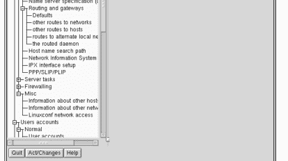

找到合适的面板应该很简单且快速。通过点击菜单项旁边的 **+** 或 **-** 来折叠和展开部分。

选定的条目将作为标签显示在右侧面板中，并在关闭之前保持在那里。如果您打开了比预期更多的标签，只需选择每个标签底部的 **取消** 以在不进行任何更改的情况下关闭它，或选择 **接受** 以实施更改。

> **请注意**
>
> 如果您习惯了旧版的 X 窗口系统界面，它仍然可用。若要返回该界面：
>
> 1. 打开 **控制** => **控制文件和系统** => **配置 linuxconf 模块**
> 2. 取消选中 `treemenu` 复选框
> 3. 点击 **接受**
> 4. 点击 **退出**
> 5. 重新启动 `linuxconf`

#### 3.1.4 启用基于 Web 的 `linuxconf` 访问

出于安全原因，基于 Web 的 `linuxconf` 访问默认是禁用的。在尝试使用 Web 浏览器访问 `linuxconf` 之前，您需要启用访问。以下是操作方法：

1. 打开 **配置** => **网络** => **杂项** => **Linuxconf 网络访问**
2. 在 **Linuxconf html 访问控制** 对话框中，输入允许访问 Linuxconf 的任何计算机的主机名。这包括您自己的系统（如果您希望本地使用基于 Web 的界面）。通过选中复选框，与 `linuxconf` 相关的 Web 访问可能会记录到您系统的 `htmlaccess.log` 文件中。
3. 选择 **接受** 按钮。

基于 Web 的访问应该已启用。要测试它，请转到您添加到访问控制列表中的系统。然后，启动您的 Web 浏览器，并输入以下 URL：


```
http://<host>:98/
```

（当然，将 `<host>` 替换为您的系统主机名。）您应该能看到主要的 linuxconf 页面。请注意，您需要输入系统的 root 密码才能访问第一页之后的内容。

通过执行相同的步骤并输入网络名称而不是主机名，您还可以启用局域网范围内的 linuxconf 访问。

### 3.1.5 添加用户账户

添加用户是您将在系统管理过程中遇到的最基本任务之一。要添加用户：

- 打开 `配置 => 用户账户 => 常规 => 用户账户`。Linuxconf 可能会向您显示一个筛选器屏幕（参见图 3–2，*筛选器控制屏幕*）。

**图 3–2 筛选器控制屏幕**

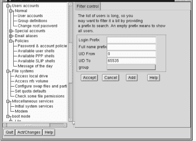

您可以使用 `控制 => 功能` 设置筛选器截止点。`触发筛选器` 字段设置将弹出筛选器屏幕的条目数量。您可以使用筛选器屏幕选择比完整列表更小的账户范围。要获取完整列表，请在不更改任何参数的情况下选择 `接受`。有关各种筛选器的详细信息，请在 `筛选器控制` 屏幕上选择 `帮助` 按钮。一旦应用或绕过筛选器，您将看到 `用户账户` 标签页（参见图 3–3，*用户账户屏幕*）。

**图 3–3 用户账户屏幕**

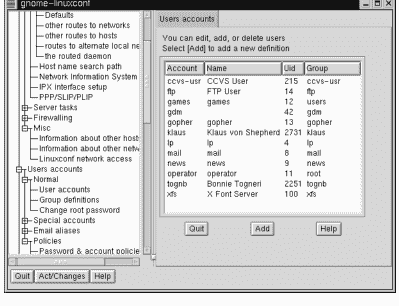

- 选择 `添加`。这将打开 `用户账户创建` 标签页（参见图 3–4，用户账户创建）。

`用户账户创建` 屏幕包括 `基本信息`、`邮件设置` 和 `权限` 部分。只有 `登录名` 是必需的，但您应该了解其他字段，这些字段可能填写也可能不填写。

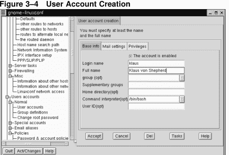

#### 用户账户的基本信息

`登录名` 是账户的名称，通常全部为小写字母。名字、姓氏、首字母或它们的组合是相当常见的登录名。对于名为 John T. Smith 的用户，`smith`、`john`、`jts` 或 `jsmith` 将是常见的用户名。当然，`spike` 或其他什么也完全没问题。您也可以使用数字，因此如果您有第二个拥有相同首字母的人，`jts2` 也没问题。此字段没有默认值。

`全名` 是用户或账户的名称。对于个人，这将是他们的名字，例如 `John T. Smith`。如果该账户代表的是一个职位而不是一个人，全名可能是头衔。因此，名为 `webmaster` 的账户的全名可能是 `Red Hat Webmaster` 或仅仅是 `Webmaster`。此字段没有默认值。

由于 Red Hat Linux 使用用户私有组方案，每个用户将被分配到一个仅由该用户组成的默认`组`。有关用户私有组的更多信息，请参阅第 2.3.3 节，*用户私有组*。

在`补充组`字段中，您可以指定额外的组。组名之间应以空格分隔。该字段的默认值为空，表示未指定任何补充组。

`主目录`指定了该账户的主目录或登录目录。默认值为 `/home/`*login*，其中 *login* 会被替换为登录名。主目录是您在登录时（或在 X 环境中打开每个 Xterm 窗口时）在目录结构中的起点。这也是存储与账户相关的偏好设置文件的位置。

`命令解释器`是账户的默认 shell。`bash` shell 是 Red Hat Linux 的默认 shell。

`用户 ID`（UID）是与每个用户账户相关联的数字。这是在创建账户时由系统自动生成的，因此只需将此字段留空即可。系统使用 UID 来识别账户。

#### 用户账户的邮件设置

`消息重定向至`字段设置系统将发送给用户邮件转发至该地址。

`电子邮件别名`是系统接受的补充电子邮件地址，并会转发给用户。例如，您可以将别名 `jane_smith@yourdomain.com` 添加到用户 `smith` 的账户。然后，发送到 `jane_smith@yourdomain.com` 的电子邮件将自动转发到 `smith@yourdomain.com`。

#### 用户账户的特权

在`特权`部分，您可以授予对系统配置各个方面的访问权和/或控制权。默认情况下，普通用户在此屏幕上被拒绝所有特权。您可以选择授予或静默授予他们特定特权。

`已授予`和`已授予/静默`的区别在于：如果特权已授予，`linuxconf` 在允许用户获得该特权之前会要求输入用户密码。如果特权是静默授予的，`linuxconf` 不会提示您输入密码。

通常，谨慎的系统管理员不会授予用户任何系统配置特权，除非绝对必要。如果您确实授予特权，在静默授予时要小心。如果拥有静默授予特权的用户登录到其机器并离开，其特权将完全暴露给下一个坐在他们办公桌前的人。如果在物理受限区域的机器上使用，静默授予的特权风险较低。

`可以使用 linuxconf：` 允许用户访问 `linuxconf` 的所有功能，并且他们可以设置或更改 `linuxconf` 参数。请注意，使用 `linuxconf` 与激活配置更改的特权是分开的。系统管理员可能希望授予使用 `linuxconf` 的权利，但拒绝激活权限，以便 sysadmin 对是否激活任何配置更改拥有最终的“是/否”决定权。

`可以激活配置更改：` 在 `linuxconf` 中更改参数后，在某个时间点，您需要向 `linuxconf` 指示您所做的更改应该被应用。根据您使用的 `linuxconf` 版本，您可能通过点击 GUI 版 `linuxconf` 中的`激活更改`按钮、点击 Web 版 `linuxconf` 中的`接受`按钮，或在文本模式 `linuxconf` 中选择`接受`按钮等操作来实现。

您可以授予用户激活更改的特权。在这种情况下，用户将能够激活 `linuxconf` 中任何已更改的系统配置参数。

`可以关机：` 用户可以被授予关闭系统的权利。请注意，Red Hat Linux 在 `/etc/inittab` 中设置为在 [Ctrl]-[Alt]-[Del] 键击组合后干净地关闭。

输入登录名和其他所需信息后，选择屏幕底部的`接受`按钮。如果您决定不创建新用户，则选择`取消`。

#### 图 3–5 更改密码屏幕

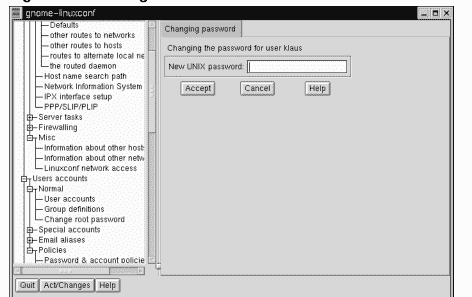

当您点击`接受`时，`linuxconf` 会提示您输入密码，如图 3–5，*更改密码屏幕* 所示。您需要重新输入密码，以防止因打字错误导致不可用的密码。密码长度必须至少为六个字符，但您可以在“用户账户 => 密码和账户策略”屏幕上增加所需长度并设置其他用户密码参数。

好的密码包含字母、数字和特殊字符的组合。应同时使用大写字母和小写字母。不要使用您的用户名、您的周年纪念日、您的社会安全号码、您的狗的名字、您的中间名或单词 root。不要使用与您账户或您本人相关的单词的任何变体。不要使用字典中找得到的单词；字典单词很容易被破解。

创建密码的一种简单技术是使用对您熟悉的短语中每个单词的首字母（来自您喜爱的歌曲的一行可能很合适）。将几个字母大写，并插入几个数字和/或特殊字符以替代字母，您就会有一个不错的密码。

完成后再次按`接受`按钮。如果系统认为密码容易被破解，它会通知您；如果您收到警告消息，请不要使用该密码。

### 3.1.6 修改用户账户

- 转到 `Config => Users accounts => Normal => User accounts`，如有必要使用过滤器，然后选择您要修改的账户。
- 如需了解如何填写用户账户字段的指导，请参阅第 3.1.5 节，*添加用户账户*。

要实施更改，请选择`接受`。如果您决定不做任何更改，请选择`取消`。这保证不会进行任何更改。

### 3.1.7 更改用户密码

- 打开 `Config => Users accounts => Normal => User accounts`。这将打开 `Users accounts` 标签页（见图 3–3，*用户账户屏幕*）。
- 根据您在 `Control => Features` 上提供的设置，您可能会看到一个过滤器屏幕。如果您想要完整列表，请在不更改任何参数的情况下选择`接受`。有关各种过滤器的详细信息，请选择`过滤器控制`屏幕上的 `Help` 按钮。
- 选择您要更改密码的账户。这将打开`用户信息`标签页。
- 从屏幕底部的选项中 selected `Passwd`。

`linuxconf` 将提示您输入新密码。还有一个名为 `Confirmation` 的字段，您需要在此再次输入密码。这是为了防止您打错密码。有关选择密码的指导，请参阅第 3.1.5 节，*添加用户账户*。如果您决定不更改密码，请选择`取消`。输入新密码后选择`接受`。

### 3.1.8 更改 Root 密码

由于 root 访问具有安全影响，`linuxconf` 要求您验证您目前拥有对 root 账户的访问权限。


打开 `Config => Users accounts => Normal => Change root password`。

### 图 3–6 Root 密码验证屏幕

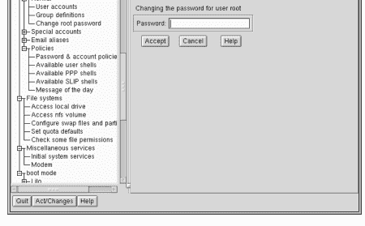

您首先需要输入当前的 root 密码以验证对 root 账户的访问权限。输入 root 的当前密码后，它将提示您输入新密码。在 `Confirmation` 字段中，再次输入密码（见图 3–5，`更改密码屏幕`）。这是为了防止您打错密码。如需选择密码的指导，请参阅第 3.1.5 节，`添加用户账户`。请务必选择一个好的密码！如果您决定不更改 root 密码，只需选择 `Cancel`。输入新密码后选择 `Accept`。

#### 3.1.9 禁用用户账户

禁用用户账户优于删除用户账户，除非您需要存储空间或您确定他的/她的数据将来不再需要。如果禁用用户账户，将不允许登录。

- 打开 `Config => Users accounts => Normal => User accounts`。

取消勾选表示 `The account is enabled` 的复选框。点击窗口底部的 `Accept` 按钮，即可完成设置。

该账户已被禁用，后续可以使用类似的方法重新启用。

#### 3.1.10 启用用户账户

默认情况下，所有新建的用户账户都是启用状态。如果需要启用某个账户，可以使用 `linuxconf` 进行操作。

- 打开 `Config => Users accounts => Normal => User accounts`。勾选 `The account is enabled` 复选框。

#### 3.1.11 删除用户账户

> **请注意**
>
> 虽然提供了保留与该账户关联文件的选项，但任何被删除的文件都将永久丢失且实际上无法恢复。使用此选项时请务必小心！

要删除账户：

- 打开 `Config => Users accounts => User accounts`。

- 在 `User accounts` 屏幕（参见图 3–3，`Users Accounts Screen`）上选择要删除的账户。

- 在 `User information` 屏幕底部，选择 `Del` 以删除该账户。

随后，`Linuxconf` 将提示您一系列选项。

**图 3–7** 删除账户屏幕

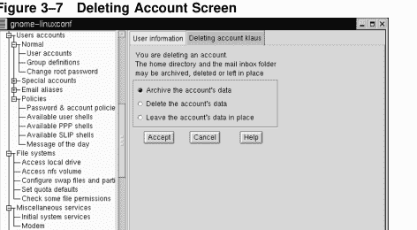

默认选项是归档该账户的数据。归档选项具有以下效果：

1. 将用户从用户账户列表中移除；
2. 将用户主目录中包含的所有内容归档（使用 `tar` 和 `gzip` 压缩），并将生成的文件存储在 `default_home_directory/oldaccounts` 目录中。对于名为 `useraccount` 的账户，文件名类似于：

   `useraccount-2000-01-10-497.tar.gz`

   日期表示账户被删除的时间，紧随其后的数字是实际执行删除操作的进程 ID。`oldaccounts` 目录创建于与所有用户目录相同的位置，并会在首次使用此选项删除用户账户时自动创建。
3. 不属于用户主目录但由该用户拥有的文件将保留。这些文件的所有者是已删除账户的用户 ID `UID`。如果您创建一个新的账户并明确指定已删除账户的 UID，新账户将成为这些剩余文件的所有者。

在 `Deleting account` `<accountname>` 屏幕（参见图 3−7，`Deleting Account Screen`）上选择 `Delete the account's data` 将会：

1. 将用户从用户账户列表中移除；
2. 移除用户的主目录及其所有内容。

**请注意**

不属于用户主目录但由该用户拥有的文件将保留在系统中。这些文件的所有者仍将是已删除账户的用户 ID `UID`。如果您创建一个新的账户并明确指定已删除账户的 UID，新账户将成为这些“孤儿”文件的所有者。

在 `Deleting account` `<accountname>` 屏幕（参见图 3−7，`Deleting Account Screen`）上选择 `Leave the account's data in place` 将会：

1. 将用户从用户账户列表中移除；
2. 保留用户的主目录（包含所有文件）不变。

**请注意**

由已删除账户的用户 ID `UID` 拥有的文件和目录将保留在系统中。如果您创建一个新的账户并明确指定已删除账户的 UID，新账户将成为这些“孤儿”文件的所有者。

#### 3.1.12 组

所有用户都属于一个或多个组。正如每个文件都有特定的所有者一样，每个文件也属于特定的组。该组可能是文件所有者特有的，也可能是所有用户共享的组。读取、写入或执行文件的权限可以分配给组；这与所有者的权限是分开的。例如，文件的所有者可以写入文档，而组的其他成员可能只能读取该文档。

##### 创建组

要创建一个新组：

- 打开 `Config => Users accounts => Normal => Group definition`。

根据 `Control => Filters` 中的设置，您可能会看到一个筛选屏幕。提供筛选条件，或选择 `Accept` 以绕过筛选。

图 3–8 用户组屏幕

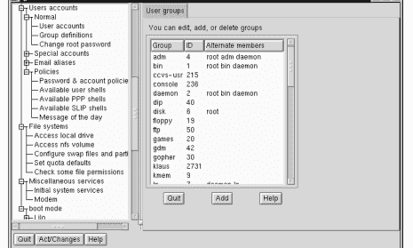

在 `User groups` 屏幕底部选择 `Add`。

**图 3-9 组规格屏幕**

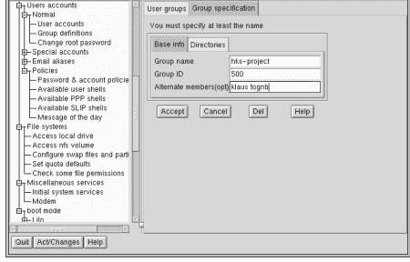

输入组名。您还可以指定组成员，这可以在 `Alternate members` 字段中完成。用户列表应以空格分隔，意味着每个用户名与其下一个用户名之间必须有一个空格。留空 `Group name` 字段，以便系统为您的新组分配一个 `Group ID (GID)`。完成后，选择 `Accept`，组将被创建。

##### 删除组

要删除一个组：

- 打开 `Config => Users accounts => Normal => Group definitions`。

- 根据 `Control => Features` 中的筛选设置，您可能会看到一个筛选屏幕。您可以使用筛选功能通过指定前缀来缩小组的选择范围。

- 无论是否使用前缀，请在屏幕底部选择 `Accept`。

- 在 `User groups` 屏幕（参见图 3-8，`User Groups Screen`）上选择要删除的组。

您将被带到 `Group specification` 屏幕（参见图 3–9，`Group Specification Screen`）。

选择 `Del` 以删除该组。随后 `Linuxconf` 将提示您确认删除。选择 `yes` 以删除该组。

该组的文件仍将保留，且其各自的所有者仍对它们拥有完全控制权。组名将被替换为已删除组的 ID。可以使用 `chgrp` 命令将文件分配给新组。在 shell 提示符下输入 `info chgrp` 或 `man chgrp` 可以获取有关 `chgrp` 的更多信息。如果创建了新组并指定了已删除组的 ID，那么新组将能够访问已删除组的文件。不用担心，`linuxconf` 不会像回收旧用户 ID 那样回收旧组号，因此这不会意外发生。

##### 修改组成员资格

有两种方法可以修改进属某个组的用户列表。您可以更新每个用户账户本身，或者您可以更新组定义。通常，更新每个组定义是最快的方法。如果您计划为每个用户更改的信息不仅仅是组信息，那么更新每个用户账户可能更简单。

我们首先详细介绍组定义方法。

- 在 shell 提示符下输入 `linuxconf` 来启动 `linuxconf`。

- 打开 `Config => Users accounts => Normal => Group definitions`。

- 根据 `Control => Features` 中的筛选设置，您可能会看到筛选屏幕。使用筛选功能缩小列表，或直接选择 `Accept` 以绕过筛选。

- 选择您要修改的组。这将打开 `Group specification` 屏幕（参见图 3–9，`Group Specification Screen`）。

- 在 `Alternate members` 字段中添加或移除每个用户。确保所有用户名都由空格字符分隔。

- 选择位于屏幕底部的 `Accept`。

这将自动更新每个用户账户，组会显示在 `Supplementary groups` 字段中（如果已添加）或消失（如果已移除）。也可以通过修改每个单独的用户账户来添加和移除组。

- 在 shell 提示符下输入 `linuxconf` 来启动 `linuxconf`。

- 打开 `Config => Users accounts => Normal => User accounts`。


- 根据 `Control => Features` 中的设置，您可能会看到筛选屏幕。使用筛选功能缩小列表，或选择 `Accept` 以绕过筛选。
- 在 `User accounts` 屏幕（参见图 3-3，Users Accounts Screen）上，选择您希望更新的用户。您将被带到 `User information` 屏幕。
- 在 `Supplementary groups` 字段中添加或移除所需的组。每个组之间应由空格字符分隔。
- 一旦完成所有更改，选择屏幕底部的 `Accept`。

这将自动更新组定义。对每个用户重复此过程。

### 3.1.13 文件系统

文件系统由文件和目录组成，所有这些都从一个根目录开始。根目录可以包含任意数量的文件和其他目录，每个目录依次遵循相同的结构。典型的文件系统看起来像一棵倒置的树，目录作为分支，文件作为叶子。文件系统驻留在诸如软盘驱动器、硬盘和 CD-ROM 等大容量存储设备上。

例如，DOS 和 Windows 机器上的软盘驱动器通常由 `A:\` 表示。这既描述了该设备（`A:`），也描述了该设备上的根目录（`\`）。在同一系统中，主硬盘通常被称为 `C` 盘，因为第一个硬盘的设备规范是 `C:`。要指定 C 盘上的根目录，您需要使用 `C:\`。在此配置下，有两个文件系统——一个在 `A:` 上，另一个在 `C:` 上。为了指定 DOS/Windows 文件系统上的任何文件，您必须明确指定文件所在的设备，或者它必须位于系统的默认驱动器上（DOS 的 C: 提示符正是源自默认驱动器——在只有一块硬盘的系统中，这就是默认驱动器）。

在 Linux 下，可以将多个大容量存储设备上的文件系统链接到一个更大的单一文件系统。这是通过将某个设备的文件系统“挂载”到另一个设备文件系统中的某个目录下来实现的。因此，虽然 DOS 机器上软驱的根目录可能被称为 A:\，但在 Linux 系统中，同样的驱动器可能通过 `/mnt/floppy` 来访问。

以这种方式合并文件系统的过程称为挂载。当设备被挂载后，系统的用户就可以访问该设备。挂载设备的文件系统变得可访问的那个目录被称为挂载点。在前面的例子中，`/mnt/floppy` 就是软驱的挂载点。请注意，除了常见的命名约定外，挂载点的命名没有任何限制。我们同样可以很容易地将软驱挂载到 `/long/path/to/the/floppy/drive`。

需要牢记的一点是，设备的所有文件和目录都是相对于其挂载点的。考虑以下示例：

- 一个 Linux 系统：
    - `/` -- 系统根目录
    - `/foo` -- CD-ROM 的挂载点
- 一张 CD-ROM：
    - `/` -- CD-ROM 的根目录
    - `/images` -- CD-ROM 上存放图像的目录
    - `/images/old` -- 存放旧图像的目录

因此，如果上述描述的是各个独立的文件系统，并且你将 CD-ROM 挂载到 `/foo`，新的操作系统目录结构将是：

- 一个 Linux 系统（挂载了 CD-ROM 后）：
    - `/` -- 系统根目录
    - `/foo` -- CD-ROM 根目录
    - `/foo/images` -- CD-ROM 上存放图像的目录
    - `/foo/images/old` -- 存放旧图像的目录

要挂载文件系统，请确保以 root 身份登录，或使用 `su` 命令变为 root。对于后者，在 shell 提示符下输入 `su`，然后输入 root 密码。一旦成为 root，输入 `mount`，接着输入设备名和挂载点。例如，要将第一个软驱挂载到 `/mnt/floppy`，你需要输入命令 `mount /dev/fd0 /mnt/floppy`。

在安装时，Red Hat Linux 会创建 `/etc/fstab`。此文件包含有关设备及其关联挂载点的信息。使用此文件的好处在于，它可以缩短你的挂载命令，并控制系统启动时自动挂载哪些文件系统。

利用 `/etc/fstab` 中的信息，你可以输入 `mount`，然后输入挂载点或设备名。`mount` 命令会在 `/etc/fstab` 中查找其余信息。你可以手动修改此文件，也可以使用 linuxconf 来修改。

#### 查看当前文件系统

我们首先查看当前的目录结构。

- 打开 `Config => File systems => Access local drive`。

##### 图 3–10 本地卷屏幕

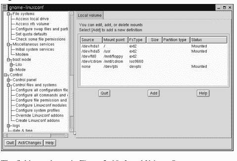

如图 3–10“本地卷屏幕”所示，各字段如下：

- `源（Source）`：物理硬件；hda 表示 IDE 硬盘，fda 表示软驱，cdrom 通常表示 CD-ROM 驱动器。如果系统有 SCSI 驱动器，你会看到 sd。同类型有多块驱动器时，用字母区分，因此 hda 代表第一块 IDE 驱动器，而 hdb 则是第二块。在某些情况下，这些字母后还会跟随数字；对于硬盘，数字代表该驱动器上的分区，而对于软驱，该数字指的是实际的设备单元。
- `挂载点（Mount point）`：这是设备挂载后在系统中的可访问位置。
- `FsType`：文件系统类型。标准的 Linux 分区使用 ext2 文件系统类型。vfat 文件系统类型表示支持长文件名的 DOS 文件系统，而 fat 文件系统类型用于支持传统 8.3 文件名的 DOS 文件系统。iso9660 文件系统类型表示 CD-ROM 驱动器。
- `大小（Size）`：大小可能表示文件系统以兆字节（M）为单位的尺寸，也可能未填写。
- `分区类型（Partition type）`：该分区上使用的文件系统描述（可能未填写）。
- `状态（Status）`：设备是否已挂载。

> `请注意`
>
> Red Hat Linux 6.2 可以使用 `vfat` 文件系统类型访问 FAT32 文件系统。

网络中其他机器上的文件系统也可能可用。这些可能从单个小目录到整个卷不等。这些分区也不提供 `大小` 或 `分区类型` 的信息。关于 NFS 文件系统（如果有的话）的额外信息将包含在：

`Config => File systems => Access nfs volume`

##### 图 3-11 NFS 卷屏幕

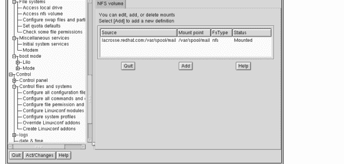

该屏幕（见图 3-11“NFS 卷屏幕”）与本地卷屏幕类似，但每个条目提供的信息有一些显著不同：

- `源（Source）`：这是提供文件系统的机器名称，后跟远程目录。例如：`foo:/var/spool/mail`，其中 `foo` 是提供该目录的机器，`/var/spool/mail` 是被提供的目录。
- `FsType`：这始终是 "nfs"。

#### 添加 NFS 挂载

NFS（网络文件系统）是一种让计算机通过网络共享其本地文件系统部分的方式。这些部分可以小到一个目录，也可以包含庞大目录层级中的数千个文件。例如，许多公司会有一个单一的邮件服务器，将个人邮件文件作为 NFS 挂载提供给每个用户的本地系统。

要添加 NFS 挂载：

- 打开 `Config => File systems` => `Access nfs volume`。
- 在 `NFS 卷` 屏幕上，选择 `添加（Add）`。

##### 图 3–12 卷指定屏幕

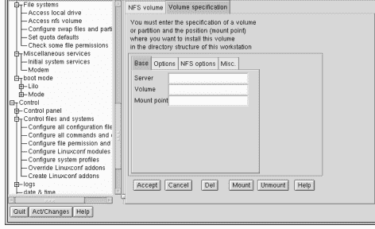

`基础（Base）` 选项卡上的三个字段是你接下来需要关注的内容（见图 3–12，卷指定屏幕）。

- `服务器（Server）`：所需文件系统所在机器的主机名。例如，foo.bar.com。
- `卷（Volume）`：你希望添加的文件系统。例如，`/var/spool/mail`。
- `挂载点（Mount point）`：你希望远程文件系统在你的系统中可访问的位置。例如，`/mnt/mail`。

创建挂载只需要这些。`Linuxconf` 会相应地更新你的 `/etc/fstab` 文件。如果你意识到还有其他要求，请阅读 `卷指定` 屏幕上的帮助文件，并参阅 `mount` 的手册页以获取更多详细信息。

输入信息后，选择 `接受（Accept）`。

### 3.1.14 使用 Linuxconf 建立连接（网络配置）

在建立连接时，首先要确定你是要连接到局域网（例如办公室中的一组计算机），还是广域网（例如互联网）。在继续之前，了解你拥有什么硬件以及打算如何连接非常重要。如果你要通过拨号连接到另一台计算机，请确保你的调制解调器已安装好，且线缆连接正确。如果你使用的是网卡，请确保其安装正确，且线缆连接无误。无论你指定何种网络配置，如果电话线或线缆没有全部就位，你就永远无法连接。我们将首先介绍调制解调器连接，然后介绍如何使用网卡。

#### 添加调制解调器/PPP/SLIP 连接


Red Hat Linux 6.2 使用名为 `RPPP` 的工具，即 `RH PPP 拨号器`，这是一个帮助用户配置和监控网络账户（特别是 PPP 账户）的图形化工具。（欲了解有关 `RPPP` 的更多信息，请参阅《官方 Red Hat Linux 入门指南》的相关章节。）不过，你仍然可以依赖 `linuxconf` 来设置网络配置。

在让 PPP 或 SLIP 账户运行之前，你需要从你的 ISP（互联网服务提供商）或系统管理员那里获取几项信息。对于某些提供商，你可能需要仔细查看关于如何在 Linux 系统上设置 PPP 连接的说明。一些 ISP 对使用 Linux 的个人支持不足。别担心，你仍然可以连接；你只需要从你的 ISP 那里获取一些额外信息。

以下是 Red Hat Linux 连接所需的信息。ISP 代表可能会回复说不需要这些信息，或者建议你需要的比这些更多。Red Hat 通过智能默认值和 `linuxconf` 等工具简化了所需信息，从而简化了此过程。除非他们有专门针对 Red Hat Linux 的文档，否则只需请求以下信息即可继续。具体来说，你需要：

- ISP 域名服务器的 IP 地址
- 要拨号的电话号码
- 您的登录名和密码
- 如果您要连接的网络不会为您提供动态地址，则提供您机器的 IP 地址
- 关于您的 ISP 是否使用 PAP、CHAP 或 MS-CHAP 等身份验证方法的信息。如果是，您需要一个用于启用身份验证的“密钥”。该密钥将是一个单词或字符序列。目前 `linxonconf` 不支持使用 CHAP 和 MS-CHAP，而且这些方法也很少被使用。

可能有用但并非必需的其他信息包括辅助名称服务器地址和搜索域。一旦您收集齐所有这些信息，即可准备连接。

- 打开 `Config => Networking => Client tasks => PPP/SLIP/PLIP`。
- 选择 `Add`。

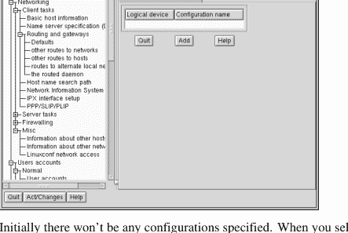

最初不会有任何指定的配置。当您选择 `Add` 时，您将在 PPP、SLIP 和 PLIP 之间进行选择。

### 图 3—14 接口类型屏幕

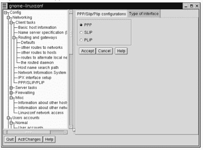

PPP 是最常用的接口，也是默认选项。要设置 PPP 连接，请选择 PPP 并选择 `Accept`。

### 图 3–15 PPP 接口屏幕

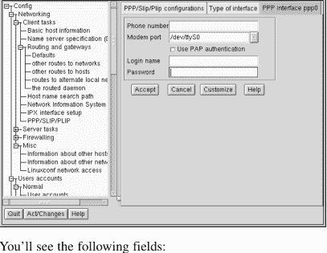

您将看到以下字段：

- `电话号码` – 您的调制解调器需要拨打以访问您的 ISP 或远程系统的号码
- `调制解调器端口` – 指示您的调制解调器所在位置，通常已经设置好
- `使用 PAP 身份验证` 复选框 – 如果您知道正在拨号进入的系统需要此功能，请勾选此项
- `登录名` – 您的 PPP 账户登录名
- `密码` – 您的 PPP 账户密码

请注意标题栏显示为 `PPP 接口 ppp0`。`ppp0` 是第一个 PPP 接口，`ppp1` 是第二个，等等。如果您拥有多个接口，跟踪您使用的是哪个接口非常重要。SLIP 连接使用 `sl` 而不是 `ppp` 作为其接口前缀。除了 PAP 身份验证选项外，添加 PPP 或 SLIP 账户的输入屏幕是相同的。

输入远程机器的完整电话号码，并确保包含访问外线所需的任何数字。

例如，如果您需要先拨 9 然后拨号，而您连接的计算机电话号码为 555-0111，那么您应输入 95550111。

接下来您需要提供的是调制解调器端口信息。这是一个可用端口的下拉框。如果您使用的是双启动 Linux/Windows 系统，并且知道调制解调器所在的 COM 端口，以下映射可能对您有用：

映射到 Windows COM 端口如下：

- `ttyS0` -> `COM1`：在 MS-DOS 下；
- `ttyS1` -> `COM2`：在 MS-DOS 下；
- `ttyS2` -> `COM3`：在 MS-DOS 下；
- `ttyS3` -> `COM4`：在 MS-DOS 下。

登录名是 PPP 账户的名称。您输入的密码将以明文显示，因此输入时请注意周围有谁！如果您将使用 PAP 身份验证，请勾选该框：当您输入其他必需信息后，选择屏幕底部的 `Customize` 按钮。

如果您使用 PAP，请选择 PAP 选项卡，然后输入您的用户名，并在 `Secret` 字段中输入 ISP 提供给您的密钥。其他默认设置通常足够，但如果需要，您可以使用 `Customize` 选项编辑初始设置。

### 修改 PPP 或 SLIP 配置

您还可以通过在 PPP/SLIP/PLIP 配置屏幕的列表中选择现有配置来编辑或删除该配置。

- 打开 `Config => Networking => Client tasks => PPP/SLIP/PLIP`。
- 然后您将看到 PPP/SLIP/PLIP 配置屏幕（参见图 3–13，*PPP/SLIP/PLIP 配置屏幕*）。选择您想要修改或删除的配置。

这将打开适用于您的配置的相应接口屏幕。如果您想删除该配置，请选择屏幕底部的 `Del`。调制解调器端口位于 `Hardware` 选项卡中，是一个下拉菜单。如果您想更改创建配置时输入的其他设置，请选择 `Communication` 选项卡。第一个 `Send` 字段包含您的登录名，下一个 `Send` 字段包含您的密码。`Expect` 字段对应 `login:` 和 `password:` 提示，这解释了 `login:` 和 `pass:` 条目。

#### 请注意

> 您的系统的 `login:` 和 `pass:` 条目可能不同。不同的 `ISP/PPP` 服务器可能使用不同的文本，并且应根据您登录的服务器类型的需求进行更改。相反，您可能会看到诸如 `User ID` 和 `authentication` 这样的提示。

##### 图 3–16 PPP 自定义 – Communication 选项卡

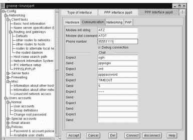

一旦完成更改，您可以测试配置是否正常工作。从屏幕底部选择 `Connect`。这将尝试使用您输入的信息连接到远程系统。

### 其他网络连接

在以太网上传输网络连接需要完全不同的设置类型。连接到令牌环（Token Ring）或 ARCrnet 网络的过程类似，但在此不作讨论。

- 首先，您需要安装一块以太网卡。
- 在 shell 提示符下输入 `linuxconf` 启动 `linuxconf`。
- 打开 `Config => Networking => Client tasks => Basic host information`。`Host name` 选项卡将请求一个主机名，除非您在安装过程中未设置网络，否则默认应已指定。如果尚未指定，请现在花点时间配置它。它应指定为 `localhost.localdomain`。跳过此选项卡。选择 `Adaptor 1` 选项卡。

##### 图 3-17 Adaptor 1

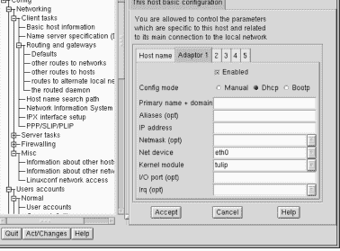

此屏幕上的第一项是一个复选框，用于指示该适配器是否已启用。如果您打算使用此适配器，则应勾选它。下方是 `Config modes` 的选择。`Manual` 意味着您自己提供并输入所有信息。`Dhcp` 和 `Bootp` 意味着您的机器将从远程 DHCP 或 BOOTP 服务器获取网络配置信息。如果您不确定应选择哪个选项，请咨询您的网络管理员。

DHCP 或 BOOTP 的必需字段：

- `Net device` -- 您正在使用的网卡类型；例如，要使用第一块以太网卡，`eth0` 是适当的条目。
- `Kernel module` -- 基于您的网卡的正确模块；更多信息请参见以下列表。

对于 DHCP 和 bootp 配置，您只需指定 `Net device` 和 `Kernel module`。对于 `Net device`，您将从列表中选择，其中 `eth` 前缀代表以太网卡，`arc` 指定 ARNet 卡，`tr` 指定令牌环卡。完整的网卡列表及其相应模块可在附录 A *General Parameters and Modules* 中找到。要查看最新的列表，请访问我们的网站：

<http://www.redhat.com/support/hardware>

`netmask` 信息可能默认设置，但根据您正在设置或加入的网络类型，您可能需要指定此项。如果您连接到 ISP，请向他们询问此信息。最可能是 255.255.255.0。

手动配置的必需字段：

- `Primary name + domain` -- 主要名称是您的计算机名称，而域名指定您的网络。例如，`foo.bar.com; foo` 是主要名称，`bar.com` 是域名。


进入`/path/to/xxx`目录，找到`xxx.json`。

在表达式`cvar = avar + bvar`中，加法运算符（`+`）将`avar`与`bvar`相加，得到它们的和`cvar`

在`List.of(arg0, arg1, arg2)`中，`List`接口的工厂方法`of()`接受一系列的元素，返回包含它们的只读列表。

之后我们这样调用`cmd`命令：`cmd arg0 arg1 arg2`。

```
if (condVar > someVal) {console.log("xxx")}
```


使用控制面板应用程序可以完成的大部分内容也可以`linuxconf`完成。此外，`linuxconf`同时支持字符单元格和图形用户界面。请参阅第 3.1 节，使用`linuxconf`进行系统配置，以了解`linuxconf`的介绍。

控制面板是许多不同系统管理工具的启动台（见图 3–21，控制面板）。这些工具通过让你无需记住配置文件格式和复杂的命令行选项即可配置事物，从而让你的生活更简单。

### 图 3–21 控制面板

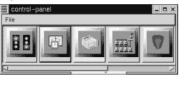

要启动控制面板，请以 root 身份运行 X 窗口系统，使用 `startx` 并在 Xterm 中输入 `control-panel`。你需要是 root 才能成功运行控制面板工具。如果你已经以普通用户身份运行 X，也可以这样做。只需输入 `su -c control-panel`，然后在提示时输入 root 密码。如果你计划以 root 身份执行其他任务，你可以输入 `su`，然后在提示时输入 root 密码。

> **请注意**
>
> 如果你不是以 root 身份运行 X，你可能需要给予 root 访问你的系统 X 服务器的权限。要做到这一点，在一个非 root 终端窗口中输入以下命令：

```bash
xhost +localhost
```

启动控制面板后，只需单击图标即可启动工具。请注意，你不会因同时启动任何工具的两个实例而被阻止，但这样做是一个非常糟糕的主意，因为你可能会试图在两个地方编辑相同的文件，最终覆盖你自己的更改。

**请注意**

如果你不小心启动了工具的第二个副本，应立即将其退出。此外，当这些工具正在运行时，不要手动编辑由控制面板工具管理的任何文件。同样，在工具运行期间，也不要运行其他可能会更改这些文件的程序（例如 `linuxconf`）。

### 3.2.1 打印机配置

请注意，《官方 Red Hat Linux 入门指南》包含了关于 `printtool` 的更最新的文档，因此在使用 `printtool` 之前，务必查阅该文档。

打印机配置工具（`printtool`）维护 `/etc/printcap` 文件、打印假脱机目录和打印过滤器。这些过滤器允许你打印多种不同类型的文件，包括：

- 纯文本 (ASCII) 文件
- PostScript 文件
- TeX `.dvi` 文件
- GIF、JPEG、TIFF 及其他图形格式
- RPM 包

换句话说，使用 `lpr` 命令简单地打印 GIF 或 RPM 文件，结果就是让打印机执行“正确”的操作。

**图 3-22 打印工具**

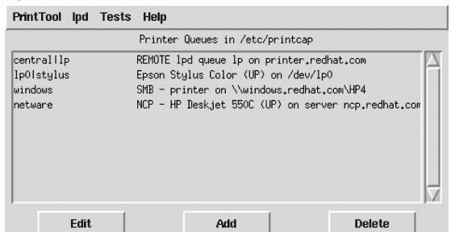

为了创建新的打印队列，请选择“添加”。然后，选择要添加的打印机类型。可以使用 `printtool` 配置四种类型的打印队列：

- 本地打印队列：适用于连接到你 Red Hat Linux 系统的打印机端口或串行端口的打印机。
- 远程打印队列：适用于连接到通过 TCP/IP 网络可访问的另一台系统的打印机。
- SMB 打印队列：适用于连接到使用 LAN-Manager 类型（SMB）网络的另一台系统的打印机。
- NCP 打印队列：适用于连接到使用 Novell 的 NetWare 网络技术系统的打印机。

**图 3–23 选择打印机类型**

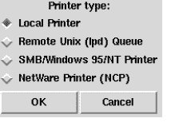

选择打印机类型后，对话框将要求提供有关打印队列的更多信息（见图 3–24，添加本地打印机）。所有类型的打印队列都需要以下信息：

- 队列名称——队列的名称。可以使用 `|` 字符指定多个名称，这些字符用作条目之间的分隔符。
- 假脱机目录——这是本地机器上在打印发生之前存储文件的目录。请务必不要让多个打印队列使用同一个假脱机目录。
- 文件大小限制——接受的打印作业最大尺寸，以千字节为单位（1 kb = 1024 字节）。大小为 0 表示不应设置任何限制。
- 输入过滤器——过滤器将待打印文件转换为打印机可处理的格式。按“选择”按钮，选择最适合你打印机的过滤器（见图 3–25，配置打印过滤器）。

除了配置能够打印图形和 PostScript 输出的打印队列外，你还可以配置一个仅文本打印机，该打印机只能打印纯 ASCII 文本。大多数打印机驱动程序也能在没有先将其转换为 PostScript 的情况下打印 ASCII 文本；在配置过滤器时，只需选择 `Fast text printing` 即可。

**请注意**

> 这仅适用于非 PostScript 打印机。

- 抑制页眉——如果你不希望每个打印作业开始时打印页眉页，请勾选此项。

对于本地打印机，还需要提供以下信息：

- 打印机设备——通常是 `/dev/lp1`；即打印机所连接端口的名称。串行打印机通常位于 `/dev/ttyS?` 端口。请注意，你需要手动配置串行参数。

**图 3-24 添加本地打印机**

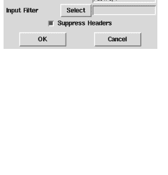

**图 3–25 配置打印过滤器**

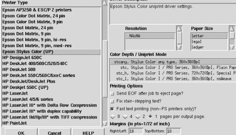

对于远程打印机，对话框包含额外的字段；请填写以下信息：

- 远程主机——托管打印机的远程机器的主机名。
- 远程队列——要在远程机器上打印到的队列名称。

必须配置远程机器以允许本地机器在指定的队列上进行打印。通常 `/etc/hosts.lpd` 控制此设置。

**图 3-26 添加远程打印机**

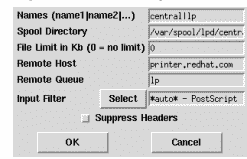

**图 3-27 添加 NCP 打印机**

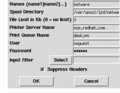

**图 3–28 添加 SMB 打印机**

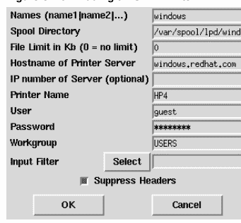

对于 SMB 和 NCP 打印机，请填写以下信息：

- 打印机服务器主机名——你要使用的打印机所连接机器的名称。
- 服务器 IP 号——你要使用的打印机所连接机器的 IP 地址；这是可选的，且仅适用于 SMB 打印机。
- 打印机名称——你要在其上打印的打印机名称。
- 用户——访问打印机时必须登录的用户名（通常是 Windows 服务器上的 guest 或 samba 服务器上的 nobody）。
- 密码——使用打印机所需的密码（如果需要）（通常留空）。如果你不知道这个密码，应该有人能告诉你。

**请注意**

如果你需要 SMB（LAN Manager）或 NCP（NetWare）打印队列的用户名和密码，它们将以未加密的形式存储在一个本地脚本中。因此，其他人有可能得知该用户名和密码。因此，建议用于访问打印机的用户名和密码不同于本地 Red Hat Linux 系统上用户账户的用户名和密码，这样可能发生的唯一安全漏洞就是未经授权地使用打印机。如果 SMB 服务器有文件共享，建议这些共享使用与打印队列不同的密码。

添加打印队列后，你可能需要重启打印机守护进程（lpr）。为此，请从 lpr 菜单中选择“重启 lpr”。

你可以为任何已配置的打印队列打印一个测试页。从测试菜单中选择要打印的测试页类型。

**图 3–29 打印测试页**

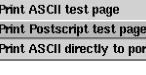

### 3.2.2 加载内核模块

Linux 内核具有模块化设计。在启动时，只有最小的驻留内核被加载到内存中。在此之后，每当用户请求驻留内核中不存在的功能时，就会动态地将内核模块加载到内存中。在经过指定的非活动期后，模块可以从内存中移除。这种设计促进了精简和高效。

支持模块动态加载的机制是一个名为 kmod 的内核线程。当内核请求一个模块时，kmod 会被唤醒并调用 `modprobe(8)` 来获取该模块。

安装 Red Hat Linux 时，系统会探测硬件，并让你提供有关系统典型使用方式以及应加载哪些程序的信息。基于这种探测和提供的使用信息，安装程序决定将哪些功能编译进驻留内核，哪些放入可加载模块中，并设置动态加载机制以透明方式工作。但这是一个高度可配置的步骤。如果你自己构建自定义内核，可以自己做出所有这些决定。

如果你在安装后添加了新硬件，而该硬件需要内核模块提供的支持，你需要设置动态加载机制。你可以通过编辑模块配置文件 `/etc/conf.modules` 来做到这一点。


例如，如果在安装 Red Hat Linux 时你的系统包含一个型号为 SMC EtherPower 10 PCI 的网络适配器，模块配置文件将包含这一行：`alias eth0 tulip`。如果在安装后，你在系统中安装了一个相同的第二个网络适配器，请在 `/etc/conf.modules` 中添加这一行：`alias eth1 tulip`。

请参阅附录 A，通用参数和模块，其中按字母顺序列出了内核模块以及这些模块支持的硬件。

### 3.2.3 网络配置

> 请注意
>
> 关于使用 `linuxconf` 进行网络配置的文档，可参见第 3.1.14 节，“使用 Linuxconf 连接（网络配置）”。

图 3–30 所示的网络配置工具（`netcfg`），网络配置面板，旨在允许轻松操作 IP 地址、网关地址、网络地址以及名称服务器和 `/etc/hosts` 等参数。


#### 图 3–30 网络配置面板

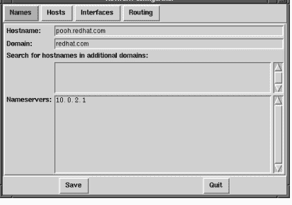

可以添加、删除、配置、激活、停用网络设备以及为其设置别名。支持以太网、Arpnet、令牌环、Pocket（ATP）、PPP、SLIP、PLIP 和回环设备。PPP/SLIP/PLIP 支持功能在大多数硬件上表现良好，但某些硬件配置可能会出现不可预测的行为。使用网络配置工具时，点击“保存”可将更改写入磁盘；若要退出且不进行任何更改，请选择“退出”。

#### 管理名称

网络配置工具的“名称”面板有两个主要用途：设置计算机的主机名和域，以及确定将使用哪个名称服务器来查找网络上的其他主机。该网络工具无法将机器配置为名称服务器。要编辑字段或向字段添加信息，只需用左键点击该字段并输入新信息即可。

##### 图 3–31 添加/编辑主机

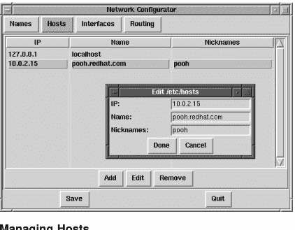

#### 管理主机

在 `Hosts` 管理面板中，您可以添加、编辑或删除 `/etc/hosts` 文件中的主机。添加或编辑条目涉及的操作相同。将出现一个编辑对话框，只需输入新信息，完成后点击 **完成** 即可。示例请参见图 3–31，*添加/编辑主机*。

#### 添加网络接口

如果您在安装 Red Hat Linux 之后又给机器添加了网络接口，或者在安装时未配置以太网卡，您可以通过几次鼠标点击来配置它。

> 请注意
>
> 您可能需要配置 `kernel` 以加载正在添加的网络接口（例如 `eth0`）的驱动程序；更多信息请参见第 3.2.2 节，*加载内核模块*。

通过在主面板中点击 `Interfaces` 开始添加接口。这将弹出一个显示已配置设备的窗口，并包含一行可用选项，请参见图 3–32，*已配置接口*。

##### 图 3–32 已配置接口

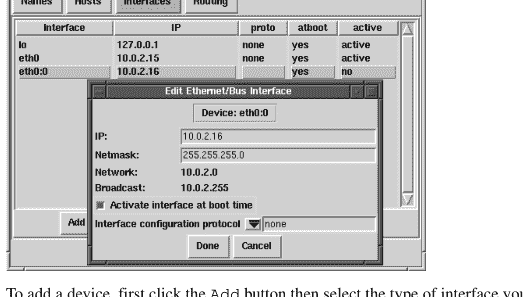

要添加设备，首先点击 `添加` 按钮，然后从出现的框中选择要配置的接口类型（请参见图 3–33，*选择接口类型*）。

##### 图 3–33 选择接口类型

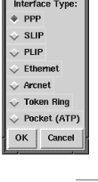

> 请注意
>
> `netcfg` 中现在有一个 `clone`（克隆）按钮。此按钮可用于创建现有接口的“克隆”。通过使用克隆接口，笔记本电脑可以为工作局域网定义一个以太网接口，同时为家庭局域网定义一个克隆以太网设备。

#### PPP 接口

添加 PPP 接口可以很简单，只需在图 3–34 所示的 *创建 PPP 接口* 的 `Create PPP Interface` 对话框中提供电话号码、登录名和密码即可。如果您的 PPP 连接必须使用 PAP 认证，请选择 `使用 PAP 认证`。在许多情况下，建立 PPP 连接需要一定程度的自定义。选择 `自定义` 按钮将使您能够更改 PPP 接口的硬件、通信和网络设置。

##### 图 3–34 创建 PPP 接口

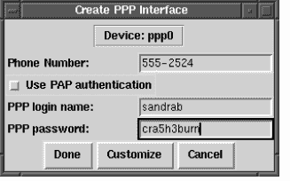

#### SLIP 接口

为了配置 SLIP 接口，您必须首先提供电话号码、登录名和密码。这将提供建立 SLIP 连接所需的聊天脚本的初始参数。当您选择 *完成* 时，会出现一个标题为 `Edit SLIP Interface` 的对话框，允许您进一步自定义 SLIP 接口的硬件、通信和网络参数。

#### PLIP 接口

要为系统添加 PLIP 接口，您只需提供 IP 地址、远程 IP 地址和子网掩码即可。您还可以选择在启动时是否激活该接口。

#### 以太网、Arcnet、令牌环和 Pocket 适配器接口

如果您要在计算机上添加以太网、arcnet、令牌环或 pocket 适配器，您需要提供以下信息：

- 设备 -- 这由 netconfig 根据已配置的设备确定。
- IP 地址 -- 输入网络设备的 IP 地址。
- 子网掩码 -- 输入网络设备的子网掩码。

网络地址和广播地址将根据您输入的 IP 地址和子网掩码自动计算。

- 在启动时激活接口：

如果希望机器启动时自动配置该设备，请勾选此框。

- 允许任何用户 (停用/启用) 接口：

如果希望任何用户都能激活或停用该接口，请勾选此项。

- 接口配置协议：

如果您的网络上有一个 BOOTP 或 DHCP 服务器，并且希望使用它来配置接口，请选择相应的选项；否则，请选择“无”。

提供新设备的配置信息后，点击“完成”。该设备应作为非活动设备出现在您的接口列表中。（“活动”列应显示为“否”。）若要激活新设备，首先用鼠标点击选中它，然后选择“激活”按钮。如果设备未能正常启动，您可能需要选择“编辑”进行重新配置。

#### 管理路由

在“路由”管理屏幕中，您可以添加、编辑或删除静态网络路由。添加或编辑条目涉及的操作与“主机”面板相同。将出现一个编辑对话框；只需输入新信息，完成后点击“完成”即可。示例请参见图 3–35，*添加/编辑路由*。

##### 图 3–35 添加/编辑路由

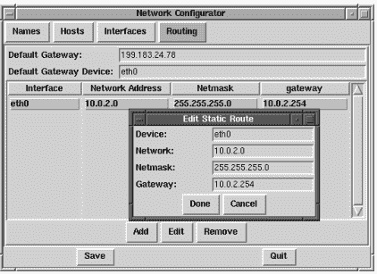

### 3.2.4 时间和日期

通过点击时间和日期显示的相应部分并点击箭头更改数值，您可以使用“时间机器”来更改时间和日期。

只有点击“设置系统时钟”按钮后，系统时钟才会更改。

点击“重置时间”可将时间机器的时间重置为系统时间。

> **请注意**
>
> 更改时间可能会严重干扰那些依赖正常时间进程的程序，并可能导致问题。在更改时间或日期之前，请尽量退出尽可能多的应用程序和进程。

## 4 PowerTools

### 4.1 PowerTools 软件包

Red Hat PowerTools 是为一组 Red Hat Linux 6.2 操作系统构建的软件包集合。PowerTools 包含了数百个程序的最新版本（截至本产品发布日期）——因此找到有趣的应用程序应该很容易。

在众多应用程序中包括音频程序、聊天客户端、开发工具、编辑器、文件管理器、模拟器、游戏、图形程序、生产力应用程序、数学/统计包、系统管理以及网络管理工具，以及窗口管理器。

此外，对于 PalmPilot 个人信息管理器用户，CD-ROM 上的 `pilot` 目录包含适用于 PalmPilot 的应用程序。

现在您知道了 PowerTools 上有什么内容，您可能想知道如何安装它们。安装信息请参见第 4.3 节，*安装 PowerTools 软件包*。

### 4.2 读取 CD-ROM 内容

您可以在 shell 提示符（终端窗口或控制台模式）下读取 PowerTools CD-ROM 的内容。然后挂载 CD-ROM（`mount /mnt/cdrom`）。完成后，通过发出 `cd /mnt/cdrom` 命令更改目录。最后，输入 `less CONTENTS` 以查看可用的应用程序。

### 4.3 安装 PowerTools 软件包

#### 4.3.1 在 GUI 环境中安装 PowerTools

如果您正在使用 GNOME 或 KDE，请将 CD-ROM 放入 CD-ROM 驱动器中。系统会提示输入 `root` 密码（您必须是 `root` 才能安装软件包）。输入 `root` 密码后，`Gnome-RPM` 或 `Kpackage` 软件包管理程序将自动启动（具体取决于你的 GUI 环境），并可用于安装 PowerTools。有关如何使用 `Gnome-RPM` 的具体说明，请参见第 7 章 *Gnome-RPM*。有关如何使用 `Kpackage` 的更多信息，请访问 http://www.general.uwa.edu.au/~toivo/kpackage/。

如果你没有使用 GNOME 或 KDE，则需要使用 shell 提示符来安装 PowerTools。更多信息请参见第 4.3.2 节，*从 Shell 提示符安装 PowerTools*。


### 4.3.2 从 Shell 提示符安装 PowerTools

首先，将 PowerTools CD-ROM 挂载到你的 CD-ROM 驱动器上。

将 PowerTools CD 放入 CD-ROM 驱动器中。以 root 身份输入以下命令：

```shell
# mount -t iso9660 /dev/cdrom /mnt/cdrom
```

> **请注意**
>
> 在你的系统中，你或系统管理员可能已经允许用户（而不仅仅是 root）挂载 CD-ROM 驱动器。如果 `/etc/fstab` 文件中 `/dev/cdrom` 行包含 `user` 选项，用户就具有此权限。但是，请记住，你必须以 root 身份登录才能安装任何 PowerTools RPM。

挂载驱动器后，使用以下命令进入挂载的 CD-ROM 目录：

```shell
# cd /mnt/cdrom
```

当你使用 `ls` 列出 CD 内容时，你会看到以下目录：SRPMS、`alpha`、`i386`、`i586`、`i686`、`noarch`、`nosrc`、`sparc` 和 `sparc64`。`SRPMS` 目录包含 PowerTools 源 RPM。`alpha`、`sparc` 和 `sparc64` 目录包含针对这三种指定操作系统架构的 RPM。`noarch` 目录包含不特定于架构的 RPM，应适用于上述三种架构中的任何一种。

`i386` 路径用作通用示例。根据你的架构和正在安装的软件包，你应该将 `i386` 替换为正确的目录。

进入 `i386` 目录：

```shell
# cd i386
```

使用 `ls` 列出目录中的 RPM 文件，以查看包含在 Intel 兼容系统中的完整 RPM 软件包列表。

在决定是否安装特定软件包之前，你可能想了解该特定软件包的更多信息。你可以使用 `RPM` 的查询功能来查找有关软件包的更多信息，例如软件包的功能和来源。有关如何使用 `RPM` 查询软件包的说明，请参见第 6.3 节，*用 RPM 给朋友留下深刻印象*。

你可以使用 `RPM` 安装所选的软件包。`RPM` 是一个强大的由命令行驱动的软件包管理系统。有关如何使用 `RPM` 安装和管理 PowerTools 软件包的更多信息，请参见第 6 章，*使用 RPM 管理软件包*。

安装完软件包后，你需要卸载 CD-ROM。输入 `umount /mnt/cdrom` 以卸载 CD-ROM。输入 `eject /mnt/cdrom`，CD-ROM 驱动器将会打开，以便你可以取出光盘。

## 5 使用 Update Agent

使 Red Hat Linux 系统保持最新状态的便捷方法之一就是通过 Update Agent。此工具允许你自动查找、下载并安装 Red Hat 为你的系统提供的更新软件包。

通过到 `priority.redhat.com`（Red Hat 自己的高速访问 FTP 服务器）的安全连接，你可以确保新的软件包是专门针对你的 Red Hat Linux 系统的，而这种情况在通过其他来源查找的升级中未必如此。升级和错误修复会在你的 Web 浏览器中的单个“页面”上呈现给你。你可以选择单个软件包或所有软件包进行下载。你还可以配置 Update Agent 在软件包下载完成后自动安装新软件包。

通过使用 `priority.redhat.com`，你可以节省在 numerous FTP 服务器上搜索和下载单个软件包的时间和麻烦。

> **请注意**
>
> 要使用 Update Agent，你必须首先注册你的 Red Hat Linux 6.2 副本。要注册，请访问 `http://www.redhat.com/now`。注册后，你可以选择一个 `用户名` 和 `密码`，用于配置 Update Agent。更多细节请参见第 5.2 节，*配置* Update Agent。

Update Agent 还可以根据你的偏好自动下载特定的软件包。

使用 Update Agent 时，不一定需要专用线路；如果你有拨号访问 ISP 的权限，也可以从该应用程序的功能中受益。

### 5.1 启动 Update Agent

在大多数情况下，Update Agent 会在新的安装或升级过程中默认安装。

要在 GNOME 中启动该应用程序，请选择*面板*上的**主菜单按钮**，然后转到 *System* => **Update Agent**。如果你使用 KDE 作为图形环境，可以通过转到 *面板* => *Red Hat* => *System* => **Update Agent** 来启动 Update Agent。

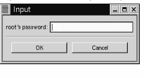

**请注意**

只有 root 可以使用 *Update Agent*。每次从你的用户帐户启动该应用程序时，系统都会要求你提供 root 密码，如图 5-1 *请求 Root 密码的对话框* 所示。你还可以通过在 shell 提示符处输入 `/usr/bin/update` 以 root 身份启动 *Update Agent*。

提供密码后，应用程序将启动。应用程序启动后，你将看到如图 5-2 *Update Agent 主窗口* 所示的屏幕。在这个主对话框内，你可以选择连接到优先更新服务器、配置或退出应用程序。

不过，在继续之前，你需要使用与你的机器和软件相关的具体信息来配置该应用程序。

### 5.2 配置 Update Agent

出厂状态下，*Update Agent* 不会自动连接、下载并安装更新的软件包。在继续之前，你需要提供关于你自己的信息，例如在注册 Red Hat Linux 6.2 时选择的用户名和密码。（要了解有关注册福利的更多信息，请访问 `http://www.red-hat.com/now`。）

**图 5-2 Update Agent 主窗口**

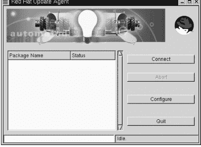

要配置该应用程序，请在主对话框上选择 **Configure（配置）**。（标有 **Abort（中止）** 的按钮仅在下载或安装过程中处于活动状态；选择此按钮会导致 Update Agent 停止当前工作。）

**Configuration（配置）** 对话框向你显示三个选项卡窗口，你需要在其中输入信息：

- **User（用户）** -- 在此处，输入你在 `http://www.redhat.com/now` 注册 Red Hat Linux 6.2 时选择的用户名和密码。你还应该输入一个电子邮件地址，用于接收有关更新事务的通信。
- **Retrieval（检索）** -- 指定服务器名称和某些安装说明，例如要更新哪个版本的 Red Hat Linux 以及是否在安装的同时下载软件包。
- **Exceptions（例外）** -- 指定你希望从更新搜索中排除的文件和/或软件包，例如与内核相关的文件。

让我们从 **User（用户）** 选项卡开始。完成后，你的信息应类似于图 5-3，*用户配置选项卡*。

**图 5-3 用户配置选项卡**

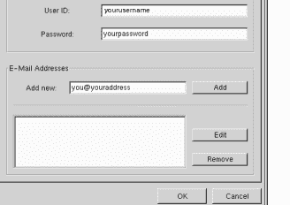

**User（用户）** 对话框分为两部分：**User Information（用户信息）** 和 **E-Mail Addresses（电子邮件地址）**。在 **User Information（用户信息）** 部分中，在标记为 **User ID（用户 ID）** 的框中输入你注册时指定的用户名。在 **Password（密码）** 框中，输入你注册时选择的密码。在 **E-Mail Addresses（电子邮件地址）** 部分中，你应该指定用于接收 Update Agent 反馈和摘要以便审阅的电子邮件地址。你可以将反馈和摘要发送到多个帐户，例如你的用户帐户。只需在 **Add new（添加新）** 框中输入地址，然后单击 **Add（添加）** 按钮。该条目将出现在地址窗口中。现在是在 **Retrieval（检索）** 选项卡中指定选项的时候了。 **Retrieval（检索）** 选项卡分为三个部分，详细说明了优先更新服务器的位置、特定的下载和安装说明以及位置
系统中存储更新内容的目录。（有关示例，请参阅图 5–4 获取配置选项卡。）

#### 图 5–4 获取配置选项卡

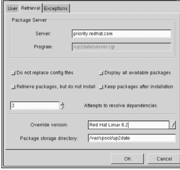

在 **Server**（服务器）项中，如果尚未填写，应输入 `priority.redhat.com` 作为优先更新服务器。**Program**（程序）项不可由用户指定，它仅指示执行 Update Agent（更新代理）的 CGI 脚本位置。

> **提示**
>
> 即使你对 `priority.redhat.com` 的注册已过期，你仍可使用 Update Agent。只需将应用程序指向 `ftp.redhat.com` 即可。

与你可能发现的 **Gnome-RPM** 选项类似，服务器信息之后的选项允许你自定义如何获取和安装更新。选中按钮即选择该选项。你的选项如下：


- 不替换配置文件 -- 包含在你的系统中已被修改的配置文件的软件包将不会被选中进行更新。举例来说，如果你修改了 `/etc/syslog.conf` 配置文件。如果有可用的 `syslogd` 更新，且该更新会创建一个新的 `/etc/syslog.conf` 文件，那么该软件包将不会被下载和安装。如果你没有修改系统上的配置文件，则可以进行下载和安装 -- 并且之前的文件会被备份（在这种情况下，备份为 `/etc/syslog.conf.rpmsave`）。

- 显示所有可用软件包 -- 如果你希望 Update Agent 向你显示所有可用软件包，而不仅仅是针对已安装系统的特定软件包，请选中此复选框。

- 获取软件包，但不安装 -- 默认情况下，选中此选项。当选中此选项时，Update Agent 仅将软件包下载到临时目录。下载完成后，你可以自行安装这些软件包。如果未选中此选项，Update Agent 将下载并自动安装你选中的内容。因此，请取消选中此选项，以同时下载和安装更新软件包；若要自行安装软件包，请参见页面底部“软件包存储目录”中指定的位置。

- 安装后保留软件包 -- 在软件包安装完成后保留软件包文件。如果你希望保留软件包的副本，这可能很有用，但选择此选项可能会占用大量磁盘空间。

- 尝试解决依赖关系 -- 与此选项关联的值指示 Update Agent 检查所选软件包可能存在依赖关系问题的次数。该值的范围从 1 到 10，可以使用复选框旁边的滚动按钮进行调整。值越高，在安装更新软件包之前执行的依赖关系检查次数就越多。

在软件包选项下方，两个额外的框允许你指定要更新的 Red Hat Linux 文件的版本以及这些升级文件将存放的位置。

“覆盖版本”下拉菜单将显示 Red Hat Linux 的当前或之前的版本。大多数用户可能会保留默认条目，即 Red Hat Linux 6.2。如果此处未指定值，系统将自动确定正确的值。

**软件包存储目录** 的默认条目设置为 `/var/spool/update`，尽管你可以指定更合适的位置。例如，如果你选择下载软件包而不自动安装它们，可能会发现这些下载随着时间推移占据了大量空间。在文件系统中指定一个目录，允许你将这些软件包发送到一个你知道可以容纳其大小的目录中。

**例外** 选项卡允许你指定不想从 `priority.redhat.com` 获取并作为更新提供的软件包或单个文件。（有关此选项卡的示例，请参阅图 5-5，*更新例外选项卡*。）

### 图 5-5 更新例外选项卡

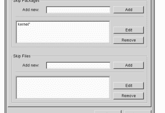

在此选项卡中，你可以指定不希望更新或修改哪些文件和软件包。两个条目 -- **跳过软件包** 和 **跳过文件** -- 都允许你使用**通配符**，例如星号（`*`）和问号（`?`）。

**跳过软件包** 部分中的默认条目列出了 `kernel*`，意味着任何以 `kernel` 开头的软件包都将被排除在下载和安装之外。大多数用户可能希望保留此排除设置。

要添加新条目，输入你不希望选中的软件包名称（例如，对于电子邮件应用程序 exmh 使用 `exmh*`），然后点击“Add”（添加）按钮。你的条目将被添加到列表中。

与“跳过软件包”选项一样，“跳过文件”部分允许你指定不希望的个别文件。例如，如果你想排除 /home 中的所有文件，请输入 `/home/*`，则 /home 中的账户将被排除在更新之外。

### 5.3 使用 Update Agent

当你在 `http://www.redhat.com/now` 注册服务时，可以选择通过电子邮件接收更新通知的选项。如果你选择此选项，根据偏好设置，当有可用更新时，你将收到通知。

一旦你收到更新通知并正确配置了 Update Agent，就可以开始使用它连接到 `priority.redhat.com` 以下载和安装更新。

> **请注意**
>
> 使用 Update Agent 必须拥有专用连接，或通过拨号连接连接到你的 ISP。

要开始会话，请启动 Update Agent（在 **System** => **Update Agent** 中），并提供 root 账户的密码。

在应用程序的主屏幕上，点击 **Connect**（连接）。窗口底部的状态栏将指示应用程序正在连接并从更新 FTP 站点获取信息。

如果你选择排除某些软件包或文件（例如 kernel 更新），你可能会看到类似图 5–6 *排除的文件* 的响应。点击 **OK** 按钮继续。

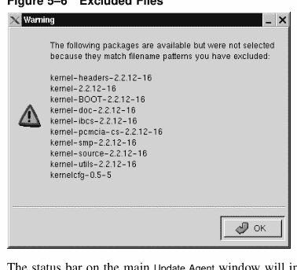

主 Update Agent 窗口上的状态栏将指示应用程序正在创建一个将在你的 Web 浏览器中显示的页面。一旦完成软件包排序和页面构建，你的浏览器将打开，你将看到类似图 5–7 *可用更新* 的结果。

如果有可用的更新软件包，你将看到软件包名称、其功能摘要及相关详细信息，如最新版本号、发行号和软件包大小。

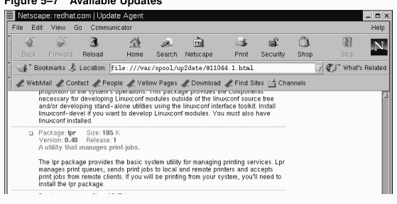

你可以通过向下滚动页面并勾选软件包旁边的复选框来选择单个软件包。完成后，点击页面底部的 **Request selected packages**（请求选定软件包）按钮。

如果你希望使用所有可用软件包更新系统，请点击 **Request ALL packages**（请求所有软件包）按钮；你无需在每个软件包旁边进行单独选择。

提出软件包请求后，浏览器窗口将关闭。（你可能会收到一个窗口中的消息，询问你是否要关闭窗口；点击 **OK** 确认此决定。）

### 图 5–8 开始下载过程


接下来，你将在主 Update Agent 屏幕的 **Package Name**（软件包名称）下看到正在下载的软件包，并且在 **Status**（状态）列中每个软件包旁边会出现一个小按钮，类似于图 5–8 *开始下载过程*。

当软件包下载完成后，**状态** 列中的按钮将通过变为红色箭头来反映此变化。当每个软件包成功安装后，箭头将变为对勾。窗口右下角的进度条将反映在所有更新下载和安装完成之前剩余的工作量。

在你的系统上检索和/或安装所有软件包后，将打开一个窗口通知你该过程成功。你还会收到电子邮件确认你已执行了该过程；确认邮件将发送到你指定的 **User ID**（用户 ID）地址。

要在所有软件包获取并安装完成后退出 Update Agent，请点击“退出”按钮。

## 6 使用 RPM 进行软件包管理

*RPM 软件包管理器*（RPM）是一个开放的分发系统，任何人皆可使用，它适用于 Red Hat Linux 以及其他 Linux 和 UNIX 系统。Red Hat, Inc. 鼓励其他供应商花时间研究 RPM，并将其用于他们自己的产品中。RPM 在 GPL（通用公共许可证）条款下分发。

对于最终用户而言，RPM 提供了许多功能，使得系统维护比以往任何时候都更加容易。安装、卸载和升级 RPM 软件包都是单行命令，所有繁琐的细节都已由系统自动处理。RPM 维护一个已安装软件包及其文件的数据库，这使得您可以对系统执行强大的查询和验证操作。

在升级过程中，RPM 会特殊处理配置文件，确保您永远不会丢失自定义设置——这是直接使用 `.tar.gz` 文件无法实现的功能。

对于开发人员而言，RPM 允许您获取软件源代码，并将其打包为供最终用户使用的源代码和二进制软件包。这个过程相当简单，由您创建的一个单一文件以及可选的补丁驱动。这种将“原始”源代码与您的补丁及构建说明清晰区分开的方式，在新版本软件发布时，使软件包的维护变得更为轻松。

> 尽管理解 RPM 背后的概念可能很重要，但对于那些更喜欢使用图形界面而非命令行的人来说，我们建议您使用 Gnome-RPM。有关更多信息，请参见第 7 章：Gnome-RPM。
>
> 请注意

### 6.1 RPM 设计目标

在尝试了解如何使用 RPM 之前，了解其设计目标会有所帮助。

#### 可升级性

使用 RPM，您可以在不彻底重新安装的情况下升级系统的单个组件。当获得基于 RPM 的操作系统的新版本（如 Red Hat Linux）时，您无需在机器上重新安装（这与基于其他打包系统的操作系统不同）。RPM 允许对您的系统进行智能、完全自动化的就地升级。软件包中的配置文件在升级过程中得到保留，因此您不会丢失自定义设置。

#### 强大的查询功能

RPM 的设计还具有强大的查询选项。您可以在整个数据库中搜索软件包或特定文件。您还可以轻松找到某个文件所属的软件包及其来源。RPM 软件包包含的文件位于压缩归档中，带有自定义二进制头文件，其中包含有关软件包及其内容的有用信息，使您可以快速轻松地查询单个软件包。

#### 系统验证

另一个强大功能是验证软件包的能力。如果您担心删除了某个软件包的重要文件，只需验证该软件包即可。您会收到任何异常的通知。此时，如有必要，您可以重新安装软件包。您修改过的任何配置文件在重新安装过程中都会保留。

#### 原始源代码


一个关键的设计目标是允许使用由软件原始作者分发的“原始”软件源代码。使用 RPM，您可以获得原始源代码，以及使用过的任何补丁，再加上完整的构建说明。这有几个主要原因带来了巨大优势。例如，当程序发布新版本时，您不一定需要从头开始才能使其编译成功。您可以查看补丁，了解*可能*需要做什么。通过这种方式，所有内置的默认设置以及为使软件正确构建而做出的所有更改都清晰可见。

这个目标看似只对开发人员重要，但它也为最终用户带来了更高质量的软件。我们要感谢 BOGUS 发行版团队提出了原始源代码的概念。

### 6.2 使用 RPM

RPM 有五种基本操作模式（不包括软件包构建）：安装、卸载、升级、查询和验证。本节概述了每种模式。有关完整细节和选项，请尝试 `rpm --help`，或参阅 6.4 节“其他 RPM 资源”以获取有关 RPM 的更多信息。

#### 6.2.1 安装

RPM 软件包的 filename 通常类似于 `foo-1.0-1.i386.rpm`，其中包含软件包名称（`foo`）、版本（`1.0`）、发布号（`1`）和架构（`i386`）。安装软件包非常简单：

```bash
# rpm -ivh foo-1.0-1.i386.rpm
foo                                     ########################################################
#
```

如您所见，RPM 会打印出软件包的名称（这不一定与文件名相同，文件名可能为 `1.rpm`），然后在安装软件包时打印出一系列井号标记作为进度条。

软件包的安装设计得很简单，但您可能会遇到一些错误：

**软件包已安装**

如果软件包已安装，您将会看到：

```bash
# rpm -ivh foo-1.0-1.i386.rpm
foo                                   package foo-1.0-1 is already installed
error: foo-1.0-1.i386.rpm cannot be installed
#
```

如果您确实希望安装该软件包，可以在命令行上使用 `--replacepkgs`，这将指示 RPM 忽略错误：

```bash
# rpm -ivh --replacepkgs foo-1.0-1.i386.rpm
foo                                     ########################################################
#
```

**文件冲突**

如果您尝试安装一个包含已由其他软件包安装的文件，您将会看到：

```bash
# rpm -ivh foo-1.0-1.i386.rpm
foo
  /usr/bin/foo conflicts with file from bar-1.0-1
error: foo-1.0-1.i386.rpm cannot be installed
#
```

要使 RPM 忽略该错误，请在命令行上使用 `--replacefiles`：

```bash
# rpm -ivh --replacefiles foo-1.0-1.i386.rpm
foo
  #####################################
#
```

**未解析的依赖项**

RPM 软件包可以“依赖”于其他软件包，这意味着它们需要安装其他软件包才能正常运行。如果您尝试安装具有此类未解析依赖项的软件包，您将会看到：

```bash
# rpm -ivh bar-1.0-1.i386.rpm
failed dependencies:
  foo is needed by bar-1.0-1
#
```

要处理此错误，您应该安装所需的软件包。如果您仍想强制安装（由于该软件包可能无法正确运行，因此这是一个坏主意），请在命令行上使用 `--nodeps`。

#### 6.2.2 卸载

卸载软件包与安装一样简单：

```bash
# rpm -e foo
#
```

请注意，我们使用的是软件包*名称* "`foo`" ，而不是原始软件包*文件*名称 "`foo-1.0-1.i386.rpm`"。

如果在其他已安装的软件包依赖于您试图删除的软件包时，卸载过程中可能会遇到依赖项错误。例如：

```bash
# rpm -e foo
removing these packages would break dependencies:
        foo is needed by bar-1.0-1
#
```

要使 RPM 忽略该错误并无论如何卸载软件包（由于依赖该软件包的软件包可能无法正常工作，因此这也是一个坏主意），请在命令行上使用 `--nodeps`。

#### 6.2.3 升级

升级软件包与安装类似。

```bash
# rpm -Uvh foo-2.0-1.i386.rpm
foo ################################################
#
```

上述命令中未显示的是，RPM 自动卸载了 `foo` 软件包的旧版本。实际上，您始终希望使用 `-U` 来安装软件包，因为即使没有已安装之前版本的软件包，它也工作正常。

由于 RPM 对带有配置文件的软件包进行智能升级，您可能会看到类似以下信息：

```bash
saving /etc/foo.conf as /etc/foo.conf.rpmssave
```

这意味着您对配置文件的修改可能不“向前兼容”于软件包中的新配置文件，因此 RPM 保存了您的原始文件，并安装了一个新文件。您应尽快调查并解决这两个文件之间的差异，以确保系统继续正常运行。

由于升级实际上是卸载和安装的组合，因此你可能会遇到这些模式下的任何错误，另外还有：如果 RPM 认为你试图升级到一个*旧*版本的包，你会看到：

```
# rpm -Uvh foo-1.0-1.i386.rpm
foo    package foo-2.0-1 (which is newer) is already installed
error: foo-1.0-1.i386.rpm cannot be installed
#
```

若要使 RPM 仍然执行“升级”，请在命令行中使用 `--oldpackage`：

```
# rpm -Uvh --oldpackage foo-1.0-1.i386.rpm
foo    ########################################
#
```

#### 6.2.4 刷新

刷新包与升级类似：

```
# rpm -Fvh foo-1.2-1.i386.rpm
foo    ########################################
#
```

RPM 的刷新选项会将命令行上指定包的版本与系统中已安装包的版本进行比对。当 RPM 的刷新选项处理已安装包的新版本时，它会将其升级到该新版本。然而，如果系统中不存在同名已安装的包，RPM 的刷新选项将不会安装该包。这与 RPM 的升级选项不同，因为无论旧版本的包是否已安装，升级操作都会安装包。

RPM 的刷新选项适用于单个包或一组包。如果你刚刚下载了大量不同的包，并且只想升级那些已安装在系统上的包，这将特别有用。使用刷新选项意味着你无需在下载的包中挑选并删除不需要的包，然后才使用 RPM。

在这种情况下，你只需发出以下命令：

```
# rpm -Fvh *.rpm
```

RPM 将自动仅升级那些已安装的包。

#### 6.2.5 查询

查询已安装包数据库是通过 `rpm -q` 完成的。一个简单的用法是 `rpm -q foo`，它将打印已安装包 `foo` 的包名称、版本和发行编号：

```
# rpm -q foo
foo-2.0-1
#
```

除了指定包名称，你还可以使用以下选项与 `-q` 配合使用来指定要查询的包。这些称为*包规格选项*。

- `-a` 查询所有当前已安装的包。
- `-f <file>` 将查询拥有 `<file>` 的包。
- `-p <packagefile>` 查询包 `<packagefile>`。

有多种方式可以指定要显示关于已查询包的哪些信息。以下选项用于选择你要搜索的信息类型。这些称为*信息选择选项*。

- `-i` 显示包信息，如名称、描述、发行版本、大小、构建日期、安装日期、供应商及其他杂项信息。
- `-l` 显示该包“拥有”的文件列表。
- `-s` 显示包中所有文件的状态。
- `-c` 显示标记为文档的文件列表（man 手册页、info 页、README 等）。
- `-c` 显示标记为配置文件的文件列表。这些是安装后你需要修改以将包适应于你的系统的文件（sendmail.cf、passwd、inittab 等）。

对于显示文件列表的选项，你可以在命令行中添加 `-v` 以熟悉的 `ls -l` 格式获取列表。

#### 6.2.6 验证

验证包是将包安装的文件信息与原始包的相同信息进行对比。除了其他事项，验证会对比每个文件的大小、MD5 校验和、权限、类型、所有者和组。


命令 `rpm -V` 验证一个包。你可以使用查询中列出的任何 *包选择选项* 来指定要验证的包。一个简单的用法是 `rpm -V foo`，它验证 `foo` 包中的所有文件是否与其最初安装时相同。例如：

- 验证包含特定文件的包：

```
rpm -Vf /bin/vi
```

- 验证所有已安装的包：

```
rpm -Va
```

- 根据 RPM 包文件验证已安装的包：

```
rpm -Vp foo-1.0-1.i386.rpm
```

如果你怀疑你的 RPM 数据库已损坏，这可能会有用。

如果一切验证正常，将没有输出。如果有任何差异，它们将被显示。输出的格式是一个 8 个字符的字符串，一个表示配置文件的可能的“c”，然后是文件名。8 个字符中的每一个表示该文件的一个属性与记录在 RPM 数据库中该属性值之间的比较结果。单个“.”（句点）意味着测试通过。以下字符表示某些测试失败：

- `5` -- MD5 校验和
- `S` -- 文件大小
- `L` -- 符号链接
- `T` -- 文件修改时间
- `D` -- 设备
- `U` -- 用户
- `G` -- 组
- `M` -- 模式（包括权限和文件类型）

如果你看到任何输出，请根据你的最佳判断决定是应删除或重新安装包，或以其他方式修复问题。

### 6.3 用 RPM 给朋友留下深刻印象

RPM 是一个非常有用的工具，既用于管理系统，也用于诊断和修复问题。理解所有选项的最佳方法是查看一些示例。

- 假设你意外删除了一些文件，但不确定删除了什么。如果你想验证整个系统并查看可能缺失了什么，你会输入：

```bash
rpm -Va
```

如果某些文件缺失，或者看起来已损坏，你应该重新安装包或卸载然后重新安装包。

- 假设你遇到了一个你不认识的文件。要找出哪个包拥有它，你会输入：

```bash
rpm -qf /usr/X11R6/bin/xjewel
```

输出看起来像这样：

```
xjewel-1.6-1
```

- 我们可以将上述两个示例结合到以下场景中。假设你在使用 `/usr/bin/paste` 时遇到问题。你想验证拥有该程序的包，但你不知道那是哪个包。只需输入：

```
rpm -Vf /usr/bin/paste
```

相应的包将被验证。

- 想了解关于特定程序的更多信息？你可以通过输入以下内容来找到随“拥有”该程序的包（在本例中是 `ispell`）一起提供的文档：

```
rpm -qdf /usr/bin/ispell
```

输出将是：

```
/usr/man/man4/ispell.4
/usr/man/man4/english.4
/usr/man/man1/unsg.1
/usr/man/man1/tryaffix.1
/usr/man/man1/sq.1
/usr/man/man1/munchlist.1
/usr/man/man1/ispell.1
/usr/man/man1/findaffix.1
/usr/man/man1/builddash.1
/usr/info/ispell.info.gz
/usr/doc/ispell-3.1.18-1/README
```

- 假设你找到一个新的 `koules` RPM，但不知道它是什么。要了解一些关于它的信息，输入：

```
rpm -qip koules-1.2-2.i386.rpm
```

输出将是：

```
Name : koules               Distribution: Red Hat Linux Colgate
Version : 1.2               Vendor: Red Hat Software
Release : 2                 Build Date: Mon Sep 02 11:59:12 1996
Install date: (none)        Build Host: porky.redhat.com
Group : Games               Source RPM: koules-1.2-2.src.rpm
Size : 614939
Summary : SVGA/ib action game; multiplayer, network
```

Description :

This arcade-style game is novel in conception and excellent in execution. No shooting, no blood, no guts, no gore. The play is simple, but you still must develop skill to play. This version uses SVGAlib to run on a graphics console.

- 现在你想查看 `koules` RPM 安装哪些文件。你会输入：

```
rpm -qlp koules-1.2-2.i386.rpm
```

输出是：

```
/usr/man/man6/koules.6
/usr/lib/games/kouleslib/start.raw
/usr/lib/games/kouleslib/end.raw
/usr/lib/games/kouleslib/destroy2.raw
/usr/lib/games/kouleslib/destroy1.raw
/usr/lib/games/kouleslib/creator2.raw
/usr/lib/games/kouleslib/creator1.raw
/usr/lib/games/kouleslib/colize.raw
/usr/lib/games/kouleslib
/usr/games/koules
```

这些只是几个例子。当你使用系统时，你会发现 RPM 有很多其他用途。

### 6.4 其他 RPM 资源

有关 RPM 的更多信息，请查看 man 手册页、帮助屏幕（`rpm --help`）以及 [http://www.rpm.org/](http://www.rpm.org/) 上可用的 RPM 文档。

还有一本 RPM 书可用。它名为 *Maximum RPM*，可从 Red Hat、当地书店及在线书店购得。它包含大量关于 RPM 的信息，既适用于最终用户，也适用于包构建者。

这本书的在线版本可在 http://www.rpm.org/ 获取。

还有一个用于讨论 RPM 相关问题的邮件列表，名为 `rpm-list@redhat.com`。

该列表的存档位于 http://www.redhat.com/support/mailing-lists/。若要订阅，请向 `rpm-list-request@redhat.com` 发送邮件，并在主题行中包含单词“subscribe”。

目前可用的最便捷的软件包管理工具之一是 Gnome-RPM，它是在 X Window System 下运行的图形化工具。Gnome-RPM 由 James Henstridge (`james@daa.com.au`) 编写；RPM 3.0 的支持由 Red Hat 编写，而额外的 rpmfind 代码由 Daniel Veillard 编写。

Gnome-RPM（也被称为 gnorp）让最终用户能够轻松地使用 RPM 技术；它快速、功能强大，并具有友好的界面。

要了解有关 RPM 技术的更多信息，请参见第 6 章《使用 RPM 进行软件包管理》。

Gnome-RPM 是“符合 GNOME 规范”的，这意味着它可以无缝集成到 GNOME 这个 X Window System 桌面环境中。

使用 Gnome-RPM，你可以轻松地：

- 安装 RPM 软件包
- 卸载 RPM 软件包
- 升级 RPM 软件包
- 查找新的 RPM 软件包
- 查询 RPM 软件包
- 校验 RPM 软件包

该界面包含菜单、工具栏、树形结构以及显示当前已安装软件包的窗口。

在 Gnome-RPM 中，通常通过查找并选择软件包，然后使用工具栏上的按钮、通过菜单或鼠标右键单击来选择要执行的操作类型来执行操作。

- 安装软件包会将该软件包的所有组件放置在系统的正确位置。
- 卸载软件包会删除该软件包的所有痕迹，除了你修改过的配置文件。
- 升级软件包会安装新发布的版本，并卸载之前安装的所有其他版本。这允许快速升级到软件包的最新版本。有关更改软件包安装和卸载默认设置的详细信息，请参阅 7.4 节 *Configuration*。

你还可以使用 **Web find** 选项在互联网上搜索新发布的软件包。当你想要查找新软件包时，可以指示 Gnome-RPM 搜索特定的发行版。（如果你的连接速度较慢，此选项可能需要一些时间才能完全执行。）有关此功能的更多信息，请参阅 7.4 节 *Configuration*。

> **请注意**


如果你选择使用 `Web find` 选项，请谨慎行事，因为无法验证众多仓库中可用软件包的完整性。在安装软件包之前，你应该对该软件包执行查询，以帮助你确定是否可以信任该软件包。Red Hat 不以任何方式支持由 Red Hat 以外的来源生产的软件包。

使用 Gnome-RPM 执行所有这些以及许多其他操作，等同于在 shell 提示符下使用 rpm。然而，Gnome-RPM 的图形性质通常使这些操作更容易执行。

使用 Gnome-RPM 的通常方式是显示可用软件包，选择要操作的软件包，然后从工具栏或菜单中选择执行该操作的选项。然而，Gnome-RPM 足够灵活，可以通过使用过滤器以多种视图显示软件包。有关使用过滤器识别软件包的更多信息，请参阅 7.3 节 *Installing New Packages*。

你可以通过几次按钮点击安装、升级或卸载多个软件包。同样，你可以同时查询和校验多个软件包。由于 Gnome-RPM 与 GNOME 的集成，你还可以在 GNOME 文件管理器中对软件包执行安装、查询和校验。

### 7.1 启动 Gnome-RPM

你可以从 Xterm 窗口或 GNOME 桌面面板（主菜单按钮 => 系统 => GnoRPM）启动 Gnome-RPM。

要从 Xterm 窗口启动 Gnome-RPM，只需在 shell 提示符下输入：

```bash
gnorpm &
```

这将调出主要的 Gnome-RPM 窗口（如图 7-1 所示，*Main Gnome-RPM Window*）。

> **请注意**
>
> 如果你想安装、升级或卸载软件包，你必须处于 root 权限。最简单的方法是输入 `su` 成为 root，然后在 shell 提示符下输入 root 密码。然而，查询和校验软件包并不需要 root 权限。

Gnome-RPM 界面由几个部分组成。

- 软件包面板 - 位于左侧；允许你浏览和选择系统上的软件包。
- 显示窗口 - 位于软件包面板右侧；显示面板中文件夹的内容。
- 工具栏 - 位于显示窗口和面板上方；软件包工具的图形化显示。
- 菜单 - 位于工具栏上方；包含基于文本的命令，以及帮助信息、偏好设置和其他设置。
- 状态栏 - 位于面板和显示窗口下方；显示所选软件包的总数。

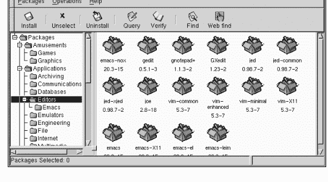

### 7.2 软件包显示

左侧树视图中的每个文件夹图标代表一组软件包。每组可以包含子组。组用于将执行类似功能且位于类似位置下的软件包归类。例如，文件夹 **Editors** 包含 ed、vim 和 GxEdit 等文本编辑器。从左侧的树视图中，你可能会发现在 **Editors** 下方还有另一个名为 Emacs 的文件夹，其中包含 emacs 和 emacs-X11。

树视图也以可展开和可折叠的方式排列，这有助于你轻松浏览软件包。带有 + 号显示的文件夹表示该类别内存在子文件夹。

要查看组内的软件包和子组，用鼠标左键单击文件夹或 + 一次。显示窗口随后将显示该文件夹的内容。默认情况下，你会看到代表软件包的图标。你可以选择 **View as list** 从 **interface** 选项卡中更改该视图为列表视图。

你可以在 `Operations => Preferences` 下找到该设置。有关自定义设置的更多信息，请参阅 7.4 节 *Configuration*。

通过这种方式，你可以在树视图中移动，打开和展开包含应用程序、游戏、工具等的文件夹。每个文件夹的内容将显示在右侧。

#### 7.2.1 选择软件包

要选择单个软件包，用鼠标左键单击它。你会注意到软件包标题周围会出现高亮（如图 7–2 所示，*Selecting Packages in Gnome-RPM*），这反映了选择状态。若要取消选择，请用鼠标左键单击显示面板中的空白处，或单击工具栏上的 **Unselect** 按钮。当你取消选择软件包时，高亮将消失。

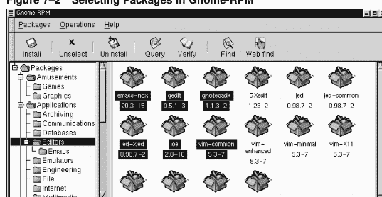

你可以选择在多个文件夹中多选软件包。要增量选择多个软件包，请按住 [Ctrl] 键同时用鼠标左键单击；你将看到每个额外选择周围都有高亮。

要全局选择多个软件包，即在一个文件夹内进行较大范围的选择，先左键单击一个软件包，然后按住 [Shift] 键，左键单击你希望选择的最后一个软件包。这样做，你会注意到起始和结束选择之间的单个软件包也会被高亮选中。使用此选项比单独选择每个软件包更快地选择软件包组。

Gnome-RPM 底部的状态栏将显示你选择的软件包总数。

### 7.3 安装新软件包

要安装新软件包，请从工具栏中选择 **Install**。将打开 **Install** 窗口，显示已安装的软件包、较新的软件包或其他选项，可以从窗口顶部的 **Filter** 下拉栏中选择。有关 **Install** 窗口的示例，请参见图 7-4 The Add Packages Window，使用过滤器“All but installed packages”。

使用 **Filter** 功能允许你筛选查看软件包的选择。可用的查看过滤器包括：

- 所有软件包
- 除已安装软件包以外的所有软件包
- 仅未安装软件包
- 仅较新软件包
- 未安装或较新软件包

你可以使用窗口顶部的下拉栏切换软件包的显示方式。

#### 图 7–3 安装窗口

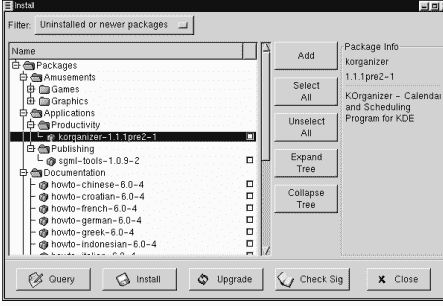

选择 **添加** 按钮。默认情况下，如果您的 CD-ROM 已挂载了 Red Hat Linux CD-ROM，Gnome-RPM 将在 `/mnt/cdrom/RedHat/RPMS` 中搜索新软件包。（您可以在 **首选项** 对话框的 **安装窗口** 选项卡中找到此默认选项。有关此功能的更多信息，请参阅第 7.4 节 *配置*。）

如果默认路径中没有可用的软件包，您将看到一个 **添加软件包** 窗口，您可以通过该窗口选择新软件包的适当位置。在此视图中，您可以使用窗口顶部的下拉栏快速导航到预设位置；或者双击 **添加软件包** 窗口左侧面板中的项目以导航到正确路径（如图 7–4 *添加软件包窗口* 所示）。您还可以在 **添加软件包** 窗口底部的文本框中输入路径。

#### 图 7–4 添加软件包窗口

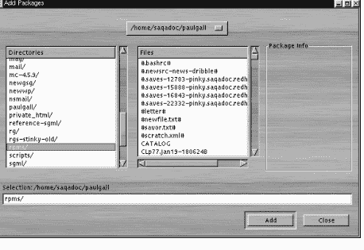

#### 请注意

如果您下载 RPM，您可能会发现这些已下载的软件包位于家庭目录中名为 rpms 的目录内。例如，如果您的家庭目录是 `/home/bill`，那么您下载的 RPM 将位于 `/home/bill/rpms` 中。

通过点击项目，您将在安装窗口的软件包信息面板中看到该软件包的简要描述。若要执行软件包的安装或查询，请点击软件包旁边的复选框，然后选择“安装”按钮。一旦勾选了项目，您也可以对其进行查询；在“软件包信息”窗口中，您还可以执行安装操作（安装示例请参阅第 7.5.1 节中的图 7–10 *查询窗口*）。

若要选择一个项目，请使用鼠标左键双击它，或点击 **添加** 按钮。所选的软件包将被添加到 **安装** 窗口。您也可以以相同的方式安装多个软件包；每个选择都将添加到 **安装** 窗口。

除了从 **安装** 窗口内选择安装软件包外，您也可以在查询所选软件包之后进行安装。点击 **查询**，这将打开 **软件包信息** 窗口。在这里，您可以找到有关您选择安装的文件的各种详细信息。信息将包括软件包的来源、构建日期、大小等。

在此 **软件包信息** 窗口中，您可以选择安装或升级软件包。

如果软件包已存在于您的系统中且您正在查询新版本，**软件包信息** 窗口将提供一个 **升级** 按钮，用于执行到新版本升级操作。

您还可以在 GNOME 文件管理器中“拖放”软件包。在文件管理器中，左击所选的 RPM 文件，然后按住鼠标按钮，“拖拽”该文件到 **安装** 窗口并将其放置在 **名称** 面板内。

当从文件管理器拖拽文件到 **安装** 窗口时，您会注意到在文件被拖向 Gnome-RPM 的过程中，文件显示为图标。一旦进入 **名称** 面板，您将看到该软件包默认已被勾选以进行安装，并且其信息显示在右侧的 **软件包信息** 面板中。

若要现在安装该软件包，只需选择 **安装** 按钮即可。

当您的软件包正在安装时，您会看到一个进度指示器。

### 7.4 配置

Gnome-RPM 为安装和卸载软件包、文档以及其他功能提供了广泛的选择。您可以通过 **首选项** 对话框自定义 Gnome-RPM，该对话框可以通过菜单中的 *操作 => 首选项* 访问。要在 **首选项** 对话框中的许多选项中进行选择，请选择选项旁边的复选框。

在 **行为** 选项卡下，您将找到若干配置 Gnome-RPM 安装、卸载和升级软件包方式的选项。行为选项卡分为五个部分：安装、升级、其他、数据库和架构。请注意，默认情况下这些复选框未被勾选（见图 7–5 *首选项中的行为选项卡*）。

#### 图 7–5 首选项中的行为选项卡


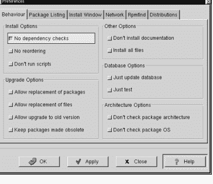

在 **安装选项** 下，您有以下选择：

- **不检查依赖关系** – 选中此项后，将在不检查程序运行所依赖的其他类型文件的情况下安装或升级软件包。然而，除非您清楚自己在做什么，否则我们强烈建议您不要使用此选项，因为某些软件包可能依赖于其他软件包的库或程序才能正确运行。

- **不重新排序** – 如果 RPM 无法更改某些软件包的顺序以满足依赖关系，此选项非常有用。

在其他选项中，您可以选择：

- **不安装文档** - 类似于 `--excludedocs`，此选项可以通过排除手册页或与软件包相关的其他信息来节省磁盘空间。

- **安装所有文件** - 安装软件包中的所有文件。

**数据库选项** 和 **架构选项** 中可用的选择允许您决定（除了其他事项外）是否要执行“测试”安装（这将检查文件冲突而实际不执行安装），或者是否要排除其他操作系统或系统架构的软件包。

在 **软件包列表** 选项卡中，您将找到关于软件包显示方式的选择：要么 **以图标查看**，这是基于图形的；要么 **以列表查看**，这虽然不是图形的，但可以提供有关软件包的更多信息。

在 **安装窗口** 中，您可以指定 Gnome-RPM 在系统中查找新 RPM 的路径。请参阅图 7–6 *安装窗口* 查看此对话框的示例。如果您使用的是 Red Hat Linux CD-ROM，此路径很可能是 `/mnt/cdrom/RedHat/RPMS` 或已设置为 Gnome-RPM 默认路径的类似路径。如果您从 Internet 下载新的 RPM 或通过 NFS 挂载的 CD-ROM 安装 RPM，此路径对您来说将不同。

### 图 7–6 安装窗口

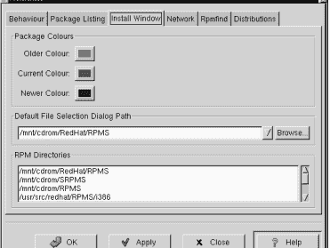

要更改此路径，请输入您想要处理的 RPM 的完整路径。选择 **应用** 或 **确定** 按钮将保存此路径，使其成为未来会话的默认路径。您也可以通过选择 **浏览…** 按钮并直观地导航 **RPMPath** 窗口来确定默认路径。

更改安装路径并关闭对话框后，您可以使用 **安装** 按钮查看新位置中可用的软件包。

（如果您的 RPM 路径与首选项中的默认路径不匹配，您将被提供一个浏览器窗口，该窗口将允许您为新的 RPM 选择正确的路径。）

在 **软件包颜色** 下，您会发现软件包的颜色编码。旧软件包的默认设置是灰色；当前软件包的颜色是绿色；比已安装软件包更新软件包的颜色是蓝色。可以根据您的需求自定义这些颜色值。

**RPM 目录** 包含 Gnome-RPM 将搜索软件包的默认位置列表。

**In Network**，您可以指定用于 HTTP 和 FTP 传输的代理，以及用户名和密码（见图 7–7 *网络设置*）。然而，请注意，密码不会被安全存储。

在 **缓存过期** 窗口中，您可以设置数据从 `rpmfind` 数据库中被视为过期的时间长度。

### 图 7–7 网络设置

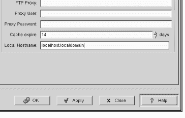

在 **Rpmfind 和发行版** 中，您将找到与 **Web 搜索** 功能相对应的设置和选项。

Rpmfind 系统是由 Daniel Veillard 设计的，它允许用户按名称、摘要、架构等在互联网上搜索软件包（见图 7–8 *Rpmfind 窗口*）。然后用户可以下载并安装最适合其系统的软件包。要了解有关 Rpmfind 的更多信息，请访问 http://rpmfind.net/。

### 图 7–8 Rpmfind 窗口

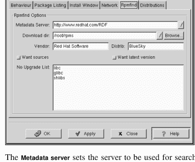

**元数据服务器** 设置用于搜索的服务器。**下载目录:** 条目允许您指定希望将文件放置的位置。

您还可以指定供应商、发行版名称以及是否查找源和/或最新文件。

### 图 7-9 首选项中的分发设置

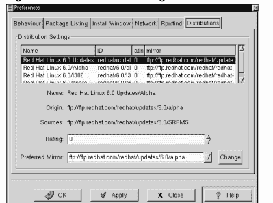

在**分发设置**中，您可以设置用于从 Rpmfind 返回的选项中选择最合适的软件包的选项，以及您希望使用哪个镜像。您为所选项目指定的评分越高（如图 7–9 *首选项中的分发设置* 所示），其优先级就越高；较低的评分，例如“-1”，将指定不推荐该包。

## 7.5 软件包操作

### 7.5.1 查询软件包

查询软件包最简单的方法是使用顶部菜单中的**查询**选项。如果您想查询多个软件包，请做出所有选择，然后按菜单上的**查询**按钮。

您将看到如图 7–10 *查询窗口* 所示的窗口。您查询的软件包越多，您就会在**查询**框中发现越多“标签页”，每个标签页代表一个软件包的**查询**窗口。

#### 图 7-10 查询窗口

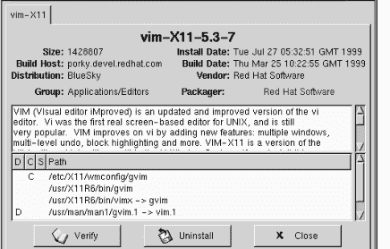

软件包的名称位于框顶部的中间。下方，框分为两列列出的信息；在此信息下方，您会看到一个显示软件包文件的显示区域。

在信息列表的左列中，您会发现文件的大小、其文件所在的机器、软件包分发的名称以及其功能所属的组。

在右列中，您会发现软件包在您的机器上的安装日期、软件包的构建日期、供应商的名称以及打包该软件的组的名称。如果软件包未在您的机器上安装，该位置将仅显示“未安装”。点击**打包者**后面的名称将导致您的浏览器电子邮件应用程序打开并处于撰写模式，以便您可以写信给打包者。

在信息列表的底部中间是应用程序开发人员的 URL（见图 7-11 *查询窗口中的 URL*）。类似于**打包者**条目的电子邮件功能，点击该 URL 将导致您的浏览器打开相应的网站。

#### 图 7–11 查询窗口中的 URL

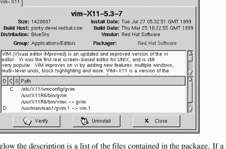

在描述下方是软件包中包含的文件列表。如果在路径左侧的相关列中出现**D**，则该文件是文档文件，阅读它有助于了解应用程序的使用。如果在其相应列中出现**C**，该文件是配置文件。在**S**列下，您可以查看软件包的“状态”；在此，如果软件包中有任何文件被报告为“缺失”（因此可能意味着软件包存在问题），您将获得相关信息。

如果您正在查询一个已安装的软件包，您还会发现此窗口底部有两个额外的按钮：**验证**和**卸载**。如果您正在查询一个尚未安装的软件包，底部的按钮将标记为**安装**、**升级**和**检查签名**。

要关闭查询窗口而不执行任何操作，请左点击窗口栏右上角的**X**。

### 7.5.2 验证软件包

验证软件包会检查软件包中的所有文件，以确保它们与系统上存在的文件匹配。校验和、文件大小、权限和所有者属性都与数据库进行检查。当您怀疑程序的某个文件因某种原因已损坏时，可以使用此检查。

选择要验证的软件包类似于选择要查询的软件包。在显示窗口中选择软件包，并使用工具栏上的**验证**按钮或菜单中的**软件包 ⇒ 验证**。会打开一个如图 7-12 *验证窗口* 所示的窗口。


当软件包正在检查时，您将在**验证**窗口中看到进度。如果在验证过程中发现任何问题，它们将在主显示区域中描述。

### 7.5.3 卸载软件包

卸载软件包会从您的机器中移除应用程序和相关文件。当软件包被卸载时，其使用的且系统中其他软件包不需要的文件也会被移除。更改过的配置文件会被复制到 `<filename>.rpm save` 中，以便您稍后重新使用。

> **请注意**
>
> 请记住，卸载软件包必须是 root 用户。

如果卸载软件包会破坏“依赖项”（这可能会阻碍需要该软件包中一个或多个被移除文件的其他应用程序），将会弹出一个对话框，要求您确认删除。如果您未从**首选项**菜单中选择“无依赖项检查”复选框（如图 7–13 *首选项中的行为选项卡* 所示），就会发生这种情况。

#### 图 7–13 首选项中的行为选项卡


您可以通过多种方法移除选定的软件包：从菜单中的**软件包**下；从工具栏；以及从**查询**功能。如果您决定一次移除多个软件包，您可以像安装、查询或验证时那样选择增量或全局选择。您的选择总数将反映在主窗口底部的状态栏中。由于您可以一次移除多个软件包，请谨慎选择您希望移除的软件包。

#### 图 7–14 卸载窗口


一旦您开始卸载，Gnome-RPM 会要求确认，显示一个如图 7–14 *卸载窗口* 所示的窗口。所有即将卸载的软件包都会列出。您应该查看所有这些软件包，以确保您不会移除想要保留的内容。点击**是**按钮将开始卸载过程。完成后，已移除的软件包和组将从它们所在的任何窗口中消失。

### 7.5.4 升级软件包


当软件包的新版本发布时，安装它到系统中非常容易。从可用软件包窗口中选择软件包的方式与您选择要安装的软件包的方式相同。工具栏上的升级按钮以及菜单中操作 => 升级都将开始该过程。您只需以安装新软件包相同的方式添加软件包。

在升级期间，您会看到类似于安装软件包时的进度指示器。完成后，旧版本的软件包将被移除，除非您另行指定（更多信息请参见第 7.4 节 配置）。

使用升级选项比卸载旧版本的软件包然后安装新版本要好得多。使用升级可以确保您对软件包配置文件所做的更改得到妥善保留，而卸载然后重新安装新软件包可能会导致这些更改丢失。

如果在安装过程中磁盘空间不足，安装将失败。但是，发生错误时正在安装的软件包可能会留下一些文件。为了清理此错误后的残留，请在腾出更多磁盘空间后重新安装该软件包。

## 8 轻量级目录访问协议（LDAP）

### 8.1 什么是 LDAP？

`LDAP`（轻量级目录访问协议）是一个用于网络上的全局或本地目录服务和/或互联网上的建议开放标准。目录在此意义上非常像电话簿。`LDAP` 可以处理其他信息，但目前通常用于将姓名与电话号码和电子邮件地址相关联。目录被设计用于支持大量查询，但目录中的数据并不经常更改。

`LDAP` 比纸质电话簿更有用得多，因为 `LDAP` 的设计旨在支持在 Internet 范围内的 `LDAP` 服务器之间的传播，就像域名服务（`DNS`）一样。`DNS` 系统充当互联网的地址簿，通过跟踪域名/IP 地址对来工作。`DNS` 服务器告诉联网的机器数据包需要去往哪里。在未来，`LDAP` 可以为许多类型的目录信息提供相同类型的全球访问；目前，`LDAP` 更常用于单个大型组织，如大学或公司，用于目录服务。

`LDAP` 是一个客户端-服务器系统。`LDAP` 客户端连接到 `LDAP` 服务器，并查询信息或提供需要输入到目录中的信息。服务器要么回答查询，将查询转交给另一个 `LDAP` 服务器，要么接受信息以整合到目录中。

`LDAP` 有时被称为 `X.500 Lite`。`X.500` 是目录的国际标准。`X.500` 功能齐全，但复杂且需要大量的计算资源和完整的 `OSI` 堆栈。相比之下，`LDAP` 可以轻松地运行在 `PC` 上并通过 `TCP/IP`。`LDAP` 可以访问 `X.500` 目录，但它不支持 `X.500` 的所有功能。

本章将讨论 `OpenLDAP` 的配置和使用，`OpenLDAP` 是 `LDAP` 的一个开源实现。`OpenLDAP` 包括 `slapd`，一个独立的 `LDAP` 服务器；

`slurpd`，一个独立的 `LDAP` 复制服务器；实现 `LDAP` 协议的库；实用程序；工具；以及示例客户端。

### 8.2 LDAP 的优缺点

使用 `LDAP` 的主要好处是将组织内某些类型的信息整合在一起。例如，组织内所有不同的用户列表可以合并到一个 `LDAP` 目录中。任何需要此信息的 `LDAP` 启用应用程序都可以查询该目录。用户也可以使用目录来获取目录信息。

`LDAP` 的其他优势包括其实现的简便性（与 `X.500` 相比），以及其定义良好的应用程序编程接口（`API`），这意味着拥有 `LDAP` 功能的应用程序和 `LDAP` 网关的数量在未来应该会增加。

从负面角度看，如果你想使用 `LDAP`，你需要支持 `LDAP` 的应用程序或者需要使用 `LDAP` 网关。如前所述，`LDAP` 的使用量将会增加，但目前，并没有大量支持 `LDAP` 的应用程序可用于 Linux 系统。此外，虽然 `LDAP` 支持一些访问控制，但它不支持像 `X.500` 那样多的安全特性。

### 8.3 LDAP 的用途

包括 Netscape Roaming Access 在内的多个 Netscape 应用程序都支持 `LDAP`。`Sendmail 8.9.x` 可以使用 `LDAP` 查找地址。你的组织可以使用 `LDAP` 作为全组织范围的目录和/或名称服务（替代 `NIS` 或平面文件）。你甚至可以使用个人 `LDAP` 服务器来管理自己的电子邮件地址簿（参见第 8.10 节，网络上的 LDAP 资源）。

可以通过 `pam_ldap` 模块将 `LDAP` 用作认证服务。`LDAP` 通常用作中央认证服务器，以便用户拥有一个统一的登录，涵盖控制台登录、`POP` 服务器、`IMAP` 服务器、使用 `Samba` 连接到网络的机器，甚至 `Windows NT` 机器。使用 `LDAP`，所有这些登录情况都可以依赖相同的用户 ID 和密码组合。

### 8.4 LDAP 术语

条目是 `LDAP` 目录中的一个单元。条目通过其唯一的**可分辨名称**（`DN`）进行标识或引用。

条目具有属性；属性是与条目直接相关的信息片段。例如，一个组织可以是 `LDAP` 条目。与该组织相关的属性可能包括其传真号码、地址等。人员也可以是 `LDAP` 目录中的条目。人员的常见属性包括他们的电话号码和电子邮件地址。

某些属性是必需的，而其他属性是可选的。对象类（`objectclass`）设置了哪些属性是必需的，哪些是可选的。对象类定义可以在 `slapd.oc.conf` 文件中找到。

`LDAP` 数据交换格式（`LDIF`）是一种用于 `LDAP` 条目的 ASCII 文本格式。向 `LDAP` 服务器导入或导出数据文件必须采用 `LDIF` 格式。`LDIF` 条目的外观如下：

```
[<id>]
dn: <distinguished name>
<attrtype>: <attrvalue>
<attrtype>: <attrvalue>
<attrtype>: <attrvalue>
```

一个条目可以包含尽可能多的 `<attrtype>: <attrvalue>` 对。空行表示该条目已结束，另一个条目即将开始。

`< >` 内部包含的一切都是变量，在添加 `LDAP` 条目时你可以设置它们，除了 `<id>`。`<id>` 是一个数字，通常由 `LDAP` 工具在添加条目时设置，你很可能永远不需要手动设置它。

### 8.5 OpenLDAP 文件

`OpenLDAP` 配置文件安装在 `/etc/openldap` 目录中。如果在 `/etc/openldap` 中执行 `ls`，你会看到类似以下内容：

```
$ ls
ldap.conf              ldapsearchprefs.conf    slapd.at.conf      slapd.oc.conf
ldappfilter.conf       ldaptemplates.conf      slapd.conf
```

你需要了解的 `slapd.conf`、`slapd.at.conf` 和 `slapd.oc.conf` 文件。`slapd.conf` 文件包含 `slapd` 守护进程和所有数据库后端 的配置信息。在启动 `slapd` 守护进程之前，你需要对 `slapd.conf` 进行一些修改。

`slapd.at.conf` 文件保存 `LDAP` 目录的属性语法定义。属性语法描述属性提供的信息类型。你有五个选择：

- `bin` -- 二进制信息
- `ces` -- 大小写精确字符串（大小写敏感的字符串）
- `cis` -- 大小写忽略字符串（大小写不敏感的字符串）
- `tel` -- 电话号码（忽略空格和连字符）
- `dn` -- 可分辨名称

例如，以下是典型 `slapd.at.conf` 中的属性语法定义：

```
attribute      photo                 bin
attribute      personalsignature     bin
attribute      jpegphoto             bin
attribute      audio                 bin
attribute       labeledurl           ces
attribute       ref                 ces
attribute       userpassword         ces
attribute       telephonenumber      tel
```

某些支持 `LDAP` 的应用程序可能需要你编辑 `slapd.at.conf` 文件，通常是为了添加特定的属性语法定义。

`slapd.oc.conf` 文件包含 `LDAP` 目录的对象类定义。对象类定义说明了特定对象类中哪些属性是必需的，哪些属性是可选的。

以下摘自典型的 `slapd.oc.conf` 文件，包含了 `top`、`alias` 和 `referral` 对象类的定义：

```
objectclass top
    requires     top

objectClass alias
    requires
        aliasedObjectName,
        objectClass

objectClass referral
    requires
        ref,
        objectClass
```


根据你的 LDAP 目录的使用方式，你可能需要编辑 `slapd.oc.conf` 中的对象类定义。例如，如果你正在为你的组织创建一个员工 LDAP 目录，你可能会为某些对象类设置特定的必需属性，这些属性可能不会在组织外部使用（例如，你组织内部的员工 ID 号可能是 `person` 对象类的一个必需属性）。

### 8.6 OpenLDAP 守护进程和实用程序

OpenLDAP 包包含两个守护进程：`slapd` 和 `slurpd`。`slapd` 守护进程是独立的 LDAP 守护进程，支持 LDAP 需要运行它。

`slurpd` 守护进程控制 LDAP 目录在网络上的复制。`Slurpd` 将变更从主 LDAP 目录发送到从 LDAP 目录。除非你的网络上有一个以上的 LDAP 服务器，否则你不需要运行 `slurpd`。如果你有多个 LDAP 服务器，你需要运行 `slurpd` 以保持 LDAP 目录同步。

OpenLDAP 还包括一些用于添加、修改和删除 LDAP 目录中条目的实用程序。`ldapmodify` 工具用于修改 LDAP 数据库中的条目。`ldapadd` 实用程序用于向目录添加条目（`ldapadd` 实际上是到 `ldapmodify -a` 的硬链接）。`Ldapsearch` 用于搜索条目，`ldapdelete` 用于删除条目。`ldif2ldbm` 工具将 LDIF 文件转换为 LDBM 后端数据库。

有关所有这些实用程序的更多信息，请参见它们的手册页。

### 8.7 为 LDAP 添加额外功能的模块

Red Hat Linux 包含以下为 LDAP 添加功能的软件包：

`nss_ldap` 模块是 **Solaris 名称服务切换（NSS）** 的 LDAP 模块。NSS 是一组 C 库扩展，用于访问 LDAP 目录信息，而不是或除了 **网络信息服务**（NIS 名称服务和/或平面文件）之外。需要使用 `nss_ldap` 模块才能将 LDAP 用作本地名称服务。

`pam_ldap` 模块用于将 LDAP 认证集成到可插拔认证模块（PAM）API 中。如果使用 `pam_ldap`，用户可以通过 LDAP 目录进行认证和更改密码。`nss_ldap` 和 `pam_ldap` 模块包含在 `nss_ldap` 软件包中。

Red Hat Linux 还包括 Apache Web 服务器的 LDAP 模块。`auth_ldap` 模块用于将 HTTP 客户端与 LDAP 目录中的用户条目进行认证。`php-ldap` 模块为 PHP3 HTML 嵌入式脚本语言添加了 LDAP 支持。`auth_ldap` 和 `php-ldap` 模块需要作为**动态共享对象**（DSO）编译到 Apache 中。

### 8.8 LDAP 操作指南：快速概述

本节提供了启用 LDAP 目录所需步骤的快速概述。

1. 确保安装了 `openldap` RPM 以及其他所需的任何 LDAP 相关 RPM。
2. 查看 OpenLDAP 网站上的快速入门指南（http://www.opendap.org/faq/data/cache/172.html；从“创建 slapd 配置文件”开始，因为 LDAP 文件已经安装），或者查看 Linux-LDAP HOWTO（http://www.linuxdoc.org/HOWTO/LDAP-HOWTO-HOWTO.html）以获取在你的系统上使用 LDAP 的说明。两者都涵盖了其余步骤。
3. 编辑 `slapd.conf` 文件以使其适合你的系统。
4. 启动 `slapd`。
5. 创建您的 LDAP 目录（PADL Software 网站在 http://www.padl.com/ldap_examples.html 提供了 LDAP 条目的示例）。
6. 使用 `ldapadd` 或脚本向您的 LDAP 目录中添加条目。
7. 使用 `ldapsearch` 查看 `slapd` 是否正在运行。
8. 此时，您的 LDAP 目录应该已经存在。下一步是配置支持 LDAP 的应用程序，使它们能够使用 LDAP 目录。

### 8.9 配置系统以使用 OpenLDAP 进行身份验证

本节简要概述了如何配置您的 Red Hat Linux 系统以使用 OpenLDAP 进行身份验证。除非您是 OpenLDAP 专家，否则您可能需要比这里提供的更多文档。请参阅第 8.10 节“网络上的 LDAP 资源”中提供的参考以获取更多信息。

#### 8.9.1 安装必要的 LDAP 软件包

首先，您需要确保 LDAP 服务器和 LDAP 客户端机器上都安装了相应的软件包。LDAP 服务器需要 `openldap` 软件包。

LDAP 客户端机器需要安装以下软件包：`openldap`、`auth_ldap`、`nss_ldap` 和 `pam_ldap`。

#### 8.9.2 编辑配置文件

##### 编辑 `/etc/openldap/slapd.conf`

位于 `/etc/openldap` 中的 `slapd.conf` 文件包含了您的 `slapd` LDAP 服务器所需的配置信息。您需要编辑此文件，使其针对您的域和服务器进行具体设置。

`suffix` 行指定了 LDAP 服务器将提供信息的域。`suffix` 行应从以下内容更改为：

```
suffix "dc=acmewidgets, dc=com"
```

或

```
suffix "dc=acmeuniversity, dc=org"
```

`rootdn` 条目是某个用户的 DN，该用户不受针对 LDAP 目录操作设置的访问控制或管理限制参数约束。`rootdn` 用户可以被视为 LDAP 目录的 root 用户。`rootdn` 行需要从以下内容更改为：

```
rootdn "cn=root, dc=your-domain, dc=com"
```

类似以下内容：

```
rootdn "cn=root, dc=redhat, dc=com"
```

或

```
rootdn "cn=ldapmanager, dc=my_organization, dc=org"
```

将 `rootpw` 行从以下内容更改为：

```
rootpw secret
```

类似以下内容：

```
rootpw {crypt}$4l9sOIJo4kBM
```

在上面的示例中，您使用的是加密的 root 密码，这是一个比在 `slapd.conf` 文件中留下明文 root 密码好得多的主意。要生成此加密字符串，您应该从 `passwd` 文件中复制出来，或者使用 Perl：

```
perl -e "print crypt('passwd','a_salt_string');"
```

在上面的 Perl 行中，`salt_string` 是一个两字符的盐，而 `passwd` 是密码的明文版本。

您也可以从 `/etc/passwd` 中复制 `passwd` 条目，但如果 `passwd` 条目是 MD5 密码（Red Hat Linux 6.2 的默认设置），则此方法无效。

##### 编辑 `ldap.conf`

编辑 LDAP 服务器和客户端上 `/etc` 和 `/etc/openldap` 中的 `ldap.conf` 文件。

编辑 `/etc/ldap.conf`（`nss_ldap` 和 `pam_ldap` 的配置文件），以反映您的组织和搜索基础。`/etc/openldap/ldap.conf` 文件是像 `ldapsearch`、`ldapadd` 等命令行工具的配置文件，它也需要根据您的 LDAP 设置进行编辑。客户端机器需要为系统修改这两个文件。

##### 编辑 `/etc/nsswitch.conf`

要使用 `nss_ldap`，您需要将 `ldap` 添加到 `/etc/nsswitch.conf` 的相应字段中。（编辑此文件时要非常小心；确保您知道自己在做什么。）例如：

```
passwd: files ldap
shadow: files ldap
group: files ldap
```

##### 复制 PAM 配置文件

要使用 `pam_ldap`，您需要将 PAM 配置文件从 `/usr/doc/nss_ldap>version>/pam.d/` 复制到您的 `/etc/pam.d/` 目录。这是一组允许所有标准 PAM 支持的应用程序使用 LDAP 进行身份验证的 PAM 配置文件。（PAM 超出了本 LDAP 概述的范围，因此如果您需要帮助，请查阅第 2.6 节“使用 PAM 进行用户身份验证”和/或 PAM man 手册页。）

#### 8.9.3 将旧的认证信息迁移到 LDAP 格式

`/usr/share/openldap/migration` 目录包含一组 shell 和 Perl 脚本，用于将您的旧认证信息迁移到 LDAP 格式。（是的，使用这些脚本需要在系统上安装 Perl。）

首先，您需要修改 `migrate_common.ph` 文件，使其反映您的域。默认的 DNS 域应从以下内容更改为：

```
$DEFAULT_MAIL_DOMAIN = "padi.com";
```

类似以下内容：

```
$DEFAULT_MAIL_DOMAIN = "your_company.com";
```


默认基础也应更改，从以下内容：

```
$DEFAULT_BASE = "dc=padl,dc=com";
```

更改为类似以下内容：

```
$DEFAULT_BASE = "dc=your_company,dc=com";
```

接下来，您需要决定使用哪个脚本。下表应能为您提供指导：

| 现有命名服务 | LDAP 是否正在运行？ | 使用此脚本： |
| :--- | :--- | :--- |
| `/etc` 平面文件 | 是 | `migrate_all_online.sh` |
| `/etc` 平面文件 | 否 | `migrate_all_offline.sh` |
| NetInfo | 是 | `migrate_all_netinfo_online.sh` |
| NetInfo | 否 | `migrate_all_netinfo_offline.sh` |
| NIS (YP) | 是 | `migrate_all_nis_online.sh` |
| NIS (YP) | 否 | `migrate_all_nis_offline.sh` |

根据您的现有命名服务运行相应的脚本。

`/usr/share/openldap/migration` 中的 `README` 和 `migration-tools.txt` 文件提供了更多细节。

### 8.10 网络上的 LDAP 资源

网络上可以找到大量有关 LDAP 的有用信息。在开始在系统上设置 LDAP 之前，请审阅这些资源，特别是 OpenLDAP 网站和 LDAP HOWTO。

**OpenLDAP**

http://www.openldap.org

**密歇根大学**

http://www.umich.edu/~dirsrvcs/ldap/

**SLAPD 和 SLURPD 管理员指南**

http://www.umich.edu/~dirsrvcs/ldap/doc/guides/slapd

**Innosoft/Critical Angle**

http://www.innosoft.com/ldapworld

**Jeff Hodges 的 LDAP 路线图和 FAQ**

http://www.kingsmountain.com/ldapRoadmap.shtml

**PADI (nss_ldap, pam_ldap 和 ypldapd)**

http://www.padl.com/

**auth_ldap**

http://www.rudedog.org/auth_ldap/1.4/auth_ldap.html

**LDAP HOWTO**

http://www.linixdoc.org/HOWTO/LDAP-HOWTO.html

**使用 LDAP 进行地址查找的 Sendmail 8.[89].x**

http://www.stanford.edu/~bbense/Inst.html

**使用个人 LDAP 服务器、Apache Web 服务器和 PHP 管理您的个人电子邮件地址簿**

http://www.webtechniques.com/archives/1999/05/junk/junk.shtml

此外，请记住，各种 LDAP 守护程序和工具都有 man 手册页。如果您需要更多信息，请检查 man 手册页。

# 第二部分 安装相关参考

## 9 准备文本模式安装

### 9.1 您应该知道的事情

在尝试安装 Red Hat Linux 之前，您应该收集一些系统信息，以防止安装期间出现任何意外。您可以在随系统附带的文档中找到大多数信息，或者从系统供应商或制造商处获取。

Red Hat Linux 支持的最新硬件列表可以在 http://www.redhat.com/hardware 找到。在继续之前，对照此列表检查您的硬件是个好主意。

#### 请注意

通过遵循本章和第 10 章《*通过文本模式安装 Red Hat Linux*》中的说明，您可以执行 Red Hat Linux 6.2 的文本模式安装。但是，如果您从 CD-ROM 安装，您可能会更喜欢使用图形安装模式，该模式既易于使用，又提供灵活的自定义类安装模式。有关图形安装的更多信息，请参阅《*Red Hat Linux 官方安装指南*》。

#### 提示

在《*Red Hat Linux 官方安装指南*》的《*开始之前*》章节末尾有一张表格，供您填写具体的系统需求，这将帮助您在安装过程中跟进所需的信息。

#### 9.1.1 基本硬件配置

您应该对计算机中安装的硬件有基本了解，包括：

- **硬盘驱动器** -- 具体而言，是数量、大小和类型。如果您有一个以上，最好知道哪个是第一块、第二块，等等。了解您的驱动器是 IDE 还是 SCSI 也很重要。如果您有 IDE 驱动器，应检查计算机的 BIOS，看看是否正在以**线性模式**访问它们。请参考计算机文档中访问 BIOS 的正确按键顺序。请注意，您的计算机 BIOS 可能以其他名称指代线性模式，例如“大磁盘模式”。同样，应查阅计算机文档以获取澄清。

- **内存** -- 计算机中安装的 RAM 数量。

- **CD-ROM** -- 最重要的是，该单元的接口类型（IDE、SCSI 或其他接口），以及对于非 IDE、非 SCSI CD-ROM，其制造商和型号。IDE CD-ROM（也称为 ATAPI）是在最近制造的 PC 兼容计算机中最常见的类型。

- **SCSI 适配器（如果存在）** -- 适配器的制造商和型号。

- **网卡（如果存在）** -- 网卡的制造商和型号。

- **鼠标** -- 鼠标的类型（串行、PS/2 或总线鼠标）、协议（Microsoft、Logitech、MouseMan 等）以及按钮数量；此外，对于串行鼠标，还要知道其连接的串行端口。

在许多新系统中，安装程序能够自动识别大多数硬件。但无论如何，收集这些信息是个好主意，以确保万无一失。

##### 通过 Windows 了解您的硬件

如果您的计算机已经运行 Windows 9x，您可以使用以下程序获取更多配置信息：


- 在 **Windows** 中，使用次要（通常是右侧）鼠标按钮点击 **我的电脑** 图标。应会出现一个弹出菜单。

- 选择 **属性**。应会出现 **系统属性** 窗口。注意 **计算机** 下列出的信息 -- 特别是列出的 RAM 数量。

- 点击 **设备管理器** 选项卡。您将看到计算机硬件配置的图形表示。确保选中了 **按类型显示设备** 按钮。

此时，您可以双击图标（或单击加号 +）来更详细地查看每一项。查找以下图标下的更多信息：

###### 图 9–2 Windows 95 下的设备管理器


- **磁盘驱动器** -- 您在这里可以查看硬盘驱动器的类型（IDE 或 SCSI）。（IDE 驱动器通常包含单词 "IDE"，而 SCSI 驱动器则不包含。）

- **硬盘控制器** -- 您可以在此处获取更多关于硬盘控制器的信息。

- **CDROM** -- 这里是您了解连接到计算机的任何 CD-ROM 驱动器的地方。

#### 请注意

在某些情况下，可能没有 CD-ROM 图标，但您的计算机有一个功能正常的 CD-ROM 驱动器。这是正常的，具体取决于最初如何安装 Windows。在这种情况下，您可能可以通过查看计算机 `config.sys` 文件中加载的 CD-ROM 驱动来获得额外信息。

- **鼠标** -- 您可以在此处找到计算机上存在的鼠标类型。

- **显示适配器** -- 如果您有兴趣运行 X 窗口系统，您应该记下在此处找到的信息。

- **声音、视频和游戏控制器** -- 如果您的计算机具有声音功能，您将在此处找到更多信息。

- **网络适配器** -- 您将在此处找到关于计算机网卡的额外信息（如果您有网卡）。

- **SCSI 控制器** -- 如果您的计算机使用 SCSI 外围设备，您将在这里找到有关 SCSI 控制器的额外信息。

虽然这种方法不能完全替代打开计算机机箱并物理检查每个组件，但在许多情况下，它可以提供足够继续安装的信息。

#### 请注意

通过点击 **打印** 按钮也可以打印此信息。将出现第二个窗口，允许您选择打印机以及报告类型（**所有设备** 和 **系统摘要** 报告类型最完整）。

#### 9.1.2 视频配置

如果您将安装 X 窗口系统，您还应该熟悉以下内容：

- **您的显卡** -- 显卡的制造商和型号（或它使用的视频芯片组），以及它拥有的视频 RAM 数量。（大多数基于 PCI 的显卡由安装程序自动检测。）

- **您的监视器** -- 该单元的制造商和型号，以及水平和垂直刷新率允许范围。（较新的型号可能由安装程序自动检测。）

#### 9.1.3 网络相关信息

如果您已连接到网络，请确保您知道以下内容：

- **IP 地址** -- 通常表示为一组由点分隔的四个数字，例如 10.0.2.15。


- **子网掩码** -- 另一组由点分隔的四个数字。一个子网掩码示例是 255.255.248.0。

- **网关 IP 地址** -- 又是一组由点分隔的四个数字。例如，10.0.2.254。

- **一个或多个名称服务器 IP 地址** -- 一个或多个由点分隔的数字组。例如，10.0.2.1 可能是名称服务器的地址。

- **域名** -- 您的组织使用的名称。例如，Red Hat 的域名是 redhat.com。

- **主机名** -- 分配给您个人系统的名称。例如，一台计算机可能命名为 pooh。

#### 请注意

上述信息仅为示例！安装 Red Hat Linux 时不要使用它！如果您不知道网络的正确值，请咨询您的网络管理员。

## 10 通过文本模式安装 Red Hat Linux

此版本的 Red Hat Linux 提供了图形化、基于鼠标的安装程序，已在 *官方 Red Hat Linux 安装指南* 中有说明。但您也可以使用文本模式、基于键盘的安装程序来安装 Red Hat Linux。本章解释了如何使用它。以下是一些建议：

- 如果您是 Linux 安装的新手，请先阅读 *官方 Red Hat Linux 安装指南*。虽然它侧重于图形安装过程，但大多数概念也适用于文本模式安装。之后，您会发现有第 9 章 *准备文本模式安装* 提供了关于 Red Hat Linux 安装中不适用于图形安装过程的那些方面的更详细信息。

- 此外，您会发现附录 B *磁盘分区简介* 很有帮助，因为它讨论了磁盘分区调整大小（如果您计划在一个当前已安装其他操作系统的磁盘上安装 Linux，这一点至关重要）。

- 如果您需要 PCMCIA 支持来执行安装（例如，您正在一个配备 PCMCIA 卡的笔记本电脑上进行安装），您必须制作一个 PCMCIA 启动盘。*官方 Red Hat Linux 安装指南* 解释了如何做到这一点。

- 如果您计划通过网络（通过 NFS、FTP 或 HTTP）安装，您必须制作一个网络启动盘。*官方 Red Hat Linux 安装指南* 解释了如何做到这一点。

- 如果您从未使用过文本模式安装程序，或者需要复习其用户界面，请阅读下一节。

- 若要立即开始安装，请转到第 10.2 节 *启动安装程序*。

### 10.1 安装程序用户界面

Red Hat Linux 文本模式安装程序使用基于屏幕的界面，其中包括通常在图形用户界面上常见的许多屏幕“小部件”。图 10–1 *在配置 TCP/IP 中看到的安装程序小部件*

#### 图 10–1 在“配置 TCP/IP”界面中显示的安装程序控件


#### 图 10–2 在“磁盘安装向导”界面中显示的 安装程序控件


以下是图 10–1（*在“配置 TCP/IP”界面中显示的安装程序控件*）和图 10–2（*在“磁盘安装向导”界面中显示的安装程序控件*）中最重要的控件列表：

- **窗口** -- 在安装过程中，屏幕上会出现窗口（本手册中通常称为**对话框**）。有时，一个窗口可能会覆盖在另一个窗口之上；在这种情况下，你只能与最顶层的窗口进行交互。当你完成该窗口中的操作后，它将消失，允许你继续在底下的窗口中工作。

- **文本输入** -- 文本输入行是你可以输入安装程序所需信息的区域。当光标停留在文本输入行上时，你可以输入和/或编辑该行上的信息。

- **复选框** -- 复选框允许你选择或取消选择某个功能。方框中显示的要么是一个星号（已选择），要么是一个空格（未选择）。当光标位于复选框内时，按 `[空格]` 键可选择未选定的功能或取消已选定的功能。

- **文本控件** -- 文本控件是用于显示文本的屏幕区域。有时，文本控件可能还包含其他控件，如复选框。如果文本控件包含的信息量超过为其预留的空间所能显示的数量，则会出现滚动条；如果你将光标置于文本控件内，可以使用 `[上]` 和 `[下]` 方向键滚动浏览所有可用信息。你在滚动条上的当前位置由一个 `#` 字符显示，该字符会随着你的滚动而上下移动。

- **按钮控件** -- 按钮控件是与安装程序交互的主要方式。你通过导航这些按钮来推进安装程序的各个窗口，使用 `[Tab]` 和 `[Enter]` 键。当按钮被高亮显示时，它们可以被选择。

- **光标** -- 虽然光标不是控件，但它用于选择（并交互）特定的控件。当光标从控件移动到控件时，它可能会导致控件改变颜色，或者你可能只会看到光标本身定位在控件内或旁边。在图 10–1（*在“配置 TCP/IP”界面中显示的安装程序控件*）中，光标位于 **OK**（确定）按钮上。图 10–2（*在“磁盘安装向导”界面中显示的安装程序控件*）显示光标位于 *Edit*（编辑）按钮上。

#### 10.1.1 使用键盘进行导航

通过安装对话框的导航是通过一组简单的按键操作完成的。要移动光标，请使用 `[左]`、`[右]`、`[上]` 和 `[下]` 方向键。使用 `[Tab]` 和 `[Alt]`-`[Tab]` 在屏幕上的每个控件之间向前或向后循环切换。大多数屏幕在底部都会显示可用光标定位键的摘要。

要“按下”按钮，请将光标定位在按钮上（例如使用 `[Tab]` 键），然后按 `[空格]` 键或 `[Enter]` 键。要从列表中选择一个项目，将光标移动到你想要选择的项目上并按 `[Enter]` 键。要选择带有**复选框**的项目，将光标移动到复选框上并按 `[空格]` 键以选择该项目。要取消选择，第二次按 `[空格]` 键。

按 `[F12]` 接受当前值并进入下一个对话框；它相当于按下 **OK**（确定）按钮。


除非对话框正在等待你的输入，否则请勿在安装过程中按下任何键（这样做可能会导致不可预测的行为）。

### 10.2 启动安装程序

有几种方法可以启动安装。你可以：

- 将盒装套装中包含的软盘（或你创建的 PCMCIA 引导盘或网络引导盘）插入主软盘驱动器并重新启动计算机

- 如果你的计算机可以从 CD-ROM 驱动器启动，则将 Red Hat Linux CD 插入驱动器并重新启动

- 启动 MS-DOS，并启动 Red Hat Linux CD-ROM 中 `dosutils` 目录下名为 `autoboot.bat` 的程序（这仅从 DOS 起作用；从 Windows 启动的 DOS 窗口中不起作用）

在安装程序加载期间，消息将在你的屏幕上滚动显示。当安装程序加载完成后，会出现此提示：

```
boot:
```

#### 10.2.1 显示在线帮助

一旦安装程序加载到内存中，你可以通过按 `[F1]` 到 `[F6]` 键获取关于安装过程和选项的信息。例如，按 `[F2]` 查看关于在线帮助屏幕的一般信息。

#### 10.2.2 文本模式引导选项

如果你按 `[Enter]` 键进入 `boot` 提示符，或者在 `boot` 提示符出现后的一分钟内不采取任何操作，则图形安装程序（如《官方 Red Hat Linux 安装指南》中所述）将启动。按下上文描述的任一帮助屏幕功能键将禁用此自动启动功能。

要启动本文所述 的文本模式安装程序，在按 `[Enter]` 键之前，输入：

```
boot: text
```

如果安装程序未能正确检测你的硬件，你可能需要在“专家”模式下重新启动安装。要启动专家模式安装，输入：

```
boot: text expert
```

专家模式会禁用大多数硬件探测，并给予你输入安装期间加载的驱动程序的选项的权限。

> **请注意**
>
> 初始引导消息中不会包含对 SCSI 或网络卡的任何引用。这是正常的；这些设备由在安装过程中加载的模块支持。

注意，启动串行安装的命令已更改。如果你必须在串行模式下执行安装，请键入：

```
boot: linux console=<device>
```

其中 `<device>` 应该是你正在使用的设备（例如 `ttyS0` 或 `ttyS1`）。

可以与 `boot` 命令一起输入的其他选项包括向内核传递选项。例如，要指示内核使用 128 MB 系统中的所有 RAM，请输入：

```
boot: linux mem=128M
```

### 10.3 选择语言

使用 `[上]` 和 `[下]` 方向键，为安装程序和系统默认选择适当的语言，然后按 `[Enter]` 键（图 10–3，*选择语言*）。

#### 图 10–3 选择语言


列表右侧会出现一个滚动条。这表明条目数量多于当前可用空间一次能显示的数量。你将在整个安装程序的其他地方看到类似的滚动条。

### 10.4 选择键盘类型

接下来，选择一种键盘类型（图 10–4，*选择键盘类型*）。

#### 图 10–4 选择键盘类型


选择适当的键盘类型后，按 [Enter] 键；你选择的键盘类型将自动加载，既用于安装过程的剩余部分，也用于每次启动你的 Red Hat Linux 系统时。

> **提示**
>
> 如果你希望在安装 Red Hat Linux 系统后更改键盘类型，请获取 root 权限，并在 root 提示符下输入 `/usr/sbin/kbdconfig` 或 `setup`。

### 10.5 选择安装方法

如果你直接从 Red Hat Linux CD-ROM 启动，你将看到**欢迎**对话框：请转到第 10.8 节，*欢迎*。

否则，将出现**安装方法**对话框。对话框中呈现的选择项因你启动所用的软盘类型而异（盒装套装中的那一张，或你创建的网络或 PCMCIA 引导盘）。

图 10–5（*安装方法对话框*）显示了所有可用的选择项。

#### 图 10–5 安装方法对话框


> **请注意**
>
> 如果你正在执行网络安装，并且正在从 Red Hat Linux CD-ROM 或 FTP 站点复制文件，请务必检查文件权限，以确保它们为你的安装设置正确。如果未这样做，你复制的文件将不可执行，你将在安装之前必须更改权限。

Red Hat Linux 可以通过以下任何方式进行安装：

#### 本地 CDROM

如果您从包装盒中的软盘启动，并使用本地驱动器中的 Red Hat Linux CD-ROM 进行安装，接下来您会看到 **Welcome**（欢迎）对话框；请参见第 10.8 节，*Welcome*（欢迎）。

#### NFS 映像

如果您通过网络或 PCMCIA 启动盘启动，并正在从导出 Red Hat Linux CD-ROM（或其镜像）的 NFS 映像服务器进行安装，接下来您会看到 **NFS Setup**（NFS 设置）对话框；请参见第 10.7 节，*Installing over a Network*（通过网络安装）。

#### FTP

如果您通过网络或 PCMCIA 启动盘启动，并直接从 FTP 服务器进行安装，接下来您会看到 **FTP Setup**（FTP 设置）对话框；请参见第 10.7 节，*Installing over a Network*（通过网络安装）。

#### HTTP

如果您通过网络或 PCMCIA 启动盘启动，并直接从 HTTP Web 服务器进行安装，接下来您会看到 **HTTP Setup**（HTTP 设置）对话框；请参见第 10.7 节，*Installing over a Network*（通过网络安装）。

#### 硬盘

如果您从包装盒中的软盘启动，并正在从您先前复制到本地硬盘的 Red Hat Linux 文件进行安装，接下来您会看到 **Select Partition**（选择分区）对话框；请参见第 10.6 节，*Identify Disk Partition to Install From*（确定安装源磁盘分区）。

### 10.6 确定安装源磁盘分区

**Select Partition**（选择分区）屏幕（图 10–6，*Selecting Partition Dialog for Hard Drive Installation*（硬盘安装的选择分区对话框））仅适用于从磁盘分区进行安装的情况（即您在 **Installation Method**（安装方法）对话框中选择了 **Hard Drive**（硬盘））。此对话框允许您命名正在从中安装的磁盘分区。


输入包含 RedHat 目录树的分区的设备名称。还有一个标有 **Directory holding Red Hat**（包含 Red Hat 的目录）的字段。如果 RedHat 目录不在该分区的根目录中，请输入指向 RedHat 目录的路径（例如，如果 RedHat 目录位于 `/test/new/RedHat`，则输入 `/test/new`）。

确定磁盘分区后，接下来您将看到 **Welcome**（欢迎）对话框：现在请转到第 10.8 节，*Welcome*（欢迎）。

### 10.7 通过网络安装

如果您正在执行网络安装，将出现 **Configure TCP/IP**（配置 TCP/IP）对话框；有关此对话框的说明，请前往第 10.13 节 *Configuring a Network Connection*（配置网络连接），然后返回此处。

#### 10.7.1 NFS 设置

NFS 设置对话框（图 10–7，NFS 设置对话框）仅适用于从 NFS 服务器进行安装的情况（即您通过网络或 PCMCIA 启动盘启动，并在安装方法对话框中选择了 NFS 映像）。

**图 10–7 NFS 设置对话框**


输入您的 NFS 服务器的主机名或 IP 地址，以及包含 Red Hat Linux 安装文件或 CD 的导出目录的名称。例如，如果您正在从域名 `redhat.com` 中名为 `east.coast` 的主机进行安装，请在 `NFS Server`（NFS 服务器）字段中输入 `east.coast.redhat.com`。

如果 NFS 服务器将 Red Hat Linux CD 挂载在 `/mnt/cdrom` 上，请在 Red Hat 目录字段中输入 `/mnt/cdrom`。如果 NFS 服务器导出的 Red Hat Linux 安装树的镜像而不是 CD，请输入包含 RedHat 目录的目录。例如，如果您的 NFS 服务器包含目录 `/mirrors/redhat/i386/RedHat`，则输入 `/mirrors/redhat/i386`。

#### 请注意

如果您正在执行 NFS 安装并正在从 Red Hat Linux CD-ROM 复制文件，请务必检查文件权限，以确保它们为您的安装正确设置。如果没有，您复制的文件将不可执行，您必须在安装之前更改权限。

接下来您将看到 **Welcome**（欢迎）对话框：现在请转到第 10.8 节，*Welcome*（欢迎）。

#### 10.7.2 FTP 设置

FTP 设置屏幕（图 10-8，FTP 设置对话框）仅适用于从 FTP 服务器进行安装的情况（即您在安装方法对话框中选择了 FTP）。此对话框允许您识别正在从中安装的 FTP 服务器。

**图 10-8 FTP 设置对话框**


输入您正在从中安装的 FTP 站点的主机名或 IP 地址，以及该站点中包含适用于您的架构的 RedHat 安装文件的目录的名称。例如，如果 FTP 站点包含目录 `/pub/mirrors/redhat/i386/RedHat`，请输入 `/pub/mirrors/redhat/i386`。

如果所有设置都正确指定，将显示一个消息框，指示正在获取 `base/hdlist`。

接下来您将看到 **Welcome**（欢迎）对话框：现在请转到第 10.8 节，*Welcome*（欢迎）。

#### 10.7.3 HTTP 设置

**HTTP Setup**（HTTP 设置）屏幕（图 10-9，*HTTP Setup Dialog*（HTTP 设置对话框））仅适用于从 HTTP 服务器进行安装的情况（即您在 **Installation Method**（安装方法）对话框中选择了 **HTTP**）。此对话框提示您输入有关正在从中安装的 HTTP 服务器的信息。

**图 10-9 HTTP 设置对话框**


输入您正在从中安装的 HTTP 站点的主机名或 IP 地址，以及该站点中包含适用于您的架构的 RedHat 安装文件的目录的名称。例如，如果 HTTP 站点包含目录 `/pub/mirrors/redhat/i386/RedHat`，请输入 `/pub/mirrors/redhat/i386`。如果所有设置都正确指定，将显示一个消息框，指示正在获取 `base/hdlist`。

接下来您将看到 **Welcome**（欢迎）对话框：现在请转到第 10.8 节，*Welcome*（欢迎）。

### 10.8 欢迎

一旦您选择了语言和键盘，并指定了安装方法，就会显示欢迎对话框（图 10–10）。按确定继续。

**图 10–10 欢迎对话框**


### 10.9 升级或安装

**Installation Type**（安装类型）对话框（图 10–11，*Installation Type Dialog*（安装类型对话框））为您提供以下五种选择，描述如下。

**图 10–11 安装类型对话框**


### 安装选项

#### Install GNOME Workstation（安装 GNOME 工作站）
安装在一个主要用作工作站的系统上。加载 GNOME 图形界面，并配置系统在启动时自动启动 GNOME。安装程序会删除所有现有 Linux 分区中的数据，决定如何为新版本划分磁盘分区，并选择要加载哪些软件包。

> **警告**
>
> 如果您正在与 Windows NT 共享磁盘，请不要选择此方法；否则，您将无法启动 Windows NT。`LILO` 将覆盖 NT 的引导加载器，您将无法启动 NT。您必须执行自定义级安装，并配置 `LILO` 使其不安装在主引导记录（`MBR`）上。
>
> 要在当前装有 NT 的系统中创建双启动环境，您必须将 `LILO` 安装在根分区的第一个扇区，而不是 `MBR`。请务必创建一张启动盘。在这种情况下，您要么使用启动盘，要么配置 NT 系统加载器从根分区的第一个扇区启动 `LILO`。务必查阅 http://www.linux-doc.org/HOWTO/mini/Linux+NT-Loader.html 以获取有关设置 `LILO` 和 NT 的更多信息。

#### Install KDE Workstation（安装 KDE 工作站）
安装在一个主要用作工作站的系统上。加载 KDE 图形界面，并配置系统在启动时自动启动 KDE。安装程序会删除所有现有 Linux 分区中的数据，决定如何为新版本划分磁盘分区，并选择要加载哪些软件包。

如果您正在与 Windows NT 共享磁盘，请不要选择此方法；否则，您将无法启动 Windows NT。`LILO` 将覆盖 NT 的引导加载器，您将无法启动 NT。您必须执行自定义级安装，并配置 `LILO` 使其不安装在主引导记录（`MBR`）上。

要在当前装有 NT 的系统中创建双启动环境，您必须将 `LILO` 安装在根分区的第一个扇区，而不是 `MBR`。请务必创建一张启动盘。在这种情况下，您要么使用启动盘，要么配置 NT 系统加载器从根分区的第一个扇区启动 `LILO`。务必查阅 http://www.linux-doc.org/HOWTO/mini/Linux+NT-Loader.html 以获取有关设置 `LILO` 和 NT 的更多信息。

#### Install Server System（安装服务器系统）
安装在一个主要用作服务器的系统上。未配置 X 窗口系统，且系统启动时不启动任何图形界面。安装程序删除*所有*现有*任何类型*分区中的*所有*数据，决定如何为新版本划分磁盘分区，并选择要加载哪些软件包。

#### Install Custom System（安装自定义系统）
执行自定义安装。您决定所有关于磁盘分区和初始化的事项，要安装哪些软件包，以及如何配置 X 窗口系统和用户界面。

### 10.9.1 升级

**升级现有系统** -- 升级早期版本的 Red Hat Linux（2.0 或更高版本），且无需删除任何现有数据。安装程序将更新模块化的 2.2.x 内核以及所有当前已安装的软件包。

如果您选择升级，并且安装程序检测到系统上安装了多个 Linux 版本，系统会要求您选择要升级的版本。在您指定版本后，或者如果系统上仅安装了一个 Linux 版本，安装程序将探测现有系统以确定哪些软件包需要更新，并显示**定制待升级软件包**对话框（图 10-12，*定制待升级软件包对话框*）。

##### 图 10-12 定制待升级软件包对话框


如果您回答**否**，安装程序将开始升级现有软件包。如果您希望添加或移除待升级独立软件包列表中的项目，请回答**是**。软件包选择对话框参见第 10.19.1 节，*选择独立软件包*。在您完成更改后，升级将开始。

> **请注意**
>
> 某些升级的软件包可能还需要安装其他软件包才能正确运行。升级过程会处理这些**依赖项**，但在这样做时，可能需要安装系统中原本没有的额外软件包。

升级过程通过使用 `.rpmsave` 扩展名（例如，`sendmail.cf.rpmsave`）重命名来保留现有配置文件，并在 `/tmp/upgrade.log` 中留下日志，记录其所采取的操作。随着软件的演变，配置文件格式可能会发生变化，因此在整合您的更改之前，您应该仔细比较原始配置文件与新文件。

您接下来看到的对话框是图 10–40，*软件包安装状态对话框*。此对话框将保留在屏幕上，直到升级完成。

### 10.9.2 安装

如果您选择工作站或服务器级别的安装，将会显示图 10–13，*自动分区对话框*。


如果您选择**继续**并按**确定**，安装程序将对您的磁盘进行分区，并决定要安装哪些软件包。接下来，您将看到在第 10.12 节*为您的计算机命名*中说明的**主机名**对话框。

如果您选择**手动分区**或选择执行自定义级别的安装，Disk Druid 将启动。下一节中描述的磁盘分区对话框将会出现，显示系统上当前的任何分区。由您来指示安装此版本 Red Hat Linux 时使用的分区和挂载点。


在另一个 Linux 安装（包括 Red Hat Linux）上安装 Red Hat Linux *不会*保留先前安装的任何信息（文件或数据）。请确保您已保存任何重要文件！如果您担心保存现有 Red Hat Linux 系统上的当前数据（且不想自行进行备份），应考虑执行升级而不是覆盖安装。

### 10.10 为 Red Hat Linux 分区磁盘

如果您尚未计划如何设置分区，请查看附录 B，*磁盘分区简介*。在那里，您会找到基本磁盘分区概念的简介。至少，您需要一个大小适当的根分区，以及一个至少为 16 MB 的交换分区。

图 10–14，*磁盘设置对话框*显示了两个可供您使用的磁盘分区应用程序。


如果您正在使用 *fdisk* 对驱动器进行分区，请参阅第 10.10.11 节，*使用 fdisk* 以了解相关说明。如果您选择 Disk Druid，请继续阅读下文。


以下各节描述了图 10-15，Disk Druid 主屏幕的布局以及如何使用其按钮来设置分区。如果您已经熟悉 Disk Druid，可以对磁盘进行分区并跳到第 10.10.10 节，选择要格式化的分区对话框。

您使用磁盘分区对话框来告知安装程序在哪里安装 Red Hat Linux（图 10-15，Disk Druid 主屏幕）。


#### 10.10.1 当前磁盘分区部分

**当前磁盘分区**部分中的每一行代表一个磁盘分区。在这个示例（图 10-15，*Disk Druid 主屏幕*）中，存在现有的 Linux 分区。请注意右侧的滚动条，它指示可能存在无法一次全部显示的更多分区。如果使用 [上] 和 [下] 方向键，您可以查看是否还有其他分区。此部分中的每一行都有五个不同的字段：

- **挂载点** -- 指示安装 Red Hat Linux 时分区将被挂载的位置（例如 `/, /boot, 或 swap`）。
- **设备** -- 显示具体的硬盘和分区信息。
- **请求** -- 显示分区的初始大小。
- **实际** -- 显示分区的当前大小。
- **类型** -- 显示分区的类型。

当您浏览**当前磁盘分区**部分时，您可能会看到一个*未分配的请求分区*标题栏，随后是一个或多个分区。这些是已请求但出于某种原因尚未分配的分区。存在未分配分区的一个常见原因是没有足够的空闲空间用于该分区。无论如何，分区保持未分配的原因将在该分区的挂载点之后显示。

#### 10.10.2 驱动器摘要部分

**驱动器摘要**部分中的每一行代表系统中的一个硬盘。每一行具有以下字段：

- **驱动器** — 显示硬盘的设备名称。
- **几何 [C/H/S]** — 显示硬盘的**几何参数**。几何参数由三个数字组成，代表硬盘报告的柱面数、磁头数和扇区数。
- **总计** — 显示硬盘上的总可用空间。
- **已用** — 显示硬盘空间中当前分配给分区的量。
- **空闲** — 显示硬盘空间中仍未分配的剩余量。
- **柱状图** — 以可视化形式表示硬盘当前使用的空间。方括号之间的磅号（#）越多，空闲空间越少。在图 10–15，*Disk Druid 主屏幕*中，柱状图显示没有空闲空间。

> **请注意**
>
> **驱动器摘要**部分仅用于指示计算机的磁盘配置。它不是用来指定给定分区的目标硬盘的手段。这在第 10.10.5 节，*添加分区*中有更完整的描述。

#### 10.10.3 Disk Druid 的按钮


这些按钮控制 Disk Druid 的操作。它们用于添加和删除分区，以及更改分区属性。此外，还有用于接受您所做的更改或完全退出 Disk Druid 的按钮。让我们依次查看每个按钮。

- `添加` -- 请求一个新分区。选择此按钮会弹出一个包含必须填写字段的对话框。
- `编辑` -- 修改当前磁盘分区部分中当前高亮分区的挂载点。选择此按钮会弹出一个对话框，允许您更改挂载点的名称。
- `删除` -- 删除当前磁盘分区部分中当前高亮的分区。选择此按钮会弹出一个对话框，要求您确认删除。
- `确定` -- 确认将系统分区的更改写入磁盘。在 Disk Druid 重写硬盘分区表之前，您将被要求确认这些更改。此外，您定义的任何挂载点都会传递给安装程序，并最终用于定义 Red Hat Linux 系统的文件系统布局。
- `返回` -- 中止操作，不保存您所做的任何更改。选择此按钮时，安装程序将带您返回到上一个屏幕，以便您可以重新开始。

### 10.10.4 有用的功能键

使用 `[F5]`（重置）功能键可丢弃您在 Disk Druid 中可能已做的所有更改，并将分区列表恢复为从硬盘上的分区表读取的内容。选中时，您将被要求确认是否要丢弃更改。请注意，您指定的任何挂载点都将丢失，并且需要重新输入。

### 10.10.5 添加分区

若要添加新分区，请选择 `Add` 按钮并按下 `[Space]` 或 `[Enter]`。随后将显示 `Edit New Partition` 对话框（图 10–16，*Edit New Partition 对话框*）。

#### 图 10–16 Edit New Partition 对话框


该屏幕包含以下字段：

- `Mount Point` -- 高亮显示此字段并输入分区的挂载点。例如，如果此分区应为主分区，请输入 `/`；对于 `/usr` 分区请输入 `/usr`，以此类推。
- `Size (Megs)` -- 在此字段中，输入分区的大小（以兆字节为单位）。请注意，此字段默认包含一个 "1"，这意味着除非您更改它，否则最终会得到一个 1 MB 的分区。使用 `[Backspace]` 键删除它，然后输入所需的分区大小。
- `Grow to fill disk?` -- 此复选框表明前一个字段中输入的大小是被视为分区的确切大小，还是其最小大小。按 `[Space]` 来选择此选项。当选定后，分区将扩展以填满硬盘上所有可用空间。在这种情况下，随着其他分区的修改，分区的大小将随之扩展和收缩。如果您将多个分区设置为可扩展，这些分区将争抢磁盘上的可用空闲空间。
- `Type` -- 此字段包含不同分区类型的列表。使用 `[Up]` 和 `[Down]` 箭头键选择合适的分区类型。
- `Allowable Drives` -- 此字段包含系统上安装的硬盘列表，每个硬盘都有一个复选框。如果某个硬盘的复选框被勾选，则可以在该硬盘上创建此分区。通过使用不同的复选框设置，您可以指导 Disk Druid 按照您的意愿放置分区，或者让 Disk Druid 自行决定分区的位置。
- `Ok` -- 当您对分区设置感到满意并希望创建该分区时，请选择此按钮并按下 `[Space]`。
- `Cancel` -- 当您不希望创建该分区时，请选择此按钮并按下 `[Space]`。

### 10.10.6 添加分区时的问题

> `请注意`
>
> 如果您在添加分区时遇到问题，请参见附录 B，*磁盘分区简介*，以寻找解决方案。

如果您尝试添加分区但 Disk Druid 无法执行您的请求，您将看到一个对话框，其中列出了当前未分配的任何分区，以及它们无法分配的原因，如图 10–17，*未分配分区对话框* 所示。选择 `OK` 按钮，并按下 `[Space]` 继续。请注意，未分配的分区也会显示在 Disk Druid 的主屏幕上（您可能需要滚动 `Current Disk Partitions` 部分才能看到它们）。

#### 图 10–17 未分配分区对话框


### 10.10.7 编辑分区

若要更改分区的挂载点，请在 `Current Disk Partitions` 部分中高亮显示该分区，选择 `Edit` 按钮，并按下 `[Space]`。`Edit Partition` 对话框类似于图 10–16，*Edit New Partition 对话框* 中所示的对话框。区别在于，除了挂载点以外的所有字段均为只读。若要修改其他任何值，请删除该分区并使用新值重新添加。

#### 图 10−18 Edit Partition 对话框


### 10.10.8 删除分区

若要删除分区，请在 `Current Disk Partitions` 部分中高亮显示该分区，选择 `Delete` 按钮，并按下 `[Space]`。系统将要求您确认删除操作。

### 10.10.9 完成时

一旦您配置好分区并输入挂载点，您的屏幕应类似于图 10−19，Current Disk Partitions 对话框。

#### 图 10–19 Current Disk Partitions 对话框


### 10.10.10 选择要格式化的分区对话框

接下来，选择您想要格式化的分区（图 10–20，选择要格式化的分区）。您必须格式化所有新建的分区以及其他包含旧数据的分区（假设这些分区不包含您希望保留的数据）。


> `警告`
>
> 如果 `/home` 或 `/usr/local` 等分区已存在且包含您希望保留的数据，请不要选择对这些分区进行格式化。

当您选择好要格式化的分区后，按下 `[Space]`。如果您希望在格式化每个文件系统时检查坏块（对于使用较旧磁盘驱动器的用户推荐此选项），请选择 `Check for bad blocks during format`。选择 `OK`，并按下 `[Space]`。

### 10.10.11 使用 `fdisk`

如果您选择了自定义类安装，那么您也选择了要使用的磁盘分区应用程序。本节仅适用于您选择使用 `fdisk` 的情况。

选择 fdisk 后，您将看到 `Partition Disks` 对话框（图 10–21，磁盘设置对话框）。在此框中列出了计算机上的所有磁盘。使用 `[Tab]` 以及 `[Up]` 和 `[Down]` 箭头键，高亮显示您要分区的磁盘，选择 `Edit`，并按下 `[Space]`。

然后您将进入 fdisk，可以对所选磁盘进行分区。对您想要分区的每个磁盘重复此过程。完成后，选择 `Done`。

#### 图 10–21 磁盘设置对话框


##### fdisk 概述

`fdisk` 包含在线帮助，内容简洁但实用。以下是一些提示：

- 帮助命令为 `m`。
- 若要列出当前分区表，请使用 `p` 命令（参见图 10–22，*fdisk 示例输出*）。
- 若要添加新分区，请使用 `n`。
- Linux 版本的 `fdisk` 默认创建类型为 Linux native 的分区。当您创建交换分区时，请别忘了使用 `t` 命令将其类型更改为 Linux swap。Linux swap 类型的值为 82。对于其他分区类型，请使用 `I` 命令查看分区类型及其值的列表。
- Linux 允许在一个磁盘上创建最多四个（4）分区。如果您希望创建更多，那么这四个分区中只能有一个（且仅一个）可以是扩展分区，扩展分区作为容器，用于容纳一个或多个逻辑分区。由于它充当容器，扩展分区的大小必须至少等于其包含的所有逻辑分区的总大小。
- 在创建每个分区时，记下哪些分区（例如 `/dev/hda2`）用于哪些文件系统（例如 `/usr`）是个好主意。

> `请注意`
>
> 您所做的更改只有在保存并使用 `w` 命令退出 `fdisk` 后才会生效。您可以随时使用 `q` 命令退出 `fdisk` 而不保存更改。

#### 图 10–22 fdisk 示例输出


##### 更改分区表


当您完成磁盘分区后，按下 `Done`；您可能会看到一条消息，提示安装程序需要重启。这是在更改磁盘分区数据后的正常现象；如果您创建、更改或删除了任何扩展分区，通常会发生这种情况。在您按下 `OK` 后，计算机将重启，安装将重新开始。重复您之前执行的相同安装步骤，直到到达 **Partition Disks** 对话框；然后只需选择 `Done` 即可。

## 10.11 安装 LILO

`LI[nuX L]oader`（`LILO`）允许您在启动时指定是启动 Linux 还是其他操作系统。（如果您执行的是工作站级或服务器级安装，`LILO` 会自动配置在主引导记录 [`MBR`] 中。）如果您执行的是自定义类安装，**LILO Installation** 对话框允许您指示如何安装或不安装 `LILO`。

### LILO 配置对话框

在 **LILO 配置对话框中选择 LILO** 对话框（图 10–23，*在 LILO 配置对话框中选择 LILO*）中，您可以向 `LILO` 启动命令添加默认选项，或者选择完全不安装 `LILO`。您输入的任何选项都将在启动时传递给 Linux 内核。

#### 图 10–23 在 LILO 配置对话框中选择 LILO


在第 9.1.1 节 *基本硬件配置* 中，我们要求您检查计算机的 BIOS 设置。在查看 BIOS 设置时，如果您确定您的系统未以线性模式访问硬盘，请取消选择此选项。**使用线性模式** 默认是被选中的。选择 `确定` 并按 `[Space]` 键继续。

如果您不希望安装 `LILO`，请按 `跳过`。

> **警告**
>
> 如果您选择跳过，您将无法直接启动您的 Red Hat Linux 系统，并且需要使用其他启动方法（例如启动盘）。仅当您确定有其他方式启动 Red Hat Linux 系统时，才使用此选项！

#### 10.11.1 LILO 的替代方案

如果您不希望使用 `LILO` 来启动您的 Red Hat Linux 系统，有几种替代方案：

##### 启动盘

您可以使用安装程序创建的启动盘（如果您之前选择创建一个的话）。

##### LOADLIN

`LOADLIN` 可以从 MS-DOS 加载 Linux；不幸的是，它需要在一个 MS-DOS 分区上可用 Linux 内核的副本（如果您有 SCSI 适配器，还需要初始 RAM 磁盘）。实现这一点的唯一方法是使用其他方法（例如从软盘上的 `LILO`）启动 Red Hat Linux 系统，然后将内核复制到 MS-DOS 分区。`LOADLIN` 可从 `ftp://metalab.unc.edu/pub/Linux/system/boot/dualboot/` 及相关镜像站点获取。

##### SYSLINUX

`SYSLINUX` 是一个非常类似于 `LOADLIN` 的 MS-DOS 程序；它也可从 `ftp://metalab.unc.edu/pub/Linux/system/boot/loaders/` 及相关镜像站点获取。

##### 商业启动加载器

某些商业启动加载器能够启动 Linux。然而，这些产品仍然需要在您的 Linux 启动分区中安装 `LILO`。

#### 10.11.2 LILO 配置

选择您要安装 `LILO` 的位置（图 10–24，*在 LILO 配置对话框中安装 LILO*）。


您可以将 `LILO` 安装到以下两个位置之一：

> **警告**
>
> 要在当前装有 NT 系统的计算机上创建双启动环境，您必须将 `LILO` 安装在根分区的第一扇区，而不是 `MBR`。请务必创建启动盘。在这种情况下，您需要使用启动盘，或者配置 NT 系统加载器从根分区的第一扇区启动 `LILO`。务必查看 `http://www.lin-uxdoc.org/HOWTO/mini/Linux+NT-Loader.html` 以获取有关设置 `LILO` 和 NT 的更多信息。

##### 主引导记录 (MBR)

建议安装 `LILO` 的位置，除非 `MBR` 已经启动了另一个操作系统加载器，例如 System Commander 或 OS/2 的 Boot Manager。`MBR` 是硬盘上的一个特殊区域，由计算机的 BIOS 自动加载，是 `LILO` 可以控制启动过程的最早时点。如果您将 `LILO` 安装在 `MBR` 中，当机器启动时，`LILO` 将显示一个 `boot:` 提示符。然后您可以启动 Red Hat Linux 或您配置 `LILO` 启动的任何其他操作系统。

##### 启动分区的第一扇区

如果您已经在系统上使用另一个启动加载器（例如 OS/2 的 Boot Manager），则建议安装在此处。在这种情况下，您的其他启动加载器将首先获取控制权。然后您可以配置该启动加载器以启动 `LILO`（然后 `LILO` 将启动 Red Hat Linux）。

选择您希望安装 `LILO` 的位置并按 `确定`。

最后，安装程序允许您设置默认操作系统并指定启动标签，如图 10–25 *在 LILO 配置对话框中选择可启动分区* 所示。

##### 图 10-25 在 LILO 配置对话框中选择可启动分区


列出了所有可启动的分区，包括由其他操作系统使用的分区。**启动标签** 列将在容纳您的 Red Hat Linux 系统根文件系统的分区中填入单词 `linux`。其他分区也可能具有启动标签（例如 Windows 95/98 分区的 `dos` 启动标签）。

要为分区添加启动标签（或更改现有的启动标签），请使用箭头键高亮显示所需分区。然后使用 `[Tab]` 键选择 **编辑** 按钮，并按 `[Space]`。然后您会看到一个小对话框，允许您输入/修改分区的启动标签。完成后按 `确定`。

> **提示**
>
> **启动标签** 列中的内容显示了您需要在 `LILO` 的 `boot:` 提示符下输入的内容，以启动所需的操作系统。如果您忘记了系统上定义的启动标签，请在 `LILO` 的 `boot:` 提示符下按 `[Tab]` 以显示已定义的启动标签列表。

还有一个标记为 **默认** 的列。只有一个分区在该列下方包含一个星号。标记为默认的分区将是如果在启动过程中没有用户输入，`LILO` 将启动的分区。初始时，您的 Red Hat Linux 安装程序的根分区将被选为默认。如果您想更改此设置，请使用箭头键高亮显示您想设为默认的分区，并按 `[F2]`。星号将移动到所选分区。完成后，选择 `确定`，并按 `[Space]`。

#### 10.11.3 SMP 主板和 LILO

如果安装程序检测到您的系统中有对称多处理器（SMP）主板，它将自动创建两个 `lilo.conf` 条目：`linux`，即默认值，以 SMP 模式启动系统；`linux-up` 以单处理器模式启动系统。

### 10.12 命名您的计算机

**主机名配置** 对话框提示您输入计算机的名称（称为 **主机名**）。

#### 图 10-26 主机名配置对话框


如果您的计算机中有网卡，请按照此格式输入 **完全限定域名**：

```
hostname.domain.name
```

在此示例中，*hostname* 是您在计算机上选择的名称，*domain.name* 是 TCP/IP 域。（域名可以包含更多节点：例如 *eastcoast.mainserver.redhat.com* 和 *westcoast.mainserver.redhat.com*。）

即使您的计算机不是网络的一部分，您也可为系统输入主机名。请利用此机会输入一个名称；如果没有，您的系统将被称为 *localhost*。

> **提示**
>
> 要在重新引导系统后更改主机名，首先成为 root。在 root 提示符下的终端中，输入 `hostname newname`，其中 `newname` 是您希望主机名成为的名称。如果您只是想将主机名回显到显示上，请输入 `hostname`，它将显示系统的主机名。

### 10.13 配置网络连接

如果您正在通过网络安装，您已经在安装过程的开始部分完成了网络配置，不需要再次完成此信息。如果您通过本地介质安装并安装了网卡，请继续此章节。

图 10-27 *网络配置对话框* 仅在计算机拥有网卡时显示。（如果有多于一块网卡，此对话框将配置主卡。）


在此对话框中有两个选择：

- 选择 **使用 bootp/dhcp**。在这种情况下，局域网上的现有服务器动态提供将系统添加到网络所需的网络连接相关信息。（注意，如果您这样做，此对话框中的其余字段将无效，因为 DHCP 和 BOOTP 基本上会“自动填写”这些信息。）

- 在提供的字段中输入静态网络信息。在这种情况下，您提供的网络信息将永久分配给此计算机。


### 10.14 配置鼠标

接下来，安装程序探测鼠标（图 10–28 *鼠标选择对话框*）。使用 `[Up]` 和 `[Down]` 箭头键确认或按需要更改选择。

### 10.14 配置鼠标

如果未检测到鼠标，您将需要手动选择一个。

为了确定您的鼠标接口类型，请沿着鼠标线追踪到它插入系统的位置。如果鼠标线末端的连接器插入的是一个矩形接口，那么您使用的是串行鼠标。另一方面，如果连接器是圆形的，那么您使用的是 PS/2 鼠标。如果您正在笔记本电脑上安装 Red Hat Linux，在大多数情况下，指点设备将是 PS/2 兼容的。

如果您找不到完全匹配的选项，请根据鼠标的按钮数量及其接口类型，选择其中一个**通用（Generic）**条目。

**模拟三个按钮（Emulate 3 Buttons）**复选框允许在您的鼠标只有两个按钮时模拟三键鼠标。如果您选中此复选框，您可以通过同时按下两个鼠标按钮来模拟第三个“中间”按钮。如果您使用的是双键鼠标，建议选中此框，因为 X 窗口系统在使用三键鼠标时最易于操作。

如果您选择了具有串行接口的鼠标，请高亮显示相应的串行端口，选择**确定（OK）**，然后按 `[空格键]`。

#### 提示

在启动 Red Hat Linux 系统后，若要更改鼠标配置，请以 root 身份登录并使用 `/usr/sbin/mouseconfig` 命令。

在启动 Red Hat Linux 系统后，若要将鼠标配置为左手鼠标，请打开终端并输入 `gpm -B 321`。

### 10.15 配置时区

接下来，输入您系统的时区（参见图 10–29，时区选择对话框）。


请注意，屏幕显示了您系统的当前时间。当您选择不同时区时，当前时间也会随之变化。请确保在选择了正确的时区后，显示的当前时间也是正确的。

如果您希望将硬件（CMOS）时钟设置为 GMT（格林尼治标准时间，也称为 UTC 或协调世界时），请选择**将硬件时钟设置为 GMT**。将其设置为 GMT 意味着如果您的时区使用夏令时，您的系统将正确处理夏令时。

> **警告**
>
> 如果您的计算机使用其他操作系统，将时钟设置为 GMT 可能会导致其他操作系统显示错误的时间。还要记住，如果允许多个操作系统自动更改时间以补偿夏令时，时间很可能会被错误地设置。

从列表中选择您的时区并按 `[Enter]`。

> **提示**
>
> 在启动 Red Hat Linux 系统后，若要更改时区配置，请使用 `/usr/sbin/timeconfig` 命令。

### 10.16 设置 root 密码

**Root 密码**对话框提示您为系统设置 **root 密码**。您将在 Red Hat Linux 系统中使用 root 密码登录以执行系统管理功能。

#### 图 10–30 Root 密码对话框


root 密码长度至少为六个字符；您输入的密码不会在屏幕上回显。您必须输入密码两次；如果两次输入的密码不匹配，安装程序将要求您重新输入。

root 密码应该是您能记住但别人不容易猜到的内容。您的姓名、电话号码、**qwerty**、**password**、**root**、**123456** 和 **anteater** 都是不良密码的例子。好的密码会混合数字以及大写和小写字母，并且不包含字典中的单词：例如 **Aard387vark** 或 **420BMttNT**。请记住，密码是区分大小写的。请写下此密码并将其保存在安全的地方。

### 10.17 创建用户账户

接下来，您可以为自己创建一个用于日常使用的用户账户（如图 10–31 所示，*添加用户对话框*）。如果您不创建用户账户，安装完成后您将必须以 **root 用户**（也称为 **超级用户**）身份登录。Root 对系统具有完整的访问权限。以 root 用户身份登录最好*仅*用于执行系统维护或管理操作。有关安装后如何创建或修改用户账户的说明，请参阅第 3 章 *系统配置* 或 *官方 Red Hat Linux 入门指南* 中的 *入门* 章节。


如果您选择创建用户账户，账户目录将在路径 `/home` 下创建（例如，`/home/claire`）。密码区分大小写，并且必须包含至少六个字符。

添加自己的用户账户后，将出现**用户账户设置**对话框（图 10–32，*用户账户设置对话框*），为您提供创建其他账户的机会。选择**添加（Add）**以执行此操作，或选择**确定（OK）**以继续。

#### 图 10–32 用户账户设置对话框


如果您正在执行工作站级或服务级安装，您的下一个任务是确认您的视频硬件：请参见 10.20 节 *配置视频适配器*。否则，请继续阅读。

### 10.18 身份验证配置

如果您正在执行自定义安装，您的下一步是配置 Red Hat Linux 系统将使用的密码身份验证类型（参见图 10–33，*身份验证配置对话框*）。您还将有机会配置 NIS 支持；如果您不确定是否应该这样做，请咨询您的网络管理员。


以下是身份验证密码提示的简要说明：

- **使用影子密码（Use Shadow Passwords）** -- 为您提供一种非常安全的方法来保存密码。`/etc/passwd` 文件中的密码字段被 `/etc/shadow` 取代，后者仅可由 *root* 读取。
- **启用 MD5 密码（Enable MD5 Passwords）** -- 允许使用长密码（最多 256 个字符），而不是标准的八个字符或更少。
- **启用 NIS（Enable NIS）** -- 允许您在一组相同的网络信息服务平台域中的计算机上使用共同的密码和组文件运行。这里有两个选项可供选择：
  - **NIS 域（NIS Domain）** -- 此选项允许您指定您的系统将属于哪个域或哪组计算机。
  - **NIS 服务器（NIS Server）** -- 此选项使您的计算机使用特定的 NIS 服务器，而不是向局域网“广播”消息，询问任何可用的服务器来承载您的系统。

**请注意**

要配置 NIS 选项，您必须连接到 NIS 网络。如果您不确定自己是否已连接到 NIS 网络，请咨询您的网络管理员。

除非您正在设置 NIS，否则您会注意到影子密码和 MD5 密码都被选中了。我们建议您同时使用两者，以使您的机器尽可能安全。

### 10.19 选择要安装的软件包

图 10-34 *软件包组选择对话框* 仅在您执行自定义类安装时出现。使用此对话框来选择您希望安装的软件包类型。

#### 图 10-34 软件包组选择对话框


选择 **全部（Everything）**（可以在组件列表的末尾找到）将安装 Red Hat Linux 附带的所有软件包。选择所有软件包将需要接近 1.7GB 的空闲磁盘空间。

##### 10.19.1 选择单个软件包

您还可以选择或取消选择应用程序类别中的单个软件包。为此，请勾选 **选择单个软件包（Select individual packages）** 复选框。当您选择 **确定（OK）** 时，将出现如图 10-35 所示的屏幕，*软件包组选择对话框中选择单个软件包*。

###### 图 10-35 软件包组选择对话框中选择单个软件包


例如，若要查看 **应用程序/编辑器（Applications/Editors）** 类别中的软件包列表，请使用方向键选择此组并按 `[Enter]` 或 `[空格键]`。执行此操作时，加号（+，关闭状态）将变为减号（-，打开状态），并显示该类别中的软件包列表。当前选中的软件包旁边会出现一个 *。按 `[Enter]` 或 `[空格键]` 来选择或取消选择软件包。

若要查看特定软件包的描述，请确保该软件包被高亮显示，然后按 `[F1]`。

请注意，某些每个 Red Hat Linux 系统所需的软件包（例如内核和某些库）不会出现在软件包选择对话框中。

##### 10.19.2 未解析的软件包依赖关系

许多软件包为了正常工作，要求您的系统上也安装了其他软件包。例如，许多图形系统管理工具需要 `python` 和 `pythonlib` 软件包。为确保

如果系统拥有使其完全正常运行所需的所有软件包，Red Hat Linux 会在每次安装或移除软件包时检查这些软件包的依赖关系。

###### 图 10-36 软件包依赖关系对话框


在选定要安装的软件包之后，安装程序会检查所选软件包列表中的依赖关系。如果某个软件包需要您尚未选择安装的另一个软件包，程序将显示这些未解决的依赖关系列表，并为您提供解决它们的机会（参见图 10-36，*软件包依赖关系对话框*）。如果您仅按下 `确定`，程序将通过将所有必需的软件包添加到所选软件包列表来自动解决这些问题。

### 10.20 配置视频适配器

接下来，安装程序将探测您的视频卡。如果检测到您的显卡，请单击 `确定` 继续。


如果安装程序无法检测到您的视频适配器，您将看到图 10-38，*视频卡选择对话框*。在这种情况下，请使用方向键和 `[Space]` 键从列表中选择您的视频卡。


### 10.21 软件包安装

当安装程序准备格式化分区并加载软件包时，将显示图 10-39，*即将开始安装对话框*。安装程序会为本次 Red Hat Linux 安装命名日志文件（`/tmp/install.log`）。选择 `确定` 并按 `[Space]` 键继续。

#### 图 10-39 即将开始安装对话框


在软件包安装过程中，会出现类似图 10-40 的屏幕，*软件包安装状态对话框*。

#### 图 10-40 软件包安装状态对话框


随着每个软件包的安装，`软件包安装` 屏幕的上半部分会显示其名称、大小及其功能的摘要描述。

在 `软件包安装` 屏幕的下半部分，`总计` 行显示要安装的软件包总数、所有软件包的总大小以及安装所有软件包所需的时间。随着每个软件包开始和完成安装，已完成和剩余的行会相应更新。

如果您正在执行服务器级安装，那么您几乎已完成；请转至第 10.24 节，*收尾工作*。

### 10.22 配置 X 窗口系统

如果您正在执行工作站级或自定义级安装，并且已选择安装 X 窗口系统，X `Xconfigurator` 实用程序将启动，为您提供配置系统 X 服务器的机会。如果您正在执行服务器级安装或未选择安装 X 窗口系统，请跳至第 10.24 节，*收尾工作*。

首先，`Xconfigurator` 会列出显示器（参见图 10-41，*显示器设置对话框*）。如果您的显示器在列表中，请选择它并按 `[Enter]`。否则，请选择 `自定义`。

#### 图 10-41 显示器设置对话框


如果您选择 `自定义`，`Xconfigurator` 会提示您选择显示器的水平同步范围垂直同步范围（这些值通常可以在随显示器提供的文档中找到，或向您的显示器供应商或制造商咨询）。

> **注意**
>
> 不要选择超出显示器容量的任何范围。如果这样做，您可能会超频显示器，从而造成损坏或毁坏。

选定显示器后，程序将开始探测您的视频卡。若要绕过探测并手动输入扫描范围和显示模式，请选择 `不探测`。提供此选项是因为视频卡探测失败可能会导致系统无法正常启动或程序挂起。在探测过程中，显示屏幕闪烁是正常现象。探测结束后，将显示图 10-42，*探测完成*，显示探测结果。

#### 图 10-42 探测完成


选择 `使用默认值` 以接受显示的色深和分辨率。如果您选择 `让我选择`，则 `选择视频模式` 对话框（图 10-43，*选择视频模式对话框*）将显示您的显示器支持的视频模式。

#### 图 10-43 选择视频模式对话框


请勿选择超出显示器容量的模式。

一旦您选择了默认视频模式或指定了其他模式，`启动 X` 对话框将允许您测试 X 配置。


如果您选择 `确定`，您将有机会返回并输入不同的配置值，以防出现错误。如果没有错误，X 将启动，并且一个小显示窗口会询问您是否清晰看到其内容：使用鼠标在十秒内单击 `是`。然后，系统会询问您是否希望 X 在系统启动时自动运行。

在大多数情况下，X 配置在此处完成，您将看到完成屏幕。

安装完成后，若要修改 X 配置，请以 root 身份运行 `Xconfigurator` 命令。

##### 10.22.1 如果未检测到您的视频卡...

此前，在第 10.20 节，*配置视频适配器* 中，系统已对视频卡进行了探测。如果未检测到，系统已要求您选择显卡。如果您的显卡未在列表中且您选择了 `自定义`，现在系统将要求您提供关于您视频卡的以下信息：

- 您的视频卡上安装的显存容量。如果您不确定，请查阅随视频卡提供的文档。选择比实际存在的更多内存不会损坏您的显卡，但可能会导致 XFree86 服务器启动异常。

###### 图 10-45 选择视频内存对话框


- 您的视频卡是否支持视频时钟芯片（如果它有）。建议的选择是 No Clockchip Setting（无时钟芯片设置），因为在大多数情况下 XFree86 可以自动检测正确的时钟芯片。

###### 图 10-46 时钟芯片配置对话框


- 首选显示模式（参见图 10-43，*选择视频模式对话框*）。按 `[Space]` 键选择一个或多个模式。

然后，`Xconfigurator` 会将您的所有选择保存到配置文件 `/etc/X11/XF86Config`。安装完成后，若要修改 X 配置，请以 root 身份运行 `Xconfigurator` 命令。

### 10.23 创建启动盘

如果您正在执行自定义级安装，`启动盘` 对话框（参见图 10-47，*创建启动盘*）将为您提供机会为您的 Red Hat Linux 系统创建定制启动盘。

#### 图 10-47 创建启动盘


在以下情况下，启动盘可能非常有用：

- 用它代替 LILO：您可以使用启动盘代替 LILO。如果您第一次尝试 Red Hat Linux，并且希望保持其他操作系统的启动过程不变，这会很有帮助。使用启动盘，回到其他操作系统只需移除启动盘并重新启动即可。

- 当另一个操作系统覆盖 LILO 时使用：在支持的启动方法方面，其他操作系统可能不如 Red Hat Linux 灵活。通常，安装或更新另一个操作系统可能会覆盖主引导记录（原本包含 LILO），导致无法引导您的 Red Hat Linux 安装。此时可以使用启动盘引导 Red Hat Linux，以便您重新安装 LILO。

选择 `是` 并按 `[Space]` 键创建启动盘。接下来，系统将提示您插入一张空白且已格式化的软盘。


关于如何在安装后创建引导磁盘的说明，请参阅 `mkboot-disk` 手册页。如果您对内核进行了任何更改，请务必创建一个新的引导磁盘。

### 10.24 完成安装

完成后，安装程序将显示`Complete`（完成）对话框（如图 10–49 *Complete Dialog*（完成对话框）所示），提示您重新启动计算机。请从软盘驱动器中取出任何软盘（除非您跳过了 LILO 安装，在这种情况下您必须使用安装期间创建的引导磁盘），或者，如果您的系统是从 CD-ROM 引导的，请取出 Red Hat Linux CD。

#### 图 10–49 完成对话框


选择 OK 以重新启动您新安装的系统。在计算机的正常开机自检序列完成后，您应该会看到 LILO 的标准 boot: 提示符，此时您可以执行以下任一操作：

- 按 `[Enter]` -- 引导 LILO 的默认引导条目（如图 10-25，在 LILO 配置对话框中选择可引导分区所示）。

- 输入引导标签，然后按 `[Enter]` -- 引导与该引导标签对应的操作系统。

- 等待 -- 在 LILO 超时期间（默认为五秒）结束后，LILO 将自动引导默认引导条目。


采取适当的操作来引导 Red Hat Linux。您应该会看到一两屏信息滚动显示。最终，您应该会看到图形登录屏幕或 `login:` 提示符。

恭喜！您的 Red Hat Linux 安装已完成！

# 第三部分 附录

## A 通用参数和模块

本附录旨在说明某些驱动程序可能需要的*部分*参数。应当指出的是，在大多数情况下，这些额外参数是不必要的。附录中还包含网络硬件列表以及该硬件所需的关联模块。

请记住，如果您尝试使用的设备需要这些参数之一，且对该设备的支持*未*编译进内核，那么将参数添加到 LILO 引导命令的传统方法将不会起作用。作为模块加载的驱动程序要求在加载模块时指定这些参数。Red Hat Linux 安装程序允许您在加载驱动程序时选择指定模块参数。

### A.1 关于内核驱动的说明

在安装 Red Hat Linux 期间，内核所支持的文件系统和其他驱动程序存在一些限制。然而，安装完成后，系统支持 Linux 下可用的所有文件系统。在安装时，模块化内核支持 (E)IDE 设备（包括 ATA/PI CD-ROM 驱动器）、SCSI 适配器和网卡。此外，还支持所有鼠标、SLIP、CSLIP、PPP、PLIP、FPU 仿真、控制台选择、ELF、SysV IPC、IP 转发、防火墙和流量统计、反向 ARP、QIC 磁带以及并行打印机。

由于 Red Hat Linux 支持在许多不同类型的硬件上进行安装，许多驱动程序（包括 SCSI 适配器、网卡和许多 CD-ROM 的驱动程序）并未内置于安装过程中使用的 Linux 内核中；相反，它们作为**模块**提供，并在安装过程中根据需要加载。如有必要，您在加载这些模块时将有机会为它们指定选项，实际上，这些驱动程序会忽略您在**boot :** 提示符下为其指定的任何选项。

安装完成后，您可能希望重新构建一个包含针对特定硬件配置支持的内核。有关构建自定义内核的信息，请参见第 2.8 节 *Building a Custom Kernel*（构建自定义内核）。请注意，在大多数情况下，自定义构建的内核并非必要。

### A.2 CD-ROM 模块参数

> **请注意**
>
> 并非所有列出的卡片都受到支持。请检查 Red Hat 在 `http://www.redhat.com/support/docs/hardware.html` 网站上的硬件兼容性列表，以确保您的卡片得到支持。

`hdx=cdrom` 参数是更常用的参数之一，可以在 `boot` 提示符下输入，因为它处理 IDE/ATAPI CD-ROM 的支持，而这属于内核的一部分。

在下面的表格中，大多数未列出参数的模块要么能够自动探测以找到硬件，要么需要手动更改模块源代码中的设置并重新编译。

表 A–1 硬件参数

| 硬件 | 模块 | 参数 |
| :--- | :--- | :--- |
| ATAPI/IDE CD-ROM 驱动器 | | `hdx=cdrom` |
| Aztech CD268-01A, Orchid CD-3110, Okano/Wearnes CDD110, Conrad TxC, CyCDROM CR520, CyCDROM CR540 (非 IDE) | `aztcdo` | `aztcd=io_port` |
| Sony CDU 31A 或 33A CD-ROM | `cdu31a.o` | `cdu31a=io_port,IRQ[,PAS]` `cdu31a_port=base_addr` `cdu31a_irq=irq` |
| 配有 cm260 主机适配卡的 Philips/LMS CDROM 206 驱动器 | `cm206.o` | `cm206=io_port,IRQ` |
| Goldstar R420 CD-ROM | `gscd.o` | `gscd=io_port` |
| ISP16、MAD16 或 Mozart 声卡 CD-ROM 接口 (OPTi 82C928 和 OPTi 82C929)，配 Sanyo/Panasonic、Sony 或 Mitsumi 驱动器 | `isp16.o` | `isp16=io_port, IRQ, dma,drive_type` `isp16_cdrom_base=io_port` `isp16_cdrom_irq=IRQ` `isp16_cdrom_dma=dma` `isp16_cdrom_type=drive_type` |
| Mitsumi CD-ROM，标准版 | `mcd.o` | `mcd=io_port,IRQ` |
| Mitsumi CD-ROM，实验版 | `mcdx.o` | `mcdx=io_port_1, IRQ_1, io_port_n, IRQ_n` |
| Optics storage 8000 AT CD-ROM "Dolphin" 驱动器；Lasermate CR328A | `optcd.o` | `optcd=io_port` |
| 兼容 SB Pro 16 | `sbpcd.o` | `sbpcd=io_port,sb_pro_Setting` |
| Sanyo CDR-H94A | `sjcd.o` | `sjcd=io_port` `sjcd_base=io_port` |
| Sony CDU-535 & 531 (某些 Procomm 驱动器) | `sonycd535.o` | `sonycd535=io_port` |

以下是这些模块使用的一些示例：

表 A-2 硬件参数配置示例

| 配置 | 示例 |
| :--- | :--- |
| ATAPI CD-ROM，跳线设置为第二个 IDE 通道的主设备 | `hdc=cdrom` |
| 非 IDE Mitsumi CD-ROM，端口 340，IRQ 11 | `mcd=0x340,11` |
| 三个非 IDE Mitsumi CD-ROM 驱动器，使用实验驱动程序，io 端口 300、304 和 320，IRQ 分别为 5、10 和 11 | `mcdx=0x300,5,0x304,10,0x320,11` |
| Sony CDU 31 或 33，端口 340，无 IRQ | `cdu31=0x340,0` `cdu31_port=0x340` `cdu31a_irq=0` |
| Aztech CD-ROM，端口 220 | `aztcd=0x220` |
| Panasonic 类型 CD-ROM，位于 SoundBlaster 接口，端口 230 | `sbpcd=0x230,1` |
| Philips/LMS cm206 和 cm260，IO 340 和 IRQ 11 | `cm206=0x340,11` |
| Goldstar R420，IO 300 | `gscd=0x300` |
| 位于 MAD16 声卡上的 Mitsumi 驱动器，IO 地址 330 和 IRQ 1，探测 DMA | `ispl6=0x330,11,0,Mitsumi` |
| Sony CDU 531，IO 地址 320 | `sonycd535=0x320` |

**请注意**

大多数较新的 Sound Blaster 卡都带有 IDE 接口。对于这些卡，您无需使用 `sbpcd` 参数，只需使用 `hdcx` 参数即可。

### A.3 SCSI 参数

表 A-3 SCSI 参数

| 硬件 | 模块 | 参数 |
| :--- | :--- | :--- |
| NCR53c810/820/720, NCR53c700/710/700-66 | `53c7,8xx.o` | |
| AM53/79C974 PC-SCSI 驱动程序 Qlogic PCI-Basic | `AM53C974.o` | `AM53C974=host-scsi-id, target-scsi-id, max-rate, max-offset` |
| 大多数带有 "BT" 部件号的 Buslogic（现为 Mylex）卡 | `BusLogic.o` | `BusLogic_Options=option,option,...` (请参阅 `..drivers/scsi/` 中的 `README.BusLogic`) |
| | `NCR53c406a.o` | `ncr53c406a=io_port[, IRQ[, FASTPIO]]` `ncr53c406a io=io_port irq=IRQ fastpio=FASTPIO` |
| Advansys SCSI 卡 | `advansys.o` | |
| Adaptec AHA 152x | `aha152x.o` | `aha152x=io_base, IRQ, scsi_id, reconnect, parity` |
| Adaptec AHA 1542 | `aha1542.o` | `aha1542=io_base, bus0, busoff, dmaspeed` |
| Adaptec AHA 1740 | `aha1740.o` | |


| Adaptec AHA-274x, AHA-284x, AHA-29xx, AHA-394x, AHA-398x, AHA-274x, AHA-274xT, AHA-2842, AHA-2910B, AHA-2920C, AHA-2930/U/U2, AHA-2940/W/U/WW/AU/U2W/U2/U2B/, U2BOEM, AHA-2944D/WD/UD/UWD, AHA-2950U2/W/B, AHA-3940/W/U/WW/, AUW/U2W/U2B, AHA-3950U2D, AHA-3985/U/WW/UW, AIC-777x, AIC-785x, AIC-786x, AIC-787x, AIC-788x, AIC-789x, AIC-3860 | `aic7xxx.o` | aic7xxx=string |

| Data Technology Corp DTC3180/3280 | `dtc.o` | |

## A.3：SCSI 参数

| 硬件 | 模块 | 参数 |

|---|---|---|

| DTP SCSI 主机适配器（EATA/DMA）PM2011B/9X ISA、PM2021A/9X ISA、PM2012A、PM2012B、PM2022A/9X EISA、PM2122A/9X、PM2322A/9X、SmaxRAID PM3021、PM3222、PM3224 | `eata.o` | `eata=port0,port1,port2,…` <br> `options eata io_port=port0,port1,port2,… option=value` |

| DTP SCSI 适配器 PM2011、PM2021、PM2041、PM3021、PM2012B、PM2022、PM2122、PM2322、PM2042、PM3122、PM3222、PM3332、PM2024、PM2124、PM2044、PM2144、PM3224、PM3334 | `eata_dma.o` | |

| DTP EATA-PIO 板卡 | `eata_pio.o` | |

| 基于 Future Domain TMC-16x0 的卡 TMC-1800、TMC-18C50、TMC-18C30、TMC-36C70、Future Domain TMC-1650、TMC-1660、TMC-1670、TMC-1680、TMC-1610M/MER/MEX、TMC-3260（PCI）、Quantum ISA-200S、ISA-250MG、Adaptec AHA-2920A（PCI）（非 AHA-2920C） | `fdomain.o` | `fdomain=io_base,IRQ[,ADAPTER_ID]` |

| NCR5380 和 NCR53c400 卡 | `g_NCR5380.o` | `ncr5380=io_port,IRQ,dma` <br> `ncr53c400=io_port,IRQ` <br> `ncr5380 io=io_port irq=IRQ dma=dma` <br> `ncr53c400 io=io_port irq=IRQ` |

| GDT ISA/EISA/PCI 磁盘阵列控制器 | `gdth.o` | `gdth=IRQ0,IRQ1,IRQ2,...` <br> `options:values` |

| IOMEGA MatchMaker 并口 SCSI 适配器 | `imm.o` | |

| Always IN2000 ISA SCSI 卡 | `in2000.o` | `in2000=setup_string:value` <br> `in2000 setup_string=value` |

| Initio INI-9X00U/UW SCSI 主机适配器 | `initio.o` | |

| AMI MegaRAID 418、428、438、466、762 | `megaraid.o` | |

| 采用 810/810A/815/825/825A/860/875/876/895 芯片组的 NCR SCSI 控制器 | `ncr53c8xx.o` | `ncr53c8xx=option1:value1,option2:value2,....` <br> `ncr53c8xx="option1:value1 option2:value2..."` |

| Pro Audio Spectrum/Studio 16 | `pas16.o` | `pas16=port,irq` |

| IOMEGA PPA3 并口 SCSI 主机适配器 | `ppa.o` | |

| Perceptive Solutions PSI-240I EIDE | `psi240i.o` | |

| QLogic Fast SCSI FASXXX ISA/VLB/PCMCIA | `qlogicfas.o` | |

| QLogic ISP2100 SCSI-FCP | `qlogicfcp.o` | |

| QLogic ISP1020 智能 SCSI 卡 IQ-PCI、IQ-PCI-10、IQ-PCI-D | `qlogicisp.o` | |

| Seagate ST01/ST02 | `seagate.o` | `controller_type=1` <br> `base_address=base_addr` <br> `irq=irq` |

| Future Domain TMC-885、TMC-950 | `seagate.o` | `controller_type=2` <br> `base_address=base_addr` <br> `irq=irq` |

| 采用 sym53c416 芯片组的卡 | `sym53c416.o` | `sym53c416=PORT-BASE[,IRQ]` <br> `sym53c416 io=PORTBASE irq=IRQ` |

| Trantor T128/T128F/T228 SCSI 主机适配器 | `t128.o` | |

| Tekram DC390 及其他基于 AMD53C974A 的 PCI SCSI 适配器 | `tmcssim.o` | `tmcssim=ID,SPEED` |

| UltraStor 14F/34F SCSI 主机适配器（14F、24F、34F） | `u14-34f.o` | `u14-34f=io_port1,io_port2,... io_port10` <br> `u14-34f io_port=io_port1,io_port2,... io_port10` |

| UltraStor 14F、24F 和 34F | `ultrastor.o` | |

| WD7000-FASST2、WD7000-ASC、WD7000-AX/MX/EX | `wd7000.o` | `wd7000=IRQ,dma,io_port` <br> `wd7000 io=io_port irq=IRQ dma=dma` |

以下是这些模块用法的示例：

#### 表 A-4 SCSI 参数配置示例

| 配置 | 示例 |

|---|---|

| Adaptec AHA1522 在端口 330，IRQ 11，SCSI ID 7 | `aha152x=0x330,11,7` |

| Adaptec AHA1542 在端口 330 | `bases=0x330` |

| Future Domain TMC-800 在 CA000，IRQ 10 | `controller_type=2 base_address=0xca000 irq=10` |

当参数包含逗号时，请确保逗号后*不要*加空格。

### A.4 以太网参数

#### 表 A-5 以太网模块参数

| 硬件 | 模块 | 参数 |

|---|---|---|

| 3Com 3c501 | `3c501.o` | `3c501=io_port,IRQ` |

| 3Com 3c503 和 3c503/16 | `3c503.o` | `3c503=io_port,IRQ` <br> `3c503 io=io_port_1,io_port_n irq=IRQ_1,IRQ_n` |

| 3Com EtherLink Plus (3c505) | `3c505.o` | `3c505=io_port,IRQ,DMA` <br> `3c505 io=io_port_1,io_port_n irq=IRQ_1,IRQ_2 dma=dma_1,dma_n` |

| 3Com EtherLink 16 | `3c507.o` | `3c507=io_port,IRQ` <br> `3c507 io=io_port irq=IRQ` |

| 3Com EtherLink III | `3c509.o` | `3c509=IRQ` |

| 3Com ISA EtherLink XL "Corkscrew" | `3c515.o` | |


| 3Com EtherLink PCI III/XL Vortex (3c590, 3c592, 3c595, 3c597) Boomerang (3c900, 3c905, 3c595) | `3c59x.o` | |

| Apricot 680x0 VME, 82596 芯片组 | `82596.o` | `82596=IRQ` <br> `82596 irq=IRQ` |

| Ansel Communications AC3200 EISA | `ac3200.o` | `ac3200=io_port,IRQ` <br> `ac3200 io=io_port_1,io_port_n irq=IRQ_1,IRQ_n` |

| Alteon AceNIC 千兆以太网驱动程序 | `acenic.o` | `acenic=trace,link` <br> `acenic trace=trace link=val` |

| Allied Telesis AT1700 | `at1700.o` | `at1700=io,port,IRQ` <br> `at1700 io=io_port irq=IRQ` |

| Tangent ATB-II, Novell NL-10000, Daystar Digital LT-200, Dayna DL2000, DaynaTalk PC (HL), COPS LT-95, Farallon PhoneNET PC II, III | `cops.o` | `cops=io,port,IRQ` <br> `cops io=io_port irq=IRQ` |

| COSA 或 SRP 同步串行卡的模块化驱动程序 | `cosa.o` | `cosa=io,port,IRQ,dma` |

| Crystal LAN CS8900/CS8920 | `cs89x0.o` | `cs89x0=io,port,IRQ,ME-DIA_TYPE` <br> `cs89x0 io=io_port irq=IRQ media=TYPE` |

| EtherWORKS DE425 TP/COAX EISA, DE434 TP PCI, DE435/450 TP/COAX/AUI PCI DE500 10/100 PCI Kingston, LinkSys, SMC8432, SMC9332, Znyx31[45], 以及具有 DC21040（无 SROM）、DC21041[A]、DC21140[A]、DC21142、DC21143 芯片组的 Znyx346 10/100 卡 | `de4x5.o` | `de4x5=io,port` <br> `de4x5 io=io_port` <br> `de4x5 args='ethX[fdx] autosense=ME-MEDIA_STRING'` |

| D-Link DE-600 以太网口袋适配器 | `de600.o` | |

| D-Link DE-620 以太网口袋适配器 | `de620.o` | `de620 io=io_port irq=IRQ bnc=1 utp=1` |

| DIGITAL DEPCA & EtherWORKS DEPCA, DE100, DE101, DE200 Turbo, DE201 Turbo DE202 Turbo TP/BNC, DE210, DE422 EISA | `depca.o` | `depca=io_port,IRQ` <br> `depca io=io_port irq=IRQ` |

| Digi Intl. RightSwitch SE-X EISA 和 PCI | `dgrs.o` | |

| Cabletron E2100 系列以太网卡 | `e2100.o` | `e2100=io_port,IRQ` <br> `e2100 io=io_port irq=IRQ` |

| Intel i82595 ISA EtherExpressPro10/10+ 驱动程序 | `eepro.o` | `eepro=io_port,IRQ,mem` <br> `eepro io=io_port irq=IRQ mem=mem` |

| Intel i82557/i82558 PCI EtherExpressPro 驱动程序 | `eepro100.o` | |

| Intel EtherExpress 16 (82586) | `eeexpress.o` | `eeexpress=io_port,IRQ` <br> `eeexpress io=io_port irq=IRQ` |

| SMC EtherPower II 9432 PCI (83c170/175 EPIC 系列) | `epic100.o` | |

| Racal-Interlan ES3210 EISA 网络适配器 | `es3210.o` | `es3210=io_port,IRQ,mem` <br> `es3210 io=io_port irq=IRQ mem=mem` |

| ICL EtherTeam 16i/32 | `eth16i.o` | `eth16i=io_port,mediatype` <br> `eth16i ioaddr=io_port` <br> `mediatype=type` |

| EtherWORKS 3 (DE203, DE204 和 DE205) | `ewrk3.o` | `ewrk=io_port,IRQ` <br> `ewrk io=io_port irq=IRQ` |

| Fujitsu FMV-181/182/183/184 | `fmv18x.o` | `fmv18x=io_port,IRQ` <br> `fmv18x io=io_port` <br> `irq=IRQ` |

| Comtrol Hostess SV11 的模块化驱动程序 | `hostess_sv11.o` | `hostess_sv11=io_port,IRQ,DMABIT` <br> `hostess_sv11 io=io_port` <br> `irq=IRQ` <br> `dma=DMABIT` |

| HP PCLAN/plus | `hp-plus.o` | `hp-plus=io_port,IRQ` <br> `hp-plus io=io_port irq=IRQ` |

| HP LAN 以太网 | `hp.o` | `hp=io_port,IRQ` <br> `hp io=io_port irq=IRQ` |

| 100VG-AnyLan 网络适配器 HP J2585B, J2585A, J2970, J2973, J2573 Compex ReadyLink ENET100-VG4, FreedomLine 100/VG | `hp100.o` | `hp100=io_port,name` <br> `hp100 hp100_port=io_port` <br> `hp100_name=name` |

| IBM Token Ring 16/4 | `ibmtr.o` | `ibmtr=io_port,IRQ,mem` <br> `ibmtr io=io_port irq=IRQ` <br> `mem=mem` |

| AMD LANCE/PCnet<br>Allied Telesis AT1500, HP J2405A, NE2100, NE2500 | `lance.o` | `lance=io_port,IRQ,dma` <br> `lance` <br> `io=io_port_1,io_port_n` <br> `irq=IRQ_1,IRQ_2` <br> `dma=dma_1,dma_n` |

| Mylex LNE390 EISA 卡<br>(LNE390A, LNE390B) | `lne390.o` | `lne390=io_port,IRQ,mem` <br> `lne390 io=io_port irq=IRQ` <br> `mem=mem` |

| | `ltnc.o` | `ltnc=io_port,IRQ` <br> `ltnc` <br> `io=io_port` <br> `irq=IRQ` |

| NE1000 / NE2000<br>(非 PCI) | `ne.o` | `ne=io_port,IRQ` <br> `ne` <br> `io=io_port` <br> `irq=IRQ` |

| PCI NE2000 卡<br>RealTEK RTL-8029,<br>Winbond 89C940, Compx RL2000, KTI ET32P2,<br>NetVin. NV5000SC, Via 82C926, SureCom NE34 | `ne2k-pci.o` | |

| Novell NE3210 EISA<br>网络适配器 | `ne3210.o` | `ne3210=io_port,IRQ,mem` <br> `ne3210 io=io_port irq=IRQ` <br> `mem=mem` |


| MiCom-Interlan NI5010<br>以太网卡 | `ni5010.o` | `ni5010=io_port,IRQ` <br> `ni5010 io=io_port irq=IRQ` |

| NI5210 卡 (i82586<br>以太网芯片) | `ni52.o` | `ni52=io_port,IRQ` <br> `ni52` <br> `io=io_port` <br> `irq=IRQ` |

| NI6510, ni6510<br>EtherBlaster | `ni65.o` | `ni65=io_port,IRQ,dma` <br> `ni65 io=io_port irq=IRQ` <br> `dma=dma` |

#### 表 A–5 以太网驱动程序模块

| 硬件 | 模块 | 参数 |

| --- | --- | --- |

| AMD PCnet32 和 AMD PCnetPCI | pcnet32.o |  |

| RedCreek Communications PCI | rpcpi.o |  |

| 使用 RTL8129 或 RTL8139 快速以太网芯片组的 RealTek 网卡 | rtl8139.o |  |

| Sangoma S502/S508 多协议 FR | sdla.o |  |

| Sangoma S502A, ES502A, S502E, S503, S507, S508, S509 | sldadrv.o |  |

| SysKonnect 令牌环 ISA/PCI 适配器，TR4/16(+) ISA 或 PCI，TR4/16 PCI，以及旧款 SK NET TR4/16 ISA 卡 | sktr.o | sktr=io_port,IRQ,mem sktr io=io_port irq=IRQ mem=mem |

| SMC Ultra 和 SMC EtherEZ ISA 以太网卡 (8K, 83c790) | smc-ultra.o | smc-ultra=io_port,IRQ smc-ultra io=io_port irq=IRQ |

| SMC Ultra32 EISA 以太网卡 (32K) | smc-ultra32.o |  |

| SMC 9000 系列以太网卡 | smc9194.o | smc9194=io_port,IRQ smc9194 io=io_port irq=IRQ ifport=[0,1,2] |

| Compaq Netelligent 10/100 TX PCI UTP <br> Compaq Netelligent 10 T PCI UTP <br> Compaq 集成 NetFlex 3/P <br> Compaq Netelligent 双 10/100 TX PCI UTP <br> Compaq Netelligent 集成 10/100 TX UTP <br> Compaq Netelligent 10/100 TX 嵌入式 UTP <br> Compaq Netelligent 10 T/2 PCI UTP/同轴 <br> Compaq Netelligent 10/100 TX UTP <br> Compaq NetFlex 3/P <br> Olicom OC-2325, OC-2183, OC-2326 | tlan.o | tlan=io_port,IRQ,aui,debug <br> tlan io=io_port irq=IRQ <br> 其他模块选项： <br> speed=10Mbs,100Mbs <br> debug=0x[0,1,2,4,8] <br> aui=1 <br> duplex=[1,2] |

| Digital 21x4x Tulip PCI 以太网卡 <br> SMC EtherPower 10 PCI(8432T/8432BT) <br> SMC EtherPower 10/100 PCI(9332DST) <br> DEC EtherWorks 100/10 PCI(DE500-XA) <br> DEC EtherWorks 10 PCI(DE450) <br> DEC QSILVERs, Znyx 312 etherarray <br> Allied Telesis LA100PCI-T <br> Danpex EN-9400, Cogent EM110 | tulip.o |  |

| 配备 VIA VT86c100A Rhine-II PCI 或 3043 Rhine-I 的 VIA Rhine PCI 快速以太网卡 <br> D-Link DFE-930-TX PCI 10/100 | via-rhine.o |  |

| AT&T GIS (前身为 NCR) WaveLAN ISA 卡 | wavelan.o | wavelan=[IRQ,0],io_port,NWID |

| WD8003 和 WD8013 “兼容”以太网卡 | wd.o | wd=io_port, IRQ, mem,mem_end <br> wd io=io_port irq=IRQ mem=mem mem_end=end |

| Packet Engines Yellowfin | yellowfin.o |  |

| G-NIC PCI 千兆以太网适配器 |  |  |

| 基于 Z8530 的 AX.25 HDLC 卡 | z85230.o |  |

以下是这些模块使用的一些示例：

#### 表 A–6 以太网参数配置示例

| 配置 | 示例 |

| :--- | :--- |

| IO 地址为 300 且 IRQ 为 11 的 NE2000 ISA 卡 | `ne=0x300,11` <br> `ether=0x300,11,eth0` |

| IO 为 390，IRQ 自动探测，并使用 NWID 为 0x4321 的 Wavelan 卡 | `wavelan=0,0x390,0x4321` <br> `ether=0,0x390,0x4321,eth0` |

##### A.4.1 使用多个以太网卡

你可以在一台计算机中使用多张以太网卡。如果每张卡使用不同的驱动程序（例如，一张 3c509 和一张 DE425），你只需要在 `/etc/conf.modules` 中为每张卡添加 `alias`（以及可能的 `options`）行。更多信息请参见第 3.2.2 节，*加载内核模块*。

如果任意两张以太网卡使用相同的驱动程序（例如，两张 3c509，或者一张 3c595 和一张 3c905），你需要在驱动程序（针对 ISA 卡）的 `options` 行中提供两张卡的地址，或者（针对 PCI 卡）简单地每张卡添加一行 `alias`。

关于使用多张以太网卡的更多信息，请参见 http://metalab.unc.edu/LDP/HOWTO/Ethernet-HOWTO.html 上的 *Linux Ethernet-HOWTO*。如果你在安装 Red Hat Linux 时安装了 `howto` 软件包，你可以在文件 `/usr/doc/HOWTO/Ethernet-HOWTO` 中找到它。

## B 磁盘分区简介

磁盘分区是个人计算机领域的标准组成部分，并且已经存在了相当长一段时间。然而，随着购买预装操作系统计算机的人数众多，相对较少的人理解分区的工作原理。本章试图解释磁盘分区是如何工作的，以便让 Red Hat Linux 的安装尽可能简单。

如果你对磁盘分区有一定的了解，可以跳过本节，直接查看第 B.1.4 节，*为 Red Hat Linux 腾出空间*，以获取更多关于释放磁盘空间以准备 Red Hat Linux 安装的信息。本节还讨论了 Linux 系统使用的分区命名方案，与其他操作系统共享磁盘空间，以及相关主题。

### B.1 硬盘基本概念

硬盘执行一个非常简单的功能——它们存储数据并按命令可靠地检索它。

在讨论诸如磁盘分区等问题时，了解一些底层硬件知识是很重要的；不幸的是，容易陷入细节之中。因此，让我们使用一个简化的磁盘驱动器图来帮助我们解释“内部”发生了什么。图 B–1，*未使用的磁盘驱动器* 显示了一个全新的、未使用的磁盘驱动器。

#### 图 B-1 未使用的磁盘驱动器


没什么好看的，不是吗？但如果我们在基本层面上谈论磁盘驱动器，这就够了。假设我们想在这个驱动器上存储一些数据。以目前的状态，它是行不通的。我们需要先做点什么……

#### B.1.1 重要的不是写什么，而是怎么写

观众中的老手可能第一次就理解了这个。我们需要**格式化**驱动器。格式化（在 Linux 术语中通常称为“创建**文件系统**”）将信息写入驱动器，在未经格式化的驱动器的空白空间中创建秩序。

##### 图 B-2 带有文件系统的磁盘驱动器


如图 B-2，带有文件系统的磁盘驱动器所示，文件系统施加的秩序涉及一些权衡：

- 驱动器可用空间的一小部分被用来存储与文件系统相关的数据，可以被视为开销。


- 文件系统将剩余空间分成小的、大小一致的段。在 Linux 世界中，这些段被称为块。¹

鉴于文件系统使目录和文件成为可能，这些权衡通常被视为一个小代价。

值得注意的是，不存在单一、通用的文件系统；如图 B-3，具有不同文件系统的磁盘驱动器所示，磁盘驱动器上可能写入了许多不同文件系统中的某一个。正如你可能猜测的那样，不同的文件系统往往是不兼容的；也就是说，支持一种文件系统（或少数几种相关文件系统类型）的操作系统可能不支持另一种。然而，最后这句话并不是一条绝对的规则。例如，Red Hat Linux 支持多种文件系统（包括许多其他操作系统常用的文件系统），使数据交换变得容易。


> 块确实是大致一致的，不像我们的插图。请记住，一个普通的磁盘驱动器包含成千上万个块。但为了本次讨论的目的，请忽略这些小的差异。

当然，将文件系统写入磁盘仅仅是个开始。这个过程的目标是实际*存储*和*检索*数据。让我们看看在写入一些文件后的驱动器。

### 图 B-4 写入了数据的磁盘驱动器


如图 B-4，写入了数据的磁盘驱动器所示，之前空的 14 个块现在正在保存数据。我们无法确定这个驱动器上有多少个文件；可能少到一个，多到 14 个，因为所有文件至少使用一个块。另一个需要注意的重要点是，已使用的块不一定形成连续的区域；已使用和未使用的块可能是交错的。这就是所谓的碎片化。碎片化在尝试调整现有分区大小时可能会起作用。

与大多数计算机相关技术一样，磁盘驱动器随时间不断变化。特别是，它们以某种特定方式发生了变化——它们变大了。不是在尺寸上变大，而是在容量上变大。正是这种额外的容量推动了磁盘驱动器使用方式的变化。

## B.1.2 分区 – 将一个驱动器变为多个

随着磁盘驱动器容量的飙升，一些人开始质疑将所有这些空间放在一个大块中是否不是一个好主意。这种想法是由几个

这些问题，有的属于哲学层面，有的属于技术层面。在哲学层面，当磁盘容量超过一定规模时，似乎较大的驱动器提供的额外空间反而带来了更多的杂乱。在技术层面，一些文件系统从未设计用来支持更大的驱动器。或者，文件系统*确实*可以支持更大的驱动器，但文件系统带来的开销变得过于巨大。

解决这个问题的方法是将磁盘划分为**分区**。每个分区都可以像独立的磁盘一样被访问。这是通过添加一个**分区表**来实现的。

### 请注意

本章中的图表显示分区表与实际磁盘驱动器是分开的，但这并不完全准确。实际上，分区表存储在任何文件系统或用户数据之前，即磁盘的最开始位置。但为了清晰起见，我们在图表中将其分开显示。

### 图 B-5 带有分区表的磁盘驱动器


如图 B-5《带有分区表的磁盘驱动器》所示，分区表被分为四个部分。每个部分可以保存定义单个分区所需的信息，这意味着分区表最多只能定义四个分区。每个分区表项包含分区的几个重要特征：

- 分区在磁盘上的起始点和结束点；
- 分区是否处于“活动”状态；
- 分区的类型。

让我们更仔细地看看这些特征。起始点和结束点实际上定义了分区在磁盘上的大小和位置。“活动”标志被一些操作系统的引导加载程序使用。换句话说，标记为“活动”的分区中的操作系统将被引导启动。

分区的类型可能有点令人困惑。类型是一个标识分区预期用途的编号。如果这个说法听起来有点模糊，那是因为分区类型的含义确实有点模糊。一些操作系统使用分区类型来表示特定的文件系统类型，标记分区与特定操作系统的关联，指示分区包含可引导的操作系统，或者是这三者的某种组合。

表 B-1《分区类型》列出了一些流行（以及一些冷门）的分区类型及其数值。

**表 B-1 分区类型**

| 分区类型 | 数值 | 分区类型 | 数值 |
| :--- | :--- | :--- | :--- |
| 空 | 00 | Novell Netware 386 | 65 |
| DOS 12位 FAT | 01 | PIC/IX | 75 |
| XENIX 根分区 | 02 | 旧 MINIX | 80 |
| XENIX 用户分区 | 03 | Linux/MINIX | 81 |
| DOS 16位 <=32M | 04 | Linux 交换分区 | 82 |
| 扩展分区 | 05 | Linux 原生 | 83 |
| DOS 16位 >=32 | 06 | Linux 扩展 | 85 |
| OS/2 HPFS | 07 | Amoeba | 93 |
| AIX | 08 | Amoeba BBT | 94 |
| AIX 可引导 | 09 | BSD/386 | a5 |
| OS/2 引导管理器 | 0a | OpenBSD | a6 |
| Win95 FAT32 | 0b | NEXTSTEP | a7 |
| Win95 FAT32 (LBA) | 0c | BSDI 文件系统 | b7 |
| Win95 FAT16 (LBA) | 0e | BSDI 交换分区 | b8 |
| Win95 扩展 (LBA) | 0f | Svr4ix | c7 |
| Venix 80286 | 40 | CP/M | db |
| Novell? | 51 | DOS 访问 | e1 |
| Micropart | 52 | DOS 只读 | e3 |
| GNU HURD | 63 | DOS 次要 | f2 |
| Novell Network 286 | 64 | BBT | ff |

现在你可能会好奇所有这些额外的复杂性通常是如何使用的。请参考图 B-6，《带有单一分区的磁盘驱动器》作为一个示例。

### 图 B-6 带有单一分区的磁盘驱动器


没错——在许多情况下，只有一个跨越整个磁盘的分区，本质上重复了以前未分区时代的状况。分区表只有一个项被使用，它指向分区的起始位置。

我们将这个分区标记为“DOS”类型，尽管如表 B-1 *分区类型* 所示，这有点简单化了，但对于本次讨论来说已经足够了。这是大多数预装了某个版本 Windows 的新购计算机的典型分区布局。

## B.1.3 分区内的分区 —— 扩展分区的概述

当然，随着时间的推移，人们意识到四个分区是不够的。随着磁盘驱动器容量不断增长，个人配置四个合理大小的分区后仍有剩余磁盘空间的可能性越来越大。需要有一种方法来创建更多的分区。

这就是扩展分区（extended partition）。你可能已经注意到，在表 B-1 分区类型中，有一个“Extended”（扩展）分区类型；正是这种分区类型构成了扩展分区的核心。其工作原理如下。

当创建一个分区并将其类型设置为“扩展”时，会创建一个扩展分区表。本质上，扩展分区就像一个独立的磁盘驱动器——它有一个分区表，指向完全包含在扩展分区内部的一个或多个分区（这些分区现在称为逻辑分区，以区别于四个主分区）。图 B-7 《带有扩展分区的磁盘驱动器》显示了一个具有一个主分区和一个包含两个逻辑分区（以及一些未分区空闲空间）的扩展分区的磁盘驱动器。

### 图 B-7 带有扩展分区的磁盘驱动器


正如该图所示，主分区和逻辑分区之间存在区别——只能有四个主分区，但逻辑分区的数量没有固定限制。（然而，实际上，试图在单个磁盘驱动器上定义和使用超过 12 个逻辑分区可能不是一个好主意。）

既然我们已经大致讨论了分区，让我们看看如何利用这些知识来安装 Red Hat Linux。

## B.1.4 为 Red Hat Linux 腾出空间

在尝试重新分区硬盘时，你可能会面临三种可能的情况：

- 有未分配的空闲空间。
- 有空闲的未使用分区。
- 活跃使用的分区中有空闲空间。

让我们依次查看每种情况。

> **请注意**
>
> 请记住，出于清晰起见，以下示意图是简化过的，并不完全反映你在实际安装 Red Hat Linux 时会遇到的确切分区布局。

### 使用未分配的空闲空间

在这种情况下，已定义的分区没有覆盖整个硬盘，留下了不属于任何已定义分区的未分配空间。图 B-8 《带有未分配空闲空间的磁盘驱动器》展示了这种情况的可能样子。


如果你仔细想想，未使用的硬盘也属于这一类；唯一的区别在于*所有*空间都不属于任何已定义的分区。

总之，你可以简单地从未使用的空间创建所需的分区。不幸的是，这种情况虽然非常简单，但发生的可能性不大（除非你刚刚购买了一个新磁盘专门用于 Red Hat Linux）。让我们继续看一种稍微常见的情况。

### 使用未使用分区中的空间


在这种情况下，你可能有一个或多个不再使用的分区。也许你过去尝试过另一个操作系统，而你专门为其分配的分区似乎不再被使用了。图 B-9《带有未使用分区的磁盘驱动器》说明了这种情况。

### 图 B-9 带有未使用分区的磁盘驱动器


如果你发现自己处于这种情况，可以使用分配给未使用分区的空间。你首先需要删除该分区，然后在原处创建相应的 Linux 分区。你可以使用 DOS `fdisk` 删除该分区，或者在自定义安装过程中会有机会这样做。

## 使用活动分区中的空闲空间

这是最常见的情况，但不幸的是，这也是最难处理的情况。主要问题在于，即使你有足够的空闲空间，这些空间目前被分配给了一个正在使用的分区。如果你购买的计算机预装了软件，那么硬盘上最可能有一个巨大的分区，其中包含操作系统和数据。

除了向系统中添加新的硬盘之外，你有两种选择：

### 破坏性重新分区

基本上，你删除那个单个的大分区，然后创建几个较小的分区。你可以想象，原分区中的任何数据都会被销毁。这意味着你需要进行完整的备份。为了安全起见，请制作两个备份，使用验证功能（如果你的备份软件支持），并在删除分区之前尝试从备份中读取数据。还要注意，如果该分区上安装了某种类型的操作系统，该操作系统也需要重新安装。

为现有的软件创建较小的分区后，你可以重新安装任何软件，恢复你的数据，并继续你的 Red Hat Linux 安装过程。图 B-10，*正在破坏性重新分区的磁盘驱动器* 展示了这一过程。

### 图 B-10 正在破坏性重新分区的磁盘驱动器


**注意**

> 如图 B-10，*正在破坏性重新分区的磁盘驱动器* 所示，如果没有适当的备份，原始分区中存在的数据将会丢失！

### 非破坏性重新分区

在这里，你运行一个看似不可能的程序：它在不丢失该分区中存储的任何文件的情况下，将大分区缩小。许多人发现这种方法可靠且无故障。你应该使用什么软件来完成这一壮举？市场上有几种磁盘管理软件产品；你需要做一些研究，以找到最适合你情况的产品。

虽然非破坏性重新分区的过程相当简单，但涉及几个步骤：

- 压缩现有数据
- 调整分区大小
- 创建新分区

让我们更详细地看看每一步。

#### 压缩现有数据

如图 B-11，*正在压缩的磁盘驱动器* 所示，第一步是压缩现有分区中的数据。这样做的目的是重新排列数据，从而最大化分区“末尾”的可用空闲空间。

### 图 B-11 正在压缩的磁盘驱动器


这一步至关重要；如果没有这一步，数据的位置可能会阻止分区调整到期望的大小。还要注意，由于某些原因，有些数据无法移动。如果这种情况发生（并且它限制了新分区的大小），你可能不得不进行破坏性重新分区。

#### 调整分区大小

图 B-12，调整了分区大小的磁盘驱动器 展示了实际的调整过程。虽然调整大小的最终产品因使用的软件而异，但在大多数情况下，新释放的空间用于创建与原始分区类型相同的未格式化分区。


了解你使用的调整大小软件如何处理新释放的空间非常重要，这样你才能采取适当的步骤。在我们展示的案例中，最好只是删除新的 DOS 分区，并创建适当的 Linux 分区。

#### 创建新分区

正如前一步骤所暗示的，创建新分区可能是必要的，也可能不是。但是，除非你的调整大小软件支持 Linux，否则你很可能需要删除在调整大小过程中创建的分区。图 B-13，具有最终分区配置的磁盘驱动器 展示了这一过程。


### Intel 架构

以下信息仅适用于基于 Intel 的计算机。

为了方便客户，我们提供了 `fips` 实用程序。这是一个免费提供的程序，可以调整 FAT（文件分配表）分区的大小。它包含在 Red Hat Linux/Intel CD-ROM 的 `dosutils` 目录中。

#### 请注意

许多人已成功使用 `fips` 重新分区他们的硬盘。然而，由于 `fips` 执行操作的特性，以及它必须运行的各种硬件和软件配置的广泛性，Red Hat 无法保证 `fips` 会在你的系统上正常工作。因此，不提供任何安装支持；使用 `fips` 的风险自负。

话虽如此，如果你决定使用 `fips` 重新分区硬盘，你*必须*做到以下两点：

- 执行备份 -- 在计算机上制作所有重要数据的两个副本。这些副本应该存储在可移动介质（如磁带或软盘）上，并且在继续之前，你应该确保它们是可读的。
- 阅读文档 -- 完整阅读 `fips` 的文档，该文档位于 Red Hat Linux/Intel CD 1 上的 `/dosutils/fipsdocs` 子目录中。

如果你决定使用 `fips`，请注意，在 `fips` 运行后，你将拥有*两个*分区：你调整大小的分区，以及 `fips` 从新释放的空间中创建的分区。如果你的目标是使用那个空间安装 Red Hat Linux，你应该删除新创建的分区，可以通过在当前操作系统下使用 `fdisk`，或者在自定义类安装过程中设置分区时进行删除。

### B.1.5 分区命名方案

Linux 使用字母和数字的组合来指代磁盘分区，这可能会令人困惑，特别是如果你习惯了用“C 盘”的方式来指代硬盘及其分区。在 DOS/Windows 世界中，分区的命名方式如下：

- 检查每个分区的类型，以确定 DOS/Windows 是否可以读取它。
- 如果分区类型兼容，则分配一个“驱动器字母”。驱动器字母从“C”开始。
- 然后可以使用驱动器字母来指代该分区以及该分区上包含的文件系统。

Red Hat Linux 使用的命名方案比其他操作系统使用的方案更灵活，并且传达的信息更多。该命名方案基于文件，文件名形式如下：

```
/dev/xxyn
```

以下是如何解读分区命名方案：

`/dev/`

这个字符串是所有设备文件所在的目录名称。由于分区位于硬盘上，而硬盘是设备，因此代表所有可能分区的文件都位于 `/dev/` 中。

`xx`

分区名称的前两个字母表示分区所在的设备类型。你通常会看到 `hd`（用于 IDE 磁盘）或 `sd`（用于 SCSI 磁盘）。

`y`

这个字母表示分区所在的设备。例如，`/dev/hda`（第一个 IDE 硬盘）或 `/dev/sdb`（第二个 SCSI 磁盘）。

`n`

最后一个数字表示分区。前四个（主分区或扩展分区）编号为 1 到 4。逻辑分区从 5 开始。例如，`/dev/hda3` 是第一个 IDE 硬盘上的第三个主分区或扩展分区；`/dev/sdb6` 是第二个 SCSI 硬盘上的第二个逻辑分区。

#### 请注意

此命名约定中没有任何部分是基于一分区类型的；与 DOS/Windows 不同，所有分区都可以在 Red Hat Linux 下识别。当然，这并不意味着 Red Hat Linux 可以访问每种类型分区上的数据，但在许多情况下，可以访问专用于其他操作系统的分区上的数据。

请记住这些信息；当你设置 Red Hat Linux 所需的分区时，这将使理解更加容易。

### B.1.6 磁盘分区和其他操作系统

如果你的 Red Hat Linux 分区与其他操作系统使用的分区共享一块硬盘，大多数时候你不会遇到问题。然而，Linux 与其他操作系统的某些组合需要格外小心。有关创建与其他操作系统兼容的磁盘分区的信息，可以在多个 HOWTO 和 Mini-HOWTO 中找到，这些内容位于 Red Hat Linux CD 的 `doc/HOWTO` 和 `doc/HOWTO/mini` 目录中。特别是，名称以 `Linux+` 开头的 Mini-HOWTO 非常有帮助。

#### Intel

如果 Red Hat Linux/Intel 将与你的机器上的 OS/2 共存，你必须使用 OS/2 分区软件创建磁盘分区---否则，OS/2 可能无法识别磁盘分区。在安装期间，不要创建任何新分区，但请使用 Linux 的 `fdisk` 为你的 Linux 分区设置正确的分区类型。

### B.1.7 磁盘分区与挂载点

对于许多 Linux 初学者来说，Linux 操作系统如何访问和使用分区是一个令人困惑的问题。在 DOS/Windows 中，这相对简单：如果你有多个分区，每个分区都会获得一个“驱动器字母”。然后，你使用该驱动器字母来引用特定分区上的文件和目录。


这与 Red Hat Linux 处理分区以及磁盘存储的方式完全不同。主要区别在于，每个分区被用来形成支持单个文件和目录集合所需的存储的一部分。这是通过`mounting`过程将分区与目录相关联来实现的。挂载分区会使其存储从指定的目录（称为**挂载点**，mount point）开始可用。

例如，如果将分区 `/dev/hda5` 挂载到 `/usr`，这意味着 `/usr` 下的所有文件和目录在物理上都位于 `/dev/hda5` 上。因此，文件 `/usr/doc/FAQ/txt/Linux-FAQ` 将存储在 `/dev/hda5` 上，而文件 `/etc/X11/gdm/Sessions/Gnome` 则不会。

继续我们的例子，`/usr` 下面的一个或多个目录也可能成为其他分区的挂载点。例如，可以将分区（比如 `/dev/hda7`）挂载到 `/usr/local`，这意味着，例如，`/usr/local/man/whatis` 将位于 `/dev/hda7` 上，而不是 `/dev/hda5` 上。

### B.1.8 需要多少个分区？

在准备安装 Red Hat Linux 的这个阶段，你需要仔细考虑新操作系统将使用的分区数量和大小。“需要多少个分区”这个问题在 Linux 社区中持续引发争论，且争论似乎看不到尽头，可以肯定地说，分区的布局方案可能和争论这个问题的人数一样多。

考虑到这一点，我们建议，除非你有其他理由，否则应创建以下分区：

- 一个交换分区（Swap partition）—— 交换分区用于支持虚拟内存。换句话说，当没有足够的 RAM 来保存系统正在处理的数据时，数据会被写入交换分区。如果你的计算机有 16 MB 或更少的 RAM，你*必须*创建一个交换分区。即使你有更多的内存，仍然建议使用交换分区。你的交换分区的最小大小应等于你计算机的 RAM 大小或 16 MB（以较大者为准）。

#### Intel

以下分区专用于 Red Hat Linux/Intel 安装。

- 一个 `/boot` 分区 —— 挂载到 `/boot` 的分区包含操作系统内核（它允许你的系统引导 Red Hat Linux），以及一些在引导过程中使用的其他文件。由于大多数 PC BIOS 的限制，创建一个小型分区来容纳这些文件是个好主意。此分区不应超过 16MB。

**请注意**

> 请确保阅读第 B.1.9 节，*最后的一个棘手问题：使用 LILO* —— 那里的信息适用于 `/boot` 分区！


以下分区专用于 Red Hat Linux/Alpha 安装。

- 一个 MILO 分区 —— 打算使用 MILO 引导系统的 Alpha 用户应创建一个 2MB 的 DOS 分区，以便在安装完成后将 MILO 复制到该分区。我们建议使用 /dos 作为挂载点。

- 一个根分区（/） —— 根分区是 /（根目录）所在的位置。在这种分区布局中，所有文件（存储在 /boot 中的文件除外）都位于根分区上。因此，最大化根分区的大小符合你的最大利益。600MB 的根分区将允许进行相当于工作站级别的安装（但剩余空间很少），而 1.5GB 的根分区将允许你安装所有软件包。

### B.1.9 最后的一个棘手问题：使用 LILO

LILO（Linux LOader，Linux 引导加载器）是在基于 Intel 的系统上引导 Red Hat Linux 最常用的方法。LILO 是一个操作系统引导加载器，它运行在任何操作系统“之外”，仅使用计算机硬件本身内置的基本输入/输出系统（BIOS）。本节描述了 LILO 与 PC BIOS 的交互，并专门针对 Intel 兼容计算机。

#### 影响 LILO 的 BIOS 相关限制

LILO 受大多数基于 Intel 的计算机中 BIOS 施加的一些限制。具体而言，大多数 BIOS 无法访问超过两个硬盘，并且无法访问任何驱动器中位于 1023 柱面以外的数据。请注意，一些较新的 BIOS 没有这些限制，但这绝非普遍现象。

LILO 在引导时需要访问的所有数据（包括 Linux 内核）都位于 `/boot` 目录中。如果你遵循上面推荐的分区布局，或者你正在执行工作站或服务器级别的安装，`/boot` 目录将位于一个独立的小分区中。否则，它将位于根分区中。在这两种情况下，如果你打算使用 LILO 引导 Red Hat Linux 系统，包含 `/boot` 的分区必须符合以下指南：

##### 在前两个 IDE 驱动器上

如果你有 2 个 IDE（或 EIDE）驱动器，`/boot` 必须位于其中之一上。请注意，这个双驱动器限制还包括主 IDE 控制器上的任何 IDE CD-ROM 驱动器。因此，如果你有一个 IDE 硬盘和一个位于主控制器上的 IDE CD-ROM，`/boot` 必须仅位于第一个硬盘上，即使你在次级 IDE 控制器上有其他硬盘。

##### 在第一个 IDE 或第一个 SCSI 驱动器上

如果你有一个 IDE（或 EIDE）驱动器和一个或多个 SCSI 驱动器，`/boot` 必须位于 IDE 驱动器或 ID 为 0 的 SCSI 驱动器上。其他任何 SCSI ID 都不起作用。

##### 在前两个 SCSI 驱动器上

如果你只有 SCSI 硬盘，`/boot` 必须位于 ID 为 0 或 ID 为 1 的驱动器上。其他任何 SCSI ID 都不起作用。

##### 完全位于 1023 柱面以下的分区

无论适用上述哪种配置，容纳 `/boot` 的分区必须完全位于 1023 柱面以下。如果容纳 `/boot` 的分区跨越 1023 柱面，你可能会面临这样的情况：LILO 最初可以工作（因为所有必要的信息都在 1023 柱面以下），但如果要加载新内核，且该内核位于 1023 柱面以上，LILO 将会失败。

如前所述，一些较新的 BIOS 可能允许 LILO 在不符合我们指南的配置下工作。同样，即使配置不符合我们的指南，LILO 的一些更晦涩的功能也可能用于启动 Linux 系统。然而，由于涉及的变量众多，Red Hat 无法支持这种异常操作。

**请注意**

Disk Druid 以及工作站和服务器级别的安装都考虑到了这些 BIOS 相关的限制。

## C 驱动光盘

### C.1 为什么我需要驱动光盘？

当 Red Hat Linux 安装程序正在加载时，你可能会看到一个提示你提供驱动光盘的屏幕。驱动光盘屏幕通常在以下三种场景中最为常见：

- 如果你以专家模式运行安装程序
- 如果你在引导提示符（boot: prompt）处输入 `linux dd` 来运行安装程序
- 如果你在没有 PCI 设备的计算机上运行安装程序

#### C.1.1 那么驱动光盘究竟是什么？

驱动光盘为安装程序原本不支持的硬件提供支持。驱动光盘可以由 Red Hat 提供，也可以是你自己制作的磁盘，或者是硬件供应商随硬件附带的磁盘。

除非你需要特定设备来安装 Red Hat Linux，否则实际上不需要使用驱动光盘。你最可能需要为 SCSI 适配器和网卡使用驱动光盘，因为这些是安装过程中唯一可能需要驱动光盘支持的设备。如果不支持的设备对在你的系统上安装 Red Hat Linux 不是必需的，请继续进行常规安装，然后在安装完成后为新的硬件添加支持。

#### C.1.2 我如何获取驱动光盘？

查找驱动光盘信息的最佳途径是在 Red Hat 的网站 http://www.redhat.com/support/errata/ 上，位于名为 **Bug Fixes** 的部分。

如果你找到了适合你的设备支持需求的驱动光盘，请使用该 `filename.img` 文件创建一张启动盘。关于如何制作启动盘，请参阅 *Official Red Hat Linux Installation Guide* 中名为 *Making Installation Diskettes* 的部分。

创建驱动磁盘后，使用磁盘软盘引导系统，并在 `boot:` 提示符处输入 `linux expert` 或 `linux dd`。

## D 如何创建双启动系统

本文档介绍了在已运行其他操作系统的计算机上安装 Red Hat Linux 的选项，以及如何创建双启动环境。

### D.1 如果你的计算机已安装了操作系统 ...

如果你要安装 Red Hat Linux 的计算机当前正在运行 Windows（或其他操作系统），你需要做一个重要决定。你的选择如下：

- 你是否想安装 Red Hat Linux，但对磁盘分区感到犹豫？你可以通过执行**无分区**安装，在没有创建任何 Linux 分区的情况下在系统中安装 Red Hat Linux。安装程序可以将 Red Hat Linux 安装在现有的已格式化 Windows 分区上，你只需要在安装期间创建一个启动磁盘即可访问系统中的 Red Hat Linux。

  这种方法非常适合那些不想将 Red Hat Linux 作为主操作系统或系统中的双启动操作系统进行安装的用户。这是在不创建 Linux 分区的情况下尝试 Red Hat Linux 的好方法。


如果这是你的首选，请参考 *官方 Red Hat Linux 安装指南，附录 B. 无分区安装*，按照其中的说明操作。

- 你是否想安装 Red Hat Linux，并希望选择启动 Red Hat Linux 或你的其他操作系统？执行工作站级或自定义类安装允许 Red Hat Linux 在你的系统上安装而不影响其他操作系统。工作站级安装默认执行此操作。在自定义类安装中，你必须在 `MBR`（主引导记录）上安装 `LILO`（Linux 加载器）-- 除非你的其他操作系统是 Windows NT，或者你已经在系统上使用了其他引导加载程序。*官方 Red Hat Linux 安装指南* 提供了安装和配置 `LILO` 的说明。安装完成后，每次启动计算机时，你都需要指示是启动 Red Hat Linux 还是其他操作系统。

> **警告**
>
> 如果你与 Windows NT 共享磁盘，请勿执行工作站级安装；否则，你将无法启动 Windows NT。`LILO` 会覆盖 NT 的引导加载器，你将无法启动 NT。你必须执行自定义类安装，并配置 `LILO`，使其不安装在 `MBR` 上。
>
> 要在当前具有 NT 的系统上创建双启动环境，你必须将 `LILO` 安装在根分区的第一个扇区，而不是 `MBR` 上。请务必创建一个启动磁盘。在这种情况下，你需要使用启动磁盘，或者配置 NT 系统加载器以从根分区的第一个扇区启动 `LILO`。请务必查看 http://www.linux-doc.org/HOWTO/mini/Linux+NT-Loader.html 以获取有关设置 `LILO` 和 NT 的更多信息。

如果这是你的首选，请阅读 D.2 节，设置双启动环境

- 你是否希望 Red Hat Linux 是计算机上唯一的操作系统？Red Hat Linux 安装程序将删除其他操作系统以及你使用该操作系统创建的任何数据。

#### 请注意

为了安装 Red Hat Linux 并在系统中保留其他操作系统，必须有足够的空间来安装 Red Hat Linux。否则，Red Hat Linux 将替换当前操作系统和文件。如果你没有对硬盘进行分区以为 Red Hat Linux 腾出空间，或确保有足够未分配的空间供你安装，Red Hat Linux 默认将覆盖现有信息进行安装。如果你选择服务器级安装，也会发生这种情况（请注意，服务器级安装不会安装 X 窗口系统，因此不存在 GUI 环境<sup>1</sup>）。因此，双启动环境与此选择不兼容。

如果这是你的首选，请先备份计算机上你想保存的任何信息，或者如果你认为可能需要将系统恢复为原始配置，请执行完整备份，然后按照《官方 Red Hat Linux 安装指南》中所述继续进行安装。

### D.2 设置双启动环境

在两个操作系统之间共享计算机需要双启动。你可以使用计算机上的任一操作系统，但不能同时使用两者。每个操作系统从并使用其自己的硬盘或磁盘分区启动（分区是硬盘上的物理划分）。

为清晰起见，我们将假设其他操作系统是 Windows。但对于其他操作系统，一般程序类似。

> 1 如果你希望系统作为基于 Linux 的服务器运行，并且不想对系统配置进行大量自定义，则服务器级安装最适合你。

#### D.2.1 添加新硬盘

为 Red Hat Linux 腾出空间的最简单方法是向计算机添加一个新硬盘，然后在该硬盘上安装 Red Hat Linux。例如，如果你向计算机添加了第二个 IDE 硬盘，Red Hat Linux 安装程序将其识别为 `hdb`，并将现有驱动器（Windows 使用的那个）识别为 `hda`。（对于 SCSI 硬盘，新安装的硬盘将被识别为 `sdb`，而另一个硬盘为 `sda`。）

如果你选择为 Linux 安装新硬盘，则无需阅读更多。启动 Red Hat Linux 安装程序后，只需确保告诉它在新安装的硬盘（`hdb`、`sdb`）上安装 Linux，而不是 Windows 使用的那个。

#### D.2.2 使用现有硬盘或分区

为 Linux 腾出空间的次简单方法是使用当前由 Windows 使用的硬盘或磁盘分区。例如，假设 Windows 资源管理器显示两个硬盘，`C:` 和 `D:`。这可能表示计算机有两个硬盘，或一个硬盘有两个分区。在这两种情况下（假设其容量足够大），你可以将 Red Hat Linux 安装在 Windows 识别为 `D:` 的硬盘或磁盘分区上。只有当计算机有两个或更多硬盘或磁盘分区时，此选择才可用。

##### 请注意

Windows 使用字母来表示可移动驱动器（例如，ZIP 驱动器）和网络存储（虚拟驱动器），以及本地硬盘空间：你不能在可移动驱动器或网络驱动器上安装 Linux。

如果有可用的本地 Windows 分区且你想在其中安装 Linux，则无需阅读更多。只需执行以下操作：

1. 从选定的硬盘或分区（本例中为 `D:`）复制你想保存的所有数据到另一个位置。
2. 启动 Red Hat Linux 安装程序，并告诉它在指定的驱动器或分区中安装 Linux -- 在本例中，即在 Windows 指定为 `D:` 的硬盘或分区中。请注意，Linux 区分硬盘和磁盘分区。因此：
   - 如果此计算机上的 `C:` 和 `D:` 指的是两个独立的硬盘，安装程序将把它们识别为 `hda` 和 `hdb`（IDE）或 `sda` 和 `sdb`（SCSI）。告诉安装程序使用 `hdb` 或 `sdb`。
   - 如果 `C:` 和 `D:` 指的是单个驱动器上的分区，安装程序将把它们识别为 `hda1` 和 `hda2`（或 `sda1` 和 `sda2`）。在 Linux 安装过程中的分区阶段，你将删除第二个分区（`hda2` 或 `sda2`），然后为 Linux 分区未分配的空闲空间。（你不必在开始 Linux 分区之前删除第二个分区。但如果你不这样做，Windows 每次启动时都会抱怨它无法读取驱动器 D；如果有人错误地格式化 D，你的 Linux 系统将被破坏。）

#### D.2.3 创建新分区

为 Linux 腾出空间的第三种方法是在其他操作系统使用的硬盘上为 Red Hat Linux 创建新分区。如果 Windows 资源管理器只显示一个硬盘（*C:*），并且你不希望添加新硬盘，则必须对驱动器进行分区。分区后，Windows 资源管理器将显示较小的 *C:* 驱动器；并且，当你运行 Red Hat Linux 安装程序时，它将为 Linux 分区驱动器的剩余部分。

你可以使用破坏性的分区程序，如 *fdisk*，来划分硬盘，但这样做将要求你重新安装 Windows。（这可能不是你的最佳选择。）

对于 Windows 操作系统，有一些可用的非破坏性第三方分区程序。如果你选择使用其中之一，请查阅其文档。

有关如何使用 `FIPS`（Red Hat Linux CD-ROM 上的一款程序）进行分区的说明，请参阅 D.3 节，*使用 FIPS 进行分区*。

### D.3 使用 `FIPS` 进行分区

为了方便客户，我们提供了 `FIPS` 实用程序。这是一个可自由获取的程序，可以调整 FAT（文件分配表）分区的大小。它包含在 Red Hat Linux CD-ROM 的 `dosutils` 目录中。

> **请注意**
>
> 许多人已成功使用 `FIPS` 重新划分他们的硬盘。然而，由于 `FIPS` 执行的操作性质以及它必须运行的广泛硬件和软件配置，Red Hat 不能保证 `FIPS` 将在你的系统上正常工作。因此，不提供任何与 `FIPS` 相关的安装支持；使用风险自负。

话虽如此，如果您决定使用 FIPS 重新划分硬盘，您必须做两件事：

- 执行备份 -- 将计算机上所有重要数据制作两个副本。这些副本应存储在可移动介质（如磁带或软盘）上，并且在继续操作前，请务必确认它们可读。
- 阅读文档 -- 完整阅读位于 Red Hat Linux CD-ROM 上 FIPS 目录中的 FIPS 文档。

如果您决定使用 FIPS，请注意，FIPS 运行完成后，您将保留两个分区：一个是被调整大小的分区，另一个是 FIPS 利用新释放空间创建的分区。如果您的目标是利用该空间安装 Red Hat Linux，您应该删除新创建的分区，可以通过在当前操作系统下使用 `fdisk` 来完成，或者在自定义安装过程中设置分区时完成。

以下说明是 FIPS 文档文件 `fips.doc`（位于 FIPS 目录 `/dosutils/fips20/*`）的简化版本。这些说明在大多数情况下适用。如果遇到问题，请参阅文档文件。

1. 从 Windows 环境：
   - 执行完整备份。
   - 运行 `scandisk` 以验证硬盘不包含坏簇。
   - 决定如何在操作系统之间分配硬盘上的可用空间。使用 Windows 资源管理器查看驱动器上的空闲空间。记下每个操作系统将拥有的空间（以 MB 为单位）。
   - 如果没有，创建一个 DOS 启动盘。

要创建 DOS 启动盘，首先将计算机启动到 DOS。接下来，将一张空白且已格式化的软盘插入软驱。在命令提示符下输入以下命令并按 [Enter] 键：

```
FORMAT A: /S
```

如果您使用的是 Windows 95，首先将一张空白且已格式化的软盘插入软驱。接下来，前往 **开始/运行**，并输入：


```
FORMAT A: /S
```

软盘将被格式化，并且 `COMMAND.COM` 以及相关的隐藏文件（根据版本不同为 `IO.SYS`、`MSDOS.SYS` 以及 `BADBLK.SYS` 或 `BDLSAPCE.BIN`）将被复制到软盘上。

- 将 Red Hat Linux CD-ROM 上的以下文件复制到 DOS 启动盘。

```
/mnt/cdrom/dosutils/fips20/fips.exe
/mnt/cdrom/dosutils/fips20/restore.rb.exe
/mnt/cdrom/dosutils/fips20/errors.txt
/mnt/cdrom/dosutils/fips20/fips.txt
/mnt/cdrom/dosutils/fips20/fips.doc
/mnt/cdrom/dosutils/fips20/fips.faq
```

- 对硬盘进行碎片整理。

2. 将 DOS 启动盘插入软驱并重新启动系统。

3. 启动 `FIPS`（在提示符下输入 `fips`）。

当 FIPS 开始时，您将看到一个类似以下的欢迎屏幕：

### 图 D-1 FIPS 欢迎屏幕

```
FIPS version 2.0, Copyright (C) 1993/4 Arno Schaefer
FAT32 Support, Copyright (C) 1997 Gordon Chaffee

DO NOT use FIPS in a multitasking environment like Windows, OS/2, Desqview, Novell Task manager or the Linux DOS emulator; boot from a DOS boot disk first.
If you use OS/2 or a disk compressor, read the relevant sections in FIPS.DOC.
FIPS comes with ABSOLUTELY NO WARRANTY, see file COPYING for details.

This is free software, and you are welcome to redistribute it
under certain conditions; again, see file COPYING for details.
```

按任意键继续。

当您按下任意键时，将出现类似以下的根分区屏幕。（请注意，如果计算机有一个以上的硬盘，系统会要求您选择要划分的那个硬盘。）

### 图 D–2 FIPS 根分区屏幕

分区表：

| 分区 | 可引导 | 起始 磁头 柱面 扇区 | 系统 | 结束 磁头 柱面 扇区 | 起始扇区 | 扇区数 | MB |
|---|---|---|---|---|---|---|---|

| 1 | 是 | 0 148 1 | 83h | 15 295 63 | 149184 | 149184 | 72 |
| 2 | 否 | 0 0 1 | 06h | 15 139 63 | 63 | 141057 | 68 |
| 3 | 否 | 0 140 1 | 06h | 15 147 63 | 141120 | 8064 | 3 |
| 4 | 否 | 0 0 0 | 00h | 0 0 0 | 0 | 0 | 0 |

正在检查根扇区 ... 正常

按任意键继续。

当您按下任意键时，将显示有关硬盘的详细信息，例如：

### 图 D–3 FIPS 引导扇区屏幕

```
Boot sector:
Bytes per sector: 512
Sectors per cluster: 8
Reserved sectors: 1
Number of FATs: 2
Number of root directory entries: 512
Number of sectors (short): 0
Media descriptor byte: f8h
Sectors per FAT: 145
Sectors per track: 63
Drive heads: 16
Hidden sectors: 63
Number of sectors (long): 141057
Physical drive number: 80h
Signature: 29h
```

```
Checking boot sector ... OK
Checking FAT ... OK
Searching for free space ... OK

Do you want to make a backup copy of your root and boot sector before
proceeding? (y/n)
```

在进行 FIPS 之前，您应该选择 `y` 表示 *是*，以备份您的根扇区和引导扇区。

接下来，您将看到以下消息：

```
Do you have a bootable floppy disk in drive A: as described in the
documentation? (y/n)
```

确认软驱中有一张 DOS 启动盘，并输入 `y` 表示 *是*。将出现类似以下的屏幕，允许您调整分区大小。

### 图 D–4 分区调整屏幕

```
Writing file a:\rootboot:000

Enter start cylinder for new partition (33–526)

Use the cursor keys to choose the cylinder, <enter> to continue

Old partition             Cylinder            New partition
258.9 MB                  33                  3835.8 MB
```

初始值将磁盘上的*所有*空闲空间分配给新分区。这不是您想要的，因为此设置会使您的 Windows 分区没有空闲空间。按[右箭头]以增加 Windows 分区的大小并减小新（Linux）分区的大小；按[左箭头]以减小 Windows 分区的大小并增加 Linux 分区的大小。当大小符合您的要求时，按[Enter]。将出现类似以下的验证屏幕：

### 图 D–5 FIPS 验证屏幕

```
First Cluster: 17442
Last Cluster: 65511

Testing if empty ... OK

New partition table:

| 分区 | 可引导 | 起始 | 磁头 柱面 扇区 | 系统 | 结束 | 磁头 柱面 扇区 | 起始扇区 | 扇区数 | MB |
| --- | --- | --- | --- | --- | --- | --- | --- | --- | --- |
| 1 | 是 | 0 | 148 | 1 | 83h | 15 | 295 | 63 | 149184 | 149184 | 1090 |
| 2 | 否 | 0 | 139 | 1 | 06h | 254 | 521 | 63 | 2233035 | 6152995 | 3084 |
| 3 | 否 | 0 | 140 | 1 | 06h | 15 | 147 | 63 | 141120 | 8064 | 3 |
| 4 | 否 | 0 | 0 | 0 | 00h | 0 | 0 | 0 | 0 | 0 | 0 |

正在检查根扇区 ... 正常

您想要继续还是重新编辑分区表 (c/r)?
```

如果您回答 `r`（重新编辑分区表），*图 4* 将再次出现，允许您更改分区大小。如果您回答 `c`，将出现确认屏幕（*图 6*）：

### 图 D–6 FIPS 确认屏幕

新的引导扇区：

```
Boot sector:
Bytes per sector: 512
Sectors per cluster: 8
Reserved sectors: 1
Number of FATs: 2
Number of rootdirectory entries: 512
Number of sectors (short): 0
Media descriptor byte: f8h
Sectors per FAT: 145
Sectors per track: 63
Drive heads: 16
Hidden sectors: 63
Number of sectors (long): 141057
Physical drive number: 80h
Signature: 29h

Checking boot sector ... OK

Ready to write new partition scheme to disk
Do you want to proceed (y/n)?
```

回答 `y` 即完成调整大小的操作。可能会出现一条无害的错误消息，大致表示 FIPS 无法重新启动系统。


操作成功后，磁盘将有两个分区。第一个分区（`hda1` 或 `sda1`）将由 Windows 使用。建议您启动 Windows（记得从 A: 驱动器移除启动盘）并在 `C:` 驱动器上运行 `scandisk`。

如果遇到任何问题（例如，Windows 无法启动），您可以使用 `restore.exe` 命令撤销 FIPS 调整大小的操作，该命令已复制到您的 DOS 启动盘上。如果发生任何错误，请阅读 FIPS 文档文件（`fips.doc` 和 `fips.faq`），其中指出了可能导致调整大小操作失败的若干因素。如果其他方法都失败，您可以使用之前制作的备份恢复 Windows。

第二个分区（`hda2` 或 `sda2`）包含 Red Hat Linux 安装程序将使用的空间。在安装过程中出现 Disk Druid 屏幕时，删除此分区（安装手册中有说明），然后继续 Linux 分区。

## E RAID（独立磁盘冗余阵列）

### E.1 什么是 RAID？

RAID 的基本思想是将多个小型、廉价的磁盘驱动器组合成一个阵列，从而获得超越单个大型昂贵驱动器的性能。该磁盘阵列在计算机看来就像一个单一的逻辑存储单元或驱动器。

RAID 是一种将信息分布到多个磁盘上的方法，使用诸如 `磁盘条带化`（RAID 级别 0）和 `磁盘镜像`（RAID 级别 1）等技术，以实现冗余、降低延迟和/或提高对磁盘的读取和/或写入带宽，并最大化从硬盘崩溃中恢复的能力。

RAID 的底层概念是数据可以以一致的方式分布在阵列中的每个驱动器上。为此，数据必须首先被分解为大小一致的“块”（通常为 32K 或 64K 大小，尽管可以使用不同的尺寸）。然后依次将每个块写入阵列中的每个驱动器。当需要读取数据时，过程反转，从而产生多个驱动器实际上是一个大驱动器的错觉。

#### E.1.1 谁应该使用 RAID？

需要保留大量数据的人员（例如普通管理员）将从使用 RAID 技术中受益。使用 RAID 的主要原因包括：
- 速度提升
- 存储容量增加
- 从磁盘故障中恢复的效率更高

#### E.1.2 RAID：硬件与软件

RAID 有两种可能的实现方式：硬件 RAID 和软件 RAID。

##### 硬件 RAID

基于硬件的系统独立于主机管理 RAID 子系统，并且向主机每个 RAID 阵列仅呈现为一个磁盘。

硬件 RAID 设备的一个示例是连接到 SCSI 控制器并将 RAID 阵列作为单个 SCSI 驱动器呈现的设备。外部 RAID 系统将所有 RAID 处理“智能”移入位于外部磁盘子系统中的控制器。整个子系统通过普通的 SCSI 控制器连接到主机，并在主机看来就像单个磁盘。

RAID 控制器也采用卡的形式，对操作系统而言表现得像 SCSI 控制器，但它们自己处理所有实际的驱动器通信。在这种情况下，您将驱动器插入 RAID 控制器的方式就像插入 SCSI 控制器一样，然后您将其添加到 RAID 控制器的配置中，操作系统永远不会察觉任何差异。

##### 软件 RAID

软件 RAID 在内核磁盘（块设备）代码中实现了各种 RAID 级别。它还提供了最便宜的解决方案：不需要昂贵的磁盘控制器卡或热插拔机箱^1，并且软件 RAID 既支持较廉价的 IDE 磁盘，也支持 SCSI 磁盘。借助当今快速的 CPU，软件 RAID 的性能甚至可以优于硬件 RAID。

Linux 内核中的 `MD` 驱动程序是一个完全硬件无关的 RAID 解决方案的示例。基于软件的阵列性能取决于服务器 CPU 的性能和负载。

#### E.1.3 RAID 的一些特性

对于那些有兴趣了解软件 RAID 提供什么功能的人，以下是部分特性的简要列表：
- 线程化重建过程
- 完全基于内核的配置
- 阵列在 Linux 机器之间的可移植性，无需重构
- 使用空闲系统资源进行后台阵列重构
- 支持热插拔驱动器
- 自动 CPU 检测，以利用某些 CPU 优化

^1 热插拔机箱允许您在无需关闭系统电源的情况下移除硬盘驱动器。

##### 级别和线性支持

RAID 还提供级别 0、1、4、5 和线性支持。这些 RAID 类型的工作方式如下：
- `级别 0` -- RAID 级别 0，通常称为“条带化”，是一种面向性能的条带数据映射技术。这意味着写入阵列的数据被分解为条带，并跨阵列的成员磁盘写入。这使得在较低的固有成本下实现了高 I/O 性能，但不提供冗余。阵列的存储容量等于成员磁盘的总容量。
- `级别 1` -- RAID 级别 1 或“镜像”，是比其他任何 RAID 形式使用时间更长的技术。级别 1 通过将相同的数据写入阵列的每个成员磁盘，在每个磁盘上留下“镜像”副本，从而提供冗余。由于其简单性和高数据可用性，镜像技术仍然很流行。级别 1 通过两个或更多磁盘运行，这些磁盘可以使用并行访问在高数据传输率读取时操作，但更常见的是独立操作以提供高 I/O 事务率。级别 1 提供非常好的数据可靠性，并改善了对读取密集型应用程序的性能，但成本相对较高^2。阵列容量等于一个成员磁盘的容量。
- `级别 4` -- 级别 4 使用集中在单个磁盘驱动器上的奇偶校验^3 来保护数据。它更适合事务 I/O 而非大文件传输。由于专用奇偶校验磁盘代表固有的瓶颈，级别 4 很少在没有配套技术（如写回缓存）的情况下使用。虽然 RAID 级别 4 是某些 RAID 分区方案中的一个选项，但它不是 Red Hat Linux RAID 安装中允许的选项^4。阵列容量等于成员磁盘的容量减去一个成员磁盘的容量。
- `级别 5` -- 最常见的 RAID 类型。通过将在阵列的成员磁盘驱动器中分布奇偶校验，RAID 级别 5 消除了级别 4 固有的写入瓶颈。唯一的瓶颈是奇偶校验计算过程。使用现代 CPU 和软件 RAID，这并不是一个很大的瓶颈。与级别 4 一样，结果是性能不对称，读取性能明显优于写入。级别 5 通常与写回缓存一起使用以减少不对称性。阵列容量等于成员磁盘的容量减去一个成员磁盘的容量。
- `线性 RAID` -- 线性 RAID 是对驱动器的简单分组，以创建更大的虚拟驱动器。在线性 RAID 中，块从一个成员驱动器顺序分配，只有当第一个驱动器完全填满时才会转到下一个驱动器。这种分组不提供性能优势，因为 I/O 操作不太可能分布在成员驱动器之间。线性 RAID 也不提供冗余，实际上降低了可靠性——如果任何成员驱动器发生故障，整个阵列将无法使用。容量是所有成员磁盘的总容量。

^2 RAID 级别 1 成本较高，因为您将相同的信息写入阵列中的所有磁盘，这浪费了驱动器空间。例如，您设置的 RAID 级别 1 使得您的“根”分区跨越两个 4G 驱动器。您总共有 8G，但只能访问其中的 4G。另外 4G 充当前 4G 的镜像。
^3 奇偶校验信息基于阵列中其他成员磁盘的内容计算。然后可以使用此信息在阵列中磁盘发生故障时重建数据。重建的数据可用于满足对故障磁盘的 I/O 请求，并用于在修复或更换后重新填充故障磁盘。
^4 （原文中的脚注引用，可能表示 Red Hat Linux 文档中的特定约束）

#### E.1.4 创建 RAID 分区

RAID 在 GUI 和 kickstart 安装模式下均可用。您可以使用 `fdisk` 或 Disk Druid 创建您的 RAID 配置，但这些说明主要侧重于使用 Disk Druid 来完成此任务。

在创建 RAID 设备之前，您必须首先按照以下逐步说明创建 RAID 分区。

**提示：如果您使用 fdisk**

如果您使用 `fdisk` 创建 RAID 分区，请记住，不要将分区创建为类型 `83`（这是 Linux 原生类型），而必须将分区创建为类型 `fd`（Linux RAID）。

- 创建一个分区。在 Disk Druid 中，选择 `Add`（添加）以创建新分区（见图 E–1，*创建新的 RAID 分区*）。

**图 E–1 创建新的 RAID 分区**


- 您将无法输入挂载点（在创建 RAID 设备后您将能够这样做）。
- 输入您希望分区的大小。

##### 选择 `扩展以填满磁盘`

如果您希望分区扩展以填满硬盘上所有可用空间，请选择 `扩展以填满磁盘`。在这种情况下，当其他分区被修改时，该分区的大小将自动扩展或收缩。如果您将多个分区设置为可扩展，这些分区将竞争磁盘上可用的空闲空间。

##### 将分区类型输入为 `RAID`

将分区类型输入为 `RAID`。

##### 允许使用的驱动器

最后，对于 `允许使用的驱动器`，选择将在其上创建 RAID 的驱动器。如果您有多个驱动器，这里将选中所有驱动器，您必须取消选中那些*不会*包含 RAID 阵列的驱动器。

按照这些步骤创建 RAID 配置所需的任意数量的分区。

##### **图 E–2 RAID 分区**


当您将所有分区都创建为 RAID 分区后，在 Disk Druid 的主要分区界面上选择**制作 RAID 设备**按钮（参见**图 E–2，RAID 分区**）。

接下来，将出现**图 E–3，制作 RAID 设备**，这将允许您创建一个 RAID 设备。

### 图 E-3 制作 RAID 设备


- 首先，输入一个挂载点。

- 其次，确保分区类型设置为**Linux 原生**（这将是默认值）。

- 选择您的 RAID 设备。对于第一个设备，您应该选择 `md0`，对于第二个设备选择 `md1`，依此类推，除非您有特定理由将其设置为其他名称。Raid 设备范围从 `md0` 到 `md7`，每个设备只能使用一次。

- 选择您的 RAID 类型。您可以从 **RAID 0**、**RAID 1** 和 **RAID 5** 中选择。

> **请注意**
>
> 如果您要创建 `/boot` 的 RAID 分区，必须选择 RAID 级别 1。如果您没有创建 `/boot` 的 RAID 分区，而是要创建 `/` 的 RAID 分区，则必须是 RAID 级别 1。

- 最后，选择哪些分区将放入此 RAID 阵列中（如 图 E-4，*创建 RAID 阵列* 所示），然后点击“下一步”。

### 图 E-4 创建 RAID 阵列


- 从这里开始，您可以继续安装过程。请参考*官方 Red Hat Linux 安装指南*以获取更多说明。

# F Kickstart 安装

## F.1 什么是 Kickstart 安装

由于自动化安装的需求，Red Hat 创建了 Kickstart 安装方法。通过这种方法，系统管理员可以创建一个包含在典型 Red Hat Linux 安装过程中通常会问到的所有问题的答案的单一文件。

Kickstart 文件可以保存在单个服务器系统上，并在安装期间由各个计算机读取。Kickstart 安装方法足够强大，通常单个 Kickstart 文件可用于在多台机器上安装 Red Hat Linux，使其非常适合网络和管理员。

Kickstart 允许您自动化 Red Hat Linux 安装的大部分过程，包括：

- 语言选择

- 网络配置

- 键盘选择

- 引导加载器安装 (`LILO`)

- 磁盘分区

- 鼠标选择

- X 窗口系统配置

## F.2 如何执行 Kickstart 安装？

Kickstart 安装只能使用本地 CD-ROM、本地硬盘或 NFS 安装方法来执行。FTP 和 HTTP 安装不能使用 Kickstart 模式进行自动化。

要使用 Kickstart 模式，您必须先创建一个 Kickstart 文件（`ks.cfg`），并使其对 Red Hat Linux 安装程序可用。

### F.2.1 将 Kickstart 文件放在哪里

Kickstart 文件必须放置在以下两个位置之一：

- 在启动磁盘上

- 在网络上

通常，Kickstart 文件会被复制到启动磁盘上，或在网络上提供。基于网络的方法最常用，因为大多数 Kickstart 安装都是在联网的计算机上执行的。

让我们更深入地看看 Kickstart 文件可能放置的位置。

要执行基于软盘的 Kickstart 安装，Kickstart 文件必须命名为 `ks.cfg`，并位于启动磁盘的根目录中。请注意，Red Hat Linux 启动磁盘采用 MS-DOS 格式，这使得使用 `mcopy` 命令在 Linux 下复制 Kickstart 文件变得很容易：

```
mcopy ks.cfg a:
```

（或者，如果您坚持的话，也可以使用 *Windows*）。您还可以挂载 MS-DOS 启动磁盘并复制该文件。虽然没有技术要求这样做，但大多数基于软盘的 Kickstart 安装都是使用本地 CD-ROM 安装 Red Hat Linux。

使用 Kickstart 的网络安装非常常见，因为系统管理员可以轻松、快速且无痛地在许多联网计算机上自动化安装过程。通常，最常用的方法是管理员在本地网络上同时拥有一个 BOOTP/DHCP 服务器和一个 NFS 服务器。BOOTP/DHCP 服务器用于提供客户端系统的网络信息，而安装过程中实际使用的文件则由 NFS 服务器提供。通常，这两个服务器运行在同一台物理机器上，但并没有这样的要求。

要执行基于网络的 Kickstart 安装，您的网络上必须有一个 BOOTP/DHCP 服务器，并且必须包含正在尝试安装 Red Hat Linux 的机器的配置信息。BOOTP/DHCP 服务器将用于提供客户端的网络信息以及 Kickstart 文件的位置。

如果 BOOTP/DHCP 服务器指定了 Kickstart 文件，客户端系统将尝试挂载该文件路径的 NFS，并将指定的文件复制到客户端，将其用作 Kickstart 文件。所需的准确设置因您使用的 BOOTP/DHCP 服务器而异。

以下是随 Red Hat Linux 提供的 DHCP 服务器的 `dhcpd.conf` 文件中一行配置的示例：

```
filename "/usr/new-machine/kickstart/";
next-server blarg.redhat.com;
```

请注意，您应该使用 `filename` 来指定 Kickstart 文件的名称（或 Kickstart 文件所在的目录），并使用 `next-server` 来设置 NFS 服务器名称。如果 BOOTP/DHCP 服务器返回的文件名以斜杠（`"/"`）结尾，则将其解释为仅路径。在这种情况下，客户端系统使用 NFS 挂载该路径，并搜索一个具有特定名称的文件。客户端搜索的文件名是：

```
<ip-addr>-kickstart
```

文件名中的 `<ip-addr>` 部分应替换为客户端的 IP 地址（点分十进制表示法）。例如，IP 地址为 10.10.0.1 的计算机的文件名将是 `10.10.0.1-kickstart`。

请注意，如果您未指定服务器名称，则客户端系统将尝试使用响应 BOOTP/DHCP 请求的服务器作为其 NFS 服务器。如果您未指定路径或文件名，客户端系统将尝试从 BOOTP/DHCP 服务器挂载 `/kickstart`，并尝试使用上述描述的相同 `<ip-addr>-kickstart` 文件名来查找 Kickstart 文件。

## F.3 启动 Kickstart 安装

要开始 Kickstart 安装，您必须从 Red Hat Linux 启动磁盘启动系统，并在引导提示符处输入特殊的引导命令。如果 Kickstart 文件位于启动磁盘上，正确的引导命令将是：

```
boot: linux ks=floppy
```

另一方面，如果 Kickstart 文件位于服务器上，适当的引导命令将是：

```
boot: linux ks
```

如果将 `ks` 命令行参数传递给内核，Anaconda 会寻找 Kickstart 文件。它可以采用多种形式：

- **ks=floppy**

  安装程序会在驱动器 `/dev/fd0` 上的 VFAT 文件系统中的软盘上查找文件 `ks.cfg`。

- **ks=hd:<device>/<file>**

  安装程序将挂载 `<device>` 上的文件系统（必须是 VFAT 或 ext2），并在那一文件系统中查找名为 `<file>` 的 Kickstart 配置文件（例如，`ks=hd:sda3/mydir/ks.cfg`）。

- **ks=file:/<file>**

  安装程序将尝试从文件系统中读取文件 `<file>`；不会执行挂载操作。这通常用于 Kickstart 文件已在 `initrd` 映像中的情况。

- **ks=nfs:<server>:/<path>**

  安装程序将在 NFS 服务器 `<server>` 上查找 Kickstart 文件，文件名为 `<path>`。安装程序将使用 DHCP 配置以太网卡。

**ks**

如果单独使用 `ks`，安装程序将使用 DHCP 配置系统中的以太网卡。系统将使用 DHCP 响应中的 "bootServer" 作为 NFS 服务器来读取 Kickstart 文件（默认情况下，这与 DHCP 服务器相同）。Kickstart 文件的名称是以下之一：

- 如果指定了 DHCP 且 "bootfile" 以 `/` 开头，则在该 NFS 服务器上查找该文件。

- 如果指定了 **DHCP**，且 "**bootfile**" 以 `/` 以外的字符开头，则将在 NFS 服务器的 `/kickstart` 目录中查找该文件。

- 如果 **DHCP** 未指定 "**bootfile**"，则安装程序会尝试读取文件 `/kickstart/1.2.3.4-kickstart`，其中 `1.2.3.4` 是被安装机器的数字 IP 地址。

## F.4 Kickstart 文件


既然已经了解了一些关于 kickstart 安装的背景信息，让我们来看看 kickstart 文件本身。kickstart 文件是一个简单的文本文件，包含一系列条目列表，每个条目都由关键字标识。你可以通过编辑 Red Hat Linux CD-ROM 中 `/doc` 目录下的 `sample.ks` 文件的副本来创建它，或者从头开始创建。你应该能够使用任何可以将文件保存为 ASCII 文本的文本编辑器或文字处理程序对其进行编辑。

首先，在创建 kickstart 文件时请记住以下基本规则：

- 条目必须按顺序指定。尝试更改必需条目的顺序不是一个好主意。
- 非必需条目可以省略。
- 省略任何必需条目都会导致安装程序像典型安装过程中那样提示用户输入相关条目的答案。一旦给出答案，安装将继续进行无人值守模式（除非遇到另一个缺失的条目）。
- 以井号（`"#"`）开头的行被视为注释，并会被忽略。
- 对于 kickstart 升级操作，以下条目是必需的：
  - `language`（语言）
  - `installation method`（安装方法）
  - `device specification`（设备指定，如果执行安装需要特定设备）
  - `keyboard setup`（键盘设置）
  - `the upgrade keyword`（`upgrade` 关键字）
  - `LILO configuration`（LILO 配置）

如果为升级操作指定了其他条目，这些条目将被忽略（注意这包括包选择）。

Kickstart 文件分为三个部分：命令、包列表和脚本。文件的格式必须如下：

- `<kickstart 命令>`
- `%packages`
- `<包列表>`
- `%post`
- `<post 脚本>`

顺序很重要；它不能是随机的。`post` 部分位于文件末尾并结束该文件，除了 `post` 部分本身外，不需要其他标记来结束文件。

### F.5 Kickstart 命令

以下命令可以放置在 kickstart 文件中。

#### F.5.1 auth – 身份验证选项

`auth` (必需)

设置系统的身份验证选项。它类似于安装完成后可运行的 `authconfig` 命令。默认情况下，密码通常经过加密且不使用影子密码文件（shadowed）。

- `--enablemd5`

  对用户密码使用 md5 加密。
- `--enablenis`

  开启 NIS 支持。默认情况下，`--enablenis` 使用它在网络上找到的任何域。通常应手动设置域（通过 `--nisdomain`）。
- `--nisdomain`

  用于 NIS 服务的 NIS 域名。
- `--nisserver`

  用于 NIS 服务的服务器（默认进行广播）。
- `--useshadow`

  使用影子密码。

#### F.5.2 clearpart – 基于分区类型删除分区

`clearpart` (可选)

在创建新分区之前，从系统中删除分区。默认情况下，不删除任何分区。

- `--linux`

  擦除 Linux（类型为 0x82、0x83 和 0xfd [RAID]）分区
- `--all`

  擦除系统中的所有分区。

#### F.5.3 device --opts

`device` (可选)

在大多数 PCI 系统上，安装程序会正确地自动探测以太网卡和 SCSI 卡。然而，在较旧的系统和某些 PCI 系统上，kickstart 需要提示才能找到正确的设备。`device` 命令告诉 Anaconda 安装额外的模块。其形式为：

```
device <type> <moduleName> --opts <options>
```

`<type>` 应为 `"scsi"` 或 `"eth"` 之一，`<moduleName>` 是应安装的内核模块名称。

`--opts`

传递给内核模块的选项。注意，如果放在引号中，可以传递多个选项。例如：

`--opts "aic152x=0x340 io=1"`

#### F.5.4 driver disk

`driverdisk` (可选)

在 kickstart 期间，可以通过将驱动盘的内容复制到系统硬盘分区根目录，并使用 `driverdisk` 命令告诉安装程序在哪里查找来使用驱动盘。

`driverdisk <partition> [--type <fstype>]`

`<partition>` 是包含驱动盘的分区。

`--type`

文件系统类型（例如，VFAT 或 ext2）。

#### F.5.5 install

`install` (可选)

告诉系统安装一个全新的系统，而不是升级现有系统。这是默认模式。

#### F.5.6 Installation methods

你必须使用以下三个命令之一来指定正在执行哪种类型的 kickstart：

`NFS`

从指定的 NFS 服务器进行安装。

- `--server <server>`

  从中安装的服务器（主机名或 IP）。
- `--dir <dir>`

  包含 Red Hat 安装树的目录。

例如：

`nfs --server <server> --dir <dir>`

`CD-ROM`

从系统上的第一个 CD-ROM 驱动器进行安装。

例如：

`cdrom`

`hard drive`

从本地驱动器上的 Red Hat 安装树进行安装，该驱动器必须是 VFAT 或 ext2。

- `--partition <partition>`

  从中安装的分区（例如，`sdb2`）。
- `--dir <dir>`

  包含 Red Hat 安装树的目录。

例如：

`harddrive --partition <partition> --dir <dir>`

#### F.5.7 keyboard

`keyboard` (必需)

设置系统键盘类型。以下是 i386 和 Alpha 机器上可用键盘的列表：

```
azerty, be-latin1, be2-latin1, fr-latin0, fr-latin1, fr-pc, fr, 
wangeb, ANSI-dvorak, dvorak-l, dvorak-r, dvorak, pc-dvorak-latin1, 
tr_f-latin5, trf, bg, cf, cz-lat2-prog, cz-lat2, defkeymap, 
defkeymap_V1.0, dk-latin1, dk. emacs, emacs2, es, fi-latin1, fi, 
gr-pc, gr, hebrew, hu10l, is-latin1, it-ibm, it, it2, jp106, 
la-latin1, lt, lt-l4, nl, no-latin1, no, pc10, pl, pt-latin1, 
pt-old, ro, ru-cpl251, ru-ms, ru-yaverty, ru, ru1, ru2, ru-win, 
se-latin1, sk-prog-qwerty, sk-prog, sk-qwerty, tr_q-latin5, tralt, 
trf, trq, ua, uk, us, croat, cz-us-qwertz, de-latin1-nodedeadkeys, 
de-latin1, de, fr_CH-latin1, fr_CH, hu, sg-latin1-lk450, 
sg-latin1, sg, sk-prog-qwertz, sk-qwertz, slovene
```

以下是 SPARC 机器的列表：

```
sun-pl-altgraph, sun-pl, sundvorak, sunkeymap, sunt4-es, 
sunt4-no-latin1, sunt5-cz-us, sunt5-de-latin1, sunt5-es, 
sunt5-fi-latin1, sunt5-fr-latin1, sunt5-ru, sunt5-uk, sunt5-us-cz
```

#### F.5.8 language

`lang` (必需)

设置已安装系统的默认语言。你指定的语言将用于安装过程中以及配置已安装系统的任何特定语言方面。例如，要将语言设置为英语，kickstart 文件应包含以下行：

```
lang en_US
```

有效的语言代码为：

```
cs_CZ, en_US, fr_FR, de_DE, hu_HU, is_IS, id_ID, it_IT, 
ja_JP, ujis, no_NO, pl_PL, ro_RO, sk_SK, sl_SI, es_MX, 
ru_RU, KOI8-R, uk_UA
```

#### F.5.9 lilo

`lilo` (必需)

指定启动加载程序如何在系统中安装。默认情况下，LILO 安装在第一个磁盘的 MBR 上，如果找到 DOS 分区，则安装双启动系统（如果在 `LILO:` 提示下输入 `dos`，则 DOS/Windows 系统将会启动）。

- `--append` *<params>*

  指定内核参数。


### --linear

使用 `linear` LILO 选项；这仅用于向后兼容（并且现在 `linear` 默认被使用）。

### --location

指定 LILO 启动记录写入的位置。有效值为 `mbr`（默认），`partition`（将启动加载程序安装在包含内核的分区的第一扇区），或 `none`，这可以防止安装任何启动加载程序。

#### F.5.10 lilockcheck

`lilockcheck` (可选)

如果存在此项，安装程序将检查第一个硬盘 MBR 上是否有 LILO，如果发现，则会重启系统 -- 在这种情况下不进行安装。这可以防止 kickstart 重新安装已安装的系统。

#### F.5.11 mouse

`mouse` (必需)

在 GUI 和文本模式下配置系统鼠标。选项如下：

- `--device` *<dev>*

  鼠标所在的设备（例如 `--device ttyS0`）

- `--emulthree`

如果存在，X 窗口系统会使用同时按住左右鼠标键来模拟中键（适用于双键鼠标）。

在选项之后，鼠标类型可以指定为以下之一：

```
alpsps/2, ascl, asclips/2, atibm, generic, generic3, genericps/2, generic3ps/2, geniusmm, geniusnmps/2, geniusnpsp2, thinking, thinkingps/2, logitech, logitechnc, logibm, logimann, logimannps/2, logimann+, logimannp5/2, microsoft, mswen, msintelli, msintellips/2, msbm, mousesystems, mmeries, mhhitab, sun, none
```

如果 `mouse` 命令不带任何参数给出，或被省略，安装程序将尝试自动检测鼠标（这对大多数现代鼠标有效）。

#### F.5.12 network

`network`（可选）

配置系统的网络信息。如果没有给出，且 Kickstart 安装不需要网络（换句话说，不是通过 NFS 安装），则不会为系统配置网络。如果安装确实需要网络，Anaconda 会假设安装应通过 `eth0` 使用动态 IP 地址（BOOTP/DHCP）进行，并将最终安装的系统配置为动态确定其 IP 地址。`network` 命令配置用于网络 Kickstart 以及最终安装系统的网络信息。

##### --bootproto

`dhcp`、`bootp` 或 `static` 之一（默认为 DHCP，`dhcp` 和 `bootp` 的处理方式相同）。如果要使用静态 IP 信息，必须为 `static`。

##### --ip

要安装机器的 IP 地址。

##### --gateway

默认网关，以 IP 地址形式表示。

##### --nameserver

主名称服务器，以 IP 地址形式表示。

##### --netmask

安装系统的子网掩码

有三种不同的网络配置方法：

- DHCP

- BOOTP

- 静态（`static`）

DHCP 方法使用 DHCP 服务器系统来获取其网络配置。正如您可能猜测的那样，BOOTP 方法类似，需要 BOOTP 服务器提供网络配置。

静态方法要求在 Kickstart 文件中输入所有必要的网络信息。顾名思义，这些信息是静态的，将在安装期间以及安装完成后使用。

要让系统使用 DHCP 获取网络配置，请使用以下行：

```
network --bootproto dhcp
```

要让机器使用 BOOTP 获取网络配置，请在 Kickstart 文件中使用以下行：

```
network --bootproto bootp
```

静态网络的行更为复杂，因为您必须在一行中包含所有网络配置信息。您需要指定：

- IP 地址

- 子网掩码

- 网关 IP 地址

- 名称服务器 IP 地址

这是一个静态行的示例：

```
network --bootproto static \
      --ip 10.0.2.15 \
      --netmask 255.255.255.0 \
      --gateway 10.0.2.254 \
      --nameserver 10.0.2.1
```

> **注意**
>
> 整个网络配置*必须*出现在一行！为了便于阅读，我们在这里进行了换行。

如果使用静态方法，您必须牢记以下两个限制：

- 所有静态网络配置信息必须指定在*一行*中；例如，不能使用反斜杠换行。

- 您只能在此处指定一个名称服务器。但是，如果需要，您可以使用 Kickstart 文件的 `$post` 部分（参见 F.5.23 节，*$post -- 安装后配置部分*）来添加更多名称服务器。

#### F.5.13 partition

`part`（安装时必需，升级时忽略）

在系统上创建分区。分区请求的形式为：

```
part <mntpoint> --size <size> [--grow] [--onpart <partco>] [--ondisk <diskname>]
```

`<mntpoint>` 是分区将挂载的位置，必须是以下形式之一：

`/<mntpoint>`

（即 `/`、`/usr`、`/home`）

`swap`

该分区将用作交换空间。

`raid.<id>`

该分区将用于软件 RAID（参见后面的 `raid` 命令）。

`--size <size>`

设置分区的最小大小

`--grow`

告知分区扩展以填充可用空间（如果有的话）。

`--onpart <part>`

告知安装程序将分区放在*已存在*的设备 `<part>` 上。例如，`partition /home --onpart hda1` 会将 `/home` 放在必须已经存在的 `/dev/hda1` 上。

`--ondisk <disk>`

强制在特定磁盘上创建分区。例如，`--ondisk sdb` 会将分区放在系统的第二个磁盘上。

创建的所有分区都将在安装过程中进行格式化。

#### F.5.14 raid

`raid`（可选）

组装软件 RAID 设备。此命令的形式为：

```
raid <mntpoint> --level <level> --device <mdddevice> <partitions*>
```

`<mntpoint>` 是挂载 RAID 文件系统的位置。如果是 `/`，除非存在引导分区（`/boot`），否则 RAID 级别必须为 1，在这种情况下，`/boot` 分区必须为级别 1，而根（`/`）分区可以是任何可用类型。`<partitions*>`（表示可以列出多个分区）列出要添加到 RAID 阵列中的 RAID 标识符。

##### --level <level>

要使用的 RAID 级别（0、1 或 5）。

##### --device <mdddevice>

要使用的 RAID 设备名称（例如 `md0` 或 `md1`）。RAID 设备范围从 `md0` 到 `md7`，每个只能使用一次。

以下是如何创建 `/` 的 RAID 级别 1 分区和 `/usr` 的 RAID 级别 5 的示例，假设系统上有三个 SCSI 磁盘。它还创建三个交换分区，每个驱动器上一个。

```
part raid.01 --size 60 --ondisk sda
part raid.02 --size 60 --ondisk sdb
part raid.03 --size 60 --ondisk sdc

part swap --size 128 --ondisk sda
part swap --size 128 --ondisk sdb
part swap --size 128 --ondisk sdc

part raid.11 --size 1 --grow --ondisk sda
part raid.12 --size 1 --grow --ondisk sdb
part raid.13 --size 1 --grow --ondisk sdc

raid / --level 1 --device md0 raid.01 raid.02 raid.03
raid /usr --level 5 --device md1 raid.11 raid.12 raid.13
```

#### F.5.15 reboot

`reboot`（可选）

安装完成后重新启动（不带参数）。通常，Kickstart 会显示一条消息并等待用户按下一个键后再重新启动。

#### F.5.16 rootpw

`rootpw`（必需）

用法：`rootpw [--iscrypted] <password>`

将系统的 root 密码设置为 `<password>` 参数。

##### --iscrypted

如果存在，假设 `password` 参数已经是加密的。


#### F.5.17 skipx

`skipx`（可选）

如果存在，不会在安装的系统上配置 X。

#### F.5.18 timezone

`timezone`（必需）

`timezone [--utc] <timezone>`

将系统时区设置为 `<timezone>`，可以是 "timeconfig" 中列出的任何时区。

##### --utc

如果存在，系统假设硬件时钟设置为 UTC（格林威治标准时间）。

#### F.5.19 upgrade

`upgrade`（可选）

告知系统升级现有系统，而不是安装新系统。

#### F.5.20 xconfig

`xconfig`（可选）

配置 X 窗口系统。如果未给出此选项，用户需要在安装过程中手动配置 X（如果安装了 X）；如果最终系统未安装 X，则不应使用此选项。

##### --noprobe

不探测显示器。

##### --card *\<card\>*

使用卡 *\<card\>*；此卡名应来自 Xconfigurator 中的卡列表。如果未提供此参数，Anaconda 将探测 PCI 总线以查找该卡。

##### --monitor *\<mon\>*

使用显示器 *\<mon\>*；此显示器名称应来自 Xconfigurator 中的显示器列表。如果提供了 **--hsync** 或 **--vsync**，则忽略此项；如果没有提供显示器信息，则通过即插即用方式探测显示器。

##### --hsync *\<sync\>*

指定显示器的水平同步频率。

##### --vsync *\<sync\>*

指定显示器的垂直同步频率。

##### --startxonboot

使用图形登录（运行级别 5）用于安装的系统。

#### F.5.21 zerombr – 分区表初始化

`zerombr`（可选）

如果指定了 "zerombr"，并且 "yes" 是它唯一的参数，则磁盘上发现的任何无效分区表都将被初始化。这将破坏含有无效分区表的磁盘上的所有数据。此命令应如下使用：

```
zerombr yes
```

其他格式无效。

#### F.5.22 %packages — 软件包选择

使用 `%packages` 命令开始 kickstart 文件的一个部分，该部分列出了你希望安装的程序包（这仅适用于安装，因为在升级期间不支持程序包选择）。

可以通过组件或单个程序包名称指定程序包。安装程序定义了几个将相关程序包组合在一起的组件。要查看组件列表，请参阅任何 Red Hat Linux CD-ROM 上的 `RedHat/base/comps` 文件。组件由以数字开头、后跟空格和组件名的行定义。该组件中的每个程序包随后逐行列出。单个程序包缺少组件行前面的数字。

此外，`comps` 文件中还有三种类型的行你可能会遇到：

**架构特定（alpha, i386, 和 sparc64）：**

如果程序包名称以架构类型开头，你只需输入程序包名称，而不需要输入架构名称。例如：

对于 `i386`：`netscape-common`，你只需使用 `netscape-common` 部分来安装该特定程序包。

**以 ? 开头的行**

以 `?` 开头的行是特定于安装程序的。你不需要对这些类型的行执行任何操作。

**以 --hide 开头的行**

如果程序包名称以 `--hide` 开头，你只需输入程序包名称，去掉 `--hide`。例如：

对于 `--hide` KDE 工作站，你只需使用 KDE 工作站部分来安装该特定程序包。

在大多数情况下，只需列出所需的组件，而不必列出单个程序包。请注意，Base 组件始终默认被选中，因此无需在 `%packages` 部分中指定它。

这是一个 `%packages` 选择的示例：

```
%packages
@ Networked Workstation
@ C Development
@ Web Server
@ X Window System
bsd-games
```

如你所见，组件是逐行指定的，以 @ 符号开头，后跟一个空格，然后是 comps 文件中给出的完整组件名称。单个程序包用额外字符指定（上述示例中的 `bsd-games` 行即为单个程序包）。

> **请注意**
>
> 你还可以指示 kickstart 安装使用工作站级和服务器级安装。为此，只需在 `%packages` 部分中添加以下 *一个* 行：
```
@ Gnome Workstation
@ KDE Workstation
@ Server
```

#### F.5.23 %post — 安装后配置部分

你可以选择添加在安装完成后在系统上运行的命令。此部分必须位于 kickstart 文件的末尾，并且必须以 `%post` 命令开头。请注意，你可以在 `%post` 部分中访问网络；然而，*命名服务* 此时尚未配置，因此只有 IP 地址有效。这是一个 `%post` 部分的示例：

```
%post

##### add comment to /etc/motd
echo "Kickstart-installed Red Hat Linux `date`" > /etc/motd

##### add another nameserver
echo "nameserver 10.10.0.2" >> /etc/resolv.conf
```

此部分创建了一个包含 kickstart 安装发生日期的“今日信息”文件，并通过向 /etc/resolv.conf 添加另一个域名服务器来绕过网络命令“仅限一个域名服务器”的限制。

> **请注意**
>
> 注意，安装后脚本在 chroot 环境中运行；因此，从安装介质复制脚本或 RPM 等操作将不起作用。

##### --nochroot

允许你指定希望在 chroot 环境之外运行的命令。

# 索引

## -

- accounts
  - 使用 linuxconf 删除 . . . . . . . . . . 88
  - 使用 linuxconf 禁用. . . . . . . . . . 87
  - 管理 . . . . . . . . . . . . . . . . . . . . . . . . . . 80
  - 修改 . . . . . . . . . . . . . . . . . . . . . . . . . 86
- 添加分区
  - 使用 Disk Druid . . . . . . . . . . . . . . . . . . . . . 231
- 管理，系统 . . . . . . . . . . . . . . . . . . . . . . . . . . 23
- AMD. . . . . . . . . . . . . . . . . . . . . . . . . . . . . . . . . 44
- 匿名 FTP. . . . . . . . . . . . . . . . . . . . . . . . . . . . . 50
- 认证配置. . . . . . . . . . . . . . . . . . . . . . . . . . . 254
  - MD5 密码 . . . . . . . . . . . . . . . . . . . . . . . . . 254
  - NIS . . . . . . . . . . . . . . . . . . . . . . . . . . . . . . . . 254
  - Shadow 密码. . . . . . . . . . . . . . . . . . . . . . . . . . . 254
- 自动启动 . . . . . . . . . . . . . . . . . . . . . . . . . . . . . . . . 209
- 自动分区 . . . . . . . . . . . . . . . . . . . . . . . . . . . . . . . . 224

## B

- BIOS，与 LILO 相关的问题 . . . . . . . . . . 318
- 启动磁盘 . . . . . . . . . . . . . . . . . . . . . . . . . . . . . . . . . 269
- 启动选项 . . . . . . . . . . . . . . . . . . . . . . . . . . . . . . . 209
  - 安装 . . . . . . . . . . . . . . . . . . . . . . . . . . . . . . . . 209
- 启动过程 . . . . . . . . . . . . . . . . . . . . . . . . . . . . . . . 52
  - 启动时发生什么 . . . . . . . . . . . . . . . . . . . . . . . . . . 52


# 索引

- 可启动 `CD-ROM` . . . . . . . . . . . . . . . . . . . . . . . . . . . . . 209

- 引导

  - 紧急模式 . . . . . . . . . . . . . . . . . . . . . . . . . . . . . . . . 73
  - 救援模式 . . . . . . . . . . . . . . . . . . . . . . . . . . . . . . . . 71
  - 技巧 . . . . . . . . . . . . . . . . . . . . . . . . . . . . . . . . . . . . . . . . 74
  - 单用户 . . . . . . . . . . . . . . . . . . . . . . . . . . . . . . . . . . . 68
    - 单用户模式 . . . . . . . . . . . . . . . . . . . . . . . . . . . . . . . . . 73

## C

- `CD-ROM`

  - 可启动 . . . . . . . . . . . . . . . . . . . . . . . . . . . . . . . . . 209
- `CD-ROM` 驱动器

  - 挂载 . . . . . . . . . . . . . . . . . . . . . . . . . . . . . . . . . . . . . . 133–134
  - `CD-ROM` 模块参数 . . . . . . . . . . . . . . . . . . . . . . . . . . 276
- `chkconfig` 实用程序 . . . . . . . . . . . . . . . . . . . . . . . . . . . 70
- 时钟 . . . . . . . . . . . . . . . . . . . . . . . . . . . . . . . . . . . . . . . 250
- 组件

  - 选择 . . . . . . . . . . . . . . . . . . . . . . . . . . . . . . . . . . . . . . . 257
- 配置

  - 匿名 `FTP` . . . . . . . . . . . . . . . . . . . . . . . . . . . . . . . . 50
  - 时钟 . . . . . . . . . . . . . . . . . . . . . . . . . . . . . . . . . . . 250
  - 以太网 . . . . . . . . . . . . . . . . . . . . . . . . . . . . . . . . . . . . . 130
  - 主机 . . . . . . . . . . . . . . . . . . . . . . . . . . . . . . . . . . . . . . . 127
  - 网络设备，添加 . . . . . . . . . . . . . . . . . . . . . . . . . . . . . . . 127
  - 网络路由 . . . . . . . . . . . . . . . . . . . . . . . . . . . . . . . . . . . 131
  - `NFS` . . . . . . . . . . . . . . . . . . . . . . . . . . . . . . . . . . . . . . . 51
  - 小型网络适配器 . . . . . . . . . . . . . . . . . . . . . . . . . . . . . . . 130
  - `PPP` . . . . . . . . . . . . . . . . . . . . . . . . . . . . . . . . . . . . . . . . . . 129
  - 选择域名服务器 . . . . . . . . . . . . . . . . . . . . . . . . . . . . . . . . . 126
- 系统

  - 时区 . . . . . . . . . . . . . . . . . . . . . . . . . . . . . . . . . . . . . . . . . 250
- 令牌环 . . . . . . . . . . . . . . . . . . . . . . . . . . . . . . . . . . . . . . . 130
- `X` 窗口系统 . . . . . . . . . . . . . . . . . . . . . . . . . . . . . . . . . . . . 263
- `XFree86` . . . . . . . . . . . . . . . . . . . . . . . . . . . . . . . . . . . . . . . . 264
- 配置

  - `Gnome-RPM` . . . . . . . . . . . . . . . . . . . . . . . . . . . . . . . . . . 169
- 配置，硬件 . . . . . . . . . . . . . . . . . . . . . . . . . . . . . . . . . . . . . . 198
- 配置，使用 Windows 查找 . . . . . . . . . . . . . . . . . . . . . . . . 198
- 配置，`PLIP` . . . . . . . . . . . . . . . . . . . . . . . . . . . . . . . . . . . . . . . . .

## D

- 日期

  - 设置 . 132
- 依赖项，包 . 258
- 破坏性分区 . 308
- `/dev` 目录 . 23
- 设备

  - 网络，克隆 . 129
- 目录

  - `/dev` . 23
  - `/etc` . 23
  - `/lib` . 24
  - `/proc` . 24
  - `/sbin` . 24
  - `/usr` . 25
  - `/usr/local` . 25, 27
  - `/var` . 26
- 磁盘

  - 启动 . 269
  - 驱动程序 . 321
- `Disk Druid`

  - 添加分区 . 231
  - 按钮 . 230
  - 当前分区屏幕 . 228
  - 删除分区 . 234
  - 驱动器摘要屏幕 . 229
  - 编辑分区 . 233
  - 完成 . 234
  - 功能键 . 230
  - 添加分区的问题 . 232
- `DocBook` . 20
- 文档

  - `PAM` . 40
  - 文档 `CD-ROM` . 20
- 驱动程序磁盘 . 321

  - 由 Red Hat 提供 . 321
- 驱动程序，内核 . 275
- 双启动 . 323
- `FIPS` 分区工具 . 328

  - 腾出空间

    - 添加新的硬盘 . 326
    - 创建新分区 . 328
    - 使用当前分区或硬盘 . 326
    - 使用 `FIPS` 进行分区 . 328
  - 选项

    - 启动 Red Hat Linux 或 Windows . 323
    - 无分区安装 . 323
    - 仅安装 Red Hat Linux 作为操作系统 . 324
    - Windows `NT` 警告 . 324
    - `OS/2` . 326

      - 设置 . 325

## E

- 启用账户 . 88
- 加密相关功能 . 19
- `/etc` 目录 . 23
- `/etc/hosts` 文件，管理 . 127
- `/etc/pam.conf` . 37
- `/etc/pam.d` . 37
- `/etc/sysconfig`，文件 . 55
- 以太网 . 130
- `Ethernet`

  - 模块参数 . 285
  - 支持多张卡 . 293
- 专家模式，安装 . 210
- 导出 `NFS` 文件系统 . 51
- 扩展分区 . 304

## F

- `FAT32` 文件系统，访问 . 98
- `fdisk`

  - 概述 . 237
  - 使用 . 236
- 6.2 的新特性

  - （参见新特性）
- `FHS` . 23
- 文件系统

  - 概述 . 94
  - 标准 . 23
  - 结构 . 23
  - 使用 `linuxconf` 查看文件系统 . 96
- 文件系统格式，概述 . 296
- 文件系统

  - `NFS`，导出 . 51
  - `NFS`，挂载 . 51
- `fips` 分区实用程序 . 312
- 软盘组的使用 . 36
- 格式化分区 . 235
- `FTP`


- 匿名 . 50
- ftpaccess . 50
- ftphosts . 50
- ftpusers . 51
- FTP 安装 . 217

## G

- Gnome-RPM . 161
  - 配置 . 169
  - 安装包 . 166
  - 包显示 . 164
  - 包操作 . 175
  - 查询包 . 175
  - 移除包 . 179
  - 选择包 . 165
  - 启动 . 163
  - 卸载包 . 179
  - 升级包 . 181
  - 验证包 . 178
- 组管理 . 91
- 组 . 28
  - 创建 . 91
  - 删除 . 92
  - 软盘，使用 . 36
  - 修改 . 93
  - 标准 . 29
  - 用户私有 . 28, 30
  - 基本原理 . 31

## H

- 停止 . 70
- 硬盘
  - 基本概念 . 295
  - 扩展分区 . 304
  - 文件系统格式 . 296
  - 分区介绍 . 299
  - 分区类型 . 302
  - 分区 . 295
- 硬件配置 . 198
  - 使用 Windows 查找 . 198
- 硬件 RAID
  - RAID，硬件 . 335
- 主机名 . 126, 245
- 主机，管理 . 127
- hosts.allow . 50
  - 示例 . 50
- hosts.deny . 50
- HTTP 安装 . 218

## I

- ident 作为守护进程运行 . 17
- 使用 RPM 给朋友留下深刻印象 . 157
- 信息，网络 . 202
- 信息，安装前 . 197
- init，SysV 风格 . 66
- initrd . 47
- initscript 实用程序 . 70
- 安装
  - 启动选项
    - 文本模式 . 209
    - 无软盘启动 . 209
  - 组件选择 . 257
  - 完成 . 271
  - 键盘导航 . 208
  - NFS 服务器信息 . 216
  - 包选择 . 256, 258
  - 文本模式 . 209
  - 升级 . 220
- 安装方法
  - CD-ROM . 214
  - FTP . 214
  - 硬盘 . 214
  - HTTP . 214
  - NFS 映像 . 214
  - 选择 . 212, 220
- 安装模式
  - 专家 . 210
  - 串行 . 210
- 安装程序
  - 文本模式用户界面 . 205
- 安装，kickstart
  - （参见 kickstart 安装）
- 安装，文本模式 . 205
- 安装包 . 256
- Intel . 44

## K

- 内核 . 275
  - 构建 . 42, 48
  - 定制 . 42, 48
  - initrd 映像 . 47
  - 模块化 . 42-43
  - 单一 . 48
- 内核驱动程序 . 275
- 内核模块 (kmod) 加载器 . 124
- 内核选项 . 210
- 键盘导航，安装程序 . 208
- 键盘类型
  - 选择 . 211
- 键盘映射
  - （参见键盘类型）
- kickstart
  - 如何查找文件 . 346
- kickstart 文件
  - 认证 . 348
  - 清除分区 . 349
  - 设备 . 349
  - 基于软盘 . 344
  - 驱动程序磁盘 . 350
  - 格式 . 347
  - 安装 . 350
  - 安装方法 . 350
  - 键盘 . 351
  - 语言 . 352
  - lilo . 352
  - lilocheck . 353
  - 鼠标 . 353
  - 网络 . 354, 356
  - 基于网络 . 344
  - 包选择规范 . 361
  - 安装后配置 . 362
  - raid . 357
  - 重启 . 358
  - rootpw . 359
  - skipx . 359
  - 时区 . 359
  - 升级 . 359
  - 外观 . 347
  - xconfig . 360
  - zerombr . 360
- kickstart 安装 . 343
  - 基于软盘 . 344
  - 文件格式 . 347
  - 文件位置 . 344
  - 基于网络 . 344
  - 其他命令 . 348
  - 启动 . 345

## L

- 语言
  - 选择 . 211
- LDAP
  - 使用认证 . 189
  - 守护进程和实用程序 . 187
  - 文件 . 185
  - 扩展功能模块 . 188
  - 更多信息 . 192
  - 概述 . 183
  - 优缺点 . 184
  - 术语 . 185
  - 用途 . 184
- `/lib` 目录 . 24
- LILO
  - 添加选项 . 239
  - 替代方案 . 241
  - 商业产品 . 242
  - LOADLIN . 241
  - SYSLINUX . 241
  - `/etc/lilo.conf` . 46
  - 安装 . 239

# 索引

安装到引导分区... 243
安装到 MBR... 243
跳过... 239
SMP 主板... 245
LILO，BIOS 相关问题... 318
LILO，分区相关问题... 318
linux 内核，2.2.x... 17

### linuxconf

- 使用...进行账户管理 80
- 账户修改... 86
- 使用...更改 root 密码 86
- 更改用户密码... 86
- 配置网络连接... 107
- 使用...删除账户 88
- 使用...删除组 92
- 使用...禁用账户 87
- 使用...启用账户 88
- 使用...创建组 91
- 使用...进行组管理 91
- 使用...修改组 93
- 使用...配置调制解调器 101
- 使用...指定名称服务器 110
- 使用...进行网络配置 101
- 使用...添加 NFS 挂载 99
- ...概述 75
- 使用...配置 PPP 101
- PPP/SLIP 配置... 105
- 快速参考... 114
- 检查文件系统... 96
- 使用...配置 SLIP 101
- 树状菜单... 78
- 用户界面... 77
- Web 访问... 79

加载内核模块... 124
LOADLIN... 241
本地介质安装... 212
`ls` 命令... 20

## M

- 主引导记录
  - (参见 MBR)
- 最大 RPM... 159
- MBR
  - 安装 LILO 到... 243
- Mesa... 18
- 调制解调器
  - 使用 linuxconf 配置... 101
- 模块参数... 275
- 模块
- PAM... 36
- 挂载点和分区... 316
- 挂载 CD-ROM 驱动器... 134
- 挂载 NFS 文件系统... 51
- 鼠标
  - 配置... 248
- mtools 和 floppy 组... 36

## N

- 名称服务器
  - 选择... 126
- 指定名称服务器
  - 使用 linuxconf... 110
- 为计算机命名... 245
- 网络
  - 接口
    - 别名... 126
  - 网络适配器，袖珍型... 130
  - 网络配置... 125
    - 添加设备... 127
    - 使用 linuxconf... 101
  - 网络连接
    - 使用 linuxconf 配置... 107
  - 网络设备
    - 克隆... 129
  - 网络信息... 202
  - 网络安装
    - FTP... 217
    - HTTP... 218
  - 网络路由，管理... 131
  - 联网... 127
- 新功能
  - 客户端和服务器网络服务... 15
  - 彩色 `ls` 命令... 20
  - 禁用的服务... 18
  - DocBook... 20
  - 文档 CD-ROM... 20
  - 加密相关... 19
  - 字体，自动识别... 19
  - guru... 15
  - 作为守护进程运行的 ident... 17
  - 安装相关
    - (参见官方 Red Hat Linux 安装指南)
  - 内核，2.2.x... 17
  - man 页面，压缩... 18
  - Mesa 图形库... 18
  - 迁移到 PowerTools... 19
  - 杂项... 19


# 索引

- `sawmill` 窗口管理器... 18
- 安全性改进... 17
- `sysctl`，使用... 16
- 系统相关
  - `termcap`, `terminfo` 更改... 20
  - X 启动，更改... 18
  - XFree86 3.3.5... 17
- NFS
  - 配置... 51
  - 导出... 51
  - 挂载... 51
- NFS 挂载
  - 使用 `linuxconf` 添加... 99
- 非破坏性分区... 309
- `ntsysv` 工具... 70

## O

- O'Reilly & Associates... 49, 52
- 在线帮助
  - 文本模式安装... 209
- OpenLDAP... 183
- 选项，内核... 210
- OS/2... 243, 315

## P

- 软件包
  - 安装界面... 261
- 软件包操作，使用 `Gnome-RPM`... 175
- 软件包
  - 依赖关系... 152, 258
  - 使用...确定文件所有权 157
  - 从...查找已删除的文件 157
  - 使用 `RPM` 更新... 154
  - `Gnome-RPM`... 166
  - 实用提示... 157
  - 安装... 151, 256
  - 查找文档... 158
  - 获取文件列表... 159
  - 保留配置文件... 153
  - 查询... 155
  - 查询未安装的... 158
  - 移除... 152
  - 选择... 256
  - 选择单个... 258
  - 使用 `Gnome-RPM` 卸载... 170
  - 升级... 153
  - 使用 `Gnome-RPM` 升级... 181
  - 验证... 156
  - 使用 `Gnome-RPM` 验证... 175, 178
- PAM... 36
  - 附加信息... 40
  - 配置文件... 37
  - 模块... 36
  - `rexec`，访问... 40
  - 服务... 37
- 参数
  - CD-ROM 模块... 276
  - 以太网模块... 285
- 参数，模块... 275
- 分区
  - `/boot`... 317
  - `LILO`... 318
  - `root`... 318
  - `swap`... 317
- 分区
  - 自动分区... 224
  - 基本概念... 295
  - 破坏性... 308
  - 简介... 299
  - `LILO` 相关问题... 318
  - 非破坏性... 309
  - 其他操作系统... 315
  - 使用空闲空间... 306
  - 使用已使用的分区... 308
  - 使用未使用的分区... 307
- 分区
  - 基本概念... 295
  - 更改...表 239
  - 创建... 226
  - 扩展的... 304
  - 格式化... 235
  - 多少... 316
  - 简介... 299
  - 为...腾出空间 305
  - 与挂载点的关系... 316
  - 命名... 313
  - 编号... 313
  - 类型... 302
  - 使用 `fdisk`... 236
- 密码
  - `root`，设置... 251
- 密码
  - 更改... 86
  - 影子... 40
- PLIP... 275
- PLIP 接口... 130
- 可插拔认证模块 (参见 PAM)
- 袖珍网络适配器... 130
- PowerTools... 133
  - 安装
    - GNOME 或 KDE... 133
    - 在 GUI 环境中... 133
    - `shell` 提示符... 134
    - 读取 CONTENTS 文件... 133
- 迁移到 PowerTools 的软件包... 19
- PPP... 129, 275
- PPP/SLIP 配置
  - 使用 `linuxconf`... 101
- PPP/SLIP 配置修改
  - 使用 `linuxconf`... 105
- 安装前信息... 197
- 打印机配置... 117
  - LAN 管理器... 123
  - 本地... 120
  - NCP... 123
  - NetWare... 123
  - 远程... 121
  - SMB... 123
  - 测试页... 124
- `/proc` 目录... 24
- 处理器
  - AMD... 44
  - Cyrix... 44
  - Intel... 44
- 程序，在引导时运行... 70

## Q

- 使用 `Gnome-RPM` 查询软件包... 175

## R

- RAID... 335
  - 创建分区... 338
  - 说明
    - 硬件 RAID... 335
    - 内核特性... 336
    - 0 级... 337
    - 1 级... 337
    - 4 级... 337
    - 5 级... 337
    - 级别... 337
    - 使用理由... 335
    - 软件 RAID... 335
- 修改 `rc.local`... 70
- Red Hat 软件包管理器
  - (参见 `RPM`)
- Red Hat 特定文件位置... 27
- 移除软件包，使用
  - `Gnome-RPM`... 179
- 救援模式... 71
  - 一个实用技巧... 74
  - 定义... 71
  - 来自 CD、软盘、网络、PCMCIA... 72
  - 使用... 72
  - 可用工具... 72
- `rexec`，访问... 40
- `root` 密码... 251
  - 更改... 86
- 路由，管理... 131
- `RPM`... 149
  - 关于...的书 159
  - 依赖关系... 152
  - 设计目标... 149
  - 使用...确定文件所有权 157
  - 使用...查看文档 158
  - 解决文件冲突... 152
  - 使用...查找已删除的文件 157
  - 刷新... 154
  - 刷新软件包... 154
  - 实用提示... 157
  - 安装... 151
  - 专注于...的邮件列表 160
  - 其他资源... 159
  - 保留配置文件... 153
  - 查询... 155
  - 查询文件列表... 159
  - 查询未安装的软件包... 158
  - 卸载... 152
  - 升级... 153
  - 使用... 151
  - 验证... 156
  - 专注于...的网站 160

## S

- 服务
  - PAM... 37
  - 系统
    - 使用 `chkconfig` 启动... 70
    - 使用 `ntsysv` 启动... 70
- 控制对...服务的访问 50
- 影子密码... 40
- 影子工具... 41
- 关机... 70
- SLIP... 275
- SLIP 接口... 130
- SMP 主板
  - `LILO`... 245
- 软件 RAID
  - RAID，软件... 335
- 标准组... 29
- 标准用户... 28
- 开始安装... 209
- 剥离
  - RAID 基础知识... 335
- 结构，文件系统... 23
- SYSLINUX... 241
- 系统管理... 23
- System Commander... 242
- 系统配置
  - 使用 `linuxconf`... 75
- 系统关机... 70
- SysV init... 66
  - 使用的目录... 67
  - 使用的运行级别... 69
- `sawmill` 窗口管理器... 18
- `/sbin` 目录... 24
- SCSI... 275
- 选择组件... 257
- 选择软件包... 256
- 选择软件包，`Gnome-RPM`... 165
- `sendmail`... 48
  - 别名... 49
  - 伪装... 49
  - 使用 IMAP... 48
  - 使用 UUCP... 48
- 串行模式，安装... 210

## T

- TCP 包装器... 50
- TCP/IP 网络... 247

# 索引

- `tcpd` ................................................ 50
- `termcap` 和 `terminfo`，更改 ....... 20
- 测试页，打印机 .......................... 124
- 文本模式安装


## U

- 在线帮助 .......................... 209

- 用户界面 ......................... 205

- 时间和日期

  - 设置 .................................. 132

- 时区，设置 ........................ 250

- 令牌环 ............................... 130

- 使用以下内容卸载软件包

  - `Gnome-RPM` .............................. 179

- 更新代理 ............................ 137

  - 配置 ......................... 138

  - 启动 ............................ 137

  - 使用 ................................ 144

- 更新

  - （参见 更新代理）

- 升级 ................................ 220

- 使用以下内容升级软件包

  - `Gnome-RPM` .......................... 181

- 用户界面

- 文本模式安装 ................... 205

- 用户私有组 ..................... 28, 30

- 用户私有组，理由

  - 背后 ............................. 31

- 用户 ................................. 28

  - 添加 ................................ 80

  - 标准 ........................... 28

- `/usr` 目录 ........................ 25

- `/usr/local` 目录 ............... 25, 27

- `shadow` ................................. 41

## V

- `/var` 目录 ........................ 26

- 使用以下内容验证软件包

  - `Gnome-RPM` ........................... 178

- 视频配置 ....................... 202

## W

- Windows

  - 查找硬件配置

    - 使用 .............................. 198

## X

- X Windows，配置 ................ 263

- Xconfigurator ........................... 264

- XFree86 ................................ 17

  - 配置 ...................... 264
