# Intel 电脑官方 Redhat Linux 6.1 操作系统

## 安装指南


https://archive.org/details/officialredhatli0000unse_h0u9

`Inst(EN)-3.0-Print-RHI (09/99)`

## 第 0.1 节：本手册概述

## 前言

欢迎！感谢你对 Red Hat Linux 的关注。我们认为我们拥有着当今市场上最好的 Linux 发行版，并且我们正努力保持这一地位。

Red Hat Linux 6.1 是 Red Hat 系列软件中的最新产物。我们希望你使用 Red Hat Linux 的体验能像我们将其带给你时那样感到愉快。

Linux 新用户面临的困难之一是必要的“学习曲线”，这是任何新体验都会伴随而来的。毕竟，许多新用户习惯了“按某种方式”工作；必须进行一些调整可能会导致一些挫败感。

请保持耐心，你将开始看到数百万 Linux 用户已经发现的灵活性和强大。

安装操作系统需要一些时间。操作系统作为你电脑大脑的大脑，它并不与安装单个应用程序完全相同。安装 Red Hat Linux 需要时间、耐心、对硬件组件的了解——有时，还需要一点运气。

我们希望我们的安装文档和用户文档能帮助你完成这些重要的第一步。如果这是你第一次使用或安装 Linux，请在尝试安装之前完整阅读本手册。你可能还想记录你的硬件组件，并参考 `http://www.redhat.com/corp/support/hardware/index.html` 以确保你的电脑硬件是兼容的。

如果你使用其他操作系统，应特别关注《官方 Red Hat Linux 参考指南》`Official Red Hat Linux Reference Guide` 中列出的分区细节。

请尽早注册你的产品。注册 Red Hat Linux 6.1 可让你获得安装支持、首选 FTP 访问权限等服务。请访问 `www.redhat.com/now` 进行注册。

再次感谢对 Red Hat 的支持。我们希望在使用 Red Hat Linux 有愉快的体验。

## 本手册概述

本手册的组织旨在引导你轻松完成 Red Hat Linux 的安装。为了实现这一目标，让我们浏览每个章节以帮助你适应：

第 1 章节，Red Hat Linux 6.1 的新特性：

- + 2 如果你在安装期间将使用 PCMCIA 设备（例如笔记本电脑），你应该创建一个 PCMCIA 启动盘。第 2.3 节“需要 PCMCIA 启动盘吗？”将描述如何制作该磁盘。

## 第 0.5 节：编辑者寄语

安装在你的机器上的软件包。升级过程使用 `.rpms` 扩展（例如 `sendmail.cf.rpms`）保留现有的配置文件，并在 `/tmp/upgrade.log` 中留下日志说明它执行了哪些操作。随着软件的演进，配置文件的格式可能会发生变化，因此在整合更改之前，你应该仔细对比你的原始配置文件和新文件。

## 开发者寄语

我们要感谢所有的 Beta 测试员，将他们的系统托付给 Red Hat Linux 的早期版本，并花时间从一线提交错误报告，特别是那些从“万圣节”（Halloween）发布及更早一直支持 Red Hat 的朋友。我们还要感谢 Linus Torvalds 和全球的数百名开发者，他们创造了真正是分布式开发的奇迹之一。

再次，感谢你对 Red Hat Linux 的关注！

Red Hat 开发团队

## 编辑者寄语

我们继续扩展这本《官方 Red Hat 安装指南》`Official Red Hat Installation Guide` 范围的演进过程。与之前一样，我们更新了与实际安装过程相关的章节，但我们缩小了安装指南的范围，仅涵盖最常见的安装方法（从 CD-ROM 安装）。其他安装方法已在《官方 Red Hat Linux 参考指南》涵盖。我们还更新了“新特性”章节，以反映已添加到 Red Hat Linux 6.1 的所有优秀内容。我们认为这是“照常工作”。

## 我们需要反馈！

如果你在安装指南中发现拼写错误，或者你想到了让本手册更好的方法，我们非常想听你的意见！请务必提到手册的标识符：

`Inst(EN)-3.0-Print-RHI (09/99)`

这样我们就能确切知道你哪个版本的指南。

请发送邮件至：

`docs@redhat.com`

如果你有建议，请在描述时尽可能具体。如果你发现了错误，请包含章节编号和一些周围文本，以便我们能够找到它。我们可能无法回复发送给我们的每条信息，但你可以确定，我们会阅读所有的信息！

## 没有他们，我无法完成……

非常感谢本手册的历任作者。他们的大部分工作仍保留在这里。还要感谢那些耐心听我提问并更加耐心给我答案的开发者和测试员。

还要向文档团队的成员们表示“大大的”感谢。我们的编辑 Paul Gallagher 在本手册的校对和编辑方面做了出色的工作。文档团队负责人、“无畏的领导者”Edward Bailey 帮助我保持进度并推我向正确的方向发展。

我们继续扩展这本《官方 Red Hat 安装指南》`Official Red Hat Installation Guide` 范围的演进过程。与之前一样，我们更新了与实际安装过程相关的章节，但我们缩小了安装指南的范围，仅涵盖最常见的安装方法（从 CD-ROM 安装）。其他安装方法已在《官方 Red Hat Linux 参考指南》涵盖。我们还更新了“新特性”章节，以反映已添加到 Red Hat Linux 6.1 的所有优秀内容。我们认为这是“照常工作”。

感谢 Red Hat 的各位。

Sandra A. Moore 以及 Red Hat 文档团队

## Red Hat Linux 6.1 的新特性

本章节描述了 Red Hat Linux 6.1 的新特性。如果你对安装相关的功能感兴趣，请参考《Red Hat 参考指南》。

## 安装相关增强功能

以下是所做的许多更改列表：

字体 GUI 模式

- 自定义工作站级安装

- 灵活的工作站和服务器级安装

- 可脚本 Kickstart

- 用户账户创建

- 软件支持

- 前置配置

让我们详细查看每一项。

### 1.1.1 GUI 模式

Red Hat Linux 6.1 最显著的变化是采用了新的 GUI 安装格式。不仅你可以在整个过程中使用鼠标，屏幕本身也更加直观。我们还添加了帮助屏幕以使安装更加顺利。

### 1.1.2 自定义工作站级安装

Red Hat Linux 6.1 的新增是允许进行更自定义的工作站级安装。你可以从标准窗口系统和 GNOME 中选择 KDE 替换 GNOME。这些新选项有助于安装所有所需的软件包。

### 1.1.3 灵活的工作站和服务器级安装

工作站和服务器级安装都通过允许手动对硬盘进行分区得到了改进。与其让安装创建预设分区，你现在可以像在自定义安装中那样设置自己的分区。

### 1.1.4 可脚本化 Kickstart

Kickstart 已重写为新的脚本化格式。现在，你可以向 kickstart 传递一个 Python 对象并动态配置 kickstart 安装。对于熟悉 kickstart 的人，你会对其新功能和重写方式感到满意。

### 1.1.5 用户账户创建

在新的 Red Hat Linux 6.1 安装过程中，你现在可以设置用户账户。在安装的账户创建部分，你可以设置机器的 root 密码，并创建所需的各种用户账户。

### 1.1.6 软件 RAID 支持

Red Hat Linux 新增了在安装期间设置分区时设置 RAID 设备（仅适用于多个硬盘）。我们仅在你有之前的 RAID 经验时才建议此选项。有关 RAID 的更多信息，请参考《Red Hat Linux 参考指南》。

### 1.1.7 前置配置

前置配置允许你在对硬盘进行任何实际更改（例如：分区或安装软件包）之前，完全配置你的 Red Hat Linux 系统。新的安装程序将所有配置文件写入机器的内存中。只有在配置完成后，才会对系统进行更改。

## 第 2.1 节：获取 Red Hat Linux 组件

## 2 在开始之前

虽然安装 Red Hat Linux 是一个简单的过程，但在开始安装之前花一些时间准备可以让整个过程变得更加顺畅。在本章中，我们将讨论在开始安装之前应该执行的步骤。

> 注意
>
> 如果您目前运行版本 2.0（或更高）的 Red Hat Linux 系统，可以进行升级。请快速浏览本章以回顾与安装相关的基本问题，并按照顺序阅读后续章节，按照指示操作。升级程序与安装程序完全相同；在启动安装程序并回答几个问题后，系统将引导您选择“安装”或“升级”。

在安装 Red Hat Linux 之前，您应该执行五项任务：

- 1. 确保您有足够的文档，以便在安装后有效使用您的 Red Hat Linux 系统（更多信息请参阅《官方 Red Hat Linux 参考指南》）。


- 2. 确保您可以获得安装所需的 Red Hat Linux 组件。
- 3. 确保您了解电脑的硬件配置和网络信息（如需帮助，请参阅《官方 Red Hat Linux 参考指南》）。
- 4. 根据前两个任务，决定您将使用什么方法安装 Red Hat Linux。
- 5. 确定 Red Hat Linux 将存放在您的硬盘的哪个位置。

让我们从确保您拥有安装 Red Hat Linux 所需正确组件开始。

## 2.1 获取 Red Hat Linux 组件

如果您购买了 Red Hat Linux 盒装版，那么您已经准备好了！然而，偶尔会发生错误，因此现在是检查盒装版内容的良好时机。如果您没有购买 Red Hat Linux 盒装版，请跳到第 2.1.10 节的“没有盒装版也没问题”。

### 2.1.1 Red Hat Linux 盒装版的内容

Red Hat Linux 盒装版包含以下物品：

- 《官方 Red Hat Linux 安装指南》
- 《官方 Red Hat Linux 入门指南》
- 《官方 Red Hat Linux 参考指南》
- 《官方 Red Hat Linux Alpha/SPARC 安装附录》，仅包含 Red Hat Linux/Alpha 和 Red Hat Linux/SPARC 盒装版。
- Red Hat Linux CD 1 和 2。
- Linux 应用程序库，仅包含 Red Hat Linux/Intel Deluxe 版和 Professional 版盒装版。
- 启动盘，仅包含 Red Hat Linux/Intel 盒装版。
- 许可证和注册信息。

让我们快速查看每个物品：

### 2.1.2 官方 Red Hat Linux 安装指南

《官方 Red Hat Linux 安装指南》就是您目前正在阅读的内容。它包含了安装 Red Hat Linux 所需的信息。

### 2.1.3 官方 Red Hat Linux 入门指南

《官方 Red Hat Linux 入门指南》包含了安装完成后需要做什么的信息。我们认为该指南既写得良好又内容详实，将在安装完成后引导您完成实际使用系统的必要步骤。

《官方 Red Hat Linux 入门指南》涵盖了从学习系统基础知识、浏览系统到 GNOME 以及连接互联网的各种话题。

### 2.1.4 官方 Red Hat Linux 参考指南

《官方 Red Hat Linux 参考指南》包含了有关配置系统、软件包列表信息、文本模式安装等信息。一旦您安装了系统并掌握了导航基础，就可以使用此指南帮助根据您的特定需求配置和微调 Red Hat Linux。

### 2.1.5 官方 Red Hat Linux Alpha/SPARC 安装附录

#### Alpha, SPARC

《官方 Red Hat Linux Alpha/SPARC 安装附录》包含了基于 Alpha 和 SPARC 的计算机系统所有感兴趣的信息，这将使得 Red Hat Linux 的安装更加简单。（《官方 Red Hat Alpha/SPARC 安装附录》仅包含在 Red Hat Linux/Alpha 和 Red Hat Linux/SPARC 盒装版中。）

### 2.1.6 CDs 1 和 2

这些光盘包含了 Red Hat Linux 发行版。CD 1 包含了为您的计算机类型（Intel、Alpha 或 SPARC）构建的所有软件包。CD 2 包含了构建 CD 1 的源代码。

### 2.1.7 Linux 应用程序库

#### Intel

此库包含了许多商业软件的演示版本。如果您购买了 Red Hat Linux Deluxe，将获得工作站版。如果您购买了 Red Hat Linux Professional，将获得服务器版。更多信息请参阅此库中的 `README` 文件。

# 第 2 章：在开始之前

> 注意
> 此光盘库不受 Red Hat, Inc. 的支持。有关此包的任何问题都应咨询相关公司。

### 2.1.8 启动磁盘

#### Intel

此磁盘用于启动 Red Hat Linux/Intel 的安装。根据您的硬件配置和选择的安装类型，您可能需要 PCMCIA 磁盘或网络磁盘。在本章后面的部分讨论不同的安装方法时，我们将说明各种类型所需的磁盘。

#### Alpha, SPARC

SPARC 和 Alpha 所有者应参考《官方 Red Hat Alpha/SPARC 安装附录》以了解所需的磁盘。

### 2.1.9 许可证和注册信息

作为 Red Hat Linux 6.1 所有者，注册后即可获得支持。访问 `www.redhat.com` 并输入位于盒装版中的产品 ID 进行注册。完成后，您可以访问 `www.redhat.com` 获取更多信息。我们的注册计划提供免费 FTP 访问。

### 2.1.10 缺少什么？

如果您是从 Red Hat, Inc. 或其分销商处购买的官方 Red Hat Linux 盒装版，但缺少上述的任何物品，请告诉我们！

需要注意的是，Red Hat 与国内外公司合作，以便我们以最方便的形式向您提供 Red Hat Linux。因此，您可能会发现您的 Red Hat Linux 盒装版可能并非由 Red Hat 生产。

不知道如何识别我们的官方盒装版？这里是方法：我们的盒子底部条形码旁边有一个 ISBN 码。该 ISBN 码应该是这种格式：

`1-58569-xx-y`

（xx 和 y 是唯一的数字。）如果您的盒上有这种格式的 ISBN 码，且您缺少某些物品，请随时拨打 `1-888-733-4281`（美国境外拨 `+1-919-547-0012`），或发送邮件至 `presales@redhat.com`。

如果您的盒上有不同的 ISBN 码（或没有），您需要联系生产该盒装版的公司。

如果 Red Hat Linux 盒装版完整，请跳到第 2.1.11 节，“检查更新的磁盘镜像”。

#### Intel

对于安装 Red Hat Linux/Intel 的用户，您可能需要一个启动盘，或者如果在安装过程中使用了 PCMCIA 设备（例如使用笔记本电脑），则需要一个 PCMCIA 启动盘。您也可能直接从 CD 盘启动安装。我们将在概述各种安装方法时详细讨论这一点。

#### Alpha, SPARC

使用 Alpha 系统的用户，请参阅《官方 Red Hat Linux Alpha/SPARC 安装附录》，以获取有关他们可能需要的磁盘软盘的额外信息。

### 2.1.11 检查是否有更新的磁盘镜像

我们不时会发现安装可能会失败，并且需要修订后的磁盘镜像才能正常完成安装。在这些情况下，我们通过 Red Hat Linux 错误列表（Errata）提供特殊的镜像。

由于这种情况相对少见，您可以先尝试使用标准的磁盘镜像，这样可以节省时间；只有在完成安装过程中遇到任何问题时，才查阅错误列表。

查看错误列表有两种方法：

- 1. 全球万维网 -- 通过将您的 Web 浏览器指向 `http://www.redhat.com/errata`，您可以在线阅读错误列表并轻松下载磁盘镜像。
- 2. 电子邮箱 -- 向 `errata@redhat.com` 发送封空邮件，您将收到一封包含完整错误列表文本的邮件。其中还包含了错误列表中每个更新软件包和磁盘镜像的 URL。通过使用这些 URL，您可以下载任何必要的磁盘镜像。记住在传输磁盘镜像时使用二进制模式（`binary mode`）！

目前，只需关注包含新磁盘镜像的错误条目（文件名始终以 `.img` 结尾）。如果您发现某个条目似乎适用于您的问题，请获取磁盘镜像，并按照附录 B“制作安装盘”中的说明创建它们。

## 2.2 需要网络启动盘吗？

如果您正在通过 FTP、HTTP 或 NFS 进行安装，您将需要创建自己的网络启动盘。网络启动盘镜像文件为 `bootnet.img`，位于 Red Hat Linux/Intel CD 盘的 `images` 目录中。请转到附录 B“制作安装盘”并按照那里的说明操作。完成后，返回此处继续阅读。

## 2.3 需要 PCMCIA 启动盘吗？

本节专门适用于 Intel 电脑。如果您正在使用 Alpha 或 SPARC 计算机，请跳到第 2.5 节“磁盘分区”。

以下是一个清单，可以用它来检查是否需要创建 PCMCIA 启动盘：

- 从 PCMCIA 连接的 CD-ROM 安装 -- 如果要从 CD-ROM 安装 Red Linux，且您的 CD-ROM 驱动器通过 PCMCIA 卡连接到电脑，则将需要一个 PCMCIA 启动盘。
- 使用 PCMCIA 网卡安装 -- 如果在安装过程中使用 PCMCIA 网络适配器，您可能需要一个 PCMCIA 启动盘。

如果您需要 PCMCIA 启动盘，则需要制作一个。PCMCIA 启动盘镜像文件为 `pcmcia.img`，位于 Red Hat Linux/Intel CD 盘的 `images` 目录中。请转到附录 B“制作安装盘”并按照那里的说明操作。完成后，返回此处继续阅读。

## 2.4 安装类别

Red Hat Linux 包含三类安装类型。它们是：

- 工作站 (Workstation)
- 服务器 (Server)


## 第 2 章：开始之前

这些类别为您提供了简化安装过程的选择（但可能会丢失配置的灵活性），或者通过稍复杂的安装过程保留完全的灵活性。让我们详细查看每个类别，以便您判断哪种最适合您。

只有自定义类安装允许完全的灵活性。工作站类和服务器类安装会帮您自动处理安装过程并省略某些步骤。然而，现在在工作站类或服务器类安装中，您可以选择手动对驱动器进行分区。

### 2.4.1 工作站类安装

如果您是 Linux 世界的新手，并想尝试一下，那么工作站类安装最适合您。通过回答极少数安装问题，您可以很快就能运行 Red Hat Linux！

#### 它是做什么的？

如果您选择不手动分区，工作站类安装将移除所有已安装硬盘上的任何 Linux 相关的分区（并使用所有空闲未分区磁盘空间），以创建以下分区：

- 一个 64MB 的交换分区（`swap`）。
- 一个可变大小（具体大小取决于可用磁盘空间）的根分区（挂载为 `/`），所有其他文件都存储其中。

| Intel |
| :--- |
| 一个 16MB 的分区（挂载为 `/boot`），Linux 内核及相关文件位于其中。 |

| Alpha |
| :--- |
| 一个 2MB 的分区（挂载为 `/dos`），`MILO` 引导器位于其中。 |

这种磁盘分区方法产生的结果是最简单的分区方式。

#### 注意事项

执行工作站类安装需要大约 600MB 的可用磁盘空间。如果您的系统已经运行 Windows（3.1/95/98），工作站类安装将自动配置双启动。

> **警告**
>
> 工作站类安装将移除所有 Linux 相关的分区。

### 2.4.2 服务器类安装

如果您希望让系统作为服务器运行，且不希望深度自定义，那么服务器类安装对您来说是最适合的。

#### 它是做什么的？

如果您选择不手动分区，服务器类安装将移除所有已安装硬盘上的任何 Linux 相关的分区（并使用所有空闲未分区磁盘空间），以创建以下分区：

- 一个 64MB 的交换分区（`swap`）。
- 一个可变大小（具体大小取决于可用磁盘空间）的根分区（挂载为 `/`），所有其他文件都存储其中。

| Intel |
| :--- |
| 一个 16MB 的分区（挂载为 `/boot`），Linux 内核及相关文件位于其中。 |

| Alpha |
| :--- |
| 一个 2MB 的分区（挂载为 `/dos`），`MILO` 引导器位于其中。 |

#### 注意事项

执行服务器类安装需要大约 1.6GB 的可用磁盘空间。

> **警告**
>
> 服务器类安装将移除所有 Linux 相关的分区。

### 2.4.3 自定义类安装

正如名称所暗示的那样，自定义类安装强调灵活性。在自定义类安装期间，由您决定如何对磁盘空间分区。您可以完全控制安装哪些软件包。您还决定是否使用 `LILO` 引导系统。

### 2.4.4 自定义类安装的幕后

本节涵盖了执行工作站/服务器类安装时不会看到的安装步骤。

这有助于那些试图决定哪种安装类别更符合您需求的人。如果您认为执行此列表中的任何任务都会遇到困难，那么在阅读本手册并澄清任何疑问之前，不应执行自定义类安装。

- 创建分区：在自定义类安装中，您需要指定将 Red Hat Linux 安装在哪里。这不再限于自定义类安装，因为现在在工作站类和服务器类安装中也可以选择手动对驱动器进行分区。
- 格式化分区：所有新创建的分区都必须格式化。任何包含旧数据（您不需要或想要的数据）的分区都应该格式化。如果您手动分区工作站或服务器类安装，将需要选择格式化哪些分区。
- 选择和安装软件包：这在分区配置并选择格式化之后进行。在这里可以选择软件包组、单个软件包、两者的组合，或者选择安装全部。
- `LILO` 配置：在自定义类安装中，您可以选择希望将 `LILO` 安装在哪里（在主引导记录 `MBR` 上还是根分区的第一个扇区），或者您可以选择不安装 `LILO`。

## 2.5 磁盘分区

几乎所有的现代操作系统都使用磁盘分区，Red Hat Linux 也例外。在安装 Red Hat Linux 时，必须处理磁盘分区。如果您以前没有处理过磁盘分区（或者想快速回顾基本概念），请在继续之前阅读《官方 Red Linux 参考指南》中的附录“磁盘分区简介”。

#### 注意事项

如果您打算进行工作站级或服务器级安装，并且已经拥有足够的未分区磁盘空间，则无需阅读本节内容，可以直接转到第 2.6 节“关于内核驱动程序的说明”。否则，请阅读本节，以确定为您的 Red Hat 安装释放磁盘空间的最佳方法。

为了安装 Red Hat Linux，您必须为其提供可用的磁盘空间。此部分磁盘空间需要与您可能在计算机上安装的其他操作系统（例如 Windows、OS/2 甚至不同版本的 Linux）所使用的磁盘空间隔离开。这是通过将一个或多个分区专门分配给 Red Hat Linux 来的。

在开始安装过程之前，必须满足以下条件之一：

- 您的计算机必须有足够的未分区磁盘空间来安装 Red Hat Linux。
- 您的计算机必须有一个或多个可以删除的分区，从而释放磁盘空间以安装 Red Hat Linux。

如果您不确定自己是否符合这些条件，或者想知道如何为 Red Hat Linux 安装释放更多空间，请参阅《Red Hat Linux 官方参考指南》。

## 2.6 关于内核驱动程序的说明

在安装 Red Hat Linux 期间，内核对支持的文件系统和其他驱动程序有一些限制。然而，安装后，将支持 Linux 下所有可用的文件系统。在安装时，模块化内核支持 (E)IDE 设备（包括 ATAPI CD-ROM 驱动器）、SCSI 适配器和网卡。此外，支持所有鼠标、SLIP、CSIP、PPP、PLIP、FPU 仿真、控制台选择、ELF、SysV IPC、IP 转发、防火墙和计数、反向 ARP、QIC 磁带和并行打印机。

## 2.9 节：系统需求表

> 注意
>
> 由于 Red Hat 支持在许多不同类型的硬件上安装，许多驱动程序（包括 SCSI 适配器、网卡和许多 CD-ROM 的驱动程序）并未构建到安装期间使用的 Linux 内核中；相反它们以模块的形式存在，并在安装过程中根据需要加载。如有必要，您可以在加载这些模块时有机会为它们指定选项，实际上，这些驱动程序将忽略您在启动提示符处为它们指定的任何选项。

安装完成后，您可能希望重新构建一个包含您的特定硬件配置支持的内核。请参阅《Red Hat Linux 官方参考指南》来构建自定义内核。请注意，在大多数情况下，没有必要构建自定义内核。

## 2.7 如果您遇到问题……

如果您在安装之前、期间或之后有任何疑问或问题，请检查 Red Hat 常见问题解答列表。您可以在以下地址找到 FAQ：

http://www.redhat.com/knowledgebase/index.html

在许多情况下，快速检查一下 FAQ 可以让您快速恢复工作。

## 2.8 最后的说明

在开始之前，请阅读所有的安装说明；这将为您需要做出的任何决策做好准备，并应该消除潜在的意外。

## 2.9 系统需求表

请使用提供的空间填写您的系统设置和要求。这将帮助您记录当前的系统状况，并使安装过程变得更加简单。（请参阅 http://www.redhat.com/corp/support/hardware/index.html 获取最新的 Red Hat Linux 兼容硬件列表，或参阅《Red Hat Linux 官方参考指南》获取更多硬件信息。）

### 表 2–1 系统需求

| 硬盘（器）：数量、大小、类型；例如：IDE hda=1.2G, IDE hdb=540MB | 1) |
| 分区：分区到挂载点的映射；例如：`/dev/hda1`=`/dev/hda2`=`/`（一旦您知道分区和挂载点的位置，请在此填写）。 | 2) |
| 内存：安装在您的计算机上的 RAM 数量；例如：32MB, 64MB, 128MB | 3) |

## 第3.2 节：启动安装程序

### 3.2.1 启动安装程序

要开始安装 Red Hat Linux，请将启动盘插入计算机的第一个软驱驱动器并重启（或者如果您的计算机支持，请使用 CD-ROM 启动）。您可能需要更改 `BIOS` 设置，以允许从软驱或光驱（CD-ROM）中启动。

共有四种可能的启动方法：

- 本地启动盘 (local boot disk) —— 用于机器不支持可启动的 CD-ROM，且您希望从本地 CD-ROM 或硬盘进行安装的情况。
- 网络启动盘 (network boot disk) —— 用于通过 NFS、FTP 和 HTTP 安装方法进行安装。
- PCMCIA 启动盘 (PCMCIA boot disk) —— 用于需要 PCMCIA 支持，但机器不支持从 CD-ROM 驱动器启动，或者您需要 PCMCIA 支持才能使用系统上的 CD-ROM 驱动器的情况。此启动盘提供了所有的安装方法（CD-ROM、硬盘、NFS、FTP 和 HTTP）。
- 可启动 CD-ROM (bootable CD-ROM) —— 用于机器支持可启动的 CD-ROM 驱动器，且您希望执行本地 CD-ROM 安装的情况。


稍等片刻，将出现一个包含 `boot:` 提示符的屏幕。该屏幕包含各种启动选项的信息。每个启动选项还关联有一个或多个帮助屏幕。要访问特定的帮助屏幕，请按下屏幕底部行中列出的相应功能键。

您应该记住以下两点：

- 如果您在第一分钟内没有采取任何操作，初始屏幕将自动启动安装程序。要禁用此功能，请按下一个帮助屏幕的功能键之一。
- 如果您按下帮助屏幕的功能键，在从软驱读取帮助屏幕时会有短暂的延迟。

通常情况下，您只需要按 `[Enter]` 即可启动。观察启动消息以查看 Linux 内核是否检测到您的硬件。如果它没有正确检测到您的硬件，您可能需要在“专家”(`expert`)模式下重新启动安装。如果硬件已正确检测，请继续下一节。

可以使用以下启动命令进入专家模式：

```
boot: linux expert
```

### 请注意

初始启动消息将不包含任何关于 SCSI 或网卡的引用。这是正常的，因为这些设备由安装过程中加载的模块支持。

选项也可以传递给内核。

例如，要指示内核在 128 MB 的系统中使用所有内存，请输入：

```
boot: linux mem=128M
```

输入任何选项后，按 `[Enter]` 使用这些选项启动。如果您需要指定启动选项来识别您的硬件，请记录下它们 —— 稍后需要。

## Intel

支持可启动 CD-ROM 的计算机也可以启动 Red Hat Linux/Intel CD-ROM。并非所有计算机都支持此功能，因此，如果您的计算机无法从 CD-ROM 启动，还有一种方法可以在不使用启动盘的情况下启动安装。以下方法专门适用于基于 Intel 的计算机。

如果您的系统中安装了 MS-DOS，您可以直接从 CD-ROM 驱动器启动，而无需使用启动盘。

要这样做（假设您的 CD-ROM 驱动器是 `d:`），请使用以下命令：

```
C:\> d:
D:\> cd \dosutils
D:\>dosutils> autoboot.bat
```

此方法在 DOS 窗口中运行将无效 ——必须以 DOS 作为唯一的操作系统执行 `autoboot.bat` 文件。换句话说，Windows 不能运行。

如果您的计算机无法直接从 CD-ROM 启动（且您无法使用基于 DOS 的自动启动），您将必须使用启动软盘来启动。

## 3.3 选择安装方法

接下来，系统将询问您希望使用哪种类型的安装方法。您可以通过以下五种基本方法之一安装 Red Hat Linux：

| 方法 | 描述 | 要求 |
| :--- | :--- | :--- |
| CD-ROM | 如果您有 CD-ROM 驱动器和 Red Hat Linux CD-ROM。请参阅第 4 章“图形用户界面安装”以开始 CD-ROM 安装。 | 需要启动盘、可启动的 CD-ROM 或 PCMCIA 启动盘。 |
| 硬盘 | 如果您正在从复制到本地硬盘的 Red Hat Linux 文件进行安装。请参阅《Red Hat Linux 参考指南》获取硬盘安装说明。 | 需要启动盘或 PCMCIA 启动盘。 |
| NFS 镜像 | 如果您正在从导出 Red Hat Linux CD-ROM 或 Red Hat Linux 镜像的 NFS 镜像服务器进行安装。 | 需要网络或 PCMCIA 启动盘。请参阅《Red Hat Linux 参考指南》获取网络安装说明。请注意，NFS 安装也可以在新的 GUI 模式下进行。 |
| FTP | 如果您直接从 FTP 服务器进行安装。 | 需要网络或 PCMCIA 启动盘。请参阅《Red Hat Linux 参考指南》获取 FTP 安装说明。 |
| HTTP | 如果您直接从 HTTP 网站服务器进行安装。 | 需要网络或 PCMCIA 启动盘。请参阅《Red Hat Linux 参考指南》获取 HTTP 安装说明。 |

## 4 图形用户界面安装

### 4.1 开始安装

如果您计划通过新的图形界面通过 CD-ROM 进行安装，请继续阅读。如果您计划进行文本模式安装，请在 `boot:` 提示符处输入 `text` 并参阅《Red Hat Linux 参考指南》。

#### 4.1.1 从 CD-ROM 安装

要从 CD-ROM 安装 Red Hat Linux，请选择“CD-ROM”并按 OK。当出现提示时，将 CD 插入您的 CD-ROM 驱动器。完成后，按 OK。安装程序将探测您的系统并尝试识别 CD-ROM 驱动器。它将寻找 IDE（也称为 ATAPI）CD-ROM 驱动器。如果找到，安装将继续。如果没有检测到，系统将询问您使用的是哪种 CD-ROM 驱动器。

SCSI 如果您的 CD-ROM 驱动器连接到支持的适配器，请选择此项；随后安装程序会要求您选择驱动程序。选择与您的适配器最匹配的驱动程序。需要时可以指定驱动选项，但大多数驱动程序会自动检测。

其他 如果您的 CD-ROM 驱动器既不是 IDE 也不是，它是“其他”。具有专用接口的光卡是此类很好的例子。安装程序提供支持的 CD-ROM 驱动程序列表 —— 选择一个驱动程序并在必要指定任何选项。

### 请注意

CD-ROM 可选参数列表

如果您有一个 IDE (ATAPI) CD-ROM 驱动器且安装程序未能找到它（换句话说，它询问您使用的是哪种 CD-ROM 驱动器），您必须重新启动安装并输入 `linux hdx=cdrom`。根据连接的接口单元以及它是配置为主设备还是从设备，将 X 替换为以下字母之一：

- 第一 IDE 控制器，主设备
- 第一 IDE 控制器，从设备
- 第二 IDE 控制器，主设备
- 第二 IDE 控制器，从设备

（如果有第三个和或第四个控制器，只需按字母顺序继续分配字母，从控制器到控制器，从主设备到从设备。）

启动后，安装程序从显示语言屏幕开始。如果您在此处中止安装过程，请现在弹出启动软盘或 CD-ROM 并重启计算机。

在为系统配置 X 之前的任何时候，都可以安全地取消安装。然而，一旦配置了 X，将写入分区并安装软件包。

### 4.2 选择语言

使用您的鼠标，选择您希望用于安装和系统默认的语言（参见图 4–1，选择语言）。

### 4.3 选择键盘类型

#### 图 4–1 选择语言

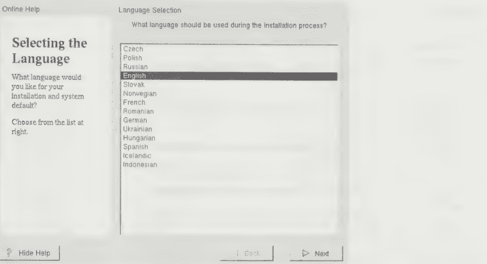

首先，选择最适合你系统的模型（参见图 4–2，选择键盘类型）。如果你无法为你的键盘类型找到完全匹配的项，请为你的系统选择最合适的通用（Generic）匹配项（例如，通用 101 键 PC）。

接下来，为你的键盘选择正确的布局类型（例如，美国英语）。

还有其他可选的键盘选项（例如死键 Dead Keys 选项）供你选择。

如果你在安装 Red Hat Linux 系统后希望更改键盘类型，可以使用 `/usr/sbin/kbdconfig` 命令，或者在根提示符下输入 `setup`。

### 4.4 选择鼠标

首先，为你的系统选择正确的鼠标类型。尝试寻找完全匹配的项。如果找不到完全匹配的，请选择一个你确定与你的系统兼容的鼠标类型（参见图 4–3，选择鼠标）。

要确定鼠标的接口，请顺着鼠标线追到它插入系统的地方。如果连接器在鼠标线末端并插入矩形连接器，你使用的是串口鼠标；如果连接器是圆形的，你使用的是 PS/2 鼠标。如果你在笔记本电脑上安装 Red Hat Linux，大多数情况下，指针设备将兼容 PS/2。

如果你无法找到确定与你的系统兼容的鼠标，请根据鼠标的按键数量和接口选择通用（Generic）条目之一。

#### 图 4–2 选择键盘类型

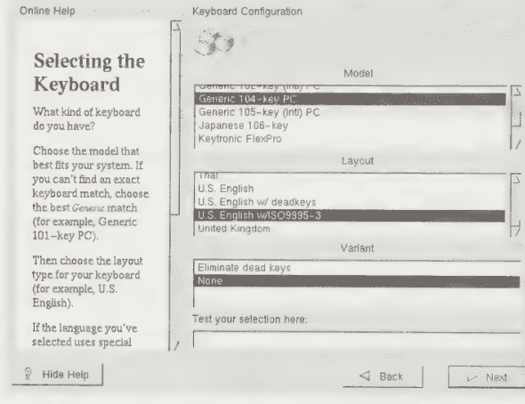

#### 图 4–3 选择鼠标

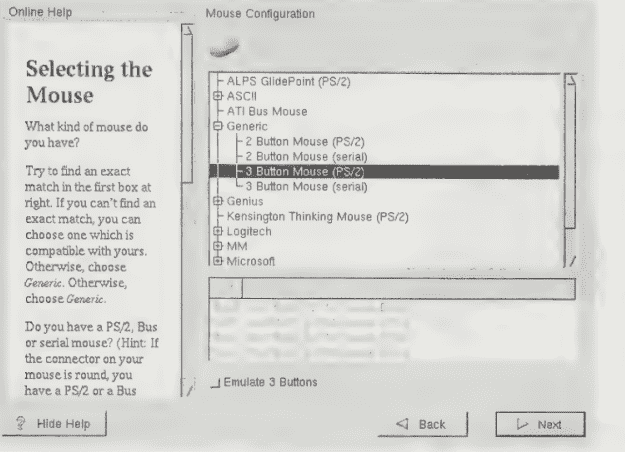

如果你在启动 Red Hat Linux 系统后希望更改鼠标配置，可以从 shell 提示符使用 `/usr/sbin/mouseconfig` 命令。

如果你想将鼠标配置为左手鼠标，可以重置鼠标按钮的顺序。这可以在启动 Red Hat Linux 系统后，通过在 shell 提示符输入 `gpm -B 321` 完成。

### 4.5 欢迎使用 Red Hat Linux

“欢迎”屏幕（参见图 4–4，欢迎使用 Red Hat Linux）不会提示你输入任何安装内容。请阅读左侧面板中的帮助文本，获取有关注册你的官方 Red Hat Linux 的说明。

#### 图 4–4 欢迎使用 Red Hat Linux

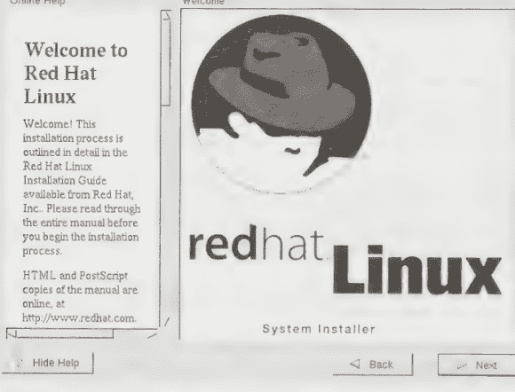

在整个安装过程中，你将可以使用鼠标选择不同的安装选项。请注意屏幕左下角的“隐藏帮助”（Hide Help）按钮。帮助屏幕默认打开，但如果你不想查看帮助信息，请点击“隐藏帮助”来最小化屏幕。

### 4.6 安装路径

请选择你希望执行完整安装还是升级（参见图 4–5，选择安装或升级）。

#### 图 4–5 选择安装或升级

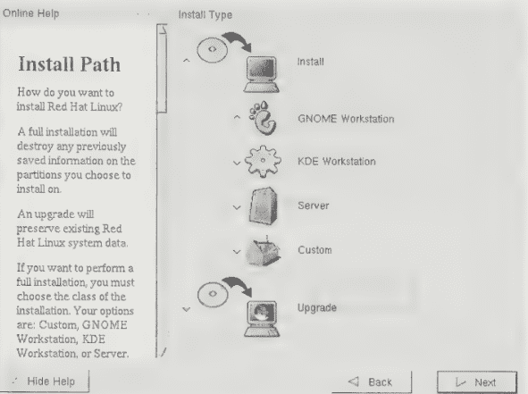


# 第 4 章：图形用户界面安装

## 4.6.1 安装

你在洁净的磁盘分区或一组分区上，或者在另一个 Linux 安装之上安装 Red Hat Linux。

> **警告**
在另一个 Linux 安装（包括 Red Hat Linux）之上安装 Red Hat Linux 不会保留之前安装的任何信息（文件或数据）。请确保保存任何重要文件！如果你担心保存现有系统上的当前数据（且未自行备份），你应该考虑改用升级（参见第 4.6.2 节，升级）。

如果你选择执行完整安装，还必须选择安装的类型。

你的选项包括：自定义（Custom）、GNOME 工作站（GNOME Workstation）、KDE 工作站（KDE Workstation）或服务器（Server）。

只有自定义类安装允许完全的灵活性。工作站类和服务器类安装会自动为你完成安装过程并跳过某些步骤。在自定义类安装过程中，如何划分磁盘空间由你决定。你对将安装在系统上的软件包具有完全的控制权。你可以决定是否使用 `LILO` 启动你的系统。

如果你想知道不执行自定义类安装会遗漏哪些步骤，请参考第 2.4.4 节，*自定义类安装的幕后*。

工作站类安装将安装 X Window 系统以及你选择的桌面。

> **注意**
工作站类安装将删除你电脑每块硬盘中所有 Linux 相关分区中的所有信息。

如果你希望系统作为基于 Linux 的服务器运行且不想对系统进行深度定制，那么服务器类安装最为合适。

> **注意**
服务器类安装将删除你电脑每块硬盘中所有 Linux 相关分区中的所有信息。

## 4.6.2 升级

Red Hat Linux 6.1 的安装过程包含了从基于 RPM 技术的旧 Red Hat Linux 版本（2.0 及更高版本）升级的能力。升级系统会通过使用 `.rpmsave` 扩展名重命名现有配置文件（例如 `mail.conf.rpmsave`）来保留它们，并在 `/tmp/upgrade.log` 中留下其所执行的操作日志。

> **请注意**
某些升级后的软件包可能需要同时安装其他软件包才能正常运行。升级程序会处理这些依赖关系，但可能需要安装现有系统中不存在的额外软件包。随着软件的演进，

只有在你执行工作站类或服务器类安装时，才会看到“自动分区”屏幕。

在这里，你可以选择继续此安装、手动分区，或使用“后退”按钮返回并选择不同的方法（参见图 4–6，自动分区）。

如果你不想丢失部分或全部数据，应该选择手动分区或选择不同的安装类型。

工作站类安装将删除所有现有的 Linux 分区。如果你不想让 Red Hat Linux 安装在主引导记录（`MBR`）上，或者你想使用 `LILO` 以外的引导管理器，请勿选择此安装方法。

服务器类安装将删除所有硬盘上的所有分区数据。如果你系统中有希望保留的的操作系统，如果你不想让 Red Hat Linux 安装在主引导记录（`MBR`）上，或者你想使用 `LILO` 以外的引导管理器，请勿选择此安装方法。

## 4.7 自动分区

### 图 4–6 自动分区

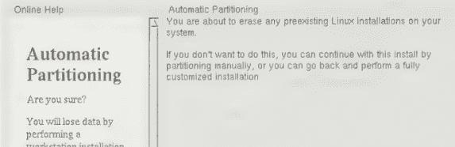

如果你不确定如何划分你的系统，请阅读《官方 Red Hat 参考指南》中的分区章节。

## 4.8 划分你的系统

如果你正在执行工作站类或服务器类安装且选择不手动分区，请跳过到第 4.12 节，时区配置。

此时，需要让安装程序知道应该何处安装 Red Hat Linux。这是通过为安装 Red Hat Linux 的一个或多个分区定义挂载点来实现的。你可能还需要创建和/删除分区（参见图 4–7，划分你的系统）。

### 图 4–7 划分你的系统

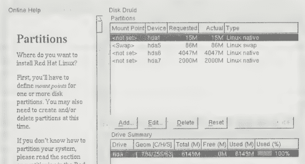

Red Hat Linux 6.1 中分区工具是 Disk Druid。以前安装过 Red Hat Linux 的用户可能用过 Disk Druid，但你会发现在这个版本中，Disk Druid 有了一个整洁的图形界面。

除特殊情况外，Disk Druid 可以处理典型 Red Hat Linux 安装的分区需求。

### Alpha, SPARC

注意如果你决定在 Alpha 或 SPARC 系统上使用 Disk Druid，需要注意某些点。请参阅《Red Hat Linux Alpha/SPARC 安装附》获取更多信息。

### 4.8.1 分区字段

“分区”（Partitions）部分中的每行代表一个磁盘分区。该部分的每行有五个不同的字段：

**挂载点 (Mount Point)：**
此字段指示分区挂载的位置。如果分区存在但显示为“未设置”（not set），则你需要定义其挂载点。双击分区或使用 Edit（编辑）键。

我们建议，除非你有其他理由，否则你应该创建以下分区：

- 一个交换分区（swap partition）（至少 16MB）—— 交换分区用于支持虚拟内存。如果你的电脑只有 16MB RAM 或更少，你必须创建一个交换分区。即使你有更多内存，仍建议创建一个交换分区。交换分区的最小大小应等于电脑的 RAM，或 16MB（取两者较大者）。
- 一个 `/boot` 分区（最大 16MB）—— 挂载在 `/boot` 上的分区包含操作系统内核以及在引导过程中使用的所有文件。由于大多数 PC BIOS 的局限性，创建一个小分区来存放这些文件是一个好主意。该分区的大小不应超过 16MB。
- 一个根分区（root partition）（600MB-1.5GB）—— 这是 `"/"`（根目录）所在。在此设置下，所有文件（存储在 `/boot` 中的除外）都位于根分区上。600MB 的根分区允许等同于工作站级的安装（剩余空间非常小），而 1.5GB 的根分区将允许你安装每个软件包。

**设备 (Device)：**
此字段显示分区的设备名称。

**请求 (Requested)：**
“请求”字段显示分区的原始大小。要重新定义大小，你必须删除当前分区并使用 Add（添加）按钮重新创建。

**实际 (Actual)：**
“实际”字段显示当前分配给分区的空间。

**类型 (Type)：**
此字段显示分区的类型（例如 Linux 原生或 DOS）。

### 4.8.2 添加分区时出现的问题

如果你尝试添加分区但 Disk Druid 无法执行你的请求，你将看到一个对话框，列出所有当前未分配的分区以及无法分配的原因。注意，未分配的分区也会显示在 Disk Druid 的主屏幕上（尽管你可能需要滚动“分区”部分才能看到它们）。

当你滚动查看“分区”部分时，你可能会看到一条“未分配的请求分区”（Unallocated Requested Partition）消息（红色字体），随后是一个或多个分区。这种常见原因是该分区没有足够的可用空间。在任何情况下，分区保持未分配的原因将显示在分区请求的挂载点之后。

要修复未分配的请求分区，你必须将分区移动到另一个具有可用空间的驱动器，调整分区大小以适应当前驱动器，或完全删除该分区。使用 Edit 按钮或通过点击分区进行更改。

### 4.8.3 驱动器摘要

“驱动器摘要”（Drive Summaries）部分中的每行代表系统上的一个硬盘。每行具有以下字段：

**驱动器 (Drive)：**
此字段显示硬盘的设备名称。

**几何结构 [C/H/S]：**
此字段显示硬盘的几何结构。几何结构由三个数字组成，代表硬盘报告的磁道（cylinders）、磁头（heads）和扇区（sectors）数量。

**总计 (Total)：**
“总计”字段显示硬盘的总可用空间。

**可用 (Free)：**
“可用”字段显示硬盘空间中仍有多少未分配空间。

**已用 (Used)：**
这些字段以兆字节（`MB`）和百分比显示当前分配给分区的硬盘空间。

驱动器摘要部分仅用于指示你电脑的磁盘配置。它不是为了作为指定特定分区目标硬盘的手段。那是通过 4.8.5 节“添加分区”中的“允许的驱动器”字段实现的。

### 4.8.4 Disk Druid 按钮

这些按钮控制 Disk Druid 的操作。它们用于添加和删除分区以及更改分区属性。此外，还有按钮用于接受你所做的更改或退出 Disk Druid。让我们顺序查看每个按钮。

**Add（添加）：**
用于请求新分区。选中后，将出现一个对话框，包含必须填充的字段（如挂载点和大小）。

**Edit（编辑）：**
用于修改当前高亮分区的属性。

**Delete（删除）：**
用于删除当前高亮分区。

**Reset（重置）：**
将分区恢复到原始状态。

**Make RAID Device（创建 RAID 设备）：**
创建可以为任何分区提供冗余。

### 4.8.5 添加分区

要添加新分区，选择 `Add` 按钮。将出现一个对话框（见图 4–8）。

### 图 4–8 添加分区

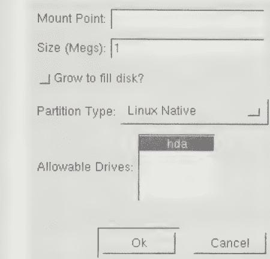

> 注意


你至少需要分配一个分区给 Red Hat，可选地分配更多。

- **挂载点 (Mount Point)：** 高亮显示分区的挂载点。例如，如果此分区应该是根分区，则输入 `/`；为 usr 分区输入 `/usr`，以此此类推。
- **大小 (Size (MB))：** 输入分区的大小（兆字节）。注意此字段以...开头。
- **增长以填满 (Grow To Fill)：** 此复选框指示你在上一个字段中输入的大小是将被视为分区的精确大小还是其最小大小。勾选时，分区将增长以填满硬盘上的所有可用空间。
- **允许的类型 (Allowable Type)：** 此字段包含不同分区类型的列表（例如 Linux 原生或 DOS）。使用鼠标选择相应的分区类型。
- **允许的驱动器 (Allowable Drives)：** 此字段包含安装在系统上的硬盘列表。如果某个硬盘的框被高亮，则可以在该硬盘上创建所需的分区。
- **Ok（确定）：** 当你对分区的设置满意并希望创建它时，选择此按钮并按 `[Enter]` 键。
- **Cancel（取消）：** 如果你不想创建分区，选择此按钮并按 `[Enter]` 键。

# 第 4 章：图形用户界面安装

## 4.8.6 编辑分区

要编辑分区，选择 `Edit` 按钮或双击现有分区。

> 注意
> 如果分区已存在于你的硬盘上，你只能更改分区的挂载点。如果你想进行任何其他更改，你需要删除分区并重新创建。

## 4.8.7 删除分区

要删除分区，在“分区”部分高亮它并双击 `Delete` 按钮。系统将要求确认删除。

## 4.9 选择要格式化的分区

选择你想格式化的分区。所有新创建的分区都应该格式化。此外，任何包含不再需要的数据的现有分区应该

## 4.10 安装 LILO

格式。然而，如果 `/home` 或 `/usr/local` 等分区包含了您想要保留的数据，则不能对其进行格式化（见图 4–9，“选择要格式化的分区”）。

### 图 4–9 选择要格式化的分区

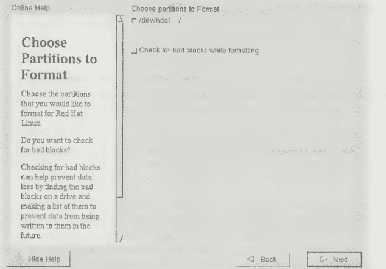

如果您希望在格式化每个文件系统时检查检查坏块，请确保勾选“检查坏块”选项。

检查坏块可以通过定位驱动器上的坏块并列出清单以防止未来发生，从而帮助防止数据丢失。

## 4.10 安装 LILO

在执行工作站或服务器级安装时，请跳到第 4.12 节“时区配置”。

为了能够启动您的 Red Hat Linux 系统，您通常需要安装 `LILO`（Linux 加载器）。您可以在两个位置之一安装 `LILO`：

- 主引导记录 `MBR`
- 根分区的第一个扇区

除非 `MBR` 已经启动了其他操作系统加载器（如 System Commander 或 OS/2 的 Boot Manager），否则这是安装 `LILO` 的推荐位置。主引导记录是硬盘上的一个特殊区域，由计算机的 BIOS 自动加载，是 `LILO` 可以接管引导过程的最早点。如果您在 `MBR` 中安装 `LILO`，当机器启动时，`LILO` 将呈现一个 boot 提示符。然后您可以启动 Red Hat Linux 或您配置 `LILO` 启动的任何操作系统（见下文）。

### 根分区的第一个扇区

如果您已经在系统中使用了另一个引导加载器（如 OS/2 的 Boot Manager），则推荐使用。在这种情况下，您的其他引导加载器将优先接控制。您可以配置该引导加载器启动 `LILO`（随后它将启动 Red Hat Linux）。

如果您选择安装 `LILO`，请选择您希望在系统上安装 `LILO` 的位置（见图 4-10，“LILO 配置界面”）。如果您只使用一个 Red Hat Linux，您应该选择主引导记录 `MBR`。对于带有 Win95/98 的系统，您也应该将 `LILO` 安装到 `MBR`，以便 `LILO` 可以同时启动两个操作系统。

如果您有 Windows NT（并且想安装 `LILO`），您应该选择将 `LILO` 安装在根分区的第一个扇区，而不是 `MBR`。请务必创建启动盘。在这种情况下，Windows NT 的操作系统加载器将在 `MBR` 上，而您选择 `LILO`（在根分区的第一个扇区）的唯一方法是使用启动盘。请确保查看 `http://www.linuxdoc.org/HOWTO/mini/Linux+NT-Loader.html` 以获取更多关于设置 `LILO` 和 NT 的信息。

## 警告

> 如果您由于任何原因选择不安装 `LILO`，您将无法直接启动您的 Red Hat Linux，而需要使用其他引导方法（如启动磁盘）。只有在您确定有其他方法启动您的 Red Hat Linux 系统时才使用此选项！

如果您的计算机以 LBA 模式访问硬盘，请勾选“使用线性模式”`Use linear mode`。这通常用于驱动器为 SCSI 且在访问驱动器时遇到错误的情况。

## 图 4–10 LILO 配置界面

在线帮助

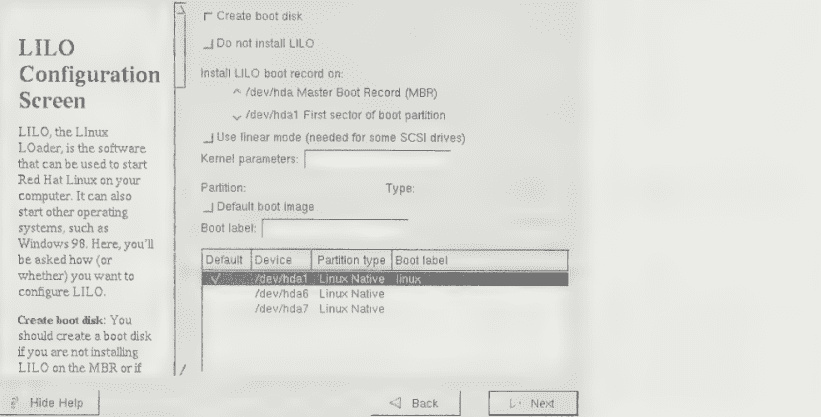

`LILO`（Linux Loader）是用于启动 Red Hat Linux 计算机的软件。它也可以启动其他操作系统，例如 Windows 98。在这里，将会被要求如何（或在哪里）配置 `LILO`。

创建启动盘：如果您没有在 `MBR` 上安装 `LILO`，或者如果，您应该创建一个启动盘。

如果您想为 `LILO` 启动命令添加默认选项，请将其输入内核参数字段。您输入的任何选项将在每次 Linux 启动时传递给 Linux 内核。

可引导分区 -- 将列出所有可引导分区，包括由其他操作系统使用的分区。“引导标签”`Boot label` 列将在持有您的 Red Hat Linux 系统根文件系统的分区上填充单词 `linux`。其他分区

## 注意

“引导标签”`Boot label` 列将在持有您的 Red Hat Linux 系统根文件系统的分区上填充单词 `linux`。其他分区

### 4.10.1 配置 LILO

- 创建启动盘：如果您没有在 `MBR` 上安装 `LILO`，或者如果
- 如果您想为 `LILO` 启动命令添加默认选项，请将其输入内核参数字段。您输入的任何选项将在每次 Linux 启动时传递给 Linux 内核。
- 可引导分区 -- 将列出所有可引导分区，包括由其他操作系统使用的分区。“引导标签”`Boot label` 列将在持有您的 Red Hat Linux 系统根文件系统的分区上填充单词 `linux`。其他分区

### 4.10.2 LILO 的替代方案

如果您不想使用 `LILO` 启动您的 Red Hat 系统，有几种替代方案：

- 启动盘：如前所述，可以使用安装程序创建的启动盘（如果您选择创建了）。
- `LOADLIN`：您可以从 MS-DOS 加载 Linux。遗憾的是，它需要在 MS-DOS 分区上有 Linux 内核副本（如果有 SCSI 适配器，还需要初始内存磁盘）。实现此点的唯一方法是使用其他方法（例如软盘上的 `LILO`）启动您的 Red 系统，然后将内核拷贝到 MS-DOS 分区。`LOADLIN` 可从 `ftp://metalab.unc.edu/pub/Linux/system/dualboot/` 及镜像站点获取。
- `SYSLINUX`：一种与 `LOADLIN` 非常类似的 MS-DOS 程序。它也可以从 `ftp://metab-lab.unc.edu/pub/Linux/system/boot/loaders/` 及镜像站点获取。
- 某些商业引导加载器：例如 System Commander 和 Partition Magic，它们能够启动 Linux（但仍需要在根分区中安装 `LILO`）。

### 4.10.3 SMP 主板与 LILO

此节专门适用于 SMP 主板。如果安装程序检测到您的系统上有 SMP 主板，它将创建两个 `lilo.conf` 条目，而不是通常的一个。

其中一个条目命名为 `linux`，另一个命名为 `linux-up`。默认启动 `linux`。但是，如果您在运行 SMP 内核时遇到问题，可以选择启动 `linux-up` 条目。您将保留之前所有的功能，但将仅使用单个处理器运行。

## 4.11 网络配置

如果你有一个网卡且尚未配置网络信息，现在你有机会配置网络了。参考图 4–11，*网络配置界面*。

### 图 4–11 网络配置界面

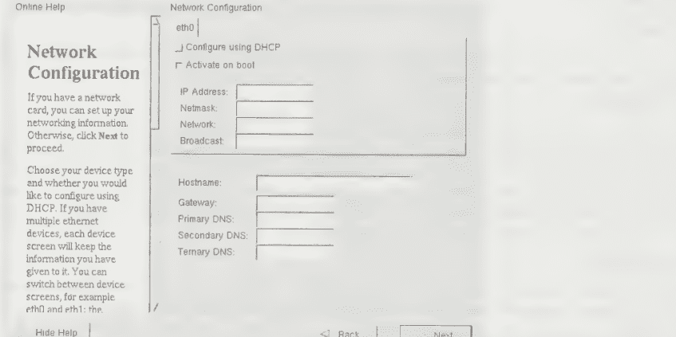

选择你的设备类型以及是否想要使用 `DHCP` 进行配置。如果你有多个设备，每个设备都将保留你提供的信息。你可以在设备之间切换（例如 `eth0` 和 `eth1`），你提供的信息将针对每个设备是特定的。如果你选择了“启动时激活”，则你的网络接口将在系统启动时启动。如果你没有 `DHCP` 客户端访问权限或不确定这些信息是什么，请联系你的网络管理员。

接下来，在适用的情况下，输入 `IP 地址`、`子网掩码`、`网络地址`和`广播地址`数字。如果你不确定其中任何一项的内容，请联系你的网络管理员。


利用此机会为你的系统输入一个名称。如果不输入，你的系统将被识别为 `localhost`。

## 4.12 时区配置

最后，输入网关、主 DNS、备 DNS 和三级 DNS 数字。

你可以通过选择计算机的物理位置，或者通过你的时区相对于协调世界时（也称为 UTC）的偏移量来设置时区。

图 4–12 配置时区

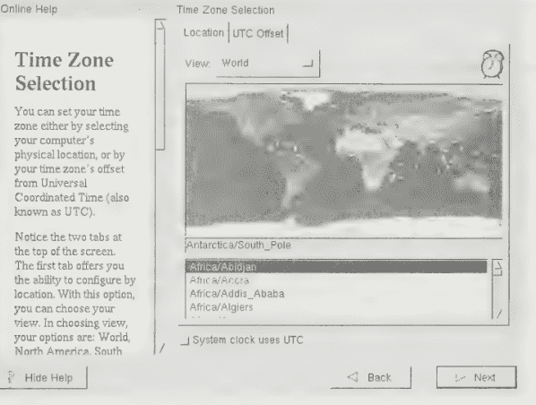

注意屏幕顶部的两个标签页（参见图 4–12，配置时区）。第一个标签页为你提供了按位置进行配置的能力。通过此选项，你可以选择你的视图。在选择视图时，你的选项有：世界、北美、南美、太平洋地区、欧洲、非洲和亚洲。

从交互式地图上，你可以点击由黄色点指示的特定城市；将出现一个红色的 X 表示你的选择。你也可以滚动列表并选择你所需的时区。

第二个标签页为你提供了使用 UTC 偏移量的能力。UTC 为你提供了一个供选择的偏移量列表，以及一个设置夏令时的选项。

对于这两个标签页，都有“系统时钟使用 UTC”的选项。如果你知道系统已设置为 UTC，请选择此项。

如果你在启动 Red Hat Linux 系统后想要更改时区配置，可以使用 `/usr/sbin/timeconfig` 命令。

## 4.13 账户配置

账户配置界面允许你设置 root 密码。此外，你还可以设置用户账户，以便在安装完成后登录（参见图 4–13，创建账户）。

图 4-13 账户创建

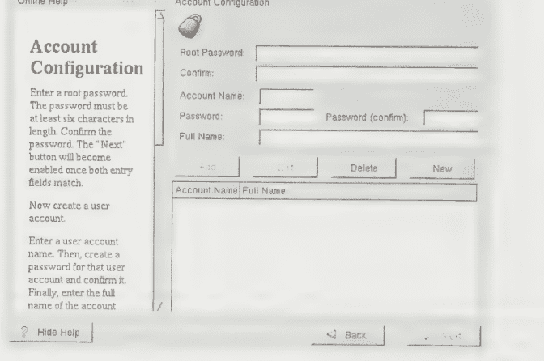

### 4.13.1 设置 root 密码

安装程序将提示你为系统设置一个 root 密码。你将使用 root 密码首次登录你的 Red Hat Linux 系统。

root 密码长度至少为六个字符；你输入的密码不会显示在屏幕上。你必须输入两次密码；如果两个密码不匹配，安装程序将要求你重新输入。

你应该将 root 密码设成你能记住的内容，但不要是别人容易猜到的内容。你的名字、电话号码、qw、password、root、123456 和 anteater 都是糟糕密码的例子。良好的密码将数字与大写字母混合，且不包含单词：例如 Aard387vark 或 420BMttNT。记住密码是区分大小写的。

**请注意**

root 用户（也称为超级用户）对整个系统具有完全访问权限；出于因此，以 root 用户身份登录最好仅用于系统维护或管理。

### 4.13.2 设置用户账户

如果你选择现在创建用户账户，那么在安装完成后你将有一个账户可以登录。这允许你安全、方便地登录计算机，而无需拥有 root 权限即可创建其他账户。

输入账户名称。然后为该用户账户输入并确认密码。输入账户用户的全名并按 [Enter]。你的账户信息将添加到账户列表中，并清空账户字段以便你添加另一个用户。

你也可以选择“新建”（New）来添加新用户。输入用户信息并使用“添加”（Add）按钮将用户添加到账户列表中。

你还可以“编辑”（Edit）或“删除”（Delete）你已创建的或不再需要的用户账户。

## 4.14 身份验证配置

如果执行的是工作站级安装，请跳到第 4.16 节，GUI 配置工具。

如果执行的是服务器级安装，请跳到第 4.17 节，安装包。

如果你不需要设置网络密码，可以跳过此节。如果你不确定是否应该这样做，请向你的系统管理员寻求帮助。

除非你要设置 NIS 身份验证，否则你会发现 MD5 和影子密码（shadow passwords）都被选中了（参见图 4–14，身份验证配置）。我们建议同时使用两者以确保你的机器尽可能安全。

要配置 NIS 选项，你必须连接到 NIS 网络。如果你不确定是否连接到了 NIS 网络，请询问你的系统管理员。

图 4–14 身份验证配置

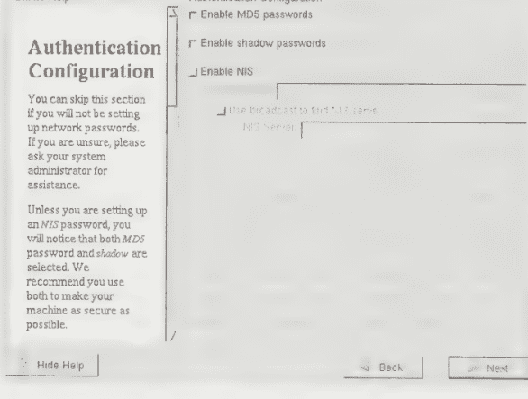

- MD5 密码 --允许使用长密码（最多 256 个字符），而不是标准的八个字母。
- 影子密码 -- 提供了一种安全的密码保留方法。密码存储在 `/etc/shadow` 中，只有 root 用户可读取。
- 启用 NIS -- 允许你运行一组具有共同密码的计算机。有两个选项供选择：
  - NIS 域 -- 此选项允许你指定你的系统属于哪个域或组。
  - NIS 服务器 -- 此选项使你的计算机使用特定的服务器，而不是向局域网“广播”消息。

## 4.15 选择软件包组

在完成分区的选择和配置后，你就可以选择软件包了。

你可以选择组件（按功能将软件包分组在一起的项，例如 C、网络工作站或 Web 服务器）、单个软件包或两者的结合。

要选择组件，请点击其旁边的复选框（参见图 4–15，选择软件包组）。

图 4-15 选择软件包组

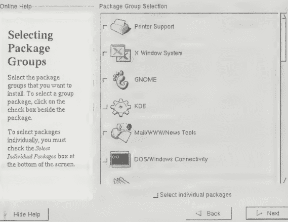

选择你想要安装的软件包组。要选择组包，点击软件包旁边的复选框。要单独选择软件包，必须勾选屏幕底部的“单独软件包”框。

选择你想要安装的每个组件。选择“所有”（Everything，位于列表末尾）将安装 Red Hat Linux 包含的所有包。选择所有包将需要接近 1.5GB 的可用磁盘空间。

要单独选择软件包，勾选屏幕底部的“单独软件包”框。

### 4.15.1 单独选择软件包

在选择想要安装的组件后，你可以选择或取消选择单个软件包。安装程序会显示该组中的软件包列表，你可以使用鼠标进行选择或取消（参见图 4–16，单独选择软件包）。

图 4-16 单独选择软件包

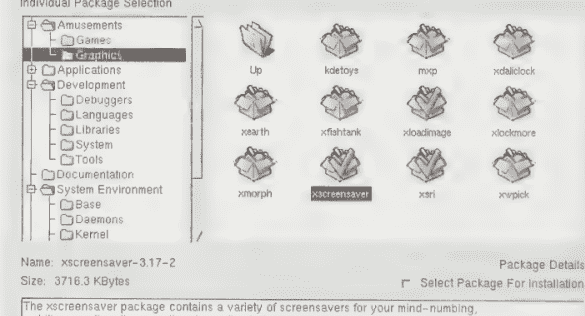

`xcreensaver` 软件包包含了各种屏幕保护程序，供你享受烧脑、消耗、浪费和催眠般的视觉乐趣。

如果你需要用于 X Window 系统的屏幕保护程序，请安装 `xcreensaver` 软件包。

在屏幕左侧你会看到各种软件包组的目录列表。当你展开此列表（双击选择）并双击单击目录时，可安装的软件包列表将出现在右侧。

## 第 4.15 节：选择软件包组

要选择单个软件包，请用鼠标左键双击它，或者单击一次将其高亮，然后点击下方的“选择安装的软件包”（Select Package For Installation）按钮。您已选择安装的任何软件包上都将出现一个绿色的勾标记。

在选择某个软件包进行安装之前，如果想查看相关信息，请左键单击一次将其高亮，信息将显示在屏幕底部，以及软件包的名称和大小。

## 请注意

某些软件包（如内核和某些库）是每个 Red Hat Linux 系统所必需的，且无法选择或取消选择。这些基础软件包是默认被选中的。

### 4.15.2 未解决的依赖关系

许多软件包为了能够正常运行，依赖于必须安装在您的系统上的其他软件包。例如，许多图形化的 Red Hat 系统管理工具需要 `python` 和 `pythonlib` 软件包。为了确保您的系统拥有实现完全功能所需的所有软件包，Red Hat Linux 在您每次安装或删除软件包时都会检查这些软件包的依赖关系。

如果任何软件包都需要另一个您未选择安装的软件包，程序将列出这些未解决的依赖关系，并给您解决它们的机会（参见图 4–17，“未解决的依赖关系”）。

只有当缺少所选软件包所需的某些软件包时，“未解决的依赖关系”屏幕才会出现。在缺失软件包列表下方，屏幕底部有一个“安装软件包以满足依赖”（Install packages to satisfy dependencies）复选框，默认是选中的。如果您保持勾选此项，安装程序将通过将所有所需的软件包添加到选定的软件包列表中自动解决软件包依赖关系。

# 第 4 章：图形用户界面安装

### 图 4–17 未解决的依赖关系

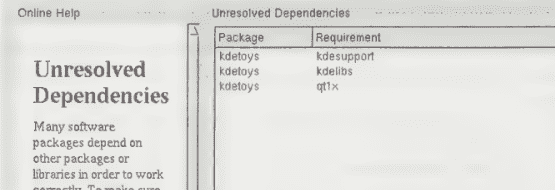

## 4.16 GUI X 配置工具

如果您决定安装 X Window System 软件包，现在就有有机会为您的系统配置 X 服务器了。如果您没有选择安装 X Window System 软件包，请跳到第 4.17 节，*安装软件包*（Installing Packages*）。

> 警告
>
> 如果您选择安装 X，这将是写入您机器内存的安装最后部分。一旦您按下“下一步”（Next）按钮，分区将被写入且软件包将进行安装。如果您想取消安装，应该在硬盘被重写之前现在重启。

## 第 4.16 节：GUI X 配置工具

`Xconfigurator` 首先探测您的系统，试图确定您拥有什么种类型的视频硬件（参见图 4–18，*X 配置屏幕*/*X Configuration Screen*）。如果失败，`Xconfigurator` 将列出一个显卡和显示器列表供您选择。

如果您的显卡没有出现在列表中，则 XFree86 可能不支持它。但是，如果您对您的显卡有技术了解，可以选择“**列出**”（Listed），并尝试通过将显卡的视频芯片与可用的 X 服务器匹配来尝试进行配置。

### 图 4–18 X 配置屏幕

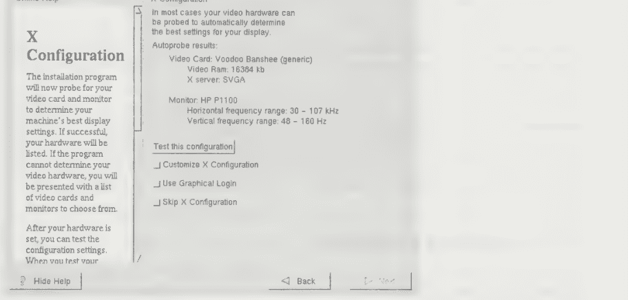


接下来，`Xconfigurator`会提示您输入显卡上安装的显存大小。如果您不确定，请查阅显卡随附的文档。选择比可用内存更大的内存不会损坏您的显卡，但如果这样做了，`XFree86`服务器可能无法正常启动。

如果选定的显卡可能有视频时钟芯片，`Xconfigurator`将显示时钟芯片列表。推荐的选择是“无时钟设置”（No Clockchip Setting），因为在大多数情况下，`XFree86`可以自动检测到合适的时钟芯片。

如果您的显示器没有出现在列表中，选择“自定义”（Custom）。如果您选择了“自定义”，`Xconfigurator`将提示您选择显示器的水平同步范围和垂直同步范围（这些值通常可以在显示器随附的文档中找到，或者从您的显示器供应商或制造商处获得）。

# 第 4 章：图形用户界面安装

> 注意
>
> 不建议选择与您的显示器“相似”的显示器，除非您确定所选的显示器性能没有超过您显示器的能力。如果您这样做，可能会超频您的显示器并导致其损坏或毁灭。

一旦确定了硬件，您就可以测试配置设置了。我们建议您测试配置，以确保分辨率和颜色是您想要使用的。

如果您想自定义 X 配置，请确保已勾选“配置 X 配置”（Configure X Configuration）按钮。如果您选择自定义，将出现另一个屏幕，让您选择想要多少颜色（256、65,536 或 1600 万）以及您的分辨率应该是多少。再次，您将有测试配置的。

您也可以选择“跳过 X 配置”（Skip X Configuration），如果您愿意在安装后设置 X 或者根本不设置。

## 4.17 安装软件包

此时，在所有软件包安装完成之前，您没有其他事情需要做了（参见图 4–19，“安装软件包”）。此过程发生的快慢取决于您选择的软件包数量以及您计算机的速度。

## 4.18 创建启动盘

### 图 4–19 安装软件包

安装软件包 (Installing Packages)

软件包: `FreeBSD-libc-3.3.5`

| 状态 (Status) | 大小 (Size) | 时间 (Time) |
| :--- | :--- | :--- |
| 总计 (Total) | 293 M | 0:07:18 |
| 已完成 (Completed) | 358 M | 0:01:13 |
| 剩余 (Remaining) | 258 M | 0:06:05 |

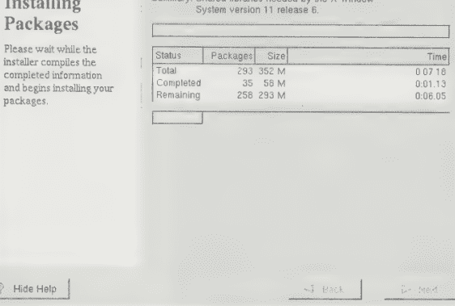

如果您选择创建启动盘，请向您的软驱器插入一张空白软盘（参见下方的图 4–20）。稍等片后，您的启动盘将被创建。从软驱器中取出后，请清晰地标记它。如果您想在安装后创建启动盘，可以这样做。更多信息，请在 shell 提示符处输入 `bootdisk` 查看。

如果您使用启动盘（而不是 `LILO`）启动系统，如果您对内核进行了任何更改，请确保创建一个新的启动盘。

### 图 4–20 创建您的启动盘

在线帮助 (Online Help)

向第一个驱动器插入空白软盘。如果您选择创建启动盘，请向您的软驱器插入空白软盘。

- 跳过磁盘创建 (Skip disk creation)


## 4.19 安装完成

恭喜！您的 Red Hat Linux 61 安装现在已完成！

安装程序将提示您准备重启系统。不要忘记移除软驱器或 CD-ROM 驱动器中的任何设备。如果您决定跳过安装 `LILO`，现在需要使用您的启动盘。

在您的计算机正常开机序列完成后，您应该会看到 `LILO` 的标准提示符，即 `boot:`，您可以执行以下任何操作：

- 按 [回车] -- 启动 `LILO` 的默认启动项。
- 输入启动标签并按 [回车] -- `LILO` 启动与输入的标签对应的操作系统。
- 什么都不做 -- 在 `LILO` 的超时期（默认为五秒）后，`LILO` 将自动启动默认启动项。

执行操作启动 Red Hat Linux。您应该看到一个或多个屏幕的消息滚动。最后，您应该看到登录：提示符或 GUI 登录界面（如果您安装了 X Window System 并选择自动启动 X）。

如果您不确定下一步做什么，我们建议您从阅读《Red Hat Linux 入门指南》开始，作为使用 Red Hat Linux 的入门。《Red Hat Linux 入门指南》涵盖了与系统基础相关的主题，并包含了更新后的 GNOME 用户指南。对于经验丰富的用户，您可能会发现《Red Hat Linux 参考指南》更有帮助。

# 附录 A：获取技术支持

## A.2 节：Red Hat 支持概览

### 获取技术支持

#### A.1 记得注册

如果您拥有官方版本的 Red Hat Linux 6.1，请记得注册您作为 Red Hat 客户应享有的福利。

根据您购买的官方 Red Hat Linux 产品，您将有权获得以下任何一项或全部福利：

- 官方 Red Hat 支持 —— 从 Red Hat, Inc. 支持团队处获得有关您安装问题的解帮助。
- 优先 FTP 访问 —— 不再需要半夜访问拥挤的镜像站点。Red Hat Linux 6.1 的所有者可以免费访问 `priority.redhat.com`，这是 Red Hat 的优选客户 FTP 服务，提供全天候的高带宽连接。
- Red Hat 更新代理程序 (Red Hat Update Agent) —— 一旦有更新的 RPM，即可直接收到 Red Hat 的电子邮件。使用更新代理程序过滤器仅接收您感兴趣的主题的通知。
- 幕后故事：Red Hat 官方电子新闻 —— 每月直接从 Red Hat 接收最新新闻和产品信息。

如需注册，请访问 `http://www.redhat.com/now`。您可以在官方 Red Hat Linux 盒内的红白卡片上找到您的个人产品 ID (Personal Product ID)。

#### A.2 Red Hat 支持概览

Red Hat 为官方 Red Hat Linux 盒装产品提供安装协助，并涵盖单台计算机的安装。此类协助旨在帮助成功安装 Red Hat Linux。安装协助通过电话和网络提供。

Red Hat 支持将尝试在安装过程启动之前回答您可能有的任何问题。这包括：

- 硬件兼容性问题
- 基础硬盘分区策略

Red Hat, Inc. 支持还可以在安装过程中提供协助：

- 让 Red Hat Linux 操作系统识别任何受支持的硬件。
- 协助活动分区（active partitioning）提供帮助。
- 配置 Red Hat Linux 和至多一个其他操作系统（仅限 Intel 平台），使用 Linux 引导加载程序 `LILO` 进行双引导。请注意，不支持第三方引导加载程序和分区软件。

我们还可以帮助您完成基础的安装后任务，例如：

- 使用 `XF86Setup` 或 `Xconfigurator` 成功配置 X Window 系统。
- 配置本地端口打印机打印文本。
- 配置鼠标。

我们的安装协助服务旨在让您尽可能快、尽可能容易地运行 Red Hat Linux。然而，您可能还想对 Red Hat Linux 系统进行许多其他操作（从编译自定义内核到设置 Web 服务器），这些并不涵盖范围内。

关于这些任务的协助，可以通过 HOWTO 文档、Linux 相关网站和商业出版物获得丰富的在线信息。Red Hat 操作系统在安装光盘的 `/doc/HOWTO` 目录下包含了各种 Linux HOWTO 文档，以纯文本文件的形式存在，可以从 Red Hat Linux 和其他操作系统轻松读取。

有很多 Linux 相关网站。寻找 Red Hat Linux 信息的最佳起点是 Red Hat, Inc. 网站：

```
http://www.redhat.com/
```

有很多 Linux 相关。如果您是 Linux 新手，一本涵盖 Linux 基础的书将是无价之宝。我们可以推荐几本书：Bill Ball 的《Using Linux》；Bryan Pfaffenberger 的《Linux Explained》；Jon "maddog" Hall 的《Linux for Dummies》；以及 Mark G. Sobell 的《A Practical Guide to Linux》。

Red Hat 还提供各种基于事件的支持计划，以协助安装协助未涵盖的配置问题和任务。请参阅 Red Hat 支持网站获取更多信息。Red Hat, Inc. 支持网站位于以下 URL：

```
http://www.redhat.com/support/
```

## A.5 节：如何获取技术支持

### A.3 Red Hat 支持范围

Red Hat, Inc. 仅为购买了官方 Red Hat Linux 盒装客户提供安装协助。如果您是从任何其他公司获得的 Linux，必须联系该公司寻求支持。此类公司的示例：

- Macmillan
- Sams/Que
- Linux Systems Labs LSL
- Mandrake


- CheapBytes

此外，通过以下任何方法获得的 Red Hat Linux 均符合 Red Hat 的支持：

- Red Hat Linux
- 通过互联网下载
- 包含在软件包中
- 复制

### A.4 Red Hat, Inc. 支持系统

如果您还没有个人资料，则必须创建一个。如果您已经注册，请继续下一步。

### A.5 如何获取技术支持

Red Hat 为官方 Red Hat Linux 盒装产品提供安装协助，并涵盖单台计算机的安装。此类协助旨在帮助成功安装 Red Hat Linux。安装协助通过电话和网络提供。

Red Hat 支持将尝试在安装过程启动之前回答您可能有的任何问题。这包括：

- 硬件兼容性问题
- 基础硬盘分区策略

Red Hat, Inc. 支持还可以在安装过程中提供协助：

- 让 Red Hat Linux 操作系统识别任何受支持的硬件。
- 协助活动分区提供帮助。
- 配置 Red Hat Linux 和至多一个其他操作系统（仅限 Intel 平台），使用 Linux 引导加载程序 LILO 进行双引导。请注意，不支持第三方引导加载程序和分区软件。

我们还可以帮助您完成基础的安装后任务，例如：

- 使用 XF86Setup 或 Xconfigurator 成功配置 X Window 系统。
- 配置本地端口打印机打印文本。
- 配置鼠标。

我们的安装协助服务旨在让您尽可能快、尽可能容易地运行 Red Hat Linux。然而，您可能还想对 Red Hat Linux 系统进行许多其他操作（从编译自定义内核到设置 Web 服务器），这些并不涵盖范围内。

关于这些任务的协助，可以通过 HOWTO 文档、Linux 相关网站和商业出版物获得丰富的在线信息。Red Hat 操作系统在安装光盘的 `/doc/HOWTO` 目录下包含了各种 Linux HOWTO 文档，以纯文本文件的形式存在，可以从 Red Hat Linux 和其他操作系统轻松读取。

有很多 Linux 相关网站。寻找 Red Hat Linux 信息的最佳起点是 Red Hat, Inc. 网站：

```
http://www.redhat.com/
```

有很多 Linux 相关。如果您是 Linux 新手，一本涵盖 Linux 基础的书将是无价之宝。我们可以推荐几本书：Bill Ball 的《Using Linux》；Bryan Pfaffenberger 的《Linux Explained》；Jon "maddog" Hall 的《Linux for Dummies》；以及 Mark G. Sobell 的《A Practical Guide to Linux》。

Red Hat 还提供各种基于事件的支持计划，以协助安装协助未涵盖的配置问题和任务。请参阅 Red Hat 支持网站获取更多信息。Red Hat, Inc. 支持网站位于以下 URL：

```
http://www.redhat.com/support/
```

#### A.5.1 注册支持

您需要：

1. 在 `http://www.redhat.com/now` 创建个人资料。
2. 输入姓名和密码。
3. 根据需要更新电子邮件地址。

如果您担心隐私，请参阅 Red Hat 的隐私声明：`http://www.redhat.com/legal/privacy_statement.html`。

## A.6 节：技术支持问题

技术支持既是一门科学，也是一门艺术。在大多数情况下，支持技术人员依靠客户的观察和交流来诊断并解决问题。因此，您在陈述问题和报告问题时，尽可能详细清晰至关重要。应包含的内容示例下：

- 问题症状，例如：“Linux 无法访问我的 CD 驱动器。当它尝试时，我会收到超时错误。”
- 问题开始的时间，例如：“我的系统一直运行良好，直到昨天雷暴袭击了我的地区。”
- 您对系统做的任何更改，例如：“我增加了一块新硬盘并使用‘Partition Wizzo’ 添加了 Linux 分区。”
- 与您的情况可能相关的其他信息，例如安装方法（光盘、NFS、HTTP）。

### A.6.1 如何发送支持问题

请登录 `http://www.redhat.com/support` 并开启新的服务请求，或拨打支持电话。如果您的产品附带电话支持，或您购买了电话支持合同，您需要拨打的电话将在注册过程中提供。

## A.7 支持常见问题解答 (FAQ)

### A.7.1 问：发送至 support@redhat.com 的邮件被退回

我向 `support@redhat.com` 发送了邮件，但邮件退回给了。这是什么问题？

### A.7.2 答：目前不使用 support@redhat.com

为了更好地服务客户，Red Hat 正在重新设计我们的电子邮件支持流程。目前，`support@redhat.com` 地址无法使用。在此期间，请通过 Web 或电话寻求支持。

### A.7.3 问：系统不允许登录

我知道我已经注册了，但系统不允许我登录。

### A.7.4 答：旧的登录名和密码无效

您可能正在尝试使用旧的登录名和密码，或者仅仅是输错了登录名或密码。

## B 制作安装磁盘

有时需要从镜像文件创建磁盘盘（例如，您可能需要使用从 Red Hat Linux CD 获取的更新磁盘镜像）。

如名称所示，镜像文件是包含磁盘盘内容精确副本（或镜像）的文件。由于磁盘盘除了文件中的数据外还包含文件系统信息，因此在将镜像写入磁盘盘之前，它是不可用的。

开始之前，您需要一张空白的、已格式化的、高密度（1.44 MB）3.5 英制磁盘盘。您需要一台带有 3.5 英制磁盘驱动器且能够运行 DOS 程序（或在大多数类 Linux 操作系统中找到 `dd` 工具程序）的计算机。

镜像文件位于您的 Red Hat Linux CD 中的以下目录中：

- `images` -- 包含 Red Hat Linux/Intel 的启动目录，以及用于 Red Hat Linux/Alpha 的各种内核和内存盘镜像。

  在 Red Hat Linux/SPARC CD 上，此目录包含启动镜像和一个用于网络启动的镜像。
- `milo` -- 包含用于 Red Hat Linux/Alpha 微加载程序 MILO 的各种镜像。此目录仅存在于 Red Hat Linux/Alpha CD 上。

一旦您选择了适当的镜像，就可以将镜像文件传输到磁盘盘了。如前所述，这可以在支持 DOS 的系统上完成，也可以在运行类 Linux 操作系统的系统上完成。

### B.1 在 MS-DOS 下制作磁盘盘

要在 MS-DOS 下制作磁盘盘，请使用 Red Hat CD 中 `dosutils` 目录包含的 `rewrite` 工具。首先，对空白的 3.5 英制磁盘盘进行适当标记（例如“Boot Diskette”、“Supplemental Diskette”等）。将其插入磁盘盘驱动器。然后，使用以下命令（假设您的 CD 是 d 驱动器）：

```
C:\ d:
D:\> cd dosutils
D:\dosutils> rewrite
D:Enter disk image source file name: ..\images\boot.img
ter target diskette drive: a:
Please insert a formatted diskette into drive A: and
press --ENTER-- : [Enter]
```

## 附录 B 制作安装磁盘盘

```
D:\dosutils>
```

`rawwrite` 首先要求您输入磁盘镜像的文件名；输入您想要写入的镜像目录和名称（例如，`..\images\boot.img`）。然后 `rawwrite` 要求输入要写入镜像的磁盘盘驱动器；输入 `a:`。最后，`rawwrite` 要求确认所选驱动器中已插入格式化的磁盘盘。按下 `[Enter]` 确认后，`rawwrite` 将镜像文件复制到磁盘盘上。如果您需要制作另一个磁盘盘，请标记另一个磁盘盘并再次运行 `rawwrite`，指定适当的镜像文件。

### B.2 在类 Linux 系统下制作磁盘盘

要在 Linux（或其他任何类 Linux 操作系统）下制作磁盘盘，您必须拥有写入代表3.5 英制磁盘驱动器的设备的权限（在 Linux 下称为 `dev/fd0`）。首先，对空白的、已格式化的磁盘盘进行适当标记（例如“Boot Diskette”、“Supplemental Diskette”等）。将其插入磁盘盘驱动器（但不要执行命令）。挂载 Red Hat Linux CD 后，进入包含所需镜像文件的目录，并使用以下命令（根据情况更改文件名和磁盘盘设备名称）：

```
dd if=..\images\boot.img of=/dev/fd0 bs=1440
```

如果您需要制作另一个磁盘盘，请标记另一个磁盘盘并再次运行 `dd`，指定适当的镜像文件。

## 索引

## 索引

- A

  附录, Alpha... 13

  附录, SPARC... 13

  添加分区... 47


Alpha 附录... 13

ATAPI CD-ROM

无法识别，问题... 33

认证配置... 57

MD5... 57

NIS... 57

shadow... 57

自动启动... 30

自动分区... 41

服务器... 41

工作站... 41

### B

时钟... 55

光盘 (CD)

Linux Library... 13

Red Hot 光盘... 13

组件... 15

缺失配置... 57

时钟... 55

时区... 55

XFree86... 62

配置 LILO... 49

配置网络... 54

配置 X... 62

虚拟控制台... 27

CSLIP... 22

### B

启动盘... 52

可启动 CD-ROM... 30

启动安装程序... 29

### C

CD-ROM

ATAPI... 33

ATAPI 无法识别，问题... 33

可启动... 30

IDE... 33

IDE 无法识别，问题... 33

其他... 33

SCSI... 33

CD-ROM 安装... 17, 38

### D

使用 dd 创建安装磁盘盘... 76

删除分区... 48

依赖关系... 61

软件包...

启动... 52

Disk Druid... 42

添加分区... 47

按钮... 46

删除分区... 48

驱动器总和... 45

编辑分区... 48

分区... 42

添加分区问题... 45

磁盘，分区... 21

磁盘盘...

创建启动镜像... 75

创建网络启动镜像... 75

# 78

# 索引

### PCMCIA 启动 ................................................... 17

PCMCIA 支持，创建 ................................. 75

磁盘软，在类 Linux 操作系统下制作 ................ 76

使用 MS-DOS 制作磁盘软 ....................... 75

磁盘软 ................................................................... 17

镜像，更新的 ................................................ 16

磁盘 ..................................................................... 14, 17

启动 ................................................................... 14

网络启动 ................................................ 14, 17

pcmcmia 启动 ............................................... 14

驱动程序，内核 ............................................ 22

### FTP ................................................................... 31

获取 Red Hat Linux ................................... 11

硬盘 ................................................... 31

HTTP ................................................................ 31

NFS 镜像 ...................................................... 31

包选择 ................................................ 59

为……准备 ............................................. 11

升级 ........................................................ 38

安装，时区 ........................................ 55

安装

类 ....................................................... 17

语言选择 ................................... 34

st 开始 ...................................................... 33

安装类 ....................................... 38

安装指南 ........................................ 12

安装方法 ...................................

CD-ROM ...................................................... 31, 33

FTP ................................................................... 31

硬盘 ................................................... 31

HTTP ................................................................ 31

NFS 镜像 ...................................................... 31

选择 ........................................................ 31

安装模式，专家 ............................ 29

安装分区 ............................... 42

安装问题 ...................................

IDE CD-ROM 相关 ................................... 33

安装程序

启动 ........................................................ 29

无磁盘软启动 ................................ 30

st 开始 ...................................................... 28

用户界面 .............................................. 27

虚拟控制台 ........................................ 27

安装，开始 ................................... 27

安装包 ........................................ 59

### E

分区编辑 ................................... 48

勘误 ........................................................................ 16

专家安装模式 ................................ 29

### F

特性，6.1 新增 ................................... 9

格式化分区 ................... 48

fsck ................................................................... 48

### G

入门指南 ................................... 12

GUI 安装模式 ................................... 9

### I

IDE CD-ROM

无法识别，问题 ........................... 33

单个包 ................................... 60

选择 ........................................................ 60

信息


许可证 ...................................................... 14

注册 ........................................... 14

安装

CD-ROM ...................................................... 31, 33

# K

- 内核 ................................................... 22

# 索引

- 内核驱动程序 ................................................ 22

内核选项 ..................................................... 30

键盘类型 .......................................................

选择 ................................................................ 35

键位 .................................................................

选择键盘类型....................................... 35

# N

网络启动盘 ................................................ 17

网络配置 ............................................... 54

新特性 ........................................................ 9

创建用户账户 ............................................ 10

GUI 安装模式 ........................................ 9

已安装的 ...................................................... 9

手动分区 ............................................. 10

可脚本 kickstart ............................................ 10

软件 RAID 支持 ............................................ 10

前端配置 ................................................ 10

用户账户创建 ................................................ 10

工作站级安装 ................................. 9

# L

语言

选择 ................................................. 34

许可证信息 ................................................. 14

LILO ................................................. 49

替代方案 ................................................. 53

商业产品 ................................................. 53

LOADLIN ................................................. 53

SYSLINUX ............................................................

MBR ...................................................... 50

root 分区 ................................................. 53

SMP 主板 ................................................. 53

LILO 配置 .............................................. 49

Linux 应用程序 ................................................. 13

类 Linux 操作系统

使用磁盘软制作 ................................. 76

LOADLIN ................................................. 53

# O

选项，内核 ................................................. 30

OS/2 ................................................... 50

# P

包组 ................................................. 59

选择 ................................................. 59

包

安装 ................................................. 59

选择 ................................................. 59

分区魔术 ................................................. 53

分区问题 ................................................. 45

分区 ................................................ 21, 42

自动 ................................................. 41

分区你的系统 ................................................ 42

密码

设置 root ................................................. 56

# M

手动分区

工作站级和服务器级.................................. 10

主启动 root .................................................50

MBR

在 MBR 上安装 LILO ............................................ 50

缺失组件 ................................... 15

鼠标，选择 ............................................... 36

使用 MS-DOS 制作磁盘软 ................................. 75

# R

PLIP ............................................................ 22

PPP ................................................................. 22

# 80

# 索引

- 重写，制作磁盘软 .................................14

使用 ................................................. 75

递归 .....................................................

( 参见递归 )

Red Hat 盒装版，内容 ...................................12

Red Hat 光盘 .........................................13

参考指南 ...................................................12

注册信息 .....................................................

root 密码 .................................................56

- 政策概览 .................................................69


通过 Web 注册 ................................................72

注册………… ................................................71

时区配置 ................................................55

## U

- 未分配分区(s) ...................................45

未解决的依赖关系 ...................................61

升级前端配置

新特性 ................................................10

升级 ........................................................40

描述的

执行 ...................................38

用户账户创建 .......................................

用户账户

设置 ................................................57

用户界面，安装程序...........................................27

## S

- 可脚本 kickstart ................................................10

SCSI .................................................................23

选择包 ............................................59

SLIP .................................................22

SMP 主板

LILO .................................................53

软件 RAID 设备支持

新特性 ................................................10

SPARC 附录............................................................................13

开始安装...............................................................33

开始安装程序.......................................................28

支持，技术

( 参见技术支持 )

SYSLINUX ................................................53

System Commander...........................................................53

## V

- 虚拟控制台 ..........................................27

## W

- 工作站级安装 .....................................

自定义...............................................................9

## T

- 技术支持 ..........................................................69

常见 ...................................................74

如何提交问题 ................................................73

如何描述问题 ................................................73

不为其他公司的

产品提供.......................................................................71

## X

- 配置 ..........................................................62

X 配置

GUI 工具 ................................................................62

Xconfigurator .......................................................62

XFree86

配置 ..........................................................62

# 官方 Fedora Linux 6.1

### 操作系统

Red Hat Linux 是一款强大且极其稳定的下一代计算机操作系统，它为服务器和桌面级 PC 提供了高性能的计算环境。

# 安装指南

本分步指南将引导你完成 Red Hat Linux CD-ROM 图形化安装过程。在安装之前，请先了解新功能、开始安装前所需的准备工作、如何启动安装程序以及如何完成安装。

安装好 Red Hat Linux 之后，《Red Hat Linux 入门指南》将成为你学习如何导航和探索新系统强大功能的资源。


Copyright© 1999 Red Hat, Inc. 保留所有权利。“Red Hat”、Red Hat“影子人”标志、“RPM-Red Hat Package Manager（红帽软件包管理器）”以及 RPM 标志均为 Red Hat, Inc. 在美国及其他国家的商标或注册商标。Linux 是 Linux Torvalds 的注册商标。所有其他商标均为其各自所有者的财产。RH6011
