# 旧电脑，新生命：使用 Ubuntu 修复旧硬件


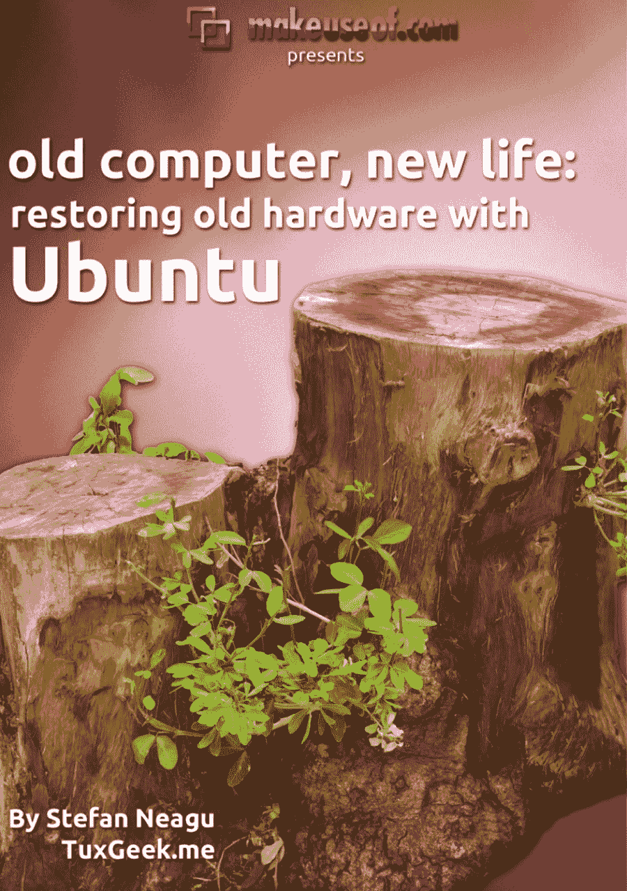


# 引言

多年来，计算机行业的演变速度比当代历史上任何行业都要快。一年又一年，工程师们英勇工作，为我们这些终端用户带来更快速、更强大的硬件，同时又不牺牲可靠性。程序员和应用开发者也同样快速地开发出新软件，以利用新的硬件规格。

然而，在努力销售更多产品的同时，营销部门希望我们相信，台式电脑、笔记本电脑和上网本在几年后就会过时，而且不更换它们会让我们变成“卢德分子（旧技术的反对者）”。

事实并非如此。除了高端游戏外，一台 2006 年购买的中级系统在 2011 年依然能够提供足够完成工作和娱乐的功能。文字处理、网页浏览、看电影——无论是来自 DVD 还是来自你位于 Pirate Bay 的朋友——都不应该让你的旧系统感到为难，前提是它的配置正确、已更新，并运行着一个高效、以性能为导向且“像免费啤酒和言论自由一样免费”的操作系统。

## 每日享受 FLOSS

FLOSS 是 `free/libre/open-source software`（自由/开源软件）的缩写。全球开发者免费贡献不同类型的开源项目。任何具有所需编程技能的人都可以查看、使用并改进代码，以造福整个社区。这类项目的示例包括 Mozilla Firefox、Chromium、大多数 Linux 发行版（如 `Ubuntu`）、VLC（一种媒体播放器）等。世界上有成千上万种免费应用程序，它们涵盖了现代软件环境中普通用户 90% 的计算需求。

从个人角度而言，在 2001 年的 `Ubuntu 7.04` 机器上运行《极速竞飙：碳》，我的帧率比在同一机器上运行 Windows XP SP3 时更高（每秒多出 14-17 帧）。这还是在后台运行了一个仿真软件，用于翻译 DirectX 加速所需的 `Win32` 库，而 [Ubuntu](http://www.makeuseof.com/tag/ubuntu-1104-unity-big-leap-linux/) 并不具备这些库。

很讽刺，不是吗？多亏了 FLOSS，我们可以让那台旧电脑发挥余热——而且不需要你投入任何资金。

## 用场景

那么，我们要用你的旧 PC 做什么呢？有几种选择；取决于你的配置、计算机技能以及愿意投入该项目的时间。本指南涵盖了基础设置。

- **台式 PC** – 我们可以把你的那台用来落灰的旧 PC 变成一台功能完整的机器，用于浏览网页、电子邮件、聊天、文字处理、表格、电影和低端 3D 游戏。最情况下，你只需要购买额外的内存。这需要的超过一个下午和几杯咖啡。要实现这些功能，你只需按照本指南提供的操作系统安装说明和媒体包即可。
- **本地文件服务器/备份** – 我们可以更换旧硬盘，或者连接一个容量更大、速度更快的外部硬盘。通过无线网卡和一些软件，我们可以构建一个 DIY 版 [Apple Time Capsule](http://www.apple.com/timecapsule/)。这种服务器可以用来集中存储所有的音乐、照片和文档，并让本地网络上的任何计算机都能随时调用。你甚至可以设置 FTP 服务，以便在你不在家时访问文件。这可能会有点复杂，因为需要静态 IP、命令行输入以及了解如何处理 FTP 客户端。你需要做的只是安装 `SAMBA` 并配置它。跳过媒体包的安装说明。
- **儿童学习中心** – Ubuntu 软件仓库中有数百种教育游戏，如果你有 12 岁以下的孩子，这是一个极佳的选择。他们可以学习数学、历史、地理，而且得益于 Linux 发行版自带的家长控制和高级安全性，无需担心病毒、间谍软件和网络跟踪者。按照提供的说明操作，但跳过 `SAMBA` 的安装。查看“软件包”章节。

## 什么是 Ubuntu？

Ubuntu 是由 Canonical 官方支持的 Linux 发行版。Canonical 团队通过捐赠和商业活动（如为企业客户提供支持和技术援助）获得的资金，积极支持开发操作系统的开发者。

它是最受欢迎的 Linux 发行版，受益于快速的发布计划、错误测试以及 [ubuntuforums.org](http://ubuntuforums.org) 大型支持社区。作为一个 FLOSS 项目，它也是免费提供的。

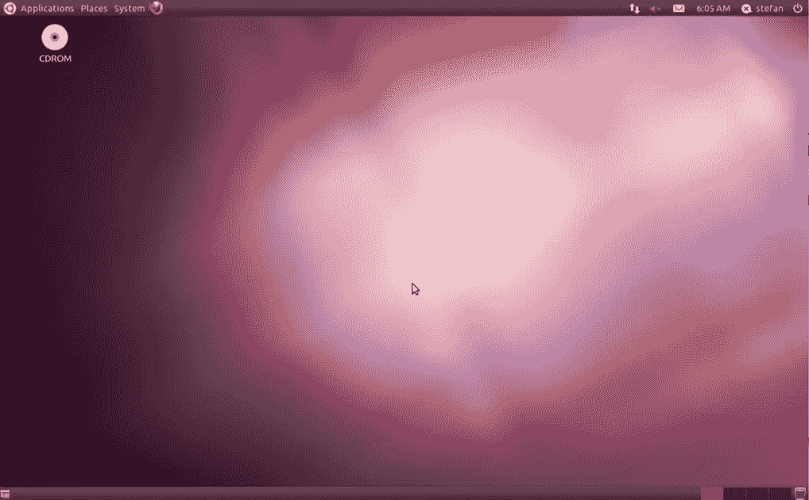

上方，Ubuntu Linux 11.04 (Natty Narwhal) 运行在虚拟机，规格类似于低端 PC。作为一种广泛使用的多功能高效操作系统，Ubuntu 是我们定制的理想构建模块。

Ubuntu 预装了一系列 [软件](http://www.makeuseof.com/tag/5-tips-tricks-ubuntu-software-center-linux/)：LibreOffice（11.04 之前的版本为 OpenOffice）、Firefox、Empathy（Pidgin）、Transmission、GIMP（10.04 之前的版本）以及几个轻量级游戏（如数独和象棋）。对于额外的软件包，我将展示如何使用 Synaptic 软件包管理器。

最低硬件要求为：

- 服务器版 – x86 处理器 300Mhz；128MB 内存，硬盘 1GB 可用空间，分辨率至少 640x480 的显示器。
- 桌面版 – x86 处理器 1Ghz；384MB 内存，硬盘 5GB 可用空间，分辨率至少 1024x768 的显示器。

用通俗的话说，这意味着任何 2002 年以后购买的新电脑都能运行良好。虽然所有的视觉特效可能无法实现（Unity 桌面主题、3D 合成、高清视频、视频流），但你能够完成所有基础任务。

## Ubuntu 如何赋予电脑新生命？

### Ubuntu 是高效的

Linux 发行版源于服务器房数十年的经验，如果说系统管理员在 OS（操作系统）中欣赏某些东西，那就是效率：简洁、精炼的代码，在完成任务的同时不浪费 CPU（中央处理器）周期。从引导加载程序（启动时初始化操作系统的微程序）到窗口管理器，即使只多花五秒钟也是系统管理员无法忍受的。


简单来说：Linux 整体以及特别是 Ubuntu，非常擅长让旧电脑焕然一新，因为它们能够更有效地利用你 PC 上的硬件。它的设计目标是以最高效的方式完成任务，并尽可能地对硬件资源造成最最小的负担。我之所以说“在人类可能的”，是因为有一项编程原则规定，在[代码的可移植性](http://en.wikipedia.org/wiki/C_(programming_language)%23Uses)和整体效率之间必须进行权衡。这就是选择 Ubuntu 作为此项目平台的主要原因。

## Ubuntu 是可定制的

Ubuntu 允许用户轻松地[自定义](http://www.makeuseof.com/tag/6-handy-sites-learn-ubuntu-tweaks-tricks/)机器功能的每一个方面。

## Ubuntu 不需要投入

它非常易用，以至于你不需要在培训课程或书籍上花费资金。99% 为其设计的应用程序都是完全免费的。

## 在另一阵营中

微软的开发者并没有整个开发者社区在盯着并挑剔他们的代码——指出缺陷——因此问责制相对较小，因为只有负责项目的特定团队才能看到并修改源代码。此外，由于他们的主要市场产品面向终端用户消费者，他们并不代表服务器房中**必须**的效率原则，而 Linux 正是那里的。

## Linux 是一个模块化的操作系统

考虑到从操作系统和软件角度来看丰富的选择，你可以定制一台专门为你的需求设计的机器——远程视频监控、食谱数据库、用于一个酷炫激光投影仪的控制面板（其强度会随音乐节拍同步）；你可以构建任何你想要的东西。

Linux 模块化设计的证明是，红帽 Linux 的变体被用于控制大型对撞撞机内部的电磁。作为一个操作系统，Ubuntu 是由小构建块组成的整体。即使本指南没有涵盖，你也可以使用旧电脑[执行任何你能想到的任务](http://www.makeuseof.com/tag/6-fun-ways-explore-ubuntu-1010-linux/)。你需要自己研究符合你用途的小众软件。

这种根据你的用例添加或删除功能的能力是另一个效率优势，这对于旧硬件至关重要。

# 准备

## 备份

在进入正文之前，我们需要做一些准备工作。虽然你可能已经不再使用该系统，但你应该打开它，搜索还没有来不及备份的文档、视频、照片和音乐。请保持谨慎并检查两次，因为稍后我们需要擦除硬盘上的所有内容。

备份并不是一项困难的任务，尽管如果你在那块旧硬盘上散落着大量数据，这个过程可能会很繁琐。

保存文件最简单的方法是在电脑背后的 USB 接口上插入一个[外接硬盘](https://en.wikipedia.org/wiki/External_hard_drive%23External_removable_drives)。

1. 在桌面或开始菜单中双击`我的电脑` 图标，将显示一个包含外接硬盘文件树的窗口。

2. 通过选择文件并按 `Ctrl+C` 来找到并复制必要的文件，点击我们之前打开的窗口以激活外接硬盘文件树，然后按 `Ctrl+V`。或者，你可以选择文件并将它们拖放到外接硬盘的窗口中。

如果你没有外接硬盘或 U 盘，可以使用 CD/DVD 刻录机以及诸如 `CDBurnerXP` 或 `InfraBurner` 等软件，将你的文件安全地存储在光介质上。MakeUseOf 有关于一系列[合适软件](http://www.makeuseof.com/tag/the-best-free-alternatives-to-nero-cddvd-burner/)的文章。如果你不知道如何将文件刻录到磁盘，MakeUseOf 有一篇文章[介绍了 ImgBurn 的步骤](http://www.makeuseof.com/tag/imgburn-easy-free-cd-and-dvd-burner-app/)。

如果你有可以[自动备份数据到云端](http://www.makeuseof.com/tag/what-do-you-get-if-you-combine-dropbox-and-mozy-wuala/)的软件，例如 `Mozy` 或 `Dropbox`，你只需要将电脑连接到互联网并等待应用程序完成同步过程。取决于文件的数量和大小，可能需要一段时间；请耐心等待。

## 检查你的规格

了解电脑内部的硬件对于以后出现兼容性问题非常重要。现在写下这些信息很重要，因为如果在安装过程中或首次启动时出现故障，你需要在 Ubuntu 社区的各种论坛中搜索驱动程序、内核补丁或包。

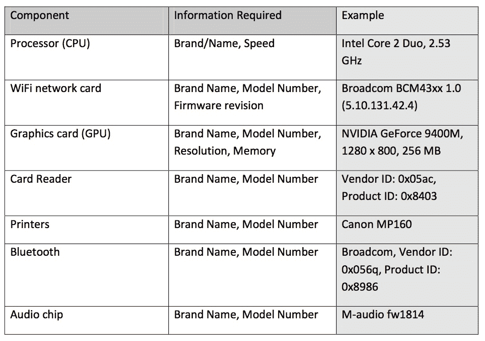

我们不需要写下所有的硬件规格，因为以太网卡等设备的驱动程序在 99.99% 的情况下都是兼容的。蓝牙芯片、读卡器和打印机更棘手，但大多数默认也被支持。即使（比如）你有一块非常罕见的以太网卡，我们也可以在安装操作系统完成后使用 `System Profiler` 工具发现规格。

如果你运行的是 Windows，`msinfo32` 是 Windows 2000、Me、XP 及更高版本 Windows 自带的小型程序。该程序可以提供系统中所有硬件的详细视图。

1. 点击`开始`。
2. 输入 `msinfo32` 并按回车。

对于 Windows 7 和 Windows Vista，遵循以下步骤：

1. 点击`开始`。
2. 选择`控制面板`。

## 获取 Ubuntu

获取 Ubuntu 最简单方便的方法是下载 `.ISO` 镜像文件，可以通过 Ubuntu 或或镜像服务器下载。虽然从官方服务器下载很直接，但从镜像下载更快。

例如，我使用学生会提供的[镜像](http://ftp.roedu.net/mirrors/ubunt.org/)，速度约为 1.2MB/s。

1. 打开浏览器并点击[此链接](https://www.ubuntu.com/download/download)。那里应该有一个红色的按钮显示“Ubuntu 11.04 32-bit”。这就是我们要的版本。在本文指南发布几个月后，版本号会变为“Ubuntu XX.0X 32-bit”。

2. 或者，打开 Google 搜索“ubuntu mirror” + “你的国家名称”。通过 FTP 表格右侧包含时间戳的列下载最新版本。你需要一个文件名类似于 `ubuntu-XX.0X-desktop-i386.iso` 的文件，其中 XX.0X 代表版本号。

3. 点击开始下载并在提示时保存文件。

下载镜像文件后，我们需要将其刻录到 CD 上或创建一个可启动的 U 盘。若要刻录镜像 CD，我们将使用我最喜欢的软件之一——`ImgBurn`。

1. 通过点击[此页面上的下载按钮](https://www.softpedia.com/get/CD-DVD-Tools/Data-CD-DVD-Burning/ImgBurn.shtml）（感谢 Softpedia）下载 ImgBurn。
2. 安装并打开 `ImgBurn`。
3. 选择`写入映像文件到磁盘`并选择我们之前下载的文件。
4. 插入空白 CD 并点击`刻录`。

若要创建可启动 U 盘，请遵循以下步骤：


1. 点击[此链接](http://www.pendrivelinux.com/downloads/Universal-USB-Installer/Universal-USB-Installer.exe) 下载“USB 安装程序”。
2. 从下拉列表中选择 Ubuntu 11.04（或根据你阅读时的日期选择其他合适的版本）。
3. 选择我们之前下载的镜像文件。
4. 进入“我的电脑”，找到与 USB 驱动器对应的驱动器器号（例如`K:`、`G:` 等），然后在 `ImgBurn` 的下拉菜单中选择正确的驱动器器号。
5. 点击 `Create`（创建）并等待过程完成。

现在我们已经成功创建了安装介质，我们需要找到如何从它启动。这会根据电脑的不同而异，但如果你在启动电脑时仔细注意，屏幕上很快就会出现一条 BIOS 消息，显示类似“现在按 F12 从备用介质启动”或“按 DEL 运行设置”之类的字样。如果你不知道如何从光盘或 USB 驱动器启动，Hiren.info 为大多数 BIOS 制造商提供了[完整指南](http://www.hiren.info/pages/bios-boot-cdrom)。

**重要**：在继续操作之前，请确保你已经备份了**所有数据**。我们将格式化整个硬盘，这意味着所有未备份的数据将将**永久丢失**。

# 安装

在过去，安装 Linux 发行版曾是一项枯燥的任务（相信我，你不想在周六晚上编译内核），但多年来它变得越来越简单了。在很多方面，安装 Ubuntu 比安装任何现代版本的 Windows 都要简单。

1. 插入我们之前刻好的包含操作系统镜像的光盘或 U 盘。
2. 关闭电脑然后重新启动。
3. 从安装介质（光盘或 U 盘）启动。

## 第 1 
从左侧面板选择你的语言，然后点击右侧的“安装 Ubuntu”（Install Ubuntu）按钮。

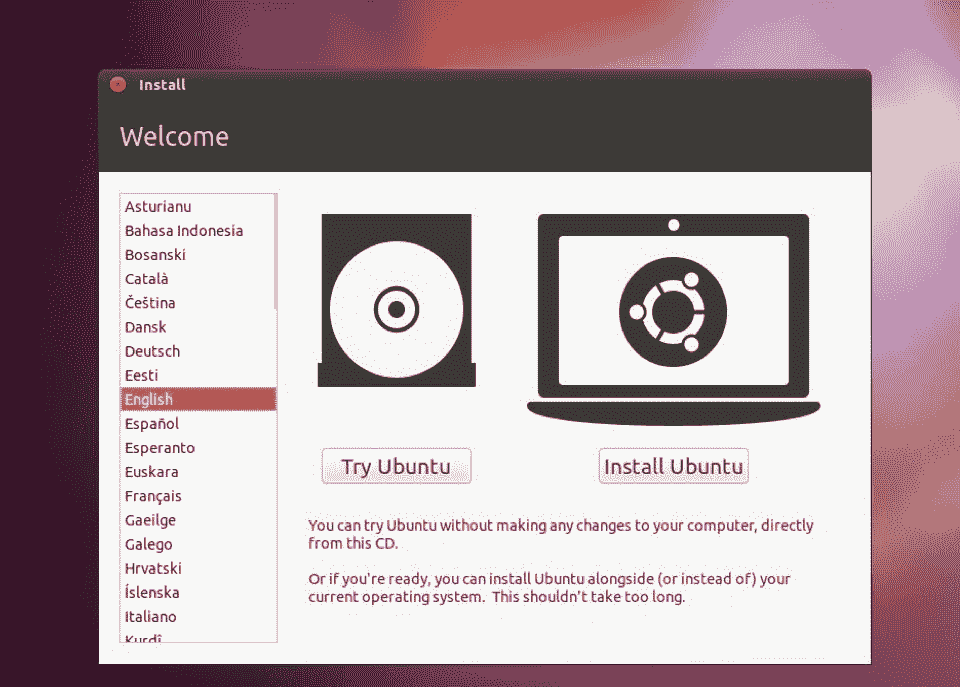

## 第 2 
在“正在准备安装 Ubuntu”窗口中，确保所有要求旁边都有绿色勾箭头。如果你还没有连接网络，不要慌，这并不是必须的。

确保选中窗口底部的“安装此第三方软件”（install this third party software）选项。这将确保 Ubuntu 能够开箱播放 MP3 音乐文件。如果你有互联网连接，请勾选“安装时下载更新”（Download updates while installing）复选框。

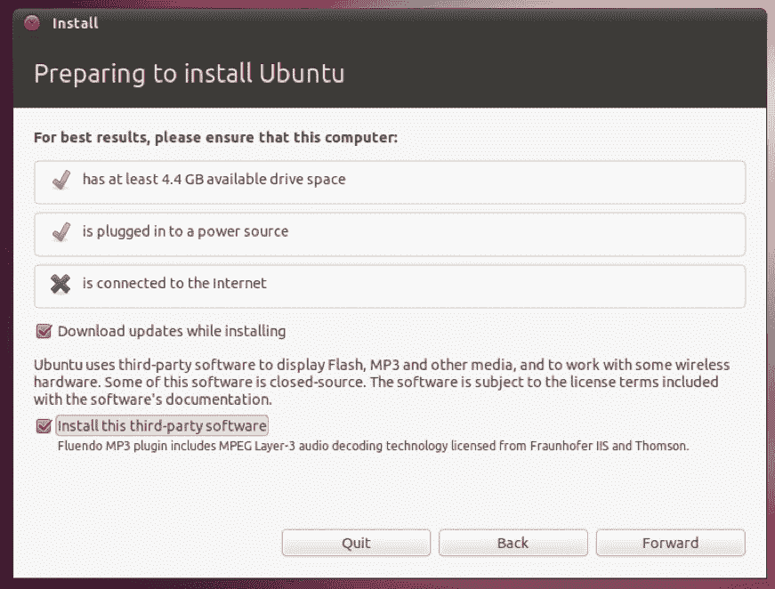

## 第 3
在下一个屏幕，选择列表中的第三选项“删除所有并重新安装”（Erase everything and reinstall）。它将使用 `ext4` 文件系统**格式化硬盘**——允许我们从零开始，并将硬盘的所有容量提供给操作系统。

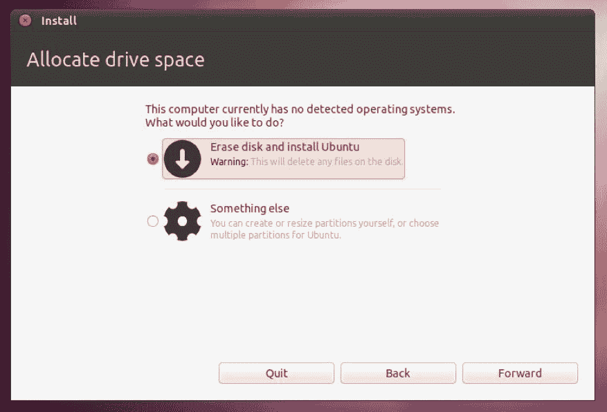

## 第 3*
如果 Ubuntu 无法检测到你的键盘布局，它会要求你手动设置。如果你知道你使用的键盘布局类型，请从列表中选择并点击“继续”（Forward）。如果不知道，只需保持默认选择并点击“继续”（Forward）。

## 第 4 
在下一个窗口中，输入所需信息，例如你的姓名、账户用户名和密码。你之后会需要这些用户名和密码——请确保将它们写下来并保放在安全的地方。

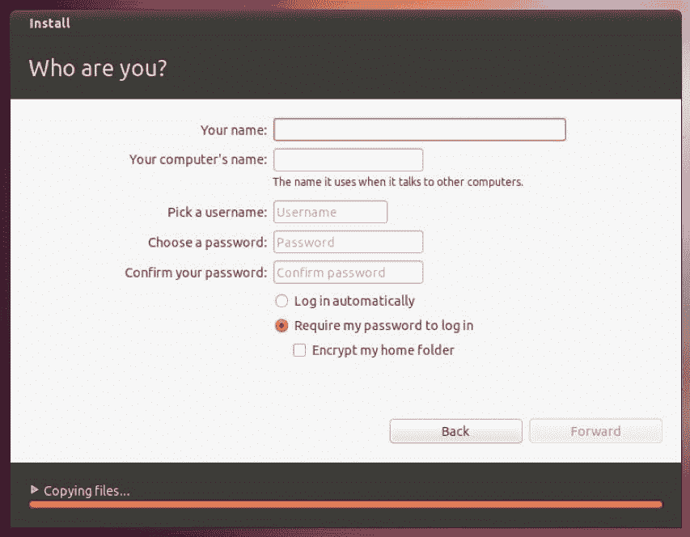

## 第 4*
如果你想存储敏感信息（如工作文档、密码、银行账户信息），且你的系统具有超过 512MB 的内存以及主频至少为 1.5Ghz 的处理器，请也勾选“加密我的主文件夹”（Encrypt my home folder）的复选框。

使用 [GRC 密码生成器](https://www.grc.com/passwords.htm) 获取高强度密码。使用第三字段，并选择长度至少为 16 个字符的密码。

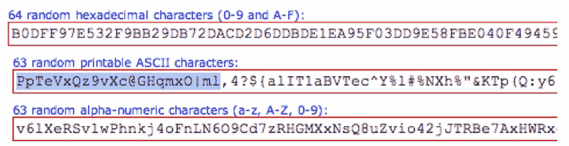

## 第 5
你几乎完成了，恭喜你。现在只需要选择适用于你地理位置的时区。在我的情况下，它是 GMT+2 布加勒斯特。

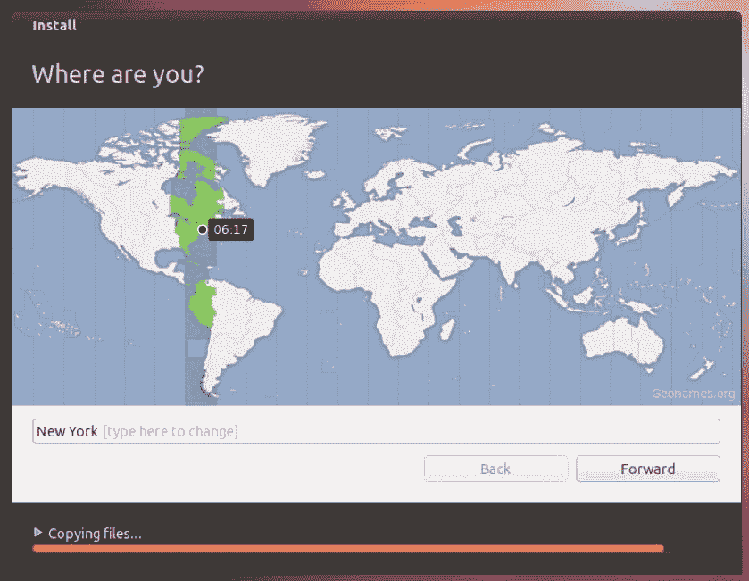

## 第 6
让安装程序完成，然后在接到提示时重启电脑。在重启之前，确保已从电脑中移除所有安装介质。屏幕会在适当的时候显示执行此操作的消息。

# 初始配置

注意：你的系统可能有足够的性能运行 Unity 3D 用户界面。这意味着你的硬件相对较新。本指南提供的说明针对低端 PC，它们将仅与默认窗口管理器和 Unity 2D 兼容。这是 Unity 3D 的外观：

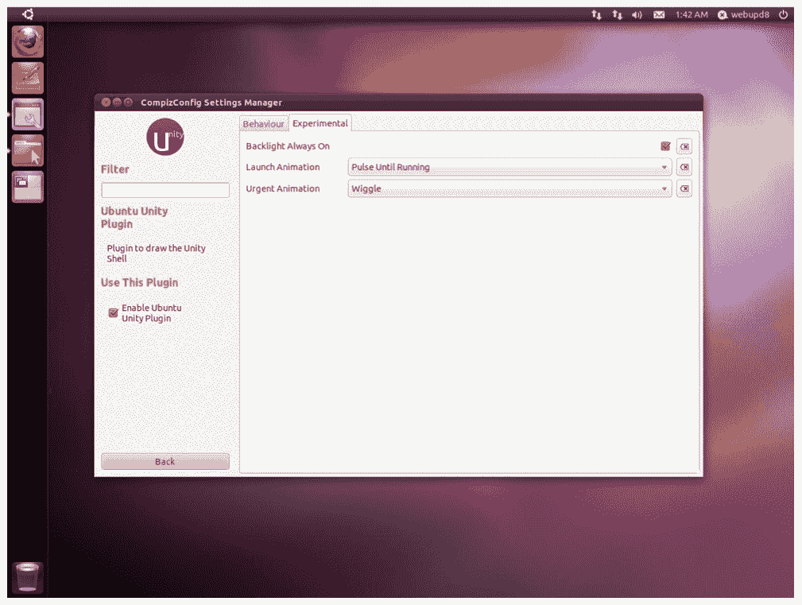

这是由 [WebUpd8](http://www.webupd8.org/) 提供的在 Ubuntu 11.04 上运行 Unity 3D 的截图。在本指南的后续部分，我将提供如何安装和启用资源消耗更低的 Unity 2D 版本 UI（用户界面）的说明。

以下指令基于你的硬件是旧设备的假设——这也是本指南标题和引言中所述的前提。

## 初步

与 Windows 不同，Ubuntu 预装了一系列[软件](http://www.makeuseof.com/pages/best-linux-software)，涵盖了计算机用户的所有基本需求。这是一个熟悉桌面、用户界面和应用程序的好时机。

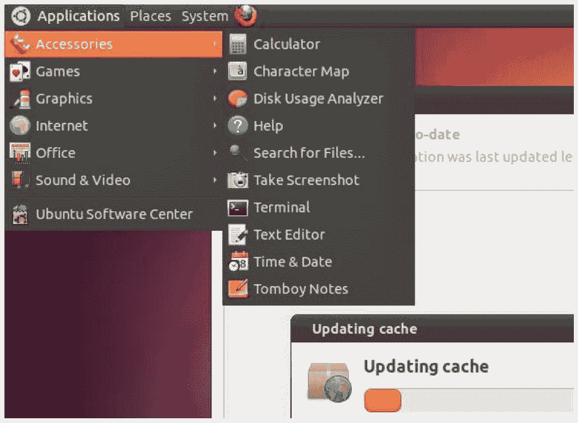

**主菜单**：在屏幕左上角你会看到三个菜单和 Firefox 图标。选择“应用程序”（Applications）并环顾四周。它们都是为了易用而编写的，许多类似于闭源软件。例如，聊天应用程序类似于早期的 Yahoo Messenger。

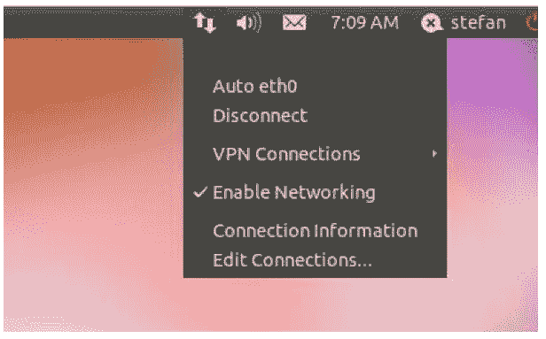

**通知区域**：在屏幕右上角你会看到一些图标、时钟、用户名和关按钮。将鼠标悬停在每个图标上可以获取系统提供的额外信息。

例如，相反箭头图标表示连接性；如果存在网卡，它们应该出现在这里。默认命名规则为以 eth% 表示以太网网卡，以 ath% 表示无线网卡。如果存在无线连接，会自动弹出对话框，请求选择 WiFi 接入点并输入密码（如果网络受保护）。

如果你之前配置了聊天凭据，用户名旁边的气泡将显示你的可用状态。在我的情况下，它显示一个 X，表示“已注销”或离线。

**文件夹和窗口栏**：从顶部主菜单选择“位置”（Places），然后点击“主文件夹”（Home Folder）。这是你存储所有文件的地方——相当于 Windows 中的我的文档、我的照片等。

在屏幕底部，注意有一个显示用户名的矩形。这就是任务栏。你打开的每一个窗口都会出现在那里，你可以通过鼠标选择它使其聚焦。

右侧有四个较小的矩形；它们代表工作空间——就像有四个虚拟显示器。你可以用一个处理所有工作窗口，另一个用于 Facebook 和聊天，另一个用于音乐播放器等等。栏中的最后一个图标是垃圾桶。

## 安装更新和额外包

在你的 Ubuntu 机器上安装[应用程序](http://www.makeuseof.com/tag/repositories-package-management-ubuntu/) 有两种方法：使用图形用户界面和使用命令行（终端）。我将说明这两种方法，以便你熟悉每一种。

下一部分我们需要互联网连接。如果无线网卡不起，请尝试通过以太网端口直接连接路由器。


如果你无法使用该设备，请尝试使用 USB 无线网适配器。如果你没有，可以向朋友借一个。本指南包含一个“故障排除”部分，可以帮助你修复 WiFi 网卡问题——但你仍然需要一种访问互联网的临时方法。

### 安装更新

确保所有软件都是最新版本，只需进入 `System>Administration>Update Manager` 并点击 `Install Updates`。这不仅会更新系统文件和系统实用程序，还会更新所有已安装的软件，例如 LibreOffice 文字处理器和 Empathy。

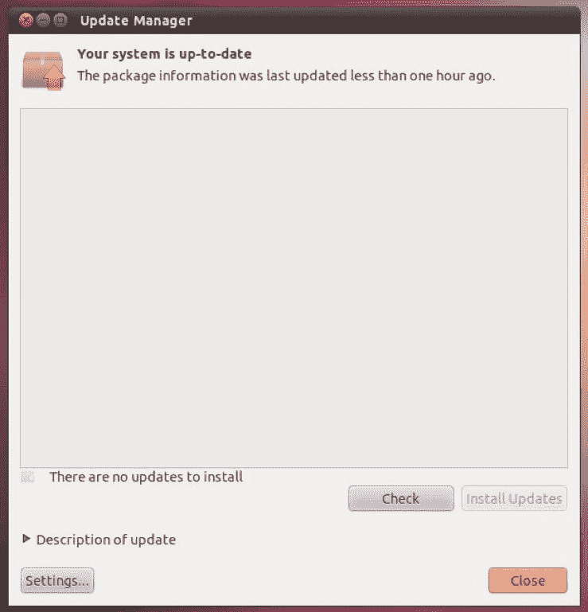

或者，打开 `Terminal` 并输入 `sudo apt-get update`，然后输入 `sudo apt-get upgrade` 来实现相同的任务。

### 安装额外组件

前往 `Applications>Ubuntu Software Center`。

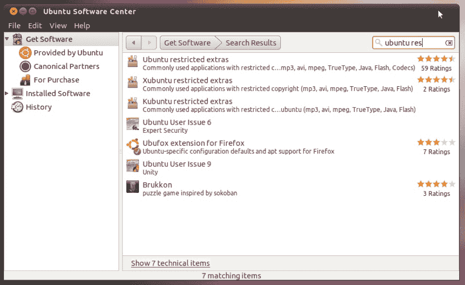

点击右上角的搜索框并输入包名。在这种情况下，输入 `ubuntu-restricted-extras`。选择该包并点击 `Install`。

`ubuntu-restricted-extras` 软件包是一组常用应用程序的集合（例如 Adobe 的 Flash Player、微软的 TrueType 字体、Java 虚拟机、对 RAR 存档的支持），由于法律限制，它们无法包含在 Ubuntu 的默认安装中。在 Windows 电脑上安装同一批应用程序最快也需要半小时。

我之前描述的过程适用于你可能需要的任何包，只需根据教程中提供的名称或朋友告诉你的名称进行搜索。

使用命令行实现相同任务非常简单。前往 `Applications>Accessories>Terminal`。输入 `sudo apt-get install ubuntu-restricted-extras` 并按回车。

## 仓库盛宴

默认情况下，Ubuntu 11.04 将尝试运行 3D Unity 主题。虽然它视觉上更美观，但会消耗资源。

不过，你可以获得不带 3D 的 Unity。要安装 Unity 2D，打开 Ubuntu Software Center 并搜索 `unity 2d`。选择该包并点击 `Install`。如果它没有出现在列表中，说明你没有安装必要的仓库。请使用步骤 1* 中描述的方法。

前往 `Applications>Accessories>Terminal`。然后输入 `sudo add-apt-repository ppa:unity-2d-team/unity-2d-daily`，这将为系统提供包的位置。输入 `sudo apt-get update` 来更新你所有的软件和仓库列表。

最后输入 `sudo apt-get install unity-qt-default-settings` 完成安装。然后注销。在登录界面上，你会在下拉菜单中看到 `Unity Qt`。选择它并重新登录。

终端命令示例：

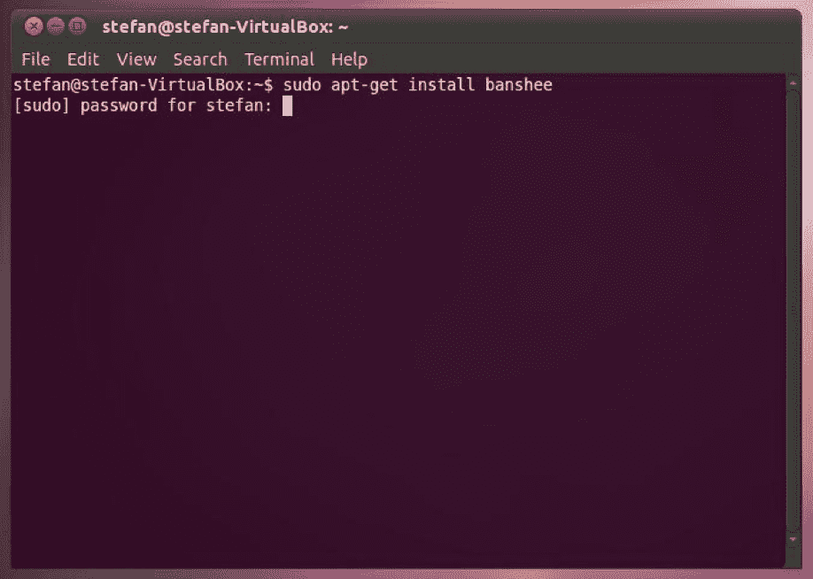

### 简单的偏好管理

Ubuntu Tweak 是一个小型应用程序，它消除了配置高级系统设置、清理和安装其他精巧包的所有繁琐工作。

在命令行提示符下输入 `sudo add-apt-repository ppa:tualatrix/ppa` 并按回车；该命令指示 `apt` 守护进程去哪里搜索此额外软件。输入 `sudo apt-get update` 并按回车；这确保了你所有的包都是最新的。输入 `sudo apt-get install ubuntu-tweak` 并按回车；最后这条命令会获取所需文件并安装该应用程序。

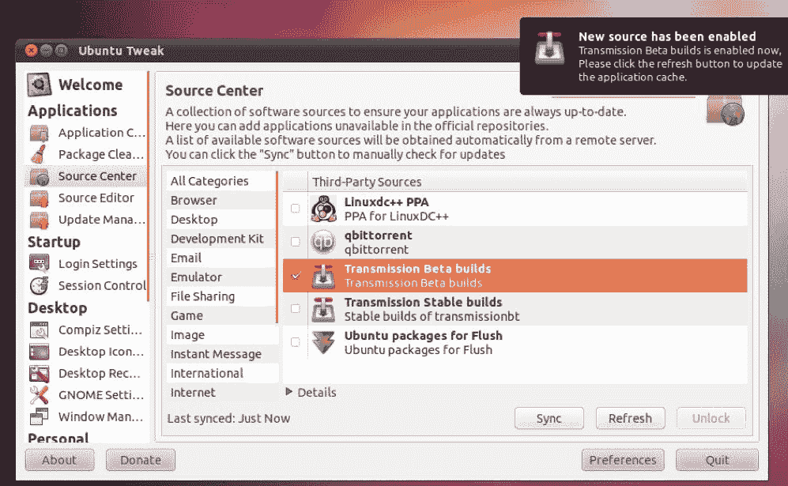

探索该软件，你会发现各种调整选项。例如：前往 `Applications>System Utilities>Ubuntu Tweak`。点击 `Source Center>File Sharing>Transmission Stable builds checkbox>Sync`。Transmission 是顶级的 Torrent 和磁力客户端，在默认仓库中不可用。

我们只需点击几次就加入了仓库并安装了 Transmission——无需命令行，也无需寻找仓库链接。

### 媒体兼容性

“Medibuntu 是一个打包项目，专门分发各种原因无法包含在 Ubuntu 中的软件，这些原因与知识产权法律差异、安全和其他问题有关。” Medibuntu 包含非免费解码器（如 `WMV`）以及对加密 AAC 文件（在 iTunes 上购买的歌曲）的支持。

要安装此仓库，打开 `Terminal` 并输入 `sudo wget --output- document=/etc/apt/sources.list.d/medibuntu.list http://www.medibuntu.org/sources.list.d/$(lsb_release -cs).list && sudo apt-get --quiet update && sudo apt-get --yes --quiet --allow-unauthenticated install medibuntu-keyring && sudo apt-get --quiet update` 并回车。

**电影**：此步骤仅适用于你想用机器播放电影。如果你想建立文件服务器，请跳过此处。

在 `Terminal` 中输入 `sudo apt-get install vlc`，按回车；输入 `sudo apt-get install non-free-codecs libxine1-ffmpeg gxine mencoder libmpcdec3 libquicktime1 flac faac faad sox ffmpeg2theora libmpeg2-4uudeview flac libmpeg3-1 mpeg3-utils mpegdemux liba52-dev mpeg2dec vorbis-tools id3v2 mpg321 mpg123 libflac++6 ffmpeg libmp4v2-0totem-mozilla icedax tagtool easytag id3tool lame nautilus-script- audio-convert libmad0 libjpeg-progs`。

对于 DVD 支持，输入 `sudo apt-get install libdvdcss2 && sudo /usr/share/doc/libdvdread4/./install-css.sh` 并按回车。

此步骤将下载并安装让你享受所有娱乐内容的软件。

### 额外软件

打开 Ubuntu Software Center 并搜索 Samba、Deja dup、Skype。找到每个包后并点击安装。

**Samba**：通过 Samba 可以与局域网中的其他电脑共享文件变得简单。在 Terminal 中输入 `sudo apt-get install samba` 并按回车。我将在本指南后面教你如何使用 Samba。我们还需要 `sudo apt-get install system-config-samba` 作为 `SMB` 守护程序的图形化界面。

**备份**：如果你打算将这台机器作为工作站，你可能希望文件自动备份。最简单的方法是使用 Deja-Dup。在 Terminal 中输入 `sudo apt-get install deja-dup`。我将在本指南后面教你如何使用。

**Skype**：如果你在 Windows 上用过 Skype，我确定你会在你的 Ubuntu 设备上想要相同的功能。在 Terminal 中输入 `sudo apt-get update && sudo apt-get install skype`。

它安装了一个名为 Skype 的流行 VOiP 应用。你可以与其他拥有 Skype 的人聊天，或从你的电脑拨打电话。

# 进一步配置

## 解决硬件兼容性

由于自由开源软件（FLOSS）社区是分散的且设计上并非集中组织，有时硬件制造商会忽视这个不断增长的社区的需求。越来越多的私有驱动通过 `Additional Drivers` 工具提供给用户安装。你可以通过 `System>Administration>Additional Drivers` 访问它。

该工具会自动检查供应商和产品 ID，以尝试为你定位私有驱动程序。由于法律限制，这些驱动程序无法默认安装，但你可以手动安装。

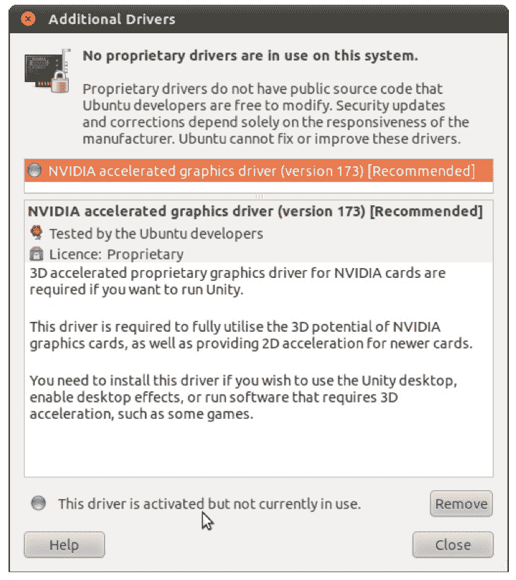

如果有可用驱动程序，它会像截图所示。对于 WiFi 网卡（这是最常见的头疼和熬夜阅读论坛帖子的原因），有一个名为 `ndiswrapper` 的工具。该工具能够将为 Windows 编写的驱动文件 (.sys/.inf) 转换为与 Ubuntu 。

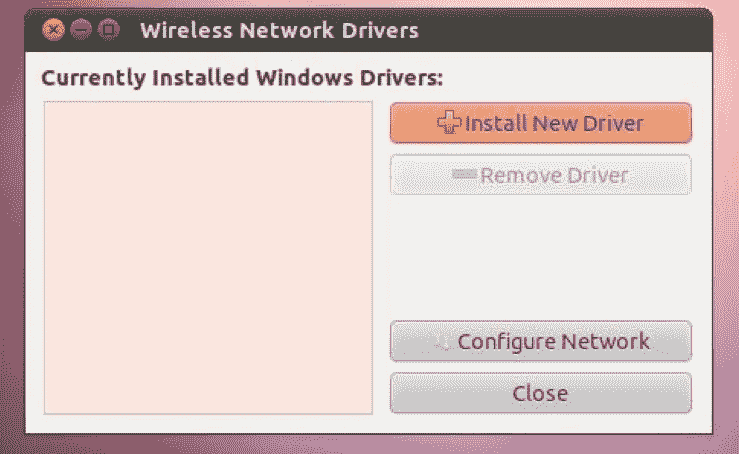

1. 使用 Ubuntu Software Center 安装名为 `ndisgtk` 的包。

2. 前往 `System>Administration>Windows Wireless Drivers` 或打开 Terminal 窗口并输入 `sudo ndiskgtk`。


3. 在 Google 上搜索“品牌名称” + “型号数字” + “inf” + “file” + “driver” + “Windows XP”。下载 `inf` 文件并在 `ndiswrapper` 窗口中输入该路径。如果初始的 Google 搜索没有找到可用的 `inf` 文件，请尝试使用其他操作系统进行搜索，例如“Windows Vista”，或在查询中省略“driver”/“file”。

4. 现在应该可以工作了。前往`System（系统）`>Preferences（设置）>`Network Connections（网络连接）`并检查`Wireless（无线）`选项卡。（我的那里没有显示任何内容，因为我的虚拟机没有 WiFi 卡）

如果 `ndiswrapper` 不起作用，你需要找到由社区创建的驱动源码（因此不受制造商支持）并编译代码。此过程因卡而异，会有一些指南教你如何针对特定型号或芯片组进行此操作。在大多数情况下，你还需要新的内核头文件（kernel headers）。

我使用 Linux 设备已经 6 年了，但仍然觉得这个过程非常繁琐，对于新手来说几乎是不可能完成的。Aos ath2k 系列芯片组的示例命令如下：

```
wget http://snapshots.madwifi.org/madwifi-hal-0.10.5.6/madwifi-hal-0.10.5.6-r3835-20080801.tar.gz tar-xvf madwifi-hal-0.10.5.6-r3835-20080801.tar.gz cd madwifi-hal-0.10.5.6-r3835-20080801 sudo apt-get install build-essential linux-headers-$(uname -r) sudo make sudo make install
```

现在请注意，所有的版本号都是针对特定芯片组系列的，不能互换。你最好的选择是在 Google 中使用这种搜索：“site:ubuntuforums.org 品牌 型号 driver”，并希望有人已经凑出了一个驱动程序和一个编译指南。

## 购买额外硬件

购买新硬件时，请检查盒背面的 Ubuntu 兼容性，并搜索 [Linux 硬件兼容性列表](http://linuxhcl.com/) 和 [Ubuntu 认证硬件列表](http://www.ubuntu.com/certification/)。如果你的系统内存小于 512MB 且想使用资源密集型应用程序，你可能需要购买额外的 `RAM`。任何与你的主板兼容的 `RAM` 都能在 Ubuntu 中运行。

必须首先检查额外的网络设备的兼容性，这一点我强调再强调。对于文件服务器，你可能需要购买网卡或 WiFi 适配器。

## 配置 SAMBA 共享

文件共享、文件服务器

`SAMBA` 是一个可以让你在 Windows 和 Macintosh 电脑上访问 Ubuntu 设备文件的工具，反之亦然。前往`System（系统）`>Administration（管理）>`Samba`。点击加号图标并选择你想要共享的目录。我建议创建一个名为 `Dropbox` 的文件夹，网络中的所有人都可以访问并写入。然后对`Documents（文档）`等文件夹使用特定设置。

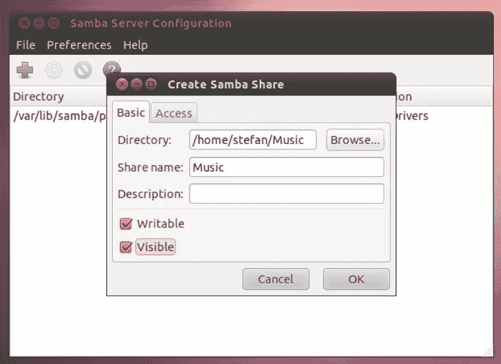

这样，你将始终能够快速将文件备份到你的 Ubuntu 设备上。在 Access（访问）面板中选择“Everyone（所有人）”。使用 `SAMBA` 客户端共享的文件夹将出现在我的网络位置、“网络”或你操作系统的等效位置中。这基本上是一个“自制”文件服务器。

你可以将 Ubuntu 设备作为其他电脑的备份驱动器。对于每台电脑，你将需要创建一个独立的可见、可写的“everyone（所有人）”文件夹，并将你的备份软件指向它。如果你设置了 WiFi 网络，你就拥有了一个廉价版的 Apple Time Capsule。

## 备份

对于台式 PC、教育用 PC

备份数据是至关重要的，尤其是当你运行在旧硬件上时。打开`Applications（应用程序）`>`System Tools（系统工具）>`Deja Dup`。或者，打开终端并输入 `sudo deja-dup`。

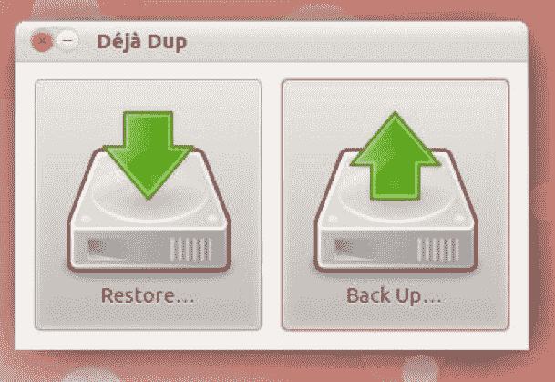

点击“Back Up...（备份...）”，从下拉菜单中选择你想使用的方法。`Deja dup` 集成了对 Amazon S3 和 Rackspace Cloud Storage 的支持，如果你想备份到异地。否则，选择硬盘、FTP 服务器或 Windows 共享的位置。如果你有一个兼容 `SMB` 的路由器，将硬盘连接到背部的 USB 端口将允许你将其作为 `Deja dup` 备份驱动器。默认勾选数据加密复选框，因此你的数据免受窥视。

## 配置防火墙

Ubuntu 预装了防火墙，可以自动保护系统免受想要访问的远程用户的攻击。图形配置工具需要手动下载。

打开 Ubuntu 软件中心并搜索“firewall”，安装名为“Firewall Configuration（防火墙配置）”的包。或者，打开终端输入 `sudo apt-get gufw`，然后输入 `sudo gufw` 启动配置工具。

从 GUI 启动配置工具，前往`System（系统）`>Administration（管理）>`Firewall Configuration（防火墙配置）`。

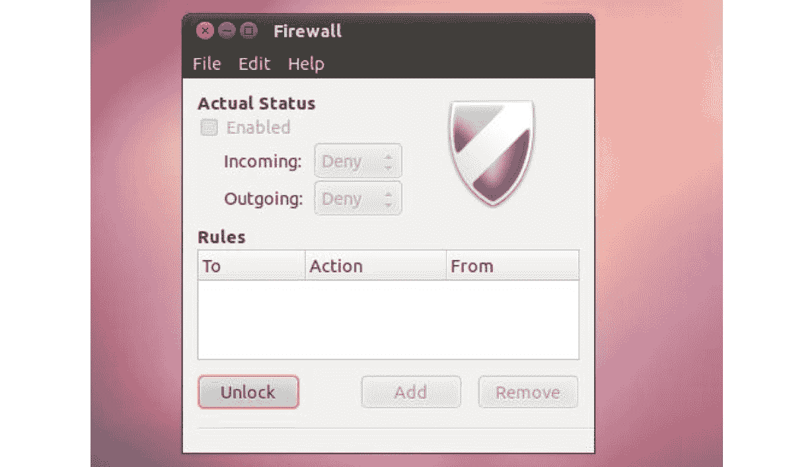

就像任何防火墙一样，`ufw`允许我们为应用程序和特定端口创建规则。与命令行不同，`gufw`允许简单直观地输入规则。

## 电源管理

无论是将系统用作文件服务器还是台式 PC，都需要配置电源设置。前往`System（系统）`>Administration（管理）>`Power Management（电源管理）`。

如果你想让文件服务器始终可用，请确保“Put the computer to sleep when inactive（闲闲时让电脑睡眠）”设置为“never（从不）”。你可能还需要考虑购买 `UPS（不间断电源）`以确保在停电时数据不会损坏。`ext4`文件系统（Ubuntu 11.04 默认选择）非常健壮，可以从此类事件中恢复。

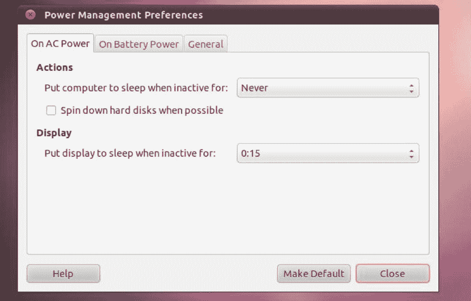

对于笔记本电脑或台式 PC，考虑将睡眠设置为 10-30 分钟。你还可以开启“Spin down hard disks when possible（可能时停止硬盘旋转）”，这对笔记本电脑很重要。

## 远程 Torrent 下载

对于台式 PC 和文件服务器

你可以使用`Transmission`内置的网络服务器下载并管理传输（例如：直接下载到你的笔记本）。

前往`Applications（应用程序）`>`Internet（互联网）>`Transmission`>`Edit（编辑）>`Preferences（首选项）`。勾选“Enable web client（启用网络客户端）”。勾选“Use authentication（使用身份验证）”并选择用户名和密码。

在本地网络上的任何机器上，你现在都可以打开浏览器并指向 `http://ip_address_of_machine:9091/` 来访问界面。

如果你的 Ubuntu 设备是服务器，确保将 `Transmission` 下载文件夹设置为共享，正如我向你展示的那样。这样你就可以在任何电脑上下载。

## 教育软件包

对于教育用 PC

虽然你可能在旧硬件上找不到任何用途，但你的孩子可能会从根据年龄分组提供的免费教育软件包中受益，这要归于`Edubuntu`团队的努力，这是一个基于 Ubuntu 的 Linux 发行版，目标群体是十八岁以下的儿童。

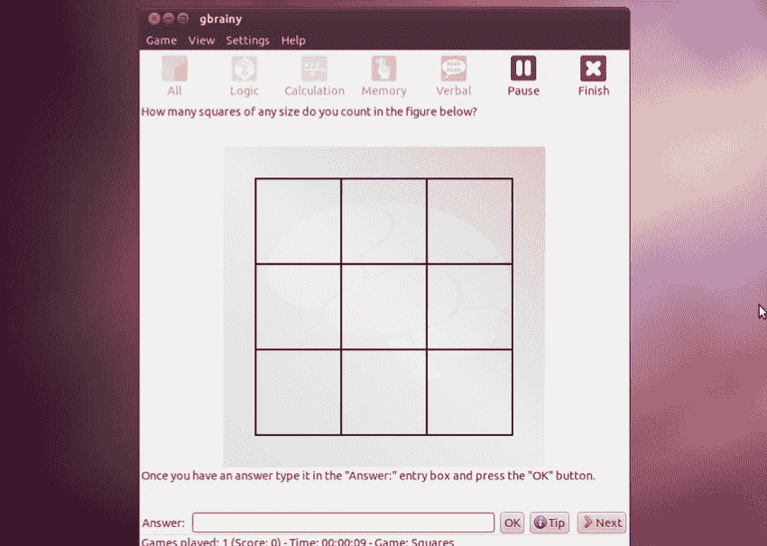

你可以通过打开 Ubuntu 软件中心并搜索下方蓝色文本来下载并安装这些软件包。或者打开终端窗口输入 `sudo apt-get install` 后接：

`ubuntu-edu-preschool` - 5 岁以下教育软件包
`ubuntu-edu-primary` - 小学（6-12 岁）教育软件包
`ubuntu-edu-secondary` - 中学（13-18 岁）教育软件包
`ubuntu-edu-tertiary` - 高等教育（大学水平）教育软件包

MakeUseOf [有一篇关于其中一些应用程序的文章](http://www.makeuseof.com/tag/4-childrens-linux-applications-to-keep-your-kids-ahead-of-the-game/)，如果你不确定是否安装这些软件包。

 其他发行版概述

当你熟悉了 Ubuntu 之后，可以查看其他的发行版。每个发行版都有特定的优势和缺点。


`Lubuntu` - Lubuntu 由一个台湾和法国开发人员团队创建，设计旨在尽可能轻量化。它与 Ubuntu 的主要区别在于窗口管理器 `LXDE`（轻量级 X11 桌面环境）。它预装了 `AbiWord` 而不是 `LibreOffice`。

`Xubuntu` – Xubuntu 的起源可以追溯到曼岛，是另一个基于 Ubuntu 核心的发行版。它使用 `Xfce`，这是一个较新的窗口管理器，同样是为低硬件需求而设计的。

`Joli OS` – Joli OS 基于 Ubuntu 和 Debian，是这些系统中速度最快且最易用户的。它旨在作为一种笔记本电脑操作系统，“高度侧重于 Web 应用程序和服务的”，集成了在线备份功能，预装了多种非免费解码器，并在界面中整合了 Facebook 和 Twitter 等流行的社交网络。

`Peppermint` – Peppermint OS 基于 Debian 和 Ubuntu，设计时考虑了云计算，默认集成了 Mozilla 的 `Prism` 技术——使 Web 应用程序看起来像本地应用。它对硬件很友好，因为它主要为笔记本电脑设计。

`Frugalware Linux` – 是一种采用 `Blackbox` 窗口环境 Slackware 变体。根据其 Slackware 的起源，我可以告诉你它快速、健壮，但操作难度较大。

你可以在 [DistroWatch.org](http://distrowatch.com/) 上找到更多发行版以及关于每个发行版的相关信息。

# 结论

可能性仅取决于你愿意花多少时间寻找软件包和阅读文档。FLOSS（自由及开源软件）的魅力之处在于没有任何限制，你总是可以选择他人的工作并进行改进——正如理查德·斯托曼（Richard Stallman）所说，“解决自己的奇痒（scratching your own itch）”。

像你这样的其他人可能会从中受益、心存感激，并反过来学习将你的工作开发成某种“有时能用”（`sometimes works`）的东西（这源自我几年前用的一个 `python` 脚本）。

*Let me take you for a ride With the devil in the details We'll kiss and tremble with delight* -Placebo

本指南通过从各种来源收集的信息完成：DistroWatch.com, UnixMen.com, blog.sudobits.com, ubuntuforums.org, canonical.com

# MakeUseOf

你喜欢这份 PDF 指南吗？为什么不访问 MakeUseOf.com 查看关于酷炫网站、免费软件和互联网技巧的每日更新呢？

如果你想获得更多类似的精彩指南，为什么不订阅 MakeUseOf 并立即获取 20 多份涵盖广泛主题的此类 PDF 指南呢？此外，你还可以下载免费的备忘单、免费赠品和其他酷东西。

首页：[`www.makeuseof.com`](http://www.makeuseof.com)

MakeUseOf 目录：[`www.makeuseof.com/dir`](http://www.makeuseof.com/dir)

MakeUseOf ：[`www.makeuseof.com/answers`](http://www.makeuseof.com/answers)

极客趣：[`www.makeuseof.com/tech-fun`](http://www.makeuseof.com/tech-fun)

PDF 指南：[`www.makeuseof.com/pages/`](http://www.makeuseof.com/pages/)

技术优惠：[`www.makeuseof.com/pages/hot-tech-deals`](http://www.makeuseof.com/pages/hot-tech-deals)

关注 MakeUseOf：

RSS 订阅：[`feedproxy.google.com/Makeuseof`](http://feedproxy.google.com/Makeuseof)

时通讯邮件：[`www.makeuseof.com/pages/subscribe`](http://www.makeuseof.com/pages/subscribe-to-makeuseof-newsletter)

Facebook：[`www.facebook.com/makeuseof`](http://www.facebook.com/makeuseof)

Twitter：[`www.twitter.com/Makeuseof`](http://www.twitter.com/Makeuseof)

你认为你有能力为 MakeUseOf.com 编写手册吗？我们随时欢迎听取提案！将你的想法发送到 justinpot@makeuseof.com；你可能会获得高达 $400 的报酬。

