# Linux 上的开源电子：：转向 Linux，面向电子应用的开源硬件与软件

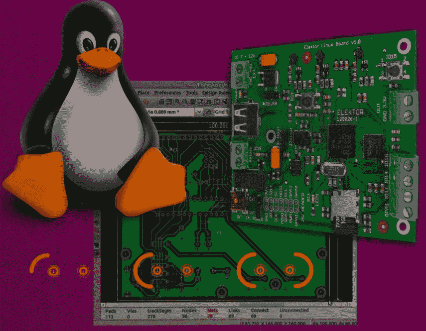


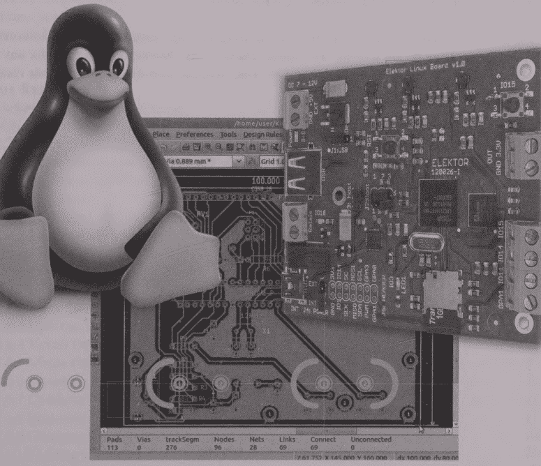

### 4.5.1 以太网板

.......

.......


........   ........................................................................................................................................................................................................................................................................................................................................................................................................................................................................................................................................................................................................................................................................................................................................................................................................................................................................................................................................................................................................................................................................................................................................................................................................................................................................................................................................................................................................................................................................................................................................................................................................................................................................................................................................................................................................................................................................................................................................................................................................................................................................................................................................................................................................................................................................................................................................................................................................................................................................................................................................................................................................................................................................................................................................................................................................................................................................................................................................................................................................................................................................................................................................................................................................................................................................................................................................................................................................................................................................................................................................................................................................................................................................................................................................................................................................................................................................................................................................................................................................................................................................................................................................................................................................................................................................................................................................................................................................................................................................................................................................................................................................................................................................................................................................................................................................................................................................................................................................................................................................................................................................................................................................................................................................................................................................................................................................................................................................................................................................................................................................................................................................................................................................................................................................................................................................................................................................................................................................................................................................................................................................................................................................................................................................................................................................................................................................................................................................................................................................................................................................................................................................................................................................................................................................................................................................................................................................................................................................................................................................................................................................................................................................................................................................................................................................................................................................................................................................................................................................................................................................................................................................................................................................................................................................................................................................................................................................................................................................................................................................................................................................................................................................................................................................................................................................................................................................................................................................................................................................................................................................................................................................................................................................................................................................................................................................................................................................................................................................................................................................................................................................................................................................................................................................................................................................................................................................................................................................................................................................................................................................................................................................................................................................................................................................................................................................................................................................................................................................................................................................................................................................................................................................................................................................................................................................................................................................................................................................................................................................................................................................................................................................................................................................................................................................................................................................................................................................................................................................................................................................................................................................................................................................................................................................................................................................................................................................................................................................................................................................................................................................................................................................................................................................................................................................................................................................................................................................................................................................................................................................................................................................................................................................................................................................................................................................................................................................................................................................................................................................................................................................................................................................................................................................................................................................................................................................................................................................................................................................................................................................................................................................................................................................................................................................................................................................................................................................................................................................................................................................................................................................................................................................................................................................................................................................................................................................................................................................................................................................................................................................................................................................................................................................................................................................................................................................................................................................................................................................................................................................................................................................................................................................................................................................................................................................................................................................................................................................................................................................................................................................................................................................................................................................................................................................................................................................................................................................................................................................................................................................................................................................................................................................................................................................................................................................................................................................................................................................................................................................................................................................................................................................................................................................................................................................................................................................................................................................................................................................................................................................................................................................................................................................................................................................................................................................................................................................................................................................................................................................................................................................................................................................................................................................................................................................................................................................................................................................................................................................................................................................................................................................................................................................................................................................................................................................................................................................................................................................................................................................................................................................................................................................................................................................................................................................................................................................................................................................................................................................................................................................................................................................................................................................................................................................................................................................................................................................................................................................................................................................................................................................................................................................................................................................................................................................................................................................................................................................................................................................................................................................................................................................................................................................................................................................................................................................................................................................................................................................................................................................................................................................................................................................................................................................................................................................................................................................................................................................................................................................................................................................................................................................................................................................................................................................................................................................................................................................................................................................................................................................................................................................................................................................................................................................................................................................................................................................................................................................................................................................................................................................................................................................................................................................................................................................................................................................................................................................................................................................................................................................................................................................................................................................................................................................................................................................................................................................................................................................................................................................................................................................................................................................................................................................................................................................................................................................................................................................................................................................................................................................................................................................................................................................................................................................................................................................................................................................................................................................................................................................................................................................................................................................................................................................................................................................................................................................................................................................................................................................................................................................................................................................................................................................................................................................................................................................................................................................................................................................................................................................................................................................................................................................................................................................................................................................................................................................................................................................................................................................................................................................................................


- 6.5 MSP430 ZIF 插座

# 引言

Linux 是一个免费的操作系统，为任何从事电子领域的人士提供了许多优势。本书主要介绍如何在 Linux 中使用电子相关应用、开源软件和开源硬件。书中讨论的许多应用程序也可以在 Windows 计算机上运行。书中仅使用免费或开源软件。

本书选择了基于 Ubuntu 的 Linux Mint。你也可以使用 Ubuntu Linux 及其衍生版本（如 Xubuntu）。这些 Linux 发行版易于使用，并且在它们的软件库中提供了许多与电子相关的应用程序。

# 迁移到 Linux 的原因

你可能想要迁移或开始使用 Linux 的一些原因：

- Linux 对学生、爱好者甚至预算有限的小型公司是免费提供的。软件更新以及未来版本的升级也都是免费的。
- 数千种免费应用程序供选择：有数以千计可以在 Linux 上运行的免费应用程序可供选择。
- 复制自由——Linux 以及其提供的许多免费应用程序可以安装在任意数量的 PC 上。
- 无需许可烦恼——无需担心许可过期、软件保护加密狗、注册等问题。
- 极佳的学习平台——开源软件非常适合学习，因为可以对软件进行检查和修改。
- 运行旧硬件——当商业操作系统的旧版本停止支持时，运行该系统的旧硬件可能不支持操作系统的新版本。有许多版本的 Linux 可以在旧硬件上运行。
- 拥有许多电子相关应用——对于我们本书的用途来说，这是一个巨大的优势，例如电路设计工具、嵌入式编程软件工具等。
- 病毒与安全——病毒在 Linux 上几乎不存在。

# 涵盖的主要主题

本书涵盖了软件和硬件主题。硬件项目都可以使用单面自制 PCB 构建。硬件项目中没有使用特殊元件。通过 USB 与 PC 接口的项目没有使用特殊的 USB 芯片，而是使用通过软件实现 USB 的 AVR 微控制器。

本书涵盖的一些主要主题：

- **获取并安装 Linux**：涵盖各种配置，如独立安装、与 Windows 双启动等。
- **配置和使用 Linux**：关于设置和使用 Linux 的实用建议。如何包含用于电子领域和日常使用的应用程序。
- **使用 EDA 软件绘制原理图和设计 PCB**：学习使用免费的 EDA 软件 KiCad 绘制电路原理图并制作电路板。还包括如何创建自己的符号库和 PCB 封装足库。
- **开源硬件**：介绍了各种开源电子硬件，包括一个专门介绍非常流行的 Arduino 平台的章节。
- **微控制器开发**：研究如何开始为微控制器开发 Linux 软件，主要集中在 8 位 AVR 微控制器上。
- **将 LCD 接口到 Linux PC**：构建一个通过 USB 将 LCD 连接到 Linux PC 的电路，并显示各种 Linux 系统参数。
- **使用软件进行电子应用**：在数据库中分类你的电子元件收藏，以便于管理。发现其他开源电子相关应用。

# 可能的 PC 配置

根据你的实际情况，在使用本书时你可以选择几种配置之一，例如：

- **仅运行 Linux**——永久切换到 Linux。
- **Windows 和 Linux 双启动**——在同一台 PC 上同时拥有 Windows 和 Linux。当你启动 PC 时，可以从菜单中选择进入哪一个系统。
- **保留 Windows**——在你的 Windows PC 上运行免费软件。大多数软件也有 Windows 版本，但存在一些例外。
- **在独立的计算机上运行 Linux 和 Windows**——如果你有一台以上的计算机，这是最理想的，因为对每个人来说完全放弃 Windows 可能并不切实际。

# 目标读者

本书为对 Linux、微控制器、编程、电路设计、开源软件、开源硬件以及 PC 接口感兴趣电子爱好者编写。

# 前提条件

假设你具有一些基础电子知识，并在面包板上制作过电路、进行过焊接、使用基本手动工具进行电路组装、能阅读电路图等。还假设你知道使用 Windows PC。不需要 Linux 知识。

关于微控制器编程的章节使用 C 语言。如果你不知道 C 语言，仍然可以构建项目并编译和运行示例项目，但你将无法……

# 硬件要求

项目需要一台现代 PC。将根据章节需要某些组件。

# 软件要求

需要连接网络以下载软件。某些软件也有 Windows 版本，但存在一些例外。

## 1.2 选择 Linux 发行版

本书选择的 Linux 发行版是 Linux Mint 13 MATE 版本 LTS。下文将解释选择该发行版的原因，以及一些你可以尝试的替代方案信息。

本节使用的术语：

- **桌面（Desktop）** – 或桌面环境，是操作系统用户用于与计算机交互的图形用户界面 (GUI)。它是用户在开启电脑并登录后在屏幕上看到的内容。Linux 可以运行许多名为 Gnome、Unity、KDE 等的不同桌面环境，而 Windows 只有一个桌面环境。
- **发行版（Distribution）** – 或 Linux 发行版，是基于 Linux 内核构建的操作系统，包含了桌面环境和其他软件。有许多不同的 Linux 发行版，如 Ubuntu、Mint、Red Hat、SUSE 等。每个发行版在使用的桌面环境、包含的应用程序以及设置方式上都与其他有所不同。
- **分支（Fork）** – 指软件项目的分支，是指获取一个现有项目的源代码文件副本，并由一个新的软件工程师团队独立于原始软件团队进行进一步开发。

### 1.2.1 历史与选择

最初本书选择的是标准的 Ubuntu Linux，但 Ubuntu 对其桌面发生了重大变化。原始 Ubuntu 桌面基于 Gnome 2 桌面环境（**图 1.1**）。它被 Unity 桌面（**图 1.2**）取代，这是对 Gnome 的一次彻底改变。与此同时，Gnome 桌面在过渡到 Gnome 3 的过程中也发生了剧烈变化。（基本上，Ubuntu 开发团队不喜欢 Gnome 在 Gnome 3 上的发展方向，因此他们开发了自己的桌面——Unity 桌面）。

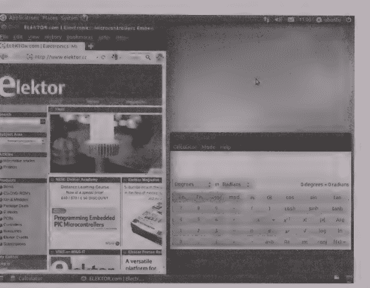

图 1.1：带有 Gnome 2 桌面的 Ubuntu

许多 Ubuntu 用户并不喜欢 Unity 桌面。虽然喜欢或不喜欢某个桌面取决于主观观点，但对 Unity 桌面的主要意见是它发布过早，包含许多错误，而且它不可定制——随着 Unity 的进一步开发，这种情况在未来可能会发生变化。

在 Gnome 3 桌面开发开始后，Gnome 开发团队放弃了 Gnome 2 桌面，不再进行进一步开发。这导致了一组开发者启动了 MATE 桌面，它是 Gnome 2 桌面的一个分支。基于 Ubuntu 的 Linux Mint 在其一个版本使用了 MATE 桌面。

因此，带有 MATE 桌面的 Linux Mint 被选为本书选用的 Linux 发行版。Linux Mint 既稳定又快速。**图 1.3** 显示了 Linux Mint MATE 桌面。

# 第 1 章 Linux 基础知识


Ubuntu 和 Linux Mint 每六个月发布一次新的操作系统。其中某些版本是长期支持 (LTS) 版本，某些则不是。

LTS 版本的支持时间比其他版本长。这意味着 LTS 版本将在更长的时间内获得支持和安全更新。

Linux Mint 13 是一个 LTS 版本，将支持到 2017 年 4 月。

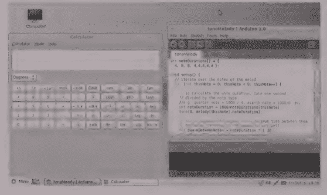

13

## 1.2 可供选择的 Linux 发行版

尽管本书选择了 Linux Mint，但你也可以尝试其他 Linux 发行版，包括 Ubuntu (`www://ubuntu.com`) 和 Ubuntu 的派生版。

以下是“受认可”的 Ubuntu 派生版（即被 Ubuntu 项目和 Canonical 公司 (`www://canonical.com`) 认可）：


- **Edubuntu** (`ubuntu.org`) – 用于教育目的的 Ubuntu。
- **Kubuntu** (`kubuntu.org`) – 使用 KDE (K 桌面环境) 代替 Ubuntu 中 Unity 的 Ubuntu。
- **Mythuntu** (`mythubuntu.org`) – 用于创建基于 MythTV 的系统。
- **Ubuntu Studio** (`ubuntustudio.org`) – 拥有许多编辑和创建音频、图形和视频的应用程序。
- **Xubuntu** (`xubuntu.org`) – 使用 XFCE 桌面代替 Ubuntu 上 Unity 桌面的 Ubuntu。这使其在旧硬件上运行得更轻、更快速。
- **Lubuntu** (`lubuntu.net`, `wiki.ubuntu.com/Lubuntu`)，最近获得了 Canonical 的官方认可。Lubuntu 是一个非常快速且轻量级的 Ubuntu 派生版（比 Xubuntu 更快更轻量），面向低配置硬件。

**图 1.4** 显示了 Xubuntu 桌面，它在许多方面与原始的 Ubuntu Gnome 2 桌面相似。


图 1.4：带有 Xfce 桌面的 Xubuntu

# 第 1 章 Linux 基础知识

Linux Mint (`linuxmint.com`) 提供几种不同的桌面：

- MATE 桌面（本书使用）
- Cinnamon 桌面
- KDE 桌面
- Xfce 桌面

## 1.3 获取 Linux 发行版

下载其中一个 Linux 发行的 ISO 镜像。

### Linux Mint

Linux Mint (`linuxmint.com`) 提供几种不同的桌面：

- MATE 桌面（本书使用）
- Cinnamon 桌面
- KDE 桌面
- Xfce 桌面

### Ubuntu

Linux Mint (`linuxmint.com`) 提供几种不同的桌面：

- MATE 桌面（本书使用）
- Cinnamon 桌面
- KDE 桌面
- Xfce 桌面

### Xubuntu

Linux Mint (`linuxmint.com`) 提供几种不同的桌面：

- MATE 桌面（本书使用）
- Cinnamon 桌面
- KDE 桌面
- Xfce 桌面

## 1.4 制作 Linux 安装盘或 U 盘

### 测试 Linux

Linux Mint、Ubuntu 以及受认可的派生版都可以进行“现场启动 (live booted)”。这意味着你可以制作可启动的 CD、DVD 或 U 盘，从光驱启动并在不安装的情况下运行操作系统。现场启动允许你查看该操作系统是否可以在你的特定硬件上运行，并允许你在安装之前测试该操作系统。

### 创建 CD 或 DVD

使用电脑上的 CD/DVD 软件从下载的 Linux 发行版 ISO 镜像创建 CD 或 DVD。对于 Linux Mint，你需要使用 DVD，因为 CD 无法容纳。Ubuntu 可以放入单个 CD。

关于制作 ISO 镜像的文档可以在此处获取 Linux Mint：

`linuxmint.com/documentation.php`

从此页面下载 pdf 格式的 Linux Mint 用户指南，其中包含创建 Mint DVD 的信息。

对于 Ubuntu，可以在此处获取帮助：

`www.ubuntu.com/download`

`help.ubuntu.com/community/BootFromCD`

### 使用 U 盘

对于没有 CD/DVD 光驱的网络，或者如果你不想使用 CD 或 DVD，你可以制作一个可启动的 U 盘，通过它可以现场启动并安装 Linux（前提你的电脑可以从 U 盘启动）。

UNetbootin 项目 (`unetbootin.sourceforge.net`) 软件可从下载的 ISO 镜像制作可启动的 U 盘。在编写时，Linux Mint 13 未出现在 UNetbootin 程序的“发行版 (Distribution)”单选按钮，可以使用“磁盘镜像 (Diskimage)”单选按钮。这允许你导航到下载的 Linux 发行版 ISO 镜像并选择它，然后制作可启动的 U 盘。

## 第 1 章 Linux 基础

在 Windows 中制作 Linux Mint 启动盘 U 盘：

- 下载 Unnetboot (`unetboot.sourceforge.net`)
- 将一个空白 U 盘（1GB 或更大）插入电脑的空闲 USB 接口
- 在 Windows 中双击下载的文件以运行 Unnetboot
- 在 Unnetboot 中，点击 `Diskimage` 单选按钮，确保选择了正确的驱动器器，然后点击 `...` 按钮导航到你下载到电脑上的 Linux Mint ISO 镜像。参见图 1.5 中的这些设置。
- 完成后点击 OK。

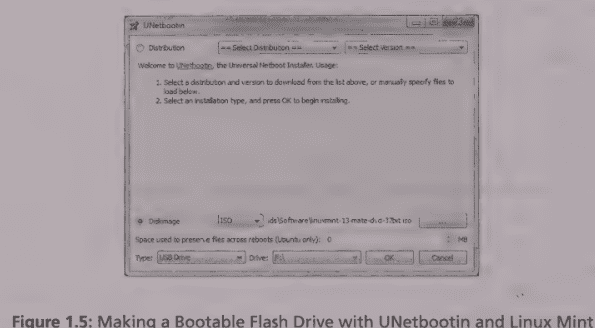

### 1.4.2 启动 Linux

使用电脑的 BIOS 从通过 ISO 镜像创建的 CD、DVD 或 U 盘启动。大多数现代电脑在启动时都会提供一个按键的选项，然后从菜单中选择从哪个设备启动，例如，按 `F12` 进入启动菜单。旧的电脑将需要你进入 BIOS 菜单来更改默认启动设备。

一旦进入活动会话（live boot session），你将可以在不修改硬盘上任何内容的情况下使用 Linux。你可以从菜单运行应用程序，例如用于浏览网页的网络浏览器，并探索桌面。

请注意，从 CD 运行 Linux 会比安装后在电脑上运行慢得多。当你从 CD 运行 Linux 时所做的任何更改在重启后都会丢失。

## 1.5 安装 Linux

有关从从 CD 启动和运行活动会话的更多帮助，请参阅 Linux Mint 文档或 Ubuntu 帮助页面：

Linux Mint:

`linuxmint.com/documentation.php`

Ubuntu:

`help.ubuntu.com/community/LiveCD`

`www.ubuntu.com/download/desktop`

`help.ubuntu.com/community/BootFromCD`

互联网上关于安装 Linux 的信息非常多，因此此处不再重复这些信息，本节包含了在专用电脑上进行安装的基本步骤，并提供了获取更多信息的资源链接。我在 `linuxbook.startingelectronics.com` 上发布了一些关于安装规划以及其他安装选项的信息，建议你先阅读这些。该资源包含了如果你想实现 Linux/Windows 双系统，以及如果你想从同一台电脑启动多个 Ubuntu 或 Ubuntu 衍生版本时的做法。将信息移出书籍可以为电子相关材料留出更多页面。

在 Linux Mint 中，你只能通过双击桌面上的安装图标来启动并安装操作系统。在 Ubuntu 中，你可以从启动 CD/DVD 或活动会话后出现的菜单中，或通过双击桌面上的安装图标选择安装 Ubuntu。

安装的基本步骤是将电脑连接到互联网，从 CD、DVD 或 U 盘启动，然后从桌面上的安装图标开始。。安装程序将引导你完成安装步骤，包括选择安装类型（例如双系统或擦除磁盘并安装）、选择你的键盘类型、选择位置，以及选择你的用户名和密码。

### 安装资源

- `linuxbook.startingelectronics.com` - 本书已在线的额外页面
- Linux Mint: `linuxmint.com/documentation.php`
- Ubuntu: `help.ubuntu.com/community/Installation` and `help.ubuntu.com/community/GraphicalInstall`

## 1.6 导航 Linux

安装 Linux 后，系统会要求重启电脑。点击重启按钮后，如果你是从 CD 安装的，CD 盒将弹出。如果你是从 U 盘安装的，请移除 CD 或 U 盘并按 `Enter` 键重启。

如果 Linux 是电脑上唯一的操作系统，它在每次开启电脑时都会立即启动。如果电脑上有多个操作系统，将出现启动菜单，允许你选择要启动的操作系统。使用键盘的上、下方向键选择要启动的操作系统，并按 `Enter` 键启动所选操作系统。引导加载程序的名称为“`GRUB`”，如果你想了解更多信息，可以在互联网上搜索此名称。

本节的其余部分描述了如何导航 Linux Mint MATE 桌面。

### 1.6.1 登录

（注：此处原文内容存在大量重复和错误，已根据要求提取唯一逻辑内容。）

# 第 1 章 Linux 基础


### 1.6.5 鼠标操作

在 Linux 应用程序中，你点击的菜单/下拉框等会在松开左鼠标键时消失。此时，你需要点击并按住鼠标键将光标拖到你想要的项目，然后松开鼠标键以选择该菜单项。在使用 Linux 一段时间后，你可能会发现自己习惯于使用这种“点击、拖动选择、释放”的操作，即使在没有特殊要求的情况下也不会使用 Windows 的“点击、释放、移动选择、点击选择、释放”操作。

传统上，为 Linux 等 Unix 系统编写的应用程序比 Windows 应用程序更多中键，因此请注意可能使用中键的应用程序——通常在现代鼠标上，按下鼠标轮即充当中键。

### 1.6.6 开启或关闭屏幕保护程序密码

默认情况下，屏幕保护程序会在键盘和鼠标空置几分钟后启动，而且默认情况下，如果你离开电脑一段时间，屏幕保护程序不会锁定屏幕以保护你的电脑免受未经授权的访问。如果你在一个认为必要开启屏幕保护程序密码的环境，可以通过点击菜单 → 控制中心，然后在控制中心对话框中点击屏幕保护程序来启用。在弹出的屏幕保护程序首选项对话框中，你可以启用屏幕保护程序密码（勾选 – 屏幕保护程序活动时锁定），还可以更改其他屏幕保护程序设置。

### 1.6.7 更改桌面壁纸

在桌面上点击右键，从弹出的菜单中选择“更改桌面背景”。在对话框中选择一张背景图像。

### 1.6.8 关闭声音

关闭登录界面声音和登录后的音乐：

启动并到达登录界面后会播放声音。登录后会播放一些音乐。要关闭这些声音，首先选择菜单 > 控制中心。在控制中心对话框中，向下滚动到系统，或者点击对话框左侧面板中的“系统”。现在点击登录窗口图标。接下来你需要输入密码——使用与你登录时相同的密码。将打开登录窗口首选项对话框。点击“辅助功能”选项卡。现在你可以禁用或更改这两个登录声音了。

### 1.6.9 更改时间和日期

时间和日期显示在底部面板的右侧。点击时间和日期将弹出当前月份日历。

要更改时间和日期，在底部面板上右键点击时间和日期，从弹出菜单中选择“首选项”。在时钟首选项对话框中，点击“时间设置”按钮。使用“时间与日期”对话框将系统时间和日期更改所需的值，然后点击“设置系统时间”按钮保存更改。你需要输入密码来保存更改。

### 1.6.10 添加网络活动显示

能够视觉化地显示网络上发生的情况（即通过电脑以太网连接发送和接收了多少数据，见图 1.7）是非常棒的。

要在底部面板中添加网络活动显示，右键点击底部面板，然后在弹出菜单上点击“添加到面板...”。在列表中找到“系统监器”项目，点击它然后点击“添加”按钮。系统监器图标将出现在底部面板上。它可以像工作区切换器一样进行定位。默认情况下，系统监器显示 CPU 活动，要使其显示网络活动，首先右键点击，然后点击弹出菜单上的“首选项”。现在勾选“网络”框并取消勾选“处理器”框。如果你想更改网络活动图标的颜色，点击对话框中的“网络”选项卡，这将让你获得相应的控制控件。

### 1.6.11 添加用户

通过添加额外的用户，一台电脑可以在两个或更多人之间共享，而不会影响彼此的设置和用户数据。如果你想对各种设置进行一些实验，但不想弄乱你的主账户设置，也可以添加额外的用户账户。

在添加新用户时，可以给新用户管理员权限，这意味着该用户将允许对 Linux 系统进行更改，包括删除重要的操作系统文件，因此请务必只向信任的人授予管理员权限。

要添加用户，点击菜单 > 控制中心。在控制中心对话框中，点击左侧面板的“系统”和右侧的“用户和组”。在“用户”对话框中，点击“添加”按钮添加新用户——你需要输入密码。在“更改用户”对话框中，输入用户名，然后点击“确定”按钮。

## 1.7 Linux 文件系统

关于 Linux 系统，有一些概念需要理解，特别是如果你是从 Windows 过来的话。Windows 有一个 C: 驱动器或分区作为存储操作系统文件的主要位置，并有一个 D: 驱动器或分区作为额外存储空间，Linux 将硬盘和分区作为文件系统的一部分，我们很快就会看到。

要检查 Linux 文件系统，点击菜单 -> 主目录（Caja 是 Mint 中的文件管理器，Nautilus 是 Ubuntu 中的文件管理器）。我们必须点击文件管理器左侧面板中的“文件系统”图标导航到文件系统的根目录。文件系统目录列如下及其功能为：

- `/bin` - 包含在终端窗口中使用的二进制可执行程序。
- `/boot` - 用于启动的文件。
- `/cdrom` - CD-ROM 将出现在 `/media` 中，而不是在此文件夹中。
- `/dev` - 硬件设备。计算机上的所有设备都表示为文件。
- `/etc` - 系统的配置文件。
- `/home` - 包含用户目录。每个用户在 `/home` 中都有一个以其用户名命名的目录，包含自己的文件和设置。
- `/lib` - 系统库。
- `/lost+found` - 丢失的文件。
- `/media` - 挂载的设备，如闪存驱动器、CD/DVD 等。
- `/mnt` - 用于临时挂载的文件系统。
- `/opt` - 可选安装的软件。
- `/proc` - 进程 - 内使用的虚拟文件系统。
- `/root` - root 用户或超级用户的家目录。root 用户可以更改系统中的任何内容。
- `/run` - 启动期间使用。
- `/sbin` - 超级用户使用的系统二进制文件。
- `/selinux` - 增强 Linux (SELinux) 目录。
- `/srv` - 可以包含 HTTP 或 FTP 服务的数据目录。
- `/sys` - 系统信息。
- `/tmp` - 应用程序使用的临时文件存储在这里。
- `/usr` - 给用户的应用程序、库和文档。
- `/var` - 可变数据 - 系统数据，如日志、数据库等。

作为 Linux 用户，你不需要直接操作这些文件系统目录。你将在使用 Linux 时学习并了解更多。在本章末尾有一个专门针对 Ubuntu 的电子书链接，其大部分内容适用于 Mint，因此与其在这里浪费空间描述文件系统的细节，我将让你参考该资源。

## 1.8 安装和删除应用程序

Linux Mint 有多种方法安装应用程序。主要的安装方法是使用软件管理器。你需要连接互联网以从软件管理器安装软件。为了演示安装有多简单，我们将首先安装电子类应用程序——用于创建原理图和 PCB 的 Eagle 工具。

Eagle CAD 不是开源软件，但可以作为免费软件进行限制模式使用。我建议你安装它，是因为许多开源硬件项目都使用 Eagle，并且能够查看这些项目提供的 Eagle 文件。开源硬件社区提出的问题之一是，许多开源项目是使用非开源 Eagle CAD 包创建的。在书中，我们将使用开源 CAD 工具创建所有的原理图和 PCB。

### 1.8.1 应用程序安装示例

首先启动 Linux Mint 软件管理器——点击菜单 > 软件管理器。

在 Mint 软件窗口中，在搜索框（窗口右上角）输入 eagle，你应该会在下方面板看到 Eagle，见图 1.9，双击搜索结果中的 Eagle 以获取有关该应用程序的更多信息。

点击“安装”按钮并在提示时输入密码以开始安装。应用程序将从互联网下载并安装。安装完成后你可以关闭软件管理器——当软件管理器底部不再有正在进行的操作时，即表示安装完成。

# 第 1 章 Linux 基础

启动已安装的应用：

您可以在“菜单 -> 编程 -> Eagle”下找到 Eagle（如果找不到“编程”分组，请点击菜单右上角的“所有应用程序”以使程序组在菜单上显示）。或者，在菜单的搜索框中输入 eagle。

当第一次启动 Eagle 时，会弹出 EAGLE 许可对话框。点击此对话框中的“作为免费软件运行”（Run as Freeware）按钮。在弹出的警告框中，点击“是”（Yes）为 Eagle 项目创建一个目录。


图 1.9：在软件管理器中选择 Eagle

### 1.8.2 移除应用程序

要移除应用程序，请启动软件管理器并在搜索字段中输入应用程序名称，例如，如果您要移除 Eagle，请在搜索字段中输入 eagle 以找到它。双击点击下方面板中的 Eagle，然后点击“移除”（Remove）按钮。您现在必须输入密码以继续移除该应用程序。

### 1.8.3 安装应用程序的其他方法

除了使用软件管理器外，其他安装软件的方法。其中一种方法是使用命令行或终端窗口，我们在此讨论。

### 从命令行安装

作为示例，我们将安装 gResistor 应用，该应用通过选择电阻器色环颜色来计算电阻值。再次提醒，您需要连接互联网以执行下载和安装。

### 1.9.1 在 Windows 和 Linux 上运行的日常应用

首先启动终端窗口：**菜单 → 终端**（位于“系统”下）。

要开始下载和安装，在终端窗口（**图 1.10**）中输入：

```
sudo apt-get install gresistor
```

在按下 **Enter** 键后，您需要输入密码以开始安装。

要启动 gResistor，请在菜单中找到它：**菜单 → 教育**

### 从命令行卸载

要使用命令行卸载，请启动终端窗口并输入：

```
sudo apt-get remove gresistor
```


在移除 `gResistor` 期间被询问是否继续，只需按 `Enter` 键继续。

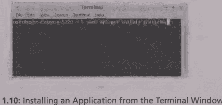

## 1.9 日常应用与任务

本节包含日常使用所需的应用程序和任务信息。可以在 Windows 和 Linux 上运行的开源应用程序列表将帮助您通过在 Windows 上熟悉这些应用程序来转向 Linux。

### 1.9.1 在 Windows 和 Linux 上运行的日常应用

以下是适用于 Windows 和 Linux 的开源程序列表，您将需要它们完成常见任务。电子类应用未在此列表中，因为它们将在后续章节中介绍。在 Windows 上安装这些程序只需访问相应的网站并下载文件。许多此类程序是 Mint 默认的，或者可以通过软件管理器安装。

#### 文字处理 / 办公套件

`LibreOffice` (`libreoffice.org`) 是 Mint 默认的办公套件。`LibreOffice` 套件包含几个程序：

- 文字处理器
- 电子表格程序（等同于 MS Excel）
- 多媒体演示（等同于 PowerPoint）
- 绘图

#### 浏览器

`Mozilla Firefox` (`mozilla.org`) 是默认的内核浏览器。`Chromium` 浏览器 (`chromium.org`) 是另一种选择。

### 电子邮件

`Mozilla Thunderbird` (`mozilla.org`) 是 Mint 默认的电子邮件程序。

### FTP 程序

如果您有自己的网站，可能需要一个 FTP 程序向其上传内容。`FileZilla` (`filezilla-project.org`) 是执行此任务的优秀程序，可以通过软件管理器获取。

### 照片编辑

`GIMP` (GNU 图像处理程序) `gimp.org` 等同于用于编辑照片的 Adobe Photoshop。

### 绘图

对于矢量图形，可以使用 `Inkscape` (`inkscape.org`)，它的功能与 Adobe Illustrator 和 CorelDraw 类似。

### 音频编辑

`Audacity` (`audacity.sourceforge.net`) 是录制和编辑音频的优秀程序。

### 代码编辑器 IDE

有很多用于编辑源代码的编辑器。即使是 Mint 默认的文本编辑器 `pluma` 支持许多语言的语法高亮。我也建议 `Geany` (`geany.org`)，它是一个快速且轻级的 IDE，包含了语法高亮、代码补全等许多功能。

### 1.9.2 可移动介质、CD 和分区

USB 闪存、CD 和 DVD

在向 PC 插入闪存、CD 或 DVD 后，它将自动挂载到文件系统中并在桌面环境中可用。它在 `Caja` 文件管理器的左侧面板中可见。

安全移除闪存盘和弹出 CD

如果数据已复制到这些设备或从这些设备复制，必须安全移除。要安全移除闪存盘，可以在桌面或文件管理器中对其点击右键，并从弹出菜单中选择“移除驱动器” (`Remove Drive`)。如果您向设备复制了大量数据，可能会看到一条消息，要求您等待数据写入完成。要弹出 CD 或 DVD，请点击文件管理器中的图标，然后点击弹出菜单上的“弹出” (`Eject`)。

在文件系统系统中查找介质设备

偶尔，当您需要在某个程序中从可移动介质打开文件时，该程序可能不会以图标形式显示可移动设备。您需要在文件系统中查找它。然后您将在 `/media` 目录（位于文件系统的根目录 `/`）中找到它。例如，如果您需要使用 `FileZilla` FTP 程序从闪存盘复制文件到您的网站，闪存盘在 `FileZilla` 中不会像在桌面环境或其他程序中那样显示。在这种情况下，您需要使用 `FileZilla` 在 `media` 目录查找闪存盘。

### 分区

当您的硬盘上有额外分区时（例如额外安装的 Linux 或 Windows 安装），它们可以挂载到文件系统中，这对于需要从中或向其复制文件非常方便。这些额外的驱动器或分区可以在文件管理器的左侧面板中找到，也可以点击“菜单 → 计算机”。要挂载分区，在左侧面板中点击它，它将在文件系统中可用。要卸载分区，在文件管理器的左侧面板中对其点击右键，并点击弹出菜单中的“卸载” (`Unmount`)。它将从文件系统中移除，但需要时可以再次挂载。

挂载的分区也可以在 Mint 和 Ubuntu Linux 文件系统的 `/media` 目录中找到。

### 1.9.3 安装打印机

要安装通过 USB 连接到 PC 的打印机，请确保您已连接互联网，并将打印机插入 PC 的 USB 端口并开启。Linux Mint 将搜索打印机驱动。如果没有找到打印机驱动，请点击“搜索” (`Search`) 按钮（图 1.11）。将花费时间搜索打印机驱动。

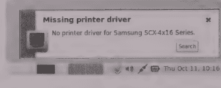

图 1.11：安装打印机

在新打印机对话框中选择您的打印机品牌，并通过点击“下一步” (`Forward`) 完成步骤（图 1.12）。

您现在应该能够选择打印机型号。如果打印机型号未被高亮，请滚动列表并点击它。点击“下一步” (`Forward`)。

可以输入打印机名称、描述和位置。完成后点击“应用” (`Apply`)。


图 1.12：选择打印机品牌 – 遍历列表查找正确的品牌

### 1.9.4 查找文件

Mint 文件管理器具有有限的文件搜索功能（在文件管理器中按 `Ctrl + F` 搜索），但对于更高级的搜索（包括使用通配符和在文件中搜索文本），需要文件搜索程序，如图 1.13 所示。

要启动文件搜索程序，选择菜单 > 附件 -> 搜索文件... (`Search for Files...`)，这将打开“搜索文件”窗口。在“包含” (`Name contains:`) 字段中输入文件名或文件部分名称，并在“查找文件夹” (`Look in folder:`) 字段中导航到开始搜索的文件夹。点击“选择选项”可以搜索包含特定文本的文件和其他选项，如大小、修改日期等。

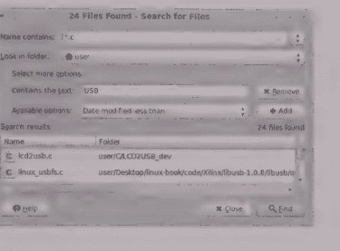

## 1.10 命令行

正如我们所看到的，命令行可以用于安装软件，也可以用于执行许多其他任务，包括运行命令行应用程序。我们书中使用的一些与电子相关的软件将从命令行运行。

在 Ubuntu 中，按下 `Ctrl + Alt + t` 是启动终端模拟器窗口并在命令行提示符下工作的一种简单且快速的方法。Linux Mint 默认没有设置此组合键来启动终端，因此必须手动添加。

要在 Linux Mint 中设置此键盘快捷键，点击菜单 (`Menu`) -> 控制中心 (`Control Center`)，然后在控制中心对话框中选择快捷键 (`Keyboard Shortcuts`)。快捷键列表中的第一项是“声音” (`Sound`)。向下滚动到列表中的下一个标题“桌面” (`Desktop`)。桌面列表的最后一项是“运行终端” (`Run a terminal`)。点击“运行终端”，然后按住 `Ctrl + Alt + t` 键，将其设置为打开终端窗口的键盘快捷键。完成后点击“关闭” (`Close`) 按钮。现在按下 `Ctrl + Alt + t`，一个终端窗口应该就会打开了。

## 第 1 章 Linux 基础

### 1.10.1 一些实用命令

在书中，我们在命令行中执行的大部分操作都可以输入或复制粘贴完成，但了解一些基础命令仍然很有用。下面显示的命令都是通过在命令行窗口中输入它们并按回车键运行的。所有命令均区分大小写。

#### 列出目录中的文件

`ls`

列出当前目录下的文件和目录。此命令等于 DOS 的 `dir` 命令。

`ls -l`

列出更详细的文件和目录列表。

`ls -a`

显示所有文件和目录，包括隐藏文件和目录。在 Linux 中，隐藏文件和目录的名字以点 (`.`) 开头。要隐藏一个文件或目录，只需在名字前面加一个点来重命名它即可。

`ls -al`

上述长列表显示和隐藏文件切换的组合。此命令将显示所有文件和目录（包括隐藏文件）以及更多详细信息。

#### 更改目录

`cd`

更改目录 – 从当前目录切换到不同的目录，例如：

`cd Documents`

切换到 `Documents` 目录和：

`cd ..`

从当前位置返回上一级目录。

此命令的工作原理基本上与 DOS 的 `cd` 命令相同，但在 Linux 中，目录和文件名是区分大小写的。要更改主目录下的 `Documents` 目录，你需要使用大写 `D` – 使用小写 `d` 是不起作用的。单独输入 `cd` 而不带任何目标目录，无论你当前导航到什么位置，它都会切换到你的主目录。

#### 当前目录

`pwd`

打印工作目录 (`Print working directory`) – 显示当前目录的路径。

#### 创建和删除文件文件夹

`touch`

创建一个空文件，例如：`touch funny.txt` 在当前目录下创建一个名为 `funny.txt` 的新空文件。

`rm`


移除（删除）一个文件，例如：`rm funny.txt` 如果 `funny.txt` 存在则删除该文件。

`mkdir`

创建一个目录，例如：`mkdir funny` 在当前目录下创建一个名为 `funny` 的新目录。

`rmdir`

移除（删除）一个目录，例如：`rmdir funny` 如果 `funny` 存在则删除该目录。

### 清除命令行窗口

`clear`

清除终端窗口可见部分中的文本。你可以向上滚动查看之前显示的内容。

### 关闭电脑

如果 Mint 的图形界面卡死，有一种比按下重位键更优雅的关机方法——使用 `shutdown` 命令。图形界面可能会卡死到你无法启动终端窗口的程度。在这种情况下，使用 `Ctrl + Alt + F1`（或 `Ctrl + Alt + F2` 到 `F6`）从图形模式切换到基于文本的屏幕（要回到图形界面，请按 `Ctrl + Alt + F8`）。在文本屏幕上，你需要先输入用户名再输入密码来登录——这与你启动电脑后登录 Linux 时使用的用户名和密码相同。登录后，你可以输入以下命令之一来关闭电脑：

`sudo shutdown -r now`

此命令将重启电脑。

`sudo shutdown -h now`

此命令将关闭（停止）电脑。

### sudo 命令

`sudo` 命令用于临时赋予普通用户“超级用户”(super user) 权限，使其能够对系统进行更改，例如安装软件以及如上述所示关闭系统。

普通用户被防止进行可能导致损坏的系统更改。超级用户可以对系统进行任何更改。通过临时获得超级用户权限，普通用户可以进行特定的系统更改然后恢复为普通用户，从而防止对系统造成意外损坏。

### 关闭卡死的 GUI 窗口

如果应用程序卡死/崩溃且其窗口无法响应，其窗口无法响应。

### 1.10.2 节省时间的技巧

为了在输入时节省时间，可以使用一些技巧。

### 使用 Tab 键

`Tab` 键可以用于自动补全。

# 第 1 章 Linux 基础


图 1.14：将目录名称拖入终端窗口。也可以对某个文件执行此操作。

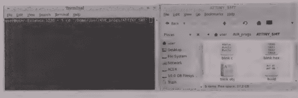

图 1.15：拖放后，终端窗口中出现了目录路径

## 1.11 快捷键

了解一些快捷键有助于提高图形桌面环境的使用速度。其中一些快捷键是至关重要的，比如下面列出的第一个。

### 1.11.1 被遮挡的窗口

窗口的位置可能会变成这样：导致窗口的顶栏位于屏幕之外，从而无法抓取并移动它。在笔记本电脑等小型电脑上，可能会出现设置对话框比屏幕还高的情况。如果不向上移动对话框，就无法更改屏幕底部隐藏部分对话框的设置。在这两种情况下，按住 `Alt` 键，然后用鼠标左键抓取窗口并拖到目标位置。按住 `Alt` 键时，可以抓取窗口或对话框的任何部分进行移动。

### 1.11.2 启动“运行”对话框

使用 `Alt + F2` 键组合启动“运行”对话框。可以通过输入应用程序名称从此对话框启动任何窗口化（非命令行）应用程序。

### 1.11.3 导航桌面环境

许多在 Windows 上有效的快捷键在 Linux 桌面也同样有效。例如使用 `Alt + Tab` 切换打开的窗口/应用程序，使用 `Alt + F4` 关闭窗口/应用程序。在应用程序内部，可以使用 `Alt` 键访问顶部菜单，例如使用 `Alt + F` 展开文件菜单。

## 1.12 Linux 学习资源

希望第一章为你提供了足够的开始使用 Linux Mint 信息。我想向你介绍各种资源，帮助你学习更多关于 Linux 的知识。本书的内容涵盖了电子应用，但在必要时也会包含其他 Linux 相关信息，例如安装和设置各种软件。

本书的网站可以在 `linuxbook.startingelectronics.com` 找到，那里将发布额外的信息、相关文章、更新和修正。

### 1.12.1 推荐的免费书籍

`ubuntupocketguide.com` 提供了一本免费书籍，专门介绍 Ubuntu，但书大部分大部分也适用于 Linux Mint。虽然它是在 Ubuntu 8.10 为当前版本时编写的，但书中的大部分内容仍然适用。我强烈推荐阅读这本书。

### 1.12.2 论坛

Linux Mint 论坛可以在 `forums.linuxmint.com` 找到，Ubuntu 论坛可以在 `ubuntuforums.org` 找到，那里有很多信息。你也可以加入论坛提问。

### 1.12.3 文档与帮助

Linux Mint 文档可以在 `linuxmint.com/documentation.php` 找到。

官方 Ubuntu 文档可以在 `help.ubuntu.com`，包含了当前支持的 Ubuntu 版本文档。

### 1.12.4 病毒、防火墙和碎片

这些资源适用于 Ubuntu Linux，但也适用于 Linux Mint。

#### 病毒

关于 Ubuntu / Linux 计算机病毒的信息可以在此处找到：`help.ubuntu.com/community/Antivirus` `help.ubuntu.com/community/Linuxvirus`

#### 防火墙

防火墙信息可以在此处找到：`help.ubuntu.com/community/Firewall`

#### 碎片整理

Linux 不需要进行碎片整理，正如在以下所示：`help.ubuntu.com/community/LinuxFilesystemsExplained`（查看“Fragmentation”标题下）

# 第 2 章 使用 KiCad 创建原理图和 PCB

KiCad 是一套电子设计自动化（EDA）工具套件，用于原理图捕获（绘制电路图）、PCB 布局以及生成用于 PCB 制造的输出文件。另一组开源 EDA 工具是 gEDA，但它在不同软件之间的集成程度不如，也没有 KiCad 那么用户友好。本书中可以构建的所有项目都基于 KiCad，因此你可以轻松地修改并使其适应你的需求。

网站：`launchpad.net/kicad` 或 `www.kicad-pcb.org` 或 `kicad.sourceforge.net`

许可证：GPL

平台：Linux, Windows 和 Mac OS

## 2.1 安装 KiCad

本书使用的 KiCad 版本是 `kicad-0.6.5`，是从 Linux 软件管理器安装的。要安装 KiCad，启动软件管理器，然后在搜索框中输入 `kicad`。双击列表中的 `kicad`，然后点击安装按钮。也可以安装 KiCad 文档，它提供多种语言。这些就是你在软件管理器中搜索 KiCad 时会看到的文件。安装后，可以在“菜单 -> KiCad”中找到它。通过将菜单中的 KiCad 图标拖到桌面可以创建一个快捷键。

## 2.2 快速概述

启动 KiCad 将打开 KiCad 主窗口，允许创建新项目。主窗口包含五个图标，用于启动 KiCad 软件套件中的每个应用程序，即：

- `ESchema` – 用于绘制电路图的原理图编辑器。
- `CVpc` – 用于为原理图中的组件分配 PCB 封装。
- `PCBnew` – 用于 PCB 布局。
- `GerberView` – 用于查看输出文件。
- `Bitmap` – 用于创建位图

启动 KiCad 将打开 KiCad 主窗口，允许创建新项目。主窗口包含五个图标，用于启动 KiCad 软件套件中的每个应用程序，即：

...使用这些工具绘制原理图的典型步骤如下：

- 创建一个新的 KiCad 项目。
- 使用 `ESchema` 绘制电路图，从库中放置符号并连接。
- 使用 `CVpc` 从原理图生成网表。
- 启动 `PCBnew` 并导入网表。
- 生成制造的输出文件（Gerber 文件），或者对于自制 PCB，可以打印这些。

#### 文档：

如果你安装了 KiCad 文档，可以在 `/usr/share/doc/kic/` 找到（你需要在文件管理器中定位它）。

#### 教程：

本章的第一个教程引导读者通过绘制电路图来制作自制 PCB。虽然教程使用了简单的电路，但建议即使是有有 EDA 工具经验的用户也应遵循本教程以熟悉 KiCad。

## 2.3 KiCad 教程 1 – 三极管电路

第二个教程在第一个教程的基础上，通过添加需要单独放置的 IC 进行后续。这个教程比第一个教程短，因为它不再解释第一个教程中的所有内容，而是列出了放置 IC 所需执行的额外步骤。

#### 绘图单位：

KiCad 和其他 EDA 工具允许你使用公制和英制（也称为 mils）进行绘图。在 KiCad 中绘制原理图更容易，因为组件引脚对齐了网格且单位是整数，例如绘图网格的默认值为 50 英寸。

在绘制 PCB 时，你可以根据需要在两种测量单位之间切换。例如，如果你希望板尺寸以英寸为单位，则将测量单位更改为英寸以绘制板轮廓。大多数插件孔元件的引脚间距为密，因此在放置和布线这些元件时切换到相应比例。如果你有任何引脚间距为公制的元件（通常是贴片元件），在放置和布线时切换到毫米比例。

#### 网格间距：


无论是绘制原理图还是 PCB，最好尽可能使用最大的网格间距，仅在必要时切换到较小的网格。在使用较小网格尺寸后，尽快切换较大的尺寸。

作为 KiCad 的介绍，我们将图 2.1 中的电路（简单的 LED 闪烁稳态多振器）输入 KiCad 的原理图捕获程序 `ESchema`。然后，我们将使用 `CVpcb` 为原理图中的每个组件分配封装，并使用 `PCBnew` 布局 PCB。完成教程的 KiCad 文件可以在 `CH02/LED_multivibrator` 中找到。

# 第 2 章：使用 KiCad 创建原理图和 PCB

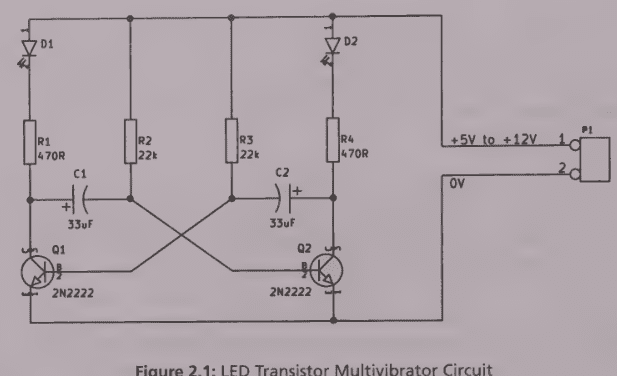

## 2.3.1 使用 KiCad 进行原理图捕

### 教程 1-1 创建新项目

- 启动 KiCad：在 Linux Mint 菜单中选择 编程 -> KiCad，或使用您创建的快捷键。
- 创建新项目：点击顶部工具栏上的“启动新项目”图标（图 2.2 ⓘ）打开“新建项目”对话框（或使用文件 -> 新建）。
- 在“新建项目”对话框中，导航到您想要存储项目的位置。默认情况下，您将位于主目录。
在主目录下创建一个包含所有 KiCad 项目的文件夹是一个好主意——您只需要在第一次创建项目时执行此，并将所有新项目保存到此文件夹中。例如，要创建一个名为“KiCad”的子文件夹，点击“创建文件夹”创建一个新文件夹然后按回车。这将创建一个名为 KiCad 的新文件夹并打开它。您现在可以为新项目创建一个文件夹——点击“创建文件夹”按钮创建一个新文件夹，然后输入 `LED_multivibrator` 并按回车。
- 您应该仍处于“新建项目”对话框，并位于 `<主目录名称>/KiCad/LED_multivibrator` 文件夹中。在“名称:”字段中输入项目名称——再次输入 `LED_multivibrator`（图 2.3）。最好保持项目名称与其文件夹名称一致。
- 点击“保存”按钮保存新项目。

① 开始新项目 ② `EESchema` ③ `CVpcb`

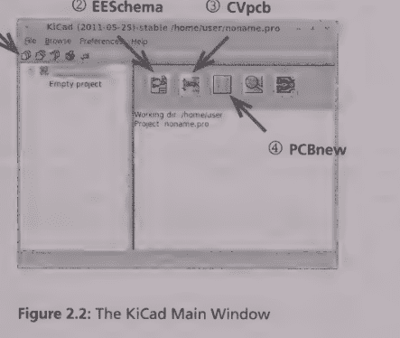

### 教程 1-2 启动 EESchema 原理图捕程序

- 启动 EESchema：在 KiCad 主窗口中，点击 `EESchema` 图标（图 2.2 ②）启动原理图编辑器。
- 弹出一个对话框通知您该项目中还没有原理图。点击 `OK` 按钮。
- 最大化 `EESchema` 窗口并按下键盘上的 `Home` 键，使页面适应窗口。


### 教程 1-3 设置原理图页面区域

- 在 `EESchema` 主窗口中，点击“页面设置”图标选择页面大小（图 2.4 ⊕）。
- 在“页面设置”对话框中，选择所需的页面大小——默认是 A4。
- 在此处输入将放入原理图页面标题块的修订号、标题和其他字段。在“修订:”字段中输入 `1.0`，在“标题:”字段中输入 `LED Transistor Multivibrator`，您可以在“公司:”字段中输入您的姓名，并在注释字段中输入任何其他内容，例如输入今天的日期，以记录项目开始的日期。
- 完成后点击 `OK` 按钮。
- 如果需要，按下键盘上的 `Home` 键使原理图适应窗口。

### 教程 1-4 在原理图中移动

- 放大和缩小：使用鼠标滚轮可以放大（向上滚动）和缩小（向下滚动）。缩放到原理图页面右下角的标题块，以查看您在设置原理图页面时填写的信息。
- 放大特定区域：要放大原理图的特定区域，请使用鼠标中间键——通常滚轮充当中间键。按住中间键并在要缩放的区域周围画一个框进行放大。
- 左右移动：按住 `Ctrl` 键——滚轮向上滚动向左平移，向下滚动向右移动。
- 上下移动：按住 `Shift` 键——滚轮向上滚动向上平移，向下滚动向下平移。
- 刷新屏幕：按下 `F3` 键重绘原理图，消除因平移、缩放或删除产生的屏幕残留碎片。
- 原理图自适应屏幕：按下 `Home` 键使原理图页面适应屏幕。
- 保存原理图：绘图时，经常按 `Ctrl + S` 保存您的工作。

- 快捷键帮助：按下 `Shift + ?` 调出帮助对话框，列出在原理图编辑器中执行各种操作的键盘快捷键（热键）。这些键不区分大小写。
- 工具栏图标功能：要查找 KiCad 工具栏上任何图标的功能或名称，将鼠标光标悬停在图标上直到弹出工具提示。

| | |
|---|---|
| ① 页面设置 | ② 标注原理图 |
| ③ 在任何方向绘制导线和总线 | ④ 放置组件 |
| 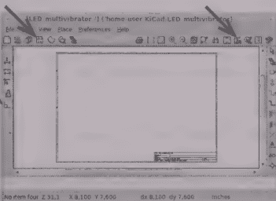 ⑤ 放置导线 | ⑥ 放置节点 |

`EESchema` 主窗口

### 教程 1-5 放置导线

- 点击右侧工具栏上的“放置组件”图标（图 2.4 ②）。
- 点击原理图页面。
- 在选择对话框中从库中搜索 `NPN`。
- 放置晶体管 `Q1`（图 2.1）。
- 使用 `Insert` 放置另一个晶体管。
- 如果放置了错误的组件，将光标移到组件上按 `Delete` 键将其删除。
- 重复步骤 3 到 7，从库中选择 `R`（电阻）。
- 放置电阻（图 2.1）。

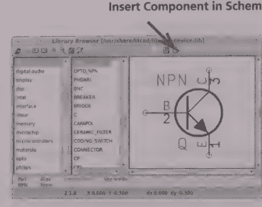

图 2.5：选择晶体管

- 使用上述相同方法放置两个电容——图 2.1 中的 `CP1`。使用 `R` 键将电容旋转到正确位置——多次按此键可以 90 度旋转 360 度。
- 放置 LED。这次不再手动搜索库，点击原理图放置组件，并在选择对话框的“名称:”字段中输入 `led` 并按回车。
- 使用 `R` 键将 LED 旋转到正确位置并放置它们。
- 在放置期间，按 `Esc` 键将取消组件放置，再次按 `Esc` 将退出“放置组件”模式，您必须点击右侧工具栏上的放置图标。放置组件的快捷键是 `A`。
- 最后放置连接器（图 2.1 中的 `P1`），它名为 `CONN_2` 可以在 `conn` 库中找到。可以在 `conn` 库中搜索它，或者在选择对话框的“名称:”字段中输入 `conn_2`。

### 教程 1-6 组件定位

- 如果您没有完美放置组件，则需要将它们移动到位置，使您的电路看起来类似于图 2.6。
- 要移动组件，将鼠标光标置于组件上进行移动并按 `M` 键。
- 将组件移动到所需位置并点击放置。
- `R` 在移动或光标位于组件上时旋转组件，`Y` 翻转组件。
- 注意要在光标位于组件上而非组件关联文本时按 `M`，否则这将导致移动文本而不是组件。如果不小心开始移动文本，请按 `Esc` 键。
- 也可以使用键盘上的箭头键（在按下 `M` 后）移动组件，而不是使用鼠标。

## 第 2 章. 使用 KiCad 创建电路原理图和 PCB

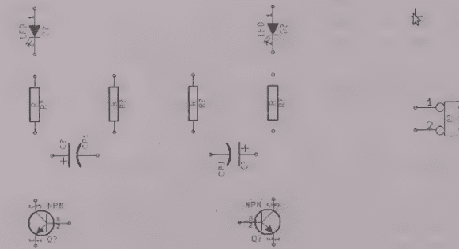

图 2.6：教程 - 完成元件放置

### 教程 1-7 连接元件

- 点击右侧工具栏上的“放置导线”图标（图 2.4 ⊕）。
- 若要将一个 LED 连接到其下方的电阻器，将光标移动到 LED 引脚末端的圆形上并点击。现在将光标移动到电阻器引脚末端的圆形上并点击。为了获得更好的视野，请使用鼠标滚轮放大。
- 如果你错过了元件引脚末端而点击在了原理图纸上，请按 `Esc` 键停止布线并重试。按两次 `Esc` 将将选择右侧工具栏上的默认光标（普通鼠标箭头）。在这种情况下，你必须点击水平工具栏上的“放置导线”图标来重新开始布线。
- 在元件引脚连接到导线的地方（例如，中间两个电阻器连接到它们上方的导线），点击元件引脚的末端然后点击导线。两条导线的交汇处会自动绘制一个节点（图 2.7）。
- 要绘制从每个晶体管基座连接出的斜线，点击左侧工具栏上的“以任意方向绘制导线和总线”图标（底部图标，图 2.4 ⊕）。完成后再次点击，即可将布线切换回 90 度模式。
- 如果在放置导线后导线消失或任何地方看起来很奇怪，按 `F3` 刷新绘图。

- 如果必要，通过点击右侧工具栏上的“放置节点”图标（图 2.4 ⊕）手动放置连接节点。
- 如果导线没有正确连接到元件引脚，将光标置在导线末端并按 `G` 键将其移动并连接到元件。
- 若要删除导线，将光标置在导线上并按 `Delete` 键。

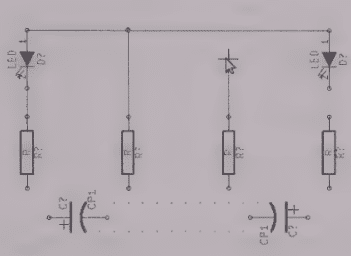

图 2.7：连接元件

### 教程 1-8 标注原理图

- 标注指的是对原理图中元件进行编号——例如，晶体管标记为 `Q1` 和 `Q2`。
- 点击顶部工具栏上的“标注原理图”按钮（图 2.4, ⊕）。
- 点击弹出的“标注原理图”对话框中的“标注”按钮。
- 在弹出的对话框中点击 `OK`。
- 点击关闭按钮关闭“标注原理图”对话框。


# 第 2 章 使用 KiCad 创建原理图和 PCB

## 教程 1-9 修改元件值

- 将光标移动到原理图中最左侧的电阻器上。
- 按 `V` 键。
- 在“编辑值”（`Edit Value Field`）对话框中使用 `470R` 来更改电阻器的值，完成后点击 `OK` 按钮或按回车。
- 使用相同的方法如图 2.1 所示更改其他电阻器的值。
- 将电容改为 `33uF`。
- 将晶体管改为 `2N2222`。
- 确保通过点击右侧工具栏右上角的图标或按 `Esc` 键选择了默认光标。
- 通过双击其中一个 LED，或将光标移动到 LED 上并按 `E` 键来隐藏 LED 旁边的“LED”文字。
- 在弹出的“元件属性”对话框中，点击对话框中间字段面板中的 `LED`（值 `LED`）。
- 取消勾选“可见性”（`Visibility`）下的 `Show` 框。
- 点击 `OK` 按钮关闭对话框。
- 执行此操作移除其他 LED 上的“LED”文本以及连接器上的“`CONN_2`”。

## 教程 1-10 放置文本

- 将光标移动到每个元件的各种文本上，按 `R` 旋转它们，按 `M` 移动它们，以整洁原理图。也可以尝试先用 `M` 移动文本，然后在移动时按 `R` 旋转。

### 2.3.1 使用 KiCad 进行原理图捕捉

- 如果你不小心开始移动元件而不是文本，请按 `Esc` 键。如果你不小心旋转了元件而不是文本，按 `Ctrl + Z` 撤销旋转。
- 移动文本时，可能需要更改网格以更精确地定位文本。
- 若要更改网格大小，右键点击原理图纸，在弹出的菜单中选择“网格选择”（`Grid Select`）→ `25.0 mils`，或者如果需要更小的网格则选择其他网格大小。
- 网格选择也可以通过顶部菜单下的“选项”（`Preferences`）→“选项”（`Options`）进行。
- 根据需要移动文本，完成后恢复为 `50.0 mils`。在放置和布线元件时，最好尽可能坚持最大的网格大小。
- 在原理图中定位文本，使其看起来像图 2.1 所示。

## 教程 1-11 放置文本

- 我们现在放置文本以显示电路连接器 `P1` 所需电源的极性和电压范围。
- 点击右侧工具栏上的“放置图形文本（注释）”图标（从下往上第二个图标）。
- 点击原理图页面。
- 在文本属性对话框的“文本”（`Text`）字段中输入：`+5V to +12V`，然后点击 `OK` 按钮。
- 将光标移动到连接器顶部导线的上方以放置文本。
- 在文本属性对话框的“`Text:`” 字段中输入：`+5V to +12V`，然后点击 `OK` 按钮。
- 将光标移动到连接器顶部导线的上方以放置文本。
- 在连接器底部导下方放置 `0V`。
- 若要移动文本，将光标置在文本上并按 `M`。
- 若要删除文本，将光标置在文本上并按 `Delete`。

## 教程 1-12 将电路移动到中心

- 按 `Home` 键查看整个原理图。
- 使用右侧工具栏上的默认光标，通过按住左鼠标按钮并拖动选择电路框。
- 将框移动到原理图中心。

## 教程 1-13 执行电气规则检查

- 点击顶部工具栏上的“执行电气规则检查”图标调出 `EESchema` 对话框（图 2.8）。
- 点击 `Test` 按钮。
- 如果引脚未连接，将显示错误消息；如果原理图没有问题，将不显示消息。
- 完成后点击 `Close` 关闭对话框。
- 如果某个引脚未连接，箭头将指向该未连接引脚。
- 如果有错误，修复它们然后再次运行测试。
- 如果所有错误已修复，测试将报告无错误，原理图上的错误箭头将被移除。

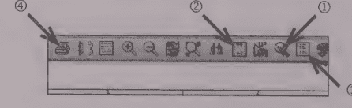

> 图 2.8：工具栏部分

### 教程 1-14 生成网表

- 点击顶部工具栏上的“生成网表”按钮（图 2.8, ②）。
- 点击弹出的网表对话框中的 `Netlist` 按钮。
- 点击保存网表对话框中的 `Save`。默认它将以项目命名保在项目文件夹中。

### 教程 1-15 生成材料清单 (BOM)

- 材料清单是电路中使用的元件列表，可以自动生成。
- 点击顶部工具栏上的“材料清单”图标（图 2.8, ③）。
- 点击材料清单对话框中的 `Ok` 按钮。
- 点击材料清单对话框中的 `Save`，将列表以项目命名保存在项目文件夹中。
- 要查看 BOM，打开项目文件夹中的文本文件 `LED_multivibrator.lst`。它是一个文本文件，默认应在 `pluma` 中打开。元件将单独列出，按参考标识，其次按值排序。
- 若要生成更像“购物清单”的 BOM，重复上述步骤生成 BOM，然后在材料清单对话框的“输出格式”（`Output format`）框中，点击“每行单个元件”（`Single Part per line`）按钮。
- 该文件将保存为 `.csv` 文件，名为 `LED_multivibrator.csv`。
- 在 Mint 中双击此文件将用 `LibreOffice Calc`（电子表格程序）打开，因此最好右键点击文件，并在弹出的菜单中选择“用 `pluma` 打开”。

### 教程 1-16 打印原理图

- 顶部工具栏上的“打印原理图”图标（图 2.8，④）并不会产生理想的打印效果（如果你愿意可以尝试一下，你可能会在你特定的打印机上获得更好的结果），最好是将原理图绘制为 postscript 文件，打开该文件后再打印。
- 点击 `File`（文件）→ `Plot`（绘制）→ `Plot PostScript`（绘制 PostScript）。
- 点击 `Plot PostScript` 对话框中的 `Plot Page`（绘制页面）按钮。
- 在对话框的 `Messages:` 字段中，应该是创建的文件名。如果你使用了与本教程相同的名称，它应该是 `LED_multivibrator.ps`。
- 完成后点击 `Close`（关闭）按钮。
- 可以在项目文件夹（`LED_multivibrator`）中找到该文件。
- 双击文件打开它，它默认会在 `Document Viewer`（文档查看器）程序中打开。
- 在 `Document Viewer` 中 `File`（文件）→ `Print...`（打印...）将此文件打印到打印机。

### 2.3.2 使用 CVpcb 为组件分配封装

现在原理图已经绘制完成并生成了网表，我们需要为原理图中使用的每个组件分配一个封装（footprint）。这些封装是实际所用组件的物理封装，在布局 PCB 时它们将相互连接在一起。

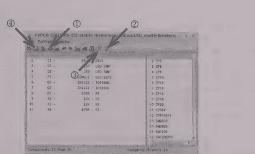

图 2.9: 分配封装后的 CVPCb 窗口

### 教程 1-17 封装分配

- 点击 KiCad 主窗口右侧窗格中的第二个图标启动 `CVpcb`（图 2.2 ②）。`EESchema` 顶部工具栏上也有一个“`Run CVpcb`”图标可以执行相同的操作。
- 点击弹出对话框中的 `OK`（确定）按钮。
- 在 `CVpcb` 窗口中，左侧面板显示原理图中使用的组件，右侧面板显示封装。
- 点击顶部工具栏上的“查看所选封装”（`View selected footprint`）图标（图 2.9，①）来查看右侧当前选中的封装。
- 使用向下箭头键或点击鼠标滚动右侧面板以查看每个封装。
- 如果没有找到所需的封装，点击顶部工具栏上的“显示完整封装列表”（`Display the full footprint list`）图标。这将移除对封装的所有过滤。点击“显示当前组件的过滤封装列表”（`Display the filtered footprint list for the current component`）切换回过滤模式（图 2.9 ② & ③）。
- 要为左侧选中的组件分配封装，双击右侧的封装。
- 分配以下封装：
  - `CIV7`（你需要移除此封装的过滤器（点击图 2.9，），见下文第 6 步，也见下文第 9 步）
  - 为两个 LED 分配 `LED-5MM`（开启过滤器以便更快找到（点击图 2.9，，见上文第 6 步））
  - 为连接器分配 `bournier2`
  - 为两个 `2N2222` 三极管分配 `TO18EBC`
  - 为四个电阻分配 `R3`
- 在右侧面板选择封装时，按下键盘上与所需封装第一个字母对应的键，例如，按 `C` 键移动到封装列表中所有以“`C`”开头的组件。这使得找到所需的封装更加容易。
- 完成封装分配后，点击顶部工具栏上的保存图标保存网表（图 2.9，）。这将打开 `Save Net and Component List`（保存网表和组件列表）对话框。点击此对话框中的 `Save`（保存）按钮以默认名称保存（此项目为 `LED_multivibrator.net`）。保存后 `CVpcb` 将自动打开。

### 2.3.3 使用 PCBNew 布局 PCB

### 教程 1-18 启动 PCBNew

- 在 KiCad 主窗口中，点击右侧窗格中的第三个图标（图 2.2 ）。此操作也可以通过点击 `ESchema` 顶部工具栏上的“`Run pcbnew`”图标来完成。
- 点击弹出对话框中的 `OK`（确定）按钮。


## 在 PCBNew 中使用快捷键

进入 `PCBNew` 中，按下 `Shift` 键可以获取快捷键或“hotkeys”帮助。如果弹出的对话框对于你的屏幕来说太高，按住 `Alt` 键并点击对话框的任意位置查看隐藏部分。

`PCBNew` 中执行的许多操作与 `ESchema` 中使用相同的键组合和操作。例如，缩放功能相同，`F3` 刷新屏幕。

## 2.3.3 使用 PCBNew 布局 PCB

### 导教程 1-19 设置页面

点击顶部菜单上的“Page settings”（页面设置）图标（图 2.10，①）。

在 Page Settings（页面设置）对话框中，在左侧选择所需的页面大小，并填写右侧标题栏中要显示的信息。

### 导教程 1-20 设置板尺寸

板的边框必须在“PCB Edges”（PCB 边框）层上使用图形线（来自 `PCBnew` 右侧）绘制。

在 `PCBnew` 右侧，在 Layer（图层）选项卡下，点击 `PCB_Edges` 选择它（列表中的最后一项，图 2.10，②）。不要点击右侧的复选框取消勾选，这将禁用它。点击其左侧或点击“PCB Edges”以移动默认指向“Back”（背部）层的蓝色箭头。

在 `PCBnew` 右侧，点击“Add line or polygon”（添加线或多边形）图标（图 2.10，③）。

点击“Units”（单位）下拉框，选择“millimeters”（毫米）（图 2.10，④）。

点击“Grid”（网格）下拉框，选择“5.000”（图 2.10，⑤）。

按下 `Home` 键将页面缩放到合适位置（图 2.10，⑥）。

移动光标在 `PCB Edges` 层上绘制 40mm 的水平线（图 2.10，⑦）。

移动光标在 `PCB Edges` 层上绘制 40mm 的垂直线（图 2.10，⑧）。

完成 40mm × 40mm 正方形 PCB 边框（图 2.10，⑨）。

按下 `Home` 键缩放新的 PCB 边框。

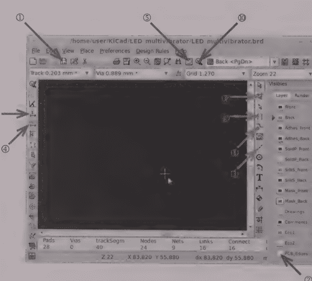

图 2.10: PCBnew

### 导教程 1-21 读取网表

点击顶部工具栏上的“Read netlist”（读取网表）按钮（图 2.10，⑩）。

点击 Netlist 对话框中的 Browse Netlist Files（浏览网表文件）并打开 `LED_multivibrator.net` 网表。点击对话框中的 Read Current Netlist 。

点击对话框中的 Close（关闭）按钮。

按下 `Home` 键将 PCB 和新导入的封装适应屏幕。封装将堆叠在屏幕上。

### 导教程 1-22 添加安装孔

我们将在 PCB 的角落添加安装孔，这些是用于固定螺丝的 PCB 钻孔。

使用顶部工具栏上的 Grid 下拉框将网格大小改为 2.5mm——这有助于在板的角落放置安装孔。

点击右侧工具栏上的“Add modules”（添加模块）图标（图 2.10，⑫）。

点击板。

在 Place Module 对话框的 Name: 字段中输入 `1pin` 并点击 OK 按钮。

在板的每个角落放置焊盘，从焊盘中心向板角移动 2 个网格单元，例如，如果 PCB 左上角的相对坐标显示仍设为 0, 0 (x, y)，则左上角的焊盘将放置在 5, 5。如果左上角的坐标不是 0, 0，将光标移动到那里并按下空格键。

要放置下一个焊盘，再次点击 PCB，然后点击弹出对话框中的 OK 按钮。

# 第 2 章 使用 KiCad 创建原理图和 PCB

### 教程 1-23 组件定位

缩放和平移的操作方法与原理图捕获程序相同，在处理 PCB 时根据需要使用即可。记得经常保存（`Ctrl+S`）。

将光标移动到组件堆叠上并按 `M` 键。系统可能会弹出一个菜单，要求你选择要移动的哪一个组件。选择任何封装（footprint）即可，我们只是想把它们散开来，但请确保你选择的是列表中的封装而不是参考位号（reference）。

将选中的封装移出封装堆叠的区域。

对所有组件执行此操作，以便将它们分离开并看清它们是什么。现在先不要在 PCB 上放置任何封装。

由于组件焊盘间距使用的是英制（英寸）测量系统，请点击左侧工具栏上的“Units in inches”（单位为英寸）图标（图 2.10，⑮），并在顶部工具栏的网格下拉框中选择网格 50.0。

如图 2.11 所示，通过将光标移动到组件上并按 `M` 键移动、按 `R` 键旋转，将每个组件放置在板上。

在移动组件时，如果需要，将网格大小更改为 25 mils 以进行更精确的放置。

## 教程 1-24 添加走线宽度

在板上布线（布布线）之前，我们需要添加一个额外的线宽以便使用。默认情况下只有一种线宽（8.0 mils，约 0.2mm）。

若要以毫米单位添加新走线，点击左侧工具栏上的“Units in millimetres”（单位为毫米）图标。

在 `PCBnew` 的顶部菜单上，点击 `Design Rules`（设计规则）→ `Design Rules`（设计规则）。

点击设计规则编辑器对话框顶部的 Global Design Rules（全局设计规则）选项卡。

在 Custom Track Widths（自定义走线宽度）; 下，添加所需的宽度——对于本教程，在“Track 1”旁边的字段中添加 1mm（只需输入“1”；如果你倾向于使用英制，这大约是 40ils）。

完成后点击 OK 按钮。

## 2.3.3 布局 PCB PCBnew

从顶部水平工具栏的走线下拉框中选择 `Track 1.001mm`。

点击左侧工具栏上的“Units in inches”（单位为英寸）图标切回英寸。

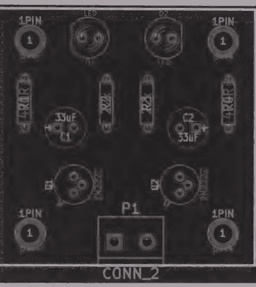

图 2.11：PCB 上的封装位置

### 教程 1-25 添加走线

在 `PCBnew` 右侧的 Layer（层）选项卡下，选择你希望布线的层，在本例中将是 Back 层（底层）。点击此面板中的层，但不要使用右侧的复选框取消勾选它——这将禁用它。

点击右侧工具栏上的“Add tracks and vias”（添加走线和过孔）按钮（图 2.10，®）。这将允许你绘制 PCB 走线并开启“rats nest”（鼠网，显示焊盘之间必须建立连接的线条）。

如果你在 25mil 网格上移动了任何组件，请切换到 25 mil 网格（顶部工具栏 Grid.25.0）。

要连接焊盘，点击组件焊盘以开始绘制走线。例如，要将 R2 连接到 R3，点击 R2 的顶部焊盘。

引导线将显示要把走线布到哪个焊盘。例如，R3 上要连接的焊盘将高亮显示。

在目标焊盘处双击以创建走线，如果连接多个焊盘则单击单击。在连接多个焊盘时，双击最后一个焊盘以结束走线。例如，双击 R3 上的焊盘。你的 PCB 应该像图 2.12 所示。确保你的组件方向正确。例如，如果你的 R2 和 R3 放反了，你需要旋转它们，如图所示。要旋转它们，首先需要选择右侧工具栏上的默认光标，或按 `Esc` 退出。

布线时，按 `Esc` 取消当前走线。

要删除走线，将光标置于走线上并按 `Delete` 键。也可以通过点击右侧工具栏上的“Delete items”（删除项目）图标然后点击走线来实现。

要移动走线，将光标置于走线上并按 `G`。

要移动走线的端点，悬停在端点上并按 `M`。（在不同 KiCad 版本中，“G”和“M”的功能可能相反）。

`Backspace` 键撤销放置操作。正斜杠 `/` 在布线期间切换走线。

如图 13 所示布线。

## 2.3.3 布局 PCB PCBnew

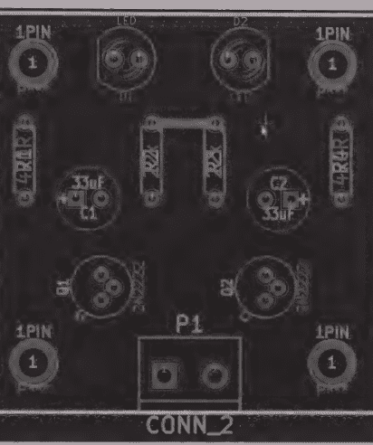

图 12：布线 PCB


图 13：完成布线的 PCB

### 教程 1-26 检查走线

通过切换不同的层，可以在没有组件轮廓和文字干扰的情况下检查走线。

在此特定的板上，右侧 Layer 选项卡下使用了三个层：Back、SilkS_Front 和 `PCB_Edges`。取消勾选 `SilkS_Front` 以隐藏组件轮廓。

在同一个右侧面板的 Render 选项卡下，禁用 Hidden Text 和 Text Front。

现在只有走线、焊盘和板轮廓可见。如果需要，可以轻松检查和修改走线。

要重新布线，无需删除旧线。根据需要绘制新线，完成后完成后旧线会自动消失。在图 14（主图）中，通过点击 R3 下方的走线放置了新线，旧线部分被自动删除并替换，如图所示。

点击右侧工具栏上的“Highlight net”（高亮网络）图标（图 10，®），然后点击走线或焊盘以高亮所有连接。此功能在检查大型或多层板的走线时特别有用。

要取消高亮走线，点击背景任意处或点击下一个走线或焊盘。

你现在可以开启 Layer 选项卡下的 `SilkS_Front` 层，以及 Render 选项卡下的 Text Front。保持 Hidden Text 禁用。


## 2.3.3 使用 PCBnew 布局 PCB

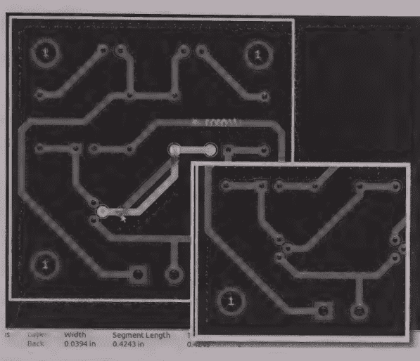

图 14：修改 PCB 走线

## 教程 1-27 执行设计规则检查 (DRC)

- 点击顶部水平工具栏上的“`Design rules check`”（执行设计规则检查）图标（图 10，9）。
- 点击 DRC 对话框中的 `Start DRC` 按钮。
- 点击 `List Unconnected`（列表未连接）查看是否有组件未连接。
- 如果存在未连接的组件，双击对话框中的错误将鼠标指针移动到未连接的焊盘。
- 如果没有发现设计规则错误，点击 `OK` 按钮。
- 如果有多个错误，点击“`Design rules check`”图标，然后点击下一个错误将光标移动到未连接的焊盘。
- 如果已完成所有修正，再次运行 DRC 以确保测试通过。

### 教程 1-28 隐藏文字

- 某些组件值显示在顶丝层上，这占据了 PCB 空间，因此我们将关闭它们。
- 确保 PCBnew 右侧 Render 选项卡下的 `Hidden Text` 未勾选。
- 双击 LED 旁边的“LED”文字，或将光标悬留在文字上并按 `E`。
- 在弹出的 Footprint 文字属性对话框中，点击 Display 标题下的 `Invisible`（隐藏）单选按钮，然后点击 `OK` 按钮。
- 对另一个 LED 执行相同操作。
- 使用相同方法隐藏安装孔旁的 `1PIN`、`电容旁的 33uF` 以及连接器旁的 `CONN_2`。

## 教程 1-29 修改文字大小

- 组件的文字大小并不相同，我们将更改这些值以保持一致性。
- 确保选择了左侧工具栏的“`Units in inches`”（单位为英寸）图标。
- 我们将顶丝层上组件参考位号的文字更改为以下尺寸：`Width = 0.008`，`H Size = 0.0500`，`V Size = 0.0500`。
- 电阻已经是这种文字大小。连接器的文字较大，但我们将保持原样。我们需要更改两个 LED、电容和晶体管的参考位号。
- 双击文字进行更改，例如 LED 旁边的 `D1`。
- 在弹出的 Footprint 文字属性对话框中，将 `Size X:` 改为 `0.05`，`Size Y` 改为 `0.05`，`Thickness` 改为 `0.008`。
- 完成后点击 `OK`。

## 教程 1-30 整齐放置文本

- 现在需要将参考标识（reference designators）整齐地放置板子上。
- 在右侧面板的 Render（渲染）选项卡下，确保未勾选 `Hidden Text`（隐藏文本）项目。
- 在同一面板中，点击 `Layer`（图层）选项卡。取消勾选 `Back`（背层）将隐藏已布好的走线，这样在顶层丝印层（top silkscreen layer）放置文本时会减少干扰。
- 要移动封装的参考标识，请将鼠标光标悬停在文本上并按下 `M` 键进行移动。在移动的同时旋转文本，按 `R` 键。点击即可放置移动后的文本。在旧版本的 KiCad 中，文本只能通过右键点击它，然后从弹出菜单中选择 `Move`（移动），在移动文本时再次右键点击，然后从弹出菜单中选择 `Rotate`（旋转）。
- 要取消文本移动，请按 `Esc` 键。
- 使用此方法将所有文本移到板子下方。如有必要，使用顶部的下拉 `Grid`（网格）框将网格大小更改为 `25.0 mils`。
- 将文本移出元件下方，因为一旦元件焊接到板子上，它就会隐藏文本，导致在故障排除或测试期间无法看到元件的参考标识来识别元件。
- 将电容的 `+` 号移出电容所在区域。请参考图 2.15 作为指南。

## 教程 1-31 在板上放置文本 - 顶层丝印

- 我们将在顶层丝印层放置项目名称，因此首先在右侧面板的 `Layer`（图层）选项卡下选择 `SilkS_Front` 层。
- 点击右侧栏上的 `Add text`（添加文本）图标（大字母“T”图标）。
- 点击电路板。
- 在弹出的对话框中，按如下填写字段：
  - `Text`（文本）：`LED Multivibrator`（LED 多谐振器）
  - `Orientation`（方向）：`90`
  - `Display`（显示）：`Normal`（正常）
  - 在 `Layer:`（图层）框中，确保已选择 `SilkS_Front`。
- 完成后点击 `OK`（确定）按钮。
- 将文本移动到合适的位置并点击放置。
- 在文本放置后要编辑和移动，将光标悬停在文本上并输入 `E` 进行编辑（或双击文本），按 `M` 移动或按 `R` 旋转。在旧版本的 KiCad 中，右键点击它，并在弹出菜单文本名称下的子菜单中选择 `move`（移动）、`rotate`（旋转）或 `edit`（编辑）。
- 文本也可以放置在连接器 `P1` 处，以标记连接到板上的电源的极性和电压。

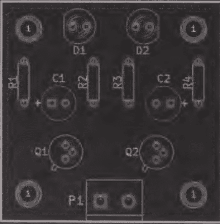

图 2.15：放置参考标识

## 教程 1-31 在板上放置文本 – 底层铜层

- 我们现在要在电路板的底层添加一些文本，这样在蚀刻走线时，文本也会被刻出来。
- 点击右侧面板 `Layer`（图层）选项卡下的 `Back`，切换到板的背铜层。
- 确保 `Back` 层在复选框中也启用。
- 为了更清晰地查看背层，隐藏右侧面板中的 `SilS_Front`（在 `Layer` 选项卡上）和 `Text Front`（在 Render 选项卡上）。
- 点击右侧工具栏上的 `Add text`（添加文本）图标。
- 点击电路板。
- 在弹出的对话框中，按如下填写字段：
  - `Text`（文本）：`LED Multivibrator`（LED 多谐振器）
  - `Size X`（...
- 完成后点击 `OK`（确定）按钮。
- 将文本移动到位置并点击放置。确保不要将其放置在任何走线上，也不要离任何走线太近。

### 教程 1-32 打印铜层

- 我们现在将使用激光打印机打印板的铜侧，使用附录 A 中描述的方法创建 PCB。
- 在较早版本的 KiCad 中，使用顶部工具栏上的“`Print board`（打印板）”图标会导致走线的 45 度角在打印页面上无法正常渲染。在较新版本的 KiCad 中使用这种方法打印似乎现在可以正常工作了，如果你喜欢可以尝试一下。下面描述的是适用于旧版新版本 KiCad 的方法，我们将页面绘制到 postscript 文件，然后打开此文件并打印。绘制（Plot）对话框在旧新版本 KiCad 之间也发生了一些变化。


- 点击顶部工具栏上的“`Plot`（绘制）”图标，或点击 `File`（文件）→ `Plot`。
- 在 `Plot format`（绘制格式）下，选择 `Postscript`。
- 在 `Layers`（图层）下，勾选 `Back` 和 `PCB_edges`，取消选择所有其他层。
- 在 `Drill marks`（钻孔标记）下，选择 `Actual size`（实际尺寸）将打印 PCB 上焊盘的实际孔径，或选择 `Small`（小），将在每个焊盘上留一个小孔，用于对齐钻头以钻孔 PCB。使用 `Small` 选项可能会更容易钻孔 PCB。
- 在 `Scaling`（缩放）下，选择 `1:1`。
- 在 `Plot mode`（绘制模式）下，选择 `Filled`（填充）。
- 在 `Options`（选项）下，确保未勾选 `Mirrored plot`（镜像绘制）。
- 点击 `Plot`（绘制）按钮。
- postscript 输出将保存在项目文件夹中，名为 `LED_multibrator-Silks_Front.ps`。
- 此文件可以使用 Document Viewer 打开并以打印铜层相同的方式进行打印。
- 参考附录 A 关于将丝印熨到 PCB 上的说明。

## 2.3.3 使用 PCBnew 布局 PCB

- 按照附录 A 中的指令熨烫图像。

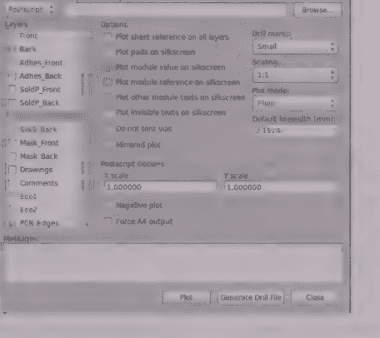

## 2.4 KiCad 教程 2 – IC 电路

本教程涵盖了具有多个部分的元件放置——一个带有两个输入非门逻辑门的 `7400` IC。还涵盖了连接隐藏引脚、放置无连接标记（no-connect flags）以及制作文本框。

- 启动一个新的 KiCad 项目。

创建项目的步骤列如下，但仅详细描述了教程 1 中未使用的新 KiCad 功能。有关已覆盖步骤的详情，请参考教程 1，例如如何启动项目、如何缩放和平移等。

在 `CH02/IC_multivibrator` 中通过配套文件找到完成的教程。

### 教程 2-1 启动一个新的 KiCad 项目

- 启动一个名为“`IC_multivibrator`”的新 KiCad 项目。
- 记住为项目创建一个与项目同名的新文件夹。

## 教程 2-2 启动 EESchema 并放置元件

- 启动 `EESchema` 后，更改页面设置以便原理图标题栏中添加文本。
- 在原理图上放置以下元件：
  - 3 个电阻器 – 组件名称：`R`


- 2 个电容 – 组件名称：`CP1`
- 2 个 LED – 组件名称：`LED`
- 2 个双针排接器 – 组件名称：`CONN_2`

## 教程 2-3 放置多部分 7400 IC

* 放置 `7400` – 组件名称：`7400`
* 像放置任何其他元件一样，点击放置四个门中的第一个。
* 按 `Insert`（插入）键放置下一个门。
* 你会发现下一个门的引脚编号与第一个相同。在点击放置门之前，右键点击调出菜单，然后选择 `Edit Component`（编辑元件） → `Unit`（单元） → `Unit 2 B`。左键点击放置第二个门。
* 再次按 `Insert` 键并右键点击调出菜单。这次选择 `Unit 3C`，然后点击放置。以相同的方法放置四门 IC 中的最后一个门，`Unit 4D`。
* 你现在应该有了四个门，每个门都有不同的引脚编号。它们还将标记为参考设计位符 `U?A`、`U?B`、`U?C` 和 `U?D`。

## 第 2 章：使用 KiCad 创建原理图和 PCB


图 2.17：教程 2 使用的 IC 多谐荡器电路

## 教程 2-4 元件的定位与布线

- 如图 2.17 所示放置元件。确保将正确的 NAND 门放置在正确的位置，即：门 D 位于电路左侧，门 C 位于右侧，门 A 和 B 不使用。
- 如图所示对元件进行布线。
- 在没有自动生成的地方放置节点（连接点）。当两根或多根导线连接到元件引脚末端时，通常需要手动放置连接点。

## 教程 2-5 连接隐藏引脚和电源端口

- `7400` 具有隐藏的电源和地引脚。在我们的原理图中，我们还有两个未使用的门，它们的输入端需要接地。
- 点击左侧工具栏上的“显示隐藏引脚”图标可以显示隐藏电源引脚的名称和引脚编号。再次点击此图标可隐藏引脚。它是左侧工具栏底部第二个图标。

## 2.4 KiCad 教程 2 – IC 电路

- 点击“显示隐藏引脚”图标后，放大任何一个门以查看隐藏引脚。隐藏电源引脚命名为 `VCC` 和 `GND`，在该 IC 上引脚编号分别为 14 和 7。
- 点击右侧工具栏上的“放置电源端口”图标（从上数第 4 个），然后点击原理图。
- 在弹出的元件选择对话框中，点击 `List All`（列出全部）按钮。
- 滚动对话框中的列表并点击 `GND`，然后点击对话框中的 `OK`（确定）按钮。（或者直接在元件选择对话框的 Name（名称）字段中输入 `GND`）
- 在主电路的下轨上放置一个 `GND` 点，并将第二个 `GND` 连接到 NAND 门的未用输入端。如图 2.17 所示，`GND` 符号是一个三角形。按 `Insert` 放置第二个。
- 在“放置电源端口”图标仍高亮状态时，点击原理图。
- 此时放置一个 `VCC` 电源端口，并如图 2.17 所示将其连接到电路的上电源轨。
- 放置的电源端口名称为 `VCC` 和 `GND`。这些名称与 `7400` 的隐藏电源引脚名称相同，这就是它们连接在一起的原因——具有相同的名称。
- 我们还需要放置 `PWR_FLAG` 电源端口，以告诉 KiCad 哪些点连接到了电源。如果不这样做，电气规则检查 (`ERC`) 将产生错误。
- 使用与放置 `GND` 和 `VCC` 相同的方法，但这次选择 `PWR_FLAG` 元件，并如图 2.17 所示放置两个。

## 教程 2-6 在未连接的引脚上放置无连接标记

- 点击右侧工具栏上的“放置无连接”标记（看起来像一个 x）。
- 在两个未使用的门输出端（IC 的引脚 3 和 6）上放置无连接标记。
- 这防止在电气规则检查期间出现未连接引脚警告。

## 第 2 章：使用 KiCad 创建原理图和 PCB

## 教程 2-7 原理图的居中与标注

- 将电路在原理图页面上居中。
- 如果我们现在自动对原理图标注，电阻的编号将与图 2.17 所示。本次练习我们将手动标注电阻，然后对原理图中的其余元件进行自动标注。
- 要手动标注电阻，将光标悬停在标注文本（`R?`）上并按 `E` 键。
- 在弹出的对话框中，输入如图 2.17 所示的参考设计位。不要将设计位更改为所示的 `R1`、`R2` 和 `R3`，其中 `R3` 是顶部的电阻。
- 使用顶部工具栏上的按钮对原理图进行标注。这将标注原理图的其他部分，而不会影响我们对电阻的修改。

## 教程 2-8 分配元件值并整齐文本

- 如图 2.17 所示为电阻和电容分配值。
- 整齐地排列所有文本（参考设计位符和元件值）。

## 教程 2-9 在框内放置文本

- 原理图页面上的文本框中放置了关于 IC 隐藏电源引脚的说明。这将让任何阅读电路图的人知道 IC 的电源连接在哪里，在对电路进行故障排除时非常有用，因为可能需要对这些点进行测试。
- 使用右侧工具栏上的“放置图形文本”图标（“T”图标）添加文本。该工具的对话框可以通过每行文本末尾按回车键编写多行文本。如图 2.17 所示的文本。将文本大小更改为 `0.100`。
- 点击右侧工具栏上的“放置图形线条或多边形”图标（“T”上方），使用线条在文本周围画一个框。

## 教程 2-10 完成

- 如图 2.17 所示，在 `P1` 附近放置文本标注电压。
- 在两个 LED 处隐藏“LED”文本，并在连接器处隐藏“CONN_2”文本。
- 执行电气规则检查 (`ERC`)。
- 在执行 `ERC` 后，我发现电源标记需要连接到电源轨。
- 如果出现任何 `ERC` 错误，修正它们并重新运行 `ERC`。

## 教程 2-11 使用 CVpcb 分配封装

- 使用网络表生成封装。
- 使用 `CVpcb` 为以下内容分配封装：

| 元件 | 数量 | 封装名称 |
| :--- | :--- | :--- |
| 电容 | 2 | `CIV7` |
| 5mm LED | 2 | `LED-5MM` |
| 双针连接器 | 1 | `bonjour2` |
| 1/4W 电阻 | 3 | `R3` |
| 7400 IC | 1 | `DIP-14_300` |

## 教程 2-12 创建 PCB

- 启动 `PCBnew`。
- 创建宽 `35mm` 高 `40mm` 的板。
- 导入网络表。
- 如图 2.18 所示放置元件，包括安装孔。
- 使用 `0.5mm` (`20.0 mil`) 走线设置并布线。
- 隐藏不需要的文本，调整文本大小，整齐排列文本并添加板名称。
- 执行设计规则检查 (`DRC`)。
- 导出用于制造 PCB 的线铜层和丝印层。

## 2.5 生成制造所需的输出文件

选择要发送给制造商的层。同时点击 Plot 对话框中的 `Generate Drill File`（生成钻孔文件）按钮，创建一个发送给制造商的钻孔文件。PCB 制造商指定的钻孔文件使用的设置，因此如果您对任何内容不确定，请阅读他们的文档或向他们发送电子邮件。

图 2.19 显示了为具有顶层丝印和底层阻焊油漆的双面板生成 Gerber 文件的 Plot 对话框设置。勾选了“Do not tent vias”（不铺盖过孔）选项，以便过孔将连接到它们所在板上周围的铜箔填充区域。

最好的做法是在您的项目目录下创建一个 `gerber` 子目录来保存 Gerber 文件。使用 Plot 对话框中的 `Browse...` 按钮执行此操作。点击 `Plot` 按钮创建 Gerber 文件。

创建 Gerber 文件后，可以在 KiCad 的 Gerber 查看器程序 `GerberView` 中查看它们。点击 KiCad 窗口中的第四个图标即可启动 `GerberView`。

在 `GerbView` 中，点击 `File -> Load Gerber File` 打开一个对话框，您可以在其中选择要打开的 Gerber 文件。在对话框中，您可以选择多个文件。按 `Ctrl+A` 选择目录中的所有文件（如果该目录包含 Gerber 文件且没有其他类型的文件）。也可以通过从顶部菜单选择 `File -> Load EXCELL Drill File` 来加载钻孔文件。

在 `GerbView` 中，可以使用右侧名为 `Visibles` 的面板检查并开启或关闭层。在此面板的 `Layer` 选项卡下勾选或取消勾选层，可以使其可见或隐藏。

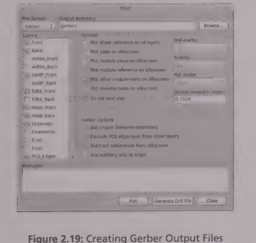

# 第 2 章：使用 KiCad 创建原理图和 PCB

## 2.6 布双面 PCB 布局

一旦您掌握了单面板的布局，布局双面板并不困难。唯一的区别是现在线现在将放置在板的顶层和底层，并在需要的地方使用过孔来连接顶底布线。通常情况下，您应该尝试只将元件放置在顶层，以便板的组装，但如果需要，也可以将元件放置在板的底层。

### 在顶层放置布线

首先，在 **Visible** 面板中选择顶层（称为 **Front**）。顶层默认为红色。点击右侧面板中该层的左侧进行选择——此时，蓝色箭头将指向它。现在，点击右侧工具栏上的 **Add tracks and vias icon**（添加布线和过孔图标）（或使用热键 `X`）并进行布线——这现在将在顶层进行。

### 放置过孔


进入`/path/to/xxx`目录，找到`xxx.json`。

在表达式`cvar = avar + bvar`中，加法运算符（`+`）将`avar`与`bvar`相加，得到它们的和`cvar`

在`List.of(arg0, arg1, arg2)`中，`List`接口的工厂方法`of()`接受一系列的元素，返回包含它们的只读列表。

之后我们这样调用`cmd`命令：`cmd arg0 arg1 arg2`。

```
if (condVar > someVal) {console.log("xxx")}
```
[/content]

Wait that's example. Need actual text.

Let's redo properly.

[content]
在布线轨道期间，按 `V` 键放置过孔。这将放置一个过孔并切换到相反层，例如，如果您正在顶层布线并按了 `V` 键，则会放置一个过孔，布线将在底层继续。过孔尺寸可以在设置布线宽度的相同对话框中设置——在顶部菜单上点击 `Design Rules` → `Design Rules`，并在 `Custom Via Sizes`（自定义过孔尺寸）下添加新尺寸。在 PCBnew 窗口顶部工具栏的 `Via` 下拉框中（紧邻 `Track` 下拉框）选择要放置的尺寸。

### 在层之间进行切换

您可以使用右侧的 `Visible` 面板在层之间切换，或者按键盘上的 `Page Up` 键切换到顶层，按 `Page Down` 键切换到底层。如果您在布线时按 `Page Up` 或 `Page Down` 切换到不同层，将放置一个过孔。

### 在底层放置元件

要在底层放置元件，将鼠标光标悬停在元件上并按 `M` 键移动它，然后按 `F` 键将其翻转到板的另一侧，再次按 `F` 键将其翻回顶侧或点击进行放置。

如需查看在 KiCad 中设计并专业制造的双面 PCB，请访问：startingelectronics.com/articles/using-KiCad-for-professional-PCBs

## 2.7 其他技巧和技术

一旦创建并完成 KiCad 项目，就可以修改原理图并重新生成新的网表（netlist）。如果添加了元件，可以使用 CVpcb 为它们分配封装（footprints）。在 CVpc 中保存网表后，可以再次将网表导入到 PCBnew，然后就能在 PCBnew 中看到更改了。如果添加了新元件，它们现在将出现在 PCBnew 中。如果对布线进行了更改，可以删除旧的并添加新的。要删除一个封装，先在 PCBnew 中删除该封装，然后在 EESchema 中删除元件以及接线。接下来，在 EESchema 中生成新网表并将其导入 PCBnew。

在书中，每当在 KiCad 创建的项目中使用新技术时，都会包含 KiCad 使用技巧。在下一章中，我们将查看如何创建原理图符号和 PCB 封装并将其包含在 KiCad 库中。

# 第 3 章：创建 KiCad 库元件

如果 KiCad 库中没有且无法下载，您可能需要制作自己的原理图符号和 PCB 封装。本章介绍了如何为晶振绘制原理图符号并创建 PCB 封装。还涵盖了如何为 KiCad 下载和安装额外的库。

创建原理图符号和原理图库的工具包含在 EESchema 中，创建 PCB 封装和封装库的工具包含在 PCBnew 中。

## 3.1 创建原理图符号

后续教程将展示如何为晶振创建原理图符号并添加到新库中。我们将创建图 **3.1** 中的符号。


图 3.1：晶振原理图符号

教程 3-1 库编辑器

- 启动 KiCad 然后启动 EESchema。
- 在 EESchema 中，点击顶部工具栏上图 **3.2** 所示的 "Library editor"图标启动 `Component Library Editor`（元件库编辑器）窗口。

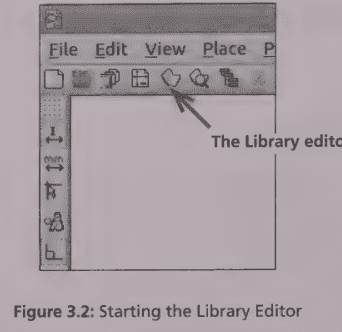

第 3 章：创建 Ki 库元件

教程 3-2 创建新元件

- 点击顶部工具栏上的 "Create new component"图标——图 **3.3**，①
- 将出现 `Component Properties`（元件属性）对话框，如图 **3.4** 所示填写，然后点击 OK 按钮。

教程 3-3 定位元件

- 点击右侧工具栏上的“Add lines”图标，图 **3.3**，②
- 在主窗口中，将鼠标光标悬停在文本上并按 `M` 键
- 点击图 **3.3** 所示的“Add pins”图标
- 将 `Pin Properties`（引脚属性）对话框，如图 **3.5** 所示填写
- 在主窗口中放置第二个引脚。

教程 3-4 绘制元件主体

- 点击右侧工具栏上的“Add rectangles”图标，图 **3.3**，③
- 单击引脚 1 右侧 50 mils 处并向上 100 mils 处移动鼠标绘制一个宽 50 mils、高 200 mils 的矩形，如图 **3.6** 所示——矩形尚未填充。
- 将鼠标光标悬停在矩形上按 `E` 键。在弹出的对话框中，点击 foreground（前景）按钮。
- 点击右侧工具栏上的“Add and polygons”图标，图 **3.3**，④
- 绘制图 **3.6** 所示的两条垂直线，通过单击开始线条并双击结束。将鼠标光标悬停在直线上按 `E` 键将线条宽度更改为 `0.020`。在弹出的对话框中填入新宽度。

教程 3-5 定位文本和隐藏引脚号

- 在主窗口中右键点击并在弹出菜单中选择 `Grid Select` 到 25 mils 网格。
- 将“X”和“XTAL”文本移动到图 **3.6** 所示的位置，将鼠标光标悬停在文本上并按 `M` 键。
- 要隐藏引脚号，点击顶部工具栏上的“Edit component properties”图标——图 **3.3**，⑤ 然后取消勾选 `Show Pin Num`（显示引脚号）复选框。

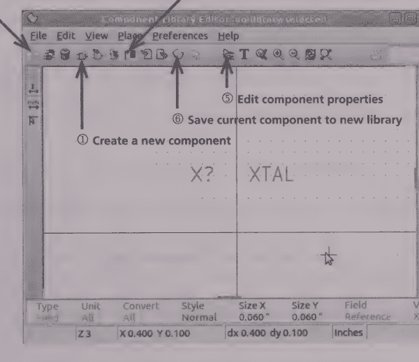

图 3.3：库编辑器

## 3.1 创建原理图符号（续）

- 在主窗口放置第二个引脚。
- 在 `Pin Properties` 对话框中，将引脚名称设为 X2，引脚编号设为 2 并方向更改为 Left（左侧）。
- 将第二个引脚放置在第一个引脚 1 右侧 150 mils 处，如图 **3.6** 所示，左侧。
- 保存库 ②
- 更新库中的元件


图 3.3：库编辑器

## 3.1 创建原理图符号

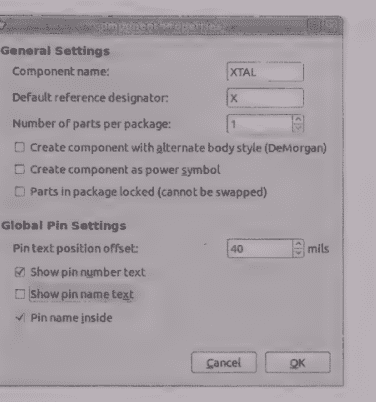

图 3.4：元件属性对话框

### 教程 3-6 创建新库并将组件保存其中

- 点击顶部工具栏图 3.3 上的“将当前组件保存到新库”图标，Ⓒ。
- 在“新库（New Library）”对话框中，导航到你想要保存新库的位置，并给它起一个合适的名称，例如 `my_library.lib`。点击“保存（Save)”按钮。你将需要将其保存到主目录的子文件夹中，因为要保存到 `/usr/share/kicad/` 中的其他 KiCad 库，你需要 root 权限。例如，保存到 `<你的主文件夹>/KiCad/libraries/..`

## 第3章：创建 KiCad 库元件

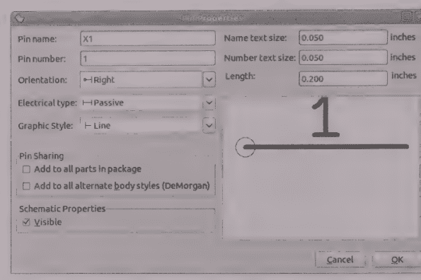

图 3.5：引脚属性对话框


图 3.6：创建元件主体

### 教程 3-7 编辑元件属性

- 点击顶部工具栏图 3.3 上的“编辑元件属性”图标，⊌。
- 在弹出的 XTAL 属性（Properties for XTAL）对话框中，点击“描述（Description）”选项卡。
- 在“描述（Description:）”字段中输入 `Quartz crystal`。在“关键字（Keywords:）”字段中输入 `crystal`。
- 点击“封装（Footprint Filter）”选项卡。点击“添加（Add）”按钮，并在弹出的对话框中输入 `HC49S`。完成后点击“确定（OK）”按钮。

## 3.2 创建 PCB 封装

### 教程 3-8 更新并保存元件

- 既然自从保存以来对元件进行了更改，我们需要在库中更新它，然后保存库。
- 点击顶部工具栏（图 3.3, ⑦）上的“更新当前库中的当前元件”图标。在弹出的对话框中点击“是（Yes）”。
- 点击顶部工具栏（图 3.3, ⑧）上的“将当前库保存到磁盘”图标来保存库。在弹出的对话框中点击“是（Yes）”。

现在我们有了一个新的原理图符号，需要为它创建一个 PCB 封装。

## 3.2 创建 PCB 封装

晶体的 PCB 封装将根据晶体制造商数据表中的信息创建，如图 3.7 所示。

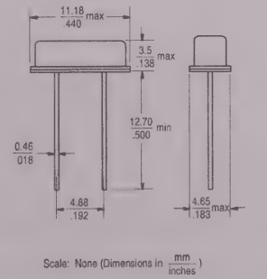

图 3.7：晶体尺寸

## 第3章：创建 KiCad 库元件

### 教程 4-1 启动模块编辑器

- 启动 KiCad，然后启动 PCBnew。
- 在 PCBnew 中，点击顶部工具栏如图 3.8 所示的“打开模块编辑器（Open module editor）”图标。这将打开模块编辑器窗口。

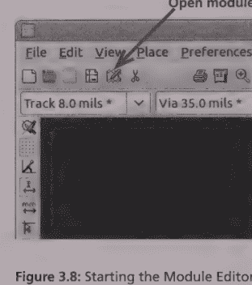

### 教程 4-2 创建新模块


## 3.1 创建原理图符号


图 3.4：元件属性对话框

### 教程 3-6 创建新库并将组件保存其中

- 点击顶部工具栏图 3.3 上的“将当前组件保存到新库”图标，Ⓒ。
- 在新库（New Library）对话对话框中，导航到你想要保存新库的位置，并给它起一个合适的名称，例如 `my_library.lib`。点击“保存（Save)”按钮。你将需要将其保存到主目录的子文件夹中，因为要保存到 `/usr/share/kicad/` 中的其他 KiCad 库，你需要 root 权限。例如，保存到 `<你的主文件夹>/KiCad/libraries/..`

## 第3章：创建 KiCad 库元件


图 3.5：引脚属性对话框


图 3.6：创建元件主体

### 教程 3-7 编辑元件属性

- 点击顶部工具栏图 3.3 上的“编辑元件属性”图标，⊌。
- 在弹出的 XTAL 属性（Properties for XTAL）对话框中，点击“描述（Description）”选项卡。
- 在“描述（Description:）”字段中输入 `Quartz crystal`。在“关键字（Keywords:）”字段中输入 `crystal`。
- 点击“封装（Footprint Filter）”选项卡。点击“添加（Add）”按钮，并在弹出的对话框中输入 `HC49S`。完成后点击“确定（OK）”按钮。

## 3.2 创建 PCB 封装

### 教程 3-8 更新并保存元件

- 既然自从保存以来对元件进行了更改，我们需要在库中更新它，然后保存库。
- 点击顶部工具栏（图 3.3, ⑦）上的“更新当前库中的当前元件”图标。在弹出的对话框中点击“是（Yes）”。
- 点击顶部工具栏（图 3.3, ⑧）上的“将当前库保存到磁盘”图标来保存库。在弹出的对话框中点击“是（Yes）”。

现在我们有了一个新的原理图符号，需要为它创建一个 PCB 封装。

## 3.2 创建 PCB 封装

晶体的 PCB 封装将根据晶体制造商数据表中的信息创建，如图 3.7 所示。


图 3.7：晶体尺寸

## 第3章：创建 KiCad 库元件

### 教程 4-1 启动模块编辑器

- 启动 KiCad，然后启动 PCBnew。
- 在 PCBnew 中，点击顶部工具栏如图 3.8 所示的“打开模块编辑器（Open module editor）”图标。这将打开模块编辑器窗口。


### 教程 4-2 创建新模块

- 点击顶部工具栏（图 3.9, ⊕）上的“新模块（New Module）”图标。模块创建框将弹出。
- 在对话框的“模块引用（Module Reference:）”字段中输入 `HC49S`，然后点击“确定（OK）”按钮。
- 文本“HC49S”和“VAL**”将重叠在窗口中间。
- 将鼠标光标移动到文本上，按 `M` 键将文本移开窗口中间的蓝色十字线，如图 3.9 所示。

## 3.2 创建 PCB 封装

- 创建新库
- 新模块
- 焊盘

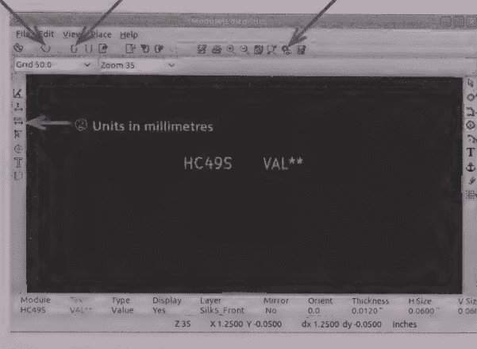

- 添加焊盘
- 添加线条
- 添加几何弧
- 设置网格原点

图 3.9：模块编辑器

### 教程 4-3 放置模块焊盘

- 通过点击左侧工具栏上的“单位为毫米（Units in millimetres）”图标将英制单位切换为公制单位（图 3.9，2）。
- 点击顶部工具栏（图 3.9，3）上的“焊盘设置（Pad Settings）”图标。


- 在弹出的`焊盘属性（Pad Properties）`对话框中，确保`焊盘编号（Pad Num:）`字段设置为 `0`，将`焊盘孔径 X（Pad Drill X）`更改为 `0.7`，并将`形状尺寸 X（Shape size X）`更改为 `1.2`。完成后点击`确定（OK）`按钮。

- 点击右侧工具栏上的“添加焊盘（Add pads）”图标（`图 3.9`，4）。

- 点击主窗口蓝色十字线的中心位置放置第一个焊盘。

- 根据我们的图表，我们需要放置第二个焊盘。

## 第3章：创建 KiCad 库元件

### 教程 4-4 绘制元件主体

- 在弹出的对话框中，确保`焊盘编号（Pad Num:）`字段设置为 `0`，将`焊盘孔径 X（Pad Drill X）`更改为 `0.7`，并将`形状尺寸 X（Shape size X）`更改为 `1.2`。完成后点击`确定（OK）`按钮。

- 点击右侧工具栏上的“添加焊盘（Add pads）”图标（`图 3.9`，4）。

- 点击主窗口蓝色十字线的中心位置放置第一个焊盘。

- 根据我们的图表，我们需要放置第二个焊盘。

## 3.2 创建 PCB 封装

- 在弹出的对话框中，确保`焊盘编号（Pad Num:）`字段设置为 `0`，将`焊盘孔径 X（Pad Drill X）`更改为 `0.7`，并将`形状尺寸 X（Shape size X）`更改为 `1.2`。完成后点击`确定（OK）`按钮。

- 点击右侧工具栏上的“添加焊盘（Add pads）”图标（`图 3.9`，4）。

- 点击主窗口蓝色十字线的中心位置放置第一个焊盘。

- 根据我们的图表，我们需要放置第二个焊盘。

## 第3章：创建 KiCad 库元件

- 在弹出的对话框中，确保`焊盘编号（Pad Num:）`字段设置为 `0`，将`焊盘孔径 X（Pad Drill X）`更改为 `0.7`，并将`形状尺寸 X（Shape size X）`更改为 `1.2`。完成后点击`确定（OK）`按钮。

- 点击右侧工具栏上的“添加焊盘（Add pads）”图标（`图 3.9`，4）。

- 点击主窗口蓝色十字线的中心位置放置第一个焊盘。

- 根据我们的图表，我们需要放置第二个焊盘。

## 3.2 创建 PCB 封装

- 在弹出的对话框中，确保`焊盘编号（Pad Num:）`字段设置为 `0`，将`焊盘孔径 X（Pad Drill X）`更改为 `0.7`，并将`形状尺寸 X（Shape size X）`更改为 `1.2`。完成后点击`确定（OK）`按钮。

- 点击右侧工具栏上的“添加焊盘（Add pads）”图标（`图 3.9`，4）。

- 点击主窗口蓝色十字线的中心位置放置第一个焊盘。

- 根据我们的图表，我们需要放置第二个焊盘。

## 第3章：创建 KiCad 库元件

- 在弹出的对话框中，确保`焊盘编号（Pad Num:）`字段设置为 `0`，将`焊盘孔径 X（Pad Drill X）`更改为 `0.7`，并将`形状尺寸 X（Shape size X）`更改为 `1.2`。完成后点击`确定（OK）`按钮。

- 点击右侧工具栏上的“添加焊盘（Add pads）”图标（`图 3.9`，4）。

- 点击主窗口蓝色十字线的中心位置放置第一个焊盘。

- 根据我们的图表，我们需要放置第二个焊盘。

（注：OCR 文本在后续页面包含大量重复和碎片化指令，我已根据提供的步骤重建了逻辑流。）

## 3.3 使用新创建的组件

新创建的组件可以在新的 KiCad 项目中使用。由于它被保存在您主目录的子文件夹中，因此您需要在每个 KiCad 程序（如 `EESchema` 等）中打开此新库。如果随后将项目复制到另一台 PC 上，它将尝试从相同的主目录访问新库组件。因此，如果您在新的 PC 上没有在具有同名的主目录下进行工作，且没有将库文件复制到与原始位置相同且同名的文件夹中，KiCad 将无法在新的 PC 上找到这些库组件。您可以将库复制到新 PC，打开项目，然后将其指向库的新位置。

另一种，可以像下文 3.4 节讨论的那样，将新创建的库安装到文件系统中。如果您决定在文件系统中安装新库，我建议始终在本地文件夹中保留一份库的副本，以便在需要添加新组件时可以方便地编辑，并确保记得备份它们。

### 3.3.1 在 EESchema 中使用新库

- 在 `EESchema` 项目中，在主菜单上，点击 `Preferences（首选项）→ Library（库）`。

- 在打开的对话框中，点击`Component library files box（组件库文件框）`旁边的 `Add（添加）`按钮。

- 在 `Library files（库文件）`对话框中，导航到主目录下的新库，例如到 `/home/user/KiCad/Library` 并打开 `my_library.lib`（或您为新库命名的名字）。点击 `OK（确定）`关闭第一个对话框。

- 系统将提示您保存项目设置。这将保存新库的引用到项目中，这样每次打开项目时，使用的任何组件都能被找到，因此请点击对话框中的 `Save（保存）`按钮。

- 现在可以使用右侧工具栏上的“Place a component（放置组件）”图标放置 `XTAL` 组件了。

### 3.3.2 在 CVpcb 中使用新库

- 在 `EESchema` 中使用新组件并生成网表后，启动 `CVpcb`。

- 在您告诉 `CVpcb` 新库的位置之前，它将无法找到新的封装。

- 在 `CVpcb` 中，点击 `Preferences（首选项）→ Options.（选项）`。


- 在弹出的对话框中，点击顶部的 `Add（添加）`按钮。

- 在打开的对话框中，导航到您的新库并打开它。

- 在提示保存时保存项目。

- 现在新的 `HC49S` 封装将出现在 `CVpcb` 的右侧面板中。

### 3.3.3 在 PCBnew 中使用新库

在读取之前生成的网表时，新封装应该会被当在 `CVpcb` 中打开新库时保存的封装库被找到。

如果需要在 `PCBnew` 中手动包含一个新库，请使用 `PCBnew` 主菜单中的 `Preferences（首选项）→ Library（库）` 添加它。

## 3.4 下载和安装 KiCad 库

当默认 KiCad 库不包含您设计所需的组件，且您不想自己设计该组件时，尝试搜索在线 KiCad 库资源以查找所需的组件。

### 3.4.1 查找并下载 KiCad 库

包含 KiCad 库的一些网站有：

- `www.kiadlib.org`

- `library.oshec.org`

库可能以压缩包的形式提供，也作为原理图符号的 `.lib` 文件和模块（PCB 封装）的 `.mod` 文件。只需将压缩包或文件下载到您的计算机。

### 3.4.2 安装 KiCad 库

一旦下载，可以像之前讨论的那样将 KiCad 库复制到本地库文件夹，或者安装到文件系统中。

示例 – 安装德州仪器 `TLV320AIC23b` 音频 CODEC IC 的库。您需要下载压缩库文件，解压并将它们复制到 Linux 文件系统中。要复制文件，首先使用文件管理器导航到解压后的文件。以 root 权限启动新的文件管理器，并导航到文件中的 KiCad 库文件夹。现在复制文件。

## 第 4 章 开源硬件：Arduino

- `ATMEGA8U2` 或 `ATMEGA16U2` 用于 USB 通信

- 用户可编程 LED

- 接口连接器

- 用于供电、编程和串口通信的 USB

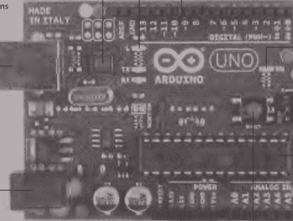

- 电源 LED

- 复位按钮

- 8 位 Atmel AVR 微控制器

- 可选外部电源

- 接口连接器

- 用于可选外部编程器的插针（Header）

`图 4.1`：Arduino Uno 板板

## 为什么 Arduino 如此受欢迎？

Arduino 非常受到电子爱好者爱好者的欢迎，也受到那些并不一定是为了学习电子技术但在项目中需要它的人的欢迎（例如艺术家使用 Arduino）。让 Arduino 受欢迎的原因因素包括：

- `易用性` – 购买 Arduino 板板并安装软件后，可以立即编译并运行内置程序，无需任何编程知识。

- 它是`开源的`，且软件免费。

- Arduino IDE 带有了一系列`软件库`，使得编写不同的硬件变得简单，无需编写驱动程序和实用函数。这允许程序员专注于终端应用。例如，如果使用以太网扩展板（Ethernet shield），则调用以太网库中的函数，无需编写访问以太网芯片的代码——只需开始应用程序代码即可。接口 SD 卡？使用 SD 库中的函数——无需编写 SD 初始化代码或实现 FAT 文件系统。

- `不需要特殊的编程器`，编程通过 USB 端口完成。

- `不需要电源适配器`，板板通过 USB 端口供电，但在独立应用中也可以从外部供电。


- 易于连接到`电子面包板`，以进行原型制作和实验。

- 有`现成的扩展板（Shields）`可供，以立即添加硬件功能。

- `支持许多计算机平台` – Linux、Windows 和 Macintosh。

Arduino 板板具有一个`用户可编程的 USB 虚拟串口`，用于调试和应用——用于编程 Arduino 的同一个 USB 端口可以在 Arduino 程序中作为串口使用，与 PC 通信。Arduino 的 USB 端口在 PC 上显示为串口，允许终端模拟器或用户程序连接到运行在 Arduino 板板上的用户应用。数据可以在 Arduino 和 PC 之间发送和接收，用于记录、将传感器接口到 PC 等。

Arduino 拥有`庞大的用户群/社区`，有许多 Arduino 用户页面、论坛以及各种小组/博客/组织。这意味着只需通过搜索网络或提问即可轻松获得帮助。

## 4.1 Arduino Uno 技术说明

基本上，Arduino Uno 的硬件是一个安装在 PCB 上的 8 位 Atmel AVR 微控制器，其一些引脚可以通过连接器用于接口连接。连接器上有 14 个 I/O 引脚，可以单独配置为输入或输出。6 个模拟输入可以使用内部的模拟数字转换器读取模拟值。该板板可以通过 USB 连接供电，也可以通过任何 7 到 12 伏的外部电源供电。USB 连接由板板上的一个独立芯片控制，因为主微控制器没有内置 USB。

AVR 微控制器包含一个预加载的 Arduino 引导加载程序（boot-loader），它允许通过 USB 端口将程序加载到微控制器。程序是在 PC 上运行的 Arduino IDE 软件为 Arduino 编写，然后在 IDE 内部通过 USB 连接编译并加载到 Arduino。Arduino 编程语言非常像 C 语言，实际上被转换为 C 并用 C 编译器编译，但这些对程序员来说是不可见的。

使用标准 Arduino 板板（如 Uno）时不需要外部编程设备，但板板上有一个插针，可以使用外部编程器对 AVR 进行编程。如果板板上插入了一个新的空白 AVR 微控制器，则可能需要这样做。此时，可以使用外部编程器将 Arduino 引导加载程序加载到新的 AVR 中。使用外部编程器的内容将在本书的下一章介绍，其中包含了几个自制的的编程器。我买了一个预装了引导加载程序的备用 AVR 微控制器并在我的 Arduino 板板上尝试了它。AVR 上有一个引导加载程序，但它不是正确的，我必须使用外部编程器编写正确的引导加载程序。

USB 连接的另一个特性是，它可以作为通用端口，用于运行在 Arduino 硬件上的用户程序与 PC 之间的通信，例如，可以用 PC 开启或关闭连接到 Arduino 板板上的设备，或者将 Arduino 板板收集的数据记录到 PC。

要开始使用 Arduino，你只需要电脑、互联网连接、Arduino 板板和一根 USB 线。

## 4.2 Arduino 快速上手指南

要开始使用 Arduino：

- 购买一块 Arduino 板板，例如 Arduino Uno（本章全程使用 Uno）。
- 获取一根 USB 线。
- 安装 Arduino 软件。
- 通过 USB 线将 Arduino 板板插入 PC – 这用于为板板供电并编程。
- 启动 Arduino 软件并为特定的 Arduino 板板和 USB 连接选择设置。
- 打开 Arduino IDE 软件中提供的一个示例程序。
- 编译程序并将其加载到板板上运行。

上述步骤的详细说明：

- `购买一块 Arduino 板板`

  如果你不知道该买哪一个，Arduino Uno 是一个非常好的入门板板。你可能还想在订购 Arduino 板板的同时购买扩展板，例如本章稍后描述的以太网扩展板。在这种情况下，在购买之前阅读本章是个好主意。

- `获取一根 USB 线`

  对于 Arduino Uno 板，USB 接口是标准 B 型而非微 B 型。如果你使用的是 Uno以外的 Arduino 板板，请检查板上的 USB 接口尺寸。这些信息可以在 Arduino 网站找到（arduino.cc，查看 Products）。

- `安装 Arduino 软件`

  Arduino 软件可以通过 Linux 软件管理器安装。只需在软件器的搜索字段中输入“Arduino”即可找到并安装。

- `将 Arduino 板板插入 PC`

  使用 USB 线将 Arduino 板板插入 PC 的 USB 端口 – 板板上的电源 LED 灯会亮起。现在打开终端窗口（Ctrl + Alt + t，如果你在第一章设置了此快捷键）并输入：

  `dmesg | tail`

  从终端窗口显示的信息中，你应该确定 Arduino 板所在的端口名称。它可能是 `ttyACM0` 或 `ttyUSB0`。

- `启动 Arduino 软件`

  在选择了所有应用的 菜单中，在 Programming 下找到 Arduino IDE。

- `连接板板`

  在 IDE 窗口中，点击 Tools → Board，选择你使用的 Arduino 板名称，例如 Arduino Uno。现在点击 Tools → Serial Port，选择你在步骤4中确定的串口名称，例如 `/dev/ttyACM0`。

- `打开一个示例程序`

  在 IDE 窗口中，点击 File → Examples → 1.Basics → Blink。这将打开一个闪烁 Arduino Uno 板上标记为 L 的 LED 的示例程序。

- `编译并加载程序`

  点击 Arduino 工具栏上的验证图标（看起来像一个钩）来验证（编译）程序（图 4.2，①）。现在点击上传图标将程序加载到板上（图 4.2，②）。上传完成后，Arduino 板板上的“L”LED 将开始闪烁和熄灭。

关于 Blink 示例程序如何工作的解释可以在 Arduino 网站上找到：arduino.cc/en/Tutorial/Sketch

# Windows 版 Arduino：

在以下页面有一个在 Windows 上开始使用 Arduino 的良好教程：

arduino.cc/en/Guide/Windows

## 4.3 Arduino 硬件

① 验证

② 上传

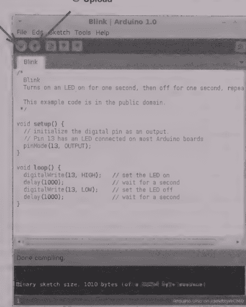

图 4.2：Arduino IDE

关于 Arduino 硬件的摘要可以在 arduino.cc/en/Main/ArduinoBoardUno 找到。请务必查看此网页，因为除非下文必要，否则这些信息在文中不再重复出现。

另请注意，Arduino Uno 板有多个不同的版本，因此你的板子与书中的照片相比可能会有不同。版本之间差异的一个示例是，第 3 版 Uno（revision 3）的重置开关位于 USB 连接器旁边，而早期的板子重置开关位于 ICSP 针脚后面。

### 4.3.1 Arduino Uno 每个 I/O 引脚的电流

在上述页面上，每个 I/O 引脚的直流电流给出为 40mA，但根据 ATMMEGA328P 微控制器（用于 Arduino Uno）的数据表，这是“绝对最大额定值”。将任何电子元件的绝对最大额定值作为可用额定值并不是一个好主意。

每个 I/O 引脚可以提供或消耗超过 20mA 的电流，但它们不能同时做到这一点。数据表提供了以下信息（统计学上的）：

- 当通过 I/O 引脚灌入电流时：

  - 端口 C0 - C5、ADC7、ADC6 的所有 IOL 之和不超过 100 mA。
  - 端口 B0 - B5、D5 - D7、XTAL2 的所有 IOL 之和不超过 100 mA。
  - 端口 D0 - D4、RESET 的所有 IOL 之和不超过 100 mA。

图 4.3 显示了电流输入（current sinking）和电流输出（current sourcing）的区别。ADC6 和 ADC7 在微控制器的 DIP 版本上不存在，因此对于 Arduino 我们可以忽略它们。端口引脚 D0 到 C5 是 Arduino 上的模拟输入（在板上标记为 A0 到 A5），所以也可以忽略它们（假设我们把它们作为模拟引脚使用，只有这些引脚可以用于连接 IC 设备等其他用途）。XTAL1 和 XTAL2 专门用于晶振，不作为 Arduino 上的 I/O 引脚，因此我们可以忽略它们。RESET 引脚在 Arduino 上专门作为重置输入，可以忽略。

这就留下了 B0 到 B5（6 个引脚）和 D5 到 D7（3 个引脚），它们的灌电流不应超过 100mA。这 9 个引脚平均每个为 100mA/9=11mA。最后，D0 到 D4（5 个引脚）的灌电流不应超过 100mA。这相当于每个引脚平均 100mA / 5 = 20mA。

- 端口引脚 D0 到 D4映射到 Arduino 引脚 0 到 4。
- 端口引脚 D5 到 D7 映射到 Arduino 引脚 5 到 7。
- 端口引脚 B0 到 B5 映射到 Arduino 引脚 8 到 13。

当从 I/O 引脚输出电流时：


- 端口 `C0-C5`、`D0-D4`、`RESET` 的所有 `IOH` 之和不超过 150 mA。
- 端口 `B0-B5`、`D5-D7`、`ADC6`、`XTAL1`、`XTAL2` 的所有 `IOH` 之和不超过 150 mA。

排除上述“灌入”下提到的引脚，剩余的 `D0` 到 `D4`（5 个引脚）输出电流不超过 150mA，平均为 150mA/5=30mA。`B0` 到 `B5`（6 个引脚）和 `D5` 到 `D7`（3 个引脚）输出电流不超过 150mA（注：此处原文逻辑似乎如此）。

### Arduino Uno 电流汇总

| Arduino 引脚 | 灌入总和 | 灌入平均 | 输出总和 | 输出平均 |
| :--- | :--- | :--- | :--- | :--- |
| 0 到 4 | 100mA | 20mA | 150mA | 30mA |
| 5 到 7 | 100mA | 33mA | 150mA | 50mA |
| 8 到 13 | 100mA | 16mA | 150mA | 25mA |

（注：由于原文文本描述与表格逻辑略有出入，此处基于文本逻辑进行了整理）

排除上述“灌入”下提到的引脚，剩余的 `D0` 到 `D4`（5 个引脚）输出电流不超过 150mA，平均为 150mA/5=30mA。`B0` 到 `B5`（6 个引脚）和 `D5` 到 `D7`（3 个引脚）输出电流不超过 150mA。

# 第 4 章 开源硬件：Arduino

一个实现相同功能但代码实现不同的程序，可以在 Arduino IDE 的 `File -> Examples -> 3.Analog -> Fading` 下找到，相应的网页可以在此地址找到：`arduino.cc/cc/en/Tutorial/Fading`

请查看 `arduino.cc/cc/en/Tutorial/PWM` 以了解 PWM 的工作原理。

如需通过 USB 端口从 PC 使用 PWM 控制小型直流电机，请参阅下一节末尾（4.4.2）。

## 4.4.2 Arduino 通信与输入

Arduino IDE 内置了一个名为“串口监视器”`Serial Monitor` 的终端仿真器，它可以通过 USB 连接到 Arduino 板板，在 PC 和 Arduino 板板之间发送和接收数据。

### A. 通过 USB 从 Arduino 板板获取数据

两个名为 `DigitalReadSerial` 和 `AnalogReadSerial` 的示例程序使用 USB 链路将信息从 Arduino 板板发送到 PC。与之前的内置示例一样，您可以在 Arduino IDE 中找到源代码，并在网站上找到如下所示的电路图。

对于下面的每个示例，请构建电路，然后编译并将程序加载到 Arduino 板板。要通过 USB 链路连接到板板，请点击 Arduino IDE 顶部工具栏上的“Serial Monitor”图标（或 `Tools -> Serial Monitor`）以启动串口监视器程序并显示 Arduino 板板发送的数据（图 4.4）。

## 4.4.2 Arduino 串口通信与输入

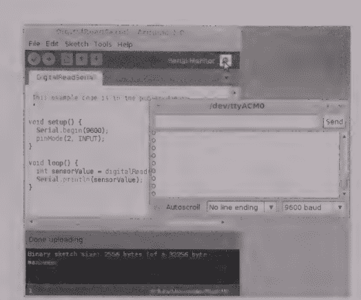

图 4.4：Arduino 串口监视器

**DigitalReadSerial:**

读取连接到 Arduino 板板引脚 2 的开关状态，并通过 USB 链路将开关状态发送到 PC。

- 在 Arduino IDE 中 - `File -> Examples -> .Basics -> DigitalReadSerial`
- 网页 - `arduino.cc/en/Tutorial/DigitalReadSerial`

**AnalogReadSerial:**

读取连接到 Arduino 板板引脚 A0 的电位器值，并通过 USB 链路将其发送到 PC。

- 在 Arduino IDE 中 - `File -> Examples -> .Basics -> AnalogReadSerial`
- 网页 - `arduino.cc/en/Tutorial/AnalogReadSerial`

**某些 Arduino 板板的问题：**

您可能拥有拥有最新固件的 Arduino 板板，不会出现下述问题。该问题在 Windows 系统上不会发生——即使是固旧固件的 Arduino 板板。如果您在运行上述两个示例程序时没有遇到任何问题，可以跳过此节。问题将在下描述。

# 第 4 章 开源硬件：Arduino

这两个示例程序都会持续地通过 USB 端口发送数据，这导致了两个问题：首先是串口监视器程序无法连接到板板；其次是尝试将新程序加载到 Arduino 板板——当尝试加载新程序时 Arduino IDE 会瞬间冻结并发生通信错误。解决方案向 Arduino 板板上的 `ATMMEGA8U2` 微控制器加载最新的固件（这是 USB 端口附近的 SMT 微控制器）。要加载新固件，请按照以下步骤操作：

- 启动终端窗口 (`Ctrl + Alt + t`)。
- 现在通过输入命令加载 DFU（设备固件更新）程序：

  `sudo apt-get install dfu-programmer`
  
  （您必须连接互联网才能安装此软件）
- 我们需要加载 `ATMMEGA8U2` 的片载引导程序（bootloader），因此通过 USB 线为 Arduino 板板供电。
- 将一根线从其中一个 GND 连接到图 4.5 中 ① 处的焊盘，并保持连接。
- 现在从另一个 GND 连接一根线，并将其连接到图 4.5 中 ② 处的电容器末端，然后断开。
- 断开第一根线。
- 在终端窗口中，输入：

  `sudo dfu-programmer at90usb82 get bootloader-version`

如果引导程序已加载，您将获得一个版本号；如果没有，请按照步骤 4 到 6 操作，然后重试此步骤。

- 现在从以下地址下载 Arduino 引导程序：

  `github.com/arduino/Arduino/tree/master/hardware/arduino/firmwares/atmegaxuu/arduino-usbserial/`

对于 Arduino Uno，文件将命名为 `Arduino-usbserial-uno.hex`。在浏览器中，点击文件名，将打开另一个窗口并列出文件内容。这是一个十六进制文件，文件的每行都以冒号 ":" 开头。在列表右上方有一个名为“raw”的链接，右键点击此链接并选择“链接另存为...”以保存文件。该文件也可以通过为此板板 CH04 下载的文件找到。

## 4.4.2 Arduino 串口通信与输入

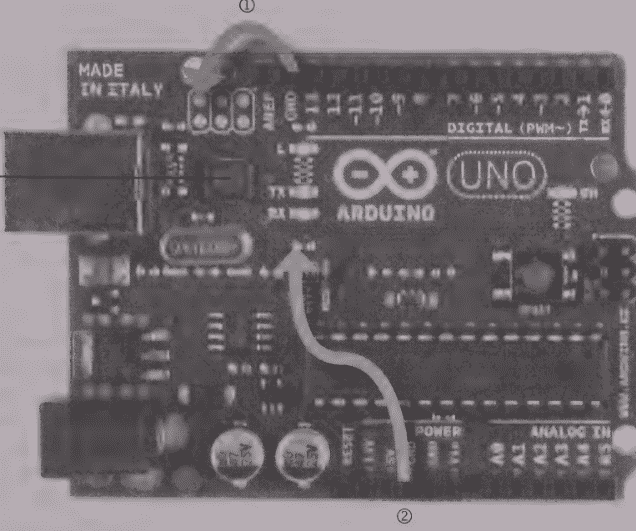

`ATMEGA8U2` 微控制器

图 4.5：加载 DFU 引导程序

- 在终端窗口中，切换到包含下载文件的目录。
- 现在输入：

  `sudo dfu-programmer at90usb82 flash Arduino-usbserial-uno.hex`
- 拔掉 USB 线以关闭板板电源，然后重新插回。
- 串口连接问题现在应该已经解决了。

注意：如果您没有使用“串口监视器”[文本截断]

# 第 4 章 开源硬件：Arduino

## 向 Arduino 发送数据

一个实现相同功能但代码实现不同的程序，可以在 Arduino IDE 的 `File -> Examples -> 3.Analog -> Fading` 下找到，相应的网页可以在此地址找到：`arduino.cc/cc/en/Tutorial/Fading`

请查看 `arduino.cc/cc/en/Tutorial/PWM` 以了解 PWM 的工作原理。

如需通过 USB 端口从 PC 使用 PWM 控制小型直流电机，请参阅下一节末尾（4.4.2）。

## Processing

一个实现相同功能但代码实现不同的程序，可以在 Arduino IDE 的 `File -> Examples -> 3.Analog -> Fading` 下找到，相应的网页可以在此地址找到：`arduino.cc/cc/en/Tutorial/Fading`

### ...

当 Processing 代码运行时，它会创建一个带正方形的窗口。将鼠标指针移动到正方形上将开启 Arduino "L" LED。将鼠标指针移动到正方形上将关闭 LED。图 4.7 显示了 Arduino IDE、Processing IDE 以及点击运行按钮后启动的 PhysicalPixel 窗口。

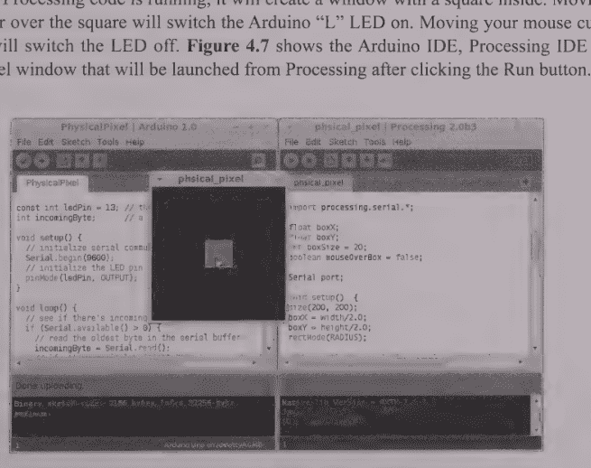

图 4.7：PhysicalPixel Arduino 代码、Processing 代码以及 PhysicalPixel 窗口

# 第 4 章 开源硬件：Arduino

## C. PWM 电机控制器

本示例使用了上一节中的 PWM 控制和本节中的串行通信，用来控制小型直流电机的速度。程序包含在附带文件的：`CH04/sketchbook/PWM_motor/` 中。


按照图 **4.8** 所示构建电路，并将程序加载到 Arduino 板上。该电路只能驱动电流较的小型直流电机（最大电流约 60mA），例如来自旧电脑的 CPU 散热扇。要控制电机的速度，请运行 Arduino 串口监视器程序。按 `'u'` 增加电机速度，按 `'d'` 减小电机速度。每发送一次 `'u'` 或 `'d$`，写入 PWM 的值就会增加或减少 5。要更改此步进值，请从串口监视器向 Arduino 发送字符 `'1'` 到 `'5'`。当你下次增加或减少 PWM 值时，它将按新的步进值大小发生变化。

由于 Arduino 的 PWM 频率在音频范围内（约 490Hz），当电机在低速运行时，你可能会听到电机发出的听噪音。可以通过在电机端子之间并联电容来减少噪音。尝试使用值在 10µF 到 100µF 之间的电解电容。

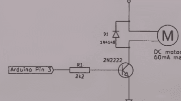

图 4.8：接口小型直流电机

## 4.4.3 LCD 显示

使用 Arduino 可以快速地接口字符 LCD 显示器，例如 2 行 16 显示器。基于 Hitachi HD44780 控制器和驱动 IC 的 LCD 显示器非常常见，可从多个制造商购买。在 LCD 显示器上焊接导线，以便于连接到 Arduino 板和面包板。

HelloWorld 程序使用 Arduino 板向 LCD 显示器写入一些文本——“hello, world!”显示在 LCD 的第一行，递增的计数值显示在第二行。显示器以 4 位模式连接（使用了 LCD 的 4 根数据线而非所有 8 根）。网站上的电路图显示了一个带有上方引脚的 LCD 显示器。请见图 4.9，显示了带有下方引脚的显示器。某些显示器可能没有背光连接，在这种情况下，如图所示，引脚 1 可能为 VSS，引脚 2 为 VDD。最好检查你显示器的数据表，以免因错误连接导致其损坏。

HelloWorld：

在 Arduino IDE 中 - `File -> Examples -> LiquidCrystal -> HelloWorld`

网页 - `arduino.co/en/Tutorial/LiquidCrystal`

按照网页所示接线 LCD。你还需要一个 10k 电位器来设置 LCD 对比度。可以使用预设的电位器并通过面包板连接到 LCD。

当 HelloWorld 程序运行正常后，Arduino IDE 中 `File -> Examples -> LiquidCrystal` 下的所有其他示例程序也能正常工作。

### LCD 背光

某些 LCD 显示器带有背光，这使得它们在光线不佳的情况下更易读。将背光的阴极连接到 GND，阳极通过 33 到 47 欧姆电阻连接到 5V 以开启背光。

本书的示例程序包含一个使用 PWM 控制 LCD 显示器背光亮度的示例。Arduino 程序可以在此处找到：

`CH04/sketch/Backlight/`

要控制 LCD 背光的亮度，如图 4.10 所示将晶极管连接到 Arduino 板。当程序在 Arduino 板上运行时，使用串口监视器连接它，并发送 `'h'` 降低 LCD 亮度，发送 `'l'` 增加 LCD 亮度。你也可以发送例如 `'hhhhhh'` 来一次性增加几步亮度。可以发送大写或小写字母。

# 第 4 章 开源硬件：Arduino

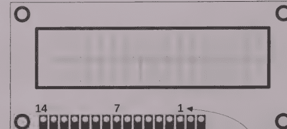

- 1. 阳极 +（背光，如果有）
- 2. 阴极 -（背光，如果有）
- 3. VCC（电源）
- 4. VDD（5V 电源）
- 5. V0（连接至电位器的对比度）
- 6. RS（寄存器选择）
- 7. E（使能）
- 8. D0（数据位 0）
- 9. D1（数据位 1）
- 10. D2（数据位 2）
- 11. D3（数据位 3）
- 12. D4（数据位 4）
- 13. D5（数据位 5）
- 14. D6（数据位 6）
- 15. D7（数据位 7）
- 16. DB7（数据字节 7）

图 4.9：在 Arduino 上使用引脚的 16 位 2 行 LCD

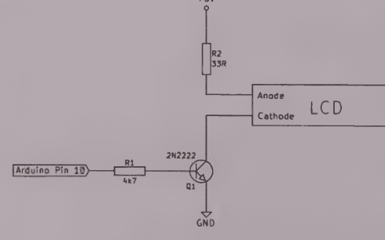

图 4.10：Arduino 背光亮度

## 4.4.4 更多示例与学习

在 Arduino IDE 的 `File -> Examples` 下可以找到许多可实验和学习的示例程序。请务必查看“toneMelody”示例，它可以播放旋律，且仅需要一个 100Ω 电阻和一个 8Ω 扬声器（`File -> Examples -> toneMelody`, `arduino.cc/en/Tutorial/`）。以太网扩展板将在本章的下一节介绍。

下面的网页链接将帮助你学习 Arduino 硬件和软件。此列表是详尽的，网上还有更多信息，只需去搜索即可。

### 硬件和软件概念

学习的好起点是：`arduino.cc/en/Tutorial/` Arduino Playground 有一个指向总信息的链接：`arduino.cc/playground/Main`

### 软件参考

- Arduino IDE：`arduino.cc/en/Guide/Environment`
- Arduino 编程语言：`arduino.cc/en/Reference`
- 库函数：`arduino.cc/en/Reference/Libraries`
- Arduino 编程笔记本：`arduino.cc/playground/uploads/arduino_notebook_v1`

### 硬件接口参考

- 关于 Arduino 硬件更多信息：`arduino.cc/playground/Main/ArduinoCore`
- 许多硬件接口示例：`arduino.cc/playground/Main/InterfacingWithHardware`
- 扩展板使用的 Arduino 引脚：`arduino.cc/playground/Main/ShieldUsage`
- 扩展板专用网站：`shieldlist.org`

### 故障排除

有关各种问题的帮助：`arduino.cc/en/Guide/Troubleshooting`

### 破解 Arduino

硬件破解破解：`arduino.cc/en/Hacking`

## 4.5 使用以太网扩展板

以太网扩展板（**4.11**）使 Arduino 板能够连接到以太网。它还包含一个 microSD 卡槽。许多第三方也制造以太网扩展板。本节将讨论“官方”Arduino 以太网扩展板（`cc/en/Main/ArduinoShield`）——除了 Uno 之外，扩展板也适用于其他 Arduino 板。

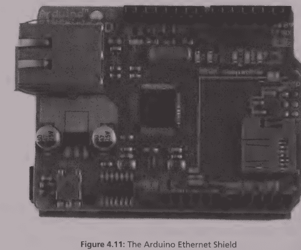

本节所需的硬件有：

- Arduino 板，例如 Uno。
- Arduino 以太网扩展板，例如 Shield。
- 用于编程和供电 Arduino 的 USB 线。
- 以太网线，直接连接到集线器/路由器。
- 文中提到的各种元件（LED、电阻等）。

### 4.5.1 设置并测试 Arduino 和以太网扩展板

#### 插入扩展板

购买以太网扩展板后，你需要将其插入 Arduino 板。以太网扩展板是不可能反过来插入 Arduino 的。扩展板插入 Arduino 两侧的两组连接器，以及板子末端的 ICSP 引脚中。

#### 加载程序测试以太网扩展板

启动 Arduino IDE 并打开 WebServer 示例：`File -> Examples -> Ethernet -> WebServer`。在编译和加载之前，我们需要修改程序中的几处。查看你的以太网扩展板并找到带有数字的标签。在 WebServer 程序中，将下行的数字替换为标签上的数字：

```
byte mac[] = { 0xDE, 0xAD, 0xBE, 0xEF, 0xFE, 0xED };
```

标签上包含的是十六进制数字，前面没有带 "0x"，所以只需将它们替换到上述行中每个 "0x" 之后即可。

现在保存程序。你无法覆盖示例程序，因此将其保存到主文件夹的文件夹中，例如使用 `File -> 另存为` 保存到 `sketch/WebServer`。当你保存时，系统会自动为你创建 WebServer 文件夹并将源码保存在其中。

### 查找你的以太网设置

如果你难以为 Arduino 找到正确的 IP 地址，请在 Linux Mint 面板上右键点击网络连接（看起来像两个连接的对角插头），然后在弹出菜单中点击“连接信息”（Connection Information）。标记为“IP Address:”的字段会提示你应该使用哪个范围。该字段旁边的地址是你的电脑的 IP 地址，因此请为 Arduino 选择一个与你电脑前三个数字相同的地址，并在最后一位选择一个不同的数字。例如，如果你的电脑的 IP 地址是 10.0.0.4，可以选择 10.0.0.55 或 10.0.0.20，只要网络上没有其他设备使用相同的地址，它就可以工作。

### 以太网问题解决

# 第 4 章 开源硬件：Arduino


如果浏览器无法连接到 Arduino 板，请打开终端（`ctrl + alt + t`）并输入 `ping <ip address>`（例如 `ping 10.0.0.20`）以查看是否能从板卡获得响应。如果板连接正确，`ping` 程序在每次发送数据时都会收到板卡返回的数据。你将在终端窗口中看到这些数据响应。要停止 `ping` 程序，按 `Ctrl + c`。

## 通过以太网读取数值

将浏览器连接到 Arduino 板后，浏览器应该显示来自模拟输入端 `A0` 到 `A6` 的模拟值，类似于所示：

- 模拟输入 0 为 1023
- 模拟输入 1 为 1023
- 模拟输入 2 为 816
- 模拟输入 3 为 604
- 模拟输入 4 为 443
- 模拟输入 5 为 360

在浏览器中按 `F5`（或 `Ctrl + R`）将刷新数值。每次按下 `F5` 时数值都应该发生变化，因为输入端会采集到一些噪声导致数值变化。电位器可以连接到 `A2` 到 `A5` 的任何一个输入端——将电位器的滑变阻（中间引脚）连接到其中一个模拟输入端，并将一个连接到 `5V`，另一个连接到 `GND`。改变电位器的值并按 `F5` 应该改变浏览器中的值。如果你手头没有电位器，将其中一个输入端连接到 `5V`，刷新浏览器，然后断开输入端与 `5V` 的连接并连接到 `GND`，再次刷新。显示的值应从应用 `5V` 时的 1023 变为应用 `GND` 时的 0。你尝试重新连接 Arduino 板上的 `3.3V` 引脚。模拟输入 `A0` 和 `A1` 显示为 1023 是因为它们被 microSD 卡插座使用，并连接了两个 10k 上拉电阻。

### 4.5.2 以太网扩展板硬件

WebServer 示例的网页可以在此处找到：

`arduino.cc/en/Tutorial/WebServer`

### 4.5.2 以太网扩展板硬件

以太网扩展板的电路图以及原理图和板布局的 Eagle CAD 文件可以在此处找到：

`arduino.cc/en/Main/ArduinoEthernetShield`

## 以太网扩展板使用的引脚

为了更好地说明以太网扩展板所使用的引脚，请查看网页：

`sheidlist.org/arduino/ethernet-v5`

查看以太网扩展板的电路图，可能会认为上述网页上的数据是不正确的，因为电路图显示没有东西连接到 Arduino 引脚 11 和 12，且引脚 13 连接到了一个 LED。这是因为引脚 11、12 和 13 连接到 Arduino 板上的 ICSP 针，而以太网扩展板通过侧面的连接器直接连接到这些引脚。这些引脚具有以下功能：

- `13` – SPI 总线的 `SCK`
- `12` – SPI 总线的 `MISO`
- `11` – SPI 总线的 `MOSI`

总结一下引脚使用情况：

| 类别 | 描述 |
| :--- | :--- |
| 以太网扩展板使用的引脚 | `A0` 和 `A1` 模拟输入 |
| | 引脚 `4`, `10`, `11`, `12`, `13` |
| 可用于通用的引脚 | `A2` 到 `A5` 模拟输入 |
| | 引脚 `0` 到 `3`（但引脚 `0` 和 `1` 通常连接到 Arduino 板上的 USB 芯片） |
| | 引脚 `5` 到 `9` |

## 第 4 章 开源硬件：Arduino

## 其他硬件说明

引脚 `13` 上的 LED 在 Arduino 板上可用，但在以太网扩展板上不能作为通用 LED 使用，因为引脚 `13` 是 SPI 端口的时钟线。

Arduino/以太网扩展板上的引脚 `2` 可用于启用以网芯片与 Arduino 微控制器之间的中断驱动通信。这需要通过焊接以太网扩展板上的“INT”跳线来启用，但 Arduino 以太网库不支持中断。

Arduino 微控制器的 SPI 端口由以网芯片和 microSD 卡插座共享。

### 4.5.3 实现 Arduino Web 服务器

我们用于测试以太网扩展板的 WebServer 程序非常基础。在本节中，我们将构建一个更有用的 Web 服务器，但首先我们将查看一些有助于理解如何实现 Web 服务器的程序。本节中使用的所有示例程序都可以在 `CH04/sketchbook/` 附文件中找到。在每个示例中，你需要将 MAC 地址更改为以太网扩展板上的地址，并根据网络调整 IP 地址。

## 查看来自浏览器的请求

`WebServer_ascii` 程序将在串口监器中显示来自浏览器的请求。将此程序加载到 Arduino 并启动串口监器。启动浏览器并访问 `10.0.0.20` 或你编程到 Arduino 中的任何 IP 地址。页面将如之前一样显示。

`WebServer_hex` 程序执行相同的程序，但以 ASCII 和十六进制显示从浏览器发送的数据。这只是为了让我们看到哪些发送字符是不可见的。

### 4.5.3 实现 Arduino Web 服务器

现在我们知道来自浏览器的请求最后一个字符是 `A0`，我们可以在程序中检查此字符以判断接收何时何时结束。`A0` 在程序中也可以称为 `'\n'`，我们可以在程序中查找 `'\n'`。

## Arduino Web 服务器

图 4.12 显示了 Web 服务器程序中使用的 Arduino 和以太网板硬件接口。电位器可以连接到 `A2` 到 `A4` 的任何模拟引脚，因为这些引脚的模拟值将被显示。甚至没有连接图中所示的所有 LED 和开关——如果你只是想对程序进行测试，一个 LED 和一个开关即可。

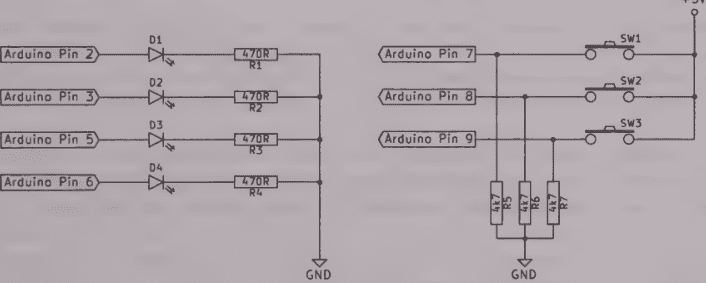

图 4.12：Arduino Web 服务器的 LED 和开关连接

设置硬件并将 `WebServ_IO_browser_refresh` 程序加载到 Arduino 板（如有必要，如之前所示更改 MAC 和 IP）。启动浏览器并访问 Arduino 程序中使用的 IP 地址，如之前所示。页面将显示三个框：一个包含每个 LED 的复选框的框，一个包含开关状态的框，以及包含从 `A2` 到 `A5` 读取的模拟值的框。

浏览器将定期刷新以显示更新的开关和模拟值。如果开关关闭或打开，更新后的值将出现在网页上。浏览器已设置为

# 第 4 章 开源硬件：Arduino

程序中每秒更新一次。你可以在程序中禁用或更改此设置以以不同的速率更新。Arduino 程序中的以下行负责设置网页浏览器的刷新率：

```
client.print("<meta http-equiv=\"refresh\" content=\"1\">");
```

上述行中的值“1”可以更改以减慢更新速率，例如将其更改为 2 将导致浏览器每两秒刷新一次。要禁用自动刷新，可以删除或注释掉此行。

点击 LED 复选框中的一个将点亮连接到板卡上的相应 LED，取消勾选复选框将将其关闭。由于网页浏览器会自动刷新，因此复选框只能在刷新间隔隙点击，而不能在页面忙于加载时点击。可以按照上述方法禁用自动刷新，但这样开关和模拟值只有在每次点击 LED 复选框或手动刷新页面时会在页面上更新。

要在不修改 Arduino 程序的情况下停止网页浏览器刷新，请在使用浏览器时按下转义键 (`Esc`)。刷新浏览器或点击网页上的任一个复选框都将重新启动自动刷新。

该程序的工作原理是在当浏览器请求时，向其发送描述要显示网页的 HTML 代码。这基本上与我们用于测试 Arduino 以太网板时使用的 WebServer 示例相同，但此示例包含了一些 CSS，用于设置显示框在网页上的位置，并更改文本颜色和字体。

当复选框被点击时，浏览器会将复选框的状态发送到 Arduino Web 服务器。Arduino 程序存储复选框的状态，并根据复选框是否勾选或未勾选生成正确的 HTML 发送给网页浏览器。

要理解程序是如何工作的，请查看源代码以及代码中的注释。要理解发送到网页浏览器的内容，你需要具备 HTML 和 CSS 知识。

## 4.5.4 SD 卡网页服务器

上一个示例通过在 Arduino 程序中向网页浏览器发送文本来生成网页。现在，我们将使用放置在 Arduino 以太网扩展板 SD 槽中的 SD 卡来存储可以从外部创建并从 PC 复制到 SD 卡的网页。

### SD 卡

除了之前使用的硬件外，你还需要一张 microSD 卡。并不是所有的 microSD 卡都能与以太网扩展板兼容。互联网上的一些建议坚持使用 2GB 或更小的卡。根据 SD 卡规范，microSD 卡并不要求支持 SPI 模式。虽然 Arduino 使用 SPI 端口与 SD 卡接口，但有许多 microSD 卡可以与 Arduino 工作。我使用了一张金士的 2GB 卡，它带有一个适配器，可以插入标准的 SD 卡槽中。

在使用 SD 卡工作时，你需要一个 USB SD 卡适配器将 SD 连接到 PC，这样你就可以向 SD 卡复制文件并从 SD 卡读取文件。这些 SD 卡读取器可以在任何优质 PC 商店买到。我的笔记本电脑内置了 SD 卡读取器，但它是用于标准 SD 卡尺寸的，所以我使用了 microSD 卡自带的 SD 卡适配器将其插入笔记本的 SD 卡读取器。图 4.13 显示了一个可以读取许多不同类型卡（包括 microSD）的多功能读卡器。图中还显示了 microSD 卡及其附带的适配器——将 microSD 卡推入适配器的末端。


当你获得 microSD 卡后，将其插入 Arduino 以太网扩展板上的 microSD 卡槽中。将卡完全推入槽内，直到听到“咔哒”一声。再次将卡端推入槽内，它会“咔哒”弹出。现在拉出卡，它不会掉落，可能需要左右晃动一下才能完全取出。这样做时要小心，千万不要强行。

如果你没有专门购买一张用于 Arduino 的空白 microSD 卡，而是使用你已有的卡，请在 Arduino 上运行任何 SD 卡程序之前，备份卡上的所有数据。

# 第 4 章 开源硬件：Arduino

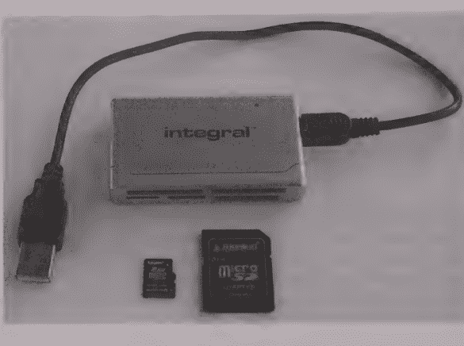

图 4.13：多功能读卡器、microSD 卡和适配器

## 测试 Arduino SD 接口

在启动 SD 卡网页服务器之前，先测试 SD 卡是一个好主意。在 Arduino IDE 中，打开文件 -> 示例 -> ReadWrite 下的程序。将 microSD 插入以太网扩展板，加载此程序到 Arduino 并打开串口监视器。串口监视器将显示 SD 卡是否初始化成功或失败。如果初始化成功，程序将在 SD 卡上创建一个名为 "test.txt" 的文件并向其中写入文本。将 SD 卡从槽中取出并通过读卡器插入 PC。你应该能看到 "test.txt" 文件，并能够打开它读取其中写入的文本。

## SDwebserver 程序

从 Arduino IDE 带文件中打开 SDwebserver 程序。此程序将允许通过浏览器查看插入 Arduino 扩展板的 SD 卡上的网页。示例网页需要通过 PC 和读卡器复制到 SD 卡中。要复制到 SD 卡的文件可以在 SDwebserver 的子文件夹 files_for_sd 中找到，它们是：index.htm、page2.htm 和 logo.png。

将网页复制到 SD 卡后，将其插入 Arduino 扩展板。将卡推入槽。如上所述，可以禁用自动刷新。在浏览器中扩展板上显示网页。刷新浏览器或点击网页上的任一个复选框将重新启动自动刷新。

## 4.6 构建你的扩展板

在 CVpcb 中分配的封装将被导入到 PCBnew 中。PCBnew 文件已经包含了 Arduino 扩展板的轮廓，以及位于正确位置的头部连接器。然后你就可以布局你的 Arduino 扩展板了。

如果你没有上一节中提到的绕线排针（wire-wrap headers），并且想使用标准排针（pin headers）制作单面 PCB 扩展板，那么你将只能在顶层铜层上设计板。在这种情况下，当扩展板插入 Arduino 时，任何通孔元件都将反过来。同样，你必须确保组件有足够的间隙，并且不会与 Arduino 上的组件冲突，特别是 USB 和 ICSP 接口。Arduino 安装孔是直径为 3.2mm 的孔，在 PCB 扩展板模板文件中也已就绪。

## LED 轮示例扩展板和程序

在 `CH04/KiCad/Arduino_LED_wheel/` 中找到 LED 扩展板的 KiCad 文件及相关文件。该项目基于 Arduino 扩展板模板文件构建。该扩展板包含 12 个圆形排列的 LED，连接到 Arduino 引脚 2 到 13，以及两个连接到模拟输入 A4 和 A5 的按键开关。此示例使用贴片式 LED、电阻和通孔按键开关在单面 PCB 上制成。参见图 4.15 的板载照片。照片显示通孔开关安装在板载的铜层（顶层）侧，并从顶部焊接，因为下方没有铜层来焊接扩展板的引脚。

图 4.15 还显示，当在板上使用标准排针时，扩展板会接触到 Arduino 板的 USB 和外部电源连接器。这在板板上并不是一个问题，因为板子下方没有铜层或组件，也没有在这些连接器上方焊接通孔元件。ICSP 接口的顶部距离板底部 3mm 处。如果此板子使用绕线排针制作，那么 Arduino 和组件之间会有更大的间隙；但如果是带有绕线排针的单面板，则需要使用通孔元件重新设计板，使铜层位于板子下方。这是因为绕线连接器需要焊接到板子下方的扩展板上。如果 Arduino 和扩展板之间需要更多间隙，另一种选择是使用引脚更长的排针。

要制作此板，你需要使用 1206 封装的贴片电阻和 LED。

此扩展板的测试程序可以在 `CH04/sketchbook/LED_wheel_test.this` 中找到。该程序将轮流开启每个 LED，每个 LED 切换之间有一秒的延迟。它将关闭每个 LED。其中一个按钮会将切换延迟更改为 200ms，另一个更改为 50ms。必须按住开关直到 LED 切换速度变化，因为开关仅在调用 delay 函数的间隙读取。

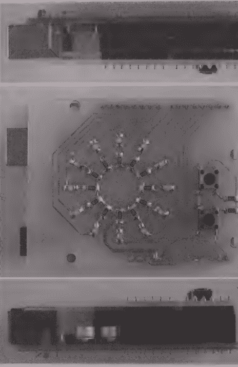

图 4.15：插在 Arduino Uno 的 LED 轮扩展板

## KiCad 设计笔记 – LED 轮

### 原图

**使用网络名称（net names）：** 在 LED 轮扩展板的原理图中，使用网络名称将 LED 连接到连接器。这是通过点击 EESchema 右侧工具栏上的“放置网络名称”（Place a net name）按钮，然后点击导线来放置网络名称来实现的。只要两条导线具有相同的名称，它们就会连接。当生成网表并导入到 PCBnew 时，网络名称连接也将被导入，PCBnew 会通过引导线和“鼠笼线”（ratnest lines）指示这些连接，就像在原理图中用导线连接的一样。

### PCB

**放置贴片元件：** 贴片元件将自动放置在 PCB 的顶层（在 KiCad 默认设置下显示为红色）。如果需要将零件放置在下方，则需要翻转。

# ATtiny25

- 8 引脚封装
- 2kB Flash 内存
- ISP, debugWIRE
- 定时器, PWM
- SPI
- TWI (I2C)
- 4 × 10-bit ADC 通道
- 模拟比较器
- 温度传感器
- 最多 6 个 I/O 引
- 最高 20MHz 运行速度
- 1.8V 至 5.5V 电源
- 提供 DIP 封装以及各种 SMT 封装

在随附文件中可以找到 LibreOffice 格式的 tinyAVR 参数表：`CH05/tinyAVR_Parametric_Table-1.ods`

## 5.1.2 megaAVR 微控制器

与 tinyAVR 相比，megaAVR 微控制器通常具有更多的 Flash、SRAM、I/O 引和外设。该组中的大多数微控制器至少有一个 USART，且其中大多数单元将带有 debugWIRE 或 JTAG 用于调试。

在 megaAVR 微控制器组中，有：

- **AT90CAN** 微控制器，包含 CAN 接口，仅提供表面贴装封装。
- **AT90PWM** 微控制器，专为灯镇流器和电机控制应用设计。提供表面贴装封装。
- **AT90USB** 微控制器，包含一个 USB 设备端口，仅提供表面贴装封装。
- **ATmega** 微控制器，此类设备有多种型号，提供 DIP 和表面贴装封装。

## 5.1.2 megaAVR 微控制器

我们将查看以下 ATmega 设备：

### ATmega8

- 28 引脚 DIP（表面贴装封装为 32 引脚）
- 8kB Flash 内存
- ISP，但没有 debugWIRE 或 JTAG
- 定时器, PWM
- SPI
- TWI (I2C)
- USART
- 8 × 10-bit ADC 通道
- 模拟比较器
- 最多 23 个 I/O 引
- 最高 16MHz 运行速度
- 2.7V 至 5.5V 电源

### ATmega16

- 40 引脚 DIP 封装（表面贴装封装为 44 引脚）
- 16kB Flash 内存
- ISP, JTAG
- 定时器, PWM
- SPI
- TWI (I2C)
- USART
- 8 × 10-bit ADC 通道
- 模拟比较器
- 最多 32 个 I/O 引
- 最高 16MHz 运行速度
- 2.7V 至 5.5V 电源

### ATmega48PA

- 28 引脚 DIP 封装（表面贴装封装为 28 引脚和 32 引脚）
- 4kB Flash 内存
- ISP, debugWIRE
- 定时器, PWM
- SPI/USART
- TWI (I2C)
- USART
- 8 × 10-bit ADC 通道
- 模拟比较器
- 最多 23 个 I/O 引
- 最高 20MHz 运行速度
- 1.8V 至 5.5V 电源

### ATmega328P

这是 Arduino Uno 板上上使用的微控制器。它与 ATmega48PA 非常相似（引脚兼容且共享相同的数据书），但具有 32kB 的 flash 而不是 4kb， SRAM 以及一些细小的差异。

在随附文件中可以找到 LibreOffice 格式的 megaAVR 参数表：`CH05/megaAVR_Parametric_Table-2.ods`

## 5.2 AVR 编程器


有许多不同的 AVR 编程器用于 AVR 微控制器的在系统编程（ISP）。这些编程器中的一些可以自制，我们还查看了 Atmel 的标准 AVR 编程器 `AVR Dragon`，它可以用于编程，也可用于调试。

自制编程器可以通过连接到并行口、串口或 USB 端口的 PC 为 AVR 微控制器编程——这三种情况都涵盖在内。

本节中的所有编程器都用于在 AVR 微控制器焊接在电路中（或插在面包板上）并外部供电时进行编程。这些设备仅用于编程，不用于调试，`AVR Dragon` 除外，它具有某些调试能力，这些能力将在后的 JTAG/debugWire 章节中讨论。

## 5.2.1 AVR 编程软件和测试硬件

所有这些编程器的功能相同，选择制作或购买哪一个取决于你的情况。

对于自制编程器，你需要在 PC 上有一个串口或并行口，所以如果你没有其中任何一个，你可以选择购买编程器。自制的 USB 编程器包含一个微控制器，需要编程一次才能使其工作。为了这一点，你已经有了一个编程器，或者要制作串口或并行编程器。串口或并行编程器可以临时搭建在面包板上，以初始编程 USB 编程器的微控制器。如果你没有办法编程 USB 编程器上的微控制器，可以购买一个自己组装的套件。

我建议将 USB 编程器作为首选编程器，并在面包板上制作串口或并行编程器对其进行初始编程。

一旦你购买或制作了编程器，你需要在 PC 上加载一些软件，允许你通过编程器从 PC 加载程序到 AVR 微控制器。

### C 编译器

如果你在上一章中安装了 `Arduino IDE`，那么你的 PC 上已经有了 AVR GNU C 编译器，因为它是 Arduino 安装的一部分。如果没有，你现在需要安装编译器。

要安装编译器，请启动软件管理器 `Software Manager`。要安装编译器，启动软件管理器并搜索 `avr-gcc`。

### 编程软件

所有这些编程器都执行相同的功能，选择制作或购买哪一个取决于你的情况。

## 第 5 章 AVR 8 位微控制器

要生成十六进制文件 `hex file`，请输入以下命令：

```
avr-objcopy -O ihex -R .eeprom blink.obj blink.hex
```

`blink` 和 `blink2` 文件夹各包含一个名为 `build` 的文件，该文件包含了编译 C 文件并生成十六进制输出的行。在弹出菜单中右键点击 `build` 文件。点击 `Permissions` 选项卡，然后确保勾选了 `允许文件作为程序执行` 复选框。你也可以在终端窗口通过输入 `chmod +x <filename>` 来实现。现在，你就可以双击 `build` 文件来编译 C 程序并生成十六进制文件了。从命令行中，切换到包含 `build` 文件的目录后输入：`/build`

## 5.2.2 并行口 AVR 编程器

图 5.3 显示了一个并行 AVR 编程器。这种编程器可以很容易在面包板或万能板上制作，是所有编程器中最简单的一种。互联网上也可以找到带有缓冲芯片的类似电路。此处所示电路的版本仅用于为 5V 电源供电的 AVR 编程。

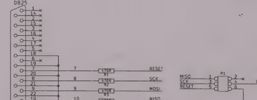

> 图 5.3：AVR 并行口编程器

要在面包板上构建此电路，你需要一个 25 针母 D 型连接器和一个多芯电缆。多芯电缆需要足够长以便从 PC 的并行口连接到面包板，但尽量保持电缆越短越好。

## 5.2.3 串口 AVR 编程器

将电缆上的一根线焊接到连接器的第 7 到 10 号引脚。可以使用单根线作为第 25 号引脚的地，不需要使用从 18 到 25 号的所有地线，尽管你可以在 25 针 D 连接器上将它们连接在一起。在电缆的另一端，将每根线连接到面包板，并如图所示添加电阻。现在可以将电阻器连接到图 5.2 测试电路的相应引脚，并将地引脚连接到测试电路的连接处。

## 测试编程器并为 AVR 编程

将图 5.3 所示编程器插入 PC 的并行口并连接到图 5.2 电路，我们可以运行 `avrdude` 来测试编程器并将程序加载到 AVR。

开启测试电路电源，然后启动终端窗口并输入以下：

```
sudo avrdude -c bsd -p t2313 -P /dev/parport0
```

在提示密码时输入你的登录密码。如果电路接线成功，`avrdude` 将报告 AVR 已初始化并读回设备签名。如果你的 PC 上的并行口名称不是 `par0`，`avrdude` 将报告无法打开。如果电路未供电，`avrdude` 将报告设备无响应。

我们的下一步是将程序加载到 AVR 中。要加载之前提到的 `blink` 程序，启动终端窗口并切换到包含 `blink.hex` 文件的目录。现在输入以下内容：

```
sudo avrdude -p t2313 -c bsd -P /dev/parport0 -e -U flash:w:blink.hex
```

这将擦除、编程并验证 AVR。编程完成后，你将将编程器的 `RESET` 线从 AVR 的第 1 号引脚拔掉，以使其退出复位状态并看到 LED 闪烁。

## 5.2.3 串口 AVR 编程器

图 5.4 显示了一个通过 9 针串口连接 PC 的简单 AVR 编程器。这种设计在互联网上的几个网站上都有，并且易于构建。

严格来说，这个编程器实际上不应该工作。这是因为串口上的 RS-232 电平逻辑高电平为 +3V 到 +15V，逻辑低电平为 -3V 到 -15V。我构建了这个电路并在我的 PC 上进行了测试，它是可以工作的，但不能保证在每台 PC 上都能工作。它能工作是因为 PC 串口没有严格遵守 RS-232 电平标准，并将 0V 识别为低电平。

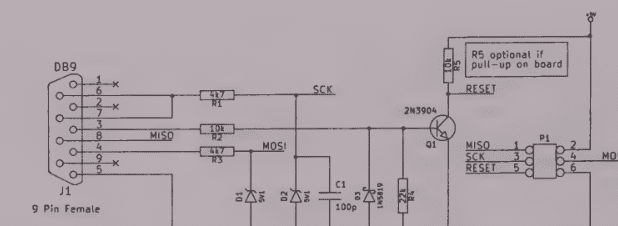

图 5.4：AVR 简单串口编程器

**图 5.5** 显示了一个更好的串口编程器，它使用线路驱动/接收 IC 将串口信号转换为适当的 RS-232 电平。如果你发现**图 5.4** 中的编程器在你的 PC 上无法工作，就可以制作这种编程器。

在**图 5.5** 的电路图中，`U2` 是一个 `MAX232`，并在 5V 下运行。该 IC 通过 ISP Header 从被编程的电路获取电源，因此图中所示的编程器只能用于为 5V 供电的 AVR 编程。

为了能够使用此电路为 3V 到 5V 供电的 AVR 编程，可以使用 `MAX3232` 替换 `MAX232`。`U1` 需要为 `74HC24`。为了能够使用此电路为 3V 到 5V 供电的 AVR 编程，可以使用 `MAX3232` 替换 `MAX232`。`U1` 需要为 `74HC...`。


## 5.2.4 USB AVR 编程器

速度和工作电压标题后的后续细节涉及到对工作电压低于 `3.3V` 的目标电路进行编程时遇到的问题。如果你永远不会使用图 5.6 中的编程器来对运行电压远低于 `3.3V` 的目标，那么可以直接无需任何修改对其进行构建。只需注意，编程器中使用的 `ATtiny213` 型号为 `ATtiny2313-20PU`。

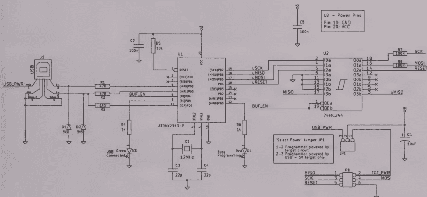

图 5.6：用于 AVR 微控制器的 USB ISP

### ATTINY2313 速度等级

`ATTINY2313` 在 `USBISP` 中通过 `12MHz` 晶振工作。`ATTINY2313` 数据表中提供了关于速度等级的光信息：

- `ATtiny2313V`: `0 – 4 MHz @ 1.8 - 5.5V`, `0 – 10 MHz @ 2.7 – 5.5V`
- `ATtiny2313`: `0 – 10 MHz @ 2.7 - 5.5V`, `0 – 20 MHz @ 4.5 – 5.5V`

因此，要在 `12MHz` 下运行 `ATTINY2313`，必须使用 `ATtiny2313` 而不是 `ATtiny2313V`，此外，它必须由 `5V` 供电以便以全速运行。工作高达 `20MHz` 的 DIP 封装 `ATTINY2313` 的完整型号为：`ATtiny2313-20PU`。

图 5.7 的图表取自 `ATtiny2313` 数据表并经过修改，显示了在 `3.3V` 供电时 `ATtiny2313` 可运行的最大频率。

## 第 5 章 AVR 8 位微控制器

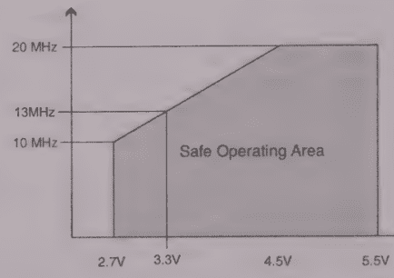

图 5.7：`ATtiny2313` 最大频率与 `Vcc` 的关系图

此的意义在于展示图 5.6 中的编程器可以供电并用于编程运行在 `3.3V` 到 `5V` 之间的目标。在 `3.3V` 供电时，`ATtiny2313` 可以运行高达 `13MHz`，因此在 `12MHz` 下运行留有了安全余量。

### USBtinyISP 工作电压

图 5.6 中的 `JP1` 可以通过跳线短接 `JP1` 引脚 `2` 和 `3` 使用 USB `5V` get 为编程器供电，在这种情况下目标必须由外部 `5V` 供电。使用此跳线配置的唯一由于是为了测试 Linux 是否能看到编程器，而无需将其连接到电路中即可上电。

当 `JP1` 用跳线短接引脚 `1` 和 `2` 之间时，编程器由目标电源供电。在这种情况下，目标的电压可以在 `3.3V` 到 `5V` 之间，允许 `ATtiny2313` 如前所述地在 `12MHz` 下运行。

这是原始版 `USBtinyISP` 与图 5.6 版本之间的另一个区别。原始版本始终由 `5V` 为 `ATtiny2313` 供电，只有缓冲 IC `74HC125` 由目标电路供电。这使得编程器能够编程运行在 `2V` 到 `6V` 之间的目标。如果此编程器上的跳线被短接，它将通过 USB `5V` 驱动缓冲器并从 `5V` 为目标供电。

很容易修改图 5.6 的电路，从目标电源为缓冲芯片 `74HC244`（图中的 `U2`）供电，并仅从 USB `5V` 为 `ATtiny2133` 供电。在这种情况下，必须使用 `AHC244` 代替 `74HC244`，因为 `HC` 部分仅接受 `0` 到 `Vcc` 之间的逻辑输入电压，而 `AHC` 部分即使在 `Vcc` 仅为 `2V` 时也能接受 `0` 到 `5.5V` 之间的逻辑电压。

## 5.2.4 USB AVR 编程器

然而，使用由 `5V` 供电的 `ATiny2133` 以及由低 `2V` 供电的缓冲芯片和目标电路，如果通过缓冲芯片从目标电路接收逻辑高电平，则会有 `2V` 应用到由 `5V` 供电的 `ATtiny2133`。根据 `ATtiny2133` 数据表，当 `ATtiny2133` 由 `5V` 供电时，它将输入引脚上的高电平识别为 `0.6 x Vcc`。这将是 `0.6 x 5V`。因此，按描述修改此电路并没有太大意义。要在小于 `3V` 供电的目标电路上运行，编程器的缓冲级需要重新设计，以提供高电压供 AVR 读取。

### USBtinyISP 零件列表

| 数量 | 数值 | 设计标识符 | 描述 |
|---|---|---|---|

| 电阻 | | | |
| 2 | 47 | `R1`, `R2` | ¼W 5% 电阻 |
| 2 | 100 | `R7`, `R8` | ¼W 5% 电阻 |
| 2 | 1k | `R4`, `R6` | ¼W 5% 电阻 |
| 1 | 1k | `R3` | ¼W 5% 电阻 |
| 1 | 10k | `R5` | ¼W 5% 电阻 |

| 电容 | | | |
| 2 | 22p | `C3`, `C4` | 陶瓷电容 |
| 2 | 100n | `C2`, `C5` | X7R 电容 |
| 1 | 10µF | `C1` | 电解电容 |

| 半导体 | | | |
| 2 | 3V | `D1`, `D2` | 稳二极管，3.3V |
| 1 | 5mm | `D3` | 直插 LED |
| 1 | 5mm | `D4` | 直插 LED |
| 1 | `ATtiny2313-20PU` | `U1` | 20脚 DIP封装 AVR 微控制器 |
| 1 | `74HC244` | `U2` | 八路缓冲器/驱动器 |

| IC 插座 | | | |
| 1 | 20 DIP | | 用于 AVR 微控制器的 20 DIP 插座 |

| 晶振 | | | |
| 1 | 12MHz | `X1` | 薄型直插晶振 |

| 连接器 | | | |
| 1 | USB B 接口 | `J1` | USB B 类型或留空并焊接 USB 线 |
| 1 | 3 脚插头 | `JP1` | 3 脚插头，2.54mm 针和跳线 |
| 1 | 3x2 脚插头 | `P1` | 3x2 脚插头，2.54mm 间距针 |

| 线缆 | | | |
| 2 | 3x2 IDC 母头 | | |
| 1 | (200mm) 6 排线 | | 用于连接编程器到电路的 6 排线 |

## 第 5 章 AVR 8 位微控制器

### 构建和编程 USBtinyISP

构建图 5.6 中的编程器非常简单。使用 20 脚插座用于 `ATiny2313`，以便可以从电路中取出并重新编程。需要一根 6 排线和两个 3×2 IDC 连接器来将编程器上的 ICSP 头连接到目标板子上的 ICSP 头。图 5.8 显示了一个完全组配好的 USB ISP。

一旦板子组配完毕，编程器中的 `ATtiny2313` 需要加载固件。要加载的十六进制文件可以在 `USBtinyISP/main.hex` 中找到。

将 `ATtiny2313` 连接到面包板，并在本章前面的介绍中使用串口或并行编程器对其编程。使用图 5.2 作为参考为其供电并连接串口或并行编程器。你可能还会添加图中所示的 LED 并运行闪烁程序来测试 LED 测试编程器连接是否正确。向面包板上的 `ATtiny2313` 加载 `USBtinyISP` 固件，首先打开终端窗口并切换到包含十六进制固文件的目录。

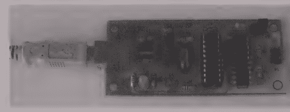

图 5.8：组配好的 USB ISP

输入以下命令为 `ATtiny2313` 加载固件：

并行端口编程器：

```
sudo avrdude -p t2313 -c bsd -P /dev/parport0 -e -U flash:w:main.hex
```

串口编程器：

```
sudo avrdude -p t2313 -c usupe -P /dev/ttyS0 -e -U flash:w:main.hex
```

## 5.2.4 USB AVR 编程器

如果你有 `AVRISPII`：

```
sudo avrdude -p t2313 -c usupe -P usb -e -U flash:w:main.hex
```

需要编程 `ATiny2313` 的熔丝使其从外部晶振而非内部 R/C 振荡器运行，因此终端窗口中输入：

并行端口编程器：

```
sudo avrdude -p t2313 -c bsd -P /dev/parport0 -U hfuse:w:0xdf:m -U lfuse:w:0xef:m
```

串口编程器：

```
sudo avrdude -p t2313 -c usupe -P /dev/ttyS0 -U hfuse:w:0xdf:m -U lfuse:w:0xef:m
```

如果你有 `AVRISPII`：

```
sudo avrdude -p t2313 -c usupe -P usb -U hfuse:w:0xdf:m - lfuse:w:0xef:m
```

现在你可以从面包板上拔掉 `ATiny2313` 并将其插入 `USBtinyISP` 板子上的 20 脚插座中。

### 测试 USBtinyISP

设置图 5.2 中的测试电路并将 `USBtinyISP` 连接到其上——你需要一个备用的 `ATiny2313` 来再次构建此电路。使用外部电源为测试电路供电，确保 `JP1` 引脚 `1` 和 `2` 已用跳线短接。


我们将进行的第一个测试是查看 PC 是否识别 USBtinyISP 为 USB 设备。将 USBtinyISP 插入 PC 的 USB 端口。如果 `JP1` 引脚 1 和 2 短接，则需要目标电路为 USBtinyISP 供电。当 USBtinyISP 上电并连接到 USB 端口时，USB LED 应该亮起。启动终端窗口并输入：

```
dmesg | tail
```

## 第 5 章. AVR 8 位微控制器

此处应显示一条类似于下面的内容的消息：

Bus 005 Device 007: ID 1781:0c9f Multiple Vendors USBtiny

这显示 VID 为 1781，PID 为 0c9f。

将 USBtinyISP 连接到 USB 端口和目标电路后，可以进行接下来两项测试。

要测试编程器是否工作正常并正确连接到目标电路，请在终端窗口中输入以下内容：

```bash
sudo avrdude -c usbtiny -p t2313
```

我们将其中一个测试程序 `blink.hex` 或 `blink2.hex` 加载到目标 AVR。启动终端窗口并切换到包含十六进制程序的目录。输入以下命令程序目标 AVR：

```bash
sudo avrdude -p t2313 -c usbtiny -e -U flash:w:blink.hex
```

### 5.2.5 Atmel AVRISP mkII USB 编程器

来自 Atmel 的标准 AVR 编程器是图 5.9 所示的 AVRISP mkII。该设备的订购代码为 `ATAVISP2`，在网上查询价格时可以使用该代码。

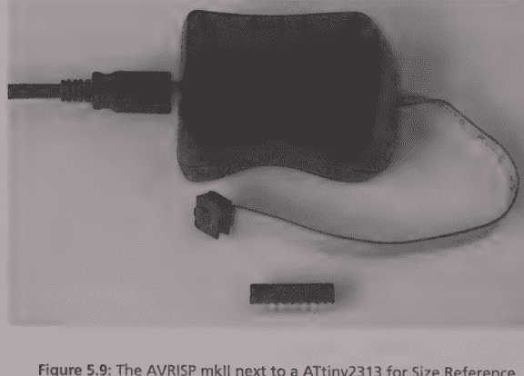

### 5.2.6 Atmel AVR Dragon

该编程器可用于所有带有 ISP 接口的 8 位 AVR。它支持 1.8V 到 5.5V 的目标电压，并由 USB 供电。

要用我们图 5.2 所示的测试电路测试 AVRISP mkII，请将编程器插入 PC 的一个 USB 端口，并将绿色 6 针接头连接到测试电路。当编程器连接到 USB 端口时，编程器上 USB 接口附近的绿色 LED 将亮起。当目标电源开启时，编程器上 6 针排线电附近的绿色 LED 将随之亮起。打开终端窗口并输入：

```bash
sudo avrdude -c avrispmkII -p t2313 -p USB
```

如果编程器正确连接到目标设备，电路 AVR 设备将初始化并读回设备签名。当编程器读取 AVR 时，6 针排线附近的 LED 将闪烁红光，然后变回绿色。

使用 AVRISP mkII 编程 AVR，请打开终端窗口并切换到包含十六进制测试程序的目录。在终端窗口中输入以下内容：

```bash
sudo avrdude -p t2313 -c avrispmkII -p USB -e -U flash:w:blink.hex
```

提高 AVRISP mkII 的访问/编程速度

AVRISP mkII 的初始速度相对较慢，因此你可能注意到它的编程速度比一个自制的编程器慢。为了加快速度，请在 `avrdude` 中使用 `-B` 关。现在从 AVR 读取设备签名并对其编程的命令变为：

```bash
sudo avrdude -c avrispmkII -p t2313 -p USB -B 3.0
sudo avrdude -p t2313 -c avrispmkII -p USB -e -U flash:w:blink.hex -B 3.0
```

### 5.2.6 Atmel AVR Dragon

AVR Dragon 看起来更像一个评估板而非编程器，如图 5.10 所示。它具有多种编程和调试功能。在本节中，我们仅用它进行系统内编程。AVR Dragon 以如图所示的盒子出售，不包含连接到目标板的 USB 线或排线。对于片内编程，你需要一根标准的 USB 线和一根两端带有 IDC 3 × 2 母头连接器的 6 针排线。

AVR Dragon 是一种成本较低的设备。AVR Dragon 的订购代码为 `ATAVDRAGON`，在网上购物价格时可以使用该代码。

网站：www.atmel.com/AVRDRAGON

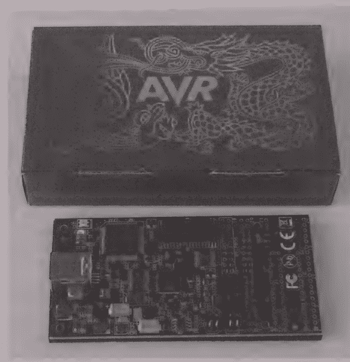

图 5.10：AVR Dragon

Atmel 网站未提供 AVR Dragon 的 PDF 格式文档。它是 Windows AVR 编程环境 AVR Studio 中的 chm 帮助文件。为了方便起见，该文件已包含在附文件中，可以在此处找到：`CH05/AVRDragon.chm`

在 Linux Mint 中读取 chm 文件，你需要从软件管理器安装阅读器，搜索“chm”，例如 ChmSee。

使用 AVR Dragon 进行系统内编程

使用 USB 线将 AVR Dragon 连接到 PC，使用 6 针排线（两端带有 IDC 3 × 2 母头连接器）连接到目标板。当 AVR Dragon 连接到 USB 端口时，其丝印上的 ISP LED 将亮起。

### 5.2.7 关于 avrdude 的更多信息

要从 AVR 读取设备签名，打开终端窗口并输入：

```bash
sudo avrdude -c dragonisp -p t2313
```

要使用 AVR Dragon Dragon 编程 AVR，打开终端窗口并切换到包含十六进制测试程序的目录。在终端窗口中输入：

```bash
sudo avrdude -p t2313 -c dragonisp -p USB -e -U flash:w:blink.hex
```

AVR Dragon 尝试与测试电路通信的速度过快。使用 `-B 3.0` 选项可以降低速度。如果仍然存在问题，尝试将 `3.0` 增加到更高值。

无需 sudo 命令使用 avrdude

到目前为止，我们每次对 AVR 微控制器进行编程都需要通过使用 `sudo` 命令获取 root 权限。第一次使用该命令时需要输入密码。你可以设置 Linux 以无需 root 权限。

## 5.3 AVR 电路

在本节中，我们将介绍一些电路，以便与开头提到的 AVR 设备进行开发。提供了简单的 C 程序，包含输入输出示例。所有这些 AVR 都有内部振荡器，因此在精确计时不需要连接外部电路。

示例程序可以在附文件 `CH5/AVR_progs` 中找到。每个示例文件夹包含一个源码文件以及一个 `build` 和 `prog` 文件。`build` 文件是一个脚本文件，需要标记为可执行并运行以构建项目输出用于编程 AVR 的 hex 文件。`prog` 文件也是一个脚本文件，需要标记为可执行并运行以编程 AVR。此文件已设置为使用 USBisp 并包含了 `sudo` 命令，如果你将 Linux PC 设置为无需 `sudo` 命令的情况下操作编程器，请对其修改（即从文件中删除 `sudo` 命令）。如果你使用 USBisp 以外的编程器，也对其进行修改。

### 使用脚本文件

提醒一下——要将脚本文件标记为可执行，右键点击它并从弹出菜单中选择“属性”。在属性对话框中，点击“权限”选项卡。勾选“允许执行文件作为程序”，然后关闭对话框。或者在终端窗口中使用此命令：`chmod +x <filename>`

现在该文件可以通过双击它并点击弹出对话框中的“运行”来运行。在终端窗口中当切换到包含脚本文件的目录时，可以通过输入 `./<文件名>` 来运行它们，例如 `./build`

### 5.3.1 ATtiny2313

### 快速信息

- Flash 大小：2 KB，系统内可编程
- SRAM 大小：128 Bytes
- EEPROM 大小：128 Bytes
- 外部外设：4 × PWM, 1 × 模拟比较器, 1 × USART, 1 × USI（可配置为 TWI 或 SPI）
- 片内调试：debugWire
- 最大 I/O 引脚：18
- 工作电压：2.7V 至 5.5V
- 每个引脚电流：>10 mA 源电流或灌电流，但每个端口不得超过 60mA。


PWM 通道输出：

- `OC0A`
- `OC1A`
- `OC0B`
- `OC1B`

图 5.11：ATtiny2313 引脚图和面包板电路

## 第 5 章. AVR 8 位微控制器

### 示例程序

`CH05/AVR_progs/ATtiny2313_blink/`

闪烁图 5.11 中的 LED。

`CH05/AVR_progs/ATtiny2313_IO/`

读取引脚 `PD6` 上的开关并将开关状态写入图 5.11 电路中引脚 `PB0` 上的 LED 上。当开关关闭时，LED 将点亮。

### 5.3.2 ATtiny48

### 快速信息

- Flash 大小：4k Bytes，系统内可编程
- SRAM 大小：256 Bytes
- EEPROM 大小：64 Bytes
- 外部外设：6 通道 10 位 ADC, SPI, TWI, 模拟比较器


- 片内调试：`debugWire`
- 最大 I/O 引脚：24
- 工作电压：1.8V 至 5.5V
- 引脚电流：>10mA 源电流或灌电流；但源电流/灌电流不能超过：A0, A3, B0-B7, C7, D5–D7 的 100mA，或者 A1–A2, C0–C6, D0–D4 总共超过 100mA。


图 5.12：ATtiny48 引脚图和面包板电路

### 示例程序

`CH05/AVR_progs/ATtiny48_blink/`

闪烁图 5.12 中的 LED。

`CH05/AVR_progs/ATtiny48_IO/`

读取引脚 PB1 上的开关并将结果写入图 5.12 电路中引脚 PB2 上的 LED 上。当开关关闭时，LED 将点亮。

### 使用 avrdude 5.11.1 编程 ATtiny48 的特殊说明

`avrdude` 5.11.1 版本不支持 ATtiny48 微控制器，但 `avrdude` 支持的所有微控制器都在 `/etc/` 下的 `avrdude.conf` 文件中。该配置文件可以修改以添加对 ATtiny48 的支持，但 `avrdude` 还会查看用户主目录下的另一个配置 `.avruderc`，该文件默认不创建。为了用 `avrdude` 编程 ATtiny48，最简单的方法是将随附文件中的拷贝到你的主目录中，如下所示：

在随附文件中找到配置文件：

`CH05/avrdude/avruderc`

将 `.avruderc` 文件复制到你的主目录并将其重命名为 `.avruderc`（只需在文件名前加一个点），这将使其成为一个隐藏文件。当下次运行 `avrdude` 时，它应该能识别 ATtiny48。

### 5.3.3 ATtiny25

#### 快速信息

- Flash 大小：2k Bytes，系统内可编程
- RAM 大小：128 Bytes
- 外部外设：2 × PWM 通道, 2 × 高速 PWM 通道, USI（可配置为 SPI 或 TWI），10 位 ADC（可配置为 4 个差分通道）
- 片内调试：`debugWire`
- 最大 I/O 引脚：6
- 工作电压：2.7V 至 5.5V
- 每个引脚电流：>10mA 源电流或灌电流；但每个端口不得超过 60mA。

## 第 5 章. AVR 8 位微控制器


PWM 通道：
- OC1A
- OC1B

高频 PWM 输出：
- OC0A
- OC0B

图 5.13：ATtiny25 引脚图和面包板电路

### 示例程序

`CH05/AVR_progs/ATtiny25_blink/`

闪烁图 5.13 中的 LED。

`CH05/AVR_progs/ATtiny25_IO/`

读取引脚 PB3 上的开关并将结果写入 5.13 电路中引脚 PB4 上的 LED 上。当开关关闭时，LED 将点亮。

### 5.3.4 ATmega8

#### 快速信息

- Flash 大小：8k Bytes，系统内可编程
- SRAM 大小：1k Bytes
- EEPROM 大小：512 Bytes
- 外部外设：6 × 10 位 ADC 通道，模拟比较器, TWI, SPI
- 片内调试：无
- 最大 I/O 引脚：23
- 工作电压：4.5V 至 5.5V（ATmega8L 为 2.7V 至 5.5V）
- 每个引脚电流：>20mA 源电流或灌电流；但所有端口同时不能超过 300mA，C0 到 C5 以及 B0–B7, C6, D0–D7 的 100mA。


图 5.14：ATmega8 引脚图和面包板电路

## 第 5 章. AVR 8 位微控制器

### 示例程序

`CH05/AVR_progs/ATmega8_blink/`

闪烁图 5.14 中的 LED。

`CH05/AVR_progs/ATmega8_IO/`

读取引脚 PB1 上的开关并将结果写入 5.14 电路中引脚 PB2 上的 LED。当开关关闭时，LED 将点亮。

### 5.3.5 ATmega16

#### 快速信息

- Flash 大小：16k Bytes，系统内可编程
- SRAM 大小：1k Byte
- EEPROM 大小：512 Bytes
- 外部外设：4 × PWM 通道, 8 × 10 位 ADC 通道, TWI, USART, 以及模拟比较器
- 片内调试：JTAG
- 最大 I/O 引脚：32
- 工作电压：4.5V 至 5.5V（ATmega16L 为 2.7V 至 5.5V）
- 每个引脚电流：>20mA 源电流或灌电流；但所有端口同时不能超过 200mA，A0 到 A7 的 100mA，以及 B0–B7, C0–C7, D0–D7, XTAL2 的 100mA。


图 5.15：ATmega16 引脚图和面包板电路

### 示例程序

`CH05/AVR_progs/ATmega16_blink/`

闪烁图 5.15 中的 LED。

`CH05/AVR_progs/ATmega16_IO/`

读取引脚 PD7 上的开关并将结果写入 5.15 电路中引脚 PC0 上的 LED 上。当开关关闭时，LED 将点亮。

### 5.3.6 ATmega48PA

ATmega48PA 与 Arduino 板上使用的 ATmega328 微控制器非常相似。这两个微控制器主要区别在内存大小。

## 第 5 章. AVR 8 位微控制器

#### 快速信息

- Flash 大小：4k
- SRAM 大小：512 Bytes
- EEPROM 大小：256 Bytes
- 外部外设：6 × PWM 通道, 6 × 10 位 ADC 通道, TWI, USART, SPI, 模拟比较器
- 片内调试：`debugWire`
- 最大 I/O 引脚：23
- 工作电压：1.8V 至 5.5V
- 每个引脚电流：>20mA 源电流或灌电流；但源电流不能超过 150mA（C0 到 C5 以及 B0–B7, C6, D0–D7 的 100mA），灌电流不能超过 100mA。


图 5.16：ATmega48PA 引脚图和面包板电路

## 5.4.1 AVR Dragon

### 示例程序

`CH05/AVR_progs/ATmega48_blink/`

闪烁图 5.16 中的 LED。

`CH05/AVR_progs/ATmega48_IO/`

读取引脚 PB1 上的开关并将结果写入 5.16 电路中引脚 PB2 上的 LED 上。当开关关闭时，LED 将点亮。

### 使用 avrdude 5.11.1 编程 ATtiny48 的特殊说明

`avrdude` 5.11.1 版本不支持 ATtiny48 微控制器，但 `avrdude` 支持的所有微控制器都在 `/etc/` 下的 `avrdude.conf` 文件中。该配置文件可以修改以添加对 ATtiny48 的支持，但 `avrdude` 还会查看用户主目录下的另一个配置 `.avruderc`，该文件默认不创建。为了用 `avrdude` 编程 ATtiny48，最简单的方法是将随附文件中的拷贝到你的主目录中，如下所示：

在随附文件中找到配置文件：

`CH05/avrdude/avruderc`

将 `.avruderc` 文件复制到你的主目录并将其重命名为 `.avruderc`（只需在文件名前加一个点），这将使其成为一个隐藏文件。当下次运行 `avrdude` 时，它应该能识别 ATtiny48。

## 5.4 debugWire/JTAG 工具

为了实现单步调试，可以使用 AVR Dragon 或 AVR JTAG mkII。

## 5.4.1 AVR Dragon

AVR Dragon 上的 6 引脚 ISP 插头用于系统内编程，同时也作为 `debugWire` 接口。标记为“JTAG”的独立 10 引脚（2 × 5）头部用于连接具有 JTAG 接口的微控制器。如果需要 JTAG 调试，你需要制作带有母 IDC 2 × 5 连接器的排线，以便将 Dragon 连接到目标板。

## 5.4.2 AVR JTAGICE mkII

AVR JTAGICE mkII（图 5.17）是一款功能全 JTAG ICE，带有各种适配器，可通过 ISP、`debugWire` 和 JTAG 连接到目标 AVR 板。AVR JTAGICE 比 Dragon 贵，但它具有更多功能，并附带线缆（USB、RS-232 和外部电源）以及适配器（如图所示）。

AVR JTAGICE 的订单代码为：`ATJTAGICE2`，可以在互联网上搜索价格时使用。

## 5.4.3 调试软件

调试所需的软件包含以下程序：


- `avalice` - 将调试硬件连接到 GNU 调试器 (`gdb`)
- `avr-gdb` - 用于 AVR 的 GNU 调试器。
- `nemiver` - Nemiver，一个 `gdb` 的调试器 GUI。

要安装软件，请启动 Linux Mint 软件管理器并搜索安装 `avarice` 和 `nemiver`。安装 `avarice` 后，`avr-gdb` 也会被自动安装。

要进行调试，必须将 AVR Dragon 或 JTAGICE mkII 连接到目标电路上。接下来，必须启动 `avarice`，然后启动 Nemiver，后者将通过 `avr-gdb` 连接到 `avarice`。下文描述了通过 debugWIRE 和 JTAG 接口设置调试所需的步骤。

## 5.4.4 debugWIRE

使用图 5.11 所示的电路以及 `CH05/avr_progs/dbg_attiny2313/` 随附文件中的程序进行 debugWIRE 调试。

在使用 debugWIRE 之前，必须对目标 AVR 编程 DWEN 熔丝。这是通过 ISP 接口完成的，并且一旦编程完成就会禁用 ISP 接口。要再次启用 ISP 接口（禁用 debugWIRE），必须使用 debugWIRE 接口或高压编程。

如图 5.11 所示，将 JTAGICE mkII 或 AVR Dragon 连接到 ISP 针脚，并插入 PC 的空闲 USB 端口。开启电路电源。

### 启用 debugWIRE 接口

此只需操作一次，并在调试完成后可以再次禁用，因此我们在这里编程的熔丝可以在开发/调试期间保持编程状态。启动终端窗口并输入：

#### 使用 JTAGICE mkII

```
sudo avrdude -c jtag2isp -P usb -p t2313 -U hfuse:w:0x5f:m
```

#### 使用 AVR Dragon

```
sudo avrdude -c dragon_isp -P usb -p t2313 -U hfuse:w:0x5f:m
```

## 第 5 章. AVR 8 位微控制器

在继续之前请为 AVR 循环电源（关闭电源后再重新打开）。

### 编译程序

启动终端窗口并切换到包含示例编译程序的目录。输入以下内容编译程序：

```
avr-gcc -g -00 --Wall -mcall-prologues --mmcu=attiny2313 blink.c -o link.out
```

### 启动 avrice

启动终端窗口，切换到要调试程序的目录并输入：

使用 JTAGICE mkII

```
avrice --erase --program --file erase.out --part attiny2313 --jtag usb:4242 --debugwire
```

#### 使用 AVR Dragon

```
avr-erase --program --file blink.out --part attiny2313 --dragon --jtag usb:4242 --debugwire
```

这将导致带有程序的 AVR 进入调试状态，然后等待来自 `avr-gdb` 的连接。运行此行命令后，`avrice` 显示的最后两行应该是：

Download complete.

Waiting for connection on port 4242.

### 启动 Nemiver

启动一个新的终端窗口，切换到要调试程序的目录并输入以下内容启动 Nemiver：

```
nemiver --gdb-binary=/usr/bin/avr-gdb --remote=localhost:4242 blink.out
```

当 Nemiver 启动时，关闭弹出的两个对话框。

### 加载 C 源文件

在 Nemiver 中，点击 File -> Open Source File ...。在“打开源文件”对话框中，找到并选择图 5.18 所示的 `tblink.c` 源文件。点击对话框中的 OK 按钮。

现在转到 5.4.6 节调试程序，并在调试完成后阅读下方内容将 AVR 从 debugWire 模式切回 ISP 模式。

## 5.4.4 debugWIRE


图 18：在 Nemiver 中打开文件

### 从 debugWire 模式切回 ISP 模式

要切回 ISP 模式，必须将 DWEN 熔丝设回 1（之前的编程将其设置为 0）。启动终端窗口并输入：

使用 JTAGICE mkII

```
sudo avrdude -c jtag2isp -P usb -p t2313
在忽略错误消息的情况下关闭电源
sudo avrdude -c jtag2isp -P usb -p t2313 -U hfuse:w:0x5f:m
```

#### 使用 AVR Dragon

```
sudo avrdude -c dragon_isp -P usb -p t2313
在忽略错误消息的情况下关闭电源
sudo avrdude -c dragon_isp -P usb -p t2313 -U hfuse:w:0x5f:m
```

如果上述命令有问题，在终端窗口中按 `Ctrl + C` 终止命令。接下来关闭电源，将 Dragon 或 JTAGICE 插回 USB 端口并重新开启电源。再次尝试上述命令。

## 第 5 章 AVR 8 位微控制器

## 5.4.5 JTAG

JTAG 接口可用于编程和调试 AVR。使用图 5.15 的电路以及 `CH05_progs/dbg_atmega16_blink/` 随附文件中的程序作为 JTAG 示例，但必须将带有 5 × 2 IDC 适配器的排排线连接到 Dragon 板板上标记为“JTAG”的插头。使用 JTAGICE mkII 上的 10 位插座作为 JTAG 连接器。

图 5.15 显示了到 ATmega16 的 ISP 连接，但我们需要使用 JTAG 连接。它们从 ATmega16 到 10 位 JTAG 插脚的映射所示：

| JTAG 引脚 | ATmega16 引脚 |
| :--- | :--- |
| TCK | 1 |
| TDO | 2 |
| TMS | 3 |
| TDI | 4 |
| VCC | 5 |
| GND | 6 |
| RESET | 7 |
| MOSI | 8 |
| MISO | 9 |
| SCK | 10 |

## 5.4.6 调试

启动终端窗口并切换到包含示例程序的目录。输入以下内容编译程序（注意：重复上一节内容）：

### 启动 avrice

启动终端窗口，切换到要调试程序的目录并输入：

使用 JTAGICE mkII

```
avrice --erase --program --file erase.out --part attiny2313 --jtag usb:4242 --debugwire
```

#### 使用 AVR Dragon

```
avr-erase --program --file blink.out --part attiny2313 --dragon --jtag usb:4242 --debugwire
```

这将导致带有程序的 AVR 进入调试状态，然后等待来自 `avr-gdb` 的连接。运行此行命令后，`avrice` 显示的最后两行应该是：

Download complete.

Waiting for connection on port 4242.

### 启动 Nemiver

启动一个新的终端窗口，切换到要调试程序的目录并输入以下内容启动 Nemiver：

```
nemiver --gdb-binary=/usr/bin/avr-gdb --remote=localhost:4242 blink.out
```

当 Nemiver 启动时，关闭弹出的两个对话框。

### 加载 C 源文件

在 Nemiver 中，点击 File -> Open Source File ...。在“打开源文件”对话框中，找到并选择图 5.18 所示的 `tblink.c` 源文件。点击对话框中的 OK 按钮。

在 Nemiver 中，你现在准备好调试程序了。阅读时请参考图 5.19。在 Nemiver 中，开始点击 `main()` 中第一行代码的左侧以添加断点，或者点击该行然后选择 Debug -> Set Breakpoint。该行左侧将出现红色断点图标，显示已设置断点。

点击工具栏上的 **Continue** 按钮使程序启动。它将停在你插入的断点处。现在点击 **Next** 按钮（Continue 的右侧）跳转到下一行代码。你可以点击它来移除断点。继续点击 Next 按钮逐行执行代码。当你跳过运行到 LED 连接的端口的代码行时，LED 将切换开关状态。


在 `Delay()` 函数中 `del--;` 旁边插入一个断点，然后点击 `Continue` 运行到此行。将光标悬停在 `del` 变量上，将弹出一个显示该变量值的框。多次点击 `Next` 按钮步进循环。悬停在值上，可以看到它每循环减少 1。通过点击它移除 `Delay()` 函数中的断点。

要以正常速度运行程序，点击 `Continue` 按钮。要重新开始调试，点击 `Stop` 按钮。点击 `Stop` 按钮后，当前的执行行可能在 `Delay()` 函数中。要继续在 `main()` 内部的 `while(1)` 循环中执行，在循环中切换 LED 的代码行之一旁边插入断点，然后点击 `Continue`。

欲了解更多调试功能，请参阅 Nemiver 文档：`developer.gnome.org/nemiver/unstable/nemiver-sect.html.en`。


图 5.19：在 Nemiver 中插入断点

## 5.4.7 自动化调试设置

自动化调试过程的文件可以在 `dbg_ATmega16_blink` 和 `dbg_attiny2313` 中找到。

在 `dbg_ATmega16_blink` 中：

要构建项目，请运行构建脚本，它将从 `blink.c` 生成 `blink.out`。

名为 `connect` 的可执行脚本将启动 avarice 并连接到 AVR Dragon —— 如果在使用 AVR JTAGICE，或者正在调试名为非 `blink.out` 的程序，或者正在使用 dbWIRE 接口而不是 JTAG 接口，则您需要修改此文件。

名为 `debug` 的可执行脚本将启动 Nemver 并连接到 av-gdb。如果您要调试名为非 `blink.out` 的程序，请修改此文件。

确保这两个脚本（`connect` 和 `debug`）已标记为可执行。双击 `connect` 并在弹出的对话框中选择“在终端中运行”（Run in Terminal）。双击 `debug` 并在弹出的对话框中点击“运行”（Run）。现在您可以开始调试了。

在 `dbg_attiny2313` 中：

此文件夹中的脚本已配置为在 Attiny2313 上使用 debugWIRE 模式的 AVR Dragon，因此它们尚未可执行，则需要设置为可执行。它们具有以下功能：

- `enter_dbw` – 进入 debugWIRE
- `build` – 构建 blink 程序并生成 `blink.out` 文件
- `exit_dbw` – 退出 debugWIRE 模式
- `connect` – 编写程序并连接到 AVR avarice
- `debug` – 启动调试器，打开 blink 程序并连接到 avarice

双击您想要运行的脚本并在弹出的对话框中点击“在终端中运行”按钮。如果您想查看脚本可能产生的消息，请从命令行运行它 —— 例如运行 `./build` 以查看编译源文件时是否有错误。

最好在运行 `enter_dbw` 和 `exit_dbw` 脚本之前，关闭电路电源并将 Dragon 或 JTAGICE 从 USB 端口拔掉，然后重新插入 Dragon 或 JTAGICE 并为电路供电。

第 5 章 AVR 8 位微控制器

## 5.5 使用 AVR Dragon 重置 AVR 熔丝

当 AVR 中的熔丝无法使用系统内编程器设置为默认值时，它们需要使用 HV（高压）并行编程进行编程。这可以使用 AVR Dragon 完成。

需要 HV 并行编程示例的情况：如果一个 AVR 被编程为使用外部晶振并进入了您的备件箱，您可能不知道 AVR 熔丝的状态。当 AVR 插入到没有外部晶振的面包板时，如果没有连接正确的晶振值，将无法再次对设备进行编程。当尝试使用系统内编程器连接到 AVR 时，AVR 看起来像烧毁了，但它可能是好的，只需要重置熔丝使其再次从内部 RC 振器运行。

### 5.5.1 连接 AVR

要在 HV 并行编程模式下使用 AVR Dragon，需要从 AVR Dragon 上的 `HV_PROG` 连接器到 AVR 设备。这些连接对于不同的 AVR 设备是不同的，可以在《AVR 用户指南》中找到（`.chm` 文件可以在附带文件 `CH5/AVRDragon.chm` 中）。在 Chm 查看器中查看指南时，可以在“连接 AVR Dragon -> 设备连接表（Device Connection Sheets）”下找到每个芯片的接线图。向下滚动列表并找到您想要重置/编程的设备。确保您找到了“并行编程”连接图（而不是“系统内编程和 debugWIRE 仿真”）。

示例 – 连接 ATiny2133：

图 5.20 显示了从 AVR Dragon 连接器到 ATiny2313 微控制器的并行 HV 连接。该图取自《AVR Dragon 用户指南》。该图显示了 AVR Dragon 上的四个接头和 ATiny2313 的引脚编号。

图显示，除了将 VCC 连接器的引脚 6 连接到 AVR Dragon 上的 ISP 连接器外，所有到 ATiny2313 的连接都来自 `HV_PROG` 连接器。不需要外部电源，设备只需按所示连接即可。电源由 AVR Dragon 从 USB 端口获取。

**图 5.20:** 用于 ATtiny2313 的 AVR Dragon HV 并行连接

| HV_PROG | |
| :--- | :--- |
| S | DEVICE |
| O | |
| O | |
| O N M | |
| H G | |
| D C | |
| B A | |
| ISP | |
| :--- | :--- |
| A N | |
| B M | |
| C | |
| D | |
| JTAG | |
| :--- | :--- |
| Q | |
| G | |
| H S | |
| VCC | |
| :--- | :--- |
| | |

这些连接可以通过将 ATtiny2313 插入面包板，并使用一根由两个 20 针（2x 10）IDC 母连接器和一根 20 路带线制成的缆连接到 AVR Dragon 的 `HV_PROG` 接头上来来实现。然后可以将单芯绝缘线插入 IDC 连接器并连接到面包板上的 ATiny2313。连接 VCC 接头到 ISP 接头的导线连接器可以使用两个跳线和一段电线制成。图 5.20 显示了可以建立的连接。

### 5.5.2 重置熔丝

当 AVR 中的熔丝无法使用系统内编程器设置为默认值时，它们需要使用 HV（高压）并行编程进行编程。这可以使用 AVR Dragon 完成。

第 5 章 AVR 8 位微控制器


# 第 5 章 AVR 8 位微控制器

## 5.5.2 重置熔丝

当 AVR 中的熔丝无法使用系统内编程器设置为默认值时，它们需要使用 HV（高压）并行编程进行编程。这可以使用 AVR Dragon 完成。

# 第 6 章 MSP430 16 位微控制器

## 6.1 16 位 MSP430 概述

MSP430 家族中有超过 200 个设备属于以下类别之一：

### MSP430 1xx 8MHz

- 1k 到 60k 字节 Flash
- 1.8V 到 3.6V 运行
- 14、22 或 48 个 GPIO 引脚
- ADC、模拟比较器、DAC
- LaunchPad 上包含此类类别的 MSP430F1612（贴片封装），用于编程板上的 DIP 插槽用户430

### MSP430 2xx 16MHz

- 1k 到 120k 字节 Flash
- 1.8V 到 3.6V 运行
- 10、16、24、32、48 或 64 个 GPIO 引脚
- ADC、模拟比较器、DAC、温度传感器
- 本章将配合 ZIF 板使用一个 MSP430F2619（贴片封装）

### MSP430 G2xx 16MHz Value型（值型系列）

- 0.5k 到 16k 字节 Flash
- 1.8V 到 3.6V 运行
- 10、16 或 24 个 GPIO 引脚
- ADC、模拟比较器、温度传感器
- LaunchPad 套件带有两个 14 针 DIP MSP430G2xx 用户可编程MCU（MSP430G2231 和 MSP430G2221）

### MSP430 3xx 遗留 8MHz

- 传统 ROM 和 OTP 设备，2k 到 32k 字节 ROM
- 2.5V 到 5.5V 运行
- 14 或 40 个 GPIO 引脚
- LCD 控制器、ADC

## 6.1 16-bit MSP430 概述

- MSP430 4xx 8/16MHz LCD
  - 4k 到 120k 字节 Flash 或 ROM
  - 1.8V 到 3.6V 工作电压
  - 14, 32, 48, 56, 68, 72 和 80 个 GPIO 引
  - LCD 控制器、ADC、模拟比较器、DAC、USCI、温度传感器
  - 本章使用了带有 ZIF 插座板的 A-MSP430F417（四脚平面封装）

- MSP430 5xx/6xx 20/25MHz
  - 8k 到 256k 字节 Flash
  - 1.8V 到 3.6V 工作电压
  - 29, 31, 47, 48, 63, 67, 74 或 87 个 GPIO 引
  - USB、ADC、模拟比较器、DAC、USCI、温度传感器

- MSP430 FRxx 8/24MHz FRAM 系列
  - 4k 到 16k 字节 FRAM，比 Flash 访问速度更快且擦写寿命更好
  - 2V 到 3.6V 工作电压
  - 24, 38 和 40 引脚封装
  - ADC、USCI、RTC、比较器

- MSP430 低电压版
  - 1k 到 2k ROM
  - 0.9V 到 1.65V 工作电压
  - 11 个 GPIO 引
  - ADC、比较器、DAC、温度传感器

- CC430 16-位 RF
  - 8k 到 32k 字节 Flash
  - 1.8V 到 3.6V 工作电压
  - 30 和 44 个 GPIO 引
  - Sub-1GHz RF 收发器、LCD 控制器、ADC、比较器、USCI、RTC、温度传感器
  - 来自 eZ430-Chronos 套件的运动手表包含一个 CC430F6137 微控制器

- MSP430 特定应用型
  - 用于无线功率传输应用的专用设备

注意，并非每个类别中的每个成员都具有列出的外围设备。MSP430 具有外部数据或地址线。

## 6.2 MSP430 编程软件

用于 MSP430 微控制器的 GCC C 编译器可以在软件管理器中找到。用于为 MSP430 编程的 MSPDebug 也可以在软件管理器可用。

### 6.2.1 安装 MSP430 C 编译器

在软件管理器中，搜索 `gcc-msp430`（或 `msp430`）。安装 `gcc-msp430` 将安装编译器所需的库和实用程序。

启动终端窗口并输入 `msp430-gcc --version` 测试编译器是否安装成功。

### 6.2.2 安装 MSPDebug

从软件管理器（mspdebug）安装 MSPDebug。通过获取帮助信息来测试安装，输入：`mspdebug --help`

## 6.3 MSP430 LaunchPad

LaunchPad 板支持所有 MSP430G2xx 和 MSP430F20xx 设备，其 DIP14 和 DIP20 封装可以插入板上的 20 引 DIP 插座。它由 USB 供电，并通过 USB 端口为目标 MSP430 微控制器。关于 LaunchPad 的信息可以在德州仪器网站 www.ti.com/launchpad 上找到。除了 MSP430，还有其他微控制器的 LaunchPad。包含 LaunchPad 图图的用户指南可以在配套文件 `CH06/Launchpad/slau31.pdf` 中找到。LaunchPad 套件的型号为 MSP-EXP430G2。

### 6.3.1 LaunchPad 功能

LaunchPad 套件包含：

- LaunchPad 开发板
- Mini USB-B 线
- MSP430G2231 和 MSP430G2211
- 10 引 PCB 连接器（公头和母头）
- 32.768 kHz 晶振
- 快速上手指南
- LaunchPad 贴纸

## Launchpad 微控制器

LaunchPad 套件包含的两个微控制器具有以下特性：

MSP430G2231:
- 2kB Flash 内存和 128 字节 RAM（预装示例程序）
- 用于 SPI 和 I2C 的通用串口接口 (USI)
- 10 位 ADC

MSP430G2211:
- 2kB Flash 内存和 128 字节 SRAM
- 模拟比较器

两个芯片均具有：
- 16-位定时器
- 10 个 GPIO 引
- 系统可编程
- 仿真线接口

## LaunchPad 板

LaunchPad 板具有：
- 用于插入 MSP430 微控制器的 20 引 DIP 插座
- 两个可编程 LED
- 一个电源 LED
- 一个可编程按钮
- 一个复位按钮
- 通过板的 USB 端口进行编程和调试

### 6.3.2 编程 LaunchPad

现在我们将使用本章开头安装的编程工具为带有默认 MSP430G2231 的 LaunchPad 板编程。示例程序可以在配套文件 `CH06/Launchpad/MSP430_blink/` 中找到，它将使连接到引脚 P1.0 的 LaunchPad LED 闪烁。

编译示例

启动终端窗口并切换到示例程序所在的目录。编译程序输入：`msp430-gcc main.c -o main.elf`

手动为板编程

使用提供的 USB 线将 LaunchPad 板连接到 PC。在包含示例程序的目录的终端窗口中输入：`sudo mspdebug`

这将启动调试器。在调试器中输入：`prog main.elf`

然后输入：`run`

这将为微控制器并运行程序。要停止调试器，按 Ctrl+C。输入 `exit` 退出调试器。

启用无需使用 sudo 命令的编程

在上一个示例中，我们需要在运行 mspdebug 之前输入 "sudo"。通过为 LaunchPad 添加 udev 规则，将来我们不再需要使用 sudo 命令。包含规则的文件是 `launchpad.rules`，可以在配套文件 `CH06/Launchpad/` 中找到。

添加 udev 规则：
- 按 Alt+F2 运行对话框。
- 在运行对话框中，输入 sudo 以 root 身份启动文件管理器。
- 在文件管理器中，点击左窗格的文件系统，然后导航到 `/etc/udev/rules.d/`。
- 在另一个文件管理器中导航到 `launchpad.rules` 文件。
- 将 `launchpad.rules` 释放到以 root 启动的文件管理器 `/etc/udev/rules.d/`。

### 6.3.3 LaunchPad Booster Packs

启动终端并输入：`sudo restart udev`

再次手动为板编程，但这次在启动 mspdebug 时不带 "sudo" 命令。如果在没有 sudo 命令的情况下启动 mspdebug 遇到任何问题，请重启 PC。

自动编程 LaunchPad


我们将使用一个程序自动更改 LaunchPad，而无需在 MSPDebug 中输入命令。读取引脚 P1.3 开关状态并将开关状态写入 P1.0 上 LED1 的程序可以在配套文件 `CH06/Launchpad/MSP430_IO/` 中找到：

启动终端窗口并切换到示例程序所在的目录。编译程序，输入：`msp430-gcc main.c -o main.elf`

在不进入 MSPDebug 程序的情况下为 LaunchPad 编程，在命令行输入以下内容：`sudo mspdebug "prog main.elf"`（如果你已添加允许此操作 udev 规则，请省略“sudo”部分）

为板编程后，按下 S2 (P1.3) 将切换 LED1 (P1.0) 的开启和关闭。

## 6.4 eZ430-Chronos

eZ430-Chronos 是德州仪器的一套开发板，由一个数字手表、一个用于与 PC 通信的 RF 模块和一个用于编程手表的模块组成。

RF 模块可以用于设置手表的正确时间、从手表获取信息并进行编程——但前提是打开手表并插入编程模块。

eZ430-Chronos 的用户指南是文档 `SLAU2c.pdf`，可以在安装软件的 PC 上找到。关于 eZ430-Chronos 的更多良好资源可以在 [TI 网站](https://focus.ti.com/docs/toolsw/print/ez430-chronos.html) 上找到。

在开始之前，注意手表有三种不同的 频率：

- eZ430-Chronos-433 – 433 MHz。该频率在全球通用。
- eZ430-Chronos-868 – 868MHz。在欧洲和印度接受。
- eZ430-Chronos-915 – 915MHz。在南北美接受。

在编程手表时，请确保使用设置要加载手表正确频率的程序。

### 6.4.1 运行 Chronos 演示软件

TI 为 Windows 和 Linux 提供了演示软件。Chronos 套件附带的磁盘上提供了演示软件的副本，但它可能是旧版本。从 `www.ti.com/lit/zip/slac388` 下载软件——在浏览器中输入此链接应启动 `sla388a.zip` 的下载。检查这些网址处是否有更新版本的软件也是个好主意：

`focus.ti.com/docs/toolsw/print/ez430-chronos.html`

用于 LaunchPad 的插件被称为 Booster Packs。用于制作自己的 Booster Packs 的 KiCad 模板可以在配套文件 `CH06/Launchpad/Booster_Template` 中找到。在书的 4.6 节中以这种方式制作 LaunchPad 插件。

下载 `slac388a.zip` 后，解压并提取文件 `Chronos-Setup`。右键点击提取出的文件，并在弹出菜单中点击“属性”项。在弹出的对话框中点击“权限”选项卡，并勾选“允许文件作为程序运行”复选框。完成后点击“关闭”按钮。或者，您也可以在终端窗口中执行此操作——切换到该文件所在的目录并输入：

```
chmod +x Chronos-Setup
```

启动终端窗口并切换到包含 `Chronos-Setup` 文件的目录。输入：

```bash
sudo ./Chronos-Setup
```

这将启动 Chronos 软件的安装程序，它将在安装前引导您通过一系列对话框——您需要同意许可协议并选择软件的安装位置，使用默认值即可。默认文件夹为 `/usr/local/eZA430-Chronos\text{ Setup}`。

在运行已安装的软件之前，您需要安装 TCL/Tk。启动终端窗口并输入以下内容：

```bash
sudo apt-get install tcl8.5 tk8.5 xtool
```

要运行演示软件，将随套件附的 RF 模块插入 PC 的 USB 端口。双击运行 `/usr/local/eZA430-Chronos\text{ Setup}/Control Center/Chronos Control Center/` 下的 `eZA430-Chronos CC_1_2.tcl`，然后在弹出的对话框中点击“运行”。如果应用程序未连接到 RF 模块，可能是代码中错误的端口名称。这可能是因为 PC 的 USB 端口上插了另一个设备。要更改端口，请用文本编辑器打开 `eZA430-Chronos CC_1_2.tcl` 并修改该行（您需要以超级用户启动文本编辑器以保存更改——在终端窗口中运行 `sudo pluma` 或以 root 身份启动文件管理器）：

```bash
# 设置 RF 访问点挂载的位置
set com "dev/ttyACM0"
```

要演示 Chronos Control Center 中的加速度计，点击“Start Access point”。按住手表上的 `#` 键直到显示 ACC，然后按下手表上带有向下箭头的按钮。此时 RF 链接应该已经建立，手表中加速度计的数据将在 PC 上运行的应用程序中显示——摇动手表以查看 PC 上加速度计图表的变化。再次按下手表上的向下箭头将终止 RF 连接。

在演示软件安装文件夹（`/usr/local/eZA430-Chronos\text{ Setup}`）中，您还可以在 `Documentation` 子文件夹找到用户手册和原理图，在 `Recovery` 文件夹找到手表固件。`Software Projects` 文件夹包含作为商业 Windows 开发工具项目保存的固件源码。

### 6.4.2 使用 Python 连接到 Chronos

在这里我们查看一个与 Chronos 通信的 Python 程序。`pyserial` 模块（`sourceforge.net/projects/pyserial/`）应该已经安装在您的 PC 上。如果没有，请启动 Mint 软件管理器并安装 `python-serial`。

再次将 RF 模块插入 PC。在 `CH06/Chronos/` 的附带文件中找到 `accel.py` 文件。要运行此程序，启动终端窗口并切换到包含该文件的目录：

```bash
python accel.py
```

在手表上，进入 Acc 功能（通过按下 `#`）并使用向下键启动 RF 通信。加速度计的数据将显示在终端窗口中。程序访问 PC 上 `/dev/ttyACM0` 的 RF 模块，如果您的 PC 使用了不同的端口，则可能需要在程序中更改。按 `Ctrl+C` 关闭程序。

### 6.4.3 适用于 eZ430-Chronos 的简单程序

在 `CH06/Chronos_hello/` 的附带文件中找到一个简单的“hello world”程序。该程序是从零开始编写手表程序的良好起点。它在 eZ430-Chronos 上显示“hi Earth”。

该项目最初源于 `blog.wikifotos.org/2010/02/09/hola-mundo-para-ez430-chronos/`，语言为西班牙语，并在 Windows 下的 Code Composer Studio (CCS) 中创建的。附带文件中包含一个 Makefile，它将使用 MSP430 GCC 代替 CCS 来构建此项目。

要将程序加载到手表，您需要打开手表并取出手表模块。从手表模块中取出电池。将手表模块插入 USB 编程器，然后将模块插入 PC。完整的拆解说明可以在安装 Chronos 演示软件后 PC 上的手册中找到：`/usr/local/eZA430-Chronos\text{ Setup}/Documentation/manual.pdf`。拆解和连接 USB 模块的说明见第 4.1 节。

打开终端窗口并切换到包含 `Chronos_hello` 的目录。运行 Makefile 来通过 make 编译项目，然后输入：

```bash
sudo mspdebug main.elf
```

## 6.5 MSP430 ZIF 插座

MSP-FET430 是 TI 提供的一套件，包含一个带有 64 位 ZIF 插座的开发板、两个不同的 MSP430 设备和一个 USB JTAG 编程器/仿真器。它允许对各种 64 位 MSP430 设备进行评估和编程。该板和 USB JTAG 仿真器也可以单独购买。

图 6 显示了带有 64 位 ZIF 插座的开发板、两个不同的 MSP430 设备和一个 USB JTAG 编程器/仿真器。该板和 USB JTAG 仿真器也可以单独购买。


图 7.1：本章中使用的 ARM 硬件

# 第 7 章 ARM7 32 位控制器


在本章中，我们将安装用于 ARM 控制器的 GNU C 编程工具，以及加载程序到 AT91SAM7 ARM 控制器的软件。包含了来自 Atmel 的 `AT91SAM7S256` 控制器的示例程序，使用的是 `AT91SAM7S-EK` 板，但任何带有 `AT91SAM7S` 的板都可以。

`AT91SAM7S-EK` 板可以通过端口进行编程，无需外部编程器。任何 `AT91SAM7S` 板都可以以这种方式进行编程，只要它们已经过设置，因为 `AT91SAM7S` 控制器内置了引导加载程序，允许通过 USB 端口进行编程。

## 第 7 章 ARM7 32 位微控制器

**图 7.1** 显示了使用 `AT91SAM7S256` 微控制器的安美尔 `AT91SAM7S` 评估板。

### 7.1 安装 GNU ARM 工具链

获取 GNU ARM 工具链（包括 C 编译器）最简单的方法是下载编译版本。要获取该工具链，请访问 `www.mentor.com/embedded-software/sourcery-tools/sourcery-codebench/editions/lite-edition/`，在 ARM 处理器下，点击 "Download the EABI release"。您需要输入姓名和电子邮件地址。下载链接将通过邮件发送给您。点击邮件中的链接，在打开的页面上点击 "Sourcery G++ Lite 2011.03-42"。在下一页，点击 "IA32 GNU/Linux Installer"。下载的文件名为 `arm-2011.03-42-arm-none-eabi.bin`。

启动终端窗口并切换到包含下载的二进制文件的目录。输入：

```
sudo dpkg-reconfigure -plow dash
```

在终端窗口弹出的对话框中，选择“No”。

现在输入以下命令启动安装程序：

```
sudo sh arm-2011.03-42-arm-none-eabi.bin
```

记得使用 `Tab` 键来方便输入文件名——详见第 1 章第 1 节。

安装程序中，您将经过多个对话框，并需要同意许可协议。选择“典型安装 (typical installation)”即可。当要求选择安装文件夹时，将安装路径更改为 `/opt/CodeSource...`。在选择链接文件夹时需要再次执行此操作。其他所有选项保持默认状态。

为了为了在命令行中使用这些工具，请在家目录下的 `.bashrc` 文件中添加以下行：

```
export PATH=$PATH:/opt/CodeSourcery/Sourcery_G++_Lite/bin
```

若要看到 `.bashrc` 文件，在文件管理器中按 `Ctrl + H` 显示隐藏文件。如果 `.bashrc` 文件不存在，请创建它或从 CH07 的随附文件中复制它。该文件夹中的文件名为 `bashrc`，将其复制到家目录并重命名为 `.bashrc`（点击文件并按 `F2` 重命名）。

要测试编译器，启动终端窗口并输入：

```
arm-none-eabi-gcc --version
```

### 7.2 通过 USB 编程安美尔 ARM

ARM GCC 工具的文档链接可以在以下路径找到：

`/opt/CodeSourcery/Sourcery_G++_Lite_for_ARM_EABI`

随附文件中提供了两个可以在 `AT91SAM7S256` 上运行的程序。其中一个程序设计为从 Flash 内存运行，另一个设计为从 RAM 运行。这些程序位于：

- `CH07/AT91SAM7S/digital_output_Flash`

- `CH07/AT91SAM7S/digital_output_RAM`

Flash 版本的程序将被加载到 Flash 内存中，并在每次开发板上电时运行。RAM 版本用于代码开发期间，可以快速加载到开发板进行测试，而无需每次都擦除并编程 Flash 内存（或重新加载片内启动程序）。

要构建这些程序，请运行它们随附的 `make` 文件——启动终端窗口，切换到示例所在的目录并输入 `make`。

这些示例源自《ARM 微控制器硬件与软件》(ARM Microcontroller Interfacing Hardware and Software)，该书由 Elektor 提供。书中程序是在 Windows 系统上编译的。为了在 Linux 上运行，必须对 `make` 文件进行修改。坦率地说，Linux 是区分大小写的，因此所有对外部文件和目录的引用必须使用与系统中完全一致的大小写。例如，“Startup" 和 "startup" 目录将被视为两个不同的目录，而在 Windows 中，每个名称都可以在 `make` 文件中使用。

其次，必须修改 `make` 文件中库的引用，以使用它们在 Linux 中的路径。如果使用了不同版本的 GNU ARM 工具链，这些路径也需要修改。

Sam 使用 Python 编写，将通过 USB 端口将程序加载到 `AT91SAM7S` 微控制器。目标板必须已将片内启动程序加载到内存。这通过短接 `AT91SAM7S-EK` 开发板上的 TST 跳线并给开发板供电 10 秒，然后断电并断开 TST 跳线来实现。

#### 获取 Sam I Am

软件链接可以在此处找到：

`claymore.engineer.gvsu.edu/~steriana/Software/Sam_I_Am/index.html`

它也包含在随附文件 `CH07/Sam_I_Am-0.5.tar.gz` 中。

#### 安装 Sam I Am

要安装该软件，首先从压缩包中提取名为 `Sam_I_Am-0.5` 的目录。启动终端窗口，切换到该目录并输入：

```bash
sudo python setup.py install
```

现在我们需要修改 `Sam_I_Am` 文件以指向 `samiam.py`。在终端窗口中，切换目录到：`/path/to/directory`（注：原文 OCR 此处有碎片，根据上下文应为切换目录）。


## 硬件

硬件由一个连接到 Atmel `ATMEGA8` 微控制器的字符型 LCD 显示器组成。还需要一些外部组件，包括一个 USB 接口，尽管也可以将 USB 线缆直接焊在电路板上。不需要特殊的 USB 芯片，因为 USB 是在 `ATMEGA` 微控制器的固件中实现的。

## 固件

加载到 `ATMEGA8` 的固件是预编译的，已准备好加载到微控制器。固件的源代码也可用。两者均可从 `harbaum.org/till/lcd2usb` 下载，也包含在 `CH08/lcd2usb` 的附文件中。

### 8.1 电路图

## 软件

一个名为 `lcd4linux` 的程序必须在 Linux PC 上运行，以便向 LCD 发送信息。它可以在 Mint 软件管理器中找到。

图 8.2 显示 LCD2USB 电路图的修改版本，它现在连接到一个 20 字符 4 行的显示器。该电路的 KiCad 文件可以在以下附文件中找到：`CH08/KiCad/LCD2USB`


图 8.2：修改后的 LCD2USB 电路图

## 第 8 章 Linux 到 LCD 的 接口

### 8.2 部件列表

| 数量 | 数值 | 位号 | 描述 |

|---|---|---|---|

| 电阻 | | | |

| 1 | 470 | R1 | ±W 5% 电阻 |

| 1 | 2k | R2 | ±W 5% 电阻 |

| 2 | 68 | R3, R4 | ±W 5% 电阻 |

| 1 | 39 | R6 | ±W 5% 电阻 |

| 3 | 0 | R7, R8, R9 | 0 欧姆电阻或导线连接 |

| 1 | 10k | RV1 | 调节电位器，例如 PIHER PT-10 或类似型号 |

| 电容 | | | |

| 4 | 100n | C1, C2, C6, C7 | X7R 电容 |

| 2 | 22p | C3, C4 | 15pF 到 22pf 陶瓷或 NPO |

| 1 | 10µF | C5 | 径向电解容 |

| 半导体 | | | |

| 1 | 3mm LED | D1 | 3mm 直孔红色或其他颜色的 LED - 可选 |

| 2 | 3V 稳压 | D2, D3 | 3V 稳压二极管 |

| 1 | ATMMEGA8-16PU | IC1 | Atmel ATMega8 DIP 封装 |

| 晶振 | | | |

| 1 | 12MHz | X1 | 直插低矮型 |

| 开关 | | | |

| 2 | 触点，6mm x 6mm | SW1, SW2 | 6mm x 6mm 触点式开关 |

| 接口 | | | |

| 1 | USB Type B | J1 | USB Type B 接口，将 USB 线直接焊在板子上 |

| 1 | 3x2 针座 | P1 | 3x2 针座，2.54mm，用于 AVR ISP |

| 1 | x 16 脚插座 | P2 | 16 脚插座，2.54mm，用于 LCD 显示器 |


| 1 | x 16 脚针排 | | 16 脚针排，2.54mm，用于焊入 LCD 显示器 |
| 1 | 28 脚 DIP 座 | IC1 | 用于 ATMega 的 28 脚 DIP 座 |
| | MSC-C204DGLY-1N | | 4 行 20 字符 LCD，HD44780 显示器 |
| | PC2004-LRU-A-B | | 例如类似或宽度相同 |
| 4 | PCB 支撑柱 | | 带有 2mm 螺丝的塑料 PCB 支撑柱，用于安装在 PCB 上 |

## 8.3 构建电路

整个电路最初可以在面包板上进行构建和测试，然后在 PCB 上制作永久电路。该电路用作附录 A 中自制 PCB 的示例，因此请参考此附录查看制造过程中电路板的额外照片。

在蚀刻电路板时，注意通过引脚之间的细微走线，氯化钙时间过长可能会溶解这些走线。在钻板子孔时，不要忘记在预设电位器 `RV1` 的中心钻孔。此孔允许从板子背面插入螺丝刀进入电位器，以便调整 LCD 对比度。

先将最低的元件焊接到板上，即电阻和稳压二极管，然后是低矮晶振。使用 IC 插座安装 `ATMMEGA` 微控制器。开关 `SW1` 和 `SW2` 不是必需的，因此可以先不装，在需要时再添加。将 16 脚针排焊在 LCD 显示器上，使其能够插入板上的 `P2` 接口（如图 8.3 所示）。使用塑料 PCB 支撑柱将 LCD 安装在板上并为其提供支撑。


图 8.3：组装好的 PCB 和接口

### 加载固件

加载到 `ATMEGA8` 的固件是预编译的，已准备好加载到微控制器。固件的源代码也可用。两者均可从 `harbaum.org/till/lcd2usb` 下载，也包含在 `CH08/lcd2usb` 的附文件中。

一个名为 `lcd4linux` 的程序必须在 Linux PC 上运行，以便向 LCD 发送信息。它可以在 Mint 软件管理器中找到。

图 8.2 显示 `LCD2USB` 电路图的修改版本，它现在连接到一个 20 字符 4 行的显示器。该电路的 KiCad 文件可以在以下附文件中找到：`CH08/KiCad/LCD2USB`

通过 USB 接口加载 `ATMMEGA8` 的固件

在 `ATMEGA8` 上运行固件是预编译的。

## 8.4 测试

当固件加载到微控制器后，就可以进行测试。首先将电路连接到 PC 的空 USB 端口。LCD 应该显示 `LCD2USB V1.0`。使用螺丝刀从板子背面通过预设电位器调节对比度，直到你在屏幕上看到信息。

如果板启动正常，通过启动终端窗口并输入以下命令检查是否被 Linux 识别：

```bash
dmesg | tail
```

显示检测到新 USB 设备的消息。

`usb-2010-12-14.zip` 文件是从 `LCD2USB` 网页下载的或在附文件 `CH08/lcd2usb` 中的。`testapp` 是一个用于测试 PC 和 LCD 通通信的测试文件。从 Mint 软件管理器安装 `libusb-dev` —— 如果不安装，软件将无法构建。启动终端窗口并进入 `testapp` 目录。在此目录输入 `make` 来编译测试程序并生成 `lcd2usb` 可执行文件（确保使用 Linux 上的 `lcd2usb` 文件而不是 `lcd2usb.exe`）。将 LCD 连接到 PC 后，在命令行窗口输入：

```bash
./lcd2usb
```

屏幕上的滚动可能难以阅读——这可能是因为你的 LCD 显示器太慢。只要你能看到屏幕上有内容移动，然后显示“Bye bye!”消息，说明你的电路工作正常。

## 8.5 使用 lcdlinux 使用 LCD

一个在 PC 上运行并向 `LCD2USB` 发送显示信息的程序（尽管还有其他程序）称为 `lcdlinux`。使用 Mint 软件管理器安装 `lcdlinux`。`lcdlinux` 的网站是 `lcdlinux.org`。

`lcdlinux` 使用一个名为 `lcdlinux.conf` 的配置文件，必须放在 `/etc` 目录。文件用于配置 `lcdlinux` 使用 `LCD2USB` 板并告诉 `lcdlinux` 在 LCD 上显示哪些信息。按照下述说明从附文件中预配置的 `lcdlinux.conf` 复制到 `/etc`。

你需要以 root 身份启动文件管理器以便将 `lcdlinux.conf` 复制到 `/etc` 文件夹并在复制后对其进行修改。按 `Alt+F2` 启动运行对话框。在对话框中输入 `gksudo caja` 并按回车。在提示时输入你的登录密码。文件管理器现在以 root 身份运行，因此要小心，文件系统中的任何内容都可以被修改。

### 测试 lcd4linux

将 `LCD2USB` 板板插入 PC 的 USB 端口。启动一个终端窗口并输入：

```bash
sudo lcd4linux -F
```

LCD 屏幕上会显示一条消息，不久后 LCD 上将显示图 8.1 所示的信息。要停止 PC 上的 `lcd4linux` 程序，请在终端窗口中按 `Ctrl + C`。在带有 `-F` 切换的情况下启动 `lcd4linux` 将允许你直接关闭终端窗口而不停止 `lcd4linux`。在不带 `-F` 切换启动 `lcd4linux` 后，要停止它，你需要将 `LCD2USB` 板板从 PC 上拔下。

只要在切换电脑时 `LCD2USB` 电路已插入 USB 端口，`lcd4linux` 就会系统启动时自动启动。要测试这一点，请让 `LCD2USB` 电路连接在 PC 上。现在关闭 PC 然后再次打开。电脑启动后，系统信息应该会自动地显示在 LCD 上。

### lcd4linux.conf 文件是如何工作的

`lcd4linux.conf` 文件在文件顶部包含两个结构：

```
Variables {
tick 500
tack 100
minute 60000
}
```

```
Display LCD2USB {
Driver 'LCD2USB'
# Size '20x2'
Size '20x4'
Backlight 1
Icons 1
}
```

第一个结构包含一些计时变量，这些变量将被文件中的其他结构使用。第二个结构配置 LCD。此结构中的 `Size` 配置了 LCD 的字符数和行数。在此结构中，`20x 2` 的 LCD（`Size '20x2'`）已使用 `#` 字符注释掉，将 LCD 配置为 `20x 4`（`Size '20x4'`）。


在初始两个结构之后定义了各种插件和部件。部件配置了显示在 LCD 上的 Linux 系统信息。例如，这里显示了显示太网活动条形图的部件：

# 8.5 使用 lcd4linux 使用 LCD

```
Widget Eth0Bar {
  class 'Bar'
  expression netdev('eth0', 'Rx_bytes', 1000)
  expression2 netdev('eth0', 'Tx_bytes', 1000)
  length 14
  direction 'E'
  update tack
}
```

此部件被设置为显示通过太网连接 `eth0` 接收和传输的数据条形图。它被配置为 14 个字符长并向东移动。它以 "`tack`" 的速度更新，这在文件的第一个结构中定义。

在部件之后，定义了各种“Layout”（布局）结构。例如，对于 20x4 的 LCD：

```
Layout L20x4 {
  Row1 {
    Coll1 'CPU'
    Coll10 'RAM'
  }
  Row2 {
    Coll1 'Uptime'
  }
  Row3 {
    Coll1 'Eth0'
  }
  Row4 {
    Coll1 'Eth0Bar'
    Coll20 'Heartbeat'
  }
}
```

此结构定义了放置哪些部件以及放置在何处。例如，LCD 第 2 行的第 1 列显示“Uptime”部件。

在文件底部，设置了要使用的显示（我们在文件顶部第二个结构中定义的 `LCD2USB` 显示）和布局。列出了许多其他布局，但它们被注释掉了。这允许通过注释掉现有布局并取消注释另一个布局来轻松在布局之间切换。这些行设置了活动显示和布局：

```
Display 'LCD2USB'
Layout 'L20x4'
```

# 8.6 示例 LCD2USB PC 程序

Till Harbaum 的 `lcd2usb` 测试程序的修改版本可以在 `CH08/LCD2USB_dev` 附文件中找到。该程序可以在终端窗口中切换到其目录并输入以下运行：

`sudo ./lcd2usb`

如果运行文件出现问题，可能是因为没有将其标记为可执行文件。

只需在终端窗口中输入 `chmod +x lcd2usb` 将文件标记为可执行，或通过输入 `make clean` 然后输入 `make` 重新构建文件。

程序最初会在 LCD 的第一行显示“Hello, world!”。按下 USB2LCD 板板上的按钮 1 后，将显示当前日期时间并持续更新。如果按下按钮 2，PC 程序将退出。

使用此源代码作为编写你自己的 LCD2USB PC 程序的起点。

# 第 9 章 其他开源软件

## 9.1 电子工具

### 9.1.1 电路模拟器

可以从 Mint 软件管理器安装电路模拟器 -- Qucs (`qucs.sourceforge.net`)。Qucs 更像是一个“学术型”模拟器，专注于电路参数并且不对电路进行动画处理。

安装后，可以在 Mint 菜单的 Education（教育）-> Qucs 下找到 Qucs。开始 Qucs 的良好起点是内置教程。你可以在 Qucs 窗口的 Help（帮助）> Getting Started...（入门...）找到它们。图 9.1 显示了模拟模拟教程中的示例。


完成模拟模拟教程的文件可以在 `CH09/qucs/an_sim` 附文件中找到。

### 9.1.2 Fritzing

Fritzing（`fritzing.org`）是一种用于将面包板电路转换为电路板（PCBs）的软件工具。像 Arduino 一样，Fritzing 有社区网站和论坛，用户可以在那里发布自己的项目。

Fritzing 可以从 Mint 软件管理器安装，只需搜索 Fritzing。安装 Fritzing 后可以在 Mint 菜单的 Programming（编程）-> Fritzing 下找到。

使用 Fritzing 绘制的面包板电路


图 9.2：使用 Fritzing 绘制的简单面包板电路

### 9.1.2 Fritzing

- 启动 Fritzing 后，关闭出现的对话框。
- 按住 Ctrl 键并使用鼠标轮向上放大面包板。
- 在右侧的 PARTS 面板中滚动到 Microcontroller（微控制器），并将 Arduino Uno 板拖到页面上。
- 从 PARTS 面板拖入其他部件并放置在面包板上：Basic（基础）下的电阻和 Output（输出）下的 LED。
- 点击电阻并在右侧的 INSPECTOR 面板中双击电阻值将其改为 470Ω。任何组件的属性都可以在面板中更改。
- 点击顶部菜单的 File -> Save 保存已完成。将项目保存到合适的文件夹并为项目命名，例如 `Arduino_LED`。
- 要将 Arduino GND 引脚连接到面包板上的电阻，点击并拖动 Arduino 5V 引脚到电阻上方的连接点。
- 将 Arduino 引脚2 连接到 LED 的正极，点击并拖动引脚到 LED 下方的连接点。
- 要弯曲线条，只需点击线条任意位置并拖动它即可弯曲。
- 点击线条并在颜色框或右侧 INSPECTOR 面板中选择所需的颜色来更改线条颜色。
- 现在可以将创建的图形导出到多种格式，只需点击顶部菜单的 File -> Export -> as Image。

# 创建电路板

点击右侧顶部的 `PCB`。电路板形状将是矩形的。要将板板更改为 Arduino shield 的形状，点击板板，然后在右侧 `INSPECTOR` 面板中点击 `shape` 旁边的下拉框并选择 `Arduino Shield`。

### 9.1.2 Fritzing

按住 Ctrl 键并使用鼠标轮向上滚动来放大扩展板。将 LED 和电阻器拖到所需位置。右键点击电阻器或从弹出菜单中选择“旋转”（Rotate）以将部件旋转到所需的方向。

要在元件之间放置 PCB 布线，可以使用底部工具栏上的“自动布线”（Autoroute）按钮，或者点击元件的焊盘并拖动到目标焊盘，如图 9.4 所示。点击并拖动轨迹上的任何地方即可以特定角度弯曲轨迹。在弯曲轨迹时按住 Shift 键可以保持部件在板上直直。


图 9.4：绘制 PCB 布线

图 9.5 显示了 Fritzing 中完成的 Arduino 扩展板。可以通过 Fritzing 顶部菜单中的 File -> Export -> PDF 来生成制作家庭 PCB 的文件。点击顶部菜单中的 File -> Export -> Extended Gerber 可以生成用于专业 PCB 制造的 Gerber 文件。如果你已经生成了 Gerber 文件并想查看它们，可以在 KiCad 中打开 Gerber 文件，从顶部菜单中选择“加载 Gerber”（Load Gerber）。

关于在 Fritzing 中设计 PCB 的更多信息可以查阅：`fritzing.org/tutorials/designing-pcb/`

更多 Fritzing 教程可以访问：`fritzing.org/learning/tutorials/`


## 9.2 电子元件分类

为你的电子元件收藏建立一个数据库非常有用，特别是当元件数量超过几个托盘时。一旦元件收藏增长到一定规模，就很容易丢失收藏中的某些部件。你可能会因为忘记架子上的盒子里已经有一些元件而最终订购了新元件。

一旦你的元件收藏被添加到数据库，只需搜索数据库即可找到某个元件是否有库存，或者是否需要订购更多。在数据库中分类元件有很多方法，也可以使用许多可以完成此任务的不同程序。我们将使用一个名为 KiCad (`www.kicad.org`) 的程序，它可以在软件管理器中获取。选择这个程序因为它相对容易使用。将元件输入数据库中需要一些耐心，特别是当收藏很大时。在获取新元件和使用现有元件时保持数据库更新需要一些纪律。

### 9.2.1 设计数据库

#### 安装软件

从软件管理器中安装 KiCad——搜索 `kicad`。安装后，可以在菜单下找到 KiCad。

可以将整个元件收藏添加到单个数据库中，但某些元件的参数与其他元件有显著不同。例如，电阻器有公差值，但微控制器没有。使用更复杂的数据库程序可以允许你为不同类型创建自定义表单，并将所有元件存储在单个数据库中。对于简单的程序，我建议将每类元件保存在各自的数据库（或收藏）中。这样一来，当你寻找电容器时，可以打开电容器收藏；当使用电阻器时，打开电阻器收藏。

元件的一些基本类别有：

- 电阻器 (`Resistors`)
- 电容器 (`Capacitors`)
- 电感器 (`Inductors`)
- 晶体和振荡器 (`Crystals and oscillators`)
- 半导体 (`Semiconductors`)
- 连接器 (`Connectors`)


### 机械 (Mechanical)

半导体是一个很大的类别，可以拆分为其他类别，例如晶体管、二极管、微控制器等。机械类别用于所有其他非连接器的机械部件，如开关、散热器、PCB 支柱等。本书中的教程将坚持使用上述列出的类别。

一旦你决定了在元件收藏中使用哪些类别，接下来你需要决定在每个类别中包含哪些参数。示例示例：

#### 电阻器参数

值、额定功率、公差、安装方式（插件式或 SMT）、位置（存储在何处——在盒子里、元件架上等）、数量。

#### 电容器参数

值、电压、公差、安装方式、引脚间距、位置、数量。

你可能还会想出其他并希望在数据库中使用的参数——这些参数可以在创建初始数据库并添加元件后添加。

下一节是一个教程，将解释如何在 KiCad 中创建元件收藏并向其添加部件。该基本设计将所有元件拆分为上述描述的七类。假设元件可以置于一个由小型抽屉式托盘组的元件架中，如图 9.6 所示。托盘中的列使用字母标记（例如 A、B、C 等），行使用数字标记（例如 1、2、3 等）。这些标签不需要物理地放置在架子上，但如果元件位于架 3 的 B4，只需找到架 3，横向数两列——A、B，然后向下数 4 行即可找到它。元件不必位于这些架子中——如果元件位于盒子里，则使用名称。


### 9.2.2 创建收藏

收藏类型描述了每个类别的参数。最简单的方法是使用提供的模板，或者你可以从零开始创建。

#### A. 使用模板

**警告：** 如果你使用了已创建的现有收藏名称（例如 `Capacitors`），它将会被覆盖；如果你已经使用该收藏类型创建了收藏（例如 `Capacitors`），则收藏数据将无法正常显示。这就是为什么建议你使用不同的名称——例如，如果你已经从随附文件中安装了 `Capacitors` 类型，可以使用 `myCapacitors`。如果你不小心覆盖了 `Capacitors` 类型，可以通过再次从随附文件中复制 `Capacitors` 模板文件并覆盖新的 Collection 文件来恢复。

#### B. 创建新收藏

- 启动 KiCad 并点击 `File -> New` 开始创建一个新收藏。
- 在 `Select collection type` 对话框中，点击 `New collection type` 并点击 `OK` 按钮（图 9.7）。
- 在添加至少一个字段之前，你将无法保存新的收藏类型。要添加字段，点击 **Collection settings** 对话框左下角的 **Add** 按钮。
- 在 `Label:` 字段中，输入 `Value`。该字段用于电容器值，例如 100n, 22uF。
- `Type:` 字段可以留为 `Short text`。
- `Group:` 和 `Default:` 可以留空。你的对话框看起来应该像图 9.8 所示。

### 9.2.2 创建集合类型


**图 9.8:** 为新集合类型添加第一个字段

- 再次点击 `Add` 按钮添加下一个字段。
- 在 `Label` 字段中，输入 `Composition`。此字段将包含电容器的成分，例如：电解、陶瓷、钽等。
- 将 `Type` 字段更改为 `Pre-defined values list`。这将创建一个带有下拉框的字段，其中包含多个可选的数值。接下来必须输入下拉框中包含的数值。
- 在 `Values list` 字段中，输入 `Electrolytic, Ceramic, Tantalum, NPO, X7R, Mylar, Preset`。
- 如果你想查看目前模板的样式，点击 `OK` 按钮。这将让你回到 GCstar 窗口。点击顶部工具栏上的 `Add` 按钮。你现在可以测试刚刚创建的 `Composition` 下拉框了。完成后，点击窗口底部的 `Delete` 按钮，然后点击弹出对话框中的 `Delete` 按钮。要继续编辑新的集合类型，点击 `Edit - Change Collection Fields`。
- 在集合设置对话框中，再次点击 `Add` 按钮。

### 第 9 章 其他开源软件

- 在 `Label` 字段中，输入 `Voltage`。类型保持为 `short text`。
- 添加名为 `Tolerance` 的新字段，并将其类型设置为 `Pre-defined values list`。在 `Values list` 字段中，输入 `1%,2%,5%,10%,20%`。
- 使用上述步骤 12，可以随时检查模板的样式。

使用上述的 `Add` 按钮，添加以下字段：

`Label:` `Mounting`

`Type:` `Pre-defined values list`

`Values list:` `Through Hole, Through Hole Radial, Through Hole Axial, SMT`

`Label:` `Pin Spacing`

`Type:` `Pre-defined values list`

`Values list:` `2.54mm/100, 5.08mm/200, 7.62mm/300, 10.16mm/400, 12.7mm/500, 15-24.66mm/600, 0605, 1206, CAP_A, CAP_D, SMT ROUND, 17.78mm/700, 20.32mm/800, 28.86mm/900, 25.4mm/1000, 27.94mm/1100, 30.48mm/1200, 33.02mm/130-03.56mm/1400, 38.1mm/1500`

`Label:` `Location`

`Type:` `Pre-defined values list`

`Values list:` `Rack1, Rack2, Rack3, Rack4, Rack5, Rack6, Rack7, Rack8, Rack9, Rack10, Rack11, Rack12`

`Label:` `Bin column`

`Type:` `Pre-defined values list`

`Values list:` `A, B, C, D, E, F, G, H, I, J`

`Label:` `Bin row`

`Type:` `Pre-defined values list`

`Values list:` `1, 2, 3, 4, 5, 6, 7, 8, 9, 10, 11, 12, 13, 14, 15, 16, 17, 18, 19, 20`

`Label:` `Quantity`

`Type:` `Short text`

`Label:` `Comments`

`Type:` `Long text`

完成添加这些字段后，点击 `OK` 按钮。

### 9.2.3 向集合添加组件

要开始创建一个新集合，打开 GCstar 并点击 `File > New`。在选择集合类型对话框中，点击 `Personal models` 左侧的三角形将其展开。现在选择你已创建的模板，点击 `OK` 按钮。

要向集合添加每个组件，只需点击顶部工具栏上的 `Add` 按钮。填写表单中的每个字段——某些字段可以留空稍后填写。在电容器集合中，包含“New item”文本的第一个字段是 `Value`，它必须包含电容值：

- 将“New item”替换为电容值，例如对于 68pF，输入 `68p`。
- 从 `Composition` 下拉列表中选择一个值，例如 `Ceramic`。
- 在 `Voltage` 字段中输入电压，例如 `25V`。如果你不知道电压，请留空。
- 从 `Tolerance` 预定义值列表中选择一个容差，例如 `20%`。
- 从 `Mounting` 框中选择封装类型，例如 `Through Hole` 或 `SMT` 用于贴片封装。
- 选择 `pin spacing`，例如 `2.54mm/100`，用于 `0603`、`0805` 或 `1206` 等封装。
- 在后续字段中选择 `location` 和 `bin column`，例如 `Rack1, A`。
- 在 `bin row` 中输入电容器的数量。
- 在 `Comments` 字段中添加你需要的任何注释，或者留空。

完成后，点击顶部工具栏上的 `Save` 按钮。第一次保存新集合时，你需要指定集合名称和位置。建议将所有集合保存到主目录下的文件夹中。点击新集合的 `Save` 按钮后，在弹出的对话框中点击 `OK`。导航到你想保存的文件夹。如果需要，创建一个文件夹。赋予集合名称，例如 `Capacitors`，并点击 `OK` 按钮保存。

- 要添加下一个电容器，点击顶部工具栏上的 `Add` 按钮。
- 向集合添加组件时，经常 `Save`。

### 9.2.4 创建和添加集合的提示


- 如果是第一次创建集合，不要一次添加所有组件。而是向集合中添加每种几个来测试你需要什么。例如，你可能没有标记 Rack1 到 Rack12 的集合。你可能需要短文本字段以便输入任何内容。在添加大量组件之前，对包含数据的某些更改可能会损坏数据。

- 当集合包含数据时更改字段可能会损坏集合，但向预定义值列表添加值不会。

- 备份你的集合和集合模板（在下一节描述）。

- 预定义值列表字段有助于防止输入错误，因为你只能从列表中选择值。在短文本字段中手动输入值会导致错误。如果存在错误，搜索时某些项会被排除。

- 使用预定义值的缺点是，如果你发现某个阶段需要添加项目，你需要修改集合模板。

- 如果你有多个相同值的组件，但内部参数不同，请将其作为单独的项目输入。例如，如果你有额值为 100V 的 68nF 电容器，另一个为 400V，创建两个 68nF 的条目并为每个填写不同的电压。在这个例子中，它们的引脚间距可能不同。如果你有贴片 68nF 电容器，创建一个单独的 68nF 电容器条目。当你搜索电容器时，所有类型都会出现，你可以快速点击列表找到你寻找的内容。

- 不要尝试一次性将所有内容输入数据库，每天输入一点。

- 你需要自律地添加和删除零件——很容易让你的数据库和组件集合不同步。

当数量很大时，不要担心记录组件的精确数量，特别是如果你每次只使用几个组件时。当你看到组件数量减少时，可能只想更新数据库。对于你数量较少的高成本物品，你应该跟踪精确数量。

### 9.2.5 备份集合和模板

#### 集合

集合很容易备份。只需在你保存它们的文件夹中找到它们。GCstar 集合的默认文件扩展名为 `.gcs`，例如 `Capacitors.gcs`。

#### 模板

你在点击 `File → New` 后弹出的对话框中的 `Personal models` 下创建的模板可以在主目录下名为 `.local` 的隐藏文件夹中找到。要找到文件，启动文件管理器并导航到主目录。按 `Ctrl + H` 显示隐藏文件。导航到 `.local/share/gcstar/GCModels` 找到模板文件；它们具有 `.gem` 文件扩展名，例如 `Capacitors.gem`。

### 9.2.6 搜索集合

在电容器集合的情况下，扫描左面板查找所需的值很容易，但此值也可以被搜索。

#### 搜索

首先设置要搜索的字段——点击 `Edit > Change Collections Fields`，并在 `Collection settings` 对话框中，点击左侧的 `Filters` 标签。在左面板中，点击 `Value`。勾选 `Should be in search` 复选框。点击对话框中的 `OK` 按钮。

要搜索值字段，点击顶部工具栏上的 `Search all items` 图标（放大镜）。在弹出的对话框中，输入 `10u` 来搜索 10u 电容器，并点击 `Find` 按钮。左侧面板现在将包含所有 10u 电容器。要清除搜索，点击顶部工具栏上的 `View all items` 图标（带箭头的断圆圈）。

# 第 9 章 其他开源软件

## 分组

也可以通过对组件进行分组来过滤。例如，按电压对所有电容器进行分组。要对组件进行分组，点击顶部工具栏上的`分组方式` `Group by` 下拉框。选择`主` `Main` 然后选择`电压` `Voltage`。电容器将在左侧窗格中按电压分组，未分配电压值的电容器将显示在窗格底部。

## 高级搜索

要进行高级搜索，点击`过滤` `Filter` → `高级搜索` `Advanced Search`。以使用电容器集合为例，要筛选所有通孔轴向电容，在高级`项目搜索` `Item Search` 对话框中，在第一个下拉列表中选择`安装方式` `Mounting`。在第二个下拉列表中选择`包含` `Contains`。在第三个下拉列表中选择`通孔 轴向` `Through Hole Axial`。点击`查找` `Find` 按钮。左侧窗格现在将包含通孔轴向电容。使用顶部工具栏上的`查看所有` `View all` 项目来清除搜索。

## 9.3 其他有用且有趣的软件

本节包含了其他实用的电子相关软件信息，甚至包括一些与电子或 Linux 无关、但仍然有趣的开源软件。

### 9.3.1 数值计算

Matlab 是一个可以进行数值计算甚至绘制图表的商业软件软件包。Matlab 是一种高级级语言和交互式环境。关于 Matlab 的更多信息可以访问 www.mathworks.com。

`Octave` 是一个兼容 Matlab 的开源软件包。它可以在 Mint 软件管理器中找到。Octave 可以从终端窗口运行，也可以安装图形化前端，例如 QtOctave（同样可以通过 Mint 软件管理器获取）。

Octave 网站为 www.gnu.org/software/octave

Octave 软件包可以在 octave.sourceforge.net 找到。

### 9.3.2 在 Linux 上运行 Windows 和 DOS 程序

`Wine` 是一个允许在 Linux 上运行 Windows 程序的软件包。它可以在 Mint 软件管理器中找到。Wine 网站为 www.winehq.org。

`DosBox` 是一个 DOS 模拟器，允许在 Linux 上运行 DOS 程序。它主要用于运行旧的 DOS 游戏。网站为 www.dosbox.com。

### 9.3.3 非 Linux 开源操作系统

还有一些非 Linux（也非类 Unix）的开源操作系统。在所有这些项目中，在写作时只有 FreeDOS 提供了发布版本。如果你对不同的操作系统感兴趣，那么这里介绍的那些值得关注它们的进展。你可能还会喜欢为其中一个项目贡献力量。

ReactOS (www.reactos.org) 是 Windows XP 的开源版本。ReactOS 项目的目标是创建一个与 Windows 二进制兼容的操作系统。在写作时，该操作系统尚未发布版本，项目仍处于 alpha 开发阶段。

FreeDOS (www.freedos.org) 是一个兼容 DOS 的操作系统。在写作时，FreeDOS 处于 1.1 版本且功能齐全。

FreeDOS-32 (freedos-32.sourceforge.net) 是 32 位的 DOS，针对嵌入式系统和实时应用。在写作时，该项目仍处于预 alpha 状态，尚未提供下载。

Haiku (haiku-os.org) 是另一个开源操作系统，灵感源于 BeOS —— 一个闭源操作系统。在写作时，该项目处于 alpha 3 发布阶段。

`osFree` (www.osfree.org) 旨在兼容 OS/2 —— 一个由 IBM 开发的闭源操作系统。

# 附录 A – 自制 PCB

本附录描述了一种在家里制作单面印制电路板的方法，这也是制作书中所有项目 PCB 所使用的方法。还有其他方法，但假设你已经有了激光打印机、熨斗斗和其他工具，这里描述的方法可能比其他方法便宜。

该方法涉及在相纸上打印 PCB 走迹，然后将带有碳粉的打印走迹转移到铜板上。碳粉作为裸露铜部分的掩膜。

# 附录 A – 自制 PCB

### 你需要什么

#### 设备

- 激光打印机 - 用于打印走迹。
- 熨斗斗 - 用于烫烫铜板。
- 烙铁 - 用于给走迹镀锡。
- 手电钻或钻床 - 用于钻孔。
- 钻头 - 多种尺寸，如 0.7mm、0.8mm、0.9mm、1.1mm、1.2mm、1.3mm、2mm、3.5mm。
- 锋利刀 - 用于切割 PCB。
- 刀 - 用于修整边缘。
- 虎钳 - 用于固定 PCB。
- 钢尺 - 用于标记 PCB。
- 直角器 - 如果铜板没有正直角，则可能需要它。
- 塑料或玻璃盆 - 用于蚀刻 PCB。
- 水槽或盆 - 用于冲洗 PCB。
- 刷子 - 用于在 PCB 上涂抹松剂。

#### 安全

- 丁腈手套 - 用于处理化学品。
- 防尘口罩 - 用于处理化学品。
- 护目镜 - 防止化学品伤害。
- 口罩 - 用于防护。

#### 警告

- 氯化铁会弄脏你的皮肤。
- 熨斗可能会非常烫。
- 锋利的刀可能很危险。
- 请小心使用钻头。
- 使用氯化铁时确保通风良好。
- 不要让化学品接触皮肤。
- 穿戴保护服装。


图 A.2：所需的一些工具：电烙铁、虎钳、钢尺、钢刀、钻头、刀、画笔、铅笔和直角器


**图 A.3：**所需的一些设备：塑料盆（内海绵和百洁精）、PCB笔、液体氯化铁、焊锡、助焊膏、铜板、去松剂、熨斗、明信片大小的光纸、胶带

# 附录 A – 自制 PCB

## 打印铜层

PCB 的铜层必须使用激光打印机打印在照片纸上。首先将其将其绘制为 postscript 文件，然后从该 postscript 文件进行打印。


## 从 KiCad PCBnew 绘制 PCB

在 PCBnew 中打开 PCB 后，点击工具栏上的 `Plot`（绘制）图标或通过 `File > Plot` 打开 `Plot` 对话框。在 `Plot` 对话框中，更改以下内容：

- 在 `Plot format`（绘制格式）下拉框中选择 `Postscript`。
- 在 `Layers`（图层）框中，必须勾选 `Back`（背面），但如果你是在明信片大小的纸张上打印，则也点击 `PCB_Edges` 以节省一些墨水。
- 在 `options`（选项）下，必须取消勾选 `Mirrored plot`（镜像绘制）。
- 在 `Drill marks`（钻孔标记）下拉框中，选择 `Small`（小尺寸）或 `Actual size`（实际尺寸）。选择 `Small` 会在焊盘上留下一个相同大小的小标记，以便在钻孔时对准中心。
- `Scaling`（缩放）：必须为 `1:1`。
- `Plot mode`（绘制模式）：必须为 `Filled`（填充）。

现在 `Plot` 对话框应该看起来如图 A.4 所示。完成后点击 `Plot`（绘制）按钮。`Plot` 对话框中的 `Messages`（消息）框将显示生成的 postscript 文件的名称和位置。完成后关闭 `Plot` 对话框。


图 A.4：打印背面铜层的绘制设置

## 打印到照片纸上

通过文件管理器导航到并双击打开绘制好的 postscript 文件。如果你有与绘制文件尺寸相符的照片纸（例如 A4），那么你就可以直接在激光打印机上进行打印。如果你使用的是较小的明信片大小的纸张，则需要先打印在普通纸上以标记板的位置，然后将较小的照片纸粘在打印好的页面上，再次送通过打印机。在这种情况下，最好重新运行你在上面步骤 2 中执行的 `PCB Edges` 绘制。在使用照片纸时，要小心不要折叠或压皱它。

## 打印页面

打开激光打印机并将其连接到电脑。在 Linux Mint 中，postscript 文件将在文档查看器（`Document Viewer`）中打开，点击 `File -> Print` 打开打印对话框。如果发要在较小的明信片大小照片纸上打印，请跳到下方的“先打印到普通纸”。

## 打印到照片纸

使用 `Print` 对话框选择你的激光打印机以及最佳图像质量和高密度墨水设置。如果 `Paper source`（纸源）下你的激光打印机有手动进纸选项，请在 `Print` 对话框的 `Page Setup`（页面设置）选项卡中选择此项。如果你的激光打印机后面有一个可以打开的门，以便打印出的纸在不经过辊的情况下排出，请打开该门。确保你在纸张的光面上打印。完成后，点击 `Print`（打印）按钮打印页面。如果你选择了手动进纸，请将其送入，使图像打印在页面的光面上。

## 先打印到普通纸

如果先在普通纸上打印板轮廓，你可以选择低打印质量以节省墨水。如果你的激光打印机后面有一个门，可以让纸张在不经过辊的情况下排出，请现在打开它。在打印之前，准备好记录纸张是从打印机的哪个方向出来的，这样在你把照片纸粘上去之后就可以以正确的方式将其放入打印机。点击 `Print` 按钮在普通纸上打印板轮廓。板打印完成后，将照片纸与轮廓对齐并粘好。然后将整个组件再次送通过打印机。


图 A.5：照片纸在板轮廓上的对齐


图 A.6：裁剪照片纸


图 A.7：PCB 上的尺寸


图 A.8：使用铅笔在铜板上标记 PCB 轮廓

# 附录 A – 自制 PCB

当刻痕足够深时，将多余的板材折断。可以将板材压在桌子边缘折断；如果要切下的部分非常小，则将该部分夹在虎钳中折断（图 A.9，中间和右侧）。如果板材不容易折断，将其翻过来尝试从另一面折断。反复翻转几次，从每一侧逐次折断。如果仍然断不开，请尝试加深刻痕。

# 清洁电路板

折断多余的板材后，主板边缘会有粗糙不平整的边缘。用细锉去除这些毛刺。板的铜面必须绝对平整且无毛刺，这样光纸才能放置在其上平整地熨烫。毛刺会防止熨斗与光纸良好良好接触，也会防止光纸与铜层良好接触。在铜面斜角度使用锉去除所有毛刺，如图（图 A.10，左侧）所示。

使用细刷子（图 A.10，右侧）在水槽或水盆中清洗板的铜面。我喜欢在清洗时向水中加入一两滴液体洗洁精，然后彻底冲洗板。洗完板后，注意不要触碰板的铜面或不要在上面留下水渍。

让板自然干燥或使用一些纸巾加快干燥过程。


图 A.9: 将铜箔板切割至所需尺寸

左侧 – 对板进行刻痕

中间 – 在桌边沿刻痕折断板

右侧 – 在虎钳中刻痕并折断较小的边缘


图 A.10: 对铜箔板进行锉和清洁

左侧 – 去除边缘毛刺

右侧 – 使用更细的刷子清洁表面

# 创建 PCB

要制作 PCB，必须将打印在光纸上的铜层熨烫到板上。这将碳粉从光纸转移到板的铜层上。唯一的问题是碳粉也粘在光纸上，因此必须浸泡在水中将其去除。碳粉具有抗蚀性，因此当板在氯化铁中腐蚀时，只有暴露的铜会被去除。

# 将碳粉熨烫到板上

安全提示：

在通风良好的区域工作 – 熨烫光纸会产生蒸汽。使用风扇将蒸汽吹离工作区域。

请遵循本附录开头提供的关于使用热熨斗和化学品的其他安全建议。

你需要在耐热防滑的表面上工作，例如 MDF 板板——它在一定程度上是耐热的，但不要直接在工作表面上加热。将电熨斗预热到最高温度。将打印好的光纸（**打印面**朝下）放在板的铜面。。利用切割时松开的两个边缘将光纸与 PCB 边缘对齐。将这些边缘稍微向内偏离铜箔板的边缘（图 A.11，插图）。


**图 A.11:** 板已清洁并准备好进行熨烫

插图 – 将光纸放置在铜箔板上时，边缘要留出一些空间

将热的熨斗放在铜箔板上的光纸上并用力按压。几秒钟后拿起熨斗并再次按压。如果你需要将光纸固定在板上的位置，可以先将熨斗压在板的另一半上，直到纸贴在板上，然后抬起熨斗压在未熨烫的半部分。只有当你确定卡片已经粘在铜上时，才能移动熨斗，按压并熨烫板的不同区域，以确保所有的碳粉都熨烫到了板上。

不要忘记板会非常烫，所以熨烫后让它冷却，或者通过悬悬在铜箔板边缘的多余纸将其拿起，但注意不要将纸从铜上拉开。你也可以推入钢尺将其提起。

# 去纸

将板和纸放入水槽或水盆中（**图 A.12**，左侧），同样，我喜欢加入一些液体洗洁精，因为用手指更容易去除纸，如果不使用洗洁精，反而会尝试再次给板引入油脂。纸在尝试轻轻剥掉部分纸之前需要浸泡大约十分钟。通常会有一层纸剥掉，留下一些仍粘在铜上的纸。去除这一层，再浸泡一会儿再尝试去除剩余部分（**图 A.12**，中间）。如果纸浸泡得足够久，用海绵或手指擦掉剩余的纸 – 操作时要非常小心（**图 A.12**，右侧）。

仔细检查板，确保没有纸张的白色残留。去除碳粉后，用清水冲洗板。


图 A.12: 去纸

左侧 – 将板浸在水中

中间 – 剥掉纸

右侧 – 用手指去除剩余的纸

# 修整

仔细检查板，确保没有纸张的白色残留。去除碳粉后，用清水冲洗板。

检查板以确保没有纸张的白色残留。去除碳粉后，用清水冲洗板。

# 腐蚀

安全提示：

使用氯化铁时要佩戴护目镜和腈手套。阅读随氯化铁提供的说明和注意事项。

修整后的板现在可以腐蚀了。将足够的氯化铁倒入玻璃或塑料盆 – 铜向上。为了加快腐蚀，用毛巾擦板 – 不要将其倒回氯化铁瓶中（图 A.13）。

当暴露的铜被腐蚀后，用清水冲洗板。将使用的氯化铁存在玻璃或塑料瓶中。


图 A.13: 腐蚀

左侧 – 将 PCB 放入盆

中间 – 氯化铁覆盖板

右侧 – 用毛巾擦板以加快腐蚀

# 钻孔

安全提示：

钻 PCB 时要佩戴防口罩和护目镜。在使用机械设备时，千万不要穿宽松的衣服，千万不要戴领带，长头发要扎起来。

在此阶段最好在 PCB 焊盘上钻孔。这也可以以后进行，但碳层有助于保护铜，并更容易看到需要钻孔的孔（图 A.14）。


图 A.14: 钻孔

左侧 - 使用钻床钻 PCB，铜向上

右侧 - 钻孔后的 PCB 俯视图

# 切割

安全提示：

切割和锉 PCB 时要佩戴防口罩。


# 附录 A – 自制 PCB


图 A.15：将 PCB 锉所需尺寸

左侧 – 在锉之前将 PCB 固定在老虎钳，在钳口上贴木条以缓冲

右侧 – 锉到尺寸的 PCB

在去除碳粉之前，将 PCB 切割至尺寸。要切掉的边缘非常窄，因此我不建议刻断法，而是将 PCB 夹在虎钳中（图 A.15）并开始使用粗锉锉，在靠近 PCB 边缘时换用更细的锉。紧贴腐蚀出的铜轮廓进行锉，以去除铜轮廓但不要进一步切深。如果你没有塑料爪的虎钳，则用木头等软材料垫住爪，以防止弄断铜迹。可以使用美纹胶将木头固定到位。

## 清洁与镀锡

使用丙酮和棉球或纸巾擦掉 PCB 焊迹上的光膜（图 A.16,左侧）。在焊板镀锡之前在铜表面涂上液态助焊剂（图 A.16,中间），并在镀锡过程中根据需要再次涂抹。

使用焊锡和烙铁在焊板上镀锡镀上一层非常薄的焊锡（图 A.16,右侧）。如果你正在镀锡的板具有大面积铜平面（如图所示），你需要一个功率足够大的烙铁来处理。不要使用过多的焊锡，你会惊讶于少量焊锡就能覆盖多远的地方。从一小点焊锡开始，并尽可能将其涂开。对焊迹要非常小心，尤其是细焊迹，因为很容易剥离焊迹或焊盘。

焊板镀锡完成后后，使用 PCB 清洁剂去除板上的助焊剂。使用万用表检查板焊迹的连续性和短路。


图 A.16：PCB 的清洁与镀锡

左侧 – 使用丙酮清洁 PCB 上的光膜

中间 – 在焊迹上涂布液态助焊剂

右侧 – 使用焊锡为铜镀锡

## 添加顶丝印层

显示元件轮廓和标记（例如 R1, C1 等）的顶丝印层会让焊板的组装变得容易得多。它在故障排除或维修电路时也有助于轻松识别元件。

为了制作顶丝印层，我们将从 `KiCad` 将正面丝印层导出为 Postscript 文件，并用激光打印机将丝印打印在相纸上，然后将其熨在板的顶侧。换句话说，我们将使用之前打印和传输铜层到板上的相同方法，只是这次将其应用于顶部。

### 使用 Postscript 绘制顶丝印层

启动 `KiCad`，打开所需的项目并启动 `PCBnew`。在 `PCBnew` 中，点击工具栏上的 `Plot`（绘制）图标，或点击 File → Plot 打开 Plot 对话框。

在 Plot 对话框中选择以下设置：

- 在 Plot format（绘制格式）下拉框中，选择 Postscript。
- 在 Layers（层）框中，确保只选择了 `Silks Front`（正面丝印）层，除非你是在明片大小的相纸上打印，这时请也勾选 `PCB_Edges`。
- 在 Options（选项）复选框区域，仅勾选 Plot module reference on silkscreen（在丝印上绘制模块引用）、Plot other module texts on silkscreen（在丝印上绘制其他模块文本）和 Mirrored Plot（镜像绘制）。
- 确保 Scaling（缩放）框设置为 1:1。

完成后，你的 Plot 对话框应该看起来如图 A.17。

完成后，点击 Plot 按钮。注意，如果你正在打印 `PCB_Edges` 层，之前的 `PCB_Edges` 层将被新的镜像层覆盖，因为当铜层被打印时，镜像的丝印层会出现在页面上的不同位置。


> 图 A.17：顶丝印层的绘制对话框

### 将丝印层打印到相纸上

打开丝印 postscript 文件或在需要时打开 PCB 边缘 postscript 文件，并执行与打印板的底层时相同的打印操作。如果使用明片大小的相纸，将 PCB 边缘打印在普通纸上，并按照这样做的方法将相纸贴在普通纸上。

### 将丝印转移到板

在将丝印层熨到板上之前

为了使相纸与 PCB 对齐，将纸按在 PCB 上方的位置（确保方向正确）。将纸和 PCB 举起对着光源，使光线穿过 PCB 上的孔，以便你能够将其与纸上的元件轮廓对齐（图 A.19,左侧）。如果你的板不是透明的，你需要在相纸上钻一些孔以使纸与 PCB 对齐。

对齐后，按住纸并将其放在表面上。用熨斗压板的一个角或一侧，这样你就不需要移动持纸的手（图 A.19,右侧）。当纸贴在板的这一侧时，拿起熨斗并进一步压紧板。


图 A.18：准备好熨烫到 PCB 上的相纸


图 A.19：将相纸与 PCB 对齐并将相纸熨烫到 PCB 上

熨烫完成后让板冷却，使用某些东西拿起板以防烫到自己。将板放入水槽或水盆中，并像你处理铜层时那样去除纸。

移除所有纸张后，晾干板。现在可以进行组装了（图 A.20）。


图 A.20：完成的 PCB

# 附录 B - 通用电源

在处理电子设备时，通常需要各种直流电压。直流可变台式电源可以解决这个问题，但在原型项目中有时需要固定电压电源，特别是当它们要在现场进行测试时。本节介绍了一个电源板（如图 B.1 所示），它使用 `LM317T` 电压调节器或 LDO 稳压器从直流输入创建固定电压电源。使用 `LM317T` 可以避免在该电路中备货 `LM7805`、`LM7809` 等固定稳压器，该电路可以使用最多三个电阻的组合（你更有可能备用这些电阻，而不是某些需要特殊订购的冷值）来设置输出电压。该电路可以很容易修改。


通用电源的 `KiCad` 文件可在此处找到：`Appendix_B/KiCad/Universal_PSU`

底层可以从 `Universal_PSU-Back.ps` 打印，丝印可以在 `Universal_PSU-Silks_Front.ps` 中找到，或在 `KiCad` 中打开项目生成自己的文件。

## 电路图

通用电源的电路如图 B.2 所示。必须在连接器 `P1` 上提供直流电压，其引脚1为正极，引脚2为 0V。调节后的输出电压位于 `P2`，引脚1为正极，引脚2为 0V。

二极管 `D1` 是可选，可以用导线代替。它被用于半波整流，意外连接到电路的交流电压。它还会产生小幅电压降，因此在使用 `LM317T` 电压调节器时要考虑这一点，它在 IN 引和 OUT 引之间需要 2 到 3V（取决于抽电流）的最小压差。根据 `LM317` 数据表，`D3`也是合适的。LED `D2` 和 `D4` 是合适的，分别用于指示输入和输出电压的存在。LED 的限流电阻 `R1` 和 `R6` 需要根据输入和输出电压进行计算。

两个径向电容放置在调节器的输入端（`C1` 和 `C2`）以及输出端（`C5` 和 `C6`）。这些电容对中的在 PCB 上共享相同的空间，因此可以放置 `C1` 或 `C2`，也可以放置 `C5` 或 `C6`。这允许在板的输入和输出端放置物理较小或较大的电容。

`R3`、`R4` 和 `R5` 取取决于所需的输出电压进行计算。如果使用固定稳压器，则可以省略 `R2`并将 `R3`、`R4` 和 `R5` 替换为 0 欧姆电阻或导线。

### 零件清单

| 数量 | 数值 | 位号 | 描述 |
|---|---|---|---|
| 电阻 | | | |
| 1 | 270Ω | R2 | W 5% 或 1% 电阻 - 取决于稳压器 IC |
| 5 | XΩ | R1, R3, R4, R5, R6 | W 5% 或 1% 电阻 - 根据数据表或“设置电压电位”中的表格计算 |
| 电容 | | | |
| 2 | 100n | C3, C4 | X7R 电容 |
| 2 | X | C1 或 C2, C5 或 C6 | 根据数据表的径向电解电容 |
| 半导体 | | | |
| 2 | 3mm LED | D2, D4 | 3mm 直插式红色或其他颜色 LED - 可选 |
| 2 | 1N4007 | D1, D3 | 1N4007 或类似二极管 - 可选 |
| 1 | LM317T | U1 | LM317T 或其他引脚兼容稳压器 IC |
| 连接器 | | | |
| 1 | 2 孔 PCB 端子 | P1, P2 | PCB 螺丝端子连接器 |

## 设置电压

通用电源板上可以使用固定电压稳压器，前提是它与 `LM317T` 引脚兼容。在使用之前，请通过检查设备数据表来确保设备引脚兼容的。也可以使用 LDO 稳压器。

当使用 `LM317T` 稳压器时，可以使用下表作为快速参考，为所需的输出电压选择正确的电阻组合。如果 `R3 + R4 + R5` 的电阻与计算电阻不完全匹配，所选电阻组合计算出的电压将显示在“输出电压”列的斜杠之后，即电压显示为所需电压/实际电压。

### 警告

在使用电源为电路供电之前，请务必用电压表测试电源的输出电压。

记住，输入电压越高，越可能需要在稳压器上安装散热片，特别是当供电电路的电流很大时。


| 输入电压 | 输出电压 | R3 | R4 | R5 | R1 (LED 输入) | R6 (LED 输出) |
|---|---|---|---|---|---|---|
| 18V to 24V | 15V | 2k2 | 470 | 300 | 2k2 to 4k7 | 1k to 4k7 |
| 15V to 24V | 12V/11.99 | 2k2 | 120 | 0 | 2k2 to 4k7 | 1k to 3k3 |
| 12V to 15V | 9V/9.07 | 1k | 470 | 220 | 2k2 to 3k3 | 1k to 2k2 |
| 8V to 12V | 5V | 470 | 330 | 10 | 1k to 2k2 | 330 to 1k |
| 7V to 12V | 3.3V/3.29 | 330 | 100 | 10 | 680 to 2k2 | 180 to 680 |
| 5V to 12V | 1.8V/1.81 | 120 | 0 | 0 | 680 to 2k2 | N/A |

该表是快速构建所需输出电压电路的指南。如果您需要更精确的电压或与表中不同的电压，请使用稳压器数据表中的公式并将计算值填入表格中的空白处以供以后参考。表中的限流电阻值（`R1` 和 `R6`）只是粗略指南。如果没有表中所示的电阻，则需要更改电阻组合以尽可能接近计算值。

## 计算电阻组合

要使用 `LM317T` 计算特定输出电压的总电阻值，假设 `R2` 值为 270Ω，请使用以下公式：

```
R = 270 × (Vo / 1.25)
```

其中：

`R = R3 + R4 + R5`

`Vo` = 所需电压

## 附录 B - 通用电源

示例：为 5V 输出计算 `R3`, `R4`, `R5` 电阻组合。

```
R = 270 × (5 / 1.25) = 810Ω
```

此 810Ω 电阻组合由 470Ω、330Ω 和 10Ω 电阻组成。

## 设计思路

对于更多功能的电源板，在 `R3`、`R4` 或 `R5` 上并联一个 75Ω 电阻。这样可以获得最终电阻。如果没有呢？使用两个 150Ω 电阻。另一个思路是在电阻组合上添加一个电位器，但不要将其完全转向一个方向，否则会导致损坏。可以使用电位器微调输出电压。

## 索引

- 16-bit, 187, 188
- 32-bit, 20, 120
- 8-bit, 12, 106
- 附文件, 14, 41
- 用户, 12, 29
- 引导加载, 24, 108
- 电路图, 13, 46
- 连接, 23, 54
- 每 I/O 引, 112
- 以太网扩展, 105, 107
- 以太网硬件, 129
- 示例程序, 109, 110
- 示例项目, 115, 218
- 示例扩展板, 137
- 破解, 125
- 硬件和软件, 125, 203
- 硬件接口, 125
- 头部包, 136
- 自制, 12, 46
- I/O 引, 108, 112
- 输入, 80, 81
- LCD 回溯, 123
- LCD 显示, 123, 215
- PCB 布局, 45, 114
- PCB 扩展板, 135, 136
- 流行, 12, 14
- 处理, 34, 40
- 程序, 23, 24
- 原型扩展板, 135
- PWM, 115, 116
- PWM 电机控制器, 122
- 快速上手指南, 109
- SD 卡 Web 服务器, 133, 134
- 串口通信, 106, 116
- 串口监器, 120, 122
- 扩展板, 25, 105
- 软件, 11, 12
- 软件参考, 125
- 面线板, 13, 135
- 技术描述, 108
- 故障排除, 125
- Uno 硬件, 108, 211
- Web 服务器, 130, 131
- 网站, 13, 14
- Arduino Uno, 105, 206
- ARM, 201, 202
- C 编译器, 108, 141
- Sam I Am, 203, 204
- 工具链, 187, 202
- AT91SAM7S-EK, 201, 203
- AT91SAM7S256, 201, 202
- Atmel, 106, 108
- 音频, 19, 34
- AVR, 106, 108
- ATmega16, 143, 145
- ATmega48, 143, 146
- ATmega8, 14, 143
- ATtiny2313, 142, 143
- ATtiny25, 143, 144
- ATtiny48, 142, 143
- avarice, 175, 176
- avr-gdb, 175, 176
- AVRISP mkII, 160, 161
- C 编译器, 108, 141
- 电路, 12, 13
- 调试, 141, 175
- 调试软件, 175
- debugWIRE, 141, 142
- debugWIRE, 173, 175
- Dragon, 146, 161
- 系统内编程, 141, 161
- JTAG, 141, 144
- JTAG mkII, 173, 174
- 并行口, 150
- 编程 USBISP, 158
- 串口口, 151, 152
- 串口编程器, 152, 153
- 速度, 155
- 测试程序, 149, 160
- USB AVR 编程器, 154
- USB ISP, 154, 158
- USBISP 部, 157
- AVR 8位微控制器, 341
- AVR, 146, 161
- 熔丝, 159, 182
- 系统内编程（高电压）, 141, 182
- AVR 编程器, 146, 212
- BIOS, 22
- Canonical, 19
- 集合, 12, 222
- 命令行, 32, 37
- 命令行提示符, 32, 33
- PCBcb, 46, 47
- 数据库, 12, 34
- 碎片整理, 44
- 文档, 21, 23
- DosBox, 23, 333
- 下载, 14, 15
- 绘图, 34, 45
- Eagle CAD, 31, 29
- Ubuntu, 19
- ESchema, 46, 47
- 电子设计自动化 (EDA), 45
- 电子零件, 222
- 电子, 13, 14
- 邮件, 34, 85
- 文件管理器, 29, 35
- 文件搜索, 36
- 文件系统, 24, 29
- Firefox, 25, 34
- 火火墙, 44
- 闪存, 15
- 论坛, 44, 107
- Free书, 43
- Fritzing, 218, 219
- FTP, 31, 34
- GCstar, 222, 223
- Geany, 34
- gEDA, 45
- Gerber文件, 46, 84
- GIMP, 34
- gResistor, 32, 33
- GRUB, 24
- 安装软件, 31, 32
- 暂停应用, 31
- 浏览器浏览器, 34
- IP 地址, 128
- ISO, 15, 20
- KiCad, 12, 45
- 7400, 78, 79
- 添加布线, 67
- 角度线, 54
- 标注, 51, 82
- 标注原理图, 51, 55
- 分配封装, 60
- 物料清单, 59
- 板边轮廓, 47, 63
- BOM, 59
- 更改网格大小, 57, 65
- 电路板尺寸, 63
- PCBcb, 46, 47
- 删除, 52, 55
- 设计规则检查, 71
- DRC, 71, 84
- ESchema, 46, 49
- 电气规则检查, 58, 81
- 适配原理图, 49, 50
- 翻转, 25, 52
- 网格, 47, 57
- 隐藏引脚, 78, 80
- 隐藏文本, 70, 72
- 隐藏, 38, 56
- 高亮网络, 70
- 热键, 51, 62
- 插入组件, 52
- 安装KiCad库, 102, 103
- 节点, 51, 55
- KiCad 设计笔记, 139, 154
- 图层, 70, 76
- 库, 51, 52
- 库编辑器, 89, 90
- 库零件, 89, 90
- 手动标注, 82
- 修改原理图, 87, 136
- 模块编辑器, 96
- 模块焊盘, 97
- 安装孔, 65
- 移动, 11, 15
- 移动电路, 58
- 多部分 7400 IC, 79
- 网网, 46, 59
- 新组件, 90, 91
- 新库, 89, 91
- 新模块, 96, 103
- 新项目, 46, 48
- 无连接标记, 78, 81

### 索引

- 重绘, 50
- 刷新, 54, 128
- 旋转, 53, 56
- 将组件旋转到特定角度, 139
- 在顶层布线, 139
- 原理符号, 12, 46
- 丝印, 72, 73


- 表面贴装元件, 47
- 文本框, 78, 82
- 字体大小, 72, 82
- 标题块, 50
- 走宽, 66, 86
- 未连接引脚, 81
- 使用网络名称, 139
- 缩放, 50, 52
- Kubuntu, 19

# L

- LCD2USB, 207, 208
- lcd4linux, 209, 213
- Linux Mint 软件管理器, 31, 40
- 现场启动, 21
- LM317T, 247, 258
- 登录, 24, 27
- Lubuntu, 19

# M

- Matlab, 232
- megaAVR, 141, 144
- 已安装, 29, 30
- 鼠标, 26, 27
- MSP430, 187, 188
- 16-bit MSP430s, 188
- BoosterPacks, 193
- C 编译器, 108, 141
- Chronos 演示软件, 194, 196
- eZ430-Chronos, 187, 188
- JTAG, 141, 144
- LaunchPad, 187, 188
- LaunchPad 功能, 191
- 编程, 11, 13
- 编程软件, 147, 190
- Python, 196, 203
- 频率, 194
- ZIF, 183, 187
- ZIF 插座板, 197
- MSP430 微控制器, 187, 190
- Mythbuntu, 19

# N

- nemiver, 175, 176
- 网络活动, 26, 28
- 数值计算, 232

# O

- 遮挡的窗口, 224
- Octave, 232
- Office, 34, 223

# P

- 分区, 35
- 密码, 23, 24
- PC 配置, 12
- PCB, 12, 45
- PCBnew, 46, 47
- 照片, 34, 211
- Photoshop, 34
- ping, 128
- 电源, 57, 74
- 注意事项, 235, 250
- 打印机, 35, 36

# Q

- Quecs, 217

# R

- 参考标识符, 59, 72
- 可移动媒体, 35
- 卸载应用程序, 31, 32
- 电阻, 52, 52
- 资源, 23, 43
- 运行应用程序, 43, 213

# S

- 原理图, 12, 45
- 屏幕保护密码, 27
- 搜索, 35, 36
- 快捷键, 42, 43
- 关, 24, 39
- 丝印, 72, 73
- 声音, 27
- sudo, 33, 39

# T

- Tab 键, 40
- 终端模拟器, 37, 107
- 文本编辑器, 34, 195
- tinyAVR, 141, 142
- 技巧, 40

# U

- Ubuntu Studio, 19
- 更新 Linux Mint, 25
- 更新管理器, 25
- USBtinyISP, 154, 155
- 用户, 17, 28

# V

- 虚拟桌面, 25, 26
- 病毒, 11, 44
- 病毒, 11, 44

# W

- 壁纸, 27
- 网站, 14, 20
- Windows, 11, 12
- Windows 程序, 233
- Wine, 233
- 文字处理, 34
- 工作区, 25, 26

# X

- Xubuntu, 11, 19

## Linux 上的开源电子

**Warwick A. Smith**

开始使用 Linux 和开源软件进行电子开发和日常应用。迁移到 Linux，或者在你当前的操作系统之外也使用它。

发现开源硬件和软件的许多优势。从网上免费下载你所需的每个应用程序。

学习如何使用开源 EDA 工具。书中包含了一些硬件项目，这些项目可以在家里轻松构建，并使用开源工具进行修改。使用 Linux PC 进行微控制器软件开发。

- 安装并学习使用 Linux 操作系统。
- 学习使用开源 EDA 工具创建原理图和电路板。
- 使用 Arduino 和 Arduino 以太网扩展开源硬件。
- 制作几种 AVR 微控制器编程器之一。
- 在 Linux 系统上开发、编程和调试位 AVR 微控制器。
- 将 LCD 屏连接到 Linux PC 以显示 Linux 系统信息。
- 为 MSP430 和 ARM 微控制器安装 C 语言开发工具。
- 发现有趣实用的开源软件。
- 使用开源工具设计并制作手工电路板。
