# 开源软件：实现与管理（软件开发）


致 John, Jessica, Danny 和 Allison。


## 10.5 关键文档 231

### 10.7.2 员工协议 240
### 10.7.3 回馈社区 240

## 10.9 总结 243


### 11.4.1 共享数据 261
### 11.4.2 进程通信 262
### 11.4.3 应用集成引擎 262
### 11.4.4 Web 服务 263
### 11.4.5 数据格式 265

## 11.5 开发平台能力 266
### 11.5.1 Java 266
### 11.5.2 .Net 268
### 11.5.3 LAMP 269

## 11.6 总结 272


### A.5 Web 链接 316


# 前言

开源软件现在是许多组织认真考虑的重点。开源产品（特别是 Linux）的成功来得令人惊讶，考虑到它们在十年前还不存在。对于负责采用技术的经理来说，充分意识到开源对他们组织代表的问题是非常重要的。一项技术对于信息专业人士来说并不是新鲜事；当然，我们评估和采用它们的步骤并不一样。每项新技术的出现都会带来新的挑战。开源提供了新的视角，当新技术引入时，它们通常以不同的方式结合。例如，Web 改变了许多人的工作边界。此外，有了新想法，通常需要通过实际实验来建立业务案例。

这是一本关于过渡到新技术时所面临问题的自学指南。问题范围从业务和社会关注到技术和架构，再到菜谱式的细节。本书应该：

- 说服你开源软件在你的组织中有一席之地
- 将开源开发置于软件历史背景中
- 列举未来几年对大多数组织适用（或不适用）的各种开源场景
- 为成员提供足够的示例和成功参考，让他们能够轻松地进入选择和使用的过程
- 在开源产品内部以及与如今广泛使用的 Windows 系统产品之间进行对比比较，让你了解它们是什么以及你需要哪些
- 指导快速、无误且不浪费时间地启动开源实验室的过程，直到你可以自己运行它。

本书针对被称为技术采用者中“早期多数”的群体。这些人不是第一批采用技术的人（他们通常是为了技术本身而采用）。这群人在职业生涯中接受技术和实践的新想法，并拥有愿景和实际领导力将其投入组织内广泛的业务中使用。

本书的重点在于开发使用开源软件系统的新用途，而不仅仅是现有系统的迁移。根据我的经验，证明迁移的合理性并实现客户满意是困难的。迁移和互操作性在系统引入中始终发挥作用并得到了充分涵盖，但仅作为战术元素。


首先，考虑到开源社区的独立历史，处理将我们带到这一点的、组织和计划是很有用的；然而，我们将简要处理，因为有很多关于这些信息的良好来源。

接下来，我们涵盖了哪些开源系统可以在任何情况下使用的问题，特别是在大型传统组织（包括商业公司和政府机构）。我们将看看开源提供给他人以及给你的优势，以及你在尝试在组织中采用和引入它时可能面临的挑战。


本书的下一个主要部分回顾了开源软件的技术组件，包括其优势、缺点以及迁移和互操作性问题，涵盖：

- Linux 操作系统、BSD 替代方案以及它们的变体和发行版
- 开源系统实际上是如何开发的；所使用的方法和语言，以及我们可以从中学习的教训
- 服务器应用程序，包括基础设施、Web、数据库服务器和通信服务器
- 桌面应用程序，包括桌面环境、浏览器、办公套件以及各种专业和个人应用

接下来，我们介绍了在组织内部中管理开源软件的方法，包括基础设施、开发、成本、风险和许可管理的最佳实践。书中设有专门章节，讨论如何在组织中引入开源软件、建立开源实验室的具体实操细节、作为这些技术的新用户应避免的陷阱，以及关于互操作性的最佳实践和技巧。书中将使用简单的电子表格对业务场景进行回顾，以评估成本、收益和风险，这样你就可以将其作为分析自身情况的依据。

最后，还有关于许可以及后续跟进的重要资源的章节，包括书籍和网站。在开源社区中，信息总是存在那里；技巧在于如何高效地找到它们。

我尝试保持本书中所使用的风格和语言尽可能简单。每个章节都相当长，包含了对某一主题的完整处理，但被结构成若干部分，以便在短时间内获取有用的信息。书中包含一些理论，但每个理论点都通过现实生活中的进行了说明。

# 致谢

我要感谢佛罗里达 Linux 用户小组（Florida Linux Users Group），他们最初给了我灵感，随后提供了一个由不同用户和专家组成的多元化支持。特别感谢 Adam Glass，他组织了该小组并使其得以持续运作。

Kwan Lowe 担任技术评审员。他以耐心、幽默和智慧完成了评审工作。Alan Rose 像以前做的那样，耐心地保持进度正正常。Tim Donar 为书籍排版，静静地修复了各种错误。

几位个人，特别是 Eduardo Dardet 和 Carolina Oria，在对本书内容和方法的讨论中贡献了想法。我在这里使用的一些想法是从我在微软遇到过的三位伟大经理那里学到的：Joe Menchaka、Howard Kilman 和 Marry Paradise。许多材料源于与微软各种技术同事的对话，但我将不会列出他们的名字；希望他们知道我是谁。

当然，我对书中所有的错误、遗漏和偏见负全部责任。如有发现，请告诉我，我会将其发布在我的网站上。


如果你打算成为开源软件的倡导者，将会有一些定义、常见问题和历史问题被反复提及。我们将在本章涵盖这些内容。

### I.I 术语定义

开源软件是指分发时必须包含源代码或易于获取（例如通过互联网免费下载）的软件。源代码应当是程序员实际用于维护时所使用的形式——而不是例如生成的、混淆的或中间代码形式。该软件的许可将不会限制他人以相同条款分发代码或修改版及衍生作品。它不会歧视个人或领域。附录中包含了示例许可。

《开源定义》（Open Source Definition）包含在附录 B。《开源定义》（OSD）最初由 Bruce Perens 为 Debian Linux 编写，创建于 1997 年。它是一项成熟的开源定义，简单而不浅显，并包含了几种可以接受的许可。

有些人将此类在 GPL、Apache 或 Mozilla 许可协议下分发的软件称为“开源软件”。另一些人将其称为“自由软件”（Free Software）。还有一些人，特别是在欧洲，称之为“自由/Libre 或开源软件”（FLOSS）。这些术语的大小写各不相同。我们还使用其他表达方式，但最常用的术语似乎是“开源”。在本书中，我们将符合《开源定义》的软件称为“开源”。这是一个简单的表达，避免了大写字母和如“OSS”之类的缩写，这两者反复阅读起来都很烦人。

## 1.1 术语定义

开源的替代方案可以被称为专有软件、商业软件，或者非自由软件或闭源软件。这些词的含义可能略有不同，因为有不同的方式无法满足开源的测试。这些术语中的某些会让读者觉得具有贬义性，尽管并非本意，可能是因为在我们的社会中，“自由”和“开放”听起来比它们的对面更有吸引力。对于我们的目的，为这些替代方案准备一个术语是有帮助的。我们将不符合 OSD 的软件称为“闭源代码”。在这里引用了 Lawrence Lessig 的著作《思想的未来》（The Future of Ideas）。如果一个软件（产品）结合了开源和闭源元素（例如 Apple OS），它将被定义为闭源。因此，任何软件产品根据其许可将被定义为开源或闭源。

我们将在两种特殊情况下使用第三种说法。某些软件在不同的许可下提供。它可能作为开源提供给某些小组，而对另一些小组作为闭源。请注意，要满足 OSD 的条款（被视为开源），这必须由用户自行决定。这是一种混合许可模型。

当观察一组产品时，可以使用“混合”一词。如果一组产品被一起购买或安装，其中一些是开源的，另一些是闭源代码，我们将结果称为“混合系统”。例如 IBM WebSphere，它包含了 Apache（开源）以及一些其他闭源产品。

### 1.1.1 什么是自由软件？

开源的历史追溯到 1997 年，当时一组包括 Eric Raymond、Tim O'Reilly 和 Bruce Perens 在内的人认为，“自由软件”这一术语以及支持它的论点对许多企业来说缺乏吸引力。他们决定从营销角度出发，强调开源的技术和务实优势，而非原则论点。这些观点由 Eric Raymond 等人在开源网站 http://www.opensource.org 上述。

每个人都应该在某个时候仔细阅读这些文档。虽然在某些相同的许可和相同的软件产品之外，有些人更多受“自由软件”方面的驱动，而另一些人则不然。本书是为务实的经理准备的，他们将通过具体案例对比指标（包括价格、功能、可靠性、支持和文档）来确定特定源产品的价值。开源代码实际上可以改进质量指标，例如自由自定义产品、查看代码以确定某些功能的实现方式，或支持自定义扩展。在许多情况下，源产品的价格似乎更低。

### 有哪些良好的开源示例？

开源软件的旗舰产品包括：

- Apache Web 服务器，在全球已安装的 Web 服务器中占 65% 的份额且仍在增长
- Linux 操作系统，运行在数百万服务器上，证明了没有系统是大到复杂到无法以开源方式开发的
- GNU C/C++ 语言套件，用于构建 Linux 以及几乎每个操作系统上的数千程序

这些程序规模巨大，已被数百万人使用了多年，并具有良好的客户满意度声誉。还有成千上万的其他例子。有些比 Apache 和 Linux 知名但用户更多，例如无处不在的 Internet BIND 和其他程序。其他的没有那么大或出名，可能只有几千或几百用户。查看这些项目示例的一个良好地点是 SourceForge (http://sourceforge.net)。

### 是否必须全盘采用开源？

可以使用开源软件组装成“平台”，而且许多流行的开源软件运行良好。


一些小型初创公司已经这样做了。对于大多数人来说，开源解决方案会一个接一个被采用。大多数采用者在此时无法或不愿丢弃所有的闭源代码软件，而且他们也没有理由需要这样做。许多新解决方案（例如 IBM WebSphere）包含了开源软件和闭源代码的混合。

在现有的 Windows 安装上运行开源产品，或者将你必须在 Linux 上运行的代码程序迁移到 Linux，都是可能的。

### 1.1.4 “开源”意味着 Linux 吗？

可以在完全不使用 Linux 的情况下采用开源。许多开发者可能在 Windows 上使用开源。例如，在服务器方面，Apache 是一个开源服务器，它可以运行在 Windows、UNIX 服务器、IBM 主机以及 Linux 上。

对于工作站来说，OpenOffice 在功能上可以与 Microsoft Office  rival，并且可以在五分钟内从光盘或或上安装到 Windows 桌面上，且完全免费。例如，可以选择 Mozilla 开源浏览器，以便在 Windows 和 Mac 上统一使用单一浏览器。

我们将查看一些 Linux 的场景，以及一些其他开源产品的场景。

### 1.1.5 开源需要不同的业务模式吗？

使用开源软件并不需要采用开源的分发模式，大多数组织并没有这样做。许多公司开发运行在开源软件上的闭源代码产品并以此获利；这包含了今天几乎每家大型软件公司——IBM、HP、Oracle、SAP 和 Apple。其他公司为了自己的目的开发运行在开源系统上的应用程序——例如 Google、Amazon 和 eBay——完全没有感到开源许可或开发模式的任何限制。

在组织内部开发一个供自内部的应用程序，或者出售或分发用开源语言编写的应用程序，或者在开源平台上运行程序，这些永远都不是问题。将开源软件与你的软件一起分发也不是问题。

如果你更改或扩展了开源软件并重新分发它，你可能需要根据许可证承担责任。在这种情况下，有必要仔细查看许可证并选择一个适合你业务模式的许可。

### 1.1.6 所有系统总有一天都会变成开源的吗？

考虑到已安装的系统和销售趋势，我们可以确定，在未来几年内，开源软件和闭源代码软件将共存。从长远来看，有理由期待某种平衡。开源有优势，但也有局限性。

首先，商业和政府组织都有拥有秘密的正当理由。像 CIA 和美林德（Merrill Lynch）这样已经广泛部署开源的组织，永远不会开放其所有代码供公众审查。

其次，某些类别的应用程序似乎比其他类别更适合开源模型。在 ERP 和 CRM 系统或大型商业数据库中，开源的市场份额非常小。这可能会发生变化，为这些企业级系统开发开源可能只是时间问题，但实现这一目标无疑需要很多年。或者，我们可能会发现一些经验法则，将开源模型限制在某些领域，并发现复杂的业务领域永远不会变得开源。

第三，可能会出现向闭源应用程序回归的趋势。一些人认为，新一波创新可能会证明闭源公司可以提供的额外价值。另一些人则说，在法律气候下（例如专利法），可能会引入此类法律，使平衡再次向闭源系统倾斜。

### 1.1.7 开源是一个会消失的时尚潮流吗？

信息技术行业见过了许多风潮。但这似乎是我们在其他行业走向成熟时看到的那种趋势。成熟的产品（如办公套件）通常会变成商品。成熟的服务通常会重新组织以更紧密地反映实际成本——即在服务和支持上，而不是原始代码上。

事实上，大多数组织已经对 Linux、Apache 和 Perl 等程序发挥了某种作用。在在某一点，组织将广泛部署某些开源软件。到目前为止，我们看到开源软件的改进比闭源软件要快得多。如果闭源软件的价格下降，开源的成本优势可能会缩小，但它将继续存在。

## 软件简史

在本节中，我们将查看开源软件、类 Unix 操作系统、Linux、互联网和万维网之间紧密交织的历史。

### 1.2.1 早期

20 世纪 50 年代，基于世界大战期间的工作，第一批商业计算机问世。这些实际上是一一无二的机器，运行用二进制代码（后为汇编语言）编写的自定义程序。它们极其昂贵，一些人（例如一个著名的 IBM 市场估计）认为可能只存在几台。

20 世纪 60 年代，几家公司推出了商用主机。这些主机是为应用程序定制编程的，通常使用 COBOL 或 FORTRAN。系统软件（例如重要的程序如 CICS、IMS、编程语言、排序和其他实用程序）是用汇编语言开发的。IBM 在 1964 年引入的 System/360 的一个大成功是：第一次相同的汇编语言可以在所有相关系统上运行，使得软件可以在系列计算机上运行。

在 20 世纪 70 年代之前，软件本质上默认是“开放”或“免费”的。它源于科学研究社区，那里的信息通常是共享的，没有人考虑过替代方案。软件由供应商或用户公司开发，以满足特定的用户问题，然后由用户组或可能遇到相同问题的计算机供应商自由分发。由于软件只运行在特定的硬件上，因此它们通常是捆绑。

### 1.2.2 软件公司

20 世纪 70 年代，第一批软件公司开始出现。到 70 年代后期，全球每家硬件供应商都提供 UNIX 版本。遗憾的是，不同的制造商通过尝试“拥抱并扩展”代码库进行竞争，导致代码碎片化且不兼容，在 UNIX 变体之间“移植”应用程序被证明是非常昂贵且不值得的。早期 UNIX 版本已进入公有领域并常用于教学操作系统原理。

### 1.2.4 BSD

加州大学伯克利分校在 1974 年拥有了 UNIX 版本 4 代码。到 1975 年，包括 Bill Joy 在内的伯克利工程师增加了工具和内核改进，并在 1977 年推出了“伯克利软件发行版”（BSD）。这是系列按一年左右发布的发行中的第一个，到 1980 年已授权给约 500 台机器。

1980 年到 1995 年，编号为 4.x 的 BSD 版本由加州大学伯克利分的研究小组（CSRG）处理。从意义上说，UNIX 操作系统的分发责任此时传到了伯克利，由国防高级研究计划署（DARPA）资助，但每个接收者必须从 AT&T 获取自己的源码许可。

1989 年，网络代码以非常宽松的 Berkeley 许可作为 Networking Release 1 单独发布。现在很清楚，贝尔实验室的代码可以被取代，BSD 摆脱了对 AT&T 许可的需求。大量的志愿者开发工作取代了大部分工具，并在 1991 年 6 月发布了 Networking Release 2——仅包含六个内核。


## 1.2 软件简史

nel 文件很短。同年晚些时候，William 和 Lynne Jolitz 替换了最后六个文件。386/BSD 针对 Intel 386 发布，取代了贝尔实验室的代码，并消除了对 UNIX 源码许可的需求。1992 年，BSD 以 995 美元的价格提供了 386/BSD，其许可协议允许进一步分发。从这个原始代码库衍生出了三个 BSD 版本：NetBSD、OpenBSD 和 FreeBSD。FreeBSD 是最大的 BSD 发行版，在 PC 硬件和大众用户方面与 Linux 相似。

1992 年期间，为了持有 UNIX 版权的 AT&T 组织 UNIX 系统实验室（USL）因使用 UNIX 而起诉了伯克利大学。当 USL 在 1993 年从 AT&T 转给 Novell 时，双方达成了和，留下了一个不受限制的 BSD 系统，该系统于 1994 年作为 4.BSD-Lite 发布，并整合到三个 BSD 分支版本中。因此，直到 1991 年，BSD 一直作为一个完整的免费操作系统可用，但在 1994 年之前一直受到诉讼的困扰。

伯克利的许可允许他人自由使用代码。作为 BSD 版权的 BSD 网络代码（包括 TCP/IP 协议栈）被整合到几乎每一个现代系统中，包括微软 Windows，并且它是当今存在的互联网的实际基础。BSD 是 SunOS（后来的 Solaris）的基础，尽管 Sun 后来合并了 System V。BSD 还被广泛用于其他 UNIX 变体，例如 AI。Mac OS X 运行在 Darwin 上，而 Darwin 又是基于 FreeBSD，在其之上构建了苹果的图形界面 Aqua 和应用程序。Linux 中约一半的实用程序源于 BSD 的努力。

### 1.2.5 GNU 和 FSF

1984 年，自由软件的一个重要篇章随着 GNU 的出现而开启。GNU 源于“GNU's Not Unix”（GNU 不是 Unix），这是一个递归缩写（在 G 上）。GNU 由 Richard Stallman 发起，是一个开发项目，旨在开发一个完整的操作系统，该系统以 UNIX 的功能和哲学为模型，但不使用任何 UNIX 的代码，以免受到 UNIX 公司所有权的束缚。GNU 之所以模仿 UNIX 模型有几个原因：

- UNIX 在某些方面可以被认为是最适合模拟的可用操作系统（关于此点的趣味讨论，请参阅 Richard Gabriel 的论文《越糟糕越好的兴起》）。
- UNIX 工具的实现对 Stallman 和 GNU 社区广为人知，因此可以更快地开发出类似的工具。
- 通过将操作系统 API 和二进制格式比 own UNIX，GNU 开发出的部分可以在整个项目完成之前在 UNIX 上使用。

该项目作为一个完全独立的代码库开发了 UNIX 系统的基本实用程序（包括编辑器、编译器、调试器、源码控制）。这些工具被证明是可靠且高性能的，并可以在许多系统上运行，基本上涵盖所有版本的 UNIX。GNU 项目在多年间生产了许多工具，但在产出内核方面并不那么成功。

到 1990 年，GNU 基本上已经是一个完整且非常强大的操作系统，但缺少一个生产就绪的内核。这比听起来更有用，因为 GNU 的设计哲学非常成功，以至于 GNU 工具可以在任何 UNIX 系统上运行，而每台计算机都可以只需 UNIX 系统。

GNU 通用许可协议（GPL）于 1989 年发布。从哲学角度来看，该项目也是自由软件基金会（FSF），其目标是实现一个程序员可以共享工作而不受商业干扰的世界。GNU 和 FSF 显然都是一个人的工作，即 Richard Stallman。他们沿着几个方向发展起来，并形成了一个拥有共同愿景的社区、一套大型程序和项目、一个非常特殊且原始的许可理念，以及一个维护所有这一切的基金会。

如今，GNU 内核 Hurd 仍在开发中，并可用于测试，并且许多核心软件也在开发中。GNU 与自由软件基金会至少包含两点：一种创始精神，以及与 BSD、Linux 内核共同构成 Linux 的核心组成部分。

### 1.2.6 Linux

1991 年，一位来自赫尔辛基大学名为 Linus Torvalds 的学生为基于 Intel 的 PC 系统开发了一个免费内核。它最初基于 Andrew Tanenbaum 的 Minix 系统，该系统是一个基于早期 UNIX 源码的教学系统，并以书籍形式出版。

从初开始，Linus 就开始使用“黑客”模式进行软件开发（当时还没有命名），这种模式出人意料地成功。Linux 内核使用 GCC 和 GNU 工具构建，并依赖 GCC 实现其可移植性。早早在 1992 年，通过将 Linux 与 GNU 结合，一个完整的操作系统就可用了。

到 1993 年，Linux 在某些功能上已经与某些花费数百美元的可用商业 UNIX 系统具有竞争力，并由 Red Hat 等公司通过 CD-ROM 进行商业化分发。

图 1.1 显示了 Linux 与其他贡献系统之间的关系。虚线代表灵感。UNIX 系统启发了 GNU 和 BSD 的开发，两者显然明显不同，尽管由于原因原因，但它们最终都不包含任何 UNIX 代码。实线代表代码贡献。GNU 和 BSD 都为我们所知的 Linux 系统做出了贡献。

### 1.2.7 个人电脑

20 世纪 80 代，个人电脑（PC）被引入业务领域。Intel 在 1971 年推出了第一款微处理器，70 年代后期出现了如 Apple II 和各种 CP/M 型等个人电脑，IBM 在 1981 年 9 月推出了由微软操作系统 MS-DOS 驱动的 PC，开启了企业系统的大门。推动大规模采用的应用程序（“杀手级应用”）按重要性排序如下：

- 电子表格（VisiCalc，后是 Lotus 1-2-3）
- 办公软件，包括文字处理、演示文稿，如 WordStar、PFS 和 dBASE II
- 终端程序

### 客户端/服务器

PC 曾缺乏数据访问。在 80 年代末，用户通过浏览器查看数据。客户端/服务器模式解决了互联网用户的易用性问题，以及简单的网络开发部署模型。出现了图形界面（GUI）工具，流行的是 BASIC 和 Power-Builder。它们承诺提供易于使用的界面。它们都需要技术技能。

### 1.2.8 互联网

互联网非常出人意料。ARPANET 在 1967 年在 ACM 会上发布。1969 年，互联网节点位于加州大学大学和斯坦福大学。1972 年，第一封邮件在巴黎发送。

互联网在 1981 年切换到 TCP/IP。当时，Berkeley 域名（BIND）将 "news.google.com" 映射到 "10.203.45"，这一开源程序在 95% 的互联网服务器上运行。

从 1981 年到 90 年代，以连接系统、用户和信息传输衡量的互联网每年大约翻倍。如果西方世界的几乎所有人开始使用它，增长率将是可持续的。

### 1.2.9 万维网

1991 年左右，HTML 和万维网在欧洲核子研究组织（CERN）诞生，当时欧洲最大的互联网网站，由 Timersers-Lee 发明。它传播得很快。1993 年，Mosaic 浏览器在伊利诺伊州超级计算应用中心（NCSA）开发。服务器的开发始于 1995 年，基于对 NCSA Web 服务器之前的工作。

Web 服务器和浏览器解决了互联网用户的易用性问题，以及 GUI 网络开发和部署的简单模型。事实证明它是计算机软件历史上最重要的发展。我们可能尚未完全理解它的所有影响。Berners-Lee 可能会使用 GPL 许可万维网，以确保它是开源的，但他将其置于公共领域。这意味着开源和闭源开发者都可以自由使用。一段时间，情况并不明确。Netscape 收购了大部分 NCSA 开发团队并计划销售闭源浏览器和服务器。微软许可了原始 Web 代码，并计划在 Windows 中发行带有自定义扩展的闭源浏览器和服务器。


在 20 世纪 90 年代中期，Web 是开源还是闭源的问题，实际上是由选择 Apache 或竞争性 Web 服务器的公司和个人、选择 Netscape、Mosaic 或竞争性 Web 浏览器的公司和个人、所支持的工具和标准，以及万维网联盟（W3C）投票决定的。如果服务器管理员支持 Netscape 或微软的专有扩展（正如某些人所做的那样），并且浏览器根据内容为站点加载不同的浏览器，那么 Web 可能会变成专有制。最终采取的方向是开源的，这在 1998 年得到了定论，当时 IBM 宣布支持 Apache Web 服务器，且 Mozilla（前身为 Netscape）浏览器已开源。

# 总结

互联网是开源软件的“杀手级应用”，正如电子表格之于个人电脑一样。互联网将开源软件推向了广泛使用的领域。

大多数重要的互联网软件都是开源的，这种“良性循环”是双向的。从一开始开始，互联网的协作技术就为开源开发提供了可能。最初，伯克利的开发者利用伯克利校区的 TCP/IP 网络构建了新的互联网 BSD。后来，Usenet 被用于支持 GNU 工具的协作开发，并让 Linux 之父 Torvalds 与开发者们通过 coop.os.minix 新闻组进行合作。互联网支持了如 CVS 的协作开发、使用 Debian apt-get 等工具进行软件包持续更新、如 Slash 等社交软件以及如 SourceForge 等协作工具。

经济学家布拉德福·德龙（Bradford DeLong）有一个分析技术革命的框架。监控革命的四个关键问题是：

- 1. 结果导致哪些产品和服务变得极其廉价？
- 2. 哪些工作和技能变成了关键瓶颈，从而变得非常有价值且薪资很高？
- 3. 随着技术的传播，哪些风险会让社会措手不及？
- 4. 人们防范的哪些风险被证明并不是风险？

## 1.3 总结

这立即揭示了两个重要点。首先，这个框架全部都是问题。要确定诸如未来几年可能提出的问题的答案是非常困难的。其次，一半的问题关于我们可能如何可能做出错误的预测。

似乎某些核心代码正在变得极其廉价。这似乎包括操作系统、Web 和数据库服务器、办公工具、Web 浏览器，以及许多个人和专业工作站软件。

在现阶段，似乎 ERP 和 CRM 等大规模复杂应用的开发和定价不会受到影响，至少在相同的时间尺度上如此。

这些系统的工作与技能整合、定制扩展、部署和培训似乎不会变得更高效或薪资明显降低。来自某些由于价格使得这些服务成为可能的新客户对这些服务的定价和包装可能会带来压力。另一方面，这些技能中的某些将成为高回报系统的引入瓶颈，并变得有利，至少是一段时间。也许，胜者群体之一将是那些发现如何利用具有可扩展性且定价合理的工具与社区组织组合的工具来支持更多用户的公司。这还有待决定。

核心软件价格的下降可能会导致对基于此层之上的其他更专业软件和服务的的需求爆发式增长。这是计算机行业多年来的模式，特别是在硬件领域，价格的下降扩大了市场。在系统组装业务（如汽车和飞机）中也是如此。随着时间的推移，飞机中气流或汽车中车身的价值相对于其他系统的价值（以及总价值）会下降。

图 1.2 是基于风险投资家 Ray 的评论。软件产品行业在 2001 年是一个约为 2000 亿美元的业务，该图显示了业务的大致组成。当时，人们认为它到 2010 年将增长到 4000 亿美元。“互联网泡沫”的破灭、开源软件的兴起以及部分生产的外包使得该业务在 2010 年可能约为 2000 亿美元。但堆栈底部的组件（如操作系统）将获得较小的收入份额。这可以被看是由这些组件采用开源引起的，或其开源的原因。

## 1.3 总结

### 图 1.2 价值向栈上方移动。

| | 垂直应用 |
| :--- | :--- |
| 企业级应用 | 企业级应用 |
| 其他应用 | 其他应用 |
| 办公与邮件 | 办公与邮件 |
| 数据库与开发 | 数据库与开发 |
| 基础设施 | 基础设施 |
| 操作系统 | 操作系统 |

随着某些基础组件变得不那么昂贵，更多的价值将位于栈的更高层，收入也将反映这一点。

我们可能不需要担心的的一类观点是，各种关于开源是私营企业创新的寄生的说法——即闭源代码公司将会失败，最终将没有软件研究，我们都会过得更糟。这种担心源于对研究何开展的误解。大规模研发由两类群体资助。大型私人实验室进行基础研究，且没有直接回报的计划。例如，贝尔实验室开发了晶体管和 UNIX；施罗德公司开发了 GUI、以太网和激光打印；以及 IBM 开发了 SQL。政府资助了大量工作，例子包括互联网、伯克利开发的 BSD，以及 NASA 开发的数据库和项目管理工具。小规模工作（如开发程序和算法）是由学者和希望从投资中获利的小公司完成的。没有理由让这些发生发生变化。没有人主张将所有的研究和所有的程序都放在公有领域。

声称闭源代码公司对软件经济至关重要的说法通常来自这些公司本身，并且是自利的。对于客户来说，这不是一个现实的担忧；如果开源开发者不需要大量的许可费用就能产生足够的创新应用，我们应该非常庆幸。在他们做不到的情况下，闭源行业将乐意填补这一空白。

## 1.3 总结

有人担心没有程序员免费工作。但绝大多数程序员（包括开源贡献者）都在组织中从事定制软件或内部开发，而不是在软件产品公司。因此，无论软件产品公司发生什么，对程序员就业或开源产生产生多大的普遍影响。

#2 开源成功的领域

这是一个选择胜者的游戏，因此我们本章将从定义赛场开始。然后，我们将观察开源成功的领域以及开源具有优势和劣势的领域。

## 2.1 分析框架

本部分研究了技术如何被采用、何时被哪些组织采用。重要的问题是颠覆性创新、锁定和采用类型。

### 2.1.1 颠覆性创新

在克莱顿·克里斯坦森（Clayton Christensen）的《创新者困境》中，认为企业面临着“颠覆性创新”的威胁，即从他们忽视的地方出现的新方法。


## 2.1 分析框架

## 图 2.1
连续的颠覆性技术。

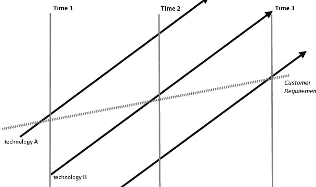

颠覆性创新通常表现为“足够好”而非“更好”，至少在现有竞争者看来是这样的。当一种颠覆性产品与现有选择进行比较时，其在 Y 轴上可能存在严重的当前局限性，但新产品在某些客户关心的方面要简单得多且更廉。。这类活动发生在产品改进速度快于客户需求的行业中。这在技术领域非常常见。

在 2.1 节中，我们看到了三种技术 A、B 和 C，它们的性能（Y 轴）随时间（X 轴）进行了对比。为了方便起见，假设它们是三种尺寸的硬盘，例如 3.5 英、2.5 英和 1.8 英。性能衡量标准是容量（GB）。新产品的尺寸更小，价格也更低。

在任何测量点（如时间 1、2 或 3），A 的性能始终优于 B，而 B 优于 C。可能的客户需求用虚线表示。客户需求增长得慢于竞争技术的改进速度。因此，起初只有 A 能满足这个客户；到时间 2 时，B 就足够了；而到时间 3 时，C 也能满足该客户了。尽管 A 和 B 在此期间性能持续持续提升，但这对它们没有帮助。如果情况允许，客户可能会切换到 B，然后切换到 C。

## 2.1 分析框架

如果某些假设成立，我们可以预计当较新的技术跨越代表客户需求的虚线时，客户将会发生切换。该模型中的两个重要假设是：

- 新技术在另一个维度上必须具有某些优势，即它们比旧技术便宜得多，或者使用起来没那么困难。
- 切换成本必须相当低，就像在产品设计中更换部件的成本。

对于硬盘来说，驱动器更轻、更便宜，且切换成本低。在这种情况下，图 2.1 表明，由虚线代表的客户将在 T2 时从 A 切换到 B，并在 T3 时从 B 切换到 C。

此图中存在一些简化。技术曲线是平行的，意味着这些技术以相同的速率改进。通常情况下，新技术以比旧技术更快的速度开始改进。此外，客户需求通常不是一条线，而是一个分布。

此外，请注意，今天的颠覆性创新会成为明天的现有竞争者，随后可能会受到攻击。

## 开源作为颠覆性创新

许多开源软件在现阶段完全符合这种“颠覆性创新”。开源系统通常比替代方案便宜，且更容易使用。在某些情况下，开源系统用起来稍微困难一点，但这似乎与它们的不成熟和新颖有关，而非任何根本性问题。

今天，尽管并非总是如此，但开源往往遵循闭源代码技术，在性能或规模上追赶，同时提供更低和其他优势。在计算机行业，性能和性价比的提升速度总是快于典型客户的吸收速度，但在当今衰退氛围中尤为如此。换句话说，客户准备好将许多系统视为“足够好”。

## 锁定

从客户的角度来看，图 2.1 代表了“商品化”。客户的新需求非常有限，并准备在产品改进时替换为更便宜的产品。沿线的改进是供应商试图避免这种“商品化陷阱”的错误尝试。

## 2.1 分析框架

在商品化的解释中，当一种解决方案成熟时，通过创新来区分变得越来越困难，最终所有供应商都趋于获得基于成本的低利润。在软件领域，由于分发成本接近零，产品价格将趋于零，唯一的利润来源将是服务和培训。

我们看到软件随着时间的推移变得更好、更便宜，但我们确实没有看到它的利润或价格趋于零。这种可能性被一种被称为“网络效应”或“收益递增”的东西所抵制，但我们称之为“锁定”。如果与他人使用相同产品具有优势，市场可能会出现“赢家通吃”；领先的产品可以获得巨大的溢价，因为通过将客户锁定在现有的模式或界面上，可以让切换到新技术变得更加困难。

操作系统和办公套件市场是供应商控制且网络效应占主导地位的案例；另一个明显的案例是即时通讯。很难离开这些系统。Web 市场在很大程度上是一个商品/标准市场，Web 服务器市场也是如此。尽管 Netscape 和微软等供应商抵制了这一点，但你可以轻松更改浏览器或 Web 服务器。邮件本身是一个商品化市场，但典型的供应商扩展（如日历和管理）则不是。数据库在 API 级别是商品化的（例如使用 ODBC 或 JDBC），但供应商已通过引入吸引人的专有扩展，尽力抵制了这一点。

供应商将寻求增加差异化，并鼓励客户锁定在单一产品上。客户被充分建议寻找标准（无论是法定的还是事实上的），以便他们能够“挑挑拣”并轻松地切换。

图 2.1 中切换成本的影响是根据成本的降低降低新技术的曲线。这使得采用新技术变得更加困难。

## 2.1 分析框架

## 图 2.2
切换成本对采用的影响。

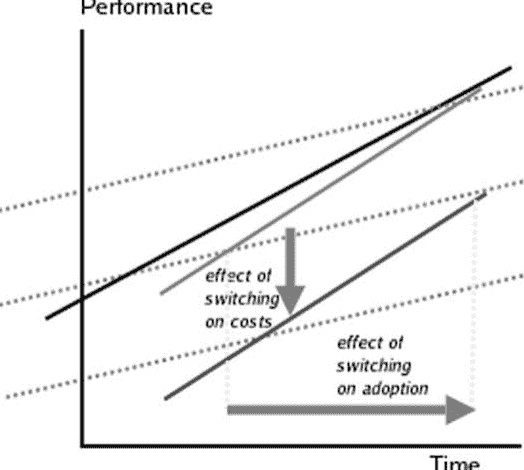

## 2.1 分析框架

## 图 2.1
性能


增加销售额。这是两类客户之间的质量差异。本章中的历史包含了早期采用者和早期大众的开始。开源社区拥有远超其份额的早期采用者：那些热爱自由软件理念和代码共享的人，以及那些热爱这些技术特定特性的人（例如类 Unix 操作系统、语言、命令行界面等）。

某些开源技术（如 Apache 和 Linux 服务器）已经越过了早期采用者群体。其他技术仍在那里。本书的目的是观察那些处于早期大众部署地位的技术。在这个领域，重要的问题在于部署能为业务带来什么：节省了多少钱，创造了哪些机会。

IBM、HP 和 Sun 的系统集成商是重要的早期采用者。他们选择在桌面广泛部署。当所有这些公司都宣布完全切换到 Linux 时，询问他们为什么要这样做意义不大。这些公司知道，通过建立早期成功，他们为早期大众客户创造了参考。重要的问题是：他们成功如何？吸了什么教训？他们可能面临我们希望避免的挑战。

当技术“跨越鸿沟”并成功时，采用率会增加并保持高位，直到市场饱和。这通常呈现图 2.4 中 S 曲线的形式，该曲线显示了随时间变化的采用百分比。这展示了早期采用者到后期大众过渡所代表的机会的影响。在图 2.4 的 T1 和 T2 之间，一个花费多年时间达到 25% 市场份额的产品


## 2.1 分析框架

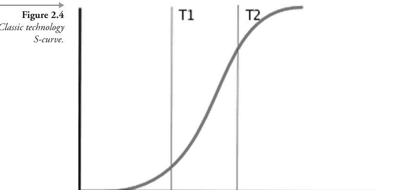

市场份额可以在短时间内突然升至 50% 或 75%。例如，我们已经在电视、电脑、录像机和手机上见过这种现象。

由于人们倾向于假设变化是线性的，这条曲线的形状往往让我们感到吃惊。关于这条曲线，有一句流行的说法是：事物在两年内的变化不如预期，但在十年内的变化远超预期。在图 2.4 中，Linux 桌面位于左侧，Linux 服务器位于中间，Apache 位于右侧。Linux 服务器似乎曲线的上升阶段。

### 2.1.3 开源技术栈

组织计算机网络中的所有元素都可以获得开源产品。当然，大多数人将混合使用开源和闭源代码。图 2.5 是一张抽象图，显示了服务器和桌面系统上典型软件的分层。当然，并非所有系统都具备这些功能，但大多数系统将以类似的方式在整个组织范围内支持这些功能。

通常情况下，会有许多此类系统，而且系统的组合比图中显示的更具异构性。稍后我们将适当对该图进行详细阐述，包含系统管理等其他功能。

图 2.5 的意图是一眼看出如果完全部署，开源架构可能是什么样子。软件包和定制化应用可能包括 ERP 或 CRM、如 POS 或呼叫中心之类的业务应用，或更特定的应用程序。

图 2.5
典型的开源代码栈。


| 服务器 | 桌面 |
| :--- | :--- |
| 自定义开发应用 (PHP, Perl, Java) | 软件包化应用 |
| Apache MySQL Samba LDAP Sendmail, Postfix | 个人工具 |
| 自定义开发应用 (JavaScript, Python, Java) | 软件包化应用 |
| Mozilla Office Open 专业 工具 (GIMP, Dia) | Evolution |
| Linux | |

开源软件提供的功能通常比闭源代码更多，图中显示的大多数框都有可选的替代方案。我们稍后会详细讨论这些。

在服务器上，除了 Linux 之外你还可以使用 FreeBSD、UNIX 和/或 Windows。可以使用 PostgreSQL 或 Oracle 代替 MySQL。邮件服务器使用 Postfix 和 Sendmail，其他服务器提供 Web 访问等专门功能。

在客户端，除了 Linux 之外你还可以支持 Windows 和/或 Mac OS X。除了 Mozilla、Konqueror/Safari、Epiphany 或 Opera 之外你还可以使用其他浏览器。大多数组织会添加一些专业工具，个人可能会添加偏好的应用程序。

开发工具的选择只是许多可用选项中的建议。PHP 和 Perl 是 Linux 服务器上最常见的选择。Python 和 JavaScript 在 Linux 和 Apple 客户端以及 Web 应用中也很常见，因为在这两种情况下你都可以选择 C++，或者使用 Java 而非开源语言开发应用程序。

### 2.1.4 特定开源技术的采用

我们现在可以将之前的颠覆性创新图应用于某些特定示例，这些示例包括：

- 数据库服务器
- Web 服务器
- 操作系统
- 办公套件

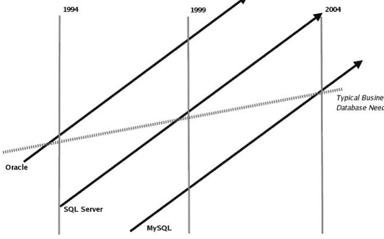

# 数据库服务器

图 2.6 显示了 1994 年至 2004 年 Oracle、SQL Server 和 MySQL 数据库服务器的市场。当然，这是一个为了说明趋势的概念性图。实际数字首先取决于客户需求（这需要为特定客户计算），然后取决于数据库基准测试（这需要从需求中得出）。在这种情况下，MySQL 遵循了经典的颠覆性曲线。虽然 Oracle 随着时间的推移不断改进并超越竞争对手，但对于该客户需求，可以在 1999 年被 SQL Server 取代，而 SQL Server 可以在 2004 年被 MySQL 取代。

# Web 服务器

广域网是颠覆性技术的一个惊人案例，Apache 是其中的领先的实例。Apache 源于第一个 Web 服务器（因为它基于原始的 NCSA 服务器，与许多开源产品不同，它从未需要从弱势地位与闭源代码竞争）。它从初就是市场领导者，并一直如此。

这不仅仅是一个新技术更便宜、更简单的案例，尽管事实如此。除了让开发应用程序变得更容易、更廉价之外，Web 服务器更进了一步，创建了一类触及人数比以前系统多几个数量级的新应用。

尽管 Web 是历史上最成功的新范式之一，但在早期部署中仍存在迁移困难。部署在客户端/服务器系统或专用终端上的 Apache 应用无法在不放弃现有投资的情况下迁移到 Web，必须全部保留或全部抛弃。对于那些被客户端/服务器应用所吸引并因此在公司内部控制桌面的用户群来说，Web 界面是薄弱的（速度慢且难以精确控制），并且是对他们现有强大标准化客户端系统投资的糟糕利用。

# 操作系统

Linux 显然是 1994 年左右引入商业企业的一种“足够好用”但更简单、更廉价的案例。早期的 Linux 客户在寻找一种昂贵但运行在廉价 Intel 硬件上的 Unix 类系统。那时，这种可能性并不大。早期的 Linux 客户正在寻找这种 Unix 升级。

到 2000 年，Linux 正在取代 UNIX 客户并替换他们的 UNIX 系统。为了追求其他业务，Tarantella 放弃了 UNIX 业务。

2004 年，Linux 似乎在某些领域已完全取代了 UNIX。IBM 和 HP 同意，Linux 在某些领域已经超越了 UNIX。尽管在未来几年内会有共存现象。结果是，Windows 正在追赶 UNIX。在这个领域，Linux 远超“足够好用”，并且在任何价格下都是最佳选择。

# 办公套件

OpenOffice 是“足够好用”产品的绝佳例子。它在功能和外观上与 Microsoft Office 没有太大区别。如果你两个都还没用过，你可能会发现它们用起来相似，而且功能超出了需求。我们大多数人并不使用整个办公套件，所以它的功能比我们需要的多。

## 2.2 开源被广泛使用

OpenOffice 的颠覆性创新图看起来很有吸引力。它满足了大多数客户需求，而且比 Microsoft Office 便宜得多。如果你有 10,000 个用户，购买 Microsoft Office 需要花费百万美元，而 OpenOffice 几乎不花钱。遗憾的是 Open Office 的切换成本太高，对于现有的 Office 用户来说迁移通常很难。这就是为什么计算机厂商正针对新部署（如亚洲市场）推广 Open Office。

Linux 和 FreeBSD 操作系统、GNU 编译器和 Apache Web 服务器是全球使用的大型软件系统。它们规模大且复杂，并与 Windows 等最大的闭源系统竞争。以下是关于开源的一些关键“要点”。

### 2.2.1 开源是互联网的核心

没有开源就没有互联网。开源软件在互联网的关键部分已使用，包括邮件路由、域名分配和 TCP/IP 网络栈的关键组件，已持续了 20 多年，表现出极佳的可靠性和扩展能力


增长与变化。互联网核心的所有这些代码都是开源软件：

-   TCP/IP，互联网的核心协议，根据伯克利开源许可证分发，并包含 Windows、IBM 主机以及 UNIX 和 Linux。
-   BSD，原始的自由 UNIX 发行版，包含了许多互联网工具，例如远程终端、文件复制和互联网编程 API（伯克利套接）的实现。
-   Sendmail 于 1975 年作为开源软件编写，至今仍是最常用的邮件服务器程序。
-   BIND，将服务器名称映射到 IP 地址的程序，自 1981 年以来一直是互联网的重要组成部分。
-   Apache 是最常用的 Web 服务器，市场份额占 67%（Netcraft）。
-   Linux 是大多数 Apache 服务器使用的操作系统。
-   Mozilla（曾是 Netscape 浏览器）是使用率数第二的浏览器（仅次于 Internet Explorer）。

### 2.2.2 Linux 出货量巨大

Linux 是全球出货量第二的服务器（次于 Windows）。在 2002 年，Windows 出货了 2,533,671 台服务器，而 Linux 出货了 485,679 台（IDC），因此 Linux 的出货量约为 Windows 的 20%。服务器增长率方面，Linux 为 35%，Windows 为 14%（均来自 IDC）。2003 年第四季度，Linux 服务器出货量为 250,000 台，比 2002 年第四季度增长了 63%（IDC）。

2003 年，Linux 在客户端操作系统销售量上超过了 Mac，成为 Windows 之后的第二大桌面操作系统（IDC）。

2004 年预计将发生以下事件：

-   大多数首席信息官（CIO）预计在 2004–2005 年间部署 Linux（《CIO 杂志》，2003年）。
-   将有约 2500 万 Linux 系统投入使用（IDC）。
-   IDC 预计 Linux 将占据新服务器操作系统的 25%，Windows 占 50%。

## 2.2 开源已在广泛成功中使用

-   Linux 预计（根据 IDC 2002/2003 年的数据和复合年增长率）进入 2004 年时将达到 100 万台的年运行率。

-   Linux 在单位销量上将超过所有 UNIX 系统总和以及 Mac，成为第二大操作系统（同样来自 IDC 的预测）。

2005/2006 年，Giga 以“高概率”预测 Linux 将反超 Windows，成为新服务器出货量中领先的操作系统。

Linux 将作为 ISR 参考平台迅速成熟并获得动力，在 2004/2005 年之前，从高通量 Web、技术计算和嵌入式设备服务器环境扩展到主流应用和 DBMS（数据库管理系统）领域。（Meta Group，2003年。）

一个警告：之前给出的大多数数字是单位出货量。Linux 按金额计算的销售百分比远低于单位出货量，因为 Linux 成本更低；2003 年 UNIX 服务器按金额销售额仍大于 Windows 和 Linux 的总和，尽管 2003 年将是这种情况的最后一年。

### 2.2.3 开源设备无处不在

基于 Linux 和开源工具的设备多年年来已企业网络、小型企业和家庭中广泛部署，并证明了可靠性。运行在 Linux 上的缓存、代理、防火墙和安全企业级设备由 IBM、HP、Dell 和 Sun 销售。

今天，各种小型设备正在进入家庭。它们通常包括一台小型计算机和磁盘磁盘驱动器，通常配有 LCD 显示器或电视输出，有时可以通过 Web 浏览器从另一个网络进行控制。这些系统的成本从 50 美元以下的简单防火墙/路由器到数百美元的完整业务系统（如 Sun Cobalt Web 和文件服务器）。这些系统需要可靠的操作系统，能够配置为仅执行其所需的功能，且价格低廉。使用的操作系统通常不予广告，因为它使用 Linux 并不是秘密。这些消费级、家庭办公和小型企业设备的示例包括以下，均基于 Linux：

-   TiVo 电视录像机
-   Mirra 网络附接磁盘驱动器
-   Linksys (Cisco) 和 Netgear 家用路由器、防火墙和 wi-fi 设备
-   Cobalt (Sun) Web 和邮件服务器设备
-   Pago 数据库（MySQL）应用设备
-   Zaurus (Sharp) PDA

其他 Linux 应用还包括 Snapag 和 Guardian。有许多基于 Linux 的 MP3 播放器、视频播放器、PDA 和手机。很难获得准确的统计数据，但似乎在 PDA 和手机这些既有市场之外，Linux 是这一类新应用的主流者。

在构成 PDA 的这一更成熟的设备类别中，PalmOS 和 Windows CE 是领导者。然而，Zaurus 系列是一个强力的基于 Linux 的竞争者，电子制造商的近期动态表明，未来将向 Linux 移动。

微软提供了嵌入式 Windows 2000 和 Windows CE，向供应商推广并开发自己的系统，但在 PDA 领域以及销售自有品牌时似乎并没有太多作为。例如，基于 Linux 的 TiVo 设备份额超过了 80%，而微软只销售了极少数“Ultimate TiVo”设备。

### 2.2.4 新公司和新业务使用源码

当一项技术变得可用时，其快速部署面临着许多障碍。对于大多数现有业务而言，“更好”是“足够好”的敌人。……（注：此处 OCR 文本存在大量重复和错误，已根据要求按逻辑合并处理）。


## 2.2 开源已在广泛使用

许多大型企业都有开源成功的案例，包括亚马逊（Amazon）、Google、eBay 以及工业光公司（Industrial Light & Magic）。这些包括一些最新、最大的应用，例如基于 Linux 集群的新型科学超级计算机、商业 Web 超级服务器、大多数生物信息学以及所有的网格计算系统。

从慕尼黑到马萨诸塞州，从巴西到中国，从美国航空航天局（NASA）到国家安全局（NSA），许多组织在全面采用开源方面取得了重大进展。

根据《金融时报》，截至2003年10月，OpenOffice 的下载量已达到200万次。

2004年，顶级数据库性能基准测试（TPC-C）在64路红帽企业版集群上对 Oracle 数据库进行。它以 5.50 美/tpmC 的成本实现了超过百万次的 tpmc。

Linux 上的 SAP 安装量超过 2000 个。Oracle 在 Linux 上的客户超过 500 户。

PHP 是 Web 上最常用的开发语言，已经超过了微软的 Active Server Pages。

IBM 宣布其正将所有内部桌面迁移到红帽 Linux。它正在使用一种混合策略，结合了 Notes、Office 查看器和 Citrix。此工作正在 2004 年进行，目标是 2005 年完成。IBM 计划将其所有客户从 AIX 操作系统迁移到 Linux。

Sabre 正在用使用 Linux 和 MySQL 开发的应用程序替换其 Web 预订系统 Travelocity 的前端组件。Sabre 是美国航空的预订系统，是 OLTP 技术的先驱，并主宰世界上最大的大型机 OLTP 旅游系统。

油漆制造商 Sherwin-Williams 将 10000 个系统从 Windows 迁移到了 Turbolinx。AutoZone 将超过 3000 个系统从 SCO UNIX 迁移到红帽 Linux。美国邮政在 250 个邮件分发中心安装了 6000 个 Linux 系统。McKesson 每年通过基于 Linux 的应用程序在数千处提供订阅服务。

五角大楼在2004年2月宣布，陆军研究实验室（MSRC）正在安装一套基于 1066 个双 Xeon 处理器（总计 2132 个处理器）的 Linux 超级计算机系统。

其他大型企业的开源采用者包括：

## 2.3 开源系统示例

- 福特 (Ford)
- L.L. Bean
- 达美航空 (Delta Airlines)
- 梅赛德斯-克莱斯 (DaimlerChrysler)
- Dresner Kleinwort Benson
- Hughes Network Services
- 美林盛 (Merrill Lynch)
- 德意志银行 (Deutsche Bank)
- Telstra
- 思科 (Cisco)
- UBS Warburg
- 联邦航空管理局 (Federal Aviation Authority)

Web 上可见的四个高流量开源网站示例是亚马逊、FedStats、Travelocity 和 Slashdot。

### Amazon

最初，亚马逊主要基于专有的 UNIX，但许多系统已迁移到 Linux，重要的新系统均使用全开源软件构建。这包括客户管理和推荐部分。亚马逊的推荐页请参见图 2.8。

### FedStats

美国人口普查网站 http://www.fedstats.gov/ 是展示使用全开源软件（Linux, Apache, MySQL, PHP, Perl）处理大量数据的绝佳案例。FedStats 请参见图 2.9，相关的 MapStats 请参见图 2.10。

### Travelocity

Travelocity 是由 Sabre 运营的高流量航空和旅游预订网站。原始预订系统运行在 NonStop 设备上，而新的电子商务定价系统处理更高的处理需求和客户量，使用了包括 Linux 和 MySQL 在的所有开源软件。请参见图 2.11。

图 2.8 Amazon 推荐页。

图 2.9 FedStat。

图 2.10 MapStats。

图 2.11 Trevelocity。

## 2.4 总结

Slashdot 是 Web 上流量最高的数据库驱动新闻网站之一。它是完全开源的，基于 Linux、Apache、MySQL 和 Perl 构建。请参见图 2.12。

开源软件已成为当下。它被广泛应用于互联网骨干网，被 IBM、美国政府、福特、沃尔玛、埃克森、Google、Amazon.com 以及美林盛等美国公司使用，以及全球的大型企业和政府机构使用。广泛使用（每天有数百万人使用）的产品包括：

- Linux 和 FreeBSD 操作系统
- Apache 服务器
- MySQL 和 PostgreSQL 数据库
- BIND 和 Sendmail，用于互联网域名和邮件转发的主要系统
- 用于跨系统广泛文件和打印共享的 Samba 及其他工具
- OpenOffice 和其他办公套件
- GIMP 和其他专业工具
- OpenLDAP 以及其他目录和安全管理的开源工具
- GNU C++Perl、PHP、Python 和其他开发语言
- 用于企业和消费的设备，如 TiVo、Linksys、Netgear、Sharp Zauris 和 SunCobalt 系统。

在嵌入设备、Web 服务器和工程工作站等领域，开源已经是领先的安装系统。在其他领域，包括基础设施服务器、应用服务器和大型学术集群，开源正在获得大多数新的安装决策。并非所有人都能从今天采用这些产品中受益。有些人在现有解决方案中可能存在沉没成本，在其他情况下可能存在巨大的转型成本。但开源解决方案具有足够的吸引力，每个组织现在都应该考虑这些可能性。

## 3 开源：好、坏与丑

在本章中，我们将回顾支持和反对开源软件的论点，以及其他相关问题。

## 3.1 开源的优之处

使用开源软件的优势包括我们能够：

- 查看源代码
- 修改并重新发布源代码
- 从不同供应商购买并采用新平台
- 避免专有格式
- 允许产品集成
- 减少软件许可成本和精力
- 在范围内进行开发和部署
- 从人才库中抽取人才

### 3.1.1 为什么查看代码很重要

有很多你应该查看代码的原因，尽管你并不打算这样做、不想这样做，甚至可能不会这样做（如果你不懂 C++ 或 Perl）。如果你维护的系统出现问题，你可能不会阅读代码，但你会这样做：

- 检查描述系统如何工作的文档（包括 FAQ），以查看你是否正确使用了系统。
- 检查支持库或错误报告中的相似问题。
- 使用搜索引擎搜索相似问题和解决方案。

所有方法都会因为源代码的可用性而改进。文档可能更加具体准确，因为作者不再试图隐藏实现细节（或他们没看到的细节）。错误报告的总结可能会从代码角度描述 Bug（并可能包含建议的修复方案）。


## 3.1 开源的良好之处

……那里。但这同样的反对意见，只是处于下一个层面。毫无疑问，SAP 在对待 Sun 和 IBM 数据库支持时也是这么说的。所以，我们希望我们所有人和其他人至少能对我们开放。

让我们强调一下，这在任何方面都不是一个理论性问题。它每天都在发生，在压力下进行，并带有某种结果保证。在大多数情况下，这些工作将由你雇佣的人完成。这里有一个类比：你可能不会在没有律师审查的情况下签署合同，也不会在没有允许你的会计师或律师阅读的文档的情况下发送税表。在某些其他法律体系中，你可能没有这种权利。

如果你可以自己阅读源代码，它就会变得更具个性化。自由软件运动中的一个打印机驱动程序，理查德·斯尔曼（Richard Stallman）无法修复它，因为打印机制造商拒绝让他获得源代码。我个人曾多次因为软件供应商不让我查看的代码中存在 Bug 引起的问题感到沮丧，或者因为对代码的预期工作方式理解不足（例如传入的各种参数的含义）而感到沮丧。如果你曾多次在电话旁等待一个通常不是程序员的人，通过一种猜测游戏来基本上为你读几位代码，那么你就会想与开源软件合作。

### 3.1.2 你更改和分发代码的权利至关重要

你之所以希望不仅能够查看源代码，还能更改并可能分发它是有原因的。

首先，代码必须保持更新才有价值，而且这种机制必须是公开的。虽然大型代码库中只有一小部分在几个月后会发生变化，但恰恰是这百分之几会被报告并修复 Bug。你的 Bug 可能存在在一个修复中，或者通过一个修复而产生，如果不是，从统计学上讲很可能是因为 Bug 不会聚集。在旧代码中寻找当前问题是浪费时间。旧代码还有其他价值，例如用于查看通用架构或编码风格或学习应用程序。对于发现和纠正问题来说，只有当前代码是令人的。从务实角度来看，这意味着需要某种代码仓库（如 CVS），它支持源代码的并发更新，以确保源代码足够。

其次，从务实角度来看，我们发现高级用户贡献的能力是 Linux 和 Apache 等大型开源项目的真正力量源。它让他们能够比最大、最好的闭源竞争对手更快速地改进，并且比通常资源受限的平均闭源产品快得多。虽然对于每个开源产品来说可能并不允许用户广泛贡献，而且许多闭源产品多年来在没有它的情况下取得了成功，但在当这种能力可用时失去它是很浪费的。

第三，也是最重要的一点，“分叉”（fork）或衍生出一个完全全新的竞争代码线的能力，是确保代码是开放的、防止开源项目落入不完整或恶意之手中的的一种保障。而“分叉”的可能性意味着如果未来原作者不想维护或升级它，你有一个选择。另一个小组始终可以建立一个竞争程序，该程序可以支持现有客户和接口，但向新的方向进行开发。

“分叉”是开源世界的最后一道防线选项——一个昂贵的代价，很少使用，并且面临着强大的社会压力。但它是确保产品所有权属于用户而不是作者的机制。这意味着，例如，如果红帽 Linux（Red Hat Linux）要破产了，另一家公司或你的组织可以接手并维护它。

### 3.1.3 你可以从不同的供应商处购买并采用新平台

你必须为从多个供应商处购买的能力进行计划和构建；如果你这样做，你对软件和业务实践的投资将比依赖一个闭源平台更安全。这在过去已经得到了证明。

特别是，基于“PC”的系统比依赖一个闭源平台更安全。


## 3.1 开源的优势

相比于开源，闭源系统更有可能提供现成且集成的“解决方案”。遗憾的是，这些方案往往只是华有其表。它们不太可能涉及多个供应商，除非使用特殊且昂贵的集成引擎。它们可能与来自同一供应商的旧产品兼容，或者如果确实需要适配器，则需要支付额外费用。而且通常，即使是来自单一供应商的产品，也无法如你预期的那样协同工作。在现实生活中，你必须从许多组件中组合出自己的系统来解决问题。如果代码是封闭的，你将会遇到瓶颈。

如果你从单一供应商处购买所有系统，你可能会消除集成问题，但可能无法完全消除，除非你能一次性买到你所需的所有内容。任何时候的集成都可能是局限且临时的。随着时间的推移，格式和首选的集成方法会发生变化，集成将变得非常困难。

像 IBM 和微软这样的大公司也有自己的集成问题，因为它们从外部软件开发人员那里购买技术并将其捆绑。即使产品是内部构建的，他们的部门也可能使用不同的技术。

我在这里将以微软为例，也可以用 IBM，并不是说这两家比其他人都差，而是它们的产品更多。各种微软产品使用以下数据存储：

- Jet 数据库引擎，至少有两个内部变体，基于 Access 内部的数据库引擎但与之并不相同。
- SQL Server，有时以透明的方式使用数据库，或者在其他情况下隐藏格式以防止用户访问（如 Commerce Server），或仅通过未发表的存储存储过程进行访问（Great Plains 产品）。
- IIS 使用一个文档记录不全的“元数据库”（metabase），它有自己的专有格式。
- Windows 注册表（现已弃用，但仍被许多产品使用并为了兼容性支持）。
- 具有各种特定应用程序格式的 XML 文件，并非全部发布，且随着时间的推移至少有三种不同的模式标准。

这种情况数不胜数，但在一个组织中很容易达到十种格式。

在现实世界中，我们随着时间的推移从不同公司购买产品并让它们运行多年。集成是一个我们必须面对的难题。开放标准和源代码是构建集成解决方案的重要组成部分。使用闭源的替代方案是供应商管理的产品集成和通用集成引擎。这些都是昂贵的，效果往往不尽如人意，会限制我们选择产品的能力，并且通常无法适用于特定组织中的特定情况。

### 3.1.6 开源许可更简单、更廉价

#### 开源更廉价

在几乎所有情况下，开源比闭源代码软件省钱。逻辑很简单：软件的成本低得多，而除非适用某些情况，否则其他成本预计将大致相同或更低。如果我在以下示例中使用 Linux，同样的情况也适用于其他产品，例如 MySQL。

Windows 和 Linux 之间的硬件成本大大相同。某些特定产品的性能优于其他产品。现在许多人采用 Linux 进行文件和打印服务器服务的一个原因是是，在大多数情况下，当前的 Linux 版本在相同硬件上提供的用户服务比 Windows 更多，而两年前它们支持的要更少。

支持和培训成本在不同组织之间差异很大，但开源和闭源代码之间将相似。通常情况下，你可以预期为闭源代码支付支持或培训费用，这些费用仅对一个供应商可见，并具有事实上的垄断性。这在较小的闭源软件公司中非常常见，它们在培训和咨询方面通常有很高的利润率。

可以找到一些开源并不贵的案例；虽然这并不容易，但显然这是一个闭源供应商总是愿意站出来应对的挑战。这里的诀窍是使用昂贵的 Linux 或开源发行版，并以非常精确的方式与获取廉价的闭源替代方案进行对比。

也许更容易的方法是准备“总拥有成本”数据，在这种数据中，开源在许可成本方面的真实优势会被某些其他巨大的数字所掩盖。这可以通过多种方式实现：

- 使用昂贵的硬件（例如在主机上运行 Linux）。
- 在 Linux 比较中使用昂贵的开发、管理工具或服务。
- 在开发、培训、支持或停机时间使用大数字；估算 Linux 在这方面比闭源方案略差（或差很多）。

所有这些事情已经在发表的报告中被做了。

展示开源的“最佳且最终”方法并不比“守旧者技巧”便宜。某些成本倾向于既有者而非新来者。这些成本将系统地有利于 Windows 优于 Linux，有利于 Oracle 优于 MySQL，而且可能很大。其中两项是培训和人员配备。

对于新来者，培训是一项巨大的一次性成本，但对既有者来说是沉没成本。很容易制造任意巨大的成本，特别是因为它可以适用于所有用户，并与其他软指标（如过渡期间的错误率或用户满意度）相结合。

从长期来看，培训一直存在，而开源软件更稳定的进步和高质量材料的可用性将往往降低低于闭源代码的成本。在短期内，将培训成本归咎于开源通常是“无赖之徒最后手段”，试图撑起一项昂贵的闭源交易。

开发人员和管理员的人员成本是新来者的另一项大成本。既有产品必须已经有经过培训的人员支持它。通常，Linux 开发人员和管理员随处可见，经验丰富且价格合理。管理和开发 Apache、Linux、Perl 和 MySQL 的技能并不超过微软或其他系统，而且它们随着时间的推移更加稳定。这些技能是年轻人正在学习的，所以如果在一个某些地方微软的技能更常见或更便宜，未来几年的趋势将是转向开源。然而，在过渡时期，这些开源技能在短期内可能会被推高，导致成本增加。

#### 开源许可更简单

无论闭源软件的美元成本是多少，另一个成本就是许可。公司必须建立员工和跟踪程序来管理购买的许可。不合规的成本可能令人尴尬且异常高，并且会导致某些系统管理员被解雇。

此外，许多人因为难以管理并发使用而放弃许可。许多公司选择微软许可的一个原因是，它们被设计为许可所有桌面，包括许多可能从未使用软件的地方。这非常有可能是设计的：微软从未有利于并发许可，因为在任何时候只有一部分用户在使用该软件。

#### 你控制软件升级

使用开源，无需接受会破坏一切的“升级”，正如我们在 Office、Exchange（带目录）、SQL Server 和 Commerce Server 中经历的那样。按照供应商计划升级会导致昂贵的计划外迁移、锁定旧版本（并丢失新功能和错误修复）或高昂且不可预测的许可费。

开源这种缺乏流动的另一个益处是有经验丰富的开发人员；有很多十年经验的 Perl、Shell 和 C 程序员，但很少有五年经验的 C#、VB.Net 或 Java 开发人员。而且五年前的 Perl 代码今天仍与新代码一起运行，不像大多数五年前使用 Java 服务器或 COM 组件的应用程序。

### 3.1.7 开源是国际公司的良好解决方案

世界上各地的人都不会按照今天的价格许可闭源软件。这导致了许多国家大量使用无许可软件。

如果一个组织在海外运营，软件成本可能已经是一个问题。因此，在德国或日本看起来具有压倒性的市场份额，更不用说巴西、印度或中国了。许多较新的全球竞争对手将不会向闭源公司支付许多美国公司所支付的高昂费用。

对于闭源公司来说，将软件提供给特定的语言和文化是一个非常艰难的决定。我们似乎正开始在边缘国家看到开源产品的国际化，在这些国家那里有可用资源来处理本地语言。


## 3.1 开源的优势

例如，微软公司支持约五十种语言，但还有数百种语言，其中仅印度和中国两国就都有十种。开源软件可以通过本地资源翻译成这些语言，即使从中心化的角度来看在经济上并不划算。

在某些特定地点可能产生影响时，来自加利福尼亚、华盛顿、马萨诸塞州等地区的闭源公司倾向于将咨询和支持工作集中在这些地方。如果开源带来了机会，其他美国其他地区和国家（如印度、巴西、中国和德国）希望看到开源能改善当地的就业机会，尽管他们可能低估了现有集群在维持复杂技能和关系优势方面的实力，而这些关系正是成功软件生产的基础。

## 3.1.8 拥有大量优秀的开源专业人才

目前，由于大多数服务器和绝大多数桌面电脑都在运行 Windows，Linux 和 Windows 在技能成本和可用性方面已基本持平。一些调查研究发现，其中一种比另一种更容易招聘人员，且存在显著的区域差异。

对于其他开源软件，情况各不相同。找到丰富的 Apache IIS 经验人员较为容易。然而，从 SQL Server 或 Visual BASIC 专业人员中寻找 MySQL 或 Perl 专业人员则更为困难。

对于考虑切换到更多开源软件的企业来说，通常会发现与培训和获取新技能相关的额外成本。在特定的美国商业中心，可能会出现 MySQL 或 Python 开发人员短缺，特别是当有大型组织积极寻找他们时。但这些问题可能是过渡性的。当市场从 Novell 转向微软网络，或者从网络数据库转向关系型数据库时，我们也经历过类似的波动。几年之后，平衡就会恢复。

在 Linux 的情况下，技能和培训问题得到了极大帮助，因为从技能角度来看，Linux 与 UNIX 是一样的。资深的 UNIX 专业人士对新的 Linux GUI 和无线网络等 PC 技术可能还需要学习一些东西，但他们在 C 语言或 shell 编程方面的核心技能依然适用。发展中国家中大量的应届毕业生和专业人士现在直接将 Linux 和开源作为他们主要的计算机技能，而且这些人正大量进入劳动力市场。

## 3.2 仅有开源是不够的

开源的本质使得一个大型且积极的群体更容易学习。任何选择访问代码并能够在廉价且广泛使用的设备上运行代码的人都可以。例如，Oracle、WebLogic 或 Solaris 就并非如此。除了源代码和可执行代码免费可用外，开源的本质还意味着文档、书籍和培训以极具竞争力的方式提供，在许多情况下是免费的。

虽然现在基本持平，但开源在国际上和随着时间的推移可能会获得相对于闭源代码的优势。

系统开源可能是件好事，但并不足够。人们通常认为，开源由于其构建方式具有某些特征——例如它是安全的、无病毒的、可靠的，或者至少优闭源软件。对于书中讨论的 Apache 和 Linux 等知名开源产品，这似乎确实是如此。但并非所有开源产品都编写得良好，更不用说特定产品最适合你设定的用途。事实上，为了说明这一点，你或我今天可以拿一段松散、无文档且测试不充分的代码，将其捐给社区，它明天就会出现在 Internet 服务器 Freshmeat 上，作为可供下载的“开源软件”。

我们将审查任何开源产品的每个组件和所采用的标准的开放性。一旦我们有了想要使用的开源产品，我们将希望至少审查以下元素：

- 平台移植性（硬件、操作系统）
- 数据库可移植性（存储过程、API）
- 语言
- 数据架构
- 软件质量（模块化、文档化）

### 3.2.1 部署平台

我们更希望看到可以部署在由不同供应商提供的标准、可扩展计算机硬件上的应用程序，并采用开放市场过程中获得的内部标准组件。

我们更倾向于支持多种操作系统的应用程序，这将提供最多的选择。理想情况下，这应至少包括 Linux、Windows 和其他 UNIX。或者，我们更倾向于运行在多种硬件和多个来源操作系统上的应用程序——在实践中，这就是 Linux。

一个可以接受的替代方案可能是来自单一强大供应商的广泛部署的操作系统（例如 Microsoft Windows、IBM OS）。在传统做法中，购买者会为关键产品寻找多个来源，而不是单一供应商。但我们需要承认现实；如今有的产品只能运行在 Windows 或 IBM OS 上。

作为一条一般规则，如果一个应用程序现在还没有多个平台可用，那么将来可能也不会有。在某些情况下，我们可能希望对应用程序的未来移植性进行审查。这将取决于所选的语言，并避免与平台特性特定绑定。

### 3.2.2 数据库平台

如果应用程序使用数据库，我们希望它至少使用基于标准的（SQL）数据库，并且对该数据库的 API 和存储过程拥有一致、设计良好的当前接口。

最好是支持一系列操作系统的应用程序，因为这将提供最多的选择。理想情况下，这应至少包括 Linux、Windows 和其他 UNIX。或者，我们更倾向于运行在多种硬件和多个来源操作系统上的应用程序——在实践中，这就是 Linux。

一个可以接受的替代方案可能是来自单一强大供应商的广泛部署的操作系统（例如 Microsoft Windows、IBM OS）。在传统做法中，购买者会为关键产品寻找多个来源，而不是单一供应商。但我们需要承认现实；如今有的产品只能运行在 Windows 或 IBM OS 上。

作为一条一般规则，如果一个应用程序现在还没有多个平台可用，那么将来可能也不会有。在某些情况下，我们可能希望对应用程序的未来移植性进行审查。这将取决于所选的语言，并避免与平台特性特定绑定。

如果应用程序使用数据库，我们希望它至少使用基于标准的（SQL）数据库，并且对该数据库的 API 和存储过程拥有一致、设计良好的当前接口。

最好是拥有数据库的选择，因为某些数据库需要特定的硬件和操作系统。这并不总是可能的，因为支持多个数据库的额外工作总是值得的。遗憾的是，SQL 标准不足以确保应用程序不会依赖于特定的数据库。

通常，我们需要意识到 SQL 的限制，并审查访问策略以使其最大化。

### 3.2.3 软件语言、架构与实现

我们希望应用程序使用开源语言编写，最好是可以在平台之间迁移的语言。这类语言通常包括 C/C++、Perl、Python、PHP 和 UNIX shell。Java 不是开源语言。尽管有 Java 的竞争性实现，但 Java 规范并不是开放的。审查软件架构以识别对代码库、平台 API 的依赖尤为重要。在考虑这些问题之前，大多数语言都是移植的。由于由于，今天可以在多个平台上提供的应用程序优于理论上可用的。例如，为 WebSphere 编写的 Java 应用程序很难迁移到其他平台。

应用程序软件是模块化的、文档化的且没有使用限制，以便在需要时进行修订。著名的开源许可证将没有此类限制。产品需要专门审查模块化，因为我们需要查看系统能否适应我们的预期需求，并针对我们的用户场景提供质量文档。

### 3.2.4 数据架构

应用程序数据架构的重要问题是允许通过易于理解的标准（例如 SQL 或 XML）访问所有数据，并且这种访问有示例说明且没有使用限制。

如果数据存储在 SQL 或 XML 中但需要特殊的编程或反向工程才能获取，或者没有文档，这就是一个问题。可能存在效率和安全方面的考虑，这可能是一个时间问题，但如果闭源供应商可以获取这些而你不能，那么供应商就是在隐藏你需要的代码库并称之为商业秘密，这是不对的。

在某些情况下，应用程序可能会对数据访问收取客户费用或基于许可的限制。在这种情况下，你知道数据在哪里，你知道如何获取和显示它，但仍然需要付费或获得许可。我不想向管理层解释这些。

测试系统开放性的其他问题还包括：

- 对于每个供应商，如果它破产、过度收费或停止支持该产品，我该怎么办？


## 3.2 仅靠开源本身是不够的

- 将系统迁移到规模大或小一个数量级的平台需要什么？
- 我能多容易地获取一个包或构建一个新应用程序来添加或替换功能？

我第一次在 1994 年的另一本书中列出这个列表。当时，系统只能在有限范围内接近这些理想，因为大型系统几乎都是构建在闭源代码之上的，开源在当时并不是业务系统的严肃选择，或者说我还没有意识到这一点。

一个有趣的问题随之产生：为了实现这一点，开源是必要的吗？我们该如何确定闭源产品是否具备这些优秀品质？对于开源软件，我们可以根据所需的详细程度来审查产品代码和文档。对于闭源产品，尚不清楚我们是否会这样做。

通常，对于闭源产品，我们只能看到文档或仅使用彩色的架构图。架构。如果我们详细查看架构，它可能是不正确的。过去发生过闭源代码供应商展示模型模型并声称它们是完成的代码，宣布某个产品基于 XML 的但实际上并非如此，或者宣布某个产品基于 Java 等新技术，而实际上只是通过这些薄薄的外壳来声称是闭源代码。安全公司声称拥有闭源算法等其实非常常见，但实际上没有任何东西支持这些说法。考虑关于 Windows“隐藏 API”的争议，据称微软利用它们来获取 Office 的优势。尽管我不相信这一点，但该问题从未得到解决。根据定义，开源没有隐藏 API。

此外，你如何知道某个特定的数据库或操作系统未来是否会获得支持，因为那是厂商在当时做出的商业决策？一个案例是 Windows NT 平台的支持历史。它宣布支持 Intel、Alpha 和 MIPS，然后添加了 PowerPC，但在微软 (MIPS)、摩托罗拉 (PowerPC) 和康贝 (Alpha) 做出决定后，最终只支持了 Intel。有了开源，你可以做出自己的选择；当然，经济驱动因素会推动你做出同样的决定。

## 为什么选择开源对你来说更困难

计算机业务的某些结构方式会使你更难选择开源软件并在组织中倡导它。

传统上，业务由拥有直接销售团队和大量营销预算的大公司组成。这些公司能够提供直接销售人员来支持企业评估，并提供大量的独立评论和行业新闻，从而为产品产生需求。业务形态也影响了应用程序组成为“套件”或其他形式的结构。

开源软件没有直接销售团队、营销预算或捆绑产品的激励。因此，它看起来可能很“奇怪”，除非你对此有所预料。

### 3.3.1 开源的销售支持水平不够完整

### 没有直接销售模式

没有多少产品（特别是在采用早期阶段）有很多产品是可以自我推销的。没有直接销售团队，产品就不可能被采用。事实上，其他良好的产品可能不会被考虑。例如，Microsoft Test 是一个与竞争对手一样优秀的产品，但它从未售出，因为价格太昂贵且没有直接销售团队；最终它被送给了 Rational。

通过直接销售团队销售低于阈值的产品是困难的。这个值是由应用于销售漏斗的简单算术驱动的。一名销售代表可能跟踪十几个真实的机会并在一个月内成交一两个。在这一行业中，销售代表可能获得销售额的 5% 到 8%。为了通过这些数字过上好生活，每笔交易平均必须在 100,000 美元左右。这个价值在这一代中没有发生本质变化，尽管它会根据形势的好坏而波动。

资助直接销售团队的问题使得开源产品如果复杂到需要直接销售，对它们来说就很困难。如果它们必须与直接销售团队竞争（如 JBoss 和 MySQL），这将是一个特别的问题。数据库和应用程序服务器几乎都是直接销售的。这两家公司还遵循双重许可（的）

## 3.3 为什么选择开源对你来说更困难

（）向企业收费，但他们需要开发一套培训、咨询、系统集成和支持，以使他们的整体包达到可持续的价格。

这种状况是开源软件解决方案很少单独销售的主要原因。通常的情况是涉及闭源代码或其他专有解决方案的、在开源之上或与之并行的混合模式，这可以支付销售费用。顶层闭源代码的混合方案示例包括 Apache 上的 WebSphere、Linux 上的 Oracle、以及 Linux 和 MySQL 上的 SAP。与闭源代码或专有硬件并行的示例包括 IBM 对大型机 Linux 的赞助，或惠尔·惠奇提供所有运行 Linux 的全新计算机用于文件和打印合并。

### 从内部销售

在这种情况下，成为直接销售团队也可能是困难的。内部竞争对手具有一些优势。它可以随时参加会议或演示。它通常可以提供与业务相关的示例，并可能拥有对其有利的现有关系和声誉。

对于几乎任何大型复杂产品，特别是集成类产品，如 Microsoft BizTalk、WebMethods 或 Web 服务集成，通常需要编写一些自定义代码来解决更具体的情况。内部人员在这里具有真正的优势，如果他或她可以获得工具，他们已经开发了特定的解决方案。SQL Server 和 Visual BASIC 等数据库和开发工具在内部情况下对直接销售的竞争中取得了成功，而且开发工具在这里通常表现良好。

大型供应商可以提供（支持或反对）的支持可能包括高管级别的压力。在某些组织中，很难通过演示来反击这些压力。良好的供应商：

- 进行销售演示，提供参考，并准备有关竞争对手的信息
- 满足或绕过 IT 传统的选项
- 帮助获得高层支持
- 提供技术演示并可能协助
- 为评估者提供安装支持
- 可能提供咨询或其他帮助以实现成功

## 3.3 为什么选择开源对你来说更困难

这本书的一个重要目标是为内部变革者提供这种弹药，以便在与直接销售团队竞争时使用，既直接出现在各个章节中，也间接地通过建议获取并始终保持最新的此类资源。

## 3.3.2 特定产品评审不会有利于开源

产品评审通常由独立公司以公平且可复制的方式进行，从这个意义上说是公平的。并不缺少评审人员和供应商提供的通用信息，表明开源整体和 Linux 是重要趋势。这本书已经引用了其中的几个声明，而且它们定期发布。Gartner 和 IDC 等公司的观点对于向可能不确定或过度保守的组织传播这些领域非常有帮助。

然而，将开源产品与闭源竞争对手进行特定对比则是另一回事。这种评审通常由一方委托，该方可以选择评审中未明确说明但对结果有很大影响的方面。行业的标准做法是如此，随着不同的厂商在他们选择的时间和议题上赞助评审和对比，会导致时间的“粗略的公正”。

在开源的情况下，同样的过程会导致对开源产品的系统性偏见，因为该产品无疑资金较少（且营销投入少）。为了更详细地说明这一点，特定产品评审有四种误导方式。控制因素包括

- 所考虑的产品包
- 评审相对于发布日期的时间点
- 用于对比的竞争对手以及产品版本
- 被评估的行为（例如：性能、稳定性、易用性）


## 3.3 为什么选择开源对你来说更困难

### 产品包化

开源系统与闭源系统在包装方式上的差异可能会导致误导性的比较。开源发行版通常包含办公套件、各种个人工具、数据库和其他开发工具，通常每种类型都有几个。如果您选择了“专业版”或“开发者”等配置，这些工具将自动为您安装，且无需额外费用。由于闭源供应商资助了评测，他们可能会选择将他们自己包含的功能定义为评测范围，而忽略其他功能。

### 评测时间与发布日对比

发布时间与评测时间之间存在差异。这种做法本应该是平衡的，但系统性地倾向于闭源代码供应商，因为他们资助了评测并因此决定了时间。评测会将一个具有新功能的后期 beta 产品与一个旧的开源产品进行对比。

在某个示例中，一项关注安装易用性的研究并没有对比当时可用的 Windows Small Business Server (SBS) 和红帽（Red Hat）。当时，Red Hat Enterprise Linux 2.1 正在投入生产，而 SBS（基于 Windows 2003 Server）正处于测试阶段。该研究没有等待 RHEL 3 的 beta 版本，而 RHEL 3 的安装要容易得多。

### 竞争对手与产品版本

另一个问题是产品版本。对比 Red Hat Enterprise Linux 2.1 (RHEL) 和微软 Small Business Server 的同一评测并没有对比相似的产品。Small Business Server 是 Windows 的低端版本，对用户数量和输出有限制，并捆绑了限制版的 SQL 数据库和其他产品（例如传真服务器和基于向导的前端），这些产品是专门为了提高小企业的安装易用性而包含在内的。RHEL 是红帽 Linux 专为大型（“企业级”）业务设计并定价的版本，例如具有集群功能并提供多种全功能数据库包的选择。RHEL 应该与更昂贵的 Microsoft Windows Advanced Server 进行对比。更重要的是，Small Business Server 应该与红帽 Linux 9 进行对比，后者在当时是正式发布版本。红帽 Linux 9 定位用于小型企业和家庭业务，安装要容易得多。

## 3.3 为什么选择开源对你来说更困难

### 评估标准

评测标准由评测者选择，以有利于比较。这包括衡量哪些内容以及选择哪些产品进行竞争。例如，微软更倾向于将应用开发评估为 .Net 对比 Java，因为 Java 工具比 PHP 等工具更贵，且开发难度也。。当 Oracle 和 IBM 评测应用服务器时，它们是相互竞争的。他们不计算微软的产品，因为它是“免费”的（捆绑在操作系统中），所以他们通常会安排一系列“Java 服务器”，或者根本不将微软的产品视为应用服务器。

当微软评测 Web 服务器时，它发现自己是“商业市场领导者”。在这种情况下，市场份额不足 20% 的微软选择不计入 Apache，尽管 Apache 拥有 65% 的份额却是“免费”的。实际上，根据微软的说法，如果 Internet 信息服务 (IIS) 被捆绑在操作系统中，它就是“免费”的。

### 3.3.3 开源产品未捆绑、品牌或集成

捆绑是将多个产品包装在一起。通常会有某种程度（往往是有限的）集成。品牌化是将多个产品命名相似，以便所有产品都能从其中某些产品的声誉中受益。

### 捆绑

闭源产品有多种动力来追求捆绑软件（即通过激励共同购买来将多个解决方案组合在一起）、品牌策略（将产品相互关联）或在产品之间建立关联。这些动力如下：

- 通常，这是为了给直接销售团队带来足够的收入以维持运营。
- 对于销售团队来说，向他们已经在拨打的同一个客户销售更多产品是一项优势。
- 如果单个产品的收入随时间推移而起伏，产品组合可以平滑结果。
- 人可能需要产品协同工作。如果产品是闭源的，它们高效协同工作最可能的方法就是让拥有源代码访问权的单一供应商来实现。

这适用于多年来对 Windows Server 所做的几乎每项增强，例如最近引入的 Directory 或 SharePoint 服务。Microsoft Office 和 Visual Studio 等产品在将多个产品捆绑在一起方面取得了非常成功。实际上，单个客户几乎没有理由选择这些套件。大多数开发者只使用一种语言工作，而且没有人会使用 Visual Studio 中的所有工具。大多数专业用户只使用 Office 产品中的一种。大多数人并不使用所有产品，但通过让捆绑包对每个人都有吸引力，这对所有人都有效。这对于采购代理来说特别有吸引力，因为他们不需要担心个人在做什么。

来自测试、网络管理和数据公司的其他套件和工作室给消费者的利润往往更低。但这些套件起有两个作用：套件通过包含价值数百美元的功能获得了高价，并且通过将目标组织中的电子表格开发人员与演示者分组（或者开发人员与测试人员分组），触及了更多的人。

Microsoft Exchange Server 和 SQL Server 都是单功能产品和数据库服务器，它们都选择了捆绑多个功能以增加整体销售。在 Exchange 的情况下，这已经从邮件扩展到了消息、协作、表单等。对于 SQL Server，产品扩展了数据库，包含了分析和数据转换服务。

### 品牌

微软历史上曾在 Windows 品牌下销售过三种不同的操作系统：Windows 98/ME（已过时）、Windows NT/2000/XP 和 Windows CE。这是一种品牌策略。它们有一些共同特征，例如相似的外观，并尝试让 SQL 和 VB 等工具跨平台运行，但实际上是三个不同的基础。

也可以在品牌策略中看到，例如 IBM，其结果对客户并不有利，是另一种锁定单一供应商的方式。单登录（Single sign-on）是一个典型的案例，供应商有动力让产品在家族内部工作，其结果对客户并不有利，是另一种锁定单一供应商的方式。

## 3.3 为什么选择开源对你来说更困难

相比之下，从从集群到桌面的 Linux 使用相同的代码库和工具。不同的开源产品通常可以协同工作，因为它们倾向于使用相同的标准，但这并不总是通过产品命名或任何营销努力实现的。因此我们必须超越品牌，关注组件以及我们需要集成方法。

### 集成

闭源平台提供的集成水平通常令人失望，特别是当你假设它存在时。特别是，如果所需的功能不存在，你可能完全无法进行。闭源平台提供它们提供的集成是因为它们是闭源的；你无法访问代码，但他们不让你访问，所以必须由他们来完成。而且，两个供应商闭源产品之间的集成非常困难。最好的方法是在处理任何两个产品之前进行需求分析和对可用性的评审。

开源对客户集成来说可能更困难，因为它更有可能通过让各个部分使用相同标准来实现“协同工作”。解决方案在理解和设置上稍微困难，但它足够强大，可以支持多种决策。数据库和开发工具之间的集成性通常很高。开源产品通常提供 UNIX 哲学的集成方法；最近的产品将基于 XML 的信息交换。因为源代码是可用的，你应该能够通过某种努力让一切运转。

如果你觉得舒适并能够完全采用一个单一代码平台供应商，你可能获得你需要的集成。如果你从一个大型供应商（如 SAP、Oracle 或 IBM）处购买所有系统，特别是如果你在同一时间购买所有系统，那么你很有可能实现某种程度的集成。这需要进行专门检查。单一供应商方法在第一次需要根据功能需求选择另一个产品时可能会失败，而这种失败会让你回到起点，自己进行集成。


# 其他人对开源的看法

这些是我们经常听到的问题，通常由与开源软件竞争的供应商提出。这些问题包括开源软件在财务上是否可行、它是否会崩溃或消失，以及它是否真的昂贵。

## 供应商能从开源赚钱吗？

这个问题通常由与开源产品竞争的供应商提出。如果客户购买的产品价格降低（如果有的话），他们通常不会感到困扰。

事实证明，许多供应商从 Linux 中获得了巨大的收入。硬件和系统集成也是其中。IBM 和 HP 报告的与 Linux 相关的盈利硬件和服务收入创了记录。2002 年，HP 报告了 20 亿美元的“Linux 相关收入”。IBM 在 2002 年从 Linux 获得 15 亿美元，并预计在 2005 年报告收入超过 35 亿美元。

在软件公司中，Red Hat 通过销售 Linux 相关产品和服务实现了获盈利，而 MySQL 仅通过 SQL 相关的产品和服务实现盈利。虽然运行软件相关业务有很多方法，但最常见的方法是在提供咨询、培训、集成和支持服务的同时，收取许可或分发费用。这是开源公司 MySQL 和 Red Hat 的模式。这也是主要是闭源的 IBM 和 Oracle 的模式，它们从服务中获得的钱比其他任何闭源公司都多，它们并不害怕开源市场。

在服务公司中，情况不会太大变化。尽管微软的大部分收入来自许可费，但今天典型的微软解决方案提供商并不从许可费中获利，而且在 във并不销售该产品。这些公司（全球有数千家）的所有收入都来自收取的服务费用。这是一种常见的行业模型，对于许多与 Office、Windows 或 OpenOffice 和 FreeBSD 合作的类型公司也是如此。

## 如果 Linux 像 UNIX 那样发生“分裂”怎么办？

UNIX 分裂的具体原因非常复杂，在 Linux 上似乎并没有出现。

## 3.5 总结

UNIX 的一个问题是商标问题。Linux 可以自由使用，无需向另一公司承认商标，因此 Linux 不存在像 UNIX 那样的名称碎片化（UNIX曾被营销为 Solaris、HP-UX、Xenix、Irix、Aix、Tru64 和 SCO Xenix 等）。

各公司竞争通过专有改进来增强 UNIX，而这些改进仅在自己的系统中可用。Linux 要求将改进回回（核心）代码库，因此 UNIX 中发生的技术分歧不会发生。根据 IBM 和惠尔公司的数据，UNIX 似乎发现他们在操作系统层面创建专有改进的努力非常昂贵，并且没有带来良好的回报。

## 考虑到所有成本时，开源真的更便宜吗？

供应商可能会指出，如果为一个系统定价包含了中间件（如 IBM WebSphere 或 BEA WebLogic）、数据库软件（如 Oracle）或硬件（如大型机），那么涉及开源的解决方案可能并不比使用开源系统便宜（或不便宜得多）。

在这些情况下，可能并不总是更便宜。客户并不想要便宜。他们可能喜欢涉及 WebSphere、WebLogic、Oracle 或在大型机上运行 Linux 的解决方案，并认为物有所值。

另一方面，你完全可以使用开源产品构建系统，而不需要昂贵的中间件，并用它们完成很多事情，这本书将涵盖其中许多。此外，在之前提到的昂贵混合系统中，开源为解决方案提供了廉价且灵活的元素，永远不是高成本的特定原因。

## 3.5 总结

购买开源存在一些差异，因为它的营销和销售方式不同。但这些产品具有非常真实的优势。单独考虑，几种产品在其类别中简单就是最好的性价比。放在一起考虑，开源软件为大型企业面临的许多共同问题提供了一组集成解决方案。

在嵌入式设备、Web 服务器、工程工作站和大型集群等领域，开源系统已经是市场领先的选择。在其他领域，如简单应用开发、事务型数据库和企业基础设施服务器，开源似乎在未来两年内将成为市场领导者或迫使市场领先。在其他领域，如企业级应用，开源处于更早的阶段，只有想要展示技术领导地位的公司才会部署它。

在理想状态下，开源流程展示了追赶并超越闭源代码改进的能力，同时让代码暴露于大量的测试，从而实现了客户价值和可靠性的完美结合。

## 五个即时开源机会

到目前为止，我们已经看了开源的历史和组成、开源已经部署的程度、他人取得的成功以及在使用它时需要考虑的问题。现在是时候提出更详细的问题了：

- 开源软件为典型组织提供了哪些业务机会？
- 是否有一些“触手可得的果实”（易于实现）的机会，即更容易立即利用？
- 在这些机会中，哪些风险最低、潜在回报最大？
- 哪些机会可能是最好避免的，在什么情况下？

接下来的章节介绍了目前可以在组织中实施的一组最佳开源部署方案。这些方案按相关性大致排序如下：

- 创建一个开源实验室。
- 将文件、打印和网络基础设施迁移到开源。
- 使用 Apache 及相关工具构建一个或多个 Web 应用。
- 为未充分服务的群体带来新的开源桌面和 Web 系统。
- 将应用程序和数据库从其他系统迁移到 Linux。

这些机会对大多数人都是相关的。下一章将。

## 4.1 创建一个开源实验室

第一步是建立一个实验室。这支持后续所有的活动。这是一个测试配置和迁移的地方，包括打印机驱动程序。这使得未来的决策变得简单，因为它们可以在实验室中测试和演示。它也是培训专业人员和用户的载体。组织的特定问题和困难可以在这里处理、解决并演示。

如果考虑成本，实验室可以保持很小并仅使用现有设备。如果有现有的实验室，可以成为其中的角落。通常需要一些你可以控制的空间，因此应该有某种形式的实验室，如果空间紧张，执行建议的实验室工作的替代方法包括使用专业知识（如顾问或用户小组的帮助）来实现某些目标。涉及大量空间和设备的培训和其他任务可以外包给拥有此类空间设备的组织。

实验室将包含开源的基础元素。除非进行大规模扩展，否则不需要很大。


### 4.1.1 审查现有工作

审查现有工作，看看组织内部哪里已经使用了开源。识别并让组织内的倡导者和早期采用者参与。这从识别已采用开源的区域并找到负责人开始。

我们从个人电脑和局域网采用中学教训之一是存在自下而上、游击式的说服技巧。大型机和大型数据库服务器很昂贵，它们总是必须从上而下销售，通过会议和预算申请。对于不昂贵的资产，有时事情就会发生。如果你能识别出那些在没有请求许可的情况下直接引入解决方案的早期采用者，你可能发现了未来部署的有用资产。

寻找自己组织内部对开源产品的使用，例如：

- 可能使用开源的外包服务，如网站或 Web 服务
- 已安装在开源系统上或考虑安装在开源系统上的软件包


- 已经采取或正在考虑单方面行动的部门或小组
- 正在考虑或使用开源的个人布道者或开发者

如果有已经部署了开源技术的游击型部门或个人，最可能的候选者是：

- 使用 Apache 和 PHP 的小型网站
- 使用 MySQL 的小型数据库
- 在 Windows 上使用 Perl 或 UNIX shell 脚本进行脚本编写
- 使用 Samba 进行 Windows 文件共享
- 个人 Linux 桌面
- 用于 Web、缓存、网络、存储以及防火墙/安全的设备级服务器

至少，这项研究将提供一个基准，用以衡量未来的活动。例如，观察支出在开源软件上的预算百分比以及该百分比是否在增长，将很有趣；此外，具有开发、部署和使用开源经验的人数比例也具有参考价值。

许多组织会列出与他们特别相关的引用，因为这些是内部的。此外，在发现成功的开源实施时，你可能也发现了未来可以提供帮助的内部资源或布道者。

启动这项研究可以是一个相当快速的活动。对于一些对此充满热情的人来说，只需要打几个电话就能找到一个有趣的案例，然后进行一些访谈。

### 4.1.2 培训开发者使用开源语言编程

我们可以训练 Microsoft Visual BASIC 开发者使用 PHP 或 Python 等开源语言进行开发。这些语言易于学习且使用效率高，且开发者或终端用户安装或使用均无需费用。它们可以在 Windows 上学习和使用，因为它们在 Windows 上的运行情况与其他任何语言一样良好。

## 4.2 将基础设施迁移到 Samba 和 OpenLDAP

ASP 开发者应该关注 PHP 进行 Web 开发。PHP 的用途比 ASP 更广泛；它是跨平台的（可在 Windows 上运行），并且强大且于学习。VB 开发者应该关注 PHP 进行活跃开发。Python 在许多方面与 Visual BASIC 相似。它在 Windows 上易于安装，其实现稳定、文档齐全，并与 Windows 集成良好。使用 Python 的开发者在 Linux 和 Mac OS X 上一样，在一两周内就能提高效率；他们在 Visual BASIC 中一样，能够生产同样运行在 Windows、Linux、Mac 和其他平台上的应用程序。

第一批接受培训的开发者应该是那些很快就能进行开发的人。因此，他们应该处于需要快速开发的领域，这些领域在未来一到两年内可能引入开源或异构系统。考虑这一点的一个特别理由是，如果旧应用程序正在被淘汰，并且正在考虑对 .Net 或 Java/ 进行培训。

作为替代方案，如果应用程序涉及管理脚本，Perl 是一个很好的选择语言——例如，如果这些工作本可以用 Windows Scripting Host、数据管理或在 Windows 上使用 SQL Data Transformation Services 完成。Perl 易于安装，运行良好，并经常在 Windows 上使用，但它不像 Python 那么像 VB，类似于 shell 脚本或 DOS 批量语言。在这里 shell 也是可能。

### 4.2.1 文件和打印服务器

根据 Gartner 报告《害怕企鹅》（2003年1月），到2004年，大多数组织将作为标准做法，部署基于 Linux 的文件和打印服务器。从本质上，这意味着使用 Samba 进行文件和打印共享。见图 4.2。

Linux 服务器可以结合 Samba 和 CUPS 等打印管理为 Windows 客户端提供服务，而无需更改客户端设置。该系统也支持其他桌面，因为 Samba 客户端（和服务器）随当前的 Linux 和 Mac 系统一起发布。事实上，这不非要是 Linux 服务器。它可以是任何 UNIX 系统，包括 Mac OS 或 FreeBSD，也可以是网络附属存储设备。但 Linux 可能会提供最好的性效益。

图 4.2 文件和打印基础设施。

| Samba | OpenLDAP |
| --- | --- |
| Linux, Windows, Mac OS X | | |
| Linux, FreeBSD, Windows, UNIX | | |

这一举措的巨大回报是不需要支付和跟踪客户端访问许可（CAL）。对于大型组织来说，文件、打印和目录服务的 Windows CAL 可能是一笔巨大的费用。

这对许多组织来说只需要很少努力就能实现，但不适用于所有组织。必须分析的大问题是用户认证的使用——为了安全你需要多大依赖集中目录。坦率地说，我们只需注意到现在 Samba 2 支持 NT4 认证，而 Samba 3 支持 Active Directory。我们将在后续章节中讨论细节。

大多数组织现在拥有较小的服务器提供这些功能。它们可能成功地标准化了 Windows NT4 或 Windows 2000，而另一些组织则标准化了 Novell 3.2 或 4.1、某个版本的 UNIX，甚至是 OS/2。当然，大多数组织并没有使用所有这些系统，但有些组织使用的不止一个。

所有这些情况在未来几年内都将接近寿命结束，成本已摊销，功能正面临重新评估。这些旧系统通常会有许多小型服务器，可以作为合并的候选对象，而且被其用户认为完全过时了。

表 4.1 基于 2003 年获得的一些私人信息，显示了 2003 年 1 月安装量（以万台服务器为单位）的大致组成，以及专门的文件/打印服务器数量。

## 假设性分析

目前的运行率高于 UNIX 和 Novell 的总和，预计在 2004 年将与 Windows 持平。由于 UNIX 系统被用于文件和打印，这些系统的自然迁移路径是 Linux。对于现在的 Novell 系统也是如此，因为在最近收购 Red Hat 和 SuSE 之后，Novell 显然已是一家 Linux 公司。拥有大量 Novell Windows 的组织未来可能会采用 Linux。

如果现有的 Novell 和 UNIX 文件/打印系统在未来两年内全部迁移到 Linux，并且如果 Linux 服务器出货预测是正确的，那么到 2005 年，如果 Windows 系统保持不变，大多数文件/打印服务器将在 Linux 上。

但有理由认为许多 Windows 系统可以迁移到 Linux。在 2002 年，大约一半的 Windows 服务器是 Windows 2000 或更高版本，另一半是 Windows NT。大多数 2001 年以后部署的 Windows 2000 系统可能太新，不宜整体更换。我们将讨论现在可以做什么，以确保未来的迁移不受今天决策的阻碍。

由于 Windows 允许 NT4 系统认证 Active Directory，很难确定有多少比例的 NT 系统包含 Active Directory。我们知道许多 Windows 2000 系统并不使用 AD 功能。如果大多数 Windows 系统是在 NT 认证时期安装后闲置的，那么使用 Active Directory 的系统可能小于总量。

因此，大约一半的 Windows 系统（超过 300 万台服务器）是提供文件文件和打印服务的简单 Windows NT4 系统，这为迁移到 Linux 和 Samba 提供了便利的目标。

图 4.3 基于表 4.1 但将 Windows 系统分为 NT 和 2000。图中 Windows 2000 部分外，所有部分都可以迁移到 Linux。

表 4.1 2003年安装服务器系统

| 服务器操作系统 | 安装量（万台） | 文件/打印数量（万台） |
|---|---|--|
| Windows | 950 | 630 |
| Novell | 330 | 330 |
| UNIX | 300 | 135 |
| Linux | 230 | N/A |


# 文件/打印服务器（数百万级）

### 图 4.3
已安装文件/打印服务的系统。

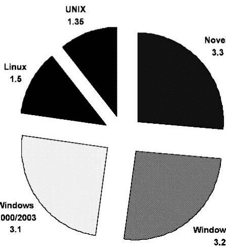

在更换基础设施服务器时，我们可以选择：

- 继续使用分式设计，但改用 Linux 服务器。
- 整合到更少、更大的平台上。
- 用网络附属存储替换服务器。
- 结合这三种策略。

# 许多小型 Linux 节点

管理许多用于文件和打印的小型计算机服务器的问题是广为人知的，这引发了人们对替代方案的兴趣。这种做法的优势是，我们可以进行局部升级，而不是尝试购买所有新系统。由于 Linux 成本很低，而且性能可能优于它们所取代的软件，我们几乎不需要花钱就能获得更好的性能。

# 整合

服务器整合很可能是解决方案的一部分，因为它对配置和更新提供了更好的控制。整合的算术逻辑可能很有吸引力，遗憾的是，组织边界和地理位置通常阻止了我们获得全部收益，因为某些小型服务器必须位于偏远地区或分支机构。此外，供应商对整合的定价是为了让他们自己获得大部分利益；例如，取代三台服务器的微软企业级操作系统成本大约是标准服务器的三倍，而且较大的硬件通常比较小的更贵。最后，整合在供应商中很受欢迎，因为这通常意味着购买所有新硬件，而许多旧设备是沉没成本，并且可能还可以完好使用。典型的组织除非扩大规模，否则应该感到持续的文件和打印服务需求。

## 4.2 将基础设施迁移到 Samba 和 OpenLDAP

# 网络附属存储

网络附属存储 (NAS) 提供了管理和成本上的优势，尽管如此，实际的地理位置和替换沉没硬件的需求可能会抵消这些优势。

## 4.2.2 管理 Windows 专有功能的使用

这里的目标是针对那些目前无法从 Windows 进行大规模迁移的组织，为在时机成熟时从 Windows 转向开源做准备工作。这可能是为了响应业务变化、许可升级，或仅仅当系统准备好进行更换时而采取。

我们将尽可能地推迟许可的使用。我们将推迟 Active Directory 的使用，并寻找目录和安全的其他替代方案。这样做的好处是可能减少许可费用，同时使与非 Windows 系统的集成变得简单。

我们通常会避免升级，因为只有在有新功能的情况下升级才是合理的。我们将留在 NT4 而不是 Win2K，留在 Exchange 5.5 而不是 2000。我们将通过查看社区支持选项（例如 MS Premier）为开源类型的支持做好准备。

系统管理工具应该使用 Python 等开源工具构建，而不是特定平台的 API，购买的工具应尽可能是开源或跨平台的，如果是平台特定的，则应该是廉价的。系统管理是一个公司内部优秀人才往往会投入大量且定义明确的领域，结果发现自己被陷在专有代码中。

## 4.2.3 培训管理员使用 Linux 和 Samba

我们应该培训 MCSE 学习 Linux，包括 Samba 和 CUPS（文件和打印共享），以及在适当的情况下学习 OpenLDAP 和邮件管理。

大约有 50 万名 MCSE 和 150 万名 MCP。这些人通常是他们所知技术的拥护者，特别是因为获取这些技术可能花费了他们的时间和金。教他们开源的对应方案将非常有帮助。

微软管理员花费大量时间设置文件和打印服务，处理 Active Directory 和 Exchange。Linux 和 Samba 是开源的对应方案。

任何涉及文件/打印服务器新部署或更新部署的人员都应该考虑这一点。

## 4.3 构建一些 LAMP 应用

Gartner 报告《恐惧企鹅》（2003 年 1 月）预测，到 2004 年，大多数组织将在 Linux 上部署简单的应用程序和四节点集群。今天公司部署 Linux 的单一最大原因是为了 Web 开发。

一个极佳的第一步是使用 Linux 和 Apache 构建一两个简单的应用程序，并使用 MySQL 或 Postgres 作为数据库，使用 PHP、Perl 或 Python 作为开发语言。这种组合被称为 LAMP，它允许你快速构建一个纯开源系统。现在，你可以自由地将构建、维护成本以及运行成本与贵组织已使用的其他替代方案进行比较。希望这能证明开源系统运行可靠、构建简单、且购买和操作成本低廉。见图 4.4。

根据 Web Security Space（www.securityspace.com, 2004 年 3 月）发布的模块安装报告，Web 开发语言 PHP 约占 50% 的 Apache 服务器，Perl 占 20%，Python 占约 1%。PHP 的数字正在稳定增长，Perl 的数字从约 35% 的高位缩小，而 Python 的数字保持稳定。大多数人使用 PHP 作为 Apache 的开发语言。

MySQL 是一个强大的数据库，易于安装和学习使用，而 LAMP 组合在许可和成本方面提供了一个非常良好且简洁的解决方案，特别是对于组织外的分发。另一种开源数据库是 PostgreSQL。

## 4.3 构建一些 LAMP 应用

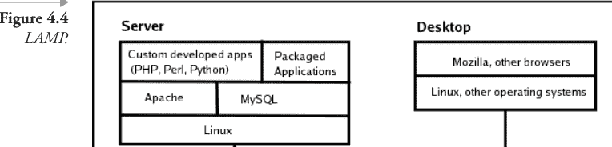

某些组织拥有难以更改的数据库标准。如果你在其中之一，我不会犹豫使用 Oracle、DB2 或 SQL Server。

## Web 应用

对于大多数人来说，这些将是使用 Apache 的 Web 应用。它们同样可以是面向外部的网站（例如电子商务），也可以面向内部的网站（例如员工门户）。

## 客户端/服务器应用程序

如果你们需要，也可以构建客户端/服务器应用程序。此类应用程序将具有丰富的信息展示和/或大量的数据输入，并针对群体，例如：

- 作者工具
- 呼叫中心
- 客户关系管理
- 决策支持或表格
- 工程工作站和 CAD
- 分析（财务、数学等）
- 医疗

## 4.3 构建一些 LAMP 应用

通常 LAMP 客户端/服务器应用程序使用 Python 或 Perl 作为开发语言。Python 对于此类交互式应用程序是一个很好的选择。

## 选择第一个系统

此时，你可能正在为任何规模的公司构建第一个应用程序。尝试新方法的可能包括：

- 构建新的网站或应用程序
- 为现有网站或应用程序添加重大新功能
- 迁移使用旧工具开发的应用程序
- Web 开发迁移，例如从 ASP 迁移到 ASP.Net 或 JSP
- 开发或管理正在外包或引入

我们将使用第一个系统来证明开源的某些特性。因此，我们应该避免那些任何技术都能实现的简单小系统，以及那些不会部署的试点系统，因为后者无法证明任何问题，而我们不想以其他方式工作。

系统应该与技术契合。完成后，它应该展示该技术中引入人的方面，尽管这通常不现实。对于 LAMP 系统来说，这可能意味着它应该是一个有趣且吸引人的网站。

系统的引入不应该是时间紧迫的，因为第一个系统需要额外的时间来进行培训、迁移和处理在后续部署中不会发生的错误——出于同样的原因，它的投资回报率也应该是足够的——这样即使成本超支，ROI 也足以支撑该系统。最好该系统是可以分阶段部署的。第一个系统可能会学到影响以后部署的经验。


## 4.4 为服务欠缺群体引入新的桌面系统

为了解决这些问题之一，你必须像之前讨论的那样，将其拆分为若干部分，以便尽早开始提供服务。

尽管如此，但并没有的必要去避免复杂的这类系统。开源系统的一些最伟大成就都处于最前沿。有时，会出现需要英雄式的努力和风险承担的机遇，而且必须有人去应对。Linux、Apache、Amazon 和 Google 就是那类机遇。未来还会有其他的机遇。

简单地将开源软件提供给那些目前没有、且负担得起整套现行许可版桌面软件（包括 Office、Visio、Photoshop、SQL Server 和 Visual Studio）的用户。这没有迁移成本。这些系统将超出预期。软件成本与可能使用的载体（更便宜、更旧或共享的系统）相匹配，而不是像闭源软件价格那样让载体负担从不堪。硬件需求可以通过旧电脑来满足。见图 4.5。

今天没有桌面电脑的用户包括以下几类人：

- 新兴和小微企业
- 特许经营企业、经销商以及其他合作伙伴
- 访问我们网站的客户及其他人员
- 我们的家庭、家人和邻居
- 社区组织，如学校和医疗工作者
- 零售、分销和制造业工人

| 自定义应用程序 (FreeSoft, Unix) | 组装应用程序 |
|---|---|
| Apache | MySQL Samba OpenLDAP Sendmail |
| PostgreSQL | Mozilla Open Professional Personal tools Evolution, ... |
| Linux, FreeBSD, Windows, UNIX | Linux, Windows, Mac OS X |

图 4.5 新的机遇。

- 叫中心
- 制造业与分销
- 零售与酒店服务业
- 政府
- 教育
- 医疗保健

仅在美国，这些都是非常庞大的群体，包括数百万工人，他们可能通过开源技术以合理的成本获得更好的工具来被赋能。

我们还会考虑发展中国家的特殊机遇案例，以及盗版问题。这些略有重叠的群体（因为发展中国家很少有人为软件付费）保守估计可能构成了数千万到上亿计的开源软件潜在客户。

### 4.4.1 新兴和小微企业

新兴、小型和家庭办公室企业有机会在没有迁移成本的情况下建立业务，且无需向大规模劳动力传达变化的困难。有些企业会选择直接使用开源技术栈。这对于可以自己选择工具的专业工作人员来说尤为如此。

小微企业采用开源的主要障碍是它们的业务伙伴。通常，小微企业与少数公司进行大部分交易，这些公司可能是总部、特许经营商或出版商，它们可以控制运行环境。

### 4.4.2 特许经营

在许多零售业务中，大多数商店并非完全持有的子公司，而是特许经营的。在快餐和酒店服务业中，通常有区域性的特许经营商为一家或多个特许经营商运营数十或数百家商店。例如，一家餐厅运营公司可能在中西部运营 200 家汉堡王。酒店运营商可能会为一家特许经营商运营一系列 Quality 酒店，为另一家运营万豪酒店。特许经营在汽车经销商中也非常常见。

在特许经营的情况下，很难统一指定特定的系统，因为购买系统的组织并不是运营这些系统的组织。这可能导致几个问题：

- 不同商店使用不同平台实现相似系统，导致它们无法与支持它们的中央系统兼容
- 同一商店内的不同系统使用不同平台实现，导致它们在商店内无法协同工作
- 无法获得批量折扣或其他杠杆作用，因为成百上千次的购买被拆分成了跨越多个机构的许多小额购买

开源软件可能为特许经营领域提供一种解决方案，允许以合理的价格获取软件——例如 Open-Office——以及可以根据不同参与组织的需求进行定制的软件。

### 4.4.3 叫中心

美国约 2% 的动力在呼叫中心或数据录入部门工作。呼叫中心通常在几个专用应用程序上雇有数百名员工。他们面临以下问题：

- 应用程序有时运行在旧设备箱上
- 需要保持低成本
- 工作站的管理应该是集中且简化的，不要有不必要的额外应用程序或定制

呼叫中心应用程序通常需要多个屏幕来访问旧系统。这在电信公司应用、银行和保险业中很常见。如果涉及遗留应用程序，屏幕抓取（screen-scraping）或在“绿屏”应用程序上加一个精美的前壳是常见的做法。这可以变得相当复杂，一个智能工作站可以驱动多个旧应用程序。由于需要在一个屏幕上同时显示多个系统，一些呼叫中心在与客户通话时使用大显示器来显示多个窗口，包括出站网站。过去他们购买 UNIX 工作站仅仅是为了支持这些大显示器。

通常，呼叫中心应用程序是根据每个活动定制的——例如，与特定的电视广告投放或电话营销活动绑定。因此，PHP 和 Python 等快速脚本语言的快速开发和部署效果很好。如果应用程序基于此开发，PHP 会很好用。有些呼叫中心对 GUI（图形界面）有非常严格的，在这种情况下我们使用 Python。

呼叫中心应用程序通常是数据库密集型的。但基础需求并非单一，因为一个大型呼叫中心可能会为不同的活动和产品访问许多相关的数据库。如果开发了新的自定义应用程序，数据从遗留系统向关系型数据库的传播是很有可能的。通常，前端系统会维护客户记录和目录的副本，然后通过后端推送订单或状态变更。

在某些情况下，需要使用电子邮件、办公软件或图像显示来支持知识工作——但大多数不是为了创作，只是为了阅读。大多数呼叫中心因为开销太大而不选择许可办公套件。

对于利润微薄的中心来说，开源提供了正确的许可模式和成本。在这种环境中，能够控制构建也是一种优势，并可能详细管理。

该行业的人员流动率很高，因为在签署新合同时，通常需要招聘并培训整个员工团队。因此培训是持续性的，而不是一次性成本。对于新员工来说，学习 OpenOffice 等工具是很容易的。在任何情况下，员工都生活在应用程序之中。

### 4.4.4 零售、餐饮与酒店服务业

零售包括 Office Depot、PetSmart 和沃尔玛等公司，它们运营成百上千家商店，以及个体店和小型连锁店，它们可能只有一个或几个站点。汽车经销商本身就是一个巨大的零售类别，而且是一个还没有计算机系统的类别。

餐饮包括廉价的堂食连锁店（如龙虾）和快餐公司（如汉堡王），以及高端餐厅。酒店服务业包括酒店、赌场、邮轮和其他人们居住的地方。在下文中，我们将所有这些情况下的销售点系统（POS）称为“商店”。


## 4.4 为欠发达服务地区引入新的桌面系统

组织通常需要维护其自身的定制构建版本。这最重要的原因是为了稳定性，因为系统需要在没有维护的偏远地区可靠地运行。资源占用（Footprint）也至关重要；由于系统需要廉价且通常是旧旧设备，它们的内存和磁盘存储空间可能很小。

零售领域的应用主要是针对特定零售商专门开发和定制的，并从开发销售点系统（POS）和商店系统的专业供应商处购买。这些系统通常是“锁定”的，既是为了前述的易于维护，也是为了防止欺诈。

应用需要易于学习使用，因为零售场所的人员极多且流动率非常快。另一方面，由于这些组织预计对每一位新入员工提供从零开始的培训，因此系统不需要特别标准。

对于零售商而言，办公软件具有价值，尽管大多数组织并不希望在商店层面获得 Microsoft Office 的许可。每个地点通常会有几名经理，并且经常共享系统。基于 Web 和多媒体的应用在培训方面可能具有价值，因为这些组织每年雇佣成千上万的新员工。可能还会使用邮件和其他社交软件来建立更强大的内部社区，或者例如，来自 Meetup.com 等应用产生的客户。

零售领域反复出现的一个特定问题是代码供应商对操作系统和服务器产品的打包。这种打包设计旨在为服务器获得最优价格（特别是从大型组织处），让小企业能够通过在运行相同代码库的工作站上廉价 Web 和数据库服务器来获得一些资源。这是通过限制连接数量、数据库大小等来实现的。结果是产生了一个“掉在缝隙中”的零售组织，其行为像一家小企业（尽管在法律上可能不是），但他们希望像其母公司所属的大型公司那样，对“企业级”产品进行标准化。

大多数零售系统是事务性和匿名的，但在酒店业中，正向着个性化方向发展，尽管这种趋势尚未完成。例如，酒店通常可能知道你的信用卡号和/或吸烟偏好，但不知道你喜欢的食物饮料。邮轮公司通常会在每次航行之间丢失所有个人信息，尽管回头客对他们非常重要；而另一方面，赌场则不会。

零售系统是低成本、可管理且集成良好的前端系统的良好市场。它们通常有一套已知的应用程序。它们是极好的 Linux 和开源机会。

### 4.4.5 政府、医疗保健与教育

政府、医疗保健和教育系统在不同地理区域面临着相似的问题，并且没有很好的理由合作。闭源软件公司通过在某地投入巨资开发解决方案并在其他地方销售它来提供服务。通过合作，这些组织可以平滑并资助这一过程。

### 政府

将政府视为技术领导者并不常见见，特别是在美国的话语体系中，但政府通常是资助早期技术的唯一平台。计算机、PC 和互联网的许多早期开发都得到了资助，且通常与航空航天（例如 NASA）或国防（例如 DARPA）有关。在航空航天和国防领域，在某些政治环境下，政府可以在医疗保健和教育中发挥领导作用。这在某些政治环境下的医疗和教育领域也可能发生。

政府在某些阶段非常适合开源。受青睐的国防和航空航天计划之外的政府客户通常关心成本。政府有动力赋能开源，包括系统的巨大规模，以及通常要求从“遗留系统”访问的法律。他们可能拥有大量的用户，通常比企业多出几个数量级。政府采购周期强调成本的可预测性（可能是多年来来自各种供应商的），而不是即时的成本节省；多个供应商和一致的定价可能尤为重要。政府通常还有一些特殊需求。他们将对信息自由的极端需求与安全及隐私相结合。投票是这些极端需求的一个特例；一个领土内的几乎所有人都在同一天进行处理，其隐私要求和发生欺诈的可能性比商业信用卡或赌博系统更高，且受到严苛的限制。

当然，并非所有政府问题都是如此大规模的。在所有层面都有开源的机会：国家政府、州/省、城市、甚至是子开发层（本地日历和时报）。之前的几点仍然适用；由于政府为所有公民提供强制性服务，价格/性能和可扩展性始终是一个问题。其他因素则变得更加重要；如果必要，可以在国家投票系统上花费大量资金，但在规模较小的政府机构中，合理的开发成本和时间尤为重要。

政府处理公平性问题。这些问题通常建议使用开放标准、避免使用闭源代码查看软件，以及无需特殊软件或硬件即可访问的信息。政府在利用社交软件和群组软件构建社区方面有一些特殊机会。

政府系统进行这些迁移的原因各不相同。首先，可能是因为本书其他地方讨论的问题。例如，某些政府机构可能不符合许可合规。这些都是外国政府的，但也可能并非。其他政府在版本上已有些落后——例如，运行 Windows NT4 或旧版本的 Office——因此他们现在处于可以大规模迁移到开源以追赶的境地。

政府的资金周期与软件不同步，因此很难证明年度维护费或意外的许可费用增加是合理的。因此，政府机构有时会在等待几年后做出大动作。此外，政府机构经常进行非常大额的购买，因此他们对可能发生的成本节约非常有动力。

某些政府功能似乎非常适合开源。美国政府是全球最大的出版者。在美国，现在有一个组织可以让政府实体交换开源方面的信息。

在美国机构中，美国国家安全局（NSA）使用自己的 Linux 内核。美国人口普查局使用 Linux、Apache、MySQL 和 PHP 开发了新系统。

某些政府机构可能不符合许可合规。这些都是外国政府的，但也可能并非。其他政府在版本上已有些落后——例如，运行 Windows NT4 或旧版本的 Office——因此他们现在处于可以大规模迁移到开源以追赶的境地。

在许多国家，医疗保健和教育完全或部分属于政府。在任何情况下，许多问题（如规模巨大和资金经常且不充足）是相同的。成本是医疗保健最大的问题；在过去的 20 或 30 年里一直在快速增长。医疗保健还存在允许许多方合作的非常特殊的问题。

巴西、墨西哥、丹麦、秘鲁、法国和意大利都有涉及许多政府机构的国家计划。

德国发布了开源标准，许多机构正在迁移到开源，有些已经完成，有些处于早期阶段。慕尼黑从 Office 迁移被广泛报道。

在奥地利，信息与通信委员会、人口普查局和财政部已经迁移了相关订单。

英国自 2003 年 10 月以来一直在研究开源，并有几个机构正在进行，包括工作与养老金部和水务监管机构。

韩国计划用开源方案替代 Windows 操作系统和软件（服务器 20%，桌面 30%），预计到 2007 年每年节省 3 亿美元。

中国宣布部署数万份 Sun 桌面系统，该系统基于 Linux、OpenOffice 和 Gnome。尽管该计划处于早期阶段，但在 2002 年已有超过百万台安装了 Linux 的设备。

某些报告可能受到观察者偏见的毒害；在处理政府事务时，偏见报告更为常见。任何事实都可能过时或不准确。其中一些事实可能是这样。

有些部署未被采纳；有些会失败；有些需要很长时间才能成功或只能部分成功；而那些成功的最终会被其他东西取代。


在管理个人记录的同时，兼顾隐私保护。各方之间并没有高水平的相互信任。

有一个名为 OpenVista 的开源医疗垂直解决方案，来自一家名为 Medphere 的公司。Medphere 针对高度扩展的、基于 MUMPS 的、由 VA 开发的医院管理软件提供集成和服务支持。

教育系统通常规模非常庞大。例如，为一个学区内的每个孩子分配一个邮箱，可能会导致远超企业水平的大量邮件流量。这里存在漏洞频发和易用性差的问题，因为培训水平与部署的系统并不匹配。此外还存在公平性问题。私立学校和大学可能会管理计算机和软件，但这对公立学校来说通常很困难。如果我们打算给高中生提供电脑，我们希望他们都使用相同的办公套件。如果我们要求学生使用某些软件，我们希望他们都能平等地访问 Photoshop 或 Visual C++。这些问题通常通过教育优惠来解决，但这些优惠往往是局部且零星的，并且在某些情况下（例如设计学生兼职，或者教育版有限制）会产生问题。开源软件是解决其中一些问题的良好方案。

## 未许可软件

### 开源是盗版的正规替代方案

开源的一个重要案例是那些目前尚未购买满意的 Windows 系统的组织。

有一大群组织从未对其正在使用的软件进行许可。根据行业团体商业软件联盟（BSA）的统计，全球有 40% 的软件没有合法的许可。在某些国家，这一比例飙升至 90%。即使在美国，BSA 报告称全范围内未许可软件的使用率为 25%，在某些南方州更是了 40%。

所有系统都是开源的即刻候选对象。开源提供了即时的合法性，允许使用经过验证的支持渠道（包括付费支持）。它还提供了公平竞争，这与盗版不同，因为美国或其他地区的企业有机会通过使用合法许可来降低成本。

这意味着，全球 40% 的软件和美国 25% 的软件现在就应该用开源软件进行替换，以便以合理的成本实现法律合规。

## 盗版波及大多数人

虽然软件盗版在美国大型机构中并不寻常，且许多专业人士可能从未在那里经历过，但在小型企业（如特许经营经营等情况）、学生群体以及普通家庭中，这种情况非常普遍。我想我已经在小企业或邻居家里见过这种情况了。每个夏天周末，美国城市外都有大型跳蚤市场在卖这些东西。

在某些情况下，一个组织可能并没有在使用未许可软件。但证明自己没有这样做可能是不受欢迎欢迎的。一个著名的例子是 Ernie Ball，一家加州州的吉他弦和吉他制造商。2000 年，美国法官的一次搜查发现了 60 份 Microsoft Office。该公司被处以 65,000 美元的罚款，承担了 35,000 美元的法律费用，并受到了负面舆论。Ernie Ball 将 Microsoft Windows 和 Office 切换到了 Red Linux 和 OpenOffice。公司表示他们从未使用过非法软件；公司里的 72 台电脑中，旧电脑只是在交给工程部门时还还留着这些软件。Ernie Ball 承认最初的切换决定是感性的，但公司现在每年可以节省 8 万到 10 万美元。因此，你不一定非把自己想成“软件盗版者”才算有罪。

一个值得考虑的个人案例可能是将旧电脑捐赠给当地社区中心，或者帮助邻居的孩子做作业。这些活动中的任何一种都可能让你轻易卷入“软件盗版”——例如，如果你没有证明自己已彻底清除了硬盘，或者邻居安装了没有有效许可的 Microsoft Office 而你又帮他完成了设置。如果你使用开源软件，你就免受了这种影响。当你捐赠系统时，你可以加载 Linux、OpenOffice 和其他开源软件，并确保它是一个功能完整的系统。当你帮助做作业时，你可以带一张带有 OpenOffice 的 CD 并安装它，用它打开任何 Word 或 Excel 文件。

### 4.4.7 国际机会

考虑未来几年将在国际范围内部署的新系统。计算机行业的发展速度快于旧系统的陈淘汰速度，价格也在不断下降。

在发展中国家，系统使用的巨大增长和共享通信技术的进步将让更多的人接触计算机和互联网。例如，伊拉克的用户在一年内从 5,000 增加到 50,000，并在未来几年内可能达到 500 万。巴西的数字要大得多。世界这些地区的许多系统出于经济考虑将成为开源的候选对象，他们也清楚这一点，这就是为什么中国和巴西处于领先地位的原因。

根据“授人以鱼”的原则，开源可能赋能这些群体中的一些人提出他们自己的解决方案。在发展中国家，人们已经学会了以发达国家产品极小部分的成本制造轮椅和其他实用物品。这些产品也更适应当地条件。为什么网站和电子表格不能也是这样呢？

开源允许各国用自己的语言和文化创建软件的各个，即使在这些地方按传统标准来看可能没有经济市场。大型软件可能针对 50 到 100 种语言进行本地化，但语言远多于此。如果库尔德人或巴斯克人希望用他们自己的语言使用软件，开源就是他们获取的途径。

## 更广阔的思考

我们可以把“服务不足群体”的概念推得更远。我们知道，当引入新技术时，我们往往倾向于用它来替代以前用途相似的技术。只有在之后，突破才会被感知。这种过程持续一到两代并不寻常。Web 只有十年的历史，而开源的广泛应用还年轻，尽管它可以做的事情。

## 4.5 将应用程序和数据库迁移到开源

许多旧且较小的服务器上运行的应用程序和数据库已被 Web 变得过时。

我们之前讨论过已安装服务器的统计数据。对服务器基础同样的分析显示，25% 的 Windows 服务器和 40% 的 UNIX 服务器是应用程序和数据库服务器。这大约是 240 万台 Windows 服务器和 120 万台 UNIX 服务器。还有少量的主机服务器，上面运行着大量的应用程序和数据库，它们某些时候需要迁移到新技术。这些应用程序大多数是在 Web 出现之前编写的，使用的数据库和工具现在已过时。它们需要迁移。

## 4.5 将应用程序和数据库迁移到开源

![img/5e95216d5535a91da78910a9b306b74_113_0.png]

大多数系统的明显目标是 LAMP。考虑到它们的年纪，它们应该适合这些技术。在某些情况下，数据库模式或代码逻辑可以保留，但通常简单的方法是使用新应用程序。参见图 4.6。

如果一个系统只是老旧且是沉没成本，在发生某些事情使其突然变得贵或需要更改之前，它不太会被迁移。迁移的具体原因包括：

- 旧系统已过时，制造商正在停止支持。
- 系统需要在某个日期前进行昂贵的升级，否则将停止工作。
- 公司正在合并、拆分或缩减规模，并支付不成比例的成本以留在系统上。
- 系统至关重要，但特别难以维护，或无法满足客户需求。

这个机会是巨大的，但它比基础设施或新开发的机会风险更大。之前说的关于迁移风险的一切内容都适用于这里。无论该系统看起来多么糟糕，它已经显-


## 4.5 将应用程序和数据库迁移到开源

……到目前为止完全都在进行这项工作。与可以分阶段处理的文件和打印服务器不同，数据库和应用程序服务器通常对业务至关重要，且非常难以处理。要在不产生风险的情况下逐步改进这些情况的路径可能难以遵循或无法实现。有时，一个大系统遗留在旧的数据库和平台上的原因，是因为比我们更聪明或运气更好的人意识到了这种风险并避开了它，直到我们走了这一步。

### 4.5.1 评估开源数据库

虽然公司将继续使用非开源数据库（通常是 DB2、Oracle 和 SQL Server 中的一个或多个），但对于几乎每个组织来说，在某些情况下，开源数据库足以胜任、成本更低、安装占用更小，且更容易管理。某些组织可能拥有完全迁移到开源的机会。

因此，组织应该评估 MySQL 和 PostgreSQL，并确定在部署它们时他们可以接受的性能标准和风险标准。

尽管统一使用数据库、Web 服务器和应用程序服务器以简化进程间通信、远程办公室等具有显而易见的优势，但由于遗留问题、外包或打包的原因，许多公司会有多个系统（一些是 Apache/JBoss，一些是 IIS/.Net）。其他组织在不同规模下使用不同的系统，例如大型系统使用 Oracle/Sun，较小系统使用 MySQL/Linux。

### 4.5.2 用开源替换小型旧旧数据库应用程序

虽然开源数据库并不昂贵，但它们可以取代过去由于价格原因无法使用 Oracle 或 SQL Server 构建的系统，而这些系统曾是使用 Access、Paradox、Progress、Border Interbase、xBase 数据库（如 FoxPro）和其他个人数据库构建的。其中许多是共享文件系统，它们作为数据库服务器从来不令人满意，在多用户情况下倾向于损坏，且性能差、对 SQL 标准的支持薄弱。其中几个产品已不再支持或正处于支持边缘。

另一类数据库是旧的微型计算机数据库，无论是关系型的还是更受限的。如果这种系统已有多年历史，那么可以确定像 MySQL 等开源产品可以超越它。这组产品包括旧版本的 Informix、Ingres、Btree 以及 SQL Server 6.x（可能是 7.x）。

通常情况下，此类旧数据库系统上的前端代码需要重写。几年前销售的前端工具几乎已经消失，你也不会想继续使用它们。它们是专有的，并且具有那个时代客户端/服务器工具的所有局限性。最好的发现可能是 VB3 或带有 MFC 的 VC++、早期的 ASP/HTML 或 Access，所有这些都需要大改写以跟上时代。

因此，通用计划是将数据库架构迁移到新数据库（例如 MySQL），并将其作为新的 LAMP 应用程序重新编写。

### 4.5.3 将 UNIX 迁移到 Linux

另一个需要考虑的迁移是 UNIX 工作站。20 世纪 80 年代以来，安装了数百万这样的工作站用于工程工作站，包括机械 CAD、软件开发等。制造商包括 Apollo、Sun、HP、IBM、Silicon Graphics 等。早期，这些系统每台成本可能高达 50,000 到 100,000 美元。一个五年前、花费 2 万到 3 万美元的系统现在可以用 2,000 美元更换。最终，随着它们在商品化硬件的竞争中价格反复，且其先进的 3D 图形系统被授权用于 Gamecube 和 Playstation 等游戏，这些系统被通用个人电脑所取代。

Linux 将 PC 通用模式的力量带入了 UNIX 工作站。个人电脑平台现在有了 3D 图形加速器。当时机时，所有系统都可以被 Linux 替换。它们也可以被 Windows 系统替换，微软正努力争取这些机会，但迁移到 Windows 显然比迁移到 Linux 更困难。微软通过用于批处理工具和运行 UNIX API 的软件的 UNIX 服务进入这一市场。但无疑，迁移到 Linux 比迁移到 Windows 更容易，系统运行得也会更好。Windows 上的 UNIX 仿真相当好用，但它们很难匹配 Linux，并导致难以管理的系统（既不是正宗的 UNIX 也不是 Windows）。API 仿真性能也还可以。

华尔街的大部分现在正在这样做，包括美尔林·林士（Merrill Lynch）。UNIX 迁移的另一个例子是 Industrial Light & Magic，它拥有数百台 Linux 工作站。梦工工厂在所有 Linux 工作站和渲染机（超过 1000 台系统）上制作了电影《辛巴》（Sinbad）。

不要忘记大多数 UNIX 工作站环境都安装了许多支持服务器，执行文件/打印、邮件和数据库服务。如果你搞定了前端，这些将非常顺利地迁移到 Linux。

## 数据库迁移

一个可以从 UNIX 迁移到 Linux 的重要软件包案例无疑是数据库服务器。大多数人不会在数据库产品之间迁移数据库，因为工作量太大了。问题上的差异，例如存储过程，甚至是细微的语法问题可能会在不经过大量重新测试的情况下出错。然而，将已经在 UNIX 上的 Oracle 和 DB2 系统迁移到 Linux 是绝对可能的。这不太可能导致转换问题。考虑到经济因素，在中级市场似乎不太可能有许多现有系统迁移到 Linux，但需要购买新硬件的系统以及必须缩小规模（可能是为了每个分发版本）的系统将会迁移。

### 4.5.4 在 Linux 上评估并购买软件包

查看主要的软件供应商，我们看到大多数供应商在其核心产品上完全支持 Linux，而产品组合型公司则支持部分。除微软外的领先四家软件公司是 IBM、SAP、Oracle 和 Computer Associates，它们都是 Linux 及其他产品的热心支持者：

- IBM：大多数核心产品支持 Linux
- SAP：核心产品包括 mySAP Business Suite、SuSE 和 Red Hat
- Oracle：核心产品支持 Linux
- Computer Associates：提供全系列企业管理、数据管理、变更管理门户、安全和 Linux 存储解决方案，包括 Center 和 Ingres 数据库
- Cadence：电子设计系统支持 Linux，包括集群
- PeopleSoft：企业业务逻辑后台服务器支持 Linux
- BMC：核心产品包括 MAINVIEW、Patrol 和 Deployment Manager 支持 Linux
- SAS：产品支持 Linux 以及其他许多平台
- Verisign：产品完全支持 Linux
- Symantec、Compuware、Sungard：产品线支持 Linux

如果我们的组织正在考虑这些软件包，我们可以考虑选择 Linux 来运行它们。这些软件包的可用性可以减少 Linux，并有助于尝试简化到几个标准的操作系统。当然，将此类软件包部署在 Linux 而不是其他操作系统上不太可能节省费用。

### 4.5.5 企业应用软件

从 1970 年开始，企业软件在大型机上的销量巨大。20 世纪90 年代，新一代软件包的增长激增。这种软件使用客户端/服务器技术构建，并围绕企业资源计划（ERP）和客户关系管理（CRM）软件套件展开。自2000 年以来，这些产品的销售已经停滞，在某些情况下发生了崩溃。主要 CRM 公司的销售额下降了一半，ERP 以及其他大型软件产品的销售额也出现了灾难性的下跌。

最初，那个时代有很多公司——现在该领域已经整合，ERP 领域的领导者是 SAP、PeopleSoft 和 Oracle，CRM 领域的领导者是 Siebel。显然，微软在收购了 ERP 套件供应商 Great Plains、Solomon 和 Navigation 并推出 CRM 产品后，打算成为该领域的参与者。


## 4.6 总结

获取 ERP 或 CRM 产品通常会驱动整个业务的技术选择，因为这些软件包非常庞大且影响巨大，以至于其应用服务器、数据库和基础设施平台通常会同时成为其他开发的标准。

SAP、PeopleSoft 和 Oracle 均在 Linux 上提供其整个产品线。因此，在 Linux 平台上安装 ERP (CRM) 系统是可行的。SAP 还对开源数据库 MySQL 提供支持，MySQL 曾是 SAP 的数据库。

似乎没有任何大型的开源 ERP 或 CRM 产品——也就是说，与 SAP、PeopleSoft、Oracle 或 Siebel 可以相媲美的产品。目前存在一些较小的系统，例如 Compiere 和 Open For Business (OFB)。Compiere 基于 Java 开发，并正处于开源数据库的规划阶段。这两款产品目前还没有企业级客户，也不具备完整的模块set。

## 你是否需要集成的 ERP 或 CRM？

你可能并不需要 ERP 软件包的所有功能。大多数客户只购买少数组件（仅仅是因为成本考虑）。也许这种捆绑是商业软件的一种产物。

所有商用公司都倾向于通过收购相关产品来实现增长。此外，在闭源软件模型中，集成往往会发生，因为软件公司拥有数据的唯一访问权限。而在开源模型中，客户或第三方可以访问数据并创建补充模块。ERP 或 CRM 供应商在向上销售过程中增加门户、数据仓库或其他产品时，也会出现类似的情况。这可能利用了规模效应，但更有可能是利用了这类产品的直接销售关系和闭源数据格式。

因此，那些只需要像 Quickbooks 这样的会计工具，或者在大规模上需要 Great Plains 的客户，有一些开源选择。同样，那些只需要呼叫中心、客户服务管理或销售力量自动化的客户，可能会找到开源的解决方案，特别是对于小型企业而言。两个值得考虑的产品是 Tutos 和 SQL-Ledger。

## 4.6 总结

开源提供了多种业务机会。以下是本章的总结，以简单的方式阐述了对大多数人有效的观点。

对于大多数人来说，我们可以做的第一件事是建立一个开源实验室，并以实验室为基础来审查和宣传开源活动、评估或创建测试解决方案，并培训技术人员和用户人员。实验室应该部署你希望标准化的 Linux 发行版和其他软件。这为后续步骤铺平了道路。我们可以在一或两种源码语言（Python 和 PHP）上培训开发人员；并在 Linux、Samba、OpenLDAP 以及 Perl 或 Python 脚本上培训管理员。

我们可以通过在 Linux 上使用 Samba 和网络附属存储设备将基础设施服务器迁移到开源。这节省了客户端许可费用并简化了管理。我们可以从没有强烈安全担忧的简单文件/打印共享开始。如果我们有基于目录的安全需求，我们需要在使用 Samba 3 支持 Active Directory 或考虑部署 OpenLDAP 作为闭源目录的替代或补充之间进行选择。

我们可以构建一个或多个 LAMP 应用。这个工具set简化了开发并为了资金。最可能的简单成功将使用 Apache 或当前使用的任何数据库构建一些 PHP 应用，这些可以是新应用程序，也可以是被困在过时平台或数据库上的旧代码的重写。

我们可以研究并开始为未被充分服务的群体引入新的开源系统。我们可能为以前无法实现的解决方案开辟机会。可能考虑的群体包括加盟店；业务伙伴；客户；工厂、仓库和商店的员工；以及当地社区。在这些群体中，我们拥有影响力，但无法控制操作环境或软件购买。提供无需许可费的办公套件、图像处理或电子邮件和即时消息可能允许我们在不花费巨额费用的情况下提供系统或交换信息。

我们可以将应用程序和数据库从其他操作系统（如 UNIX 和 Novell）迁移到 Linux 和一两个标准的数据库。这可以简化系统和应用程序管理，并消除旧的经常性成本。如果我们计划继续使用数据库（例如 Oracle），我们可以将其迁移到 Linux 上的 Oracle。

这个工具set简化了开发并可以比替代方案节省资金。最可能的简单成功将使用 Apache 或当前使用的任何数据库构建一些 PHP 应用，这些可以是新应用程序，也可以是被困在过时平台或数据库上的旧代码的重写。

在做出决策时，查看源代码对于许多应用程序是非常有用的，例如 SAP 这种大型系统。开源解决方案在许多行业中都是可手可及的。

当我们购买软件包进行黑盒安装，但为了将其定制和集成到解决方案中时，这种在“构建”和“购买”边界的决策对开源来说是一个很好的位置。

## 5 更多开源机会

## 5.1 引言

上一章讨论的开源机会包括：

- 建立开源实验室并用其作为审查和宣传开源活动的基础。
- 将文件、打印和网络迁移到开源。
- 使用 Apache 构建一个或多个 LAMP 应用。
- 为未被充分服务的群体引入新的开源系统。
- 将应用程序和数据库从其他操作系统迁移到 Linux。

下一组机会具有比上一章更具困难或限制，且对某些群体比其他群体更合适：

- 使用开源目录来集中管理各种身份。
- 将电子邮件服务器迁移到开源平台。
- 评估和选择开源协作工具。
- 使用开源内容管理系统开发和管理复杂的网站。
- 在适当的情况下将办公和桌面软件迁移到开源。

### 5.1.1 定制化与集成

在许多情况下，我们发现自己正在购买涉及定制开发或集成的产品。如果我们购买一个产品或一组产品作为我们将扩展和集成的架构的基础，我们实际上在买两样东西：产品和开发架构。


## 5.1 引言

开发了它。该代码可以作为我们开发的模型，并允许在我们的控制下进行集成和扩展。

开源软件非常适合定制化。首先，由于我们拥有源代码，我们可以毫无异议地对其进行更改或扩展。其次，我们有机会与开发者合作，并要求他们进行改进，包括赞助相关更改。

### 5.1.2 组织规模

如图 5.1 所示，公司的规模差异巨大，它们对集成化的需求以及自定义开发的能力也随之不同。当然，这些数字都是估计值。特别是作为“点”的金融或技术公司，在 IT 上的支出比例更高，因此它们的行为就像规模大得多的传统公司。

大型公司习惯于管理多个环境、大型主机，并进行自定义开发和集成。小型组织通常没有足够的员工和预算来有效地完成这些工作，除非是在业务的关键部分，它们会更强调软件包的和外包。

开源软件作为一种新型的破坏性技术，在某些组织规模中比其他规模更合适。最大的公司可以采用新技术并构建自定义系统，例如经纪公司和石油勘探中使用的集群 Linux 系统，或

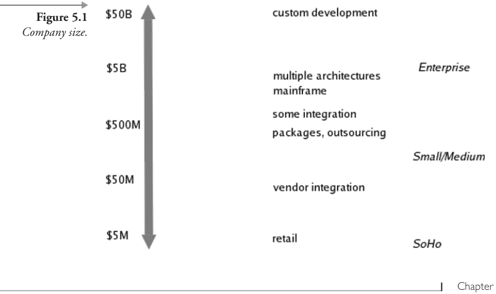

目录服务

Google 和亚马逊。大多数大型组织都可以执行上一章中的所有操作，以及本章中的许多操作。

对于非常小的组织，可以在它们之前没有任何就绪的地方安装开源系统。对于处于两者之间的的组织，情况可能会更加困难。对于中型公司，允许一个供应商完成集成可能是一个很有吸引力的商业提议。对于规模约 1 亿美元的公司，这可能意味着从某一个供应商（如微软）处购买所有系统，并允许集成以简化其运营。对于规模达数十亿、IT 不是核心资产的公司，这可能意味着聘佣 IBM Global Services 或 EDS 等公司并外包运营。

基础设施迁移带来的最大成本效益源于消除 Windows 中的目录元素，因为目录访问的客户端访问许可（CAL）是文件存储中最昂贵的软件元素。这在减少锁定方面也有益，因为开放目录支持来自许多供应商的许多不同产品。支持 OpenLDAP 的有力论点是：目录接触如此许多系统并包含您的专有信息，是维护开放标准的非常逻辑的地方。

目录服务的选择有开源的 OpenLDAP 和闭源产品，包括：

- Novell eDirectory
- Sun ONE Directory Server
- IBM Directory Server
- Microsoft Active Directory

所有这些都与 OpenLDAP 进行了比较。Microsoft Active Directory 不会在 Linux 上运行，但它可以作为 LDAP 目录支持其他服务器和客户端，因此它应该被包含在内。在某些策略中，我们将继续在混合基础设施环境中使用 Active Directory 和另一个目录服务器，并希望它们能够协同工作。

我们需要调查组织，找出人们真正使用的目录的哪些方面。如果在使用 Active Directory 或任何其他现代目录软件，情况确实如此，因为它们可以可选地支持许多不同的活动。幸运的是，从迁移的角度来看，大多数组织似乎只执行他们需要的。

## 5.2.1 迁移与互操作性

遗憾的是，对于许多组织来说，互操作性仍然是问题中最难的部分。有工具可以一次性迁移目录内容，而且获取或构建一个将目录信息从主目录复制到副本的工具并不特别困难，就像你在某些情况下将 Samba 同步到 Windows 环境时可能做的那样。

在某些情况下，可能有两个或多个目录，它们都是主目录（例如 Active Directory 和 Open LDAP），并且有一个同步它们的进程。这实际上并不吸引人，无论你如何称呼它，实际上意味着在混合中加入第三个目录，但如果必须这样做，有几种产品支持这一点。许多大型组织由于收购或遗留系统的原因不得不这样做。

## 5.3 电子邮件

在安全（防火墙和入侵检测）和 Web 服务之后，电子邮件是 Linux 服务器最常见的用途。带有电子邮件功能的新 Linux 安装很容易设置。这并不意外，因为从最早的发行开始，电子邮件一直是 UNIX 的一部分。每个 Linux 系统都可以配置为电子邮件服务器和/或客户端，每个都有若干可用选项。这些 Linux 邮件选择在概念上是相同的，但实际上也是与其他 UNIX 系统上的邮件选择相同的程序。

### 5.3.1 UNIX 邮件系统

开源服务器（如 Sendmail、Postfix 和 Exim）以及客户端（如 Oak、Pine 和 Eudora）长期以来可以在 Solaris、AIX 和其他 UNIX 系统可用。商业 UNIX 邮件服务器（如 HP OpenMail，现在通过 Samsung Contact 等授权持有人销售）也运行在 Linux 上。

这并不是说 Linux 最近没有改进，例如 Evolution（一种 Linux 特有的新邮件客户端）和 Horde（一种基于 Web 的邮件服务器）。

### 5.3.2 迁移

电子邮件可能面临桌面应用程序的所有迁移问题，包括对终端用户中心的依赖和熟悉度，以及具有集成和第三方工具问题的复杂数据中心应用程序的迁移问题。这是高风险的，因为在现代组织中电子邮件是任务关键应用程序。迁移是否可行取决于组织、使用模式、用户的期望以及接受新事物的意愿。

可以使用所有开源产品替换 Exchange。Exchange 本身是几个不同功能的集成，要完全替换它需要进行类似的集成。这些功能是：

- 消息发送和接收

- 消息存储和索引

- 用于身份验证和员工查询的全局目录（Active Directory）集成


- 个人信息的集中存储库（联系人、日历、任务）
- 公共文件夹（简单的文档管理、讨论）

Exchange 还支持可选的浏览器邮件访问（Outlook 网页版，OWA）。此外，Exchange 站点通常必须对垃圾邮件过滤和消息管理工具做出决策，例如老化策略、配额等。

如果可以将这些功能和相应的工具分开，那么我们就不会被局限于 Exchange 中，并且可以这样做。如果我们必须将所有内容做成一个具有此类行为的单一程序，那么我们可能做得不错，但可能会被认为未达到预期。

表 5.1 显示了 Exchange 功能以及与之映射的某些开源程序选项。

如表所示，可以提供等同于 Exchange 所有功能的功能，包括通常与 Exchange 配合使用的产品。显而易见，这种迁移是可行的，但它将涉及许多组织可能尚未准备好的集成工作。

### 表 5.1 微软与开源邮件的映射

| 功能/服务 | Microsoft | 开源 |
|---|---|---|
| 消息发送 | Exchange | Postfix |
| 消息检索、存储 | Exchange | Courier-IMAP, Cyrus IMAPD |
| 用户查找/基于 Web 的邮件 | Active Directory/Exchange Outlook Web Access | OpenLDAP, |
| 协作软件 | Exchange 表单、公共文件夹 | 带有 OpenLDAP 的 LAMP |
| 垃圾邮件过滤 | 第三方产品 | SpamAssassin |
| 消息管理功能 | 第三方、用于 Exchange API 的 VB 脚本 | Python 脚本,Procmail |

### 5.3.5 集成 Exchange 替代方案

如果你正在使用 Exchange 并且想要寻找一个全面的产品进行迁移，而不是自定义集成解决方案，那么至少有两个很好的选择。有一个名为 Exchange4Linux 的开源产品，它可能是几百名邮件用户的小型组织的 Exchange 替代品。

对于拥有数千名用户并可能想要从 Exchange 迁移到 Linux 平台的组织，可能会考虑闭源产品 Scalix。Scalix 许可了 OpenMail，集成了之前提到的其他功能，并提供诸如从 Exchange 迁移等服务。另一种是 Samsung Contact，它也基于 HP OpenMail。

## 5.4 协作软件与合作

开源社区在构建支持社区的工具方面非常有效。一个很有前景的可能性是查看这些社区工具来执行你组织目前尚未涵盖的功能。除了查看与商业类别对等的工具（如内容管理、门户和电子商务软件）之外，这也是一个寻找开源软件领域，它可以以全新的方式处理协作和社交互动问题。这包括 wiki、博客（Weblogs）、实时简单订阅（RSS）以及用于构建和连接社区的软件。

### 5.4.1 Wiki

Wiki（参见 http://wiki.org/wiki.cgi?WelcomeVisitors）由 Ward Cunningham 于 1995 年首次创建，允许用户使用任何浏览器在站点上读取、创建和编辑 Web 。这不仅包括内容，还包括作为新页面和链接的组织。这是内容发布最简单的形式之一。任何用户都可以参与。有数千个 wiki，它们使用几十种不同的软件包（wiki 引擎）构建。wiki 的主列表位于 http://c2.com/cgi/wikiEngines。

在许多不同语言的可用实现中，优秀的实现包括 Qwiki 和强大的 Twiki，其目标是企业内网（Perl）；TikiWiki 和 MediaWiki（PHP）；Zwiki (Python)；SnipSnap；QuickWiki (Java)。最初，安全和工作流非常简单或不存在，但许多系统现在能够很好地支持这些需求，因此这一类别现在与下一节讨论的内容管理产品有些重叠。

图 5.2 和 5.3 显示了基于 TikiWiki 和 SnipSnap 的 wiki 站点示例。

在微软的术语中，wiki 在功能上类似于 Sharepoint Team Services（后者可能受其影响），也类似于 Exchange 中的共享文件夹和 WebDAV 发布功能（这些功能存在于少数微软产品中）。wiki 与 Notes/Domino 数据库有某些相似之处，但它更容易管理。

不同的实现在存储格式上有所不同，因此迁移通常需要每半年通过编写脚本来安排。这些工具之间存在操作性，而且重新开始总是更容易。

每个人都面临邮件和 wiki 帖子之间互操作性的问题。Exchange 和 Notes 中也存在此问题。一些信息在邮件线程中，另一些信息在 Web 页面上，没有任何强区分。人们会将邮件线程复制到公共文件夹，制作 FAQ 文档，编写脚本收集线程等。幸运的是，由于软件允许人们自由复制，这似乎行之通了。

## 图 5.2 TikiWiki

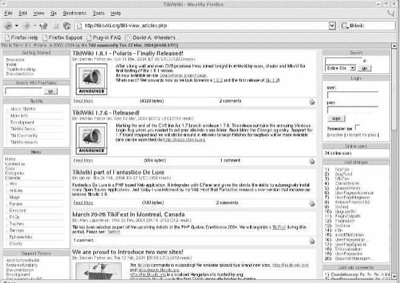

### 5.4.2 其他社区软件

公告板软件包 phpBB 是一个讨论论坛，它已经存在多年并非常流行。它用 PHP 编写，使用 MySQL、PostgreSQL 或 SQL Server。

Scoop 的编写是为了支持讨论站 Kuro5hin (http://kuro5hin.org)。Scoop 使用 Perl、Apache 和 MySQL 编写。它主要用于讨论站，有时也用于简单的内容管理。见图 5.4。

被广泛使用的讨论站 Slashdot (http://slashdot.org) 也将其软件作为开源产品提供。Slash 用 Perl 编写，显然很复杂，但它确实具有卓越的性能。见图 5.5。

## 5.4 协作软件与合作

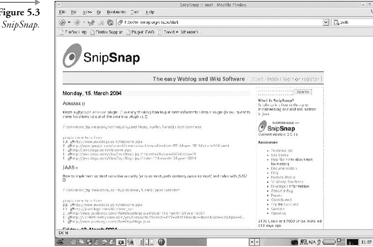

## 图 5.4 Scoop.

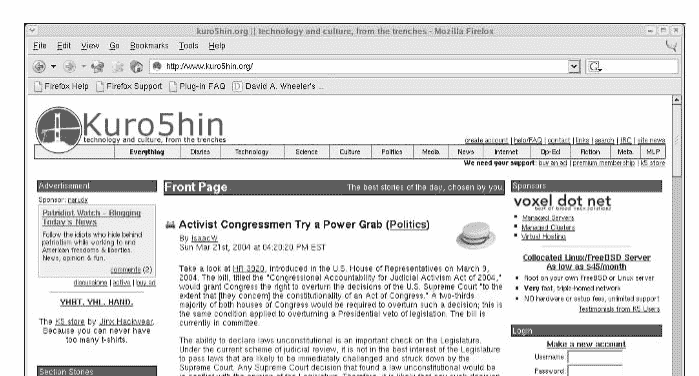

## 图 5.5 Slashdot.

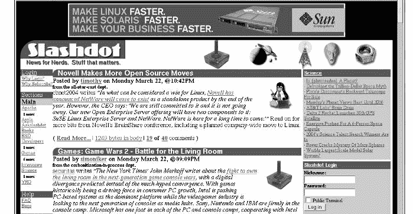

### 5.4.3 博客 (Weblogs)

博客（“博客”）是构建社区的常用方法；随着政治领域的采用，它们日益成为主流。创建博客有多种软件选择。Movable Type 可能是领导者，采用双许可，用 Perl 编写并支持 BDB 和 MySQL。另一个博客是 b2，它是开源 PHP 的。

实时订阅（RSS）是将许多源的数据整合到单个查看器中的标准。良好的博客支持 RSS。

图 5.6 和 5.7 分别是 Movable Type 和 b2 开发的博客示例。

### 5.4.4 即时消息

即时消息（IM）是一种增长快速的应用程序。在某些地方它正在取代邮件，因为它更快且与手机配合良好。消费者级 IM 因专有格式之间的竞争而受到损害。开源软件可能解决这个问题。GAIM 即时消息客户端支持许多服务器，这些

## 图 5.6 Movable Type.

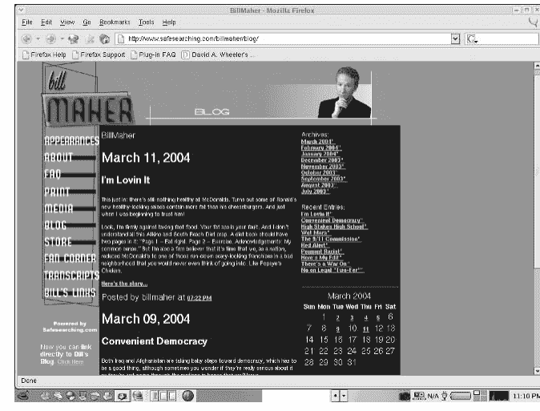

## 5.5 复杂的 Web 发布

Jabber 是企业服务器极佳的选择。GAIM 支持 Jabber，因此我们可以建立企业服务器，并允许从同一个客户端访问它、AOL 等。

## 图 5.7 b2.

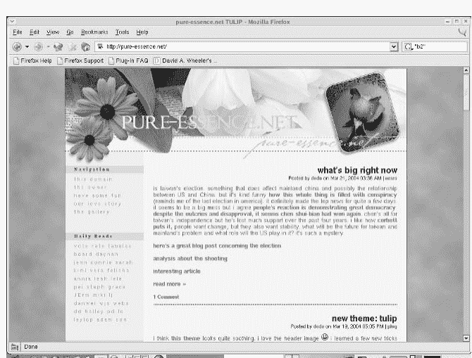

复杂的 Web 发布包括内容管理和门户服务器。门户整合来自各种来源的信息和工具，并在单一用户界面中呈现。门户是应用程序和基础设施的集合，本身并不是一个独立的应用程序。这些面向一组客户，内部或外部。门户包含一些内容管理作为核心功能，但这通常作为单独的产品提供。

内容管理服务器通常源自专业机构，如新闻室或出版系统，以分发为核心竞争力。它们对文档管理、工作流（审批流程）和内容分发提供了强大的控制。与门户不同，它们通常出售给非技术管理层，他们喜欢这些控制功能。


## 5.5 复杂的 Web 发布

这一类别介于“自建”与“购买”的边缘。在任何组织中，尤其是大型组织，信息都存储在各种设备或软件上。因此，门户网站（portal）的选择实际上是为一套基础设施、开发工具和组件选择一个（或多个）供应商的过程。

现成的门户软件对于规模较小或新公司最有用；其他公司则会有许多现有的系统和流程来适配这些产品，并会随着时间的推移进行更多的定制开发。无论何种情况，门户都是一个起到启动作用示例。

以下是门户网站方案的示例：

- Plumtree Studio Server
- IBM WebSphere Portal Server
- Sun Planet Portal Server
- Red Hat Portal Server
- Microsoft Sharepoint Portal Server
- PHP-Nuke
- eGroupWare

以下是内容管理服务器：

- Vignette
- Red Hat Content Management Server
- Microsoft Content Management Server
- Plone
- Bricolage

这些是重叠的类别，因为一个功能强大的门户网站包含了内容管理。在这里，它们被视为一项需求。内容管理解决方案的目标是让业务用户能够轻松地创建、检索和共享用于内网、外网以及电子商务/政府业务的内容。内容的组织和结构必须与创建和使用它的人员相关。

第 5 章

### 5.5.1 门户组件

任何内容管理门户都需要所有或大部分这些技术，通过包含或集成的方式：目录、Web 服务器、用于创建额外自定义组件的应用开发工具、索引和搜索，以及邮件和日历。通常，一个产品会使用供应商（或其合作伙伴）的战略技术来实现大部分功能。微软和 IBM 产品使用它们自己的目录、数据库、Web 服务器、开发工具和邮件。Plumtree 门户使用 BEA WebLogic 应用。

在大多数情况下，该产品可以配置为使用至少一些边缘产品。真正需要对互操作性做出承诺，以确保未来其他开发方式不会被排除。在开源门户的情况下，我们预计能够使用开源组件，如 OpenLDAP、Apache、MySQL 和开源开发语言。我们还希望能够访问遗留数据库、通过 Web 服务访问其他系统，并进行共享身份验证。

在上一节讨论的 Web 发布与这里讨论的更强大的产品之间没有明确的界限。需要一个需求过程来确定合适的产品。

### 身份验证与个性化

几乎所有客户都需要一个身份验证系统，或者一个用于确定谁可以使用哪些内容执行功能的系统。通常，这需要与现有的基础设施、LDAP（包括活动目录）、专有或嵌入式目录（如 NT 或 Exchange 5.5）或基于数据库的目录配合。

基于表单的登录使用身份验证系统对内容显示进行个性化，并控制对所有功能的访问。基于角色的开发支持一个身份对应多个角色。

### 内容管理

需要对各种格式的文件进行组合和展示，包括 Office、PDF、HTML、XML、链接（内部和外部）以及带有动态内容的组合文章。这些信息以一致的用户定义的层级结构和其他适用于业务的、易于导航的结构进行交付。系统规定了新内容如何进入。必须为每种类型的内容定义一个流程，以确保内容被正确捕获和输入。

### 复杂的 Web 发布

作者必须能够使用任何浏览器编写和编辑内容，无需特殊的专业知识，并对其进行标记或概描述。他们还应该能够使用自己偏好的工具进行内容开发，而仅将门户产品用于标记。内容应该是模板化的，以便新材料可以按照定义的样式快速纳入。

经理必须能够编辑和删除内容，定义并编辑页面和模板布局，并快速地根据角色进行。过期和已删除的内容应被正确处理。

该产品可能需要允许比较和回滚，以便用户可以查看某些页面的所有版本，并在需要时回滚到该版本。一些关于内容状态和使用的报告将会有帮助。

某些内容管理用户需要广泛的工作流功能。这包括将内容管理委托给具有适当角色的用户，以及在适当的情况下显示前对内容进行审查的流程。关键流程任务之一是确定捕获的不是什么内容，而是它需要什么格式来满足业务需求。

具有新鲜内容的网站提供了回访的有力理由。设计内容管理解决方案时还应该考虑业务流程的设计，以确保内容是实时的、新鲜且可靠的。某些内容可能需要每小时更新一次，另一些每年一次。可能需要为每种内容周期建立流程。

### 索引与搜索

搜索可以是全文的，也可以是结构（基于分类方案），但可能应该两者兼顾。对于大多数组织，应该为内部人员和位置提供特定的搜索，通常还为产品和服务提供搜索。

为内容定义正确的分类方案至关重要。定义这些元数据非常取决于用户和内容。某些用户可能愿意在输入内容时定义无限数量的“标签”。其他用户可能只有足够的耐心或时间定义少量的标签。这必须对每种类型的内容和内容源进行分析和确定。

从门户获取的所有文档都需要建立索引以便搜索，包括产品内部和外部的多种格式内容。理想情况下，内部搜索应该像 Google 等知名引擎一样工作。与 Web 引擎不同，你允许查看的文档可能存在身份验证问题。

### 组件集成

就像日报纸一样，门户既需要头条也需要丰富的内容。头条项目通常是某种平衡计分卡，最好是个性化的，例如比较个人和地区销售额与其他人的对比分析报告。内容通常包含各种遗留应用程序。门户产品需要允许这种材料的开发和集成，无论是内部还是第三方，以快速灵活的方式。

### 国际化

许多组织将需要支持具有不同语言的多个门户，以便所有内容都以正确的语言显示。

### 迁移

由于产品功能和架构的差异，直接迁移通常是不可行的。当然，大多数数据和应用程序可以使用专门的迁移脚本来访问。

### 5.5.2 开源内容门户

在该领域有很多产品，取决于定义，并且在一年后可能会发生。我将选择三个开源产品，我知道它们有大量用户、增长和关注度，并且架构支持复杂的定制开发。这些是：

- Plone
- PHP-Nuke
- eGroupWare

Plone 使用 Python 开发，使用内容管理框架和 Zope 引擎。Python 可用于扩展应用程序。PHP-Nuke 和 eGroupWare 均使用 PHP 开发，可以使用该语言进行扩展。

## 5.6 管理用户桌面


Plone 和 PHP-Nuke 都可以用于国际化，研究包含了许多示例。图 5.8 到 5.10 显示了 Plone 和 PHP-Nuke 的主页（使用各自软件编写）。

对于没有现有系统的用户组，部署 Linux 就像任何活动一样简单。问题在于迁移。这里考虑的只有组织拥有 Windows 桌面的情况。UNIX 迁移在其他地方提到。在这个阶段，拥有任何其他设备的小组都有其特殊情况。

用户桌面的迁移是一件很难成功的事。首先，它涉及到接触每一个系统，并可能完全重建它，这将产生巨大的成本。其次，用户可能在配置系统方面有强烈的喜好。对于这种变化，用户产生不满意的风险很高。

对于我们来说，任何大规模的用户桌面迁移都不是我们要考虑的事情。然而，我们确实希望进行计划，因为我们知道这最终会发生，无论是否涉及到


# 118

## 5.6 管理用户桌面


图 5.9 Plone 示例。

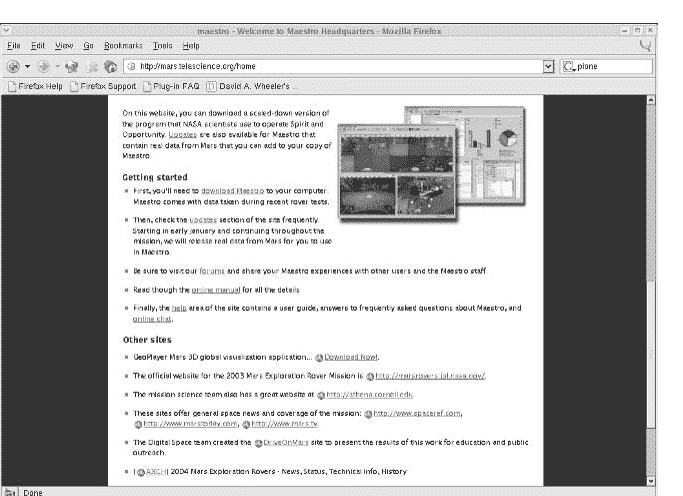


图 5.10 PHP-Nuke。

| 服务器 | | | | | |
|---|---|---|---|---|
| Apache | MySQL | OpenLDAP | Samba | 邮件 桌面 Open Office 专业工具 (Gimp, 工具) 个人工具 Evolution |
| Linux | | | | |

升级到较新版本的 Windows 或进行更改。这种迁移可能会在每台桌面上节省数百美元的许可费用，因此如果我们能从数千台桌面中移除 Windows 和 Office 的许可成本，就能节省数百万美元。第一步是分析并控制桌面的使用，并最终考虑迁移。见图 5.11。

Windows 桌面可能包括 Windows 95、98、ME、Windows NT、Windows 2000 或 Windows XP 的任何组合。它们可能安装了 Office（同样是多个版本之一）以及各种软件。从 Windows 迁移的选择包括：

- 在 Windows 上引入某些开源程序
- 用 Linux 和开源软件完全替代 Windows
- 使用软件使 Windows 程序能够在 Linux 上运行
- 以上任者的任何组合

如果我们想向开源方向迈进，最简单的第一步是在现有的 Windows 桌面上运行一些开源程序。Mozilla 浏览器就是一个很好的例子。它在几乎所有情况下都适用，除了少数微软网站外（尽管这些网站反正也并不稳定），而且它可以与 Internet Explorer 并行运行。Mozilla 是基于标准、开源的且跨平台的。没有必要完全采用 Mozilla 或任何浏览器。一个组织可以运行多个浏览器而不会产生互操作性问题，尽管可能会产生支持成本。从其他浏览器迁移到 Mozilla 并不困难。用户通常可以在几分钟内切换浏览器，最大的问题是他们的收藏/书签是否可用。

# 第 5 章

## 5.6 管理用户桌面

在 Windows 上运行 OpenOffice 和许多开源邮件程序也是可能的。切换邮件系统可以让我们摆脱 Exchange CAL（客户端访问许可），并有助于管理 Outlook 中持续存在的病毒和蠕虫问题。

我们应该分析自己的办公套件，以确定有多少用户可以在不受干扰的情况下切换到 OpenOffice，成本是多少。可能某些用户现在就可以开始使用 OpenOffice——例如，通话、使用一或两个专用应用程序，或仅使用浏览器的用户。许多其他人将无法迁移，但我们可以为未来可能的移动做好准备。如果有了适当的政策来简化未来的移动，那么当许可 way或其他事件促使我们以后移动时，我们已经做好了准备。

根据许可协议的状态和可行性，这可能是一项巨大的开支。3,000 名用户每人 300 美元，总计 100 万美元。如果高度集成，这可以在整个组织范围内实现。在许多组织中，较小的业务部门可能有不同的使用模式，这可能是处理该问题的正确层次。

此时，我们可以考虑在混合中使用其他套件或基于门户的客户端，因为分析方法是一样的。桌面应用程序管理被许多 IT 组织认为是昂贵的。尽管当我们可以给每个没有套件且没有 10GB 硬盘的用户提供 OpenOffice 时，基于门户（仅限浏览器）的计划似乎没有吸引力，但对于某些组织来说，维护这些客户端软件的成本将使门户变得具有吸引。

任何针对开源（或门户）和遗留用户的双层系统计划，都将面临互操作性成本这一严重问题。虽然这些方法都能节省资金，但它们需要对组织及其使用模式进行仔细分析。

### 5.6.1 分析桌面使用和许可

我们应该在考虑最终迁移的前提下，审查桌面上的软件使用情况。其中包含了 Microsoft Office（Word、Excel 和 PowerPoint）。如果 Office 是许可的，则应对每个产品单独衡量使用情况，邮件（无论是 Outlook 还是其他）是一个需要考虑的重要功能。我们还可以查看 Access、Project 或 Visio 的使用情况（如果它们很重要的话），当然还有第三方应用程序。关于产品使用需要收集的关键数据（例如对于 Office 产品）包括：

## 5.7 其他可能性

- 产品的许可用户数量是多少？
- 正在使用的是哪些版本（95, 97, 2000, 2002/XP, 2003）？
- 有多少用户是复杂作者、简单作者、主要是读者或非用户？
- Office 文档是否作为核心业务流程的一部分流通？
- 文档是否使用 VBA 宏、复杂图表、标签（Tags）或自动形状（AutoShapes）编写？
- 组织之前的桌面软件迁移情况如何？

这些数据足以支持对潜在成本节省和迁移可行性的某些初步估计。鉴于此，某些组织可能更进一步，并对 Microsoft Office 的使用做出决策。例如，我们可以强制要求 OpenOffice 的功能，并创建一个简单的表单允许用户指定这些功能。

我们可以对使用情况实施标准——例如，防止使用专有功能或使以后的迁移更简单。如果可能，我们可以识别出哪些组的使用允许他们尽早采用开源产品，例如 OpenOffice、Gnumeric、Evolution、Dia 或 GIMP。

我们可以审查复杂应用程序从长远来看对开源软件的适用性。在许多情况下，我们现在就可以为一或两年后安装在开源平台上的系统进行计划。这些可以是软件包，例如企业资源计划 (ERP) 或客户关系管理 (CRM) 系统，或者自定义开发的系统。

在其他情况下，我们可能在寻找更远的机会，这些机会在长期来看可以带来巨大的财务节省，并在您的行业内建立领导地位。这可能涉及对开源合作机会的行业讨论，或与初创公司合作建立未来的潜在产品。

一种可能性是接管一个垂危的商业应用程序。一个新的开源包出现的一种方式是将一个在软件上成功但在业务上失败的商业运营进行转换。

OpenOffice 是一个示例，在被 Sun 采用之前，在全球范围内并不是特别成功的业务。在其他商业业务中可能存在类似的机会，可以通过开源策略恢复活力。例如，全球标准化缩小了 ERP 和 CRM 系统的领域。它们可能成为开源的候选者。此类倡议可以是：

- 水平领域（例如 ERP，CRM）
- 行业领域（例如教育、电子）
- 分众市场（例如电信计费、邮轮预订）

许多年前，我曾与来自斯坦福的公司做过一些工作，他们销售一种专门用于外汇交易的金融软件包。该公司最初对该行业的一些国际外汇交易领先机构进行需求调查；随后在几年内转变为一家销售此类活动软件的公司，同时保留了大部分原始客户。这种从需求研究到软件产品的转变在许多行业都是可行的，在合作奖励的基础上创建一个开源产品。

开源软件应用基金会 (OSAF) 正在构建一个个人信息管理的水平产品，同时还来自教育机构的赞助，这将确保任何早期交付都是产品的教育垂直变体。另一种可能性是类似于制药模式的，可以在一段时间后将代码开源。

可以轻松赞助新应用的行业包括金融、电信、能源和国防/航空航天。

金融机构很容易发现新开发；他们有定制开发的传统，并倾向于保持竞争优势而不是与供应商共享知识产权。华尔街有传统的 UNIX 传统，这使其可能对开源系统非常友好。

许多银行运营着数千零售店和呼叫中心，以及大量的自动服务终端（自动取款机）网络。他们拥有大量严格控制的桌面，获取周期长


银行并不一定要运行 Windows；它们是 OS/2 在停止作为零售产品多年后，仍在运行该系统的最后客户。

电信业务的规模极其巨大。电信公司的计费、率计算和配置系统是运行中规模最大的。大部分工作是实时完成的，而另一些则是周围最大的批处理和纸质打印作业。有线业务通常比较保守，其系统已有 30 年历史，但新的移动业务创建时间较短，且正以惊人的速度增长。这些系统中的许多是基于大型机的，因为在设计时，这是构建它们的唯一方式。此外，还深受 UNIX 的影响，这些公司中的大多数曾是 AT&T 的一部分。

在能源行业，电力/燃气公用事业非常集中，而且还安装了大量的 Oracle。SCADA 系统全是 UNIX 系统，且通常需要更换。从历史角度看，成本并不重要，但随着市场更加开放，成本可能会变得重要。这些业务是主要的雇主。公用事业公司的许多员工使用 Office 和 Windows 系统，许可费用高昂。另一些人没有系统，或者系统可用的软件有限，这对于目前一无所有的 OpenOffice 来说可能意味着机会。

## 摘要

开源软件提供了多种业务机会。需要决定的其中一点是我们要实现开源应用程序，还是在开源平台上实现应用程序，因为这两种情况的成本和收益非常不同。以下是本章的摘要，简单地阐述了适用于大多数人的观点。其中包含各种类型的想法。

目录是成为独立于供应商、基于标准的产品的极佳选择，因为它必须与你现有的或以后获取的所有其他内容集成。开源目录的选择是 OpenLDAP。它基于标准、可靠、可扩展，且与闭源代码产品相比价格非常廉。。

如果可以轻松完成，就迁移。审查你当前的传统系统和日历系统，看看开源产品是否适用。这要么很容易（例如从 UNIX 或 Groupwise 迁移），如果由于现有用户不接受改变而导致高昂的切换成本，就很困难。

开始使用开源群组软件和协作工具（如 wiki）。这可以产生一些快速收益，并为未来大幅减少许可费用做好准备。还应关注用于信息共享、社交软件和博客的新型开源产品。

考虑采用开源内容管理门户（如 Plone 或 PHP-Nuke）用于复杂的网站开发和管理。这可以消除诸如专有内容管理软件之类的潜在巨额成本。这些产品回本快且易于管理，随着时间的推移，可以使用标准开发工具根据需要扩展为大型应用程序。

分析并控制桌面，以查看人们在使用哪些产品，他们采用了什么种复杂程度，以及这与现有的许可规定如何匹配。这为你以后节省巨额许可费用奠定了基础。

最后，在某些领域缺少开源应用程序。可能存在赞助此类产品的机会，或者发现可以转换的闭源代码应用程序，或者至少参与寻找和赞助此类解决方案的倡议。

# 操作系统

本章介绍了作为 Linux 开源替代方案的操作系统中包含哪些内容、Linux 正在如何被增强，以及我们可以从中从中选择的各种发行版。

## 6.1 操作系统的内容

在本节中，我们将查看 Linux 和其他开源操作系统，然后查看操作系统发行版包含哪些内容以及如何进行选择。

操作系统（OS）包含内核、一个基础操作系统以及大量的其他软件包，其中软件包类似于一个产品，但并不单独出售。这些额外的软件包是否“包含在操作系统中”是一个商业问题，在某种程度上也是一个政治问题。在 Linux 社区中，这个问题由发行版和安装程序来回答。发行版将 Linux 内核、补丁、其他组件以及明显属于应用程序的其他软件包打包。安装程序通常对包含的软件包具有某些控制权，以及如默认窗口的外观等其他问题。

Linux 内核由单一项目团队管理。其他软件包由其他项目团队运行，这些团队与内核或彼此之间没有或几乎正式联系。几个核心软件包是 GNU 总体项目的一部分。Linux 发行版通常执行集成测试，并包含在线更新软件包的手段。

在闭源代码系统中，这演变为内核、一个基础操作系统以及一个平台和生态系统。闭源代码系统包括 Microsoft Windows 和 Apple Mac OS X，以及 Sun Solaris 和 Novell Net 等服务器系统。

在闭源代码系统中，由供应商决定操作系统包含什么内容。供应商执行集成测试并提供在线更新手段。此外，操作系统中的软件包由供应商分发和支持。它们最初可能是从第三方许可或购买的，例如 Windows 中的 DoubleSpace 或 Internet Explorer，但现在它们来自供应商。这组软件包具有增长动力，因为这鼓励了闭源代码系统的用户定期购买升级。供应商通常提供免责声明（防止代码并非其许可的）以及任何其他保证，这些保证通常是免责声明。

在闭源代码系统中，还有两个类别。首先，是供应商收取额外费用的应用程序，例如 Windows 上的 Office 和 SQL Server，Mac 上的 iLife 和 Keynote，或 NetWare 上的 Zen。Microsoft 称为“平台”，我也使用这个术语。这些是非常重要的利润来源。Office 是 Microsoft 的利润引擎。

其次，是由第三方出售或分发的应用程序。Novell 称之为“生态系统”，我也使用这个术语。通常是由于生态系统的存在才让操作系统变得活跃。随着时间的推移，代码供应商将尝试以其“生态系统”为代价扩大其“平台”。Windows 或 Mac 新版本的发布是一个展示此前属于生态系统而现在成为平台一部分的一组软件包的机会。虽然这通常被呈现为“创新”，即以前未包含过的新东西，但它实际上是合并。Microsoft 销售 Windows Media Player 或 Apple 销售 iTunes 都是此的例子。希望在健康的经济中，生态系统可以通过创新（通过解决新问题）得以增长。

操作系统、平台和生态系统之间的区别在开源领域可能也存在，但至少并不强。。在某些情况下，发行版供应商会开发额外的代码（平台）。这些代码可能是排他性的分发的（如 SuSE Ya2 直今为止如此），也可能是非排他性的（如 Red Hat RPM 或 Tux）。它们也可以被出售，可能不是排他性的，例如 Ximian Desktop 2 (XD2)。Linux 发行版现在没有从此类增强中获得大量收入，但情况可能会发生。Novell 和 Red Hat 都有计划增加此类工作。

开源的预期是软件包可能来自第三方。Debian 等其他组织维持着“自由（free）”与“非自由（nonfree）”的区别，即：

## 6.1 操作系统的内容

术语类似于 Debian 以及那些需要许可或费用的软件包。

在 Linux 中，内核很小，且所有发行版通用。它持续更新。主要的内核升级通常每年进行一次，小版本更新几天进行一次。在 Linux 方案中，偶数内核是稳定的；奇数内核仅供开发者和测试人员使用。去年 2.4 是稳定的，而 2.5 是开发代码。2004 年 3 月，超过 20% 的用户在使用 2.6。2004 年 5 月，SuSE 9.1 和 Fedora Core 2 将是首批带有 2.6 内核的主要发行版。Red Enterprise Linux 采用较慢的升级周期，但在自定义的 2.4 中包含了主要的改进（线程和调度器）。内核中的线程改进并不显著。正由于这些改进，Linux 在许多任务中的执行更加高效，包括 Web 服务、文件服务和数据库。测试表明，2.6 内核在常见任务中的性能提升可达 50%。


## 6.1 操作系统的内容

实际的 Linux 自带大量可用的软件，而这些软件在其他系统中被包含在额外付费的“平台”代码中。这在评审和对比中往往被忽略。每一个版本的红帽（Red Hat）都附带 Gnome 工具 Evolution 和 Generic，它们分别是 Outlook 的克隆和 Excel 的克隆。这些工具中的每一个都包含了管理任务的复杂工具。日历和电子表格都是大多数小型（以及大型）企业希望使用的价值业务功能。但由于它们匹配的是微软 Office 的组件而不是 Windows，你通常不会在操作系统的评测中看到它们。

### 6.1.1 FreeBSD

FreeBSD 操作系统的历史在之前已经介绍过，与 Linux 相比，它确实没有广泛使用，但它是一个稳定且强大的操作系统。虽然 FreeBSD 可用的软件比 Linux 少，但包括 Apache 和数据库服务器在内最重要的产品都可以其运行。FreeBSD 是运行这些程序的良好基础，特别是作为一个专用平台。它被 Yahoo! 和许多需要自定义开发平台以及可管理 Web 或数据库服务器的组织所使用。

作为客户端，FreeBSD 目前最主要的用途是 Mac OS X 操作系统的组成部分，根据目前的销量，它现在是第三大桌面操作系统，仅次于 Windows 和现在的 Linux（Linux 刚刚超过了它）。在过去的几年里，Macintosh 操作系统已经过重写，现在基于 UNIX，具体说是 FreeBSD。

Apple 操作系统以免费 Darwin 的形式提供，这是一个可靠的操作系统，但没有图形界面（GUI）。在 OS X 上运行 X11 和从 Fink 获取的应用程序，你就拥有了一个支持 Mac 硬件并可以运行 Linux 软件的稳健操作系统。

所以 Mac X 是一个混合体。它具有开源系统的一些优点。它是一个健壮、可靠的系统，并在某种程度上已经加入了开源测试流程。当然，它不是开源的。你无法看到 API 实现，而且像任何闭源代码系统一样，你受制于 Apple，因为如果它崩溃、决定涨价或对许可做出其他更改，你将无可。优雅的 Mac GUI 以及运行在上面的许多应用程序都是闭源代码。

### 6.1.2 替代操作系统的价值！

可能并不清楚为什么拥有不基于 Linux 的其他操作系统是有价值的。Linux 稳定且成功、快速改进并被广泛使用，我并没有主张你去考虑开源替代方案。考虑一下灾难保险。开源社区已经发生过一次灾难：GNU Hurd 原本应该是 GNU 操作系统的内核。它已经落后了约 15 年且尚未准备就绪。幸运的是，Linux 内核被开发了。如果 Linux 内核没有开发，那么将采用 BSD 内核，生活也会继续。

假设你担心针对 Linux 的诉讼。你可能不应该担心，因为任何声称某些 Linux 代码抄袭了他人专有代码的指控，只需通过替换该代码（一旦被识别）来解决。上一次 Novel 和加州大学伯克利分校之间的重大诉讼已在 1994 年和解。但最坏想象的结果是：Linux 内核以某种方式被移出开源，要么不可用，要么只能以不合理的许可费用获得。如果有必要，整个内核可以用 FreeBSD 甚至 Hurd 来替换。这会令人不，但比 Windows 垄断案期间提出的某些针对 Windows 的补救措施，其破坏性要小。

这种整体替换任何主要组件的可能性是开源软件价值的一部分。FreeBSD 或另一个系统可以运行 Linux 软件，因为开发者可以访问实现接口的内核，并且他们有权使用它。如果市场对更好的软件包有需求，并且如果有开发者愿意提供，没有人能阻止它以你可以轻松使用的方式发布出来。

### 6.1.3 使用 Shell ...

或者为什么 Linux 有如此多的文件需要配置？

最新的企业级 Linux 版本几乎为所有功能提供了 GUI 界面，它看起来通常非常像 Windows 控制面板。如果一切顺利，如今你可以在不打开终端的情况下在系统上完成很多工作，显然比几年前多得多。但你很快发现，使用这些 GUI 并不是 Linux 社区的习惯。当然，旧习难改，但原因不仅仅于此。一个实用的原因是 GUI 是不同的，而底层文件不是，因此描述对 `/etc/hosts` 文件的编辑要容易得多（该文件在 20 年间发生发生变化，且在任何版本的 Linux 上都有效），而解释在 SuSE 的 Yast2 或红帽的网络控制以及你在 Debian 上运行的任何 GUI 中输入 IP 地址的不同方式则要困难得多。单单这一点就能解释为什么在涵盖多个发行版的邮件列表和用户组中，讨论通常是围绕配置文件的。实际上，即使是特定厂商的支持数据库和邮件回复（例如红帽）也经常涉及文件编辑问题。红帽的 GUI 发生了变化，支持人员可能会使用外部的其他系统。这只是部分是 Linux 的问题；每个 Windows 都更改过网络配置的系统接口。

许多 GUI 界面抽象了配置的简单方面，但无法处理所有可能性。这并不是 Linux 的问题，而是设计 GUI 以简化选择的后果。结果可能是一个界面的“演示”，它可以支持发布时顶级的无线 PC 网卡，但随后会被新制造商或如 WEP 之类的增强功能击败。如果你有时需要退回到底层系统（正如 Linux 支持者所言的），你可以一直这样做并保持手感。

最后，因为 Linux 中的一切操作都是通过命令行完成的，所以一切都可以编写脚本。这可以非常强大，因为大多数事情需要重复执行，而且通常是自动完成的。从命令行输入命令或写入文件到创建可以在网络中移动并在正确时间自动执行的脚本，这种转变是非常强大的。对于 GUI 的努力相当笨拙。Windows 平台（系统管理）和生态系统（脚本）中有工具可以让你强制执行 GUI 对话，但没有一个令人满意。这一点尤其为重要，下一个 Windows 版本的主要目标是完全通过命令行脚本。

为什么它们是平面文件？UNIX 平面文件追溯到原始 UNIX 哲学。有很多处理平面文件的良好工具，因此从脚本访问它们、分析它们等变得很容易。在其他平台上，从未有一个可以依赖存在的单一 SQL 数据库。

### 6.1.4 Linux 近期改进

如果你用过任何版本的 UNIX，Linux 将是足够的熟悉的。然而，如果你的 UNIX 经验是久以前的，Linux 可能比你预想的要先进。与 Windows 相比，功能上是。但你应该能够完成在 Windows 上可以做的任何事情。一周可以让大多数人克服使用 GUI 的难关，但修改配置文件、编写脚本等（如果有必要）需要更长时间。

在图 6.1 中，我们看到 1600 × 1200 显示器上的 Fedora 桌面，可以看到四个窗口。这些窗口的选择是为了说明 Windows 和 Office 的兼容性。它们显示了（从左上顺时针）：

- OpenOffice 的一个 PowerPoint 文件
- 一个 OpenOffice 文档，在发送给出版商之前我会转换为 Word .doc 格式
- Evolution 显示类似于 Microsoft Outlook 的三栏视图
- Gnumeric 的一个 Excel 表格

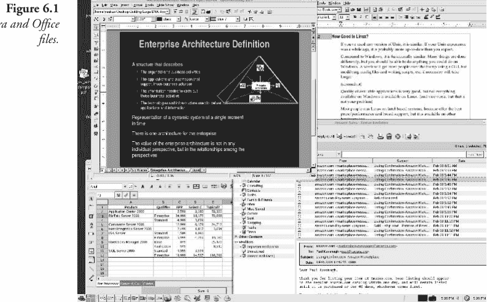

图 6.1 Fedora 和 Office 文件。


## 6.1 操作系统的内容

你还可以在桌面上看到可点击的图标以及红帽标志，它的功能类似于 Windows 的“开始”按钮。

可用应用程序的质量非常好。Windows 上的所有程序并非在 Linux 上都能可用，当然，这种情况也是双向的。

大多数人都在基于 Intel 的系统上运行 Linux，因为这些系统提供了最佳的性价比和广泛的支持。它也适用于其他硬件，例如 PowerPC（如 Apple、IBM RISC 系统）以及大多数最新的 UNIX 硬件（如 HP-UX、AIX、Solaris 所使用的）。Linux 目前支持 64 位多处理器处理和 64 位处理器。

Linux 的开发速度可能非常惊。在 2003 年下半年，至少在三个重要领域得到了改进：

- 安装的便利性
- 图形桌面的质量
- 内核的性能和可扩展性改进

在安装方面，Red Hat 9 和 SuSE 9 都通过添加向导式的 GUI 程序减少了手动工作量。它们比之前的版本更有可能正确地设置图形、找到文件和打印机共享，并配置网卡，而无需人工干预。红帽企业 Linux 3 比其前身 2.1 有了巨大的改进，后者更像红帽 7。

通过对字体的密切关注以及使用更高版本的 OpenOffice 和 Evolution，图形桌面得到了改进。

### 6.1.5 Linux 的纵向与横向扩展

6.2 阐述了开源软件（特别是 Linux）面临并处理的缩放维度。系统可以向外扩展到“经典”PC 之外，也可以向内收缩。这些系统中的某些代表了同类中的首创或终极突破。

现有的某些开源系统从任何标准来看都非常大。有些系统具有极高的事务率、数据量和用户数量。其中一些系统通过使用许多小系统来实现水平扩展，在许多情况下通过冗余提供可靠性。这些系统可能使用新的“刀片”式硬件和其他小型外形。

使用“大铁器”对称多处理器系统进行垂直扩展，这些系统以前运行的是单供应商的 UNIX 系统。有些系统使用了数千个处理器和数 TB 的数据，还有分布在全球各地的系统。其中一些是世界闻名的，例如 Google、eBay 和 Amazon。其他的可能更偏离散，例如国家安全局（NSA）的使用或新的陆军超级计算机。

系统也会向内收缩。有些是消费级设备，它们在另一端——成本、小占用空间和故障间隔时间上测试极端。例如，在消费领域有超过百万个 TiVo 系统。其他系统运行在手机、PDA 中，并嵌入到汽车中。其中一些系统非常廉价；用于路由的 Linksys 和 Netgear 系统以几美元的价格盈利销售。这些系统对可靠性的要求是极高的；没有进行手动维修的合理可能。

作为服务器，Linux 可以扩展得很高。Linux 版本通常部署有16 或 30 个处理器，并支持高达 1,024 路对称多处理器处理。使用 Beowulf 进行集群化已持续多年。高性能集群在劳伦斯·利弗莫尔和洛斯阿拉基莫斯等研究实验室已经达到了极高的性能。

在客户端和服务器之间使用通操作系统并不是必需的，但具有优势——例如，通过通用的 API（这意味着代码可以使用一套技能进行开发并在平台之间移动）以及通用的 GUI。并非所有服务器都是桌面系统，通常不会投资如此良好的界面（例如 Novell NetWare）。

### 6.1.6 安全

我将进行简短的评论，然后将安全作为一个话题留给另一本书——例如 Becker 编写的《大型企业网络 Linux 安全》。

开源社区的普遍感觉是，随着时间的推移，开源将被证明是一种比闭源代码更安全的开发方法。这源于 Bruce·施耐德（Bruce Schneider）等专家阐述的安全社区观点。

最近对微软系统的攻击在 Linux 和基于 BSD 的系统中没有被广泛复制。其原因并不清楚。有些人声称是因为微软是主导系统，因此更容易受到攻击，或者因为它是一个“垄断”（其带来的风险是 Linux 系统在配置和安装程序上比 Windows 系统变异更多）。

病毒和蠕虫被编写并在 Linux 系统上运行，与其他任何系统一样，CERN 的报告显示 Linux 也分担了部分攻击。微软为了安全而做出的某些决策导致了问题，例如从 Office 和邮件客户端运行可执行文件，但我认为这些现在大多已解决。

## 6.2 Linux 发行版厂商

发行版厂商负责多项工作，例如：

- 选择内核版本并应用（并可能创建）补丁。
- 选择一组带有自身版本和补丁的软件包。
- 协调错误报告并将其反馈给包维护者。
- 选择（并可能创建）安装和部署工具。
- 测试并验证集合并合并到介质上进行发行（例如物理 CD、ISO CD 镜像、DVD）。
- 发发行版进行营销，并提供培训等其他服务。

### 6.2.1 Linux 的多个版本

在采用 Linux 时，一个关键决定是使用哪种发行版。正如开源领域中常见的那样，有很多选择，可能比你想要处理的还要多。几个发行版提供了...


## 6.2 Linux 发行版供应商

在我当地的用户小组——佛罗里达 Linux 用户交换协会（FLUX），他们维护着一份关于“最喜”发行版的调查。在 233 份回复中，有七种发行版的占比超过 10%，如下：

- Red Hat 28%
- Debian 21%
- Slackware 15%
- SuSE 14%
- Gentoo 10%

该小组更倾向于较小的“免费”发行版，即 Debian 和 Slackware，它们深受许多爱好者的青睐。人们可能会报告 Slackware 或 Debian 是“最爱”，但在工作时会使用 Red Hat。

## 管理发行版和软件包

组织要面临出的第一个选择是购买带有支持的“企业级发行版”，还是“自构建”系统。许多组织可能会根据环境兼顾两者。你可以从以下选项中选择：

- 外包发行版（Red Hat, Red Red Carpet）
- 自行构建但使用软件包分发机制（Debian）
- 外包你的自定义包创建（Progeny Platform Systems）
- 修改发行版以适应需求，并按你的意愿发布

今天，当你运行 Linux 发行版、Mac OS X 或 Windows 时，你可以（也应该）从供应商处选择一个软件更新系统，它会自动发布更新和补丁。软件包格式 RPM 被 Red Hat 和 SuSE 使用，DEB 被 Debian（及其衍生版）使用，Red Hat Fedora 也可选使用。这些软件包格式通过前端命令进行应用。RPM 与前端命令 `update` 和 `YUM` 使用，而 DEB 通常与 `APT` 使用。

与 Windows 不同，你不需要为每台桌面都进行授权。当然，如果你只为某些桌面购买支持而非其他桌面，将会有措施防止滥用。

## 6.3 企业级发行版供应商

大型组织可能会选择两种企业发行版，特别是那些从其他地方迁移到 Linux 的组织，尤其是美国的组织：Red Hat Enterprise Linux 和 SuSE Linux（Enterprise 版和 Standard 版）。这些是两家向企业提供 Linux 发行版的最大跨公司的顶尖产品。Red Hat 多年来一直是领先的 Linux 发行商，声誉良好，多年来一直盈利并持续增长。SuSE 长期以来是第二大发行版，也是包括德国在内的某些欧洲国家的领导者。它最近被 Novell 收购，新的财务实力以及与 Linux 开发强手 Xian（也被 Novell 收购）的结合，只能进一步加强其实力。

对于愿意为受支持的发行版付费且不想自己构建的组织来说，这些可能是选择。

## 6.4 社区支持发行版供应商

Debian 和 Fedora 是两个主要的社区支持发行版供应商。

### 6.4.1 Debian

对于想要“自构建”的组织来说，有更多选择。第三大发行版是 Debian GNU/Linux。它拥有一种非常不同的风格：社区支持且始终免费。Debian 是一个大型发行版，提供的软件选择比其他任何发行版都更广泛。

遗憾的是，本书的出版时间与 Debian 的发布周期并不太契合。出版时可用的（“稳定”）版本将是 Sarge。软件组合将更加新，而且新的安装程序应该将 Debian 的这方面提升到（或接近）Red Hat 和 SuSE 的标准。目前的“稳定”版（Woody 3.0r2）被认为是一个很难用来“练手”的 Linux 版本。它安装困难，并且包含了许多重要软件的旧版本。

### 6.4.2 Fedora

企业品牌发行版的另一种替代方案是 Red Hat 的新社区支持版本：Fedora Core。使用 Fedora，你基本上不需要向发行版支付任何费用，但可能需要比使用 Red Hat 和 SuSE 更显式地做出决策。Fedora 是 Red Hat 9 的后续版本，看起来相似，但可以配置为使用 YUM 或 Debian 发行版管理系统。它可以直接从 Red Hat 获取，也可以通过新的用户渠道和廉价分销商获取。Fedora 比 Red Hat Enterprise Linux 更“前沿”，开发周期更快。随着时间的推移，Fedora 可能会偏离其起源，但现在它在管理上明确隶属于 Red Hat，技术上与 Red Hat 9 和 Red Hat Enterprise 3 没有太大区别。

当本书特别引用某个发行版时（如带有截图），使用的是 Red Hat（Fedora 和企业版）和 SuSE。选择这些版本让我能够以一种相当显式的风格编写本书，并希望帮助你阅读，同时不会不过度限制你的选择。

## 6.5 国际替代方案

在美国境外，某些领域存在替代方案，特别是：

- Mandrake Europe（欧洲曼德拉）
- TurboLinux Asia（亚洲西部 Linux）
- Conectiva Latin America（美洲 Conectiva）
- Red Flag China（中国）

这些在特定语言和文化方面具有优势。总部位于德国的 SuSE 在欧洲也很有实力。

### 6.5.1 消费者 Linux 选择

对于消费者，除了 Red Hat 和 SuSE 之外，可以考虑的 Linux 发行版例如 Windows、Xandros 和 Knoppix（都是基于 Debian）。两个值得关注的 Debian 项目是 Progeny 和 UserLinux。Progeny 是由 Debian 联合创始人 Ian Murdock 创立的一家新公司，支持希望开发自己 Linux 安装的公司。UserLinux 是一项新计划，旨在通过简化选择来吸引社区，并允许商业用户迁移到基于 Gnome 和 OpenOffice 构建的标准化用户桌面。有关详细解释，请参见 http://userlinux.com/white_paper.html。

（注：由于原文提供的文本流存在大量 OCR 错误和重复，翻译已根据逻辑进行了重新对齐和清理）

Debian 经常作为其他发行版的基础，因为它是可靠的，并且拥有 APT 强大的分发机制。例如，消费级产品 Windows、Xandros 和 Knoppix 都是基于 Debian 的。两个值得关注的 Debian 项目是 Progeny 和 UserLinux。Progeny 是由 Debian 联合创始人 Ian Murdock 创立的一家新公司，支持希望开发自己 Linux 安装的公司。UserLinux 是一项新计划，旨在通过简化选择来吸引社区，并允许商业用户迁移到基于 Gnome 和 OpenOffice 构建的标准化用户桌面。有关详细解释，请参见 http://userlinux.com/white_paper.html。


## 6.6 总结

Linux 操作系统周围的生态系统是动态的，拥有许多公司和快速变化的版本，但在重要方面保持稳定。为 Linux 开发的应用程序可以在所有发行版和版本上运行而无需更改。Linux 供应商可能会停止某个发行版，但其分发的系统可以迁移到其他 Linux 版本，而不会产生巨大的中断。这个问题实际上对于闭源产品来说更令人担忧。很多时候，闭源厂商已经破产、被收购或停止了产品，导致他们的客户被迫在不合适的时间迁移到替代品。例如，DEC TOPS-20 和 OS/2 操作系统就发生过这种情况。

与闭源系统不同，Linux 并不依赖于单一成功的供应商。开源模型意味着另一公司总是可以选取代码库并继续。某些 Linux 发行版与某些源码公司一样，曾进入破产重组或倒闭，但这对他们的客户没有产生严重影响。像红帽（Red Hat）这样的 Linux 发行版一直非常成功。

未来，Linux 可能会围绕一个或两个主要供应商整合。也许在最坏的情况下，我们将回到过去那种状态，由供应商说了算，就像 20 世纪 80 年代的 IBM 或最近的微软那样。但开源的不同之处在于，你永远有选择。任何公司都可以建立 Linux 的分发、支持或培训。你可能决定从 IBM 全球服务集中采购，但你仍然能够从其他供应商那里获得你需要的其他组件（硬件、其他软件、支持、咨询）。

Linux 发行版之间足够相似，客户始终可以选择另一个发行商。为一个发行版开发的应用程序和自定义解决方案可以在另一个发行版上运行。可能会存在一些错位，但比同类型的闭源情况要小得多。

Linux 操作系统在过去的十年中以极快的速度发展，现在是许多系统的首选操作系统——从最大的超级计算机到最小的专用设备和手持系统，也适用于各种规模业务服务器计算机的典型用途。

在本书中，我们反复强调开源系统对于许多目的来说已经足够好了。Linux 不仅仅于此。在许多方面和对于大多数用途来说，它是最好的操作系统。它比其他通用操作系统更安全，拥有任何系统中最快的网络协议栈，可以扩展到最小的设备和最大的集群，并且在不断改进。

## 开源服务器应用

接下来的章节中将讨论的重要开源服务器应用包括：

- 基础设施服务
- Web 服务器
- 数据库服务器
- 邮件服务器
- 系统管理服务

## 7.1 基础设施服务

基础设施服务由基础网络服务、安全服务以及文件、打印和目录组成。

基础网络服务包括 DHCP、DNS 以及 DNS 缓存服务，以及未由设备完成的路由。提供这些服务通常非常廉价，每年大约 100 美元，这是任何服务器都应该能够执行的商品化活动。

安全服务包括防火墙、虚拟专用网络（VPN）、入侵检测、反病毒服务、身份验证和授权。这些服务有时很难根据网络服务和支持它们的目录服务（甚至是邮件服务）来区分，例如反病毒和反垃圾邮件服务的情况。例如，Active Directory 通过相同的接口提供目录和安全服务。事实上，而且频率增加，这些服务是由专用设备提供的。

在该领域，开源与 Windows 的一个主要区别是，Linux 通常是专用设备的操作系统。安全实际上是企业中 Linux 最常见的用途，而这主要是在设备中。设备供应商倾向于使用 Linux（或 FreeBSD）原因有两个：

- 他们不需要支付许可费用。
- 他们可以根据需求对系统进行精确调优。

结果是，这些设备由于定制的占用小且许可费低而非常廉价。Linux 网络设备通常也非常快。Linux（以及 FreeBSD）通常被认为拥有最快的网络协议栈，且代码可以针对特定的专用用途进行进一步调优。微软也为设备提供支持，但更倾向于使用更集成的方法，让 Windows 系统在较大的服务器上运行混合服务。

### 文件和打印服务

在混合环境中，我们通常使用 Samba 进行打印服务。Windows 系统也通过 NFS 和 FTP 高效且容易地支持文件共享；这在 UNIX 环境是一个很好的选择。另一个选择是 Novell iFolders 技术，该技术最近已开源。考虑到目前服务器和客户端的分布，许多组织正在使用 Windows 网络，采用 Samba 将是最简单的选择。

Samba 允许非 Windows 系统与 Windows 系统共享文件和打印服务。Samba 客户端的功能类似于 Windows 客户端，但对于 Linux、Mac 或操作系统，它们可以看到由 Windows 或 Samba 服务器发布的文件和打印机。Samba 服务器的功能类似于 Windows 服务器，但在 Linux 或其他系统上，它们可以发布文件和打印机共享，并以类似于 Windows 服务器的方式验证用户。当前版本的 Samba 可以通过访问 Windows NT 域控制器或访问 Windows 2000 Active Directory 来充当 Windows NT 主或备份域控制器。

Samba 是一个高效的程序且扩展性良好。美国银行和惠尔等公司使用 Samba 支持成千上万的客户端。该程序由 Andrew Trumbull 在 SGI 任职期间编写，是 Windows 网络功能 Server Message Block (SMB) 的一种实现。Samba 这个名字是 SMB 的双关语。该协议可以追溯到 IBM、3Com 和微软共同合作的时期；它也被用于 OS/2；还被称为互联网文件系统 (CIFS)。

我们可能通过实现几种方法之一，在内部（防火墙内）安排文件共享。如果信息是私有的或企业范围内的（公共），那么我们不需要目录系统。我们可以在文件共享系统上创建并共享，并教用户使用这些共享。在 Novell 系统上，这些通常被设置为虚拟驱动器。一旦我们越过公共/私有的，允许组或个人访问特定信息，我们可能需要某种目录，但不一定是 LDAP。使用 Samba（至少版本 3），选择有：

- Samba 可以作为 NT 服务器的客户端进行身份验证，或者作为 NT4 的替代品作为主服务器工作，在这种情况下，用户从 NT4 服务器迁移到 Samba。
- 使用 Active Directory，Samba 可以作为运行 Active Directory 的 Windows 2000/2003 服务器的客户端（但不作为服务器）。
- 建立 OpenLDAP 或另一个 LDAP 服务器并将其作为文件共享的目录。

Samba 有几个依赖组件。Samba 使用本地打印设施共享打印机（现在 Linux 上通常是 CUPS）。它在事实上也依赖 WINS 进行命名服务。最初，SMB 基于 NetBIOS，后来基于 TCP/IP 的 NetBIOS（去除了 NetBEUI 栈）。它现在可以在没有 NetBIOS 的情况下运行，这是许多组织的要求。要查看和处理 Samba 文件——例如创建文件共享或访问它们——你需要一个像 Nautilus 或 Conqueror 这样支持 SMB 的 GUI 工具。

### 7.1.2 目录服务

OpenLDAP 基于在密歇根大学编写的原始 LDAP 服务器。设置商业变体需要稍微复杂一点-


原生支持，但它是开源的、稳健的、可扩展的，并为我们可能想要使用的许多服务提供了可配置的身份验证：

- Samba 文件和打印共享
- Apache Web 服务器
- Courier 和 Postfix 邮件服务器

Mozilla 浏览器和其他客户端程序可以从 OpenLDAP 读取用户信息。此外，我们还可以从命令行或从自己的应用程序对 OpenLDAP 进行编程访问。

# Web 服务器

除了 Apache 之外，没有其他通用的开源服务器值得考虑了。它拥有很高的市场份额，是 Web 服务器的参考标准。它易于管理且开销极低，因此适用于小型网站和系统。世界上最大的网站都在使用它。它可以针对特定需求进行调优以获得极佳的性能。对 Apache 的支持是开源支持的黄金标准。Apache 组织非常成功，已经催生了一系列相关项目。

### 2.2.1 Apache

从各种衡量来看，Apache 是最成功的开源软件项目。它是世界上最常用的 Web 服务器，约占所有 Web 服务器的三分之二。Netcraft 最近的一项调查（2003 年 11 月）显示，Apache 在顶级 Web 服务器中占比 67%，在活跃服务器中占比 69%，而微软的分别为 21% 和 24%。详见 www.netcraft.com。活跃 Web 服务器通常被认为是衡量 Web 活动最有效的指标，因为这排除了重用但未使用的名称。Apache 在全球的大型和小型服务器（包括商业服务器）中拥有相似的份额。

Apache 基于 1993 年在伊利诺伊大学香槟国家计算应用中心 (NCSA) 编写的原始 Web 服务器。第一个 Apache Beta 版本于 1995 年发布。该名称最初的含义是“一个打了补丁的 Web 服务器（a patchy Web server）”。

Apache 运行在许多操作系统上，包括 Linux、大多数版本的 UNIX、Windows 和 Novell NetWare。Apache 目前提供两个系列：2.0.x（自 2002 年初以来已作为正式版本发布了两年）和 1.3.x。在编写本文时，1.3 系列的使用率仍显著高于 2.0，这反映了 Apache 用户显然的保守态度。Apache 许可证允许将其包含在商业产品中，它已被包含在 IBM WebSphere 等其他产品中。

Apache 结构由一个内核和许多模块组成，包括静态加载和动态加载的模块，这些模块扩展了如 Front Page 和 WebDAV 等工具；如 PHP 等语言；Perl、Python 和 Java 服务；以及针对 Samba/NT、LDAP 和各种数据库的身份验证。

如果你正在从微软 Web 服务器 Internet Services (IIS) 迁移，CGI 程序可以在不更改的情况下迁移，Apache 和 IIS 支持相同的 CGI 标准。如果你的程序是用 ISAPI、ASP 或 Cold Fusion 开发的，那么最简单的选项是在 Windows 上运行 Apache。使用 ISAPI 的程序需要 Windows 才能运行，但如果你有 Cold Fusion 或 ASP 程序并真的想迁移 IIS，可以分别从 Allaire 和 Sun 购买模块，允许这些产品在 Linux 上的 Apache 上运行。对于 ASP，你还可以考虑一种名为 ASP-to-PHP 的产品，它可以完成其名称所暗示的单次转换。

Web 服务器的购买和维护成本很低。另一个选项是让 Windows 和 Linux 服务器并排运行一段时间。

Apache 站点安装模块来与开发语言通信，通常称为语言 X 对应的 `mod_X`。超过一半的 Apache 站点运行 `mod_php`，略低于 20% 的站点运行 `mod_perl`，略高于 1% 的站点运行 `mod_python`。更多站点可能运行带有 CGI 的程序。显然，PHP 是 Apache 站点最常用的开发工具。事实上，PHP 是 Web 上最常用的语言（微软 ASP），且其使用量正在增长。

### 7.2.2 其他 Web 服务器

替代的通用 Web 服务器是运行在各种操作系统上的商业产品 iPlanet（针对 Netscape）服务器，当然，还有仅限 Windows 的微软 IIS。

在特殊市场上存在一些小众产品，例如红帽 Strong Secure Web Server。某些工具或应用——例如，红帽 Strong Secure Web Server——在特殊市场中（注：此处原文略有逻辑重复，已按意译处理）。

- 你可以选择开源数据库，例如 MySQL，以获得显著节省。

- 许多组织将能够混合策略，例如结合 MySQL 和 Oracle，取决于应用程序的规模和风险。虽然开源数据库可以用于任何地方，但对于许多小型数据库或嵌入情况，它们特别合适。因此，一个组织可能会使用大型 Oracle 数据库结合许多开源数据库。

### 7.3 数据库服务器

### 7.3.1 数据库服务器分类

我们在这里涵盖所有的数据库，即使是桌面端的。我们将桌面服务器视为一小类数据库服务器，并将桌面系统的某些元素视为客户端工具。例如，Microsoft Access 可以被视为由管理员访问并更新数据库服务器的应用程序。Access 服务器可以是 Access 数据库（可以是本地或远程），也可以是通过微软向导升级的 SQL Server，或者是通过 ODBC 访问的其他数据库。

某些类型的数据库产品需要单独查看：

- 在线事务处理 (OLTP) 服务器
- 数据仓库服务器
- 嵌入式数据库
- 客户端访问工具（包括决策支持系统）

在这些领域都有开源选择，但某些比其他更强大。

### 7.3.2 数据库系统规模分析

微软在 1999 年发表的关于大型事务处理系统的研究发现，当时最大的商业组织每日交易量如下（并非所有都是自动化）：

| 组织 | 每日交易量 |
| :--- | :--- |
| 纽约证券交易所 (NYSE) | 100 万 |
| 所有信用卡和支票处理 | 2000 万 |
| 花旗银行、美国银行、沃尔玛 | 1000 万至 4000 万 |
| 所有航空公司预订 | 2.2 亿 |
| 全球 AT&T 通话 | 2 亿 |

Visa 通过全球 25 万台自动提款机为 4 亿客户处理了 3000 万笔交易。这已经接近极限了。有几个


# 数据库服务器

亚马逊和谷歌等规模的新型技术和电子商务应用其运行量可能高于这些系统，但大多数业务系统的规模要小好几个数量级。

## TPC 基准测试

TPC 源于一种银行交易的借贷双方基准测试，由事务处理委员会（TPC）于 1972 年在美银行创立。事务处理委员会的建立是为了以独立的方式监控从 TP1 开始的一系列演进中的基准测试。TPC-C 于 1992 年推出，是目前已发布的最主要的事务处理型基准测试，并且它回应了早期基准测试中发现的局限性。该基准测试支持五种交易类型的混合处理，并要求数据库的所有元素（如客户数量）随交易指标同步扩展。TPC 结果在发布时会带有相关的成本数据，以便考虑价格/性能，并且对成本计算方法有明确规定。该基准测试仅适用于客户可以购买、正在发货或将在几个月内提供的软硬件和软件。通过审查各种竞争对手的行为，TPC 通过开发控制并最终防止这种行为的方法，应对了这一持续的挑战。对于发布衡量业务数据库事务性能的基准测试，TPC 是一个像我们已经或可能拥有的那样优秀的组织。

## TPC-C 基准测试的局限性

运行 TPC-C 基准测试的成本非常高昂。由于其扩展的方式以及为了正确符合标准所需的精度，运行该基准测试需要花费大量的时间金钱（约 100 万美元）。因此，运行此类测试的数量非常有限，这取决于愿意投入这笔钱的供应商。我们只能利用这些数据来近似我们正在考虑的解决方案。我们选择的硬件和软件不太可能经过专门测试，因此我们将寻找类似的设备。

成本也意味着运行自己的 TPC-C 基准测试几乎是不可行的，但通常情况下这样做是符合理想的。我们需要另一种方法来让我们能够针对性地解决自己的需求。

TPC 无法强制要求基准测试的方法就是现实世界中实际使用的方法。基准测试昂贵的一个原因是，设置它的技能极不寻常，因为现在通常运行在普通组织不会使用的特殊软件上，如下：

- 大多数供应商使用自定义 C++ 代码和 Tuxedo 应用服务器，同时推荐 Java 应用程序。
- 大数据测量使用诸如分布式分区视图（distributed partitioned views）等技巧，客户不喜欢维护这种视图；以及物化视图（materialized views），客户无法从中受益。
- TPC-C 禁止了允许小型数据库管理高峰值负载的队列（queuing）等方法。

目前性能最高的 TPC-C 数值大到让正常需求显得被微小了好几个数量级。与大多数人的做法相比，这就像是比较战斗机和农用喷雾机。大多数客户的数据库需求与 TPC-C 性能榜的顶端完全不同，大多数客户可能使用更便宜、更容易用的东西会更好。

我们对 TPC-C 可以说的是，如果某种数据库/平台组合出现在性能表中，那么该组合就具备了超越几乎所有实际客户需求的巨大性能潜力。如果一个系统出现在那里面，它就能胜任工作。

TPC-C 价格/性能表显示了一系列非常不同的平台。最大的系统（与战斗机相比）其单笔交易成本实际上比中型和中价系统更贵，因此价格/性能表由这些中型系统主导。考虑到构建大型高性能数据库的困难，这表明对于大多数企业来说，良好的选择是尽可能避免这些更大、更复杂且更昂贵的系统，而转向价格/性能更好的系统。而这些系统才是销量大军。组织通常不喜欢有太多数据库，因为它们难以管理和规划，所以它们会将系统整合到少数大型系统上，而不是那些赢得 TPC-C 性能榜的奇特类型。

## 冬季十大列表

Winter 公司发布大型生产环境数据库的十大列表，涵盖 OLTP 和 DSS。这些统计数据由客户自报，并由数据库供应商赞助，因此有点像是一场“炫耀比赛”，某些较大的系统可能选择保持匿名。然而，报告的数据是准确的，并包含一些最大的系统，因此对于我的目的（即了解数据库的真实情况以及人们使用哪些平台）来说非常有用。

表 7.1 显示了 2003 年底发布的年度冬季十大表中数据库通过各种衡量指标计算的规模。这些都是特大型系统。

### 表 7.1 大型生产环境数据库（来源：Winter）

| 衡量指标 | 范围 |
|---|---|
| OLTP 数据库大小 | 2–18 太字节 (terabytes) |
| OLTP 行数 | 80亿–420亿 |
| OLTP 峰值负载 | 155–450 (UNIX), 113–3,630 (Windows) |
| DSS 数据库大小 | 9–29 太字节 (terabytes) |
| DSS 行数 | 650亿–4960亿 |

这些都是大型数据库。然而，负载并不都特别高。特别是现实中的 Winter 测量数据，与现实中的研究数据一样，其交易率远低于 TPC-C 的表现。所以这证实了被测量的最好（也是最贵的）系统性能远超需求。

因此，我们有理论测量值一些实际测量值。表 7.2 结合了这两项测量，并显示了 2004 年初数据库的情况，包括是否运行 Linux 以及其 TPC-C 基准测试状态（高潜力性能的衡量）。从表 7.2 中，我们看到 Linux 不在冬季表中，但这并不意外。

### 表 7.2 2004年1月领先数据库（来源：Winter）

| 数据库 | 是否 Linux | TPC 操作系统 | OLTP 操作系统 | DSS 操作系统 |
|---|---|---|---|---|
| Oracle | 是 | Linux, HP-UX, AIX | HP-UX | HP-UX |
| DB2 | 是 | AIX, OS/400 | Z/OS | AIX |
| SQL Server | 否 | Windows 2000/3 | Windows 2K | Windows 2K |
| CA-IDMS | 否 | 无 | Z/OS | 无 |
| CA-Datacom | 否 | 无 | Z/OS | 无 |
| Sybase | 是 | HP-UX, Solaris, Compaq Tru64 | 无 | HP-UX |
| Informix | 否 | 无 | 无 | 无 |
| CA-Ingres | 是 | 无 | 无 | 无 |


## 表 7.3 数据库分类

| 类别 | GB | 典型硬件 | 行数 | 开发方法 | 每秒数据库请求数 | 成本 |
|---|---|---|---|---|---|---|
| 特大型 | 1,000s | 大型（例如 8x）SMP 节点、集群或大型主机 | 100B | 自定义复杂型 | 100K+ | $5M + |
| 大型 | 100s | 单台大型 4 路 SMP | 1B | | 10–100K | |
| 中型 | 10s? | 通用 4 路 | 100M | 简单到中等 | 1–10K | $50K |
| 小型 | 百分之几 | 小型型 2 路服务器 | 百百万级 | 简单 | 100s | $5K |
| 微型、嵌入式 | 0.01 | 桌面级、笔记本电脑、服务器 | 小型 | 嵌入式 | 少数 | 不不计 |

UNIX 上的 Sybase 和 DB2 可以在且显然可以在 Linux 上运行。Informix 和 Inrebase 可以在 UNIX 上运行，可能也可以在 Linux 上运行，但基本上处于维护模式。

根据这些关于大型数据库的信息以及对典型业务需求的常识，我们可以创建表 7.3，按性能类别对数据库服务器进行分类。我们可以使用此表中定义的类别来查看各种选择，并在每个类别中选择二三个。

我们将在下来的几页中完成。请注意，没有一种数据库是所有类别的正确选择。SQL Server 最接近，因为它有一个免版税的版本。遗憾的是，它存在许可限制。嵌入式系统的 SQL Server 版本 (MSDE) 仅在我们在使用 Visual Studio 或 Office 作为开发工具，或将 SQL Server 作为中心数据库使用时才可用。

Berkeley DB 是一个特例。它不是通用的 SQL 数据库，而且分发广泛，因为它嵌入在许多核心源码工具中。

表 7.3 假设了传统的数据库开发。通过足够的自定义开发，任何东西都可以在任何平台上运行。稍后，我们将讨论一些设计选择，这些选择允许我们在合适的情况下通过自定义开发突破这些限制。这些选择倾向于使用更小、更便宜的方案来完成任务。

## 特大型数据库

这里讨论的特大系统是定制开发的，花费数百万美元。在典型的一年中，只有几十个这样的系统。该领域的实际选择是主机上的 DB2、UNIX 上的 Oracle 或 Win2K 上的 SQL Server。

Oracle 是唯一发布过 Linux TPC-C 基准测试的数据库；在我写下这段话时，它是史上最高的数据库性能，是 2003 年 12 月通过一个包含 16 个块的 4 路 Intel 系统集群实现的。我们可以查看 www.tpc.org 获取最新动态。该基准测试中极高的集群得分与大多数正常的商业实践非常不同。谁在使用 Tuxedo？这些数字反映了供应商对该平台的承诺以及理论可行性。例如，令人惊讶的是，在 16 路 Beowulf 集群上的 64 处理器 Linux 结果超过了在集成度更高的机器上具有相同处理器的 64 处理器 HP-UX 结果。

Winter Top 数据中没有 Linux 数据库。Winter 发布了通用 Top Ten 和 UNIX Top Ten。排名前十的数据库包括五台主机、三台 Windows 和两台 UNIX 系统；DB2、CA-IDMS 和 CA-Datacom 都在 OS 上；Windows 上的 SQL Server；以及 UNIX 上的 Oracle。Oracle 曾进入早期 Winter Ten UNIX 名单，但一个不在 Linux 上。zOS 和 AS/400 的 DB2 代码库与 UNIX（以及彼此）不同，无法完全比较；DB2 有一个 AIX 基准测试，其代码库与 Linux 相同，但硬件可能与你运行 Linux 版 DB2 的硬件不同，因此仍然很难比较。Sybase 有 UNIX 基准测试，尽管并不印象深刻。Sybase 和 DB2 已经有多年的 Linux 产品，它们使用相同的代码库，其特征应与 UNIX 产品相似。Informatics 在现阶段是一个老旧产品。

在查看数据库案例研究时，它们看起来并不是非常大的系统。大型数据库业务确实相当保守。部署大型系统需要多年时间，它们将永远运行在部署的架构上。我的结论是，如果你在 Linux 上运行特大数据库，你就处于“技术上可行但处于前沿”的领域，需要数据库供应商提供高质量的支持。如果你这样做，可能应该首先考虑 Oracle，因为他们承诺 Linux 且是 UNIX 上的领导者。其次是 DB2，在金融行业等类似情况下是 Sybase。

### 特大型数据库的最佳选择：

- Oracle/Linux
- SQL/Win2K

## DB2/zOS

## 大型数据库

该类别中数据库服务器的选择归于 UNIX 或 Windows 上的 DB2、Oracle、Sybase 和 SQL Server。这是一个稳定的类别。在 1994 年是如此，今天依然如此。

十年间发生的变化是 SQL Server 现在可以扩展得更大并拥有更多份额，而且开源数据库开始成为一个可能的选择。由于数据库定价是按处理器计算的，用户倾向于选择该范围内带有快速处理器的大型机器。一台便宜的（例如 15 万美元的）机器在数据库方面的成本将与大型机器一样，因此价格/性能比下降了。

该类别中显而易见的选择是 Oracle，拥有大部分份额和参考。它通常是最贵的。SQL Server 通常会有更好的性比，DB2 也是如此。当然，MySQL 有最高的性比。在与数据库供应商谈判时，有其他选择（特别是更便宜的选择）是有帮助的，因为这些应该被考虑在内。

此类系统可能包含大型组件、与系统紧密集成，且通常是关键任务性的。在性能不是首要挑战的情况下，通过对 TPC-C 结果的分析可以得出这一结论。这里有一个具有揭示性的讽刺。Oracle 将其称为“入门级”，这是在 2003 年 9 月在 Linux 上发布的 TPC-C 基准测试中实现的，Oracle 实现了 136,000 tpmC，成本低于 4/tpmC。与几个月前在相同硬件上的 Microsoft 相比，“Oracle 比 Windows SQL Server 快且更便宜。”Microsoft 的结果是 121,000 tpmC，价格 4.99/tpmC。Oracle 希望将其视为远大于大型类别，并希望客户关注这里及更高处。

### 大型数据库的最佳选择：

- Oracle/Linux
- SQL/Win2K

## 7.3 数据库服务器

## 中型数据库

中型数据库通常运行在带有 RAID 的良好 Intel 系统上。这是目前的通用服务器，也是组织中数据库的“主干”。

一个事实是，这一类别由 SQL Server 主导，价格范围在 3 万到 6 万美元之间。对于大多数中型数据库，Linux 上的 Oracle 或 DB2 在未来一两年内是合理的选择，在性能不是首要挑战的情况下，通过对 TPC-C 结果的分析可以得出这一结论。这一类别由 Microsoft SQL Server 主导，约为 2/tpmC。Oracle 在 RHEL 上有一个中等水平的基准测试；136k tpmC，成本 4.09。

这个领域不需要专有的 UNIX 系统或不常用的数据库（如 Sybase），除非你内部已经有了。选择范围归于 Windows 上的 SQL Server、Linux 上的 Oracle 或 DB2，以及 MySQL 或其他开源数据库。

你可以在 Windows 上运行 Oracle，但不被建议，而且我们在这里关注 Linux。这里的问题是 SQL Server 仅在 Windows 上可用，且提供了替代方案更好的性比。幸运的是，MySQL 可用且具有最高的性比。

Meta Group（2003年3月）认为 MySQL 能够轻松处理每秒 300–2000 次数据库请求以及 2-12 GB 的数据，使其进入了中型数据库的竞争。Meta 还声称，“MySQL 在某个著名的基准测试中与 Oracle 9i 相当。”那个著名的书店测试是 Nile，大致基于 Amazon.com。(Amazon.com) 运行 Oracle 且显然不在第 7 章


## 7.3 数据库服务器

（任何中等规模的。）在 40-50GB 范围内有许多生产环境的 MySQL 数据库。

许多组织会发现，这是向组织引入 MySQL 的完美时机。它完全处于数据库的性能范围之内，并且在价格上具有优势。

中型数据库的最佳选择是：

- SQL/Win2K
- MySQL 或 PostgreSQL
- Oracle/Linux

## 小型数据库

这里考虑的数据库类别是双路处理器、磁盘箱或机架服务器，其成本通常在 2,000 美元到 20,000 美元之间。无论数据库多小，只要它通过独立工具进行管理，就属于这一类。

这些小型数据库目前非常适合开源化。虽然平台本身并不便宜，但数据库的相对价格变得凸显。开源数据库仍然保持功能完备，而闭源代码供应商倾向于从其昂贵的反向版本中删除功能并增加限制。在极端情况下，SQL Server 有一个免版税版本，但它没有管理工具，仅支持最多 5 个用户，并有其他限制。

支持 5 个用户的双路系统，Oracle 需要 1,000 美元，Microsoft SQL Server 需要 1,500 美元；PostgreSQL 和 MySQL 是免费的。这些小型系统可以轻松服务多达 100 个用户。双路系统的无限许可，Oracle 和 SQL Server 为 10,000 美元。在商业许可下，MySQL Pro（具有行级锁定和事务）的无限处理器和用户费用为 500 美元。

小型数据库的最佳选择是：

- MySQL 或 PostgreSQL

## 嵌入式数据库

此类类别包括用于桌面系统、设备以及特定应用程序系统的数据库，这些系统可能运行在服务器或桌面上。这里关注的性能是快速加载以及较小的内存和磁盘占用，而不是事务率。

简单快速比高功能更重要，因此这些系统许多可能不使用 SQL。然而，支持 SQL 的小型数据库是有理由的，因为这允许始终使用 SQL 的大型应用程序在无需重写的情况下向下缩小扩展。

微软的版本是 Microsoft Database Engine (MSDE)，它取代了 Jet（Access 数据库引擎）。这是不带工具的 SQL Server，但遗憾的是它受到了严重限制。性能限制（一个防止访问次数超过几次的线程限制器）在此应用程序中并不需要担心，但许可限制是。

MySQL 提供了一个嵌入式版本，如果需要 SQL，MySQL 是这里的首选。如果不需要 SQL，则此类类别完全排除了这些选择。

嵌入式数据库的最佳选择是：

- MySQL
- Berkeley DB

图 7.1 对数据库产品的大小和成本进行了绘图总结。

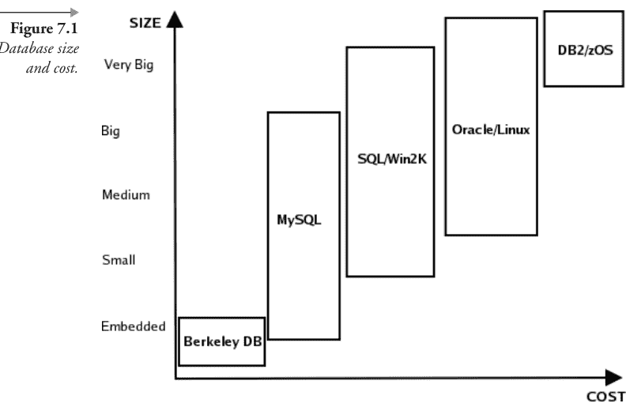

## 7.3.3 开源数据库选择

在我看来，有三种开源数据库在通用用途上值得认真考虑。它们是 Berkeley DB、PostgreSQL 和 MySQL。它们都被广泛使用。

另外两个系统处于利基市场。MaxDB 曾名为 SAP DB，在此之前称为 Adis-G 或 Supra。它拥有一些大客户，主要分布在欧洲，但由于其与 SAP 集成的吸引力，在美国并没有流行。它的角色可能是为未来未来的大规模 MySQL 版本提供整合技术。Firebird（原 Interbase）虽然是一个存在已久的稳健产品，但其增长并未超出小小的利基市场。

## Berkeley DB

Berkeley DB 是几个重要开源产品下的核心工具，显然有 2 亿次部署。Berkeley DB (BDB) 是旧 "DBM" 数据库的高性能衍生版本，这些数据库从从初就是 UNIX 和类 UNIX 操作系统系统的一部分。

作为一种嵌入式或特定应用程序的数据库，BDB 被包含在产品中，而用户无需察觉。这类似于 Brieve 或 Microsoft Jet 和 MSDE 引擎。它是一个平文件数据库，不是 SQL。

BDB 采用双重许可模式。在开源产品或单站点使用时，它是开源的（GPL 许可）。与商业产品一起分发时，存在商业许可。

Berkeley DB 被 Sendmail、Apache 和 OpenLDAP 服务器、Netscape 和 Mozilla 浏览器、Python 和 Perl 编程语言使用。商业客户包括 Sun、Google、Veritas、TIBCO、Cisco、Amazon 和 HP。

## PostgreSQL

PostgreSQL 是一个开源数据库，根据 BSD 许可/版权制度可用。它基于 20 世纪 80 年代在伯克利设计的 Postgres 项目，在此之前是基于 Michael Stonebreaker 自 1974 年以来在 Ingres 数据库上执行的。直到 1995 年它才成为一个基于 SQL 的产品。Ingles 和 Postgres 在 BSD UNIX 上开发。它现在 Linux 和 UNIX（包括 Mac）可用，但在 Windows 上不是原生的，在 Cygwin 仿真中运行。

Postgres 在历史上对标准 SQL 行为提供了比 MySQL 的支持，尽管 MySQL 似乎正在追赶。目前，Postgres 支持存储过程、触发器和视图，而 MyMySQL 4.1 不。对于习惯了这些功能的经验丰富的数据库开发者来说，这是支持 Postgres 的强有力论点。

Postgres 是一个良好的数据库服务器，在开源社区拥有强大的追随者，但在业务领域，它被认为在采用、营销和支持安排方面落后于 MySQL，Great Bridge 和 Red Hat（Red Hat 数据库基于 Postgres）提供的并没有取得太大进展。

## MySQL

MySQL 数据库服务器稳健、快速，并且在包括 Windows、Mac 以及各种 UNIX 服务器在客户端上是非常优秀的跨平台产品。它占用空间小且具有良好的管理工具。该产品由瑞典公司分发。

MySQL Pro（具有行级锁定和事务）的无限处理器和用户在商业许可下费用为 500 美元。

MySQL 数据库服务器是稳健、快速，并且在包括 Windows、Mac 以及各种 UNIX 服务器在客户端上是非常优秀的跨平台产品。它占用空间小且具有良好的管理工具。该产品由瑞典公司分发。

MySQL Pro（具有行级锁定和事务）的无限处理器和用户在商业许可下费用为 500 美元。

MySQL 数据库服务器是稳健、快速，并且在包括 Windows、Mac 以及各种 UNIX 服务器在客户端上是非常优秀的跨平台产品。它占用空间小且具有良好的管理工具。该产品由瑞典公司分发。

MySQL Pro（具有行级锁定和事务）的无限处理器和用户在商业许可下费用为 500 美元。


## 7.3 数据库服务器

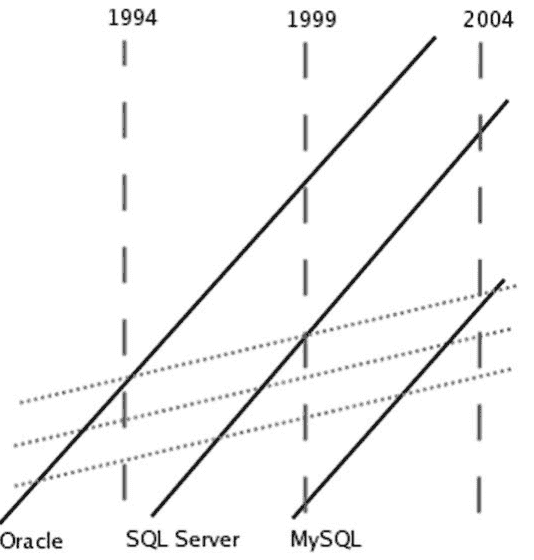

www.eweek.com/article2/0.3939,293,00.asp。SQL Server 的测试因为一个糟糕的 JDBC 驱动程序而存在缺陷，修复后，数据显示在该项测试中 MySQL 的性能与 Oracle 相当。

当然，我们应该应该进行自己的基准测试。然而，这是一个可能非常复杂的主题。深入的优秀探讨是 Jim Gray 的《基准手册》（Benchmark Handbook），该书已绝版，但在 Amazon 上可以买二手，或在 http://www.benchmarkresources.com/handbook 在线阅读。

运行大型且符合行业标准的基准测试并进行审计既昂贵又耗时。对于大型系统来说，仅仅获取硬件就是件大事了。

## OSDB 基准测试

Freshmeat 上有一个 Gray 的 AS3AP 基准的开源实现，被称为开源数据库基准测试 (OSDB)。AS3AP 是针对关系型系统的 ANSI SQL 标准可扩展可移植基准测试。根据《基准手册》（第 5 章，第 2 页），它的设计目的是：

- 为数据库处理能力提供一套全面且易处理的测试集
- 具有内置的可扩展性和可移植性，因此可以测试广泛的系统
- 最大限度地减少实现和运行基准测试的人工投入
- 提供统一的指标——等效数据库比例，以便对基准测试结果进行直观且无歧的解释

AS3AP 确定了一个性能指标（等效数据库大小）以及一个价格性能指标（即等效数据库大小的每兆字节成本）。OSDB 提供的指标比基准要求的更多。它还被放宽，以更好地支持具有完整 ANSI SQL 能力的数据库。这已经配置好可以在 MySQL 和/或 PostgreSQL 上运行。要让它再次运行（例如 Oracle）还需要一些工作，或者在你读到这里时，Oracle 的代码应该已经在存储库中了。

基准测试代码应该是开源的。我们想知道正在测量什么，而且自定义基准测试以使其成为我们关注的问题通常很有用。这个基准测试是用 C++ 编写的，因此需要了解 C++ 才能维护或扩展基准测试，但这确实带来了良好的性能。如果一个“粗略的”OSDB 运行良好，我建议后续在你计划使用的硬件（或类似硬件）上运行测试，并按照你计划的部署方式，使用接近你预测的数据量。

## 7.3.5 与闭源数据库的竞争

在任何机构中安装大型数据库时，你无法避免与 Oracle、微软和 IBM 的推销进行竞争。这些任何一公司的销售人员都会尝试像对待其他数据库那样对待开源数据库。如果他们被迫承认开源数据库可以完成讨论的任务，他们知道自己会在价格上输掉，因此他们会将辩论转移到其他地方。他们会谈论理论上的大型数据库和网格计算、TPC-C 赛场的结果，或者将你所有数据库合并为一个大系统的构想。

Oracle 将强调其市场领导地位，使其看起来是唯一的安全选择，并强调其他任何东西风险。Oracle 也会谈论网格。微软会强调价格性能和易管理性。微软还推销其扩展程序，如 DTS 和 Analytics、基于 Web 的访问以及一切 XML 化。IBM 特别追求集成；DB2 通常与 WebSphere 一起在 IBM 平台上销售。

Oracle 和 IBM 在 Tuxedo 应用服务器上运行它们的 UNIX 基准测试。他们使用这个平台是因为它比标准的应用程序服务器快得多且便宜得多。然而，Tuxedo 是一个老系统，难以开发，几乎从未用于真实的业务数据库。当 IBM 和 Oracle 向客户销售系统时，他们分别推荐 IBM WebSphere 和 Oracle Application Server。

在基准测试时，Oracle 总是查看大型数据库并比较性能。微软有一些大型性能数据，但更倾向于查看中小型数据库并比较价格性能。Oracle 在微软相同的机器上运行中间市场基准测试，得到了略好的结果。它不会在较小的机器上这样做，因为数据库成本占主导地位。

## 7.4 邮件服务器

在 UNIX 和开源世界中，邮件服务器分为发送者消息代理（MTA）和接收者/邮件存储。

邮件通常通过 SMTP 协议发送，并通过 POP3 或 IMAP 协议访问。这在 Exchange 等闭源邮件服务器上的工作原理相似，但发送和接收程序统称为 Exchange（或 Groupwise 或 Notes）。

我们提到过 Sendmail，这个古老的程序可能是目前广泛使用的最古老的开源程序。在给予它应有的尊重后，是时候承认 Sendmail 是一个旧程序，今天可能不是最理想的邮件服务器了。它以配置困难和安全问题历史而闻名。如今的共识是你应该选择 Postfix 而不是 Exim 和 Qmail，但我们在这里看 Postfix。

Postfix 速度快，扩展性好，且配置相当显而易见。它可以使用不同的消息存储格式（Maildir 或 Mbox）。我们通常倾向于 Maildir 格式，它将每条消息存储在一个文件中。这使得使用外部工具处理消息变得简单得多。

消息接收器和存储的替代方案是 POP3 和 IMAP。IMAP 更丰富且通常更优。Exchange 存储支持这两种协议。原生 Exchange 存储看起来像 IMAP 但略有不同，导致 Outlook 的 IMAP 支持可能很。由于由于原因，我们有时选择在 Outlook 中使用 POP3。IMAP 服务器的选择包括 Courier-IMAP 和 Cyrus IMAP。对于目录服务器，我们更倾向于 OpenLDAP。

许多组织喜欢基于浏览器的邮件客户端。Horde 是一个支持浏览器的服务器示例。它看起来类似于 Outlook Web Access 并提供类似的功能。它可以访问 OpenLDAP 进行身份验证、地址查询和联系人。

## 7.5 系统管理

开源系统管理的基本选择（与数据库领域一样）是完全采用开源工具和方法（这将涉及培养具备 UNIX 技能的管理员），还是采用闭源系统管理工具（后者通常是多平台的）。两种方法可能都是需要的。尽管图形工具很有吸引力，系统管理员通常需要深入理解他们使用的平台。

如果需要，下一级是通过跨平台脚本语言进行编程。这将允许我们开发更灵活、自动的方法，例如备份和管理用户规模。好消息是 UNIX 有深厚的脚本传统，这项工作是可行的。坏消息是，尽管它兼容 Windows 系统，但并不符合 Windows 通用的方法。

闭源工具是全面且图形化的，所以它们用起来非常棒。开源工具通常针对更有经验的管理员，并且更倾向于 UNIX 的“把一件事做好”哲学。没有理由不使用两种类型的工具。许多使用 Tivoli 或 Unicenter 的组织也会使用 Snort 等开源工具进行入侵检测，并编写 Shell 或 Perl 脚本来管理自己的应用程序。

适用于 Linux 的闭源工具：

图 7.3 Nagios 状态概览


- BMC Patrol
- CA Unicenter
- HP OpenView
- IBM
- Novell ZENworks

领先的集成图形开源系统监控工具是 Nagios。这已被拥有高达 5000 台主机的组织用于生产环境。如图 7.3 和 7.4 所示，它是全面且清晰的。Nagios 的在线可以在 http://nagios.square-box.com 获取。

开源管理工具包含了大量针对特定目的的特定工具。大多数现有大型机构已经有一套多平台管理解决方案，只需将其扩展到开源系统即可。


## 7.6 总结

系统需要在所有层面上进行监控。开源应用程序更容易进行实例化，以支持将事件日志到系统管理工具中。其他优秀的开源工具还包括 TCPdump、Snort 和 Ethereal。

对于这些重要的服务器应用程序，开源选择包括：用于基础设施服务的 Samba 和 OpenLDAP，用于 Web 服务器的 Apache，用于数据库服务器的 MySQL 和 PostgreSQL，以及用于邮件服务器的各种程序。

在大多数这些类别中，Linux 上也有许多具有商业支持的闭源程序，例如用于目录服务的 iPlanet，用于数据库服务器的 Oracle 和 DB2，用于邮件服务器的 Scalix 和 Contact，用于系统管理的 CA-Unicorn 和 HP OpenView，许多人会选择采用它们。

如果你的组织尚未准备好接受开源不同的销售模式，也没有准备好通常所需的模式整合，那么从主要供应商那里选择闭源产品和支持服务可能是最好的选择。

如果你的组织已经准备好接受开源销售模式并为某些集成做了准备，那么在几乎任何规模下，都有基础设施、Web、邮件和数据库服务的开源软件供选择。通过运行开源服务器，你可以减少许可和硬件成本，同时增加灵活性。

## 8 开源桌面应用程序

## 8.1 引言

### 8.1.1 开源桌面

一个带有应用程序的完整开源桌面可以利用 Linux 在典型的个人电脑上轻松安装和演示。大多数人会同意，这样的桌面具有吸引力、功能强大，并且从零开始学习像 Windows 一样简单。这些桌面的成本可能比闭源系统低得多，因为它们可以节省操作系统成本以及像 Microsoft Office 的应用程序成本。

在 Windows 上构建一个所有应用程序都是开源的桌面也是可能的。同样，这也可以具有吸引力、功能强大且易于学习。在许多已经安装了操作系统的情况下（如家庭电脑），将它替换为 Linux 并不会节省开支，但将 Office 等应用程序替换为开源软件可以节省巨大的成本。

我们将逐一讨论的开源开源桌面应用程序有：

- 图形桌面
- Web 浏览器
- Office 程序（字文字处理、电子表格、演示文稿软件）
- 专业应用程序（图形处理、数据库前端、Web 设计师）
- 个人应用（媒体播放器、游戏）

### Linux 桌面份额

Linux 在功能和易用性方面取得了巨大进步，但在桌面端仍未被广泛使用。自 1994 年以来，Linux 在销量上超过了 Mac，成为桌面端的第二大操作系统。IDC 报告显示，Linux 的份额从 2002 年的 2.8% 增长到 2003 年的 3.2%，而 Mac 保持在 3%。这是意义的，但仍然只是很小的一部分。Windows 的份额为 94%。IDC 预测 Linux 在 2007 年将增长到 6%，但 Windows 将超过 90%。

这些数字可能低了 Linux 现在和未来在桌面上的地位。Linux 的增长是不连续的，因为它通常不被购买。Windows 几乎在每一台新 PC 上都会出现，而当用户将 Windows 替换为 Linux 时，他们可能没有被有效统计进来。它也被用于连接的利基市场，其中某些增长非常快，例如涉及数百万台电脑的新兴亚洲国家。主要的电脑公司——IBM、HP 和 Sun——都有鼓励采用 Linux 桌面的计划，并发布了一些主要的公司公告。Linux 在过去超出了预期，在桌面上的增长速度可能比目前预测的快得多。

### 桌面 Linux 采用的局限性

无论 Linux 的增长如何，我们知道在接下来的三四年内，Windows 用户数量将继续比 Linux 用户多出一个数量级。这对硬件、应用程序和支持服务的可用性产生了影响。这些限制都显著地限制了 Linux 桌面部署的可能性。

### 硬件

现在大约一半的企业个人电脑是笔记本电脑而非台式机。这部分群体最不可能快速采用 Linux。在笔记本系统上安装 Linux 仍然可能需要一些定制化工作，并且存在硬件限制，包括对无线的支持（例如 Intel Centrino 和大多数 802.11g 网卡）、某些显卡以及高级的电源管理。笔记本用户可能不得不为了运行 Linux 而接受某些功能上的损失。笔记本用户通常是专业用户，除非他们是开发者或出于其他原因致力于开源，否则他们不太可能接受妥协。

### 图形桌面

### 应用程序

鉴于安装份额的差异，Linux 桌面上有许多可用应用程序，这或许令人惊讶，而且在主要类别中通常有几个不错的选择。较小的利基应用程序是更多的问题。在 Windows “生态系统”中有成千上万的应用程序，通常为 Windows 工具和界面编写，并且通常针对特定的垂直行业。

在迁移情况下，任何特定应用程序对于某组用户来说可能是“必须的”，Microsoft Office 只是这种情况下最大、最为人知的例子。第 8.6.1 节针对这种情况提供了一些策略，但通常意味着需要在某些系统上运行 Windows。

### 支持服务

有成千上万的企业员工，以及更多外包服务的人员，在支持和培训岗位为 Windows 桌面用户工作。其中一些人拥有 MCES 资格，另一些则没有；但大多数人在支持 Windows 系统所需的技能方面投入了大量精力。

### 图形桌面

鉴于安装份额的差异，Linux 桌面上有许多可用应用程序，这或许令人惊讶，而且在主要类别中通常有几个不错的选择。较小的利基应用程序是更多的问题。在 Windows “生态系统”中有成千上万的应用程序，通常为 Windows 工具和界面编写，并且通常针对特定的垂直行业。

在迁移情况下，任何特定应用程序对于某组用户来说可能是“必须的”，Microsoft Office 只是这种情况下最大、最为人知的例子。第 8.6.1 节针对这种情况提供了一些策略，但这通常意味着需要在某些系统上运行 Windows。

### 支持服务

有成千上万的企业员工，以及更多外包服务的人员，在支持和培训岗位为 Windows 桌面用户工作。其中一些人拥有 MCES 资格，另一些则没有；但大多数人在支持 Windows 系统所需的技能方面投入了大量精力。

### 8.2 图形桌面

X11 编写于 80 年代初，并以开源许可提供。最终，出现了一场转向采用一套桌面标准的运动。这变成了通用桌面环境 (CDE)，它采用了基于 Motif 的标准，而 Motif 看起来像 Windows。遗憾的是，Motif/CDE 在当时并不是开源的，这减慢了进展。

X11 工具包用 C 语言编写并在相当底层的级别上访问，因此编程并不容易。开发了“小部件集”（Widget sets）使得这种开发更具一致性并降低层级；这些集演变成了面向对象的 API，并且有几种建议用新代码取代它们，但短期内可能不会发生。

因此，Linux 系统拥有共同的图形代码库，但在窗口管理器、外观感觉和开发工具包方面有替代方案。在其他领域，我们获得了选择带来的双刃剑式的收益和成本。这里有一些非常有趣的自定义选项。对于异常的系统（例如非常大的或某些自定义区域），这种界面的分离允许极大的灵活性。任何应用程序都可以创建自己的外观。因此，嵌入式系统可以像 TiVo 那样的简单专用外观，也可以像 Sharp Zaurus 那样的高性能界面。我们可以此让零售或呼叫中心应用程序看起来完全符合我们的要求。此外，高级用户也可以按照自己的意愿配置系统。


对于通用业务系统，我们通常更倾向于使用标准的桌面，如我们在 Windows 或 Mac 上看到的那，因为这可以降低培训和支持成本。标准桌面提供了一系列实用的组件：

- 窗口管理器：以连贯的方式组织窗口、菜单和滚动条
- 桌面布局：用于启动程序、组织和查找物品的地方
- 文件管理器：类似于 Windows 资源管理器（Explorer）或 Mac Finder，可以与 Web 浏览器集成
- 标准的外观和感受：包括一致的菜单和对话框，以及字体、主题、效果和通用的“视觉装饰”选择
- 工具小程序集：用于实用功能，如打印机设置或外观控制，类似于 Windows 控制面板或 Mac 系统偏好
- 有用的应用程序
- 游戏

在 Linux 提供的许多可用桌面中，像 Windows 或 Macintosh 那样所提供的这种类型的组件包中，有两个至关重要。它们是 Gnome 和 KDE 项目，这两个项目都始于 1997 年左右，目标是引入一个功能丰富的桌面，并从那时起发布新版本。这些系统现在在一致性、易用性和易学性方面与 Windows 竞争，但它们可能还没有 OS X 那么接近。

Gnome 和 KDE 界面可以在同一台计算机上运行，都可以同时出现在用户的桌面上，并且应用程序可以在彼此的桌面上运行。它们看起来不同，并使用竞争性的开发平台构建；KDE 使用 Qt 工具包构建，而 Gnome 则是使用 GTK+ 工具包构建的。虽然两者各有优劣，但功能冗余，复制了彼此的大部分功能。它们确实是竞争对手。作为开发者，你必须选择用哪种工具包来开发应用程序。作为用户，你可能会在不同时间倾向于另一个。

这个问题使得 Linux 桌面比 Windows 更具创新性，但通常更难学习。Linux 社区的每一个人都明白，如果我们有一个，在很多方面都会更简单，那就是……

## 8.2 图形桌面

单一桌面标准，但这种情况在短期内不会发生。最近一项将 UserLinux 标准化为 Gnome 而非 KDE 的建议揭示了人们对这些项目的深厚情感。这两个项目都是强大且持续的，并且都得到了强有支持。

从长远来看，可能会由主流发行版驱动的趋同。红帽（Red Hat）一直致力于在他们较新的“Bluecurve”版本中很大程度上隐藏 KDE 和 Gnome 之间的差异。诺贝尔（Novell，拥有主要的 Gnome 驱动程序 Ximian 以及 KDE 的大赞助商 SuSE）宣布了随着时间推移合并桌面的计划。

8.1 和 8.2 显示 Gnome 和 KDE 桌面的截图。两者都非常可配置，因此你的桌面也可以。

Gnome 桌面显示：

- 一张保存为背景的图形
- 左上角的家庭文件夹
- 右下角的垃圾箱
- 桌面上其他文件夹和链接
- 正在查看某些网络文件共享的 Nautilus 文件管理器
- 底部的 Gnome 菜单，从左到右包括：
- 主菜单（红帽）按钮
- 几个应用程序的启动器
- 截图工具
- 无线和电池信息
- 虚拟桌面管理器
- 系统管理器工具
- 时钟

KDE 桌面类似，但有不同的图形背景，并且运行的是 Konqueror 文件管理器，而不是 Nautilus。菜单栏很简单。它恰好被配置得大一些，某些项目放置的位置不同。同样，红帽按钮和启动器在左侧，其他工具在右侧。截图、电池寿命和时钟工具是与 Gnome 中不同的程序，但具有相似的功能。

图 8.1
Gnome 截图。

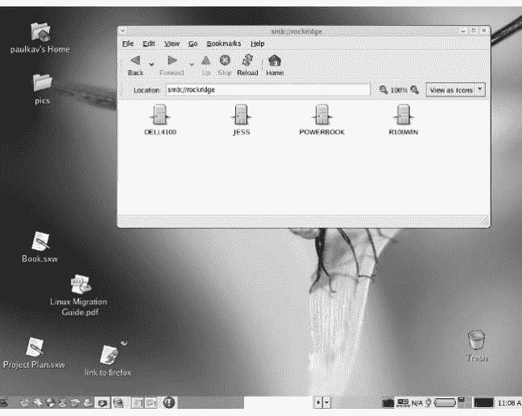

图 8.2
KDE 截图。

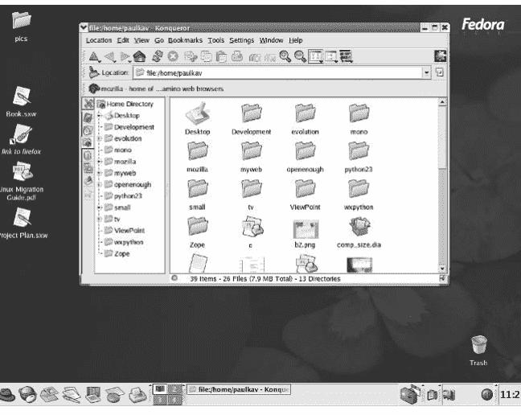

## 8.3 Web 浏览器

### 表 8.1 选择浏览器

| 浏览器 | 平台 | 状态 | 注释 |
|---|---|---|---|
| Mozilla Navigator | Windows, Linux, Mac | 开源 | Navigator 基于 Mozilla 1.6；Mozilla Firefox 是新代码，小得多。 |
| Internet Explorer | Windows | 包含在操作系统 | 在旧版 Mac 上有但现在已停止支持。AOL IE。 |
| Konqueror | Linux | 开源 | 使用 Qt 库，与 KDE 配合良好。 |
| Epiphany, Galeon | Linux | 开源 | 这两个浏览器都使用 Gnome 工具包和 Mozilla 渲染引擎。 |
| Safari | Mac | 包含在操作系统 | 基于 Konqueror 渲染引擎（Qt 在 Mac 上原生运行）。 |
| Opera | Windows, Linux, Mac | 带有广告免费，或收费 | 小、快，但不是开源。 |

在开发应用程序时，我们通常不想要求特定的浏览器和操作系统。在许多情况下，我们无法知道应用程序用户将使用哪种浏览器。即使我们能确定这一点，在客户或业务情况下，施加这种限制可能是不合理的。因此，在开发时，我们通常会计划支持多种浏览器。

从原则上说，我们知道如果有太多的很多人为特定浏览器编写代码，可能会破坏 Web 的优秀特性之一，即对特定硬件和软件平台的独立性。通常，最好的计划是为多个浏览器编写。当然，我们不希望有太测试负担。表 8.1 提供了一些可用的浏览器选择。

## 8.4 办公套件

在考虑办公套件时，我们将考虑文字处理、电子表格和演示程序，尽管开源套件（如 Microsoft）还包含其他程序，如绘图和图像管理。那么，从 Microsoft Office 的角度来看，我们寻找的是 Word、Excel 和 PowerPoint 的替代品。我们将在其他地方单独讨论数据库前端和邮件前端程序，即 Access 和 Outlook。


# 办公套件

-   如果用户选择不使用套件，允许使用 Gnumeric 或 Abi Word 等独立程序。

## OpenOffice.org

OpenOffice（此处缩写为 OpenOffice）是领先的开源办公软件。Sun 于 1999 年收购了 StarOffice 的德国开发商 StarDivision，建立了 OpenOffice.org 来管理开源过程和分发，同时继续以商业模式提供 StarOffice。StarOffice 和 OpenOffice 共享代码库和文件格式；OpenOffice 是开源的，而 StarOffice 在商业上非常稳健并包含额外功能。

在编写时，OpenOffice 处于 1.1 版本，StarOffice 为 7.0 版本。主程序是相同的，但 StarOffice 在分发中包含了额外产品，包括 TrueType 字体、拼写检查和词典工具、相同的模板和图片，以及名为 Base 的 Adabas 数据库桌面版。Sun 还为 StarOffice 提供商业支持。在书中，从现在起我们提到的 OpenOffice 将 StarOffice 作为一种可能的选择。

OpenOffice 的字体和拼写检查功能较弱。采用 OpenOffice 的组织应该考虑这些功能的解决方案。OpenOffice 集成的另一个例子是 Ximian。Ximian 版本的 OpenOffice 为了方便办公迁移，默认使用 Microsoft 文件格式，并显示与 Gnome 程序 Galeon、Gnome-theme 以及 Evo-lution 的集成，以识别 Gnome 桌面主题和字体设置。

OpenOffice 和 StarOffice 的文件格式与之前的版本（1.0 和 6.0）相同，OpenOffice 1.1 支持 Linux 和 Windows。这些版本本质上是相同的。Mac OS 版本的 OpenOffice 此时为 1.0。文件共享仍然可行，但程序的一些功能落后了一个版本。Mac 版本不是原生的，而是基于 X11 的。由于版本落后非原生问题，我们发现 Mac 版 OpenOffice 太慢，且屏幕格式糟糕。这将在几个月后得到修复。目前，有一个名为 NeoOffice/J 的版本，使用 Java 前端，速度快且展示效果良好。

8.4 到 8.6 是 Linux 上 OpenOffice 的三张截图：文档、电子表格和演示文稿。

## 8.4 办公套件

图 8.4
OpenOffice 写。

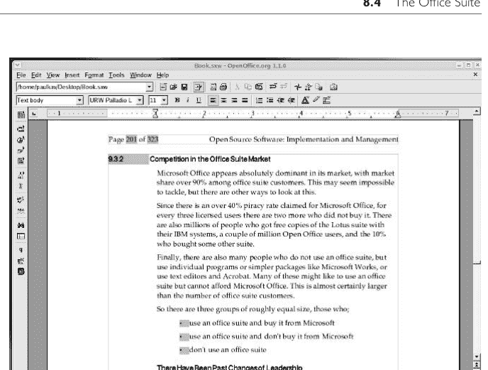

### 8.3.2 办公套件市场的竞争

Microsoft Office 在其市场中占据绝对主导地位，市场份额超过百分之八十。这似乎无法挑战，但还有其他选择。

由于声称 Microsoft Office 有许多其他竞争对手，每有一个授权用户就有另外两个不使用它的人。有数百万人倾向于其他事实标准，有一百万 OpenOffice 用户，以及使用免费软件的人。

最后，还有许多人不使用任何办公套件，而是使用像 WordPad 这样的文本编辑器。许多人可能想使用办公套件，但负担不起 Microsoft Office。这无疑多于办公套件的用户数量。

因此有三类规模相似的群体：

-   使用 OpenOffice 和其他免费软件的人
-   使用办公软件但不是免费获得的人
-   不使用办公套件的人

### 过去曾有制造领导地位的指控

Microsoft 在办公软件领域的主导地位让其他人的创新变得困难。

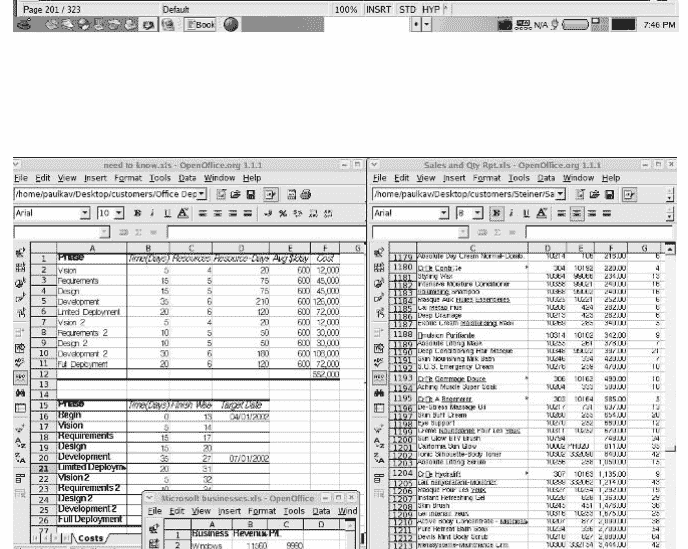

图 8.5
OpenOffice 表。

## 8.4 办公套件

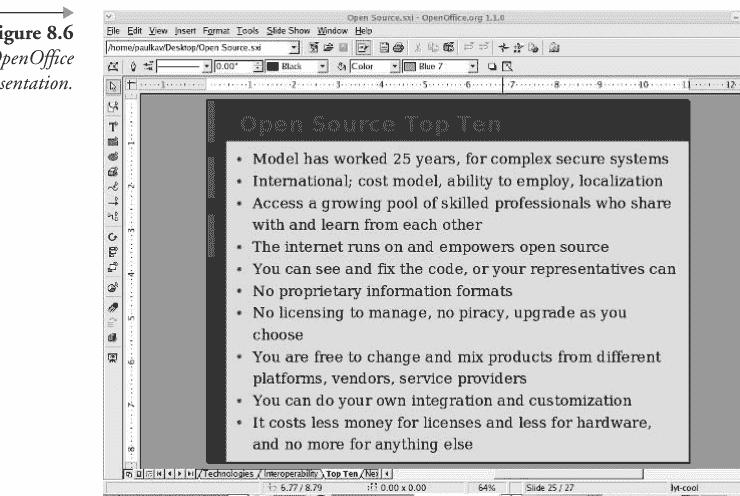

## 8.4.2 办公套件市场的竞争

Microsoft Office 在其市场中占据绝对主导地位，在办公套件客户中的市场份额超过百分之九十。这似乎无法对付，但还有其他看待此问题。

由于声称 Microsoft Office 的盗版率超过百分之四十，每三个授权用户就有两个没有买它的人。有数百万人随其 IBM 系统获得了 Lotus 套件的免费副本，有少数 OpenOffice 用户，以及百分之十购买了其他套件的人。

最后，有许多人不使用办公套件，而是使用独立程序或更简单的包（如 Microsoft Works），或使用文本编辑器和 Acrobat。许多人可能想使用办公套件，但负担不起 Microsoft Office。

因此，有三类规模大致相等的群体——那些：

-   使用办公套件并从 Microsoft 购买
-   使用办公套件但不是从 Microsoft 购买
-   不使用办公套件

# 办公套件

第二、第三组是 OpenOffice 的直接候选人，第一组中的部分也是如此。

## 过去曾发生领导地位的变更

Microsoft 对办公套件的主导并非理所当然。它最初在任何办公类别中都不是领导者，在许多多年也是如此。商业领域的第一批个人电脑是 20 世纪 70 年代基于 CP/M 的机器。畅销程序是 WordStar、VisiCalc 和 dBASE II，分别提供处理、电子表格和数据库功能。在 MS-DOS 上，WordStar 和 VisiCalc 被 WordPerfect 和 VisiCalc 取代。

（注：由于原文文本存在大量重复和 OCR 错误，已根据内容进行了逻辑重构和合并翻译。）


## 8.4 办公套件

为了增加产品销量，这也是为什么 Office 以套件形式销售的原因。由于人们会在网络中传输可编辑文档以进行共享，他们依赖于格式的互换性。Microsoft Office 格式是非公开的，并且经历过多次更改，因此与 Office 程序之间实现互操作并不容易。

微软在需要时会降低有效价格，但会悄悄进行。它不愿于公开价格可能会下降，部分原因是许多用户已经签署了长期许可协议，而且它正试图签署更多协议。最近，微软开始推出低价的“学生和教师”版本。它还可以选择对国际定价、批量计数进行更改；收紧或放宽许可和升级限制。所有办公套件用户可能获得的一个益处是，包括 Microsoft Office 在内的所有产品价格下降所带来的竞争加剧。

## 许可问题

## 8.4.3 Microsoft Office 与 OpenOffice 的比较

### 捆绑

OpenOffice 不包含像 Outlook 这样的电子邮件客户端，但大多数人会使用 Evolution，它功能强大、与 Outlook 类似、与 OpenOffice 集成良好，并且是开源的。同样，OpenOffice 不包含数据库程序，但大多数人如果需要 SQL 数据库，会考虑 MySQL。作为数据库，MySQL 比 Access 更强大且可扩展性更高，但没有同类的集成前端。可能的前端包括 Mergeant、Gnome 数据库前端、OpenOffice 以及如 MySQL administrator 和 Quest 等数据库工具。Star Office 包含一个数据库。OpenOffice 确实包含一个绘图程序，但对于大多数用途，我建议使用更强大的 GIMP。

### 集成

OpenOffice 可以使用 ADO、JDBC 或 ODBC 访问方法连接到数据库。例如，可以使用 ADO 连接到 Access，使用 JDBC 连接到 MySQL，使用 ODBC 连接到 SQL Server。

OpenOffice 格式基于 XML且已发布，因此与其他系统的集成比 Microsoft Office 更简单。在 OpenOffice 中，无需购买更昂贵的版本来管理 XML 格式。有一个使用 Java 扩展 OpenOffice 的软件开发包。

### 格式

使用 Microsoft Office 格式存在一些严重问题。它们是专有的、会发生变化且没有文档说明。第三方想要访问这些格式非常困难，尽管已经有一些不错的程序可用。例如，在通信中使用这些格式，隐含地要求他人获取 Office 程序，而他们可能并不需要。

OpenOffice 使用压缩的一组 XML 文件。OpenOffice 格式的大小通常只有 MS Office 文件的一半左右（除非位图或其他不可压缩的附件占据了主要空间）。由于 XML 格式是公开的，使用标准工具读取 OpenOffice 格式为空。

有人指出，Microsoft Office 文档以其他人们意想不到的方式在文件中保留了早期版本的文档和作者信息。作者被其 Microsoft Office 文件中发现的数据“现形”，而他们并不知道存在这些数据。Microsoft Office 2003 中的新数字格式可能会在访问旧版本或廉价版本的 Office 数据时产生问题。

Microsoft Office 完全无法读取 OpenOffice 格式，而 OpenOffice 能够很好地读取 Microsoft 格式。OpenOffice 可以创建 PDF 文件，而 Microsoft Office 则必须使用第三方工具。

## 8.4.4 从 Microsoft Office 迁移到 OpenOffice

安装基础是 Office 97 和 Office 2000。目前 Office XP 或 Office 2003 还很少。这立即凸显了今天 Office 迁移的主要问题，即没有人想做。

微软在实现升级方面面临困难，尽管它让这些升级变得非常容易且具有吸引力。如果没有理由，人们不会改变，而这个理由通常是重大的改进。在办公套件中交付用户感知的改进是极其困难的。微软在将 Office 97 用户迁移到新版本方面有问题，因为他们对目前的内容相当满意。他们还没有准备好学习和采用新功能。为了节省成本而改变的问题在于，必须改变的人并没有获得那部分节省的成本，因此他们没有动力。

如果 Access 或 Outlook 与其他办公产品的集成被认为特别重要，那么迁移到开源可能是不切行的。Microsoft Office 包含了许多小型应用程序，如 Chart、Query 等。这些程序中的大多数在开源中都有某些对应物；Math 和 Draw 包含在 OpenOffice 中。但再次，如果这些被认为特别重要，迁移可能仍是不切行的。

### MS Office 与 OpenOffice 之间的导入/导出

首先，微软完全无法读取 OpenOffice 文件。任何 OpenOffice 文件都必须在 OpenOffice 中转换为 Microsoft 格式。OpenOffice 特有的功能将在这些格式中丢失。 

OpenOffice 非常擅长读取 Microsoft Office，但并不完美。有几种格式需要考虑，例如 Office 95、97、XP (2002) 或 2003。从 Office 97 开始，Microsoft Office 使用结构化存储的 OLE 格式，包含几条信息“流”。Office 97、2000 和 XP 使用相同的格式（对于这三个程序）。

Microsoft Office 完全无法读取 OpenOffice 格式，而 OpenOffice 能够很好地读取 Microsoft 格式。OpenOffice 可以创建 PDF 文件，而 Microsoft Office 则必须使用第三方工具。

## 8.4 办公套件

但这种成功也有一些原因。我早已知道可以在不同版本的 Office（包括有限的 PC 版本）中运行。虽然表格使用了许多公式、多个工作表和简单图表，但我从未使用过宏或表单。Word 文档很大，使用了样式、页眉和目录，但没有以特别复杂的方式使用它们。同样，没有宏或表单。我没有在 PowerPoint 中使用媒体。

## 8.4.5 锁定与复杂性

并不是所有组织都能离开 Office。这取决于他们使用的方式。如果用户被锁定，他们改变的速度会变慢，因为他们使用了无法迁移的 Microsoft Office 功能。贵组织的被锁定程度需要对组织中的每组用户进行评估。它取决于：

- 高级或专业用户编写文档
- 技术功能的使用（宏、共享组件等）
- 文档协作的整体模式

表 8.2 列出了 Microsoft Office 中某些导致迁移的功能。

宏无法工作，因为它们针对 Microsoft Office 对象模型并使用 VBA 编写。OpenOffice 有宏，但使用的是不同的语言和对象模型。如果需要，所有的宏都需要翻译。宏信息保留在文件中，以便在透传情况下再次用于 MS Office。

在转换过程中，文档会发生很多变化，并需要修复。文档的分页几乎会有不同。字体不同，字符间距的计算方式不同。字体是一个需要注意的问题。Linux 系统的字体通常与 Windows 的不同，且 OpenOffice 处理某些字体大小的方法似乎略有不同，因此分页可能会变化。表格和多列格式可能会不同，虽然数据不会丢失，但它们可能会超出页面并导致无法打印。不简单且包含此类问题的文档需要手动转换。如果此类问题很多，迁移将变得非常困难。


## 迁移问题的 Office 特性

| 特性 | 程序 |
| --- | --- |
| 自动形状 | 所有程序 |
| 宏 | 所有程序 |
| OLE 对象 | 所有程序 |
| 修订标记 | Word |
| 表格和多列格式 | Word |
| 表单字段 | Word, Excel |
| 透视图表和表格 | Excel |
| 某些图表 | Excel |
| 某些公式、函数、控制字段 | Excel |
| 背景母版 | PowerPoint |
| 组对象 | PowerPoint |

你是否可以从 Office 迁移很大程度上取决于你的用户是否开发了依赖 Office 的自定义程序。如果你有用户大量使用 VBA 编程并开发自定义表单，你将会发现迁移到其他产品是高昂的，甚至是不可能的。

你的办公套件用户中，有些人是文档的专业创建者，而非主要的消费者，他们不愿意切换到一个在任何方面都逊色甚至不同的产品上：这对他们来说太重要了。如果存在常用文档的共享库，情况会更加困难。例如，最后拒绝 Microsoft Office 的坚守者是法律事务所，因为他们拥有 WordPerfect 文档的自定义库。在这种情况下，由熟练作者开发并供他人使用的更高级的功能，将组织锁在了这些功能的实现上。

这些高级用户可能是单个部门，例如使用 Office 的财务分析师或使用 Word 宏的法律秘书。在某些情况下，可以放这些小组保持现状，而迁移公司的其他部分。这种方法是可行的，取决于协作模式。如果你目前正使用 Office 与组织内或组织外的其他小组进行协作文档生产，而这些小组尚未进行开源转型，那么你可能没有迁移的选择。

## 一次迁移

如果你计划进行一次性迁移而不是继续保持互操作，你可以以合理的方式处理大多数问题。如果你的意图是停止使用 Office 并所有文档迁移到 OpenOffice，你会发现大多数文档在传输时只会发生细微的格式变化，这在一次性操作中不会困扰用户。数百份文档可能只需要几小时的清理工作即可完成。例如，页码可能会略有偏差，某些字体可能会以你不喜欢的方式被替换，某些对外部文件的复杂引用可能需要检查。在这种情况下，你可以根据需要测试任意文档，并安排专业人员支持迁移。

## 双向互操作性

如果你打算每天继续往返传输文档，那么“修复”文档上花费的时间将无限增加，并变成无法承受的负担。这就是为什么需要分析使用模式的原因。任何涉及在不同 Office 产品之间定期往返交换复杂文档的计划都需要经过仔细审查，并且最好进行修改以消除这种混乱。

## 切换成本的影响

OpenOffice 是一个很好的产品，它满足了大多数组织对办公套件的需求。它足够好了。大多数人可以安装 OpenOffice 并获得一个满足你所有需求的系统。然而，大多数组织已经部署了 Microsoft Office，这改变了一切。与切换容易或难以检测的服务器产品不同，更改桌面是一件大事。

正如所讨论，文档迁移并不是一项小任务。对于一些高效的人来说，这意味着几个月的工作需要重新审视并可能丢失。对于普通人来说，这意味着没有补偿的不便。重新培训也是一个问题，因为 OpenOffice 与 Microsoft Office 相似但绝不相同。取决于组织，这可能会导致高昂成本和一些不满。

文档迁移和用户培训等切换成本的影响使得这对于许多组织来说失去了吸引力。图 8.7 使用之前审查过的创新图显示了这些切换成本的影响。这些成本可能会使经济采用延迟多年或无限期。例如，如果每个用户需要一、两天的培训，那可能会抵消许可成本的节省。这就是为什么我们首先会看到 OpenOffice 在用户尚未投入时间学习使用 Microsoft Office 并使用这些格式建立文档库的地方被采用。

## 图 8.7 切换成本与 OpenOffice 的采用。

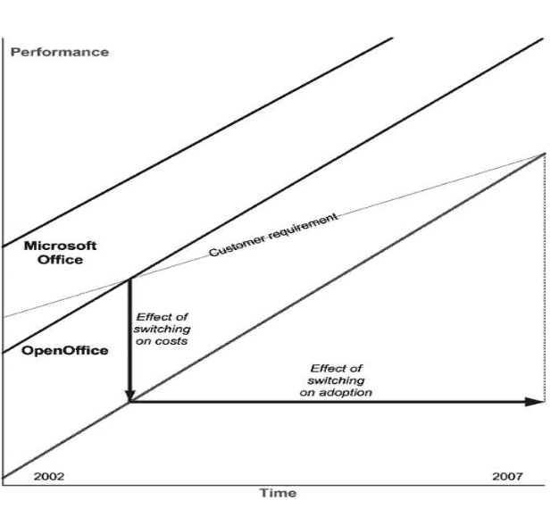

## 8.4.6 8.4.6 当你不需要办公套件时

不需要选择套件的个人和组织可以考虑单个产品，例如 AbiWord 文字处理器和 Gnumeric 电子表格作为可能的“同类最佳”选择。为每个人都提供办公套件的想法是一个相对较概念，并不特别自然。营销和销售部门使用 PowerPoint，会计部门使用电子表格。许多企业撰稿人员只需要一个电子邮件程序。可能只有几百个（或几十个）人在创建原始的 Word、Excel 或 PowerPoint 文档。其中许多人只使用了可用功能的一小部分。

这些文档有免费的阅读器。在 Windows 环境中，你可以根据需要使用 Word 或 Excel 进行创建。完成的文档将要么渲染为 PDF 文件，要么提供 Word/Excel 查看器。因此，对于许多人来说，可以考虑完全使用办公套件——也许对于大多数公司的大多数人如此。

在开源环境中，你可以将 OpenOffice 作为你的标准套件，但可能作为可选项目而不是标准安装的一部分。完成的文档将渲染为 PDF 文件，电子表格数据将渲染为 CSV 文件。

一个在没有办公套件的情况下通常有效的系统真实世界示例是 Apple Mac。销售的 Mac 包含 TextEdit（可以读/写 Word 文档）、AppleWorks（可以读/写 Excel 文档）、Mail/通讯录，以及 Keynote（可以读写 PowerPoint 文档，单独销售）。Apple 应用集成良好，并符合“套件”的一致性。

在 GUI 之前，水平集成（即外观，如 Word）并不被认为是必要的。如果 GUI 工具包和 Windows 管理是一致的，就不需要水平集成，这样功能就可以复制粘贴。这正是 GUI 所提供的，这也是为什么我们有样式指南。如果需要同一供应商的应用程序完全一致，那么可能只有一家供应商。

## 8.5 邮件和日历客户端

有几种种邮件客户端可用。这包括也处理邮件的浏览器（如 Mozilla 和 Opera），以及专门的邮件客户端（如 Eudora）。

邮件程序的一个大问题是你想在多大程度上复制 Outlook。如果你想要 Outlook 的功能，包括日历、电子邮件和小型数据库的结合，你可能想使用 Evolution，它的外观与 Outlook 非常相似。你可以使用 Evolution 作为 Microsoft Exchange 的前端（使用付费连接器），或者配合支持 POP、IMAP 的其他服务器使用 Evolution。

另一个选项是使用纯浏览器电子邮件，支持此的 Outlook Web Access、开源程序 Horde，或 Hotmail 和 Yahoo! 等服务。

许多组织离开 Outlook 的大原因是控制附件问题。邮件程序不允许可执行附件自动运行病毒。

## 图 8.8 Evolution。

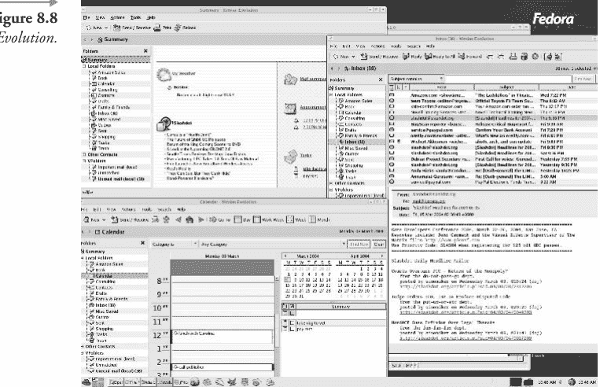

8.8 显示了打开了多个面板的 Evolution。从左上顺时针方向，显示了启动面板、邮件摘要、一个打开的邮件项目和日历面板。它的外观是可以自定义的，如果你愿意，完全可以变得与 Outlook 非常相似。

## 8.5.1 专业应用程序

这包括项目管理、绘图和图像管理以及专业工作的应用程序。在某些方面，情况与 Office 类似。但它们可能在功能上无法匹配，并且存在数据格式和用户培训方面的迁移问题。应用程序清单是必要的。


## 8.5 邮件与日历客户端

### 8.5.2 绘图与图像管理

对于普通用户来说，GIMP、Dia 和 Sodipodi 等开源程序与 Photoshop、Visio 和 Illustrator 相比更具优势。正如 Office 软件一样，要求最高的专业用户不会因为投入的时间和高精需求而切换软件。但大多数人会发现这些程序绰绰有余。GIMP 也适用于 Windows 系统，并且在该平台以及 Linux 上都是对于专业和家庭用户来说非常非常好的图像处理程序。Dia 类似于 Microsoft Visio。它没有提供同等丰富的模板库，但对于简单工作来说已经足够了，而对于自定义工作，其创建形状的格式是开放且易于使用的。书中的大多数图表都是用 Dia 创建的。

图 8.9 和图 8.10 是 GIMP（GNU 图像处理程序）和 Dia 的截图。这两个程序大量使用了浮动面板。图像是一个面板，而各种工具位于独立的窗口中，这些窗口可以移动或关闭。这种源自 GIMP 的风格初次接触时很寻常，但非常强大。幸运的是，GIMP 有非常优秀的教程可供。

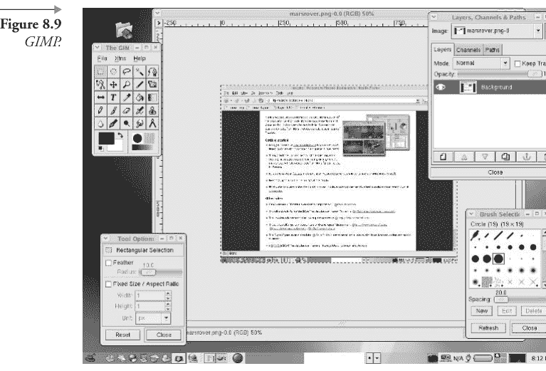

## 8.6 个人软件

图 8.10
同上。

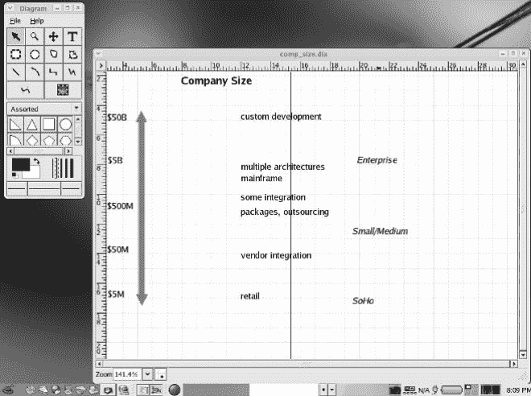

这是一个 Linux 正在快速追赶的领域。我仍然认为，如果你只是简单地选择一台执行多媒体功能或游戏的最佳机器，而不考虑其他因素，那么你应该考虑 Macintosh 或 Windows XP。Mac OS X 在图形用户界面和多媒体工具方面处于领先地位，特别是那些集成且易于使用的工具；而 Windows XP 是 PC 游戏领域的领导者，拥有更多的游戏以及易于安装和支持的专用硬件。索尼 Playstation 是另一个很好的游戏选择。Linux 在游戏的多样性和新颖性上无法与 PC 或 Playstation 相比。

尽管如此，我们许多人选择机器主要是为了工作或通信，然后将游戏或多媒体作为次要活动，所以我们想知道这些功能是可行的。如果你在旅行休息时需要玩几个游戏或看部电影，那么 Linux 提供的选择会让你很满意。有几个即时消息程序。最广为人知的 GAIM 可以支持 AIM、Yahoo!、MSN 和 ICQ。有很多媒体播放器。Xine 可以播放 Windows Media 格式。还有用于制作电影和刻录 CD 的软件，例如：

图 8.11
一些个人应用。


GnomeToaster 以及 DVD。Ogg Vorbis、Mplayer 和 Xmms 播放器功能强大，支持多种格式。

8.11 是一些个人应用的截图，包括一个媒体播放器、GAIM 即时消息和两个游戏。

有几个程序可以连接到基于 Palm 的 PDA 并允许同步，例如 Gnome-pilot。另一个选择是考虑 Linux PDA，例如 Sharp Taurus。它运行完整的标准 Linux 系统，具有基于 Qtopia 的 GUI，使用 Samba 连接到 PC，并包含了可以读写 Office 格式的仿真软件。图 8.12 显示了 Sharp Taurus C700，接近实际尺寸，打开了其主菜单。微型的 Taurus C700/800 系列系统在关闭时仅有……

### 8.6.1 运行 Windows 应用程序

有时我们必须运行 Linux 上不可提供的应用程序。大多数需求可以通过通用方式满足，但通常会有特定的程序不可用。如果有必要运行 Linux 上不可提供的特定程序，可以通过多种技术来实现。首先，我们可以检查如 http://linux-org/win-soft.shtml 等网站，查看是否有

图 8.12 
Sharp Zaurus，一台非常小的电脑。


Linux 的对应品。如果没有，且我们无法匹配或迁移它，我们可以使用 Wine 在 Linux 上托管 Windows 程序。该程序还附带了运行 Microsoft Office 的额外材料。通过 VMware，我们可以在 Linux 上运行一个完整的操作系统。当然，这些选项并不便宜。

在某些情况下，另一个考虑的选择是运行浏览器的“轻级客户端”，结合一个提供程序的门户网站，这可以降低成本并使桌面更容易管理。最后，一些人会运行“双启动”系统，以便他们可以在需要时运行关键的 Windows 程序。

## 总结

你可以在桌面上运行 Linux，或者混合使用（Windows、Linux、Mac），并且可以使用开源软件。如果你选择运行 Linux，你应该应该能够为新用户部署一个强大且易于管理的桌面。硬件需求需要经过测试和规划。邮件、网络和专用应用程序的用户会新的新的桌面感到非常满意。最困难的事情是成功迁移 Office 和 Windows 用户，而障碍大多不是技术性的。用户之间没有切换的动力，虽然程序在功能上是相当的，但在使用上并不相同。用户为了克服差异而付出的额外工作将不会被认可。无法负担 Office、Visio 等程序的用户将受益。有些软件的程序在 Linux 上仍然是不够的。

## 开源软件是如何开发的

关于开源软件的开发，有许多方法。开源软件的开发方法经常被讨论。从埃里克·雷蒙德著名的《大教堂与集市》，到关于开源的文章。

### 方法论

对于开源软件而言，有几种方法是已知的。这些包括：

- 个人独立工作
- 一个松散的大型产品团队
- 一个集中的传统产品团队

通常，产品会随着时间的推移在这些结构之间切换，并向集市模式转变。有些开源软件是由集中的团队构建的，但通常源于松散的团队。有些开源软件是由集中的团队构建的，但通常源于个人。有些开源软件源于松散的团队，但通常源于个人。这包括 1990 年的 Linux，以及于 1995 年的 Apache，由 Brian Ferguson 领导。

有些开源软件是由传统的公司构建的，这些公司将产品转换为开源。例如 OpenOffice、Mozilla、Eclipse 和 Firebird SQL。这些组织在很大程度上保留了其原始元素。

有些开源软件是由个人构建的，但由松散的团队维护。可以追溯到早期开源仍在使用的示例，包括 Sendmail、GNU Emacs 和 C，Samba 以及 Perl。由于开源模式需要一些运行的代码以及对解决方案潜力的信念，它通常是这样开始的。Apache 和 BSD 起于现有的代码库而不是个人的工作，但 Linux 和 GNU 显然是从个人开始的，有一些新想法。

### 9.1.1 开源与封闭代码对比

如果我们把成功的开源开发与类似的封闭软件包开发进行比较——例如在微软——它们的相似之处似乎大于差异。有一些原因说明这并不意外。对开源开发者数量的估计不一，但集中在百万左右。他们中的大多数工作（通常大部分时间都在封闭代码开发）。所以我们讨论的是同一批人。

这部分是因为他们的共同点是成功。例如，优秀的开源和优秀的开源项目通常都有优秀的开发者加入，其他项目通常没有。在封闭软件公司，这三种方法（小组团队、产品团队、个人）都有对应的模式。

通常，个人在开源项目中停留的时间更长，通常转变为某种咨询或荣誉职位而不是完全离开。个人在封闭软件中似乎没有那么持久，倾向于转向其他项目。Anders Heljberg 长期从事 Delphi、C#，然后再次离开，而 Guido Van Rossum 仍在编写 Python（以及其他工作），Larry Wall 仍在致力于 Perl。Dave Cutler 离开了 Windows


## 9.1 方法论

NT 团队在 Linux 出现之前拥有自己的操作系统。单从名称来看，Linux 就比其他操作系统更具个性，但事实并非如此。

将类似的产品开发工作进行对比，例如 Linux 之于 Windows，MySQL 之于 SQL Server，ASP、PHP 或 Python 之于 Delphi，我们通常看到相似的项目结构、时间范围和领导模式。例如，操作系统的开发一直是一项巨大且具有演进性的工作，吸引了大型团队进行测试和相关开发。对于 OS/2 和 Windows NT 是如此，对于此之前的 MVS 和 VMS 如此，Linux 也是如此。数据库和开发工具项目通常由一个人或少数几共同并领导。SQL Server 代码有一个较小的核心团队。MySQL 数据库代码则由两个人中的一个进行检查。

有时会提出关于开源“追随尾灯”的问题——这似乎是在抄袭设计而不是创造新想法。这在历史上看来并不完全准确。早期的程序（其中一些具有高度创新性）都是开源的。具有明显先驱影响的开源程序包括 Apache、Sendmail、BIND 和 BSD 网络代码。这些内容虽然被闭源代码复制了，但并没有得到改进。

这一点并不适用于某些开源程序，特别是 GNU，在其中这是一个显式目标；以及后来的 BSD 文件替换，但不包括早期包含网络在内的代码。这也可以在一定程度上适用于 Linux（它追随了 UNIX 和 Windows）以及 OpenOffice（追随了 Microsoft Office）。然而，随着这些产品的追赶，它们开始在各自的方向上产生分化。Linux 窗口管理器的功能如标签页浏览、多桌面和广泛的 UI 定制，这些功能在微软产品中是不提供的。OpenOffice 对 PDF 和 Flash 文件的处理比 Microsoft Office 有更强大且灵活的开发点。

新的源码产品如 Plone 和 Twisted 起初可能很难理解，因为它们正在开辟新路径，在其他平台上没有对等物。数据库产品 MySQL 在过去明确地做出了选择，强调性能而非遵循标准中的功能，并因此受到批评。

“追随尾灯”的指责也经常出现在微软等公司身上，并且可能适用于大多数商业活动，因为复杂的运行系统总会有更简单的前身。这确实适用于许多闭源产品。例子包括 Windows NT 追随 VAX/VMS 和 UNIX，Windows 用户界面追随 Mac 和 Xerox Star（施乐星），以及 Microsoft Excel 和 Word 追随 Lotus 1-2-3 和 WordPerfect，而后者又追随了 Visi-Calc 和 WordStar。

预读方法论框架，早期的愿景和规划阶段在开源并不透明，开源只涉及开发和测试活动。这缓解了大部分紧张关系。愿景和规划由个人或小团队完成，开发和测试则由较大的团队完成。此外，许多开源软件是基础设施，而在基础设施软件（以及所有成熟软件）中，大多数更改是由错误列表定义的，而不是由新用途的想法定义的。

似乎每个成功的开源项目都有非常模块化的结构。这支持了并行开发，即许多人可以同时处理不同的部分，因为它们是相互独立的。还需要对更改的引入（和回滚）以及重复自动测试的在线支持。

开源代码遵循增量模型，其中小更改不断累积，但当时的微软也是如此。如果你将微软对每日构建（daily builds）的态度与开源相比，它们是非常相似的。当然，在所有系统中必须存在架构性的突破，这些突破非常困难，并且经常是重大分支（forks）的原因。OS/2 和 Windows 之间发生过这样的突破，导致了微软/IBM 的分裂；Windows 95 和 Windows NT 之间也发生过，因为微软执行了一项十年度计划以消除旧的基于 DOS 的16 位架构；Apache 世界在 1.3 和 2 版本之间也发生了这种架构转变；Perl 在迁移到其新虚拟机时也是如此。

成功的闭源公司通常位于一个或少数几个地方。微软的一大优势是其位于华盛顿州的单一地理位置，尽管近年来其他实验室（包括位于加拿大、以色列、英国和印度的实验室）也涌现出来。在 20 世纪 90 年，微软可以在雷德蒙园区进行多次大规模且快速的重组，而无需裁员或地理迁移。集群（如加州北部和波士顿周边的集群）对闭源和开源同样重要，而且实际上在每种情况下都是相同的地方。开源代码开发者通常比这更分散，但也有一些是协同办公的：例如 Red Hat、Gnome 和 Mozilla。地理位置的重要性也从这一点中看出，例如 Guido Van Rossum 和 Linus Torvalds 等欧洲开发者居住在美国。

许多开源内容是通过大型志愿者网络进行发布和测试的。这是一种非常有效的方法，但并非开源所有；微软已经这样做多年。开源的独特之处在于，庞大的群体可以看到代码，这种方法被称为“足够的眼睛（with enough eyeballs）”。我在其他地方论证过这种方法的其他优点，但并不清楚这对于用户测试是否至关重要。Eric Raymond 认为需要高可靠性的软件应该是开源的。然而，Windows 2000 是一个非常成功且相当可靠的产品，尽管开源社区的许多人（包括 Raymond）认为它永远无法达到那个水平。

## 9.1.2 开源与企业开发的对比

将开源开发与企业开发进行对比，我们确实看到了更大的差异。首先，开源和闭源开发者都为失败出了高昂代价；他们作为组织会消失，而这并不是我们要考虑的。企业开发者可以失败后再次生存。

其次，虽然开源开发通常由社区需求驱动，但企业开发由市场需求和利润驱动。

第三，虽然开源允许更快速的实验，但企业开发通常更有结构化且受控。

## 9.1.3 开源开发工具

开源社区在工具使用上保守且节约。开源工具包括 CVS；Emacs 以及其他编辑器；GNU Make、调试器以及 Jakarta。这些工具都有很长的生命周期，并且首次接触时功能很粗糙。

## 9.1.4 人员管理

某些文章（特别是介绍性的文章）将开源开发描述为利他主义、共产主义或某种不现实且难以生存的东西，但我们应该忽略。历史证明这种软件开发方法与软件本身一样老，并源于早期的学术和科学模型。

我们在开源的任何地方都能发现类似的动机。一个明显的相似点是研究科学家。许多科学家并没有富有（尽管少数人如此），但能维持生活并看到清晰的职业和技能发展。他们通常不在意开什么种的车。他们真正热爱自己的工作，无论是为了结果还是为了内在本质。

软件社区的动力包括：

- 玩技术和编写代码的纯粹乐趣
- 完成个人需要的事情，例如发明 Perl 语言或点对点音乐共享系统
- 赚钱，或提升职业和技能发展（延性收入）
- 自我实现，如发表、领导或属于一个社区并帮助他人

在闭源软件开发中，管理人员一直涉及调节这些杠杆。技术人员对金钱的动力不像销售人员那样直接。在开源产品开发中，金钱动力可能没有其他地方那么高。自我实现的因素在许多情况下更高，当然，还有选择做什么工作的权利。这是处理创意人才的老生话题。


## 9.2 开发开源产品使用的语言

组织中的开源产品与那些从事闭源代码类似工作的人相比并没有太大区别。他们的薪资方式相似；事实上，他们就是我们。唯一需要与不同类型的人打交道的地方是在与开源产品开发者进行谈判时。

## 9.2 开发开源产品使用的语言

分析创建开源软件时使用的语言是非常有趣的。我通过以下三种方式进行了分析：

- 对 SourceForge (http://sourceforge.net) 上的语言数据进行分析，它是目前最大的开源项目库。
- 审查最知名的开源程序，例如 Apache。
- 对开源会议和小组的开发者进行轶事性的回顾。

SourceForge 包含了所有知名项目，据我所，没有理由认为上面的项目不是代表性的。使用 Freshmeat 查询该数据库进行统计是非常容易的。图 9.1 显示了

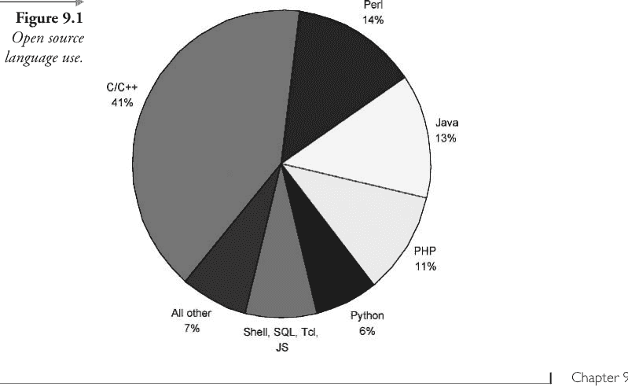

## 9.2 开发开源产品使用的语言

表 9.1 开源语言使用情况

| 语言 | 项目数量 |
|---|---|
| C/C++ (C 5639, C++ 2550) | 8,189 |
| Perl | 2,806 |
| Java | 2,473 |
| PHP | 2,124 |
| Python | 1,238 |

使用的源语言基于表 9.1 中的数据，该数据包含了对 2003 年 11 月和 2004 年 1 月在 Freshmeat 上未进行的分析。

### 9.2.1 C 和 C++

Freshmeat 上的一半项目是 C 或 C++，其余部分均匀分布在其他高级语言中：Perl、Java、PHP 和 Python。大多数成功的开源产品都是用 C/C++ 编写的。表 9.2 显示了 Freshmeat 最流行的 20 项目及其开发语言。在 20 个项目中，15 个完全使用 C/C++；三个将 C/C++ 与另一种语言（Java、PHP、JavaScript）结合用于前端脚本；一个使用 PHP；一个使用 Perl。

表 9.2 最流行的项目

| 项目 | 语言 | 功能 |
|---|---|---|
| Mplayer | C | 电影播放器 |
| Linux | C/C++ | 操作系统内核 |
| cdtools | C | CD 刻录工具 |
| Gaim | C | 即时消息 |
| xine | C | 电影播放器 |
| MySQL | C | 数据库 |
| gcc | C | 编译器 |
| TightVNC | C/C++, Java | 远程桌面 |
| PHP | C, PHP | 高级语言 |
| Apache | C | Web 服务器 |

## 9.2 开发开源产品使用的语言

表 9.2 最流行的项目（续）

| 项目 | 语言 | 功能 |
|---|---|---|
| phpMyAdmin | PHP | 数据库管理 |
| Nmap | C | 网络安全 |
| zlib | C | 压缩库 |
| GKrellM | C | 系统监视器 |
| Webmin | Perl | Web 管理 |
| Mozilla | C++, JavaScript | 浏览器 |
| Samba | C/C++ | 文件/打印共享 |
| OpenSSL | C/C++ | 加密 |
| libpeg | C | 图形库 |
| XMMS | C | 多媒体播放器 |

简单来说，C/C++ 是开源社区的语言。实际上，它大部分是 C。

表 9.3 尝试通过一种非科学且某种任意的方法，寻找使用 C/C++ 以外语言编写的程序的代表性样本。它显示有很多其他语言编写的有用程序，但它们的受欢迎程度或使用规模还不及前 20 名的项目。

PHP：Perl、Java 和 Python 是开源社区除 C/C++ 之外项目的语言选择。

表 9.3 未使用 C/C++ 项目

| 项目 | 功能 | 语言 | 备注 |
|---|---|---|---|
| Movable Type | 博客发布 | Perl | OSDir.com 推荐 |
| Webmin | Web 管理 | Perl | 频繁使用的程序 |
| SpamAssassin | 邮件过滤 | Perl | 频繁使用的流行程序，OSDir.com 推荐 |
| Slash | 内容管理/反馈 | Perl | 运行频繁使用的 Slash 网站 |

表 9.3 未使用 C/C++ 项目（续）

| 项目 | 功能 | 语言 | 备注 |
|---|---|---|---|
| The Gallery | 图像管理 | PHP | 市场排名前 20 |
| Moodle | 学习管理 | PHP | 市场排名前 20 |
| Nova | 游戏框架 | PHP | Freshmarket 排名前 20 |
| PHP-Nuke | 内容管理门户 | PHP | 流行程序 |
| b2 | 博客软件 | PHP | 流行程序 |
| Exchange4Linux | Exchange 替换 | Python | -- |
| BitTorrent | 点对点数据传输 | Python | OSDir.com，1000 万用户 |
| Mailman | 邮件列表管理 | Python | Linux Magazine 以及 |
| Chandler | 个人管理器 | Python | Red Hat |
| Lucene | 搜索引擎 | Python | Red Hat |
| Twisted | 网络编程 | Python | 可能的 |
| Eclipse | 集成开发 | Java | 可能的 |
| Compiere | 企业软件 | Java | 可能的 |
| OpenSSL | 用户界面 | Java | 可能的 |

## 9.2 开发开源产品使用的语言

表 9.1 开源语言使用情况（续）


使用 C 语言编写，Java 的主要用途是 C 核心代码的前端，而非完全取代 C。Mozilla 曾计划使用 Java，但出于性能考虑，它现在使用了 C++ 和 JavaScript。

Java 语言本身并不是一个开源项目。虽然有开源的 Java 实现，但没有一个是共享。但许多与 Java 一起的关键工具，如 Server Pages、来自 Jakarta 项目的 Tomcat 以及 JBoss 应用服务器都是开源的。Java 是开源软件的一种合理开发工具，但在实践中并非首选。

## 9.2.6 其他语言

在表 9.1 列出的语言之后，下种常用语言是 UNIX shell。当然，这对于简单任务来说是一个很好的选择，大多数任务可能不会被加载到 SourceForge，但脚本在大型应用程序中的扩展性并不好。大型应用程序并不是完全用脚本编写的。Perl 和 Python 设计得比 shell 更具集成性和可移植性。

JavaScript 最常用于浏览器的客户端编码。它在其中起着独特的作用，因为它是两大主流浏览器（Microsoft Internet Explorer 和 Mozilla/Netscape）唯一支持的语言。JavaScript 与 Java 之间几乎没有关系。

其他语言包括 Ruby、Scheme 和 C#，它们有自己的追随者，但使用人数众多。

## 9.3 跨平台代码

如今大多数服务器运行 Windows、Linux 或其他形式的 UNIX，大多数大型组织都混合使用这些系统。这些服务器在 UNIX 类系统（包括 Linux）和 Windows 之间平均分布。Linux 的增长速度更快，主要是以牺牲 UNIX 为代价的，因此在一段时间内它们将保持平分。Windows 在桌面级 PC 中的份额仍超过 90%，而 Linux 服务器仍占 3%。然而，如果将客户端定义得更宽泛以包含其他小型设备，Linux（以及 Palm 和日本嵌入式系统 Tron 等系统）拥有更大的份额。

由于在很长内大多数组织将同时拥有 Windows 和 Linux 服务器，只要软件可以互操作，服务器软件就不需要在两个系统上运行。对于大多数市场，PC 软件可能不需要运行在 Windows 外。因此，并非所有开源软件都必须跨平台。

然而，在服务器领域，CIO 对“通用计算”非常感兴趣，这将使他们能够在不考虑操作系统是否有利的情况下进行托管。如果我们可以在不受平台限制的情况下选择应用程序，这无疑将非常有帮助。在其他条件下，在各种平台上运行软件的能力在灵活性和成本方面显然具有优势。在可用系统上运行应用程序的自由度更高。随着时间的推移，组织需要平衡负载并回收系统，如果不限制哪些应用程序部署在哪些基础设施上，这很容易做到。

在桌面端，大多数组织已标准化为 Windows 桌面，但有三点可能会改变。Web 为跨平台应用提供了一个简单的标准，并且有一类不受限制其选择的用户。Linux 和 Mac 是某些市场中通用桌面的可行替代方案，特别是国际市场和年轻人。以及新的设备，包括手机和音乐播放器（可能不运行 Windows）开始在组织中发挥作用。

在多个平台上开发应用程序具有机会成本。例如，微软提到了两个问题：专注于功能增强而非端口迁移，以及为所选平台进行优化的能力。这都是资源受限的问题，讽刺的是，对于规模最大的公司和应用程序，这在实践中确实如此。

### 表 9.4 跨平台应用程序

| 产品 | 功能 | 竞争对手 | 运行平台 |
| :--- | :--- | :--- | :--- |
| Apache | Web 服务器 | IIS | Windows, Linux, UNIX, 其他 |
| Oracle | 数据库服务器（客户端工具） | SQL Server | Windows, Linux, UNIX, 其他 |
| Notes | 日历与预测 | Exchange | Windows, Linux, UNIX, Mac, 其他 |
| Opera 或 Mozilla, Netscape | 浏览器（客户端） | Internet Explorer | Windows, Linux, Mac, 其他 |

表 9.4 显示了跨平台应用程序的示例，它们在功能和性能上与 Windows 应用程序具有竞争力，同时还能运行在多个平台上。

## 为什么开源是跨平台的

开源代码开发者能够进行跨平台开发。用于开源的语言（C++, Perl, Java, PHP, Python）在 Linux、Windows 和其他 UNIX 平台（包括 Mac）上可用。开发平台的关键元素也是如此：shell、数据库、Web 服务器、支持工具。最尴尬的领域是 GUI 工具，这往往是导致某些令人惊讶的跨平台限制的原因。有三个很好的 GUI 工具：Qt、wxWindows 和 TCL。当你考虑到性能、原生支持和许可时，没有哪一个工具是跨越 Linux、Mac OS 和 Windows 的最佳选择。Qt 是唯一适用于嵌入式系统的工具，但它是双重许可的；wxWindows 快速且强大，但在 Mac 上不是原生的（它在 Mac 上通过 X11 和 Aqua 管理器运行）；TCL 在任何平台上都不使用原生工具，而且并不强大。见表 9.5。

开源开发者有动力进行跨平台开发。他们比普通大众更喜欢 Linux，但工作在一个混合的世界中。在 OSCON 2003 上（会议涵盖了广泛的开源用户和开发者），我观察到 Linux、Mac 和 Windows 之间存在相当均匀的分层（30-30-40）。开源开发者更喜欢 Linux，核心开发者使用 Linux。但当然，在普通市场中，在程序员最多的地方，分布强烈倾向于 Windows（3-3-94）。

开源项目的结构允许在有市场的地方进行跨平台开发。在小型闭源公司中，可能缺乏有限资源。

### 表 9.5 GUI 工具包

| 工具 | Linux | Windows | Mac OS | 嵌入式 | 备注 |
| :--- | :--- | :--- | :--- | :--- | :--- |
| Qt | ++ | + | ++ | ++ | 在 Mac 上是原生的 |
| wxWindows | ++ | ++ | | | 在 Mac 上不是原生 (X11) |
| TCL | + | | + | | 在任何地方都不是原生，速度慢 |

在小型闭源公司中，有限的资源可能匮乏。在开源项目中，可能会有一组志愿者准备开发 Mac 或 Windows 版本，或者有一家公司准备提供赞助。这不需要影响原始努力的资源或预算，至少影响不会太大。

## 实践中的开源跨平台

通过观察实践中的开源项目可以发现，大多数流行的服务器产品在 Linux（所有发行版）、Windows 和某些 UNIX 上可用，少数仅限 Linux/UNIX——例如 Apache、MySQL、PHP；Perl。流行的客户端产品（媒体播放器、即时通讯、办公、邮件）将主要适用于 Linux/Windows/Mac。

有时项目的目的是在 Linux 上提供 Windows 或 Mac 上的功能，因此使其跨平台可能意义不大。Wine（Windows 模拟）在这里并不是明显的例子！Gnome 和 KDE 桌面项目的目标是改进 Linux 以并超越 Windows 桌面，而 Evolution 特别是 Outlook 的 Linux 替代品，因此。

Mac 是一个特殊案例，因为它通常只支持较新的基于 UNIX 的系统（OS X），并使用 X11 版本而非原生 Mac（Carbon/Cocoa）。这样做更简单，而且这些版本看起来相当不错，但运行较慢且 X11 软件安装更快。例如，OpenOffice 支持 Linux、Windows 和 Mac。Mac 版本是 1.0，落后了一个水平且不是原生，需要 X11。

存在 Windows 开源项目的案例，甚至有一些 VB 项目：使用闭源语言为闭源平台编写的开源软件。开发一个仅运行在 Windows 上的管理 Windows 网络的 Perl 程序，或者一个访问 Windows SQL Server 的 Python 或 Java 驱动并不。至少有一个开源系统是用 MUMPS 语言编写的。

## 9.4 总结

成功的开源项目的方法论与成功的闭源软件开发实践并不真正不同，不同在于开源开发者倾向于更久地留在产品，而产品倾向于


更平滑的升级路径，可能是因为它们受公司变动的影响较小。许多用户进行评审和贡献的优势是真实的，而闭源代码已经演化出了获得相似结果的方法。

开源代码项目在几个方面与典型的企业实践有所不同。问题空间不同，更侧重于工具和产品。语言和工具的选择也始终有所不同，这可能是因为它们更贴合于要解决的问题。

开源开发的首选语言是 C（包括 C++）。开源社区显然更偏好 C。所有著名的开源项目都是 C/C++。这种盛行与与软件有关：加密、压缩和可移植库确实必须用 C 编写，而且其他系统软件的核心团队可能规模较小且动力十足。但这种主导地位一直持续到本可以用其他语言编写的项目中。项目可以结构化为由其他语言编写的前端，虽然可以这样做，但其实际频率低于预期。我认为，这是因为对于一个开发产品的、且充满动力的开发者小组来说，C++ 是一个极佳的选择，这描述了大多数成功开源软件的环境。

在开源社区中，C++ 之外的应用开发同样存在。成功项目选择的语言通常是脚本语言 Perl、PHP 和 Python。如果应用规模较大，项目可能会使用分层架构，底层函数用 C/C++ 编写，高层函数用脚本语言编写。Perl、PHP 和 Python 均采用了这种架构。

对于大型软件系统，开源和闭源代码开发社区目前的共识是使用 C++ 或 Java。闭源代码的开发社区可以分为软件公司和大型 IT 部门两类。

软件公司（微软、IBM、Oracle、SAP、PeopleSoft 等）其产品大多已使用 C/C++，并辅以一些对脚本语言的使用。许多公司现在已混合了 Java 前端，并正尝试用 Java 编写新产品（对于微软来说是 C#），但由于这种转型需要很长的时间。在开源社区之外，我们预计软件开发者将继续像以前那样：使用 C/C++ 与脚本语言以及 Java 的混合体，其中微软使用 C#。随着开源获得更大的心智份额，脚本语言将向 LAMP 架构倾斜。

# 管理系统实施

在本章中，我们将介绍大型组织中的系统部署，并观察使用开源工具和方法如何影响当前的技术水平。

组织中当代的系统实施通常不是定制开发与包部署的问题，而是两者兼顾。解决方案通过组装产品并将其与定制组件集成来建立。该过程包括产品选择、定制与集成、部署，以及持续的支持。

为了讨论这些问题，我们将部署工作放入一个框架中，该框架包含实施团队和流程的模型以及一套原则。然后我们将回顾迁移和支持的问题。

# 10.1 实施角色

软件开发或安装团队在技能类型、水平以及其他因素方面通常是一个非常混合的团队，但它是作为一个同伴团队来运行的。团队中可能存在不同的才华和经验，但优秀的团队往往对人才和工作投入有很高要求。团队还必须与公司内部其他小组良好合作，这些小组可能有不同的技能和动力，并且必须与客户、供应商（如软件组件和工具供应商）、竞争对手（根据市场情况定）以及法规和资金可用性等外部因素进行外部交互。

团队规模各异，但某些组件始终存在。处理此的一种方法是定义一组角色。我们可以定义以下六种内部角色：

- 客户管理
- 项目管理
- 开发
- 测试
- 沟通
- 部署

图 10.1 展示了实施角色。这些角色被视为同等，尽管项目管理角色在协调方面处于核心。

这些角色可以非常灵活地来看。通常情况下，所有这些角色都会出现在每个项目中，但并不是由同一个人承担。在较小的项目中，一个人可能扮演多个角色。然而，某些角色并不适合结合在一起。项目管理通常不应与客户管理结合，测试不应与开发结合，因为之间存在利益冲突。一个可能的小团队是：一个人负责客户管理和测试，另一个人负责开发，另一个人负责其他角色。

在大型项目中，某些角色将由团队承担，并可能需要团队负责人；我们还可能将大型任务拆分为功能团队，特别是在开发领域。这些角色定义在下文中，它们在每个阶段的作用将逐阶段描述。所使用的主要术语（如客户管理）并不重要。在某些源项目中，可能会使用非常非正式或幽默的术语（如“仁慈独裁者”和“副将”）。

## 10.1.1 客户管理

这一角色涉及销售和传教。客户管理角色向项目团队代表客户及其需求，而项目团队向客户代表其产品。这个角色负责规划和预测市场，当进行权衡时，该角色通常会是更多功能的拥护者。该角色的成功取决于产品创造满意客户的能力。

## 10.1.2 项目管理

项目管理角色负责管理和维护项目计划与进度。它负责根据成本和人员计划管理活动。它负责维护和更新风险估值。该角色的成功取决于在约束条件下按规格交付产品。

## 10.1.3 开发

这一角色负责设计、构建代码并在单元级进行测试。开发角色选择开发中使用的工具以及整合到产品中的组件。该角色的成功取决于工作产品的交付以及解决报告问题的速率。

## 10.1.4 测试

这一角色涉及将规范转换为功能测试计划、选择并创建自动化测试、报告和跟踪问题、管理测试社区以确保覆盖率，并管理产品发布。

## 10.1.5 沟通

这一角色负责与用户沟通，包括界面设计、文档、帮助系统和培训。文档可以是纸质的，也可以是交互式的；如今通常由 HTML 组成。该角色的成功取决于用户的接受程度和满意度。

## 10.1.6 部署

这一角色负责系统的设置和交付。这可能涉及研究远程站点和特殊客户的问题。该角色的成功取决于部署期间及之后的问题。这是与客户沟通的关键渠道。此功能可以将问题和反馈收集到下一个阶段的设计中，例如用户常见问题解答。

## 10.2 开源对团队问题的影响

开发以日益快的周期进行，且这种趋势仍在持续。这使得增量开发和对快速语言的使用变得日益必要。外包类型呈现增加趋势，使得团队更加虚拟化，并且除了特定项目外几乎没有共同点。项目招聘变得常见，因此工作的透明度和快速测试至关重要。团队必须遵循行业标准，因为没有时间或系统来创建项目特定的标准。与过去相比，我们现在更多地与关注之外的人合作，包括客户、竞争对手、行业机构、标准机构以及开源社区。

寻找扩展团队的方法是有用的，可以在引入额外资源的同时保持工作的协调。在这里，开源社区的工作可以直接应用于企业开发。开源实践已经证明，虚拟团队可以扩展开发和测试资源。这涉及到开发阶段集成代码以及在测试阶段围绕计划协调测试的需求。某些产品受到这些限制的极大限制，正如弗雷德·布鲁克斯在《人人人谭》中所指出的那样。数据库服务器不太可能从更多开发者中受益，例如，文字处理器可以通过额外的开发和测试资源从支持 40 种语言扩展到 100 种。图 10.2 显示了对组成的影响。开源团队能够吸引核心团队之外的开发者。他们还利用核心团队之外的大群体进行测试。可用资源更多，且某些本属于核心团队的资源可以这样被“外包”给虚拟团队。


## 10.2 开源对团队的影响

225

图 10.2 扩展团队对资源的影响。

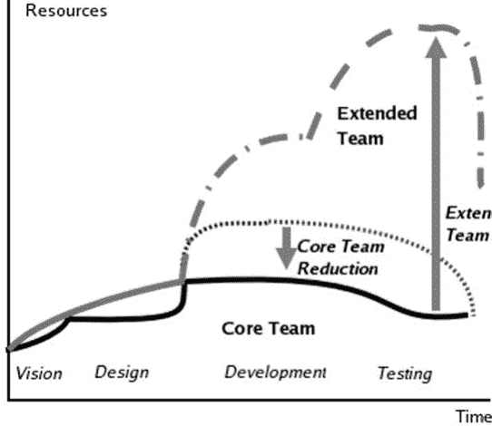

在开源过程中，愿景通常会被传播并用作集结点。愿景应当简单明了，并在所有方之间共享。愿景可能会随着时间而变化，但过多的变化可能是一个警示信号。设计阶段似乎没有以通用方式公开。尚不清楚如果用户不在开发团队中，将如何从用户那里收集规格说明。在测试阶段，开源风格变得与企业团队或企业环境中的最佳实践相似。

现代团队面临着更多国际化问题。利用互联网技术进行开发和测试使得汇聚世界各团队成为可能。第一个问题是时差，这有时可以利用这种差异来实现某些项目的 24 小时无缝代码交接。当开发人员和测试人员在全球范围内协作时，语言问题会出现在错误报告或测试数据中。国际化开发可能导致各种误解，因为在方法论或沟通风格上可能存在文化差异。例如，许多笑话翻译得很糟糕或具有冒犯性。不同文化之间在礼仪上（如攻击性程度）也存在差异。

组织内部可能有一些以开源风格工作的机会。我们可以从不同部门组建团队

## 10.3 实现过程

图 10.3 开发过程模型。

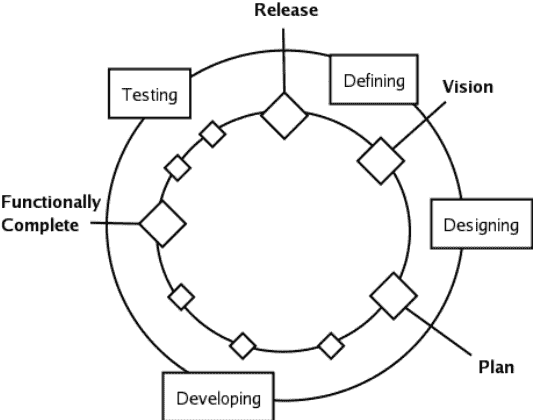

部门。这可能适用于组织内部的社区流程，例如标准。这种努力需要协作工具，通常需要将来自组织不同部分的人聚集在一起，而且在传统方式下无法获得很好的回报。另一个例子可能是显式地让用户参与迁移项目，并试图将敌对能量转化为积极力量。

## 10.3 实现过程

图 10.3 显示了实现（或开发）过程模型。这是一个循环模型，具有持续的发布系列。每个发布版本包含四个阶段：定义、设计、开发和测试。表 10.1 列出了这四个阶段。

### 10.3.1 发布版本

阶段之间可能会存在重叠，但通常不包括编码，编码需要特殊的安排。最常见的是，下一个发布版本的愿景和计划可以在当前发布版本的测试期间制定。

发布在两个级别上迭代。除了外部发布外，通常还有内部级别的发布。调度内部发布有许多好处。开发的诀窍是让产品处于一个已知状态，然后在此基础上增量构建，这通过确保组件完整并协同工作来提供支持。为了调度发布，我们将系统拆分为互不感知的小系统。

## 10.3.2 团队在过程中的角色

在不同阶段，角色会有所不同。

表 10.2 显示了不同阶段的角色。

| 表 10.2 | 定义 | 设计 | 开发 | 测试 |
| :--- | :--- | :--- | :--- | :--- |
| 客户管理 | 愿景与计划 | 沟通预期 | | |
| 项目管理 | 目标与风险 | 规格说明 | 跟踪进度 | |
| 开发 | 可行性 | 计划计划 | 错误修复 | |
| 测试 | 验收标准 | 测试策略 | 测试用例 | |
| 沟通 | 性能需求 | 性能计划 | | |
| 部署 | 部署考量 | 部署计划 | | |

## 10.4 实现原则

许多实现原则适用于软件公司。我们应该意识到未来是不确定的。因此，承诺固定的进度是危险的。我们应该意识到未来是不确定的。正因如此，承诺固定的进度是危险的。

### 10.4.1 资源权衡

资源、功能和进度之间始终存在权衡。在项目后期增加资源是困难的。

### 10.4.2 频繁发布

频繁实践已转向非常频繁的构建和发布。在开源开发中，每次代码构建通常通过 CVS 可用，并对更稳定的版本进行标记。在这种情况下，丰富的硬件和自动化脚本使得测试成为可能。一个经过构建和测试的产品是处于测试驱动状态的产品，尽管这并非必须。作为早期和经常测试的一部分，设计允许尽早发布多个版本，为了做到这一点，需要额外努力寻找自身具有价值且通向更大系统的小系统。


与其他人强加的指标，他们更致力于履行自己做出的估算。

## 10.4.3 支持元素

为了控制基于团队的应用设计和开发，我们必须建立一套结构。所有的设计工作和代码必须通过源码控制进行管理。应用程序组件必须放在可以进行评审和重用的地方。代码必须整合到中央服务器以便进行测试。为了将这些部分结合并保持它们协同工作，应用程序组件必须打包并部署到测试服务器和生产服务器。

所有应用层级的代码都应该以调试模式运行，报告我们可能需要的所有信息。我们需要运行应用程序的设施；监控处理、性能和结果；并与之前的运行结果进行比较。我们需要找到可以包含在解决方案中的组件——最好是开源，但在某些情况下可能不是。在开源领域，源码管理通常使用 CVS 完成。也有其他替代方案；Subversion 是由原开发人员对 CVS 的更新，值得评估，因为它更容易学习和使用。如果组织已经在使用特定的源码管理系统，也可以继续使用。项目可以通过 SourceForge 找到最广泛的开源代码，还可以使用 Freshwater，它作为特定类型项目（例如使用特定语言实现的应用程序或解决方案）的索引搜索工具。

## 10.4.4 警示问题

遇到麻烦的项目可以通过技术手段衡量，例如通过 bug 报告或性能指标。它们也会在人为因素上表现出来。在团队沟通中，可能会过度强调保密或指责。某些事项可能堆积在那里等待某人（可能是新入职员工）处理。我们团队成员的时间表可能不断扩张，导致没有时间进行其他生活活动（如购物），因此这些活动只能在白天完成。停车场在午夜可能是满的，因为有英雄在全天候地工作，但进度仍然在落后。与技术概念不同，产品应该明确关注客户及其需求。产品应该趋向某个特定的目标。其规模和性能应该趋于稳定。

## 10.5 关键文档

重要文档包括项目定义、功能规格和技术规格（specs）。

## 10.5.1 项目定义

每个项目都应该有一个定义。这始于愿景阶段，并在每个阶段执行和更新，最后在项目完成时进行评估。表 10.3 显示了项目定义的组成。

### 表 10.3 项目定义

| 组件 | 说明 |
| --- | --- |
| 愿景 | 项目和背景的简要描述<br>预期目标和主要场景<br>重要目标，无论是业务还是技术上的 |
| 范围和约束 | 边界和影响区域的声明，包括截止日期<br>技术选择的约束，如标准或互操作性 |
| 风险 | 按概率和严重程度排序的风险动态列表 |
| 成本和收益 | 硬件、软件、人力，无论是一次性的还是持续性的：<br>预期回报 |
| 进度表 | 带有里程碑的项目计划 |
| 团队结构 | 全职团队成员；虚拟团队成员，包括合作伙伴、用户（包括假设、技能、关键需求、依赖关系） |

## 10.5.2 风险管理

风险评估创建于愿景阶段，并在整个项目过程中保持更新。我们将使用风险文档来驱动以风险为导向的任务调度。我们识别出高风险（困难）的部分并优先攻克，即使这不是最方便的方法。通过尽早消除风险，我们为后期可能渗入的其他问题做好准备。

风险文档的目的是识别具有足够概率和严重程度、引起关注的风险。这通常是十几个或更多；多一两个，但少于一百个。严重风险应尽早处理，这样随着项目的进行，如果进展顺利，文档可能会变得更小、程度更轻。对于每个风险，我们创建：

- 描述风险性质的陈述
- 发生的概率
- 可能导致的问题严重程度，进行描述并给出影响分值
- 防止风险发生的缓解计划
- 如果风险发生时能最大限度减少或应对该问题的应急预计划
- 所有者，负责监控该风险的方

## 风险检查清单

以下是信息技术项目中常见的通用风险的全部示例。首先列出外部风险（与项目团队无法控制的领域相关），随后列出内部风险（与项目团队及其成员和结构相关）。

- 高层管理和用户是否有足够的投入承诺？
- 对用户的业务影响是什么？他们将经历多大的变化？
- 用户是否理解技术的效应和局限性？
- 涉及多少外部机构（如监管机构、工会或外部合作伙伴）？
- 是否有多个用户分支或站点（或公司或国家），它们可能有不同的流程？
- 要求预计是详细且稳定的吗？
- 是否有不可移动的截止日期或上市压力？
- 团队规模和开发进度是否是根据需求计算的？
- 项目经理以前做过这类事情吗？
- 团队是否拥有足够的相关知识？
- 高级团队成员中是否有丰富的交付经验？

## 10.5 关键文档

- 高层管理或用户是否有足够的投入承诺？
- 所有的技术是否都曾在某处看到过运行？

这个列表值得审查，但需要补充与项目技术和特定目标相关的更具体的问题。

## 10.5.3 风险评估示例

表 10.4 是来自真实项目的风险评估（名称已更改）。每个风险都分配了一个 ID 编号、描述、概率和严重程度。在这份共享文档中诚实地识别风险至关重要；但正如示例所示，可能需要采取外交手段。每个风险都有一个所有者以及缓解/或应急措施。每个风险都被分配了一个概率，以便通过排序后的表格生成优先级。

| ID | 优先级 | 描述 | 概率 | 严重程度 | 所有者 | 缓解措施 | 应急措施 |
|---|---|---|---|---|---|---|---|
| 1 | 4 | 几项技术的扩展性和性能未知，例如移动设备和数据库连接器。因此，产品信息的展示可能花费过长时间，或者需要缓存方案。 | 0.8 | 5 | Carol | 与 DBA 和架构小组合作设计查询。运行早期测试以确保系统能符合规格。 | 设计缓存系统以隔离查询 |
| 2 | 2.4 | 团队资源未完全识别或投入到该工作中。因此，将错过项目截止日期。 | 0.6 | 4 | Mark | 团队成员经理承诺他们将投入到该项目中。 | 加班。 |

### 表 10.4 风险评估（续表）

| ID | 优先级 | 描述 | 概率 | 严重程度 | 所有者 | 缓解措施 | 应急措施 |
|---|---|---|---|---|---|---|---|
| 3 | 2 | 仅商店物品在数据库中未定义属性。这些可能无法在试点前输入。因此，许多产品的属性数据可能可用。如果这些是重要项目，试点将无法通过。 | 0.5 | 4 | Susan | 确定缺失信息的来源并安排录入。 | 修订发布计划或缩小试点范围。 |
| 4 | 2 | 支持目标的编辑内容不完整。目前不存在编辑流程。因此，缺乏有吸引力的信息。 | 1.0 | 2 | Carol | 与高层管理层会以确定流程。 | 以受限的功能进行发布。 |
| 5 | 2 | 物理问题（例如设备的电池寿命）目前未知。因此，员工可能觉得设备使用不便而放弃。 | 0.5 | 4 | Paul | 测试以确保电池续航时间、带和壳的舒适度等。 | 在试点期间根据需要调查设备选项。 |
| 6 | 1.6 | 缺乏完整的产品比较数据。因此，比较功能适用于更少的产品。 | 0.8 | 2 | Susan | 与数据所有者合作定位或创建信息。 | 提供“不可用”页面。 |


## 10.5 关键文档

风险评估（续）

| ID | 优先级 | 描述 | 概率 | 严重程度 | 负责人 | 缓解措施(s) | 应急措施(s) |
| :--- | :--- | :--- | :--- | :--- | :--- | :--- | :--- |
| 7 | 1.2 | 运营验收标准可能需要比截止日期更多的时间。因此，可能会错过日期。 | 0.3 | 4 | Paul | 与运营团队提前会面以获得快速通过。 | 升级问题。 |
| 8 | 1.2 | 手持设备上的其他选项必须与门户共存。Web 应用需要在设备上运行。因此，员工可能需要进行硬重置才能访问其他应用程序。 | 0.6 | 2 | Paul | 与负责本地应用程序的团队进行协调。对部署的应用在设备上运行功能测试。 | 构建仅允许访问已认证应用的门户。 |
| 9 | 1.2 | 具有适当门店经验的人员参与需求不足。因此，功能将无法满足员工需求。 | 0.3 | 4 | Vera | 尝试在流程早期引入关键销售培训资源和试点门店。发布版本 2。 | 在试点阶段结束时重新评估需求。 |

### 10.5.4 功能规格书

功能规格书（spec）是项目中要包含的功能列表，并按优先级进行排序，且说明了充分的细节。合适的细节程度首先是一个信任与沟通的问题。外包项目通常有非常详细的规格。理想情况是提供足够的细节，让开发人员能够构建出所需的系统。细节过多会导致在纸流程上浪费时间；细节太少会导致在真空状态下编码。

规格书应该将产品拆分为多个功能，解释这些功能，并指明它们是必须的还是可选的。对于大多数业务系统，功能将拆分为表示层、业务层和数据层。

由于规格书具有重复性、全面性且易变，通常应以电子表格或某些数据库驱动的格式进行维护。

### 10.5.5 技术规格书

技术规格书应该说明如何实现功能规格书。这包括技术架构以及每个包含的组件的细节。许多人将其称为技术架构。它应该足够详细，以便熟练的开发人员构建系统。它包括：

- 系统的逻辑模型
- 物理模型
- 关键设计点、技术选择和概念验证
- 开发、测试和部署的基础设施
- 互操作性，包括数据流和事件
- 迁移，包括数据转换
- 安全性，包括身份验证/授权和威胁管理
- 数据存储，包括模式设计
- 运营管理，包括日志记录和监控

## 10.6 迁移

在迁移中，风险比新系统更高，因为预期更高，且用户会有所损失。如果我们必须用新系统替换现有系统，我们需要格外小心地仔细计划、彻底测试一切，并随时为可能需要撤销更改的意外问题做好准备。现在可能不是我们的错，但在迁移后就会变成。这项工作将增加实施系统的成本和时间。

在实现新系统时可能不会发生相同的问题，部分解决方案可能是可以接受的，至少对于第一个版本而言。

### 10.6.1 迁移方法

在现有组织中，通常存在现有系统。对于它的处理，我们可以采取几种不同的方法。我们可以：

- 保留该系统，承认该系统已经过费且可以运行（至少在某种程度上）。放弃该系统，将其功能外包或手动执行。
- 将系统重新部署到另一个平台并进行最少更改——例如从 UNIX 迁移到 Linux。
- 使用适当的新工具和产品开发替代系统。这可能包括更广泛地重新设计流程以精简流程。
- 对其美化，保留核心产品但改进访问方式，也许使用 Web 前端。
- 饥饿它，阻止进一步投资，直到我们能够将其切断。

在较大的系统中，我们可能会结合这些方法。我们可能会留下系统的部分而放弃其他部分，在饥饿某个系统的同时对其构建新的前端，或将系统重新部署到 Linux 并添加新的 GUI 前端。

### 10.6.2 评估现状

为了确定合适的方法，我们需要评估业务和技术状况。业务问题将在愿景阶段确定，并纳入项目定义中，正如本章前面所述。业务状况存在各种机会和威胁，包括客户和竞争对手的行为以及业务组织的新想法。

业务机会是多样的。我们可能通过新产品针对我们的客户——例如通过获取有关他们的信息。我们可以缩短引入新产品或满足客户需求的时间。我们可以立即访问每个或发布自定义价格，以支持诸如实时定价或将我们的信息作为产品出售的想法。我们可能会开发提高运营效率或产品质量的方法。当然，我们可能会开发新的客户和/或产品。

业务威胁也是多样的。销量或利润可能会下降。竞争对手在技术或劳动力方面可能有成本优势。我们可能正在向竞争对手失去市场份额，或者对手在价格、响应速度或产品引入方面经常击败我们。对客户服务的预期可能会增加，或者人口结构的变化可能会改变我们的客户或劳动力。新或变化的销售渠道可能需要不同的支持流程。我们行业中的公司可能会通过并购改变规模。监管变化可能会影响我们的业务环境或运营。

技术状况包括对当前系统以及可用替代技术和流程的评估。评估现有的复杂系统是困难的。评估团队需要带来各种技能和观点以开放合作。没有人能同等地理解旧的和新的，因此整体必须大于部分。

技术变化非常快，以到系统部署时，架构往往已经过时。团队必须足够熟悉旧系统以便开展工作。旧系统的维护者会理解它，但可能对其复杂性和价值有夸大的感觉。一个常见问题是最后又重写了一遍系统。如果没有指定重要的细节，实施团队将从系统用户和维护者那里获取，尽管是新技术的潜力证明了迁移成本的合理。

获取当前系统性能的良好衡量可能很困难。涉及现有系统的人通常不会准确报告客户对系统的满意度和可靠性。他们衡量的是他们擅长的，或者他们能衡量的，而不一定是重要的事情。

需要评估的系统领域包括：

- 应用程序的规模、性能、复杂性和状况
- 硬件和软件基础设施
- 当前的人员、服务请求和工作负载
- 成本
- 当前系统无法解决的问题

通过这些，我们可以判断该应用程序是否是迁移的候选者并开始制定项目定义。

我们可能发现的问题包括当前系统的数据质量、其可用性和服务成本。旧系统通常在系统可用性方面存在问题，无论是计划还是意外——例如，它们不太可能支持 Web 或全球 24/7 需求。可能还存在使用困难，例如高额培训成本或数据输入错误。

现有系统的共同优点是系统已经付过费，且现有员工接受过使用培训。然而，随着时间的推移，安全和维护的成本可能会增加，大多数系统都有定期的维护和升级。一些公司外包是因为这些类型的成本已经失控。

开发生产力是旧系统的常见问题，难以应对业务变化或以新方式访问数据。旧系统中的开发活动与当前的客户优先级联系极微弱。

## 与开源社区互动

我们将通过多种方式与开源社区互动。我们的员工中已有开源开发人员，需要考虑如何招聘和留住他们。我们将通过使用开源产品来与其交互，并可能有机会通过代码、工作或资金对其做出贡献。

## 从社区招聘

开源领域有少数人在一般意义上很有名，但更重要的是，在特定项目的代码贡献方面，许多人在特定社区内建立了声誉。利用这些资源是一个好主意。


## 10.7 与开源社区交互

无论何情况下，一个成功的开源项目的维护者都具有项目管理背景。维护者曾管理过代码贡献；提供激励并给予认可；吸引/留住开发者及其他资源（且大多在不使用资金的情况下完成）；开发或采纳了代码管理和发布流程。即使你所从事的项目与你直接相关，这套技能也是非常宝贵的。

### 10.7.2 员工协议

在某些的几个问题上，组织目前通常没有相关政策，但可能需要制定此类政策。这可能涉及对相关劳动合同的审查。以下是一些示例，但并非详尽列表；可能还有其他问题。

某些员工可能希望在执行组织项目时被允许参与开源项目——例如，通过共享工具代码或向开源软件反馈改进功能。这是合理的，但可能与目前的雇佣协议冲突。另一些人可能希望在业余时间为开源软件贡献代码。这也是合理的，但许多组织有禁止此类行为的一刀切政策。这还涉及版权归属问题。大多数开源软件项目（包括 Samba 和 Apache）都不允许贡献公司保留版权。这可能再次与当前政策冲突。某些员工可能只愿意从事开源工作，而你的公司可能不会专门从事开源业务。这可能需要特殊的安排——例如，他们可能必须以承包商而非员工的身份工作。

### 10.7.3 回馈社区

从开源软件中受益的组织通常会开发回馈社区的方法。最简单的是允许员工为社区工作并做出贡献，同时作为参考并在其他方面成为良好的公民。可能存在机会赞助与贵组织使用场景相关的改进功能。通过将投资投向贵组织所需的改进功能，你可能会在产品发展方向上获得话语权。

在与开源开发者谈判时，记住上一节中讨论的动机可能会有所帮助。钱是一个因素，但名誉的衡量以及从事有价值工作的机会同样重要。如果你的组织能够提供一个诚实满足这些愿景的提议，那么它对开发者来说可能是一个非常有吸引力的选择。

要找到愿意从事不那么光鲜的代码或非代码问题（如文档）的人通常很困难。文档是使用开源软件的组织可以非常自然做出贡献的领域。可以通过基准测试和最佳实践来扩展这一点。

有时可能会将代码发布到开源社区。要实现这一点的成功，需要一个能够对其响应的社区。这包括使用市场、对开发感兴趣的人以及一个未来。你不应该因为项目生命周期结束或仅仅是因为失败而这样做。但这种行为并不是古怪或非商业的。对开源社区做出过重大贡献的组织包括 CERN（万维网）、IBM（Eclipse）、Novell（iFolders）和 Sun（OpenOffice）。

## 10.8 支持

支持成本包括软件维护、内部资源和外包外部资源。软件维护费（通常为购买价格的 20% 左右）在使用许多闭源程序时仅仅是业务的成本，而通过使用开源软件，你可以规避这部分开支。

管理支持的关键步骤是分析我们真正需要什么。管理支持的一种含义主要是“手把手教”——帮助人们使用软件；培训——教他们功能或如何使用文档等。另一种含义是开发代码、修复错误或添加或扩展软件功能以满足需求。这两种不同的需求相互相互的。通常，对软件问题和缺失功能的报告必须归类为用户或软件错误。具体来说，我们可以将支持分为三个级别，如下：

- 等级 1：报告并识别问题，分配 ID，分诊并可能可能的解决。
- 等级 2：将问题交给该领域的专家，并在不提出开发请求的情况下解决。
- 等级 3：提交缺陷（Bug），在现场开发补丁并合并，或由开发者处理该问题。

等级 1 支持通常在内部管理（或直接外包）。根据定义，这些问题属于“手把手教”或其他琐碎的活动，需要廉价地解决，而不是通过致电供应商。等级 2 支持可以通过内部处理、通过软件供应商、或通过第三方或社区流程处理。等级 3 支持需要拥有源代码访问权限的开发者。这是组织内部维护程序员对自定义代码所做工作的大部分。这是你必须为软件从闭源供应商处获得的服务，因为没有其他人可以执行，所以你必须签署合同。例如，看看 Microsoft Office 的支持。等级 1 由内部帮助热线提供。等级 2 通常将路由到微软产品支持服务、IBM 或 HP 的类似组织，或由某些大型组织在内部处理。等级 3 必须通过报告缺陷并允许 Microsoft Office 小组进行处理。正确报告缺陷可能涉及大量工作，这将由等级 2 支持（可能外包）处理。

对于开源软件，许多人担心没有地方可以寻求支持。这绝非事实，你像对待定制软件一样，总有支持自己的选项。但对于 Linux 和 Apache 这样严肃且常用的产品，事实如此。它们对等级 3 缺陷的响应至少不低于任何商业供应商；有活跃的社区提供等级 2 支持；供应商将签署商业合同以提供带有服务水平协议的服务。开源的主要区别在于，你不需要从软件供应商处购买支持。

对于较小的开源产品，其系统就像你可能在初创公司使用的源代码。存在市场风险，即产品可能不会成功，或者在你完成之前就会衰落，在这种情况下你可能必须承担维护。

有些公司希望购买保修或其他类保险安排。这在开源领域很难获得；如果需要，你可能需要与 IBM 或 HP 等大公司打交道。

在实践中，当你遇到问题时，在法律和实践上这始终是你的责任。软件许可证总是规定软件不保证你的特定用途。供应商会尽力解决问题，但如果这涉及购买额外的硬件或重写软件以不同的方式处理问题，将是你的责任。

## 10.9 总结

在本章中，我们回顾了如何管理团队、流程和角色，以及更重要的典型交付文档。根据开源软件社区的成功实践，有一些值得考虑的改进。

对于大多数组织来说，开源软件带来的新问题不在于他们将创建它，而在于他们将使用该软件、雇佣或其他方式与作者互动，并将其与自己的工作整合。组织内部可能存在使用开源方法的机会。考虑到开源的可能性，可能需要审查对版权可能具有限制性的政策。

支持问题对于采用开源软件的组织至关重要。组织需要一个明确的政策，关于他们期望什么样的支持、愿意提供什么样的支持以及想要为什么付费。在此基础上，有资源可以实现这些，通常价格不菲，且比闭源供应商更具活性。


# 应用架构

在本章中，我们将介绍不同类别的应用程序，并回顾一些运行良好的应用程序的关键设计点。随后，我们将介绍与其他系统（如大型机和 Java 应用服务器）进行松耦合通信的方法。最后，我们将回顾目前可用的开发平台和开源选择（即 LAMP 和 Tomcat/Boss），并将其与主要的闭源产品（即基于 .Net 和 Java 的服务器页面和应用服务器）进行对比。LAMP 术语指的是使用 Linux、Apache、MySQL 和 PHP 进行开发。较少的情况下，它也可能包括其他开源语言 Perl 或开源数据库 PostgreSQL。

## 11.1 系统类型

如果一个组织计划实施复杂的企业级应用程序，则应该考虑将其运行在开源平台上。在此时，通常已经可以在 Linux 服务器上运行诸如 SAP、Oracle 和 PeopleSoft 等主流的大型企业应用。虽然从端到端开源的应用程序较少，但已经有一些可用的，且是可以构建的。这种类型的部署方式最近才开始出现，但在 Linux 上已经有了超过 2,000 个 SAP 部署和 500 个 Oracle 部署。

根据高盛的报告《恐惧企鹅》（2003年1月），到 2005–2007 年，用户将常见地使用集群和“大型机”服务器在 Linux 上部署复杂的分层应用。对于大型类复杂应用（例如重大的 ERP 部署或高成本的财务或制造系统），从考虑到开发或采购，再到部署，通常需要两年的时间。然而，这种类型的较小系统（例如几个 ERP 模块或不那么全面的自定义应用程序）可能一年或更短时间内完成。无论哪种，现在都是时候进行规划，以便在该时间范围内完成部署。

由于 Apache 是最流行的 Web 服务器，而 PHP 是最流行的 Web 开发工具，因此无需证明大多数普通 Web 应用程序都可以通过这种方式构建。对 Web 进行粗略搜索就可以发现，大量使用开源工具 (LAMP) 构建了极佳且可靠的应用程序，并且有大量的人可以开发和维护这些应用程序。

由于 Web 实际上是一个开源和 LAMP 的游乐场，闭源系统的供应商通常关注可扩展性和企业集成问题，用以证明其产品的合理性。本章也将关注这些问题。我们将注意到，大多数需求都恰好处于开源产品的性能范围内，并且可以通过适当的技术增加必要的性能。

系统因客户类型、性能要求以及它们管理和显示的信息类型而异。为外部客户服务的应用程序通常会处理不可预测的用户数量。当然，我们无法控制它们的技术或行为。为企业对企业 (B2B) 服务的应用程序（如渠道、采购或供应链）其规模可以像客户系统一样大，且更具可预测性，因为我们与系统的关系更易于管理。内部站点应该处理可预测的用户数量，而且如果我们愿意的话，我们通常可以为内部用户管理技术平台。呼叫中心站点是最易于管理的，因为它们是内部的，我们通常控制着平台、已安装的应用程序以及使用方式。

## II.I.I 极端系统

书中讨论的开发工具将处理许多复杂的分布式应用程序。然而，许多最大且最为人知的系统实际上是采用特殊方法的极端案例，并不是其他业务系统构建方式的典型。它们通常是其所属类别的首个应用程序、所在行业最大的公司，或者是独特的组织（如结算中心）。示例包括：

- 旅游预订系统，如 Sabre 和 Amadeus
- 银行结算中心系统，如 SWIFT

## II.1 系统类型

- 交易系统，例如纽约证券交易所 (NYSE) 和商品交易所 (COMEX)
- 大型组织，如沃尔玛、美国银行和花旗银行
- 领先的 .com 公司，如 Google 和 Amazon.com

这些组织使用专门的事务处理器和低级语言开发了创新的软件系统。Sabre 和 NYSE Tandem（现为 HP NonStop）系统。美国银行和 Sabre 使用自定义的大型机 IBM 事务处理设施：其中使用的语言是 C++ 或旧的低级语言，包括 PL/I 和汇编语言。这种行为实际上更像软件开发者，而不是典型的业务系统。事实上，这些操作中的几项已经拆分并形成了独立的产品组织。

当应用程序需要最高性能时，应该使用的语言是 C（或 C++）。例如，微软的应用程序使用（未管理的）Visual C++ 而不是 VB 和 ASP 时，运行基准测试的速度快一倍。除了 Tuxedo 和 C++ 之外，其他供应商没有进行数据库基准测试，因为他们的应用服务器更慢。这令人惊讶，因为 Web 应用程序的大部分是常驻开销，包括 Web 服务器、数据库和网络通信。决定性能的不仅是语言，更重要的是其部署的架构。C++ 用于 ISAPI 而不是 ASP，直接访问数据库而不是 ADO，使用内存缓存而不是简单的数据库访问，以此此类推。

如果你打算用 C 编写一个高性能系统，可能需要额外花费几个月进行设置，花费双倍开发时间，并且你必须为开发者支付更高的费率。对于小型应用程序，拥有两名开发者可能会导致开发成本产生 100,000 美元的差异（15万-5万）。大多数应用程序需要比这更高水平的投入，而且大多数组织将有多个应用程序，因此他们可能轻松花费五十万美元。为了让这些成本获得服务器更好的性能而有所值得，如果应用程序速度快一倍，就能节省一百万。经验法是，对于部署服务器超过 100 万美元的系统，我们将考虑构建自定义应用程序；否则，我们将使用高级语言并通过集成来构建系统。在基准测试之外，大多数业务不需要为了获得最高性能而使开发变得复杂。他们始终可以通过购买一些额外设备来解决问题。使用标准技能组的开发者进行快速开发所节省的成本，通常远大于额外设备的高成本。

### 11.1.2 事务型系统

组织中的普通开发与软件产品开发或这些极端系统不同。撇开这些特殊情况，几乎所有的事务型 Web 应用程序都可以使用服务器页面技术（如 PHP、ASP 或 JSP）并合理地使用服务器端组件来构建。通过这种方式，集成团队可以在没有特殊专业知识的情况下快速部署系统。

此类应用程序可能会遇到性能限制，此时应遵循标准的风险管理方法来缓解性能问题。我们可以在项目早期开发性能模型并进行基准测试。下文描述的以下优化技术可以带来数量级上的性能提升，但必须被设计到应用程序中：

- 有效的状态管理
- 队列
- 良好的数据库设计

如果我们的应用程序具有不可预测的性能需求，我们应该首先尝试收集有关限制条件的信息，然后考虑可扩展性。按分层设计的应用程序可以扩展以支持非常多的用户，而且数据库性能在大规模下可以达到非常高的水平。

### 11.1.3 知识管理

并非所有应用程序都是事务型的。其他应用程序通常用户较少，并提供不那么有引导和可预测的交互。这包括许多类型的信息和支持系统以及协作形式；我们将所有它们都放在知识管理类别中。这些应用程序通常间接地与事务系统相互操作。它们可能会像门户网站那样引导用户进入事务型应用程序；或者对最终源于这些的数据进行分析。


## 11.2 分层设计

应用程序，例如应用于数据仓库的业务智能工具，或者可以为它们增加价值，类似于自定义的购物前端，例如亚马逊的推荐。

知识管理应用通常也会与基础设施系统交互。它们通常依赖邮件系统投递消息，依赖目录进行身份验证，或依赖文件系统作为文档的数据存储器。它们通常需要对这些接口进行程序化访问。事务系统通常不会与此类系统共享资源，因为它们需要独立于通用组织来管理其可扩展性。

我们将应用程序设计为若干个逻辑组件。这把复杂问题拆分解为更小的部分，并向调用组件隐藏细节。业务应用程序的组件通常具有可识别的用户界面层、业务规则层和数据层，尽管这不一定是一条硬性且不变的规则。当然，应用程序可能也也将使用来自其他已开发应用程序的组件。这对原始应用程序的文档编写和测试具有影响，也会影响对多语言和跨平台支持的需求，因为不同时间开发的应用程序通常运行在不同的平台上。

软件分层与硬件（逻辑和物理组件）之间没有严格的通用映射关系。没有严格规定必须恰好三层或其他任何数量。作为具体示例，业务组件可以调用业务组件，数据库过程可以嵌套。这些都是应用程序架构的选择。特别是，没有必要将逻辑组件实现为通过容器通信的物理组件（如 EJB 和 COM+ 架构所示）。在许多情况下，这在性能上实际上是非常昂贵的，应该被尽量避免。通常的设计是在 Web 服务器上运行应用程序组件，以避免远程调用。

分区设计是关于在灵活性和控制之间保持平衡。良好的设计还应该允许在批处理、Web 和 GUI 应用程序之间复用代码。图 11.1 显示了概念层面的通用映射。客户端可以是 Web 浏览器、如 PC 或手机之类的智能设备，或者是通过 Web 服务访问的另一个系统。我们的应用程序将由我们的业务组件与框架组件（如服务器页面和事务管理器）交互组成。虽然我们的后端存储器通常是数据库，但我们可能会访问其他系统（例如目录或电子邮件系统），或访问其他应用程序。

### 图 11.1 应用程序架构。

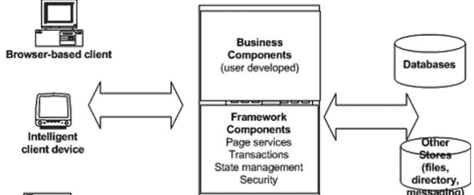

| 表示层 | 业务逻辑 | 数据 |
| :--- | :--- | :--- |
| 基于浏览器的客户端 | 业务组件（用户开发） | 数据库 |
| 智能客户端设备 | 框架组件：页面服务、事务、状态管理、安全 | Web 服务 |

在全连接的网络中，业务规则通常进入服务器端组件，以便允许复用并避免部署问题。这里的权衡是可能会出现与验证相关的代码重复。由于我们通常无法信任客户端代码以及在客户端执行的准备工作（如数据查找），因此可能需要复制表来支持这一点。在偶尔断开的网络中，业务规则必须在需要的地方可用。

通常情况下，不同的组件可以用不同的语言编写，受限于各种现实世界的限制。我们可能选择利用不同语言的各种优势——例如，将 Java 与 PL-SQL 结合或将 Python 与 C++ 应用。此外，我们可能在使用遗留语言的大部分的同时创建一个新的应用程序。

跨语言调用约定可能跨平台。通常可以从 C 调用任何内容，也可以从任何地方调用用 C 写的代码；这就是 C 成为如此重要的编程语言的原因之一。

## 11.3 管理性能与可扩展性

### 图 11.2 松耦合系统。

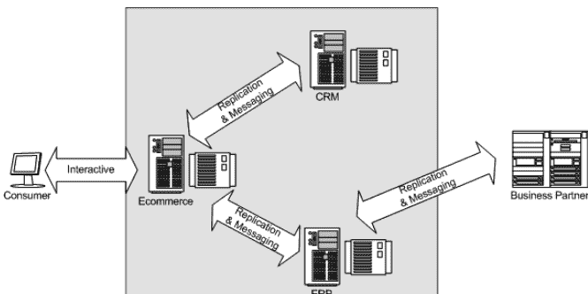

我们想要实现的是在通用平台上的松耦合。这提供了可扩展性，而且对成本最有利，因此结果是最佳的性能。松耦合队列通过非应用程序特定的数据格式来消除时间依赖以消除依赖。图 11.2 展示了松耦合系统。一个消费者正在与电子商务系统交互。该电子商务系统复制产品目录和客户数据的元素。当发生购买时，一条消息会被发送到 ERP 系统进行履约。该系统反过来可能会向业务合作伙伴发送消息。这些消息可能是异步的，这样客户交互就不会等待后端的响应。

### 11.3.1 状态管理

瞬态状态管理的概念是在长运行事务过程中保留数据的地方。例如，可以是电子商务中的购物车。我们可以选择在客户端、Web 服务器或数据库处管理瞬态状态（见图 11.3）。

我们可以在 Web 服务器上维护瞬态状态，从减少网络流量的角度来看，我们将获得良好的性能。然而，通过放弃数据库，我们失去了大量功能。我们没有获得事务，这可能在应用程序中带来许多额外工作，或者在 Web 服务器故障后让我们暴露于损坏数据之中。这种模型还

### 图 11.3 瞬态状态。

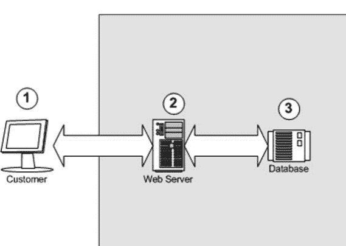

限制了我们使用分布式系统的能力；例如，我们必须将 Web 服务器负载均衡设置为“粘性”，因为客户必须返回同一服务器。最后，通过在长运行事务期间持有服务器资源，我们使用它们的时间范围要长得多，因为用户时间比机器时间大几个数量级。在“思考时间”期间持有服务器，资源包括内存或数据库连接。数据库连接是如此重要的问题，以至于它们会被池化。

我们可以在数据库中维护瞬态数据，使用普通表或特殊格式（如临时表或专用字典）。如果我们这样管理，我们就能获得针对故障的可靠性。我们会产生额外的网络通信和可能的磁盘访问，因为数据库比专用存储器更通用。

如果我们在客户端管理状态，我们将实现扩展，但会面临管理、安全（例如篡改价格）、隐私（Cookie）和客户端识别（AOL 缓存问题）的问题。

我们希望在事务边界或用户交互期间在事务数据库中持有状态。通用计划是进入、处理并退出。对于瞬态状态，我们通常会将共享数据存储在数据库中，而在 Web 服务器留留。如果我们不在网络持有状态，我们在多用户环境中是，对网络故障是安全的，对用户离开也是安全的。这在 1960 年代通过 CICS 代替 TSO 学到；在 1990 年代再次通过 COM 或 EJB 学到；并且一直适用。我们可以在客户端存储客户端状态，最常见的是允许我们访问其他数据的 Cookie，但在某些情况下是离线数据集（如果我们将其与乐观锁定策略相结合）。

当然，问题是状态需要保存在某处。一个重要的例外是数据被缓存——换句话说，它可以从丢失的数据库中恢复。在 Web 服务器上缓存数据可以提供显著的性能提升，因为通常有一小部分数据被反复使用。服务器上的数据缓存副本非常有用。它是缓存，如果我们把它丢掉，你也可以找回来。这很快，因为只要服务器运行，可能就不需要返回数据库。它是健壮的，因为数据可以从数据库中恢复。它保护客户数据免受篡改，因为可以针对服务器进行检查。但必须为一组数据设计缓存策略以获得这些特性，而这些都是权衡。


### 11.3.2 队列 (Queuing)

性能设计中最重要的元素之一是正确使用异步方法将组件解耦——例如将前端与后端解耦。这种方法有多个名称，但我简单地称之为队列。在过去的 40 年中，许多最成功的事务处理系统背后都有队列的正确应用。IBM 的 IMS/DC 和 Tandem（现为 HP）NonStop 平台在其产品中都有效地使用了异步设计，这些产品在过去的 30 多年里被金融行业广泛使用。

有些方法可以在不使用消息产品的情况下实现这种设计特性，例如将队列写入文件系统或数据库，这正是大多数人的做法。

队列可以提高应用程序的可靠性和吞吐量。队列的第一个优势是它增加了可靠性。队列将业务事务与服务器、客户端或网络的可用性问题相解耦——换句话说，它可以提供“面对失败时依然成功”。队列还允许我们消除业务伙伴之间的紧耦合，这些伙伴可能有不同的处理能力或可用周期。例如，我们的订单处理可能依赖于发货组件。但发货可能会延迟，或者并非在所有时间内运行。我们现在确认订单并将其放入队列中以便稍后处理和发货。

队列的第二个优势是允许我们以经济的方式管理巨大的需求波动。企业对服务的的需求并非线性的，而是有从小时、每天到周期的多个周期，还会因异常事件出现大量流量。例如，员工在一天开始时登录、“月底”薪资处理、电视广告对家庭购物频道的影响，或者超级碗对体育网站的影响。峰值事件比正常情况高出几个数量级是很常见的。例如，假设我们正在构建一个系统，预计每天将处理 100 万次交易。我们每周 7 天 24 小时接收订单。高峰订单可能出现在上午 9:30 到中午 12:00，以及下午 2:00 到下午 5:00。该系统的平均订单速率约为每小时 50,000 单，但高峰小时可能达到每小时 500,000 单。如果订单和发货是紧耦合的，发货系统的规模需要按每小时 500,000 单来设计。如果订单与发货是松耦合的，以便可以将订单传递到队列中而不等待完成，那么一个每小时处理 50,000 单的发货系统就可以处理这些工作负载，尽管我们可能会将其设计得大一些，以防止队列过大。见图 11.5，它将后端设计在 100,000 左右。紧耦合系统需要更多的后端服务器，并且仍然面临故障。松耦合系统在超过队列大小之前都是良好的。

队列并不适用于所有的应用程序，因为它引入了额外的工作。这包括：

- 将数据序列化（Marshalling）到队列格式中并从其取出
- 处理业务错误情况，例如，当订单未完成时可能发生的情况
- 数据复制，例如目录数据

我们必须确保队列引起的额外工作与其为应用程序带来的收益成正比。在涉及队列的长运行事务中，可能发生的错误情况回滚起来可能非常复杂。

### 图 11.6 数据库中的队列。

队列的一种相对容易实现的形式是将更改写入临时表（staging table）。该表专为快速写入而设计；例如，它可能是一组顺序行，每行包含所有的事务细节，且没有索引或只有一个索引。该表可以位于单独的数据库中或或另一台机器上。然后，写入程序可以应用这些更新。这种策略被许多企业应用采用，例如领先的 ERP 产品。通过使用数据库进行队列，我们不需要获取另一个软件，并且可以使用与最终格式兼容的数据格式。图 11.6 展示了数据库中的队列。

队列是应用程序之间进行松耦合通信的一种非常好方法。获取队列的一种方法是使用“消息”产品。在数据库、HTTP POST 或 FTP 上实现消息时，延迟可能会影响更新。专有产品包括 IBM Queue Series、BEA 和 Microsoft Queuing。对于消息有几种开源工具，包括 JBoss 以及几种 Java 服务 (JMS)。

### 11.3.3 数据库设计 (Database Design)

对于大型系统，我们需要优化数据库。我花了多年时间在咨询公司审查数据库；我们的团队通常在客户因为性能不足想要更换数据库时被邀请。我们的经验是，总是可以获得多得性能，通常是一个数量级。实现这些点的技术如下：

- 性能，隔离问题区域以关注重点，并使用工具查看运行的数据库查询。
- 根据应用程序需求审查数据库设计。应用程序实现人员通常不知道数据量，而数据库管理员不熟悉业务逻辑。
- 使用特定的优化，如存储过程、游标、索引和预处理语句。在 MySQL 中，这包括存储类型。
- 找到一种整洁的方法来池化数据库连接，而不是不断连接和断开。

接下来的图展示了高性能数据库设计的示例。图 11.7 改编自在 MySQL 会议上 Velocity 系统的报告，展示了一个使用复制来解耦定价（流量较大但关键性较低）和票务的系统。该系统使用了六台运行 Open Services 用于票务的 NonStop 六路处理器系统，以及 45 台运行 Red Hot Enterprise Linux 和 MySQL 用于定价的 HP 四路处理器系统。应用程序用 C++ (GNU 3.2.3) 编写。每个 MySQL 系统都有 50GB 到 60GB 的数据库。NonStop 系统是数据库。使用 Golden Data Extractor Nonstop 将数据从主复制到定价系统。这种设计允许在扩展性更好的系统上执行复杂的处理。

复制可以用于只读更新事务。图 11.8 展示了一个基于 Slashdot 的方案，适用于高流量的内容管理。读取访问是写入访问的百倍到千倍，正如许多 Web 网站上一样。更新由一个数据库应用，并复制到所需的其他多个数据库中。

## 存储引擎 (Storage Engines)

MySQL 提供了多种表类型，对应不同的存储引擎。最重要的两个 InnoDB 和 MyISAM。MyISAM 类型没有事务，且不擅长处理混合读写，但


## 11.3 管理性能与可扩展性

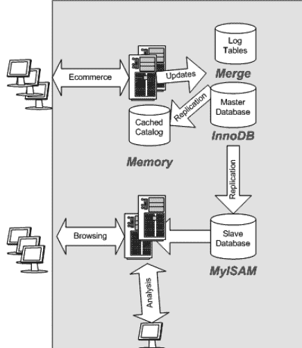

它的读写速度非常快。InnoDB 类型最适合标准的混合数据库活动。在图 11.8 中，我们最可能向 InnoDB 引擎写入事务，然后复制到 MyISAM 以进行文本搜索和提高读取速度。

另外两种类型对特定用途非常有用。Memory 类型速度快但没有磁盘存储，因此适用于缓存。我们可以将翻译表、定价和非易性信息复制到缓存中以访问数据库。我们甚至缓存瞬态状态，以便在会话的后续访问中快速访问。Merge 类型对于日志可能有用，因为它允许我们为每天或每周的活动维护一个不同的物理文件，并在需要时将它们合并。图 11.9 显示了这四种存储引擎（表类型）在 Web 应用程序中共同工作。

### 11.3.4 应用服务

应用程序提供了许多有用功能。它们提供了事务（这是 EJB 和 COM+ 的核心点），包括事务组合、自动故障处理和两阶段提交。它们允许我们将应用程序拆分为多个部分，在某些情况下甚至跨越语言，特别是跨越系统边界。它们执行在任意数量的进程之间共享某些用户的工作。

它们以与语言无关的方式为我们提供线程和进程管理，同时隐藏实现细节。它们管理资源池，例如数据库连接。

值得注意的是，最佳选择通常不是使用这些功能。我们绝不应该假设自己将会这样做。如果我们坚持使用单个数据库，将由我们提供事务。对于多个数据库，我们将尝试使用松散耦合的方法。我们可以在单个平台上使用与语言无关的服务，但在跨平台操作时，我们将共享数据库或 Web 服务。鉴于构建越发松散连接系统的决策，大多数应用程序应该用用单一语言开发。

领先的应用程序服务器开源项目是 JBoss。它是开发者中部署量最多的 Java 应用程序服务器。在编写本文时，它在部署方面已与闭源代码领导者相鼓敌。它的部署量仅次于 IBM WebSphere 和 BEA WebLogic。

## 11.4 互操作性

一个典型的大组织具有几个不同的环境。编写运行在这些平台任何一个上的应用程序必须能够共享信息并与其他任何平台进行操作。对于在这些不同操作系统上运行不同软件的系统，拥有互操作计划至关重要。这些包括：

- 带有 COM 和/或 .Net 的 Microsoft Windows 基础设施
- 带有 COBOL、CICS、DB2 以及可能的 AS/400  IBM 主机，通常带有 WebSphere
- 基于 Java 服务器的系统，如 WebLogic 或 WebSphere，通常运行在 UNIX 或 Linux 上
- 带有 LAMP 应用的 Linux 系统

人们无疑认为系统应该对其所有者是开放的，这样其中包含的任何信息都可以用合理的时间和技能恢复。相比之下，许多公司认为他们的数据被“困在”了遗留系统中，除非进行一项类似于考古的昂贵项目，否则无法访问。

当然，所有这一切都可能因为安全问题而变得非常复杂。显然，在多供应商的异构环境中应用安全与依赖单一供应商有很大不同。因此，如果你有选择将所有内容都放在一个供应商的保护之下，可以考虑这样做。这是一种严重的锁定，因为所有应用程序都在一个共同的边界内，很难逃脱。取决于供应商，这可能非常昂贵且缺乏活性，并且并不一定安全。

互操作性策略可以放在数据共享访问这一大类下，包括文件传输和共享数据库，以及进程通信（包括 Web 服务）。无论选择何种方法，如果数据格式是复杂的（通常情况下确实是这样），就需要数据标准。这些标准通常围绕 XML 结构化。首选的替代方案是共享数据库和 Web 服务。

### 11.4.1 共享数据

我们可以使用文件系统或数据库来共享数据。对于知识管理，我们经常使用文件传输或对文件的共享访问。这包括 FTP；使用 Samba、NFS 或 iFolders 进行网络文件共享；以及作为邮件附件发送的文件。这是管理从中心点分发的缓慢变化的数据的好方法。在某些情况下，也可以用于复制数据库。我们可以将数据库映射为 XML 并将其作为文件发送。

文件共享存在必须解决的基础问题。Windows、Linux 和 Mac 编码文本文件的方式不同，二进制数据受平台差异的影响。网络文件共享面临着比本地文件更频繁且更多类型的错误。

这是一种管理事务性数据非常困难的方法。如果数据经常变化，文件分发将变得极其离谱，我们必须开始考虑增量机制（delta mechanisms）。管理多播复制是一个难题。即使是简单的文件投放也需要规划来处理锁定和事件通知。一旦我们解决了简单的情况，数据库方面还需要时间。

### 11.4 共享数据库

共享数据库是实现跨系统互操作的首选方法。数据库处理各种数据类型、网络通信问题以及事务和序列化。

数据库复制通常是一个需求。对于同构数据库，这通常是可以提供的：MySQL 和 PostgreSQL 都支持作为数据库功能的复制。我们还可以通过脚本管理复制。对于涉及多个异构数据库的复杂复制需求，值得考虑 Golden Gate 等产品。

### 11.4.2 进程通信

进程通信通常涉及：
- TCP/IP socket 编程
- 屏幕采集（Screen scraping）
- 应用程序集成
- Web 服务

### 11.4.3 应用引擎

如 WebMethods、BizTalk Server 等通用集成引擎听起来很有吸引力。但事实证明，最重要的部分的需求对于集成引擎来说太复杂，需要自定义代码来管理过程的许多部分。这些代码为了与引擎配合费了许多周折，比直接用自定义代码解决问题要复杂得多。

### 11.4.4 Web 服务

Web 服务提供了一种独立于语言和平台的标准通信方法。使用 Web 服务，无论另一个系统运行在什么平台上，我们都可以对其调用。数据被封装并标记为 XML，并跨平台和操作系统进行调用。如图 11.10 所示，我们可以使用 Web 服务实现 WebSphere、.Net 和 LAMP 应用程序之间的互操作性。


它们可以在非常小的粒度上实现，例如函数调用，也可以在大粒度上实现，例如采购订单文件。

Web 服务可以是异步或同步的。异步调用允许系统松松耦合，特别是当结合文档风格的 XML 传输大量相关数据时。

Web 服务最简单的形式是 XML-RPC。XML-RPC 可能是内部使用和快速开发的最佳选择。SOAP 是一个更复杂的标准，具有更多的功能和选择。SOAP 更有可能用于行业标准或企业间通信。所有的开源语言对 Web 服务都有良好的支持。

对于简单的通信，替代套接字编程（socket programming）和屏幕抓取（screen scraping），特别是在内部应用中，Web 服务的效果良好。但在跨企业级开发中，使用它们是困难的。许多许多许多标准尚未真正准备就绪。加密、跨组织通信标准以及安全性都必须解决。

为了使用 Web 服务解决集成引擎场景，我们编写代码来解决我们面临的特定问题或多个问题，并在合适的情况下使用 XML 和队列。如果问题具有某种通用性（例如涉及许多客户或供应商），我们则基于“中心-辐射”架构（hub and spoke）为该问题开发一个通用解决方案。这种解决方案比使用集成引擎更贵且更困难的情况是非常不寻常的，而且它将使用我们标准的开发工具和数据库。

## 11.4 互操作性

图 11.11 显示了之前的分布示例。三个实体（分销商、企业和零售商）之间的关系通过邮件和文件传输（FTP）传递的 XML 文件实现松松耦合。不同的文档（采购订单、发票）具有不同的 XML 架构，而且正如我们所预期的那样，遗憾的是，不同的零售商也是如此。最大的挑战（正如长运行的事务系统一样）是将相关的文档连接在一起。我们依赖于对 ERP 系统进行查找来实现这一点。

### 11.4.5 数据格式

数据封化（data marshalling）问题是互操作性技术的一个问题，出现在多个层次。最低层次是字符表示问题：编码（Unicode）、行结束（回车和/或换行符）以及字节序（大端或小端）。在下一层，我们需要标记系统，然后是数据类型系统，最后是管理字段之间的链接以支持分级表示。之上是语义问题，例如对字段的内容和关系达成共识。共享数据库直接存储了这些许多内容，但更复杂的关系仍需要映射到 XML。

对于松松耦合的互操作性，最低需求是描述数据，这些数据在每个平台上都有类型并有表示。XML 很好地做到了。对于许多用途，我们可以使用简单的单级生成的平坦文件，这可以通过 Python 或 Perl 轻松完成，且没有开销。无论如何，只要我们识别了字段，就可以将它们从一个架构转换到另一个架构。所有开源语言都有优秀的解析器和库可用——特别是 Python 和 Java。对于当今的企业级开发，选择通常取决于以下项之一：

- Java，包括 Java 许多页面 (JSP) 和如 WebSphere、WebLogic 和 JBoss 的 Java 应用程序服务器
- .Net，包括带有 ASP 和 CLR 运行时环境的 C# 或 Visual Basic
- LAMP (Apache-MySQL-PHP)

这些方法中的任何一种都可以用于简单应用程序的快速开发，并在需要时扩展为满足复杂需求的大型解决方案。所有这些都可以开发为运行在各种服务器上，包括 Windows 和 Linux（如果开发和测试正确，它们就是跨平台的），并且所有的都可以创建客户端-服务器架构。

### 11.5.1 Java

我们可以使用 JSP (Java 许多页面) 构建简单的应用程序，这是大多数 Java 应用程序的实现。我们可以使用 Java 应用程序服务器配合如 Struts 等框架构建复杂的应用程序。Java 许多页面的领先开源选择是 Jakarta Tomcat。应用程序服务器包括：

- IBM WebSphere
- BEA WebLogic
- Oracle Application Server
- SUN ONE

来自 IBM、BEA 和 JBoss 的产品是大企业的领先选择。闭源应用环境通常非常昂贵。JBoss 显然占生产系统的 25% 左右，但在开发者中的份额接近 50%（其中许多是个人）。JSP 和 Java 应用程序在 Linux、UNIX 和其他服务器以及包括 Windows、Mac 等在内的客户端上都是跨平台的。

遗憾的是，使用 WebLogic 和 WebSphere 等闭源服务器环境的应用程序在供应商之间移动非常困难，因为这些环境与专用工具和服务集成在一起。我的经验是，公司发现这太困难了，通常最终由多个此类应用程序服务器支持不同的架构。IBM 在 www.redbooks.com 上的《将 WebLogic 应用程序迁移到 WebSphere V5》花费了 260 页来描述如何这样做。

Java 方法的主要优势是其跨平台性，这非常出色。这些系统可以扩展以实现高性能，尽管价格很高。Java 方法的弱点是成本和开发难度。虽然大多数 Java 系统是使用 JSP 开发的，并且可能可以使用开源方法完成，但大多数组织都使用了昂贵的工具来完成。

使用应用程序服务器构建的大型系统以经济方式扩展的能力是非常怀疑的。基准证据是，大型 Java 系统的效率远低于使用 C++ 或 .Net 开发的替代方案。几年前，有一个关于“Java 宠物店”的期一年的争论，Sun 发布了它以展示如何构建 Java 应用程序。故事简述说明了供应商不会向企业推荐或销售他们自己用于性能或内部应用程序的相同架构。无论如何，随着应用程序扩展，支持此选项的大型供应商将预测，除非你迁移到他们的闭源集，否则将会失败。这种方法最好的的是使用 Java 许多页面和开源产品 Tomcat。如果需要应用程序服务器，我们可以使用 JBoss。

### 11.5.2 .Net

通过这种方法，我们可以使用 ASP.net、C# 或 VB 构建简单的应用程序。我们可以使用分层、COM+ 作为应用程序服务器以及 SQL 存储过程构建复杂的应用程序。微软和第三方供应商为微软平台提供了许多 dot 开发工具；当然，大多数开发者将使用 Visual Studio。

Dotnet 比完整的 Java 解决方案要便宜得多。事实上，如果你可以放弃 Visual Studio 开发环境而使用编程编辑器，那么 ASP.Net 几乎是免费的。

Dotnet 应用程序并不限于 Windows 平台。它们可以使用 Mono 或 DotGNU 进行跨平台部署。Mono 项目允许用 C 编写的 .Net 应用程序运行在 Linux 系统上，尽管 Mono 开发者现在建议在 Visual Studio 上构建并迁移到其他平台。该语言和许多类已提交给标准机构。计划扩展 VB 作为源语言，并将 OS X 作为目标平台。Mono 是 Novel 部门的一个项目，并有一支强大的开发团队支持。他们的动力是因为他们想要将自己的代码库（例如 Gnome）从 C 迁移到对象的类型安全语言，因此我们可以预计这将会发生。由于 Mono 支持 Gnome 代码，它应该是足够健壮且性能足够，可以应对任何情况。我仍然认为，在未来几年内，C# 在 Windows 闭源区域之外的采用率不太追上 Java，更不用超过它了。


## 11.5 开发平台选择

.Net 方案的优势在于规模化、成本和开发的便利性。.Net 方案的缺点是它不是跨平台的——至少 Mono 项目的使用范围要广泛得多。诚然，Web 开发允许了跨平台应用，但即便如此，文档也倾向于闭源系统，例如推荐使用客户端 COM、Office 和针对 IE 的特定功能。

.Net 对应的最佳选择是 C#，但它不是一种开源语言，目前尚未被选用于跨平台开发。

## 11.5.3 LAMP

使用这种方法，我们可以使用 PHP、Perl 或 Python 构建简单的应用程序。我们可以通过传统的开源软件方式构建复杂应用程序：在前端使用脚本语言，并在时使用 C/C++ 服务器和库元素进行分层，或者使用 J 应用程序服务器。如果作为 Web 应用进行开发并经过正确的测试，所有这些系统在客户端上都是跨平台的。

如果开发和测试正确，LAMP 应用可以在 Linux、Windows、UNIX 和其他服务器上跨平台，同时也适用于包括 Windows、Mac、Linux 在内的客户端。

LAMP 方案的优势在于成本、跨平台能力和开发的便利性。LAMP 方案的潜在缺点是复杂度随规模的扩大而增加。

成功的 LAMP 实施包括许多中小型系统（这些系统开发得简单），以及一些非常大的系统，包括 Amazon、Sabre 和 Slashdot。如之前讨论的，非常大型应用程序需要一些非常熟练的 C++ 程序员。

像 Python 这样的开源语言通常编译为中间代码，类似于 VB 和 Java，因此 Python 代码运行速度可能比 C 慢。当这一点变得重要时，可以将单个 Python 类重写为 C 语言，而无需更改调用处的代码。Python 变体运行在 Java 上，并可以自由地调用 Java 类。就像 Windows 上的 VB 程序员可以调用 VC++ 组件一样，使用 Jython 的 Python 程序员也可以调用 Java 组件。这是一个极好的跨平台工具，同时也意味着 Python 可以访问 Lucene 和 JBoss 等 Java 组件。可以使用 Jython 与 Java 应用程序进行集成。

这里的最佳方案是将 LAMP 部署为默认选择。对于非常大的系统，我们将进行仔细的架构设计，并根据最高规模的需求替换组件，或与其他企业系统进行互操作。

## 将微软开发者迁移到开源

如今大多数程序员并没有在使用 Java、.Net 或 LAMP 工作。对所有平台的程序员进行的调查发现，大多数自称为程序员的人，其大部分工作是在 Visual BASIC (VB) 中完成的。

过去十年的微软文档（从 DNA 时代开始）通普遍提倡通过“组件”进行开发，这些组件通过脚本组装成业务的定制解决方案。在实践中，这通常意味着使用 VB。自引入以来，VB 实际上一直是世界上使用最广泛的语言，它易于学习，支持交互式开发、批处理和 Web 开发，并拥有健康的第三方组件市场支持。它在性能上曾有所落后，但通常用 C 语言编写的组件可以达到所需的性能，且最近的版本性能良好。

在开发方面，大多数机构使用 Active Server Pages (ASP)。ASP 与 JSP 和 PHP 一样是 HTML 的混合体，带有脚本用于“快速粗暴”的开发，大多数 Windows 组织使用 Windows Scripting Host (WSH)。ASP 和 WSH 使用 VBScript。用于数据管理的图形脚本工具 Data Transformation Services (DTS) 也采用 VBScript。Windows 中的大多数程序员熟悉 Visual BASIC，微软环境中的大多数应用程序涉及某个版本的 Visual BASIC。在 .Net 组件架构中，语言可以是 C# 或 Visual Basic，微软可能更倾向于此，但我的经验是，在美国，目前的迁移是转向 VB.Net。VB.Net 显著改变了 VB，并在几年后 C# 引入时可能会再次变化。ASP.Net 允许并特别是通过 Visual Studio 实现代码与标记语言的严格分离。ASP 支持 VB.Net 和 C# 语言，书籍中提供了两者的示例。从长远来看，.Net 极大地改善了微软开发者的处境，但目前，主要影响是在必须处理的多种 VB 变体增加了 VB.Net。

## Visual BASIC 程序员应该怎么办？

Visual BASIC 只运行在 Microsoft Windows 平台上。在一个开源占据很大比例的世界里，对于大多数程序员来说，问题是哪种语言将扮演 VB 在 Windows 中扮演的角色？跨平台的 Visual BASIC 没有现实的可能。虽然存在其他版本的 BASIC，但与 Visual BASIC 相比很少使用，且互不兼容。Mono 项目计划将 VB.Net 移植到 Linux，但目前尚不可，且仅适用于 VB.Net，并且不太可能在平台上拥有很大份额。Mono 项目的首要目标是移植 C#，感兴趣的程序员应该学习 C#。在 Mono 准备就绪之前，有充足的时间精通 C#。

如何在使用单一语言开发图形、批处理或 Web 应用程序的同时，逃脱对 Windows 平台的锁定？这种语言应该相对易于学习，并能够扩展以涵盖任何类型的开发问题。

VB 程序员或其经理（无论谁做决定）已经在 Windows 上有过考虑 C++、Java 和 C# 的机会，而他们由于某些原因选择了 VB。当然，考虑到对跨平台开发更迫切的需求，他们可以重新考虑这些语言。如果他们没有选择成为 Visual C++ 程序员，他们也不太可能成为 GNU C++ 程序员（尽管开源社区的自由结构性质将使这成为可能）。

## 11.6 总结

如果我们关注性能，第一条规则是确保架构选择正确：使用多个通用系统平衡价格/性能，使用带有队列的松耦合来控制峰值和故障，仔细管理资源，并利用可用引擎的特定特性进行数据库调优。

我们可以使用这三大架构构建开源应用程序，许多大型机构都是在这样做。如果我们想选择 .Net，可以搭建 Visual Studio.Net 开发环境和 Mono (DotGNU) 开发环境，并使用 C# 构建 ASP.Net 应用。如果我们想选择 Java，可以配置带有 JDBC 和我们所选数据库的 Tomcat，并构建 JSP 应用。如果我们迁移到应用程序服务器，可以使用开源项目 JBoss。

如果你计划为其他应用选择 Java 或 .Net，那么 LAMP 是许多应用的良好选择。有几种方法可以确保互操作性，包括共享数据库和 Web 服务。LAMP 应用可以扩展且部署廉价。对于大多数拥有数十 GB 数据库和每秒数百次请求的业务系统，LAMP 方案非常适用，必要时系统可以进行扩展。


开发环境、调试器和工具是非常强大的。Apache 是最常用的 Web 服务器，而 PHP 是最常用的 Web 开发语言，因此你并不是在冒险。

# 开源系统的成本

当然，为开源软件产品定价并不困难，因为它们几乎都是免费的。困难之处在于当我们跨越这一步去处理这些更具挑战性的任务时：

- 为与开源产品可比的闭源代码产品定价。
- 为所有相关成本（包括硬件、人员配置和支持成本）定价，得出总拥有成本（TCO）。

在本章中，我们将把开源软件的价格与类似的闭源代码软件进行比较。当然，产品并不总是相似的，而且在存在相似产品的情况下，我们可能认为某一组功能集优于另一组。在本章中，我们只比较成本。

然后，我们将检查开源和闭源产品的总拥有成本并进行比较。为了做到这一点，我们将针对不同规模的企业选取一些场景。硬件和人员配置的估算保持非常简单，并邀请你替换成自己的数字。

由于许多因素存在差异，这只是一个框架，需要根据特定组织进行调整。这里的表格可以在网站 www.kawana.org/opensource 下载，如果你想根据自己的情况进行调整。图 12.1 展示了主要的成本元素，即人员配置、硬件和软件，通常按此顺序排列。

我们将按类别审查这些成本，然后将单价放入简单的表格中。我们可以将这些表格作为一些典型场景的成本基础。在所有情况下，我们都应该将本地信息代入表中，因为我们的价格各异。

276
12.1 总拥有成本

## 图 12.1 成本元素。

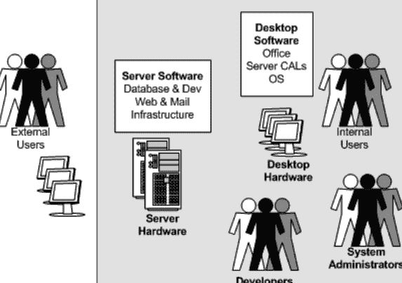

## 12.1 总拥有成本

对于开源软件成本问题，有一个简单的答案，即开源解决方案可以与闭源替代方案相提并。与类似的闭源系统相比，通常情况下，开源系统的成本如下：

- 软件费用低得多
- 硬件费用不不高，且通常更低
- 如果其他条件相同，其他任何方面的费用都不会更高

至于软件成本，我们将审查包含常见开源和闭源产品价格的表格，并发现开源软件的成本低得多。

至于硬件，开源产品适用于几乎所有当前的硬件平台，包括性能最好的系统。正如本书大部分讨论的那样，开源在平台上的性能通常与闭源竞争对手相似。因此，开源软件的硬件成本通常与最便宜的闭源系统相同。在大多数情况下，我们比较的是同一台硬件在一侧运行 Windows 或 UNIX，而另一侧运行 Linux。

其他因素可能并不相同，而总拥有成本（TCO）研究提供了一个展示这一点的机会。这类研究有很多形式，还有一个小型行业专门比较对比 TCO 投资回报率（ROI）与其他术语。在这里，我们将保持简单，使用 TCO 来涵盖在做出软件决策时合理期限内涉及的成本。

问题通常归结为人员配置成本。有一些发表的 TCO 研究试图证明开源软件的成本比你想象的要，或者在某些特定情况下 Linux 的硬件成本更高，但这些研究显然来自带有偏见的来源，并不真正可信。TCO 的三个成本元素是人员配置、硬件和软件。在我们要查看的所有场景中，这三者中的人员配置远超其他项。由于人员配置成本占据主导地位，即使开源软件节省了数百万美元，这在 TCO 上也不会代表特别大的差异。然而，在某些情况下，TCO 通过在比较的双方增加大额成本（这些成本实际上是固定成本，例如系统管理和支持），可以确保真正的节省。

### 12.1.1 人员配置成本

人员成本主导了基础设施的人员配置成本。因此，Linux 和 MySQL 等开源软件节省的成本与开发和管理的人员成本相比是很小的。

一份关于 Windows 和 Linux 基础设施成本的 IDC 报告估算了基础设施的 TCO 成本分解，如图 12.2 所示。

这可能低估了软件成本，但与 Gartner 关于 IT 成本的研究大致一致，后者再次显示成本和停机是基础设施的主要成本。因此，对于 IT 基础设施系统，系统对系统管理和终端用户的影响可能是其购买成本的十倍。这表明在今天以服务器衡量，IT 基础设施是多么廉价。桌面成本会大幅改变这一点，正如我们稍将看到的。

应用程序解决方案可能会贵得多。大型应用程序在软件获取或开发上可能会产生数百万的成本，以及大量的服务器硬件成本，特别是对于数据库系统。即使是简单的 Web 应用，硬件和软件成本也高于基础设施。

表格 12.1 对开发者和系统管理员的资源价格进行了简单估算。成本包含了工资、休假、管理开销、通用培训、税收和福利。它们是平均值，没有刻意区分技能水平。

278
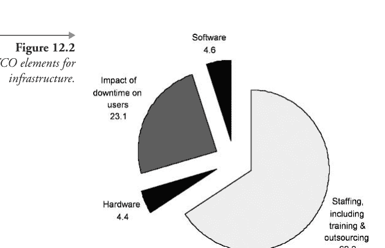

### 表 12.1 人员配置成本

| 项目 | 成本 | 周期 | 详细备注 |
| :--- | :--- | :--- | :--- |
| 开发者 | $95,000 | 年 | 全额成本 (Loaded cost) |
| 系统管理员 | $75,000 | 年 | 全额成本 (Loaded cost) |
| 培训 | $10,000 | 周 | |

支持成本很难计算，因为有很多不同的选择。对于关键系统，组织将希望有能力的人员并解决问题。与软件供应商签订全职等效合同的每年高达 50,000 美元。开源产品也可以签订类似的合同。这些合同可能便宜得多（三分之一或四分之一），而且结构不那么正式。

### 表 12.2 总拥有成本

| 项目 | 成本 | 周期 | 详细备注 |
| :--- | :--- | :--- | :--- |
| 大型4处理器箱 | $25,000 | 服务器 | HP DL745 4处理器 2GB 内存 |
| 中型箱 | $12,000 | 服务器 | Dell 2650 2处理器 |
| 小型箱 | $4,000 | 服务器 | Dell 1750 2处理器 |
| SAN，共享磁盘 | $80,000 | 项目 | Dell/EMC |

### 12.1.2 硬件成本

硬件成本包括服务器、客户端、网络设备以及防火墙等其他设备。Windows 和 Linux 之间的硬件成本通常相同，除非某些异常性能导致差异。通常情况下，所有级别可以使用相同的硬件。在最近 Linux 2.6 内核或某些特化的 2.4 内核（如红帽企业 Linux 3）发布之前，Linux 的速度比硬件允许的要慢，这对数据库和应用程序衡量产生了负面影响。

### 12.1.3 软件成本

下文闭源对比软件价格是针对微软的。主要供应商会跟踪彼此的价格，而微软的定价比其他供应商透明得多。根据我的经验，对于同类产品，微软的价格很少比 IBM 或 Oracle 贵，而且其定价相对稳定、易于且易于处理。

微软服务器价格在批量购买时有折扣。这可以为大型组织降低 25%，或在某些情况下更多。


微软服务器产品按处理器或客户端访问许可（CALs）进行授权。这通常由产品本身决定，但 SQL Server 允许你选择其中一种授权方式。如果你有一台支持 70 个用户的双处理器机器，你可以花费 10,000 美元购买处理器许可（每个处理器 5,000 美元），或者以每个 CAL 10,110 美元的价格授权（1,500 美元加上 $123 \times 70）。这是一个分界点；对于超过 70 个用户，你将选择无限制处理器许可。考虑到即使是双处理器系统预计也能支持超过 70 个用户，而且这种方法消除了 CAL 模式的许可烦恼，这将是大多数人的首选方式。

## 基础设施软件

在此类别中，我们将包括操作系统以及任何网络和系统管理的必需工具。目前有很多开源管理工具可用。Windows 包含了目录、文件和打印服务、简单路由以及 Web 服务器，我们将它们计入其中。在 Windows 环境中，防火墙和代理服务（ISA）以及邮件（Exchange）是额外产品，由于组织通常需要这些服务，我们将它们考虑在成本中。Windows Server 附带了一个简单的邮件服务器，但这并不用于企业级。

大多数 Windows 客户并不使用更昂贵的服务器产品，如 BizTalk Server、Content Management Server、SharePoint Server 或 Commerce Server。这些产品的每个处理器价格从 10,000 美元到 40,000 美元不等。WebTrends、Vignette、Plumtree Tree 或 Blue Martini 等竞争对手更为贵。为了完整，我们将列出一个使用这类产品的常见案例。

开源软件通常较便宜。此外，客户端跟踪被完全或部分消除。对于 Windows，所有访问都必须计算客户端访问许可（CALs），包括目录访问。客户端访问许可通常是最大的软件成本。

## 数据库和开发软件

在 Windows 环境中，这通常包括 SQL Server 和 Visual Studio 等额外成本项目。其他开发工具，如 IIS Web 服务器、Net 开发框架、应用服务器组件和 Active Server Pages 都包含在 Windows Server 中。

在开源环境中，我们将包括 MySQL、Apache 和 PHP；在某些情况下还包括 JBoss 和 Tomcat。这些产品通常随并始终安装在流行的企业级 Linux 选择上，如 Red Hat 和 SuSE。MySQL 在商业环境中有一少量的许可费用，JBoss 有支持费用；我们将在适当的情况下包含这些费用。

许多组织使用 Oracle 或 DB2 作为数据库。它们的成本通常与 SQL Server 相当或更高。

### 12.1.4 使用第三方应用程序和数据库服务器

在开源和 Windows 环境中，都有许多第三方工具和数据库服务器的备。热门选择包括：

- Oracle 或 IBM DB2 数据库服务器
- IBM WebSphere、BEA WebLogic 或 Oracle 服务器
- 用于建模、调试、代码管理等的工具，例如 Rational 和 ClearCase

这些产品在两种环境中具有相同的性能和功能，价格也相。。选择这些产品通常至少部分是因为它们具备在 Windows 和 Linux 平台之间提供相同体验的能力；他们并不认为仅限 Windows 的工具是等效的。

与开源软件或 Windows 开发软件相比，这些产品非常昂贵。例如，2003 年，IBM 列出了以下价格：

| WebSphere Advanced Server | 每个处理器 $11,400 |
| WebSphere MQ | 每个处理器 $5,000 |
| WebSphere Interchange Server | 每个处理器 $123,000 |

计入必要的维护和支持合同，三年的价格是报价的两倍。因此，将 WebSphere 部署在四处理器服务器集群上以执行带有组件和队列的典型 Web 应用程序，成本将是 $32,800 \times 8$，即 $262,400，不包含任何数据库。关于此价格有几个需要考虑的警告；有更轻、便宜的 WebSphere 版本适用于许多情况，这些价格存在折扣，并且自编写以来可能发生了变化。

包含这些产品对成本计算的影响是在比较的每一侧都添加一个固定的（层）元素，从而缩小了整体差异。当然，如果你只将这些产品添加到比较的一侧，那么你的成本将决定结果，你的比较将具有非常有限价值。

### 12.1.5 开源软件的定价

表 12.3 列出了常用开源软件产品的价格。注意，你只需要购买一份副本即可获得文档和 CD。两个例外是 MySQL（它以按服务器定价的商业许可出售）以及 Red Hat Enterprise（它只包含支持，因此也是按服务器定价的）。

所有开源软件的价格均为按系统计算。请注意 Red Hat 产品的价格包含支持。MySQL 数据库采用双重许可，商业许可价格为每服务器 $500，或者在 GPL 下是免费软件；我们将其列为 $500。

表 12.3 开源软件价格

| 产品 | 价格 | 功能 |
|---|---|---|
| **服务器软件** | | |
| Fedora Core | $0 | 服务器操作系统 |
| Debian GNU/Linux | $0 | 服务器操作系统 |
| Red Hat WS Standard | $300 | 服务器操作系统 |
| SuSE Standard Server | $450 | 服务器操作系统 |
| Red Hat Enterprise Linux AS | $1,500 | 服务器操作系统 |
| SuSE Enterprise Server | $1,000 | 服务器操作系统 |

表 12.3 开源软件价格（续）

| 产品 | 价格 | 功能 |
|---|---|---|
| PostgreSQL | $0 | 数据库 |
| Postfix | $0 | 邮件服务器 |
| JBoss | $0 | 应用服务器 |
| OpenOffice.org | $0 | 办公套件 |
| Dia | $0 | 绘图 |
| GIMP | $0 | 图像编辑 |
| Fedora Core | $0 | 桌面操作系统 |
| SuSE Professional | $0 | 桌面操作系统 |
| Debian GNU/Linux | $0 | 桌面操作系统 |

### 12.1.6 闭源代码软件的定价

很难完全确定闭源的成本。并非所有系统都公布价格，而且差异很大。当我们详细计算价格时，许多因素会提高闭源代码的价格。闭源代码通常更高。闭源软件的维护费用通常每年为购买价格的 25%。

### 12.1.7 Windows 软件的定价

微软有公布的价格表，因此我们可以根据这些数字进行。表 12.4 列出了 Windows 软件的价格。比较列表通常是一个很好的做法，因为数量未公布且差异很大。虽然标价比较往往是公平的，但在比较开源和闭源代码时并不公平。闭源软件的价格较高且通常有大幅折扣，我在下表中使用了标价，因为那是公开的。大型组织应该能够获得大幅折扣——例如，比这些价格便宜 25%。

| 项目 | 成本 | 每 | CAL | 详情/备注 |
|---|---|---|---|
| **服务器软件（无限客户端）** | | | |
| Windows Server Web | $400 | 服务器 | | Windows 维护 25% |
| ISA Standard | $1,500 | 处理器 | | |
| SQL Server Standard | $5,000 | 处理器 | | 最多 4 个处理器，2GB RAM |
| SQL Server Enterprise | $20,000 | 处理器 | | 集群，64GB RAM |
| BizTalk Server Enterprise | $25,000 | 处理器 | | BizTalk 标准版不实用 |
| **服务器软件（每台带 CAL）** | | | | |
| Windows Server Standard | $800 | 服务器 | $25 | Windows 维护 25% |
| Windows Server Enterprise | $3,300 | 服务器 | $25 | Windows 维护 25% |
| Exchange Standard | $1,300 | 服务器 | $67 | — |
| Exchange Enterprise | $7,000 | 服务器 | $67 | — |
| SQL Standard | $1,500 | 服务器 | $123 | SQL 按 CAL 或处理器授权 |


## 12.2 成本类型

表 12.4 Windows 软件价格（续）

| 项目 | 费用 | 周期 | CAL | 详情/备注 |
|---|---|---|---|--|
| SQL 企业版 | $11,000 | 服务器 | $123 | — |
| 客户端软件 | | | | |
| Visual Studio 专业版 | $1,080 | 桌面 | — | MSD 通用版为 $2,500 |
| Office 标准版 | $500 | 桌面 | — | 专业版（Access, XML）为 $600 |
| Visio 标准版 | $200 | 桌面 | — | — |
| Adobe PhotoShop | $600 | 桌面 | — | — |
| Windows XP 专业版 | $300 | 桌面 | — | — |

表格中的列标题显示了产品的定价方式。微软按处理器或带有客户端访问许可（CAL）的服务器对其产品定价。CAL 列显示了按此类方式定价的产品价格。其他公司可能有其他的许可系统，但对于大型服务器，按处理器许可是最常见的。用户定价对于服务器来说不那么常见，但通常是向小型组织提供低价的一种方式。

此表仅列出了微软产品，因为它们更通用。其他供应商（如 IBM、Sun 和 Oracle）的同类产品商业价格同样相当甚至更昂贵。我们可以从此处的表格开始，填入我们自己的情况，以获取报价价格以及系统和用户数量。

## 12.2 成本类型

我们考虑了几个影响重大的成本因素，包括固定成本、预算外成本、沉没成本和切换成本。在两个新系统的直接比较中，如果情况相同，开源软件在几乎所有情况下都会更便宜。但通常这种比较在某种意义上是一种迁移，此时现存系统（今天可能是 Windows）将具有巨大优势。这就是大多数比较专有软件与开源软件的 TCO（总拥有成本）研究实际上所做的。在迁移过程中，有利于现有产品的假设会增加人员成本，并主导软件节省的开支。在新的安装情况下，Windows 甚至具有某些现存优势，至少在感知上是如此。决策者可能不熟悉开源，并倾向于分配更高的风险或预计要支付服务费用。

### 12.2.1 固定成本

IT 以及项目管理级别以上的高层管理成本是肯定的，不会随项目活动而变化。

在考虑大多数现代组织中的应用时，包括防火墙、存储区域网络和个人电脑在内的网络和桌面基础设施可以被视为固定成本。如果我们资助一个将技术引入新用户群体的项目，我们必须在项目中考虑这些成本，但在这种情况下，无论是开源还是闭源代码，这些成本都是相同的。

### 12.2.2 预算外成本

终端用户成本，包括培训、可能的停机或不满满意，以及自我支持（“瞎折腾”）可能是重要的，某些成本模型显示这些成本是最高的单一成本部分。然而，IT 组织通常不会报告这些成本，因为它们不在预算之内。

对用户的影响可能更常见地体现在与服务水平协议（SLA）相关的罚金中，但更多是作为对 IT 组织的约束，要求其必须维持特定的服务水平。如果包含预算外成本的影响，用户停机和不满满意的估算成为成本模型中最大的元素，尽管这些非常难以客观衡量。

这些元素没有包含在模型中。相反，假设所比较的系统将提供等等的可用性和用途。这对于服务器系统很可能是真实的，因为它们运行在相同的硬件上，且终端用户直接不可见。对于桌面系统很容易证明，并且可能是一个需要考虑的因素。据推，在这方面认为桌面系统并不等等的组织，无论成本节省多少，都不会部署它们。

### 12.2.3 沉没成本

沉没成本是已经花费在现有系统上的成本，无法收回。为旧系统获取资金是困难的，特别是在互联网泡沫之后；许多已有几年的系统，其硬件价值仅相当于购买价格的十分之一左右，在 eBay 上快速搜索就能发现。软件和支持成本以及其他软成本（如培训）的加和可能比硬件多得多，并且永远无法收回。

切换成本的影响使得迁移到新技术变得困难，因为新系统的获取成本是与现有系统的残值对比的，而后者远小于前者。

### 12.2.4 切换成本

切换成本是从现有系统迁移到拟议系统所需的额外成本，与保留现有系统相比。切换成本的影响使得技术更难被采用。第一个使用新技术的应用程序成本将比后续应用更高，因为需要对开发者和管理员进行培训（他们据称了解该技术），并且因为要首次购买开发工具和其他将在未来应用中重用的基础设施。如果之前存在单一标准，增加新技术还会导致必须支持两种技术，这可能导致额外成本。

沉没成本的效应与切换成本相似，因为现有系统和技能看起来比现在获取它们要便宜。然而，现有系统仍然存在成本，因为必须维护设备、升级软件并培训新员工。通常，在一段时间后，现有系统必须经历自己的迁移，而这是考虑切换的最佳时机。

人员成本通常是 TCO 计算中最高的成本，迁移对人员成本的影响通常是增加成本。IT 员工可能需要退休或重新培训，可能需要昂贵的培训。如果有终端用户，他们也需要重新培训。他们在过渡期间可能还会遇到满意度或质量问题。当然，这些通常是预算外成本，但在作为转换项目的一部分时，可能需要作为一次性费用纳入。如果我们每年查看现有系统，切换成本将一直存在。因为它们实际上推提高了替代方案的价格，因此充当了现有解决方案供应商的“溢价”。任何低于切换成本的费用都不足以导致切换切换。虽然切换成本是一次性费用，但这种由成本而可能的“供应商溢价”可以每年应用一次，如图 12.3 所示。

## 图 12.3
切换成本与供应商溢价。

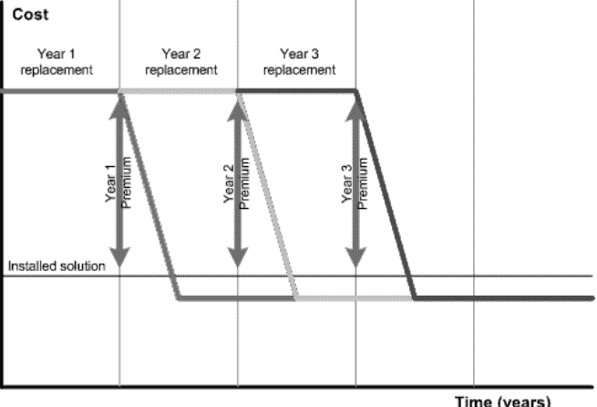

## 12.3 场景

以下示例说明了两个内部桌面数量差异巨大的公司：50 台和 15,000 台。它们具有不同的内部和外部应用场景，代表了不同的问题。我们将分别计算基础设施、开发和生产产品的费用，然后进行总和。成本将包括硬件（预计寿命三年）、软件购买、软件维护（通常为每年购买成本的 25%）、开发（一次性）、管理（为期）以及任何切换成本（一次性）。

成本节省通常需要在两年或更短时间内产生以证明项目的投资回报率（ROI）。更长的时间范围风险更大，因为项目可能会淘汰证明其合理的性格和环境，而且部署的技术可能会被超越。小型项目应该在一年内产生回本。然而，系统的运行时间比这更长。硬件通常可以使用三年，此时它几乎没有残值。收益的计算比成本更困难，且往往是模糊的；某些收益应该是切性的。

在这些情况下，我们将假设寿命为三年，在第一年包含一次性开发成本，并由于是新安装而忽略切换成本。

### 12.3.1 小型组织：网站

12.4 是我们检查的第一个场景。这是一家拥有电子商务服务器的小公司。该系统有一个小型生产数据库、两个 Web/应用服务器和一台开发机，所有这些都是双处理器服务器。

表 12.5 比较了使用三种开发方法的系统成本：Windows 上的 SQL Server 配合 ASP.Net，MySQL 配合 Apache/


## 12.3 场景

在 Linux 上运行 PHP，或在 Linux 上运行 WebSphere（或 WebLogic）配合 Oracle 或 DB2。该系统使用四台双处理器服务器：两台 Web 服务器、一台数据库服务器以及一台用于开发测试的系统。假设使用 PHP 或 ASP 进行应用程序开发需要四个月，而使用企业级 Java 需要六个月，后者可能涉及更复杂的配置。系统管理每年占一名资源的四分之一，价格按三年期进行定价。数据库采用不限制用户数的许可，这通常对 Web 系统来说是最划算的方案。

使用开源软件的 Linux 系统比 Windows 系统便宜。如果你添加了 Oracle 和一个应用服务器，你将得到第三列所示的结果，由于这两项物品的成本，Linux 系统反而更贵。

微软倾向于比较第一列和第三列，发现在 Windows 上进行 .Net 开发比在 Linux 上进行专有的 Java 开发更便宜。当然，如果你想使用 WebSphere 和 Oracle，你也应该将它们加入到 Windows 解决方案的成本中，这将大幅增加成本。

这里的成本差异很小，实际上等同于数据库服务器和应用服务器的成本。在 Windows 上使用开源解决方案（如 LAMP 或 Jakarta/JBoss）是可能的，且成本仅比 Linux 解决方案高一点。

该模型中最大的变量是人员成本。如果能找到减少开发成本的优秀软件包，如果现有的开发资源技能更有利于特定选择，或者某个系统因为与数据中心其他其他系统兼容而更容易管理，那么等式就会改变。例如，我认为选择 Java/Oracle 开发会产生一定的开发成本。其他人可能认为某一个或某一个系统更容易管理或开发。

### 小型网站成本

#### 表 12.5
| 微软 | 成本 | LAMP | 成本 | J2EE | 成本 |
| :--- | :--- | :--- | :--- | :--- | :--- |
| Dell 服务器 | $16,000 | Dell 服务器 | $16,000 | Dell 服务器 | $16,000 |
| Windows Server | $1,200 | Linux | $450 | Linux | $450 |
| SQL Server | $5,000 | MySQL | Oracle 或 DB2 | $5,000 |
| Visual Studio, Com+ | $1,000 | PHP/Apache | $0 | WebLogic | $20,000 |
| 开发应用 | $32,000 | 开发应用 | $32,000 | 开发应用 | $48,000 |
| 管理 | $57,000 | 管理 | $57,000 | 管理 | $57,000 |
| 总计 | $112,200 | | $105,950 | | $146,450 |

### 小型组织：内部使用


当然，上一个例子中的小型公司也有内部运营。我们可以增加 50 台配有办公套件、邮件和文件服务的台式机，以及几台内部服务器来通过内网支持这些设备。图 12.5 在图 12.4 的基础上展示了这些内容。在这种情况下，第三列可能是 IBM。

这些成本如表 12.6 所示。在这种情况下，虽然微软的成本最高，但软件价格占的比例更高。这在包含电脑时通常是这样。由于由于，开源软件比专有软件便宜得多。

该系统将使用双处理器系统处理 Web、文件和打印服务。四分之一的系统管理员应该足够了，按三年期定价。Windows 需要 50 个客户端访问许可（$40），Exchange 需要 50 个（$67）。内网可以使用 Microsoft SharePoint Team Services 和来自 .Net 社区网站的功能来实现。另一种方案是使用微软门户和内容管理软件，但那个更贵。IBM 的解决方案将使用 WebSphere 门户。开源包含了 Linux 在内的其他软件。选择包括微软、Lotus 或 OpenOffice。几位专家需要 Visio 和 Visual Studio。

#### 表 12.6 内部成本
| 微软 | 成本 | LAMP | 成本 | J2EE | 成本 |
| :--- | :--- | :--- | :--- | :--- | :--- |
| Dell 服务器 | $8,000 | Dell 服务器 | $8,000 | Dell 服务器 | $8,000 |
| Windows Server | $2,800 | Linux | $450 | Linux | $450 |
| Exchange | $4,700 | 邮件 | $0 | 笔记 | $5,000 |
| 内网 | $0 | 内网 | $0 | 内网 | $4,250 |
| Office | $25,000 | Office | $0 | Office | $25,000 |
| 其他 | $2,600 | 其他 | $0 | 其他 | $2,500 |
| 管理 | $57,000 | 管理 | $57,000 | 管理 | $57,000 |
| 总计 | $100,100 | | $65,450 | | $102,200 |

如果我们把表 12.5 和表 12.6 相加，我们得到这些总计：
- 微软：$212,300
- 开源：$171,400
- Java/IBM：$248,650

当然，每种方法都可以有变化，对于本例子中对成本敏感的组织，IBM 可能会推荐其他方案（此处原文似乎存在重复/逻辑错误）。

### 大型组织：内部使用

当然，上一个例子中的小型公司也有内部运营。我们可以增加 50 台配有办公套件、邮件和文件服务的台式机，以及几台内部服务器来通过内网支持这些设备。图 12.5 在图 12.4 的基础上展示了这些内容。在这种情况下，第三列可能是 IBM。

这些成本如表 12.6 所示。在这种情况下，虽然微软的成本最高，但软件价格占的比例更高。这在包含电脑时通常是这样。由于由于，开源软件比专有软件便宜得多。

该系统将使用双处理器系统处理 Web、文件和打印服务。四分之一的系统管理员应该足够了，按三年期定价。Windows 需要 50 个客户端访问许可（$40），Exchange 需要 50 个（$67）。内网可以使用 Microsoft SharePoint Team Services 和来自 .Net 社区网站的功能来实现。另一种方案是使用微软门户和内容管理软件，但那个更贵。IBM 的解决方案将使用 WebSphere 门户。开源包含了 Linux 在内的其他软件。选择包括微软、Lotus 或 OpenOffice。几位专家需要 Visio 和 Visual Studio。

（注：由于原文文本存在存在段落重复和逻辑混乱，此处严格按照原文结构翻译，但识别出原文存在内容重复问题）

如果我们把表 12.5 和表 12.6 相加，我们得到这些总计：
- 微软：$212,300
- 开源：$171,400
- Java/IBM：$248,650

当然，每种方法都可以有变化，对于本例子中对成本敏感的组织，IBM 可能会推荐其他方案（此处原文似乎存在重复/逻辑错误）。

### 大型组织：内部使用

当然，上一个例子中的小型公司也有内部运营。我们可以增加 50 台配有办公套件、邮件和文件服务的台式机，以及几台内部服务器来通过内网支持这些设备。图 12.5 在图 12.4 的基础上展示了这些内容。在这种情况下，第三列可能是 IBM。

这些成本如表 12.6 所示。在这种情况下，虽然微软的成本最高，但软件价格占的比例更高。这在包含电脑时通常是这样。由于由于，开源软件比专有软件便宜得多。

该系统将使用双处理器系统处理 Web、文件和打印服务。四分之一的系统管理员应该足够了，按三年期定价。Windows 需要 50 个客户端访问许可（$40）， Exchange 需要 50 个（$67）。内网可以使用 Microsoft SharePoint Team Services 和来自 .Net 社区网站的功能来实现。另一种方案是使用微软门户和内容管理软件，但那个更贵。IBM 的解决方案将使用 WebSphere 门户。开源包含了 Linux 在内的其他软件。选择包括微软、Lotus 或 OpenOffice。几位专家需要 Visio 和 Visual Studio。

（注：由于原文文本存在段落重复和逻辑混乱，此处严格按照原文结构翻译，但识别出原文存在内容重复问题）

（此处跳过重复的段落，直接翻译最后部分）

## 12.4 总结

在当今时代，许多首席信息官希望将核心计算商品化。通过将运行的应用程序与基础设施层解耦，他们可以为业务提供更大的灵活性。更灵活的系统可以根据业务影响选择解决方案，而不受其已部署技术的限制。他们可以扩展或缩小系统，或者或外包功能。他们可以在系统之间共享组件和基础设施。通过对一致的方法处理基础设施并共享组件和工具，这也降低了成本。

使用开源软件的系统将比替代方案便宜。这在任何直接比较中都是显而易见的。在某些情况下，作为基础设施，当软件成本与人员成本相比时，这种差异在总拥有成本测量中可能并不大。运行桌面软件的


考虑到客户端访问许可证（client access licenses），软件成本可能会很高。大多数内部桌面使用以及某些外部使用（如文件共享、邮件、数据库访问以及目录认证）都会产生客户端访问许可证费用。

目前，切换成本、沉没成本以及事实上的行业标准推迟了开源的采用，特别是在桌面领域。随着这种情况在未来几年发生变化，开源的天然成本优势将适用于更多场景。

## 13
## 许可

软件许可一直一直是系统管理过程的一部分。围绕开源许可产生的问题与一般的许可问题其实并没有本质区别，但它们目前似乎受到了更多的关注。

许多专业人士发现法律问题，特别是许可问题，是他们工作中最不喜欢的环节之一。然而，对于我们每所有人来说，了解许可的基础知识至关重要。我们在这里以简单的方式介绍这些基础知识。如果你的需求更复杂，你将需要律师。

如果开源许可文档看起来很长且难以阅读，那么你可能只是习惯了阅读法律文件。典型的闭源许可协议（如来自微软或 Oracle 的协议）也不好到哪里。它们通常更长、更复杂，而且往往具有限制性。

### 13.1 许可证类型

开源许可证可以分为两类：互惠型（或“免费”）许可，其中最广为人的是 GNU 通用公共许可证（GPL）；以及非互惠型（或“开放”）许可，例如 BSD 和 Apache 许可证。

互惠许可包含一项条款，要求在许可代码时必须是开源的。这种互惠性体现在：如果分发者接收了源代码，就必须将其传递给他人。例如，Linux 使用 GPL。如果你选择分发一个基于 Linux 并包含你所贡献的操作系统，你必须分发该系统的源代码。

非互惠许可不包含重新许可条款，因此它们允许来自开源代码的派生作品恢复闭源。这种非互惠性体现在：分发者可以接收源代码，但并不一定将其传递。例如，Apple 使用 FreeBSD 代码作为 Mac OS X 的一部分，而不需要分发 Mac OS 的源代码。

### 13.1.1 重新许可仅在分发时才重要

有些人用“病毒性”（viral）一词来描述互惠许可。这种说法暗示了处理许可是危险的，正如微软有时暗示的那样。微软在使用带有 GPL 的产品时确实需要谨慎。微软是产品（如编译器和操作系统）的分发者，这些产品也适用于派生作品。这是一个它可以处理的风险：微软实际上分发了一个包含受 GPL 许可组件的产品（Microsoft Services for UNIX）。这种风险仅适用于分发扩展了 GPL 许可产品的组织。分发部分基于 GPL 许可产品代码的软件公司需要建立其使用准则。

### 13.1.2 互惠许可与商业许可相似

互惠许可与商业（闭源）许可非常相似，后者通常包含限制重新许可和信息分发的条款。一种常见的商业限制阻止你对软件或派生作品进行许可。GPL 包含影响你对派生作品进行后续许可的条款，这比阻止重新许可的限制要小。商业许可通常要求你同意向他人披露你根据许可获取的专有信息。这可能包括源代码的元素（如 API）以及性能数据等其他信息。而 GPL 要求你向他人披露你获取的源代码以及你添加的任何内容。

### 13.2 使用的许可证

今天有许多正在使用的许可证，但大多数组织只需要考虑少数几种。Freshmart 网站列出了约 50 类许可证，其中某些是许可证组，但只有约 20 被至少 100 个项目使用。图 13.1 显示了 Freshmart 上报告的许可证分布。超过二之三使用的是 GPL，约六分之一使用的是 LGPL、BSD、Apache、Mozilla 或 MIT 许可证之一。这五种许可证中的一种应该足够大多数用途。

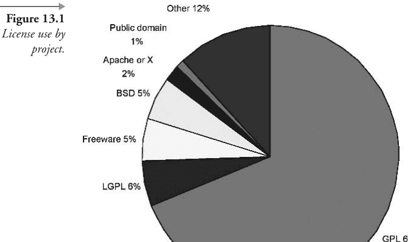

### 13.2.1 互惠许可

GPL 是原始的“自由软件”许可证。它被 Linux 和许多其他核心工具使用，并且每个人都会使用它。GPL 本身也是一项重要的工作，也是许多领域争议的来源，因此每个人都应该阅读。

Mozilla 公共许可证（MPL）与 GPL 类似，但在要求未来使用方面的条款更清晰。

### 13.2.2 非互惠许可

非互惠许可（LGPL, BSD, Apache, MIT）是非互惠的。较小公共许可证（LGPL）允许派生作品链接到库中，而不会使整个作品变为开源。BSD 和 Apache 许可证允许派生作品闭源。MIT 许可证也非常宽松。许多项目使用这些许可证以允许广泛采用，而不需要披露代码。

### 13.3 混合开源和闭源代码

将一起使用开源软件是完全可能的。这在今天很常见，并且可能是大多数系统构建的方式。

### 13.2.3 使用哪种许可证

强烈建议如果你正在分发自己的开源产品，请采用以下一种：

- GNU 通用公共许可证 (GPL)
- Mozilla 公共许可证 (MPL)
- BSD
- Apache
- MIT
- 较小公共许可证 (LGPL)

另一种方案是使用闭源代码供应商。


其内部需求或其客户的需求。例如，Google 在系统开发中使用了大量的开源软件。它自己的软件并不是开源的，而且对大多数 Google 服务的访问都有许可限制，以防止他人“免费便车”——例如通过重新发布 Google 搜索结果作为他们自己的结果。

如示例所示，只要遵循几条规则，公司就可以开源工具开发闭源代码并在开源系统上进行分发。然而，组织对其使用的开源软件所做的任何增强**必须**贡献出来。

采用开源项目，在闭源代码中添加一层额外功能，对这些增强功能和开源基础同时提供支持并收取费用，是一种常见的现象。这描述了 IBM WebSphere、Red Hat（红帽）以及其他一些分发公司。这是过程中一个健康的一部分，因为客户可以选择选择增强后的包或选择开源系统。

## 13.4 双重许可

有些产品是双重许可的。它们既提供开源许可证，也提供商业许可证。此类产品的示例：

- Qt，来自 TrollTech，KDE 的 GUI 工具包
- MySQL，来自 MySQL AB，一种数据库服务器
- Berkeley DB，来自 SleepyCat Software，一种嵌入数据库程序

双重许可允许这些公司向那些开发开源软件的人或个人用户提供开源产品。根据他们的意图或所属组织，其他人可能被要求支付商业许可费用。

实现这一点的方法有很多种，这些公司采取的路径是在 GPL 下许可，然后向那些不愿满足 GPL 条的公司提供商业许可。这种策略策略需要一种开发工具，例如工具包或数据库；它利用了 GPL 的特性，使得如果你链接到它，就会受到其条款的约束。纯应用程序的供应商可能需要编写不同的许可条款，但当然，他们是可以做到的。

## 13.5 其他知识产权问题

双重许可策略依赖于代码所有权。在实践中，要让大量贡献者将所有权转让给一家商业组织是非常困难的。事实上，列出的双重许可案例以及我知的其他案例，看起来都像商业公司，开发是在内部进行的，外部贡献经过签署转让并获得了补偿。

虽然“知识产权”一词是对该领域的很好的描述，但它包含了商标、版权和专利等特定概念，还包括合同（包括许可协议和雇佣合同条款，如职务作品权 [right for hire]）。重要的是不要混淆这些概念，因为在查看特定主张时，看到它是基于其中的哪一个，比使用“知识产权”这一术语总是有帮助的。

开源许可证通用使用知识产权法，特别是版权法，选择性地分发作品供广泛使用，同时保留所有权并限制会对他人产生负面影响的某些。这些许可证是自愿的，其效力来自作者的所有权。

开源软件不应与公有领域混淆。开源使用版权和许可法来执行知识产权，本质上与任何许可协议相似，但有特定的目的。因此，将公有领域作为一个选项，我们的分发选择如下：

- 闭源代码——你授予一个带有特定限制许可，通常包括重新许可和发布专有信息，并保留所有权。
- 开源（互惠，例如 GPL）——你授予一个对衍生品重新许可有限制的许可，并保留所有权。
- 开源（非互惠）——你授予一个广泛的许可并保留所有权。
- 公有领域——你永久放弃所有权及所有权利。

### 13.5.1 溯源 (Provenance)

任何业务决策（包括软件许可）都存在风险，开源通常也类似。某些开源产品可能存在更多风险的一个领域是溯源。溯源问题在于，你从某方获得的许可是否实际上是其提供的。这是任何类型许可的关注点。为供应商工作的程序员可能从某处复制了代码到产品中。如果这些代码是专有的，它将污染你的系统，你的系统将受到代码许可条款施加的限制。例如，它可能会让你面临许可费用，或者要求你提供源代码。

所有项目都需要维护任何贡献代码的来源的记录。由于某些开源项目接收来自许多贡献者的代码，对它们来说可能更加困难。对于其他项目来说，这与任何其他项目没有区别。在获取产品时，我们需要确保这项溯源工作已经完成。

偶尔会有特定的指控，称某件开源软件窃取了私有公司的“知识产权”。这可能会发生，但并不常见。挪用代码、使用他人的商标或获取他人的秘密都是违法的。开源在这方面并无寻常。反对这些活动的法律已被经常使用且仍然适用。然而，开源的性质是所有代码都是可供检查的，任何不当行为在闭源代码中远更容易被发现。尽管开源软件已经存在了 30 年，但仍然被发现过。没有任何诉讼成功证明了任何数量的闭源代码被并入了开源。如果此类诉讼胜诉，那么违规代码需要被替换，但开源的整体地位并不会改变。

如果闭源代码开发者挪用了受商标材料或商业秘密，同样的法律也适用。私营部门已经发生了几起诉讼。可能存在闭源开发者错误地使用了易于获取的适当开源代码的问题。Black Duck 公司的成立就是为了解决这个问题。那些担心开源代码已进入其产品的组织，可以使用 Black Duck 产品在在线开源库中搜索与其产品中代码相似的代码。

当然，如果一个开源产品在功能上等同于闭源软件，是在没有接触该代码的情况下构建的，并且没有版权或商标侵权，那是没问题的。苹果和微软曾因 Windows 与 Macintosh 的相似性发生过重大诉讼，Borland 和 Lotus 也曾因 Quattro Pro 与 Lotus 1-2-3 的相似性发生过诉讼，但它们得到了解决。

## 13.6 总结

软件问题是另一个领域，这里可能有长期关注的理由。比尔·盖茨曾说，专利的解释方式使得我们所知的软件开发在过去是不可能的。此外，诸如《千年版权保护法》(DMCA) 的立法以及关于数字版权管理 (DRM) 的建议正进一步扩大限制。这些问题非常复杂，在这里无法涵盖。我建议参考劳伦斯·莱斯（Lawrence Less）的书，特别是《自由文化》和《思想的未来》；在电子基金会、自由软件和开源网站搜索软件专利问题和 DMCA；并访问知识共享组织网站获取更多信息和活动。

## 13.6 总结

正如开源软件一样，闭源代码也存在法律问题。正如所有业务决策一样，也存在风险。公司可能会违反合同、破产等等，正如它们过去可能这样做一样。支持安排需要指定并签订合同，正如它们一向如此的。

开源软件总是自愿的。软件开发者可以为他们的工作选择许可模式，软件采用者可以从许多可选许可模式中选择产品。这是我们在任何情况下都可以考虑的另一个选择。


# 资源

## 管理一个开源实验室

开源软件实验室将作为以下用途的资源：

-   向想要了解其本质的高管推销开源软件的优势。
-   为希望在使用软件前先进行体验的用户和专业人士演示相关的产品、实践及其运行机制和功能。
-   识别内部已经取得成功的系统和人员。
-   为组织的问题开发解决方案，这些方案可以由这些产品和实践组合而成。
-   培训想要评估开源软件并学习如何使用的专业人士、开发者和系统管理员。
-   测试系统运行——例如，检查供应商的声明，确保各个组件能够协同工作，并练习迁移。
-   对容量和性能进行基准测试——例如，数据库在每秒请求数中的性能，或目录支持的用户数量。

这是一份非常有用的活动清单，而且一个简单的实验室如此容易启动，因此它是我们在调查和/或引入开源软件过程中应该考虑的第一件事。

我们可以用两到三台机器作为 Linux 节点来建立一个合适的实验室。它们将支持文件和打印服务、目录、Web 服务器、数据库和其他应用程序。我们还将设置几台客户端，运行我们在组织中可能需要的任何程序。这可能包括 Mac OS X、Windows XP 以及我们想要检查的 Linux 发行版（例如 SU Linux 9、Debian GNU Linux 或 RHEL 3）。为了测试 Web 系统，我们可能需要运行几个浏览器。对于客户端，许多系统可以是旧的，也许是从其他职能部门转用过来的，或者是桌面设备更新后的二手系统。许多 Linux 功能在旧系统上运行良好。然而，在 KDE 和 Gnome 上运行且开启“视觉盛宴”（*eye candy*）的最新应用程序通常需要新系统。

如果实验室被用于常规培训或临时通知的演示，那么它需要获得合理的许可，并配备专用的系统。在其他情况下，系统不需要完全专用，我们可以将其设置为双系统启动或多系统启动。我们应该保持一些机器一直运行，以便进行演示、教育并证明可靠性；让其他机器由那些学习使用系统的人购买并重新配置。作为一般规则，客户端可以双系统启动，而服务器通常应该是专用的，因为我们可能希望在任何时候访问文件、打印机或数据库，而无需重启。

如果资金允许，我们可以通过更好的设备和设施来扩展“合适”的标准。有了更充足的资金，实验室可以更多地作为一种销售工具。我们可以使用通常为新地点订购的设备，它们会比旧的办公设备更快、更好看，并使用基准测试使其更真实（更快速）。如果我们正在寻找大型系统，也许合作供应商可以租借设备给我们。为了留下深刻印象，我们可以付费请人设计布局。如果高管要看演示，那么让它们看起来华丽一些是值得的。这项工作对于在一个时期内接待许多客户的咨询或培训机构可能有效。

我们不会忘记允许供应商使用我们的开源实验室。当一家闭源公司被认真考虑开源时，这会对其定价和支持方案产生非常显著的影响。有些公司已经告诉他们的销售人员，他们绝不能输给 Linux（或其他类似产品），必须“不惜一切代价”赢得胜利。

如果资金是个问题，只要我们有一台电脑，就可以创建一个技术实验室。我们可以获得一台带有 `10GB` 硬盘、运行 Windows XP 或 Windows 2000 专业版的可用笔记本电脑或台式机。然后我们可以将其设置为双系统启动，这样它可以作为 Windows 或 Linux 系统启动。我们通过使用分区管理器（Partition Manager）将硬盘分区为一半 Windows、一半 Linux，然后从包含所有软件的 Linux 光盘拷贝中进行安装。在这样的系统上，我们可以学习并测试书中提到的所有软件，同时继续运行 Windows 以及我们需要的任何软件。

许多组织已经为这类活动预留了一些设备和空间，涉及的唯一成本将是设置和评估系统的时间。这样的项目涉及几几天到几周的人员工作，并且可以在其他项目的停机期间期间完成。如果空间和设备被专用几个月，并且进行了培训并执行了以支持迁移的分析工作，那么我们可能需要为这个重大项目准备预算。

## A.2 安装评估性 Linux 系统

大多数想要评估 Linux 的人都想上手操作 Linux 系统，并感受它与他们习惯的系统相比如何。与任何系统一样，正确安装一个系统比使用它更困难。安装是潜在用户在让系统运行之前可能会感到沮丧甚至放弃的地方。在下文中，我们将尝试引导你选择正确的机器和 Linux 发行版，以确保安装顺利。

安装问题也会出现在 Windows 中；当我在微软工作时，我偶尔会在圣诞节或 Windows 发布会等期间进入零售店与公众见面。我最喜欢的部分是遇到那些尝试自己安装新版本 Windows 但被卡住的人。然而，对于 Windows，你始终可以选择购买一台设置好的新电脑，这种选择同样适用于 Linux。

如果你没有时间安装 Linux，可以直接从启动光盘（live CD）运行它，使用 Kppix 或类似的这种方式加载的发行版。这是初步评估的极佳方法，对于正在维修机器的经验丰富的用户也有用。

大多数系统都可以运行 Linux，但并非所有系统都容易安装。新用户花费几天时间收集信息来解决表 A.1 中列出的问题是常常的。如果我们的目标是花一周时间学习如何管理 Apache 和 Samba，并审查 OpenOffice、Evolution 和 KDE 的运行，那么它是值得考虑的。

### 表 A.1 在 Windows 上安装 Linux 的可能问题

| 问题 | 备注 | 解决方法 |
| :--- | :--- | :--- |
| Windows 支持但 Linux 不支持的硬件 | 特别是旧系统。Windows 98/ME 比 NT/2000 支持更多旧硬件。组件问题包括旧机器上的大硬盘、3D 显卡（例如 NVIDIA）、声卡和调制调器。 | 在安装前仔细选择机器。某些机器运行可能不佳，或者需要（如内核补丁）才能工作。 |
| 笔记本电脑和笔记本设备 | 更可能有不支持的特殊卡和驱动程序。如果没有手动安装，不太可能支持所有管理功能。如果是二手的，可能有奇怪的。 | 决定是否必须使用笔记本。检查 [Linux Laptops](https://www.linux-laptop.net/) 列表，确保你的笔记本和显卡得到了特定支持。 |
| 磁盘分区 | 如果机器安装了 Windows，你可能需要缩小 Windows 分区为安装 Linux 获取空间，这并不是容易的任务。 | 大多数 Linux 安装允许你删除整个 Windows 分区，但这可能不是你想要的。参见双系统启动。 |
| 图形（X Windows）安装挂起或失败 | 这非常常见，这也是为什么大多数系统提供文本模式安装。安装程序通常能检测到显卡，但往往无法检测显示器的同步率。 | 使用文本模式安装并运行 X。从 Windows 启动获取显示器同步数据并手动输入。如果可以选择，请使用 ATI（例如 Radeon）而不是 Nvidia，Nvidia 驱动可能需要复杂的安装。 |
| 系统未使用整个屏幕显示 | 系统未检测到显示器且为 VESA，或者未检测到适配器内存。 | 在启动前从 Windows 记录显示器和适配器信息。 |


## A.2 安装评估用 Linux 系统

## 表 A.1 在 Windows 机器上安装 Linux 的可能问题（续）

| 问题 | 注释 | 解决方法 |
| --- | --- | --- |
| 双启动 | 你可能想保留 Windows 系统并添加 Linux，以便选择运行哪种操作系统：即双双启动。 | 使用基于 Windows 的磁盘分区工具（如 Partition Magic）在安装 Linux 之前缩小 Windows 分区。大多数电脑技术人员都有磁盘分区工具。 |
| | | 双启动的缺点是：设置较困难，且严重的故障可能会导致步骤失败。如果你需要在两者之间切换，使用起来可能会很困恼。 | 大多数 Linux 版本都支持双启动（使用 LILO 或 GRUB）。 |
| | | 最好使用第二个系统或可交换的启动驱动器。除非你有备用系统或已完全备份，否则不要冒险。 | |
| 从 Windows 分区读取 | 在 Linux 中，你可能想从 Windows 文件系统读取文件（假设是你现在今天创建的任何文件，如邮件）。 | Linux 可以挂载 FAT32 或 NTFS 系统：FAT32 可读/写，NTFS 通常为只读。参见第 11 章。 |
| 访问 Windows 网络上的文件和打印机 | 这需要一些设置，可能需要编写脚本。在某些配置下，可能无法实现。 | 参见第 11 章。在 Windows 安全性可以简化实验室环境下工作。 |
| 无线网和 PCMCIA 卡 | 当前的 Red Hat 和 SuSE Linux 可以自动设置（你需要输入 ESSID）。 | 较旧 Linux 版本（如 Red Hat、SuSE 7）在没有人工干预的情况下较可能无法工作。 |
| | | 旧且不常见的卡可能无法工作。非常新的卡可能无法工作（今天，802.11g 高速无线网络很难设置）。 | | |
| 你遇到需要访问互联网解决的问题 | 许多问题可能导致你的机器无法工作或连接到互联网。 | 准备一台备用机器。 |

我们可能需要花费一周时间设置 DNS 和 IP 地址，并在互联网上搜索可以使特定设备正确运行的脚本。如果你认识经验丰富的 Linux 用户，这是一个向他们寻求帮助的好时机。

或者，如果资金不是问题，最简单的方法可能是购买一台安装了你想要使用的 Linux 版本的新系统，或者付钱请人安装。主要制造商（Dell、IBM、HP 等）不销售这些系统，除非我作为定制服务提供。

附录 A

市场变化非常快，IBM 和 HP 已经承诺提供安装好的 Linux 系统。已经有许多小型公司乐意出售预装了 Linux 系统的机器，或者收取费用在你的机器上安装操作系统（独立运行或双启动）。我确实建议测试你想要评估的系统，因此不值得去沃尔玛买一台 Windows 系统，因为那可能不是你组织将选择的。

在之后的某个点，你可能想花精力完全按照你的要求配置 Linux 系统。如果你有可用的磁盘空间，直接加载所有内容可能更好。

### A.2.1 设置互操作性

我们需要在 Linux 系统与现有系统之间建立互操作性。有几种方法，从单从机器开始。选项包括双启动系统、在 Windows 上运行 Linux 以及在 Linux 上运行 Windows。在这些中，最通用的是创建一个双启动系统。

### A.2.2 双启动

双启动机器可以从 Windows 或 Linux 启动，例如，但我们必须选择。如果我们需要“另一侧”的应用程序，就必须停止并重启，这很不方便。如果机器是双启动的，你可以看到它们在相同硬件上的对比——例如，速度、图形。其次，如果你在测试过程中遇到某些事情遇到困难（这可能是一个很少使用的 Windows 程序，或通过仅在旅途中使用的介质登录），你保留了启动到 Windows 执行该操作的能力。最后，你可以以后删除任何你不需要的操作系统。

要设置双启动系统（这会让你的 Windows 安装保持完好并允许测试完整版本的 Linux），你需要一个最小大小约为 10GB 的磁盘驱动器（每个系统 5GB）。双启动起初设置稍微困难一点，并且存在微小的风险，即设置双启动可能会禁用 Windows 系统。在尝试此之前，应该备份任何数据，如果发生问题，你可能需要一些专家帮助。如果你有一台新系统，可以使用一半硬盘空间安装 Windows，然后在未使用的空间上安装 Linux。

由于我经常发现仅来自制造商的、安装了 Windows 且带有数据的系统，我通常使用 Partition Magic 程序，它运行在 Windows 上并允许调整现有分区的大小。这虽然不是开源软件，但对于工作站来说相当便宜，而且基于 Windows 的组织的管理人员可能已经有了它。如果你的分区是 FAT32，另一种替代方案是 Linux 程序“parted”，但它无法调整 NTFS 分区的大小。

一旦双启动系统工作正常，你将希望从 Linux 系统设置文件到 Windows 分区。Windows 系统无法读取 Linux 分区。按照规定，Linux 系统可以读写 FAT 和 FAT32，并且可以读取 NTFS 分区但无法写入。对于双向通信，如果 Windows 系统至少有一部分分区是 FAT32 效果更好。某些 Linux 系统会挂载 Windows 分区。

### A.2.3 在 Windows 上运行 Linux

与其启动，选择是仿真或虚拟机。要在 Windows 上运行 Linux，我们可以使用：

- Cygwin（开源）
- Microsoft Services for UNIX
- 如 VMware 等商业软件包

Cygwin 是一个在 Windows 下提供 Unix 类工具的开源软件包。它对那些希望在使用 Linux 工具的同时拥有 Windows 功能的技术人员也很流行。微软提供了类似的产品，Virtual PC。

### A.2.4 在 Linux 上运行 Windows

在这个方向上，选择是仿真或虚拟机。除了在 Windows 上运行 Linux 之外，还可以使用 VMware 用于在 Linux 上运行 Windows。例如，我们可以在一台 Linux 盒上设置 Windows XP、Windows NT4 和 Windows ME 系统，并在其上测试应用程序。Windows 系统将访问安装的打印机、网卡等。


## A.3 下一步工作

开发个人技能。在系统中安装 Linux；最简单的方法是使用 Knopix，所以即使别无事事也请这样做。尝试接触符合你需求的开源软件。

加入本地用户小组。面对面的交流是不可替代的。如果没有用户小组，我的情况会变得糟糕得多，我坚信每个人都需要参与用户小组。这在任何软件中都很重要，但在开源软件中尤其如此，因为其他沟通渠道的效率较低。开源用户小组还更有可能包含深层次的技术资源。我相信正因为可以获取源代码，人们才能自力更生；贡献的机会提供了动力；而由于缺乏主导性的供应商，往往会将他们的小组变成营销活动，例如 Slashdot 和 Freshmart。

制定开源策略。在购买产品时，始终在评估方案中包含开源软件。为开源销售模式、缺乏销售代表和赠品、以及低调的品牌和媒体报道做好准备。对于复杂的部署，现在就要计划好措施以便日后进行迁移。

如果你需要为供应商、渠道、客户访问、社区访问、呼叫中心和零售店等新领域部署解决方案，请现在就考虑开源：

- 购买或替换基础设施产品。
- 选择标准，特别是关于互操作性和集成性的标准。
- 构建、购买或重写应用程序。

## A.4 使用开源软件的十大理由

1. 开源开发模型在高度复杂且安全的系统中已运行了 25 年以上。
2. 得益于成本模型、聘用当地人才的能力以及本地化能力，开源是国际化的解决方案。
3. 你可以接触到一个不断增长的技术人才库，他们相互分享并互相学习。
4. 互联网运行在开源软件之上，并为其赋能。
5. 你可以查看并修复你的系统运行的代码，或者让你的代表去这样做。
6. 除非你选择使用，否则没有专有信息格式。
7. 无需管理许可、没有盗版，且你可以根据意愿升级系统。
8. 你可以自由更改和混合来自不同平台、供应商和服务提供商的产品。
9. 你可以进行自己的集成和定制。
10. 许可证费用更低，硬件更便宜，且人员、支持或任何其他费用都不会增加。

## A.5 网页链接

这套技术和实践非常庞大且新颖，以至于我们都需要各种资源来学习并保持与前沿。坦率地说，互联网在此方面提供了帮助。表 A.2 中包含了一些实用的 URL。互联网上有大量的文献（包括系统文档），这通常应该是首选查找的地方。GIMP 和 MySQL 的用户手册只是两个真正高质量的在线文档的例子。表 A.2 中的网页链接是可用资源的一个极小样本。

| URL | 描述 | 备注 |
| :--- | :--- | :--- |
| linuxshop.ru/linuxbegin/win-lin-soft-en/table.shtml | Windows Linux 替代品表 | Windows 程序的所有开源 Linux 替代品列表 |
| freshmeat.net | Freshmeat | 可用开源项目索引 |
| sourceforge.net | SourceForge | 开源代码存储库和开源软件开发中心 |

### 表 A.2 网页链接（续）

| URL | 描述 | 备注 |
| :--- | :--- | :--- |
| www.apache.org | Apache 基金会 | 管理 Apache Web 开发团队以及包括 Jakarta 在内的相关产品。 |
| www.dwheeler.com/oss_fs_why.html | 为什么选择 OSS/FSS? | 汇总开源市场份额或性能数据的必读资源 |
| www.fedstats.gov | FedStats | 关于美国统计数据的有用网站 |
| www.freebsd.org | Free BSD | “另一个”免费操作系统 |
| www.fsf.org/philosophy/free-sw.html | 自由软件与 GPL | 核心哲学 |
| www.gnome.org | Gnome 基金会 | 管理 Gnome 桌面及工具的开发，包括 Evolution。 |
| www.gnu.org | GNU 和 FSF 家园 | |
| www.ibm.com/developers/linux | IBM Developer Works Linux 页面 | 除了 IBM 工具外，这里通常是非专有工具的良好资源。 |
| www.kbst.bund.de | 德国联邦政府网站 | 搜索英文文档 |
| www.kuro5hin.org | Kuro5hin | 关于技术和文化的讨论网站 |
| www.linux.org | Linux | Linux |
| www.linuxjournal.com | Linux Journal | 月刊 |
| www.linux-laptop.net | 笔记本电脑上的 Linux | 关于在笔记本电脑上安装 Linux 的信息 |
| www.linux-mag.com | Linux Magazine | 另一本 Linux 杂志 |
| www.mozilla.org | Mozilla | Mozilla 浏览器和其他软件的官网 |

# 附录 A：网页链接（续）

| URL | 描述 | 备注 |
| :--- | :--- | :--- |
| www.newsforge.com | NewsForge | 面向 Linux 和开源的在线日报 |
| www.netcraft.com | NetCraft | Web 软件使用情况报告 |
| www.objectwatch.com | Object Watch | Roger Sion 的开发网站。良好的定价表格。WebSphere .Net 方面非常出色。 |
| www.opengroup.org | Open Group | 管理开放标准，包括 UNIX API |
| www.opensource.org | Open Source | 管理开源定义并维护已批准的软件许可列表 |
| www.python.org | Python | Python 主站 |
| www.redbooks.ibm.com | IBM 红Books | 关于软件问题的书籍 |
| www.securityspace.com | Security Space | 关于 Apache 模块使用的研究报告 |
| www.slashdot.org | Slashdot | 每日技术主题的重要阅读 |
| www.ssc.com/glue/groups | Groups | 世界各地的 Linux 用户群 |
| www.stanford.edu/class/cs240/readings | 计算机历史读物 | 该目录包含许多关于 UNIX 哲学的论文，《越劣越美》 |
| www.tldp.org | 文档项目 | Linux 文档优质资源 |
| www.tpc.org | TPC | 数据库基准 |

### 表 A.2 网页链接（续）

| URL | 描述 | 备注 |
| :--- | :--- | :--- |
| www.w3.org | W3C | 世界网联盟：Web 的主要标准 |
| www.xfree.org | XFree86 | X Windows 系统的开源实现 |
| http://www.opensource.org/licenses | 开源许可库 | 重要资源。 |

# 开源定义

引言

开源不仅仅意味着访问源代码。开源软件的发行条款必须符合以下标准：

### 1. 自由分发

许可不应限制任何一方在包含不同来源程序的聚合软件分发中出售或赠送该软件。许可不应就此类销售收取费用或其他费用。

### 2. 源代码

程序必须包含源代码，并允许以源代码和编译形式的形式分发。如果产品的某些形式没有随源代码分发，则必须有良好的渠道可以获取源代码，且成本不高于合理的复制成本，最好能通过互联网免费下载。源代码必须是程序员修改程序的首选形式。不允许故意混淆的源代码。预处理器或翻译器的输出等中间形式也不被允许。

### 3. 衍生作品

许可必须允许修改和衍生作品，并允许按照原始软件的许可条款对其进行分发。

### 4. 作者源代码的完整性

许可可以限制仅以修改后的形式分发源代码，前提是许可允许随源代码分发“补丁文件”，以便在构建时修改程序。


许可必须明确允许分发基于修改后的源代码构建的软件。许可可能要求衍生作品使用与原始软件不同的名称或版本号。

## 5. 不对个人或群体歧视

许可不得对任何个人或个人群体产生歧视。

## 6. 不对从事领域歧视

许可不得限制任何人在特定从事领域利用该程序。例如，它不能限制程序在商业领域中使用，也可能限制其用于基因研究。

## 7. 许可的分发

附于程序的权利必须适用于所有分发该程序的人员，且这些人员无需执行额外的许可。

## 8. 许可不能特定于某个产品

附于程序的权利不能依赖于程序在特定分发版本中的部分。如果该程序从该分发版本中提取并在程序条款内进行使用或分发，则所有分发该程序的方都应拥有与原始软件分发时授予的相同的权利。

## 9. 许可不得限制其他软件

许可不得对与许可软件一同分发的其他软件设定限制。例如，许可不能坚持在同一介质上分发的所有其他程序必须是开源软件。

## 10. 许可必须是技术中性的

许可的任何条款均不得基于任何特定的技术或接口风格。

Copyright © 2004 by Open Source Initiative

- 本内容可以在网上获取：http://www.opensource.org/docs/definition_plain.php。此外，一个解释了每个段落目的且可能更受青睐的注释版本，也可以在 http://www.opensource.org/docs/definition.php 获取。

## 开源许可示例

## C. 我 GPL

GNU 通用公共许可证
第 2 版，1991年6月
Copyright (C) 1989, 1991 Free Software Foundation, Inc.
59 Temple Place, Suite 330, Boston, MA 02111-1307 USA

每个人都被许可复制和分发本许可文件的逐字副本，但不允许对其进行更改。

# 前言
大多数软件的许可旨在剥夺你分享和更改的自由。相比之下，GNU通用公共许可证旨在保证你分享和更改自由软件的自由——确保软件对所有用户都是自由的。本通用公共许可证适用于自由软件基金的所有软件，以及任何其他作者承诺使用它的程序。（其他自由软件基金会的软件则由 GNU 库通用公共许可证涵盖。）你可以将它应用于你的程序，以：

当我们谈论自由软件时，我们指的是“自由”，而不是价格。我们的通用公共许可证旨在确保你拥有分发自由软件副本的自由（如果你愿意，可以对这项服务收费），你能够接收源代码或在需要时获取它，你可以更改软件或在新的自由程序中使用它的部分；并且你知晓自己可以做这些事情。

为了保护你的权利，我们需要制定限制条件，以防止任何人剥夺你的这些权利或要求你放弃这些权利。如果你分发软件副本，或者你对其进行修改，这些限制将转化成你必须承担的某些责任。

例如，如果你分发此类程序的副本（无论是免费还是付费），你必须赋予接收者你所拥的所有权利。你必须确保你自己也接收或获得了源代码。你必须向他们展示这些条款，让他们知道自己的权利。

我们通过两个步骤保护你的权利：(1) 对软件进行版权保护；(2) 为你提供许可，赋予你复制、分发和/或修改软件的法律许可。

此外，为了保护每位作者以及我们自己，我们希望确保每个人都理解你的自由软件不提供担保。如果软件被他人修改并传递，我们希望其接收者知道他们得到的不是原始，这样他人引入的任何问题将不会影响原作者的声誉。

最后，任何自由程序都不断受到软件专利的威胁。我们希望避免自由程序的分发者个个获得专利许可，从而实际上使程序变得闭源。为了防止这一点，我们已经明确：任何专利程序必须许可供大家自由使用，否则干脆不予许可。

以下是复制、分发和修改的精确条款和条件。

## GNU 通用公共许可证

## 复制、分发和修改的条款与条件

0. 本许可适用于包含版权所有者所声明的程序或其他作品，该声明其可能根据本通用公共许可证的条款分发。下文的“程序”是指任何此类程序或作品，“基于此程序的作品”是指该程序本身或版权法下的任何衍生作品：即包含该程序或其部分的作品，无论是逐字复制的还是经过修改和/或翻译成另一种语言的。（在此处，“修改”一词包含包含但不限于翻译。）每位被许可者均被称为“你”。

除复制、分发和修改之外的活动不受本许可涵盖；它们属于本许可范围之外。运行程序的行为不受限制，程序的输出仅在其内容构成基于此程序的作品（独立于是否通过运行程序产生）的情况下才涵盖。这是否真实取决于程序的功能。

1. 你可以在任何介质上按照你收到的源码，复制并分发程序源代码的逐字副本，前提是你诚实且适当地在每份副本上附上适当的通知、免责声明，保留所有引用本许可的通知，并向程序的其他接收者提供本许可的副本。你可以对向任何他人传输程序副本的物理行为收取费用。

2. 你可以对你的程序副本或其任何部分进行修改，从而一个基于此程序的作品，并复制和分发此类修改或该作品，前提是你符合以下所有条件：
a) 你必须使修改后的文件附带显著的通知，说明你更改了文件以及更改的日期；
b) 你必须确保你分发的全部或部分包含（或源自）此程序的作品，均根据本许可的条款作为一个整体进行许可；
c) 如果修改后的程序在运行时通常是交互式的，你必须使其在最普通的方式启动此类交互使用时，打印或显示适当的版权声明和无担保声明（例外：如果程序本身是交互式的但通常不打印公告，则不需要此要求）。

这些要求适用于修改后的作品整体。如果该作品中可识别的部分并非源自此程序，并且其本身可以被认为是独立的独立作品，那么当你将这些部分作为独立作品分发时，本许可及其条款不适用于这些部分。但当你将相同的部分作为基于此程序的作品的整体的一部分进行分发时，整体的分发必须符合本许可的条款，本许可对其他许可者的许可延伸到整个作品，因此延伸到无论由谁编写的每一个部分。

因此，本节的意图并不是主张或质疑你对完全你编写的作品的权利；意图是行使控制基于此程序的衍生或集合作品分发的权利。

此外，仅将非基于此程序的另一个作品与程序在存储卷或分发介质上简单聚合，并不会使该作品进入本许可的范围。

3. 你可以根据第 1 和第 2 条的条款，以目标代码或可执行形式复制和分发程序（或根据第 2 条基于它的作品），前提是你还执行了以下操作之一：
a) 随附一份完整的对应的机器可读源代码，该源代码必须根据上述第 1 和第 2 条的条款，在通常用于软件交换的介质上分发；或
b) 随附一份书面要约，有效期至少三年，承诺向任何第三方以不超过你物理执行源码分发成本的费用，提供一份完整的机器可读的对应的 corre-


相应的源代码，应根据上述第 1 条和第 2 条的条款，在通常用于软件交换的介质上分发；或者，

c) 将您收到的分发相应源代码的信息随附提供。（此替代方案仅适用于非商业性分发，且仅当您根据上述 b 小节以目标代码或可执行文件形式接收该程序并收到此类报价时有效）。

作品的源代码是指对其进行修改的优选形式。对于可执行作品，完整的源代码意味着其包含的所有模块的源代码，外加任何相关的接口定义文件，以及用于控制编译和安装该可执行程序的脚本。但是，作为一个特殊例外，源代码不包括在运行该可执行程序的操作系统上通常与其（以源代码或二进制形式）一同分发的任何主要组件（编译器、内核等），除非该组件本身与可执行文件一同提供。

如果通过提供从指定位置复制的访问来分发可执行代码或目标代码，则提供从相同位置复制源代码的等效访问被视为源代码的分发，即使第三方未被强制在复制目标代码的同时复制源代码。

- 4. 除非本许可协议明文规定，否则您不得复制、修改、分许可或分发本程序。任何其他尝试复制、修改、分许可或分发本程序的尝试都是无效的；并将自动终止您在本许可协议下的权利。然而，根据本许可协议从您处获得程序副本或权利的方，只要这些方继续保持符合规定，其许可就不会终止。

- 5. 您不要求接受本许可协议，因为您尚未签署它。然而，没有任何条款授予您许可修改或分发本程序或其衍生作品。如果您不接受本许可协议，这些行为是法律禁止的。因此，通过修改或分发本程序（或任何基于本程序的作品），您表示您接受根据本许可协议这样做，以及所有关于复制、分发或修改本程序或基于它的作品的条款和条件。

- 6. 每当您重新分发本程序（或任何基于本程序的作品）时，接收者会自动从原始许可中获得许可，根据这些条款和条件复制、分发或修改本程序。您不得对接收者行使本文授予的权利施加任何进一步限制。您不负责确保第三方遵守本许可协议。

- 7. 如果由于法院判决、专利侵权指控或任何其他原因（不限于专利问题），您（通过法院命令、协议或其他方式）被施加了与本许可协议条件相冲突的条件，这些条件并不排除您履行本许可协议条件的义务。如果您无法通过分发来满足您在本许可协议下的义务以及任何其他相关义务，作为结果，您可能完全无法分发本程序。例如，如果专利许可不允许所有通过您直接或间接接收副本的人员免版税地重新分发本程序，那么您同时满足该许可和本许可协议的唯一方法就是完全放弃分发本程序。

如果本节的任何部分在任何特定情况下被认为无效或不可执行，则该节的其余部分应适用，且该节在其他情况下也应适用。

本节的目的并非诱导您侵犯任何专利或其他产权，或质疑任何此类主张的有效性；本节的唯一目的是保护自由软件系统的完整性，该系统是通过公共许可实践来实现的。许多人基于对该系统的一致应用，对通过该系统分发的广泛软件做出了慷慨的贡献；由作者/捐赠者决定是否愿意通过任何其他系统分发软件，被许可者不能强加这一选择。

本节旨在彻底清楚地说明被认为是本许可协议其他部分的后果。

- 8. 如果程序的分发和/或使用在某些国家受到某些方或版权接口的限制，将程序置于本许可协议下的原始版权所有者可以增加明确的地理分布限制以限制这些国家，使得仅允许在未排除的国家内或这些国家之间分发。在这种情况下，本许可协议包含该限制，如同写在本许可协议正文中一样。

- 9. 自由软件基金可能会随时发布修订的和/或新的通用公共许可协议。此类新版本在精神上与当前版本相似，但在细节上可能不同，以解决新的问题或疑虑。

每个版本都有一个不同的版本号。如果程序指定了适用于它的本许可协议版本以及“任何更高版本”，则您可以选择遵循该版本或由自由软件基金发布的任何任何更高版本的条款和条件。如果程序未指定本许可协议的版本号，您可以选择自由软件基金发布过的任何版本。

- 10. 如果您希望将程序的某些部分整合到分发条件不同的其他自由程序中，请写信给作者寻求许可。对于由自由软件基金拥有版权的软件，请写信给自由软件基金；我们有时会对此破例。我们的决定将受到两个目标的指导：保护您的自由软件的所有衍生品的自由状态，以及促进软件的的共享和重复使用。

# 无任何保证

- 11. 由于本程序是免费许可的，在适用法律允许范围内，本程序不提供任何保证。除非另有文字说明，版权所有者和/或其他方按“原样”提供程序，不提供任何形式的保证，无论是明示还是隐含的，包括但不限于对可销性和适用于特定用途的暗示保证。有关程序质量和性能的所有风险均由您承担。如果程序被证明有缺陷，您承担所有必要的维修、修理或修正费用。

- 12. 在任何情况下，除非适用法律要求或书面同意，否则版权所有者或根据上述许可修改和/或分发程序的其他方均不对您造成的损害承担责任，包括因使用或无法使用程序引起的任何一般、附带损害（包括但不限于数据丢失、数据不准确导致您或第三方的损失或程序无法与任何程序运行），即使此类持有者或其他方已被告知可能发生此类损害。

# 条款和条件结束

如何将这些条款应用于您的新程序

如果您开发了一个新程序，并希望它对公众产生最大的用处，最好的方法是让它成为可以根据条款自由分发和更改的自由软件。

为了这样做，请将以下通知附在程序中。最安全的方法将其附在每个源文件的开头，以最有效地传排除保证；每个文件应至少包含“版权”行以及指向完整通知所在处的指针。

: "<用一行文字给出程序名称及其对其功能的简要说明。>
Copyright (C) <年份> <作者姓名>
本程序是自由软件；您可以重新分发和/或修改"


# C.I GPL 331

本根据自由软件基金会发布的 GNU 通用许可协议条款进行许可：可以是该许可的第 2 版本，或（根据您的选择）任何后续版本。

本程序的分发是希望它是有用的，但**不提供任何保证**；甚至不对商品性或特定用途的适用性提供暗示的保证。详情请参阅 GNU 通用许可协议。

您应该在获取本程序时收到 GNU 通用许可协议的副本；如果没有，请写信至 Free Software Foundation, Inc., 59 Temple Place, Suite 330, Boston, MA 02111-1307 USA。此外，请添加如何通过电子邮件和纸质邮件联系您的信息。

如果该程序是交互式的，请让它在交互模式启动时输出一段简短通知：

Gnomision 版本 69, 版权所有 (C) 作者姓名
Gnomision **绝对不提供任何保证**；详情请输入 `show w`。

这是自由软件，欢迎您在某些条件下对其重新分发；详情请输入 `show c`。

假设的命令 `show w` 和 `show c` 应显示通用许可协议的部分。当然，您使用的命令可能不是 `show w` 和 `show c`；它们可以是鼠标点击或让您获取项目——任何适合您程序的即可。

如有必要，您应该让您的雇主（如果您作为程序员工作）或您的学校（如果有）为该程序签署`版权免责声明`。以下是一个示例；请修改名称：

Yoyodyne, Inc. 此处对 James Hacker 编写的 `Gnomision` 程序（该程序涉及编译器）声称所有版权权益。

<Ty Coon 的签名, 1989年4月1日

Ty Coon, Vice 总裁

本 通用许可协议不允许将您的程序整合到专有程序中。如果您的程序是一个子程序库，您可能认为允许专有应用程序与该库链接会更有用。如果您想这样做，请使用 GNU 库通用许可协议（Library General License）代替本许可。

# 附录 C

## C.2 Mozilla 公共许可证

版本 1.1

- 1. 定义。
- 1.0.1. “商业用途”是指向第三方分发或以其他方式提供受涵盖代码。
- 1.1. “贡献者”是指创建或对修改创建做出贡献的实体。
- 1.2. “贡献者版本”是指原始代码、贡献者使用的先前的修改以及该特定贡献者所做的修改的结合。
- 1.3. “受涵盖代码”是指原始代码或修改或原始代码与修改的结合，每种情况均包括其本身。
- 1.4. “电子分发机制”是指软件开发社区普遍接受的用于数据传输传输机制。
- 1.5. “可执行文件”是指源代码之外任何形式的受涵盖代码。
- 1.6. “初始开发者”是指附录 A 要求的通知中标识为初始开发者的个人或实体。
- 1.7. “较大作品”是指结合了受涵盖代码或不受本许可条款约束的其部分的作品。
- 1.8. “许可”指本文档。
- 1.8.1. “可许可”是指在最大范围内授予的权利，无论是在初始授予时还是随后获得的，以及本文中传输的所有作品。
- 1.9. “修改”是指对原始代码或任何先前修改的实质或结构的任何添加或删除。当受涵盖代码作为一系列文件发布时，修改是指：
    - A. 对包含原始代码或先验修改的文件内容进行的任何添加或删除。
    - B. 任何包含原始代码或先验修改的任何部分的新文件。
- 1.10. “原始代码”是指附录 A 要求的通知中被描述为原始代码的计算机软件源代码，并且在根据本许可发布时尚不已是受本许可约束的受涵盖代码。
- 1.10.1. “专利权利主张”是指现在拥有或通过此获得的任何专利权利主张，包括限于授予者可许可的任何专利中的方法、工艺和设备权利主张。
- 1.11. “源代码”是指对受涵盖代码进行修改的优选形式，包括其包含的所有模块，外加任何相关的接口文件、用于控制可执行文件编译和安装的脚本，或相对于原始代码或贡献者其他已知、可用的受涵盖代码的源代码差异比较。源代码可以是压缩或归档形式，只要有广泛免费提供的适当解压或解档软件即可。
- 1.12. “您”（或“您的”）是指根据本许可或根据第 6.1 条发布的本许可未来版本的所有条款履行权利的个人或法律实体。对于法律实体，“您”包括任何控制您、被您控制或与您共同控制的实体。就此定义而言，“控制”是指 (a) 通过合同或其他方式直接或间接地导致该实体方向或管理的权力，或 (b) 拥有该实体超过百分之五十（50%）的发行股或受益所有。

## 2. 源代码许可。

### 2.1. 初始开发者授予。

初始开发者在此授予您一个全球性的、免版税的、非排性的许可，但受第三方财产主张限制：
(a) 在初始开发者可许可的知识产权（专利或商标除外）下，使用、复制、修改、显示、执行、分许可和分发原始代码（或其部分），无论是否带有修改，均可作为受涵盖代码以及较大作品的一部分；以及
(b) 在因因制造、使用或销售原始代码而侵犯的专利权利主张下，制造、委托制造、使用、处理、销售、报价出售和/或其他方式处置：原始代码（或其部分）。

(c) 第 2.1 节授予的许可自初始开发者根据本许可分发原始代码之日起生效。
(d) 尽管有上述第 2.1(b) 节，但不授予任何专利许可：1) 对于您从原始代码中删除的任何代码；2) 独立于原始代码的；3) 对于以下原因引起的侵权：i) 修改原始代码或 ii) 原始代码与其他软件或设备的结合。

### 2.2. 贡献者授予。

在第三方财产主张限制下，每位贡献者在此授予您一个全球性的、免版税的、非排性的许可：
(a) 在贡献者可许可的知识产权（专利或商标除外）下，使用、复制、修改、显示、执行、分许可和分发该贡献者创建的修改（或其部分），可以以未修改的形式、与其他修改结合的形式、作为受涵盖代码以及较大作品的一部分；以及
(b) 在因贡献者单独制造或/或结合其贡献者版本（或其部分）制造、使用或销售修改而侵犯的专利权利主张下，制造、使用、销售、报价出售、拥有和/或其他方式处置：1) 贡献者制造的修改（或其部分）和2) 贡献者制造的修改与其贡献者版本（或其部分）的结合。

(c) 第 2.2(a) 和 2.2(b) 节授予的许可自贡献者首次对受涵盖代码进行商业用途之生效。
(d) 尽管有上述第 2.2(b) 节，但不授予任何专利许可：1) 对于贡献者从贡献者版本中删除的任何代码；2) 独立于贡献者版本的；3) 对于以下原因引起的侵权：i) 第三方对贡献者版本的修改或 ii) 该贡献者制造的修改与其他软件（作为贡献者版本的一部分除外）或其他设备的结合；或 4) 在没有该贡献者修改的情况下，受涵盖代码侵犯的专利权利主张。

# 3. 分发义务。


## C.2 Mozilla 公共许可证 (Mozilla Public License)

### 3.1. 许可的适用。

您创建或贡献的修改部分受本许可条款的约束，包括但不限于第 2.2 节。受保护代码的源代码版本可以根据本许可条款或根据第 6.1 节发布的本许可的未来版本进行分发，您必须包含您所分发的源代码副本。您不能对任何更改或限制本许可适用版本或接收方权利的源代码提供或施加任何条款。但是，您可以包含一份提供**第 3.5 节中描述的额外权利**的附加文档。

## 3.2. 源代码的可用性。

您创建或贡献的任何修改部分均应根据本许可条款，以源代码的形式提供，是在与可执行文件相同的介质上，还是通过您提供该可执行文件的电子分发机制提供；如果是通过电子分发机制提供的，则必须在最初可用之日起至少保持十二（12）个月可用，或者在在该修改部分的后续版本提供给此类接收方后至少保持六（6）个月可用。您负责确保即使电子分发机制由第三方维护，源代码仍然可用。

## 3.3. 修改部分的描述。

您必须确保您所贡献的所有受保护代码都包含一个文件，记录您为创建受保护代码而所做的更改以及任何更改的日期。您必须在显著位置包含声明，说明该修改部分直接或间接源自初始开发者提供的原始代码，并将初始开发者的名称包含在 (a) 源代码中，以及 (b) 在您描述受保护代码来源或所有权的任何可执行文件通知或相关文档的声明中。

## 3.4. 知识产权事项

### (a) 第三方索赔。

如果贡献者知道需要根据第三方知识产权许可来行使该贡献者在第 2.1 节或 2.2 节下授予的权利，贡献者必须在源代码分发中包含一个名为“LEGAL”的文本文件，以足够详细描述索赔和提出索赔的方，使接收方知道应该联系谁。如果贡献者在按照第 3.2 节所述提供代码后获得此类知识，贡献者应及时修改其后提供的所有副本中的 LEGAL 文件，并采取其他合理计算的步骤（如通知邮件列表或新闻组），告知那些接收受保护代码的人已获得新知识。

### (b) 贡献者 API。

如果贡献者的修改部分包含应用程序接口，且贡献者知道实现该 API 合理必要的专利许可，贡献者也必须在 LEGAL 文件中包含此类信息。

### (c) 陈述。

贡献者声明，除根据上述第 3.4(a) 节声明的情况外，贡献者认为贡献者的修改部分是贡献者的原始创作作品，和/或贡献者拥有足够的权利授予本许可所传达的权利。

## 3.5. 必要的通知。

您必须在源代码的每个文件中复制附录 A 中的通知。如果由于结构（例如一个顶级目录）导致在用户可能查找此类通知的特定源代码文件中放置此类通知是不可能的，那么。如果您创建了一个或多个修改部分，您可以将您的姓名作为贡献者添加到附录 A 中描述的通知中。您还必须在任何描述与受保护代码相关的接收方权利或所有权的源代码文档中复制本许可。您可以选择对一个或多个受保护代码的接收方提供保证、支持、赔偿或责任义务，并收取费用。但是，您只能代表您自己这样做，而不能代表初始开发者或任何贡献者。您必须绝对明确，任何保证、支持、赔偿或责任义务均由您提供，您在此同意对于由于您提供的保证、支持、赔偿或责任条款导致初始开发者或此类贡献者承担的任何责任向初始开发者进行赔偿。

## 3.6. 可执行版本的分发。

只有在受保护代码符合第 3.1-5 节要求的情况下，您才能以可执行形式分发受保护代码，并且您必须包含一份通知，说明受保护代码的源代码版本根据本许可条款可用，包括关于您如何以及何地履行第 3.2 节义务的描述。该通知必须显著地包含在任何描述您与受保护代码相关的接收方权利的可执行版本通知、相关文档或附属品中。您可以根据您选择的许可分发受保护代码的可执行版本或所有权，该许可可能包含与本许可不同的条款，但**是**是您遵守本许可的条款，且可执行版本的许可未尝试限制或更改接收方在源代码版本中的权利（该权利与本许可中规定的权利相同）。如果您在不同的许可下分发可执行版本，您必须同样明确说明任何与本许可不同的条款均由您单独提供，而非由初始开发者或每个贡献者提供。您在此同意对于您提供的任何此类条款导致初始开发者或每个贡献者承担的任何责任向初始开发者和每个贡献者进行赔偿。

## 3.7. 较大的作品。

您可以通过将受保护代码与其他受本许可条款约束的代码结合创建一个较大的作品，并将该作品作为单一产品分发。在这种情况下，您必须确保受保护代码履行了本许可的要求。

## 4. 由于法律或法规无法遵守。

如果由于法律或法规，您无法就某些或全部受保护代码遵守本许可的任何条款。

## 5. 本许可的适用。

本许可适用于初始开发者附带附录 A 通知的代码。

## 6. 许可的版本。

### 6.1. 新版本。

Netscape Communications 公司（“Netscape”）可以随时发布许可的修订版本和新版本。每个版本将有一个区分版本号。

### 6.2. 新版本的影响。

一旦受保护代码根据特定版本发布，您就可以根据该版本的条款继续使用它。您也可以选择根据 Netscape 发布的任何后续版本使用受保护代码。

### 6.3. 衍生作品。

如果您创建了许可的修改版本（您仅可以对并非受保护代码的代码这样做），您必须：(a) 重命名您的许可，使“Mozilla”、“MOZILLAP”、“MOZPL”、“Netscape”、“MPL”、“NPL”或任何容易混淆的短语不再您的许可中（除非注明您的许可与本许可不同），并且 (b) 其他方面明确您的许可版本与 Mozilla 公许可证不同。（在附录 A 描述的通知中填充初始开发者、原始代码或贡献者的姓名本身不被视为对本许可的修改）


## C.2 Mozilla 公许可 (Mozilla Public License)

8.2. 如果你通过提出专利侵权声明（排除宣告判决诉讼）对初始开发者或贡献者提起诉讼（你提起此类行动的初始开发者或贡献者被称为“参与者”），指称：

- (a) 该参与者的贡献者版本直接或间接侵犯了任何专利，且参与者根据本许可第 2.1 和/或 2.2 节授予你的所有权利应在收到参与者通知 60 天后分别终止，除非在收到通知后 60 天内你采取以下行动之一：(i) 同意就该参与者过去和未来使用其修改版本支付双方同意的特许费，或 (ii) 撤回你对该参与者的贡献者版本提起的诉讼声明。如果在 60 天内，双方未通过书面约定合理的特许费和支付安排，或诉讼声明未被撤回，则参与者根据本许可第 2.1 和/或 2.2 节授予你的权利在指定的 60 天通知期届满后自动终止。

- (b) 除该参与者的贡献者版本以外的任何源代码、硬件或设备直接或间接侵犯了任何专利，则该参与者根据本许可第 2.1(b) 和 2.2(b) 节授予你的权利自你首次使用、销售、分发或制作该参与者的修改版本起撤销。

8.3. 如果你对参与者提出专利侵权声明，指该参与者的贡献者版本直接或间接侵犯了任何专利，且该声明在提起专利侵权诉讼之前已获得解决（通过许可或和解），在确定任何支付或许可的金额或价值时，应考虑该参与者根据本许可第 2.1 或 2.2 节授予许可的合理价值。

8.4. 在根据第 8.1 或 8.2 节终止的情况下，终止前由你或任何分发者授予的所有最终用户许可协议（包括分发者和转销商）在终止后继续有效。

## 9. 责任限制。

在任何情况下，无论基于何种法律理论，无论是侵权（包括过失）、合同或其他，你、初始开发者、任何其他贡献者或受保护代码的任何分发者，或上述任何方的供应商，对任何人的任何性质的间接、特殊、偶然或后果性损害不承担责任，包括但不限于声誉损失、停工、计算机故障或故障，或任何及其他商业损害或损失，即使该方已被告知发生此类损害的可能性。在适用法律禁止此类限制范围内，本责任限制不适用于因该方过失导致死亡或人身伤害的责任。某些管辖区不允许排除或限制偶然损害或后果性损害，因此此类排除和限制可能不适用于你。

## 10. 美国政府最终用户

受保护代码是“商业物品”，该术语在 48 C.F.R., 2.101 (1995 年 10 月) 中定义，由“商业计算机软件”和“商业软件文档”组成，正如这些术语在 48 C.F.R. 12.212 (1995 年 9 月) 中的用法。与 48 C.F.R. 12.212 以及 48 C.F.R. 227.7202-1 至 227.7202-4 (1995 年 6 月) 一致，美国政府最终用户仅根据政府规定的权利获取受保护代码。

## 11. 杂项。

本许可代表了关于本文事项的完整协议。如果本许可的任何条款被判定为不可执行，则该条款应仅在使其可执行的范围内进行修订。本许可应受加利福尼亚州法律规定的管辖（适用法律外，如有则另外），但排除其冲突法规定。对于至少一方为美国公民、或在美国境内注册开展业务的实体的争议，任何涉及本许可的诉讼均应受加利福尼亚州北区联邦法院的管辖，审地位于加利福尼亚州圣克拉拉县，败诉方负责费用，包括但不限于诉讼费用和合理的律师费及支出。明确排除《联合国国际货物销售合同公约》的应用。任何规定合同语言应对起草者不利的法律或法规均不适用于本许可。

## 12. 索赔责任。

作为初始开发者和贡献者，每一方均对因利用本许可下的权利而直接或间接产生的索赔和损害负责，你同意与初始开发者和贡献者合作，在公平的基础上分配此类责任。本文中没有内容意图或应被视为对任何责任的承认。

## 13. 多重许可代码。

初始开发者可以将受保护代码的部分指定为“多重许可”。这意味着初始开发者允许你根据对 MPL 或初始开发者在附件 A 描述的文件指定的替代许可（如有）的选择来使用受保护代码的部分。

## 附件 A - Mozilla 公许可。

```
本文件内容受 Mozilla 公许可版本 1.1（以下简称“本许可”）约束；你不能按照本许可使用此文件。你可以在 http://www.mozilla.org/MPL/ 获取本许可的副本。
```

根据本许可分发的软件按“原样”分发，不提供任何种的明式或暗示的保证。请参本许可以了解本许可下的具体权利和限制。

原始代码为 ____________。

原始代码的初始开发者是 ____________ 版权所有 (C)

由 ____________ 创建的部分保留所有权利。

贡献者：____________

或者，本文件的内容可以在 [ ] 许可的条款下使用，其中 [ ] 许可的案例取代上述内容。如果你希望仅根据 [ ] 许可的条款使用你版本的本文件，且不允许他人根据 MPL 使用你版本的本文件，请通过删除上述条款并将其替换为 [ ] 许可所要求的通知和其他条款来表示你的决定。如果你不删除上述条款，接收者可能会根据 MPL 或 [ ] 许可使用你版本的本文件。

[注：此附件 A 的文本可能与原始代码源文件中的通知的文本略有不同。你应该使用此附件 A 的文本，而非原始代码中的文本。]

附录 C

## C.3 BSD 许可

以下是 BSD 许可模板。要生成自己的许可，请将 OWNER、 ORGANIZATION 和 YEAR 的值从这里的原始值更改为你自己的。

```
<OWNER> = Regents of the University of California
<ORGANIZATION> = University of California, Berkeley
<YEAR> = 1998
```

许可模板
版权所有 (c) <YEAR>, <OWNER> 保留所有权利。
源和二进制形式的分发和使用（无论是否修改）必须满足以下条件：

重新分发源代码必须保留上述版权声明、此条件列表和下免责声明。

二进制形式的重新分发必须在分发的文档或其他材料中复制上述版权声明、此条件列表和下免责声明。

未经事先书面许可，不得 <ORGANIZATION> 的名称及其贡献者的名称支持或推广基于本软件的产品。

本软件由版权所有者和贡献者按“原样”提供，不作任何明示或暗示的保证，包括但不限于对商品销性和特定用途的暗示保证。在任何情况下，版权所有者或贡献者对因使用本软件而引起的任何直接、间接、偶然、特殊、惩罚性或后果性损害（包括但不限于替代商品或服务的采购；使用、数据或利润的损失；业务中断）无论如何引起以及基于何种责任理论，无论是合同、严格责任还是侵权（包括过失或其他），均不承担责任，即使已被告知发生此类损害的可能性。


# 参考文献

我偶尔会听到抱怨说开源软件的文档不完善，但并不是我的经历。我发现，对于主要的软件产品，可用信息极其丰富。这些信息以多种形式存在。本参考文献列出了已出版的精装书，但某些软件有大量的在线教程或 HOWTO 指南，这些都是可以免费获取的。例如，MySQL 和 GIMP 的教程，或者关于开源迁移的德国指南，质量极高，但据我所知，它们并没有以装订的形式出版。还有许多来自不同出版社的书籍涵盖了主要产品，包括 Linux、Apache 和开发工具。通常情况下，产品的网站会引用可用的文档。其中一些网站列在本本书中；另一些可以通过像 Google 等网络搜索引擎找到。

在过去的一年里，我在规划或编写本书时使用了以下书籍。这些选择相当随机，唯一的例外是我在选择它们时认为它们是最新的、涵盖最全面的，并且发现它们有用且有趣。我将它们分为三类：关于通用问题的书籍、关于系统管理的书籍以及包括数据库在内的软件开发书籍。

# 软件历史与哲学、商业原则、开源

| 标题 | 作者 | 出版社 | 描述 |
| --- | --- | --- | --- |
| 开源 (Open Sources) | DiBona 等 (编) | O'Reilly | 开源运动领袖在发展发展关键时期（Stallman, Torvalds, Wall, Perens 等）的论文集。 |
| 从航空公司订位系统到音速刺猬 (From Airline Reservations to Sonic Hedgehog) | Martin Campbell-Kelly | MIT Press | 一本关于软件历史的佳作，特别涵盖了那些未获得足够的领域，包括大型机软件和企业定制开发。 |
| 理念的未来 (The Future of Ideas) | Lawrence Lessig | Vintage Books | 一本关于影响知识产权的权利平衡以及这种平衡日益增长的威胁的必读书籍。 |
| Linux 与 Unix 哲学 (Linux and the Unix Philosophy) | Mike Gancarz | Digital Press | 这是一本关于 Unix 系统开发关键点的经济性介绍，理解这一点至关重要。这本书是一部经典教材，最近已针对 Linux 进行了更新。 |
| Linux 和开源的商业与经济 (The Business and Economics of Linux and Open Source) | Martin Fink | Prentice Hall | 一位对开源采用产生影响的经理对开源问题进行的良好的管理概述。书中涵盖了许多通用问题，但特别关注软件和系统集成公司的经理。 |
| 松散耦合：Web 服务的缺失部分 (Loosely Coupled: The Missing Pieces of Web Services) | Doug Kaye | RDS Press | 一位成功的软件经理对如何使用 Web 服务实现业务集成的高层次视角。它对目前哪些是有效的、哪些仍待开发进行了诚实的阐述。 |
| 理解开源软件开发 (Understanding Open Source Software Development) | Feller & Fitzgerald | Addison-Wesley | 对开源开发方法对软件行业影响的学术分析。 |

# 软件历史与哲学、商业原则及开源（续））

| 标题 | 作者 | 出版社 | 描述 |
|---|---|---|---|---|
| 创新者困境 (The Innovator's Dilemma) | Clayton Christensen | HarperBusiness Essentials | 一本关于颠覆性技术及其对既有行业影响的畅销且极具影响书籍。续作《创新者的解决方案》(The Innovator's Solution) 进一步发展了该理论。 |
| 技术革命与金融资本 (Technological Revolutions and Financial Capital) | Carlota Perez | Edward Elgar | 对技术如何融资和销售的良好分析，为分析引言时提供了有用的类比。 |
| 跨越鸿沟 (Crossing the Chasm) | Geoffrey Moore | HarperBusiness Essentials | 关于高科技产品在超出初始利基市场后成功营销原则的著名总结。 |

# 系统管理

| 标题 | 作者 | 出版社 | 描述 |
|---|---|---|---|
| 傻瓜 Fedora (Fedora for Dummies) | Jon "maddog" Hall | Wiley | 一由资深传道者编写的良好的 Linux 入门书籍。书中包含一张完整刻的 Fedora Linux 光盘。 |
| 迁移到 Linux (Moving to Linux) | Marcel Gagne | Addison-Wesley | 一本适合使用 Windows 的终端用户的简单书籍。书中插丰富，并包含一张 Knopp 现场光盘，让读者可以立即评估 Linux。 |
| 红帽 Linux 与 Fedora 详解 (Red Hat Linux and Fedora Unleashed) | Ball & Duff | Sams | 这部巨著是多年来发布的系列中的最新作，涵盖了每一个红帽版本。它包含一张 DVD 上的 Fedora Core Linux。 |
| Unix 系统管理手册，第二版 (Unix System Administration Handbook, 2nd Edition) | Nemeth 等 | Prentice Hall | 一部久远的 Unix 系统管理经典著作。 |

# 系统管理（续）

| 标题 | 作者 | 出版社 | 描述 |
| --- | --- | --- | --- |
| 迁移指南：服务器和工作站计算机基础软件组件迁移指南 (Migration Guide: A guide to migrating the basic software components on server and workstation computers) | KBSt Publication Service | | 对于任何从 Windows 环境迁移到开源的人来说，这是一本不可或缺且实践细节丰富的指南。这本书出自德国政府和慕尼黑迁移项目。从德语翻译良好。 |
| 官方 SAMBA-3 HOWTO 和参考指南 (The Official SAMBA-3 HOWTO and Reference Guide) | Terpstra and Vernooij (编) | Prentice Hall | Samba 的不可或缺指南。关于这个主题有几本书；它完全涵盖了 Samba 3，并专门为 Windows 管理员编写。 |
| LDAP 系统管理 (LDAP System Administration) | Gerald Carter | O'Reilly | 一本关于 LDAP 管理实用手册。所有示例均参考 OpenLDAP 开源产品。 |
| 开源网络管理 (Open Source Network Administration) | Kretchmar | Prentice Hall | 从“前线”视角观察网络管理的实用开源工具。Kretchmar 是某所大型大学的系统管理员。 |
| 大规模企业网络的 Linux 安全 (Linux Security for Large-Scale Enterprise Networks) | Becker | Digital Press | 一本关于 Linux 安全更大规模问题的书籍。 |
| 安全 Linux (Securing Linux) | Konis 等 | SANS Press | 一本带有详细安全 Linux 实用脚本的短书。 |

# 软件开发

| 标题 | 作者 | 出版社 | 描述 |
| --- | --- | --- | --- |
| 微软机密 (Microsoft Secrets) | Cusumano & Selby | Simon & Schuster | 已经出版了许多关于微软秘密主题的书籍。尽管标题如此，这本书是关于微软如何进行开发的最佳参考书。 |
| 软件开发动态 (Dynamics of Software Development) | Jim McCarthy | Addison-Wesley | 这本书拥有一套强大的原则，并通过包括 C++ 在内的复杂工具的开发故事得到了丰富。 |
| JBOSS 管理与开发 (JBOSS Administration and Development) | Stark & Fleury | Sams | JBOSS JEE 应用服务器概述。Fleury 负责产品架构。 |
| MySQL | Paul Dubois | Sams | 一本关于 MySQL 的大型、全面的书籍，涵盖了使用 C、Perl 和 PHP 进行管理和开发：第二版涵盖 MySQL 4。 |
| Python 核心参考 (Python Essential Reference) | David Beazley | New Riders | 在我看来，这是 Python 的最佳参考书。 |
| PHP 和 MySQL 开发 (PHP and MySQL Development) | Welling & Thomson | Sams | 由专业讲师编写的 PHP 开发权威著作。 |
| PostgreSQL 开发人员手册 (PostgreSQL Developers Handbook) | Kunde & Schon | Sams | 一本详尽全面的书籍，书中有从不同语言开发的章节。 |
| 使用 GNU 软件编程 (Programming with GNU Software) | Loukides & Oram | O'Reilly | 使用 Emacs、GNU/C++ 编译器和版本控制的基础参考，这些是维护大多数开源软件的本质工具。 |
| Wiki 之道 (The Wiki Way) | Leaf & Cunningham | Addison-Wesley | Cunningham 发明了 Wiki 概念。书中带有 Perl 示例插图，并包含一个适用于 Windows 或 Linux 的 wiki 软件和 Apache 的光盘。 |

# 软件开发（续）

| 标题 | 作者 | 出版社 | 描述 |
| --- | --- | --- | --- |
| 使用 XML-RPC 编程 Web 服务 (Programming Web Services with XML-RPC) | St Laurent, Johnston, & Dumbill | O'Reilly | 对关键集成技术的简单解释。书中包含 Java、ASP、PHP、Perl 和 Python 的示例。 |


# 关于作者

我在伦敦、纽约、芝加哥和美国东南部担任了超过 20 年的企业开发人员和顾问。我的职业生涯始于 IBM 大型机时代，曾是一个早期的 PC 热热爱好者，并拥有一些 Digital VAX 的经验，但当我第一次看到网络化的 Sun 工作站时，我真正地爱上了 UNIX。此后，我从事了数年的 UNIX 咨询业务。AI 曾是我的大客户，因此我接触到的 UNIX 主要是对 TCP/IP 和互联网不甚了解的 IBM 系统工程师，而在当时，这些技术对他们大多数人来说还是新事物。我曾担任过几本关于 AI 系统管理书籍的主题专家顾问。

1993 年，我写了一本关于当时开发策略和方法的书，通常被称为客户端/服务器（client/server）计算。对该书的研究说服了我，当时所谓的 Windows NT 是最好的未来机会，因此从 1994 年到 2002 年，我在微软公司负责服务器采用和企业咨询。这主要涉及微软咨询服务（Microsoft Consulting），其中包括负责两年的开发工具和数据库产品销售管理。这包括 SQL Server 7.0 的引入，它在五年前改变了数据库市场的定价/性能格局，正如今天开源数据库所做的那样。我曾是微软认证的系统工程师、解决方案开发人员和培训师（MCP #22989），但我大部分 MCP 资质已经过期了。

在微软担任 .Net 架构师的最后一份工作中，我的团队经常被要求与开源系统进行辩论或其他竞争，以及与它们进行互操作测试。在这些活动的过程中，开源产品的质量令我感到惊讶并印象深刻，我决定转向使用它们。

自 2002 年以来，我一直从事开源软件的开发和咨询，特别是从 Microsoft Windows 系统的迁移以及与它的互操作性。我为几个小型开源项目贡献过代码，但我认为自己的角色更像是一个顾问而非开源开发者。

我进行过大量的培训，涵盖从 OLTP 到 UNIX 再到 TCP/IP 以及 Microsoft .Net 的各种技术，并涉及如何构建高性能在线系统、复杂的分布式软件以及可靠的服务器集群。尽管细节有所不同，但开发系统中的许多重要方面是相同的，本书将重点强调这些相似性以及差异。

# 编写环境

本书于 2003 年 9 月至 2004 年 3 月期间使用以下系统开发、编写和测试，所有系统通过 Samba 共享文件和打印机：

- 运行 Red Hat Enterprise Linux 3 的 ASUS 双处理器服务器。
- 运行 SuSE Professional Linux 9 的 Linux 认证笔记本。
- 运行 Fedora Core 1 的 Dell Latitude 1400。这台旧的轻量级系统拥有 1024 × 768 的屏幕，适合截图。
- 运行 Windows 2003 Server 的 Dell Inspiron 4100，用于互操作和跨平台测试。
- 在 Windows XP 的 VMware 上运行 SuSE Standard Server 8 的 Toshiba R100 网络。
- 运行 Mac OS X 10.3 的 Apple Powerbook G4，用于互操作和跨平台测试。

所有系统运行 MySQL、Apache、Python、PHP 和 OpenOffice。文本使用 OpenOffice Writer 编写，电子表格使用 OpenOffice Calc 制作。截图和其他图表使用 GIMP 编辑。线条图使用 Dia 和 Microsoft Visio 完成。

最终文件使用 Mac 平台（Apple PowerMac G4 双处理器和 PowerBook G4）以及 Adobe 软件（FrameMaker 7, Distiller, Acrobat 和 Photoshop）进行组装。打印的最终文件以 PDF 格式交付。

# 索引

Amazon.com, 33, 36
Linux 和, 36
推荐页, 37
分析架构, 19–29
Apache, 27, 57, 148–49
定义, 30, 148
系列, 148–49
结构, 149
应用架构, 245–73
应用服务器, 259–60
数据库设计, 250
插图的,
互操作性, 260–66
性能与可扩展性, 251–60
队列, 254–56
状态管理, 251–53
系统类型, 249–49
层级设计, 249–51
应用集成引擎, 262–63
应用服务器, 259–60
陆军研究实验室 (MSRC), 35
AS3AP 基准测试, 165–66
ASP 开发人员, 71
ASPNet, 268
伯克利软件发行版 (BSD), 8–9, 30
大型数据库, 158–59
BIND, 30
生物信息学, 33–34
BizTalk, 262, 263
BMC, 95
自下而估计, 229
品牌, 61–62
BSD 许可证, 299, 343
定义, 299
示例, 344
另见 许可证: 非互惠许可
捆绑, 60–61
企业对企业 (B2B) 客户, 246
Cadence, 94
呼叫中心, 81–83
应用程序, 82
问题, 81–82
周转率, 82
另见 桌面软件
C/C++, 210–13, 219
性能与, 247
流行度, 211
项目, 210–11
修改源代码, 43–44
客户端访问许可 (CALs), 72, 102
客户端/服务器应用, 12, 77
Berkeley DB, 156, 161–62
定义, 161–62
双重许可模型, 162
另见 数据库服务器
闭源软件
品牌化, 61–62
捆绑, 60–61
开发, 204–77
集成, 62
操作系统, 126
系统工具, 169
Cobalt Linux, 136
协作通用文件系统 (CIFS), 147
松耦合, 256
过程, 262
角色, 223–24
Computer Associates, 94
并发许可, 188
内容管理, 114–15
元素, 64–75
固定, 286
内部使用, 293–94
大型组织, 293–94
预算外, 286
定价与, 282–85
小型组织, 289–93
软件, 277
人员配置, 278
支持, 286
迁移至开源, 92
性能随时间推移, 165
Windows 系统, 287
数据库, 27, 150–67
大型事务系统, 151–52
成本, 280
开源选择, 161–64
开源软件, 162
MySQL, 27, 56–57, 160–61, 163–64
规模分析, 151–61
TPC 基准测试, 152
TPC-C 基准测试, 152–53
列表, 153–57
数据格式, 265–66
DB2, 155, 158
Debian Linux, 138–39
部署, 224
ERP, 245
平台, 52–53
桌面应用, 173–201
图形桌面, 175–79
邮件和日历客户端, 195–98
办公软件, 182–95
个人软件, 198–200
总结, 201
Web 浏览器, 180–81
桌面软件, 79–90
呼叫中心, 81–83
餐饮服务, 83
加盟店, 81
政府, 85–87
医疗/教育, 87–88
酒店住宿业, 83–84
新/小型企业, 80–81
新系统, 79–90
零售, 83–84
开发者培训, 70–71
开发, 70–71
地理集群, 以及 206
实施角色, 223
语言, 209–15
方法论, 203–9
开源工具, 207
开源对比 闭源代码, 204–7
开源对比企业开发, 207
人员管理, 208–99
过程模型, 226
生产力, 239
开发平台, 266–72
Java, 266–68
LAMP, 269–72
.Net, 268–69


## Eclipse, 214

教育应用, 87–88
邮件, 103–7
  - Exchange 替换, 105–6
  - 集成 Exchange 替换, 107
  - 迁移, 104
  - 基于 PC 的邮件系统, 104–5
  - UNIX 邮件系统, 103
嵌入式数据库, 160–61
员工代理, 240
企业级应用软件, 95–96
企业分发商, 138
企业资源计划 (ERP), 95–96, 121
  - 部署, 245
  - 集成式, 96
  - 产品获取, 95
评估 Linux 系统
  - 双系统启动, 312
  - 安装, 309–14
  - 互操作性设置, 312
  - *另请参见*
演进, 195–96
Exchange, 105
  - 集成替换, 107
  - 映射, 到开源邮件, 106
  - 替换, 105–6
极端系统, 246–48
  - 定义, 246
  - 示例, 246–47

固定成本, 286
食品服务应用, 83
“Fork（）”, 44
特许经营, 81
FreeBSD, 33, 128
自由软件, 2–3
自由软件基金会 (FSF), 10
功能规范, 235–36
  - GAIM, 111–122
GIMP, 197
Gnome, 177–79, 204
  - 定义, 177
  - 显示, 178
  - 截图, 179
Gnome Office, 182
GNU, 9–10, 204
  - 定义, 9
  - 通用公共许可证, 10, 323–331
  - 内核, 10
  - UNIX 建模, 9–10
Google, 33
政府, 85–87
  - 机构, 86–87
  - 资金周期, 86
  - 问题, 85
  - 迁移, 86
  - *另请参见* 桌面软件
GPL 许可证, 299, 323–331
  - 定义, 299
  - 示例, 323–331
  - *另请参见* 许可证：互惠性许可证
图形化桌面, 175–79
  - Gnome, 177–79
  - KDE, 177–79
  - X11, 175–76
  - *另请参见* 桌面应用
网格计算, 34
群组与协作, 107–122
  - 即时消息 (IM), 111–122

FedStats, 36, 37
文件和打印服务器, 71–75
  - 合并, 74–75
  - 假设性分析, 72–74
  - 基础设施, 72
  - 已安装系统, 74
  - 网络附属存储 (NAS), 75
  - 开源应用, 146–48
  - 小型 Linux 盒式, 74

## 索引

## 357

Scoop, 109, 110
Slashdot, 109–110
博客, 111
维基, 107–9
GUI 工具包, 217

基础设施服务, 145–48
  - 目录, 147–48
  - 文件和打印, 146–47
  - 安全, 145
基础设施软件成本, 280
InnoDB, 257, 259
集成, 46–48, 62, 100–101
  - 闭源代码, 62
  - CRM, 96
  - 引擎, 262–63
  - ERP, 96
  - OpenOffice, 189
  - 自有源码, 62

硬件成本, 279
医疗应用, 87–88
高性能计算, 34
酒店业应用, 83–84
HP OpenMail, 103
HTML, 186–87
混合许可模型, 2
知识产权问题, 303–5
跨语言调用约定, 250
内部成本方案
  - 大型组织, 293–94
  - 小型组织, 291–93
  - *另请参见* 成本
国际公司, 50–51
国际化机会, 89–90
互联网, 12–13
  - 起, 12–13
  - 历史, 12–13
  - 作为“杀手级应用”, 14
  - 开源软件, 以及 12–13, 29–30
  - 软件, 14
  - TCP/IP 协议, 13, 30
  - 通信角色, 223–24
  - 客户管理, 223
  - 部署角色, 224
  - 开发角色, 223
  - 关键文档, 231–36
  - 管理, 221–43
  - 迁移与, 236–39

IBM, 35, 47, 94
IMAP, 168
实施
  - 与源社区社区交互, 239–41
  - 原则, 228–30
  - 问题与, 230
  - 过程, 226–28
  - 程序管理, 223
  - 发布, 226–27, 229–30
  - 资源权衡, 228
  - 角色, 221–24
  - 总结, 243
  - 支持与, 241–42
  - 支持元素, 230
  - 实施期间团队角色, 227–28
  - 团队, 221
  - 测试角色, 223
互操作性, 260–66
  - 应用程序集成, 262–63
  - 数据格式, 265–66
  - 进程通信, 262
  - 共享数据, 261–62
  - 策略, 261
  - Web 服务, 263–65
Jabber 格式, 112
Java, 214–15
  - 作为开发平台, 266–68
  - Eclipse 系统, 214
  - 僵化化, 53–54
Java 消息服务 (JMS), 256
Java 服务端页面 (JSP), 266–67
JBoss, 56, 256, 267
  - 项目, 210–13
Jython, 269
Python, 214
许可证
  BSD, 299, 343
  - 双重, 302–3
  - 示例, 323–64
GPL, 299, 323–31
  - LGPL, 299
  - Mozilla 许可证, 299, 332
    - 非互惠性, 297
    - 互惠性, 299
许可, 48–50
  - 成本, 48–50
  - 知识产权问题, 303–5
  - 简单性, 50
  - 升级与, 31
知识管理, 243
KDE, 182
  - 应用程序, 269
  - 桌面, 177
  - 定义, 177
  - 在 Linux 上运行, 77
  - 优势, 269
  - 切换, 29
  - Web 应用, 77
语言(s), 53–54
  - C 和 C++, 210–13
  - Java, 214–15
  - JavaScript, 215
  - Perl, 213
  - 开源使用, 20
Linux 桌面, 177–79
  - 采用, 3–4
  - 应用, 175
  - 基础设施, 145
  - 定义, 177
  - 内核, 12
  - 安装, 309–14
  - 互操作性设置, 312
  - 管理, 243
  - 迁移, 236
  - 版本, 134
Microsoft Office, 188
  - 比较, 183
  - 比较, 183
  - 格式, 189
  - 迁移到, 189–91
  - ,, 184
  Office, 182
  - 应用程序, 269
  - 桌面, 177
  - 定义, 177
  - 在 Linux 上运行, 77
  - 优势, 269
  - 切换, 29
  - Web 应用, 77
OpenOffice, 28–95
  - 计算器, 184
  - 比较, 183
  - 定义, 28
  - 下载, 35
  - 格式, 189
  - 导入/导出, 190–91
  - 安装, 182
  - 集成, 189
  - 与 Microsoft Office 比较, 188–89
  - 迁移到, 189–91
  - 一次迁移, 193
OpenOffice.org, 183
  - 演示文, 185
  - 切换成本, 29
  - 写作, 184
Nagios, 169–70
  - 定义, 169
  - 在线演示, 169
  - 状态图, 170
.Net, 268–69
  - 应用, 268
  - 优势, 269
网络 (存储, 75
新业务, 80–81
非互惠性许可证, 297–98
BSD, 299, 343
  - 定义, 297–98
LGPL, 299
MIT, 299
另请参见 许可证; 许可

开源软件基金会
(OSAF), 122
开源
  - 采用, 3–4
  - 优势, 41–52
  - 替代, 2
  - 分析框架, 19–29
  - 生物信息学, 以及 33–34
  - 商业方法和, 4–5
  - 闭源代码共存, 25
  - 内容门户, 116–17
  - 企业采用者, 35–36
  - 成本, 64


# 索引

# 361

- 数据库, 评估, 92
- 定义, 1
- 桌面, 79–90, 173–201
- 开发, 203–19
- 开发工具, 207
- 目录服务, 102–3
- 缺点, 56–62
- dot-com 与 34
- 电子邮件, 107–3
- 示例, 3
- “追随尾灯,” 205
- 网格计算与, 34
- 协同软件与协作, 107–12
- 高性能计算与, 34
- 产品间的集成, 46–48
- 国际公司, 50–51
- 互联网与 12–13, 29–30
- 学习, 52
- 许可, 48–50, 297–305
- 大型多人游戏与, 34
- 机会, 67–124
- 性能, 276
- 作为盗版的替代方案, 88
- 专业人士, 51–52
- 销售支持, 56–58
- 安全, 134
- 服务器应用, 145–71
- 软件定价, 282–83
- 栈, 25–66
- 系统成本, 275–96
- 系统示例, 36–39
- 技术采用, 26–29
- 使用的首要理由, 315–16
- 作为趋势, 5
- 用户桌面管理, 117–21
- Web 发布, 112–17
- 在广泛成功应用中, 29–36, 39–

- 开源/闭源代码混合, 300–302
- 开源社区
  - 员工协议, 240
  - 从中招聘, 239–40
  - 互动, 239–41
  - 回报, 240–41

- 开源数据库基准测试 (OSDB), 165–66

- 开源定义 (OSD), 1, 321–22
  - 衍生作品, 321
  - 许可分发, 322
  - 免费再发行, 321
  - 作者源代码的完整性, 321–22
  - 引言, 321
  - 许可必须技术中立, 322
  - 许可不能特定, 322
  - 许可不能限制其他软件, 322
  - 不对领域领域歧视, 222
  - 不对个人/群体歧视, 322
  - 源代码, 321

- 开源实验室, 68–71
  - 创建, 68–
  - 作为专用空间, 68
  - 定义, 68
  - 开发者培训, 70–71
  - 元素插图, 68
  - 支出, 308
  - 财务与, 308–9
  - 管理, 307–9
  - 工作审查, 69–70

- 开源产品
  - 数据架构, 54–55
  - 数据库平台, 53
  - 部署平台, 52–53
  - 语言, 53–54
  - 元素审查, 52

- 操作系统, 28, 125–73
- 开源设备, 31–32
  - 定义, 31
  - 示例, 31–32
- 替代方案，价值, 129
- 闭源代码, 126
- 内容, 125–34
- FreeBSD, 128
- 扩展, 132–33
- 安全, 134
  - 另见 Linux
- Oracle, 94
  - 基准测试, 167
  - 成本, 160
  - 在 Linux 上, 57
  - 在 UNIX 上, 155
  - 在 Windows 上, 159
- 组织规模, 101–2
- OSM, 256
  - 开发, 266–72
  - 新的，采用, 44–45
  - 另见 Linux
- Plone, 116–17, 205
  - 定义, 116
  - 示例, 118
  - 首页, 117
  - 国际使用, 117
- 便携式文档格式 (PDF), 186
- 门户组件与个性化, 114
  - 组件集成, 116
  - 内容管理, 114–15
  - 索引与搜索, 115
  - 国际化, 116
  - 迁移, 116
  - 另见 Web 发布
- 门户
- 基于 PC 的邮件系统, 104–5
- PDA, 32
- 人员管理, 208–9
- PeopleSoft, 94
- Perl, 213, 271
  - 应用, 213
- LAMP 客户端服务器应用, 77
- 个人电脑 (PCs), 11–12
- 个人软件, 198–99
  - 示例, 200
  - Windows 应用, 199–200
- PHP; 35, 60, 213–14, 271
  - 优势, 214
  - 定义, 313
  - 开发者, 71
  - 作为开发语言, 76
  - 培训，在 70
- PHP-Nuke, 116, 117, 118
- 盗版, 88–89
  - 影响, 88
  - 开源作为替代方案, 88
- 平台
  - 数据库, 53
  - 部署, 52–53
  - 示例产品, 113
  - 开源内容, 116–17
- Postfix, 167–68
- PostgreSQL, 162–63
- 定价
  - 闭源软件, 283–84
  - 开源软件, 282–83
  - Windows 软件, 284–85
  - 另见 成本
- 过程通信, 262
- 产品
  - 品牌, 61–62
  - 捆绑, 60–61
  - 评估标准, 60
  - 集成, 62
  - 包, 59
  - 发布日期, 59
  - 审查, 58–60
  - 版本, 59
- 程序管理, 223
- 项目定义, 231
- 专有格式, 46
- 专有系统, 47
- 来源, 304–5
- Python, 269, 271
  - 组件可用性, 272
  - LAMP 客户端服务器应用, 77
  - 学习，在 271
  - Windows 版本, 272
- 风险评估, 231–35
  - 示例, 233
  - 编号, 233
  - 管理, 231–33
  - 迁移, 236
  - 严重的, 231–32
- 风险, 32
- 排队, 254–56
  - 收益, 254
  - 定义, 254
  - 示例, 255
  - 可靠性/吞吐量, 255
  - 引入, 255
- 销售支持, 56–58
  - 直接销售模型, 56–57
  - 内部销售, 57–58
  - 文件和基础设施, 72
  - 迁移到, 71–76
  - 扩展, 146
  - 培训，在 75
  - 用户管理, 147
- SAP, 57, 94
- SAS, 95
- Scoop, 109, 110
- SCOenix, 93
- 安全, 134
- Sendmail, 30, 104
- 服务器应用, 145–71
  - 基础设施服务, 145–48
  - 系统管理, 168–70
  - Web 服务器, 148–50
- 互惠许可, 297
  - 商业许可., 298
- GPL, 299, 323–31
- Mozilla 公许可证, 299, 332–42
- Red Linux, 63, 135, 136
- 企业级, 59, 138
- Fedora, 139
- 再发源代码, 43–44
  - 发布, 226
  - 内部, 226
  - 调度, 227
- 复制, 257, 261
- 资源权衡, 228–29
- 零售应用, 83–84
- 投资回报 (ROI), 289
  - 现有工作, 69–70
- 审查
- 服务器消息块 (SMB), 147
  - 应用, 259–60
  - 合并, 74–75
  - 资源持有, 253
  - 文件和打印, 71–75
  - 基础设施替换, 73–74
  - 已安装系统, 73
- 共享数据, 261–62
- Sharp Zaurus, 175, 176
- Sherwin-Williams, 35
- Slash, 33, 109–10
  - 定义, 39
  - 示例, 39, 110
- 小型企业, 80–81
- 小型数据库, 106
- 小型组织成本场景, 289–93
- 内部使用, 291–93
- 网站, 289–91
- 软件
  - 闭源代码, 2, 60–62, 166–67, 204–7, 283–84
  - 公司, 6–7
  - 早期年份, 6
  - GNU 与 9–10
  - 历史, 6–14
  - 行业结构, 295–96
  - 互联网, 14
  - UNIX 与, 7–8
  - 无许可, 88–89
  - 另见 开源
- 软件成本, 279–81
  - 数据库与开发, 280–81
  - 基础设施, 280
- 源代码
  - 修改/再发, 43–44
  - 查看, 41–43
- SQL, 53, 54
- SQL Server, 61, 156, 158, 159
  - 成本, 160
- TPC-C 结果, 164
- 人员成本, 277–78
- 节省, 277
- 支持, 278
- 表, 278
- 状态
  - 管理, 251–53
  - 节省, 253
  - 瞬态, 251–52
- 存储引擎, 257–59
  - nDB, 257, 259
  - 内存类型, 259
  - 合并类型, 259
  - MyISAM, 257–59
- Struts, 266
- 沉没成本, 286–87
- 支持, 241–42
  - 成本, 241, 278
  - 级别, 241–42
  - 管理, 241
  - 开源与 242
  - 销售, 56–58
- SuSE Linux, 136, 137, 138
- 切换成本, 287–89
  - 定义, 287
  - 示例, 288
  - 供应商溢价与, 288–89
  - 另见 成本
- Symantec, 95
- 系统
  - 评估, 237–39
  - 扩展, 246
  - 基础设施, 249
  - 耦合, 224
  - 管理, 168–70
  - 松散, 248
  - 事务型, 248
  - 类型, 249
- TCP/IP 协议, 13, 30
- 团队
  - 扩展, 224–25
  - 国际化, 225
  - 开源影响, 224
  - 规模, 221
  - 另见 实现
- 技术规范, 236
- 技术革命, 14
- 技术采用曲线, 23
  - 定义, 23
  - 示例, 24
- 测试
  - 分层设计, 249–51
  - 权衡, 249
  - 示例, 250
  - 另见 架构
- 总成本 (TCO), 276–85
  - 元素, 277
  - 基础设施, 278
  - 硬件, 279
  - 软件, 279
- TPC-C 基准测试, 152–53
- 事务型系统, 248
- 瞬态状态, 251–52
- Web 服务, 263–65
  - 异步, 264


- 定义，263
- 图解说明，264
- XML-RPC, 264
- 网站成本情景，289–93
- WebSphere, 57, 262
- Wiki, 107–9
- 定义，107
- 实现情况，107–8
- 互操作性问题，108
- 另见群组软件 (Groupware) 和 Windows
- 应用程序，运行，199–200
- 专有特性，75
- 在 Linux 上运行，314
- 在[某系统]上运行 Linux，313–14
- 软件定价，284–85
- 冬季十大列表，153–57
- 数据库分类，156
- 领先数据库，155
- 统计数据，153–54
- 另见数据库 (Databases)；数据库服务器 (Database servers)
- 工作评审，69–70
- 广域网 (World Wide Web)，133–14
- X11, 175–76
- XML, 54, 55
- 格式，187
- 架构，265
- XML-RPC, 264
- Zeus, 150
