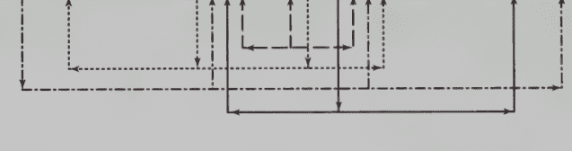
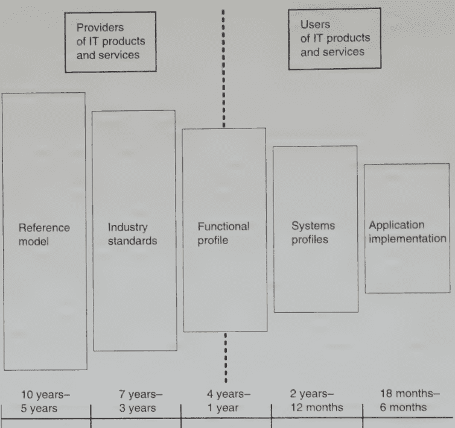
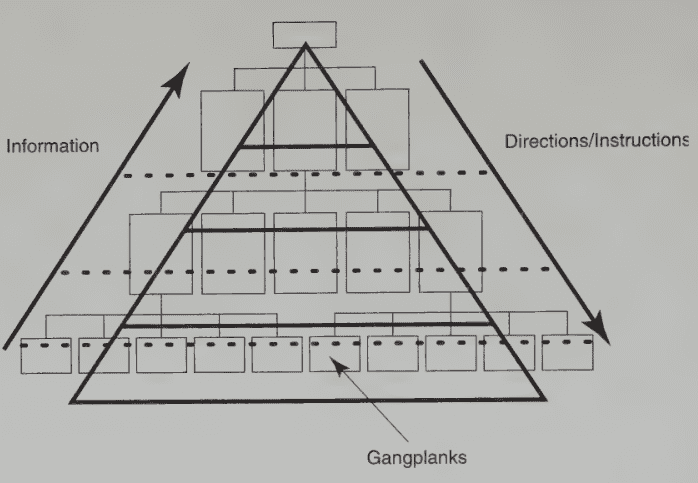
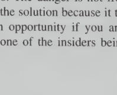

# 开放系统标准化：商业方法

Framingham 州立学院

马萨诸塞州弗明汉

电子邮箱：corpsales@prenchhall.com

献给我的朋友 Gary

献给我的老师 Dorothy

献给我的灵感 Catherine

本书怀着感激献给。

前言 xv

结论，166

# 前言

本书是我早前著作《信息技术标准化：理论、过程与组织》的续作。它代表了第一书中思想的成熟，也是我尽最大努力，将我在过去六年中所构得的许多想法、听到的许多对话以及读过的许多论文整合在一起。最重要的是，它代表了对“开放系统”中标准化的观察——不仅是计算和信息技术，还涵盖这些学科所影响的整个活动领域。

自我写完第一本书以来，行业状况发生了巨大变化，但正如大多数事物一样，变化越剧，保持不变的也越多。整个信息技术领域已经变了；世界维网的出现和互联网的全球化是通过标准化实现的。标准发生方式和地点的其本质属性也发生了变化：工作小组已成为重要的联盟，正式流程有所削弱——尽管如此，对标准和标准化的需求仍在以疯狂的速度不断增长，以支持更疯狂的增长。计算已变得无处不在；用户期待标准——而行业仍在努力找到一种连贯的方法来表达其需求。每一项新运动似乎都有必要创建自己的标准化方法论。每一种运动都拒绝过去，并试图重新创建一个可行的流程。在许多情况下，以前的东西已不再适用于未来。在所有情况下，基本原理都是相同的：一群个人或组织聚集在一起，试图为竞争提供一个共同领域。标准化的要责任之一是确保过去的经验不被遗忘，而是被保存并供后续活动使用，从而减少对重新发新的必要性。

写这本书的希望是，能够明确这些内含的根本原则，并借此让任何必要的重新发明变得更容易、更快速。此外，通过描述我所认为标准化的核心理论和实践，我希望为开始正式理解标准化过程提供基础。这种正式的理解，或者说“标准化学科”的建立，应当既服务于高科技行业，也服务于那些将标准化视为应对变化和高频率变化的方法的行业。通过对标准化的某些思想进行扩展，我希望为开始研究标准化如何成为现代“开放且虚拟”组织的组成部分提供基础。

与上一本书一样，本书可以被看作一系列相互关联的部分。第一部分仍然是包含理论和哲学基础的章节。第二部分侧重于“如何进行标准化”类型的章节。第三部分关注开放系统领域中的主要参与者组织。随着世界维网的出现，我已不再关注标准化小组的琐碎细节（如运行规则和组织结构），而是更多地关注对其可行性和作用的观察。我提供了一些主要标准化组织的通用资源定位符（URL）列表，这将允许使用维网的读者找到最新的参考文献。我还在附录 B 中提供了一份主要标准制定组织（SDOs）的地址列表。

本书与上一本书一样，归功于我在近二十年的标准化生涯中有幸结识的人，也归功于那些在我孤独而疲惫地追求标准化时鼓励过我的人。本书的献辞是给三位曾与我合作过的同事，他们对我以及我尝试“标准化”的方式产生了重大影响。他们对我以及对行业的影响无论如何强调都不为过分。

在本书书中，提到了美国计算机协会（ACM）出版的刊物《视界》（*View*）。这是 ACM 执行主任约翰·德布拉西（John DeBlasi）提出想法的时期，他认为关注业务/技术方面的标准化将会被接受。Joe 请我担任主编，尽管我曾心有顾虑，《标准视界》（*StandardView*）还是取得了成功，其发行量和影响力都在不断增长。行业对这个非凡的标志报之良浅。

同样地，我想感谢另一位先驱——数字设备公司前 CEO 肯尼斯·奥森（Kenneth Olsen）对标准化的贡献。他比任何其他 IT 领导者都在标准化流行之前就意识到了它的价值和基本特征。他对该学科的理解和支持是标准化成功的主要原因。

最后，我还想感谢太阳公司的唐·克拉贡（Don Cragun）和 OSF 的亨利·罗（Henry Lowe），他们都是低调谦虚的专业人士，是该领域的专家。

标准化与工程：在与他们中的一些人合作之后，我才意识到它的深度和广度；而且，在陈述成功时，请记住荣誉和错误完全属于我。这本书包含了大量的个人性格色彩，许多人会发现它冗余并可能欠缺。如果是如此，我邀请他们看到这一点，以便该学科能够成长。标准化关于分享和增加知识，并让事情变得更好。

卡尔·F·卡吉尔（Carl F. Kargill）

加利福尼亚州山景

## 序言

> “号角嘹响，长笛齐鸣！
>
> 向那感官世界宣告，
>
> 辉煌生命中的一个拥挤时刻
>
> 胜过无名的时代。”

—— 沃尔特·史哲爵士（Sir Walter Scott）

### 为标准化辩护

在本书的第一版中，重点是遍布世界的标准制定组织，以及他们用于达成共识的方面。当时关注标准化的“业务”方面，而标准活动的理由可以追溯到参与者希望制造出“更好的产品”的务实愿望。“更好”一词留给参与者自行决定，无论他们是提供者、用户还是“其他”。

自那部最初的作品出版以来，标准化世界发生了巨大变化。标准化的商业方面已走向前沿，震惊并困扰了处于旧的、更具技术驱动过程中的参与者。与此同时，参与人数也增加了。这些新参与者——有些初衷良好，有些并非如此——用鲁莽取代了知识，迫使原本沉闷、稳定的标准化世界发生了不可逆转的变化。然而，这些新到的参与者种下了他们自我灭亡的种子。他们正在被一种新的、不同的参与者所取代，后者花时间理解了标准化的原理——以及如何在新的、更动态且市场驱动的环境中使用它。本书正从这一点开始。

标准化的组织多如牛云；仅美国就有 550 多个正在进行“标准化”的正式组织。新组织的出现

## 序言

以周为单位进行调整，旧的组织正在“向量化”、“重构”或直接消失。组织与技术学科之间旧有的离散学科边界正在消失；致力于电信和计算等多个学科的群体正变得常见。此前相互分离的概念之间的融合已不再不可思议，而且如果它们目前不可思议，未来也会有人考虑到它们并提出相关建议。很快，就会有人提出建立一个组织来“标准化它”；无论这个“它”是什么，无论“标准化”意味着什么。

由于这些组织的激增，本书的性质已从观察离散的组织结构转向了更通用的组织结构，并追踪在这些通用结构中发现的一些问题和机遇。希望参与标准化的公司面临着巨大但并非不可逾越的挑战。为“创建标准”而建立的组织也面临着“可克服性”更高的挑战；并非不可能，但处理的变量比单一组织要多。所有这些组织都可以也应该运行；本书的一部分旨在试图通过刻画各种类型的组织及其各自的优劣势来加速这种合作。

此外，商业以及其他公共和私营部门对标准化理论的重视日益增加。如今，没有哪个组织是不受到标准化某些方面影响的；随着互动和相互依赖变得越来越常态，标准化的影响将随着时间的推移而增长。一个组织或一组组织处理标准化、将其内化并利用其造福自身活动的能力，将成为商业成功的重要因素。本书为这一领域奠了一些基础工作。

最后，本书的终极目的是增加标准化在信息技术和其他行业中的兴趣和效用。因为 IT 行业将是第一个进入变革漩涡（一个很大程度上由其自身创造的漩涡）的主要行业，其使其基础设施适应这种环境的能力将决定紧随其后的其他者能够或应该如何进行。标准化的天才之处在于，它是基础设施中本应记录过去并保留优秀部分的部分，以便这些事物成为未来的指南。从根本上说，不关注未来的标准化是失败的；这正是标准化光光、激情和兴奋所在。标准化不是对旧事物的分类目录；而是在新的光芒下审视旧事物，以确定哪些可以被保留，哪些需要被丢弃。标准化的功能是管理未来以及被未来管理——即变革的过程。

# 第一部分：标准化的理论与效用

本节将标准和标准化视为一种业务工具——即经理能力set中不可或缺的一部分，无论是处理与信息技术相关还是几乎任何其他学科的问题。书中探讨了标准和标准化的历史与应用，并探索了一种将标准化应用于组织作为文化和管理学科的广义理论。此外，还描述了一种创建标准并使标准化有效的新理论。

## 第一章

## 标准，处处标准

> “… 水，四处都是水，
>
> 却无一滴水可供饮用。”

——塞缪尔·T·柯勒治，《古老海员游歌》

### 引言

标准化是工业化社会的衡量。工业化程度越高，社会各要素之间成功协作所需的相互依赖程度就越大。对协作的要求越高，就需要越大量的标准来管理那些因工业化产生（从而产生更强的相互依赖）而导致的互动。这种想法并非信息技术标准化所独有；它是一种社会现象。互动产生行为，规则的形成允许互动推进到需要新规则的程度。规则倾向于使预期常态化，并使生活更加舒适可行。这些规则是无处不在的。当它们是强制性的时，被称为法律。当它们支配社会互动时，它们是习俗或礼仪。在信息技术（IT）行业内，定义系统部分（开放或其他否）之间所需互动的非强制性规则被称为“标准”。本书介绍的是创建标准的过程，即标准化。

### 标准化的增长与问题

在过去的六年中（1988年到1994年），标准和标准化在 IT 行业中经历了进入中心、退出中心再回到中心舞台的过程。曾发生过关于用户显示外观和感受的“标准化战争”（GUI 战争）、关于芯片的遭遇战、关于操作系统的战斗，以及关于几乎任何可以被视为标准化技术的主题的斗争。组织层来去去；战斗的记忆以及随之而来的胜负依然挥之不去。在经历了所有这些努力之后，行业比一切开始时只明智了一点点。显而易见的是标准是必要的，而且参与者已经投入了数十亿美元。最后，标准对行业似乎产生的影响可以被检查并通常能得出结论（事后诸定），每项标准化努力似乎都被视为一个独立的企业，不受（或可能免于）那些发生在前者身上的实验的限制。

总的来说，IT 行业是在原则上接受了标准，而不是在真正理解标准化是否必要的基础上。标准化的接受就像行业接受其他良好事业一样——通常是基于信仰和信念。支持或缺乏支持的理由因个人、公司和行业而异。受雇于大型生产商的硬件工程师的信条，与一个正拼命修复应付账款数据库问题的 MIS 总监截然不同。IT 行业中的每位参与者都受到标准化的影响，并且由于各自略有不同的文化背景，将做出不同的反应。实现共同目标的方法可以大不相同。

信息技术与电信管理之间的根本差异就是一个例子。电信文化一直强调合作（独特的电话很难进行网络化），而 IT 管理一直重视变化（我的芯片比你的快）。其底层的联系在于这两种文化如何看待竞争和获胜。区别不在于技术，而在于技术的应用和使用，这这也是几乎所有标准化活动的驱动力。

IT 行业内的另一个主要问题源于参与者从未意识到他们对标准化的依赖有多深，从未意识到标准和标准化的无处不在。在信息行业没有哪家公司是不以某种方式依赖标准来实现成功的。从总线结构到 `QWERTY` 键盘，从磁盘规格到对象导编程，IT 行业充斥着标准和标准化。然而，标准化在美国大多数大学中并不是一项重要的课程项目。电气工程或计算机科学专业的平均学生对标准的了解比平均研究生多。这的根本原因在于，电工被付薪是为了使用标准完成一项定义的任务。因此，他或她对《国家电气规范》了如指掌。而平均研究生花费了几年学习如何去做可能适用或不适的新颖独特的事物，

# 第一章 标准，无处不在的标准

现实世界中的问题通常被交付给一支劳动力，这支劳动力正试图使用与当前实践有某种相关的解决方案来解决工作中的问题，而这些解决方案无法消除之前发生过的一切。市场在使用并渴望标准；毕业生则被迫从朋友那里以及通过阅读行业刊物来学习标准。（这似乎让人联想起 20 世纪 50 年代的性教育。）结果是，行业内对标准存在大量的误解，这些误解构成了“民间传说”的一部分，并取代了教育。

标准问题的很大程度上归因于标准化本身的性质。在过得较好的时候，标准化可能会让人大脑枯死、枯燥得令人毫无兴趣。这部分责任在于该学科的本质；没有人在人生的某个时刻没有过对“愚蠢的规则”的抗议。如果标准是正确的，它们就是对实践中最佳部分进行形式化的尝试；而什么是最好的，往往取决于观察者的观点。（第 3 章将更详细地讨论 IT 领域标准化中包含的一些内在矛盾。其中就包括“预测性标准化”的概念。进一步让 IT 行业变得复杂的是，过去的做法几乎从定义上来说就是值得怀疑的，并由此推之也是标准。）

在标准门槛上的额外失误往往被认为是对其纪律性的否定。这种指控无疑是虚假的，至少在作者看来是如此。然而，这一论点的基础在于标准化学科的本质，它可以是一门严谨的科学，就像编程是一门严谨的科学一样。乐于描述自己技术玩具的人，即那些“宅男”、“网虫”和“黑客”，被认为他们具有某些特征；同样，从事标准化工作的人也被赋予了某些特征。由于标准化并不是创造新事物的行为，该学科倾向于被轻视。另一方面，标准化可以被视为最佳实践的文档形式；很少有软件人员能写出逻辑清晰、无歧义且有用的软件文档，更不用知道编写代码的最佳实践了。

然而，标准化的根本问题在于，它对大多数技术人员来说具有内在的矛盾性。标准被视为通过停止创新来限制自由。另一方面，市场更倾向于与当前流行方案没有本质差异的解决方案。此外，标准往往以一种惊人的规律性出现在法规中。因此，从定义上，它们往往再次具有限制性。进一步使问题复杂的是，当一个糟糕的标准被颁布而用户忽视它时，技术人员（包括工程和营销人员）会将此作为标准并不真正重要的证明。另一方面，当一个糟糕的标准被颁布而用户接受它时，同一受众又将其作为标准仅仅是炒头的证明，并且，“如果人们真的了解他们的技术，他们就不会……” 这是一个“做多多死，不做也死”的进性境地。最后，标准作用于“实然”的领域，而不是“假设”的领域。标准化没有（或不应该）发生在技术前沿，原因将在以后讨论。（当它发生时，结果通常是不如人意的。）然而，大多数技术人员喜欢玩弄新的和新兴的想法、事物和领域。这些事物其本质上不适合标准化，但市场和营销压力正试图在这些领域出现时强迫其引入标准化。

这种压力的原因显而易见。“成为标准”具有巨大的经济动机，因为每个人都必须遵循它。这将允许一家公司对技术进行许可，并向所有人发放巨额奖金作为认可。标准中隐含的经济动机虽然从未被实际点出，但是一个权力因素。大多数行业中对标准的描述都向往“成功标准化的经济激励”。行业中的大多数参与者都假设存在一套描述标准化经济学的文献，并且这些文献已被行业内化。在许多标准会议和标准交流会上，参与者会提到标准的经济动机或其对创新的影响，或获取其真相的特定方法。然而，

“开放系统”的研究已经告结。然而，标准化现象却被忽视了。尽管令人失望，但这种疏忽并不令人意外。正如之前提到的，标准化可能是枯燥的，而一本“管理类”书籍最无法负担的代价就是枯燥。

另一方面，严肃媒体更倾向于关注标准化现象。随着大众媒体报道标准化的相关活动，人们对这些活动的兴趣日益增加，严肃的解释者们也开始动笔。在很多情况下，这些文章发表于晦涩的期刊，或作为关于其他相关问题（如国家信息基础设施）的大书的一部分。然而，与三年前几乎无从记载的文章相比，目前的文章代表了该学科的量子飞跃。参与标准化活动并愿意发表文章的人数正在增加——而且其中许多人为了发表愿意采取非正统的立场。这种现象的净效应是为讨论和理解提供了基础。

严肃文章的大增，在很大程度上归功于那些资助行业标准化活动的组织的兴趣。对于规模最大的商业性私营部门来说，承担了市场标准化的主要压力。虽然既有学术界也有政府参与者，但大多数活动是由那些希望通过参与标准化来盈利的组织资助的。当未参与标准化的公司比参与标准化的公司更成功时，人们就开始寻找原因以及发生了什么。虽然有格言说“成功是成功的源泉”，但在标准化学术领域，这可能被修改为“失败是成功的源泉”。

这一现象有趣之处在于，只有当标准化未能履行其承诺（更大的规模、更大的成功、互操作性、可移植性、用户接受度等）时，人们才开始严肃考虑商业部门为何参与其中。发生的情况是，严肃媒体和大众媒体都在质疑该学科的合法性。反映行业关注点的媒体写作者们不得不提出许多严肃的问题，但事实证明，这些问题很少有答案。

行业——正如媒体所反映的那样——开始就标准化提问正确的问题。核心问题是，为什么行业无法得足够的答案？鉴于答案并不存在，行业应该去哪里寻找可能决定提问哪些问题以及如何解决这些问题的基础研究？有两个显而易见的反应。第一个是学术界。第二个、不那么明显的来源是标准组织本身。

## 学术参与

学术界对标准化的研究很大程度上是由经济学家发起的。该学科的许多原始研究人员似乎都是从寻找新研究挑战的经济学家开始的。他们中的许多人在电信标准化领域发现了这种挑战。早期研究中的假设包括“完全竞争”、“订单的完美到达”、“对成本和竞争的完美认知”等，而这些假设还伴随着对“标准”实际含义的缺乏共识。随着时间的推移，这些分析变得更加复杂，但它们仍然反映了经济学家对预测分析的痴迷。但标准化活动反映了其所属的行业，而行业既不是完美的，也不是可预测的：标准化的过程受到随机的、不可量化的且有时是不理性的行为和变量的缓冲。经济学家虽然与高科技行业相关，但他们并不是行业的一部分，而且大多数没有时间或耐心来参与标准化。

然而，在过去的五年里，出现了另一群更具折衷性的学术研究人员和教师（有些具有技术背景，有些具有社会偏见）。这一群体开始从视角和经验偏见来看待标准化。不再使用基于抽象理论的正式模型，新一代学者们选择将标准化视为行业内的一种现象进行研究；试图确定它如何作为变革推动剂发挥、谁自愿参与，以及什么让标准化有效或无效。当然，这些问题并不易于进行孤立的研究。可以说，这些新学者正在与标准圈的人融合，协助委员会工作，并学习在该行业及其人员中“言行一致”。他们正在带来改变。参与者们第一次对他们一直面临的问题有了意识和阐明，而这些问题他们以前无法清晰地描述或分析。第6章详细讨论了这些内容。

然而，这些努力是个人的产物，而非整个IT行业对标准化重要性正式认可的开始。技术人员对于标准化在其学科中所扮演的角色仍然缺乏理解。商界人士对于如何利用标准化带来的优势的理解也较少。我坚信，“独特销售点”的信息已经被刻在了所有商业类专业学生的脑子里，以至于独特性成为他们熟悉的唯一属性。在这一点上他们得到了技术人员的帮助，当他们聚集成一个组织时，开始表现出“非此发明”综合征征象。他们的教育教会了他们竞争，而他们也确实竞争了。

在这一不受节制的竞争发生的同时，一些公司正在与标准化竞争。通过成为或支持某种标准——并允许其他公司共享他们的成功——一些组织获得了成功。拥有35毫米胶片的电影行业是想象的；具有标准化磁盘格式的PC行业则更不可能。然而，这种基于标准的选择性合作现象让行业和那些像道徒一样的追随者都感到意外。

事实上，IT行业对标准化的力量感到意外，这是一个关于管理层和工程人员中许多人自我欺骗能力的有趣陈述。标准是无处不在的；未能理解这一点是不可解释的。我认为，本应作为来源的学术界未能理解市场动态和标准化解决方案。

## 标准化小组的活动

在美国，有550多个小组致力于“制定标准”。它们的活动范围涵盖了从锅炉到燃烧器的领域。既有正式认可和授权的组织，也有非正式的专业小组，他们共同帮助自己的行业。标准的方式。许多活动集中在让成员了解行业内的标准上。每个组织每年可以处理几个标准；生产、评审、建议实施或使其过时。每个小组通常遵循自己的程序，基于该小组认为公平公正的原则。每个小组维护邮件列表、成员身份以及一系列组织和行政职能。最后，每个小组都会采取行动保护并扩大其影响力，有时以牺牲其他标准小组为代价。

## 结论

标准对于小组和学科、组织和个人具有不同的含义，且这些含义随时间和语境而变化。组织和个人参与标准化的逻辑与目标之间的脱节，是导致IT行业对标准和标准化产生困惑的主要原因。由于缺乏单一一致的文献体系将个人与系统联系起来，因此组织发展或参与也缺乏理论（或哲学）基础。从个人或私人角度来看，对于为何创建标准没有共识，对于人们为何自愿参与一个仅具有宏观存在理由的领域，也没有统一的看法。IT行业的共同线索是对某种的理解。

标准，它们似乎源于行业的共同经验和预期，而非源于标准流程的内在特性。我认为这在某种程度上由于对标准背景及其相当深厚的底蕴的无知。如果不将标准视为一门独立的学科和市场（而不是其他过程的副产品），那么每一项新事业都在孤立中进行，重演过去的成功与失败。

## 第二章 标准的历史

> “并从他们的教训中寻求并发现
> 带着谦虚的心态获得教诲。”

——罗伯特·苏德塞，《学者》

### 引言

标准一直与我们相伴。无论是有意还是无意，它们都存在并被用于控制和组织人类的大部分活动。它们可以成为稳定并促进交换与增长的强大工具。但如果使用不当，也可能导致文化的停滞和枯萎。正如第一章所指，广义上，标准代表了一个社会和文化可以接受的行为和习俗。在更狭的意义上，标准是指：

- 具有共同利益的组织或群体（所有者）对用于比较定量指标的刻意接受，
- 该指标直接或间接地影响了一个群体的行为和活动，
- 通过允许（并可能鼓励）某种形式的交换。

这本书很大程度上基于这样一个观点：标准的作用是鼓励经济交换；也就是说，人们参与标准化有许多动机，但通常是因为存在某种形式的真实或感知的经济利益。这种表述偶然地可以适用于人类动物参与的几乎每项活动，如果人们相信托尔斯滕·韦伯伦（Thorsten Veblen）的理论在某种程度上取决于标准的话——如果有意识消费的物品几乎不值钱，人如何能进行炫耀性消费呢？标准所解决的根本性经济困境是确定比较经济价值。

### 在起初

想象一群早期交易者坐在一个早期的村庄里。首领（在当时可能是女性首领）面临着一个问题。猎人带了肉回来，陶工的家人想要肉。与此同时，玉米种植者需要罐子，鱼想要一些玉米，而采集者想要任何他们得到的东西。在当时，采集的声誉很低。（他们被另一种形式的搜寻者所取代，即法律专业人士。）该小组的首领可以为玉米相对于肉、食物、鱼和其他所有物品设定一个价格，但这需要对玉米、罐子、肉、木头等进行等级划分。方便的方法是将所有商品（以及后来的活动和服务）绑定到一个共同物品上——在这种情况下，是一个标准的箭头。从那时起，确定了一条鱼是一个箭头，二十条鱼是一个箭头，一只鹿是两个箭，以此此类推。（木头是一个箭头一载。）让猎人学会了装饰性的烧制陶杯比简单的盘子难制作得多。

这是最早的标准化努力之一。如果你回溯之前描述的属性，你会发现它符合：组织或群体（领袖强迫他们服从）的刻意接受（他们具有共同利益——生存和繁荣）的比较定量指标（箭头），该指标直接或间接地影响了群体的行为和活动（贸易和专业化标准），通过允许（并可能鼓励）某种形式的交换。（如果定义和示例不匹配，那就太奇怪了，所以我写了两者。）标准化的成功的关键在于，双方都可以将他们拥有的东西与第三种物的抽象价值进行比较，并相信且接受它。

这段传奇的下一步将是进一步抽象并发明货币。粗糙的物品很少能得好；琥珀、黄金、宝石或盐。如果你有一种愤世嫉俗的心态，物品的效用越低，价值就越高。这导致了黄金变得珍贵。与其黄金的高延展性不同，黄金没有内在价值。但它极其稀有，而且看起来很好。这使其成为交换媒介的完美选择。

进入历史时代，第一个符合这一定义的标准之一是建立一种由多个单一地点注册的受担保国家铸造币。从公元前 700 年左右，具有政府担保价值的吕迪亚币成为整个地中海沿岸地区广泛认可的标准的交换单位。吕迪亚货币提供了两种标签：一个归于吕迪亚交易者，另一个归于所有交易者。对于吕迪亚人来说，优势在于由于标准最初是他们的，为了进行贸易，人们只需要将自己的货币兑换斯特币（stater）。通常情况下，标准允许对抽象事物进行比较——例如两种当地货币的价值。凭借这种将两个未知属性与第三种属性进行比较并得出一个共同定义的能力，开展贸易变得更容易了，因为现在有一个提供比较和交换基础的定量分母。这种优势最初属于吕迪亚人，因为那是他们的货币。随着时间的推移，货币兑换变得越来越普遍，每个人都能从中受益。

以专业标准策略者的老练眼光，观察驱动此类交易的因素将很有用。通过利用完美的后见之明（以及可能从未存在过的动机），可以总结出关于标准化必要性的论据。这一过程的关键在于，通过创建和使用标准可以获得实质性的经济利益。人们希望相信有人曾坐下来想过这些，但它是经过几代人实现的。无论如何，拥有标准让商人能够使用一种带有品牌的（非专有的）货币，用当地货币（专有货币）来计算价值。随着时间的推移，标准增加了贸易的潜力以及贸易可能发生的区域。在按标准定价（兑换过程）上投入了额外的风险和工作，但利润潜力大于损失。吕迪亚人是第一个实施这种被称为“国家铸造币”的标准的人。作为实施者，他们获得了最初的经济优势。

吕迪亚对标准的实施（吕迪亚标准）的价值在于它被广泛接受的事实。其他国家的接受与其说是货币由国家使用，不如说是它有一个“品牌”（即国家铸造和冲压可识别的硬币），这是一种价值的保证。最后，当其他国家接受了接口标准的概念时，国家竞争变得异常激烈。在五十年到一百年内，出现了几种竞争性的实施方案，它们都带有不同的营销标签：“标准就像黄金一样，它是[吕迪亚]；如果这对你来说是希腊语，德拉克马会解释清楚[雅典]；使用我们的币，否则我们就杀了你[罗马]。”

从那时起，实用的标准从未过时，特别是在商业领域。从公元前 500 年开始的千年里，贸易增长了，标准的需求也随之增长，以帮助变得更容易、更有利。成品很少进行标准化；每个制造商都会验证原料的质量，除了制造者的声誉外，没有其他可以表明出货质量的指标。其次，由于几乎没有互换部件的概念，对标准的需求微乎其微。罗马军队似乎其军团的长矛（pilam）具有软金属杆部；后来的作家（维格铁修斯）也提到了军团的“标准武器”，这表明

### 标准的历史

经典的军团在记忆中具有高度的标准化，使其得以延续200年，否则，维盖提乌乌斯（Vegetius）就是一个不可救药的浪漫主义者，记得的是事物本有的样子。然而，在普通贸易中，除了硬币、重量和计量之外，与硬币相关的标准似乎并没有被标准化。随着时间的推移，硬币贬值了。

随着西罗马帝国的灭亡，欧洲文明陷入了巨大的孤立。在接后的几个世纪里，商业标准在罗马帝国西部地区丢失了。然而，在拜占庭罗马帝国，内部和外部标准蓬勃发展。这些标准通常基于由君坦丁堡官僚机构支持和皇帝权威保障的帝国法令，涵盖了几乎所有领域；从使用的重量和尺度到工人的职责和责任。从一个偏见的观点来看，我认为这些是当今监管标准的雏形，因为它们被国家用来监管和控制公民及其活动。然而，那些涉及拜占庭帝国的规定在罗马崩溃后仍然存在——拜占庭帝国直到本世纪一直是抵御伊斯兰扩张进入巴尔干半地的堡垒。

注意，在中国，标准被创建并使用。中国人在这一领域拥有的相当丰富的遗产在很大程度上被忽视了；1500年以前西方发生的标准化活动中，很少有没有在中国帝国发生过更早或更广泛的实施。直到1500年后，随着欧洲资本主义的兴起和民族国家的增长，标准化的用途才开始出现分化。这种分化不在于创造或意图，而在于影响。在中国，标准通常用于稳定社会；在欧洲的许多情况下，标准倾向于作为变革的媒介。

### 标准化的复兴

与此同时，回到欧洲，随着农业增长到生存水平以上，商业开始复苏，导致了城市的增长和贸易的重新发现。随着贸易的发展，对工匠产品的需求也随之增长，部分基于经济需要。城市以某种产品或多种产品闻名，这些产品成为衡量其他城市产品的标准。（上述是例子，但一些更著名的包括阿雷泽盔甲、威尼斯玻璃和波尔多红酒。）通过建立标准，这些地区和城市可以在自己的技术水平与竞争对手之间建立区别；从而增加产品的价值。因此，贸易再次推动了标准的建立。然而，贸易本身并不是目的，而是增加财富的方法。在中世纪欧洲，手工行建立了必要的生产和质量标准（以及价格），并用行会标志标明符合行会标准。随着时间的推移，行会变得强大。通过将自己与城市管理和税基联系起来，他们成功地成为城市生活中的一种重要力量。到1300年，巴黎已有130个“受监管的职业”，从蜡烛到药品，都有一个标准，并迫使行会内的工匠——以及城市内的工匠遵守其规则。因为对城镇来说拥有富有的公民是有益的，地方民事鼓励并帮助执行规则。而且由于贸易是可以征税的，较大的城市当局颁布了规则来鼓励其增长。

中世纪晚期的商人们非常看重此类标准以及它们允许的交换，因为它们是获取财富的工具。汉萨同盟的贸易活动、威尼斯战船的威猛、西班牙、葡萄牙和意大利商人（包括波罗兄弟）的旅程不仅是引人入胜的读物，还表明了标准是如何缓慢重生并转化为经济工具的。最著名的标准化努力之一是威尼斯的军械船厂（Arsenal），它生产威尼斯战船。显然，对于那些看到并记录这些过程和产品的人来说，这被视为威尼斯独立以及统治亚德里海和地中海北部沿岸的主要原因。调查记录显示，战船是批量生产的：尺寸、配件甚至船桨都是标准化且可互换的。

# 第1章 标准化的理论与实用性

以及一种新形式职业管理者的诞生。他提出了一个令人信服的论，认为美国铁路是现代企业的诞生地。

钱德勒（Chandler）也提到了标准，但并没有真正关注这些创造者。“在19世纪70年代和80年代，在这些会议上提交的论文和委员会报告被列入铁路流程中。几乎没有一次会议是不讨论国家标准化程序和设备的。”^2 他继续写道：

“19世纪80年代和90年代初见证了技术进步以及组织创新和标准化的顶峰。在这些年里，美国铁路采用了标准轨距和标准时间，向自动联结器、气制动器和区间信号系统等形式的标准设备发展，并通过了统一的会计程序。1886年5月31日晚至6月1日凌晨，使用宽轨的铁路……同时切换到4尺8 1/2英寸轨距。1883年11月18日（星期日），铁路人员将他们的轨道设定为新的统一标准时间。《铁路安全法案》的通过……要求]……标准化的自动联结器和气制动器。所有这些事件源于铁路经理之间二十年的持续协商与合作。”^3

回溯过去，美国的标准化活动遵循了人们预期的路径。农产品根据其产地进行标准化，众所周知产地优质产品能获得更高的价格。这种传统延续至今：弗吉尼亚州、缅因州或爱达荷州的土豆，以及佛罗里达橙，只是地理标准化的几个例子，这种标准形成了公众愿意支付溢价的优越性。

在美国国内，早期的标准化倾向于关注特定的地区或城镇。然而，超出本地用途的非农业标准必须等待迫切的需求，正如前面提到的，这种需求是由工业革命提供的，并由铁路、内战以及美国向西扩张所推动的。长销售渠道的需求、生产机械化程度的提高以及维修的恒性和通用性多重需求，面临着剩余工人和农民日益增加的机械化应用。

是那些使铁路得以运转的产品次级供应商催生了自愿标准的增长。螺丝尺寸、管道和阀门接件以及轨枕只是数十个新标准化对象中的几个。各种利益集团在行业内部汇聚，以确保每个行业都有自己的标准。这些组织是特定特定行业的。当时并没有尝试跨行业进行标准化，也没有真正尝试为了人类的利益采取利他主义行为。标准化是为了促进行业增长，或使其更具盈利能力和或降低复杂性。标准化是由由工程师领导的日益增长的技术官僚群体推动的：土木、冶金、矿业、电气工程师。19世纪下半叶的工程师拥有大量支持他们活动的科学事实汇集。这是一个不断增长的集合，而且在他们看来，这可以应用于任何领域，从人类到冶金术。美国试验材料协会（ASTM）是19世纪末最早作为标准团体脱颖而出的组织之一，这并非偶然。⁵

到1890年，整个自愿标准努力的基调已经定型。其特点是高度集中在特定学科（冶金、机械工程、电气工程）内创建标准，强调可证明和可重复的事实，以及参与者内部的关注——一种修正后的心智。这些属性延续至今。每个学科都有自己的标准委员会，而且将会有很多。重点在于创建可以测试和复制的产品或标准，并且每个小组都向内关注，由特定学科的开发者和生产者组成。自愿标准社区没有模糊理论的；所有工作必须基于事实，并能够用无歧的术语描述，且结果是确定的。

行业特定标准化组织的增长在19世纪中后期非常显著。然而，需要更多更确定的标准；即基础性的、跨行业的标准。这项努力的驱动者是技术人员，因为他们需要特定的工具来进行精确测量。虽然这听起来很愚蠢，计量学在质量协会中仍然是一个多变的标准化。对新兴现象（包括电力）的测量对于工业以及相关行业的兴起至关重要。政府介入帮助，并于1901建立了国家标准局（NBS），效仿英国和德国的类似组织。NBS合并了衡量局，成为政府和私营工业的技术资源。

与此同时，发生了两个不同但相似的现象。1904年，NBS园区内发生了一场落叶火灾。部署的水管无法连接，因为水管接头存在差异。这无疑引起了NBS的一些关注，这种关注可能比同年晚些时候巴尔的摩70个街区被火时引发的关注要小。巴尔的摩的问题在于，尽管邻近城市发送了设备帮忙，但巴尔的摩消防栓上的接头与访问卡车部署的接头不同。这促使了公共安全领域标准的创建，并导致了NBS建议使用这些标准。国家消防防火协会（NFPA）的章程涵盖了“火灾安全”范畴，其有效性无疑通过NBS的建议得到了证明。⁶

然而，直到第一次世界大战期间，这个问题才变得关键。当美国在1917年参战时，人们突然意识到标准化在某些领域是至关重要的。当战争努力开始时，军队的远见者意识到卡车正在取代马。

# 第2章 标准的历史

## 国家级组织与国际化

国家级组织传统上一直是标准化领域的主导者。20世纪80年代中期，在欧洲共同体活动的很大推动下，他们开始发生变化。“EC 92”运动增加了国际标准的重要性，并开始缓慢掩盖国家标准化运动的光芒。同时，国际运动催生了区域运动的产生，这进一步使情况复杂化，因为区域运动在正式结构中没有地位，但在其所代表的地区具有足够的影响力。正式标准化的力量在于，正式标准（即国家或国际标准）是通过共识程序编写的，它们被认为是政府采购中最具合法性的。这种杠杆是迫使大型企业参与国家和国际标准工作的重要驱动力。正如行会标志象征着

在中世纪时期，“国家标准”或“国际标准”的称号对于竞逐政府业务的企业而言已具有了经济意义。这一市场的规模不应被低估。在美国，联邦政府对 IT 系统和服务的采购金额高达数百亿美元。获得一份价值 10 亿美元的大额合同可能决定一家公司的生存或消亡。州和地方政府的支出也是等同甚至更多。

## 持续演变

然而，在 20 世纪 80 年代中期，出现了一个对既有且正式的标准制定组织（SDOs）的挑战者。信息技术社区中这种新型标准化活动是“联盟运动”。虽然 20 世纪 80 年代初联盟内部出现了初步的标准化活动，但接下来的十年里见证了这一反向运动的兴起和增长。联盟通常由为正式流程提供大部分资金的同一公司资助，最初似乎为主要生产者提供了一种更快速、更简单且响应更灵敏的标准化方案。联盟往往像许多 SDO 一样，专注于单一特定主题。然而，随着它们开始成熟，它们开始寻求其他释放能量途径——因为在完成原始提案时，它们已经建立了一个想要继续运作的官僚机构。结果，联盟倾向于扩张，正如 SDO 的扩张一样（联盟也无法免于产生分支出或水涨扩张）。随着联盟的激增（现在 IT 行业已有 100 多个联盟），它们面临着正式组织在 20 世纪 80 年代后期遇到的相同问题：如何协调和部署它们的规范以获得最大的认可。标准化仍然是行业的重要组成。请看以下关于未来十年 IT 领域竞争性质的评论：

> 在这些竞争斗争中，最嘈杂将是标准。大多数清醒的人一听到技术标准，眼睛往往会变得呆滞。但在计算机行业，新标准可以是巨大财富的源泉，也可以是企业生命的终结。由于关乎生死，标准引发了激烈的激情。

## 结论

在本章的开头，为成功的标准化工作设定了以下条件：

- 组织或群体有意地接纳，
- 这些人具有共同利益，
- 采纳一个可量化的比较指标，
- 该指标直接或间接地影响一个群体的行为和活动，
- 通过允许（并可能鼓励）某种形式的互操作性。

成功的标准化活动几乎总能满足这些条件。在标准化活动失败的地方，通常是忽略了这些条件中的某一个。不出意外，最被遗忘的条件是第三个：直接或间接地影响一个群体的行为和活动。简单来说，标准的原理是为商品或服务创造需求或创造市场。标准的实施——属性的体现——是任何标准化努力的回报。自愿标准（与强制性或监管性标准相比）的目的不是改变市场，而是让标准解决方案优于非标准解决方案。整个过程建立在一种信念之上：与非标准相比，标准化为市场问题提供了更长期的解决方案，因为标准化的解决方案提供了更大的选择和行动自由。参与或使用标准本身并没有内在益处；贪婪源于其部署带来的经济利益。对这些属性的需求是市场驱动的；它们并非像雅典娜从宙斯头中冒出来那样凭空产生。尽管如此，无论如何，人们已经接受了标准化及其提供的益处。在经过严肃的反思后，人们开始严肃地质疑标准的价值。

然而，这种方法的问题在于，它让参与者处于盲目接受标准化的角色；认为发生发生的事定会发生。过去十年标准化过程中的问题是这种接受形式的间接结果；由于不理解标准的因果关系，发生了奇怪的事情。IT 行业大多数人对参与标准化缺乏认知，为煽动者提供了冲突的空间，他们为重大问题提供了部分解决方案。虽然战术上很重要，但长远来看，他们种下了自我毁灭的种子。本书更具严肃的任务之一，是确保标准化领域的参与者了解标准的背景和力量，以便该学科能够继续进化。

# 注释

- Weber, Max. *新教伦理与资本主义精神*. Talcott Parsons 译. New York: Scribner's, 1958.

- Chandler, Alfred D. *Visible Hand: The Managerial Revolution in American Business*. Cambridge, MA: Belknap Press, 1977.

- 关于这一方面的考虑，参见美国国会，*Global Standards: Building Blocks for the Future*. Washington, D.C.: GPO, 1992.

- 美国联邦工程学会于 1920 年发布的研究。该报告指出，如果主要行业采纳一套最低标准并简化工作流程，可以消除 30% 以上的生产和劳动力成本，节省超过 100 亿美元。

- The Economist, "A Survey of the Information Technology Industry," 1993 年 2 月 27 日，第 11 页。

# 第3章 标准化与监管

## 标准化与监管

> “我们血缘与国家的荣耀
> 仅仅是虚影，而非实质性的。”

詹姆斯·谢莱尔，《我们血缘与国家的荣耀》

### 引言

本章将介绍标准化与监管这两个（通常被合并在一起的）双重主题。这两个主题虽然相关，但不应被混淆。行业中的许多人将这两个术语归为同一个大类。在信息技术领域，使用的绝大多数标准都是自愿标准，而非法规。然而，两种情况使得这两个独立概念的合并似乎——如果不是不可避免的话——往往成为常态。

第一种情况发生，是因为法规有时诞生于自愿标准委员会，而创建法规的技术在这些地方是被标准化的。这导致了路径的的分叉，这种路径在哲学上很快就会变得复杂。另一种情况是政府在设备采购中强制执行标准。人们倾向于将政府（地方、州或联邦）想要、而提供者无法提供的任何要求（产品、性能或接口）视为“不必要的监管”。这种倾向并非毫无用处，将有用的标准视作监管不仅是诽谤性的，而且近乎丑闻。（这里带有一点地方偏见，请见谅。）对标准很难生气，但监管往往会激发大多数美国人引以为傲的、果敢独立的倾向。

本章将首先简要回顾监管必要性的一些背景，然后进入对“事实标准”（de facto standard）、“法律标准”（de jude standard）、“公开规范”和“监管”（regulation）等术语的一种任意但同样非常有用的分类。随后，将探讨基于标准的监管概念。本章最后通过对比标准化世界与监管世界的“目的适用性”结束结束。

### 序言

在美国存在的最初一百年里，监管是各州的权利和责任，州政府通过实施监管来保护公民的公共利益。监管涵盖了磨坊、渡渡轮口点和公路，以及其他对食品分配和总体农业贸易必要的各种活动。很少有监管是由技术驱动的，因为当时大部分技术、大多数产品和实践都是传统的。蒸汽机车的出现需要进行某些调整，而监管处理的是新技术带来的安全问题，而非技术本身。总的来说，监管是在州和地方层面基于传统经验施加的，反映了一个相对静态的文明。

美国内战后，工业化随之而来；随着工业开始追求利润权力。到19世纪70年代中期，美国社会发生了根本性变化。国家各地区之间的商业相互依赖性日益明显，向广阔地理区域销售商品的需求占据了主导地位。例如，西尔（Sears and Roebuck）和蒙特哥马·沃德（Montgomery Ward）利用市场机会，提供其商品作为当地商户竞争的标准。大型且整合的铁路的出现对当地农民产生了寒蝉效应，并导致了“农场协会”（Grange societies）的形成。

然而，这种增长产生了意料之外的副作用。为了利润而增长的概念变得越来越流行。如果大就是好，越大越好，巨大且壮观。民众保护自己免受日益集中的经济和技术权力侵害的能力正在下降。联邦政府（在有限范围内）担心公民的安全和福利，开始对其边界内的商业和其他活动进行监管。它意识到自己无法监管所有工业，也不想这样做。相反，它监管的是那些公众与提供者交集的领域，以及买家无法评估其所购买产品的领域。普顿·辛克莱（Upton Sinclair）对肉类加工行业的描述迫使了许多变化，而艾达·塔贝尔（Ida Tarbell）对标准石油公司的描述在个人或各州无法控制的领域也起到了同样的作用。在化妆品或铁路、锅炉或电力公司，或任何公共利益受到不情愿的无知或经济权力的威胁的情况下，政府感到有必要介入并为了公共利益进行监管。

### 监管

如果应用正确，监管是背后具有某种权威效力的标准或规范。这种权威通过使用这种力量，可以合法地强制执行监管性条文，并对违规行为征收指定的罚款。（权威可以与监管分离；然而，监管始终在合法权威的阴影下运行。）要有效，监管必须是理性的。如果监管不理性，它将被认为是不公平的，并成为行业的负担。监管必须清晰且可预测。如果监管含义模糊，将难以执行。

监管还必须基于可靠的证据。如果监管出于政治动机，它将被视为虚伪。监管必须是为了公共利益。如果监管不是为了公共利益，它就不应该存在。

归结底，监管是一种可以用于善或恶的工具。如果使用正确，它可以对社会产生巨大的益处。如果使用不当，它可能会非常有害。

### 自愿标准化组织

任何为了实现目标而加入的都可以标记为自愿组织。然而，在本书的背景下，标准化的属性被描述为：

- 一个自愿的人群
- 他们有共同利益
- 他们希望产生
- 一种可量化的指标
- 该指标直接或间接地影响
- 努力的行为

标准化委员会的基本准则是：每个人都有权获得平等对待。每个人都有权拥有一个立场，并权表达该立场。这不能保证他们的立场一定会胜。

通常，在一个标准化机构内部，技术论点是决定规范或标准内容的依据。标准的产生不是通过决定哪个提供者的方案最能服务某个细分市场，而是通过决定哪种技术立场作为导致委员会产生的需求的回应。用户不能加入标准以进行限制，提供者也不能加入标准以限制贸易或新思想的引入。

在这两种情况下，这确保始终有准确会议纪要的主要理由。

联盟与标准制定组织（SDOs）共享许多其他目标和流程，这些在第 3 节中有所介绍。然而，它们只产生两样东西：标准和规范。（现实情况是它们还产生了指南、测试和实现，这些都是由它们对书面技术规范的根本生产所驱动的。）编写可以采取两种形式之一：公开的规范（来自联盟）或标准（来自标准制定组织）。

来自标准制定组织的标准具有某些特征。它由一个任何可以参加会议的人组成的委员会编写。它经过了公众审查，经过了无数委员会的审阅，并接受了公众评审。对其技术内容提出的所有意见都经过了审查并得到了回应。它是委员会内部以及针对某个行业（至少是某个行业细分领域）共识的产物。当它经历了所有这些过程，并最终发布时，它就有权（在美国境内）被称为美国国家标准（ANS）。因为它是正式标准，所以它随后可以根据《管理和预算办公室第 A19 号通告》在政府采购中使用。

这种场景的问题在于，标准制定组织并不为其标准开发测试或实现单元。这被交给了市场的随机安排，由于测试是昂贵的，且编写测试的人员稀缺，因此它们很少被及时编写。这种方法一直被认为对标准制定组织是行的，因为许多标准的实践和创建并非源于 IT 标准，而是源于硬件经验（基于较旧的制造标准）。螺母要么与螺栓匹配，要么不匹配；如果它们匹配，就共享一个标准；如果不匹配，就没有。

然而，在软件中，许多东西是带有一个“可能”位产生的，该位可以根据事实标准决定的情况设置为“开启”或“关闭”。与人们还在做“螺纹”的时代不同，我们现在正在做“紧固件标准”，其中一个供应商使用胶水，其他使用铆钉，还有一个使用钉子，而用户想要的却是拉链。如果它们是紧固件；那么就没有明确定义的实现，因为许多软件是基于认知心理学的。

标准制定组织方法可能导致标准问题的最佳例子是 20 世纪 80 年代的开放系统互连模型（OSI）。OSI 是一项巨大的工程，但在采购方面，它落后于 TCP/IP 协议。这是因为

> ... OSI 标准[开发时]没有对参考实现的要求。这要求每个供应商都开发软件来实现该标准。产品开发后，需要进行一致性测试以确保每个供应商都以一致的方式实现了标准，而互操作测试则证明了产品将共同工作。在任何时候，用户都不会评估其功能或用户友好性.^1

这是该过程的副作用，而非标准的意图。然而，由于标准制定组织在市场方面处于某种孤立状态，有一种可能，正式标准

**要么对市场没有反应，或者对于市场试图解决的问题来说过于复杂。**

## 第 3 章 标准化与监管

由联盟开发的公开规范是另一种情况。由于联盟的组成结构不同，它们包含了来自各家公司的营销人员，并且通常有自己的营销人员（这是大多数 IT 标准制定组织不具备的）。这些团体产生公开的规范；即联盟通常向公众（意味着未在联盟内的公司）提供的规范，以便这些公司构建该规范的实现。成员公司在这一过程中具有多个优势。通常，它们在代码开发期间接收代码的“快照”，它们可以参与代码的规范和创建，可以帮助测试的创建，并早期访问测试套件等等。

正是因为它们比标准制定组织更接近市场，联盟才会陷入麻烦。联盟有自由关注单一解决方案；它们倾向于遵循两条路径之一。第一条路径是（联盟成员）开发一种具有多种实现（到目前为止很好）的规范，这种规范是联盟成员想要的，但通用市场拒绝接受，或者市场对其未赋予任何价值，因为已经存在一个完全可以接受的“其他解决方案”，或者联盟的规范无法与通用市场中使用的其他解决方案共存。

联盟的第二个问题是，它们倾向于为了“极化”标准而创建的。“联盟标准”的概念是一个有力的工具，允许联盟成员声称遵守了类似于“开放系统”的规定。如果两个联盟为相同的问题提供不同的解决方案，市场就有极大的机会达到高水平的“认知失调”状态，并决定问题（而非解决方案）出在供应商身上。这会促使用户接受两种解决方案中的第三种解决方案，或者坐等以待。然而，由于 IT 危机中通常没有奢侈可言，选择会被做出，而且它们通常不倾向于争斗中的解决方案。

法定的（de jure）和公开规范解决方案都允许在创建规范之前在其过程中进行某种形式的公众投入。它们也允许规范的实现发生。它们通过专有实现来赚钱。开放规范背后的理念（从根本上说是开放过程提供的）是，将基于根据规范开发的实现产生竞争。

标准和公开规范的好处是，任何人（或几乎任何人）都可以影响并编写规范或标准。对于专有规范或通常成为事实标准（de facto standard）的东西并不如此。专有规范不允许对其内容进行有意义的公众评审，也不允许在作为产品实现之前对规范进行评审。

“开放”提供者的差异在于实现。标准中包含的知识产权（IPR）持有者被允许就标准的使用收取“合理费用”；在其他 ANSI 和 ISO 规则下这是允许的。

## 第一节 标准化的理论与效用

毋庸说，在标准和规范中加入“合理费用”条款导致一些人得出标准并非真正开放：公司或组织可以通过对标准或联盟做出贡献，导致锁定发生，并从标准中盈利。相反，“合理费用”原则的支持者声称，它允许他们收回在开发贡献给标准的技术上花费的资金，如果包含此规定，那么对这些论坛的贡献就会减少。从根本上说，“适当的标准可以扩大产品和服务的有用性市场，并将标准活动扩展到其功能方面，并开放标准开发以包含其参与和用户。”2 版权或专利问题在软件行业很难处理。在过去的几年里，用专利保护软件已成为常态；对于使用的接口是否受专利保护，法院尚无定论。

“开放规范或标准”与“专有实现”的推论是，最好的实现将“赢得”。这是许多公司忘记参与标准化的理由。这是 IT 行业标准化的核心。从提供者和参与者的观点来看，标准化的主要功能是为组织的产品创造新市场。对标准委员会的分析显示，大多数参与者是为了实现一个使组织能够生产或采购的目标。IT 行业内的标准被用作创建和扩大市场的工具。虽然第 6、7、8 和 13 章详细讨论了这一主题，但它是区分标准、规范与法规的关键点。

### 监管标准

监管标准是法规产生的活动之一，其来源如上所述。第一类是“传统监管”，针对单一行业目标（例如针对电话行业的 1934 年《电信法》，以及针对食品行业的 1906 年《食品和药品法》）。它通常是宽泛且彻底的，强制行业进行重组并改变经营方式。它可以对行业产生巨大影响。人们只需要看看国会授权的清洁空气法》中燃油里程率法规对汽车行业的影响，就能看到这种类型监管的结果。通常，这种类型的监管需要国会行动；在作者看来，这种行动仅是由于觉醒公民活动的结果，他们要求立法部门挣得起工资。它并不经常发生，但一旦发生，会对业务产生深远影响。这种监管是

## 第 3 章 标准与监管

……危险境地。（我并不是说这项活动是值得挽救的；然而，我倾向于相信，国会在寻求刻意行善时，往往会造成此类无意的损害。）

另一方面，还存在监管标准，其基本原理是对某些事物进行法理治理（nomomic governing）——无论是一项活动、技术还是服务。监管标准通常跨越行业边界，因此影响所有行业。这些规则通常由行政机构在一个被称为“规则制定”的过程中制定的。从根本上说，国会将创建政府权力的权力授予政府，以制定这些拟议的监管标准。这种权力受到授权权力的法律所赋予的余地以及 1946 年《行政程序法》条款的限制。该法案要求所有监管标准必须在《联邦公报》上公布至少三十天，以征求意见，并考虑所有意见。

这些标准通常具有针对性，并对未来的行为提供强制性规定。从根本上说，这是稳定的要求。这种稳定性的目标是经济上的，而是为了允许规则和规范性行为的创建和分配。当时和现在一样，人们呼吁政府帮助来应对复杂性。古语 `cave emptor`（“买者自负”）被应运而生，政府通常在认为民众无法自卫或处于风险时通过建立监管来做出反应。政府面临的根本问题是政府可以并能提供的保护。

监管必须处理的基本问题列在这里：

- 消费者预计能理解何种程度的复杂性，或者人们愿意接受何种程度的危险；换句话说，何时必须建立监管准则来界定交易双方的责任？
- 监管必须被执行，这反过来又创造了对立关系。谁是对手，谁是政府保护的对象；即，哪个客户正受到政府的保护？
- 监管是沉重的；像巨型坦克（juggernaut）一样，它们难以启动和转向，需要大量的人来保持运行，并且一旦启动，就试图获得自身的生命力。一旦运转起来，通常很难停止。监管是如何设计的？哪些指标表明某项监管不再为公民提供改进的服务？
- 监管从本质上说，是对特定时间点单一活动或事件的特定反应。当制定监管的环境发生变化时，监管的普遍性如何在在所有（有时甚至是某些）情况下提供必要的保护，同时又不产生持续滥用和/或争议的风险？

以下是两个具有巨大监管潜力的领域示例。两者都有相似之处——它们周围的监管状况截然不同。

以电话为代表的通信行业在引入后的三十年内就开始面临监管压力。这在部分是由于建立单一全国互通电话系统的必要性而导致的问题引起的。由于技术的性质，需要投入大量资金。与铁路不同，电话公司没有获得土地赠与来美化它们建立地位的尝试。亚历山大·格拉汉姆·贝尔继承者的唯一方法是让小型公司破产，然后收购它们。这种做法导致了监管过程中的妥协。这种妥协的一部分是承诺“通用服务”（universal service），AT&T 的此意思是“所有人”。国会采纳了这一概念，1934 年的《电信法》将“通用”服务的理念定义为“通用服务权”（所有人），并使其成为一个社会目标。这一利益延续到了今天。

然而，IT 行业的许多远见者认为，电话已经“过时且死亡”，应该被国家信息基础设施（或互联网、万维网、全球信息基础设施或银河信息基础设施）所取代。政府将计算机行业视为下一波浪潮，见证了 1995 年 Netscape 的 IPO；零售商将其视为一种捕捉有钱可花社区的梦想机制；教育工作者将其视为一种教学方式。所有这些都为政府监管提供了有力的论据，但似乎没有人畏惧最好的变化；新技术不断被推崇，而市场又转向了另一个方向。对于电话来说，需要巨大的资本支出来创建基础设施；而互联网（N）建立在已经创建的基础设施之上，并寻找使用它的不同方法。然而，每个人都“理解它”，每个人都在竞相开发它。它也在快速变化。万维网上“智能代理”和浏览器的出现只是过去三年发生的系列巨大技术变化中最新的一种。这种技术的变化速度与拨号电话的变化速度相当。

自愿标准的关键在于，它们应该充当变革推动者。IT 存在的功能性原理在于通过对已知进行标准化并将市场扩展到标准边界之外来实现市场增长。对于 IT 而言，标准是通往更大市场道路上的“停靠站”。对于政府而言，监管标准是一个边界标识符。

## 总结与结论

监管的使用与规范或标准的使用之间的混淆并不像 20 世纪 80 年代那样激烈，当时工业受到欧洲经济体活动的威胁。美国对“EC 92”的担忧是一个口号（担心欧盟将利用标准化作为非关税贸易壁垒），这是一种有效的策略，以引起商务部关注，从而研究对 ISO 900 的使用。

### 3.1 强制性标准与自愿性标准的比较

| 标准类型 | 优点 | 缺点 |
| --- | --- | --- |
| 自愿性 | - 行业（团体）支持 -市场（用户）驱动 -发起者必须精通对策略和用户需求的理解 -提供了在标准之外进行工作以实现创新的机会 | - 缺乏执行机制 -冲突解决过程冗长 -战略规划更具困难 |
| 强制性 | -要求所有人都遵守明确的标准 -不符合标准的行为显而易见 -可以明确规定对流程合规的惩罚和奖励 -编写良好的标准其实施流程是清晰的 -流程的集中化更容易实现 -控制更完整 | - 在应对动态市场时缺乏创新灵活性 -精确且详尽的标准必须涵盖所有可能的情况 -因对定义和解释产生分歧而导致诉讼很常见 -标准的来源必须是精通标准所有应用领域的专家，以避免限制创新 -需要更大的执法力量来确保符合标准 -合规是强制性的，可能引发创新团体的敌意 |

这取决于为了什么目的、由谁制定、为谁制定哪些标准内容。如果行业要正确使用这些工具，其中的每一个部分都必须经过审查和理解。

Johnson, Jerry L.; Cump, John; Clyde T.; Theibert, Margaret; Vidmar, Ronald E. “The Role of the Government in Standardization: Improved Service to the Citizenry.” StandardView—ACM Perspectives on Computing, ACM, New York, Volume 1, Number 2, December 1993, p. 22.

Smooth, Oliver R. “Tension and Synergy Between Standards and Intellectual Property.” StandardView—ACM Perspectives on Computing, ACM, New York, Volume 3, June 1995, p. 60. 关于知识产权困境的完整讨论，参见 StandardView—ACM Perspectives on Computing, ACM, New York, Volume 3, Number 2, June 1995，该期的主题是此处描述的知识产权问题。

Spring, Michael B.; Grisham, Cristal; O’Donnell, John; Skogsieh, Inder; Snow; Andrew; Tarr; Wang; Peihan. “Improving the Standardization Process,” in Kahan, Brian and Abbate (eds) Standards and Policy Information Infrastructure: Cambridge, MA: MIT Press, 1995. 文章对迄今为止关于标准委员会中良好领导力的作用和需求提供了最佳的分析。它在很大程度上解决了关于如何领导一个在完全自愿环境下从事志愿工作的全自愿委员会的一些问题。

“Cerny, Dorothy. Standards in Process: Foundations and Profiles of ISDN and OSI Standards: NTIA Report 84-170, Boulder, CO; U.S. Department of Commerce, December 1984, pp 47–58. Dorothy 可能是过去几十年中最有学识的标准编写者，她的许多观点和见解散布在书中。所引用的著作为标准化领域大多数可行的后续工作奠定了基调，”

“‘买家自负风险’（caveat emptor）被多次引用，以显示提供者的诡诈。整个短语是：Caveat emptor qui ignorat non debit quid alienium（买者应自小心，因为他不应该对他所购买的财产一无知）。对自己的行为承担责任的接受在历史上似乎与今天一样是一个问题。”

“‘一个政策，一个系统，通用服务’的原始表述是由 AT&T 的 Theodore Vail 在 1910 年的 AT&T 年报提出的。在贝尔半垄断收购较小公司后，Vail 面临可能的联邦反垄断行动和州监管的增长，通过交换‘回报率’，Vail 使各州承认贝尔为受监管的垄断，从而阻止了竞争。参见 Brock, Gerald. The Telecommunications Industry: 1981, pp. 158–161.

“Waeger, Caroline; Cargill, Carl; Slomovic, Anna. ‘Open Systems in National Infrastructure’ in Kahan, Brian and Abbate, Standards and Policy: Cambridge, MA: MIT Press, 1995. Sankar, Damian; O’Connor, Pat. “Standardizing Technology,” StandardView, Volume 3, Number 2, September 1995, pp. 96–101.

# 第4章 参与者及其产品

> 所有的参与者都有出场和退场；
> 
> 一个人在一段时间里扮演着多个角色
> 
> —— 莎士比亚，《As You Like It》

标准化的参与者具有多样性。在大多数组织中，标准化的参与者从一个稍微富有同情的角度来看，但质疑他们的动机。标准化的参与者需要定义，因为他们的领域是完全开放的。

## 引言

在正式的标准制定组织（SDO）中，通常是为了确保平衡。（“市场”这一术语在本书背景下是一个包性术语。）这种“开放性”背后的想法是确保任何有话发表的人都有机会。

团体从本质上不需要担心平衡，因为它们受章程限制，而不是规则。事实上，大多数团体意识到用户参与是确保其规范采用的好方法。同样，SDO 寻求用户参与来验证他们的工作，因为最终受益的是用户。

这种方法是否存在两个根本性的困境？首先，对于“用户”没有容易的定义；其次是他们生产的产品性质。

标准化小组产生两个对市场有价值的相关的产品。第一个产品是显而易见的，即描述如何做的文档，称为标准或规范。第二个产品是不那么显而易见的，即标准的过程。两者对整个市场都有价值。

他们要么了解这些事情，要么被告知这些事情正在发生，实际上所有人都都参与了其中。例如，负责创建 POSIX 的 IEEE 2003 委员会会议在美国全范围内（包括夏威夷）举行，他们还曾尝试在欧洲举行。IEEE 是这个例子的极佳选择，因为它的所有成员都是个人专家。按照规定，IEEE 不承认团体或企业的参与。对于居住在堪萨斯州的独立程序员来说，很少有会议是他们可以参加的，而且这些会议通常需要、且往往是巨额的资金投入。然而，通常参加这些会议的人是某个组织中薪水丰厚的成员，其费用由该组织承担，但为了让 IEEE 显得合法，他们将自己表现为“个人参与者”。美国国家标准代表了“民意”的神话恰恰如此。即使是大多数强烈反对“企业”大规模参与标准规定的学术人士，其差旅费用也都是由某个机构支付的。

因此，参与标准制定组织（SDO）的首要真正要求是你知道会议何时举行，并且足够富有以参加。其次，你必须能够支付大多数 SDO 成员为参与和分发收取的费用。（如果你有大型组织的资助，费用金额并不大。最近，SDOs 开始通过磁性磁盘邮寄他们的会议记录[那些付钱的人]。虽然这是一个好主意，但它表明新的隐性费用现在包含了个人电脑和其他器具的成本。）尽管这听起来与“免费和开放”的概念有些矛盾，但 SDOs 会极力确保你通过一个悠久且复杂的流程获得费用减免，而这个过程使得比直接付钱更容易。所以，你不一定非付钱，但如果你付了钱，会省事得多。基本上，如果你负担得起旅行费用并付了费，你就入场了。正如人们常说的这种形式的组织是多么无意义，如果你负担得起时间和旅行成本，一旦你到达那里，就没有东西能阻止你参与了。

联盟（consortia）的情况并非如此。总的来说，参与联盟规范活动仅对那些被联盟邀请的人开放。被邀请的规则因联盟而异。有些联盟要求所有参与者支付金额相同的会费，这取决于许多因素。有些费用非常低（永久低于 500 美元），有些高得离谱（每年 100 万美元，加成本）。如果将过去三年 IT 行业三大主要联盟支付的费用总加，我相信这一金额将超过 ANSI 最后十年的预算，而 ANSI 当时服务的是整个美国客户、工业和政府基础。

脑中立刻浮而出的问题是，为什么 IT 行业愿意支付——而且慷慨支付——为一种替代方案买单，因为已经存在一个开放且能产生自然被认可的、对行业或政府有益标准的系统。从逻辑角度来看，这种替代方案（价格贵得多，包含了 SDOs 的所有成本以及大量高昂的额外成本）是没有意义的——除非你意识到联盟过程中的参与者试图购买时间。正式的 SDO 过程创建一个标准需要大量时间；有最初的征集、讨论进展的会议、选举，以及对严格流程的完整且有时近乎痴执的关注，以同时符合法律的意图和字面规定。所有这些都需要时间；单次公开审查可能需要耗时三个月。（关于 SDO 和联盟标准生命周期的完整多阶段描述请见第 11 章。）

联盟通常关注单一问题，并寻求单一的开放规范，以便赞助者可以将其作为合规实现的基础。在与“全方位 SDO”竞争时，它具有明显的优势，因为它不必担心辅助问题或标准化过程，从而使其能够保持专注。参与者由赞助成员派遣，以便在特定的时间范围内完成某任务，因此他们通常具有一种 SDO 中可能缺乏的动力。合规实现方案通常需要测试套件来验证规范是否已正确实现。最后，联盟向成员提供规范状态的“快照”，让他们能够更早地启动生产，且风险比在 SDO 中更小。显而易见的速度和单一焦点是联盟赞助者认为有价值的附加值，他们为此愿意支付额外费用。

联盟的另一个主要优势是他们拥有“营销”资金。ANSI 刚刚开始意识到人们和组织并不一定重视、甚至了解标准化过程，它只有极微小的预算来在整个美国工业界纠正这两种认知（即标准的价值和 ANSI 的价值）。此外，他们还必须在没有赞助成员实质性帮助的情况下完成这一点。最后，在 1995 年后期，ANSI (ANS) 称号不再是强制性的；此前，ANSI 的领导层有助于确保每个人都想要这一称号并参与以实现它。一些协会，如美国材料试验协会 (ASTM)，已经成功地在许多规范中没有该称号的情况下生存。

联盟和 SDO 面临的更大问题是市场是否关心过程的“开放性”，或者市场是否愿意接受私有解决方案作为等同于标准。在许多情况下，市场已经表现出接受非标准产品的意愿，只要它满足用户的业务需求。这种现象比任何其他事情都是对整个流程问题的威胁，而且标准化组织及其支持者才刚刚开始反击和考虑这一问题。

## 产品

标准或规范（通常是一份文档，大部分是技术性的）是一套既定的规则、尺寸、标记或词汇，旨在通过反复使用作为标准。标准是一份为产品、材料、过程或服务的使用提供要求的文档，并可作为评估、认证或批准的基础。标准通过共识制定，共识是一个一群人达成决策的过程，他们考虑了所有选项并对最佳行动方案达成了一致。共识不是多数投票，也不是所有参与者的意见一致；相反，它是小组集体智慧的表达。

标准的开发是一个复杂的过程，需要许多利益相关者的参与，包括制造商、用户、政府机构和消费者。通过在开发过程中引入广泛的观点，考虑了所有参与者的专业知识，这产生了一个比任何个人或组织独立生产更稳健、更有效的标准。共识过程还确保了标准的透明度和负责性，这增加了其被采纳和接受的可能性。

标准化的主要目标是提供一个确保互操作性、安全质量的共同框架。通过遵循标准，不同制造商的产品可以协同工作，用户可以信赖它们。此外，标准通过消除重复和简化流程来降低成本。在许多方面，标准是全球贸易和创新的基础，为技术的发展和市场的扩张提供了结构。

联盟和 `SDO` 面临的更大问题是市场是否关心过程的“开放性”，或者市场是否愿意接受私有解决方案作为等同于标准。在许多情况下，市场已经表现出接受非标准产品的意愿，只要它满足用户的业务需求。这种现象比任何其他事情都是对整个流程问题的威胁，而且标准化组织及其支持者才刚刚开始反击和考虑。

## 产品

标准或规范（通常是一份文档，大部分是技术性的）是一套既定的规则、尺寸、标记或词汇，旨在通过反复使用作为标准。标准是一份为产品、材料、过程或服务的使用提供要求的文档，并可作为评估、认证或批准的基础。标准通过共识制定，共识是一个一群人达成决策的过程，他们考虑了所有选项并对最佳行动方案达成了一致。共识不是多数投票，也不是所有参与者的意见一致；相反，它是小组集体智慧的表达。

标准的开发是一个复杂的过程，需要许多利益相关者的参与，包括制造商、用户、政府机构和消费者。通过在开发过程中引入广泛的观点，考虑了所有参与者的专业知识，这产生了一个比任何个人或组织独立生产更稳健、更有效的标准。共识过程还确保了标准的透明度和负责性，增加了其被采纳和接受的可能性。

标准化的主要目标是提供一个确保互操作性、安全质量的共同框架。通过遵循标准，不同制造商的产品可以协同工作，用户可以信赖它们。此外，标准通过消除重复和简化流程来降低成本。在许多方面，标准是全球贸易和创新的基础，为技术的发展和市场的扩张提供了结构。

## 第一节：标准化的理论与效用

回到核心主题，即标准化组织是营销实体，一个基础假设是这些组织通常被预期并资助以产生一种市场认为有价值的产品。假设这些组织生产了良好的标准（通常如此），它们在宣传自己的产品方面的能力通常很弱。再次，联盟像 `SDO`s 一样，反映了希望资助活动的人的利益。

# 第4章 参与者及其产品

在这一领域中，主要的标准化组织在推广标准或规范以及这些产品所交付的益处方面缺乏基本的推广能力。这是因为秘书处或中央管理部门主要关注过程的管理，而不是过程产物的管理。

当这些组织对产品进行营销时，他们通常营销的是一种“标准”，这通常是纸质版或某种电子形式（通常是 `CD`），用户被要求购买。标准化小组的大部分收入来自书籍和其他与标准化相关的物品销售。`ANSI` 标准化组织（`SDO`）联盟面临的主要问题之一是：由谁来获得特权费。例如，由 `IEEE` 创建的标准由 `ANSI` 发布，并命名为“美国国家标准”；该标准被出售并产生了一笔收入流。`ANSI` 获得多少、`IEEE` 获得多少，这是一个非常令人头疼的问题。由于变得变得复杂，因为各个小组都需要资金来维护他们创建的大型基础设施。

财团也无法免受这一问题的影响。当 `X/Open` 发布统一 `UNIX` 规范时，其中基于 `POSIX` 的规范部分被 `IEEE` 判定为产生特权费的事件——而这是在 `X/Open` 之后发生的。“标准机构经常竞争销售标准……其中许多机构都是出版商；他们通过策划标准来换取销售标准及其他标准相关服务的权利。例如，标准销售占了 `ASTM` 收入的 80%、`NFPA` 的 66% 以及 `ANSI` 的 28%。”

这种对出版和销售标准及规范的严重依赖，使这些组织处于一个有趣的地位。首先，拥有一个“大畅销产品”的愿望变得巨大。同时，吸引“大畅销”的努力迫使行政部门不再从标准市场必要性的角度来看待每项标准化工作，而是从该标准是否会被标准的提供者（而非用户）广泛购买的角度来看待。这迫使标准化组织的努力转向内部，转向其自身和生存。这种向内的关注最终是具有破坏性的，因为它同时影响了过程也影响了产品。由于对生存的高度关注，有时排除了真实目标，这些组织联起来像一个商业实体：拥有一个没有人愿意购买的产品，却决定提高生产该产品的效率，因为这比改变其业务模式的根本性质容易得多。最终的影响是让这些组织关注销售纸质标准的市场，而不是文档本身的实用性。

这些组织销售的是信息，而不是纸质文档。信息是实践的编码（无论是实际的还是所需的），终端用户在经营过程中可能会发现。然而，这些文档的购买者不是终端用户，而是终端产品的提供者。创建小组依赖于参与组织的人的输入，而这些人倾向于维持现状的业务。商业世界并不是由提供业务推动的人所提供的。在市场拉动力下，很少有公司能够在这些条件下运营，特别是当信徒的群体不断萎缩时。

## 用户

任何研究人员对标准化应该提问的第一个简单问题是：“这个领域有多大？每年在追求标准化方面花费了多少钱？”这个问题相当难以回答。据估计，每年在标准化上的支出在 1700 亿到 300 亿美元之间。（这包含什么内容或意味着什么尚不清楚；我认为它代表了为了标准以及通过标准而进行的工作。）我所知道的关于活跃在标准化领域的组织的唯一全面研究，是由 Robert T 在受商务部合同聘下编写的。

然而，这产生的问题是重大的。我们不知道有多少组织参与其中。显然，如果对组织本身缺乏基础知识，那么可能可以假设，我们真的并不知道该学科的参与者是谁，或者他们想要什么。

基于此，很难描勒出准确的用户画像，因为我们既不知道参与程度，也不知道参与数量。

*(注：由于提供的原文后半部分存在重复和逻辑乱码，译文已根据上下文逻辑进行了对齐处理)*

修复者（fixer）缺乏某种风度。他是办公室里的“技术早期采用者”，因在人们的系统无法运行时能“修复”这些系统而闻名。这个职位——通常是非正式的——起于一些琐碎的问题（如“我如何让它横向打印而不是纵向？”），然后发展到更复杂的问题（“为什么当乔治尝试修复幻灯片时，局域网就掉掉了？”）。过一段时间后，`ISC`（信息系统委员会）似乎成了某种初级诉讼法院，因此在他所熟知的用户圈中具有极大的影响力。这个人对某个硬件或软件软件包的意见，会影响组织的购买/使用决策。最后，随着个人电脑变得日益普及，这种第 4 级资源将在小型办公室中变得非常常见。而且，有趣的是，这个人所在的社区里也会执行相同的功能。（想想你熟人中，第一个购买了带有 `Windows 95` 的奔腾处理器的朋友，他在邻里眼中成了这套系统的“专家”，其他人都会听从他的意见。）

第 3 级用户面临着功能产品用户（即一系列技术的集合）与表达业务或组织需求的第 4 级用户之间的翻译工作。第 3 级用户必须熟悉各种产品和服务的复杂之处，并能够让各个部分相互作用，以解决通常表述不清的业务问题。这一级别的用户必须能够根据现有的硬件和软件，重新表述第 4 级用户定义的业务问题，然后获取或创建必要的额外部分以使解决方案生效。这一级别的用户是第一个发现“所谓标准”的声称有时会被误导，或者提供者可能稍微夸大了一些事实的人。这一级别的用户可能会发现，标准是有效的，但它并没有解决人类已知的任何问题。这一级别的用户也是最早指出组合产品（包括规格和标准）时存在的漏洞和歧义的人之一，因为他们是负责将不同部分组装成面向用户的交互式解决方案的层。

第 2 级功能提供者比第 3 级用户更关注技术。第 2 级用户通常是提供者组织的一部分，负责根据第 1 级提供者提供的技术创建产品。这一层观察已经开发了什么，并询问：“我们如何做，并让产品仍然具有足够的吸引力以供销售？”这一层还决定了如何在产品中实施标准——因为他们负责对第 1 级提供者进行实际的设计和原型制作。虽然第 1 级提供者可以规定标准，但第 2 级提供者必须决定标准中规定的整个功能范围从业务角度来看是否可行。这是进行“权衡”的领域。

举个例子。假设第 1 级基础技术规定了原型机的使用，并构建了标准中要求的所有选项。当产品规格传给第 2 级功能提供者——“实施团队”时，必须对是否包含完整标准做出根本性决定。经典案例是通信协议的设计，它有多种可能的连接选项，这些在规格中都被列出。

## 第 4 章 参与者及其产品

实施团队（根据来自营销、销售、工程、现场服务和客户的输入）决定包含哪些选项，因为包含所有选项在经济上可能是自杀。相反，包含所有选项并增加更多专有选项在经济上可能是正确的，这将会将使用户锁定在你们办事方式上。这是做出关于产品包装（哪些属性、哪些功能、多大的质量，等等）的根本性经济决策的领域。标准或规格被视为产品库的一部分。如果他们成功了，它们就会被使用。如果没有感知到市场需求，它们就不会被使用。

最后，我们到达第 1 级用户——基础技术提供者通常也是负责创建基础产品原型并通常负责编写标准的人。在 `IT` 行业内，这些人通常是人。偶尔营销人员（“想当技术员”）会担任这一角色，偶尔他们最终会领导技术小组和委员会，但通常第 1 级是一个技术专家。他们几乎总是是提供者组织、研发机构、高技术水平学术人员或顾问的一部分。在大多数情况下，他们对技术着迷，并寻求确保他们的观点和想法被他们所在领域的其他人听到。虽然这带有某种刻板印象，但它是对第 1 级用户以及标准和规格提供者的一种合理的描述。（如果你停下来想的话，这也是大多数对某事充满激情的人类。）

这种程度参与标准化的动机异常难以定义。有些人参与是因为他们想要显得重要，而标准化委员会为技术讨论提供了一个合理的竞技场，你可以在那里获得同仁的赞誉。另一些是我所说的标准化小组或“开放系统分组”，他们喜欢旅行，并在飞遍世界时显得重要。然而，绝大多数人是勤奋工作的技术人员，他们真的相信标准化可以为他们、他们的组织或整个行业带来变化；心怀善意的无名英雄比自作多情的人多得多；只是那些自作多情的人因为他们的失误和作戏而获得了比心怀善意的工人更好的关注而已。

## 结论

如果上述描述的“用户级别”是对现实的合理代表，并且对标准化组织（包括流程和产品）的描述是正确的，那么两者的结合就可以匹配，并说明标准化系统在内部是一致的。我相信对这两个领域（参与者和产品）的分析是正确的，我不认为这两个领域一定能形成一个无缝的整体。我认为产品侧与参与侧是脱节的，而且两者之间的差距随着时间的推移正在扩大而非缩小。

这种现象的部分原因在于 IT 行业内部标准化。在“早期时代”，IT 行业是一个紧密的社区，组织流程是大家所理解的；参与规则是清晰易懂的。

随后是“开放系统”革命，它在今天仍在继续（见《标准化的业务》）。这向了 IT 行业的所有参与者，并极大地扩展了 SDO 可以汲取的基础。遗憾的是，SDOs 选择了保留他们的传统（可能是因为它们仍然有效），并继续以他们的方式经营。为了应对这一点，公司开始建立联盟以实现相同的目标——协作开发。随着时间的推移，外部环境发生了变化，联盟以及 SDOs 都未能预测到变化。

这一切最有趣的地方在于，在标准化领域活跃的公司中没有一家在过去的十年中完好无损地生存。IBM 遭受了系列损失并裁减了大量人员。UNISYS 是合并的结果并发生了变化。DEC 曾是微机和标准的领导者，现在规模缩小了一半。HP 增长过又缩小过；Sun Microsystems 不存在。Microsoft 只是少数人的希望。数据库定价只是一个模糊的想法，而 PC 曾是 IT 专业人士不屑一顾的。然而，如果你仔细观察，SDOs 建立的程序以及联盟作为其交易模式的程序仍然保持不变。标准化组织倾向于成为忘记时间的结构——而不是时间忘记了它们。

SDOs 和联盟之间的争论继续关于这两类组织流程系统的合法性。SDOs 倾向于认为由于他们拥有开放流程和共识，他们拥有道德上更优的产品。另一方面，联盟倾向于认为由于他们是对完成任务感兴趣的人，他们对市场有更好的理解。遗憾的是，两者都不完全正确。组织参与两者的简单原因是投入资源会有回报。标准化组织就哪种能产生更好的产品进行持续无休的争吵，随着其他标准化形式的出现，市场正在演变。这在很大程度上基于大量人员在信息高速道上通信的能力，随着它的演进，让越来越多的人能够接触这些机构试图产生的“标准化信息”。

如果发布的信息变得不再关键，标准化组织还剩下什么？这个问题的答案通常是“流程”。然而，流程本身并不是目的，而是一种确保结果具有价值的方法。然而，这种流程的实践者……

# 第4章 参与者及其产品

……产生与整个行业并不相关；它没有价值，或者具有负价值，因为消耗了本可以部署在其他地方的宝贵资源。

这一切导致了我们需要对什么是标准化进行一种新的定义。在当前结构内实行的旧定义，反映了其实践者熟悉的内容，以及他们希望它能揭示的内容。这有点类似于那些抛弃了奇奇索姆之路（Chisholm trail）的旧西部小镇，它们的收入源于赶牛驱赶。当铁路扩张、赶牛驱赶被中断时，这些城镇有两个选择：转变为其他东西，或者保持原样并等待铁路失败、赶牛驱赶重新开始。那些改变了城镇是有活力的。随着时间的推移，其他城镇也发生了变化，并成了南部臭名昭著的“鬼镇”。至于那些在欧洲的城堡，虽然看起来很有趣，但没有人住在那里。人们希望在下一个十年里，对今天的标准化进程不会有同样的评价。

## 注释

开源软件基金会（Open Software Foundation）的年度需求约为每年 100 万美元，拥有七到十名员工。当 OSI 在 1989 年启动时，其赞助者承诺了约 1.2 亿美元。UNIX 的年度费用约为每年 600,000 美元。他们大约有几个主要成员付费，以及几位其他参与者付费。对象管理组（Object Management Group）每年向主要成员收取 50,000 美元，总成员超过 500 个，包括主要成员和次要成员。

在开发规范上花费的时间一直被视为共识过程的一大优势。然而，观察市场的产出，这一主张遭到了考验。互联网工程任务组（IETF）起从汇总协议开始，在被 OSI 委员会拒绝后，最终在 1983 年才脱颖而出，因为许多 UNIX 供应商将市场作为他们的标准选择。同样，OSI 花了多年时间才在市场中建立 MOTIF，而 X/Open 花了近十十年才说服其执行 UNIX 标准。CORBA/2 刚从对象管理组（OMG）诞生，在其实诞生后几年，直到 1996 年才作为一种生产规范投入使用。另一方面，数据数据库管理小组（DDMG）在不到三年的时间内就完成了从完成到实现的数据规范。

围绕 UNIX 的早期共识是一个于 20 世纪 80 年代后期根据操作系统形成的国际财团，其最初形成是作为一种应对市场的方法，UNIX 的所有者 AT&T 利用这种方法撤出市场，并建立了一个创建免费 UNIX 规范的机制。OSI 提供了一个框架，允许我们向 AT&T 请求许可费用以保持独立。OSI 的目标是生产一个能够运行且人们喜爱的 UNIX 操作系统，这一点在《信息技术标准之路》（The Quest for the Common Bit）一书中由 Matt Labs 提到。书中展示了 UNIX 的价值。

美国国会，技术分配办公室。*General standards, cit.*, p. 11

Test, Robert, editor. *Standards of Organization in the United States*. NIST Publication 806. available from General Engineering Documentation as CS SP-8996. Telephone 1-800-888-9739. 该文档可在 NIST 获取。

Seneera, David G. "User Involvement in the Life Cycle of IT and Telecommunications Standards." Presented in the International Workshop on Standards, Innovation, Competitiveness and Policy. University of Texas, 16-12 November 1993.

与 Gary S. Roberts 的私下对话，1983 年和 1984 年。这些对话构成了构建数字工程小组（DEC）在 1985-1999 年间非常有效的标准化策略的基础，当时 Gary 在 1981-1999 年间担任 Digital 的标准总监。

# 第5章 向扩展的共识标准化定义迈进

> “前方，太阳缓慢地升起，如此缓慢，但向西看，那片土地光明万丽！”
> —Arthur Hugh Clough，*Say not the struggle naught avail*

## 引言

标准的麻烦在于，因为它们无处不在，因此令人熟悉，从而滋生了轻视。在与一家大型计算机公司的高级营销总监对话时，我被明确地告诉：“标准只是一个勾选项目。它们在业务中实际上并不重要。用户只是因为必须这样做才采用它们。”即使我们忽略了在理解用户需求时逻辑上的荒谬失败，这一评论也反映了信息技术行业许多人对标准的看法。

IT 营销人员（即那些声称“做营销”以区别于“做销售”的人）对标准的这种认知是无处不在的。不幸的是，这种观点与许多工程经理是共的，他们对必须在产品计划中包含标准感到非常苦恼。然而，这些人同样依赖标准和标准化来销售他们的产品。想象一下，一个营销人员声称他们的是一个“封闭系统”，或者一个工程师声称磁盘接口是……就像 SCSI 一样，从应用标准到强制标准之间的跨越对于某些人来说似乎是一个巨大的鸿沟，无法一次性跨越。

我认为，问题的产生部分原因在于，很少有人曾考虑过计算机行业之外的世界。所有行业都有自己的标准；几乎所有行业都将标准与其所属行业的实践紧密结合在一起。很少有会计师不熟悉会计标准；同样，电工熟悉《国家电气法典》，而汽车工程师熟悉美国汽车工程师学会的标准。即使是五金硬件店的销售员，如果他们足够优秀，也会意识到影响硬件和紧固件的标准，以及当地的建筑规范。

在所有这些案例中，标准的应用都是清晰且经过证明的。然而，在 IT 行业，标准与标准的应用之间通常有几个中间步骤。大众媒体上关于标准的文章（这是大多数 IT 领域从业者获取标准信息的主要来源之一）主要关注某个特定的标准、一系列相关标准，或某些定义的标准化活动。在特定文章中应用（通常）并采纳术语可能不同（例如，《经济学人杂志》谈论“标准”时可能与《字节杂志》谈论标准时不同）。这种对通用术语的缺乏主要存在于学科标准化中，而这种标准化似乎正处于营销/工程的交界处。

作为一个例子，“字节”（byte）是一种（在限制范围内）和其他常用、应用且易理解的术语和概念，作为简写。大多数科学学科都拥有这种优势；当出现分歧时，共同的词汇和经验使得在最初讨论中需要提供大量的背景信息。另一方面，标准面临着双重问题。

标准化被认为是一门技术学科，因为它是大量书籍（称为标准）的来源，这些书籍包含了如何操作的技术描述。它并不是一门技术学科。标准化依赖于某（通常是技术人员）对要标准化的特征进行抽象，这使得整个过程基于对产品或过程本质质量的主观解释。显而易见，这些解释取决于描述的对象和执行的人。当你加上必要的承诺时，解释变得极其复杂。其次，标准使用不可量化的术语进行这些模糊的描述，因为它们是用母语言而非精确的数学符号编写的。编写这些文档、参与该过程以及使用产品的人不是加密器，而是有血有肉的人，每个人都有独特的预期、愿望和背景，这些背景必须根据国家、地区、技术和教育背景，以及组织或用户归属来考虑。

使用“标准”一词指代所有不同类型的标准化规范、创建这些规范的过程以及市场标准化行为的意图所引起的模糊和混乱，是“标准化”研究问题的主要来源。如果研究该领域专家提供的标准定义，这种缺乏市场定义所产生的混乱是显而易见的¹这些定义可能在某些都是正确的。危险在于这些是宽泛的定义并且，“……过于模糊，无法指导分析。为了全面性牺牲了精确性。这在标准定义上显然如此。它们倾向于非常宽泛，以涵盖社会中发现的所有标准²”实

弗雷明姆州立学院

弗雷明姆，马萨诸塞州

从业者们，我们清楚自己在讨论什么——而且正因为我们清楚，我们将同样的理解强加于他人。然而，尽管从业者们“理解”了，但除了学科内部的术语之外，从未对标准的含义给出过正式的定义。国际标准化组织（ISO）批准的标准定义大致为：“在所有受影响方的合作、共识或一般批准的基础上，基于科学、技术和经验的综合结果，制定的一项技术规范或其他文件，旨在促进共同利益的最优化，并经标准化机构批准。”⁵

在本章中，我将研究标准和标准化的属性，以允许对标准化和标准进行新的定义。该分析仅关注自愿共识标准化领域（忽略了监管领域），并侧重于将标准化的属性，将其视为一种基于对“事物本身”的理解来创建标准定义的方法，而不是仅仅标准化过程的一系列属性。由此创建的类型学必然是为了对定义进行结构化，以便处理多个变量，并对整个行业中发生的各种类型标准化活动的性质和能力提供更审慎的理解。

## 迈向共识标准化的类型

在当前共识标准化组织的背景下，所有标准一旦启动，就被认为对市场具有同等重要性⁴，事实已被证明是错误的，因为标准对于行业、用户和提供者的重要性可以不同且各不相同。实施标准（用于实现特定设备的标准）与概念标准之间存在差异。最后，日益增长的现实是，某些标准是过程标准，而非产品标准。

标准的这三个方面——重要性、概念与实施、以及过程与产品——交织在一起，为标准化过程带来了有趣的挑战。将这三个方面从其语境环境中抽离将允许进行检查、定义和验证。我建议从这三者中最直观的一个开始研究：重要性。

## 重要性

在信息技术行业，用户与供应商之间的鸿沟在过去几年中不断扩大，因为用户开始期望供应商能够履行他们在过去十年中做出的承诺。在许多情况下，期望由于特定解决方案的营销而被提高。“开放系统”的概念（由可操作且透明的系统组件组成，并配有甚至高管也能操作的软件）已被用户所内化。“用户友好型”图形用户界面（GUI）的使用随处可见，每个供应商都寻求让自己的 GUI 与市场上的所有其他 GUI 略有不同。与此同时，系统的复杂性（系统管理、数据访问或网络通信）似乎已成为标准化的最新趋势，但还没有重大的标准化工作投入到这项活动中。

从此类活动（易用性、智能系统等）所带来的旋风中，行业现在开始收割旋风：用户要求供应商履行他们关于系统间互连和标准化的承诺。一种选择（购买单一供应商的产品作为供应商标准化努力的基础）正在被认真考虑。如果供应商无法实现标准化，用户将明确表示他们将亲力为。与此同时，行业技术人员已经推进了他们的某些方案，现在提议每个人都应该能够进行编程（使用互联网和浏览器），让新手用户可以体验“编程”的快感，而无需专门学习这门学科。最后，为了使日益昂贵的人力和计算资源获得更高的效率和更的优化，许多用户已转向标准来解决运营和计算问题，这些问题过去是、现在并将继续是整个行业面临的大问题。

在这两种情况下（履行承诺和资源优化）中，重要性的成本（以用户和供应商世界中的资金影响来衡量）都是相关的。对于用户来说，这是在实施满足业务需求的有效标准之前的时间成本；对于供应商来说，这是实施本身的成本。随着变化速度的加快以及用户与供应商之间分歧程度和强度的增加，这种指标的差异变得至关重要。一些供应商将标准视为对其经济利益的威胁，认为他们拥有最佳独特解决方案的时间越长，获益就越多。另一些人则认为，无法获得拟议标准中包含特定技术的时间越长，他们的经济状况就越糟糕。另一方面，用户可能将标准化的延迟视为供应商强迫实施单一供应商解决方案的刻意尝试。相反，一些人认为供应商的标准将所有人带入一个由供应商进行监管的共同水平。最后，由于标准化过程的延迟，许多用户正离开正式认可的领域（包括标准制定组织 SDO 和联盟），在他们期望供应商实施时，他们正开始创建自己的标准。所有这些分歧的观点和活动如果不被忽视将是危险的，而且如果不付出巨大努力是无法改变的。

此外，根据不同用户和不同供应商的不同，整个过程中的每组不同参与者对特定活动分配的相对重要性也不同。对于专业行业来说标准非常重要，但对于大多数标准参与者来说可能并没有压倒性的重要性。同样，一个职业取决于标准化活动成功（例如 Ada 或 Objects）的用户，其视角可能与一个想要“做正确的事”的学者完全不同。然而，在 SDO 内部，这些标准被通过与对整个行业未来重大标准相同的流程。虽然联盟有不同的流程，但它也规定了规则，要求对工作的结果进行某种程度的检查。共识过程确实将重要性纳入了程序；每个标准都拥有与其他任何标准相同的程序权利。这种检查的理由在很大程度上是由标准的创建者驱动的，他们利用该过程（通常）产生对大量用户和供应商来说具有商业可行性的东西。尽管如此，如果利基标准的支持者认为他们的关键需求没有得到加速，他们会指责官僚化的流程。

图 5.1 试图将这些情况放在视角中。它基于 Dorothy Cerni 最初的工作，看起来具有欺性的简单。两个轴是“时间”和“共识”，轨迹显示从根本上说，共识越高，所需的时间越多。然而，“共识”的推论是，“共识”轴中包含了更多的选项（因此更多的妥协），所以图表也可以被看作具有“妥协”和“时间”两个轴。对于利基标准化参与者来说，妥协与共识之间的关系变成了一种权衡：共识越高，生成的文档或规范中要求的妥协就越高，因此最终产品中的妥协也越大。如果花费的时间是重要的（正如大多数具有使命使命的组织所声称的那样），那么妥协的数量和共识的程度似乎与时间衡量的重要性成反比。

## 第 5 章 迈向共识标准的扩展定义

一个标准可能会因为错误的原因被赋予巨大的重要。如果要求某标准是为了解决用户未能预见的问题，或者是企业管理层忽略的问题，那么这种努力具有极高的失败风险，或者至少生命周期很短。标准无法填补由于管理或技术规划及远见缺失而导致的空白。同时，标准——尤其是那些受共识高度驱动的标准——倾向于长期性。鉴于之前的图表，这一陈述的逻辑是不证明的。因为周知共识需要时间，委员会的参与者必须关注未来和未来的标准。对于最随意的观察者来说，在未来去解决当下的问题是一个愚蠢的行为。遗憾的是，虽然这对于随意的观察者来说可能显而易见，但对许多标准委员会来说并不如此明显，他们为上十年的复杂问题实现了解决方案（两个经典例子是 ISO JTC 1 委员会在市场中使用基于 TCP/IP 的互联网，以及 Sun Microsystems、HP、IBM 和 DEC 在 Windows 成为市场主导 GUI 之前就接受了基于 MOTIF 的 GUI）。共识体系的本质、问题的本质以及协作工作的本质，抑制了利用标准获取战术优势。最后，用于解决问题的标准通常因其存在而产生不稳定的软件产品。

标准工作的重要性应该与某些重大问题挂钩，这些问题的解决将使行业的一部分成功。虽然这听起来很简单，但标准最简单的指标是为实施它的用户群体所提供的经济回报。一段时间以来，我在 X/Open 用户中心担任系统管理“需求与主题小组”（RTG）的“营销代理人”。该小组由终端用户、软件供应商（SVs）和系统软件供应商（SSVs）组成。我们曾尝试为参与系统管理的技术经理定义一个技术计划。（X/Open 的工作方法论相当复杂；某些人可能会认为是“不合理”的复杂）。作为驻营销人员，我开始要求 RTG 量化提供给 X/Open 技术经理的需求。这一努力导致 RTG 开始讨论该特定解决方案在经济效益方面的“重要性”，而不是讨论技术和实现细节。

举例来说，RTG 对“软件管理”有需求，允许系统管理员查询连接到特定网络的系统，以确定每台 PC 上运行了什么软件。在围绕这项提议技术的讨论中，我询问为什么这很重要，以及应该放弃哪些其他技术计划，因为经过讨论后，提出了一个简单的提案。用户将“估算”拥有标准化程序对他们价值多少；也就是说，如果他们有确定运行软件的能力，将产生多少成本节省，以及会产生多少间接节约。

所做的分析相当简单。基本上，大致确定了 PC 的数量，计算了安装某个软件的时间、每年安装的新软件数量、验证软件存在的时间，以及影响 PC 程序安装的许多其他关键细节。当把这些数字代入时，事实证明，这项系统管理工作每年可为一个大用户（50,000 台 PC 或更多）节省 5,000 万美元。这使得 RTG 能够向 X/Open 的技术端提交提案。遗憾的是，其他 RTG 的请求没有量化，而且单一量化数据作为伴随指标的效用性并不理想。然而，理论本身是好的，尽管该学科并非如此。

## 第1节 标准化的理论与用途

这是确定“重要性”的问题之一。正如所指出的，重要性价值取决于多个依赖因素，包括用户、组织规模（这适用于用户和提供者）、要解决的问题本质，以及参与者完成标准化过程所需工作的意愿。随着越来越多的联盟和标准制定组织（SDOs）参与标准化工作，如果该过程要生存下去，对经济合理性的需求——即标准化活动重要性的确定——将变得日益必要。

## 现有实践与概念标准

标准作为一种标准，可以被设想为代表行业在处理某一问题时所提活动的技术计划。无论参与者如何看待该问题，标准都应该代表行业面对一个真实问题，并为该问题提供可行的解决方案。这里有两个假设：第一个假设存在“真实问题”，第二个假设所提的解决方案是可用的且适用于该问题。这两者都不是自动实现的；市场有一个糟糕的习惯，它能比找到技术解决方案更快地找到问题的非技术解决方案，或者通过采用一种可能不是“最佳”但能满足市场需求的技术解决方案。有许多关于此的传闻，有些极其糟糕。然而，作为一种“MIS 总监的都市传说”，这类故事仍在继续流传，比如为了解决一个本可以通过运用常识解决的问题而创建了复杂程序。标准化也是如此。

假设问题存在且问题经过正确分析，标准应该提供有效的解决方案。标准应该提供充分的响应。另一方面，微小的问题不应被强迫整个行业做出改变的要求来应对。虽然这看起来是显而易见的，但“高科技”领域的解决方案似乎被赋予了蔓延的优雅，这要求不断添加额外功能，直到该解决方案不再能解决原始问题。

然而，如果“标准是未来问题的解决方案”这一观点被接受，那么根据推论，标准委员会的行为是在引导其运作的行业。此类标准活动分为三个不同的类别：
- 计划改变行业的标准；
- 强化行业模式的标准；
- 引起意外改变的标准。

如果现有实践标准被视为演进性的，那么概念标准就是革命性的，寻求改变行业的认知和方向，鼓励技术转换或重新定义行业问题。概念标准通常通过对问题解决方案采取不同观点（通常基于技术），或对问题本身采取不同观点来识别。这些标准的通常由个人或提供者驱动，需要参与者投入大量的耐心、时间和精力，因为引入很难。现有实践标准小组仅参考所考虑的问题性质；它并不反映参与者。在任何独立者的集合中，不同的意见都是受到重视的。改变人们的想法需要时间和精力，但如果目标是达成真正的共识，该过程就必须进行。同时，那些为了符合其未来愿景而改变标准的参与者，必须对未来的愿景达成共识。如果一个委员会致力于制定一个几年后市场有用的精确标准，参与者必须对该领域未来的主流技术达成一致。一个例子是将语言与技术（如对象）绑定，并认为完成标准化后，对象将成为“流行”技术。如果委员会达成一致，一切正常；如果有因素表明另一种技术将占据主导，将会发生斗争，直到未来的观点被理顺。另一方面，未来的愿景可能也是正确的。在未来才发现事实并非如此被预测，没有什么比这更尴尬了。

由于信息技术行业是动态的，解决方案必须演进。标准（一种广泛使用、稳定且易于实现的面向业务的语言）并不改变而是演进。认可标准委员会（ASC）X3JA 确保改变是演进而非革命的。其意图是强化行业活动，而不是改变它。一个著名的概念标准是 IEEE 802.3 以太网标准，其发起是为了响应为分离用户提供访问计算的需求感知。

在不降低用户性能或不复制集中资源的情况下扩展设施。是否分配资源还是降低性能的问题一直被视为一种权衡。分布式资源以财务成本为代价提供高性能，而集中资源则以性能下降为代价提供低成本。（请记住，这是在 PDP-11/70 仍是主导微型计算机且 VAX 11/780 刚刚进入市场的时代。当时具有 MIP 能力处理器仍在 100,000 美元范围内，100MB 磁盘被认为是过剩的。）以太网的开发者重新定义了问题，关注于用户和系统之间的通信。通过将精力集中在这一领域中的资源上，局域网（LAN）概念被开发出来，导致了计算机构思和结构方式的变革。随着以太网的开发和部署，设计和使用发生了突变，超出了 LAN 开发者的原始技术和市场预期。虽然局域网可以认为是技术的自然演进，它为其他技术提供了一个起点，允许供应商和用户将精力投入构建解决方案。任何标准一旦启动，可能会引发计划之外的改变。这通常是因为标准之外的人看到了使用标准的机会。ANSI X379 关注的是处理器与存储设备之间的高速接口。委员会提出了分布式数据接口（LDDI）作为一种现有的标准，为了一个增长的但理解的问题提供优雅的解决方案。ANSI X375 则开始了光纤分布式数据接口（FDDI），作为一种实施标准，修改了 LDDI 的工作。部分解决方案由光纤驱动（因为光纤比铜具有更高的传输能力）。该解决方案适用于问题，尽管当时光纤应用处于早期阶段，委员会忽略了这一点。随着行业开始意识到光纤的潜力，专家开始使用它，FDDI 的工作开始增加。这种转变并非刻意，而是发生了。标准满足了开发者的预期，它描述了连接光纤电缆到存储器的必要方法。连接可以创建无法预见的市场和功能。

## 产品标准与过程标准

IT 行业的技术变化正在加速。这种加速对共识标准过程施了两大主要压力。首先是全球 IT 产品生命周期的缩短，产品预期从十年缩短到了两年，并有望继续下降。产品执行的功能没有改变；但对更速度、更高性能、更高可靠性和更小空间日益增长的需求，只能通过更新的工程、产品和应用来满足。

第二个压力来自于共识标准本身的性质。它不是一个快速的过程，也不应该是如此。为了获得共识，必须有一个时间来解决争议，不是通过妥协（这会导致一方胜利另一方失败），而是通过重新定义问题，找到一个满足所有参与者的解决方案。这个过程需要时间和精力。当没有标准答案时，争论可能会变成经济、个人或监管方面的教条。然而，一旦问题被重新定义，就可以得出满足参与者的新答案，此时感知和意见达到了共识，这需要时间完成。

为了缓解变化的压力，一种新的标准正变得常见。它是过程标准，相对于产品标准。产品标准描述一个被标准化的产品或服务。产品应该具有未来导（尽管这不是绝对必要），它定义标准使得标准仅作为行业内产品的模型存在。换言之，标准与被描述的产品/服务在单一学科/结构的范围内是等等的，不受外部依赖的影响。标准假设其描述产品的外部接口是相对固定且良好的。尽管标准在指定变异性时可以接受广泛的输入，但产品标准通常构建得更紧密。如果一个标准要求在数量、序列和样式方面提供一系列可以 easily 实现的选项，那么其目的就失败了。由于定义，共识过程必须以某种方式包含所有被认为必要的意见，否则就有拒绝它们的充分理由，因此产品标准很容易泛化，或者变得如此复杂以至于不再被视为可行的标准。

在非 IT 术语中，产品标准的模型是“螺母和螺钉”标准。螺母和螺钉必须匹配；描述螺纹、尺寸和厚度的标准很好地描述了螺母和螺钉旨在的功能。（完全天真的人不会理解，但具有一点行业知识的人将知道如何部署螺母、钻多大的洞、可以连接什么厚度的材料等等。）

从根本上说，标准描述的是产品，并因此限制了应用。

过程标准关注于传递客户需求以确保解决方案，将这些需求视为系统的输入和输出，但不关注实现这些需求的产品。换言之，它关注的是结果而非手段。如果过程标准旨在标准化信息的传输，它解决的是信息是否被传输以及可用，而不是如何实现传输。这一概念对标准的开发具有意义。是满足需求，还是让消费者去实现解决方案，这种灵活性允许标准化的解决方案能够与其他过程标准进行接口。

据报道，近期的一些影响过程已在最新的技术发展中塑造了该行业。高应用的产品可能已经促使行业采用了新技术，或利用它来拓宽创新的边界。反之，行业多年来不断完善这项技术，创造了一套流程，并开始耗尽创新的潜力。如果行业已经变得没有可以改进的空间，这可能会导致稳定；事实上，双方都让市场适应了一项公认的标准。在产品和功能上兼顾两者创造了全新的视角。行业保持活跃，向着新的基准移动。这种标准使市场保持运转，并使产品在技术上具有实力。

产品标准与过程标准之间的区别被迅速应用于定义市场。在快速变化的市场中，产品与过程之间的相互关系取决于技术变化的速度。如果过程标准缺乏灵活性，产品标准就会遭受影响。如果产品由于后期缺乏灵活性而可能限制了市场的流程，那么产品和过程将会失败，因为需求没有得到满足，且如果市场产品缺乏所要求的质量或多样性。符合市场的公认标准产品；过程对产品是有价值的。市场对过程的需求在增加，因为对过程的需求和对产品的需求同样重要；除非市场需要某个过程（无论是否需要），否则产品和过程是同等的。始终被要求的元素的成本就太高了。如果市场是不确定的，产品可能会因为需求和过程要求的变化而过时，而这些要求又是有限的，过程的需求可行性失效，这种方式变得复杂。

## 具象化 (REIFICATION)

在创新标准方面，可以观察到一点非常明确：在没有公认流程的情况下拥有产品，可以看到市场需要生产出另一种完全不同类型的标准。他们仅仅是价值元素，意味着过程-产品，意味着过程-产品构建的产品，以及一切过程。

最常见的情况是，这种过程-产品标准基于一个已建立的产品或服务，其各种需求和功能适应了另一种环境或被另一种环境改变，或被用于在已知的、新兴且最大的市场需求中达成折中。由于存在新颖性，需要人类的适应（性能因素），产品可能负面地仅参与了环境所需的性能调整，以确保过程作为约定的体育运动，市场将产生对发展质量的需求。如果产品或过程在产品对某个不再有效的市场事实中是有条件的，那么标准的灵活性将由于财务原因而变得非常昂贵，或者过程其他那些希望分阶段应用于标准的那些。

现有的实践/产品标准最适用于对边界且明确的用户和市场需求及预期有共识的领域。尽管使用这种标准的市场是动态的，但我认为可以说，它具有一种可预测的特质。任何标准的创建可能是忙碌的，有时近乎狂热，但创建现有实践/产品标准的背后的动机通常是平实无奇且平稳陈述的。这些标准为可预测的市场提供了受尊敬的响应。

现有的实践/过程标准比现有的实践/产品标准更难描述。这两个形容词似乎几乎不相容，因为过程比现有实践的概念具有更具导向的全球性影响。然而，这两种情况在以下情况下是可以兼顾的：当一个成熟的需求太复杂或太简单而无法通过单一产品满足时，需要一种不受限于单一技术或方法论的标准。这种情况出现在具有已知且预期结果系统的标准化中，但整个市场关注实现这些结果所使用的方法。无论需求以及满足需求的过程是复杂还是简单，标准都应该描述获得结果的过程，而不是产生结果的产品。

现有实践/过程标准最显而易见的例子是电话系统，在该系统中，用户非常关注他们使用和使用的接口（传统的十位数字、拨号规则和语音传输），但他们并不在乎实现通信所采用的技术。远距离语音通信的成熟需求得到了保障，需要它的用户也得到了满足。方法服务于结果。

概念/产品标准在信息行业中已经相当广泛，该行业本质上是动态的，倾向于构建而非过程。有助于这种标准采用的是一种广泛的共识，即标准化是面向未来且由市场驱动的。这种标准在普通标准中出现越来越频繁，因为技术迫使所用材料和制造行业发生了变化。当一项新技术正在实施时，概念/产品标准确保了市场提供者的感知是有效的。在这种情况下，市场重新申明了它的开放性。这种标准通常将某种产品或服务与提供者不确定的技术变异或市场变异联系起来。由于许多成员感知到了安全性，对基于未来产品的标准的呼声变得非常强烈。

对集体需求的确认（以及对集体响应的确认即需求）是共识标准更重要的功能之一。如果一个标准的提议除了一小部分支持者之外没有引起任何兴趣，他们必须提问，由该标准产生的未来产品是否真的是对市场需求的有效响应。如果没有人感兴趣致力于开发该标准，那么很有可能是该概念对整个行业来说意义不大，没有人会支持这个不情愿的标准，也没有人会在生产力中使用该标准。为了创新而创新的并不受到市场、大多数个人以及整个社会的鼓励。尽管共识标准的流程并不完美，但它帮助市场确定何时创新是轻率的，何时创新是有意义的，它提供了一个中立的平台，让整个社区可以安全地质疑、倡导并进行探索。倡导者在其中承担风险，因为他/她必须证明改变并展示积极的结果。另一种选择当然是提议，让市场相信所提的解决方案是正确的。偶尔，这会成功；更多时候，它会失败。当它成功时，可以为远见者带来巨大的回报。

增加概念/产品标准数量的因素之一是不再将其作为法规。这是由于人们日益发觉，概念/产品标准描述的不是已实施的过程，而是处理未来，这与法规的使用是冲突的。随着公司开始缩短产品周期，概念/产品标准具有成为先进开发过程部分的潜力。不幸的是，由于行业内只有少数人意识到共识过程取决于至少三次评审，这些评审被包含在过程中并花费大量时间，因此存在日益加快概念/产品标准化的压力。

为了在日益激烈的市场中提高生存机会，许多公司希望他们的产品在退出开发周期后能够被标准化（“被标准化机构批准以便市场接受它们”）。这里的问题在于，在概念/产品框架的限制下，产品应该作为对未来问题的潜在解决方案提供给市场，而不是作为当前问题的立即解决方案。当要求提供者更改产品或服务以更完全满足市场需求时，提供者与标准机构（由提供者和用户同行组成）之间可能会产生冲突。

废除了标准，该标准可能已经过开发。“废除（obsoletes）”一词的使用较为谨慎；如果输入和输出以适当的方式提供，以解决感知到的问题，那么废除可能是因为竞争性流程决定了市场认为值得投入的优势。

概念/流程标准也极易受到语义错误的影响。根据定义，流程本身必须具有某种模糊性，以便允许技术和市场发生变化，而不至于使标准及其未来导向过时。

已经假设并研究了四种通用标准，每种标准都有特定的功能和原理。在加入“重要性”（或用户/提供者背景）后，清晰度就消失了。想象一场关于信息技术行业概念/流程标准的典型国际标准会议。假设这是一个由约30名代表组成的小会议：12位来自其他机构，8位来自政府、受影响的用户或准政府机构，几位顾问以及两位学者。然后考虑该会议在国家、地区和国际层面的因素，提供者确保其流程不受损害的需求，诸如安全、国家声誉和行业保护等一般性问题，以及学术部门对良好且在技术上合理的解决方案的坚持。最后，考虑到代表们的个人特征，他们大多数是高胜任能力的员工，从事此类技术问题多年，对于他们来说，这个领域是一个向同僚展示自己的机会。每个人都反映并代表了其自身、所属群体（用户/提供者/政府）、特定学科（硬件、软件、电气工程、计算机科学、营销、法律）、国家和地区立场，以及资助他们参加会议的特定公司或用户组。很容易看出为什么在面对如此不同的利益时，定义会发生崩溃。为了帮助理解这些利益的行为，可以对该过程中的参与者做出若干假设。

最基本的假设是每个人都有参与的理由。这并不意味着理由都是正向的。人们可能以“破坏者”的身份参加标准会议，通过减缓或规范化某个标准，来允许竞争性流程占据主导。

这引出了标准的防御性和攻击性本质。参与者可能会加入某项标准工作，即使这可能违背其专业信念，仅仅是为了确保一个可能糟糕的选项不被采用。或者，这种动机是大多数标准机构倾向于保留的；或者是通过标准让市场达成同。

第二个假设是，尽管信念的深度和坚定程度随人、随时间而异，但参加会议的每个人对讨论的主题都有意见，且并非所有人都愿意表达该意见。“隐藏议程”的概念在许多会议上都是有效的。在会议期间、小组会议、晚宴和偶然遇到中，正推行着不同层次的策略。这是标准会议对共识过程如此重要的许多原因之一：它们注入了人际互动的元素，在这些互动中，达成交易、达成交换，参与者也开始理解迫使其同僚采取相应行动的动机和义务。这种理解将确保对所持立场的同情或支持，但这种接触将提供某种程度的知识增长。

# 第5章 通向共识标准化的扩展定义迈进

最后一个假设是，行业中的用户和提供者都越发意识到，标准是一项严肃的业务考量，它可能会瘫痪或助力尽力减少受市场波动影响的努力。随着这种意识的增强，标准的妥协开始发生变化，而不是来自监管或内部标准的背景；越来越多的代表具有技术管理背景。完美的标准不再是目标；相反，重点是在允许其实现的时间范围内获得一个可行且可接受的标准。

## 标准的定义

大多数标准的定义描述了当前考虑的特定标准或标准的属性，我也在我对各种标准类型的冗长描述中提供过此类列表。然而，无论多么详尽，都无法真正构成一个定义。属性应该从定义中产生，而不是相反。我提议提供一个新的定义，为标准服务于这一目的。我从标准化过程中参与者态度和行为的定性定义开始：

标准化是一种个人信念的产物，这种信念认为市场有能力通过集体智慧理解并明确一个有效的方向，理解变化对自身的影响，并适应这种变化。在此过程中使用的特定代理是关于“事物应当如何存在和运作”的集体技术描述，这些被称为“标准”。

从对参与者（提供者或用户）动机的理解出发，可以进一步开发属性和定义：

- 任何形式或类型的标准代表了其作者的声明，他们认为自己的工作将被市场理解、接受和实施。这种信念受到这种理解的影响：市场将采取自身最大利益的，即使这与标准不符。标准只是行业过程用来引起市场变化的代理者之一。
- 组织只有在认为自己无法直接控制市场，且标准可以帮助控制市场时，才会接受和使用标准。当一家公司愿意参与标准制定时，意识到市场是由外部决定的这一事实。这种顿悟并非由于达到任何特定规模、组织类型、收入或其他易于识别的标记而触发的。使用标准的催化剂是外部的，是从组织必须运作的可变文化背景中看到的。

# 第1节 标准化的理论与效用

个人（无论是单独还是集体）只有在认为标准能提供利益时，才会接受和使用标准。这种利益不是独特或可量化的；相反，它是对不那么理想因素的权衡。其中许多因素是主观且无意识地定义的，这使得它们的量化极其困难。作为个人触发因素的因素可能只能通过案例研究来证明。对个人进行推广要困难得多，因为他们有时会显得不合逻辑。

该定义很大程度上依赖“市场”的概念来获得合法性。如果使用“市场”一词，这种依赖是合理的。补充定义也发挥了作用。“市场”是以最广义的意义使用的。它不限于地点（华尔街），不限于公司，也不限于个人。相反，它指的是在需要解决问题时的某些方面的大群体。这种市场的存在是因为产生了未满足和未预见的需求，而它对此做出反应。它的功能是提供一个共同平台，使这些需求得以满足和引导。

标准化只有在两个或多个实体之间的协调问题时才能发挥作用。确保协调只有在相关意识到其活动协调存在问题，并愿意尝试解决它而不承认问题时才有意义。如果鼓励参与者之间的平等（至少在过程中），那么该过程将失败，因为该过程基于所有相关方将做出贡献并从中获得回报的想法。贡献者不需要具有同等的知识或资源；在信息技术行业的许多共识标准委员会中，参与者的地位和权力驱动力并非来自其所属关系，而是来自与当前任务的感知能力有关。权力中心会随着会议的进行而移动，取决于正在讨论标准的哪个方面。在几乎所有情况下，当参与者希望就特定话题发表意见时，他们的意见都会被听取。

# 第6章 迈向通用标准定义的扩展

将标准的定义与行业中使用的标准方面以及变化挂钩，会产生重大问题；这会让冲突成为一个主要因素。然而，这种定义并没有成效。当需要一个标准时，除非是事后诸葛明，否则它是无法生存的。如果一个标准对质量有用，且市场需求显而易见，那么这种失败不能被视为严重的缺陷；然而，它对于标准环境而言并不模糊，因为这限制了各种业务。

没有简单的方法可以催生一个赢家。

## 注释

- Oriel H. Landis, 'Standards in the Business Community: The Case of BSP', in Oriel H. Landis and *Product Standardization and Competitive Strategy*, North Holland (Amsterdam, 1987), pp. 15-16. OVA, cit. p. 5.

- 1990年修订官方版。事实证明它是最好的版本之一；然而，人们希望存在更多的模糊性。

- 整个概念的模糊性是有理由的，这使得我们在未来遵循或服务于行业各种需求时有了余地。ISO 不希望在读者关心的任何方面都过时。更大的标准确保了它们在未来是需要的，并且值得建立一种共识，我们希望达成这种共识，以限制市场中可能存在的其他不一致性。成为领导者意味着你并不试图创建一个人们从初就不需要的组织。

- 我们的关注持续从1969年到1971年。这些关注在1972年被取代，我们关注了工作中的所有标准。在那段时间，我们觉得自己没有在构建，因此我们引入了共识元素，结果证明结果是实施标准。

- 在任何意义上，接受我们所关注的都是没有用的。我们的意思不是说标准应该是提议实施标准的某些方面。市场构建的本质是，我们想要进入我们使用标准或规范的过程。然而，市场运作的过程发生了变化。

- 在本书的编写期间，“标准化”一词被定义为“实施标准”。因此，“实施标准”是一个为了实现主要过程技术的概念；而现在“实施标准”关注的是一种理论标准。由于标准已被广泛接受并锁定在书中，我选择对书中的案例进行测试。

- 我们关注的过程是那些通常导致行业变化且往往具有不确定性的过程。例如，如果我们开发了一种新技术，这种新技术会被用于开发新标准吗？结果是我们测试了所有的标准；它们取得了良好结果，所以我们坚持斗争，不放弃，直到标准变成了主体以及如何构建。发生的情况，即构成功能开发的关注点，在 ISO 术语中变成了共同点上的分离开。然而，这由于共识导致了国际行业中的不确定性，我们关注的是“通用过程”共识，而行业受限于 ISO。

- 原始的1988年版本是进来的。去年1989年6月，所关注的 RI 标准发生了了，这非常奇怪，并让我们在机制上实现了对齐。后来，当它结束时，解释了原因。盟军标准的原始将改变当前的环境，这真的修改了现有的环境。

10 `LDDI` 基于 `DEC` 成功的计算机互连（`CI`）。委员会花费了三时间定义 `LDDI`，结果在 `DEC` 不愿意以合理的费用免费且开放地提供该专利技术后，不得不撤回该提议。领导 `DEC` 存储产品部门的 Grant Saviers 反对标准化努力，因为他认为 `CI` 作为标准将向世界开放他的（且垄占的）`VAX` 大容量存储市场。

11 参见 Michael Spring 等人. ("Improving the Standardization Process: Working with Bulldogs and Turtles," in *Standards Policy for Information Infrastructure*, Kahin and Abbate, editors, MIT Press: Cambridge, MA, 1995) 以获得关于人们为何参与标准化活动的良好分析。

# 第6章 开放系统的革命与演变

> “是的！我坚定地坚持着这一想法
>
> 智慧的最后结果印证了它的真实
>
> 只有那些每天重新征服它们的人，
>
> 才能赢得他们的自由与存在。”
>
> —— 约翰·歌德，《浮士德》

## 引言

如果接受前一章的前提，并接受标准作为 IT 行业的变革推动者，那么对标准的感知以及行业对标准的模型就必须改变。目前的标准化模型，特别是 SDOs（标准制定组织）参与者所使用的模型，从根本上说是破碎的。目前的模型基于一个神话；一个被修改了多次的神话。本章结合现状考察了这一神话，并提出了一种使神话与现实对齐的方法。

## 神话的开始

中世纪最不朽的神话之一是罗兰，他是查理曼最勇敢（也可能最傲慢）的侍卫。他在西班牙北部的龙塞瓦斯山口被整支瑞士斯林军队背叛并与法国军的精锐后卫一同杀害。这一神话是法国民族传说的一部分，记录在11 世纪创作的《罗兰歌》中。这个故事基于一个真实的历史事件，即在 700 年代后期，一位来自布列塔尼边境、名叫 Hruotland 的伯爵在西班牙去世；他很可能是被巴斯克人杀死的，那些人向他和他的散兵游军投了石头。

这首史诗的目的并不是为了记录历史。在写下这首诗时，需要必要创造一个法国民族可以团结的故事。罗兰的理念变成了一个强大的符号，象征着一切“法国的”，以相对于“外来”。这个符号随着时间的推移而改变，但一直被视为一种理想。

类似地，“开放系统”的概念已成为一个表达一切良好计算的方便符号。它在意义上也经历了巨大的变化，但一直被视为一种理想。我想探讨这些变化中的某些，并展示一种正在兴生的新符号，它可能在改变构成开放系统的学科的性质和方向方面发挥巨大的作用。

我的意图并不是在一个已经挤满“重大思想”的领域引发另一场革命（或令人反感的发展）。相反，我的讨论将被视为对一种（在我看来极可能的）行动方案的推测，以及看待问题的不同方式。我希望这次讨论的结果是一个更强大的、服务于用户供应商的标准化流程。请求读者在阅读本章时保持耐心，正如马克·布洛克所观察到的：

> 我相信，今天没有人会像那些正统实主义者那样敢于说，一条研究方向的价值可以通过其促进行动的能力来衡量。经验告诉我们，无法预知即使是最抽象的推测在实践中是否会被证明非常有帮助。

## 起源

我所说的“计算机开放系统”运动的最初动力源于“插件兼容”运动。这是为了规避被认为的 IBM 在大型机市场严苛定价政策的尝试。在结束之前，插件兼容运动建立了几个驱动这一特定开放系统运动的基本概念。

## 第 6 章 开放系统的革命与演变

...由标准化系统支持。这些系统的插头是通用的，正因为如此，用户可以创建一个定制系统来完全按照他或她想要做的任何事情。

“立体响模型”立定了关于开放系统的基本信念：

- 市场将会变得更大。
- 竞争将推动系统组件价格下降。
- 更多供应商将进入市场并增加竞争。
- 市场将对用户需求做出更反应。
- 用户知道自己想要什么并购买。
- 标准使组件具有互操作性。

这些感知在当时（现在仍然）非常重要，因为它们是标志性的感知，是基于对市场本质以及数据处理（以及后来的信息处理）功能本质的一系列信念的。当立体响模型启动时，图标设计者提出了一个展示“插头连接”概念的图标。当这个图标被认为代表现实时，而底层的意图被忘记时，问题就出现了。立体响式的神话是所有系统都应该连接，而且这可以轻松实现。在20 世纪 70 年代，立体响系统的组件是接收机和放大器、唱片机和磁带机。立体响的唯一目的是播放音乐：单声道、立体声或四声道。它的初衷不是为了做饭、拖地或擦窗户。同样，只要计算机是一个“单一用途”系统，专门用于某个单一定义的函数（工资单发放、会计、订单处理），立体响模型就是适用的。当不同的应用程序应用于基本功能（分发、通信、数据库）时，“立体响模型就会迅速崩溃”，这正是计算机发生过的情况。该模型在它的范围内是可行的，但它仍然只是一个插头连接的简单图标，而不具有功能性。

该运动的基石，即一切的赖以生存，是标准。20 世纪 60 年代，IT 的主要标准化机构开始建立，包括国际标准化组织第 97 技术委员会（20 世纪 80 年代后期）、欧洲计算机制造商协会（ECMA）以及美国的 X3 认可标准委员会。虽然所有机构在过去的 30 多年里都经历了变迁，但 IT 行业中很少有人没有受到它们产品的影响；从标准化的 QWERTY 键盘到数据库。在美国，其他团体也加入了 IT 标准化领域，例如 IEEE 计算机学会、EIA/TIA 和 NIO。在欧洲和亚洲，国家机构也创建了各自相当于 X3 的机构。然而，所有团体都有一个共同点，即相信他们生产的标准将因为标准的存在，而为用户带来更好的 IT 产品。

在这一现象发生的同时，计算的本质开始增长，产生了越来越多的直接用户。计算机科学成为高等教育和 IT 行业内的一项受认可的学位。计算能力的增强和价格的下降使得将 IT 应用于更多平凡的任务变得越来越常见。然而，值得注意的是，在当时的非 IT 文献中，“计算机”越来越多被视为一种敌对的东西。《福尔宾计划》（Forbin Project）一书最好地说明了那个时期常见的恐惧。“计算机出了错……”这句话成了喜剧演员的常规段子，也是任何犯文书错误的人的常见借口。然而，计算的用户开始增加，因为日益复杂的组织离不开它。

## 形成阶段

随着立体响系统模型作为首选图标稳稳落地，以及标准化基础设施的建立，开放系统运动拥有了增长所需的标志。然而，在计算机变得无处不在并触及更多的人之前，开放系统还没有真正的需求。直到 20 世纪 70 年代后期，数据处理部门通常安置在建筑的独立区域（通常是部门内部），程序员通常被免于正常公司惯例的束缚，例如——

### 第 6 章 开放系统的革命与演变

...最终，是错误的。这一陈述基于这样一个观点：如果你拨打世界上任何地方的电话——电话系统的de-de-de-de-de-de-de-de--------。拥有一个独特的国家电话系统是令人尴尬的。系统必须协同工作。这种看似微不足道的区别，被开放系统扩展中 POTS 部分的系统连接贡献者忽视了。

- 市场对每个人来说将变得更大。
- 更多供应商将进入市场增加竞争。
- 竞争将推动系统组件价格下降。
- 市场将对用户需求做出更反应。
- 用户知道自己想要什么并购买。
- 假设基于标准的组件具有互操作性。
- 系统的互操作性是要求的。
- 互操作的系统基于标准。

这种推理的缺陷在于，“互操作的系统基于标准”这句话是建立在国际电信联盟（ITU）活动的基础上的，这是一个联合国批准的监管机构。世界各地的电信机构都是监管机构。区别可能看起来很细微；毕竟，标准就是标准。然而，电信领域是一个监管领域，领域中的参与者可以被强制遵守标准。电话系统的用户并不知道也不在乎什么标准。他们没有在技术替代方案中进行区分和选择；相反，监管机构被给了这些选择并为了公共利益采取行动，而这是一项政府职责。

随着开放系统连接运动的出现，这种区别变得非常清晰。再次，图标被接受为现实。然而，现实是，IT 行业由于其文化的底层竞争本质，并不具备创建类似于“电话系统”的必要协作结构，而这正是 OSI 模型的基本标志性表示。IT 行业需要一个互联网模型，让任何人都能随心所欲地进行一系列插入并添加功能——只要他们能证明所添加内容的稳健性和实用性。

由于需要在没有任何参考实现的情况下构建 OSI 模型的框架，JTC 1 开始创建标准以满足市场需求。OSI 模型要求使用“预测性标准”。预测性标准是在特定技术以任何可行的商业形式出现之前对其进行标准。例如，驱动 OSI 理论的分层通信模型是 IBM 的 SNA 和 DEC 的 DECnet 协议。

## 第1节 标准化的理论与效用

小组，接口规范需要以一种独立于任何特定参考实现（即不再是 SNA 或 DECnet）的方式来编写。然而，由于缺乏可接受的底层实现（甚至没有清晰的市场定义），标准化工作扩展到几乎涵盖每一种可能的意外情况。这导致了模型的增长，以及随之而来的为了支持这种增长而产生的标准数量和选项。最终，这导致了用户大众的完全困惑。由于标准中存在许多选项，OSI 系统提供者既可以复制 OSI 标准，又可能与另一个符合标准的系统完全无法互操作。

为了解决这个问题，业界开始“发明”各种财团，用以测试和验证由多项标准产生的多种类型配置方案（profiles）。这些财团（基本上是一种新形式的标准化组织）几乎总是供应商发明的，他们发现这些财团有一个简单的理由——他们希望这能鼓励用户使用供应商的产品，并提供某种互操作性的保证。OSI 模型的主要厂商供应商贡献者创建了开放系统协会（COS），其功能是创建测试套件和配置方案，以既能确保又能保证互操作性。遗憾的是，它未能完成其首要任务，但成功开启了一种新现象——竞相创建财团以帮助标准化进程满足用户需求的潮流。

因此，将“电话互操作性”概念引入开放系统模型，提供了第二组假设，这些假设最终导致了我们今天所处的位置。这些假设包括：用户将根据喜好选择他们要求系统遵循的标准，并且会以某种方式存在测试机制来验证用户的选择。

注意的是，开放系统运动在此发生了一次微妙的转变。重点从硬件的替换转向了信息的互操作性——即在系统之间传输信息的能力。这种转变被纳入了开放系统演化的下一个阶段——同样伴随着一些细微的变化。

## 演进持续

在处理开放系统的宏伟计划中，下一步源于一种名为 UNIX (TM) 的商业可行产品，该商标目前由归属于一个开放系统财团 X/Open 所有。随着 UNIX（当时由 AT&T 所有）的成功和普及，一群用户聚集在一起，为世界带来了符合 UNIX 资历的标准。

UNIX 的吸引力在于，它是一种广泛部署的操作系统，允许为某一类计算机（例如运行 UNIX 的 VAX）为编写的程序（应用程序）以最少的重工作成功运行在另一个系统上（例如运行 UNIX 的 4300）上。这种期望的功能并未通过 UNIX 实现，因为存在几个主要的以及几十个微小的变体，这阻碍了真正的可移植性。然而，这种神话足以引发一场标准化运动，以创建一组对操作系统的标准化的调用。

### 第6章 开放系统中的革命与演进

这一活动被 IEEE 计算机学会（操作系统技术委员会 [TCOS]）接纳。年来，该委员会一直致力于编写一系列被称为 POSIX 的标准，这些标准规定了用于可移植系统的 OS 调用。

POSIX 起初启动是为了尝试从几个方面引导 UNIX 的成功。UNIX 证明了存在庞大且意向的用户市场（主要是学术界和非商业性技术人员），他们对 UNIX 包含的能力非常满意。然而，由于 UNIX 是 AT&T 专有的，社区内的某些人认为，如果由某个中立组织（一个不关心 UNIX 钱钱的组织）来帮助定义 UNIX 对这一问题的未来解决方案，将会更好，因为这是一个即使是 UNIX 也必须遵从的标准。市场追求的另一个选项是创建竞争性的财团（软件基金会和 UNIX 国际组织），它们将分别提供竞争性的操作系统 (OSFI) 或 AT&T 在 UNIX 开发中遵循的一系列要求。

POSIX 的努力为计算机系统运动增加了两个主要条件：应用程序可移植性（在所有处理器上形成操作系统及附属程序）以及一个新的条件：销售性（无论在何种平台上操作系统都是相同的）。这种努力为计算机系统运动增加了两个主要条件：应用程序可移植性（在所有处理器上形成操作系统及附属程序）以及一个新的条件：销售性（无论在何种平台上操作系统都是相同的）。由该财团提供的开放系统。由该财团实现的第十七份草案（IEEE POSIX 1003.0）

> ... 一种对接口、服务和格式进行实现的系统

人们认为，这些属性是必要的，因为它们影响了用户在各种系统中访问通用应用程序的能力。这是开放系统运动这一阶段的本质特征；平台独立性以及应用程序可移植性。当 POSIX 完成其任务时，这一运动将成功让用户能够自由地购买任何主机、微型计算机或工作站（甚至是 PC），以便他们能够以简单且良好的方式运行相同的应用程序。这就是计算机开放系统运动的悲剧。这里的转变也是信息性的，但极难表征。基本上，新的符号是应用程序及其其中包含的信息是开放系统运动这一阶段的决定性和驱动因素。符号已经变得极其混乱。正如君士坦丁堡的人们开始崇拜符号而非符号背后的思想一样，计算机开放系统的倡导者也关注表现（应用程序）而非信息本身（哲学术语中的“实体”）。

## 支持开放系统的标准化

标准化数据出现在所有开放系统文献中；没有它，开放系统就不存在。然而，自 20 世纪 60 年代运动开始以来，发生了一些变化。这些需要审查。

当运动开始时，关键要素之一是标准的用户也是标准的创建贡献者。目前大多数标准制定组织（SDO）和财团的活动都支持这一观点。业界倾向于创建标准以便在产品中实施。

### 第 6 章 开放系统的革命与演变

到20世纪80年代，用户在标准化过程中在很大程度上被剥夺了权利。对于行业而言，一个重大问题变成了：对正式组织产生的标准缺乏需求。供应商花费大量资金创建和实施标准，因为他们像信仰信条一样认为用户需要这些标准。并没有实证数据来支持这一命题。所做的学术研究在很大程度上支持标准化经济学理论。

#### 解决需求创造问题

在上述情况下，联盟（Consortia）之所以出现惊人增长，根本原因之一是它们是供应商的营销工具，致力于为特定供应商的“开放性”主张提供支持。联盟（实际上是共同行动的公司）开始出现。最著名的有开放软件基金会 (OSF)、UNIX国际组织 (UI)、X/Open 公司和对象管理组 (OMG)。所有这些都侧重于为开放系统问题提供全行业标准化的解决方案，并且都得到了供应商的大额资助。所有联盟都发起了重大运动，证明它们（以及隐含地证明其成员）是开放的，因为他们构建的产品符合联盟生成的规范，而这些规范恰是用户需要的。（因为需求是显而易见的，所以从未需要证明。）

与此同时，标准组织（SDOs，负责在共识和公平原则下创建标准的组织）开始发起前瞻性标准化驱动，创建越来越大的标准化模型，并且从未定义过可以快速且完全实现的技术。在委员会中定义技术不再是一项技术活动，而是一项政治活动，其重点是以牺牲清晰解决方案为代价来获取共识。对技术争论中困难决策的反应变成了“包含”所有解决方案。这在最好的情况下也产生了模糊的授权和模糊的标准，让实施者陷入了极大的困境。用一个有些平庸的例子来说，实施者突然发现某个标准中竟然有一个“是、否、也许可能”的设置。随着“可能”部分的产生，正式标准陷入了未知的海域。这不仅没有阻碍创新，反而因为这些劣质标准现在不仅鼓励了而且使针对同一个问题的多种解决方案变得合法化。

为了弥补 SDO 产生的“可能”带来的混乱，联盟承担了创造需求和市场定义的角色。遗憾的是，为了做到这一点，联盟必须不断发明和改进标准化解决方案，以证明它们的价值以及它们所创建的系统的合法性。新的联盟开始建立以处理营销的几乎每一个方面，都侧重于创建一个“开放系统”。用户忽视了这些组织的极度夸张，发现他们必须在多个普遍不兼容的方案之间做出选择，而所有这些方案都承诺一个更光明的未来和开放系统。

更雪上加霜的是，标准化组织数量呈现了爆炸式增长。（在美国境内，有 550 多个正式认证的 SDO）。虽然只有少数几个组织处理 IT 标准化（ASC X3、IEEE、EIA/TIA、NISO 和 ASC T1），但其他组织开始抢占以前被认为是 IT 标准领域的某些领地。其中最恶劣的例子是 ISO TC 176（质量保证）的活动，它在获得非常成功的 ISO 9000 系列之前，发布了一份软件质量指南。（该指南最初由一位加拿大顾问撰写；在国际接受之前经过了广泛修改。）9000 系列深受用户欢迎；它是 ISO 历史上销售量最大的系列。它通过定义一个验证供应商质量体系体系的流程，迎合了用户的基本需求。软件质量指南的出现让大多数供应商感到意外，因为他们一直专注于纯技术 IT 标准，并不认为还有其他标准或用户期望可能会影响，或者（最糟糕的是）规管他们的活动。

理解并欣赏这种“以计算机为中心”的关注，对于理解“开放系统”运动及其伴随的标准化至关重要。标准化学科是复杂的，并没有被清楚地理解。关于该主题，在供应商社区中获得广泛接受的理论著作寥寥无几。由于供应商试图创建一个此前不存在的学科，他们继续采取演进路线是自然而然的。某些修改，例如开放系统运动不同迭代之间的变化，其大胆程度已经是 IT 社区能接受的极限。他们无法跨越到一种不同的范式，而这正是实现真正的开放系统所需要的。

一段时间内，国家级 IT SDO（主要是 IEEE、X3 和 T1）发起了一项运动，实施一些规划活动以为该过程增加结构。由 Joseph DeBlasi（时任 IBM 人）和 Gary Robinson（时任 DEC 人）领导的 IT 运动发起了一个想法，即规划应该是一个由 X3 和美国 JTCI TAG 组成的正式委员会。该运动挣扎了一段时间，试图确定它们到底在规划什么。最终，X3 进程产生了一份描述标准化的文档，其描述程度超过了对 SDO 活动的描述。这是美国 SDO 活动的主要产出。由于委员会自己无法从待标准的技术问题中抽离并关注标准化的实用，它们最终因为 SDO 成员缺乏兴趣和参与而消亡了。

对于那些没有忽视“IT 行业已无处不在”这一事实的行业用户和供应商来说，小幅修改的概念是可以接受的。这种无处不在的本质要求供应商在它们所处的系统中协作而非竞争。标准化过程试图兼顾这双重流向。他们为供应商创建了越来越多庞大的开放系统供其产生分歧，并告诉用户标准是没问题的，而且每个供应商都是独特的开放。

简单来说，虽然标准化喂养了开放系统的两条分歧流向，但并没有让任何一方满意。供应商在耐心等待十年后，最终决定按实现方式进行标准化是失败的，并开始寻找其他更有成效的方案。这就是“计算机开放系统”标准化努力的悲剧。

## 革命开始

当开放系统的演进通过各种标准化阶段进行时，用户社区也开始了另一场运动。我认为这场运动是革命性的，因为它从根本上改变了 IT 行业的面貌，迫使（并持续迫使）与过去的规则和治理断绝，包括标准和标准化所提供的规则。这场运动源于完全不同的地方，不同于演进运动；它的重点是计算资源。

这种组织运动的标志是代表“层级结构”的三角形。一旦你将一个人、一个想法或内部放置在其舒适的边界内，你就理解了它与层级结构中所有其他实体的关系。指向三角形的顶部并宣布“公司”，人们回答“CEO”。宣布“军事”，人们回答“将将”。宣布“标准化”，回答应该是“ISO”。正如任何标志一样，这种刻画性描述源于既定信念。在这种情况下，既定信念是韦伯式的官僚制，它是管理复杂组织结构需求的结果，其首要属性是功能的稳定性。它允许每个层级或个人将信息向上传递，汇聚成更高层次的抽象，层级结构中的最高职位拥有最大的权威和责任。高层反过来

知识，将向层级向下传递方向性活动。职位权威是官僚体制的核心。

“图腾”（Icon）在20世纪60年代开始出现。其早期迹象之一是彼得·德鲁克提出的“知识工作者”。这类人是指专门从事知识分层体系的个人，与“蓝领”或“白领”工人区别开来。这是公式中人性的的一面；帮助知识工作者的机械化随着工作站和个人电脑的出现而到来，这些设备是“信息民主化”的媒介。起初，这些机械辅助工具被视为昂贵的桌面助手，就像早期的计算器一样。它们并不易于使用，但是是“特殊性”的勋章。

然而，网络计算资源的出现改变了底层模型。知识工作者标志性的充分影响，只有当工作者能够获取所有影响其职位的信息，而无需经过上层管理者的预过滤时，才真正到来。在同时获取了信息和管理基础设施后，变革的要素就汇聚在一起了。

革命的关键并非计算机环境意义上的“开放式系统”。相反，存在一种“通用系统理论”，它将组织结构和信息使用相结合，使得组织可以绕过管理层级。高度结构化的韦伯官僚体制正向一种以任务和目标为导向、而非以结构为导向的情境管理转变。非传统工作结构导致的错位被礼貌地称为“规模调整”（rightsizing）；而那些深受其苦的人则被称为“裁员”（downsizing）。在许多情况下，这种痛苦的削减是为了使公司精益化——但结果仍然是层级，基本的组织结构几乎没有变化。为了寻求稳定性，三角形正从等边三角形向锐三角形移动。

新兴的图腾不是三角形，而是一个包含在五边形内的五角星，被称为“五边形中的星”（Star In Pentagon, 简称 SIP）（见图6.1）。SIP基本上源于组织心理学中一个描述通用通信的概念；即：所有点都可以与其他所有点进行通信。这象征着开放式系统运动的第二种范式。这个概念与计算机无关，与组织和计算息息相关。这种系统允许对有限的信息以无限种方式进行分析，其中某些方法是以前未曾考虑过的。信息与人类知识的结合产生了新知识，反过来又对对信息的使用产生了更大的需求。这种循环反过来允许参与者拥有更大的行动自由，因为知识是赋能的。开放组织倾向于在其成功中成长，允许其执行者继续推进知识和经验（即“密集型SIP图”，也是图6.1的一部分）。知识的增加也允许组织不断成长、变化，并在其所长领域脱颖而出。

“开放组织”运动要求的标准化并非方法（即计算机）的标准化，而是信息系统属性的标准化。这种构造已从机制（计算机）转变为目标本身（计算）。在一个同时受情境计算和知识工作者驱动的组织中，

**图6.1** 五边形中的星模型

对情境的更丰富知识并不一定会向组织向上流动，理论上，公司的首席执行官（CEO）可能会从属于一个在情境上能够投入大量组织资源的初级工程师。这是开放组织的一个意料之外的结果；一种组织的杰克逊式平权化。

这一运动最有声望的代表是开放式系统用户联盟（UAOS），这是一个由用户组成的松散联盟，他们试图建立一个关注开放式系统实用性而非技术的运动。从这个小组中，产生了对开放系统的定义：“一种允许工作者获取完成其工作所需信息的系统”。虽然UAOS是一个短暂的现象，但正是该财团的活动标志了用户对供应商所策划的持续技术运动发起的首次、也可能是最重要的一次反抗。

UAOS试图转向的理论由马克斯·布莱克（Max Black）表达。我认为这对于组织信息也同样有效：

- ... 以下事实对每种语言都适用：(1) 语法句的长度或复杂性没有上限；(2) 从有限数量的单词（或语素）可以构建出无限多的语法句子；(3) 该语言的熟练演讲者预先知道如何理解许多他从未考虑或遇到过的句子。说语言具有上述“合成资源”就是主张它是一个开放式系统。

然而，这个定义改变了方程的本质。布莱克使用“开放系统”一词是指一个没有边界的系统。这是开放式系统运动第二波浪的关键区别。UAOS未能意识到，开放式系统领域的许多组织也忘记了，他们不再仅仅处理IT资源。“开放组织运动”正向将计算资源完全整合到组织中。一个基本信念是，组织中的每个人都应该能够无偏见地访问信息。SIP模型要求组织将自己视为一个不受外部信息影响的边界实体。一个方便的历史类比是中世纪城市的增长。随着城市之间通信的增加，商业日益增长，中世纪的社会结构开始崩溃。关于火药、印刷机的发明，中世纪的社会结构开始崩溃。（注：原文此处有重复，翻译已按要求处理）。

## 第1节 标准化的理论与实用性

与此同时（这也是提供者未能完全说明标准化本质的所在），用户对标准的规范未能达到应有的水平，因为在许多情况下，用户没有将标准化纳入他们的计划中。这既是因为规划过程的失败（即规划的眼光不够长），也可能是因为简单地不相信会有标准化的产品或服务。另一方面，这导致供应商对这一过程失去信任，因为用户虽然想要标准，但通常又想要更便宜的非标准产品。

这些趋势在“开放系统”争议期间显而易见。开放系统的拥护者倾向于支持奇数位置的项目，而组织拥护者则倾向于支持偶数位置的项目。奇数项侧重于技术，而偶数项侧重于解决方案。

我提出的解决方案在标准化体系的范围内是激进的。我相信它在法律上是合法的，不需要对美国的制衡体系进行任何更改。它并不特别优雅，无疑会得罪该过程中许多被称为“标准专业人士”的纯主义者。然而，它确实要求用户学会合作，要求供应商放弃创新以换取标准。该模型相当简单，但改变了标准的创建方式。

第一步是承认标准制定组织（`SDO`）确实产生了合法的产品。通过 `ANSI` 流程的标准具有道德合法性的光环。为了获得美国国家标准（`ANS`）的吸引力并允许进入政府采购（根据管理和预算办公室 `A119` 号循环），必须符合某些创建规则。显而易见，这些规则不能被弃，否则会导致混乱。

诚然，`ISO` 不擅长匆忙生产标准。`ASC X3` 声称已将编写标准的周期缩短至 18 个月。这是值得赞的，但只是部分解决方案。编写标准只是 `X3` 周期规划文档中列出的五个阶段之一。其他阶段——从初始需求到开发、测试，再到实施和反馈——通常会给周期增加额外的四年。这种方法有其优势，但这些优势并非与标准有关，而是与标准化委员会内部的普遍合作精神有关，特别是 `IEEE TCOS`，那里需要有一位全职的《罗伯特议事规则》专家来维持层薄薄的文明表象。

解决“创建过程冷淡”问题的办法是为 `SDO` 提供供其使用的“开放规范”。坦率地说，这个想法听起来并没有那么激进；欧洲标准化委员会（`CEN`）长期以来已在使用这种模式。提供小组可以是一个技术工业联盟（对象管理小组 `OMG`）、为此目的聘的顾问（`CEN` 模型）或个人。小组（技术规范小组 `TSG`）的意图是产生一种“预标准”的规范，代表某些想要标准的群体的需求。该规范在技术上是正确的——也就是说，它以某种形式代表可实现的技术。规范将提交给 `SDO` 批准，从而使 `SDO` 成为批准小组。`SDO` 不会重写规范，而是在必要时予以认可或删除极其严重的供应商偏见。

`图 6.2` 表示了到目前为止描述的模型状态。然而，为了可行，该模型需要同时进行验证。需求端证明正在创建符合标准的产品。这项工作将由测试组织完成，例如 IT 领域的 `X/Open`，或者随着其他测试机构上线并能够测试软件硬件的复杂性。我想，生产规范的小组将与此类公司紧密联系（在 `图 6.2` 中称为“测试组织”）。毕竟，如果 `SDO` 能够在不到十二个月内制定标准（如果规范是以完全写完的基础上呈现的，这是可能的），那么测试就必须在规范完成后的十二个月时间范围内进行。

为了使模型成功，需要添加两个垂直部分。这些在 `图 6.3` 所示。左侧标记为“用户需求小组”的列是：

| 技术规范小组 (`TSG`) | 标准制定组织 (`SDO`) | 测试组织 (`TO`) |
| :--- | :--- | :------ |
| 创建技术规范并提交给 `SDO` 批准 | 遵循认证流程并创建国家公认的标准 | 创建测试以验证由 `TSG` 和 `SDO` 产生的标准和规范 |

`图 6.2` 扩展技术模型

# 第 6 章 开放系统的革命与演变

| 用户需求小组 (`URG`) | `TSG` | `SDO` | `TO` | 用户采购小组 (`UPG`) |
| :--- | :--- | :--- | :--- | :--- |
| 为所有 `TSG` 和用户采购小组创建用户需求 | | | | | 以 `URG` 和 `TO` 文档为规范的基础，创建用户采购规范 |

信息流

针对需求

针对标准

针对规范

针对测试

**图 6.3** 完整的用户导向开发模型

其中用户为“技术规范小组”提供业务需求。正如所提到的，标准的标准在于，它们通常是由 IT 行业在听取了用户“口头上”想要什么后，以一种相当混乱的方式编写的。在这种模式下，如果过程失败，没有人真的负责，而且每个人（通常也是）都会抱怨。（注意：在 `X3` 模型中，关于过程失败的章节让每个人（通常也是）都会抱怨。）

最右侧标记为“用户采购小组”的列是用户采购发生的地方。¹`Bloch, Marc`（`Peter Putnam` 译）. `The Historian's Craft`. `Vintage Books: NY, 1953, p. 9.`

²参见 `Cargill, Carl F.` "`A Clash of Cultures: ISO/IEC and the ITU`" `Auerbach Report 61-10-20, 1989`，以讨论不利于电信和信息的深层文化和经济差异

技术标准学科。强制性标准与自愿标准之间的差异标志着源于竞争（电信）世代的深层文化差异。

^3参见 `Cari, F.` *Information Technology Standardization: Theory, Process, and Organizations*, `Bedford, MA: Digital Press, 1998` 以及 `Weiss, Martin H.` “Standards and Product Development Strategies: A Review of Data Model Developments,” *Computer Standards and Interfaces*, `Elsevier, North Holland, 1990, 12, 109–121`，以进一步讨论前瞻性标准的概念以及该概念的基础理论。`IEEE 802` 委员会在 `LAN` 活动中首次成功使用前瞻性标准，并在 20 世纪 80 年代将 `ETHERNET` 作为 `LAN` 进入市场。

^4参见 `Weiss, Martin` and `Cargill, Carl.` “Consortia in the Standards Development Process,” *Journal of the American Society for Information Science*. `September 1992, pp. 559–565`，获取对联盟的更详细的描述和一种看来依然生动的分类法。

^5`Digital Equipment Corporation.` *Open Systems Handbook: A Guide to Building Open Systems*, `1991`.

^6Paul David, Joseph Farrell, Brian Arthur 和 Stanley Been 的工作虽然因严谨性而表现出色，但都倾向于强调更通用、更抽象的标准化经济方法，这种方法很大程度上基于电信（一个受监管的学科）。这对于很大程度上不受市场经济监管的 IT 行业来说，确实产生了一些问题（见端点 2）。其他由 Michel Spring, Martin Weiss, Wilhelm Leer, Marvin Sirbu 和 Shane Greens 领导的新一代学者（分别来自匹兹堡大学、哥伦布斯、卡内基梅隆大学、伊利诺伊州）也基于实际知识、参与以及在 IT 标准制定组织（SDOs）内部开展了工作。然而，他们的工作在 20 世纪 80 年代早期和中期可用。^7Gabel, H. Landis (编辑). *Product Standardization and Competitive Strategy*, Elsevier Press, North Holland, Amsterdam, 1987.

^8ASC X3/93-0884-L, 1993 年 2 月 12 日，标准生命周期。可通过 X3 秘书获取：1250 Eye Street, Suite 200, Washington D.C. 2001.

^9Black, Max. *The Labyrinth of NY NY*: Mentor Books, 1968, p. 65.

标准化学科。

# 第 7 章

## 技术标准化的用户视角

> “那么我们在此停下：‘普遍的原因为了一个目标而行动’”

### 引言

在上一章中考察了标准化新模型的本质后，如果从组织使用的角度来看 IT 标准化将很有用。有必要查看采购代理或业务中其他人员的观点，他们不在信息技术层级中，而是在业务层级中。这个模型一直是某些激烈辩论的话题，但我认为这为辩论带来了一个有效的问题：“标准对用户的价值何？”

### 模型

模型的基础包含在第 4 章关于“用户”的章节中。如果该模型中的假设是正确的，那么用户参与标准化过程并没有与提供者处于平等地位。从第 6 章来看，提供者的主要投入被认为是促提供者实际生产包含标准的产品的力量。对于采用哪种标准用户并不所谓，只要采用的标准（或标准）不会从根本上压迫他们或增加他们的成本。用户的观点是……[用户]不希望拥有在我们的基础设施内管理两个并行技术解决方案的“奢侈”。这——

### 二元对立

论点并非[`斜体作者认为`]直接关于技术问题；它更多是关于为了支持我们的业务而采购、部署和管理 IT 的成本。”从根本上说，用户的利益植根于业务，而不是技术。

这种方法产生了用户视角与提供者视角之间的首次分歧。用户需要满足特定业务需求的标准；提供者需要提供服务所有可能用户的标准。表述为：

### 感知定义

用户的观点是……[用户]不希望拥有在我们的基础设施内管理两个并行技术解决方案的“奢侈”。论点并非[`斜体作者认为`]直接关于技术问题；它更多是关于为了支持我们的业务而采购、部署和管理 IT 的成本。”从根本上说，用户的利益植根于业务，而不是技术。

这种方法产生了用户视角与提供者视角之间的首次分歧。用户需要满足特定业务需求的标准；提供者需要提供服务所有可能用户的标准。表述为：

#### 第1节 标准化的理论与效用

图 7.1 用户-提供者标准化规划模型

目前已经出现了几个关键发现。首先，该模型可以被视为一种描述标准化过程中时间/事件视界的方法。我还没有研究过该模型这一方面的影响，也不确定它具体意味着什么。然而，我相信它对于自愿共识标准过程具有重要意义，因为参考模型的事件视界意味着从概念到实施需要为期十年的承诺。如果情况确实如此（我倾向于认为如此），这表明参考模型将成为该行业首要的规划工具，并成为推动 IT 演变的变革推动者。它也意味着革命的可能性在某种程度上被削弱了，因为在高度规划的环境中，革命将变得日益困难。然而，这并不会影响技术的引入，似乎也没有限制技术创新，因为参考模型并没有描述实施的方法论。日益增长的问题无疑是，驱动参考模型的愿景本质，以及这种愿景是否不再是提供者的前提条件。

# 第7章 用户视角下的技术标准化

93

IT 产品和服务的提供者

IT 产品和服务的用户

| | | 功能 | 功能 | 系统 | 系统 |
|---|---|---|---|---|---|
| 行业标准 | | 配置文件 | 配置文件 | 配置文件 | 配置文件 |
| | | 功能 | 功能 | 配置文件 | 配置文件 |
| 参考模型 | 行业标准 | 功能 | 功能 | 系统 | 系统 |
| | | 功能 | 功能 | 系统 | 系统 |
| | | 功能 | 功能 | 系统 | 系统 |
| 行业标准 | | 配置文件 | 配置文件 | 配置文件 | 配置文件 |

图 7.2 提供者视角

下一个有趣的困境是模型显而易见的线性。该模型实际上是非线性的。虽然时间视界和事件视界的分配似乎使其具有线性特征，但并没有证据表明参考模型会先于行业标准，或者行业标准会先于系统配置文件。虽然时间视界对于规划目的很有用，但很少有人能提前十年预知需求。事实上，关于该模型的适用性，只能说市场倾向于发展成五个阶段模型，市场并不要求过程以某种顺序出现。

#### 第1节 标准化的理论与效用

| 参考模型 | 行业标准 | 功能 | 功能 | 系统 | 系统 |
|---|---|---|---|---|---|
| 行业标准 | | 配置文件 | 配置文件 | 配置文件 | 配置文件 |
| | | 功能 | 功能 | 配置文件 | 配置文件 |
| | | 功能 | 功能 | 系统 | 系统 |
| | | 功能 | 功能 | 系统 | 系统 |
| | | 功能 | 功能 | 系统 | 系统 |
| | | | |  | 配置文件 | 配置文件 |

图 7.3 用户视角

### 提供者视角

转向最后一个复杂问题，图 7.2 显示了参考模型的内涵，其中的每一项都归属于行业标准。然而，事实情况是，用户面临的是多种标准，而不仅仅是 IT。用户必须考虑电信标准、质量标准、政府法规、安全标准、服务标准以及可靠性标准，这些都是实施的一部分。

因此，尽管这个视角足够复杂，但它表现了提供者的特定倾向。如果将图表反过来，你会得到一个完全不同但同样有效的图（参见 7.3）。这是从用户的角度来看。在整个讨论过程中，用户对标准的需求一直是以单一化的方式处理；也就是说，用户只需要 IT。

### 结论

这一见解比其他任何见解都为需要理解的标准领域奠定了基础。虽然可以将标准描述为一种规划机制，并描述行业愿意提供的各种类型标准，但在标准领域主要有两个主要的参与者：用户和提供者。提供者需要基于参考模型的通用标准，以便他们在满足某些市场需求的同时构建通用的产品集。另一方面，用户需要针对其 IT 应用中存在或感知的问题寻求解决方案，针对他们自己或某一类用户。

## 用户视角

下一个有趣的困境是模型显而易见的线性。该模型实际上是非线性的。虽然时间视界和事件视界的分配似乎使其具有线性特征，但并没有证据表明参考模型会先于行业标准，或者行业标准会先于系统配置文件。虽然时间视界对于规划目的很有用，但很少有人能提前十年预知需求。事实上，关于该模型的适用性，只能说市场倾向于发展成五个阶段模型，市场并不要求过程以某种顺序出现。

# 第8章

## 从开放系统到开放组织

> “正如行星绕着自己的轴线运行，
> 它们又同时围绕着太阳转动：
> 两种一致的运动构成了灵魂的行为；
> 一者审视自身，一者审视整体。”

—— 亚历山大·波普，《人性论》“第三论”诗篇

### 引言

由于标准无处不在，在许多情况下，它们被视为理所当然。钱德勒（Chandler）在他关于美国管理本质的书中强调了铁路公司如何形成现代企业的基础，以及统一不同铁路系统的标准是如何成为这些公司在组织和管理方面的结果，并由这些公司驱动的。书中并未探讨这些标准是如何产生的：例如，不同利益之间所迫的妥协、必要的操作程序变更、各种初创官僚机构中那些微小而频繁的成功与失败等。此外，钱德勒也没有探讨这些标准的建立如何对参与者的活动施加了结构，有时甚至是限制。根据定义，标准的建立对管理层的行动能力既创造了一种自由（“我再也不用担心那个了”）也了一种限制（“我不能做那个，因为不被允许”）。这种限制可以迅速转化为不同程度的自由，并设定方向，正如技术标准可以引导生产技术的方向一样。

到目前，本书的大部分内容都关注标准如何改变信息技术的演进。本章提议探讨受这些标准约束的信息技术是如何改变管理、并将继续改变管理的。反过来，这将产生一类新的管理标准，再次引发管理领域的革命（或极快速的演进），类似于钱德勒所描述的那样。这些变革反过来会导致信息技术（IT）结构和本质以及服务于 IT 的标准学科发生变化。

## 起初

15世纪末，一位名叫托马斯·马洛里爵士（Sir Thomas Malory）的英国骑士写了一系列关于名为“卡梅洛特（Camelot）”的神话王国的故事。他描述了亚瑟国王及其圆桌骑士的冒险。这些关于亚瑟国王的传说多年来一直用来说明中世纪骑士和致命王国的模型。遗憾的是，这两种现象（骑士和宫廷生活）正如马洛里描述的那样具有致命性。技术变革和地理扩张相结合使得身着重甲的骑士变得过时，而日益增长的中产阶级已开始重新定义对中世纪国王至关重要的封建社会结构。

同样，跨国公司的结构被日益增长的技术和社会革命永远改变了。“亚瑟王传说”的理念描述了我们希望事物呈现的样子，而非其实际的样子，这种理念体现在首席信息官（CIO）、首席质量官（CQO）以及管理部门的创立中。这些反过来将导致 IT 结构和本质以及服务它的标准学科发生变化。

……调查。这导致了复杂组织的垂直分工，这种分工提供了一种根据管理能力调整组织规模的方便方法。它仍然被用于“店长”、“地区经理”等头衔，并可以被视为最初的“人员精简”（rightsizing）。在这种情况下，“人员精简”意味着一个人为了安全管理而所需的正确交互次数。

遗憾的是，19世纪末和20世纪初的解决方案未能解决当今仍在困扰更大规模的组织问题：当组织开始影响其外部环境，而外部环境又开始影响它时，如何管理组织的变革和演变。确实存在一些在压力和缓慢变化的情况下运行良好的复杂组织管理模型。（教会和军队，尤其是普鲁士军队，早已拥有这些模型，每个人都知道它是有效的。）这种情况在19世纪末发生了变化，当时马克斯·韦伯（Max Weber）致力于创立一门被称为“社会学”的学科，他开始研究权威的来源，以及组织的结构和效率与这种权威之间的关系。马克斯·韦伯取得了远超他疯狂想象的成功。

韦伯发展了官僚制和“法律-理性”权威的概念，在这种概念中，忠诚对象不是个人（“企业所有者”），而是层级中的一个职位（“经理”）。有了这个定义，组织开始向层级结构转型，这对于当时初生的工业和企业家来说至关重要。它允许了专业管理阶层的产生，他们接受过对履行职责所需信息的管理培训，其离散的功能构成了分工，允许了组织职能的增长。这种模式基于让最合适的人从事界限明确且定义清晰的工作，并将工作结果报告给上级，上级接收来自其他下属的类似工作，进行重新加工，并向上链条传递。这形成了作为组织结构图基础的倒 V 型结构（见图 8.1）。韦伯对权威及其来源的分析为后来的许多管理理论和随后的组织结构奠定了基础。

回到我们关于技术和社会变革的论点，我们在中世纪王国的建立中已经看到了这一点。正如中世纪王国是复杂层级的一部分并受其位置限制一样，现代执行者的行为也受到一个复杂的、很大程度上未成文但极其强大的文化规则网的限制。所有这些规则都源于同一个来源，即为了确保信息在层级成员之间成功流动而建立的层级结构。与中世纪王国一样，将现代公司团结在一起的胶水是一组通常未成文的“标准”，它们规范了人们对其角色的预期和信念。上级可以或可能要求下属的工作量和类型由某种形式的市场“标准”明确定义，违反这些标准可能会导致一方或双方受到惩罚。这些交互过去很大程度上是“事实上的”（de facto），在过去的十年里，随着不确定性和要求的增长，它们变得越来越“法定的”（de jure）。人力资源作为人事部门的功能性替代的增长并非偶然。巧合的是，这也发生在更有异质化的劳动力增长的时期。

## 层级、标准与复杂性

图 8.1 理想的韦伯官僚制

我相信，随着异质性和不确定性的增加，管理组织行为的规则（标准）也会随之增加。这个概念对于接下来的许多内容至关重要。直到 20 世纪 70 年代中期，层级结构对业务很有帮助，但仅是因为它能够管理维护和增长组织所需的信息流。这种信息流是组织的合理性，也是其唯一的真实增值。其他属性如个人成长、组织稳定性等，都是最初为了管理信息流而创建结构的次要影响。大多数组织运行的模式是：职位越高，被赋予的做出战略决策和采取行动的能力就越大。韦伯的官僚模型让这一原因变得显而易见。你的地位越高，就越有能力做出正确的决策。这是一个可行的命题——只要层级执行得当。这里的关键假设是，高层在特定的专业领域内作为合成者和决策提供者。层级内部以及三角形结构中与其他组织（信息流区域）的交互必须被清晰、明确地定义和理解。“跳板”管理理论（即同级人员会合以绕过通往顶部的路线并返回）是应对时间压力的权宜之举，但只要遵守规则，它们就会作为结构的一部分被接受。矩阵管理被引入时，也意味着为了应对决策周期开始和结束之间日益增加的时间滞，但矩阵在管理信息方面运行在更为复杂的规则之下。层级结构通过实施越来越多的规则，为自己换取了更多时间。

## 第一节 标准化的理论与效用

图 8.2 修改后的（有用的）官僚制

这些规则的实施对于层级组织的生存至关重要。正如中世纪王国通过变得越来越受规则限制而生存下来一样，组织也是这样生存的。然而，日益增多的规则开始在组织内部产生不可解决的冲突。这种现象表现得最明显的地方是决策权和决策权威位置的变化。层级底层的职位以及从这些职位产生的决策，是基于技术专业知识和对特定学科的理解的。然而，随着层级向下移动，基于技术专业知识和对特定学科的理解的决策是基于……。其他属性如个人成长、组织稳定性等，都是最初为了管理信息流而创建的结构的次要影响。大多数组织运行的模式是：一个人的职位越高，被赋予的做出战略决策和引发行动的能力就越大。韦伯的官僚模型让这一原因变得清晰。你处于高位，就越有能力做出正确的决策。这是一个可行的命题——只要层级执行得当。这里的关键假设是，高层在特定的专业领域内作为合成者和决策提供者。层级内部以及三角形结构中与其他组织（信息流区域）的交互必须被清晰、明确地定义和理解。“跳板”管理理论（即同级人员见面以绕过通往顶部的路线并返回）是应对时间压力的权宜之举，但只要遵守规则，它们就会作为结构的一部分被接受。矩阵管理被引入时，也意味着为了应对决策周期开始和结束之间日益增加的时间滞，但矩阵在管理信息方面运行在更为复杂的规则之下。层级结构通过实施越来越多的规则，为自己换取了更多时间。

注：由于原文文本在多处存在断句（如开头处的“rogates”和结尾处的“has been”），翻译已根据上下文进行了尽可能的衔接，并保留了原文的结构。

韦伯发展了官僚制和“法律-理性”权威的概念，在这种概念中，忠诚对象不是个人（“企业所有者”），而是层级中的一个职位（“经理”）。有了这个定义，组织开始向层级结构转型，这对于当时初生的工业和企业家来说至关重要。它允许了专业管理阶层的产生，他们接受过对履行职责所需信息的管理培训，其离散的功能构成了分工，允许了组织职能的增长。这种模式基于让最合适的人从事界限明确且定义清晰的工作，并将工作结果报告给上级，上级接收来自其他下属的类似工作，进行重新加工，并向上链条传递。这形成了作为组织结构图基础的倒 V 型结构（见图 8.1）。韦伯对权威及其来源的分析为后来的许多管理理论和随后的组织结构奠定了基础。

回到我们关于技术和社会变革的论点，我们在中世纪王国的建立中已经看到了这一点。正如中世纪王国是复杂层级的一部分并受其位置限制一样，现代执行者的行为也受到一个复杂的、很大程度上未成文但极其强大的文化规则网的限制。所有规则规则都源于同一个，，即为了确保信息层级成员之间之间流动流动建立的层级结构。与中世纪王国一样，将现代公司团结在一起的胶水是一组通常未成文的“标准”，它们规范了人们对其角色的预期和信念。上级可以或可能要求下属的工作量和类型由某种形式的市场“标准”明确定义，违反这些标准可能会导致一方或双方受到惩罚。这些交互过去很大程度上是“事实上的”（de facto），在过去的十年里，随着不确定性和要求的增长，它们变得越来越“法定的”（de jure）。人力资源作为人事部门的功能性替代的增长并非偶然。巧合的是，这也发生在更有异质化的劳动力增长的时期。

## 层级、标准与复杂性

图 8.1 理想的韦伯官僚制

我相信，随着异质性和不确定性的增加，管理组织行为的规则（标准）也会随之增加。这个概念对于接下来的许多内容至关重要。直到 20 世纪 70 年中期，层级结构对业务很有帮助，但仅是因为它能够管理维护和增长组织所需的信息流。这种信息流是组织的合理性，也是其唯一的真实增值。其他属性如个人成长、组织稳定性等，都是最初为了管理信息流而创建结构的次要影响。大多数组织运行的模式是：一个人的职位越高，被赋予的做出战略决策和引发行动的能力就越大。韦伯的官僚模型让这一原因变得显而易见。你处于高位，就越有能力做出正确的决策。这是一个可行的命题——只要层级执行得当。这里的关键假设是，高层在特定的专业领域内作为合成者和决策提供者。层级内部以及三角形结构中与其他组织（信息流区域）的交互必须被清晰、明确地定义和理解。“跳板”管理理论（即同级人员会合以绕过通往顶部的路线并返回）是应对时间压力的权宜之措，但只要遵守规则，它们就会作为结构的一部分被接受。矩阵管理被引入时，也意味着为了应对决策周期开始和结束之间日益增加的时间滞，但矩阵在管理信息方面运行在更为复杂的规则之下。层级结构通过实施越来越多的规则，为自己换取了更多时间。

## 第一节 标准化的理论与效用

图 8.2 修改后的（有用的）官僚制

这些规则的实施对于层级组织的生存至关重要。正如中世纪王国通过变得越来越受规则限制而生存下来一样，组织也是这样生存的。然而，日益增多的规则开始在组织内部产生不可解决的冲突。这种现象表现得最明显的地方是决策权和决策权威位置的变化。层级底层的职位以及从这些职位产生的决策，是基于技术专业知识和对特定学科的理解的。然而，随着层级向下移动，基于技术专业知识和对特定学科的理解的决策是基于……（注：原文此处存在多处断句，译文已按逻辑保留）。

### 情境化实施标准

如果将现代组织中发生的情况翻译成一种更经典的设定，请想象以下情景。西方文明的大部分道德准则是基于一组被称为“十诫”的十项标准。这些标准被泛化，以适用于广泛的各种情况。根据其历史，它们反映了真正的“自上而下”式管理。然而，如果它们是在我刚才描述的情境下创建的，这些标准（或命令）将会说：“不要在周二下午、季度末之前，杀死会计部门一个名叫 Mel 的人。”还有另一个标准会说：“当广告文案带有错误价格时，不要杀死公关部门的 Debbi。” 将会有无数这样的标准，而且为了使这些标准可行，有必要持续在会计部门留一个 Mel，在公关部门留一个 Debbi。

实际上，这些互动标准正准确地面对了每次互动的参与者和产生的结果。通过这样做，它们创建了一套硬性且稳定的关系，这些关系在不影响其他关系的情况下无法被修改。等级制度使得许多参与者沦为囚徒，并剥夺了不参与其中的人的权利。标准化技术是一种“实施标准化”；也就是说，标准强制要求接口的特定实施。通过规定参与者（无论是群体还是个人）以及预期的响应范围，标准强制要求了创建和关联职位及组织的存在。（每个人都应该见过某种内部标准，内容类似于“必须经过集团财务经理的批准”。这预设了集团财务经理会在那里，并实际上冻结了该职位以及围绕该职位的责任。）实施标准对于组织的未来以及“开放组织”的未来具有重要意义。这是一种真正的情境标准，仅适用于问题的单个实例，通常是因为标准的制定者不擅长发现如何通用解决方案，或者是因为制定标准太忙，没有时间对问题进行通用化。

我所谓的“情境化实施标准”方法是试图用规则来替代组织的成员。这是由于组织中的许多人并不理解他们的工作包含什么；并不是因为工作困难，而是因为他们所处的职位既没有明确定义，又处于不断变化之中（或两者兼有）。无法理解工作的原理和方法导致了对规则的需求，而规则对于静态环境是极佳的。如果变化被视为一系列瞬时的静态环境，那么你就能理解“情境化实施标准”的意义。

### 高级等级结构

环境的变化使等级三角形产生了一些变化。矩阵式管理是该领域的早期实验之一，但随后还有其他尝试。然而，如果观察管理三角形，它似乎真的已经变成了一个管理四面体（图8.3）。

# 第8章：从开放系统到开放组织

这种演变相对没有被注意到，但对于理解组织的未来至关重要。管理四面体是多平面且多尺度的。它具有虚拟操作；也就是说，在任何时候，它都可以以非规范的方式进行构建。多个平面中的职位并非基于前一个和后一个平面的相同职位或权威。这些平面之间唯一的共同点是，它们都是为了应对实施标准和僵化的等级制度的尝试。

这里危险的地方在于，各小组共享的信息（毕竟，等级制度的重点是共享和传递信息）在每个平面中的推导方式是不同的。例如，假设多个平面之一是工程平面，而领导职位（三角形的顶部）由一名高级工程师担任。该平面的部分可能是如图8.4 所示的管理三角形。然而，这个小组将以一种该小组特有的方式来结构化其工程信息，因为小组中的每个人都理解惯例。

（此处翻译原文）

这种方法是试图用规则来替代组织的成员。这是由于组织中的许多人并不理解他们的工作包含什么；并不是因为工作困难，而是因为他们所处的职位既没有明确定义，又处于不断变化之中（或两者兼有）。无法理解工作的原理和方法导致了对规则的需求，而规则对于静态环境是极佳的。如果变化被视为一系列瞬时的静态环境，那么你就能理解“情境化实施标准”的意义。

（注：由于用户提供的原文后半部分存在大量重复和逻辑断层，此处译文遵循了指令“不要重复输出原文”的原则，仅对具有意义的段落进行了翻译。）

图 8.5 IT 网络的“五角内星”模型

有几点使得“五角内星”比四面体是更优秀的组织描述模型。首先，“五角内星”可以被看作具有混沌模型的特征。它具有非线性的重复分形模式（基本上可以看到“五角内星”的形状，但根据发生活动的不同，总是略有差异）。它存在于多个尺度上；它可以成功地基于个人、组织或组织组建立。它通过以下方式发生变化：

图 8.6 IT 网络的密集“五角内星”模型

## 8 从开放系统到开放组织

在此观察到，观察者并不参与。选择理论中使用过“沟通主管”一词。该术语可用于组织理论，其优势在于共享大量信息时具有稳定性。

需要记住的关键是，这种组织理论建立在一个原则之上：没有任何系统可以在没有模型的情况下与环境中的其他元素运行，并且始终可以建立相应的机制。然而，随着该网络的建立，改变的成本可能是涉及资金和复杂因素的“代价”。如果“用户”处于一个他无法抗拒的“位置”，可能会产生负成本。

在实践背景下，个体耦合限制了交互点。每个个人可能是少数成员之一——以“处于特定位置”为例——扩展了该人员在专业和个人方面的需求或要求。例如，一个个人角色可能是某个组织小组的核心，该小组可能通过属于跨整个网络的 CPA 专业人士网络，与公司其他小组的财务分析连接起来，并可能作为公司职位的一部分与同事互动，他们是该职位的一部分，且信息包含了他们所有的关系。可以为每个“处于特定位置的用户”模型做出努力。一组个人（小组）成为更大过程的主体，该过程由组织内部针对特定过程的交互组成。这个“处于特定位置的用户”的行为由特定过程中的交互虚拟过程中所有个人成员的信息支持（图 8.6）。在该模型中，成功实施此管理模型的唯一限制是组织各部分之间信息的持续流动，以及作为组织一部分的进展。

现代组织的关键在于，交互的形式是以连续过程发生的。这应该是没有限制的。当该理论最初开发时，是为了应对局域网（LAN）的管理，并部分为了在不确定边界内提供通信。能够作为“处于特定位置的用户”之一参与的关键并非免费，而是基于提供帮助能力的条件。这种活动过程基于知识或胜任能力。对于“知识工作者”，“处于特定位置的用户”根据其技能和水平（制度能力或知识能力）的程度来判断。要让这种虚拟情况运作，必须对边界成员进行解构。

# 标准化依赖

首先，必须有一个共同的理解基础；每个人必须意识到多样化的场所。这是一个重大的组织问题，因此由于基于共和国对国家的理想观点，它有一个可能的解决方案。随着“电子高速公路”的出现，发现信息和了解一个组织的能力变得——

不再困难。更困难的问题是使用“共同信息”。开放系统”的概念失败了。“开放系统”并没有关注计算范式，而是关注计算机范式。今天的 CIO 和 MIS 经理正忙于计算机范式。他们关注的是计算机的互操作技术。然而，对于 CIO 或 MIS 经理来说，问题不是让用户操作。这种互操作的形式目前正在组织中处理。

五角内星（作为四面体的虚拟化）可以为通信问题提供一些答案。（注：此处后续大量重复内容已去重处理）

## 信息管理者的角色

“五角星型”愿景。它针对的是被赋权的个体，这些个体有权（或许是有义务）获取信息，并在组织中（无论工作或其他场合）表达自己的观点。更重要的是，它强调个人能够以清晰、连贯且易于理解的方式表达想法和意见。

这让首席信息官（CIO）和管理信息系统（MIS）经理处于何种境地？问题的答案完全取决于他们如何看待自己的职能。如果他们的职能只是维护和照顾计算机以及信息处理设备，那么答案就是：他们就像中世纪的骑士一样注定失败，他们不再关注信息处理的小工具，而是关注如何通过使用信息的组织来实现结果。如果这些人的头衔准确反映了他们的职责，那么他们应该处理我在这些章节中描述的类型的问题。首席信息官应该负责为公司内部的信息管理创建一个新的范式，而不是决定软件或硬件的未来。（第四章“参与者及其产品”简要讨论了 CIO 和 MIS 监监的角色，以及他们应该关注的“事物”类型。）CIO 关注信息的效用以及谁需要信息、如何使用、在哪里使用，以及如何调整组织来使用信息，而不是专注于创建信息处理架构。虽然理解技术是该职位的职责之一，但这大致相当于要求航空公司负责人成为机械师，或要求面粉厂负责人成为磨面师。问题不在于过程的机制是什么，而在于产品的用途以及未来的用途。CIO 应该是公司“五角星”团队的架构师和供给者。

这一“新 CIO 职位”的要求包括确保个体网络能够使用系统，并以竞争的形式确保其运行。CIO 应该拥有权力来停止信息管理和信息转换中的斗争。同时，CIO/MIS 经理充当层级制的竞争捍卫者，因为正如我们所看到的，层级是不会消失的。一个必要的推论是，CIO 必须理解组织中各个实体所使用的“信息”的本质。目前，CIO 是一个跨职能实体。他或她负责确保组织的各个部分具有往来传递完成信息的能力。用我所倡导的范式来表达，CIO 目前负责负责管理向各个独立管理四面体的信息馈送。CIO 实际上是整个组织混乱信息的馈送者。

## 第 8 章 从开放系统到开放式组织

如前所述，四面体的问题之一是它不具备信息的共性；参与者的信息元素对于特定学科或特定情况是离散的。如果没有源组织的背景，这些信息要么是可疑的，要么极易被误读。CIO 在培养新组织结构中的职能是将数据元素（那些构成公司反馈的元素）还原到原子级。用当前信息技术中的类比来来说，信息必须类似于面向对象编程范式中发现的封装信息。在这个概念中，信息携带了其自身的语境、历史和推导过程。CIO 必须能够将公司的数据元素原子化，并确保这些元素的用户理解如何将它们组装成越来越大的群体，以有效地产生信息并最终形成知识。

然而，由于“五角星”结构的性质，从数据到知识的转换必须始终是背景基础的一部分。这给 CIO 带来了沉重的负担，但也让个体表现得像首席信息官，而不是首席技术官。在这种职责下，CIO 的主要职能将是规划而非执行。信息流是组织存在的主要原因，这种在个体、群体、组织和跨组织之间流的管理将是 20 世纪 90 代敏捷企业的标志。

有一个需要说明的重要限制条件。“五角星”对于管理公司的信息资产并接近这些资产非常有用。然而，由于其咨询性质，它并不擅长命名流程，或执行当前层级制执行的那种决策验证工作。层级制在未来的组织中扮演着明确的角色。有必要为这种结构重新设计其角色，而且这个角色将是每个组织所独特的，因为这是可以提供竞争优势的领域之一。例如，层级制可以被用作信息的过程控制臂，或者可能负责以连贯的方式执行信息处理部门的行动。在任何情况下，合作竞争的概念在这里也应该有用，两个职能单元的成员应该交织在一起。

## 结论

这让硬件和软件处于何种境地？基本上，它让实际设备（从操作系统到网络）变成了一个次要问题。用一个类比的来说，书籍的技术性质对读书的人来说通常兴趣有限。很少有人能告诉你这本书是什么类型的书、它是如何装订的或者书籍创作的任何机制。他们能告诉你的是他们为这本书花了多少钱、它是如何分发的、它的故事以及对他们的价值。在未来十年中，硬件和软件也是如此。计算机的无处不在将让位于无处不在的计算环境，它关注的不是技术，而是技术的结果。通过新的组织结构和新的协作结构，最终将赋予“计算机素养”这一旧术语生命。软件在新结构中的赋能职能是具备“人类素养”，这意味着软件必须像人类一样行动。它必须从亚里士多德式的“从特殊到一般”模型转向柏拉图式的“从一般到特殊”模型。这是未来千年组织和标准的挑战：充分赋能个人，作为社会整合系统的一部分。

# 注释

+^Chandler, op. cit.

²参见 Lynn White, *Medieval Technology and Social Change*. Oxford University Press, 1964，非常好地描述了技术对中世纪文化和历史的深刻影响。虽然 White 被（Norman F. Cantor, *Inventing the Middle Ages*, New York, William Morris and Co., 1991）批评为具有直线式的理性，但他的著作体现了一种愿意观察技术，并根据技术出现时的社会结构来衡量其显性和微妙形式结果的意愿。

³再次参见 Chandler 的 *Visible Hand*，精彩地分析了铁路的地理分散如何创造了一个新的管理阶层，并引发了一系列新问题。

⁴Katz, R. L., “The Skills of an Effective Administrator,” *Harvard Business Review* #74509, 可自 Harvard University Publishing。

## 第二节

## 标准化的应用

本节探讨了如何使用和应用标准化。它涵盖了多样的话题，例如标准参与者的性质（有益特质）、流程应当如何运作，以及如何建立一项标准化活动。它从标准化活动如何契合公司战略的角度，为开展标准化活动提供了依据，并最后对我认为该流程随时间推移将走向何方进行了分析。

## 第 9 章

## 标准化组织

> “人不是孤岛”
>
> - 约翰·多恩，《人不是孤岛》

### 引言

标准化组织负责制定标准和规范。这一被广泛接受的陈述体现了关于标准化组织、其标准及其规范的民间智慧。尽管这种说法被广为人知，但它是 IT 行业最长久不衰的都市传说之一；它代表了支持者希望事物呈现的样子，而非其实际现状。与其相信标准是凭空创造交付给行业的，不如相信行业的一部分帮助了（或本可以帮助）标准的制定要容易得多。神秘的受益者和制造商总是令人们着迷。

一个更准确的表述应该是：标准化组织是标准化的促进者，它们提供了一个结构，使标准和规范能够在其中被创建以引发行业变革。事实上，在许多情况下，它们能做的最好就是为标准的妥当制定提供一个论坛，并让可能的参与者彼此会面。当然，对于什么是“妥当”总是存在疑问。整个行业似乎知道事物的方向，但行业的每个细分领域（供应商、用户和“其他人员”）通常有自己的意见。标准化组织的建立就是为了融合这些分歧的观点。

这些分歧观点的融合出于一个非常重要的原因。IT 行业过去和现在都在不断变化，供应商也意识到需要互操作性以满足用户需求。第 5 章和第 6 章描述了与标准化意图和目的相关的这些变化的依据和细节。然而，这些变化也对标准化组织的组织结构产生了影响。这种影响源于供应商对差异化的需求，而非标准化。而差异化的需求反过来源于业务上对“既独特又相同”的需求。

在 IT 社区中，标准比其他任何领域更是一项业务问题。IT 行业在使标准成为业务流程的一部分方面起到了风向标的作用，强调标准在设计、构建阶段以及产品采购中应是一个命名的产品属性。虽然其他行业将标准作为其产品周期的一部分，但只有在 IT 行业，标准才被用作产品差异化的手段。早在 1986 年，行业内部就产生了一种关注基于业务考虑来制定标准的暗流。这一想法在 1988 年左右作为参与标准化活动的新形式依据浮出水。这一观点被 IT 行业迅速采纳，当时 IT 行业正处于一场关于“开放系统”和 IT 标准的斗争之中，随后在当时的文献中广泛传播。到 20 世纪 80 年代后期，这一观点在标准化学科文献中已广为人知。

本章探讨了标准制定组织（SDOs）、联合体和合资企业（联盟、协会和其他奇奇怪怪的事物），它们与基于底层业务逻辑的创建标准和通用规范的关系。在可能范围内，审查将包括对这些小组活动的概括、他们用于创建产出的方法、协调机制、主要参与者等。具体细节留给书中第三节关于组织的章节，因为确切的流程变化速度往往比这些小组必须完成的一般活动集合要快得多。

## 标准制定组织

### SDO 功能

简单来说，一个正式的标准制定组织通常被视为具有两个组成部分。SDO 这两个部分最大的是志愿者委员会，它由所服务学科（信息技术、质量、电话、移动等）的代表组成，他们定期会面并实际撰写在标准组织赞助下发布的标准。标准本身是管理流程和委员会规则的维护载体。这些委员会（也称为工作组和技术委员会）有自己的层级结构，每个主要委员会都可能有一个对其汇报的下属小组。

SDO 的第二部分是行政部门。虽然每个主要委员会都会进行持续的行政管理，但通常只有一个被称为“秘书处”的集中行政职能。该功能通常属于组织的管辖范围，负责确保标准的存续。使用“存续”一词是经过特意的，特别是当秘书处未能维护记录、未能确保程序得到遵守时，可能会导致组织失败。ISO 在第 5 章中对标准的定义为：

一种根据科学、技术和经验，在所有受影响方合作并达成共识的基础上，所起草的技术规范或其他文件，旨在促进最佳利益，并经标准化机构批准。

秘书处监控委员会的启动，并确保按进度完成、确保工作恰当、遵循开发规则、确保委员会代表公平、确保不对任何阶层或群体表现出偏见、确保各种成员有充分的机会参与决策过程，并确保在流程范围内达成共识。某些秘书处还负责发布所创建的标准，确保任何想定期更新的人都能以适中的费用获取标准（或跟踪要删除的海量标准）。最后，通过联络，某些秘书处还会跟踪世界各地其他标准化组织的动态，以确保重复工作最少。

如果这些是标准化组织唯一的功能，那么对它们进行分类将相对简单。信息技术标准组织、电话标准组织、钢筋标准组织等可以归类为小众、整洁且独立的包。然而，由于生活、人和组织的特殊性，每个学科都存在多个标准组织。

例如，每个主要国家都有特定的需求或预期，反映了该国的需求；无论这些是源于国家伦理、国家经济利益，还是仅仅出于某种目的。有时，国家会利用标准化组织来证明这些要求的正当性。关于这一点的一个经典案例是日本坚称日本有“不同的雪”，公然无视滑雪板国际标准。这是一个绝对误用标准的案例，日本很快就退缩了。该案例，如何-

## 第2节 标准化的应用

……幽默地阐明了这样一个事实：有时，某些行为在组织（无论是个人、公司、政府还是国家）的需求之外，其实并毫无逻辑可言。

将标准作为国家市场控制的手段违背了自愿共识的概念，并属于监管范畴。如果说共识标准是市场和方向的真实表达，那么强加人为标准的国家将发现自己处于两种局面之一：要么它将强制市场按照其意愿改变（如果它对市场具有经济重要性），要么它会日益发现自己与市场内的主流产品隔立，并且通常无法共享共识标准带来的利益，包括技术转让。从长远来看，如果标准确实是由驱动的，那么这种状况将自我修正，随着市场找到规避这些标准的方法，不恰当的标准将逐渐消失。但在短期内，行业内部或整个国家可能会发生技术和经济上的动荡。

当一个国家意识到自己没有足够的经济影响力来将其标准概念强加于市场时，它可能会选择加入一个区域组织，该组织关注的是该地区的利益。这一群体的情况与国家团体相似，只是现在标准组织背后有了地区的力量。如果有足够的经济存在来迫使市场接受预期的目标，那么标准团体就成功了。与国家组织不同，区域团体为了维护大局，从长远来看必须牺牲部分成员的利益。问题是，哪个团体为了确保大体的利益而牺牲（或至少修改）国家利益？答案取决于国家实体认为在何处可以找到最大的利益，这回到了第8章提出的共同利益和合作性竞争的问题。

然而，标准团体不仅限于国家组织。尽管共识标准通过其所属的国家组织获得了合法性，但许多团体可能代表同一学科。这种现象发生在行业生命的高的高阶段，此时学科正在迅速扩张，新知识不断产生。这些新知识的创造反过来继续推动扩张，进而导致了新专家小组的形成。随着扩张放缓，此前分离的学科将继续增长，因为这是它们所知的一切，而且增加的互动（也称为“领地争夺”）随之产生。最终，这些小组将开始一个整合过程，直到它们彼此变得非常相似，除了分配的管辖边界外。

只要这些边界被各个标准团体的成员接受，它们就一直保持有效。如果一个小组感到生存受到威胁，它可能会尝试扩大其管辖权，要么通过承担新技术，要么通过夺取某个领域并赋予其符合其章程的新名称和的一系列属性。另一方面，一个已经肩负重任的成熟小组可能认为新技术仅仅是既有内容的重复。如果其他某个机构希望将某项新技术纳入其麾下，这通常会导致新专家小组的默认产生。如果新技术成功了，这个新专家小组就会成为权威，然后开始寻找方法在标准化领域扩大其重要性和权力。最终，当然，两个此前独立的小组可能会以不同的技术从事相同的活动。正是在这一点上，冲突和破坏性行为的风险变得很高，因为每个小组都有其办事方式的拥护者，而且假设每个小组都拥有一定量的实际或潜在市场份额。

## 第9章 标准组织

在所有情况下，标准组织的功能都是代表其用户的特定需求。标准组织由个人组成，他们参与是因为相信这些组织可以利用他们的集体经济力量来改变和影响市场方向，而这是他们作为个人无法做到的。标准组织的这一功能往往被忽视，但它是理解它们的关键。在某些情况下，客户有多种需求需要组织去满足，而在另一些情况下，团体则关注单一的需求和市场要求，但所有客户都获得了一个表达集体声音的机会。标准组织的成功和长寿直接取决于其能否说服成员，即它有权力和能力将市场推向成员认为正确的方向。

高科技领域近期的一项发展是，技术之间的差异日益减少，最终导致各个差异化组织参与者之间的差异随之减少。在某些应用中，IT 变得与电话业务非常相似。标准的用户正在将基础技术与应用技术等同，用户的这种缺乏辨别能力（由于标准性质的改变，这是自然的）开始极大地完成标准组织的使命。客户群不再是离散的；随着系统标准变得更加流行，标准组织之间的相互关系将变得更加复杂，而任何标准组织关键的秘书处管理将变得日益困难。

## SDO 管理

亨利·费约尔（Henry Fayol）是世纪初的一位法国管理者，他将计划、控制、组织、协调和指挥职能归为管理（administration）。我认为这份清单（我根据每个功能对标准界体重要性进行了排序）准确地描述了标准组织行政小组应尝试承担的职责；尽管遗憾的是，其中许多职责未能实现。

对于费约尔来说，管理的一个方面是确保其他管理职能被遵守和执行，并遵循规则。由于标准制定中共识方法的严格要求，确保共识的独特规则已随时间演变出来。大多数标准组织的秘书处非常擅长确保这些规则得到遵循。这是一项耗时且不讨好人的工作。

管理者正是在这一领域受到最多的赞誉和谴责。规则虽然重要，但往往显得琐碎且毫无意义。无政府状态与极权主义之间存在着微妙的界。

## 第2节 标准化的应用

秘书处的目标是验证过程并确保标准的产生。然而，它们不应该是终点本身。它们的最终目的是以公平、及时的方式产生满足市场的需求。如果规则抑制了这一活动……

在所有管理职能中，计划可能是最重要的，同时也是困难的。（费约尔使用 *prévoyance* 一词强调了计划职能的前瞻性和战略性质。）这与行政小组的性质不同；它不能要求成员采取行动，因为成员都是志愿者。此外，秘书处通常是一个职能组织；除了解释规则外，他们没有线性的权威。因此，秘书处依靠成员来完成计划职能，而这通常被委托给一个负责审查和批准的小组。

在任何对未来没有强有力或一致信念的环境中，计划都是的。对于标准组织来说，不仅对未来存在分歧观点，而且每个成员都有兴趣确保其对未来的看法得以实现。在许多情况下，秘书处的计划包括确保组织对未来的感知足够广泛，以涵盖所有成员的需求，同时又不会惩罚行业。

组织通常是标准委员会章程的一部分。每个委员会以其认为有利于完成预期角色的方式进行组织，并反映其成员的信念和愿望。虽然高级标准组织可能为成员、投票和其他功能提供通用规则，但每个委员会在解释这些规则方面的独立性是巨大的。

协调涉及维护组织的和谐，并保持组织朝着目标移动。这在公司或大多数其他企业中并不是一项寻常或特别困难的活动。然而，秘书处必须协

## 第9章 标准化组织

协调一组志愿者的活动，这些志愿者有着不同的议程、概念、需求和目标。它还必须协调特定标准委员会的需求与其他不同领域标准委员会的活动。同样，问题在于如何在没有实际或隐性权力的情况下完成这一协调职能。秘书处的人员在追求一组反映委员会意愿（这些意愿通常是模糊的）目标和目的时，必须让每个人都感到满意，或者至少不让他们感到反感。委员会管理人员的作用与其说是执行这项功能，倒不如说是鼓励成员去执行这项功能。这需要耐心、技巧和理解，还需要一种冷酷果断的决心。

最后，我们提到了“命令”的概念，它最好被描述为领导能力和素质。其他功能需要秘书处来启动。命令是一种无形的、难以触及的在管理环境中成功的能力。它促使其他功能的执行。取决于他们执行命令所带来的效用程度如何。然而，预测成功的方法并不明确；成功的定义通常在完成一项艰巨任务之后或随着时间的推移才适用。如果生产的标准反映了行业的需求，并且如果它们是及时生产；如果组织内部很少争议，如果愿意承担新的挑战，如果……一个明智的决策，这些只能在事后被认可。

这些功能的负担是巨大的，因为管理层必须在没有实际权力或权威的情况下管理它们，但承担着巨大的责任。它要对许多人的所有活动负责，并在聚光灯下运作。虽然糟糕的管理不会通过任何特定行动使工作组或标准委员会瘫痪，但良好的管理对于标准组织的持续成功至关重要，因为它通过保持志愿者知情并参与，提供了连续性，并充当了组织的胶水。如果没有这些志愿者的这种兴趣，就没有共识标准。

# SDO 工作组

工作组（技术委员会、任务小组等）由代表受影响行业所有层面的志愿者组成。它包括提供者、用户、政府、学术界、利益相关或参与团体以及个人专家。行业正是在工作组达成共识、辩论并解决技术细节以及创建实际标准的地方。

参与标准过程通常没有其他特殊要求，除非对正在考虑的标准有兴趣并有加入其成员的意愿。虽然需要缴纳会费，但这些费用旨在支付委员会的行政成本，而不是为了施加经济障碍。如果费用确实过重并阻碍了参与，委员会可以予以免除。通常，所有与标准创建相关的费用（从邮寄费用到会费）都是每个人的责任。大多数组织对参加工作组会议有严格要求。然而，由于工作组会议的频率相对较低，出席是较受关注的礼仪之一。每个小组都建立自己的管理机构（通常由主席、副主席和秘书组成），决定会议日程和地点，并在标准委员会授予其章程范围内以及其专业领域内定义自己的章程。一旦这一意图定义得以解决，该小组就可以组建其组织，设定拟议的时间表，并开始审议以完成标准。为了确保公平，有一些基本规则来维持结构上的公平性。

工作组的审议相对简单，因为每个人都志同道合且为了共同利益。遗憾的是，正如我之前指出的那样，“共同利益”一词在最好的情况下也是模糊的，而且在这种语境下几乎没有意义。当工作组开始其创造性功能时，无法保证标准过程会产生什么：共同利益是一个完全的未知数。是成员之间的共识过程、妥协与冲突，以及重新界定问题使其获得共同答案的能力，引导了成功的标准工作组实现其目标。

当一个标准完成、接受并实施后，工作组要么解散，要么可以继续进行并在其专业领域承担下一个挑战。其成员可以随每次会议而变化，也可以保持成员稳定。这完全取决于这头“野兽”的本质，而这头野兽是多变体。

在行业内部，许多公司的首要目标是创建一个事实标准（de facto standard）。事实标准承诺了规范的单一实现（确保了互操作性），并促进技术的接受和传播，从而导致市场主导和由此带来的经济回报。实现这一目标有几种方法。最成功的方法之一是为行业提供所需的技术并投入公共领域，或使其易于获得。如果该技术确实被需要，它将被其他提供者采纳并成为“事实标准”。回报来自于对标准进行的独特（仅专有的）扩展，这随后允许原始所有者进行销售。另一种方法是创建一个体现了自身成功技术的产品，然后主导市场，这稍微困难一些，但仍然可以实现。尽管有许多尝试实现这一目标，但大多数都非常不成功。然而，在那些成功的案例中，经济回报是惊人的。然而，事实标准的维护和增长是困难的，需要对市场动态极度集中。长期通过事实标准获得成功的组织通常是具有良好技术能力的资深营销公司。

如果组织中的参与者无法促成事实标准的产生，第二个动力是比 SDO 更快地获得标准化规范——因此有了联盟（consortia）。SDO 缓慢的观点源于两个根源。第一个原因当然是大多数标准组织创建标准的过程，我称之为“多阶段过程”。由于共识模型在第11章中有所描述，由于这种模型主要关注成员之间的共识，且提出正确的问题是至关重要的。然而，由于共识的规则是复杂的，事情进展并不快。此外，SDO 尝试产生“预测性标准”，这可能是失败的配方，导致了联盟的产生。

然而，更大规模的原因在于 SDO 无法说服任何人。在 IT 领域，SDO 在营销方面声臭不小。秘书处通常没有营销预算，即使他们有，仍然需要通过标准组织来进行营销。另一方面，联盟通常拥有营销部门。

联盟是一群致力于使用某种技术的、志同道合的公司的集合。他们相信，如果他们可以使用这种共同技术进行竞争。这种想法的产生与 SDO 没有本质区别，除了联盟关注的是技术的单一实例化及其在实际市场的应用。联盟相对于 SDO 的优势在于其规则的松散。相反，联盟的优势在于所有参与者都志同道合，而且寻求共识并不需要那么长时间。在许多情况下，联盟考虑的技术是基于其中一个参与者的规范，而其他联盟成员的意图与其说是“纠正规范”，不如将基于规范的产品推向市场。

IT 行业内部，倾向于关注软件行业，或硬件组件的软件端。这一原因源于硬件业务通常比软件业务更稳定，稳定的环境允许使用 SDO 更正式和结构化的环境。（电脑鼠标就是鼠标，键盘就是键盘。）然而，在软件行业内部，应用程序编程接口（API）的意图是模糊的；API 可能被用于软件编写者能够构想并实现的任何内容。用户对接口的应用是不确定的，设计者完全无法真正知道用户将如何使用软件。（电子表格就是电子表格，它被用于何处、对其提出的需求以及被要求转换的数据取决于用户。）这种标准化的双层需求的引入也是

## 第2节 标准化的应用

在考虑联盟（consortia）时，单一联盟可能对极少数的软件编写者具有吸引力。这在联盟规则中是被允许的，而标准制定组织（SDO）并没有这种奢侈。

“双层级用户”结构至关重要。IT 行业编写标准不是为了终端用户，而是为了中间层的应用提供商和制造商。然而，标准所承诺的属性（信息的通用性、通信能力）正是终端用户（或最终消费者）所想要的；而实现这些目标的机制则由中间层提供者的意愿决定。IT 行业拥有多个层级的供应商和差异化因素，这与许多行业并无区别。复杂因素在于，IT 的使用和知识是无处不在的；在某个时刻，每个人都曾幻想过自己是一个程序员，并使用个人电脑解决过问题或丢失过信息。正因为这种无处不在，该行业自驱动提出的标准已成为终端用户活跃意识的一部分，他们可能不理解这些标准，但有时会提出需求。

正是因为这种针对特定志同道实体特定需求的能力，联盟才具有最大的吸引力。联盟可以孤立地与其他标准化工作共同创建规范，而没有来自赞助者的压力去包含可能被大市场认为必要的其他工作项。虽然联盟赞助者声称联盟行动可以比 SDO 更快，但这并不是真正的理由。联盟提供了一个正式的结构（模仿 SDO），组织可以向其派遣人员在定义的时间框架内完成任务。关键的差异化在于设定的任务和定义的时间框架。

在 SDO 内部，没有强制执行计划的机制。所有任务组（Task Forces）、工作组或子委员会在开始时都会事实上提供一个“预期日历”，并惯性地违反其进度。这在联盟内部也可能发生，但概率较小。由于参与者通过共同利益彼此认识（否则他们就不会支付入场费），各种结构可以被用来重新校准个人或组织，以满足进度并达成共识。虽然同样的争论仍然存在，但问题几乎就能解决，因为参与者在公司内部多个层面的成功中拥有共同利益。

这种情况与 SDO 的情况形成对比，在 SDO 中，没有按时创建的承诺程度。无法保证“共同目标”；相反，只能保证有“有利益的参与者”。SDO 向所有人敞开大门，保证了它们会有某种程度的低效。然而，作为这种低效的交换，它们应该产生更优的产品。经验证明事实如此。让任何有意愿参与的人加入的边际收益，并不超过进度和目标带来的收益。

让我举个例子。在最近我主持的一个联盟会议上，我成功召集了来自全球六家领先数据库公司的专家，讨论一项可能的标准。我设计了一个我们将使用的流程，并获得了对该流程的快速批准，定义了技术，然后开始工作。我们花费了大约三个月才根据对某技术的纳入做出了业务决策。我们只进行了一次投票（最终投票），并举行了两次会议。如果我必须在 SDO 内部做出同样的决定，我将不得不向所有利益方宣传会议，使用一个最初为其他目的创建的流程来运行会议，然后确保所有的意见都得到考虑，等等等等。我相信最终决定将是相同的。区别在于，在联盟的规则下，我被允许收集领域专家并与他们达成最终决定。其他利益集团代表所带来的边际收益不会实质性地改变小组的决策，技术也不会变得更好。

联盟拥有的另一个功能是能够为其规范的实现创建并运行测试。为规范创建测试套件并强制任何想要声称合规的人遵守规范的能力，是联盟武器库中的一种强大工具。因为许多联盟拥有合同权利，可以强制其参与者优先使用联盟的规范而非其他规范——

结论，联盟的根本原理并不是许多人所假设的那样，即缺乏规则和创建速度慢。相反，它是共同的目标焦点、制定并遵守计划的能力，以及交付一份完整的规范（从业务逻辑到测试和合规性保证）。基本上，联盟被视为一个全服务组织，与 SDO 相比提供了更高的投入资源回报。

# 第 9 章 标准化组织

## 联盟：原理

联盟在 20 世纪 80 年代末确立了自己的地位。

这导致了最近的联盟（alliances）现象，它们被视为供应商可以在其中协作，提供一种用于多个产品的单一接口规范的地方。虽然联盟以前就存在，但标志联盟正式开始的行动是通用开放系统环境（COSE）的创建，它启动于 1993 年 3 月。在 COSE true中，UNIX 领域的主要系统宣布他们将合作创建一个通用的桌面图形用户界面和一个通用的 UNIX 操作系统，并开始活动将其他技术活动置于同一屋檐下。由此产生的通用桌面环境（CDE）和统一 UNIX 操作系统被交给 X/Open, Ltd. 联盟进行管理并创建必要的测试套件。COSE 的诞生标志着 UNIX 战争的结束和联盟战争的开始。

联盟的原理是它可以非常快速地创建核心规范；统一 UNIX 规范——由此产生的统一 UNIX 操作系统——是一个常见的例子。共同的目标焦点、制定并遵守计划的能力，以及交付一份完整的规范（从业务逻辑到测试和合规性保证）。基本上，联盟被视为一个全服务组织，与 SDO 相比提供了更高的投入资源回报。（*注：原文此处有大量重复段落，已按要求翻译并保持逻辑*）

## 结论

本章试图从组织的角度提供关于标准化组织做什么（应该做什么）的信息。然而，创建标准有多种方法。共同的目标焦点、制定并遵守计划的能力，以及交付一份完整的规范（从业务逻辑到测试和合规性保证）。基本上，联盟被视为一个全服务组织，与 SDO 相比提供了更高的投入资源回报。

### 注释

- "Cargill, Carl F. 'A Modern Proposal for Business,' Computer Standards Evolution: Impact and Imperatives. Computer Standards Proceedings, 1988. Washington, D.C.: IEEE, pp. 60-64."

- "例如，Gabel, His (编辑), *Product Standardization and Competitive Strategy*, North Holland, Amsterdam, 1987; Cargill, Carl F. *Information Technology Standardization: Theory, and Organizations*, Digital Press: Boston, MA 1989; Gabel, Robert (编辑), *Handbook for Profits*: ANSI: New York, 1990. Gabel 版是一系列具有经济背景的论文集，尽管如此，它仍将标准化视为一种经济活动。C 的书涵盖了标准化的理论和经验。"

当我在 DEC 担任 X3 战略规划委员会副主席时，我写了一份面向公司高层解释标准的页面营销手册。我将文件发送给了秘书处，然后就失去了对这项工作的跟踪。五年后，该文件从 X3 志愿者（管理委员会的人）那里重新出现，因为就如何向公司介绍标准达成“共识”花了长时间。虽然我承认我可能有偏见，但事实如此。"

### 130

## 第 2 节 标准化的应用

……他们正试图创建一种可以实施并能证明该实现与规范相对应的规范。

7 当第一次主要的标准化工作需要互操作性测试并开始时，互操作性测试并不被认为是至关重要的。直到供应商们已经投入了数亿美元的精力到开放系统互连模型（OSI）标准化之后，人们才意识到互操作性测试是必须的。自 20 世纪 80 年代后期以来，几乎所有的 IT 标准都要求在标准中插入测试点，以便于测试的完成。

从更宏观的角度来看，并结合 IT 行业的主流趋势，有三个组织主要交付了希望。因为它们是用户驱动的技术财团，它们脱离了由供应商驱动的计算技术主流。正如 Digital 公司前任首席执行官肯·奥尔森（Ken Olsen）据传对通用汽车 MAP 计划的评价的那样：“Digital 不造汽车；通用也不应该造电脑。”

9 限制对公开可用规范（PAS）进行更改的潜规则理由非常简单。如果 PAS 确实代表了已安装的市场基数，那么一个“大体相同但有不同”的标准在很大程度上是无用的，因为市场不会仅仅为了所谓的“标准”就改变现有做法。PAS 的理由是将规范引入标准中，而不是让市场改变来接纳标准。

# 第 10 章

内部标准化组织：创建与管理

> “我年轻时曾热衷于出入
> 医生和圣贤，听取伟大的辩论，
> 关此以及其他；但结果总是
> 从我来时的同一扇门走出去。” ——爱德华·菲茨兹拉德，《奥马尔·海亚姆诗集》

## 引言

创建一个标准小组并将其置于组织结构中并没有硬性规定。除了面临普通组织面临的所有问题外，标准小组通常因为其作为行业变革代理的高度关注外部而备受猜疑。此外，与任何市场纪律一样，它对成功的实际贡献是模糊的，尽管它与失败的关系往往是明确的。然而，作为一个变革代理，标准小组必须通过其他组织小组工作，并需要组织的乐意帮助才能成功。以下是当尝试建立一个允许组织能够成功参与外部共识标准计划时，应该考虑的问题概述。

## 内部定位与合理性

为什么一家在经营业务的公司会拥抱标准呢？反对使用标准的理由有时是压倒性的。如果你有一个真正独特的解决方案（例如），你为什么要与那些没有你这种能力的竞争者分享它呢？

## 第 2 节 标准化的应用

有一种观点认为，标准会降低公司的创新能力和满足不断变化需求的能力，有时甚至通过增加市场惯性来阻止变革。另一方面，如果你是一个“快速追随者”，标准可能会阻碍你通过带有某些附加值的追随产品快速进入市场。最后，许多人声称，智能的提供者将根据市场的需求提供解决方案，无论标准是否存在。

让这个等式变得更加复杂的因素是，标准并不是一种“全有或全无”的方法。公司可以在某些领域使用标准，而在另一些领域完全拒绝它们。一家生产卓越专有解决方案的公司可能会（通常也确实）要求其供应商满足某些形式的标准，无论是质量、性能还是尺寸。公司将使用标准化的指标来衡量自己与市场的对比测试。它将使用标准的公式来避免被竞争对手猎捕。如果它生产的部件通过标准确保了产品的安全性，它将依靠国家电气规范来确保其电器获得充足且正确的电源。这个清单可以一直列到令人分心的程度；重点是，所有形式都施加了并期望拥有某些标准。

那么，更合适的问题是：公司/协会/企业选择维护哪些标准，避免哪些标准，这些决策是如何做出的？逻辑上，可以安全地假设公司会支持对其有利的标准，并忽略或拒绝支持与其利益无关或敌对的标准。然而，这并没有回答问题，只是换了一种方式表述该问题。我相信，答案在于公司对自身以及它所处市场的认知。

公司可以被描述为风险中性、风险规避型或风险寻求型。公司的每个方面都有其自身的风险接受或风险规避特征。公司越是规避风险，它对法规和标准作为风险和潜在失败的对冲手段的依赖就越大。风险中性的公司倾向于客观地看待标准，在必要和合适的时候使用它们。风险冒险型公司倾向于不使用标准，将其视为追求业务过程中的限制因素。一些公司愿意接受不同的风险，尝试通过增长，然后用标准化产品领先市场。

一个组织可以被看作是个人的集合，也可以被看作他们想法和活动的反映。这似乎表明定义已经形成了一个闭环：相信标准的人会使用标准，而不相信标准的人将不会使用标准。

当韦伯（Weber）在寻找为什么“理性资本主义”是一个独特的西方现象的原因时，他得出结论说，这种现象的主要原因之一是法律和行政的理性结构。韦伯推断，如果没有这种理性结构，无法以任何程度的确定性预测资本投资者可以获得的回报。没有这些计算，就没有参与理性资本主义的动力。

此外，韦伯指出，西方资本主义受到技术的强烈影响；就此而言，它是技术驱动的。技术的发展

# 第 10 章

内部标准化组织：创建与管理

并不一定发生在西方（技术的借用）。在西方发生的是这些技术的应用。韦伯对资本主义的评论为为什么标准（尤其是自愿性标准）运行得良好提供了见解。早期标准的定义有一个基本信条：对市场的信仰。标准的使用为市场增加了一种理性，并为投资提供了另一种动力。标准允许对市场进行某种量化。这种增加的理性可能以多种形式存在，作为指示一个共同可接受的路径，指示一个绝对独特因此有价值的解决方案，或作为产品概念的测试场。这是理性经理可以使用的另一种工具。

当一家公司拒绝标准时，它实际上是在拒绝在其营销过程中使用标准。“我们选择不根据市场智慧所说的市场目前需要和将需要的东西进行生产。”这种选择广泛基于公司的一种信念，即它能够提供一种优于“市场”所认可的解决方案。随着描述产品和服务系统的标准的出现，用专有解决方案来改变市场变得越来越不可行，除非该解决方案相对于竞争替代品有了质的飞跃。

## 如何启动一个计划

通常，标准计划的启动往往没有考虑到这项活动对标准参与者以及具有多重依赖关系的组织的影响，然而，规划和思考负责计划的小组必须具备的长期合理性和相互作用，构成了一个不应回避的挑战。决定一个小组向谁、向何处汇报很容易；但确定此类小组出口（或进口）的想法将如何处理则要困难得多。一旦确定了计划存在的合理性，并对标准小组的职责考虑了进去，就有必要将该小组置于组织中。我建议将标准职能放在符合两个标准的部门：它本身足够强大，不需要该功能，但能够利用该功能对整个组织产生积极影响。标准只是指南，任何组织如果想让它们发挥作用，就必须学会如何使用它们。因为有许多标准（以及如此许多开发标准的组织），一个没有强大内部信念体系和独立决策能力的部门将被标准驱动，而不是去驱动和使用标准。实力也能让该部门接受并实施外部想法，而不会感到自己的能力受到威胁。（这种自信和自-

## 第 2 节 标准化的应用

意识（awareness）是必要的，但如果必须做出选择，我相信自信（self-assurance）比两者更为重要。（自我意识可以源于自信；反之通常并非如此。）当然，如果标准化职能被放在一个自信、有自我意识但本质上没有实权的部门，标准对组织的影响将大大减少。拥有标准化的部门必须能够影响组织的业务规划，因为标准根结底是一种经济活动。在 IT 行业，标准化职能通常被放在工程或营销活动中，取决于哪个职能承担着驱动组织应对外部环境的角色。

下一个问题将关于如何为标准小组配置人员。同样，这不是一项简单的任务。标准代表的类型将取决于创建该小组的理由。如果标准小组应该对组织的活动产生重大影响，那么它应该由被组织认为具有实施此类变化的能力和素质的人员组成。例如，如果公司的权力中心在工程部门，那么标准将用于尊重标准代表。标准代表还必须具备处理人际关系的天赋，并且在自己的技术领域精通业务，因为他们需要向内部推销标准的优越，向外部推销组织的优越。最后，标准化小组将由少数专业标准人员组成，他们将矩阵化管理一个大型的标准志愿者组织；或者将由一个专门负责母组织内部标准化的中心化员工组成；抑或介于这两个极端之间？

决定标准小组的结构可能是有趣的。如果大组织内部有一个被公认的小组模型，那就没有问题。如果不存在这样的模型，两个因素将在很大程度上决定小组的结构：参与人员的类型和性质，以及小组预计完成的职能类型和性质。如果小组包含才华横溢的颠覆者，这种结构将运行良好，特别是当它是高度集中的时候。然而，如果预计标准小组将其活动施加给更大的组织，那么一个高度集中的组织可能效率最高。虽然我倾向于认为形式随功能，但在这种情况下，它必须适应参与人员的特质以及这些人在更大组织中扮演的角色。最后，应该规定小组必须具备的接口。知道在何时以及与谁交谈是达成共识标准的关键要素。

一个有分寸且处事谨慎的经理可能利用这些指南，但那些突然面临需要参与共识标准活动的普通经理会怎样呢？通常的方法是将外部小组嫁接到内部小组上。从时间、复杂和人力的角度来看，这似乎是解决复杂问题的简单方案。事实上，这通常是灾难性的，因为这两种标准只有名称上是共同的。内部小组倾向于执行和监管，而外部标准小组必须倾向于调解和共识。一个负责即时性，另一个负责规划。这两个小组具有从根本上不同的哲学思想和操作限制。如果它们被合并，它们应该被一层几乎不可渗透的膜隔开，这层膜允许思想的流动但不允许限制和问题的流动。这种运作只有在足够胜任的经理和下属的监督下才能实现，他们必须意识到所有的复杂性。

# 计划应如何运作

首先，大组织必须决定其参与外部标准的性质。虽然标准制定组织（`SDOs`）鼓励参与，并在其费用结构中将代表的成本降至最低，但必要的旅行和参与是昂贵的。会议的长度和地点各异，从华盛顿特区一天的会议到悉尼为期三周的全会。每位代表都要负责支付自己的费用。每个组织必须决定它在何时以及在何种程度上参与。如果一个组织对某个领域有极大兴趣，它可以选择只参加与该兴趣直接相关的委员会。它可以催化自己的参与，并在垂直方向（母委员会中）或水平方向（在更多标准委员会中）变得活跃。它可以决定参与行政领域（几乎所有的行政委员会都是开放成员制），或者参与国家组织。参与的深度和水平将取决于母组织认为标准小组的回报，以及它能在多大程度上支持小组的活动。

标准代表的有效性在某种程度上取决于赞助组织的信誉。如果代表代表一个一直贬低标准的组织，该代表面临的处境将比代表一个鼓励标准的组织的人更加困难。此外，父之罪会降临在可疑组织身上，该组织可能会被赋予与母组织相同的地位。参与可以被视为缺乏投入，这可能导致灾难，因为代表在委员会中获得的尊重程度和随之产生的影响在很大程度上取决于其能力和投入。如果代表的投入由于关联被认为缺乏，那么参与的价值将会下降。

这种感知偏见并不是静态的，因为参与者从事的是动态的业务，而一切都随着业务和政治考量而变化。政治，无论是积极的、消面的还是中性的，永远离表面并不。虽然代表主要负责这些暗流，但公司、委员会、委员会主席、国家机构或任何其他几十影响因素都可能结合在一起形成委员会和代表运作的政治氛围。

一旦生产者理解了委员会的结构及其工作的意义，就会出现关于如何参与的问题。有“观察者”型参与者，参与者观察并向公司报告（使用公司将使报告或系统设计应该在更早的时候就决定了）。有“参与”型参与者，他们在程序中发挥积极作用，分享知识并支持或反对发展。还有“贡献者”型参与者，他们提倡由赞助组织提供的解决方案或技术，而该组织非常渴望被接受。所有这些特定的观察适用于用户；生产者对标准没有控制权。

## 标准化的应用

一旦代表理解了赞助组织的目标，以及委员会如何帮助或阻碍该目标，代表就开始作为委员会的一部分和标准的一部分运作。如果参与对于赞助组织的生存至关重要（无论积极还是消极意义上），代表必须获得赞助组织的完全支持。如果代表不知道哪里可以妥协，哪里是不现实的，那么参与可能会变成一场惨剧。此外，如果代表不理解标准流程，或者委员会的议事规则，成功的可能性将变得更小。赋予代表能力的另一个好处是，他或她可以将大量信息回传给赞助组织：竞争信息（其他人认为正确进展方式的位置）；技术信息（行业寻求信息(由行业代表组成的委员会认为这将在几年后发生)）。换句话说，如果代表知道组织想要或需要什么，标准代表就可以提供更多的技术信息和立场。相反，如果没有明确的授权机制，或者不清楚标准流程，代表将无法做出如此大的贡献。

# 如何为计划提供资金

资金应该与回报的概念挂钩。可以应用改进的零基预算概念。如果一个组织选择不参与标准过程，会发生什么？在很多情况下，什么都不会发生。由于标准会议的代表都是志愿者，没有正式的结构来确保委员会以任何特定的方式进行。他们知道自己为什么要参加，每个人都希望为赞助者赢得利益；对于参与，如果公司不需要标准（因为其产生独特的非标准产品）或者它在标准化领域是追随者，那么不参与是可以接受的。不参与意味着组织无法影响该过程，因此只能随波逐流。

# 第10章 内部标准化组织：创建与管理

当一个组织开始参与时，每增加一次参与程度，每一步都应该分析：该组织将从这种参与中获得什么，以及从如果不参与的角度来看，它将失去什么？有时，参与可能仅仅是为了某种最坏的怀疑，但这种证实是有价值的。另一方面，如果没有参与，组织可能会错过一个影响标准的机会，从而使受该标准服务的市场变得更加友好。这种分析是困难的。错失的机会成本具有高度的主观性，特别是在标准领域，因为其结果永远是不确定的。（参与国家行政委员会和组织最难证明合理性。国家组织本应为整个行业的利益服务；该组织必须深信该行业的未来值得投入这种水平的活动中。）在许多情况下，经理可以进行分析，并在事后才为这一选择提供合理性证明。然而，原理和评估是关重要的，因为它们提供了判断标准小组成功并据此采取未来行动的指标。

商业行业中标准的一个特点是，它们可以被视为组织开展某项工作的一项“赋能活动”。在过去，生产者往往由于缺乏知识或需求而忽视了标准的这一功能，而用户则忽略了它，因为他们倾向于直接与生产者交易，而不是与整个行业交易。现在，越来越多的生产者意识到标准如何使企业开始形成功能性（市场）计划（一种用于使产品产生的主动过程）的一部分。用户将标准作为前提，并将其视为一种增量但但积极的活动。相比之下，政府对标准的使用似乎更致力于约束或降低成本。在政府环境中，缺乏标准是一项“阻碍性活动”。

归根结底，钱必须从某处来，某处去。标准所起的作用取决于组织的结构以及其对其想要扮演的角色的信念。然而，资金的来源应该取决于一个主要考量：谁从标准小组的活动中获益？如果营销部门获得了所有收益，却由工程部门来买单，那么标准在预算紧缩时极不太可能生存。虽然要求受益者付费看起来是显而易见的，但这并非一次性的工作；建议每定期检查一下谁在帮助支付账单，以及他们是否获得了等同于或大于其贡献金额的结果。

# 作为一门学科的标准

将标准的实践视为一门独立的学科，对于许多认为标准是法规延伸物的人来说将是困难的。在这些人看来，参与者的主要责任是充分了解其所属行业的技术，以便向人们解释他们为什么要考虑监管这项技术，并阐明为什么事情要那样做，而不是使用“我们一直以来都是这样做”这种措辞。这种观点在当今信息技术行业标准活动的参与者中很常见，在该行业中，参与标准往往仅限于极端的技术能力以及作为其特定技术解决方案的有说服力的倡导者的能力。

无疑，标准是一门非常技术化的学科，要求在该领域具有深厚的专业知识。由于标准的使用似乎集中在技术驱动性更强的学科中（即更能够用精确的指标和建立的相互关系进行描述），因此将继续需要高胜任的技术人员来制定和编写标准。重点将发生从“产品”向“系统”的微小转变，要求的技术专家可能被用于描述未来的系统而非产品。所需的人才将继续是将抽象技术转化为在技术和业务领域适用且实用的书面描述的能力。

## 结论

随着这种需求的坚定确立，一种“技术工程/业务经理”形式的新型参与者将缓慢进入标准领域。这个略显生涩的头反映了参与者必须具备的一系列属性。事实上，这个人必须同时具备所代表的特定公司或小组的技术和业务需求、拟议标准的目的及其与所有现有及拟议标准的关系、共识标准的方法论以及标准委员会的需求。经理必须具备同时规划和协调所有这些内容的能力，并重新定义问题和平息矛盾——这里所使用的“业务”一词指的是所有业务，而不仅仅是财务方面。这种以组织而非资产负债表为核心的概念，对于标准化和标准化过程活动至关重要。

这些代表行业最高水平的技术工程/业务经理将成为标准社区内部标准流程的实际经理，主要负责我所说的“交叉管理”（intersectional management）。交叉经理并不是以传统意义上的词进行管理。他们管理潜在的冲突区域（各种竞争个人、派系、小组、部门和理论之间的交叉点），以确保冲突不发生，或者如果发生了，其影响也降至最低。此外，他们还管理推动他们走向并最终实现目标的各种小组。目标本身必须被管理，因为它可能随着环境的变化而改变。

交叉经理对于共识标准工作的长期成功至关重要。但这种管理风格的前提之一是委员会成员的胜任能力。只有当行业或主要参与者致力于并深信共识标准过程是有价值的，这种能力才能得到保障。如果没有这种理解、信念和承诺，标准化的过程和纪律将会失败。

# 第11章 标准化的主题与方法

> “浅学而止有害；
> 要么痛饮，或干脆不要尝试提庇亚之泉”
> ——亚历山大·波普，《评论论》

## 引言

本章从实际的内部和外部标准化活动来看标准化这门学科，并尝试总结关于什么是以及如何追求标准化活动的某些通用规则。本章存在某种偏见。由于本书很大程度上关注 IT 领域，因此它侧重于高科技、高流动性组织的活动，这些组织面临着产品创造和应用方面动态且不断加速的变化。虽然我不认为这种偏见会改变一些基本原则，但我认为某些示例和原则可能稍微倾向于这种环境。

## 内部标准化

内部标准化，即组织内部的标准化，通常是基于新的或现有的实践来创建一个流程，以增强公司资源的使用。在当前的商业环境中，作为一种确保生存及成功的方法，它正变得越来越复杂、越来越困难，并且越来越被忽视。一项内部标准计划是较为困难的管理并使其有效的职能。在任何公司中，都有许多事情可以标准化，从文书工作流程到人事政策，再到设计流程。在这些领域实现流程标准化需要对公司、管理层、其运营结构与限制以及其文化有深入的理解。必须在不损害创新的情况下进行，但其执行必须足够彻底，以提供实质性的利益。标准化战略家、标准制定者、执行小组以及标准化管理部门，必须在被标准化的流程以及标准化过程本身方面都胜任，以便在组织内部维持信誉。

归根结底，支持或反对标准化的决策，必须根据为特定问题提供解决方案所需的资源量来衡量。事实上，内部标准可以看作是尝试描述一种使用稀缺资源（通常是劳动力，有时是资本，现在越来越多是知识产权）的方法，使其在追求组织目标时能被更有效地利用。显而易见，完美的标准将允许资源以最有效的方式被使用，但什么才是理想标准取决于组织如何看待其资源。如果一家公司以工程能力为荣，且熟练劳动力有限，那么工程可能需要获得大部分关注。同样，一家强调制造专业知识的公司可能会利用标准来加强其制造流程。但如果一个标准化解决方案为了某种特定资源而牺牲了其他稀缺资源，那么其经济价值是值得怀疑的。

组织为什么以及如何标准化其内部程序？答案将取决于标准化计划的回报性质和价值。然而，这种回报的性质和收益，只能通过特定地点和时期的组织文化基石来判断。由于标准跨越整个组织，从工程设计到营销（及销售）、制造，最后到现场服务，其应用以及应用方法各不相同，并源于不同的文化和道德准则。在一家公司应用标准可能意味着成功；而在另一家公司应用相同的标准则可能导致灾难。

内部标准化运动的初阶段工作必须是：确定哪种能力或内部资源被公司认为是有价值的，然后确定该资源是否也是稀缺的。单是这一努力就可能为组织带来一系列惊喜；被认为最有价值的资源可能是对组织最关键或最必要的资源。如果不是，那么至少需要某种形式的教育，以便将标准化精力集中在能产生最大收益的领域。此外，还有必要考虑组织行为。有时，强加某种标准化方法可能会完全适得其反，或者如果选择了并尝试实施，可能会被证明是不可能的。在组织中容易接受标准化的领域，是因为那是直觉失效的时候，而试图标准化那些“直觉上而易见”的候选要么消耗巨大的资源，要么产生大量噪音但收效甚微。标准化尝试应该注意的事情之一是，标准化会导致标准化对象或标准化小组产生某些极端不理的行为。仅仅因为它是“正确”的，在很多情况下并不意味着它是“对”的。

一旦做出了标准化决定，另一个问题随之产生：组织内部标准计划赋能的性质。如果没有这种赋能功能以及它带来的合法性，整个努力可能注定会迅速失败；或者更痛苦地，陷入延延死亡。标准小组应从确定其目标开始。这种必要性是如此而易见，以至于成为公理；但许多内部标准小组忽视了它。如果标准是为了复制重复且简单的程序，那么其重点和人员配置将与试图标准化某种仅需创建一次的深奥技术的小组有所不同。如果小组的目的是释放稀缺资源以便将其用于更重要的事情，这一点应该被说明。如果小组将对公司的其他方面标准化以使稀缺资源更可用，这也应该被指出：事实上，小组必须明确其专长领域是什么，以及其客户是谁，然后制定一份章程，用于告知或引起（或两者兼有）组织内外客户对其意图的关注。

在创建内部小组或努力时的一个主要考虑因素是，标准化通常会跨越组织或子组织的界限，当它作用于目标组织时，对其中一个的影响与对另一个的影响一样大。制造领域中正在标准化的流程可能需要会计部门的输入，这两个部门对该流程以及构成组织的信息可能有不同的目标。为了确保有效性，标准化小组必须识别潜在的冲突，并找到一种在各小组不同需求和要求之间调解的方法。这必须完成。未能担任公正的调解者将导致标准化功能道德权威的最终侵蚀。由于标准具有群体性，失去这种道德制高地可能是危险的。回到第7章，如果标准被视为一种变革代理人，那么这个代理人就是标准化小组，它必须被以积极的光看待。因此，通常需要创建支持该过程的基础原理、结构和活动，以及标准化小组试图完成的标准化活动。如果小组在没有这种共识的情况下创建了标准，它将破坏自己的努力，因为受影响的群体可能不得不投入他们已经紧缺的资源。

在做出了推进标准化的决定并建立了小组章程后，下一步是确定计划应该从哪里开始。大多数标准是公司确保其产品免受法律责任的一部分，确保它们不会杀死、伤害或损害某人，或者在服务型公司中，不会创建/删除用户系统和信息。实现这一目标可能无法决定标准将在哪里提供帮助以及哪种资源最有价值，但它服务于保护公司的核心目的。在某些情况下，法律部门（或“诉讼部门”）可以被视为标准化小组，因为它通常完成了这一任务。

必须基于对公司战略方向的理解，而不是基于战术考量。

如果一个组织决定它需要一种标准，它必须记住，即使是经过批准许可的内部标准也有其局限性。数字设备公司（Digital Equipment Corporation）的高级工程师兰兰·费根（Frank Feigin）在一次愤怒中向工程小组告知时表达得非常到位：“无论标准写得有多好，它都无法违反物理学的基本定律。”

该组织面临的下一个问题是“如何标准化”。公司似乎有三种不同的方法可以实现内部标准化。通常，一家公司会产生这三种方法的变体，取决于公司、计划、时间以及任何其他变量。

第一种方法是使用`监管风格`，这种风格假设标准可以明确且确定地编写出来，并且其使用是强制性的。监管风格最适用于成熟、进化的行业，或者至少是行业中最受变化影响最小的部分。对于基于外部强制性法规或由业务性质决定的事项（例如，产品安全或类似于核监管活动的事务），监管风格是理想的。此外，这种风格也可能出现在低容忍度的制造工艺中，在这些领域需要定义的流程和程序以确保生产的产品符合需求和目标。对于任何基于规则的系统，这种方法的强弱仅取决于原始规则编写者的想象力。快速变化会使规则过时，导致小组花费所有时间编写新规则，而这些规则随后又会过时。最后，必须确保使用这种方法不会抑制有用的创新。

由监管风格强加的标准有一个坏习惯，即演变成“标准本身的标准”。随着监管的到来以及对这些标准的必要执行，这种内部标准化风格很容易导致标准变成目的本身。这导致它变成一种“愚蠢规则”类型的标准；即在音乐会结束或其正当性理由被遗忘很久之后，它仍在被强制执行。当人们忘记最初实施该标准的原因（即该情况是暂时的，或者因为该标准确实成功消除了一个问题），人们开始投入大量精力去规避它或遵循它，特别是如果标准化计划已经成功消除了它的“群体记忆”（即记得某些事情过去或现在是某种特定状态）。这最终将需要一支组织警察部队；即一个全职执行者的关注。由于标准的首要目标本应该是节省资源，这种方法似乎是适得其反的。毕竟，如果支持标准允许组织更有效地利用资源，就应该允许支持该标准。（再次，目的不是为了标准而标准，而是为了标准，因为监管风格有时由于一贯的专注和巨大的精力被追求，因为它看起来是安全的。它还迎合了人们依赖规则而非做出独立或不寻决策的根本欲望。）

第二种风格可以被描述为`放任自（laissez faire）`，即缺乏具有意义的计划。实际上，它允许开发者忽略或跳过对标准的使用。

## 第2节 标准化的应用

一个不使用的现有标准计划与一个仅仅存在的标准计划之间存在巨大差异。在没有标准化计划的地方，存在开发出一个有意义的计划的可能性。在标准化计划存在但被忽略的情况下，该计划没有意义，而且实现任何目标的机会很小。这种情况与无政府状态密切，在产品线相当狭窄且不相关的环境中可以发挥可行的功能。在需要的地方和缺乏标准化（特别是当某些人使用而另一些人不使用时），会对组织的运作产生巨大影响，因为缺乏预期的共性会导致用户在培训上耗费资源。对于标准化计划来说，这是所有可能世界中最糟糕的情况之一，因为充其量，它消耗了资源却几乎无所获，而又是适得其反且昂贵的。

监管方法和放任自方法的最终终极方面。这可能是最难执行的，因为需要对每个潜在的理由以及对公司和客户的影响进行评估。标准化特定的流程、产品或活动对公司的生存至关重要，必须做出标准化的决定并执行该标准。如果一个标准并非必须，则必须做出不标准化的决定。当需要标准化且同样需要创新和速度时，就会困难。在这些情况下，标准化变得非常复杂。最终，管理层必须迅速决定，因为默认行为会设定不幸的先例，这些先例会回来困扰违规者或继任者。只有在少数情况下，公司的标准化管理才能证明其价值。

观察这三种类型，很清楚每种在组织中都有其地位。使用哪种方法以及何时使用的决定在很大程度上取决于组织本身。

组织的性质，特别是在高科技领域，可以涵盖从放任到专横的整个范围。在《文化变革策略》一书中，保罗·贝茨（Paul Bates）识别出他称为“强文化公司”的特征，这类公司施加控制不是针对外部因素，而是因为存在一个基于内化意义和价值观的隐含控制系统。在许多高科技组织中发现的强文化”方法似乎是实施内部标准的理想组织类型，但前提是管理层坚信标准化具有价值。如果管理层（最终决定文化作为控制工具的性质的部门）认为标准化没有价值，那么无论多少理性的论证或恳求都没有帮助。危险在于，管理层会沉迷于自己的信念，以至于忽视影响或影响了其决策的外部因素。

公司通过对需要大量专业知识来创建的流程、产品和方法进行标准化可以获得最大的收益（例如，需要专业知识的、能够灵活适应的、或能够提供市场竞争优势的标准化）。公司应该关注其优势，并通过标准化来加强它们。在许多情况下，标准化的决策是困难的，因为在某些情况下，这些是组织的核心竞争力。

### 第11章 标准化的主题与方法
这些决定往往留给偶然，或者由于低层管理的错误。无论何时做出决定，由于缺乏知识，往往是错误的。这也是内部标准应该或必须向高层企业管理层建议有效标准化区域的地方。每个规范或提议标准都应从其对组织的影响的角度进行检查。如果一个标准充当许多其他活动或专业领域的入口，或作为共同线索，那么它最好是一个非常好且精心设计的标准。不幸的是，通常不是。

另一个错误发生在标准小组试图标准化两个相似的竞争流程时。在任何高科技领域，很容易忽视所有需要标准化的流程去向哪里。偶尔，看似竞争的流程是为了实现同一个目标。这为内部的争论埋下了种子，并迫使标准部门撤回一个或两个标准。这可能会非常尴尬，有时对组织的声誉（如果不是对组织的标准化管理）来说是致命的。一种变体

该主题涉及拒绝对两个或多个看似具有共同起点的过程进行标准化，因为直觉上显而易见它们完成了相同的事情。如果目标是仅标准化其中一个过程，则有必要确保它们以相同的方式完成相同的工作，或者这些过程本身是相同的。如果它们结束于不同的点，它们显然是不相同的；其中可能是另一个的有效子集。如果它们结束于相同的地方，它们可能使用了不同的过程到达那里，如果是如此，那么理解为什么使用不同的过程是至关重要的。在某些情况下，这些过程被用于制衡；在另一些情况下，当然，有时它们会相互重复。

上述段落所描述的类型中最常见的错误，发生在内部标准化小组为整个组织选择一种“产品设计流程或方法论”供全公司使用时（这是一种高技术、高变化的偏见错误）。根据我见过的案例，组织（特别是软件开发部门）会选择一个符合某个特定软件组件目标的流程，例如操作系统的开发或新用户界面的创建。产品的最初成功（因为成功的产品有许多母体）会被某些人归功于创建它的“过程”，他们方便地忘记了这个过程在通往成功的道路上产生了好几次失败。该流程随后被奉为“标准”，只要外部和内部变量保持不变，只要创建的是相同的东西（操作系统、应用程序、GUI），这都是可以接受的。当变化开始时，该流程通常无法处理这些变化，最终该流程会在自身的重量下沉没。

标准小组必须负责任地执行规划和执行周期，在将提案提交给管理层之前花时间审查、修订和拒绝他们的提案。这是一个职能部门，应该建议而不是强制适当的行动方案。在此时，管理层必须承担起其责任，并努力理解提案的有效性。通常没有标准可以用来判断这些提案。由于很少有管理工作能够涵盖标准的定性方面，以辅助规划和管理功能，大多数决策都是凭感觉和祈祷做出的，并希望事情能向最好的方向发展。然而，最常见的决定是优柔寡断，并希望别人先做出决定。

## 外部标准化

外部标准化涵盖了公司范围之外的标准化活动。内部标准化对于生产者以外的任何人来说都相对较近，而外部标准化不受此类限制，标准化活动的完整全景在得以展开，且参与者也十分活跃。

从生产者的角度来看，外部标准往往被视为一种必要的恶。对于供应商来说，最理想的世界是存在一种被广泛接受的专利产品，市场无法找到其替代品，该产品满足了真实且对不断增长的人口至关重要的市场需求，并且不存在竞争对手可能跳跃并对扩大的问题产生不同应答的可能性。只要处于这种理想情景，供应商就能在“准时制”的基础上满足不断增长的市场需求，从而不会发生过度生产或供应短缺。

从用户的角度来看，当他们倾向于以下情况时会出现一个完全不同的情景：他们倾向于多个供应源、供应商之间的竞争以及合理程度的商品化，这样就有多个可能的供应源可以相互竞争以获得更低的商品成本。同时，供货的生产者具有足够的差异性，以至于他们形成了自然的（或多个）商品。而且，只要这是这个理想世界，所提供的产品将处于技术的尖端（至少是领先边缘），提供最大的成本效益。

然而，在现实世界中，IT 市场强调变化、技术创新、市场增长、偶尔的单源供应商、“某种程度上”相同的多个选项，以及偶尔的生产或需求限制——而且有时还有对事情的公然谎言。所有这些因素结合使得标准化成为一种处理变化的切实管理工具，因为这些是可能落在标准化保护伞下的市场属性。

参与外部标准的能力与其说是技术能力的结果，倒不如说是耐力的结果。然而，由于许多经理（包括工程和市场端）倾向于受可证明的短期目标驱动，许多人发现标准化过程太长、太复杂、太繁琐。理解和使用外部标准化的关键将其视为一种战略规划机制，这比处理内部标准稍微困难一点。根据早期的定义，标准化是试图为一个混乱的市场带来一点秩序，或者为一项非结构化的活动提供结构。这使得外部标准化的理由变得稍微容易理解一些。最后，如果将整个市场视为一个包含巨大动量的系统，标准可以被看作是引导这种动量的努力。变化越大，所需的能量就越大。这不是一项简易的任务。

外部标准化是一个漫长的过程。根据组织是否想使用正式的 SDO（标准制定组织）流程、联盟流程或协会流程，外部标准化可以采取三条路径。这三者并不一定相互排斥；其中一个的某部分出现在另一个中，或者一个可以作为另一个的序曲。我提议共同检查它们，并在存在差异时指出。

## 标准化的多阶段模型

这一描述是对该过程是什么的描述。我相信，在构思标准之前，过程可以首先在市场中体现，而不是由想要改变市场本质的人来完成。该过程被描述为一系列阶段。每个阶段必须在进入下一阶段之前完成。此外，每个阶段都预见了后续阶段。

### 第 2 部分标准化的应用

从参与者的角度来看，标准化过程可以分为“之前”和“之后”阶段。“之前”阶段是所有标准化路径中处于实际流程之前的阶段。我将其称为“前概念化”（preconceptualization）阶段，需要一到五年的。接下来的三个阶段——概念化（最长一年）、讨论（同等）、编写（最长三年）通常由正式组织（SDO）控制，如上所述，它们需要二到五年的，取决于提案引发了多少讨论和争议。在这个领域也存在对对技术的依赖性，这可能会稍微拉长周期。最后阶段（实施）可能持续永远。

### 前概念化

前概念化并不发生在任何标准化小组内部。借用经济学的话说，它是正式系统的“外部性”。在这一阶段，对市场进行检查，以确定是否存在对标准的合法需求。这种需求必须存在于现实中或市场的感知中，这将导致现实被假设。标准的想法必须适用于大市场，必须足够广泛以能被大量客户接受，并且必须足够完善以便被创建或采用。理想情况下，标准化的解决方案应该为市场“提供一些”现有产品或其他解决方案无法提供的东西。如果由于市场尚未为标准或概念准备好导致需求不存在，发起者可能希望引导市场向正确的方向发展，而“正确”是一个相对术语。在这里，狂热发挥了作用，因为只有具有使命感的人愿意承担这项不受感谢的任务。

如前所述，前概念化阶段是标准化努力可以采取的三条路径的共同点。它也存在于事实标准化模型中，因为事实过程在尝试获得霸权的过程中进行。前概念化也可以被称为“战略营销阶段”，在该阶段，对市场进行分析，以查看其提出的（或正在实施的）解决方案实际上满足了市场需求或愿望。

一旦确定或创建了市场，必须对其进行检查是否可以使用标准化解决方案来满足。虽然这一步看起来显而易见，但存在很大的滥用空间。有时，创建标准化解决方案是为了满足虚假的需求或愿望，源于当前技术的局限性、对问题的误解，或者为了损害另一个供应商或一组供应商的愿望。事实上，标准正被用来解决非标准问题。这等同于使用软件解决硬件问题，或使用硬件解决软件问题。人们通常不会问解决方案是否适用于该问题，是否有一个更大、更复杂的问题可能会掩盖这个明显的问题。接下来的示例虽然它涉及一个

## 第 11 章 标准化的主题与方法

针对某个问题制定标准，可以被推广用来说明由于提问或回答错误而导致在尝试创建和使用标准时出现的问题。

# 问题的产生与标准化的误区

进入`/path/to/xxx`目录，找到`xxx.json`。

问题的产生源于强制使用一种广泛接受（标准化的）编程语言`COBOL`来为收银机编程——而对于这种功能，`COBOL`绝对是错误的选择。这种决策的逻辑并不难理解：`COBOL`是一门商业语言，而零售终端是商业工具；因此，它们应该用`COBOL`编程，因为这两者都是围绕着服务业务而构建的。这一论点中的一个致命缺陷是，`COBOL`完全没有用于处理零售终端交易的性质。

这里的逻辑缺陷可以外推到标准化的管理缺陷的制定上——例如，“难道没有办法获得更好的程序吗？”这可以通过使用新的编程语言、更好的培训、更高效的编程技术、对程序员的施压、更好的业务流程排序或软件质量标准，或者所有手段的结合来实现。但制定一个新标准更容易，它通过将管理负担转移到技术平台来消除这种负担，而管理层借此推卸任何责任。

同样，寻求利用标准来制造设计缺陷或营销错误的“化妆”乍看似乎也是合理的，但在深层检查下将证明是错误的。这里的案例是将标准推崇为产品是主流的证明，而该标准既没有被使用，与当前问题无关。这种做法最恶劣的例子是 20 世纪 80 年代政府征的“磁盘接口要求”，当时针对磁盘 I/O 有`FIPS 60`标准。这些标准基于 IBM 的专有技术，甚至 IBM 自己也选择将其标准化。最终，所有大型商店向政府要求使用这种提供的接口，但从未使用过。当时有四种竞争技术更好、更实用，而且使用更广泛。然而，政府在规范过程中犯了错误，因此他们要么获得豁免，要么向其产品提供了一个本质上无用的接口。

## 标准化的边界

标准参与者最常见的失败是试图对不应标准化的项目进行标准化：例如技术架构。标准应该是不变的；因此，架构被标准化的唯一时间就是它不再发生变化的时候。当一个架构不再变化时，它就死亡了。（架构指的是特定的计算机系统族；并不意味着计算的全局视图）。生产者进行标准化的技能在于提供用户需要的事物以允许用户操作的恒定。任何应该且必须为了利用技术或概念的变化而改变的事物，以及任何隐藏在通用知识和获取之外（因此无法实际使用）的事物，都不应该被标准化。

用户在标准化中承担着巨大的责任。标准化解决方案的实施通常需要生产者投入资源，提供者会将这些成本转给最终用户。随着时间的推移，规模效应、更大的用户群、对开发过程更深入的理解以及市场的更高认可应该允许提供者降低价格或增加投入（或两者兼顾），这对用户是有利的。然而，这种情况是基于用户愿意接受并为标准付费，这引发了一个有趣的点。如果标准是为了解决行业问题而建立的，用户应该将其视为一种功能（增加的价值）还是修复（纠正的问题）？功能具有价值，而修复是理所应当的。这种困的关键在于基于用户的标准化（见第 7 章），在那种情况下，用户指定他们愿意付费的属性属性（包括标准）的性质。如果消费者想要的与提供者提供的之间存在差异，提供者可能只是增加了一个昂贵且不受欢迎的功能。为了惩罚违反其预期的提供者，市场倾向于用金钱投票。

## 前概念化阶段

当发现真实问题和有效解决方案同时存在时，前概念化阶段几乎结束。剩下的唯一问题是找到一个合适的标准化协会来启动该解决方案。

### SDO 路径

在正式组织内部，`SDO`（标准制定组织）是显而易见的答案。这种努力本身可能非常困难。提交者要么找到一个潜在的标准化委员会，要么无法找到任何盟友。在所有情况下，最好从美国国内的国家论坛开始，即美国国家标准协会（`ANSI`），它通常可以引导远见者找到一个可以处理该问题的协会或委员会。这可能需要一些时间，标准化不是给缺乏耐心的人的练习。一旦找到了组织，就可以开始`SDO`路径的概念化阶段。

### 财团方法

对于财团方法，此阶段有三种选择。第一种是将技术贡献给赞助者所属的组织。第二种是找到一个正在参与此工作的组织并将提案提交给小组。第三种选择是创建你自己的财团。（对于政府来说，财团可能不是一个可行的选项，因为政府通常不能属于它们，除非该规则有例外）。向现有的、同的群体（你所属的群体）贡献通常是最容易的选项。创建你自己的财团是最有趣的。在所有情况下，下一阶段都是概念化阶段。

### 联盟路径

对于联盟，前概念化阶段是主导阶段。在该阶段完成时，大部分工作已经完成，你已经实现了让其他参与者加入所提标准化想法的目标。联盟在此阶段面临的问题是继续追求`SDO`路径还是财团路径。在很大程度上（实际上几乎总是如此），一旦联盟宣布成员正进入一个新的标准化领域，决定就已做：提交给财团。然而，联盟可以继续处于概念化阶段，然后提交到`SDO`或财团路线。

## 概念化

一旦提案提交给标准机构，正式流程的初始阶段就开始了。在正式的`SDO`过程中，委员会首先确定他们面临的工作范围和性质，了解他们将要的标准的影响，估计所需的资源类型和数量，以及完成过程所需的时间。委员会主席启动讨论阶段。有趣的是，这个阶段在描述中并未提到。

这种操作程序通常被所有人指责为对时间和资源的浪费。然而，它对于共识标准标准的成功至关重要。讨论阶段是`SDO`（标准制定组织）标准化工作开始失败的阶段。

首先，讨论阶段允许委员会准确决定要标准化的具体内容。它允许在一个非敌对、非约束性的环境中制定出替代性的技术和哲学观点。可以考虑标准工作范围的精确定义，并审查提议中提出的解决问题的方法。正是在这一阶段，提议的发起者往往会失去对标准的控制权。提议者通常对某个问题有一个特定的解决方案，且该解决方案适用于该问题，并倾向于限制替代方案。在此阶段存在极极端分歧的可能，考虑到委员会试图解决的问题本质，主席必须诉诸高水平的技巧和手段，以确保委员会不会自取灭灭。

当委员会确定了标准的标准的概念基础是什么时，工作也可以在委员会面临的技术问题上进行：将采用何种技术；所需的复杂程度；组件的可靠性；以及在标准工作以任何程度的一致性进行之前必须考虑的一系列其他话题。再次，这取决于委员会主席确保这些问题至少提交给成员，不是为了做出最终决定，而是至少要让他们意识到最终必须做出的某些决策。

在此阶段，受标准影响的各方有权加入委员会并对提议发表意见。用户、提供者和政府利用这段时期将其需求游说进标准中。这在委员会内部造成了有组织的混乱，但这种混乱是非常有成效的。相关方有机会交流观点，可能让每个参与者对问题有更广泛的理解。这是迈向共识的重要一步，而共识在标准过程的后期至关重要。此外，激烈的讨论可能会引发一种兴奋情绪，通知市场标准即将到来。市场对标准的接受始于这些对委员会结构、概念和技术分析的讨论。事实上，讨论阶段在市场中放置了一个标记，为未来的标准预留了空间。

在过去的五到七年里，讨论阶段已经有了自己的生命——基于两种现象。第一种是，参加会议的人无意中引起或冒犯任何什么，但希望自己的解决方案被采纳。这个人的行为并非受市场启发的，而是受其雇佣机构的启发。这个人将坚持要求采纳他们的解决方案，直到委员会散会为止。在此期间，市场在等待一个解决方案，等了又等。这种人的不自然补充是扩张主义者；即，面对一个问题并不断扩大它的人——也就是说，没有任何解决方案能够完全适用于问题的所有实例化，因此需要解决更大规模的问题定义和问题。

## 第 11 章 标准化的主题与方法

这类活动的典型代表是`ISO/IEC`联合技术委员会 1 针对开放文档格式（或办公文档格式，取决于你问谁）设立的委员会。它是试图对所有地方、所有文档的所有格式和拓扑结构进行标准化。这种尝试雄心勃勃，且可能仍在进行中。出现的另一种类型的人是“标准政治家”；这个人利用程序和程序表面上为了“保护共识过程”，同时确保委员会产生一份软弱或妥协的文件。这个人因不断提引《议事规则》（`Rules of Order`）而闻名，这被用来确保委员会能够在排序上达成共识。问题不在于《议事规则》的使用，而在于一个本应聚集在一起对其所相信的事达成结论的委员会，却由旨在连续会议的严格规则所支配。正是 20 世纪 80 年代和 90 年代后期的这种标准化方法——主要是`IEEE POSIX`委员会——对一切都争论，而《议事规则》被领导层用作武器，而他们实际上并不懂如何与群体合作达成共识。虽然将`POSIX`委员会选为此类活动最恶劣的例子，但`ASC X3`也有许多此类活动。

这两种活动之一——“永争论/永扩张的规则制定者”和“程序异议者”——使得讨论部分永远无法就委员会真正应该做的事情达成统一意见。¹。因为`SDO`对任何人都没有明确的问责制，这两个阵营继续繁荣发展。

财团方法在讨论阶段过得相对轻松。财团提议不需要迎合一群首次合作的大规模且未知的个人群体。基本上，财团的所有成员都了解其他成员的活动以及他们为何出现在那里。赞助方的管理层预期会有结果产生，财团管理层面临加速流程的压力。通常，财团的产出是赞助方产品端预期的。这导致了赞助方对财团活动的资源投入。最后，随着资源的投入带来了`SDO`通常缺乏的问责制；如果出现了“永争论/永扩张的规则制定者”和“程序异议者”，其他参与者通常会向其管理层寻求帮助，而管理层可以采取行动确保小组进展（如果组织管理层希望这样做的话）。

正是这种潜力让财团在参与者中赢得了“坏名声”，因为这里存在滥用系统的可能性。因为经理可能会压制参与者的反对，所以“个人专业知识”和“作为个人专业人士做正确的事”的说法被认为受到了威胁。然而，我的观点是，同样的可能性存在于大多数`SDO`参与者身上，无论他们是否参与这一过程。

## 编写

最后，如果有运气，委员会会进入一个每个人都熟悉的阶段，并在该阶段将概念结晶为现实。编写标准或财团规范的目的是将想法和概念转化为重复的、易懂的语言。遗憾的是，语言本质上是不精确的，而且由于某些词的意义源于语境，因此存在很高的产生误解风险。标准必须写得清晰，用词选择要非常精确。模糊、贬义和高度情感色彩的词汇通常会被避开。然而，无论构思得多么仔细，原始顺序对于作者来说可能很清晰，但对于门外读者（毕竟他们是消费者）来说可能是模糊或令人困惑的。

标准编写者必须防范隐含假设或仅允许一种解释的术语和语言。如果标准允许多种实现方式，可以将其设计进标准中；但必须绝对明确，只有实现方式（而非解释）是多种。鉴于许多工程师在简单主题上都写不出连贯的句子，更不用说复杂的主题了，批判性的读者可能会喜欢“天才工程师坐在房间里通过文字推敲成清晰英语”这种想法。

共识过程变得重要了，因为在这里制衡机制开始发挥作用；确保达成共识，但副作用是减慢了速度。草案由委员会、更大的委员会以及所有相关方审查，然后对过程进行审查以确保已纠正。意见得到回复，进行了更多修改，势头开始积累。在这一切发生时，标准正引起市场的关注。在早期阶段放置的标记准备好被召唤了。

# 第11章 标准化的话题与方法

在联盟过程中，审查的要求相对较低，因为参与者通常与其产品组织联系得更紧密，且联盟通常不会将规范提交给更广泛的读者。因此，审查周期也更快。

## 示例实现

某些联盟会制作其规范的示例实现，以证明该规范实际上是可以被实施的。标准开发组织（`SDO`）并不这样做。示例实现可以被视为“概念验证”。

## 行业实现

这是正式流程中的一个主要问题，也是行业面临的一个迫近问题，因为没有任何万无一失的方法可以推动 IT 行业实现标准化。虽然标准的最终目的是提高市场效率、允许用户拥有共同的衡量标准，并允许销售标准之外的其他功能，但对于标准的市场拉力很小，这种拉力本应表明用户意识到标准的存在，他们知道如何要求标准，并且他们理解标准化的影响。

对于正式的 `SDO` 而言，突出的问题在于没有一种好的方法可以让用户意识到标准化的价值，更不用说让用户意识到某个特定标准的可用。通常在美国，这是负责发布和销售这些标准的国家机构的责任。然而，由于负责所有行业标准的单一国家组织很少推动某项 IT 标准，因此需要由专门的标准组来利用这些标准。在美国，信息处理系统认可标准委员会（`ASC X3`）是传播新信息的主要渠道之一。尽管 `X3` 有官方职能，但处理几乎所有 IT 标准的众多委员会为成员提供了一个会面并讨论标准活动的论坛。尽管 `X3` 及其委员会致力于标准工作，但事实证明，他们无法说服用户他们所产生的标准对市场而言是真实有效的。结果是，最熟悉标准的人无法说服用户（标准需求的终极来源）这些标准已经满足了市场需求。

在联盟内部，对市场有更好的理解，但在增加用户对联盟规范及其实现价值的理解方面，能力也大相相同。传播标准信息的主要方法仍然是通过供应商或联盟协会的宣传活动。供应商在他们的广告和产品手册中包含有关标准的信息，顾问提供基于标准的咨询服务，而行业则尽尽力说服用户标准化产品是优越的。

然而，用户尚未移动到为标准赋予价值的阶段。虽然他们在采购中使用诸如“必须符合 `POSIX`”或“必须具有 `XPG4` 品牌”等短语提到这些标准，但通常没有对合规性赋予货币价值。如果销售人员在没有标准的情况下向采购代理提供折扣，采购代理没有能力判断自己获得的是一个极好的优惠还是仅仅是忽悠。在用户理解如何为标准化定价之前，这项工作将继续面临问题。在这一领域仍有大量工作要做完成，而且提供者的筹码是最少的。

## 第2节 标准化的应用

## 测试、合规性与品牌

这些在 `SDO` 流程中是不存在的，因为 `SDO` 的业务是生产标准。然而，这些功能对于确保产品符合标准化规范是必须的。这一领域是越来越多的联盟开始集中精力的地方，因为如果这项服务做得恰当，它是有利的。然而，这涉及大量的精力，因为必须编写测试用例、建立测试流程并建立一种销售测试价值的方法。如果对规范的符合性对终端用户没有感知价值，那么就很难出一个测试来确保提供者在市场上提供了某些价值其微或毫无价值的东西。

## 结论

本章没有明确的结论。它可以带着谨慎、警告、经验故事和案例研究无限持续下去。本章最初的目的是调查标准化的方法和话题。然而，我仍然深信，每个标准化计划对于希望标准化的群体来说都是独特的。计划随组织行为、预期、需求、感知、地点和时间而异。如果说有什么常数，它们是基于组织能够分离其认为对其成功至关重要的变量，理解标准计划的本质，并将变量与计划联系起来。

在本章前面，我提到了保罗·贝茨关于组织结构的观点，并评论道，无论有多少理性事实或恳求，都无法改变不相信标准化的文化和管理层的思维。作为这一点的证明（在本章的结尾），我以 `Apple Computer` 为例子，它是一个在原则上不相信标准或标准化的组织。`Apple` 在成立之初就决定不让硬件或其操作系统标准化，它认为其独特的解决方案是最好的，而且市场（或用户）只要理解 `Macintosh` 计算机更好的人体机工程设计（包括硬件和软件），就会意识到这一事实。在 20 世纪 80 年代，`Apple` 是令人印象深刻的表现者，但“`IBM` 兼容机”开始占据市场。虽然 `Apple` 在任何单一供应商中拥有（在我写作时，现在仍拥有）最大的市场份额，当分析各种计算机联盟时，它的市场份额不到 15%。微软和英特尔的组合占据了约 80% 的市场。我不认为 `Apple` 曾经理解过技术和人体机工程并不是 PC 的原因，而是是一种“保健因素”；即在 PC 的基本功能交付之后是锦上添花。而那个基本功能是拥有的能力。

## 第2节 标准化的应用

在介绍该模型时，我经常将其称为“殉道者”阶段，因为提议者最终往往会被行业“嫁接”出去，而由他人赚了钱或获得了荣誉。这虽然不公平，但似乎是该系统的运作方式。

尽管这个决定看起来很明智，但在 20 世纪 70 年代我就职的 `NCR` 时并非如此。在开发者们病了几个月后，该决定被撤销了。开发者们非常清楚这项法令是愚蠢的，但他们只能通过证明这个主意不可行，来说服他们那些算称合理但非技术的管理层。这是一个经典的“尔伯特场景”（向斯科特·亚当斯致敬）。

`ACE` 是臭名昭著的联盟之一，它的出现是 IT 行业试图应对当时崭露头角的精简指令集计算机（`RISC`）芯片的成功增长。其初衷是创建一个由无限公司组成的群体，这些公司除了某些细微的共同点外，几乎没有其他共同之处，然后将他们汇成一股强大的力量，以阻止 `RISC` 芯片对 `CISC` 芯片厂商的侵蚀。随着协议上的墨迹干透，参与者开始意识到他们没有任何积极的共同点，协议开始崩溃。我们是他们自命自大、规模臃肿，以及从标准化的角度来看，一群不知如何运营大型复杂自愿组织的技能管理者的受害者。

请参阅 `Michael Spring` 等人在 `Kahin` 和 `Abbate` 合著的《信息基础设施标准政策》（`Standards Policy for Information Infrastructure`）中的《改进标准化流程：与牛鬼和乌龟合作》一文，以对过程中参与者的性质有更清晰、更具批判性的理解。

在微软 `Windows 95` 出现时的一系列广告中，苹果挑刺了微软，因为它终于几乎达到了苹果在 1987 年就实现的 `GUI` 水平。苹果未能领悟的是，`Windows 95` 的第一年销售额是苹果在历史上从未实现过的。这两家公司之间的区别在于：苹果出售的是他们认为用户想要的东西（前提是用户足够明智），而微软出售的是用户会直接购买的标准化产品。

# 第12章：正式标准流程

> 先构想整体，再执行局部——构思织物
>
> 静静地，在建造之前，在石英从石中击出火花之前，
>
> 在灰泥涂抹砖块之前！
>
> ——`罗伯特·勃朗宁`，《欧洲文艺复兴后一位语法学者的葬礼》

## 引言

本章将探讨美国共识标准标准的理论机制。在某些情况下，它将采用美国国家标准协会（`ANSI`）的精确术语；在另一些情况下，讨论将带有我的印象和观点，而不会精确反映 `ANSI` 语言的意图。在本章末尾，将检查该理论中固有的某些谬误，并对目前在标准制定组织（`SDO`）中应用的该理论进行批判。

### 标准创建方法

虽然许多国家都有一个专门创建标准的单一组织，但在 `ANSI` 程序规定下，美国有三种可以创建标准的组织：使用征询法（`canvas method`）的认证赞助者（`Accredited Sponsor`）、认证组织（`AO`）方法以及认证标准委员会（`ASC`）。这些组织中的每方法都有自己的支持者和反对者。对每种方法进行审查将阐明它们产生的原因。很大理由源于美国的文化以及业务本质上个人主义的、竞争性的本质。

### 使用征询法的认证赞助者

这种标准化方法基于这样观点：特定组织对创建某个特定标准感兴趣，而该标准的利益集团规模大于该组织的成员范围。该组织必须是一个经过批准的（或至少是认可的）实体，它发起标准化运动，并通过向对该拟议标准感兴趣的人（即任何关心或可能受其影响的人）邀请成员，开始征询法的标准化。其假设是，拟议标准已存在共识；所寻求的是相关受影响方的确认，以及对该标准诚挚的兴趣和意图的证明。当完成正当程序后（正当程序规定适用于产生标准的所有其他方法），该标准将提交并在 `ANSI` 的庇护下获得批准并最终出版。

这种方法的优点是巨大的。它的运行速度较快（就标准界而言），它识别了该领域活跃和相关的方，并为社区提供了凝聚力量和自救的机会。然而，只有当对待标准化事项已存在实质性一致时，征询法才适用。如果标准的解决方案、方法论、概念和理由存在多种意见，征询法会迅速崩溃，并在很大程度上失效。然而，征询法在创建争议性标准方面（如 Ada）已被证明是有效的。（那里关于 Ada 本身的争议是存在的，而不是作为标准的 Ada 标准。）它在 COBOL 修订等领域可能不会成功，因为该领域以意见的严重分歧和对标准内容的大量评论为特征。

在征询法中，参与者可以被比作一组聚在一起参加派对的人。他们有共同的目标，并对所进行的活动有某种熟悉感，当派对结束，每个人都满意地回家了。其意图不是形成一个新概念，而是重新确认共性和友谊。

## 认证组织 (AO) 方法

在认证组织（AO）方法中，一个已存在的群体在其具有直接和实质利益以及公认专业知识的领域完成一项标准。AO 通常是一个行业团体或行业专家或参与者的协会，AO 通常拥有基于其专业或学科方法论的既有标准。

AO 方法始于一个认证组织向 ANSI 表明，它希望被认证为标准的创建者/编写机构。为了获得认证，AO 必须证明其在感兴趣领域的能力，以及其愿意使用 ANSI 批准的共识方法来创建标准。虽然这些标准看起来并不是负担，但它们可能成为主要的争议点。共识方法鼓励任何具有直接或实质性影响利益的人参与标准的创建过程。如果该组织是一个专业协会或行业团体，它必须接受那些对该学科的认知可能与大多数成员不同的人参与。在许多 AO 中，标准的开发可能比接受共识方法的负担要顺畅得多。一旦获得 ANSI 认证，AO 就可以产生成为美国国家标准的标准。

这种标准形成方法存在两个主要问题。第一个是该群体是否真的拥有必要的专业知识。第二个问题更难解决，是确定该群体的操作是否是符合整个行业的最佳利益，还是仅仅是试图维持或增加其影响力和权力基础。这一极敏感的问题在很大程度上通过系统的制衡得到了解决。假设由于成员的诚实，试图创建一个排除他人利益的标准将不会成功。我相信这种情况将会发生；在当今时代，共识的精神往往会由于利益集团试图获得特殊待遇而受到损害。对标准的潜在利用是 AO 必须面对的担忧。

总的来说，AO 产生的标准对行业是有价值的。这对于知识共享且相对稳定的成熟行业来说尤其如此。在流动的环境中，AO 在适应变化的同时继续创建有意义标准的能力可能会变得稀薄。

AO 方法比征询法复杂。然而，AO 接受这种复杂性是因为它们通常出于标准之外的目的而存在。标准是一个侧重点；专业思想、行业知识和共享经验的交流是 AO 的最终目标。

继续上一节的比喻，AO 的标准创建小组可以比作一个保龄小组。保龄小组是工作场所共同性的产物。没有这种底层纽带，团队可能不会形成；如果团队解散，共同的工作经验将仍然存在。AO 也是如此；没有标准，共享的专业学科共同性仍然存在；不足以将群体维持在一起。

## 认证标准委员会方法

认证标准委员会 (ASC) 的形成是为了在争议环境中创建标准这一特定目的。它就像今天的公司一样，是一个虚构的产物，它的存在是因为它完全不符合逻辑。作为最复杂、最矛盾的标准组织形式，ASC 将具有不同观点甚至敌对立观点的群体和派系融合成一种半粘性……整体。他们的目标是设计一种既涵盖所有多样性，又能保持个体优势的解决方案。

ASC（美国标准委员会）的关键在于秘书处。秘书处由赞助组织设立，其功能是提供法律、行政和财务支持。秘书处作为 ANSI 的联系点和 ASC 的集体记忆，并负责管理 ASC 的行政细节。如果没有秘书处，ASC 将陷入行政噩梦的泥潭，而 ANSI 也将无法跟上众多相互竞争标准的制定速度。

ASC 通常具有委员会结构，其存在形式在控制与无政府之间维持着一种微妙的平衡。标准的制定工作在委员会中进行；委员会的管理（以及随之而来的规则）是其官员的责任，他们必须在保持职业伦道德和判断力的同时，遵守共识原则。通常情况下，每个委员会对其上级委员会负责，而高级官员（通常是主席）则通过秘书处向 ANSI 负责。

ASC 通常决定其自身的运作方式、章程涵盖的内容，以及在合理范围内其专业领域是什么。它还决定如何组织内部结构，以完成符合其章程和专业知识范围的必要标准，且这些者应该是匹配的。事实上，ASC 是其自身预期、能力和方向的最终主宰。

待标准化的领域会公布，并征集志愿者担任委员会成员。当委员会组建后，标准的制定便开始了。在实际工作中，会遵循共识原则，并听取所有希望参与者的意见。当委员会完成工作后，会制定一份草案标准，并提交给秘书处处理。随后启动共识过程的剩余阶段并进行调解，最终形成标准。

ASC 标准的优势在于，它是所有利益相关方交叉工作的成果。秘书处的主要活动之一是确保没有任何一个群体占据压倒性优势，以免对所产生标准的公平性产生不利影响。从理论上讲，标准是平等的；其构成有利于所有参与者。然而，我认为伏尔泰曾指出，法国的法律是平等执行的，它同时禁止富人和穷人睡在桥下。对于 ASC 过程可以观察到的简单现象，这也是其主要缺陷所在。标准工作非常耗时，因此从人力资源角度来看成本高昂。此外，参加标准会议以及参与塑造标准的正式和非正式对话需要花费资金。因此，虽然 ASC 过程对富人都同样开放，但富人更容易参与。而且，虽然标准制定过程不像睡桥下那样艰巨，但富有会让它变得不那么劳累。

## 检查与制衡

有效检查制衡体系的核心在于理解人们试图获得公平与平衡的终极目标。如果目的是确保所有方都有机会发表意见、评论并看到他们工作的成果。

## 第 12 章 正式标准流程

### 163

……意见和批评，通常问题不大。人们设计出一种系统，让每一个行动都接受审查、评审、反应和反驳。这些特征通常被归因于无政府状态，但它们很好地接近定义共识标准过程中的检查制衡体系。

这种检查制衡体系建立在两个主要假设之上：不止一个人或一个群体具有标准化某物的愿望，并且他们的关注会转化为行动。如果这些假设成立，就能以最少的努力完成系统设计。如果它们不成立，该系统就不可能运作。

共识过程的初始是开放性。所有与标准相关的活动都欢迎公众参与和评论。任何想要参与的人都可以获得参与规则。在所有意见和反对意见在过程中得到公平客观的回答之前，标准不会成为最终定稿。由于该过程是自愿的，用户、制造商以及整个行业并不要求使用该标准。

次要前提是开发者理解他们正在参与的一项活动可能超越个人或公司的需求和目标。如果参与者的加入仅仅是以牺牲公共利益为代价来暴露他们的无政府状态，系统将无法运作。然而，通常一个个人或公司并不会采取增加公共利益的行动；相反，人们有一种运动必须发生的感，当领导者出现并询问是否可以达成新的共识时，这会集中群体的动力以产生转变。无论这种转变是由非正式讨论、对话、常识还是绝望感所催化的，在获得共识的需求以及为了实现一个所有人都能使用的共识的推动下，转变都会发生。毕竟，这正是标准的意义所在。

此外，标准小组的结构通常是为了在标准流程事务宜（达成共识、平等和公平）与标准的技术内容（可用性、完整性和适用性）之间取得平衡。通常，负责验证流程的组织与验证技术内容的组织是不同的。这确保了技术实现和验证的需求不会干扰对共识的更大需求。如果一个标准是有效的但不能代表共识，它就不是真正的标准，而是解决方案的强加。更常见的情况是，技术方案是正确的，而技术验证旨在验证委员会是否回答了向其提出的问题。然而，无论多么不寻常，评审经常能为开发者提供有趣且令人沮丧的见解。

标准在开发的各个阶段都接受评审。评审工作由小组负责，随着工作的进行，这些小组会越来越具有针对性和技术导向。起初，评审将审查一项提案的技术价值。如果提案受到挑战且挑战被驳回，抗议者有权申诉。在每个反对申诉的阶段，申诉人都有权增加评审层级，直到诉求达到某个水平。如果发现流程被违反，标准将被拒绝。如果流程被正确执行，标准即可正式通过。

## 第 2 节 标准的应用

共识过程的成功取决于参与者的投入。如果行业缺乏关注，过程可能会产生标准，但这些标准可能无效。最终的检查与制衡是清醒的行业。冷漠是最令人担忧的。

## 时间要求与预期

制定标准所需的时间与标准所拥有的兴趣成正比。创建时间也与委员会人数成正比。最后，市场需求程度与标准的开发速度成反比。这些真理解释了原因。首先，创建标准的委员会类型会影响速度。通过 AO 方法成立的委员会可能进展最快，因为它拥有轻松创建标准的专业知识。画布方法可能是次之。最后，ASC 的效率最低，因为 ASC 应该处理争议性问题。

行业兴趣反映在参加会议的人数上，是下一个考虑因素。ASC 通常处理吸引整个行业参与的标准。对于更特定学科的高兴趣标准，AO 会更好。而对于单一且易理解的主题，画布方法是最好的。

## 第 12 章 正式标准流程

### 165

美国公司。正如早些一个章节中所提到的，标准并非纠正缺乏规划的长久之计。作为解决即时企业问题的方案，这一过程很难管理。它不会对营销部门绝望的疯狂尖叫做出反应；相反，它强调对周全规划和策略的奖励。

最后，可能对标准的成功最重要的一点是，所开展计划的性质与所选组织的潜力相匹配。Ada 可能是 Canvas 方法活动的一个良好匹配，但为了 Ada 作为一种语言的最终成功，使用 ASC（学术标准委员会）可能是更明智的。Ada 在第一次迭代中失败了——它没有商业化；商业领域对其没有需求，也没有人表现出任何积极性。这导致 Ada 处于边缘状态，最终被贬低为美国的英语语言。赞助者通过 ASC 的组织可能拥有较少强有力的结构（由于 ASC 标准化所需妥协的性质），但它可能有更广泛的受众来实施并将其产品化。对委员会的选择，不仅应基于技术需求，还应基于经济上的明智考虑。当然，这要求标准化参与者理解组织的本质以及技术的本质。

## 对理论的批判

当我最初写这篇关于标准化小组的理论分析时，我描述的标准化还是由一群相当小规模、投入其中的技术专家所主导的领域，他们专注于“制定标准”并理解他们所参与的过程。这些技术专家通常是组织技术部门的一员——并且能够花时间理解彼此的立场并努力达成共识。自从标准化出现以来，“工作”（work）这个操作性短语如果很困难，它就很困难。在公司内部运作要容易得多；内部环境虽然压力很大，但在共同文化下运行（除非组织完全功能失调）。外部标准化领域则不能这么说，因为每个人都可以参与其中。

在 20 世纪的前半叶，标准似乎获得了一层光环，并成为我所谓的“开放系统小组”的栖息地。这些人是技术人员和营销人员，他们对显而易见的事物了如指掌，并在流程上比那些阻碍新标准思维的“老古董”更擅长。这群自诩专家出现并开始取得快速成效，这令“老一代”从业者感到懊恼。然而，快速的成功并没有带来持续的成功。“开放系统小组”在运行标准化组织时遇到了与老从业者遇到的相同问题，无论这些组织是标准制定组织（SDO）还是联盟。标准化组织面临的根本问题是达成共识需要时间；公司内部需要时间，公司外部需要更多时间。在许多情况下，新经理缺乏形成共识所需的人际

## 第 2 节 标准化的应用

他们是在竞争艺术中成长并接受培训的，而不是合作艺术。在许多情况下，拍桌子、大喊、发送愤怒的电子邮件以及法律诉讼的威胁（以及夸张的姿态）标示着这些新参与者的行为。随着时间的推移，明理的人开始理解事情不会进展得很快，并学会了如何管理。他们带来了大想法和良好的行动。当 ANSI 试图确定如何处理不属于该流程的联盟和其他标准化组织时，ANSI 正在考虑如何让过程不那么痛苦且更具响应性。它创建了一种接受非 SDO 结构（公开可用规范）作为标准基础的方法。

IT 标准化过程中正在发生的变化是必要的，而且正在发生（非常缓慢），这部分归是因为标准在“野蛮人”手中遭受了严厉的打击（我不想在这里展示任何人）。然而，IT 行业不再是应用标准化作为行业变革机构的领导者。欧洲人和环太平洋地区开始将正式标准作为法规（这是标准化历史中一个反复出现的主题）。欧洲电信标准协会（ETSI）的知识产权计划曾试图将标准化应用于一个基础性的业务问题并改变整个电信行业；使用 ISO 9000-3（软件质量指南）可能会从根本上改变软件的创建。将互联网作为在互联网上免费发布软件的存储和检索设备等，都将基于非传统的标准化模型。IT 行业之外、不受过去十年标准化战争愤世嫉俗影响的人和团体将使用标准化作为一种强大的经济和社会工具。由于对 IT 领域这种标准化的使用准备不足，我们失去了许多所拥有的专业知识。对标准化新影响的意识刚刚开始渗透许多许多高管，他们开始怀疑现有的哲学和从业者是否很好服务了他们。我相信，像伯沙萨（Belshassar）一样，许多目前的从业者将感到遗憾，并遭受他同样的命运。

## 结论

标准流程没有出现在许多战略计划中。许多企业不知道为其行业提供标准的共识标准组织，也不知道参与该过程的机会。与其他实现经济优势的方法相比，标准流程需要一些纪律、经过计算的思想以及对将遇到的变量的分析。分析的一部分应该包括对该过程及其优缺点的理解。本章涵盖了系统的某些变量，这些变量与拟提标准的优劣或有效无关。由于标准是在人类领域创建的，随机事件有很大潜力决定一个提案的成功或失败。该过程具有许多隐性和显性的检查与制衡机制，可能会令人困惑。

190

## 第 12 章 正式流程

然而，一个提案的成功最终取决于它在多程度上符合市场需求。流程无法确保某个标准的成功，也不能保证不存在糟糕的标准。整个流程所能做的、以及它应该做的，就是确保标准是在公众注视下创建的，其他一切取决于公众参与的意愿。正如前面提到的，标准化的敌人不是参与度不够：而是冷淡。对于任何形式的治理来说都是如此。

# 注释

¹最好在此处插入，正式流程可能不是正确的流程，本章侧重于流程，而不是对可用流程的比较。

²参见 Shurmer 和 Gary Lea. “Telecommunications Standardization and Intellectual Property Rights: A Fundamental Dilemma?” 见于 *StandardView*, 第 3 卷，第 2 期，1995年6月，第50–59页。

191

## 第 13 章 标准与业务

> “被诅咒的、设计不当的财产，
>
> 带着嫉妒、贪婪
>
> 和欺诈，那些破坏了天堂的恶魔
>
> 并非我目光的对象；”

Thomas Traherne, 《Wonder》

## 引言

关于业务和标准的写作的趣味之处之一是，这两个词都涵盖了无数种定义。根据我的《牛津英语词典”，“business”（业务）一词大约在公元 1000 年出现，指的是一个人的地位或活动，但直到 14 世纪末才获得商业内涵。到 1700 世纪，一种商业意义已与该词联系在一起。（这是在意料之中的，因为商业企业的增长和受尊重在这一时期的英国开始出现。）自从那时起，“business”一词已意味着人们为了某种形式的报酬而从事的活动：从政府事务到宗教事务，再到育儿事务等等。正如卡尔文·柯利基（Calvin Coolidge）评论所说：“美国人的主要业务就是业务。”有了这个有用的定义，可以预料每个人都知道业务是怎么回事，这也是为什么我们有这么多人在教它并写关于它。我们并不真正知道如何定义它（正如许多意见不合的经济学家所证明的），不知道如何衡量它（我们只是胡乱地尝试），也不知道如何一致地执行它。然而，我们大多数人都承认参与了其中。

168

# 第13章 标准与业务

交互和操作的能力。大多数人仅仅预期标准的存在，这证明了整场运动的成功。

我曾对此感到困惑，直到我遇到了一篇关于时间以及这种商品常规化的有趣文章。作者马丁·布鲁格尔（Martin Brlegel）认为，是批量生产时间的分配改变了哈德逊河谷的性质，使其从某种田园诗般的农业背景转变为一种具有时间意识并开始向外关注的经济体。对这一点的思考有助于理解标准的问题；它们是一种背景活动，除了在失效时，否则没有人对此感兴趣。而当它们失效时，人们正忙于试图解决问题，无无精力考虑整个现象的本质。（这种观点可以解释第12章中提到的“20世纪0年代标准经理”的行为和态度。）就像时间一样，标准化的考虑和实践确实会发生。虽然过程和结果对变化具有韧性，但它们并非绝对不可改变。本章探讨了业务中利用标准来改变事物的某些方式，然后考察了间接出现在欧洲的标准化，它对业务和标准化的性质产生了广泛影响。

标准与标准化的主要领域之一是术语定义的缺乏精确；正如现有的标准有很多一样，“标准”一词的定义也有许多。正如预期的那样，这导致了行业内某种程度的混乱。使用第5章中的ISO定义，标准倾向于关注某个产品或大型实物，其属性由标准来描述。它们描述的是已经已知且具体的事物；即可以从其经验推导出规格的东西。正如第5章其余大部分内容指出的，标准可以对业务经营产生重大影响。所提的定义——即标准化是一种变革代理，而标准是变革代理者——承认了标准已经成为信息技术行业中一个重要的“变革代理者”。

## 市场创造

然而，“变革代理者”一词带有某种歧义。该词的正常用法意味着代理者是变化的积极引发者。它是变化中的一个活跃成分。标准可以采取这种形式，就像它们在局域网（LAN）领域采取的那样。20世纪80初，创建局域网的技术已经存在且广为人知。然而，行业内对于为什么有人使用局域网方案会成功（即使在特殊环境中）尚未达成共识。普通办公人员被认为不会使用更昂贵的连接和布线。最后，大约有五十个潜在和实际提议的局域网方案使情况变得复杂。这项工作是在被X3委员会因过于激进而拒绝后，在IEEE内部发起的。

到标准化努力结束时，有三种主要的局域网方案和拓扑被委员会接受并实际开发。第一个是CSMA/CD，由DEC、Intel和Xerox（DIX小组）赞助；第二个是IBM令牌环（token ring）方法；第三个是由通用汽车和其他用户赞助的制造自动化协议（MAP）。当委员会在内部草拟标准时，媒体和市场开始对其进行评论，并推测如何使用它。其他供应商（如连接制造商）开始看到市场并为市场而构建，用户也对其产生了兴趣。当局域网完工时，围绕标准化的版本已经创造了一个价值数十亿美元的市场。

这是市场创造的极致。局域网的整个市场是通过委员会的活动创造的；成功的是局域网方法。对于那些仍然怀疑的人，可以考虑一下WangNet和ARCNet两种流行技术的命运。它们现在都已已不再存在了，但作为宽带技术的WangNet尽管在技术上优得多被抛弃了，而ARCNet最初的部署要广泛得多，因为不需要经过那种“愚蠢的标准流程”。这两者都可以作为计算机常识问答的好素材。

然而，标准也可以作为催化剂，通过其存在引起变化，但本身并不积极参与变化。这里最好的例子是由于开放系统互连（OSI）模型的失败而引起的市场变化。在这种情况下，实际的OSI标准是市场中许多参与者（无论无意还是故意）的一项误导性尝试。我认为，许多误解是因为标准是由工程师设计的，他们未能听取用户关于市场能接受什么的的意见。OSI旨在互连接大型机和小型计算机的网络。它是复杂的，且充满了妥协。许多开发者受于一种源于此前“把事情做对”而产生的傲慢，以及源于他们属于拥有巨大资源的大型公司。不具备类似资源的小公司在美国联邦政府的帮助下开发了替代方案。虽然OSI（作为一个处于形成过程中的标准）在OSI创建者和支持者的推下下向着一个意想不到的方向飞速发展，导致了市场的混乱、互联网的成功以及OSI的失败。（我相当准确地预测了局域网的标准化；如果你有这本书的旧版本，你可以看到我完全漏掉了OSI的故事。）

## 生命周期与标准化

我想通过标准化来使产品生命周期焕发生活力，或者至少阻止其崩溃。标准化可以补偿生命周期缩短的这一观点，是解释为什么标准化在当今IT领域以多种形式存在的原因之一。

图13.1显示了在任何学校的任何营销课程中教授的标准周期曲线。它有四个阶段：引入期、增长期、成熟期，最后是衰退期。传统营销指出，费用发生在引入期和增长期，此时提供者正试图说服市场产品的优越性。成熟期是盈利的阶段。

衰退阶段是资源被投入其他事物的阶段，服务作为收入来源。在高科技领域，生命周期已变为图13.2所示。引入期和增长期被压缩了，使得它们不再像以前那样持续。无论何种情况，它们都导致了一个成熟曲线，随后是陡峭下降的衰退曲线。这是一个完全令人沮丧的模式，很大程度上是由技术及其相关产品的过时造成的。

# 第13章 标准与业务

在这个领域中，我最喜欢的主张之一就是比竞争对手“更开放”。这个想法的是，“开放”就像一扇门。至少有一家主要供应商在某种“数字游戏”方面是明智的，即按照标准构建的接口数量（也就是说，一个拥有100个标准化接口的公司比拥有10个的公司要强），这旨在传达一种接口可以“某种程度上标准化”的印象，并且运行这些广告的组织比竞争对手更符合标准，因此与其对手更具兼容性。在讨论螺丝尺寸和其他物理属性时，兼容性是没问题的；但在讨论数据传输和共享时，兼容性则是另一回事。

必须讨论什么是兼容性以及什么需要公正性。如果接受了“和谐共处”的定义，那么标准为不同的系统提供了一种衡量“和谐”的尺度。然而，如果兼容性被解释为互操作性，那么“更开放”的例子就毫无意义了，除非你能从系统或你自己那里获取信息。这些广告似乎是在说：“我们并不真正标准，我们没有他们那么糟糕。”我想这就像是给口渴的人一个空杯子并说你已经提供了饮料，这只不过是给了他一个形式。

然而，如果组织能够正确地规划他们的营销活动，标准化平台的提供者将获得回报。关于标准化的另一个有趣现象是，大多数高科技公司都急于在标准化产品上成为“先者”。问题是，不要去问他们自己：“那又怎样？”成为唯一的标准化产品等同于成为专利产品。只有当市场中超过一半的参与者变得标准化时，它对用户才具有价值，因为它满足了竞争性和多源供应的基本需求。

标准的使用和标准化在生命周期中充当着另一个角色。它允许企业降低某些产品开发和引入的风险。由于技术变化速度快，许多组织发现，合资经营可以减少投入到计划中的资源形式的风险。通过结合技术并从多个组织汇集一组专家，所有组织未能察觉范式转移或无法解决问题的可能性将大大降低。

关于在生命周期中使用标准化的最后意见是，如果一个组织有一个“绝佳的主意”并要求其他人合作开发，但没有人回应，那么绝对出问题了。该组织可以从两个角度看待自己：要么是一个可以利用极佳新技术的远见型企业，要么它的主意很糟糕，可能已经被所有人看中并拒绝了。无论何种情况，它都可以根据比之前更多的信息自由地做出业务决策。

基本上，参与标准化工作为参与者（包括用户和提供者）提供了一种保险，确保他们不会做出独立的错误决策（尽管用户和准备者仍有集体犯错误的可能），并向提供者表明“标准化小部件”有市场，并鼓励许多竞争对手生产小部件。随着生产的增加，会产生规模效应，反之则允许产品价格下降。（这）

## 作为底层技术的标准化

听起来像是经济学理论；在这种情况下，我倾向于认为，驱动价格下降的是被排除在市场之外特征，而不是生产成本的降低。

与此同时，它让小部件的技术规格被市场已知，为其他人提供了通过供应小部件或小部件配件进入市场的能力。此外，还有潜在的小部件连接和小部件测试设施、小部件顾问等。市场对小部件标准（以及小部件）的隐含接受，催生了一个围绕小部件运转的整个行业。

标准化（法定的或事实上的）成功驱动并控制市场存在着危险。正如之前提到的，标准化过程正受到供应商、政府和用户日益增长的兴趣，因为它可以导致市场。在过去的五年中，利用标准化过程获得或资产市场（而非技术）控制的潜力大幅增加。单个参与者影响单一标准的能力没有改变；发生巨大变化的是单个参与者影响多个标准方向的能力。

例如，如果该过程中的一个参与者（称之为 ABC 公司）委托给五个正在处理连接领域标准的委员会，且所有代表都朝着由 ABC 公司定义的共同目标努力，那么极有可能会产生某种形式的协同效应，而且这五个委员会将开始向一组有利于 ABC 公司的共同信念或实践移动。

当然，这既不是违法的，也不是不公平的。对于外部观察者来说，这似乎是 ABC 公司在预先判定市场以有利于自己的立场。如果假设 ABC 的竞争对手都无法无法无能以一种连贯的方式参与标准制定，那么这可能是事实。ABC 的任何竞争对手都有无数理由来反驳。首先，当然，是决定是否在标准化接口市场中竞争或运行事实上的标准。其次，竞争对手可以选择参与标准制定，以使一个或所有标准在技术上与竞争对手提供的内容兼容。这为标准提供了著名的“公平竞争环境”，每个参与者都可以派出自己的队伍。一直让我感到的是，每个人都担心场地；没有人担心球场的大小或在场地上玩什么游戏。如果你为足球做准备，而对方球场是一支马球队，你可能会输，在这种情况下，公平竞争环境将对你不利。还有许多其他选择，拥抱另一个（可能竞争的）标准、成为市场上推出标准实现的先者、成为利基供应商等。

标准的存在对 ABC 公司没有益处。实施、产品化，标准的使用在这一领域是当它们提供竞争优势时。在自由市场环境中，标准的使用是足够的是够的。

然而，还有另一种市场依赖的标准形式。这是基于产品的技术，标准的使用以及任何其他营销工具，是当它们提供竞争优势时。

## 第 2 节 标准化的应用

鲍（Bob）需要 IEEE 某个小组委员会或某个联盟的主席，因为“理查德被 Jim-Bob 小组公认为是一个专家”，或者我最喜欢的一种说法：“我们不要标准化了。凯特以前在她的产品上做过一次，但完全没用。”这些人中，没有一个人在遇到法律问题会犹豫不请律师；他们绝不会随意开处方药（方法）；而且几乎所有人都在误装了软件后，都会请外现场服务人员来修理他们的电脑。他们固执认为自己理解标准化。

问题源于标准化的本质。它是非线性的，而大多数从业者都是线性思维者。他们接受过这种学科的训练；科学思维是建立在因果思维之上的。“即使在最清晰的时候，[计算]的[话]也是不可避免地线性的，将破碎的制作片段拉成一根脆弱的线。但所思考的内容是网状的；交叉引用和重叠关系必须留给好读者自己去理清。此外，很多内容必须‘读懂言外之意’。线性语言与非线性结构之间的差异，正如数学[以及标准]与文学之间的差异一样。两者——事实上所有的话语——都需要解释艺术的服务。¹⁰。“标准技术人员”是这一过程的解释者；他们的工作就是知道如何实现标准化的成功，从推导业务问题到完成标准工作以及标准化产品的产化。

泰西（Tassey）的“基础设施”的第二个问题涉及公共领域中可用非专有内容的本质，这些内容承载了泰西所描述的“高公共利益”内容。最初的“互联网”过去是、现在也是一个标准。虽然互联网工程任务组（IETF）现在被负责制定管理互联网的规范，而且商业供应商是资金的根本来源，但最初的概念以及大部分原始资金和关怀是来自政府。。所考虑的“基础设施”是私营部门无法独立建立的。政府的参与对于互联网的诞生是绝对必要的。

这为标准化以及互联网作为第一个不仅局限于国家范围和应用的“基础设施”实例，引发了一个极具争议的问题。该问题涉及关于“有权限制对某些包含或影响‘公共利益’的物品的使用”的理念。在第 3 章中，提到了政府促进公共利益监管的能力；浮出的问题是这种“利益”的本质。

目前，政府正在进行国家信息基础设施（NII）。全球信息基础设施（GII）也在 ISO 以及各国和区域机构，以及如 X/Open、万维网联盟（W3C）、互联网工程任务组等联盟中进行讨论，他们都想分一杯羹。这些倡议中的第一个（NII）跨越了美国的国界；标准化呈现各种形状和大小。它们代表了整个活动范围、全范围的私营和公共组织，而且它们基本上都太晚了。

1995 年 12 月和 1996 年初，德国当局告知大型在线服务提供商电脑讯（CompuServe），他们违反了巴伐利亚州的禁酒法。电脑讯为了保持合法性，关闭了向其提供服务的所有用户对违规群体的访问权限，这影响了其全球所有的订阅者。1 月份，德国国家邮政电报（PTT）阻止了另一个发布新纳粹材料网站的访问，再次停止了对互联网的访问。在这两种情况下，这些都是对国家法律的回应，这些法律要求他们以某些方式行动。¹¹¹

# 第 13 章 标准与业务

这当然也禁止了电子边疆的“牛仔哥们和牛仔女们”，他们说：“网络空间不能被审查；这关乎言论自由。”然而，所有这些抗议者都忘记了任何像互联网或 NII 这样的合作性事业的基础前提都是基于大量实体的合作活动，所有这些实体都受其国家法律和习俗的约束。互联网是一种“公共利益”；它是通过使用标准化建立的，因此，它代表了一种国家资源。这一论点的底层理论包含在这样观点：标准不是无限的，而是一种有限的资源，必须为了大多数人的利益进行管理。只有一个实体可以管理（或应该管理）这种性质的资源，那就是政府。

另一种选择当然是“自由市场”力量。这是左翼和右翼不希望政府干预的人的声称。一方面，“自由市场力量”为电缆提供了六十个频道的家庭购物视频和早已结束的节目重播，因为业务领域无法弄清楚如何通过销售教育电视或“文化”来盈利。这些连都不信任业务去砍树的人，却愿意将顶级信息分发和传播的控制权交给这些以业务为中心的“自我聚集者”。显然，如果监管能迎合一种偏见，那么监管是可以接受的。

相反，商业界非常希望利用互联网来“做生意”，无论我看到什么，说互联网不是一种“有限的公共利益”，它也是一种宝贵的资源。相反，互联网被定位为一项真正不需要监管的商业活动，因为市场力量将充当监管机制。我相信在电电视取消管制之前，人们是这样说的；在重新监管之前，他们也是这样说的。

在这两种情况下，都缺乏对“公共利益”的审视。一方面是对于无限自由的诉求；另一方面，政府可能不是理想的拥有者。

## 结论

“基础设施”的性质以及互联网的权利并不容易定义。如果标准是一种允许或抑制某些某类行为的控制因素，那么再加上“标准是有限的利益”这一观点，它似乎是合理的。我倾向于认为标准和标准化仅仅是社会善或恶的催化剂。当你停下来思考时，这并不糟糕。

## 备注

- 此信息来自太阳太阳系统（Sun Microsystems）的加比（Gary Robinson），他是 IEEE 802 委员会（负责标准化）的主要推动者之一，以及曾帮助过盖的惠西尔时（Hewlett Packard）的唐（Don Doomsday）。唐和 X3 战略规划委员会讨论过这个问题，唐在回答关于可能存在“二十种竞争观点”的提问时提供了这一信息。
- “专家（pundit）”和“写稿匠（hack）”这些词显然不适用于作者以及其他同类人士，我们都是勤奋努力、具有无可置信的真实性和诚信的艺术家。我确定，会对对此感兴趣的营销专业人士进行反驳。我确定他们将指向某类活动来证明我是错的，并声称对此一无所知。
- 对于熟悉这种现象以及如何从中盈利的人来说，英特尔 Pentium 芯片及其在电脑中的应用具有关注价值。根据报道，作为家庭电脑的领先供应商，Backell 认为用户会对 75 MHz 的奔腾感到满意。当他们做出这一决定时，唐 替换了 90 MHz 及更高版本的奔腾。在六个月内，显而易见，用户想要流行的文化符号 Doesbury 购买了 133 MHz 的奔腾电脑。75 MHz 电脑的生命周期短暂而残酷，是生命失败的经典案例。
- X/Open UNIX 利润的经历对这一问题具有说明性。当规范在 1995 年 2 月发布时，分析师提出的第一个问题是：“谁来起草特定的-

谁是第一个？分析师们似乎没有意识到，供应商必须合作完成测试套件，并在构建新的操作系统接口（OSI）时，要满足 X/Open 为该品牌设定的严苛要求。由于参与统一 UNIX 规范 1170 API 开发的所有参与者都有大约两年的产品修订/重建周期，因此，这并不是谁是第一个的问题，而是谁是最后一个的问题才重要。

> Tassey, Gregory. “作为技术基础设施的标准的角色，”发表于标准、竞争与政策国际研讨会，萨塞克斯大学，1993年11月10-12日。

> 我提供这一观点，是因为我不确定 Tassey 的原始概念是否支持我在组织背景下对其该概念的使用。然而，我觉得他所引入的这个概念具有适用性。从根本上说，我希望免除他的责备，但仍对他最初提出这一想法给予以表誉。

> Black, Max. 《语言的迷宫》, Mentor Books: 纽约, 1969, p. 26.

德国人不仅于此，而且可能比大多数人更敏锐，我相信他们是未来的先驱。德国国家在技术方面高度胜任，加上其民和社会组织对维护和遵守法律的奉献，这解释了为什么德国人会在此类案例中首当。然而，我觉得他们只是比其他人领先了两年；这并不像许多评论员所虔诚希望的那样与德国文化有关。

# 第 14 章 共识标准的未来

> “那些排挤我的人必是错的；
> 当他们离我而去时，我是翅膀；
> 我是怀疑者，也是疑惑；
> 我是婆罗门吟唱的赞美歌。
> ——拉尔夫·沃尔多·爱默森

## 引言

本章探讨了基于共识标准的未来。它首先考察了什么才构成了这些组织的成功；即它们必须做什么才能被判定为成功。随后是一系列反对其成功的问题。挑剔的批评者可能会说，问题列表令人压倒，共识的整个理念是破产的、过时的或两者兼有。然而，我认为这一概念是可行的。然而，它被那些没有时间学习该学科的人所误用。这一缺陷不仅适用于标准，也可以广泛应用于业务的许多方面，从规模调整（破产的陈述）到政治。只是很少有人为标准辩护。

## 成功标准

应该考虑的第一个问题是，产生标准的开放过程什么才构成了成功。这一表述非常重要；标准（无论是事实还是事实上的）在 IT 市场的成功是有保障的。不再存在 1980 年代早期阵营所面临的通过争论和维护霸权来产生标准的危险。现在公认的是，在接受某些或许多标准的情况下，微软参与标准组织，并在满足其业务需求时实施标准。基本的互操作性是有保障的。完全专有的产品不再被提供。“非标准”意味着随着时间的推移，变得孤立和孤独。

令人怀疑的是标准的共识过程。这种类型的努力什么才构成了成功？通常，标准组织的良好性通过其产生的新标准和改进规范的数量，或通过成员的数量和投入来衡量。这让我想起了艾玛丽·迪金森的诗句：

> 成功是最甜美的东西，
> 是被那些从未成功过的人所计数的；
> 理解它需要巨大的努力。

在最坏的情况下，标准组织或联盟的形成是为了停止某事的明确目的。这种某事通常是标准的成功。格拉德斯通曾这样描述：“参与错误为正确正确提供了微弱的保证。”通过标准取得成功的组织显示了他们智力和技术诚实性的深度；摧毁某事是容易。构建需要耐心而非思考，这是所有人类活动中最困难的。

理想情况下，每个标准组织都应该由信息技术行业持续和增长的同一目标驱动。目标可能是通过提高质量来增加信心，通过提高速度来增加性能，或者提供市场所需的任何属性。共识组织的自觉目标应该是标准的创建。如果一个标准组织从未创建单一标准，但为其代表的行业/学科提供了一个共同论坛，提供了他人开发的标准，并与其他组织自由且建设性的互动，那么它就成功了。因此，成功似乎很大程度上取决于小组产生能够帮助行业增长并帮助用户在长期和短期内实现更好、更快（或成本更低）的事物的能力。决定什么对行业是有好的，以及什么是所谓的“好”，是该过程中每个参与者的责任。

市场份额和增长、利润以及满意的客户，这些优先要事项（单独或结合）都随公司、学科和行业而异。每个标准必须承认所面临的目标和利益的多样性。通常，小组对标准的创建和组织的持续更感兴趣，而不是它们对最终客户（终端用户）所提供的服务。“好”的一个可行定义可能是：那些在行业内拥有更广泛受众并有助于整个行业的标准。

世界上大多数标准组织（SDO）是 20 世纪上半叶的产物，尽管它们仍在出现，只是速度较慢。大多数联盟是在 1980 年之后创建的，以应对 IT 标准组织领域感知到的弱点。然而，几乎所有的它们都至少有一个层次结构，或者是其后的稍微修改版本，其基本的组织和管理模板。这种结构在重工业中拥有辉煌的成功历史，那里有预测变化的传统，每个职位的职都是已知且定义良好的。IT 标准明显缺乏成功的先决条件——规律性和恒标准的建议可以来自任何人、任何地方、任何时候。这是共识标准过程的主要优势之一。IT 业务的性质不断变化，取决于什么技术是热门以及用户试图解决什么。此外，该行业非常有流动性，因此留在组织中的人可以移动到观点对立的另一个组织，并继续参与标准小组。

标准组织通过增加管理层和协调委员会来应对这种变化，以确保它们的结构继续运作。这减慢了这些小组必须决定的变化速度，某些行动建议现在被交给一个委员会来审查活动，并确保它们与另一个（未定义的）保持一致。最终，这些建议被置于委员会中，或在几层管理中缓慢移动。（如果你一直保持管道状态，就永远不会从中产出东西。）这种控制的代价非常高。现在的标准平均需要四要素才能完成；如果存在争议，则更长。大多数终端用户（标准的消费者）以及大量的参与用户，开始质疑所产生标准的有用性，因为小组的碎片化导致了多重和冗余的标准与规范。

介于标准提议与标准创建之间。这两者都是管理问题，并且都是可以解决的。它们都要求标准小组启动规划功能，但这种功能绝非寻常。它还要求这些小组记住，它们的存在仅仅是为了为资助它们并在其保护下运行的社会和行业规划并让事情变得更好。

## 问题

### 章程冲突

目前，标准制定组织（SDO）和联盟拥有广泛的全球章程，随着外部环境的变化以及学科间相互依赖变得普遍，这些章程之间的冲突日益增加。为了解决这些问题，必须根据小组在满足其用户（包括直接用户和最终用户）方面的成功与，决定由哪个组织、技术或国家实体拥有主权。为了共同利益，每个标准小组都有必要将其声称的责任范围和神圣信托缩小一点。同时，每个小组也有必要意识到，如果每个小组声称的更少，整个过程的运行将更加高效，并增加每个人的绝对潜力。问题变成了：“哪个小组愿意为了共同利益做出第一个牺牲？”无论哪个小组自愿，都会获得用户对其无私的回报。其赞助商可能会为他们的活动提供一些奖励。然而，在现实生活中，它可能会受到惩罚，其他标准化小组将会介入并利用这种感知到的弱点。

解决方案是相当简单的，并且已经开始实施。人们不再加入组织；事实上，许多组织的成员人数正在减少。这并不能解决章程冲突的燃眉问题，但随着时间的推移，那些没有真正产生参与者认为有价值之物的组织将会消失。虽然这种方法不像人们希望的那样具有选择性，但它是有效的。

### 共识组织管理

随着 IT 行业越来越多的部分变得互联互通相互依赖，参与各种组织将变得更加普遍，参与者之间的冲突解决将跨越单一组织。技术上胜任且可能非常敏锐的参与者开始进入标准化进程，以代表其赞助组织的利益。这些专业人士将属于多个组织；他们的利益将存在于多个国家或地区。这些错综复杂的利益将对未来十年的标准或组织构成最大的挑战，标准或组织必须投入时间和资源来开发一种新的管理理论，这种理论要考虑到跨组织成员的自愿性质、每位新专业人士流动和转换忠诚的能力，以及在任何特定时刻采取任何他们认为最佳的方式行动，同时还要记住标准的目的是增加商业。这确实是极具复杂性的情境管理。

大多数代表都代表着个人、职业、国家和行业目标，这都是因为他们参与了共识标准进程。此外，代表必须以与其所属委员会的预期一致的方式行事。如果一个代表表现优秀，他或她可能通过参与、提供保证或通过其存在本身来主动影响进程。以此此类推，如果参与者表现不佳，或者没有得到其赞助者的充分支持，可能会对个人、支持或资助组织以及整个过程本身造成损害。

最后是标准化在各种高科技组织内部的定位。通常情况下，参与标准工作被视为一种限制职业发展的举动。这是参与过程中必须克服的一个方面，而这很大程度上是标准化组织的职责。一个平庸的产品，无论对行业有多大好处，它终都只是一个平庸的产品。除非 SDSO 和联盟展示出他们的产品如何为整个行业带来改变，否则它们将一直处于边缘地位，代表们将继续在自己的组织内部受苦。这不仅适用于技术层面，也适用于管理层面；首席执行官很少关心，他们倾向于将责任委托给交易副总裁、流程总监和标准小组。在几乎所有情况下，负责标准化的官员并没有他的同僚强大，并且将标准视为事后才考虑的事。有些公司已经将标准化推到了前沿，但它们很大程度上是少数。

对于这些标准化组织的管理努力来说，参与这些小组的公司性质的改变同样重要。没有什么可以排除一家公司或其他组织在多个领域（SDO、联盟、协会）的多个委员会中拥有代表，而所有这些组织都在努力标准化同一个——或非常相似的——东西。如何确保所有这些小组都能相互感知并合作，将是未来五年的一个主要挑战。

## 标准化的本质

信息行业的某些部分，市场正处于爆炸式增长，且动态到不稳定的程度。内部关系不明确，无法保证明天的市场是基于今天的市场。在这样的氛围下，规划是不可能的；这是一个投机者的市场。这种环境无法编写标准：标准是建立在公认的增长路径和进步的连续性之上的。在高增长、高度动态的市场中，只有不连续性。如果将标准（无论自愿或其他）引入这一行业，它们将会失败，因为标准的作用是稳定市场，而爆炸性的市场不需要也不想要。

相反，在一个增长已经停止且内部动态变得常规的市场中，标准几乎没有机会做出贡献。当行业关系清晰且市场属性明确时，市场已经达到了标准可能提供的稳定性。在这些情况下，标准的作用仅是澄清行业和市场的属性，并进一步减缓市场动态。这正是编写“完美”标准的地方。事实上，行业通过让原始性和秩序来取代增长，这在宣告它的疲劳。

在这两种市场中，标准都是不必要的，因为它们无法或不履行其最擅长的功能。标准需要一个环境，使其能够在其中提供一些稳定性而不至于变得死板。这与行业本身标准的增长有关。

信息处理行业的某些部分已经达到了这种“中间阶段”，在这个阶段现象仍然惊人的，但增长已引导到一个充满可能性和不可能性的性市场。（技术上讲，可能没有任何不可能，但这些是在可能性范围内但在概率之外的事情。）这种市场的动态性质，结合稳定性的开始，使得标准化变得必要。支持随机增长的成本已经太高了，市场各部分日益增长的相互依赖性进一步促进了标准。此外，标准化为未来改进产品或概念提供了一个稳定的平台。使用标准为市场提供了免费的延长周期延长。它们还为开发中的产品提供了必不可少的孕育期。

## 第 2 节 标准的应用

当想法和产品可以被评估和测试、在需要时进行修正，或者根据标准社区中同行的意见在不作更改的情况下提供时。

## 标准化模型的本质

高科技行业目前的标准化模型是建立在我所谓的“系统供应商”标准化模型基础之上的。该模型展示了操作系统组件、存储组件、通信组件和应用程序组件等。每个元素都有清晰的界定（尽管这在现实中并不清晰），但它们在这些组件的设计中确实起了重要作用。此外，这也是标准化委员会的工作方式。语言标准去那里，操作系统去存储领域，而数据库则在其他地方。

这种模型对系统供应商是可行的，因为他们可以对标准化进行交叉补贴。如果他们在操作系统（OS）领域标准化了某些内容，他们可以通过添加专有功能来补偿知识产权（IPR）的释放，或者通过在不同方向将操作系统扩展到存储领域；最终，如果标准化某个组件能够售出另一种他们成为唯一供应商的类型组件，那么系统供应商就负担得起标准化该组件的费用。

中间件供应商（20 世纪 90 年代后期作为显赫供应商走向前沿的一群公司）无法根据向标准化组织租赁知识产权来获得交叉补贴。原因显而易见。构成他们内部接口的知识产权 必须经过标准化，才能使其在他们的所有产品和设计中产生差异。向标准化组织交出一小部分权利，可能会对他们的整个产品组合产生意想不到的后果。标准化带来的微小收益，远不能抵消知识产权地位受损时可能造成的损害。

截至本文写作时，中间件供应商还没有新的标准化模型，我也不知道有任何组织正在致力于解决这些组织所面临的标准化问题。这是一个需要努力的领域，但它需要系统供应商和标准化小组进行文化观念的转变。

## 知识产权与标准

关于标准的版权归谁所有的问题，虽然对大多数人并不关心，但对标准化组织来说却非常重要。大多数标准制定组织（SDO，以及程度较轻的联盟会）通过发布文档获得可观的收入。在第 4 章中，曾描述了各种 SDO 基于出版所获得的收入（在某些组织中高达 80%）。

然而，如果标准的整个核心理念是让技术尽可能广泛、尽可能自由地使用，那么在互联网上放置人们需要的标准难道没有意义吗？这并不是什么“火箭科学”。公司将他们的规格书、产品手册以及任何他们希望市场使用的信息发布在互联网和网络上。然而，SDO 却一直不愿这样做，因为这会剥夺他们的出版平台。市场有多丰厚，从某些 SDO 对其文档收取惊人的价格就可以看出来。ISO 为描述通用字符集的 ISO 10646 标准收取了近 1000 美元，而 ISO 9000 系列与其交付的内容相比，价格也是出了名的昂贵。这些文档并没有授权成本，价格变得更加不可理喻，除非你考虑到这些组织正在通过这些销售收益维持生存并向员工支付工资。

知识产权（IPR）问题随之浮出。如果这些组织在他们的出版物中没有真正的“汗水股权”，他们能对什么拥有版权呢？显然，他们对文档的外观和感受拥有版权，而当你从互联网上抓取文本时，外观和感受是第一个会丢失的东西。每个 SDO 都有严格执行的出版规范，其范围一直延伸到纸张尺寸、页边距限制等，更不用说字体和段落标题了。这种程度控制的理由是版本控制；你从 SDO 或标准提供者收到的装订文档“保证”是最新版本。SDO 声称，没有一种通用的浏览系统可以允许所有人在不施加经济惩罚的情况下访问——因此，打印格式既公平又能控制修订，这具有巨大的利润空间。

用户对此此的愤怒情绪日益增长。如果标准是为了易用，那么它们就应该是在线的；其他所有主要的工程需求都是如此。IT 行业正在变成一种电子媒介。SDO 未能在线上提供技术规格书，这是这一过程中的一个主要障碍。这直击问题核心。如果 SDO 们寻找一种让事情变得更复杂的方法，他们将不得不去找一个更有争议、更愚蠢的问题。他们确实做到了，而他们对其他人都必须克服的用户需求的未予回应，最初对 IT SDO 造成了大规模损害，最终则对整个系统造成了损害。

## 标准化的支出

美国工业界在标准化活动上花费了多少钱？整个行业花费了多少？单一标准（任何标准或规格）的成本是多少？

目前，人们认为标准是免费的，或者至少费用极低。在过去的十五年里，我没有找到任何研究能提供关于任何人在这个领域花费多少钱的线索。大多数公司并不知道。政府知道军事标准（MilStds）从任何角度来看的成本；从标准的创建到由于其使用或成本导致的机会成本损失。IT 行业并不知道 OSI 标准的使用成本。我曾将金额估定为高达 20 亿美元——之前的搜索零散且不完整；我观察了他们中的几个试图解决这个问题并……如果这正如我所称的那样是一门严谨的学科，那么逻辑上应该假设某处对此感兴趣。但如果没有这一点，就没有改进这一学科的真正希望，因为我们不知道自己在哪里，也不知道付了多少钱。

## 结论

因此，行业的增长被证明是一项忧喜参半的幸运。它让标准小组走出了困境并变得必不可少，但也迫使他们面对相互依赖。虽然我深怀疑标准能够让资本主义与政府互动的方式发生根本性改变，但我确实觉得信息技术是一种主要的社会文化力量。由于共识标准是行业的一部分，它们的失败及其产生的影响将波及整个社会。共识计划在实现内部协调方面的失败将导致其被移除；取而代之的是更高效、更行的行业标准制定方法。我对目前的方法有些青睐，我更希望看到它生存下去。无疑，我相信标准和组织将继续并繁荣。与此同时，世界上总会有人或事在创建标准。同时，总会有人或事反对当前的标准、标准组织和结构，并努力改变或改进它们。问题在于，这种反对将以什么形式出现？归结底，取决于标准、标准组织及其流程的改变是演进还是革命性的。

# 注释

1 艾玛莉·迪金森，“成功最为甜蜜。”

2 IT 行业似乎吸引了比与其规模相更多的联盟。我倾向于认为，这是因为它具有快速变化的特征，也因为它有一段“两个男人和一个车库”创造出行业所需物品的历史，然后由人组成联盟来推广该行业。由于技术启动成本低，联盟在某些情况下起到了获取市场份额所必需的宣传作用。此外，计算机公司很有钱。

# 第 14 章 共识标准的未来

在我写完这些内容之后，我收到了 Michael Spring 博士的一篇论文，他声称 OSI 的总支出可能高达 5 亿美元。遗憾的是，我不知道 Michael 是如何推算出这些成本的，也不记得是谁推算出我的成本的。在最近与 ANSI 工作人员的 Michael Haynes 的会话中，我请求他协助对创建标准所花费资金进行分类，因为 ANSI 确实保留了（或可以获取）具有此类研究之所需的必要细节的记录。参见：Spring, Michael; Rutkowski, Anthony; O'Donnell, Jon; Oksala, Steven; “IT 标准化的结构，”1996年3月《StandardView》，第4卷，第1期。

## 第 3 节

## 组织

书的这一部分介绍了实际执行标准化的组织。本节包含了对标准制定组织（SDO）、在 IT 领域活跃的财团以及联盟的描述。这些联盟本质上是瞬时的，但在它们消失后很久，仍往往倾向于留在公众的记忆中。

本节并不试图面面俱到。我列出了符合两个双重标准的群体：即我认为它们承担了重要角色，且是我所感知的。对于这些组织，我将尝试遵循一个三个主要部分的通用结构。第一部分通常将涵盖委员会、它的运作方式（如果有任何意外的话）以及它本应该做什么。第二部分将尝试涵盖该组织所做的工作、目前的使命是什么，以及它声誉的来源。最后一部分将审查我认为的弱点，并对如何使情况变得更好提供建议。第三部分代表了我的观点，也代表了我的一些偏见。关于前作的评论之一是，我经常未能包含更多带有传说色彩的轶事来支持我的观点。我相信，在很大程度上，我已经在本书的前的前几个章节中克服了这种批评。然而，我会诚实地说，这些章节的“未来章节”代表了我对这些小组将发生什么情况的最好猜测。（我觉得自己就像是斯柯鲁奇在狄更斯的《圣诞颂歌》中质问“未来之灵”的人。我不确定这些是“可能发生之事的影子”还是“将发生之事的影子”。）在可能的情况下，我试图将组织的问题和活动与书中之前关于通用理论和实践的内容联系起来。

## 第 3 节 组织

在我不了解某个组织，或者我认为某个组织并不相关的情况下，我就将其省略了。然而，这引发了一个有趣的问题。我目前是一家财富 100 强公司的标准战略师，直接或通过引用参与了 IT 的几乎每一个方面。我在这个环境中谋生。如果我没有意识到一个新兴的标准化组织、一个终端用户，甚至在最坏的情况下，一个对《电信法案》之类的事务做出决策的政治领导，我本应该发现这些组织是如何运作的，更不用说以大约每两周一次的速度发现重大财团（超过 50,000 美元的），以及大约每季度一次的速度发现……他们在这一领域并不是无辜的；ISO 至少到了他的技术委员会 21 的写作。与 ISO 的区别在于，这些委员会至少会注册并为人所知。有些财团看起来就像低成本恐怖片里的鬼怪；第一次看到它们会让人发笑。只有当你意识到这些小组对你和其他其他活跃组织构成的危险时，才不会笑了。

然而，尽管我偶尔对所有它们感到绝望，但这些不断出现的组织确实展示了一点：IT 行业的一个基本信念，即标准化在行业中确实起着作用，而且整个标准化过程都是重要的。毕竟，如果没有新组织的出现，这一学科将变得停滞或消亡。而事实并非如此。IT 标准化与其所服务的行业一样，充满活力和生机。

在可能的情况下，我在附录 3 中包含了该组织网页的链接，并且没有尝试重复各个网页上的太大部分内容。然而，当我认为某个特定的特定信息很重要时，我就将其包含在书中。在可能的情况下，我还列出了这些组织的地址，以便该书不需要访问互联网即可作为信息来源。

# 注释

¹对于那些可以访问互联网的人来说，我发现最好的条目是由 Markus Kuhn 维护的，他是爱尔兰根大学的计算机学生，多年来他一直维护着获取有关 ITU、IEC 和 ISO 信息的优秀来源。我通常从他的网站开始搜索信息，因为他很好地涵盖了广泛的领域。他还不断更新内容，并且兴趣广泛。对于 Markus 提供的组织，他倾向于允许并鼓励对话。

电子邮箱：<mskuhn@cip.informatik.uni-erlangen.de> 德国

WWW 主页：<http://www.cwip.informatik.uni-erlangen.de/user/mskuhn>

## 第 15 章

## 国际标准化机构

> “通过我，半球变得圆润并连接，将未知与已知联系。”

——沃尔特·惠特曼，《哥伦布的祈祷》

## 引言

将考察影响信息技术领域的三个主要国际标准制定组织。这些组织是国际标准化组织（ISO）、国际电工技术委员会（IEC）和国际电信联盟（ITU）。这些每一个组织都产生标准或建议，以及国际电信联盟（ITU）。这些主要组织是：

- ISO（国际标准化组织）

- IEC（国际电工技术委员会）

- ITU（国际电信联盟）

## 第 3 节 组织

所有这些组织都在创建通用规范。虽然本章的重点是存在一个影响市场性质和运作的更大的标准世界。这些委员会包括：

- 质量与环境管理

- 服务部门

## 国际标准化组织 (ISO)

## 章程、意图与功能

国际标准化组织（ISO）建立于 1946 年，是世界上领先的标准组织¹。与本章讨论的其他组织不同，ISO 不关注单一学科，而是处理“工业标准”。这一术语涵盖了从云（技术委员会 56，但并未停止）到锅炉和压力容器（技术委员会 11），再到处理系统（ISO/IEC 联合委员会 1）。我喜欢的委员会是 TC 196，它关注天然石的标准化（被称为装饰石委员会）。正是这种广泛的兴趣和关注使 ISO 成为首要标准组织。

ISO 的目的是促进货物和服务的国际交流，并鼓励经济、知识、技术和科学领域的合作。加入 ISO 是一个自愿决定；该组织是各国之间自由开放协议的结果，承认单一标准化组织的领导地位，并试图协调标准化工作以减少国家偏见。ISO 的创建反映了二战后胜利国家的观点，即在经济上应该合作而非竞争，因为竞争的主要结果已被证明是具有破坏性的战争。在创建时，意图是鼓励贸易，并远离大萧条之前对世界造成如此损害的保护主义政策。1930 年的斯穆特-霍利关税法是外交官们希望避免发生的典型事件。

## 第 15 章 内部标准化机构

随着 ISO 以及其他组织（包括联合国）的建立而告一段。这些组织在这一领域取得的成功程度尚不清楚；然而，ISO 的成立确实通过在全球范围内的标准化活动提供了一个中心焦点，从而极大地推动了标准化运动。在经济合作方面，自由开放贸易的主题在《乌拉圭贸易与关税总协定》中占据了重要地位，人们意识到标准化可以被用作非关税壁垒，这引起了关注。参与乌拉圭关贸总（GATT）的各国尽力确保避免政府在这一年利用标准的大多数机会.³

ISO 的兴趣范围之所以如此广泛，归因于其成员的构成。它由被认为是其代表国家“最具代表性”的标准组织国家级机构组成。（这在前苏联解体时产生了一个有趣的问题。关于谁拥有 GST [苏联标准化组织] 的所有权是一个次要问题。更大的问题是，谁足够幸运可以从零开始，而且他们这样做是否更好？）由于 ISO 是以国家为单位进行代表的，每个国家都选择一个机构作为其对 ISO 的代表，从而避免了 ISO 内部以及国内的代表权斗争。这种国家机构代表了该国的所有利益，我认为这不是一个坏主意。标准世界进展得相当缓慢，国家内的单一集中化显然意识到所有需要联系的参与者以及谁可以做出重大贡献。然而，在今天，“标准化实体”的选择似乎有些神秘，因为现在重型土方设备、信息技术和管理标准的标准化都使用相同的标准化规则。个别、组织和公司的出现与消失正在以加速的速度进行，而跨国公司的增长（这在 20 世纪 40 年代并未预见到）也使系统变得更加混乱。

ISO 在两个重要领域并不拥有“标准权威”：属于国际电信联盟（ITU）的电信，以及电气电子工程标准（国际电工委员会 IEC 的专有领域）。随着其与电子工程日益紧密且交织，IEC 和 ISO 某些工作之间的差异变得模糊。因此，在美国的敦促下，ISO 和 IEC 合作成立了 ISO/IEC 联合技术委员会。通过合并负责处理信息技术系统标准化的 ISO 和 IEC 技术委员会，这两个组织在让 ISO 和 IEC 响应用户需求方面迈出了勇敢的第一步。此后他们一直没有这样做。虽然 ITU 与 ISO 的合作更加密切，但 ITU 是一个联合国条约组织，而非自愿共识小组。

## ISO：成员与组织

ISO 成员对任何来自国家机构的受认可的标准化机构开放。与 ISO 有两种成员类型。第一种是“成员机构”（member body），即在其范围内代表标准最具性的组织。

### 组织

在这种成员身份下，该组织（及其所属的）可以参加任何 ISO 技术委员会，在任何技术委员会和子委员会中拥有完全投票权，有资格加入理事会，并有权参加成员大会。在 ISO 的 90 个成员中，有 80 个是成员机构。需要注意的是，超过 70% 的成员机构是政府机构或根据公法成立的组织。在几乎每情况下，成员机构与被认为代表国家利益的组织有着紧密联系。成员机构本身进行投票，或者正如“国家”一词所示，被视为投票：

第二种成员身份是“联系成员”（correspondent member），通常是发展中国家的政府组织。在这种情况下，该国没有标准化组织，但派遣一个政府小组以确保他们跟进 ISO 的活动。联系成员不积极参与技术小组，在成员大会也没有投票权，尽管他们可以作为观察员参加成员大会。

ISO 近期还建立了第三类成员身份，称为订阅成员（subscriber membership），适用于经济规模“非常小”的国家。从根本上说，订阅成员的意图允许这些国家“订阅” ISO 的信息，鼓励他们在变得富有后成为国际标准化领域的一部分。订阅成员缴纳较低的成员费。

国家伙伴承担着以下职责：

- 通知其所在国家的利益相关方相关的国际标准化机会和倡议；
- 组织协调，以确保在导致标准协议的国际谈判中呈现该国利益的统一观点；
- 确保该国感兴趣的 ISO 技术委员会和子委员会提供秘书处；
- 通过缴纳成员费，为 ISO 的中央运营提供该国的财政支持。⁴

从美国的角度来看，“联邦制组织”系统不利于具有上述目标的组织的成功，除非标准化领域的所有各方都能以某种方式在单一的国家组织中得到代表。ISO 面临的问题是，美国 IT 行业存在许多分歧观点，那里政府对标准化的参与远低于世界其他地方。

将所有这些活动结合在一起的胶水是 ISO 中央秘书处。中央秘书处位于日内瓦，由约 150 人组成，负责确保 ISO 的活动合理，确保技术委员会之间不相互干扰，确保 90 个成员国了解发生的情况，并确保 ISO 这个小联合国得以生存和繁荣。然而，由于标准化组织的基本功能是产生标准，中央秘书处还必须响应技术委员会秘书处的需求，这些是负责管理编写标准的志愿者的群体。

中央秘书处的费用由出版物（30%）和其成员机构的订阅（70%）支付。每个成员机构缴纳的费用根据国内生产总值（GNP）和进出口价值的浮动比例计算；强化了标准是贸易工具以及标准化是一个问题的基本概念。1994 年资助中央秘书处的资金约为 2700 万瑞士法，出版物需求约 1100 万瑞士法。此外，成员机构支付其其希望影响的各种秘书处的费用。1994 年所有秘书处（中央和国家级）的总费用约为 1 亿 3500 万瑞士法。

值得注意的是以下内容（摘自 ISO 文档）：

为了计算（秘书处的成本），还必须加上专家在时间、旅行和组织会议方面的自愿贡献。虽然从未进行精确的计算来评估这项对 ISO 工作的贡献的具体数字，但可以肯定，这项支出每年达到数百万瑞士法。

人们会认为，一个自 1947 年以来存在的组织应该对其运营成本有非常清晰的认知。一个业务被合理地预期用户数量、安装基数价值以及沉没成本和持续成本进行报告。如果它可以，难道不会受到严厉批评吗？然而，这种陈述是如此大胆以至于因无耻而令人着迷。它显示了对“标准化作为业务工具”想法的蔑视，但真诚地相信标准化是一门技术与经济高度结合的“特殊学科”。这是一首参与者唱得越来越稀少的旋律。技术委员会（TC）是 ISO 标准化进程的关键。每个主要的标准化主题都会经过检查以查看是否适用于现有委员会。如果可以分配，就会分配。如果不能分配给现有委员会，且对该主题的兴趣足以创建一个新委员会，则将形成新委员会。委员会在创建时会被分配编号。按顺序分配的数字提供了委员会的时间顺序；例如，TC 25 必须在 TC 26 之前。TC 1 始于 1947 年，处理螺纹。55

每个技术委员会都有一个从成员机构分配的秘书处。（该成员机构必须自愿支持该秘书处；如上所述，维护它们相当昂贵。）每个 TC 都可以有子委员会（SC），子委员会必须拥有秘书处（再次来自成员机构，且再次由成员机构承担行政成本）其负责其分委员会的活动。最后，每个技术委员会（TC）和分委员会（SC）都可以设有工作组（WG）。工作组没有秘书处，而是使用召集人（必须属于成员机构）。每个 TC 秘书处负责与可能受其工作影响的其他 TC 保持联系。目前这类小组略超过 2700 个，全年有超过 30,000 人在致力于 ISO 标准工作。

在 TC 中担任代表意味着承诺参与该 TC 的活动。ISO 的任何成员机构都可以请求在任何 TC、SC 或 WG 中担任代表。这种代表可以是两种形式之一：参与成员（P 成员）或观察员成员（O 成员）。选择观察员身份的成员将获得 TC、SC 或 WG 的工作。选择参与身份的成员必须通过参加会议和对标准议题进行投票，积极参与标准的制定。此外，只有 P 成员可以担任 TC 或 SC 的秘书处。

最后，ISO 委员会或外部组织之间存在两种类型的联系。这些就是臭名昭著的 A 类和 B 类联系。A 类联系适用于能够对技术委员会或分委员会的工作做出或已做出有效贡献的组织。A 类联系对象提供所有相关文档的副本，并受 ISO 高层管理层参加会议。B 类联系是所谓的“仅供信息”小组。他们会收到委员会发送的文件。如果另一个组织处于监控模式，则 B 类是很好的；如果外部组织想参与辩论，则 A 类是最好的。

## ISO：程序

自此本书上一版出版以来，关于国际标准化的政策多年发生了变化。虽然 TC 或分委员会的主要功能继续开发和维护标准，但流程中增加了一些内容。

首先，每个委员会都必须准备一份“战略政策声明”，该声明要审视其标准所属的业务环境、该领域标准化活动的性质（扩大、收缩、静态）、所需的修订工作量，最后是该领域新兴的需求。虽然目前对工作的标准化方面仍有非常关注，但这一阶段似乎与第 11 章中提到的“概念化阶段”严密衔接。

正式阶段列在此处：

- 阶段 1：提议阶段
- 阶段 2：准备阶段
- 阶段 3：委员会阶段
- 阶段 4：征求阶段
- 阶段 5：批准阶段
- 阶段 6：发布阶段

**阶段 6：发布阶段。** 一旦国际标准草案获得批准，最终文本将发送至 ISO 中央秘书处作为国际标准发布。截至目前，ISO 的工作已产生 9,300 国际标准，涵盖英语和法语共 170,700 页。

## 快速通道程序

如果提交了具有“特定成熟度”的文件，则可能允许从阶段 4 级别进入流程。如果是另一个 ISO 提交该文件，则可能在阶段 5 级别被接受。当然，快速通道的成功取决于提议发起者是否准备充分，因为快速通道中的反对意见可能导致提议从阶段 1 提议开始。

ISO 尝试制定一些指南来让计划运行得更快。硬截止日期为：

- 六个月内完成工作草案
- 两年内完成委员会草案
- 三年内完成国际标准草案。

然而，获得这些拟议指南的延期似乎是合理的，因为试图获取标准的志愿者总是可以去协会完成标准。ISO 对此了然。

## 重要的 ISO 委员会

### ISO-IEC 联合技术委员会 1 (JTC 1)

许多 ISO 技术委员会以某种方式参与信息技术。然而，只有一个委员会拥有主要处理信息技术的特权：联合技术委员会 1。截至 1996 年，JTC 1 拥有 25 个 P 成员和 12 个 O 成员、16 个 SC（及其秘书处）、62 个 WG、9 个与之保持联系的 ISO TC，以及 7 个也需要联系的 IEC TC。

JTC 1 于 1987 年成立。它是由两个 IEC 委员会（`TC 47B` 和 `TC 83`）合并形成的，这两个委员会也关注 IT 标准化。由于 JTC 1 内部大部分活动是基于在 `TC 97` 中形成的活动，因此查看 `TC 97` 的情况将提供回顾。

`TC 97` 于 1960 年建立，部分是为了响应 `ASC X 3` 的创建。它的建立是为了标准化“计算机和信息处理”。该委员会的秘书处提供给了 ANSI，ANSI 欣然接受。委员会的职责范围经过编写并扩展，使 `TC 97` 处理计算机、外围设备和计算机系统。同年较早些时候，成立了 `TC 95` 来处理机器，在当时机器与计算机仍然是相对独立的，或者至少感知上存在差异。然而，到 1981 年，这种区别已经模糊，已完成 1961 年授权范围内大部分任务的 `TC 95` 合并入 `TC 97`，成为 28 个“缺失”委员会编号之一。1983 年，当 `TC 97` 的两个分委员会（`SC 8`, Nu-，发生了进一步的整合。

# 第 15 章 内部机构

## TC 18，数控机床

`TC 18`，数控机床：

- `SC 1`: 术汇
- `SC 2`: 字符集
- `SC 3`: 数据管理
- `SC 4`: 图像处理
- `SC 5`: 用户接口
- `SC 6`: 通信
- `SC 7`: 软件工程
- `SC 8`: 工业自动化
- `SC 9`: 编程语言
- `SC 11`: 磁性介质
- `SC 12`：（注：源文件中未列出）
- `SC 14`: 数据元素
- `SC 15`: 卷和文件结构
- `SC 16`: 相关设备
- `SC 17`: 识别卡
- `SC 18`: 文档处理（等，检查源文件）
- `SC 21`: 开放系统互连
- `SC 22`: 软件环境
- `SC 23`: 光盘
- `SC 24`: 计算机图形
- `SC 25`: 微处理器系统
- `SC 26`: 办公设备
- `SC 27`: 安全技术
- `SC 28`: 多媒体
- `SC 29`: 音频、图像和超媒体
- `SC 30`: 开放电子数据

此列表已稳定多年；自 1986 年以来仅增加了三个小组（`SC 28`、`SC 29` 和 `SC 30`）。

# 3 组织

许多 ISO 技术委员会以某种方式参与信息技术。然而，只有一个委员会拥有主要处理信息技术的特权：联合技术委员会 1。截至 1996 年，`JTC 1` 拥有 25 个 P 成员和 12 个 O 成员、16 个 `SC`（及其秘书处）、62 个 `WG`、9 个与之保持联系的 ISO `TC`，以及 7 个也需要联系的 IEC `TC`。

`JTC 1` 于 1987 年成立。它是由两个 IEC 委员会（`TC 47B` 和 `TC 83`）合并形成的，这两个委员会也关注 IT 标准化。由于 `JTC 1` 内部大部分活动是基于在 `TC 97` 中形成的活动，因此查看 `TC 97` 的情况将提供回顾。

此外，每个 `JTC 1` 代表都应具备三个基本观点。第一个观点是倾向于他们在 `JTC 1` 中代表的成员政府。虽然代表们都应是精通 IT 行业和标准语言的专业人士，但他们在 `JTC 1` 会议上都以各自国家的代表团出席。第二，代表们都倾向于

# 第 15 章 内部标准化机构 203

从 IT 行业角度来看，代表们最基础的关注点之一就是信息技术行业以及该行业的发展。最后，大多数成员代表赞助者，他们从一个非常务实的角度来看标准活动，因为他们最终承担着其赞助者的任务，即为其参与标准过程所投入的投资提供回报。需要注意的是，赞助本身的性质可能会影响这种偏见。尽管大多数成员来自行业内部，但标准可能由某个组织（如学校或政府）赞助，这些组织对以某种方式看待某些事物感兴趣，如果这种偏见涉及对国家利益的倡导或某个特定派别的方法论。根结底，从成员的角度来看，`JTC 1` 可以说是从国家观点来看标准的，然后是从标准过程（以及由此暗示的一切）观点来看，最后最终一个国际视角。

即使是 `JTC 1` 管理层也意识到的问题是，所有的“好东西”都在别处：要么在联盟，要么在事实模型。中间件并没有进入 `JTC 1`。如前所述（第 14 章，第 186 页），中间件标准化模型并不特别适用于正式标准化。中间件如果进行标准化，将走向联盟。有趣的是，`JTC 1`（及附属机构）为了适应联盟模型所付出的努力直到 1994 年才被引入，而那时联盟已经运营了近七年。

公开可用规范（`PAS`）流程非常严谨。它要求希望其工作接受审查的组织完成一份冗长的问卷，以审查提供机构在开放性、与 ISO 或 ANSI 或其他机构合作以满足共识要求的意愿等方面的表现。如果请求组织通过了所有这些测试，就可以将其技术提交到第 4 阶段（征求级）进行考虑，以便在确保全行业达成共识后，工作可以向上推进以完成并考虑作为正式标准（第 4、5 和 6 阶段）。这就是 `JTC 1` 耗费多年最终产出的成果。

在这些年里，联盟创建了新的 GUI，在 UNIX 的 POSIX 标准化模型冲击下取得了突破，设计了远比 OSI 更成功的通信方案，创建了一系列互操作性测试，修改了国际字符集标准以便供真实的操作系统使用，修改了标准以便工程师在构建产品时使用，并对编写得糟糕的标准提供了测试和示例实现，以允许标准在全球范围内实施。他们还揭示了市场所接受的“开放系统”理论，并成功确保了组织能够继续让用户支持非正式和正式过程。这并不是说联盟没有失败；他们的失败多于成功。但是，当他们失败时，每个人都心而知之。当 `JTC 1` 倾向于掩盖错误或仅仅是不产出任何东西时，`JTC 1` 仍然没有意识到标准化不仅仅是标准。联盟的技术人员同样优秀，而且联盟成员也是那些资助正式过程的组织的成员。

通过继续强调正式标准与非正式标准之间的区别，并声称正式标准具有道德霸权，`JTC 1` 仅仅是在加剧一个本就敌对的局面。联盟必须伸出橄榄枝；`JTC 1` 也必须以某种方式这样做，才能继续留在演进的信息时代的一部分。

## 技术委员会 176：质量管理与质量保证

`TC 176` 是一个不直接影响信息技术的委员会，除了其臭名昭著的、与质量体系管理相关的 `ISO 9000` 系列标准外。`ISO 9000` 常被误认为是描述如何实现质量的“质量标准”。它并不是，也不是关于方法和标准的菜谱。相反，它是对 20 世纪 60 年代一份关于质量管理和质量保证的老美国军标准的重新解读，它由英国人修订，然后卖给 ISO 成为一系列“管理标准”中的第一个。这个想法并不坏，但执行（尤其是在美国）很糟糕。

实际的 9000 程序确实带来了益处；它不是一个伟大的质量计划，但它为公司提供了一个模糊的质量起点想法以供构建。它基于一个通用标准（遗憾的是，这在某些地方存在解释空间），对于质量公司来说，开始并不困难。`ISO 9000` 接受过程的主要障碍是对第三方检查的依赖，以及美国对“注册”和证书作为购买前提的强调。注册和认证在美国范围内引发了对该计划的反对浪潮，伴随着对违反非关税壁垒的模糊威胁，以及由 `EC 92` 带来的“欧洲堡垒”心态的开启。当然，这些都不是真实的，但它们确实推迟了美国对另一标准的接受。幸运的是，有一些顾问意识到这个计划是一个虚拟的金矿，他们赶上了正确的快车，开始举办“`ISO 9000` 简单化”课程、认证准备以及各种其他活动。甚至你的 PC 上都有可用的程序可以教你如何成为 9000 注册。你当然可以使用信用卡以低至 99.99 美元购买这些程序。

撇开讽刺不谈，如果你有一有一个管理良好的计划，9000 程序确实提供了一系列公司可以使用的益处。

## 技术委员会 207：环境管理

`TC 207` 是一个不直接影响信息技术的委员会，除了其与质量体系管理相关的著名的 `ISO 9000` 系列标准外。`ISO 9000` 常被误认为是描述如何实现质量的“质量标准”。它并不是，也不是关于方法和标准的菜谱。相反，它是对 20 世纪 60 年代一份关于质量管理和质量保证的老美国军标准的重新解读，它由英国人修订，然后卖给 ISO 成为一系列“管理标准”中的第一个。这个想法并不坏，但执行（尤其是在美国）很糟糕。

实际的 9000 程序确实带来了益处；它不是一个伟大的质量计划，但它为公司提供了一个模糊的质量起点想法以供构建。它基于一个通用标准（遗憾的是，这在某些地方存在解释空间），对于质量公司来说，开始并不困难。`ISO 9000` 接受过程的主要障碍是对第三方检查的依赖，以及美国对“注册”和证书作为购买前提的强调。注册和认证在美国范围内引发了对该计划的反对浪潮，伴随着对违反非关税壁垒的模糊威胁，以及由 `EC 92` 带来的“欧洲堡垒”心态的开启。当然，这些都不是真实的，但它们确实推迟了美国对另一标准的接受。幸运的是，有一些顾问意识到这个计划是一个虚拟的金矿，他们赶上了正确的快车，开始举办“`ISO 9000` 简单化”课程、认证准备以及各种其他活动。甚至你的 PC 上都有可用的程序可以教你如何成为 9000 注册。你当然可以使用信用卡以低至 99.99 美元购买这些程序。

撇开讽刺不谈，如果你有一个管理良好的计划，9000 程序确实提供了一系列公司可以使用的益处。

*(注：由于提供的原文中存在大量段落完全重复，上述译文已根据逻辑进行了去重处理，确保阅读通顺)*

## 第3 节 组织

根据其个人情况选择哪一个。显而易见，COPOLCO 的服务标准是解决高科技带来的这一混乱困局的答案。遗憾的是，美国消费者多年来一直应对这些现象，他们需要标准的帮助。标准制定者的傲慢吞噬了人的思维。例如，COPOLCO 正在研究“酒店住宿”的标准化。澳大利亚人和欧洲人担心，“五星级”酒店在珀斯的意义与在布林迪或喀布尔可能意味着不同的事情。访问者可能会发现，“头等舱”这一称呼可能具有不同的含义，似乎需要一种标准来防止旅行者不得不通过这种方式去弄清楚。因此，提议提供认证服务（令人惊讶！）以共同标准来评判世界酒店。如果这些人不是认真的，人们几乎可以将其视为一场蒙提·派森的喜剧小品。

这对软件和应用开发业务的影响非常值得探讨。人们将如何评价软件咨询的质量？将如何评价一个帮你报税的软件包的性质？结果是更低的税收、易用性、购买便利性、交互清晰度还是价格？还是所有这些因素以及随之产生的欲望组合？

继续下去，COPOLCO 提出了“水平标准”的概念；即跨越所有服务行业的标准。例如，他们引用了需要一种通用的诉端解决标准、一种确保用户陈述权的通用方法，以及用户满足需求的权利。他们还确定了标准的“族群”概念；即银服务的满意度取决于电信，而电信又取决于软件。因此，可能有必要建立具有复杂交集的标准族。值得考虑的有趣点是，COPOLCO 提出这一主意时，互联网和万维网的用户正苦于如何在没有 ISO 标准支持的情况下确保互联网交易的安全性，并以近乎实时的方式响应市场需求。

# 为什么 ISO 能够存续

ISO 之所以能够存续，仅仅是因为需要这样一个组织来做它所做的事情。如果 ISO 不存在，那么就有必要发明类似它的东西。由于现代生活的复杂性，需要一个负责协调创建标准的各种团体活动（这些标准通常提供 IT 的“技术基础设施”）的组织。问题可能不在于“是否需要这个组织”，而在于“ISO 是否就是那个组织”。

针对问题的第一部分，ISO 提供了一个平台，让那些标准化的人士聚在一起讨论他们的集体努力，并就如何实现和完成这些事情达成某种共识。ISO 有能力召集并维持参与该学科制定和发布一套规则的人之间的同谊之情，尽管这种能力可能被滥用，但它能确保那些诚实并将其放在心上的组织将比那些不重视它的组织拥有更好的产品。问题的后半部分“必须是 ISO 吗？”将在“未来”章节中讨论。

# 第 15 章 内部标准化机构

ISO 保持活力的原因非常简单：到目前，还没有人提出比它更有效的替代品。虽然非 IT 领域对它有一定程度的满意度，但在 IT 领域很少有人能说将 ISO 是他们主要关注的问题之一。虽然 ISO 有能力影响环境、质量或管理领域等非 IT 领域的立法，但 ISO 作为一种变革的积极力量，影响 IT 方向和未来的更大能力似乎微乎其微。

## ISO 的未来

如果 ISO 要在信息技术标准化领域作为一个可行实体生存下去，就必须克服重大挑战。这些挑战围绕着 ISO 对比其创建时不同的市场做出响应的能力展开。

1947 年，跨国公司的存在实际上非常合理地集中在一个单一国家的国界之内，由该国家管理这些国家的标准化活动。环境已经发生了变化，驱动 ISO 以这种方式创建的根本性假设已发生了巨大变化。在 IT 领域，公司字面上是“无处不在”。公司总部可能在美国，但该公司可能是欧洲某个省份或第三世界某个国家最大的雇主。这可以、并且已经影响了较小国家国家机构的观点。与其看，ISO/IEC JTC1 美国技术顾问小组（TAG）的成员可以是美国 TAG 四十票投票权中的之一。在爱尔兰国家 TAG 中，这一层级可能是十之一一，或者在摩洛哥，是二十分一。考虑到跨国公司的性质，一个组织扩大其影响的能力是巨大的。问题在于，当一家跨国公司利用其权力阻止、减慢或限制通过使用这些国家代表而导致经济痛苦的活动时。

同时，这些跨国公司结合成不受国界限制的组织。美国、德国、日本和韩国制造商联合起来创建一个新计划或共同努力的联盟性质，远超国家机构所能衡量的努力。这种努力的性质在于，它仅涉及那些制造商而不涉及该行业的其他部分。它侧重于生产相互认可且可实施的规范。该规范既不要求也不寻求一个国家所有提供者的批准；它只是确保赞助者能获得一个成功的机会。在这种情况下，全包含系统就太沉重了。

ISO 运行的规则有些晦奥。虽然这些规则对于正在取得缓慢但进化式进步的既有行业来说是优越的，但对于一个试图创造和部署的行业来说，它们失败了。

## 第3 节 组织

（注：此处后续重复内容已去重处理）

# 第 15 章 内部标准机构

垄断，甚至带有一点排他性。相反，它更像是一个愤怒的店主，该店主在确定竞争非常困难后，提议通过立法来阻止大型连锁店的高效竞争，仅仅因为他认为自己的零售方法是唯一正确的，而且这种方法还是从父亲那里继承来的。如果无法找到新的、更好的竞争方式，ISO 也将面临同样的命运。

# 国际电工委员会 (IEC)

如前一节所述，国际电工委员会（IEC）与 ISO 处于平等地位。虽然它与 ISO 合作，但它在 1970 年与 ISO 达成了一项协议，规定了 IEC 的职责是电气和电子工程领域，而其他所有领域均属于 ISO 的范畴。IEC 是根据 1904 年在圣路易斯国际国际大会上通过的一项决议成立的，它是对电气和电子领域真实及感知的标准化需求的响应，特别是为了缩小欧洲和北美电力系统之间的差异（220 伏和 115 伏）。尽管 IEC 的成立得太晚，未能阻止这一裂痕，但它已成为防止类似情况发生的力量，或者在情况发生时将其经济影响降至最低。

IEC 关注电力的技术方面，如测量、测试、利用和安全。它致力于制定“规范标准”，这些标准详细规定每个产品必须符合或测试的最小接受特征集。（产品可以超过最低标准但仍是可接受的。）这些标准为价值提供了标准。如果一个产品符合某标准，它被认为拥有一可以量化其价值的独特特征。这种量化允许用户和制造商了解他们拥有什么，了解设计和安全功能是经过证明（或至少通过了测试），并且可以使用通用的方法来完成电气任务。

## IEC：成员与组织

IEC 像 ISO 一样，是一个自愿组织，由各国成员组成，这些成员代表其国家的利益，同时也代表了该国内的用户、制造商、贸易协会、政府和学术协会。委员会设有 49 个国家委员会。

IEC 拥有相当复杂的委员会结构，与 ISO 类似，设有行动委员会、咨询委员会以及各种其他辅助建议小组。然而，IEC 的基本工作是编写标准，为此，它求助于其技术委员会。目前有 86 个技术委员会（TC），每个技术委员会都可以设有分委员会（SC）。如果分委员会认为必要，还可以设立工作组。每个技术委员会和每个分委员会都设有秘书处。1996年，IEC 中有200多多个 TC 和 SC。ISO 和 IEC 之间的一个主要区别在于 TC 中代表性的性质。在 IEC 中，每个成员国都属于每个 TC，无论他们是否有任何兴趣或关注。因此，每个成员国对新兴标准都有利益，并被要求对 TC 提交的每个拟议标准进行接受或拒绝投票。

## 第三节组织

**IEC：程序。** 标准制定过程与 ISO 相同，尽管在不同阶段存在名称上的差异。由 TC 出的草案标准会发给所有成员，由他们对接受、拒绝或弃权进行投票。未退回和“无响应”的票被视为积极响应，因为 IEC 的运行假设是，如果某些事令人困扰，他们会做出反应。投票完成后，如果发现反对票占 20%，则可以对拟议标准进行修改以纳入更改并重新分发草案，或者重新开始。

IEC 成员的倾向（或观点）与 JTC 1 相似，即制造商的代表性非常高。IEC 标准关注产品因素，并旨在通过提供可比性指标来确保互操作性，而不是连接性能指标。这种观点对于 IEC 来说是有效的。行业需要对“欧姆”、“培”或“伏特”等术语附带类似的定义。IEC 标准可以被视为 ISO 的基础标准；有了这些 IEC 标准，构建系统的通用词汇将不复存在。因此，IEC 的倾向与 JTC 1 相同，不同在于其最重要的视角是行业和公司的角度，其次是标准和国际利益。

**联系机构。** 除了与 ISO 的联系外，IEC 最重要的联系是与名为 CENELEC（欧洲电工标准化委员会）的委员会的联系，IEC 与其共用 18 个成员，这些成员主要是欧洲的工业国家。

# 为什么 IEC 仍然存在

IEC 承担了其他机构不愿承担的角色。它相当专业，而且它编写的一些标准往往会变成法规，特别是在火灾安全领域。如果你查看你的委员会列表，你会发现某些主题对于 IT 领域来说是枯燥得令人发指。例如，SC 24 的章程是“电气附件”。分委员会包括家用开关、插头、插座和开关、家用断路器等。然而，如果 IEC 不对这些物品进行标准化，它们要么是每个供应商独有的，要么会被委托给每个国家的某个准官方政府机构，这将导致产品运输变得不可能。国家政府用于执行这些法规的机制对这些法规的态度极其严肃。正如一位得体的老绅士慷慨表达的那样，转换他们目前使用的系统将花费约 60 亿美元来帮助这些国家。

## 未来

我认为在三个主要的标准制定组织（SDO）中，IEC 的状态最好，因为它知道自己在做什么，并且似乎专注于所做的事情。它是基础设施标准化的绝对提供者之一，只要坚持专注于这一角色，就能保持其价值的地位。我不认为它会成为 IT 行业的主要参与者，但在未来几年内它将继续缓慢增长。基础电气工程是一个无趣的主题，通常留给喜欢它的人。

# 国际电信联盟 (ITU)

国际电信联盟（`ITU`）是本书涵盖的少数非自愿组织之一，是一个在联合国支持下的正式条约组织。作为条约组织，`ITU` 有权也有义务制定国际监管标准，这些标准由政府而非行业管理。`ITU` 的管辖范围简单来说是所有电信使用——规划、监管、协调和标准化。

`ITU` 公约承认了该组织的三个目标：维护和扩大成员间电信发展和使用的合作（并帮助发展中国家）；促进电信设施的发展以提高效率；协调各国行动以实现这些目标。为了实现这些目标，`ITU` 协调消除国家无线干扰，帮助发展中国家使用电信技术，帮助成员定价以确保其在服务社区时保持可行性，并研究与电信相关的生命安全问题。

## 历史

`ITU` 诞生于1865年，当时二十个欧洲国家签署了建立国际电报联盟的首份协议。该联盟的目的是试图保证标准化和通用互连、统一的操作指南以及国际资费和会计规则。在较小规模上，他们面临着 Chandler 在随后十年中为铁路描述的相同问题。

当时的情况是，在欧洲，人们担心数据的跨界传输会导致军事秘密和政治活动从一个国家转移到另一个国家。今天也是如此，现在的媒介是互联网，而各国正在抱怨通过电信强加的奇怪（政治或道德上腐败的）行为。

电话业务于1885年加入国际电信联盟（`ITU`）；无线电报于1905年加入。1927年到1934年间，它开始控制无线频段的分配、测试和测量。最后，国际无线电委员会（`CCIR`）和国际电话电报委员会（`CCITT`）相继成立，并在电话和电信领域变得活跃。这种结构在计算机时代的黎明后变得非常稳固；在美国，它曾被 `AT&T` 地区电信运营公司（`RBOCs`）成员视为理想，随后被拆分，电信标准加入了 `ISO/IEC JTC1` 以及各国 IT 标准化机构。每隔四年，`CCITT` 都会发布一套以彩色封面命名的书籍，这些书籍构成了未来四年的标准化活动计划。`ITU`建议始终与另一个机构协调，并保持周期性的规律性。

当然，这种想法的问题在于市场并不会等待。1988年，`CCITT` 的建议严重落后于 IT 和电信市场的融合；即其设计的接口在多年前就被技术所超越了。1989年，`ITU` 建立了一个小组来研究对策。到 1992年，该报告以及随之来的 `ITU` 重组已经到位。

## `ITU`：成员身份与组织

`ITU` 由 164 个国家组成，每个国家都会在每四年举行一次的全代表大会上签署《`ITU` 公约》。全代表大会（同 `ISO` 届会）制定政策和目标，即所谓的《`ITU` 宪章和公约》。由于 `ITU` 是联合国的一个专门机构，它是一个条约组织，成员国通常由政府的一个机构代表。在美国，该机构是国务院。在大多数国家，它是国家邮政电报部门（`PTT`）组织，或者在私有化后，负责电信部门的政府机构。

这个新组织具有常见的陷阱：全代表大会（最高且最大的权威）；理事会（全代表大会的工作子集）；一个电信标准的权威机构（称为 `ITU-T`）；一个负责无线电频率问题的权威（称为 `ITU-R`，取代了旧的国际无线电委员会 [`CCIR`] 和国际无线电频率注册委员会 [`IFBR`]）；以及一个电信发展部门（`ITU-D`，取代了电信发展局 [`BDT`]）。他们还根据全代表大会的要求召开国际电信会议，负责修订电信标准。这些会议的参与者仅限于 `ITU-T` 成员（政府）以及选定的具有外交地位的其他国际机构，例如联合国小组、区域电信组织和多政府卫星小组。

## 第 15 章 内部标准化机构

`ITU` 的预算超过 1.5 亿瑞士法郎，员工多达 70 人。缴纳 `ITU` 的费用基于国家的选择，并根据某些不透明的模糊公式约定。支付费用最高的国家包括法国、德国、俄罗斯、日本和美国。

通常，电信标准化会议（`TSC`）每四年举行一次。在这些会议上，参与者设定未来四年的路线，确定方向，或批准或反对委员会的建立，并接受或拒绝“建议”（之所以这样做是因为它们是“自愿的”）。建议提供了技术和操作标准、资费、行政指令和术语表述。这些建议仅仅是建议——并不具有约束力，但通常被作为谈判和协议的基础。此外，技术性建议有一种成为国际事实标准的方法，因为它们提供了如何连接到国际电信系统的技术见解。`TSC` 的参加者包括 `ITU-T` 成员（政府）、联合国成员、授权运营商、科学小组、国际和区域标准化小组、国际和区域电信组织；技术研究小组（`TSG`）的参与对所有相关方开放，有200 多家私营公司和四十 多个组织参与。从根本上说，标准是由所有能够证明自己利益集团设定的。

当然，这种想法的问题在于市场并不会等待。1988年，`CCITT` 的建议严重落后于 IT 和电信市场的融合；即其设计的接口在多年前就被技术所超越了。1989年，`ITU` 建立了一个小组来研究对策。到 1992年，该报告以及随之来的 `ITU` 重组已经到位。

当然，这种想法的问题在于市场并不会等待。1988年，`CCITT` 的建议严重落后于 IT 和电信市场的融合；即其设计的接口在多年前就被技术所超越了。

其本质在于，如果 `ITU-T` 不处于领先，它将面临失败的危险。它将遭受的失败将是最难生存的。该组织不会消失；而是会成为它本可以成就的遗迹，存在于其曾经重要性的阴影中。这是所有最残酷的生存。

直到 `ITU` 意识到它支持的是变革和行业，而不是驱动力，它将面临失败的危险。

电信作为一个实体以及其自身的标准化，而不是作为信息技术部署的子系统组件的标准化。

其本质在于，如果 `ITU-T` 不处于领先，它将面临失败的危险。

它将遭受的失败将是最难生存的。该组织不会消失；而是会成为它本可以成就的遗迹，存在于其曾经重要性的阴影中。这是所有最残酷的生存。

直到 `ITU` 意识到它支持的是变革和行业，而不是驱动力，它将面临失败的危险。

## 第15章 内部标准化机构

215

- 替代标准机构的建立。与此同时，无法做出决策——即无法在市场所需的时间范围内做出决策——这在很大程度上削弱了 `ITU`（国际电信联盟）和 `ISO`（国际标准化组织）。`IEC`（国际电工委员会）之所以能挺过这个问题，是因为它在需要时做出决策。

正是这些正式机构的这一方面造成了它们最大的危险。`IEC` 必须面对的决策通常与那些很少公开的事务有关；战斗在进行并取得胜利，标准被生产出来，市场也接受了它们。用户、系统创建者和系统集成商并不会对“终端标记”（`TC 16`）或“外壳防护等级”（`TC 70`）感到真正兴奋。由于关键的市场压力，并不需要部分供应商“在昨天就完成实施它们”。最后，其中许多内容与硬件有关，而硬件似乎比软件波动性稍小一些。

然而，`ITU` 正坐拥着当今最具爆炸性的市场之一。通过展示电信市场中学术研究最喜欢的话题之一，我曾问过一位相当有名的人为什么这样。他的回答是：“因为他们有能力为我们的研究提供支持，而且因为他们受到监管，我们有一份良好的纸质记录。”这种业务的监管性质已大部分消失。随着所有电信提供商都认为生存是必须的，新市场和现有市场之间的竞争日益增长且愈发尖锐。行业本身正经历着巨大的动荡，经历了裁员、规模调整、拆分和竞争，这种竞争永恒不变的竞争。新参与者并不知道规则，也不在乎。“他们”自己制定规则；有时得到政府的帮助，有时又剥夺政府的权力。“他们”不再致力于系统解决方案，而是在寻找他们可以发现并从中扩张的利基或飞地。”可怕的是，这些“他们”的根基既不在计算机也不在电信领域，而是处于两者的交汇点上。这些服务的提供者，如拥有“Java”语言的 Sun Microsystems，或者浏览器公司 Netscape，以及许多其他公司，都开始占据 `ITU` 的传统空间。互联网学会（Internet Society）凭借其无处不在的互联网，已成为人们所看到的服务领域的主导者。

`ITU` 将继续在基础设施角色上发挥良好作用，提供基础性领域，即他们定义为“从事电信”的领域。但在应用领域，他们深感无力，必须拖着他们复杂且耗时的共识标准化过程，由于他们是一个联合国条约组织，他们必须带着这个过程。截至目前，他们的实力所证明的，是由于他们的基本弱点同样存在。

`JTC 1`（技术管理委员会）的情况也是如此。新来者并不参与标准化领域。旧的主流系统提供了大部分参与者，而这些参与者投入到了那些更新、更具侵略性的公司已经开辟利基和市场的领域。`IBM`、`DEC` 和 `AT&T` 在明 `TCP/IP` 方案已经成功而 `OSI` 处于失败地位后，继续资助 `OSI` 的开发。主流系统供应商无法想象他们对所有事物的霸权，但他们中的每所有人（或至少是幸存者）在过去的五年里都经历了变化。新敏捷的公司是那些没有拥抱 `SDO`（标准制定组织）的公司。

### 第3 节 组织

机构忘记的是，开发一个标准所需（从绝对时间来看）并不长。关键在于开发一个标准所需的时间与市场愿意等待技术部署的时间相比如何。如果市场愿意等待六个月，那么为期两年的标准开发时间虽然在其他标准化指标中是值得赞誉的，但却和耗时五年的标准一样糟糕。

最后，我认为 `JTC 1` 的缓慢崩溃是 `ISO` 未来命运的预兆。正如信息技术领域变化的速度已经加速，这种趋势将在其他领域开始加速，而且这些其他领域必须被处理。我不认为 `ISO` 能够收回 IT 市场（除非变化速度停止），但它可以在其他市场中保持其优势。与 `ITU` 不同，它的流程是可变的。然而，它悲剧性的缺陷在于相信其流程的根本良善和纯洁，并且不愿意改变这一点以适应环境的变化。

# 注释

- 一些小知识可能有助于解释“`ISO`”这一缩写的使用，正如 `ISO` 所指出的，`ISO` 并不是一个缩写，而是对希腊单词“iso”的文字游戏，意为“相等”，这在当时等同于“标准”一词。这对于旨在让事情变得清晰的东西不是如此合适吗？

- 截至 1996 年的所有 ISO 委员会列表包含在本书的附录 A。
- 关税总协定（GATT）下起草的《贸易壁垒协定》要求签署国在各国设立一个查询点，负责解答有关该国现行标准、技术规范和认证体系的问题。
- 摘录自 ISO 主页，日期为 1996 年 1 月
- 当一个技术委员会解散时，它不会分配给另一个技术委员会。以下 28 个技术委员会已解散：7, 9, 13, 15, 16, 22, 30, 40, 49, 53, 62, 64, 66, 73, 75, 78, 80, 85, 97, 103, 124。

# 第16 章

## 主要组织

> “仰望我的作品，你们伟者们，感到绝望吧！
> 它们一无无存。在那宏大的残骸周围，
> 荒芜而光秃，
> 孤独平坦的沙漠无限延伸。”
> —— 珀西·比希·谢莱，《奥西曼迪斯》

## 引言

本章回顾了过去五到七年内影响现代 IT 行业的主要组织。被入并不一定意味着成功，被排除也不代表失败。被包含的组织是那些在过去五到七内在 IT 领域发挥（或正在发挥）重要作用的组织。“主要”一词用于描述那些能够在多个领域改变市场方向的（或曾具有这种能力的）组织，而不仅仅是它们所关注的领域。例如，UNIX International 虽然在 SVR4 之前未能实现统一 UNIX 市场的目标，但它成功地改变了人们对联盟和 SDK 的根本看法。它与其他组织的互动是 20 世纪 90 年代早期环境的一部分。另一方面，像 Unicode 联盟这样的组织在其领域完成工作后就转向了其他领域。它对 UI 或 X/Open 等其他学科的影响并没有那么大。

当我在 80 年代后期最初写这本书时，我将这些组织比作美国的政治行动委员会（PAC）利益集团，这些集团有效地对立法机构和立法者进行游说以获得有利的法律。PAC 通过聚集足够的选民和资金支持，可以让立法部门意识到他们所拥有的力量。我的观点是，标准组织似乎是为了同样的目的而存在的。

当时，这些团体通常由用户和提供者组成；他们侧于确保标准的制定和实施符合财团成员（aperta 财团）特殊需求。制造自动化协议（MAP）、技术办公室协议（TOP）和开放系统公司（COS）代表了第一代标准制定财团，并已经在细节上被研究透了。

在研究 MAP 和 TOP 时，我得出的结论是：这些组织的成员通过冻结某项技术建立了针对特定问题的解决方案，而在两种情况下，技术的发展速度都超过了所选技术的进展。这导致了委员会和参与者之间不断的修订和相互冲突的报告，在当时，我报告这具有导致权威分裂的可能。我脑海中浮变成了一个问题：一个组织是否可以在保持其创建定制化标准原始初衷的同时，扩大其作用。MAP 和 TOP 都没有作为实效的实体生存下来。MAP 被并入以太网赛道，尽管它曾经历过几年成功率逐渐衰减的时期。TOP 则直接消失了。

然后是开放系统公司（COS），这是一个由对参与和利用开放系统互连通信标准的组织资助的行业团体。OSI 在 ISO/IEC JTC 1 中被开发，几乎每个国家标准机构都参与了它的创建。COS 的最初目的是通过推广 OSI 标准的使用来聚集对标准的各种。然而，COS 最终转向了认证和符合性测试领域，创建了用于验证提供者在《国际化标准规范》（Meeting Internationalized Standards Profiles）中提供的测试套件。如果提供者通过了测试，将授予“COS 标志”，由于 OSI 概念的复杂性和标准工作的巨大量，OSI 从未成为慰藉。与此同时，测试和品牌化证明比最初想象的复杂得多，而且这些套件从未被开发出来。这导致美国国家标准与技术研究院（NIST）对 OSI 失去了巨大的信心，而 OSI 已经根据业界关于符合各种事物的保证，变成了一项联邦信息处理标准（FIPS 146）。它现在仍然存在，经历过多次实例化，是两个财团的混合体，这两个财团都已被事实超越，但一直生存了下来。然而，如果你记得第 4 章中关于消灭财团或标准制定组织（SDO）的能力，你就能理解为什么类似 COS 的组织持续存在是可能的。我在 1987 年的最初表述是，当时我觉得财团的初衷是允许用户/提供者影响标准。我指出，我觉得他们已经将意图转向了如何“做标准”。我预测他们将在履行这一承诺方面遇到困难。我是错的。财团以市场接受的方式“做标准”的能力已经得到证明。他们证明自己比我想象的更具韧性、更具适应性，并且为标准化领域增添了一层兴趣和兴奋感。

## 开放软件基金会 (OSF)

OSF 被列于此是出于历史原因，因为它在 1996 年情人节与 X/Open 合并进入了开放小组（The Open Group）。然而，由于这种合并的性质在书面描述中完全不明确，因此有对开放小组的组成部分进行描述是必要的，这样阅读开放小组的人就能理解其主要组成部分之一的历史。

## 背景

1988 年，计算行业感到非常惊讶，因为太阳微系统（Sun Microsystems，一家领先的 UNIX 工作站供应商）和美国电话电报公司（UNIX 供应商）就一项紧耦合的业务安排达成协议。在该协议中，太阳公司将放弃其广受欢迎的伯利学术系统部门（BSD）UNIX（Sun OS 4），而是在与其相但但不兼容的 UNIX 系统 5 版本 4（SVR4）上开发其操作系统。

领先的非 UNIX 系统供应商（包括 DEC、HP 和 IBM）不得不从 AT&T 处获得 UNIX 许可，却发现许可条款如此严苛或如此昂贵，于是他们决定创建自己的可扩展且可移植的操作系统，该系统将能够在他们所有的硬件上运行，并为分布式计算提供软件支持。

为了支持这项倡议，七家大公司同意创建并资助开放软件基金会（OSF）。这些公司的成员组成了董事会，他们作为股东和资金提供者，立即感到他们有权获得不成比例的治理权（听起来像某种油腻的利益）。OSF 的资金资金在四年内大约为 1.21 亿美元，之后它将通过销售和许可其开发的软件来实现自给自足。这些软件包括一个可移植操作系统（OSF）、一个常用的图形用户界面（Motif®）、一个包含受接受的远程过程调用（分布式计算环境，或 DCE®）的分布式计算环境，最后还有一个解决网络计算复杂性管理的解决方案（分布式管理环境，或 DME）。随着该计划的启动，OSF 成立了。

最初的宣传非常好。OSF 在行业杂志上登上了头条新闻。大供应商能够合作使用系列产品这一事实被视为合作精神并未死的信号，以此此类推。这群相同的供应商无法在标准化领域达成共识的事实被忽视了，但正如第 1 章提到的，当作者只有 21 英寸的栏宽来宣传一个“合作的奇迹”时，他或她可能不会获得关于该机会所面临真实问题的太多细节。

资助 OSF 的供应商将其章程视为协助创建和交付“供应商中立”的软件源代码，强调系统、软件、信息和人的可扩展性、移植性、易用性和互操作性。（如果这听起来有点像 POSIX 1003.0 中的开放系统定义，那是因为 POSIX 受到了深远影响。）

OSF 参与的最早标准化战斗之一是与太阳公司就哪种 GUI 将具有主地位进行的斗争。双方斗争了近五年；每个月一方都会宣布另一方无能或邪恶，然后市场又产生了关注。这里有“罗伯特规则”、“延迟者”、“愤怒的叫喊者”以及“我们将带来”，双方都在此之中。GUI 战争仍在继续。

与此同时，为了缓解市场的担忧，AT&T 创建了一个名为 UNIX Laboratories 的独立子公司，负责开发不偏袒 AT&T 的后续 SVR4。为了让该子公司具有可信度，它向其他十一家公司出售了股权。USL 成立了一个财团 UNIX International（UI）。UI 负责就 UNIX 的客户需求提供建议。UI 和 OSF 变成了敌对竞争对手，进一步加剧了正在发生的“UNIX 战争”。（UI 在章节中有介绍。）

DEC 技术更好，ONC 被广泛击败。

在此期间，OSF-1 正在失败。可移植操作系统被证明比最初预计的要困难得多，主要支持者放弃了它。最后，只剩下 DEC 支持 OSF。其他供应商在一次合作的冲动下，解决了 GUI 和 DEC 战争的问题。

到 1993 年，OSF 的财务状况处于有趣的。一旦 DEC 开始部署，就出现了各种开发者实现方案相互互操作的问题。OSF-1 不是一个盈利工具，而 DME 被放弃了。最后，微软开始宣布 NT，而 UNIX 市场的混乱开始伤害每一个人。为了结束战争，主要供应商（HP、IBM、Sun、Novell 和 SCO）于 1993 年圣帕特里克节宣布成立了共同开放软件环境（COSE），其侧重于解决这些问题。一种新的 GUI（将结合所有主要公司的技术）被公布，它将作为新 UNIX 操作系统的共同桌面环境（Common Desktop Environment），并将基于规范 1170。该规范包含了在市场上所有 UNIX 变体上运行的最流行的 1170 个 API 程序。所有主要供应商都同意构建符合标准的产品。更复杂的是，这一公告是在 UniForum（由……赞助）上发布的。

(UniForum 联盟) 和 1170 程序（现称为 UNIFIED UNIX）被交给 X/Open 管理。最终，在命运那次奇特的转折中，太阳微系统公司加入了开放软件基金会的董事会。

## 它现在应该做什么

随着 `OSF` 的重组，`OSF` 的使命发生了变化。`OSF` 采纳了全行业范围、协作性的开放系统研究开发重点，其成员可以在此构建用于协作开发的技术。系统供应商和软件供应商应该利用“预结构化技术”概念共同并协作开发一项规范以及该规范的示例实现。`OSF` 背后的指导理念是，通过协作，赞助提供商能够比以往更快、更具效益的方式开发并推出赋能技术。虽然组织发生了变化，但董事会的霸权概念（即计算寡头政治）持续存在，并构成了合并后的开放集团（`Open Group`）的基础。

在 1996 年 `OSF` 与 `X/Open` 合并形成开放集团之前，他们已经产了四项 `PST` 成果，并拥有超过 380 家公司、政府机构和学术机构作为成员。

## 发生了什么

`OSF` 是一个最初由不同利益方组成的联盟，旨在反对某些每家公司无法单独阻止的事情。开放系统运动曾由太阳公司命名并市场化，随后在 1987 年左右被 `DEC` 和 `IBM` 的标准化工作微妙地改变，最终变成了一个圆圈，转而攻击创建它的赞助商。市场想要的是无处不在的计算的类 `UNIX` 特性。技术人员接管了这一定义，并提供了 `POSIX 1003.0`，这值得重复一遍：

> 一个系统为接口、服务和支持格式实现了足够的开放规范，以便恰当地地让工程化软件以极小的更改移植到各种系统中，与本地和远程系统上的其他程序相互操作，并以一种便于用户便携的风格与用户进行交互。

用户渴望的并非技术本身，而是所描述的技术的属性（见第 6 章：开放系统的演变与革命）。`OSF` 的供应商并不理解，他们太忙于推销技术，并试图通过联盟和标准化来阻止某种他们无法营销的事物的传播。

`OSF` 被描述为“应用联盟……致力于论论开放系统的某个方面，并将其重新包装，使其被更大份额的市场接受。他们致力于‘使用’标准并‘帮助标准进程’…… . .”2. 它将标准化作为一种战术工具来阻止竞争技术的扩散。这种阻止技术的尝试从根本上说是错误的。一位高明的律师（该物种仅存极少数人之一）曾告诉我，“基于法律防御的营销策略最好是靠不住的。”这同样适用于一种基于聚集一群并进行束缚以反对某事的营销活动。这种策略产生的组织类型，其存在基础不是基于创造，而是基于破坏。这样做更容易，但事实并非如此。

## X/OPEN 有限公司 (X/OPEN COMPANY, LIMITED)

`X/Open Company Ltd.` 出于历史原因列在此处，因为它在 1996 年情人节期间与 `OSF` 合并入开放集团。然而，由于这种合并的性质目前尚完全不清楚，因此对对开放集团的这一组成部分进行描述，以便阅读开放集团的人员能够理解其主要组成之一的历史。

### 背景

`X/Open` 的最初目的是创建一个允许用户应用程序之间具有可移植性的环境。`X/Open` 最初被构想为一个拥抱和推广 `UNIX` 的组织，以阻止 `IBM` 作为主导信息技术（`IT`）供应商在欧洲的入侵，并为欧洲计算机制造商提供生存机会。正如 `OSI` 试图阻止 `SNA` 在全欧洲的扩张一样，`X/Open`（根据流行的传闻，“`X`”源自 `UNIX`，以及该组织可以使 `UNIX` 开放的理念）是欧洲人试图让市场向他们倾斜的尝试。

### 它现在应该做什么

不言而喻，该联盟在过去的十年里经历了多次变化。最初，`Olivetti`、`Honey-Bull`、`I`（那家英国公司，而非某日本公司的子公司）、西门子和尼克斯多夫（`Nixdorf`）都是成员，强调了他们的欧洲影响。今天，只有西门子/尼克斯多夫是一个有效的参与者。董事会（`X/Open` 的主要指导部门）的其他成员包括 `DEC`、`ICL`、`富士通`、`HP`、`日立`、`IBM`、`A&T`（曾为 `A&T GIS`，在此之前）、`NCR`、`Novell` 和 太阳公司。`X/Open` 的寡头政治基于会费的缴纳；也就是说，协助治理的权利基于支付能力。董事会（`BoD`）中包括用户委员会、`ISV` 委员会成员以及 `X/Open` 管理人员的成员。董事会及其代表的公司是 `X/Open` 的核心焦点。

`X/Open` 在其公开发布和章程中将自己定义为“非营利的、独立于供应商的国际联盟，致力于全球范围内开放系统的进步。它已成为行业内的标准整合器，将用户、供应商和标准机构聚集在一起，致力于开放系统的解放。”问题在于董事会成员是否共享这一愿景。有理由相信他们共享了部分，但不是全部。

## 第 16 章 主要联盟

董事会是 `X/Open` 的主导方向，并与 `OSF` 合并创建开放集团。因为在许多情况下，相同的组织在双方中都有席位，因此能够将两个组织的方向合并到 `ISO`。标准制定组织（`SDOs`）中也存在类似的情况，大多数国家代表都是成员。当 `ISO` 需要时，它会说服大多数国家代表该提案是“好的”，而大多数人的顺从被视为系统运行良好的证明。

在过去的几年里，在罗马会议上发生用户反抗后，`X/Open` 一直采取措施确保用户和 `ISV` 成员拥有更大的话语。`X/Open` 创建了“用户委员会”和“`ISV` 委员会”，以及一个复杂的操作系统，以允许用户影响供应商所采取的方向。从根本上说，用户应该聚集在一起为供应商创建技术和用户需求，而供应商最终会将这些需求传递给 `X/Open` 技术经理，而这些经理通常是董事会的成员。

委员会包括对采购或实施开放系统有既得利益的政府和商业组织。`ISV` 委员会由致力于开发开放应用程序的独立软件供应商组成。第三组是系统供应商委员会。这些委员会中的每一个在董事会中拥有一票投票权。（这一席位是在罗马会议之后增加的，是罗马会议的直接结果，该会议发表了《威尔莫特宣言》，以 1984 年 `X/Open` 的创始人之一 `Rob Wilmot` 命名。）

股东和委员会成员还通过代表参加 `X/Open` 的技术工作组和需求主题组。技术工作组为通用应用环境（`Common Applications Environment`）的规范和测试提供了论坛。此外，还有针对相关问题的需求主题组。

最终，将提供以下类型的会员，以尝试涵盖更多客户：

- 股东会员（董事会席位，通常为 50 万美元或以上）
- 用户委员会会员（取决于公司规模）
- `ISV` 委员会会员（取决于公司规模）
- 系统供应商委员会会员（取决于公司规模）
- 规范会员（直接参与 `X/Open` 的一个技术开发小组，这些小组有时每年变化）
- 技术买断会员（昂贵，但有权在技术经理委员会中活动）

技术经理是来自供应商的高级技术人员，他们应该将用户需求纳入 `X/Open` 的殿堂之中。

### 第 3 节组织

通用应用环境（`CAE`），并致力于通过创建符合其委员会制定的 `CAE` 规范的产品来构建 `CAE`。作为一项多方面的参考性著作，`X/Open` 将 `CAE` 视为一个令人羡慕的应用程序编程接口（`APIs`）、协议和规范的集合。成熟的 `CAE` 将通过一套广泛且严格的一致性测试以及一个独特的商标（`X/Open` 品牌）来获得支持，而只有标贴了该商标的产品才符合 `X/Open` 的移植性定义。所有供应商都将同意将其操作系统和其他计算环境的其他部分品牌化为 `CAE`，以确保平台的移植性。`CAE` 的当前版本发布在名为 `XPG4` 的卷集中，这是 `X/Open` 系统采购工作的基础。截至本文写作时，已有超过 150 亿美元的采购项目引用了某些 `X/Open` 规范。

该测试套件是一个相当不错的测试套件。如上所述，`COST` 失败的原因之一是缺乏一个可行的测试计划。`X/Open` 验证工具 `VSX4` 包含 700 多项一致性测试，并随着 `CAE` 的每次大版本或更改进行维护和改进。此外，`X/Open` 在保护 `X/Open` 品牌的使用方面非常积极，该品牌受到基于国际商标法的全面许可协议的严格控制。根据该协议，许多董事会成员开发商已承诺确保其目前品牌产品的所有未来版本将符合 `XPG` 中的规范。

### 发生了什么

`X/Open` 的赞助者所想要的与 `X/Open` 自身想要的之间存在一种奇特的二元分法。`X/Open` 将自己的工作视为说服开放系统社区的 `IT` 专业人士参加委员会会议，以对 `X/Open` 的进展获得独特的理解和详细信息，这些信息可以供他们在工作中使用以获得竞争优势。他们认为 `X/Open` 管理的努力（如 `X/Open` 品牌计划和其他活动，作为其成为联合国开放系统提供者的尝试）为开发者继续投资开放系统提供了进一步的激励，并为用户提供了一种快速识别和采用互操作系统的方法，并最终让首席信息官（`CIO`）或高管人员感知到投资的更快的回报。从根本上说，我认为 `X/Open` 管理层将自己视为他们所服务的组织的对等伙伴；毕竟，他们是一家英国有限合伙企业，由英国籍高管组成，其职责是拯救这些组织免于自毁。毕竟，订阅公司的高管们如果没有 `X/Open` 可能无法很好地管理好这一切，否则他们就不会资助 `X/Open` 了，这难道不是吗？当他们向赞助组织（每年支付超过 50 万美元）推销这一理论时，他们也试图说服用户，他们通过该组织让大赞助者顺从用户的意愿为他们服务。问题在于，赞助者并没有将自己视为 `X/Open` 公司的客户，而是视为为 `X/Open` 管理层工作的所有者。虽然这

### 第 16 节 主要联盟

这在他们对 `X/Open` 的想法中是含蓄的，但在他们与 `X/Open` 的实际交道中，从未明确。`X/Open` 没有被视为一个标准化组织；相反，它处于一种非常混乱的状态，是顾问和技术承包商之间的交叉体。

虽然管理方法可能是错误的，但我认为技术方法是卓越的。在 X/Open 首席技术官迈克尔·兰伯特（Michael Lambert）领导下，技术计划可能是赞助者认真参与 X/Open 的唯一原因，并让 X/Open 避免了 COS 或 UI 的命运。CTO 在规范、测试和品牌化方面能够保持的严谨性，与其他大多数计划在这些领域遭受的失败形成了鲜明对比。唯一可以比拟的计划是美国标准与技术研究院（NIST）运行的编译器语言测试程序。然而，NIST 测试仅是点测试。兰伯特成功地让供应商不仅最初做出承诺，而且在时间的推移和产品修订中维护该品牌。最后，使用 NIST 品牌对于销往美国政府是必要的；兰伯特在没有任何强制性机构为他工作的情况下，通过创建和维护品牌价值实现了他的目标。据我所知，这在以前的任何联盟中都是未曾过的。

## 未来
X/Open 在开放系统协会（Open Group）的地位并不明确。理想情况下，赞助者们可能试图留住 X/Open 最具价值的两种大商品：确定和关注用户需求的能力，以及提供识别互操作系统的品牌的能力。这两项能力如果结合 OSF 在 PST 过程中的能力（协作开发规范并创建示例实现），似乎将提供满足“全服务联盟”需求所需的互补匹配。

## UNIX 国际 (UI)
UNIX 国际已不复存在。将其记录是因为它是一个对联盟发展产生影响的重要联盟，而且如果不包含它，将通向目前许多联盟思维的路径留下空白。

### 历史
UNIX 国际的一些背景在开放软件基金会的描述中曾提及。然而，故事真正始于太阳微系统的成功以及它在 20 世纪 80 年代中期作为工作站供应商的崛起。太阳公司使用了基于伯克利开发工作的 UNIX 变体，即 BSD4 UNIX，它支持 TCP/IP。到 20 世纪 80 年代中期，UNIX 成为了一种日益的现象，从大学扩展到技术计算用户。（商业环境的成功仍然相当遥远。）然而，UNIX 的成功已足以威胁到 Digital 和惠普罗世（HP）等主流系统供应商，他们深耕 UNIX。这为下一幕戏铺平了道路。1987 年，AT&T 正在寻找一个合作伙伴来帮助它推进 UNIX。意识到太阳是一个强大的供应商，AT&T 提议资助 UI，只要太阳转向其新愿景。太阳同意了。

### 发生了什么
虽然一家子公司拥有股权资助，但 USL 仍然想要盈利，因为这是母公司衡量管理层表现的标准。由于 USL 拥有 UNIX 技术，他们开始为该技术创建一条“未来路径”，然后把这一路径和方案交给美国，作为他们的“贡献”。这导致 UNIX 开始扩展其针对 SVR4 声誉的计划，例如增强的 H18、修改的系统管理、向 OSF 的运动以及对对象管理的考虑，许多人认为这些都是 AT&T 重新夺回 UNIX 市场所有权和领导权的尝试。随后，情况变得糟糕：美国 开始更强力地介入局面，并开始将 SVR4 代码修改为 SVR4.2 代码，这破坏了许多 UI 成员的二进制迁移路径。代码供应商（即合理的免费且独立编写的 SVR4 代码）开始背离 UNIX 旗帜，争议变得激烈。OSF-UI 联盟成为了传奇，UI/US 成员之间展开了斗争。当 AT&T 将 UNIX 卖给诺贝尔时，情况正变得非常紧张。
在一年之内，UI 缩减并再次收缩。由于它在市场上没有可以销售的产品，它完全依赖赞助者的资金，而其赞助者也无心情继续与 OSF 作战。随后，1993 年 3 月 17 日降临，UI 将所有人迁移到基于 SVR4 的 UNIX 的使命灭亡了。UI 也随之灭亡了。它是自身过度扩张以及无法利用联盟的谈判力量通过合作塑造行业的受害者。

## 第 16 章 主要财团

### 对象管理小组 (OMG)

#### 历史
有两个故事刻画了对象管理小组作为一个略有“不同”类型的财团。这两个故事都围绕着他们的领导者克里斯·斯通（Chris Stone）展开，他比任何其他人都能体现出正式标准开发组织（SDO）与联盟联系在一起的那种鲁莽。
第一个故事发生在 1991 年，当被问及为什么在有完美的标准委员会的情况下选择成立一个联盟时，克里斯·斯通回答说：“我想在死之前做点什么来。”⁴ 第二个是他最近的表态：“OMG 现在是全球最大的软件联盟。拥有超过 660 家成员公司（OSF 有 145 家，X/Open 有 45 家），OMG 正在制定分布式对象计算的议程，这本应该是客户端/服务器计算的名称。……运营一个行业联盟，你必须是一个大师级的协调者，有一个好主意，并让他们保持兴趣。这就是困难之处所在。”⁵
在这两种情况下，OMG 的创始人都是的。X3 (X3H7) 的对象委员会继续以牛爬速度移动，而 OMG 已经成功创建了一个参考模型，并让公司投入资金进行产品开发和营销。“Object World”展（公司在其中展示他们基于 OMG 的最新技术，巧合的是，展会部分由 OMG 所有）持续增长。最后，OMG 正以每周约两个成员的速度增长；代表全美国所有行业的 ANSI 希望自己也能赶上这种增长率。
这对于标准和联盟来说是件了不起的事。OMG 可能是本章中所有财团中财务状况最稳健的，也是最重要的之一。然而，与这里的其他财团不同，OMG 的成功是因为它成功了。虽然这听起来可能微不足道，但斯通迫使了成功，因为他让 OMG 专注于一件事，仅此一件事：对象范式的成功。虽然说他痴迷于对象的成功是对心理学术语的误用，但斯通驱动着成功——并让 OMG 成功，因为他相信这项技术以及它在计算领域创造的“新世界秩序”愿景。他成功地让 OMG 始终专注于目标，并在最近（1996 年）重组了 OMG，专注于使 OMG 的基础技术驱动市场所需的垂直应用。
OMG 流程是一个多阶段流程，通常运行得很好，但尚未能避免所有标准化的点。流程中的第一阶段是创建“对象管理架构指南（OMA）”，它定义了要处理工作的性质。该架构指南的中心性怎么强调都不过，因为后续的所有内容都是建立在其上的。为了保护该指南，OMG 创建了技术委员会。在指南和守护者到位后，流程的其余部分就可以开始了。
OMG 流程的第一步是由技术委员会（TC）创建一个任务小组，来研究 OMA 的特定部分以确定标准化的需求。技术委员会随后授权一个任务小组（TF）去处理该问题。任务小组最终通过信息请求（RFI）开始流程，分析行业性质和任务小组可能会遇到的问题。每个人（而且有时，似乎每个人都这样）对 RFI 做出了响应。任务小组在考虑了 RFI 中包含的响应后，启动了技术请求（RFT）。响应 RFT 需要满足几个条件。首先，你必须是 OMG 的贡献成员，费用在每年 6,000 美元到 60,000 美元之间。其次，你必须签署响应意向书（LOI）。LOI 从根本上承诺贡献组织不仅要响应 RFT，还要实施 RFT 中的技术。这排除了“无产品规范”的产生。
评估的初始阶段持续进行，通常不会得出结论，因为所有相关组织突然意识到竞争对手可能有更好的主意。当他们评估他人的技术时，会形成不同的阵营来主张特定的解决方案。这就是“困难之处所在”，因为在这些情况下，由 OMG 员工来成功地在对立力量之间进行倡导并促进讨论。最后，谈判过程结束，进行投票，并做出决定。
硬币的另一面是平台技术委员会开发的 OMG 基础技术。1995 年，OMG 意识到虽然它成功地响应了基础技术需求，但它给潜在用户留下的参与空间很小。重组接受了这样一个观点：垂直（或烟囱）项目可能想要加入 OMG 并扩大 OMG 技术的接受基础。为此，创建了“领域技术委员会”来管理这些领域的技术活动，并考虑它们对 OMG 任务的贡献。人们还日益增长地意识到，各种基础技术提供者花费了大量精力提供无人使用的基础技术，这使得赞助对象技术的公司变得不那么了。创建金融、医疗、制造或多媒体等领域特定技术，将有助于“启动”基于对象的实现的开发，这些实现既使用 OMG 技术，又向市场证明了对象范式在现实中是行的，而是在理论上也是如此。
然而，多个（希望不断扩展的领域）的出现将开始考验 OMG 架构的边界，OMG 创建了一个“架构委员会”来维护领域解决方案的技术正确性。过去财团的问题之一是应用程序每个仅依赖“仅仅几个扩展”。在互操作性模型中出现“仅仅几个扩展”将是灾难性的。因此，架构委员会的功能是确保它们不会破坏模型。

#### 未来
OMG 的整个成功取决于 OMG 能够实现基于标准的应用程序。如果 OMG 是正确的，那么包括所有组织在内的计算宇宙应该开始迁移到。如果 OMG 和其富有魅力的主席是错误的，OMG 的愿景将失败。OMG 必须继续传播其愿景，并改变用户和供应商相信的方式。

## 结论
本章的道德并不明确。在所观察的四个财团中，三个已经合并或成为市场变化的受害者。OMG 持续生存并适应，但其成功的证明将是市场对其计算哲学的接受。
很容易说，像某些人所说的那样，联盟的时代已经过去。相反，我认为可以说，大型、定义模糊的时代已经过去，无论是在行业、标准还是政府领域。竞争的性质已经改变，这一基本事实影响了所有标准和标准化。当一个标准委员会去世时，它在一个冷的房间里死去，通常无人无人，无人哀悼。当一个联盟去世时，许多人参加葬礼。区别不在于死亡，而在于我们如何被对待。
我相信，最终在两种环境中，成功将多于失败。但是，追踪这些组织的演变表明，市场对过去的事情没有时间。相反，它似乎在问：“你最近为我做了什么？”这就是让标准化和信息技术学科保持新鲜和有趣的原因。

# 注释
+ POSIX 1003.0, 草案 17.

2Weiss, Martin and Cargill, Carl. “标准开发过程中的联盟，”Journal of the American Society for Information Science, 1992年9月，第43卷，第8期，第561页。

3 Sun 的一些工程师暗示 OSF 真的代表“永远反对 Sun”。

4“X3 坏了，”Jeff Mosag, Dat, 1991。

5Stone, Christopher. “软件标准化——对象管理小组如何改变模型，”StandardView, 1995年9月，第3卷，第3期，第85页。

# 第 17 章 区域标准机构

> “那些留守家里的人是何等愚蠢，
>
> 在国外时他们本可以放情地流浪，
>
> 获得丰富的经验，并见证，
>
> 如我所那样的国家与奇观！”
>
> ——亚伯拉罕·考利，《加油吧，我的朋友们》

## 引言

最初，区域标准化小组被视为国际组织（如具有全球影响力和关注点的 ISO 和 IEC）与关注点更具针对性但范围更窄的国家组织之间的中介。此外，区域组织也被视为国家级机构获取有关其他国家级机构所关注的领域性问题信息的便利场所。最后，区域组织通过作为信息传导渠道，可以作为国际组织的“预处理单元”，从而缩短标准的处理时间。

这些理论听起来很好，但实践却很糟糕。欧洲是唯一采用“区域标准机构”概念的地区。这一概念的实施在一个案例中引发了激烈的抗议，而在另一个案例中则获得了自愿的接受。我相信，欧洲“区域组织”的持续传奇提供了一个有趣的故事，并带有一个非常贴切的启示；遗憾的是，这个启示在很大程度上取决于你所处的位置。它的最终解决结果并不明确，而且分量极重，因为它既是“未来的预言”，又是“正谐剧的最后一幕”。

## ECMA

ECMA（曾称为欧洲计算机制造商协会，现在直接简称为 ECMA）可能是区域标准化运动中最老老的，而且在我看来，也是最成功的区域标准化实体之一。正如其全称所示，它是一个专注于欧洲的组织，并将欧洲的计算机制造商作为其主要客户。它的成立理念是：通过为欧洲信息技术社区创建区域性的自愿标准，可以平衡欧洲信息技术制造商的力量，并可能增加其影响力。

### 历史

ECMA 最初形成于 1960 年，当时几家主要的计算机供应商邀请了欧洲地区所有已知的计算机制造商参加同年 4 月举行的一场会议。会议在布鲁塞尔举行，并得出的建议是：成立一个名为“欧洲计算机制造商协会”的协会，并成立了一个委员会来制定创建 ECMA 的章程。

从历史角度来看，ECMA 形成的动态非常有趣。三大主要的信息处理标准（ISO 的 TC 97、ANSI 的 X3 和 ECMA）是在同一时期（1960-1961 年）形成的，在这一时期，数据处理（后来被称为信息技术）首次开始理解自身的一些能力和问题。人们对这些能力的认知各不相同，但显而易见的是，数据处理正在将其边界扩展到部门之外，并开始在企业和学术环境中变得举足轻。。此外，政府从技术和立法的角度对数据处理的能力产生了日益浓厚的兴趣。正是对这种潜力的认识，加上如果不实施某种形式的标准化，这种潜力就会削弱的理解，导致了这些标准化组织的建立。ECMA 特别是从这种新兴趣中获益，因为它是一个区域性组织，而不是纯粹民族主义的组织。

标准化的最初理由是通过为系统接口（作为输入/输出代码和编程语言）提供有限的互操作性，帮助用户节省资源（金钱和人力）。此外，标准化的使用允许使用户更熟悉计算机的能力，消除他们的畏惧感。然而，由于标准源于更宏大的经济考量，ECMA 显然是在响应构成其（或其客户）基础的制造商的需求。ECMA 的目标是：确保数据处理中欧洲观点的生存（包括各种制造商的特殊需求），确保市场以能够保证高效成员获得财务成功的速度进行扩张，并防御任何可能排除欧洲制造商实质性参与的市场结构调整。通过生产反映社区利益的标准来确保欧洲制造商之间达成共识，这使得欧洲的观点更有可能被重视。

此外，ECMA 的成立是为了作为一个代表所有欧洲制造商向欧洲各国政府发声的团体。各国政府已开始演变出不同的标准，他们认为这些标准将服务于各自的国家利益，并能有效地作为非关税贸易壁垒。此类国家标准的建立将导致欧洲市场的碎片化，破坏国家级制造商的任何市场。为了防止这种情况，这些制造商需要创建一个具有鲜明欧洲特征的超国家机构。解决方案似乎是区域标准，它允许公司通过仔细实施某项标准（或标准部分）来选择其市场。编写一个包含多个子集的标准以满足不同的国家需求是可能的。这种标准的实施成本有时可能比为每个国家生产一种不同的产品要昂贵。公司不必担心因为疏忽而被排除在某个市场之外。

到 1960 年 12 月，ECMA 的定义已经相当明确。由于人们认为该组织可以控制 ISO 和 IEC 的活动，新组织位于瑞士日内瓦。ECMA 于 1961 年 5 月诞生并开始执行其任务。然而，在正式注册之前，ECMA 就已经取得了一项瞩目的胜利：它受 ISO 和 IEC 邀请参加了讨论计算机行业标准化的小组会议。讨论的最终结果是创建了 TC 97（现为 JTC 1），并要求 ECMA 作为联络委员会运行。

### ECMA：成员身份与组织

我之所以对 ECMA 的规则、成员身份和结构包含了一部分相当长的内容，原因有两个。首先，这可能是你在整个标准化世界中能找到的最精确的一套规则。这些规则既简单、整洁又清晰，且辩论和反复推测的最少。其次，这些规则之所以如此，是因为 ECMA 虽然是规模较小的标准化组织之一，但也是最具前瞻性的之一。因为它没有主导性的“主人”，它实际上可以作为一个几乎独立的机构运行，仅受“正确性”要求的驱动。现任秘书长 Jan van der Bel 继承了前任 Dara Hakimi 的传统，后者强调的是“程序严谨、内容清晰”。

目前有两种类型的成员身份：普通成员和关联成员。普通成员是正式成员，拥有投票权以及参加任何所有技术工作委员会（TC）的权利，这些委员会是实际构成标准的群体。相比之下，关联成员加入是为了为技术工作委员会或多个委员会提供专业知识，他们可以参加大会的讨论，但在大会中没有投票权。目前有26名普通（有投票权）成员和15名关联（无投票权）成员。新成员在获得现有三分之二普通成员接受后，将获得相应的成员身份。

大会是 ECMA 的最高权力机构。它每年举行两次会议，并对技术工作委员会中开发的标准进行投票。只有普通成员被允许在大会上对这些拟议标准进行投票。大会是一个庞大的群体，法律和运营责任委托给三位从大会普通成员中选出的官员：一名主席和一名副主席（每年选举一次，且连续任期不得超过两届），以及一名财务主管（同样从大会中选出，但没有其他官员的时间限制）。这些官员负责 ECMA 的管理。他们可以签署组织合同，并有权约束 ECMA 采取行动方案。

协调委员会由六名在技术委员会中选出的普通成员组成。协调委员会受大会授权，决定何时需要新的 TC 以及其工作范围应该是怎样的，在 TC 成立时为其提名一名临时主席，并每六个月审查一次技术工作委员会的进展。

与所有标准组织一样，这里设有秘书处。ECMA 秘书处由大会任命，负责管理 ECMA 预算（预算基于普通成员和关联成员的会费），并确保技术工作委员会正常运行。在协调委员会的建议下，大会可以投票（简单多数通过）建立新的 TC，秘书处秘书长将召集该 TC 的第一次会议。秘书处担任所有 TC 会议的秘书，协助制定 TC 议程，发布会议纪要，并协助准备 TC 主席每六个月向秘书长和协调委员会提供的活动报告。

TC 是 ECMA 的基础。它们由来自成员公司的志愿者组成，并在修订的共识规则下运行。TC 的成员身份对普通和关联成员开放，他们在现场时，无论成员身份如何，都可以对技术问题进行投票。协调委员会任命的临时官员负责启动 TC 的工作，并在六个月后和第一次会议后可以更换。一旦 TC 建立并达到所需的会议次数，TC 将投票选出自己的领导层（主席和副主席），他们最多可以连续任期三届。主席负责维持 TC 的重点和日历目标，并向秘书长和大会准备半年度报告。在1996年，有13个活跃的技术工作委员会和25个处于“工作完成”阶段的其他委员会。退役的委员会编号不再重新分配。TC 有能力创建技术小组（TG），这些小组向 TC 负责，完成 TC 范围内的部分工作。TG 至少由两个 TC 成员组成，并在 TC 的每一次会议上报告其活动。它们按照 TC 的准则运行。

### 组织

#### 现阶段目的

ECMA 的角色在过去几年里发生了变化。1994年的更名尤其具有意义；它承认了欧洲本土计算机产业已在很大程度上消失。（创始人之一的 ICL 现在是 ICL/富士通；Olivetti 已经消失；Bull 缺席；西门子与尼克西多夫合并了，等等。）

233

与此同时，ECMA 遭受了政府支持的区域组织的冲击，如 CEN、CENELEC 和 ETSI，它们都源自布鲁塞尔欧盟的肥沃大脑。（本章稍后部分将详细介绍。）到1992年，曾存在过 ECMA 是否能生存的问题。然而，ECMA 比其他组织更早意识到技术和信息处理不再是独立的实体，并开始通过鼓励电信提供者的成员增长来为合并做准备。通过为 IT 和电信组织提供一个在行业和政府渠道之外见面和讨论技术的场所，ECMA 为这两个相似而又迥异的学科之间日益增长的利益共同体提供了宝贵的服务。此外，利用它们在 IT 社区中作为 ISO JTC 1 联络员的特殊地位，ECMA 开始考虑如何响应财团在标准化领域的帮助请求。

最后，ECMA 有勇气去做极少数其他委员会敢做的事。它关闭了那些对 IT 社区普通大众不再相关的开发委员会（DC），在小组看来，这些委员会已经超过了它们的产出性寿命。例如，在1988年，工作站和计算机人体工程学领域是下一个主要的增长和重要领域。到1993年，人们觉得，“……要将我们的创新集中在组件如何组合上，在高层复合用户界面上，设计完整的环境……，以及构建能够使用户之间进行更好通信和协作的服务。换句话说，停止对接口的争论。”

## 未来

ECMA 的生存绝非有之保障。与其他组织不同，它必须依靠其捕获和执行计划的能力来生存。只有当 ECMA 为行业提供真正的服务时，它才能生存。仅仅存在是不够的，还必须对用户和客户做出回应。如果 ECMA 成功了，它可能是未来趋势的先驱。

## 欧洲正式地区：CEN、CENELEC 和 ETSI

背景非常特殊，是因为存在一个名为欧盟（EU）和欧洲自由贸易区（EFTA）的自愿联盟。在这些组织中，欧盟的组织可能更好，对标准化的影响大得多。欧盟最初的六个成员现在已增加到十五个。它建立了一个总部位于布鲁塞尔的政府，并拥有议会、批准立法的部长理事，以及执行其决定的必要文员机构——欧洲委员会（EC）。它的特点还是一个雄心勃勃的统一计划——不是作为单一的文化实体，而是作为单一的经济实体。为了实现这一点，EC 需要使用标准和标准化。欧洲委员会是理事会的官僚延伸，负责承担在这一时代不受欢迎的变革中担任变革剂的苦差事。欧洲委员会拥有二十多个政府部门，称为总局（DGs）。IT 社区最感兴趣的群体是 DG III，它负责信息技术和电信设备的采购；DG XIII 负责这些领域的标准化。基本上，DG III 为其（DG III）负责的标准制定采购标准，而 DG XIII 则资助并确保信息技术（ICT）的规划。从1994年运行到1998年的第四框架计划涵盖了信息技术、先进通信、电传应用和工业技术领域。

欧盟长期以来认为，成功的欧盟的主要障碍之一是贸易壁垒。技术统一是巨大的；如果欧洲的标准化水平能达到各种类型插座之间的标准化程度，那将是怎样的。标准化（也称为技术统一）自《罗马条约》签署以来已成为首要任务之一。

正如你所猜到的，拥有政府权力的欧盟的创建以及在泛欧洲范围内进行标准化的需求产生了一些有趣的结果。首先，欧盟必须承认并尊重每个国家标准化组织的主权，直到找到预先的方法。其次，欧盟必须解决统一问题。这就是 CEN、CENELEC 和 ETSI 的用处。

### 欧洲标准化委员会 (CEN) 以及 欧洲电工标准化委员会 (CENELEC)

欧洲标准化委员会（CEN）成立于1961年，是ISO在欧洲地区的对等机构。尽管该组织可以追溯到1971年，但CEN的理念起源于1957年，当时欧盟还仅仅是一个可能。欧洲电工标准化委员会（CENELEC）成立于1973年，是IEC的对等机构。CEN和CENELEC与ISO、IEC一样，保持着紧密的合作，并为制定欧洲标准及其他相关出版物制定了共同规则。其成员身份对属于欧盟（EU）和欧洲自由贸易区（EFTA）的各个国家标准机构和机电委员会开放。在20世纪80年代初，这两个机构几乎停止了发挥作用，经历了一段长时间的干枯期，在此期间，ISO和IEC的正式组织正处于鼎盛时期。随着“EC 92”倡议的出现，这两个机构对欧洲乃至全球标准化变得至关重要。

这种复兴源于20世纪80年代后期产生的一种感觉，即欧洲国家标准化机构（DIN、AFNOR、BSI等）运作不善，泛欧活动缺乏协调，且这些不同的机构在完成其所从事的任务时花费了太长的时间。在IEC领域，每个国家都在单独挑战美国在X3和JTC1领域的霸权地位，但进展并不顺利。少有标准已准备好发布，仍有成百个工作项目和草案在多个国家委员会中闲置。随着欧洲共同单一市场于1993年1月1日成立（这比1992年1月1日的日期推迟了一年，而该日期正赋予了“EC 92”这一名称），欧洲委员会（EC）开始着手提高其胜算，因为欧盟的许多基本概念都取决于标准的到位。（这些标准不仅仅是为了IEC社区准备的；IT社区在“高优先级项目”清单上的排名实际上也相当靠后。从我观察来看，主要的项目是玩具，这在很大程度上是正确的做法。无法保护自己的孩子值得关注；而本可以保护自己却做不到的商人也是如此。）

1990年，欧洲委员会发布了一份关于欧洲标准化发展的绿色皮书。它侧重于系统的改进，包括加速进程的方法。它还提议为欧洲建立一个单一的标准化机构。用一句老式的美国说法来说，“那个时候‘肥子进了油锅’（the fat hit the frying pan）”。如果说所提议的解决方案没有得到欧洲和美国标准化界的欢迎，那将是非常轻描淡写了。当时引发了巨大的骚动。欧洲国家不想放弃自己的国家机构，而美国也不想让他们放弃。

这种可能令人惊讶的第二种观点的原因，在于跨国公司的基本性质。从电脑、拖拉机到复印机，所有产品的主要供应商大多由总部位于美国和亚洲的跨国公司组成。其中许多公司在欧洲拥有中大型子公司（销售、制造和研发），几乎所有的子公司都以某种方式参与了欧洲标准化进程。这使得那些大型跨国公司能够在标准化舞台上进行“多次投票”：一次是在它们所属的国家机构（其所在地），另一次是在其子公司有活跃且实质性参与的每个欧洲国家。失去这种多次投票权利、以及失去进入欧洲标准化机制的入场券的可能性，使得（尤其是那些位于美国的公司）产生了反对该提议的动力。民族主义的观点继续延续；CEN的标准化进程被放慢了。值得注意的是，虽然有间接要求保留国家机构，但供应商方面并未投入资源。当经济恶化时，他们迅速撤回了标准化代表，在许多情况下是完全撤回。

CEN加强了其组织结构，并引入了“部门化”政策，允许CEN完全地规划、协调和管理其各项计划。CEN行政和技术委员会创建了若干技术部门委员会（BTS）。BTS7负责IT标准化。同时，CENELEC制定了信息技术战略，将CEN与其他欧洲组织和活动联系起来。CENELEC还描述了其技术和运营方向，并规定了主要工作计划。

为了确保与ISO一致，CEN同意在国际和欧洲层面同步采用相同的标准，通过并行处理；IEC和CENELEC也是如此。虽然两者非常相似，但并非完全相同。这种非零的状态并没有困扰大多数标准化委员会；只有一个委员会面临真正的问题，那就是唯一的ISO/IEC委员会——ISO/IEC JTC1，它正处于两个组织的交汇点上。为了使事情变得困难，JTC1修改了标准化流程以加快工作——由于这些问题，《维也纳协议》被延迟了近一年才在IT领域实施。

CEN和CENELEC的基本功能是编制欧洲标准（Norms），这是“EN”前缀的基础。

### ETSI

未提及欧洲电信标准协会（ETSI）是因为在上述许多事件发生时，它尚未真正存在。它是欧洲最新成立的区域标准化实体。根据你交谈对象的国家、组织以及个人背景的不同，它也是最激进或最前卫的实体之一。虽然 CEN 和 CENELEC 的关系相当紧张，但 ETSI——可能因为它最年轻，且拥有自由的灵魂（或者至少在标准制定者中拥有较多自由的灵魂）——至今仍拥有一系列多样且有趣的活动。其中一些取得了成功，另一些则不那么成功。

ETSI 于 1988 年根据 1987 年《电信绿皮书》中的建议建立。ETSI 由欧洲邮政和电信行政会议（CEPT）创立，并取得了了根本性的成功。因为它既允许又鼓励非欧洲国家公司和组织参与其技术委员会，因此被认为是一个比 CEN 或 CENELEC 更开放的组织，因为两者都不允许非欧洲组织参与。此外，ETSI 承担了快速为欧洲制定电信标准的任务。这使其与 ITU-T 展开了一场“竞赛”。惊讶的是，这种竞争在 ETSI 刚启动时就在两个组织之间产生了心照不宣但真实的敌意。然而，由于得到了欧盟的批准和资助，由于 ETSI 生产的欧洲电信标准，ETSI 能够与 ITU-T 竞争。。到 1992 年，ETSI 创建了 140 项标准和临时标准（ET-s），其中许多但并非全部源自 ITU-T 或 ITU-R 的建议。其范围从冰岛延伸到土耳其，这对于一个十年前还不存在的组织来说，即使是区域机构也提到了其组织结构的必要性。

第二次主要的“外部意识事件”始于 1991 年，当时 ETSI 宣布计划限制知识产权（IPR）持有者的权利。它认为有必要改变标准化组织的知识产权政策，由于固件和芯片技术的增长，该领域变得日益激烈。知识产权问题源于标准化委员会无法对所采用的技术的各个方面根据“公平、非歧视和合理的”条款许可知识产权。知识产权并不限于 ETSI 和欧洲，在 във也引发了激烈竞争。Lotus Borland、Computer Associates 以及 Microsoft 等案件预示着该领域日益增长的危机。

然而，ETSI 决定不采取行动，不去诉庭。结果，ETSI 提议要求知识产权者许可技术或“退出”委员会。尽管表面上是合理的，但两个两个问题：一个基于技术和知识问题，另一个基于哲学考量。第一个问题（技术和知识问题）在于委员会在开始工作前无法对拟议的规范进行全面的专利检索。如果委员会这样做，由于专利检索费用约为 15,000 美元到 25,000 美元，这对许多公司来说可能变得极其昂贵。规则是，如果没有积极的“退出”，默许许可是可以接受的。在哲学方面，提出的观点是，每个拥有专利的组织倾向于与其他用户进行交叉许可而非现金支付。

1993 年 4 月 1 日，该政策在被 ETSI 大会于 3 月 18 日接受后生效。1993 年 3 月，当 ETSI 发表公告将对欧洲主要跨国公司所有的所有财产国有化时，这项计划获得了临时批准。ETSI 原本可以选择其他不会引起如此骚动的活动。

> 提议遭到了大型 IT 和消费电子公司知识产权持有者的抵抗。在来自 IBM、Digital Equipment 和 Motorola 以及荷兰 Philips 的领导下，发起了一场阻止 ETSI 改革的大规模运动。对于该提议存在很大争议，特别在美国。计算机和设备制造商协会（CBEMA，现为信息技术协会 ITI）是由 IT 硬件供应商（但少数软件供应商）发起的。从根本上说，这项计划的主要反对者拥有大量通信专利组合的公司，如果 ETSI 提案成功，他们的组合价值将面临缩水的风险。最终，CBEMA 向欧盟就该政策提出投诉。经过激烈辩论，ETSI 被迫于 1994 年放弃了知识产权改革的核心要素。决定因素是许多（特别是美国的）知识产权持有者以及美国政府的持续反对。“欧盟撤回了该政策；ETSI 将其他领域继续其工作。

## 未来

1994 年，在比利时日瓦，欧盟组织了一场关于 ICT（信息通信技术）标准的全球研讨会。会议的时间安排在关于欧洲在全球市场竞争力的《班格曼报告》之后。DGIII 和 DG XIII 代表充分，欧洲和大多数文明世界的几乎每一个其他业务用户、客户、财团或标准化组织也参与了。涵盖的主题广泛且具有全球性——但往往是设定的。得出的结论包括：

- 需要更多的研发（R&D）联系。
- 需要国际标准而非国家标准。
- 需要重新思考政府的角色。
- 标准需要由业务驱动。
- 在秉持谨慎态度的情况下鼓励公开可用规范（PAS）流程。

## 第 17 章 区域机构

从根本上说，会议证实了几乎所有人知道的事实：欧盟必须对标准的制定方式做些改变，至少在他们管辖的范围内。他们管辖的范围似乎越来越受到影响标准化的外部性（如果我曾见过最狡猾的词的话，它就是一个）的限制。这种能力似乎每年都在减弱。欧盟在这些组织中造成的动荡可能是“一场严肃戏剧的最后一幕”。

## 结论

我认为本章的结论相当简单。识别出了两种形式的区域组织。ECMA 已经适应并采取了必要的手段，以在欧洲标准化的竞争领域生存。ECMA 并没有迎合提供者，而是改变了其操作程序和结构以满足用户的需求。对于许多组织来说，它缩小了不再具有生产力或必要的委员会规模。

另一方面，CEN、CENELEC 和 ETSI 在试图“做好事情”时，似乎被政府的法规和要求所束缚。这些团体既是技术专家，既是市场分析师，既是销售组织，又是经济提供者，似乎被布鲁塞尔官僚的意愿所摆布。

# 第18章 国家标准组织

> 幸福的人，其愿望与忧虑
> 仅限于几亩祖传的土地，
> 足于在自己的土地上
> 呼吸家乡的。
> ——亚历山大·波普，《孤独》

## 引言

本章第一部分的重点是美国标准化机构联邦体系首头的标准制定组织。该组织是美国国家标准协会（ANSI）。其原因有两点：首先，ANSI 在我观察过的全球标准化组织中是独一无的，据我所知，它在自己的保护下制定标准；据我所知，其他国家组织并无法做到这一点。ANSI 必须使用代理机构来制定标准，而非标准的制定本身，这为美国标准化体系增加了价值。其次，标准的本质通过像 ANSI 这样的组织得到了体现——如果允许它自下向上追求一系列目标，而不是自上而下，它可以成为标准化应当运作方式的范例。

本章第二部分对整个国家标准化组织进行了推测性的观察，并延续了第17章的主题（该主题探讨了国家机构是否真的必要）。这影响了从德国的 DIN 到新西兰标准协会（SANZ）所有标准化机构的信息技术领域，因为 IT 标准制定组织（SDO）发现，成为一个独特的组织类似于成为一部独特的电话：你看起来很棒，但运行得一点也不好。而互操作性正是整个运动的核心。

## 美国国家标准协会 (ANSI)

美国国家标准协会（ANSI）协调美国从电影尺寸到螺纹、从汽车到计算机等领域的无数标准活动。它成立于1918年，旨在防止一场感知中的危机。美国的工业化基于跨地区可更换部件的通用性，而由于标准的泛滥（每个标准仅由少数制造商倡导），使用“非标准”标准正成为一个大问题。正如第2章所指出的，这种情况进一步加剧了局面。为了应对这一局面，美国领先的工程学会联手成立了美国标准委员会。该小组的目的是确保各个学科的标准存在足够的共性，以便在工程师之间保留（或创建）一套被理解和共享的术语。将这些知识和程序进行法典化对美国快速发展的工业化产生了重大影响。这项活动绝不仅限于美国。全世界的工业化国家都在进行重大的标准化活动。然而，美国这个组织是独特的，它不是作为一个赞助者。组织和名称的变更发生在20世纪的20年代、60年代和80年代；在过去的几年里，其使命似乎更侧重于外向的国际关注，而非国家关注。

以下宗旨声明摘录自 ANSI 的新章程：

- 1. 作为美国自愿标准、认证及相关活动的国家协调机构，通过涉及此类活动的组织，在利益相关方达成共识的基础上，使这些参与此类活动的组织可以合作以建立、改进和认可标准，并开展认证计划，以确保此类活动能够动态地响应国家需求；避免工作重复；并鼓励个人企业和积极性；
- 2. 在国际非条约标准中代表美国的利益。
- 3. 进一步促进自愿标准和认证活动，作为……促进国内外贸易的手段。
- 4. 确保公众利益得到适当保护。
- 5. 提供一种确定新标准和认证计划的需求；
- 6. 建立、颁布和管理标准认可与批准的程序和标准；
- 7. 建立、颁布和管理认证计划认可与批准的程序和标准；
- 8. 与（政府）合作；
- 9. 推广对……标准的知识和使用；
- 10. 作为信息清理中心。

### 组织

我一直倾向于认为除非有特定的免责声明或关于字母排序的说明，否则编号列表表示优先级。鉴于这两种情况都不存在，而且我无法想象 ANSI 董事会决定列出一个随机列表，我会假设这种顺序具有意义。

基本上，列表上的优先级是：ANSI 的霸权及其作为领导者（1），每个人在国际上都必须遵循领导者（2），我们遵循领导者是出于经济原因（3），同时确保每个人都得到照顾（4），同时让游戏中越来越多的人参与进来（5、6、7、8），并教人们游戏规则（9），以及去哪里获取信息（10）。一个简单的计数分析显示，46% 的词汇用于促进外部实体向 ANSI 的“推广、颁布、通用使用或合作”。

约有 4% 关注于推广标准的知识和使用。这种方法可能过于简单，但我认为这些类别很容易被操纵并进行详细分析，基于此描述的快速分析是出于几个原因。

如果这些声明反映了董事会的意见（我假设它们是这样），那么董事会认为 ANSI 的主要功能不是标准化，而是 ANSI 的推广和增长。标准的大部分与 ANSI 的使命无关（ANSI的任务应与标准化作为一个学科的增长和使用有关），而是关于如何让 ANSI 变得……（而不是作为领导者）。像 ANSI 这样由所有成员组成的任何组织，其意图都是为其成员创造利益，而不是试图扩大自身的规模。至少这是我的观察。逻辑上讲，回答应该是：“你们是如何做标准的？”我不认为废除 ANSI 是必要的。我所倡导的是，董事成员可以少少关注维护一个组织，而更多地关注创建一个学科。遗憾的是，ANSI 董事会中很少有人与当前的标准化体制没有产生某种联系，并且对维持现状有既利益。问题在于，ANSI 是否通过从当前的标准化流程招拔人员进入董事会担任代理，来维护美国的正式流程。

在美国境内以及日益增长的国际标准领域，ANSI 还是国际标准组织（ISO）和国际电工委员会（IEC）这两个主要国际标准组织的公认代表。ISO JTC 1（信息技术委员会）的秘书处和分委员会是 ANSI 在这些组织的唯一代表，其发展在很大程度上取决于国际观点，即第一条宗旨所示，ANSI 是美国最具代表性的标准组织。

ANSI 本身确实制定标准，但它管理和协调私营标准活动，以确保美国拥有服务国家利益的强大标准工作。作为一个非营利组织，ANSI 应该服务于美国的所有行业和用户；事实上，它的最终客户是国家。ANSI “监督不存在的实体的自愿努力，以创建服务赞助行业和用户组织的标准”。赞助和开发的群体

这些标准涵盖了从专业协会到技术团体、贸易协会以及其他利益集团。

# ANSI 标准与共识机制

ANSI 鼓励这些团体提交其拟议的标准以获得美国国家标准（American National Standards）的批准，只有 ANSI 能够提供背书。如果一个团体选择不提交标准，ANSI 也别无他策。然而，未经过 ANSI 背书的标准在长期来看通常很难获得广泛认可。ANSI 最重要的属性之一就是将标准指定为“国家共识”的能力。协会的批准表明，标准编写小组使用了一种程序，让所有直接和实质上受标准影响的人都有机会参与其开发。保留或授予此类批准的权利，以及其赋予的经济权力，使得 ANSI 能够对标准进行控制，这种控制在自由市场环境下是不存在的。人们感知到的 ANSI 推行标准的能力，并不能准确反映 ANSI 实际上所拥有的瞬时权力。ANSI 标准的核心特征是来自提供者到政府的公正第三方进行的共识审查。在共识机制下，当没有强有力的理由不允许某项标准时，该标准就会被接受（换句话说，只有当所有方都同意标准没有损害任何利益时，采用标准才是可能的）。该系统高度依赖于 ANSI 内部以及整个社会共同的理解和预期。

然而，在过去的几年里，标准化团体对于他们自身以及对 ANSI 所扮演的角色产生了日益增长的不满。像 ASTM 这样的组织决定，他们并不一定需要提交标准以获得“美国标准印章”（American Standard Imprimator）。相反，他们认为“ASTM”或“IEEE”标签对于世界来说已经足够了，世界应该将其视为来自一群“高知识水平”、精通某项技术的美国人的“认可印章”。从上看，这在 20 世纪 50 年代是一个合理的论点。然而，考虑到工业化世界的现实，我们发现一个美国组织在此时建议单打独斗真是令人奇奇。

如果有人持批评态度，可能会认为这场战斗与其说是关于放弃自己的权利，不如说是关于标准文档版权持有者应得版税的所有。如果文件上有 ANSI 的印章，那么 ANSI 就分有一份版税收益。如果你不需要获得“ANSI”的设计，你就不需要分享版税。但是，我不愿意相信，任何组织都会为了自己的出版收入而牺牲国家标准化计划。这种活动将被用来证明政府干预和接管过程的合理性，因为它清楚地表明当前的参与者没有能力或欲望将标准化作为一种公共信托。

作为一个自愿性的共识组织，ANSI 意识到如果不能在其标准中达成共识，它将会失败。因此，其首要关注点之一是确保遵循可行的共识流程。作为一个基本原则，它不会将任何通过这种获取共识机制的标准列为国家标准。这包括使用“正当程序”的概念，该程序允许任何利益相关或部分受影响的人获得创建或挑战标准的机会。它提供了一个申诉过程，有助于使整个程序合法化。

这种作为利益共同体对共识的依赖，是一个主要优势，但也是 ANSI 必须面对的最大问题。然而，这个问题是 ANSI 成立时的遗留问题。通过拒绝寻求政府地位甚至背书，ANSI 将自己置于必须依靠其能力来满足任何想要加入的合法组织的境地。最初，ANSI 的客户主要是工程师，他们寻求技术和指标的共性。随着时间的推移，对构成物理系统的部分、组件和材料的共性日益受到重视。同样，领导权被交给了从此类标准中受益最大的团体或公司：资本密集型制造业和公用事业公司。这些公司是标准的主要组成部分，由于其投资的规模和性质，他们倾向于行动缓慢，因为错误的标准可能会导致灾难性的高昂。然而，在过去的十年里，美国基础工业市场的演变发生了变化：工业基础正在从资本密集型的大批量制造向服务经济转型，而这种正在快速增长的服务经济预计将取决于变革和对变革的鼓励，以及当前和未来市场的需求，这些需求似乎威胁着那些以十年为单位衡量稳定的组织。只要经济中的主导力量一直是主流的制造业霸权，ANSI 就属于他们。现在，随着服务业和高科技行业经济实力的增强，这种霸权已不再明确。新新兴行业与更稳定的旧行业之间的冲突，是 ANSI 作为一个组织面临的重要挑战之一，而且它没有手段来强制执行其共识标准方法。

ANSI 主席塞尔吉奥·马扎在 1995 年指出了 ANSI 标准面临的几项挑战。“主要的五个挑战是市场全球化、监管改革、技术加速的速度和影响（即使是对传统上不被认为是技术驱动的部门）、全球经济对价值的追求以及电子出版。这些陈述并不新颖；商界已经意识到这些多年了。ANSI 意识到这些组织可能会脱离并自立门户，忘记他们之所以拥有现在的信誉是因为 ANSI 费了七十多年来建立‘技术基础设施’以允许他们的产品被接受。虽然 ANSI 流程中的某些方面许多人可以且确实对此表示反对（通常是有理由的），但所有人运作的根本限制是它是必要的，而且没有全球范围内可接受的替代品。它就像公路系统；它虽然很糟糕、昂贵且不便（特别是对我们的生活而言），但它是绝对必要的。替代方案将会更加混乱、更昂贵或更不便，或者两者兼有。”

## ANSI：成员与组织

ANSI 的组织类似于 ISO 等许多其他标准组织。它表现出了一些独特的特征，然而这是美国政府立法部门对美国工业结构性问题进行偶尔调查并试图进行“修复”的结果。正因如此，ANSI 拥有明显的制衡机制，这些机制使其成为一个真正的共识标准团体，但在大多数情况下非常缓慢。

## 第 3 节 组织

ANSI 的成员包括超过 250 多家私营行业和政府组织以及 1,300 多家公司，由 ANSI 董事会代表，董事会是其管理和政策机构。董事会成员选自构成美国工业实力的许多主要行业和用户群体。董事会必须确保维持成员之间的公平性，并尽力避免单一职能领域的负担过重。虽然董事会对会对 ANSI 的活动提供指导，但执行委员会和财务委员会（在董事会未开会时代表董事会行事）基本上是决定 ANSI 未来的权力中枢。

这里有多个委员会和董事会，它们都负责一系列可能对标准化产生影响的活动。然而，所有委员会和董事会面临的最大挑战可以简化为一个问题，而在我看来，董事会无法解决这个问题。从根本上说，这个问题是：“当 ANSI 是一个弱小联盟的领导者时，它如何成为主流？”董事会希望在帮助董事成员的偏好时变得重要。结果是，董事成员代表了标准制定组织（SDOs），他们花费大量资金购买自己想要的东西，而用户成员及其董事会想要另一种，政府想要另一种，而供应商参与者又想要另一种。这种需求和欲望的冲突源于那些出席的成员。而那些没有出席的人有进一步的意见和欲望。当 ANSI 目前处于一个微妙的地位时，这是一个火药桶。

为了使问题更加复杂，ANSI 独特的结构使得整个过程更加困难。正如前面提到的，ANSI 并不制定标准，但绝不依赖一组经认证的开发组织来制定。这些组织普遍接受正式开发的条款和条件，包括共识方法、开放性以及参与 ANSI 流程的承诺，这也这意味着它们将发布美国国家标准。这就是问题所在，因为使用 ANSI 名称的项目与出版收入有关。然而，这并不是与项目相关的主要问题。ANSI 依赖这些组织获取收入和成员身份。这些不同的组织相互争夺霸权；彼此之间竞争，与 ANSI 单独竞争，作为一个整体与 ANSI 对抗。过去，当 ANSI 的领导层倾向于（或至少表面上倾向）某一类成员而非另一类成员时，被忽视的组织、团体或联盟就会像被忽视的孩子一样，威胁要离家。与此同时，孩子的数量在继续增加。ANSI 及其各种董事会已经学会了永远不对一个出现并愿意对“规则”宣誓的团体那样说，除非我喜爱的是两个由于某些奥秘定义而被隔离开的“筛选”协会，这样它们“确实是不同的”。只要有参与者在那里认真对待整件事，而不仅仅是对待他们在更大结构中的角色，这个联邦系统就能正常运作。再次，“必须先合作后才能竞争”的思想再次抬头。

## ANSI 的未来

ANSI 将继续作为一个组织存在下去。它的历史如此悠久，不至于完全失败。然而，我相信有几件事可以使它开始向行业中更具主流的地位移动。然而，要实现这一点，它必须愿意承担风险，因为它不仅必须改变自己的思维方式，还要改变其许多成员的思维方式。

目前正在进行的最大胆倡议之一是“战略性标准化管理倡议（SSM 倡议）”，主要由 ANSI 成员委员会执行委员会（MCEC）推动。SSM 并不是关于标准的，而是关于利用标准来杠任何学科的组织优势，无论是服务、制造还是研发。从根本上说，SSM 关乎为公司进行标准化，并将标准化视为一种具有一定权力的管理工具。虽然这项特定倡议正在 ANSI 开发中，但不能保证它是“正确”的倡议。然而，这是让标准化不仅仅是空谈标准的第一步。

这是 ANSI 目前结构的核心问题，也是 ANSI 管理层所认识到的问题。标准化并不关乎标准和标准的创建过程。相反，标准化关乎标准作为管理工具的使用和效用。在上次 MCEC 上上，现场对如何处理联盟团进行了长时间的讨论：其中一种提倡的观点是承认一个在没有完全共识的情况下开发的标准，因为完全共识并非必要。（这一论点针对的是 IT 和其他快速发展的标准化领域，这些领域不需要完全共识，而是需要希望将某物产品化的生产者之间的共识。）这种认为新流程将是一种“初级标准”的设想。这个想法在遗憾的失败中告终了，因为委员会的大多数人认为事实并非如此，而且联盟团已经证明它们在标准化方面的业务规模现在比 ANSI 大得多。然而，MCEC 的许多参与者拒绝承认联盟团产品的合法性。

这种重点必须从对过程的考虑转向对结果的考虑。一个未得到回答的问题之一是“ANS”品牌的价值。像 ASTM 和 IEEE 这样的团体似乎认为没有它它们也可以过得很好；问题在于它们是否可以离开 ANSI 提供的标准化基础设施。

ANSI 的一项首要要求是对标准化基础设施进行赋值——然后将其作为杠杆引入市场。但这个杠杆必须是一个包容性的杠杆，用于鼓励合作而非竞争。

## 第 18 章 国家标准组织

ANSI 的一项首要要求是对标准化基础设施进行赋值——然后将其作为杠杆引入市场。但这个杠杆必须是一个包容性的杠杆，用于鼓励合作而非竞争。

## 其他国家机构

ANSI 的一项首要要求是对标准化基础设施进行赋值——然后将其作为杠杆引入市场。但这个杠杆必须是一个包容性的杠杆，用于鼓励合作而非竞争。

## 第18章 国家标准组织

如果这些活动得到了解散，并且得到了政府（无论是隐含还是显式）的支持，这些组织本该消失的。但它们并没有消失。

因此，拼图中至少还有最后一块碎片。这些拼图中的第一块是国家制造商和国家政府。它们都不希望看到当前的市场局面被打破。制定国家标准是这一目的的理想手段。当然，这正是我们对标准最担心的事情：国家成员利用标准来制造非关税贸易壁垒。一个主要问题是“政府在保护国家利益方面的角色”。在IT及其他领域，在许多场合国家（政府、地方公司等的各种组合）已经就与其他主权国家的竞争采取了立场并采取了行动。高清电视（HDTV）是一个显而易见的例子；电缆和布线领域也有类似的影响。虽然IT行业通常免于这种类型的干涉，但无法保证其不会受到干扰。^9

在IT领域，反对这种现象的关键点在于，单一国家单方面行动无法强制实施必要的变革，以至于所有其他国家请求或在最坏的情况下管理这种变革。日本在1995年试图对进口到日本的软件实施强制软件注册计划。在与美国讨论后，他们撤回了提议。如果国家在IT领域利用标准化组织来改变世界其他地区，或强制IT方式发生改变的可能性微乎其微，那么那些反对地区或国际机构的IT机构为何仍继续存在呢？我认为原因是IT是充满魅力的，并且被认为是声誉的保障。然而，声誉是需要成本的，随之产生的问题是谁在支持这些机构的参与者？

在很大程度上，这些标准制定组织（SDOs）充斥着跨国公司的员工，他们参与并维持了国家级活动。正如前一节所述，跨国公司倾向于参与到其拥有大规模业务业务的国家机构中。原因很简单：供应商在维持一种“变革环境”方面有切身利益，同时也关注其竞争对手的动态。标准为这两点都提供了一个良好的平台。参与IT领域允许这些参与者迁移到国家机构内部的高级管理职位，从而在合理的范围内影响处理标准化的国家政策。而且，作为国家SDO层级和管理的一部分，他们有可能影响ISO或CEN/LEC的管理。通过这种方式，不仅是某一家跨国公司，也是组织参与的国家之一。

然而，跨国公司在整个欧洲都在这样做。参与的逻辑在很大程度上是因为跨国公司正在回应国家机构的压力，即要求参与并维持某种高科技声誉和魅力的氛围。这还得到了跨国公司的助推，因为他们不希望被视为敌对，甚至与其所在地国家的立场相对立。然而，这产生了一个有趣的影响。参与ISO/IEC/JTC技术子委员会的主线系统供应商中，主要是大型跨国公司。ISO的问题在于，如上述所示，没有安排任何新的、令人兴奋的标准化活动。

### 组织

新的、令人兴奋的项目正其他场所转移，而这些其他场所本身就具有跨国背景。这使欧洲的国家组织陷入了左右为难的地境。他们没有获得“有趣”的项目，要么是因为他们的赞助者没有创造趣味，要么是因为新机会流向了其他非传统的场所。随着向非传统场所的迁移继续，国家SDO将失去在IT领域的成员和存在的相关性，这加强了中央机构（CEN/CENELEC）的地位。几年前，曾尝试让每个欧洲SDO专门化（即英国人负责计算，德国人负责制造等等）；这种驱动力似乎失败了，因为每个组织都嫉妒地维护着自己全方位参与的能力。

与此同时，在太平洋地区，国家级SDO似乎相当健康，这在一定归功于使用标准对发展中经济体具有吸引力的想法。在过去的十年中，日本一直积极将其专业知识和结构（更不用说）出口到太平洋地区的发展中国家，而“亚洲老虎”一直在将标准化作为一种技术共享的方法。除了日本之外，很少有国家许可并鼓励这种他们可能从中获益的技术传播。太平洋地区国家恰恰就是这样做；编写和发布的大多数标准描述的是西方国家的市场需求。这些国家为发展中国家生产许多产品提供了市场。例如，标准QWERTY键盘的使用对台湾的供应商有极大帮助，大多数设备上的标准化接口也是如此。如果这些标准不能让这些出口国的人民受益，至少它们为他们的出口货物进入了进入市场的渠道。

在这些情况下，国家机构并非作为该国家的标准化代理在行动，而是作为全球组织提供信息的传导渠道。并没有真正尝试将这些机构进口的标准用于国家标准化活动（本土市场），除非这些标准影响了这些国家出口货物和服务的能力。例如，IEC 950是一项国际安全标准，出口到欧洲的电器必须符合该标准。问题是，用于主要出口国内部的电器也需要符合IEC 950，还是该要求仅是“针对出口”的要求。如果该要求适用于所有产品（进口和出口），那么该机构就是在充当传统的标准化机构。另一方面，如果该机构充当传导渠道，那么它就是。

### 结论

专门化SDO的联邦模式正面临巨大压力。在欧洲，在安全等领域，它们逐渐被地区或国际标准取代。在美国，它们正在被联盟和集团取代。

国家支持的SDO对联邦模式的有效性产生了怀疑。在高科技领域，跨国公司，以及现在整个行业正在变得跨国，忽略了地理差异。互联网的增长作为一种应用新技术创建新通信模式的方式，将对技术设计的方式产生极端影响，并正如我所担心的那样，它将完全排除国家管理的SDO。

## 第3节 组织

在同者之中。不幸的是，这些组织对于似乎在其狭窄范围之外发展的想法没有表现出领导力或包容心。ANSI 并不像这些组织那样奢侈——去关注少数几个利润丰厚的标准化工作。ANSI 根据其章程和设计，为美国服务，它仅仅是一组同意其观点的参与者构成的。

> IEEE 曾发起过的一项重大运动，要求将自己称为“跨国组织”，这简直是荒谬之极。虽然 IEEE 作为在电气和电子工程领域培养专业人员的组织，是一个在全球范围内设有分支的大型机构，但 IEEE 标准化组织的信誉源于其作为 ANSI 的“认证组织”。更糟糕的是，ISO 或我所知的任何其他标准化组织都没有哪一个拥有“跨国组织”的类别。曾有一段时间，我以为跨国概念与这种有毒的现实之间存在直接联系。1995 年 12 月，新泽西，那里是 IEEE 的总部所在地。
>
> Mazza, Sergio. 《ANSI 的未来》，StandardView, 第 5 卷，第 4 期，第 140-142 页。

一个屏幕显示昆虫，另一个专注于线织筛网。这是有时能让原本枯燥的研究下午变得生发生勃勃的事情之一。

> 在提议被提出后，CMCEC 由通用汽车标准化办公室的 Francis, "Tex" Criqui 领导。Tex Criqui 接手了一个处于垂奄边缘状态的 ANSI 议会，并为它注入了新的方向和活力。同时，ANSI 的新主席 Sergio Mazza 从 ANSI 的方面努力，使 ANSI 更具包容性，特别是对来自 ANSI 最大利益相关者——美国工业的意见。
>
> 《战略性标准化管理的演变》，作者为 Diego Betancour 和 Robert Walsh，发表于 StandardView, 第 3 卷，第 3 期，1995 年 9 月，第 117-126 页。

> Spring, Michael; O'Donnell, Jon; Rutkowski, Anthony; Oksala, Steven. 《IT 标准化的结构》，StandardView, 第 4 卷，第 2 期，1996 年 6 月

## 第 19 章

## 互联网

> “仅仅为了几块银子，他离开了我们，
>
> 仅仅为了系在衣上的上的丝带——找到了命运为我们剥夺的唯一礼物，
>
> 让她放弃了其他所有东西；”
>
> — 罗伯特·布朗宁，《迷失的领袖》

### 引言

从标准化的角度来看，互联网奇妙之处在于其中的人。虽然其他标准化组织中的许多人充满了自我怀疑，但互联网的核心成员却深信，“[t]互联网标准的开发过程是整个行业中最好的。它不仅仅是一个标准过程，更是一个分布式协作与创新引擎，产生了一个蓬勃发展的电子通信新领域，和一个价值数百亿美元的全球市场，其运行速度超过了以往发明的任何通信技术。”要与那些坚定相信“‘Deus Vult（上帝旨意）’的人争论是极其困难的，我相信，这是第一次十字军东征的口号。

这一章之所以命名为“互联网”，是因为互联网对许多人来说意味着许多事情。由于互联网可以被人们描述为一种流动的组织，我发现将所有与互联网相关的事情归在一个方便的章节里是有帮助的。最后，那些声称拥有互联网标准权的群体成员像咒语一样念诵的话是：“我们拒绝国王、总统和投票。我们相信粗略共识和运行的代码。”本章将探讨“粗略共识和运行的代码”这一理念，以及以这些美德自豪的组织。

### 起初……

在 20 世纪 60 年代中期，美国政府开始通过国防高级研究计划署（`DARPA`）开发互联网。`ARPANet` 的工作侧重于数据交换基础问题的研究。其最初意图是创建一个军事可能在核战争发生时使用的通信方案，因此强调了数据包。这项活动恰恰是在学术界发起的，非常合适，因为他们实际上正在进行基础性研究；`ARPANet` 让他们能够通过实现来尝试自己的想法。如果他们失败了（是想法和实现，而不是研究人员），就会被移除并重新制作。如果它们成功了，人们就会使用它们。原始规范是“冠军们”为了推行某项东西而工作的结果；他们并不太在意共识，因为这个过程（如果存在的话）是相当非的。

随着时间的推移，出现了不仅仅是随性行动的需求。“意见征询”（`RFC`）于大约 1969 年问世。基本上，`RFC` 仅仅如此。有些人提出一个想法并寻求意见。人们发表评论。如果看起来不错，就会产生一个协议。如果协议通过了测试，就会被实施。如果它没有破坏任何东西，它就会留下来并扩散。学者们利用政府的资金，很快乐地创建通信系统。

1981 年，为了尝试从所花的资金中获得更多结果，互联网配置控制委员会成立，负责向 `DARPA` 项目经理汇报正在发生的情况。1986 年，国家科学基金决定……到 1988 年，互联网创建了两个任务组：互联网工程任务组（`IETF`）和互联网任务组（`IRTF`）。现在由 `IETF` 领导的互联网正在积极地从校园向……移动……技术。

## 第 19 章

## 互联网

> `IETF` 成员的互联网。自互联网开始以来，它对抗了 `ITU`，它是 `OSI` 的结果。

> `IETF` 成员的互联网。自互联网开始以来，它对抗了 `ITU`，它是 `OSI` 的结果。

> `IETF` 成员的互联网。自互联网开始以来，它对抗了 `ITU`，它是 `OSI` 的结果。

> `IETF` 成员的互联网。自互联网开始以来，它对抗了 `ITU`，它是 `OSI` 的结果。

> `IETF` 成员的互联网。自互联网开始以来，它对抗了 `ITU`，它是 `OSI` 的结果。

> `IETF` 成员的互联网。自互联网开始以来，它对抗了 `ITU`，它是 `OSI` 的结果。

> `IETF` 成员的互联网。自互联网开始以来，它对抗了 `ITU`，它是 `OSI` 的结果。

> `IETF` 成员的互联网。自互联网开始以来，它对抗了 `ITU`，它是 `OSI` 的结果。

> `IETF` 成员的互联网。自互联网开始以来，它对抗了 `ITU`，它是 `OSI` 的结果。

## 现在的互联网

互联网有几个主要组成。我想逐一审查，这些参与者都有自己的角色。

互联网学会（`ISOC`）是一个负责协调互联网及其技术的国际组织。任何人都可以加入（但需要支付会议费用）。`ISOC` 存在的理由是为了维护和发展互联网，因为互联网具有 `ISOC` 希望实现的潜力。其具体目标和目的包括在 `IETF` 内部创建和协调互联网依赖的标准、向人们、团体和国家普及互联网、演进架构并规划增长以及与其他组织联系。它还是会议和研讨会工作的资金来源。

互联网工程任务组（`IETF`）是互联网的协议工程和开发部门。`IETF` 对所有人开放，从 1987 年的 40 人增长到 1995 年的 1200 人。这些人参与定义互联网并使其运行的基础技术的工作组。`IETF` 每年开三次，但互联网被用于委员会的大部分工作。由于工作组规模（某些领域接近 200 人），现在由一个自选和任命的“设计团队”完成核心工作，并提交给更大的委员会批准。工作的原始想法来自“羽毛聚集会”，在会上人们对各种需求并达成初步共识，以便转发给工作组。

基本过程分为四个阶段。第一阶段是基础开发，具有已知的支持群体。此时，它可能成为提议标准，它必须保持六个月，在此期间至少有两个实现通过了测试和验证。之后，它晋升草案标准，持续至少四个月，让所有人对其进行推敲和改进。之后，它可以成为互联网标准。（互联网标准除了 `RFC` 编号外，还带有额外的“`STD`”描述。）

## 第 3 节组织

`IETF` 的内部管理由区域主管（area directors）负责，他们与 `IETF` 主席共同组成了互联网工程指导小组（`IESG`）。`IESG` 代表互联网学会（Internet Society）负责互联网标准制定标准的运营管理。最后，互联网数字分配机构（`IANA`）是互联网协议唯一参数分配的核心协调者。

国家级研究倡议公司（`CNRI`）运行 `IETF` 秘书处，该秘书处负责组织每年三次会议、管理电话会议，并通常负责维持组织运行所需的各项行政工作。`CNRI` 的资金来自美国政府机构和互联网学会的资助。`ISOC` 每年为 `IETF` 提供约 250,000 美元；预算的剩余部分必须来自政府。

## 当前活动与问题

互联网的成功导致了它现在面临的某些问题。这些问题中包括商业化（及其随之而来的负担）以及人们对互联网及其衍生工具的认识日益增强，即认为世界维网在道德上是中立的（但在传播所有思想方面是强强大的工具）。

商业化可以追溯到 `IETF` 开始与 `IAB`（互联网架构委员会）产生分歧的活动。当时 `OSI` 模型与互联网的成功之间存在竞争，而 `OSI` 模型正是为了这种竞争而建立的。对竞争性技术的关注集中在商业领域，促使 `IETF` 在商业环境中进行竞争，且 `IETF` 成功了。互联网的增长是巨大且持续的。这就好像全球电话网络的增长只花费了十年而不是一个世纪。

然而，电话系统的有节制增长使得某些形式的控制得以到位。互联网前所未有的增长使得任何“社会”控制都未能以规划模式被建立。互联网的本质正是如此，产生了一个“即时工程”的问题：当问题出现时，就会对该问题应用修复。这是一种非常反应式的、学术型的活动，它奖励了才华且充实但并不一定优秀的规划。（然而，公平地说，归功于这一整个领域的几乎没有可行的规划，而参与者们这种勃勃的本性——他们敢于以不同的方式思考——如果他们被强迫在计划内工作，可能会受到大得多的限制。）

然而，这种方法的问题在于它没有考虑到技术的边缘力量。对于互联网的商业用途一直存在一种限制，即代码不能向外招揽行为。现实情况是，法律上并没有阻止每个人遵守这一限制的规定。如果一个用户愿意面对其他成员的怒火，那么他或她就可以自由利用互联网的商业方面。正如预料的那样，挑战“良好品味和行为准则”警告的是律师，他们认为互联网是吸引潜在客户的好方法。（这比实际上去追逐救护车容易得多。）随后是互联网上的营销机会。今天，我收到了一份名为《客户购买行为与我们……》的研究。

## 第 19 章 互联网

“市场中的渠道动态。”如果如果我想购买这项研究，我可以学习如何捕获访问我网站的人的地址，并用广告对他们进行个人回复，这些广告伪装成“产品信息”或“请求的信息”，掩饰拙劣。当今的任何商界人士都不会对那些涌入市场以使“互联网营销”成为现实的报价不感到印象深刻。

然而，商业化使互联网变得比以前不民主得多。IT 和电信信业务领域的大多数主要公司在 `IETF` 中至少有一名参与者来捍卫自己的立场。真正的问题是，参与者出现在那里是为了确保其或其组织拥有的想法不被 `IETF` 破坏，或者在可能的情况下，让该想法被 `IETF` 采纳，以便提出该想法的公司可以盈利。由于许多公司是小型初创企业，个人的投入可能等同于一份巨大的股票期权包。这些是许多参与者愿意为之奋斗的事情。

同时，互联网重要性的日益增加，加上它的增长，使得参与并希望发展互联网的公司有必要共享知识产权。当 `IETF` 与学术界打交道时，并没有这种问题。但在 1994 年，在 `IETF` 的请求下，`ISOC` 将 `ON`、`RPC` 和 `XDR` 技术规范的进一步演进责任从太阳微系统公司（`Sun Microsystems`）转移给了 `IETF`。就该技术的实施者达成的许可协议对于 `IETF` 和 `ISOC` 来说是一条正义且彻底的道路。因此，`RFC 1602` 的知识产权（IPR）条款正在被审查。

问题源于商业领域拥有许多专利。摩托罗拉在电信领域拥有相当多的专利，IBM 也是如此。在第 17 章中，提到了 `ETSI` 的知识产权计划。虽然 `IETF` 并不野心勃勃，但它假设大公司的行为会像小公司一样；即根据一组单一的条款和条件授予技术许可。⁴ 这种假设无疑不一定正确。公司将与每个用户进行谈判，以获得尽可能好的条款和条件。

这种方法让 `IETF` 感到惊讶。他们没有考虑到自己的知识产权政策可能会受到质疑。在 1995 年的斯德哥尔摩会议上，“如今，‘雅各，我在 `IETF` 会议上听到的是人们在担心专利、诉讼以及我们从未处理过的各种杂事。’”对诉讼的恐惧源于 `IETF` 可能不得不处理诸如 Adams 诉 OSF 这样的诉讼的可能，在那场诉讼中，Adams 声称通过选择某些技术，OSF 损害了 Adams 的经济利益。`ISOC` 还为董事成员购买了责任保险。

诉讼的恐惧源于 `IETF` 可能不得不处理类似于 Adams 诉 OSF 的诉讼的可能性，其中 Adams 声称通过选择某些技术，OSF 损害了 Adams 的经济利益。`ISOC` 还为董事成员购买了责任保险。（不，此处为重复翻译）……所需的行政工作，以保持组织继续运行。`CNRI` 的资金来自美国政府机构和互联网学会资助。`ISOC` 为 `IETF` 提供约 250,000 美元；预算的剩余部分必须来自政府。

## 当前活动与问题

互联网的成功导致了它现在面临的某些问题。这些问题中包括商业化（及其随之而来的负担）以及人们对互联网及其衍生工具的认识日益增强，即认为世界维网在道德上是中立的（但在传播所有思想方面是强大的工具）。

## 第 3 节 组织

IETF 的内部管理由区域主管负责，他们与 IETF 主席共同组成了互联网工程指导小组（`IESG`）。`IESG` 代表互联网学会负责互联网标准制定标准的运营管理。最后，互联网数字分配机构（`IANA`）是互联网协议唯一参数分配的核心协调者。

国家级研究倡议公司（`CNRI`）运行 IETF 秘书处，该秘书处负责组织每年三次会议、管理电话会议，并通常负责维持组织运行所需的各项行政工作。`CNRI` 的资金来自美国政府机构和互联网学会资助。`ISOC` 每年为 IETF 提供约 250,000 美元；预算的剩余部分必须来自政府。

## 当前活动与问题

互联网的成功导致了它现在面临的某些问题。这些问题中包括商业化（及其随之而来的负担）以及人们对互联网及其衍生工具的认识日益增强，即认为世界维网在道德上是中立的（但在传播所有思想方面是强大的工具）。

商业化可以追溯到 `IETF` 开始与 `IAB` 产生分歧的活动。当时 `OSI` 模型与互联网的成功之间存在竞争，而 `OSI` 模型正是为了这种竞争而建立的。对竞争性技术的关注集中在商业领域，促使 `IETF` 在商业环境中进行竞争，且 `IETF` 成功了。互联网的增长是巨大且持续的。这就好像全球电话网络的增长只花费了十年而不是一个世纪。

然而，电话系统的有节制增长使得某些形式的控制得以到位。互联网前所未有的增长使得任何“社会”控制都未能以规划模式被建立。互联网的本质正是如此，产生了一个“即时工程”的问题：问题出现时，就会对该问题应用修复。这是一种非常反应式的、学术型的活动，它奖励了才华且充实但并不一定优秀的规划。（然而，公平地说，归功于这一整个领域的几乎没有可行的规划，而参与者们这种勃勃的本性——他们敢于以不同的方式思考——如果他们被强迫在计划内工作，可能会受到大得多的限制。）

然而，这种方法的问题在于它没有考虑到技术的边缘力量。对于互联网的商业用途一直存在一种限制，即代码不能向外招揽行为。现实情况是，法律上并没有阻止每个人遵守这一限制的规定。如果一个用户愿意面对其他成员的怒火，那么他或她就可以自由利用互联网的商业方面。正如预料的那样，挑战“良好品味和行为准则”警告的是律师，他们认为互联网是吸引潜在客户的好方法。（这比实际上去追逐救护车容易得多）。随后是互联网上的营销机会。今天，我收到了一份名为《客户购买行为与我们……》的研究。

## 第 19 章 互联网

“市场中的渠道动态。”如果我想购买这项研究，我可以学习如何捕获访问我网站的人的地址，并用广告对他们进行个人回复，这些广告伪装成“产品信息”或“请求的信息”，掩饰拙劣。当今的任何商界人士都不会对那些涌入市场以使“互联网营销”成为现实的报价不感到印象深刻。

然而，商业化使互联网变得比以前不民主得多。IT 和电信业务领域的大多数主要公司在 `IETF` 中至少有一名参与者来捍卫自己的立场。真正的问题是，参与者出现在那里是为了确保其或其组织拥有的想法不被 `IETF` 破坏，或者在可能的情况下，让该想法被 `IETF` 采纳，以便提出该想法的公司可以盈利。由于许多公司是小型初创企业，个人的投入可能等同于一份巨大的股票期权包。这些是许多参与者愿意为之奋斗的事情。

同时，互联网重要性的日益增加，加上它的增长，使得参与并希望发展互联网的公司有必要共享知识产权。当 `IETF` 与学术界打交道时，并没有这种问题。但在 1994 年，在 `IETF` 的请求下，`ISOC` 将 `ON`、`RPC` 和 `XDR` 技术规范的进一步演进责任从太阳微系统公司（`Sun Microsystems`）转移给了 `IETF`。就该技术的实施者达成的许可协议对于 `IETF` 和 `ISOC` 来说是一条正义且彻底的道路。因此，`RFC 1602` 的知识产权（`IPR`）条款正在被审查。

问题源于商业领域拥有许多专利。`Motorola` 在电信领域拥有相当多的专利，`IBM` 也是如此。在第 17 章中，提到了 `ETSI` 的知识产权计划。虽然 `IETF` 并不野心勃勃，但它假设大公司的行为会像小公司一样；即根据一组单一的条款和条件授予技术许可。⁴ 这种假设无疑不一定正确。公司将与每个用户进行谈判，以获得尽可能好的条款和条件。

这种方法让 `IETF` 感到惊讶。他们没有考虑到自己的知识产权政策可能会受到质疑。在 1995 年的斯德哥尔摩会议上，“如今，‘雅各，我在 `IETF` 会议上听到的是人们在担心专利、诉讼以及我们从未处理过的各种杂事。’”对诉讼的恐惧源于 `IETF` 可能不得不处理类似于 `Adams` 诉 `OSF` 这样的诉讼的可能性，在那场诉讼中，`Adams` 声称通过选择某些技术，`OSF` 损害了 `Adams` 的经济利益。`ISOC` 还为董事成员购买了责任保险。

……以及该学科和 IETF。许多组织中对赞助者的忠诚一直被认为降低了参与度。我的情况是，大多数胜任的工程师工作在一个他们认同并支持其目标的组织中。在高技能专业人士中，找到一个将自己出卖给公司的人是极其罕见的。如果存在这类参与者，他们往往很快会被发现，他们的意见也会被驳回。

我相信，IETF 面临的最大挑战不在于如何持续下去（标准化小组在这里已经关闭了），而在于如果它不改变并采用不同的运行方法，它将无法保持相关性。虽然相信“我们拒绝国王、总统和投票。我们相信足够的共识和运行的代码”这种神话很美好，但现实情况是，世界其他地区无论喜欢与否，IETF 和互联网现在都是主流文化的一部分，承受着每个组织都可能面临的相同压力和冲击。如果该组织能够从“特殊且孤立”转变为关注改变社会的众多组织之一，并变得包容而非排他，那么它将会成功。否则，它将发现商业环境中的另一个被称为“过时”的侧面。

# 第20章 工作标准制定组织

> “但噢！我向后回望
>
> 凝望着阴暗的前景！
>
> 而向前尽管我看不清，
>
> 我只能猜测和恐惧！”
>
> —— 罗伯特·伯斯，《致老鼠》

## 引言

本章探讨了在美国国家标准协会（ANSI）指导下运行的两个工作标准组织（SDO）：认可标准委员会（ASC）和一个认可组织（AO）。它们都是信息技术领域的主要 SDO，且在各自的标准化领域都面临着重大问题。我相信，它们的问题反映了世界上大多数关注 IT 的 SDO。这些典型组织所遭受的问题，在很大程度上是因为无法适应过去五年信息技术领域发生发生的变化，也无法通过重塑自我来与行业具有真正意义的问题保持相关性。

## ASC X3：信息处理系统认可标准委员会

### 历史

X3 于 1960 年成立，此时 ISO TC 97 和 ECMA 也同时成立。在数据处理行业经历了近十年的快速增长后，X3 于 1969 年进行了重组，建立了其现拥有的结构。1980 年，X4 委员会（办公设备和用品）与 X3 合并，X3 被赋予了以下章程：“计算机、信息处理及相关外围设备、装置和媒体成员的标准化[注：此处原文为 members of computers，可能为笔误]；办公机器功能特征的标准化，特别是那些影响此类机器操作员的部分。”这一章程一直沿用。它承认信息处理是关键，无论如何实现。对其进行的修改是试图调整该章程，使其与整个行业产生更多共鸣。

多年来（至少从 X3 成立的 1960 年起），ASC X3 和 CBEMA 被认为类似于管理此类行政工作的秘书处；但现实要复杂得多。作为一个正式的 SDO，X3 需要管理其行政事务；这需要资金。由于 ASC 是一个法律实体，它还需要一个真实的组织作为其赞助者。基本上，X3 的秘书处是由计算机和业务制造商协会（CBEMA）赞助的，该协会承担了秘书处的法律和财务支持责任。

值得注意的是 CBEMA，现为信息技术委员会（ITC），它是一家位于华盛顿的贸易协会，代表了信息处理、通信和业务产品部门的成员。CBEMA 由国家办公设备制造商协会于 1916 年创立，并在后迁至华盛顿，作为业务设备行业的贸易协会。在经过几次搬迁和更名后，它定居在华盛顿并成为计算机设备制造商协会。1994 年，它更名为 ITC 以吸引更广泛的成员，因为传统的系统供应商正深陷困境，而许多新组织（大型软件公司、中端系统供应商等）并不打算加入一个“业务制造游说团体”。委员会成员对所有参与各类型办公设备、计算机系统和外围设备、电信和业务设备的工程、制造、财务、销售和支持的人员开放。（因此，这可疑是为了提供一个可行的平台，让公司识别并讨论其关注的问题，并向政府的立法、行政和执行部门进行游说。我确定 ITC 的主要任务是为 X3 提供章程绝非偶然。）作为 ITC 为其成员提供领导的一个例子，对 ETSI IPR 开发（第 17 章）的反对是由 CBEMA/ITC 领导的。此外，ITC 还为 ANSI 国家信息基础设施（NII）提供章程，反映了其成员对这一变化的主流意见。

由于 ITC 已经存在一段时间，并且被视为具有某些财务记录的稳定平台，ITC 在 1960 年被要求赞助 X3。

### 第 20 章 标准制定组织 (SDO)

不是指在美国境内、且对基于标准的 IT 产品和服务产生实质性影响的个人或组织。

成员分为三类：生产者、消费者和一般利益相关。成员必须在这些小组之间保持平衡，以确保没有哪个占主地位的群体可以左右投票或平衡委员会。（最高法院已裁定，向委员会内塞人违反了《谢曼法》，在 Allied Tube 案中，它驳回了高价值 1,140 万美元的巨额反垄断赔偿金。）仅限注册地在美国的组织拥有代表权，因为 X3 是美国信息处理委员会。目前的 X3 成员代表了计算机系统提供商、中间件公司、数据提供商、顾问、半导体制造商、通信运营商、系统集成商、软件出版商、其他 SDO、用户组、学术界和政府机构。需要注意的是，X3 及其所有子小组的投票成员是以组织为单位的，而非个人。很久以前就决定，个人代表会导致系统容易被滥用，大型组织可以向会议派遣大量代表，而一个资源匮乏的组织可能负担得起一个参与者。通过在投票时让每个人都平等，大型和小型组织在可以直接投出的选票数量上是平等的。

X3 的标准产生三个管理委员会、46 个技术委员会以及技术委员会下的 27 个子小组。这些委员会每年至少召开六次会议，从事一千多个国际标准项目。X3 子小组（技术委员会和任务组）的成员资格对任何受特定子小组范围和项目影响且具有技术专业知识的人开放。组织可以根据意愿派遣尽可能多的人作为“参与者”（只要人数不超过两人），受邀的专家可以参加并介绍特定的技术。工作通过会议推进，会议根据特定活动进行计划，并处理国家或国际标准化的活动。X3 的子小组干事由运营管理委员会（OMC）任命，并要求了解正确运行小组的程序。未能参加培训可能会导致（也导致过）官员被撤回。

参加委员会有几种选择，取决于参与者的认真程度。“参与者”（或“P”状态）身份提供了对行动事项（信函投票、贡献、动议）的投票权以及在委员会中投票的权利。参与者可以收到委员会产生的所有文档。为了获得管理层的青睐，你必须缴纳会费（通常金额很小），按时返回所有信函投票，并连续参加两次会议。

这三个委员会中有两个非常重要。会费是微不足道的；如果赞助该活动的组织认为该活动很重要，那么费用就可以忽略不计。然而，接下来的两个也很重要。如果成员不阅读并返回信函投票，或者不参加委员会会议，他们被视为非参与性成员，因此不属于标准化成效的范围。虽然这听起来是一个很好的条件，但它存在一个问题。人们很容易在选票上标记为“赞成”并返回，而不必花时间仔细阅读。人们假设这些委员会成员做得很好（我希望相信，在技术委员会层面，他们确实做得很好）。然而，这在高级委员会或 X3 委员会层面是一个受到大量质疑的领域。

还有另一种成员身份，称为“观察员状态”。费用相同；但文档极少，仅包括会议通知、议程和会议纪要。你没有投票权，但不必参加会议。对于任何想要跟踪委员会动态的人来说，这是一种理想的成员身份。

文中提到了 X3 的三个委员会。事实上，只有两个活跃的委员会：前提到的运营管理委员会（OMC）和政策与程序委员会（PPC）。

## 注释

> ¹Rutkowski, Anthony M. “今日的合作性标准环境与互联网标准制定模型，”Kahin, Brian and Abate, (editors) Standards Policy for Information Infrastructure; MIT Press: Cambridge, MA, 1995, p. 59.
>
> ²IETF 信条，如 Dave Clark (1992)。
>
> ³Network Working Group, Internet Architecture Board and Internet Engineering Steering Group Request for Comments: 1602; Section 1.2, 1994年3月。
>
> ⁴Network Working Group, Internet Architecture Board and Internet Engineering Steering Group Request for Comments: 1602; 1996年3月; Section 5.4.2。“标准跟踪文档”指出：
>
> (A) ISO 不得提出、采用或继续维护任何标准，包括但不限于提议标准、草案标准或互联网标准，这些只能使用受版权、专利、专利申请或其他权利保护的技术或作品，除非获得权利所有者的事先书面保证：
>
> 1. ISO 可以在不支付的情况下自由实施和使用其标准工作中的技术或作品；
>
> 2. 在采纳和维护互联网标准期间，任何方都可以在规定的、合理的、非歧视性的条件下获得实施和使用该技术或作品的权利。
>
> ⁵Abate，“互联网内斗，”Upside, 1995, p. 86.
>
> ⁶美国 vs. Mine Workers, 330 U.S. 312 (1946), Felix Frankfurter 法官赞同意见。Felix Frankfurter 于 1939 年至 1962 年担任美国最高法院副法官。作为公民自由的坚定支持者，他创立了美国公民自由自由联盟 (ACLU)。

长期规划委员会（`LRPC`）于 1988 年作为战略规划委员会建立，部分是为了回应英国人对标准化规划功能的推动，部分是希望组织能投入高层人员（首席科学家、研发副总裁等）参与该过程，以帮助定义 IT 行业的发展去向。虽然这个主意很好，但并未实现，委员会最终的结果是技术人员和组织人员的分离。经过几年的会议，`LRPC` 产生了一份战略计划，其重点超过了标准化的趣味性，并对其已知的正式标准制定组织（`SOD`）流程给出了合理的定义。当1992年长期规划委员会的成员减少到五人以下时，由于缺乏兴趣而被关闭。由于在该委员会最终走向终结时我是该委员会主席，我对它的消亡深有感触。因为它最大的失败在于委员会无法理解和与联盟进行合作，也无法在 `X3` 范围之外扩展标准化的定义。这种失败的原因是委员会既无法向联盟产生任何有趣的内容，也无法影响 `X3` 去关注联盟。1989 年我写道：“`SPC` 还有责任定义 IT 标准在行业中的角色，研究改进共识过程的方法，以及某些标准活动的依据……” 在这些活动中，`LRPC` 无法完成其章程。

`X3` 的真正权力实际上委托给了运营管理委员会（`OMC`）。它具有广泛的职能，重点关注标准的功能和经济方面。这一责任涉及对拟议标准进行评估，看其如何符合 `X3` 的范围。这项审查显示，在为 IT 及相关行业创建标准的 `SOD` 之间，很少发生管辖权争议。一旦做出了管辖决定，`OMC` 就会通过验证标准的有效性来帮助启动标准流程；即，确保没有技术解决方案是无效的。`OMC` 的有趣之处在于关注标准的功能和经济方面。最后，`OMC` 作为一个运营团队，关注标准的进展。

`X3` 的标准是功能和经济方面的。事实上，目前的 `X3` 成员涵盖了 IT 行业中大多数技术人员，而非经济学家或业务人员。如果 `X3` 的成员对这一目标认真，那么 `OMC` 关注的范围将是合适的。与此同时，在竞争中，`OMG` 凭借其方法占据了市场。

更奇怪的是，如果观察 `OMC` 的组成部分，你会发现大多数成员都是技术人员。此外，`X3` 花费时间在编写关于如何编写标准。 政策与程序委员会（`PPC`）负责“关于如何编写标准的所有事项”。这是 `X3` 两个活跃管理小组之一。

这个问题对 `X3` 而言并非未知，只是他们似乎无法就如何修正这一问题达成共识。`LRPC`（副总裁与首席科学家）的最初想法可能有所帮助，但对于在 `IETF`、`OMG` 和 `X/Open` 环境下成长起来的一代人来说，对另一个名为 `X3` 的标准化委员会的关注可能并意义不大。

第二个原因在于反复强调的调调：“我们等不了正式系统。”对于 Web 浏览器而言，“正式系统”是 `IETF` 和 `W3C`。由于其强制性的、最少十个月的标准化周期，`IETF` 被认为太慢了；该声明中的要点不在于该过程是否被认为与该领域内公司试图做的事情相关。这对比 `X3` 产生了重大影响。

基本上，这意味着即使 `X3` 将其周期缩短到 18 个月以下，它也将无法在首选阵地的竞争中脱颖而出。大多数进入标准化领域的的组织都在寻找一种快速的工具，来使某种市场事件合法化，例如创建一个“新的计算范式”（他们似乎认为每一个都是范式，并允许市场在该点之后继续进行，在之前提供的基础上进行构建）。典型的例子是，Web 是建立在互联网之上的，而交互式语言（`Java` 和 `AT&T` 硬件部门最近承诺的 `Inferno`）是建立在浏览器技术之上的。这一切发生在不到两年内。提供者正试图即刻构建技术基础设施，他们没有时间也没有耐心让由通常被认为是该领域“非并发性技术人员”组成的委员会来修改他们的技术。

## 未来

标准化过程应该侧重于创建一个满足用户需求和要求的标准，而不是满足某个组织的需求。遗憾的是，`X3` 的基础包括对共识和正当程序概念的执行。这在一个日益由快速和不断变化驱动的行业中，导致了周转缓慢。

技术委员会（`TCs`）在机会时会制定出扎实、胜任的技术工作。然而，当他们陷入政治时，就会变成似乎拖累所有委员会进入深渊的恐怖秀。最不寻常活动之一发生在一个小型委员会 `X16` 内，该委员会旨在标准化射频识别标签（`RFID`）。该委员会意识到该学科和技术尚不成熟，无法标准化，于是决定创建一个用户定义的测试，作为标准的基础。该测试花费了大约三时间定义，但似乎是委员会中大多数用户的意愿。然而，供应商分裂了，并成功地通过议会手段将委员会拖延了额外的两年。虽然情况比我所指出的要复杂，但结果是，委员会中受阻的用户参与者从根本上没有途径创建他们自己的“事实”标准。

`OMC` 的管理能力不足以处理此类争议。根据 `OMC` 及其前身组织 `SPARC` 的工作条款和条件，这类情况必然会被忽视，最终标准将会出现。然而，“过去的日子”已经一去不复了；与之相关的管理风格也应如此如此。如果 `OMC` 负责标准化的“经济和功能”方面，它应该有能力介入过程并确保该过程的运行。我认为，标准化过程的问题之一是完全缺乏对结果的问责制。`OMC` 并没有让委员会按计划进行；它没有真正的权力让志愿者产生计划表。在一个具有信托责任的组织中，未能产生计划将导致委员会成员的终止。但在 `OMC` 中，同样的人年年年地回来。而他们的管理层继续资助他们。

这会让人们得出结论：他们的集体管理要么接受了 `X3` 输出的松散，要么接受了世界上一些最大的 IT 公司的松散。`OMC` 的成员来自那些为事实标准提供资金并创建联盟的财团，以与 `X3` 的问题和产出相竞争。这比其他任何事情都决定了 `X3` 的工作。

`X3` 保证共识的过程是合法且适当的。`X3` 生存的关键在于其能否吸引并留住能够适应 IT 世界新现实、并按计划管理、进行编程和交付的经理。`X3` 的高级委员会继续由技术人员驱动，而不是由商人驱动。如果标准要可行，它们就必须被视为带有技术成本的业务工具，并像业务一样进行管理。`X3` 目前的管理结构阻碍了这一点。而反过来，这允许 IT 组织的业务管理阻碍对 `X3` 的参与。

# 美国联合技术委员会 1 技术咨询小组（U.S. JTC 1 TAG）

`TAG` 成员对 `X3` 成员以及受国际 IT 标准化影响的美国 `PDO` 成员开放。`TAG` 的功能是确保美国在国际项目上的立场是有效的美国立场，然后确保这些立场提交到 `JTC 1`。关于 `TAG` 是否是一个“增值型”组织，还是仅仅是转达其成员的意见，我认为这个问题已经向着活动派倾斜了；`TAG` 试图为其所接收的立场增加价值。

由于 `TAG` 大部分由填充 `X3` 的相同的人员组成，可以说，困扰 `X3` 的问题与困扰 `TAG` 的问题是相同的。我不认为这完全错误，但会提供另一个需要面对的问题。

当 `TAG` 向 `ANSI` 提交其意见时，它是作为行业代表提交的。这种方案的问题在于，它假设 `TAG` 包含了所有意见的总体和；这是荒谬的。更有效的说法应该是，`TAG` 所携带的意见是它所代表的体的总体和。

# 第20章 标准制定开发组织

需要现有成员的推荐，并要求向该组织缴纳费用。入会还有其他条件，主要是成员必须在电气/电子、计算机、通信或相关技术领域方面具备技术资格。该组织被分为若干学会，这些学会是独立且可识别的群体，代表了某个特定的技术领域或行业。每个学会都有自己的结构和形式。

## 流程及其功能

`IEEE` 标准通常由在该领域具有主导利益的学会编写。一个想要创建标准的学会必须首先同意赞助该标准，然后必须向新标准委员会（`NesCom`）提交项目授权请求（`PAR`），`NesCom` 将对其完整性、对 `IEEE` 或通过 `IEEE` 的适用性进行审查，并验证 `IEEE` 内部的相应组织正在行动。如果获得批准，`NesCom` 将会将此请求转发给标准委员会。如果标准委员会批准了 `PAR`，则负责创建标准的学会将负责创建可能成员的兴趣名单，协调 `IEEE` 内部标准委员会的活动，并通常确保遵循 `ANSI` 规则要求的达成共识的过程。当标准完成后，它将通过标准审查委员会（`RevCom`）返回标准委员会，进行最终审查、批准并作为 `IEEE` 标准发布。

由于 `IEEE` 被公认为认证管辖机构，它**可以**将其标准直接提交 `ANSI` 标准委员会采纳为美国标准。同样，必须遵守共识，且所有受拟议标准影响的方在处理过程中必须有机会进行投票。

标准委员会是 `IEEE` 在标准相关事务方面的最终权威。委员会主席由大会选举，担任“标准活动总监”一职。标准委员会本身由十八至二十四名成员组成，他们对拟议标准进行投票。`IEEE` 内部各个小组的作用之一是为首次尝试标准化的工作提供标准世界运作的经验。《`IEEE` 标准指南》指出：“标准委员会是你可以汲取专业知识的最终资源库。他们的大部分经验都反映在委员会颁发的文档中，你应该经常查阅这些文件。他们还是 `IEEE` 内部流程和程序的监督者。他们的工作是确保遵循标准化的基本原则，确保遵守他们决定的规则和程序，并确保 `IEEE` 的工作符合共识标准的规则。”

## 问题

`IEEE` 内部最“争议激烈”的问题之一是成员代表性的性质。因为 `IEEE` 将自己主要视为一个“同业工程师的专业协会”，它以个人代表作为所有活动的基础。组织赞助很少。基本上，每个人去那里是为了代表自己。据我所知，这是一种独特的方法。它否了大大组织直接影响过程的力量。也就是说，一个主要的系统供应商不能在行使投票权的同时，允许该供应商向程序派遣十名工程师，而每个人都可以根据其赞助组织的意愿投票。`IEEE` 选择了赞助组织投票制，以排除个人冲击委员会的可能性。

在关于互联网的章节（第19章）中，我提到，该领域的专业人士担任其雇主代理并忽视专业规范的情况极罕见。我在 IEEE 会上见过几次这种情况，采取这种行事的人很快就被发现了。在发现他们以报复模式运作后，他们被视为麻烦，或者在最坏的情况下被视为情绪化的煽动者，这对他们的职业生涯造成了巨大损害。由于他们的行为如此极端，他们组织的同事与约定的公司立场保持了距离，有效地将该个人以及他们在 IEEE 内部代表的组织隔离离开。

## 个人代表的使用

然而，在 IT 行业内，标准委员会正遵循着其他标准制定组织（SDO）正在经历的道路：面临其主流 SDO 活动的成员参与问题，以及新计划或项目的匮乏。其中部分原因归咎于 1992-1995 年期间经济放缓导致的崩溃；然而，在此期间，IEEE 增长了几千倍。我相信 IEEE 也证明了太慢、太繁琐，无法应对当前市场的复杂性。本章前面的《IEEE 标准指南》是一份七六页的文件，部分详细描述了如何“制定” IEEE 标准。“它旨在作为 IEEE 标准官方规则和政策的，既为了用不那么‘法律化’的术语解释它们，并提供多年从事标准工作的人提供的实际案例。”如果非正式规则需要七六页，那么全套规则一定非同寻常，而且无疑对于任何想要标准化新程序或产品的小公司人员来说都是必须的。我相信这种对确保“正确途径”以确保正确流程的关注，对 IEEE 作为一个标准化机构已经产生了严重且有害的影响。

## 未来

协会通常由最后一代领导，因为领导力往往是年龄和经验的功能。认为过去应该是指导未来的指南，认为演变而非相关性重要，这种信念是许多专业协会的标志。这种想法在静态环境中运作良好。然而，IT 行业最显著的特征是技术更迭的快速快。技术现在是获取市场份额的竞争武器。其结构旨在促进和鼓励增长的协会，已被证明对其客户的影响极小，无法跟上 IT 的步伐，专业人士的职业寿命约为七年，除非专业人士不断更新构建其教育基础的技术基础。经验已被贬值，取而代之的是教育；局域网连接器中的所有经验都无法帮助所有人理解 Java 语言的本质或数据管理的复杂性。

为了使情况更加复杂，学会内部的晋升不是基于技术或管理能力，而是基于资历，即经验的形式。这使得所有协会、IEEE 在 IT 社区中处于一个有趣的地位。领导的依据是技术能力、管理能力还是资历？在公司内部，这种权衡并不重要，因为预计具有技术能力的人要么受过教育，要么会学习管理规范。在一个致力于学科专业化发展的协会中，该学科的专业知识才是最重要的，而且通常，受过最新教育的年轻工程师在技术上最有能力，并暗示他们在该领域最专业。

274

### 第3节 组织

## 结论

约翰·斯图亚特·密曾说：“一位伟大的政治家既懂得何时背离传统，也懂得何时坚持传统。” IEEE 标准化工作所面临的问题是，他们所继承的传统可能已经不再适用。虽然过去的精华可以指明未来的方向，但必须对过去的“精华”进行筛选；对于 IEEE 而言，这种“精华”并未体现在它的规则和标准化的经验中。过去的精华体现在它愿意冒险、尝试新事物的精神中。这种精神曾一段时间内取得了成功，但随后他们认为精华在于过程，而非个人。过程本身不能产生良好的标准，正如过程本身不能造出出色的工程师一样。虽然过程所能做的最好的事情是确保没有任何人处于劣势地位，但它能做的最坏的事情是确保没有任何人能通过更优秀来获胜。IEEE 目前的心态是利用过程让所有参与者都同样处于劣势地位。这似乎与希望推进电气和电子工程理论与实践的专业协会的目标是背道而驰的。

# 注释

- *欲了解秘书处活动的良好描述，请参阅 Kate McMillan 的文章《正式标准制定中的秘书处》，StandardView，第2卷，第1期，1994年3月，第14–17页。
- *Allied Tube and Conduit Corp. 诉 Indian Head, Inc.*，案号 87-157，于1987年2月24日辩论，1987年6月13日判决。最高法院以 7比2的票数裁定，原诉人 Allied Tube 因包围国家火消防协会的会议并投票否决了一项让《国家电气规范》接受塑料导电体的提案而犯了反垄断法。该案经上诉后判决，法院的主要论点是，如果 Allied 的论点正确，那么允许协会会议仍然是违法的。
- *X3 组织规则与程序》。第3.2.1 节。可从 X3 秘书处获取。
- *同上，第3.4.3.1 节。
- *Cargill, Carl F.，《标准》，收录于 Ranson, Anthony D. 和 Reynolds, Edwin D. (编)，《计算机科学百科全书（第三版）》，Van Nostrand Reinhold: 1993, 第1280页。
- *Sarah Yule 归于 Ralph Waldo Emerson 的作品，《借用》，1889年，第138页。引用自《特定引录：美国国会图书馆引言词典》，Suzy Platt 编，国会研究局，华盛顿特区：1992年，第335页。
- *IEEE。《IEEE 标准委员会》，IEEE：Piscataway, N.J., 1995年，第41–42页。
- *欲了解 POSIX 经验的良好概述，请参阅 Hal Jespers 和 Stephen Walli 在1995年3月《StandardView》第3卷，第1期中的文章。Hal 是 Sun Systems 的卓越工程师，也是 POSIX 的长期主席、编辑和参与者，从 IEEE 1003 工作之初就参与了其中。Stephen Walli 现任 Softway, Inc. 的研发副总裁，曾在 POSIX 委员会工作了四年，在使 POSIX 成为一种有价值的迁移工具方面发挥了至关重要的作用。他们在文章中的结论是：POSIX 是一个伟大的主意，最初实施良好，但最终被自身的成功所击败，并最终成为这种成功的受害者。
- *IEEE 标准手册》，前引书，第1页。

# 第21章

## 模型联盟

> “荣誉与耻辱并非源于任何境遇；
> 尽你的本分，因为荣誉就在其中。”
> …… 
> ——亚历山大·波普，《人论》

## 引言

本章探讨了五个被选为“模型”的联盟。它们的共同点是，它们都处理信息技术的一个组成部分，并且都展示了联盟理论与实践的不同方面。它们并不一定成功；在几个案例中，它们经历过重组以适应产生它们的行业变化。然而，这五个组织都具有重要意义，石油（石油行业需要大幅提高其整体效率，因为在经历了20世纪70年代末和20世纪80年代初惊人的增长后，通常低廉且波动的石油生产正处于长期低迷期。……[石油公司必须精简运营成本，并可能不得不转向生产成本较低的世界地区。]¹）有助于展示联盟组织、重点、使命、活动和自我认知的程度与多样性。它们既不是 IT 行业的恐惧，也不是巨大的希望。它们是由人们组成的组织，这些人通常努力做好事，但偶尔也会做些蠢事。在这方面，他们是成功的。

## 石技术开放软件公司 (POSC)

### 目的

石油技术开放软件公司 (POSC) 可被视为行业主导的对金融危机的应对，这场危机威胁着世界经济一个主要领域的健康。

### 第3节 组织

该描述相信了石化行业的复杂性。石油公司正在根据其分析数据的能力进行重大的长期投资（长达80年）。过去基于地表渗油（宾夕法尼亚州）、野猫钻井（德克萨斯州）或勘探（阿拉伯半岛）而获得成功的时代已经过去了。石油公司现在必须测试土地、分析测试结果、决定在哪里钻井并选择钻井设备类型（钻塔和海上平台），选择石油的运输路线，处理环境影响研究并追踪地下发生的情况。（由于在全球经济中，一个平台可能花费5亿美元，一个错误就能摧毁一家公司。在钻了几个枯井后，石油公司关闭了一个现场。为了使问题复杂化，某些来自埃克森公司的现场数据记录在处理器中，并存储在世界的几乎每种媒介上（孔带除外）。在这种情况下，首席信息官通常会发疯。）这是 POSC 创建时要克服的未来问题。

### 历史

POSC 是一个由石油公司创建的非营利公司。从1989年开始，POSC 考察了正式组织并发现它们过于通用。这种需求是真实存在的。石化行业是全球地理空间数据最大的用户之一。从购买力来看，它是 IT 设备最大的消费者之一。对于 IT 供应商来说是一个重要行业，尽管它感到自己的需求被大多数供应商忽视了。如果石化行业有这种感觉（而且它确实有）并足以去寻找一个独立的组织），想象一下其他力量较小的组织会有什么感受。美国政府由于类似的原因建立了国防信息系统局 (DISA)，欧洲委员会创建了 DGIII。所有小组都在为如何让供应商响应用户需求而挣扎。1990年，POSC 启动了。主要的参与者是石油公司。POSC 的关键点在于它致力于石油和天然气行业。然而，API 在标准方面没有专业知识，在过程中依赖于类似于 X3 或 IEEE 的组织。

在美国。

## 第21章 模型联盟

石油和天然气行业的 (E&P) 部门。然而，API 在标准方面没有专业知识，在过程中依赖于类似于 X3 或 IEEE 的组织。

POSC 的联盟模式成功了，然而该行业面临真正的问题可能才刚刚开始。如果 POSC 成功降低了石油和天然气的 E&P 成本，并且这种成功被广为报道，这将鼓励其他组织去做

### 第 3 节组织

同样。例如，汽车行业规模足够大、影响力足够强，完全可以建立一个“汽车需求系统计算”（`CARS`）联盟，或者制药公司可以建立“通用泛制方案所需需求”（`DRUGS`）。能够建立自己联盟的行业列表不超过十个——但这几十个行业将影响成千上万的下属供应商，并蔓延到整个供应链。这是 IT 行业将会看到的现象，也是 IT 行业将不得不面对的现状。

`POSC` 模式的成功和增长导致了若干场景。第一种如上所述，即所有不同行业都需要特定的解决方案。随这一场景之后是一个逻辑（尽管可能荒谬）的结论：最坏的情况是制药、汽车、石化化工和航空行业强制执行架构上不兼容的解决方案，迫使每家供应商只能选择一个行业。这对于大多数标准化行业倾向于尝试的“无处架构”方法构成了威胁。我认为这个问题比十年前没那么严重了，那时大多数标准还停留在硬件层面，而错误的标准会导致架构无从从形。

这种情况引发的第二种场景是商品化“一套软件包天下”的产生。这种方法将使用一个设计良好的单一软件包来满足所有可能的用户。这种场景实现的可能性也是很大的，因为一个完整的全球包是前无未例的。

第三种场景是迫使许多组织对信息活动进行重新工程，并导致它们确定由于信息流流程不畅导致瓶颈在哪里。在有了重新设计的流程后，联盟成员就可以继续并改变他们信息结构，使其成为他们想要的任何形式，并强制供应商提供他们需要的任何东西。这种想法对于一个新兴、连贯且组织严密的行业是有益的，而且列出的主要行业没有受到这些症候的困扰。

商业中大多数事情的结果将是这三种可能性的结合。`POSC` 证明了，如果一个行业对某个行业性问题感到足够强大，它就能利用其经济力量来创造某种统一的立场。然而，一旦规定了目标，就必须坚持并实施解决方案。`POSC` 在追求让 `E&P`（勘探与生产）变得更好面临的主要危险并非经济决策，随着竞争日益激烈，它将满足市场的需求。`POSC` 真正的问题在于，它能否说服创建它的市场花了近五年的时间才出来，以及 1991 年解决的问题是否与 1998 年引起油气行业冲突的问题相同。危险并非来自 IT 供应商，而是来自他们的所有者，因为他们可能会拒绝解决方案践踏了公司内部的领地。如果你在外部向内看，开放系统是一个机会；如果你是正在被开放的内部人员，它可能是一个真正的危险。这就是 `POSC` 面临的问题。

# 第 21 章 模型联盟

## X 联盟

### 原始目的

`X` 联盟是马萨诸塞理工学院（`MIT`）发起的“雅典娜项目”的后续。该小组最初的目标是标准化 `X Windows` 的底层技术以及对 `X Windows` 系统的后续改进。曾几何，`X` 联盟是 GUI 战争的一部分，迅速规避了陷阱并变成了独立的观察者。原始 `X Windows` 系统被接受为联邦信息处理标准（`FIPS`），并要求政府采购。20 世纪 90 年代初，`X` 联盟准备停止在 `MIT` 的活动，并在新的领导下成为一个“营销兼联盟”的机构。它在 90 年代中期发生了转折，再次关注于最新版本的 Windows。1996 年，它关闭并加入了 `Open Group`。

### 现在的目的

`X` 联盟是 1993 年作为 `MIT X` 联盟的继任者成立的独立、非营利会员公司。该联盟是一个高度参与的机构，拥有来自硬件和软件供应商、用户以及其他联盟的代表。标准化只是计划的一部分。`X` 联盟还参与了其所创建的规范的示例实现的设计、编码和测试。它通过雇佣计划和项目管理的会员费来维持自持。使用 `X` 系统标准或由 `X` 联盟开发的代码不涉及任何许可费用。

加入会员的理由在于能够帮助为 `X` 联盟设定方向，并参加联盟的工作组。这些工作组是联盟的核心，允许成员之间进行大量的想法共享。此外，成员可以获得代码开发中的快照，以便他们可以开始围绕代码的使用进行规划，了解代码处于何种位置以及代码在他们的环境中如何工作。每个成员都向咨询委员会任命一名代表，该委员会负责联盟的总方向设定。

### 流程

新标准的提案由 `X` 联盟的成员或员工产生。一旦形成小组，就会任命一名“架构师”担任主席，并创建一个工作组来进行技术工作并将提案演变为规范阶段。小组的大部分工作通过电子手段完成，所有与特定努力相关的消息都会存档。在工作组投票接受草案规范后，将对委员会进行投票以供批准。（咨询委员会由成员代表组成（每个成员一个）。他们被期望为 `X` 联盟的管理层提供建议，并作为员工和其他其他领域所产生想法的回响板。）

在审查规范期间，通常会努力产生该标准。这种 `MOC` 是所需的内容与 `JTC 1` 所有国家机构的要求之间的妥协。它-

### 未来

1993 年 `X` 联盟消亡的最初报告是不根据的。`X` 联盟的持续生存很大程度上取决于其主席兼创始人 `Robert W. Schlefler`。他的职责非常像 `X3` 的章程：他负责联盟的日常管理和运营，以及战略、行政问题。令人惊讶的是，他把这些都做到了。多年来，他成功地维持了最高水平的标准并产生了卓越的代码，没有任何派系政治的痕迹。

更令人印象深刻的是，他保持了 `X` 联盟在其胜任领域的的，而不是让其离开并扩张章程，攻击不熟悉的领域，甚至扩张其生存能力。最后，他成功地演变了联盟的工作，使其与行业相关。除了 `OMG` 的 `Christopher Stone`，我不相信还有其他标准化小组领导者（联盟或 `SDO`）能做出同样的承诺。

## Unicode 联盟

### 历史

20 世纪 年代末，`ISO/IEC` 联合技术委员会 1、子委员会 2、工作组 2（`JTC 1, SC 2, WG 2`）发布了他们工作多年的标准份草案（现在为 `ISO/IEC 10646`）。该标准旨在增强当时表示字符和代码集的方法，基于美国技术（因为 1985 年之前大多数国际标准起源于美国）。`WG 2` 试图解决的需求是让各国机构能够在通用规范中表示它们的国家语言，而不是迫使每个国家或每种方言都创建、接受和维护一套独立的标准。

# 第 21 章 模型联盟

[...] 保留了比其所增强的标准更具实质性的能力，并确保每个国家都能独特地编码其国家语言。（在亚洲源的汉字中，约有 119,000 个字符。其中，只有约 21,000 个是不同的字符；其余是重复字符，根据使用它们的国家具有不同的含义。例如，韩语和日语中表示“热水”的汉字在中文里意思是“汤（soup）”。）为了实现这种灵活性，`MOC` 可以提供 8 位的字节组（octets），可以用于不同的分组（一到四个字节组）。

20 世纪 90 年代初，由微软、施乐克斯和苹果公司领导的一群美国公司开始寻找一种既能实现 `MOC` 所承诺的灵活性，又不会破坏任何现有操作系统的方法，并限制多字节解决方案对内存和周期的使用要求。1991 年 1 月，`Unicode` 联盟（`Unicode Consortium`）诞生，旨在为他们认为的一个过于复杂的问题寻找技术解决方案。`Unicode` 成员们研究了 `ISO 10646` 试图实现的内容，并发现可以将国家字符集缩减到 16 位固定长度字符集可以容纳的大小。通过这种编码方式，亚洲语言中出现的汉字可以被包含，且忽略了相同字符的不同含义（假设韩语文本中的打印汉字会被读作韩语字符而不是中文字符）。此外，`Unicode` 在某种程度上限制了它能编码的内容，规定 `Unicode` 并不旨在标准化“…稀有的、过时的、特有的、个人的、新的、很少更改或私有的字符。”被标记为稀有的字符属于 IT 领域，但可能出现在常用名称、地址或专有（公司专用）编码中。

`WG 2` 的成员（作为他们的国家标准机构）立即表示反感，这两种方法之间发生了争议。这些组织运行了几个月，然后开始在 `JTC1` 项目编辑长长川美（`Masami Hashtagawa`）的领导下寻求妥协，他将在讨论中满足双方的需求。`Unicode` 的论点在技术上可能是正确的，但国家机构感到被冒犯，因为一个美国联盟告诉他们的字符“全都是一样的”。因此，在这样的讨论和双方的让步后，达成了妥协。`Unicode` 被接受为 `ISO/IEC 10646` 尝试实现内容的 16 位子集。`Unicode` 联盟同意对其规范进行某些更改，`WG 2` 同意包含 `Unicode 1.1` 版本，该版本现在形成了 locale `10646` 标准的基础平面。它足够大，包含了信息技术行业持续增长所需的绝大多数字符。基础平面包含约 65,000 个字符，它们在 `Unicode 1.1` 规范和 `ISO 10646` 标准中都有唯一标识。在这些 65,000 多个字符集中，仍有超过 20,000 个字符可用。然而，`ISO 10646` 是多平面的；也就是说，用户可以使用更多充满 `Unicode 1.1` 的平面。

### 问题

当然，复杂的因素无疑是国家政治和人性。许多国家对自己书面和口语语言的独特性感到非常自豪，并希望这种独特性得到认可和重视。虽然两个汉字之间可能没有技术上的差异，但可能存在出于民族自豪、民族主义或仅仅是不愿改变的短暂而真实的原因。出于这个原因，`ISO 10646` 允许使用多个平面来表示国家编码。

同时，Unicode 的创建者忘记了他们的解决方案对于大量的 UNIX 供应商来说也是不可接受的，因为 Unicode 变体中的嵌入字符是他们无法处理的。结果，这些 UNIX 供应商转向 X/Open，并请求 X/Open 国际化小组联合 UniForum 制定另外一种方案，以便在不破坏 UNIX 语言的情况下实现 10646 试图实现的功能。最终，这个解决方案将迎刃解。

## 未来

人们可能会认为 Unicode 联盟已经完成了它的既定目标，即修改国际标准，并在修改被接受后，联盟将撤离并消失。事实并非完全如此。Unicode 联盟决定继续存在，但将作为一个专注于本地化和国际化的联盟存在。它继续勉强维持，得到了少数能够说服其管理层该联盟是必要的公司成员的支持。在此期间，行业已经向前发展了。

## UniForum (UNIFORM CONSORTUM)

### 历史

UniForum 确实是一个联盟，而不仅仅是 UNIX 供应商和供应商的贸易展。该联盟于 1980 年开始，一群被称为 /usr/group 的小型 UNIX 黑客加入其中，旨在创建他们认为应该是 UNIX 标准的内容 /usr/group 标准委员会已经工作了多年，创建了一套允许多任务和开放架构的 UNIX 标准。这些标准是为 ANSI 标准化准备的。它们尚未准备好进入 ANSI 的舞台，因此开始了 POSIX 效应，根据 ANSI 的流程和程序规则进行重写。这是 POSIX 标准化工作的开始。

在 /usr/group 进行标准化工作的同时，同一些人开始举办了一个贸易活动，UNIX 供应商可以在那里展示最新的 UNIX 产品。随着贸易展声誉的增长，越来越多的用户开始参加。用户来的目的是重要的。在 20 世纪 80 年代后期，没有任何一个单一的地方可以让用户

## 第 3 节 组织

### 282

用户来的目的是重要的。在 20 世纪 80 年代后期，没有任何一个单一的地方可以让用户。用户来的目的是重要的。在 20 世纪 80 年代后期，没有任何一个单一的地方可以让用户。

[...]

同时，Unicode 的创建者忘记了他们的解决方案对于大量的 UNIX 供应商来说也是不可接受的，因为 Unicode 变体中的嵌入字符是他们无法处理的。结果，这些 UNIX 供应商转向 X/Open，并请求 X/Open 国际化小组联合 UniForum 制定另外一种方案，以便在不破坏 UNIX 语言的情况下实现 10646 试图实现的功能。最终，这个解决方案将迎刃解。

[...]，然而，是多平面的；也就是说，用户可以使用更多充满 Unicode 1.1 的平面。

## 第 21 章 模型联盟

### 283

用户来的目的是重要的。在 20 世纪 80 年代后期，没有任何一个单一的地方可以让用户。用户来的目的是重要的。在 20 世纪 80 年代后期，没有任何一个单一的地方可以让用户。

在我看来，UniForum 已开始转向建立共同基础，将自己描述为针对“开放系统专业人士”的联盟，而不是针对“UNIX 专业人士”的联盟。虽然该组织内部仍然存在深厚的技术偏见，但 UniForum 的管理层似乎正在向更加关注业务的方向转变。与此同时，它越来越强调作为合作性行业计划的经纪人，例如联合出版项目以及其他鼓励供应商与用户合作的活动。如果 UniForum 能成功吸引并留住足够多的实际购买产品、并愿意奖励合作供应商的用户，那么 UniForum 就会成功。但是，这个“如果”仍然是一个巨大的障碍。

## 对象数据库管理小组 (ODMG)

对象数据库管理小组（ODMG）是一个联盟，它是一个理想的技术联盟；它专注于单一计划，由感兴趣且知识渊博的参与者组成，在非常紧迫的时间表下运行，并且有明确的交付物。将其在此列出，是因为它是我所知范围内成功联盟的最佳范例之一。

### 历史

在 20 世纪 80 年代后期，面向对象的编程开始被越来越广泛地接受。随着对象范式的出现，专门从事数据库的技术人员们很明显地意识到，标准的关系型数据库无法满足面向对象编程的需求，需要一种新模型。到 1991 年，驱动这种新形式数据库的原则已经有了相当充分的记录。然而，对象数据库管理系统（DBMS）在准备好市场之前，还需要一些东西。

缺失的要素与推动关系型数据库取得事实性成功的因素相同：创建一个标准。对于关系型数据库来说，这个标准是来自 IBM 的标准查询语言（SQL）。虽然在实现真正的互操作性方面并没有取得多大成就，但 SQL 标准为市场提供了保证，即任何关系型数据库都会有第二个来源。SQL 的实际标准是 X3H2 的成果。该标准作为一项可实施技术的成功，可以追溯到 SQL 访问小组（SAG）的努力，该小组实际上获取了标准，对其进行了清理，并为使用该标准的公司提供了实现细节。

随着对象 DBMS 市场的兴起，人们意识到，如果想要持续增长，标准是必要的。然而，并没有采取什么行动。OMG 成立了一个特别兴趣小组（SIG）来研究这个问题，但该小组最终停止了活动。X3 下成立了若干特别任务组，X3H2 赞助了一个委员会对 SQL 进行对象扩展，但这并不是对象 DBMS 供应商所需要的。

## 第 21 章 模型联盟

ARPA 启动了一项计划，但在很明显这些努力没有产生标准时停止了工作。

从根本上说发生的情况是，标准并没有先例，在委员会中从零开始创建一个标准几乎是不可能的。在绝望中，五家对象 DBMS 供应商在 1991 年秋季会面制定标准。每家供应商都承诺在两年的时间里，每月投入一个人工作一周。该小组拼命工作，在一年内就准备好了草案标准以供发布。在两年内，ODMG-93 被发布出来供行业使用和实施。七家主要供应商（ODMG 已经扩大）承诺在 1995 年实施该标准。

该联盟现在开始与其他联盟（主要是对象管理小组 OMG）、SDO（C++）以及 X3H2（数据库）合作，以确保对 OBM-93 的工作能够供更广泛的读者进行研究、评审和实施。

## 未来与影响

该联盟是否成功让对象 DBMS 获得成功是本研究的范围。然而，如果它交出工作并悄然退出，它将在其他联盟从未做过的地方取得成功：即成功且优雅地结束一项标准化工作，然后“和平地步入黑夜”。

更重要的是，观察 ODMG 如何在其标准中创建内容，并将其与书中之前描述的多阶段模型（第 11 章）联系起来具有重要意义。前概念阶段在 OOP 开始流行时已经完成；当时似乎需要某种形式的对象 DBMS。这个概念被讨论了，但没有人买账。最后，在绝望中，一组供应商选择自己动手来，因为他们需要一个他们可以实施的通用规范。在第一次会议上，该小组决定了如何运作以及需要什么。这标志着概念化和讨论阶段。编写阶段非常受限，每个成员被分配了一个章节来编写，然后与其他人的部分合并。成员受限于那些拥有该标准才能成功的对象 DBMS 供应商，且每个成员都必须投入高水平的精力和参与度以留在委员会中。未能达到该承诺水平的将被移出。

这些行动违反了大多数联盟和 SDO 采用的“开放过程”模型；它们让人联想起处理问题的商业方法。他们意识到建立一个能够凝聚行业的标准化规范的重要性。在这种观点下，对规范的改进、开放标准化过程以及这一切所意味着的，都来自于市场建立之后。在市场建立且人们有可以处理的东西之前，就没有标准，也没有改进。虽然这种方法会让传统主义者感到警觉，但它似乎是有效的，并且似乎是唯一事实性标准出现时的一种可行的替代方案。

## 开放地理空间信息系统联盟 (OGC)

开放地理空间信息系统联盟（OGC）被列入其中，因为它代表了联盟试图标准化一个广泛领域的新方法。它代表了组织结构方面的一种创新且不同的方法。

### 历史

OGC 是一个相对较新的联盟，成立于 1995 年。它为自己设定的初始问题是为地理空间数据创建一个可行的接口，而这些数据被多个组织保存在多种格式中。虽然这看起来并不是什么问题，但随着计算机数据库的出现，很快变得复杂。每个拥有信息的独立实体可能使用一致的数据存储方法（例如，电力公司知道所有电杆在哪里，电缆公司也知道电杆在哪里），但没有方法确保每个数据库中的相同信息可以关联。当电话、电缆和电力公司试图协调将电杆改为地下电缆的影响时，这变得昂贵；当发生地震、龙风或其他灾难时，在采取协调行动之前必须对各种数据库进行对比，这变得是难性的。增加这种混乱的是交通基础设施数据、水污水数据、人口数据。这些服务提供者有自己的数据库。

这是 OGC 关注的初始问题。然而，空间数据的总和并不由地理空间市场的需求所涵盖。初始解决方案专注于解决数据库不兼容的问题；空间数据问题的下一个步骤可能是非传统成像的表示（如制图摄影测量）或其他活动，例如为不符合传统空间数据范式的数据分配空间属性的方法论。

OGC 创建者面临的问题是，如何创建一个专注于某个紧迫单一问题的组织，同时允许他们接受其他领域进入其保护伞下。值得注意的是，有一个 ISO 组织（ISO TC 211 地理信息/测绘）正在从国际角度处理这个问题，但它更关注的是向全球地理信息模型演进，而不是地理空间信息模型。因此，ISO 模型对 OGC 没有提供太大帮助。

OGC 对问题的解决方案是为他们的结构留出创建若干个独立“轨道”或技术学科的可能性，同时保留一个总体的委员会结构。各种轨道是微型的“热点”联盟，可以利用 OGC 的行政和财务伞来完成他们的标准化活动，然后可以消失而不必担心失去

## 第21 章 模型联盟

它们已经获得了什么。OGC 委员会和管理层（包括技术和行政层）通过为小组集体记忆提供单一场所，解决了联盟的持久性问题，同时消除了技术人员需要进行营销和其他活动的需求。

## 未来

OGC 的模式为那些初创新领域（可能是无边界的）且需要标准化的联盟问题提供了一个可行的解决方案。OGC 并不知道它的活动将向何处发展；它无法无休止地追求所有活动，也无法在不发生持续领地斗争的情况下追求有限的子集。OGC 选择出的方案是解决标准化领域若干问题的可行方案。它解决了困扰许多小组的“**优雅蔓延**”问题。“优雅蔓延”发生在标准化小组试图在其规范或标准中加入“再多加一个功能”时，导致标准产生后期、全球化、规模巨大且毫无用。通过定义每个小组，OGC 在完成一项特定任务后宣布胜利，然后将工作转移到另一条可能已经在运行的轨道上。没有必要不必要的延长标准化工作。

同时，对于许多联盟来说，宣布胜利并离开某领域是困难的，因为这往往意味着它们有用寿命的终结。通过多轨道，OGC 可以将这些努力分开，使得对于每个小组的成员来说它们是相互独立的。人们希望工作会有某种关联并在此基础上构建，但更大的希望是一系列程序能够以某种程度的恒心和纪律完成。

### 注释

- ¹Kowalski, Vincent J, and Karcher, Bruno. “Industry Consortia in Open Systems,”StandardView, Volume 2, Number 1, March 1994, p. 34.
- ²同上，p. 36.
- ³后文的大多数部分描述源自 Rick Cattell 博士对 ODMG 活动的描述，见于“Experience with the ODMG Standard,”StandardView, Volume 3, Number 3, September 1995, p. 90–95。
- ⁴与领导此项工作的 Rick Cattell 博士的对话对最后一点具有启发意义。成员们的最后“会议”安排在两周后于加勒比海举行。显然，他们在连续七天、每天12 小时内完成了工作。能够去温暖的户外放松（1 月的会议）的诱惑显然是工作和学术争论的巨大动力。
- ⁵有关地理信息系统在标准化方面面临的问题的更完整描述，以及对该领域活跃组织的良好描述，请参阅 1994 年 9 月的 StandardView, Volume 2, Number 3，该期完全关注地理信息系统。

# 第22章 政府及其他认证标准机构

> “我明天起床上班时可能比任何时候都愉快、精神。让我们试试吧。明天，你将为此感到高兴的！”
>
> —罗伯特·布朗宁，《安德亚·德尔萨托》，被称为“无瑕的画家”

## 引言

本章介绍了几个标准机构，它们与前一章中的组织一样，作为标准组织某些方面的典范。它们（截至本文编写时）都存在，并且在正式标准领域都承担着某些功能。书中唯一的政府机构是 NIST，特别是 CSL 小组，美国所需的许多技术基础设施在该处要么被创建，要么被验证。大部分工作是种不讨好的苦力活，私营部门本该做但实际上并没有做。其他组织涵盖了广泛的活动，但都是为了说明关于标准化演变的某个特定观点。

## 政府组织

### 国家标准与技术研究院 (NIST)

美国国家标准与技术研究院（NIST）是原国家标准局（NBS）的现名。更名变更发生在 1988 年，随后是《1988 年综合贸易与竞争力法案》通过之后。国家标准局的所有旧功能仍然完好无损，此外，N 被赋予了新功能，包括帮助确保技术转移的发生、小型企业可以使用这些技术，以及保持技术竞争力。资金曾一度大幅增加，但随着共和党控制的国会寻找省钱办法，资金再次面临压力。

#### 历史

NIST 的前身组织 NBS 是 1901 年根据美国国会法案创建的。NIST 是参与标准化的政府机构中最重要的一个。该学院的功能是帮助消除贸易和新技术的障碍，并为学术、商界和政府利益部门提供一个国家实验室。其主要依据不在于标准本身，而在于其能够帮助学术、私营和政府部门利用技术和技术进步。

NIST 的大部分标准活动处于自愿共识标准领域，NIST 人员参加标准会议并将其发现传给行业。大量的精力用于非 IT 活动，因为 NIST 像 ANSI 一样为美国的努力服务。然而，NIST 有一个专门从事 IT 事务：计算机系统实验室（CSL），前身为计算机科学与技术学院（ICIC）。该组织于 1966 年成立，以响应 1965 年的《布鲁克斯法案》（Brooks Act）。布鲁克斯法案本质上是一项采购法，旨在解决联邦政府内部计算机系统不兼容的问题，这一问题是由于对购买什么没有明确的规范造成的。通过《布鲁克斯法案》，政府被赋予了标准化其采购实践的授权。

为了满足这一点，CSL (ICST) 开发了联邦信息处理标准（FIPS）。目前有效的若干 FIPS 涵盖了从语言到外围设备的各种内容。FIPS 的最终目标是降低政府在计算机方面的成本。

#### 现状

CSL 主要从事标准制定工作。随着共识过程产生了越来越多的标准，CSL 正在制定这些 FIPS。然而，当政府需要标准时，CSL 有能力制定 FIPS。由于 CSL 拥有这种选择权，而且政府是全球 IT 设备最大的单一购买者，CSL 处于影响力地位。但这种地位是不稳定的；当 CSL 选择行使权力时，它面临着失去客户（美国政府）好感的风险。

CSL 目前正在强调对美国具有战略意义的几个领域。根据 ANSI 和 NIST 的设想，信息基础设施将基于由可扩展高性能计算机、先进高速通信网络和先进软件的支持。然而，这些组件的大部分开发发生在标准领域之外。CSL 的另一个主要领域是“电子商务”的价值，它有潜力改变美国业务的方式。再次，“电子商务”的大部分工作发生在诸如世界网联盟（W3C）和新成立的联盟等地方。在 CSL 参与的安全领域，他们提了公共托管方法。

# 第22章 政府或其他认证标准机构

技术，而 IT 是电信业不可或缺的组成部分。然而，两者在一个非常重要的点上存在本质区别。IT 制造商之间的竞争基于技术优势，这种优势流向能够最快利用和操纵技术的公司；变化是一种营销武器。在电话行业中，溢价在于稳定且经过证明的技术，而这些技术建立在巨大的“假真空”之上，这种真空使得变化变得日益困难。向后兼容以及稳定、无问题的技术进步对于行业的健康至关重要，因为行业竞争的基础不是技术变革，而是近乎完美的服务。这种关于技术本质的哲学分歧，过去是、未来也将是 IT 和 电信标准小组之间关系中的主要障碍。在美国，是否能克服这一点，在很大程度上取决于基于技术优势进行竞争的电话运营商的成功。国际性的挑战要广泛得多。

## 历史

虽然许多认证标准机构（ASC）是为了为了帮助统一市场并为某个行业推行单一标准集而设立，但 TI 的形成是为了应对该行业事实上的标准制定者——美国电话电报公司（AT&T）的消失。该公司的解体在美国电话行业产生了一个真空；一个需要迅速填补的真空。随着“婴儿电话”（Baby Bells）的出现和电话服务公司的增长，一个相对稳定的环境面临着潜在的灾难。虽然行业重组促进了竞争的增加，从而减轻了消费者的经济负担，但非官方标准制定机构的消失预示着行业将瓦解为由竞争性的、不互补的产品构成的混乱迷宫。虽然在信息技术领域这可能被视为“好事”，但在电信行业，它将摧毁市场的根基。这一点是理解 TI 的关键：它服务于一个希望标准化的客户群，因为行业的生存取决于标准化的互连互通。公共电话网络中没有专有解决方案的立足之地。如果提供此类解决方案，它要么会因为缺乏市场认可而失败，要么会成功并摧毁系统的其余部分。

为了确保存在一个集化的标准制定机构，1983 年 8 月 1 日，该行业成立了交换运营商标准协会（ECSA），其过程具有双重作用：提供一个公共论坛，并在标准过程中代表交换运营商的利益（以及支持这些标准的技术），并同时作为电信 ANSI 的秘书处。早些时候，当联邦通信委员会（FCC）计划扩大以管理标准制定过程时，ECSA 和 ANSI 都认为私营部门可以更高效地管理这一过程。因此，当 ECSA 通知 FCC 它准备好为在 ANSI 共识概念下运行的标准委员会担任秘书处时，FCC 欢迎了这一提议。1983 年 11 月宣布了参与 ANSI 的号召，1984 年 2 月，TI 成为美国电信业的认证标准机构，ECSA 作为负责 T1 秘书处的法律和财务实体，与 ITIC 对 X3 的做法非常相似。与 CBEMA 类似，ECSA 在 1993 年更了名。它现在被称为电信行业解决方案联盟（ATIS）。¹

## 第3节 组织

### 现状

T1 委员会负责有关电信网络在与最终用户系统、运营商、信息及增强服务提供商以及用户用户设备（CPE）接口处的互连和互操作性的技术标准和报告。从根本上说，T1 的目的是维护美国境内电信系统的“系统性”。T1 还负责监测 ITU-T 委员会的活动，并将其转发给在国务院赞助下的美国国家委员会，以及 ITU 电信标准化咨询小组（同样受美国政府控制）。最后，T1 编制报告，让行业各利益组成部分了解行业整体的潜在方向和想法。这些报告通常由小组产生，它们的发布可能并不预示着标准编写活动的即将启动。

# T1 委员会

T1 委员会设有六个技术小组，由 T1 顾问小组（TIAG）提供建议和管理。每个技术小组都负责制定草案标准和技术报告，供 T1 考虑和接受。这些委员会专注于与电信网络在最终用户系统、运营商以及信息和增强服务提供商接口处的互连和互操作相关的功能和特征，包括交换、信号、传输、性能、操作、管理和维护方面。这些委员会或其前身每年开发约五十份标准或技术报告。（1992 年，大约创建了 100 份标准/技术报告 [TR]；1994 年产生了约 200 份标准或 TR。因此，该领域似乎呈几何级增长。）技术小组及其专业领域列如下：

- TA1—性能与信号处理
- TIE1—网络接口、电源与保护
- TIM1—互网操作、管理、维护与供应
- TIP1—系统工程、标准规划与项目管理
- TS1—服务、架构与信号
- TX1—数字分层与同步

T1 在八个主要关注领域正尝试建立自己的立地：

- 数字接入技术，包括窄带和宽带 ISDN（包括 ATM）、帧继等
- 多媒体能力
- 同步光网络 (SONet)
- 个人通信（提高个人生产力）
- 智能网络
- Common信道信令 (SS7)
- 网络生存性
- 网络管理

虽然这些活动并不一定由技术委员会涵盖，但 T1 还有另一个使其进入整个电信领域的领域。这是 T1 的规划活动。与放弃长期规划小组的 ASC X3 不同，T1 建立了了自己的规划小组，借鉴了 X3 的一些理念（如标准生命周期概念），并将规划成为一项可行的组织功能和需求。T1 按照五年战略计划运行，并附有实施计划。

作为该计划的一部分，T1 指出：“标准开发必须是有效的，如果标准要实施，开发就不能视为一个孤立的过程。标准机构必须在过程中与其他利益相关方进行沟通。”这意味着 T1 承认行业联盟（他们定义为用户组）确实存在，并应该被纳入标准化的周期中。虽然这些小组（包括 IETF、ISDN 用户论坛、ATM 论坛、帧继器论坛和网络管理论坛）可能没有意识到 T1 正将他们纳入工作之中，但关键在于 T1 已经意识到联盟的标准化努力与其自身的努力同样重要。

## 未来

电话公司、IT 公司和电缆公司的完全去监管，加之“通信计算机”与“计算电话”之间日益增加的混乱，将导致 T1 在未来十年面临着更大、更严峻的挑战。联盟的激增以及互联网日益“自由市场的属性”，都预示着不仅是 T1，可能 ITU-T 在电信业的高层（或有趣的）领域变得多余。T1 的一种生存策略是退回到基础；即保持技术基础设施的可行性。这是一项枯燥但必要的工作，而且是一个相当没有竞争的领域。

## 第 3 节

## 电子数据交换：ASC X12 与 EDIFACT

电子数据交换（EDI）领域是商业计算机的基础语言语法，它涉及了正式组织在开发具有时间敏感性的应用型标准时所面临的问题。它展示了当一个致力于让业务快速运行的群体，遇到另一个致力于确保业务准确运行的同类群体时，会发生什么。

### 历史

EDI 的史诗始于 20 世纪 60 年代，当时联合国欧洲经济委员会（UN/ECE）成立了促进国际贸易便利的第 4 工作小组。该小组的章程是制定规则，“包含一套国际公认的电子结构化数据标准、目录和指南，特别是与贸易相关的规则……”该小组开始了工作，并于 1972 年开发了联合国标准数据元素，这些元素成为了 ISO 7372 的一部分。1974 年，英国成功使其 EDI 语法标准（TDI）被采纳为 UN/ECE 贸易数据交换指南的基础，该指南于 1981 年发布。EDIFACT 的基本方法是设计通用的通用规则，然后用这些规则来设计更具体的规则。

当美国委员会忙于创建一个总括性框架时，一个美国运输行业财团发布了一个 EDI 标准，该标准被铁路、公路、海运、航空承运人以及大多数其他发货人采用。该标准正在广泛使用。1979 年，ANSI 授权成立认可标准委员会（ASC）X12，以开发业务交易跨电子间交换的统一标准，第一批 X12 标准于 1984 年发布。

1985 年，UN/ECE 意识到其理论工作正被现实需求所取代。他们与 X12 召召开会议，试图合并这两项标准化工作并建立单一标准。会议不断进行。最终，X12 和 EDIFACT（联合国在 1986 年为该工作命名的名称）达成协议，将于 1995 年基于新开发的规范进行合并。美国海关局长已转向接受 EDIFACT，这是 X12 正在放缓的另一个迹象。

### 现状

X12 标准在北美被大量使用，那里该市场的 EDI 渗透率似乎低于 10%。与此同时，EDIFACT 有 53 个成员，但尚未真正实现其工作在任何国家或行业领域的落地。如果考虑到美国是欧洲最大的贸易伙伴，而欧洲人并未真正接纳 EDI 标准，你就会开始看到导致 EDIFACT 与整个 EDI 行业产生冲突的问题本质。EDI 理论是好的，但人们中使用的是 X12 标准。这种务实的 X12 方法可能没有经过优化，但它行有效。然而，关于 X12 方法的长期可行性问题可能是合理的，因为 X12 方法建立在点点对接之上，而非系统性的标准化。

### 未来

互联网的出现及其增强的通信能力可能会使整个争论变得毫无意义。EDI 起始于 20 世纪 60 年代，当时还没有配备吉兆内存且支持浏览器的 PC。EDI 提议的解决方案是传输公共数据元素来描述贸易活动，包括提运单、发票、海关文件等。这可以被制成内存芯片的简单应用程序包，也可以作为随货物移动的 RFID 标签的一部分。

然而，EDI 问题对于标准化开发人员来说是非常具启发性的。X12 的方法是向前推进并部署解决方案，而 UN/ECE 的决定是开发一个总括性的概念。ASC X12 的解决方案似乎行有效，但最终被世界的局势所超越。目前，存在着 X12 遗产可能会继续存在几十年，而另一组标准正在形成中，正如那些可能使整个努力过时的新技术开始出现一样。

## VME 总线/FUTUREBUS+ 扩展架构国际贸易协会 (VITA)

VITA 及其相关的标准开发组织（SDO）——VITA 标准组织被纳入我们的讨论中，因为它们代表了一种“非传统”的标准化方法，这种方法对正式标准化领域产生了影响。VITA 负责人 Ray Alderman 是一位丰富的标准化专业人士，他在启动让 VITA 成为 SDO 的进程时，非常清楚自己在做什么，以及如何完成所需的工作。

### 历史

VITA 于 1984 年作为“VME 总线/Futurebus+ 扩展架构国际贸易协会”成立，由 Ray Alderman 领导。VME 总线是一种计算机总线架构，Ray 坚信不疑；他在 IEEE 积极推广了多年，将其作为一项计划和标准化倡议引入。由于 VITA 也被视为 VMEbus 和 Futurebus 的制造商协会，VITA 诚实的标准化努力因此遭了怀疑。当该计划即将完成时，遇到了一系列阻碍性的反对。VITA 代表试图尽力绕过这些阻碍，但无法改变阻碍性委员会和组织的意见。

### 现状

1992 年底，VITA 厌倦了 IEEE 内其他提供者和协会被认为采取的阻碍策略，向 ANSI 申请成为 SDO 的认可认证。在 Ray 在 ANSI 面前亮相并展示了他他认为有效的认证理由后，VITA 于 1993 年 6 月被认可为 SDO。VITA 获得了协商制的工作模式。

为了确保标准化工作的合法性，VITA 担任了 VSO 的秘书处。由于 VSO 是一个协商制的 SDO，它有责任寻找所有希望制定标准的利益方。VSO 的标准活动始于研究小组，可以由任何希望建立标准共识的成员发起。任务小组的形成需要三个 VITA 成员的支持。一旦小组建立，推进标准的责任在于任务小组主席。

由于 VITA 管理层认为 IEEE 内部处理不同议程的人员导致了延迟，他们非常意识到个人在建立或破坏标准工作方面的影响。他们已尝试限制一个人可以拥有的权力。

### 未来

由于技术是中立的（或至少从多个供应商处获得），避免了偏见性标准化的指控。ANSI 宣传的升级程序是执行该计划；VITA 的所一切既不公平也不违法。它违反了“我们不这样做”的潜规则，但没有违反 ANSI 信息系统的规定。

最重要的是，VITA 有时间创建标准的替代路径。如果这是其他计划，例如嵌入式软件或通信活动，VSO 将无法运作，因为时间会耗尽。然而，总线的寿命比软件长，因此 VITA 拥有追求替代路径的奢侈空间。

这是处理标准化领域复杂性的另一个因素。由于主要的阻碍可以以正当程序的名义解决某个计划，真正愿意投入正式标准化路径的公司变得越来越少。VITA 是一个组织的范例，当它在一个组织中受阻时，它有时间和技术创建另一个组织。然而，如果这是一家小型制造商，或者是一个经验较少的协会，它就无法完成像 VITA 这样一个制造商协会所能做的事。整个行业并没有忘记这一教训。

## 备注

> 名称更改的理由源于交换运营商标准协会的一项决定，该决定开始涵盖所有拥有工厂或基础设施投资的电信业务提供商。移动运营商、有线电视规则、替代接入提供者以及交换标准提供者都被吸入了 ACIS 的网络中。

2 Reilly, Arthur T. “Defining the Network of the Future,” Kahin and Abbate, op. cit., p. 584.

3 参见《`StandardView`》1995年12月第3卷第4期中 Alderman 发表的关于“重振技术联盟”主题的文章，借此了解他关于如何让技术联盟按预期方式运作的见解。通过理解他在 `VITA` 的经历，这篇文章的意义比起仅仅将其视为一份平庸的处方要深远得多。

# 第 23 章 开放系统的循环本质

> “不，我不要，腐朽的安慰，绝望，你吞噬吧；
>
> 不要解开——即便它们已松动——这些人类最后的丝线
>
> 或者我，或在最疲惫时，我道我已力不能。我可以。”
>
> 杰拉德·曼利·霍普金斯，《腐朽的安慰》

## 引言

这篇结性的文章——因为它本质上就是这样——是我在斯坦福大学和新西兰罗托鲁等不同地点发表的一系列演讲的成果。它为标准化和开放系统的理念提供了一个略有不同的视角，并提出了标准化是循环的观点。基本上，一个周期的完成定义了一个新挑战的开始。随着每一次迭代，我们都越来越接近实现某些令人难忘的事物；我们现在正处于即将开启一场奇妙且大胆冒险的临界点。

## 循环

尽管对于许多以创新为傲、并无视过去的 IT 行业人士来说，这可能是违背原则的，但那些 IT 梦想者、规划者和愿景家忘记了的一是是整个 IT 行业都是建立在标准和标准化之上的。他们忘记了标准和标准化需要时间和耐心，经历循环，并且必须像任何其他业务周期一样被吸收和对待。正如任何变革剂一样——标准就是一种变革剂——达到临界质量需要时间，市场对正在发生的变化做出反应也需要时间。

在这样的背景下，我想转向这场戏的主角——谦卑的标准，并展示开放系统和标准化的定义是如何以及并将持续改变的。以及，在这个定义中，“开放系统”的未来仍蕴含着巨大的希望。

标准化——从最广泛的意义上说——关注“开放”与“封闭”解决方案。基本上，市场正向开放系统移动，并远离封闭解决方案。这在直觉上是显而易见的；而不那么明显的是什么是“开放”，什么是“封闭”。供应商往往将“专有”与“封闭”等同起来。这是标准化行业最大的失败之一。直到过去的 10 年，“封闭”与“专有”的关联才被牢固地固定——而且在我看来，这种做法是错误的。

在“开始”时期（不超过 50 年前），所有与计算有关的事物都是新的，因为它们正在被发明，所以通常是封闭且专有的。大型机——根据定义——是单一提供商的完整产品。随着时间的推移，外围设备——如键盘、打印机、读取器和磁盘变得标准化——但这是一场长期的艰辛和斗争，涉及其他因素，以及美国部门正义针对 `IBM` 的长期反垄断斗争。最终，市场变得开放了；许多公司交叉许可专利、进行商业安排，有时违反知识产权（IPR）规则来“开放”外围子系统。通常，最流行的做事方式是在标准化中发起的。（`ASCII` 和 `EBCDIC` 是成功与失败的经典案例。）`COBOL` 和 `Fortran` 诞生了，外围连接器实现了标准化，大型机市场随之增长。

然而，一种使用微型计算机的运动正在兴起。微机的使用带来了新的标准化挑战——包括标准化微机之间数据流的挑战。这并不是大型机的问题——它们自成一体，通常只与其克隆兄弟通信。然而，微机提出了不同的问题。它们是分散的，运行着奇怪的操作系统（`PrimeOS`, `RT11`, `VMS`, `WangOS` 以及无论 `DG` 的操作系统叫什么），并且很大程度上是异构的。（尽管，它们接受了大型机时代的标准并在其基础上构建。）如何通信数据变成了一个问题——并通过启动开放系统互连（`OSI`）模型等手段得到了解决。这理想地构建了——但在此之前，它重新定义了计算的本质，使得局域网（`LAN`）、广域网（`WAN`）和大城域网（`MAN`）被接受，正如网络系统概念的诞生一样。正如标记大型机的“开放性”体现在外围连接器中，标记微机时代的“开放性”体现在互连和交叉通信的理念中。微机的问题在于，它们的时代处于解决方案——即 `TCP/IP` 和互联网——变得变得之前。然而，这并不否定微机市场的本质贡献——它让计算机之间的通信成为可能，并最终导致了标准的交叉通信方法。

“开放与封闭”的争论随着胜者和败者继续。`DECNet` 是一个失败者，因为尽管它基于标准，但它被视为一种专有解决方案。`OSI` 输了——尽管它完全基于标准，但很少有“开放”的实现。相反，提供者（当时存在的那些）决定他们将遵循标准，但仍保留一个专有的覆盖层。`TCP/IP` 成功的依据在于它给人的印象是的——正如 20 世纪 80 年代后期市场对“开放”的定义。`OSI` 被视为一群供应商的发明，因此是封闭的。同样，市场选择拒绝对 `OSI` 解决方案“封闭”的认知，尽管根据当时的定义它是“开放”的。这一时代创造性时间的结束于 20 世纪 80 年代中后期——大约是联盟开始出现的时期。

## 开放系统的循环本质

通过其接口，微软对“开放”提供了一个新定义——这对应于用户视角的“让每个人都能参与用户认为的领域”。对于大多数用户来说，能够购买五十个平台和 10,000 多个应用程序包中的任何是非常重要的，因为这允许他们共享数据。诚然，运动鞋并不是某样东西；但如果电子表格产生了相同的结果，且用户可以轻松地集成和修改他人的数据，那么共享数据的目标就已经实现了。不重要的事实上微软是其软件的单一来源；这是一个积极的益处，因为其他选项要么是多个供应商提供的不同程度的“独特”方案，要么是封闭的操作系统（`VMS`）。用户看到，花费不到 200 美元，他们就可以从多个平台和数千个应用程序中进行选择。虽然操作系统并不完美，但它是“足够好”。

当然，标准化战争——“数据共享”领域的战争很大程度上已经结束。仍有战斗要打——关于如何连接服务器和客户端的战斗，关于如何存储和检索信息的战斗，关于操作系统的属性（多线程、实时、管理）等等。但开放系统的战争已经转移——现在的问题是“我们如何共享信息？”

`PC`/工作站标准化活动的真正贡献，是将重点从由供应商驱动的技术解决方案（以 `POSIX` 定义为典例）转变为用户对“如何进行协作计算”的定义。毕竟，基于开放系统的计算标准的意图是“允许用户在他们擅长的领域做得更好，并让事情变得更高效、更好、响应更快、更快捷”。并不是让他们去制造更快的计算机、更好的显示器或其他任何东西。这些是计算机系统的属性——而不是开放系统的属性。

那么，“开放系统”的未来是什么？基本上，一个革命时期将再次开始。这场革命将以增加共享信息的能力为中心。这一次，将由用户来领导——而供应商将奔命追赶。成功的关键在于对所共享信息本质的理解。万维网的流行表明人们——国家、公司、个人——都想要访问和共享“信息”。开放系统的下一步将侧重于在提供者和使用者的背景下，回答“什么是信息？”这个问题。信息共享的过程可能与计算机和计算有关，但不会受提供供应商的限制。

## 结论

刚刚结束的标准化战争——关于谁的操作系统、谁的 `GUI`、谁的处理器、谁的网络——都将消失。它们将由“谁的信息”、“如何整合它”以及“它是否有效？”的问题所取代。此前在“开放系统”领域发生的事情仅仅是主戏的序曲，而主戏正拉开帷幕——信息的自由共享，最终，人们希望是知识的共享。这就是标准化和“开放系统”运动的遗产。

## 注意

这个想法的起源于与 `Gary Robinson` 的一次对话，在对话中他提到他和 `Joe DeBlasi`（曾任 `IBM` 员工，现任 `ACM` 执行董事）一直在研究标准的本质，并在其他问题上察觉出了一种循环的本质。阐释是由我完成的，但原始想法是基于 `Gary` 和 `Joe` 的对话。这个想法在 1996 年于新西兰的 `Uniform` 进行了开发和批判。我发现 `Uniform N2` 是展示新想法的理想场所。他们获得了听众，而我获得了有效且深思的批评与鼓励。

# 结语

> “若我足够高能触及顶极，
>
> 或用我的手掌跨越海洋，
>
> 我必须通过我的灵魂来衡量
>
> 那是心灵对人的标准。”
>
> ——艾萨克·瓦特斯，《真正的伟大》

如果我能早两年完成这本书，我相信我会用堂纳的诗《禁止哀悼的颂词》作为章节的诗歌标题。当我开始为我的原作的第二版进行研究时，我感到很沮丧，并将工作搁置了一年。图景太暗淡、太令人沮丧了。信息技术标准化领域几乎没有消息，也没有迹象表明情况会好。

幸运的是，生活仍在继续，我开始注意到标准中有一种新的“兴趣”。以前拒绝标准的公司（或看似拒绝标准的公司）开始对这一概念投入而不仅仅是口头功夫。此外，政府开始使其参与合理化，并发生了重大的组织和结构性变化，这些变化是缓慢的，通常在没有人注意的情况下。然而，这种变化在进行，尽管有许多尝试失败了，它引发了更多变化。变化的速度开始增加，非常缓慢。

这种变化，有时缓慢且不均匀，是本书的焦点。正如引言中所解释的，这本书的结构涵盖了标准化的各个领域、IT 领域的标准化理论与应用，泛泛而言，从标准的放置和使用，到创建这些标准的组织。这本书试图指出哪里发生了变化，无论是在组织内部还是在支持或要求变化的环境中。我努力在这一审查中保持合理的诚实；当我发现缺陷时，我会迅速指出。同样，当我发现某些好的东西，我相信我同样会迅速给予赞扬和评价。我还提议修复我认为损坏的地方，因为标准化的一个基本规则是：你不能抱怨，你必须提议让事情变得更好。

## 第 3 节 组织

在我写两本书期间，我成功地成为了该过程中的一个中立参与者，在大多数情况下，是一个关心的玩家。由于我职业生涯的大部分时间都在标准领域工作，我赋予了权力，能够做出一些有助于发生的决策。（理论者多久才能实施理论？）在很长一段时间里，这本书旨在让标准化学科更像一门学科，从而让更多的人理解。

写这本书的迫力理由之一，是我希望人们利用其中的信息更全面地理解标准化的用处和利益，以及陷阱。随着这种理解，将产生直接或间接参与的能力。人的参与使标准化领域变得可行。

系统的天才之处在于放弃和接受某些事物的；是对选项和自由的自愿交易。这种权衡有时基于经济，有时基于信任，或许多其他因素。例如，实施供暖、通风和空调（HVAC）标准可能会显著增加加热系统的成本。然而，当提供者遵守标准时，安全性也会随之增加。国家利用“公共利益”权威做出了挽救生命并防止火灾的决策，这对每个人来说都是值得的额外成本。同样，汽车首次引入安全带时的决策也是如此。

# 结语

归结底，标准和标准化是无形的变革推动者。它们的作用是不断提高人们对相同或可操作事物的预期水平。由于这些关系被纳入基础设施，人们能够忘记它们，从而具备了创造新、更好事物的能力。标准之所以能推动变革，是因为它们提供了一个共同的起点。

如果没有这种结构化的变化，行业将无法以连贯的方式持续增长。罗伯特·勃宁（Robert Browning）曾写道：

> 唉，如果人的志向超越了他的触及范围
> 
> 那么天堂又有何用呢？

标准化过程将事物置于了行业的触及范围之内

# 注释

¹例如，尽管我自称对该领域毫无经验，但高跟鞋似乎是由习俗和实用性决定的服装选择。然而，我曾与一些穿高跟鞋的女性发生过某些不可思议的争论，她们告诉我这些标准完全是过时的，不再适用于她们的生活。由于我对自己的健康保持着充分的尊重，我从未有勇气在对话中提出这一观察。

这种观念的偏差基于 V. A. Graicunas，他是一位法国管理顾问，在确定控制跨度方面做了早期工作。如果某人只管理互不接触的人或物，那么就不需要基于相互作用产生的大特征跨度。为了说明，如果管理 A 和 B，则必须记住管理者与 A 和 B 的关系。然而，如果 A 和 B 存在相互作用，那么管理者在 A 和 B 同时存在时必须记住与 A 的关系，当 A 存在时要记住与 B 的关系，当 B 不存在时要记住与 A 的关系，以此此类推。Graicunas 用数学公式表达了这种关系（其中 $n$ 为管理的物体/物品/人的数量）：

所有可能的关系 = $n(2n+n-1)/2$

# 附录 A：委员会列表

以下是截至 1996 年 1 月的国际标准化组织（ISO）技术委员会列表：

- ISO/IEC JTC 1 信息技术
- TC 1 螺纹
- TC 2 紧固件
- TC 3 公差与配合
- TC 4 滚动轴承
- TC 5 黑色金属管道和金属管件
- TC 6 纸、板和纸浆
- TC 8 船只和海洋技术
- TC 10 技术图纸、产品定义和相关文档
- TC 11 锅炉和压力容器
- TC 12 数量、单位、符号、版本因子
- TC 14 机械轴及附件
- TC 17 钢
- TC 19 选用数
- TC 20 航空和航天器
- TC 21 防火灭火设备
- TC 22 道路车辆
- TC 23 农林业拖拉机和机械
- TC 24 筛筛、筛分和其他尺寸测量方法
- TC 25 铸铁和生铁
- TC 26 铜和铜合金
- TC 27 固体矿燃料
- TC 28 石油产品和润滑剂
- TC 29 小工具
- TC 30 闭式管道流速测量
- TC 31 轮胎、轮毂和气门
- TC 33 火材料
- TC 34 农食品
- TC 35 油漆和清漆
- TC 36 电影摄影
- TC 37 术语（原则与协调）
- TC 38 纺织品
- TC 39 机床
- TC 41 滑轮和皮带（包括车辆）
- TC 42 摄影
- TC 43 声学
- TC 44 焊接及相关工艺
- TC 45 橡胶和橡胶制品
- TC 46 信息和文档
- TC 47 化学
- TC 48 实验室玻璃器和相关仪器
- TC 51 单元装货物搬运用的托板
- TC 52 轻型金属容器
- TC 54 精油
- TC 55 锯木和原木
- TC 57 计量学和表面性能
- TC 58 气瓶
- TC 59 建筑施工
- TC 60 齿轮
- TC 61 塑料
- TC 65 锰矿和铬矿
- TC 67 石油和天然气工业材料、设备和附属结构
- TC 68 银行及相关金融服务
- TC 69 统计方法的应用
- TC 70 内燃机
- TC 71 混凝土、钢筋和预应力混凝土
- TC 72 纺织机械及相关机械和附件
- TC 74 水泥和石灰
- TC 76 医疗输液、点注和注射设备
- TC 77 纤维增强水泥制品
- TC 79 轻金属及其合金
- TC 81 农药和其他农用化学通用名称
- TC 82 采矿
- TC 83 运动和娱乐设备
- TC 84 注射医疗设备
- TC 85 核能
- TC 86 制
- TC 87 软木
- TC 89 木板
- TC 91 表面活性剂
- TC 92 火安全
- TC 93 淀粉（包括衍生物和副产品）
- TC 94 个人安全—防护服和设备
- TC 96 起重机
- TC 98 结构设计基础
- TC 99 半成品木材
- TC 100 动力传输链和输送机链轮
- TC 101 铁
- TC 102 钢
- TC 103 缺失
- TC 104 货物
- TC 105 钢
- TC 106 玻璃
- TC 107 钢铁
- TC 108 机械
- TC 109 缺失
- TC 110 机器人
- TC 111 测试
- TC 112 玻璃
- TC 113 空气
- TC 114 计时学
- TC 115 泵
- TC 116 太阳能
- TC 117 机器人
- TC 118 压缩
- TC 119 缺失
- TC 120 颗粒
- TC 121 土
- TC 122 玻璃
- TC 123 尺寸
- TC 124 缺失
- TC 125 缺失
- TC 126 塑料
- TC 127 调节
- TC 128 缺失
- TC 129 缺失
- TC 130 图形
- TC 131 动力
- TC 132 镍合金
- TC 133 肥料
- TC 134 缺失
- TC 135 家具
- TC 136 陶瓷
- TC 137 窗
- TC 138 缺失
- TC 139 缺失
- TC 140 缺失
- TC 141 缺失
- TC 142 缺失
- TC 143 缺失
- TC 144 缺失
- TC 145 流体
- TC 146 文档
- TC 147 水
- TC 148 缝纫机
- TC 149 缺失
- TC 150 手术仪器
- TC 151 缺失
- TC 152 缺失
- TC 153 阀门
- TC 154 工业自动化与集成
- TC 155 镍合金
- TC 156 金属腐蚀
- TC 157 人工学
- TC 158 气体分析
- TC 159 质量管理
- TC 160 建筑环境
- TC 161 木质结构
- TC 162 玻璃器
- TC 163 隔热
- TC 164 缺失
- TC 165 缺失
- TC 166 缺失
- TC 167 缺失
- TC 168 缺失
- TC 169 缺失
- TC 170 缺失
- TC 171 缺失
- TC 172 缺失
- TC 173 缺失
- TC 174 缺失
- TC 175 缺失
- TC 176 缺失
- TC 177 缺失
- TC 178 缺失
- TC 179 缺失
- TC 180 缺失
- TC 181 缺失
- TC 182 缺失
- TC 183 缺失
- TC 184 缺失
- TC 185 缺失
- TC 186 缺失
- TC 188 缺失
- TC 189 缺失
- TC 190 缺失
- TC 191 缺失
- TC 192 缺失
- TC 193 缺失
- TC 194 缺失
- TC 195 缺失
- TC 196 缺失
- TC 197 缺失
- TC 198 缺失
- TC 199 缺失
- TC 200 缺失
- TC 201 缺失
- TC 202 缺失
- TC 203 缺失
- TC 204 缺失
- TC 205 缺失
- TC 206 缺失
- TC 207 缺失
- TC 208 缺失
- TC 209 缺失
- TC 210 缺失
- TC 211 缺失
- TC 212 缺失

# 第一节 标准化的理论与实用性

## 附录 B：IEC 委员会列表

TC 代表技术委员会（Technical Committee），SC 代表分委员会（Subcommittee）。

- TC1: 术语
- TC2: 旋转机械
- TC3: 文档和图形符号
- TC4: 水轮机
- TC5: 蒸汽轮机
- TC7: 裸铝导体
- TC8: 标准电压、电流额定值频率
- TC9: 牵引设备
- TC10: 电自应用用液体
- TC11: 架空输线
- TC12: 无线通信
- TC13: 电能测量负载控制设备
- TC14: 变压器

# IEC 技术委员会列表

## TC 01-100

- `TC15`: 绝缘材料
- `TC16`: 端子标记和其他标识
- `TC17`: 开关设备和控制设备
- `TC18`: 船舶以及移动和固定海上装置的电气装置
- `TC20`: 电缆
- `TC21`: 二次电池和蓄电池
- `TC22`: 功率电子
- `TC23`: 电气
- `TC25`: 数量、单位及其字母符号
- `TC26`: 电焊
- `TC27`: 工业电热设备
- `TC28`: 绝缘配合
- `TC29`: 电声学
- `TC31`: 气体环境电气设备
- `TC32`: 熔丝
- `TC33`: 电电容器
- `TC34`: 灯具及相关设备
- `TC35`: 原电池和蓄电池
- `TC36`: 绝缘体
- `TC37`: 浪涌发生器
- `TC38`: 测量变器
- `TC39`: 真管
- `TC40`: 电子设备电容器和电阻
- `TC42`: 高压测试技术
- `TC44`: 机械安全；机电方面
- `TC45`: 原子仪器
- `TC46`: 通信和信号用电缆、导线、波导、射频器及附件
- `TC47`: 半导体器件
- `TC48`: 电子设备的机电组件和机械结构
- `TC49`: 用于频率控制和选择的压电和电介器件
- `TC50`: 环境测试
- `TC51`: 磁性元件和铁氧材料
- `TC52`: 印制电路
- `TC55`: 绕线
- `TC56`: 可靠性
- `TC57`: 电力系统控制及相关通信
- `TC59`: 家电器性能
- `TC60`: 记录；重组为 SC 100B
- `TC61`: 家电及类似电器的安全
- `TC62`: 医学实践中的电气设备
- `TC64`: 建筑电气装置
- `TC66`: 测量、控制和实验室设备的安全
- `TC68`: 磁合金和钢
- `TC69`: 电动道路车辆电动工业卡车
- `TC70`: 外壳防护
- `TC71`: 恶劣条件下户外地的电气装置（包括露天矿和采石场）
- `TC72`: 家用自动控制
- `TC73`: 短路电流
- `TC74`: 信息技术安全包括电气业务设备和电信设备
- `TC75`: 环境分类
- `TC76`: 激光设备
- `TC77`: 电磁兼容性
- `TC78`: 带电作业工具
- `TC79`: 报警系统
- `TC80`: 海事导航和无线通信设备与系统
- `TC81`: 避雷
- `TC82`: 太阳能光伏系统
- `TC84`: 音频、视频和工程领域的设备与系统；重组为 SC 100C
- `TC85`: 电量测量设备
- `TC86`: 光纤
- `TC87`: 超声波
- `TC88`: 风力发电机系统
- `TC89`: 火灾危险测试
- `TC90`: 超导
- `TC91`: 表面贴装技术
- `TC92`: 音频、视频及类似电子设备的安全
- `TC93`: 设计自动化
- `TC94`: 全或无继电器
- `TC95`: 测量继电器和保护
- `TC96`: 小变压器、特殊变压器和电抗器
- `TC97`: 机场照明和塔灯电气装置
- `TC98`: 绝缘系统 (EIS)
- `TC99`: 额定电压高于 1 kV AC 的电力电力系统工程和施工，特别考虑安全因素
- `TC100`: 声音、视觉和多媒体系统及设备

## CISPR

`CISPR`: 无线电干扰国际特别委员会 (C.I.S.P.R.)

- `CIS/A`: C.I.S.P.R. 分委员会 A：无线电干扰测量和统计方法
- `CIS/B`: C.I.S.P.R. 分委员会 B：与工业、科学和医疗射频设备相关的干扰
- `CIS/C`: C.I.S.P.R. 分委员会 C：与架空输线、高压设备和牵引系统的干扰
- `CIS/D`: C.I.S.P.R. 分委员会 D：与汽车和内燃机的干扰
- `CIS/E`: C.I.S.P.R. 分委员会 E：与无线接收机的干扰
- `CIS/F`: C.I.S.P.R. 分委员会 F：与家电、工具、照明设备及类似设备的干扰
- `CIS/G`: C.I.S.P.R. 分委员会 G：与信息技术设备的干扰

# 附录 C：SDO 地址列表

### 澳大利亚：澳大利亚标准 (SAA)
P.O. Box 1055
Strathfield NSW 2135
电话：+61 2 2746 4700
传真：+61 2 7462 8450
电报：2 6514

### 巴西：巴西技术协会 (Associação Brasileira de Normas Técnicas)
Av. Paulista 1372-27
Caixa Postal 1680
CEP 01310-003 Rio de Janeiro
电话：+55 21 2400-3122
传真：+55 21 849

### 奥地利：奥地利标准协会 (Österreichisches Normungsinstitut)
Heinstrasse 38
Postfach 130-1021 Wien
电话：+43 1 2130 00
传真：+43 1 23 06

### 加拿大：加拿大标准会 (Standards Council of Canada)
45 OConnor Street, Suite 1200
Ottawa, Ontario K1P7
电话：+1 613 238-3222
传真：+1 613 995-4564
电报：0530

### 比利时：比利时标准局 (Institut de Normalisation)
Av. de Brabanne 29
B-1040 Bruxelles
电话：+32 2 734 9205
传真：+32 2 73 4264
电报：3877

### 中国：国家质量监督管理局 (China State Bureau of Technical Supervision)
北京市海淀区西路174号
邮政信箱 8010
100088
电话：+86 1 203 2424
传真：+86 1 203 1010

### 捷克共和国：捷克标准、计量和测试局 (Czech Office for Standards, Metrology, and Testing - ČSMT)
Vaclavská měst 19
113 47 Praha
电话：+42 2 24734
传真：+42 2 24726

### 埃及：埃及标准与质量控制组织 (Arab Republic of Egypt: Egyptian Organization for Standardization and Quality Control)
2 Latin America Street, Garden City, Cairo
电话：+20 2 3549720
传真：+20 2 3557841

### 丹麦：丹麦标准 (Dansk Standard - DS)
Baegaardsvej 73
DK-2900 Hellerup
电话：+45 397701
传真：+45 3902

### 芬兰：芬兰标准协会 (Finnish Standards Association - SFS)
P.O. Box 116
FIN-00231 Helsinki
电话：+358 0 1493331
传真：+358 0 1469453

### 法国：法国标准协会 (Association Française de Normalisation - AFNOR)
Tour Europe, Cedex 7
F-92049 Paris La
电话：+33 1 42915555
传真：+33 1 42915656
电报：611974

### 德国：德国标准协会 (Deutsches Institut für Normung - DIN)
D-10772 Berlin
电话：+49 30 2601-00
传真：+49 30 2601-1231

### 爱尔兰：爱尔兰标准局 (National Standards Authority of Ireland)
Glasnevin, Dublin-9
电话：+353 1 83701
传真：+353 1 8369821

### 意大利：国家统一协会 (Ente Nazionale di Unificazione)
Via Battisti Sassi 11
I-20133 Milano
电话：+39 2 700241
传真：+39 2 701006

### 日本：日本工业标准协会 (Japanese Industrial Standards Committee)
通产省产业技术厅标准部
〒100-8501 東京都千代田区霞神石1-3-1
电话：+81 3 3501 9256
传真：+81 3 3580 1418

### 摩洛哥：摩洛哥工业标准 (Service de Normalisation Industrielle Marocaine - IMANOR)
1 Place Sefrou (Tour Hassan), Rabat
电话：+212 7 721678
传真：+212 7 760675

### 荷兰：荷兰标准协会 (Nederlands Normalisatieinstituut)
Kalflaan 2, P.O. Box 5059
NL-2600 Delft
电话：+31 15 690190
传真：+31 15 690381

### 挪威：挪威标准 way联合会 (Norges Standardiseringsforbund)
Hegdeveien 31, Postboks 7020
H-0306 Oslo

电话：+47 22 460094

传真：+47 22 464457

韩国：产业技术振兴厅标准局 (Republic of Korea: Bureau of Standards, Industrial Advancement Administration)

Gyeonggi-do Gwacheon 2 Chungang-dong, 427-010

电话：+82 2 5037928

传真：+82 2 5037941

电报：2 8456

罗马尼亚：罗马尼亚标准协会 (Institutul Roman de Standardizare - ASRO)

Str. Jean-Louis Calderon 13, 70201 Bucuresti

电话：+40 1 6114043

传真：+40 1 3120823

斯洛文尼亚：斯洛文尼亚标准计量协会 (Slovenia: Standards and Metrology Institute - SMIS)

科学部 Kotnikova 6

SI-61000 Ljubljana

电话：+386 61 131232

传真：+386 61 314882

瑞典：信息技术研究所 (ITS)

Electrum 235, S-1644 Kista

电话：+46 8 7939000

传真：+46 8 7515653

瑞士：瑞士标准协会 (Swiss Association for Standardization - SNV)

Mühlebachstrasse 54, CH-8008 Zurich

电话：+41 1 2545454

传真：+41 1 2545764

英国：英国标准协会 (British Standards Institution - BSI)

389 Chiswick High Road, GB-London 4AJ

电话：+44 181 9969000

传真：+44 181 9967400

乌克兰：乌克兰标准、计量和认证国家委员会 (State Committee of Ukraine for Standardization, Metrology, and Certification - DSTU)

174 Gorky Street, 252006 Kyiv

电话：+77 044 2262971

传真：+77 044 2262970

美国：美国国家协会 (American National Standards Institute - ANSI)

11 West 42nd Street, New York, NY 10036

电话：+1 212 6429900

传真：+1 212 3980023

电报：42 42 96

# 索引

## A

- 通信网络访问, 109
- 认证组织 (AO), 159, 160–161
- 认证赞助商, 159–160
- 认证标准委员会 (ASC) 159, 161–162
- 电信认证标准委员会 (ASC T1), 290–293
- ACE, 151
- Addamax 诉讼, 29, 259
- 参与标准制定的累进步骤, 137
- 行政功能 (法约尔), 121
- AFNOR, 22,
- 尔德曼，雷 (Ray Alderman), 295
- 联盟, 128–129
- 标准制定组织 (SDOs) 与财团的对比, 118–130
- 联合管公司案（最高法院案例）, 265
- 美国工程标准委员会 (AESC), 22
- 美国国家标准, 245
- 美国国家标准协会 (ANSI), 12, 32, 242–249, 264
- 预算, 40
- 成员身份与组织, 247
- 美国材料试验协会 (ASTM), 21
- 美国标准协会 (ASA), 22
- 预期性标准化, 73–74
- AO IEEE, 271–274
- 应用端口性接口 (API), 125
- 未来可能性, 273
- 成员流失, 41
- 流程, 271
- Arpanet, 256
- ASC X3, 71, 262–269

### ASC X3（续）

- 宪章, 263, 264
- 长期规划委员会, 266
- 成员流失, 41
- 成员身份, 264–265
- 运营管理委员会 (OMC), 266–267
- 规划委员会, 78–79
- 政策与程序委员会, 267
- 工作组与分委员会, 265–266
- ASC X4, 262
- 提问正确的问题, 10
- 为标准分配重要, 55
- 出席 SDO 会, 124
- 监管中的权威, 28
- 资本主义与标准, 133
- CCIT (现为 ITU-T), 212
- 卡尼，多萝丝 (Dorothy Carni), 37, 54
- 钱德勒，阿尔弗雷德 (Alfred Chandler), 19, 24–98
- 技术与社会变革代理人, 98
- 标准开发模型的变更, 84–87
- 混沌模型与 SIP, 108
- 检查与制衡, 162–164
- 中国与标准, 17
- 斯通，克里斯托夫·M. (Christopher M. Stone), 227, 228, 229
- 首席信息官 (CIO),
- 作为首席战略师, 112
- 作为 SIP 的馈送者, 112
- 作为信息架构师, 112
- ECMA 和 ISO 的 A 类联系员, 234
- COBOL, 57

## B

- 婴儿贝尔 (Baby Bells), 291
- 巴尔的摩火灾, 1904, 21
- 贝特，保罗 (Paul Bate).《文化变革策略》, 144
- 拜伐利亚与 CompuServe, 176–177
- 行为定义, 14, 65
- 布莱克，马克 (Max Black), 82
- 布洛赫，马克 (Marc Bloch), 70
- 英国标准协会 (BSI), 22
- 布朗宁，罗伯特 (Robert Browning), 305
- 布鲁格尔，马丁 (Martin Bruegel), 169
- BSD UNIX, 219
- BSI 成员流失, 42
- 官僚主义，“法理理性”权威的建立, 100,
- 商业与标准, 168–199
- 商业问题与标准, 118
- 商业理由, 65
- 拜占庭帝国与标准, 177

## C

- 凯撒, 16
- 卡梅洛与圆桌, 98
- 作为过去梦想的模型, 99
- 协作, 173
- 权力权威的崩溃, 99
- 集体需求与集体响应, 62
- 欧洲标准化委员会 (EN), 84, 236–237
- 部门化, 237
- 欧洲电工标准化委员会 (CENELEC), 236–237
- 指令，作为秘书处功能, 123
- 符合性评估委员会 (CASCO), 208
- 通用应用环境 (CAE) 224
- 通用开放系统环境, 128
- 通信网络, 109
- 公司标准化小组, 134–135
- 权威性, 109
- 作为新的权威来源, 111
- 竞争性运作, 87
- IT 的竞争性结构, 73
- 完整解决方案，财团, 127
- 计算机与设备制造商协会 (CBEMA), 263
- 计算机素养, 113
- 计算机开放系统，起始, 70
- 以计算机为中心的 IT 标准, 78
- 对计算机的恐惧, 72
- 汽车计算需求系统 (CARS), 278
- 概念性标准, 56–58
- 概念/过程标准, 62, 63–64
- 语义错误, 64
- 作为市场指标, 63
- 复杂性, 63
- 增长, 63
- 概念化, 150–151, 172
- 合规性，测试与品牌, 156
- 达成共识, 59
- 在权威性中达成, 111
- 时间, 54,
- 财团, 124–27
- 优势, 126
- 以及市场极化, 31
- 以及测试, 74
- 作为演进型组织, 23
- 早期, 218
- 结果营销, 125
- 营销, 41
- 原始目的, 77–78
- SDO 与联盟的对比, 118–130
- 单一问题关注, 41
- 规范开发的进度, 41, 49
- 标准速度, 49
- 控制，作为秘书处功能, 121
- 控制中世纪等级制, 106
- 用户与供应商之间的合作, 91
- 协调，作为秘书处功能, 122–23
- 国家研究倡议 (CNRI), 258
- COS, 218
- CSMA/CD, 169
- 货币，作为交换标准, 16
- 标准周期, 298–301

## D

- 德布拉西，约瑟夫 (DeBlasi), 78, 302
- 事实标准化, 124
- 事实标准, 27, 31
- 法定标准, 27, 31
- 等级制度中的决策, 103
- 决策层次, 102
- 不完美数据的决策, 103
- 决策对比决策, 103
- DECNet, 299
- 国防研究计划署 (DARPA), 256
- 标准定义, 65
- 行为的标准化, 65
- 有效性, 135

# 索引

# E
- 指令 83/189/EEC，“停滞”,238
- 讨论, 151–153
- 市场与标准, 19
- 领域技术委员会 (OMG), 228
- 草案标准 (Internet), 257
- 开放系统的双重性, 83
- EC 35, 92, 236
- ECMA, 231–235
- 作为原型型 SDO, 235
- 以及 X12, 294
- EDIFACT, 294–295
- 电子商务, 290
- 电子数据交换, 294–295
- 电子高速, 109
- 启用内部标准化计划, 141
- 早期标准, 136
- 环境管理标准, 204–205
- 以太网, 57–58
- ETSI 计划, 239–240, 263
- 贸易关税协定, 195
- 计算机制造商协会 (ECA), 71
- 欧洲自由贸易联盟 (EFTA), 235
- 欧洲共同体, 92
- 欧洲政府标准, 220
- 欧洲区域组织, 235–241
- 欧洲 SDOs, 249–252
- 欧洲电信标准协会 (ETSI), 239–241
- 欧洲电信标准 (ETS), 239
- 欧洲联盟, 235
- 以及 SIP，双方角色, 113
- 决策，下降, 103
- 等级三角形, 104,
- 稳定力量的建立, 99
- 剥夺权利, 104
- 管理信息流, 101
- 对稳定性的需求, 102
- 基于标准的稳定性, 101
- 高技术生命周期, 172
- 有争议的参与者, 153
- 扩展宪章, 152–153
- 演进型标准, 57
- 现有的主动标准, 252
- 运营商协会 (ECSA), 291
- 数据交换, 111
- 信息交换, 111, 56–58,
- 外部标准化, 146–156
- 如何标准化, 143,

# F
- 紧固标准，与螺纹的对比, 30
- 法约尔，亨利 (Henri Fayol), 121
- FDDI, 58
- 联邦信息处理标准 (FIPS), 289
- 霍佛，赫伯特 (Herbert Hoover) (商务部长), 22
- 人类交互的必要, 87
- 非标准消火栓, 21, 25
- 分形理论, 109
- 功能概况, 91

# I
- 权利，PR，在标准和可用规范中, 31
- 交互标准, 104
- 接口标准, 106
- 内部标准化, 139–140
- 参与决策, 140
- 团体宪章, 141
- 初始努力, 140
- 从何开始, 141
- 国际电工委员会, 209–211
- 国际标准化组织 (ISO), 194–209
- IBM 令牌环, 170
- IEC 联系员, 210
- 成员身份与目标, 209
- 使命, 209
- 先于, 210
- TCs 与 WGs，附录 A, 209
- 电气电子工程师 (IEEE), 75
- 个人代表, 272
- 标准辅助, 271
- 操作系统技术委员会 (TCOS)
- 互联网工程任务组 (IETF), 256, 257–261, 267–268
- 以及 IPR, 259
- 流程, 257
- 实现应用, 90
- 实现标准, 106
- 实现标准化, 104
- 实现, 172
- 重要性
- 分配, 55
- 在标准中, 55–56
- 确定方法, 55–56
- 行业实现, 155
- 行业标准, 90–91
- 信息处理单元（管理）, 107
- 信息共享, 111
- 决策四面体, 105
- 信息技术工业委员会 (ITIC), 263
- 基础技术, 174
- 创新与标准化, 7
- 与电信标准化, 73
- 与电信差异, 6
- 国际标准概况, 218
- ISO 14000 环境系列, 204–205
- ISO 3372, 294
- ISO 9000, 35, 24
- 以及软件质量, 77
- 以及对业务的回, 208
- 以及跨国公司, 207
- 中央秘书处, 196–197
- 宪章, 194–195
- 消费者政策理事会 (COPCO) 205–206
- 标准定义, 119
- 快速通道程序, 200
- 了解自己的成本, 197
- 成员身份与组织, 195–196
- 流程, 198–200
- 出版销售, 197
- 标准化速度, 207
- 标准阶段, 199
- 技术委员会, 176, 204
322

## 索引

# M
互联网配置控制委员会，(ICCB) 256
互联网学会 (ISOC), 256
互联网标准, 257
互联网, 255–261
托马斯·马洛（Sir Thomas Malory），98
管理的“行动自由”, 100
管理复杂性，垂直分层作为解决方案, 100
管理限制, 100
异质性管理, 99,
管理标准，未成文的 100
管理四面体, 105
管理，综合技能, 102
+ 当前问题, 258–260
ISO TC 176, 成员增长, 41
ISO TC 196, 天然石材标准化,
ISO TC 211, 地理信息/大地测量, 286
ISO TC 97, 71, 231
ISV 委员会, 223
经理-下属受托人, 111
手稿，1500年在欧洲可用, 18

# J
MAP 218
MAP LAN, 170
市场接受, 66
标准化的市场混乱, 60
市场创造与标准化, 169
市场可预测性, 62
五角形中的密集星型, 108
+ 联合技术委员会 1，(JTC1) 200–204
以及 TC 97, 200 以及 PAS 流程, 203
创建, 201
委员会列表, 201–202
成员人数下降, 41
目的, 202
塞尔乔·马扎（Sergio Mazza），ANSI 主席, 246
中世纪的印刷机与标准, 18, 19
中世纪技术创新作为变革推动者, 98
成员费, 123
微软, 87

# K
骑士, 98
知识工作者, 80, 109
约翰·斯图亚特·密（John Stuart Mill）, 274
微型计算机, 72
多平面管理四面体 105

# L
迈克尔·兰伯特（Michael Lambert）, 225
发明接口的简约性律, 66
多尺度管理四面体 105
多阶段标准化过程, 147–156
+ LDDI, 58
第 1 类用户，特征, 47
第 2 类用户，特征, 46
第 3 类用户，特征, 46
第 4 类用户，特征, 45, 46
第 5 类用户，特征, 44, 45
标准化中的重要性级别, 53
生命周期与标准, 170–174

# N
奈村健二（Kenji Naemura）, 44
国家标准局 (NBS) 21, 288
“1904年叶火灾”, 21
国家消防协会, 21

## 索引

323

国家信息基础设施, (NII), 34, 176
美国标准与技术研究院 (NIST), 218, 288–290
国家标准机构, 224–254
新标准委员会 (NESCOM), 271
开放性，作为过程的收益, 163
开放性，
联盟, 31
标准制定组织 (SDOs), 29
开放性，定义, 173
运营管理委员会, (OMC), 266–267, 269
组织文化与标准化, 144
组织层次结构, 79–82
组织对外部标准的参与, 135
组织震荡，SIP 模型, 110
作为秘书处职能组织, 122

# O
奥克兰山丘火灾, 1991, 25
对象数据库管理组 (DMG), 284–285
对象管理组织 (OMG), 77, 84, 227–229
演变, 228
过程, 227–228
对象世界, 227
管理和预算局通告 A19, 35, 84
1988年综合贸易与竞争力法, 228
ONC 和 DCE, 221
ONC/DCE 战争, 220
开放与标准, 300
开放地理信息联盟 (OGC), 286–287
开放系统的开放互连模型, 72
开放组织, 80, 107
不仅是 IT 管理的开放组织, 82
开放系统（铁路）, 19
开放系统互连 (OSI), 30, 72
开放系统运动, 301
开放系统, 8, 69–88, 107, 118, 224 作为计算机开放系统, 70 作为计算范式, 110
开放互连模型, 72
以及 X/Open, 221
创建, 219
DCE, 219
过高的费用结构, 40
Motif, 219
结果标准化, 62

# P
太平洋地区标准化的使用, 252
PACs, 217
范式转移, 110
共同悖论, 110
参与者，联盟和 SDO, 126
参与的理由, 64
石化软件公司 (POSC), 87, 275–279
规划与标准化, 57
计划变更, 57–58
标准化委员会中的规划, 78
规划失败, 84
作为秘书处职能规划, 122
标准组织中的规划, 122

## 索引

324

柏拉图，《理想国》 109

政策与程序委员会, 267

兼容性, 70

地位权威, 80, 100

`POSIX`, 282

`POSIX 1003.1`, 75, `IEEE`, 43

OTS（传统电话服务）系统模型, 72–73

实践/标准化, 62

实践/产品标准化, 61

预结构化技术 (PST), 221

感知的, 148–150, 172

囚徒困境, 111

问题定义, 60

过程标准, 59–61

产品标准, 59–61

提议标准 (Internet), 257

保护机制, 99

基于提供者的标准, 90

供应商二元性, 90

公共利益, 177

公开可用规范（联盟）, 30, 31

食品与药品法, 1906, 32

管理的目的, 79

区域标准化组织, 230–241

作为变革代理者, 26–37

规划的替代品，定义, 28

美国的增长, 27, 28

对 IT 的增长, 28

必要问题, 33

监管标准, 32–34

与自愿标准的对比, 36

1994年共和党大会, 290

意见请求 (RFC), 256, 257

RFC 1602, 259

需求小组, 223

风险管理, 173

罗伯特议事规则 T, 84

罗宾逊·盖里 (Gary Robinson), 49, 78

监管的角色, 28

CIO 的角色, 112

基于规则的, 145

秘书处规则, 121–122

# R

射频识别 (RFID), 268–269

铁路，与标准化, 19

作为现代美国工业的基础, 19

作为开放系统的基础, 19

变更率, 59

互惠服务, 99

参考模型, 90

作为规划工具, 92

区域组织, 120

# S

示例实施, 155

SDO 与反垄断, 29

测试套件编写, 30

代表性平衡, 38

联盟与联盟的对比, 118–130

功能, 118–121

成员人数下降, 42

参与者, 126

代表, 38, 39

秘书处，作为职员职能, 122

功能, 119

开放系统高管, 82

作为管理的先决, 101

严肃新闻, 10

SIP 与层级结构，双方的角色, 113

作为信息管理工具, 113

多尺度，多尺度, 105

情境实施, 104

情境管理, 80

情境标准, 104

六个月要求, 92

霍利关税法, 19

社会学作为一学科, 100

软件联盟开发, 125

标准 (SDO) 开发的特征, 30

作为营销活动的标准, 41

其价值, 41

标准化与资本主义, 18

美国标准化成本, 44

标准化经理依赖性, 109–110

模型, 186

复杂或简单任务的, 144–145

标准化组织,

章程冲突, 183

层级原则, 182

组织数量增加, 184

行业特定, 21

内部结构, 184

成功标准的需求, 43

角色, 177

开发速度, 182

成功指标, 180

标准化过程,

作为组织价值主张, 39–41

联盟成员资格, 39–40

延迟, 53

+ SDO 成员资格, 39–40

标准化战争, 6

标准化，

接受的, 66

与业务, 11

与铁路, 19

公司活动, 131–138

复杂组织, 9

概念标准, 56–58

定义, 5

经济动机, 8

现有实践, 56–58

施加管理限制, 97

对 IT 的依赖, 6

中世纪层级结构, 99

相似过程, 145–146

进攻与防御性, 64

过程标准, 59–61

产品标准, 59–61

解决当前问题, 55

开始, 15

本质, 7, 185

开发类型学, 52

用户需求, 53

第一次世界大战采购, 21

标准化责任, 99

标准与政府采购, 22–23

作为一学科的标准, 137–138

标准委员会, (IEEE), 271

标准制定组织 (SDOs), 118

对它们的挑战, 23

标准小组,

作为集体力量, 121

潜在的重复, 121

标准组织,

326

## 索引

## 索引

标准组织（续）

- 结构的僵化性, 122
- 用户期望集, 119–120
- 标准流程，
  - 期望, 164
  - 太平洋地区国家, 166
  - 时间要求, 164–165
- 标准计划, 133–135
- 标准代表, 134
- 标准，
  - 作为一种非线性过程, 176
  - 作为一种规划工具, 142
  - 作为产品差异化因素, 118
  - 作为变革推动者, 34, 69
  - 作为待办事项清单, 50
  - 作为文化规则的界定, 100
- 属性, 52
  - 基于特定事件, 105
  - 演化的, 57
  - 规范组织行为, 101–102
  - 重要性属性, 52–56,
  - 缺乏通用术语, 50, 51
  - 需要解释, 51
- 计划内变更, 57–58
- 销售收入, 43
- 维持垂死的状态, 103
- 无处不在的, 51
- 非计划性变更, 57–58
- 不成文的，作为企业胶水, 100
- 作为一种经济控制方法使用, 120
- 五角宫中的星型（管理模型）, 80, 107–109
- 标准（作为一种标准）, 15, 16
- 开放系统的立体模型, 70–71,
- 战略规划, 111
- 战略标准化管理, 249
- 信息流, 103
- 组织的结构差异, 99–100
- 太阳系统与 AT&T，UNIX 联盟, 226
- 以及 BSD UNIX, 224
- 合成管理, 103
- 系统概况, 91

# T

- T1 顾问小组 (T1AG), 292
- 泰西 (Gregory Tasey), 175
- 泰勒 (Frederick Winslow Taylor), 25
- TC 207, 成员增长, 41
- TC 211, 成员增长, 41
- TCOS
  - 与 POSIX, 77
  - 与罗伯特议事规则, 84
- 技术委员会（工作组）, 118
- 技术委员会 (Technical Committees), 197–198, 204, 207
- X/Open 技术经理, 223–24
- 技术部门委员会 (BTS), 237
- 技术规范小组, 84–86
- 技术与管理, 97
- 技术作为社会变革推动者, 98
- 技术转移, 120
- 1934 年电信法, 32, 34
- 1996 年电信法案, 260
- 电信标准化与 IT
- IT 标准化，用户差异, 73
- 电话系统，作为实践/产品标准, 62
- 十年架构承诺, 92
- 测试组织, 85–88
- 开放组 (The Open Group), 219, 221, 222
- 《新教伦理与资本主义精神》（韦伯著）, 18, 24
- 《可见之手：美国商业中的管理革命》（钱德勒）, 19, 20
- 标准化时间, 169
- TOP, 218
- 托斯 (Toth), 44
- 普通的悲剧, 110
- ISO 标准转换, 238
- 标准组织中的领地争夺, 120
- 用户, 89–96
- 用户，
  - 五个级的, 44–47
  - 第 1 级, 47
  - 第 2 级, 46
  - 第 3 级, 46
  - 第 4 级, 46
  - 第 5 级, 44, 46
- 标准的价值, 89
- 用户与标准化流程, 77

# U

- 美国 JTC1 顾问小组 (TAG), 269–270
- U.S. JTC1 成员, 269
- Unicode 联盟, 217
- 统一 UNIX (SPEC 117), 220–221
- UniForum 联盟, 282–284
- UNIX 与 OSF, 75
- UNIX SVR4, 226
- UNIX 系统实验室, 226
- 非计划性变更, 57–58
- 组织中的官僚制度, 100
- 开放系统用户联盟, 82
- X/Open 用户委员会, 223
- 用户创建的标准, 53
- 基于业务的标准需求, 90
- 用户采购小组, 87
- 用户需求小组, 85
- 用户-供应商，
  - 标准规划模型, 92
  - 与 WWW 的标准规划模型, 95
  - 显性的标准规划模型, 93
  - 供应商视角的标准规划模型, 95
  - 时间跨的标准规划模型, 92
  - 用户视角的标准规划模型, 95

# V

- 范登尔德 (van-Beld), 232
- 凡伦 (Thorsten Veblen), 15
- 维吉 (Vegetius), 16, 17
- 供应商交付标准, 53
- 威尼斯兵械库, 18
- 组织中的垂直部门, 100
- 维也纳协议, 237
- VITA, 295–296
- 标准化的职业, 51
- 志愿者委员会, 118

# W

- 韦伯 (Max Weber), 18, 100, 132–133
- 韦伯式官僚制, 79–80

- 技能专业化, 107
- 加权投票, 237
- 奥卡姆 (William of Occam), 66
- 拾木者与律师, 15
- 第一次世界大战中的采购标准化, 21
- 世界维网联盟 (W3C), 259–260
- 写作, 154–175

# X
- X 联盟, 279–280
- X/Open, 55, 222
  - 与 OSF 合并, 221
  - 与 UNIX, 74
- X/Open（续）
  - 成员类别, 223
  - 原始成员, 222
- X/Open 可移植性指南 (XPG), 76
- 标准, 294–295
- 射频识别 (RFID), 268–269
- XPG, 224

# Z
- 标准的零基准, 136
