# 操作系统概念与基础 Linux 命令


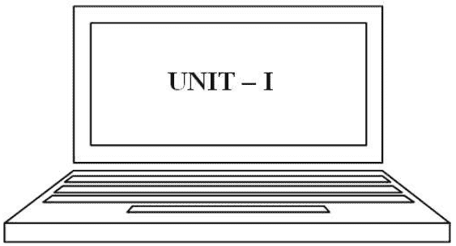

## 操作系统简介

### 1.1 导论

在简单的情况下，操作系统是计算机启动时运行的第一段软件。它的工作是协调所有其他软件的执行，主要是用户应用程序。它还为用户提供了各种常用服务。

操作系统是用户与计算机硬件之间接口的程序。操作系统的目的是为用户提供一个运行程序的环境。

操作系统作为资源管理器，根据需要向特定的程序和用户分配资源。常用的资源包括输入/输出设备、内存、文件存储空间、CPU 时间等。

操作系统必须确保计算机系统的正确运行。硬件必须提供适当的机制以防止用户程序干扰系统的正常运行。

### 1.2 操作系统执行资源管理

操作系统的主要特征之一是支持多程序设计。这意味着多个程序可以“同时”执行。但考虑到只有一个处理器，这种并发执行实际上是一种幻觉。在现实中，操作系统在竞争的程序之间调度系统资源，试图让每个程序看起来像是独占了这台计算机。多程序设计的的核心是资源管理，它决定了哪个运行中的程序将获得什么资源。资源管理类似于“短毯子问题”：每个人想被盖住，但毯子太短，无法一次覆盖所有人。

计算机系统中的资源包括程序所需的显性硬件部分：
- CPU 本身。
- 用于存储程序及其数据的内存。
- 用于文件的磁盘空间。

但操作系统还需要内部资源：
- 用于内存分页（paging）的磁盘空间。
- 系统表中的条目，例如进程表和打开文件表。

所有应用程序都想在 CPU 上运行，但同一时间只有一个程序可以运行。因此，操作系统让每个程序运行一小会儿，然后抢占它并将 CPU 交给另一个程序。这被称为时间片。关于运行哪个应用程序的决策被称为调度。

就像内存一样，每个应用程序获得一些内存帧来存储其代码和数据。如果所有应用程序的需求总和超过了可用物理内存，就会使用分页技术：当前未使用的内存页临时存储在磁盘上……

磁盘空间（可能还包括系统表条目）通常有一个硬限制。只要可行，系统就会进行分配。当资源耗尽时，额外的请求将失败。然而，它们稍后可以尝试，那时某些资源可能已被用户释放。

### 1.3 操作系统的结构

操作系统的结构由 4 层组成：
- 硬件
- 操作系统
- 系统程序
- 应用程序

硬件部分由 CPU、内存、I/O 设备和次级存储组成。在硬件层之上是操作系统。第三层是系统程序，由编译器、汇编器、链接器等组成。最后的一层是应用程序，用户通过它与计算机系统进行交互，这包括数据库系统、视频游戏、业务程序等（取决于用户的兴趣）。

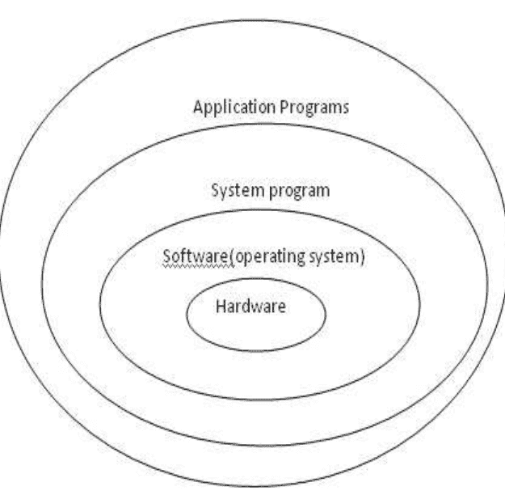

图 1.1 操作系统结构分层视图

### 1.4 计算机系统的组件

计算机系统是硬件和软件组件的集合。硬件指的是物理计算设备。软件指的是为系统用户提供服务的编写程序。

每个计算机系统由四个基本组件组成。它们是硬件（内存、中央处理器和输入/输出单元）、操作系统、系统程序和应用程序。硬件的基本组织形式如图 1.2 所示。

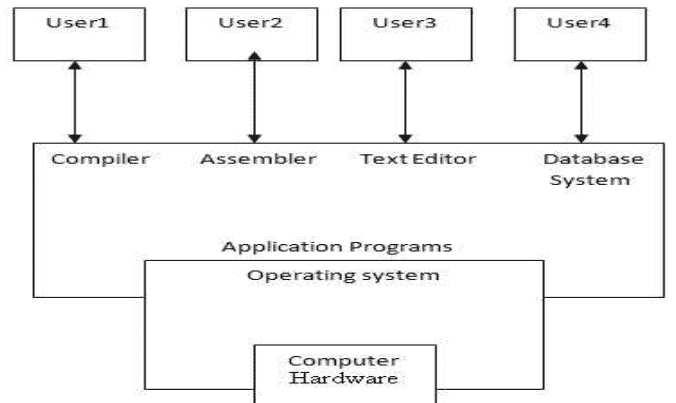

图：计算机系统组件的抽象视图

硬件提供基本的计算资源。应用程序定义了利用这些资源解决用户计算问题的方法。系统程序包括编译器、汇编器、链接器等，操作系统控制并协调各种用户之间各种应用程序之间对硬件的使用。操作系统提供了一个环境，其他程序可以在其中执行有用工作，并控制 I/O 设备。计算机系统的根本目标是执行用户程序并解决用户问题。

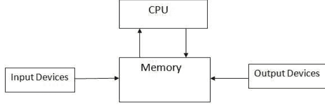

图：1.2 计算机系统中硬件的基本组织结构

### 1.5 操作系统提供的服务

操作系统为程序的执行提供环境。操作系统为程序以及这些程序的用户提供某些服务。为了方便程序员使编程任务更简单，操作系统提供的某些功能如下：

- 1. 程序执行：
用户将想要执行程序。系统必须能够将程序加载到内存并运行它。程序必须能够正常或异常地结束执行。

- 2. 输入/输出操作：
正在运行的程序可能需要输入和输出。这种 I/O 可能涉及文件或 I/O 设备。由于用户程序无法直接执行 I/O 操作，操作系统必须提供一些手段来实现它。

- 3. 文件操作：
显而易见，用户想要读取和写写文件，还想按名称创建和删除文件，操作系统提供了所有文件操作功能，如创建文件、读取文件、写入文件、删除文件。

- 4. 错误检测：
操作系统需要不断感知可能的错误。错误可能发生在 CPU 和内存硬件中（例如内存错误或电源故障），可能发生在输入输出输出设备中（例如打印机缺纸），也发生在用户程序中（例如算术溢出或访问非法内存位置）。

为了系统自身的运行，存在以下的一组操作系统功能。

- 5. 资源分配：
当有多个用户或多个作业同时运行时，必须为它们中的每一个分配资源。操作系统管理着许多不同类型的资源。

- 6. 统计：
在多用户系统中，操作系统会跟踪哪个用户使用了多少计算机资源。

- 7. 保护：
在多用户系统中，当多个用户的作业同时执行时，不应允许一个作业干扰另一个作业。

### 1.6 操作操作系统的类型

根据用户数量、处理器以及在内存中执行程序的方式，有多种类型的操作系统。

#### A) 串行处理系统

在早期计算机系统中，只有计算机硬件且没有操作系统。早期的计算机是巨大的机器，通过控制台运行。使用 1 和 0（机器语言）编程非常常见。指令和数据通过控制台开关或可能的纸带或冲孔卡输入到计算机。然后按下相应的按钮加载起始地址并启动程序执行。当程序运行时，程序员/操作员可以通过控制台上的指示灯来监控其执行情况。如果发生错误，指示灯会显示错误状态。程序员检查寄存器和主内存以识别错误原因。执行完成后，她将输出打印出来，然后程序员准备好执行下一个程序。

这种类型的处理对用户来说很困难，它花费大量时间，且下一个程序必须等待前一个完成。程序一个一个提交给机器，因此这种方法被称为串行处理。

#### B) 批处理系统

在批处理中，具有相似需求的作业被汇成一组并作为一组通过计算机运行。

在早期系统中，编译器和汇编器通常存储在磁带上。要执行特定的语言程序，用户必须首先挂载特定的编译器，产生需要汇编的汇编代码。这需要挂载另一带汇编器的带。

在挂载磁带或程序员操作控制台期间，CPU 处于空闲。在早期，计算机非常少且非常昂贵。计算机时间非常宝贵，计算机者希望它们尽可能被使用。

后来聘用了第一批专业的计算机操作员。由于操作员在挂载磁带方面比程序员更有经验，设置时间被缩短了。再次为了减少设置时间，将相似需求的作业汇成一组并通过计算机运行。

假设操作员收到了一个 FORTRAN 程序、一个 COBOL 程序和另一个 FORTRAN 程序。如果按顺序运行，他必须为 FORTRAN 程序环境进行设置（加载 FORTRAN 编译器磁带），然后设置 COBOL 程序，最后再次设置 FORTRAN 程序。如果他将两个 FORTRAN 程序批处理，他只需为 FORTRAN 设置一次，从而节省了操作员的时间。

##### 驻留监控器 (Resident monitor)

在批处理过程中，从一个作业过渡到下一个作业时，CPU 会处于闲状态。为了克服这种空闲时间，引入了自动作业调度，并随之产生了最初的操作系统。它包含了自动将控制权从一个作业转移到下一个作业的程序。为了这一目的，创建了一个名为驻留监控器的小程序。驻留监控器始终位于内存中。

当计算机启动时，系统的控制权位于驻留监控器，随后它将控制权交给程序。当程序终止时，它会将控制权返回给驻留监控器，然后继续处理下一个程序。因此，驻留监控器会自动在程序之间进行排序，并将一个作业形成另一个作业。

操作员会收到关于要在数据上运行哪些程序的简短说明。为了将这些信息直接提供给驻留监控器，引入了控制卡。除了作业的程序或数据外，程序员还包含了特殊卡片（控制卡），这些卡片是给驻留监控器的指令，指示要运行哪个程序。例如，一个普通用户程序可能需要运行三个程序之一：FORTRAN 编译器 (`FTN`)、汇编器 (`ASM`) 或用户程序。每个程序都有一个独立的控制卡：
- `$FTN` : 执行 FORTRAN 编译器。
- `$ASM` : 执行汇编器。
- `$RUN` : 执行用户程序控制卡。

此外，还有两张控制卡用于定义每个作业的边界：
- `$JOB` : 作业的第一张卡。
- `$END` : 作业的最后一张卡。

驻留监控器

| 中断与陷向量 |
| :--- |
| 设备驱动程序 |
| 作业调度 |
| 控制卡解释器 |
| 用户程序区域 |

图 1.3 驻留监控器的内存布局

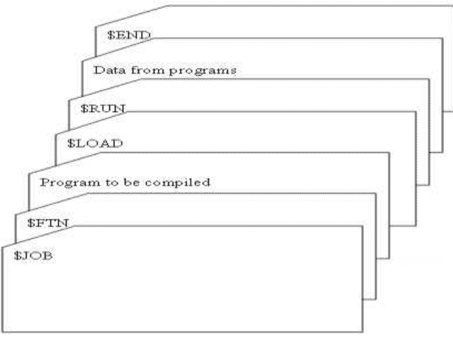

图: 1.4 简单批处理系统的卡片堆


# 操作系统概念与基础 Linux 命令

## 缓冲 (Buffering)

缓冲试图让 CPU 和 I/O 设备一直处于忙碌。缓冲区是内存的一部分，用于临时存储数据。数据被读取后，CPU 正准备对其开始操作，输入设备会被指示立即开始下一次输入。此时 CPU 和输入设备都处于忙碌。当 CPU 准备好处理下一个数据项时，输入设备已经完成了读取。随后 CPU 就可以开始处理新读取的数据，而输入设备开始读取后续数据。

输出也可以进行类似的缓冲；CPU 创建数据，并将其放入缓冲区，直到输出设备可以接收它为止。

缓冲让 CPU 和 I/O 设备一直处于忙碌。当 CPU 正在处理一条记录时，输入设备正在处理另一个记录，则是 CPU 或输入设备先完成。如果 CPU 先完成，它必须等待；在读取下条记录之前，它无法继续。如果输入设备比 CPU 快，缓冲区将变满，输入设备必须等待。

解决此问题的方案是，只有在上一次操作完成后，才能启动下一次 I/O 操作。中断解决了这个问题。当 I/O 设备完成一项操作时，它会中断 CPU，然后 CPU 停止正在的工作并立即跳转到一个固定位置，在那里，中断服务程序会检查缓冲区是否未满（对于输入设备）或为空（输出设备），然后启动下一个 I/O 请求。CPU 可以恢复中断计算。通过这种方式， I/O 设备和 CPU 可以以全速运行。

如果 CPU 比输入设备快得多，缓冲几乎没有用处。如果 CPU 总是更快，那么它将总是找到空缓冲区并必须等待输入设备。对于输出，CPU 可以全速运行，直到所有系统都满了。然后 CPU 必须等待输出设备。

## 井式 (Spooling)

井技术代表在线外设同步操作。缓冲区是内存的一小部分，用于在程序执行期间临时存储数据。在井系统中，磁盘被用作大型缓冲区。

例如，如果有两个或多个用户发出打印命令，而此时打印机正在打印其他作业，这些打印命令将被加载到井磁盘中。井磁盘是一个临时缓冲区；它可以直接从辅助存储设备读取数据。在打印另一个作业的输出的同时，CPU 可以在井磁盘中执行另一个作业。因此，当用户同时通过键盘为一个作业输入输入时，CPU 忙于执行另一个作业，而打印机忙于获取另一个作业的输出。

井优于缓冲的优点是井可以将一个作业的 I/O 与另一个作业的计算重叠。井程序可以在打印另一个作业输出的同时读取一个作业的输入。在此期间，可能还会执行另一个作业。缓冲只能将一个作业的 I/O 与自身的计算及 I/O 重叠；而井可以将多个作业的 I/O 和计算重叠。

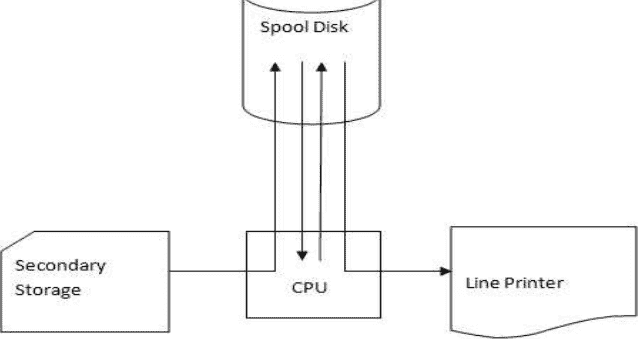

图: 1.5 井技术

### C) 单处理器系统

单处理器系统被定义为具有用于执行指令的单个中央处理器的计算机系统。单处理器系统（标准个人电脑）包含单个 CPU 和单个 I/O 通道，通常被用作单用户机器，也可以实现为多用户系统。

当用于多用户系统时，所有用户的应用程序之间相互保护，系统资源在多个用户之间共享，操作系统维持控制，使用以下操作模式：

- 1. 微内核，它包含内核态但较小、模块化、执行速度快等。
- 2. 管理资源的用户态模块。通常操作系统的部分功能可以在内核外执行。例如，打印系统可以完全作为用户级子系统进行管理。

这种模型通过消息传递进行通信（尽管可以使用共享内存）。

这种方法的主要优点是其灵活性。它很容易替换模块，提供性能升级等。用户级模块理论上可以移动到其他机器。这里的启示是该模型更适合被采用分布式操作系统。事实上，它的消息传递通信虽然是其缺点之一，也是其适用于分布式实现的另一个指标。

它的缺点与熟悉度和性能有关。熟悉度方面是它不符合习惯，人们会感到不适应。性能方面是在分离的模块之间进行额外的通信（而不是统一的单体结构），会导致性能损失。

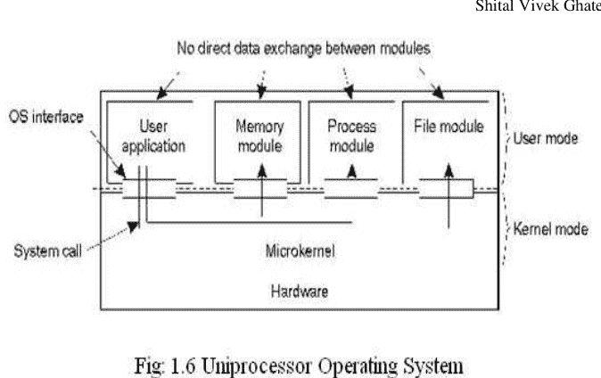

### D) 多处理器系统

标准系统是单处理器的，即它有一个主 CPU。多处理器系统将有多个 CPU，共享内存和外设。

多处理器操作系统使用两种方法：

#### 主从方法

常见的多处理器系统为每个处理器分配特定的任务。有一台主计算机。这台主计算机控制系统。其他处理器（从机）要么向主机寻求指令，要么具有预定义的任务。

#### 计算机网络

在这种方法中，多个独立的计算机系统可以通信，在它们之间发送文件和信息。然而，每个计算机系统都有自己的操作系统并独立运行。

一个优势是吞吐量。通过增加处理器的数量，可以在更短的时间内完成更多工作。

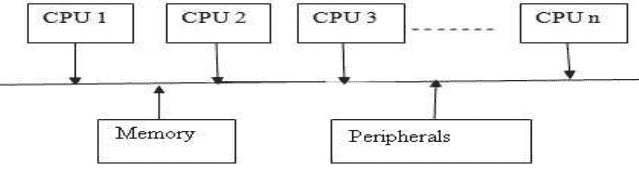

图: 1.7 多处理器操作系统

另一个优势是其可靠性。如果将功能妥善地分配到多个处理器之间，那么一个处理器的故障不会导致系统停止，而只会减慢运行速度。如果我们有十个处理器而其中一个坏了，那么剩下的每个处理器都必须承担故障处理器的一部分工作。因此，整个系统的运行速度只变慢了 10%，而不是完全崩溃。

设计多处理器系统比设计单处理器系统更困难。多处理器系统有三个主要优势：

- 1. 提高吞吐量。

通过增加处理器的数量，我们期望在更短的时间内完成更多工作。$N$ 个处理器的加速比并不是 $N$；相反，它小于 $N$。当多个处理器协作完成任务时，为了保持所有部分正常工作会产生一定的开销。这种开销加上对共享资源的竞争，降低了额外处理器带来的预期收益。同样，$N$ 个程序员共同工作产生的工作量也不会是一个程序员产生的工作量的 $N$ 倍。

## 2. 规模经济

多处理器系统的成本可能低于等效的多个单处理器系统，因为它们可以共享外设设备、磁盘存储和电源。如果多个程序在同一组数据上运行，将这些数据存储在一个磁盘上并让所有处理器共享，比拥有许多带有本地磁盘和许多数据副本的计算机要便宜得多。

## 3. 提高可靠性

如果功能可以妥善地分配到多个处理器之间，那么一个处理器的故障不会导致系统停止，只会减慢运行速度。如果我们有十个处理器而其中一个坏了，那么剩下的每个处理器都可以承担故障处理器的一部分工作。因此，整个系统的运行速度只变慢了 10%，而不是完全崩溃。

## E) 多程序系统

作业调度最重要的方面是多程序处理的能力。通常情况下，单个用户无法让 CPU 或 I/O 设备一直处于忙状态。多程序通过组织作业使 CPU 始终在执行，从而提高 CPU 利用率。

在多程序中，单个处理器可以同时执行多个程序。在这种技术中，物理内存被分为许多分区，每个分区存放一个独立的程序。操作系统在不同的程序之间切换。

## H) 并行处理系统

并行处理是同时使用一个或多个 CPU 或处理器核心来执行一个程序或多个计算线程。理想情况下，并行处理使程序运行得更快，因为有更多的引擎（CPU 或内核）在运行它。总的来说，并行处理意味着有多个微处理器处理整个任务的各个部分。计算机使用专门为该任务设计的特殊软件将一个复杂问题分解为若干组件部分。他或她将每个组件部分分配给一个专用的处理器。每个处理器解决其负责的计算问题部分。软件重新组装数据以得出原始复杂问题的最终结论。

并行计算是计算的一种，其中许多计算同时进行，其原理是大型问题可以被分成更小的问题，然后并发地（即“并行”）解决这些。对于单 CPU、单核计算机，可以通过在网络中连接计算机来执行并行处理。然而，这种类型的并行处理需要非常复杂的软件，称为分布式处理软件。并行处理也称为并行计算。“并行处理”一词用于代表一大类技术，这些技术被用于提供同时的数据处理任务，以提高计算机系统的计算速度。

注意，并行性（Parallelism）与并发性（Concurrency）不同。并发是操作系统和数据库社区使用的一个术语，指的是系统的一种属性，即多个任务通过交替执行顺序并从而产生同时执行指令的幻象，在逻辑上保持活动状态并同时取得进展。另一方面，并行性通常是超计算社区使用的术语，用于描述物理上同时执行的执行，其目标是在更短时间内解决问题或在相同时间内解决更大的问题。并行性利用了并发性。

## 并行处理系统的优点

- 执行时间更快，因此吞吐量更高。

## 并行处理系统的缺点

- 需要更多硬件，功耗需求也更高。不适合低功耗和移动设备。

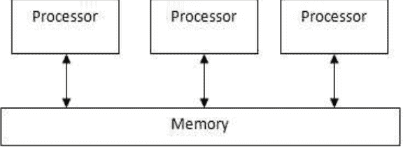

图 1.13 并行处理

## I) 分布式系统

分布式系统由多台通过计算机网络通信的计算机组成。计算机之间相互交互以实现共同目标。运行在分布式系统中的计算机程序称为分布式程序，而分布式编程就是编写此类程序的过程。一个问题被分成许多任务，每个任务由一个或多台计算机解决，这些计算机通过消息传递（Message passing）进行相互通信。在网络中，各个计算机物理上分布在某些地理区域内。有多个自主计算实体，每个实体都有自己的本地内存。这些实体通过消息传递相互通信。

分布式系统是联网计算机的组，它们的工作有共同目标。典型分布式系统中的处理器并行并发运行。

并行计算可以被看作是分布式计算的一种特殊紧耦合形式，而分布式计算可以被看作是并行计算的松耦合形式。尽管如此，可以使用以下标准将并发系统粗略归类为“并行”或“分布式”：

- 在并行计算中，所有处理器都可能访问共享内存，以便在处理器之间交换信息。


在分布式计算中，每个处理器都有自己的私有内存（分布式内存）。信息通过在处理器之间传递消息来交换。

使用分布式系统和分布式计算主要有两个原因。首先，应用程序本身的性质可能需要使用连接几台计算机的通信网络。例如，数据产生在一个物理位置，而在另一个位置需要它。

其次，在许多情况下，从原理上可以使用单台计算机，但出于实际考虑，使用分布式系统是有益的。例如，与使用单台高端计算机相比，使用由几台低端计算机组成的集群（Cluster）获得所需的性能水平可能更具效益。分布式系统比非分布式系统更可靠，因为没有单点故障。分布式系统可能更容易扩展和管理单处理器系统。

分布式系统的应用示例包括：

- 电信网络、电话网络、蜂窝网络（互联网）、无线传感器网络、分布式数据库、网络文件系统、全球网、点对点网络、银行系统、订票系统、实时过程控制。

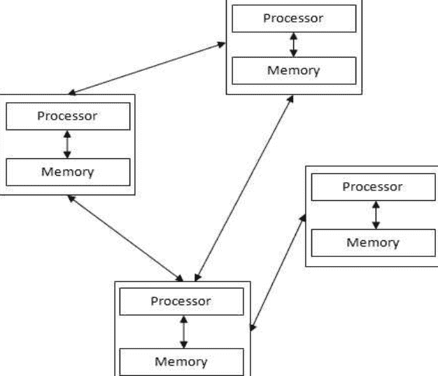

图 1.14 分布式系统

## 集群系统

集群系统系统一样聚集多个 CPU 来完成计算工作。然而，集群系统与并行系统的不同在于，它们是由两个或多个系统耦合而成的。集群这一术语的定义并不具体；许多软件包都在纠结什么是集群系统以及为什么某种形式更好。通常接受的定义是，集群计算机共享存储并通过局域网（LAN）紧密连接。

集群通常用于提供高可用性服务；也就是说，即使一个或多个系统故障，服务也将继续提供。

集群可以构造为非对称或对称结构。在非对称集群中，一台机器处于热备模式，而另一台运行应用程序。热备主机只负责监控活动服务器。如果该服务器发生故障，热备主机将变为活动服务器。在对称模式下，两个或多个主机运行应用程序，并且它们相互监控。这种模式显然更有效，因为它利用了所有可用硬件。它确实需要运行多个应用程序。

集群的其他形式包括并行集群和跨广域网（WAN）的集群。并行集群允许多个主机访问共享存储上的相同数据。大多数操作系统不支持多个主机同时访问数据，并行集群通常通过使用特殊版本的软件和应用程序发行版来实现。例如，Oracle Parallel Server 是 Oracle 数据库的一个版本，设计用于并行集群上运行。每台机器运行 Oracle，软件层跟踪对共享磁盘的访问。系统还提供访问控制和锁定以确保不会发生冲突操作。此功能通常被称为分布式锁管理器（DLM），包含在某些集群技术中。

## 实时系统

实时操作系统作为专用应用程序的控制设备。传感器将数据带入计算机。计算机必须分析数据并可能调整控制以修改传感器输入。控制科学实验、医学计算机系统、工业控制系统以及某些显示系统的都是实时系统。实时系统具有良好定义的固定时间限制。处理必须在定义的限制内完成，否则系统将失败。

为了被认为是“实时的”，操作系统必须对其执行的每个关键操作都有一个已知的最大时间（或至少能够保证该最大时间）。其中一些操作包括内核调用和中断处理。绝对保证的

这些操作的最大时间限制通常被称为“硬实时”，而那些大多数时间只能保证最长时间的操作系统则被称为“软实时”。在实践中，这些严格的分类用处有限——每种实时操作系统解决方案都展现出独特的性能特征。

实时操作系统可以保证程序以非常一致的时间性运行。实时操作系统通过为程序员提供对任务优先排序极高程度的控制来实现这一点，并且通常还允许进行检查，以确保重要的截止日期得到满足。

其核心要点是，如果程序编写得当，通常情况下，操作系统（OS）负责管理计算机的硬件资源，并托管运行在计算机上的应用程序。实时操作系统执行这些任务，但它经过特殊设计，能够以非常精确的时间控制和高可靠性运行应用程序。这在测量和自动化系统中尤为重要，在这些系统中，停机代价是高昂的，或者程序延迟可能会导致安全危害。


# 进程与线程

## 引言

进程是应用程序执行的实例。该应用程序可以是用户编写的程序，也可以是系统应用程序。用户可能同时运行同一个应用程序的多个实例，或者运行许多不同的应用程序。每个此类运行中的应用程序都是一个进程。进程只在执行应用程序的期间存在。

用户可能一次能够运行几个程序：一个文字处理器、一个 Web 浏览器和一个电子邮件包。即使用户一次只能执行一个程序，操作系统可能需要支持其内部的程序活动，例如内存管理。在许多方面，所有活动都是相似的，因此我们将所有这些活动称为进程。

线程是进程的一部分。它代表了正在进行的计算的实际流。每个进程必须至少有一个线程。多线程也是可能的，即多个线程在同一个进程的上下文中，通过运行同一应用程序的不同指令来执行。

## 2.1 进程概念

早期计算机系统允许一次执行一个程序。该程序对系统具有完全控制权，并可以访问所有的资源。相比之下，现在的计算机系统允许多个程序加载到内存中并并发执行。这种演进要求对各种程序进行更稳固、更模块化的划分；这些需求产生了“进程”的概念，即正在执行中的程序。进程是现代分时系统中的工作单元。

系统由一组进程组成。操作系统处理执行系统代码的进程和执行用户代码的用户进程。可能，所有这些进程都可以与 CPU 并发执行，CPU（或多个 CPU）在它们之间进行复用。通过在进程之间切换 CPU，操作系统可以提高计算机的生产率。

## 2.2 进程

进程是正在执行中的程序。进程不仅仅是程序代码（有时被称为文本段），它还包含了当前的活动，由程序计数器的值和处理器寄存器的内容来表示。进程通常包括进程栈（其中包含临时数据，如函数参数、返回地址和局部变量）以及数据段（其中包含全局变量）。进程还可能包含一个堆（heap），堆是在在进程运行期间动态分配的内存。

程序本身不是进程；程序是一个被动实体，例如存储在磁盘上的包含指令列表的文件，而进程是一个活动实体，拥有一个指定下一条要执行指令的程序计数器以及一组相关的资源。

### 2.2.1 进程控制块

每个进程在操作系统中通过一个进程控制块（PCB）表示——也称为任务控制块。它包含了与特定进程相关的许多信息，包括：

- 进程状态：状态可能是新建、就绪、运行、等待、挂起等。
- 程序计数器：计数器指示该进程要执行的下一条指令的地址。
- CPU 寄存器：寄存器的数量和类型取决于体系体系。它们包括累加器、索引寄存器、栈指针和通用寄存器，以及任何状态码信息。当发生中断时，这些状态信息必须与程序计数器一起被保存。
- CPU 调度信息：这些信息包括优先级、指向调度队列的指针。
- 内存管理信息：这些信息可能包括基址和界限、页表、段表。
- 统计信息：这些信息包括 CPU 的使用量、时间限制、进程号。
- I/O 状态：这些信息包括分配给进程的 I/O 设备列表、打开的文件。

| 进程状态 | 程序计数器 |
| :--- | :--- |
| 寄存器 | 内存限制 |
| 打开的文件列表 | ... |

### 2.2.2 进程状态

随着进程的执行，它会改变状态。进程的状态在程度上由当前的活动定义。每个进程可能处于以下状态之一：

- 新建（New）：进程正在被创建。
- 运行（Running）：指令正在执行中。
- 等待（Waiting）：进程正在等待某些事件，如 I/O 完成。
- 就绪（Ready）：进程正在等待被分配给处理器。
- 终止（Terminated）：进程已完成执行。

这些名称是任意的，并且在不同的操作系统之间有所不同。然而，它们代表的状态在所有系统中都是。某些操作系统更精细地划分了进程状态。重要的是意识到，在任何时刻只能有一个进程在运行。然而，可能有许多进程处于就绪和等待状态。与这些状态对应的状态图如图所示。

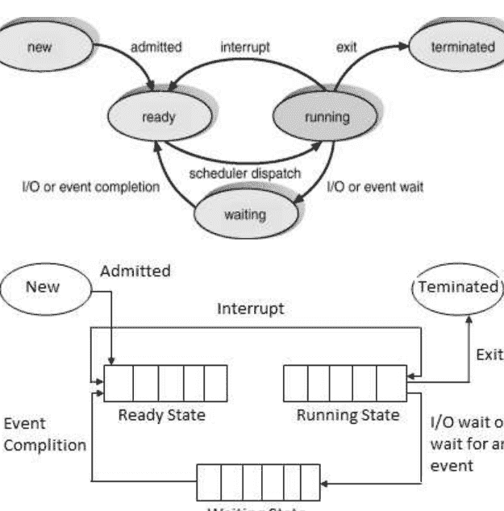

图： 2.2 进程状态

**新建 → 就绪：** 操作系统创建一个进程并准备执行该进程，然后操作系统将进程移到就绪状态。

**就绪 → 运行：** 操作系统从就绪队列中选择一个作业，并将进程从就绪状态移动到运行状态。

**运行 → 终止：** 当进程的执行完成后，操作系统将该进程从运行状态终止。有时操作系统会因为其他原因（如内存不可用、访问冲突、保护错误、I/O 失败、数据误用等）终止进程。

**运行 → 就绪：** 当处理器的时间片过期，或者处理器接收到任何中断信号时，操作系统将运行中的进程移到就绪状态。

**运行 → 等待：** 如果进程需要某个事件发生或需要 I/O 设备，则进程被放入等待状态。如果操作系统没有立即提供 I/O 或事件，则进程在它所等待的事件发生时移动到等待状态。

**等待 → 就绪：** 当所等待的事件发生时，阻塞状态的进程被移到就绪状态。例如，一个运行状态的进程需要 I/O 设备。此时进程进入阻塞或等待状态，当操作系统提供 I/O 设备时，进程从等待或阻塞状态移到就绪状态。

## 2.3 进程操作

### 2.3.1 创建新进程

进程的主要操作是创建一个新进程。“进程创建”可以创建一个新进程。当用户启动执行程序时，操作系统会创建一个进程来代表该程序的执行。可执行程序的创建包含许多步骤。

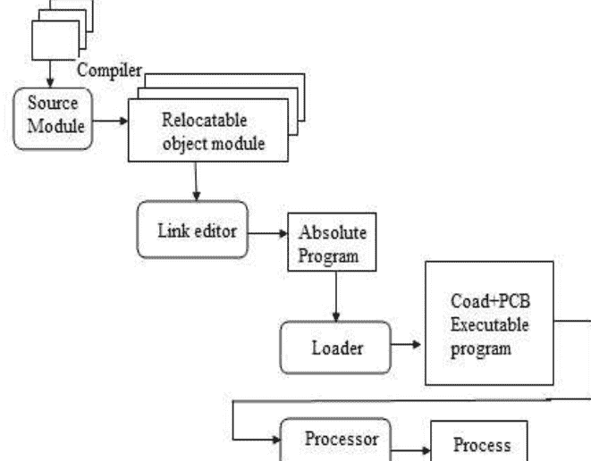

图 2.3: 创建进程的步骤


源模块或源代码（用编程语言编写的程序）在翻译器（编译器）的帮助下被翻译成目标程序或目标模块。可重定位目标模块由链接器转换为绝对程序。绝对程序由加载器转换为可执行程序。然后处理器执行该程序。这个正在执行的程序被称为进程。

进程由内存中的程序机器码映像和 `PCB` 结构组成。

### 2.3.2 终止现有进程

创建进程的对立面是终止进程。进程可以通过从其主函数返回或通过调用 `exit` 系统调用来终止自身。通常情况下，进程在执行完成时终止。其他原因还包括：

- 时间片过期
- 内存违规
- I/O 错误
- 无效指令

时间片过期： 当进程执行未在时间量子内完成时，进程将从运行状态终止。CPU 从就绪队列中选取下一个任务执行。

内存违规： 如果进程需要的内存超过可用内存，进程将从运行状态终止。

I/O 错误： 进程在执行时需要 I/O 操作，但此时 I/O 设备不可用。那么进程将移动到等待状态。如果操作系统不提供该 I/O 设备，即使进程处于等待状态，进程也会被终止。

无效指令： 如果进程包含无效指令且 CPU 无法执行这些指令，则进程将被终止。

### 2.3.3 挂起执行

进程可以通过进入睡眠自我挂起。这意味着它告诉系统自己现在无事可，因此不应该运行。睡眠与一个时间相关：当这个未来的时间到达时，系统将唤醒该进程。

### 2.3.4 发送信号或消息

进程之间的一种常见操作是发送信号。信号通常被描述为软件中断：接收进程接收信号，而不是继续它之前正在做。在许多情况下，除非进程采取行动防止这种情况，否则信号会终止进程。

## 2.4 并发进程

并发处理是一种计算模型，其中多个处理器同时执行指令以获得更好的性能。任务被分解为子任务，然后分配给不同的处理器同时执行，而不是像单处理器执行的那样顺序执行。并发处理有时被认为与并行处理同义。

每个并发执行的顺序程序都称为进程。进程的执行虽然是并发的，但通常不是独立的。进程可能会通过共享数据、共享资源、通信和同步相互影响行为。

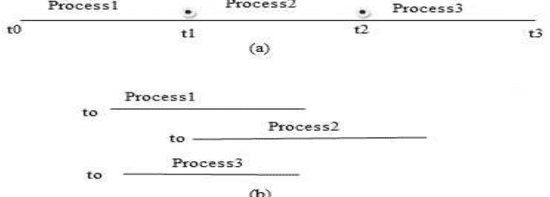

## 图 2.4: 并发进程

在图 (a) 中，`process1` 在时间 $t_0$ 开始执行，`process2` 在 `process1` 完成执行后才开始执行，而 `process3` 只在 `process2` 完成执行后才开始执行。这些进程被称为串行进程。

在图 (b) 中，`process1`、`process2`、`process3` 的执行时间是重叠，因此这些被称为并发处理。

## 2.5 线程

在计算机科学中，执行线程是操作系统调度程序可以进行独立管理的最小程序指令序列。线程是一个轻量级进程。线程和进程的实现在不同操作系统之间有所不同，但在大多数情况下，线程包含在进程内部。多个线程可以存在于同一个进程中并共享内存等资源，而不同的进程不共享这些资源。

进程被划分为若干轻量级进程。每个轻量级进程被称为线程。线程拥有一个程序计数器，用于跟踪下一个要执行哪条指令，它拥有持有当前工作变量的寄存器。它 true一个包含执行历史的栈。

相同数量的线程可以共享内存空间、打开的文件和其他资源，就像相同数量的进程可以共享物理内存、磁盘、打印机等等。线程具有进程的一些属性，并且在许多方面的操作方式与进程相同。线程可以处于几种状态之一：就绪、阻塞、运行或终止。线程共享 CPU，且一次只有一个线程是激活状态的。线程之间互不独立。所有线程都可以访问任务中的任何地址。一个线程可以读取或写入任何其他线程的栈。

可以与其它线程并发执行的程序线程，这种能力被称为多线程。

### 线程示例：

一个程序员希望在文字处理器中打字文本，然后程序员在文字处理器中打开一个文件并输入文本，这是一个线程；然后文本自动进行格式化，这是另一个线程。文本自动指出拼写错误，这又是另一个线程。最后，文件自动保存到磁盘，这又是一个线程。因此，打字、格式化、拼写检查、保存文件——这些都是线程。

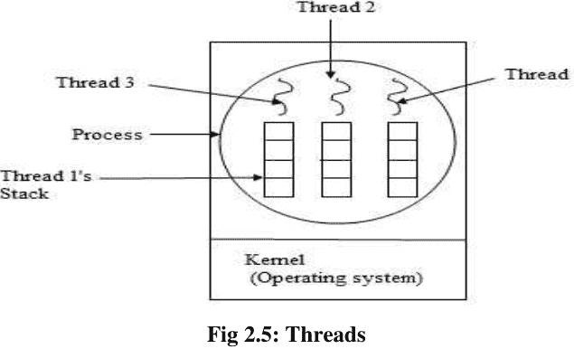

## 2.6 多线程

进程被划分为若干较小任务，每个任务被称为线程。进程中同时执行的线程数量被称为多线程。根据功能，线程被分为四类：

- 一对一
- 一对多
- 多对一
- 多对多


### 一对一（一个进程线程）

在这种方法中进程只维护一个线程，因此被称为单线程方法。`MS-DOS` 操作系统支持这种类型。

### 一对多（一个进程多个线程）

在这种方法中一个进程分为多个线程。最好的例子是 `Java` 运行时环境。

### 多对一（每个进程一个线程）

操作系统支持多个进程但每个进程只有一个线程。最好的例子是 `UNIX`。

### 多对多（多个进程多个线程）

在这种方法中每个进程分为多个线程。例子有 `Windows 2000`、`Solaris`。

实现线程有两种主要方式：

- 在用户空间
- 在内核空间

### 用户级线程

这类线程完全加载在用户空间；内核对它们一无所知。当在用户空间管理线程时，每个进程都有自己的表。表包含程序计数、寄存器等信息。当线程移动到就绪状态或阻塞状态时，重启它的信息存储在表中。

用户线程允许每个进程拥有自己的调度算法。整个进程加载在用户空间，因此进程不需要切换到内核模式进行线程管理。用户线程可以在任何操作系统运行。

当用户线程执行系统调用时，进程内的所有线程都会被阻塞。进程内只有一个线程可以执行，因此没有实现多处理。

# 操作系统概念和基础 Linux 命令

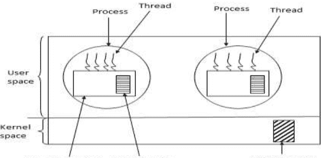

图 2.7: 用户级线程

### 内核级线程

在内核级线程中，内核完成线程管理的所有工作。每个进程没有线程表。内核有一个表来跟踪系统中所有的线程。当线程想要创建新线程或销毁任何现有线程时，它调用内核；然后内核采取行动。

内核线程表持有每个线程的寄存器、状态和其他信息。信息与用户线程相同，但现在位于内核而不是用户空间。

内核可以在多个处理器上同时调度同一进程的多个线程。如果进程中的一个线程被阻塞，内核可以调度该进程的另一个线程。

在内核中创建和销毁线程的成本更高。同一进程内线程之间的控制权传递需要切换到内核模式。

## 线程 进程 线程

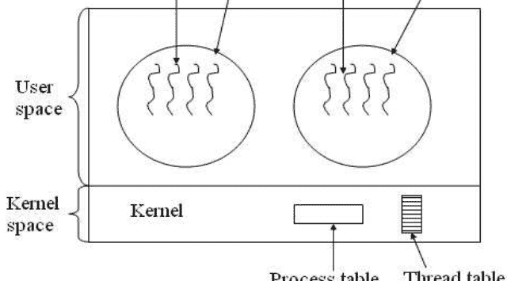

图 2.8: 内核线程

## 2.7 CPU 调度

多道程序的目标是让某些进程始终运行，以最大化 CPU 的利用率。时间分共享的目标是频繁地在进程之间切换 CPU，使用户户能够在程序运行时与其进行交互。为了实现这些目标，进程调度器会选择一个可用的进程（可能从多个可用进程中选择一个），在 CPU 上进行程序执行。对于单处理器系统，运行的进程永远不会超过一个。如果有更多的进程，其余进程将必须等待 CPU 空闲后才能被重新调度。

### 2.7.1 调度队列：

当进程进入系统时，它们被放入作业队列（job queue），该队列包含系统中的所有进程。驻留在主内存中准备好等待执行的进程被保留在一个称为就绪队列（ready queue）的列表中。该队列通常以链表的形式存储。就绪队列头包含指向就绪队列中第一个 `PCB` 和最后一个 `PCB` 的指针。每个 `PCB` 包含一个指针字段，指向就绪队列中的下一个 `PCB`。

操作系统概念与基础 Linux 命令

系统还包括其他队列。当一个进程被分配到 CPU 时，它会执行一段时间，并最终退出、被中断或等待特定事件的发生（例如 I/O 请求的完成）。假设该进程对共享设备（如磁盘）发起了 I/O 请求。由于系统中有很多许多进程，磁盘可能忙于某些其他进程的 I/O 请求。因此，该进程可能需要等待磁盘。等待特定 I/O 设备的进程列表被称为设备队列（device queue）。每个设备都有它们自己的设备队列。

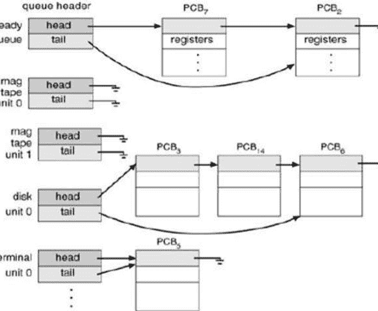

图: 2.9 就绪队列与各种类型的设备队列

### 2.7.2 调度器：

主要有三种调度器：--

- 长期调度器（Long term scheduler）
- 短期调度器（Short term scheduler）
- 中期调度器（Medium term scheduler）

### 长期调度器：

长期调度器的功能是从作业池中选择进程，并将它们加载到主内存（就绪队列）中执行，因此长期调度器被称为作业调度器。

例如，假设一个计算机实验室由 20 个虚拟节点组成，通过局域网连接到服务器，在 20 个节点中有十个用户想要执行他们的作业，那么这些作业会被加载到虚拟磁盘中。长期调度器从虚拟磁盘中选择作业并将其加载到主内存的就绪队列中。

### 短期调度器：

短期调度器或 CPU 调度器，从就绪队列（准备好执行的进程）中选择一个作业，并在调度程序（dispatcher）的帮助下将 CPU 分配给该进程。从就绪队列中通过短期调度器选择进程的方法取决于 CPU 调度算法。

### 调度程序：


调度程序是一个将 CPU 连接到短期调度器所选进程的模块。调度程序的主要功能是将 CPU 从一个进程切换到另一个进程。调度程序的另一个功能是跳转到用户程序的正确位置，并准备开始执行。调度程序必须快速，因为在每次进程切换期间都会被调用。调度程序停止一个进程并启动另一个进程所花费的时间被称为“调度延迟”（dispatch latency）。多道程序的程度取决于调度延迟。如果调度延迟增加，那么多道程序的程度就会减少。

## 中期调度器

如果进程在执行过程中请求 I/O，则该进程将从主内存中移除并加载到等待队列中。当 I/O 操作完成后，作业将从等待队列移动到就绪队列。这两项操作由中期调度器完成。

短期调度器必须频繁地为 CPU 选择一个新进程。一个进程在等待 I/O 请求之前可能只执行几毫秒。通常，短期调度器每 100 毫秒至少执行一次。由于两次执行之间的时间很短，短期调度器必须非常快。

长期调度器的执行频率要低得多；一个新进程的创建与下一个进程的创建之间可能相隔几分钟。长期调度器控制着多道程序的程度（内存中的进程数量）。如果多道程序的程度是稳定的，那么进程创建的平均速率必须等于离开系统的平均离开速率。因此，长期调度器仅在进程离开系统时才需要调用。

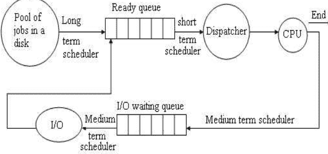

图 2.10: CPU 调度队列图

### 2.7.3 上下文切换

将 CPU 切换到另一个进程需要保存旧进程的状态并加载新进程的保存状态。这项被称为上下文切换。进程的上下文表示在进程的 PCB 中；它包含了 CPU 寄存器的值、进程状态和内存管理信息。当发生上下文切换时，操作系统将旧进程的上下文保存在其 PCB 中，并加载调度运行的新进程的保存上下文。上下文切换时间是纯开销，因为系统在切换期间没有做任何有用的工作。它的速度随机器而异，取决于内存速度、必须复制的寄存器数量。多道程序的程度取决于调度延迟。如果调度延迟增加，那么多道程序的程度就会减少。

### 2.7.4 调度

将 CPU 切换到另一个进程需要保存旧进程的状态并加载新进程的保存状态。这项被称为上下文切换。从进程的角度来看，重要的标准是执行该进程需要多久。由于上下文切换，将 CPU 切换到另一个进程需要保存旧进程的状态并加载新进程的保存状态。进程的上下文表示在进程的 PCB 中；它包含了 CPU 寄存器的值、进程状态和内存管理信息。当发生上下文切换时，操作系统将旧进程的上下文保存在其 PCB 中，并加载调度运行的新进程的保存上下文。上下文切换时间是纯开销，因为系统在切换期间没有做任何有用的工作。它的速度随机器而异，取决于内存速度、必须复制的寄存器数量。多道程序的程度取决于调度延迟。如果调度延迟增加，那么多道程序的程度就会减少。

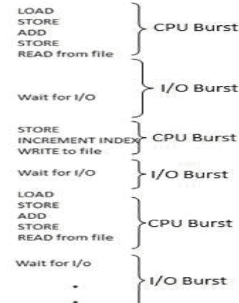

图:2.11 就绪队列

I/O 密集型程序通常具有短 CPU 闪烁。CPU 密集型程序可能具有长 CPU 闪烁。选择合适的算法取决于 I/O 设备。

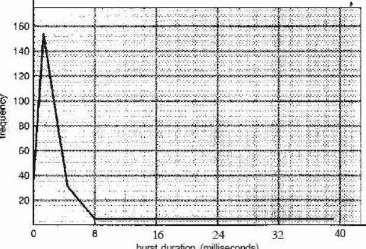

图:2.12 CPU 爆发直方图

## 2.8 调度标准

不同的 CPU 调度算法具有不同的属性，算法的选择可能有利于某类进程而非另一类进程。在选择特定情况下使用的算法时，我们必须考虑属性。已经提出了许多标准用于比较 CPU 调度算法：

- `CPU` 利用率：我们希望 CPU 尽可能忙碌。CPU 利用率范围从 0 到 100%。在实际系统中，它应该从 40%（轻负载系统）到 90%（重负载系统）。
- 吞吐量：如果 CPU 忙于执行进程，那么就在工作。工作的一个衡量标准是单位时间内完成的进程数，称为吞吐量。对于长进程，速率可能是每小时一个；对于短事务，可能是每秒 10 个。
- 周转时间：从进程的角度来看，重要的标准是执行该进程需要多久。从提交进程到完成的时间的时间是周转时间。周转时间是进入内存、等待就绪队列、在 CPU 上执行和进行 I/O 的时间之和。
- 等待时间：CPU 调度算法不影响进程执行或进行 I/O 的时间；它只影响进程在就绪队列中等待的时间。等待时间是在就绪队列中等待的时间之和。
- 响应时间：响应时间是从提交请求到产生第一个响应的时间。它是开始响应的时间，而不是输出响应的时间。周转时间通常取决于输出设备的速度。

希望最大化 CPU 利用率和吞吐量，并最小化周转时间、等待时间和响应时间。

## 2.9 调度算法

CPU 调度处理的是决定就绪队列中的哪个进程被分配到 CPU 的问题。有许多不同的 CPU 调度算法。

### 2.9.1 先来先服务（FCFS）调度

最简单的 CPU 调度算法是先来先服务（FCFS）调度算法。在这种方案中，第一个请求 CPU 的进程第一个获得 CPU。FCFS 策略的实现可以通过 FIFO 轻松管理。

队列。当一个进程进入就绪队列时，PCB 被链接到队列的尾部。当 CPU 空闲时，它会被分配给队列头的进程。随后，运行中的进程将从队列中移除。FCFS（先来先行）调度算法易于编写和理解。缺点是，FCFS 策略下的平均等待时间通常很长。考虑以下在时间 0 到达的一组进程，其 CPU 运行时间以毫秒为单位：

| 进程 | 运行时间 |
| P1 | 24 |
| P2 | 3 |
| P3 | 3 |

如果进程按照 P1, P2, P3 的顺序到达并按照 FCFS 顺序执行，我们得到如下甘特图所示的结果，该甘特图是一个说明特定调度方案的状图，包含了每个参与进程的开始时间和结束时间：

|  | P1 | P2 | P3 |
| 0 | 24 | 27 | 30 |

进程 P1 的等待时间为 0 毫秒，进程 P2 为 24 毫秒，进程 P3 为 27 毫秒。因此，平均等待时间的计算如下如下

### 平均等待时间

等待时间 = 开始时间 – 到达时间

P1 的等待时间 = 0 - 0 = 0

P2 的等待时间 = 24 - 0 = 24

P3 的等待时间 = 27 - 0 = 27

平均等待时间 = (0+24+27)/3 = 17 毫秒。

### 平均周转时间

周转时间 = 完成时间 – 到达时间

P1 的周转时间 = 24 - 0 = 24

P2 的周转时间 = 27 - 0 = 27

P3 的周转时间 = 30 - 0 = 30

平均周转时间 = (24+27+30)/3 = 27

### 平均响应时间

响应时间 = 首次响应 – 到达时间

P1 的响应时间 = 0 - 0 = 0

P2 的响应时间 = 24 - 0 = 24

P3 的响应时间 = 27 - 0 = 27

平均响应时间 = (0+24+27)/3 = 17 毫秒。

然而，如果进程按照 P2, P3, P1 的顺序到达，结果将如下甘特图所示：

| P2 | P3 | P1 |
|---|---|---|
| 0 | 3 | 6 |

此时平均等待时间为 (6 + 0 + 3)/3 = 3 毫秒。这种减少是非常巨大的。因此，在 FCFS 策略下的平均等待时间通常不是最小的，如果进程的 CPU 运行时间差异很大，等待时间可能会发生巨大变化。

考虑动态情况下 FCFS 调度的性能。假设我们有一个 CPU 密集型进程和许多 I/O 型进程。CPU 密集型进程将获取并持有 CPU。在此期间，所有其他进程将完成其 I/O 操作并进入就绪队列等待 CPU。当进程在就绪队列中等待时，I/O 设备处于空闲状态。最终，CPU 密集型进程完成其 CPU 运行并移动到 I/O 设备。所有进程都有很短的 CPU 运行时间，执行迅速并返回 I/O 队列。此时，CPU 处于空闲状态。随后，CPU 密集型进程将返回就绪队列并被分配 CPU。再次，所有 I/O 进程最终都会在就绪队列中等待，直到 CPU 密集型进程完成。这里存在“护队效应”，因为所有其他进程都在等待那个大进程释放 CPU。这种效应导致 CPU 和 I/O 设备的利用率低于允许较短进程先执行时可能达到的水平。

FCFS 调度算法是非抢占式的。一旦 CPU 分配给一个进程，该进程就会一直持有 CPU 直到它通过终止或请求 I/O 释放它。因此，FCFS 算法对于分时系统来说特别麻烦，因为在分时系统中，让每个用户定期获得 CPU 分配是很。

### 2.9.2 短作业优先（SJF）调度

在这种方法中，CPU 被分配给具有最短短 CPU 运行时间的进程。当 CPU 可用时，它被分配给下一个 CPU 运行时间最小的进程。如果两个进程的下次 CPU 运行时间相同，则使用 FCFS 调度来打破僵局。

作为 SJF 调度的示例，考虑以下在时间 0 到达的进程，其 CPU 运行时间以毫秒为单位：

| 进程 | 运行时间 |
| --- | --- |
| P1 | 6 |
| P2 | 8 |
| P3 | 7 |
| P4 | 3 |

遵循甘特图说明了 SJF 调度过程：


进程 `P1` 的等待时间为 3 毫秒，进程 `P2` 为 16 毫秒，进程 `P3` 为 9 毫秒，进程 `P4` 为 0 毫秒。

### 平均等待时间

等待时间 = 开始时间 – 到达时间

`P1` 的等待时间 = 3 - 0 = 3

`P2` 的等待时间 = 16 - 0 = 16

`P3` 的等待时间 = 9 - 0 = 9

`P4` 的等待时间 = 0 - 0 = 0

平均等待时间 = (3+16+9+0)/4 = 7 毫秒。

因此，平均等待时间是 (3 + 16 + 9 + 0) / 4 = 7 毫秒。相比之下，如果我们使用 `FCFS` 调度方案，平均等待时间将是 10.25 毫秒。

证明 `SJF` 调度算法是最优的，因为它为给定的进程集提供了最小的等待时间。移动短进程比移动长进程更能减少长进程的等待时间。因此，平均等待时间会减少。

`SJF` 算法真正的困难之处在于不知道下次 `CPU` 请求的长度。没有办法知道下次 `CPU` 运行的长度。

### 2.9.3 抢占式 SJF 调度算法（剩余时间优先）：

`SJF` 算法可以是抢占式的也可以是非抢占式的。当新进程在之前的进程执行时到达就绪队列时产生了这种选择。新到达进程的下次 `CPU` 运行时间可能比正在执行进程的剩余时间短。抢占式 `SJF` 算法将抢占正在执行的进程，而非抢占式 `SJF` 算法将允许当前运行的进程完成其 `CPU` 运行。

抢占式 `SJF` 调度有时被称为“剩余时间优先”调度。

例如，考虑以下四个进程，其 `CPU` 运行时间以毫秒为单位：

| 进程 | 到达时间 | 运行时间 |
|---|---|---|
| `P1` | 0 | 8 |
| `P2` | 1 | 4 |
| `P3` | 2 | 9 |
| `P4` | 3 | 5 |

如果进程在所示时间到达就绪队列并需要所示运行时间，那么生成的抢占式 `SJF` 调度如下甘特图所示：

| `P1` | `P2` | `P4` | `P1` | `P3` |
|---|---|---|---|---|
| 0 | 1 | 5 | | |

进程 `P1` 在时间 0 开始，因为它是队列中唯一的进程。`P2` 在时间 1 到达。`P1` 的剩余时间（7 毫秒）大于 `P2` 需要的时间（4 毫秒），因此 `P1` 被抢占，并调度了 `P2`。

**平均等待时间**

等待时间 = 开始时间 – 到达时间

`P1` 的等待时间 = 0 - 0 = 0

`P2` 的等待时间 = 1 - 1 = 0

`P3` 的等待时间 = 17 - 2 = 15

`P4` 的等待时间 = 5 - 3 = 2

平均等待时间 = (0+0+15+2)/4 = 4.25 毫秒。

非抢占式 `SJF` 调度会导致平均等待达到 7.75 毫秒。

### 2.9.4 优先级调度：

`SJF` 算法是通用优先级调度算法的一个特例。每个进程关联一个优先级，`CPU` 分配给优先级最高的进程。等优先级进程按照 `FCFS` 顺序调度。`SJF` 算法简单来说就是优先级（p）为 `CPU` 运行时间的倒数。`CPU` 运行时间越长，优先级越低，反之亦然。

注意我们从高优先级和低优先的角度讨论调度。优先级通常由固定范围的数字表示，如 0 到 7 或 0 到 4095。然而，对于 0 是最高还是最低优先级没有共识。某些系统使用低数字表示低优先级；另一些系统使用低数字表示高优先级。这种差异可能会导致混淆。在本文中我们假设数字代表高优先级。例如，考虑以下在时间 0 到达的一组进程，顺序为 `P1`, `P2`, `P3`, `P4`, `P5`，其 `CPU` 运行时间以毫秒为单位：

| 进程 | 运行时间 | 优先级 |
| `P1` | 10 | 3 |
| `P2` | 1 | 1 |
| `P3` | 2 | 4 |
| `P4` | 1 | 5 |
| `P5` | 5 | 2 |

使用优先级调度，我们将按照下面的甘特图调度这些进程：

| `P2` | `P5` | `P1` | `P3` | `P4` |
| 0 | 1 | 6 | 16 | 18 | 19 |

`P2` 的等待时间 = 0 - 0 = 0

`P3` 的等待时间 = 16 - 0 = 16

`P4` 的等待时间 = 18 - 0 = 18

`P5` 的等待时间 = 1 - 0 = 1

平均等待时间 = (6+0+16+18+1)/5 = 8.2 毫秒。

平均等待时间为 8.2 毫秒。

优先级调度可以是抢占式的，也可以是非抢占式的。当一个进程到达就绪队列时，它的优先级将与当前运行进程的优先级进行比较。抢占式调度算法如果新到达进程的优先级高于当前运行进程，则将抢占 `CPU`。非抢占式优先级调度算法将简单地将新进程放在就绪队列的头部。

优先级调度算法的一个主要问题是无限阻塞，或称饥饿。一个就绪运行但等待 `CPU` 的进程可以被视为阻塞状态。优先级调度算法会导致某些低优先级进程无限期等待。在负载沉重的计算机系统中，源源不断的高优先级进程可能会阻止低优先级进程永远获得 `CPU`。

解决低优先级进程无限阻塞问题的解决方法是“老化”（aging）。老化是一种逐渐增加在系统中等待长时间的进程之优先级的技术。例如，如果优先级范围从 127（低）到 0（高），我们可以每 15 分钟将等待进程的优先级增加 1。最终，即使初始优先级为 127 的进程也将获得系统的最高优先级并执行。

## 2.9 轮询调度

轮询（`RR`）调度算法专为时间分共享系统设计的。它与先来优先（`FCFS`）调度相似，但增加了抢占机制以在进程之间切换。定义了一个很小的时间单位，称为时间量子或时间片。时间量子通常在 10 到 100 毫秒之间。就绪队列被视为环形队列。`CPU` 调度器遍历就绪队列，为每个进程分配最长 1 个时间量子的 `CPU`。

为了实现轮询调度，我们将就绪队列保持为进程的 `FIFO`（先进先出）队列。新进程被添加到就绪队列的尾部。`CPU` 调度器从就绪队列中取出第一个进程，设置定时器在 1 个时间量子后中断，并分发该进程。

将发生两种情况之一：进程的 `CPU` 爆发可能小于 1 个时间量子。在这种情况下，进程本身将主动释放 `CPU`。调度器随后将继续处理就绪队列中的下一个进程。否则，如果当前运行进程的 `CPU` 爆发时间超过 1 个时间量子，定时器将响并导致操作系统产生中断。将执行上下文切换，并将进程放入就绪队列的尾部。`CPU` 调度器随后将选择就绪队列中的下一个进程。

在轮询策略下，平均等待时间通常很长。考虑以下在时间 0 到达的进程，其 `CPU` 爆发时间以毫秒为单位：

| 进程 | 爆发时间 |
| --- | --- |
| `P1` | 24 |
| `P2` | 3 |
| `P3` | 3 |

如果我们使用 4 毫秒的时间量子，那么进程 `P1` 获得前 4 毫秒。由于它需要 20 毫秒，它在第一个时间量子后被抢占，`CPU` 被配给队列中的下一个进程进程 `P2`。由于进程 `P1` 不需要 4 毫秒，它在量子过期前退出。`CPU` 被配给下一个进程进程 `P3`。一旦每个进程都接收了 1 个时间量子，`CPU` 将返回给进程 `P1` 以获得额外的时间量子。甘特图如图所示。

# 操作系统概念与基础 Linux 命令

| `P1` | `P2` | `P3` | `P1` | `P1` | `P1` | `P1` | `P1` |
| --- | --- | --- | --- | --- | --- | --- | --- |
| 0 | 4 | 7 | 10 | 14 | 18 | 22 | 26 | 30 |

### 平均等待时间

等待时间 = 开始时间 – 到达时间

`P1` 的等待时间 = (0-0)+(10-4)+(14-14)+(18-18)+(22-22)+ (26-26)+(30-30) = 6

`P2` 的等待时间= 4 - 0 = 4

`P3` 的等待时间= 7 - 0 = 7

平均等待时间 = (6+4+7)/3 = 5.66 毫秒。

平均等待时间为 17/3 = 5.66 毫秒。在轮询调度算法中，没有进程连续获得 `CPU` 超过 1 个量子（除非它是唯一的可运行进程）。如果一个进程的 `CPU` 爆发超过了 1 个时间量子，该进程会被抢占并返回就绪队列。轮询调度算法是抢占式的。

## 总结

先来优先调度是最简单的调度算法，但它可能导致短作业等待长时间。短作业优先（`SJF`）调度被证明是最优的，能提供最短的平均等待时间。短作业优先难以实现，因为很难预测下一次 `CPU` 爆发的长度。短作业优先是通用优先级调度算法的一种特例，它简单地将 `CPU` 分配给优先级最高的进程。优先级调度和短作业优先调度都可能遭受饥饿。老化是防止饥饿的技术。

轮询调度更适用于时间共享系统。优先级调度可以是抢占式的或非抢占式的。轮询调度是抢占式的。一个主要问题是时间量子过大会导致上下文切换开销过大。

# 第三单元

# 死锁与内存管理


## 死锁

在多程序环境中，多个进程可能竞争有限的资源。进程请求资源；如果资源不可用，进程将进入等待状态。有时，等待进程由于资源被其他进程持有而永远无法改变状态。这种情况被称为死锁。

## 3.1 资源分配图

死锁可以通过称为资源分配图的有向图更精确地描述。该图由顶点集 `V` 和边集 `E` 组成。顶点集 `V` 分为两种类型：`P={P1, P2, ..., Pn}` 是系统中所有活动进程的集合，`R={R1, R2, ..., Rn}` 是系统中所有资源类型的集合。


从进程 `Pi` 到资源类型 `Rj` 的有边表示为 `Pi→Rj`；表示进程 `Pi` 请求资源类型 `Rj` 的实例。从资源类型 `Rj` 到进程 `Pi` 的有边表示为 `Rj→Pi`；表示资源类型 `Rj` 的实例已分配给进程 `Pi`。有边 `Rj→Pi` 称为分配边。

我们将每个进程 `Pi` 表示为圆圈，每个资源类型 `Rj` 可能有多个实例，我们在矩形内用点来表示每个实例。所示的资源分配图描述了以下情况。

集合 `P`、`R` 和 `£`：

- `P={P1, P2, P3}`
- `R={R1, R2, R3, R4}`
- `£={P1→R1, P2→R3, R1→P2, R2→P2, R2→P1, R3→P3}`

# 操作系统概念与基础 Linux 命令

## 资源实例

- 资源类型 `R1` 的一个实例。
- 资源类型 `R2` 的两个实例。
- 资源类型 `R3` 的一个实例。
- 资源类型 `R4` 的三个实例。


图3.1：资源分配图

## 进程状态

- 进程 `P1` 持有资源类型 `R2` 的实例，并等待 `R1` 的实例。
- 进程 `P2` 持有 `R1` 和 `R2` 的实例，并等待 `R3` 的实例。
- 进程 `P3` 持有 `R3` 的实例。

如果图中不包含环，则系统中没有进程处于死锁。如果图中包含环，则可能存在死锁。

假设进程 `P3` 请求资源类型 `R2` 的一个实例。由于目前没有可用的资源实例，图中添加了条请求边 `P3 → R2`。此时，系统中存在两个最小环路：

`P1 → R1 → P2 → R3 → P3 → R2 → P1`

`P2 → R3 → P3 → R2 → P1`

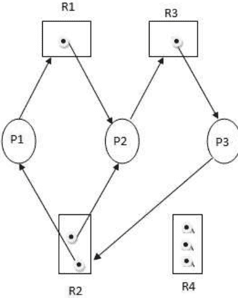

图 3.2 存在死锁的资源分配图。

进程 `P1`、`P2` 和 `P3` 处于死锁状态。进程 `P2` 正在等待资源 `R3`，该资源由进程 `P3` 持有。进程 `P3` 正在等待进程 `P1` 或 `P2` 释放资源 `R2`。此外，进程 `P1` 正在等待进程 `P2` 释放资源 `R1`。

## 3.2 死锁条件

如果系统中同时满足以下四个条件，则可能发生死锁：

1. **互斥性**：至少有一个资源必须以非共享模式持有；也就是说，同一时间只有一个进程可以使用该资源。如果另一个进程请求该资源，则请求进程必须等待，直到资源被释放。
2. **持有并等待**：进程必须在持有至少一个资源的同时，请求当前由其他进程持有的额外资源。
3. **不可剥夺**：资源不能被强制剥夺；也就是说，资源只能由持有它的进程在完成任务后自愿释放。
4. **循环等待**：必须存在一组等待进程集 `[P0, P1, ..., Pn]`，使得 `P0` 正在等待 `P1` 持有的资源，`P1` 正在等待 `P2` 持有的资源，…… `Pn-1` 正在等待 `Pn` 持有的资源，而 `Pn` 正在等待 `P0` 持有的资源。

我们强调，只有当这四个条件同时满足时，死锁才会发生。循环等待条件意味着持有并等待条件成立，因此这四个条件并非完全独立。

## 3.3 死锁预防

为了使死锁的发生，必须满足四个必要条件中的每一个。通过确保这些条件中至少一个不能成立，我们就可以防止死锁的发生。我们将通过分别检查这四个必要条件来详细说明这种方法。

### 3.3.1 互斥性

对于不可共享资源，必须满足互斥条件。例如，打印机不能同时被多个进程共享。相比之下，共享资源不需要互斥访问，且不会卷入死锁。只读文件是共享资源的一个良好示例。如果多个进程同时尝试打开一个只读文件，它们可以同时获得该文件的访问权限。进程永远不需要等待共享资源。然而，总的来说，我们无法通过否定互斥条件来防止死锁，因为某些资源在本质上是不可共享的。

### 3.3.2 持有并等待

为了确保系统永远不会发生持有并等待条件，我们必须保证每当进程请求资源时，它都不持有任何其他资源。可以使用的一种协议是：要求每个进程在开始执行之前，请求并分配其所有的资源。

另一种协议允许进程仅在没有任何资源时才请求某些资源。进程可以请求某些资源并使用它们。但在它请求任何额外资源之前，它必须释放当前分配给的所有资源。

为了说明这两种协议之间的区别，考虑一个进程从 DVD 驱动器拷贝数据到磁盘上的文件，存储文件，然后将结果打印到打印机。如果所有资源必须在进程开始时请求，那么进程最初必须请求 DVD 驱动器、磁盘文件和打印机。第二种方法允许进程在整个执行过程中持有打印机，尽管它只在结束时需要打印机。第二种方法最初仅请求 DVD 驱动器和磁盘文件。从 DVD 驱动器拷贝到磁盘然后释放两者。这两种方法都有缺点。首先，资源利用率可能较低，因为进程可能会长时间持有资源。其次，可能会发生饥饿。

### 3.3.3 不可剥夺

死锁的第三个必要条件是不可剥夺。为了确保该条件不成立，可以使用以下方法：如果进程持有某些资源并请求另一个资源，我们检查它们是否可用。如果是，则分配新资源。如果不是，则进程必须释放其当前持有的所有资源。

### 3.3.4 循环等待

死锁的第四也是最后一个条件是循环等待。确保该条件永远不成立的一种方法是给每个资源类型分配一个唯一的编号，允许我们比较两个资源。为了说明，我们设 `R={R1, R2, ..., Rm}` 为资源类型集合。我们定义一个一一函数 `F: R → N`，其中 `N` 是自然数集。例如，如果资源类型集合包括磁带机、磁盘驱动和打印机，那么：

`F(tape drive) = 1`

`F(disk drive) = 5`

`F(printer) = 12`

我们现在考虑以下防止死锁的协议：每个进程只能按照枚举编号的递增顺序请求资源。也就是说，进程最初可以请求任意数量的资源类型 `Ri` 的实例。之后，只有当 `F(Rj) > F(Ri)` 时，进程才能请求资源类型 `Rj` 的实例。如果需要多个相同类型的实例，必须一次性请求所有实例。例如，使用之前定义的函数，想要同时使用磁带机和打印机的进程必须先请求磁带机再请求打印机。或者，我们可以要求每当进程请求资源类型 `Rj` 的实例时，它已经释放了任何 `F(Ri) ≥ F(Rj)` 的 `Ri`。如果使用这两种协议，则循环等待条件不会成立。

## 3.4 死锁避免

最简单且有效的模型是要求每个进程声明它可能需要的每种资源的最大数量。根据这些先验信息，可以构建一种算法确保系统永远不会进入死锁状态。这种算法定义的死锁避免方法通过动态检查资源分配状态，以确保永远不存在循环等待条件。资源分配状态由可用资源、已分配资源以及进程的最大需求定义。

**安全状态**：如果系统能够按照某种顺序为每个进程分配资源（直到其最大需求）并仍然避免死锁，则该状态是安全的。

只有存在**安全序列**时，系统才处于安全状态。如果进程序列 `<P1, P2,...,Pn>` 是当前分配状态的安全序列，那么对于每个 `Pi`，`Pi` 的资源请求可以由当前所有 `Pj`（其中 `j < i`）持有的可用资源所满足。

# 操作系统概念与基础 Linux 指令

在这种情况下，如果进程 `Pi` 需要的资源无法立即获得，`Pi` 可以等待直到所有的 `Pj` 都完成。当它们完成后，`Pi` 就可以获得它所需的所有资源，完成其指定的任务，归还分配的资源并终止。当 `Pi` 终止时，`Pi+1` 就可以获得它需要的资源，依此类推。如果不存在这样的序列，则称该系统状态为不安全。

安全状态并不是死锁状态。相反，死锁状态是不安全状态。并非所有的不安全状态都是死锁。不安全状态可能导致死锁。只要状态是安全的，操作系统就可以避免不安全（以及死锁）状态的出现。在不安全状态，操作系统无法阻止进程请求资源，从而发生死锁：进程的行为控制了不安全状态的出现。

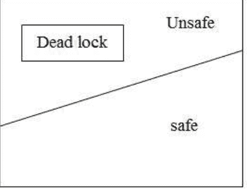

**图 3.3: 安全、不安全和死锁状态空间**

### 3.4.1 银行家算法

这是一种死锁避免算法，之所以这样命名是因为银行从不分配超过可用现金现金。

- **Available (可用)**：一个长度为 `m` 的向量，表示每种类型可用资源的数量。如果 `Available[j] = k`，则有 `k` 个类型 `Rj` 的资源可用。
- **Max (最大)**：一个 `n × m` 的矩阵，定义每个进程的最大需求。如果 `Max[i][j] = k`，则进程 `Pi` 最请求 `k` 个类型 `Rj` 的资源。
- **Allocation (分配)**：一个 `n × m` 的矩阵定义当前分配给每个进程的每种资源。如果 `Allocation[i][j] = k`，则进程 `Pi` 目前分配了 `k` 个类型 `Rj` 的资源。
- **Need (需求)**：一个 `n × m` 的矩阵表示每个进程的剩余需求。如果 `Need[i][j] = k`，则进程 `Pi` 可能还需要 `k` 个类型 `Rj` 的资源来完成其任务。


- 注意 `$Need[i][j] = Max[i][j] - Allocation[i][j]$`。

这些数据结构的大小和值随时间而变化。为了简化银行家算法的表示，让我们建立一些符号。令 `$X$` 和 `$Y$` 为长度为 `$n$` 的向量。当且仅当对于所有 `$i = 1, 2, ..., n$`，`$X[i] \leq Y[i]$` 时，我们称 `$X \leq Y$`。例如，如果 `$X = (1,7,3,2)$` 且 `$Y = (0,3,2,1)$`，则 `$Y \leq X$`；如果 `$Y \leq X$` 且 `$Y \neq X$`，则 `$Y < X$`。

我们将矩阵 `$Allocation$` 和向量 `$Need$` 中的每一行视为向量，并分别称为 `$Allocation$` 和 `$Need$`。向量 `$Allocation$` 指定了当前分配给进程 `$Pi$` 的资源；向量 `$Need$` 指定了进程 `$Pi$` 为了完成其任务可能仍会请求的额外资源。

### 3.4.2 安全算法

用于找出系统是否处于安全状态的算法描述如下：

1. 令 `$Work$` 和 `$Finish$` 分别为长度为 `$m$` 和 `$n$` 的向量。`$Work = Available$`，且对于 `$i = 0, 1, ..., n-1$`，`$Finish[i] = false$`。

2. 找到一个索引 `$i$` 使得：

    a. `$Finish[i] == false$`

    b. `$Need \leq Work$`

   如果不存在这样的 `$i$`，跳转到第 4 步。

3. `$Work = Work + Allocation[i]$`；`$Finish[i] = true$`；回到第 2 步。

4. 如果对于所有 `$i$` `$Finish[i] == true$`，则系统处于安全状态。该算法可能需要 `$m \times n^2$` 次操作来判断一个状态是否安全。

### 3.4.3 资源请求算法

令 `$Request_i$` 为进程 `$Pi$` 的请求向量。如果 `$Request_i[j] = k$`，则进程 `$Pi$` 想要 `$k$` 个类型 `$Rj$` 的资源。当进程 `$Pi$` 发出资源请求时，采取以下操作：

1. 如果 `$Request_i \le Need$`，跳转到第 2 步。否则抛出错误条件，因为该进程超过了它的最大声明值。

2. 如果 `$Request_i \le Available$`，跳转到第 3 步。否则，`$Pi$` 必须等待，因为资源不可用。

3. 让系统通过如下修改状态假装已将请求资源分配给进程 `$Pi$`：

   `$Available = Available - Request_i$`;

   `$Allocation_i = Allocation_i + Request_i$`;

   `$Need = Need - Request_i$`;

如果得到的资源分配状态是安全的，则完成事务并为进程 `$Pi$` 分配资源。然而，如果新状态是不安全的，`$Pi$` 必须等待 `$Request_i$`，并恢复旧的资源分配状态。

## 3.5 死锁检测

当发生死锁情况时，系统必须提供：

- 一种能够检查系统状态以判断是否发生了死锁的算法
- 一个从死锁中恢复的算法

我们可以使用等待图（wait-for graph）针对单实例和多实例来检测死锁。

### 3.5.1 每种类型单实例

资源类型的单实例意味着系统只包含每种资源的一个实例。这可以使用等待图来检测，如果 `$Pi$` 正在等待 `$Pj$` 持有的资源，则从 `$Pi$` 到 `$Pj$` 存在一条边。


等待图中包含环当且仅当系统处于死状态。

### 3.5.2 资源多实例

等待图方案不多实例资源。以下是数据结构：

- **Available (可用)**：一个长度为 `$m$` 的向量表示可用资源的数量。
- **Allocation (分配)**：一个 `$n \times m$` 的矩阵定义当前分配给每个进程的每种资源。
- **Request (请求)**：一个 `$n \times m$` 的矩阵表示每个进程的请求。

为了简化符号，我们再次将矩阵 `$Allocation$` 和 `$Request$` 中的行视为向量。

1. 令 `$Work$` 和 `$Finish$` 分别为长度为 `$m$` 和 `$n$` 的向量。初始化 `$Work = Available$`，且对于 `$i = 0, 1, ..., n-1$`，`$Finish[i] = false$`。如果 `$Allocation[i] \neq 0$`，则 `$Finish[i] = false$`；否则 `$Finish[i] = true$`。

2. 找到一个索引 `$i$` 使得：

    a. `$Finish[i] == false$`

    b. `$Need \leq Work$`

   如果不存在这样的 `$i$`，跳转到第 4 步。

3. `$Work = Work + Allocation[i]$`；`$Finish[i] = true$`；回到第 2 步。

4. 如果对于所有 `$i$` `$Finish[i] == true$`，则系统处于死锁状态。否则，系统处于死锁状态。

# 操作系统概念与基础 Linux 命令

我们声称系统现在已发生死锁。尽管我们可以收回进程 `$P0$` 持有的资源，但可用资源数量不足以满足其他进程的请求。因此，存在一个死锁，由进程 `$P1$`、`$P2$`、`$P3$` 和 `$P4$` 组成。

## 3.6 从死锁中恢复

打破死锁有两种方法。一种是简单的终止一个或多个进程以打破循环等待。另一种方法是从一个或多个死锁进程中抢夺某些资源。

### 3.6.1 进程终止

终止进程有两种方法。在这两种方法中，系统都会收回分配给终止进程的所有资源。

- **终止所有死锁进程：** 方法显然会打破死锁循环，但代价巨大。
- **一次终止一个进程，直到消除死锁循环：** 这种方法会产生大量的开销，因为在终止每个进程后，必须调用死锁检测算法来判断是否仍有进程处于锁定状态。

### 3.6.2 资源抢夺

要使用资源抢夺消除死锁，我们连续地从进程中抢夺某些资源并将这些资源给其他进程，直到死锁循环被打破。

使用资源抢夺消除死锁有三种方法。

- 1. **选择受害者：** 选择要抢夺的资源和进程。成本因素可能包括死锁进程持有的资源数量以及进程执行过程中消耗的时间。
- 2. **回滚：** 如果我们从进程中抢夺了资源，该进程应该如何处理？显然，它不能继续正常执行；因为它缺少了一些所需的资源。我们必须将进程回滚到某个安全状态并从该状态重新启动。由于通常情况下很难确定什么是安全状态，最简单的解决方案是完全回滚：终止进程然后重新启动。虽然仅将进程回滚到打破死锁所需的程度更为有效，但这种方法要求系统保留更多关于所有运行进程状态的信息。
- 3. **饥饿：** 我们如何确保不会发生饥饿？也就是说，我们如何保证资源不会总是从同一个进程中抢夺？在一个主要基于成本因素选择受者的系统中，可能会出现同一个进程总是被选为受害者。结果是该进程永远无法完成其预定任务，这是任何实际系统中都需要处理的饥饿问题。显然，我们必须确保一个进程只能被选为受害者（少量）有限的次数。最常见的解决方案是将回滚次数包含在成本因子中。

# 内存管理

在单程序系统中，主内存分为两个部分：一部分用于操作系统，另一部分用于当前执行的作业。考虑如下所示。

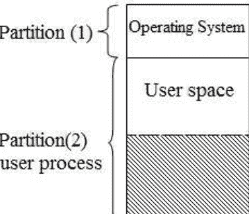

图 3.5：主内存分区

分区 1 用于操作系统，分区 2 用于存储用户进程。在分区 2 中，部分内存被浪费了，图中用黑线表示。

在多程序环境中，用户空间被划分为若干个分区。每个分区对应一个进程。子划分任务由操作系统动态执行；这项任务被称为“内存管理”。通过多程序设计可以实现高效的内存管理。

## 3.7 逻辑地址空间与物理地址空间

CPU 生成的地址通常称为逻辑地址，而内存单元看到的地址——即加载到内存访址寄存器中的地址——通常称为物理地址。

编译时和装入时的地址绑定方法生成的逻辑地址和物理地址是。然而，执行时地址绑定方案会导致逻辑地址和物理地址不同。在这种情况下，我们通常将逻辑地址称为虚拟地址。在本文中，逻辑地址和虚拟地址交替使用。程序生成的所有逻辑地址的集合称为逻辑地址空间；这些逻辑地址对应的所有物理地址的集合称为物理地址空间。因此，在执行时地址绑定方案中，逻辑和物理地址空间是不同的。

Shital Vivek Ghate

从虚拟地址到物理地址的运行时映射是由称为内存管理单元（MMU）的硬件完成的。基寄存器被称为重位寄存器。重位寄存器包含最小物理地址的值；限寄存器包含逻辑地址的范围（例如，`relocation=100040`，`limit=74600`）。通过重位寄存器和限寄存器，每个逻辑地址必须小于限寄存器；MMU 通过加上重位寄存器中的值来动态映射逻辑地址。映射后的地址被发送到内存。

我们有两种地址：逻辑地址（范围在 0 到 max 之间）和物理地址（范围在 R 到 R + max 之间）。用户提供逻辑地址；这些地址在使用之前必须映射为物理地址。绑定到独立物理地址空间的逻辑地址空间概念是正确内存管理的核心。


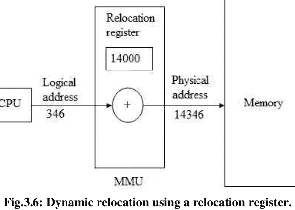

# 操作系统概念与基础 Linux 命令

## 3.8 交换 (Swapping)

交换用于提高主内存的利用率。例如，假设由进程组成内存是存放这些进程的最大容量。正在执行该进程的 CPU 需要 I/O。这时 CPU 切换到另一个作业并将进程移动到磁盘。当进程完成后，它被移动到主内存。从主内存切换到磁盘被称为“换出”`swap out`，从磁盘到主内存被称为“换入”`swap in`。这种机制被称为“交换”。通过交换可以实现高效内存利用。

交换需要“存储器”`backing store`。存储器通常是快速磁盘。它必须足够大，以容纳所有用户的进程映像。当进程被换出时，其执行映像被复制到存储器。当它被换入时，它被复制到内存管理器分配的新内存块中。

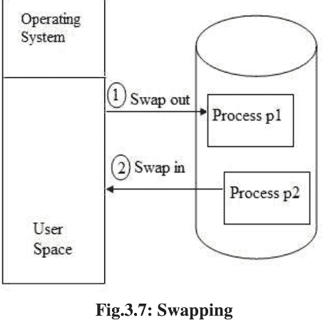

## 3.9 内存保护

保护操作系统不受用户进程影响，并保护用户之间。我们可以使用带有限寄存器的重位寄存器来提供这种保护。重位寄存器包含最小物理地址的值；限寄存器包含逻辑地址的范围。例如，`relocation=100040`，`limit=74600`。通过重位寄存器和限寄存器，每个逻辑地址必须小于限寄存器；`MMU`通过加上重位寄存器中的值来动态映射逻辑地址。映射后的地址被发送到内存。

当`CPU`调度器选择一个进程执行时，调度程序会在上下文切换部分将正确的值加载到重位寄存器中。由于`CPU`生成的每个地址都会经过这些寄存器的检查，我们可以保护操作系统以及用户的程序和数据不被此运行进程修改。

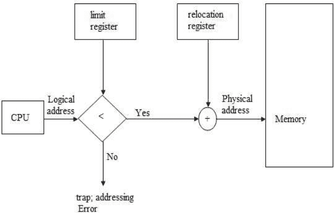

图 3.8：重位寄存器和限寄存器的硬件支持。

操作系统概念与基础 Linux 命令

### 3.10 内存分配方法

主内存包含操作系统和用户进程。以下是各种内存分配方法。

#### 3.10.1 单分区分配

在该方法中，操作系统位于内存的下半部分，剩余内存被视为一个分区。该单分区供用户空间使用。在同一时间内，该用户空间只能加载一个作业。

短作业调度器从就绪队列中选择一个作业执行，由调度程序将该作业加载到主内存中。由于用户空间被视为单分区，主内存中同一时间只包含一个进程。

该方案的主要缺点是内存没有被充分利用，造成了大量的内存浪费。

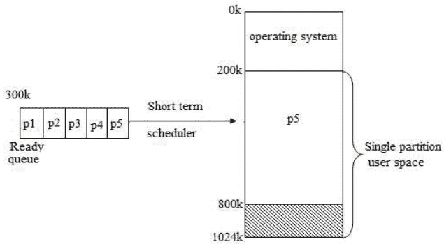

图 3.9：单分区内存分配

#### 3.10.2 多分区划分

这种方法可以通过三种方式实现：

- a. 固定等长多分区
- b. 固定变长多分区
- c. 动态多分区

##### 3.10.2.1 固定等长多分区

在此方案中，操作系统位于低内存区域，主内存其余部分用作用户空间。用户空间被划分为固定分区。这些分区的大小取决于操作系统。例如，总内存大小为 6MB；操作系统占用 1MB。剩余的 5MB 被划分为 5 个每个 1MB 的等长固定分区。`P1`、`P2`、`P3`、`P4`、`P5`是要加载到主内存的 5 个作业，它们的大小如下所示：

| 作业 | 大小 |
| :--- | :--- |
| `P1` | 450kb |
| `P2` | 1000kb |
| `P3` | 1024kb |
| `P4` | 1500kb |
| `P5` | 500kb |

**内部碎片与外部碎片：**

进程 `partition1` 被加载到 `partition1` 中。`partition1` 的最大大小为 1024kb，`P1` 的大小为 450kb。因此浪费了 1024-450=574kb 的空间，这种浪费的内存被称为“内部碎片”。但没有足够的空间来加载进程 `P4`，因为进程 `P4` 的大小大于所有分区，所以整个分区 `partition5` 都被浪费了。这种浪费的内存被称为“外部碎片”。

因此，总碎片为 =(1024-450)+(1024-1000)+(1024-500)=574+24+524=1122kb。

外部碎片为 1024 kb。

分区内浪费的内存内存称为内部碎片，而整个分区的浪费称为外部碎片。

**优点：**

它支持多程序并发。可以有效利用处理器和 I/O 设备。

**缺点：**

它遭受受到内部碎片和外部碎片的影响。

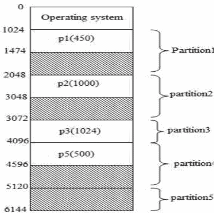

图 3.10：主内存分配

##### 3.10.2.2 固定变长多分区

在该方法中，主内存的用户空间被划分为若干分区，但分区的长度不同。操作系统维护一张表，指示内存中哪些分区是可用的，哪些是被占用的。当进程到达并需要内存时，我们寻找一个足够大的分区来存放该进程。如果我们找到了足够容纳进程的空间，则将该分区分配给它。

有三种策略用于在此分配内存：

- **首次分配 `First-Fit`**：分配第一个足够容纳该进程的分区。它从内存的低端开始搜索。
- **最佳分配 `Best-Fit`**：分配最小能够容纳该进程的分区。它搜索整个内存，并分配大小最合适的分区。
- **最坏分配 `Worst-Fit`**：分配最大的分区。例如，假设我们有 400kb 可用内存，操作系统占用了 350kb。

| 作业 | 大小 | 到达时间 |
| :--- | :--- | :--- |
| `J1` | 825kb | 10 |
| `J2` | 600kb | 5 |
| `J3` | 1200kb | 20 |
| `J4` | 450kb | 30 |
| `J5` | 650kb | 15 |
| 分区 | 大小 |
| :--- | :--- |
| `P1` | 700kb |
| `P2` | 400kb |
| `P3` | 525kb |
| `P4` | 900kb |
| `P5` | 350kb |
| `P6` | 625kb |

图 3.11：调度


图 3.12：内存分配

在 (a), (b), (c), (d) 中，`J2`, `J1`, `J5` 已加载。最后一个作业是 `J4`，`J4` 的大小为 450kb，但可用内存只有 225kb，不足以加载 `J4`，因此它必须等待内存释放。假设一段时间后 `J5` 结束执行并释放了内存。此时可用内存变为 225+650=875kb。该内存足够加载 `J4`。

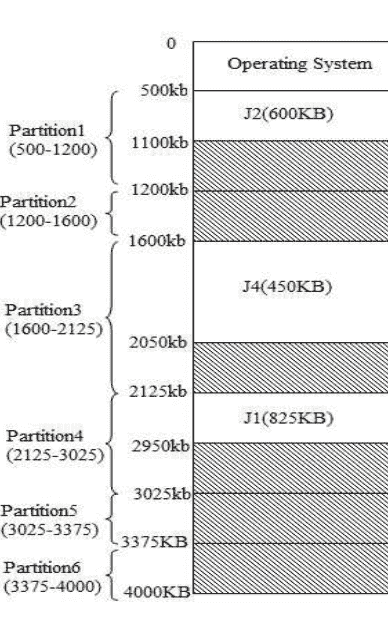

## 3.12 分页 (Paging)

单分区和多分区方法支持连续内存分配，整个过程加载在分区中。在分页存储中，进程被划分为若干个小部分，这些部分被加载到主内存的其他位置。

物理内存被分为固定大小的块，称为“帧”`frames`；而逻辑地址空间（用户进程）被分为固定大小的块，称为“页”`pages`。页的大小和帧的大小必须相等。页的大小或帧的大小取决于操作系统。通常页的大小为 4KB。

在该操作系统内核维护着一种名为“页表”`page table`的数据结构，页表规定明了一些有用信息，它告诉我们哪些帧被分配了、总共有多少帧等。通用的页表由两个字段组成，一个是页号，另一个是帧号。每个操作系统都有其存储页表的方法。

`CPU`生成的每个地址分为两部分：第一部分是“页号”，第二部分是“页偏移”`page offset`或位移。页号用作页表中的索引。考虑下面的图，`CPU`生成的逻辑地址空间被分为若干页，每个页都有页号 `P` 和位移 `D`。页被加载到物理内存中可用的空闲帧中。页表包含每个页在物理内存中的基地址，该地址与偏移相结合即可找到该页的物理地址。

页号与帧号之间的映射通过页映射表完成。页映射表规定了哪个页被加载到哪个帧中，位移是通用的。

为了更好地理解，考虑以下示例。就绪队列中有两个任务，`job1` 的大小为 16kb，`job 2` 的大小为 24kb。页的大小为 4kb。可用的主内存为 72kb，即 18 个帧。因此，`job 1` 被分为 4 页，`job 2` 被分为 6 页。每个进程维护着一个程序表。考虑下面的图以获得更好的 de理解。

# 操作系统概念与基础 Linux 指令

帧号 `Frame Number`

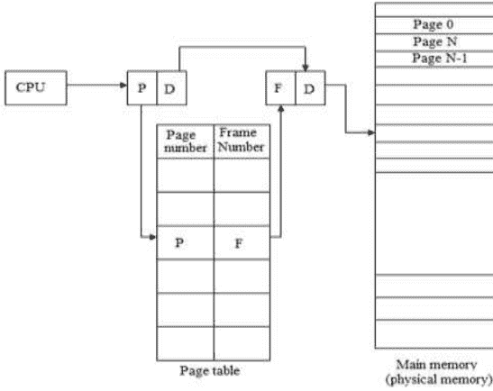

## 图 3.16：分页方案结构

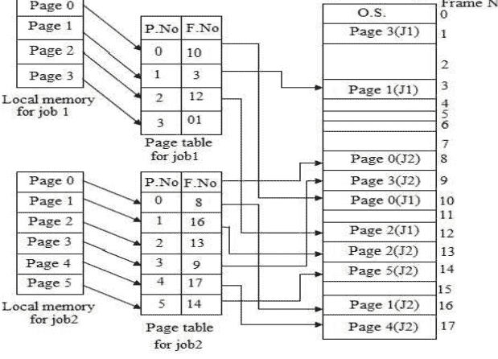

## 图 3.17：分页示例

`job 1` 的四个页被加载到内存中的不同位置。操作系统为每个进程提供一个页表。页表规定了在主内存中的位置。在此示例中，主内存的容量为 18 个帧，可用任务仅需要 10 个帧，因此剩余的 8 个帧是空闲的。这些空闲帧可以用于其他任务。

**优点：** 分页支持时分系统。它不会受到碎片问题的影响。它支持虚拟内存。


**缺点：** 分页可能会产生“页断”（`page breaks`）。例如考虑一个逻辑地址空间为 `17kb` 的任务，页大小为 `4kb`。因此该任务需要 `5` 个帧。最后一帧（即第五帧）仅需要 `1kb` 的内存，因此剩下的 `3kb` 被浪费了。这被称为页断。

如果页数很大，那么维护页表非常困难。

### 3.12.1 共享页 (Shared Pages)

在多程序环境中，可以同时让多个进程共享公共代码，而不是维护某些代码的多个副本。逻辑地址被分为页，这些页可以同时被多个进程共享。被多个进程共享的页称为共享页。

例如，考虑一个有 `10` 个用户的多程序环境。在 `10` 个用户中，有 `3` 个人想要执行文本编辑器；他们希望在文本编辑器中共享个人数据。假设文本编辑器需要 `150kb`，用户个人数据占用 `50kb` 的数据空间。他们将需要 `3*(150+50)=600kb`。但在共享分页中，文本编辑器由所有用户任务共享，因此它需要 `150kb`，而用户文件需要 `50*3=150kb`。因此，`(150+150)=300kb` 就足够管理这三个任务了，而不是 `600kb`。共享分页节省了 `300kb` 的空间。

帧的大小为 `50kb`。因此，文本编辑器需要 `3` 个帧，用户文件需要 `3` 个帧。每个进程（`P1`, `P2`, `P3`）都有一个页表，页表显示帧号，每个页表中的前 `3` 个帧号（即 `3`, `8`, `0`）是共同的。这意味着三个进程共享了三个页。共享页的主要优点是可以实现高效的内存利用。

操作系统概念与基础 Linux 指令

| 文本编辑器 1 | 3 |

|---|---|

| 文本编辑器 2 | 8 |

| 文本编辑器 3 | 0 |

| 个人数据 1 | 5 |

| 文本编辑器 3 | 0 |

|---|---|

| | 1 |

| | 2 |

| 文本编辑器 1 | 3 |

| | 4 |

| 个人数据 1 | 5 |

| 个人数据 2 | 6 |

P1 的页表

| 文本编辑器 1 | 3 |

|---|---|

| 文本编辑器 2 | 8 |

| 文本编辑器 3 | 0 |

| 个人数据 1 | 5 |

| 文本编辑器 3 | 0 |

|---|---|

| | 1 |

| | 2 |

| 文本编辑器 1 | 3 |

| | 4 |

| 个人数据 1 | 5 |

| 个人数据 2 | 6 |

P2 的页表

| 文本编辑器 1 | 3 |

|---|---|

| 文本编辑器 2 | 8 |

| 文本编辑器 3 | 0 |

| 个人数据 1 | 5 |

| 文本编辑器 3 | 0 |

|---|---|

| | 1 |

| | 2 |

| 文本编辑器 1 | 3 |

| | 4 |

| 个人数据 1 | 5 |

| 个人数据 2 | 6 |

P3 的页表


## 3.13 段存储 (Segmentation)

在段存储中，程序被划分为段，如子程序、数组等。每个段有一个名称和长度。逻辑地址由两部分组成：段号 (`s`) 和偏移 (`d`)。段号 (`s`) 用作段表中的索引。考虑下面的图，CPU 生成的逻辑地址空间被分为若干段，每个段都有段号 (`s`) 和位移 (`d`)。段被加载到物理内存中可用的空闲区域中。段表包含每个段在物理内存中的基地址，该地址与偏移相结合即可找到该段的物理地址。

段号与帧号之间的映射通过段表完成。段表规定了哪个段被加载到哪个区域，偏移是通用的。

为了更好地理解，考虑以下示例。就绪队列中有两个任务，`job1` 的大小为 `16kb`，`job 2` 的大小为 `24kb`。段的大小为 `4kb`。因此任务 `1` 被分为 `4` 段，`job 2` 被分为 `6` 段。每个进程维护着一个程序表。考虑下面的图以获得更好的理解。

# 操作系统概念与基础 Linux 指令


## 图 3.21：段存储示例

其中逻辑地址被分为四个段，编号从 `0` 到 `3`。每个段在段表中有一个项。界限（limit）规定了段的大小，基地址（base）规定了段的起始地址。在这里，段 `'0'` 加载在内存的 `150kb` 到 `250kb`，因此 `250-150=100kb` 是界限。

段存储支持虚拟内存。它通过移动段来消除碎片；碎片化的内存空间可以合并到单一的空闲区域。


### 3.13.1 段分页 (Segmentation with paging)

在该方案中，段与分页结合。进程被划分为段，然后每个段再划分为页，每个段由页表维护。逻辑地址分为三部分 `<s,p,d>`：第一部分是段号 (`s`)，第二部分是页号 (`p`)，第三部分是偏移或位移 (`d`)。该方案的基础硬件如图所示。

例如考虑图 `323`。逻辑地址空间被划分为 `3` 个段，编号从 `0` 到 `2`。每个段维护一个页表。页与帧之间的映射通过页表完成。在我们的示例中，帧号 `8` 显示了地址 (`1,3`)，`1` 是段号，`3` 是页号。该方案用于避免碎片。

# 操作系统概念与基础 Linux 指令


## 图 3.22：段分页内存管理方案

## 3.14 请求分页

请求分页是虚拟内存的应用。虚拟内存是一种技术，即使逻辑地址空间大于物理地址空间，也允许进程的执行。

在这种方案中，页面在需要时，否则不会从辅助存储器加载到主内存中，即按需要将页面加载到主内存。因此，这种方案被称为“请求分页”。

例如，假设逻辑地址空间为 `72KB`，页和页帧的大小为 `8KB`，因此逻辑地址空间被划分为 `9` 个页，编号从 `0` 到 `8`。可用内存为 `40KB`，即有 `5` 个帧可用，因此 `5` 个页被加载到主内存中，其余 `4` 个页位于辅助存储设备中；每当需要这些页面时，操作系统就会将这些页面调入主内存。

在请求分页中，页表由三个字段组成。第一个是页号，第二个是帧号，第三个是有效/无效位。如果页面存在主内存中，则有效/无效位被设置为“有效”。否则，如果页面存在辅助存储器中，则该位被设置为“无效”；其余所有页面都存在主内存中，因此这些位被设置为“无效”。

在图 `3.24` 中，页号 `1`、`3`、`4`、`6` 被加载到辅助存储器中，因此这些位被设置；其余所有页面存在主内存中，因此这些位被设置为有效。

主内存中的可用空闲页有 `5` 个，因此主内存中加载了 `5` 个页。

## 3.15 页缺

当处理器需要执行某个页面而该页面在主内存不可用时，这种情况被称为“页缺”。当发生页缺时，就需要页面置换。页面置换意味着在主内存中选择一个牺牲页，并用备份存储（磁盘）中的所需页面替换该页面。牺牲页是通过“页面置换算法”选择的。

# 操作系统概念与基础 Linux 命令

| | 页号 | 帧号. | VI |

|---|---|---|---|

| A | 0 | 5 | V |

| B | 1 | | I |

| C | 2 | 8 | V |

| D | 3 | | I |

| E | 4 | | I |

| F | 5 | 11 | V |

| G | 6 | | I |

| H | | 3 | V |

| I | 8 | 14 | V |

逻辑内存页表

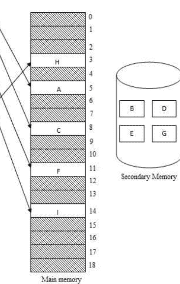

图 3.24: 请求分页

## 3.16 页面置换算法：

有各种页面置换算法，以下是一些常用的页面置换算法：

### 3.16.1 FIFO 页面置换

最简单的页面置换算法是 FIFO（先先出）算法。FIFO 页面置换算法与每个页面进入内存的时间相关。当某个页面必须被替换时，选择最旧的页面，即替换在内存中时间比其他其他页面都长的页面。

例如，考虑一个引用串：`7, 0, 1, 2, 0, 3, 0, 4, 2, 3, 0, 3, 2, 1, 2, 0, 1, 7, 0, 1`。

假设有三个初始为空的帧。对于我们的示例引用串，我们的三个帧初始时为空的。

前三次引用 (`7, 0, 1`) 导致页缺并被带到这些空帧中。下一个引用 (`2`) 替换了页面 `7`，因为页面 `7` 是先进入的。由于 `0` 已经在内存中，我们这次引用没有发生页缺。

第一次引用 `3` 导致了页面 `0` 的替换，因为现在现在是内存中三个页面中最旧的，这意味着下一次对 `0` 的引用将导致页缺。随后，页面 `1` 被页面 `0` 替换。这一过程如图所示。每当发生页缺时，我们都显示三个帧中是哪些页面。对于给定的引用串和三个帧，总共发生了 `15` 次页缺。

+ 7 0 1 2 3 0 4 2 3 0 2 1 2 0 1 7 0 1

| 7 7 2 | 2 4 4 4 0 | 0 0 | 7 7 7 |

| 0 0 0 | 3 3 2 2 0 | 1 1 | 1 0 0 |

| 1 1 1 | 0 0 3 | 3 2 | 2 2 7 |

页帧

## 图 3.25 FIFO 页面置换


FIFO 页面置换算法容易理解和编程。然而，它的性能并不总是良好。我们可能必须选择一个活跃页面进行替换，在用新页面替换活跃页面后，该活跃页面立即发生页缺。然后将需要替换另一个其他页面以将活跃页面带入内存。因此，糟糕的置换选择会增加页缺率并减慢进程执行，但不会导致执行错误。

为了说明页面置换中出现的问题，我们考虑引用串 1, 2, 3, 4, 1, 2, 5, 1, 2, 3, 4, 5。注意，四个帧的页缺数（10）大于三个帧（9）。这种结果被称为贝尔雷异常。

在某些研究中，人员发现这种假设是不成立的。页面置换会改进其性能。

### 3.16.2 最优算法

最优页面置换简单称为 MIN。FIFO 和 OPT 算法（向前看）的关键区别在于：FIFO 使用页面进入内存的时间，而 OPT 使用页面将要使用的时间。

不幸的是，最优算法很难实现，因为它需要引用串的未来。然而，它保证了最低的页缺率且不会遭受贝尔雷异常。

例如，对于我们的引用串 1, 2, 3, 4, 1, 2, 5, 1, 2, 3, 4, 5，最优置换将产生九次页缺，如图所示。

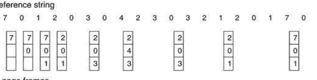

图3.26: 最优算法

### 3.16.3 最久未使用算法

如果最优算法不可，或许可以使用最优算法的近似。如果我们使用过去作为未来的近似，就可以使用：最久未使用（LRU）置换与每个页面的最后使用时间相关。当页面必须被替换时，LRU 选择最长时间未使用的页面。这种策略是向后查看时间。

将 LRU 应用于示例引用串的结果如图所示。LRU 算法产生了 12 次页缺。注意前五次页缺与最优算法相同。当引用 4 时，页面 2 使用最少。因此，LRU 替换了页面 4，而不知道页面 2 即将使用。当随后发生页面 2 缺时，LRU 替换了页面 3，因为它是内存中三个页面中最久使用的。尽管存在这些问题，12 次页缺的 LRU 置换仍然优于 15 次页缺的 FIFO 置换。

引用串

| 1 | 2 | 3 | 4 | 1 | 2 | 5 | 1 | 1 | 2 | 3 | 4 | 5 | 2 | 2 | 3 |
|---|---|---|---|---|---|---|---|---|---|---|---|---|---|---|---|

| 1 | 1 | 1 | 1 | 1 | 1 | 1 | 1 | 1 | 1 | 1 | 1 | 1 | 1 | 1 | 1 |
| | 2 | 2 | 2 | 2 | 2 | 2 | 2 | 2 | 2 | 2 | 2 | 2 | 2 | 2 | 2 |
| | | 3 | 3 | 3 | 3 | 3 | 3 | 3 | 3 | 3 | 3 | 3 | 3 | 3 | 3 |
| | | | 4 | 4 | 4 | 4 | 4 | 4 | 4 | 4 | 4 | 4 | 4 | 4 | 4 |
| | | | | | | 5 | 5 | 5 | 5 | 5 | 5 | 5 | 5 | 5 | 5 |


# 文件系统与 Linux 操作系统简介

## 文件系统

文件系统是操作系统中最可见的方面。它为操作系统以及计算机系统所有用户的数据和程序提供了在线存储和访问机制。文件系统由两个不同的部分组成：文件集合（每个文件存储相关数据）以及目录结构（它负责组织并提供有关系统中所有文件的信息）。

## 4.1 文件概念

文件管理是操作系统最直观的服务之一。计算机可以用几种不同的物理形式存储信息；磁带、磁盘、光盘是最常见的形式。这些设备中的每一种都有其自身的特性和物理结构。操作系统从存储设备的物理属性中抽象出来，定义了一个逻辑存储单元，即文件。操作系统将文件映射到物理设备上。这些存储设备通常是非易失性的，因此内容在掉电和系统重启后依然存在（持久性）。

文件是存储在次级存储器上的具名的相关信息集合。除非数据在文件内部，否则无法写入次级存储器。通常，文件代表程序（包括源码和目标形式）和数据。数据文件可以是数值、字母、字母数字或二进制的。文件可以是自由形式的（如文本文件），也可以是严格格式化的。总的来说，文件是位、字节、行或记录的序列，其含义由文件的创建者和用户定义。

文件中的信息由其创建者定义。文件中可以存储许多类型的信息——源码、目标程序、可执行程序、数值数据、文本、工资记录、图形图像、声音录音等。文件具有特定的定义结构，该结构取决于它的类型。文本文件是组织成行（并可能还有页）的字符序列。源文件是子程序和函数的序列，每个子程序进一步被组织为声明，后跟可执行语句。目标文件是组织成系统链接器可理解的块的字节序列。可执行文件是一系列代码段段，由加载器将其带入内存并执行。

操作系统概念与基础 Linux 命令

## 4.2 文件属性

为了方便人类用户使用，文件是经过命名的，并通过其名称进行引用。名称通常是一个字符字符串，例如 `'em.c'`。某些系统区分名称中的大小写字符，而其他系统则不区分。当文件命名后，它就独立于创建它的进程、用户，甚至是系统。所有文件的信息都保留在目录结构中，目录结构也位于次级存储器上。

文件还有其他属性，这些属性随操作系统而异，但通常包括以下内容：

- `Name`：符号文件名是唯一以人类可读形式保留的信息。
- `Identifier`：这是一个唯一的标记（通常是数字），用于在系统中标识文件；它是文件的不可读读名称。
- `Type`：支持不同类型文件的系统需要此信息。
- `Location`：此信息是指向设备以及该文件在该设备上位置的指针。
- `Size`：该属性包含文件的当前大小（字节、字或块）以及可能允许的最大大小。
- `Protection`：访问控制信息决定谁可以进行读取、写入、执行等操作。
- `Time, date, and user identification`：可能保留创建、最后修改和最后使用的这些信息。这些数据对于保护、安全和使用监控很有用。

## 4.3 文件操作

文件是一种**抽象数据类型**。对文件执行的基本操作包括创建文件、写文件、读文件、重定位文件、删除文件。操作系统可以提供系统调用来执行所有这些操作。

- **创建文件**：

创建文件需要两个步骤。首先，必须在文件系统中找到文件的空间。其次，必须目录中为新文件创建一个条目。目录条目记录文件名、其在文件中的位置以及可能的其他信息。

- **写文件**：

要写文件，我们调用一个系统调用，同时指定文件名和要写入文件的信息。给定文件名，系统会搜索目录以找到文件的位置。目录条目需要存储一个指向文件当前末尾的指针。使用该指针可以计算出下一个块的地址并写入信息。写指针必须更新。

- **读文件**：

要从文件中读取内容，我们使用一个系统调用，指定文件名和文件下一个块应该存放的内存位置。再次搜索目录查找关联的目录条目。目录同样需要一个指向待读取下一个块的指针。一旦读取了该块，指针就会更新。给定的进程通常只读取或写入给定的文件，并且当前的操作位置被保留为每个进程当前的文件位置指针。读、写操作都使用同一个指针，节省了空间并降低了系统复杂性。

- **文件内重定位**：

搜索目录查找合适的条目，并将当前文件位置指针设置为给定值（给定位置）。

- **删除文件**：

要删除文件，我们搜索目录查找合适的条目，释放空间并擦除目录条目。

操作系统概念与基础 Linux 命令

## 4.4 文件类型

实现文件类型的常用技术是在名称中包含类型。某些系统使用扩展名来指示类型。例如，MSDOS 只识别少数扩展名，但应用程序使用扩展名。以下显示了一些类型：

| 文件类型 | 常用扩展名 | 功能 |
|---|---|---|
| 可执行 | exe, com, bin | 准备好运行的机器程序 |
| 目标 | obj, o | 已编译的机器语言 |
| 源码 | c, cc, java, pas, asm, a | 各种语言的源码 |
| 批处理 | bat, sh | 命令解释器的命令 |
| 文本 | txt, doc | 文本数据 |
| 文字处理 | wp, tex, rtf, doc | 各种文字处理格式 |
| 文件类型 | 常用扩展名 | 功能 |
|---|---|---|
| 库 | lib, a, so, dll | 程序员使用的程序库 |
| 打印或查看 | ps, pdf, jpg | 用于打印或查看的 ASCII 或二进制文件 |
| 存档 | arc, zip, tar | 用于归档的相关文件分组，有时经过压缩 |
| 多媒体 | mpeg, mov, rm | 包含音频或视频的二进制文件 |

## 4.5 访问方法


文件存储信息。在使用这些信息时，必须访问并将其读取到计算机内存中。文件信息可以通过多种方式访问。某些系统只提供一种访问方法。其他系统（如 IBM 的系统）支持许多访问方法，为特定应用程序选择正确的方法是一个主要的设计问题。

# 操作系统概念与基础 Linux 命令行

## 4.5.1 顺序访问方法

最简单的访问方法是顺序访问。文件中的信息按顺序处理，一个接一个。读和写构成了文件操作的大部分。读取操作读取文件的下一部分并自动移动跟踪 I/O 位置的文件指针。同样，写操作追加到文件末尾并移动到新写入内容的末尾（新的文件末尾）。此类文件可以重置到开头；在某些系统中，程序可以向前或向后跳 n 条记录，n 是某个整数——例如 n=1）。如图所示，顺序访问仅基于磁带模型，在顺序访问设备和随机访问设备上的效果都良好。

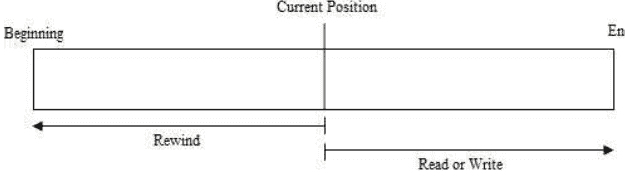

图 4.1: 顺序访问文件

## 4.5.2 直接访问

另一种方法是`直接访问（或相对访问）`。直接访问方法基于文件的磁盘模型，因为磁盘允许随机访问任何文件块。文件由固定长度的`逻辑记录`组成，这允许程序以不特定的特定顺序快速地读取和写入记录。对于直接访问，文件被视为一组带有编号的块或记录序列。直接访问文件允许按任何顺序读取或写入数据块。因此，我们可以读取第 14 块，然后读取第 53 块，最后写入第 7 块。直接访问文件对读取或写入的顺序没有限制。直接访问文件对于立即访问大量信息非常有用。数据库通常是这种类型。当关于某个特定主题的查询到达时，我们计算出哪个块包含答案，然后直接读取该块以提供所需的信息。

用户向操作系统提供的块号通常是`相对块号`。相对块号是相对于文件起始位置的索引。因此，文件的第一个相对块是 0，下一个是 1，依此类推，即使该块的实际绝对磁盘地址对于第一个块可能是 14703，对于第二个块可能是 3192。使用相对块号允许操作系统决定文件应该放置在何处，并有助于防止用户访问文件系统中可能不属于其文件的部分。某些系统从 0 开始计算其相对块号；另一些系统则从 1 开始。

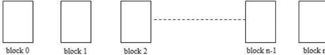

图 4.2: 直接访问文件

## 4.5.3 其他访问方法

其他访问方法可以建立在直接访问方法之上。这些方法通常涉及为文件构建索引。索引就像书末的索引一样，包含了指向各个块的指针。要找到文件中的某条记录，我们首先搜索索引，然后使用指针直接访问文件并找到所需的记录。

对于大文件，索引文件本身可能变得太大而无法保留在内存中。一种解决方案是为索引文件创建一个索引。主索引文件将包含指向二级索引文件的指针，这些指针指向实际的数据项。

例如，IBM 的索引顺序访问方法使用一个较小的主索引，指向二级索引的磁盘块。二级索引块指向实际的文件块。二级索引块提供了二级索引的块号。当要查找特定项目时，首先对主索引进行二分查找。读取该块后，再次使用二分查找找到包含所需记录的块。最后对该块进行顺序查找。通过这种方式，通过键（key）最多只需两次直接访问读取即可定位任何记录。


## 4.6 空闲空间管理

由于磁盘空间有限，如果可能，我们需要从已删除文件中释放空间给新文件。为了跟踪空闲磁盘空间，系统维护一个空闲列表。空闲列表记录所有空闲磁盘块——即未分配给某些文件或目录的块。创建文件时，我们在空闲列表中搜索所需的空间，并将该空间分配给新文件。然后，该空间将从空闲列表中移除。当文件被删除时，其磁盘空间会被添加到空闲列表中。尽管名为列表，空闲列表可能并不以列表的形式实现，正如我们将讨论的那样。

### 4.6.1 位向量

通常，空闲列表被实现为位图或位向量。每个块由 1 位表示。如果块是空闲的，则位为 1；如果块已分配，则位为 0。

例如，考虑一个磁盘，块 2, 3, 4, 5, 8, 9, 10, 11, 12, 13, 17, 18, 25, 26 和 27 是空闲的，其余块均已分配。空闲空间位图将：

```
0011100111111100000011100000 ...
```

这种方法的主要优点是寻找第一个空闲块或磁盘上的连续空闲块时相对简单且高效。

### 4.6.2 链表

空闲空间管理的另一种方法是将空闲磁盘块链接起来，在磁盘上的特殊位置保留指向第一个空闲块的指针并在内存中缓存它。第一个块包含一个指向下一个空闲磁盘块的指针，依此类推。在我们的示例中，我们将保留一个指向块 2 的指针作为第一个空闲块。块 2 将包含指向块 3 的指针，块 3 指向块 4，块 4 指向块 5，块 5 指向块 8

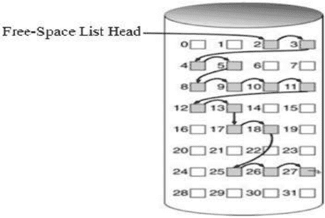

图 4.4: 磁盘上的链式空间

操作系统概念与基础 命令行

### 4.6.3 分组

空列表方法的一种变体是在第一个块中存储 n 个空闲块的地址。最后一个块包含其他 n 个空闲块的地址。这种实现的重要性在于，可以快速找到大量空闲块，而标准的列表方法则不能。

### 4.6.4 计数

另一种方法是利用通常同时分配多个连续块的这一事实，特别是使用簇分配时。因此，与其保留磁盘地址列表，我们可以保留第一个块的地址以及随后的连续块数量。只要计数大于 1，每个条目所需的空间更少，列表也会更短。

## 4.7 分配方法

磁盘的直接访问特性为文件的实现提供了灵活性。在几乎所有情况下，多个文件存储在磁盘上。主要问题是如何分配这些文件的空间以便有效利用磁盘空间并快速访问文件。三种主要的磁盘分配方法广泛使用：连续、链接和索引。每种方法都有优缺点。某些系统支持所有方法。更常见的是对所有文件使用一种方法。

### 4.7.1 连续分配方法

连续分配方法要求每个文件占据一组连续的块。磁盘地址定义了线性顺序。有了这种顺序，假设只有一个作业访问磁盘，访问 b+1 块通常不需要移动磁头。当需要移动磁头时（从一个磁道的末尾到下一个磁道的开头），仅跨轨道。因此，访问连续分配文件的磁盘寻道次数最少。

文件的连续分配由磁盘地址定义，如果文件长度为 n 个块且从位置 b 开始，则它占据块 b, b+1, b+2, ..., b+n-1。每个文件的目录条目指示起始块的地址以及分配给该文件的区域长度。访问连续分配的文件很容易。对于顺序访问，文件系统记录最后一次引用的块磁盘地址，并在必要时读取下一个块。对于直接访问从 b 开始文件的第 i 块，我们可以立即访问 b+i。因此，连续分配可以支持顺序访问和直接访问。

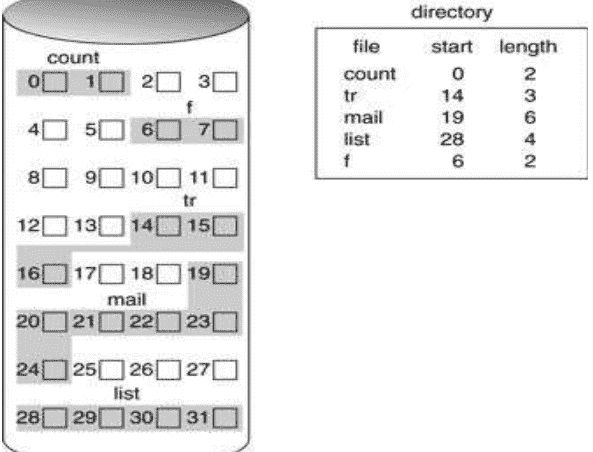

图 4.5: 磁盘空间的连续分配

连续分配的一个困难是为新文件寻找空间。为了解决这个问题，采用动态分配策略是已使用。对于连续的空闲块，我们使用“空洞”（hole）一词。该策略有三种方法。

`首次适应（First fit）`：它分配第一个足够空洞。搜索可以从磁盘开头开始，也可以从上一次首次适应搜索结束的地方开始。一旦找到足够大的空闲空洞，就可以停止搜索。

`最佳适应（Best fit）`：它分配最小的足够空洞。搜索可以从磁盘开头开始，它会搜索整个磁盘并分配一个足够存放文件的空洞。

`最坏适应（Worst fit）`：它分配最大的足够空洞。搜索可以从磁盘开头开始，它会搜索整个磁盘并分配一个足够存放文件的最大空洞。

仿真实验表明，在时间和存储利用率方面，首次适应和最佳适应都比最坏适应更有效。在存储利用率方面，首次适应和最佳适应没有明显的优劣，但首次适应通常速度更快。

这些算法受到`外部碎片（external fragmentation）`问题的影响。随着文件的分配和删除，磁盘的空闲空间被切成许多小碎片。当总磁盘空间足够以满足请求，但空间不是连续的时，就会产生外部碎片；存储被碎片化为若干空洞，其中没有任何一个空洞足够存储数据。

连续分配的另一个问题是确定文件需要多少空间。当文件创建时，必须找到并分配所需的总空间。创建者（程序或人员）如何知道要创建的文件的大小呢？

### 4.7.2 链接分配（Linked allocation）

链接分配解决了连续分配的所有问题。在链接分配中，每个文件都是磁盘块的链表；磁盘块可以分散在磁盘的任何位置。目录包含指向文件第一个块和最后一个块的指针。例如 Shital Vivek Ghate 的例子，一个包含五个块的文件可能从第9块开始，继续到第16块，然后是第10块，最后是第25块，如图所示。每个块都包含一个指向下一个块的指针。这些指针对用户是不可见的。因此，如果每个块为512 字节，而一个地址（指针）需要4个字节，那么用户看到的块大小为508 字节。

要创建一个新文件，我们只需在目录中创建一个新条目。在链接分配中，每个目录条目都有一个指向文件第一个磁盘块的指针。该指针被初始化为空（列表末尾指针值），表示空文件。大小字段也设置为0。向文件写入数据会通过空闲空间管理系统找到一个空闲块，然后向该新块写入数据并将其链接到文件末尾。读取文件，只需通过跟踪从一个块到另一个块的指针来读取块。


链接分配没有外部碎片，空闲列表上的任何空闲块都可以满足请求。在创建文件时不需要声明文件的大小。只要有空闲块可用，文件就可以继续增长。

链接分配的主要问题是，它只能有效地用于顺序访问文件。要找到文件的第 `i` 个块，我们必须从该文件的开头开始，顺着指针一直移动直到到达第 `i` 个块。

# 操作系统概念与基础 Linux 命令

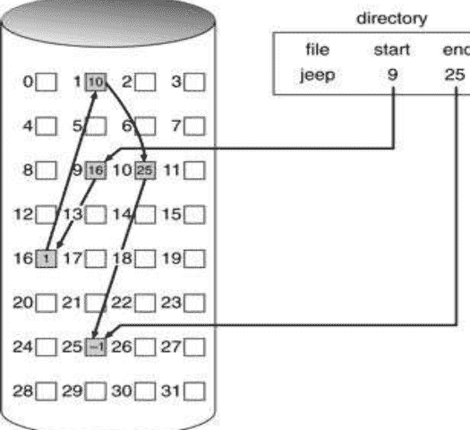

图 4.6: 磁盘空间的链接分配

链接分配的另一个缺点是指针所需的空间。如果一个指针在 `512` 字节的块中占用 `4` 字节，那么磁盘的 `0.78%` 被用于指针，而不是信息。每个文件都需要稍微多一点空间。

链接分配的另一个问题是可靠性。由于文件通过分散在磁盘各处的指针连接在一起，如果某个指针丢失或损坏，操作系统软件的缺陷或磁盘硬件故障可能会导致选取错误的指针。这种错误可能导致链接到空闲空间列表或另一个文件中。

## 4.7.3 索引分配（Indexed allocation）

链接分配解决了连续分配的外部碎片和大小声明问题。然而，链接分配不支持高效的直接访问，因为指向块的指针与块本身分散在磁盘各处，并且需要按顺序检索。索引分配通过将所有指针聚集在一个位置：索引块，解决了这个问题。

每个文件都有自己的索引块，索引块是一个磁盘块地址的数组。索引块中的第 `i` 个条目指向文件的第 `i` 个块。目录包含索引块的地址。要读取第 `i` 个块，我们使用索引块中第 `i` 个条目中的指针来查找并读取所需的块。

当创建文件时，索引块中的所有指针都设置为空。当第一次写入第 `i` 个块时，从空闲空间管理器获取一个块，并将其地址放在索引块的第 `i` 个条目中。

索引分配支持直接访问，且不会受到外部碎片的影响，因为磁盘上的任何空闲块都可以满足增加空间的请求。

索引分配确实会浪费空间。索引块的指针开销通常大于链接分配的指针开销。考虑一个只有一或两个块文件的常见情况。在链接分配中，每个块只损失一个指针的空间（一个或两个指针）。而在索引分配中，必须使用整个索引块的空间。

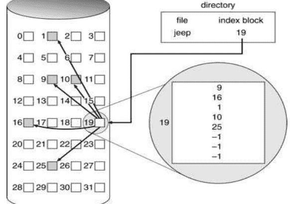

图 4.7: 磁盘空间的索引分配

## 4.8 目录结构

文件系统可以非常大。有些系统存储数百万文件。为了管理这些文件，我们需要对它们进行组织。这种组织通常分为两个部分。

首先，磁盘被划分为。通常，每个分区包含一个目录。其次，每个目录包含关于文件的信息。这些信息记录了所有文件的文件名、位置、大小和类型。

目录可以被视为将文件名转换为条目的符号表。我们希望能够插入、删除、搜索和列出条目。

考虑目录结构时，需要执行的操作如下：

- **搜索文件**：我们需要搜索目录以找到特定文件的条目。由于文件具有名称，相似的名字表示文件之间的关系，我们可能希望找到所有匹配模式的文件。
- **删除文件**：当文件不再需要时，我们想从目录中删除它。
- **列出目录**：我们需要能够列出目录中的文件以及每个目录条目的的内容。
- **重命名文件**：因为文件名对用户代表文件的内容，当文件内容或用途 way时，我们必须更改名称。重命名文件也可以允许其在目录中的位置发生变化。
- **遍历文件系统**：我们可能希望访问每个目录和每个文件。为了可靠性，定期保存整个文件系统的内容和结构是一个好主意。通常我们通过将所有文件复制到磁带来实现。

### 4.8.1 单级目录

简单的目录结构是单级目录。所有文件都包含在一个目录下，这易于支持和理解。然而，当文件数量增加或系统有多个用户时，单级目录具有很大的局限性。由于所有文件都在同一个目录下，它们必须具有唯一的名称。

即使对于单用户使用单级目录，随着文件数量的增加，记住所有文件的也很困难。

一个计算机系统上的文件以及另一个系统上相同数量的额外文件。跟踪如此多的文件是一项艰巨的任务。

| directory | cat | bo | a | test | data | mail | cont | hex | records |
|---|---|---|---|---|---|---|---|---|---|
| files | | | | | | | | | |

图 4.8 单级目录

### 4.8.2 双级目录

正如我们所看到的，单级目录往往会导致不同用户之间文件名的混淆。标准的解决方案是为每个用户创建一个单独的目录。

在双级目录结构中，每个用户都有自己的用户文件目录（UFD）。UFD 的结构相似的，但每个 UFD 只列出单个用户的文件。当用户作业开始或用户登录时，系统会搜索系统的主文件目录（MFD）。MFD 通过用户名或账户号进行索引，每个条目指向该用户的 UFD。当用户引用特定文件时，系统只搜索其自身的 UFD。因此，只要每个 UFD 内的文件名是唯一的，不同用户就可以拥有同名的文件。要为用户创建文件，操作系统只搜索该用户的 UFD 以确定是否存在另一个相同的文件。要删除文件，操作系统将其搜索限制在本地 UFD；因此，它不会意外删除另一个用户的同名文件。

用户目录本身必须根据需要创建和删除。使用适当的用户名和账户信息运行一个特殊的系统程序。该程序创建一个新的 UFD 并在 MFD 中为其添加一个条目。该程序的执行可能被限制为系统管理员。

尽管双级目录结构解决了命名冲突问题，但它仍然存在缺点。这种结构有效地将一个用户与其他用户隔离开。当用户完全独立时，这种隔离是一个优势；但当用户想要协作某些任务并访问彼此的文件时，这就是一个缺点。某些系统根本不允许其他用户访问用户文件。

Shital Vivek Ghate

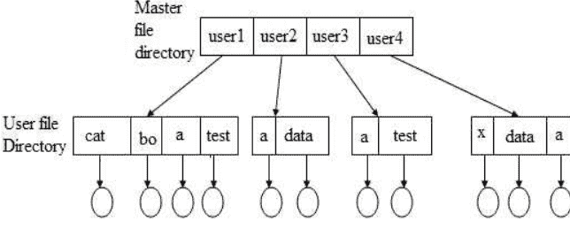

图 4.9 双级目录结构。

### 4.8.3 树形结构目录

一旦我们了解了如何将双级目录视为二级树，那么自然的推广就是将目录结构扩展到任意高度的树。这种推广允许用户创建自己的子目录并据此组织它们的文件。例如，MS-DOS 系统就被结构化为树。事实上，树是最常见的目录结构。树有一个根目录，系统中的每个文件都有一个唯一的路径名。路径名是从根目录开始，通过所有子目录到指定文件的路径。

目录（或子目录）包含一组文件或子目录。目录本身就是另一个文件，但它被以特殊的方式处理。所有目录具有相同的内部格式。每个目录条目中的一个位定义了该条目是文件（`0`）还是子目录（`1`）。使用特殊的系统调用来创建和删除目录。

路径名有两种类型：绝对路径名或相对路径名。绝对路径名从根目录开始，沿着路径到达指定的文件，给出路径上的目录名。相对路径名定义从当前目录开始的路径。例如，在图 4.9 的树形文件系统中，如果当前目录是 `root/spell/mail`，那么相对路径名 `prt/first` 与绝对路径名 `root/spell/mail/prt/first` 指向同一个文件。

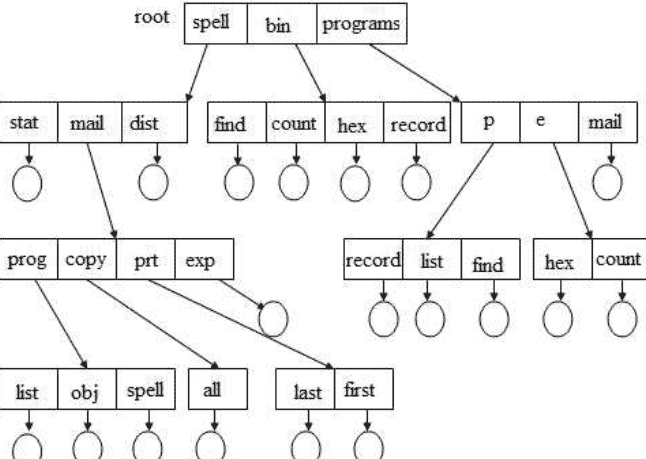

图 4.10：树形目录结构

### 4.8.4 无环图目录

考虑正在合作项目的程序员。与项目相关的文件可以存储在一个子目录，将它们与这两个程序员的其他项目和文件隔离开。由于两个程序员对项目负有等责任，他们都希望子目录位于自己的目录中。公共子目录应该是共享的。共享目录或文件将同时存在于文件系统的两个（或多个）地方。

无环图——即没有循环的图——允许目录共享子目录和文件（图 4.11）。同一个文件或子目录可能位于两个不同的目录中。无环图是树形目录方案的自然推广。

需要注意的是，共享文件（或目录）等同于该文件的两个副本。对于两个副本，每个程序员都可以查看副本而不是原始文件，但如果其中一个程序员更改了文件，更改不会出现在另一个人的副本中。对于共享文件，只存在一个实际文件，因此一个人所做的任何更改对另一个人都是立即可见的。共享对于子目录尤为重要；一个人创建的新文件将自动出现在所有共享子目录中。

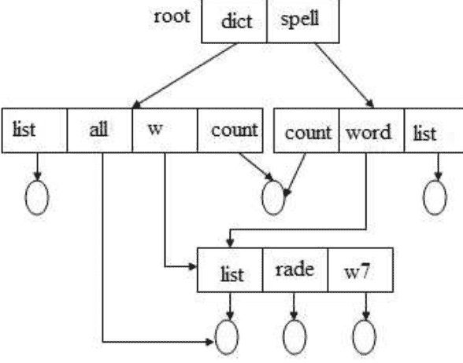

图 4.11 无环图结构。

#### 4.8.5 通用目录

使用无环图的一个严重问题是确保没有循环。如果我们从树形目录开始，并允许树形目录出现链接，它是很容易的。然而，当我们向树形目录添加链接时，就会产生循环。

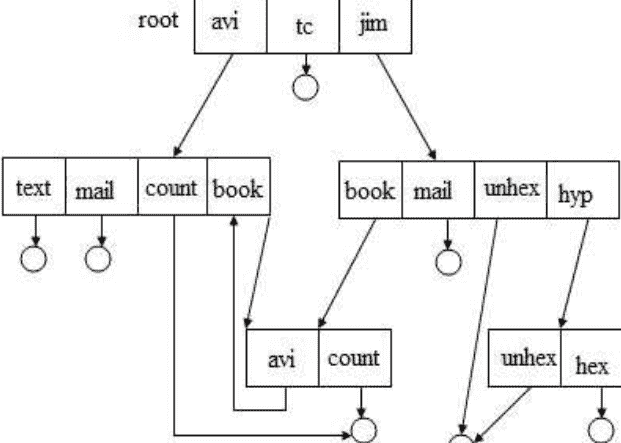

图 4.12 图结构

## LINUX 操作系统

1991 年，Linus Torvalds 写了 Linux 的第一个版本。Linux 用于各种硬件，包括桌面计算机、超级计算机、大型机以及手机等嵌入式设备。Linux 操作系统的核心是内核。内核是提供用户与硬件之间接口的软件，负责维护文件系统、执行命令、启动程序、计时系统活动以及管理内存和其他资源。

Shell 是命令解释器。它将用户在提示符处输入的命令翻译成内核可读的格式。

实用程序是用户与计算机系统交互的不同程序，根据兴趣包括数据库系统、视频游戏、业务程序等。


图 4.13 操作系统结构

## 4.10 登录与注销

登录 Linux 账户涉及两个步骤：

- i) 输入你的用户名
- ii) 输入你的密码

输入用户账户的用户名。如果你出错，可以使用退格键删除字符。考虑以下示例，用户输入 `aditi`，然后提示输入密码：

```
turtle login: aditi
password:
```

当你输入密码时，它不会显示在屏幕上。这是为了防止他人看到密码。如果用户输入的用户名或密码错误，系统将返回错误信息“Login incorrect”，并再次要求用户名，重新开始登录过程。用户可以重新输入用户名和密码。

一旦用户名和密码输入正确，用户即登录系统。将显示用户的命令行提示符，等待用户输入命令。命令行提示符是美元符号 `$`而不是数字号符号 `#`。

`$` 是普通用户的提示符，而 `#` 是 `root` 用户的提示符。提示符之前是主机名和由括号括起的当前用户目录。

```
[turtle/home/aditi]$
```

使用 `logout` 或 `exit` 命令结束会话。这将返回登录提示符，Linux 等待另一个用户登录。

```
$turtle /home/aditi]$ logout
```

### 从命令行关机

用户可以通过两种方式关闭系统。首先登录一个账户，然后输入 `halt` 命令。该命令将注销并关闭系统。

```
$ halt
```

用户还可以使用 `shutdown` 命令并配上 `-h` 选项来关闭系统。或者使用 `-r` 选项关闭系统并重启。要立即关闭系统，可以使用 `+0` 或 `now` 选项。

```bash
# shutdown -h now
```

## 4.11 目录结构

Linux 将一切事物都视为文件。因此，准确理解什么是 Linux 文件以及它如何在系统内部组织文件至关重要。你可能需要的每种文件都以系统文件、数据文件、应用程序文件、工具文件、驱动程序文件、配置文件等形式存储在 Linux 文件系统中。这些文件中的每一个都有一个名称和一个存储在文件系统中的目录结构。

Linux 文件系统建立在类似于 DOS、微软和 UNIX 文件系统的树形结构上。有一个根目录，由 `/` 字符标识，所有其他目录和子目录都在其下方生成。文件包含在这些目录和子目录中。

目录名称可以由数字、符号和字符的组合组成。目录名称包含了目录的位置，即在文件系统中获取该目录所遵循的目录路径。

嵌套在其他目录中的目录被称为子目录。

目录结构的基准是根目录 ` / `。它包含了 Linux 系统中的所有子目录和文件。

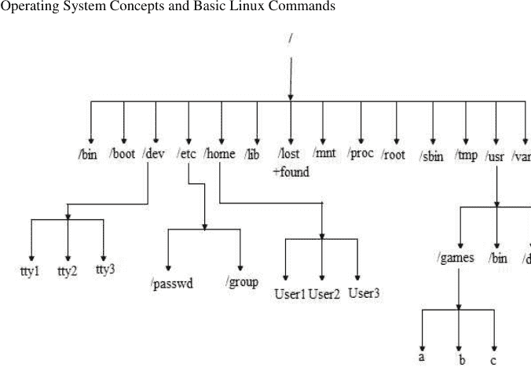

图 4.14：Linux 目录结构

- `/bin`：可执行文件存储在 `/bin`（二进制）目录中。在此目录中，Linux 保留了它的基本命令和程序。其中有启动各种 shell 的命令、处理文件的命令（如复制和移动）、更改文件权限的命令以及配置实用程序。
- `boot`：此目录存储了启动配置文件和命令。该目录包含了启动系统所需的所有内容。
- `dev`：此目录中保留了所有设备文件（或用于所有计算机硬件组件的驱动程序）。当我们配置 Linux 使用特定设备时，我们必须配置此目录中的特定文件。
- `etc`：Linux 在此目录中保留系统配置文件和初始化脚本。你可以编辑这些文件来向系统添加用户并更改他们的密码（`/etc/passwd` 文件），或为文件共享创建组账户（`/etc/group` 文件）。
- `/home`：系统上的每个用户都有一个个人目录，他可以在其中存储自己创建的文件。该目录包含在 `/home` 目录下。在该目录下，除了超级用户外，每个用户都有一个独立的子目录。用户的家目录用于存储个人文件，系统上的其他用户无法访问。
- `/lib`：`/lib` 目录包含 C 语言和其他编程语言的库。它还包含了启动系统和运行命令所需的共享库镜像。
- `/lost+found`：如果用户认为 Linux 丢失了某个文件，可以在此目录中查找。如果系统上有多个分区，则每个分区上都有一个 `/lost+found` 目录。
- `/mnt`：这是一个可以将其他文件系统挂载（mounted）到 Linux 文件系统的目录。例如，要查看光驱盘的内容，用户可以查看 `/mnt/cdrom` 目录。要查看软磁盘的内容，用户可以查看 `/mnt/floppy`。
- `/proc`：此目录包含 Linux 用于跟踪正在运行进程的虚拟文件。它们是虚拟文件，实际上并不存在于那里。它们不占用任何磁盘空间。
- `/root`：`/root` 目录是超级用户或系统管理员的家目录。
- `/sbin`：此目录包含超级用户（系统管理员）使用的文件。该目录包含关闭系统、设置系统时、检查文件系统错误以及设置网络等命令。
- `/tmp`：临时文件位于 `/tmp` 目录中。所有用户可以在这里临时存储文件，以便其他用户访问。根据《操作系统概念和基础 Linux 命令》，系统重启时，存储在 `/tmp` 目录中的数据将会丢失。
- `/usr`：此目录包含不属于 Linux 文件系统的文件。例如，它包含了 X Window 系统的应用程序、Linux 游戏集以及大量的帮助文件。
- `/var`：此目录包含日志文件。日志中的信息指示启动时加载了哪些软件以及系统硬件的配置情况。

## 4.12 文件和目录的命名

系统上的每个文件都被分配了名称并存在于系统中。当用户第一次保存文档时，他需要在文件系统中选择一个目录来存储该文件，并赋予文件名。以下是在文件系统中正确位置存储文档并命名的几个步骤：

- 确定文件名的长度，文件名可以包含多达 256 个字符。文件名包含了通向文件的目录路径。例如，位于 `/home/aditi/images` 目录下的单个文件 `template.bmp` 长度为 31 个字符。实际文件名是 `/home/aditi/images/template.bmp`。
- 命名文件时，可以使用 A 到 Z 的所有字母（包括大写和小写字母）或 0 到 9 的任意数字。你还可以也可以使用连字符 `-` 或下划线 `_`。Linux 文件名对大小写敏感。大写的 `A` 与小写的 `a` 不同。
- 避免在文件名中使用空格，这会导致问题。
- 要创建隐藏文件，文件名以点 `.` 开头，例如你想创建一个 `.file1.txt`。
- 找到你的家目录。输入 `cd` 并回车。
- 创建一个名为 `firstfile` 的文件。输入 `cat > firstfile` 并回车。
- 要读取你创建的文件，输入 `cat firstfile` 并回车。


# Shell 和基础 Linux 命令

## 5.1 Shell

Shell 程序是用来与操作系统通信的解释器。当我们在提示符处输入命令时，它会被解释并传递给 Linux 内核。内核告诉计算机做什么。Shell 是 Linux 中常用的实用程序。Shell 为用户提供了以下功能：

- 交互式环境：Shell 允许用户与主机系统建立对话。这种对话一直持续到用户结束会。
- Shell 脚本：Shell 脚本是 Linux 操作系统的用户界面。Shell 包含了用户可以使用的内部命令。Shell 脚本是组合在一起并作为独立文件执行的 Linux 命令组。
- 输入/输出重定向：可以指示 Linux 命令从文件而不是键盘读取。Shell 还允许用户将命令的输出放入文件中，而不是屏幕上。输出也可以重定向到其他设备，例如打印机或网络上的另一个终端。
- 管道机制：Linux 提供了管道 `pipe` 功能，允许一个命令的输出作为另一个 Linux 命令的输入。Linux 文件系统包含许多用于此类目的的实用程序。
- 通配符功能：除了键盘上常见的普通字母和数字外，Shell 还提供了通配符的使用。这些允许用户在访问文件时应用选择标准，例如用户可以访问所有以字母 `m` 开头的文件。

# 操作系统概念与基础 Linux 命令

**vi. 后台处理：** 真正的多任务功能允许用户在后台运行命令。这使得命令可以在后台处理，同时用户可以在前台继续执行其他任务。当后台任务完成后，用户会收到通知。

Linux 中有许多可用的 shell，Bourne Shell 是最老的 UNIX shell。Linux 发行版的默认 shell 是 GNU Bourne again `bash`。可用的 shell 包括 C Shell 的源码版本 `tcsh`、`k shell` `pdksh`。


# 操作系统概念与基础 Linux 命令

## a. Bourne again Shell (bash)
`Bourne shell` 是最老的 UNIX shell。它在每个现有的 UNIX 系统上最为常见。原始的 UNIX shell 是 20 世纪 70 年代中期由 Stephen R. Bourne 在新泽西州 AT&T 贝尔实验室期间编写的。`Bourne shell` 是第一个出现在 UNIX 系统上的 shell，因此它被称为“shell”。GNU/Linux 版本的 Bourne (`sh`) shell 称为 GNU Bourne again (`bash`)。它由 Brian Fox 和 Ramey 编写。它是 c shell (`sh`) 和 k shell (`ksh`) 功能的富增强版本。`Bourne Again shell` (`bash`) 是作为 GNU 项目的一部分开发的，并已取代了 Linux 等 GNU 基础系统的 Bourne shell (`sh`)。所有主要的 Linux 发行版（包括 Red Hat、Slack 和 Caldera）都自带 `bash` 作为 `sh` 的替代品。

## b. Korn Shell (ksh)
`Korn shell` (`ksh`) 是由 Dave Korn 最初创建的 unix shell，也可以通过开源形式可用。由 Eric Gisin 创建的 shell 公有领域免费版本称为 public domain korn shell (`pdksh`)。2000 年 3 月，AT & T 发布了由 Dave Korn 在 1993 年更新的原始 shell 的免费下载版本，称为 `ksh93`。

## c. shell
Bill Joy 在 20 世纪 80 年代初在加州大学伯克分校期间开发了 C shell。它的设计目的是让用户更容易交互式地使用 shell。另一个设计目标是将 shell 的语法从 Bourne shell 旧的 ALGOL 风格改为较新的 C 风格。c shell 的开源版本是 `tcsh`。

## 5.2 切换运行的 shell

要检查正在运行哪个 shell，请显示你正在使用的 shell。此信息可以在 `SHELL` 环境变量中找到。在 shell 提示符处输入 `echo $SHELL` 并按回车。如果你正在使用 `bash` shell，系统将显示以下消息：

```
[aditi @localhost/aditi]$ echo $SHELL
/bin/bash
[aditi @localhost/aditi]$
```

如果你没有使用 `bash` shell 并想切换到 `bash` shell，在 shell 提示符处输入 `bash` 并按回车。系统将显示如下：

```
[aditi @localhost/aditi]$
```

再次检查你正在使用的 shell，输入 `echo $SHELL` 并按回车。

要显示 `bash` 帮助函数，输入 `help` 并按回车。`help` 命令列出了 shell 内置的所有命令。

## 5.3 Shell 提示符

当你登录 Linux 账户时，你会看到 shell 提示符。它看起来如下：

```
[aditi@localhost/aditi]$
```

第一个 `aditi` 是用户名，后面是计算机的主机名，最后的 `aditi` 是用户 `aditi` 当前所在的目录名称。当你首次登录系统时，你会自动被放置在自己的用户账户中。

当你以 root 身份登录时，显示的 shell 提示符会变为使用井号 (`#`) 而不是美元符号 (`$`)。

```
[root@localhost ~root]#
```

### 5.3.1 更改 shell 提示符

可以更改 shell 提示符以显示用户的用户名、用户所在的目录、当前日期时间或某些特殊消息。要更改当前登录会话的 shell 提示符，请按照以下步骤操作：

- 1. 显示 shell 变量。在 shell 提示符处输入 `printenv` 并按回车。如果你无法阅读整个屏幕，请将 `printenv` 命令发送给 `less` 分页器（输入 `printenv |less`）。

- 2. 寻找 `PS1` 变量。它可能看起来如下：`PS1=[\u@\w]\$`

该变量告诉主机计算机和用户在括号内显示使用该用户当前目录的用户名，随后紧跟 `$` 提示符（或 root 账户的 `#` 提示符）。

- 3. 记录下 `PS1` 变量的信息。

- 4. 决定你希望提示符看起来什么样。下表了用于自定义 shell 提示符的字符。

# Shital Vivek Ghate

| 字符代码 | 描述 |
|---|---|
| `\!` | 显示历史列表中使用的数字，用于访问在 shell 提示符处将执行的命令。 |
| `\$` | 为普通用户显示提示符中的 `$`，为超级用户显示 `#` |
| `\` | 显示反斜符字符。 |
| `\d` | 显示当前日期 |
| `h` | 显示你正在工作的计算机的主机名。 |
| `\t` | 显示当前时间。 |
| `\u` | 显示登录系统的用户用户名。 |
| `\w` | 显示当前工作目录。 |
| `\xxx` | 显示任何特殊注释。 |

示例：如果你想更改提示符使其显示时间和日期，提示符将变为：`18:40 Sat 21 \w aditi$`

## 5.4 创建用户

Linux 命令可以通过在命令行输入其名称来执行，随后是选项列表，然后是参数。典型的命令行格式如下：

`$ commandname -option [parameter]`

# 操作系统概念与基础 Linux 命令

例如：

`ls -l /usr/doc`

`ls` 命令显示当前工作目录内容的文件列表。命令选项 `ls -l` 会修改列表中每个文件的显示信息。参数告诉命令列出 `/usr/doc` 目录的内容，而不是当前工作目录。

命令参数可以是文件、目录或一段时间。参数前没有连字符。参数指定了要对哪个文件或目录执行命令，或者它们可以为要执行的命令设置时间限制。

## 5.6 为长命令创建别名 (alias)

命令别名（`alias`）是分配给命令的唯一短名称。可以使用别名为长命令分配一个短名称。要为以下命令创建一个别名：

```bash
cd /user/doc/file1
```

假设 `move` 是一个示例别名，要创建此别名，请在 shell 提示符下输入：

```bash
alias move="cd/user/doc/file1"
```

`alias` 命令后面跟着别名。等号 (`=`) 之前的是在 shell 提示符中输入别名时将执行的命令。等号两边不要留空格。现在要切换到 `file1`，只需输入 `move` 并按回车。

## 5.7 输入/输出重定向

当你执行一个命令时，命令从键盘（标准输入）读取，命令的结果（输出）显示在屏幕上（标准输出）。如果你希望命令输出出现在不同的地方，或者你想将输出发送到另一个命令进行处理，那么我们需要通过名为“输入/输出重定向”的过程来更改输出。

### 5.7.1 重定向标准输出

要重定向标准输出，请使用符号 `>`。在命令（例如 `cat` 命令）之后放置 `>` 将将其输出重定向到符号后的文件名。

单独使用 `cat` 仅会将你输入的任何内容输出到屏幕，就像在重复你刚刚输入的行一样。

示例：

```bash
$ cat
I am girl
I am girl
I am boy
I am boy
$
```

要将 `cat` 的输出重定向到文件，在 shell 提示符下输入：

```bash
$ cat> file1.txt
Buy some sneakers
Then go to coffee shop
Then buy some coffee
^d
$
```

你可以使用 `cat` 来读取文件。在 shell 提示符下输入：

```bash
$ cat file1.txt
Buy some sneakers
Then goto coffee shop
Then buy some coffee
```

# 操作系统概念与基础 Linux 命令

当你将输出重定向到文件时，你可以覆盖现有文件，这样你创建的文件名就不会与预先存在的文件名匹配，除非你想替换它。

再次使用输出重定向处理另一个文件并将其命名为 `file2.txt`。

例如：

```bash
$ cat>file2.txt
Bring the coffee home
Make some coffee
Relax!
^d
$
```

现在，使用 `cat` 将 `file2.txt` 和 `file1.txt` 合并，并将两个文件的输出重定向到新文件 `file3.txt`。

```bash
$cat file1.txt file2.txt>file3.txt
```

在执行上述命令后，执行以下命令：

```bash
$cat file3.txt
You will get the following output
```

+ Buy some sneakers

Then goto coffee shop

Then buy some coffee

Bring the coffee home

Make some coffee

Relax!

$


在这个示例中，`cat` 添加了 `file1.txt` 和 `file2.txt`，输出被存储在新文件 `file3.txt` 中。

# 操作系统概念与基础 Linux 命令

## 5.7.2 追加标准输出

你可以使用输出重定向向现有文件的末尾添加新信息。使用 `>>` 向现有文件追加数据。

当你使用符号 `>>` 时，你是在向文件中添加信息，而不是完全替换文件内容。

例如：

取两个已经创建的文件并使用追加符号将它们合并。

```bash
$cat file2.txt>>file1.txt
```

这里 `file2.txt` 的内容追加到 `file1.txt` 的底部。

```bash
$cat file1.txt
Buy some sneakers
Then goto coffee shop
Then buy some coffee
Bring the coffee home
Make some coffee
Relax!
```

## 5.7.3 重定向标准输入

标准输入也可以相同类型的重定向。标准输入重定向符号是 `<`，当你使用此符号时，你是在告诉 shell 你想从文件中读取输入。

例如：

```bash
$cat<file1.txt
```

在这里，`file1.txt` 的输出被 `cat` 命令读取，并显示文件 `file1.txt` 的内容。

## 5.7.4 管道 (Pipe lines)

管道（`|` 字符）用于将一个命令的输出重定向变为另一个命令的输入。这减少了为复杂操作编写新程序的必要性。管道是一种机制，它接受一个命令的输出作为下一个命令的输入。使用管道操作符 `|`（竖线），可以将一个命令的标准输出接到另一个命令的标准输入：

`command1|command2`

例如：

```bash
$who|wc -l
13 $
```

`who` 命令产生用户列表。（此处原文存在大量重复句子，已按翻译要求处理）。

（此处省略重复内容内容）

管道（`|` 字符）用于将一个命令的输出重定向变为另一个命令的输入。这减少了为复杂操作编写新程序的必要性。管道是一种机制，它接受一个命令的输出作为下一个命令的输入。使用管道操作符 `|`（竖线），可以将一个命令的标准输出接到另一个命令的标准输入：

`command1|command2`

例如：

```bash
$who|wc -l
13 $
```

（此处省略重复内容内容）

管道（`|` 字符）用于将一个命令的输出重定向变为另一个命令的输入。这减少了为复杂操作编写新程序的必要性。管道是一种机制，它接受一个命令的输出作为下一个命令的输入。使用管道操作符 `|`（竖线），可以将一个命令的标准输出接到另一个命令的标准输入：

（此处省略重复内容内容）

`head` 命令打印文件的前十行，而 `tail` 命令打印文件的最后十行。默认情况下，这两个命令都会打印十行文本，但可以通过 “-n” 选项进行调整：

```
[aditi@localhost~]$head -n 5 output.txt
```

上述命令打印文件 `output.txt` 的前 5 行。

```
[aditi@localhost~]$tail -n 5 output.txt
```

上述命令打印文件 `output.txt` 的最后 5 行。

`tee`– 从标准输入读取并输出到标准输出和文件。`tee` 命令在我们的管道中创建一个类似于“T型接头器”的接头。`tee` 程序读取标准输入并将其同时复制到标准输出以及一个或多个文件中。这在处理管道的中间阶段捕获内容非常有用。在这里，我们重复了早之前的一个示例，这次包含了 `tee`，以便在 `grep` 过滤管道内容之前，将整个目录列表捕获到文件 `ls.txt` 中：

```
[aditi@localhost~]$ls /usr/bin | tee ls.txt | grep zip
bunzip2
bzip2
gzip
gzip
unzip
zip
zipcloak
zipgrep
zipinfo
zipnote
zipsplit
```

在这里，命令 ‘`ls/usr/bin`’ 的输出存储在文件 ‘`ls.txt`’ 中，之后 `grep` 搜索模式 ‘zip’。

## 5.8 列出文件和目录：(ls 命令)

在 UNIX 中，有三种基本类型的文件：

- 普通文件
- 目录
- 特殊文件

普通文件是系统中包含数据、文本或程序指令的文件。目录同时存储特殊文件和普通文件。特殊文件提供对硬盘、CD-ROM 驱动器、调制解调器和以太网适配器等硬件的访问。其他特殊文件类似于别名或快捷方式，允许您使用不同的名称访问单个文件。

`ls` 命令：

首先列出当前目录中的文件和目录。

使用以下命令：

```
$ ls
```

这是一个目录列表示例：

| bin | hosts | lib | res.03 |

|---|---|---|---|

| ch07 | hw1 | pub | test_results |

| ch07.bak | hw2 | res.01 | users |

| docs | hw3 | res.02 | work |

此输出表示当前目录中有多个项目，但此输出并没有告诉我们这些项目是文件还是目录。要找出哪些项目是文件，哪些是目录，请为 `ls` 指定 `-F` 选项：

```
$ ls -F
```

现在目录的输出略有不同：

| bin/ | hosts | lib/ |

|---|---|---|---|

| ch07 | hw1 | pub/ |

| ch07.bak | hw2 | res.01 |

| docs/ | hw3 | res.02 |

如你所见，某些项目末尾现在有一个 `/`：这些项目每一个都是目录。其他项目（如 hw1）后面没有追加字符。这表明它们是普通文件。当为 `ls` 指定 `-F` 选项时，它会附加一个字符来指示列出的每个项目的文件类型。

下表显示了 `ls` 命令的所有选项：

| 选项 | 功能 |

| --- | --- |

| -a | 显示所有文件，包括 .. 和隐藏文件 |

| -A | 显示所有文件但不包括 . 和 .. |

| -C | 按列列出条目 |

| -d | 列出目录本身而非内容 |

| -l | 使用详细列表格式 |

| -r | 反向排序 |

| -R | 递归列出子目录 |

| -s | 以块为单位打印每个的大小 |

| -S | 按文件大小排序 |

| -t | 按修改时间排序，-u 按访问时间排序 |

要显示隐藏文件，为 `ls` 指定 `-a` 选项：

```
$ ls -a
```

目录列表现在看起来像这样：

```
.profile  docs    lib     test_results
.hosts hosts    pub     users
.emacs bin     hw1     res.01  work
.exrc ch07   hw2     res.02
.lsrc ch07.bak hw3     res.03
```

如你所见，此目录包含许多隐藏文件。注意在输出输出中，缺少了文件类型信息。要获取文件类型信息，请按如下方式指定 `-F` 和 `-a` 选项：

```
$ ls -a -F
```

输出变为以下内容：

| ./ | profile | docs/ | lib/ | test_results |

| .. | .hosts | hosts | pub/ | users |

| .emacs | bin/ | hw1 | res.01 | work/ |

| .exrc | ch07 | hw2 | res.02 | |

| .kshrc | ch07.bak | hw3 | res.03 |

有了文件类型信息后，你可以看到有两个隐藏目录（. 和 ..）。这两个目录是存在于所有目录中的特殊条目。第一个 `.` 代表当前目录。第二个 `..` 代表父目录。

### 选项分组

在在上一个示例中，你使用的命令分别指定了 `ls` 的选项。这些选项也可以组合在一起。例如，命令：

```
$ ls -a
```

## 5.9 cat 命令

要查看内容，使用 `cat` 命令（查看文件的选项）。其语法为：

```
$ cat filename
```

这里 `filename` 是要查看的文件名。该命令将内容输出到标准输出。例如：

```
$ cat file1.txt file2.txt
```

该命令可以将多个文件合并到一个输出。

## 5.10 wc 命令

`wc` 命令用于统计行数、单词数和字符。其语法为：

```
$ wc [options] filename
```

| 选项 | 功能 |

| --- | --- |

| -l | 输出行数 |

| -w | 输出单词数 |

| -c | 输出字节数（字符） |

例如：

```
$ wc -l file.txt
```

这将输出 `file.txt` 的行数。

## 5.11 操作文件和目录

### 复制文件 (cp)


# 操作系统概念与基础 Linux 命令行

`cp` 命令用于复制文件和目录。基本语法为：

```
$ cp source destination
```

这里 `source` 是要复制的文件或目录，`destination` 是你想创建副本的位置。例如：

```
$ cp file1.txt file2.txt
```

要复制目录，必须使用 `-r` 选项：

```
$ cp -r directory1 directory2
```

## 重命名和移动文件 (mv)

`mv` 命令用于重命名和移动文件及目录。其语法为：

```
$ mv source destination
```

要重命名文件，使用新名称作为目标。要将文件移动到另一个目录，指定目录作为目标：

```
$ mv file1.txt /path/to/destination/
```

## 删除文件 (rm)

`rm` 命令用于从系统中删除文件和目录。其语法为：

```
$ rm [options] filename
```

要删除多个文件，请列出它们：

```
$ rm file1 file2
```

要删除目录，使用 `-r` 选项：

```
$ rm -r directory
```

## 切换目录 (cd)

`cd` 命令用于切换工作目录。其语法为：

```
$ cd directory
```

这里 `directory` 是你想进入的目录路径。要返回上一级目录，使用：

```
$ cd ..
```

要回到主目录，使用：

```
$ cd ~
```

## 创建目录 (mkdir)

`mkdir` 命令用于创建新目录。其语法为：

```
$ mkdir directory
```

这里 `directory` 是你想创建的新目录名称。要一次性创建多个目录，请列出它们：

```
$ mkdir dir1 dir2 dir3
```

Shital Vivek Ghate

在当前目录下创建 `docs` 和 `pub` 目录。

### 5.11.7 删除目录 (rmdir)

此命令用于删除目录。其语法为：

```
$ rmdir directories
```

在这里，`directories` 包括你想要删除的目录名称。例如，该命令

```
$ rmdir ch01 ch02 ch03
```

如果 `ch01`、`ch02` 和 `ch03` 是空的，则会删除这些目录。如果 `rmdir` 执行成功，不会产生任何输出。只有当目录为空（不包含文件或子目录）时才能删除目录。不能删除当前目录。也可以像 `mkdir` 命令所示，使用 `rmdir` 指定完整路径名。

### 5.12 vi 编辑器

`vi` 的第一个版本由 Bill Joy 于 1976 年编写，他当时是加州大学伯克利分校的一学生，后来共同创立了 Sun Microsystems。`vi` 的名字源于“visual”（视觉）一词，因为它旨在允许在带有移动光标的视频终端上进行编辑。

`Vi` 编辑器是 Unix 系统上使用的原始编辑器。它使用控制台图形来模拟文本编辑窗口，允许你直观地看到文件的行，在文件内移动，并插入、编辑和替换文本。

大多数 Linux 发行版并不包含真正的 `vi`；相反，它们带有一个增强版的替代品 `vim`，它是“vi improved”（改进版 vi）的缩写，由 Bram Moolenaar 编写。`vim` 相比传统的 Unix 有了巨大的改进，在 Linux 系统上通常通过符号链接（或别名）命名为“vi”。在接后的讨论中，我们假设有一个名为“vi”的程序，它实际上是 `vim`。

#### 5.12.1 启动和停止 vi

要启动 `vi`，我们只需输入以下内容：

```
[aditi@localhost/aditi]$ vi
```

然后应该出现类似这样的屏幕：

```
VIM - Vi Improved
version 7.1.138
by Bram Moolenaar et al.
Vim 是开源且可免费分发的
赞助 Vim 开发！
输入: :q<Enter> 退出
输入: :help<Enter> 或 <F1> 获取在线帮助
输入: :help version7<Enter> 获取版本信息
运行在 Vi 兼容模式
输入: :set ncp<Enter> 获取 Vim 默认设置
输入: :help cp-default<Enter> 关于关于
```

要退出，我们输入以下命令（注意冒号是命令的一部分）：

`:q`

shell 提示符应该返回。如果由于某种原因 `vi` 不退出（通常是因为我们对尚未保存的文件进行了更改），我们可以在命令后添加感叹号来告诉 `vi` 我们确实要这么做：

`:q!`

如果你在 `vi` 中“迷路”了，尝试双击 `Esc` 键找回来。尝试运行 `vim` 而不是 `vi`。如果这样做有效，考虑在你的 shell 文件中添加 `alias vi='vim'`。

#### 5.12.2 编辑模式

让我们再次启动 `vi`，这次给它传递一个不存在的文件名。这意味着我们正在用 `vi` 创建一个新文件：`[aditi]@localhost/aditi]$ vi first.txt`

如果一切顺利，我们应该得到类似这样的屏幕：


开头的波浪字符（“~”）表示该行不存在文本。这表明我们有一个空文件。先不要输入任何内容！学习 `vi` 的第二要点（学习如何退出之后）是 `vi` 是一个模式编辑器。当 `vi` 启动时，它从命令模式开始。在这种模式下，几乎每个键都是命令，所以如果我们开始打字，`vi` 基本上会崩溃并搞一团乱。

#### 5.12.3 插入模式 (输入模式)

为了在文件中添加一些文本，我们必须先按“i”键进入插入模式。如果 `vim` 以其通常的增强模式运行，我们会在屏幕底部看到：

```
--INSERT--
```

现在我们可以输入一些文本。尝试一下：

这是我上大学的第一天。

要退出插入模式并返回命令模式，按 `Esc` 键。

#### 5.12.4 保存我们的工作

要保存我们刚刚对文件做的更改，我们必须在命令模式下输入命令。这可以通过按下 `:` 键轻松实现。之后，屏幕底部会出现一个冒号：

```
:
```

要写入我们修改后的文件，我们在冒号后跟随一个“w”然后按 Enter：

`:w`

文件将被写入硬盘，我们会在屏幕底部收到一条确认消息，如下所示：`"first.txt" [New] 1L, 36C written`

下表显示了保存和退出命令。

| 命令 | 动作 |
| --- | --- |
| `:w` | 保存文件并保持编辑模式 |
| `:x` | 保存文件并退出编辑模式 |
| `:wq` | 保存文件并退出编辑模式 |
| `:q` | 当文件未发生更改时退出编辑模式 |
| `:sh` | 退出到 shell |

#### 5.12.5 移动光标

在命令模式下，`vi` 提供了大量的命令，其中一些在下表中给出：

| 键 | 移动 |
|---|---|
| `l` | 右移 |
| `h` | 左移 |
| `j` | 下移 |
| `k` | 上移 |
| `0` | 行首 |
| `$` | 行尾 |
| `w` | 到下一个单词开头 |
| `W` | 到下一个单词开头 |
| `b` | 到上一个单词开头 |
| `B` | 到上一个单词开头 |
| `Ctrl-f` | 下页 |
| `Ctrl-b` | 上页 |
| `G` | 文件末 |
| `数字G` | 到指定行 |

#### 5.12.6 添加新文本

以下键用于在插入模式在现有文件中打开新行：

| 键 | 功能 |
|---|---|
| `a` | 在光标右侧追加文本 |
| `A` | 在行尾追加文本 |
| `0` | 在光标下方打开新行 |
| `O` | 在光标上方打开新行 |

#### 5.12.7 删除文本

删除文本可以使用许多命令，它们在下表中给出。

| 命令 | 删除 |
|---|---|
| `x` | 当前字符 |
| `3x` | 当前字符及其后两个字符 |
| `dd` | 当前行 |
| `5dd` | 当前行及后续四行 |
| `dw` | 从当前光标位置到下一个单词开头 |
| `d$` | 从当前光标位置到行尾 |
| `d0` | 从当前光标位置到行首 |
| `d^w` | 从当前光标位置到行内第一个非空白字符 |
| `dG` | 从当前行到文件末尾 |
| `d20G` | 从当前行到第20行 |

#### 5.12.8 文本的剪切、复制与粘贴

`d` 命令不仅可以删除文本，还会“剪切”文本。每当我们使用 `d` 命令时，删除的内容都会被复制到粘贴缓冲区（想象成剪贴板），我们稍后可以使用 `p` 命令在光标之后粘贴缓冲区的内容，或者使用 `P` 命令在光标之前粘贴缓冲区的内容。

`y` 命令用于“提取”（yank/复制）文本，其使用方式与 `d` 命令剪切文本非常相似。以下是将 `y` 命令与各种移动命令结合的一些示例：

| 命令 | 复制内容 |
| :--- | :--- |
| `yy` | 当前行。 |
| `5yy` | 当前行及后续四行。 |


| `yW` | 从当前光标位置到下一个单词的开头。 |
| `y$` | 从当前光标位置到当前行的末尾。 |
| `y0` | 从当前光标位置到行首。 |
| `y^` | 从当前光标位置到行内第一个非空白字符。 |
| `yG` | 从当前行到文件末尾。 |
| `y20G` | 从当前行到文件的第二十行。 |

将光标置于文本的第一行并输入 `yy` 复制当前行。接下来，将光标移动到最后一行（`G`）并输入 `p` 在当前行下方粘贴该行：

This is the first day of my college. It is cool.

Line 2

Line 3

Line 4

Line 5

This is the first day of my college. It is cool.

和一样，`u` 命令将撤销我们的操作。在光标仍位于文件最后一行的情况下，输入 `P` 在当前行上方粘贴文本：

## 5.13 压缩文件 (`gzip`, `gunzip` 命令)

`gzip` 程序用于压缩一个或多个文件。执行时，它会用原始文件的压缩版本替换原始文件。相应的 `gunzip` 程序则用于将压缩文件恢复为原始的未压缩格式。以下是一个示例：

```
[aditi@localhost~$] ls -l /etc ~ first.txt
[aditi@localhost~$] ls -l first.*\*
-rw-r--r-- 1 aditi 15738 2008-10-14 07:15 first.txt
[aditi@localhost~$] gzip first.txt
[aditi@localhost~$] ls -l first.*\*
-rw-r--r-- 1 aditi 32230 2008-10-14 07:15 first.txt.gz
[aditi@localhost~$] gzip first.txt
[aditi@localhost~$] ls -l first.*\*
-rw-r--r-- 1 aditi 15738 2008-10-14 07:15 first.txt
```

在这个示例中，我们从目录列表中创建了一个名为 `first.txt` 的文本文件。接下来，我们运行 `gzip`，它用名为 `first.txt.gz` 的压缩版本替换了原始文件。在 `first.*` 的目录列表中，我们看到原始文件已被压缩版本替换，且压缩版本的大小大约是原始文件的五分之一。我们还可以看到压缩文件与原始具有相同的权限和时间戳。接下来，我们运行 `gunzip` 程序来解压文件。之后，我们可以看到文件的压缩版本已被还原为原始文件，同样保留了权限和时间戳。

### bzip2

由 Julian Seward 开发的 `bzip2` 程序与 `gzip` 类似，但它使用了不同的压缩算法，以牺牲速度为代价实现了更高的压缩率。在大多数方面，它的工作方式与 `gzip` 相同。用 `bzip2` 压缩的文件以后缀 `.bz2` 表示：

```
[aditi@localhost ~]$ ls -1 /etc > first.txt
[aditi@localhost ~]$ ls -l first.*\*
-rw-r--r-- 1 aditi aditi 15738 2008-10-14 07:15 first.txt

[aditi@localhost ~]$ bzip2 first.txt
[aditi@localhost ~]$ ls -l first.*\*
-rw-r--r-- 1 aditi aditi 32230 2008-10-14 07:15 first.txt.bz

[aditi@localhost ~]$ bzip2 first.bz2
-rw-r--r-- 1 aditi aditi 15738 2008-10-14 07:15 first.bz2
```

如我们所见，`bzip2` 可以像 `gzip` 一样使用。

## 5.14 文件归档 (`tar`)

归档是将许多文件收集并将它们打包成一个大文件的过程。归档通常作为系统备份的一部分进行。当旧数据从系统移动到某种长期存储设备时，也会使用归档。

### tar

`tar` 程序是归档文件的经典工具。它的名称是 tape archive（带归档）的缩写，揭示了它作为制作备份带工具的起源。虽然它仍用于传统任务，但在其他存储设备上同样高效。`tar` 归档可以使用 `.tar` 或 `.tgz` 后缀，后者表示经过 `gzip` 压缩的归档。`tar` 的语法如下：

| 模式 | 描述 |
| :--- | :--- |
| c | 创建归档。 |
| x | 解开归档。 |
| r | 追加文件到归档。 |
| t | 列出归档内容。 |
| f | 指定归档的文件。 |

其他常用选项包括：

- v: 显示模式，显示正在处理的文件。
- h: 人类可读格式（单位为 KB、MB、GB）。
- z: 使用 `gzip` 压缩归档。
- u: 使用 `gzip` 解压归档。
- j: 使用 `bzip2` 压缩/解压。

## 5.15 管理磁盘空间：`df`

`df` 工具报告每个分区的可用空间以及其大小。它还提供非本地文件系统的信息（如挂载的 NFS 或 Samba 共享）。在最基本的形式下，`df` 提供：

| 文件系统 | 1K-块 | 已用 | 可用 | 使用率 | 挂载点 |
| :--- | :--- | :--- | :--- | :--- | :--- |
| /dev/md2 | 4881472 | 73508 | 4087964 | 17% | / |

然而，你可以为 `df` 添加选项来显示文件类型并以更易理解的格式显示大小：

```
$ df -h -T
```

| 文件系统 | 类型 | 大小 | 已用 | 可用 | 使用率 | 挂载点 |
| :--- | :--- | :--- | :--- | :--- | :--- | :--- |
| /dev/md2 | xfs | 4.7G | 775M | 3.9G | 17% | / |

虽然 `df` 提供整个分区的概述，但 `du` 工具会汇总给定目录的大小。`du` 命令显示当前目录下文件和目录占用的磁盘空间。默认情况下，`du` 命令会列出所有子目录以显示它们各自占用的空间。可以通过 `-s` 选项避免这种情况。它只显示摘要——即所有子目录的总磁盘空间。如果你想显示当前目录之外的目录（文件夹）的磁盘占用，只需将该目录名称作为最后一个参数即可。例如：`du -h -s images`，这里的 `images` 是当前目录的一个子目录。

# 操作系统概念与基础 Linux 命令

```
$ du svn/ports

32 svn/ports/vnstat/.svn
48 svn/ports/vnstat
6248 svn/ports
```

当然，要汇总目录及其所有子目录并以人类可读的格式显示大小值，请使用：

```
$ du -sh svn/ports

6.2M svn/ports
```

## 5.16 修改密码

要设置或更改密码，可以使用 `passwd` 命令。该命令语法如下：

```
passwd [user]
```

要更改你的密码，只需输入 `passwd` 命令。系统会提示你输入旧密码和新密码：

```
[aditi@localhost~]$ passwd
(current) UNIX password:
New UNIX password:
```

`passwd` 命令尝试强制使用“强”密码。这意味着它将拒绝接受过短、与之前的密码太相似、字典单词或太容易被猜的密码：

```
[aditi@localhost ~]$ passwd
(current) UNIX password:
New UNIX password:
BAD PASSWORD: is too similar to the old one
New UNIX password:
BAD PASSWORD: it is WAY too short
New UNIX password:
BAD PASSWORD: it is based on a dictionary word
```

如果你拥有超级用户权限，可以将用户名作为 `passwd` 命令的参数来为另一个用户设置密码。超级用户还有其他可用选项，允许锁定账户、密码过期等。

## 5.17 文件权限

Linux 上的每个文件都有三种类型的权限：读、写和执行。`chmod` 命令允许决定谁可以和不能读取和使用文件。要分配这三种类型的权限，使用了以下三个符号。

| 访问类型 | 符号 | 含义 |
|---|---|---|
| (Read) | r | 允许显示、复制和编译文件 |
| 写 (write) | w | 允许编辑和删除文件 |
| 执行 (Execute) | x | 允许执行文件 |

要指定你授予权限的用户，请使用这三个符号。

| 符号 | 描述 |
|---|---|
| u | 文件或目录的用户或所有者 |
| g | 用户所属组的成员 |
| o | 所有其他系统用户 |

# 操作系统概念与基础 Linux 命令


通常，当创建一个文件时，它会对用户授予读、写和执行权限，而对组成员和其他系统用户仅授予读和执行权限。通常不会向组和其他用户授予写权限。如果需要，用户可以通过系统命令分配权限。可以使用目录的详细列表命令（`ls -l`）来确定文件和目录当前存在的权限。

例如：

用户以名称 ‘funny’ 登录

```
$ls -l
```

```
drwx-x-- -x funny project 50 june 2 15:30 dirl
-rw-r-- -r-- funny project 11 20 june 1 09:50 prog1
-rw-r-- -r-- -funny project 2000 june 6 10:40 sample
```

`prog1` 文件、`sample` 文件以及 `dirl` 目录的权限说明下所示：

| 权限 | 文件/目录 | 备注 |
|---|---|---|
| `-rwxrxr-x` | prog1(文件) | 用户/所有者拥有所有三种权限。组和其他人只有读和执行权限。 |
| `-rw-r-- -r--` | sample(file) | sample 禁止组成员和其他写和执行权限。 |
| drwx-r-- -r-- | dirl(目录) | dirl 目录拒绝授予组和其他写和执行权限。 |

第一个字符描述文件或目录。

‘-’（横线）表示普通文件，‘d’表示目录。共有九种可能的权限，可以组合进行授予或拒绝。它们被写为九个字符的字符串。

| rwx | rwx | rwx |
|---|---|---|
| 所有者权限 | 组权限 | 其他人权限 |

例如：`rwx r-x r-x`

在此示例中，用户（所有者）拥有所有三种权限：读 (`r`)、写 (`w`)、执行 (`x`)，组和其他系统用户拥有读 (`r`) 和执行 (`x`) 权限。

### 5.18 授予文件访问权限：`chmod` 命令

通过执行 `chmod` 命令更改现有权限。该命令使用两种方法：

- 1. 符号方法
- 2. 进制方法

#### 符号方法：

符号方法的语法如下：

```
chmod who + permissions file(s)
```

其中：

`chmod` - 命令名称。

`who` - 三组之一 (`u`, `g`, `o` 或 `a`)；`u`=用户/所有者，`g`=组，`o`=其他人，`a`=所有。

`+` - 表示授予权限

`-` - 表示拒绝权限

`Permissions` - 三种 (`r`, `w`, `x`) 的任何组合

`Files` - 文件或目录名称

操作系统概念与基础 Linux 命令

例如：

`$chmod u+r prog1`

此命令为文件 `prog1` 的所有者添加了读权限

`$chmod u-w prog1`

此命令为文件 `prog1` 的所有者拒绝了写权限

如果你遗漏了范围 (`u`, `g` 或 `o`)，所授予的权限将适用于这三组。

#### 进制方法：

此格式要求使用三个八进制数来指定权限。第一、第二和第三位数字分别设置用户、组和其他。下表显示了含义：

| 整数 | 权限 |
|---|---|
| 0 | 无权限 |
| 1 | 执行 |
| 2 | 写 |
| 3 | 执行和写 |
| 4 | 读 |
| 5 | 读和执行 |
| 6 | 读和写 |
| 7 | 读、写和执行 |

例如：

`$chmod 750 sample`

此命令更改所有者、组成员和其他用户的权限。

### 5.19 创建组账户

`groupadd` 命令用于创建新组。

语法：

```
groupadd [options] groupname
```
（注：此处原文为 group，根据语境为组名）

选项：

- `f`, `--force` 如果指定的组已存在，则该命令将直接以成功状态退出。
- `g`, `--gid` 组 ID 的数值值。该值必须是非负数。0 到 999 之间的值通常保留给系统账户。
- `h`, `--help` 显示帮助信息并退出。

### 5.20 `sudo` 命令：

管理员可以配置 `sudo` 以允许普通用户以用户（通常是超级用户）身份执行命令。特别是，用户可以被限制为运行特定的命令而不运行其他任何命令。`sudo` 提供了超级用户权限。使用 `sudo` 不需要访问超级用户的密码。在使用 `sudo` 身份验证时，用户使用自己的密码。

例如，假设 `sudo` 已配置允许我们运行名为“backup_script”的虚拟程序，该程序需要超级用户权限。使用 `sudo` 执行如下：

```
[aditi@localhost ~]$ sudo backup_script
Password:
System Backup Starting...
```

### 5.21 `chown` – 修改文件所有者和组

`chown` 命令用于更改文件或目录的所有者组。使用此命令需要超级用户权限。`chown` 的语法如下：

```
chown [owner][:group]] file
```

根据命令的第一个参数，`chown` 可以更改文件所有者和组。以下是一些示例：

`chown` 参数示例：

| 参数 | 结果 |
|---|---|
|  | 将文件的所有者更改为用户 bob。 |
| bob:users | 将文件的所有者更改为 bob，并将文件组更改为 users。 |
| admins | 将所有者更改为组 admins。文件所有者保持不变。 |
| bob: | 将文件所有者更改为 bob，并将组更改为 bob 的登录组。 |

假设有两个用户：`adil`，她拥有超级用户权限，而 `aditi` 没有。用户 `adil` 想要从她的家目录复制一个文件到 `aditi` 的家目录

`aditi.` 由于用户 `adil` 希望 `aditi` 能够编辑文件，`adil` 将复制后的文件所有权从 `adil`更改为 `aditi`：

```bash
[adil@linuxbox ~]$ sudo cp myfile.txt ~aditi
Password:
[adil@linuxbox ~]$ sudo ls -l ~aditi/myfile.txt
rw-r--r-- 1 root root 8031 2008-03-20 14:30 /home/aditi/myfile.txt
[adil@linuxbox ~]$ sudo chown aditi ~aditi/myfile.txt
[adil@linuxbox ~]$ sudo ls ~aditi/myfile.txt
rw-r--r-- 1 aditi 8031 2008-03-20 14:30 /home/aditi/myfile.txt
```

在这里我们看到用户 `adil` 将文件从目录复制到用户 `aditi` 的主目录。接下来，`adil` 将文件的所有权从 `root`（使用 `sudo` 的结果）更改为 `aditi`。通过在第一个参数末尾使用冒号（`:`），`adil` 还将文件组所有权更改为 `aditi` 的登录组，恰好是组 `aditi`。注意，在第一次使用 `sudo` 后，`adil` 没有被提示输入密码？这是因为在大多数配置中，`sudo` 会“信任”几分钟，直到其计时器超时。

### 5.22 通信命令：

#### 5.22.1 `who`

此命令列出当前正在使用 UNIX 机器的人（或用户）列表。输出的第一列列出了登录用户的用户名。

```bash
$ who
tty1 Dec 6 19:36
yash tty2 Dec 6 19:38
sanu tty0 Dec 9 09:23
$
```

你可以看到有三个用户：`atha`、`yash` 和 `sanu`。第二列列出他们登录的终端，最后一列列出他们登录的时间。输出随系统不同而异。

#### 5.22.2 `who am i`

你可以通过按如下方式执行 `who` 命令来收集关于自己的信息：

```bash
$ who am i
atha pts/0 Dec 9 08:49
$
```

这告诉了我以下信息：

1. 我的用户名是 `atha`。
2. 我登录到了终端 `pts/0`。
3. 我在 12 月 9 日 8:49 登录。

参数 `am` 和 `i` 改变了 `who` 命令的行为，仅列出关于你的信息。在 UNIX 中，大多数命令接受修改其行为的参数。

#### 5.22.3 `mesg` 命令：

语法：

`mesg [y] [n]`

`mesg` 命令停止通过其他 UNIX 通信命令启动的传入消息。此命令允许用户设置其终端权限，以便拒绝除自己（即终端所有者）之外的所有用户的读取和写访问权限。`mesg` 有两个参数：'y' 和 'n'（是/否）。在不带任何参数的情况下使用 `mesg` 仅会返回当前设置的状态，即：

- y - 消息可以发送到终端，或
- n - 消息无法发送到终端

我们必须每次指定一个参数，例如：

```bash
$ mesg n
```

此命令禁用了所有传入的消息。

Shital Vivek Ghate

```bash
$ mesg y
```

此命令允许通过其他通信命令接收所有传入的消息。

#### 5.22.4 `write` 命令：

语法：

`write <username> [ttyname]`


这是一个双向通信命令。这里 `<username>` 是接收者用户，`[ttyname]` 是出现在 `/dev` 目录中的终端名称。使用 `write` 命令可以向另一个用户的终端写入消息，该接收者用户也可以向发送者的终端回写，从而在两个用户之间建立双向通信链接。

在此命令中，必须指定用户名，并且如果需要，可以包含一个可选的终端代码，例如当一个用户登录到多个终端，而你想联系某个特定的终端时。

当调用 `write` 时，它从标准输入读取，因此你可以只需按照要求的格式输入消息。你可以通过按下 `<ctrl-d>` 结束会话，消息将被发送。发送者将返回到 shell 提示符。如果你联系的人正在执行另一项任务（例如在编辑会话中），他们必须退出到 shell 层级才能回写。要检查当前有多少个用户登录，可以使用 `who` 命令。

例如：

```bash
$ who
aditi tty20 jan 20 15:10
aditi tty15 jan 20 15:20
$ write aditi tty20
Hi Aditi, How are you?
<ctrl-d>
$
```

174

# 操作系统概念和基础 Linux 命令

在上面的示例中，我们同时使用了终端名称和用户名这两个选项。

如果我们尝试联系一个未登录的用户，将收到以下错误消息：

```bash
$ write atha
write: atha not logged in
$
```

当你收到来自某个用户的消息时，Linux 会显示一条消息消息，指示登录者的姓名。

```bash
$ write aditi tty20
Hi Aditi, How are you?
```

## 5.22.5 talk 命令

`talk` 命令与 `write` 命令类似，不同之处在于它为发送者和接收者预留了独立的区域。语法与 `write` 完全相同。

语法：

`talk <username> [ttyname]`

当使用有效的用户名或终端名称激活 `talk` 时，屏幕会被清除，屏幕被分为两部分。上半部分是发送者输入消息的地方。接收者可以回复：

```bash
$ talk aditi
```

此命令显示以下屏幕：

 图5.1：调用 talk 时的屏幕

与接收用户建立连接后，双方都可以继续输入消息。下面的图说明了发送方和接收方建立连接后的典型对话。

 图5.2：使用 talk 命令的典型对话

对话可以使用 `<ctrl-c>`（中断）或 `<ctrl-d>` 键来关闭连接。发送者和接收者随后将收到一条指示连接已终止的消息。

## 5.22.6 wall 命令

`wall` 代表 "write all"写入所有人）。它在接收者的终端上写入消息，从标准输入（键盘）读取消息。`wall` 将消息传递给系统上的所有用户。一旦命令从标准输入读取消息，它将同时在每个用户的终端上写入。

超级用户通常使用 `wall` 命令传递重要的系统消息，并可以覆盖任何 `mesg n` 设置（因为超级用户无论保护设置如何，随时都可以写入任何终端）。

例如：

```bash
$ wall
Save and logout immediately, the system going down in 5 minutes. Another warning will follow in 3 minutes.
<ctrl-d>
```

190

Shital Vivek Ghate

当网络上的用户收到此 `wall` 消息时，消息可能如下形式：

Broadcast message from 'root' 20 Jan 12:20:30

Save and logout immediately, the system is going down in 5 minutes. Another warning will follow in 3 minutes.

178

# 参考文献

- 1. P. Balakrishna Prasad 著《操作系统》[Scitech Publication]
- 2. James L. Peterson, Abraham Silberschatz 著《操作系统概念》[Addison-Wesley Publishing Company]
- 3. Silbershaz 著《操作系统概念》[Addision Education]
- 4. Craig and Coletta Witherspoon 著《SAMS自Linux》[Techmedia]
- 5. Richard Peterson 著《Linux完全参考》
- 6. Jason J. Manger 著《Unix完全指南》[Galgotia Publication Pvt. ltd]
- 7. Silberschatz, Galvin, Gagne 著《操作系统概念》第8版

# 操作系统概念与基础Linux命令

本书作者在过去两年中处于自由职业状态。她曾担任技术学院、计算机应用硕士（MCA）学院及科学学院计算机科学系的讲师。她于2000年获得纳格普尔大学的计算机科学学士学位（B.Sc），并于2003年获得纳格普尔大学的计算机应用硕士学位。她从2004年开始从事讲师工作。

本书包含了适用于本科水平学习的操作系统介绍信息和Linux命令基础。本书提供了操作系统的概念，并包含了适用于各种操作系统的基本概念。


EDUCREATION PUBLISHING（德里）

www.education.in

同样提供电子书版本

学术版

ISBN 978-1-5457-0850-7


