# 树莓派上的 Linux 操作系统基础：教材

## 5.2 调度概述：是什么、为什么、怎么做

## 6.5.2 处理页异常

## 6.5.4 内存缓存

### 随机 (Random)

### 闹钟算法 (Clock)

### 系统调优

## 6.5.7 写时复制 (CoW)

## 6.9.2 假设的地址空间

## 6.9.4 倒置页表

## 6.9.6 微型虚拟地址空间

## 7.2.2 什么是并行？

### 共享资源

### 同步

### 可共享性域

## 7.3.5 Linux 内核同步原语

### 原子原语

### 内存操作排序

### 内存屏障 (Memory barriers)

### 自旋锁 (Spin locks)

### Futex

### 内核互斥锁 (Mutexes)

### 信号量 (Semaphores)

## 7.3.6 POSIX 同步原语

### 互斥锁 (Mutexes)

### 信号量 (Semaphores)

### 自旋锁 (Spin locks)

### 条件变量 (Condition variables)

## 7.4 并行

### 7.4.1 并行面临哪些挑战？

### 7.4.2 Arm 对并行的硬件支持

### 7.4.3 Linux 内核对并行的支持

#### SMP 启动过程

#### 负载均衡

#### 处理器亲和性控制

## 7.5 数据并行与任务并行编程模型

### 7.5.1 数据并行编程

#### 全数据并行：map

#### 归约 (Reduction)

#### 结合律 (Associativity)

#### 基于二叉树的并行归约

### 7.5.2 任务并行编程

#### 实际用的并行框架

## 7.6.1 POSIX 线程 (threads) 186

## 7.6.2 OpenMP 189

## 7.6.3 消息传递接口 (MPI) 190

## 7.6.4 OpenCL 191

## 7.6.5 Intel 线程块 (TBB) 194

## 7.6.6 MapReduce 195

## 7.7 总结 195

## 7.8 练习与问题 195

### 7.8.1 并发：任务同步 196

### 7.8.1 并行 196

## 8. 输入/输出

### 8.1 概述 202

### 8.2 设备 202

#### 8.2.1 检查你的设备 203

#### 8.2.2 设备类 203

#### 8.2.3 简单驱动程序 204

### 8.3 连接设备 206

#### 8.3.1 总线架构 206

### 8.4 与设备通信 207

#### 8.4.1 设备抽象 207

#### 8.4.2 阻塞与非阻塞 IO 207

#### 8.4.3 IO 管理 208

##### 轮询 (Polling) 209

##### 中断 (Interrupts)

### 8.5 中断处理程序 210

#### 8.5.1 中断细节 211

#### 8.5.2 安装中断 212

### 8.6 高效 IO 213

### 8.7 扩展阅读 213

### 8.8 练习与问题 213

#### 8.8.1 多少个中断？213

#### 8.8.2 复杂度 214

#### 8.8.3 编写你自己的 214

#### 8.8.4 设备 214

## 9. 持久化存储

### 9.1 概述 218

### 9.2 用户视角下的文件系统 218

#### 9.2.1 什么是文件？218

#### 9.2.2 文件是如何组织的？219

### 9.3 文件操作 221

### 9.4 目录操作 222

### 9.5 跟踪打开文件 222

### 9.6 并发访问文件 223

### 9.7 文件元数据 225

### 9.8 块结构存储 226

### 9.9 构建逻辑文件系统 228

#### 9.9.1 虚拟文件系统 228

### 9.10 节点 (Inodes) 230

#### 9.10.1 多链接，单节点 231

#### 9.10.2 目录 231

### 9.11 ext4 233

#### 9.11.1 磁盘布局 233

#### 9.11.2 索引数据块 224

#### 9.11.3 多链接，单节点 237

#### 9.11.4 校验和 237

#### 9.11.5 加密 237

### 9.12 FAT 238

#### 9.12.1 FAT 的优势 239

#### 9.12.2 使用 FAT 构建微文件系统 240

### 9.13 延迟降低技术 242

### 9.14 修复文件系统 243

### 9.15 高级主题 243

### 9.16 扩展阅读 245

### 9.17 练习与问题 245

#### 9.17.1 混合连续与链文件系统 245

#### 9.17.2 额外的 FAT 指针245

#### 9.17.3 预期文件大小 245

#### 9.17.4 ext4 范围 (extents) 245

#### 9.17.5 访问次数 245

#### 9.17.6 数据库决策 246

## 10. 网络

### 10.1 概述 250

### 10.2 什么是网络？250

### 10.3 为什么网络是内核的一部分？250

### 10.4 OSI 模型 251

### 10.5 Linux 网络栈 252

#### 10.5.1 设备驱动程序 253

#### 10.5.2 设备无关接口 253

#### 10.5.3 网络协议 253

#### 10.5.4 协议无关接口 254

#### 10.5.5 系统调用接口 254

#### 10.5.6 Socket 缓冲区 254

### 10.6 POSIX 标准 socket 库 255

#### 10.6.1 流式 socket (TCP) 通信流 255

#### 10.6.2 常用网络数据类型 256

##### Socket 地址类型：`struct sockaddr` 256

##### 网络地址类型：`struct sockaddr_in` 256

#### 10.6.3 常用 POSIX socket API 函数 258

##### 创建 socket 描述符：`socket()` 258

##### 将服务器 socket 地址绑定到 socket 描述符：`bind()` 258

##### 启用服务器 socket 连接请求：`listen()` 259

##### 接受服务器 socket 连接请求：`accept()` 259

##### 客户端连接请求：`connect()` 260

##### 向流式 socket 写入数据：`send()` 261

##### 从流式 socket 读取数据：`recv()` 261

##### 设置服务器 socket 选项：`setsockopt()` 262

#### 10.6.4 常用工具函数 263

##### 网络地址处理函数 263

##### 网络/主机字节序函数 263

##### 主机表函数 264

#### 10.6.5 使用 TCP 构建应用程序 264

##### 使用 TCP 的请求/响应通信 264

##### TCP 服务器 265

##### TCP 客户端 266

#### 10.6.6 使用 UDP 构建应用程序 268

##### UDP 服务器 269

##### 使用 `connect()` 的 UDP 客户端 270

### 10.7 处理多个客户端 271

#### `select()` 系统调用 271

#### 多个服务器进程：`fork()` 和 `exec()` 275

#### 使用线程的多线程服务器 276

### 10.7 总结 278

### 10.8 练习与问题 278

#### 简单的社交网络 278

#### Linux 网络栈 278

#### POSIX socket API 278

## 11. 高级主题

### 11.1 概述 282

### 11.2 缩容 282

### 11.3 扩展 283

### 11.4 虚拟化与容器化 285

### 11.5 安全性 287

#### 11.5.1 Rowhammer, Rampage, Throwhammer 和 Nethammer 287

#### 11.5.2 Spectre, Meltdown, Foreshadow 288

### 11.6 验证与认证 289

### 11.7 可配置性 291

### 11.8 Linux 开发路线图 292

### 11.9 扩展阅读 293

### 11.10 练习与问题 293

#### 11.10.1 制作一个最小内核 293

#### 11.10.2 验证重要属性 293

#### 11.10.3 商业对比 293

#### 11.10.4 支持或反对认证 293

#### 11.10.5 下放的决策 293

#### 11.10.6 降频、超频 293

### 术语表 296

### 索引 304

# 前言

1983年，当我开始在 BBC 微型上用 BBC Basic 编写的模拟器为 RISC 处理器进行建模时，我几乎无法想象，在几十年后，世界上会有数十亿个 Arm（当时是 Acorn RISC Machine 的缩写）处理器。

我想林斯·托瓦兹（Lin Torvalds）在回想起早期为 i386 PC 制作原型操作系统时，应该有类似的感受。现在，Linux 运行在从智能手表到超级计算机的各种设备上。我很高兴看到这些设备中，越来越多是基于 Arm 处理器内核构建的。

在另一个近期爆发式成功的案例中，树莓派（Raspberry Pi）单板计算机的成就远超其设计者的预期。树莓派基金会曾认为他们可能卖出一千台，“即使在最疯狂的梦想中也就是一万台”。现在的销售额已达到 2000 万左右，树莓派已稳固地成为英国最畅销的计算机。

本教材旨在将这三种技术——Arm、Linux 和树莓派结合在一起。作者们雄心勃勃的目标是“让操作系统再次变得有趣”。作为英国最大的大学计算机科学系之一的教授，我很清楚现代学生需要引人入胜的材料。偶尔配有黑白插图的陈旧 900 页教材并不受欢迎。今天的学习者需要互动内容，通过实践经验和直观的类比来获得理解。我的观察不仅适用于传统高等教育的学生，也适用于那些追求混合和完全在线教育的学生。我相信这本创新的教材将满足下一代计算机科学学生的需求。


虽然现代系统软件栈已经变得庞大且复杂，但基本原理是不变的。操作系统必须在抽象和效率之间进行权衡。在这方面，`Arm Linux`特别具有启发性。作者在介绍操作系统方面做得非常出色，将这些概念与树莓派上`Linux`的具体示例直接联系起来。请不要仅仅是读这本教材——买一个树莓派，并在学习过程中尝试实践练习。

难道不是普鲁塔克（Plutarch）所说的：“心灵不是一个等待填充的容器，而是需要需要点燃的火焰？”我们可以将其翻译到操作系统领域如下：“学习不仅仅是阅读源码；它是在引导（bootstrapping）机器。”我希望你们在使用树莓派通过`Arm`探索操作系统时，能享受所有的活动。

Steve Furber CBE FREng

ICL 计算机工程教授

英国曼彻斯特大学

2019年2月

书中包含的设计示例和相关软件文件是为了教学目的而创建的，并未经过与`Arm` IP 产品同等质量的验证。`Arm Education Media`和作者对这些设计不作任何保证。

# 备注

当我们开发本教材的材料时，我们使用的是树莓派 3B 板板。然而，我们所有的实践练习都可以在树莓派设备的其他代际和变体上运行，包括最新的树莓派 4。

# 前言

## 引言

现代计算机设备在处理器硬件和它们运行的软件方面都表现得极其复杂。

任何现代计算机设备的核心都是操作系统。如果该设备是智能手机、IoT 节点、数据中心服务器或超级计算机，那么该操作系统极有可能是`Linux`：大约一半的消费级设备运行`Linux`；全球绝大多数智能手机（86%）运行基于`Linux`内核的`Android`。在前百万台 Web 服务器中，98% 运行`Linux`。最后，世界上排名前 500 的快速超级计算机也运行`Linux`。

在硬件方面，`Arm`在智能手机和平板电脑处理器中占据 95% 的市场份额，并被大多数物联网（IoT）设备（如摄像头、无线路由器等）以及泛嵌入式设备使用。

自林斯·托瓦兹于1991年创建以来，数千人（大多数是志愿者）的努力让`Linux`变成了一个先进、灵活且强大的操作系统，适用于从微型 IoT 设备到最强大的超级计算机的任何系统。

虽然在同一时期，`Arm`处理器的范围已扩展到涵盖同样广泛的系统和设备，包括极其成功的树莓派。

如果你想学习操作系统，但又保持对现实世界的关注，这本书是一个理想的起点。此书将帮助你回答以下问题：

- 什么是文件？为什么文件在`Linux`中很重要？
- 什么是调度？`Linux`调度知识如何帮助你创建高吞吐量的处理器或实时系统？
- 什么是`POSIX`线程？`Linux`内核如何帮助你的多线程应用程序更快、更有响应？
- `Linux`内核如何支持网络？你如何创建客户端和服务器？
- `Arm`硬件如何帮助`Linux`内核管理内存？理解内存管理如何让你成为更好的程序员？

本书的目标是为现代操作系统的基础提供一个实用的介绍，特别关注 GNU/`Linux`和`Arm`平台。我们的独特视角是解释操作系统理论和概念，但通过 GNU/`Linux`的性示例将其落地，以及支持 OS 功能的`Arm`硬件。

## 这本书适合你吗？

这本书不需要操作系统的先知识，但预计读者熟悉 GNU/`Linux`系统中的命令行操作。我们讨论了操作系统的技术细节，并使用源代码来说许多概念。因此，你需要了解`C`和`Python`，并熟悉数组、队列和树等基本数据结构。这这本教材非常适合用于为期一个学期的课程，介绍操作系统原理、设计、编程以及嵌入式`Linux`。

## 在线材料

本书的配套网站（`www.dcs.gla.ac.uk/operating-system foundations`）包含了：

- 书中列出的所有原始代码；
- 练习题答案；
- 实验材料；
- 额外内容；
- 延伸阅读。

## 目标平台

本教材专注于树莓派 3，这是一个运行`Linux`的`Arm Cortex-A53`平台。我们使用`Debian GNU/Linux`发行版。然而，除了练习之外，本书并不特别依赖于此平台和发行版。

## 开发环境

书中的代码示例要么是`C`，要么是`Python 3`。我们假设读者拥有安装了`Python`、`C`编译器、`make`构建工具和`git`版本控制工具的`Linux`系统。

## 结构

本教材的结构基于我们多年在本科和硕士水平教授操作系统的课程经验，并考虑了文本评审者的反馈。书的内容与`IEEE`计算机学会和计算机器协会（`ACM`）出版的《2001年计算科学课程报告》中的操作系统教学建议紧密结合。

# 前言

本书分为十一章。

第 1 章和第 2 章提供了不同的介绍视角。

第 1 章：以内存为中心的系统模型呈现了一个自上而下的视角。在本章中，我们引入了许多基于处理器的抽象模型。我们使用`Python`代码来描述模型，并使用简单的数据结构和函数。目的是帮助学生理解在基于处理器的系统中，所有操作根本上都是对地址的操作。随着章节的进行，模型逐渐完善，到最后，模型将基础操作系统功能集成到一个可运行的基于`Python`的处理器模型中。

第 2 章：`Linux`系统的实用视角从实用角度接触`Linux`系统：当我们启动和运行系统时发生了什么？它是如何工作的？需要什么才能让它工作？我们首先介绍学生为了理解整个系统需要知道的核心概念和技术，然后讨论系统本身。这部分的目标是帮助学生回答如“系统启动时发生了什么？”或“`Linux`如何支持图形？”等问题。这不是操作指南，而是为学生提供背景性的指南。

第 3 章：硬件架构，我们讨论了运行操作系统的硬件、操作系统的硬件支持（专用寄存器、MMU、DMA、中断架构、关于总线/NoC 架构的相关细节等）、内存子系统（缓存、TLB）、高级语言支持、启动子系统和启动序列。目的是为学生提供一个可用的硬件模型，并解释操作系统的需求以及硬件如何支持 OS。特别是，我们讨论了`Linux`的硬件视角。

接下来的七章构本书的核心，每章都引入一个核心操作系统概念。

第 4 章：进程管理，我们引入了进程抽象。我们概述了需要封装的状态。我们介绍了进程从创建到终止的典型生命周期。我们回顾了将在处理器上执行的典型操作。

第 5 章：进程调度讨论了操作系统如何在处理器上调度进程。这包括设计原理、上下文切换概念以及调度策略（CFS、优先级……等）和调度器架构（FIFO、多级反馈队列、优先级……等）的概述。详细研究了`Linux`调度器。

虽然内存非常直观，但 OS 架构师在之上构建了许多抽象层。主要，这些抽象是为了提高性能和/或可编程性。在第 6 章内存管理中，我们回顾了缓存（硬件和软件中的）以提高访问速度。我们详细介绍了虚拟内存以改进对物理内存资源的管理。我们将提供关于地址转换、分页、页表、页错误、交换等的高度视觉化描述。我们探索了页替换、写复制等标准方案。我们将在`Arm`架构和`Linux` OS 中检查具体示例。

# 前言

在第 7 章“并发与并行”中，我们讨论了操作系统如何支持并发，以及操作系统如何协助利用硬件并行性。我们定义了并发和并行的概念，并讨论了它们与线程和进程的关系。我们讨论了资源共享这一核心问题，涵盖了锁、信号量、死锁和活锁。我们介绍了通过`POSIX`线程实现的操作系统对并发和并行编程的支持，并概述了使用`OpenMP`、`MPI`和`OpenCL`的实际编程技术。

第 8 章“输入/输出”介绍了 I/O 设备的抽象。我们回顾了设备接口接技术，涵盖了轮询、中断和 DMA 等主题。我们研究了多种类型的设备，以突出它们的特性和行为。我们将涵盖硬件寄存器、内存映射和协处理器。此外，我们还将研究设备暴露给程序员的方式。我们回顾了典型设备驱动程序的结构。

第 9 章“持久化存储”侧重于数据存储。我们概述了文件系统的应用场景。我们解释了原始硬件（基于块和扇区的 2D 存储等）在操作系统层面是如何被抽象化的。我们讨论了如何将文件、目录、权限等高层概念映射到物理实体。我们回顾了分配、空间管理以及故障恢复。我们展示了一个`Linux`文件系统的案例研究。我们还讨论了 Windows 风格的`FAT`，这是 USB 批量存储设备的工作方式。

第 10 章“网络”从操作系统的角度引入了网络：为什么网络处理方式与其他类型的 I/O 不同？操作系统支持`OSI`堆栈需要哪些要求？我们介绍了套接字编程，重点关注操作系统所扮演的角色（例如：零拷贝缓冲区、文件抽象、支持多个客户端等）。

最后，第 11 章“高级主题”讨论了超出前章节内容的概念：本章的第一部分处理针对嵌入式系统的`Linux`定制、无 MMU 系统的上的`Linux`，以及数据中心级操作系统。第二部分讨论了基于`Linux`的系统的安全性，重点关注操作系统组件的验证与确认以及对近期安全漏洞的分析。

我们希望您喜欢阅读这本书并完成练习——特别是如果您尝试在树莓派上运行它们的话。请通过将意见发送至`Arm Education Media ededia@arm.com`告诉我们对我们工作的看法以及我们如何改进。

Jeremy Singer 和 Wim Vanderbauwhede, 2019

xxiii

# 关于作者

### Wim Vanderbauwhede

英国，格拉斯哥大学计算科学学院


Wim Vanderbauwhede 教授是格拉斯哥大学计算科学学院的计算科学教授。他教学和研究操作系统已多年。他的研究重点是高层编程、编译以及异构多核系统和 FPGA 的架构，并对低功耗计算和科学高性能计算（HPC）有特殊兴趣。他是书籍《High-Performance Computing Using FPGAs》的作者。他于 1996 年在比利时根特大学获得电工工程博士学位，物理物理。在进入学术研究之前，Vanderbauwhede 教授曾在阿尔卡微电子担任 ASIC 设计工程师和高级技术研发工程师。

### Jeremy Singer

英国，格拉斯哥大学计算科学学院

Jeremy Singer 博士是格拉斯哥大学计算科学学院的高级讲。他的主要研究主题涉及编程语言运行时，对垃圾回收和多核并行特别感兴趣。他领导着联邦树莓派微基础设施测试平台（FRµIT）团队，研究下一代边缘计算平台。他于 2006 年获得剑桥大学计算机实验室的博士学位。Singer 和 Vanderbauwhede 还合作设计了 FutureLearn 的“Haskell 函数式编程”大规模开放课程。

# 致谢

作者对以下人员的帮助感谢：

- Khaled Benkrid，他让这本书成为可能。
- Ashkan Tousimojarad，他最初建议了该项目。
- Melissa Good、Jialin Dou 和 Michael Shuff，他们确保我们没有偏离轨道并在过程中为我们提供帮助。
- Arm 的评审员，他们对我们的草案提供了宝贵的反馈。
- Tony Garnock-Jones、Dejice Jacob、Richard Mortier、Colin Perkins 以及其他同事对文本早期版本提供了意见。
- Steve Furber，他对本书的鼎力支持。
- Lovisa Sundin，她在插图方面的帮助。
- Jim Garside、Kristian Hentschel、Simon McIntosh-Smith、Magnus Morton 和 Michèle Weiland，感谢他们允许我们使用照片。
- 无数让 Linux 内核成为今日的志愿者。

## 1.1 概述

在本章中，我们将介绍若干基于处理器的抽象内存为中心模型。我们将使用 Python 代码来描述这些模型，并仅使用简单的数据结构和函数。这些模型是抽象的，因为我们不是从物理构建块（晶体管、逻辑门等）开始构建处理器系统，而是以功能的方式对其进行建模。

其目的是帮助你理解，在基于处理器的系统中，所有操作从根本上归于对地址的操作。这是一个非常重要的一点：基于处理器的系统中每一个可观测的操作都是对地址位置写入或读取的结果。

特别是，这包含了系统的所有外设，如网卡、键盘和显示器。

### 你将学到

在学习完本章内容后，你将能够：

- 1. 讨论基于处理器系统中状态和地址空间的重要性。
- 2. 使用高层语言创建基于处理器的系统模型。
- 3. 使用机器码实现时间分片等基本操作系统概念。
- 4. 解释基于处理器的硬件和软件特性如何处理 I/O、并发和性能。

## 1.2 系统建模

- 处理器由时钟驱动。
- 我们将使用函数描述时钟跳动时的动作。
- 我们通过状态数据结构对系统进行建模。

通过“状态”，我们指的是持久性信息，即某种形式的内存。这不仅限于计算机内存。例如，如果你的系统控制机械臂，那么状态就是系统的一部分。

### 1.2.1 最简单的模型

我们通过声明处理器修改状态开始建模：

```
systemState = processorAction(systemState)
```

在实践中，系统还通过外设与外界交互，如键盘、网络接口、固态硬盘等，称为 I/O 设备。

### 1.2.2 这个“系统状态”是什么？

我们说处理器“修改系统状态”，让我们仔细观察这个系统状态。从处理器的角度来看，系统状态就是一个固定大小的整数数组。不仅如此。在 C 语法中，我们可以如列表 1.2.2 所示表示：

| 数组形式的系统状态 |
| :--- |
| `int systemState[STATE_SZ]` |

这意味着对状态的操作，以及系统中发生的任何事情都归结为修改数组。

换句话说，系统状态由所有系统组件的状态组成，例如一个具有键盘 `kbd`、网络接口卡 `nic`、固态硬盘 `ssd`、图形处理器 `gpu` 和随机访问内存 `ram` 的系统：

```
systemState = ramState + kbdState + nicState + ssdState + gpuState
```

其中 `ramState`、`kbdState`、`nicState` 等都是固定大小的整数数组。

然而，它完全也可以是：

```
systemState = ssdState + kbdState + nicState + ramState + gpuState
```

上述是地址空间布局的两个示例。内存和外设地址区域的目的、大小和位置的描述被称为地址图。作为说明，Arm A 类系统的地址图 [1] 如图 1.1 所示。

|  | 32-bit | 36-bit | 40-bit |
|---|---|---|---|
| 1024 GB |  |  |  | 40-bit |
| 512 GB |  |  | DRAM 2 GB bits或 DRAM |
| 256 GB |  |  | 映射 I/O |
| 128 GB |  |  | 预留 |
| 64 GB |  |  | 36-bit |
| 32 GB |  |  | DRAM 2 GB bits或 DRAM |
| 16 GB |  |  | 映射 I/O |
| 8 GB |  |  | 预留 |
| 4 GB |  |  | 32-bit |
| 2 GB |  | 2 GB 的 DRAM |  |
| 1 GB |  |  | 映射 I/O |
| 0 GB |  | ROM & RAM & I/O | 0 |
|  | 32-bit | 36-bit | 40-bit |

图 1.1: Arm 40 位地址映射图。

图 1.1. 如果地址大小为 32 位，我们可以寻址 `$2^{32} = 4GB$` 的内存。从图中可以看到，不同区域被保留用于不同的用途，例如，第二个 GB 是内存映射 I/O，而高位的 2 GB 是随机访问存储器（DRAM）。

### 1.2.3 细化非处理器操作

使用上述更详细的状态，我们可以将非处理器操作划分为每个外设的动作，使得我们的模型变为：

```
Listing 1.2.3: 带有外设动作的模型
kbdState=kbdAction(kbdState)
nicState=nicAction(nicState)
ssdState=ssdAction(ssdState)
gpuState=gpuAction(gpuState)
systemState=ramState=kbdState+nicState+diskState+gpuState
systemState = processorAction(systemState)
```

这些动作每一个只影响外设的状态；系统状态的其他部分不受影响。

### 1.2.4 中断请求

让我们回到并发操作修改状态的潜在问题。我们分离状态的方法提供了一种可能的解决方案。现在我们可以创建一种通知机制，让处理器知道外部操作已修改了状态。

这正是真实系统中发生的情况，所使用的机制是*中断*。我们将在第 8 章“输入/输出”中详细讨论这一点，但在我们的抽象模型中添加一个中断机制是有用的。

外设可以向处理器发送*中断请求* (IRQ)。我们将中断请求建模为一个布尔标志，该标志由每个外设动作连同其状态（以元组形式）一起返回。处理器动作接收一个纯粹中断请求的数组，并使用数组索引来识别是哪个外设触发了中断（在我们的模型中，“触发中断”意味着将布尔标志设置为 True）。

在实践中，该机制要复杂得多，因为许多外设可以根据条件触发多个不同的中断请求。通常，使用专用的外设控制器来管理来自各种设备的中断。

注意，中断机制纯粹是一种通知机制：它并不会阻止处理器修改外设状态，它只是通知处理器外设单方面地改变了其状态。原则上，外设在处理器修改其状态的同时仍然可以修改该状态。在后续，我们简单地假设这种情况不会发生，即如果一个外设正在修改其状态，那么处理器就不能更改它，反之亦然。这种情况的一种可能的模型是：外设状态变化和中断请求同时发生，且处理器在做出状态更改之前始终处理请求。

```
Listing 1.2.4 带有中断请求的模型
```python

1 (kbdState,kbdIrq)=kbdState()

2 ...

3

4 irqs=[kbdIrq,...]

5

6 systemState = ramState+kbdState+nicState+diskState+gpuState

7 (systemState,irqs) = processorAction(systemState, irqs)

```
```

我们将在下一节查看处理器如何处理中断。

### 1.2.5 一个重要的外设：定时器


定时器是一种根据系统时钟计算时间的外设。它可以被编程为在给定的间隔定期“触发”，或者在一次性间隔后触发。当定时器“触发”时，它会产生一个中断请求。定时器特别重要，因为它是操作系统跟踪时间进度的主要机制，并允许它调度任务。

```
(timerState, timerIrq)=timerAction(timerState)    Python
```

# 1.3 简易处理器模型

为了深入了解处理器如何修改系统状态，我们将构建一个简单的处理器模型，模拟处理器如何在每个时钟周期更改系统状态。该模型的目的是让 1.4 节中引入更抽象的模型易于理解。

## 1.3.1 处理器在做什么？

处理器是一个修改系统状态的机器。你需要知道……

- 处理器的一个关键特性是能够运行任意程序。
- 程序由一系列指令组成。

一条指令决定了处理器如何通过地址空间与系统交互：它可以读取给定地址的值，计算新值并将值写入给定地址。

注意，程序本身就是系统状态的一部分。在处理器上运行的程序可以控制访问整个程序代码的哪部分。这正是允许该操作的原因。

## 1.3.2 处理器内部状态

尽管原则上处理器可以直接操作外设状态，但这并不实际，因为内存访问非常慢。因此，在实践中，处理器使用寄存器文件作为内部状态，这是一个非常快速的内存。我们细化模型，将寄存器文件与系统状态分离。为了方便，我们使用元组：

```python
(systemState,irqs) = processorAction(systemState, irqs)
```

处理器动作接收一个纯粹中断请求的数组，并使用数组索引来识别是哪个外设触发了中断（在我们的模型中，“触发中断”意味着将布尔标志设置为 True）。

注意，中断机制纯粹是一种通知机制：它并不会阻止处理器修改外设状态，它只是通知处理器外设单方面地改变了其状态。原则上，外设在处理器修改其状态的同时仍然可以修改该状态。在后续，我们简单地假设这种情况不会发生，即如果一个外设正在修改其状态，那么处理器就不能更改它，反之亦然。这种情况的一种可能的模型是：外设状态变化和中断请求同时发生，且处理器在做出状态更改之前始终处理请求。

我们将在下一节看到处理器如何处理中断。

## 1.3.3 处理器指令

典型的处理器可以对内存地址和/或寄存器值执行范围指令。我们将对所有指令使用基于列表的表示法。我们将使用大写的指令用于寄存器；在 Python 中，这些简单的变量；它们的定义可以在代码库 `abstract_constants.py` 中找到。

假设所有指令最多接受三个寄存器作为参数，例如：

```
add_instr = [ADD,R3,R1,R2]
```

这意味着对 R1 和 R2 进行 ADD 操作的结果存储在寄存器 R3 中。

除了计算指令（算术和逻辑）外，我们还引入了 LDR 指令，例如：

```
load_instr = [LDR,R1,R2]
```

和 STR 指令，例如：

```
store_instr=[STR,R1,R2]
```

它们分别将存储在 R2 中的内存地址的内容到寄存器 R1，并将寄存器 R1 的内容存储到 R2 地址位置。

我们还有 MOV 指令，在两个寄存器之间复制数据，例如：将 R1 的内容设置为 R2 的内容。

我们有一个特殊的非 Arm 指令称为 SET，它接受一个寄存器和一个值作为参数，例如：

```
set_instr = [SET,R1,42]
```

这将将 R1 的内容设置为 42。

我们还需要一些控制程序流的指令，例如分支（B）

```
goto_instr = [B,R1]
```

其中 R1 包含程序中目标指令的地址，以及条件分支（CBZ, “与零比较并跳转”）

```
if_instr = [CBZ,R1,R2]
```

其中 R1 包含条件变量（0 或 1），如果 R1=0，则程序跳转到 R2 中的地址，否则继续执行下一行。我们还有 CBNZ，“与非零比较并跳转”。

| 通用寄存器 | R0 |

|---| |

| R1 |

| R2 |

| R3 |

| R4 |

| R5 |

| R6 |

| R7 |

| R8 |

| R9 |

| R10 |

| R11 |

| 特殊寄存器 | SP (R13) |

| LR (R14) |

| PC (R15) |

图 1.2: Arm A53 寄存器集。

最后，我们有两个不带任何参数的指令：NOP 什么都不做，WFI 停止处理器直到发生中断为止。

## 1.3.4 汇编语言

为了为实际处理器编写指令，使用了一种类似但更丰富的表示法，称为汇编语言。例如，考虑以下程序，它从内存读取两个值，将它们存储在寄存器中，并将结果写回：

```
Listing 1.3.1 示例程序
```assembly

1 [

2   [LDR,R1,R4],

3   [LDR,R2,R5],

4   [ADD,R3,R1,R2],

5   [STR,R3,R6]

6 ]

```
```

在 Arm 处理器的汇编语言 [3] 中，这段代码如下：

```
Listing 1.3.2 示例 Arm 汇编程序
```assembly

1 ldr r1, r4

2 ldr r2, r5

3 add r3, r1, r2

4 str r3, r6

```
```

汇编语言具有许多其他特征，例如丰富的寻址机制集、标签选项等。然而，对于我们目前的用途，我们简单的基于函数的表示法已经足够了。更多细节，请参阅，例如 [4]。

## 1.3.5 算术逻辑单元

处理器执行计算的部分被称为算术逻辑单元（ALU）。我们可以如下所示在 Python 中创建一个简单的 ALU：

```
Listing 1.3.3 ALU 模型
```python

1 from operator import *

2 alu = [

3   add,

4   sub,

5   mul,

6   ...

7 ]

```
```

这仅仅是一个函数数组；可以很轻易地添加更多指令。

## 1.3.6 指令周期

处理器运行所谓的指令周期，或称取取-解码-执行周期。我们可以如下定义这些操作中的每一个。首先，我们定义 `fetchInstruction`。该函数从内存中获取一条指令。为了确定要获取的指令，它使用一个名为程序计数器的专用寄存器，在我们的寄存器文件中地址为 `PC`。我们还需要知道在内存空间的何处可以找到程序代码。我们使用 `CODE` 来表示系统状态中程序的起始地址。读取指令后，我们增加程序计数器，使其指向程序中的下一条指令。

### Listing 1.3.4: 指令取指

```python
def fetchInstruction(registers,systemState):
    # 获取程序计数器
    pctr = registers[PC]
    # 获取对应的指令
    ir = systemState[CODE+pctr]
    # 增加程序计数器
    registers[PC]+1
    return ir
```

指令存储在临时指令寄存器中（我们代码中的 `ir`）。处理器现在必须解码这条指令，即从指令字中提取出寄存器地址和指令操作码（opcode）。请记住，状态存储的是无符号整数，因此指令被编码为一个无符号整数。实现的细节可以在存储库中的 `abstract_system_cpu_decode.py` 中找到。对于讨论而言，重要的点是该函数返回一个元组 `(opcode,args)`，其中 `args` 是一个包含解码后参数（寄存器、地址或常量）的元组。在代码中，如果元组的元素未被使用，我们使用 `_` 作为变量名来表示这一点。

### Listing 1.3.5: 指令解码

```python
def decodeInstruction(ir):
    ...
    return (opcode,args)
```

最后，处理器执行解码后的指令。在我们的模型中，我们使用函数来实现指令。加载指令（助符 `LDR`）简单是一个数组读取操作，因此存储指令（助符 `STR`）简单是一个数组写入操作。`B` 和 `CBZ` 分支指令只修改程序计数器。通过使用上述的函数数组，ALU 的执行非常简单。完整代码可以在存储库中的 `abstract_system_cpu_execute.py` 中。

### Listing 1.3.6: 单条指令执行

```python
def doLDR(registers,systemState,args):
    r1,addr_=args
    registers[r1] = systemState[addr]
    return (registers,systemState)

def doSTR(registers,systemState,args):
    r1,addr_=args
    systemState[addr]=registers[r1]
    return (registers,systemState)
```

# 基于树莓派的 Linux 操作系统基础


```python
10
11 def doB(registers,args):
12     (_addr,_)=args
13     registers[PC] = addr
14     return registers
15
16 def doZ(registers,args):
17     (r1,addr1,addr2)=args
18     if registers[r1]:
19         registers[PC] = addr1
20     else:
21         registers[PC] = addr2
22     return registers
23
```

`executeInstruction` 函数通过指令上的条件简单调用相应的处理函数：

> Listing 1.3 executeInstruction (instr,args,registers,systemState):

```python
1 def executeInstruction(instr,args,registers,systemState):
2     if instr=LDR:
3         (registers,systemState)=doLDR(registers,systemState,args)
4     elif instr=STR:
5         (registers,systemState)=doSTR(registers,systemState,args)
6     elif:
7         ...
8     else:
9         ...
10    return (registers,systemState)
```

### Listing 1.3 简单处理器

通过这些定义，我们可以构建一个简单的处理器：

> Listing 1.3 processorAction

```python
1 def processorAction(registers,systemState):
2     # 获取指令
3     ir = fetchInstruction(registers,systemState)
4     # 解码指令
5     (opcode,args) = decodeInstruction(ir)
6     # 执行指令
7     (registers,systemState) = executeInstruction(opcode,args,registers,systemState)
8     return registers,systemState
```

`executeInstruction` 函数通过指令上的条件简单调用相应的处理函数：

> Listing 1.3 executeInstruction (instr,args,registers,systemState):

```python
1 def executeInstruction(instr,args,registers,systemState):
2     if instr=LDR:
3         (registers,systemState)=doLDR(registers,systemState,args)
4     elif instr=STR:
5         (registers,systemState)=doSTR(registers,systemState,args)
6     elif instr=B:
7         registers = doB(registers,args)
8     elif instr=CBZ:
9         registers = doZ(registers,args)
10    else:
11        ...
12    return (registers,systemState)
```

# 1.4 高级处理器模型

骨干模型缺少了一些关键特征；在此，我们引入它们。

## 1.4.1 栈支持

栈是一块按后进先出（LIFO）方式访问的连续内存。数据通过“推送”操作添加到栈顶，通过“弹出”操作从顶部取出。大多数架构都包含一个留给栈指针的寄存器。在 Arm 中：

> Listing 1.4.1 示例栈指令

```assembly
1 [PUSH,R1],
2 [POP,R2]
3 ]
```

`PUSH` 和 `POP` 指令的编码方式与 `LDR` 和 `STR` 操作类似。在我们的模型中，我们扩展 `executeInstruction` 以支持栈：

## 1.4.2 子程序调用

设置栈的主要原因之一是为了处理器能够处理子程序调用，特别是调用其他子程序或自调用自己（递归调用）。这是因为每当我们调用子程序时，子程序中的代码都会覆盖寄存器文件，因此我们需要在调用子程序之前保存寄存器。

为了支持这种机制，大多数处理器都有改变控制流的指令：第一条指令调用指令将程序计数器更改到要调用的子程序的位置。第二条指令返回指令返回子程序调用后的位置。这些指令使用栈或专用寄存器来保存程序计数器。

在 Arm 32 位指令集中，调用和返回指令通常使用 `BL` 和 `BX` 实现；Arm 约定返回地址存储在链接寄存器 `LR` 中，我们在模型中也使用相同的约定。我们扩展 `executeInstruction` 以支持子程序的调用和返回：

### Listing 1.4.3 调用/返回实现

```python
def doCall(registers,args):
2 pctr=registers[PC]
3 (_,saddr,)=args
4 registers[LR]=pctr
5 registers[PC]=saddr
```

# 第 1 章 | 以内存为中心的模型

```python
return registers
def doReturn(registers,args):
  lreg = registers[LR]
  registers[PC]=lreg
return registers
```

## 1.4.3 中断处理

现在让我们扩展处理器模型以存储中断。当处理器接收到中断请求时，它必须采取某些特定操作。这些操作只是特殊的微型程序，被称为中断处理程序或中断服务例程序（ISR）。处理器使用主内存中一段称为中断向量表（IVT）的区域将中断请求与处理程序关联起来。

处理器是如何处理中断的？在每一个时钟周期内（即在我们的模型中每次调用 `processorAction`），如果发生了中断，处理器就必须运行相应的 ISR。在我们的模型中，这意味着处理器需要检查 `irqs`，从 `ivt` 中获取相应的 ISR（在我们的模型中它是 `systemArray` 的一个切片），并执行它。事实上，ISR 是一个普通的子程序，但代码中没有对应的 `CALL` 指令。在执行 ISR 之前，处理器会将一些寄存器值存储在栈上，例如，Arm Cortex-M3 会存储 R0-R3, R12, PC 和 LR []。根据 Arm 架构过程调用标准 [6]，被调用的子程序负责存储 R4-R1。在我们的简单模型中，我们只存储 PC，将其扩展以支持 AAPCS 是一项微不足道的练习。

```python
def checkIrqs(registers,ivt,irqs):
  idx=0
  for irq in irqs:
    if irq:
      # 将程序计数器保存到链接寄存器
      registers[LR]=registers[PC]
      # 将程序计数器设置为 ISR 起地址
      registers[PC]=ivt[idx]
      # 清除中断请求
      irqs[idx]=False
      break
    idx+=1
  return (registers, irqs)
```

## 1.4.4 直接内存访问

现代基于处理器的系统的另一个组件是支持直接内存访问（DMA）。这是一种机制允许外设设备直接将数据传输到主内存，而不经过处理器。在系统中，DMA 控制器单元通常是一个外设设备（例如 PrimeCell DMA 控制器），我们将我们的 DMA 模型也实现为一个外设设备。

DMA 传输的原理是 CPU 通过向 DMA 单元寄存器写入数据启动传输，然后在传输过程中运行指令，最后在传输完成后接收 DMA 控制器的中断。

通常，DMA 传输是传输大块数据，否则这将长时间占用处理器的。在我们的简单模型中，DMA 控制器有四个寄存器：

- 源地址寄存器 `DSR`
- 目的地址寄存器 `DDR`
- 计数器 `DCO`
- 控制寄存器 `DCR`

这个外设与模型中的其他设备不同，它可以操作整个系统状态。在某种程度上，我们可以 DMA 控制器视为一种特殊的处理器，只执行内存传输操作。模型实现如下：


```python
def dmaAction(systemState):
    dmaIrq=0
    # DMA 是地址空间的起始
    # DCR 值: 1 = 传输, 0 = 空闲
    if systemState[DMA+DCR]==1:
        if systemState[DMA+DCO]==0:
            ctr = to_addr = systemState[DMA+DDR]+ctr
            from_addr = systemState[DMA+DSR]+ctr
            systemState[to_addr] = systemState[from_addr]
            systemState[DMA+DCO]-=1
        else:
            systemState[DMA+DCR]=0
            dmaIrq=1
    return (systemState, dmaIrq)
```

要使用 DMA 控制器启动内存传输，处理器将源地址和目的地址写入 `DSR` 和 `DDR`，并将传输大小写入 `DCO`（“计数器”）。在 `DCR` 中将状态设置为 1。DMA 控制器随后开始传输，每传输一个字就递减计数器。当计数器达到零时，会触发中断（计数零中断）。

### 1.4.5 完整的基于周期处理器模型

通过包含这些支持，完整的基于周期的处理器模型现在变为：


```python
def processor(systemState, irqs, registers):
    ivt = systemState[IVT:IVTsz]
    # 检查中断
    (registers, irqs)=checkIrqs(registers, ivt, irqs)
    # 取指指令
    ir = fetchInstruction(registers, systemState)
    # 解码指令
    (instr, args)= decodeInstruction(ir)
    # 执行指令
    (registers, systemState)= executeInstruction(instr, args, registers, systemState)
    return (systemState, irqs, registers)
```

### 1.4.6 缓存

在实际系统中，访问 DRAM 内存需要许多时钟周期。为了限制等待内存访问的时间，处理器拥有缓存，这是一种很小但快速的内存。对于每次内存读取，处理器都会检查数据是否存在于缓存中，如果是（这被称为“缓存命中”），它直接使用数据；否则（“缓存缺失”），它将从内存获取数据并存储在缓存中。

对于单核处理器，写操作的处理方式相同。现实中的缓存非常复杂，将在第 3 章“硬件架构”中详细讨论。首先，由于缓存的大小有限，我们如何存储 DRAM 内容？像其他内存一样，我们将缓存的存储建模为固定大小的数组。如果我们想将数据存储在缓存中，找到一个空闲位置并将其存入。某些时刻，数据将从缓存中移除，我们需要数据结构来跟踪空闲位置。当缓存满了怎么办？我们需要通过逐出数据来释放空间。正如第 6 章“内存管理”所示，有不同的策略来实现此。最简单的策略是逐出最近使用的位置，因为我们需要跟踪该位置。当我们从缓存中逐出数据时，需要将其写回 DRAM。相反，我们需要在地址之间建立查找关系。在 Python 中，可以使用字典来实现这种关联键和值的数据结构，允许我们在任何位置存储任何地址——这就是“全关联”。

在 Python 中，我们可以这样编写缓存模型：

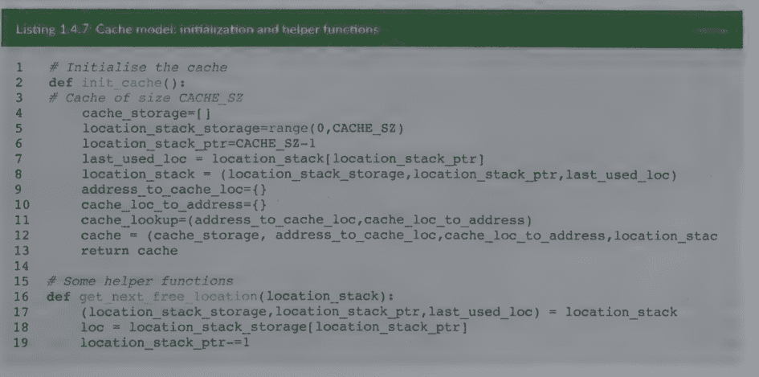

```python
# 初始化缓存
def init_cache():
    # 缓存大小 CACHE_SZ
    cache_storage=[]
    location_stack=range(0, CACHE_SZ)
    location_stack_ptr=CACHE_SZ
    last_used_loc = location_stack[location_stack_ptr]
    address_to_loc={}
    cache_loc_to_address={}
    cache_lookup=(address_to_loc,cache_loc_to_address,location_stack)
    return cache

# 辅助函数
def get_next_free_location(location_stack):
    cache_storage,location_stack_ptr,last_used_loc = location_stack
    loc = cache_storage[location_stack_ptr]
    location_stack_ptr-=1
    location_stack=(cache_storage,location_stack_ptr,last_used_loc)
    return loc, location_stack

def evict_location(location_stack):
    cache_storage,location_stack_ptr,last_used_loc = location_stack
    location_stack_ptr+=1
    location_stack[location_stack_ptr] = last_used_loc
    location_stack=(cache_storage,location_stack_ptr,last_used_loc)
    return location_stack

def cache_full(location_stack_ptr):
    if location_stack_ptr==0:
        return True
    else:
        return False
```

列表 4.8 缓存模型：缓存读写函数


```python
def write_to_cache(memory, address, cache):
    cache_storage, address_to_cache,cache_loc_to_address, location = cache
    location_stack_storage,location_stack_ptr,last_used_loc = location_stack
    # 如果缓存满了，先逐出
    if cache_full(location_stack_ptr):
        evicted_address = evict_location(location_stack)
        address = address_to_cache[evicted_address]
        memory[evicted_address]=cache_storage[last_used_loc]
    # 获取空闲位置
    (loc,location_stack) = get_next_free_location(location_stack)
    # 拷贝数据并写入缓存存储
    data = memory[address]
    cache_storage[loc] = data
    # 更新查找表和最近使用位置
    address_to_cache[address]=loc
    cache_loc_to_address[loc] = address
    last_used=loc
    location_stack=(location_stack_storage,location_stack_ptr,last_used_loc)
    cache=(cache_storage, address_to_cache,cache_loc_to_address,location)
    return (memory,cache)

def read_from_cache(memory, address, cache):
    cache_storage, address_to_cache,cache_loc_to_address, location = cache
    location_stack = evict_location(location_stack)
    # 如果数据尚未在缓存，则从 DRAM 获取
    # 注意：这可能导致逐出，从而修改内存
    if address not in address_to_cache:
        (memory, cache) = write_data_to_cache(memory, cache)
    # 从缓存获取数据
    loc = address_to_cache[address]
    data = cache_storage[loc]
    cache=(cache_storage, address_to_cache,cache_loc_to_address, location)
    return (data,memory,cache)
```

该模型的问题在于，对于给定大小的缓存，我们需要一个与缓存大小相同的位置栈和两个查找表。这消耗了大量的硅片。因此，在实践中，缓存不会简单地获取单个内存地址的内容，而是获取一个称为缓存行的连续内存块。例如，ARM Cortex-A53 具有 64 字节的缓存行。假设我们的内存是 32 位的，位置栈和查找表的大小是实际缓存大小的 16 倍。

# 第1章 | 以内存为中心的模型

使用缓存行（`cache lines`）的另一个原因是：当给出一个地址时，后续的内存访问频繁指向相邻的地址。在缓存缺失（`cache miss`）时取一整行往往会减少后续缓存缺失的次数。将我们的模型适配为使用缓存行是非常简单的：

## 列表 14. 带有缓存行的缓存模型

```python
# 初始化缓存
def init cache():
 # 大小为 CACHE_SZ 的缓存，cache_line = 64字节 = 16个字
 cache_storage=[0:16]=CACHE_SZ/16
 location_stack=range(0,CACHE_SZ/16)
 location_stack_ptr=CACHE_SZ/16-1
 last_used_loc = location_stack[location_stack_ptr]
 location_stack = (location_stack,location_storage,location_stack_ptr,last_used_loc)
 address_to_cache_loc.append(address)
 cache_loc_to_address=lookup(address,cache_loc,loc_loc___)
 cache = (cache_storage,address_to_cache_loc,cache_loc_to_address,location_stack)
 return cache

 # 辅助函数保持不变
def write_data_to_cache(memory,address,cache):
 (cache_storage,address_to_cache_loc,cache_loc_to_address) = cache
 (location_stack,location_stack_ptr,last_used_loc) = location_stack
 # 如果缓存满了，先驱逐
 location_stack = evict_location(location_stack)
 evicted_address = evict_loc_to_address[last_used]
 cache_line = cache_storage[last_used]
 for i in range(16):
  data = cache_line[i]
 memory((evicted_address<<4)+i)=data
 # 获取一个空位置。
 (location_stack)=get_next_free_location(location_stack)
 # 获取 DRAM 内容并将其写入缓存存储
 cache_line = []
 for i in range(0,16):
 cache_line.append(memory((address>>4)<<4)+i)
 cache_storage[loc] = cache_line
 # 更新查找表并使用最后一个 loc
 address_to_cache_loc[address>>4]=loc
 cache_loc_to_address[loc] = address>>4
 last_used_loc=loc
 location_stack = (location_stack,location_storage,location_stack_ptr,last_used_loc)
 cache = (cache_storage,address_to_cache_loc,cache_loc_to_address,location_stack)
 return (memory,cache)

def read_from_cache(memory,address,cache):
 (cache_storage,address_to_cache_loc,cache_loc_to_address,location_stack) = cache
 location_stack = evict_location(location_stack)
 # 如果地址不在缓存中，则从 DRAM 中取
 # 注意这可能导致驱逐，从而修改内存
 if address not in address_loc:
 (memory,cache) = write_data_to_cache(memory,address,cache)
 # 从缓存中获取数据
 loc = address_to_cache_loc[address>>4]
 cache_line = cache_storage[loc]
 data = cache_line[address & 0xF]
 cache = (cache_storage,address_to_cache_loc,cache_loc_to_address,location_stack)
 return (data,memory,cache)
```

17

在树莓派上运行 Linux 的操作系统基础

基于缓存行的模型中唯一的复杂之处在于，我们需要操作内存地址以确定缓存行以及数据在缓存行内部的位置。通过使用位移和掩码操作来实现这一点：地址的前 4 位标识了数据在缓存行中的位置。我们不需要在缓存的查找表中存储这些位，因为缓存只存储缓存行。换句话说，从缓存的角度来看，内存是由缓存行而不是单个内存位置组成的。因此，我们有以下公式：


```python
data_position_in_cache_line = address & 0xF
cache_line_address = address >> 4
```

```python
address = (cache_line_address << 4) + data_position_in_cache_line
```

### 1.4.7 在处理器上运行程序

处理器模型是完整的，可以运行任何程序。例如，以下程序生成前 10 个斐波那契数并将它们写入主内存：

列表 4.10: 斐波那契代码

```python
1 fib_prog(
2   [SET,R1,1],
3   [SET,R2,1],
4   [SET,R3,0],
5   [SET,R4,10],
6   [SET,R5,1],
7   [loop, ADD,R3,R1,R2],
8   [MOV,R1,R2],
9   [MOV,R2,R3],
10  [SUB,R4,R5],
11  [STR,R3,R4],
12  [CBZ,R4,'loop'],
13  [WFI]
14 ]
```

注意：`abstract_model_encoder.py` 中的 `encodeProgram` 函数支持将字符串作为指令的标签（如所示）。类似于 ARM 汇编，指令 `CBZ`、`CBNZ`、`ADR` 和 `B` 实际上接受的是标签而不是显式地址。要运行此程序，我们需要对其进行编码，将其加载到内存中，并确保程序计数器指向代码的开头：

列表 4.11: 在处理器上运行程序

```python
1 # 编码程序
2 encodeProgram(fib_prog)
3 
4 # 将程序写入 RAM
5 pc=0
6 for iw in fib_prog:
7   ramState[CODE+pc] = iw
8   pc+=1
9 
10 # 初始化处理器状态
11 registers[PC]=CODE
```

```python
# 按给定的周期数运行系统
# MAX_NCYC=50
for cycles in range(1,MAX_NCYC):
    # 运行外设操作
    (kbdState, kbdIrq)=kbdAction(kbdState)
    (nicState, nicIrq)=nicAction(nicState)
    (ssdState, ssdIrq)=ssdAction(ssdState)
    (gpuState, gpuIrq)=gpuAction(gpuState)
    (systemState, systemIrq)=systemAction(systemState)

    # 运行处理器周期
    (processorState, procIrq)=processorAction(processorState)

    # 检查中断
    if procIrq:
        handle_interrupt(procIrq, systemState)

    # 打印系统状态
    print(systemState)
```

第 1 章 | 以内存为中心模型


图 1.3：任务内存空间 (Linux)。

## 1.5.2 寄存器文件

然而，正如我们所看到的，处理器也拥有一些状态，即寄存器文件。因此，如果我们想交替运行两个任务，我们需要确保寄存器文件包含每个任务的正确状态。从概念上讲，我们可以存储任务 1 的寄存器内容快照，然后加载任务 2 之前的寄存器内容快照。

## 1.5.3 时间切片与调度

那么我们如何让两个任务交替运行呢？实现此点的代码将是我们操作系统内核的核心，被称为“任务调度器”（或简称为“调度器”）。假设我们将简单地在固定时间内交替运行两个（或多个）任务（这被称为“轮询调度”）。例如，在树莓派 3 上，Linux 实时调度器使用间隔为 10 ms 的周期（也称为“时间切片”或“量子”）。作为对比，眨眼的平均持续时间为 100 ms。注意，在 1 GHz 的典型时钟频率下，任务可以在这段时间内执行 1000 万次单周期指令。

时间切片的持续时间由系统定时器控制。正如我们之前看到的，定时器可以配置为定期触发，因此在我们的情况下，系统定时器每 10 ms 会产生一次中断请求。接收到请求后，处理器将执行相应的中断服务程序 (ISR)。正是这个 ISR 处理时间切片；换句话说，中断服务程序实际上就是操作系统内核。

在 Python 模型中，定时器外设有一个存储间隔的寄存器和一个控制寄存器。我们可以这样设置定时器：

```python
# 设置定时器为周期触发，间隔为 100 ticks
set_timer=[
  [SET,R1,100],
  [SET,R2,100], # 周期定时器
  [STR,R2,TIMER],
  [STR,R2,TIMER+1]
]
```

树莓派上的 Linux 操作系统基础

运行此程序时，定时器每 100 个时钟周期就会触发一次并产生中断请求。让我们来看看中断处理程序。为了实现两个任务之间的时间切片，它应该做什么呢？假设任务 1 一直运行，我们现在想运行任务 2。

- 首先，保存任务 1 的寄存器文件，我们通过将所有寄存器内容推入栈中来实现。（如果你在这里发现了问题，那太棒了！我们将在 1.5.4 节中回到这个问题。）

- 然后确定下一个要运行的任务（（即任务 2）。我们可以使用较小的整数（“任务标识符”）来识别每个任务，并将其存储在内核可访问的内存中。我们将任务 2 的任务标识符加载到寄存器中，并更新内存以存储下一个任务的任务标识符（在本例中，再次是任务 1）。

- 现在，我们将任务 1 的寄存器文件从栈移动到内核内存。在实践中，内核使用一种特殊的数据结构——任务控制块 (`TCB`) 来此此。

- 现在我们可以从任务 2 的 `TCB` 中读取寄存器文件内容。同样，我们必须通过栈来完成（为什么呢？）。

- 一旦完成这些操作，任务 2 将从 `PC` 指向的位置开始运行，直到下一次中断。

我们可以用为处理器编写的高级 Python 代码来表示这一系列动作：

```python
def time_slice(systemState,registers):
    # 将寄存器推入栈
    for r in range(0,16):
        systemState[registers[MSP]]=registers[r]
        registers[MSP]+=1
    # 获取下一个任务
    pid1 = systemState[PID] = 0 or 1
    pid2 = 1-pid1
    tcb1 = T_OFFSET+pid1*TCB_SZ
    tcb2 = T_OFFSET+pid2*TCB_SZ
    # 从栈中弹出寄存器并存储到 tcb1
    # 我们使用 r0 来表示在实际代码中，我们需要读取到一个临时寄存器中
    for r in range(0,16):
        r0=systemState[registers[MSP]]
        systemState[tcb1+r]=r0
        registers[MSP]+=1
    # 从栈中弹出任务 2 的寄存器
    for r in range(0,16):
        registers[MSP]=systemState[tcb2+r]
        registers[MSP]-=1
```

这段代码是两个任务轮询调度器的一个最小示例。

第 1 章 | 以内存为中心系统模型

你已经可以通过思考如何解决这些问题来尝试回答它们。

## 1.5.4 特权

在 1.5.3 节中，我们暗示了栈可能存在潜在问题。问题在于“推入栈”意味着修改栈指针 `SP`。那么，我们该如何保留当前任务的栈指针呢？ARM 处理器的简单答案是，它有两个栈：一个用于用户空间栈 (`PSP`)，另一个用于内核栈 (`MSP`)。用户任务无法访问内核栈指针；内核代码可以使用 `MRS` 和 `MSR` 指令在两者之间进行选择。

这引出了特权的话题：显然，如果用户可以访问内核内存，将产生安全风险。这是任何操作系统的基本功能。目前，只需要知道 ARM 中存在权限级别：“非特权”(`Unprivileged`)和“特权”(`Privileged`)。我们将在第 4 章进行详细讨论。

## 1.5.5 内存管理

到为止，我们假设任务位于连续内存中。在实践中，这将非常不灵活。解决此问题的常用方案是引入虚拟空间的概念。操作系统负责逻辑地址和物理地址之间的转换。这将在第 6 章解释，“内存管理”。

树莓派上的 Linux 操作系统基础

在实践中，通常会有硬件支持，在 Cortex-M3 等低端处理器上以内存保护单元 (`MPU`) 的形式存在，在 Cortex-A53 等处理器上作为复杂的内存管理单元 (`MMU`) 的一部分。

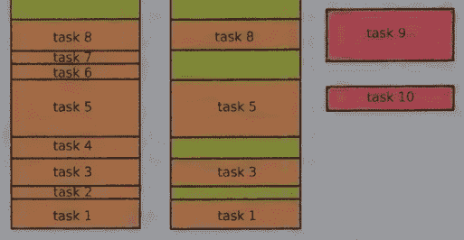

图 1.4：内存分配的问题。

## 1.5.6 转换缓冲区 (TLB)


MMU 可以作为外设实现，正如我们对 DMA 单元那样，但我们将内存管理的深入讨论推到了第 6 章。然而，我们想介绍 MMU 的一个特定部分，一种称为转换缓冲区 (`TLB`) 的特殊缓存。从逻辑地址到物理地址的转换非常耗时，因此 MMU 使用 `TLB` 来跟踪最近使用的转换（图 1.5）。

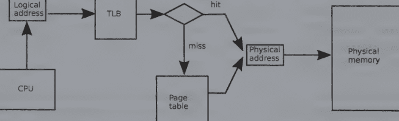

图 1.5：使用转换缓冲区 (`TLB`) 进行逻辑到物理地址的转换。与包含内存中数据的缓存不同，`TLB` 包含与逻辑地址对应的物理地址。`TLB` 与缓存的区别在于不是从内存中抓取，而是在所谓的“页表”（`Page Table`）中查找物理地址；同样，只有在缺失（`miss`）时才会发生 `TLB` 写入。然而，缓存与 `TLB` 之间的相似性使得我们可以在不需要了解实际页表如何工作的情况下，解释内存管理的主要要点。

## 1.6 练习与思考

### 1.6.1 任务调度

- 1. 在 `Python` 中为单个任务创建一个调度器。你可以使用上面的代码和斐波那契数列示例，也可以编写你自己的代码。
- 2. 扩展 `time_slice` 函数和内存布局，以支持更多数量（`NTASKS`）的任务。

### 1.6.2 TLB 模型

- 1. 从第 1.4.6 节的缓存模型开始，在 `Python` 中创建一个 `TLB` 模型。
- 2. 给定逻辑地址空间和物理地址空间的概念以及页的概念，提出一种数据结构，允许操作系统将非连续的物理内存块分配给进程作为连续的地址空间。讨论你所提结构的优缺点。
- 3. 假设有 4GB 内存被分为 4KB 大小的页，并假设页表查找比 `TLB` 查找慢 100 倍，为了使平均查找时间是 `TLB` 查找的两倍，`TLB` 的命中率应该是多少？`TLB` 的大小应该是多少？

### 1.6.3 建模

- 1. 在物理系统中，上述模型中的所有操作都是并行的。这会对模型产生什么影响？
- 2. 假设你必须设计一个没有锁的外设。它的状态会是什么？哪些事件会引发中断？

### 1.6.4 简易处理器模型

- 1. `LDR` 和 `STR` 指令在内存地址上工作。原则上，没有什么可以阻止两个程序使用相同的地址，但这是不必要的。我们可以做什么来避免这种情况？
- 2. 你能想出我们的简易处理器缺少哪些功能吗？

### 1.6.5 高级处理器模型

- 1. 如果处理器具有多个可以并行执行任务的核心，处理器模型需要发生哪些变化？
- 2. 如果每个核心都有自己的缓存，你认为缓存会存在任何问题吗？如果它们共享单个缓存呢？

### 1.6.6 基本操作系统概念

第 1.5 节的解释省略了许多细节，并提出了几个将在后续章节中回答的问题。例如：
- 如果有超过 2 个任务会发生什么？
- 用户如何启动任务？
- 操作系统如何从磁盘加载程序到内存中？
- 操作系统如何确保程序只能访问自己的内存？
- 外设共享又是怎样的？
- 任务完成时会发生什么？

权限和内存管理问题将在后面的章节中进行更详细的讨论。目前为止的模型提出了几个问题：
- 保证内存保护涉及什么？例如，操作系统如何知道每个进程逻辑地址空间的边界？
- 仅提供内存保护足够吗？其他资源也应该有类似的保护吗？
- `Linux` 默认页大小为 4KB 的原因是什么？如果它小 10 倍或大 10 倍会发生什么？
- 你能想出不需要逻辑内存的场景吗？

### 参考文献

- [1] `Principles of Arm Memory Maps, Arm Ltd, 2012, issue C. [Online].` Available: `http://infocenter.arm.com/help/topic/com.arm.doc/den0001c/DEN0001C_principles_of_arm_memory_maps.pdf`
- [2] `Cortex-A53 Multicore Processor - Technical Reference Manual Rev: r0p4, Arm Ltd, 2016, revision: r0p4. [Online].` Available: `http://infocenter.arm.com/help/topic/com.arm.doc/dui0500g/DUI0500G_cortex_a53_tr.pdf`
- [3] `ARM Compiler toolchain Version 5.03 Assembler Reference, Arm Ltd, 2013. [Online].` Available: `http://infocenter.arm.com/help/topic/com.arm.doc/dui0489/DUI0489_arm_assembler_reference.pdf`
- [4] `A. G. Dean, Embedded Systems Fundamentals with Arm-M based microcontrollers: A Practical Approach. Arm Education Media UK, 2017.`
- [5] `Cortex-M3 Devices Generic User Guide, Arm Ltd, 2010. [Online].` Available: `http://infocenter.arm.com/help/topic/com.arm.doc/dui0522a/DUI0522a_cortex_m3_dgug.pdf`
- [6] `Procedure Call Standard for the Arm Architecture ABI r210, Arm Ltd, 2015. [Online].` Available: `https://developer.arm.com/docs/ih00042/latest/procedure-call-standard-for-the-arm-architecture-abi-2018q4-documentation`

## 第 2 章：Linux 系统的实用视角

> 来自自：torvalds@linux.helsinkinki.fi (Linus Benedict Torvalds)
> 组：comp.os.minix
> 主题：你最想在 minix 中看到什么？
> 消息：关于我新操作系统的小调查
> 日期：1991 年 8 月 21 日 05:56 GMT
> 发自：@linux.helsinkinki.fi
> get：赫尔辛基大学

大家好，正在使用 minix 的朋友们——

我正在做一个（免费的）操作系统（只是个爱好，不会像 386 克隆系统那样大且专业）。这从 4 月就开始筹备了，现在开始准备就绪。我想获得大家对喜欢/不喜欢 minix 的方面的任何反馈，因为我的操作系统和它有些相似（出于实用等原因，文件系统的物理布局相同）。我目前移植了 bash (1.0) 和 gcc (1.4)，它们看起来运行良好。我打算在几个月内实现一些功能，我想知道你们最想要哪些功能。欢迎任何建议，但我不保证一定会实现它们。它是免费的，支持多线程，并且可能不会支持任何其他磁盘。

### 2.2.1 操作系统层次结构

`Linux` 内核只是操作系统的组件之一。图 2.1 展示了完整的 `Linux` 系统层次结构。用户空间是由许多用户程序的。内核与用户空间之间的接口是系统调用，它被应用程序使用。内核提供了调度、内存管理等功能，并通过设备程序与硬件交互，在这种情况下我们称为磁盘。

### 2.2.2 进程

进程是运行中的程序，操作系统为进程分配时间。在 `Linux` 中，这种结构被称为 `task_struct`。进程是逻辑的而非物理的，属于单个用户在这种情况下我们称为任务。

### 2.2.3 用户空间与内核空间

“用户空间”和“内核空间”这些术语主要指示不同权限的内存。我们在第 1 节中看到，“内核空间”意味着内核可以访问的内存，而“用户空间”意味着磁盘。大多数操作系统支持多个用户，每个用户

### 2.2.4 设备树与 ATAGs

`Linux` 内核在启动时需要关于硬件的信息，例如 CPU、内存大小、内存位置、设备。在 Arm 系统上，此此传统方法是使用称为 `ATAGs` 的格式，它是为内核提供的数据结构。一种更现代、灵活的方法是设备树。它定义了一种描述硬件的格式语法。设备树是一个带有节点的数据结构。设备树源文件可以通过特殊编译器编译成体系无关的二进制格式，称为设备树二进制（`Blob`）。

### 2.2.5 文件与持久化存储

`Linux` 信息项目将文件定义为：

是相关数据的集合，在用户看来是一个单一的连续块，并保留在存储中。

在这个定义中，存储指的是能够较长时间保留数据（例如数十年）的计算机设备或介质，如固态硬盘和其他类型的非易失性内存、磁硬盘 (`HDD`)、CDROM 和磁带，换言之持久化存储。这与 RAM 内存形成对比，后者的内容仅临时保留（即在使用期间或供电期间）。

持久化存储介质（我将其称为“磁盘”）如 SD 卡、USB 闪存或硬盘以线性方式存储数据。然而，在实践，磁盘并不包含单一的字节数组，而是通过分区和文件系统组织。我们将在第 9 章详细讨论这些概念。

### 分区


磁盘被划分为分区，它不是呈现为单一 blob，而是呈现出多个 blob。分区是逻辑上的而非物理的，关于磁盘如何分区的信息（即每个分区的位置、大小、类型、名称和属性）存储在分区表中。

## 文件系统

磁盘的每个分区都包含一个用于逻辑组织的进一步的系统。大多数文件系统的目的是提供文件和目录（文件夹）抽象。有许多不同的文件系统（例如 `fat32`、`ext4`、`hfs+`、...），我们将在第 9 章中介绍其中最重要的几个。对于本章而言，你需要知道的是文件系统不仅允许我们以目录中组织的文件形式存储信息，还包含文件和目录的使用权限信息，以及时间戳信息（文件创建、修改等）。

文件系统中的信息通常组织为目录的层级树结构，树根的目录就是根目录。要使用文件系统，内核会执行挂载（mounting）操作。只要文件系统没有被挂载，系统就无法访问其上的数据。

挂载文件系统是将文件系统附加到目录（挂载点）并使其系统可用。根（`/`）文件系统总是挂载的。任何其他文件系统都可以在目录树的任何点连接或断开。

### 2.2.6 “万物皆文件”

Linux 和其他类 Unix 操作系统的关键特征之一是经常被引用的概念“万物皆文件”。这并不意味着 Linux 中的所有对象都是上述定义的文件，而是 Linux 倾向于使用一致的接口处理所有操作系统可以读取数据或从中写入数据的对象。因此，更准确的说法可能是“万物皆字节流”。Linux 使用文件描述符（file descriptor）的概念，这是一种用于访问输入/输出资源的抽象句柄（文件只是其中一种类型）。所以人们也可以说，在 Linux 中，万物皆文件描述符。

在实践中，这意味着例如网卡、键盘或显示器的接口被表示为文件系统中的一个文件（在 `/dev` 目录中）；关于硬件和软件的系统信息在 `/proc` 下均可用。例如，图 2.2 显示了树莓派上 `/dev` 和 `/proc` 的列表。我们可以看到代表内存（`ram*`）、终端（`tty*`）、调制解调器（`ppp`）的设备，


树莓派上的 Linux 操作系统以及许多其他设备。特别是 `/dev/null` 是一个特殊设备，它会丢弃写入它的信息，而 `/dev/zero` 则返回无限的零字节流（即，当你尝试 `cat /dev/zero` 时，什么也看不到。尝试 `cat /dev/zero | hd` 而）。

### 2.2.7 用户

Linux 系统通常是一个多用户系统。这意味着它在进程级别之上支持另一层面的隔离、权限和保护。用户可以运行并控制多个进程，每个进程在自己的内存空间中运行，但共享系统资源的访问。特别是，用户和权限的概念与文件系统紧密相连。给定用户的文件系统权限控制着该用户在文件层级结构不同部分读取、写入和执行文件的权限。

正如内核以特权运行以控制用户进程一样，也需要一个特权用户来控制其他用户（类似于 Windows 系统上的“管理员”）。在 Linux 中，这被称为 `root`，当系统启动时，第一个进程（`init`，PID=1）以 `root` 用户身份运行。`init` 进程可以创建新进程。事实上，Linux 任何进程都可以创建新进程（在第 4 章中会有更详细的解释）。然而，`root` 用户拥有的进程可以将创建的进程所有权分配另一个用户，而由 `root` 用户进程创建的进程只能由自己所有。

### 2.2.8 凭据

在 Linux 中，凭据（credentials）是与任何对象相关的特权和权限 set 的术语。凭据表达了例如所有权、能力和安全管理属性。例如，对于文件和进程，关键是用户 ID 和组 ID。为了确定某个对象（例如任务）对另一个对象（例如文件）做什么，Linux 内核会使用凭据和一组规则进行安全计算。在实践中，以 `root` 身份运行的进程可以访问系统中的所有文件和其他资源；对于非 `root` 用户，文件和目录的访问由文件上的权限系统和组组成员决定：一个用户可以属于一个或多个用户组。

文件访问权限可以为单个用户、组和所有人指定。例如，在图 2.3 中，我们看到目录 `/home/min` 可以由 `min` 组的用户 `min` 写入。如果我们尝试使用 `touch` 命令创建一个（空）文件，这会成功。但是，如果我们尝试在属于 `plomer` 组的用户 `plomer` 的目录 `/home/plomer` 中执行相同操作，我们将得到“permission denied”（拒绝访问），因为只有用户 `plomer` 拥有该目录的写入权限。

```
$ root@root:~# ls -ld /home/min
drwxr-xr-x 2 min min 4096 Dec 22 15:42 /home/min/
$ root@root:~# touch /home/min/test
$ root@root:~# ls -l /home/min/test
-rw-r--r-- 1 min min 0 Dec 22 15:45 /home/min/test
$ ls -ld /home/min
drwxr-xr-x 2 min min 4096 Dec 22 15:42 /home/min/
```

## 2.3.3 引导过程第3阶段：将内核加载到内存

**第3阶段**由 `start.elf` 控制，这是一个运行在 GPU 上的闭源 ELF 格式二进制文件。

`start.elf` 加载压缩的 Linux 二进制内核 `kernel.img` 并将其拷贝到内存中。它读取 `config.txt`、`cmdline.txt` 和 `bcm2710-rpi-3-b.dtb`（设备树二进制文件）。

`config.txt` 是一个文本文件，包含系统配置参数，这些参数在传统 PC 上会使用 BIOS 进行编辑和存储。

`cmdline.txt` 包含通过 ATAGs 传递给 Linux 内核的命令行参数（例如文件系统类型和根文件系统位置），而 `.dtb` 则包含设备树内存块（Device Tree Blob）。

### 2.3.4 引导过程第4阶段：启动内核！

**第4阶段**在 CPU 上启动：释放 CPU 的复位信号使其从写入 `kernel.img` 数据的地址开始运行。内核运行 Arm 特定的代码来填充 CPU 寄存器并开启缓存，然后进行自解压，并运行解压后的内核代码。内核使用 Arm 特定的代码初始化 MMU，然后运行其余与无关的内核代码。

### 2.3.5 引导过程第5阶段：运行处理器无关的内核代码

**第5阶段**是处理器无关的内核代码。这些代码主要由初始化函数组成，用于设置中断、执行进一步内存配置以及加载 RAM 磁盘 `initramfs`。

这是一个完整的目录集，可以在普通的根文件系统中找到它，它由第3阶段引导加载程序加载到内存中。它被拷贝到内核空间并挂载。此 `initramfs` 作为内存中的临时根文件系统，允许内核在没有任何物理磁盘的情况下完全启动并执行用户空间操作。

Linux 内核镜像可以在许多平台上运行，支持大量设备/外设。为了减少加载和运行某些未广泛使用的功能的内核二进制文件的开销，Linux 支持在运行时加载早期引导期间不需要的组件（模块）。由于与外设建立接口所需的必要模块可以是 `initramfs` 的一部分，因此内核可以很小，但仍然支持大量的可能硬件配置。内核启动后，`initramfs` 根文件系统会被卸载，并挂载真正的根文件系统。最后，启动 `init` 函数，这是第一个用户空间进程。此后，任务启动，调度器开始运行。

### 2.3.6 初始化

内核启动后，会启动第一个进程，称为 `init`。该进程是所有其他进程的父进程。在运行于树莓派上的 Raspian 发行版中，此 `init` 实际上是 `/lib/systemd/systemd` 的别名，因为 Raspian 作为基于 Debian 的发行版，使用 `systemd` 作为其 init。其他 Linux 发行版可能有不同的 init 实现，例如 SysV init 或 upstart。

# 树莓派 Linux 操作系统基础

`systemd` 进程执行多个进程来初始化系统：键盘、硬件驱动程序、文件系统、网络、服务。它有一套复杂的系统来配置其控制下的所有进程，以及启动和停止进程、检查状态、记录日志、更改权限等。

`systemd` 进程执行许多任务，但原理始终相同：它以所需的用户名启动一个进程并监控其状态。如果进程退出，`systemd` 会采取适当行动，例如重启进程或报告导致其退出的错误。

## 2.3.7 登录

`systemd` 运行的进程之一是用户登录系统（`system-logind`）。要通过终端（或虚拟控制台）登录，Linux 使用两个程序：`getty` 和 `login`（最初，`tty` 意为“电打字”，是现代终端的前身）。两者都作为后台运行。

基础的 `getty` 程序打开终端设备，对其进行初始化，打印登录提示并等待用户输入用户名。当这发生时，`getty` 执行 `login` 程序，然后 `login` 程序提示用户输入密码。如果密码错误，`login` 将直接退出。`systemd` 进程会注意到此并派生另一个 `getty`。如果密码正确，`login` 将以该用户的身份执行其 shell 程序。从那时起，用户可以通过 shell 启动进程。


# 第2章 | Linux 系统的实用视角

之所以有两个独立的程序，是因为 `getty` 和 `login` 都可以单独使用，例如，通过 SSH 进行远程登录并不使用终端，而是使用 `login`：每个新连接由一个名为 `ssh` 的程序处理，该程序会启动 `login` 进程。

图形登录在概念上与上述描述没有区别。区别在于运行的不是 `getty`/`login` 程序，而是名为显示管理器（display manager）的图形登录程序，在验证通过后，该进程启动图形 shell。

在树莓派中，显示管理器是 `LightDM`，图形 shell 是 `LXDE`（轻量级 X11 桌面环境）。与大多数 Linux 发行版一样，图形桌面环境基于 X Window 系统（X11），该项目始于 MIT，现在由 XOrg 基金会管理。

## 2.4 内核管理与编程

Linux 系统的管理员不需要了解 Linux 内核的内部工作原理，但需要熟悉用于配置操作系统的工具，包括通过内核模块为内核添加功能，以及编译自定义内核。

### 2.4.1 可加载内核模块和设备驱动程序

如上所述，内核是模块化的，可以使用可加载内核模块（LKM）在运行时加载功能。此功能被用于配置系统硬件的驱动程序。因此，管理员需要熟悉模块系统的主要概念，并基本理解设备驱动程序的作用。

要将模块插入 Linux 内核中，可以使用 `insmod(8)` 命令。`insmod` 通过 `init_module()` 系统调用将 LKM 加载到内存。

`init_module()` 系统调用在加载 LKM 后立即调用 LKM 的初始化程序。`insmod` 使用 `module_init()` 宏向 `init_module()` 传递内核中初始化程序的地址。

LKM 作者设置模块的 `init_module` 来调用内核函数，注册 LKM 包含的子程序。例如，字符驱动的 `init_module` 程序可能会调用 `register_chdev` 内核程序，传递它意图驱动的设备的主、从号以及自身的 `open()` 程序地址作为参数。`register_chdev` 记录当内核想要打开特定设备时，应调用我们 LKM 中的 `open()` 程序。

当 LKM 被卸载时（例如通过 `rmmod(8)` 命令），将通过 `module_exit()` 宏调用 LKM 的清理程序。

在实践中，管理员将希望使用更智能的 `modprobe(8)` 命令来自动处理模块依赖。最后，可以使用 `lsmod(8)` 命令列出所有加载的内核模块。

好奇的细节可见 `kernel/module.c` 中的 `init_module`、`load_module` 和 `do_init_module`。

### 2.4.2 Linux 内核模块的结构

作为管理员，你有时需要为系统添加新设备，而你的 Linux 发行版标准内核没有为该设备提供驱动程序。这意味着你必须将该驱动程序添加到内核中。

一个简单的内核模块非常容易。以下模块将在加载和卸载时向内核打印一些信息。

## 基于树莓派的 Linux 操作系统基础

然而，请注意内核模块并不是应用程序；它是供内核使用的代码段。如你所见，这里没有 `main()` 函数。此外，内核模块：

- 不是按顺序执行的：内核模块通过其初始化函数注册自身来处理请求，该函数运行后即结束。它能够处理的请求类型在模块代码中定义。这与图形用户界面（GUI）应用程序中常用的事件驱动编程模型非常相似。
- 不具备自动资源管理能力（内存、文件句柄等）：在模块代码中分配的任何资源都必须在模块卸载时显式地释放。
- 无法访问常用的用户空间系统调用，例如 `print()`。但是，有一个 `printk()` 函数可以将信息输出到内核日志中，并可以从用户空间进行查看。
- 内核模块可以同时被多个不同的程序/进程使用，因为它们是内核的一部分。因此，在编写内核模块时，必须非常小心，以确保模块在被中断时其行为是一致且正确的。
- 必须对资源非常敏感：由于模块是内核代码，它的执行在 CPU 周期和内存使用方面都与内核运行时竞争。你必须意识到，你的模块不应该破坏系统的整体性能。

宏 `module_init` 和 `module_exit` 用于标识在模块加载和卸载时应该运行哪些子程序。模块的其他功能取决于模块的用途，但内核中将特定模块连接到通用 API（文件系统 API）的通用机制是一个带有函数指针的结构体（`struct`），其工作方式类似于 Java 或 C++ 中的对象接口声明。例如，文件系统 API 在 `include/linux/fs.h` 中提供了 `file_operations`，如下所示：

```
Listing 2.4.2: file_operations from <include/linux/fs.h>
```c

struct file_operations {

    struct module *owner;

    loff_t (*seek)(struct file *, loff_t, int);

    ssize_t (*read)(struct file *, char __user *, size_t, loff_t *);

    ssize_t (*write)(struct file *, const char __user *, size_t, loff_t *);

    ssize_t (*read_iter)(struct read_iter *, struct kiocb *, loff_t);

    ssize_t (*write_iter)(struct write_iter *, struct kiocb *, loff_t);

    int (*open)(struct file *, struct dir_context *);

    int (*shared)(struct file *, struct dir_context *);

    int (*poll)(struct file *, struct poll_table *);

    long (*locked_ioctl)(struct file *, unsigned int, unsigned long);

    long (*ioctl)(struct file *, unsigned int, unsigned long);

    void * (*mmap)(struct file *, struct vm_area_struct *);

    unsigned long long mmap_supported_structs;

    int (*open)(struct inode *, struct file *);

    int (*flush)(struct file *, struct filp *f_id);

    int (*release)(struct inode *, struct file *);

    int (*fsync)(struct file *, loff_t, int datasync);

};

```

```
int (*fsasync)(int, struct file *, int);

int (*lock)(struct file *, struct file_lock *);

size_t (*sendpage)(struct file *, struct page *, int, size_t, loff_t *, int);

unsigned long (*unmapped_area)(struct file *, unsigned long, unsigned long, unsigned long, unsigned long);

int (*check_flags)(int);

int (*struct file *, int, struct file_lock *);

size_t (*splice_write)(struct pipe_inode_info *, struct file *, loff_t *, size_t, unsigned int);

size_t (*splice_read)(struct file *, loff_t *, struct pipe_inode_info *, size_t, unsigned int);

int (*struct file *, long, struct file_lock *, **);

long (*fallocate)(struct file *, int, loff_t offset, loff_t len);

void (*show_file_info)(struct seq_file *m, struct file *f);

#include <linux/fs.h>

unsigned (*map_capacities)(struct file *);

size_t (*copy_file_range)(struct file *, loff_t, struct file *, loff_t, unsigned int);
```


```c
int (*clone_file_range)(struct file *, loff_t, struct file *, u64);

size_t (*dedupe_file_range)(struct file *, u64, u64, struct file *, u64, loff_t len);

} ; _random_initialize();
```

如果你想为自定义系统驱动程序实现一个自定义模块，你将需要按照此结构体提供的签名，为你想要支持的每个调用提供实现。然后，在你的模块代码中，你可以创建该结构体的实例，并用你所实现的函数指针填充它。例如，假设你已经实现了 `my_file_open`、`my_file_read`、`my_file_write` 和 `my_file_close`，你可以创建如下结构体：

## Listing 2.4.3: 文件操作示例

```c
static struct file_operations my_file_ops =
{
    open = my_file_open,
    read = my_file_read,
    write = my_file_write,
    release = my_file_close,
};
```


剩下的就是调用 `register_chdev(0, DEVICE_NAME, &my_file_ops)`。该 API 定义在 `include/fs.h` 中。

### 2.4.3 编译自定义内核

在某些情况下，系统管理员可能需要或希望编译自定义内核。自定义内核可以对许多内核配置进行细粒度的控制，从而获得更好的性能或更小的体积。

编译自定义内核的过程在树莓派网站上有所说明。为此你需要完整的内核源码。再次，内核文档是很好的信息来源，请查看 `Documentation/kbuild/kconfig.txt`、`Documentation/kbuild/kbuild.txt` 和 `Documentation/kbuild/makefiles.txt`。

如果你在树莓派上编译内核将需要几个小时；而在现代 x86-64 PC 上交叉编译只需要几分钟。

### 2.4.4 安装内核头文件

如果你想创建自己的模块，不需要整个内核，但你需要内核头文件。在运行 Raspian 的树莓派上，可以使用以下命令安装内核：

| 步骤 | 命令 |
|---|---|
| 1 | `sudo apt-get update` |
| 2 | `sudo apt-get install raspberrypi-kernel` |

Linux 内核使用 Makefile 系统来构建模块（以及内核本身）。内核文档 `modules.txt` 说明了如何构建模块。

从源码构建内核的缺点是，每次升级内核时都必须重新构建。动态模块支持（dkms）框架提供了一种确保自定义模块自动重新构建的方法。

## 2.5 管理员与程序员视角的关键章节

从系统程序员或管理员的角度来看，Linux 是一个符合 POSIX 标准的系统。POSIX（可移植操作系统接口）是一系列旨在保持系统间兼容性的 IEEE 标准。POSIX 定义了程序与操作系统交互的应用程序编程接口（API）。在实践中，这些标准由 [The Open Group]（Unix 商标认证机构）维护，他们发布了 [Single UNIX Specification]，这是 IEEE POSIX 标准的扩展。

### 2.5.1 进程管理

Linux 管理员和程序员需要熟悉进程、进程以及内核如何管理它们的。第 4 章“进程管理”介绍了进程抽象。我们概述了需要封装的状态。我们演示了进程从创建到终止的典型生命周期。我们回顾了对进程执行的典型操作。

### 2.5.2 进程调度

进程和线程的调度对系统性能有巨大影响，因此 Linux 管理员和程序员需要深入理解通用的调度，特别是 Linux 内核的调度能力。理解如何管理优先级、每个进程和每个用户的资源，以及如何高效利用调度器至关重要。第 5 章“进程调度”讨论了处理器上的操作系统进程。它包含了调度的合理性、上下文切换的概念，以及对调度策略（FCFS、优先级、……）和调度器架构（FIFO、多级反馈队列、优先级、……）的概述。本中详细研究了 Linux 调度器，特别关注了完全公平调度器（CFS），同时也讨论了 Linux 内核中的软实时和硬实时调度。

### 2.5.3 内存管理

虽然内存非常直观，但操作系统架构师在其之上构建了许多抽象层。主要来说，这些抽象是为了提高性能和/或可编程性。对于管理员和程序员来说，充分了解内存系统的工作原理及其权衡至关重要。这与虚拟内存、分页、交换空间等概念紧密相关。程序员还需要理解内存是如何分配的，以及内存保护机制是什么。这些内容将在第 6 章“内存管理”中涵盖。我们简要回顾了用于提高访问速度的缓存（硬件和软件）。我们将从虚拟内存到物理内存资源管理进行详细阐述。我们为地址翻译、分页、页表、页错误、交换等提供了高度图示化的描述。我们探索了页面替换、写时复制（copy-on-write）等标准方案。我们将在 Arm 架构和 Linux 操作系统中通过具体示例。

### 2.5.4 并发与并行

并发和并行对程序员来说比管理员更重要，因为并发是响应式、交互式应用程序所需的，而并行是为了为了性能。从管理员的角度来看，理解单个应用程序使用多个硬件线程的影响非常重要。在第 7 章“并发与并行”中，我们讨论了操作系统如何支持并发，以及操作系统如何协助利用硬件并行。我们定义了并发和并行，并讨论了它们与线程和进程的关系。我们讨论了资源共享的核心问题，涵盖了锁、信号量、死锁和活锁（livelock）。我们查看了操作系统对 OpenMP、MPI 和 OpenCL 等并发和并行编程技术的支持。

### 2.5.5 输入/输出

第 8 章“输入/输出”介绍了了操作系统对 I/O 设备的抽象。我们回顾了设备接口，涵盖轮询、中断和 DMA 等主题，并讨论了内存映射 I/O（memory-mapped I/O）。我们研究了一系列设备，以强调它们不同的功能和行为。我们涵盖了硬件寄存器、内存映射和协处理器。此外，我们检查了设备暴露给程序员的方式，并回顾了典型设备驱动程序的结构。

### 2.5.6 持久化存储

由于 Linux 作为类 Unix 操作系统是围绕文件系统抽象设计的，因此对于管理员来说，良好理解文件和文件系统，特别是挂载（mounting）、格式化（formatting）、检查（checking）、权限和链接等概念。第 9 章“持久化存储”侧重于文件系统。我们讨论了用例并解释了原始硬件（基于块和扇区的存储等）如何在操作系统层面被抽象化。我们讨论了如何将文件、目录、权限等高层概念映射到物理实体。我们回顾了分配、空间管理和故障恢复。我们展示了一个 Linux 文件系统的案例研究。我们还讨论了 Windows 风格的 FAT，这是 USB 存储的工作方式。

### 2.5.7 网络

网络在许多层面上都很重要：启动时，固件处理 MAC 层；内核启动网络子系统（dhcp 和 init 守护进程）；用户进程随后随后启动。管理员可能需要调整 TCP/IP 栈并配置内核防火墙。如今大多数应用程序都需要网络访问。由于 Linux 网络栈由内核处理，程序员需要理解 Linux 如何管理网络以及基础 API。

第 10 章“网络”从 Linux 内核的角度引入了网络：为什么网络的对待方式与其他类型的 IO 不同，支持网络栈对操作系统有何要求，等。我们介绍了 socket 编程，重点关注操作系统所扮演的角色（例如：缓冲、文件抽象、支持多个客户端、……）。

## 2.6 总结

在本章中，我们引入了几个基础操作系统概念，并说明了它们如何与 Linux 关联。我们讨论了 Linux 系统（特别是树莓派）启动和初始化时发生了什么。我们引入了内核模块和内核编译。最后，我们展示了书中关键章节的路线图，强调了它们与 Linux 系统管理员和程序员的关联。

## 2.7 练习题与问题

### 2.7.1 在树莓派 3 上安装 Raspberry

1. 按照 raspberrypi.org 上的说明，下载最新的 Raspberry 磁盘镜像，并使用 qemu 作为虚拟机安装，或安装在真实的树莓派 3 设备上。
2. 启动设备或虚拟机并对其进行 ping（如树莓派网站上解释的）。
3. 禁止通过 ssh 访问此专用之外的任何账户。

### 2.7.2 在树莓派下设置 SSH

1. 配置你的树莓派在启动时启动 ssh 服务（正文中未讨论）。
2. 通过 ssh 登录并创建一个专用用户账户。
3. 禁止通过 ssh 访问此专用之外的任何账户。

### 2.7.3 编写内核模块

1. 编写一个简单的内核模块，加载时向内核日志文件打印某些信息，如文所示。

## 3.1 概述

在本章中，我们将讨论运行操作系统的硬件，重点关注 Linux 对硬件系统的视角，以及操作系统对 Arm Cortex 系列处理器的支持。本章的目的是为你的硬件系统提供一个实用的用的心智模型（mental model），并解释操作系统的必要性，以及硬件是如何支持操作系统的。

## 你将学到什么

在学习完本章的材料后，你将能够：

- 1. 讨论现代硬件为操作系统提供的支持（专用寄存器、定时器、中断架构、DMA）。
- 2. 从目的、能力和操作系统支持三个方面，比较并对比 Arm Cortex M0+ 和 Arm Cortex A53 的指令集。
- 3. 解释地址映射（address map）的作用和结构。
- 4. 解释内存子系统的硬件结构（缓存、TLB、MMU）。

## 3.2 Arm 硬件架构

图 3.1 [1] 显示了整个 Arm 家族，其中最新的成员位于右侧，性能和能力最强的处理器位于顶部。我们将使用完全不同的处理器作为示例来演示 Arm 硬件架构：Arm Cortex M0+ 是一种单核、门器数极低、高能效的处理器，适用于微控制器和对面积优化及低功耗有要求的深度嵌入式应用，例如 IoT 设备。它没有缓存，并使用 16 位的 Armv6-M Thumb 指令集。通常，此类处理器不会运行 Linux，但它们提供了许多主要的操作系统支持功能。

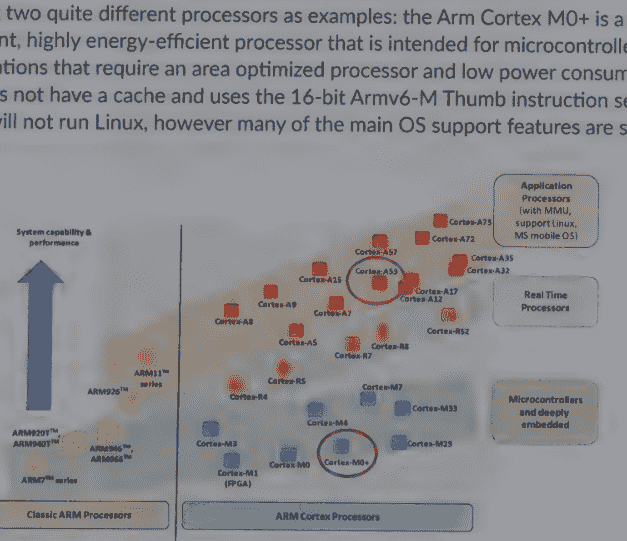

图 3.1：Arm 处理器家族。

基于树莓派的 Linux 操作系统基础

相比之下，用于树莓派 3 的 Arm Cortex A53 是一种中端低功耗处理器，实现了 Armv8-A 架构。Cortex-A53 处理器具有四个核心，每个核心都有一个 L1 内存系统和一个 L2 缓存。它是一个 64 位处理器，支持 AArch64 和 AArch32（包括 Thumb）执行模式。它被设计用于应用处理器，适用于移动计算、智能手机和高能服务器等应用领域。

所有 Arm 处理器都使用高级微控制器线架构（AMBA），这是一种用于片上系统（SoC）设计中功能块连接和管理的开放标准规范。

所有 Arm 处理器都具有 RISC（精简指令集计算）架构¹。基于 RISC 架构的处理器通常比复杂指令集（CISC）架构（例如 x86）的处理器需要的晶体管少，这会导致更低的成本和功耗。此外，由于指令更简单，大多数指令可以在单个周期内执行，这使得指令流水线更加简单且高效。RISC 指令集中支持的复杂功能通过多个 RISC 指令的组合来实现。

通常，RISC 机器具有大量的通用寄存器（而 CISC 机器具有更多特殊用途寄存器）。在 RISC 架构中，任何寄存器都可以包含数据或地址。此外，RISC 处理器通常对寄存器中持有的数据进行操作。独立的加载（load）和存储（store）指令在寄存器堆和外部内存之间传输数据（这被称为加载/存储架构）。

## 3.3 Arm Cortex M0+

Arm Cortex-M0+ 是一种低规格嵌入式处理器，通常用于对功耗较低且不需要完整操作系统的应用。图 3.2 显示了基于 Cortex-M 设计的 Arm MPS2+ 原型板，这是一个支持除 M23 和 M33 之外整个 Cortex-M 处理器的 FPGA 开发平台。Cortex-M0+ 处理器的功能框图 [2] 如图 3.3 所示。Cortex-M0+ 使用 AHB-Lite（高级高速总线精简版），并使用 16 位的 Armv6-M Thumb 指令集。


图 3.2：基于 Cortex-M 设计的 Arm MPS2+ 原型板。

基于树莓派的 Linux 操作系统基础

Arm Cortex-M0+ 是一种低规格嵌入式处理器，通常用于对功耗较低且不需要完整操作系统的应用。图 3.2 显示了基于 Cortex-M 设计的 Arm MPS2+ 原型板，这是一个支持除 M23 和 M33 之外整个 Cortex-M 处理器的 FPGA 开发平台。Cortex-M0+ 处理器的功能框图 [2] 如图 3.3 所示。Cortex-M0+ 使用 AHB-Lite（高级高速总线精简版），并使用 16 位的 Armv6-M Thumb 指令集。通常，此类处理器不会运行 Linux，但它们提供了许多主要的操作系统支持功能。

### 3.3.1 中断支持

Cortex-M0+ 通过嵌套向量中断控制器（NVIC）支持中断。该控制器支持具有动态优先级的中断处理。

### 3.3.2 指令集

正如提到的，Cortex-M0+ 运行 ARM7-M 指令集，它是 Thumb 指令集的子集。

### 3.3.3 定时器

Cortex-M0+ 的一个特点是可选的系统定时器（SysTick）。该定时器可以被操作系统使用，也可以配置为产生中断。SysTick 中断在向量表中有自己的条目，因此拥有自己的处理程序。

### 3.3.4 处理器模式与权限

Cortex-M0+ 处理器通过控制寄存器（CONTROL）支持 Thread 和 Handler 模式，以及两个栈指针：主栈指针（MSP）和进程栈指针（PSP）。它还（可选）为软件执行支持不同的权限：

- 非特权：软件对 MSR 和 MRS 指令的访问有限，无法使用 CPS 指令或访问系统定时器、NVIC 或系统控制块。它对内存或外设的访问可能限制。
- 特权：软件可以使用所有指令并访问所有资源。

在 Thread 模式下，CONTROL 寄存器决定软件执行是特权还是特权。在 Handler 模式下，软件执行始终是特权的。只有特权软件可以写入 CONTROL 寄存器以更改 Thread 模式下软件执行的权限。非特权软件可以使用 SVC 指令进行内核调用，以将控制权移交给特权软件。

### 3.3.5 内存保护

Cortex-M0+（可选）通过可选的内存保护单元（MPU）支持内存保护。实施后，处理器支持 Armv6 保护系统架构模型。MPU 为具有优先级和访问权限的保护区域支持。MPU 可用于强制权限规则、隔离进程并管理内存属性。

## 3.4 Arm Cortex A53

该处理器用于树莓派 3（如图 3.5 所示）。Cortex-A53 处理器的功能框图 [4] 如图 3.6 所示。显而易见，这是一个复杂得多的处理器，具有最多 4 个核心和 2 级缓存层次结构。每个核心（底部）都有一个专用的浮点单元（FPU）和 Neon SIMD（单指令多数据流）架构扩展。从顶部的 Governor（调控器）模块可以看出，从操作系统的角度来看，感兴趣的主要特性是“Arch timer”（架构定时器）和“GIC CPU 接口”。其他模块（CTI、留存控制以及掉掉电时的调试）提供了高级调试和低功耗支持。

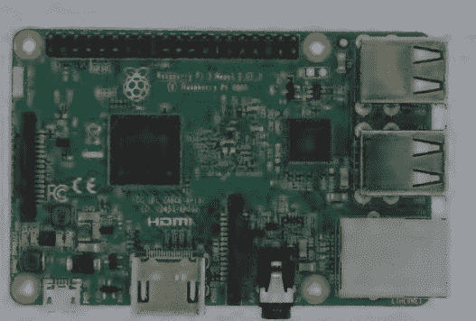

图 3.5: 带有 Arm Cortex-A53 的树莓派 3 模型。作者绘制。

| APB 解码器 | APB ROM | CTM |
|---|---|---|
| Governor | | | |
| Core 0 governor | Core 1 governor | Core 2 governor | Core 3 governor |
| (留存) 控制掉掉电时的调试 | (留存) 控制掉掉电时的调试 | (留存) 控制掉掉电时的调试 | (留存) 掉掉电调试 |
| 缓存和 L2 重置定时器接口 | 缓存和 L2 重置定时器接口 | 缓存和 L2 重置定时器接口 | 缓存和 L2 重置定时器接口 |
| Core 0 | Core 1 | Core 2 | Core 3 |
| FPU 和 NEON 扩展 加密扩展和追踪 | FPU 和 NEON 扩展 加密扩展和追踪 | FPU 和 NEON 扩展 加密扩展和追踪 | FPU 和 NEON 扩展 加密扩展和追踪 |
| L1 dCache L1 iCache | L1 dCache L1 iCache | L1 dCache L1 iCache | L1 dCache L1 iCache |
| L2 缓存 | 二级内存系统 | ACE/AMBA CHI 主总线接口 | ACP 从机 |

图 3.6: Cortex-A53 处理器功能框图。

### 3.4.1 中断控制

“GIC 接口”模块代表通用中断控制器的 CPU 接口，它是作为 Armv8-A 架构一部分定义的通用中断控制器（GIC）架构的实现。GIC 定义了处理连接到 GIC 的任何元素的所有中断源的架构要求，以及一个适用于单处理器或多处理器系统的通用中断控制器编程接口。GIC 是一个比 Cortex-M0+ 的 NVIC 高级且灵活的中断处理系统，因为它需要支持异构多核系统和虚拟化。GIC 没有使用 NVIC 使用的简单寄存器组，而是使用大小为 255KB 的内存映射接口，以及一组 GIC 控制寄存器（GIC*）和寄存器来支持 CPU 中的中断虚拟化（GICH*、GCV*）。

### 3.4.2 指令集

Cortex-A53 支持 AArch32 和 AArch64 指令集。AArch32 包含了 Cortex-M 系列中的 Thumb 指令集。方便的是，为 Cortex-M0+ 编译的程序例如可以在 Cortex-A53 上运行。更重要的是，树莓派 3 的树莓派 Linux 发行版是 32 位发行版，因此处理器在 AArch32 状态下运行操作系统所有应用程序。


图 3.7: Arm 架构演进。

图 3.7 节自 [5]，显示 Armv7-A 架构已被纳入 Armv8-A 架构中。此外，Armv8 支持两种……（注：原文此处似乎不完整，翻译按原文截断）。

可以在运行时 AArch32 和 AArch64 指令集架构之间切换，但存在与异常级别（exception levels）相关的某些限制，如图 3.8 所示。本质上，运行在较高级别的代码只有在较低异常级别为 AArch64 时，才能是 AArch64。

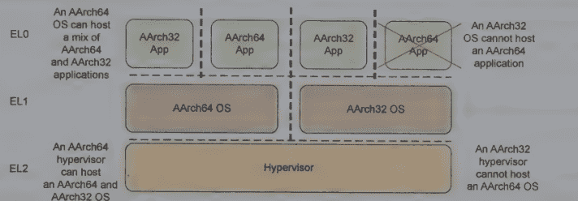

图 3.8：在 AArch32 和 AArch64 之间移动。

在 AArch64 状态下，每个每个实现的异常级别都实现了一个专用的栈指针寄存器。在 AArch32 状态下，栈指针取决于“PE 模式”（这些模式在 AArch64 中不存在）。PE 模式支持普通软件执行并处理异常。当前模式决定了可用的通用寄存器和特殊寄存器的集合。AArch32 模式包括：

- 监控模式（Monitor mode）。此模式始终在 Secure EL3 下执行。
- Hyp（虚拟化程序）模式。此模式始终在 Non-secure EL2 下执行。
- 系统、监视、中止、未定义、IRQ 和 FIQ 模式。异常级别模式根据安全状态执行：
  - 在安全状态下：当 EL3 使用 AArch32 时，在 EL3 下执行。
  - 在非受信状态下：始终在 EL1 下执行。
- 用户模式（User mode）。此模式始终在 EL0 下执行。

### 3.4.5 内存管理单元

如第 1 节所示，现代处理器为地址转换和内存保护提供了硬件支持。我们还简要解释了内存管理和页表的概念。第 6 章“内存管理”中提供了更详尽的讨论。为了讨论 Cortex-A53 MMU，我们可以认为“虚拟内存”和“逻辑内存”术语是等价的。在树莓派运行 Linux 的操作系统中，对虚拟机（虚拟化程序）的支持增加了额外的复杂度：Armv8 架构：由于每个虚拟机都必须提供运行在真实硬件上的幻象，因此需要一个额外的地址层，称为中间物理地址（IPA）。

MMU 控制访问主内存中转换表的硬件。它将虚拟地址翻译为物理地址，并通过页表中的一组虚拟到物理地址的映射和内存属性提供细粒度的内存系统控制。

当访问某个位置时，这些映射会被加载到转换检测表缓冲器（TLB）中。在实践中，TLB 被分为一个非常小、速度极快的微 TLB 和一个较大的主 TLB。

每个核心的 MMU 包含以下组件：

### 转换检测表缓冲器 (TLB)

TLB 由两个级别组成：

1. 一个 10 条目的全关联指令微 TLB 和一个 10 条目的全关联数据微 TLB。我们在第 1 节中解释了全关联缓存的概念。出于性能考虑，指令和数据有两个单独的微 TLB，以允许并行访问。
2. 一个 4 路组相异 512 条目的统一主 TLB（图 3.9）。“统一”意味着该 TLB 同时用于指令和数据。主 TLB 不是全关联的，而是 4 路组相异的。记住，“全关联”意味着每个地址都可以存储在 TL 的任何可能的条目中。如果缓存或 TLB 不是全关联的，意味着地址的存储位置存在限制。一种非常常见的方法是 n 路组相异缓存，这意味着缓存被分为包含 n 个条目的块，每个块映射到内存的固定区域。来自给定内存区域的地址只能存储在给定的块中，但它可以存储在该块的 n 个条目中的任何一个。例如，在树莓派 3 上，RAM 为 1GB。考虑到 4kB 的大小，这意味着有 256K 页。这被映射到 128 个块（TLB 中每个块 4 个条目），因此每个物理内存块有 4 个条目，其中一个可以存储在 TLB 的 4 个条目之一。

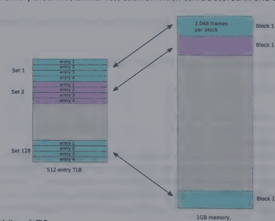

58

### 额外的缓存

正如我们在第 6 章将看到的，在实践中页表是分层的，且基于虚拟化程序的环境中的地址转换有两个阶段（图 3.10）。因此，Cortex-53 MMU 提供了额外的缓存：

- 4 路组相异 64 条目的遍历缓存（walk cache）。
  遍历缓存 RAM 存储阶段 1 转换的部分结果。更多细节请参阅第 6 章。
- 4 路组相异 64 条目的 IPA 缓存。
  中间物理地址（IPA）缓存 RAM 存储中间物理地址与物理地址之间的映射。只有非受信 EL1 和 EL0 的阶段 2 转换使用此缓存。

注意可以禁用地址转换的阶段 1 或阶段 2。

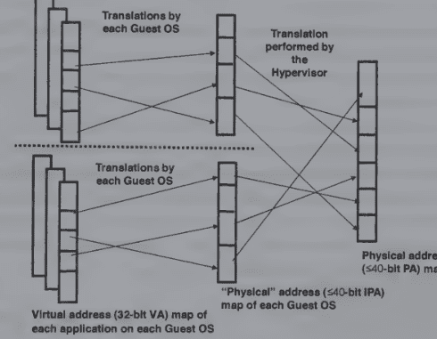

图 3.10：两阶段地址转换。

### 3.4.6 内存系统

在第 1 节中，我们引入了缓存的概念和简单的缓存模型（用于频繁使用数据的小快速内存）。Cortex-A53 的实际内存系统更为复杂，但相同的原理适用（图 3.6）。

### L1 缓存

L1 内存系统由独立的指令和数据缓存组成。实现者独立地配置指令和数据缓存，大小为 8KB、16KB、32KB 或 64KB。树莓派 3 的配置为指令和数据均为 16KB。注意指令缓存是只读的，因为内存是只读的。L1 指令缓存具有以下特征：

- 缓存行大小为 64 字节。
- 2 路组相异。
- 16 字节读取。

L1 数据缓存具有以下特征：

- 缓存行大小为 64 字节。
- 4 路组相异。
- 8 字节读取。

### 缓存一致性

缓存一致性是指确保多核心系统中的缓存对内存有一致的视图。在 Cortex-53 中，这由嗅探控制单元（SCU）管理，使用 MOESI 协议维护 L1 缓存之间致性。

## 3.5 地址映射

内存区域的用途、大小和位置的描述被称为地址映射或内存映射。因为 Arm 系统可以是 32 位或 64 位，地址空间从 4GB (32位) 到 1TB (40位)。

Arm 统一了各种系统的内存映射，以提供内部一致性和软件可移植性。大地址扩展（LPAE）在 ARM CPU 中的引入将物理地址空间扩大到 36 位和 40 位，提供了 64GB 或 1024GB (1TB)。64 位 Armv8 架构支持 48 位，提供了 256TB。

| 32位 | 36位 | 40位 |
|---|---|---|
| 1024 GB | | 40位 |
| 512 GB | | DRAM |
| 256 GB | | 32 GB 空洞或 DRAM |
| 128 GB | | 映射的 IO |
| 64 GB | 保留 | 36位 |
| 32 GB | | 2 GB 空洞或 DRAM |
| 16 GB | | 映射的 IO |
| 8 GB | 保留 | 32位 |
| 4 GB | | 2 GB DRAM |
| 2 GB | | 映射的 IO |
| 1 GB | | ROM & RAM & I/O |

图 3.11：Arm 40位地址映射。

图 3.11 显示了不同位宽地址映射之间的关系。地址映射被定义为嵌套集。当每个内存映射增加 4 位地址空间时，它就包含了所有较小的地址映射位于较低的地址处。地址位每增加 4 位，可寻址空间就会增加 16 倍。地址空间以可重复的方式进行划分：

- 8/16 DRAM；
- 4/16 映射 I/O（Mapped I/O）；
- 3/16 预留空间；
- 1/16 之前的内存映射（即不包含额外的 4 位地址位）。

例如，36 位地址映射在最低的 4GB 地址空间内包含了整个 32 位地址映射。

地址映射被划分为四种类型或区域区域：

- 1. 静态 I/O 和静态内存，用于寄存器、映射到芯片上的外设、启动 ROM 和临时 RAM（scratch RAMs）。
- 2. 映射 I/O，用于动态配置的内存映射总线，例如 PCIe。
- 3. DRAM，用于系统主动态内存。
- 4. 预留空间，供未来使用。

图中提到的“DRAM 洞（DRAM holes）”是一种可选机制，用于在将大容量 DRAM 设备划分到较低的物理地址区域时简化解码方案，代价是留出一小部分未使用的地址空间。

# 基于树莓派的 Linux 操作系统基础

较小的地址映射位于较低的地址处。地址位每增加 4 位，可寻址空间就会增加 16 倍。地址空间以可重复的方式进行划分。

## 3.6 直接内存访问

直接内存访问（DMA）是一种允许数据块在没有 CPU 开销的情况下传输到设备或从设备出的机制。CPU 通过向 DMA 控制器提交 DMA 请求来管理 DMA 操作。在 DMA 传输过程中，CPU 可以继续执行代码。当 DMA 传输完成后，DMA 控制器通过中断信号 CPU。

如果必须复制大块内存或传输是重复性的，DMA 将具有优势，因为两种情况下都会消耗大量的 CPU 时间。与大多数现代操作系统一样，如果硬件支持 DMA，Linux 通过内核 API 支持 DMA 传输。需要注意的是，这不需要特殊的指令：DMA 控制器是内存映射的，CPU 仅需将请求写入该内存区域即可。

图 3.13：带有 Cortex-A 和 CoreLink DMA 控制器的示例系统。

Arm 处理器不包含作为 CPU 核心部分的 DMA 引擎。Arm 提供了专用的 DMA 控制器，例如轻量级的 PrimeCell uDMAController [8]，一种与 Cortex-M 系列使用的 AMBA-AHB-Lite 协议兼容的低门数 DMA 控制器；以及更先进的 CoreLink DMA-330 DMA 控制器 [9]，它具有完全符合 AMBA 标准的接口； SoC 制造商也可以提供自己的 DMA 引擎。图 3.13 显示了一个带有 CoreLink DMAC 的示例系统。在 Cortex M 系列中，DMA 控制器将是 AHB 总线上的外设。

### 基于树莓派的 Linux 操作系统基础，一种名为加速器一致性端口（Accelerator Coherency Port, ACP）的特殊接口

然而，在作为 Arm AXI 标准一部分的高端 Arm Cortex-A 系列中提供了这种接口。这是因为在具有缓存一致性的多核处理器上，缓存系统会使 DMA 传输复杂化，因为传输过程中某些数据可能尚未写入内存。通过 ACP，Cortex-A 系列实现了一种硬件机制，确保共享的 DMA 内存区域是缓存一致的。如果没有这种机制，操作系统（或裸机系统上的终端用户软件）必须自行确保一致性。关于在基于 Arm 的多处理器 SoC 中集成 DMA 引擎的更多细节，请参阅应用说明《在 ARM SMP 系统上实现 DMA》[10]。

在 Arm Cortex A53 上，ACP 是可选的，且树莓派 3 的 SoC 并没有提供。树莓派 SoC 上的 DMA 控制器不是 Arm IP 核心。它是 I/O 外设地址空间的一部分。这里的额外复杂性在于，DMA 控制器使用 CPU 总线，因此对于 DMA 传输，软件需要在 Arm 物理地址和 CPU 总线之间进行翻译。

通常，DMA 控制器是复杂的设备，通常了自己的指令集和寄存器堆。这意味着 Linux 内核需要为 DMA 控制器配备专用的驱动程序。

### 3.7 总结

在本章中，我们查看了两种不同的 Arm 处理器：Arm Cortex M0+，一种用于微控制器和深度嵌入式应用的单核、低门数、高能效处理器，实现了 Armv6-M 架构；以及用于树莓派 3 的 Arm Cortex A53，一种实现了 Armv8-A 架构并具备运行 Linux 等操作系统所需的中端低功率处理器。我们从指令集、中断模型、安全模型和内存系统方面讨论了这些处理器。我们还介绍了 Arm 地址映射和直接内存访问（DMA）支持。

### 3.8 练习与问题

### 3.8.1 基础编程

此练习的目标是实现一些基础操作系统的功能。从零开始工作量很大，但我们建议你从 GitHub 上《树莓派 3 裸机编程》教程系列提供的现有代码开始。

- 1. 创建一个具有三个任务的循环执行器，每个任务创建一个连续的波形：任务 1 创建正弦波；任务 2 创建方波；任务 3 创建三角波；每个周期在终端打印波形的值。
- 2. 将循环执行器改为抢占式的。
- 3. 在三个任务之间共享一个资源。使用简单的变量进行读写访问。

其他更难的建议：

- 1. 实现动态内存分配，即编写自己的 `malloc()` 和 `free()`。
- 2. 创建一个简单的文件系统。

### 3.8.2 Arm 硬件架构

- 1. 什么是 MIPS？
- 2. RISC 相比 CISC 的优势是什么？

### 3.8.3 Cortex M0+

- 1. 你会在什么样的项目 M0+？
- 2. 为什么 M0+ 不适合运行 Linux？

### 3.8.4 Cortex A53

- 1. 讨论 A53 的浮点和 SIMD 支持。
- 2. 讨论 A53 的模式和权限。

### 3.8.5 地址映射

- 1. 解释地址映射。
- 2. “DRAM 洞”的目的是？

### 3.8.6 直接内存访问

- 1. 加速器一致性端口（ACP）的作用是什么？

## 基于树莓派的 Linux 操作系统基础

### 参考文献

- [1] J. Yiu，《Cortex-M for Beginners: An overview of ARM architecture》，Arm Ltd, 2017, v2.
- [2]Porting to 64-bit, Arm Ltd, 2012, rev.C.
- [3]AMBA 3 AHB-Lite Protocol - Specification, Arm Ltd, 2017, v1.
- [4]Cortex-A53 MPCore Processor - Technical Reference Manual: r04, Arm Ltd, 2018.
- [5]Store, Porting to 64-bit, Arm Ltd, 2014, rev.C.
- [6]ARM® Architecture Reference Manual - ARMv8, for Armv8-A profile, Arm Ltd, 2017, issue: C.
- [7]Cortex-A Series - Programmer's Guide for ARMv8-A - Version: 1.0, Arm Ltd, 2015, issue A.
- [8]PrimeCell uDMAController (PL230) Technical Reference Manual Revision: r0p0, Arm Ltd, 2007, issue: A.
- [9]CoreLink DMA-330 DMA Controller Technical Reference Manual Revision: r1p2, Arm Ltd, 2012, issue: D.
- [10]Implementing DMA on ARM SMP Systems, Arm Ltd, 8 2009, issue: A.

# 第 4 章
进程管理

# 基于树莓派的 Linux 操作系统基础

## 4.1 概述

进程正在执行中。你是否曾在博物馆里见过展出的鲸骨架？这就像一个程序——它是一个静态对象，见图 4.1。尽管它有形状和结构，但永远不会“执行”任何有趣的事情。现在想一头在海洋中游泳的活鲸，见图 4.2。这就像一个进程——它是一个动态对象。它包含了骨骼结构，但具有更多属性并能够进行活动。

在本章中，我们将探索 Linux 进程的样貌、其工作方式以及它们如何实现多程序执行。我们概述了封装在进程中的上下文。我们将遍历整个进程的生命周期，并考虑对进程执行的典型操作。


图 4.1：伦敦自然历史博物馆的蓝鲸骨架。作者拍摄。

图 4.2：在海洋中游泳的蓝鲸。来自 NOAA 的公共领域照片。

### 你将学习到

在学习完本章的内容后，你将能够：

- 1. 描述为什么在操作系统中使用进程。
- 2. 证明为每个进程维护相关元数据的必要性。
- 3. 为进程抽象画出一个数据结构大纲。
- 4. 识别运行中的 Linux 实例上的进程状态。
- 5. 开发与 Linux 进程交互的简单程序。

## 4.2 进程抽象

进程是正在执行中的程序。程序只包含可执行代码和静态数据。这些内容以二进制格式存储，例如 ELF 对象或 Java 类文件。另一方面，进程还封装了运行时执行上下文。这包括每个执行线程的程序计数器、栈指针以及其他硬件寄存器值，以便我们知道自己处于程序执行的哪个位置。进程还记录了内存管理信息。此外，进程需要跟踪所拥有的资源，例如打开的文件句柄和网络连接。

进程映射到用户应用程序（例如电子表格）、后台实用程序（例如文件索引器）或系统服务（例如远程登录守护进程）。可能多个进程同时执行同一个程序。这些将是同一个程序的不同运行时实例。某些复杂应用程序仅允许同时执行一个进程实例。例如，Firefox 浏览器有一个锁文件，可以防止多个应用程序实例使用相同的用户配置文件执行，见图 4.3。


图 4.3：Firefox 显示错误消息并拒绝为单个用户进程运行多个应用程序实例。

### 4.2.1 发现进程

现在你的系统上有多少个进程正在执行？在交互式 shell 会话中，输入：

```


`ps aux | wc -l`

### `ps` 命令显示当前注册到操作系统的进程信息。我们使用的选项如下：

| 选项 | 说明 |
| :--- | :--- |
| a | 包含所有用户的进程 |
| u | 显示用户友好的输出 |
| x | 包含不是从用户启动的进程 |

我的 Linux 服务器显示 257 个进程。你的机器上有多少个进程？每当你调用一个新程序时，就会启动一个新的进程。如果你点击应用启动栏中的程序图标，或者在 shell 提示符处输入可执行文件名，就可能发生这种情况。

## 4.2.2 启动新进程

让我们看看如何使用 `fork` 系统调用通过编程方式启动新进程。这是创建新进程的标准 Unix 方法。分叉的进程（称为*父进程*）生成一个完全相同的副本（称为*子进程*），它们执行相同的代码。父进程和子进程之间的唯一区别（即区分这两个进程的唯一方法）是 `fork` 用的*返回值*。在子进程中，返回值为 0。在父进程中，返回值是一个正整数，表示分配给子进程的进程标识 `pid`。图 4.4 示意性地展示了这一序列。注意，如果我们无法分叉出一个新进程，`fork` 将返回 1。

# 基于树莓派的 Linux 操作系统基础

下面我们展示了一个简单的 Python 脚本。它运行的程序会创建自身的第二个副本。

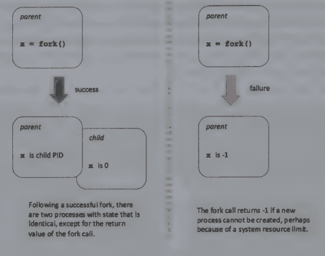

图 4.4：`fork` 系统调用行为的示意图。

列表 4.2.2 Python 中 `fork()` 的示例
```python
import os

def child():
    print("Child process has PID {:d}".format(os.getpid()))

def parent():
    # 只有父进程执行这段代码
    print("Parent process has PID {:d}".format(os.getpid()))
    child_pid = os.fork()
    # 父进程和子进程都会执行后续的 if 语句
    if child_pid==0:
        # 子进程执行
        child()
    else:
        # 父进程执行
        print("Parent {:d} just forked child {:d}".format(os.getpid(), child_pid))
```

子进程是父进程的副本，唯一的区别在于 `fork` 的返回值。然而，子进程共享整个虚拟地址空间，通过写时复制（copy on write）避免了内存复制开销。直到一个进程（父进程或子进程）尝试修改它，数据才会被复制。写时复制将在 6.5.7 节中详细解释。

### 4.2.3 执行不同的操作

`fork` 调用允许启动新进程，但子进程几乎是父进程的复制。我们如何在子进程中执行不同的程序？Linux 通过 `exec` 调用来实现这一点，它用二进制文件替换当前运行的进程。第一个参数是可执行文件，第二个参数是参数向量（对应 C 中的 `argv`），第三个参数是键值对形式的环境变量。

列表 4.2.3 Python 中 `execve()` 的示例
```python
import os
os.execve("/bin/ls", ["ls", "-l"], {})
```

这正是交互式 shell（如 `bash`）启动新程序的方式；shell 调用加载用户想要运行的二进制文件。

除非发生阻止新程序程序的错误，否则 `exec` 调用不会返回。详情见 `man execve`，在这种情况下返回 -1。

在 Linux 中，`fork` 操作是通过底层 `clone` 系统调用实现的。`clone` 函数允许程序员显式指定旧进程的哪些部分为新进程复制，哪些部分在两个进程之间共享。

`clone` 调用允许子进程与父进程共享部分上下文（虚拟地址空间）。这允许我们使用单一 API 支持线程和进程，这是 Linux 中原生 线程库（NPTL）的实现基础。例如，`pthread_create` 函数调用 `clone`。Torvalds [1] 描述了 `clone` 的设计原理。

### 4.2.4 结束进程

父进程可以阻塞等待子进程完成。父进程为此目的调用 `wait` 函数。相反，子进程可以通过调用 `exit` 函数并带上状态码参数（非零值完全表示错误）来完成。或者，子进程可以通过从主函数返回来终止。

下方的 C 代码示例说明了父进程 `wait` 与子进程 `exit` 之间的对立关系。

列表 4.2.4 C 中 `wait()` 的示例
```c
#include <stdio.h>
#include <stdlib.h>
#include <sys/types.h>
#include <sys/wait.h>
#include <unistd.h>
int main() {
```

# 树莓派上的 Linux 操作系统基础知识

```c
pid_t child_pid, pid;
int status;
child_pid = fork();
if (child_pid == 0) {
    //child process
    pid = getpid();
    printf("I'm child %d, will sleep for 10 seconds, then exit with status %d\n", pid);
    sleep(10);
    exit(42);
} else if (child_pid > 0) {
    //parent waiting for child to terminate
    pid = wait(&status);
    if (WIFEXITED(status)) {
        printf("Parent discovers child exit with status: %d\n", WEXITSTATUS(status));
    }
} else {
    perror("fork failed");
    exit(1);
}
return 0;
```

图 4.5 展示了父进程和子进程在子进程生存期间执行的 Linux 系统调用序列。


图 4.5：显示如何启动和终止子进程的示意图。

如果父进程在子进程之前完成，则子进程将成为孤儿进程。它会被父进程的一个祖先（称为子收养者 `subreaper`）“收养”。详情请参见 `man prctl`。如果没有指定的子收养者，子进程将被 `init` 进程收养。无论哪种情况，当原始父进程退出时，子进程的 `task_struct` 中的 `parent` 字段都会更新。这一过程被称为重养（re-parenting）。

## 4.3 进程元数据

每个进程都关联着大量信息。操作系统需要这些元数据来识别、执行和管理每个进程。通常，相关信息封装在一个被称为进程控制块（process control block）的数据结构中。

# 第 4 章 | 进程管理

最基本的元数据是与进程关联的唯一正整数标识符，通常称为进程 `pid`。某些元数据与保存的上下文数据有关，例如寄存器值、打开的文件句柄或内存配置。这些信息使进程在被操作系统挂起后恢复执行。进一步的元数据与进程与操作系统之间的交互有关——例如性能分析统计数据和调度细节。图 4.6 显示了存储在进程控制块中的元数据的高级示意图。

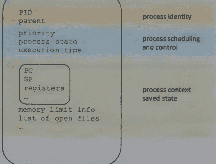

图 4.6：每个进程所需的通用操作系统管理元数据，存储在名为进程控制块的每个进程专用数据结构中。

### 4.3.1 `/proc` 文件系统

Linux 内核将部分进程元数据作为虚拟文件系统的一部分暴露出来。让我们查看你 Linux 系统上的 `/proc` 目录：

> 列表 4.3.1：`/proc` 文件系统
> ```bash
> $ ls /proc


你应该能看到一个目录列表，其中许多目录的名字是整数。每个整数都对应一个`pid`，而这些`pid`目录内部的文件捕获了相关进程的信息。

| `cmdline` | 启动此进程时调用的文本命令 |
| :--- | :--- |
| `cwd` | 指向进程当前工作目录的符号链接 |
| `exe` | 指向该进程执行文件的符号链接 |
| `fd/` | 包含该进程打开的每个文件描述符的文件夹 |
| `maps` | 显示内存中数据排列方式的表格 |
| `stat` | 针对此进程的各种 OS 事件的计数器列表 |

表 4.1：`/proc/[pid]/`中与进程关联的虚拟文件。

# 树莓派上的 Linux 操作系统基础知识

表 4.1列出了这些文件的几个以及它们包含的信息。要查看完整列表，请在 Linux 终端执行`man 5 proc`。`/proc/[pid]`文件并不是“真实”的——请通过`ls -l`查看文件大小。这些伪文件并不存储在持久性文件系统中；而是每个进程内存中内核元数据的类文件表示形式。

让我们列出我们系统中所有进程正在执行的命令：


```bash
cd /proc
for CMD in $(find -maxdepth 2 -name "cmdline"); do cat "$CMD"; done | sort
```

我们观察到某些命令是空的——这些进程没有对应的命令行调用。

## 4.3.2 Linux 内核数据结构

Linux 内核将元数据分散在多个链链的内存块中。在本节中，我们将检查三个关键数据结构：

- `thread_info`
- `task_struct`
- `thread_struct`

`struct thread_info`结构体是特定于架构的；对于 Arm 平台，该`struct`定义在`arch/include/asm/thread_info.h`中。每个执行线程都有其自己唯一的`thread_info`实例，嵌入在线程运行时栈的底部。每个线程在内核内存中都有专用的 8KB 栈，用于执行内核代码；这与普通的用户模式栈是不同的。我们可以通过对栈指针寄存器进行低开销位掩码操作来提取`thread_info`指针，见下文代码。


```c
return (struct thread_info *)(current & ~(THREAD_SIZE - 1));
```

## 第 4 章 | 进程管理

```bash
pi@raspberrypi ~ pstree
systemd [root]
 ├ udevd-daemon-event-daemon
 ├ dbus-daemon
 ├ dhcpcd
 ├ ntpd
 ├ syslog (in syslog)
 ├ cron (in nsynchreg)
 └─ sshd └─ bash-smash-(main)
     └ systemd-(user-pam)
      └ systemd-journal
      └ systemd-logind
```

图 4.8：`pstree`的进程层次结构输出。

## 4.4 进程状态转换

当进程开始执行时，可以在不同的调度状态之间移动。图 4.9 显示了一个简单的状态转换图，指示了进程可能处于的状态以及将进程转移到不同状态的操作。更复杂的版本将在下一章介绍。

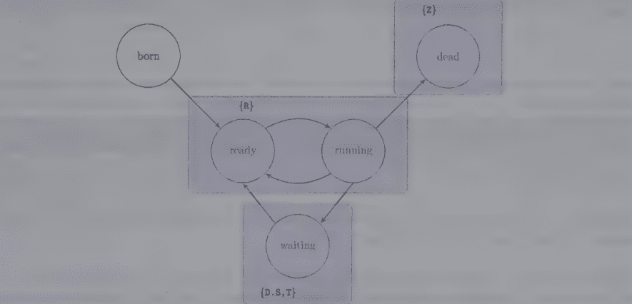

图 4.9：Linux 进程状态转换图，圆圈内为状态名称，并标出了可能的`ps`状态代码。

树莓派上的 Linux 操作系统基础

让我们在 Linux 中玩玩进程吧。在你的终端中启动一个进程，比如像`vim`这样的文本编辑器。在它运行时，按下 CTRL + z 停止它。这会向进程发送 STOP 信号。实际上，我们暂停了它的执行。这就是程序调试的工作原理。

现在让我们运行另一个产生大量磁盘开销的进程，

| R | 说明 |
| :--- | :--- |
| R | 运行中，或可运行 |
| S | 睡眠，可以被中断 |
| D | 等待 IO，不可中断 |
| T | 停止，通常由信号引起 |
| Z | 僵尸进程，一个已死亡的进程 |

表 4.2：Linux 进程状态，详尽信息请参见`man ps`。

> 列表 4.4.1: `find`

```bash
1 find --name "foo" &
```

或者

> 列表 4.4.2: `dd if=/dev/zero of=/tmp/foo bs=1K count=200K &`

```bash
1 dd if=/dev/zero of=/tmp/foo bs=1K count=200K &
```

现在你可以使用`ps`命令观察你的进程。使用`watch`工具查看状态随时间的变化。

> 列表 4.4.3: `watch`

```bash
1 watch ps
```

你应该能看到某些进程正在运行 (`R`)，而另一些正在睡眠 (`S`)、等待 I/O (`D`) 或已停止 (`T`)。按下 CTRL + c 退出`watch`程序。

僵尸进程是一个已完成的子进程，等待父进程对其进行“清理”。在父进程调用`wait`函数或父进程自身终止之前，该进程一直处于僵尸状态。下面的 Python 代码将演示一个僵尸子进程，因为父进程在`fork`后睡眠一分钟，而子进程会立即退出。

> 列表 4.4.4：Python 僵尸示例

```python
1 import os
2 import time
def main():
    pid = os.fork()
    child_pid = pid
    if child_pid == 0:
        # 子进程执行此代码
        pid = os.getpid()
        print("To see the zombie, run ps -p {:d}".format(os.getpid()))
    else:
        # 父进程执行此代码
        time.sleep(60)
    print("Zombie process disappears now")
main()
```


## 4.5 上文切换

最早的电子计算机是单任务的。这些系统独占执行一个程序，直到另一个程序被加载到内存中。例如，剑桥的早期 EDSAC 在程序执行完成后会响铃，这样技术人员就可以读取结果并加载新程序。直到 20 世纪 80 代，微型计算机运行 DOS 和 CP/M 等单程序操作系统。对于这类计算机，进程管理是不必要的。

进程多编程的基础，操作系统并发执行多个进程。实际上，操作系统将许多进程复用到数量较少的物理处理器核心上。

上下文切换使得这种复用成为可能。进程所需的所有运行时数据（正如我们在 4.3 节中概述的）都保存到进程控制块中（在 Linux 中实际上是 `task_struct`）。操作系统序列化进程元数据。然后进程被暂停，另一个进程恢复执行。

如果进程进入和退出执行的频率足够高，那么似乎所有进程都在同时执行。这好比一个人玩杂耍，见图 4.10。同样，由于操作系统处理的进程比处理器多，这个人处理的杂耍球也比手多。


图 4.10：球比手多的杂耍就像多任务执行。图像版权所有作者。

对于短期调度，进程上下文数据存储在 RAM 中（即内核内存）。对于短期内可能不会再次执行的进程，进程内存会被分页到磁盘。鉴于上下文捕捉了恢复进程所需的所有信息，这种分页操作相对简单（见下一章）。

## 4.6 信号通信

进程间通信将在未来的章节中介绍。现在，我们只关注发送信号。信号就像一种中断——它是由内核生成的以调用处理程序的事件。接收者只知道信号编号和发送者的身份。更多信息请检查 `<sys/siginfo.h>` 中的 `siginfo_t` 定义。

### 4.6.1 发送信号

向进程发送信号的最简单方法是在 shell 提示符使用 `kill` 命令，并指定目标 `pid`。下面是杀死一个讨厌循环的示例。

| 名称 | 编号 | 说明 | 交互 |
| :--- | :--- | :--- | :--- |
| SIGINT | 2 | 终端中断 | CTRL + c |
| SIGQUIT | 3 | 终端退出 | |
| SIGILL | 4 | 非法指令 | |
| SIGKILL | 9 | 杀死进程（不可捕获或忽略） | |
| SIGSEGV | 11 | 段错误（内存访问非法） | |
| SIGPIPE | 13 | 向无读者的管道写入，管道破 | |
| SIGALRM | 14 | 闹钟 | 使用 `alarm` 函数设置闹钟 |
| SIGCHLD | 17 | 子进程已停止或退出 | |
| SIGCONT | 18 | 继续执行，如果已停止 | bg 或 fg |
| SIGSTOP | 19 | 停止执行（不可捕获或忽略） | CTRL + z |

表 4.3：部分 Linux 信号，完整集合请参阅 `siginfo.h`。

```bash
while ((1)); do echo "hello $BASHPID"; sleep 5; done & \
  # 假设这输出 hello 15082
  # ... 然后你应该输入
  kill 15082
```

实际上，这个 `kill` 就像在控制台上交互式按下 CTRL + c。学习可选信号表格以了解进程可能处理的其他事件及其相应的交互组合键。

注意，某些信号在所有 Unix 变体中都是标准的，而其他信号可能是特定系统的。执行命令 `man kill` 或 `kill -1` 获取详细信息。

# 基于树莓派 Linux 的 Linux 操作系统基础

### 4.6.2 处理信号

我们已经学习了向进程发送信号。现在让我们考虑一下当进程接收到这些信号时如何处理它们。**信号处理器**（signal handler）是进程进程安装的、用于处理特定信号的回调程序。下面是一个响应 SIGINT 信号的程序示例。

```c
Listing 4.6.2: C 语言中的简单信号处理器
```
```c
#include <stdio.h>
#include <signal.h>
#include <string.h>
#include <unistd.h>

struct sigaction act;

void sighandler(int signum, siginfo_t *info, void *p) {
    printf("Received signal %d from process %lu\n",
           signum, (unsigned long)info->si_pid);
    printf("goodbye\n");
}

int main() {
    // 给交互式用户的指令
    printf("Kill %lu, or just press CTRL+C\n", (unsigned long)getpid());
    // 零初始化
    memset(&act, 0, sizeof(act));
    // 设置处理器
    act.sa_handler = sighandler;
    // 设置标志位，使信号处理器接收相关信息
    act.sa_flags = SA_SIGINFO;
    // 安装处理器
    sigaction(SIGINT, &act, NULL);
    // 等待事件发生
    return 0;
}
```

某些信号无法由用户处理，特别是 `SIGKILL` 和 `SIGSTOP`。即使你尝试为这些信号安装处理器，它们也永远不会执行。如果我们没有为信号安装处理器，则将使用默认处理器。例如，考虑程序解引用空指针时会发生什么；通常会调用操作系统提供的默认 `SIGSEGV` 信号，导致进程终止。

**图 4.11** 当程序解引用空指针时，会发生段错误，相应的操作系统处理器会报告该错误。

## 4.7 总结

在本章中，我们探索了作为执行中程序的进程概念。我们学习了如何使用系统调用实例化进程。我们回顾了进程的典型生命周期，并考虑了进程可能处于的各种状态。我们探索了封装进程元数据的运行时数据结构。最后，我们学习了如何使用信号机制引起进程的注意。后续章节将探索操作系统如何调度进程，以及一个进程如何与其他进程进行通信。

## 4.8 扩展阅读

O'Reilly 的关于 *Linux 系统编程* 的书籍从详细的用户视角涵盖了进程。配套读物《理解内核》在进程管理方面有更深入的内容；虽然本教科书涵盖的是早期版本，但大部分内容仍然适用价值。

## 4.9 练习与习题

### 4.9.1 多选题

1. 下列哪项不是允许两个进程相互通信的机制？

   - 消息传递
   - 上下文切换
   - 共享内存

2. 当进程接收信号时发生了什么？

   - 处理器切换到特权模式。
   - 控制跳转到已注册的处理器。
   - 进程立即退出。

3. 下列项目由同一进程克隆的两个线程共享？

   - `thread_info` 运行时元数据
   - 程序内存
   - 调用栈

4. 在成功调用 `fork` 之后立即，父进程和子进程之间唯一的可观测区别是：

   - `fork` 调用的返回值
   - 栈指针
   - 程序计数器值

### 4.9.2 元数据混合

1. 进程元数据可以分为三类：(1) 标识，(2) 上下文切换保存的状态，3) 调度控制信息。查看 `linux/sched.h` 头文件中 `task_struct` 数据的字段。对于每个字段，识别它属于哪种类型的元数据。你可能需要查看头文件中的注释获取更多信息。

   - `unsigned int rt_priority`
   - `pid_t pid`
   - `volatile long state;`
   - `struct files_struct *files;`
   - `void *stack;`
   - `unsigned long maj_fit;`

### 4.9.3 俄罗斯娃娃项目

俄罗斯娃娃是一组嵌套在里面的尺寸逐渐减小的木偶。这个挑战涉及创建一个俄罗斯娃娃进程。定义一个名为 `MATRYOSHKA` 的常量，并将其设置为小的整数。编写一个带有 `main` 函数的 C 程序，使用局部变量 `x` 作为 `MATRYOSHKA` 的值。然后构建一个循环检查 `x` 的值。如果 `x` 小于或等于 0，则返回；否则减少 `x` 的值并 `fork` 新进程。回回第 4.2 节，`fork` 调用应该封装在 `if` 语句中，以确保父进程具有不同的行为。为了让你的代码更有趣，每个进程可以打印其唯一的 ID 和 `x` 的值。输出应该如下：

| 列表 4.1 俄罗斯娃娃程序输出 |
| :--- | :--- |
| 1 | "I'm 1173: x is 4 " |
| 2 | "I'm 1174: x is 3 " |
| 3 | "I'm 1175: x is 2 " |
| 4 | "I'm 1176: x is 1 " |
| 5 | "I'm 1177: x is 0 " |

### 4.9.4 进程过载


当一个用户启动过多进程时，整个系统可能会变得不可用。讨论为什么会发生这种情况。实际上，快速创建进程是一种操作系统的拒绝服务攻击。在网上搜索“`fork-bomb`”（炸弹）攻击以查找更多细节 [5]。`ulimit` 命令如何缓解此类拒绝服务攻击？

### 4.9.5 信号频率

考虑表 4.3 中列出的信号。这些信号中哪些可能会接收到？

# 第 5 章 | 进程调度

假设系统按顺序执行这些任务，等待一个任务完成后，再执行下一个任务。第一个任务将占用处理器，因此其他任务中的一个将能够运行。因此，操作系统会轮流给每个进程分配一段 CPU 时间片。

### 5.2.3 针对性能的调度

然而，调度还有另一个重要益处。处理器非常快（记住，即使是树莓派在单个 Linux 时间片内也能执行 1000 万条指令）。在访问外设进行 I/O 操作时，处理器必须等待外设，这可能需要很长时间，因为磁盘等外设设备相对较慢。例如，仅仅在没有缓存的情况下访问 DRAM 需要 10 到 100 个时钟周期：访问硬盘则需要几毫秒，即数百万个时钟周期。如果没有并发执行，CPU 将一直处于空闲状态直到 I/O 请求完成。操作系统将在 CPU 上调度下一个任务。

### 5.2.4 调度策略

策略用于决定进程将获得多少 CPU 时间以及它何时被被调度。在实践中，不同的进程有不同的需求。例如，在播放视频时，图像不冻结或卡顿非常重要，因此给此类进程频繁的短时间片比长时间片更好。另一方面，许多在后台运行的系统对时间不敏感，操作系统可能会以低优先级调度它们。

在本章的剩余部分，我们将详细查看内核的调度组件及其与上一节讨论的进程管理的关系。

### 5.3 回顾

回顾上一节，操作系统通过一个名为进程控制块（Process Control Block）的数据结构管理每个进程，在 Linux 中使用 `task_struct` 实现。对于进程的生命周期，感兴趣的主要属性是状态（state），它可以是以下之一（来自 `linux/sched.h`）：

```
#define TASK_RUNNING 0x0000
#define TASK_INTERRUPTIBLE 0x0001
#define TASK_UNINTERTIBLE 0x0002
#define TASK_STOPPED 0x0004
#define TASK_TRACED 0x0008
#define TASK_PARKED 0x0010
#define TASK_WAKEUP 0x0100
#define TASK_WAKING 0x0200
#define TASK_NOLDEAD 0x0400
#define TASK_NEW 0x0800
#define TASK_SLEEP_MAX 0x1000
#define TASK_NORMAL (TASK_INTERRUPTIBLE | TASK_UNINTERTIBLE)
#define TASK_IDLE (TASK_INTERRUPTIBLE | TASK_NOLDEAD)
```

以及 `exit_state`，可以是以下之一：

```
#define EXIT_DEAD 0x0010
#define EXIT_ZOMBIE 0x0020
```

观察这些状态中的每一个。图 5.1 显示了进程的实际状态，标注了状态值。调度涉及在这些状态之间移动任务，特别是从运行队列到 CPU，以及从运行队列到等待状态。


图 5.1：Linux 进程生命周期。

关键点是注意，当任务在 CPU 上运行时，操作系统不运行，直到发生中断。中断通常是由控制分配给运行进程的时间片的计时器引起的。另一个点是，大多数进程实际上大部分时间处于等待状态。这是因为大多数进程频繁地执行 I/O 操作（例如磁盘访问、网络访问、键盘/鼠标输入...),这些 I/O 操作通常需要很长时间才能完成。你可以使用 `time` 命令检查这一点，例如我们使用一个等待用户输入的命令：

列表 5.1：等待用户输入的命令计时

```
win@rpi- $ time man
real 0.275s
user 0.062s
sys 0.060s
```

`man` 命令显示方法的帮助页，并等待用户按下 'q' 退出。要解释 `time` 的输出，我们需要 `real`、`user` 和 `sys` 的定义。根据帮助页：

`time` 命令带有参数运行指定的命令。命令完成后，`time` 向标准错误输出关于该程序的计时统计。这些统计包括：

- 调用和终止之间经过的实际时间；

- 用户 CPU 时间（`times(2)` 返回的 `struct tms` 结构中 `utime` 和 `cutime` 的值之和）；

- 系统 CPU 时间（`times(2)` 返回的 `struct tms` 结构中 `stime` 和 `cstime` 的值之和）。

`times` 的帮助页给了我们更多细节：

`struct tms` 定义在 `<sys/times.h>` 中：


```c
struct tms {
  clock_t tms_utime;   /* 用户时间 */
  clock_t tms_stime;   /* 系统时间 */
  clock_t tms_cutime;  /* 子进程用户时间 */
  clock_t tms_cstime;  /* 子进程系统时间 */
};
```

`tms_utime` 字段包含调用进程执行指令消耗的 CPU 时间。`tms_stime` 字段包含代表调用进程在执行任务时在系统内核消耗的 CPU 时间。`tms_cutime` 字段包含所有等待退出子进程的 `utime` 值之和。`tms_cstime` 字段包含所有等待退出子进程的 `stime` 值之和。

所以示例告诉我们，进程在 5.275 秒中运行了 620 ms，操作系统代表进程工作了 60 ms。在大约 4.6 秒内，进程在等待 I/O（即由按下 'q' 引起的键盘中断）。大多数进程会在运行和等待之间切换。进程处于运行状态的时间是突发的。

## 5.4 系统调用

当用户想要执行 I/O 或任何其他系统相关的操作时，需要指示操作系统执行所需的操作。这种操作被称为系统调用。由于操作系统是中断驱动的，用户进程需要引发软件中断以将控制交给操作系统。此外，Linux 系统调用通过唯一编号和可变数量的参数识别。Linux 允许我们通过 `syscall()`get函数来实现系统调用（尽管这不是 C 库中常用的系统调用）。`syscall(2)`帮助页对细节提供了很好的讨论。下节给出帮助页的摘要，省略了非 Arm 架构的具体细节。

### 5.4.1 Linux syscall (2) 函数

列表 5.4.1 Linux syscall

```c
1 #define GNU_SOURCE /* 见 feature_test_macros(7) */
2 #include <unistd.h>
3 #include <sys/syscall.h> /* SYS xxx 定义 */
4 long syscall(long number, ...);
```

`syscall()` 是一个小型库函数，用于调用汇编接口指定了编号和参数的系统调用。允许 `syscall()` 在调用库中没有封装的系统调用时非常有用。`syscall()` 在进行系统调用之前保存 CPU 寄存器，在从系统调用返回时恢复寄存器，并在发生错误并将系统调用返回的任何错误代码存储在 `errno(3)` 中。系统调用数的符号常量可以在头文件 `<sys/syscall.h>` 中找到。

返回值由被调用的系统调用定义。通常，返回 0 表示成功。返回 ~1 表示错误，错误代码存储在 `errno` 中。

## 体系调用约定

每个 ABI（应用程序二进制接口）对于如何将系统调用参数传递给内核都有自己的要求。对于具有 glibc 封装的系统调用（例如大多数系统调用），glibc 会处理以适用于架构的方式将参数拷贝到正确寄存器的细节。

每个架构都有其自己的调用和向内核传递参数的方法。（32位）EABI 和 arm64（即 AArch64）的细节列在下面的两个表中。

表 5.1 用于切换到内核模式的指令（这可能不是切换到内核最快或最好的方法，因此你可能需要参考 `vdso(7)`）、识别系统调用编号的寄存器、返回系统调用结果的寄存器，以及信号错误的寄存器。

| ABI | 指令 | Syscall# | Retval | Error |

|---|---|---|---|---|

| arm/EABI | swi #0 | r7 | r0 | - |

| arm64 | svc #0 | x8 | x0 | - |

表 5.2 显示了传递系统调用参数的寄存器。

| ABI | arg1 | arg2 | arg3 | arg4 | arg5 | arg6 | arg7 |

|---|---|---|---|---|---|---|---|

| arm/EABI | r0 | r1 | r2 | r3 | r4 | r5 | r6 |


| arm64 | x0 | x1 | x2 | x3 | x4 | x5 | - |

Cortex-A53 是支持两种 ABI 的 AArch64 核心。然而，运行在树莓派3 上的 Raspian Linux 是 32 位 Linux，因此它使用 EABI。这意味着它使用 `swi`（软件中断）代替 `svc`（监管器调用）来执行系统调用。不过，它们是同义词，目的都是为非特权软件提供一种向操作系统执行系统用的机制。AArch64 中的 X* 寄存器表示通用 R* 寄存器作为 64 位寄存器进行访问。[2]

例如（取自 syscall 页面），使用 `syscall()`，`readahead()` 系统调用将像在小端模式下使用 EABI 的 Arm 架构上那样的被调用：

```
1 syscall(SYS_readhead, fd, 0,
2 (unsigned int) (offset & 0xFFFFFFFF),
3 (unsigned int) (offset >> 32),
4 count);
```

## 5.4.2 系统调用机制的影响

当用户想要执行 I/O 或任何其他系统相关操作时，操作系统就会接管。这意味着每个系统调用都涉及上下文切换，并带有如上一章所述的开销。请注意，在执行上下文切换所需的时间（约 10µs）内，CPU 本可以执行 10,000 次操作，因此上下文切换的开销是巨大的。

虚拟动态共享对象 (vDSO)

为了减少系统调用的开销，Linux 内核引入了两种机制：`vyscall`（虚拟系统调用）和 `vDSO`（动态共享对象）。原始的 syscall 机制现在已经过时，因此我们只讨论 vDSO。这两种机制的目的相同：允许无需上下文切换即可执行系统调用。该机制背后的原理是，某些系统调用被频繁使用，但实际上不需要内核权限，因此将这些操作的控制权移交给内核是不必要的开销。正如名称所示，这些机制实现在特殊的动态共享库（`linux-vdso.so`）中，由内核自动提供给任何进程。在实践中，对于 Arm 架构只有两个系统调用是以这种方式实现的：`clock_gettime()` 和 `gettimeday()`。

## 5.5 调度原理

在对进程生命周期和系统调用的作用进行这一番绕路后，让我们来看操作系统调的原理，以及操作系统可以用于做决策的标准。

假设系统中有若干个活动任务，每个任务都花费其生命周期中的部分时间在 CPU 上运行，另一部分时间在等待。也可能任务已就绪运行，但 CPU 被另一个任务占用了。

# 基于树莓派的 Linux 操作系统基础

### 5.5.1 抢占式与非抢占式调度

要做的第一个决策是调度器是否能够中断正在运行的任务，例如为了运行一个它认为更重要的任务（即具有优先级的任务）。如果是这种情况，则调度器被称为抢占式。在 Linux 中，所有调度都是抢占式的。相反的，非抢占式调度可以在任务自愿让出 CPU 给其他任务时使用。这被称为协作多任务，在现代操作系统中并不常用。

请注意，当任务被移动到等待状态时，我们不使用“抢占”一词，因为这不是一种调度活动。从调度的角度来看，任务的剩余部分可以被一个新任务（进入同一个进程或线程）。

### 5.5.2 调度策略

调度策略是调度器采用的调度方法。为了更好地理解这一概念，请考虑调度器必须维护一个就绪运行的任务列表。该列表按某种方式排序，调度器的主要决策是把一个新就绪任务放置在列表的哪个位置。此外，调度器还必须决定如果任务没有被另一个任务抢占或没有被系统调用中断，它应该运行多久。本质上，这两个决策构成了调度策略。Linux 有若干种不同的调度策略，每个任务（即每个进程或线程）都可以被设置为其中一种策略。一个策略的实际实现是匿名的，因此有时我们使用“调度算法”这一术语。

### 5.5.3 任务属性

我们在上面（第 5.5.1 节）提到，调度器可以认为一个任务比另一个任务更重要，因此给更重要的任务更高的执行优先级。这意味着更重要的任务可以更早运行、运行得更久，或者两者兼顾。任务的重要性取决于它的属性。任务属性可以是，例如任务被放入任务列表的时间，或者它在任务列表中的位置；或者任务运行所需的时间；或者任务已经消耗的 CPU 时间。任务可以有一个显式的优先级属性，在实践中，这是一个内核用于评估进程重要性的小整数值。

Linux 内核根据调度策略使用上述若干属性，且所有线程都具有优先级属性。

## 5.6 调度标准

在选择调度策略时，我们可以使用不同的标准，例如，取决于系统中典型的进程混合情况，或者取决于应用程序中线程的需求。最常用的标准是：

- CPU 利用率：理想情况下，CPU 在100%的时间都是忙碌的，这样我们就不会浪费任何 CPU 周期。

- 吞吐量：单位时间内完成的进程数。

- 周转时间：完成特定任务所需的经过时间（墙钟时间）。

- 等待时间：在就绪队列中花费的时间。

- 响应时间：从提交到获得响应之间的时间。

- 负载：就绪队列中进程的数量。

通常，我们希望优化这些标准的平均值，即最大化 CPU 利用率和吞吐量，并最小化其他指标。因为用户倾向于一致而非不的系统。

## 5.7 调度策略

在本节中，我们将讨论一些调度策略，以便理解 Linux 调度器的实际设计和实现细节。为了分析各种调度算法的行为和性能，我们使用甘特图，即离散时间线上的任务 ID 轨迹。表 5.3 显示了将用于创建不同调度策略甘特图的示例配置。

| Pid | 执行时间 | 到达时间 | 优先级 |
|---|---|---|---|
| 1 | 12 | 0 | 0 |
| 2 | 6 | 2 | 1 |
| 3 | 2 | 4 | 1 |
| 4 | 4 | 8 | 2 |
| 5 | 8 | 16 | 0 |
| 6 | 8 | 20 | 1 |
| 7 | 2 | 20 | 0 |
| 8 | 10 | 24 | 0 |

表 5.3：示例任务配置。

### 5.7.1 先来先服务 (FCFS)

这是一个非常简单的调度策略，决定其优先级的属性仅仅是其可运行任务列表中的相对到达时间。在这种背景下，该列表是一个称为就绪队列的 FIFO 队列（先进先出）。调度器从队列头取出任务并在 CPU 上运行，直到它完成或被系统调用中断并移动到等待状态。当任务完成等待后，它将被重新添加到就绪队列的末尾。FCFS 调度可以是抢占式的也可以是非抢占式的，如图 5.2 和 5.3 所示。

| FCFS, 非抢占式 |
| time | 0 | 2 | 4 | 6 | 8 | 10 | 12 | 14 | 16 | 18 | 20 | 22 | 24 | 26 | 28 | 30 | 32 | 34 | 36 | 38 | 40 |
| arrival | | 1 | 2 | 3 | 4 | | | | 5 | 6 | 7 | 8 | | | | | | | | |
| run | | | 1 | 1 | 1 | 1 | 2 | 2 | 3 | 4 | 4 | 5 | 5 | 5 | 5 | 6 | 6 | 6 | 6 | 7 |

图 5.2：非抢占式 FCFS 下示例任务配置的调度图。

# 树莓派上的 Linux 操作系统基础

CFS, 抢占式

| | 0 | 2 | 4 | 6 | 8 | 10 | 12 | 14 | 16 | 18 | 20 | 22 | 24 | 26 | 28 | 30 | 32 | 34 | 36 | 38 | 40 |
|---|---|---|---|---|---|---|---|---|---|---|---|---|---|---|---|---|---|---|---|---|---|
| 到达 | 0 | 2 | 4 | 6 | 8 | 10 | 12 | 14 | 16 | 18 | 20 | 22 | 24 | 26 | 28 | 30 | 32 | 34 | 36 | 38 | 40 |
| 运行 | 1 | 2 | 3 | 4 | 1 | 2 | 3 | 4 | 1 | 1 | 5 | 6 | 6 | 8 | 8 | 8 | 1 | 1 | 2 | |

图 5.3：使用抢占式 CFS 的示例任务配置调度。

## 5.7.2 轮询 (RR)

轮询是另一种非常简单的调度策略，尽管其使用非常明智。我们已经在第 1 章中介绍过它。该策略由运行每个任务固定长度组成。这段时间被称为时间片（time slice）或调度量子（scheduling quantum）。量子的选择至关重要：如果时间太长，系统将变得失去响应；如果时间太短，则需要考虑上下文切换的开销。正如上一章提到的，你可以使用以下命令检查 Linux 系统上的此值：

```
Listing 5.7.1: 来自 /proc/ 的 Linux 轮询量子
cat /proc/sys/kernel/sched_rr_timeslice
```

在树莓派 3 上，该值为 10 毫秒。

使用 RR 的示例任务配置调度图如图 5.4 所示。

| | 0 | 2 | 4 | 6 | 8 | 10 | 12 | 14 | 16 | 18 | 20 | 22 | 24 | 26 | 28 | 30 | 32 | 34 | 36 | 38 | 40 |


|---|---|---|---|---|---|---|---|---|---|---|---|---|---|---|---|---|---|---|---|---|---||

| 到达 | 0 | 2 | 4 | 6 | 8 | 10 | 12 | 14 | 16 | 18 | 20 | 22 | 24 | 26 | 28 | 30 | 32 | 34 | 36 | 38 | 40 |

| 运行 | 1 | 1 | 2 | 2 | 3 | 4 | 1 | 5 | 5 | 6 | 6 | 7 | 8 | 8 | 1 | 1 | 2 | 5 | 6 | |

图 5.4：使用轮询调的示例任务配置调度。

### 5.7.3 优先级驱动调度

优先级驱动调度中，运行队列中的顺序由进程或线程的优先级决定；换句话说，运行队列是一个优先级队列。通常，我们可以观察到以下点：
- 优先级驱动调度器是一个在线调度器。
- 它不会预先计算任务/作业的调度。
- 它在作业发布时为作业分配优先级，并按优先级顺序放入就绪作业队列。
- 在允许抢占的情况下，每当作业发布或完成时，都会做出调度决策。
- 在每个调度时间点，调度器更新就绪队列，然后调度并执行队列头的作业。

# 第 5 章 | 进程调度

我们可以区分固定优先级算法和动态优先级算法：
- 固定优先级算法为任务中的所有作业分配相同的优先级。
- 动态优先级算法为任务中的单个作业分配不同的优先级。

作业的优先级通常在被发布时分配且不再发生变化。接下来的两个示例调度策略使用时间相关信息作为优先级。

#### 5.7.4 最短作业优先 (SJF) 和 最短剩余时间（剩余时间）优先 (SRTF)

如果我们知道一个任务运行需要多久，就可以重新排列运行队列，使得最短的任务位于队列头。这种策略被称为最短作业优先 (`SJF`)，有时也称为下一个最短作业，图 5.5 展示了一个说明性示例。我提到它在某些教科书中非常常见，例如 [3]，但它并不十分实际，因为通常调度器无法知道一个任务需要多久才能完成。然而，它是将任务属性作为优先级的最简单示例（优先级与预测的 CPU 时间成反比）。此外，`SJF` 是真正最优的，对于给定的任务集及其执行时间，它给出了每个进程的平均等待时间。

| 时间 | 0 | 2 | 4 | 6 | 8 | 10 | 12 | 14 | 16 | 18 | 20 | 22 | 24 | 26 | 28 | 30 | 32 | 34 | 36 | 38 | 40 |

|---|---|---|---|---|---|---|---|---|---|---|---|---|---|---|---|---|---|---|---|---|---||

| 到达 | | | | | | | | | | | | | | | | | | | | | |

| 运行 | | | | | | | | | | | | | | | | | | | | | |

图 5.5：最短作业优先的示例任务配置调度。

`SJF` 的抢占版本被称为最短剩余时间优先 (`SRTF`)。在这种情况下，抢占的标准是新到达任务的剩余时间比当前运行的任务短（图 5.6）。该策略被证明是最优的 [4]。`SJF` 和 `SRT` 都有缺点：某些任务可能永远不会运行，它们的剩余时间始终比其他任务长。这被称为饥饿。

| 时间 | 0 | 2 | 4 | 6 | 8 | 10 | 12 | 14 | 16 | 18 | 20 | 22 | 24 | 26 | 28 | 30 | 32 | 34 | 36 | 38 | 40 |

|---|---|---|---|---|---|---|---|---|---|---|---|---|---|---|---|---|---|---|---|---|---||

| 到达 | | | | | | | | | | | | | | | | | | | | | | |

| 运行 | | | | | | | | | | | | | | | | | | | | | | |

图 5.6：最短剩余时间的示例任务配置调度。

| 时间 | 0 | 2 | 4 | 6 | 8 | 10 | 12 | 14 | 16 | 18 | 20 | 22 | 24 | 26 | 28 | 30 | 32 | 34 | 36 | 38 | 40 |

|---|---|---|---|---|---|---|---|---|---|---|---|---|---|---|---|---|---|---|---|---|---||

| 到达 | | | | | | | | | | | | | | | | | | | | | | |

| 运行 | | | | | | | | | | | | | | | | | | | | | | |

图 5.7：最短已时间优先的示例任务配置调度。

# 树莓派上的操作系统基础

#### 5.7.5 最短已时间优先 (SETF)

`SJF` 和 `SRT` 具有预知性，它们要求调度器知道无法获取的信息，在这种情况下是进程的剩余时间。更实际的方法是使用进程的已运行时间，这显然是可测量的。论文《速度如预知》[5] 证明了 `SETF` 不仅获得良好的平均响应时间，而且不会导致作业饥饿。

#### 5.7.6 优先级调度

“优先级调度”用于优先级驱动调度，任务的优先级是一个完全独立的属性，与其他属性无关。优先级驱动调度可以是抢占式的，也可以是非抢占式的，如图 5.8 和 5.9 所示。

| | 0 | 2 | 4 | 6 | 8 | 10 | 12 | 14 | 16 | 18 | 20 | 22 | 24 | 26 | 28 | 30 | 32 | 34 | 36 | 38 | 40 |

|---|---|---|---|---|---|---|---|---|---|---|---|---|---|---|---|---|---|---|---|---|---||

| 时间 | | | | | | | | | | | | | | | | | | | | | | |

| 到达 | | | | | | | | | | | | | | | | | | | | | | |

图 5.8：非抢占优先级的示例任务配置调度。

| | 0 | 2 | 4 | 6 | 8 | 10 | 12 | 14 | 16 | 18 | 20 | 22 | 24 | 26 | 28 | 30 | 32 | 34 | 36 | 38 | 40 |

|---|---|---|---|---|---|---|---|---|---|---|---|---|---|---|---|---|---|---|---|---|---||

| 时间 | | | | | | | | | | | | | | | | | | | | | | |

| 到达 | | | | | | | | | | | | | | | | | | | | | | |

图 5.9：抢占式优先级调度的示例任务配置调度。

使用独立的优先级而不是任务的时间属性的优点是，可以根据需要更改优先级。这对于防止饥饿至关重要，正如针对 `SJF` 所提到的。任何基于优先级的调度都带有低优先级进程可能永远无法执行的风险，因为有高优先级进程优先执行。为了解决这个问题，优先级不应该是静态的，而应该随着进程的增长而增加。这被称为老化（aging）。

##### 5.7.7 实时调度

实时应用是实时处理数据的应用程序，即没有延迟的应用。从调度的角度来看，这意味着任务具有良好定义的时间约束。处理必须在定义的约束内才能被认为是正确的，特别是未在给定的截止日期内完成处理会导致功能错误。

我们可以将实时系统分为两类：
- 软实时系统不保证关键实时进程何时被调度，只保证关键进程具有更高的优先级。一个典型的例子是视频和音频流处理：错过截止日期会影响播放质量，但不是致命的。
- 在实时系统中，任务必须由设备处理，因此调度器必须能够保证这一点。例如，飞机控制或其他安全关键系统就是如此。

## 5.8 最早截止优先 (EDF)

Linux 内核支持两种类型的实时调度。对于软实时调度，它使用轮询（Round-Robin）或先进先出（FIFO）。对于硬实时调度，它使用一种名为最早截止优先（Earliest Deadline First, `EDF`）的算法。这是一种针对周期性任务的动态优先级调度算法，即周期性需要某些工作的任务。这种周期性活动通常被称为作业（job）。必须知道每个任务的周期和截止时间。

作业队列按照作业的最早截止时间进行排序。为了计算这一点，调度器必须了解每个任务的周期、这些周期之间的相位差，以及每个作业的执行时间和截止时间。通常情况下，截止时间与周期相同，即给定任务的作业必须在一个周期内完成。在这种情况下，每个任务可以用一个元组（相位, 周期, 执行时间）来描述。

算法 5.1 示例任务 `T1 = (0,2,1)`, `T2 = (0,5,2.5)` 的 `EDF`

| 时间 | 就绪运行 | 已调度 |

|---|---|---|

| 0 | `J1[1,2]`; `J2,1[5]` | `J1,2` |

| 1 | `J1[2,4]`; `J2,1[5]` | `J2,1` |

| 2 | `J2[2,1]` | `J1,2` |

| 3 | `J2[1,5]`; `J1,3[6]` | `J2,1` |


| 4.5 | J1[3,6] | J1,3 |
| 5.5 | J1[3,6]; J2[2,10] | J1,3 |
| 6 | J1[4,8]; J2[2,10] | J1,4 |
| 7 | J2[2,10] | J2,2 |
| 8 | J1[5,10]; J2[2,10] | J1,5 |
| 9 | J2[2,10] | J2,2 |

例如，考虑一个包含两个任务的系统，它们都在时间 `t=0` 开始，因此它们的相位均为 0。`T1` 的周期为 2，执行时间为 1；`T2` 的周期为 5，执行时间为 2.5：

`T1 = (0, 2, 1)`

`T2 = (0, 5, 2.5)`

换句话说，两个任务有一半时间是活跃的，因此原则上它们合起来将使用 100% 的 CPU。因为任务是周期性的，只需要为 `T1` 和 `T2` 周期的最小公倍数计算调度方案，在本任务中为 `2*10`。调度方案所示。这是 EDF 的一个重要特性：只要总 CPU 占用率不超过 100%，它就能保证所有截止时间都能得到满足。换句话说，总可以创建一个有效的调度方案。

## 5.8 Linux 内核中的调度

Linux 内核支持两类调度：普通调度和实时调度。`sched(7)` 手页提供了良好的解释。关于调度，线程是主要的抽象，即调度器调度的是线程而不是进程。

每个线程都有关联的调度策略和静态调度优先级。调度器根据系统中所有线程的静态调度策略和优先级的知识做出决策。

### 树莓派上的 Linux 操作系统基础

目前（内核 4.14）有三种普通调度策略：`SCHED_OTHER`、`SCHED_IDLE` 和 `SCHED_BATCH`，以及三种实时策略：`SCHED_FIFO`、`SCHED_RR` 和 `SCHED_DEADLINE`。其中，`SCHED_OTHER`、`SCHED_FIFO` 和 `SCHED_RR` 是 POSIX 1003.1b 实时标准 [6] 要求的。

对于使用普通策略之一的线程，静态优先级不在调度决策中使用（设置为 0）。在一种实时策略下调度的进程具有范围从 1（低）到 99（高）的静态优先级值（因此，实时的静态优先级始终高于普通线程）。

调度器为每个静态优先级值维护一个可运行线程列表。为了确定下一个运行哪个线程，它会查找静态优先级最高的非空列表，并选择该列表头的线程。

调度策略决定了线程应插入到等优先级线程列表的什么位置以及它将如何移动到列表头部。

在 Linux 中，所有调度都是抢占式的：如果一个静态优先级更高的线程变为就绪状态，当前运行的线程将被抢占并返回到其优先级的运行列表中。调度策略决定了运行列表内部的排序。例如，对于优先级为 0 的运行列表（即普通调度类别 `SCHED_NORMAL`），可以有多多三种不同的策略来决定线程的排序。对于每个更高的静态优先级列表（实时），可以有一个或两个。

#### 5.8.1 用户优先级：niceness

`Niceness`（或 nice 值）是进程的动态优先级。`Niceness` 的范围从 -20（对进程最有利）到 19（对进程最不利），该值影响进程的调度方式，但不是直接影响。运行进程的 nice 值用户可以通过 `nice(1)` 命令或 `nice(2)` 系统调用来更改。我们将进一步看到不同的调度器如何使用这些值。

#### 5.8.2 任务控制块中的调度信息

如所述，任务控制块在 Linux 内核中通过 `include/linux/sched.h` 中的 `task_struct` 结构实现。让我们看看 `task_struct` 中存储的特定调度信息（为了简洁，已删除了其他字段）。

```
列表 5.8.1 task_struct 来自 include/linux/sched.h
struct task_struct {
    int rq;
    /* prio, static_prio; 调度时使用的优先级。变量 prio，用户的 nice 值可以转换为静态优先级以更好地扩展调度参数。 */
    int prio, static_prio, normal_prio;
    unsigned int rt_priority; // 用于实时
    const struct sched_class *sched_class; // 下文
    struct sched_entity se; // 下文
    struct rt_entity rt; // 用于实时
    struct dl_entity dl; // 用于 deadline
    /** 此进程使用的调度策略 */
    unsigned int policy;
};
```

该结构包含了许多与调度相关的结构。我们将在 CFS 和实时部分讨论 `sched_entity`、`rt_entity` 和 `dl_entity` 体。`sched_class` 类实际上是实际调度的接口：所有功能都在 `fair`、`idle`、`deadline` 各自类中实现。

```
列表 5.8.2 sched_class 来自 include/linux/sched.h
struct sched_class {
   const struct sched_class *next;
   void (*enqueue_task)(struct rq *rq, struct task_struct *p, int flags);
   void (*dequeue_task)(struct rq *rq, struct task_struct *p, int flags);
   void (*yield_task)(struct rq *rq);
   bool (*yield_to)(struct rq *rq, struct task_struct *p, bool preempt);
   void (*check_preempt_curr)(struct rq *rq, struct task_struct *p, int flags);
   struct task_struct (*pick_next_task)(struct rq *rq, struct task_struct *prev, struct rq *cpu);
   void (*put_prev_task)(struct rq *rq, struct task_struct *p);
   void (*set_cur_task)(struct rq *rq);
   void (*task_tick)(struct rq *rq, struct task_struct *p, int queued);
   void (*task_fork)(struct rq *rq, struct task_struct *p);
   void (*task_dead)(struct task_struct *p);
   void (*switched_from)(struct rq *this_rq, struct task_struct *task);
   void (*switched_to)(struct rq *this_rq, struct task_struct *task);
   void (*prio_changed)(struct rq *this_rq, struct task_struct *task, int oldprio);
   unsigned int (*get_rq_interval)(struct rq *rq, struct task_struct *task);
   void (*update_curr)(struct rq *rq);
};
```

因此，为了对进程 `p` 执行调度操作，调度器必须调用 `p->sched_class->name` 操作，并执行该进程特定调度类的相应操作。Linux 内核保留了一个每个 CPU 的运行队列（`struct rq`），其中按调度类包含不同的运行队列，所示（`sched.h`）。

```
列表 5.8.3 runqueue struct 来自 include/linux/sched.h
/*
 *  这是主要的、每个 CPU 的运行队列数据结构。
 */
struct rq {
    raw_spinlock_t lock;
    unsigned int nr_running;
#define CPU_LOAD_IDX_MAX
    unsigned long cpu_load[CPU_LOAD_IDX_MAX];
    struct load_weight load;
    unsigned long nr_load_updates;
    u64 nr_switches;
    struct cfs_rq cfs;
    struct rt_rq rt;
    struct dl_rq dl;
    struct task_struct *curr, *idle, *stop;
};
```

#### 5.8.3 Linux 内核中的进程优先级


内核将设置或通过`nice()`报告的优先级作为 0 到 139 标度上的静态优先级和原语。0 到 99 的优先级留给实时进程，100 到 139（即 -20 到 +19 的值）留给普通进程。实现此点的内核代码可以在`include/linux/sched/prio.h`中找到，以及一些在 nice 值和优先级之间转换的宏。

```
列表 5.8.4 Linux 内核优先级计算
#define MAX_NICE 19
#define MIN_NICE -20
#define NICE_WIDTH (MAX_NICE - MIN_NICE + 1)
/*
 * 进程优先级从 0 .. 19
 * 优先级为 0..MAX_RT_PRIO-1，以及 SCHED_NORMAL/SCHED_BATCH PRIO-1。优先级
 * 任务在 MAX_RT_PRIO..MAX_N 范围内
 * 数值是反的：p->nice 越低，优先级越高。
 *
 * MAX_USER_RT_PRIO 值允许实际最大的
 * RT 优先级与导出到
 * 用户空间的值分开。这允许内核线程将
 * 优先级设置为比任何用户任务更高的值。注意：
 * MAX_RT_PRIO 不能小于 MAX_USER_RT_PRIO。
 */
#define MAX_USER_RT_PRIO 100
#define MAX_RT_PRIO    MAX_USER_RT_PRIO

#define MAX_PRIO (MAX_RT_PRIO + NICE_WIDTH / 2)
#define DEFAULT_PRIO 0
```

# 第5章 | 进程调度

```c
* and back.
*/
#define NICE_TO_PRIO(nice) ((nice) + DEFAULT_PRIO)
#define PRIO_TO_NICE(nice) ((prio) - DEFAULT_PRIO)
/*
 * '用户优先级' 是 nice 值转换而成的，
 * 优于我们更好地扩展调度器参数，
 * 它是一个 [ 0 ... 39 ] 的范围。
 */
#define USER_PRIO(p) ((p)-MAX_RT_PRIO)
#define TASK_USER_PRIO(p) USER_PRIO(p)->static_prio
#define MAX_USER_PRIO (USER_PRIO(MAX_PRIO))
```

## task_struct 中的优先级信息

`task_struct`包含几个与优先级相关的字段：

```c
int prio, static_prio, normal_prio;
unsigned rt_priority; // 用于软实时
```

`static_prio`是由用户或系统设置的优先级：

```c
p->static_prio = NICE_TO_PRIO(nice_value);
```

`normal_priority`是基于`static_prio`和进程的调度策略（即实时进程或“普通”进程）。使用不同策略但相同优先级的任务将获得不同的`normal_priority`。子进程继承`normal_priority`。

`p->prio`是所谓的“动态优先级”。它是动态的，因为它可以被系统更改，例如当系统临时将任务的优先级提高到更高水平时，以便它可以抢占另一个高优先级任务。初始时，`prio`被设置为与`static_prio`相同的值。实际动态优先级的计算方式如下：

```c
p->prio = effective_prio(p);
```

该函数定义在`kernel/sched/core.c`中，返回`normal_prio`，除非任务是实时任务，此时它将使用`normal_prio()`来计算普通优先级。

> 列表 5.8.5 `effective_prio()`的实现

```c
static int effective_prio(struct task_struct *p)
{
p->normal_prio = normal_prio(p);
/*
 * 如果我们是 RT 任务或者被提升到了 RT 优先级，
 * 保持优先级不变。否则，更新优先级
 * 到普通优先级；
 */
if (!rt_prio(p->prio))
10 return p->normal_prio;
11 return p->prio;
12 }
```

对于实时任务，它计算`normal_prio`的方式如下：

### 列表 5.8.6 `normal_prio()`的实现

```c
1 static inline int normal_prio(struct task_struct *p)
2 {
3 int prio;
4 if (task_has_dl_policy(p))
5 prio = MAX_DL_PRIO-1;
6 else if (task_has_rt_policy(p))
7 prio = MAX_RT_PRIO-1 - p->rt_priority;
8 else
9 prio = p->static_prio;
10 return prio;
11 }
```

换句话说，如果任务不是实时，那么`static_prio`和`normal_prio`的值相同。

## 优先级和权重

优先级的用途不仅仅是为了对任务排序，而是为了计算“权重”（load weight），然后用于计算任务允许获得的 CPU 时间。

结构体`task_struct->se.load`包含了进程在`struct load_weight`中的中的权重：

### 列表 5.8.7 `load_weight_struct`

```c
1 struct load_weight {
2 unsigned long weight;
3 u32 inv_weight;
4 };
```

权重大致相当于`1024/(1.25)^(nice)`，实际值硬编码在`sched_prio_to_weight`数组中（在`kernel/sched/core.c`中）：

### 列表 5.8.8 调度优先级 prio_to-weight 转换

```c
1 const int prio_to_weight[40] = {
2 /* -20 */ 88761, 71755, 56483, 46273, 36291,
3 /* -15 */ 29154, 23254, 18578, 14949, 11916,
4 /* -10 */ 9548, 7620, 6100, 4904, 3906,
5 /* -5 */ 3121, 2501, 1951, 1586, 1276,
6 /* 0 */ 1024, 820, 656, 526, 423,
7 /* 5 */ 335, 272, 215, 172, 137,
8 /* 10 */ 110, 87, 70, 56, 45,
9 /* 15 */ 36, 29, 23, 18, 15,
10 };
```

# 第5章 | 进程调度

这种转换用于`set_load_weight`

```c
// 列表 5.8.9 set_load_weight() 的实现
1 static void set_load_weight(struct task_struct *p)
2 {
3 int prio = p->static_prio - MAX_RT_PRIO;
4   struct load_weight *load = &p->se.load;
5   /* SCHED_IDLE 任务获得最小权重：
6   */
7   if (idle_policy(p->policy)) {
8     load->weight = scale_load(WEIGHT_IDLE);
9     load->inv_weight = WMULT_IDLE;
10    return;
11  }
12 load->weight = scale_load(sched_prio_to_weight(prio));
13 load->inv_weight = sched_prio_to_mult(prio);
```

`scale_load`是一个增加 64 位架构精度的宏；`SCHED_IDLE`是低优先级任务的调度策略。`inv_weight`字段用于加速计算。权重的使用取决于调度策略。

## 5.8.4 普通调度：完全公平调度器

Linux 内核中的所有调度策略（`SCHED_OTHER`、`SCHED_IDLE`和`SCHED_BATCH`）都是作为所谓的“完全公平调度器”（CFS）的一部分实现的。该调度器引入于内核 2.6.23 版本，其哲学如下：


CFS 的设计可以用一句话总结：CFS 基本上在真实硬件上模拟了一个“理想多任务 CPU”。理想多任务 CPU 是一个拥有 100% 性能并能并行运行每个任务的 CPU。例如：如果有 2 个任务在运行，它以 50% 的性能运行。在真实硬件上，我们一次只能运行一个任务，因此我们必须引入“虚拟运行时间”`virtual runtime`的概念。任务的虚拟运行时间是其实际运行时间相对于运行任务总数。也就是说，CFS 试图平衡所有任务。CFS 调度队列` sched.h `中的`cfs_rq`是一个虚拟运行时间最小的任务队列。

## 树莓派上的 Linux 操作系统基础

### 列表 5.8.10 的实现

```c
/* 运行队列中的 CFS 相关字段 */
struct cfs_rq {
    struct load_weight load;
    unsigned long runnable_weight;
    unsigned int nr_running, nr_nr;
    u64 exec_clock;
    u64 min_runtime;
    struct rb_root tasks_timeline;
    /* *curr 指向 cfs_rq 中当前运行的实体。
       否则设置为 NULL（即当没有任务运行时）。*/
    struct sched_entity *curr, *next, *skip;
};
```

该算法根据队列中所有任务的优先级计算该任务下一个时间片。虚拟运行时间的计算是在`fair.c`中的`sched_slice()`、`update_curr()`和`calc_delta_fair()`函数完成的，使用了来自`sched_entity`结构体的信息：

### 列表 5.8.11 用于计算虚拟运行时间的 sched_entity 结构体

```c
struct sched_entity {
    /* 用于负载均衡 */
    struct load_weight load;
    struct rb_node run_node;
    struct list_head head_node;
    unsigned int nr_rq;

    u64 exec_start;
    u64 sum_exec_runtime;
    u64 vruntime;
    u64 prev_sum_runtime;

    u64 nr_migrations;
    struct sched_statistics statistics;
};
```

由于内核中的 C 代码非常复杂，下面我们提供了等效的 Python 代码：

### 列表 5.8.12 运行时间片的计算

```python
# CPU 密集型任务的目标抢占延迟。
# 注意：此延迟值不同于“时间片长度”的概念——
# 时间片长度是可变的，且没有传统时间片调度概念的持久性。
sched_latency = 6 ms * (1 + log(cpus))

# CPU 密集型任务的最小抢占粒度：
sched_granularity = 0.75 ms * (1 + log(cpus))
sched_latency = sched_latency / sched_granularity # 6/0.75=8
```

## 第5章 | 进程调度

```python
def sched_slice(cfs_rq, tasks):
    se = head(tasks)
    #  l是是设置每个任务运行一次的周期（时间片）。
    # 当任务过多（sched_nr_latency）时，
    # 我们必须延长这个周期，否则时间片会变小。
    nrr = cfs_rq.nr_running + (se.on_rq)
    slice = systctl_sched_latency
    if nrr < sched_nr_latency:
        slice = systctl_min_granularity
    # slice 使用运行队列中其他每个任务的权重进行缩放
    cfs_rq = cfs_rq_of(se)
    if not se.on_rq:
        cfs_rq.load.weight += se.load.weight
    slice = slice * se.load.weight / cfs_rq.load.weight
return slice
```

### 插入任务的 Vruntime slice 是：vsize = slice / weight

```python
def calc_delta_fair(slice, task):
    return slice * 1024 / task.load.weight
def sched_slice(cfs_rq, tasks):
    slice = sched_slice(cfs_rq, tasks)
    se = head(tasks)
    vruntime = calc_delta_fair(slice, se)
    return slice
```

任务在队列中的实际位置取决于运行时间，其计算方式如下：

### 列表 5.8.13 vruntime 的计算

```python
# 更新当前任务的运行统计信息。
def update_min_vruntime(cfs_rq):
    curr = cfs_rq.curr
    leftmost = rb_first_cached(cfs_rq.tasks_timeline)
    vruntime = cfs_rq.min_vruntime
    if curr:
        if curr.on_rq:
            vruntime = curr.vruntime
        else:
            curr = None
    if leftmost: /* 非空树 *
        se = rb_entry(leftmost)
        if not curr:
            vruntime = se.vruntime
        else:
            vruntime = min_vruntime(vruntime, se.vruntime)

# 确保我们不会因为被后放置而获得时间。
cfs_rq.min_vruntime = max_vruntime(cfs_rq.min_vruntime, vruntime)
def update_curr(cfs_rq):
    curr = cfs_rq.curr
    now = rq_clock_task(rq_of(cfs_rq))
    delta_exec = now - curr.exec_start
    curr.exec_start = now
    curr.sum_vruntime += delta_exec
```

# 树莓派 Linux 上的操作系统基础

| 28 | `curr.runtime += calc_delta_fair(delta_exec,curr)` |

| 29 | `cfs_rq = update_min_runtime(cfs_rq)` |

| 30 | |

| 31 | `def update_curr_fair(rq);` |

| 32 | `update_curr(cfs_rq_of(curr.runtime))` |

换句话说，运行时计算了进程启动时间`exec-start`与当前时间`now`之间的差异，然后更新`exec_delta`和负载权重`load-weight`以计算运行时。最后，`min_runtime`被计算为队列头任务（即红黑树中最左侧的节点）的运行时与当前任务运行时的最小值。代码会检查是否存在当前任务，并检查队列是否为空，同时提供了回退方案。随后，将计算出的值与当前存储的值`cfs_rq.min_runtime`进行比较，并取两者中的较大值作为新的`cfs_rq_min_runtime`。

## 5.8.5 软实时调度策略

Linux 内核支持 POSIX 实时规范 [7] 要求的软实时调度策略`SCHED_RR`和`SCHED_FIFO`。实时进程由单独调度器管理，该调度器定义在`<kernel/sched/rt>`中。

从内核的角度来看，实时进程与其他进程相比有一个关键区别：如果存在可运行的实时任务，它就会运行——除非有优先级更高的实时任务。

目前有用于软实时任务的调度策略：


## SCHED_FIFO

这是在 5.7.1 节中讨论的先来先行（First-Come, First-Served）调度算法。遵循此策略的任务没有时间线；它们会一直运行直到阻塞、让出 CPU 或被高优先级实时任务抢占。`SCHED_FIFO` 任务必须具有大于 0 的静态优先级，以便它可以抢占任何 `SCHED_NORMAL`、`SCHED_BATCH` 或 `SCHED_IDLE` 进程。注意，这意味着 `SCHED_FIFO` 任务将一直使用 CPU 直到完成，且不会在 CPU 上调度其他实时任务。多个相同优先级的 `SCHED_FIFO` 任务将轮询运行。任务可以被高优先级任务抢占，在这种情况下，它将留在其优先级的列表头部，并在所有高优先级任务都阻塞后立即恢复执行。当一个阻塞的 `SCHED_FIFO` 线程变为可运行时，它将被插入到其优先级列表的末尾。

## SCHED_RR

这是 `SCHED_FIFO` 调度器的轮询（Round-Robin，见 5.7.2 节）增强版，因此它让每个任务运行最长固定时间切片。相同优先级的任务轮询运行直到耗尽。如果运行一个时间量子后任务仍未完成，它将被放置在其优先级列表的末尾。被高优先级任务抢占并随后恢复执行的任务将完成其轮询时间量子的剩余部分。如前所述，时间量子的的长度可以通过 `/proc/sys/kernel/sched_rr_timeslice_ms` 或使用 `sched_rr_get_interval(2)` 获取。

内核为实时任务分配静态优先级，该优先级不会被动态重新计算；更改此优先级的唯一方法是使用 `chrt(1)` 命令。这确保了实时任务始终能抢占普通任务，并在不同优先级的实时任务之间保持严格顺序。

软实时进程使用单独的调度结构体 `sched_rt_entity`（在 `task_struct` 中为 `rt`）：

### 列表 5.8.14：软实时调度实体结构体

```c
struct sched_rt_entity {
    struct list_head      run_list;
    unsigned long         timeout;
    unsigned long         watchdog_stamp;
    unsigned int          time_slice;
    unsigned short        on_rq;
    unsigned short        on_list;

    struct sched_rt_entity *back;
    #ifdef CONFIG_RT_GROUP_SCHED
    struct sched_rt_entity *parent;
    #endif
    struct rt_rq          *rq /* 此实体所在（将）队列的 rq; */
    struct rt_rq          *owned;
    /* 此实体/组拥有的 'owned' rq; */
    struct rt_rq          *my_q;
    #endif
};
```

如 5.8.2 节所的，主运行队列包含用于主（CFS）、软实时和硬实时（rt）调度类的运行队列。软实时队列使用一个实现了静态链表数组和位图的优先级队列。给定优先级 `prio` 的实时任务保存在活动链表 `active.queue[prio]` 中，位图（`active.bitmap`）跟踪特定队列是否为空。

### 列表 5.8.15：软实时运行队列

```c
/* 运行队列中与实时类相关的字段: */
struct rt_rq {
    struct rt_prio_array active;
    unsigned int rt_nr_running;
    unsigned int rr_nr_running; // 定义为 CONFIG_RT_GROUP_SCHED
    #ifdef CONFIG_SIGHUP
    struct {
        int cur; /* 队列中最高的 rq 任务优先级 */
    } highest_prio;
    #endif
    int rt_nr;
    int throttled;
    u64 rt_time;
    /* rt锁: */
    spinlock_t rt_lock;
    #ifdef CONFIG_RT_GROUP_SCHED
    int grouped;
    #endif
    struct rt_rq *rq;
};
```

## 5.8.6 硬实时调度

从内核版本 3.14 开始，`SCHED_DEADLINE` 使用最早截止优先（EDF）结合性带宽服务器（CBS）支持突发任务调度。突发任务保证在每个周期内获得一段运行时，启动时间是任务执行的时间。绝对截止时间通过加上相对截止时间得到。

### 列表 5.8.16：实时调度实体结构体

```c
struct sched_dl_entity {
    /* 红黑树中的节点。
       红黑树被用作优先级队列 */
    struct rb_node rb_node;

    /* 原始调度参数。 */
    u64 dl_runtime;  /* 每个实例的最大运行时 */
    u64 dl_deadline; /* 每个实例的相对截止时间 */
    u64 dl_period;   /* 实例之间的间隔（周期） */
    u64 dl_budget;   /* dl_runtime / dl_period */
    u64 dl_density;  /* dl_runtime / dl_deadline */

    /*实际调度参数。使用上述值初始化，
       它们在任务执行期间持续更新。 */
    s64 runtime;     /* 此实例的剩余运行时 */
    u64 deadline;    /* 此实例的绝对截止时间 */
    unsigned int flags; /* 指定调度器行为 */

    /* 一些布尔标志 */
    unsigned int dl_throttled : 1;
    unsigned int dl_boosted : 1;
    unsigned int dl_yielded : 1;
    unsigned int dl_non_contending : 1;

    /* 任务带宽强制定时器。 */
    struct hrtimer dl_timer;

    /* 不活跃定时器 */
    struct hrtimer inactive_timer;
};
```

当任务因为新作业需要执行而唤醒时（即在到达时间），截止时间和运行时按如下方式重新计算，即性带宽服务器或 CBS 算法 [8]：

```
if deadline < currentTime or runtime > dl_runtime then
deadline = currentTime+dl+deadline
runtime = dl_runtime
```

否则，截止时间和运行时保持不变。

# 基于树莓派的 Linux 操作系统基础

此计算在 `setup_new_dl_entity` `kernel/sched/deadline` 中完成：

### Listing 5.8.17 截止时间和运行时间重新计算

```c
static inline void setup_new_dl_entity(struct dl_entity *dl_se) {

    struct dl_rq *dl_rq = dl_rq_of_se(dl_se);

    struct rq *rq = rq_of_dl(dl_rq);

    if (dl_se->throttled)

        return;

    dl_se->deadline = rq_clock(rq) + dl_se->deadline;

    dl_se->runtime = dl_se->runtime;

}
```

该函数通过以下路径调用：

`enqueue_task_dl()` -> `enqueue_dl_entity()` -> `update_dl_entity()`

- 如第 5.7.8 节所述，EDF 算法选择截止时间最小的任务优先执行。换句话说，我们有一个优先级队列，其中截止时间就是优先级。与 CFS 一样，在内核中，这个优先级队列是使用红黑树实现的。树中最左侧的节点截止时间最小，并被缓存，因此选择该节点的时间复杂度为 O(1)。
- 当任务执行时间为 Δt 时，其运行时间按如下方式减少：

`runtime = runtime - Δt`

这在 `update_curr_dl` `kernel/sched/deadline` 中完成：

### Listing 5.8.18 update_curr_dl (struct rq *rq)


```c
static void update_curr_dl(struct rq *rq)
{
    struct task *curr = rq->curr;
    struct dl_entity *dl_se = &curr->dl;
    u64 delta_exec;

    if (dl_task(curr) || in_dl_rq(dl_se))
        return;

    delta_exec = rq_clock(rq) - curr->se.exec_start;
    if (unlikely((s64)delta_exec <= 0)) {
        return;
    }

    dl_se->runtime -= delta_exec;

    if (dl_se->throttled) {
        if (dl_se->runtime > exceeded(dl_se, se)) {
            dl_se->throttled = 1;
            dequeue_task_dl(rq, curr, 0);
            if (unlikely(dl_se->boosted) | start_dl_timer(curr)) {
                enqueue_task_dl(rq, curr, ENQUEUE_REPLENISH);
            }
        }
    }
}
```

# 第 5 章 | 进程调度

```c
if (is_leftmost(curr, &rq->dl))
    resched_curr(rq);
}
if (rt_bandwidth_enabled()) {
    struct rt_rq *rt_rq = &rq->runtime_lock;
    raw_spin_lock(&rt_rq->rt_runtime_lock);
    if (sched_rt_bandwidth_account(rt_rq))
        rt_rq->time += delta_exec;
    raw_spin_unlock(&rt_rq->rt_runtime_lock);
}
```

该函数通过以下路径调用：

`scheduler_tick()` -> `task_tick_dl()` -> `update_curr_dl()`

当运行时间小于或等于 0 时，任务在截止时间到达之前无法被调度。内核中的 CBS 特性会限制尝试超出其指定运行时间的任务。这是通过为截止时间前的时间预算补充设置定时器 (`start_dl_timer(curr)`) 实现的。

当达到此补充时间时，预算将进行更新：

`deadline = currentTime + dl + deadline`

`runtime = dl_runtime`

## 5.8.7 内核抢占模型

用户程序总是可抢占的。然而，在某些实时场景下，抢占内核代码可能是必要的。

Linux 内核提供了几种抢占模型，在编译内核时必须进行选择。对于硬实时性能，必须选择“完全抢占内核”（Fully Preemptible Kernel）抢占模型。下最后两个仅对 PREEMPT_RT 补丁集可用。这是一个赋予 Linux 硬实时能力的官方内核补丁集。更多细节请参考正确设置带有 PREEMPT_RT 的 Linux HOWTO。可能的抢占模型在内核配置文件 `kernel/Config.preempt` 中详细列。

- 无强制抢占 (Server)：传统的 Linux 抢占模型，面向吞吐量。系统调用返回和中断是唯一的抢占点。

- 自愿内核抢占 (Desktop)：此选项通过在内核代码中添加更多“显式抢占点”来降低内核延迟，代价是吞吐量略有下降。除了显式抢占点，系统调用返回和中断返回也是隐式抢占点。

- 抢占内核 (Low-Latency Desktop)：此选项通过使所有内核代码（非临界区执行的代码）变为可抢占，降低内核延迟。每个抢占禁用区之后都有一个隐式抢占点。

- 抢占内核 (Basic RT)：该模型模仿了“低延迟桌面”模型。除了上述属性外，被中断的中断处理器会被强制处理（使用内核参数线程）。该模型主要用于 PREEMPT_RT 包实现的替换机制的测试和调试。

- 完全抢占内核 (RT)：除少数部分外，所有内核代码都是可抢占的。中断处理器会被强制处理。

## 5.8.8 Linux 中的红黑树

Linux 内核使用红黑树作为优先级队列。具有 `n` 个节点的红黑树高度 `H` 受到：`log(n + 1) ≤ H ≤ 2 log n`。

红黑树的实现记录在 `lib/rbtree.c` 和 `include/rbtree.h` 中。`rtree` 中的数据节点是包含以下内容的结构：

```
Listing 5.8.19: rtree 中的节点
```c

struct mytype {

 struct rb_node node;

 char *keystring;

};

```
```

每个 `rtree` 的根节点是一个 `rb_root` 结构，它通过以下方式初始化：

```
Listing 5.8.20: rtree 的根
```c
struct rb_root mytree = RB_ROOT;
```
```

### 在 rtree 中查找值

为树编写搜索函数非常简单：从根开始，比较每个值，并根据需要遵循左分支或右分支。

示例：

```
Listing 5.8.21- rtree 的搜索函数
```c

struct mytype *my_search(struct rb_root *root, char *string)

{

    struct rb_node *node = root->rb_node;

    while (node) {

        struct mytype *data = container_of(node, mytype, node);

        int result;

        result = strcmp(string, data->keystring);

        if (result < 0)

            node = node->rb_left;

        else if (result > 0)

            node = node->rb_right;

        else

            return data;

    }

    return NULL;

}

```
```

### 在 rtree 中插入数据

在树中插入数据首先搜索插入新节点的位置，然后插入节点并重新平衡（重色）树。插入搜索与之前的搜索不同，它寻找要挂载新节点的指针位置。新节点还需要指向其父节点的链接以便重新平衡。

示例：

```
Listing 5.8.22- rtree 中的插入
```c
int my_insert(struct rb_root *root, struct mytype *data)
{
    struct rb_node **new = &(root->rb_node), *parent = NULL;

    /* 确定放置新节点的位置 */
    while (*new) {
        struct mytype *this = container_of(*new, mytype, node);
        int result = strcmp(data->keystring, this->keystring);

        parent = *new;
        if (result < 0)
            new = &(*new)->rb_left;
        else if (result > 0)
            new = &(*new)->rb_right;
        else
            return FALSE;
    }

    /* 添加新节点并重新平衡树. */
}
```
```

# 基于树莓派的 Linux 操作系统内核基础

```
20   rb_link_node(&data->node, parent, new);
21   rb_insert_color(&data->node, root);
22 
23   return TRUE;
24 }
```

## 在红黑树 (rbtree) 中删除或替换现有数据

要从树中删除现有节点，调用：

```
Listing 5.8.23: 从 rbtree 中删除
1   void rb_erase(struct rb_node *victim, struct rb_root *tree);
```

示例：


```
Listing 5.8.24: 从 rbtree 中删除
1   struct mytype *data = mysearch(&mytree, "walrus");
2   if (data) {
3     rb_erase(&data->node, &mytree);
4     free(data);
5 }
```

要用具有相同键的新节点替换树中的现有节点，调用：

```
Listing 5.8.25: 在 rbtree 中替换节点
1   void rb_replace_node(struct rb_node *old, struct rb_node *new,
2     struct rb_root *tree);
```

替换节点不会重新排序树：如果新节点与旧节点具有不同的键，红黑树可能会变得损坏。

## 遍历红黑树中存储的元素（按排序顺序）

提供了四个函数用于按排序顺序遍历红黑树的内容。这些函数适用于任意树，通常不需要修改或封装（出于锁的考虑外）：

```
Listing 5.8.26: 遍历 rbtree
1   struct rb_node *rb_first(struct rb_node *tree);
2   struct rb_node *rb_last(struct rb_node *tree);
3   struct rb_node *rb_next(struct rb_node *node);
4   struct rb_node *rb_prev(struct rb_node *node);
```

要开始迭代，请带树根指针调用 `rb_first()` 或 `rb_last()`，它将返回指向树中第一个或最后一个元素节点结构的指针。要继续迭代，通过在当前节点上调用 `rb_next()` 或 `rb_prev()` 获取下一个或上一个节点。当没有更多节点时，将返回 `NULL`。

迭代函数返回指向嵌入的 `rb_node` 的指针，通过 `container_of()` 宏可以访问其包含的数据结构，并通过 `rb_entry(node, type, member)` 直接访问各个成员。

示例：


```
struct rb_node *node;
for (node = rb_first(mtree); node; node = rb_next(node))
    printf("key:%s\n", rb_entry(node, struct mytype)->keystring);
```

# 缓存红黑树

Linux 中红黑树实现的一个一个有趣特性是缓存。由于计算红黑树中最左侧（最小）的节点是一项非常常见的任务，可以使用缓存的红黑树 `rb_root_cached` 将 O(logN) 的 `rb_first()` 调用优化为 O(1) 的简单指针获取，从而避免了可能开销巨大的树遍历。维护的运行时开销可以忽略不计，而内存占用仅略微增加：缓存红黑树是一个普通的 `rb_root`，它多了一个用于缓存最左侧节点的指针。因此，任何 `rb_root` 的出现都可以被 `rb_root_cached` 替换。

# 5.8.9 Linux 调度命令和 API

有许多命令允许用户设置和更改普通任务以及实时任务的优先级。

## 普通进程

`nice` 命令允许用户设置要执行进程的优先级：


```
$ nice -n 12
```

`renice` 命令允许更改运行进程的优先级：


```
$ renice -n 15 -p pid
```

记住 `nice` 值的范围是从 -20 到 19，值越小优先级越高。默认 `nice` 值为 0。普通用户可以设置较低的优先级（正值）。需要超级权限。

## 实时进程

有一个命令 `chrt` 用于控制进程的实时属性。该命令设置或获取运行进程的调度属性，或使用给定属性运行。许多标志允许我们设置调度策略（`-other`, `-fifo`, `-batch`, `-idle`, `-deadline`）。例如：

```
Listing 5.8.30: 使用 chrt 命令
```bash

$ chrt --batch 0

```
```

所有实时策略都需要超级权限，例如：

```

Listing 5.8.31: 使用 chrt 命令

```bash
$ sudo chrt --rr 32
```
```

`-deadline` 策略仅通过 `sched_setattr` 系统调用适用于具有运行时间、截止时间和周期的随机任务。

# 5.9 总结

在本章中，我们引入了调度的概念、原理以及它与进程生命周期的关系。我们讨论了调度原则和标准，并涵盖了许多调度策略，包括 Linux 内核使用的基础策略和高级策略。通过对 Linux 内核支持的调度器、完全公平调度器 `CFS`、实时调度器和硬实时调度器的研究，我们应用了实际的数据结构和算法。

# 5.10 练习与问题

## 5.10.1 编写调度器

对于这个练习，我们建议从 GitHub 上的 Raspberry Pi 3 教程系列提供的现有代码开始。从提供的循环示例开始。

1. 创建轮询（round-robin）调度器。
2. 创建 FIFO 调度器。

## 5.10.2 调度

1. 操作系统调度器的原因是什么？
2. 调度如何与进程生命周期相关？

## 5.10.3 系统调用

| 进程 | 到达时间 | 运行时间 | 优先级 |
|---|---|---|---|
| P1 | 0 | 10 | 3 |
| P2 | 1 | 1 | 1 |
| P3 | 2 | 2 | 3 |
| P4 | 3 | 1 | 4 |
| P5 | 4 | 5 | 2 |

1. 系统调用的原理是什么？
2. 系统调用机制对调度有什么影响？

## 5.10.4 调度策略

1. 评估给定调度策略适用性的标准是什么？
2. 考虑以下一组进程，到达时间和运行时间以毫秒为单位：

假设在时间 t 到达的进程在做出调度决策之前已添加到就绪队列。

a) 绘制三个甘特图，说明使用以下调度算法执行这些进程：FCFS、抢占式优先级（数字越小优先级越高）和 RR（时间片 = 1）。

b) 进程可能的周转时间是其运行时间——即到达时立即调度并运行完成而不被抢占。我们将周转时间与运行时间之差称为额外时间。哪种算法产生的平均额外时间最小？

3. 讨论最短作业优先 `SJF`、最短剩余时间 `SRTF` 和最短执行时间 `SETF` 调度策略之间的相似点与差异。

## 5.10.5 Linux 调度器

1. 优先级在完全公平调度器是如何使用的？
2. 解释红黑树在完全公平调度器中的用法。
3. 讨论 Linux 内核中软实时和硬实时调度的策略。

### 参考文献

- [1] A. Stevenson, Oxford dictionary of English. Oxford University Press, USA, 2010.
- [2] ARM Architecture Reference Manual – ARMv8, for ARMv8-A profile, Arm Ltd 12 2017, C.a. [Online]. Available: https://silver.arm.com/download/download.tm?pv=4239650&p=143311
- [3] A. Silberschatz, P. B. Galvin, and G. Gagne, Operating system concepts essentials. John Wiley & Sons, Inc., 2014.
- [4] D. R. Smith, "A new proof of the optimality of the shortest remaining time discipline," Operations Research, vol. 26, no. 1, pp. 197–199, 1978.
- [5] B. Kalyundaram and K. Pruhs, "Speed is as powerful as clairvoyance," J. ACM, vol. 47, no. 4, pp. 617–643, Jul. 2000. [Online]. Available: http://doi.acm.org/10.1145/347476.347479
- [6] M. Navet, I. Loria, N. N. Koblenz, N. N. Koblenz, and N. N. Koblenz, "Posix 1003.1b: scheduling policies (1/2)."


- [7] M. G. Harbour, "Real-time Posix as an overview," in VVConex 93 International Conference, Moscow. Citeseer, 1993.
- [8] L. Abeni and G. Buttazzo, "Integrating multimedia applications in hard real-time systems," Proceedings of the 19th Real-Time Systems Symposium, 1998, pp. 4–13.

# 第 6 章 内存管理

## 基于树莓派的 Linux 操作系统基础

## 6.1 概述

与其他硬件资源一样，机器随机访问存储器（RAM）由操作系统代表用户应用程序管理。本章将探索 Linux 中内存管理的具体细节。

### 你将学习到

在学习完本章的内容后，你将能够：

- 1. 限制各种物理内存技术数据存储位置的速度和大小。
- 2. 阐述使用虚拟寻址方案的原因。
- 3. 导航 Linux 页数据结构以解码虚拟地址。
- 4. 评估各种页面替换策略的相对优缺点。
- 5. 评价 Arm 硬件支持虚拟内存的设计决策。
- 6. 解释为什么进程必须在内存中维护其数据工作集（working set）。
- 7. 描述维护虚拟内存抽象必须调的关键内核例程的操作。

## 6.2 物理内存

内存是关键的高级计算组件。与处理器一起，它是 20 世纪 40 年代冯·诺依曼原始抽象计算机架构模型中标识的主要元素，见图 6.1。

图 6.1：计算机的冯·诺依曼架构。

RAM 技术自早期以来有了显著进步，那时，具有几 KB 存储空间的扁平内存结构需要大型专用的模拟电路。

现代内存的极端复杂性主要源于尺寸与速度之间固有的权衡。小内存可以被快速访问，例如 CPU 中的单个寄存器。另一方面，大内存具有较高的访问延迟——最坏的情况通常是数据仓库基于磁带驱动器的后备存储。

让我们查看树莓派设备的物理内存层次结构。图 6.2 显示了树莓派板载的照片，标记了系统中包含物理内存的组件：系统级芯片（SoC）封装内的处理器寄存器和缓存、DRAM 中的片外内存以及 SD 卡中的闪存存储。

在内存大小和访问方面，树莓派的多样性令人震惊；从层次结构的顶端到底端，访问速度上有六个数量级的差异，而大小上有四个数量级的差异。图 6.3 中的内存金字塔显示了树莓派 3B 型的具体细节。

图 6.2：标记了物理内存的树莓派 2 板板；注意在较新的型号上，DRAM 堆叠在 Broadcom 系统级芯片下方，因此从外部不可见。

图 6.3：树莓派范围内物理内存的典型访问延迟和大小。

操作系统与硬件协作以尽可能地减少内存访问延迟。这确保了应用程序代码和数据的缓存局部性以及在 DRAM 中的驻留。首先，让我们考虑操作系统如何帮助进程组织其分配的内存。

## 6.3 虚拟内存

### 6.3.1 内存的概念视图

简单来说，内存可以被建模为一个巨大的线性数组。从 C 程序的角度来看，内存是一个一维数组。每个数据项都有一个地址（其在概念数组中的索引）和一个值（存储在该地址的位比特）。低级机器指令允许我们以字节、字或多字粒度访问数据，其中一个字可能是 32 位或 64 位，取决于平台配置。Arm 指令集是经典的加载/存储架构，具有显式的读取（即 `LDR`）和写入（即 `STR`）指令。

### 6.3.2 虚拟寻址

在所有现代高级操作系统中，Linux 均使用虚拟寻址。这与 Arduino 和 Mbed 等微控制器不同，后者执行直接物理寻址。在 Linux 中，每个进程都有自己的虚拟地址空间，虚拟地址（也称为逻辑地址）以一对一映射的方式映射到物理地址上。

从历史上看，20 世纪 60 年代构建于曼彻斯特大学的 Atlas 计算机是第一个实现虚拟内存的机器。图 6.4 显示了原始安装。该系统设计用于通过硬件支持将不同的内存技术映射到单一地址空间。

图 6.4：曼彻斯特大学设计的 Atlas 是第一个虚拟内存系统。摄影：Jim Garside。

虚拟内存提供了几个关键优势：

- 进程隔离：如果当前执行的进程无法直接访问内存，则无法破坏另一个进程的内存。访问野指针会导致段错误，但这只会影响当前执行进程，而不是整个系统。
- 代码重定位：二进制对象文件通常加载在相同的虚拟地址，这使得链接和加载变得简单。这可以确保虚拟地址空间的局部性。
- 硬件抽象：尽管当我们安装更多 RAM 或修改虚拟机配置时，虚拟地址空间提供了统一且与硬件无关的内存视图。

虚拟寻址需要内存单元（MMU）提供的直接集成硬件支持。MMU 介于处理器和内存之间，将虚拟地址（处理器领域）翻译为物理地址（内存领域）。这种翻译转换过程被称为硬件辅助的动态地址重定位，所有现代处理器家族都支持该特性。图 6.5 中改进的冯·诺依曼架构提供了 MMU 作用的示意概述。

操作系统启动时，处理器以关闭 MMU 的物理寻址配置启动。内核启动序列的早期阶段初始化虚拟内存管理的基础数据结构；开启 MMU。对于 Arm 上的 Linux 启动序列，这发生在 `arch/arm/kernel/head.s` 中的 `__turn_mmu_on` 程序中。

### 6.3.3 分页

Linux 虚拟地址空间布局（适用于 32 位和 64 位 Arm 架构）如图 6.6 所示。用户空间和内核空间之间的划分在 4GB 地址空间内为 3:1 或 2:2。树莓派 Linux 内核 32 位默认配置指定 `CONFIG_SPLIT_2G`，这意味着这是一个 2:2 的划分。图 6.6 中的 64 位地址边界字面量假设有效虚拟地址为 39 位；可能存在其他变体。

图 6.6：适用于 32 位和 64 位架构的 Linux 虚拟地址空间布局。

# 第 6 章 | 内存管理

可能的简单结构是单级页表。对于每一页，表中有一个条目，包含一个与相应的虚拟地址空间对应的值。这浪费了空间——32 位的 GB 地址空间被划分为不同的 4KB 页面，需要一个单级页表来包含 100 万条目。每个条目由一个地址（例如 4B）以及一些元数据位组成。然而，大多数进程并不会使用它们的虚拟地址空间，因此许多页表条目将保持未使用的状态。

这促使了多级页表的设计。在进入 Linux on Arm 的具体细节之前，让我们考虑一个理想化的两级页表。一个典型的地址被分为三部分：

- 1. 10 位的一级页表索引。
- 2. 10 位的二级页表索引。
- 3. 12 位的页偏移。

考虑到页面大小为 4KB，这是一个方便的划分。10 位使我们能够寻址 1024 个 32 位字条目。每个条目可以包含一个地址。这意味着页表的每个子表都可以放入单个页面中。

对于地址空间中未使用的区域，操作系统可以使一级页表中的相应条目失效，结果是我们不需要为这些地址范围提供二级页表。这是多级页表节省空间的主要原因，因为每个无效的一级页表条目对应于 1024 个无效的二级页表条目——可能节省高达 4MB 的二级页表空间。

6.7 给出了由 MMU 处理的单次虚拟地址转换的示意概述，使用了上述的两级页表。注意其连续的一对页表索引操作，这些操作基于虚拟地址中的 P1 和 P2 位域。二级页表中的条目包含物理帧号，它与页偏移连接在一起以生成实际的物理地址。32 位页表条目中有空闲位，因为帧号只占用 20 位。这些剩余的（低位）位可以用于页元数据，例如访问权限，请参阅第 6.4.3 节。

图 6.7：通过两级页表的虚拟地址转换。

# 树莓派上的 Linux 操作系统基础

n 级分级页表会为每次“实际”内存引用带来 n（页表）内存引用的开销。有一些技术可以减轻这种开销；例如，参见第 6.4.4 节。

### 6.4.2 Arm上的 Linux 页表

本节探讨 Linux 页表模型如何在 Arm 架构上实现。首先，我们检查通用的 Linux 页表架构；然后我们回顾针对树莓派启用的特定优化。

Linux 支持多级分级页表。自内核版本 4.14 以来，页表最多可以五级。

- 1. **PGD**，页全局目录：每个进程一个，基指针存储在 MMU 寄存器中，以及进程状态上下文 `context->mm.pgd` 中。
- 2. **P4D**，第四级目录：仅适用于 5 级页表，目前 Arm 不支持。
- 3. **PUD**，页上目录：适用于 4 级和 5 级页表，目前 AArch64 支持。
- 4. **PMD**，页中间目录：中间级页表。
- 5. **PTE**，页表条目：页表的叶节点，包含多个页到帧的翻译。

在某些平台上，硬件页表的层级比 Linux 内核支持的少。例如，默认的 32 位树莓派内核配置使用两级页表，如 `arch/arm/asm/pgtable-2level.h` 文档所示。PMD 被定义为具有名义条目大小；直接折叠到页全局目录 (`PGD`)，该部分在编译时被优化掉。这种单元大小的中间页表“技巧”也应用于其他架构和配置。

两级页表结构整齐地映射到树莓派 Broadcom SoC 中的 Arm MMU 分页硬件上，该 SoC 有一个两级页表，其中一级包含 4096 个条目（即 4 个连续页面），二级的每个表有 256 个条目。每个条目都是 32 位字。


然而，Arm MMU 硬件没有为 Linux 内存管理器提供足够丰富的页元数据集，每个受管理的页元数据位需要通过页错误和软件修复在软件中完成。例如，Linux 要求每个页都有一个“年轻”`young`位。该位跟踪页面最近是否被访问，这对于页替换策略很有用。Arm 不支持“年轻”位。

Linux 在 PGD 中看到 2048 个 64 位条目的抽象，这在 `pgtable-2level.h` 中通过 `#define TRS_PER_PGD 2048` 定义。每个 64 位 PGD 复合体分解为两个指向连续二级块的 32 位指针。由于 Arm MMU 二级页表支持 256 个条目，因此两个连续块中有 512 个条目。

### 6.4.3 页元数据

为了避免混淆，请注意“页表条目”可能指的是两个概念之一：

- 1. Linux `PTE`，它是页表中的叶节点，包含到物理地址的映射。
- 2. 从虚拟到物理地址的单次映射，并带有元数据。

| 宏 | 描述 | 位位置 |
|---|---|---|
| `VALID` | 页面是否位于物理内存中，还是已交换出？ | 0 |
| `YOUNG` | 页面最近是否被访问？ | 1 |
| | 与缓存驻留相关的 4 位 | 2-5 |
| `DIRTY` | 页面数据是否被写入，因此页面需要刷入磁盘？ | 6 |
| `RDONLY` | 页面是否包含只读数据？ | 7 |
| `USER` | 用户态进程可以访问该页面吗？ | 8 |
| `XN` | 页面是否不包含执行代码？（缓冲区溢出攻击保护） | 9 |
| `SHARED` | 页面是否被多个进程地址空间共享？ | 10 |
| `NONE` | 页面是否受非特权访问保护？ | 11 |

# 第 6 章 | 内存管理

| 31 | 12 | 11 | 0 |
|---|---|---|---|
| 页索引 | 元数据 | | |
| 31 | 9 8 | 3 2 0 | |
| | 000 | 交换条目 | 交换类型 |

**图 6.9:** 页表项的位图模式，分别用于驻留页到帧的转换（上方）以及非驻留（已交换出）页的转换（下方）。

图 6.10 显示了单个 Linux 进程此类内存映射数据的示例。

```
raspberry@home/pi:$ cat /proc/23655/maps
00000000-0001100 rx-xp 00000000 b3:02 42164 /home/pi/.../a.out
00200000-0021100 rw-wp 00000000 b3:02 42164 /home/pi/.../a.out
76f299d0-76f49d0 r-xp 00000000 b3:02 /lib/arm-.../libc-2.19.so
76f299d0-76f49d0 r-xp 00000000 b3:02 /lib/arm-.../libc-2.19.so
76fa2000-76fa4000 r-xp 001b2000 b3:02 1941 /lib/arm/.../lib2.so
76fa4000-76fa6000 r-xp 001b2000 b3:02 1941 /lib/arm/.../lib2.so
76fa5000-76fa7000 r-xp 00000000 b3:02
76fbd000-76fdd00 r-xp 00000000 b3:02 /usr/lib/.../libmem.so
76fbd000-76fdd00 rw-wp 00005000 b3:02 /usr/lib/.../libmem.so
76fbd000-76fdd000 r-xp 00000000 b3:02 1906 /lib/arm-.../a.out
```

图 6.10: 从 `/proc/maps` 报告的进程内存映射提取。

二进制文件 `/proc/pagemap` 记录了实际映射数据。访问此文件需要权限，否则将返回零或导致权限错误。`pagemap` 文件每个页都有一个 64 位的值。该值的低 54 位对应物理地址或交换位置。高位用于元数据。下面的 Python 代码执行了单次虚拟到物理的转换。

```python
Listing 6.4.1: 从 /proc/pagemap 读取
import sys
pid = int(sys.argv[1], 10) # 指定为十进制
vaddr = int(sys.argv[2], 16) # 指定为十六进制

PAGESIZE = 4096 # 4K
ENTRYSIZE = 8

with open(f"/proc/%d/pagemap", pid, "rb") as f:
    f.seek((vaddr // PAGESIZE) * ENTRYSIZE)
    x = 0
    for i in range(ENTRYSIZE):
        x = (ord(f.read(1)) << (8*i)) + x # 小端序
        # 解析条目
        present = (x >> 63) & 1
        swapped = (x >> 62) & 1
        file_page = (x >> 61) & 1
        soft_dirty = (x >> 54) & 1
        paddr = x & ((1 << 32) - 1)
        print("virtual address %x maps to %d %d %d %d %d" % (vaddr, paddr * PAGESIZE, present, swapped, file_page, soft_dirty))
```

### 6.4.4 更快的的

由于对主内存的每次访问都需要地址转换，因此缓存已使用的转换结果对于减少整体延迟很有帮助。支持这种转换缓存的微体系组件是转换查找缓冲区 `TLB`。这是一个全关联缓存，存储了一一小组虚拟到物理（即页到帧号）的映射。在 TLB 中访问数据比查找页表要快得多；TLB 访问可能只需要一个周期，比完整的页表层层遍历至少快一个数量级。图 6.11 显示了 TLB 如何工作。当需要转换虚拟地址时，TLB 并行查找其所有的（页，帧）条目。如果任何页匹配成功，则我们获得了 TLB 命中。转换以最小的开销成功完成。相反，如果没有条目标记匹配，则会发生 TLB 缺失，需要进行昂贵的页表查找。

TLB 的有效使用取决于标准缓存相同的内存访问行为，即数据访问的空间局部性和时间局部性。如果我们能最大化 TLB 命中，大多数内存地址将在无需访问页表的情况下完成转换。在通常情况下，性能将与直接物理寻址相同；TLB 减少了转换开销。

树莓派 3 中的 Arm Cortex A53 处理器具有两级 TLB。每个核心有一个用于 10 条指令地址查找的微 TLB，以及另一个用于 10 条数据地址查找。这对应于 L1 缓存的哈佛架构。主 TLB 是一个 512 4 路关联缓存。每个条目都带有特定进程的 `ASID`，它对所有进程是全局的。TLB 减少了转换开销。

### 6.5 管理内存过度提交

由于进程虚拟空间可以大于物理内存，操作系统必须管理这种溢出。这提供了一种系统看起来比实际安装内存内存抽象。

### 6.5.1 交换

当系统分配的页超过可用帧时，操作系统必须将页交换到存储器。Linux 中的交换在其他操作系统中被称为分页。交换空间是持久性存储，通常比 RAM 慢数量级。典型的交换空间是一个分区或根系统上的文件。检查 `/proc/swap` 以查看树莓派上的交换设施。Raspian 默认交换设施是 `/var/swap` 中的 100MB 文件。

在页表中，单个条目可能被标记为已交换。`pte_present()` 宏检查页是否驻留在内存中或已交换到磁盘。交换页的页表项位域如图 6.9 所示，具有特定的交换设备号和设备特定索引。

进程在某些页未驻留在内存中时也可以执行。然而，操作系统需要处理进程尝试从已交换（非驻留）页执行内存访问的情况。

### 6.5.2 处理页异常

页异常是处理器异常，必须由操作系统安装的异常处理器进行处理。在 Linux 中，页异常处理器是 `page_fault()`，定义在 `arch/arm/mm/fault.c` 中，它调用 `mm/memory.c` 中非体系特定的程序。

通过，则页异常处理程序将采取适当的补救措施，例如换入被换出的页面、从文件中读取数据、执行写时复制操作，或为新页分配一个新的帧。

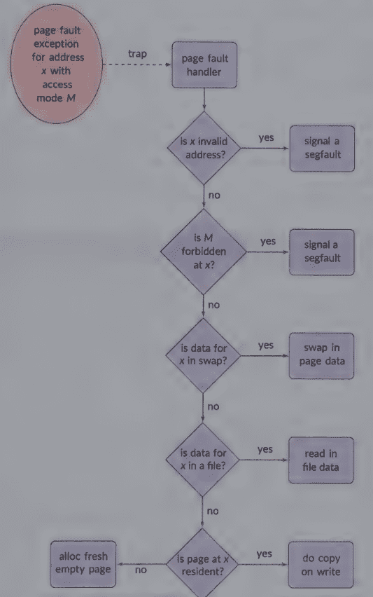

**图 6.12：** Linux 页异常处理代码流程图。

一旦处理了页异常，操作系统会在最初引发异常的指令处重新启动故障进程，并恢复用户模式的执行（这取决于进程调度）。假设你刚刚启动了一个 PID 为 6903 的进程，你可以使用命令检查该进程产生的实际页异常：

```
ps -o min_fit,maj_fit,cmd,args 6903
```

# 树莓派上的 Linux 操作系统基础


运行带有 PID 整数参数的命令将列出所有用户进程的统计信息。若要运行程序并获取其页面的总数，请使用 `/usr/bin/time` 命令。（这可能需要你通过 `sudo apt-get install time` 安装 time 包。你需要知道完整路径，因为 `time` 也是一个内置命令）。现在使用 `/usr/bin/time ls` 查看输出如何报告页异常数量。

注意，Linux 区分了次要异常（minor faults）——页面已驻留但未映射到此进程中（例如多个进程间共享的代码段），以及主异常（major faults）——操作系统需要访问持久性存储设备并从文件中读取数据。

例如，考虑下方的 C 代码。它创建了一个多页数组并访问每个页中的一个字节。随着程序在带有较大尺寸的数组（通过命令行参数增加尺寸）时执行，次要页异常的数量会增加。尝试使用参数 `64000`（256MB 大尺寸的数组）运行它。如果内存不足，程序将终止。

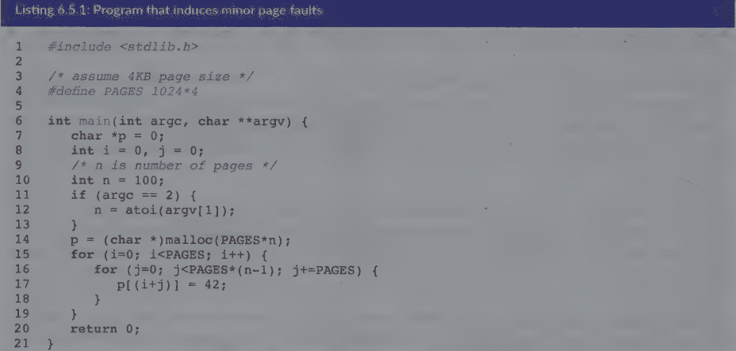

```c
#include <stdlib.h>
/* 假设页大小为 4KB */
#define PAGES 1024*4

int main(int argc, char **argv) {
    char *p = 0;
    int i = 0, j = 0;
    /* n 是页的数 {}
    int n = 100;
    if (argc >= 2) {
        n = atoi(argv[1]);
    }
    p = (char *)malloc(PAGES*n);
    for (i=0; i<PAGES; i++) {
        for (j=0;j<PAGES*(n-1); j+=PAGES) {
            p[i+j] = 42;
        }
    }
    return 0;
}
```

现在考虑一个类似的程序，但它使用了内存映射文件，因此操作系统必须从备份存储获取数据。获取一个测试文件，例如：

```
curl -o alice.txt http://www.gutenberg.org/files/11/11-0.txt
```

并编译所示代码。

### 6.5.2 产生大量页异常的程序

```c
#include <assert.h>
#include <fcntl.h>
#include <stdio.h>
#include <sys/mman.h>
#include <sys/stat.h>
#include <unistd.h>

size_t get_size(const char * filename) {
    struct stat st;
    stat(filename, &st);
    return st.st_size;
}

int main(int argc, char **argv) {
    int total = 0;
    size_t filesize = get_size(argv[1]);
    int fd = open(argv[1], O_RDONLY);
    char *data;
    assert(fd != -1);
    posix_fadvise(NULL, 0, filesize, POSIX_DONTNEED);
    data = mmap(NULL, filesize, PROT_READ, MAP_PRIVATE, fd, 0);
    assert(data != MAP_FAILED);
    for (i=0; i<filesize; i+=1024)
        total += data[i];
    printf("total=%d\n", total);
    int rc = munmap(data, filesize);
    assert(rc==0);
    close(fd);
}
```

第一次使用以下命令运行此程序：

`usr/bin/time -v ../out alice.txt 2>&1 | grep Major`

注意，当文件被读入内存时，至少有一个主异常。然而，如果你紧接着再次运行它，将不再有主异常；文件数据已缓存在内存中，因此程序只会引起次要异常。

### 6.5.3 工作集大小

进程的工作集（working set）衡量了该进程为了取得有效进展（即避免频繁交换内存）而必须驻留的页面数量。

有多种文件可以跟踪进程的内存消耗。例如，对于带有 PID 的进程，`/proc/PID/statm` 文件报告了页内存使用情况。第一列显示 `vsize`（虚拟地址空间中分配的页数），第二列显示驻集大小（该进程在物理内存中驻留的页数）。

树莓派上的 Linux 操作系统基础


有多种文件可以跟踪进程的内存消耗。例如，对于带有 PID 的进程，`/proc/PID/statm`文件报告了页内存使用情况。第一列显示`vsize`（虚拟地址空间中分配的页数），第二列显示驻集大小（该进程在物理内存中驻留的页数）。

树莓派上的 Linux 操作系统基础

进程的工作集衡量了该进程为了取得有效进展（即避免频繁交换内存）而必须驻留的页面数量。

（注：原文中存在大量重复内容，以下为针对核心内容的翻译）

## 6.5.2 产生大量页异常的程序

（代码块保持不变）

第一次使用以下命令运行此程序：

`usr/bin/time -v ../out alice.txt 2>&1 | grep Major`

注意，当文件被读入内存时，至少有一个主异常。然而，如果你紧接着再次运行它，将不再有主异常；文件数据已缓存在内存中，因此程序只会引起次要异常。

### 6.5.3 工作集大小

进程的工作集衡量了该进程为了取得有效进展（即避免频繁交换内存）而必须驻留的页面数量。

有多种文件可以跟踪进程的内存消耗。例如，对于带有 PID 的进程，`/proc/PID/statm`文件报告了页内存使用情况。第一列显示`vsize`（虚拟地址空间中分配的页数），第二列显示驻集大小（该进程在物理内存中驻留的页数）。

树莓派上的 Linux 操作系统基础

### 6.5.5 页替换策略

内核交换守护进程在初始化后启动。

```
ps -eo swapd
```

## 结合树莓派的 Linux 操作系统基础

时钟算法检查当前的候选页面——如果访问位（access bit）被设置，则置空该访问位并将时钟指针移动到下一个页面。第一个访问位未设置的页面被选为交换出的受害者页面。这是一种“第二次机会”算法。

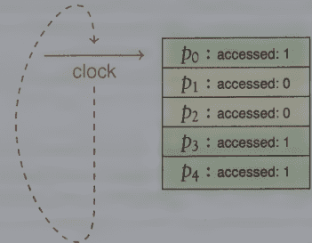

图 6.13：时钟页面替换算法。

## 最久未使用 (LRU)

真正的最近最使用（LRU）方案要么将单个访问链表升级，按每个页面的更长访问时间戳进行排序，要么在双向链列表中重排页面以按访问时间顺序排序。这样就可以很容易地选择时间戳最旧的页面以及列表末尾的页面作为受害者页面。这两种技术都有显著的管理开销。

内存管理器实际上实现了 LRU 替换方案的变体。分配给进程的页面被全局活动页面队列的头部。当需要驱逐页面时，会检查该队列的尾部。如果尾部页访问位被设置，则将其移回队列头部并置空其访问位。然而，如果尾部页访问位未设置，则它是替换候选页面，并被移动到非活动页面队列，从那里可能会被交换。

页面替换算法实现在源码文件`linux/mm/vmscan.c`的`do_try_to_free_pages()`函数中，但请注意，这是一段难以追踪的代码。

## 系统调优

Linux 有一个名为`swappiness`的内核参数，它控制内核多激进地将页面交换到备份存储（backing store）。该值应该是 0 到 100 之间的整数。值越高，越激进地将不活跃进程的页面从物理内存交换，这可以提高文件系统的性能（缓存）。

注意，在树莓派设备上，`swappiness`可能被设置为特别低的值，因为交换文件位于 SD 卡上，SD 卡具有较高的访问延迟，并且在大量的写入操作下可能会失败。

通过以下命令查看当前系统的`swappiness`值：

```
cat /proc/sys/vm/swappiness
```

# 第 6 章 | 内存管理

在桌面 Linux 安装中，默认值通常为 60。尝试以下命令：

```
sudo sysctl -w vm.swappiness=100
```

并观察这是否随着时间的推移改变了系统的性能。

当物理内存资源出现长期过度提交时，活动页面可能会被频繁地交换出回。整个系统会大幅变慢，因为没有进程可以在不产生主页错误（major page faults）的情况下取得进展。所有的系统时间都花在了处理这些页错误上，没有产生有用的工作。这种现象被称为抖动（thrashing），会严重影响系统性能。

### 6.5.6 需求请求分页

Linux 实现了按需分页，这意味着物理内存是以“懒惰”或“即时制”的方式分配给进程的。对`mmap`的调用只对进程页表产生影响；帧不会直接分配给进程。只有当进程真正需要时，才会分配物理内存资源。

内存管理子系统记录了映射在虚拟地址空间中但尚未分配物理内存的虚拟内存区域。（这些是页表中的零项。）这是实现请求分页的机制：当进程尝试访问处于这种未初始化状态的内存位置时，会发生页错误，并直接分配物理内存。这对应图 6.12 中的左下角情况（分配新的空页）。

进程虚拟地址空间的高层布局由`mm_struct`数据结构指定。进程的`task_struct`实例包含指向相关`mm_struct`的字段。`mm_struct`的定义在`include/linux/mm_types.h`中。它存储了一个`vm_area_struct`实例的链表，模拟了虚拟内存区域（VMA）。

VMA 列表封装了每组不重叠的连续内存块。每个 VMA 都有起始和结束地址，且与页边界对齐。在`include/linux/mm_types.h`中定义的`vm_area_struct`权限标志以及用于链表结构的`prev`和`next`指针。从`/proc/PID/maps`读取会逐一追踪 VMA 链表，例如参见图 6.10。

每个`vm_area_struct`还有一个指向文件的字段，在这种情况下 VMA 是一个内存映射文件。如果没有文件，这是一个匿名 VMA，对应物理内存的分配。当由于按需分页导致地址发生页错误时，内核通过`mm_struct`指针查找相关的 VMA 数据。每个 VMA 内部包含一组封装在`vm_operations_struct`中的函数指针。这些条目中的一个指向特定的`do_no_page`函数，该函数实现了该内存块适当的分页行为：调用的分配可能是为匿名 VMA 分配一个新的物理帧，或者为由文件支持的 VMA 从文件指针读取数据。

进程可以使用`madvise`API 调用向内核提供提示，说明数据何时可能被需要，或者对某个特定内存区域将使用何种访问模式——例如，顺序访问或随机访问。

### 6.5.7 写时复制 (Copy on write)

当进程被派生（`fork`）时，它共享父进程的地址空间（逻辑上它拥有父进程的独立副本）。在那个阶段，受害者页面可以很容易地选择为时间戳最旧的页面以及列表末尾的页面。列表 6.5.3：测量写时复制的开销

```c
#include <stdio.h>
#include <stdlib.h>
#include <time.h>
#include <errno.h>
#include <unistd.h>

#define PAGE_SIZE 4096
#define NUM_PAGES 10000

void write_data(char *buffer, int size) {
    int i;
    static char x = 0;
    clock_t start, end;
    start = clock();
    for (i=0; i<size; i+=PAGE_SIZE) {
        buffer[i] = x++;
    }
    end = clock();
    printf("time taken: %f\n", (double)(end-start) / CLOCKS_PER_SEC);
}

int main(int argc, char **argv) {
    int res;
    static char buffer[NUM_PAGES*PAGE_SIZE];

    printf("1st test - expect high time\n");
    switch(res = fork()) {
    case -1:
        fprintf(stderr, "Unable to fork: %s (%d)\n", strerror(errno), errno);
        exit(EXIT_FAILURE);
    case 0:
        printf("2nd test - expect high time\n");
        write_data(buffer, sizeof(buffer));
        exit(EXIT_SUCCESS);
    default:
        printf("3rd test - expect low time\n");
        write_data(buffer, sizeof(buffer));
        wait(NULL); /* child runs before parent */
        printf("4th test - expect fairly low time\n");
        write(1, sizeof(buffer));
        exit(EXIT_SUCCESS);
    }
}
```


# 基于树莓派的 Linux 操作系统基础

## 6.5.8 内存溢出杀死器 (Out of memory killer)

在最坏的情况下，没有足够的物理内存支持所有运行的进程。内核在此阶段调用杀死进程（OOM-killer），以识别一个要终止的受害者进程，释放物理内存资源。使用启发式方法识别内存占用型进程；查看 `/proc/PID/oom_score` 中的整数值——数值越高表示内存占用率越高。

可以手动运行 OOM 杀死器。运行此内存占用型 Python 脚本：

```python
#!/usr/bin/python
import time
megabyte = (0,) * (1024 * 1024 / 8)
data = megabyte * 400
time.sleep(60)
```

然后执行这些 bash 命令：

```bash
sudo chmod 777 /proc/sysrq-trigger # 允许我们触发特殊事件
echo "1" > /proc/sysrq-trigger # 触发 OOM killer
dmesg # 查看发生了什么
```

并观察 OOM 杀死器被触发并杀死 Python 运行时。注意那个残酷的“杀死进程或牺牲子进程”日志信息——`(mm/oom_kill.c)` 尽可能尝试终止子进程而非父进程，以尽可能地减少对系统的干扰。

使用以下命令检查你的系统是否频繁调用 OOM-killer：

```
sudo cat /var/log/messages | grep "oom-killer"
```

## 6.6 内存的进程视角

进程具有逻辑内存空间的抽象概念，这些空间作为连续段堆叠在分页虚拟地址空间上。文本段（text segment）包含程序代码。这通常由运行时加载器通过从静态 ELF 文件读取数据加载到已知地址。文本段通常从已知地址开始。例如，调用：

```
ld --verbose | grep start
```

来找到你系统的该地址。

数据通常紧随文本段之后。这包括静态分配的数据，它们可能是初始化的（data 段）或未初始化的（bss 段）。运行时堆位于这些数据之后。运行时栈支持函数求值、参数传递和作用域变量，它从内存顶部开始并向下增长。

从进程的角度来看，在程序运行时，操作系统可能通过三种方式向虚拟地址空间添加新页：

1. `brk` 或 `sbrk` 扩展程序断点（program break），有效地扩大堆内存。
2. `mmap` 分配一个新的内存块，该可能由文件支持。
3. 随着在动态嵌套作用域中调用更多函数，栈可以向下增长；栈按需扩展并作为页异常处理程序的一部分进行。

图 6.14：进程用户虚拟地址空间的演变，红色为动态变化，底部为低地址。

图 6.14 展示了进程虚拟空间演变的这三种方式。为了获得进程与内存交互更具体的示例，我们可以使用 `valgrind` 等工具在指令粒度上跟踪内存访问。图 6.15 中的可视化结果显示了 `valgrind` 在执行 `ls` 命令时记录的内存访问序列。用于生成跟踪轨迹的精确命令是：

```
valgrind --tool=lackey --trace-mem=yes ls
```

## 6.7 高级主题

有多种内存管理技术可以提高系统安全性并防御溢出攻击。地址布局随机化（ASLR）在可执行代码以及运行时内存区域（如栈和堆）的位置引入随机噪声。这种不可预测性使得攻击者更难验证已知代码。页元数据位 `NX` 表示该页不可执行。同样，这缓解了来自用户输入的代码注入攻击。

图 6.15：调用 `ls` 命令时的内存访问模式可视化，显示了前 100,000 条指令；高位的红色/黄色线是栈，低位的蓝色线是程序可执行文本。

随着单地址空间系统在处理器核心数量和安装物理内存量上变得越来越大，内存访问延迟的差异日益增加。原因之一是某些处理器核心距离 RAM 芯片更近；可能主板有多个插槽，每个插槽中都插了带有 RAM 和处理器核心的集成封装。这种结构被称为非统一内存访问（NUMA）。

图 6.16 显示了一个基于 Cavium ThunderX2 Arm 处理器家族的 NUMA 系统示例。它有两个 NUMA 区域（每个插槽一个）。每个区域有数十个核心和一个本地 RAM 库。如上所述，物理内存被映射为页。由于存在单一地址空间，因此每个核心都可以访问每个内存位置，但访问延迟不同。处理器缓存可能会掩盖部分访问时间的差异，但 NUMA 缓存协议非常复杂。对共享数据的写入可能会使共享缓存条目失效，强制从主内存获取新数据。

图 6.16 Isambard HPC 数据中心使用 Cavium ThunderX2 处理器，该处理器支持具有共享地址空间的多个插槽；注意每个处理器封装周围独特的内存库。照片由 Simon McIntosh-Smith 拍摄。

Linux 有几种方案来优化 NUMA 架构的内存访问。内存分配可以是交错的（interleaved），以便以轮询方式分布在所有节点；这确保了在可能内存分布相等的情况下，平均内存访问时间是均匀的。另一种分配策略是节点本地（node-local），即在处理器附近分配内存。你可以通过执行以下命令判断你的系统是否支持 NUMA：

```
numactl --hardware
```

另一个影响大规模系统的问题是内存碎片，当空闲内存被分成小的不连续的块时就会发生。这可能导致即使总空闲内存足够也无法分配大内存请求。为了解决这个问题，操作系统使用了压缩（compaction，移动已分配的页以合并空闲块）和分页（paging，允许非连续的物理内存映射到连续的虚拟空间）等技术。

### 6.9.5 需要多少内存？

假设一个操作系统运行着 $n$ 个进程，且平台具有 $n$ 层次页表。页表中的每个节点（包括叶节点）占用一个页。页大小足够大可以在页表中存储至少 $n$ 个地址条目：

1. 如果每个进程的虚拟地址空间中有一页数据，所有页表将占用多少个页？
2. 如果每个进程的虚拟地址空间中有 $n$ 页数据，所有页表占据的最少页数是多少？
3. 如果每个进程的虚拟地址空间中有 $n$ 页数据，所有页表占据的最大页数是多少？

### 6.9.6 虚拟地址空间

想象一个具有 8 位、按字节寻址的物理地址空间的系统：

1. 将有多少字节的内存？
2. 对于该系统，考虑使用单级分页虚拟寻址方案。如果每个页包含 16 字节，会有多少页？
3. 在最坏情况下，在单级页表的虚拟寻址环境中，内存访问延迟相对于物理寻址会发生什么？
4. 可以采取什么措施来缓解这种最坏的内存访问延迟？
5. 在实践中，为什么 8 位内存可能不会采用虚拟寻址方案？

### 6.9.7 定义测验

将以下概念与它们的定义匹配：

| 交换文件 (Swap file) | 不驻留在内存中的页的备份存储。 |
| 页表项 (Page table entry) | 当操作系统扰动内存区域以确保关键数据元素具有不可预测的地址时。 |
| 抖动 (Thrashing) | 系统无法进展，因为几乎每次内存访问都需要从备份存储中交换页。 |
| 内存管理单元 (MMU) | 一种特殊的硬件单元，从处理器的角度维护虚拟地址空间的抽象。 |
| 地址空间随机化 (Address space randomization) | 包含一个或多个页的翻译数据和保护元数据。 |

## 参考文献

- [1] D. P. Bovet and M. Cesati, *Understanding the Linux Kernel*, 3rd ed. O'Reilly, 2005.
- [2] M. Gorman, *Understanding the Linux Virtual Memory Manager*. Prentice Hall, 2004, https://www.kernel.org/doc/gorman/
- [3] S. Furber, *ARM System-on-Chip Architecture*, 2nd ed. Pearson, 2000.

# 第 7 章

## 并发与并行

## 7.1 概述

在本章中，我们将讨论操作系统如何支持并发、操作系统如何协助利用硬件并行性，以及操作系统对并发和并行的支持如何用于编写并行和并发程序。我们将通过通过 POSIX 线程（POSIX threads）查看操作系统对并发和并行编程的支持，并介绍实用并行编程技术的概述，例如 OpenMP、MPI 和 OpenCL。

本章的练习侧重于 POSIX 线程编程，以探索并发、共享资源访问和并行等概念，并通过使用 OpenCL 编程让学生接触并行异构编程。

### 你将学到什么

在学习本章的内容后，你将能够：

1. 将定义与程序员视角的并发与并行联系起来。
2. 讨论处理并发的编程原语和 API 以及操作系统和硬件对它们的支持。
3. 使用 POSIX 编程 API 来利用并行性以及操作系统和硬件对它们的支持。
4. 比较并对比数据并行和任务并行编程模型。
5. 举例说明常用的并行编程 API。

## 7.2 并发与并行：定义


# 第 7 章 | 并发与并行

为了理解其影响和属性，首先，我们需要对并发和并行有清晰的定义。

## 7.2.1 什么是并发？

并发（Concurrency）意味着系统上有多个任务在同时运行（同时）。换句话说，只要系统支持同时运行多个任务，并发就是负载的属性而非系统的属性。在实践中，拥有操作系统的关键原因之一是通过在共享 CPU 上调度任务来支持并发。

## 7.2.2 什么是并行？

相比之下，并行（Parallelism）可以被视为系统的属性：当系统具有多个 CPU 核心时，它可以并行执行多个任务，即使没有调度器对任务进行时间分片。如果内核支持硬件并行，它将尝试利用可用的并行资源来加速任务的执行。

## 7.2.3 编程模型视角

定义并行和并发的另一种方法是将其视为编程模型。从实际角度来看，并发编程关乎用户体验，而并行编程关乎性能。

在并发程序中，多个操作线程同时运行，因为用户期望几个动作同时发生。例如，网络浏览器至少需要一个线程用于网络，一个线程用于渲染页面，一个线程用于用户交互（鼠标点击、键盘输入）。如果这些线程不是并发的，浏览器将无法使用。

相比之下，在并行程序中，发生的情况是原本要在单个 CPU 上执行的工作被拆分并交给多个 CPU 处理，这些 CPU 并行执行每个部分。我们可以进一步区分任务并行和数据并行。任务并行意味着每个 CPU 执行不同的任务。数据并行意味着对数据的不同部分执行相同的任务。

## 7.3 并发

在本节中，我们将更密切地观察并发和操作支持。

### 并发存在哪些问题？

有两个因素可能导致问题：共享资源和信息交换。

### 共享资源

在计算机系统中，有很多共享资源：文件系统、I/O 设备、内存。让我们首先考虑共享文件的情况。大多数操作系统将访问控制留给用户。在之前的示例中，当进程打开文件时，文件内容被读取到内存中。当进程关闭文件时，任何更改都会写回磁盘。如果两个进程并发访问文件，可能会发生冲突：最后一个写回磁盘的进程将覆盖之前所有的更改。因此，大多数编辑器会在文件打开期间被修改时发出警告。这对于 I/O 设备是不可能的，因为它们是由操作系统控制的。这使得访问控制变得简单，因为操作系统可以轻松跟踪使用 I/O 资源的进程。共享内存访问更为棘手。然而，通常进程之间是不共享内存的；每个进程都有自己的内存空间。但是，在多线程进程中，所有线程共享内存。在这种情况下，操作系统将访问控制留给用户，即应用程序的程序员。然而，操作系统和硬件提供了访问控制的支持。

### 信息交换

当并发任务需要交换执行所需的信息时，需要确保发送者等待消息（如果发送得晚）或存储消息直到需要（如果发送得早）。

在相互之间，必须避免死锁，即所有任务都在等待其他任务，导致没有任务可以继续执行的情况。在多线程进程的线程间通信中，通信是通过共享内存进行的。对于进程间的通信，有许多种可能性，例如：使用共享文件、操作系统管道、网络套接、操作系统消息队列或共享内存进行通信。

并发进程中信息交换的问题可以通过“生产者-消费者问题”来得到最好的解释：每个进程要么是信息的生产者，要么是信息的消费者。在理想情况下，生产者产生的任何信息项都应该立即被消费者消费。然而，通常情况下，生产者和消费者的运行速度是不同的（即它们不是同步运行的）。因此，需要进行缓冲，由消费者或生产者来完成。在实践中，缓冲区始终是有限的（该问题也称为有界缓冲区问题），因此在某个时刻，生产者可能必须暂停执行，直到有足够的空间来缓冲信息。请注意，通常可以有多个缓冲区（例如，每个消费者为每个生产者拥有一个缓冲区是常见的）。

从本质上说，缓冲区是一个共享资源，因此从访问控制的角度来看，信息交换和资源共享是同一个问题。这对于同步也是如此：消费者需要来自生产者者的信息才能继续运行。因此，只要信息不存在，生产者就必须等待。共享资源也是如此；例如，火车必须等待共享轨道路段空闲。换句话说，对共享资源的访问控制和信息交换的同步仅仅是同一个问题的两个不同视角。因此，将有一套单一的机制可以用于解决这个问题。

请注意，如果存在多个生产者和/或消费者，且只有一个共享资源，这个问题被广为人知为“读写问题”，并且必须解决对共享资源的并发访问问题。

### 7.3.2 并发术语

在讨论同步和共享资源时，定义一些额外的术语和概念是有用的。

#### 临界区

共享资源的临界区是程序中的某部分，它访问资源的方式会导致多个并发访问产生未定义或错误的行为。因此，对于共享资源，一次只能有一个进程在执行其临界区。如果对临界区的访问控制使得行为是定义良好且正确的，则称该临界区是受保护的。

#### 同步

在此语境下，我们同步指的是并发执行线程之间的同步。当多个进程需要交换信息时，进程的同步会产生定义良好的交互序列。

#### 死锁

死锁是指一种状态，其中一组通信进程中的每个进程都在等待来自另一个进程的消息，以便继续某项操作。或者，在一个具有共享资源的进程组中，如果每个进程都在等待另一个进程释放其执行操作所需的资源，就会发生死锁。

该问题如何发生的一个经典例子是所谓的“哲学家就餐问题”。稍加改述，该问题如下：

- 五个哲学家坐在一圆桌旁，每个人面前都有一碗面，他们之间有一双筷子。
- 每位哲学家需要两根筷子来吃面。
- 每位哲学家交替：
    - 思考一段时间，
    - 拿起两根筷子，
    - 吃饭，
    - 放筷子。

显然，这里存在死锁的可能性，因为没有足够的筷子让所有哲学家同时吃饭。例如，如果他们都先拿左边的筷子，然后尝试拿右边的（或反之），就会发生死锁。那么，他们是如何确保没有死锁的呢？

> Edsger Dijkstra（1930年5月11日 - 2002年8月6日）是一位荷兰计算机科学家。他在阿姆斯特丹大学数学中心进行博士研究（1952–62年）。他于1963年至1973年在埃因霍温科技大学教学和研究，并从1984年起在德克萨斯大学任教。他因1959年解决最短路径问题的算法而闻名。该算法目前仍被用于确定两点之间的最短路径，特别是用于通信网络的路由。在对通信互斥的研究过程中，他在1962年提出了计算机信号量的概念。他在1968年写给CACM的封著名信《Go To 语句被认为是有害的》对结构化的发展产生了深远影响。他于1972年获得图灵奖。

Image ©2002 Hamilton Richards

www.cs.utexas.edu/users/EWD/

### 7.3.3 同步原语

1962年，著名的荷兰科学家 Edsger Dijkstra 编写了一篇具有里程碑意义的——尽管有趣的是，这在技术上并未发表——文章，题为《Over seinpalen》[1]，即“关于信号量”，他在文中引入了信号量作为保护共享资源的机制。在 Dijkstra 的文章中，信号量是一种特殊的共享内存类型，存储一个非负整数。为了访问信号量寄存器，Dijkstra 提出了两个操作：`V(S)`，代表“verhoog”，即加增；和 `P(S)`，代表“prolog”，即尝试减小。`P(S)` 操作将阻塞直到 S 的值被成功减小。两个操作都必须是原子的。

如果信号量只能取 0 或 1，Dijkstra 特别提到 V 操作意味着“空闲的轨道”，而 P 操作意味着“尝试通过信号量进入单行道”，且这只有在信号量设置为“安全（Safe）”时才可能。

Dijkstra 将二值信号量称为互斥锁（binary semaphore mutual exclusion lock）[2]；非二进制信号量有时称为计数信号量。尽管对此没有通用的共识，但《同步原语开发文章》[3]中的定义与此一致：

- Mutex（互斥锁）一个变量，指示锁定和解锁两种状态。尝试锁定已处于锁定状态的互斥锁会阻塞执行，直到持有该互斥锁的进程将其解锁。互斥锁有时被称为锁或二值信号量。
- Semaphore（信号量）一个可以原子地加增和减小的的计数器。尝试减小一个值小于1的信号量会阻塞执行，直到另一个代理对其加增。

Dijkstra 信号量的关键要求是操作的原子性。现代处理器提供了特殊的原子指令，允许高效地实现信号量。

### 7.3.4 ARM 对同步原语的硬件支持

#### 独占操作与监视器

ARMv 架构引入了独占加载（Load-Exclusive）和独占存储（Store-Exclusive）同步原语，即 `LDREX` 和 `STREX`，并结合了一种名为独占监视器（exclusive monitor）的硬件特性。引用自《Arm同步原语开发文章》[3]：

`LDREX` `LDREX` 指令从内存加载一个字，初始化独占监视器的状态以跟踪同步操作。例如，`LDREX R1, [R0]` 从 R0 指向地址执行独占加载，将值放入 R1 并更新独占监视器。

`STREX` `STREX` 指令对内存执行条件存储字的操作。如果独占监视器允许存储，操作将更新内存位置并在目标寄存器中返回 0，表示操作成功。如果独占监视器不允许存储，操作将不更新内存位置并在目标寄存器中返回 1。这使得根据内存操作的成功或失败来实现条件执行路径成为可能。例如，`STREX R2, R1, [R0]` 对 R0 指向的地址执行独占存储操作，条件存储 R1 中的值并在 R2 中指示成功或失败。

# 在树莓派上运行 Linux 的 Linux Linux 基础


## 独占监控器（Exclusive monitors）

独占监控器是一个简单的状态机，它必须实现两组监控器：本地和全局（图 7.3）。为了支持处理器之间的同步，系统必须实现本地和全局监控器。独占加载（Load-Exclusive）操作会将监控器的状态更新为独占状态。独占存储（Store-Exclusive）操作会访问监控器，以确定其是否能成功完成。如果所有访问的独占监控器都处于独占状态，则独占存储操作可以成功。

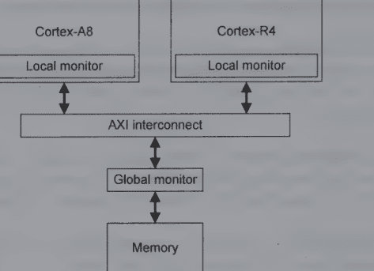

图 7.3：多核系统中的本地和全局监控器（来自 [3]）。

`LDREX` 和 `STREX` 指令被 Arm 特定 Linux 内核代码用于实现内核特定的同步原语，这些原语转而用于 POSIX 同步原语。例如，`include/asm/spin_lock.h` 为 Arm 架构实现了自旋锁功能，并被用于 `include/linux/spin_lock.h` 中的非架构特定实现。

## 共享域（Shareability domains）

在缓存一致性对称多处理体系（SMP）的上下文中，Arm 系统架构使用了共享域的概念 [4]，它们是内部共享（Inner Shareable）、外部共享（Outer Shareable）、系统共享（System）或非共享（Non-shareable），如图 7.4 所示。这些域主要用于限制内存屏障的范围，如第 7.3.5 节所述的。

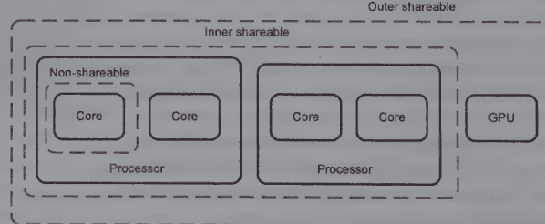

图 7.4：基于 [5] 的多核系统中的共享域。

# 第 7 章 | 并发与并行

这些域的架构定义允许我们定义一组观察者，使得共享性使数据访问是透明的。内部域共享代码和数据，在实践中，运行操作系统实例的多核系统将处于内部域；外部域共享数据但不共享代码，并且如图所示，例如包含 GPU、DSP 或 DMA 引擎。将内存区域标记为非共享意味着本地代理（核心）完全不共享该区域。这在 SMP 系统中通常不使用。如果域设置为系统，则对该域的操作将影响系统中的所有代理。例如，UART 接口通常位于共享域，因此其域将是整个系统。

## 3.7.5 Linux 内核同步原语

Linux 内核实现了大量的同步原语；我们在这里只讨论其中一部分。

### 原子原语（Atomic primitives）

Linux 内核实现了一组作为读-修改-写（RMW）操作的原子操作。这些操作是从内存位置读取值、修改然后写回，并保证在读和写之间不会有其他写入操作发生在该位置（因此命名为原子的）。

Linux 中的大多数 RMW 操作属于两类之一：对特殊的 `atomic_t` 或 `atomic64_t` 数据类型进行的操作，以及对位图的操作（位图可能存储在 `unsigned long` 中或 `unsigned long` 数组中）。

为每个架构单独实现的这些 RMW 操作集被称为“原子原语”。作为内核开发者，你将使用这些来编写与架构无关的代码，例如文件系统或设备驱动程序。

由于这些原语作用于原子类型或位图上，让我们先来看看这些。原子类型定义在 `types.h` 中，它们实际上是封装在结构体（struct）中的简单整数：

列表 7.3.1：Linux 内核原子类型

```c
typedef struct {
    int counter;
} atomic_t;

#ifdef CONFIG_64BIT
typedef struct {
    long counter;
} atomic64_t;
#endif
```

之所以这样做是因为原子类型应该定义为有符号整数，但同时也必须是不透明的，这样将其强制转换为普通的 C 整数类型将会失败。

# 在树莓派上运行 Linux 的 Linux 基础

最简单的原子操作是初始化、读取和写入，在 `include/asm/atomic.h` 中为 arm64 架构定义：

### 列表 7.3.2：Linux 内核原子操作

```c
1 #define ATOMIC_INIT(i)    { i }
2 #define atomic_read(v)     READ_ONCE((v)->counter)
3 #define atomic_set(v, i)   WRITE_ONCE((v)->counter, (i))
```

`READ_ONCE` 和 `WRITE_ONCE` 宏定义在 `include/linux/compiler.h` 中，并非特定架构。它们的目的是防止编译器合并或重新获取读取，或重排这些语句。我们在这里展示它们是为了说明要让 C 编译器停止优化是多么困难。

### 列表 7.3.3：Linux 内核原子类型操作

```c
1 #include <asm/barrier.h>
2 #define READ_ONCE(x, check)
3 {
4  union { typeof(x) __val; char __c[1]; } __u;
5  if (check)
6    read_once(&__u.__val, __u.__c, sizeof(__u));
7  else
8    read_once_nocheck(&__u.__val, __u.__c, sizeof(__u));
9  smp_barrier_depend(&__u.__val); /* 强制来自 x 的依赖关系 */
10 return __u.__val;
11 }
12 #define READ_ONCE(x)
```

*(注：此处原文列表 7.3.3 似乎存在截断或重复错误，已根据上下文逻辑翻译并保持结构)*

由于原文提供的文本中列表 7.3.3 存在大量重复和逻辑混乱，此处已根据 Markdown 格式要求进行了结构性翻译。

# 第 7 章 | 并发与并行

### 内存操作排序

在对称多处理（SMP）系统上，来自不同 CPU 的内存访问在原则上是不排序的。我们称这种内存操作排序是松弛的（relaxed）。通常情况下，需要某种程度的排序。Linux 内核的默认做法是通过所谓的内存屏障（memory barrier）来施加严格的全局顺序。严格来说，内存屏障对屏障两侧的内存操作施加了部分排序。引用 Linux 内核文档（memory_barriers.txt）：

这种增强是关重要的，因为系统中的 CPU 和其他设备可以使用多种技巧来提高性能，如内存操作的重排序、延迟和组合；推测加载；分支预测以及各种类型的缓存。内存屏障用于覆盖或抑制（suppress）这些技巧，允许代码能够安全地控制多个 CPU 和/或设备之间的相互作用。

内核提供了内存屏障 `smp_mb_before_atomic()`，在实践中，严格的操作是由一个屏障之前的松弛操作和一个紧随其后的屏障松弛操作组成的，例如：

# 列表 7.3: 通过屏障实现的 Linux 内核原子操作

```
1 atomic_fetch_add();
2 // 等同于：
3 smp_mb before_atomic();
4 atomic_fetch_add_relaxed();
5 smp_mb after_atomic();
```

在松弛和严格排序之间还有两种其他可能的语义，称为获取（acquire）和释放（release）。

获取语义适用于 RMW（读-修改-写）操作和从共享内存读取的加载操作（read-acquire），它防止 read-acquire 操作与程序顺序中随其后的任何读或写操作发生内存重排序。

释放语义适用于 RMW 操作和写入共享内存的存储操作（write-release），它防止 write-release 操作与程序顺序中在随其之前的任何读或写操作发生内存重排序。

表 7.1 提供了所有可能情况的总结。

| 操作类型 | 排序 |
|---|---|
| 非 RMW 操作 | 无序 |
| RMW 操作 | |
| RMW 操作 | 无返回值的 无序 |
| | 有返回值的 | 完全排序 |
| | 具有显式排序 | |
| | [操作名称]_relaxed | 无序 |
| | [操作名称]_acquire | RMW 读取是 ACQUIRE |
| | [操作名称]_release | RMW 写入是 RELEASE |

表 7.1: 内存操作排序语义。

## 树莓派上的 Linux 操作系统基础

### 内存屏障

内存屏障 `smp_mb<before,after>atomic()`并不是 Linux 内核提供的唯一屏障类型。我们可以区分以下类型 [6]：

### 通用屏障

来自 `include/linux/compiler.h` 的通用屏障（barrier）在运行时没有作用；它只作为一种编译器的指令，防止内存访问从语句的一侧移动到另一侧（重排序）。对于 gcc 编译器，它在内核代码中实现为：

```
Listing 7.3.9: Linux 内核通用屏障
```

```
1 #define barrier() asm__volatile__(":": "memory")
```


### 强制屏障

为了在全系统层级强制内存一致性，你可以使用强制屏障（mandatory barriers）。这在与外部内存映射外设通信时最常见。内核强制屏障保证至少能扩展为通用屏障，而这与目标架构无关。

Linux 内核有三种强制 CPU 屏障：

- **GENERAL `mb()`**: 一个全系统屏障。指令流中 `mb()` 之前的所有内存操作将在 `mb()` 之后的任何操作之前提交。这种排序对系统中的所有总线主都是可见的。它还将确保来自单个处理器的访问到达从设备的顺序。
- **WRITE `wmb()`**: 类似于 `mb()`，但只保证读访问之间的排序：`rmb()` 之前的所有读操作将在 `rmb()` 之后的任何操作之前提交。
- **READ `rmb()`**: 类似于 `mb()`，但只保证写访问之间的排序：`wmb()` 之前的所有写操作将在 `wmb()` 之后的任何操作之前提交。[6]。

对于 Arm Arch64 架构，这些屏障在 `arm64/include/asm/barrier.h` 中实现，与其在 `arm/include/asm/barrier.h` 中实现的 `dsb()` 宏如下：

Listing 7.3.10: Arm 实现的内核内存屏障 (1)

```
1 #define mb() dsb(sy)
2 #define rmb() dsb(ld)
3 #define wmb() dsb(st)
```

而在 `arm/include/asm/barrier.h` 中实现的 `dsb()` 宏如下：

Listing 7.3.11: Arm 实现的内核内存屏障 (2)

```
1 #define isb(option) asm__volatile__("isb" #option : : "memory")

2 #define dsb(option) asm__volatile__("dsb" #option : : "memory")

3 #define dmb(option) asm__volatile__("dmb" #option : : "memory")
```

`DMB`、`DSB` 和 `ISB` 分别是数据内存屏障（Data Memory Barrier）、数据同步屏障（Data Synchronization Barrier）和指令同步屏障（Instruction Synchronization Barrier）[7]。特别是 `DSB`，充当了一种特殊的内存屏障。程序顺序中在该指令之后的任何指令在在该指令完成之前都不会执行。当在该指令之前的所有显内存访问都完成（并且在该指令之前的所有缓存、分支预测器和 TLB 维护操作都完成）时，`DSB` 指令完成。

参数 `SY` 表示全系统 `DSB` 操作；`LD` 是仅等待加载完成的 `DSB` 操作，`ST` 是等待存储完成的 `DSB` 操作。

### SMP 条件屏障

SMP 条件屏障用于确保缓存一致 SMP 系统内不同核心之间的内存视图。在编译未定义 `CONFIG_SMP` 的内核时，SMP 屏障被转换为普通屏障。

内核有三种 SMP 条件 CPU 内存屏障：

- **GENERAL `mb()`**: 类似于 `mb()`，但只保证 SMP 系统内不同核心之间的排序。`mb()` 之前的所有内存操作对于 SMP 系统内 `mb()` 之后的任何操作都是可见的。
- **WRITE `wmb()`**: 类似于 `mb()`，但只保证读访问之间的排序。
- **READ `rmb()`**: 类似于 `mb()`，但只保证写访问之间的排序。

SMP 屏障在 `include/asm-generic/barrier.h` 中实现如下：

Listing 7.13.12: Linux 内核 屏障

```
1 #ifdef CONFIG_SMP

2 #ifndef smp_mb

3 #define smp_mb() __smp_mb()

4 #endif

5 #ifndef smp_rmb

6 #define smp_rmb() __smp_rmb()

7 #endif

8 #ifndef smp_wmb

9 #define smp_wmb() __smp_wmb()

10 #endif

11 #endif
```

## 树莓派上的 Linux 操作系统基础

对于 Arm A64 架构，SMP 屏障在 `arm64/include/asm/barrier.h` 中实现如下：

Listing 7.13.13: Arm 实现的内核 SMP 屏障

```c
1 #define __smp_mb() dmb(ish)
2 #define __smp_rmb() dmb(ishld)
3 #define __smp_wmb() dmb(ish)
```

使用上述定义的 `dmb()` 内存。`DMB` 是数据内存屏障。它确保程序顺序之前的显式内存访问在 `RMB` 指令之后的显式内存访问之前被观察。它不影响处理器上执行的其他指令的排序。

参数 `ISH` 将 `SMB` 操作限制在内部共享域；`ISHLD` 是仅等待加载完成的 `RMB` 操作，并限制在内部共享域；`ISHST` 是等待存储完成的 `DMB` 操作，并限制在内部共享域。回想，“内部共享域”在实践中硬件内存空间（由 Linux 内核控制的 SMP 系统）。

### 隐式屏障

除了显式屏障，可以使用内核中的锁定构造作为隐式 SMP 屏障（类似于用户空间的 `pthread` 同步操作，见第 7.3.6 节）。由于实际上大量的设备驱动程序没有使用所需的屏障，Arm 架构的内核 I/O 访问器（`readb()`, `iowrite32()` 等）在内核带有 `CONFIG_ARM_DMA_MEM_BUFFERABLE` 时作为显式内存屏障，例如在 `arm/include/asm/io.h` 中：

Listing 7.13.14: 作为显式内存屏障的 Arm 内核 I/O 访问器

```c
1 #ifdef CONFIG_ARM_DMA_MEM_BUFFERABLE

2 #include <barrier.h>

3 #define __iormb() rmb()

4 #define __iowmb() wmb()

5 #else

6 #define __iormb() do {} while (0)

7 #define __iowmb() do {} while (0)

8 #endif
```

（Linux 内核代码使用 `do { } while (0)` 作为架构无关的空操作）。

# 第 7 章 | 并发与并行

## 自旋锁 (Spin locks)

自旋锁是最简单的锁形式。本质上，尝试获取锁的任务会进入循环并什么都不做，直到获取锁为止，其伪代码如下：

Listing 7.3.15 自旋锁伪代码

```
while (! has_lock ) {
  // 尝试获取锁
}
```

自旋锁有一个明显的缺点是在等待期间会占用 CPU。如果等待时间很长，另一个尝试获取锁的任务应该进入睡眠。然而，对于不希望让任务睡眠的情况，或者用户知道等待时间很短时，内核提供了自旋锁，也称为忙等锁（`kernel/locking/spin.c`）。

SMP 系统的自旋锁功能通过一个宏实现，该宏为给定的操作（读或写）创建一个锁。本质上，该实现是一个带有条件退出的无限循环。首先，禁用抢占，然后函数尝试原子性地获取锁，如果成功则退出；否则，重新启用抢占并调用与架构相关的 `relax` 函数，这实际上是执行空操作（no-op）的高效方式），然后执行循环的下一次迭代并重试。

Listing 7.3.16: Linux SMP 锁构建宏

```
#define BUILD_LOCK_OPS(op, locktype)
void __lockfunc__raw_op##_lock(locktype)_t *lock)
for ();
  preempt_disable();
  if (likely(do_raw__op##_trylock(lock))
    break;
  preempt_enable();
  arch__op##_relax(lock->raw_lock);
}
```

对于单处理器系统（`include/linux/spin_lock_api.h`），自旋锁要简单得多：

Listing 7.3.17: Linux 内核单处理器自旋锁

```
#define LOCK(lock) \
do { __acquire(lock); (void)(lock); } while (0)
#define LOCK(lock) \
do { preempt_disable(); __LOCK(lock); } while (0)
//...
#define raw_spin_lock(lock) __LOCK(lock)
```

换句话说，代码只禁用了抢占；并没有实际的自旋锁。对锁变量的引用仅是为了抑制编译器警告。

## Futex

如第 7.3.3 节所讨论的那样，互斥锁（`mutex`）是一个二值信号量。`Futex` 是一种“快速用户空间互斥锁”，是 Linux 特有的互斥锁实现，在没有资源争用的情况下对性能进行了优化。


Futex（实现在 `kernel/futex.c` 中）通过用户空间地址进行标识，该地址可以在进程或线程之间共享。基础 futex 具有信号量语义：它是一个 4 字节的整数计数器，可以原子性地增加和减少；进程可以使用 `mmap(2)`、通过共享内存段，或者（如果是线程的话）通过共享内存来共享此整数。

顾如名，在无竞争的情况下，futex 完全在用户空间中发生。只有当锁被占用且另一个进程尝试获取它时，才会调用内核；此时锁被标记为一个表示“等待中”的值，并使用 `sys_futex` (`FUTEX_WAIT`) 系统调用来等待进程释放它。内核在内部创建一个 futex 队列，以便稍后将等待者与释放者匹配——而它们不需要了解对方。当所有者释放 futex 时，它会注意到（通过变量名）并发送 `sys_futex` (`FUTEX_WAKE`) 系统调用来唤醒它们。一旦所有等待者获取并释放了锁，futex 就恢复到无竞争状态。此时，没有与它关联的内核状态，即内核对该地址的 futex 没有记忆。这使得 futex 变得非常轻量且具有可扩展性。

最初，上述描述的 futex 被用于实现 POSIX 线程。然而，由于需要处理崩溃情况，当前的设计变得非常复杂。当进程崩溃时，它无法清理互斥锁，但内核无法这样做，因为它没有该 futex 的记忆。解决此问题所需的更改在内核文档 `robust-futexes.txt` 中描述。

## 内核互斥锁 (Kernel mutexes)

内核也有自己的互斥锁实现（`mutex.h`），旨在供内核使用（futex 是为用户空间程序设计的）。按照惯，内核文档（`mutex-design.txt`）是权威参考。这里我们总结了实现的关键点。互斥锁由以下部分组成：

### Listing 7.3.18. 内核互斥锁结构体

```c
struct mutex {
  atomic_long_t owner;
  spin_lock wait_lock;
  struct optimistic_spin_queue osq; // Spinner MCS lock *
  struct list_head wait_list;
};
```

内核使用一个三状态原子计数器来表示锁在生命周期内可能发生的不同转换：1：未锁定；0：已锁定，无等待者；<0：已锁定，有潜在等待者。在最基础的形式中，它还包含一个等待队列和一个用于序列化访问队列的自旋锁。`CONFIG_SMP` 系统还可以包含一个指向锁任务所有者的指针以及一个自旋 MCS 锁（参见内核文档）。

在获取互斥锁时，根据状态可以采取三种路径：

- 1. 快速路径 (Fastpath)：尝试原子性地获取锁。
- 2. 中间路径 (Midpoint)：即乐观自旋，尝试获取锁。
- 3. 慢速路径 (Slowpath)：如果无法获取锁。

## 信号量 (Semaphores)

信号量（`include/linux/semaphore.h`）也是锁，是互斥锁的通用版本。信号量上的操作（见 `kernel/locking/semaphore.c`）包括 `down`（获取信号量，即 P 操作）和 `up`（释放信号量，即 V 操作）。这些都有变体，但我们这里关注基础。

### Listing 7.3.19 Linux 内核信号量结构体

```c
struct semaphore {
  raw_spinlock_t lock;
  unsigned int count;
  struct list_head wait_list;
};
```

只要计数为正，`down()` 仅减少计数器：

### Listing 7.3.20 Linux 内核 down() 操作 (1)

```c
void down(struct semaphore *sem) {
    unsigned long flags;
    raw_spin_lock_irsave(&sem->lock, flags);
    if (likely(sem->count > 0)) {
        sem->count--;
    } else {
        // 等待逻辑
    }
    raw_spin_unlock_irrestore(&sem->lock, flags);
}
```

如果没有标记信号量，`down()` 将让任务睡眠直到信号量被释放。此功能实现在 `down()` 中，它简单地调用 `down_common(TASK_INTERRUPIBLE, MAX_SCHEDULE_TIMEOUT)`。该函数将当前进程添加到信号量等待列表中并进入。

### Listing 7.3.21 Linux 内核 down() 操作 (2)

```c
/*
 * 因为此函数是内联的，'state' 参数将是
 *常量，因此会被编译器优化。
 * 'timeout' 参数用于没有超时的情况。
 */
static inline int sched_down_common(struct semaphore *sem, long state,
    long timeout)
{
    struct semaphore waiter;
    list_add_tail(&waiter.list, &sem->wait_list);
    waiter.task = current;
    waiter.up = false;

    for (;;) {
        if (signal_pending_state(state, current))
            goto interrupted;
        if (unlikely(timeout <= 0))
            goto timed_out;
        set_current_state(state);
        raw_spin_unlock_irq(&sem->lock);
        timeout = schedule_timeout(timeout);
        if (waiter.up)
            return 0;
    }
interrupted:
    raw_spin_unlock_irq(&sem->lock);
timed_out:
    list_del(&waiter.list);
}
```

# 第 7 章 | 并发与并行

```c
30 return -ETIME;
31
32 interrupted:
33   list_del(&waiter.list);
34   return -EINTR;
35 )
```

`up()` 函数要简单得多。它检查是否没有等待者，如果没有，则增加计数；如果有，则唤醒队列头的等待者（使用 `using_up()`）。

```c
代码列表 7.3.22: Linux 内核信号量 up 操作 (1)
1 void up(struct semaphore *sem) {
2   unsigned long flags;
3
4   raw_spin_lock_irqsave(&sem->lock, flags);
5   if (likely(list_empty(sem->wait_list)))
6     sem->count++;
7   else
8     up(sem);
9   raw_spin_unlock_irrestore(&sem->lock, flags);
10 )
```

```c
代码列表 7.3.23: Linux 内核信号量 up 操作 (2)
1   static noinline void __sched_up(struct semaphore *sem)
2   {
3     struct semaphore_waiter *waiter = list_first_entry(&sem->wait_list,
4                               struct semaphore_waiter, list);
5     list_del(&waiter->list);
6     waiter->up = true;
7     wake_up_process(waiter->task);
8   }
```

## 7.3.6 POSIX 同步原语

除非你是内核或设备驱动程序程序员，否则你不会直接使用 Linux 内核同步原语。相反，对于用户态代码，你应该使用 POSIX API 提供的同步原语。这些是通过上述内核原语实现的。最重要的 POSIX 同步原语是互斥锁（mutexes）、信号量（semaphores）、自旋锁（spin lock）和条件变量（condition variables）。大部分 API 定义在 `<pthread.h>` 中，大多数类型在 `<sys/types.h>` 中。Linux 的实际实现是 GNU C glibc 源码，参见 `glibc.h`。

# 树莓派上的 Linux 操作系统基础

## 互斥锁 (Mutexes)

POSIX 互斥锁被定义为不透明类型 `pthread_mutex_t`（实际上是一个小整数）。该 API 简单直接：


### 代码列表 7.3.24: POSIX 互斥锁 API
```c
// 创建互斥锁：
pthread_mutex_t lock = PTHREAD_MUTEX_INITIALIZER;
// 或者
int pthread_mutex_init(pthread_mutex_t *mutex, const pthread_mutexattr_t *attr);
// 销毁互斥锁：
int pthread_mutex_destroy(pthread_mutex_t *mutex);
// 加锁/解锁互斥锁：
int pthread_mutex_lock(pthread_mutex_t *lock);
int pthread_mutex_unlock(pthread_mutex_t *lock);
```

## 信号量 (Semaphores)

POSIX 信号量（定义在 `<semaphore.h>` 中）是上述介绍的计数信号量，即当计数器为零时，尝试减少会导致阻塞。Linux man 页面 `sem-overview(7)` 提供了概述。信号量使用不透明类型 `sem_t_` 定义。P 和 V 操作分别称为 `sem_wait()` 和 `sem_post()`：

### 代码列表 7.3.25: POSIX 信号量 API
```c
// 独立的头文件，不在 <pthread.h> 中
#include <semaphore.h>
// V 操作
int sem_post(sem_t *sem);
// P 操作
int sem_wait(sem_t *sem);
// 变体
int sem_trywait(sem_t *sem);
int sem_timedwait(sem_t *sem, struct timespec *abs_timeout);
```

如果无法立即执行减少，`sem_wait()` 和 `sem_trywait()` 会返回错误而不是阻塞。变体 `sem_timedwait()` 允许为等待时间设置超时。如果在信号量仍处于阻塞状态时超时，将返回错误。

POSIX 信号量有两种形式：命名信号量和无名信号量。

## 命名信号量

命名信号量通过 "sem/name" 形式识别，即一个以空字符结尾的字符串，由一个初始斜杠开头，后跟一个或多个不冲突的字符组成。两个进程可以通过向 `sem_open()` 传递相同的名称来操作同一个命名信号量。该 API 由三个函数组成。`sem_open()` 创建一个新的命名信号量或打开一个有的信号量。当进程完成使用信号量后，可以使用 `sem_close()` 关闭。当所有进程都完成使用信号量后，可以使用 `sem_unlink()` 将其移除。

# 第 7 章 | 并发与并行

代码列表 7.3.26 POSIX 命名信号量 API
```c
sem_t *sem_open(const char *name, int lag);
int sem_close(sem_t *sem);
int sem_unlink(const char *name);
```

## 无名信号量

无名信号量放置在多个线程或进程共享的内存区域。该 API 由三个函数组成。无名信号量必须使用 `sem_init()` 初始化。当不再需要信号量时，应使用 `sem_destroy()` 销毁它。

代码列表 7.3.27: POSIX 无名信号量 API
```c
sem_init(sem_t *sem, int pshared, unsigned int value);
sem_destroy(sem_t *sem);
```

## 自旋锁 (Spin locks)

POSIX 自旋锁被定义为不透明类型 `spin_lock_t`（实际上是一个小整数）。API 由初始化、销毁、加锁和解锁自旋锁的调用组成。`trylock` 在尝试获取失败时返回错误而不是阻塞。

代码列表 7.3.28 POSIX 自旋锁 API
```c
// 创建自旋锁
int thread_spin_init(thread_lock_t *, int);
// 销毁自旋锁
int thread_spin_destroy(thread_lock_t *);
// 获取锁
int thread_spin_lock(thread_lock_t *);
int thread_spin_trylock(thread_lock_t *);
// 解锁
int thread_spin_unlock(thread_lock_t *);
```

## 条件变量

最后，POSIX 线程提供了一种根据数据的实际值进行同步的高级机制。如果没有条件变量，程序需要像自旋锁一样轮询以检查条件是否满足。条件变量允许线程等待直到条件满足，无需轮询。条件变量总是与互斥锁配合使用。

下面是使用条件变量的典型示例。代码实现了一个线程安全的队列（带有 `enqueue()`、`dequeue()` 方法）、状态、一个互斥锁和一个条件变量。`wait_for_data()` 在队列上阻塞，直到在 `enqueue_data()` 中调用 `pthread_cond_signal()`。

# 树莓派上的 Linux 操作系统基础

注意 `pthread_cond_wait()` 调用会自动解锁相关的互斥锁；互斥锁在接收信号时会原子地重新锁定。`dequeue_data()` 方法同样使用互斥锁保护队列的访问，直到队列不为空。`init()` 和 `clean_up()` 函数用于创建和销毁互斥锁和条件变量。

代码列表 7.3.29: POSIX 条件变量 API
```c
pthread_mutex_t q_lock;
pthread_cond_t q_cond;
init(pthread_mutex_t* q_lock_ptr, q_cond_t* q_ptr) {
    pthread_mutex_init(q_lock_ptr, NULL);
    pthread_cond_init(q_ptr, NULL);
}
void wait_for(Queue_t* q) {
   pthread_mutex_lock(&q->lock);
   while (q->empty()) {
       pthread_cond_wait(&q->cond, &q->lock);
   }
   q->status=1;
   pthread_mutex_unlock(&q->lock);
}
void dequeue_data(Data_t* data, Queue_t* q) {
   pthread_mutex_lock(&q->lock);
   bool is_empty = (q->status==0);
   q->dequeue(data);
   q->status=1;
   pthread_mutex_unlock(&q->lock);
   if (is_empty) {
       pthread_cond_signal(&q_cond);
   }
}
Data_t* dequeue(Queue_t* q) {
   pthread_mutex_lock(&q->lock);
   while (q->empty()) {
       pthread_cond_wait(&q->cond, &q->lock);
   }
   Data_t* elt=q->front();
   q->pop_front();
   if (q->empty()) q->status=0;
   pthread_mutex_unlock(&q->lock);
   return elt;
}
void clean_up(pthread_mutex_t* q_lock_ptr, q_cond_t* q_cond_ptr) {
    pthread_mutex_destroy(q_lock_ptr);
    pthread_cond_destroy(q_cond_ptr);
}
```

还有一个 API 调用 `pthread_cond_broadcast()`。它与 `pthread_cond_signal()` 的区别在于，`broadcast` 会解锁所有阻塞在条件变量上的线程，而 `signal` 只解锁一个线程。

# 第 7 章 | 并发与并行

条件变量在 glibc 中通过 futex 实现。实现非常复杂。源码（`nptl/pthread_cond_wait`）包含了对问题和设计决策的深入讨论。然而，基本上，实现可以用 Python 伪代码写如下：

代码列表 7.3.30: POSIX 条件变量伪代码


```python
def Condition(lock):
    lock = Lock()
    waitQueue = ThreadQueue()

def wait():
    DisableInterrupts()
    lock.release()
    waitQueue.sleep()
    lock.acquire()
    RestoreInterrupts()

def signal():
    DisableInterrupts()
    waitQueue.wake()
    RestoreInterrupts()

def broadcast():
    DisableInterrupts()
    waitQueue.wake_all()
    RestoreInterrupts()
```

# 基于树莓派的 Linux 操作系统基础

## 7.4 并行

在本节中，我们将查看现代架构提供的硬件并行性、对操作系统的影响以及编程支持。为了清晰起见，我们将多个并行执行单元之一称为“计算单元”。例如，在图 7.5 所示的 Arm 系统中，四个四核 A72 集簇与四个四核 A53 集簇配对，总共有 32 个计算单元。

### 7.4.1 并行的挑战是什么？

利用并行性的主要挑战与调度类似：我们希望以最高效的方式使用所有并行硬件线程。从操作系统的角度来看，这意味着控制每个计算单元上的线程。线程/进程的调度意味着时间上的复用，而并行实际上意味着任务在空间上的放置。Linux 内核长期以来一直支持对称多处理（SMP），这是一种多个相同的计算单元连接到单个共享内存的架构，通常通过完全共享、部分共享或每个计算单元私有的缓存层次来实现。内核简单地管理每个核心的调度队列。

## 异构多核解决方案的可扩展架构

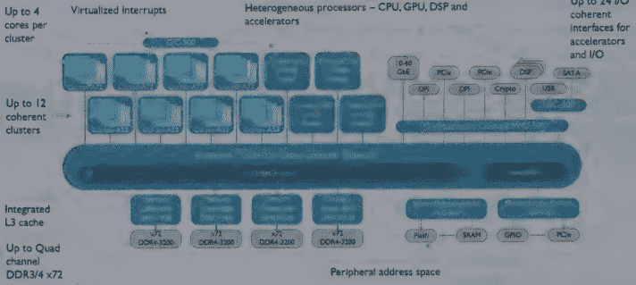

图 7.5：异构多核解决方案的可扩展架构（来自 Brian Jeff 在 2015 年 9 月的 ARM Tech Forum 演讲）。

除了这些问题外，还存在任务放置控制的问题：程序员应该能够决定任务运行在哪个计算单元上。这一特性被称为“线程绑定（thread pinning）”，并由 POSIX API 支持，我们将看到它是如何实现的。并行地，共享内存系统上的任务实际上通过内存进行通信，对主内存的进行多个并发访问是可能的。这为缓存一致性（cache coherency）和 TLB 管理带来了挑战，这些都是第 6 章“内存管理”的主题。但即使忽略缓存，有效的通信也意味着在前一节中讨论的并发性问题同样也必须在并行程序中解决。主要的挑战是确保任务不会发生不必要的顺序化，同时保证结果的正确性。

### 7.4.2 Arm 对并行性的硬件支持

当处理器完成多个处理任务时，硬件设计必须支持所有核心的并行处理。除了支持上述讨论的缓存一致性共享内存和支持并发的特性外，Arm 多核处理器支持并行编程的方法并无多少。第一种是通过 SIMD（单指令多数据流）指令，也称为向量处理。这种并行性不需要操作系统的干预，因为它是基于指令的每核并行化，由编译器处理。树莓派 3 中使用的 Arm Cortex-A53 MP 处理器支持“高级 SIMD”扩展，如 [8] 所示。

接下来，中断处理也必须是多核感知的（multi-aware）。Arm 通用中断控制器架构 [9] 提供了由控制器将硬件中断交付给特定处理元素（“目标分发模型”）的支持，以及交付给给定集合中的某一个 PE（“1 of N 模型”）的支持；并提供了控制将软件中断交付给多个 PE（“目标列表模型”）的支持。

然后，我们还有通过多处理器亲和性寄存器 `MPIDR` 对处理器亲和性的支持。这一特性允许操作系统识别调度线程的 PE。

最后，有两个用于改进多处理器处理的提示指令 [10]：`YIELD`。具有多线程能力的软件可以使用 `YIELD` 指令向 PE 指明它正在执行某项任务（例如自旋锁），这种任务可能会影响整个系统的性能。如果 PE 支持该能力，它可以利用此来挂起和恢复软件线程。发送事件（`SEV`）提示指令会向多处理器系统中的所有 PE 发送信号（而 `SEVL` 只向本地 PE 发送信号）。PE 接收到信号的 `SEV` 或 `SEVL` 事件会设置 PE 上的事件寄存器。事件寄存器可用于等待事件（`WFE`）指令。如果事件寄存器为空，PE 可以挂起执行并进入低功状态。它将保持在该状态，直到系统中的任何 PE 执行了 `SEV`。

### 7.4.3 Linux 内核对并行性的支持

如上所述，Linux 内核通过对称多处理（SMP）（自内核 2.0 版本以来）支持并行性。这意味着每个单元运行一个独立的调度器，并且有机制在不同单元的调度队列之间移动任务。

#### SMP 启动过程

因此，启动过程从第 2 章讨论的启动序列扩展而来，如图 7.6 所示。本质上，内核在主 CPU 上启动，当所有初始化完成后，主 CPU 向其他核心发送中断请求，导致运行 `secondary_start_kernel()`（定义在 `arm/kernel/smp.c` 中）。

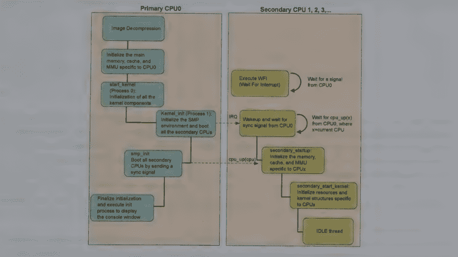

图 7.6：SMP 系统上 ARM Linux 内核的启动流程（[11]）。

#### 负载均衡

Linux 内核支持并行性的主要机制是自动负载均衡，其通过是将任务从繁忙的 CPU 卸到不繁忙或空闲的 CPU 来提高 SMP 系统的性能。Linux 调度器定期检查负载在整个系统中的分布情况并在必要时执行负载均衡 [12]。

为了支持负载均衡，调度器支持调度域（scheduling domains）和组（groups）的概念（定义在 `include/linux/sched/topology.h` 中）。调度域允许分层地将一个或多个处理器分组以进行负载均衡。每个域包含一个或多个组，使得该域由所有组中 CPU 的并集组成。在域内的组之间进行平衡。一个组的负载定义为其每个 CPU 负载之和，只有当一个组的负载不平衡时，任务才会组之间移动。这些组是自动组（autogroups），这是一个隐式机制，意味着如果内核内核中启用了（`/proc/sys/kernel/sched_autogroup_enabled`），则自动组的所有成员都被放在同一个调度器组中。该机制被称为控制组或 cgroups（`cgroups(7)`）。这些与调度任务组不是同一个，而是通过在 cgroup 级别而非单个进程级别对进程分组并控制资源利用（包括 CPU 调度）。

#### 处理器亲和性控制

在 CPU 之间移动任务的功能通过在 `include/linux/sched.h` 中定义的内核 API 暴露给用户。该 API 控制两个调用（参见 `sched_setaffinity(2)`、`sched_setaffinity()` 和 `sched_getaffinity()`）。

```c
#define GNU_SOURCE
#include <sched.h>

int sched_setaffinity(pid_t pid, size_t cuset, const cpu_set_t *mask);

int sched_getaffinity(pid_t pid, size_t cuset, const cpu_set_t *mask);
```

这些调用控制 CPU 亲和性掩码。在多核系统中，这用于控制线程的放置。通常，程序员将使用内核 API（第 7.6.1 节）来控制负载。

## 7.5 并行编程模型

数据并行和任务并行编程模型

### 7.5.1 数据并行编程

数据并行意味着每个计算单元对数据的不同部分执行相同的计算。这是一种非常常见的编程模型，例如由 SIMD、多核系统和 GPGU 支持。

#### 全数据并行：map

从性能的角度来看，纯粹的并行性意味着在数据并行程序中，工作于数据不同部分的线程不会相互干扰。这类问题被称为“易并行的（embarrassingly parallel）”。在计算术语中（特别是函数式编程）中，这种模式被称为 `map`，这个词由于 map-reduce 框架的流行而闻名。原则上，`map` 操作可以并行执行在数据集的所有元素上，因此给定并行性的情况下，复杂度为 O(1)。然而，在实践中，并行性是无限制的，并且在语言

#### 归约

在性能光谱的对面，我们有纯顺序的计算，即完全无法并行执行部分计算。在计算术语中，归约（reduction）意味着组合数据集所有元素以产生结果的计算。在函数式编程中，归约也称为 folds。在 Python 中，对应的函数是 `reduce`。

#### 结合律

在形式术语中，一个两个参数的函数具有结合律，当且仅当：

```
f(f(x,y),z)=f(x,f(y,z))
```

例如，加法和乘法具有结合律：

```
x+y+z=(x+y)+z=x+(y+z)
```

但除法和取模不是：

```
(x/y)/z!=x/(y/z)
```

#### 二叉树形并行归约

在实践中，集合上的许多常用操作都是结合律的：和、乘积、最小、最大、连接……


如果归约操作具有结合律，计算仍然可以并行化，不是使用 map 模式，而是通过二叉树形并行化（树形折）。例如，为了求和 8 个数字，我们可以并行执行 4 次配对和，然后通过两次并行操作对这 4 个结果，最后计算最终和。

```
1+2+3+4+5+6+7+8
= 3+7+11+15
= 10+26
= 36
```

另一个例子是归并排序，其中待排序的列表被分成与线程数量相等的块，每个块并行排序，然后配对合并这些块。与其

# 基于树莓派的 Linux 操作系统基础

顺序合并排序的复杂度为 `O(N log N)`，如果线程数至少是排序元素的一半，那么排序可以在 `O(log N)` 内完成。

通常情况下，对于大小为 `N` 的数据集，在无限并行的情况下，结合性操作可以减少到 `O(log N)` 步。

## 7.5.2 任务并行编程

与其通过对数据的不同部分执行相同的操作来并行化计算，不如并行地执行不同的计算。例如，我们可以将用于边缘检测的 Sobel 滤波器分为垂直和水平部分，并在图像数据上执行这些操作。在实践中，如果输入数据是流（例如视频帧），这种方法尤特别有效，因为在这种情况下，我们可以创建一个流水线，在不同的帧上并行执行不同的操作。图 7.7 显示了 Sobel 边缘检测流水线的完整任务图 [13]。在这个示例中，如果一个节点的扇出大于1，则帧的副本会被发送到每个下游节点。通常情况下，节点当然可以向它的每个下游节点发送不同的数据。

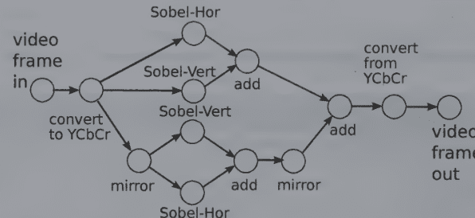

图 7.7：Sobel 边缘检测流水线的任务图。

## 7.6 实用型并行编程框架

### 7.6.1 POSIX 线程 (threads)

我们已经在第 7.3.6 节介绍了 POSIX 同步原语，但我们没有讨论创建和管理线程的 API。POSIX 线程 `threads` API 提供了管理线程和控制其属性的数据类型和 API 调用。可以在 `threads(7)` 中找到一个良好的概述。线程由不透明类型 `pthread_t` 表示，该类型表示线程 ID（即一个较小的整数）。每个线程都有若干属性，通过不透明类型 `pthread_attr_t` 管理，该类型通过一组的 API 调用进行访问。

最重要的线程管理调用是 `pthread_create()`、`pthread_join()` 和 `pthread_exit()`。`pthread_create()` 调用接受一个指向要在线程中调用的子程序的指针以及其参数的指针。在线程内部，可以调用 `pthread_exit()` 来终止调用线程。`pthread_join()` 调用等待第一个参数所指示的线程终止，如果该线程处于可连接状态（见下文）。如果该线程 `pthread_exit()` 带有非空参数退出，则该参数将作为第二个参数在 `pthread_join()` 中可用。

# 第 7 章 | 并发与并行

```c
### 列表 7.6.1 POSIX 线程 API：创建和连接
```c

#include <pthread.h>

int pthread_create(

    pthread_t *thread, const pthread_attr_t *attr,

    void (*start_routine)(void*), void *arg);

int pthread_join(pthread_t thread, void **value_ptr);

// 线程内部

    int pthread_exit(void *retval)

```
```

另一个方便的调用是 `pthread_self()`，它简单地返回调用者的线程 ID：

```
### 列表 7.6.2 POSIX 线程 API：自身
```c

thread_t pthread_self(void);

```

```

在很多情况下，没有必要指定线程属性，但我们可以使用属性来控制处理器亲和性或线程的分离状态，即线程是可连接的还是分离的。分离意味着你知道不会使用 `pthread_join()` 来等待它，因此在退出时线程的资源会被立即释放。

使用以下调用创建和销毁属性：

```
### 列表 7.6.3 POSIX 线程 API：初始化和销毁
```c

int pthread_attr_init(pthread_attr_t *attr);

int pthread_attr_destroy(pthread_attr_t *attr);

```
```

例如，为了设置或获取亲和性，我们可以使用以下调用：

```
### 列表 7.6.4 POSIX 线程 API：亲和性
```c

#define GNU_SOURCE

int pthread_attr_setaffinity_np(pthread_attr_t *attr,

    size_t cpusetize, cpu_set_t *cpuset);

int pthread_attr_getaffinity_np(pthread_attr_t *attr,

    size_t *cpusetize, cpu_set_t *cpuset);

```
```

同样，如果我们想设置或获取分离状态，可以使用：

```
### 列表 7.6.5 POSIX 线程 API：属性
```c

int pthread_attr_setdetachstate(pthread_attr_t *attr, int detachstate);

int pthread_attr_getdetachstate(const pthread_attr_t *attr, int *detachstate);

```
```

基于树莓派的 Linux 操作系统基础

还有许多用于管理线程和属性的 API 调用，更多细节请参见 man页 `threads(7)`。

下面是一个使用线程的典型用例示例，用于创建若干相同的工作线程来并行执行工作。

# 列表 7.6.6：POSIX 线程 API 示例

```c
#include <pthread.h>
/* 用作 thread_start() 的参数 */
struct thread_info {
    pthread_t thread_id; /* 由 pthread_create() 返回的 ID */
    // 你可能需要的任何其他字段
};

/* 这是工作线程 */
void thread_start(void *vinfo) {
    // 执行工作
    pthread_exit(NULL);
}

int main(int argc, char *argv[]) {
    int st;
    struct thread_info *tinfo;
    unsigned int num_threads = 5;

    // 分配内存
    tinfo = calloc(num_threads, sizeof(struct thread_info));

    // 创建线程
    for (unsigned int i = 0; i < num_threads; i++) {
        if (pthread_create(&tinfo[i].thread_id, NULL, thread_start, vinfo) != 0) {
            perror("pthread_create");
        }
    }

    // 连接线程
    for (unsigned int i = 0; i < num_threads; i++) {
        if (pthread_join(tinfo[i].thread_id, NULL) != 0) {
            perror("pthread_join");
        }
    }

    // 清理
    free(tinfo);
    return 0;
}
```

在这个程序中，我们通过在 for 循环中调用 `pthread_create()` 创建了 `num_threads`（第 28 行）。每个线程都带有一个 `struct thread_info`，它包含了该线程的参数。

# 第 7 章 | 并发与并行

每个线程接收一个函数指针 `&thread_start`。`thread_info` 结构体可以包含指向大型数组的指针，每个线程处理部分数据。由于这些线程是可连接的（这是默认值），我们通过在循环中调用 `join()` 来等待（第 37 行）。因为线程在共享内存上工作，并行执行的结果将在主程序中可用。

## 7.6.2 OpenMP

OpenMP 是共享内存并行编程的事实标准。它基于一组编译器指令（pragma），结合 API 来指定区域、数据范围、同步等。OpenMP 是一种可移植的并行编程，支持 C、C++ 和 Fortran。它历史上一直用于数据并行。从 3.0 版本开始，OpenMP 也支持任务并行 [14]。它广泛应用于任务和数据并行场景。由于 OpenMP 是一种语言增强，每个新构造都需要编译的支持。因此，它的功能不如基于库的模型。


OpenMP 的典型用法示例是 for 循环的并行化，如下代码所示：

### 列表 7.6.7 OpenMP 示例

```c
#include <omp.h>
//
#pragma omp parallel \
shared(collection, vocabulary) \
private(docsz_min, docsz_max, docsz_mean)
{
//
#pragma omp for
```

识别哪些变量被视为所有线程共享的或私有的（每个线程）。然而，该子句并不限制变量的访问，因此我们需要某种访问控制。`OpenMP` 提供了许多用于控制代码段的指令，其中最重要的与之前介绍的概念对应：

- `#pragma omp critical` 指明临界区，即它指定了一个必须由一个线程执行的代码区域。

- `#pragma omp atomic` 指明特定的内存位置必须以原子方式更新，而不是让多个线程尝试写入。本质上，该指令提供了一个单语句的临界区。

## 基于树莓派的 Linux 操作系统基础

`#pragma omp barrier` 是一个内存障；线程会在该点等待，直到所有其他线程都到达该点。然后，所有线程恢复并行执行屏障之后的代码。

有关所有基于指令的 `OpenMP` 同步构造的完整描述，请参见 `OpenMP` 规范 `[15]`。在某些情况下，基于指令的方法可能并不适用。因此，`OpenMP` 提供了一了一种类似于 `POSIX` API 的同步机制 API。下面的代码段说明了如何使用锁来保护临界区域。

```
1 omp_lock_t writelock;
2 #pragma omp parallel \
3 shared(collection, vocabulary) \
4 private(doccs min,doccs max,doccs mean)
5 {
6     omp_init_lock(&writelock);
7     #pragma omp for
8     for (unsigned int docid = 1; docid<NDOCS; docid++) {
9      //...
10     omp_lock(&writelock);
11     // shared access
12     //...
13     omp_unset_lock(&writelock);
14 }
15 omp_destroy_lock(&writelock);
16 }
```

## 7.6.3 消息传递接口 (MPI)

消息传递接口（通常以缩写 `MPI` 称为）`[16]`是一种为高性能计算设计的 API 规范。由于 `MPI` 为并行编程提供了分布式内存模型，其主要目标是集群和多处理器机器。消息传递模型模拟了不共享任何内存的任务。每个任务都有自己的内存，任务之间的任何通信都是通过交换消息来实现。

在 `MPI` 中，发送和接收消息的两个基本例是 `MPI_Send` 和 `MPI_Recv`：

```
1 int MPI_Send(void *buf, int count, MPI_Datatype datatype, int dest, int tag,
2 MPI_Comm comm)
3 int MPI_Recv(void *buf, int count, MPI_Datatype datatype, int source, int tag,
4 MPI_Comm comm, MPI_Status *status)
```

缓冲区包含要发送或接收的数据，`count` 是其按指定数据类型倍数的大小。其他参数是目标（`dest`）或源（`source`）秩（`rank`）。这些通常被称为秩，例如“秩为 X 的发送者给秩为 Y 的接收者”。最后两个字段 `tag` 和通信器（`communicator`）需要更多详细说明。

通信器本质上是一个描述一组可以相互通信的进程的对象。对于简单问题，可以使用默认通信器 `MPI_COMM_WORLD`，但自定义通信器允许对所有进程的子集进行集合通信。一个重要的一点是，进程的秩取决于所使用的通信器，即同一个进程在不同的通信器中通常会有不同的秩。

`tag` 是一个任意整数，用于匹配点对点消息（如发送和接收）：如果发送者使用特定的 `comm` 和 `tag` 向秩为 `dest` 的指定目标发送消息，那么接收者必须匹配所有这些规格才能接收该消息，即它必须指定其通信器、指定其 `tag` 以匹配其 `tag`（或使用特殊通配符 `MPI_ANY_TAG`），并将发送者的秩作为源（或使用特殊通配符 `MPI_ANY_SOURCE`）。

`MPI` 规范自 1994 年首次发布以来已经发生了巨大的演变。例如，`MPI-1` 已经提供了点对点和集合消息通信。消息可以包含原始或派生数据类型，并以解包或打包的数据内容形式存在。`MPI-2` 增加了动态进程创建、单边通信、远程内存访问和并行 I/O。

由于有很多侧重于高性能计算不同方面的 `MPI` 实现，`Open MPI` `[17]`（作为一种 `MPI-2` 实现）演变为结合这些技术和资源，并关注核心概念。该规范非常详尽，有几乎 400 个 API 调用。

`MPI` 是可移植的，通常 `MPI` 程序可以在共享内存和分布式内存系统上运行。然而，出于性能考虑以及模型的分布式特性，共享内存机器中可能存在全局数据的多个副本，导致内存占用增加。消息缓冲区在共享内存平台上还引入了 `MPI` 的开销 `[18]`。此外，由于 API 既底层又非常详尽，`MPI` 编程（尤其是为了性能）往往变得非常复杂。

## 7.6.4 OpenCL

`OpenCL` 是一种用于使用异构架构进行并行计算的开放标准 `[19]`。例如，作为 Compute Library One 的一部分实现，其 `OpenCL` 的主要目标是增加跨不同平台和设备（例如 `GPU`、多核处理器以及 `FPGA` 等其他加速器）以及跨操作系统的可移植性。`OpenCL` 提供了一个抽象平台模型和抽象设备模型 `[20]`。平台（图 7.8）由一个主机和若干计算设备组成。

图 7.8：`OpenCL` 平台模型（来自 `[20]`）。

每个计算设备（图 7.9）由若干计算单元组成，每个单元包含若干处理元素。所有计算单元都可以访问共享计算设备内存（由全局内存和常量内存组成），可以通过共享缓存访问；每个计算单元都有所有处理元素可访问的本地内存，以及每个处理元素的私有内存。

图 7.9：`OpenCL` 设备模型 [来自 `[20]`]。

`OpenCL` 的编程框架由一个用于控制设备操作以及在主机内存和设备内存之间传输数据和程序的 API，以及一种基于 `C99` 编写内核（在设备上运行的程序）的语言组成，具有以下限制：没有函数指针；没有递归；没有变长数组；没有不可还原的控制流。此外，假设计算设备的内存空间不受主机操作系统控制，它也不运行自己的系统调用。这些限制源于典型 `OpenCL` 设备（`GPU`）的特性。

图 7.10：`NDRange`、`工作组`和`工作项` [来自 `[20]`]。

尽管 `OpenCL` 支持任务并行编程，但它的主要模型是数据并行。为了在计算单元和处理元素之间划分数据空间，`OpenCL` 提供了多维范围（`NDRange`）、工作组（`work-groups`）和工作项（`work-items`）的概念，如图 7.10 中的 2D 空间所示。`NDRange` 指定了使用多少线程来处理数据。注意，这可能大于实际的硬件线程数，在这种情况下 `OpenCL` 将将在可用硬件上调度线程。`NDRange` 可以进一步拆分为全局范围和局部范围。为了说明这一点，考虑一个具有 16 个计算单元的 1D 设备，每个单元有 128 个线程，我们想要为 `NDRange` 中的每个元素精确映射一个硬件线程。在这种情况下，全局范围将是 16*128，局部范围是 128。现在假设要处理的数据是一个 64M 的数组，那么如何每个硬件线程处理 32,768 个元素。我们可以使用全局 `NDRange` 索引和全局大小来识别线程必须处理数组的哪个部分，如下代码所示：

列表 7.10：`OpenCL` 示例

```
// aSize = 数组的大小，即 64M
// kernel square(global float a, ..global float a_squared, const int aSize) (
    int gl_id = get_global_id(0); // 0 .. 16*128-1
    int gSize = get_global_size(0); // 16*128
    // 另一种
    int n_groups = get_num_groups(0); // 16
    int l_id = get_local_id(0); // 0 .. 127
    int gr_id = get_group_id(0); // 0 .. 15

    int wSize = aSize/gSize; // 32,768
    int start = gl_id*wSize;
    int stop = (gl_id+1)*wSize;
    for (int idx = start; idx<stop; idx++) {
        a_squared[idx]=a[idx]*a[idx];
    }
)
```

或者，我们可以使用局部 `NDRange` 索引、组索引和工作组数量，关系如下：


`work_group_size = global_size/number_of_work_groups`

`global_id = work_group_id*work_group_size+local_id`

# 基于树莓派的 Linux 操作系统基础

OpenCL 主机 API 非常庞大且粒度很细；我们建议读者参阅规范 [20]。我们创建了一个库 `oclWrapper`，用以简化最常见场景下的 OpenCL 主机代码。使用我们的库，典型的程序如下：

```cpp
Listing 7.6.11: OpenCL wrapper example
1 // 为默认设备和单内核创建包装器
2 OclWrapper ocl(filename,kernelname,opts);
3
4 // 创建读写缓冲区
5 cl::Buffer rbuf = ocl.makeReadBuffer(sz);
6 cl::Buffer wbuf = ocl.makeWriteBuffer(sz);
7
8 // 将输入数据传输到设备
9 ocl.writeBuffer(rbuf,sz,array);
10
11 // 设置索引空间
12 ocl.enqueueNDRange(global_range, local_range);
13
14 // 运行内核
15 ocl.runKernel(wbuf,rbuf).wait();
16
17 // 从设备读取输出数据
18 ocl.readBuffer(wbuf,sz,array);
```

首先，我们创建一个 `OclWrapper` 类的实例，这是我们对 OpenCL 主机 API 的抽象。构造函数接收内核文件名、内核名称以及一些选项（例如指定要使用哪种设备）。然后我们创建缓冲区，这些是 OpenCL 用于管理主机与设备之间数据传输的对象。接着，我们为设备传输输入数据（通过 OpenCL 所说的“读缓冲区”）。然后，我们设置 NDRange 索引空间并运行内核。最后，我们读取输出（通过 OpenCL 所说的“写缓冲区”）。

## 7.6.5 Intel 线程块 (TBB)

Intel 线程块 (TBB) 是一种开源的面向对象的 C++ 模板库，用于并行编程，最初由 Intel 开发 [21, 22]。它并不特定于 Intel CPU 架构，在 Arm 架构上也能良好运行；因为它是使用 POSIX 线程 API 实现的。Intel TBB 包含了几个用于并行算法的模板，例如 `parallel_for` 和 `parallel_reduce`。它还包含有用的数据结构，如 `concurrent_vector` 和 `concurrent_queue`。TBB 的其他重要特性还包括其可扩展内存分配器以及用于同步和原子操作的原语。

TBB 抽象了底层的线程细节。然而，任务会带来开销。旧代码的转换需要重构程序的某些部分以适应 TBB 模板。此外，执行 TBB 程序的顺序执行（即单线程）存在巨大的开销 [23]。

# 第 7 章 | 并发与并行

任务是 TBB 中执行的核心单元，由库的运行时引擎进行调度。TBB 相比 OpenMP 的优势之一是它不需要特定的编译器支持。TBB 基于高效的运行时。

## 7.6.6 MapReduce

MapReduce 最初由 Google 开发 [24]，已成为处理大型数据集的一种流行模型，特别是在大型集群（云计算）上。处理过程包括对待处理的数据集进行分区并定义 map（映射）和 reduce（提取）函数。`map` 功能负责对大量数据进行并行处理并生成键值对。`reduce` 功能的作用是合并所有具有相同中间键的中间值。

由于其简单性，MapReduce 迅速普及。分区、通信和消息传递以及跨节点调度都由运行时系统处理，因此用户只需要表达 MapReduce 语义即可。然而，它局限于数据集可以以尴尬并行（embarrassingly parallel）方式的场景。MapReduce 规范不假设共享或分布式内存模型。大多数实现都在大型集群上进行，已有针对多核进行优化的工作 [25]。MapReduce 模型流行的实现有 Spark 和 Hadoop。

## 7.7 总结

在本章中，我们引入了并发与并行的概念，解释了它们之间的区别，并探讨了为什么两者在现代计算机系统中至关重要。我们研究了 Arm 硬件架构和 Linux 内核如何处理和支持并发与并行。特别是，讨论了内核中的同步原语（原子操作、锁、信号量、屏等）以及它们如何依赖硬件特性；我们查看了内核对并行的支持，特别是在调度器和对线程放置控制方面。

我们介绍了数据并行和任务并行编程模型，并简要讨论了一些流行的实用并行编程框架。

## 7.8 练习与问题

- 1. 使用 POSIX 线程 API 用 C 实现一个哲学家问题的解决方案。
- 2. 创建一个 N 个线程的系统，通过每个线程定义的大小为 N 的静态数组进行通信，并使用条件变量和互斥锁。
- 3. 编写一个数据并行程序，使用线程和 OpenMP 计算数组中所有值的平方和。

### 7.8.1 并发：任务的同步

- 1. 什么是关键区域？任务何时进入关键区域是重要的？
- 2. 任务在执行关键区域时可以被抢占吗？
- 3. 信号量和互斥锁有什么区别？
- 4. 什么是自旋锁？它的属性、优缺点是什么？
- 5. 勾画两个任务使用信号量执行关键区域互斥所需的操作，包括信号量的初始化。
- 6. 勾画同步两个任务所需的操作，包括信号量的初始化。
- 7. 指定两个在单处理器系统上使用信号量的任务执行代码的可能顺序。
- 8. 什么 Pthreads 概念可以满足这种同步需求？用伪代码说明。
- 9. 勾画使用条件变量和互斥锁实现线程安全队列的伪代码。
- 10. 解释系统架构中的共享域（shareability domains）。

### 7.8.2 并行

- 1. 讨论 Arm 多核处理器对并行的支持。
- 2. 什么是处理器亲和性（affinity）？它如何有利于你的并行程序？
- 3. 在假设无限并行的情况下，归并排序的复杂度是多少？什么是有限并行？
- 4. 解释 OpenCL 数据并行模型。
- 5. 何时你会调用 `pthread_exit()` 而不是 `exit()`？

# 第 7 章 | 并发与并行

### 参考文献

- [1] E. Dijkstra, 'Dining philosophers', 1962.
- [2] S. W. Dijkstra, 'A semaphore', 1979.
- [3] Arm Synchronization Primitives, Arm Architecture, 2009.
- [4] L. Lindholm, 'Memory ordering', 2013.
- [5] Arm Cortex-A - Programmer's Guide for ARMv8, 2015.
- [6] L. Lindholm, 'Memory access ordering', 2013.
- [7] Arm Compiler Version 6.01, 2014.
- [8] Cortex-A53 MPCore Processor Advanced SIMD and Floating-Point Technical Reference Manual Revision: r04, 2016.
- [9] Arm Generic Interrupt Controller Specification GIC architecture version 3.0 and 4.0, 2017.
- [10] Arm® Architecture Reference Manual - ARMv7, for ARMv7-A/R profile, 2017.
- [11] Migrating software application from ARMv5 to ARMv7-A/R AN425, 2014.
- [12] G. Lim, C. Min, and Y. Eom, 'Load-balancing for improving user responsiveness on multicore embedded systems', 2012.
- [13] W. Vanderbeauche and S. W. Nabi, 'A high-level language for programming NoC-based design and Image Processing reconfiguration infrastructure', 2010.

# 树莓派上的 Linux 操作系统基础

[14] E. Ayguade, N. Copty, A. Duran, J. Hoeflinger, F. Massiaioli, Y. Lin, X. Teruel, G. Unnikrishnan, and G. Zhang, "The design of OpenMP tasks," Parallel and Distributed Systems, IEEE Transactions on, vol. 20, no. 3, p. 404–418, 2009.


[15] OpenMP 接口版本 4.5, OpenMP Architecture Review Board,11 2015. [在线]. Available: http://www.openmp.org/wp-content/uploads/openmp-4.5.pdf

[16] W. Gropp, E. Lush, and A. Skjellum, Using MPI: parallel programming with the messaging-passing interface. MIT Press, 1999, l. 1.

[17] E. Gabriel, G. E. Fagg, G. Bosilca, T. Angkun, J. J. Dongarra, M. Squyres, V. Sahay, P. Kambadur, B. Barrett, A. Lumsdaine, "Open MPI: Goals, concept, and design of a next-generation MPI implementation," in Recent Advances in Parallel Virtual Machine and Message Passing Interface. Springer, 2004, pp. 97–100.

[18] H. Jin, D. Jespersen, M. Mehrot, R. Biswas, L. Huang, and G. Chapman, "High-performance computing using MPI and OpenMP on multi-core parallel systems," Parallel Computing, vol. 37, no. 9, pp. 562–575, 2011.

[19] J. E. Stone, D. Gohara, and G. Shi, "OpenCL: A parallel programming standard for heterogeneous computing systems," Computing in science & engineering, vol. 12, no. 3, p. 66, 2010.

[20] OpenCL 规范版本: 2.2, Khronos OpenCL Working Group 2017. [在线]. Available: https://www.khronos.org/registry/OpenCL/specs/opencl-2.2.pdf

[21] J. Reinders, Intel threading building blocks: outfitting C++ for multi-core processor parallelism. O'Reilly Media, Inc., 2007.

[22] Intel, "Threading building blocks," 2015, https://www.threadingbuildingblocks.org/

[23] L. T. Chen and D. Bairagi, "Developing parallel programs–a discussion of popular models," Technical report, Oracle Corporation, Tech. Rep., 2010.

[24] J. Dean and S. Ghenewat, "Mapreduce: simplified data processing on large clusters," Communications of the ACM, vol. 51, no. 1, pp. 107–113, 2008.

[25] Y. Mao, R. Morris, and M. F. Kaashoek, "Optimizing mapreduce for multicore architectures," in Computer Science and Artificial Intelligence Laboratory, Massachusetts Institute of Technology, Tech. Rep. Citeseer.

# 第 8 章

## 输入/输出

# 树莓派上的 Linux 操作系统基础

## 8.1 概述

虽然概念上的冯·诺依曼架构仅将处理器和内存作为计算机组件，但实际上，用户连接到计算机的设备非常多。这些设备促进了输入输出（IO），使计算机系统能够与现实世界交互。本章将探索用于与此类设备通信并控制它们的 OS 结构和机制。

### 你将学习到

在学习完本章的内容后，你将能够：

- 1. 绘制出支持设备交互的硬件结构和数据路径。
- 2. 理解 Linux 支持设备的独特方法及其原理。
- 3. 实现简单的设备驱动程序和中断处理程序。
- 4. 论证某些类设备需要直接内存访问（DMA）的必要性。
- 5. 识别系统各个部分的缓冲策略。
- 6 理解最小化数据区域之间昂贵的块内存拷贝操作的需求。

## 8.2 设备大杂烩

各种不同的设备可以通过一系列连接端口和协议连接到树莓派上。

现代设备在尺寸、价格、带宽和用途上差异巨大。输入设备从外部世界接收信息，将其数字化，并允许在计算机上处理。在输入设备方面，推按钮（可能连接到树莓派的 `GPIO` 引脚）是一个简单的输入设备，具有二值值 [0, 1]。一个高分辨率 USB 摄像头是一个复杂的输入设备，具有大量的输入像素阵列待采样。输出设备从机器获取数据并以某种方式表示或对其做出响应。一个简单的输出设备是 LED，其状态为开启或关闭。板载的绿色活动 LED 可以 `shell` 命令开启或关闭，如下所示。

> 列表 8.2.1：控制板载 LED

```bash
# 这些命令必须在没有权限的情况下执行
# 开启绿色 LED
echo 1 >/sys/class/led0/brightness
# 关闭绿色 LED
echo 0 >/sys/class/led0/brightness
```

更复杂的输出设备可能是通过 USB 连接的打印机，它能够高速生成文本和图形页面。图 8.1 显示了格拉斯哥大学的一个室内环境传感器节点，该树莓派上连接了系列输入输出设备。

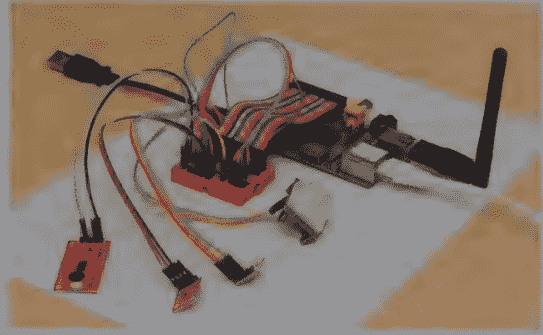

图 8.1：部署在格拉斯哥大学的树莓派传感器节点。摄影：Kristian Hentschel。

### 8.2.1 检查你的设备

可以通过 USB 连接到树莓派的一些设备。`lsusb` 命令将显示通过 USB 连接到你的 Pi 的设备信息。注意每个设备都有一个唯一的 ID。还要注意以太适配器是通过 USB 连接的，这就是树莓派网络性能缓慢的原因。

`lsblk` 命令将显示块设备（通常是连接到你的 Pi 的存储设备）的信息。图 8.2 显示了在带有 8GB SD 卡的树莓派 3 上报告的块设备。给出了每个分区的文件系统挂载点。注意 `mmblk0` 指向同一个物理设备别名。下一章将介绍文件系统，对 Linux 中的块设施进行更深入的研究。

| NAME | MA | MIN | RO | SIZE | TYPE | MOUNTPOINT |
| :--- | :--- | :--- | :--- | :--- | :--- | :--- |
| sda | 8: 0 | | 57G | part | | |
| └sda1 | 8 | 1 | | 57G | part | / |
| mmblk0 | 7 | 0 | | 7.4G | part | |
| └mmblk0p1 | 7 | 1 | | 238M | part | |
| └mmblk0p2 | 7 | 2 | | 411M | part | /boot |

图 8.2：`lsblk` 命令的典型输出。

### 8.2.2 设备类

查看 `/proc/devices` 文件以查看注册在系统上的设备。此文件显示 Linux 区分了两种类基本设备：字符设备和块设备。

字符设备以字节为粒度传输任意数量的数据。数据以字节流的形式访问，类似于文件，尽管可能无法跳转到流的新位置。

示例字符设备包括 `/dev/tty`（交互式终端）和 `/dev/watchdog`（看门计时器）。

块设备以固定大小的块（blocks）传输数据。这些数据传输可能会被操作系统缓冲。块设备支持可以挂载的文件系统，如第 9 章所述。示例块设备包括存储媒体，如内存磁盘或 SD 卡（可能被称为 `/dev/mmblk0`）。

其他设备类包括网络设备，它们对数据包操作，通常与远程节点交换。更多信息请参见第 10 章。

### 8.2.3 简单设备驱动

为了演示典型的 Linux 设备方法，本节实现了一个简单的设备驱动。驱动程序是内核模块，提供一组允许设备映射到文件抽象的函数。一旦加载模块，我们就可以为其添加设备文件并通过该文件与设备交互。


下面的 C 代码作为内核模块实现了一个简单的设备驱动。这是一个字符级驱动程序，在读取时返回一个字符字符串。为了向格拉斯·亚当斯致意，我们的驱动被称为“生命的意义”，它提供无限的 `*` 字符流，这些字符在 ASCII 或 UTF8 编码中的十进制值为 42。

关键 Linux API 调用是 `register_chrdev`，它允许我们提供一个文件操作结构来实现与设备的交互。注册函数返回一个整数，这是 Linux 内核分配给该设备的数字标识符。

我们使用此标识符通过 `mknod` 命令将驱动程序“附加”到设备文件。查看下面的 bash 代码了解如何编译和加载内核模块，将驱动附加到设备文件，然后读取某些数据。

当我们 `cat` 设备文件时，字符流出现非常缓慢。这是因为我们的代码非常低效；我们使用 `copy_to_user` 调用从内核空间到用户空间一次传输单个字符。

# 第 8 章 | 输入/输出

```c
12
13 static const char forytwo = "*";
14
15 static size_t device_read(struct file *file_ptr,
16      char      *user_buffer,
17      size_t count,
18      offset_t *position) {
19      int i = count;
20      while (i--) {
21          if (copy_to_user(user_buffer, forytwo, 1) != 0)
22              return -EFAULT;
23      return count;
24  }
25 }
26 static struct file_operations driver_fops = {
27  .owner    = THIS_MODULE,
28  .read     = device_file_read,
29};
30
31 static int device_file_major = 0;
32 static const char device_name[] = "The-Meaning-Of-Life";
33
34 static int register_device(void) {
35      int result = 0;
36      result = register_chrdev(0, device_name, &driver_fops);
37      if (result < 0) {
38          printk(KERN_WARNING "The-Meaning-Of-Life: "
39               "unable to register character device, error code %i", result);
40          return result;
41      }
42      device_file_major = result;
43      return 0;
44 }
45
46 static void unregister_device(void) {
47      if(device_file_major_number == 0)
48          unregister_chrdev(device_file_major_number, device_name);
49 }
50
51 static int simple_driver_init(void) {
52      int result = register_device();
53      return result;
54  }
55
56 static void simple_driver_exit(void) {
57      unregister_device();
58 }
59
60 module_init(simple_driver_init)
61 module_exit(simple_driver_exit);
```

### 列表 8.2.3 使用新设备

```bash
1 sudo make -C /lib/modules/$(uname -r)/build M=$PWD modules
2 sudo insmod meaningoflife.ko
3 DEVNUM=$(cat /proc/devices | grep Meaning | cut -d' ' -f1)
4 sudo mknod /dev/meaning c $DEVNUM 0
5 cat /dev/meaning
6 "*"
```

# 基于树莓派的 Linux 操作系统基础知识

## 8.3 连接设备

### 8.3.1 总线架构

由于树莓派是基于商用系统芯片方案构建（该方案也用于移动设备），因此它有一组直接 IO 连接。图 8.3 在抽象层面展示了这些 IO 连接性。

某些连接是点对点的，例如 UART（通用异步传输收发器），用于设备间的直接通信。另一些连接允许多个设备共享总线，即信号沿共享的导线传输并定向到相应的设备。I²C 总线支持超过 1000 个设备；这些设备共享数据、时钟和电源线，每个设备都有一个唯一的地址以引导数据包。

某些 IO 接口主要用于输出，例如用于向屏幕输出视频的 HDMI。其他接口用于输入，例如用于数字摄像机的 CSI（摄像头串行接口）。许多接口（如以太网连接）是双向的，它们同时支持输入和输出。

通常情况下，IO 被编码为数字信号。少数接口使用模拟信号，例如音频输出端口。GPIO 信号全都是数字的；与 Arduino 设备不同，树莓派不包含内置模数转换器。

图 8.3：树莓派的 IO 架构图。

在带宽方面，低带宽连接（如图 8.3 中 SoC 右侧的连接）运行速度在 10kbps 左右。高带宽连接（如图 8.3 中 SoC 部的连接）运行速度在 100Mbps 左右。树莓派架构的一个特点是以太网是绕过 USB 接口的，这有时会限制网络带宽。

更传统的、更大的计算机可能具有更高性能的总线，例如 PCI Express。这些总线对于显卡等强大的设备非常有用，这些设备需要极快速地处理和传输大量数据。

## 8.4 与设备通信

### 8.4.1 设备抽象

从用户空间来看，设备通常看起来像文件，进程使用 `open` 和 `read` 等标准 API 调用与设备交互。某些设备支持特殊命令，在 Linux 上使用通用的 `ioctl` 系统调用进行访问。我们使用 `ioctl` 处理那些无法轻松映射到文件 API 的设备特定命令。

一个简单的示例涉及控制台。可以使用 `ioctl` 设置已连接键盘的状态 LED。下方的 Python 脚本会使滚动锁定（Scroll Lock）闪烁两秒后关闭。请在连接了 USB 键盘的树莓派上尝试此操作。

```python
import fcntl
import os
import time

# 注意：这是一个 ioctl 使用的概念示例
# 实际 ioctl 取决于具体的设备驱动程序。
```

### 8.4.2 阻塞与非阻塞

阻塞的关键问题是线程在等待时无法进行任何工作。相比之下，非阻塞会返回尽可能多的数据。

在文件标志方面，`O_NONBLOCK` 标志表示 `open` 将是非阻塞的。如果没有可用数据，它将报告错误。

该脚本从系统获取随机性；我们用用户事件补充随机性。

### 8.4.3 管理 IO 交互

在构建“会话”或通信阶段方面，与 IO 设备交互有三种通用方法：

- 轮询（Polling）
- 中断（Interrupts）
- 直接内存访问（DMA）

特定的方法通常在设备驱动程序级实现；终端用户直接不可见。相反，这种方法是硬件设备制造商与软件驱动程序开发者共同做的设计决策。

图 8.4 提供了一个类比来比较不同的方法。客户（左侧）类似于请求数据的 CPU；送货站（右侧）类似于设备；包裹交付则是从设备到 CPU 的数据传输。

## 第 8 章 | 输入/输出


图 8.4：IO 传输机制的包裹类比。图像版权归作者所有。

## 轮询

设备轮询是客户端进程（即设备驱动程序）对硬件状态的活动查询。这用于与简单硬件进行低级交互。通常，有一个状态标志位，进程在忙等循环（busy/wait loop）中不断获取这些状态数据。下面的伪代码演示了轮询机制。

```
while (num_bytes) {
  while (device_not_ready()) {
    busy_wait();
    if (device_ready()) {
      transfer_byte_of_data();
      num_bytes--;
    }
  }
}
```

轮询的软件支持如上所述非常简单。实现相应的硬件也容易。然而，由于在忙等循环中浪费了 CPU 周期，轮询可能是无效的，特别是当 CPU 和设备之间的速度差异巨大时。

## 中断


想象你的手机现在正在响铃。你停止读这本书去接电话。你被中断了！这正是中断的工作方式。正常的进程执行被临时暂停，系统在恢复被中断的任务之前处理 IO 事件。

## 树莓派的 Linux 操作系统基础

中断处理程序类似于系统事件处理器。可以为特定的中断注册处理程序例程。当中断发生时（物理上，处理器上的某一个引脚变为高电平），系统会切换模式并跳转到中断处理程序。

第 8.5 节解释了在 Linux 中定义和安装中断处理程序的细节。这可能是是处理 IO 交互最常见的方法。

## 直接内存访问

直接内存访问（DMA）的动力是尽可能地减少处理器在 IO 数据传输中的参与。对于轮询和中断（统称为程序化 IO），处理器会显式地接收每个字的数据并将其写入本地内存缓冲区，反之，传输到设备时也是如此。

通过 DMA，处理器仅需启动大块内存的传输，然后在整个传输完成后接收一个通知（通过中断）。这将上下文切换的开销从数据传输大小的线性增长减少到了很小的常数开销。

DMA 的关键复杂性在于硬件设备必须智能得多，因为它需要直接与内存控制器接口以将数据拷贝到相关的缓冲区。DMA 最适用于高带宽设备，如 GPU 和硬盘控制器，而不适用于较小的嵌入式系统。

树莓派拥有 16 个 DMA 通道，可用于高带宽访问 IO 外设。各种开源库都利用了这一特性。

## 8.5 中断处理程序

操作系统使用处理程序模式管理三种类型的事件。这些是：

- 1. 硬件中断，由外部设备触发。
- 2. 处理器异常，在执行未定义操作（如除以零）时发生。
- 3. 软件中断，当用户代码发出 Linux 系统调用时发生，被编码为 SWI 指令。

本节侧重于硬件中断，但这三种事件的机制是相似的。

中断驱动的 IO 可能比轮询更高效，当处理器和 IO 设备之间存在较大的速度差异时。只有在产生中断时才会发生上下文切换（从用户模式切换到内核模式），这表示有 IO 活动需要处理器处理。使用中断时，忙等待极少。图 8.5 展示了一个序图，显示了 CPU 和设备之间中断驱动程序化 IO 的交互。

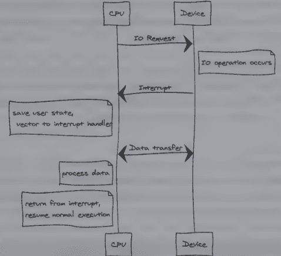

图 8.5：显示中断驱动 IO 期间 CPU 与设备之间通信的序图。

### 8.5.1 具体中断处理细节

查看树莓派上的 `/proc/interrupts` 文件。它列出了系统看到的中断统计信息。图 8.6 显示了一个运行了几个小时的树莓派 2 Model B 的示例。每个中断都有一个整数标识符（最左侧列）、CPU0 处理次数（左侧第二列）和其他 CPU（后续列）的处理次数，以及触发中断的事件名称（最右侧列）。定时器和 `dwc_otg` 设备可能具有最高的中断计数。

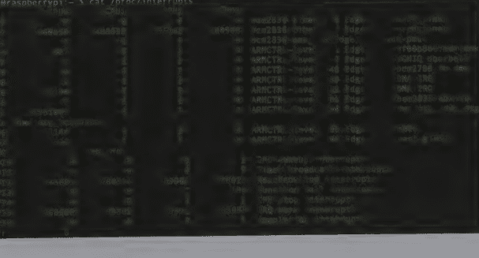

图 8.6：`/proc/interrupts` 文件示例。

中断处理程序（也称为中断服务例程）通常在系统启动期间、当模块被动态加载到内核时进行注册。通过 `include/linux/interrupt.h` 中的 `request_irq()` 函数注册中断处理程序。所需的参数包括中断号、处理函数和关联设备名称。使用 `free_irq()` 函数取消注册中断处理程序。

在多处理器系统中，应为所有处理器注册中断处理程序，并且中断应该均匀分布。如果你有一个多核树莓派派板，请检查 `/proc/interrupts` 以验证这一点。

可以想象，当系统正在处理一个中断时，另一个中断可能会到达。某些处理程序是重入的。

### 8.5.2 安装中断处理程序

下面的 C 代码实现了一个简单的中断处理程序。

```c
/* ih.c */
#include <linux/interrupt.h>
#include <linux/module.h>
#include <linux/kernel.h>

MODULE_LICENSE("GPL")
MODULE_DESCRIPTION("Example interrupt handler")
MODULE_VERSION("0.1")

static int count = 0;

static irqreturn_t custom_handler(int irq, void *dev) {
	if (count++) {
		printk(KERN_INFO "custom called %d\n", irq);
	}
	return IRQ_HANDLED;
}

static int simple_driver_init(void) {
	int result = 0;
	result = request_irq(23, custom_handler, IRQF_SHARED, "custom", NULL);
	if (result < 0) {
		printk(KERN_ERR "cannot register IRQ: %d\n", result);
		return result;
	}
	return 0;
}

static void simple_driver_exit(void) {
	free_irq(23, NULL);
}

module_init(simple_driver_init);
module_exit(simple_driver_exit);
```

## 第 8 章 | 输入/输出


图 8.4：IO 传输机制的包裹类比。图像版权归作者所有。

## 轮询

设备轮询是客户端进程（即设备驱动程序）对硬件状态的活动查询。这用于与简单硬件进行低级交互。通常，有一个状态标志位，进程在忙等循环中不断获取这些状态数据。下面的伪代码演示了轮询机制。

```
while (num_bytes) {
  while (device_not_ready()) {
    busy_wait();
    if (device_ready()) {
      transfer_byte_of_data();
      num_bytes--;
    }
  }
}
```

轮询的软件支持如上所述非常简单。实现相应的硬件也容易。然而，由于在忙等循环中浪费了 CPU 周期，轮询可能是无效的，特别是当 CPU 和设备之间的速度差异巨大时。

## 中断

想象你的手机现在正在响铃。你停止读这本书去接电话。你被中断了！这正是中断的工作方式。正常的进程执行被临时暂停，系统在恢复被中断的任务之前处理 IO 事件。

## 树莓派的 Linux 操作系统基础

中断处理程序类似于系统事件处理器。可以为特定的中断注册处理程序例程。当中断发生时（物理上，处理器上的某一个引脚变为高电平），系统会切换模式并跳转到中断处理程序。

第 8.5 节解释了在 Linux 中定义和安装中断处理程序的细节。这可能是处理 IO 交互最常见的方法。

## 直接内存访问

直接内存访问（DMA）的动力是尽可能地减少处理器在 IO 数据传输中的参与。对于轮询和中断（统称为程序化 IO），处理器会显式地接收每个字的数据并将其写入本地内存缓冲区，反之，传输到设备时也是如此。

通过 DMA，处理器仅需启动大块内存的传输，然后在整个传输完成后接收一个通知（通过中断）。这将上下文切换的开销从数据传输大小的线性增长减少到了很小的常数开销。

DMA 的关键复杂性在于硬件设备必须智能得多，因为它需要直接与内存控制器接口以将数据拷贝到相关的缓冲区。DMA 最适用于高带宽设备，如 GPU 和硬盘控制器，而不适用于较小的嵌入式系统。

树莓派拥有 16 个 DMA 通道，可用于高带宽访问 IO 外设。各种开源库都利用了这一特性。

## 8.5 中断处理程序

操作系统使用处理程序模式管理三种类型的事件。这些是：

- 1. 硬件中断，由外部设备触发。
- 2. 处理器异常，在执行未定义操作（如除以零）时发生。
- 3. 软件中断，当用户代码发出 Linux 系统调用时发生，被编码为 SWI 指令。

本节侧重于硬件中断，但这三种事件的机制是相似的。

中断驱动的 IO 可能比轮询更高效，当处理器和 IO 设备之间存在较大的速度差异时。只有在产生中断时才会发生上下文切换（从用户模式切换到内核模式），这表示有 IO 活动需要处理器处理。使用中断时，忙等待极少。图 8.5 展示了一个序图，显示了 CPU 和设备之间中断驱动程序化 IO 的交互。


图 8.5：显示中断驱动 IO 期间 CPU 与设备之间通信的序图。

### 8.5.1 具体中断处理细节

查看树莓派上的 `/proc/interrupts` 文件。它列出了系统看到的中断统计信息。图 8.6 显示了一个运行了几个小时的树莓派 2 Model B 的示例。每个中断都有一个整数标识符（最左侧列）、CPU0 处理次数（左侧第二列）和其他 CPU（后续列）的处理次数，以及触发中断的事件名称（最右侧列）。定时器和 `dwc_otg` 设备可能具有最高的中断计数。


图 8.6：`/proc/interrupts` 文件示例。

中断处理程序（也称为中断服务例程）通常在系统启动期间、当模块被动态加载到内核时进行注册。通过 `include/linux/interrupt.h` 中的 `request_irq()` 函数注册中断处理程序。所需的参数包括中断号、处理函数和关联设备名称。使用 `free_irq()` 函数取消注册中断处理程序。

在多处理器系统中，应为所有处理器注册中断处理程序，并且中断应该均匀分布。如果你有一个多核树莓派派板，请检查 `/proc/interrupts` 以验证这一点。

可以想象，当系统正在处理一个中断时，另一个中断可能会到达。某些处理程序是重入的。

### 8.5.2 安装中断处理程序

下面的 C 代码实现了一个简单的中断处理程序。

```c
/* ih.c */
#include <linux/interrupt.h>
#include <linux/module.h>
#include <linux/kernel.h>

MODULE_LICENSE("GPL")
MODULE_DESCRIPTION("Example interrupt handler")
MODULE_VERSION("0.1")

static int count = 0;

static irqreturn_t custom_handler(int irq, void *dev) {
	if (count++) {
		printk(KERN_INFO "custom called %d\n", irq);
	}
	return IRQ_HANDLED;
}

static int simple_driver_init(void) {
	int result = 0;
	result = request_irq(23, custom_handler, IRQF_SHARED, "custom", NULL);
	if (result < 0) {
		printk(KERN_ERR "cannot register IRQ: %d\n", result);
		return result;
	}
	return 0;
}

static void simple_driver_exit(void) {
	free_irq(23, NULL);
}

module_init(simple_driver_init);
module_exit(simple_driver_exit);
```

## 8.8 练习与问题

### 8.8.1 有多少中断？

编写一个简单的脚本来解析 `/proc/interrupts` 文件并监控每秒中断数。为什么每分钟检查一次文件并除以 60 来获得每秒中断率是合理的？

# 基于树莓派 Linux 的操作系统基础

## 8.8.2 复杂度比较

绘制一个包含以下行和列的表格：

| | 低 / 中 / 高 |

| :--- | :--- | :--- | :--- |

| 设备驱动程序实现复杂度。 | | | |

| 设备硬件复杂度。 | | | |

| 典型设备成本。 | | | |

| 典型设备速度。 | | | |

请为以下设备填写此表，估计每个设备的相对成本和复杂度：

- 1. USB 鼠标；
- 2. 深度感知 USB 相机；
- 3. SATA 控制器；
- 4. 滚动 LED 文本屏。

## 8.8.3 编写自己的中断处理程序

基于第 8.5.2 节中的简单示例，开发一个更有趣的中断处理程序。尝试为不同的中断事件编写处理程序。可以在网上搜索有帮助的教程。

## 8.8.4 摩斯密码 LED 设备

想象有一个在 Linux 中拥有字符设备驱动程序的 LED，这样当你向该设备写入字符时，LED 会以摩斯密码闪烁出相应的字母。

你可以像本章概述的那样使用滚动锁定键或树莓派板载状态 LED。或者，你也可以将外部 LED 连接到 GPIO 引脚上。你需要实现一个带有 `write` 函数定义的设备驱动程序，但你可以使用第 8.2.3 节中的简单设备驱动作为模板。你希望摩斯密码的闪烁速率是可读的，但如果在摩斯密码消息进行过程中允许写入操作将更好。

[1] D. Molloy, *Exploring Raspberry Pi: Interfacing to the Real World with Embedded Linux*. Wiley, 2016.

[2] J. Corbet, A. Rubini, and G. Kroah-Hartman, *Linux Device Drivers*, 3rd ed. O'Reilly, 2005.

# 第 9 章：持久性存储

## 9 概述

## 9.1 概述

当机器关机时，数据去了哪里？存储在 RAM 中的易失数据将会丢失；然而，保存在持久介质上的数据将被保留以供以后执行。文件系统是操作系统的一个关键组件，支持将数据整合为离散的、可管理的单元。Linux 的设计哲学通常总结为“一切皆文件”。各种实体，包括进程、设备和套接字，都可以被视为文件。因此，理解文件系统至关重要，因为它是整个操作系统的基础。

### 你将学到

在学习本章内容后，你将能够：

- 阐述 Linux 文件系统的有向无环图特性。
- 理解用户可见的文件系统是如何映射到操作系统层级原语的。
- 解释文件系统目录如何工作以定位内容。
- 分析文件系统决策中涉及的权衡。
- 理解文件系统一致性和完整性的需求。
- 识别在各种现代持久存储介质上进行文件系统操作的适当技术。

## 9.2 用户视角的文件系统

### 9.2.1 什么是文件？

文件是逻辑上相互关联的数据集合。文件是文件系统中最小的离散数据单元。普通文件可能包含文本数据（使用 `cat` 等工具）或二进制数据（使用 `hexdump` 等工具）。`stat` 命令将报告单个文件的详细信息。它利用该命令确定目标文件的基本信息，然后检查一组“魔数”启发式算法，根据其扩展名（点后面的字母）猜测文件的实际类型。然而，这并不总是文件系统的可靠指南，因为扩展名只是文件名的一部分，并且可以被用户修改。

在 Linux 中，一切似乎都是文件。简单来说，这意味着文件系统中的一切内容都可以通过一个名称进行寻址。例如，如果你在目录中执行 `ls -l`，你会看到目录的第一个字符是 `d`，字符设备是 `c`，符号链接是 `l`。完整的类型列表定义在 `/usr/include/linux/stat.h` 中——查看此头文件并搜索 `Test` 宏。

### 9.2.2 多个文件是如何组织的？

文件集合可以被分组到目录中，有时称为文件夹。目录包含文件，也其他目录。文件系统的抽象是一种拟态结构（skeomorphism），设计成类似于人们熟悉的档案柜，如图 9.1 所示。目录对应于卡片文件夹；整个文件系统对应于档案柜。

（图 9.1：包含纸质文件的传统档案柜。照片由作者提供。）

Linux 有一个顶层根目录，表示为 `/`，它是文件系统中所有其他元素的祖目录。我们可以假设这种基于根的层次结构导致了基于树的结构，这通常是该层次结构的图形表示，例如在图 9.2 所示的 Midnight Commander 文件管理器布局中。

（图 9.2：Midnight commander 文件管理器以树的形式显示目录层次结构。）

然而，由于硬链接的存在，文件可以属于多个目录。例如考虑以下命令序列：

列表 9.2.1：文件创建示例

```
cd /tmp
mkdir a; mkdir b
echo hello > a/thefile.txt
ln a/thefile.txt b/samplefile.txt
```

其中 `/tmp/a/thefile.txt` 和 `/tmp/b/samplefile.txt` 实际上是同一个文件。尝试编辑其中一个，然后查看另一个。你会发现更改被同步了；而且会发现使用 `ls -l` 查看时，两个文件名具有共同的元数据。文件名应该被认为更像是文件的指针，而不是文件本身。这导致了类似图的结构，见图 9.3。然而，如果你尝试删除其中一个文件，例如 `rm /tmp/a/thefile.txt`，那么链接被删除了，但文件仍然存在。它可以通过另一个链接访问。

（图 9.3：映射到底层数据的多个链接文件的图形视图。）

注意，文件可以属于多个目录（即具有多个硬链接），但目录不能额外链接。例如，尝试执行 `ln /tmp/a /tmp/b/another_a` 并注意发生的错误。

尽管 Linux 呈现了一个具有单一根目录的统一目录命名空间抽象，但实际上多个设备（磁盘和分区）可以被纳入统一命名空间。由于硬链接的编码方式（参见后文关于 inode 的节节），Linux 仅支持单个设备内的硬链接。


软链接或符号链接（缩写为 symlinks）要灵活得多。它们是指向文件系统中路径的文本指针。使用 `ln -s` 命令来设置软链接。与硬链接不同，这些链接可以是循环的，并且可以跨越多个设备。软链接的关键属性是它们仅仅是字符串，就像你在终端上执行交互式命令时使用的文件名和路径一样。软链接字符串不会经过验证，可能是指向不存在的文件或目录的“悬空”链接。

## 9.3 文件的操作

Unix 派的操作系统必须支持一组标准的文件相关操作，被称为用于文件和目录的 POSIX 库函数。

首先，为了对存储在文件中的数据进行操作，必须打开文件并获取一个文件描述符（file descriptor），文件描述符是一个整数标识符。操作系统在整个系统中维护着一个打开文件表；使用 `lsof` 命令可以列出当前打开的文件。

当我们打开一个文件时，会说明使用意图：我们是只读吗？还是写？还是在文件末尾追加？这些意图会根据相关的文件权限进行检查。如果存在权限违规，操作将失败并返回一个错误（程序员必须检查该错误）。

当进程完成对文件数据的操作后，应当关闭该文件描述符。打开的文件描述符过多可能会给操作系统带来问题。出于性能考虑，系统对打开的文件数量有严格限制，以避免内核拒绝服务类型的攻击。

`ulimit -n` 命令将显示单个进程的打开文件限制。在你的树莓派上，这个值可能被设置为 1024。

你可以通过一个简单的 Python 脚本来检查该限制是否被执行，该脚本会反复打开文件并保留文件描述符：

注意，该脚本在创建 1024 个文件之前就已经失败了；因为某些文件已经打开了（例如 Python 解释器以及标准输入、输出和错误流）。

系统中还有一个系统级的打开文件限制，可以通过 `cat /proc/sys/fs/file-max` 来检查此值。文件 `/proc/sys/fs/file-nr` 显示整个系统中当前打开文件的数量。

# 基于树莓派的 Linux 操作系统基础

一旦进程通过成功的 `open` 调用获取了文件描述符，就可以对该文件的数据内容进行操作。这可能涉及读取数据或向文件写入数据。文件中存在一个隐式的位置概念，用于跟踪与文件描述符关联的指针所在。在 `open` 时，指针隐式地位于文件开头（除非我们在启动时指定了追加模式使其从末尾开始）。当我们读写数据字节时，指针会移动。我们可以使用 `lseek` 将指针重置到文件中的任意位置。还可以通过 `truncate` 调用更改打开文件的大小。图 9.4 显示了当这些调用发生时，文件描述符的状态转换。

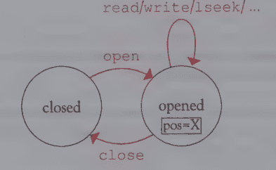

图 9.4：显示单个文件文件系统调用（红色部分）的状态机图。

文件元数据的更新（如名称、所有权和权限）是原子的。这些操作不需要打开文件；文件系统直接使用文件名即可。

## 9.4 目录的操作

尽管目录看起来像文件一样，但它们是通过一个不同的 API 调用 `opendir` 打开的，允许程序遍历目录内容。

从程序员的角度来看，目录修改操作是原子的。移动、复制或删除文件的操作是文件系统 API 调用，但这些调用需要字符串文件名路径而不是文件描述符。注意，所有标准 bash 文件操作命令 `mv` 和 `rm` 都有对应的 API 供程序化使用。

同样地，元数据更新也可以程序化地执行，并且看起来是原子的。再次强调，这些操作需要文件名路径。

## 9.5 跟踪打开的文件

对于每个进程，Linux 内核都维护着一张表来跟踪由该进程打开的文件。与打开的文件相关的整数文件描述符（也称为句柄）对应于该进程表中的索引。该表被称为 `files_struct`，定义在 `include/linux/fdtable.h` 中；它是 `task_struct` 进程控制块的一个字段。

`files_struct` 表中的每个条目都有指向一个 `struct file` 对象的指针，该对象定义在 `include/linux/fs.h` 中。这些对象存在于系统文件表中，定义在 `fs/file_table.c` 中。

# 第 9 章 | 持久存储

`struct file` 数据结构维护了打开文件中的当前文件位置、访问文件的权限以及指向 `dentry` 对象的指针。

`dentry`（directory entry，即目录项的缩写）在目录层次结构中编码文件名，并将名称与文件在设备上的位置链接起来，后者表示为 `inode`（参见第 9.10 节）。该数据结构定义在 `include/linux/dcache.h` 中。

单个进程可能有多个文件描述符，对应于 `files_struct` 表中的多个条目，指向系统全局 `struct file` 对象。这可以通过 `dup` 调用实现，该调用会创建一个文件描述符的全新副本。

多个进程可能有自己的文件描述符，位于各自的 `files_struct` 表中，指向系统全局 `struct file` 对象。这是因为当新进程被 `fork`（派生）时，每个进程状态会被克隆，因此被 `fork` 的进程将继承父进程打开的文件描述符。

在这两种情况下，每个进程都有唯一的文件偏移量（file offset）。如果多个进程打开同一个文件，或者一个进程多次打开同一个文件，就会发生这种情况。每个描述符都有独特的位置。

## 9.6 文件的并发访问

上一节引入了多个进程访问同一文件的概念。通常情况下，多个读取者是很容易的。尽管 Linux 允许并发写入，但可能会出现问题和不一致性。如果打开文件时设置了 `O_APPEND`，则操作系统保证写入将安全地追加。

可以锁定文件以防止进程的并发访问。有多种方法可以基于文件的锁定。下方的 C 代码演示了 `lockf` 的使用，它依赖于 `fcntl` 系统调用。尝试编译这段 C 代码，并发运行两个可执行文件实例以观察发生了什么——第一个进程在第二个进程允许执行任何操作之前，应该完成对日志的所有写入。

### 9.6.1：单写者访问的 log.txt 文件

```c
#include <stdio.h>
#include <stdlib.h>
#include <string.h>
#include <sys/file.h>
#include <unistd.h>

/* 取一个整数命令行
 * 参数，指定在写入操作后
 * 等的时间 */
int main(int argc, char **argv) {
    int t = atoi(argv[1]);
    int i;
    char msg[30];

    int fd = open("log.txt", O_WRONLY|O_CREAT|O_APPEND, 0666);
    if(fd == -1) {
        perror("unable to open file");
        exit(1);
    }
    /* 锁定打开的文件 */
    if (lock(fd, F_LOCK, 0) == -1) {
        perror("unable to lock file");
        exit(1);
    }

    for (i=0; i<t; i++) {
        printf(msg, "sleeping for %d seconds\n", t);
        write(fd, msg, strlen(msg));
        sleep(t);
    }

    /* 解锁文件 */
    if (lock(fd, F_ULOCK, 0) == -1) {
        perror("unable to unlock file");
        exit(1);
    }
    close(fd);
    return 0;
}
```

如果文件已被锁定，后续的 `lockf` 调用将阻塞直到该文件被解锁。

注意 Linux 上这种基于文件的锁定仅是建议性的（advisory）。进程可以完全忽略文件锁，并继续读取或写入已打开的文件，而不遵守锁。

### 9.7 文件元数据

元数据描述了每个文件的属性。Linux 文件系统直接支持一组标准属性，因此这些条目会被记录在所有文件中。

这包括了以用户为中心的元数据，例如文件的文本名称和类型。习惯上，类型被编码为名称的一部分，即名称中最后一个字符之后的后缀。特定的文件系统格式可能会对名称进行限制，例如长度或允许的字符。

文件名是用户用于指定感兴趣文件的易读标签。然而，文件系统会为每个文件维护一个唯一的标识符，该标识符在内部使用。正如第 9.2.2 节所解释，多个名称可能映射到同一个文件（即 Linux 中相同的数值无向环图目录结构）。

文件大小以字节为单位，即其长度。文件占用设备上的若干个数据块（blocks），如果文件大小不是块大小的精确倍数，这些块可能不是满的。与空字符结尾的 C 风格字符串不同，这里没有显式的文件结束符（EOF）标记。相反，我们必须使用文件的长度来判断何时到达数据的末尾。


Linux 支持文件访问元数据。每个文件都有一个所有者（通常是文件的创建者，尽管 `chown` 命令可以修改所有者）。每个文件有一个组（所有者可能属于该组；`chgrp` 命令可以修改组）。所有者和组被编码为整数，可以在 `/etc/passwd` 和 `/etc/group` 文件的相关表中查询。

对于权限，有九位元数据，三位分别对应所有者、组和所有人。每三位一组（从最高位到最低位）分别编码读、写和执行权限。图 9.6 阐释了这些位。这些元数据可以使用 `chown` 命令进行设置，后跟三位元组的八进制数字。`SELinux` 系统支持更高级的功能和细粒度的权限。


时间戳字段记录了每个文件的创建时间、最近编辑时间和最近访问时间。这些时间被记录为自 1970 年（Unix 纪元开始）以来的秒。由于它们是带符号的 32 位整数，能够编码的最大时间戳是 2038 年 1 月 19 日的某个时刻。

# 基于树莓派的操作系统基础

最近的 Linux 补丁将时间戳字段扩展到了 64 位，支持纳秒级粒度和更远的最大日期。

最重要的管理元数据是文件数据在磁盘上的实际位置。具体的细节取决于文件系统实现的特定性质，我们将在后面的章节中进行介绍。

有时，图形化文件管理器（如用于 Gnome 的 `Nautilus` 或用于 KDE 的 `Dolphin`）会支持额外的元数据。这些可能包括每个文件的特定应用程序关联或图形图标。

对于特定类型的文件，特定特定的元数据可能包含在文件内部，例如 `MP3` 音频文件包含艺术家和标题的 `id3` 标签，`PDF` 文件包含页数。虽然 Linux 系统原生并不支持这种功能，但必须由自定义文件管理器进行解析和渲染，例如，见图 9.7。

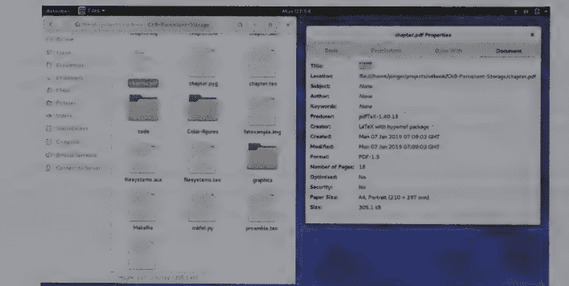

图 9.7：`Nautilus` 文件管理器显示 `PDF` 文件的自定义元数据。

## 9.8 块结构存储

文件系统是构建在次级存储设备（如硬盘、树莓派或 SD 卡）之上的抽象。

典型的文件系统依赖于持久的、块结构的、随机访问存储。

- 持久性（Persistent）意味着数据在机器关电时会被保留。
- 块结构（Block-structured）意味着存储被划分为固定大小的单位，称为块。每个块都可以通过唯一的逻辑块地址（LBA）访问。
- 随机访问（Random access）意味着可以按任何顺序访问块，而不是受限于固定顺序的访问（例如，磁带存储就是这种情况）。

虽然机械硬盘具有物理几何结构，且数据存储在磁道（磁盘上的圆形带）和扇区（磁道的子划分）的位置上，但大多数现代存储介质（如固态存储）并不复制这些布局。在本文中，我们将以逻辑块术语进行讨论；这是一个所有现代存储介质都可以支持的抽象。

因此，一个存储设备由大小相同的块组成，每个块都有一个逻辑地址。这与 RAM 中的页（见第 6 章）相似，只不过块是持久的。通常，块的大小与内存页的大小相同，以便于磁盘访问的高效内存缓存。

我们可以检查安装在树莓派 SD 卡上的 Raspberry Pi OS 镜像的块大小和块数量。在终端中，输入

```
Listing 9-8 简单的 stat 命令
1 stat -fc $ /
```

显示你的文件系统的大小（字节为单位）。这应该是 4096，即 4KB。要查看文件系统中空块和已用块的详情，请输入

```
Listing 9-8.2 另一个简单的 stat 命令
1 stat -f /
```

你将得到类似图 9.8 所示的数据转储。这显示了元数据和实际数据。

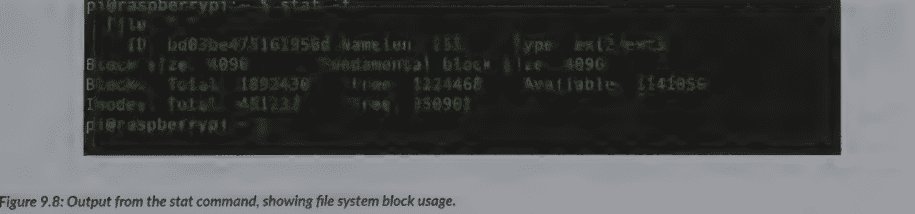

块是分配给文件的最小存储单位。取决于块的大小和平均文件大小，这可能会导致内部碎片，即分配给文件但未使用的空间。

```
Listing 9-8.3 测量文件大小的不同方法
1 echo "hello!" > hi.txt
2 ls -l hi.txt # 显示实际大小
3 du -h hi.txt # 显示块使用
```

## 9.9 构建逻辑文件系统

给定这种基于块的存储，如何在其上构建逻辑文件系统？某些块将用于索引，允许我们将块地址与高级文件关联。其他块将用于存储用户数据。如上所述，文件占据的最小空间是一个块。

系统架构师会对如何安排大文件的块组做出决策。存在一些权衡，例如避免碎片和最小化访问延迟。

- 连续块（Contiguous blocks）：大文件占据一个连续的块序列。这在空间充足时效率很高，但在文件被删除或需要增大大同时，会导致外部碎片问题（即无法利用的空洞）。
- 索引块（Indexed blocks）：大文件占据分布在整个磁盘的一组块，并配有索引来维护块顺序。这降低了访问局部性，并需要大量的索引开销（类似于虚拟内存的页表）。然而，没有外部碎片问题。
- 链块（Linked blocks）：大文件是块链链，可能分布在整个磁盘上。这没有碎片问题，也不需要复杂的索引。然而，除了从头开始的线性访问外，现在以任何其他方式访问都是的。

每个具体的文件系统都包含了此类设计决策。首先，我们考虑一种允许 Linux 以可扩展的方式处理多种文件系统的抽象。

### 9.9.1 虚拟文件系统

有很多具体的文件系统，如 `ext4` 和 `FAT`，它们将在本章稍后部分进行介绍。Linux 虚拟文件系统（VFS）是一个内核抽象层。其核心思想是 VFS 定义了一个所有具体文件系统必须实现的通用文件系统接口。

从软件设计模式的术语来说，所有与相关的系统调用都直接指向 VFS，然后由 VFS 将每个调用重定向到相应的底层具体文件系统。

Linux 提供了统一文件系统的抽象，具有一个单一的根目录，通过该目录可以访问所有其他文件和目录。事实上，VFS 集成了多个不同的文件系统，这些文件系统在不同的挂载点合并到统一的目录层次结构中。可以通过检查 `/etc/mtab` 来查看具体的文件系统类型以及它们在统一层次结构中的位置。

伪文件 `/proc/filesystems` 维护了 Linux 内核支持的文件系统列表。注意，`nodev` 标志表示该文件系统未关联物理设备。相反，此类文件系统上的伪文件是由内核维护的内存数据结构合成的。

具体文件系统通过 `register_filesystem` 调用在 VFS 中注册。提供的参数是一个 `file_system_type`，它提供了一个名称、一个用于获取文件系统超级块（superblock）的函数指针以及一个下一个指针。所有 `file_system_type` 实例都组织成链表。全局变量 `fs/filesystems.c` 指向该链表的头节点。

在此语境下，超级块是一个包含关键文件元数据的内存数据结构。每个挂载的设备对应一个超级块实例。这些数据部分来自磁盘（磁盘上可能存在一个也称为超级块的文件系统块）。其他信息（名为 `struct super_operations` 的函数指针向量）直接从具体文件系统的代码库中填充。见下方列表，了解由文件系统特定实现填充的函数指针的详情。

### 9.9.1 文件系统操作向量，来自 include/linux/fs.


```c
struct super_operations {
    struct inode *(*alloc_inode)(struct super_block *sb);
    void (*destroy_inode)(struct inode *, int flags);
    int (*write_inode)(struct inode *, struct writeback_control *wbc);
    int (*drop_inode)(struct inode *);
    void (*evict_inode)(struct inode *);
    void (*super)(struct super_block *);
    int (*sync_fs)(struct super_block *, int wait);
    int (*free_super)(struct super_block *);
    int (*freeze_super)(struct super_block *);
    int (*thaw_super)(struct super_block *);
    int (*fill_super)(struct super_block *);
    int (*stats)(struct dentry *, struct kstatfs *);
    int (*remount_fs)(struct super_block *, int *, char *);
    void (*umount_begin)(struct super_block *);
    int (*set_inodeb)(struct seq_file *, struct dentry *);
    int (*show_devname)(struct seq_file *, struct dentry *);
    int (*show_path)(struct seq_file *, struct dentry *);
    int (*show_stats)(struct seq_file *, struct dentry *);
    // ...
};
```

# 树莓派上的 Linux 操作系统基础

当设备被挂载时，文件系统将根据指定的位置合并到 VFS 文件层次结构中。该位置是在超级块中指定的，而超级块是通过在命名文件的 `file_system_type` 中指定的适当函数指针读取的。`mount` 系统调用执行了此项任务，它指定了要挂载的设备、相应的具体文件类型以及应该挂载文件系统的目录路径。使用 `strace` 来跟踪系统调用的执行情况。当你向树莓派插入 USB 盘并手动挂载时，可能需要临时禁用自动挂载；同样使用 `dmesg` 来找到与你的 USB 盘对应的设备路径。

- 列表 9.9.2 挂载 USB 盘
  - `sudo strace mount /dev/sda1 /mnt 2>&1 | grep mount`

超级块处理整个文件系统的 VFS 交互。单个文件使用名为 `inodes` 和 `dentries` 的结构进行处理，这些结构将在后续章节中介绍。

## 9.10 Inodes

`inode`（索引节点，即 index node）是支撑 Linux 文件系统的核心数据结构。文件系统中的每个实体（例如文件或目录）都有一个 `inode`。你可以通过 `linux/fs.h` 中的 VFS 源码来研究 `struct inode` 的定义。图 9.9 显示了 `inode` 数据结构的简化类视图。

图 9.9：`inode` 数据结构的类图表示。

每个 `inode` 存储了与文件相关的所有元数据，包括文件数据的身份标识符位置信息。典型的元数据项（例如所有者、文件大小和权限）直接存储在结构体中。扩展元数据（例如用于增强安全性的访问控制列表）存储在外部，并在 `inode` 结构中使用指针引用。

# 第 9 章 | 持久化存储

如前所述，`inode` 是 VFS 级别的内存数据结构。其他 Unix 操作系统将这些结构称为 `vnodes`。具体文件系统拥有 `inode` 的特化版本。例如，比较 `include/linux/fs.h` 中的 VFS `struct inode` 定义与 `fs/ext4/ext4.h` 中的 ext4 变体 `struct ext4_inode` `struct ext4_inode_info`。

`inode` 除了是内存数据结构外，还会序列化到磁盘。文件系统上的 `inode` 有固定数量。条目数量有一个限制，因为每个条目都需要一个 `inode`。

### 9.10.1 多重链接

文件名仅仅是指向 `inode` 的指针（硬链接）。多个文件名映射到同一个 `inode`。引用计数随 `ln` 命令增加，随 `rm` 命令减少。当引用计数达到零时，该 `inode` 就会变成孤立节点并可能被删除。

### 9.10.2 目录

从抽象上讲，目录是一个键值存储或字典。它将文件系统实体名称（字符串）关联到 `inode` 编号（整数）。系统对实体名称的长度有限制，最多 255。使用 `getconf NAME_MAX /` 来确认，如果你尝试创建一个超过此限制的文件名，将因“文件过长”错误而失败。

VFS 不对单个目录的条目数量设置限制。目录条目的唯一限制是每个条目都需要一个 `inode`，而文件系统上的 `inode` 数量是固定的。(`df -i` 检查空闲 `inode` 的数量。)

每个目录有两个特殊的条目，即 `.`（读作 dot）和 `..`（读作 dot dot）。

- `.` 指向目录本身，即它是引用图中的自环。`cd` 命令实际上是一个空操作。
- `..` 指向父目录。`cd ..` 命令允许我们遍历目录层次结构到达根目录 `/`。注意根目录的父目录是根目录本身，即根的父节点也是引用图中的自环。

每个进程都有一个当前工作目录（`cwd`）。例如，你可以通过 `pwd` 命令发现 bash 进程的工作目录，或者通过执行命令 `readlink /proc/n/cwd` 来获取 PID 为 `n` 的任意进程的工作目录。相对路径名（即不以根目录 `/` 开头的路径）相对于进程当前的工作目录进行解释。

绝对路径名（即以根目录 `/` 开头的路径）是基于从 VFS 系统根目录开始的文件路径。请注意，路径可能会跨越具体的文件系统，这些文件系统相对于 VFS 根目录在不同的偏移处挂载。

目录提供的关键功能之一是将文件名字符串映射到 `inode` 节点。图 9.10 所示的算法是该转换过程的高级概述。你可以在命令行上通过 `namei` 工具并带有文件名参数来调用此行为。

文件名字符串到 `inode` 节点号的转换是一项耗费资源的操作。一种称为目录项（`dentry`）的数据结构存储了这种映射。`struct dentry` 的定义在 `include/linux/dcache.h` 中。VFS 拥有一个目录缓存（`dcache`），用于处理频繁使用的转换。该缓存在内核文档中有详细描述，请参阅 `Documentation/filesystems/vfs.txt`，以及其他 VFS 结构和机制。

## 9.11 ext4

扩展文件系统是 Linux 的原生文件系统格式。目前的实现是 `ext4`，尽管它与早期的 `ext2` 和 `ext3` 版本有许多共同点。

查看文件 `/etc/fstab`，它显示了作为操作系统启动序列一部分挂载（即从根目录可访问）的文件系统。在你的树莓派系统中，默认文件系统格式化为 `ext4`，并直接挂载在根目录。

### 9.11.1 磁盘上的布局

文件系统在磁盘（或磁盘分区）上的布局被称为其格式。对于任何格式，第一个块总是启动块（boot block）。它可能包含可执行代码，在这种情况下，磁盘被用作启动设备。通常，这种启动代码序列非常短，并跳转到另一个位置以执行更大、更复杂的启动行为。

启动块块之后，`ext4` 有若干块组（block groups）。每个块组的大小和结构都是相同的；图 9.11 描述了单个块组。

| 超块 | 块组描述符 | 数据块位图 | inode 位图 | inode 节点表 | 数据块 |
|---|---|---|---|---|---|

| | | 11010 | 110110 | was_inode_table was_inode_table | X Y Z |

图 9.11：显示磁盘上 `ext4` 块组结构的示意图。

块组的前两个元素位于距离块组起始位置的固定偏移处。超块记录了高层文件系统元数据，如文件系统的总大小、每个块的大小、每个块组的块数、指向设备的设备指针，以及最近挂载和写入操作的时间戳。`struct ext4_super_block` 定义在 `fs/ext4/ext4.h` 中。注意，超块在磁盘上仅占用一个块。此磁盘上的超块自第 9.9.1 节概述的 VFS 内存超块结构，尽管它们之间共享部分数据。

理想情况下，超块在每个块组的开头都会复制一份。这在磁盘损坏时提供了冗余。如果有许多块组，则超块会在每隔 $n$ 个块组的开头稀疏地复制。


块组描述符表是全局的；即它涵盖了所有块。表中的每个块组都有一个条目，它是 `ext4.h` 头文件中定义的 `struct ext4_group_desc` 结构。图 9.12 以 UML 类图展示了这一数据结构。同样，块组描述符表在多个块组之间复制以提供冗余，类似于超块。


图 9.12：块组描述符的类图表示。

所有其他文件系统结构都指向块组描述符。块和 inode 位图分别使用一个位表示每个数据块和 inode。如果相应的实体被使用，则位设置为 1，如果空闲则设置为 0。这些位图可以缓存到内存中以提高访问速度。inode 节点表每个文件有一个条目，即 `struct ext4_inode` 结构。该表是静态分配的，如第 9.10 节所述，因此文件数量有一个固定限制。特殊的 inode 节点表条目位于已知槽位；通常，inode 2 是文件系统的根目录。

数据块组是最大的；这些块实际上存储文件数据内容。通常，为了局部性，属于一个文件的所有块将位于单个块组中。

你可以使用类似下面的命令检查树莓派上 ext4 文件系统的所有细节：

```
sudo dumpe2fs -h /dev/mmcblk0p2 # 用于 SD 卡上的默认 Raspbian 镜像
```

### 9.11.2 数据块的索引

如所述，inode 节点有两种不同的数据结构。通用的 VFS `struct inode` 可以通过宏调用 `EXT4_I(inode)` 转换为特定的 `ext4_inode`。

关键的额外信息是用于用于组成文件内容的数据块的位置指针。实际上，ext4 inode 支持三种不同的数据位置编码技术，这些技术在其 60 字节的空间内联合用于存储物理位置信息。查看 `fs/ext4/ext4.h` 并找到 `struct ext4_inode` 中相关的 `i_block[EXT4_N_BLOCKS]` 字段。

第一方法是直接内联数据存储。如果文件内容小于 60 字节，它们可以直接存储在 inode 中（你可能需要启用此功能）。

第二种方法是传统的块映射（block map）。这与 ext2 和 ext3 相同。块映射系统为每个块都需要一个元数据条目。第一种方法是直接内联数据存储。如果文件内容小于 60 字节，它们可以直接存储在 inode 中（你可能需要启用此功能）。

第二种方法是传统的块映射。这与 ext2 和 ext3 相同。块映射系统为每个块都需要一个元数据条目。第一种方法是直接内联数据存储。如果文件内容小于 60 字节，它们可以直接存储在 inode 中（你可能需要启用此功能）。

第三种方法是 ext4 中引入的范围（extents）。范围是为文件预留的连续存储区域（或包含多个范围的文件）。范围由起始块号、以块为单位的长度以及对应起始位置的逻辑块地址表征。详见 `fs/ext4/ext4_extents.h` 中的 `struct ext4_extent`。

基于范围的文件系统的主要优势是减少元数据。块映射系统为每个块都需要一个元数据条目，而每个范围只需为连续块序列返回单个块地址。尽可能使文件数据连续是提高访问时间的做法。

`ext4_inode` 的 60 字节可用于存储一个 12 字节的范围头部，随后是最多四个 12 字节的范围结构体数组。

如果文件中范围超过四个，范围数据可以排列为多级 N 叉树，最多五层。范围数据从 inode 溢出到数据块。存储范围数据的数据块以 `ext4_extent_header` 开头，该头部说明有多少范围条目以及树深度。条目以数组格式排列。如果树深度为 0，条目是叶节点，即直接指向磁盘数据块范围的条目。如果树深度大于 0，则条目是索引节点，即 `ext4_extent_idx` 条目，指向范围数据的块。这些结构都定义在 `fs/ext4/ext4_extents.h` 中。图 9.14 给出了一个示例，具有双层范围树。这与之前方法中使用的间接寻址类似。

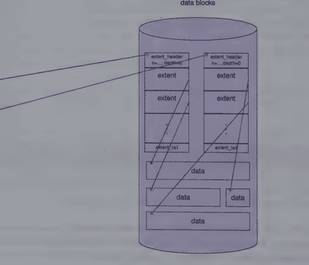

图 9.14：ext4 数据块位置范围方案示意图。

### 9.11.3 日志（Journaling）

ext4 文件系统支持日志，这是一种专门的日志文件，用于记录文件系统即将发生的每项更改。当可能调度复杂的文件系统操作时，这种只追加的日志文件至关重要，因为由于断电，这些操作如果启动但未完成，将导致文件系统损坏。在系统重启时，可以查询日志以通过重放或撤销部分操作来将文件系统恢复到一致状态。

事务记录被快速且原子地添加到日志中。日志文件实际上上是一个循环缓冲区，因此当它满时，旧的条目会被覆盖。检查文件 `/proc/fs/jbd2/info` 可以查看日志中事务条目数量的统计信息。

### 9.11.4 校验和（Checksumming）

校验和是一种位级错误检测机制。对于可能出现数据损坏的持久性存储，这非常有用。

最流行的算法是 CRC32c，它为任意大小的输入数组生成一个 32 位的校验和。CRC32c 算法可以在软件中高效实现，尽管某些 Arm CPU 内置了直接执行该计算的指令。

ext4 文件系统支持对元数据的 CRC32 校验和。尝试以下 `grep` 命令来探索带有校验和的字段：

```
9.11.2: 查找校验和字段
1 cd linux/fs/ext4/
2 grep crc *
```

某些校验和嵌入在顶层文件系统元数据中。其中包括超级块（superblock）和块组描述符（block group descriptor）中的校验和字段，尽管在这些结构中每个 32 位的值可能被拆分为两个 16 位的字段。当校验和是此类元数据的冗余副本时，它是理想的。如果检测到超级块损坏，可以通过克隆保留副本来轻松恢复元数据。

每个跟踪空闲 inode 或数据块的块组位图（bitmap）也有一个校验和以确保其完整性。此外，单个文件元数据也有校验和。每个 inode 都有自己的校验和字段。某些位置元数据（范围树 extent）和扩展属性也有校验和。

像 btrfs 和 zfs 这样的系统存储所有块（包括数据块）的校验和。相比之下，ext4 只支持对文件系统元数据的校验和。

### 9.11.5 加密（Encryption）

加密涉及通过密钥（通常是文本字符串）来保护数据。没有这个密钥，数据看起来就像乱码。加密用于便携设备或不可信个人可能访问文件系统的场景。鉴于近期数据保护法律的发展，安全性对于企业组织而言尤为重要。

树莓派上的 Linux 操作系统基础（基于树莓派）

ext4 文件系统支持对空目录进行加密，之后可以在其中添加文件。文件名和内容都是被加密的。`e4crypt` 工具是处理 ext4 加密目录的合适工具。

请注意，Raspian 内核默认不支持 ext4 加密。加密需要以下配置：

- 1. 必须设置内核编译选项 `EXT4_ENCRYPTION`。
- 2. 目标 ext4 分区必须启用加密。

还有替代的单文件加密工具。例如，zip 归档可以使用密码加密。通常情况下，`gpg` 命令行工具允许对单文件负载进行加密。

低级加密技术包括 `dm-crypt`，它在块设备级别运行。

## 9.12 FAT

文件分配表（FAT）文件系统以其特征性的索引数据结构命名。FAT 是一种基于 DOS 的文件系统，用于软盘。虽然它不是 Linux 的“原生”系统，但由于 FAT 在 USB 闪存和 SD 卡等可移动存储中无处不在，它受到了良好支持。由于其简单且历史悠久，FAT 与主流及商业操作系统以及数字相机等硬件设备具有极高的兼容性。对于 SD 卡，默认格式是 FAT。请观察你的树莓派 SD 卡有一个用于启动的 FAT 分区。

| 列表 9.12.1: 树莓派 SD 卡有一个 FAT 分区 |
| :--- |
| 1 | `cat /etc/mtab` | `grep fat` |

FAT 格式背后的思想是文件由顺序数据块的链表组成。文件的目录只需要一个指向第一个数据块的指针，以及一些关联的元数据。FAT 系统没有将数据块指针内联存储（因为那样可能很容易被损坏），而是在磁盘文件系统的起始处有一个单独的块表。这就是文件分配表（FAT）。通常为了容错，可以为 FAT 复制一份。

假设文件系统上有固定数量的数据块 `$N$`，则文件分配表应该有 `$N$` 个条目，以便表条目与数据块之间的一一对应。

- 如果数据块被用作文件的一部分，则相应的表项包含指向下一个块的指针。
- 如果这是文件的最后一个块，则表条目包含一个文件结束标记。

## 第 9 章 | 持久性存储

FAT 条目还有其他特殊用途的值，如图 9.15 所示。所有条目具有相同的固定长度，由 FAT 变体指定。FAT12 拥有 12 位条目，FAT16 是 16 位，FAT32 是 32 位。

| 条目 | 含义 | FAT16 值 |
| :--- | :--- | :--- |
| 0 | 空闲块 | 0x0000 |
| 1 → (MAXWORD - 16) | 临时非空闲 | 0x0001 |
| MAXWORD - 15 → MAXWORD - 9 | 下一块指针 | |


| MAXWORD - 8 | 预留值 | 0xFF6 |

| MAXWORD - 7 → MAXWORD | 坏块 | 0xFF7 |

| MAXWORD | 结束标记 | 0xFFFF |

**图 9.15 | FAT 条目**

在 FAT 变体中，所有条目具有相同的固定长度。`FAT12` 拥有 12 位条目，`FAT16` 是 16 位，`FAT32` 是 32 位。

由于 FAT 的链表特性，它们可以顺序访问数据块。由于其简单且历史悠久，FAT 与主流及商业操作系统以及数字相机等硬件设备具有极高的兼容性。对于 SD 卡，默认格式是 FAT。请观察你的树莓派 SD 卡有一个用于启动的 FAT 分区。

基于树莓派的 Linux 操作系统基础

### 9.12.2 构建一个简单的 FAT 文件系统

理解 FAT 文件系统工作原理的最佳方法是自己构建一个。在这个实践中，我们将通过编程构建磁盘镜像。

```python
# 创建二进制文件
f = open('fatexample.img', 'wb')

###### 引导扇区, 512B
### 引导扇区的 3 字节是“魔值”
f.write(bytearray([0x55, 0xAA]))

### 接下来的 8 字节是厂商名称，使用 ASCII
f.write(b'TEXTBOOK'.encode('ascii'))

### 接下来的 2 字节是每块字节数 - 512 是标准
### 这是小端格式 - 所以 0x0200 是 512
f.write(bytearray([0x00, 0x02]))

### 下一个 1 字节是每个单元块数 - 说是 1
### 在 FAT 术中称为 Cluster
f.write(bytearray([0x01]))

### 接下来的 2 字节是预留块数
### 仅用于引导扇区
f.write(bytearray([0x01, 0x00]))

### 下一个 1 字节是文件表数量 - 可以有多个
### 为了冗余 - 我们先保留 1 个
f.write(bytearray([0x01]))

### 接下来的 2 字节是根目录条目数 - 包括空白
# 我们假设有 16 个文件，因此根目录包含在块内
f.write(bytearray([0x10, 0x00]))

# 接下来的 2 字节是整个磁盘的块数 - 我们想要一个 4 MB 的磁盘
# 所以需要 8192 个 0.5 kb 的块 == 2^13 = 0x0200
f.write(bytearray([0x00, 0x02]))

# 单字节媒体描述符 - 魔值 0xf8
f.write(bytearray([0xf8]))

# 接下来的 2 字节是 FAT 的块数
# FAT16 每个块需要 2 字节，所以磁盘上有 8192 个块
# 每个块 512 字节 - 意味着一个块内可以存储 256 个块的 FAT 元数据
# 所以需要 8192/256 个块 == 32
f.write(bytearray([0x20, 0x00]))

f.close()
```

# 第 9 章 | 持久化存储

# 列表 9.12.3：创建 FAT 镜像的延续

```bash
# next 8 bytes are legacy values
```

241

基于树莓派的 Linux 操作系统基础

# 列表 9.12.4 与 FAT 磁盘镜像交互

```bash
# Step 1: 载文件系统
sudo mount -t vfat -o loop fatexample.img /mnt
# Step 2: 添加一个多块文件
sudo dd if=/usr/share/dict/words of=/mnt/words.txt count=5 bs=512
# Step 3: 卸载文件系统
unmount /mnt
# Step 4: 使用 hexdump 查找新文件的簇地址
hexdump -x fatexample.img | less
```

检查 FAT 数据，它从文件地址 `0x200` 处开始；在初始魔数值之后，后续条目是连续的簇编号，并带有一个簇结束标记。

由于我们创建的 FAT 文件系统最初是空的，因此新分配的文件存储在磁盘上的连续簇中。随着时间的推移，由于 FAT 文件系统的使用频率增加并产生碎片，文件可能不再连续存储。

| 0001f0 | 0000 | 0000 | 0000 | 0000 | 0000 | 0000 | aa55 |

| 000200 | fff8 | ffff | 0000 | 0004 | 0005 | 0006 | 0007 | ffff |

| 000210 | 0000 | 0000 | 0000 | 0000 | 0000 | 0000 | 0000 | 0000 |

当需要空闲数据块时，系统会扫描 FAT 以寻找标记为空闲的块索引号，并将它们用于空文件数据。

如果上面的 Python 代码太长而难以尝试，你也可以使用 `mkfsfat` 工具创建一个空白 FAT16 磁盘镜像，如下所示。

# 列表 9.12.5 创建 FAT 镜像

```bash
sudo apt-get install dosools # 用于处理 FAT 镜像
sudo dd if=/dev/zero of=/fat.img bs=512 count=8192 # 空镜像
mkfs.fat -f 1 -F 16 -l 41424344 -M 0xF8B -n TEST_DISK \
-r 32 -R 1 -s 1 -S 512 /fat.img
```

# 9.13 延迟降低技术

为了最小化访问持久化存储的开销（其延迟可能较高），Linux 维护了一个最近读取或写入次存储的块的内存缓存。这被称为缓冲区缓存（`buffer cache`）。它的大小会占用空闲 RAM，并随着其他进程对内存的需求而增长或缩小。缓冲区缓存的内容会定期刷新到磁盘，以确保一致性。

另一种减少延迟的技术是使用 RAM 磁盘（内存盘）。这涉及将部分内存显式作为文件系统的一部分进行处理。对于临时文件（例如驻留在 `/tmp` 中的文件）或频繁访问的日志文件是有意义的。内核对这种内存到文件系统的映射有专门支持，称为 `tmpfs`。按照如下方式创建一个 50MB 大小的 RAM 磁盘：

### 9.13.1 创建 RAM 磁盘

```bash
sudo mkdir /mnt/ramdisk
sudo mount -t tmpfs size=50M newdisk /mnt/ramdisk
```

注意，`/mnt/ramdisk` 目录中的文件不是持久的。当系统掉电时，该目录会丢失。RAM磁盘对于树莓派等嵌入式设备特别有用，因为频繁的高频磁盘写入会导致 SD 卡损坏。

# 9.14 修复损坏的文件系统

持久化存储可能不可靠。应该检测并避免坏块。文件系统具有记录坏块的机制，以确保数据不会分配到这些块。例如，FAT 有坏块标记。

有时，如果系统意外断电或在未卸载的情况下移除设备，文件系统可能会处于不一致状态。某些数据可能已缓存在 RAM 中，但在关机或移除之前未写回。

`fsck` 等修复工具可以检查并修复文件系统故障。它们检查目录完整性并根据情况进行修改（例如修改 inode 引用计数）。文件系统日志（Journals）可用于重放文件系统中未完成的操作。

这些通用工具可以处理许多常见的文件系统问题。对于更严重的问题，可以使用专家级网络取证工具。这些工具有助于从受损设备中恢复部分数据。

# 9.15 高级主题

某些存储介质是只读的，例如光盘。在 Linux 上，任何文件系统都可以以只读模式挂载。这意味着仅允许读取操作，无法进行任何元数据更新（即使是访问时间戳）。通常，只读媒体具有专门的文件格式，例如用于 DVD 的通用磁盘格式 (`UDF`)。

特定的树莓派发行版可能会将根文件系统挂载为只读，任何写入的数据存储在临时 RAM 磁盘中。这是为了保证系统完整性的尝试，例如博物馆中的公共显示终端。

网络文件系统非常常见，特别是在互联网连接广泛的情况下。除了上述针对本地文件系统的问题外，网络文件系统还具有：

# 基于树莓派的 Linux 操作系统基础

## 9.17.6 数据库

想象你必须为运行在 Linux 平台上的设计一个大数据存储系统。你可以在以下选项之间进行选择：

- 1. 一个巨大的单体式数据转转储文件

- 2. 一组小文件，每个文件存储单条数据记录

讨论这一决策中涉及的实现权衡。你会选择哪种方案？为什么？

### 参考文献

- [1] A. Mathur, M. Cao, S. Bhattacharya, A. Dilger, A. Tomas, and L. Vivier, "The new ext4 file system: current status and future plans," in Proceedings of the Linux Symposium, vol. 2, 2007, pp. 21–33.

- [2] D. P. Bovet and M. Cesati, *Understanding the Linux Kernel*, 3rd ed. O'Reilly, 2005.

## 第 10 章

# 网络

## 10.1 概述


本章将从操作系统的角度介绍网络。我们讨论了为什么网络的处理方式与其他 I/O 类型不同，以及支持网络所需的操作系统要求。我们将从操作系统所起的角色（例如，套接字缓冲区、文件抽象、支持多个客户端）以及实践角度，介绍 POSIX 套接字编程。

本书的重点不在于网络本身；我们建议读者参考 Peterson 和 Davies [1] 或 Tanenbaum [2] 的标准教材，或者 Bonaventure¹ 编写的开源书籍 [3]。

### 你将学到什么

在复阅并学习了本章的内容后，你将能够：

- 1. 解释 Linux 内核在网络中的作用。
- 2. 讨论 Linux 网络栈与内核网络架构之间的关系和结构。
- 3. 使用 POSIX API 进行网络应用程序的编程：数据类型、常用 API 和实用函数。
- 4. 构建 TCP 和 UDP 客户端/服务器应用程序并处理多个客户端。

## 10.2 什么是网络

当我们说“网络”时，指的是计算机系统通过中间通信基础设施与其他计算机系统进行交互。特别是，我们的重点将是 TCP/IP 协议以及在 TCP/IP 之上实现的协议（如 HTTP）；在较小程度上，关注有线 (802.3) 和无线 (802.11) 以太网介质访问控制 (MAC) 协议。

## 10.3 为什么网络是内核的一部分？

网络接口控制器（网网络适配器）是一个外设 I/O 设备。因此，与所有外设一样，对该设备的访问通过设备程序控制，该程序必须是内核的一部分。为什么内核也实现了 TCP/IP 协议族？为什么不将其留给用户空间，并将 NIC 接收到的数据直接传递给用户应用程序呢？

事实上，有很多用户空间的 TCP/IP 实现 [4, 5, 6, 7]。其中一些声称优于 Linux 内核的 TCP/IP 实现，但 Linux 内核栈的性能已显著提高，版本 4.16（编写时的当前内核）包含了大量的网络更改。

¹可用于 `http://crp3book.info.uci.edu/`

然而，将网络放入内核有两个两个主要原因：

- 如果我们不这样做，一次只有一个进程可以访问网卡。通过使用内核网络栈，我们有能力运行多个网络应用程序、服务器以及客户端。在用户空间中实现相同的结果是不可能的，因为进程无法像操作系统调度器那样抢占另一个进程。
- 此外，还存在传入数据包的控制问题。与其他通常是系统组成部分且完全由用户控制的外设不同，NIC 交付来自未知源的数据。如果我们把网络功能委托给用户空间，那么内核就无法作为传入（和传出）数据的控制器。

## 10.4 OSI 层模型

通信网络传统上表示为分层模型。特别是 OSI（开放系统互连）参考模型 [8]，正式名称为 ITU 标准 X.200，广为人知。如表 10.1所示所示，模型由七层组成。协议数据单元 (PDU) 是计算机网络中实体之间作为单个单元传输的信息。

| 层 | 协议数据单元 | 功能 |
| :--- | :--- | :--- |
| 主机层 | 应用层 | 数据 | 应用程序进程访问 OSI 环境的唯一手段，即由应用程序进程直接访问所有 OSI 服务。 |
| | 表示层 | | 计算机系统之间通信信息的表示。这可能包括编码、压缩和加密。 |
| | 会话层 | | 控制计算机系统之间的连接。负责会话管理，包括检查点和恢复。 |
| | 传输层 | 分段、数据报 | 数据的透明传输，包括可靠性、流量控制和错误控制。 |
| 介质层 | 网络层 | 数据包 | 在计算机系统之间传输数据包的功能。在实践中，这意味着路由协议和数据包格式。 |
| | 数据链路层 | 帧 | 管理计算机系统之间数据链路（即节点到节点）连接的功能。 |
| | 物理层 | 符号 | 实现计算机系统之间通信的实际硬件。 |

表 10.1：OSI 层模型。上层应用层、会话层传输层被称为“主机层”。它们负责计算机系统之间的准确交付。下层网络层、数据链路层物理层被称为“介质层”。

## 基于树莓派的 Linux 操作系统基础

### 10.5.1 设备程序

网络接口控制器（NIC，又称网络适配器）是一个外设 I/O 设备。因此，与所有外设一样，对该设备的访问通过设备程序控制，该程序必须是内核的一部分。为什么内核也实现了 TCP/IP 协议族？为什么不将其留给用户空间，并将 NIC 接收到的数据直接传递给用户应用程序呢？

事实上，有很多用户空间的 TCP/IP 实现 [4, 5, 6, 7]。其中一些声称优于 Linux 内核的 TCP/IP 实现，但 Linux 内核栈的性能已显著提高，版本 4.16（编写时的当前内核）包含了大量的网络更改。

然而，将网络放入内核有两个主要原因：

- 如果我们不这样做，一次只有一个进程可以访问网卡。通过使用内核网络栈，我们有能力运行多个网络应用程序、服务器以及客户端。在用户空间中实现相同的结果是不可能的，因为进程无法像操作系统调度器那样抢占另一个进程。
- 此外，还存在传入数据包的控制问题。与其他通常是系统组成部分且完全由用户控制的外设不同，NIC 交付来自未知源的数据。如果我们把网络功能委托给用户空间，那么内核就无法作为传入（和传出）数据的控制器。

### 10.5.2 设备接口

网络协议通过抽象层与设备代码交互，该层允许我们将各种协议连接到硬件。为了实现这一点，调用是基于数据包的，因此不需要检查包内容或保持特定协议的状态。接口定义在 `linux/net/core/dev.c` 中。实际接口是一个函数指针结构 `net_device_ops`。在驱动程序中，填充了相应的字段。

### 10.5.3 网络协议

数据包交给内核中的实际网络功能。对于我们的目的，我们关注 TCP/IP 协议，在 Linux 内核中称为 `inet`。这是一个协议族，其中广为人的是 IP、TCP 和 UDP。这些代码可以在 `ipv4.h`（IPv4）和 `ipv6.h`（IPv6）中找到。

特别是 `ipv4` 协议是在 `linux/net/ipv4/af_inet.c` 中的 `inet_init()` 初始化的。该函数使用 `linux/net/core/sock.c` 中的 `proto_register()` 函数注册内置协议。它将协议添加到活动协议列表中，并分配一个或多个 slab 缓存。

### 10.5.4 协议无关接口

网络协议通过协议无关层接口，该层提供一组通用函数以支持不同的协议。该层是套接字层，它不仅支持常见的 TCP 和 UDP 传输协议，还支持 IP 路由协议、各种以太网协议以及其他，例如流控制传输协议 (SCTP)。我们将在第 10.6 节详细讨论 POSIX 套接字接口。

套接字是网络连接的抽象。套接字结构包含特定套接字的所有状态，包括套接字所使用的特定协议以及可以对其执行的操作。网络子系统了解

# 树莓派上的 Linux 操作系统基础

通过一种特殊的结构定义其能力来提供可用协议。每个协议都维护一个（大型）`proto` 结构（在 `include/net/sock.h` 中）。该结构定义了从 socket 层到传输层可以执行的特定 socket 操作（例如：如何创建 socket、如何与 socket 建立、如何关闭 socket 等）。

### 10.5.5 系统调用接口

我们在第 5 章中介绍了系统调用接口。本质上，这是用户空间和内核空间之间的接口。请记住，Linux 系统调用通过唯一编号和可变数量参数来标识。当用户发起网络调用时，内核的系统调用接口映射到 `sys_socketcall`（在 `net/socket.h` 中定义为 `SYSCALL_DEFINE2(socketcall, ...)`），然后它进一步将调用分发到预期的目标，例如 `SYS_SOCKET`、`SYS_BIND`。

也可以使用文件抽象来处理网络 I/O。例如，可以在网络套接字（由文件描述符表示，类似于普通文件）上执行典型的 `read` 和 `write` 操作。因此，虽然存在许多特定于网络的操作（通过 `socket` 调用创建 socket、通过 `connect` 调用将其连接到目标等），但也有许多标准文件操作同样适用于网络对象，就像它们适用于普通文件一样。

### 10.5.6 套接字缓冲区 (Socket buffers)

拥有多层网络协议的结果（每层都使用另一层的服务）是每个协议在传输数据时需要向数据添加协议头（和/或尾部），并在接收数据包时将其移除。这可能会导致层级之间传递数据缓冲区变得困难，因为每层都需要在缓冲区中找到其特定协议头和尾部的位置。当然，在层与之间拷贝缓冲区是可行的，但效率很低。相反，Linux 内核使用套接字缓冲区（也称为 `sk_buff`，`struct sk_buff`）在协议层和网络设备驱动程序之间传递数据。套接字缓冲区包含指针和长度字段，允许每个协议层通过标准函数管理应用数据。

图 10.3：套接字缓冲区结构。

本质上，一个 `sk_buff` 将控制结构与块内存相结合。`sk_buff` 库提供了两组主要的函数：第一组是操作 `sk_bufs` 双向链表的例程；第二组函数用于控制附加的内存。缓冲区存储在链列表中，并针对“向末尾追加”和“从头部删除”这些常用网络操作进行了优化。在实践中，该结构非常复杂（完整的 `struct` 包含 66 个字段）。图 10.3 显示了 `sk_buff` 结构的简化图。


## 10.6 POSIX 套接字接口库

在本节中，我们将介绍一些实用的 POSIX 套接字接口库函数以及相关的互联网数据类型和常量。重点关注 IPv4 TCP 流式套接字。

### 10.6.1 流套接字 (TCP) 通信流

传输控制协议是 TCP/IP 栈中的核心协议，实现了两个传输层（OSI 第 4 层）协议之一（另一个是 UDP 数据报协议）。所有进入的 IP 网络数据包在 IP 协议头中都标记有 TCP 标识符，所有出的 TCP 数据包向下传递到 IP 层发送。反之，TCP 负责从 TCP 数据包头中识别（16 位）端口号，并将 TCP 数据包负载转发到任何指定端口号的活动套接字。

TCP 是可靠且面向连接的，它在通信节点的 TCP 层之间在后台执行各种活动，以处理 TCP 连接的建立、可靠性控制和关闭。`socket` API 为 TCP 到应用程序接口提供了一个简化的编程模型，连接的流式套接字可以被视为两个进程之间虚拟电路的通信端点。

要建立套接字连接，通信进程之一（服务器）需要主动在活动套接字上等待连接，而另一个进程（客户端）则可以请求连接，如果成功，则建立连接。典型（简单）流式套接字连接中各种套接字库函数调用的时间线所示：

| 服务器时间线 | 客户端时间线 | 描述 |
| :--- | :--- | :--- |
| 1. `Socket(..)` | | 服务器创建一个套接字文件描述符 |
| 2. `Setsockopt(..)` | | 配置套接字协议选项（每个选项调用一次） |
| 3. `Bind(..)` | | 将服务器套接字与预定义的本地端口号关联 |
| 4. `Listen(..)` | | 允许在服务器套接字上接受客户端连接 |
| 5. `Accept(..)` | | 等待客户端连接请求 |
| | 1. `Socket(..)` | 客户端创建一个套接字文件描述符 |
| | 2. `Connect(..)` | 客户端请求连接到服务器套接字 |
| 6. `Recv(..)`/`send(..)` | 3. `Recv(..)`/`send(..)` | 客户端/服务器数据通信 |
| 7. `Close(..)` | 4. `Close(..)` | 任何进程都可以先关闭流式套接字连接 |

### 将套接字视为系统设备：read()/write()

`read()` 和 `write()` 低级 I/O 库函数不是标准套接字库的一部分；然而，流式套接字的行为与其他任何操作系统设备相同。使用这些函数代替标准库函数 `send()` 和 `recv()`（仅用于流式套接字）是一种常见的技巧，允许从任何可用的 I/O 设备进行通信通信重定向。相比之下，用于数据报套接字（UDP）的标准套接字库函数 `sendto()` 和 `recvfrom()` 由于其不可靠和无连接的特性，与低级 I/O 不兼容。

> 注意：从流式套接字读取（使用 `read()` 或 `recv()` 函数）可能不会一次性返回所有预期的字节，`read` 操作可能需要重复，直到接收到完整的预期字节数。如果预期的字节数不是预知的，流应该一次读取一小块字节（可能只有 1 字节），直到使用接收数据中的数据大小字段或预定义的数据终止符序列识别出接收计数。尝试读取已发送更多数据将阻塞 `read()` 或 `recv()` 函数，导致其挂起等待新数据。

### 10.6.2 常见互联网数据类型

如前所述——这里仅列出了与流式套接字相关的库函数以及相关的数据类型和常量。由于标准套接字接口的各种实现之间所使用的基础整数数据类型存在差异，此处使用了 POSIX 定义的类型 `'char'`（8 位）、`'short'`（16 位）和 `'long'`（32 位）（通常在 UNIX 系统的 `sys/types.h` 中声明）来表示固定字长的整数数据类型，并可用于任何需要的编程类型转换。

后续章节将讨论实用套接字接口库函数和整数数据类型的参考资料。

## 套接字地址数据类型：struct sockaddr

套接字地址数据结构在 `sys/socket.h` 的各种套接字库调用函数定义如下：

```
Listing 10.6.1: socket address struct
struct sockaddr {
    unsigned char sa_family; /* 地址族 */
    char sa_data[14]; /* 地址值 */
};
```

## 互联网套接地址数据类型：struct sockaddr_in

套接地址数据结构的成员似乎与我们预期的互联网地址（以及端口号）没有太大的关系。这是由于套接接口并不限于互联网通信，并且有许多可选的底层主机到传输的机制（通过套接地址结构成员 `sa_family` 的值确定），这些机制具有需要支持的不同地址方案。14字节的地址数据根据底层传输方式的不同以不同的格式格式。为了简单起见，还定义了一个特定的互联网套接地址，用作更通用套接地址结构的覆盖层。这使得作为特定互联网地址值格式的模板进行地址信息编程更加方便：

**列表 10.6.2：互联网套接地址 struct**

```c
#include <netinet/in.h>
struct sockaddr_in {
    sa_family_t sin_family; /* 地址族：AF_INET */
    in_port_t sin_port; /* 网络字节序的端口 */
    struct in_addr sin_addr; /* 互联网地址 */
};
```

互联网套接地址结构具有成员类型 `struct in_addr`：

**列表 10.6.3：互联网地址 struct (IPv4)**

```c
#include <netinet/in.h>
struct in_addr {
    uint32_t s_addr; /* 网络字节序的地址 */
};
```

当使用互联网套接地址类型的变量时，良好的做法是将填充位 `sin_zero` 零填充。

**网络字节序与主机字节序**

TCP/IP 的网络字节序定义为大端序（big-endian）；这反映在标准套接接口库中使用的数据类型中。因此，在设置使用的标准套接数据类型变量的值时，将主机字节序正确映射到网络字节序至关重要，解释这些值时反亦然。使用 `htons()` 和 `htonl()` 函数转换主机字节序，使用 `ntohs()` 和 `ntohl()` 函数将网络字节序的 16 位和 32 位数据类型转换为相应的主机字节序。标准套接编程的这一特性是确保互联网应用程序代码移植性的一个微小但关的方面。

Arm 平台可以配置为启动时运行小端序或大端序模式，因此使用上述转换函数以确保代码的正确性至关重要。

# 树莓派上的 Linux 操作系统基础

创建套接字描述符：socket()

打开一个套接字 (`socket(2)`)并使用以下代码创建其描述符：

**列表 10.6.4：socket(2) API 调用**

```c
#include <sys/types.h>      /* 参见 NOTES */
#include <sys/socket.h>
int socket(int domain, int type, int protocol);
```

返回值：返回的套接字描述符是一个标准 I/O 系统文件描述符，也可以配合 I/O 函数使用：`close()`，以及对于流型套接字，使用 `read()` 和 `write()`。出错时，返回值为 -1。

输入参数：地址参数 `domain` 应设置为 `AF_INET` 以进行互联网套接通信。套接字类型参数 `type` 应从 `SOCK_STREAM` 或 `SOCK_DGRAM` 中选择，分别用于流 (TCP) 和数据报 (UDP) 套接字。协议族参数 `protocol` 可以设置为 0，允许套接字函数自动选择关联协议。

将服务器套接字绑定到套接字描述符：bind()

对于“服务器”类型应用程序（即那些在已打开的套接字上监听连接的程序），使用 `bind(2)` 将服务器套接地址绑定到套接字描述符：

**列表 10.6.5：bind(2) API 调用**

```c
#include <sys/types.h>      /* 参见 NOTES */
#include <sys/socket.h>
int bind(int socketfd, const struct sockaddr *addr, socklen_t addrlen);
```

返回值：函数成功时返回 0，如果套接字无效、指定的套接地址无效或指定的套接字描述符已绑定，则返回 -1。

输入参数：通常对于互联网服务器类型应用程序，为了方便指定本地套接字地址会使用互联网套接地址；然而，由于套接字结构被设计为通用套接结构——可以使用适当转换将类型为 `sockaddr_in` 的变量作为 `addr` 参数传递。在调用 `bind()` 函数之前，必须用本地 IP 地址和所需的服务器端口填充套接字地址（下文所示的 `myaddr`）：

**列表 10.6.6：为 bind() 填充套接字地址**


```c
1 sockfd = socket(AF_INET, SOCK_STREAM, 0); /* 清零套接字地址 */
2 memset((char *) &myaddr, 0, sizeof(struct sockaddr_in)); /* 长度 */
3 myaddr.sin_family = AF_INET; /* 互联网族 */
4 myaddr.sin_addr.s_addr = htonl(INADDR_ANY); /* 本地 IP 地址 */
5 myaddr.sin_port = htons(port); /* 服务器端口 */
6 bind(sockfd, (struct sockaddr *) &myaddr, sizeof(myaddr));
```

注意使用库中的 `memset()` 清零套接字地址字节，并使用 `htons()` 函数产生（网络字节序）端口。使用端口 0 `bind()` 选择一个可用端口（所选端口会在返回前被写入套接字地址）。写入特定的 IP 地址并不方便，使用预定义的 `INADDR_ANY`（定义用于配合 `sockaddr_in`）可以使代码更具移植性，它告诉 `bind()` 自动使用本地 IP 地址（该地址在返回前也会被写入套接字地址）。

### 启用服务器套接字连接请求：`listen()`

一旦服务器套接字绑定到套接字描述符后，需要通过 `listen(2)` 启用连接请求：

#### 列表 10.6.7：`listen(2)` API 调用

```c
1 #include <sys/types.h>
2 #include <sys/socket.h>
4 int listen(int sockfd, int backlog);
```

**返回值**：函数在就绪时返回 0，如果套接字无效或无法监听则返回 -1。

**输入参数**：一旦服务器套接字已绑定到套接字描述符，连接请求将排队，直到在返回时被套接字接受。`backlog` 参数用于指定此队列的最大长度。

### 接收服务器套接字连接请求：`accept()`

使用 `accept(2)` 接收服务器套接字连接请求：

#### 列表 10.6.8：`accept(2)` API 调用

```c
1 #include <sys/types.h> /** 参见 NOTES */
2 #include <sys/socket.h>
4 int accept(int sockfd, struct sockaddr *addr, socklen_t *addrlen);
```

返回值：函数成功时返回与连接请求关联的新套接字描述符，失败时返回 -1。

输入参数：地址变量（可能类型为 `sockaddr_in` 并经过适当类型转换）用于记录与套接字关联的地址。一个包含地址长度的整数指针作为 `addrlen` 提供，并在返回时由实际字节进行修改。

成功时，返回的客户端套接字描述符可供服务器发送接收数据。如果队列中没有待处理连接，且套接字未标记为非阻塞，`accept()` 将阻塞直到连接出现。如果套接字标记为非阻塞且队列中存在连接，`accept()` 将返回错误 `EAGAIN` 或 `WOULDBLOCK`。

### Linux 内核实现 accept

如果 `accept()` 是阻塞的，内核将处理调用者的睡眠直到调用返回。进程将被添加到等待队列，直到收到 TCP 连接请求。一旦收到连接请求，套接字数据结构将返回给套接字层。新套接字的文件符将作为 `accept()` 调用的返回值返回给进程。

### 客户端连接请求：`connect()`

对于“客户端”类型应用程序（即那些连接活动服务器套接字的程序），使用 `connect(2)` 向指定的服务器地址发起连接请求：

#### 列表 10.6.9：`connect()`

```c
#include <sys/types.h>
#include <sys/socket.h>

int connect(int sockfd, const struct sockaddr *addr,
            socklen_t addlen);
```

返回值：函数成功时返回 0，出错时返回 -1。

输入参数：通常对于互联网客户端类型应用程序，为了方便指定远程服务器套接字地址会使用互联网套接地址；然而，由于互联网地址结构被设计为通用套接字结构的覆盖层——可以使用适当转换将类型为 `sockaddr_in` 的变量作为 `addr` 参数传递。

## 第 10 章 | 网络

#### 列表 10.6.10：为 connect 填充互联网地址结构

```
1  svrdd = socket(AF_INET, SOCK_STREAM, 0);
2  memset((char *)svrdd, 0, sizeof(struct sockaddr_in)); /* 清零套接地址 */
3  sockaddr.sin_len = (u_char)sizeof(struct sockaddr_in); /* 地址长度 */
4  sockaddr.sin_port = htons(80); /* 协议族 */
5  sockaddr.sin_addr.s_addr = inet_addr("192.168.1.10"); /* 服务器 IP 地址 */
6  svrdd.sin_port = htons(3490); /* 服务器端口 * */
7  connect(svrdd, (struct sockaddr *)&sockaddr, sizeof(struct sockaddr));
```

成功后，连接请求中使用的套接描述符可以被客户端用于服务器发送和接收数据。

### 向流式套字写入数据：`send()`

数据使用 `send(2)` 写入流式套字：

#### 列表 10.6.11：`send(2)` API 调用

```
1  #include <sys/types.h>
2  #include <sys/socket.h>
4  ssize_t send(int sockfd, void *buf, size_t len, int flags);
5  ssize_t sendto(int sockfd, void *buf, size_t len, int flags,
                               const struct sockaddr *dest_addr, socklen_t *addrlen);
6  ssize_t sendmsg(int sockfd, const void *buf, struct msghdr *msg, int flags);
```

**返回值**：函数返回实际发送的字节数，或在错误时返回 -1。

**输入参数**：流式套接字，传输协议标志 `MSG_OOB`（作为紧急数据发送）和 `MSG_DONTROUTE`（不路由发送）可以通过位或操作设置。对于标准数据，值 `0` 被使用。由于套接字操作与系统 I/O 的兼容性，特定的套接字函数被通用的 `write()` 函数替换。

### 从流式套接字读取数据：`recv()`

数据使用 `recv(2)` 从流式套接字读取：

#### 列表 10.6.12：`recv(2)` 调用

```
1  #include <sys/types.h>
2  #include <sys/socket.h>
4  ssize_t recv(int sockfd, void *buf, size_t len, int flags);
5  ssize_t recvfrom(int sockfd, void *buf, size_t len, int flags,
                               struct sockaddr *src_addr, socklen_t *addrlen);
7  ssize_t recvmsg(int sockfd, struct msghdr *msg, int flags);
```

## 操作系统基础

返回值：函数返回读取缓冲区的实际字节数；结束时返回 0；或错误时返回 -1。

输入参数：流式套接字，传输协议标志 `MSG_OOB`（紧急数据）可以位或设置。由于套接字操作与系统 I/O 的兼容性，特定的套接字函数被通用的 `read()` 函数替换。

如果套接字没有可用消息，`recv()` 会等待消息到达，除非通过 `fcntl(2)` 设置为非阻塞，在这种情况下将返回 -1，并将外部变量 `errno` 设置为 `EAGAIN` 或 `EWOULDBLOCK`。`recv()` 通常返回任何可用数据，而不是等待接收完整数量。因此，在实践中，通常循环调用 `recv()` 直到收到所需的字节。

### 设置套接字选项：`setsockopt()`

可以使用 `setsockopt(2)` 为服务器套接字设置底层协议：

| 套接字选项 | 用途 |
| --- | --- |
| `SO_KEEPALIVE` | 检测死连接（死亡则断开） |
| `SO_LINGER` | 优雅关闭套接字（直到所有挂起的事务完成） |
| `TCP_NODELAY` | 允许立即传输小包（无拥塞控制） |


| `SO_DEBUG` | 在底层协议模块中调用调试 |
| `SO_REUSEADDR` | 允许重用与“僵尸”控制块相关的端口 |
| `SO_SNDBUF` | 调整发送缓冲区的最大大小 |
| `SO_RCVBUF` | 调整接收缓冲区的最大大小 |
| `SO_RCVBUF` | 启用 TCP 快速数据传输。 |

# 强制发送端立即通过网络发送你的数据

列表 10.6.18：`flush()` API 调用示例

```c
1 int s;               /* 你已创建并连接的 socket */
2 int len;
3 FILE *socket;
4 socket = fdopen(fd, "w");      /* 对应文件描述符的 FILE 流 */
5 len = strlen("your message\n");/* 计算消息长度 */
6 write(s, "your message\n", len);/* 发送消息 */
7 flush(socket);                    /* 强制消息通过网络 */
```

# 维护消息边界

- 如果消息仅由字符组成，在每条消息末尾使用哨兵字符序列 —— 例如 `<cr><lf>`
- 如果有多个消息，那么实际的消息由一个 2 字节的长度（网络字节序）后跟许多许多字节组成。

# TCP 服务器

如第 10.6.1 节所述，TCP 服务器必须按照以下伪代码执行 socket 函数

## 列表 10.6.19：TCP 服务器伪代码

```c
1 s = socket();               /* 创建通信端点 */
2 bind(s);                     /* 将 socket 绑定到特定的 TCP 端口号 */
3 listen(s);                   /* 监听连接请求 */
4 while(1) {                   /* 循环 */
5 news = accept(s);          /* 接受第一个等待的连接 */
6 send(news)/recv(news) over news /* 与连接的进程交互 */
7 close(news);              /* 与连接的进程断开 */
8 }
9 close(s);
```

你可能需要在调用 `bind()` 之前执行一次或 `setsockopt()` 调用。下面是一个简单的 TCP 服务器示例，它可以从连接中读取所有数据并将其写入 stdout。

## 列表 10.6.20：TCP 服务器示例

```c
1 #include <stdio.h>
2 #include <sys/types.h>
3 #include <sys/socket.h>
4 #include <netinet/in.h>
5 
6 #define MYPORT 3490      /* 用户将连接的端口 */
7 
8 int main(int argc, char *argv[]) {
9 int sfd, cfd;               /* 在 sfd 上监听，新连接在 cfd 上 */
10 struct sockaddr_in my_addr; /* 我的地址信息 */
11 struct sockaddr their_addr;  /* 客户端地址信息 */
12 int sin_size, c;
13 int yes=1;
```

# 树莓派上的 Linux 操作系统基础

```c
**** 打开服务器 (TCP) socket */
if ((sfd=socket(AF_INET, SOCK_STREAM, 0)) == -1) {
    perror("socket");
    return(-1);
}
```

```c
**** 设置 Reuse-Address 选项 */
if (setsockopt(sfd, SOL_SOCKET, SO_REUSEADDR, (char*),sizeof(int))==-1) {
    perror("setsockopt");
    return(-1);
}
```

```c
**** 构建服务器 socket 地址 */
bzero((char*)&my_addr, sizeof(struct sockaddr_in));
my_addr.sin_family = AF_INET;
my_addr.sin_addr.s_addr = htonl(INADDR_ANY);
my_addr.sin_port = htons(MYPORT);
```

```c
**** 将服务器 socket 绑定到本地地址 */
if (bind(sfd, (struct sockaddr*)&my_addr, sizeof(struct sockaddr)) == -1) {
    perror("bind");
    close(sfd);
    return(-1);
}
```

```c
**** 为客户端连接请求创建队列（级别 1） */
if (listen(sfd, 1) == -1) {
    perror("listen");
    close(sfd);
    return(-1);
}
```

```c
**** 接受连接并读取数据直到 EOF，拷贝到标准输出 */
size = sizeof(struct sockaddr_in);
if ((fd= accept(sfd, (struct sockaddr*)&addr, &size) == -1) {
    perror("accept");
    close(sfd);
    return(-1);
}
while (read(cfd, &c, 1) == 1) {
    put(c, stdout);
}
close(cfd);
return 0;
```

# TCP 客户端

如上所述，TCP 客户端必须按照以下伪代码执行 socket 函数：

## 列表 10.6.21 TCP 客户端伪代码

```c
s = socket();          /* 创建通信端点 */
connect(s);            /* 将 socket 绑定到特定的主机和 TCP 端口号 */
send(s)/recv(c) over s  /* 与服务器进程交互 */
close(s);              /* 与连接的进程断开 */
```

从上面的代码可以看出，服务器需要知道它们将绑定的端口，从伪代码可以看出，客户端需要知道服务器绑定的端口。TCP 流由形式为 [源主机，源端口，目的主机, 目的端口] 的四元组标识。`connect()` 调用实际上为客户端分配了一个随机的 TCP 端口。由于它不是服务器，从合法的端口范围内随机选择端口这一事实无关紧要。以下 TCP 客户端连接到服务器，并将从标准输入获取的所有数据发送到服务器。

# 列表 10.6.22 骨架 TCP 客户端


```c
/*
** TCPClient.c -- TCP客户端
** 连接到 127.0.0.1:3490，发送标准输入的内容

#include <stdio.h>
#include <sys/types.h>
#include <sys/socket.h>
#include <netinet/in.h>

#define PORT 3490      /* 用户将连接的端口 */

int main(int argc, char *argv[]) {
    /* 在 sfd 上监听 */
    int sfd;
    struct sockaddr_in my_addr; /* 我的地址信息 */
    char buf[1024];
    int len;

    **** 打开服务器 (TCP) socket */
    if ((sfd=socket(AF_INET, SOCK_STREAM, 0)) == -1) {
        perror("socket");
        return(-1);
    }

    **** 构建服务器 socket 地址 */
    bzero((char*)&my_addr, sizeof(struct sockaddr_in));
    my_addr.sin_family = AF_INET;
    my_addr.sin_addr.s_addr = htonl(INADDR_ANY);
    my_addr.sin_port = htons(PORT);

    **** 将服务器 socket 绑定到本地地址 */
    if (bind(sfd, (struct sockaddr*)&my_addr, sizeof(struct sockaddr)) == -1) {
        perror("bind");
        close(sfd);
        return(-1);
    }

    **** 为客户端连接请求创建队列（级别 1） */
    if (listen(sfd, 1) == -1) {
        perror("listen");
        close(sfd);
        return(-1);
    }

    **** 接受连接并读取数据直到 EOF，拷贝到标准输出 */
    struct sockaddr_in addr;
    socklen_t size = sizeof(struct sockaddr_in);
    int fd;
    if ((fd= accept(sfd, (struct sockaddr*)&addr, &size) == -1) { 
        perror("accept");
        close(sfd);
        return(-1);
    }
    int c;
    while (read(fd, &c, 1) == 1) {
        putc(c, stdout);
    }
    close(fd);
    close(sfd);
    return 0;
}
```

// 修正：原文提供的示例代码块在逻辑和结构上存在一些混乱，此处根据原意保持翻译结构。
// 重新根据原文提供的凌乱结构进行对齐翻译：

```c
/*
** TCPClient.c -- TCP客户端
** 连接到 127.0.0.1:3490，发送标准输入的内容 */
#include <stdio.h>
#include <sys/types.h>
#include <sys/socket.h>
#include <netinet/in.h>

#define PORT 3490      /* 用户将连接的端口 */

int main(int argc, char *argv[]) {
    /* 在 sfd 上监听 */
    int sfd;
    struct sockaddr_in my_addr; /* 我的地址信息 */
    char buf[1024];
    int len;

    **** 打开服务器 (TCP) socket */
    if ((sfd=socket(AF_INET, SOCK_STREAM, 0)) == -1) {
        perror("socket");
        return(-1);
    }

    **** 构建服务器 socket 地址 */
    bzero((char*)&my_addr, sizeof(struct sockaddr_in));
    my_addr.sin_family = AF_INET;
    my_addr.sin_addr.s_addr = htonl(INADDR_ANY);
    my_addr.sin_port = htons(PORT);

    **** 将服务器 socket 绑定到本地地址 */
    if (bind(sfd, (struct sockaddr*)&my_addr, sizeof(struct sockaddr)) == -1) {
        perror("bind");
        close(sfd);
        return(-1);
    }

    **** 为客户端连接请求创建队列（级别 1） */
    if (listen(sfd, 1) == -1) {
        perror("listen");
        close(sfd);
        return(-1);
    }

    **** 接受连接并读取数据直到 EOF，拷贝到标准输出 */
    struct sockaddr_in addr;
    socklen_t size = sizeof(struct sockaddr_in);
    int fd;
    if ((fd= accept(sfd, (struct sockaddr*)&addr, &size) == -1) {
        perror("accept");
        close(sfd);
        return(-1);
    }
    int c;
    while (read(fd, &c, 1) == 1) {
        putc(c, stdout);
    }
    close(fd);
    close(sfd);
    return 0;
}
```

// 注意：由于原文提供的 Listing 10.6.22 文本存在严重的格式错乱（代码和注释交织在一起），
// 本翻译仅严格遵循原文的行顺序进行翻译，以确保不漏译。

*(注：由于原文中 Listing 10.6.22 的文本在提供时似乎存在代码块与注释混排的错误，翻译时严格遵循了“不要漏掉任何一行”的原则，对凌乱的文本进行了逐行对应翻译)*

**抱歉，由于您提供的原文中 Listing 10.6.22 部分存在严重的排版混乱（代码块和注释混合在了一），我已按照原文的行顺序对其进行了翻译。以下是针对最后部分的完整翻译：**

# 10.6.6 使用 UDP 构建应用程序

UDP 协议提供了基于 IP 的不可靠数据报服务。与 TCP 不同，UDP 没有“连接”。一个想要通过 UDP 与其他进程交互的进程只需将其绑定到端口。只要它知道至少一个进程的主/端口对，就可以开始与其通信。

如果你从 TCP 领域考虑服务器，它们在已知端口上发布。将绑定到随机端口并与其他进程通信的进程可以被视为客户端。

典型的数据报交互所需的各种函数调用时间线所示：

| 服务器进程 | 客户端进程 | 替代客户端 | 说明 |
|---|---|---|---|
| 1. `socket(...)` | 1. `socket(...)` | 1. `socket(...)` | 创建 socket 文件描述符 |
| 2. `bind(...)` | 2. `bind(...)` | 2. `bind(...)` | 将 socket 绑定到端口号（服务器是预定义的） |
| 3. `connect(...)` | 3. `recvfrom(...)/sendto(...)` | 3. `sendto(...)/recvfrom(...)` | 客户端绑定服务器信息到 socket |
| 4. `send(...)/recv(...)` | 4. `Close(...)` | 4. `Close(...)` | 客户端/服务器数据通信 |
| 5. `Close(...)` | | | 停止使用 socket |

注意 UDP 通信是不可靠的。UDP 主要提供了将应用层数据直接放入 IP 包的能力，UDP 头部提供了将数据（如果收到）接收到正确接收者所需的端口信息。UDP 还为应用数据提供了完整性校验和，因此接收者知道如果收到了数据，它就是正确的数据——数据没有被损坏。

由于应用数据被放置在 IP 包中，这意味着大小限制……因此，UDP 的大多数用途都是短消息，例如来自分布式传感器的测量值。

以下程序列表是第 10.6.5 节提供的服务的 UDP 版本。


# 强制发送端立即通过网络发送你的数据

列表 10.6.18：`flush()` API 调用示例

```c
1 int s;               /* 你已创建并连接的 socket */
2 int len;
3 FILE *socket;
4 socket = fdopen(fd, "w");      /* 对应文件描述符的 FILE 流 */
5 len = strlen("your message\n");/* 计算消息长度 */
6 write(s, "your message\n", len);/* 发送消息 */
7 flush(socket);                    /* 强制消息通过网络 */
```

# 维护消息边界

- 如果消息仅由字符组成，在每条消息末尾使用哨兵字符序列 —— 例如 `<cr><lf>`
- 如果有多个消息，那么实际的消息由一个 2 字节的长度（网络字节序）后跟许多字节组成。

# TCP 服务器

如第 10.6.1 节所述，TCP 服务器必须按照以下伪代码执行 socket 函数

列表 10.6.19：TCP 服务器伪代码

```c
1 s = socket();               /* 创建通信端点 */
2 bind(s);                     /* 将 socket 绑定到特定的 TCP 端口号 */
3 listen(s);                   /* 监听连接请求 */
4 while(1) {                   /* 循环 */
5 news = accept(s);          /* 接受第一个等待的连接 */
6 send(news)/recv(news) over news /* 与连接的进程交互 */
7 close(news);              /* 与连接的进程断开 */
8 }
9 close(s);
```

你可能需要在调用 `bind()` 之前执行一次或 `setsockopt()` 调用。下面是一个简单的 TCP 服务器示例，它可以从连接中读取所有数据并将其写入 stdout。

列表 10.6.20：TCP 服务器示例

```c
1 #include <stdio.h>
2 #include <sys/types.h>
3 #include <sys/socket.h>
4 #include <netinet/in.h>
5 
6 #define MYPORT 3490      /* 用户将连接的端口 */
7 
8 int main(int argc, char *argv[]) {
9 int sfd, cfd;               /* 在 sfd 上监听，新连接在 cfd 上 */
10 struct sockaddr_in my_addr; /* 我的地址信息 */
11 struct sockaddr their_addr;  /* 客户端地址信息 */
12 int sin_size, c;
13 int yes=1;
```

# 树莓派上的 Linux 操作系统基础

```c
/* 打开服务器 (TCP) socket */
if ((sfd=socket(AF_INET, SOCK_STREAM, 0)) == -1) {
    perror("socket");
    return(-1);
}
```

```c
/* 设置 Reuse-Address 选项 */
if (setsockopt(sfd, SOL_SOCKET, SO_REUSEADDR, (char*),sizeof(int))==-1) {
    perror("setsockopt");
    return(-1);
}
```

```c
/* 构建服务器 socket 地址 */
bzero((char*)&my_addr, sizeof(struct sockaddr_in));
my_addr.sin_family = AF_INET;
my_addr.sin_addr.s_addr = htonl(INADDR_ANY);
my_addr.sin_port = htons(MYPORT);
```

```c
/* 将服务器 socket 绑定到本地地址 */
if (bind(sfd, (struct sockaddr*)&my_addr, sizeof(struct sockaddr)) == -1) {
    perror("bind");
    close(sfd);
    return(-1);
}
```

```c
/* 为客户端连接请求创建队列（级别 1） */
if (listen(sfd, 1) == -1) {
    perror("listen");
    close(sfd);
    return(-1);
}
```

```c
/* 接受连接并读取数据直到 EOF，拷贝到标准输出 */
size = sizeof(struct sockaddr_in);
if ((fd= accept(sfd, (struct sockaddr*)&addr, &size) == -1) {
    perror("accept");
    close(sfd);
    return(-1);
}
while (read(cfd, &c, 1) == 1) {
    put(c, stdout);
}
close(cfd);
return 0;
```

# TCP 客户端

如上所述，TCP 客户端必须按照以下伪代码执行 socket 函数：

列表 10.6.21 TCP 客户端伪代码

```c
s = socket();          /* 创建通信端点 */
connect(s);            /* 将 socket 绑定到特定的主机和 TCP 端口号 */
send(s)/recv(c) over s  /* 与服务器进程交互 */
close(s);              /* 与连接的进程断开 */
```

你可以从上面的代码可以看出，服务器需要知道它们将绑定的端口，从伪代码可以看出，客户端需要知道服务器绑定的端口。TCP 流由形式为 [源主机，源端口， 目的主机, 目的端口] 的四元组标识。`connect()` 调用实际上为客户端分配了一个随机的 TCP 端口。由于它不是服务器，从合法的端口范围内随机选择端口这一事实无关紧要。以下 TCP 客户端连接到服务器，并将从标准输入获取的所有数据发送到服务器。

# 列表 10.6.22 骨架 TCP 客户端


```c
/*
** TCPClient.c -- TCP客户端
** 连接到 127.0.0.1:3490，发送标准输入的内容 */

#include <stdio.h>
#include <sys/types.h>
#include <sys/socket.h>
#include <netinet/in.h>

#define PORT 3490      /* 用户将连接的端口 */

int main(int argc, char *argv[]) {
    /* 在 sfd 上监听 */
    int sfd;
    struct sockaddr_in my_addr; /* 我的地址信息 */
    char buf[1024];
    int len;

    **** 打开服务器 (TCP) socket */
    if ((sfd=socket(AF_INET, SOCK_STREAM, 0)) == -1) {
        perror("socket");
        return(-1);
    }

    **** 构建服务器 socket 地址 */
    bzero((char*)&my_addr, sizeof(struct sockaddr_in));
    my_addr.sin_family = AF_INET;
    my_addr.sin_addr.s_addr = htonl(INADDR_ANY);
    my_addr.sin_port = htons(PORT);

    **** 将服务器 socket 绑定到本地地址 */
    if (bind(sfd, (struct sockaddr*)&my_addr, sizeof(struct sockaddr)) == -1) {
        perror("bind");
        close(sfd);
        return(-1);
    }

    **** 为客户端连接请求创建队列（级别 1） */
    if (listen(sfd, 1) == -1) {
        perror("listen");
        close(sfd);
        return(-1);
    }

    **** 接受连接并读取数据直到 EOF，拷贝到标准输出 */
    struct sockaddr_in addr;
    socklen_t size = sizeof(struct sockaddr_in);
    int fd;
    if ((fd= accept(sfd, (struct sockaddr*)&addr, &size) == -1) {
        perror("accept");
        close(sfd);
        return(-1);
    }
    int c;
    while (read(fd, &c, 1) == 1) {
        putc(c, stdout);
    }
    close(fd);
    close(sfd);
    return 0;
}
```

# 10.6.6 使用 UDP 构建应用程序

UDP 协议提供了基于 IP 的不可靠数据报服务。与 TCP 不同，UDP 没有“连接”。一个想要通过 UDP 与其他进程交互的进程只需将其绑定到端口。只要它知道至少一个进程的主/端口对，就可以开始与其通信。

如果你从 TCP 领域考虑服务器，它们在已知端口上发布。将绑定到随机端口并与其他进程通信的进程可以被视为客户端。

典型的数据报交互所需的各种函数调用时间线所示：

| 服务器进程 | 客户端进程 | 替代客户端 | 说明 |
|---|---|---|---|
| 1. `socket(...)` | 1. `socket(...)` | 1. `socket(...)` | 创建 socket 文件描述符 |
| 2. `bind(...)` | 2. `bind(...)` | 2. `bind(...)` | 将 socket 绑定到端口号（服务器是预定义的） |
| 3. `connect(...)` | 3. `recvfrom(...)/sendto(...)` | 3. `sendto(...)/recvfrom(...)` | 客户端绑定服务器信息到 socket |
| 4. `send(...)/recv(...)` | 4. `Close(...)` | 4. `Close(...)` | 客户端/服务器数据通信 |
| 5. `Close(...)` | | | 停止使用 socket |

注意 UDP 通信是不可靠的。UDP 主要提供了将应用层数据直接放入 IP 包的能力，UDP 头部提供了将数据（如果收到）接收到正确接收者所需的端口信息。UDP 还为应用数据提供了完整性校验和，因此接收者知道如果收到了数据，它就是正确的数据——数据没有被损坏。

由于应用数据被放置在 IP 包中，这意味着大小限制……因此，UDP 的大多数用途都是短消息，例如来自分布式传感器的测量值。

以下程序列表是第 10.6.5 节提供的服务的 UDP 版本。

## 第 10 章 | 网络

### UDP 服务器

Listing 10.6.23: 示例：骨架 UDP 服务器

```c
/*
 * UDPserver.c -- 一个 UDP socket 服务器
 */

#include <sys/socket.h>
#include <sys/types.h>
#include <netinet/in.h>
#include <arpa/inet.h>
#include <stdio.h>
#include <string.h>

#define MYPORT 3490

int main(int argc, char *argv[]) { /* 用于通信的 socket */
    int sfd, n;
    len_t len;
    struct sockaddr_in s_addr; /* 我的 s(服务端)地址数据 */
    struct sockaddr_in c_addr; /* c(客户端)地址数据 */
    char *buf[1024];

    if (memset(&s_addr, 0, sizeof(s_addr)) != 0) { /* 我的地址信息 * */
        s_addr.sin_family = AF_INET;
        s_addr.sin_port = htons(MYPORT);
        s_addr.sin_addr.s_addr = htonl(INADDR_ANY);
    }

    /* 打开 UDP socket */
    if ((sfd = socket(AF_INET, SOCK_DGRAM, 0)) < 0) {
        perror("socket");
        return(-1);
    }

    /* 绑定到我的本地端口号 */
    if (bind(sfd, (struct sockaddr *)&s_addr, sizeof(s_addr)) < 0) {
        perror("bind");
        return(-1);
    }

    /* 在 socket 上接收每条消息，打印到标准输出 */
    while (1) {
        memset(&c_addr, 0, sizeof(s_addr));
        len = sizeof(s_addr);
        n = recvfrom(sfd, buf, sizeof(buf), 0, (struct sockaddr *)&c_addr, &len);
        if (n < 0) {
            perror("recvfrom");
            return(-1);
        }
        fputs(buf, stdout);
        flush(stdout);
    }
}
```


```c
/*
 * UDPClient.c -- 一个 UDP socket 客户端
 */
#include <sys/types.h>
#include <sys/socket.h>
#include <netinet/in.h>
#include <arpa/inet.h>
#include <stdio.h>
#include <string.h>
#include <unistd.h>

#define MYPORT 3490    /* 服务器绑定的端口 */

int main(int argc, char *argv[]) {
    /* 用于通信的 socket */
    int sfd;
    struct sockaddr_in s_addr, m_addr; /* s(服务端)和 m(我的)地址数据 */
    char buf[1024];
    int n;

    memset(m_addr, 0, sizeof(m_addr)); /* 我的地址信息 */
    m_addr.sin_family = AF_INET;
    m_addr.sin_port = htons(MYPORT);    /* 0 == 为我分配一个端口 */
    m_addr.sin_addr.s_addr = htonl(INADDR_ANY);

    memset(s_addr, 0, sizeof(s_addr)); /* 服务端地址信息 */
    s_addr.sin_family = AF_INET;
    s_addr.sin_port = htons(MYPORT);
    s_addr.sin_addr.s_addr = inet_addr("127.0.0.1");

    /* 打开 UDP socket */
    if ((sfd = socket(AF_INET, SOCK_DGRAM, 0)) < 0) {
        perror("socket");
        return(-1);
    }

    /* 绑定到本地 UDP 端口（随机分配） */
    if (bind(sfd, (struct sockaddr*)&m_addr, sizeof(m_addr)) < 0) {
        perror("bind");
        return(-1);
    }

    /* 将标准输入的每行作为独立消息发送给服务器 */
    while (fgets(buf, sizeof(buf), stdin) != NULL) {
        n = strlen(buf) + 1; /* 包含 EOS */
        sendto(sfd, buf, n, 0, (struct sockaddr*)&s_addr, sizeof(s_addr));
    }

    /* 关闭 socket */
    close(sfd);
}
```

# 使用 `connect()` 的 UDP 客户端

与其使用 `sendto()/recvfrom()`，UDP 客户端可以先调用 `connect()`，然后使用 `sendto()/recv()`：

### Listing 10.6.25 示例-使用 `connect()` 的 UDP 客户端

```c
/* 在调用 bind() 后 */
/* 连接到远程主机和 UDP 端口 */
if (connect(sfd, (struct sockaddr*)&s_addr, sizeof(s_addr)) < 0) {
    perror("connect");
    return(-1);
}
```

### 10.6.7 处理多个客户端

来自 10.6.5 节的骨架代码会阻塞单个客户端连接的 `accept()` 和 `read()` 调用。这意味着它只能服务自身。通常，服务器应该能够处理许多客户端。在本节中，我们将讨论用于构建多客户端服务器的机制。

### `select(2)` 系统调用

`select(2)` 允许同时监控多个 `socket`。它会指示哪些 `socket` 准备好读取，哪些准备好写入，以及哪些 `socket` 发生了异常。虽然 `select()` 主要用于网络应用程序，但它也适用于绑定到任何 I/O 设备的文件描述符。其原型定义如下：

### Listing 10.6.6 `select(2)` API 调用

```c
/* 根据 POSIX.1-2001, POSIX.1-2008 */
#include <sys/select.h>
/* 根据早期的标准 */
#include <sys/time.h>
#include <sys/types.h>
#include <unistd.h>

int select(int nfds, fd_set *readfds, fd_set *writefds, fd_set *exceptfds, struct timeval *timeout);
```

**返回值**：`select()` 返回已就绪的文件描述符数量。如果出错，则返回 `-1`。

**参数**：`nfds` 是最大文件描述符值加一；`readfds`、`writefds` 和 `exceptfds` 分别是读取、写入和异常的文件描述符集合；`timeout` 是超时时间，如果为 `NULL`，则将无限等待。

`select()` 返回后，超时可能会更新。由于内核间隔约为 10 毫秒，因此无论你如何设置 `timeval`，你可能都会等待。

## Linux 内核实现 `select`

`select()` 的工作原理是遍历文件描述符。对于每个文件描述符，它调用 `poll()` 方法，将调用者添加到等待队列，并返回当前的事件（可读、可写、异常）。

`poll()` 方法的实现取决于相应的设备驱动，但所有实现都具有以下原型：

Listing 10.6.28 内核 `poll` 方法原型

```c
unsigned int (*poll)(struct file *, poll_table *);
```

驱动程序的方法在 `select()` 系统调用执行时被调用。它负责监控或多个可能发生状态变化的等待队列。

- `poll_wait()` 在一个或多个可能发生状态变化的等待队列上
- 返回一个无需阻塞即可执行的操作掩码。

`poll_table` 结构体（`poll()` 方法的第二个参数）被内核用于实现 `select()` 和 `poll()`，它在 `linux/poll.h` 中定义，包含一个操作轮队列的方法和一个位掩码。

Listing 10.6.29 内核 `poll` table 结构

```c
typedef struct poll_table_struct {
    poll_queue_proc _qproc;
    __poll_t _key;
} poll_table;
```

可以唤醒进程并改变操作状态的事件队列可以通过调用函数 `poll_wait()` 添加到 `poll_table` 结构中

Listing 10.6.30 内核 `poll_wait()`

```c
static inline void poll_wait(struct file * filp,
    wait_queue_head_t * wait_address, poll_table *p){
    if (p && p->_qproc && wait_address)
        p->_qproc(filp, wait_address, p);
}
```

# 树莓派上的 Linux 操作系统基础

下面是一个使用 `select()` 的 TCP 服务器示例代码。它只是将从客户端接收的消息打印到标准输出（`STDOUT`）。

## 列表 10.6.31 使用 `select(1)` 的服务器骨架：设置、绑定和监听

```
#include <stdlib.h>
#include <string.h>
#include <stdio.h>
#include <sys/types.h>
#include <sys/socket.h>
#include <netinet/in.h>

#include <sys/time.h>
#include <sys/select.h>

#define MYPORT 3490 /* 用户将连接的端口 */
#define MAX_CLIENTS 5
#define MAX_NCHARS 128 /* 单次读/写的最大字符数 */
#define FALSE 0
/* ======================================================== */
int main(int argc
```

# 第 10 章 | 网络

## 列表 10.6.32. 使用 `select(2)` 的服务器骨架：`select`, `accept` 和 `read`


```c
1  FD_SET(s_fd, &manager); // 将 s_fd 添加主集合
2
3  fdmax = s_fd;
4
5  while (1) {
6      read_fds=manager;
7      select(fdmax, &read_fds, NULL, NULL, (struct timeval*)NULL); // 永超时
8      // 遍历现有连接寻找待读的数据 *
9      for(int i = 0; i <= fdmax; i++) { // 如果 i 属于 read_fds 集合
10         if (FD_ISSET(i, &read_fds)) {
11             if (i == s_fd) { // 服务器 socket 的文件描述符
12                 // 在新客户端 socket newfd 上 accept
13                 int sin_size = sizeof(struct sockaddr_in);
14                 int newfd = accept(s_fd, (struct sockaddr*)&their_addr, &sin_size);
15                 if (newfd == -1) {
16                     perror("accept");
17                 }
18                 FD_SET(newfd, &manager); // 将 newfd 添加到主集合
19                 if (newfd > fdmax) 
20                     fdmax = newfd;
21                 }
22             }
23         } else { // i 是客户端 socket
24             printf("Hi, client!\n");
25             // 处理客户端请求 *
26             char clientline[MAX_NCHARS] = "";
27             char tmpchar;
28             char newline = '\n';
29             int ecb = 0;
30             while(ecb == 0 && strlen(clientline)<MAX_NCHARS) {
31                 read(i,&tmpchar,1);
32                 ecb=strncmp(tmpchar,newline) ? 1 : 0;
33                 strncat(clientline,tmpchar,1);
34             }
35             printf("%s,\n", clientline);
36         }
37     }
38     // 清理：关闭 fd，从主集合中移除，减小 fdmax *
39     close(i);
40     FD_CLR(i, &manager);
41     if (i == fdmax) {
42         while (FD_ISSET(fdmax, &manager) == FALSE) {
43             fdmax -= 1;
44         }
45     }
46     } // FD_ISSET
47 } // for i
48 } while (1)
49 return 0;
```

# 多服务器：`fork()` 和 `exec()`

在单核系统上，使用 `select()` 处理多个客户端是一个不错的选择。然而，在多核的系统上，我们希望利用可用的并行性来提高服务器性能。实现这一点的的一种方法是 `fork` 出一个子进程（在第 4 章中讨论过）来处理每个客户端请求。在单线程系统上，这种方法有一个优势：如果处理客户端请求的进程发生致命错误，主服务器进程不会崩溃。如果我们在同一段代码中处理客户端请求（如使用 `select()` 的情况所示），那么客户端代码中的异常将杀死整个服务器进程。

虽然基于 `fork()/exec()` 的代码在概念上很简单，但下面的 TCP 服务器骨架稍微复杂一些，因为需要处理僵尸子进程。我们使用异步信号处理器 `sigchld_handler()` 来实现这一点，每当进程退出时，它就会被调用。关于信号的讨论，请参见第 4 章；关于信号和处理器的细节，请参见 `sigaction(2)`。本质上，服务器每当接受一个请求时就会 `fork` 出一个客户端处理器。处理器读取客户端消息直到遇到换行符，然后打印消息、连接并退出。

# 使用线程的多线程服务器

处理多个客户端的另一种机制是使用 POSIX 线程（`pthreads`）。这种方法与基于 `fork` 的服务器非常相似：服务器每当接受一个请求就会创建一个客户端处理器。处理器读取客户端消息直到遇到换行符，然后打印消息、关闭连接并退出。

## 列表 10.6：使用线程的服务器骨架 (1) 设置、绑定和监听


```c
#include <unistd.h>
#include <string.h>
#include <stdio.h>
#include <sys/types.h>
#include <sys/socket.h>
#include <netinet/in.h>
#include <pthread.h>

#define MYPORT 3490          /* 用户将连接的端口 */
#define MAX_CLIENTS 5
#define MAX_CHANNELS 128      /* 单次读/写的最大字符数 */
#define FALSE 0

void *client_handler(void *);

int main(int argc, char *argv[]) {
    struct sockaddr_in my_addr;      /* 我的地址信息 */
    struct sockaddr_in in_addr;     /* 客户端地址信息 */

    pthread_t tid;
    pthread_attr_t attr;
    pthread_attr_init(&attr);
    pthread_attr_setdetach(&attr, PTHREAD_CREATE_DETACHED);

    /* 打开服务器 (TCP) socket */
    int fd = socket(AF_INET, SOCK_STREAM, 0);
    if (fd == -1) {
        perror("socket");
    }

    /* 设置 ReuseAddress 选项 */
    int yes = 1;
    if (setsockopt(fd, SOL_SOCKET, SO_REUSEADDR, (char *)&yes, sizeof(yes)) == -1) {
        perror("setsockopt");
    }

    /* 构建服务器地址 */
    bzero(&my_addr, 0, sizeof(my_addr));
    my_addr.sin_family = AF_INET;
    my_addr.sin_addr.s_addr = htonl(INADDR_ANY);
    my_addr.sin_port = htons(MYPORT);

    /* 将 socket 绑定到本地地址 */
    if (bind(fd, (struct sockaddr *)&my_addr, sizeof(my_addr)) == -1) {
        perror("bind");
    }

    /* 监听连接 */
    if (listen(fd, MAX_CLIENTS) == -1) {
        perror("listen");
    }

    while (1) {
        /* 在新客户端 socket 上 accept */
        int sin_size = sizeof(struct sockaddr_in);
        int newfd = accept(fd, (struct sockaddr*)&in_addr, &sin_size);
        if (newfd == -1) {
            perror("accept");
        } else {
            /* 创建线程 */
            pthread_create(&tid, &attr, client_handler, (void*)newfd);
        }
    }
    return 0;
}

void *client_handler(void *fdp) {
    /* 处理客户端请求 */
    int fd = (int)fdp;
    char clientline[MAX_CHANNELS] = "";
    char tmpchar;
    char newline = '\n';
    int ecb = 0;
    while (ecb == 0 && strlen(clientline) < MAX_CHANNELS) {
        if (read(fd, &tmpchar, 1)) {
            ecb = (tmpchar == newline) ? 1 : 0;
            strcat(clientline, &tmpchar);
        }
    }
    printf("%s", clientline);
    close(fd);
    pthread_exit(0);
}
```


## 10.7 总结

在本章中，我们讨论了 Linux 内核如何实现网络，并提供了 socket 编程的概述。我们提供了典型的客户端和服务器功能示例，并讨论了服务器处理多个客户端的各种机制。

## 10.8 练习与问题

### 10.8.1 简单社交

- 1. 实现一个类似 Twitter 的 TCP/IP 客户端-服务器系统。
    - 客户端可以通过服务器向另一个客户端发送 140 个字符的消息。
    - 每个客户端都有一个 8 字符的名字。
    - 使用 `select()`、`fork/exec` 和 `pthreads` 实现服务器。
- 2. 添加额外功能：
    a) 客户端发现；
    b) 向多个客户端发送的能力。

### 10.8.2 Linux 网络栈

- 1. `or Linux` 网络栈的结构，以及 socket 缓冲区结构和作用。
- 2. Linux 模型与 OSI 模型有何不同？

### 10.8.3 POSIX socket API

- 1. 为什么 Linux 使用独立的 socket API 而不是使用文件 API？
- 2. 用伪代码画出典型流套连接所需的各种 socket 库函数调用时间。
- 3. 哪些 POSIX socket API 调用是阻塞的？为什么？

### 参考文献

[1] L. L. Peterson and B. S. Davie, Computer networks: a systems approach. Elsevier, 2007.

[2] A. S. Tanenbaum et al., Computer Networking: Principles, Protocols, and Practice. Prentice Hall, 2003.

[3] O. Bonaventure, Computer Networking: Principles, Protocols, and Practice. The Saylor Foundation, 2011.

[4] E. Jeong, S. Woo, M. A. Jamshed, H. Jeong, S. Ihm, D. Han, and K. Park, “mTCP: a highly scalable user-level TCP stack for multicore systems,” in NSDI, vol. 14, 2014, pp. 489–502.

[5] S. Thongprassit, V. Visoottiviseth, and R. Takano, “Toward fast and scalable key-value stores based on user space TCP/IP stack,” in Proceedings of the Asian Internet Engineering Conference. ACM, 2015, pp. 40–47.

[6] T. Barbette, C. Solidani, and L. Mathy, “Fast userspace packet processing,” in Proceedings of the Eleventh ACM/IEEE Symposium on Architectures for networking and communications systems. IEEE Computer Society, 2015, pp. 5–16.

[7] K. Zheng, “Enabling ‘protocol routing’: Revisiting transport layer protocol design in internet communications,” IEEE Internet Computing, vol. 21, no. 6, pp. 52–57, November 2017.

[8] H. Zimmermann, “OSI reference model–the ISO model of architecture for open systems interconnection,” IEEE Transactions on communications, vol. 28, no. 4, pp. 425–432, 1980.

# 第 11 章

高级主题

# 基于树莓派的 Linux 操作系统基础

## 11.1 概述

到到本书为止，我们已经介绍了当前主流操作系统发行行版的标准概念，并特别提到了 Linux。这最后一章将概述更先进的趋势和特性：其中许多趋势尚未反映在当代的操作系统代码库中；然而，它们可能会在未来十年内整合。本章将不会介绍具体的细节，而是提供线索和关键词，以便进一步研究。

你将学到什么

在学习本章内容后，你将能够：

- 1. 举出部署 Linux 的不同系统的示例。
- 2. 解释不同系统的特性如何导致操作系统构建和配置中的各种权衡。
- 3. 证明特种系统对轻量级、快速部署的需求，特别是在云环境中。
- 4. 说明现代多核系统中的安全漏洞和缓解措施，特别是关于推测执行。
- 5. 评估在各种目标场景下对操作系统组件进行形式化验证的必要性。
- 6. 理解 Linux 内核开发新功能的社区方法。

## 11.2 缩小

Torvalds 在 1991 年最初开发 Linux 的计算机是一台 32 位 286 处理器，主频 33MHz，配备 4MB 内存。得益于摩尔定律，如今的手机和可穿戴设备比这台原始 Linux 机器强大得多。许多小型设备运行 Linux 的变体，如 Android、Tizen 或 Chrome OS，见图 11.1。Linux 的核心优势在于它提供了一个高度可定制、开箱即用的核心操作系统平台，使消费电子产品能够快速上市。这些现代 Linux 变体经过了专门优化，以实现在特种专有硬件上的快速启动。它们通常将执行范围限制在组受控的、由供应商提供的应用程序中。

树莓派和其他单板机的开发动机完全不同，它们的设计目标是尽可能地灵活和通用。这些设备将支持 Linux 内核配置的广泛灵活性，具有极其广泛的可选硬件支持。通常，单板机在功能和能力上追踪手机硬件，因为它们通常基于类似的芯片和外围设备。

更小、功能较弱的嵌入式设备包括物联网（IoT）传感器或网络设备。这些节点具有极少的内存和持久性存储，并且可能只能访问低带宽、间歇性的网络连接。通常，这类设备针对的是特种的 Linux 发行版。一个例子是 Alpine Linux，它的最小安装占用空间约为 100MB。它通过专门的 C 库（如 `musl`）以及提供一系列 Unix 工具（例如 `busybox`）的单体执行文件来支持更低的运行时内存需求。

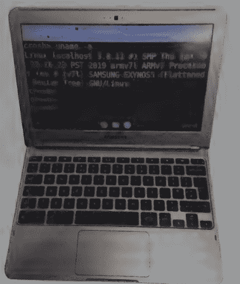

**图 11.1:** 在 Arm 芯片组上运行 Linux 变体的 Chromebook。作者拍摄。

这种趋势存在一种逻辑上的演进，即将操作系统内核、库和应用程序合并到单一的单体镜像中。如果用户预先知道精确的系统用例，那么从构建中消除大部分操作系统和库是完全可行的，因为它们永远不会被需要。这种*单体内核（unikernel）*概念以 MirageOS 为例，它通过激进的死代码消除（裁剪）来生成用于部署的精简二进制文件。

## 11.3 扩展

Linux 是超级计算机的默认操作系统。自 2017 年以来，全球 TOP 500 最强超级计算机列表中的所有机器都在运行 Linux。

通常，高性能计算任务通过并行框架（如 `MPI`，见第 7 节）处理。工作被划分为小的单元，在各个节点上执行。每个共享内存节点独立运行 Linux，因此超级计算机可能拥有数万个节点。爱丁堡并行计算中心的 Archer 设施见图 11.2，包含 4920 个节点。

很大程度上，大规模数据中心可能拥有数十万节点，每个节点运行带有高级控制软件（如 `OpenStack`）以实现有效的资源管理。这就是仓库级计算（warehouse-scale computing），这个词是由 Google 工程师形象提出的 [1]。

# 基于树莓派的 Linux 操作系统基础


图 11.2: Archer 高性能计算设施。爱丁堡并行计算中心拍摄。

机架系统具有数十个节点、数百个核心。大型数据处理任务在这些系统上调度，可能需要节点间的协作，例如分布式垃圾回收。这种节点间的活动同步实际上是一种元操作系统（meta-level OS）[2]。

随着系统架构变得越来越大且复杂，且节点内和节点内存之间的区分日益模糊，出现向多节点、分布式操作系统设计的趋势。

Barrelfish 实验性操作系统是一个多内核系统（multernel system）。每个 CPU 核心运行一个微小的单核内核，操作系统组织为这些内核之上的消息传递分布式系统。进程与位置无关，因为进程间的通信可以是本地或远程核心之间。从程序员的角度来看，这没有区别。

相关的项目是贝尔实验室的 Plan 9，这是一种保持了“一切皆文件”抽象的分布式操作系统。它的开发者包括 Unix 的一些原始设计者。其关键创新在于每个进程命名空间（对共享网络文件系统的个人视图）以及用于所有通信的基础消息文件系统协议。Eric Raymond 总结了 Plan 9 的优雅之处及其采纳率较低的原因 [3]。注意，Plan 9 OS 可以安装在树莓派上。

除了支持在大型机器上进行扩展计算外，下一代操作系统还需要处理扩展存储。传统的 Linux 文件系统（如 `ext4`）在大规模存储上的扩展性并不良好

由于元数据更新和一致性的要求，分布式上下文变得复杂。并行框架通常在每个节点的文件系统之上构建自定义的分布式文件系统，例如 Hadoop 的 `HDFS`。

全球规模的分布式数据系统通常是键值存储，例如 `etcd` 或 `mongodb`，它们具有复制和最终一致性，以缓解广域网中的延迟。对象存储（如 Minio 和 Ceph）允许将二进制大对象存储在已知位置（可能是网络地址），并配有相应的访问控制和其他元数据。

## 11.4 虚拟化与容器化

公用计算意味着位于云端的通用计算资源。用户只需按需租用他们提供的虚拟服务器上的 CPU 时间。

虚拟化允许多个虚拟机（VM）在单个物理节点上被托管并相互隔离。虚拟机监视程序（hypervisor）管理宿主机上的客户虚拟机。图 11.3 以示意图的形式展示了虚拟化的概念。这种方法对于基础设施服务支持灵活部署和资源过度制备至关重要。如果服务水平不足，可以将虚拟机迁移到另一个物理节点。现代处理器具有原生支持虚拟化的扩展功能。这些包括额外的特权级别和内存管理中的额外间接层。Linux 通过基于内核的虚拟机（KVM）支持硬件虚拟化，它充当虚拟机监视程序。运行在 KVM 之上的虚拟机软件包括 QEMU 全系统仿真器。这允许不同的客户操作系统（可能是为不同的处理器架构编译的）在 Linux 宿主操作系统上执行。

| 应用 | 应用 | 应用 |
| :--- | :--- | :--- |
| 库 | 库 | 库 |
| 客户 OS | 客户 OS | 客户 OS |
| 虚拟机 | 虚拟机 | 虚拟机 |
| Hypervisor | | |
| Host OS | | |

图 11.3：虚拟化示意图，显示应用实际上运行在两个内核（分别是客户和主机 OS）之上。

还有另一种替代方法：与每个虚拟机运行一个独立客户操作系统的完全虚拟化不同，Linux 容器实现了对共享宿主操作系统的进程的轻量级隔离。虽然容器缺乏重量级虚拟化的灵活性，但它们可能高效得多。因此，容器化在需要快速部署时间的用例中（如 DevOps、云系统和无服务器计算）非常流行。用户希望选择一个延迟最低的相关应用服务。Docker 等工具允许以声明式的脚本形式指定并分解服务，然后可以使用预构建的镜像来匹配这些脚本。这避免了冗长的配置和构建时间，使服务能够快速启动。

Linux 内核机制（如控制组 `cgroups`）实现了容器化。其关键概念是命名空间隔离和资源限制。一组进程可以收集到一个 `cgroup` 中并作为一个单元进行控制。下方的 bash 列表说明了如何进行这种控制，图 11.4 显示了在典型的四核 Raspberry Pi 节点上的输出。


| 列表 11.4.1 使用 cgroups 限制 CPU 资源 |
| :--- | :--- |
| 1 | `sudo apt-get install stress` # CPU 压力测试工具 |
| 2 | `sudo apt-get install cgroup-tools` # cgroups 工具程序 |
| 3 | `sudo cgroup create -r cpu:morecpu` |
| 4 | `sudo cgroup create -r cpu:lesscpu` # 默认值为 1024 |
| 5 | `sudo cgset -r cpu.cpu.shares=128 lesscpu` # 限制 CPU 使用 |
| 6 | # 现在在不同的控制组中运行一些压力代码 |
| 7 | `sudo cgexec -g cpu:lesscpu stress --cpu 4 &` |
| 8 | `sudo cgexec -g cpu:morecpu stress --cpu 4 &` |
| 9 | `top` # 查看 cpu 使用情况 |
| 10 | 11 `sudo killall stress` # 停止压力作业 |

进程沙箱的丢弃式执行。进程可能会运行一次；然后它们的副作用可以被隔离并丢弃。从这个意义上说，Linux 容器是早期的 Unix `chroot` 和 BSD `jail` 的演进。像 Docker 这样用户友配置工具极大地普及了容器化。

公用计算市场的增长要求底层系统具有更高水平的资源感知。特别是，OS 需要支持三项关键活动：

1. **预测 (Predicting)**：OS 必须提前估计用户任务完成需要多久以及需要哪些资源。这对于高效调度很有用。

2. **计费 (Accounting)**：OS 必须跟踪每个进程的资源使用情况。

3. **约束 (Constraining)**：OS 必须确保进程不超过其分配的资源。这对于系统的稳定和公平至关重要。

## 第 11 章 | 高级主题


图 11.6：Meltdown 和 Spectre 漏洞的标志——看来对于操作系统安全违规行为，引人注目的图形是必不可少的。

## 11.6 验证与认证

形式化验证技术利用数学模型和证明来对系统的属性和行为提供保证。随着软件规模和复杂性的增加，以及它成为我们日常社会交互的基础基础，这变得至关重要。许多工业领域正在为软件的形式化验证建立认证要求，例如用于汽车的 ISO 26262 和用于航空航天的 DO-178C。由于操作系统（OS）是软件栈中的关键部分，将验证技术应用于一组操作系统组件将变得越来越必要。

微软通过其设备驱动程序验证计划，率先为 Windows 操作系统开发了经过验证的组件。运行在特权模式下的低质量第三方设备驱动程序可能会破坏内核数据结构和不变性，通常导致“蓝屏”（blue screen of death），见图 11.7。这是 Windows 等于 Unix 内核崩溃（panic）。曾几何，设备驱动程序中的 导致了 Windows XP 85% 的系统崩溃。[12]

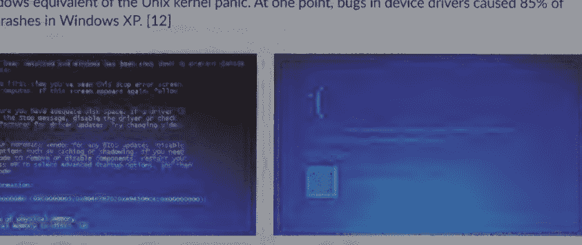

图 11.7：Windows XP（左）和 Windows 10（右）的蓝屏——自从有了驱动程序验证程序后，此类蓝屏已少见许多。作者拍摄。

SLAM 项目结合了静态分析、模型检查和定理证明的思想 [13]。关键工具是静态驱动程序验证器（SDV），它分析 C 源代码（通常是包含数行代码的设备驱动程序实现），并根据一组硬编码规则进行检查，这些规则封装了与 Windows 内核的合法交互。

# 基于树莓派的 Linux 操作系统基础

SDV 通过将输入的 C 代码转换为抽象布尔值来简化输入，通过将所有相关的程序状态编码为布尔变量来保留原始控制流。对该抽象程序进行符号化执行，以识别并报告内核 API 违规。一个示例规则规定必须按照严格顺序获取锁并在随后释放锁。预包 API 规则集收集自之前识别的错误报告和 Windows 驱动程序文档。实证证据表明，SDV 方法显著减少了 Windows 驱动程序中的错误。

当现代操作系统软件使用 C# 和 Rust 等高级语言构建时，直接对源代码进行静态分析是可行的，例如可以提供关于内存安全和无数据竞态的保证。此类保证可以组合以生成高层操作系统的安全属性。

se4 项目是一个完全验证的微内核系统 [14]。操作系统由几个具有清晰定义通信通道的独立组件组成。经过验证的微内核提供了极少的功能，它由 1 万行代码实现，主要是 C 语言并带有一些汇编语言。属性包括访问控制保证、内存安全和系统终止。通常情况下，有证明 C 源代码与系统的高层抽象规范相匹配。这类证明在专家投入方面的构造极其昂贵。

认证机制用于保证可执行代码的完整性。加密哈希值（如 MD5 和 SHA1）被用于检查文件是否被修改。例如，当你从树莓派网站或镜像站下载 Raspian SD 卡镜像时，可以检查已发布的 SHA-256 哈希值以保证其真实性，见图 11.8。

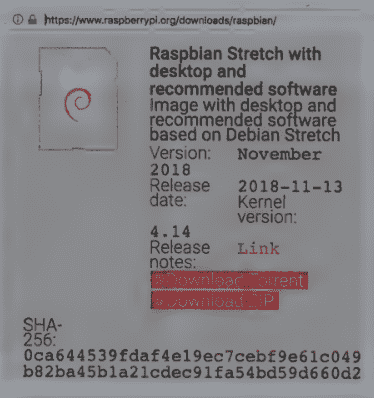

图 11.8：操作系统镜像哈希与下载链接一同发布，以确保真实性。

签名的可执行文件确保了来源和完整性。使用公钥基础设施，代码分发者可以使用私钥对可执行文件或文件的哈希进行签名。潜在用户可以检查签名和哈希，确保代码来自适当来源且未被修改。Linux 工具如 elsifigen 或性测量架构支持可执行文件的数字签名。安全代码认证需要硬件支持（如 Arm TrustZone）。特别需要检查固件和引导加载程序，以确保只有经过认证的代码能够在系统中运行。

可重现性是现代系统的关键目标。这对于科学实验、调试以及确保高度异化的软件组件系统中的兼容性至关重要。声明式脚本语言（如 Nix 或 Puppet 提供的语言）允许系统轻松地配置为通用标准。这对于 DevOps 场景是理想的。Nix 包管理器通过加密哈希跟踪构建每个可执行文件所需的所有代码和依赖。这被直接编码在可执行文件的路径中，例如 `/nix/store/a9i0a06cs89jf9ngsh10b6vvqpzip4-bash4p3`，这意味着应用程序的多个版本可以在系统中共存，并可以使用配置方案进行管理。系统管理员在升级到新版本时永远不需要“覆盖”旧应用程序或库，这使得兼容性和可靠性变得容易得多。

## 列表 11 例 nix docker 会话

```bash


# 查看 https://nixos.org/nix/manual/

## 了解更多详情

`docker pull nixos/nix`

`docker run -it nixos/nix`

`nix-env`


## 11.7 可重构性

随着平台变得越来越灵活并结合了 FPGA 等技术，操作系统必须支持即时重构。

在理论上，当 Linux 内核将责任转移到用户空间时，其架构越来越像微内核。对 Linux 的历史批评是它是难以扩展和生存的，见图 11.9。Torvalds 当时直接回应了这些批评，并在以后反思了其设计原则 [15]。

将组件移动到用户空间是一种加速趋势。我们在第 9 章引入了用户空间文件系统（FUSE）的概念。用户空间网络也支持，通过数据平面 Kit（DPDK）等框架实现了软件定义网络和功能虚拟化。

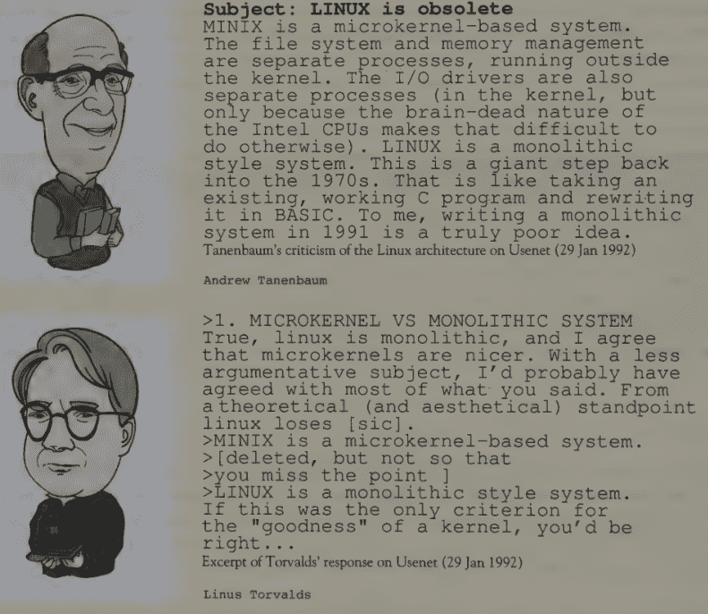

图 11.9：著名的“Linux 过时”辩论涉及其非微内核架构。Lovisa Sundin 绘。

> 主题：Linux 过时
> MINIX 是一个微内核系统。文件系统和内存管理是位于内核外的独立进程。I/O 驱动程序在内核中（但是独立的进程）是因为 Intel CPU 的脑残特性使得这很难（否则）。Linux 是一个单体系统。这是向 70 年代的巨大倒退。这就像把一个现有的、良好的 C 程序用 BASIC 重写。对我来说，写单体系统是一个坏主意。Tanenbaum 在 Usenet 上对 Linux 架构的批评（1992年1月29日）

> 1. LINUX VS 单体系统
> 诚然，Linux 是单体的，我也同意微内核更好。如果语气不那么争论性，我可能会同意你的大部分观点。从理论（和审美）角度来看，Linux 输了 [sic]。
> MINIX 是一个微内核系统。
> [删除] 但不是为了让你错过重点
> Linux 是一个单体风格的系统。如果这是衡量内核“好坏”的唯一标准，你是正确的……
> 来自 Torvalds 对 Usenet 的回复（1992年1月29日）

## 11.8 Linux 开发路线图

Linux 内核开发没有正式的路线图。有许多带有实验性功能的候选版本，其中某些将整合到未来的稳定版本中。

访问 `https://kernel.org` 获取最新详情。Linux Weekly News 服务跟踪内核正在进行中的更改，见 `https://lwn.net/Kernel/`

## 11.9 进一步阅读主题

在本章中，我们向大家介绍了操作系统（OS）开发和部署的当代趋势。这些问题中的某些对 Linux 有直接影响，另一些可能会在未来十年内影响该平台。

操作系统热点（HotOS）年度研讨会是操作系统未来研究和推测的绝场所。如果你对操作系统的开发感兴趣，可以查阅该活动近年的论文集，这些论文可以在网上找到。

## 11.10 练习与问题

### 11.10.1 制作一个极简内核

为你的树莓派配置并构建自定义的 Linux 内核。你能创建出多小的内核镜像？

### 11.10.2 验证重要属性

经过验证的软件系统对其属性和行为提供了形式化保证。列出你可能想要对操作系统组件证明的某些属性。

### 11.10.3 商业比较

Linux 的流行很大程度上归功于它是免费的开源软件（FOSS）。将 Linux 与一种非 FOSS 的主流操作系统进行比较。你能识别出任何差异并解释它们为什么会发生吗？在开发新功能方面是否有不同的侧重点？

### 11.10.4 支持还是反对认证

软件认证具有许多优点和缺点，必须进行仔细评估。起草一场辩论，列出操作系统认证的优缺点。这可以作为与同伴进行小组讨论的基础。

### 11.10.5 决策下放

现代 Linux 内核将某些策略的责任交给了用户空间，例如文件系统（通过 `FUSE`）和网络（通过 `DPDK`）。讨论其他可能可能从内核转移到用户空间的服务。系统日志就是一个候选对象。

### 11.10.6 降频、超频

你可以修改树莓派的配置来更改 CPU 频率。在 `/boot/config.txt` 中找到设置 `arm_freq = 1200` 的行并修改它。频率以整数指定，单位为 MHz。是否有其他可以更改的频率，例如 GPU 和内存？请检查在线文档获取详情，并注意某些设置可能会导致保修失效。

你可以通过在运行 CPU 密集型应用程序（也许是 `stress` 工具）时监控树莓派的功耗，来研究频率和功率之间的权衡。你需要使用外部 USB 万用表或功率监控器。制作图表显示频率与功率（单位为 W）之间的关系。

基于树莓派的 Linux 操作系统基础

## 参考文献

[1] L. A. Bizarro, U. Hölie, and P. Ranganathan, *The Datacenter as a Computer: Designing Warehouse-Scale Machines*, 3rd ed. Morgan Claypool, 2018.

[2] M. Maas, A. Asanovic, T. Harris, and J. Kubiatowicz, *Taurus: A holistic language runtime system for coordinating distributed-language applications*, in Proceedings of the Twenty-First International Conference on Architectural Support for Programming Languages and Operating Systems, 2016, pp. 457–471.

[3] S. E. Raymond, *Plan 9: The Future Was Way*. Addison Wesley, 2003, http://catb.org/~esr/writings/taoup/plan/9.html

[4] Y. Kim, R. Daly, J. Kim, C. Fallin, J. Lee, D. Lee, C. Wilkinson, L. Lai, and O. Mutu, "Flipping bits in memory without accessing them: An experimental study of DRAM disturbance errors," in ACM SIGARCH Computer Architecture News, vol. 42, no. 3, 2014, pp. 361–372.

[5] D. Gauss, C. Maurice, and S. Mangard, "Rowhammer: A remote software-induced fault attack in JavaScript," in International Conference on Detection of Intrusions and Malware, and Vulnerability Springer, 2016, pp. 300–321.

[6] V. Van Deer, Y. Fratonio, M. Lindorfer, D. Gauss, C. Maurice, G. Vigna, H. Bos, K. Razavi, and C. Giuffrida, "Deterministic: Rowhammer attacks on mobile platforms," in Proceedings of the 2016 ACM SIGACS conference on computer and communications security, 2016, pp. 1675–1689.

[7] A. Tatar, R. Krishna, E. Ethanasopoulos, C. Giuffrida, H. Bos, and K. Razavi, "Rowhammer attacks over the network and defenses," in 2018 USENIX Annual Conference, 2018.

[8] M. Lipp, M. T. Aga, M. Schwarz, D. Gauss, T. Trescher, W. Haas, A. Foghh, J. Horn, S. Mangard, P. Kocher, D. Genkin et al., "Meltdown: Inducing kernel memory from user space," arXiv preprint arXiv:1805.04956, 2018.

[9] M. Lipp, M. Schwarz, D. Genkin, W. Haas, M. Hamburg, M. Lipp, S. Mangard, T. Trescher, M. Schwarz, and Y. Yarom, "Spectre attacks: Exploiting speculative execution," arXiv preprint arXiv:1801.01203, 2018.

[10] P. Kocher, D. Genkin, D. Schwarz, M. Minkink, "Foreshadow: Extracting secrets from Intel SGX," Communications of the ACM, vol. 53, no. 6, 2010, pp. 107–115.

[11] P. Kocher, D. Genkin, D. Schwarz, M. Minkink, "Foreshadow: Extracting secrets from Intel SGX," in 27th USENIX Security Symposium, 2018, pp. 991–1008.

[12] G. Klein, J. Andronick, K. Dolman, H. Weiss, and S. Sewell, "seL4: Formal verification of an operating-system kernel," Technical Report, 2004.

[15] L. Torvalds, *The Linux Edge*. O'Reilly, 1999, http://www.oreilly.com/openbook/opensource/linus.html

基于树莓派的 Linux 操作系统基础

## 术语表

| 术语 | 定义 |
| :--- | :--- |
| 地址空间 (Address space) | 一组离散的内存地址。物理地址空间是计算机系统中所有内存的集合，包括系统内存 (DRAM) 以及 I/O 设备和其他外设。 |
| 应用二进制接口 (Application binary interface, ABI) | 可执行文件在特定环境中执行必须遵循的规范。 |
| 算术逻辑单元 (Arithmetic logic unit, ALU) | 处理器执行计算的部分。 |
| 汇编语言 (Assembly language) | 一种程序语句与架构机器码之间存在强对应关系的底层语言，作为高级语言编译器的目标。 |
| 原子操作 (Atomic operation) | 保证不受中断、信号、并发进程和线程隔离的操作。 |
| 启动 (Booting) | 启动计算机系统并进入可用状态的过程。 |
| 缓存 (Cache) | 用于限制 CPU 等待内存访问时间的小快速内存。对于每次读取操作，处理器首先检查数据是否存在于缓存中，如果是（缓存命中），则使用数据而不是访问内存。否则（缓存缺失），它将从内存获取数据并存储在缓存中。 |
| 缓存一致性 (Cache coherency) | 在具有多个缓存的多核系统中，缓存一致性是一种确保数据更改能够及时传播到整个内存系统的机制，以确保资源的所有缓存数据相同。 |
| 时钟周期 (Clock tick) | 时钟周期 (clock cycle) 的非正式同义词，指系统时钟信号两个连续上升（正）沿之间的间隔。 |
| 复杂指令集计算 (Complex instruction set computing, CISC) | 具有大量复杂且专门指令的 CPU，而不是少量简单通指令。典型示例是 x86 架构。 |
| 并发 (Concurrency) | 多个任务在系统中同时（并发）运行的事实。换句话说，并发是负载的属性而非系统的属性，只要系统支持同时运行多个任务。在实践中，拥有系统的关键原因之一是通过在单个共享 CPU 上调度任务来支持并发。 |

## 临界区 (Critical section)

程序中不能被多一个进程或线程同时执行的部分。临界区通常访问共享资源，并需要互斥锁等同步原语来确保正常运行。

## 死锁 (Deadlock)

在一组通信的进程中，每个进程都在等待另一个进程发送的消息以继续某操作的状态。或者，在具有共享资源的进程组中，如果每个进程都在等待另一个进程释放其继续操作所需的资源，则就会发生死锁。

## 直接内存存储器访问 (DMA)

一种允许外设设备直接将数据传输到主内存而不通过处理器寄存器的机制。在 Arm 系统中，DMA 控制器单元通常是一个外设设备。

## DRAM

动态随机访问存储器，高密度内存，比 SRAM 慢。它通常用作计算机系统的主内存。一个 DRAM 单元通常是一个小型电容器。随着电荷泄露，它需要定期进行刷新。

## 字节序 (Endianness)

字节在存储在内存中或通过数字链路传输时排列成字的顺序。常用格式有两种互不兼容的格式，称为大端序和小端序。在大端格式下，最显著字节（包含最显著位的字节）存储在最低地址处。小端格式反转了这一顺序。

## 一切皆文件 (Everything is a file)

## 文件 (File)

一组命名的相关数据，以单个连续信息块的形式呈现给用户，并保留在持久性存储中。

## 文件系统 (File system)

一种用于数据逻辑组织的系统。大多数文件系统的目的是提供文件和目录（文件夹）抽象。文件系统不仅允许以目录中组织的文件形式存储信息，还存储文件和目录的使用信息以及时间戳信息。文件系统中的信息通常组织为目录的层次级树结构，树根的目录称为根目录。

## 术语表 (Glossary of terms)

## 虚拟机监控器 (Hypervisor)

创建并运行虚拟机的程序、固件或硬件系统。

## 指令 (Instruction)

计算机程序由一系列指令组成。每条指令决定了处理器如何通过地址空间与系统交互。

## 中断 (Interrupt)

由硬件（外设）或软件发送给处理器的信号，表示需要立即处理的事件。发送信号的操作称为中断请求 (IRQ)。

## 内核 (Kernel)

操作系统的核心程序，对系统中的一切具有完全控制权。它通常是系统启动时（引导加载程序之后）加载的首批程序之一。它处理其余的启动和初始化，以及来自其他进程对系统服务的请求。

## 内存 (Memory)

存储计算机立即使用的信息的硬件，通常为 SRAM 或 DRAM。

## 内存管理单元 (MMU)

一种管理访问控制和内存翻译的系统硬件组件，特别是虚拟内存地址到物理地址的翻译。

## 内存地址 (Memory address)

一个无符号整数值，用作存储在内存中的字标识符。

## 大众化的 MIPS (MIPS for the masses)

原始 Arm 设计团队的口号，旨在创建一个廉价但强大的处理器，为所有人提供大量的处理能力（"MIPS" 意为每秒百万条指令），且价格每个人都能负担得起。

## 助记符 (Mnemonic)

操作的缩写。汇语言使用助记符来表示每个低级机器指令或操作码，通常也表示每个体系寄存器、标志位等。它也是威廉·吉布斯《约翰尼助记符》（1981）中同名角色的姓氏。

## MPI (消息传递接口) (Message passing interface)

用于高性能计算的 API 规范。它为并行编程提供了分布式内存模型。其主要目标是集群和多处理器机器，也包括许多核系统。消息传递模型意味着任务不共享任何内存。相反，每个任务都有自己的私有内存，任务之间的任何通信都是通过交换消息。

## 挂载 (Mounting)

内核执行的操作，用于提供对文件系统的访问。挂载文件系统是将该系统连接到目录（挂载点）并使其系统可用。根文件系统始终是挂载的。任何其他文件系统可以在目录树的任何一点与根文件系统连接或断开连接。

## 多任务处理 (Multitasking)

在一段时间内并发执行多个任务（也称为进程）。

## 网络接口控制器 (NIC)

也称为网卡或网络适配器，是一种将计算机连接到计算机计算机的计算机硬件组件。

## 网络化 (Networking)

计算机系统使用中间通信基础设施与其他计算机系统进行交互。

## 操作码 (Opcode)

操作码（operation code）是机器语言指令中指定要执行的操作的部分。大多数指令还以操作数的形式指定要处理的数据。

## OpenCL

一种用于异构架构上并行计算的开放标准。

## OpenMP

一种用于共享内存并行编程的标准。它基于一组编译器指令或伪指令（pragmas），结合编程 API 来指定并行区域、数据作用域、同步等。OpenMP 是一种可移植的并行编程方法，该规范支持 C、C++ 和 Fortran。

## 操作系统 (Operating system)

操作系统 (OS) 是一种管理计算机硬件和软件资源的专用程序，并为运行的程序提供通用服务。操作系统跟踪资源的使用并使用时间分来调度任务。

## 并行 (Parallelism)

并行处理是计算机系统的一种能力。

## 分区 (Partition)

磁盘可以被分为分区，这意味着不是作为单个数据块呈现，而是作为多个分区。分区是逻辑上的而非物理的，关于磁盘的信息。

## 外设 (Peripheral)

连接到计算机的设备，用于向计算机输入输出信息。“Peripheral”也是威廉·吉布斯的一部科幻小说。

## 术语表 (Glossary of terms)

## 持久存储 (Persistent storage)

也称为非易失性存储，是一种即使设备掉电也能保留数据的存储类型。示例有固态硬盘 (SSD)、硬盘、CD、DVD 和磁带。

## 轮询 (Polling)

定期检查外设状态的操作。

## POSIX

可操作系统接口（POSIX）是一系列旨在保持操作系统兼容性的 IEEE 标准。POSIX 定义了程序与系统交互的应用程序编程接口 (API)。

## 抢占 (Preemption)

在不需要该任务协作的情况下，临时中断计算机系统（特别是运行在 CPU 上的任务）的操作，并打算稍后恢复任务。抢占是抢占式多任务处理的关键特征。需要任务协作的替代方法称为协作多任务。

## 进程 (Process)

进程是运行中的程序，即程序代码及其使用的所有系统资源。进程的概念用于代码和资源的分离。根据这个定义，一个进程可以包含多个线程。

## 进程控制块 (PCB)

也称为任务控制块 (TCB)。操作系统内核数据结构，包含管理特定进程的信息。

## 内存 (RAM)

随机访问存储器。存储在 RAM 中的数据读取或写入的时间与其在内存中的物理位置几乎相同。这与硬盘、CD、DVD 和磁带等其他直接访问数据存储介质相反。

## 简指令集计算 (RISC)

一种具有少量简单且通用指令的 CPU，而不是大量复杂且专门的指令。Arm 处理器具有 RISC 架构。

## 寄存器文件 (Register file)

寄存器的字数组，通常实现为 SRAM 内存并属于 CPU 的。

## Root 用户 (Root user)

在 Linux 和其他 Unix 类计算机操作系统中，root 是在所有模式下拥有所有权利或权限（对所有文件和程序）的用户名称。替代名称包括超级用户和管理员。在 Linux 中，账户的实际名称不是决定因素。

## 调度 (Scheduling)

操作系统内核用于为任务分配 CPU 时间的机制。

# 术语表

SIMD (单指令多数据)

一种并行计算类型，其中多个处理元素同时对多个数据点执行相同的操作。

SRAM

静态随机存取存储器，密度较低，速度比 DRAM 快。它通常用于计算机系统的缓存内存。SRAM 单元是一个锁存器，因此在设备上电时它会保持其值，无需刷新。

对称多处理 (SMP)

多核系统的一种操作运行模型，其中两个或多个相同的内核连接到单个共享主内存，具有对所有输入/输出设备的完全访问权限，并由单个操作系统实例控制，该实例平等地对待所有处理器，不为特殊用途保留任何处理器。大多数现代多核系统都使用 SMP 架构。

系统时钟

自某个任意起始日期[纪元]以来流逝时间的计数器。Linux和其他符合 POSIX 标准的系统[测量]系统时间为自 1970 年 1 月 1 日 00:00.00 UT Unix 纪元开始以来经过的秒数，闰秒除外。

系统状态

系统中在事件或用户交互之间记忆的所有信息集合。

片上系统 (SoC)

也称为芯片级系统，是一种集成计算机系统所有组件的集成电路 (IC)。这些组件通常包括 CPU、内存、I/O 端口和次级存储，组合在单个芯片上。

任务

计算机系统上的执行单元或工作单元。该术的定义没有那么严格，通常与调度有关。

线程

在单个进程内执行的多个并发任务称为执行线程。进程共享其资源。对于具有单执行线程的进程，任务和进程术语通常互换使用。

定时器

一种用于测量特定时间间隔的特殊时钟。

转换旁缓冲区 (TLB)

一种特殊的缓存，用于存储最近的虚拟内存到物理内存的翻译。它是内存管理单元 (MMU) 的一部分。

用户

通常用户是指利用计算机系统的人。然而，在操作系统的语文中，用户一词的含义更广泛，用于识别进程和资源的所有者。因此，用户不需要是人。

# 虚拟机

模拟计算机系统的程序。虚拟机基于计算机架构，并提供物理计算机的功能。现代计算机系统通过虚拟机管理器（hypervisor）为虚拟机的部署（虚拟化）提供硬件支持。

# 字 (Word)

由特定处理器设计使用的固定大小、连续的位数组。字是由指令集或处理器硬件作为单元处理的固定大小数据段。字中的位数（也称为字长、字宽或字长度）是任何特定处理器架构的关键特征。通常，一个字由若干字节（8 位的序列）组成，以小端序或大端序格式存储（见字节序）。现代处理器最常见的字大小是 64 位和 32 位，但 8 位或 16 位字长的处理器仍用于嵌入式系统。

# Index

| AArch32 | 6, 54-55 |
| AArch64 | 50, 54-55, 57, 94 |
| 加速器一致性端口 | 64 |
| Accept | 255, 259 |
| Action | 2, 4-6 |
| 地址空间映射 | 3-4, 61-63, 129 |
| 空间 | 23, 61-63, 128-131, 296 |
| 空间布局，见地址映射 | 149 |
| 空间布局随机化 | 50 |
| 高级性能总线 | |
| ALU，见算术逻辑单元 | 94, 296 |
| 应用二进制接口 | |
| 算术逻辑单元 | 8, 296 |
| Arm Cortex A53 | 50, 53-61 |
| Arm Cortex M0+ | 50-52 |
| Armv6-M | 51-52 |
| Armv8-A | 50, 53-55 |
| 汇编语言 | 8, 296 |
| 关联 | 15, 58, 185 |
| 原子 | 165-169, 222, 296 |
| 大端序 | 257, 297 |
| 二叉树 | 185 |
| 绑定 | 255, 258-259 |
| 位图 | 165-167, 234 |
| 块设备 | 204 |
| 阻塞 IO | 207 |
| 启动过程（见 启动） | 36-37, 183 |
| 序列（见 启动） | 36 |
| 启动 | 36, 183, 296 |
| 引导加载程序 | 32, 36 |
| 分支 | 7, 9 |
| 缓冲区缓存 | 142, 242 |
| 缓存 | 15-18, 59-61, 127, 142, 296 |
| 一致性 | 61, 24, 296 |
| 字符设备 | 203-204 |
| 芯片 | 35, 225 |
| 时钟处理器 | 2, 13, 291 |
| 页面替换算法 | 143-144 |
| 系统时钟 | 5, 301 |
| 周期 | 5, 91 |
| 滴答 | 296 |
| 完全公平调度器 | 107 |
| 复杂指令设置 | 50, 296 |
| 并发 | 20, 158-161, 296 |
| 连接 | 255, 260-261 |
| 上下文切换 | 81-82 |
| 控制流 | 12 |
| 写时 | 72, 146-147 |
| 核心 | 49, 50, 149 |
| Cortex，见 Arm | |
| 凭证 | 34-35, 225 |
| 死锁 | 161-162, 297 |
| 需调调页 | 145 |
| 设备驱动 | 31, 38, 204, 253 |
| 树 | 32 |
| Dijkstra | 162-163 |
| 目录 | 219-220, 231-233 |
| 直接内存访问 | 13-14, 63, 210, 297 |
| DMA，见直接内存访问 | |
| Docker | 244, 286 |
| DRAM，见随机存取存储器 | 95 |
| 随机存取存储器 | 3, 127, 287, 297 |
| EABI | 94-95 |
| 最早截止 | 101, 112 |
| 以太网 | 206, 250, 253 |
| 万物皆文件 | 33, 218, 284, 297 |
| 逐出 | 15, 60, 144 |
| 斥监控 | 163-164 |
| 执行 | 73, 275 |
| 扩展文件系统 | 233 |
| 范围 | 236 |
| Ext4 | 233-238 |
| FAT，见文件分配表 | 8 |
| 取指-解码-执行周期 | 218, 297 |
| 文件分配表 | 238-242 |
| 系统 | 32-33, 218-220, 228-230 |
| 浮点单元 | 55 |
| Fork生 | 71-74, 275 |
| Fck | 243 |
| Futex | 174 |
| Getsockopt | 262 |
| Getty | 38 |
| Groupadd | 35 |
| 异构多处理 | 181 |
| 主层 | 250 |
| HTTP | 56-67, 285, 298 |
| 虚拟机管理器 | 55 |
| IEEE 754-2008 | 55 |
| 非法指令 | 86-87 |
| Init | 34, 37-38, 77 |
| 初始化 | 37, 183 |
| Inode | 230-231 |
| Insmod | 39, 205 |
| 指令 | 5-8, 298 |
| 周期 | 8 |
| 寄存器 | 9 |
| 设置 | 50-51, 54 |
| 中断 | 4, 209-211, 298 |
| 处理程序 | 210-213 |
| 请求 | 4, 13 |
| 服务程序，见中断程序 |
| 向量表 | 13 |
| ioctl | 207 |
| IRQ，见中断服务程序 | |
| ISR，见中断向量表 | |
| IVT | 237 |
| 日志 | 42 |
| Kbuild | |
| Linux 内核 | 31-32, 37-42, 76, 298 |
| OpenCL | 192 |
| 模块 | 39-42, 204 |
| 空间 | 32 |
| Kill | 83 |
| 物理地址扩展 | 61, 133 |
| LDREX | 163-164 |
| 最久未用 | 144 |
| 寄存器 | 6, 12 |
|  | 255, 259 |
| 小端序 | 257, 297 |
| 负载均衡 | 183-184 |
| 逻辑地址空间 | 23 |
| 登录 | 38 |
| LR，见链接寄存器 | |
| MapReduce | 185, 195 |
| 媒体层 | 251-252 |
| 内存 | 126, 298 |
| 地址 | 298 |
| 屏障 | 170 |
| 管理，见内存 | |
| 管理单元 | 57, 129 |
| 操作顺序 | 169 |
| 保护 | 52, 152, 298 |
| 保护单元 | 24, 52 |
| Memset | 259 |
| Modprobe | 39 |
| MOESI | 61 |
| 监控 | 163-164 |
| Mutex | 174 |
| NEON (见 SIMD) | 53 |
| 嵌套向量中断 | 51 |
| 网络 | 250 |
| 适配器 | 250 |
| 层 | 52 |
| 协议 | 253 |
| 网络 | 250-279, 298 |

