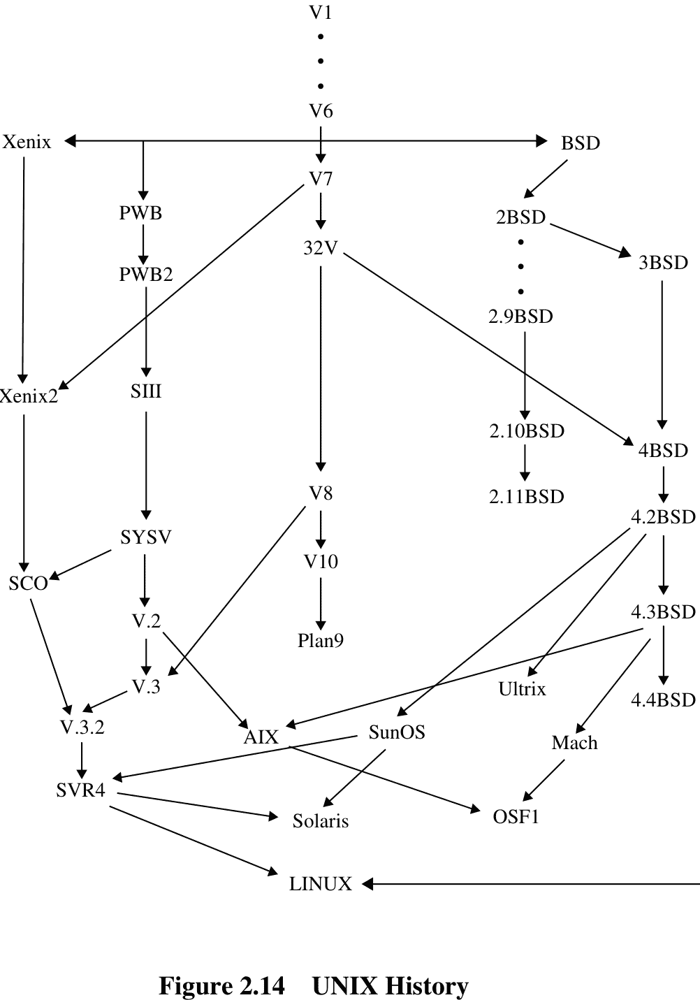
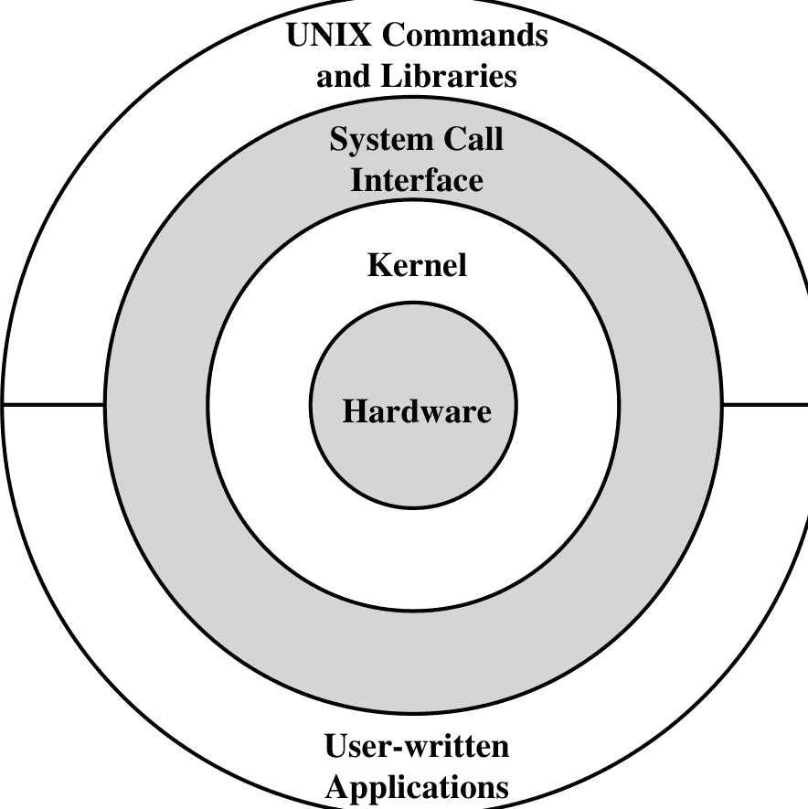
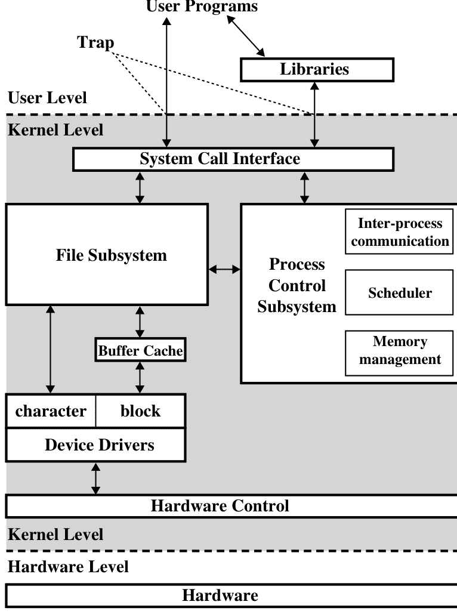
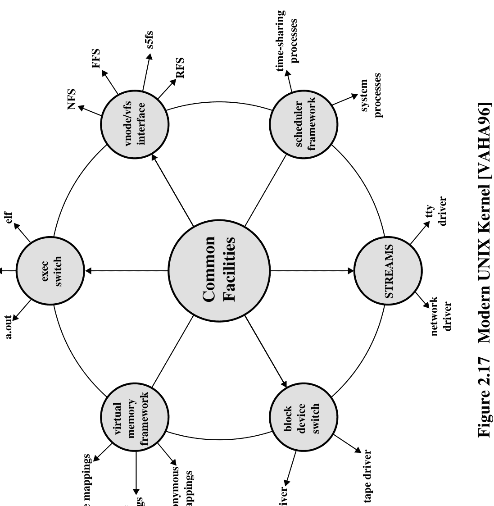
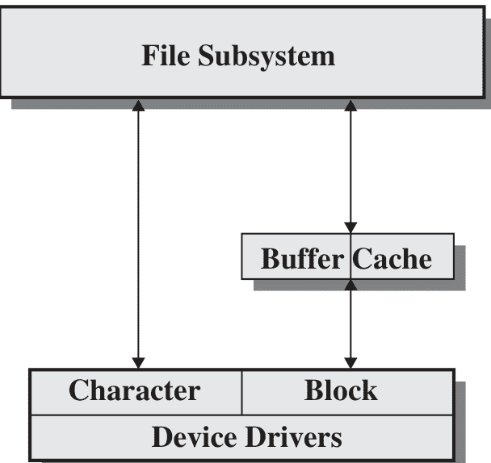
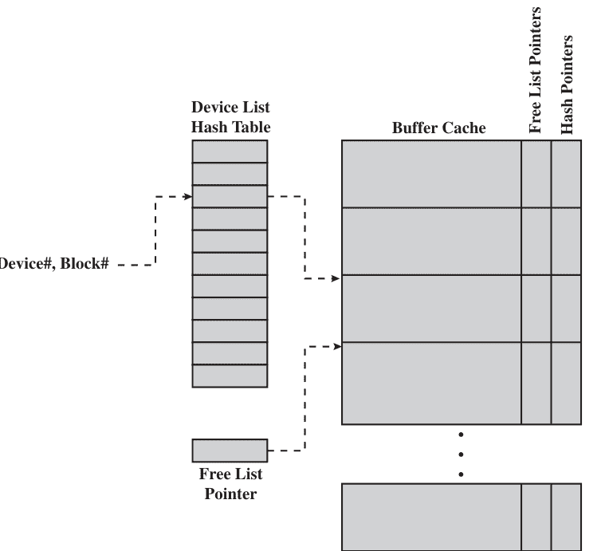
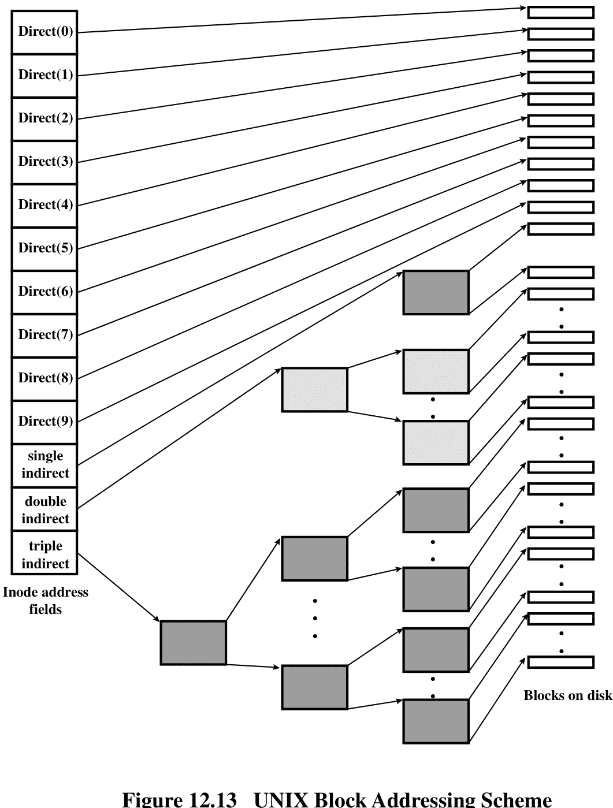

# 操作系统：内部原理与设计原理（第4版）

## 传统 UNIX 系统

### 历史

UNIX 的历史是一个广为人知的故事，此处不再详细复述。相反，图 2.14 展示了简要的摘要，该图基于 [SALI94]。

UNIX 最初在贝尔实验室开发，并于 1970 年在 PDP-7 上投入运行。贝尔实验室的一些人员曾参与了 MIT Project MAC 的分时系统工作。该项目导致了 CTS 和 Multics 的开发。虽然通常说 UNIX 是 Multics 的精简版，但 UNIX 的开发者实际上声称受到 CTS 的影响 [RITC78]。尽管如此，UNIX 吸收了 Multics 的许多思想。

贝尔实验室推出了一系列 UNIX 版本。第一个著名的版本是从 PDP-7 到 PDP-11 的 UNIX。这是 UNIX 首次成为所有计算机的操作系统。下一个重点是用 C 语言重写 UNIX。这在当时是一个前所未有的策略。当时通常认为，像操作系统这样必须处理时间关键事件的复杂系统必须用汇编语言编写。C 语言证明了大部分代码使用高级语言的优势。早期的 UNIX 版本在贝尔实验室是用汇编编写的。1974 年，UNIX 系统首次在技术期刊上被描述 [RITC74]。这引发了人们对该系统的兴趣。UNIX 许可被提供给商业机构以及大学。第一个在贝尔实验室外提供的版本是 1976 年的第 6 版本。随后的 Release 7 是大多数现代 UNIX 系统的祖先。大多数非 AT&T 系统是在加利福尼亚大学伯克利分校开发的，被称为 UNIX BSD，最初运行在 PDP 和 VAX 机器上。AT&T 继续定义和完善该系统。到 1982 年，贝尔实验室已将多个 AT&T UNIX 变体合并为一个系统，市场名为 UNIX System III。后来在操作系统中增加了许多功能，产生了 UNIX System V。

### 描述

图 2.15 提供了 UNIX 架构的总体描述。底层硬件被操作系统软件包围。操作系统通常被称为内核 (`kernel`)，主要是为了强调它与用户及应用程序的隔离。我们在书中将 UNIX 作为示例时，关注的是 UNIX 的这部分。然而，UNIX 配备许多被视为系统一部分的用户服务和接口。这些被分为外壳 (`shell`)、其他接口软件以及 C 编译器的组件（编译器、汇编器、加载器）。此之上的层由用户应用程序组成，而内核是 C 语言的接口。

图 2.16 提供了对内核的更深入的观察。用户程序可以直接或通过库函数调用操作系统服务。系统接口是用户与高层软件之间的边界，用于访问特定的内核函数。在另一端，操作系统维护着直接与硬件交互的原始例程。在这两个接口之间，内核被分为两个部分：一个负责进程控制，另一个负责内存管理和 I/O。进程控制子系统负责内存管理、进程调度与分发，以及文件系统在内存与外部设备之间交换数据，作为一种以字符或数据块的形式进行。为了实现这一点，使用了多种设备驱动程序。对于面向块的传输，使用了磁盘缓存方法：在主内存中的用户地址空间和外部设备之间插入了一个系统缓冲区。

> 更完整的树结构请见 [MCKU96]。

本小节的描述涉及了被称为“传统 UNIX 系统”的内容：AH80 用此指 System V Release 3 (SVR3)、4.3BSD 及更早版本。对传统的 UNIX 系统可以做出以下一般性描述：它被设计运行在单处理器上，并且缺乏保护其数据结构免受多个处理器并发访问的能力。其内核并不通用，仅支持单一类型的文件系统、一种进程调度策略和一种可执行文件格式。传统的 UNIX 内核并非为可扩展性而设计，代码复用设施较少。结果是，随着新功能被添加到各种 UNIX 版本，必须添加大量新代码，导致内核变得臃肿且缺乏模块化。





图 2.15 通用 UNIX 架构



图 2.16 传统 UNIX 内核 [BACH86]

## 2.7 现代 UNIX 系统

随着 UNIX 的演进，不同的实现数量激增，提供了一些实用的功能。需要产生一个新的实现来统一最重要的创新，添加其他操作系统设计特性，并产生更模块化的架构。现代 UNIX 内核的典型特征如图 2.17 所示的架构。它有一个以模块化方式编写的小型核心设施，提供许多操作系统进程所需的功能和服务。每个外圈代表一个可以用多种方式实现的函数和接口。

我们现在转向 System V Release 4 (SVR4)。

### System V Release 4 (SVR4)

SVR4 由 AT&T 和 Sun Microsystems 联合开发，结合了 SVR3、4.3BSD、Microsoft Xenix V 和 SunOS 的特性。它也是对 System V 内核的重写，产生了一个简洁（尽管复杂）的实现。该版本的新特性包括实时处理支持、调度类、动态分配的数据结构、虚拟内存管理、虚拟文件系统和抢占式内核。

SVR4 汲取了商业和学术设计者的经验，旨在为商业部署提供统一平台而开发。它成功实现了目标，也许是迄今为止最重要的 UNIX 变体。它整合了在任何 UNIX 系统上开发的重要特性，并以一种集成且商业可行的方式呈现。SVR4 运行在从 32 位微处理器到超级计算机的各种机器上，是开发以来最重要的操作系统之一。书中的许多 UNIX 示例均来自 SVR4。

### Solaris 2.x

Solaris 是 Sun 基于 SVR4 的 UNIX，最新版本为 2.8。版本 2 Solaris 实现提供了 SVR4 的所有功能以及许多更先进的特性，例如完全抢占式的多线程内核、对 SMP 的完全支持以及面向对象的系统接口。Solaris 是使用最广泛、最成功的商业 UNIX 实现。对于操作系统特性，Solaris 提供了书中的 UNIX 示例。

### 4.3BSD

伯克利软件发行版 BSD 系列 UNIX 版本在操作系统设计的发展中起了关键作用。4.3BSD 广泛用于学术机构安装，并作为许多商业 UNIX 产品的基础。或许可以说，UNIX 的流行很大程度上归功于 BSD，而 UNIX 的增强功能首次出现在 BSD 版本中。

4.4BSD 是伯克利发布的最后一个 BSD 版本，随后其设计和实现组织即被解散。它是 4.3BSD 的一次重大升级，包含了新的虚拟内存系统、内核结构的变化以及长长列表的其他特性增强。

### Linux

#### 历史

Linux 起初是针对 IBM PC 架构的 UNIX 变体。初始版本由芬兰计算机科学学生 Linus Torvalds 编写。Torvalds 在 1991 年在互联网上发布了 Linux 的早期版本。从那时起，许多人在互联网上协作，为 Linux 的开发做出了贡献，且这一切都在 Torvalds 的控制之下。由于 Linux 是免费的且源代码可用，它成为了其他 UNIX 工作站（如 Sun Microsystems、Digital Equipment Corp（现为 Compaq）和 Silicon Graphics 提供的）的早期替代品。今天，Linux 是一个运行在所有这些平台及更多平台上的全功能 UNIX 系统。

Linux 成功的关键在于其作为自由软件基金会（FSF）赞助下的免费软件包的特性。FSF 的目标是稳定、平台无关、免费、高质量并由用户社区增强的软件。FSF 的 GNU 项目为软件开发者提供工具以及 GNU 公共许可证 (GPL)。Torvalds 在开发他的内核时使用了 GNU 工具，并在 GPL 下发布了该内核。你今天使用的 Linux 发行版是 FSF 的 GNU 项目、Torvalds 的个人努力以及全球许多协作者的结晶。

除了被许多个人程序员使用外，Linux 现在已深度渗透到企业界 [MANC00]。这主要不是因为免费软件，而是因为 Linux 内核的质量。许多才华横溢的程序员对当前版本做出了贡献，产生了一个技术上令人印象深刻的产品。此外，Linux 具有高度模块化和可配置性。这使其能够从各种平台上榨取最佳性能。由于源代码可用，供应商可以调整应用程序和工具以满足特定需求。在本书中，我们将提供 Linux 内核的细节。

#### 模块化结构

大多数 UNIX 内核是单式的。单式内核是将几乎所有的操作系统功能包含在一个大型代码块中，作为一个具有单一地址空间的单一进程运行。内核的所有组件都可以访问其所有的内部数据结构和例程。如果对单式操作系统的任何部分进行更改，所有的模块和例程都必须重新编译安装，并重启系统使更改生效。结果是，任何修改（例如添加新的驱动程序或文件系统）都是困难的。对于由全球松散独立的程序员群体驱动的 Linux 来说，这一点尤为突出。

为了解决这个问题，Linux 被组织成一系列独立的块，称为可加载模块 [GOYE99]。Linux 可加载模块有两个重要特性：

- **动态链接**：内核模块可以在内核已经在内存中执行时加载并链接到内核。模块也可以随时卸载并从内存中移除。
- **堆栈模块**：模块按分级排列。单个模块在被上层客户端引用时作为库，在引用下游模块时作为客户端。

动态链接 [FRAN97] 简化了配置任务并节省了内核内存。在 Linux 中，用户或程序可以使用 `insmod` 和 `rmmod` 命令根据需要加载和卸载模块。对于堆栈模块，可以定义模块之间的依赖关系。这有两个益处：

1. 属于相似模块集的公共代码（例如相似硬件的驱动程序）可以移动到单个模块中，减少重复。
2. 内核可以确保所需的模块存在，拒绝卸载被其他模块所依赖的模块，并在加载新模块时加载任何新增的依赖项。

图 2.18 展示了 Linux 用于管理模块的结构。该图显示了仅加载两个模块后的内核模块列表：FAT 和 VFAT。每个模块由两个表定义：模块表和符号表。模块表包含以下元素：

- `next`：指向下一个模块的指针。所有模块都组织成链表。该列表始于一段伪代码（图 2.18 未所示）。
- `ref`：使用该模块的模块列表。
- `symtab`：指向该模块符号表的指针。
- `name`：模块名称。
- `size`：以内存页为单位的模块大小。
- `addr`：模块起始地址。
- `state`：模块当前状态。
- `cleanup()`：指向在模块卸载时启动的例程。

符号表定义了该模块控制并在其他地方使用的符号。它包含以下元素：

- `size`：表的总大小。
- `n_symbols`：符号数量。
- `n_refs`：引用数量。
- `symbols`：符号表。
- `references`：依赖于此模块的模块列表。

图 2.18 显示 VFAT 模块在 FAT 模块之后加载，且 VFAT 模块依赖于 FAT 模块。



## 3.4 UNIX SVR4 进程管理

UNIX System V 使用简单但强大的进程机制，该机制对用户可见。UNIX 遵循图 3.14b 中的模型，大多数操作系统运行在用户进程的环境中。因此，需要两种模式：用户态和内核态。UNIX 使用两类进程：系统进程和用户进程。进程在内核态下运行并执行系统代码以执行管理和维护功能，如内存分配和交换。进程在用户态下执行用户程序和实用程序，并在内核态下执行指向内核的指令。用户进程通过发出系统调用、产生异常（故障）或发生中断进入内核态。

### 进程状态

UNIX 操作系统共识别了九种状态；这些状态列在表 3.9 以及图 2.16 所示的状态转换图中（基于图 [BACH86]）。该图与图 3.7 类似，UNIX 的睡眠状态对应于两个阻塞状态。区别可以总结如下：

- 与“运行”不同，使用了两个状态来指示进程是在用户态还是内核态执行。
- 在两个状态之间进行了区分：（就绪并在内存中，Ready to Run, in Memory）和（被抢占，Preempted）。这两个状态在本质上是同一个状态，如连接它们的虚线所示。这种区别在于进入被抢占状态的方式。当进程在内核态下运行时（由于系统调用、检查中断或 I/O 中断的结果），将会有内核完成工作并准备好将控制权还给用户进程的时刻。此时，内核可能决定抢占当前进程，转而让一个就绪且优先级更高的进程。在这种情况下，当前进程移动到被抢占状态。为了调度目的，处于被抢占状态的进程和处于就绪并在内存中状态的进程组成一个队列。

抢占只能在进程即将从内核态移动到用户态时才会发生。当进程在内核态运行时，它可能不会被抢占。这使得 UNIX 不适用于实时处理。关于实时处理要求的讨论请见第 10 章。

在 UNIX 中，有两个进程是独特的。进程 0 是系统启动时创建的特殊进程；实际上，它在启动时就被预定义了。此外，它产生进程 1，称为 `init` 进程；系统中的所有进程都以进程 1 为祖先。当新的交互式用户登录系统时，系统会为该用户创建一个用户进程。随后，该用户进程可以在分支树中创建进程，使得任何特定应用程序都可以创建多个相关的进程。

### 进程描述

UNIX 中的进程是一组相当复杂的数据结构，为操作系统提供了管理和调度进程所需的所有信息。表 3.10 总结了进程映像的元素，这些元素被组织成三个部分：用户级上下文、寄存器上下文和系统级上下文。

用户级上下文包含用户程序的基本元素，可以直接从编译后的对象文件中生成。用户程序被分为文本区和数据区；文本区是只读的，用于存放程序的指令。在进程执行期间，处理器使用用户栈区域进行过程调用、返回和进程传递。共享内存区域是一个与其他进程共享的数据区域。共享内存区域只有一个物理副本，但通过使用虚拟内存，该共享内存区域似乎位于进程自己的地址空间中。当进程未运行时，处理器状态信息存储在寄存器上下文区域。系统级控制保持不变，以便操作系统需要管理该进程。它由一个进程表组成（大小固定并贯穿进程整个生命周期）以及一个动态部分（其大小在进程生命周期内会变化）。静态部分的元素是进程表，每个进程有一个条目。操作系统维护的进程表包含内核随时可以访问的控制信息；因此在虚拟系统中，所有进程条目都维护在内存中。表 3.1 列出了进程表的内容。用户区（或 U 区）包含了内核在进程上下文中执行时所需的额外进程信息；它在进程与内存之间进行分页交换时也会被用到。表 3.2 显示此表的内容。

进程条目与 U 区之间的区别反映了内核始终在某些进程的上下文中执行。大部分时间，内核会处理与进程有关的问题。但在某些时候，当内核执行相对于调度另一个进程的调度算法时，它需要其他进程的信息。

第三个静态部分是进程区域表，由内存管理系统使用。最后，内核栈是系统级上下文的动态部分。该栈在进程于内核中执行时使用，包含了过程调用和中断发生时必须保存和恢复的信息。

### 进程控制

UNIX 中的进程创建通过内核系统调用 `fork()` 实现。当进程发出请求时，操作系统执行以下功能 [BACH86]：

1. 在进程表中为新进程分配一个槽位。
2. 为子进程分配一个唯一的进程 ID（PID）。
3. 复制父进程的进程映像，共享内存除外。
4. 增加父进程拥有的任何文件的计数器，以反映新增的进程也拥有了这些文件。
5. 将子进程分配到就绪状态。
6. 将子进程的 ID 号返回给父进程，并向子进程返回值 0。

所有这些工作都在父进程的内核中完成。当内核完成这些功能后，它可以作为调度程序的一部分执行以下操作之一：

1. 留在父进程中。控制权在父进程调用 `fork` 的点返回用户态。
2. 将控制权转移到子进程。子进程从代码中与父进程相同的点开始执行，即 `fork` 返回处。
3. 将控制权转移到另一个进程。父进程和子进程都留在就绪状态。

这种进程创建方法可能难以视觉化，因为父进程和子进程都在执行同一段代码。区别在于：当 `fork` 返回时，会测试返回参数。如果值为零，则这就是子进程，并分支可以被执行到适当的用户程序以继续执行。如果值非零，则该为父进程，主执行线可以继续。

#### 表 3.9 UNIX 进程状态

| 状态 | 说明 |
| :--- | :--- |
| 用户态 (User Running) | 在用户模式下执行。 |
| 内核态运行 (Kernel Running) | 在内核模式下执行。 |
| 内存就绪 (Ready to Run, in Memory) | 只要内核调度，即可立即运行。 |
| 内存睡眠 (Asleep in Memory) | 在事件发生前无法执行；进程处于主内存中（阻塞状态）。 |
| 就绪，已交换 (Ready to Run, Swapped) | 进程已就绪，但在内核调度其执行之前，交换器必须将进程换入主内存。 |
| 睡眠，已交换 (Sleeping, Swapped) | 进程正在等待事件并已交换到辅助存储器（阻塞状态）。 |
| 被抢占 (Preempted) | 进程正在从内核返回用户模式，但内核抢占了它并进行进程切换以调度另一个进程。 |
| 已创建 (Created) | 进程新创建，尚未就绪运行。 |
| 僵尸 (Zombie) | 进程已不存在，但它留下了记录供父进程收集。 |

#### 表 3.10 UNIX 进程映像

| 用户级上下文 | 说明 |
| :--- | :--- |
| 进程文本 (Process Text) | 程序的可执行机器指令 |
| 进程数据 (Process Data) | 此进程程序可访问的数据 |
| 用户栈 (User Stack) | 包含在用户模式下执行的函数的参数、局部变量和指针 |
| 共享内存 (Shared Memory) | 与其他进程共享的内存，用于进程间通信 |

| 寄存器上下文 | 说明 |
| :--- | :--- |
| 程序计数器 (Program Counter) | 下一要执行指令的地址；可能位于该进程的内核或用户内存空间 |
| 处理器状态寄存器 (Processor Status Register) | 抢占时的硬件状态；内容和格式取决于硬件 |
| 栈指针 (Stack Pointer) | 指向内核或用户栈的顶端，取决于抢占时的运行模式 |
| 通用寄存器 (General-Purpose Registers) | 取决于硬件 |

| 系统级上下文 | 说明 |
| :--- | :--- |
| 进程表项 (Process Table Entry) | 定义进程状态；这些信息操作系统始终可以访问 |
| U 区 (U Area) | 仅在进程上下文中需要访问的进程控制信息 |


## 进程区域表 (Per Process Region Table)

定义从虚拟地址到物理地址的映射；还包含一个权限字段，指示允许进程的访问类型：只读、读写或读执行。

## 内核栈 (Kernel Stack)

当进程在内核模式下执行时，包含内核过程的栈帧。

## 表 3.11 UNIX 进程表项

| 进程状态 | 说明 |
| :--- | :--- |
| 指针 (Pointers) | 指向 U 区和进程内存区域（文本、数据、栈）。 |
| 进程大小 (Process Size) | 使操作系统知道为进程分配多少空间。 |
| 用户标识符 (User Identifiers) | `真实用户 ID` 标识负责运行进程的用户。`有效用户 ID` 可能会被进程用于获取与特定程序相关的临时权限；当该程序作为进程的一部分执行时，进程以有效用户 ID 运行。 |
| 进程标识符 (Process Identifiers) | 此进程的 ID；父进程的 ID。这些是在进程在 `fork` 系统调用进入 Created 状态时设置的。 |
| 事件描述符 (Event Descriptor) | 当进程处于睡眠状态时有效；当事件发生时，进程被转移到就绪状态。 |
| 优先级 (Priority) | 用于进程调度。 |
| 信号 (Signal) | 列举发送给进程但尚未处理的信号。 |
| 定时器 (Timers) | 包括进程执行时间、内核资源利用率以及用于向进程发送报警信号的用户设置定时器。 |
| P_link | 指向就绪队列中下一个链接的指针（如果进程就绪执行则有效）。 |
| 内存状态 (Memory Status) | 表示进程映像是在主内存中还是已交换出。如果在内存中，此字段指示它是否可以被交换出或被临时锁定在主内存中。 |

## 表 3.12 UNIX U 区

| 进程 | 说明 |
| :--- | :--- |
| 表指针 (Table Pointer) | 指向对应于 U 区的项。 |
| 用户标识符 (User Identifiers) | 真实和有效用户 ID。用于确定用户权限。 |
| 定时器 (Timers) | 记录进程（及其后代）在用户模式和内核模式下执行花费的时间。 |
| 信号处理数组 (Signal-Handler Array) | 对于系统中定义的每种信号，指示进程对接收该信号的反应（退出、忽略、执行指定的用户函数）。 |
| 控制终端 (Control Terminal) | 指示此进程的登录终端，如果存在。 |
| 错误字段 (Error Field) | 记录系统调用期间遇到的错误。 |
| 返回值 (Return Value) | 包含系统调用的结果。 |
| I/O 参数 (I/O Parameters) | 描述传输的数据量、用户空间中源（或目标）数据数组的地址以及 I/O 文件偏移。 |
| 文件参数 (File Parameters) | 当前目录和当前根描述进程的文件系统环境。 |
| 用户文件描述符表 (User File Descriptor Table) | 记录进程已打开的文件。 |
| 限制字段 (Limit Fields) | 限制进程的大小以及它能写入的文件的大小。 |
| 权限模式字段 (Permission Modes Fields) | 进程创建的文件的掩码模式设置。 |

## 4.5 SOLARIS 线程与 SMP 管理

Solaris 实现了一种异常的多级线程支持，旨在为利用处理器资源方面提供巨大的灵活性。

### 多线程架构

Solaris 使用了四种独立的线程概念：

- **进程 (Process):** 这是标准的 UNIX 进程，包含用户的地址空间、栈和进程控制块。
- **用户级线程 (User-level threads):** 通过进程地址空间中的线程库实现，对操作系统是不可见的。用户级线程 (ULTs) 是应用程序并行的接口。
- **轻量级进程 (Lightweight processes):** 轻量级进程 (LWP) 可以被视为 LWP 与内核线程之间的映射。每个 LWP 支持一个或多个 ULT。
- **内核线程 (Kernel threads):** 这些是可以被调度并分发到多处理器上运行的根本实体。

图 4.15 展示了这四个实体之间的关系。注意，每个 LWP 始终有一个内核线程。LWP 在进程内对应用程序是可见的。因此，LWP 数据结构存在于各自的进程中。同时，每个 LWP 绑定到单个线程，而内核数据结构是空间。

例如，进程 1 包含一个绑定到单个 ULT 的单个 LWP。因此，它有一个的执行线程，类似于传统的 UNIX 进程。当单个进程内部不需要并发时，应用程序会使用这种简单结构。进程 2 对应于纯 ULT。所有的 ULT 都由单个内核线程支持，因此一次只能执行一个 ULT。这种结构对于可以表示并发但不需要并行执行的应用程序是很有用的。进程 3 显示了多线程在 LWP 上的多路复用。通常情况下，Solaris 允许应用程序在少于或等于 LWP 数量的 LWP 上复用线程。这使得应用程序能够在内核级别指定其支持的并行度。进程 4 有四个线程以一一对应的关系映射到 LWP。这种结构使得应用程序内部的完全并行执行成为可能。如果线程通常或频繁地以阻塞方式挂起，这种结构就很有用。进程 5 显示了多个 ULT 到多个 LWP 的映射以及一个 ULT 到 LWP 的绑定。此外，一个 LWP 绑定到特定的进程。

图中未显示的是与 LWP 未关联的内核线程。内核创建、运行并销毁这些内核线程以执行特定的系统函数。使用线程而不是内核来实现系统函数减少了内核内切换的开销（从进程切换到线程切换）。

### 动机

用户级和内核级线程的结合为应用程序程序员提供了一个机会，以最有效且最适合给定应用程序的方式来利用并发。

2 再次，在 Solaris 文献中没有找到缩写 ULT。

某些程序具有逻辑并行性，可以利用这种特性来简化和结构化代码，但并不需要硬件并行。例如，一个使用多个窗口的应用程序（一次只有一个窗口激活状态）可以很好地实现为 LWP（轻量级进程）的一组 ULT（用户级线程）。将此类应用程序限制在 ULT 的优势在于效率。ULT 的创建、销毁、阻塞等操作不需要涉及内核。如果内核感知到 ULT，内核就必须为每个 ULT 分配数据结构并进行线程切换。正如我们所见（表 4.1所示），内核级线程切换的开销比用户级线程切换要大。

如果应用程序调用了会阻塞的线程（例如执行 I/O 操作），则需要多个 LWP 来支持等量或更多数量的 ULT。应用程序和线程库都没有提供允许同一进程内其他线程执行的竞争性轮廓。相反，当进程中的一个线程被阻塞时，该进程中的其他线程可以在剩余的 LWP 上运行。

将 ULT 映射到 LWP 对于某些应用程序是有效的。例如，并行数组计算可以将其数组的行分配给不同的线程。如果每个 LWP 恰好有一个 ULT，那么计算的进行不需要线程切换。

将永久绑定到 LWP 的线程与无界线程（多个线程共享一个 LWP）的混合模式适用于某些应用程序。例如，实时应用程序可能拥有某些具有优先级调度和实时调的线程，而其他线程则执行后台功能，并可以共享一个或较小规模的 LWP 池。

## 进程结构 (Process Structure)

图 4.16 总体比较了传统 UNIX 系统与 Solaris 的结构。在 UNIX 的实现中，进程结构包括：ID；用户 ID；调度表（内核用它来决定在向进程发送信号时该做什么）；文件描述符（描述该进程所用文件的状态）；内存映射（定义该进程的空间）；以及处理器结构（包括内核栈）。Solaris 保留了这种基本结构，但将处理器结构替换为结构列表，其中包含每个 LWP 对应一个数据块的结构体。

LWP 数据结构包含以下元素：

- LWP 标识符
- LWP 的优先级，以及支持它的内核线程的优先级
- 信号掩码，用于告知内核将接受哪些信号
- 用户级寄存器的保存值（当 LWP 不在运行时）
- 该 LWP 的内核栈，包括每个层级的系统调用参数、结果和错误代码
- 资源使用和分析数据
- 指向相应内核线程的指针
- 指向进程结构的指针

## 线程执行 (Thread Execution)

图 4.17 显示了 ULT 和 LWP 执行状态的简化视图。用户级线程的执行由线程库管理。让我们先考虑无界线程，即共享若干个 LWP 的线程。无界线程可以处于四种状态之一：可运行、活跃、睡眠或停止。处于活跃状态的 ULT 当前被分配给一个 LWP 并在底层内核执行时随之执行。若干事件可能导致 ULT 离开活跃状态。让我们考虑一个活跃的 ULT T1。可能会发生以下事件：

- **同步：** T1 调用第 5 章引入的并发原语之一，以与其他线程协调活动并强制执行互斥。T1 被置于睡眠状态。当同步条件满足时，T1 移动到可运行状态。
- **挂起：** 任何线程（包括 T1）都可能导致 T1 被挂起并置于停止状态。T1 一直保持该状态，直到另一个线程发出继续请求，将其移动到可运行状态。
- **抢占：** 任何活跃线程（T1 或其他）导致另一个更高优先级的线程（T2）变为可运行。如果 T1 是最低优先级的活跃线程，它会被抢占并移动到可运行状态，而 T2 被分配给空闲的 LWP。
- **礼让：** 如果 T1 执行了 `thread_yield()` 库命令，库中的线程调度器将查找是否有相同优先级的线程（T2）。如果没有，T1 被置于可运行状态，T2 被分配给空闲的 LWP。T1 继续运行。

在所有情况下，当 T1 离开活跃状态时，线程库会选择另一个无界线程并在新释放的 LWP 上运行它。

图 4.17 还显示了 LWP 的状态图。我们可以将此状态图视为对 ULT 活跃状态的详细描述，因为无界线程只有在活跃（Active）状态时才会被分配 LWP。ULT 状态图具有相当的自显懂性。只有当 LWP 处于运行（Running）状态时，活跃线程才正在执行。当活跃线程执行阻塞系统调用时，LWP 进入阻塞（blocked）状态。然而，ULT 仍然绑定到该 LWP，且对线程库而言，该 ULT 保持活跃状态。

如果是绑定（bound），ULT 和 LWP 之间的关系略有不同。例如，如果绑定线程移动到睡眠（Sleeping）状态等待同步事件，它的 LWP 也必须停止运行。这通过让 LWP 在内核级同步上阻塞来实现。

## 中断即线程 (Interrupts as Threads)

操作系统包含两种基本的异步形式：进程和线程。或者说进程相互协作，并通过互斥原语（一次只有一个进程可以执行特定代码或访问特定数据）来管理共享结构的使用并同步它们的执行。中断通过阻止发生一段时间来被中断。Solaris 将这些概念统一到一个名称：线程，以及调度和执行线程的机制。中断转换为线程是为了减少开销。中断处理程序通常通过执行来管理共享数据，因此访问此类数据的内核程序必须阻塞，尽管大多数中断不会影响该数据。通常，这种方法是让例程提高中断优先级以阻塞中断，并在完成后降低优先级。这些操作需要时间。这个问题在多处理器系统中被放大。内核必须保护更多对象，并可能需要阻塞所有中断。

Solaris 的解决方案如下：

1. Solaris 采用一组内核线程来处理中断。与任何内核线程一样，中断线程有自己的标识符、优先级、上下文和栈。
2. 内核使用第 5 章讨论的互斥原语访问数据结构并在线程间同步。即 LWP 中断使用了线程同步技术。
3. 中断线程分配的优先级高于所有其他类型的内核线程。

当中断发生时，它被传递给特定的处理器，在该处理器上执行的线程被固定（pinned）。固定线程无法移动到其他处理器，其上下文被保留；只需挂起直到中断处理完毕。处理器随后执行中断线程。有一个可用的中断线程池，因此不需要创建新线程。中断随后执行以处理中断。

对 Solaris 中断线程的经验表明，这种方法的性能优于传统的中断处理策略 [KLEI95]。

## 4.6 LINUX 进程与线程管理

### Linux 进程

Linux 中的进程（或任务）由 `task_struct` 数据结构表示。Linux 维护一个任务表（task table），这是一个指向当前定义的每个 `task_struct` 数据结构指针的线性向量。`task_struct` 数据结构包含多个类别的信息：

- **状态 (State)**：进程的执行状态（执行中、就绪、挂、停止、僵尸）。后文将对其进行描述。
- **调度 (Scheduling)**：Linux 用于调度进程的信息。进程可以是普通进程或实时进程，并具有优先级。实时进程在普通进程之前调度，在每个类别内部，使用相对优先级。计数器用于跟踪进程允许执行的时间量。
- **标识符 (Identifiers)**：每个进程都有一个唯一标识符，以及组标识符。组标识符用于为一组用户分配资源权限。
- **进程间通信 (Interprocess communication)**：Linux 支持第 6 章描述的 UNIX SVR4 中的 IPC 机制。
- **链接 (Links)**：每个进程都包含指向其父进程的链接、指向其兄弟进程（具有相同父进程）的链接以及指向所有子进程的链接。
- **定时器和计时器 (Timers and timers)**：包括进程创建时间和进程消耗的时间。进程还可能关联一个或多个时间间隔。进程通过系统调用定义时间间隔；当定时器到期时，会向进程发送一个信号。定时器可以是单次的或周期性的。
- **文件系统 (File system)**：包括指向此进程打开的任何文件的指针。
- **虚拟内存 (Virtual memory)**：定义分配给该进程的虚拟内存。
- **处理器特定上下文 (Processor-specific context)**：构成该进程上下文的寄存器和栈信息。

图 4.18 显示了进程的执行状态。这些状态是：

- **运行 (Running)**：此状态值对应两种状态。运行中的进程要么正在执行，要么已就绪执行。
- **可中断 (Interruptable)**：这是一种阻塞状态，进程正在等待某个事件，例如 I/O 操作的结束或来自另一个进程的信号。
- **不可中断 (Uninterruptable)**：这是另一种阻塞状态。它与可中断状态的区别在于，进程正在直接等待硬件条件，且不会接受任何信号。
- **停止 (Stopped)**：进程已停滞，只能通过另一个进程的积极操作来恢复。例如，正在调试的进程可以被放入停止状态。
- **僵尸 (Zombie)**：进程已经终止，但由于某些原因，其任务结构仍必须保留在进程表中。

### Linux 线程

Linux 通过复制当前进程的属性来创建新进程。新进程可以被克隆（clone），以便共享资源，如文件、信号处理程序和虚拟内存。当两个进程共享相同的虚拟内存时，它们在功能上作为单个进程内的线程发挥作用。然而，Linux 并没有为线程定义独立的数据结构类型。Linux 不区分线程和进程。

## 6.7 UNIX 并发机制

UNIX 提供了多种用于处理器间通信和同步的机制。在这里，我们来看其中最重要的机制：

- 管道 (Pipes)
- 消息 (Messages)
- 共享内存 (Shared memory)
- 信号量 (Semaphores)
- 信号 (Signals)

管道、消息和共享内存提供了进程间通信数据的方法，而信号量和信号用于触发其他进程的动作。

### 管道 (Pipes)

管道是 UNIX 对操作系统开发的最重大贡献之一。管道受协程 [ITC84] 概念的启发，是一个允许两个进程按生产者-消费者模型进行通信的循环缓冲区。因此，它是一个先进先出的队列，由一个进程写入并由另一个进程读取。

当管道被创建时，它的大小是以字节为单位固定的。当进程尝试写入管道时，如果有足够的空间，写入操作将立即执行；否则进程将被阻塞。同样，如果读取请求尝试读取的字节数多于管道中当前的字节数，则读取请求将被阻塞；否则读取请求将立即执行。操作系统强制互斥：即一次只有一个进程可以访问管道。

管道有两种类型：命名管道（named）和无名管道（unnamed）。只有有相关进程可以共享无名管道，而不相关的进程可以共享命名管道。

### 消息 (Messages)

消息是带有随附类型的文本块。UNIX 提供了 `msgsnd` 和 `msgrcv` 系统调用供进程通过消息传递进行通信。每个进程都有一个消息队列，其功能类似于邮箱。

消息发送者在发送每条消息时指定消息的类型，接收者可以将其作为选择标准。接收者可以按先先出顺序或按类型检索消息。当进程尝试向满队列发送消息时，进程将挂起。当进程尝试从空队列读取时，进程也会挂起。如果进程尝试读取某种特定类型的消息但由于没有该类型的消息而失败，则进程不会被挂起。

### 共享内存 (Shared Memory)

UNIX 提供的进程间通信中最快的是共享内存。这是一个由多个进程共享的虚拟内存公共块。进程使用相同的读写指令来读取和写入其虚拟内存空间的其他部分。进程的权限可以是只读或读写，这是根据每个进程决定的。互斥约束不是共享内存机制的一部分，但必须由使用共享内存的进程来提供。

### 信号量 (Semaphores)

System V 中的信号量系统调用是第 5 章定义的等待（wait）和信号（signal）原语的泛化，在于可以同时执行多个操作，且增加和减少的操作的值可以大于 1。内核原子地执行所有请求的操作；在所有操作完成之前，其他其他进程无法访问信号量。

信号量由以下元素组成：

- 要操作的信号量的当前值
- 上一个操作该信号量的进程 ID
- 等待信号量值大于其当前值的进程数
- 等待信号量值等于 0 的进程数

与信号量相关的是在该信号量上挂起的进程队列。

信号量实际上是以集合形式创建的，一个集合由一个或多个信号量组成。有一个 `semctl` 调用允许同时设置集合中的所有信号量。此外，还有一个 `semop` 系统调用，它接受信号量操作列表作为参数，每个操作都定义在集合中的一个信号量中。当进行此调用时，内核会逐一执行指示的操作。对于每个操作，实际函数由值 `sem_op` 指定。以下是可能的情况：

- 如果 `sem_op` 为正数，内核增加信号量的值，并唤醒所有等待值增加的进程。
- 如果 `sem_op` 为 0，则继续执行列表上的其他操作；否则，增加等待信号量值为 0 的进程数，并在信号量等于 0 的事件发生时挂起进程。


- 如果 `sem_op` 为负数且绝对值小于或等于信号量值，内核将信号量值加上 `sem_op`（一个负数）。如果结果为 0，内核唤醒所有等待信号量等于 0 的进程。
- 如果 `sem_op` 为负数且绝对值大于信号量值，内核在信号量增加的事件上挂起进程。

信号量的这种泛化为进程同步和协调提供了极大的灵活性。

### 信号

信号是一种软件机制，用于通知进程异步事件的发生。信号类似于硬件中断，但不使用优先级。也就是说，所有信号被同等对待；同时发生的信号会一个接一个呈现给进程，没有特定的顺序。进程之间可以互相发送信号，内核也可以在内部发送信号。信号的传递是通过更新目标进程进程表中的字段来实现的。由于每个信号都维护为单个位，因此给定类型的信号无法队列。信号在进程唤醒后或当进程准备从系统调用返回时被处理。进程可以通过执行某些默认操作（例如终止）、执行信号处理程序函数或忽略信号来响应信号。

表 6.2 列出了 UNIX SVR4 定义的信号。

## 表 6.2 UNIX 信号

| 值 | 名称 | 描述 |
| --- | --- | --- |
| 01 | SIGHUP | 挂断；当内核假设该进程的用户未进行任何有用工作时，发送给该进程 |
| 02 | SIGINT | 中断 |
| 03 | SIGQUIT | 退出；用户发送以诱进程停止并产生核心转储 |
| 04 | SIGILL | 非法指令 |
| 05 | SIGTRAP | 跟踪陷阱；触发用于跟踪的代码执行 |
| 06 | SIGOT | IOT 指令 |
| 07 | SIGEMT | EMT 指令 |
| 08 | SIGFPT | 浮点数异常 |
| 09 | SIGKILL | 杀死；终止进程 |
| 10 | SIGBUS | 总线错误 |
| 11 | SIGSEGV | 段违规；进程尝试访问其虚拟地址空间之外的位置 |
| 12 | SIGSYS | 系统调用参数错误 |
| 13 | SIGPIPE | 向没有连接读者的管道写入 |
| 14 | SIGALARM | 闹钟；当进程希望在一段时间后接收信号时发出 |
| 15 | SIGTERM | 软件终止 |
| 16 | SIGUSR1 | 用户定义信号 1 |
| 17 | SIGUSR2 | 用户定义信号 2 |
| 18 | SIGCLD | 子进程死亡 |
| 19 | SIGPWR | 电源故障 |

## 6.8 SOLARIS 线程同步原语

除了 UNIX SVR4 的并发机制外，Solaris 还支持四种线程同步原语：

- 互斥锁
- 信号量
- 多读单写锁
- 条件变量

Solaris 在内核中为内核线程实现了这些原语；它们也在线程库中提供给用户级线程。执行原语会创建一个包含创建线程所指定参数的数据结构（图 6.13）。一旦创建了同步对象，本质上只有可以执行两种操作：进入（获取、锁定）和释放（解锁）。内核或线程库中没有强制互斥或防止死锁的机制。如果线程尝试访问本受保护的数据或代码但没有使用适当的同步原语，就会发生此类访问。如果线程锁定了一个对象但未能解锁，则不采取任何操作。

所有的同步都需要存在一种硬件指令，允许在一个原子操作中对对象进行测试和设置，如第 5.3 节所述。

### 互斥锁

互斥锁在获取锁时防止多个线程继续执行。锁定互斥锁的线程必须是解锁它的线程。线程通过执行 `mutex_enter` 原语尝试获取锁。如果 `mutex_enter` 无法设置锁（因为它已被另一个线程持有），则阻塞操作取决于存储在互斥锁中的特定类型信息。默认阻塞策略是自旋锁：阻塞的线程在自旋等待期间轮询锁的状态。基于中断锁定机制是可选的。对于后者，互斥锁包含一个线程 ID，用于标识在它上面睡眠的线程队列。

与互斥锁相关的原语有：

```
mutex_enter()    获取锁，如果锁已被持有则可能会阻塞
mutex_exit()     释放锁，可能会阻塞等待者
mutex_tryenter() 如果锁未被持有则获取锁
```

`mutex_tryenter` 原语提供了一种执行互斥函数的非阻塞方式。这允许程序员对用户级线程使用忙等待方法，从而避免在一个线程被阻塞时锁定进程条目。

### 信号量

Solaris 提供了经典的计数信号量，具有以下原语：

- `sem_p()`   减少信号量，可能会阻塞线程
- `sem_v()`   增加信号量，可能会阻塞等待者
- `sem_try()` 如果不需要阻塞则增加信号量

同样，`sem_try()` 原语允许忙等待。

### 读者/写者锁

读者/写者锁允许多个线程同时对锁保护的对象进行只读访问。它还允许单个线程在同一时间访问对象进行写入，而排除所有读者。当以写入方式获取锁时，它的状态变为写锁；所有尝试读取或写入访问的线程必须等待。如果一个或多个读者已获取锁，它的状态即为读锁。其原语为：

```
rw_enter()       尝试作为读者或写者获取锁
rw_exit()        作为读者或写者释放锁
rw_tryenter()    如果不需要阻塞则获取锁
rw_downgrade()   已获取写锁的线程将其转换为读者锁。任何写者将继续等待直到该线程释放锁。如果没有写者，该原语将唤醒任何悬挂的读者。
rw_tryupgrade()  尝试将读者锁转换为写者锁。
```

### 条件变量

条件变量用于等待直到特定条件为真。条件变量必须与互斥锁结合使用。这实现了图 5.22 所示类型的监控器。其原语为：

```
cv_wait()       阻塞直到条件信号
cv_signal()     唤醒在 cv_wait() 中阻塞的一个线程
cv_broadcast()  唤醒所有在 cv_wait() 中阻塞的线程
```

`cv_wait()` 在阻塞之前释放相关的互斥锁，并在返回之前重新获取。由于重新获取互斥锁可能会被等待该锁的其他线程阻塞，因此必须重新测试等待的条件。因此，典型用法如下：

```
mutex_enter(&m)
while (some_condition) {
    cv_wait(&cv, &m);
}
mutex_exit(&m);
```

这允许条件是一个复杂的表达式，因为它受互斥锁保护。

| 类型 (1 字节) | wlock (1 字节) | waiters (2 字节) | union (4 字节) (统计特定指针或写入请求数) | 线程所有者 (4 字节) | (c) 读者/写者锁 | wlock (2 字节) | (d) 条件变量 |
| --- | --- | --- | --- | --- | --- | --- | --- |
| owner (3 字节) | lock (1 字节) | waiters (2 字节) | 类型特定信息 (4 字节) (可能是轮门 id，锁类型填充，或统计指针) | (a) MUTEX 锁 | 类型 (1 字节) | wlock (1 字节) | waiters (2 字节) | count (4 字节) |

图 6.13 信号量 Solaris同步数据结构

## 8.3 SOLARIS 中的 UNIX 内存管理

UNIX 旨在与机器无关，其内存管理计划方案会随系统而异。早期的 UNIX 版本仅使用可变分区，而没有虚拟内存方案。目前的实现（包括 SVR4 和 Solaris 2.x）使用了分页内存。

在 SVR4 和 Solaris 中，实际上有两种内存管理方案。分页系统提供了虚拟内存能力，将内存中的页帧分配给进程，并将页帧分配给磁盘块。虽然对于用户进程和磁盘 I/O 是一种有效的内存管理方案，但分页虚拟内存方案不太适用于管理内核的内存分配。对于后者的目的，使用了内核内存分配器。我们依次检查这些机制。

### 分页系统

#### 数据结构

对于分页内存，UNIX 使用了经过细微调整后与机器无关的数据结构（表 8.22 和表 8.5）：

- 页表：通常每个进程有一个页表，每个虚拟内存中的每个页有一个条目。
- 磁盘描述符：与进程的每个页关联该表中的一个条目，描述其磁盘副本。
- 页帧数据表：描述每个物理帧，并通过帧号索引。
- 交换表：每个交换设备有一个交换表，每个设备上的每个页有一个条目。

表 8.5 中定义的大多数字段都是言自懂的。页表中的字段指示自程序引用该字段以来经过的时间。然而，位数和更新该字段的频率取决于实现。因此，该字段在页面替换策略中没有通用标准。

磁盘描述符中的存储类型由于以下原因需要：当可执行文件首次用于创建新进程时，仅将程序和数据的部分加载到运行内存。随后，随着页错误的发生，加载新的程序数据部分。只有在第一次加载时，才会创建虚拟内存页并分配位置。此时，操作系统被告知在第一次加载块或程序数据之前是否要清除（设置为 0）位置。

#### 页面替换

页帧数据表用于页面替换。多个指针用于在该表内部创建列表。所有可用帧都链接在用于引入的空闲列表中。当可用页数低于某个阈值时，内核需要窃取页面来补偿。

SVR4 使用的页面替换算法是钟算法（算法 8.16）的改进，使用了双手钟算法（图 8.23）。该算法使用每个可交换出（未锁定）的页的页表条目中的引用位。该位在页面首次调入时被设置为 0，在页面被读取或写入引用时被设置为 1。在钟算法中，前手扫描可交换页列表上的页，并将每个页的引用位设置为 0。稍后，后手扫描同一个列表并检查引用位。如果该位被设置为 1，那么该页面在前手扫描时引用过；这些帧会被忽略。如果该位被设置为 0，则表示该页面在前手访问和后手访问的时间间隔内未被引用；这些页面被放置在列表中等待被换出。

有两个参数决定了算法的运行：

- `Scrate`（扫描速率）：两只手扫描页面列表的速度，单位为页/秒。
- `Handspread`（手间距）：前手和后手之间的间隙。

这两个参数在启动时根据物理内存的大小设置了默认值。`scant` 参数可以修改以适应变化的情况。当空闲内存量在 `lossless`（无损）和 `free`（自由）值之间变化时，该参数会在配置值之间线性变化。如果空闲内存减少，时钟手移动得更快，以释放更多页面。`handspread` 决定了前手和后手之间的间隙，因此它与 `scant` 共同决定了页面在因未使用而被交换出之前使用的机会窗口。

### 内核内存分配器

内核在执行过程中会生成和销毁小型表和缓冲区，每个都需要动态内存分配。[VAHA96] 列出了以下示例：

- 路径名翻译程序可能会分配一个缓冲区来从用户空间拷贝路径名。
- `allocb()` 程分配任意大小的 STREAMS。
- 许多 UNIX 实现会分配僵尸结构，以便在进程死亡后保留退出状态和资源信息。
- 在 SVR4 和 Solaris 中，内核会在需要时动态分配许多对象（如 `proc` 结构、`vnodes` 和文件描述符）。

这些内存块大部分远小于典型的内核页大小，因此分页机制对于内核内存分配来说效率很低。对于 SVR4，使用了第 7.2 节描述的伙伴系统的变体。

在伙伴系统中，分配和释放内存块的成本远低于最佳优先或首次适应策略 [KNUT97]。然而，在内核内存管理中，分配和释放操作必须尽可能快。伙伴系统的缺点是需要进行碎片化和拷贝。

Barkley 和 AT&T 提出了一种延迟伙伴系统版本 [BARK89]，这是 SVR4 采用的技巧。作者们观察到 UNIX 在内核内存需求上表现出稳定行为；即特定大小内存块的数量随时间变化。如果一个大小为 $2^i$ 的块被释放并立即与一个大小为 $2^i$ 的块合并，内核下次可能会请求一个大小为 $2^i$ 的块，这可能需要再次分裂该较大的块。为了避免这种不合并和分裂，伙伴系统会将合并推迟到看起来需要时，然后尽可能合并多个块。

延迟伙伴系统使用以下参数：

- $N_i = \text{当前大小为 } 2^i \text{ 的块数量}$
- $A_i = \text{当前已分配（占用）的大小为 } 2^i \text{ 的块数量}$
- $G_i = \text{当前全局空闲的大小为 } 2^i \text{ 的块数量；这些是符合合并条件的块；如果此类块的伙伴变为可用，则这两个块将合并为一个大小为 } 2^{i+1} \text{ 的全局空闲块。标准伙伴系统中所有空闲块（洞）都可以被视为全局空闲。}$
- $L_i = \text{当前局部空闲的大小为 } 2^i \text{ 的块数量；这些是不符合合并条件的块。即使此类块的伙伴变为可用，这两个块也不会合并。保留局部空闲块是为了预留未来对该大小块的需求。}$

存在以下关系：

$N_i = A_i + G_i + L_i$

通常而言，延迟伙伴系统试图维护一个局部空闲块池，并且仅仅在局部空闲块数量超过阈值时才调用合并。如果局部空闲块太多，则可能导致下一层缺乏足够的空闲块来满足需求。大多数时候，当内存块被释放时，不会发生合并，从而最小程度地减少了账目记录操作成本。当需要分配内存块时，不区分局部空闲和全局空闲块；同样，这最小化了账目记录。

用于合并的标准是：给定大小的局部空闲块数量不超过该大小的分配块数量（即我们必须满足 $L_i \leq A_i$）。这是限制局部空闲块增长的合理准则，[BARK89] 中的实验证实该方案可以显著节省开销。

为了实现该方案，作者定义了如下延迟变量：

$D_i = A_i - L_i = N_i - 2L_i - G_i$

图 8.24 显示了算法。

## 表 8.5 UNIX SVR4 内存管理参数（第 1 页共 2 页）

| 页表项 | |
| :--- | :--- |
| 页框 | 指向实际内存中的帧。 |
| 年龄 | 表示页面在内存中未被引用的时间。此字段的长度和内容取决于处理器。 |
| 写时复制 | 当多个进程共享一个页面时设置。如果其中一个进程写入页面，则必须为共享该页面的所有其他进程创建一个独立的页面副本。此功能允许将拷贝操作推迟到需要时，并在证明不需要时避免拷贝。 |
| 修改 | 表示页面已修改。 |
| 引用 | 表示页面已被引用。此位在页面首次加载时设置为 0，并可能由页面替换算法定期重置。 |
| 有效 | 表示页面在主内存中。 |
| 保护 | 表示是否允许写入操作。 |
| 磁盘块描述符 | |
| 交换设备号 | 持有相应页面的设备的逻辑设备号。这允许使用多个设备进行交换。 |
| 设备块号 | 页面在交换设备上的块位置。 |
| 存储类型 | 存储可以是交换单元或可执行文件。在后者的情况下，有一个指示说明分配的虚拟内存是否应先清除。 |

## 表 8.5 UNIX SVR4 内存管理参数（第 2 页共 2 页）

| 页框数据表项 | |
| :--- | :--- |
| 页面状态 | 表示此帧是可用还是已关联页面。在后者情况下，指定页面状态：交换设备、在可执行文件中或 DMA 进行中。 |
| 引用计数 | 引用该页面的进程数量。 |
| 逻辑设备 | 包含页面副本的逻辑设备。 |
| 块号 | 页面副本在逻辑设备上的块位置。 |
| Pfdata 指针 | 指向空闲页列表和页面哈希队列上其他 pfdata 表项的指针。 |
| **交换表项** | |
| 引用计数 | 指向交换设备上页面的页表项数量。 |
| 页/存储单元号 | 存储单元上的页面标识符。 |

| 页框号 | 年龄 | 写时复制 | 修改 | 引用 | 有效 | 保护 |
| :--- | :--- | :--- | :--- | :--- | :--- | :--- |
| (a) 页表项 | | | | | | |

| 交换设备号 | 设备块号 | 存储类型 |
| :--- | :--- | :--- |
| (b) 磁盘块描述符 | | |

| 页面状态 | 引用计数 | 逻辑设备 | 块号 | Pfdata 指针 |
| :--- | :--- | :--- | :--- | :--- |
| (c) 页框数据表项 | | | | |

| 引用计数 | 页面/存储单元号 |
| :--- | :--- |
| (d) 交换表项 | | |

图 8.22 UNIX SVR4 内存管理格式


图 8.23 双手时钟页面替换算法

$D_i$ 的初始值为 0

操作后，$D_i$ 的值更新如下

+ (II) 如果下一次操作是块释放请求

情况 $D_i \ge 2$

将其标记为局部空闲并局部释放

$D_i := D_i - 2$

情况 $D_i = 1$

将其标记为全局空闲并全局释放；如果可能则合并

$D_i := 0$

情况 $D_i = 0$

将其标记为全局空闲并全局释放；如果可能则合并

选择一个大小为 $2^i$ 的局部空闲块并全局释放；如果可能则合并

$D_i := 0$

图 8.24 延迟伙伴系统算法

## 8.4 LINUX 内存管理

Linux 共享许多与其他 UNIX 实现内存管理方案的特性，但也有其独特的特征。总体而言，Linux 的内存管理方案相当复杂 [DUBE98]。在这里，我们给出简要概述。

### Linux 虚拟内存

#### 虚拟内存地址

Linux 使用三级页表结构，由以下类型的表组成（每个单独表的大小为一个页）：

- **页目录**：活动进程拥有一个大小为一页的页目录。页目录中的每个条目指向页中间目录的一页。对于活动进程，页目录必须位于主内存中。


- **页中间目录 (Page middle)**：页中间目录可能跨越多个页。页目录中的每个条目指向表中的一个页。

- **页表 (Page table)**：页表也可能跨越多个页。每个表条目引用进程的一个虚拟页。

为了使用这种三级页表结构，Linux 中的虚拟地址被视为由四个字段组成。最左侧（高位）字段用作页目录的索引。下一个字段用作页中间目录的索引。第三个字段用作页表的索引。第四个字段给出所选内存页内的偏移量。

Linux 的页表结构是平台无关的，设计用于适应 64 位的 Alpha 处理器，该处理器提供了三级分页的硬件支持。在 64 位地址下，在 Alpha 上使用两级页会导致非常大的页表和目录。32 位的 Pentium/x86 架构具有两级硬件分页机制。Linux 软件通过将页中间目录的大小定义为 1 来适应这种双级方案。

## 页分配

为了提高从主内存读写页的效率，Linux 定义了一种机制来处理映射到连续页帧块的连续页块。为此，使用了伙伴系统（buddy system）。内核维护了一个固定大小的连续页帧列表：一组由 1, 2, 4, 8, 16 或 32 页组成。随着主内存中页的分配和释放，可用页将使用伙伴算法进行拆分和合并。

## 页替换算法

Linux 的页替换算法基于 8.2 节中描述的时钟算法（见图 8.16）。在简单的时钟算法中，主内存中的每个页都关联有一个使用位（use bit）和一个修改位（modify bit）。在 Linux 中，使用位被一个 8 位的年龄变量（age variable）取代。每次访问一个页，年龄变量就会加 1。在后台，Linux 定期扫描全局页池，并在轮过主内存中所有页时减少每个页的年龄变量。年龄为 0 的页是“旧”页，它已经一段时间未被引用，是最佳替换候选者。年龄值越大，该页在最近使用的频率就越高，越不容易被替换。因此，Linux 算法是最少使用策略的一种。

## 内核内存分配

Linux 内核内存分配的基础是用于用户虚拟内存管理的页分配机制。与虚拟内存方案一样，使用了伙伴算法，以便内核内存以一个页或多个页为单位进行分配和释放。由于这种方式可以分配的最少内存是一个页，仅靠页分配器是无效的，因为内核需要奇数大小的小型内存块。为了适应这些小块，Linux 在分配的页内部使用了称为 slab 分配 [BONW94] 的方案。在 Pentium/x86 机器上，页大小为 4 千字节，页内的块可以分配为 32, 64, 128, 252, 508, 2040 和 4080 字节的大小。

slab 分配器相对复杂，这里不再详细检查；良好的描述可以在 [VAHA96] 中找到。本质上，Linux 维护了一组链表，每种大小的块有一个。块可以以类似于伙伴算法的方式进行拆分和聚合，并相应在列表之间移动。

## 9.3 传统的 UNIX 调度

在本节中，我们检查传统的 UNIX 调度，它用于 SVR3 和 4.3 BSD Unix。这些系统主要针对分时共享交互环境。调度算法旨在为交互用户提供良好的响应时间，同时确保低优先级作业不会饥饿。这种算法在现代 UNIX 系统中已被取代，但研究这种方法是有价值的，因为它是实际分时共享调度算法的代表。SVR4 的调度方案包含了对实时需求的考虑，因此讨论推到了第 10 章。

传统的 UNIX 调度器在每个优先级队列中使用带有轮询（round robin）的多级反馈机制。系统利用 1 秒抢占机制。也就是说，如果一个运行中的进程没有在 1 秒内完成，它就会被抢占。优先级基于进程类型和执行历史。以下公式适用：

```
P(i) = Base_j + \frac{CPU(i-1)}{2} + nice_j
```

其中

- `CPU_j(i)` = 进程 j 在间隔 i 中的利用率测量
- `P_j(i)` = 进程 j 在间隔 i 开始时的优先级；值越小优先级越高
- `Base_j` = 进程 j 的基础优先级
- `nice_j` = 用户可控的调整因子

每个进程的优先级每秒重新计算一次，此时会做出新的调度决策。基础优先级以及 CPU 和 nice 组件被限制在固定的优先级带内，以防止进程迁移出其分配的带（通过基础优先级级别）。这些带用于优化对块设备（例如，磁盘）的访问，并允许操作系统快速响应系统调用。按优先级递减顺序，这些带为：

- 交换器 (Swapper)
- 块 I/O 设备控制 (Block I/O device control)
- 文件操作 (File manipulation)
- 字符 I/O 设备控制 (Character I/O device control)
- 用户进程 (User processes)

这种层次结构提供了 I/O 设备的最有效利用。在用户进程带内，执行历史会惩罚 CPU 密集型进程，而以牺牲 I/O 密集型进程为代价。再次，这应该提高效率。结合轮询抢占方案，该调度策略完全能够满足通用分时共享的需求。

进程调度的一个示例如图 9.17 所示。进程 A、B 和 C 同时创建，基础优先级同为 60（我们将忽略 nice 值）。时钟每秒中断系统 60 次，并为运行中的进程增加计数器。该示例假设没有进程本身阻塞，且没有其他进程就绪。将此与图 9.16 进行比较。

| Time | Process A Priority | Process A CPU Count | Process B Priority | Process B CPU Count | Process C Priority | Process C CPU Count |
| :--- | :--- | :--- | :--- | :--- | :--- | :--- |
| 0 | 60 | 0 | 60 | 0 | 60 | 0 |
| | | 1 | | | | |
| | | • | | | | |
| | | 60 | | | | |
| 1 | 75 | 30 | 60 | 0 | 60 | 0 |
| | | | | 1 | | |
| | | | | 2 | | |
| | | | | • | | |
| | | | | 60 | | |
| 2 | 67 | 15 | 75 | 30 | 60 | 0 |
| | | | | | | 1 |
| 3 | 75 | 30 | 67 | 15 | 60 | 0 |
| | | | | | | 1 |
| 4 | 67 | 15 | 75 | 30 | 67 | 0 |
| | | | | | | 1 |
| 5 | 75 | 30 | 67 | 15 | 75 | 0 |
| | | | | | | 1 |
| A | 最小 |
| B | 中等 |
| C | 中等 |
| D | 最大 |

(a) 线程相对优先级


(b) FIFO 调度流


(c) RR 调度流

# 图 10.9 Linux 调度示例

## 10.4 UNIX SVR4 调度

UNIX SVR4 中的调度算法是对早期 UNIX 系统中调度算法（在第 9.3 节中描述）的彻底改写。新算法旨在赋予实时进程最高优先级，内核态进程次高优先级，以及用户态进程（称为时间分时共享进程）最低优先级。

SVR4 实现的主要修改包括：

1. 增加了抢占式静态优先级调度器，并引入了一组分为三个优先级类的 160 个优先级级别。
2. 插入了抢占点。由于基本内核是非抢占的，它只能被拆分为必须无中断运行的进程。在进程之间，安全区域可以安全地中断处理并调度一个新进程。在识别出内核可以抢占的地方，安全区域被定义为所有内核数据结构要么已更新且已通过信号量被锁定的代码区域。

图 10.10 展示了 SVR4 中定义的 160 个优先级级别。每个进程被定义为属于三个优先级类之一，并在该类内被分配一个优先级级别。这些类分别是：

- **实时 (159-100)：** 该优先级的进程保证在任何内核进程或时间分时共享进程之前运行。此外，实时进程可以使用抢占点来抢占内核进程和用户进程。
- **内核 (99-60)：** 这些级别的进程保证在任何时间分时共享进程之前运行，但必须让位给实时进程。
- **时间分时共享 (59-0)：** 最低优先级的进程，用于除实时应用以外的用户应用程序。

图 10.11 指明了 SVR4 中如何实现调度。每个优先级级别都关联一个调度队列，给定优先级层级的进程以轮转方式执行。位图向量 `dqmap` 为每个优先级级别包含一个位；如果某个优先级的队列是非空的，则该位设置为 1。每当进程由于阻塞、时间片过期或抢占而离开运行（Running）状态时，调度器会检查 `dqmap` 并从最高优先级的非空队列获取进程。此外，每当到达定义的抢占点时，内核会检查名为 `kprunrun` 的标志。如果这表示至少有一个实时进程处于就绪（Ready）状态，且当前进程的优先级低于最高优先级的就绪进程，内核将抢占当前进程。

在时间分时共享类中，进程的优先级是可变的。调度器每当进程用完一个时间量子时就会降低其优先级，如果它在事件或资源上阻塞，则会提高其优先级。分配给时间分时共享进程的时间量子取决于其优先级，从优先级 0 的 100 ms 到优先级 59 的 10 ms 不等。每个实时进程都有固定的优先级和固定的时间量子。

| 优先级类 | 全局值 | 调度序列 |
| --- | --- | --- |
| 实时 | 159 • • • 100 | 首先 |
| 内核 | 99 • • 60 | |
| 时间分时共享 | 59 • • • 0 | \|\> 最后 |

图 10.10 SVR4 优先级类

| dqmap | 0 | ... | 1 | ... | 1 | 0 |
|---|---|---|---|---|---|---|
| dispq | 159 | ... | n | ... | 2 | 0 |
| | | | | | | |

图 10.11 SVR4 调度队列

## 11.8 UNIX SVR4 I/O

在 UNIX 中，每个单独的 I/O 设备都与一个特殊文件关联。这些文件由文件系统管理，并以与用户文件相同的方式进行读写。这为用户和进程提供了一个整洁、统一的接口。要对设备进行读写，会对与设备相关的特殊文件发出读写请求。

图 11.14 展示了 I/O 设施逻辑结构。文件系统管理辅助存储设备上的文件。此外，它还充当了设备的接口，设备被处理为文件。

UNIX 中有两种类型的 I/O：缓冲和非缓冲。缓冲 I/O 通过系统缓冲区传输，而非缓冲 I/O 通常涉及 DMA 设施，传输直接在模块和进程 I/O 区域之间进行。对于缓冲 I/O，使用了两种缓冲区：系统缓冲区缓存和字符队列。

### 缓冲区缓存

UNIX 中的缓冲区缓存本质上是一个磁盘缓存。与磁盘的 I/O 操作通过缓冲区缓存进行处理。缓冲区缓存与进程空间之间的数据传输始终通过 DMA 完成。由于缓冲区缓存和进程 I/O 区域都在主内存中，因此使用 DMA 设施执行内存到内存拷贝。这不占用任何进程周期，但会消耗总线周期。为了管理缓存，维护了几个列表：

- **空列表 (Free list)**：缓存中所有可用分配的槽（在 UNIX 中，一个槽称为缓冲区；每个槽持有一个磁盘扇区）。
- **设备列表 (Device list)**：当前与每个磁盘关联的所有缓冲区列表。
- **驱动程序 I/O 队列 (Driver I/O queue)**：在特定设备上实际队列或等待 I/O 的缓冲区列表。

所有缓冲区都应该位于空列表或驱动程序 I/O 队列列表中。缓冲区一旦与设备关联，如果它在空列表中，将保持与该设备关联，直到它被重用并关联到另一个设备。这些列表以指针而非物理独立列表的形式维护。当引用特定设备上的哈希值时，操作系统首先检查该数据块是否在哈希缓存中。为了最小化搜索时间，设备被组织成哈希表，使用链表技术来防止附录 8A 中讨论的溢出链表技术（图 8.2b）。图 11.15 描述缓冲区缓存的组织结构。有一个固定长度的哈希表，包含指向缓冲区缓存的指针。对设备的每次引用（设备#，块#）都会映射到哈希表中。

# 表格 11.5 UNIX 中的设备 I/O

| | 无缓冲 I/O | 缓冲区缓存 | 字符队列 |
|---|---|---|---|
| 磁盘驱动 | X | X | |
| 磁带驱动 | X | X | |
| 终端 | | | X |
| 通信线路 | | | X |
| 打印机 | X | | X |



图 11.14 UNIX I/O 结构



图 11.15 UNIX 缓冲区组织

## 12.7 UNIX 文件管理

UNIX 内核将所有文件视为字节流。任何内部逻辑结构都取决于应用程序。然而，UNIX 关注文件的物理结构。

文件分为四类：

- **普通文件（Ordinary）**：由用户、应用程序或系统实用程序包含信息的文件。
- **目录文件（Directory）**：包含指向索引节点（inodes）的文件名列表，索引将在后文中描述。目录按分级组织（见图 12.4）。目录文件实际上是具有特殊保护权限的普通文件，只有文件系统可以向其写入，而所有用户都可以读取。
- **特殊文件（Special）**：用于访问外围设备，如终端和打印机。正如 11.7 节所述，每个 I/O 设备都关联一个特殊文件。
- **命名文件（Named）**：如第 6 节的命名管道。

在本节中，我们关注普通文件的处理，这对应于大多数系统视为文件的内容。

### 索引节点 (Inodes)

所有类型的 UNIX inode 都由操作系统作为 inode 进行管理。inode（信息节点）是一种控制结构，包含了操作系统为特定文件所需的关键信息。多个文件名可能关联到单个 inode。

### 文件分配

文件分配是以块为单位进行的。分配是动态的，而不是使用预分配。因此，磁盘上文件的块并不一定是连续的。使用索引方法来跟踪每个文件，部分索引存储在文件的 inode 中。inode 包含 39 字节的地址信息，组织为 33 个地址或指针。前 10 个地址指向文件的前 10 个块。如果文件超过 10 个块，则按如下方式使用一级或多级索引：

- inode 中的第 11 个地址指向磁盘上的一个块，该块包含索引的后续部分。这被称为单级间接块。该块包含指向文件中后续块的指针。
- 如果文件包含更多块，inode 中的第 12 个地址指向双级间接块。该块包含单级间接块列表。每个单级间接块又包含指向文件块的指针。
- 如果文件仍包含更多块，inode 中的第 13 个地址指向三级间接块，这是第三层索引。该块指向额外的间接块。

所有这些内容如图 12.3 所示。文件中数据块的总数取决于系统中固定大小块的容量。在 UNIX System V 中，块的长度为 1 Kbyte，每个块可以容纳总共 256 个块地址。因此，该方案的文件最大大小超过 16 Gbytes（表 12.5）。

该方案有几个优势：

1. inode 采用固定大小且相对较小，因此可以长时间保留主内存中。
2. 较小的文件可以通过极少或无间接进行访问，减少了处理和磁盘访问时间。
3. 文件的理论最大大小足以满足几乎所有应用程序的需求。

## 表格 12.4 UNIX 磁盘驻留 inode 中的信息

| 文件模式 | |
|---|---|
| - | 16 位标志，用于存储与文件关联的访问和执行权限。 |
| 9-11 | 文件类型（普通、目录、字符或块特殊文件、FIFO 管道）执行标志 |
| 8 | 所有者读权限 |
| 7 | 所有者写权限 |
| 6 | 所有者执行权限 |
| 5 | 组读权限 |
| 4 | 组写权限 |
| 3 | 组执行权限 |
| 2 | 其他读权限 |
| 1 | 其他写权限 |
| 0 | 其他执行权限 |
| 链接计数 (Link Count) | 指向此 inode 的目录引用数 |
| 所有者 ID (Owner ID) | 个人所有者 |
| 组 ID (Group ID) | 与文件相关的组所有 |
| 文件大小 (File Size) | 文件中的字节数 |
| 文件地址 (File Addresses) | 39 字节地址信息 |
| 最后访问 (Last Accessed) | 上次访问文件的时间 |
| 最后修改 (Last Modified) | 上次修改文件的时间 |
| inode 修改 (Inode Modified) | 上次修改 inode 的时间 |

## 表格 12.5 UNIX 文件的容量

| 层级 | 块数 | 字节数 |
|---|---|---|
| 直接 (Direct) | 10 | 10K |
| 单级间接 (Single Indirect) | 256 | 256K |
| 双级间接 (Double Indirect) | 256 × 256 = 65K | 65M |
| 三级间接 (Triple Indirect) | 256 × 65K = 16M | 16G |



## 13.6 集群 (CLUSTER)

Sun Cluster 是一个基于基础 Solaris UNIX 系统扩展集构建的分布式操作系统。它为集群提供了单系统映像：即对用户和应用程序而言，集群就像是一台运行 Solaris 操作系统的单台计算机。

图 13.17 显示了 Sun Cluster 的整体架构。主要组件包括：

- 对象与通信支持
- 进程管理
- 网络
- 全局分布式文件系统

### 对象与通信支持

Sun Cluster 的实现是面向对象的。使用 CORBA 对象模型（见附录 B）来定义对象和 Sun Cluster 中实现的远程调用（RPC）机制。CORBA 接口定义语言（IDL）用于指定不同节点组件之间的接口。面向对象的语言 C++ 的元素。使用统一的对象模型和 IDL 为节点间和进程间通信提供了机制。所有这些内容都构建在 Solaris 内核之上，几乎对内核没有任何修改。

### 进程管理


# 进程管理

进程管理扩展了进程操作，使得进程的位置对用户是透明的。Sun Cluster 维护进程的全局视图，使得集群中的每个进程都有一个唯一标识符，并且每个节点都可以了解每个进程的位置和状态。进程迁移（第 14 节描述）是：进程可以在生命周期内从一个节点移动到另一个节点，以实现负载均衡或故障转移。然而，单个进程的线程必须位于同一个节点。

# 网络

Sun Cluster 的设计者考虑了处理网络流量的三种方法：

1. 在单个节点上执行所有网络协议处理。特别是对于基于 TCP/IP 的接入，入站和出站流量将通过网络连接节点：入站流量将分析 TCP 和 IP 头部以及封装的数据并发送到相应的节点；出站 TCP 将来自其他节点的数据封装在 TCP/IP 头部中。这种方法对于大量节点来说不可扩展，因此被否决了。

2. 为每个节点分配唯一的 IP 地址，并在集群上运行网络。这种方法的困难之处在于集群配置不再对外世界透明。另一个复杂性是应用程序移动到另一个节点时故障转移的困难。

3. 使用数据包过滤器将数据包路由到相应节点并在该节点上进行处理。外部，集群显示为具有单一 IP 地址的单一服务器。这是 Sun Cluster 采用的方法。

Sun Cluster 网络系统具有三个关键元素：

- 入站数据包首先在连接网络适配器的节点上接收；接收节点过滤数据包并通过集群将其传递到目标节点。
- 所有出站数据包通过集群互连路由到具有外部连接的节点（或备节点）。出站包的所有协议处理由起始节点完成。
- 维护网络配置数据库以跟踪网络流量。

# 全局文件系统

Sun Cluster 最重要的元素是全局文件系统，它与 Solaris 文件管理形成对比。两者都基于 inode 概念构建。

在 Solaris 中，虚拟节点（`vnode`）用于为所有类型的文件系统提供强大的通用接口。`inode` 用于将内存页映射到进程的地址空间并允许访问文件系统。虽然 `inode` 用于将进程映射到 UNIX 文件，但 `vnode` 可以将对象映射到任何文件系统类型。这样，系统调用不需要理解被操作的实际对象，只需要知道通过 `vnode` 接口使用相应的类型。`vnode` 接口接受通用文件系统操作命令（如读和写），并将其转换为适用于文件系统的操作。由于 `vnode` 用于描述单个文件系统对象，虚拟文件系统架构被用于描述整个文件系统。

在 Sun Cluster 中，全局文件系统为分布在集群中的文件提供了统一接口。进程可以在集群的任何地方打开文件，构建在现有 Solaris 之上的所有节点使用 `vnode` 接口。`vfs`/`vnode` 操作由代理层转换为对象调用（见图 13.18b）。调用的对象可能位于系统的任何地方。`vnode` 在底层文件系统上执行本地 `vfs` 操作。内核和现有文件系统都不需要修改即可支持这种全局文件环境。

为了减少远程对象调用的次数，使用了缓存。Sun Cluster 支持文件内容、目录信息和文件属性的缓存。

# 13.7 BEOWULF 与 LINUX 集群

1994 年，Beowulf 项目在 NASA 高性能计算与通信（HPCC）项目的赞助下启动。其目标是研究利用集群化 PC 的潜力，以最低的成本执行超越当代工作站能力的重要计算。Beowulf 方法已得到广泛应用，并且是目前可用最重要的集群技术。

## Beowulf 特性

Beowulf 的主要特性包括 [RIDG97]：

- 大众市场商品化组件
- 专用处理器（而不是从空闲工作站中获取周期周期）
- 专用的私有网络（局域网、广域网或互联网的组合）
- 无需定制组件
- 易于从多个供应商处复制
- 可扩展的 I/O
- 免费提供的软件基础
- 使用经过极少修改的免费分发工具
- 将改进回馈给社区

Beowulf 软件元素已在许多不同的平台上实现，作为基础最明显的选择是 Linux，而大多数 Beowulf 实现都使用 Linux 工作站和/或 PC 集群。图 13.19 展示了一个典型的配置。该集群由若干个运行 Linux 操作系统的工作站（执行硬件平台）组成。每个工作站的次级存储可能用于分布式访问（用于分布式文件共享、分布式虚拟内存或其他用途）。集群节点（Linux 节点）通过商品化网络方法（通常是以太网）互连。以太网支持可以是单个以太网交换机或一组相互连接的交换机。使用了标准数据速率（10 Mbps、100 Mbps、1 Gbps）的商品化以太网产品。

## Beowulf 软件

Beowulf 软件是可用免费发行版的扩展。开源 Beowulf 软件的主要来源是 `www.beowulf.org`，但许多组织也提供免费的 Beowulf 工具和实用程序。

Beowulf 集群中的每个节点都运行自己的 Linux 内核副本，并作为一个独立的 Linux 系统运行。为了支持 Beowulf 集群概念，对 Linux 内核进行了扩展，允许单个节点参与全局命名空间。Beowulf 软件的一些示例：

- **Beowulf 分布式进程空间 (BPROC)**：此包允许 ID 空间跨越集群环境中的多个节点，并提供在其他节点上启动进程的机制。该包的目标是为 Beowulf 集群上的单系统映像提供关键元素。BPROC 提供了一种机制，可以在无需登录另一个节点的情况下在远程节点上启动进程，并使远程进程在集群前端的进程表中可见。

- **Beowulf 以太网通道绑定 (Ethernet Channel Bonding)**：这是一种将多个低成本网络连接成具有更高带宽的单一逻辑网络的机制。与单个网络接口相比，唯一的额外开销是将数据包分配到可用设备传输队列上的简单计算任务。这种方法允许连接到 Linux 工作站的多个以太网之间进行负载均衡。

- **Pymsync**：这是一个为 Beowulf 集群中的进程提供同步机制和共享数据对象的编程环境。

- **EnFusion**：EnFusion 由一组参数化计算工具组成，如第 13.4 节所述。参数化计算涉及将程序作为大量作业执行，每个作业具有不同的参数或启动条件。EnFusion 在单个根节点机器上模拟一组机器人用户，每个用户将登录形成集群的许多客户端节点机器之一。每个作业都配置为带有唯一的、编程的场景运行，并带有适当的启动条件 [KAPP00]。
